# 深度学习算法


## 关于编辑


佐兰·加佐夫斯基博士在斯科普耶电气工程学院获得博士学位。他的研究兴趣包括智能系统和软件工程、模糊系统、图形模型（Petri、神经和贝叶斯网络）以及IT安全。他已发表50多篇期刊和会议论文，并曾担任知名期刊的审稿人。目前，他是马其顿斯科普耶欧洲大学的计算机工程教授。

## 贡献者名单

- **Md Nazmus Saadat**
  马来西亚吉隆坡大学

- **Muhammad Shuaib**
  马来西亚吉隆坡大学

- **Junta Wu**
  中国科学院深圳先进技术研究院，中国深圳 518071

- **Huiyun Li**
  中国科学院深圳先进技术研究院，中国深圳 518071

- **Soohyun Park**
  高丽大学，首尔，大韩民国

- **Dohyun Kim**
  Naver Webtoon 公司，城南市，大韩民国

- **Joongheon Kim**
  高丽大学，首尔，大韩民国

- **Qi Yue**
  中国科学院西安光学精密机械研究所，中国西安 710119
  中国科学院大学，中国北京 100039
  西安邮电大学，中国西安 710121

- **Caiwen Ma**
  中国科学院西安光学精密机械研究所，中国西安 710119

- **Xi-liang Chen**
  中国人民解放军科技大学指挥信息系统研究所，
  中国江苏省南京市秦淮区光华路海福路1号
  210007，中国


Lei Cao
解放军科技大学指挥信息系统研究所，
江苏省南京市秦淮区光华路海福路1号
210007，中国

Chen-xi Li
解放军科技大学指挥信息系统研究所，
江苏省南京市秦淮区光华路海福路1号
210007，中国

Zhi-xiong Xu
解放军科技大学指挥信息系统研究所，
江苏省南京市秦淮区光华路海福路1号
210007，中国

Jun Lai
解放军科技大学指挥信息系统研究所，
江苏省南京市秦淮区光华路海福路1号
210007，中国

Sukia Cui
普莱里维尤农工大学电气与计算机工程系，
美国德克萨斯州普莱里维尤 77446

Yu Zhou
普莱里维尤农工大学电气与计算机工程系，
美国德克萨斯州普莱里维尤 77446

Yonghui Wang
普莱里维尤农工大学计算机科学系，普莱里维尤，TX
77446，美国

Lujun Zhai
普莱里维尤农工大学电气与计算机工程系，
美国德克萨斯州普莱里维尤 77446

Keke Zhang
东北农业大学工学院，中国哈尔滨 150030

Qiufeng Wu
东北农业大学理学院，中国哈尔滨 150030

Anwang Liu
东北农业大学工学院，中国哈尔滨 150030

Xiangyan Meng
东北农业大学理学院，中国哈尔滨 150030

Yu Sun
北京林业大学信息科学与技术学院，中国北京 100083

Yuan Liu
北京林业大学信息科学与技术学院，中国北京 100083

Guan Wang
北京林业大学信息科学与技术学院，中国北京 100083

Haiyan Zhang
北京林业大学信息科学与技术学院，中国北京 100083

Ngoc Giang Nguyen
金泽大学自然科学与技术研究生院，日本金泽；

Dau Phan
金泽大学自然科学与技术研究生院，日本金泽；

Favorisen Rosyking Lumbanraja
金泽大学自然科学与技术研究生院，日本金泽；

Mohammad Reza Faisal
金泽大学自然科学与技术研究生院，日本金泽；

Bahriddin Abapihi
金泽大学自然科学与技术研究生院，日本金泽；

Bedy Purnama
金泽大学自然科学与技术研究生院，日本金泽；

Mera Kartika Delimayanti
金泽大学自然科学与技术研究生院，日本金泽；

Kunti Robiatul Mahmudah
金泽大学自然科学与技术研究生院，日本金泽；

Mamoru Kubo
金泽大学科学与工程研究院，日本金泽

Kenji Satou
金泽大学科学与工程研究院，日本金泽

Awwal Muhammad Dawud
塞浦路斯国际大学计算机工程系，塞浦路斯尼科西亚

Kamil Yurtkan
塞浦路斯国际大学计算机工程系，塞浦路斯尼科西亚

Huseyin Oztoprak
塞浦路斯国际大学计算机工程系，塞浦路斯尼科西亚

Hai Hu
四川省地质科学应用核技术重点实验室，成都理工大学，中国成都

Yang Shao
四川省地质科学应用核技术重点实验室，成都理工大学，中国成都

Shijie Hu
四川省地质科学应用核技术重点实验室，成都理工大学，中国成都

Eduardo Ribeiro
萨尔茨堡大学计算机科学系，奥地利萨尔茨堡
托坎廷斯联邦大学计算机科学系，巴西托坎廷斯州帕尔马斯

Andreas Uhl
萨尔茨堡大学计算机科学系，奥地利萨尔茨堡

Georg Wimmer
萨尔茨堡大学计算机科学系，奥地利萨尔茨堡

Michael Häfner
奥地利维也纳圣伊丽莎白医院

Asif Mansoor
巴基斯坦伊斯兰堡科学技术大学

Muhammad Waleed Usman
巴基斯坦伊斯兰堡计算机与新兴科学大学

Noreen Jamil
巴基斯坦伊斯兰堡计算机与新兴科学大学

M. Asif Naeem
巴基斯坦伊斯兰堡计算机与新兴科学大学

Lei Zhu
中国乌鲁木齐新疆空中交通管理局培训中心

Guodong Zhu
南京大学大气科学学院，中国南京
新疆空中交通管理局气象中心，中国乌鲁木齐

Lei Han
新疆空中交通管理局气象中心，中国乌鲁木齐

Nan Wang
新疆空中交通管理局气象中心，中国乌鲁木齐

Haijun Zhang
山区特色农业资源保护与精准利用广东省重点实验室，中国梅州
梅州学院计算机学院，中国梅州

Yinghui Chen
山区特色农业资源保护与精准利用广东省重点实验室，中国梅州
梅州学院数学学院，中国梅州

Wenling Li
中国延吉延边大学理学院

Bo Jin
中国延吉延边大学理学院

Yu Quan
中国延吉延边大学经济与管理学系

Ruzhang Yang
中国上海上海外国语学校

Xiangxi Jiang
中国宁波宁波巴斯托学校

## LIST OF ABBREVIATIONS

| Abbreviation | Meaning |
| --- | --- |
| ANN | 人工神经网络 |
| AUV | 自主水下航行器 |
| BA | 玻尔兹曼加法 |
| BM | 玻尔兹曼乘法 |
| CPU | 中央处理器 |
| CAD | 计算机辅助诊断 |
| CT | 计算机断层扫描 |
| CV | 计算机视觉 |
| CNN | 卷积神经网络 |
| DBN | 深度置信网络 |
| DCNN | 深度卷积神经网络 |
| DNNs | 深度神经网络 |
| DRL | 深度强化学习 |
| DRBM | 深度受限玻尔兹曼机 |
| DPG | 确定性策略梯度 |
| GRU | 门控循环单元 |
| GPU | 图形处理器 |
| HBPNNs | 混合BP神经网络 |
| ICH | 颅内出血 |
| JELSR | 联合嵌入学习与稀疏回归 |
| LR | 逻辑回归 |
| LSTM | 长短期记忆网络 |
| MV | 多数投票 |
| MDP | 马尔可夫决策过程 |
| MRSF | 最小冗余光谱特征选择 |
| MVEP | 运动诱发视觉诱发电位 |
| MLP | 多层感知器 |
| NIRS | 近红外光谱 |
| PMI | 点向互信息 |
| PFCL | 预先全连接层 |
| QDA | 二次判别分析 |
| RBF | 径向基函数 |
| RH | 相对湿度 |
| RBM | 受限玻尔兹曼机 |
| RMSE | 均方根误差 |
| SVD | 奇异值分解 |
| SCP | 慢皮质电位 |
| TORCS | 开源赛车模拟器 |

## PREFACE

深度学习是一种基于通过应用学习到的非线性变换获得的具有高度抽象度的复杂表现形式的数据表达的机器学习分支。深度学习方法在人工智能的重要领域中有应用，例如：计算机视觉、自然语言处理、语音和声音理解以及生物信息学。深度学习是一类机器学习算法，它：

- 使用多层非线性处理单元来提取和转换特征。每个后续层以前一层的输出元素作为输入。
- 以监督和/或非监督的方式进行学习。
- 学习多种表征层级，对应不同程度的抽象。
- 使用某种形式的下降梯度算法，通过误差反向传播进行训练。

深度学习中使用的层包括人工神经网络的隐藏层以及大量的陈述公式。

本书涵盖了最重要的判别式和生成式深度模型，特别强调实际实现。我们涵盖了经典神经网络的关键要素，并概述了特定于深度模型的构建模块、正则化技术和学习方法。同时，我们考虑深度卷积模型，并说明其在图像分类和自然语言处理中的应用。

生成式深度模型常用于计算机视觉应用和自然语言处理。基于深度反馈神经网络的序列建模可应用于自然语言处理领域。深度学习的实际实现使用现代动态语言（Python、Lua 或 Julia），以及深度学习应用框架（例如 Theano、TensorFlow、Torch）。

本版涵盖了深度学习算法的不同主题，包括：深度学习的方法和方法论、深度学习在生物学中的应用、深度学习在医学中的应用以及深度学习在模式识别系统中的应用。

第1节侧重于深度学习的方法和方法论，描述了深度学习理论和应用的进展——2020年及以后的视角；基于多种深度确定性策略梯度算法的深度集成强化学习；面向稳定深度学习软件的动态决策。


platforms; 深度学习通过指数动量深度卷积神经网络对高光谱数据进行分类；以及用于深度强化学习的集成网络架构。

第 2 部分侧重于生物学中的深度学习应用，描述了使用深度学习进行鱼类检测；深度学习识别番茄叶病；深度学习在自然环境中进行植物识别；以及将深度学习模型应用于小鼠行为识别。

第 3 部分侧重于医学中的深度学习应用，描述了深度学习在神经放射学中的应用：使用迁移学习进行脑出血分类；深度学习在近距离放射治疗中的应用综述；探索深度学习和迁移学习用于结肠息肉分类；以及脑机接口的深度学习算法。

第 4 部分侧重于模式识别系统中的深度学习应用，描述了深度学习在机场能见度预报中的应用；用于人脸识别的分层表示特征深度学习；基于深度学习的文本情感分析研究综述；使用深度学习对手写数字进行分类；以及基于深度学习方法的比特币价格预测。

# 第 1 部分：深度学习的方法与途径

## 2020 年及以后的深度学习理论与应用进展：展望

Md Nazmus Saadat 和 Muhammad Shuaib

吉隆坡大学，马来西亚

### 摘要

本章旨在向初学者介绍深度学习、深度学习平台、算法、应用以及开源数据集。本章将从深度学习机器学习的背景下，让您全面了解“深度学习”这一术语，同时也介绍了人工智能（AI）。在引言部分，简要概述了深度学习的研究成果。引言之后，还讨论了深度学习的简史。历史始于名为艾伦·图灵（1951）的著名科学家，一直延续到 2020 年。在引言之后的章节开始部分，有一些深度学习中常用的术语。主要关注最近的应用、最常用的算法、现代平台以及可在线获取的相关开源数据库或数据集。在讨论深度学习的最新应用和平台时，还讨论了其未来前景。应用和平台方面的未来研究方向也进行了讨论。自然语言处理和自动驾驶汽车被认为是最先进的应用，这些应用仍然需要大量的进一步研究。任何本科生和研究生、数据科学家以及研究人员都将从中受益。

关键词：深度学习，机器学习，人工智能，神经网络

### 引言

深度学习全面关注视频、图像、文本和音频识别、自动驾驶、机器人技术、医疗保健等领域[1]。深度学习是一个以结果为导向的研究领域，因此备受研究人员和学者关注。Rina Dechter 于 1986 年提出了深度学习一词，该领域产生的主要动机是制造能够模拟人脑的智能机器。在人类中，大脑是最重要的决策器官；大脑根据视觉、嗅觉、触觉和声音做出决策。大脑还可以根据经验存储记忆并解决复杂问题。

在过去几十年中，研究人员梦想制造一台像我们的大脑一样智能的机器，他们开始研究人脑的生物结构和工作原理。制造执行特定任务的机器人和自动驾驶汽车是为了减少道路事件。因为根据世界卫生组织（WHO）的数据，每年有 135 万人死于道路事件 [2]，并且大约 90% 的事件是由人为错误造成的 [3]。为了为上述应用开发最先进的设备，需要以不同的方式思考如何对设备进行编程以使其具有人工智能。深度学习是目前最具创新性的范式之一，在某种程度上使其成为可能。在深度学习中，“深”一词表示数据从输入转换为所需输出所经过的层数。对于新研究人员或学生来说，很难识别任何项目是否属于人工智能、机器学习或深度学习，因为这些领域在某种程度上相互重叠。机器学习是指任何无需程序员专门编程即可自行学习的计算机程序。机器学习有两种类型：有监督学习和无监督学习。在有监督学习中，你使用完全标记的数据来教导或训练机器，机器从标记的数据中学习，然后预测未见的数据。在有监督学习中，只有当输入在训练阶段已经出现过时，机器才能给出正确的输出；它基于经验；训练数据集或机器的经验越多，获得实际输出的机会就越大。这是一个耗时的过程，还需要大量的数据科学专业知识。另一方面，在无监督学习中，不需要对模型进行监督，相反，模型自行工作，捕获新数据并发现数据中的信息。它通常处理无标签的数据；与有监督学习相比，无监督学习更加复杂。它通常用于寻找特征和未知模式。

深度学习模型在复杂抽象方面敏捷且以结果为导向。深度学习模型大多基于人工神经网络，具体分为卷积神经网络，尽管深度置信网络、生成模型、命题公式和玻尔兹曼机也发挥着作用（图 1）。

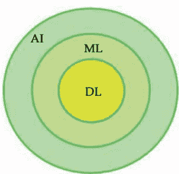

**图 1.** 深度学习是机器学习和人工智能的一个子集。

深度学习被评为人工智能和计算机视觉领域的颠覆者。今天，最先进的物体检测之所以成为可能，仅仅归功于深度学习 [4]；传统的物体检测方法不足以如此智能地应对检测。要理解物体检测的整体图景，不仅需要关注图像分类，还需要精确计算每张图像中物体的概念和位置，即基于人脸检测、行人检测和骨骼检测的物体检测 [5]。深度学习拥有尖端技术，并在生活的各个领域都有应用，从计算领域到医疗保健。它对人们的生活或社会产生非常深远的影响，因为其应用始终是当务之急。深度学习还因一种新兴且蓬勃发展的领域——大数据分析而获得重要地位。大数据分析是对大量且多样化的数据集进行检查的复杂过程，也被定义为用于从大型数据集中识别隐藏模式、未知相关性、市场趋势和客户偏好的技术和方法。大数据分析可以提供各种商业利益，即更有效的营销策略、更好的客户服务、提高的运营效率等。

深度学习是一个新兴的研究领域和现代应用。当今，深度学习是一个非常广泛且需求量大的领域，涵盖工业、商业和医疗保健；它结合了所有热门的面向研究的领域，即物联网、电子健康、网络安全、生物信息学、优化和网络物理系统；这些都被视为相互依赖。Gartner 提出了 2020 年十大技术趋势，其中一些包括超自动化、人类增强、人工智能安全、物联网、自主事物等；所有这些在某种程度上都与人工智能、机器学习和深度学习相关。毫无疑问，深度学习将为无论是工业、医疗保健还是商业智能的各个领域带来一系列创新。根据 Ref. [6]，计算机世界进行的调查中，专家表示 2020 年将更多地使用机器学习和人工智能。

2019 年，许多研究人员、学者和教师声称深度学习已经结束，因为它无法进行常识推理；MIT 教授罗德尼·布鲁克斯说，一些大众媒体开始报道深度学习将在 2020 年结束。2020 年，预计混合、跨学科、协作和开放的研究将做出更多贡献。预计 2020 年更为普遍的主题包括常识推理、主动学习和终身学习、多模态和多任务学习、开放域对话、医疗应用和自动驾驶汽车，以及包括隐私、保密性和偏见的伦理问题，最后是机器人技术。

目前最常用的两个深度学习平台是 TensorFlow 和 PyTorch；这两个平台竞争；这种竞争对社区非常有益；TensorFlow 易于使用，与 Keras 集成；而


另一方面，Pytorch 支持 TPU 等。预计在 2020 年，将出现一个可以轻松将 TensorFlow 模型转换为 Pytorch 以及反之亦然的平台。有必要开发一个积极维护的稳定强化学习框架。预计 2020 年将出现类似 Keras 的更高层抽象，以便机器学习能够应用于机器学习领域之外。

## 历史

深度学习是机器学习的一个子分支，而机器学习是人工智能的一个子分支。深度学习是一组处理大量数据并模仿思维过程的算法。深度学习的历史始于 1943 年，当时 Warren McCulloch 和 Walter Pitts 创建了一个基于神经网络的计算机模型。他们的基本目标是模仿人脑的思维过程；他们使用算法和数学来构建阈值逻辑以模仿人类思维过程。被誉为 AI 之父的 Alan Turing 在 1951 年得出结论，机器很快就会开始独立思考；在某种程度上，它们将能够互相交流；并且还预计它们将接管宇宙。在此背景下，Frank Rosenblatt 引入了单层和多层人工神经网络（1957–1962）。当国际象棋世界冠军 Kasparov 在 1997 年被深蓝计算机击败时，这一历史令我们震惊。在 1957–62 年，引入了单层和多层感知器。Alexey Ivakhnenko 和 Lapa 发表的第一个深度前馈通用学习算法多层感知器于 1967 年出版。1971 年，已经描述了一个由群体数据处理算法训练的八层深度网络。1970–1986 年间，引入了反向传播、循环神经网络（RNN）和受限玻尔兹曼机（RBM）的概念。在 1979–1998 年间，卷积神经网络（CNN）、双向 RNN 和长短期记忆网络（LSTM）是最先进的技术。深度信念网络（DBN）由 Geoff Hinton 在 2006 年引入。ImageNet 和 AlexNet 数据集分别于 2009 年创建。生成对抗网络（GAN）是 Ian Goodfellow 及其同事于 2014 年发明的一类机器学习系统。历史上，2016 年 Google DeepMind 挑战赛中 AlphaGo 对阵 Lee Sedol，AlphaGo 战胜了世界冠军 Lee Sedol 并赢得了所有比赛。AlphaGo 和 AlphaZero 是由名为 DeepMind 的人工智能研究公司在 2016–2017 年间开发的计算机程序；它们用于下围棋。Transformer 于 2017–19 年引入，是一种专门用于自然语言处理（NLP）的深度学习模型。尽管有很多社区为深度学习做出了贡献，但 Yann LeCun、Geoffrey Hinton 和 Yoshua Bengio 在 2018 年获得了图灵奖。

## 深度网络拓扑

### 深度神经网络 (DNN)

在 DNN 中，输入和输出之间存在多层感知器或隐藏层。所有层都连接到前一层；通过每一层，网络基于权重和激活函数来估算精确输出。通过 DNN，我们可以建模任何复杂的非线性关系。DNN 的骨干是学习与目标最相关的特征的特性 [7]。DNN 在模型选择、训练动态、使用图卷积神经网络组合优化以及贝叶斯神经网络进行不确定性估计方面存在研究空白。DNN 有很多应用，即计算机视觉、机器翻译、社交网络过滤、棋类游戏、视频游戏和医疗诊断（图 2）。

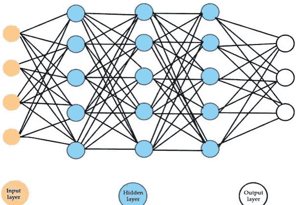

**图 2.** 深度神经网络。

### 循环神经网络 (RNN)

RNN 是一种深度学习网络类型，专门用于存在序列数据或时间序列数据（如视频、语音等）的情况。RNN 通常将前一状态的数据保留到下一状态。之所以称为循环，是因为它对每个输入执行相同的函数，而输出不同，因为它还取决于过去的计算。RNN 深度学习的前沿主题是长短期记忆网络（LSTM）。RNN 为许多问题提供了解决方案，即智能交通系统 [8]、求解时变矩阵逆 [9] 等。RNN 因句子评估和语言数据处理而闻名（图 3）。

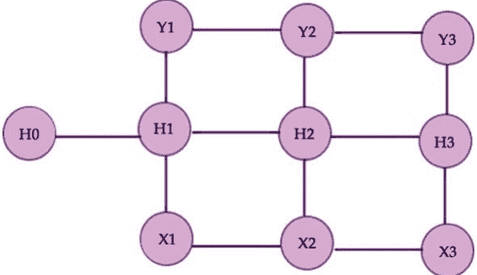

图 3. 循环神经网络。

### 深度信念网络 (DBN)

DBN 是一种概率无监督深度学习算法。它有许多隐藏变量层。为了解决更复杂的问题，它需要更多隐藏层；每一层与其他层具有特殊的统计关系。DBN 可以进行概率学习；学习后，DBN 需要在监督下进行训练以执行分类。DBN 用于识别簇并生成图像、视频序列和运动捕获数据（图 4）。

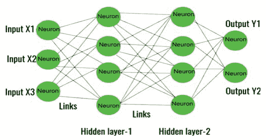

图 4. 深度信念网络。

### 玻尔兹曼机 (BM)

BM 是一种均匀连接的神经元类似单元网络，负责随机决定是开启还是关闭。搜索、优化和学习问题等计算问题可通过 BM 解决。学习算法中会发现许多特征，这些特征在训练数据集中表现出非常复杂的行为。玻尔兹曼机用于分类和降维。

### 受限玻尔兹曼机 (RBM)

RBM 由 Smolensky 于 1986 年引入：包含可见层和隐藏层两层单元，而可见层与可见层之间、隐藏层与隐藏层之间没有连接。它可以学习一组数据集上的概率分布。RBM 的应用包括特征学习、协同过滤、降维和分类。

### 卷积神经网络 (CNN)

在 CNN 中，各层精细地连接到输入层以及彼此之间。后续层的每个神经元都有特定功能，例如只负责输入的一部分。CNN 目前广泛用于遥感、计算机视觉、音频和文本处理 [10]。

### 深度自动编码器

与其他算法一样，深度自动编码器也有许多隐藏层。简单自动编码器与深度自动编码器的区别在于：简单自动编码器只有一个隐藏层，而深度自动编码器有多个隐藏层。在深度自动编码器中，训练通常比较复杂，你需要先训练一个隐藏层以重建输入数据的结构，然后将这些输入数据用于训练其他隐藏层，以此类推。深度自动编码器的一些应用包括图像提取、图像生成推荐系统以及序列到序列预测。

### 梯度下降 (GD)

GD 用于降低整体成本函数；它被视为一种优化算法，并广泛用于机器学习中系数函数的确定。当无法解析估计参数时，则使用 GD 来计算所需参数。使用 GD 时，模型权重在每个 epoch 中更新。它用于监督机器学习。

### 随机梯度下降 (SGD)

与 GD 类似，SGD 也是一种优化算法，但在数据集较小时使用 GD，而数据集较大时通常使用 SGD，并且如果在大量数据集上使用 SGD 成本会非常高。

## 深度学习的应用

深度学习是一种新型且先进的技术，当前用于大规模应用。深度学习（也称为微分编程或结构学习）是机器学习类的一个大家族的成员。它是一种尖端技术，应用于下文所述的许多不同新兴研究领域。

### 深度学习在自动语音识别中的应用

自动语音识别是深度学习的一项令人信服的应用。语音识别是指将语音作为输入到机器中，可以使输入过程变得非常简便，并且还有许多其他优势，即文盲也可以使用技术、语音编码、文本转语音合成、语音识别、说话人识别、语音增强、语音分割、语言识别等 [11]。语言是自然的交流形式，因此被认为是一项非常令人信服的应用。


### 图像识别

基于深度学习的图像识别已成为非常著名且面向准确结果的技术，该技术基于机器的训练和经验。尽管水下图像总是噪声且劣化，深度学习在水下目标识别 [12] 的图像识别和图像分类中发挥着非常重要的作用。MNIST 是图像分类中最著名的示例之一，以下是 MNIST 数据集的简单示例（图 5）。

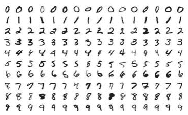

图 5. MNIST 数据集中的手写数字图像示例。

### 自然语言处理

LSTM 在语言建模和机器翻译 [13] 中帮助很大；语言建模任务是理解语言。要实现语言，使用模型的神经网络。Google 翻译是在这方面最著名且最广泛使用的应用；Google 翻译在全世界用于 100 多种语言。它也使用 LSTM；并且它从数百万个示例中学习，翻译整个句子而不是逐词翻译。BERT (Google) 是该领域最常见的技术之一，取得了许多基准，即句子分类、句子对分类、句子对相似性、句子标记、创建上下文化词嵌入、问答和选择题。2019 年开发的一些其他基于 Transformer 的语言模型包括 XLNet (Google/CMU)、RoBERTa (Facebook)、Distil BERT (hugging Face)、CTRL (Salesforce)、GPT-2 (OpenAI)、ALBERT (Google) 和 Megatron (NVIDIA)。Megatron 是有史以来训练的最大 Transformer 模型。它拥有 830 万参数的 Transformer 语言模型。XLNet 是性能最好的 Transformer；XLNet 在 20 项任务上通常以很大的优势胜过 BERT。由 Google 开发的 ALBERT 用于通过跨层参数共享来减少参数。该领域的最新技术涉及多域任务导向对话系统 [14]。预计在 2020 年，将常识推理与语言模型相结合，将语言模型上下文扩展到数千个单词，并更多地关注开放域对话（图 6）。

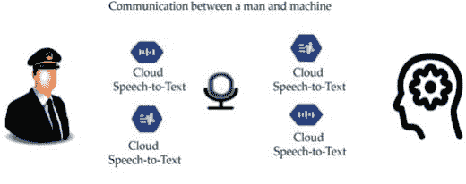

图 6. NLP 和深度学习。

### 游戏与机器人

机器人是人工智能代理，在现实世界中取代人类工作。OpenAI 和 Dota 2 是流行的游戏；2017 年，1v1 机器人击败顶尖职业 Dota 2 玩家；2018 年，OpenAI 五人组在与顶尖 Dota 2 玩家的对抗中输掉两场比赛，而 2019 年，OpenAI 五人组击败了 OG 战队（2018 年世界冠军）。OpenAI 五人组在 2019 年的获胜仅仅是因为更多的训练算力；OpenAI 的当前版本已消耗 800 PFLOPS/天，并在 10 个真实月份中经历了约 45,000 年的 Dota 自我对弈。

当前版本与 2018 年版本相比的胜率为 99.9%。这是深度学习中最好的经验之一，系统相互学习游戏并不断改进。OpenAI 魔方操作是机器人学的另一个示例。研究人员预计在 2020 年将在现实世界交互任务的操作中实施强化学习方法。

在游戏中，专家来自不同的机器，使用这些机器来协助人类专家发现新策略。Waymo 是一家专注于开发类似特斯拉的自动驾驶技术的公司，成立于 2018 年 10 月；他们在道路上有 1000 万英里的里程，现在在 2020 年已有 2000 万英里的里程，有 20,000 个用于结构测试的类别，还启动了没有安全驾驶员的测试。

### 金融欺诈检测

深度学习在金融欺诈检测中发挥着非常重要的作用。随着技术的出现和大量电子商务平台的普及，电子支付的数量与日俱增，金融欺诈的机会也在增加，这也是银行和其他金融机构头疼的问题。因此，专注于欺诈检测是一个热门的研究领域。[15] 的作者使用自动编码器进行金融欺诈检测 [16]。这项研究使用深度学习模型进行欺诈检测，而 [17] 提出了一种使用机器学习方法进行欺诈检测的解决方案。

### 医疗保健中的深度学习

在这个现代计算时代，深度学习在医疗和保健领域也取得了最佳结果，即深度学习在医学领域用于癌细胞协调、器官分割、蛋白质折叠、病变检测和图像增强。还有 [18, 19, 20, 21] 等许多其他问题，深度学习直接参与为医疗保健中的问题提供最终解决方案。

### 军事

深度学习用于制造许多不同的军事设备，用于战争或其他间谍服务。军队也在研究机器人，通过这些机器人训练机器人处理关键情况。一些国家的军队正在使用人工智能使其武器更加智能。在战区，人工智能可以嵌入机器人中，为医疗保健提供远程手术支持。

### 网络安全

网络安全也是热门研究领域之一；深度学习模型用于物联网 (IoT) 的网络安全 [22]。IoT 设备通常是功率受限的低功耗设备，因此始终容易受到外部威胁。深度学习模型比任何其他技术都能更准确地检测威胁。[23] 的作者使用深度学习和机器学习进行入侵、垃圾邮件和恶意软件检测。

## 现代深度学习平台

本节讨论开源深度学习平台。它将为初学者和中级用户提供开源平台的快速回顾，因为每个平台都有其优缺点。

### TensorFlow

TensorFlow 是一种用于微分编程的新开源平台；它由名为 Google Brain 的 Google 团队开发，并于 2015 年首次发布 [24]。2017 年 2 月，他们发布了 1.0.0 版本；TensorFlow 可以在 CPU 和 GPU 上运行；它适用于 Mac、Linux 和 Windows，也适用于移动计算平台 Android 和 iOS。它是当今世界上最著名的机器学习库。其最受支持的客户端语言是 Python，但也提供 C++、Java 和 Go 的接口。它易于使用并集成了 Keras。TensorFlow 有许多可用的版本，例如面向移动端的 TensorFlow Lite、面向工业的 TensorFlow Serving 等。

### PyTorch

PyTorch 也是一种基于 Torch 库的机器学习和深度学习库。它最初由 Facebook 人工智能研究实验室 (FAIR) 于 2016 年发布。PyTorch 有两个高级特性：带有图形处理单元 (GPU) 的 Tensor 计算，以及基于自动微分的深度神经网络。在 PyTorch 中将张量移入和移出 GPU 非常容易。PyTorch Mobile 是用于移动设备的 PyTorch 版本。PyTorch 有一些关键特性；第一个特性称为命令式编程；大多数 Python 代码是命令式的；这种编程类型更灵活。PyTorch 的另一个特性是动态计算图，系统在运行时生成图结构，动态图非常适合 RNN 等动态网络，动态图也使调试变得非常容易。PyTorch 在实现和构建深度神经网络期间提供最大的灵活性和速度。

### Theano

Theano 由蒙特利尔学习算法研究所 (MILA) 设计，部署后非常著名，但不幸的是，1.0.0 版本（2017 年 11 月）之后没有支持。它是专为代码编译优化设计的 Python 库 [25]；主要用于数学运算，如多维数组。在速度、计算符号图和稳定性优化方面，Theano 远优于 Numpy 等其他 Python 库。Theano 也支持张量操作、GPU 计算和并行性。


### Microsoft 认知工具包 (CNTK)

CNTK 用于商业级分布式深度学习。它可以作为机器学习的独立工具使用，也可以作为库包含在 C++ 程序、Python 和 C# 中；其模型评估功能也可从 Java 程序中使用。它支持 ONNX，可与 Caffe2、MXNet 和 PyTorch 等框架共享模型 [26]。CNTK 仅可在 Linux 和 Windows 上使用。CNTK 被认为是一个功能强大的机器学习平台，其性能提升与其他广泛使用的平台相当 [27]。

### Keras

Keras 是一个用 Python 编写的强大库；它使用 TensorFlow、Theano 和 CNTK 作为框架，因为它没有自己的框架。Keras 可在 GPU 和 CPU 上运行，还可支持 RNN 和 CNN。Keras 的优势在于它具有快速简便的原型设计能力；Keras 易于使用。它在 2018 年被列为最受引用的 API 之一，并且拥有足够数量的用户。

### Deep learning 4J

它是由 Skymind [28] 设计的面向 Java 的分布式开源、健壮的深度学习框架，为 Java 生态系统和 Eclipse 基金会做出了重大贡献。它与 Clojure 和 Scala API 兼容，就像 Keras 一样；它也可以同时在 CPU 和 GPU 上工作。

### Torch

它是一个于 2002 年 10 月发布的科学计算开源机器学习框架；它无法在 CPU 上工作；它仅专注于 GPU 加速计算。它使用 C 编程语言开发，基于 Lua（一种脚本语言），是 LuaJIT 的一个贡献。Mac OS X 和 Ubuntu 12+ 可以使用此框架，尽管它们有适用于 Windows 的平台，但其实现未得到官方支持 [29]。

### Caffe 和 Caffe2

CAFFE（快速特征嵌入卷积架构）由 Berkeley AI Research (BAIR) 创建，是一个深度学习框架。它使用 C++ 开发，并提供 Python 接口。Caffe2 于 2017 年由 Facebook 研究小组引入，但 Caffe2 于 2018 年 3 月合并到了 PyTorch 中。它支持多个平台，即 Mac OS X、Windows、Linux、iOS 和 Android [30]。

### Apache MXNet

MXNet 是一个快速可扩展的深度学习平台，支持多种编程语言，即 Scala、Julia、C++、R、Python、Gluon API 和 Perl API。与 Torch 类似，它也仅针对 GPU 设计，并在多 GPU 实现方面非常称职。Apache MXNet 具有可扩展性、灵活性和可移植性，正因如此，它吸引了许多用户。

## 训练算法

深度学习中最重要的部分之一是学习算法。深度神经网络仅通过层数来区分；如果层数增加，网络就会变得更深更复杂。每层都有其特定功能，可以检测或帮助检测特殊特征。

根据作者 [31] 的说法，如果问题是人脸识别，第一层负责识别边缘，第二层需要检测鼻子、眼睛、耳朵等更高级特征，下一层可以进一步挖掘特征，以此类推。因此，每层在梯度下降等训练算法开发之前就已开发；这就是为什么这类分类器不适用于数据量大或变化大的数据集。Yann 等人 [32] 进行了讨论；他们进一步得出结论，在模式识别中，手动设计较少、自动设计较多的系统可以取得更好的结果。

反向传播是解决方案；它从数据中获取信息而无需经过分类器，并找到识别所需的表示。下面列出了几种著名的训练算法。

### 梯度下降

在统计学、数据科学和机器学习中，我们要优化大量内容；当使用线性回归拟合直线时，我们优化截距和斜率；当使用逻辑回归时，我们优化一条曲线；当使用 t-SNE 时，我们优化聚类。梯度下降用于优化所有这些内容以及其他许多内容。

梯度下降算法类似于 2D 函数的牛顿求根算法。该方法非常简单：在曲线上随机选取一个点，根据给定点处函数斜率的正负值沿 x 轴向左或向右移动，直到 y 轴的值（即函数或 f(x)）变为零。梯度下降背后也有同样的概念；当误差率降低到一定限度时，我们沿多维空间中的特定路径移动或遍历，然后停止。它是大多数深度学习和机器学习算法的基本概念之一。

\( C = \frac{1}{2}(Yexpected - Yactual)^2 \)

### 随机梯度下降

一种使用迭代方法优化目标函数的方法称为随机梯度下降。它也可以称为梯度下降优化。随机梯度下降会在每一步随机选择一个样本，然后仅使用这一个样本来计算导数，因此在超样本示例中，随机梯度下降将计算项的数量减少了 3 倍。如果有一百万个样本，随机梯度下降将使计算项的数量减少一百万倍。在随机梯度下降中，当一个小批量样本运行完毕后，就会应用更新；在这里，权重更新更频繁，因此我们在更短的时间内达到全局最小值（图 7）。

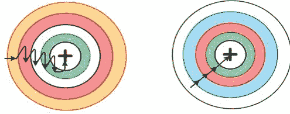

**图 7.** GD 与 SGD 的比较。

### 动量

在随机梯度下降中，更新权重或计算步长时使用固定乘数作为学习率；这可能导致更新超过潜在极小值；如果梯度太陡或延迟，梯度的收敛就会变得嘈杂。物理学中使用的动量概念是梯度的指数衰减平均值 [33]。这可以防止下降走上错误的方向。

### Levenberg-Marquardt 算法

这种算法用于曲线拟合或非线性最小二乘问题。这种算法也称为深度最小二乘；此类问题通常出现在最小二乘曲线拟合中。它最初由 Kenneth Levenberg 在 1944 年提出，尽管统计学家 Donald Marquardt 在 1963 年重新发现了它。

### 时间反向传播

它是用于训练循环神经网络的著名且标准的方法之一。它由多位研究人员独立开发。与通用优化技术不同，它在训练 RNN 方面更快。时间反向传播也存在局部最优问题 [34]。

## 深度学习中的常规挑战

根据 Google Trends 图表，过去五年来，越来越多的专家和专业人士被深度学习吸引；专业人士的百分比从 12% 增加到 100% [35, 36]。深度学习无处不在，即生物信息学、计算机视觉、IoT 安全、医疗保健、电子商务、数字营销、自然语言处理等众多领域 [37, 38]。由于它是一个非常热门的研究领域，必然存在一些挑战，如下所述。

### 不贡献的列或输入

在处理数据或构建模型时，有些输入对于寻找特征并不必要，因此建议删除不必要的属性。还需要找到一个最佳列并将其与数据集分开；可以在 Keras 中使用 NumPy 数组来完成；但找到最佳匹配属性是困难且具有挑战性的。

### 隐藏层数量

隐藏层数量与计算复杂度和网络深度成正比。处理大量层需要高昂的计算成本；管理大量神经元是困难的。


### 优化算法

在模型优化中，梯度下降优化器通过调整数值来帮助使模型代价最小；选择优化器也是一项具有挑战性的任务，因为有时它会使您的模型代价升高，而不是降低模型代价。

### 损失函数

从名称来看，损失函数用于估计预期结果与实际结果之间的损失或差异。损失函数的公式如下。

Loss = 预期结果 - 实际结果 (1)

计算损失函数有多种不同的方法；选择损失函数也是深度学习中重要且具有挑战性的任务之一。

### 激活函数

存在多种不同的激活函数；每种激活函数产生的结果不相同；Sigmoid 激活函数在二分类问题中表现良好。需要小心 Tanh 激活函数，因为存在梯度消失问题。在多标签分类中，softmax 是最佳选择；当输入侧有许多零时应使用 Relu，因为 Relu 擅长产生死神经元。使用所需的激活函数也是一个需要注意的点。

### 轮次（Epoch）

当数据集在整个神经网络中前向和后向传递时，称为一个轮次（epoch），因为在每个轮次之后会分析分配的权重值来构建模型。权重在每个周期中针对相同的数据集模拟被更改、检查和测试。主内存保存所有训练数据的记录；有时无法将所有记录保存在主内存中，例如对于较大的数据集，因此轮次以分段或批次形式加载到内存中，最后结果表示为轮次输出。处理轮次也是深度学习中一项具有挑战性的任务。

## 可用开源数据集

机器学习和深度学习的研究始于数十年前，为社会带来了显著的进步，涉及基于深度学习和机器学习的各种应用。网上有许多免费可用的数据集，研究人员可出于各种目的使用。

Image datasets (Table 1):

### Table 1. 开源图像数据集

| Pascal VOC | MS COCO |
| :--- | :--- |
| MNIST 手写数字 | NORB |
| CIFAR10/CIFAR100 彩色图像数据集 | COIL100 |
| Caltech101 | Google 开放图像 |
| Caltech 256 | COIL 20 |
| 街景数据集 | LabelMe |
| STL-10 | ImageNet |

Geospatial datasets available online:

- NEXRAD
- OpenstreetMAP
- Landsat8

Dataset available for text (Table 2):

### Table 2. 文本开源数据集

| Google 图书 Ngrams | Yelp 开放数据集 | 20 新闻组 | |
|---|---|---|---|
| UCI 的 Spambase（旧版） | 预测 | UCI 机器学习库 | 文本分类数据集 |
| SQuAD | Google 图书 Ngrams | 广播新闻 | WikiText |
| Penn Treebank | Reuters 新闻数据集 | 亿级词汇数据集： | Common crawl |

Artificial datasets:

- Arcade Universe
- 受 baby-AIschool 启发的数据集
- 所有图像和问题数据集
- Deep vs. shallow 比较 ICML
- 背景相关性
- 矩形数据
- Mnist 变体

Facial datasets (Table 3):

### Table 3. 面部识别数据库

| 自然界中的标注面孔 | UMD 面部标注数据集 | CASIA WebFace 面部 |
|---|---|---|
| MS-Celeb-1M | Olivetti | Multi-Pie |
| JACFEE | FERET | MMI 面部数据库 |
| 印度面部数据库 | Yale 面部数据库 | Mutiny 面部/头部分割数据集 |

Recent additions of datasets (Table 4):

### Table 4. 最近开发的免费数据库

| UZH-FPV 无人机竞赛数据集 | 朝鲜导弹测试数据库 | Flickr-Faces-HQ 数据集 (FFHQ) |
|---|---|---|
| Hotels-50K | MIMIC-CXR | Google Audioset |
| 两个新的评估数据集 | 开源生物特征数据识别 | Uber 2B 行程数据 |
| Yelp 开放数据集 | Core50 | 数据门户 |
| 开放数据监控 | Quandl 数据门户 | Mutiny 面部/头部分割数据集 |
| Awesome 公共数据集 | 头部 CT 扫描数据集 | 开放数据集 |
| WAPo | 棋类数据集 | NLP 数据集 |

## 参考文献

- 1. Aliper A, Plis S, Artemov A, Ulloa A, Mamoshina P, Zhavoronkov A. 用于预测药物药理特性和基于转录组数据的药物重新定位的深度学习应用. Molecular Pharmaceutics. 2016;13(7):2524-2530

- 2. 世界卫生组织. 道路安全全球状况报告. Available from: https://www.who.int/violence_injury_prevention/road_safety_status/2018/en/ [Accessed: 31 January 2018]

- 3. 美国交通部. 国家机动车辆事故原因调查中调查的事故关键原因. Washington, DC: National Center for Statistics and Analysis; 2015

- 5. Zhao Z-Q, Zheng P, Xu S-T, Wu X. 基于深度学习的目标检测：综述. IEEE Transactions on Neural Networks and Learning Systems. 2019;30(11):3212-3232

- 6. Kobatake H, Yoshinaga Y. 基于骨架分析的乳腺X线片中毛刺检测. IEEE Transactions on Medical Imaging. 1996;15(3):235-245

- 7. 2020 年值得关注的 3 大企业科技趋势. 2020. Available from: https://www.computerworld.com/article/3512109/top-3-enterprise-techtrends-to-watch-in-2020.html

- 8. Zhong S, Hu J, Fan X, Yu X, Zhang H. 结合分子指纹的深度神经网络 (DNN-MF) 用于开发水污染物羟基自由基速率常数的预测模型. Journal of Hazardous Materials. 2020;383(5)

- 10. Kong J, Huang J, Yu H, Deng H, Gong J, Chen H. 基于 RNN 的城市环境路径规划默认逻辑. Neurocomputing. 2019;338:307-320

- 11. Zhang Z, Zheng L, Wang M. 用于求解时变矩阵逆的指数增强型变参数 RNN. Neurocomputing. 2019;338:126-138

- 12. Konstantinidis D, Argyriou V, Stathaki T. 用于遥感图像的模块化基于 CNN 的建筑物探测器. Computer Networks. 2020;138:107034

- 14. Karpagavalli S, Chandra EH. 自动语音识别架构和方法综述. International Journal of Signal Processing, Image Processing and Pattern Recognition. 2016;9(4):393-404

- 15. Jin L, Liang H. 小样本情况下水下图像识别的深度学习. Aberdeen UK: OCEANS; 2017

- 16. Jozefowicz R, Vinyals O, Schuster M, Shazeer N, Wu Y. 探索语言建模的极限. California, USA: Google Brain; 2016

- 17. Wu CS, Madotto A, Hosseini-Asl E, Xiong C, Socher R, Fung P. 用于面向任务的对话系统的可转换多域状态生成器. In: arXiv preprint arXiv; 2019

- 19. Zamini M, Montazer G. 基于自动编码器聚类的信用卡欺诈检测. In: 第 9 届电信国际研讨会 (IST). Tehran, Iran; 2018. pp. 486-491

- 20. Mubalaike AM, Adali E. 智能金融欺诈检测系统的深度学习方法. In: 第 3 届计算机科学与工程国际会议 (UBMK). Sarajevo, Bosnia; 2018

- 21. Vidanelag HMMH, Tasnavijitvong T, Suwimonsatein P, Meesad P. 使用传统工具进行支付欺诈检测的机器学习技术研究. In: 第 11 届信息技术与电气工程国际会议 (ICITEE). Pattaya, Thailand; 2019

- 22. Subiksha K. 使用深度学习架构改进医疗保健系统分析. In: 第 4 届计算通信与自动化国际会议 (ICCCA). Greater Noida, India; 2018

- 23. Hajjo R. 在癌症护理中应用机器学习和人工智能面临的伦理挑战. In: 第 1 届癌症护理信息学国际会议 (CCI). Amman, Jordan; 2018

- 24. Nugroho H, Harmanto D, Hassan Al-Absi HR. 智能家庭护理的发展：用于疼痛检测的深度学习应用. In: IEEE-EMBS 生物医学工程与科学会议 (IECBES). Sarawak, Malaysia; 2018

- 25. Shickel B, Tighe PJ, Bihorac A, Rashidi P. Deep EHR：电子健康记录 (EHR) 分析深度学习技术最新进展综述. IEEE Journal of Biomedical and Health Informatics. 2017;22(5):1589-1604


- 26. Roopak M, Tian GY, Chambers J. 针对物联网网络的深度学习模型. 载于: IEEE第9届年度计算与通信研讨会及会议 (CCWC). 美国拉斯维加斯; 2019

- 27. Apruzzese G, Colajanni M, Ferretti L, Guido A, Marchetti M. 关于机器学习和深度学习在网络安全中的有效性. 载于: 第10届网络冲突国际会议 (CyCon). 爱沙尼亚塔林; 2018

- 28. Hatcher WG, Yu W. 深度学习综述: 平台、应用和新兴研究趋势. 人本智能系统与技术. 2018;6:24411-24432

- 29. E. A. The Theano Development. Theano：一种用于快速数学表达式计算的Python框架. 载于: arXiv预印本 arXiv; 2016

- 30. The Microsoft Cognitive Toolkit. 2017. 可从以下网址获取: https://docs.microsoft.com/en-us/cognitive-toolkit/

- 31. Shi S, Wang Q, Xu P, Chu X. 最先进的深度学习软件工具基准测试. 载于: 第7届云计算与大数据国际会议 (CCBD). 中国澳门; 2017

- 32. Keras: The Python Deep Learning Library. 2017. 可从以下网址获取: https://keras.io/

- 33. Torch: A Scientific Computing Framework for LuaJIT. 2017. 可从以下网址获取: http://torch.ch/

- 34. Giang N, Dlugolinsky S, Bobák M, Tran V, García L, Heredia I, 等. 用于大规模数据挖掘的机器学习和深度学习框架及库. 人工智能评论. 2019;52(1):77-124

- 35. Maryam NM, Villanustre F, Khoshgoftaar TM, Seliya N, Wald R, Muharemagic E. 大数据分析中的深度学习应用与挑战. 大数据期刊. 2015;2(1):1

- 36. Yann L, Bottou L, Bengio Y, Haffner P. 应用于文档识别的基于梯度的学习. IEEE学报. 1998;86(11):2278-2324

- 37. Ian G, Bengio Y, Courville A. 深度学习. 载于: 自适应计算与机器学习丛书，剑桥. 美国剑桥: MIT出版社; 2016

- 38. Mahmood A, Shrestha A. 深度学习算法与架构综述. IEEE Access. 2019;7:53040-53065

- 39. Kumar OS, Joshi N. 关联分类中规则幂因子: 一种新的兴趣度量. 计算机科学程序. 2016;93:12-18

- 40. Sharma O, Kumar S, Joshi N. 显著规则幂: 一种新兴趣度量的算法. 载于: 智能计算与信息学. 新加坡: 智能创新、系统与技术丛书; 2018

- 41. Dong C, Loy CC, He K, Tang X. 用于图像超分辨率的深度卷积网络学习. 载于: 欧洲计算机视觉会议. Cham; 2014

- 42. Seonwoo M, Lee B, Yoon S. 生物信息学中的深度学习. 生物信息学简报. 2017;18(5):851-869

- 43. Pathmind. 2019. 可从以下网址获取: https://pathmind.com/wiki/open-datasets

## 基于多个深度确定性策略梯度算法的深度集成强化学习

吴俊太 和 李慧云

中国科学院深圳先进技术研究院, 中国深圳 518071

### 摘要

深度确定性策略梯度算法在连续动作空间上的运用为强化学习引起了广泛关注。然而，即使对于简单系统，在贝叶斯信念状态空间内通过动态规划实现的探索策略效率也相当低下。另一个问题是，自动驾驶汽车的顺序且迭代的训练数据受因果律约束，这与训练样本的独立同分布（i.i.d.）数据假设相悖。这通常会导致在学习最优策略时标准自助法失败。本文提出了一种m-out-of-n自助并聚合多深度确定性策略梯度框架，以加速训练过程并提升性能。2D机器人臂游戏的实验结果表明，聚合策略获得的奖励比子策略高出10%–50%。开源赛车模拟器（TORCS）的实验结果表明，新算法可以用减少56.7%的训练时间学习到成功的控制策略。还从概率和统计的角度给出了收敛性分析。这些结果验证了所提方法在效率和性能方面均优于现有算法。

### 引言

强化学习是机器学习的一个活跃分支，其中智能体在与复杂且不确定的环境交互时试图最大化累积奖励 [1, 2]。将深度神经网络（DNN）技术 [3, 4] 与强化学习相结合，在解决挑战性问题方面已取得一定成功。最引人注目的成果之一是通过深度Q网络（DQN）实现的，它利用深度神经网络获得最大累积奖励 [5]。DQN在50多种不同的Atari游戏中表现良好，并启发了许多深度强化学习（DRL）算法 [6–8]。

然而，DQN仅适用于具有小型离散状态和动作空间的任务，而许多强化学习任务具有大型连续实值状态和动作空间。虽然可以通过离散化连续空间来用DQN解决此类任务，但可能会增加控制系统的不稳定性。为克服这一困难，提出了结合DNN技术的确定性策略梯度（DPG）算法 [9]，从而产生了深度确定性策略梯度（DDPG）算法 [10]。不幸的是，DDPG存在探索效率低下和训练不稳定的问题 [11]。许多现有工作试图解决这些问题。Gu等人提出了Q-prop方法，即将非策略评论家的泰勒展开作为控制变量来稳定DDPG [12]。Q-Prop结合了在策略蒙特卡洛和非策略DPG，实现了采样效率和稳定性的优势。Mnih等人提出了A3C，通过训练带有异步累积更新的并行智能体来稳定DDPG的训练过程 [13]。同时在多个线程中与环境进行交互式学习，每个线程总结学习结果并将其存储在公共位置。这样一来，A3C避免了经验回放相关性过强的问题，并实现了异步并发学习模型。该方法消耗大量计算资源。当实现复杂性不是严格限制时，我们可以使用这些策略梯度相关方法中的任何一种来生成子策略，以进一步改进我们的方法，其中集中式经验重放缓冲区存储和共享来自所有子策略的经验，从而从环境中获得更多知识。

此外，研究人员最近试图通过自助技术克服DDPG训练不稳定的缺点并加速DDPG的收敛 [14]。Osband等人开发了自助DQN作为DDPG的评论家 [15]。Yang等人采用多参与者架构用于多任务目的 [16]。DBDDPG [11] 和 MADDPG [17] 都采用了多参与者-评论家结构，以提高探索效率并增加训练稳定性。Shi等人引入了深度软策略梯度（DSPG）[18]，这是一种在最大熵RL框架下结合策略和值方法的非策略且稳定的无模型深度RL算法。作者发现，在学习最优策略时，标准自助法很可能失败，因为在大多数强化学习任务中，顺序且迭代的训练数据受因果律约束，这与训练样本的独立同分布（i.i.d.）假设相悖。因此，需要一种新型自助技术来实现最优策略。考虑到前期工作的上述不足，本文介绍了一种带有m-out-of-n自助技术 [19, 20] 和聚合多DDPG结构的简单DRL算法。控制策略将通过对所有学习到的子策略求平均得到。此外，所提算法使用集中式经验重放缓冲区来提高探索效率。由于带有随机初始化的m-out-of-n自助技术以低计算成本产生合理的不确定性估计，这有助于训练的收敛。所提出的自助并聚合DDPG可以大幅减少学习时间。本文的其余部分组织如下。第2节简要介绍背景。第3节详细介绍所提方法并分析算法的收敛性。第4节展示所提方法的实验结果。第5节对全文进行总结。


### BACKGROUND

### 强化学习

在经典的强化学习场景中，智能体旨在通过在离散时间步内与环境 E 交互，根据奖励函数学习最优策略，其中策略是状态空间到动作空间的映射 [1]。在每个时间步，智能体观察到环境状态 s_t，然后遵循策略 π 执行动作 a_t。随后，立即收到奖励 r(s, a)。下面的方程定义了智能体从步骤 t 接收到的累积奖励：

```
\(R_t = \sum_{i=t}^{T} \gamma^{i-t} r(s_i, a_i),\)
(1)
```

其中 γ ∈ [0, 1] 是折扣因子。随着智能体从初始状态最大化预期累积奖励 E[R]，最终将获得最优策略 π*

### 确定性策略梯度算法

策略梯度（PG）算法通过利用策略梯度最大化性能函数来直接优化策略。确定性策略梯度算法源自确定性策略梯度定理 [9]，是策略梯度方法之一。它使用 actor-critic 框架学习确定性策略 μ(•|θ): S → A，其中 critic 估计动作-值函数，actor 表示确定性策略函数。动作-值函数和策略函数的更新如下

```
\(w = \arg \min_w E_{s \sim \rho^{\mu^\bullet(\bullet)} \sim \mu(\bullet|\theta)} \left[ \left( r(s, a) + \gamma Q(s', \mu(s' | \theta) | w) \right. \right.\)
\(\left. \left. - Q(s, a | w) \right)^2 \right],\)
\(\theta = \arg \max_\theta E_{s \sim \rho^{\mu^\bullet(\bullet)}} \left[ Q(s, \mu(s | \theta) | w) \right],\)
(2)
```

其中 ρ^{μ^•(•)} 表示折扣状态分布 [9]。由于完全优化代价高昂，通常改用随机梯度优化。下面的方程展示了确定性策略梯度 [9]，用于更新确定性策略的参数：

```
\(\nabla_\theta J = E_{s \sim \rho^{\mu^\bullet(\bullet)} \sim a \sim \mu(\bullet|\theta)} \left[ \nabla_\theta \mu(s | \theta) \nabla_a Q(s, a | w) |_{a = \mu(s|\theta)} \right].\)
(3)
```

### DDPG 算法

DDPG 将 DNN 技术应用于确定性策略梯度算法 [10]，使用神经网络近似确定性策略函数 μ 和动作-值函数 Q，如图 1 所示。

DDPG 中有两组权重。w、θ 是主网络的权重，而 w'、θ' 是目标网络的权重，目标网络在 [5] 中引入用于生成 Q-learning 目标。我们使用 Q(*, •|w) 和 μ(•|θ) 表示主网络，而 Q'(*, •|w) 和 μ'( •|θ) 表示目标网络。如方程 (4) 和 (5) 所示，主网络的权重根据随机梯度更新，而目标网络的权重使用“软”更新规则 [10] 更新，如方程 (6) 所示：

```
w ← w + α_w[(r(s,a) + γQ'(s', μ'(s' | θ) | w') - Q(s,a | w))^2],
(4)
```

```
θ ← θ + α_θ ∇_θ μ(s | θ) ∇_a Q(s,a | w)|a=μ(s|θ)
(5)
```

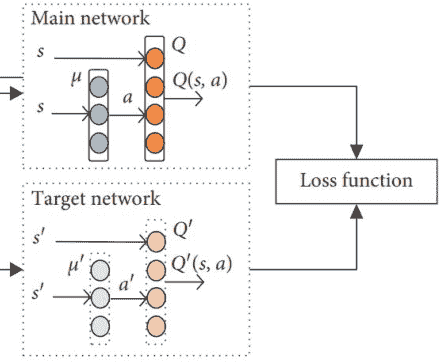

图 1. 深度确定性策略梯度图。

```
w' = τw + (1 - τ)w',
θ' = τθ + (1 - τ)θ'.
(6)
```

DDPG 利用经验回放技术 [10] 打破训练样本的时间相关性，使其服从 i.i.d.（独立同分布）假设。此外，使用“软”更新规则以提高训练过程的稳定性。DDPG 使用策略梯度更新主 actor 网络，而主 critic 网络则使用结合监督学习和 Q-learning（DQN 中使用）的思想进行更新。训练后，主 actor 网络收敛到最优策略。

### 方法

### Multi-DDPG 结构

与 DQN 相比，DDPG 更适合连续动作空间的强化学习任务。然而，DDPG 收敛到最优策略需要较长时间。我们提出 multiDDPG 结构和自举技术，以并行训练多个子策略，从而缩短训练时间。我们随机初始化 N 个主 critic 网络 Q_i(s, a |w_i) 和主 actor 网络 μ_i(s |θ_i)，权重分别为 w_i 和 θ_i（i = 1, 2, ..., N），然后，我们初始化 N 个目标网络 Q'_i 和 μ'_i，权重为 w'_i ← w_i，θ'_i ← θ_i（i = 1, 2, ..., N），并初始化集中式经验回放缓冲区 R。

带有集中式经验回放缓冲区的 multi-DDPG 结构如图 2 所示。我们将利用 multi-DDPG 结构和自举技术的所提方法命名为自举聚合 multiDDPG（BAMDDPG）。图 3 显示，BAMDDPG 对训练好的所有子策略的动作输出取平均值，以实现最终的聚合策略。为清楚起见，本文中 agent、主 actor 网络和子策略这些术语指代同一事物，可以互换使用。算法 1 展示了 BAMDDPG 的完整算法。

在算法 1 中，“#Env”表示环境模块的数量，而“#selected DDPG”表示所选 DDPG 组件的数量。在训练过程中，每个利用 actor-critic 框架的 DDPG 组件负责训练相应的子策略。图 2 展示了 DDPG 组件的训练过程，包含交互过程和更新过程。

在交互过程中，代表智能体的主 actor 网络与环境交互。它接收当前环境状态 s_t 并输出动作 a_t。环境在执行动作后给出即时奖励 r_t 和下一状态 s_{t+1}。然后将转换元组 (s_t, a_t, r_t, s_{t+1}) 存储到集中式经验回放缓冲区中。为了高效探索环境，从 Ornstein–Uhlenbeck 过程 N 采样的噪声被添加到动作中。在更新过程中，从集中式经验回放缓冲区中随机采样一个用于更新权重的 minibatch 转换。主 critic 网络通过最小化基于 Q-learning 方法 [1] 的损失函数进行更新，而目标网络则通过缓慢跟踪主网络进行更新。主 actor 网络的权重使用性能增加的方向上的策略梯度进行更新。遵循这样的更新规则，BAMDDPG 的每个子策略会逐渐改进。集中式经验回放缓冲区存储所有子策略的经验。

图 3 说明了子策略的聚合细节。我们用 μ_1(•)、μ_2(•)、…、μ_N(•) 表示由主 actor 网络近似的子策略，并用 a_1、a_2、…、a_N 表示这些子策略的输出。此外，聚合策略的输出表示为 a。

在实践中，我们通过设置最大回合数来训练多个子策略。由于 BAMDDPG 中的回合比原始 DDPG 算法更早结束且步骤更少，子策略的训练时间少于最优策略。可以预测，训练不足的子策略的性能在某种程度上会比最优策略差，但我们可以聚合训练好的子策略以提高性能并获得最优策略。此外，考虑到所有子策略的地位相等且输出为实数值，我们使用平均方法作为聚合策略。具体来说，所有子策略的输出被取平均值以产生最终输出。如图 2 所示，DDPG 的交互过程需要一个环境组件来与智能体交互。因此，multi-DDPG 结构需要多个环境模块。然而，对于某些强化学习任务，环境模块不支持被复制以用于多个 DDPG。在这种情况下，环境组件在每个时间步只与一个子策略交互。BAMDDPG 通过在每个时间步选择一个子策略或多个子策略与环境交互，支持既有一个环境模块又有多个环境模块的强化学习任务。然后，所有子策略使用从集中式经验回放缓冲区采样的 minibatch 同时更新。最后，所有训练好的子策略被取平均值以形成最终策略。算法 1 展示了 BAMDDPG 算法。

此外，从直觉角度来看，BAMDDPG 中利用的集中式经验回放技术使每个智能体能够使用其他智能体遇到的经验。这使得训练


由于每个代理都拥有更广阔的视野和更多环境信息，BAMDDPG 的子策略更高效。

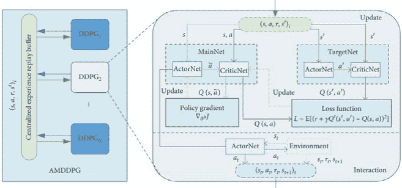

图 2. BAMDDPG 的结构。

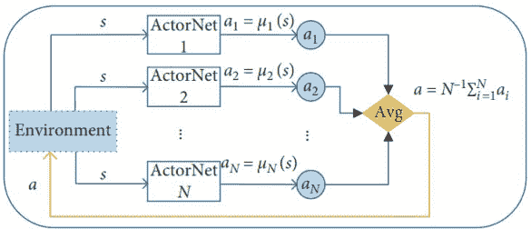

图 3. 子策略的聚合。

随机初始化 N 个主评论家网络 Q(s, a | w_i) 和主演员网络 μ_i(s | θ_i)，权重为 w 和 θ_i (i = 1, 2, ... , N)
初始化 N 个目标网络 Q'_i 和 μ'_i，权重为 w'_i ← w_i, θ'_i ← θ_i (i = 1, 2, ..., N)
初始化集中经验回放缓冲区 R
for episode = 1, M do
    初始化一个用于动作探索的 Ornstein–Uhlenbeck 过程 N
    if #Env == 1 do
        在多个 DDPG 中轮流选择 Q_i 和 μ_i 以与环境交互
    else do
        选择所有 $Q_i$ 和 $\mu_i$，每个 DDPG 绑定一个环境
    end if
    for t = 1, T do
        for #selected DDPG do
            从其绑定的环境接收状态 $s_i$
            执行动作 $a_t = \mu_i(s_i | \theta_i) + \mathcal{N}_t$ 并观察奖励 $r_t$ 和新状态 $s_{t+1}$
            将经验 $(s_t, a_t, r_t, s_{t+1})$ 存储在 R 中
        end for
        for i = 1, N do
            根据方程 (4)–(6) 更新 $w_i, \theta_i, w'_i,$ 和 $\theta'_i$
        end for
    end for
end for
通过聚合子策略获得最终策略：$\mu(s) = N^{-1} \sum_{i=1}^N \mu_i(s | \theta_i)$

**算法 1.** 自举聚合多 DDPG (BAMDDPG)。

### 自举与聚合下的收敛性分析

为便于描述，我们假设 BAMDDPG 同时训练 N 个子策略，并用 $\mu_i$ (i = 1, 2, $\cdots$ N) 表示这些子策略。聚合策略表示为 $\mu$，可表述为

\(\bar{\mu} = \text{Avg}[\mu_i] = N^{-1} \sum_{i=1}^N \mu_i,\)

其中 \(\bar{\mu}\) 表示子策略的聚合。令最优策略表示为 \(\mu^*\)。则以下公式成立 [20]

\(\text{Avg}[(\mu_i - \mu^*)^2] \ge (\bar{\mu} - \mu^*)^2.\)

其中 \(\text{Avg}[(\mu_i - \mu^*)^2]\) 表示子策略与最优策略之间的平均偏差，而 \((\bar{\mu} - \mu^*)^2\) 表示聚合策略与最优策略之间的偏差。

方程 (8) 表明，聚合策略的性能优于子策略，并且比任何子策略更接近最优策略。根据这一结论，当子策略训练到一定程度时，聚合策略能够快速逼近最优策略 [21]。

此外，我们从概率与统计的角度分析收敛性 [22]。假设所有策略均来自策略空间 U。子策略 $\mu_1, \mu_2, \dots, \mu_N$ 根据 U 中的分布函数 F 进行采样。令 $\widehat{F}$ 表示经验累积分布函数

$$\widehat{F}(x) = N^{-1} \sum_{i=1}^N I(u_i \le x),$$ (9)

其中 N 为被采样子策略的数量。$I[\bullet]$ 是一个指示函数，当条件满足时输出 1，否则输出 0。在 “$u_i \le x$” 中，运算符 “ $\le$ ” 表示 x 在 U 中优于 $u_i$，这意味着遵循策略 x 的代理能够获得比仅采用 $u_i$ 的代理更多的奖励。根据 Dvoretzky–Kiefer–Wolfowitz 不等式 [23] 的规则，我们得到

$P(\sup_{x \in U} |\widehat{F}(x) - F(x)| > \delta) \le 2e^{-2n\delta^2},$ (10)

其中 P($\cdot$) 表示概率，sup($\cdot$) 表示上确界，$\delta$ 为任意小正整数。

方程 (10) 表明，$\widehat{F}$ 在概率中以指数速率一致收敛于真实分布函数。假设我们关注均值 $\mu = T(F)$，则经验度量的无偏性扩展到经验度量线性函数的无偏性。实际上，经验累积分布可被视为每个分量概率相等的离散分布，这意味着我们可以通过对多个策略求平均，从经验累积分布中得到一个策略。因此，聚合策略 $\overline{\mu}$ 服从经验累积分布，且服从真实分布。

由于 $\overline{\mu}$ 在 U 中优于 $\mu_i(i=0,\dots,n)$，$\overline{\mu}$ 收敛于 U 的最优策略。

### m-out-of-n 自举法

自举法 [14] 是统计学中一种重要的重采样技术，通常通过有放回随机采样过程实现。本文尝试使用自举法训练多个 DDPG 组件。分析表明，通过不同方法初始化不同 DDPG 组件的网络权重即可简单实现该要求 [15]。因此，我们将该技术作为先验，多个 DDPG 组件在经验回放缓冲区的不同子数据集上并行训练。

然而，当训练数据服从长尾分布而非通常的正态分布时（如 i.i.d. 假设所暗示的那样），标准自举法会失效。一种有效的技术是 m-out-of-n 自举法 [19]，其中自举样本的数量远小于训练数据集的数量。具体来说，我们不放回地抽取子样本，并将这些子样本用作新的训练数据集。然后，多个 DDPG 组件使用该新生成的训练数据集进行训练

### 结果与讨论

### 2D 机械臂

为了说明聚合的有效性，我们使用 BAMDDPG 为 2D 机械臂任务学习控制策略。

#### 基准与奖励函数

如图 4 所示，2D 机械臂包含一个具有一个关节的两连杆机械臂，正在尝试触及蓝色方块。第一个连杆围绕根点旋转，第二个连杆围绕关节点旋转。代理的动作由两个表示角度增量的实数组成。我们根据机械臂指尖（端点）与蓝色方块之间的距离构建奖励。指尖距离蓝色方块越远，奖励越少。此外，当距离 \(\sqrt{dx^2 + dy^2}\) 小于阈值 \(\delta\) 时，奖励加一。当指尖在蓝色方块内停留一段时间（超过 50 次迭代）时，奖励加十。下式给出奖励：

\(r = -\frac{\sqrt{dx^2 + dy^2}}{200} + I[\sqrt{dx^2 + dy^2} < \delta] + 10 * I[\eta > 50],\) (11)

其中 I[·] 是一个指示函数，当条件满足时输出 1，否则

机械臂基准。曲线表示 episode reward 的移动平均值，阴影区域表示移动平均值 ± 部分标准差。如图 5 所示，BAMDDPG 子策略的训练过程优于 DDPG。集中经验回放缓冲区存储并共享所有子策略的经验，从而从环境中获取更多知识。因此，BAMDDPG 的子策略在训练过程中可以获得更多奖励。经过约 1000 个回合后，BAMDDPG 的子策略和原始 DDPG 的策略均收敛。

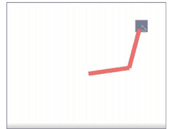

图 4. 2D 机械臂基准。

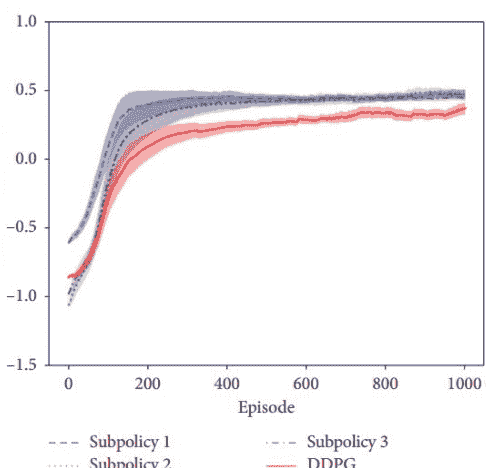

图 5. BAMDDPG 子 DDPG 与 DDPG 的对比。

BAMDDPG 的关键在于子策略的聚合。本节将展示聚合策略与子策略之间的性能对比，以说明聚合的有效性。假设第 $i^{\text{th}}$ 个子策略给出的动作为 $a_i = [a_{i1}, a_{i2}]$，则第 $i^{\text{th}}$ 个子策略的即时奖励由以下公式给出：

$IR_i = \frac{-f(a_i)}{200} + I[f(a_i) < \delta] + 10 * I[\eta > 50],$ (12)

其中 $f(a_i)$ 表示执行动作 $a_i$ 后机械臂指尖与蓝色方块之间的距离，且为隐函数。聚合策略的即时奖励可用相同方式表示：

$IR = \frac{-f(\sum_{i=1}^n a_i)}{200} + I\left[f\left(\sum_{i=1}^n a_i\right) < \delta\right] + 10 * I[\eta > 50],$ (13)

其中 $\sum_{i=1}^n a_i$ 表示聚合策略采取的动作。

表 1 显示了 BAMDDPG 子策略与聚合策略的性能对比。结果表明，聚合策略获得的奖励比子策略高 10%~50%。

### TORCS

#### 基准与奖励函数

开源赛车模拟器 (TORCS) 是一种可移植性强的汽车驾驶仿真软件，采用客户端-服务器架构 [24, 25]。它通过建模汽车发动机、刹车、变速箱、离合器等的物理动态模型，真实地模拟真实汽车。它是一种常用的 DRL 基准，适合测试自动驾驶技术。使用 TORCS，开发者可以轻松访问模拟汽车的传感器信息。因此，模拟汽车的控制器可以获取当前环境状态并遵循策略发送控制指令，包括转向、刹车和油门控制。图 6 展示了 TORCS 的客户端-服务器架构。控制器通过用户数据报协议 (UDP) 连接到赛车服务器。在每个时间步，模拟汽车感知当前驾驶环境状态信息并将其发送给控制器。服务器随后等待控制器发来的指令 10 ms。模拟汽车根据当前指令执行相应动作，若无新指令则执行上一条指令


已发送。将 TORCS 用作测试 BAMDDPG 的平台，设计合适的奖励函数是关键，这有助于学习良好的策略来控制模拟汽车。本节将描述设计奖励函数的详细内容。由于 TORCS 的驾驶环境状态可以通过模拟汽车的各种传感器感知，我们可以使用这些传感器数据创建奖励函数，如表所示。

公式 (14) 介绍了我们构建的奖励函数，该函数限制了 TORCS 中模拟汽车的行为。每次模拟汽车与 TORCS 驾驶环境交互时，我们都希望通过以下公式获得尽可能大的奖励：

r = \left( v \times \left( \frac{1 - |v - \beta|}{\alpha} \right)^{\mathbb{I}_{d_1 \le 10}} \right) \times \cos \phi \times (1 - |\sin \phi|) \times (1 - |d_2|) \times \left( \frac{|d_1|}{50} \right)^{\mathbb{I}_{d_1 \le 50}} ,

表 1. 子策略与聚合策略的性能对比

| 策略 | 轮次 | 总奖励 | 平均奖励 |
|---|---|---|---|
| 子策略1 | 20 | 720.69 | 36.03 |
| 子策略2 | 20 | 538.28 | 26.91 |
| 子策略3 | 20 | 463.98 | 23.20 |
| 聚合策略 | 20 | 829.17 | 41.46 |

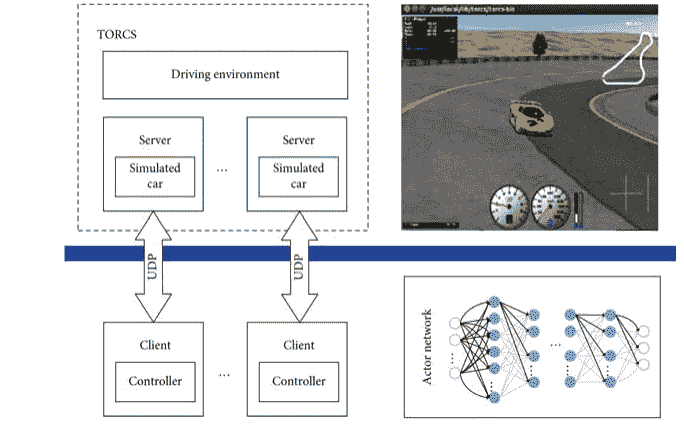

图 6. TORCS 的客户端-服务器架构图

表 2. 创建奖励函数的传感器数据信息

| 名称 | 范围（单位） | 描述 |
| :--- | :--- | :--- |
| \(\phi\) | \([-\pi, +\pi]\) (rad) | 轨道方向与汽车前进方向之间的夹角 |
| \(v\) | \([-\infty, +\infty]\) (km/h) | 汽车沿其纵轴方向的速度 |
| \(d_1\) | \([0, 200]\) (m) | 前方轨道边缘与汽车之间的距离 |
| \(d_2\) | \([-\infty, +\infty]\) | 轨道轴线与汽车之间的距离。\(|d_2| = 1\) 表示汽车位于轨道右侧或左侧边缘，\(d_2 = 0\) 表示汽车正好位于轨道轴线上，且 \(|d_2| > 1\) 表示汽车在轨道外 |

其中，项 v 表示汽车应尽可能快地行驶以最大化奖励。项 cos \(\phi\) 和 \((1 - |\sin \phi|)\) 表示 \(\phi\) 应为零，以便汽车始终沿着轨道行驶。项 \((1 - |d_2|)\) 表示汽车位于轨道轴线上。\(I[·]\) 表示一个指示函数，其值为 1 或 0，取决于条件是否满足。以下公式重新表述了公式 (14) 的第一项：

```
\(v \times \left( \frac{1 - |v - \beta|}{\alpha} \right)^{I[d_i \le 10]} = \begin{cases} v \times \left( \frac{1 - |v - \beta|}{\alpha} \right), \quad d_i \le 10, \\ v, \quad d_i > 10. \end{cases} \quad (15)\)
```

公式 (15) 考虑了汽车是否遇到转弯时的速度约束。当遇到转弯时，汽车会减速，并在直线路段上尽可能快地行驶。这里，\(d_1 = 10\) 设为遇到转弯的阈值。当 \(d_1 < 10\) 时，汽车处于转弯中，相应的奖励是汽车速度的二次函数。注意，\(\alpha\) 和 \(\beta\) 是需要微调的超参数。图 7 说明了当 \(\alpha = 120\)、\(\beta = 180\) 时二次函数的图像。当 v = 90.5 时，二次函数达到最大值，这意味着汽车在转弯时的预期速度为 90.5 km/h，并且汽车在遇到转弯时会自动减速。

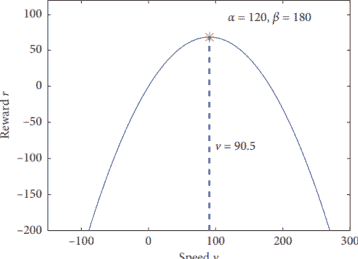

图 7. 速度受限函数图

公式 (16) 重新表述了公式 (14) 的最后一项。它限制了前方轨道边缘与汽车之间的距离。这一项意味着汽车应提前观察到转弯，并根据转弯调整转向角：

```
\(\left( \frac{|d_1|}{50} \right)^{\mathbb{I}_{d_1 \le 50}} = \begin{cases} \frac{|d_1|}{50}, & d_1 \le 50, \\ 1, & d_1 > 50, \end{cases}\)
```

### 学习曲线与训练时间

我们通过在 TORCS 中聚合多个子策略，成功实现了使用 BAMDDPG 的最佳自动驾驶策略。在训练过程中的一个轮次中，会选择一个子策略。相应的代理通过各种传感器感知驾驶环境状态，并按照所选子策略执行动作。表 3 介绍了包括转向、刹车和油门在内的动作命令的详细描述。

交互后，所有子策略都使用来自集中经验回放缓冲区的小批量进行了更新。我们曾主张 BAMDDPG 所需的训练时间少于 DDPG。图 8(a) 说明了 BAMDDPG 与 DDPG 之间的学习曲线比较，而图 8(b) 展示了训练时间的比较。

在我们对 TORCS 的实验中，模拟汽车分别使用 BAMDDPG 和 DDPG 在 Aalborg 轨道上进行了 6000 轮次的训练。图 8(a) 说明了 DDPG 和 BAMDDPG 的学习曲线比较。该曲线描绘了轮次奖励的移动平均值，而阴影区域描绘了均值 ± 标准差。图 8(a) 表明，BAMDDPG 和 DDPG 在训练 6000 轮次后都收敛并围绕特定的平均轮次奖励震荡。图 8(b) 表明，BAMDDPG 的训练时间更少，因为随着子策略训练到一定程度，聚合策略会迅速逼近最优策略。BAMDDPG 训练 6000 轮次需要 22.84 小时，而 DDPG 需要 52.77 小时，这表明 BAMDDPG 可以将训练时间缩短 56.7%。

图 8(b) 还显示，在前 1500 轮次中，BAMDDPG 和 DDPG 花费的训练时间差别不大。原因是起初模拟汽车主要关注环境探索，这些初始轮次完成得很快。BAMDDPG 和 DDPG 花费的探索时间几乎相同。从网络训练的角度来看，前 1500 轮次可以视为相应网络的初始化。

#### 4.2.3. 聚合的有效性

BAMDDPG 算法减少训练时间的能力基于策略聚合。第 3.3 节通过理论分析说明了聚合策略的性能优于子策略。此外，第 4.1 节已经展示了聚合在 2D 机器人臂基准上的有效性。在本节中，我们将进一步说明聚合在 TORCS 上的有效性。

为了避免过多子策略对表达的简洁性和对比性的影响，本实验中仅由 BAMDDPG 算法训练了三个子策略。训练好的子策略和聚合策略在同一圈内控制同一模拟汽车在同一条轨道（Aalborg 轨道）上行驶。然后，我们观察总奖励以及汽车是否能完成轨道一圈。表 4 说明，受聚合策略控制的模拟汽车完成了 Aalborg 轨道并获得了远大于子策略的总奖励，但受子策略控制的汽车都驶出了轨道，无法完成轨道，这表明聚合技术确实提高了子策略的性能。

图 9 进一步说明了子策略与聚合策略之间总奖励的差异。如实线所示，随着步骤数量增加，聚合策略的总奖励呈稳定上升趋势。然而，子策略 2 和子策略 3 的总奖励在初始阶段稳步上升，然后停止上升，因为汽车在某个时刻驶出了轨道。子策略 1 的表现最差，其总奖励始终最低，并且由于汽车驶出轨道而最终保持不变。

#### 子策略数量的影响

BAMDDPG 获得的最终策略基于子策略的聚合，但该算法没有给出具体的子策略数量。从理论上讲，当子策略数量足够大时，聚合策略能够成功逼近最优策略。然而，在实际中，考虑到计算和存储资源消耗，聚合大量子策略效率较低。


在平衡效率与性能的前提下，本节通过实验探讨子策略的适当数量范围。我们选择30以内的子策略数量，通过比较不同数量子策略的聚合策略的性能来确定适当的子策略数量。这些聚合策略在奥尔堡赛道上进行测试，然后比较其训练时间和5000步内的总奖励。此外，我们通过在CG1赛道和CG2赛道上测试聚合策略来比较其泛化性能。实验结果在图10和表5中展示。

### 表3. 动作命令描述

| 命令 | 范围 | 描述 |
|---|---|---|
| 转向 | [-1, +1] | -1表示全向右，+1表示全向左 |
| 刹车 | [0, 1] | 刹车踏板（1表示全刹车，0表示不刹车） |
| 油门 | [0, 1] | 油门踏板（1表示全油门，0表示不油门） |

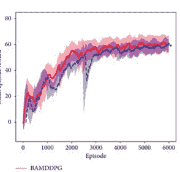

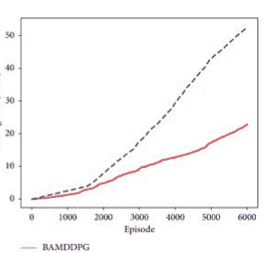

### 图8. BAMDDPG与DDPG的(a)学习曲线和(b)训练时间比较。

### 表4. 聚合策略与子策略的性能比较

| 策略 | 步数 | 总奖励（点） | 完成一圈 |
|---|---|---|---|
| 子策略1 | 246 | 16690.60 | 否 |
| 子策略2 | 246 | 15413.12 | 否 |
| 子策略3 | 102 | -1252.46 | 否 |
| 聚合策略 | 457 | 31603.37 | 是 |

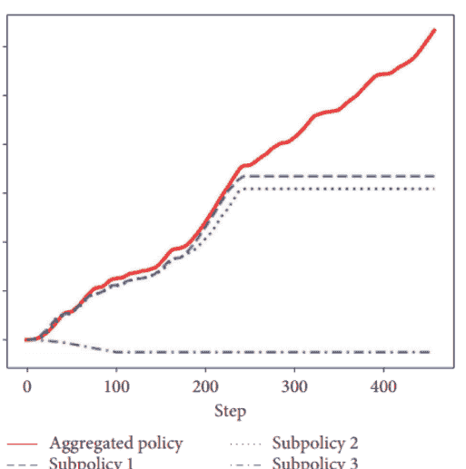

图9. 聚合策略与子策略的性能比较。

图10说明了不同数量子策略的聚合策略在奥尔堡赛道上获得的总奖励比较。由于TORCS的回合可能不会终止，我们将单个回合的最大步数设置为5000步。拥有3–10个子策略的聚合策略能够达到最大步数，而其他策略则在单个回合中提前终止。因此，它们获得的奖励远大于拥有超过10个子策略的聚合策略。

表5表明，对于由30以内不同数量子策略聚合而成的策略，训练时间没有显著差异，但不同策略的性能各不相同。由3到10个子策略聚合而成的策略可以在奥尔堡赛道上达到5000步的最大交互步数，以比拥有超过10个子策略的聚合策略更大的总奖励完成奥尔堡赛道的训练，并安全通过测试赛道CG1和CG2。

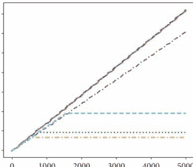

- 拥有3个子策略的聚合策略
- 拥有5个子策略的聚合策略
- 拥有10个子策略的聚合策略
- 拥有15个子策略的聚合策略
- 拥有20个子策略的聚合策略
- 拥有30个子策略的聚合策略

### 图10. 奥尔堡赛道上不同数量子策略的聚合策略奖励比较。

### 表5. 不同数量子策略的聚合策略比较

| 子策略数量 | 训练时间（小时） | 总步数 | 总奖励 | 通过奥尔堡 | 通过CG1 | 通过CG2 |
|---|---|---|---|---|---|---|
| 3 | 22.84 | 5000 | 331086.10 | 是 | 是 | 是 |
| 5 | 24.40 | 5000 | 360804.43 | 是 | 是 | 是 |
| 10 | 24.16 | 5000 | 303678.65 | 是 | 是 | 是 |
| 15 | 22.09 | 771 | 47121.87 | 是 | 否 | 是 |
| 20 | 20.49 | 567 | 34343.05 | 是 | 否 | 是 |
| 30 | 21.74 | 1541 | 97146.37 | 是 | 否 | 是 |

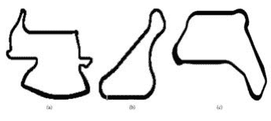

### 图11. 训练和测试赛道地图。(a) 奥尔堡；(b) CG1；(c) CG2。

一般来说，当子策略数量为3–10时，相应的聚合策略表现良好，且其泛化性能优于拥有超过10个子策略的聚合策略，这意味着3–10是BAMDDPG在实际应用中的适当子策略数量。

然而，拥有超过10个子策略的聚合策略无法在奥尔堡赛道上达到最大步数，且无法完成CG1赛道。拥有超过10个子策略的聚合策略表现更差的主要原因在于集中经验回放缓冲区的限制。在训练期间，我们考虑到实现的可行性和效率，将集中经验回放缓冲区的大小固定为100,000个转换元组(s, at, rt, st+1)。然而，该缓冲区无法与超过10个子策略共享所有经验。因此，拥有超过10个子策略的聚合策略获得的知识较少，表现不佳。使用更大缓冲区大小的实验将在聚合10个子策略时表现出更好的性能。但是，内存设置对强化学习（RL）性能具有非单调效果[26]。RL中内存设置的影响源于正确权重更新方向与错误方向之间的权衡。

### 表6. 聚合策略的泛化性能

| 赛道名称 | 总奖励（点） | 完成 |
|---|---|---|
| 奥尔堡 | 30007.61 | 是 |
| CG1 | 23755.62 | 是 |
| CG2 | 35602.09 | 是 |

### 泛化性能

泛化性能是机器学习领域的研究热点，也是评价算法性能的关键指标。过度训练的模型通常在训练集上表现良好，但在测试集上表现不佳。在我们的实验中，使用BAMDDPG成功地在奥尔堡赛道上学习了自动驾驶策略。由这些策略控制的汽车在训练赛道上表现良好。然而，学习策略的泛化性能尚不清楚。因此，我们在训练赛道和测试赛道（包括奥尔堡、CG1和CG2，其地图如图11所示）上测试了使用BAMDDPG学习的聚合策略的性能。

表6中显示的聚合策略总奖励在不同赛道上有所不同，因为不同赛道的长度不相同。在长赛道上，汽车行驶时间更长，总奖励也会更大。在我们的实验中，路线CG2最长，CG1最短。

表6表明，由聚合策略控制的汽车成功通过了测试赛道。这表明，从BAMDDPG学习的聚合策略实现了良好的泛化性能。

### 结论

本文提出了一种深度强化学习算法，通过聚合多个深度确定性策略梯度算法和一种m-out-of-n自助采样方法。该方法适用于序列和迭代训练数据，其中数据呈现长尾分布，而非i.i.d.数据假设所隐含的正态分布。该方法可以在训练时间大大缩短的情况下，为具有连续动作和状态空间的任务学习最优策略。

2D机器人臂游戏的实验结果表明，聚合策略获得的奖励比非聚合子策略高10%~50%。TORCS的实验结果表明，与正常采样方法和非聚合子策略相比，所提方法可以用56.7%更少的训练时间学习成功的控制策略。

### 参考文献

- 1. R. S. Sutton and A. G. Barto, 《强化学习：导论》, MIT出版社, 剑桥, 马萨诸塞州, 美国, 1998年.
- 2. K. Arulkumaran, M. P. Deisenroth, M. Brundage, and A. A. Bharath, “深度强化学习：简要综述,” IEEE信号处理杂志, 第34卷, 第6期, 第26–38页, 2017年.
- 3. A. Krizhevsky, I. Sutskever, and G. Hinton, “使用深度卷积神经网络的ImageNet分类,” 第25届神经信息处理系统国际会议论文集, 第1097–1105页, 美国内华达州泰浩湖, 2012年3月.
- 4. Y. LeCun, Y. Bengio, and G. Hinton, “深度学习,” 自然, 第521卷, 第7553期, 第436–444页, 2015年.
- 5. V. Mnih, K. Kavukcuoglu, D. Silver 等人, “通过深度强化学习实现的人类水平控制,” 自然, 第518卷, 第7540期, 第529–533页, 2015年.
- 6. H. Van Hasselt, A. Guez, and D. Silver, “带双Q学习的深度强化学习,” 第30届AAAI人工智能会议论文集, 美国亚利桑那州凤凰城, 2016年3月.
- 7. T. Schaul, J. Quan, I. Antonoglou 等人, “优先经验重演,” 2015年, https://arxiv.org/abs/1511.05952.
- 8. Z. Wang, T. Schaul, M. Hessel 等人, “用于深度强化学习的决斗网络架构,” 第33届机器学习国际会议论文集, 第4卷, 第2939–2947页, 纽约, 纽约州, 美国, 2016年.
- 9. D. Silver, G. Lever, N. Heess 等人, “确定性策略梯度算法,” 第31届机器学习国际会议论文集, 第387–395页, 北京, 中国, 2014年6月.
- 10. T. P. Lillicrap, J. J. Hunt, A. Pritzel 等人, “带深度强化学习的连续控制,” 计算机科学, 第8卷, 第6期, 页A187, 2015年.
- 11. Z. Zheng, C. Yuan, Z. Lin 等人, “自适应双自助DDPG,” 第27届国际人工智能联合会议论文集, 第3198–3204页, 斯德哥尔摩, 瑞典, 2018年7月.
- 12. S. Gu, T. Lillicrap, Z. Ghahramani 等人, “Q-prop：带非策略评论家的采样高效策略梯度,” 国际学习表征会议论文集, 美国路易斯安那州新奥尔良, 2017年5月.


- 13. V. Mnih, A. P. Badia, M. Mirza 等人，“面向深度强化学习的异步方法”，载于《国际机器学习会议论文集》，第 1928–1937 页，圣胡安，波多黎各，美国，2016 年 5 月。

- 14. B. Efron 和 R. J. Tibshirani，《自助法导论》，CRC Press，博卡拉顿，佛罗里达州，美国，1994 年。

- 15. I. Osband, C. Blundell, A. Pritzel 等人，“基于自助 DQN 的深度探索”，载于《神经信息处理系统进展论文集》，第 4026–4034 页，巴塞罗那，西班牙，2016 年 12 月。

- 16. Z. Yang, K. E. Merrick, H. A. Abbass 等人，“面向连续动作控制的多任务深度强化学习”，载于《第 26 届国际人工智能联合会议论文集》，第 3301–3307 页，墨尔本，澳大利亚，2017 年 8 月。

- 17. R. Lowe, Y. Wu, A. Tamar 等人，“面向混合合作-竞争环境的多智能体演员-评论法”，《神经信息处理系统进展》，2017 年。

- 18. W. Shi, S. Song 和 C. Wu，“最大熵深度强化学习的软策略梯度方法”，2019 年，https://arxiv.org/abs/1909.03198。

- 19. R. Davidson 和 E. Flachaire，“不平等和贫困衡量的渐近和自助推断”，《计量经济学杂志》，第 141 卷，第 1 期，第 141–166 页，2007 年。

- 20. H. Ishwaran, L. F. James 和 M. Zarepour，“自助法的替代方案”，《统计规划与推断杂志》，第 139 卷，第 3 期，第 788–801 页，2009 年。

- 21. J. Wu 和 H. Li，“面向自动驾驶策略的聚合多深度确定性策略梯度”，载于《第 5 届物联网国际会议论文集》，第 11253 卷，第 179–192 页，巴黎，法国，2018 年 11 月。

- 22. A. M. F. Mood，《统计学理论导论》，McGraw-Hill Education，纽约，纽约州，美国，1950 年。

- 23. A. Dvoretzky, J. Kiefer 和 J. Wolfowitz，“样本分布函数和经典多项式估计量的渐近极小极大特征”，《数理统计年鉴》，第 27 卷，第 3 期，第 642–669 页，1956 年。

- 24. B. Wymann, E. Espie, C. Guionneau 等人，Torcs：开源赛车模拟器，SourceForge，2015 年。

- 25. D. Loiacono, L. Cardamone 和 P. L. Lanzi，模拟赛车锦标赛：竞赛软件手册，米兰理工大学电子信息与生物工程系，米兰，意大利，2013 年。

- 26. R. Liu 和 J. Zou，“强化学习中经验回放的影响”，载于《ICML 2017 深度学习原则方法研讨会论文集》，悉尼，澳大利亚，2017 年，https://arxiv.org/pdf/1710.06574.pdf。

## 第 3 章

## 稳定深度学习软件平台的动态决策

Soohyun Park¹, Dohyun Kim² 和 Joongheon Kim¹

¹韩国大学，首尔，大韩民国

²Naver Webtoon 公司，城南，大韩民国

### 摘要

本章介绍了一种受 Lyapunov 优化启发的动态低复杂度决策算法，旨在实时深度学习平台上的时间平均效用最大化。在深度学习计算中，由于计算开销大，可能会出现大延迟。因此，处理延迟是深度学习算法商业化的重要问题。在本章中，所提算法首先通过队列积压来观察系统延迟，然后在效用（即深度学习性能）与系统延迟之间的权衡下动态进行序贯决策。为了评估所提决策算法，在超分辨率框架应用下展示了基于真实世界数据的性能评估结果。最后，本章总结 Lyapunov 优化算法可用于各种新兴应用。

引用：Soohyun Park, Dohyun Kim 和 Joongheon Kim（2020 年 9 月 2 日）。稳定深度学习软件平台的动态决策，《深度学习的进步与应用》，Marco Antonio Aceves-Fernandez，IntechOpen，DOI: 10.5772/intechopen.92971。
版权：© 2020 作者和 IntechOpen。本文为开放获取文章，根据 Creative Commons Attribution 3.0 许可协议分发。

关键词：Lyapunov 优化，随机优化，实时计算，深度学习平台，计算机视觉平台

### 介绍

当今，许多机器学习和深度学习算法已在计算机视觉、自然语言处理等各种应用中开发出来。此外，算法性能不断提升。因此，机器学习和深度学习算法的发展日趋成熟。然而，专注于算法实际实现的研究贡献相对算法本身的发展而言较少。为了在实际应用中运行深度学习算法，必须考虑实时计算。

因此，需要考虑延迟处理，因为深度学习算法计算通常会引入大延迟 [1]。在通信和网络研究文献中，存在一种著名的随机优化算法，旨在保持系统稳定性的同时最大化效用函数。

在此，稳定性以队列建模，然后算法旨在稳定队列动态的同时进行优化计算。为了表征稳定性，队列通过 Lyapunov 漂移 [2] 进行数学建模。该算法受 Lyapunov 控制理论启发设计，因此被称为 Lyapunov 优化理论 [2]。在本章中，介绍了 Lyapunov 优化理论的基本理论、示例和讨论。接着，讨论了 Lyapunov 优化理论在实时计算机视觉和深度学习平台中的应用。此外，从多个方面展示了基于真实世界深度学习框架计算（例如，各种模型的真实世界图像超分辨率计算结果）的性能评估结果。最后，将介绍新兴应用。

### 面向可靠深度学习平台的稳定控制

在本节中，首先介绍了受稳定性约束的时间平均优化的 Lyapunov 优化理论（参见第 2.1 节），然后给出基于示例的解释（参见第 2.2 节）。最后，组织了相关讨论（参见第 2.3 节）。

### 理论

在本节中，我们介绍了旨在实现受队列稳定性约束的时间平均惩罚函数最小化的 Lyapunov 优化理论。请注意，时间平均惩罚函数最小化可以等价地转换为时间平均效用函数最大化。当效用与稳定性之间存在权衡时，可以使用 Lyapunov 优化理论。例如，很明显，当当前决策在惩罚函数最小化方面是最优的，但决策操作耗时较长，即引入延迟（即系统中的队列积压增加）时，就会存在权衡。此时，最优决策可以动态随时间变化，因为当当前系统的延迟不严重时（即排队延迟很小或可忽略），专注于效用最大化（即惩罚函数最小化）更好。另一方面，当当前系统的延迟较大时，最优决策将用于延迟减少。在这种情况下，决策应在牺牲一定量的效用最大化（或惩罚函数最小化）的前提下进行延迟减少。

假设我们的时间平均惩罚函数表示为 P ($\alpha$ [t]) 且应予以最小化，而我们的控制动作决策表示为 $\alpha$ [t]。那么，系统中的队列动态，即 Q[t]，可以公式化如下：

```
Q[t + 1] = max {Q[t] + a($\alpha[t]$) - b($\alpha[t]$), 0} (1)
Q[0] = 0 (2)
```

其中，$a(\alpha[t])$ 是在控制动作决策为 $\alpha[t]$ 时 t 时刻在 $Q[t]$ 处的到达过程。在 (1) 中，$b(\alpha[t])$ 是在控制动作决策为 $\alpha[t]$ 时 t 时刻在 $Q[t]$ 处的离开/服务过程。

在本节中，应在每个单位时间进行控制动作决策，以在受队列稳定性约束下实现时间平均惩罚函数最小化。然后，时间平均最小化的数学规划为


惩罚函数 P(a[t])，其中 t 时刻的控制动作决策为 a[t]，可表示如下：

min : \(\lim_{t \to \infty} \sum_{t=0}^{t-1} P(a[t])\) (3)

受队列稳定性约束：

\(\lim_{t \to \infty} \frac{1}{t} \sum_{t=0}^{t-1} Q[t] < \infty.\) (4)

在 (3) 中，P(a[t]) 表示 t 时刻控制动作决策为 a[t] 时的惩罚函数。

如前所述，当效用最大化（或惩罚函数最小化）与延迟之间存在权衡时，可以使用 Lyapunov 优化理论。基于这一特性，漂移加惩罚（DPP）算法 [2, 3, 4] 旨在在队列稳定性约束下最大化时间平均效用。这里，Lyapunov 函数定义为 \(L(Q[t]) = \frac{1}{2}(Q[t])^2\)，并令 \(\Delta(.)\) 为条件二次 Lyapunov 函数，表达式为 E[L(Q[t+1])−L(Q[t])|Q[t]]，称为 t 时刻的漂移。根据 [2]，该动态策略旨在通过最小化 DPP 中考虑的惩罚函数的上界来实现队列稳定性，其表达式为

\(\Delta(Q[t]) + V\mathbb{E}[P(a[t])].\) (5)

其中 V 是权衡系数。t 时刻 Lyapunov 函数漂移的上界推导如下：

\(L(Q[t + 1]) - L(Q[t]) = \frac{1}{2}((Q[t + 1]^2 - Q[t]^2))\) (6)

\(\le \frac{1}{2}((a(a[t]))^2 + b(a[t])^2) + Q[t](a(a[t]) - b(a[t])).\) (7)

因此，条件 Lyapunov 漂移的上界可推导如下：

\(\Delta(Q[t]) = \mathbb{E}[L(Q[t + 1]) - L(Q[t])|Q[t]] \le C + \mathbb{E}[Q[t](a(a[t]) - b(a[t]))|Q[t]],\) (8)

其中 C 是一个由以下给出的常数：

\(\frac{1}{2}\mathbb{E}[(a(a[t]))^2 + b(a[t])^2|Q[t]] \le C,\) (9)

这假设了到达和离开过程的速率被上界约束。由于 C 是常数，最小化 DPP 的上界如下：

\(V\mathbb{E}[P(\alpha[t])] + \mathbb{E}[Q[t] \cdot (a(\alpha[t]) - b(\alpha[t]))].\) (10)

### 算法 1. 稳定时间平均惩罚函数最小化

```
Initialize:
1: \( t \leftarrow 0 \);
2: \( Q[t] \leftarrow 0 \);
3: Decision Action: \( \forall \alpha[t] \in \mathcal{A} \)
Time-Average Penalty Function Minimization subject to Stability
4: while \( t \le T \) do // T: operation time
5: Observe \( Q[t] \);
6: \( T^* \leftarrow \infty \);
7: for \( \alpha[t] \in \mathcal{A} \) do
8: \( T \leftarrow V \cdot P(\alpha[t]) + Q[t] \cdot (a(\alpha[t]) - b(\alpha[t])) \);
9: if \( T \le T^* \) then
10: \( T^* \leftarrow T \);
11: \( \alpha^*[t+1] \leftarrow \alpha[t] \);
12: end if
13: end for
14: end while
```

最后，基于 Lyapunov 优化理论，每个单位时间 t 中用于在队列稳定性约束下最小化时间平均惩罚函数 \(P(\alpha[t])\) 的动态控制动作决策 \(\alpha[t]\) 可表述如下：

```
\(\alpha^*[t+1] \quad \underset{\alpha[t] \in \mathcal{A}}{\arg \min} [V \cdot P(\alpha[t]) + Q[t] \cdot (a(\alpha[t]) - b(\alpha[t]))]\) (11)
```

其中 A 是所有可能控制动作的集合，\(\alpha^*[t+1]\) 是下一个时隙的最优控制动作决策。

为了验证 (11) 是否正确，可以考虑以下两个示例情况：

- 情况 1：假设 Q[t] \(\approx \infty\)。则

```
\(\alpha^*[t+1] \quad \underset{\alpha[t] \in \mathcal{A}}{\arg \min} [V \cdot P(\alpha[t]) + Q[t] \cdot (a(\alpha[t]) - b(\alpha[t]))]\) (12)
```

```
\(\approx \underset{\alpha[t] \in \mathcal{A}}{\arg \min} [a(\alpha[t]) - b(\alpha[t])].\) (13)
```

然后，(13) 表明控制动作决策应按以下方式工作，即 (i) 到达过程应最小化，(ii) 离开过程应最大化。两种情况均旨在稳定队列，即当 Q[t]≈∞ 时应有利。

- 情况 2：假设 Q[t]=0。则

```
\(\alpha^*[t+1] \arg \min_{a[t] \in \mathcal{A}} [V \cdot P(a[t]) + Q[t] \cdot (a(a[t]) - b(a[t]))]\)
```

```
\(= \arg \min_{a[t] \in \mathcal{A}} V \cdot P(a[t])\)
```

然后，(15) 表明控制动作决策应致力于最小化给定的惩罚函数。这在语义上是合理的，因为当 Q[t]=0 时，无需考虑稳定性，因此可以专注于我们的主要目标。

所提时间平均惩罚函数最小化算法的伪代码如算法 1 所示。第 1 到第 3 行初始化所有变量和参数。算法在每个单位时间中运行，如第 4 行所示。在第 5 行，观察当前队列积压 Q[t] 以用于 (11)。第 7 到第 13 行描述了 (11) 的主要计算过程。

到目前为止，已考虑时间平均惩罚函数最小化。基于该理论，每个单位时间 t 中用于在队列稳定性约束下最大化时间平均效用函数 U(a[t]) 的动态控制动作决策 a[t] 可表述如下：

```
\(\alpha^*[t+1] \arg \max_{a[t] \in \mathcal{A}} [V \cdot U(a[t]) - Q[t] \cdot (a(a[t]) - b(a[t]))]\)
```

其中 A 是所有可能控制动作的集合，\(\alpha^*[t+1]\) 是下一个时隙的最优控制动作决策。

### 2.2 示例：移动设备中的多核调度

本节以一个简单的玩具模型为例，介绍基于 Lyapunov 优化的稳定时间平均优化算法。在本示例中，设计了一种动态核分配决策算法，旨在在队列稳定性约束下最小化时间平均能耗。

如图 1 所示，移动智能手机配备了具有多个内核的处理器。例如，ARM big.LITTLE 处理器配备了多个小核和大核异构内核。

在该系统中，当用户生成事件时会生成任务事件，如图 1 中 a[t] 所示。然后，这些事件会被放入任务队列（即图 1 中的 Q[t]）。随后，事件可以由多核处理器处理。在这种情况下，如果为了处理队列中的事件而分配更多内核，处理可以加速，这有利于队列稳定性。然而，这不利于我们的主要目标，即能耗最小化。另一方面，如果分配较少内核，处理速度会变慢，这对队列稳定性不利，但有利于我们的主要目标，即能耗最小化。最后，可以在能耗最小化（即我们的主要目标）和稳定性之间观察到权衡。因此，可以证实基于 Lyapunov 优化的算法可以使用。

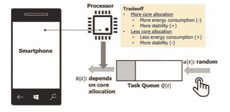

图 1. 具有多核处理器的移动设备。

为了设计动态核分配决策，基于 (11)，每个单位时间 t 中用于在队列稳定性约束下最小化时间平均能耗 E(a[t]) 的 a[t] 可表述如下：

```
\alpha^* [t + 1] \quad \arg \min_{a[t] \in \mathcal{A}} [V \cdot E(a[t]) + Q[t] \cdot (a[t] - b(a[t]))] \quad (17)
```

其中 A 是所有可能的核分配组合的集合，\(\alpha^*[t+1]\) 是下一个时隙的最优核分配决策。这里，很明显到达过程是不可控的（i.i.d. 随机事件）；因此可以忽略。然后，动态决策算法的最终形式可定义如下：

```
\alpha^* [t + 1] \quad \arg \min_{a[t] \in \mathcal{A}} [V \cdot E(a[t]) - Q[t] \cdot b(a[t])]. \quad (18)
```

为了检查推导出的等式 (18) 是否正确，可以考虑两个示例情况，即 (i) Q[t] \approx \infty，和 (ii) Q[t]=0：

- 忙碌队列情况 (Q[t]≈∞)：在这种情况下

```
\(\alpha^* [t+1] \quad \arg \min_{a[t] \in \mathcal{A}} [V \cdot E(a[t]) - Q[t] \cdot b(a[t])],\) (19)
```

```
\(= \arg \min_{a[t] \in \mathcal{A}} [-b(a[t])] = \arg \max_{a[t] \in \mathcal{A}} b(a[t]),\) (20)
```

因此，应加速离开过程，即应分配更多内核。这在语义上是正确的，因为如果发生溢出情况，希望能快速处理队列中的事件。

- 忙碌队列情况 (Q[t]=0)：在这种情况下

```
\(\alpha^* [t+1] \quad \arg \min_{a[t] \in \mathcal{A}} [V \cdot E(a[t]) - Q[t] \cdot b(a[t])],\) (21)
```

```
\(= \arg \min_{a[t] \in \mathcal{A}} V \cdot E(a[t]),\) (22)
```

因此，应分配较少内核以实现能耗最小化，这是我们的主要目标。这在语义上是正确的，因为如果系统稳定，即 Q[t]=0，则应希望实现给定的主要目标。

如示例所讨论，所提基于 Lyapunov 优化的动态核分配决策算法按预期工作。

### 稳定控制中的讨论

所提动态超分辨率模型选择算法在多个方面具有益处，具体如下。

#### 与硬件/系统无关的自适应

假设该所提算法实现在类似超级计算机的高性能计算机中。在这种情况下，处理应快速；因此，队列积压始终较低。因此，系统有更多机会专注于我们的主要目标，即惩罚函数最小化或效用函数最大化。另一方面，如果硬件本身性能/资源受限（例如，移动设备），则处理速度也会受到处理器低规格的限制。因此，队列积压可能经常繁忙，因为即使使用最快的模型，也可能无法处理队列中的许多数据。因此，


最终可以观察到，所提算法是自适应的，可以根据给定的硬件/系统规格进行调整。它会根据给定的硬件/系统自动调整模型；因此，不需要系统工程师进行试错调谐。而且，所提算法是可靠的，因为自适应旨在在保持稳定性的同时最大化其效用。

### 低复杂度操作

如算法 1 所示，计算过程是迭代的，用于求解封闭形式方程，即 (11) 和 (16)。因此，所提算法的计算复杂度为多项式时间，即 O(N)，其中 N 是给定控制动作的数量。因此，它保证了低复杂度操作。

### 用于深度学习平台的 Lyapunov 优化

如前所述，Lyapunov 优化理论是一种可扩展、可自配置、低复杂度的算法，可用于许多应用。在本节中，深度学习和计算机平台上 Lyapunov 优化的应用以两种不同的方式进行了讨论，即离散过程控制（参阅第 3.1 节）和到达过程控制（参阅第 3.2 节）。最后，展示了相关的性能评估结果（参阅第 3.3 节）。

#### 离散过程上的 Lyapunov 控制

如图 2 所示，稳定的实时计算机视觉平台应配备队列以处理突发流量。如果队列繁忙或接近溢出，则应加速离散过程。因此，应使用最简单的模型来减少相应的计算。另一方面，如果队列为空，则可以使用更复杂的模型来提高深度学习计算精度，因为我们有足够的时间进行计算。因此，需要多个模型，以便根据队列积压选择一个。

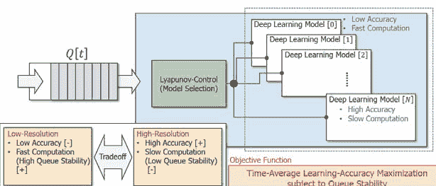

**图 2.** 用于时间平均学习精度最大化（在队列稳定性约束下）的实时计算机视觉平台上的离散过程 Lyapunov 控制。

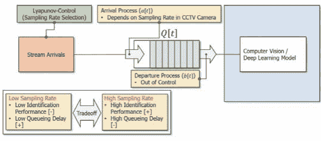

**图 3.** 用于时间平均学习精度最大化（在队列稳定性约束下）的实时计算机视觉平台上的到达过程 Lyapunov 控制。

在图 2 中，存在多个模型，可以看到最简单的模型（即低分辨率模型）能够进行快速计算，但其学习精度较低。另一方面，最复杂的模型（即高分辨率模型）有利于准确的学习性能，但会引入计算延迟。因此，性能与延迟之间存在权衡，即，基于 Lyapunov 优化理论的动态模型选择决策算法可以设计如下：

```
\(a^*[t + 1] \leftarrow \arg \max_{a[t] \in \mathcal{A}} [V \cdot A(a[t]) - Q[t] \cdot (a(a[t]) - b(a[t]))]\) (23)
```

由于到达过程无法控制，因此可以将其重新表述如下：

```
\alpha^* [t + 1] \quad \underset{a[t] \in A}{arg} max [V \cdot A(a[t]) + Q[t] \cdot b(a[t])]
```

其中，A(a[t]) 表示在 t 时刻模型选择决策为 a[t] 时的学习精度。这里，A 是所有可能深度学习模型的集合，a*[t+1] 是下一个时间槽的最优控制动作决策。

#### 到达过程上的 Lyapunov 控制

第 3.1 节中的稳定实时计算机视觉平台是新颖且可扩展的；然而，它存在负担，因为多个深度学习模型应在单个平台上实现。

因此，对于资源受限系统，还需要一种基于单个深度学习模型的新动态控制算法。如图 3 所示，我们考虑的系统在计算平台上具有一个单一的计算机视觉和深度学习模型。此外，队列位于系统之前。因此，离散过程不再可控。在这种情况下，为了控制队列动态以保持稳定，到达过程应是可控的。因此，应通过处理采样率来控制到达的图像/视频流。如果可用高频采样，则会生成更多信号，然后将结果入队。因此，到达过程增加。这有好处，因为由于可以获取更多图像/视频（尤其是在监控应用中），因此提高了计算机视觉性能。另一方面，即，如果进行低频采样，计算机视觉性能可能会下降，而到达过程的数据数量减少，这在稳定性方面是有益的。最终，可以观察到计算机视觉性能与延迟之间的权衡。最后，基于 Lyapunov 优化理论的采样率选择决策算法可以设计如下：

```
\alpha^* [t + 1] \quad \underset{a[t] \in A}{arg} max [V \cdot A(a[t]) - Q[t] \cdot ( a[a[t]] - b(a[t])) ]
```

由于离散过程无法控制，因此可以将其重新表述如下：

```
\alpha^* [t + 1] \quad \underset{a[t] \in A}{arg} max [V \cdot A(a[t]) - Q[t] \cdot a(a[t])]
```

其中，A(a[t]) 表示在 t 时刻采样率选择决策为 a[t] 时的学习精度。这里，A 是所有可能采样率的集合，a*[t+1] 是下一个时间槽的最优控制动作决策。

### 性能评估与讨论

在本节中，展示了第 3.1 节中所提算法的性能评估结果。进行了基于数据密集型仿真的评估，然后将结果显示在图 4 中。此外，表 1 显示了超分辨率性能随隐藏层数量的变化。如果隐藏层数量最大（本研究中为 20），则 PSNR 和结构相似度（SSIM，超分辨率中广泛使用的性能指标之一）值最大。然而，计算时间（仅 CPU 和 CPU-GPU）变慢。

如图 4 所示，如果模型是静态的（即深模型或浅模型），曲线显示两种模型都不高效。深模型无法处理溢出情况；因此，队列发散。另一方面，浅模型太快；因此，队列始终为空。这对于稳定性显然是积极的，但在超分辨率性能方面性能最低。因此，如果算法允许一定量的延迟以提高超分辨率质量，可能会更好。所提算法最初遵循深模型，因为在初始阶段队列处于空闲状态。如果队列被一定数量的图像填满（即接近阈值），则在单位时间 5800 附近开始控制，即自适应控制。因此，所提算法开始选择能够处理延迟的超分辨率模型。因此，所提算法优于其他两种静态算法是事实。

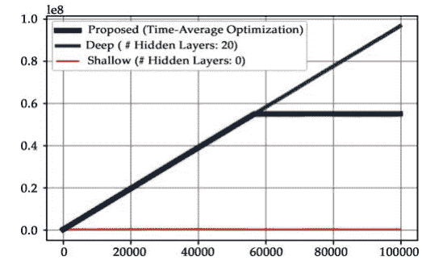

图 4. 性能评估：队列积压（x 轴，单位时间；y 轴，队列占用率（单位：比特））。

| 隐藏层数量 | 0 | 4 | 6 | 8 | 11 | 14 | 17 | 20 |
|---|---|---|---|---|---|---|---|---|
| PSNR (dB) | 30.400 | 32.560 | 33.010 | 33.229 | 33.379 | 33.435 | 33.495 | 33.523 |
| SSIM | 0.8682 | 0.9100 | 0.9160 | 0.9180 | 0.9200 | 0.9200 | 0.9210 | 0.9220 |
| 处理时间（仅 CPU） | 0.0020 | 0.3210 | 0.5468 | 0.7725 | 0.9940 | 1.3170 | 1.6220 | 1.9600 |
| 处理时间（CPU + GPU） | 0.0010 | 0.0100 | 0.0120 | 0.0152 | 0.0189 | 0.0224 | 0.0262 | 0.0305 |

对于所提自适应稳定算法，在具有两种处理能力（仅 CPU 平台 vs. CPU-GPU 平台）的评估中，可以观察到 CPU-GPU 平台选择最大性能超分辨率模型（即表 1 中的 20 个隐藏层）的次数是仅 CPU 平台的 4.36 倍。这意味着所提算法根据硬件/平台要求自适应。这对于系统工程师显然是有益的，因为他们不再需要进行基于试错的系统参数调谐。

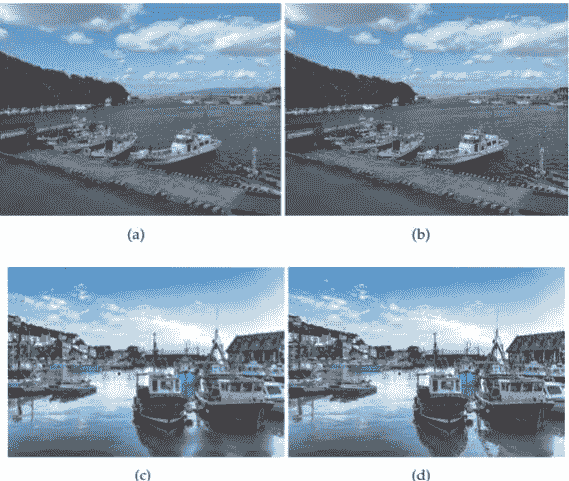


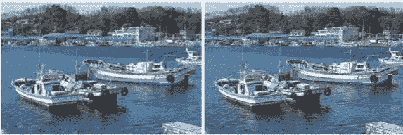

**图 5.** 超分辨率计算结果。请注意，低分辨率模型为双立方插值，没有隐藏层。(a) 图像 #1（低分辨率），(b) 图像 #1（高分辨率），(c) 图像 #2（低分辨率），(d) 图像 #2（高分辨率），(e) 图像 #3（低分辨率）和 (f) 图像 #3（高分辨率）。

为了验证超分辨率模型的性能，图 5 展示了使用真实图像的超分辨率计算结果。如图所示，如果超分辨率模型具有更多隐藏层，则其性能更好，如图 5b、图 5d 和图 5f 所示。对于无隐藏层的超分辨率计算，本文采用双立方插值，如图 5a、图 5c 和图 5e 所示。最后，这些结果表明，我们针对自适应深度学习平台考虑的拉普诺夫控制算法可以根据队列积压大小信息产生不同的超分辨率性能。

### 新兴应用

如前所述，拉普诺夫优化框架旨在实现时效平均效用最大化，同时保持队列稳定性；且该理论具有可扩展性；因此广泛适用 [2]。因此，基于该算法存在许多应用，如下所示。

#### 自适应视频流

Kim 等人 [3, 5] 设计了一种动态控制算法，用于无线视频网络中在发送缓冲区稳定性约束下实现时效平均流媒体质量（即峰值信噪比 (PSNR)）最大化。Koo 等人 [6, 7] 还提出了一种基于 HTTP 的动态自适应流媒体（DASH）新机制，用于在考虑电池状态、LTE 数据配额以及混合 LTE 和 WiFi 网络稳定性的前提下最大化视频流媒体质量。

#### 网络

Neely 等人 [8] 提出了一种新型动态多跳路由算法，用于在受队列稳定性约束的无线自组织和传感器网络中进行节能数据/分组转发。

#### 安全应用：监控监测

Mo 等人 [9] 为基于 CCTV 的分布式监控应用设计了一种深度学习框架。在该系统中，存在多个深度学习框架；且每个深度学习模型都有其自身配置。在此情况下，复杂性与性能之间存在权衡。因此，所提出的基于 CCTV 的监控算法根据系统中的队列积压自适应选择深度学习模型，以在 CCTV 队列稳定性约束下最大化识别性能。Kim 等人 [10] 还为基于 CCTV 的监控平台设计了一种新型面部识别深度学习框架。该系统不是拥有多个深度学习模型，而是具有一个学习系统（基于 OpenFace 开源软件库）并控制 CCTV 摄像机的采样率。最后，所提出的决策算法动态选择 CCTV 采样率，以在 CCTV 队列稳定性约束下最大化识别性能。

#### 其他

[11] 说明了基于拉普诺夫优化的动态控制算法在动态强化学习策略设计中的应用。此外，[12, 13] 介绍了在股票市场定价和智能电网中使用拉普诺夫优化框架的自适应控制算法。

### 结论

本章介绍了一种动态控制决策算法，该算法受拉普诺夫优化理论启发，适用于效用/性能与延迟之间存在权衡的情况。因此，动态决策算法旨在实时深度学习平台中实现时效平均效用最大化（或惩罚最小化）。如前所述，基于拉普诺夫优化的算法具有可扩展性、与硬件/系统无关、可自配置且低复杂度。因此，它可应用于各种新兴应用，例如视频流、无线网络、安全应用和智能电网应用。

### 致谢

该工作得到韩国国家研究基金会（2019R1A2C4070663, 2019M3E4A1080391）的支持。J. Kim 为通信作者（电子邮件：joongheon@korea.ac.kr）。

### 参考文献

- 1. Kim D, Kwon J, Kim J. 基于拉普诺夫控制的稳定实时深度学习平台中低复杂度在线模型选择的奖励最大化。In: Proceedings of the IEEE International Conference on Systems, Man, and Cybernetics (SMC ‘18); 7–10 October, 2018; Miyazaki, Japan: IEEE; 2018. pp. 4363-4368
- 2. Neely M. 通信和排队系统中的随机网络优化。Vermont, USA: Morgan & Claypool; 2010
- 3. Kim J, Caire G, Molisch A. 面向设备到设备视频传输的质量感知流媒体与调度。IEEE/ACM Transactions on Networking. 2016;24:2319-2331. DOI: 10.1109/TNET.2015.2452272
- 4. Choi M, Kim J, Moon J. 面向联网车辆接收机设计中队列稳定字误差率最小化的自适应检测器选择。IEEE Transactions on Vehicular Technology. 2018;67:3635-3639. DOI: 10.1109/TVT.2017.2776327
- 5. Kim J, Meng F, Chen P, Egilmez H, Bethanabhotla D, Molisch A, 等人. 演示：面向设备到设备移动平台的自适应视频流。In: Proceedings of the ACM International Conference on Mobile Computing and Networking (MobiCom ‘13), 30 September–4 October, 2013; Miami, FL, USA: IEEE; 2013
- 6. Koo J, Yi J, Kim J, Hoque M, Choi S. REQUEST: 面向资源受限多宿主智能手机的基于 HTTP 的无缝动态自适应流媒体。In: Proceedings of the ACM International Conference on Multimedia (MM ‘17), 23–27 October, 2017; Mountain View, CA, USA: IEEE; 2017
- 7. Koo J, Yi J, Kim J, Hoque M, Choi S. 面向智能手机资源限制的 LTE/Wi-Fi 集成网络中无缝动态自适应流媒体。IEEE Transactions on Mobile Computing. 2019;18:1647-1660. DOI: 10.1109/TMC.2018.2863234
- 8. Neely M. 时变无线网络的能量最优控制。IEEE Transactions on Information Theory. 2006;52:2915-2934. DOI: 10.1109/TIT.2006.876219
- 9. Kim J, Mo YJ, Lee W, Nyang D. 监控应用中稳定并行深度学习架构的动态安全级别最大化。In: Proceedings of the IEEE Symposium on Privacy-Aware Computing (PAC ‘07); 1–3 August, 2017; Washington DC, USA: IEEE; 2017. pp. 192-193
- 10. Kim D, Kim J, Bang J. 基于拉普诺夫优化的可靠自适应面部识别框架。In: Proceedings of ACM Symposium on Operating Systems Principles (SOSP) AI Systems Workshop (AISys'17), 28 October, 2017; Shanghai, China: ACM; 2017
- 11. Neely M, Supittayapornpong S. 延迟约束无线调度的动态马尔可夫决策策略。IEEE Transactions on Automatic Control. 2013;58:1948-1961. DOI: 10.1109/TAC.2013.2256682
- 12. Neely M. 基于随机网络优化的股票市场交易。In: Proceedings of IEEE Conference on Decision and Control (CDC '10), 15–17 December, 2010; Atlanta, GA, USA: IEEE; 2010
- 13. Neely M, Tehrani A, Dimakis A. 面向延迟容忍消费者的可再生能源分配高效算法。In: Proceedings of IEEE International Conference on Smart Grid Communication (SmartGridComm '10), 4–6 October, 2010; Gaithersburg, MD, USA: IEEE; 2010

## 第 4 章

## 基于指数动量深度卷积神经网络的高光谱数据分类深度学习

Qi Yue^{1,2,3} and Caiwen Ma^1

^1 中国科学院西安光学精密机械研究所, 西安 710119, 中国
^2 中国科学院大学, 北京 100039, 中国
^3 西安邮电大学, 西安 710121, 中国

## 摘要

分类是高光谱遥感领域的热门话题。在过去几十年中，大量努力已集中在分类问题上。大多数现有研究和研究工作都遵循基于传统模式识别范式，该范式基于

> 引用：Qi Yue, Caiwen Ma, “基于指数动量深度卷积神经网络的高光谱数据分类深度学习”, Journal of Sensors, vol. 2016, Article ID 3150632, 8 页, 2016. https://doi.org/10.1155/2016/3150632. 版权：© 2016 作者。这是一篇在知识共享署名许可下分发的开放获取文章，该许可允许在任何媒介中不受限制地使用、分发和复制，前提是原始作品得到正确引用。


复杂的手工制作特征。然而，鲜有人知哪些特征对该问题很重要。本文针对高光谱数据，提出了一种基于深度机器学习的新分类骨架。所提出的分类框架由指数动量深度卷积神经网络和支持向量机（SVM）组成，可以自动化方式分层构建高级光谱-空间特征。在广泛使用的数据集上的实验结果和定量验证展示了所开发方法在精确高光谱数据分类方面的潜力。

## 引言

光学和光子学领域的最新进展使得高光谱数据检测和分类的发展成为可能，这些技术广泛应用于农业 [1]、监视 [2]、环境科学 [3, 4]、天文学 [5, 6] 和矿物学 [7]。在过去几十年中，高光谱数据分类方法一直是热门研究课题。已提出了许多经典分类算法，例如 k-最近邻、最大似然、平行截柱体分类、最小距离和逻辑回归（LR）[8, 9]。然而，高光谱数据分类中存在几个关键问题：(1) 高维数据，将导致维度灾难；(2) 标记训练样本数量有限，将导致 Hughes 效应；(3) 谱签名的大尺度空间变异性 [10]。

大部分关于高光谱数据分类的现有工作遵循模式识别和从原始数据中提取复杂手工制作特征以及训练分类器的常规范式。经典特征提取方法包括以下内容：主成分分析、奇异值分解、投影追寻、自组织映射和融合特征提取方法。这些方法中的许多以浅层方式提取特征，不能自动分层提取深度特征。相比之下，深度机器学习框架可以提取高级抽象特征，具有旋转、缩放和平移不变性特征 [11, 12]。

近年来，深度学习模型，尤其是深度卷积神经网络（CNN），已被证明在涉及图像 [13–15]、语音 [16] 和语言 [17] 的分类或检测任务等许多领域中具有竞争性性能。然而，大多数 CNN 网络的输入数据是没有基于先验知识进行任何预处理的原始图像。这种方式直接延长了 CNN 网络训练时间和特征提取时间 [18, 19]。此外，传统 CNN 网络参数过多，难以初始化。基于梯度下降技术的训练算法可能导致陷入局部最优和梯度分散。此外，目前关于 CNN 收敛速度和平滑度改进的研究很少。

本文提出了一种基于指数动量深度卷积神经网络（EM-CNN）的改进高光谱数据分类框架。同时，针对深度网络梯度扩散问题，提出了一种基于指数动量梯度下降的 CNN 参数创新更新方法。

本文的其余部分组织为四个部分。第 2 部分描述特征学习和深度学习。第 3 部分介绍所提出的 EM-CNN 框架，而第 4 部分详细介绍了指数动量梯度下降法的新方法，该方法与同类参数动量更新方法相比具有最高准确率。第 5 部分为实验结果。第 6 部分总结结果并得出一般性结论。

## 特征学习

特征提取在现实世界中是必要且有用的，因为图像、视频和传感器测量数据等通常冗余、高度可变且复杂。传统手工制作特征提取算法耗时耗力，通常依赖于特定视觉任务的先验知识。相比之下，特征学习允许机器既学习特定任务，又学习特征本身。

深度学习是基于学习数据表征的更广泛的机器学习家族的一部分。它试图通过使用具有多个处理层的深图来模拟数据中的高级抽象，该图由多个线性和非线性变换组成。典型的深度学习模型包括自动编码器（AE）[20]、深度受限玻尔兹曼机（DRBM）[21]、深度玻尔兹曼机（DBM）[22]、深度置信网络（DBN）[23]、堆叠自动编码器（SAE）[24] 和深度卷积神经网络（DCNN）[25]。

深度卷积神经网络（DCNN）是一种神经网络，是一种有效的特征提取方法，它可能导致较高层中逐渐更抽象和更复杂的特征，并且学习到的特征通常对输入的大多数局部变化具有不变性。

它已被证明在许多领域中具有竞争性性能，例如目标检测 [13–15]、语音同声传译 [16] 和语言分类 [17]。由于分类性能高度依赖于特征 [26]，我们将深度卷积神经网络（DCNN）作为高光谱数据分类框架的一部分。

## 高光谱数据分类框架的结构设计

在深度卷积神经网络中，输入数据、卷积核和阈值参数是三个最重要的问题 [27–29]。输入数据是特征提取的基础，决定了最终分类性能。

卷积核大小决定了特征的抽象程度。如果卷积核大小太小，则难以提取有效的局部特征。否则，提取的特征将超过卷积核能够表达的特征范围。阈值参数主要用于控制特征子模式的响应程度。此外，网络深度和输出层维度也会影响特征提取的质量。

更深的网络层表示更强的特征表达能力，但会导致过拟合和较差的实时性能。输出层的维度直接决定网络的收敛速度。

当样本集有限时，输出层维度过低无法保证特征的有效性，而输出层维度过高会产生特征冗余。

由于传统 CNN 将原始图像直接输入深度网络，且输入数据在最终特征提取中起关键作用 [28, 29]，因此使用图像数据预处理得到的三幅图像作为输入，以提高收敛速度和特定模式分类性能。为了获得更好的提取特征，卷积层滤波器的大小分别为 9 × 9、5 × 5 和 3 × 3，根据实验结果，网络深度为七层。

此外，下采样采用最大池化，非线性映射函数为 LREL 函数，如下公式所示：

$$ h^{(i)} = \begin{cases} w^{(i)T}x, & w^{(i)T}x > 0, \\ \varepsilon \times w^{(i)T}x, & w^{(i)T}x \le 0, \end{cases} $$

其中 \(\varepsilon\) 为非零小常数，\(w\) 为神经元的权重。\(\varepsilon\) 的设置确保非活跃神经元接收非零梯度值，从而使神经元有可能被激活。

基于上述分析，基于深度卷积神经网络的高光谱数据分类深度网络框架如图 1 所示。

在所提出的深度 CNN 模型中，第一层、第三层和第五层为卷积层，实现了从低级到高级的特征提取。第二层、第四层和第六层为下采样层，用于特征维度降低。最终层为输出层，即全连接层，输出最终提取的特征。

## 指数动量梯度下降算法

### 误差传递

误差传递通过前向传播和反向梯度的两个步骤下降，以进行权重生成和调整。使用梯度下降方法更新权重如公式 (2) 所示，偏置更新方法如公式 (3) 所示 [30]：

$$ w^l_{new} = w^l_{old} + \eta \left(-\frac{\partial E}{\partial w^l_{old}}\right), $$ $$ b^l_{new} = b^l_{old} + \eta \left(-\frac{\partial E}{\partial b^l_{old}}\right). $$

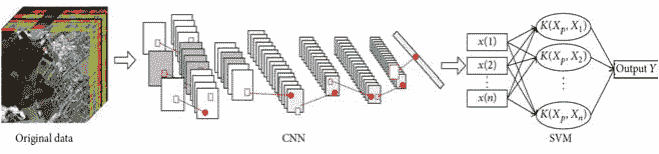

图 1. 基于 EM-CNN 的分类框架。


在公式中，\(\eta\) 是学习率，\(-\partial E/\partial w_{old}^l\) 是误差对权重的梯度，\(-\partial E/\partial b_{old}^l\) 是误差对偏置的梯度，即参数调整的敏感性。为了实现权重和偏置的优化，必须首先获得误差对权重的梯度和误差对偏置的梯度。

对于卷积层，其输出如下公式所示：

\(x_j^l = f \left( \sum_{i \in M_j} M_i * K_{ij}^l + b_j \right),\)

其中 \(b_j\) 是第 j 类特征图的偏置，\(x_i^{l-1}\) 是输入特征图的块，\(K_{ij}^l\) 是卷积核。根据敏感性函数的导数公式，卷积层的敏感性可由以下公式表示：

\(\delta_j^l = \beta_j^{l+1} \text{up} (\delta_j^{l+1}) \circ f'(u^l),\)

其中 \(\beta_j^{l+1}\) 是 \(l+1\) 采样层的卷积核，up 表示上采样，\(\delta_j^{l+1}\) 是 \(\delta_j^l\) 的 1/4，因此应进行上采样。\(\circ\) 符号表示对应元素的乘法。

因此，卷积层误差对偏置的梯度如公式 (6) 所示。在公式中，\((u, v)\) 是敏感性矩阵的元素位置：

\(\frac{\partial E}{\partial b_{old}^l} = \frac{\partial E}{\partial b_j} = \sum_{(u,v)} (\delta_{j,uv}^l).\)

卷积层误差对权重的梯度如公式 (7) 所示。在公式中，\(p_i^{l-1}\) 是 \(x_i^{l-1}\) 与卷积核 \(K_{ij}\) 的卷积块，\((u, v)\) 是该块的元素位置：

\(\frac{\partial E}{\partial w_{old}^l} = \frac{\partial E}{\partial K_{ij}^l} = \sum_{(u,v)} (\delta_{j,uv}^l) (p_i^{l-1})_{uv}.\)

将公式 (5)、(6) 代入公式 (1)、(2)，可得到卷积层权重的更新值。

采样层神经网络的输出可由公式 (8) 表示，其中 \(\beta_j^l\) 和 \(b_j^l\) 分别表示乘法偏置和加法偏置。乘法偏置一般设置为 1：

\(x_j^l = f(\beta_j^{\text{down}}(x_j^{l-1}) + b_j^l).\)

根据梯度下降的敏感性计算公式，采样层的敏感性如下公式所示：

\(\delta_j^l = \delta_j^{l+1}w_j^{l+1} \circ f'(u^l).\)

由此可得采样层的偏置更新公式，如公式 (10) 所示。根据公式 (3)，可得偏置值的更新：

\(\frac{\partial E}{\partial b_{\text{old}}^l} = \frac{\partial E}{\partial b_j^l} = \sum_{(u,v)} (\delta_j^l)_{uv}.\)

## 指数动量训练算法

传统的梯度下降方法仅在单层之间传递梯度误差，导致网络收敛速度慢。提高学习率 \(\eta\) 是提高收敛速度的一个好方法。

但这不仅提高了收敛速度，还会导致网络不稳定问题，即“震荡”。面对这种情况，文献 [19] 提出了动量方法，通过添加动量因子来提高收敛速度。文献 [31] 在文献 [19] 的基础上提出了自适应动量方法。

然而，这些方法均未考虑震荡、收敛与动量之间的关系。而且，动量因子并不能促进收敛并提升学习性能。本文将梯度的误差指数函数应用于调整动量因子的步长。

该函数可以在平坦区域增加动量因子，从而加速网络收敛速度，并可以在误差曲线的陡峭区域降低动量因子，从而避免网络过度收敛。这种方法可以提高算法的收敛速度并避免收敛过程中的震荡。

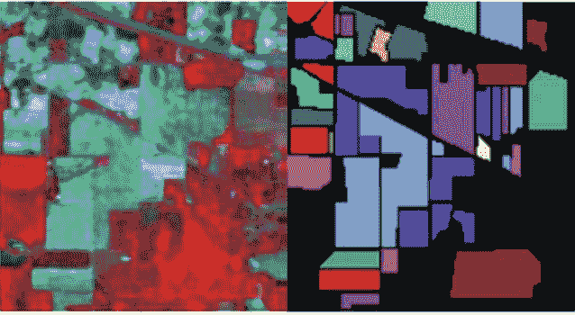

- Alfalfa
- Corn-notill
- Corn-min
- Corn
- Grass/pasture
- Grass/trees
- Grass/pasture-mowed
- Hay-windrowed
- Oats
- Soybeans-notill
- Soybeans-min
- Soybean-clean
- Wheat
- Woods
- Bldg-grass-tree-drives
- Stone-steel towers

**图 2.** 印度松林高光谱影像及分类地真。

动量因子的更新公式如下：

\[
a = \exp(-\lambda_1 \|D_k\| - \lambda_2) \frac{D_k}{\|\Delta w^{k-1}\|^2},
\]

\[
D_k = -\frac{\partial E}{\partial w(k)}.
\]
(11)

在公式中，\(\Delta w^k = w^{k+1} - w^k\)，\(D_k\) 表示误差对权重的梯度。

## 实验与分析

在本节中，所提算法的性能在 AVIRIS 和 ROSIS 高光谱数据集上进行评估。总体精度、泛化精度和 Kappa 参数（即三个最重要的评价标准）用于评估所提框架的性能。

### 数据描述

在我们的实验中，我们使用 AVIRIS 和 ROSIS 高光谱数据集对所提框架进行了实验和验证。AVIRIS 高光谱数据 92AV3C 由 AVIRIS 传感器于 1992 年 6 月获取。ROSIS 高光谱数据集由一种被称为反射光学系统成像光谱仪（ROSIS-3）的传感器在意大利帕维亚市上空采集。特别是，我们采用了印度松林数据集，该数据集描绘了印第安纳州，包含 145 × 145 的数据尺寸和 224 个光谱带，波长范围为 0.4 至 \(2.5 \times 10^{-6}\) 米。它总共包含 16 个类别，如表 1 所示。其实际标记如图 2 所示。我们采用的其他数据集是帕维亚大学数据集，其光谱带数量为 102。选定了九类地物覆盖类别，如图 3 所示。每个类别的样本数量显示在表 2 中。

### 表 1. 印度松林数据集的十六个类别

| 类别代码 | 地物类别 | 训练样本数 | 测试样本数 |
|---|---|---|---|
| C1 | Alfalfa | 30 | 24 |
| C2 | Corn-notill | 734 | 700 |
| C3 | Corn-min | 434 | 400 |
| C4 | Corn | 134 | 100 |
| C5 | Grass/Pasture | 297 | 200 |
| C6 | Grass/Trees | 397 | 300 |
| C7 | Grass/pasture-mowed | 16 | 10 |
| C8 | Hay-windrowed | 289 | 200 |
| C9 | Oats | 10 | 10 |
| C10 | Soybeans-notill | 538 | 430 |
| C11 | Soybeans-min | 1268 | 1200 |
| C12 | Soybean-clean | 314 | 300 |
| C13 | Wheat | 112 | 100 |
| C14 | Woods | 694 | 600 |
| C15 | Bldg-Grass-Tree-Drives | 190 | 190 |
| C16 | Stone-steel towers | 50 | 45 |

为研究所提方法的性能，实验分步组织。首先分析了卷积核大小和网络深度对分类结果的影响。然后，验证了指数动量训练算法的性能。最后，基于 CNN 框架进行了分类。

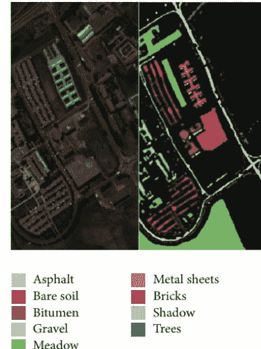

图 3. 帕维亚高光谱影像及分类地真。

### 核大小与深度的影响

本节分析了核大小和网络深度对所提框架分类性能的影响。在固定网络结构和算法参数的条件下，深度卷积神经网络由一系列不同的核大小和网络深度进行训练。

结果如表 3 和表 4 所示。表 3 表明，卷积核大小对方法总体精度的影响较小，最好与图像数据的特征尺寸保持一致。表 4 的结果表明，更深层的结构可以获得更好的分类精度。

### 指数动量训练算法

本节验证了该算法的泛化精度和收敛速度。我们选择自适应动量 [31] 和弹性动量 [32] 作为对比方法，以观察训练目标损失函数的迭代轮次变化。可以从图 4 容易看出，自适应动量的收敛点为 14，弹性动量的收敛点为 8，指数动量的收敛点为 7。因此，指数动量的迭代次数收敛最少，其训练时间消耗也最少。

对于泛化精度测试实验，选择 LeNet5 神经网络 [33] 和标准多层神经网络 [34] 进行对比。获得的精度结果如表 5 所示。可以从表中看出，与标准动量和自适应动量的相应训练模型相比，指数动量训练方法可以提高不同网络上的分类精度。

### 表 2. 帕维亚数据集的九个类别

| 类别代码 | 地物类别 | 训练样本数 | 测试样本数 |
| :--- | :--- | :--- | :--- |
| C1 | Alfalfa | 30 | 24 |
| C2 | Bare soil | 734 | 700 |
| C3 | Bitumen | 434 | 400 |
| C4 | Gravel | 134 | 100 |
| C5 | Meadows | 297 | 200 |
| C6 | Metal sheets | 397 | 300 |
| C7 | Bricks | 16 | 10 |
| C8 | Shadow | 289 | 200 |
| C9 | Trees | 10 | 10 |

### 表 3. 不同核大小的精度对比

| 核大小 | 3 | 7 | 9 | 11 | 15 | 17 |
| :--- | :--- | :--- | :--- | :--- | :--- | :--- |
| 精度 | 35.2 | 95.2 | 98.7 | 98.2 | 90.5 | 50.2 |

### 表 4. 不同深度的精度对比

| 深度 | 3 | 4 | 5 | 6 | 7 | 9 |
| :--- | :--- | :--- | :--- | :--- | :--- | :--- |
| 精度 | 40.5 | 85.3 | 89.5 | 94.5 | 98.8 | 99.6 |


**表5. 算法图像识别准确率比较**

| 动量方法 | EFM-CNN网络 | LeNet5神经网络 | 多神经网络 |
|---|---|---|---|
| 指数动量 | 98.69 | 98.24 | 73.03 |
| 弹性动量 | 97.65 | 97.5 | 72.5 |
| 自适应动量 | 97.10 | 97.00 | 65.50 |

## 与其他方法比较

## 与其他特征提取方法比较

我们从分类角度验证了所提特征提取方法的有效性，通过将我们的算法与其他经典特征提取方法进行比较，涉及主成分分析（PCA）-SVM、核主成分分析（KPCA）-逻辑回归（LR）、独立成分分析（ICA）-SVM、非负矩阵分解（NMF）-LR和因子分析（FA）-SVM。

所有逻辑回归分类器的学习率均设为0.1，并在训练数据上迭代8000个epochs。结果如图5所示。实验表明，通过与SVM结合，所提方法优于所有其他特征提取方法，并获得最高准确率。

**表6. 不同分类器的准确率比较**

| 数据集 | 指标 | SAE-LR 空间 | SAE-LR 联合 | RBP-SVM 空间 | RBP-SVM 联合 | EFM-CNN-SVM 空间 | EFM-CNN-SVM 联合 | PCA-RBP-SVM 空间 | PCA-RBP-SVM 联合 |
|---|---|---|---|---|---|---|---|---|---|
| 帕维亚 | 整体准确率 | 0.9514 | 0.9852 | 0.9455 | 0.9845 | 0.9625 | 0.9869 | 0.9448 | 0.9791 |
| 帕维亚 | 平均准确率 | 0.9401 | 0.9732 | 0.9370 | 0.9711 | 0.9522 | 0.9790 | 0.9281 | 0.9689 |
| 帕维亚 | Kappa系数 | 0.9358 | 0.9850 | 0.9289 | 0.9794 | 0.9431 | 0.9859 | 0.9246 | 0.9758 |
| 印第安 | 整体准确率 | 0.9589 | 0.9735 | 0.9564 | 0.9722 | 0.9653 | 0.9876 | 0.9514 | 0.9701 |
| 印第安 | 平均准确率 | 0.9475 | 0.9669 | 0.9412 | 0.9615 | 0.9517 | 0.9795 | 0.9375 | 0.9599 |
| 印第安 | Kappa系数 | 0.9594 | 0.9750 | 0.9539 | 0.9439 | 0.9605 | 0.9862 | 0.9547 | 0.9418 |

**图4.** 收敛曲线。

## 与其他分类方法比较

我们通过将所提框架与以空间为主导的方法进行比较，来考察EFM-CNN-SVM框架的分类准确性，这些方法包括径向基函数（RBF）线性SVM、主成分分析（PCA）RBF-SVM和堆叠自编码器（SAE）逻辑回归（LR）。通过将谱域和空间信息结合形成混合输入，并利用第3节详细介绍的深度分类框架，我们获得了迄今为止最高的分类准确率。实验使用了与上述相同的参数设置，进行了100次以上。结果如表6和图6所示。从表6可以看出，EFM-CNN-SVM方法优于所有其他方法。而且就平均性能而言，联合特征的准确率高于谱域特征。在图6中，我们从可视化视角考察了分类准确性。可以看出，所提方法的分类结果最接近理想分类结果，除了RBF-SVM和线性SVM方法。

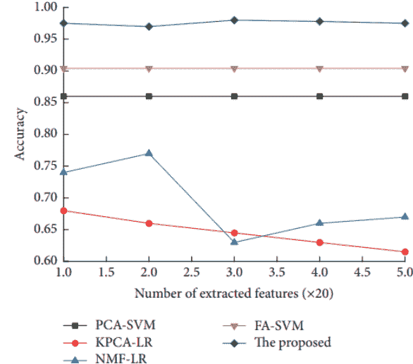

**图5.** 与其他特征提取方法的比较。

## 结论

本文提出了一种基于深度CNN特征提取架构的高光谱数据分类框架。并提出了一种改进的误差传递算法，即自适应指数动量算法。实验结果表明，与自适应动量和弹性动量等同源误差优化算法相比，改进的误差传递算法收敛速度更快。并且已证明所提EFM-CNN-SVM框架优于PCA-SVM、KPCA-SVM和SAE-LR框架。我们的实验结果表明，更深的层数总能带来更高的分类准确率，尽管运行时间和准确率是矛盾的。已证实深度架构对分类很有用，而高阶谱-空间特征能提高分类准确率。当数据规模更大时，提取的特征具有更好的识别能力。

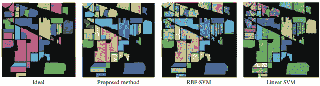

**图6.** 基于EFM-CNN-SVM的印第安松树数据集分类。

## 致谢

该项工作得到国家863高技术研究开发计划（2010AA7080302）的支持。

## 参考文献

- 1. F. M. Lacar, M. M. Lewis, and I. T. Grierson, “使用高光谱影像绘制南澳大利亚巴罗萨谷葡萄品种图,” in 2001年国际地球科学与遥感研讨会（IGARSS ’01）论文集, pp. 2875–2877, IEEE, Sydney, Australia, July 2001.
- 2. P. W. T. Yuen and M. Richardson, “高光谱成像及其在安全、监视和目标获取中的应用简介,” 成像科学杂志, vol. 58, no. 5, pp. 241–253, 2010.
- 3. T. J. Malthus and P. J. Mumby, “沿海带遥感：概述及未来研究优先事项,” 国际遥感杂志, vol. 24, no. 13, pp. 2805–2815, 2003.
- 4. J. M. Bioucas-Dias, A. Plaza, G. Camps-Valls, P. Scheunders, N. Nasrabadi, and J. Chanussot, “高光谱遥感数据分析与未来挑战,” IEEE地球科学与遥感杂志, vol. 1, no. 2, pp. 6–36, 2013.
- 5. M. T. Eismann, A. D. Stocker, and N. M. Nasrabadi, “平民搜索和救援的自动高光谱提示,” IEEE论文集, vol. 97, no. 6, pp. 1031–1055, 2009.
- 6. E. K. Hege, W. Johnson, S. Basty et al., “天文与空间监视的高光谱成像,” in 成像光谱仪IX, SPIE论文集 vol. 5159, pp. 380–391, January 2004.
- 7. F. V. D. Meer, “高光谱影像中光谱吸收特征的分析,” 应用地球观测与地理信息国际杂志, vol. 5, no. 1, pp. 55–68, 2004.
- 8. S. Rajan, J. Ghosh, and M. M. Crawford, “高光谱数据分类的主动学习方法,” IEEE地球科学与遥感交易, vol. 46, no. 4, pp. 1231–1242, 2008.
- 9. Q. Lu and M. Tang, “使用高光谱成像和平行截柱体分类法检测猕猴桃隐藏瘀伤,” 程序环境科学, vol. 12, no. 4, pp. 1172–1179, 2012.
- 10. G. M. Foody and A. Mathur, “基于支持向量机的多类图像分类相对评估,” IEEE地球科学与遥感交易, vol. 42, no. 6, pp. 1335–1343, 2004.
- 11. Y. Chen, X. Zhao, and X. Jia, “基于深度信念网络的高光谱数据谱-空间分类,” IEEE应用地球观测与遥感选定主题杂志, vol. 8, no. 6, pp. 2381–2392, 2015.
- 12. Y. Chen, Z. Lin, X. Zhao, G. Wang, and Y. Gu, “基于深度学习的高光谱数据分类,” IEEE应用地球观测与遥感选定主题杂志, vol. 7, no. 6, pp. 2094–2107, 2014.
- 13. A. Krizhevsky, I. Sutskever, and G. E. Hinton, “使用深度卷积神经网络进行Imagenet分类,” in 第26届神经信息处理系统年会（NIPS ’12）论文集, pp. 1097–1105, Lake Tahoe, Nev, USA, December 2012.
- 14. G. E. Hinton and R. R. Salakhutdinov, “使用神经网络降低数据维度,” 科学, vol. 313, no. 5786, pp. 504–507, 2006.
- 15. Z. Zhu, C. E. Woodcock, J. Rogan, and J. Kellndorfer, “使用Landsat和SAR数据对城镇及城郊土地覆盖分类中光谱、极化、时域和空间维度的评估,” 环境遥感, vol. 117, pp. 72–82, 2012.
- 16. D. Yu, L. Deng, and S. Wang, “深度结构化条件随机场中的学习,” in 神经信息处理系统研讨会论文集, pp. 1–8, Vancouver, Canada, December 2009.
- 17. A.-R. Mohamed, T. N. Sainath, G. Dahl, B. Ramabhadran, G. E. Hinton, and M. A. Picheny, “使用判别特征进行电话识别的深度信念网络,” in 第36届IEEE国际声学、语音和信号处理会议（ICASSP ’11）论文集, pp. 5060–5063, Prague, Czech Republic, May 2011.
- 18. B. H. M. Sadeghi, “塑料注塑成型工艺的BP神经网络预测模型,” 材料加工技术杂志, vol. 103, no. 3, pp. 411–416, 2000.
- 19. P. Baldi and K. Hornik, “神经网络与主成分分析：无局部极小值的示例学习,” 神经网络, vol. 2, no. 1, pp. 53–58, 1989.
- 20. Y. Bengio, P. Lamblin, D. Popovici, and H. Larochelle, “深度网络的贪心逐层训练,” in 第20届神经信息处理系统年会（NIPS ’06）论文集, pp. 153–160, Cambridge, Mass, USA, December 2006.


- 21. G. E. Hinton, “受限玻尔兹曼机训练实用指南,” 技术报告 UTML TR2010-003, 多伦多大学计算机科学系, 多伦多, 加拿大, 2010.

- 22. R. Salakhutdinov 和 G. E. Hinton, “深度玻尔兹曼机,” 发表于人工智能与统计国际会议论文集, 第 448–455 页, 美国佛罗里达州克利尔沃特海滩, 2009 年 4 月.

- 23. G. E. Hinton, S. Osindero, 和 Y.-W. Teh, “深度置信网快速学习算法,” 神经计算, 第 18 卷, 第 7 期, 第 1527–1554 页, 2006.

- 24. Y. Bengio, P. Lamblin, D. Popovici, 和 H. Larochelle, “深度网络的贪婪逐层训练,” 发表于神经信息处理系统会议论文集, 第 153–160 页, 美国马萨诸塞州剑桥, 2007.

- 25. M. D. Zeiler 和 R. Fergus, “深度卷积神经网络正则化的随机聚合,” https://arxiv.org/abs/1301.3557.

- 26. H. Larochelle, D. Erhan, A. Courville, J. Bergstra, 和 Y. Bengio, “具有多个变异因子问题的深度架构的实证评估,” 发表于第 24 届国际机器学习会议 (ICML '07) 论文集, 第 473–480 页, 美国俄勒冈州科瓦利斯, 2007 年 6 月.

- 27. Y. Bengio, G. Guyon, V. Dror 等人, “无监督与迁移学习的表示深度学习,” 发表于无监督与迁移学习研讨会论文集, 美国华盛顿州贝尔维尤, 2011 年 7 月.

- 28. Y. Bengio, A. Courville, 和 P. Vincent, “表示学习:综述与新视角,” IEEE 模式分析与机器智能汇刊, 第 35 卷, 第 8 期, 第 1798–1828 页, 2013.

- 29. W. Ouyang 和 X. Wang, “行人检测的联合深度学习,” 发表于第 14 届 IEEE 国际计算机视觉会议 (ICCV '13) 论文集, 第 2056–2063 页, 2013 年 12 月.

- 30. N. B. Karayiannis, “梯度下降训练的重构径向基神经网络,” IEEE 神经网络汇刊, 第 10 卷, 第 3 期, 第 657–671 页, 1999.

- 31. S. S. Agrawal 和 V. Yadava, “金属基复合材料表面电火花金刚石磨削工艺中材料去除率和表面粗糙度的建模与预测,” 材料与制造工艺, 第 28 卷, 第 4 期, 第 381–389 页, 2013.

- 32. W. Tan, C. Zhao, H. Wu, 和 R. Gao, “基于柔性动量的水果病理图像识别深度学习网络,” 农业机械学报/中国农业机械学会学报, 第 46 卷, 第 1 期, 第 20–25 页, 2015.

- 33. N. Yu, P. Jiao, 和 Y. Zheng, “基于改进 LeNet5 的手写数字识别,” 发表于第 27 届中国控制与决策会议 (CCDC '15) 论文集, 第 4871–4875 页, 2015 年 5 月.

- 34. D. Shukla, D. M. Dawson, 和 F. W. Paul, “多神经网络,” IEEE 神经网络汇刊, 第 10 卷, 第 6 期, 第 1494–1501 页, 1999.

## 第 5 章

## 基于深度强化学习的集成网络架构

Xi-liang Chen, Lei Cao, Chen-xi Li, Zhi-xiong Xu, and Jun Lai

中国江苏省南京市秦淮区光华路海福路1号，解放军科技大学指挥信息系统研究所，210007

### 摘要

流行的深度 Q 学习算法因 Q 值的波动以及在某些条件下对动作值的过估而被知不稳定。这些问题往往会不利地影响其性能。在本文中，我们开发了一种基于值函数近似的深度强化学习集成网络架构。时序集成通过减少目标近似误差的方差来稳定训练过程，目标值集成通过估计更准确的 Q 值来减少过估并实现更好的性能。我们的结果表明，这种架构在 OpenAI Gym 环境的几个经典控制任务中，带来了统计学上显著更好的值评估以及更稳定和更好的性能。

**引用:** Xi-liang Chen, Lei Cao, Chen-xi Li, Zhi-xiong Xu, Jun Lai, “基于深度强化学习的集成网络架构”, 数学工程问题, vol. 2018, Article ID 2129393, 6 pages, 2018. https://doi.org/10.1155/2018/2129393.

**版权:** © 2018 版权归作者所有。这是一篇根据知识共享署名许可证分发的开放获取文章，该许可证允许在任何媒介上无限制地使用、分发和复制，前提是原始作品得到正确引用。

### 引言

强化学习（RL）算法 [1, 2] 非常适合通过让智能体与环境交互来学习控制智能体。近年来，深度神经网络（DNN）已被引入强化学习，并在值函数近似方面取得了巨大成功。Mnih 等人 [3] 提出了第一个深度 Q 网络（DQN）算法，该算法成功地将称为 DNN 的强大非线性函数近似技术与 Q 学习算法相结合。本文提出了经验回放机制。在 DQN 工作的基础上，提出了各种解决方案来稳定算法 [3–9]。深度 Q 网络类在 Atari 2600 和其他一些游戏等挑战性领域取得了前所未有的成功。

虽然 DQN 算法因其强大的函数近似能力和相似状态输入之间的强泛化能力，在解决许多问题方面取得了成功，但在解决某些问题方面仍然不足。原因有二：(a) 采样的随机性可能导致严重的冲击，(b) 这些系统误差可能导致不稳定、性能差，有时甚至导致学习发散。为了解决这些问题，平均目标 DQN (ADQN) [10] 算法通过将目标 Q 网络与单个学习网络持续相结合来构建目标值，并提出了引导式 DQN [11] 算法，通过并行使用多个 Q 网络进行学习来获得更高效的探索和更好的性能。虽然这些算法确实减少了过估，但它们没有评估过去学习网络的重要性。此外，目标值的高方差与最大算子相结合的问题仍然存在。

强化学习中有一些集成算法 [4, 12] 解决了这个问题，但这些现有算法与非线性参数化的值函数不兼容。

在本文中，我们将集成算法作为解决此问题的方案。为了提高学习速度和最终性能，我们将多个强化学习算法组合在一个智能体中，并结合多种集成算法来确定动作或动作概率。

在监督学习中，装袋（bagging）、提升（boosting）和专家混合（mixtures of experts）等集成算法 [13] 常用于学习和组合多个分类器。但在 RL 中，集成算法用于表示和学习值函数。

基于集成了多个强化学习算法的智能体，同时学习多个值函数。集成将从值函数导出的策略组合为智能体的最终策略。多数投票（MV）、排名投票（RV）、玻尔兹曼乘法（BM）和玻尔兹曼加法（BA）用于组合 RL 算法。虽然这些方法在深度强化学习（DRL）算法中代价高昂，但我们组合了学习独立值函数和策略的不同 DRL 算法。因此，在我们的集成方法中，我们组合了由深度 Q 网络、深度 Sarsa 网络、双重深度 Q 网络和其他 DRL 算法学习的更新目标所导出的不同策略。结果，这导致过估减少、学习过程更稳定以及性能提高。

### 相关工作

### 强化学习

强化学习是一种机器学习方法，允许系统与环境交互并从环境中学习，以最大化累积回报奖励。假设标准强化学习设置，其中智能体与环境 E 交互。我们可以使用马尔可夫决策过程（MDP）[2, 9] 来描述此过程。它可以指定为元组 (S, A, π, R, γ)。在每个步骤 t 时，智能体接收一个状态 s，并根据策略 π 从合法动作集 A 中选择一个动作 aₜ，其中 π 是将序列映射到动作的策略。动作被传递给环境 E。此外，智能体接收下一个状态 sₜ₊₁ 和奖励信号 rₜ。此过程持续进行，直到智能体达到终止状态。智能体寻求最大化预期折扣回报，其中我们定义时间 t 的未来折扣回报为 Rₜ = Σₖ₌₀^∞ γᵏ rₜ₊ₖ，折扣因子 γ ∈ (0, 1]。RL 智能体的目标是学习一项策略，以最大化未来折扣回报。对于按照随机策略 π 行为的智能体，状态动作对的值可以定义如下：Q^π(s,a) = E[Rₜ | sₜ = s, aₜ = a, π]。最优动作值函数


Q 满足贝尔曼方程 \(Q^*(s, a) = E_{s' \sim \mathcal{E}} [r + \gamma \max_{a'} Q^*(s', a') \mid s, a]\)。强化学习算法通过迭代更新贝尔曼方程 \(Q^*(s, a) = E_{s' \sim \mathcal{E}} [r + \gamma \max_{a'} Q^*(s', a') \mid s, a]\) 来估计动作值函数。当 \(t \to \infty\) 时，算法使 Q 值函数收敛到最优动作值函数 [1]。如果已知最优 Q 函数 \(Q^*\)，智能体可以通过在状态中选择值最大的动作来选择最优动作：\(\pi^* = \text{argmax}_a Q^*(s, a)\)。

## 目标深度 Q 学习

RL 智能体在观察形如 \((s_t, a_t, r_t, s_{t+1})\) 的转换流时更新其模型参数。它们在单次更新后丢弃传入数据。该方法存在两个问题。首先，传入数据之间存在强相关性，这可能违背许多流行的基于随机梯度的算法的假设。其次，Q 函数中的微小变化可能导致策略发生巨大变化，从而使算法难以收敛 [7, 9, 14, 15]。

关于 (Mnih et al., 2013) 提出的深度 Q 网络算法，改进了两个方面。一方面，动作值函数由 DNN 近似，DQN 使用带参数 \(\theta\) 的 DNN 来近似值函数，\(Q(s, a; \theta) \approx Q^*(s, a; \theta)\)；另一方面，采用了经验回放机制。算法从经验缓冲区中采样的转换进行学习，而不是完全在线学习。这种机制通过混合较新和较旧的经验来进行更新和训练，从而有可能打破时间相关性。这种无模型强化学习算法解决了“模型灾难”问题，并使用值函数的广义近似方法解决了“维度灾难”问题。收敛问题于 2015 年由 Schaul 等人 [14] 提出。上述 Q 学习更新规则可以直接在神经网络中实现。DQN 使用带参数 \(\theta\) 的 DNN 来近似值函数。参数 \(\theta\) 从转换 \((s_t, a_t, r_{t+1}, s_{t+1})\) 的更新由以下给出 [11]：

\[
\theta_{t+1} \leftarrow \theta_t + \alpha (y_t^Q - Q(s_t, a_t; \theta_t)) \nabla_\theta Q(s_t, a_t; \theta_t)
\]

其中 \(y_t^{\text{DQN}} = r_t + \gamma \max_a \widetilde{Q}(s_{t+1}, a; \theta_t^-)\)

Sarsa 的更新目标可描述如下：

\[
y_t^{\text{Sarsa}} = r_t + \gamma \widetilde{Q}(s_{t+1}, a_{t+1}; \theta_t^-)
\]

其中 \(\alpha\) 是标量学习率。\(\theta^-\) 是目标网络参数，固定为 \(\theta^- = \theta^t\)。若将平方误差作为损失函数 \(L_i(\theta_i) = E_{s^t \sim \rho}(y_i - Q(s, a; \theta_i))^2\)。

一般来说，经验回放可以减少学习所需的经验量，并用更多的计算和更多的内存来替代，这些资源通常比 RL 智能体与其环境的交互更便宜 [14]。

## 双重深度 Q 学习

在 Q 学习和 DQN 中，max 算子使用相同的值来同时选择和评估动作。因此，这可能导致过于乐观的值估计 (van Hasselt, 2010)。为缓解此问题，双重 Q 学习误差的更新目标值可写作如下：

\[
y_t^{DDQN} = r_t + \gamma \overline{Q}\left(s_{t+1}, \arg \max_{a'} \overline{Q}\left(s_{t+1}, a'; \theta_t\right); \theta_t^-\right) \tag{3}
\]

DDQN 与 DQN [8] 相同，只是将目标 \(y_t^{\text{DQN}}\) 替换为 \(y_t^{DDQN}\)。

## 深度强化学习的集成方法

由于 DQN 类使用 DNN 来近似值函数，因此在相似状态输入之间具有强大的泛化能力。在重复的自举时序差分更新中，泛化可能导致发散。因此，我们可以通过整合不同版本的目标网络来解决此问题。与单一分类器相比，系统中的集成算法已被证明更有效。它们可以提高准确性。Bagging、Boosting 和 AdaBoost 是训练多个分类器的方法。但在 RL 中，集成算法用于表示和学习值函数。它们通过多数投票、排名投票、玻尔兹曼乘法、混合模型及其他集成方法组合。如果单个分类器的误差不存在强相关性，这可以显著提高分类准确率。

## 时序集成

如第 2.2 节所述，深度强化学习算法的 DQN 类使用目标网络，其参数 \(\theta^-\) 每 C 步从 \(\theta^t\) 复制而来。时序集成方法适用于使用目标网络进行更新和训练的算法。时序集成使用先前学习的 K 个网络来生成值估计，并构建 \(K \in \mathbb{N}\) 个带有 K 个不同内存缓冲区的完整网络。最近的 Q 值函数根据其自身的目标网络 \(Q(s, a; \theta_t)\) 进行训练。因此，Q 值函数 \(Q_1, Q_2, \dots, Q_k\) 中的每一个都代表 Q 值函数的时序扩展估计。

需要注意的是，训练初期较新的目标网络可能更准确，且随着训练进行，目标网络的准确性不断提高。因此，我们在此为目标网络引入一个学习率参数 \(\lambda \in (0, 1]\)。第 i 个目标网络的权重为 \(w_i = \frac{\lambda^{i-1}}{\sum_{i=1}^N \lambda^{i-1}}\)。

因此，时序集成学习的 Q 值函数可描述如下：

\[
Q^T(s, a; \theta) = \sum_{i=1}^N \left( \frac{\lambda^{i-1} Q_i(s, a; \theta_i)}{\sum_{i=1}^N \lambda^{i-1}} \right). \tag{4}
\]

由于 \(\lim_{\lambda \to 1} \frac{\lambda^{i-1}}{\sum_{i=1}^N \lambda^{i-1}} = \frac{1}{N}\)，我们可以看到当 \(\lambda\) 等于 1 时，目标网络具有相同的权重。该公式表明，目标网络越接近，其权重越大。随着目标网络变得更准确，其权重变得相等。损失函数与 DQN 中保持相同，参数更新方程也是如此：

\[
y_t^T = r_t + \gamma \max_{a'} \sum_{i=1}^N w_i Q^T (s', a'; \theta^T), \tag{5}
\]

\[
\theta_{t+1} \leftarrow \theta_t + \alpha \left( y_t^T - Q \left( s_t, a_t; \theta_t \right) \right) \nabla_\theta Q \left( s_t, a_t; \theta_t \right).
\]

在每次迭代中，最旧网络的参数从目标网络缓冲区中移除，最新网络的参数被加入缓冲区。需要注意的是，训练初期 Q 值函数不准确。因此，参数 \(\lambda\) 可能是时间的函数，甚至是状态空间的函数。

## 目标值集成

传统的集成强化学习算法在内存空间中维护多个表格算法 [4, 16]，并使用多数投票、排名投票、玻尔兹曼加法等方法来组合这些表格算法。但深度强化学习使用神经网络作为函数近似器。使用多个神经网络计算开销非常大且效率低下。与以往研究相反，我们组合了学习独立值函数和策略的不同 DRL 算法。因此，在我们的集成方法中，我们组合了由深度 Q 网络、深度 Sarsa 网络、双重深度 Q 网络及其他 DRL 算法学习的更新目标所导出的不同策略，如下所示：

```
$y_t^{\text{DQN}} = r_t + \gamma \max_a \overline{Q}(s_{t+1}, a; \theta_t^-),$

$y_t^{\text{Sarsa}} = r_t + \gamma \overline{Q}(s_{t+1}, a_{t+1}; \theta_t^-),$

$y_t^{\text{DDQN}} = r_t + \gamma \overline{Q}\left(s_{t+1}, \underset{a'}{\text{argmax}} \overline{Q}(s_{t+1}, a'; \theta_t); \theta_t^-\right).$
```

除这些更新目标公式外，基于值函数近似器的其他算法也可用于组合。时刻 t 下按算法 k 的更新目标将记为 \(y_t = \sum_{i=1}^k \beta_i y_t^i\)。

损失函数与 DQN 中保持相同，参数更新方程也是如此：

```
$\theta_{t+1} \leftarrow \theta_t + \alpha \left( y_t^E - Q(s_t, a_t; \theta_t) \right) \nabla_\theta Q(s_t, a_t; \theta_t).$
```

## 集成网络架构

时序和目标值集成算法（TEDQN）是基于值的 DRL 算法的一种集成架构。如第 3.1 节和第 3.2 节所示，集成网络架构包含两部分，以避免发散并提高性能。

我们的集成算法架构如图 1 所示；这两部分由评估网络组合在一起。

时序集成通过减少目标近似误差的方差来稳定训练过程 [10]。此外，目标值集成通过估计更准确的 Q 值来减少高估并实现更好的性能。时序和目标值集成算法由算法 1 给出。

由于集成网络架构与标准 Q 网络和目标网络共享相同的输入输出接口，我们可以重用所有带 Q 网络的学习算法来训练集成架构。


## 实验

### 实验设置

目前为止，我们已在 OpenAI Gym 上的多个经典控制和 Box2D 环境中进行了实验：CartPole-v0、MountainCar-v0 和 LunarLander-v2 [15]。我们对所有这些环境使用相同的网络架构、学习算法和超参数。

我们使用 10,000 个回合训练了算法，并使用自适应矩估计（Adam）算法以学习率 \(\mu = 0.00001\) 最小化损失，并将批次大小设置为 32。

下面给出了配置摘要。目标网络每 300 步更新一次。训练期间的行为策略为 \(\varepsilon\)-贪心策略，其中 \(\varepsilon\) 在前五千步内从 1 线性退火至 0.01，之后固定为 0.01。我们使用了最近一万个转移的重放内存。

我们在每个任务上分别独立运行了每种方法 10 次。

对于每次运行，每 100 个训练回合将在没有探索噪声或先验知识的情况下测试 100 次所学习的策略以计算平均分数。我们报告收敛回合数和最佳策略分数的均值与标准差。

```
(1) Initialize action-value network Q with random weights \(\theta\)
(2) Initialize the target neural network buffer \((Q_i)_{i=1}^N\)
(3) For episode 1, M do
(4)   For t = 1, T do
(5)     With probability \(\varepsilon\) select a random action \(a_t\), otherwise
(6)     \(a_t = \text{argmax}_a Q(s_t, a; \theta)\)
(7)     Execute action \(a_t\) in environment and observe reward \(r_t\)
    and next state \(s_{t+1}\) and store transition \((s_t, a_t, r_t, s_{t+1})\) in D
(8)     Sample random minibatch of transition \((s_j, a_j, r_j, s_{j+1})\) from D
(9)     set \(y_j = \lambda^{-1} \sum_{i=1}^N \lambda^{i-1} r_j + \gamma \max_a \overline{Q}(s_{j+1}, a; \theta^-)\)
(10)    Ensemble Q-learner \(\overline{Q}(s, a; \theta) = \sum_{i=1}^N w_i Q_i(s, a; \theta_i)\)
(11)   set \(y_j^{\text{DQN}} = r_t + \gamma \max_a \overline{Q}(s_{t+1}, a_t; \theta_T)\)
(12)   set \(y_j^{\text{DDQN}} = r_t + \gamma \overline{Q}(s_{t+1}, \text{argmax}_a \overline{Q}(s_{t+1}, a_t; \theta_T); \theta_T)\)
(13)   set \(y_j = r_j + \gamma Q(s_{t+1}, \text{argmax}_a \overline{Q}(s_{t+1}, a_t; \theta_T); \theta_T)\)
(14)   Set \(y_j = r_j\), if episode terminates at step j + 1; \(\sum_{i=1}^k \beta_t y^t\), otherwise
(15) \(\theta_t = \text{argmin}_\theta \left[ (y_{s_{t+1}} - Q(s, a; \theta))^2 \right]\)
(16) Every C steps reset Q = Q
(17) End for
```

### 算法 1. 时序与目标值集成算法。

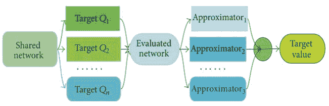

图 1. 集成算法的架构。

### 结果与分析

我们考虑了三种使用目标网络和值函数逼近的基线算法，即自然论文 [8] 中的 DQN 算法版本、可减少过估计的 DSN [17]，以及通过双重 Q 学习减少过估计偏差而显著提升最新水平的 DDQN [9]。

使用此 10 次无操作性能度量，很明显集成网络比单一网络表现好得多。为了比较，我们还展示了 DQN、DSN 和 DDQN 的结果。图 2 显示了集成网络相对于 DQN、DSN 和 DDQN 基线单一网络的改进。同样，我们看到改进往往非常显著。

表 1 的结果表明，我们提出的算法可以成功地在 OpenAI Gym 的经典控制领域训练神经网络控制器。

详细比较表明，存在若干 TE DQN 显著优于 DQN、DSN 和 DDQN 的游戏。值得注意的例子包括 CartPole-v0（性能分别提高了 13.6%、79.5% 和 7.8%，方差分别降低了 100%、100% 和 100%）、MountainCar-v0（性能分别提高了 26.7%、21.2% 和 24.8%，方差分别降低了 31.6%、77.9% 和 8.4%）以及 LunarLander-v2（性能分别提高了 28.3%、32.8% 和 50.5%，方差分别降低了 19.2%、46.4% 和 50.5%）。

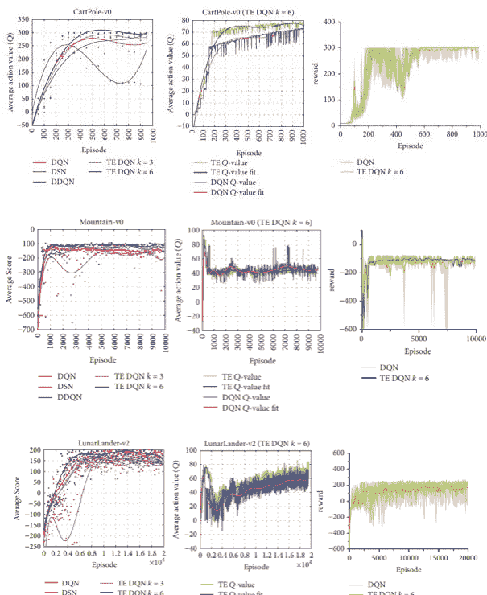

图 2. 跟踪代理平均得分和平均预测动作值的训练曲线。(a) 各算法在每个任务上的平均奖励性能比较。(b) 每个任务上保留状态集的平均预测动作值。曲线上的每个点是在保留状态集上计算的动作值 Q 的平均值。(c) 各任务上 DQN 和 TEDQN 的性能。较深的线显示每个算法的平均得分，橙色阴影区域显示 DQN 的两个极值，绿色阴影区域显示 TE DQN。

表 1. 列显示了 10000 个回合后 DQN、DSN、DDQN、EDQN 和 TE-DQN 的平均性能，在 10000 步后使用 \(\varepsilon = 0.0001\) 的 \(\varepsilon\)-贪心策略。标准差代表七次独立试验的变异性。平均性能随平均网络数量的增加而提高

| 任务 (平均得分, 标准差) | CartPole-v0 | MountainCar-v0 | LunarLander-v2 |
| :--- | :--- | :--- | :--- |
| DQN | (264.9, 21.7) | (-148.2, 17.4) | (159.3, 16.7) |
| DSN | (1671, 61.6) | (-137.7, 53.9) | (153.9, 25.2) |
| Double DQN | (278.2, 31.8) | (-144.2, 16.8) | (135.8, 11.8) |
| TE DQN K = 3 | (299.1, 1.3) | (-115.6, 21.4) | (186.9, 19.1) |
| TE DQN K = 6 | (300, 0) | (-108.4, 11.9) | (204.4, 13.5) |

虽然集成算法优于单一强化学习算法，但需注意的是其计算复杂度更高。实验还表明，时序集成使训练过程更加稳定，多种算法的集成使 Q 值估计更加准确。这两种方式的结合使训练能够实现稳定收敛。这是因为当算法预测的相关性较低时，集成对独立算法的改进最为显著。因此，基于动作选择的 Q 网络输出可以在探索与利用之间取得平衡。事实上，集成算法及其元素的独立性对集成算法的性能至关重要。在未来的工作中，我们希望分析不同阶段每个算法和每个 Q 网络的作用，以进一步提升集成算法的性能。

## 结论

我们引入了一种新的学习架构，为深度 Q 学习算法实现时序扩展和目标值集成，同时共享一个通用学习模块。这种新的集成架构，结合一些算法改进，在挑战性的经典控制问题上相较于现有深度强化学习方法取得了显著改进。在实践中，这种集成架构可以非常方便地集成基于近似值函数的强化学习方法。

## 参考文献

- 1. S. Mozer and M. Hasselmo, “强化学习：导论,” IEEE Transactions on Neural Networks and Learning Systems, vol. 16, no. 1, pp. 285–286, 2005.
- 2. L. P. Kaelbling, M. L. Littman, and A.W. Moore, “强化学习：综述,” Journal of Artificial Intelligence Research, vol. 4, pp. 237–285, 1996.
- 3. V. Mnih, K. Kavukcuoglu, D. Silver et al., “使用深度强化学习玩 Atari 游戏 [EB/OL],” https://arxiv.org/abs/1312.5602.
- 4. M. A. Wiering and H. van Hasselt, “强化学习中的集成算法,” IEEE Transactions on Systems, Man, and Cybernetics, Part B: Cybernetics, vol. 38, no. 4, pp. 930–936, 2008.
- 5. S. Whiteson and P. Stone, “强化学习中的进化函数逼近,” Journal of Machine Learning Research (JMLR), vol. 7, pp. 877–917, 2006.
- 6. P. Preux, S. Girgin, and M. Loth, “近似动态规划中的特征发现,” in Proceedings of the 2009 IEEE Symposium on Adaptive Dynamic Programming and Reinforcement Learning, ADPRL 2009, pp. 109–116, April 2009.
- 7. T. Degris, P. M. Pilarski, and R. S. Sutton, “实践中的无模型连续动作强化学习,” in Proceedings of the 2012 American Control Conference, ACC 2012, pp. 2177–2182, June 2012.
- 8. V. Mnih, K. Kavukcuoglu, D. Silver et al., “通过深度强化学习实现人类水平控制,” Nature, vol. 518, no. 7540, pp. 529–533, 2015.
- 9. H. Van Hasselt, A. Guez, and D. Silver, “带双重 Q 学习的深度强化学习,” in Proceedings of the 30th AAAI Conference on Artificial Intelligence, AAAI 2016, pp. 2094– 2100, February 2016.
- 10. O. Anschel, N. Baram, N. Shimkin et al., “平均 DQN：用于深度强化学习的方差减少与稳定 [EB/ OL],” https://arxiv.org/abs/1611.01929.
- 11. I. Osband, C. Blundell, A. Pritzel et al., “通过引导式 DQN 进行深度探索 [EB/OL],” https://arxiv.org/abs/1602.04621.
- 12. S. Faußer and F. Schwenker, “带函数逼近的强化学习集成方法,” in Multiple Classifier Systems, pp. 56–65, Springer, Berlin, Germany, 2011.


- 13. A. K. Jain, R. P. W. Duin, 和 J. Mao，“统计模式识别：综述”，IEEE 电子工程师学会模式分析与机器智能汇刊，第 22 卷，第 1 期，第 4–37 页，2000 年。

- 14. T. Schaul, J. Quan, I. Antonoglou 等人，“优先经验重放 [EB/OL]”，https://arxiv.org/abs/1511.05952。

- 15. I. Zamora, N. G. Lopez, V. M. Vilches 等人，“用于机器人技术的扩展 OpenAI Gym：基于 ROS 和 Gazebo 的强化学习工具包 [EB/OL]”，https://arxiv.org/abs/1608.05742。

- 16. D. Ernst, P. Geurts, 和 L. Wehenkel，“基于树的批量模式强化学习”，机器学习研究期刊 (JMLR)，第 6 卷，第 2 期，第 503–556 页，2005 年。

- 17. M. Ganger, E. Duryea, 和 W. Hu，“具有浅层和深度学习的双倍 Sarsa 和双倍期望 Sarsa”，数据分析与信息处理期刊，第 04 卷，第 04 期，第 159–176 页，2016 年。

### 第 2 节：生物学中应用的深度学习技术

## 基于深度学习的鱼类检测

Suxia Cui¹, Yu Zhou¹, Yonghui Wang², 和 Lujun Zhai¹
¹普莱里维尤农工大学电气与计算机工程系，得克萨斯州普莱里维尤，77446，美国
²普莱里维尤农工大学计算机科学系，得克萨斯州普莱里维尤，77446，美国

### 摘要

最近，人类的好奇心已从陆地扩展到天空和大海。除了派人探索海洋和外层空间外，机器人还被设计用于执行对生物有危险的一些任务。以海洋探索为例。关于自主水下载具（AUV）设计的许多项目或竞赛吸引了广泛关注。本文作者从之前的 AUV 设计项目中认识到了平台升级的必要性，并希望分享

引用：Suxia Cui, Yu Zhou, Yonghui Wang, Lujun Zhai，“基于深度学习的鱼类检测”，应用计算智能与软计算，第 2020 卷，文章 ID 3738108，13 页，2020 年。https://doi.org/10.1155/2020/3738108。
版权：© 2020 作者所有。这是一篇根据 Creative Commons Attribution License 分发的开放获取文章，该许可允许在任何媒介中不受限制地使用、分发和复制，前提是正确引用原始作品。

在鱼类检测领域的一项任务扩展经验。由于大多数嵌入式系统已得到快速发展的计算和感知技术的改进，使得它们能够融入越来越复杂的算法。在 AUV 中，从传感器获取周围信息后，如何感知和分析相关信息以做出更好的判断是一项挑战。处理过程可以模仿人类的学习惯例。一个具有更强计算能力的先进系统可以促进深度学习功能，该功能利用许多神经网络算法来模拟人脑。本文提出了一种基于卷积神经网络（CNN）的鱼类检测方法。训练数据集由数码相机从墨西哥湾收集。为了满足这一独特需求，对 CNN 应用了三种优化方法：数据增强、网络简化和训练过程加速。数据增强变换提供了更多学习样本；网络被简化以适应人工神经网络；引入训练过程加速以使训练过程更加高效。实验结果表明，所提出的模型前景广阔，并有潜力扩展到其他水下物体。

### 引言

海洋充满神秘，水下探索一直是一个令人兴奋的话题。如今，机器人技术已被广泛应用于我们的日常生活。AUV 是一种机器人，正在受到越来越多的关注 [1, 2]。它必须配备复杂的机载计算机、惯性测量单元（IMU）和其他传感器，以支持预编程导航系统 [1]。作者有为竞赛设计 AUV 及其功能的经验 [3, 4]。如图 1 所示，AUV 配备基于 i7 的工业主板加上 ARM 微控制器。详细的硬件布局和机械平衡方案在 [3, 4] 中介绍。它通过了资格赛，成为 2017 年 IEEE 新加坡 AUV 挑战赛的十一名决赛选手之一 [5]。该比赛在清澈的游泳池中举行。任务不需要高分辨率摄像头，因此主要处理器未被选择为高性能。此后 AUV 退出了比赛，作者意识是时候修改系统以征服现实生活任务了。截至目前，大多数机器人控制平台正在转向片上系统 (SOC) [6, 7]。为了推进并为 AUV 增加更多功能，一个目标是从清澈的游泳池环境切换到真实的海洋水域条件。因此，硬件必须升级到高分辨率数码相机，并配备强大的机载计算机，例如 NVIDIA JETSON AGX XAVIER 开发板。因此，在升级具有集成视觉的整个系统之前，进行了计算机视觉模块的离线仿真研究。选择了多种鱼类作为构建训练和测试数据集的对象。海洋水域条件因地而异。在作者居住的墨西哥湾，水质不如美国东西海岸清澈。因此，如何从模糊的海水中识别鱼类是本研究中最具挑战性的问题。解决方案之一是采用超声技术 [8, 9]。在一定程度上，它已被证明对鱼类行业有效，因为粗略的鱼类数量已经足够。然而，由于分辨率低，在混合鱼类、海龟等复杂环境中很难区分物体。本研究的目的是通过 AUV 内置数码相机调查真实海水条件下的物体检测方案。研究人员已成功采用数码相机作为从海洋捕获图像的工具以改进水下机器人视觉 [10]，但该载具是远程操作的 (ROV) 而非 AUV。

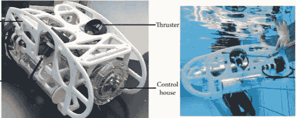

图 1. AUV 和竞赛环境。

### 文献综述

本研究的主要贡献是引入深度学习方法，以实现模糊海水中的鱼类识别。因此，该方法通过适用的神经网络将计算机视觉改进到 AUV 系统中。

### 计算机视觉

计算机视觉使用带有成像传感器的计算机来模仿人类视觉功能，从获得的数据集中提取特征，并对其进行分析和分类，以辅助决策。它通常涉及高级计算机编程、图像处理、人工智能 (AI) 等许多知识领域。例如，制造业使用它来检查大量产品中的缺陷或提高质量 [11, 12]。在机场和其他安检点，面部检测和情绪观察有成熟的应用 [13–15]。医生使用某些诊断软件来帮助从医学影像中识别肿瘤和其他异常组织 [16]。农业采用计算机视觉作为决策系统来预测田地产量 [17]。Google 正在设计自己的自动驾驶汽车，其视觉范围约为 328 英尺，汽车可以识别交通标志并避开行人 [18]。许多最先进的例子表明，计算机正在改变我们的日常生活。为了提高性能，除了传统的图像处理技术外，模仿我们大脑的深度学习算法也被广泛采用。

### 深度学习

带有神经网络的深度学习概念几十年前就已出现。它最初由研究人员 LeCun 等人于 1998 年开发 [19]。他使用卷积神经网络 (CNN) 设计了一个名为 LeNet5 的五层分类器。由于计算能力的显著提高和大数据的爆炸式增长，深度学习在过去几年中取得了巨大成就。深度学习基于在某个领域收集的大数据。来自海量数据的学习资源至关重要。深度意味着神经网络有许多层来模仿我们的大脑。随着高性能 GPU、ASIC 加速器、云存储和强大计算设施的出现，现在有可能收集、管理和分析大数据集。因为只有数据集足够大，才能解决深度学习中的过拟合问题。而且，增强的计算能力可以加速耗时的训练过程。

基于深度学习的方法越来越多地应用于许多领域，并在计算机视觉和物体检测方面相较于传统算法具有显著优势。许多机器人系统的性能通过融合深度学习得到了提高。以谷歌的 AlphaGo 为


## 神经网络

举例来说，它研究了人类的学习行为，并在此基础上与著名的围棋选手竞争 [20]。要在计算机视觉中培养深度学习，事先收集的足够图像示例至关重要。ImageNet 是一个很好的示例 [21]。本研究的一项贡献包括开发海洋鱼类数据库以支持训练和测试。然而，学习算法同样重要。传统计算机视觉和图像处理方法在特征提取的准确性方面存在不足，而深度学习方法可以通过神经网络来改进这一技术。

近年来，深度学习中的神经网络变得越来越流行。2012 年，研究者 Krizhevsky 等人采用 CNN 在 ImageNet 大规模视觉识别挑战赛 [22, 23] 中完成图像分类，测试准确率显著高于传统算法。由于这一成就，基于神经网络的深度学习兴趣被提升 [24]。2014 年，Ross 等人提出了一种名为 Fast R-CNN 的算法，旨在将物体识别转化为回归问题 [25]。与 2012 年 ImageNet 大规模视觉识别挑战赛中之前的最佳结果 53.3% 相比，平均平均精度提高了近 30%。计算量巨大，因为每张图像中数千个不同尺寸的候选区域的特征都会被提取。由于 Faster R-CNN 大幅降低了计算负担，最近它已被广泛应用于涉及目标检测、图像分类和物体识别的计算机视觉领域。在 Facebook 提出的 YOLO 也是相关研究的一个里程碑 [26, 27]。

## 材料与方法

本文介绍了一种带有图像分割的 CNN 模型，用于检测模糊海水中的鱼类。开发了特定的数据集以支持本研究。采用了数据增强变换方案以获得更多学习资源，因为该特定环境中的原始图像不足以用于训练目的。为了解决过拟合问题，应用了 dropout 算法。由于我们的目标是将此系统集成到需要实时应用的 AUV 中，因此讨论了一些权衡以减少处理时间。本节详细阐述了带有优化方法的系统设计。

## CNN 架构

CNN 模型通常由许多层组成，例如输入层、带有非线性单元的卷积层以及全连接层 [28, 29]。图 2 展示了 CNN 的一个示例。第一层是输入层，它从外部世界接收图像信息作为学习资源。接下来的层是卷积层，负责从图像中提取特征。卷积操作是常见的数学运算之一。两个离散函数的卷积公式如 Equation (1) 所示：

```
(f * g)[n] = \sum_{m=-\infty}^{\infty} f[m]g[n - m].
```

(1)

图 2. RGB 彩色图像上的卷积操作 [30]。

该数据集包含 256 级的 RGB 彩色图像。下面的 3×3 矩阵 W0 被称为内核或滤波器。在实践中，卷积操作分别在 R、G 和 B 通道上执行，然后将结果相加以获得特征图中的每个元素，如图 2 所示。

为了更准确地提取对象的特征，每个卷积层中使用大量滤波器。例如，为了提取边缘、纹理等特征，如图 3 所示有相应的滤波器可用。

执行卷积操作时，需要考虑特征图的大小。有三个主要因素影响其大小：深度、步幅和填充。图 4 说明了深度为 3、步幅为 1 且带零填充的特征图。对于复杂的神经网络，两个相邻层之间通常有两种连接类型，如图 5 所示，分别是全连接层和局部连接神经层。对于全连接神经网络，输入层中的所有像素都与隐藏层中的每个神经元相连，如图 5(a) 所示。CNN 的最后两层通常是全连接层，分别是 softmax 层和输出层。由于大量参数会增加计算量并延迟处理。对于局部连接神经网络，输入层中仅部分像素与隐藏层中的下一个神经元相连，如图 5(b) 所示。这种连接类型将减少连接数量并加快系统速度。

| Operation | Filter | Feature map |
|---|---|---|
| 恒等 | \(\begin{bmatrix} 0 & 0 & 0 \\ 0 & 1 & 0 \\ 0 & 0 & 0 \end{bmatrix}\) | ![Feature map] |
| 边缘检测 | \(\begin{bmatrix} 1 & 0 & -1 \\ 0 & 0 & 0 \\ -1 & 0 & 1 \end{bmatrix}\) | ![Feature map] |
| | \(\begin{bmatrix} 1 & 1 & 0 \\ 1 & -4 & 1 \\ 0 & 1 & 0 \end{bmatrix}\) | ![Feature map] |
| | \(\begin{bmatrix} -1 & -1 & -1 \\ -1 & 8 & -1 \\ -1 & -1 & -1 \end{bmatrix}\) | ![Feature map] |
| 锐化 | \(\begin{bmatrix} 0 & -1 & 0 \\ -1 & 5 & -1 \\ 0 & -1 & 0 \end{bmatrix}\) | ![Feature map] |
| 盒模糊 | \(\frac{1}{9} \begin{bmatrix} 1 & 1 & 1 \\ 1 & 1 & 1 \\ 1 & 1 & 1 \end{bmatrix}\) | ![Feature map] |
| 高斯模糊 | \(\frac{1}{16} \begin{bmatrix} 1 & 2 & 1 \\ 2 & 4 & 2 \\ 1 & 1 & 1 \end{bmatrix}\) | ![Feature map] |

图 3. 图像特征提取中的卷积操作应用 [31]。

CNN 中的卷积层使用局部连接，如图 6 所示。例如，特征图中的值 8 仅与输入图像中的 3×3 矩阵 [0, 0, 0; 0, 1, 1; 0, 1, 2] 相连，与输入图像像素的其余部分无关。

该 CNN 所有层的全连接或局部连接参数列于表 1 中。

图 7 以简化方式可视化了系统。

## 使用 ImageNet 数据集进行系统验证

在将本系统应用于本研究开发的海洋鱼类数据集之前，作者从著名的 ImageNet ILSVRC [21] 下载图像，通过物体分类进行系统验证测试。共有 500 张图像，涵盖 20 个类别，范围从鱼、珊瑚、海龟、青蛙、船等。这里所有 RGB 图像均重新缩放到 448×448。实测值图像是通过手动操作标注软件获得的。每张图像被分为 7×7 单元格的网格。每个单元格将预测两个边界框的位置信息和类别信息，这些信息组成一个 1×1×30 向量。该向量包含对象中心坐标 (X, Y)、边界框的宽度 w 和高 h、置信度分数，以及鱼的预测概率，如图 8 所示。为了预测图像中的目标位置，目标被显示在一个边界框中。实测值和预测之间总是存在误差。开发了损失函数来衡量误差，包含三部分：坐标误差、(Intersection over union) IoU 误差和类别误差。Equation (2) 给出了损失函数的数学形式。

```
Loss = \sum_{i=0}^{S} coordError + IoUError + classError.
```

这里，IoU 用于衡量位置精度，如图 9 所示。

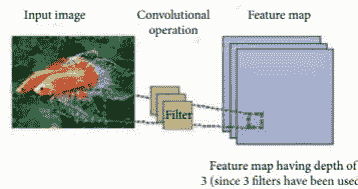

图 4. 使用卷积操作的特征提取器。

图像中每个网格单元将预测 B 个边界框以围住对象，从而预测对象的定位和类别。此外，每个边界框还有一个置信度。置信度分数与对象的类别无关。它只是描述预测框实际围住真实对象的确定程度。

Confidence = Pr(object) × IOU, (3)

where Pr(object) represents the probability of the object of interest. If there is an object in the grid cell, the Pr(object) is 1; otherwise, it is 0.

Usually, loss function is in the form of the sum of squared errors as shown below [33]. It consists of three parts which are localization errors, confidence errors, and probabilities errors.

Loss = \sum_{i=0}^{S^2} \sum_{j=0}^{B} [(x_i - \hat{x}_i)^2 + (y_i - \hat{y}_i)^2 + (w_i - \hat{w}_i)^2 + (h_i - \hat{h}_i)^2] + \sum_{i=0}^{S^2} \sum_{j=0}^{B} (C_i - \hat{C}_i)^2 + \sum_{i=0}^{S^2} \sum_{C \in classes} (P_i(c) - P_i(\hat{c}))^2, (4)

where x_i, y_i are the ground truth coordinates of objects center; w_i, h_i are the width and height of the ground truth bounding box; \hat{x}_i \hat{y}_i are the predicted coordinates of the objects center; \hat{w}_i \hat{h}_i are the width and height of predicted bounding box. Above Figure 10 shows one set of output with confidence values from different classes.

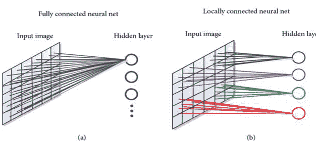

图 5. 全连接神经网络和局部连接神经网络 [32]。


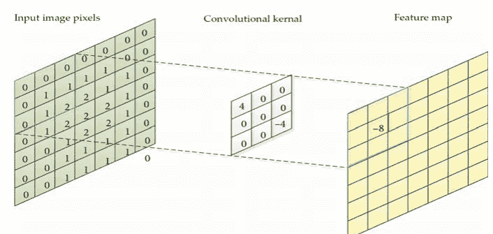

**图 6.** 使用局部连接的卷积操作。

## 真实海洋环境中的基础真值准备

在对无噪声的完美图像测试了 CNN 系统之后，下一步是构建我们自己的海洋鱼类数据集。因为难以获得其他类型物体（如海龟、珊瑚等）的图像。作为研究的一部分，鱼是唯一需要检测的对象。在收集的 410 张图像中，许多图像包含多条鱼，因此检测具有挑战性。采用相同的方法创建基础真值图像。之前引入的所有参数保持不变，仅类别信息由 1×1×18 向量组成，而不是 1×1×30，因为类别数量减少了。图 11 显示了一个标注图像示例。很明显，这个数据集与 ImageNET 的理想图像完全不同。

## 数据增强

由于深度学习基于大规模训练数据集，以便系统学习并建立识别知识，必须提供足够的数据作为学习资源来提取物体特征 [34]。

数据缺乏会导致过拟合问题。图像在墨西哥湾的真实水下环境中收集，并将用于提取物体特征。然而，从特定环境收集的原始图像数量不足以训练系统。因此，几何上执行了数据增强变换，改变了像素位置，而图像特征保持不变，如图 12 所示。采用了四种数据增强变换，使原始图像数量翻倍，从而使训练数据集足够。

- (1) 旋转：按随机角度旋转图像；
- (2) 缩放：根据设置的缩放因子将图像缩放到不同大小；
- (3) 裁剪：裁剪图像补片；
- (4) 镜像对称：水平或垂直翻转原始图像

## Dropout 算法

深度学习中的常见问题之一是过拟合，即测试精度远低于训练精度的情况。在此情况下，使用真实世界训练数据构建了一个高性能特征模型。

如果发现存在过拟合问题，模型的鲁棒性值得考虑。除了学习数据不足也会导致过拟合问题外，神经网络中巨大的参数数量也会导致过拟合问题。因此，将 Dropout 算法 [35] 引入系统以简化模型，如图 5 所示。

表 1. 带图像分割的 CNN 模型参数

| 层 | 输入大小 | 过滤器大小 | 步长 | 输出大小 |
| :--- | :--- | :--- | :--- | :--- |
| 卷积 1 | [N x 448 x 448 x 3] | [7x7x3x64] | 2 | [N x 224 x 224 x 64] |
| 最大池化 1 | [N x 224 x 224 x 64] | [2 x 2] | 2 | [N x 112 x 112 x 32] |
| 卷积 2 | [N x 112 x 112 x 32] | [3 x 3 x 32 x 192] | 1 | [N x 112 x 112 x 192] |
| 最大池化 2 | [N x 112 x 112 x 192] | [2 x 2] | 2 | [N x 56 x 56 x 96] |
| 卷积 3 | [N x 56 x 56 x 96] | [3 x 3 x 128 x 256] | 1 | [N x 56 x 56 x 256] |
| 卷积 4 | [N x 56 x 56 x 128] | [3 x 3 x 128 x 256] | 1 | [N x 56 x 56 x 256] |
| 卷积 5 | [N x 56 x 56 x 256] | [1 x 1 x 256 x 256] | 1 | [N x 56 x 56 x 256] |
| 卷积 6 | [N x 56 x 56 x 256] | [3 x 3 x 256 x 512] | 1 | [N x 56 x 56 x 512] |
| 最大池化 3 | [N x 56 x 56 x 512] | [2 x 2] | 2 | [N x 28 x 28 x 256] |
| 卷积 7 | [N x 28 x 28 x 256] | [1 x 1 x 256 x 256] | 1 | [N x 28 x 28 x 256] |
| 卷积 8 | [N x 28 x 28 x 256] | [1 x 1 x 256 x 256] | 1 | [N x 28 x 28 x 256] |
| 卷积 9 | [N x 28 x 28 x 256] | [1 x 1 x 256 x 256] | 1 | [N x 28 x 28 x 256] |
| 卷积 10 | [N x 28 x 28 x 256] | [1 x 1 x 256 x 256] | 1 | [N x 28 x 28 x 256] |
| 卷积 11 | [N x 28 x 28 x 256] | [3 x 3 x 256 x 512] | 1 | [N x 28 x 28 x 512] |
| 卷积 12 | [N x 28 x 28 x 512] | [3 x 3 x 512 x 512] | 1 | [N x 28 x 28 x 512] |
| 卷积 13 | [N x 28 x 28 x 512] | [3 x 3 x 512 x 512] | 1 | [N x 28 x 28 x 512] |
| 卷积 14 | [N x 28 x 28 x 512] | [3 x 3 x 512 x 512] | 1 | [N x 28 x 28 x 512] |
| 卷积 15 | [N x 28 x 28 x 512] | [1x1x512x512] | 1 | [N x 28 x 28 x 512] |
| 卷积 16 | [N x 28 x 28 x 512] | [3x3x512x1024] | 1 | [N x 28 x 28 x 1024] |
| 最大池化 4 | [N x 28 x 28 x 1024] | [2x2] | 2 | [N x 14 x 14 x 512] |
| 卷积 17 | [N x 14 x 14 x 512] | [1x1x512x256] | 1 | [N x 14 x 14 x 256] |
| 卷积 18 | [N x 14 x 14 x 256] | [3x3x256x1024] | 1 | [N x 14 x 14 x 1024] |
| 卷积 19 | [N x 14 x 14 x 1024] | [1x1x1024x512] | 1 | [N x 14 x 14 x 512] |
| 卷积 20 | [N x 14 x 14 x 512] | [3x3x512x1024] | 1 | [N x 14 x 14 x 512] |
| 卷积 21 | [N x 14 x 14 x 1024] | [3x3x512x1024] | 1 | [N x 14 x 14 x 1024] |
| 卷积 22 | [N x 14 x 14 x 1024] | [3x3x1024x1024] | 1 | [N x 7 x 7 x 1024] |
| 卷积 23 | [N x 7 x 7 x 1024] | [3x3x1024x1024] | 2 | [N x 7 x 7 x 1024] |
| 卷积 24 | [N x 7 x 7 x 1024] | [3x3x1024x1024] | 1 | [N x 7 x 7 x 1024] |
| 全连接 1 | [N x 7 x 7 x 1024] | [1024x4] | 多 | [1x4096] |
| 全连接 2 | [1x4096] | [4096x7x7x30] | 多 | [7x7x30] |

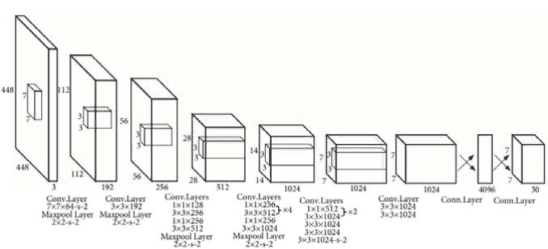

**图 7.** 用于物体识别的 CNN 架构 [26]。

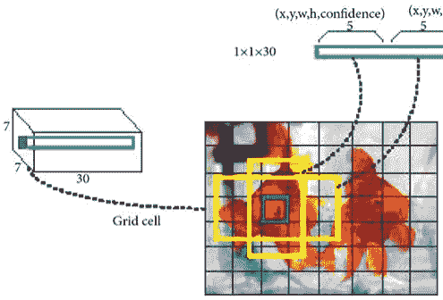

**图 8.** 使用 ImageNET 的 CNN 模型输出。

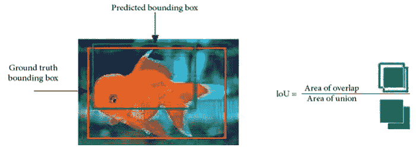

**图 9.** 交并比。

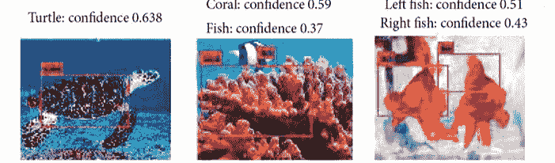

**图 10.** ImageNET 数据集的物体分类结果。

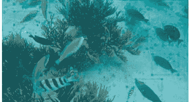

**图 11.** 标注的基础真值。

Dropout 意味着在学习过程中，根据概率设置临时从网络中移除一些节点。在实践中，只有在存在某些隐藏关系时才能提取某些特征，这降低了深度学习模型的鲁棒性。另一方面，Dropout 移除了节点之间的隐藏固定关系，从而可以提高抗干扰能力并在一定程度上解决过拟合问题。L1 和 L2 正则化是通过修改代价函数实现的，而 Dropout 是通过修改神经网络本身来实现的，这是训练网络时使用的一种技术。在训练过程的每次迭代中，作者随机丢弃一些神经元，并为网络的每一层设置消除节点的概率。例如，该值设置为 0.5，如图 13 左侧所示。神经元被丢弃，然后移除来自该节点的连接，最终得到一个节点更少、规模更小的网络。训练期间的网络结构将简化为图 13 右侧所示的结构。

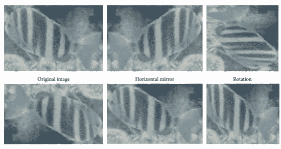

**图 12.** 数据增强变换。

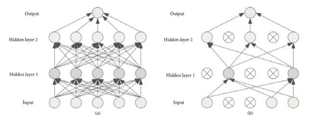

**图 13.** 标准神经网络模型 (a) 和带有 Dropout 的网络模型 (b) [35]。

## 优化损耗函数

YOLO 根据文献 [26] 改进了方程 (4) 和 (5) 中的损耗函数。三个系数按照其对损耗的贡献比例放置在误差项之前。如方程 (5) 所示，前两项与利用 x 和 y 对识别对象进行坐标定位有关，以表示对象位置，而 w 和 h 指边界框的宽度和高度。为了使前两项具有更大的权重，\(\gamma_{coord}\) 被赋予最大值，其值为 5。因此，定位误差的权重得到了增强。关于 IoU 误差计算，当对象中心落在此单元格时，应增加 IoU 误差的权重以准确预测位置。\(\gamma_{noobj}\) 的值设置为 0.5 以优化 IoU 误差。对于相同的误差值，大对象误差对检测的影响应小于小对象误差对检测的影响。这是因为相同的偏差占大对象比例远小于相同偏差占小对象比例。因此，应增加较大对象 IoU 误差对损耗的贡献。选择宽度和高度的平方根来替代其原始形式。对于相同的偏差值，大框的平方根误差小于小框。

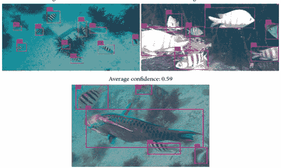

**图 14.** 数据增强提高识别精度。

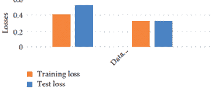

**图 15.** 训练损耗对比。


Loss = \(\lambda_{coord} \sum_{i=0}^{S'} \sum_{j=0}^{B} [1_{ij}^{obj}(x_i - \hat{x}_i)^2 + (y_i - \hat{y}_i)^2]\)
\(+ \lambda_{coord} \sum_{i=0}^{S'} \sum_{j=0}^{B} 1_{ij}^{obj} [(\sqrt{w_i} - \sqrt{\hat{w}_i})^2 + (\sqrt{h_i} - \sqrt{\hat{h}_i})^2]\)
\(+ \sum_{i=0}^{S'} \sum_{j=0}^{B} 1_{ij}^{obj}(C_i - \hat{C}_i)^2 + \lambda_{noobj} \sum_{i=0}^{S'} \sum_{j=0}^{B} 1_{ij}^{noobj}(C_i - \hat{C}_i)^2\)
\(+ \sum_{i=0}^{S'} 1_{ij}^{obj} \sum_{C \in class} (P_i(c) - P_i(\hat{c}))^2\).

本文作者改进了损失函数以适应多鱼类应用。提出的损失函数经过正则化，以减少小数据集和过拟合问题。L2 正则化是在代价函数之后添加一个正则化函数，如公式 (6) 和 (7) 所示。

Loss = \(\sum_{i=0}^{S'} (coordError + IoUError + classError)\)
+ L2 Regularization,

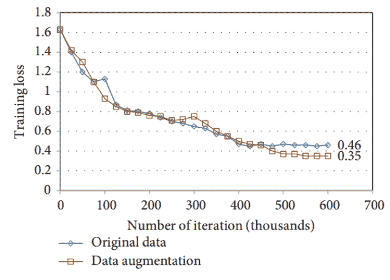

图 16. 数据增强对过拟合的影响。

Loss=\lambda_{coord}\sum_{i=0}^{S}\sum_{j=0}^{B}\left[1_{ij}^{obj}(x_i-\hat{x}_i)^2+(y_i-\hat{y}_i)^2\right]

+ \lambda_{coord}\sum_{i=0}^{S}\sum_{j=0}^{B}1_{ij}^{obj}\left[(\sqrt{w_i}-\sqrt{\hat{w}_i})^2+\left(\sqrt{h_i}-\sqrt{\hat{h}_i}\right)^2\right]

+ \sum_{i=0}^{S}\sum_{j=0}^{B}1_{ij}^{obj}(C_i-\hat{C}_i)^2 + \lambda_{noobj}\sum_{i=0}^{S}\sum_{j=0}^{B}1_{ij}^{noobj}(C_i-\hat{C}_i)^2

+ \sum_{i=0}^{S}1_{ij}^{obj}\sum_{C\epsilon class}(P_i(c)-P_i(\hat{c}))^2 + \frac{\lambda}{2n}\sum_{w}w^2.

最后一项是 L2 正则化项，即所有参数 w 的平方和除以训练集的样本量 n。\(\lambda\) 是正则项的系数，用于权衡正则项与其他项的比例。还有一个系数 1/2，1/2 常出现，主要是为了方便后续计算结果，后续计算会产生一个 2，乘以 1/2 正好抵消。L2 如何减少过拟合的原理和步骤见参考文献 [31]。

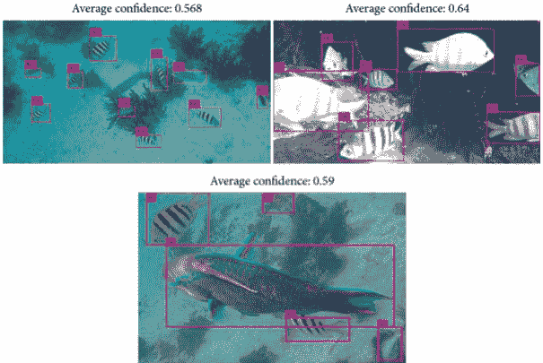

图 17. 使用 Dropout 提高识别准确率。

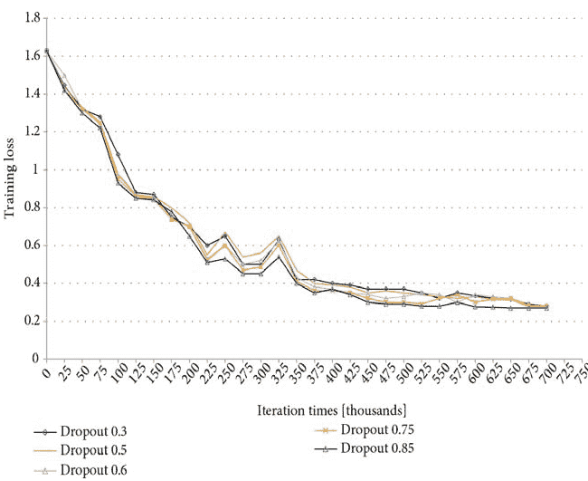

图 18. Dropout 对训练损失的影响。

## 结果与讨论

实验实现基于公开可用的 Tensorflow 工具箱和 Python 语言编程。硬件平台基于具有 4G 显存的 GeForce GTX 745 GPU 构建。实验基于前述三个标准进行，分别比较了性能、训练损失和测试损失。

## 数据增强的实验结果

通过采用数据增强变换方法，图像数量翻了一番，这意味着该方法可以帮助机器更准确地学习特征。我们使用测试数据集来评估模型。结果表明，使用数据增强后，机器识别感兴趣对象的准确性高于不使用数据增强的结果，实验结果如图 14 所示。

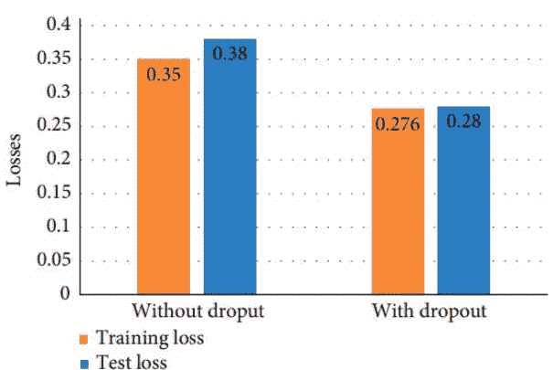

图 19. Dropout 对过拟合的影响。

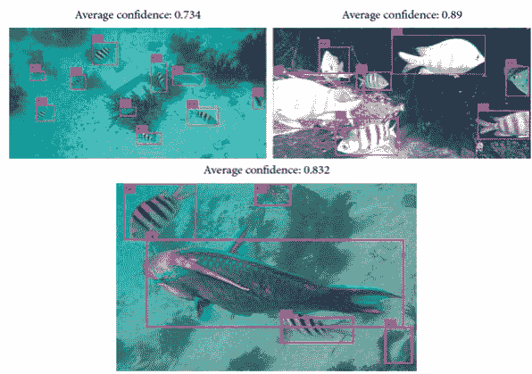

图 20. 通过改进损失函数提高识别准确率。

从图 14 可以清楚地看出，图像中的鱼被准确识别；三张示例图像的平均置信度分别为 0.568、0.65 和 0.59。

从图 15 可以观察到，使用原始数据的拟议神经网络模型的最终训练损失为 0.35，而使用数据增强的最终训练损失为 0.46。这清楚地表明，数据增强变换对于降低训练损失非常有帮助。

图 16 说明了随着迭代次数增加的训练损失。迭代次数设置为 0 到 600。训练损失与测试损失之间的差异分别从 1.6 降低到 0.46 和 0.35。过拟合问题在很大程度上得到了解决。

## Dropout 的实验结果

在此测试中，隐藏层中的神经元被随机选中从该网络中移除。这样，得到一个简化的深度神经网络。图 17 显示，每张示例图像的平均置信度大幅提高；Dropout 方法的识别效果得到高度增强。

Dropout 的训练损失如图 18 所示。可以看出，使用 Dropout 时最终训练损失为 0.28，不使用时为 0.35。Dropout 算法有助于降低训练损失。在这个特定应用中，当 Dropout 为 0.85 时，训练损失始终最小（图 18）。采用 Dropout 方法后，从图 19 可以看出，训练损失与测试损失之间的差异从 0.03 减少到 0.004。使用 Dropout 时，训练损失与测试损失之间只有微小差异。过拟合问题在很大程度上得到了解决。因此，我们构建的模型是适用的。

## 损失函数对算法性能的实验结果

作者使用了带有图像分割的 CNN 模型，并反向传播改进损失函数的梯度以更新网络中的参数。通过改进损失函数，预测变得更加准确，如图 20 所示。


图 21. 损失函数对训练损失的影响。

如图 21 所示，当迭代次数为 575 时，模型收敛。最终训练损失为 0.18。然而，使用平方和损失函数时，当迭代次数为 650 时，收敛点为 0.27。

## 讨论

通过设计和优化选择，设计并仿真了一个基于深度学习的鱼类检测模块。随着准确度的提高和处理时间的缩短，将所提方法应用于 AUV 实现非常有前景。Tensorflow 工具箱和 Python 编程接口与当前先进的微控制器平台兼容。

## 结论

本文作者构建了一个神经网络模型来完成鱼类检测。为了在训练过程中拥有足够的数据集，采用了数据增强方法。选择 Dropout 算法来解决过拟合问题。此外，改进了损失函数以更新网络内部参数。通过这些方法，训练时间和训练损失均大幅降低。本文的贡献总结如下：(1) 建立包含真实模糊海洋水况的数据集；(2) 修改 CNN 中的损失函数和其他参数，以探索鱼类检测的适用解决方案；(3) 该系统面向 AUV 设计的嵌入式系统，采用所有可能的优化。

## 致谢

该工作由美国 NSF 拨款 #1332566、#1827243 和 #1411260 赞助。

## 参考文献

- 1. R. B. Wynn, V. A. I. Huvenne, T. P. Le Bas 等人，“自主水下载具（AUV）：其在海洋地科学发展中的过去、现在和未来贡献”，《海洋地质》，第 352 卷，第 451–468 页，2014 年。M. Dinc 和 C. Hajiyev，“自主水下载具导航系统集成”，《海洋工程与技术杂志》，第 14 卷，第 1 期，第 32–43 页，2015 年。
- 2. Y. Zhou, S. Cui, Y. Wang 和 C. Ai，“自主水下载具（AUV）控制单元设计”，载于 2015 ASEE GulfSouthwest 年会，第 25–27 页，ASEE Gulf-South，圣安东尼奥，得克萨斯州，2015 年。
- 3. Y. Zhou, S. Cui, Y. Wang 和 L. Zhai，“基于 IMU 的 AUV 改进姿态算法”，载于第 15 届科学计算国际会议（CSC'17），第 16–22 页，CSREA Press ©，拉斯维加斯，内华达州，2017 年。
- 4. SAUVC, https://sauvc.org/#competition.
- 5. A. Cadena, P. Teran, G. Reyes, J. Lino, V. Yaselga 和 S. Vera，“开发用于底栖监测的混合自主水下载具”，载于 2018 年第 4 届控制、自动化与机器人国际会议（ICCAR）论文集，第 20–23 页，IEEE，奥克兰，新西兰，2018 年。
- 6. M. Eichhorn, H. C. Woithe 和 U. Kremer，“AUV 概念、机会和计划——技术实现中路径规划算法的并行化”，载于 2012 年也顺海洋会议，MTS/IEEE，韩国也顺，2012 年。
- 7. H. Taka, T. Sasaki 和 M. Wada，“利用卷积神经网络的渔业资源管理支持系统”，载于第 20 届无线个人多媒体通信国际研讨会（WPMC），第 442–447 页，IEEE，印度尼西亚巴厘岛，2017 年。
- 8. J. Kim, H. Cho, J. Pyo 和 B Yu S-C Kim，“基于前视声纳图像的卷积神经网络代理车辆检测”，载于 OCEANS 2016 MTS/IEEE 蒙特雷，IEEE，加利福尼亚州，美国，2016 年。
- 9. F. Xu, X. Ding, J. Peng 等人，“水下机器人视觉海洋小目标实时检测方法”，载于 2018 OCEANS – MTS/IEEE 神户技术海洋会议（OTO），IEEE，日本神户，2018 年。
- 10. C.-F. Chien, Y.-J. Chen, Y.-T. Han 等人，“面向晶圆厂节能和冷却机优化的 AI 与大数据分析以赋能”


智能制造，” in 2018年电子制造与设计协作研讨会（eMDC）论文集, pp. 1–4, IEEE, Hsinchu, Taiwan, 2018.

- 11. J. Jia, “工业装配检测的机器视觉应用,” in 2009年第二届国际机器视觉会议论文集, pp. 172–176, IEEE, Dubai, UAE, 2009.

- 12. S. Biswas, Y. Wang, and S. Cui, “基于对数-加伯小波的整容面部检测,” in 第12届国际计算机会议：小波有源媒体技术与信息处理（ICCWAMTIP）论文集, pp. 154–157, IEEE, Chengdu, China, 2015.

- 13. S. Cui, O. Ekwonnanah, and Y. Wang, “基于按键动态的情感分析,” in 2018年信息、电子与通信工程国际会议（IEECE2018）, pp. 28–29, DEStech Publications, Beijing, China, 2018.

- 14. S. Cui, Y. Wang, and O. Ekwonnanah, “用户认证的按键动态,” in 第4届控制论国际会议（CYBCONF）, pp. 5–7, Beijing, China, 2019.

- 15. Eman Abdel-Maksoud, Mohammed Elmogy, and Rashid AlAwadi, “基于混合聚类技术的脑肿瘤分割,” 埃及信息学杂志, vol. 16, no. 1, pp. 71–81, Cairo University, 2015.

- 16. Y. Wang, Y. Lan, Y. Zheng, K. Lee, S. Cui, and J. Lian, “基于UGV的测量树木几何特征的激光扫描仪系统,” vol. 8905, in 2013年SPIE光电检测与成像国际研讨会论文集, SPIE, Beijing, China, 2013.

- 17. B. Marr, “Waymo的关键里程碑——谷歌的自动驾驶汽车,” https://www.forbes.com/sites/bernardmarr/2018/09/21/keymilestones-of-waymo-googles-self-driving-cars/#3831b2965369.

- 18. Y. LeCun, L. Bottou, Y. Bengio, and P. Haffner, “应用于文档识别的基于梯度的学习,” IEEE学报, vol. 86, no. 11, pp. 2278–2324, 1998.

- 19. BBC News, “人工智能：谷歌AlphaGo战胜围棋大师李世石,” 2016.

- 20. 关于ImageNet, http://image-net.org/about-overview.

- 21. A. Krizhevsky, I. Sutskever, and G. E. Hinton, “基于深度卷积神经网络的ImageNet分类,” 神经信息处理系统进展, vol. 25, pp. 1106–1114, 2012.

- 22. J. Deng, A. Berg, S. Satheesh, H. Su, A. Khosla, and F. Li, “ImageNet2012大规模视觉识别挑战赛（ILSVRC2012）,” http://www.imagenet.org/challenges/LSVRC/2012/.

- 23. Z.-Q. Zhao, P. Zheng, S.-T. Xu, and X. Wu, “基于深度学习的目标检测：综述,” IEEE神经网络与学习系统汇刊, vol. 30, no. 11, pp. 3212–3232, 2019.

- 24. R. Girshick, “快速R-CNN,” in 2015年IEEE国际计算机视觉会议（ICCV）, pp. 1440–1448, IEEE, Santiago, Chile, 2015.

- 25. J. Redmon, S. Divvala, R. Girshick, and A. Farhadi, “只看一次：统一的实时目标检测,” in 2016年IEEE计算机视觉与模式识别会议（CVPR）论文集, pp. 779–788, IEEE, Las Vegas, NV, USA, 2016.

- 26. Q. Peng, W. Luo, G. Feng et al., “基于高斯混合模型和YOLO的变电站行人检测,” in 2016年第8届智能人机系统与控制论国际会议（IHMSC）, pp. 562–565, IEEE, Hangzhou, China, 2016.

- 27. S. Hassairi, R. Ejbali, and M. Zaied, “用于监督式阿拉伯字母图像分类的深度卷积神经小波网络,” in 2015年第15届智能系统设计与应用国际会议（ISDA）, pp. 207–212, IEEE, Marrakech, Morocco, 2015.

- 28. D. Zhang, G. Kopanas, C. Desai, S. Chai, and M. Piacentino, “融合流和客观性的无监督水下鱼类检测,” in 2016年IEEE计算机视觉冬季应用研讨会（WACVW）, pp. 1–7, IEEE, Lake Placid, NY, USA, 2016.

- 29. 用于识别的卷积神经网络, https://en.wikipedia.org/wiki/Kernel_(image_processing).

- 30. 内核（图像处理）, https://ujjwalkarn.me/2016/08/11/intuitive-explanation-convnets/.

- 31. 深度学习与机器学习, https://ireneli.eu/2016/02/03/deep-learning-05-talk-about-convolutionalneural-network.

- 32. M. Hu, Y. Yang, F. Shen, L. Zhang, H. Shen, and X. Li, “通过探索多方面知识和结构知识进行稳健的Web图像标注,” IEEE图像处理汇刊, vol. 26, no. 10, pp. 4871–4884, 2017.

- 33. J. Gaya, L. T. Gonçalves, A. Duarte, B. Zanchetta, P. Drews, and S. Botelho, “基于深度学习的视觉避障,” in 2016年第十三届拉丁美洲机器人研讨会和第四届巴西机器人研讨会（LARS/SBR）, pp. 7–12, IEEE, Recife, Brazil, 2016.

- 34. N. Srivastava, G. Hinton, A. Krizhevsky, I. Sutskever, and R. Salakhutdinov, “Dropout：防止神经网络过拟合的简单方法,” 机器学习研究杂志, vol. 15, pp. 1929–1958, 2014.

## 深度学习能否识别番茄叶片病害？

Keke Zhang^1, Qiufeng Wu^2, Anwang Liu^1, and Xiangyan Meng^2

^1东北农业大学工学院, Harbin 150030, China
^2东北农业大学科学学院, Harbin 150030, China

### 摘要

本文通过迁移学习应用深度卷积神经网络（CNN）来识别番茄叶片病害。AlexNet、GoogLeNet和ResNet被用作CNN的骨干网络。利用最佳组合模型改变结构，旨在探索CNN的全训练和微调性能。最佳模型ResNet配合随机梯度下降（SGD）、批量大小为16、迭代次数为4992以及从第37层到全连接层（表示为“fc”）的训练层，实现了识别番茄叶片病害的最高准确率97.28%。实验结果表明，所提出的技术在识别番茄叶片病害方面是有效的，并且可以推广到识别其他植物病害。

**引用：** Keke Zhang, Qiufeng Wu, Anwang Liu, Xiangyan Meng, “深度学习能否识别番茄叶片病害？”，多媒体进展, vol. 2018, Article ID 6710865, 10 pages, 2018. https://doi.org/10.1155/2018/6710865.

**版权：** © 2018 by 作者。本文是根据Creative Commons Attribution License分发的开放获取文章，该许可允许在任何媒介中不受限制地使用、分发和复制，前提是正确引用原始作品。

### 引言

番茄是一种在全球广泛种植的作物，含有丰富的营养、独特的味道和健康功效，因此在全世界的农业生产和贸易中发挥着重要作用。鑑于番茄在经济背景中的重要性，有必要通过使用技术来最大限度地提高生产力和产品质量。目壳孢叶斑病、早疫病、晚疫病、叶霉病、白枯病、双斑叶螨、病毒病和黄化叶卷病是番茄的8种常见病害[1–8]；因此，实时且精确的识别技术是必不可少的。

最近，由于CNN具有自学习机制，即在同一过程中提取特征并对图像进行分类[9]，CNN已成功应用于各种应用，例如书写者识别[10]、显著物体检测[11, 12]、场景文本检测[13, 14]、截断推理学习[15]、道路裂缝检测[16, 17]、生物医学图像分析[18]、从网络图像中预测面部属性[19]和行人检测[20]，并取得了更好的性能。

此外，CNN在考虑区域全局上下文信息的同时，能够提取更鲁棒、更具区分度的特征[10]，且CNN很少受自然图像中阴影、畸变和亮度的影响。随着CNN的快速发展，出现了许多强大的CNN架构，例如AlexNet [21]、GoogLeNet [22]、VGGNet [23]、Inception-V3 [24]、Inception-V4 [25]、ResNet [26]和DenseNets [27]。

从零开始训练深度神经网络需要大量数据和昂贵的计算资源。同时，我们有时在一个领域有一个分类任务，但只有其他领域的足够数据。幸运的是，迁移学习可以通过避免复杂的数据挖掘和数据标注工作来提高深度神经网络的性能[28]。在实践中，迁移学习包括两种方式[29]。一种选择是使用我们的数据作为输入来微调网络权重；注意的是，新数据必须调整大小以匹配预训练网络的输入大小。另一种方法是从预训练网络中获取学习到的权重，并将权重应用于目标网络。


在本工作中，首先，我们比较了 SGD [30] 和自适应矩估计（Adam）[30, 31] 在识别番茄叶病方面的性能。这些优化方法基于预训练网络 AlexNet [21]、GoogLeNet [22] 和 ResNet [26]。随后，选择了性能最高的网络架构，并开展了关于两个超参数（即批量大小和迭代次数）对准确率影响的实验。接着，我们利用先前实验中获得的合适超参数的网络，讨论了不同网络结构对识别任务的影响。我们认为，这对选择为其他类似问题微调预训练系统的研究人员来说是有意义的。

本文其余部分组织如下。第 2 部分概览相关工作。第 3 部分介绍数据集和三种深度卷积神经网络，即 AlexNet、GoogLeNet 和 ResNet。第 4 部分介绍本工作的实验和结果。第 5 部分总结全文。


图 1. 提出的工作流程图。

### 相关工作

基于计算机视觉的农作物病害识别研究一直是一个热门话题。早期，传统机器学习方法和浅层网络在农业领域被广泛采用。

Sannakki 等人 [32] 提出使用基于 k-means 的聚类对每个图像像素进行操作，以隔离感染斑点。他们获得的结果表明，他们通过机器视觉和模糊逻辑构建的分级系统对植物病害分级非常有用。Samanta 等人 [33] 提出了一种基于直方图的马铃薯疮痂病新型检测方法，并应用彩色图像分割技术提取强度模式。他们获得的最佳分类准确率为 97.5%。Pedro 等人 [34] 应用模糊决策来识别杂草形状，采用模糊多准则决策策略；他们达到了最佳准确率 92.9%。Cheng 和 Matson [35] 采用决策树、支持向量机（SVM）和神经网络来识别杂草和水稻；他们通过使用决策树达到了最佳准确率 98.2%。Sankaran 和 Ehsani [36] 使用二次判别分析（QDA）和 k 近邻（kNN）来分类感染溃疡病和黄龙病（HLB）的柑橘叶与健康柑橘叶；他们通过 kNN 得到了最高的总体准确率 99.9%。

最近，深度学习方法已广泛应用于植物病害识别。Cheng 等人 [37] 使用 ResNet 和 AlexNet 来识别农业害虫。同时，他们与 SVM 和 BP 神经网络进行了对比实验；最终，他们通过 ResNet-101 得到了最佳准确率 98.67%。Ferreira 等人 [38] 利用卷积神经网络（ConvNets）在大豆作物图像中进行杂草检测，并将这些杂草分为禾本科和阔叶杂草。他们达到的最佳准确率为 99.5%。Sladojevic 等人 [39] 构建了一个深度卷积神经网络，以自动分类和检测 15 类植物叶病。同时，他们的模型能够将植物与周围环境区分开来。他们获得了平均准确率 96.3%。Mohanty 等人 [40] 基于预训练的 AlexNet 和 GoogLeNet 训练了一个深度卷积神经网络，用于识别 14 种作物物种和 26 种疾病。他们在保留测试集上达到了 99.35% 的准确率。Sa 等人 [41] 提出了一种使用深度卷积神经网络进行果实检测的新方法。他们通过迁移学习调整了快速区域卷积神经网络（Faster R-CNN）模型。他们在田间农场数据集上得到了 0.83 的 F1 分数。

### 材料与方法

本文专注于通过深度学习识别番茄叶病。在本节中，首先展示了关于识别番茄叶病的抽象数学模型。同时，用公式描述了典型卷积神经网络（CNN）的过程。然后，介绍了数据集和数据增强。最后，我们介绍了本文采用的三种强大的深度神经网络，即 AlexNet、GoogLeNet 和 ResNet。

本工作中番茄叶病识别的主要过程可以抽象为一个数学模型（参见图 1）。首先，我们假设从番茄叶到病害的映射函数为 \( f: X \rightarrow Y \)，然后将训练样本发送到优化方法。假设集 H 表示具有不同参数的可能目标函数；通过一系列参数更新，我们可以得到最终假设 \( g \approx f \)。


**图 2.** 原始番茄叶图像。

典型的 CNN 过程可用以下公式表示。首先，将训练样本（即训练番茄叶图像）发送到分类器（即 AlexNet、GoogLeNet 和 ResNet）。然后，进行卷积操作；即，若干个滤波器在前一层的特征图上滑动，权重矩阵进行点积运算。

\( M_j^i = f \left( \sum_{k \in N_j} M_i^{l-1} * w_j^l + b_j^l \right) \) (1)

其中 f(·) 是激活函数，通常是整线性单元（ReLU）[42] 函数：

\( f \left( x \right) = max \left( x, 0 \right); \) (2)

N<sub>j</sub> 是某一层的核数，\( M_i^{l-1} \) 表示前一层的特征图，\( w_j^l \) 是权重矩阵，\( b_j^l \) 是偏置项。卷积操作后进行最大池化或平均池化。此外，学习到的特征被送入全连接层。Softmax 回归始终紧跟在最后一个全连接层之后，输入 x 将得到属于类别 i 的概率。

p(y=i|x;\theta) = \frac{e^{\theta_i^T x}}{\sum_{j=1}^k e^{\theta_j^T x}}

其中 y 是响应变量（即预测标签），k 是类别数，\theta 是我们模型的参数。

#### 原始数据集

本工作中使用的原始番茄叶数据集来自一个专注于植物健康的开放访问图像存储库 [43]。包含健康和其他 8 种病害类别（参见表 1、图 2），即：早疫病（病原体：Alternaria solani）[1]、黄叶卷曲病（病原体：Tomato Yellow Leaf Curl Virus (Tylcv)，科 Geminiviridae，属 Begomovirus）[2]、Corynespora 叶斑病（病原体：Corynespora cassiicola）[3]、叶霉病（病原体：Fulvia fulva）[4]、病毒病（病原体：Tomato Mosaic Virus）[5]、晚疫病（病原体：Phytophthora Infestans）[6]、Septoria 叶斑（病原体：Septoria lycopersici）[7]、以及双斑螨（病原体：Tetranychus urticae）[8]。总数据集为 5550。

#### 数据增强

深度卷积神经网络包含数百万个参数；因此，需要大量的数据。否则，深度神经网络可能会过拟合或不够稳健。减少图像数据集过拟合最常见的方法是手动扩大数据集并执行保持标签不变的变换 [21, 44]。

在本工作中，首先，原始图像数据集被划分为 80% 的训练样本和 20% 的测试样本，然后进行数据增强过程：

- 将图像从左到右翻转；
- 将图像从上到下翻转；
- 将图像对角翻转；
- 调整图像亮度，设置最大增量为 0.4；
- 调整图像对比度，设置比率从 0.2 到 1.5；
- 调整图像色相，设置最大增量为 0.5；
- 调整图像饱和度，设置比率从 0.2 到 1.5；
- 分别将图像旋转 90° 和 270°。

最终数据集如表 2 所示，第一行中的标签表示表 1 中给出的病害类别。

| 标签 | 类别 | 数量 | 叶片症状 | 说明 |
|---|---|---|---|---|
| 1 | Corynespora 叶斑病 | 547 | 出现小的棕色斑点，叶斑带有黄色光晕。 | 参见图 1 第一行 No.1-No.5 |
| 2 | 早疫病 | 405 | 出现黑色或棕色斑点，叶斑通常带有黄色或绿色同心圆环纹 | 参见图 1 第一行 No.6-No.10 |
| 4 | 晚疫病 | 726 | 出现水渍状环纹，迅速扩大形成紫褐色、油渍状斑块。 | 参见图 1 第二行 No.1-No.5 |
| 5 | 叶霉病 | 480 | 出现不规则的黄色或绿色区域。 | 参见图 1 第二行 No.6-No.10 |
| 6 | Septoria 叶斑 | 734 | 出现圆形斑点，边缘棕色，叶绿素缺失性黄化。 | 参见图 1 第三行 No.1-No.5 |
| 7 | 双斑螨 | 720 | 显示白色或黄色斑点，叶背有网纹。 | 参见图 1 第三行 No.6-No.10 |
| 8 | 病毒病 | 481 | 出现小的黄色或绿色，略微萎缩。 | 参见图 1 第四行 No.1-No.5 |
| 9 | 黄叶卷曲病 | 814 | 出现小叶并向上或向下卷曲，边缘黄化，丛生外观。 | 参见图 1 第四行 No.6-No.10 |
| 3 | 健康 | 643 | | 参见图 1 第五行 |
| 总计 | | 5550 | | |

#### 深度学习模型

#### AlexNet

AlexNet 是 ImageNet 大规模视觉识别挑战赛（ILSVRC）2012 的冠军，是一个深度卷积神经网络，拥有 6000 万个参数和 650,000 个神经元 [21]。本文采用的 AlexNet 架构如图 3 所示。AlexNet 架构由五个卷积层（即 conv1、conv2 等）组成，其中一些后面跟有最大池化层（即 pool1、pool2 和 pool5）、三个全连接层（即 fc6、fc7 和 fc8）以及输出端带有 softmax 激活的线性层。为了减少全连接层的过拟合，使用了一种名为“dropout”的正则化方法（即 drop6、drop7）[21]。ReLU 激活函数应用于前七个层中的每一个（即 relu1、relu2 等）[45]。在图 3 中，每个卷积层中的符号 m×m×n 表示每个层的特征图大小，4096 表示前两个全连接层的神经元数量。最后一个全连接层的神经元数量被修改为 9，因为本工作的分类问题有 9 个类别。此外，输入图像的大小必须调整为 227×227，以满足 AlexNet 的输入像素大小要求。


#### GoogLeNet

GoogLeNet 是一种 Inception 架构 [22]，是 ILSVRC 2014 的获胜者，拥有大约 6.8 百万个参数。GoogLeNet 的架构如图 4 所示。Inception 模块受 network in network [46] 启发，并使用 1×1、3×3 和 5×5 卷积层的并行组合，以及 3×3 最大池化层 [45]；在 3×3 和 5×5 卷积层之前的 1×1 卷积层用于降低空间维度并限制 GoogLeNet 的大小。GoogLeNet 的整体架构由一个接一个堆叠的 Inception 模块组成（参见图 4），包含九个 Inception 模块、两个卷积层、四个最大池化层、一个平均池化层、一个全连接层，以及输出端的带有 softmax 函数的线性层。GoogLeNet 在全连接层中使用 dropout 正则化，并在所有卷积层中应用 ReLU 激活函数 [29]。在这项工作中，GoogLeNet 的最后三层被替换为一个全连接层、一个 softmax 层和一个分类层；全连接层被修改为 9 个神经元，这等于番茄叶病害识别问题中的类别数。GoogLeNet 要求的输入图像大小为 224 × 224。

#### Table 2. 最终番茄叶数据集

| 标签 | 标签1 | 标签2 | 标签3 | 标签4 | 标签5 | 标签6 | 标签7 | 标签8 | 标签9 | 总计 |
|---|---|---|---|---|---|---|---|---|---|---|
| 训练集 | 3933 | 2916 | 4626 | 5229 | 3456 | 5283 | 5184 | 3465 | 5859 | 39951 |
| 测试集 | 110 | 81 | 129 | 145 | 96 | 147 | 144 | 161 | 163 | 1176 |


#### Figure 3. 本工作中 AlexNet 的架构

#### ResNet

深度残差学习框架是为解决退化问题而提出的。ResNet 由许多堆叠的残差单元组成，在 ILSVRC 2015 和 COCO 2015 分类挑战赛中获得第一名，误差率为 3.57% [26]。每个单元可以用以下公式表示 [47]：

\( y_l = h(x_l) + F(x_l, W_l) \) (4)

\( x_{l+1} = f(y_l) \) (5)

其中 \( x_l \) 和 \( x_{l+1} \) 分别是第 l 个单元的输入和输出，F 是残差函数。在 [26] 中 \( h(x_l) = x_l \) 是恒等映射，f 是 ReLU 函数 [42]。为 ResNet 设计了一个“瓶颈”构建块（参见图 5），包含两个 1×1 卷积，中间夹一个 3×3 卷积，以及直接跳过输入和输出的跳跃连接。1×1 层负责改变维度。ResNet 模型有 50、101 和 152 层三种类型。为节省计算资源和训练时间，我们选择了 ResNet50，它也具有高性能。在这项工作中，首先，ResNet 的最后三层被修改为一个全连接层、一个 softmax 层和一个分类层，全连接层被替换为 9 个神经元，这等于番茄叶病害的类别数。随后，我们修改了 ResNet 的结构。ResNet 的输入图像大小应满足 224 × 224。

### 实验与结果

本节介绍实验并讨论实验结果。所有实验均在 Windows 10 下使用 Matlab 实现，使用显存为 4G 的 NVIDIA GTX1050 GPU 或显存为 11G 的 NVIDIA GTX1080Ti GPU。在本文中，总体准确率被视为番茄叶病害检测每个实验的评价指标，即被正确分类的样本百分比：

\(\text{accuracy} = \frac{\text{true positive} + \text{true negative}}{\text{positive} + \text{negative}}\) (6)

其中，“true positive”是被分类为正例的正例实例数，“true negative”是被分类为负例的负例实例数，分母表示样本总数。此外，训练时间也被视为网络结构实验的额外性能指标。

### 优化方法实验

第一个实验旨在寻找 SGD [30] 和 Adam [30, 31] 之间适合番茄叶病害识别的优化方法，分别与预训练网络 AlexNet、GoogLeNet 和 ResNet 相结合。在这个实验中，每个网络的超参数设置如下：批大小设置为 32，初始学习率设置为 0.001，每 2 个 epoch 下降 0.5 倍，最大 epoch 设置为 5；即，迭代次数为 6240。至于 SGD 优化方法，动量设置为 0.9。对于 Adam，梯度衰减率 $\beta_1$ 设置为 0.9，平方梯度衰减率 $\beta_2$ 设置为 0.999，分母偏移 $\varepsilon$ 设置为 $10^{-8}$ [31]。不同网络的准确率如表 3 所示。此外，我们选择每个深度神经网络的较好结果，以展示微调过程中的训练损失随迭代次数的变化（参见图 6）。括号内的词表示相应的优化方法。

在表 3 中，采用 SGD 优化方法的 ResNet 获得最高测试准确率 96.51%。在番茄叶病害识别中，Adam 优化方法的性能不如 SGD 优化方法，尤其是与 AlexNet 结合时。在下文中，AlexNet (SGD)、GoogLeNet (SGD) 和 ResNet (SGD) 分别简称为 AlexNet、GoogLeNet 和 ResNet。

如图 6 所示，ResNet 的训练损失在早期迭代中迅速下降，并在 3000 次迭代后趋于稳定。与表 3 一致，AlexNet 和 GoogLeNet 的性能相似，且均不如 ResNet。


### Figure 4. GoogLeNet 的架构 [22, 45]

### Figure 5. ResNet 瓶颈残差构建块 [26]

### Table 3. 模型识别准确率

| 模型 | 准确率 |
| :--- | :--- |
| AlexNet (SGD) | 95.83% |
| AlexNet (Adam) | 13.86% |
| GoogLeNet (SGD) | 95.66% |
| GoogLeNet (Adam) | 94.06% |
| ResNet (SGD) | **96.51%** |
| ResNet (Adam) | 94.39% |

### 批大小和迭代次数实验

从优化方法实验中，ResNet 获得了最高的分类准确率。接下来，我们评估了批大小和迭代次数对 ResNet 性能的影响。批大小分别设置为 16、32 和 64。同时，迭代次数设置为 2496、4992 和 9984。不同训练场景的分类准确率如表 4 所示。同时，给出了每个标签代表的叶病害类别的分类准确率（参见表 1）。在这个实验中，初始学习率设置为 0.001，每 2496 次迭代下降 0.5 倍。

在表 4 中，批大小为 16 且迭代次数为 4992 的 ResNet 获得了最佳总体分类准确率 97.19%。如表 4 所示，无论是增加迭代次数还是批大小，相应模型在番茄叶病害识别中的性能均未得到显著提升。小批大小配合中等迭代次数在这项工作中非常有效。此外，较大的批大小和迭代次数会增加训练时间。我们没有尝试更高或更低的参数值，因为不同的分类任务可能有各种合适的参数，很难给出设置超参数的确定规则。


### Figure 6. 微调过程中的训练损失

### 完整训练和微调 ResNet 实验

本节旨在通过改变模型结构来探索 CNN 的性能。实际上，深度 CNN 通常具有较大规模，即大量参数。因此，深度 CNN 的完整训练需要大量计算资源且耗时。此外，当训练数据有限时，深度 CNN 的完整训练可能导致过拟合。因此，我们通过完整训练和微调其结构来比较预训练 CNN 的性能。

我们修改了 ResNet 的结构，并采用了前面实验中最佳参数的组合。


表 4. ResNet 微调过程中不同参数下的分类准确率。括号内的数字表示批次大小和迭代次数。

| 网络 | 标签1 | 标签2 | 标签3 | 标签4 | 标签5 | 标签6 | 标签7 | 标签8 | 标签9 | 整体 |
| :--- | :--- | :--- | :--- | :--- | :--- | :--- | :--- | :--- | :--- | :--- |
| ResNet (16, 2496) | 90.91% | 88.89% | 100% | 100% | 96.88% | 100% | 90.28% | 88.20% | 97.55% | 94.98% |
| **ResNet (16, 4992)** | **98.18%** | **98.77%** | **100%** | **98.62%** | **96.88%** | **100%** | **96.53%** | **88.82%** | **98.77%** | **97.19%** |
| ResNet (16, 9984) | 98.18% | 97.33% | 100% | 98.62% | 96.88% | 100% | 97.22% | 86.96% | 98.77% | 96.94% |
| ResNet (32, 2496) | 97.27% | 95.06% | 100% | 97.93% | 96.88% | 100% | 95.14% | 86.34% | 99.39% | 96.34% |
| ResNet (32, 4992) | 97.27% | 95.06% | 100% | 97.24% | 96.88% | 100% | 96.53% | 86.96% | 99.39% | 96.51% |
| ResNet (32, 9984) | 96.36% | 96.30% | 100% | 99.31% | 96.88% | 100% | 94.44% | 88.20% | 98.77% | 96.60% |
| ResNet (64, 2496) | 93.64% | 93.83% | 100% | 97.24% | 96.88% | 100% | 94.44% | 87.58% | 99.39% | 95.92% |
| ResNet (64, 4992) | 94.55% | 95.29% | 100% | 96.55% | 95.83% | 100% | 95.83% | 86.96% | 99.39% | 95.83% |
| ResNet (64, 9984) | 95.45% | 93.83% | 100% | 97.93% | 96.88% | 100% | 94.44% | 87.58% | 99.39% | 96.17% |

ResNet50 有 177 层（若计算每个构建块和连接的层）。在本实验中，ResNet 的最后三层被修改为全连接层（表示为“fc”）、Softmax 层和分类层，且全连接层包含 9 个神经元。通过将网络中某些层的学习率设为零来冻结其权重，从而改变了结构。训练期间，冻结层的参数不进行更新。全训练和微调由训练层的数量定义，即：全训练（第 1 层–“fc”）、微调（37–“fc”、79–“fc”、111–“fc”、141–“fc”、163–“fc”）。不同网络结构的准确率和训练时间如表 5 所示。起初，批次大小与 4992 次迭代相结合；初始学习率设为 0.001，每 2496 次迭代下降为原来的 0.1 倍。为了获得更具说服力的结论，表 4 中获得第二名的 ResNet (16, 9984) 也用于执行实验。

表 5 中展示了不同网络结构的准确率和训练时间。在两种情况下，即 ResNet 的 4992 次迭代和 9984 次迭代，37 层微调结构的模型准确率高于全训练模型。当迭代次数为 4992 时，79 层微调结构的模型准确率与全训练模型相等。表 5 的最后一列表示相应网络的训练时间，可以清楚地看出微调模型的训练时间大大低于全训练模型。由于冻结层的梯度不需要计算，冻结初始层的权重可以加快网络训练。我们观察到，适度微调模型（37–“fc”、79–“fc”、111–“fc”）始终带来优于或约等于全训练模型的性能。因此，我们建议，对于实际应用，适度微调模型可能是一个不错的选择。尤其是对于持有大量数据的研究人员，微调模型可以在节省计算资源和时间的同时取得良好的性能。

此外，利用 t 分布随机邻域嵌入（t-SNE）算法（参见图 7）[48]对 ResNet (16, 4992, 37–“fc”) 的最终全连接层特征进行了检查。使用了 1176 张测试图像来提取特征。在图 7 中，不同颜色代表不同标签；标签对应的疾病类别列于表 1 中。如图 7 所示，9 种不同颜色的点被清晰地分开，这表明从具有最优结构的 ResNet 中学习到的特征可用于精确分类番茄叶病。


| 标签1 | 标签2 | 标签3 | 标签4 | 标签5 |
|---|---|---|---|---|
| 标签6 | 标签7 | 标签8 | 标签9 | |

**图 7.** 使用 t-SNE 生成的高维特征二维散点图。

### 结论

本文集中于利用迁移学习和深度卷积神经网络识别番茄叶病。所使用的网络基于 AlexNet、GoogLeNet 和 ResNet 的预训练深度学习模型。首先，我们使用 SGD 和 Adam 优化方法比较了这些网络的相对性能，发现使用 SGD 优化的 ResNet 获得最高结果，最佳准确率为 96.51%。其次，进行了批次大小和迭代次数对 ResNet 迁移学习影响的性能评估。小批次大小 16 与适度迭代次数 4992 相结合是本工作中的最佳选择。我们的研究结果表明，对于特定任务，大批次大小或大迭代次数可能不会提高目标模型的准确率。批次大小和迭代次数的设置取决于您的数据集和所使用的网络。接下来，使用最佳组合模型对结构进行微调。将 ResNet 从第 37 层微调到“fc”在识别番茄叶病时获得了最高准确率 97.28%。基于可用数据的数量，逐层微调可能提供一种实用方法，以实现当前应用的最佳性能。我们相信，本工作获得的结果将为其他类似的视觉识别问题带来一些启发，并且本工作的实际研究可以轻松扩展到其他植物叶病识别问题。

表 5. 不同网络结构下的准确率和训练时间。括号内的值表示批次大小、迭代次数和训练层。

| 网络拓扑 | 准确率 | 时间 (min:sec) |
|---|---|---|
| ResNet (16, 4992, 1st-"fc") | 96.43% | 59min 30sec |
| ResNet (16, 4992, 37-"fc") | 97.28% | 44min 13sec |
| ResNet (16, 4992, 79-"fc") | 96.43% | 37min 27sec |
| ResNet (16, 4992, 111-"fc") | 95.75% | 30min 6sec |
| ResNet (16, 4992, 141-"fc") | 95.32% | 24min 15sec |
| ResNet (16, 4992, 163-"fc") | 92.69% | 19min 31sec |
| ResNet (16, 9984, 1st-"fc") | 96.94% | 118min 32sec |
| ResNet (16, 9984, 37-"fc") | 97.02% | 92min 53sec |
| ResNet (16, 9984, 79-"fc") | 96.77% | 72min 23sec |
| ResNet (16, 9984, 111-"fc") | 96.26% | 58min 40sec |
| ResNet (16, 9984, 141-"fc") | 95.75% | 47min 22sec |
| ResNet (16, 9984, 163-"fc") | 93.96% | 39min 32sec |

### 致谢

本研究得到国家科学技术支撑计划（2014BAD12B01-1-3）、公益行业（农业）科研专项二级（201503116-04-06）、黑龙江省博士后基金（LBHZ15020）、哈尔滨应用技术研究与开发计划（2017RAQXJ096）以及黑龙江省大豆产业技术协同创新体系大豆产业经济决策与预警（20170401）的支持。

### 参考文献

- 1. R. Chaerani 和 R. E. Voorrips，“番茄早疫病（Alternaria solani）：病原体、遗传学和抗病性育种，”《普通植物病理学杂志》，第 72 卷，第 6 期，页 335–347，2006。
- 2. A. M. Dickey, L. S. Osborne 和 C. L. Mckenzie，“木瓜（Carica papaya，Brassicales: Caricaceae）不是番茄黄叶卷曲病毒（TYLCV；Geminiviridae 科，Begomovirus 属）的寄主植物，”《佛罗里达昆虫学家》，第 95 卷，第 1 期，页 211–213，2012。
- 3. G. Wei, L. Baoju, S. Yanxia 和 X. Xuewen，“针对黄瓜、番茄和茄子的镰刀壳孢 Cassiicola 分离株致病性分化研究，”《园艺学报》，第 38 卷，第 3 期，页 465–470，2011。
- 4. P. Lindhout, W. Korta, M. Cislislk, I. Vos 和 T. Gerlagh，“来源于荷兰、法国和波兰的番茄上 Cladosporium fulvum (Fulvia fulva) 生理小种的进一步鉴定，”《荷兰植物病理学杂志》，第 95 卷，第 3 期，页 143–148，1989。
- 5. K. Kubota, S. Tsuda, A. Tamai 和 T. Meshi，“番茄花叶病毒复制蛋白抑制病毒靶向的转录后基因沉默，”《病毒学杂志》，第 77 卷，第 20 期，页 11016–11026，2003。
- 6. M. Tian, B. Benedetti 和 S. Kamoun，“来自 Phytophthora infestans 的第二种 Kazal 样蛋白酶抑制剂抑制并与番茄的细胞外致病相关蛋白酶 P69B 相互作用，”《植物生理学》，第 138 卷，第 3 期，页 1785–1793，2005。
- 7. L. E. Blum，“利用细菌和酵母减少番茄 Septoria lycopersici 叶斑的发病率和严重程度，”《Ciência Rural》，第 30 卷，第 5 期，页 761–765，2000。
- 8. E. A. Chatzivasiliaedis 和 M. W. Sabelis，“番茄腺毛中的甲基酮对 Koch 红蜱（Tetranychus urticae）的毒性，”《实验与应用螨学》，第 21 卷，第 6–7 期，页 473–484，1997。
- 9. M. Anthimopoulos, S. Christodoulidis, L. Ebner, A. Christe 和 S. Mougiakakou，“使用深度卷积神经网络进行间质性肺病的肺部模式分类，”《IEEE 医学影像交易》，第 35 卷，第 5 期，页 1207–1216，2016。
- 10. Y. Tang 和 X. Wu，“通过 CNN 特征和联合贝叶斯进行与文本无关的书写者识别，”载于《第 15 届手写识别前沿国际会议论文集，ICFHR 2016》，第 566–571 页，深圳，中国，2016 年 10 月。


- 11. Y. Tang and X. Wu, “基于CNN融合区域级和像素级预测的显著性检测,” 欧洲计算机视觉会议（ECCV）论文集, 第 1608–05186 页, 2016.

- 12. Y. Tang and X. Wu, “基于链式多尺度全卷积网络的显著物体检测,” ACM多媒体会议（ACMMM）, 第 618–626 页, 2017.

- 13. Y. Tang and X. Wu, “基于级联卷积神经网络的场景文本检测与分割,” IEEE图像处理学报, 第26卷, 第3期, 第 1509–1520 页, 2017.

- 14. Y. Tang and X. Wu, “使用基于超像素的笔画特征变换和基于深度学习的区域分类进行场景文本检测,” IEEE多媒体学报, 第20卷, 第9期, 第 2276–2288 页, 2018.

- 15. Y. Yao, X. Wu, Z. Lei, S. Shan, and W. Zuo, “基于相关滤波跟踪的联合表示与截断推断学习,” 欧洲计算机视觉会议（ECCV）论文集, 第 1–14 页, 2018.

- 16. L. Zhang, F. Yang, Y. Daniel Zhang, and Y. J. Zhu, “使用深度卷积神经网络的道路裂缝检测,” 第23届IEEE国际图像处理会议（ICIP 2016）论文集, 第 3708–3712 页, 美国亚利桑那州凤凰城, 2016年9月.

- 17. D. Xie, L. Zhang, and L. Bai, “视觉计算与信号处理中的深度学习,” 应用计算智能与软计算, 第2017卷, 文章编号 1320780, 13页, 2017.

- 18. Z. Zhou, J. Shin, L. Zhang, S. Gurudu, M. Gotway, and J. Liang, “用于生物医学图像分析的卷积神经网络微调：主动且增量式,” 第30届IEEE计算机视觉与模式识别会议（CVPR 2017）论文集, 第 4761–4772 页, 美国, 2017年7月.

- 19. Z. Liu, P. Luo, X. Wang, and X. Tang, “野外面部属性深度学习,” 第15届IEEE国际计算机视觉会议（ICCV 2015）论文集, 第 3730–3738 页, 智利圣地亚哥, 2015年.

- 20. W. Ouyang and X. Wang, “用于行人检测的联合深度学习,” 第14届IEEE国际计算机视觉会议（ICCV ’13）论文集, 第 2056–2063 页, 澳大利亚悉尼, 2013年12月.

- 21. A. Krizhevsky, I. Sutskever, and G. E. Hinton, “使用深度卷积神经网络的ImageNet分类,” 第26届神经信息处理系统年会（NIPS ’12）论文集, 第 1097–1105 页, 美国内华达州太浩湖, 2012年12月.

- 22. C. Szegedy, W. Liu, Y. Jia 等, “深入卷积,” IEEE计算机视觉与模式识别会议（CVPR ’15）论文集, 第 1–9 页, IEEE, 美国马萨诸塞州波士顿, 2015年6月.

- 23. K. Simonyan and A. Zisserman, “用于大规模图像识别的非常深的卷积网络,” https://arxiv.org/abs/1409.1556, 2015.

- 24. C. Szegedy, V. Vanhoucke, S. Iofe, J. Shlens, and Z. Wojna, “重新思考计算机视觉的Inception架构,” https://arxiv.org/abs/1512.00567, 2015.

- 25. C. Szegedy, S. Iofe, V. Vanhoucke, and A. Alemi, “Inceptionv4、Inception-ResNet及残差连接对学习的影响,” https://arxiv.org/abs/1602.07261, 2016.

- 26. K. He, X. Zhang, S. Ren, and J. Sun, “用于图像识别的深度残差学习,” 2016年IEEE计算机视觉与模式识别会议（CVPR 2016）论文集, 第 770–778 页, 2016年7月.

- 27. G. Huang, Z. Liu, K. Q. Weinberger, and L. van der Maaten, “密集连接卷积网络,” 2017年IEEE计算机视觉与模式识别会议（CVPR）论文集, 檀香山, 夏威夷, 美国, 2016年.

- 28. S.J. Pan and Q. Yang, “迁移学习综述,” IEEE知识与数据工程学报, 第22卷, 第10期, 第 1345–1359 页, 2010.

- 29. M. Mehdipour Ghazi, B. Yanikoglu, and E. Aptoula, “通过优化迁移学习参数使用深度神经网络进行植物识别,” 神经计算, 第235卷, 第 228–235 页, 2017.

- 29. S. Ruder, “梯度下降优化算法概述,” https://arxiv.org/abs/1609.04747, 2017.

- 31. D. P. Kingma and J. L. Ba, “Adam：一种随机优化方法,” https://arxiv.org/abs/1412.6980, 2017.

- 30. S. S. Sannakki, V. S. Rajpurohit, V. B. Nargund, R. Arun Kumar, and S. Prema Yallur, “基于机器视觉和模糊逻辑的叶片病害分级,” 计算机技术与应用国际期刊, 第2卷, 第5期, 第 1709–1716 页, 2011.

- 31. D. Samanta, P. P. Chaudhury, and A. Ghosh, “使用图像处理检测马铃薯痂病,” 计算机趋势与技术国际期刊, 第3卷, 第 109–113 页, 2012.

- 32. P. J. Herrera, J. Dorado, and A. Ribeiro, “基于形状描述子和模糊决策方法的杂草类型分类新方法,” 传感器, 第14卷, 第8期, 第 15304–15324 页, 2014.

- 33. B. Cheng and E. T. Matson, “用于自动水稻和杂草区分的基于特征的机器学习代理,” 人工智能与软计算国际会议, 第 517–527 页, 2015.

- 34. S. Sankaran and R. Ehsani, “用于黄龙病和柑橘溃疡病感染叶片分类的可见-近红外与中红外光谱比较,” 农业工程国际：CIGR期刊, 第15卷, 第3期, 第 75–79 页, 2013.

- 35. X. Cheng, Y. Zhang, Y. Chen, Y. Wu, and Y. Yue, “复杂背景下基于深度残差学习的害虫识别,” 农业中的计算机与电子学, 第141卷, 第 351–356 页, 2017.

- 36. A. dos Santos Ferreira, D. Matte Freitas, G. Gonçalves da Silva, H. Pistori, and M. Teophilo Folhes, “使用ConvNets进行大豆作物中的杂草检测,” 农业中的计算机与电子学, 第143卷, 第 314–324 页, 2017.

- 37. S. Sladojevic, M. Arsenovic, A. Anderla, D. Culibrk, and D. Stefanovic, “基于叶片图像分类的植物疾病深度神经网络识别,” 计算智能与神经科学, 第2016卷, 文章编号 3289801, 11页, 2016.

- 38. S. P. Mohanty, D. P. Hughes, and M. Salathé, “使用深度学习进行基于图像的植物疾病检测,” 植物科学前沿, 第7卷, 文章编号 1419, 2016.

- 39. I. Sa, Z. Ge, F. Dayoub, B. Upcroft, T. Perez, and C. McCool, “Deepfruits：一种使用深度神经网络的水果检测系统,” 传感器, 第16卷, 文章编号 1222, 第8期, 2016.

- 40. V. Nair and G. E. Hinton, “修正线性单元改进受限玻尔兹曼机,” 第27届国际机器学习会议（ICML ’10）论文集, 第 807–814 页, 以色列海法, 2010年6月.

- 41. D. P. Hughes and M. Salathe, “一个用于植物健康图像的开放存取库，以促进移动疾病诊断的开发,” https://arxiv.org/abs/1511.08060, 2016.

- 42. D. Ciresan, U. Meier, J. Masci, and J. Schmidhuber, “用于交通标志分类的神经网络委员会,” 2011年国际神经网络联合会议（IJCNN 2011 - 圣何塞）论文集, 圣何塞, 加利福尼亚州, 美国, 2011年7月.

- 43. P. Pawara, E. Okafor, O. Surinta, L. Schomaker, and M. Wiering, “用于植物识别的局部描述子与视觉词袋与深度卷积神经网络的比较,” 第6届模式识别应用与方法国际会议论文集, 第 479–486 页, 葡萄牙波尔图, 2017年2月.

- 44. M. Lin, “网络中网络,” https://arxiv.org/abs/1312.4400, 2014.

- 45. K. He, X. Zhang, S. Ren, and J. Sun, “深度残差网络中的恒等映射,” 欧洲计算机视觉会议论文集, 第 630–645 页, 2016.

- 46. L. van der Maaten and G. Hinton, “使用tSNE可视化数据,” 机器学习研究杂志, 第9卷, 第 2579–2625 页, 2008.

## 自然环境中植物识别的深度学习

孙宇，刘远，王冠，张海燕

北京林业大学信息科学与技术学院，
北京 100083，中国

### 摘要

植物图像识别已成为植物分类学和计算机视觉两个领域的交叉研究重点。本文提出了首个在自然场景中使用手机采集的植物图像数据集，该数据集包含北京林业大学校园内100种观赏植物的10,000张图像。设计了一个由8个残差模块组成的26层深度学习模型，用于自然环境中的大规模植物分类。所提模型在BJFU100数据集上达到91.78%的识别率，表明深度学习是智慧林业的一项有前景的技术。


### 引言

自动植物图像识别是弥合植物分类学缺口最具前景的解决方案，该方案在植物学和计算机社区均受到广泛关注。随着机器学习技术的进步，已有许多精巧模型被提出用于自动植物识别。随着智能手机的普及和 Pl@ntNet 移动应用 [1] 的出现，已采集了数百万张植物照片。基于移动设备的自动植物识别对现实世界中的社会生态监测 [2]、入侵外来植物监测 [3]、生态科学普及等至关重要。提升基于移动设备的植物识别模型性能正吸引越来越多学者和工程师的关注。

当前，许多研究致力于提取叶片、花朵或果实的局部特征。大多数研究者利用叶片特征的变化作为研究植物的比较工具，一些叶片数据集（包括瑞典叶片数据集、Flavia 数据集和 ICL 数据集）是标准基准。在 [4] 中，Söderkvist 提取了叶片的形状特征和矩特征，并利用前馈神经网络的反向传播分析了 15 个不同的瑞典树木类别。在 [5] 中，Fu 等人选择局部对比度及其他参数来描述叶脉周围像素的特征。人工神经网络被用于分割叶脉和其他叶片。实验表明，神经网络在识别叶脉图像方面更有效。Li 等人 [6] 提出了一种将蛇形技术与细胞神经网络相结合的高效叶脉提取方法，在叶片分割方面取得了满意结果。He 和 Huang 使用概率神经网络作为分类器来识别植物叶片图像，与 BP 神经网络 [7] 相比，其识别准确率更高。2013 年，提出了基于自然的叶片识别思想，并采用基于多边形叶片模型的轮廓分割算法来获取轮廓图像 [8]。随着深度学习成为图像识别领域的热点，Liu 和 Kan 提出了将纹理特征与形状特征相结合的方法，并使用深度置信网络架构作为分类器 [9]。Zhang 等人设计了一个包含八层卷积神经网络的深度学习系统来识别叶片图像，并取得了更高的识别率。一些研究者关注花朵。Nilsback 和 Zisserman 提出了一种视觉词袋方法来描述颜色、形状、纹理特征及其他特性 [10]。在 [11] 中，Zhang 等人结合了花卉图像的 Haar 特征与 SIFT 特征，使用非负稀疏编码方法对其编码，并使用 k-近邻方法进行分类。在 [12] 中，他们提出了一种通过集成 BP 神经网络来识别玫瑰采摘的方法。关于通过果实识别植物的研究相对较少。Li 等人提出了一种使用 preference Ainet 作为识别算法的多特征集成方法 [13]。经过多年对植物识别技术的持续探索，像 LeafSnap [14]、Pl@ntNet [1] 或 Microsoft Garage 的“花卉识别”应用 [15] 这样的专用移动应用可以方便地用于识别植物。

虽然自动植物分类研究已取得丰硕成果，但必须注意，这些模型距离完全自动化生态监测场景的要求仍有相当差距 [3]。上述数据集缺乏在自然场景中采集的基于移动设备的植物图像，这些图像在贡献者、相机、区域、一年中的不同时期、个别植物等方面差异巨大。传统分类模型高度依赖预处理来消除复杂背景并增强所需特征。此外，手工制作的特征工程无法处理由无约束图像组成的大规模数据集。

为克服上述挑战，并受到图像识别中深度学习突破的启发，我们在自然环境中使用手机获取了 BJFU100 数据集。所提数据集包含北京林业大学校园内 100 种观赏植物的 10,000 张图像。设计了一种由 8 个残差构建块组成的 26 层深度学习模型，用于无约束植物识别。所提模型在 BJFU100 数据集上的识别率达到 91.78%。

### 提出的 BJFU100 数据集和深度学习模型

深度学习架构由对输入数据的多次线性和非线性变换构成，旨在产生更抽象、更具区分度的表示 [16]。这些方法在语音识别、视觉对象识别、目标检测以及药物发现和基因组学等众多领域大幅提升了最先进水平 [17]。在 [18] 中提出的深度卷积神经网络在 ILSVRC-2012 [19] 的大规模图像分类任务中展现了卓越性能。该模型在超过一百万张图像上训练，在 1,000 个类别上取得了 15.3% 的获胜 Top-5 测试误差率，几乎将最佳竞争方法的误差率减半。

这一成功在计算机视觉领域引发了革命 [17]。该领域的最新进展提升了深度学习应用于解决复杂现实问题的可行性 [20]。

#### BJFU100 数据集

BJFU100 数据集由移动设备在自然场景中采集。它包含北京林业大学校园内 100 种观赏植物。每个类别包含一百张在自然环境中使用智能手机拍摄的不同照片。智能手机配备了等效焦距为 28mm 的定焦镜头和分辨率为 3120 × 4208 的 RGB 传感器。

对于高大乔木，如图 1(a)-1(d) 所示，是从地面低角度拍摄的。低矮灌木如图 1(e)-1(h) 所示，是从高角度拍摄的。其他观赏植物是从平视角度拍摄的。对象大小可能相差一个数量级（即，有些图像仅显示叶片，有些则展示远处的整株植物），如图 1(i)-1(l) 所示。


**Figure 1.** BJFU100 数据集示例图像。(a) 中华七叶树，(b) 水杉，(c) 银杏，(d) 杂交郁金香树，(e) 红王子紫珍珠，(f) 垂叶兰，(g) 胶州卫矛，(h) 紫叶小檗，(i) 斑竹，(j) 忍冬藤，(k) 五叶地锦，(l) 鸡眼树。

#### 深度残差网络

随着网络深度增加，传统方法不仅无法如预期提高准确率，还会引入梯度消失和退化等问题。残差网络（即 ResNet）引入了快捷连接，允许信息（来自输入或前面层学习到的内容）更多地流向更深层 [23, 24]。随着深度增加，ResNet 通过获得更多参数提供了更好的函数逼近能力，并成功有助于解决梯度消失和退化问题。带有残差单元的深度残差网络在几项大规模图像识别任务（如 ImageNet [23] 和 MS COCO [25] 竞赛）中表现出令人信服的准确性和良好的收敛行为。


Figure 2. (a) 基本构建块。(b) 深度残差网络的“瓶颈”构建块。


Figure 3. 用于植物识别的 26 层 ResNet 模型架构。

#### 残差构建块

残差结构单元借助恒等映射利用快捷连接。快捷连接是指跳过一个或多个层的连接。原始底层映射可以通过带有快捷连接的前馈神经网络实现。图 2 所示的构建块定义为


y = F(x, {W_i}) + x,
F = W_2\sigma(W_1x),
\sigma(a) = max(0,a),
(1)

其中，x 和 y 分别是堆叠层的输入向量和输出向量。函数 (x, {Wi}) 表示需要学习的残差映射。函数 (a) 表示 ReLU [26]，且为简化符号省略了偏置项。x 和 F 的维度必须相等才能进行逐元素相加。如果不满足此条件，则应用线性投影 Ws 以匹配 x 和 F 的维度：

```
y = F(x,{W_i}) + W_sx.
(2)
```

基础构建块如图 2(a) 所示。每对 3 × 3 卷积核之间添加了一条快捷连接。考虑到更深网络的训练时间，如图 2(b) 所示设计了瓶颈构建块。这三层分别为 1 × 1、3 × 3 和 1 × 1 卷积，其中 1 × 1 层负责先降维再升维，使 3 × 3 层成为具有更小输入/输出维度的瓶颈 [23]。瓶颈构建块使用更少的参数来获得更高层级的特征抽象。

我们 26 层 ResNet（即 ResNet26）模型的总体网络架构如图 3 所示。如图 3 所示，该模型主要采用瓶颈构建块设计。输入图像首先送入 7 × 7 卷积层和 3 × 3 最大池化层，随后接 8 个瓶颈构建块。当维度增加时，在瓶颈中使用 1 × 1 卷积来匹配维度。1 × 1 卷积丰富了抽象层级并降低了时间复杂度。网络以全局平均池化、全连接层和 softmax 层结束。我们在每个卷积层之后、ReLU [26] 激活层之前采用批量归一化 (BN) [27]。下采样由第一个卷积层、最大池化层以及第 3、5、7 个瓶颈构建块执行。

### 实验与结果

#### 实现与预处理

模型实现基于开源深度学习框架 keras [28]。所有实验均在一台 Ubuntu 16.04 Linux 服务器上进行，配置为 3.40 GHz i7-3770 CPU（16 GB 内存）和 GTX 1070 GPU（8 GB 内存）。每个类别的 100 个样本被划分为 80 个训练样本和 20 个测试样本。与传统分类方法相比，深度学习方法的数据预处理简单得多。本文中，网络的输入为 RGB 彩色图像。所有图像只需缩放至 224 × 224 像素，然后将每个像素值除以 255。


图 4. 测试集上分类准确率的演变。

#### 训练算法

在反向传播阶段，模型参数由随机梯度下降 (SGD) 算法训练，以类别交叉熵损失函数作为优化目标。SGD 可表示如下：

```
δ_x = w_{x+1} ( σ' ( w_{x+1} • c_x + b_{x+1} ) ◦ up ( δ_{x+1} ) ),

Δw_x = -η • Σ_{i,j} ( δ_x ◦ down ( S_{x-1} ) ),
```

其中 δx 为敏感度，wx+1 为乘性偏置，◦ 表示逐元素相乘，up 表示上采样，down 表示下采样，Δwx 表示该层的权重更新，η 为学习率。交叉熵损失函数定义为

\( L_i = -\log \left( \frac{e^{f_{y_i}}}{\sum_j e^{f_j}} \right), \) (4)

其中 \( f_j \) 是分类得分向量 \( f \) 中的第 \( j \) 个元素。

在一些初步训练实验之后，基础学习率设置为 0.001，并在每个 epoch 逐渐降低。衰减率为 \( 10^{-6} \)，动量为 0.9。图 4 显示了 ResNet26 模型的训练过程。测试准确率从首个 epoch 开始迅速提升，并在 40 个 epoch 后趋于稳定。


图 5. ResNet18、ResNet34、ResNet50 [23] 和 ResNet26 模型的测试准确率。所提 ResNet26 比最佳参考 ResNet 高出 2.51%。

#### 结果分析

为寻找最佳深度残差网络，已在 BJFU100 数据集上进行了一系列实验。图 5 展示了所提 ResNet26 模型与原始 ResNet 模型（18 层、34 层和 50 层 [23]，专为 ImageNet 设计）在测试准确率上的对比。ResNet18、ResNet34 和 ResNet50 的测试准确率分别为 89.27%、88.28% 和 86.15%。所提 ResNet26 的准确率为 91.78%，整体效率提升高达 2.51%。

ResNet26 是模型容量与优化难度之间的最佳权衡。针对 BJFU100 的规模，ResNet26 包含足够的可训练参数来学习判别性特征，从而防止欠拟合。

与更大型模型相比，ResNet26 在 SGD 优化过程中能实现快速且稳健的收敛，从而防止过拟合或陷入局部最优。

### 尘蕨数据集上的 ResNet26

为展示所提 ResNet26 模型的有效性，已在公开可用的 Flavia [29] 叶片数据集上进行了一系列实验。该数据集包含 1907 张 1600 × 1200 像素的图像，共 32 个类别。部分样本如图 6 所示。我们随机选取 80% 的数据集用于训练，20% 用于测试。

所有图像均被加倍并缩放至 224 × 224 像素。每个像素值除以最大值并减去数据的均值。

训练算法与应用于 BJFU100 数据集的完全相同。图 7 显示了 ResNet26 模型的训练过程。测试准确率从首个 epoch 开始迅速提升，并在 30 个 epoch 后趋于稳定。

各模型的测试准确率通过 10 折交叉验证估计，如图 8 所示。ResNet18、ResNet34 和 ResNet50 的测试准确率分别为 99.44%、98.95% 和 98.60%。所提 ResNet26 获得 99.65% 的准确率，整体效率提升高达 0.21%。表 1 总结了我们的结果以及 Flavia [29] 叶片数据集上的其他先前公布结果。与表现最佳的方法相比，ResNet26 模型提高了 0.28%。


图 6. Flavia 数据集的示例图像。


图 7. 测试集上分类准确率的演变。

### 结论

第一台移动设备获取了包含 100 种植物 10,000 张图像的 BJFU100 数据集，为进一步的植物识别研究提供了数据基石。我们将继续通过更广泛的物种和季节覆盖来扩展 BJFU100 数据集。该数据集面向学术界开放，可于 http://pan.baidu.com/s/1jILsyspS 获取。本作品还研究了一种深度学习方法，以自动发现分类所需的表征，从而允许使用统一的端到端流水线来识别自然环境中的植物。所提模型 ResNet26 在测试集上达到 91.78% 的准确率，表明深度学习是自然环境中大规模植物分类的有前途技术。

在未来工作中，BJFU100 数据库将通过不同生命周期阶段的更多植物物种和更详细的注释进行扩展。深度学习模型将从分类任务扩展到产量预测、昆虫检测、病害分割等。


图 8. Flavia 数据集上 ResNet18、ResNet34、ResNet50 [23] 和 ResNet26 模型的测试准确率。所提 ResNet26 比最佳参考 ResNet 高出 0.21%。

表 1. Flavia 数据集上的识别率对比

| 方法 | 识别率 |
|---|---|
| PBPNN [21] | 93.82% |
| SVM [22] | 96.00% |
| DBNs (with “dropout”) [9] | 99.37% |
| 本文工作 | 99.65% |

### 致谢

本工作得到中央高校基本科研业务费资助：YX2014-17 和 TD2014-01。


### REFERENCES

- 1. A. Joly, H. Goeau, P. Bonnet et al., “基于社交图像数据的交互式植物识别”，《生态信息学》，第 23 卷，第 22–34 页，2014年。

- 2. H. Goeau, P. Bonnet, 和 A. Joly，“LifeCLEF 植物识别任务 2015”，《评估论坛会议与实验室论文集》(CLEF '15)，2015年。

- 3. H. Goeau, P. Bonnet, 和 A. Joly，“开放世界中的植物识别 (LifeCLEF 2016)”，《CLEF 工作笔记》，第 2016 卷，2016年。

- 4. O. Soderkvist，“瑞典树木叶片的计算机视觉分类”，2001年。

- 5. H. Fu, Z. Chi, J. Chang, 和 C. Fu，“基于人工神经网络的叶脉特征提取——活体植物识别研究 I”，《植物学通报》，第 21 卷，第 429–436 页，2003年。

- 6. Y. Li, Q. Zhu, Y. Cao, 和 C. Wang，“基于蛇形技术的叶脉提取方法”，《神经网络与脑国际会议论文集》(ICNN&B '05)，第 885–888 页，2005年。

- 7. P. He 和 L. Huang，“植物叶片特征提取与识别”，《农业机械化研究》，第 6 卷，第 52 页，2008年。

- 8. G. Cerutti, L. Tougne, J. Mille, A. Vacavant, 和 D. Coquin，“理解自然图像中的叶片——一种基于模型的树种识别方法”，《计算机视觉与图像理解》，第 117 卷，第 10 期，第 1482–1501 页，2013年。

- 9. N. Liu 和 J.-M. Kan，“基于多特征融合和深度置信网络的植物叶片识别”，《北京林业大学学报》，第 38 卷，第 3 期，第 110–119 页，2016年。

- 10. M.-E. Nilsback 和 A. Zisserman，“深入探讨花卉分割的轮廓”，《图像与视觉计算》，第 28 卷，第 6 期，第 1049–1062 页，2010年。

- 11. C. Zhang, J. Liu, C. Liang, Q. Huang, 和 Q. Tian，“利用带编码残差的局部特征Haar-like变换进行图像分类”，《信号处理》，第 93 卷，第 8 期，第 2111–2118 页，2013年。

- 12. Y. J. Wang, Y. W. Zhang, D. L. Wang, X. Yin, 和 W. J. Zeng，“基于神经网络的可食用玫瑰图像识别算法”，《中国农业大学学报》，第 19 卷，第 4 期，第 180–186 页，2014年。

- 13. X. Li, L. Li, Z. Gao, J. Zhou, 和 S. Min，“基于 aiNET 多特征集成偏好的山茶果图像识别”，《中国农业工程学报》，第 28 卷，第 14 期，第 133–137 页，2012年。

- 14. N. Kumar, P. N. Belhumeur, A. Biswas 等，“Leafsnap：一种用于自动植物物种识别的计算机视觉系统”，《计算机视觉—ECCV 2012 论文集》，第 502–516 页，2012年。

- 15. https://www.microsoft.com/en-us/research/project/flowerreco/.

- 16. Y. Bengio, A. Courville, 和 P. Vincent，“表示学习：综述与新视角”，《IEEE 模式分析与机器智能汇刊》，第 35 卷，第 8 期，第 1798–1828 页，2013年。

- 17. Y. LeCun, Y. Bengio, 和 G. Hinton，“深度学习”，《自然》，第 521 卷，第 7553 期，第 436–444 页，2015年。

- 18. A. Krizhevsky, I. Sutskever, 和 G. E. Hinton，“使用深度卷积神经网络进行Imagenet分类”，《神经信息处理系统Advances》，第 1097–1105 页，2012年。http://www.image-net.org/challenges/LSVRC/2012/.

- 19. B. Huval, T. Wang, S. Tandon 等，“高速公路驾驶中深度学习的经验评估”，https://arxiv.org/abs/1504.01716。

- 20. A. Kulkarni, H. Rai, K. Jahagirdar, 和 P. Upparamani，“使用 RBPNN 和 Zernike 矩进行植物分类的叶片识别技术”，《计算机与通信工程先进研究国际期刊》，第 2 卷，第 984–988 页，2013年。

- 21. C. Sari, C. B. Akgul, 和 B. Sankur，“用于叶片识别的粗略形状特征、Fourier 描述子和多尺度距离矩阵组合”，第 55 届国际研讨会 (ELMAR '13) 论文集，第 23–26 页，2013 年 9 月。

- 22. K. He, X. Zhang, S. Ren, 和 J. Sun，“面向图像识别的深度残差学习”，《IEEE 计算机视觉与模式识别会议论文集》(CVPR '16)，第 770–778 页，美国内华达州拉斯维加斯，2016 年 6 月。

- 23. K. He, X. Zhang, S. Ren, 和 J. Sun，“深度残差网络中的恒等映射”，《欧洲计算机视觉会议论文集》，第 630–645 页，2016年。

- 24. J. Dai, K. He, 和 J. Sun，“通过多任务网络级联实现实例感知语义分割”，《IEEE 计算机视觉与模式识别会议论文集》(CVPR '16)，第 3150–3158 页，美国内华达州拉斯维加斯，2016 年 6 月。

- 25. V. Nair 和 G. E. Hinton，“整流线性单元改进受限玻尔兹曼机”，第 27 届国际机器学习会议论文集 (ICML '10)，第 807–814 页，2010 年 6 月。

- 26. S. Ioffe 和 C. Szegedy，“批量归一化：通过减少内部协变量偏移加速深度网络训练”，https://arxiv.org/abs/1502.03167。

- 27. https://keras.io/。

- 28. S. G. Wu, F. S. Bao, E. Y. Xu, Y.-X. Wang, Y.-F. Chang, 和 Q.-L. Xiang，“使用概率神经网络进行植物分类的叶片识别算法”，2007 年 IEEE 信号处理与信息技术国际研讨会，第 11–16 页，埃及吉萨，2007 年 12 月。

## 第 9 章

## 将深度学习模型应用于小鼠行为识别

Ngoc Giang Nguyen1, Dau Phan1, Favorisen Rosyking Lumbanraja1, Mohammad Reza Faisal1, Bahriddin Abapihi1, Bedy Purnama1, Mera Kartika Delimayanti1, Kunti Robiatul Mahmudah1, Mamoru Kubo2, and Kenji Satou2

1金泽大学自然科学与技术研究生院，日本金泽；
2金泽大学科学与工程学院，日本金泽

### 摘要

在许多与动物相关的研究中，高性能的动物行为识别系统可以帮助研究人员减少或消除人类评估的局限性，并使实验更容易复制。

最近，尽管深度学习模型在人类动作识别任务中保持着最先进的性能，但这些模型在应用于动物行为识别任务方面尚未得到充分研究。

原因之一是缺乏训练这些深度模型以获得良好性能所需的大规模数据集。

在本研究中，我们调查了两种目前在人类动作识别任务中最先进的深度学习模型——I3D 模型和 R(2 + 1)D 模型——用于解决小鼠行为识别任务。

我们将它们的性能与以前研究的其他模型进行了比较，结果表明，使用人类动作数据集预训练然后使用小鼠行为数据集微调的深度学习模型可以优于以前研究的其他模型。

这也表明，将这些深度学习模型应用于其他动物行为识别任务具有前景，而无需对模型架构进行任何重大修改，我们需要做的就是为任务收集适当的数据集，并使用收集的数据微调预训练模型。

引用：Nguyen, N., Phan, D., Lumbanraja, F., Faisal, M., Abapihi, B., Purnama, B., Delimayanti, M., Mahmudah, K., Kubo, M. 和 Satou, K., (2019)，将深度学习模型应用于小鼠行为识别。《生物医学科学与工程杂志》，12，183-196。doi: 10.4236/jbise.2019.122012。

版权：© 2019 由作者和 Scientific Research Publishing Inc. 拥有。本作品根据 Creative Commons Attribution Research International License (CC BY) 授权。http://creativecommons.org/licenses/by/4.0

### 引言

研究人员广泛使用从果蝇、小鼠到灵长类动物的许多动物来研究生物学、心理学或开发新疗法或药物。

在许多研究中，观察动物行为是获取回答研究问题所需数据的关键步骤。

由于在数小时的视频片段中观看和标注这些动物的行为是艰苦的工作，因此有必要拥有一个可靠且自动化的行为识别系统，将这些工作委托给计算机。

使用一个性能良好的系统，我们不仅可以解决人类评估局限性的问题，还可以使实验更容易复制。

许多研究报告了为动物行为识别任务创建此类系统的工作。

在 Jhuang H. 等人的论文 [1] 中，他们创建了一个系统来自动分析家养笼中小鼠的行为。

该系统包含两个模块：特征提取模块和分类模块。

在特征提取模块中，对于每一帧，他们计算了基于小鼠位置和速度的特征，并将其与使用 [2] 中的算法从相邻帧提取的运动特征相结合。

这些特征随后被输入到 SVMHMM（支持向量机-隐马尔可夫模型 [3]）中以评估帧中的动作。

在另一项研究 [4] 中，Jiang J. 等人也采用了类似的方法，但使用了不同的特征提取器和分类器。

对于特征提取模块，他们使用 [5] 中算法的修改版本检测兴趣点，然后从这些点提取上下文和视觉特征。


他们将这些提取的特征输入到只有一个隐藏层的浅层神经网络中，以评估帧中的动作。与前一篇论文相比，特征提取方法和分类算法的变化略微提高了系统的性能。并且表明，特征提取模块的设计会影响整个系统的性能。然而，创建良好的特征提取器并非易事。它需要大量的专家知识和仔细程度，并且并不总是成功。并且，这些创建系统的能力高度局限于它们设计用来解决的问题。例如，一个自动小鼠行为识别系统在浣熊行为识别任务中可能无法很好地工作，尽管这两种动物在外观上有许多相似之处。

我们可以通过使用深度学习模型来解决上述问题，这些模型具有自动学习从给定数据中提取有用特征的能力。由于拥有这种能力，深度学习模型被广泛应用于从计算机视觉、语音识别到自然语言处理的许多应用领域，并且通常成为其应用领域中的最先进模型。并且，我们可以对具有相似性的任务使用相同的模型，而无需对模型架构进行重大更改。

尽管性能很高，但将深度学习模型应用于我们拥有的任何任务并不容易，因为这些模型拥有太多参数，需要大量数据来训练这些参数。这也是深度学习模型在人类动作识别任务中表现非常出色，但在应用于动物行为识别任务方面研究不足的原因之一。

为了填补这一空白，在本研究中，我们调查了两种当前最先进的人类动作识别深度学习模型在应用于小鼠行为识别任务中的情况。我们调查的第一个模型是I3D模型 [6]，它实现了inception模块架构的扩展版本 [7]。inception模块最重要的特点是利用同一层中不同尺寸的滤波器和池化核的组合效果；以及使用1 × 1卷积滤波器，这不仅有助于减少参数数量，还向其后续层引入新的特征组合。我们在本研究中调查的第二个模型是R(2 + 1)D模型 [8]，它实现了残差模块架构的3D版本 [9]。该架构允许模型通过解决训练深度模型时信息消失问题来变得更深。

为了应对训练数据稀缺的问题，我们没有从随机初始化的参数训练模型，而是使用了在人类动作识别任务上预训练的参数。通过这样做，我们可以将与动作识别相关的知识从人类任务迁移到新模型中 [10]。在下一节中，我们展示了用于评估两种深度学习模型在小鼠行为识别任务中性能的数据集。在第3节中，我们详细描述了评估过程的实验和结果。最后，我们在第4节给出了一些结论。

## 小鼠行为数据集

在H. Jhuang等人的研究 [9]中，他们引入了一种通过长时间监测小鼠行为来对小鼠表型进行神经行为分析的任务。在这个实验中，每只小鼠被放置在透明的家庭笼子中，并使用消费级摄像机从笼子侧面的垂直角度记录其行为。

为了创建一个自动分析小鼠行为的机器学习系统，Jhuang和他的同事通过对超过10小时的录制视频中小鼠行为进行标注来创建了一个小鼠行为数据集。在他们的数据集中，他们标注了8种行为：drinking（饮水）、eating（进食）、grooming（梳理毛发）、hanging（悬挂）、rearing（直立站立）、walking（行走）、resting（休息）和micro-movements of the head（头部微动作）。这些行为的示例场景如图1所示，行为描述如表1所示。


Figure 1. 小鼠行为的示例场景。

在创建的小鼠行为数据集中，在总共9000多个短片段中，只选取了最无歧义的4200个片段来创建“剪辑数据库”。它包含约285,000帧，对应约2.5小时的录制视频。在本研究中，为了正确评估深度学习模型的性能，我们决定仅使用此子集，以消除人类也无法判断的数据中的歧义。“剪辑数据库”中每种行为的帧数分布如图2所示。

## 实验与结果

### 数据准备

为了从RGB数据生成光流数据，我们使用了OpenCV库中[11]研究的TV-L1算法实现。对于每个RGB帧，我们将其前一帧和自身输入到算法中，算法输出一个与输入大小相同且包含两个通道的光流帧，分别用于水平和垂直移动。

为了数据增强，我们使用了Carreira, J.和Zisserman, A. [6]研究中使用的相同方法。数据集中每个视频帧的大小为320 × 240像素。对于I3D模型，我们将其调整为255 × 255像素的大小。然后，我们随机将其裁剪为224 × 224像素，并随机水平翻转以创建输入帧。对于R(2 + 1)D模型，我们将图像调整为128 × 128像素，然后随机裁剪为112 × 112像素。这种数据增强方法帮助我们将预测准确率提高了约3%。

| 序号 | 行为名称 | 描述 |
|---|---|---|
| 1 | 饮水 | 小鼠从饮水乳头喝水。 |
| 2 | 进食 | 小鼠从喂食门吃食物。 |
| 3 | 梳理毛发 | 小鼠梳理其毛发。 |
| 4 | 悬挂 | 小鼠悬挂在笼子顶部。 |
| 5 | 头部微动作 | 小鼠略微移动其头部。 |
| 6 | 直立站立 | 小鼠在笼子侧面直立站立。 |
| 7 | 休息 | 小鼠保持稳定或睡眠。完全没有移动。 |
| 8 | 行走 | 小鼠在笼子内行走或奔跑。 |


Figure 2. “剪辑数据库”中每种行为的帧数分布。

## 模型

I3D模型源自Inception-V1模型 [7]。为了利用2D架构，2D模型的所有滤波器和池化核通过赋予其额外的时间维度被扩展到3D，即N × N滤波器变为N × N × N滤波器。然后，2D滤波器的权重沿时间维度重复N次，以将预训练2D模型的参数引导到3D模型中。我们在图3中展示了I3D模型中使用的扩展式inception模块的架构，并在图5中展示了本研究中使用的I3D模型架构的详细信息。

R(2 + 1)D模型通过将每个2D卷积层替换为两个3D卷积层，从2D版本 [9] 派生而来，一个用于2D图像维度（具有大小为1 × N × N的滤波器），另一个用于时间维度（具有大小为M × 1 × 1的滤波器）。在R(2 + 1)D模型的某些层中，为了使参数总数与2D版本相同，这些层中的滤波器数量使用图4中所示的公式计算。本研究中使用的R(2 + 1)D模型架构的详细信息如图5所示。

对于两种模型，我们使用16个连续帧作为输入（当前帧、其8个前帧和其7个后帧）。

为了初始化模型参数，对于I3D模型，我们使用了在ImageNet数据 [12] 上预训练的模型检查点中的权重；对于R(2 + 1)D模型，我们使用了在Sport1M [13] 和 Kinetics数据 [14] 上预训练的模型检查点中的权重。

为了微调模型，我们使用了TensorFlow框架中的动量优化器，动量值为0.9，学习率从1e-3开始，在数千次迭代后衰减到5e-5。我们还在全连接层中使用了保留概率为36%的dropout，以减少微调模型时过拟合的影响。

### 扩展式Inception模块


Figure 3. 扩展式inception模块架构。


输入
(input.channel)

(2+1)D 单元
[input.channel, output.channel]

1x3x3 卷积, \(\alpha\),
步长 1, \(\gamma\), \(\gamma\)

批量归一化

ReLU

3x1x1 卷积, \(\beta\),
步长 \(\gamma\), 1, 1

输出
(output.channel)

\(\alpha = \frac{3^3 * input\_channel * output\_channel}{3^2 * input\_channel + 3 * output\_channel}\)

\(\beta = output\_channel\)

\(\gamma = \begin{cases} 1 & \text{if } input\_channel = output\_channel \\ 2 & \text{if } input\_channel \neq output\_channel \end{cases}\)

## 残差模块

输入
(input.channel)

R(2+1)D 块 [input.channel, output.channel]

(2+1)D 单元 [input.channel, output.channel]
批量归一化
ReLU
(2+1)D 单元 [output.channel, output.channel]
批量归一化
+
ReLU

输出
(output.channel)

分支：
input_channel = output.channel ?
是 -> 直接相加
否 -> 1x1x1 卷积, output.channel, 步长 2, 2, 2 -> 批量归一化 -> 相加

图 4. (2 + 1)D 残差模块的架构。

## 视频帧
16 帧 (224x224)

- 7x7x7 卷积, 64, 步长 2, 2, 2
- 批量归一化
- ReLU
- 1x3x3 最大池化, 步长 1, 2, 2
- 1x1x1 卷积, 64, 步长 1, 1, 1
- 批量归一化
- ReLU
- 3x3x3 卷积, 192, 步长 1, 1, 1
- 批量归一化
- ReLU
- 1x3x3 最大池化, 步长 1, 2, 2
- inc. [64, 96, 128, 16, 32, 32]
- inc. [128, 128, 192, 32, 96, 64]
- 3x3x3 最大池化, 步长 2, 2, 2
- inc. [192, 96, 208, 16, 48, 64]
- inc. [160, 112, 224, 24, 64, 64]
- inc. [128, 128, 256, 24, 64, 64]
- inc. [112, 144, 288, 32, 64, 64]
- inc. [256, 160, 320, 32, 128, 128]
- 2x2x2 最大池化, 步长 2, 2, 2
- inc. [256, 160, 320, 32, 128, 128]

## 视频帧
16 帧 (112x112)

- 1x7x7 卷积, 45, 步长 1, 2, 2
- 批量归一化
- ReLU
- 3x1x1 卷积, 64, 步长 1, 1, 1
- 批量归一化
- ReLU
- R(2+1)D 块 [64, 64]
- R(2+1)D 块 [64, 64]
- R(2+1)D 块 [64, 64]
- R(2+1)D 块 [64, 128]
- R(2+1)D 块 [128, 128]
- R(2+1)D 块 [128, 128]
- R(2+1)D 块 [128, 128]
- R(2+1)D 块 [128, 128]
- R(2+1)D 块 [128, 256]
- R(2+1)D 块 [256, 256]
- R(2+1)D 块 [256, 256]
- R(2+1)D 块 [256, 256]
- R(2+1)D 块 [256, 256]
- R(2+1)D 块 [256, 256]


如 Carreira, J. 和 Zisserman, A. 的论文 [6] 所述，虽然 I3D 模型可以从 RGB 输入视频中学习运动特征，但将光流作为输入可以为模型引入某种循环感，并显著提升性能。在本研究中，我们也使用相同的融合方法来结合 I3D 模型和 R(2 + 1)D 模型的输出预测。双流融合方法在图 6 中进行了说明。为了研究不同双流融合比率对预测性能的影响，我们通过在双流融合模块中设置 rgb_weight 和 flow_weight 的不同值，测试了两种模型的各种融合比率。例如，如果只使用 30% 的 RGB 数据微调模型输出和 70% 的光流数据微调模型输出，则 rgb_weight 设置为 0.3，flow_weight 设置为 0.7。

由于数据集的帧来自 12 个不同的视频，我们使用留一视频出交叉验证来恰当地评估模型性能。对于每个视频，我们将从中提取的所有帧用作测试数据，将从其他视频中提取的所有帧用作训练数据。我们使用训练数据来微调模型，并使用微调后的模型来预测测试数据的标签。然后我们统计正确和错误预测的总数并计算准确率。

## 结果

图 7 显示了使用不同融合比率的 RGB 和光流数据微调模型对每种行为预测准确率的影响。图 8 和图 9 显示了在 rgb_weight 和 flow_weight 组合中行为的正确和错误预测比率的混淆矩阵。在图 7 中，我们可以看到，对于“drink”行为，无论是 I3D 模型还是 R(2 + 1)D 模型，包含更多 RGB 微调模型的组合性能均优于包含更多光流微调模型的组合。并且，R(2 + 1)D 模型在这些行为上的性能优于 I3D 模型。


**图 6.** 双流融合方法。

在图 8 和图 9 中，从 I3D 模型和 R(2 + 1)D 模型的混淆矩阵可以看到，几乎所有被错误预测的“drink”行为样本都被误分类为“eat”行为。我们可以解释为，进水乳头和进食门彼此非常接近；有时这两种行为看起来非常相似，且数据集也不平衡，“drink”帧数量与“eat”帧数量的比率约为 1:6.85。因此，模型在许多情况下倾向于将“drink”行为预测为“eat”行为。这也解释了为什么使用 RGB 数据微调的模型比使用光流数据微调的模型更精确地区分这两种行为。使用 RGB 数据微调的模型可以利用老鼠嘴部与进水乳头或进食门接触的信息。然而，在光流数据中，由于场景中没有进水乳头或进食门的运动，这些信息会丢失。


图 7. 不同双流融合比率下每种行为的预测准确率。


图 8. I3D 模型不同双流融合比率下的预测混淆矩阵。


**图 9.** R(2 + 1)D 模型不同双流融合比率下的预测混淆矩阵。

对于“eat”、“groom”、“micro-movement”、“rear”和“walk”行为，我们可以看到，使用 RGB 数据微调模型和光流数据微调模型的合适组合，其性能优于仅使用这些模型。R(2 + 1)D 模型在分类“micro-movement”和“rear”行为方面优于 I3D 模型，但 I3D 模型在分类“walk”行为方面更好。

两个模型在分类“hang”行为方面效果很好，当使用高比例光流数据微调模型时，其性能仅略有下降，因为光流数据中缺乏老鼠周围环境。

对于“rest”行为，也很容易理解为什么使用高比例光流数据微调模型能获得更好性能，因为“rest”行为与其他行为不同，场景中没有运动。

总体而言，本研究中调查的两种深度学习模型在 Mouse behavior 数据集上的性能优于之前的研究模型，如表 2 所示。两种模型在不同融合比率下的准确率如图 10 所示。两种模型在 40% RGB 数据微调模型和 60% 光流数据微调模型的融合比率下表现最佳。I3D 模型达到 96.9% 的准确率，R(2 + 1)D 达到 96.3% 的准确率。

**表 2. 模型性能比较**

| 编号 | 模型 | 准确率 (%) |
| :--- | :--- | :--- |
| 1 | MF + SVMHMM [1] | 93.0 |
| 2 | FV + NN [4] | 95.9 |
| 3 | I3D | 96.9 |
| 4 | R(2 + 1)D | 96.3 |


**图 10.** I3D 模型和 R(2 + 1)D 模型不同双流融合比率下的准确率。

## 结论

我们在老鼠行为识别任务中调查了两种目前用于人类动作识别的最先进的深度学习模型。两种模型的性能均优于之前研究的模型。这证明了，尽管训练数据稀缺，我们利用在人类动作数据集上预训练的深度学习模型并对其进行微调以用于动物行为识别任务的方法是有效的。我们还展示了双流融合比率对预测的影响。微调后的模型可以准确识别从老鼠行为数据集中学习的大多数行为。但在分类含糊或与其他行为相似的行为时存在一些困难。我们解决该问题的建议是收集更多难以分类行为的数据。并且，我们可以重新设计实验环境，例如更改摄像头位置或笼子配置，以尽量减少行为之间的歧义。作为进一步研究，我们将收集其他动物的行为数据。然后，我们将使用这些数据来微调本研究中获得的微调模型，以实验验证我们是否可以在不需要大量训练数据的情况下，真正高效地利用深度学习模型进行动物行为识别任务。

## 致谢

在本研究中，超级计算资源由东京大学医学研究所人类基因组中心提供。额外的计算时间由信息学系统研究机构（ROIS）国家遗传研究所（NIG）的超级计算机系统提供。本作品得到 JSPS KAKENHI 拨款编号 JP18K11525 的支持。


## REFERENCES

- 1. Jhuang, H., Garrote, E., Yu, X., Khilnani, V., Poggio, T., Steele, A.D. and Serre, T. (2010) Automated Home-Cage Behavioural Phenotyping of Mice. Nature communications, 1, Article Number: 68. https://doi.org/10.1038/ncomms1064

- 2. Jhuang, H., Serre, T., Wolf, L. and Poggio, T. (2007) A Biologically Inspired System for Action Recognition. 2007 IEEE 11th International Conference of Computer Vision, Rio de Janeiro, 14-21 October 2007, 716-725. https://doi.org/10.1109/ICCV.2007.4408988

- 3. Altun, Y., Tsochantaridis, I. and Hofmann, T. (2003) Hidden Markov Support Vector Machines. International Conference on Machine Learning, Washington DC, 21-24 August 2003, 3-10.

- 4. Jiang, Z., Croke, D., Green, B.D., Zhang, S. and Zhou, H. (2017) Behaviour Recognition in Mouse Videos Using Contextual Features Encoded by Spatial-Temporal Stacked Fisher Vectors. International Conference on Pattern-Recognition Applications and Methods, 259-269. https://doi.org/10.5220/0006244602590269

- 5. Dollar, P., Rabaud, V., Cottrell, G. and Belongie, S. (2005) Behavior Recognition via Sparse Spatio-Temporal Feature. IEEE International Workshop on Visual Surveillance and Performance Evaluation of Tracking and Surveillance, Beijing, 15-16 October 2005, 65-72. https://doi.org/10.1109/SVPETS.2005.1570899

- 6. Carreira, J. and Zisserman, A. (2018) Quo Vadis, Action Recognition? A New Model and the Kinetics Dataset. 2017 IEEE Conference on Computer Vision and Pattern Recognition, Honolulu, HI, 21-26 July 2017, 4724-4733. https://doi.org/10.1109/CVPR.2017.502

- 7. Szegedy, C., Liu, W., Jia, Y., Sermanet, P., Reed, S., Anguelov, D., Erhan, D., Vanhoucke, V. and Rabinovich, A. (2015) Going Deeper with Convolutions. 2015 IEEE Conference on Computer Vision and Pattern Recognition, Boston, MA, 7-12 June 2015, 1-9. https://doi.org/10.1109/CVPR.2015.7298594

- 8. Tran, D., Wang, H., Torresani, L., Ray, J., LeCun, Y. and Paluri, M. (2018) A Closer Look at Spatiotemporal Convolutions for Action Recognition. Computer Vision and Pattern Recognition. https://arxiv.org/abs/1711.11248

- 9. He, K., Zhang, X., Ren, S. and Sun, J. (2015) Deep Residual Learning for Image Recognition. 2016 IEEE Conference on Computer Vision and Pattern Recognition, Las Vegas, NV, 27-30 June 2016, 770-778. https://doi.org/10.1109/CVPR.2016.90

- 10. Torrey, L. and Shavlik, J. (2009) Transfer Learning. In: Soria, E., Martin, J., Magdalena, R., Martinez, M. and Serrano, A., Eds., Handbook of Research on Machine Learning Applications, IGI Global, 242-264.

- 11. Zach, C., Pock, T. and Bischof, H. (2007) A Duality Based Approach for Realtime TV-L1 Optical Flow. Proceedings of 29th DAGM Symposium of Pattern Recognition, 4713, 214-223. https://doi.org/10.1007/978-3-540-74936-3_22

- 12. Russakovsky, O., Deng, J., Su, H., Krause, J., Satheesh, S., Ma, S., Huang, Z., Karpathy, A., Khosla, A., Bernstein, M., Berg, A.C. and Fei, L.F. (2015) ImageNet Large Scale Visual Recognition Challenge. International Journal of Computer Vision, 115, 211-252. https://doi.org/10.1007/s11263-015-0816-y

- 13. Karpathy, A., Toderici, G., Shetty, S., Leung, T., Sukthankar, R. and Fei, L.F. (2014) Large-Scale Video Classification with Convolutional Neural Networks. 2014 IEEE Conference on Computer Vision and Pattern Recognition, Columbus, OH, 23-28 June 2014, 1725-1732. https://doi.org/10.1109/CVPR.2014.223

- 14. Kay, W., Carreira, J., Simonyan, K., Zhang, B., Hillier, C., Vijayanarasimhan, S., Viola, F., Green, T., Back, T., Natsev, P., Suleyman, M. and Zisserman, A. (2017) The Kinetics Human Action Video Dataset. Computer Vision and Pattern Recognition. https://arxiv.org/abs/1705.06950

## Section 3: Deep learning Applications in Medicine

## APPLICATION OF DEEP LEARNING IN NEURORADIOLOGY: BRAIN HEMORRHAGE CLASSIFICATION USING TRANSFER LEARNING

Awwal Muhammad Dawud, Kamil Yurtkan, and Huseyin Oztoprak

Department of Computer Engineering, Cyprus International University, Nicosia, Cyprus

## ABSTRACT

In this paper, we address the problem of identifying brain haemorrhage which is considered as a tedious task for radiologists, especially in the early stages of the haemorrhage. The problem is solved using a deep learning approach where a convolutional neural network (CNN), the well-known AlexNet neural network, and also a modified novel version of AlexNet with support vector machine (AlexNet-SVM) classifier are trained to classify the brain computer tomography (CT) images into haemorrhage or nonhaemorrhage images. The aim of employing the deep learning model is to address the primary question in medical image analysis and classification: can a sufficient fine-tuning of a pretrained model (transfer learning) eliminate the need of building a CNN from scratch? Moreover, this study also aims to investigate the advantages of using SVM as a classifier instead of a three-layer neural network. We apply the same classification task to three deep networks; one is created from scratch, another is a pretrained model that was fine-tuned to the brain CT haemorrhage classification task, and our modified novel AlexNet model which uses the SVM classifier. The three networks were trained using the same number of brain CT images available. The experiments show that the transfer of knowledge from natural images to medical images classification is possible. In addition, our results proved that the proposed modified pretrained model “AlexNet-SVM” can outperform a convolutional neural network created from scratch and the original AlexNet in identifying the brain haemorrhage.

## INTRODUCTION

Intracranial haemorrhage (ICH) reveals as a bleeding within the intracranial vault [1]. Weak blood vessels, hypertension, trauma, and drug abuse are generally what trigger such a medical condition. ICH is a neurologic emergency in which it can have several subtypes such as basal ganglia, caudate nucleus, or pons. The types of haemorrhage are generally dependent on the anatomic location of bleeding [2]. According to the American Heart Association and American Stroke Association, the early and timely diagnosis of ICH is significant as this condition can commonly deteriorate the affected patients within the first few hours after occurrence [3]. Noncontrast head computer tomography (CT) is the imaging modality used to detect haemorrhage due its wide availability and speed. This modality has shown a high sensitivity and specificity in detecting acute haemorrhage [2].

Recently, deep learning has risen rapidly and effectively. Deep learning-based networks have shown a great generalization capability when applied to solve challenging medical problems such as medical image classification [4, 5], medical image analysis [6], medical organs detection [7], and disease detection [8]. Convolutional neural networks were the most effective networks among deep networks, for they own the paradigms of more biologically inspired structures than other traditional networks [9]. Eventually, various convolutional neural networks were developed such as AlexNet [10], VGG-NET [11], and ResNet [12]; these deep networks are all extensively trained on a large database named ImageNet, Large-Scale Visual Recognition Challenge [13], and they were considered as the state of the art in image classification [11–13]. These networks are considered as machine learning methods that can learn features hierarchically from lower level to higher level by building a deep architecture of the input data.

The rise in deep convolutional neural networks performance, due to their abstractions of different levels of features, motivated many researchers to transfer the knowledge acquired by these networks, when trained on millions of images into new tasks such as medical image classification, to benefit from their learned parameters, in particular, weights.

These convolutional neural networks models use fully connected layers, which represent a feedforward neural network trained using the conventional backpropagation algorithm. This means that these models may have the same drawbacks of the conventional simple neural network.

An effective neural network model is the one that performs well during both training and testing datasets; a good balance between variance error and bias error must be struck [14]. For simple models, a high bias and a low variance situation reveals when training these models; that is called underfitting. For more complex neural network models, the progress of training may let the model enter a region of low variance and bias; this can be considered as a good fit. However, as the training progresses further (more complex models), the model may go through a high variance and low bias, that is called overfitting. This is considered a major problem in training a complex neural network model.

There are many approaches for alleviating this problem [15]. These approaches include early stopping, weights penalization, weights pretraining, and dropout of hidden neurons. However, in our study, we ought to avoid these problems by replacing the SoftMax neural network with a multiclass SVM that acts as a classifier for both pretrained employed models. There have been many conducted studies [16–18] that attempt to find an alternative to SoftMax function for classification tasks. All these studies concluded that the support vector machine (SVM) might be the appropriate alternative as it may slightly boost the performance of neural network compared to the conventional SoftMax function.


因此，在本文中，我们旨在将 AlexNet 获得的知识迁移到一个新的目标任务：将 CT 脑出血图像分类为出血或非出血图像。此外，还采用从头构建的 CNN 和结合 SVM 的修改版 AlexNet 来执行相同的分类任务。采用从头构建的一个 CNN 和对同一分类任务进行预训练模型微调的目的是表明，当数据量不大时，基于迁移学习的网络可以表现更好。同时，还旨在表明，对预训练模型进行充分微调可以消除从头训练深度 CNN 的必要，因为后者通常耗时较长且需要大量图像来学习。请注意，在本研究中，从头构建的 CNN 表示为 CNN，使用原始 AlexNet 架构的预训练模型表示为 AlexNet，修改后的模型表示为 AlexNet-SVM。

本文结构如下：第 1 节介绍了该工作。第 3 节简要介绍了卷积神经网络的基础知识，而第 4 节解释了包括 AlexNet 在内的迁移学习概念。第 5.3 节讨论了两个采用的深度网络的训练，其中描述了用于训练的数据。第 6 节讨论了网络的性能并比较了两个模型的结果。最后，第 8 节是本文的结论。

## RELATED WORK

卷积神经网络已被用于克服重大医学挑战，例如图像分割 [19] 和为残疾人提供控制 [20]。Hussain 等人 [19] 开发了一种针对最常见脑肿瘤（即胶质瘤）分割的卷积神经网络。作者提出了一种由两个网络组成并堆叠在一起形成新的 ILinear nexus 架构的系统。这种新架构能够在所有提出的相关架构中取得最佳结果。Abiyev 和 Arslan [20] 的另一项研究表明，卷积神经网络也可用于为残疾人提供支持性元素。作者提出了一种基于两个卷积神经网络的人机界面，专为脊髓损伤的残疾人设计，以通过眼球运动控制鼠标。他们的工作通过手工制作的数据集进行了验证和测试，结果表明该网络的性能优于许多其他相关工作。

此外，Helwan 等人 [21] 采用深度学习技术将脑计算机断层扫描（CT）图像分类为出血或健康图像。作者使用自动编码器和深度卷积神经网络来执行此任务。正如作者所声称的，所采用的模型在 2527 张图像上进行训练和测试时表现各不相同。研究发现，其论文中使用的堆叠自动编码器包含三个隐藏层，并优于其他采用的网络，其达到了最高分类率和最低均方误差（MSE）。作者得出结论，堆叠自动编码器相对于卷积神经网络的这种优越性可能是由于训练所用数据量较小，因为 CNN 需要大量训练样本才能收敛。

在 Mahajan 和 Mahajan [22] 的另一项研究中，通过使用分水岭算法结合人工神经网络（ANN）来对脑出血类型进行 CT 识别，以更精细的方式对脑出血进行了检查。该项工作的作者在将图像输入神经分类器之前使用了特征提取，其中使用灰级共生矩阵（GLCM）提取了不同特征。随后，特征由用于识别出血类型的常规反向传播神经网络进行分类。他们发现，需要采用诸如噪声去除和高分割方法等充分的图像处理技术，才能准确识别出血。

此外，Gong 等人 [23] 专注于将脑 CT 图像分割为区域，每个区域可能是正常区域或出血区域。对于包含出血的图像，不包含出血的区域被视为正常区域，从而导致高度不平衡的数据集。研究人员采用了一种图像分割方案，该方案使用了椭圆拟合、背景去除和小波分解技术。该方法的加权精度和召回率分别约为 83.6% 和 88.5%。

## CONVOLUTIONAL NEURAL NETWORK

卷积神经网络（CNN）是机器视觉和医学领域多种任务中广泛采用的网络 [24, 25]。通常，CNN 依赖于包括感受野、权重共享和池化操作在内的架构特征，以考虑图像等结构化数据的 2D 特征 [26]。卷积映射的权重共享概念大幅减少了模型参数；这具有重要的含义，即与可比大小的全连接模型相比，该模型不易过拟合。池化操作本质上减少了输入映射的空间维度，并使 CNN 能够在训练中学习对中等畸变的一定不变性；此特征增强了 CNN 在测试时的泛化能力，因为模型对测试数据中的中等畸变更具容忍度 [27]。典型的 CNN 如图 1 所示。基本上，图中显示了卷积层、池化层和全连接层。例如，第 1 层采用大小为 a×a 的 n 个卷积滤波器来生成大小为 i×i 的 n 个卷积映射（C1）库；随后在卷积映射上执行窗口大小为 b×b 的池化（子采样）操作。因此，池化层（S1）由大小为 j×j 的 n 个特征映射组成，其中 j=i/b [25]。卷积层通过指定大小的卷积滤波器对传入输入进行特征提取。池化操作使用指定大小的窗口跨输入映射聚合特征；应用中常用的池化操作是平均池化和最大池化 [28]。在平均池化中，取池化窗口捕获的输入的平均值；而在最大池化中，取池化窗口捕获的输入的最大值。为了学习分类器模型，特征通过网络向前传播到具有输出单元层的全连接层。然后，可以使用反向传播学习算法通过梯度下降更新规则来更新模型参数 [29]。


图 1. 卷积神经网络。

## TRANSFER LEARNING

在医学图像分析与处理中，最常见的问题是可用于研究目的的数据数量有限且较少。因此，用少量数据训练像 CNN 这样的完全深度网络结构可能导致过拟合，这通常是性能和泛化能力较低的原因 [30]。迁移学习是解决此问题的一个方案，即共享在非常大的数据集上有效且训练良好的网络的学习参数。迁移学习的概念是使用已经在大型数据集上训练好的预训练模型，并将其预训练的学习参数（尤其是权重）转移到目标网络模型。为了能够将网络用于另一个问题，最后的全连接层随后会在新数据集上使用初始随机权重进行训练。尽管数据集与网络训练所用的数据集不同，但低级特征是相似的。因此，预训练模型的参数转移可能为新的目标模型提供强大的特征提取能力，并降低其训练计算和内存成本。迁移学习在医学影像中已被广泛使用，并在准确性、训练时间和误差率方面表现出显著的疗效 [10, 31, 32]。在本文中，我们展示了一个修改后的预训练模型 AlexNet，该模型已被用于将 CT 脑出血图像分类为正常和异常类别。

## AlexNet

AlexNet 是 2012 年在 ImageNet 大规模视觉识别挑战赛（ILSVRC）中达到最高分类准确率的第一个卷积神经网络 [10]。该深度结构包含八个主要层；前五层主要是卷积层，而最后三层是全连接层。每个卷积层后面都跟着一个激活函数层，即整线性单元层（ReLU），该层旨在通过使训练速度快于等效的“tanh”激活函数来提高网络性能 [10]。在 AlexNet 中，每个卷积层之后都使用最大池化，以减小网络规模。此外，在前两个全连接层之后添加了一个丢弃层，这有助于减少神经元数量并防止过拟合 [33]。最后，在最后一层之后添加了一层来对给定输入数据进行分类。图 1 显示了 AlexNet 的结构。

## MATERIALS AND METHODS

本工作解决了将 CT 脑图像分类为正常或出血的问题，这对一些初级放射科医生和医生来说可能是一项艰巨的任务。该问题通过实现一个广泛训练的深度学习网络来解决，以获取从正常脑 CT 图像中提取从低级到高级特征的能力，并


其他患有出血性疾病的个体使用其设计并训练好的滤波器。这些特征随后区分了脑图像的类别，即出血或非出血。尽管如此，从原始任务到目标任务（此处为出血识别）的知识迁移也被考虑在内，即将名为 AlexNet 的预训练模型的知识迁移到新的分类任务中，并使用与从头构建的 CNN 测试相同数量的图像进行测试。

以这种方式，我们旨在解决医学图像分析和诊断中的核心问题：无需从头训练深度 CNN；相反，使用添加 SVM 分类器的预训练修改版 AlexNet，通过充分微调将其知识迁移到新的目标任务。我们对使用从头构建的 CNN 和预训练模型进行的 CT 脑出血分类实验将揭示这一核心问题背后的真实性和准确性。

## 数据

所选用的两个模型均使用从尼日利亚阿米努·卡诺教学医院（Aminu Kano Teaching Hospital）[34]收集的正常和患病脑计算机断层扫描（CT）图像进行训练和测试。需要注意的是，该数据库中收集的异常图像属于不同类型的出血，但它们均被标记为出血，因为本工作旨在分类 CT 切片是否包含出血；无论图像可能具有哪种出血病理类型，从一组图像中识别出血都是可行的 [35]。

## 数据增强

深度网络是数据贪婪的系统 [36]，因此输入的数据越多，它们就越强大、越准确。因此，在本工作中我们决定使用数据增强来增加数据库中收集的图像数量，这有助于防止训练过程中可能出现的过拟合问题 [37]。

因此，每张图像首先左右旋转，然后翻转 70、160 和 270 度。总共获得了 12635 张正常和出血性脑 CT 图像。请注意，70% 的数据用于训练所采用的网络，而 30% 用于测试，即分别为 8855 张和 3790 张图像。表 1 显示了本工作中使用的学习方案。

表 1. 网络的学习方案。

| | 图像总数 |
|---|---|
| 训练 | 8855 |
| 测试 | 3790 |
| 总计 | 12635 |

图 2 显示了用于训练和测试深度网络的一些正常和出血性脑 CT 切片。


图 2. 数据集的训练和验证图像样本。(a) 出血图像；(b) 正常图像。

该数据库中的图像原始尺寸为 1024 × 1024 × 1 像素；因此，它们首先被下采样到 227 × 227 × 1 像素，以适应预训练模型 AlexNet 的输入层，AlexNet 不接受其他输入数据尺寸。请注意，我们决定对从头构建的 CNN 使用相同的输入图像尺寸，仅为了网络性能比较目的，尽管可以使用任何切片。此外，数据库中的图像为灰度类型，由于 AlexNet 模型需要 3 通道输入数据，所有图像通过将灰度通道拼接三次转换为 RGB，以成为 227 × 227 × 3。

## 训练网络模型

所选用的两个深度模型使用 MATLAB 环境进行仿真。网络在一台配备 Intel Core i7 4770 中央处理器（CPU）和 16GB 随机存取存储器的 Windows 64 位台式计算机上进行训练。需要注意的是，所使用的台式机上没有可用的图形处理单元（GPU）。

网络的性能评估采用占用数据 30% 的保留测试集进行。损失和准确率的计算如下：

Loss = -\(\left(\frac{1}{n}\right) \sum_{i=1}^n \log P(C)\),

(1)

Accuracy = \(\frac{C}{N}\)

其中 P(C) 是正确分类图像的概率，n 是图像数量，而 N 是训练和/或测试阶段的图像总数。

## CNN 训练

本节介绍了用于执行脑出血分类的 CNN 的模型架构和训练设置。进行了广泛测试以确定优化神经网络的最佳学习参数。

请注意，在检索到的 12635 张脑 CT 图像中，8855 张用于训练，3790 张用于验证训练好的网络。用于脑出血图像分类的 CNN 架构如图 3 所示，其中“Conv”表示卷积层，“BN”表示批量归一化，“FM”表示特征图，“FC”表示全连接层。

在本文中，所有卷积操作均使用带零填充的 3 × 3 卷积滤波器进行；所有池化操作均使用 2 × 2 的最大池化窗口进行；输入到模型的图像尺寸为 32 × 32。

在设计所提架构时，我们考虑了可用（即有限）训练数据的大小，以构建一个相当正则化的学习模型。

例如，我们采用已被证明能提高模型泛化能力的批量归一化和退出训练方案 [38–40]。为了优化所提模型，我们采用基于梯度下降的小批量优化；使用 60 的批量大小。此外，我们使用 0.001 的学习率并训练模型 100 个时代。训练好的 CNN 的学习曲线如图 4 所示；验证准确率达到 90.65%。


图 3. 所提 CNN 架构。

此外，我们观察到，当模型训练不采用退出和批量归一化时，验证性能略有下降；验证准确率为 87.33%。所提脑出血识别系统整体使用从不同在线来源获得的少量脑 CT 出血图像进行测试。从上述数据库中，我们收集不同出血状况受试者的脑 CT 图像作为测试图像，即图 5。实验结果表明，所开发的出血识别深度框架能够有效分类测试图像中的出血，准确率为 87.13%。

需要注意的是，与在同一数据集上训练和测试所提方法的其他工作不同，本文中所提流程在一个数据集上进行训练和验证，并在完全不同的数据集上再次测试时取得了有希望的结果。这表明为该分类任务设计的深度 CNN 具有鲁棒性。

## AlexNet 训练

AlexNet 是本研究中选用的预训练模型，因其在特征提取方面具有有效的能力。如图 5 所示，这个深度卷积神经网络包含 5 个卷积层，标记为 CONV1 到 CONV5。这些层之后紧跟着 3 个全连接层，标记为 FC1 到 FC3，以及输出层中的 Softmax 激活函数（多项逻辑回归）。


图 4. 从互联网收集的用于测试系统鲁棒性的脑图像样本 [41]。


图 5. 用于出血分类的 AlexNet 所提迁移学习网络。

在本研究中，使用了针对 ILSVRC12 训练的网络的公开可用权重。由于采用了预训练模型（AlexNet），最终全连接层（FC8）被断开，以便添加一个具有 2 个输出神经元的新层，对应于两个脑 CT 图像类别。请注意，该层的权重随机初始化。

相反，其余五个卷积层被保留在网络中以共享学习到的参数，特别是权重。这些权重已在 ImageNet 等大型数据集上进行训练，以提取输入数据的高级特征。因此，当将 AlexNet 的知识迁移到出血分类任务时，这些权重可以作为从输入数据特征中提取不同抽象层次的强大提取器。

该网络使用随机梯度下降 SGD [42]，每次迭代小批量大小为 200 张图像进行训练。此外，将全连接层（FC6、FC7 和 FC8）的初始学习率设置为 0.01，并在 2000 次迭代后将衰减因子设为 0.1。因此，这可能加快网络对最终全连接层（FC8）的学习。表 2 显示了训练期间的网络参数和分类任务的结果。如所见，AlexNet 分别达到了 94.12% 和 92.13% 的平均训练和测试准确率。

从测试数据集中选取一张图像以评估网络在分类路径中的性能。表 3 显示了每个卷积层训练后的均方误差（MSE）损失。


## 提议的 AlexNet-SVM 训练

图 6 显示了修改版 AlexNet 的架构，其中使用 SVM 分类器代替了神经网络。同样，该修改网络 AlexNet-SVM 也在相同条件和相同图像数量下进行训练，仅迭代次数不同，此处为 140。

如图 6 所示，AlexNet-SVM 的训练参数与 AlexNet 的参数相似；然而，需注意的是它们的性能不同。AlexNet-SVM 经过训练，达到的 MSE 较低（0.054），优于其他网络。此外，AlexNet-SVM 在训练和测试期间实现了更高的准确率，数值分别为 96.34% 和 93.48%。

## 结果与讨论

训练完成后，所有网络模型均在可用数据的 30% 上进行测试。表 4 显示了各模型在测试期间的性能。可见，CNN、AlexNet 和 AlexNet-SVM 分别达到了 90.65%、92.13% 和 93.48% 的不同准确率。AlexNet-SVM 能够在未见数据上实现更强的泛化能力。然而，要达到如此准确率需要更多的训练轮次，这相较于 CNN 和 AlexNet 达到最高准确率所需的轮次要高。还需注意的是，AlexNet-SVM 达到的均方误差（MSE）（0.054）低于 AlexNet（0.087）和 CNN（0.092）达到的值；但这也需要更长的训练时间。训练模型的学习曲线如图 7–9 所示。图示展示了随着训练轮次增加，准确率的变化情况。因此，可见所有模型均训练良好，但 AlexNet 和 AlexNet-SVM 深度的增加使其训练更加困难，即需要更长时间和更多轮次才能达到最小均方误差（MSE）并收敛。此外，重要的是指出，由于时间和轮次数量的差异，AlexNet-SVM 的分类器在 MSE 和识别率方面均优于 AlexNet 和 CNN。因此，为了了解网络的学习性能，我们通过可视化卷积层中学习到的核或特征，对所用模型学习的不同层级特征有所了解，如图 10 和 11 所示。

表 2. 模型学习参数

| | CNN | AlexNet | AlexNet-SVM |
|---|---|---|---|
| 学习参数 | 值 | 值 | 值 |
| 训练比例 (%) | 80 | 80 | 80 |
| 初始学习率 | 0.001 | 0.01 | 0.01 |
| 训练轮次 | 100 | 200 | 140 |
| 训练准确率 (%) | 92.89 | 94.12 | 96.34 |
| 测试准确率 (%) | 90.65 | 92.13 | 93.48 |
| 达到的均方误差 (MSE) | 0.092 | 0.087 | 0.054 |

表 3. CNN 各卷积层的损失

| 层 | CONV1 | CONV2 | CONV3 | CONV4 | CONV5 |
|---|---|---|---|---|---|
| 损失 | 0.186 | 0.341 | 0.412 | 0.46 | 0.51 |

图 10 和 11 分别显示了 CNN 和 AlexNet 的学习特征。从图 6 可见，第一个卷积层的神经元是在训练数据中捕捉良好特征的最活跃神经元。然而，从图 11 可见，AlexNet 最后一个卷积层的神经元是在捕捉描述性和不同层级特征的最活跃神经元。此外，与 CNN 相比，该层在学习到的特征中表现出更高的活跃度。最后，可以注意到两个网络的第一个和最后一个卷积层的神经元都学习了输入图像的不同且有趣的表示。通常，倾向于学习更多描述性和不同层级特征的网络在运行时表现更好，因为在无监督预训练中获得的良好知识有助于更好的微调和分类。

表 5 显示了所开发网络与一些以前使用深度学习对脑出血进行分类的研究的比较。请注意，我们应将我们的方法与那些明确提供所达准确率和数据数量的深度网络及预训练模型研究进行比较。首先，对表格的一般分析表明，与从零开始创建的网络相比，预训练模型（基于迁移学习的网络）达到了更高的准确率。本研究中采用的提议 AlexNet-SVM 相比于其他使用神经网络分类器的 AlexNet（如本研究及其他研究中采用的网络 [43]）表现出了更强的泛化能力。此外，AlexNet-SVM 优于从零开始创建的网络，例如卷积神经网络和自编码器 [21]。再者，所采用的预训练模型（AlexNet）达到的识别率（92.13%）高于其他早期研究，例如在较少图像上从零开始创建的 CNN [21]。另外，该模型也优于其他类型的深度网络，如自编码器（88.3%）和堆叠自编码器（90.9%）[21]。

这可能是由于新生网络在从输入图像中提取重要特征方面存在不足，而这是由于用于训练它们的图像数量较少以及其深度所导致的。

总体而言，将预训练模型应用于脑出血分类挑战可以取得令人满意的结果，因为这些深层结构在使用像 ImageNet [13] 这样的大型数据库进行训练后，已获得了强大的特征提取能力。本研究中应用提议的 AlexNet-SVM、AlexNet 和 CNN 所取得的结果表明，将深度 CNN 应用于脑出血问题是有前景的，这样可以通过低误差边界的深度神经网络识别出脑出血。

图 6. 修改后的 AlexNet (AlexNet-SVM)。

表 4. 所用网络的性能对比

| | CNN | AlexNet | AlexNet-SVM |
|---|---|---|---|
| 测试图像 | 3790 | 3790 | 3790 |
| 正确分类的图像数量 | 3436 | 3492 | 3543 |
| 准确率 (%) | 90.65 | 92.13 | 93.48 |

图 7. 训练 CNN 的学习曲线。

图 8. AlexNet 的学习曲线。

图 9. AlexNet-SVM 的学习曲线。

图 10. CNN 的学习核。

图 11. AlexNet 的学习核

表 5. 网络性能指标

| | AlexNet | VGG16 | ResNet50 | InceptionV3 |
|---|---|---|---|---|
| 准确率 (%) | 98 | 88 | 98 | 98 |
| 灵敏度 (%) | 88 | 80 | 88 | 80 |
| 特异度 (%) | 98 | 80 | 98 | 80 |

表 6. 与早期研究的结果比较

| | [e14 2] | [e14 3] | [e15 4] | [e24 5] | [e25 4] | AlexNet | 腹部断层扫描 |
|---|---|---|---|---|---|---|---|
| 准确率 (%) | 0.00 | 2.88 | 9.68 | 52 | 880.11 | 232.61 | 26431 |
| 灵敏度 (%) | | | | | | | |
| 特异度 (%) | | | | | | | |
| 系统与放射科医生 | | | | | | | |

## 性能评价指标

这些指标源自测试采样图像的分类，如表 6 所示，由称为混淆矩阵的列联表推导得出 [13]。准确率表示正确分类的图像样本百分比，不考虑其类别标签。对于二元分类（结论为阳性和阴性类别），灵敏度是正确分类样本的百分比，而特异度是正确分类的阴性样本数量：

Accuracy = \frac{(TP + TN)}{TN + TP + FP + FN},
Sensitivity = \frac{TP}{TP + FN},
Specificity = \frac{TN}{TN + FP}
(2)

## 模型比较

在本节中，对常规 AlexNet 和提议的 AlexNet-SVM 进行了比较说明，以展示 AlexNet 与 SVM 融合的优势，以及 AlexNet-SVM 表现更优的可能原因。如表 5 所示，AlexNet 与 SVM 的融合使准确率略微提升了 0.934。这种表现更优主要归因于 SVM 使用的不同优化准则。该算法用于最小化神经网络训练集上的预测损失。然而，在实际中，这种风险存在两个挑战。首先是凸性；它不是凸的，这意味着可能存在许多局部极小值。第二个问题是光滑性；它不是光滑的，这意味着在实际中可能无法最小化。相比之下，SVM 旨在通过为测试集使用结构风险最小化原理来最小化泛化误差。作为最大化间隔的结果，SVM 的泛化能力大于其他分类器。

## 局限性

深度学习在医疗应用中的效果显著并随着时间不断改善；然而，它仍面临一些缺点，特别是数据可用性问题。数据的变化性（例如，对比度、噪声和分辨率）可能是深度学习在医学中应用的主要障碍之一。如果数据包含噪声且来自不同模态，这些智能模型可能会遭受泛化能力差的影响。此外，深度学习模型是数据驱动的系统；数据越多，它们就越高效。问题是，由于隐私问题，医学领域中很少有数据可公开使用，因为在大多数情况下，数据包含敏感信息。因此，我们和许多其他研究人员倾向于使用基于迁移学习的模型，这些模型通常需要较少的数据来学习，因为它们已使用大量数据进行了训练。因此，系统能够学习不同层级的特征，这有助于在数据量不大的情况下准确适应新任务。


## CONCLUSION

本研究利用神经网络解决了CT图像中脑出血检测问题，研究结果稳健且前景广阔。这项研究的动机之一是解决并尝试克服放射科医生在诊断疑似脑出血图像时可能遇到的困难。因此，我们探讨了使用一种潜在的深度卷积神经网络，以帮助医学专家做出更准确的决策。因此，这可能降低诊断错误，并提高医学专家进行出血识别的准确性。本文提出了一种针对相同分类任务的预训练修改网络“AlexNet-SVM”。包括所提模型在内的三个模型在相对较小的数据库上进行了训练，以考察网络性能。显然，深度学习网络在医学图像分析中的应用面临多项挑战。最常见的挑战是缺乏大规模训练数据集，这可以被视为一项障碍。本研究进行的实验表明，将知识迁移到医学图像是可行的，尽管深度网络最初是在自然图像上训练的。采用SVM分类器的所提模型有助于提高AlexNet的性能。此外，研究还表明，少量数据足以对预训练模型进行微调，而与从头创建的需要大量数据进行训练的CNN形成对比。因此，所提模型的性能表明，基于迁移学习的网络可以被视为脑出血识别的一种方法。

## REFERENCES

- 1. U. Balasooriya 和 M. S. Perera, “基于人工神经网络的智能脑出血诊断,” 收录于《商业工程与工业应用研讨会 (BEIAC) 论文集》, 第 128–133 页, IEEE, 马来西亚吉隆坡, 2012 年 9 月.
- 2. R. Badenes 和 F. Bilotta, “颅内出血的神经危重症监护：近期研究的系统综述,” 《麻醉学英国杂志》, 第 115 卷, 第 2 期, 第 68–74 页, 2015.
- 3. L. B. Morgenstern, J. C. Hemphill, C. Anderson 等, “自发性脑内出血管理指南：美国心脏协会/美国中风协会面向医疗专业人员的指南,” 《中风》, 第 46 卷, 第 2032–2060 页, 2010.
- 4. R. H. Abiyev 和 M. K. S. Ma’aitah, “胸部疾病检测的深度卷积神经网络,” 《医疗工程杂志》, 第 2018 卷, 文章编号 4168538, 11 页, 2018.
- 5. A. Helwan 和 R. Abiyev, “乳腺癌识别的形状和纹理特征,” 收录于《世界工程与计算机科学大会论文集》, 第 2 卷, 第 19–21 页, 旧金山, 美国, 2016 年 10 月.
- 6. S. U. Akram, J. Kannala, L. Eklund, 和 J. Heikkila, 显微图像分析的细胞分割提议网络, 收录于《生物医学数据大规模标注和专家标签合成国际研讨会论文集》, 第 21–29 页, Springer International Publishing, 雅典, 希腊, 2016 年 10 月.
- 7. A. Helwan 和 D. Uzun Ozsahin, “基于滑动窗口的心脏MRI图像中左心室定位机器学习系统,” 《应用计算智能与软计算》, 第 2017 卷, 文章编号 3048181, 9 页, 2017.
- 8. O. K. Oyedotun, E. O. Olaniyi, A. Helwan, 和 A. Khashman, “考虑潜在恶性度的虹膜痣诊断混合自编码器网络,” 收录于《2015年生物医学工程国际会议 (ICABME) 论文集》, 第 274–277 页, 黎巴嫩贝鲁特, 2015 年 9 月.
- 9. A. Mnih 和 G. E. Hinton, “可扩展的分层分布式语言模型,” 收录于《神经信息处理系统进展论文集》, 第 1081–1088 页, 温哥华, 加拿大, 2009 年 12 月.
- 10. A. Krizhevsky, I. Sutskever, 和 G. E. Hinton, “基于深度卷积神经网络的 ImageNet 分类,” 收录于《神经信息处理系统进展论文集》, 第 1097–1105 页, 太浩湖, 内华达州, 美国, 2012 年 12 月.
- 11. K. Simonyan 和 A. Zisserman, “大规模图像识别的非常深层卷积网络,” 2014, http://arxiv.org/abs/1409.1556.
- 12. K. He, X. Zhang, S. Ren, 和 J. Sun, “图像识别的深度残差学习,” 收录于《2016年IEEE计算机视觉与模式识别会议 (CVPR) 论文集》, 第 770–778 页, 拉斯维加斯, 内华达州, 美国, 2016 年 6 月.
- 13. O. Russakovsky, J. Deng, H. Su 等, “ImageNet大规模视觉识别挑战,” 《计算机视觉国际期刊 (IJCV)》, 第 115 卷, 第 3 期, 第 211–252 页, 2015.
- 14. C. M. Bishop, 模式识别与机器学习, Springer-Verlag, 纽约, 美国, 2006.
- 15. O. K. Oyedotun, E. O. Olaniyi, 和 A. Khashman, “神经网络学习中过拟合的简单实用综述,” 《应用模式识别国际杂志》, 第 4 卷, 第 4 期, 第 307–328 页, 2017.
- 16. Abien Fred Agarap, “结合门控循环单元 (GRU) 和支持向量机 (SVM) 的神经网络架构，用于网络流量数据中的入侵检测,” 2017, http://arxiv.org/abs/1709.03082.
- 17. A. Alalshekmubarak 和 L. S. Smith, “结合循环神经网络和支持向量机的时间序列分类新方法,” 收录于《2013年第9届信息技术创新国际会议 (IIT) 论文集》, 第 42–47 页, IEEE, 阿布扎比, 阿联酋, 2013 年 3 月.
- 18. Y. Tang, “基于线性支持向量机的深度学习,” 2013, http://arxiv.org/abs/1306.0239.
- 19. S. Hussain, S. M. Anwar, 和 M. Majid, “使用深度卷积神经网络对脑胶质瘤进行分割,” 《神经计算》, 第 282 卷, 第 248–261 页, 2018.
- 20. R. H. Abiyev 和 M. Arslan, “残障人士头鼠控制系统,” 《专家系统》, 2019.
- 21. A. Helwan, G. El-Fakhri, H. Sasani, 和 D. Uzun Ozsahin, “CT脑出血识别中的深度网络,” 《智能与模糊系统杂志》, 第 35 卷, 第 2 期, 第 2215–2228 页, 2018.
- 22. R. Mahajan 和 P. M. Mahajan, “使用人工神经网络进行脑出血诊断调查,” 《科学研究工程与技术国际杂志》, 第 5 卷, 第 6 期, 第 378–381 页, 2016.
- 23. T. Gong, R. Liu, C. L. Tan 等, “头部外伤CT脑图像分类,” 收录于《生物信息学模式识别IAPR国际研讨会论文集》, 第 401–408 页, Springer, 墨尔本, 澳大利亚, 2007 年 10 月.
- 24. O. K. Oyedotun 和 A. Khashman, “基于视觉的静态手势识别中的深度学习,” 《神经计算与应用》, 第 28 卷, 第 12 期, 第 3941–3951 页, 2017.
- 25. H.-C. Shin, H. R. Roth, M. Gao 等, “计算机辅助检测中的深度卷积神经网络：CNN架构、数据集特征和迁移学习,” 《IEEE医学成像学报》, 第 35 卷, 第 5 期, 第 1285–1298 页, 2016.
- 26. O. K. Oyedotun 和 K. Dimililer, “模式识别：卷积自编码器网络中的不变性学习,” 《图像、图形与信号处理国际杂志》, 第 8 卷, 第 3 期, 第 19–27 页, 2016.
- 27. M. D. Zeiler 和 R. Fergus, “用于深度卷积神经网络正则化的随机池化,” 2013, http://arxiv.org/abs/1301.3557.
- 28. D. Erhan, Y. Bengio, A. Courville, P.-A. Manzagol, P. Vincent, 和 S. Bengio, “为什么无监督预训练有助于深度学习?,” 《机器学习研究杂志》, 第 11 卷, 第 625–660 页, 2010.
- 29. O. Abdel-Hamid, A.-R. Mohamed, H. Jiang, 和 G. Penn, “将卷积神经网络概念应用于语音识别的混合NN-HMM模型,” 收录于《IEEE声学、语音和信号处理国际会议 (ICASSP’12) 论文集》, 第 4277–4280 页, IEEE, 京都, 日本, 2012 年 3 月.
- 30. M. Long, Y. Cao, J. Wang, 和 M. I. Jordan, “使用深度自适应网络学习可迁移特征,” 收录于《第32届机器学习国际会议论文集》, 第 97–105 页, 里尔, 法国, 2015 年 7 月.
- 31. P. M. Cheng 和 H. S. Malhi, “用于腹部超声图像分类的卷积神经网络迁移学习,” 《数字成像杂志》, 第 30 卷, 第 2 期, 第 234–243 页, 2017.


- 32. H. Lei, T. Han, F. Zhou et al., “基于跨模态迁移学习的 HEp-2 细胞分类深度监督残差网络,” 模式识别, vol. 79, pp. 290–302, 2018.

- 33. N. Srivastava, G. Hinton, A. Krizhevsky, I. Sutskever, 和 R. Salakhutdinov, “堆积去噪自动编码器与脱校共同用于防止深度神经网络过拟合,” 机器学习研究杂志, vol. 15, pp. 1929–1058, 2014.

- 34. 阿米努·卡诺教学医院, 尼日利亚, http://akth.org.ng.

- 35. M. Al-Ayyoub, D. Alawad, K. Al-Darabsah, 和 I. Aljarah, “脑出血的自动检测与分类,” WSEAS 计算机交易, vol. 12, no. 10, pp. 395–405, 2013.

- 36. Y. LeCun, Y. Bengio, 和 G. Hinton, “深度学习,” 自然, vol. 521, no. 7553, pp. 436–444, 2015.

- 37. J. Weston, F. Ratle, H. Mobahi, 和 R. Collobert, “基于半监督嵌入的深度学习,” in Neural Networks: Tricks of the Trade, pp. 639–655, Springer, Berlin, Heidelberg, 2012.

- 38. S. Ioffe 和 C. Szegedy, “批归一化：通过减少内部协变量偏移加速深度网络训练,” in Proceedings of the International Conference on Machine Learning, pp. 448–456, Lille, France, June 2015. K. He 和 J. Sun, “受限时间成本的卷积神经网络,” in Proceedings of the IEEE Conference on Computer Vision and Pattern Recognition (CVPR’15), pp. 5353–5360, Boston, MA, USA, June 2015.

- 39. S. Lawrence, C. L. Giles, A. C. Tsoi, 和 A. D. Back, “人脸识别：卷积神经网络方法,” IEEE 神经网络交易, vol. 8, no. 1, pp. 98–113, 1997.

- 40. F. Gaillard, “颅内出血，放射学参考文章,” 2018, https://radiopaedia.org/articles/intracranialhaemorrhage.

- 41. R. G. J. Wijnhoven 和 P. H. N. de With, “使用随机梯度下降进行快速目标检测训练,” in Proceedings of the International Conference on Pattern Recognition (ICPR), pp. 424–427, Istanbul, Turkey, August 2010.

- 42. V. Desai, A. E. Flanders, 和 P. Lakhani, “神经放射学中深度学习的应用：使用 2D 卷积神经网络自动检测基底节出血,” 2017, http://arxiv.org/abs/1710.03823.

## 近距离放射治疗中深度学习应用综述

Hai Hu, Yang Shao, and Shijie Hu

四川省成都理工大学地质科学应用核技术重点实验室, 成都理工大学, 成都, 中国

### 摘要

### 目标

近距离放射治疗的自动化是未来发展的方向。本文回顾性研究了深度学习在宫颈癌近距离放射治疗中的应用，并阐明了发展现状。

### 方法

本综述回顾了过去 10 年中机器学习和深度学习在宫颈癌近距离放射治疗中的应用。该综述在 Google Scholar 和 IEEE 等科学数据库中检索并审阅了电子期刊文章。使用的三组关键词为 1) 深度学习，近距离放射治疗，2) 机器学习，近距离放射治疗，3) 自动化，近距离放射治疗。

### 结果

通过对深度学习在近距离放射治疗中应用的研究发现，U-net 模型基本基于卷积神经网络，或在其中添加了一些注意力机制，并应用于前列腺或宫颈癌的近距离放射治疗。多源植入器（间质针）的自动分割与重建、靶区勾画、治疗计划系统中的优化以及剂量计算均取得了良好效果，证明深度学习可应用于近距离放射治疗的临床治疗。

### 结论

关于深度学习在近距离放射治疗中应用的研究证实，深度学习能够有效促进近距离放射治疗的发展。

**关键词：-** 深度学习，近距离放射治疗，机器学习，自动化

### 引言

近距离放射治疗技术是一种通过植入器将放射性源放置于肿瘤区域，或直接将其植入肿瘤组织进行放射治疗的方法。由于其固有的物理和生物特性，近距离放射治疗可以给予肿瘤聚焦照射的高吸收剂量，且源周围的剂量迅速下降，从而能够有效增加肿瘤的局部照射并保护肿瘤周围的正常组织。局部控制率和生存率显著降低了与近距离放射治疗相关的并发症。当患者移动或肿瘤在体内移动时，辐射源与肿瘤的相对位置可以保持不变，肿瘤获得高剂量依形性。这些优势使得近距离放射治疗在临床应用中广泛使用，常用于宫颈和子宫。体内肿瘤、阴道、鼻咽、食管、直肠、乳腺、前列腺、皮肤等部位的治疗，也适用于许多其他部位肿瘤的治疗 [1] [2] [3]。

近距离放射治疗的基本步骤包括：靶区勾画、植入器重建、剂量计算和剂量优化 [4]。具体过程如图 1 所示。本综述围绕近距离放射治疗流程展开。

近年来，随着计算机硬件的发展，社会数字化带来的大量数据的快速计算和神经网络算法的创新，深度学习技术发展迅速，深度学习也在医学领域逐渐崭露头角 [5]，主要应用于以下方面：器官勾画、植入器重建、剂量计算和治疗计划系统 [6] [7] [8]。如何将新兴的深度学习与传统的近距离放射治疗技术紧密结合，以促进三维近距离放射治疗技术的发展，是本文考虑的问题，同时也为该领域提供了更广阔的视野并发现新问题。本文回顾了深度学习在近距离放射治疗自动化过程中的应用 [9]，报告如下。

### 器官勾画与分割

在近距离放射治疗中，器官勾画与分割无疑在治疗方案中起着重要作用。患者通过 CT 或 MRI 进行逐层扫描，以获取多张医学图像 [10]。医生根据患者病情勾画主要靶区、中危靶区和危及器官。在临床实践中，手动勾画仍是主要方法。然而，单个患者有数百张 CT 图像，这对医生来说是一项大量的工作。医学图像靶区的自动分割在帮助医生勾画肿瘤区域和危及器官方面也发挥着越来越重要的作用。已开发出许多分割方法，效果因应用类型和所研究的图像而异。现在其中一些成熟的分割方法已集成在商业治疗计划系统中 [6]。


图 1. 近距离放射治疗的基本步骤。

Derek Allman [11] 等人于 2018 年使用卷积神经网络对 K-wave 模拟成像数据中的源和伪影进行定位和分类。实验结果表明，与基于几何的波束成形不同，使用卷积神经网络可以有效消除图像中的金属伪影。2018 年，Xia Huang [12] 等人构建了一个卷积神经网络并结合残差学习来消除 CT 图像上的金属伪影。测试集上的最终信噪比为 38.09。2019 年，Davood Karimi [13] 等人使用卷积神经网络（CNN）开发了一种自动、准确且稳定的分割方法，用于近距离放射治疗中前列腺经直肠超声成像的临床靶体积，并提出了两种不同的策略来提高图像分割的准确性。研究表明，该方法可以显著提高医学图像分割的性能。Yang Lei [14] 等人于 2019 年构建了监督学习模型 V-net，以完成超声图像中前列腺的分割，并通过深度监督学习标记前列腺组织。最后，通过轮廓对分割的前列腺体积进行重建和细化。实验证明，所提出的技术可用于前列腺的诊断和治疗。结果表明，前列腺分割的 Dice 相似系数、Hausdorff 距离和平均表面距离分别为 0.92、3.94 和 0.60。Nathan Orlando [15] 等人于 2020 年通过构建 U-net 和 V-net 网络完成了超声引导前列腺癌中前列腺的自动分割，证明所构建的模型在分割中取得了良好效果，评估参数均表明分割效果更好。Qin Nannan [16] 等人于 2020 年通过构建 U-net 网络完成了宫颈癌近距离放射治疗中临床靶区和危及器官的自动勾画。自动勾画靶区的 Dice 相似系数平均值为 0.898，Hausdorff 距离平均值在 5.3 mm 以内，这证明其可用于临床并能大大提高医生的效率。

### 植入器（间质针）的分割与重建

植入器在近距离放射治疗中是辐射源与患者之间的桥梁，在近距离放射治疗中至关重要。由于密度和患者组织的差异，CT 图像上会显示高亮度特征。在治疗方案的制定中，它


重建应用器轮廓尤为重要。后续的源分布和剂量优化均基于对应用器的精确重建。深度学习和应用器重建也是本阶段的发展方向。2019年，Niels Gessert [17] 等人基于空间连续性构建了一个深度学习模型，用于估计插入内插针时针尖的位置，以解决临床应用中的问题，并证明该模型还可用于调整校准内插针的位置。相关系数为0.9997，明显优于其他方法。2019年，William T. Hrinivich [18] 等人通过模型到图像注册算法重建了MRI引导下宫颈癌的环形和椭圆形应用器，证明该算法的精度和时间完全满足临床需求，并使治疗计划的自动化向前迈出了一大步。Hyunuk Jung [19] [20] 等人通过构建U-net网络完成了高剂量宫颈癌中应用器的分割，然后通过体素聚类算法生成应用器轨迹以完成应用器重建，模型使用豪斯多夫距离、Dice相似系数和针尖位置平均差进行评估。在此工作基础上，宫颈癌近距离治疗中内插针的分割和重建也通过同一算法进行了研究。实验证明，宫颈癌近距离治疗中内插针和应用器的重建对临床大有帮助。2019年，Paolo Zaffino [21] 等人提出了一种基于卷积神经网络（CNN）的算法，用于核磁共振图像中多个紧密排列应用器的全自动分割。最终分割的平均误差距离为2.0 ± 3.4 mm，假阳性和假阴性应用器的比例分别为6.7%和1.5%。2020年，Xianjin Dai [22] 等人结合注意力门和U-net，使用全变差（TV）正则化构建模型，完成高剂量率MRI引导下前列腺癌近距离治疗中内插针的检测和重建，并通过针尖偏差和运动偏差评估模型。2020年，Yupei Zhang [23] 等人通过U-net网络与注意力机制的结合，研究了超声图像引导下前列腺癌中内插针位置的重建。与Xianjin Dai的工作类似，它们均针对前列腺癌近距离治疗中的内插针。在定位和重建方面，唯一的区别是超声和MRI引导图像分别进行重建，且重建结果足够好，能够满足临床需求。2020年，Fuyue Wang [24] 等人也通过构建U-net网络应用了前列腺癌近距离治疗中内插针的自动分割，并证明该模型可以准确重建内插针的轨迹。

过去两三年里，靶区勾画和应用器重建受到了高度关注。也为应用器或内插针的重建构建了不同的网络模型。然而，变化离不开深度学习的思路，基本上都基于深度学习思想，使用U-net网络或其变体来重建或分割应用器。靶区勾画也使用监督神经网络完成。

### DOSE CALCULATION

深度学习在剂量计算方面尚未进行大量研究。本阶段该领域仍相对空白，但剂量计算是近距离治疗的重要步骤，需要进一步研究 [25]。2020年，Marc Morcos [26] 等人基于蒙特卡罗方法计算并研究了MRI引导下宫颈癌近距离治疗的剂量，评估了不同旋转角度对调强放疗剂量的影响，为调强放疗治疗复杂宫颈癌奠定了基础。2020年，Ximeng Mao [27] 等人通过卷积神经网络构建了一个快速近距离治疗深度学习模型，用于近距离治疗计划中的剂量计算。结果表明，该模型的精度与蒙特卡罗算法获得的结果相似，但计算速度快得多，并可扩展到其他肿瘤部位。

### APPLICATION OF TREATMENT PLANNING SYSTEM

治疗计划由物理师通过治疗计划系统制定。已开发出许多半自动或全自动治疗计划系统，以在缩短计划时间的同时提高治疗计划质量。其中一些已集成并在商业中成功测试。因此，深度学习方法也适用于治疗计划的自动化 [6]。2011年，Timmy Siaw [28] 等人提出了一个优化模型和快速启发式算法，用于计算HDR近距离治疗剂量计划的逆向规划（IPIP），并评估了测量剂量并将其与标准剂量进行比较。研究表明，该研究中使用的算法获得的前列腺剂量具有临床意义。2015年，C. Gutier [29] 等人研究了低剂量率近距离治疗的逆向规划，应用了压缩感知的思想，开发了一种逆向规划算法，并对其进行优化，使该算法能够适应当前最佳逆向规划算法，并与之相比速度更快。该算法还可以有效降低干预成本。2016年，Alexandru Nicoleae [30] 等人使用机器学习算法自动生成前列腺的低剂量率近距离治疗计划，并将机器学习算法生成的植入前后治疗计划与物理师制定的计划进行了比较。结果表明，机器生成的计划质量与物理师制定的计划相同，但可以减少计划时间和资源。2019年，Chenyang Shen [31] 等人开发了一种基于高剂量率宫颈癌后逆向优化的权重调整策略网络，以观察计划剂量体积直方图并实时调整器官权重因子。实验结果证明，与物理师制定的计划相比，质量提高了10.7%。2019年，Maryam Golshan [32] 等人通过卷积神经网络构建了一个模型，用于在三维超声图像引导下完成近距离治疗中种子的自动检测。结果表明，每根针的预计时间为1分钟，总时间不到15分钟。与手动相比，该模型获得了更高的精度。到2020年，Alexandru Nicoleae [33] 等人随机比较了基于机器学习的治疗计划与传统手动治疗计划，以评估两组之间的总计划时间和植入后30天的剂量测量结果；与传统手动计划相比，基于机器学习的治疗计划在计划时间方面具有巨大优势。

### OTHERS

除了上述方面 [34] 中深度学习技术的应用外，一些学者还在毒性预测等方面开展了一系列研究。多个研究中心已确认机器学习方法在预测中的价值，并现在使用深度学习研究肺、前列腺等的毒性。2017年，Xin Zhen [34] 等人基于迁移学习深度卷积神经网络研究了宫颈癌放疗中直肠毒性的预测。使用卷积神经网络分析直肠剂量分布并预测直肠毒性。收集了42名患者，并使用迁移学习克服数量问题，在VGG-16上进行训练，对患者的直肠显示剂量图进行微调，并与传统剂量体积参数进行比较；研究表明，预训练的CNN可以模拟直肠剂量分布并预测宫颈癌放疗后的直肠毒性。还有关于未来5年深度学习生存率预测的一些研究。

就毒性研究而言，深度学习的应用目前还不够广泛。该领域未来的研究方向前景更好。当然，还有其他值得改进的方面。

### CONCLUSIONS

从上述内容可以看出，深度学习在近距离治疗中的应用越来越广泛，尤其在宫颈癌和前列腺癌的治疗中已得到广泛发展。它通常集中于靶区勾画、应用器重建、放射治疗计划系统和剂量计算等方面，为改善临床治疗效果和治疗计划系统的自动化提供了新的帮助。

近距离治疗计划的自动化是未来发展方向之一。值得开展一系列研究，通过深度学习构建不同的网络来解决近距离治疗中的问题。在本阶段，靶区勾画和应用器重建都正在向自动化方向发展。未来的剂量计算和剂量优化也值得关注。


### 参考文献

- 1. 李龙婕，邓晓琴. 宫颈癌近距离放射治疗进展[J]. 大连医科大学学报, 2019, 41(3): 193-198.

- 2. 王金花，宋金维，王建东. 人工智能在宫颈癌筛查中的研究进展[J]. 癌症进展, 2019, 17(13): 1503-1505.

- 3. Lee, J.H.、Ha, E.J. 和 Kim, J.H. (2019) 应用深度学习诊断甲状腺癌引起的宫颈淋巴结转移（CT）. 欧洲放射学, 29, 5452-5457. https://doi.org/10.1007/s00330-019-06098-8

- 4. Doyle, L.A.、Yondorf, M.、Peng, C.、Harrison, A.S. 和 Den, R.B. (2018) 高剂量率前列腺近距离放射治疗新程序实施的流程图与时间研究以提高效率. 医疗保健质量杂志, 40, 19-26.

- 5. Meyer, P.、Noblet, V.、Mazzara, C. 和 Lallement, A. (2018) 放射治疗深度学习综述. 生物医学与计算机, 98, 126-146. https://doi.org/10.1016/j.compbiomed.2018.05.018

- 6. William, W.、Ware, A.、Basaza-Ejiri, A.H. 和 Obungoloch, J. (2018) 基于宫颈涂片图像自动宫颈癌筛查图像分析与机器学习技术综述. 生物医学中的计算机方法和程序, 164, 15-22.

- 7. Chen, J.、Remulla, D.、Nguyen, J.H.、Aastha, D.、Liu, Y.、Dasgupta, P. 和 Hung, A.J. (2019) 泌尿外科人工智能应用的现状及其对临床实践的潜在影响. BJU 国际, 124, 567-577. https://doi.org/10.1111/bju.14852

- 8. Cunha, J.A.M.、Flynn, R.、Bélanger, C. 等 (2020) 近距离放射治疗未来方向. 放射肿瘤学研讨会, 30, 94-106. https://doi.org/10.1016/j.semradonc.2019.09.001

- 9. Tajbakhsh, N.、Jeyaseelan, L.、Li, Q.、Chiang, J.N.、Wu, Z.H. 和 Ding, X.W. (2020) 接受不完美数据集：医学图像分割深度学习解决方案综述. 医学图像分析, 63, 文章 ID: 101693. https://doi.org/10.1016/j.media.2020.101693

- 10. Allman, D.、Reiter, A. 和 Bell, M.A.L. (2018) 基于深度学习的光声源检测与反射伪影去除. IEEE 医学成像汇刊, 37, 1464-1477.

- 11. Huang, X.、Wang, J.、Tang, F.、Zhong, T. 和 Zhang, Y. (2018) 基于深度残差学习宫颈 CT 图像金属伪影减少. 生物医学工程在线, 17, 文章编号 175. https://doi.org/10.1186/s12938-018-0609-y

- 12. Karimi, D.、Zeng, Q.、Mathur, P. 等 (2019) 基于深度学习超声图像中前列腺临床靶体积准确稳健分割. 医学图像分析, 57, 186-196. https://doi.org/10.1016/j.media.2019.07.005

- 13. Lei, Y.、Tian, S.、He, X. 等 (2019) 基于多方向深度监督 V-Net 的超声前列腺分割. 医学物理学, 46, 3194-3206. https://doi.org/10.1002/mp.13577

- 14. Orlando, N.、Gillies, D.J.、Gyacskov, I.、Romagnoli, C.、D'Souza, D. 和 Fenster, A. (2020) 基于深度学习在临床多样 3D 经直肠超声图像中自动前列腺分割. 医学物理学, 47, 2413-2426. https://doi.org/10.1002/mp.14134

- 15. 秦楠楠, 薛旭东, 吴爱林, 等. 基于 U-net 卷积神经网络的宫颈癌临床靶区和危及器官自动勾画的研究[J]. 中国医学物理学杂志, 2020, 37(4): 524-528.

- 16. Gessert, N.、Priegnitz, T.、Saathoff, T. 等 (2019) 针刺过程中针尖力估计的时空深度学习模型. 国际计算机辅助放射学与外科杂志, 14, 1485-1493. https://doi.org/10.1007/s11548-019-02006-z

- 17. Hrinivich, W.T.、Morcos, M.、Viswanathan, A. 和 Lee, J.H. (2019) 使用 MRI 对宫颈癌近距离放射治疗进行自动串联和环重建. 医学物理学, 46, 4324-4332. https://doi.org/10.1002/mp.13730

- 18. Jung, H.、Shen, C.Y.、Gonzalez, Y.、Albuquerque, K. 和 Jia, X. (2019) 基于深度学习辅助妇科癌高剂量率近距离放射治疗 3D CT 图像中间质针自动数字化. 医学与生物学物理, 64, 文章 ID: 215003. https://doi.org/10.1088/1361-6560/ab3fcb

- 19. Jung, H.、Gonzalez, Y.、Shen, C.、Klages, P. 和 Albuquerque, K. (2019) 基于深度学习辅助妇科癌高剂量率近距离放射治疗 3D CT 图像中应用器自动数字化. 近距离放射治疗, 18, 841-851. https://doi.org/10.1016/j.brachy.2019.06.003

- 20. Zaffino, P.、Pernelle, G.、Mastmeyer, A. 等 (2019) 基于 3D 卷积神经网络的 MRI 中完全自动导管分割：应用于 MRI 引导妇科近距离放射治疗. 医学与生物学物理, 64, 文章 ID: 165008. https://doi.org/10.1088/1361-6560/ab2f47

- 21. Dai, X.、Lei, Y.、Zhang, Y. 等 (2020) MRI 引导 HDR 前列腺近距离放射治疗中基于深度监督卷积神经网络的多导管自动检测. 医学物理学. https://doi.org/10.1002/mp.14307

- 22. Zhang, Y.、Lei, Y.、Qiu, R.L.J. 等 (2020) US 引导 HDR 前列腺近距离放射治疗中带注意力 U-Net 的多针定位. 医学物理学.

- 23. Wang, F.、Xing, L.、Bagshaw, H.、Buyounouski, M. 和 Han, B. (2020) 超声引导前列腺近距离放射治疗中自动针分割深度学习应用. 医学物理学. https://doi.org/10.1002/mp.14328

- 24. Wang, X.、Wang, P.、Li, C. 等 (2018) 近距离放射治疗自动剂量验证软件. 当代近距离放射治疗杂志, 10, 478-482. https://doi.org/10.5114/jcb.2018.79396

- 25. Morcos, M. 和 Enger, S.A. (2020) 新型旋转 MRI 兼容屏蔽串联用于强度调制宫颈近距离放射治疗的蒙特卡洛剂量学研究. 欧洲医学物理学杂志, 71, 178-184. https://doi.org/10.1016/j.ejmp.2020.02.014

- 26. Mao, X.M.、Pineau, J.、Keyes, R. 和 Enger, S.A. (2020) RapidBrachyDL: 通过深度学习快速近距离放射治疗辐射剂量计算. 国际放射肿瘤学、生物学、物理学.

- 27. Siauw, T.、Cunha, A.、Atamtürk, A.、Hsu, I-C.、Pouliot, J. 和 Goldberg, K. (2011) IPIP: 通过直接优化剂量指标进行 HDR 近距离放射治疗反向规划的新方法. 医学物理学, 38, 4045-4051. https://doi.org/10.1118/1.3598437

- 28. Guther, C.、Aschenbrenner, K.P.、Buergy, D. 等 (2015) 用于实时 LDR 近距离放射治疗规划的基于压缩感知启发求解器的新优化方法. 医学与生物学物理, 60, 2179-2194. https://doi.org/10.1088/0031-9155/60/6/2179

- 29. Nicolea, A.、Morton, G.、Chung, H. 等 (2017) 前列腺低剂量率近距离放射治疗规划机器学习算法评估. 国际放射肿瘤学、生物学、物理学, 97, 822-829. https://doi.org/10.1016/j.ijrobp.2016.11.036

- 30. Shen, C.、Gonzalez, Y.、Klages, P. 等 (2019) 基于深度强化学习的智能反向治疗规划，宫颈癌高剂量率近距离放射治疗原理验证研究. 医学与生物学物理, 64, 文章 ID: 115013. https://doi.org/10.1088/1361-6560/ab18bf

- 31. Golshan, M.、Karimi, D.、Mahdavi, S. 等 (2020) 使用卷积神经网络在 3D 超声图像中自动检测近距离放射治疗种子. 医学与生物学物理, 65, 文章 ID: 35016. https://doi.org/10.1088/1361-6560/ab64b5

- 32. Nicolae, A.、Semple, M.、Lu, L. 等 (2020) 前列腺近距离放射治疗常规规划与基于机器学习规划：I 期随机对照试验结果. 近距离放射治疗, 19, 470-476. https://doi.org/10.1016/j.brachy.2020.03.004

- 33. Tian, Z.、Yen, A.、Zhou, Z. 等 (2019) 基于机器学习的局部晚期妇科恶性肿瘤间质近距离放射治疗后瘘管形成预测模型. 近距离放射治疗, 18, 530-538. https://doi.org/10.1016/j.brachy.2019.04.004

- 34. Zhen, X.、Chen, J.W.、Zhong, Z.C.、Hrycushko, B.、Zhou, L.H.、Jiang, S.、Albuquerque, K. 和 Gu, X.J. (2017) 宫颈癌放射治疗直肠毒性预测深度卷积神经网络迁移学习可行性研究. 医学与生物学物理, 62, 8246-8263.


## 探索结肠息肉分类中的深度学习和迁移学习

Eduardo Ribeiro$^{1,2}$, Andreas Uhl$^{1}$, Georg Wimmer$^{1}$, and Michael Háfner$^{3}$
$^{1}$萨尔茨堡大学计算机科学系，奥地利萨尔茨堡
$^{2}$托坎廷斯联邦大学计算机科学系，巴西托坎廷斯州帕尔马斯
$^{3}$圣伊丽莎白医院，奥地利维也纳

### 摘要

最近，深度学习，尤其是通过卷积神经网络（CNNs），已被广泛用于实现高度代表性特征的提取。这是通过在网络层中对这些特征进行过滤、选择，并在最后的全连接层中使用它们来进行模式分类来完成的。然而，由于缺乏大型且公开可用的标注数据库，用于自动内镜图像分类的 CNN 训练仍面临挑战。在本工作中，我们探索了用于结肠息肉自动分类的深度学习，使用不同的配置从头训练 CNNs（或全训练）以及在使用不同模态获取的 8 个高清内镜图像数据库上测试的不同架构的预训练 CNNs。我们将结果与一些常用于结肠息肉分类的特征进行比较，良好的结果表明，从头训练的 CNN 学习到的特征和“现成”的 CNN 特征对结肠息肉的自动分类可能具有高度相关性。此外，我们还表明，经典特征与“现成”的 CNN 特征的组合可以是进一步改善结果的一种良好方法。

### 引言

肠道相关死亡的主要原因是癌细胞（息肉）在其多个部分的发展。早期检测（当癌症仍处于早期阶段）以及对所有超过 50 岁的人进行定期检查可以降低这些患者的死亡风险。更具体地说，结肠息肉（生长在结肠内表面的良性肿瘤或增生物）发生率很高，并且已知是结肠癌发展的前兆。

内镜检查是识别结肠息肉最常用的方法，多项研究表明，自动检测结肠内可能含有息肉的图像区域可以用于协助专家，以降低息肉漏诊率 [1, 2]。

计算机辅助诊断（CAD）系统中息肉的自动检测通常通过基于视频帧的颜色、形状、纹理或空间特征的统计分析来完成 [3–6]。检测的主要问题是息肉颜色、形状和纹理的不同方面，这些方面受到多种因素的影响，例如观察角度、拍摄摄像头的距离，甚至结肠充气以及结肠肌肉收缩程度 [5]。

检测后，结肠息肉可分为三类：增生性息肉、腺瘤性息肉和恶性息肉。Kudo 等人 [7] 提出了所谓的“凹坑模式”方案，以帮助在检测到可疑区域后诊断肿瘤性病变。在此方案中，结肠黏膜表面可分为 5 种不同类型，指示凹坑结构的大小、形状和分布 [8, 9]。

如图 1(a)–1(d) 所示，这五种模式还允许将病变分为两大类：（1）正常黏膜或增生性息肉（健康类）和（2）新生物、腺瘤性或癌性结构（异常类）。加藤等人 [10] 的一项研究表明，这种方法在临床实践中非常相关。


**图 1.** 两个类别（a–d）的示例图像以及这两个类别的凹坑模式类型（e–f）。

在文献中，现有的计算机辅助诊断技术通常利用颜色、形状和纹理的特征提取方法结合机器学习分类器来进行结肠息肉分类 [9, 11, 12]。例如，双树复小波变换 DT-CWT 特征被证明对于区分不同类型的息肉非常合适，如许多工作所示，例如 [13–15]。加波小波 [16]、血管化特征 [17] 和方向小波变换特征 [18] 等其他特征也被证明对于结肠息肉分类非常合适。特别是，在 Wimmer 等人 [18] 的工作中，使用与本工作相同的 8 个结肠息肉数据库，在最佳场景下达到了 80.3% 的平均准确率。在本工作中，我们在最佳场景下达到了 93.55% 的平均准确率。

特征提取方法的主要困难是由于多种因素（如照明不足或过强、运动或注水引起的模糊以及息肉的出现 [5, 9]）而难以正确表征这些模式。此外，要找到一个稳健且全局的特征提取器来总结并表示所有这些凹坑模式结构在单个向量中是非常困难的，深度学习可以是克服这些问题的一个良好替代方案。在本工作中，我们探索了通过卷积神经网络（CNNs）使用深度学习来开发一个用于稳健特征提取和高效结肠息肉分类的模型。

为此，我们测试了从头训练（或全训练）的 CNNs 和现成的 CNNs（或预训练）的用途，将它们用作医学图像特征提取器。在 CNN 全训练的情况下，我们假设在 CNN 训练过程中形成一个特征提取器，以适应数据库的上下文，特别是对于现成的 CNNs，我们认为原始数据库中学习到的模式可以用于结肠息肉分类的内镜图像。特别是，我们探索了用于从头训练的两种不同架构和六种不同的现成架构，描述和分析了 CNNs 在内镜图像不同获取模式（8 个不同数据库）中的效果。本研究受到计算机视觉中最近关于下一节介绍的新兴技术深度学习的研究的启发。

### 材料和方法

#### 在小数据集上使用 CNNs

一些研究人员提出用深度学习方法取代手工制作的特征提取算法，这些方法同时充当特征提取器和图像分类器 [19]。例如，使用 CNNs 的深度学习方法利用许多连续的卷积层，随后是池化层来降低数据维度，同时使其对几何变换不变。这样的卷积滤波器（内核）被构建为在训练过程中充当特征提取器，最近的研究表明，一个在大型数据库上训练良好的 CNN 当应用于其他数据库时可以正常工作，这可能意味着内核可以变成一个通用特征提取器 [19]。此外，卷积神经网络（CNNs）已被证明对于大数据和现实世界问题中的判别性模式识别有效，主要用于学习图像的全局和局部结构 [20]。

许多利用 CNNs 的策略可用于医学图像分类。这些策略可根据每个数据库的内在特征采用 [21]，其中两种在 CNN 训练方面最常用，将在下一部分中描述。

当可用的训练数据库足够大、多样，且与所有可用预训练 CNN 中使用的数据库非常不同（迁移学习的情况）时，最合适的方法是随机初始化 CNN 权重（从头训练 CNN），并根据医学图像数据库对其进行训练以进行内核域自适应，即找到提取数据特征的最佳方法，以便正确分类图像。这种方法的主要优势是，同样的方法可用于提取对图像分类同时具有扭曲和位置不变性的强特征。最后，神经网络分类器可以利用这些输入来勾勒更准确的超平面，帮助网络的泛化。

这种策略虽然理想，但由于缺乏可公开用于训练 CNN 的大型且已注释的医学图像数据库，因此并未被广泛使用。然而，一些技术可以协助小数据集上的从头训练 CNN，最常用的方法是数据增强。基本上，在数据增强中，对图像应用变换以创建其新版本，从而增加数据库中的样本数量。这些变换可以在训练和测试阶段应用，并可以使用不同的策略，例如裁剪（重叠或不重叠）、旋转、平移和翻转 [22]。实验表明，使用这些技术可以有效地对抗 CNN 训练中的过拟合，并提高识别和分类准确率 [22, 23]。

此外，当数据库很小时，最好的替代方案是使用现成的 CNN [21]。在这种情况下，使用预训练的 CNN，移除最后或倒数第二个线性全连接层，并将剩余的预训练 CNN 用作特征提取器，为来自不同数据库的每个输入图像生成特征向量。这些特征向量可以用于训练新的分类器（例如支持向量机 SVM）来正确分类图像。如果原始数据库与目标数据库相似，那么高层次特征正确描述图像的可能性很高，并且与这个新数据库相关。如果目标数据库与原始数据库不那么相似，那么使用更高层次的特征（即 CNN 前面层的特征）可能更合适。

在本工作中，除了使用从头训练的 CNNs 外，我们还考虑使用现成的预训练 CNNs 进行自然图像与医学图像之间的知识迁移。CNN 将把目标数据库样本投影到一个向量空间中，其中类别更有可能是可分离的。


该策略受到 Oquab 等人[24]工作的启发，该工作在大型数据库（ImageNet）上使用预训练的 CNN 对较小数据库（Pascal VOC 数据集）中的图像进行分类，取得了改进的结果。与该工作不同，我们不将原始预训练 CNN 的权重复制到带有额外层的目标 CNN 中，而是使用预训练的 CNN 通过将结肠息肉数据库传播到 CNN 中，从 CNN 的最后一层获得结果向量，将数据投影到新的特征空间，为每个输入样本获得新的表示。随后，我们使用特征向量集在这个表示中训练线性分类器（例如，支持向量机）来评估结果，如[25, 26]中所用。

### CNN 与医学影像

近年来，基于非手工制作特征提取器而是使用原始数据来学习表示的机器学习技术越来越受到关注[19]。

随着高效并行求解器与 GPU 的共同发展，深度学习在过去几年中已在不同应用领域得到广泛探索。深度学习与通过大量标注数据使用原始数据来进行高级知识表示紧密相关。然而，在医学领域，此类应用受到缺乏像现有自然图像数据库那样大型、标注且可公开获取的医学图像数据库问题的限制。此外，获取和标注此类图像是一项困难且昂贵的任务，而且由于不同医学影像模态的特定性质（每种模态似乎具有不同特性），情况更加严重[21, 27]。

最近，关于在医学影像中使用深度学习技术的研究已以多种不同方式进行探索，主要使用从头开始训练的 CNN。在生物医学应用中，示例包括数字乳腺癌组织学中的有丝分裂检测[28]和电子显微镜中膜的神经元分割[29]。在计算机辅助检测系统（CADe 系统）中，示例包括肺栓塞的 CADe[30]、CT 体积中计算机辅助解剖检测[31]、内镜图像中的病变检测[32]、硬化性脊柱转移检测[33]以及结肠镜视频中息肉自动检测[27, 34, 35]。在医学图像分类中，CNN 用于病理图像分类[36]、无线胶囊内镜图像中消化器官分类[37, 38]以及自动结肠息肉分类[39]。除此之外，CNN 还被探索用于使用三平面 CNN 提高 CADe 系统中膝软骨分割的准确性[40]。

其他最近的研究表明，使用现成 CNN 将知识从自然图像迁移到医学影像领域具有潜力。示例包括 X 射线和计算机断层扫描模态的识别与病理[25]、肺周裂结节自动分类[41]、肺结节检测[26]以及乳腺X线摄影中肿块病变分类[42]。此外，在[26]中，Van Ginneken 等人表明，结合肺结节检测的 CNN 特征和经典特征可以提高模型的性能。

### 从头训练的 CNN：架构

本节简要描述 CNN 的组成部分以及如何使用它从头开始执行 CNN。

CNN 与传统神经网络非常相似，都是由带有各自权重、偏置和激活函数的神经元构成的。结构基本上由一系列卷积层和池化层组成，最后接一个全连接神经网络，如图 2 所示。通常，CNN 的输入是 m×m×d 图像（或补块），其中 m×m 是图像的尺寸，d 是图像的通道数（深度）。卷积层由 k 个可学习的滤波器（也称为内核）组成，大小为 n×n×d，其中 n≤m，它们与输入图像进行卷积，生成所谓的激活图或特征图。与经典神经网络一样，卷积层的输出会提交给一个激活函数，例如 ReLU 整流函数 f(x) = max(0, x)，其中 x 是神经元输入。卷积后，会加入一个池化层，通过平均函数（均值）或对大小为 P × P 的区域进行最大池化来对图像进行下采样。这些函数用于降低后续层（上层）中数据的维度，并提供一种平移不变性，从而控制过拟合。在卷积层和池化层中必须指定步长；步长越大，重叠越小，输出体积尺寸越小。


图 2. 结肠息肉分类的 CNN 架构示意图。

在 CNN 的末端有一个全连接层，作为常规多层神经网络，带有 Softmax 函数，在输出上生成良好的概率分布。经过受监督训练后，CNN 即可作为分类器使用，或在迁移学习的情况下作为特征提取器使用。

### CNN 与迁移学习

迁移学习是一种利用其他任务获得的知识来提高机器学习性能的技术。根据 Pan 和 Yang [43]，迁移学习可以通过以下模型定义。我们定义一个域 D，它包含两个组件：一个特征空间 X = {x1, x2, ..., xn} 和一个概率分布 P(X)；即，D = {X, P(X)}。此外，我们定义一个任务 T，它包含两个组件：一个基实 Y = {y1, y2, ..., yn} 和一个目标函数 T = {Y, f(·)}，假设该函数可以通过训练数据库学习。函数 f(·) 可用于预测新实例 x 的对应类别 f(x)。从概率角度看，f(x) 可以写为 P(y | x)。在结肠息肉分类中，通常使用特征提取器来生成特征空间。给定的训练数据库 X 与基实 Y 相关联，由对 {xi, yi} 组成，用于训练和“学习”函数 f(·) 或 P(y | x)，直到函数 f(x) 的结果与基实 Y 之间达到定义且可接受的误差率。

在迁移学习中，给定源域 DS = {(xS1, yS1), (xS2, yS2), ..., (xSnS, ySnS)} 和学习任务 TS，以及目标域 DT = {(xT1, yT1), (xT2, yT2), ..., (xTmT, yTmT)} 和学习任务 TT，迁移学习旨在利用 DS 和 TS 中的知识来帮助改进目标预测函数 fTT(·) 的学习，其中 DT ≠ DS 且 TT ≠ TS。

在各种迁移学习类别中，一种称为归纳迁移学习的方法已在模式识别领域取得成功。在归纳迁移学习方法中，源域和目标域都需要标注数据库。在本工作中，我们在两个非常不同的任务之间应用迁移学习，使用不同的标签（$Y_T \neq Y_S$）和不同的分布（$P(Y_T | X_T) \neq P(Y_S | X_S)$）。为了绕过图像概率分布 $P(X_S)$ 之间的差异，原始函数 $f_S(\cdot)$ 中直接连接到分类的最后一层被移除，并被其他线性函数（如 SVM）替换，以使其适应新任务 $^T_T$ 转变为函数 $f_T(\cdot)$。在后续章节中，将介绍本工作中使用的函数 $f_T(\cdot)$。此外，使用预训练 CNN 的迁移学习可以帮助避免医学领域数据缺乏的问题。Razavian 等人[19]和 Oquab 等人[24]的研究表明，CNN 中间层输出可用作训练其他分类器（如支持向量机）的输入特征，用于与原始 CNN 不同的许多其他应用，从而获得良好性能。

尽管自然图像和医学图像之间存在差异，但一些专门为自然图像设计的特征描述符已成功用于医学图像检测和分类，例如，基于纹理的息肉检测[3]、用于结肠分类的傅里叶和小波滤波器[18]、形状描述符[44]以及用于结肠息肉分类的局部分形维[45]。此外，最近的研究表明，使用预训练（现成）CNN 进行自然图像和医学图像之间的知识迁移具有潜力[34, 46]。

### 实验设置

### 数据

使用带有高分辨率采集设备的集成内镜装置一直是临床决策支持系统领域的重要研究对象。借助高倍结肠镜，可以获取高达 150 倍放大的图像，揭示黏膜的精细表面结构以及小病变。与结肠息肉分类相关的最新工作使用了高度详细的内镜图像，结合分为三类的不同技术：高清晰度内镜（可染色或不染色黏膜）与 i-Scan 结合。


technology (1, 2, and 3) [18]，高倍染色内镜 [8]，以及
高倍内镜结合窄带成像 [47]。

具体来说，本工作中使用的 i-Scan 技术（Pentax）是一种
图像处理技术，它由表面增强和对比度增强相结合而成，旨在帮助检测
发育不良区域并强化黏膜表面，并对反射光进行后处理，称为虚拟染色内镜（CVC）[44]。

共有三种可用的 i-Scan 模式：i-Scan1，包含表面增强和对比度增强；i-Scan2，包含表面增强、对比度增强和色调增强；以及 i-Scan3，除了包含表面、对比度和色调增强外，还增加照明以强调血管可视化特征 [18]。在本
工作中，我们使用一个内镜图像数据库（CC-i-Scan 数据库），包含 8 种
不同的成像模式，由高清内镜（Pentax HiLINE HD+ 90i 结肠镜）获取，图像
大小为 256 × 256，从视频帧中提取，既可使用 i-Scan 技术，也可不使用任何计算机虚拟染色内镜（¬CVC）。

表 1 显示了不同 i-Scan 模式下每类的图像和患者数量。黏膜要么染色，要么不染色。尽管帧原本是高清的，但图像大小的选择（i）足够大以描述一个息肉，以及（ii）足够小以仅覆盖一类黏膜类型（仅健康或仅异常区域）。图像标签（基准真实值）根据其组织病理学诊断提供。

| i-Scan 模式 | ¬CVC | i-Scan1 | i-Scan2 | i-Scan3 | ¬CVC | i-Scan1 | i-Scan2 | i-Scan3 |
|---|---|---|---|---|---|---|---|---|
| 非肿瘤性 | | | | | | | | |
| 图像数量 | 39 | 25 | 20 | 31 | 42 | 53 | 32 | 31 |
| 患者数量 | 21 | 18 | 15 | 15 | 26 | 31 | 23 | 19 |
| 肿瘤性 | | | | | | | | |
| 图像数量 | 73 | 75 | 69 | 71 | 68 | 73 | 62 | 54 |
| 患者数量 | 55 | 56 | 55 | 55 | 52 | 55 | 52 | 47 |
| 图像总数 | 112 | 100 | 89 | 102 | 110 | 126 | 94 | 85 |

### 采用的 CNN 技术

由于结肠息肉图像有限，难以从零开始训练一个良好的 CAD 系统，所提方法的主要元素定义旨在（1）提取和预处理图像，以构建一个大小合适的数据库，（2）使用 CNN 学习具有良好泛化能力的代表性特征，以及（3）在训练阶段启用避免过拟合的方法。

为了测试从零开始训练的 CNN 的应用，我们使用了不带染色（染色黏膜）的 i-Scan1 数据库，该数据库在使用经典特征和预训练 CNN（平均）的测试中表现良好，随后将最佳配置应用于不带染色的 i-Scan3 数据库，该数据库在经典特征结果中表现最佳。

在 CNN 完整训练的第一个实验中，提出应基于文献 [20] 的工作，使用 227 × 227 × 3 大小的子图像训练架构，以适应所选架构。通常，图像特征生成需要一些简单的预处理技术。在此实验中，我们应用归一化，通过减去均值并除以其元素的标准差，如文献 [48] 所示，对应局部亮度和对比度归一化。我们还通过水平和垂直翻转每张原始图像，并将原始图像向右和向左旋转 90° 来进行数据增强。除此之外，我们水平翻转旋转后的图像，然后垂直翻转水平翻转后的图像，总共为每张原始图像生成 7 个新样本。在数据增强后（生成 800 张图像），我们从每张健康图像中随机提取 75 张大小为 227×227×3 的子图像，从每张异常图像中提取 25 张子图像，用于训练集，以平衡每类的图像数量。

此外，在此实验中，为了能够更快地比较不同架构，我们对每个架构使用了 10 个不同 CNN 的交叉验证评估。在其中 9 个中，我们移除了 56 名患者用于训练，并使用 6 名进行测试；在其中 1 个中，我们移除了 54 名患者用于训练，并使用 8 名进行测试，以确保所有 62 名患者都接受测试。每个架构给出的准确率结果是基于每张图像在两个类别之间的最终分类，由 10 个训练的 CNN 中的每个 CNN 的平均准确率得出。

在 CNN 完整训练的第二个实验中，我们提议使用与第一个实验相同的方法，从原始图像中提取大小为 128 × 128 的子图像。在此情况下，我们探索了这样一个假设：基于 CNN 的结肠息肉分类只能使用图像的一部分即可完成，因此我们使用较小的子图像而不是整个图像来训练网络。这有助于减小网络大小，降低其复杂性，并且可以允许使用图像不同部分的不同子图像在同一图像中进行不同的息肉分类。此外，在纹理图像中选择较小的区域可以降低数据集中图像内方差的程度，因为邻域受到限制。

除了用于从零开始训练的不同架构外，我们主要探索了六种不同的现成 CNN 架构，这些架构在 ImageNet ILSVRC 挑战数据上进行了分类训练。所有测试的预训练 CNN 的输入大小均为 224 × 224 × 3，每个 CNN 的描述和详细信息如下：

- CNN VGG-VD [49] 使用大量层和非常小的滤波器（3 × 3），根据层数分为两种架构。CNN VGG-VD16 有 16 个卷积层和五个池化层，而 CNN VGG-VD19 有 19 个卷积层，在最后三个卷积层序列中各增加了一个卷积层。全连接层有 4096 个神经元，后跟一个带有 1000 个神经元的 Softmax 分类器，对应 ILSVRC 分类中的类别数量。所有层后都跟有整流线性单元（ReLU）层，以诱导隐藏单元的稀疏性并减少梯度消失问题。
- CNN-F（也称为快速 CNN）[22] 与 Alex 等人 [20] 使用的 CNN 类似，具有 5 个卷积层。输入图像大小为 224 × 224，快速处理由第一个卷积层中 4 像素的步长保证。全连接层也有 4096 个神经元，与 CNN VGG-VD 相同。除了原始实现外，在本工作中，我们还使用了该架构的 MatConvNet 实现（beta17 [50]），该实现使用批量归一化训练，并且其默认超参数有微小差异，此处称为 CNN-F MCN。
- CNN-M 架构（中型 CNN）[22] 也有 5 个卷积层和 3 个池化层。滤波器数量高于快速 CNN：第一个卷积层中有 96 个滤波器，而不是 64 个，且尺寸更小。我们还使用称为 CNN-M MCN 的 MatConvNet 实现。
- CNN-S（慢速 CNN）[22] 与 Overfeat 包 [51] 中的“准确”网络相关，并且在第一个卷积层中具有 2 像素步长的更小滤波器。我们还使用称为 CNN-S MCN 的 MatConvNet 实现。
- AlexNet CNN [20] 有五个卷积层、三个池化层（在第 2 层和第 5 层之后）和两个全连接层。该架构与 CNN-F 类似，但卷积层中的滤波器更多。我们还使用称为 AlexNet MCN 的 MatConvNet 实现。
- GoogleLeNet [52] CNN 在此处介绍的所有其他网络中具有最深层且最复杂的架构。具有两个卷积层、两个池化层和九个模块（也称为“inception”层），该网络旨在通过在 inception 模块中引入更多稀疏性来避免补丁对齐问题。每个模块由六个卷积层和一个池化层组成，将这些不同尺寸和维度的滤波器串联成一个新的滤波器。

为了使用预训练 CNN 形成特征向量，所有图像都使用双三次插值缩放到每个网络所需的大小，在本工作中为 224×224×3。CNN 线性层获得的向量大小为 GoogleLeNet CNN 的 1024×1，其他网络的 4096×1，这是由于其架构特异性。

### 经典特征

为了允许 CNN 特征的比较和评估，我们将它们与用于结肠息肉分类 [18] 的一些最先进的特征提取方法所获得的结果进行了比较，这些方法将在下一项中简要说明。

- BSAG-LFD。使用局部分形维的 Blob Shape 自适应梯度方法将 BA-LFD 特征与原始图像和梯度图像的形状和对比度直方图相结合 [45]。
- Blob SC。Blob 形状和对比度算法 [44] 是一种通过分析分割 Blob 的对比度和形状来表示图像局部纹理结构的方法。
- Shearlet-Weibull。使用离散 Shearlet 变换，该方法采用回归来研究不同子带级别之间的依赖关系，并使用 Weibull 分布来建模子带系数分布 [53]。
- GWT Weibull。Gabor 小波变换函数可以扩展和旋转，以获得具有多种因子的滤波器字典 [18]，其使用不同方向的频率也作为特征描述符，同样使用 Weibull 分布。
- LCVP。在局部色彩向量模式方法中，纹理算子计算相邻像素之间的相似性，从图像构建向量场 [12]。
- MB-LBP。在多尺度块局部二值模式方法 [54] 中，LBP 计算基于块子区域的平均值。该方法用于多种图像处理应用，包括内镜息肉检测和分类 [12]。


对于经典特征，分类准确率同样采用SVM分类器计算，不过是使用原始图像（未调整大小），采用“留一患者外”交叉验证策略进行训练，确保训练集中不包含验证集患者的图像，如[55]中所述，以保证分类器能够泛化至未见患者。

这种交叉验证既应用于文献中的经典特征提取方法，也应用于完整训练和现成CNN特征。采用准确率指标是为了便于结果比较，因为需要比较的方法和数据库数量众多。

### 结果与讨论

#### 从零开始训练的CNN

在CNN完整训练的第一个实验中，我们首先使用了类似于[20]的配置（如表2所示），可以得出结论：准确率结果不令人满意（79%）。

这是因为，涉及大量输入的神经网络在训练时需要大量计算，并且需要更多数据来避免过拟合（鉴于我们数据集的大小，这并不可用）。

表2. 输入子图像大小为227 × 227 × 3的CNN配置及其各自的准确率（%）

| 输入大小 | 第1层 | 第2层 | 第3层 | 第4层 | 第5层 | 第6层 | 第7层 | 第8层 | 全连接层 |
|---|---|---|---|---|---|---|---|---|---|
| 227 × 227 × 3 | 96/11 × 11 | 256/5 × 5 | 384/3 × 3 | 384/3 × 3 | 256/3 × 3 | 384/3 × 3 | 384/3 × 3 | 4096/6 × 6 | 4096 |
| 准确率：79.00 | | | | | | | | | |

在第二个实验中，表3中呈现的超参数是根据文献[48, 56]以及对架构进行的经验调整测试（例如更改滤波器的大小和数量，以及全连接层中的单元数量）选定的，这些调整也在表3中显示。可以看出，架构CNN-05获得了最佳结果，因此被选中进行后续测试。

表3. 不同CNN配置的准确率结果（输入大小为128 × 128 × 3，单位：%）

| 网络索引 | 第1层卷积滤波器数量/大小 | 第2层 | 第3层 | 全连接层 | 准确率 |
|---|---|---|---|---|---|
| CNN-01 | 48/7 × 7 | 72/4 × 4 | 512/5 × 5 | 512 | 76.00 |
| CNN-02 | 48/11 × 11 | 72/5 × 5 | 512/6 × 6 | 512 | 84.00 |
| CNN-03 | 24/11 × 11 | 48/5 × 5 | 1024/6 × 6 | 1024 | 86.00 |
| CNN-04 | 24/11 × 11 | 72/4 × 4 | 2048/5 × 5 | 2048 | 80.00 |
| CNN-05 | 48/11 × 11 | 72/5 × 5 | 1024/6 × 6 | 1024 | 87.00 |

在第三个实验中，使用CNN-05配置，为数据库中的每个患者训练了一个CNN（留一患者外（LOPO）交叉验证）。具体来说，表4中呈现的CNN结果是62个不同CNN（每个患者一个）的验证集平均值，使用MatConvNet框架[50]实现。训练CNN后，在评估阶段，数据集中256 × 256像素图像的最终决策是通过所有128 × 128像素子图像（补片）的决策的多数投票获得的。这种方法的一个优势是能够获得一系列决策以得出单张图像的最终决策。此外，重叠子图像的冗余也可以提高系统准确率，从而为整体决策提供确定性保证。

表4. CNN-05评估中i-Scan1数据库不同步长的重叠子图像准确率（%）

| 步长 | 子图像数量 | 准确率 |
|---|---|---|
| 1 | 16384 | 89.00 |
| 5 | 676 | 89.00 |
| 20 | 49 | 90.00 |
| 32 | 25 | 91.00 |
| 48 | 9 | 87.00 |
| 随机 | 9 | 87.00 |
| 随机 | 25 | 89.00 |
| 随机 | 49 | 89.00 |

如表4所示，首先我们使用步长为1进行测试，提取最大数量的可用128 × 128子图像，每张图像共计16384个子图像，准确率为89.00%。这种评估计算开销非常大，因此我们决定使用不同步长进行评估，导致子图像数量不同，如表4所示。我们还进行了随机补片提取，可以得出结论：16384个子图像与仅25个裁剪子图像之间差异不大（准确率为91.00%），节省了大量计算时间并取得了良好结果。此外，使用相同的程序，我们评估了i-Scan3数据库（未染色黏膜）上的架构CNN-05，该数据库在经典特征中呈现了最佳结果，结果如表5所示。

表5. CNN-05架构与i-Scan1和i-Scan3数据库经典特征的对比准确率（%）

| 方法 | i-Scan1 | i-Scan3 |
|---|---|---|
| CNN-05 | 91.00 | 89.00 |
| CNN-05 + SVM – LFCL | 83.00 | 72.55 |
| CNN-05 + SVM – PFCL | 80.00 | 66.67 |
| BSAG-LFD | 86.87 | 82.87 |
| Blob SC | 83.33 | 75.22 |
| Shearlet-Weibull | 76.67 | 86.80 |
| GWT-Weibull | 78.67 | 84.28 |
| LCVP | 66.00 | 77.12 |
| MB-LBP | 80.67 | 83.37 |

为了更好地比较结果，我们使用从CNN-05的最后全连接层（LFCL）和之前全连接层（PFCL）提取的向量训练了一个SVM，方法与下一节将要解释的迁移学习方法相同。这些向量是从25个大小为128 × 128的裁剪子图像（步长为32像素）中提取的，输入到CNN-05中，随后用于训练支持向量机，也采用LOPO交叉验证[55]。使用CNN-05架构在未染色黏膜的i-Scan1和i-Scan3数据库上训练的这种方法的结果如表5所示。可以看出，使用最后一层向量训练SVM并不能改善结果，主要是因为数据量不足，无法生成可应用于线性分类器的有代表性的特征。然而，当CNN完全训练时，结果超过了经典特征的结果，如表5所示，主要是因为最后一层在分类阶段更适合设计非线性超平面。然而，数据不足的问题仍然存在，使用图像中的所有信息比使用裁剪补片更好。方法之间的显著性比较将在下一节中探讨。因此，为了尝试解决这个问题，我们还提出使用预训练CNN进行迁移学习，这也将在下一节中解释。

#### 预训练CNN

本节将介绍探索11种不同现成CNN架构与经典特征的实验，旨在取得比从零开始训练的CNN更好的结果。与从零开始训练的CNN一样，我们在第一个实验中使用了未染色黏膜的i-Scan1数据库。

在第一个实验中，我们测试了使用重叠补片从同一图像获取更多样本的方法，即随机裁剪每个原始图像（大小为256 × 256 × 3）的25个大小为224 × 224 × 3的图像（表8中呈现的测试使用双立方插值调整大小），将数据库从100张图像增加到2500张图像。CNN进行特征提取后以及SVM训练后（同样使用LOPO交叉验证）获得的结果如表6所示。

表6. i-Scan1数据库的结果，图像调整大小为224 × 224，并裁剪为25个大小为224 × 224的补片

| | CNN-F | CNN-M | CNN-S | CNN-F MCN | CNN-M MCN | CNN-S MCN | Google-LeNet | VGG VD16 | VGG VD19 | AlexNet | AlexNet MCN | 平均值 |
|---|---|---|---|---|---|---|---|---|---|---|---|---|
| 调整图像大小 | 89.33 | 90.67 | 90.00 | 82.00 | 90.67 | 91.42 | 90.67 | 85.33 | 82.67 | 87.33 | 84.67 | 87.70 |
| 裁剪25张图像 | 84.00 | 82.67 | 84.67 | 78.67 | 84.67 | 88.67 | 91.29 | 89.67 | 78.67 | 85.33 | 85.33 | 84.87 |

可以观察到，在这种情况下，从同一图像使用更多样本并未带来结果的显著改善。平均而言，调整图像大小产生87.70%的准确率，而裁剪图像产生平均84.87%。其中一个解释是，在调整大小的图像中，有更多关于息肉的信息可提供给网络，因此CNN可以从病变的实际特征中抽象更多信息并形成更鲁棒、更内在的向量。然而，在三种情况下（Google-LeNet、VGG-VD16和AlexNet MCN），使用较小裁剪图像的结果超过了使用整个图像的结果。

在第二个实验中，仍然使用未染色黏膜的i-Scan1数据库，我们还测试了使用CNN的其他层来提取特征。表7显示了当向量从最后全连接层提取以及当向量来自之前全连接层时获得的结果。在最后一层的情况下，结果较差（87.70%对平均85.75%），因为之前全连接层的向量与描述用于训练原始CNN的自然图像的高级特征更相关，这些特征非常不同


从用于描述结肠息肉图像的特征来看。但是，在这种情况下，使用最后完全连接层的特征时，CNN-F 和 AlexNet CNN 的效果更好。

#### 表 7. i-Scan1 数据库中将图像调整大小为 224 × 224 并使用最后完全连接层和先前完全连接层的结果

| | CNN-F | CNN-M | CNN-S | CNN-F MCN | CNN-M MCN | CNN-S MCN | GoogleLeNet | VGG-VD16 | VGG-VD19 | AlexNet | AlexNet MCN | $\overline{x}$ |
|---|---|---|---|---|---|---|---|---|---|---|---|---|
| 先前完全连接层 | 89.33 | 90.67 | 90.00 | 82.00 | 90.67 | 91.42 | 90.67 | 85.33 | 82.67 | 87.33 | 84.67 | 87.70 |
| 最后完全连接层 | 90.67 | 84.67 | 85.33 | 78.67 | 88.00 | 89.33 | 90.67 | 84.67 | 79.33 | 81.33 | 90.67 | 85.75 |

#### 表 8. CC-i-Scan 数据库中各方法的准确率（%）

| 方法 | -CVC | i-Scan1 | i-Scan2 | i-Scan3 | -CVC | i-Scan1 | i-Scan2 | i-Scan3 | $\overline{x}$ |
|---|---|---|---|---|---|---|---|---|---|
| 1: CNN-F | 86.16 | 89.33 | 80.65 | 88.41 | 86.53 | 81.40 | 84.22 | 80.62 | 84.66 |
| 2: CNN-M | 82.45 | 90.67 | 81.38 | 83.58 | 87.99 | 89.55 | 87.40 | 90.53 | 87.31 |
| 3: CNN-S | 81.80 | 90.00 | 80.64 | 79.33 | 90.22 | 92.56 | 91.00 | 92.34 | 90.41 |
| 4: CNN-F MCN | 88.84 | 82.00 | 73.15 | 70.73 | 85.78 | 89.55 | 89.72 | 83.15 | 85.36 |
| 5: CNN-M MCN | 89.53 | 90.67 | 88.88 | 94.66 | 86.97 | 89.29 | 87.40 | 90.53 | 89.74 |
| 6: CNN-S MCN | 89.21 | 90.67 | 88.64 | 90.65 | 86.50 | 88.49 | 90.10 | 90.27 | 89.48 |
| 7: GoogleLeNet | 79.65 | 90.67 | 72.43 | 74.51 | 88.27 | 80.46 | 75.60 | 84.08 | 80.70 |
| 8: VGG-VD16 | 82.45 | 85.33 | 86.38 | 79.65 | 92.47 | 89.80 | 95.26 | 92.38 | 88.59 |
| 9: VGG-VD19 | 81.49 | 82.67 | 89.24 | 89.71 | 93.07 | 88.84 | 95.46 | 88.28 | 88.98 |
| 10: AlexNet | 91.40 | 82.33 | 75.65 | 89.32 | 87.71 | 83.03 | 84.22 | 79.24 | 84.73 |
| 11: AlexNet MCN | 89.42 | 84.67 | 78.88 | 83.78 | 89.36 | 83.55 | 81.10 | 78.32 | 83.63 |
| 12: BSAG-LFD | 86.27 | 86.67 | 84.60 | 83.87 | 85.50 | 80.63 | 78.78 | 71.99 | 80.50 |
| 13: Blob SC | 77.67 | 83.33 | 82.10 | 75.22 | 79.28 | 78.83 | 66.13 | 59.83 | 72.79 |
| 14: Haralick-Weber | 73.72 | 76.67 | 79.60 | 86.80 | 81.30 | 69.94 | 72.38 | 83.63 | 78.00 |
| 15: Local binary... | 79.75 | 70.00 | 76.45 | 82.88 | 72.09 | 74.34 | 77.27 | 80.59 | 76.86 |
| 16: LCVP | 76.60 | 66.60 | 42.75 | 77.12 | 77.45 | 79.00 | 70.01 | 69.56 | 70.43 |
| 17: MB-LBP | 78.26 | 80.67 | 81.38 | 83.37 | 69.29 | 70.60 | 72.22 | 78.32 | 77.38 |
| 18: Fusion 5/8 | 81.37 | 80.00 | 83.58 | 90.84 | 90.21 | 78.98 | 92.40 | 91.33 | 86.44 |
| 19: Fusion 5/8 | 88.84 | 85.33 | 83.88 | 92.14 | 93.12 | 90.49 | 96.88 | 94.00 | 90.58 |
| 20: Fusion 5/12 | 92.79 | 92.67 | 88.88 | 96.98 | 87.71 | 90.49 | 93.23 | 90.56 | 91.03 |
| 21: Fusion 5/8/14 | 95.94 | 90.00 | 88.64 | 92.14 | 94.69 | 84.43 | 92.04 | 90.66 | 92.22 |
| 22: Fusion 5/8/15 | 91.51 | 86.67 | 82.10 | 93.75 | 94.68 | 91.43 | 98.44 | 95.85 | 92.67 |
| 23: Fusion 5/8/14 | 90.98 | 90.00 | 88.88 | 92.14 | 93.94 | 89.80 | 96.88 | 95.61 | 92.27 |
| 24: Fusion 5/8/12/14 | 93.38 | 86.67 | 84.84 | 93.75 | 94.06 | 92.12 | 97.33 | 94.52 | 93.08 |
| 25: Fusion 5/8/12/17 | 93.38 | 90.00 | 91.38 | 93.75 | 92.75 | 92.12 | 97.63 | 97.46 | 93.55 |
| CNN-05 | - | 91.00 | - | 89.00 | - | - | - | - | - |
| CNN-05 + SVM | - | 83.00 | - | 72.55 | - | - | - | - | - |

基于前面解释的两个实验结果，我们使用双立方插值将输入调整为 224 × 224 × 3 的大小，并从先前完全连接层提取特征，在所有其他数据库上测试了这些方法。8 个不同数据库的结肠息肉分类准确率结果在表 8 中报告。可以看出，表 8 的结果分为三组：现成特征、经典特征以及现成特征与经典特征的融合，如下文所述。

在所调查的 11 个预训练 CNN 中，表现较差的 CNN 是 GoogleLeNet、CNN-S 和 AlexNet MCN。这些结果可能表明，这些网络本身不足以被视为息肉分类任务的现成特征提取器。

如表 8 所示，在不同成像模态中平均效果最佳（$\overline{x}$）的预训练 CNN 是使用 MatConvNet 参数训练的 CNN-M 网络（89.74%），其次是 CNN VGG-VD16（88.59%）。这些使用较小滤波器的深度模型在其他数据集上推广效果良好，如参考文献 [49] 所示，包括纹理识别，这可以解释结肠息肉数据库中更好的结果。然而，结果存在较高的变异性，因此难以得出一般性结论。

预训练 CNN 获得的许多结果超过了文献中用于结肠息肉分类的经典特征提取器。使用现成特征效果最好的数据库是染色黏膜且未使用任何 i-Scan 技术的数据库（~CVC，平均 88.54%）。对于经典特征，平均效果最好的数据库是未染色黏膜且使用 i-Scan3 技术的数据库（81.61%）。

为了研究结果中的差异，我们使用 McNemar 检验 [57] 来评估其显著性。通过此检验，我们分析在比较两种方法时，来自数据库的图像是被不同分类还是被相似分类。假设高准确率下方法将具有非常相似的响应，因此显著性水平 $\alpha$ 必须足够小，以区分将图像分类为正确或错误。

该检验在未染色黏膜的 i-Scan3 和 i-Scan1 数据库上进行，使用显著性水平 $\alpha = 0.01$，涵盖所有现成 CNN、所有经典特征以及从零开始训练的 CNN-05 架构。结果在图 3 中呈现。可以通过黑色方块（表示显著差异）观察到，在预训练 CNN 中，在 i-Scan1 数据库中结果没有显著差异，而在 i-Scan3 数据库中，CNN-M MCN 和 GoogleLeNet 与其他 CNN 相比呈现出最显著不同的结果。还可以看出，CNN-05 在 i-Scan1 数据库中与其他 CNN 相比没有显著不同的结果，但在 i-Scan3 数据库中与 CNN-M MCN 和 GoogleLeNet 相比具有显著不同的结果。


#### 图 3. 未染色的 i-Scan1 (a) 和 i-Scan3 (b) 数据库的 McNemar 检验结果。矩阵中的黑色方块表示方法在显著性水平下存在显著差异，（a）中的灰色方块表示方法在显著性水平下存在显著差异。如果方块是白色的，则方法之间没有显著差异。

此外，在图 3 中，将经典特征提取方法与 CNN 特征进行比较时可以看出，i-Scan3 数据库的结果中存在相当不同的响应，特别是 CNN-M MCN 与所有经典方法都存在显著差异，Shearlet-Weibull 方法除外。

CNN-05 和 CNN-05 + SVM 与经典特征（i-Scan1 数据库中的 LCVP 除外）以及与预训练 CNN（i-Scan3 数据库中的 CNN-M 和 GoogleLeNet 除外）未呈现显著不同的结果。同样，在 i-Scan3 数据库中准确率较高的方法（BSAG-LFD、VGG-VD16 和 VGG-VD19）未被发现存在显著差异。

在 i-Scan1 数据库中，使用显著性水平 \(\alpha = 0.05\)，结果总体上没有显著差异（LCVP 特征除外）。然而，使用显著性水平 \(\alpha = 0.01\)，图 3(a) 中灰色方块表示的显著性结果表明，两个数据库在方法之间呈现出不同的相关性，这意味着很难预测一个能同时满足两个数据库的优良特征提取器。

观察到图 3 中呈现显著不同结果且在表 8 中效果良好的方法后，我们决定生成一个特征


特征向量上的特征级融合，将它们连接起来，以查看特征是否可以互相补充。如图 3 所示，两个最成功的 CNN（CNN-M MCN 和 VGG-VD16）在两个数据库中彼此有显著差异，这两个向量的特征级融合将结果从 89.74% 和 88.59%（分别）提高到平均准确率 90.58%，如表 8（Fusion 5/8）所示。

在图 3(b) 中还可以观察到，CNN-M MCN 的结果与 i-Scan3 数据库中的经典特征 BSAG-LFD 有显著差异。通过这两个特征的特征级融合，平均准确率提高到 91.03%。

连接三个特征向量（CNN-M MCN、VGG-VD16 和 BSAG-LFD）可获得更好的准确率：93.22%。值得注意的是，在两个数据库中，CNN-M MCN 和 VGG-VD16 的结果均有显著差异。

此外，BSAG-LFD 结果与 i-Scan1 数据库中的 VGG-VD16 有显著差异。此外，BSAG-LFD 结果与 i-Scan3 数据库中的 CNN-M MCN 有显著差异，这可以解释这三种方法之间特征级融合的改进。

将这两个现成 CNN（CNN-M MCN 和 VGG-VD16）与其他经典特征向量融合也能提高准确率，如表 8（Fusion 5/8/14 和 Fusion 5/8/15）所示。

当我们在向量 Fusion 5/8/12 中再添加一个经典特征（MB-LBP），该特征在 i-Scan3 数据库中与 CNN-M MCN 也有显著差异，同时在 i-Scan1 数据库中与 BSAG-LFD 也有显著差异时，结果优于所有之前的方法：93.55%，如表 8 所示。

图 4 中，我们展示了 McNemar 检验中所有方法的分类结果中一些示例图像，这些图像对每个预测结果的符合度最高。

每幅图像上方的百分比显示了预测的平均分类率。例如，在 i-Scan1 数据库和 i-Scan3 数据库（图 4(a) 和 4(b)）中，真阳性框中展示的两幅图像在所有分类器中均被分类为此类。然而，来自 i-Scan3 数据库中，在假阴性框的情况下，一幅图像的误分类率为 44%，另一幅图像的平均误分类率为 15%。


图 4. McNemar 检验中各方法针对每个预测结果的一致性分类结果示例。

将表 8 中所有现成 CNN 和经典特征的结果与使用 i-Scan1 和 i-Scan3 数据库从头训练的 CNN-05 进行比较可以观察到，完整训练的 CNN 优于经典特征和某些预训练 CNN 所取得的结果。这种方法可以被视为自动结肠息肉分类的一种选择，尽管与现成特征相比，训练时间和处理复杂性并不划算。

### 结论

在这项工作中，我们提出探索使用卷积神经网络（CNN）的深度学习和迁移学习方法，以提高结肠息肉分类的准确率，理由是包含大量标注数据的数据库对这类研究来说通常有限。对于从头训练 CNN，我们探索了使用图像补丁进行数据增量，以增大训练数据库的规模，从而增加进行深度学习的信息。测试了不同的架构，以评估卷积核大小和数量对分类的影响，以及全连接层中输出单元的数量。

我们还探索并评估了几种不同的预训练 CNN 架构，通过自然图像和医学图像之间的知识迁移从内镜图像中提取特征，提供所谓的现成 CNN 特征。我们表明，现成特征可能非常适合用于结肠息肉的自动分类，即使数据量有限。

除了预训练 CNN 使用自然图像训练这一事实之外，从 CNN-M MCN 和 VGG-16 提取的 4096 个特征为结肠息肉提供了良好的特征描述符。分类成功的一些原因包括：使用大量不同图像进行训练，提供了一个强大的提取器，将图像的固有特征（如颜色、纹理和形状）结合在同一架构中，将这些特征缩减并抽象为一个向量。此外，经典特征与现成特征的结合产生了最佳预测结果，彼此互补。可以得出结论，使用卷积神经网络的深度学习是结肠息肉分类的一个好选择，使用预训练 CNN 是获得最佳效果的最佳选择，该效果可通过与经典特征的特征级融合得到进一步提升。在未来的工作中，我们计划使用此策略来检测视频帧中的结肠息肉，并评估其在实时应用中的性能，以及将此策略应用于其他内镜数据库，例如乳糜泻的自动分类。

### 致谢

该研究部分得到巴西 CNPq 资助，资助对象为 Eduardo Ribeiro，资助编号为 00736/2014-0。

### 参考文献

- 1. J. Bernal, J. Sánchez, and F. Vilarino, “基于息肉外观模型的自动息肉检测,” Pattern Recognition, vol. 45, no. 9, pp. 3166–3182, 2012.

- 2. Y. Wang, W. Tavanapong, J. Wong, J. H. Oh, and P. C. de Groen, “息肉警报：结肠镜检查期间的近实时反馈,” Computer Methods and Programs in Biomedicine, vol. 120, no. 3, pp. 164–179, 2015.

- 3. S. Ameling, S. Wirth, D. Paulus, G. Lacey, and F. Vilarino, “基于纹理的结肠镜检查息肉检测,” 载于 Bildverarbeitung für die Medizin 2009. Informatik Aktuell, pp. 346–350, Springer, Berlin, Germany, 2009.

- 4. S. Y. Park, D. Sargent, I. Spofford, K. G. Vosburgh, and Y. A-Rahim, “用于息肉检测的结肠视频分析框架,” IEEE Transactions on Biomedical Engineering, vol. 59, no. 5, pp. 1408–1418, 2012.

- 5. W. Yi, W. Tavanapong, J. Wong, J. Oh, and P. C. de Groen, “用于结肠镜检查息肉检测的基于部件的多导数边缘横截面剖面,” IEEE Journal of Biomedical and Health Informatics, vol. 18, no. 4, pp. 1379–1389, 2014.

- 6. N. Tajbakhsh, S. R. Gurudu, and J. Liang, “使用形状和上下文信息的结肠镜检查视频自动息肉检测,” IEEE Transactions on Medical Imaging, vol. 35, no. 2, pp. 630–644, 2016.

- 7. S. Kudo, S. Hirota, T. Nakajima 等, “直肠结肠肿瘤和凹陷图案,” Journal of Clinical Pathology, vol. 47, no. 10, pp. 880–885, 1994.

- 8. M. Häfner, R. Kwitt, A. Uhl, A. Gangl, F. Wrba, and A. Vécsei, “用于变焦内镜图像分类的多方向多分辨率图像变换特征提取,” Pattern Analysis and Applications, vol. 12, no. 4, pp. 407–413, 2009.

- 9. M. Häfner, M. Liedlgruber, A. Uhl, A. Vécsei, and F. Wrba, “基于 Delaunay 三角剖分的高倍色素内镜检查息肉凹陷密度估计用于分类,” Computer Methods and Programs in Biomedicine, vol. 107, no. 3, pp. 565–581, 2012.

- 10. S. Kato, K. I. Fu, Y. Sano 等, “放大结肠镜检查作为非活检技术用于非肿瘤性和肿瘤性病变的鉴别诊断,” World Journal of Gastroenterology, vol. 12, no. 9, pp. 1416–1420, 2006.

- 11. S. Gross, S. Palm, J. Tischendorf, A. Behrens, C. Trautwein, and T. Aach, 内镜图像数据中结肠息肉自动分类，SPIE, Bellingham, Wash, USA, 2012.

- 12. M. Häfner, M. Liedlgruber, A. Uhl, A. Vécsei, and F. Wrba, “使用多尺度局部彩色向量模式的内镜图像分类颜色处理,” Medical Image Analysis, vol. 16, no. 1, pp. 75–86, 2012.

- 13. M. Häfner, M. Liedlgruber, and A. Uhl, “使用复杂小波包的高清视频中结肠息肉分类,” 载于 Bildverarbeitung für die Medizin 2015, Informatik Aktuell, pp. 365–370, Springer, Berlin, Germany, 2015.

- 14. M. Häfner, A. Gangl, M. Liedlgruber, A. Uhl, A. Vécsei, and F. Wrba, “使用扩展局部二值模式的凹陷图案分类,” 载于第 9 届信息技术与生物医学应用国际会议（ITAB ‘09）论文集, pp. 1–4, 拉纳卡, 塞浦路斯, 2009 年 11 月.

- 15. M. Häfner, A. Uhl, A. Vécsei, G. Wimmer, and F. Wrba, “用于变焦内镜图像分类尺度不变性的复杂小波变换变体和离散余弦变换,” 载于第 10 届 IEEE 信息技术与生物医学应用国际会议（ITAB ‘10）论文集, pp. 1–5, 科孚, 希腊, 2010 年 11 月.

- 16. Y. Yuan and M. Q.-H. Meng, “无线胶囊内镜图像中息肉检测的新特征,” 载于 IEEE/RSJ 智能机器人与系统国际会议（IROS ‘14）论文集, pp. 5010–5015, 芝加哥, 伊利诺伊州, 美国, 2014 年 9 月.

- 17. T. Stehle, R. Auer, S. Gros 等, “使用血管化特征的 NBI 内镜结肠息肉分类,” 载于医学成像 2009：计算机辅助诊断, N. Karssemeijer 和 M. L. Giger 主编, SPIE 论文集第 7260 卷, 奥兰多, 佛罗里达州, 美国, 2009 年 2 月.

- 18. G. Wimmer, T. Tamaki, J. J. W. Tischendorf 等, “用于结肠息肉分类的方向小波特征,” Medical Image Analysis, vol. 31, pp. 16–36, 2016.

- 19. A. S. Razavian, H. Azizpour, J. Sullivan, and S. Carlsson, “现成 CNN 特征：识别的惊人基线,” 载于 Proceedings


IEEE 计算机视觉与模式识别研讨会（CVPRW ’14）论文集，第 512–519 页，俄亥俄州哥伦布市，美国，2014 年 6 月。

- 20. K. Alex、I. Sutskever 和 G. E. Hinton，“使用深度卷积神经网络进行 ImageNet 分类”，载于《神经信息处理系统进展 25（NIPS ’12）论文集》，第 1097–1105 页，Curran Associates，丹佛，科罗拉多州，美国，2012 年。

- 21. H. Shin、H. R. Roth、M. Gao 等人，“计算机辅助检测的深度卷积神经网络：CNN 架构、数据集特征与迁移学习”，IEEE 医学成像汇刊，第 35 卷，第 5 期，第 1285–1298 页，2016 年。

- 22. K. Chatfield、K. Simonyan、A. Vedaldi 和 A. Zisserman，“细节中魔鬼的回归：深入探究卷积网络”，载于《第 25 届英国机器视觉会议（BMVC ’14）论文集》，英国诺丁汉，2014 年 9 月。

- 23. J. Guo 和 S. Gould，“面向目标检测的带数据增强的深度 CNN 集成”，https://arxiv.org/abs/1506.07224

- 24. M. Oquab、L. Bottou、I. Laptev 和 J. Sivic，“使用卷积神经网络学习与迁移中级图像表示”，载于《第 27 届 IEEE 计算机视觉与模式识别会议（CVPR ’14）论文集》，第 1717–1724 页，俄亥俄州哥伦布市，美国，2014 年 6 月。

- 25. Y. Bar、I. Diamant、L. Wolf、S. Lieberman、E. Konen 和 H. Greenspan，“使用非医学训练的深度学习进行胸部病理检测”，载于《IEEE 第 12 届生物医学成像国际研讨会（ISBI ’15）论文集》，第 294–297 页，2015 年 4 月。

- 26. B. Van Ginneken、A. A. A. Setio、C. Jacobs 和 F. Ciompi，“用于计算机断层扫描中肺结节检测的现成卷积神经网络特征”，载于《第 12 届 IEEE 生物医学成像国际研讨会（ISBI ’15）论文集》，第 286–289 页，美国纽约布鲁克林，2015 年 4 月。

- 27. N. Tajbakhsh、S. R. Gurudu 和 J. Liang，“使用卷积神经网络集成进行结肠镜视频中息肉的自动检测”，载于《第 12 届 IEEE 生物医学成像国际研讨会（ISBI ’15）论文集》，第 79–83 页，美国纽约，2015 年 4 月。

- 28. D. C. Cireșan、A. Giusti、L. M. Gambardella 和 J. Schmidhuber，“使用深度神经网络进行乳腺癌组织病学图像中的有丝分裂检测”，载于 K. Mori、I. Sakuma、Y. Sato、C. Barillot 和 N. Navab（编），《医学图像计算与计算机辅助干预—MICCAI 2013》，计算机科学讲义（第 8150 卷），第 411–418 页，Springer，德国柏林，2013 年。

- 29. D. C. Cireșan、A. Giusti、L. M. Gambardella 和 J. Schmidhuber，“使用深度神经网络分割电子显微镜图像中的神经元膜”，载于《第 26 届神经信息处理系统年会（NIPS '12）论文集》，第 2843–2851 页，2012 年 12 月。

- 30. N. Tajbakhsh、M. B. Gotway 和 J. Liang，“使用新型血管对齐多平面图像表示和卷积神经网络进行计算机辅助肺栓塞检测”，载于《医学图像计算与计算机辅助干预—MICCAI 2015：第 18 届国际会议，德国慕尼黑，2015 年 10 月 5–9 日，论文集，第二部分》，计算机科学讲义（第 9350 卷），第 62–69 页，Springer，德国柏林，2015 年。

- 31. H. R. Roth、L. Lu、A. Seff 等人，*使用深度卷积神经网络观察随机集进行淋巴结检测的新型 2.5D 表示*，Springer International，瑞士，2014 年。

- 32. R. Zhu、R. Zhang 和 D. Xue，“基于卷积神经网络特征的内镜图像病变检测”，载于《第 8 届图像与信号处理国际会议（CISP '15）论文集》，第 372–376 页，中国沈阳，2015 年 10 月。

- 33. H. Roth、J. Yao、L. Lu、J. Stieger、J. Burns 和 R. Summers，“通过深度卷积神经网络分类的随机聚集检测硬化性脊柱转移”，CoRR，abs/1407.5976，2014 年。

- 34. N. Tajbakhsh、J. Y. Shin、S. R. Gurudu 等人，“用于医学图像分析的卷积神经网络：全量训练还是微调？”，《IEEE 医学成像汇刊》，第 35 卷，第 5 期，第 1299–1312 页，2016 年。

- 35. N. Tajbakhsh、S. R. Gurudu 和 J. Liang，“结肠镜视频的全面计算机辅助息肉检测系统”，载于《第 24 届医学图像信息处理国际会议（IPMI '15）论文集》，第 327–338 页，英国天空岛萨巴尔莫奥斯蒂格，2015 年 6 月–7 月。

- 36. N. Hatipoglu 和 G. Bilgin，“使用卷积神经网络的组织病学图像分类”，载于《第 4 届图像处理理论、工具与应用国际会议（IPTA ’14）论文集》，第 1–6 页，2014 年 10 月。

- 37. Y. Zou、L. Li、Y. Wang、J. Yu、Y. Li 和 W. J. Deng，“基于深度卷积神经网络的无线胶囊内镜图像中消化器官分类”，载于《IEEE 数字信号处理国际会议（DSP ’15）论文集》，第 1274–1278 页，IEEE，新加坡，2015 年 7 月。

- 38. J. S. Yu、J. Chen、Z. Q. Xiang 和 Y. X. Zou，“用于 WCE 图像分类的混合卷积神经网络与极端学习机”，载于《IEEE 机器人与生物仿真国际会议（ROBIO ’15）论文集》，第 1822–1827 页，IEEE，中国珠海，2015 年 12 月。

- 39. E. Ribeiro、A. Uhl 和 M. Häfner，“使用卷积神经网络的结肠息肉分类”，载于《IEEE 第 29 届计算机辅助医学系统国际研讨会（CBMS ’16）论文集》，第 253–258 页，爱尔兰都柏林，2016 年 6 月。

- 40. A. Prasoon、K. Petersen、C. Igel、F. Lauze、E. Dam 和 M. Nielsen，“使用三平面卷积神经网络进行膝关节软骨分割的深度特征学习”，载于《医学图像计算与计算机辅助干预—MICCAI 2013——第 16 届国际会议，日本名古屋，2013 年 9 月，论文集，第二部分》，第 246–253 页，Springer，2013 年。

- 41. F. Ciompi、B. de Hoop、S. J. van Riel 等人，“使用 2D 视图集成和现成卷积神经网络对计算机断层扫描中肺周裂结节进行自动分类”，*医学图像分析*，第 26 卷，第 1 期，第 195–202 页，2015 年。

- 42. J. Arevalo、F. A. Gonzalez、R. Ramos-Pollan、J. L. Oliveira 和 M. A. Guevara Lopez，“用于乳腺X线摄影肿块病变分类的卷积神经网络”，载于《IEEE 工程在医学与生物学学会第 37 届年会国际会议（EMBC ’15）论文集》，第 797–800 页，IEEE，意大利米兰，2015 年 8 月。

- 43. S. J. Pan 和 Q. Yang，“迁移学习综述”，《IEEE 知识与数据工程汇刊》，第 22 卷，第 10 期，第 1345–1359 页，2010 年。

- 44. M. Häfner、A. Uhl 和 G. Wimmer，“用于高清结肠镜息肉分类的新型形状特征描述子”，载于 B. Menze、G. Langs、A. Montillo、M. Kelm、H. Müller 和 Z. Tu（编），《医学计算机视觉。医学影像大数据》，计算机科学讲义（第 8331 卷），第 205–213 页，Springer，德国柏林，2014 年。

- 45. M. Häfner、T. Tamaki、S. Tanaka、A. Uhl、G. Wimmer 和 S. Yoshida，“基于局部分形维的结肠息肉分类方法”，医学图像分析，第 26 卷，第 1 期，第 92–107 页，2015 年。

- 46. H. R. Roth、L. Lu、J. Liu 等人，“使用卷积神经网络和随机视图聚集改进计算机辅助检测”，IEEE 医学成像汇刊，第 35 卷，第 5 期，第 1170–1181 页，2015 年。

- 47. M. Ganz、X. Yang 和 G. Slabaugh，“结肠镜窄带成像数据中息肉的自动分割”，IEEE 生物医学工程汇刊，第 59 卷，第 8 期，第 2144–2151 页，2012 年。

- 48. A. Coates、H. Lee 和 A. Y. Ng，“无监督特征学习中单层网络的分析”，载于《第 4 届人工智能与统计国际会议（AISTATS '11）论文集》，JMLR 第 15 卷，第 215–223 页，JMLR W&CP，美国劳德代尔堡，2011 年。

- 49. K. Simonyan 和 A. Zisserman，“用于大规模图像识别的非常深的卷积网络”，CoRR，abs/1409.1556，2014 年。

- 50. A. Vedaldi 和 K. Lenc，“Matconvnet—MATLAB 的卷积神经网络”，CoRR，abs/1412.4564，2014 年。

- 51. P. Sermanet、D. Eigen、X. Zhang、M. Mathieu、R. Fergus 和 Y. LeCun，“Overfeat：使用卷积网络进行集成识别、定位和检测”，CoRR，abs/1312.6229，2013 年。

- 52. C. Szegedy、W. Liu、Y. Jia 等人，“带卷积的深入探究”，载于《IEEE 计算机视觉与模式识别会议（CVPR ’15）论文集》，第 1–9 页，美国波士顿，2015 年 6 月。

- 53. Y. Dong、D. Tao、X. Li、J. Ma 和 J. Pu，“使用剪切小波和线性回归的纹理分类与检索”，IEEE 控制汇刊，第 45 卷，第 3 期，第 358–369 页，2015 年。


- 54. 廖 S., 朱 X., 雷 Z., 张 L., 和李 S., “基于多尺度块局部二值模式的人脸识别,” in *生物识别技术进展*, vol. 4642 of *计算机科学讲义*, pp. 828–837, 施普林格, 德国柏林, 2007.

- 55. M. Häfner, M. Liedlgruber, S. Maimone, A. Uhl, A. Vécsei, 和F. Wrba, “内镜结肠息肉图像分类的交叉验证协议评估,” in *第25届IEEE计算机辅助医学系统国际研讨会论文集（CBMS ’12）*, pp. 1–6, 意大利罗马, 2012年6月.

- 56. Y. LeCun, L. Bottou, Y. Bengio, 和P. Haffner, “基于梯度学习在文档识别中的应用,” in *智能信号处理*, pp. 306–351, IEEE出版社, 美国新泽西州皮斯卡塔威, 2001.

- 57. Q. McNemar, “相关比例或百分比差异的抽样误差备忘录,” *心理计量学*, vol. 12, no. 2, pp. 153–157, 1947.

## 第13章：脑机接口深度学习算法

阿西夫·曼苏尔¹, 穆罕默德·瓦利德·奥斯曼², 诺琳·贾米尔², 和M. 阿西夫·纳伊姆²

¹巴基斯坦伊斯兰堡科学技术大学
²巴基斯坦伊斯兰堡计算机与新兴科学大学

### 摘要

基于脑电图（EEG）的控制是一种非侵入式技术，利用大脑信号控制电气设备/电路。目前，脑机接口（BCI）系统提供两种类型的信号：原始信号和逻辑状态信号。后者信号用于开启/关闭设备。本文探讨了BCI系统的能力，并就如何扩展和提升BCI系统的可靠性与准确性进行了综述。提供了一个结构化概述，其中包括过去几年中不同研究人员使用的数据采集、特征提取和分类算法方法。基于EEG的BCI系统的一些分类算法包括自适应分类器、张量分类器、迁移学习方法和深度学习，以及一些其他技术。基于我们的评估，我们普遍得出结论：与静态分类技术相比，通过自适应分类器可以获得更准确的结果。深度学习技术已被开发以实现所需目标，与其他算法相比，其实时实现能力也更强。

### 引言

### 背景

脑机接口（或称BCI）基本上是建立人脑与计算机设备之间的连接，利用大脑信号来控制或执行某些活动。这些大脑信号被转译为设备的动作。该接口因此在大脑与目标之间提供了一条一对一的通信路径。

该技术已从机械设备和触摸系统不断发展，如今，世界正朝着利用神经波作为输入的方向迈进。虽然目前尚未广泛应用，但它拥有光明的未来。尤其对于那些在进行体力活动时存在困难、失去通过大脑信号控制肌肉运动能力的身体残障人士来说，这是其功能运作的唯一方式。

BCI系统包括一个带有电极的设备（电极充当传感器并测量大脑信号）、一个用于放大微弱神经信号的放大器，以及一台将信号解码为控制信号以操作设备的计算机。通常，BCI设备是一种便携且可穿戴的头戴设备。

BCI设备具有两种功能。首先，它记录其电极处的数据；其次，它解释或解码神经信号。

神经系统类似于电气系统，以神经冲动的形式传递消息。这意味着神经元（脑细胞）通过发送和接收非常小的电波进行通信，其范围仅在微伏级别。现在，为了感知和记录这些信号，我们需要精密且先进的传感器。

电极直接放置在头皮上或植入大脑，这需要手术操作。虽然非手术电极放置方法不会损伤大脑，但其产生的大脑信号质量较差。直接从头皮记录的信号效果更好，但存在可能导致脑损伤的手术风险。损伤脑组织的风险超过了通过手术方法获得的质量。因此，BCI是瘫痪患者神经康复的更好途径。除此之外，其他技术还包括功能性磁共振成像（fMRI）和脑磁图（MEG）。fMRI利用MRI扫描仪绘制大脑活动图谱，而MEG是一种识别大脑活动的脑成像过程。流经大脑的电流产生磁场，并由高度灵敏的磁强计感应。fMRI和MEG技术都使用庞大且昂贵的机器。另一种非侵入性方法是近红外光谱（NIRS）。在此过程中，通过向头部传递近红外光来记录神经信号。大脑活动测量的质量不足以用于脑机接口。

对于健康人士，大脑从中枢神经系统向肌肉传递信号，因此他们可以移动身体的肌肉。然而，对于中风或神经肌肉疾病患者，大脑与身体其余肌肉之间的信号传输会受到干扰。患者的身体会瘫痪或失去控制肌肉运动的能力，如脑瘫。观察发现，患者可能无法移动某块肌肉，但大脑可以传递神经信号。这意味着神经信号从中枢神经系统发出，但未被目标肌肉接收。可以设计一种BCI来利用这些指令来控制设备或计算机程序。

如图所示，身体的每个部分由大脑的特定部分控制。使用BCI技术，可以观察到大脑的哪个部分处于活跃状态并传递信号。通过此方式，BCI系统可以根据大脑活动预测肌肉运动[1]。

BCI系统可以不断进步，并且可以基于多种其他大脑活动也能被识别的事实开发出多种新应用。例如，当某人进行数值计算时，额叶被激活；当某人理解语言时，韦尼克区被激活。

目前，众多团队正在为BCI的发展做出贡献，以便为每类消费者开发众多特定应用。每一天，科学家和工程师都在改进算法、BCI传感器设备以及获取高质量数据和提高系统准确性的技术。

问题是哪种方法最适合分析这些复杂的时变神经响应，并将其相应映射到所需的输出响应。这些信号仅在微伏范围内。因此，这些电信号经过多个过程来去除噪声并提取有用信号。接下来，将算法和分类技术应用于获取的数据[2]。

### 预备知识

为了更好地理解BCI系统及其内部发生的过程，以下对术语和上述过程进行了说明。

### 脑电波

脑电波是振幅从微伏到几毫伏不等的振荡电压；有5种广为人知的脑电波，其承载不同的频率范围，表现出大脑的不同状态，如表1所示[3]。

### 表1. 脑电波及相关频率

| 频段 | 频率 | 大脑状态 |
|---|---|---|
| Gamma | >35 Hz | 专注 |
| Alpha | 12-35 Hz | 焦虑、放松、外部注意力 |
| Beta | 8-12 Hz | 非常放松、被动注意力 |
| Theta | 4-8 Hz | 深度放松、内向专注 |
| Delta | 0.5-4 Hz | 睡眠 |

### BCI的脑活动记录方法

大脑的神经活动可以根据所使用的记录方法进行分析和理解。BCI的记录方法可分为以下几类：

- (1) 侵入式记录技术。侵入式记录方法是指通过手术将电极深植入大脑的方法，其产生的信号质量优于非侵入式方法；然而，存在长期稳定性问题，且需要采取防护措施以防止引起感染。这类技术的一个例子是皮层脑电图（ECoG），它用于测量神经皮层的大脑活动。


### (2) 非侵入式记录技术

非侵入式技术不需要任何外科手术，因此不会造成任何感染；尽管其信号质量较低，但它仍然是脑信号采集的一种流行方式。

这些技术包括脑电图（EEG），即从大脑头皮记录电活动，以及脑磁图（MEG），即记录由于氧合血红蛋白和去氧合血红蛋白的差异而表现出的磁特性。

对于我们的项目，我们将选择基于EEG的信号记录技术，并在以下[1]中解释其特性。

### 脑电图（EEG）

EEG由汉斯·伯格（Hans Berger）于1929年引入，是测量电压水平的一种方法，用于反映大脑对事件或刺激的反应活动。EEG方法包括将电极放置在大脑头皮的不同位置，如图1所示，使用临时胶水固定。电信号是由大脑中存在的离子含量产生的，包含Na+、Ca++、K+和Cl–离子；这些离子的传输会触发EEG中使用的电势。


图1. 大脑解剖。

EEG信号质量较低，因为EEG头帽与信号源之间存在不同组织层，如图2所示。产生的电势范围在几十微伏，这些电极需要强大的放大器才能获取有意义的信号。


图2. 脑电图：（a）受试者佩戴32电极EEG头帽；（b）标准电极放置位置。

### BCI的必要性

基于脑机接口的技术是一个发展中的领域，许多行业都关注它，以创新并使日常生活任务更加容易。脑海中浮现的一个问题是：我们为什么需要BCI系统？毫无疑问，BCI系统是一项复杂的技术，但它能带来更简单的生活。

以下是我们需要关注这项技术的主要原因：

- 仅凭我们的思想就可以轻松控制设备。
- 做出决定然后执行任务需要时间，而使用思想或从技术上讲使用脑电波来操作设备更容易。
- 从大脑到人工肢体重新建立通信路径，并协助受脑相关疾病影响的人。

#### 需要BCI来重新建立运动控制和通信的个体

运动神经元疾病和脊髓损伤等多种神经系统疾病可能导致运动肌肉严重瘫痪，限制患者仅通过少数几块肌肉来控制人工设备，因此被称为“锁定状态”，而那些完全失去运动控制的人被称为“完全锁定状态”。

显然，大脑到肢体的正常通信通道已经丢失，BCI被用来通过替代路径重新建立通信。

即使适用于健康人，BCI系统也可以利用从大脑产生的信号来控制应用程序，从而使用户完成众多任务，如以下[4]所示：

- （1）沃兹沃思中心非侵入式脑机接口研究。在沃兹沃思中心进行的研究旨在研究BCI中用于控制计算机屏幕光标的不同方法，以分析其优缺点；一种方法是基于感觉节律的控制，其中频率域中选定的特征基于运动想象产生的电势，并采用线性回归，以便将其转换为移动光标的控制信号。

另一种程序是基于P300的光标控制，用户将注意力集中在所需符号上，并提供一个6 × 6矩阵来产生时变刺激，并利用线性回归将这些信号作为控制输入来移动光标。

该研究表明，BCI是一种面向应用的方法，完全取决于用户训练；EEG特征决定了BCI系统的速度、准确性、比特率和实用性。

传感器运动节律（SMR）是一种用于控制任务（例如控制屏幕光标）的方法，其效果更好，而P300-BCI系统相比之下比SMR-BCI慢。

- （2）柏林脑机接口：基于机器学习的用户特定脑状态检测。柏林脑机接口的研究人员采用了感觉运动节律，即思考移动左手或右手，并使用基于机器学习的用户特定脑状态检测。在测试其训练模型时，他们实现了每分钟超过35比特（bpm）的信息传输率，总拼写速度为每分钟4.5个字母（包括纠正错误），使用128通道EEG，并为未经过训练的用户使用反馈控制，以便正确训练机器学习算法，从而减少自愿控制方法中使用的训练用户时间[2]。

### BCI的结构

脑机接口系统的步骤包括以下内容：

- BCI的脑活动测量/记录方法
- 预处理技术
- 特征提取
- 机器学习实现/分类
- 转换为控制信号

#### 预处理

在BCI中，预处理技术包括脑信号的数据采集，以检查信号质量且不丢失重要信息；记录的信号会被清洗并进行噪声去除，以获取信号中编码的相关信息。如上所述，EEG信号质量较差；即使是商业电50Hz频率（由于附近电器产生）也会损坏EEG信号，并且建议用户除了所呈现的刺激外不要想其他事情。在预处理中，使用傅里叶变换或傅里叶级数，将信号转换到频率域并研究信号中存在哪些频率成分。然后使用陷波滤波器滤除不需要的60Hz频率信号以及执行所述刺激以外动作产生的不需要的信号，如图3所示。


图3. BCI框图。

#### 特征提取

特征提取在脑机接口应用中起着至关重要的作用；原始EEG信号是非平稳信号，受到噪声或记录环境中存在的伪迹的污染，但仍然可以从中提取有意义的信息。数据维度也被降低，以便更好地处理，并应用机器学习模型。这种方法对于提高BCI系统的分类准确性至关重要。

EEG信号是时域非平稳信号，相关信息（如信号能量）随后作为时间或频率的函数进行分析；采用相关统计量来适当解释信号的特性。

一些常用的特征提取技术列表如下。

短时傅里叶变换是一种频域特征提取技术，其中EEG信号与窗函数进行卷积，以提取大脑的相关频率特征，这些特征被分解为不同频率范围内的正弦波。

在数学上，它表示为

```
Xstft[m,n] = \sum_{k=0}^{L-1} x[k]w[n-k]e^{-(j2\pi mk/L)},
(1)
```

其中x[k]是输入EEG，w[n-k]是用于提取频率特征的窗函数，如图[4]所示。

离散时间和连续时间小波变换是一种基于时频的特征提取技术，它允许更好的时空分辨率，EEG信号以不同感兴趣频率范围的小波形式产生，如图4所示。


图4. 使用短时傅里叶变换进行特征提取。


文献中改编的小波变换技术是对高通和低通滤波器的连续过滤应用，以提取信号的小波，这些小波相加在一起构成原始信号，并按2的因子下采样，如图5所示。


图5. 小波变换。

g和h是连续的高通和低通滤波器，产生EEG信号的相关详细和近似系数[5]。

### 神经网络

在开始解释什么是深度学习之前，首先有必要解释深度学习的作用及其基本构件。

深度学习是一种分类工具，用于各种日常应用，在BCI的背景下涵盖从语音识别和计算机视觉到自然语言处理；输入特征（即不同的大脑频段）根据用户当前正在执行的活动进行分类。

神经网络。神经网络是一种类似于我们大脑中神经元的模型，具有输入节点和输出节点；神经网络的数学模型由以下方程给出：

```
v = wx + b, (2)
```

其中v是将输入到输出节点的输入加权和与偏置项，b是大多设为1的偏置项，w是乘以输入以更接近所需输出的随机分配权重。

神经网络如图6所示。


图6. 神经网络。

这些计算通常以矩阵形式表示；输入、权重项、输出和偏置如下：

$v = (w_1 \times x_1) + (w_2 \times x_2) + (w_3 \times x_3) + b.$ (3)

最后，输出节点传递到激活函数并提供最终输出；激活函数计算节点的特性。激活函数将相应的输入映射到输出节点处存在的正确输出$y$：

$y = \varphi(v).$ (4)

神经网络不会在第一次尝试时就得到正确的输出。它需要大量训练，因此会为神经网络分配训练规则以获得正确的输出。采用了许多训练规则，但最常用的是三角规则，该规则使用以下方程表示：

$w_{ij} \longleftarrow w_{ij} + \alpha e_i x_j.$ (5)

其中$x_j$表示输入数，$e_i$是在输出节点产生的误差，$\alpha$是$(0 < \alpha < 1)$之间的学习率。

训练规则总结如下：

- (1) 为权重分配适当值。
- (2) 从训练数据中获取输入并将其馈入神经网络，该网络将给出输出$d$；减去输出$d$以获得输出节点处的正确输出。

$e_i = d_i - y_i.$ (6)

- (3) 计算权重更新：

$\Delta w_{ij} = \alpha e_i x_j.$ (7)

- (4) 相应调整权重，直到获得正确输出或容差较小的输出：

$w_{ij} \longleftarrow w_{ij} + \Delta w_{ij}$ (8)

上述解释适用于单层神经网络；神经网络的架构在代价更高内存的情况下变得更好，但具有更高的分类准确性，我们使用深度神经网络，它们与单层神经网络相同，但在输入和输出节点之间添加了隐藏层，如图7所示。


图7. 深度神经网络结构。

这些概念与单个神经网络相似，但增加了隐藏层并采用了不同的训练规则，因为三角规则存在无法将输出传播到隐藏层的缺点，因此权重不进行调整。

为了解释深度神经网络的工作原理，上述解释的单个神经网络被用作基础。

在图8中，给定一个多层神经网络，第一个隐藏层获得的加权和表示为

\[ \begin{bmatrix} y_1^{(1)} \\ y_2^{(1)} \end{bmatrix} = \begin{bmatrix} w_{11}^{(1)} & w_{12}^{(1)} \\ w_{21}^{(1)} & w_{22}^{(1)} \end{bmatrix} \begin{bmatrix} x_1 \\ x_2 \end{bmatrix} \quad \triangleq W_1 x . \]


图8. 多层网络。

输出通过sigmoid激活函数计算：

\[ \begin{bmatrix} y_1^{(1)} \\ y_2^{(1)} \end{bmatrix} = \begin{bmatrix} \phi(v_1^{(1)}) \\ \phi(v_2^{(1)}) \end{bmatrix} . \]

过程重复进行，获得的输出被视为其他节点的输入，我们得到的输出为

\[ \begin{bmatrix} v_1^{(1)} \\ v_2^{(1)} \end{bmatrix} = \begin{bmatrix} w_{11}^{(1)} & w_{12}^{(1)} \\ w_{21}^{(1)} & w_{22}^{(1)} \end{bmatrix} \begin{bmatrix} y_1^{(1)} \\ y_2^{(1)} \end{bmatrix} \triangleq W_1 y^{(1)} . \]

最后，加权和被插入到激活函数中，我们返回最终输出：深度学习训练规则如下给出。

\[ \begin{bmatrix} y_1 \\ y_2 \end{bmatrix} = \begin{bmatrix} \phi(v_1) \\ \phi(v_2) \end{bmatrix} . \]

反向传播算法通常用作深度神经网络的训练指令；该过程总结如下：

- (1) 为权重分配适当值。
- (2) 从训练数据中获取输入并将其馈入神经网络，该网络将给出输出d。减去输出d以获得输出节点处的正确输出和输出节点的增量（\(\delta\)）：

  \(e = d - y\)，
  \(\delta = \varphi' (v)e.\)

- (3) 将增量反向传播到隐藏节点，并确定各节点的相应增量\(\delta\)：

  \(e^k = W^T \delta\)，
  \(\delta^{(k)} = \varphi' (v^{(k)})e^{(k)}.\)

- (4) 重复直到到达输入节点。
- (5) 根据规则修改权重：

  \(\Delta w_{ij} = \alpha \delta_i x_j\)，
  \(w_{ij} \longleftarrow w_{ij} + \Delta w_{ij}.\)

- (6) 重复这些步骤，直到神经网络被充分训练，如图6所示。

现在，提取α-β范围，并计算连续能量。特征被馈入深度学习神经网络，使用反向传播学习规则训练模型，得到97.83%的准确率，如图9所示[5]。


图9. BCI中神经网络的一般图示。

### 相关文献批判性回顾

脑机接口涉及多个阶段，每个阶段的发展都会带来改进和高效的系统。这里，提出了包括数据采集、特征提取、分类算法和应用在内的主要步骤的文献综述。

(1) 改进EEG信号采集：前端最先进技术的电气方面。计算智能与神经科学：由Ali Bulent Usakli（土耳其NCO学院）发表的一篇研究论文，提出了一些关于获取高质量EEG信号的适用问题，这些问题被证明对用户和设计工程师有帮助。最重要的考虑因素之一是选择合适的电极和头戴设备。在基于EEG的BCI中，电极、信号处理组件（包括精神和环境条件）、噪声滤除、放大、信号转换和数据存储都会影响记录过程。数据采集是任何机器学习程序中的重要步骤。大脑信号需要清洗和预处理，以便获得良好的结果[1]。

(2) 使用Emotiv Epoc+头戴设备检测P300波：矩阵大小、闪光持续时间和颜色的影响：Saleh Ibrahim Alzahrani使用Emotive Epoc+头戴设备开展了P300波检测研究，以研究矩阵大小、闪光持续时间和颜色的影响。在该研究中，使用Emotive EPOC+的全部14个通道从五名受试者处获得了P300信号。为此项研究，获得的EEG信号通过USB加密狗传输到软件OpenViBE。每8秒采样一次，采样率为每秒128个样本。配置的采样率为四个频段提供了充足的样本，包含显著的ERP数据。在信号记录过程中，受试者在计算机屏幕上看到一个6×6或3×3的矩阵。他们被指示保持冷静，避免任何不必要的移动，并将注意力集中在他们想要拼写的字母上。研究中报道，使用Emotiv EPOC+头戴设备的一个优势是，与需要超过十分钟的其他头戴设备相比，它只需两到三分钟的准备时间。传感器的质量通过Emotiv Xavier SDK进行验证，该SDK提供每个传感器的反馈报告。为了降低接触阻抗，在传感器表面涂抹了生理盐水。主要目标是评估Emotiv EPOC+感知P300信号的潜力。找到能够提供目标信号的熟练电极有助于减少通道数量，使信号处理更加容易。该实验结果提供了Emotiv EPOC+能够从O1和O2两个通道检测P300信号的证据


- (3) 小波域中利用高频活动进行SEEG自动发作检测。医学工程与物理：在这篇研究论文中，研究人员发现了利用小波域高频分析检测癫痫发作的方法。该方法在高频域中广泛应用。由于用于发作检测，该方法通常采用80–250 Hz范围内的高频。此外，它还可以处理250至500 Hz范围内的快速谐振。发作检测中最大的优势在于它可以检测发作终止。该方法包括连续小波变换（CWT），它是通过对需要进行特征提取的SEEG信号进行卷积来计算的，并且还包括小波基函数的复共轭（Ayoubian, 2013）。

- (4) 基于DWT包络分析和神经网络集成的癫痫EEG信号分类：包络检测是一种非常高效的方法，用于检测基于生物学变化或诊断的信号的影响。在本文中，研究人员使用了希尔伯特变换，它对结果信号有良好的影响，因此随后使用DWT技术对信号进行广泛处理，该技术对生物学变化具有独特的行为；研究人员使用此方法检测了变化[5]。

- (5) 基于萤火虫算法和学习自动机的运动想象EEG分类特征选择：在这篇研究论文中，研究人员实现了谱线性判别分析用于运动想象信号的分类。使用的特征提取方法基本上是常见空间模式；使用此特征提取方法的优势基本上体现在二类判别问题上。这最大化了一个类的方差并减小了另一个类的方差，这是优势，但劣势在于由于该方法中存在多类重叠结构，它不用于多类预测[6]。

- (6) 基于模糊C均值算法的脑电图信号处理无监督自适应。自适应控制与信号处理国际期刊：这篇研究论文介绍了脑映射技术，重点介绍了多通道EEG和功能脑成像技术。在训练和测试过程中，受试者对目标对象的集中程度是一个关注点，它表明了操作设备的能力。他们使用了不同的算法，如LDA和模糊C均值。模糊C均值是一种自适应分类器，这可能用于设备行为与分类模型不同步的情况[7]。

- (7) EEG基础脑机接口分类算法综述：10年更新：本文是BCI分类技术的最新综述；本文中讨论了一些从不同论文中选取的算法，比较了它们的准确性、优化以及所使用的特征提取方法，每种算法都有其自身的优势和劣势。在本文中，他们使用了事件相关电位。他们使用的特征提取方法基于空间滤波，这是最优化的滤波器；还可以通过使用校准进一步优化[8]。

- (8) 带有稀疏反馈的顺序非平稳动态分类：在这篇研究论文中，基本上，他们讨论了非平稳和非线性信号分类的技术。正如我们知道，BCI信号本质上是非平稳的，稀疏反馈可用于脑信号的稳定性，并使用径向基函数（RBF）分类器对其进行分类。信号以非线性方式获取，我们可以对其应用线性模型，但同样，无法进行多类预测。这是因为涉及稀疏反馈矩阵[9]。

- (9) 运动想象与直接脑机通信：Gert Pfurtscheller和Neuper研究了通过想象左手、右手和足部运动来处理运动想象信号的技术。在神经反馈方法中，脑信号的实时预测很难实现。我们在神经反馈方法的输入处具有非线性信号，因此可以使用隐马尔可夫模型（HMM）进行实时预测，但准确性是一种权衡[10]。

- (10) 面向脑机接口LDA的无监督自适应：IEEE生物医学工程学报：萤火虫算法（FA）是一种高效的算法，用于选择最合适的特征子集并有助于提高分类准确性。当FA陷入局部最优的问题出现时，提出了一种结合萤火虫算法和学习自动机（LA）的程序，该程序优化运动想象EEG的特征选择。针对高维特征集的预期结果，使用了一种结合共同空间模式（CSP）和局部特征尺度分解（LCD）算法的过程。随后，它通过使用谱回归判别分析（SRDA）分类器进行进一步分类[11].

### 分类算法比较

表2显示了分类算法的比较。

#### 表2. 分类算法比较

| Title | Algorithm | Input features | Efficiency | Advantages | Drawbacks/tradeoff |
|---|---|---|---|---|---|
| Vidaurre et al. [12]. 面向脑机接口LDA的无监督自适应。IEEE生物医学工程学报。587–597. | 线性判别分析对不同类别使用超平面，假设正态分布，具有相等的协方差矩阵。但为了解决多类问题，使用了多个超平面。 | 分离超平面通过选择最大化两个类别均值之间距离并最小化类间方差的向量来获得。 | 适用于在线BCI并提供通常良好的结果，合适训练数据集的波动影响不大。 | 计算需求非常低，因此适用于在线BCI系统。 | 线性可能在复杂非线性EEG数据上提供较差的结果（对噪声不免疫）。 |
| Li et al. [5]. 基于DWT包络分析和神经网络集成的癫痫EEG信号分类。生物医学信号处理与控制，357–565. | 支持向量机使用支持向量超平面来识别类别。 | 选定的超平面是最大化边缘（即最近训练点的距离）的超平面。 | 使用线性决策边界（线性SVM）进行分类已被应用，泛化能力对过拟合和维度灾难不敏感。 | 已知最大化边缘和正则化可以提高准确性。 | 这些优势是以较低的执行速度为代价获得的。 |
| Lotte et al. [4]. EEG基础脑机接口分类算法综述：10年更新。神经工程杂志，031005. | 神经网络由至少三层节点组成。除输入节点外，每个节点都是非线性激活函数，利用一种称为反向传播的监督学习技术进行训练。 | 输出层的神经元确定输入特征向量的类别。 | 应用于几乎所有BCI应用。 | 由于通用逼近器由足够数量的神经元和隐藏层组成，它们可以逼近和分类任何连续信号。 | 对过拟合敏感，特别是对于像EEG这样嘈杂和非平稳的数据；因此，需要仔细的架构选择和正则化。 |
| Usakli [1]. 改善EEG信号获取：前端最新技术的电学方面。计算智能与神经科学。 | 包含一种非侵入式脑信号记录技术，基于与EEG头皮信号相比的电磁共振信号。 | 脑信号作为来自大脑的电脉冲。 | 适用于所有BCI系统。它们基于信号实时监测的非侵入式技术。 | 对用户和设计工程师被证明有帮助。最重要的考虑因素之一是选择合适的电极和头戴设备。 | 由于金电极导致昂贵的设计。它们很昂贵，并非每个人都能负担得起该系统。 |
| Alzahrani [2]. 使用Emotive Epoc+头戴设备检测P300波：矩阵大小和闪光持续时间的影响。 | 使用了Emotive Epoc+ 14通道传感器，它有14个EEG通道和一个中性通道。 | 输入特征包括P300稳态诱发电位。 | 适用于由Emotive Epoc+传感器收集的脑信号。信号使用Emotive Epoc进行处理。 | 优势基本上是经过优化的，设备价格非常便宜，准确度可负担。 | 对于更多的类别预测，准确度会降低，输出会受到影响。 |


| 标题 | 算法 | 输入特征 | 效率 | 优点 | 缺点/权衡 |
|---|---|---|---|---|---|
| Ayoubian, L. A. (2013). 利用医学工程和物理学进行高频活动的SEEG自动癫痫发作检测, 35, 319–328. | 基于连续小波变换，通过对SEEG信号进行卷积计算得到的脑信号。 | 脑信号通过立体定向谐波系统采集用于EEG监测。这些时段信号经过带通滤波器。 | 适用于癫痫发作检测。向信号中添加一个系统，然后与正常脑信号进行比较。 | 对于自动癫痫发作检测，它非常有用，可用于那些无法计算自己何时发作的患者。 | 缺点主要在于某些高频癫痫发作。由于带通滤波器，高频癫痫发作不易被检测到。 |
| Liu 等人 [6]。基于萤火虫算法和学习自动机的运动想象EEG分类特征选择。传感器。 | 谱回归判别分析（SRDA）广泛用于特征分类；本文中，他们实现了该算法。 | 分离超平面是通过寻找最大化两类均值之间距离并最小化类内方差的投影来获得的。 | 适用于在线脑机接口，通常能提供良好结果，且训练数据集的波动影响不大。 | 计算需求非常低，适用于在线脑机接口系统，使用简单，通常能提供良好结果。 | 线性方法在复杂非线性EEG数据上可能产生较差结果（对噪声不免疫）。 |
| Lownie 等人 [9]。带稀疏反馈的序列非静态动态分类。模式识别，897–905。 | 谱回归判别分析（SRDA）广泛用于特征分类；本文中，他们实现了该算法。 | 分离超平面是通过寻找最大化两类均值之间距离并最小化类内方差的投影来获得的。 | 适用于在线脑机接口，通常能提供良好结果，且训练数据集的波动影响不大。 | 计算需求非常低，适用于在线脑机接口系统，使用简单，通常能提供良好结果。 | 线性方法在复杂非线性EEG数据上可能产生较差结果（对噪声不免疫）。 |
| Liu 等人 [6]。基于模糊C-means算法的脑电图信号处理无监督自适应。自适应控制与信号处理国际期刊。 | 常见谱模式用于特征提取和线性判别分析，模糊C-means用于特征分类。 | 对每个模糊C-means计算了最大距离，然后计算了均值；之后，对特征进行了分类。 | 它们适用于不同人群幅值不同的非线性EEG信号。 | 计算需求非常低，适用于在线脑机接口系统，使用简单，通常能提供良好结果。 | 当输入频率变化时，输出中可以看到模糊行为。 |
| Pfurtscheller 和 Neuper [10]。运动想象与直接脑机通信。IEEE 论文集。1123–1134。 | 隐马尔可夫模型用于EEG信号分类，因为它们本质上是非线性的，因此可以相应地调整马尔可夫模型。 | 输入信号来自两个通道，这些信号被转换为HMM网络。 | 对于双通道EEG信号，这种方法效果良好，且分类速度快。 | 本文采用的方法计算功率低，且模型函数已优化。 | 输出精度取决于信号的线性行为。当频率波动影响输出时，控制也会随之改变。 |

### 讨论

世界各地的科学家和工程师开发了大量分类器。这些分类算法可分为四组。

### 自适应分类器

自适应分类器是指参数会逐步重新计算，并随新获取的非静态EEG数据信号而更新的分类器；这类分类器能够跟踪特征分布的变化。

如[10]中所述，提出了一种用于操作机器人的基于运动想象的自定速脑机接口结构模型。他们使用了一种早先设计的基础同步脑机接口，用于在进行在线自定速程序前录制数据以供离线训练分类。他们提取对数带功率作为特征，并从EEG信号中提取特征。特征选择是手动的，以获得高质量频段。为了提取特征，选定的频段经过数字带通滤波、平方，并在1秒滑动窗口上求平均，然后应用自然对数。利用特征及其关联标签，训练了两个线性判别分析（LDA）分类器，一个用于识别左想象与右想象的区别，另一个用于将右想象运动发展与其他运动区分开。

与受试者控制脑信号相关的特征被提取，并由离线LDA算法不断分类。这些特征随后用于控制机器人。他们使用LDA算法的参数来代替适应阈值和停留特征。受试者的控制意图和时机是在线训练适应的基础。所提方法包含了训练和适应所需的用户控制信息，这可能显示出提高精度和性能的前景。该论文使用卡尔曼滤波器对在线参数进行LDA分类。引入了事件标签分配，具有较慢的学习过程[12]。

实现自适应分类器的一个优点是它们可以同时采用监督学习和无监督学习。这意味着即使没有接收到数据的真实标签信息，它们仍可执行。从多项研究中推断，无监督学习的效果优于静态分类器。如今，大多数实际脑机接口应用不提供类别标签，为此，无监督自适应分类器需要进一步发展[7]。

### 矩阵和张量分类器

本文研究人员采用的方法相比经典机器学习算法，分类阶段更少，也更简单。与其他标准分类器相比，黎曼分类器不需要交叉验证等参数调优技术来正确训练和验证生成模型的准确性，这使其因对数特性而更加强健和准确。同样，SPD矩阵的固有黎曼分离对矩阵反演和任何直接可逆信息变化均保持不变，例如，添加到EEG源的任何外部干扰都不会改变观察到的协方差矩阵之间的分离。这些特性部分说明了为什么黎曼分类技术具备不错的泛化能力，这使研究人员能够利用简单的跨受试者和跨会话迁移学习方法构建无需调整的通用ERP脑机接口[9]。

研究表明，已实现多种方法，在运动想象EEG数据上的性能高于CSP+LDA过程。最大优势是高质量性能。然而，这以性能与权重数量增加之间的权衡为代价，因为输入特征维度显著扩展，使得合适的正则化成为必要步骤[12]。

EEG数据可以以张量形式表示，并在EEG数据分析（包括特征提取、数据聚类和脑机接口中的数据分类）中作为分析工具处理。EEG数据由多个维度表示，包括时间、频率空间和试次，因此由张量阶表示。具有时间、频率和空间的EEG数据可以用三维张量表示。张量在基于运动想象的分析中被频繁使用，即使数据量很大且包含不同类别，也可以由张量及其阶来表示[10]。

### 迁移学习和深度学习

迁移学习在跨会话和跨受试者解码性能方面是一个关键工具。如果迁移学习得到足够改进，脑机接口系统可以无需校准即可运行，这将永远彻底改变脑机接口系统。

观察表明，校准会话对受试者来说非常费力且精神上疲惫。据说，接受其脑机接口系统最早起始点的输入对于已经开始的受试者很有希望。

深度学习被归类为一种ML算法，其中特征和分类器直接从EEG数据共同学习。存在多种深度学习算法。最受探索和常用的


采用的是深度神经网络（DNNs）。DNN也用于慢皮质电位（SCP）和运动起始视觉诱发电位（MVEP）的在线处理，这些技术不常用。Cicotte等人进行了关于基于P300的脑机接口（BCI）的最早研究并发表了论文。构建了两个卷积层，随后接全连接层。一个卷积层的目的是学习空间滤波器，第二个卷积层用于学习时滞滤波器。该模型被证明优于P300实验，但SVM模型的准确性更高 [2]。

深度极端学习机用于慢皮质电位（SCP）分类。该技术由多个层组成，最后一层是核ELM。然而，在该项目中，单元数量、网络结构、超参数和输入特征均未得到论证。这未被证明优于多层ELM或标准ELM [4]。

### 其他分类器

为了对超过两个心理任务进行分类，可以使用两种主要方法来获得多分类函数。第一种方法是直接使用多分类技术（如决策树、多层感知机、朴素贝叶斯分类器或k近邻）来估计类别。第二种方法是将问题分解为多个二分类问题。

因此，多分类和多标签方法旨在识别超过两个命令。因此，有必要仔细选择心理命令与相应标签之间的映射。然而，分类过程中可能出现错误。特别是，估计标签的集合有时可能不与任何类别对应，且多个类别可能处于等距位置，从而导致类别混淆 [13]。

### 方法论

以下是近年来脑机接口系统研究论文中讨论的一些方法，如表3所示。

表3. BCI系统中各种方法的摘要

| 分类方法 | 输入EEG模式 | 特征 | 参考文献 |
| :--- | :--- | :--- | :--- |
| 自适应分类器 | 基于运动想象 | 频段功率，EEG时间 | [10, 12, 14] |
| 矩阵和张量分类器 | 稳态视觉诱发电位，P300 | 频段功率，原始数据 | [2, 5, 7, 15] |
| 迁移学习和深度学习 | 基于运动想象，P300，SSVEP | EEG时间点，频段功率，原始EEG数据 | [2, 4, 6, 7] |
| 其他分类器 | 基于运动想象，P300 | 未指定 | [1, 4, 15] |

### 结论

在本次工作过程中，出现了一个问题：是否有可能创建一个价格合理、高精度且优化的脑机接口。因此，在审阅不同论文后得出结论：如果我们需要针对非侵入式脑信号技术构建一个高精度且优化的模型，人工神经网络具有高精度且是最优的。然而，也存在一些权衡，即模型与脑信号的兼容性。从10年的BCI回顾中，我们发现ANN具有高响应和高精度；毕竟，它也优化了系统。然而，为了提高精度，还需进一步研究，因为该技术将用于医疗保健。

由于ANN允许快速处理，在训练过程中可以提供一种指导，使用户能够提高分类器的性能，并更频繁地反映其意图。这种指导对三名受试者中的一名非常有用。

此外，还对统计检验是否按预期运行进行了检查。因此，离线分类后，其准确率超过90%。

开发系统提供的控制足以得出结论：它提供了足够的控制，使用户可以命令任意计算机设备。此外，它也表现出易于训练。

未来，所提模型可以支持多平台。这可以通过开发有助于人类并使日常任务更加容易的应用程序来实现。此外，系统可以通过智能手机控制，智能手机可以覆盖EEG头戴设备命令。如果BCI系统出现任何故障，这将作为故障保险机制。基于此开发，可以设计出更高效且较少依赖离线分类的更好的EEG系统。

### 参考文献

- 1. A. B. Usakli，“改善EEG信号采集：前端技术的电气方面”，《计算智能与神经科学》，第2010卷，文章ID 630649，第12页，2010年。

- 2. S. I. Alzahrani，“使用Emotiv Epoc+头显进行P300波检测：矩阵大小、闪光持续时间和颜色的影响”，科罗拉多州立大学，美国科罗拉多州Fort Collins，2016年，博士论文。

- 3. F. Yger, M. Berar, 和 F. Lotte，“脑机接口中的黎曼方法：综述”，《IEEE神经系统与康复工程学报》，第25卷，第10期，第1753–1762页，2016年。

- 4. F. Lotte, L. Bougrain, A. Cichocki 等，“基于EEG的脑机接口分类算法综述：10年更新”，《神经工程杂志》，第15卷，第3期，文章ID 0301005，2018年。

- 5. M. Li, W. Chen, 和 T. Zhang，“基于小波变换包络分析和神经网络集成的癫痫EEG信号分类”，《生物医学信号处理与控制》，第31卷，第357–365页，2017年。

- 6. A. Liu, K. Chen, Q. Liu, Q. Ai, Y. Xie, 和 A. Chen，“基于萤火虫算法和学习自动机的运动想象EEG分类特征选择”，《传感器》，第17卷，第11期，第2576页，2017年。

- 7. G. Liu, D. Zhang, J. Meng, G. Huang, 和 X. Zhu，“基于模糊C-Means算法的脑电图信号处理无监督自适应”，《自适应控制与信号处理国际期刊》，第26卷，第6期，第482–495页，2012年。

- 8. A. Andreev, A. Barachant, F. Lotte, 和 M. Congedo，《OpenViBE的娱乐应用：Brain Invaders 和 Use-The-Force》，Wiley Online Library，美国纽约州霍博肯，2016年。

- 9. D. R. Lowne, S. J. Roberts, 和 R. Garnett，“带稀疏反馈的序列非平稳动态分类”，《模式识别》，第43卷，第3期，第897–905页，2010年。

- 10. G. Pfurtscheller 和 C. Neuper，“运动想象与直接脑机通信”，《IEEE学报》，第89卷，第7期，第1123–1134页，2001年。

- 11. A. Schlögl, C. Vidaurre, 和 K. R. Müller，《BCI研究中的自适应方法：入门教程。载于《脑机接口》》，Springer，德国柏林、海德堡，2009年。

- 12. C. Vidaurre, M. Kawanabe, P. von Bünau, B. Blankertz, 和 K. R. Müller，“面向脑机接口LDA无监督自适应”，《IEEE生物医学工程学报》，第58卷，第3期，第587–597页，2010年。

- 13. A. B. R. Suleiman 和 T. A. H. Fatehi，BCI应用的EEG信号特征提取技术，摩苏尔大学，伊拉克摩苏尔，2007年。

- 14. I. A. Fouad 和 F. E. Z. M. Labib，“在脑机接口中使用Emotiv EPOC神经头显采集数据”，《国际期刊》，第3卷，第11期，第1012–1017页，2015年。

- 15. G. A.-R. Dornhege，《迈向脑机接口》，MIT Press，美国马萨诸塞州剑桥，2007年。

## 第4节：模式识别任务中的深度学习

### 机场能见度预报中的深度学习应用

Lei Zhu<sup>1</sup>, Guodong Zhu<sup>2,3</sup>, Lei Han<sup>3</sup>, 和 Nan Wang<sup>3</sup>

<sup>1</sup>新疆航空交通管理局培训中心，乌鲁木齐，中国  
<sup>2</sup>南京大学大气科学学院，南京，中国  
<sup>3</sup>新疆航空交通管理局气象中心，乌鲁木齐，中国

### 摘要

本文使用2007年至2016年乌鲁木齐国际机场的逐时观测数据，采用深度学习方法构建了机场能见度回归预测模型。从结果可以看出：逐时能见度的绝对误差为706米。当能见度≤1000米时，绝对误差为325米，该方法可以预测能见度趋势。因此，我们可以使用该方法提供机场能见度的客观预报指导。

引用：Zhu, L., Zhu, G., Han, L. 和 Wang, N. (2017)，机场能见度预报中的深度学习应用。《大气与气候科学》，7，314-322。doi: 10.4236/acs.2017.73023。

版权：© 2017年由作者和Scientific Research Publishing Inc.所有。本作品根据Creative Commons Attribution International License (CC BY)授权。http://creativecommons.org/licenses/by/4.0


未来航空气象服务产品。本文以乌鲁木齐地区为研究对象，探讨深度学习在天气预报应用领域的深度，为天气预报人员提供新的能见度回归预报，以提高能见度水平，确保机场安全稳定运行。

**关键词：- 深度学习，机场能见度，回归预测**

### 引言

随着国民经济的快速发展和民用航空运输的日益普及，机场运行对能见度的要求日益突出。由雾、霾等天气引起的长时间低能见度天气可能导致大范围的机场延误和取消。这不仅给航空公司和机场带来巨大损失，还影响公众出行。同时，能见度与飞行安全密切相关。低能见度也是飞行事故最常见的原因之一。乌鲁木齐国际机场是新疆地区机场的枢纽，负责新疆地区和中亚地区的航班运行。现有气候数据显示，乌鲁木齐机场能见度低于1000米的平均天数为60天[1][2]。大部分低能见度天发生在冬半年（11月至3月），多达57天。导致低能见度的天气现象主要是雾和烟雾。

提高能见度水平是确保机场安全稳定运行的重要措施。目前，针对烟、雾等天气的低能见度预报仍基于经验预报和统计预报。虽然随着数值预报的发展，也出现了数值预报和雾模型预测，且大量实验表明雾模型仅具有一定的分析用途，难以进行预测。因此，大气能见度研究仍是近年来气象预报中的难点和热点[3]-[11]。

### 深度学习

深度学习（DNNs）也称为深度神经网络（DNNs），是机器学习的一个子领域。其概念源于人工神经网络（ANN）。本质上，它是指具有深层结构的有效训练方法的一类神经网络。它使用多层表示来建模数据之间的复杂关系[12][13][14]。深度学习可用于排序、回归和信息检索等具体问题。

### 预测模型的建立

### 数据预处理

本文使用了2007年至2016年10月至次年3月乌鲁木齐机场每天24小时的观测数据。包含每小时主导能见度、气温、露点温度、相对湿度、平均风向和平均风速。通过整理和控制数据质量，共获得43,752条数据记录。由于每个因子由不同的气象要素组成，为避免各因子之间数量级的差异，在将输入因子作为深度神经网络之前需要进行归一化，使其值限制在[0, 1]之间。具体算法见公式(1)。

```
data = (data – min (data))/(max (data) – min (data))
```

### 预测因子的预测

对于时间序列回归预测，最简单的方法是基于历史数据构建非线性函数。结合主导能见度预测，我们构建两种类型的因子：第一类预测因子仅包含过去的主导能见度（Vis）。详情见公式(2)。由于主导能见度与风、气温和相对湿度等因子相关，第二类预测因子不仅包括过去的主导能见度，还包括气温（T）、露点温度（TD）、相对湿度（RH）、风向（WD）和风速（WS）。详情见公式(3)。

```
Vis_t = f (Vis_t-1, Vis_t-2, ..., Vis_t-n)
```

```
Vis_t = f((Vis, T, TD, RH, WD, WS)_t-1, (Vis, T, TD, RH, WD, WS)_t-2, ..., 
          (Vis, T, TD, RH, WD, WS)_t-n)
```

其中主导能见度Vis_t为当前主导能见度。为验证不同时间长度对主导能见度的影响，这里进行了多个n值的建模操作，用于评估不同时间长度样本下模型预测效果的差异。

### 构建样本序列

本文以乌鲁木齐机场每小时主导能见度作为预报对象。使用过去十年10月至次年3月的观测数据。根据预测因子的选择，建立了两种28个样本序列。详情见表1。在每个样本序列中，随机选取43,752条历史数据的80%作为预测模型训练和预测效果测试的训练样本，其余为测试样本。在表1中，Vis表示能见度，T表示气温，TD表示温差，RH表示相对湿度，WD表示风向，WS表示风速。

根据上述两种因子选择方法建立的28个样本序列，使用Keras中的MLP模型（多层感知模型）进行建模操作，并使用测试样本进行测试。最终获得了28个不同的主导能见度预测模型。下文将详细讨论模型的预测效果。

#### 表1. 不同时间下两类预测因子的数量

| 序号 | 过去n小时的取值 | 第一类预测因子数量 | 第二类预测因子数量 |
| :--- | :--- | :--- | :--- |
| | | 包含Vis | 包含Vis, T, TD, RH, WD, WS |
| 1 | n = 1 | 1 | 6 |
| 2 | n = 3 | 3 | 18 |
| 3 | n = 6 | 6 | 36 |
| 4 | n = 9 | 9 | 54 |
| 5 | n = 12 | 12 | 72 |
| 6 | n = 24 | 24 | 144 |
| 7 | n = 36 | 36 | 216 |
| 8 | n = 48 | 48 | 288 |
| 9 | n = 60 | 60 | 360 |
| 10 | n = 72 | 72 | 432 |
| 11 | n = 84 | 84 | 504 |
| 12 | n = 96 | 96 | 576 |
| 13 | n = 108 | 108 | 648 |
| 14 | n = 120 | 120 | 720 |

### 预测效果测试

本文构建了乌鲁木齐机场每小时主导能见度的预报对象，总计近45,000条记录。通过对预报对象的分析可以看出，乌鲁木齐机场能见度变化范围在0至10,000米。26.9%的主导能见度为10,000米。而低于1000米的主导能见度对民用航空机场运行的影响占记录的12.3%。具体分布如图1所示。通过使用MLP模型预测主导能见度，得到了每小时主导能见度预测结果。在此，我们从两种不同类型的预测因子来考察该方法的预测效果。

#### 以主导能见度为预测因子的模型

这种模型仅包含过去的主导能见度，不添加其他气象要素。构建基于历史时间主导时间的预测模型，以当前时间的主导能见度为依据。预测模型使用过去1、3、6、9、12、24、36、48、60、72、84、96、108、120小时的主导能见度建立。

图2所示的预测结果表明，使用历史主导能见度作为不同时间长度的预测因子时，主导能见度的平均绝对误差在966米至706米之间。最好是使用当前时间前1小时的预测。平均绝对误差为706.98米。不同时间长度的模型预测效果不同，误差随时间长度的增加而缓慢增加。


### 图1. 乌鲁木齐机场11月至次年3月能见度分布。


### 图2. 使用不同时间长度主导能见度的结果。

为充分检验模型对主导能见度的不同因素，以下按5000米以内的主导能见度进行平均绝对误差预测统计。并分析模型对不同尺度主导能见度的预测能力。可见表2，该模型在325米至520米之间的平均绝对误差小于1000米，且训练样本与测试样本之间的平均绝对误差较小。使用过去1小时、3小时两种因素预测效果更好。随着预测因子中时间长度的增加，主导能见度的平均绝对误差增加。此外，随着预测对象尺寸的增大，[4000, 5000]区间内的主导能见度平均绝对误差显著大于[0, 1000]范围内的平均绝对误差，约为1200米。

### 表2. 5000米以下能见度的平均绝对误差（单位：米）

| 序号 | 类型 | 0 ≤ 能见度 < 1000 | 1000 ≤ 能见度 < 2000 | 2000 ≤ 能见度 < 3000 | 3000 ≤ 能见度 < 4000 | 4000 ≤ 能见度 < 5000 |
|---|---|---|---|---|---|---|
| 1 | 训练 | 327.29 | 423.56 | 663.63 | 840.48 | 1133.94 |
| 1 | 测试 | 326.47 | 378.32 | 726.58 | 897.89 | 1230.10 |
| 3 | 训练 | 325.97 | 431.51 | 690.45 | 852.26 | 1134.11 |
| 3 | 测试 | 328.46 | 380.70 | 741.47 | 908.79 | 1208.05 |
| 6 | 训练 | 342.56 | 446.40 | 705.54 | 870.03 | 1151.82 |
| 6 | 测试 | 340.53 | 398.67 | 751.12 | 926.55 | 1220.44 |
| 9 | 训练 | 456.03 | 581.39 | 850.16 | 991.67 | 1284.93 |
| 9 | 测试 | 428.65 | 502.76 | 887.82 | 1102.37 | 1337.66 |
| 12 | 训练 | 344.53 | 452.17 | 708.21 | 883.09 | 1184.77 |
| 12 | 测试 | 334.67 | 406.62 | 762.61 | 950.00 | 1272.34 |
| 24 | 训练 | 380.97 | 473.22 | 705.61 | 865.83 | 1139.36 |
| 24 | 测试 | 367.18 | 429.12 | 752.18 | 938.26 | 1248.22 |
| 36 | 训练 | 570.81 | 652.72 | 887.72 | 1018.68 | 1310.13 |
| 36 | 测试 | 517.37 | 591.00 | 972.87 | 1170.40 | 1423.56 |
| 48 | 训练 | 436.89 | 518.80 | 754.84 | 897.60 | 1173.12 |
| 48 | 测试 | 402.15 | 476.46 | 821.20 | 1009.72 | 1271.40 |
| 60 | 训练 | 437.95 | 518.15 | 751.58 | 893.35 | 1162.32 |
| 60 | 测试 | 408.69 | 475.60 | 831.60 | 996.01 | 1267.75 |
| 84 | 训练 | 451.67 | 517.76 | 736.56 | 884.41 | 1153.88 |
| 84 | 测试 | 415.40 | 471.45 | 812.99 | 1003.08 | 1258.19 |
| 96 | 训练 | 523.64 | 531.87 | 735.77 | 858.77 | 1119.00 |
| 96 | 测试 | 457.69 | 488.49 | 819.98 | 981.49 | 1234.37 |
| 108 | 训练 | 519.76 | 542.62 | 752.20 | 874.10 | 1136.56 |
| 108 | 测试 | 459.54 | 503.04 | 847.17 | 1017.79 | 1262.01 |
| 120 | 训练 | 492.18 | 509.75 | 711.91 | 841.43 | 1092.73 |
| 120 | 测试 | 439.76 | 480.97 | 793.34 | 956.49 | 1200.19 |

### 作为预报因子模型的多气象要素

本文尝试将预报因子扩展到过去的主导能见度、温度、露点温度、风向和风速，因为低能见度天气发生的原因有很多，且能见度与温度、相对湿度等因素相关。该模型用于预测主导能见度。通过对预报结果的分析可以发现，使用多因子预测因子模型，不同时间长度模型的平均绝对误差在799米至827米之间预测。不同模型的平均绝对误差相差约10米。使用过去24小时多因子预报因子的模型效果最好。其绝对误差为798.87米。详情见图3。

为充分检验模型对主导能见度的不同因素，以下按5000米以内的主导能见度进行平均绝对误差统计。模型对不同数量级主导能见度的预测能力。该模型对1000米以内的主导能见度预测效果最好。其平均绝对误差在450米至550米之间。使用过去72、120小时因素构建模型预测效果更好。随着主导能见度等级的增加，模型预测误差逐渐增大至约1100米。此处省略详细数据统计表。


### 图3. 使用多因子不同时间长度主导能见度的效果。

### 实际预测效果建议

基于本文讨论的两种预报因子构建的模型预测效果，单因子构建的预测模型对1000米以下能见度的预测更好。多因子构建的预测模型对2000米以上能见度的预测效果更稳定。因此此处同时使用这两种模型。并考虑到能见度变化的连续性，我们选择使用过去12小时的预报因子进行实际预测。

此处选择乌鲁木齐机场2016年12月31日的能见度进行预测。当天机场能见度变化较大，11小时前保持在1000米以上，随后快速下降并保持两小时100米，然后16:00突然改善至2000米，随后再次下降并保持在100米，见图4。低能见度过程包括持续低能见度和能见度突然改善。这对模型的预测能力提出了严格考验。

从模型预测可以看出，两种模型都能预测能见度下降趋势和当天的转折。当实际能见度大于1500米时，多因子模型的预测误差相对较小。当主导能见度小于1000米时，单因子预测效果相对较好，特别是当长时间持续能见度小于300米时，单因子能见度的平均绝对误差为86米。因此，通过使用这两种预报模型，可以为预报人员预测能见度提供定量参考。然而，从实际案例模拟可以看出，当主导能见度较好或较差时，深度学习模型存在一定滞后，且当能见度大于1500米时误差明显增加。

### 结论

由于低能见度天气发生率高，系统影响更为复杂。特别是低能见度开始和结束时间的预报更加困难。因此，如何尽可能预测低能见度天气及消散时间是乌鲁木齐机场冬季服务保障的关键。


### 图4. 2016年12月31日主导能见度预报中不同模型的效果。

本文尝试使用深度神经网络进行机场能见度预测，使用近十年的数据进行模型预测。模型预测结果表明，可以反映乌鲁木齐机场主导能见度的趋势。平均绝对误差可达到最小706米。其中小于1000米的最小绝对误差低至325米。同时，可以看出多因子预测因子模型的预测结果较为稳定。接下来，我们将尝试将此模型投入实际业务并进行持续测试，以提高该方法在主导能见度方面的定量预报能力。

虽然该方法预测效果较好，但在对其预报结果的详细分析中也发现了一些不足，例如预测能见度转好或转坏的时间存在一定滞后。结果表明，当主导能见度高于2000米时，平均绝对误差较大；而1000米以下的预测效果不佳。接下来，我们将配合低天气条件，尝试结合能够反映低层分层条件、高空风场和地面压力场等因素作为预报因子，以确保预报因子能更好地包含低能见度天气条件，提高模型的预测效果。


### 参考文献

- 1. Zhu, L. and Zhu, G.D. (2012) 乌鲁木齐机场近30年低能见度天气特征分析. 中国民用航空飞行学院学报, 23, 27-30.

- 2. Zhu, L. and Zhu, G.D. (2010) 机场跑道视野预报中支持向量机方法的应用. 中风杂志, 29, 171-175.

- 3. Li, P., Wang, S.G., Shang, K.H., et al. (2012) 基于神经网络逐步分类建模的北京地区能见度预测. 兰州大学学报（自然科学版）, 48, 52-57. (中文)

- 4. Wang, K., Zhao, H., Liu, A.X., et al. (2009) 基于风险神经网络的大气能见度预测. 中国环境科学, 29, 1029-1033.

- 5. Chen, H.Z., Hao, L.P., Xie, N., et al. (2009) 雾的信息数字化与精细预报. 自然灾害学报, 18, 151-156.

- 6. Zhu, G.D. (2011) 基于SVM方法的乌鲁木齐国际机场多要素预报. 绿洲气象, 5, 40-43.

- 7. Peng, S.T., Hu, Y.D., Zhou, R., et al. 人工神经网络在城市短期能见度预报中的应用. 第六届中国颗粒学会年会及两岸颗粒技术研讨会论文集, 606-609.

- 8. Shao, Z.P. (2014) 郑州机场能见度变化及雾成因分析. 气象与环境科学, 37, 75-82.

- 9. He, H. and Luo, H. (2009) 基于支持向量机模式识别的雾预报方法. 气象科技, 37, 149-151.

- 10. Cao, Z.J., Wu, D., Wu, X.J., et al. (2008) 1961年至2005年中国雾的气候特征. 气象科技, 36, 556-560.

- 11. Li, X.L., Chen, K.J., Wang, K., et al. (2008) 首都机场雾的分类与统计分析. 气象科技, 36, 717-723.

- 12. Bengio, Y. (2009) 用于AI的深度架构学习. 机器学习基础与趋势, 2, 1-127. https://doi.org/10.1561/2200000006

- 13. Hinton, G., Osindero, S. and Teh, Y. (2006) 深度置信网的快速学习算法. 神经计算, 18, 1527-1554. https://doi.org/10.1162/neco.2006.18.7.1527

- 14. Liu, J.W., Liu, Y., Luo, X.L., et al. (2014) 深度研究进展. 计算机应用研究, 31, 1921-1930, 1942.

## 面部识别的分层表征特征深度学习

**Haijun Zhang**<sup>1,2</sup> **和** **Yinghui Chen**<sup>1,3</sup>

<sup>1</sup>广东省山区特色农业资源保护与精准利用重点实验室，梅州，中国  
<sup>2</sup>计算机学院，嘉应学院，梅州，中国  
<sup>3</sup>数学学院，嘉应学院，梅州，中国

### 摘要

大多数现代面部识别和分类系统主要依赖手工制作的图像特征描述子。本文提出了一种新型深度学习算法，即嵌入Softmax回归的深度置信网络（DBNESR），该算法结合了无监督学习与有监督学习，作为获取额外、互补分层表征的自然来源，有助于摆脱复杂的手工特征设计步骤。DBNESR首先通过贪心逐层无监督学习以前馈（自底向上）和反馈（自顶向下）的方式学习特征的分层表征，然后通过有监督学习利用Softmax回归进行更高效的识别。作为仅基于有监督学习的算法的对比，我们再次提出并设计了多种分类器：BP、HBPNNs、RBF、HRBFNNs、SVM以及多类分类决策融合分类器（MCDFC）——混合HBPNNs-HRBFNNs-SVM分类器。所做实验验证：首先，所提出的DBNESR在面部识别中具有最高且最稳定的识别率，是最优的；其次，结合无监督学习与有监督学习的算法优于所有有监督学习算法；第三，混合神经网络优于单一模型神经网络；第四，这些算法的平均识别率和方差从大到小的顺序分别为DBNESR、MCDFC、SVM、HRBFNNs、RBF、HBPNNs、BP，以及BP、RBF、HBPNNs、HRBFNNs、SVM、MCDFC、DBNESR；最后，它从模拟困难人工智能任务的能力角度反映了DBNESR的特征分层表征。

关键词：面部识别，无监督，分层表征，混合

### 引言

面部识别（FR）是生物特征识别和计算机视觉的主要研究领域之一。它具有广泛的应用，包括门禁控制、信息安全、执法和监控系统。FR在过去几十年中引起了大量研究团队的广泛关注，并取得了巨大发展 [1] [2] [3]。然而，由于光照条件变化、姿态不同、伪装和面部表情等原因，FR面临一些困难 [4] [5] [6]。已设计大量FR算法来缓解这些困难 [7] [8] [9]。FR包括三个关键步骤：图像预处理、特征提取和分类。图像预处理是特征提取之前的必要过程，也是FR过程中的重要步骤。特征提取主要是为了对每个图像给出有效的表征，从而降低分类算法的计算复杂度，增强图像的可分性，以获得更高的识别率。而分类则是利用良好的分类器来区分提取的特征。因此，有效的面部识别系统很大程度上取决于人脸特征的适当表征和分类器的良好设计 [10]。

为了选择能够突出分类的特征，已提出多种特征选择方法，例如：谱特征选择（SPEC）[11]、多集群特征选择（MCFS）[12]、最小冗余谱特征选择（MRSF）[13]以及联合嵌入学习与稀疏回归（JELSR）[14]。此外，由于小波变换具有多分辨率特性，因此在面部识别系统中广受欢迎并被广泛应用，例如二维离散小波变换 [15]、离散小波变换 [16]、快速Beta小波网络 [17]以及基于小波的特征选择 [18] [19] [20]。

提取特征后，接下来的工作是设计一个有效的分类器。分类旨在为输入信号获取面部类型。通常使用的分类方法包括多项式函数、HMM [21] [22]、GMM [23]、K-NN [23]、SVM [24]和贝叶斯分类器 [25]。此外，一些文章提出了随机权重网络（RWN）[26] [27]，还有一些其他类型的神经网络被用作FR的分类器 [28] [29]。

本文首先进行图像预处理，以消除噪声和冗余信息的干扰，减少环境因素对图像的影响，并突出图像的重要信息。同时，为了弥补几何特征的不足，众所周知，由于计算成本高昂，原始面部图像通常需要进行良好的表征，而不是直接输入到分类器中。因此，使用PCA和2D-PCA从预处理图像中提取几何特征，降低其用于计算的维度，并达到更高的可分性水平。最后，我们提出了一种新型深度学习算法，即嵌入Softmax回归的深度置信网络（DBNESR），该算法结合无监督学习与有监督学习，用于学习FR的分层表征；作为仅基于有监督学习的算法的对比，再次设计多种其他分类器并进行实验，以验证该算法的有效性。

所提出的DBNESR具有几个重要特性，概括如下：1) 通过特殊学习，DBNESR可以提供有效的分层表征 [30]。例如，它可以捕捉这样的直觉：如果某个图像特征（或模式）在某些


图像的位置，那么相同的图像特征也可用于其他位置，或者可以捕捉高阶统计量，如角点和轮廓，并可针对所考虑的特定目标类别（例如，人脸）的统计特性进行调整。2) DBNESR 类似于多个非线性函数映射，可以从高维感官输入（例如，人脸）中提取复杂的统计依赖关系，并通过重用和组合中间概念高效地学习深层分层表示，从而使其在广泛的计算机视觉（CV）任务中泛化良好，包括人脸识别、图像分类等。3) 此外，利用深度学习分层表示特征的终端系统可以更容易地适应新领域。

分析和实验在人脸识别的精确识别率上进行。所进行的实验验证：首先，所提出的 DBNESR 对人脸识别是最优的，具有最高且最稳定的识别率；其次，结合无监督学习和监督学习的深度学习算法优于所有监督学习算法；第三，混合神经网络优于单一模型神经网络；第四，这些算法的平均识别率和方差按从大到小的顺序分别为 DBNESR、MCDFC、SVM、HRBFNNs、RBF、HBPNNs、BP 和 BP、RBF、HBPNNs、HRBFNNs、SVM、MCDFC、DBNESR；最后，它反映了 DBNESR 在建模困难人工智能任务方面的能力所体现的特征分层表示。

本文其余部分的组织安排如下。第 2 章回顾图像预处理。第 3 章介绍特征提取方法。第 4 章设计监督学习分类器。第 5 章给出并设计了我们提出的结合无监督学习和监督学习的分类器。实验结果在第 6 章中呈现和讨论。第 7 章给出结论性意见。

### 图像预处理

图像在生成、获取、输入等过程中，常因成像系统、噪声、光照条件等环境因素的影响，出现对比度低、不清晰等现象。因此需要进行图像预处理。预处理的目的是消除噪声和冗余信息的干扰，减少环境因素对图像的影响，并突出图像的重要信息 [31]。

图像预处理通常包括图像灰度化、图像滤波、图像灰度均匀化、图像标准化、图像压缩（或降维）等 [32]。图像预处理的过程如下。

- **1) 面部图像滤波：** 我们使用中值滤波对图像进行平滑去噪。该方法不仅能有效抑制噪声，还能很好地保护边界。中值滤波是一种非线性操作，它将一个像素点及其邻域内所有其他像素点按灰度值大小排序，将序列的中位数作为该像素点的灰度值，如方程 (1) 所示。

```
f'(i,j) = Med_{\forall s} \{ f(i,j) \}
```

其中，s 是滤波窗口。使用 3 × 3 模板对后续实验中的图像进行中值滤波。

- **2) 直方图均衡化：** 直方图均衡化的目的是增强图像，改善图像的视觉效果，减少预处理后图像的冗余信息，并突出图像的一些重要信息。

设图像 A(x,y) 的灰度范围为 [0, L]，图像直方图为 H_A(r)，因此，总的像素点数为：

```
A_0 = \int_{0}^{L} H_A(r)dr
```

对直方图进行归一化处理，可得到各灰度值的概率密度函数：

```
p(r) = \frac{H_A(r)}{A_0}
```

概率分布函数为：

```
P(r) = \int_{0}^{L} p(r)dr = \frac{1}{A_0} \int_{0}^{L} H_A(r)dr
```

设直方图均衡化的灰度变换函数为斜率受限、非递减的连续可微分函数 s = (T_l)，将其输入到 A(x, y) 中以获取输出 B(x, y)。H_b(r) 是输出图像的直方图，可得

```
H_B(s)ds = H_A(r)dr
```

```
$$H_B(s) = \frac{H_A(r)}{ds/dr} = \frac{H_A(r)}{T'(r)}$$
```

其中，\( T'(r) = ds/dr \)。因此，当 \( H_B(r) \) 的分子和分母之差仅为一个比例常数时，\( H_B(r) \) 为常数。即

```
$$T'(r) = \frac{C}{A_0} H_A(r)$$
```

```
$$s = T(r) = \frac{C}{A_0} \int_0^r H_A(r) dr = CP(r)$$
```

为了使 s 的范围为 [0, L]，可得 C = L。对于离散情况，灰度变换函数如下：

```
$$s = T(r) = CP(r_i) = C \sum_{i=0}^k p(r_i) = C \sum_{i=0}^k \frac{n_i}{n}$$
```

其中，\( r_k \) 是第 k 个灰度级，\( n_k \) 是 \( r_k \) 的像素数，n 是图像的总像素数，k 的范围为 [0, L - 1] 。

我们对后续图像进行直方图均衡化实验。

- **3) 图像压缩（或降维）：** 众所周知，原始人脸图像通常需要进行良好的表示，而不是直接输入到分类器中，因为计算开销很大。作为一种流行的表示方法，通常提取几何特征以获得更高的可分性。这里我们采用多尺度二维小波变换来生成表示人脸图像的初始几何特征。

我们对后续图像进行多尺度二维小波变换实验。

### 特征提取

特征提取有两个主要目的：一是从人脸图像中提取特征信息，该特征信息可对所有样本进行分类；二是减少图像的冗余信息，尽可能降低代表人脸的数据维度，从而提高后续操作过程的速度。众所周知，图像特征通常分为四类：统计-像素特征、视觉特征、代数特征和几何特征（例如，变换系数特征）。

- **1) 使用 PCA 提取特征：** 假设有 N 张人脸图像 $\{X_i\}_{i=1}^n$。$X_i$ 是 M 维的列向量。所有样本可表示如下：

```
$X = (X_1, X_2, \cdots, X_n)^T$
```

计算所有样本图像的平均人脸如下：

```
$\bar{X} = \frac{1}{N} \sum_{i=1}^n X_i$
```

计算人脸差异，即每张人脸与平均人脸的差异如下：

```
$d_i = X_i - \bar{X}, i=1, 2, \cdots, N$
```

因此，图像协方差矩阵 C 可表示如下：

```
$C = \frac{1}{N} \sum_{i=1}^n d_i d_i^T = \frac{1}{N} AA^T$  
$A = (d_1, d_2, \cdots, d_n)$
```

使用奇异值分解（SVD）定理计算 $A^T A$ 的特征值 $\lambda_i$ 和正交归一化特征向量 $v_i$，通过方程 (14) 可计算协方差矩阵 C 的特征值。

```
$u_i = \frac{1}{\sqrt{\lambda_i}} Av_i, (i=1, 2, \cdots, N)$
```

将所有特征值 $[\hat{\lambda}_1, \hat{\lambda}_2, \cdots, \hat{\lambda}_n]$ 按大小降序排列，通过以下公式：

```
$t = \min_k \left\{ \frac{\sum_{j=1}^k u_j}{\sum_{j=1}^N u_j} > \alpha, k \le t \right\}$
```

其中，通常设置 α = 90%，可得到特征值人脸子空间 $U = (u_1, u_2, \cdots, u_t)$。将所有样本投影到子空间 U，如下：

```
$Z = U^T X$
```

因此，使用前 t 个主成分代替原始向量 X，不仅降低了人脸特征参数的维度，而且不会损失原始图像过多的特征信息。

- **2) 使用 2D-PCA 提取特征：** 假设样本集为 \(\{S^i_j \in R^{n\times n}, i=1,2,\cdots, N; j=1,2,\cdots, M\}\)，i 是类别，j 是第 i 类的样本，N 是类别总数，M 是每类的样本总数，K = NM 是所有样本的数量。

设 \(\overline{S}\) 为所有样本的平均值，如下：

\(\overline{S} = \frac{1}{K} \sum_{i=1}^N \sum_{j=1}^M S^i_j\) (17)

因此，图像协方差矩阵 G 可表示如下：

\(G = \frac{1}{K} \sum_{i=1}^N \sum_{j=1}^M (S^i_j - \overline{S})^T (S^i_j - \overline{S})\) (18)

广义全散射准则 J(X) 可表示为：

\(J(X) = X^T G X\) (19)

设 \(X_{opt}\) 为单位向量，使其最大化广义全散射准则 J(X)，即：

\(X_{opt} = \arg \max_X J(X)\) (20)

通常，存在多个最优解。我们通常在满足正交归一约束和最大化准则 J(X) 的条件下，选取一组最优解 \(\{X_1, \cdots, X_t\}\)，其中 t 小于系数矩阵的维度。实际上，它们是矩阵 G 对应于 t 个最大特征值的正交归一化特征向量。

现在，对每个子带系数矩阵 \(S_i\)，计算矩阵 \(S_i\) 的主成分，如下：

\(y_{ij} = A x_j, j=1, 2, \cdots, t\) (21)

然后可以得到其降维特征矩阵 \(Y_i = [y_{i1} \cdots y_{it}], i=1, 2, \cdots, m\)。

我们分别使用 PCA 和 2D-PCA 提取特征，并比较它们在后续实验中的效果。


### 监督学习分类器的设计

通常基于监督学习的分类器常用于人脸识别（FR），本文设计了两种类型的分类器。一种是监督学习分类器，另一种是结合无监督学习和监督学习的分类器 [33]。

- 1) BP 神经网络：BP 神经网络是一种基于误差反向传播算法的多层前馈网络，是目前应用最广泛的神经网络模型之一 [34]。面部图像的识别与分类是 BP 神经网络在模式识别与分类领域中的一个重要应用。

该网络由 L 层组成，如图 1 所示。其训练算法包括三个步骤，如下所示 [35]。

- 2) 混合 BP 神经网络（HBPNNs）：当人脸图像规模不大时，单模型 BP 神经网络的泛化能力和运行时间较理想，但随着识别类别数量的增加，BP 网络结构会变得更加复杂，导致网络训练时间变长、收敛速度变慢、容易陷入局部最小值以及泛化能力变差等问题。

为消除这些问题，我们设计了由多个单模型 BP 网络组成的混合 BP 神经网络（HBPNNs），用于替代用于人脸识别（FR）的复杂 BP 网络。与单模型网络相比，混合网络具有更好的容错性和泛化能力，并可实现分布式计算，从而大幅缩短网络训练时间 [36]。

混合网络分类器设计的核心思想是将 K 类模式分类划分为 K 个独立的 2 类模式分类。也就是说，将复杂的分类问题分解为若干简单的分类问题。本文将多个单模型 BP 网络组合成一个混合网络分类器，即将 K 个多输入单输出 BP 网络集成在一起，每个 BP 网络是仅负责识别 K 类模型类别中的一个子网，不同子网之间相互并行。参照图 1，HBPNNs 的模型如图 2 所示。


图 1. 单模型 BP 神经网络。

只要具备足够数量的隐藏神经元，仅拥有一个隐藏层的 BP 神经网络即可充分逼近输入-输出关系 [37]。因此，它选用标准三层 BP 神经网络作为混合网络的子网。对于混合网络的每个子网，输入层神经元数量对应面部特征提取的维度，输出层神经元数量为 1。隐藏层神经元数量按以下经验公式计算：

$h=\sqrt{n+m}+a$ (22)

其中，m 为输出层神经元数量，n 为输入层神经元数量，a 为 1 至 10 之间的常数 [38]。若面部特征提取的维度为 X，则混合网络中每个子网的结构如下：

$X \rightarrow (\sqrt{X+1+a}) \rightarrow 1$ (23)

BP 神经网络的结构如下：

$X \rightarrow (\sqrt{X+K+a}) \rightarrow K$ (24)

子网结构比单模型 BP 神经网络结构更简单。当网络结构复杂时，每增加一个神经元，训练时间将大幅增加。此外，随着网络规模逐渐增大，越来越复杂的网络结构容易出现收敛缓慢、易陷入局部最小值、泛化能力差等问题。相比之下，基于若干子网的混合网络可以在更短的训练时间内获得更稳定、更高效的分类器。


图 2. 混合 BP 神经网络（HBPNNs）。

- 3) **RBF 神经网络**：径向基函数（RBF）模拟了人脑接收域相互调整与覆盖的神经网络结构，可以以任意精度逼近任何连续函数。具有学习快、不易陷入局部最小值的特点。

RBF 的表达式如下 [39]：

$$\phi(x) = \phi(\|x-c\|)$$ (25)

其中，\(x, c \in R^n\)，x 到 c 的欧氏距离为 \(\|x-c\|\)。RBF 神经网络中最常用的径向基函数是高斯函数，如下所示：

$$\phi(x) = \exp\left(-\frac{\|x-c\|^2}{\sigma^2}\right)$$ (26)

其中，\(\sigma\) 为函数的宽度。径向基函数常用于构造如下函数：

\(y(x) = \sum_{i=1}^{M} w_i \phi(\|x-c_i\|)\)

各径向基函数的 \(c_i\) 和权重 \(w_i\) 存在一定差异。RBF 训练的具体过程如下。

对于样本数据集 \(\{(x_i, d_i)\}_{i=1}^{N}\)，我们使用带有 M 个隐藏节点的公式 (27) 来对这些样本数据进行分类。

\(\{(x_i, d_i)\}_{i=1}^{N}\)

在应用中，隐藏节点数量最初选取为一个较小的整数。如果训练误差不理想，可以增加隐藏节点以降低误差。同时考虑测试误差，在应用中存在一个合适的隐藏节点数量。RBF 模型如图 3 所示。

- 4) **混合 RBF 神经网络（HRBFNNs）**：混合 RBF 神经网络（HRBFNNs）由多个 RBF 网络组成，用于替代用于人脸识别（FR）的 RBF 网络。与单模型网络相比，混合网络具有更好的容错性、更高的收敛速度和更强的泛化能力，并可实现分布式计算，从而大幅缩短网络训练时间 [40]。

若面部特征提取的维度为 n，则混合网络中每个子网的结构如下：

\(n \rightarrow m \rightarrow 1\)

RBF 神经网络的结构如下：

\(n \rightarrow m \rightarrow k\)

子网结构比 RBF 神经网络结构更简单。此外，当网络结构复杂时，每增加一个神经元，训练时间和计算量都会大幅增加。HRBFNNs 的模型如图 4 所示。

- 5) **支持向量机（SVM）**：支持向量机（SVM）是一种基于统计学习理论的新型机器学习技术，旨在在高维特征空间中寻找输入数据或训练数据不同类别（通常用于解决二分类问题）之间的最优超平面，新的测试数据可由分离超平面进行分类 [41] [42]。

假设存在两类样本（正类和负类），正类样本的标签为 +1，负类样本的标签为 −1。正负类样本的数量分别为 n 和 m。集合 \(\{x_i\}^{n+m}_{i=1}\) 为用于训练的给定正负类样本。集合 \(\{y_i\}^{n+m}_{i=1}\) 为第 i 个样本的标签，其中 \(\{y_i = +1\}^{n}_{i=1}\) 和 \(\{y_i = -1\}^{n+m}_{i=n+1}\)。


图 3. RBF 神经网络。


图 4. 混合 RBF 神经网络（HRBFNNs）。

SVM 的目标是学习一个决策函数来预测样本的标签。SVM 的优化表述为：

min \frac{||w||^2}{2} + G \sum \xi_i,
s.t. wx_i + b \ge 1 - \xi_i, i=1,\cdots,n,
wx_i + b \le -1 + \xi_i, i=n+1,\cdots,n+m
(31)

其中，$\xi_i$ 是松弛变量，G 控制误分类训练样本的比例。这是一个二次规划问题，使用拉格朗日乘数法并满足 KKT 条件，可以得到上述问题的最优分类函数：

f(x) = \text{sgn}\{w \cdot x + b^*\} = \text{sgn}\{\sum_{i=1}^n a_i^* y_i (x_i \cdot x) + b^*\}
(32)

其中，$a_i^*$ 和 $b^*$ 是确定最优分类超平面的参数。$(x \cdot x)$ 是两个向量的点积。

对于非线性问题，SVM 可以通过非线性函数映射将其转换到高维空间以求解最优分类超平面。因此，原问题变得可线性分离。从公式 (32) 可以看出，如果知道特征空间的点积运算，最优分类超平面可以通过简单计算得到。根据 Mercer 理论，对于任意 $\Phi(x) \neq 0$，如果：

\left\{ \begin{array}{l} \int \phi^2(x) \mathrm{d}x < \infty \\ \iint K(x_i, x_j) \phi(x_i) \phi(x_j) \mathrm{d}x_i \mathrm{d}x_j > C \end{array} \right.
(33)

任意对称函数 $K(x,x)$ 将是某个变换空间的点积。公式 (32) 将对应于：

f(x) = \text{sgn}\{\sum_{i=1}^n a_i^* y_i K(x \cdot x) + b^*\}
(34)

这就是 SVM。核函数 K(x, x) 有多种类别：

- 线性核函数 $K(x_i, x_j) = (x \cdot x_i)$ ；
- 多项式核函数 $K(x, x_i) = (s(x \cdot x_i) + c)^d$ ，其中 s、c 和 d 为参数；
- 径向基核函数，$K(x, x_i) = \exp\{-\gamma |x - x_i|^2\}$，其中 $\gamma$ 为参数；
- Sigmoid 核函数 $K(x, x_i) = \tanh(s(x \cdot x_i) + c)$，其中 s 和 c 为参数。


SVM 的模型图如图 5 所示。SVM 本质上是两类分类器。解决多类分类问题需要构建更合适的分类器。

SVM 构建多类分类器有两种主要方法。一种是直接方法，即修改目标函数，使用优化问题来求解多类分类参数。该方法的计算复杂度较高。另一种是间接方法。通过组合多个二类分类器来构建多类分类器。


图 5. 支持向量机（SVM）。

该方法有两种方式：

- One-Against-One：在任意两个类别之间构建超平面，对于 k 个类别的问题需要构建 k×(k−1)/2 个分类平面。
- One-Against-the-Rest：一个类别与其他多个类别之间构建分类平面，对于 k 个类别的问题只需构建 k 个分类平面。

我们将在实验中使用“One-Against-One”和“One-Against-the-Rest”两种方法，并选择效果更好的方法来构建 SVM 的多类分类器。

### 6) 多类分类决策融合分类器（MCDFC）——混合 HBPNNs HRBFNNs-SVM 分类器

不同分类器具有不同的性能。融合多个分类器并整合各自特点，可以进一步提升分类效果和鲁棒性。

特征融合和决策融合是分类器融合的两种主要方法。特征融合计算量大，不易实现，因此，我们采用决策融合。MCDFC 的模型图如图 6 所示。

我们使用加权投票对每个分类器进行决策融合：

\(w_i = \begin{cases} \log \left( \frac{1 - \epsilon_i}{\epsilon_i} \right), & \epsilon_i \le 0.5 \\ 0, & \epsilon_i > 0.5 \end{cases}\) (35)

其中，\(w_i\) 是每个分类器用于分类结果投票的权重，\(\epsilon_i\) 是变量。最终分类结果由每个分类器根据以下加权投票公式得出：

\(f_i(x) = \arg \max_{y \in Y} \sum_{i=1} w_i [f_i(x) = y]\) (36)

其中，\(f_i(x)\) 是最终分类结果，对应最大值的类别 \(y\)，\(f_i(x)\) 是第 \(i\) 个分类器的分类结果，\(x\) 是输入，\(y \in Y\) 且 \(Y\) 是类别集。\([f_i(x)=y]\) 表示第 \(i\) 个分类器满足条件的分类结果为类别 \(y\)，并结合分类器的投票权重 \(w_i\)。


图 6. 多类分类决策融合分类器（MCDFC）。

### 结合无监督学习和监督学习设计分类器

监督学习系统具有领域特定性，为每个领域标注大规模语料库成本非常高 [46]。近来，半监督学习——即利用大量未标注数据与标注数据共同构建更好的学习者——在模式识别与分类领域引起了越来越多的关注 [47]。本文设计了一种新型的半监督学习分类器，即结合无监督学习和监督学习——面向 FR 的嵌入 Softmax 回归的深信网络（DBNESR）。DBNESR 首先通过贪心逐层无监督学习，以前馈（自底向上）和反馈（自顶向下）的方式学习特征的分层表示 [48]，然后利用监督学习通过 Softmax 回归进行更高效的分类。深信网络（DBN）是一种代表性的深度学习算法，由多个非线性操作层组成的深层架构 [49]，由于其能够建模困难的人工智能任务，预计在半监督学习中表现良好 [50]。Softmax 回归是多类分类问题中逻辑回归的推广。

#### 1) 问题建模

数据集表示为一个矩阵：


其中，N 是训练样本的数量，M 是测试样本的数量，D 是数据集中的特征值数量。X 的每一列对应一个样本 X。具有所有特征的样本被视为 $\mathbb{R}^D$ 中的一个向量，其中第 j 个坐标对应第 j 个特征。

令 Y 为对应 L 个标记训练样本的标签集，表示为：


其中，C 是类别的数量。Y 的每一列是 $\mathbb{R}^C$ 中的一个向量，其中第 j 个坐标对应第 j 个类别：

\( y_j = \left\{ \begin{aligned} 1 \quad \text{if } X \in jth \, class \\ 0 \quad \text{if } X \notin jth \, class \end{aligned} \right. \)

我们意图利用所有样本寻找映射函数 \( X \to Y^l \)，以便在出现新的 X 时确定 Y。

#### 2) Softmax 回归

Softmax 回归是多类分类问题中逻辑回归的推广 [51]。逻辑回归用于二分类问题，类标签 \( y^{(t)} \in \{0,1\} \)。假设函数如下：

\( h_\phi(X) = \frac{1}{1 + \exp(-\phi^T X)} \)

训练模型参数向量 \( \phi \in \mathbb{R}^{D+1} \)，可最小化代价函数：

\( J(\phi) = -\frac{1}{L} \left[ \sum_{i=1}^L \left[ y^{(t)} \log h_\phi \left( x^{(t)} \right) + \left( 1 - y^{(t)} \right) \log \left( 1 - h_\phi \left( x^{(t)} \right) \right) \right] \right] \)

Softmax 回归用于多类分类问题，类标签 \( y^{(t)} \in \{1, 2, \cdots, k\} \)。对于每个给定样本 X，使用假设函数估计每个类别 j 的概率值 \( p(Y=j|X) \)。假设函数如下：

\( h_\phi \left( X^t \right) = \left[ \begin{array}{c} p \left( Y^{(t)} = 1 | X^{(t)}; \phi \right) \\ p \left( Y^{(t)} = 2 | X^{(t)}; \phi \right) \\ \vdots \\ p \left( Y^{(t)} = k | X^{(t)}; \phi \right) \end{array} \right] = \frac{1}{\sum_{j=1}^k \mathrm{e}^{\phi_j^T X^{(t)}}} \left[ \begin{array}{c} \mathrm{e}^{\phi_1^T X^{(t)}} \\ \mathrm{e}^{\phi_2^T X^{(t)}} \\ \vdots \\ \mathrm{e}^{\phi_k^T X^{(t)}} \end{array} \right] \)

其中，\( \phi_0, \phi_1, \cdots, \phi_k \in \mathbb{R}^{D+1} \) 表示模型参数向量，代价函数如下：

\( J(\phi) = -\frac{1}{L} \left[ \sum_{i=1}^L \sum_{j=1}^k \mathbf{1} \left\{ Y^{(t)} = j \right\} \log \frac{\mathrm{e}^{\phi_j^T X^{(t)}}}{\sum_{j=1}^k \mathrm{e}^{\phi_j^T X^{(t)}}} \right] \)

其中，\( \mathbf{1} \{\cdot\}\) 表示：

\( \mathbf{1} \left\{ \text{表达式的值为真} \right\} = 1 \text{ 或 } \mathbf{1} \left\{ \text{表达式的值为假} \right\} = 0 \)

目前没有最小化代价函数公式（43）的解析解。因此，我们使用迭代优化算法（例如，梯度下降法或 L-BFGS）。求导后得到梯度公式如下：

\(\nabla_{\phi_j} J(\phi) = -\frac{1}{L} \sum_{l=1}^L \left[ X^{(i)} \left( \{ 1( y^{(i)} = j ) - p( y^{(i)} = j | X^{(i)}; \phi ) \} \right) \right]\)

然后进行以下更新操作：

\(\phi_j := \phi_j - \alpha \nabla_{\phi_j} J(\phi), j=1, \cdots, k\)

其中，\(\alpha\) 表示学习率。

#### 3) 嵌入 Softmax 回归的深信网络（DBNESR）

DBN 使用无监督学习网络的马尔可夫随机场受限玻尔兹曼机（RBM）[52] [53] 作为多层学习系统的构建模块，并在预训练后使用名为 BP（反向传播）的监督学习算法进行精调。其架构如图 7 所示。深层架构是完全互连的有向信念网络，包含一个输入层 v^1、W = {W^1, W^2, ..., W^h} 隐藏层 h^1, h^2, ..., h^h 和顶部的一个标记层。输入层 v^1 有 D 个单元，等于样本的特征数量。标记层有 C 个单元，等于标签向量 Y 的类别数量。目前，隐藏层的单元数量根据经验或直觉预先定义。这里，寻找映射函数转化为寻找深层架构参数空间 W = {W^1, W^2, ..., W^h} 的问题 [54]。

基于 DBN 架构的半监督学习方法可分为两个阶段：首先，使用 RBM 作为构建模块，通过贪心逐层无监督学习构建 DBN 架构。利用所有样本寻找具有 N 层的参数空间 W。其次，根据对数似然使用梯度下降法训练 DBN 架构。由于直接使用监督学习优化深层架构较为困难，无监督学习阶段可以有效抽象分层表示特征，并防止监督训练过拟合。算法 BP 用于在预训练后自顶向下传递误差进行精调。


图 7. 嵌入Softmax回归的深度置信网络（DBNESR）架构。

对于无监督学习，我们定义联合配置 $(h^{k-1}, h^k)$ 的能量如下[50]:

$$E(h^{k-1}, h^k; \theta) = -\sum_{i=1}^{D_{k-1}} \sum_{j=1}^{D_k} w_{ij}^k h_i^{k-1} h_j^k - \sum_{i=1}^{D_{k-1}} b_i^{k-1} h_i^{k-1} - \sum_{j=1}^{D_k} c_j^k h_j^k$$ (47)

其中，$\theta = (W, b, c)$ 是模型参数：$w_{ij}^k$ 是层 $h^{k-1}$ 中单元 i 与层 $h^k$ 中单元 j 之间的对称交互项，\( k = 1, \cdots, N-1 \)。$b_i^{k-1}$ 是层 $h^{k-1}$ 的第 i 个偏置，$c_j^k$ 是层 $h^k$ 的第 j 个偏置。$D^k$ 是第 k 层的单元数量。网络通过此能量函数为每个可能的数据分配概率。可以通过调整权重和偏置来降低该数据的能量并提高 $h^k$ 更倾向于而非真实数据的类似虚构数据的能量，从而提高训练数据的概率。当我们输入 $h^k$ 的值时，网络可以通过最小化此能量函数来学习 $h^{k-1}$ 的内容。

$P(h^{k-1}|\theta)=\frac{1}{Z(\theta)}\sum_{h^k}\exp(-E(h^{k-1},h^k,\theta))$

$Z(\theta)=\sum_{h^{k-1}}\sum_{h^k}\exp(-E(h^{k-1},h^k;\theta))$

其中，$Z(\theta)$ 表示归一化常数。$h^k$ 和 $h^{k-1}$ 的条件分布如下：

$p(h^k|h^{k-1})=\prod_j p(h_j^k|h^{k-1})$

$p(h^{k-1}|h^k)=\prod_i p(h_i^{k-1}|h^k)$

单元 j 开启的概率是状态 $h^{k-1}$ 和 $w_{ij}^k$ 的 logistic 函数：

$p(h_j^k=1|h^{k-1})=sigm(c_j^k+\sum_i w_{ij}^k h_i^{k-1})$

单元 i 开启的概率是 $h^k$ 的状态和 $w_{ij}^k$ 的 logistic 函数：

$p(h_i^{k-1}=1|h^k)=sigm(b_i^{k-1}+\sum_j w_{ij}^k h_j^k)$

其中，所选用的 logistic 函数是 sigmoid 函数：

$sigm(x)=1/(1+e^{-x})$

对数似然关于模型参数 $w^k$ 的导数可以从公式 (48) 得到：

$\frac{\partial \log p(h^{k-1})}{\partial w_{ij}^k}=\langle h_i^k h_j^k \rangle_{p_0}-\langle h_i^k h_j^k \rangle_{p_{Model}}$

其中，$\langle \rangle_{p_0}$ 表示关于数据分布的期望，而 Model $\langle \rangle_{p_{Model}}$ 表示关于模型定义的分布的期望[55]。期望 $\langle \rangle_{p_{Model}}$ 无法解析计算。在实践中，$\langle \rangle_{p_{Model}}$ 被 $\langle \rangle_{p_i}$ 替换，它表示当特征检测器由重构的 $h^{k-1}$ 驱动时的样本分布。这是对称为对比差异（CD）[56] [57] [58] [59]的不同目标函数梯度的近似。使用 Kullback-Leibler 距离来衡量两个概率分布的“多样性”，表示为 KL(P||P’)，如公式 (56) 所示：

$CD_n = KL(p_0 || p_\infty) - KL(p_n || p_\infty)$ (56)

其中，p$_0$ 表示 RBM 网络初始状态的联合概率分布，p$_n$ 表示 RBM 网络在马尔可夫链蒙特卡洛（MCMC）进行 n 次变换后的联合概率分布，p$_\infty$ 表示 RBM 网络在 MCMC 结束时的联合概率分布。因此，CD$_n$ 可以被视为 p$_0$ 和 p$_\infty$ 之间 n 次 p 的度量位置。它不断将 p$_n$ 赋值给 p$_n$ 并得到新的 p$_0$ 和 p$_n$。实验表明，在对修正参数 $\theta$ 进行 r 次斜率调整后，CD$_n$ 将趋于零，精度近似于 MCMC。RBM 的训练过程如图 8 所示。

我们可以通过使用对比差异训练 RBM 得到公式 (57)：

$\Delta w_{ij}^k = \eta \left( \langle h^{k-1} h^k \rangle_{p_0} - \langle h^{k-1} h^k \rangle_{p_n} \right)$ (57)

其中，$\eta$ 是学习率。然后参数可以通过以下方式调整：

$w_{ij}^k = \mu w_{ij}^k + \Delta w_{ij}^k$ (58)

其中，$\mu$ 是动量。

上述讨论基于对单个样本 x 进行隐藏层之间参数的训练。对于无监督学习，我们通过逐个从层 h$^0$ 输入所有样本来构建深度架构，训练 h$^0$ 和 h$^1$ 之间的参数。然后构建 h^1，h$^1$ 的值由 h$^0$ 和 h$^0$ 与 h$^1$ 之间的训练参数计算得出。我们也可以用它来构建下一层 h$^2$，以此类推。深度架构从底到顶逐层构建。每次，参数空间 W$^K$ 由第 (k – 1) 层计算出的数据进行训练。根据上面计算出的 W$^K$，对于从层 h$^0$ 输入的样本 x，层 h$^k$ 如下得到：

$h^{k^j}(x) = sigm(c^{k^j} + \sum_{i=1}^{D_{k-1}} w_{ij}^k h^{k-1i}(x)), \quad j=1, \cdots, D_k; k=1, \cdots, N-1$ (59)

对于监督学习，DBM 架构由 C 个标记数据进行训练。优化问题形式化为：

argminerr = -\sum_k p_k \log \hat{p}_k - \sum_k (1 - p_k) \log(1 - \hat{p}_k) (60)

即，最小化交叉熵。其中，p_k 表示真实标签概率，\hat{P}_k 表示模型标签概率


图 8. 使用对比差异训练 RBM 的过程。

贪婪逐层无监督学习仅用于初始化深度架构的参数，深度架构的参数根据公式 (58) 进行更新。初始化后，深度架构中所有节点都使用真实值。我们使用整个深度架构的梯度下降来重新训练权重以实现最佳分类。

### 实验

- 1) **人脸识别数据库：-** 我们选择了一些典型的图像数据库，例如 ORL 人脸数据库，它包含 40 名不同个体各 10 张不同的图像。每个人在不同时间、不同光照条件下，以不同的面部表情和面部细节进行成像。所有图片都在深色背景下拍摄，个体保持直立和正面位置；面部手势不尽相同，表情、位置、角度和尺度有些不同；深度旋转和平面旋转可达 20°，人脸比例也可变化多达 10%。对于上述每个人脸数据库，我们随机选择一部分图像作为训练数据，其余作为测试数据。在本文中，为了反映所有分类算法的普遍性和高效性，我们随机选择每个个体约 50% 的图像作为训练数据，其余作为测试数据。首先，所有图像都将进行预处理和特征提取。

所有实验均在 MATLAB R2010b 环境中进行，运行在配备 **Intel** Core™2 TM2 Duo CPU T6670 @2.20GHz 和 4.00 GB RAM 的台式机上。

- 2) **相关实验：-** 实验 1。在本实验中，我们使用中值滤波对图像进行平滑去噪预处理，并得到如下所示的样本图 9：从人脸图像的对比可以看出，滤波后的人脸图像消除了大部分噪声干扰。

实验 2。在本实验中，我们对图像进行直方图均衡化预处理，并得到如下所示的样本图：

从图 10 和图 11 可以看出：直方图均衡化后，图像直方图的分布更加均匀，灰度范围有所增加，对比度也更强。此外，直方图均衡化后的图像基本上消除了光照的影响，扩展了像素灰度的表示范围，提高了图像的对比度，使面部特征更加明显，有利于后续特征提取和 FR


图 9. 应用中值滤波与未应用中值滤波的人脸图像对比。


图 10. 直方图均衡化前后的人脸图像对比。(a) 原始图像；(b) 直方图均衡化后的图像。


#### 图 11. 原始图像直方图与直方图均衡化后图像直方图对比。(a) 原始图像直方图；(b) 直方图均衡化后图像直方图。

#### 实验 3
在本实验中，我们采用多尺度二维小波变换来生成表示人脸图像的初始几何特征。通过实验得到的样本图如下：从图 12 可以看到：尽管对于图像压缩（或降维），LL 子图的信息容量有所下降，但仍然具有很高的分辨率，且小波域能量没有大幅下降。LL 子图可很好地用于后续特征提取。

#### 实验 4
在本实验中，我们分别使用 PCA 和 2D-PCA 提取特征，并比较其效果如下：

从图 13 可以看出，使用 2D-PCA 提取的前几个主成分贡献率高于使用 PCA 提取的前几个主成分贡献率。从图 14 可以看出，当提取 20 个主成分时，2D-PCA 的主成分贡献率大于 90%，而 PCA 的主成分贡献率小于 80%。因此，2D-PCA 可以使用更少的主成分来更好地描述图像，优于 PCA。


#### 图 12. 多尺度二维小波变换。


#### 图 13. 主成分能量图。横坐标：主成分；纵坐标：能量值。


#### 图 14. 主成分累积贡献率。横坐标：主成分；纵坐标：总能量值。

图 15 是分别使用 PCA 和 2D-PCA 提取的特征进行重建的对比结果图。可以看出，在提取相同数量的主成分时，2D-PCA 重建的图像比 PCA 重建的图像更清晰。2D-PCA 提取 50 个主成分重建的人脸几乎与原始图像一样清晰。2D-PCA 的效果优于 PCA。

#### 实验 5
在本实验中，我们比较了分别基于 PCA + BP、WT + PCA + BP、PCA + HBPNNs 和 WT + PCA + HBPNNs 的方法的识别率。实验重复多次并取平均识别率。实验结果如表 1 所示。如表 1 所示，与 BP 相比，HBPNNs 的识别率有很大提高；在相同分类器（BP 或 HBPNNs）下，基于 WT + PCA 的方法的识别率高于基于 PCA 的方法。

#### 实验 6
本实验比较了分别基于 WT + 2D-PCA + RBF 和 WT + 2D-PCA + HRBFNNs 的方法的识别率。实验重复多次并取平均识别率。实验结果如表 2 所示。

如表 2 所示，与 RBF 相比，HRBFNNs 的识别率有很大提高。因此，使用 HRBFNNs 进行人脸识别更可行。

#### 实验 7
因为 SVM 本质上是二类分类器，解决多分类问题需要重构更合适的分类器。我们将使用“一对一”和“一对其余”两种方法进行实验，并选择效果更好的方法来构建 SVM 的多分类分类器。实验重复 20 次并取平均识别率。实验结果如表 3 所示。


图 15. 2D-PCA 与 PCA 重建图像与原始图像对比（t：主成分数量）。(a) 原始图像；(b) PCA 主成分重建图像；(c) 2D-PCA 主成分重建图像。

#### 表 1. 不同识别方法的平均识别率。

| 序号 | 识别方法 | 识别率/% |
|---|---|---|
| 1 | PCA + BP | 66.2 |
| 2 | WT + PCA + BP | 67.29 |
| 3 | PCA + HBPNNs | 91.7 |
| 4 | WT + PCA + HBPNNs | 93.3 |

#### 表 2. 不同识别方法的平均识别率。

| 序号 | 识别方法 | 识别率/% |
|---|---|---|
| 1 | WT + 2D-PCA + RBF | 90.5 |
| 2 | WT + 2D-PCA + HRBFNNs | 95.5 |

如表 3 所示，“一对一” SVM 的识别率高于“一对其余” SVM，且错误数更低。因此，我们采用“一对一”方式重构 SVM 分类器以实现人脸识别。

#### 实验 8
本文构建了多分类决策融合分类器（MCDFC）——混合 HBPNNs-HRBFNNs-SVM 分类器。在本实验中，为展示 MCDFC 的效率，我们首先分别基于 HBPNNs、HRBFNNs 和 SVM 进行识别实验，然后使用决策函数对三个分类器的分类结果进行融合，得到 MCDFC 的分类结果。实验重复 20 次，实验结果如表 4 和图 16 所示。

如图 16 所示，MCDFC 的识别效果始终不低于其他三种分类器的平均水平，在几乎所有情况下 MCDFC 的效果均最优。

为消除单次实验的误差并大幅降低随机不确定性，表 5 列出了各分类器重复 20 次的平均识别率和方差。从实验结果可以看出，多分类决策融合分类器（MCDFC）——混合 HBPNNs-HRBFNNs-SVM 分类器在人脸识别方面效果最好，方差最小，能有效提升泛化能力且具有高稳定性。

#### 实验 9
在本实验中，为验证我们提出的算法——DBNESR 在人脸识别方面是最优的，我们将该算法与 BP、HBPNNs、RBF、HRBFNNs、SVM 和 MCDFC 等其他方法进行比较。

#### 表 3. 不同识别方法的平均识别率

| 序号 | 识别方法 | 识别率/% | 错误数 |
|---|---|---|---|
| 1 | One-Against-One SVM | 95.05 | 9.9 |
| 2 | One-Against-the-Rest SVM | 90.45 | 19.1 |

#### 表 4. 不同识别方法重复 20 次的识别率

| 算法 | 1 | 2 | 3 | 4 | 5 | 6 | 7 | 8 | 9 | 10 | 11 | 12 | 13 | 14 | 15 | 16 | 17 | 18 | 19 | 20 |
|---|---|---|---|---|---|---|---|---|---|---|---|---|---|---|---|---|---|---|---|---|
| HBPNNs | 0.92 | 0.915 | 0.905 | 0.875 | 0.905 | 0.905 | 0.93 | 0.95 | 0.91 | 0.9 | 0.935 | 0.9 | 0.9 | 0.91 | 0.91 | 0.91 | 0.9 | 0.925 | 0.925 | 0.91 |
| HRBFNNs | 0.935 | 0.905 | 0.945 | 0.9 | 0.95 | 0.94 | 0.97 | 0.935 | 0.945 | 0.935 | 0.95 | 0.945 | 0.94 | 0.95 | 0.92 | 0.94 | 0.935 | 0.935 | 0.95 | 0.935 |
| SVM | 0.93 | 0.92 | 0.945 | 0.91 | 0.945 | 0.915 | 0.955 | 0.945 | 0.94 | 0.915 | 0.95 | 0.955 | 0.92 | 0.955 | 0.935 | 0.935 | 0.945 | 0.945 | 0.94 | 0.92 |
| MCDFC | 0.93 | 0.93 | 0.945 | 0.915 | 0.95 | 0.94 | 0.97 | 0.94 | 0.94 | 0.935 | 0.955 | 0.94 | 0.94 | 0.955 | 0.925 | 0.94 | 0.94 | 0.95 | 0.94 | 0.94 |

#### 表 5. 不同识别方法的平均识别率和方差。

| 序号 | 识别方法 | 平均识别率/% | 方差 |
|---|---|---|---|
| 1 | HBPNNs | 91.2 | 0.0002537 |
| 2 | HRBFNNs | 93.85 | 0.0002476 |
| 3 | SVM | 93.6 | 0.0002147 |
| 4 | MCDFC | 94.15 | 0.0001424 |


图 16. 不同识别方法识别率的曲线图。

在实验中，我们设置了不同的隐藏层，每个隐藏层拥有不同数量的神经元。DBNESR 的架构与 DBN 相似，但在受监督学习阶段引入了不同的损失函数。

对于贪心逐层无监督学习，我们使用不同的训练轮次独立训练每一层的权重，还对不同的训练轮次进行微调式受监督学习。

本实验中使用的所有 DBNESR 结构和学习轮次分别列于表 6 中。输入层的单元数与数据集的特征维度相同。

这些 DBNESR 结构的几乎所有识别率均超过 90%，特别是 500-1000-40 和 1000-500-40 模型的效果最好且最稳定。

因此，本实验使用的 DBNESR 结构为 1000-500-40，表示输出层单元数为 40，两个隐藏层的单元数分别为 1000 和 500。

学习率设置为动态值，初始学习率设为 0.1，并随训练误差减小而减小。实验结果如表 7、表 8 及图 17-19 所示。


#### 表 6. DBNESR 的不同隐藏层及本实验中使用的学习 epoch

| 序号 | DBNESR 结构 | 无监督学习 epoch | 受监督学习 epoch |
| :--- | :--- | :--- | :--- |
| 1 | 400-200-100-50-20-40 | 10 | 1000 |
| 2 | 400-200-100-100-50-40 | 50 | 100 |
| 3 | 400-200-300-100-50-40 | 100 | 20 |
| 4 | 400-200-300-100-40 | 50 | 50 |
| 5 | 400-200-300-200-40 | 100 | 20 |
| 6 | 200-200-300-400-40 | 100 | 100 |
| 7 | 200-300-400-40 | 100 | 100 |
| 8 | 400-300-200-40 | 100 | 200 |
| 9 | 400-200-300-40 | 200 | 100 |
| 10 | 500-400-40 | 200 | 200 |
| 11 | 500-1000-40 | 200 | 200 |
| 12 | 1000-500-40 | 200 | 200 |

#### 表 7. 不同识别方法进行 20 次的识别率

| 算法 | 1 | 2 | 3 | 4 | 5 | 6 | 7 | 8 | 9 | 10 | 11 | 12 | 13 | 14 | 15 | 16 | 17 | 18 | 19 | 20 |
| :--- | :--- | :--- | :--- | :--- | :--- | :--- | :--- | :--- | :--- | :--- | :--- | :--- | :--- | :--- | :--- | :--- | :--- | :--- | :--- | :--- |
| BP | 0.65 | 0.655 | 0.68 | 0.675 | 0.645 | 0.645 | 0.805 | 0.64 | 0.665 | 0.635 | 0.635 | 0.68 | 0.625 | 0.625 | 0.7 | 0.8 | 0.635 | 0.65 | 0.628 | 0.74 |
| HBPNNs | 0.92 | 0.915 | 0.905 | 0.875 | 0.905 | 0.905 | 0.93 | 0.95 | 0.91 | 0.9 | 0.935 | 0.9 | 0.9 | 0.91 | 0.91 | 0.91 | 0.9 | 0.925 | 0.925 | 0.91 |
| RBF | 0.905 | 0.9 | 0.9 | 0.875 | 0.88 | 0.88 | 0.915 | 0.92 | 0.92 | 0.915 | 0.93 | 0.935 | 0.9 | 0.905 | 0.895 | 0.895 | 0.93 | 0.85 | 0.91 | 0.94 |
| HRBFNNs | 0.935 | 0.905 | 0.945 | 0.9 | 0.95 | 0.94 | 0.97 | 0.935 | 0.945 | 0.935 | 0.95 | 0.945 | 0.94 | 0.95 | 0.92 | 0.94 | 0.935 | 0.95 | 0.935 | 0.945 |
| SVM | 0.93 | 0.92 | 0.945 | 0.91 | 0.945 | 0.915 | 0.955 | 0.945 | 0.94 | 0.915 | 0.95 | 0.955 | 0.92 | 0.955 | 0.935 | 0.935 | 0.945 | 0.945 | 0.94 | 0.92 |
| MCDFC | 0.93 | 0.93 | 0.945 | 0.915 | 0.95 | 0.94 | 0.97 | 0.94 | 0.95 | 0.935 | 0.955 | 0.94 | 0.94 | 0.955 | 0.925 | 0.94 | 0.94 | 0.95 | 0.94 | 0.94 |
| DBNESR | 0.95 | 0.95 | 0.96 | 0.965 | 0.945 | 0.95 | 0.95 | 0.96 | 0.965 | 0.96 | 0.95 | 0.965 | 0.945 | 0.95 | 0.96 | 0.965 | 0.95 | 0.96 | 0.96 | 0.965 |

#### 表 8. 不同识别方法的平均识别率和方差

| 序号 | 识别方法 | 平均识别率/% | 方差 |
| :--- | :--- | :--- | :--- |
| 1 | BP | 67.06 | 0.0028 |
| 2 | HBPNNs | 91.2 | 0.0002537 |
| 3 | RBF | 90.5 | 0.0005 |
| 4 | HRBFNNs | 93.85 | 0.0002476 |
| 5 | SVM | 93.6 | 0.0002147 |
| 6 | MCDFC | 94.15 | 0.0001424 |
| 7 | DBNESR | 95.63 | 0.0000523 |


**图 17.** 不同识别方法识别率的曲线图。


**图 18.** 不同识别方法平均识别率的柱状图。


**图 19.** 不同识别方法方差的柱状图。

如表 7、表 8 以及图 17-19 所示，我们提出的算法——DBNESR 对于面部识别是最优的，在几乎所有情况下，DBNESR 的识别率最高且最稳定，即具有最大的平均识别率和最小的方差。

### 结论

开展的实验验证，所提出的算法 DBNESR 对于面部识别是最优的，具有最高且最稳定的识别率，即，它成功实现了面部识别的分层特征表示深度学习。您也可以确信，DBNESR 在模拟其他人工智能任务的能力方面反映了特征的分层表示，这也是我们未来将要做的工作。

### 致谢

本研究由国家自然科学基金（项目 61171141, 61573145）、广东省公共研究与能力建设（项目 2014B010104001）、广东省基础与应用基础研究（项目 2015A030308018）、嘉应大学自然科学基金重点项目（项目编号 2017KJZ02）以及广东省普通高等学校人文社会科学省市共建重点研究基地（项目编号 18KYKT11）、教育部合作办学项目（项目编号 201802153047）、2019 年广东省教育厅高校特色创新项目（项目编号 2019KTSCX169）资助，作者对这些项目表示由衷感谢。

### 参考文献

- 1. Wright, J., Ma, Y., Mairal, J., 等. (2010) 计算机视觉和模式识别的稀疏表示. Proceedings of the IEEE, 98, 1031-1044. https://doi.org/10.1109/JPROC.2010.2044470
- 2. Wang, S.J., Yang, J., Sun, M.F., 等. (2012) 用于面部验证的稀疏张量判别颜色空间. IEEE Transactions on Neural Networks and Learning Systems, 23, 876-888. https://doi.org/10.1109/TNNLS.2012.2191620
- 3. Xu, Y., Zhong, A., Yang, J. and Zhang, D. (2010) 用于面部识别的 LPP 求解方案. Pattern Recognition, 43, 4165-4176. https://doi.org/10.1016/j.patcog.2010.06.016
- 4. Fan, Z.Z., Xu, Y., Zuo, W.M., Yang, J., 等. (2014) 改进主成分分析：多相似子空间模型的集成. IEEE Transactions on Neural Networks and Learning Systems, 25, 1538-1552. https://doi.org/10.1109/TNNLS.2013.2294492
- 5. Yang, W.K., Sun, C.Y. and Zhang, L. (2011) 一种用于图像特征提取的多重流形判别分析方法. Pattern Recognition, 44, 1649-1657. https://doi.org/10.1016/j.patcog.2011.01.019
- 6. Xu, Y., Li, X., Yang, J., 等. (2013) 面部识别中的常规与逆表示集成. IEEE Transactions on Cybernetics, 44, 1738-1746.
- 7. Wang, S.J., Zhou, C.G., Chen, Y.H., 等. (2011) 一种基于子模式和张量的新型面部识别方法. Neurocomputing, 74, 3553-3564. https://doi.org/10.1016/j.neucom.2011.06.017
- 8. Zhang, H.Z., Zhang, Z., Li, Z.M., Chen, Y. and Shi, J. (2014) 改进基于表示的分类以实现鲁棒面部识别. Journal of Modern Optics, 61, 961-968. https://doi.org/10.1080/09500340.2014.915064
- 9. Wang, S.J., Chen, H.L., 等. (2014) 基于判别张量子空间分析加极限学习机的面部识别和微表情识别. Neural Processing Letters, 39, 25-43. https://doi.org/10.1007/s11063-013-9288-7
- 10. Wan, W.G., Zhou, Z.H., Zhao, J.W. and Cao, F.L. (2015) 一种新型面部识别方法：使用随机权重网络和准奇异值分解. Neurocomputing, 151, 1180-1186. https://doi.org/10.1016/j.neucom.2014.06.081
- 11. Zhao, Z. and Liu, H. (2007) 面向监督和无监督学习的谱特征选择. 第 24 届国际机器学习大会论文集，科瓦利斯，2007 年 6 月，1151-1157. https://doi.org/10.1145/1273496.1273641
- 12. Cai, D., Zhang, C.Y. and He, X.F. (2010) 多簇数据的无监督特征选择. 第 16 届 SIGKDD 国际知识发现与数据挖掘会议论文集，2010 年 7 月，华盛顿特区，333-342. https://doi.org/10.1145/1835804.1835848
- 13. Zhao, Z., Wang, L. and Liu, H. (2010) 具有最小冗余的高效谱特征选择. 第 24 届人工智能 AAAI 会议论文集，2010 年 7 月，亚特兰大，673-678.
- 14. Hou, C.P., Nie, F.P. and Li, X.L. (2011) 联合嵌入式学习和稀疏回归：无监督特征选择框架. IEEE Transactions on Cybernetics, 44, 793-804.
- 15. Ghazali, K.H., Mansor, M.F. and Mustafa, M.M. (2007) 一种使用离散小波变换进行图像分类的特征提取技术. 第 5 届研究与发展学生会议论文集，马来西亚雪兰莪，2007 年 12 月 11-12 日，1-4. https://doi.org/10.1109/SCORED.2007.4451366
- 16. Hu, H.F. (2011) 使用离散小波变换的变化光照条件下的面部识别. Pattern Recognition Letters, 32, 1526-1534. https://doi.org/10.1016/j.patrec.2011.06.009
- 17. Jemain, O., Zaied, M., Amar, C.B. and Alimi, A.M. (2010) FBWN：一种用于图像分类的快速 Beta 小波网络架构. 2010 年国际神经网络联合会议论文集（IJCNN），巴塞罗那，2010 年 7 月 18-23 日，1-8. https://doi.org/10.1109/IJCNN.2010.5596876
- 18. Huang, K. and Aviyente, S. (2008) 用于图像分类的小波特征选择. IEEE Transactions on Image Processing, 17, 1709-1719. https://doi.org/10.1109/TIP.2008.2001050
- 19. Zhao, M., Li, P. and Liu, Z. (2008) 基于小波变换加权模块化主成分分析的面部识别. 2008 年图像与信号处理大会，三亚，2008 年 5 月 27-30 日，589-593. https://doi.org/10.1109/CISP.2008.138
- 20. Zhang, B.L., Zhang, H.H. and Ge, S.S. (2004) 应用小波子带表示和核联想记忆的面部识别. IEEE Transactions on Neural Networks, 15, 166-177.


- 21. https://doi.org/10.1109/TNN.2003.820673

- 22. Nefian A.V., Hayes, M.H. (1998) 基于隐马尔可夫模型的人脸检测与识别. 1998年国际图像处理会议论文集, ICIP98 (目录号: 98CB36269), 芝加哥, 1998年10月7-7日, 141-145. https://doi.org/10.1109/ICIP.1998.723445

- 23. Vlasenko, B., Prylipko, D., Böck, R. and Wendemuth, A. (2013) 为创建适用于实际应用的鲁棒情绪分类器而建模语音模式变异性. 计算机语音与语言, 28, 483-500. https://doi.org/10.1016/j.csl.2012.11.003

- 24. He, L., Lech, M., Maddage, N.C. and Allen, N.B. (2011) 经验模态分解与频谱分析在自然语音中压力和情绪分类的研究. 生物医学信号处理与控制, 6, 139-146. https://doi.org/10.1016/j.bspc.2010.11.001

- 25. Suykens, J.A.K. and Vandewalle, J. (1999) 最小平方支持向量机分类器. 神经处理快报, 9, 293-300. https://doi.org/10.1023/A:1018628609742

- 26. Lee, C.-C., Mower, E., Busso, C., Lee, S. and Narayanan, S. (2011) 基于层次二叉决策树方法的情绪识别. 语音通信, 53, 1162-1171. https://doi.org/10.1016/j.specom.2011.06.004

- 27. Igelnik, B. and Pao, Y.H. (1995) 自适应函数逼近和功能链网中基函数的随机选择. IEEE神经网络汇刊, 6, 1320-1329. https://doi.org/10.1109/72.471375

- 28. Pao, Y.H., Park, G.H. and Sobajic, D.J. (1994) 随机向量功能链网的学习与泛化特性. 神经计算, 6, 163-180. https://doi.org/10.1016/0925-2312(94)90053-1

- 29. Xu, Y., Zhang, X.F. and Gai, H.C. (2011) 面部识别分类器的量子神经网络. 工程程序, 15, 1319-1323. https://doi.org/10.1016/j.proeng.2011.08.244

- 30. Reddy, K.R.L., Babu, G.R. and Kishore, L. (2010) 基于多尺度面部组分特征和人工神经网络的人脸识别. 计算机科学程序, 2, 62-74. https://doi.org/10.1016/j.procs.2010.11.009

- 31. Suka, H.-I., Lee, S.-W., Shen, D.G. and the Alzheimer’s Disease Neuroimaging Initiative (2014) 用于AD/MCI诊断的深度学习层次特征表示与多模态融合. 神经影像, 101, 569-582. https://doi.org/10.1016/j.neuroimage.2014.06.077

- 32. Han, H., Shan, S.G., Chen, X.L. and Gao, W. (2013) 人脸识别中光照预处理的比较研究. 模式识别, 46, 1691-1699. https://doi.org/10.1016/j.patcog.2012.11.022

- 33. Chao, S. (2013) 基于神经网络的人脸识别研究与实现. 华南理工大学, 广州.

- 34. Längkvist, M., Karlsson, L. and Loutfi, A. (2014) 时间序列建模中无监督特征学习与深度学习综述. 模式识别快报, 42, 11-24. https://doi.org/10.1016/j.patrec.2014.01.008

- 35. Xu, Y.J., You, T. and Du, C.L. (2015) 用于预测3D多相多层编织复合材料弹性模量的集成微观力学模型与BP神经网络. 复合结构, 122, 308-315. https://doi.org/10.1016/j.compstruct.2014.11.052

- 36. Andrew, N. and Ngiam, J., 等人. (2014) http://ufldl.stanford.edu/wiki/index.php/Backpropagation_Algorithm

- 37. Zhang, H.-J., Gao, X.D. and Katayama, S. (2015) 盘式激光焊中基于遗传算法改进的BP神经网络焊缝外观预测. 制造系统学报, 34, 53-59. https://doi.org/10.1016/j.jmsy.2014.10.005

- 39. Sundararajan, N. and Saratchandran, P. (1998) 人工神经网络并行架构：范式与实现. IEEE计算机学会出版社, 412.

- 40. Han, L.Q. (2007) 人工神经网络教程. 中国北京邮电大学出版社, 北京, 47-83.

- 41. Karami, A. and Guerrero-Zapata, M. (2015) 用于命名数据网络中DoS攻击缓解的混合多目标RBF-PSO方法. 神经计算, 151, 1262-1282. https://doi.org/10.1016/j.neucom.2014.11.003

- 42. Reiner, P. and Wilamowski, B.M. (2015) 使用准梯度法高效增量构建RBF网络. 神经计算, 150, 349-356. https://doi.org/10.1016/j.neucom.2014.05.082

- 43. Liu, X.F., Bo, L. and Luo, H.L. (2015) 基于混合LS-SVM和EMD方法的轴承故障诊断. 测量, 59, 145-166. https://doi.org/10.1016/j.measurement.2014.09.037

- 44. Wang, Z.G., Zhao, Z.S., Weng, S.F. and Zhang, C.S. (2015) 利用SVM和异常样本解决单类问题. 神经计算, 149, 100-105. https://doi.org/10.1016/j.neucom.2014.03.072

- 45. Al-Hadeethi, H., Abdullah, S., Diykh, M., Deo, R.C. and Green, J.H. (2020) 癫痫发作诊断应用中时间序列信号分类的自适应增强LS-SVM分类方法. 专家系统与应用, 161, 文章编号 113676. https://doi.org/10.1016/j.eswa.2020.113676

- 46. Yin, H.P., Jiao, X.G., Chai, Y. and Fang, B. (2015) 基于单层SAE和SVM的场景分类. 专家系统与应用, 42, 3368-3380. https://doi.org/10.1016/j.eswa.2014.11.069

- 47. Liu, X.F. and Bo, L. (2015) 使用RQA和最优二叉树SVM识别转子-轴承系统共振状态. 神经计算, 152, 36-44. https://doi.org/10.1016/j.neucom.2014.11.021

- 48. Dasgupta, S. and Ng, V. (2009) 易挖掘，难分类：一种半监督自动情感分类方法. 第47届计算语言学协会年会和第4届亚太自然语言处理国际联合会议论文集, 新加坡圣淘沙, 2009年8月, 701-709. https://doi.org/10.3115/1690219.1690244

- 49. Zhu, X. (2007) 半监督学习文献综述. 技术报告, 威斯康星大学麦迪逊分校, 麦迪逊.

- 50. Schmidhuber, J. (2015) 神经网络中的深度学习：概述. 神经网络, 61, 85-117. https://doi.org/10.1016/j.neunet.2014.09.003

- 51. Bengio, Y. (2007) 用于人工智能的深度架构学习. 技术报告, 蒙特利尔大学IRO, 蒙特利尔.

- 52. Hinton, G.E. and Salakhutdinov, R. (2006) 使用神经网络降低数据维度. 科学, 313, 504-507. https://doi.org/10.1126/science.1127647

- 53. Hu, W.P., Qian, Y., Soong, F.K. and Wang, Y. (2015) 基于深度神经网络训练声学模型和迁移学习逻辑回归分类器的误读检测改进. 语音通信, 67, 154-166. https://doi.org/10.1016/j.specom.2014.12.008

- 54. Fischer, A. and Igel, C. (2014) 训练受限玻尔兹曼机：入门. 模式识别, 47, 25-39. https://doi.org/10.1016/j.patcog.2013.05.025

- 55. Lopes, N. and Ribeiro, B. (2014) 迈向图形处理单元上深度置信网络改进收敛的自适应学习. 模式识别, 47, 114-127. https://doi.org/10.1016/j.patcog.2013.06.029

- 56. Zhou, S.S., Chen, Q.C. and Wang, X.L. (2014) 用于半监督情感分类的模糊深度置信网络. 神经计算, 131, 312-322. https://doi.org/10.1016/j.neucom.2013.10.011

- 57. Salakhutdinov, R. and Murray, I. (2008) 关于深度置信网络的定量分析. 第25届国际机器学习会议论文集, 芬兰赫尔辛基, 2008年8月, 872-879. https://doi.org/10.1145/1390156.1390266

- 58. Hinton, G.E. (2002) 通过最小化对比差异训练专家乘积. 神经计算, 14, 1771-1800. https://doi.org/10.1162/089976602760128018

- 59. Zhang, H.-J., Zhang, N. and Xiao, N.-F. (2015) 基于视觉注意机制的火灾检测与识别方法. Optik, 126, 5011-5018. https://doi.org/10.1016/j.ijleo.2015.09.167

- 60. Zhang, H.-J. and Xiao, N.-F. (2016) 基于Map-Reduce的云计算集群多层神经网络并行实现. 软计算, 20, 1471-1483. https://doi.org/10.1007/s00500-015-1599-3

- 61. Zhang, H.-J. and Xiao, N.-F. (2015) 使用嵌入Softmax回归和多个神经网络的深度置信网络进行人脸识别的层次表示学习. 2015年第2届材料工程与计算机科学国际研讨会论文集 (IWMECS), 1-7 https://doi.org/10.2991/iwmecs-15.2015.1


## 基于深度学习的文本情感分析研究综述

Wenling Li¹, Bo Jin¹, and Yu Quan²

¹延边大学理学院，延吉，中国
²延边大学经济与管理学院，延吉，中国

## 摘要

情感分析是自然语言处理（NLP）领域的一部分，其目的是通过分析一些主观文本来挖掘情感倾向的过程。随着词向量的发展，深度学习在自然语言处理中发展迅速。因此，基于深度学习的文本情感分析也得到了广泛研究。本文主要分为两部分。第一部分简要介绍了情感分析的传统方法。第二部分介绍了几种基于深度学习的典型情感分析方法。对情感分析的优缺点进行了总结和分析，为学者的深入研究奠定了基础。

关键词：深度学习，情感分析，卷积神经网络，循环神经网络

## 引言

文本情感分析也称为观点挖掘和倾向性分析。简而言之，它是分析、处理、诱导和推断带有情感的主观文本的过程。它在舆情监测、股票和电影票房预测以及消费者偏好分析等方面有着广泛的应用 [1]。传统的情感分析方法主要基于情感词典和机器学习，但使用这两种方法进行情感分析存在一些困难。首先，文本是非结构化的。文本长度难以适配经典机器学习分类模型。其次，特征提取困难。文本可能在谈论某个话题，也可能在谈论某个人、某个产品或某个事件。不仅手动提取特征需要花费大量精力，而且效果不佳。第三，词与词之间存在关联，也很难将这部分信息纳入模型。“在多大程度上减少人工工作，并能快速挖掘有价值的信息并进行情感分析”——基于对上述问题的思考，深度学习成功进入了大家的视野。

深度学习是一系列基于特征自学习和深度神经网络（DNN）的机器学习算法的统称。其优势在于强大的判别能力和特征自学习能力。它非常适合高维、无标签和大数据特征。本文将基于深度学习的文本情感分析划分为以下研究任务：
- 简要介绍并比较几种经典的文本情感分析方法，并指出深度学习的优势；
- 介绍几种现有的成熟深度学习方法并作相关注释；
- 总结基于深度学习的文本情感分析中存在的问题，并提出建议和展望。

### 文本情感分析研究进展简要综述

文本情感分析也称为情感挖掘。情感分析的核心是对现有数据进行分类。首先是文本的主观性和客观性分类，以减少客观文本对分析造成的干扰；其次是对主观文本进行分类 [2]，并根据人们的情感表达将情感分为若干类别，以分析特定情境；此外，分析的文本可以分为章节级、段落级和句子级。不同的文本长度会导致处理文本时使用的方法不同。以下主要介绍一些主观信息情感分类的主流方法，并指出当前情感分类研究阶段存在的问题和不足。

### 基于情感词典的方法

基于情感词典的情感分析方法是一种无监督分析方法，通常需要采用“情感词典 + 人工判断”的方法进行分析。Turney [3] 将情感分为两类：优秀和较差，然后引入点向互信息（PMI）方法来分别计算所选词与优秀或较差词之间的语义。利用相似性来查找候选词的语义取向（SO）。公式如下：

```
SO (phrase) = PMI (phrase, “excellent”) – PMI (phrase, “poor”)
```

Alistair 等人 [4] 认为有必要考虑当前上下文（CVS）中每个情感词的极性转换因子；2012 年，Jinan 等人 [5] 研究了两种不同的情感词典，并使用三种不同的评分方法进行情感分析。评分方法包括检索数据中常用的加权技术、词频-逆文档频率（TF-IDF）和隐含狄利克雷分配（LDA）策略。然而，上述方法均基于人工词典，覆盖范围有限且存在人为错误。近年来，随着网络数据的爆炸式增长和网络用语的不断增加，这种单一方法已无法解决大量未知词和复杂歧义词的问题。但对于少量文本，其准确率非常高，因此我们可以考虑将其与其他方法结合使用。

### 机器学习方法

基于机器学习的情感分析的核心是有效的特征提取，然后使用分类器进行情感分类。2002 年，Pang [6] 等人率先使用机器学习算法进行情感分类任务，并提出了朴素贝叶斯（NB）、最大熵（ME）和支持向量机（SVM）等模型用于文本情感分类。此处仅以某事件的微博评论为例介绍一种算法。NB 算法是：在给定若干情感类别的情况下，假设目标数据在多个情感之间相互独立，然后输入文本数据，找出目标数据出现在各个文本类别中的最大概率，即对应的文本类别，以解决文本分类问题；近年来，基于机器学习的情感分类模型得到了广泛研究，推动了机器学习在情感分析中的快速发展。基于机器学习的方法运行速度较快，但仍需要大量的人工标注等操作。高质量的数据整合成本高且耗时。其分类性能还受复杂特征设计的限制，在不同领域中的适应性较差。

### 基于深度学习的文本情感分析简介

2006 年，深度学习概念被提出 [7]，2011 年，Socher [8] 引入了一种基于递归自动编码器的模型来对电影评价进行情感分析，效果比传统方法更明显。近年来，CNN、RNN、LSTM 等方法已逐渐应用于情感分析，并取得了显著效果。本章将总结深度学习方法的特点，并介绍几种深度神经网络的特性及其在文本情感分析中的适用性。

### 深度学习方法的特点

与情感词典方法和机器学习方法相比，深度学习方法并非完美。它对不同类型的文本也有优缺点。为了更好地发挥其作用，以下总结并讨论其优缺点。

首先，深度学习方法可以自动学习多层次特征，替代机器学习中繁琐的手动特征提取，并且由于深度神经网络具有强大的学习和表达能力，结果通常比传统方法更准确。然而，由于其强大的表达能力，运行时会生成许多无用参数，这需要大量数据样本进行网络训练。可以看出，这种方法更适合大数据量的情感分析，而传统方法对小数据量的情感分析更准确。

其次，传统机器学习方法和词典构建方法的重点在于如何构建数学模型以及提取什么特征。然而，深度学习方法的重点在于设计更高效的网络结构以及如何训练更准确的网络参数。

第三，由于具有强大的自主学习功能，深度神经网络可以自动调整网络参数的权重，以尽可能达到预期效果。相同的模型和训练方法可能应用于不同的问题，但对于不同的问题，网络结构和参数权重不同，整个结构就像一个函数，输入和输出一一对应。正因如此，深度学习可以应用于许多不同的领域并取得了良好效果。然而，由于语言文本的多样性和复杂性，容易导致情感评估出现偏差，尤其是对于中文语言，这也是进一步改进深度学习的关键。

### 几种深度网络的特性及适用性

近年来，深度网络模型不断创新和发展。不同的网络结构使其各自的特性和功能有所不同。这主要体现在文本类型（例如，长文本和短文本）、问题的粒度和规模以及问题的类型。以下将从文本情感分析的角度，对一些更经典的深度网络模型进行简要分析和总结。

### 基于 CNN（卷积神经网络模型）

卷积神经网络是一种前馈神经网络 [9]。近年来，它已在自然语言处理中广泛应用，


语音识别和图像处理。其结构主要由输入层、卷积层、池化层、全连接层和输出层组成。结构如图1所示：


**图1.** 经典卷积神经网络结构（注：图片参考[10]）。

如图1所示，以短文本为例，输入层是输入数据的向量表示，其中矩阵表示为：

```
\( e \in R^{n \times k} \)

(2)
```

其中，n是句子的单词长度，k是词向量的维度。

接下来，卷积层对输入矩阵执行卷积操作，并将输入数据向量化以提取局部特征。结果可以表示为：

```
\( c_i = f(W \cdot X_{i:i+h-1} + b) \)

(3)
```

其中，c_i表示卷积操作对应的第i个特征值；W表示权重矩阵；b表示偏差；f表示激活函数；\( X_{i:i+h-1} \)表示句子中从第i个到第i+h-1个单词的长度。对输入矩阵执行卷积操作后，得到卷积核特征向量图为：

```
\( C = [c_1, c_2, \cdots, c_{n-h+1}] \)

(4)
```

其中，\( C \in R^{n-h+1} \)。

池化层是网络结构中的一个重要层。它可以从前一层获得的特征向量图中提取重要特征。在更多操作中，使用最大池化方法进行采样。获得的特征表示为：

c = \max(c_1, c_2, \cdots, c_{n-h+1}) (5)

卷积操作用于通过单词的向量化获得句子的向量化，然后将句子的向量表示作为特征进行学习，这使其更适合作为处理短文本情感分析问题的方法。不仅可以使用多通道进行多视图特征提取，还可以通过共享权重减少参数数量，但主要缺点是处理长文本时复杂度高，并且随着卷积层数量的增加，会出现梯度消失等问题。

### 基于RNN（循环神经网络模型）

循环神经网络主要包括输入层、隐藏层和输出层。对于某些文本数据，前后之间可能存在关系，即数据之间存在时间关系。循环神经网络的“记忆功能”就体现在此。与普通全连接神经网络相比，循环神经网络的每个神经元都会记住前一时刻的输出值，并在一定程度上影响当前时刻输出值的计算。循环神经网络的结构如图2所示。

计算如下：

O_i = g(V \cdot S_i) (6)

S_i = f(U \cdot x_i + W \cdot s_{i-1}) (7)

其中，x是输入层的值；s是隐藏层的输出；U是从x计算到s时的权重参数；V是从隐藏层计算到输出层时的权重参数；W表示计算前隐藏层的值对当前时刻隐藏层的值的影响的权重参数；O表示输出层的值。

但循环神经网络也有其自身的不足。在数据训练过程中，如果出现较长的序列，梯度将消失或无法更新。因此，RNN捕捉长文本信息的能力较差。基于传统RNN，它们更适合句子级情感分析问题（例如微博评论）。

Hochreiter [12]等人提出了长短期记忆网络（LSTM），Cho [13]等人提出了门控循环单元（GRU）。这些循环神经网络变体结构通过引入遗忘门等门控层来处理输入数据，有效解决了长期依赖问题。文本情感分析属于自然语言处理的一种。单词之间相互关联、相互依赖。因此，循环神经网络的“记忆功能”显示出其优势。它可以分析句子中前后单词之间的特征关联，以提取更准确的特征。随着LSTM、GRU等模型的引入，长文本梯度消失问题已得到解决，使循环神经网络在情感分析领域得到广泛应用。

### 基于FNN（模糊神经网络模型）

在FNN网络中，初始文本表示通常是具有高度稀疏性的BOW和VSM模型，这更适合于章节级文本级情感分析问题。因为相同大小的文本集会导致短文本的初始表示过于稀疏，而这个问题不会太明显。因此，可以通过控制文本集的大小来处理短文本。模型训练通常结合无监督预训练和受监督参数调整；因此，它可以使用大量未标记数据，这也是其优势。


Figure 2. 基于时间的RNN结构。（注：图片参考[11]）。

### 总结与展望

本文简要回顾和分析了文本情感分析的传统方法。主要介绍了几种不同类别的深度学习方法和文本数据，并进一步总结和分析了它们的独特优势和适用性。与机器学习方法相比，深度学习方法省去了繁琐特征提取的许多复杂过程，但也有其自身的不足。如果是受监督的深度学习，仍需要为模型训练标记大量数据集。在无监督深度学习的情况下，对语义关联的要求非常严格。但语义理解是多样的，且经常引起歧义，这会影响相关性的程度。因此，基于深度学习的文本情感分析仍需进一步研究，作者将继续朝这个方向努力。

### 参考文献

- 1. Zhu, X.X. (2019) 基于主题挖掘技术的文本情感分析总结。
- 2. Yang, L.G., Zhu, J. and Tang, S.P. (2013) 文本情感分析综述。计算机应用, 33, 1574-1607. https://doi.org/10.3724/SP.J.1087.2013.01574
- 3. Turney (2002) 赞成还是反对？应用语义取向进行评论的非监督分类。计算语言学协会会议。计算语言学协会，ACM出版社，费城，宾夕法尼亚州，417-424。https://doi.org/10.3115/1073083.1073153
- 4. Alistair, K. and Diana, I. (2006) 使用上下文情感转移进行电影评论情感分类。计算智能, 22, 110-125。https://doi.org/10.1111/j.1467-8640.2006.00277.x
- 5. Jinan, F., Osama, M., Sabah, M., et al. (2012) 基于R方法的Twitter空间意见挖掘：推文程序化分类。第7届国际数字信息管理会议论文集，澳门，中国，313-319。
- 6. Pang, B., Lee, L. and Vaithyanathan, S. (2002) 点赞？使用机器学习技术进行情感分类。载于：自然语言处理实证方法论文集，MIT出版社，剑桥，马萨诸塞州，79-86。https://doi.org/10.3115/1118693.1118704
- 7. Hinton, G.E. and Salakhutdinov, R.R. (2006) 使用神经网络降低数据维度。科学, 313, 504-507。https://doi.org/10.1126/science.1127647
- 8. Socher, R., Cliff, C.L., Andrew, Y., et al. (2011) 使用递归神经网络解析自然场景和自然语言。载于：Getoor, L. 和 Scheffer, T. (编)，第28届国际机器学习会议论文集，贝尔维尤，Omni出版社，麦迪逊，威斯康星州，129-136。
- 9. Si, X.H. and Wang, Y. (2019) 基于CNN和BLSTM的短文本情感极性分析。软件期刊, 18, 15-20。
- 10. Lu, C. (2017) 基于深度学习的情感分析方法研究。湖南大学，长沙。
- 11. Ji, L.Z. (2019) 基于深度学习的文本情感分析技术研究。北京邮电大学，北京。


- 12. Hochreiter, S. and Schmidhuber, J. (1997) Long Short-Term Memory. Neural Computation, 9, 1735-1780. https://doi.org/10.1162/neco.1997.9.8.1735
- 13. Cho, K., Van Merrienboer, B., Gulcehre, C., et al. (2014) Learning Phrase Representations Using RNN Encoder-Decoder for Statistical Machine Translation. arXiv Preprint arXiv:1406.1078. https://doi.org/10.3115/v1/D14-1179

## 基于深度学习的手写数字分类

Ruzhang Yang

Shanghai Foreign Language School, Shanghai, China

### 摘要

从自然图像中识别数字是一项重要的计算机视觉任务，在支票阅读、门牌号码识别、图像中文本转录等方面有许多实际应用。解决此问题的传统机器学习方法依赖于手工制作的特征。然而，此类特征难以设计，且无法推广到新情况。最近，深度学习通过自动学习良好特征，在许多机器学习任务中取得了非凡的性能。在本文中，我们探讨使用深度学习进行手写数字识别。我们表明，使用一个简单网络，我们在MNIST数据集上达到了99.3%的准确率。此外，我们使用深度网络来检测包含多个数字的图像。我们表明，深度网络不仅能够分类数字，还能够定位它们。

### 关键词: 数字分类, 深度网络, 梯度下降

### 引言

从图像中识别文本是一项重要任务，具有多种实际应用，例如文本定位 [1] [2]、将文本转录为数字格式 [3] [4]、车牌识别 [5] [6] [7] [8]、自动支票阅读 [9]、对未标记/部分标记文档中的文本进行分类 [10]、识别路牌和门牌号 [11] [12] 等。传统上，图像分类使用手工设计的特征 [13] [14] [15] [16] [17]。然而，这些技术需要巨大的工程工作量，并且通常无法推广到新情况。

深度学习的最新技术允许高效地自动学习优于手工设计特征的特征。因此，我们能够训练出比以前方法准确得多的分类器。在本文中，我们探讨使用深度学习对手写数字进行分类，并表明使用一个简单的深度网络，我们可以以近乎完美的准确率对数字进行分类。

我们在MNIST数据集 [18] 上测试了我们的方法。该数据集包含50,000张训练数字图像和10,000张测试图像，是深度学习方法的重要基准。数据集中的样本图像如图1所示。在这个数据集上，我们在测试集上达到了99.3%的准确率。

我们还研究了对多个数字进行分类，即图像中存在多个数字。这项任务的示例如图2所示。我们设计了一种将单个数字的分类器应用于包含多个数字的图像的新方法。虽然数字的数量和位置事先未知，但我们的方法能够准确地定位和分类图像中的所有数字。

### 使用深度网络进行数字分类

### 监督学习

监督学习任务包含两个组件，输入x和标签y。例如，输入可以是手写数字图像或自然物体图像，标签是相应的数字类别或物体类别。目标是学习从输入x到标签y的正确映射f。为了实现这一目标，学习者被提供正确映射的示例 $(x_i, y_i), i=1, \cdots, N$，其中 $x_i$ 是示例输入，$y_i$ 是由人类标注者提供的相应标签。理想情况下，学习后，f应该将数据集中的每个输入 $(x_i, y_i), i=1, \cdots, N$ 映射到正确标签，即 $f(x_i) = y_i$。希望学习者可以根据这些示例学习x和y之间的正确映射，以便在未见数据上，学习者f也能正确分类。

通常f是从由参数 $\theta$ 索引的函数类中选择。例如，函数类可以是二次函数
\( f(x) = ax^2 + bx + c \)


### 图1. MNIST数据集样本。


### 图2. 对多个数字进行分类。

在这个例子中，\(\theta = (a, b, c)\) 是参数。我们将用参数选择表示所选函数为 \(f_\theta\)。

为了鼓励学习者选择一个将每个 \(x_i\) 映射到正确 \(y_i\) 的 \(f_\theta\)，我们定义一个损失函数，例如
\(\mathcal{L}_\theta = \sum_{i=1}^N (f_\theta(x_i) - y_i)^2\)

一般来说，任何在 f(x_i) 更接近 y_i 时取较小值的损失函数都可以使用。对于分类任务，我们使用一种特殊的函数类 \(f_\theta\)，它输出一个概率分布。即，对于每个 \(x_i\)，\(f_\theta(x_i)\) 是输入属于第 j 类的概率。然后我们可以使用交叉熵损失
\( L_\theta = \sum_{j=1}^K I(y_i = j) \log f_\theta^j(x_i) \)

其中 K 是类别数，且 \( I(y_i = j) = 1 \) 当 \( y_i = j \) 时，否则等于 0。

为了训练模型，我们对损失函数 $L_\theta$ 使用梯度下降。该过程由以下步骤描述：

- 1) 我们从一个可以任意选择的随机参数 \(\theta\) 开始。
- 2) 我们计算损失函数的梯度 \(\nabla_\theta L_\theta\)。这个梯度的计算将在下一节讨论。
- 3) 我们通过 \(\theta \leftarrow \theta - \alpha \nabla_\theta L_\theta\) 更新参数。这将 \(\theta\) 朝着最小化损失 $L_\theta$ 的方向改变。\(\alpha\) 是控制步长的学习率。步长越大，\(\theta\) 变化越快。然而，步长过大可能导致不稳定甚至发散。因此，学习率 \(\alpha\) 是一个重要的超参数，根据具体问题选择。
- 4) 我们从第2步重复，直到 \(\theta\) 停止变化。

上述算法在每次迭代中都会减少 $L_\theta$。希望当 $L_\theta$ 被最小化时，$f_\theta(x_i)$ 将接近 $y_i$，也就是说，我们选择的函数 $f_\theta$ 可以在训练集上给定 $x_i$ 时正确预测标签 $y_i$。

然而，即使 $f_\theta$ 正确预测了我们提供的每个示例，也不意味着 $f_\theta$ 会在新数据上正确分类。例如，$f_\theta$ 可能只是记住了训练数据集。因此我们需要额外的示例 $(x_j, y_j)$，j = 1, ..., M，这些示例是学习者在训练期间未见过的。只有当学习者学习了x和y之间的正确映射时，才能正确分类这些新示例。我们可以通过 $f_\theta$ 正确分类的示例数除以示例总数来计算测试准确率。这是我们用来评估学习者的最终性能度量。

### 深度网络

在上一节中，我们留下了一个开放问题：在训练期间从哪个函数类 \(\{f_\theta\}\) 中选择。本节介绍深度网络 [19] [20] [21] 这一重要函数类。

深度学习的关键思想是将非常简单的函数 \( g_{\theta_d^1}^1, g_{\theta_d^2}^2, \cdots g_{\theta_d^d}^d \) 组合成一个非常复杂的函数 \( f_\theta(x) = g_{\theta_d}^d (g_{\theta_d^2}^2 (\cdots g_{\theta_d^1}^1 (g_{\theta_d}(x)))) \)。每个函数 $g_{\theta_i}^i$ 是带有参数 $\theta_i$ 的简单函数。然后 f 的参数仅仅是所有层的组合参数 $\theta = (\theta_i, ..., \theta_l)$。深度学习中常用的函数包括

- 1) 矩阵乘法 g(x) = Ax + b，其中参数是矩阵 A 和向量 b。
- 2) 修正线性单元（ReLU）[22]
  g(x) = \begin{cases} x & x > 0 \\ 0 & x < 0 \end{cases}

  此函数不包含参数。
- 3) Softmax 函数：Softmax 函数将任意实值的 n 维向量“压缩”为范围 [0, 1] 且总和为 1 的 n 维实值向量。应用于 n 维输入向量 z 时，该函数由
  $softmax(z_j) = \frac{e^{z_j}}{\sum_{k=1}^n e^{z_k}}$

  给出。请注意，Softmax 自然地产生一个分布，因为输出总和为 1
  $\sum_j \text{softmax}(z_j) = 1$
- 4) 卷积 [23] [24] [25] [26]：卷积函数的输入为大小 M x N x K 的数组 z，输出为大小 M x N x C 的数组 o。前两个维度可以解释为宽度和高度，而第三个维度是“通道”的数量。该函数将 z 作为输入，并应用定义为
  $o_{x,y,c} = \sum_{i=0}^S \sum_{j=0}^S w_{i,j,k}^c * z_{x+i, y+j, k}, \forall 1 \le x, y, c \le M, N, C$

  的 2D 卷积操作。其中 S 称为滤波器映射的大小，每个 $w^c$ 是大小 S x S x K 的数组。所有 $w^c$ 的组合 $\{w^c, c=1, \cdots, C\}$ 是卷积函数的参数集。
- 5) 池化：池化是将 M x N x K 数组减小为更小数组的过程，例如大小为 $M/2 \times N/2 \times C$。通常我们保持“通道”数量不变。例如，在数字分类任务中，它可以将清晰图片的尺寸减小为更模糊的尺寸，从而使其在后续步骤中更容易处理。


我们将 $g^i_{\theta_i}(\cdots(g^1_{\theta_1}))$ 的输出记为 $h_i$。则 $f_{\theta}(x) = g^{L+1}_{\theta_{L+1}}(h_{L-1})$，$h_{L+1} = g^{L+1}_{\theta_{L+1}}(h_{L-2})$ 等等。最后，我们有 $h_i = g^i_{\theta_i}(x)$。直观上，网络必须将原始输入图像映射为高度抽象且有意义的标签，这是一个高度复杂的映射。网络通过一系列简单映射的组合来完成这一过程。每个函数 $g^i_{\theta_i}$ 可以被视为网络的一个“层”。该函数 $g^i_{\theta_i}$ 将前一个函数的输出 $h_{i-1}$ 处理为更高层级的表示 $h_i$。因此，网络可以被视为通过一系列“层”处理输入，这些层的输出变得越来越高层级和抽象，直到我们最终到达输出层，输出层对应于标签。这种直觉在图 3 中得到说明。

### 计算梯度

现在我们已经定义了模型类，为了实现第 2.1 节中的算法，我们必须能够计算梯度 $\nabla_{\theta}L_0$。这通过反向传播算法 [19] [20] [21] 来完成。

反向传播算法依次计算 $\nabla_y L_\theta, \nabla_{hd-1}L_\theta, \cdots, \nabla_{h1}L_\theta$。直观上，这告诉我们每个隐藏层必须如何改变以最小化损失 $L_\theta$。当所有 $g^i_{\theta_i}$ 都是简单函数时，我们可以从 $\nabla_{hi}L_\theta$ 解析地计算出 $\nabla_{hi-1}L_\theta$，并且这可以由 Tensorflow [27] 等软件自动计算。给定每个层 h_i 上的梯度 $\nabla_{hi}L_\theta$，我们可以相应地解析地计算参数 $\theta_i$ 上的梯度 $\nabla_{\theta_i}L_0$。这也可以由 Tensorflow 自动计算。

直观上，计算在网络中“向后”流动（因此得名反向传播）。我们按以下序列计算梯度 $\nabla_yL_\theta, \nabla_{\theta_d}L_\theta, \nabla_{hd-1}L_\theta, \nabla_{\theta_{d-1}}L_\theta, \cdots, \nabla_{h1}L_\theta, \nabla_{\theta1}L_\theta$

### 检测和定位多个数字

在许多现实世界问题中，例如车牌检测 [5] [6] [7] [8] 或门牌号码识别 [11]，同一张图像中存在多个数字，且它们的位置对我们未知。因此，我们不仅想对现有数字进行分类，还想定位数字的位置以及数量有多少。我们表明，基于之前训练的深度分类器，我们可以设计一个算法来完成这一任务。我们需要的是：给定一个图像块，必须同时识别图像块中是否存在数字，以及如果存在，是哪个数字。如果我们能完成这一点，那么只需将此方法应用于输入图像的每个块，就能定位和分类图像中所有的数字。

此前我们训练了一个分类器 \( f_{\theta}(x) \)，它以图像作为输入，并输出所有可能数字上的概率分布。我们观察到，当输入是一张不包含任何数字的图像时，输出是一个高熵分布，也就是说，网络对观测到任何数字都不太有信心。另一方面，当输入是一张包含数字的图像时，输出是一个低熵分布，且网络通常会以非常高的置信度输出正确的数字。

### 深度神经网络


**图 3.** 深度网络示意图。

我们可以利用这一特性。我们测量最高概率得分与第二高概率得分之间的差异。如果图像包含一个数字，最高预测的概率得分应远高于第二高。如果图像不包含数字，所有可能的预测都应被分配相似的概率，且不应存在显著差异。我们表明，这种方法在实践中效果非常好，并且我们能够在实验中准确发现图像中的数字。

### 实验

### 实验设置

我们使用 MNIST 训练数据集中的 50,000 个数字图像来完成训练。每个样本是一个 28 x 28 单色图像。我们的网络架构如下

- 1) 一个卷积层，滤波器映射大小为 5，输入 28 x 28 x 1 图像，输出形状为 28 x 28 x 32 的特征图
- 2) 一个池化层，将大小从 28 x 28 x 32 减少到 14 x 14 x 32
- 3) 一个 ReLU 层
- 4) 一个卷积层，滤波器映射大小为 5，输出形状为 14 x 14 x 64 的特征图
- 5) 一个池化层，将大小从 14 x 14 x 64 减少到 7 x 7 x 64
- 6) 一个矩阵乘法层，将大小为 7 x 7 x 64 的向量映射到 1024
- 7) 一个 ReLU 层
- 8) 一个矩阵乘法层，将大小为 1024 的向量映射到 10
- 9) 一个 softmax 层

我们使用学习率为 1e-4 的梯度下降法训练网络 20,000 次迭代。我们还使用一种名为 Adam [28] 的新自适应梯度下降算法，该算法已被证明在各种任务中表现更好。因为移动数字不会改变其类别，在训练期间我们还随机将数字向各个方向移动最多 6 个像素以扩充数据集。这使网络对数字移动更加稳健，并提高了测试准确率

对于多位数分类，我们首先以步长为 2 提取所有 28 x 28 图像块。然后我们在所有图像块上运行分类网络，将某个区域中置信度最高的数字预测作为我们的数字类别预测。

### 结果

### 单个数字分类

训练网络后，我们使用另外 10,000 个测试数据来测试网络的准确率。我们达到了 0.993 的测试准确率，这意味着网络在每 1000 个数字中只出错 7 个。我们在图 4 中展示了训练曲线。可以观察到，在最初的 5000 次迭代中准确率提高非常快，然后逐渐提高，直到在训练集和测试集上都达到大约 99% 的准确率。未观察到过拟合。

### 多个数字分类

对于多位数分类，我们在图 5 中展示了每个数字检测器在样本输入不同位置的响应。区域越红，分类器对该图像块中该数字的预测就越有信心。可以看出，在正确的数字位置，检测器在整个区域中都显示出始终自信的预测。这可以用来识别包含数字的区域。

我们还在图 6 中展示了我们计算的置信度得分。颜色越红表示越有数字存在。置信度得分高的位置与数字存在的位置非常吻合。

### 结论

本文将深度网络应用于数字分类。与手工设计的特征不同，我们使用深度网络和反向传播算法自动学习特征。我们使用带有 ReLU 激活的卷积神经网络。此外，我们使用池化层来去除不必要的细节并学习更高级别的特征。

我们使用随机梯度下降训练网络。训练进展迅速，仅用 1000 次迭代就能达到 90% 的准确率。经过 100k 次迭代后，我们在 MNIST 数据集上达到 99.3% 的测试性能。我们还研究了多位数分类，并提出了一种在图像中检测多个数字的方法。我们利用了我们的分类器会产生概率分布这一事实。

我们观察到，当输入包含一个数字时，分类器会产生一个低熵且对正确标签置信度很高的分布。另一方面，当输入不包含数字时，分类器会产生一个近乎均匀的分布。我们利用这一差异来检测图像块是否包含数字。我们对多位数检测进行了实验，我们的方法能够成功地定位并分类数字。


图 4. 训练曲线。x 轴上我们以对数尺度绘制训练迭代次数。y 轴上我们绘制测试集上的分类准确率。可以观察到，准确率最初提高非常快，仅用 1000 次迭代就达到大约 90% 的准确率。此后，准确率提高变得缓慢。最终，我们在测试集上达到 99.3% 的准确率。


图 5. 多位数检测。左侧和右侧是两个示例，其中我们的模型能够定位图像中随机位置的多个数字。我们将分类器应用于图像的每个块，并输出每个分类标签。颜色越红表示对该数字存在的置信度越高，蓝色表示置信度低。


**图 6.** 置信度分数指示数字的存在。在有数字的地方分数较高（更红），在没有数字的地方分数较低（更蓝）。

未来工作应进一步提高准确性，并处理多位数字检测任务中不同大小的数字。

### 参考文献

- 1. Neumann, L. and Matas, J. (2012) 实时场景文本定位与识别。IEEE 计算机视觉与模式识别会议 (CVPR), 罗得岛州普罗维登斯, 2012 年 6 月 16-21 日, 3538-3545.

- 2. Neumann, L. and Matas, J. (2010) 现实世界图像中文本定位与识别的方法。亚洲计算机视觉会议, Springer, 柏林, 海德堡, 770-783.

- 3. Toselli, A.H., Romero, V., Pastor, M. and Vidal, E. (2010) 文本图像的多模态交互转录。模式识别, 43, 1814-1825. https://doi.org/10.1016/j.patcog.2009.11.019

- 4. Bušta, M., Neumann, L. and Matas, J. (2017) 深度文本定位器：一个端到端可训练的场景文本定位与识别框架。IEEE 国际计算机视觉会议 (ICCV), 威尼斯, 2017 年 10 月 22-29 日, 2223-2231.

- 5. Raus, M. and Kreft, L. (1995) 使用人工神经网络读取车牌。第 38 届中西部电路与系统研讨会论文集, 1, 538-541.

- 6. Barroso, J., Dagléss, E.L., Rafael, A. and Bulas-Cruz, J. (1997) 基于计算机视觉的车牌读取。IEEE 工业电子国际研讨会论文集, 基马良斯, 1997 年 7 月 7-11 日, 761-766. Lee, S., Son, K., Kim, H. and Park, J. (2017) 基于带 GPU 的嵌入式系统的 CNN 车牌识别。第 10 届人机交互国际会议 (HSI), 蔚山, 2017 年 7 月 17-19 日, 239-241.

- 7. Al-Hmouz, R. and Challa, S. (2010) 基于概率模型的车牌定位。机器视觉与应用, 21, 319-330. https://doi.org/10.1007/s00138-008-0164-9

- 8. LeCun, Y.L., Bottou, L. and Bengio, Y. (1997) 使用多层图变换器网络读取支票。IEEE 声学、语音和信号处理国际会议, ICASSP-97, 1, 151-154.

- 9. Kamal, N., McCallum, A.K., Thrun, S. and Mitchell, T. (2000) 使用 EM 从标记和未标记文档进行文本分类。机器学习, 39, 103-134. https://doi.org/10.1023/A:1007692713085

- 10. Netzer, Y., Wang, T., Coates, A., Bissacco, A., Wu, B. and Ng, A.Y. (2011) 使用无监督特征学习在自然图像中读取数字。NIPS 深度学习与无监督特征学习研讨会, 格拉纳达, 2011 年 12 月 12-17 日, 5.

- 11. Maldonado-Bascón, S., Lafuente-Arroyo, S., Gil-Jimenez, P., Gómez-Moreno, H. and López-Ferreras, F. (2007) 基于支持向量机的道路标志检测与识别。IEEE 智能交通系统交易, 8, 264-278. https://doi.org/10.1109/TITS.2007.895311

- 12. Forsyth, D.A. and Ponce, J. (2002) 计算机视觉：一种现代方法。Prentice Hall 专业技术参考.

- 13. Mundy, J.L. and Zisserman, A. (1992) 计算机视觉中的几何不变性。第 92 卷, MIT 出版社, 剑桥.

- 14. Ke, Y. and Sukthankar, R. (2004) PCA-SIFT：用于本地图像描述符的更具区分性的表示。2004 年 IEEE 计算机协会计算机视觉与模式识别会议论文集, 2004 年 6 月 27 日-7 月 2 日, 第 2 卷, 2.

- 15. Rublee, E., Rabaud, V., Konolige, K. and Bradski, G. (2011) ORB：SIFT 或 SURF 的高效替代方案。IEEE 国际计算机视觉会议, 巴塞罗那, 2011 年 11 月 6-13 日, 2564-2571.

- 16. Liu, C., Yuen, J. and Torralba, A. (2016) Sift Flow：跨场景的稠密对应及其应用。载于：计算机视觉中的稠密图像对应, Springer, 香槟, 15-49. https://doi.org/10.1007/978-3-319-23048-1_2

- 17. LeCun, Y., Cortes, C. and Burges, C.J.C. (2010) MNIST 手写数字数据库。http://yann.lecun.com/exdb/mnist

- 18. Rumelhart, D.E., Hinton, G.E., Williams, R.J., et al. (1988) 通过误差反向传播学习表征。认知建模, 5, 1.

- 19. LeCun, Y., Bengio, Y. and Hinton, G. (2015) 深度学习。自然, 521, 436-444. https://doi.org/10.1038/nature14539

- 20. Schmidhuber, J. (2015) 神经网络中的深度学习：概述。神经网络, 61, 85-117. https://doi.org/10.1016/j.neunet.2014.09.003

- 21. Nair, V. and Hinton, G.E. (2010) 整流线性单元改进受限玻尔兹曼机。第 27 届国际机器学习会议论文集, 海法, 2010 年 6 月 21 日, 807-814.

- 22. LeCun, Y., Boser, B.E., Denker, J.S., Henderson, D., Howard, R.E., Hubbard, W.E. and Jackel, L.D. (1990) 使用反向传播网络进行手写数字识别。神经信息处理系统进展, 2, 396-404.

- 23. Krizhevsky, A., Sutskever, I. and Hinton, G.E. (2012) 使用深度卷积神经网络进行 ImageNet 分类。第 25 届神经信息处理系统国际会议论文集, 塔霍湖, 2012 年 12 月 3-6 日, 1097-1105.

- 24. Lawrence, S., Lee Giles, C., Tsoi, A.C. and Back, A.D. (1997) 人脸识别：卷积神经网络方法。IEEE 神经网络交易, 8, 98-113. https://doi.org/10.1109/72.554195

- 25. LeCun, Y., Jackel, L.D., Bottou, L., Cortes, C., Denker, J.S., Drucker, H., Guyon, I., et al. (1995) 分类学习算法：手写数字识别的比较。载于：Oh, J.H., Kwon, C. 和 Cho, S. (编), 神经网络：统计力学视角, World Scientific, 新加坡, 261-276.

- 26. Martín, A., Agarwal, A., Barham, P., Brevdo, E., Chen, Z., Citro, C., Corrado, G.S., Davis, A., Dean, J., Devin, M., et al. (2016) TensorFlow：异构分布式系统上的大规模机器学习.

- 27. Kingma, D.P. and Ba, J. (2014) Adam：随机优化方法.

## 基于深度学习方法的比特币价格预测

Xiangxi Jiang

宁波巴斯托学校，宁波，中国

## 摘要

比特币是一种当前流行的加密货币，前景广阔。它就像一个带有时间序列的股市，即索引数据点序列。我们研究了不同的深度学习网络和提高准确性的方法，包括最小-最大归一化、Adam 优化器和窗口最小-最大归一化。我们收集了比特币每分钟的价格数据，并将其重新排列以反映比特币的每小时价格，总计 56,832 个数据点。我们将 24 小时的数据作为输入，输出下一小时的比特币价格。我们比较了不同的模型，发现缺乏内存意味着多层感知机 (MLP) 不适合基于当前趋势预测价格的情况。长短期记忆网络 (LSTM) 在将过去内存和门控循环网络 (GRU) 包含在模型中时，提供了相对最好的预测。

**关键词：** 深度学习模型, 多层感知机, 门控循环网络, 长短期记忆网络, 交叉验证, 归一化

## 引言

比特币是一种加密货币，也是一种电子现金形式。它是一种数字货币，可以在点对点比特币网络上在用户之间发送，无需中介。它保存了对等点之间交易的记录，每条记录都经过加密。每条新创建的记录都包含之前区块的加密哈希值。每条记录包含时间戳以及发送者、接收者和金额的数据。鉴于比特币是一种新兴技术，很少有人对比特币的未来价值进行预测。Greaves 和 Au 使用线性回归、逻辑回归和支持向量机来预测比特币未来价格，但性能较低 [1]。Indira 等人提出了一种基于多层感知机的带有外部输入的非线性自回归 (NARX) 模型，以预测比特币次日价格 [2]。Jakob Aungiers 提出了一种长短期记忆深度神经网络来预测标准普尔 500 股票价格 [3]。他的研究为比特币预测提供了启示，后者与股票价格类似。Madan 等人使用了更多机器学习方法，如广义线性模型和随机森林，来解决比特币预测问题 [4]。

上述研究主要关注预测比特币次日价格。然而，比特币的交易频率更高，时间间隔更短。在本研究中，我们试图使用历史数据预测下一小时的价格，而不是次日价格，这在现实世界中可能具有更好的应用前景。首先，我们实现了数据归一化，如最小-最大归一化和带窗口的归一化 [5]，其中数据基于窗口的初始值和变化百分比进行归一化。多层感知机 (MLP)、长短期记忆 (LSTM) 和门控循环单元 (GRU) 模型在交叉验证的测试数据集上进行了比较。

### 数据集探索

本研究所用数据收集自 Kaggle [6]。收集了 2012 年 1 月至 2018 年 7 月的比特币数据。它包含时间戳、开盘价、最高价、最低价、收盘价、以比特币和美元计价的交易量、加权价格和日期。本研究专注于利用过去 24 小时的价格预测未来一小时的比特币价格，因此模型中仅使用时间戳和加权价格。


### 预处理

如图 1 所示，数据集按分钟划分，包含约 3,409,920 个数据点。由于我们按小时预测价格，因此得到了 3,409,920/60，即 56,832 个数据点。数据集进一步划分为训练集、验证集和测试集。如图 2 所示，训练数据占整个数据集的 80%，验证集和测试集各占 10%。作为时间序列数据，样本未进行随机化。我们使用过去 24 小时的 Bitcoin 价格作为输入来预测下一小时的 Bitcoin 价格。实现了多种其他预处理方法以提高数据处理和模型收敛效率。Minibatch 用于将大数据拆分为小批次，从而提高内存效率。最小-最大归一化和基于窗口的归一化用于将整个训练数据集设置为 (−1, 1) 范围。窗口归一化基于股市参考。归一化方法将取每个大小的窗口并对每个窗口进行归一化，以反映从窗口开始小时起的百分比变化 [3]。

### 模型

深度学习网络是一种计算机建模类型，用于在给定数据集中发现模式并相应地对输入进行分类。深度学习网络有多种不同的结构，包括具有线性激活函数的多层感知机（MLP）、记录单独隐藏单元以影响下一次计算的循环神经网络（RNN）。RNN 的扩展包括长短期记忆网络（LSTM）和门控循环模型（GRU）。


图 1. 按分钟列出的数据概览。


图 2. 训练集、验证集和测试集。

MLP 是预测的一种基本方法。它读取所有输入且无顺序，然后确定自变量和因变量之间的关系。可在输入层和输出层之间添加隐藏层，并结合激活函数，以更好地描述非线性关系。

RNN 是一组方法，用于从模型的先前结果和新输入数据中计算输出。事实上，它比 MLP 更好，因为它有来自上一次计算的“经验”，这将影响其计算。这种“经验”从模型中获得，是私有保留但允许传递给下一个模型。这个私有变量称为隐藏状态，并从当前计算传递到未来计算。它独立于算法本身确定模型的输出。然而，RNN 模型依赖于连续流，如时间序列那样是顺序的，以便输入数据进行训练。如果模式仅在长期内重复，则之前的重复可能不足以影响下一次重复。它还要求数据按时间顺序排列。因此，与 MLP 不同，RNN 不能给出随机样本。

长短期记忆网络解决了远处事件对 RNN 网络影响减弱的问题。它具有一个开关，可以选择要记住的特定事件。它也不依赖长期且不需要那么多训练。它有四层来确定输出，然后将隐藏状态与结果传递给下一个循环。除了四层之外，还存在“遗忘门”来确定经验是否不应被计入。四层和遗忘门可以被赋予不同的信息，以专注于短期或长期记忆。

GRU 或门控循环模型与 LSTM 模型相比被认为是较简单的模型之一，它将“遗忘”步骤与“输入”步骤合并为一，因此只需要一个隐藏单元。

在三种方法中，MLP 主要因其简单性和较少的计算需求而受到赞誉。它们具有相同的输入信息量。然而，隐藏层数量和隐藏单元数量更多是“魔法数字”。有些数字尤其效果良好，而有些可能恰恰相反。RNN 通过隐藏单元依赖于之前的模型。该值用于计算但不需要干预。只要模型拥有大型训练集，它可以非常准确。然而，长期模式无法被记忆，这可能导致不准确，尤其是在近年来发生快速变化时。LSTM 可以选择是否“遗忘”先前的状态。因此，它更适合处理长期具有重复趋势的数据。GRU 模型也能选择是否回忆之前的经验，但它能够学习得更快，且需要稍少的资源。

本研究比较了六种模型。模型设置列于下表 1 中，训练结果将在下一部分讨论。

### 结果

如图 3 所示，在 MLP 和 RNN 框架中，我们发现类似的结论：基于窗口的归一化远优于基于整个数据集的归一化。由于时间序列数据的特点，RNN 框架的收敛速度快于 MLP 方法。本研究中模型性能通过预测价格与数据集真实价格之间的均方根误差（RMSE）进行评估。结果列于下表中。如表 2 所示，窗口归一化方法表现要好得多。


图 3. 模型训练性能。(a) MLP 带整个数据集归一化；(b) MLP 带窗口归一化；(c) RNN 带基于整个数据集的归一化；(d) RNN 带窗口归一化。

表 1. 标题字体大小。表标题应始终位于表格上方

| 模型 | 层信息 |
| --- | --- |
| 2 层 MLP | [256, 256] |
| 3 层 MLP | [256, 128, 64] |
| 2 层 LSTM | [256, 256] |
| 2 层 LSTM + 1 全连接层 | [256, 256] + [128] |
| 3 层 LSTM | [256, 256, 128] |
| 2 层 GRU | [256, 256] |

我们在图 4 中可视化了测试数据集上的预测价格与真实值，并在图 5 中放大以更仔细地查看预测价格。可以发现，带窗口归一化的 LSTM 是最佳组合。

对所有模型进行了十倍交叉验证。如图 6 所示，我们可以看到，在训练集扩大后误差下降。在时间序列数据的末尾，当波动变大时，误差会再次略微上升。基于交叉验证结果，如表 3 所示，2 层 GRU 是最好的，2 层 LSTM 的性能非常接近。


图 4. 测试数据集上的预测价格。


图 5. 放大视图。

### 表 2. 六种模型在不同归一化方法下的 RMSE

| | 窗口归一化 | 整个数据集归一化 |
| --- | --- | --- |
| 2 层 MLP | 131.023 | 2541.128 |
| 3 层 MLP | 156.922 | 3692.356 |
| 2 层 LSTM | 125.387 | 8312.999 |
| 2 层 LSTM + 1FC | 126.016 | 9187.938 |
| 3 层 LSTM | 125.414 | 未尝试 |
| 2 层 GRU | 126.512 | 未尝试 |


图 6. 交叉验证结果。顶部是原始数据的 10 折分割，中间是每个折的平均 RMSE，底部是该折的 RMSE/平均价格。

### 表 3. 交叉验证结果摘要

| | 平均 RMSE | 标准差 RMSE |
| --- | --- | --- |
| 2 层 MLP | 20.093 | 39.630 |
| 3 层 MLP | 22.736 | 45.711 |
| 2 层 LSTM | 19.121 | 38.214 |
| 2 层 LSTM + 1FC | 19.486 | 38.808 |
| 3 层 LSTM | 19.250 | 38.177 |
| 2 层 GRU | 19.020 | 38.146 |

### 结论与讨论

根据交叉验证结果，2 层 LSTM 在原始测试数据集上的表现最好，而 2 层 GRU 是最好的。六种模型的性能都很接近，因此不同模型可能在不同场景中更受青睐。MLP 模型需要的计算能力较少，但性能略低于 RNN 模型。我们的研究结合了多种独特特性，包括基于小时的预测、使用过去 24 小时的数据、窗口归一化以及比较不同层数的不同类型模型。基于此研究，未来工作可以针对一系列估计值的预测进行，以便应用于更常见的 Bitcoin 交易场景。


### REFERENCES

- 1. Alex, G. 和 Au, B.（2015）使用比特币交易图预测比特币价格。

- 2. Indera, N.I., Yassin, I.M., Zabidi, A. 和 Rizman, Z.I.（2017）使用 PSO 优化参数和移动平均技术指标的非线性带外生输入自回归（NARX）比特币价格预测模型。基础与应用科学期刊，9，791-808。https://doi.org/10.4314/jfas.v9i3s.61

- 3. Aungiers, J.（2018）使用 LSTM 深度神经网络进行时间序列预测。https://www.altumintelligence.com/articles/a/Time-Series-Prediction-Using-LSTMDeep-Neural-Networks

- 4. Isaac, M., Saluja, S. 和 Zhao, A.（2015）通过机器学习算法实现自动化比特币交易。http://cs229.stanford.edu/proj2014/Isaac%20Madan,%20Shaurya%20Saluja,%20Aoj%20Zhao,Automated%20Bitcoin%20Trading%20via%20Machine%20Learning%20Algorithms.pdf

- 5. Pedregosa, F., 等（2011）Scikit-Learn：Python 中的机器学习。机器学习研究杂志，12，2825-2830。

- 6. Zielak.（2019）比特币历史数据，来自选定交易所的 1 分钟间隔比特币数据，2012 年 1 月至 2018 年 7 月，第 14 版。https://www.kaggle.com/mczielinski/Bitcoin-historical-data

## Index

### Symbols

- 二维卷积操作 357

### A

- 动作值函数 32
- 自适应矩估计 137
- 机场运行 288
- 机场能见度 287, 288, 297
- 代数特征 305
- 动物行为识别系统 171
- 动物行为识别任务 172
- 应用器重建 219
- 任意精度 309
- 人工智能 4
- 人工神经网络（ANN）195
- 音频识别 4
- 自动读取支票 354
- 自动检测 230
- 自动学习 354
- 自动植物图像识别 158
- 自动语音识别 11
- 自动化 218
- 自动化，近距离放射治疗 218
- 自主水下航行器（AUV）109
- AUV 设计项目 109

### B

- 反向传播算法 358, 361
- 反向传播学习算法 196
- 反向传播神经网络 195
- BAMDDPG 算法 35, 45
- 批量大小 145
- BCI 系统 260, 261, 264, 265, 267, 279, 281
- 双三次插值 68, 246
- 比特币 367, 368, 369, 375, 376
- 玻尔兹曼加法（BA）95
- 玻尔兹曼机 5, 7, 10
- 玻尔兹曼乘法（BM）95
- 植物分类学 157
- 近距离放射治疗 217
- 近距离放射治疗过程 219
- 脑机接口 259, 260, 264, 265, 266, 273, 280, 283
- 脑部计算机断层扫描（CT）192
- 脑出血 200
- 脑出血识别 211

### C

- CAD 系统 239
- 癌细胞 230
- 汽车驾驶仿真软件 41
- 车牌检测 358
- 中枢神经系统 261
- 中央处理器（CPU）199
- 民用航空运输 288
- 经典特征提取方法 248
- 经典机器学习算法 278
- 分类准确率 82, 83, 85, 86
- 分类得分向量 164
- 临床治疗 218, 224
- 裁剪数据库 175, 176
- CNN 模型 113, 114, 119, 120, 128
- CNN 系统 118
- CNN 训练 229, 232, 233
- 结肠息肉图像 239
- 商业治疗计划系统 219
- 通信信道 265
- 复杂神经网络 114
- 计算智能 273
- 计算流 358
- 计算过程 60, 63
- 计算虚拟染色内镜（CVC）238
- 计算机辅助诊断（CAD）系统 230
- 计算机辅助诊断技术 231
- 计算机程序 5
- 计算机断层扫描（CT）192, 194, 198
- 计算机视觉 112, 157, 268
- 计算机视觉（CV）任务 302
- 计算机视觉平台 56, 63, 64
- 混淆矩阵 209
- 轮廓分割算法 158
- 控制动作决策 57, 58, 59, 60, 65
- 控制电气设备 259
- 常规分类方法 163
- 收敛行为 161
- 卷积层 114
- 卷积神经网络 192, 194, 215
- 卷积神经网络性能 193
- 卷积神经网络（CNN）74
- 卷积操作 346, 347
- CT 脑部图像 197, 198, 201, 203, 214
- CT 图像 192, 195, 197, 200, 211

### D

- 数据分析 6, 26
- 数据增强变换 110, 122
- 数据增强变换方法 126
- DBN 架构 317
- DBNESR 结构 329
- 决策函数 312, 327
- 决策 112
- 深度置信网络（DBN）315
- 嵌入 Softmax 回归的深度置信网络（DBNESR）299
- 深度置信网络（DBN）75
- 深度玻尔兹曼机（DBM）75
- 深度卷积神经网络（DCNN）75, 76
- 深度学习 3, 4, 5, 6, 8, 9, 11, 12, 13, 14, 15, 16, 17, 18, 19, 20, 21, 24, 25, 26
- 深度学习方法 232
- 深度学习架构 159
- 深度学习模型 166
- 深度学习平台 55, 56, 68, 69, 71
- 深度学习技术 219, 223
- 深度网络 354
- 深度网络模型 345
- 深度神经网络（DNNs）288
- 深度 Q 学习算法 93
- 深度强化学习 93
- 深度强化学习（DRL）算法 30
- 深度残差学习框架 142
- 深度受限玻尔兹曼机（DRBM）75
- 确定性策略 32
- 确定性策略梯度（DDPG）算法 30
- 确定性策略梯度（DPG）算法 30
- 露点温度 294
- 数字分类 354, 361
- 狄利克雷分配（LDA）策略 343
- 离散分布 38
- 判别性表示 159
- 疾病类别 141, 148
- 疾病分割 166
- 分布式计算 307, 310
- 分布函数 38, 52
- DNN 技术 30, 33
- 主导能见度 290
- 剂量计算 219
- 剂量一致性 218
- 剂量优化 219, 224
- DQN 类 97
- DRL 算法 95, 99
- 药物发现 159
- 动态控制算法 65, 68, 69

### E

- EEG 信号 264, 266, 267, 268, 273, 278, 282
- 有效训练方法 288
- 电气系统 260
- 皮质脑电图（ECoG）262
- 基于脑电图（EEG）的控制 259
- 嵌入式系统 110
- EM-CNN 框架 75
- 集成架构 99
- 集成网络架构 93
- 指数动量训练算法 81
- 大量计算资源 146
- 外部输入（NARX）模型 368

### F

- 人脸数据库 322
- 人脸识别 299
- 特征提取 342
- 特征提取方法 173
- 前馈神经网络 193
- 金融欺诈检测 14
- 金融机构 14
- 微调 135, 144, 146, 147, 148, 149
- 鱼类检测 129
- FNN 网络 348
- 预测因素 291
- FR 算法 300
- 功能性磁共振成像（fMRI）261
- 函数获取 357
- 融合比率 185

### G

- 门控循环模型（GRU）369
- 门控循环网络（GRU）367
- 门控循环单元（GRU）模型 368
- 梯度下降 354
- 梯度误差 79
- 分级系统 138
- 图形处理器（GPU）199

### H

- 分层表示 300, 332
- 最高分类准确率 145
- 高性能计算机 62
- 基于小时的预测 375
- 门牌号码识别 358
- 人类动作数据集 186
- 人类动作识别 186
- 人类动作识别任务 172
- 人类视觉功能 112
- 混合 BP 神经网络（HBPNNs）307
- 混合 HBPNNs 328
- 混合网络分类器 307
- 混合 RBF 神经网络（HRB-FNNs）310
- 高光谱数据分类 74, 75, 76, 77, 86, 88
- 高光谱遥感社区 73

### I

- I3D 模型 172, 173, 175, 177, 180, 181, 184, 185
- 识别准确率 158
- 线性关联架构 194
- 图像处理 112
- 图像分割 194
- 图像预处理 303
- 成像系统 302
- Inception 模块架构 173
- 独立算法 103
- 信息安全 300
- 昆虫检测 166
- 颅内出血（ICH）192
- 逆向规划（IPIP）223
- 迭代优化算法 317

### J

- 联合嵌入学习与稀疏回归（JELSR）301

### K

- 内核大小 76, 81, 82, 83
- k 近邻（kNN）138

### L

- 语言建模任务 12


- 大规模图像识别任务 161
- 大规模视觉识别挑战 193
- 大型训练数据集 118
- 学习参数 197
- 叶片卷曲病 136, 140
- 学习曲线 44, 200
- 学习模块 102
- 线性分类器 234
- 线性SVM方法 85
- 语言数据处理 9
- 逻辑回归分类器 84
- 逻辑回归 (LR) 84, 85
- 长短期记忆 368
- 长短期记忆网络 (LSTM) 9
- 长期连续能见度 295
- 损失函数 122
- 李雅普诺夫优化 55, 56, 57, 58, 59, 60, 61, 62, 63, 64, 65, 68, 69, 72
- 李雅普诺夫优化理论 56, 57

### M

- 机器学习 4
- 基于机器学习的方法 344
- 基于机器学习的情感分类模型 344
- 机器学习方法 193
- 机器学习系统 174
- 多数投票 (MV) 95
- 制造业 112
- 市场趋势 6
- 马尔可夫决策过程 (MDP) 95
- 数学规划 57
- 成熟的分割方法 219
- 机械装置 260
- 医学图像分析 192, 196, 198, 211
- 医学图像分割 220
- 气象要素 291
- 最小冗余谱特征选择 (MRSF) 301
- 最小-最大归一化 367, 368
- 模型兼容性 281
- 模型实现 162
- 模型参数 163
- 单调效应 49
- 运动启动视觉诱发电位 (MVEP) 280
- 小鼠行为数据集 175
- 多集群特征选择 (MCFS) 301
- 多位数检测任务 363
- 多因素预测因子 294
- 多层学习系统 317
- 多层感知机 8
- 多层感知机 (MLP) 367
- 多位数 361
- 多鱼类应用 124
- 多层感知机 (MLP) 369
- 乘法偏差 78

### N

- 自然图像 353
- 自然语言处理 268
- 近红外光谱 (NIRS) 261
- 基于神经网络的计算机模型 7
- 神经网络 4
- 神经系统疾病 264
- 神经科学 273
- 非出血图像 192, 194
- 非线性函数 94
- 归一化 368
- 新型机器学习技术 310
- 数值预报 288

### O

- 物体中心坐标 116
- 一对一通信路径 260
- 光流数据 181
- 光流数据微调模型 180, 184, 185
- 最优策略 32
- 奥恩斯坦-乌伦贝克过程 35, 36
- 过拟合问题 121

### P

- 模式识别范式 73
- 惩罚函数 60
- 性能评估 56
- 每像素值 163
- 像素位置 119
- 规划时间 222
- 植物图像识别 157
- 点向互信息 (PMI) 343
- 策略梯度 (PG) 算法 32
- 预测模型训练 290
- 预处理技术 266
- 预训练网络 144
- 主成分贡献率 324
- 主成分分析 84
- 前置全连接层 (PFCL) 244
- 概率得分 359
- 概率设置 121

### Q

- Q网络 94, 103
- 二次判别分析 (QDA) 138
- 质量性能 279
- Q值函数 98

### R

- 径向基函数 (RBF) 309
- 辐射源 220
- 实时计算 56
- 现实世界应用 278
- 识别能力 86
- 循环神经网络 342
- 回归预测 288
- 强化学习 30, 94, 95, 104
- 相对湿度 (RH) 289
- 残差结构单元 161
- 受限玻尔兹曼机 (RBM) 317
- 反向规划算法 223
- RGB彩色图像 114
- RGB数据 175, 180, 181, 184, 185
- RGB数据微调模型 181, 184, 185
- 均方根误差 (RMSE) 371

### S

- SAE-LR框架 86
- 分割方法 195
- 情感分析 341, 342, 343, 344, 345, 347, 348, 349
- 情感分类研究 343
- 情感词典方法 344
- 浅层网络 137
- 单一强化学习算法 103
- 奇异值分解 (SVD) 305
- 慢皮质电位 (SCP) 280
- Softmax回归 315, 316
- SPD矩阵 279
- 语音识别 268
- 最先进的应用 4
- 统计像素特征 305
- 随机梯度 11, 18
- 随机优化 56
- 结构风险最小化原则 210
- 超分辨率模型选择算法 62
- 超分辨率性能 66, 67, 68
- 监督学习算法 300, 302
- 支持向量机 234
- 支持向量机 (SVM) 313, 344
- 外科手术程序 261
- 监控应用 65, 69, 71
- 监控系统 300
- 系统精度 243

### T

- 目标网络 101
- t分布随机邻域嵌入 (t-SNE) 算法 148
- 测试精度 119
- 文本处理 10
- 文本情感分析 342, 343, 348
- 开源赛车模拟器 (TORCS) 41
- 思考过程 7
- 时间平均优化算法 60
- 时间序列回归预测 289
- 番茄叶病 148
- 番茄黄叶卷曲病毒 140
- 触摸系统 260
- 交易场景 375
- 传统近距离放射治疗技术 219
- 传统梯度下降法 79
- 训练数据库 236
- 训练过程 30
- 训练进度 361
- 训练样本 30
- 训练时间 129
- 迁移学习 138
- 经直肠超声成像 220
- 治疗计划系统 224
- 训练场景 145

### U

- 超声技术 111
- 水下环境 118
- 水下机器人视觉 111
- 用户数据报协议 (UDP) 41

### V

- 基于值的深度强化学习算法 99
- 值函数 96
- 向量机-隐马尔可夫模型 172
- 视频帧 230
- 能见度天气条件 296
- 视觉特征 305

### W

- 基于整个数据集的归一化 371
- 风向 (WD) 289

### Y

- 产量预测 166

## 深度学习算法

深度学习是机器学习的一个分支，它基于高度抽象的复杂表示来呈现数据，这些表示是通过应用学习到的非线性变换获得的。深度学习方法在人工智能的重要领域中有所应用，例如：计算机视觉、自然语言处理、语音和声音理解，以及生物信息学。深度学习是一类机器学习算法，其特点如下：

- 使用多层非线性处理单元来提取和转换特征。每个后续层以前一层的输出元素作为输入。
- 以受监督和/或无监督的方式进行学习。
- 学习多个层次的表示，对应不同程度的抽象。
- 使用某种形式的下降梯度算法，通过误差反向传播进行训练。

深度编程中使用的层包括人工神经网络的隐藏层和大量公式。本书涵盖了最重要的判别式和生成式深度模型，特别强调实际实现。我们介绍了经典神经网络的关键元素，并概述了特定于深度模型的构建模块、正则化技术和学习方法。我们还考虑了深度卷积模型，并说明了它们在图像分类和自然语言处理中的应用。生成式深度模型常用于计算机视觉应用和自然语言处理。基于深度反馈神经网络的序列建模可应用于自然语言处理领域。深度学习的实际实现使用现代动态语言（Python、Lua 或 Julia），以及深度学习应用框架（例如 Theano、TensorFlow、Torch）。本版涵盖了深度学习算法的不同主题，包括：深度学习的方法和途径、深度学习在生物学中的应用、深度学习在医学中的应用以及深度学习在模式识别系统中的应用。

第1部分侧重于深度学习的方法和途径，描述了深度学习理论和应用的进展 - 2020年及以后的展望；基于多种深度确定性策略梯度算法的深度集成强化学习；用于稳定深度学习软件平台的动态决策；通过指数动量深度卷积神经网络对高光谱数据分类的深度学习；以及用于深度强化学习的集成网络架构。

第2部分侧重于深度学习在生物学中的应用，描述了使用深度学习进行鱼类检测；使用深度学习识别番茄叶病；用于自然环境中植物识别的深度学习；以及将深度学习模型应用于小鼠行为识别。

第3部分侧重于深度学习在医学中的应用，描述了深度学习在神经放射学中的应用：使用迁移学习进行脑出血分类；近距离放射治疗中深度学习应用综述；探索用于结肠息肉分类的深度学习和迁移学习；以及脑机接口深度学习算法。

第4部分侧重于深度学习在模式识别系统中的应用，描述了深度学习在机场能见度预报中的应用；用于面部识别的层次化特征深度学习；基于深度学习的文本情感分析研究综述；使用深度学习对手写数字进行分类；以及基于深度学习方法的比特币价格预测。


佐兰·加科夫斯基博士在斯科普耶电气工程学院获得博士学位。他的研究兴趣包括智能系统与软件工程、模糊系统、图形模型（Petri、神经网络和贝叶斯网络）以及IT安全。他已发表50多篇期刊和会议论文，并担任知名期刊的审稿人。目前，他担任马其顿斯科普耶欧洲大学的计算机工程教授。

