# 深度学习算法

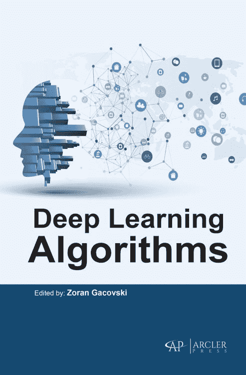


*Edited by:*

**Zoran Gacovski**

ARCLER  
P r e s s  
www.arclerpress.com


## Deep Learning Algorithms

*Zoran Gacovski*

224 Shoreacres Road  
Burlington, ON L7L 2H2  
Canada  
www.arclerpress.com  
Email: orders@arclereducation.com

**HERRN(GLWLRQ2**

ISBN: (HERRN)

This book contains information obtained from highly regarded resources. Reprinted material sources are indicated. Copyright for individual articles remains with the authors as indicated and published under Creative Commons License. A Wide variety of references are listed. Reasonable efforts have been made to publish reliable data and views articulated in the chapters are those of the individual contributors, and not necessarily those of the editors or publishers. Editors or publishers are not responsible for the accuracy of the information in the published chapters or consequences of their use.

The publisher assumes no responsibility for any damage or grievance to the persons or property arising out of the use of any materials, instructions, methods or thoughts in the book. The editors and the publisher have attempted to trace the copyright holders of all material reproduced in this publication and apologize to copyright holders if permission has not been obtained. If any copyright holder has not been acknowledged, please write to us so we may rectify.

**Notice:** Registered trademark of products or corporate names are used only for explana-

**© 2022 Arcler Press**

ISBN: 978-1-77469-183-0 (Hardcover)

Arcler Press publishes wide variety of books and eBooks. For more information about Arcler Press and its products, visit our website at www.arclerpress.com

本书版权归 Arcler 所有


## DECLARATION

Some content or chapters in this book are open access copyright free published research work, which is published under Creative Commons License and are indicated with the citation. We are thankful to the publishers and authors of the content and chapters as without them this book wouldn’t have been possible.


**Dr. Zoran Gacovski** has earned his PhD degree at Faculty of Electrical engineering, Skopje. His research interests include Intelligent systems and Software engineering, fuzzy systems, graphical models (Petri, Neural and Bayesian networks), and IT security. He has published over 50 journal and conference papers, and he has been reviewer of renowned Journals. Currently, he is a professor in Computer Engineering at European University, Skopje, Macedonia.


本书版权归 Arcler 所有


本书版权归 Arcler 所有


Deep learning is a branch of machine learning based on data presentation via complex representations with high degree of abstraction - that are obtained by applying learned nonlinear transformations. Deep learning methods find their application in important areas of artificial intelligence, such as: computer vision, natural language processing, speech and sound comprehension, as well as in bioinformatics. Deep learning is a class of machine learning algorithms that:
- uses multilayer nonlinear processor units to extract and transform features.
- Each subsequent layer takes as input the output elements of the previous layer.
- learns in a supervised and / or unsupervised manner.
- learns a number of levels of representation - corresponding to different degrees of abstraction.
- uses some form of descending gradient algorithm to train through error backpropagation.

The layers used in deep programming include the hidden layers of the artificial neural network and a multitude of statement formulas.

This book covers the most important discriminant and generative deep models with special emphasis on practical implementations. We cover the key elements of classical neural networks and provides an overview of the building blocks, regularization techniques, and learning methods that are specific to deep models. Also we consider the deep convolutional models and illustrates their application in image classification and natural language processing.

The generative deep models are often used in computer vision applications and natural language processing. Sequence modeling by deep feedback neural networks can be applied in the field of natural language processing. Practical implementations of deep learning are made in modern dynamic languages (`Python`, `Lua` or `Julia`), and also with application frameworks for deep learning (e.g. `Theano`, `TensorFlow`, `Torch`).

## 这一版本涵盖了深度学习算法的不同主题，包括：深度学习方法和技术、深度学习在生物学中的应用、深度学习在医学中的应用以及深度学习在模式识别系统中的应用。


隐藏层。在深度自动编码器中，训练通常比较复杂，你需要先训练一个隐藏层来重构输入数据的结构，然后再用这些数据训练其他隐藏层，以此类推。深度自动编码器的一些应用包括图像提取、图像生成、推荐系统以及序列到序列预测。

### 梯度下降 (GD)

GD 用于降低整体损失函数；它被视为一种优化算法，在机器学习中广泛用于系数函数的确定。当无法通过分析估计参数时，GD 用于计算所需的参数。

使用 GD 权重的模型在每个 epoch 中会被更新。它用于监督机器学习。

### 随机梯度下降 (SGD)

与 GD 类似，SGD 也是一种优化算法，但 GD 用于数据集较小的情况，而 SGD 通常用于数据集较大的情况，如果用于大量数据集，SGD 的成本会非常高。

### 深度学习的应用

深度学习是当前大规模应用的新兴和处于最先进的技术。深度学习（也称为差分编程或结构学习）属于机器学习的一个大类。

它是前沿技术，用于许多新兴研究领域，如下所述。

#### 深度学习在自动语音识别中

自动语音识别是深度学习的一个令人信服的应用。语音识别意味着将语音作为输入输入到机器中，使输入处理变得非常容易，并且有数百种其他优势，例如 illiterate 人（文盲）也能使用技术、语音编码、文本到语音合成、语音识别、说话人识别、语音增强、语音分割、语言识别等诸多功能 [11]。语音是自然的交流形式，因此被视为一个非常有说服力的应用。

本书版权归 Arcler 所有

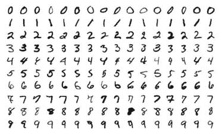


#### 图像识别

基于深度学习的图像识别技术变得非常流行，并提供准确、结果导向的技术，依赖于机器的训练和经验。深度学习在图像识别和水下目标识别中的图像分类中发挥着非常重要的作用，尽管水下图像始终带有噪声和退化 [12]。`MNIST` 是用于图像分类最著名的例子之一，下面是 `MNIST` 数据集的简单数据集示例（图 5）。

**Figure 5.** 手写数字 `MNIST` 数据集的图像示例。

#### 自然语言处理

`LSTM` 在语言建模和机器翻译方面帮助很大 [13]；语言建模任务是理解语言。为了实现语言，使用神经网络模型。Google 翻译是最著名且最广泛使用的应用之一；Google 翻译支持全球超过 100 种语言。它也使用 `LSTM`；从数百万个示例中学习，并翻译整句话，而不是逐词翻译。`BERT`（Google）是该领域最常用的技术之一，取得了许多基准成果，包括句子分类、句子对分类、句子对相似性、句子标记、创建上下文感知的词嵌入、问答、选择题等。2019 年还开发了其他一些基于变换器的语言模型，包括 `XLNet`（Google/CMU）、`RoBERTa`（Facebook）、`Distil BERT`（hugging Face）、`CTRL`（Salesforce）、`GPT-2`（OpenAI）、`ALBERT`（Google）和 `Magatron`（NVIDIA）。`Magatron` 是历史上最大的变换器模型，拥有 830 万个参数的变换器语言模型。`XLNet` 在性能方面是最佳的变换器；`XLNet` 在 20 个任务上通常比 `BERT` 表现出显著优势。`ALBERT` 由 Google 开发，用于通过跨层降低参数。

本书版权归 Arcler 所有

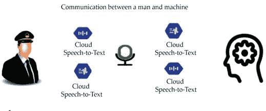


# Advancements In Deep Learning Theory And Applications: ...

## 13

参数共享。该领域的最先进状态是关于多域任务导向对话系统 [14]。2020 年，预计将结合常识推理与语言模型，将语言模型的上下文扩展到数千个词，并更加关注开放域对话（图 6）。

**Figure 6.** NLP 和深度学习。

### 游戏和机器人

机器人是人工智能代理，在现实世界中工作，取代人类。OpenAI 和 Dota 2 是知名游戏；2017 年，1v1 机器人战胜顶尖职业 Dota 2 玩家；2018 年，OpenAI Five 输掉两场比赛给顶尖 Dota 2 玩家，而 2019 年，OpenAI Five 战胜 OG 团队（2018 年的世界冠军）。OpenAI Five 在 2019 年获胜仅是因为训练计算量更大；当前版本消耗每天 800 千万次浮点运算，并经过约 45,000 年的 Dota 自我对弈，历时 10 个实时月。

当前版本的胜率为 99.9%，高于 2018 版本。这是深度学习领域中最佳的经验之一，系统学会相互玩耍并逐步改进。OpenAI Rubiks Cube manipulation 是机器人领域的另一个例子。研究人员预计 2020 年将在真实世界交互任务的操作中实施强化学习方法。

在游戏中，专家从不同机器中获益，利用这些机器帮助人类专家发现新策略。Waymo 是一家专注于开发自动驾驶的公司，类似于 Tesla，2018 年 10 月成立；他们已在道路上行驶了 1000 万英里，到 2020 年已行驶 2000 万英里，涉及 20,000 种结构测试类别，并开始在没有安全驾驶员的情况下进行测试。

本书版权归 Arcler 所有


With the advent of technology and a significant amount of e-commerce platforms, the number of e-payments is increasing day by day, chances of financial fraud, which is also a source of headache for banks and other financial institutions. Thus, focusing on fraud detection is a hot area of research. The author of \[15\] used auto-encoder for financial fraud detection.

\[16\]. This research uses deep learning model for fraud detection, while \[17\] proposed a solution to fraud detection using machine learning approach.

### Deep learning in health-care

In this modern era of computing, deep learning also produced best results medical and health care, that is, deep learning is used for cancer cell coordination, organ segmentation, protein folding, lesion detection, and image enhancement in the field of medicine. There are several other issues like \[18, 19, 20, 21\] and much more where deep learning is directly involved in the suggestion of the ultimate solution to the problem in healthcare.

### Military

Deep learning is used for making many different military devices used in wars or other spy services. The military is also working on robots to train the robots to handle the critical situation through these robots. The militaries of some countries are making their weapons more intelligent using AI. In a war zone, AI can be embedded in the robots for remote surgical support in healthcare.

### Cybersecurity

Cybersecurity is also one of the hot research areas; deep learning models are used for the cybersecurity of the Internet of Things (IoT) \[22\]. The IoT devices are usually low power devices having power-constrained that’s why always vulnerable to external threats. Deep learning models can detect threats more accurately than any other technology. The author of \[23\] used deep learning and machine learning for intrusion, spam, and malware detection.

## MODERN DEEP LEARNING PLATFORMS

Open-sources deep learning platforms discussed in this section. It will provide a quick review of the open-source platforms for beginners and mediocre because every platform has its pros and cons.

本书版权归 Arcler 所有


Advancements In Deep Learning Theory And Applications: ...

## 15

### TensorFlow

The TensorFlow is new and open-source platform for differential programming; it was developed by Google team called Google brain and was first released in 2015 \[24\]. In February 2017, they released version 1.0.0; TensorFlow can work on CPU and GPU; it is available for Mac, Linux, and windows and also for mobile computing platform android and iOS. It is the most famous machine learning library in the world today. Its best-supported client language is python but there is also interface available in C++, Java, and GO. It is easy to use and have Keras integration. TensorFlow has many of its versions available like for mobiles TensorFlow lite, for industry TensorFlow Serving, etc.

### Pytorch

Pytorch is also machine learning and deep learning library, based on torch library. It was initially released by Facebook’s AI Research lab (FAIR) in 2016.

Pytorch has two high-level features, Tensor computing with graphics processing units (GPU), and auto-diff based deep neural network. It is too easy in Pytorch to move tensors to and from GPU. Pytorch Mobile is the version of Pytorch used for mobiles. There are some key features of Pytorch; the first feature is called imperative programming; most of the python code is imperative; this type of programming is more flexible. The other feature of Pytorch is dynamic computation graphs, it run time the system generates the graph structure, dynamic graph work well for dynamic networks like RNN, dynamic graph also makes debugging very easy. The Pytorch provides maximum flexibility and speed during implementing and building deep neural network.

### Theano

Theano is designed by Montreal Institute for Learning Algorithms (MILA), which is very famous after their deployment, but unfortunately, there is no support after version 1.0.0 (November 2017). It is a python library designed for code compilation optimization \[25\]; it is primarily used for mathematical operations like multi-dimensional arrays. Theano was far better than other python libraries like Numpy in terms of speed, computing symbolic graphs, and stability optimizations. Tensor operations, GPU computation, and parallelism are also supported by Theano.

本书版权归 Arcler 所有


Deep Learning Algorithms

## 16

### Microsoft cognitive toolkit (CNTK)


CNTK is used for commercial-grade distributed deep learning. It can be used as a standalone tool for machine learning or also can be included as a library in `C++`, `python`, and `C#`; its model evaluation functionality can be also used from `Java` programs. It supports `ONNX` that allows sharing model with frameworks `Caffe2`, `MXNet`, and `PyTorch` \[26\]. `CNTK` can be used only on `Linux` and `Windows`. The `CNTK` is considered as a powerful machine learning platform similar surge of performance as compared to other widely used platforms \[27\].

## Keras

`Keras` is a powerful library written in `python`; it uses `TensorFlow`, `Theano`, and `CNTK` as a framework because it does not have their framework. `Keras` can work on `GPUs` and `CPUs` and can also support `RNNs` and `CNNs`. The beauty of `Keras` is it has the ability of fast and easy prototyping; `Keras` is user-friendly. It has been ranged one of the most cited API in 2018 and has enough number of users on board.

## Deep learning 4J

It is distributed open-source, robust deep learning framework for `Java` designed by `Skymind` \[28\] which is added a lot to `Java` ecosystem and `eclipse` foundation. It has compatibility with `Clojure` and `Scala` APIs just like `Keras`; it is also able to work with both `CPUs` and `GPUs`. It is widely used for academics and industrial applications.

## Torch

It is a scientific computing open-source machine learning framework released in October 2002; it is not able to work on `CPUs`; it is only made to focus on `GPUs` accelerated computing. It is developed in programming language `C` and based on `Lua`, a contribute in a `LuaJIT`, a scripting language. `Max OSX` and `Ubuntu 12+` can use this framework, although they have `Platform` for `Windows`, but their implementations are not supported officially \[29\].

## Caffe and Caffe2

`CAFFE` (`Convolutional Architecture for Fast Feature Embedding`) created by `Berkeley AI Research` (`BAIR`) is a framework for deep learning. It is developed in `C++` with a `python` interface. `Caffe2` was introduced by the research group of `Facebook` in 2017, but `Caffe2` was merged in `PyTorch` in `March 2018`. It supports multiple platforms, that is, `Mac OS X`, `Windows`, `Linux`, `iOS`, and `Android` \[30\].

## Apache MXNet

An `MXNet` is a fast-scalable deep learning platform that supports many programming languages, i.e., `Scala`, `Julia`, `C++`, `R`, `Python`, `Gluon API`, and `Perl` APIs. Like `Torch`, it is also made only for `GPUs`, and it is very competent in multi `GPUs` implementations. The `Apache MXNet` is scalable flexible and portable, and due to these qualities, it attracts many users.

## TRAINING ALGORITHMS

One of the most important parts of deep learning is learning algorithms.

The deep neural network can be differentiated only through the number of layers; if the number of layers increases, the network becomes deeper and more complex. Each layer has its specific function or can detect or help in the detection of the special feature.

According to the author \[31\], if the problem is face recognition, the

## 更高级别的特征，如鼻子、眼睛、耳朵等，下一层可以进一步挖掘特征，以此类推。因此，每一层在训练算法（如梯度下降）的发展之前就已得到发展；这也是为什么

## 变异。这在 `Yann` 等人 \[32\] 的讨论中被提及；他们进一步得出结论，设计更自动、手动更少的系统在模式识别方面能够取得更好的结果。

`Backpropagation` 是解决方案；它利用数据识别的信息。下面列出了一些著名的训练算法。

### 梯度下降

在统计学、数据科学和机器学习中，我们需要优化大量内容；当我们使用线性回归拟合一条直线时，我们会优化截距和斜率；当我们使用逻辑回归时，我们会优化一个曲线；当我们使用 `t-SNE` 时，我们会优化聚类。梯度下降用于优化上述以及其他许多问题。

梯度下降算法类似于 `2D` 函数的 `Newton` 寻根算法。其方法非常简单：随机选取一个点，然后沿着函数在该点的导数（即斜率）为正或负时沿 `x` 轴向右或向左移动，直到 `y` 轴的值（即函数值 `f(x)`）变为 `0`。梯度下降背后的概念相同：我们在多维权重空间中沿特定路径移动，当误差率降至设定阈值后停止。这是大多数深度学习和机器学习算法的基础概念。

(1)

### 随机梯度下降

随机梯度下降是一种用于通过迭代方法优化目标函数的方法，也称为梯度下降优化。随机梯度下降会在每一步随机选择一个样本，并仅使用该样本计算梯度，因此在大规模样本例子中，随机梯度下降可以将计算项数量减少 `3` 倍。如果我们有 `100` 万个样本，随机梯度下降可以将计算项数量减少一百万倍。在随机梯度下降中，

\# #

应用时，权重更新更频繁，因此我们能在更短的时间内达到全局最小值（见图 `7`）。

**图 `7`.** `GD` 与 `SGD` 的对比。

### 动量

在随机梯度下降中，更新权重或计算步长时使用固定的学习率作为乘数；这可能导致更新 `overshoot` 潜在的最小值；如果梯度过于陡峭或存在延迟，梯度的收敛会变得噪声大。动量的概念在 `物理学` 是梯度的指数级下降的平均值 \[33\]。

这防止下降向错误的方向移动。

### 黑森-马夸尔特算法

该类算法用于曲线拟合或非线性最小二乘问题。该算法也被称为深度最小二乘；这类问题通常出现在最小二乘曲线拟合中。它最初由 `Kenneth Levenberg` 在 `1944` 年提出，尽管它后来被统计学家 `Donald Marquardt` 在 `1963` 年重新发现。

### 通过时间反向传播

它是训练循环神经网络（`RNN`）的著名且标准的方法。它由多位研究者独立开发。与通用优化技术不同，它在训练 `RNN` 时更快。通过时间反向传播也存在局部最优的问题 \[34\]。

### 深度学习的常规挑战

根据 `Google` 趋势图，过去五年来，越来越多的专家和专业人士被深度学习吸引；专业人士的比例从 `12%` 上升至 `100%` \[35, 36\]。深度学习被广泛应用于生物信息学、计算机视觉、物联网安全、医疗、电子商务、数字营销、自然语言处理等众多领域 \[37, 38\]。由于这是一个非常热门的研究领域，必然存在一些挑战，下面列出这些挑战。

#### 非贡献列或输入

在处理数据或构建模型时，有几个输入对于发现任何特征并不必要，因此建议删除不必要的属性。

同时，还需要找出一个最佳列并将其与数据集分离；这可以使用 `Keras` 中的 `NumPy` 数组实现，但找到最佳匹配属性却是困难且具有挑战性的。

#### 隐藏层数量

隐藏层的数量直接与网络的计算复杂度和深度成正比。处理大量层需要高昂的计算成本，且管理大量神经元也十分困难。

## 深度学习算法

### 优化算法

在模型优化中，梯度下降优化器帮助最小化模型的损失函数，通过调整参数值；选择优化器本身也是一项挑战，因为有时它会导致模型损失增加而非降低。

### 损失函数

从名称上看，损失函数用于估计损失，即预期结果与实际结果之间的差异。下面给出了损失函数的公式：

`?\\^' \_`

`{|`

计算损失函数的方法有很多种；选择损失函数本身也是深度学习中的一项重要且具有挑战性的任务。

### 激活函数

有许多种激活函数；每种激活函数的输出结果不同。 `sigmoid` 激活函数在二分类问题中表现良好。需要注意 `Tanh` 激活函数，因为它可能出现消失梯度问题。在多标签分类中，`softmax` 是最佳选择；当输入中有大量为 `0` 的值时，`ReLU` 应该被使用，因为它有助于生成“死神经元”。同时也要注意使用所需的激活函数。

### 时代（Epoch）

当数据集在整个神经网络中向前和向后传播一次时，称为一个时代；在每个时代之后，会分析权重的变化以评估模型。权重在每个循环中会被修改、检查和测试，使用相同的数据集进行模拟。主要内存用于记录所有训练数据；有时由于数据集过大，无法全部加载到内存中，因此时代会以输出形式呈现。处理时代也是深度学习中的一项挑战。

### 可用的开源数据集

机器学习和深度学习的研究已有数十年历史，为社会带来了各种基于深度学习和机器学习的应用。网络上有许多免费可用的数据集，研究人员可将其用于各种目的。

图像数据集（表 `1`）：

**表 `1`.** 开源图像数据集

- `Pascal VOC`

- `MS COCO`

- `MNIST` 手写数字

- `NORB`

- `CIFAR10/CIFAR100` 色彩图像数据集

- `COIL100`

- `Caltech101`

- `Google’s Open Images`

- `Caltech 256`

- `COIL 20`

- 街景视图数据集

- `LabelMe`

- `STL-10`

- `ImageNet`

地理空间数据集（在线可用）：

- `NEXRAD`

- `OpenstreetMAP`

- `Landsat8`

文本数据集（表 `2`）：

`39`. `Kumar OS`, `Joshi N`. Rule power factor a new interest measure in

`40`.

new interest measure. In: Smart Computing and Informatics. Singapore: Smart Innovation, Systems and Technologies; 2018

`41`. `Dong C`, `Loy CC`, `He K`, `Tang X`. Learning a deep convolutional network for image super-resolution. In: European Conference on Computer Vision. Cham; 2014

`42`. ~ #

in Bioinformatics. 2017;18(5):851-869

`43`. `Pathmind`. 2019. Available from: `https://pathmind.com/wiki/ open-datasets`

## CHAPTER 2

## DEEP ENSEMBLE

## REINFORCEMENT

## LEARNING WITH MULTIPLE

## DEEP DETERMINISTIC

## POLICY GRADIENT

## ALGORITHM

`Junta Wu` and `Huiyun Li`

`Shenzhen Institutes of Advanced Technology`, `Chinese Academy of Sciences`, `Shenzhen 518071`, `China`

## ABSTRACT

Deep deterministic policy gradient algorithm operating over continuous space of actions has attracted great attention for reinforcement learning.

However, the exploration strategy through dynamic programming within the Bayesian belief state space is rather inefficient even for simple systems.

Another problem is the sequential and iterative training data with autonomous `Citation`: `Junta Wu`, `Huiyun Li`, “Deep Ensemble Reinforcement Learning with Multiple Deep Deterministic Policy Gradient Algorithm”, `Mathematical Problems in Engineering`, vol. `2020`, Article ID `4275623`, `12` pages, `2020`. `https://doi.org/10.1155/2020/4275623`.


# Copyright

© 2020 by Authors. This is an open access article distributed under the Creative Commons Attribution License, which permits unrestricted use, distribution, and reproduction in any medium, provided the original work is properly cited.

本书版权归 Arcler 所有


# Deep Learning Algorithms

30

vehicles subject to the law of causality, which is against the i.i.d. (independent identically distributed) data assumption of the training samples. This usually results in failure of the standard bootstrap when learning an optimal policy.

In this paper, we propose a framework of m-out-of-n bootstrapped and aggregated multiple deep deterministic policy gradient to accelerate the training process and increase the performance. Experiment results on the 2D robot arm game show that the reward gained by the aggregated policy is 10%–50% better than those gained by subpolicies. Experiment results on the open racing car simulator (TORCS) demonstrate that the new algorithm can learn successful control policies with less training time by 56.7%.

Analysis on convergence is also given from the perspective of probability and statistics. These results verify that the proposed method outperforms the existing algorithms in both efficiency and performance.

# INTRODUCTION

Reinforcement learning is an active branch of machine learning, where an agent tries to maximize the accumulated reward when interacting with a complex and uncertain environment \[1, 2\]. Reinforcement learning combining deep neural network (DNN) technique \[3, 4\] had gained some success in solving challenging problems. One of the most noticeable results was achieved through the deep Q-network (DQN), which exploited deep neural networks to achieve maximum accumulated reward \[5\]. DQN has performed well over 50 different Atari games and inspired many deep reinforcement learning (DRL) algorithms \[6–8\].

However, DQN only deals with the tasks with small, discrete state and action spaces while many reinforcement learning tasks have large, continuous, real-valued state and action spaces. Although such tasks could be solved with DQN by discretizing the continuous spaces, the instability

deterministic policy gradient (DPG) algorithm \[9\] with the DNN technique was proposed, producing deep deterministic policy gradient (DDPG) algorithm

and unstable training \[11\]. Many existed works attempted to solve the problems. Gu et al. proposed the Q-prop method, a Taylor expansion of the off-policy critic as a control variant to stabilize DDPG \[12\]. Q-Prop combines the on-policy Monte Carlo and the off-policy DPG; it achieves

to stabilize the training process of DDPG, by training the parallel agents 本书版权归 Arcler 所有


Deep Ensemble Reinforcement Learning With Multiple Deep ...

31

with asynchronously accumulated updates \[13\]. Interactive learning with the environment in multiple threads is performed at the same time, and each thread summarizes the learning results and stores them in a common place. In this way, A3C avoids the problem of too strong correlation of empirical playback and achieves an asynchronous concurrent learning model. This method consumes considerable computation resources. When the implementation complexity is not a strong limit, we can use any of these policy gradient-related methods to generate subpolicies to further improve our method, where the centralized experience replay buffer stores and shares experiences from all subpolicies, enabling more knowledge gained from the environment.

Additionally, researchers attempted to overcome the disadvantage of unstable training of DDPG and speed up the convergence of DDPG with bootstrap technique recently \[14\]. Osband et al. developed bootstrapped DQN

as the critic of DDPG \[15\]. Yang et al. employed a multiactor architecture for multitask purpose \[16\]. DBDDPG \[11\] and MADDPG \[17\] both used

the training stability. Shi et al. introduced deep soft policy gradient (DSPG)

\[18\], an off-policy and stable model-free deep RL algorithm by combining policy and value-based methods under maximum entropy RL framework.

The authors discover that the standard bootstrap is likely to fail when learning an optimal policy, since in most reinforcement learning tasks, the sequential and iterative training data subject to the law of causality, which is against the i.i.d. (independent identically distributed) assumption of the training samples. Hence, a novel bootstrap technique is needed for achieving the optimal policy.In consideration of the above shortcomings of the previous work, this paper introduces a simple DRL algorithm with m-out-of-n bootstrap technique \[19, 20\] and aggregated multiple DDPG structures.

The control policy will be gained by averaging all learned subpolicies.

Additionally, the proposed algorithm uses the centralized experience replay

with random initialization produces reasonable uncertainty estimates at low computational cost, this helps in the convergence of the training. The proposed bootstrapped and aggregated DDPG can substantially reduce the learning time. The remainder of this paper is organized as follows.

Section 2 presents a brief background. Section 3 introduces the proposed method in detail and analyses the convergence of the algorithm. The experimental results of the proposed method are presented in Section 4. The paper is concluded in Section 5.

本书版权归 Arcler 所有

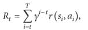

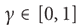

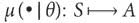

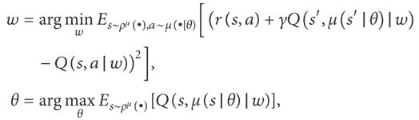

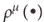

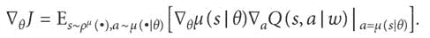


Deep Learning Algorithms

32

# BACKGROUND

## Reinforcement Learning

In a classical scenario of reinforcement learning, an agent aims at learning an optimal policy according to the reward function by interacting with the environment E in discrete time steps, where policy is a map from the state space to action space \[1\]. At each time step, the environment state s is t

observed by the agent, and then it executes the action at by following the

, a ) is received immediately. The following

t

t

## 确定性策略梯度算法

策略梯度（PG）算法直接通过最大化性能函数与策略梯度来优化策略。确定性策略梯度算法起源于确定性策略梯度定理 \[9\]，是策略梯度方法的一种。它在演员-评论框架下学习确定性策略，其中评论者估计动作值函数，演员代表确定性策略函数。/e 更新动作值函数和策略函数如下

(2)

其中

表示折扣状态分布 \[9\]。由于全面优化成本高昂，通常采用随机梯度优化。/e 下面的方程展示了确定性策略梯度 \[9\]

它用于更新确定性策略的参数：(3)

本书版权归 Arcler 所有

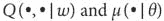

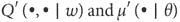

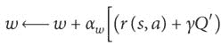

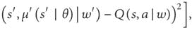

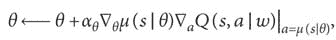

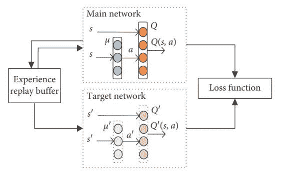

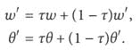


## DDPG 算法

DDPG 将深度神经网络（DNN）技术应用于确定性策略梯度

actionvalue function Q with neural network，如图 1 所示。

\[5\] 用于生成 Q 学习目标。我们用

表示

the main networks 而

represent the target networks。

如方程 (4) 和 (5) 所示，主网络的权重通过随机梯度更新，而目标网络的权重使用“软”更新规则 \[10\] 更新，如方程 (6) 所示：(4)

(5)

**图 1**。深度确定性策略梯度示意图。

(6)

DDPG 利用经验回放技术 \[10\] 打破训练样本的时间相关性，使其满足 i.i.d.（独立同分布）假设。此外，“软”更新规则用于提高训练过程的稳定性。DDPG 更新 本书版权归 Arcler 所有

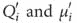

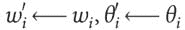


Deep Learning Algorithms

34

主演员网络使用策略梯度，而主评论网络则采用监督学习与 Q 学习相结合的思想进行更新，这也是 DQN 所使用的方法。训练完成后，主演员网络收敛到最优策略。

# METHODS

## Multi-DDPG 结构

与 DQN 相比，DDPG 更适用于连续动作空间的增强学习任务。但 DDPG 收敛到最优策略所需时间较长。我们提出多 DDPG 结构和 Bootstrap 技术，同时训练多个子策略以缩短训练时间。我们随机初始化 N 个主评论网络 Q(s, a | w) 和主演员网络 (s| )，权重为 w，且 (i = 1, 2, . . . , N)，随后初始化 N 个目标网络，权重为

(I = 1, 2, ... , N)，并初始化中心化经验回放缓冲区 R。


多 DDPG 结构结合中心化经验回放缓冲区的示意图如图 2 所示。我们称之为利用多 DDPG 结构和 Bootstrap 技术的方法——bootstrapped aggregated multiDDPG (`BAMDDPG`)。图 3 表明 `BAMDDPG` 对子策略进行平均。

# 为了简洁，本文中 `agent`、主演员网络和子策略指代同一事物，在本论文中可互换使用。`Algorithm 1` 展示了 `BAMDDPG` 的完整算法。

在 `Algorithm 1` 中，“`#Env`” 表示环境模块的数量，而 “`#selected DDPG`” 表示选择的 DDPG 组件数量。

在训练过程中，每个采用演员-评论框架的 DDPG 组件负责训练对应的子策略。图 2 展示了 DDPG 组件的训练过程，包含交互过程和更新过程。

在交互过程中，主演员网络（代表代理）与环境交互。它接收当前环境状态 `s`，并输出动作 `a`。环境在执行动作后返回即时奖励 `r` 和下一个状态 `st+1`。随后，转移元组 `(s, a, r, s)` 被存入中心经验回放缓冲区。

在交互过程中，向动作中添加 Ornstein-Uhlenbeck 过程 `N`。在更新过程中，从中心经验回放缓冲区中采样一个随机小批量的转移元组用于更新权重。主评论网络通过最小化基于 Q 学习的损失函数进行更新 `\[1\]`，而目标网络则通过缓慢跟踪主网络进行更新。主演员网络的权重沿着整体性能提升的方向使用策略梯度进行更新。通过遵循该更新规则，`BAMDDPG` 的每个子策略逐步改进。中心化经验回放缓冲区存储所有子策略的经验。

图 3 展示了子策略的聚合细节。我们用 `π` 表示由主演员网络近似的子策略，这些子策略的输出分别为 `a1, a2, ... , aN`。此外，聚合策略的输出记为 `a`。

在实践中，我们通过设定最大 `episode` 数来训练多个子策略。由于 `BAMDDPG` 的 `episode` 结束步数少于原始 DDPG 算法，因此子策略的训练时间短于最优策略。可以预测，训练较少的子策略的性能会在一定程度上低于最优策略，但我们可以通过聚合已训练的子策略来提升性能，得到最优策略。此外，我们选择平均方法作为聚合策略，考虑到所有子策略的平等地位和实数输出。具体而言，所有子策略的输出 `a`。

交互过程需要环境组件与代理交互。因此，多 DDPG 结构需要多个环境模块。然而，对于某些增强学习任务，环境模块不支持被复制用于多个 DDPG。在这种情况下，环境组件在每个时间步只与一个子策略交互。`BAMDDPG` 支持同时拥有单个环境模块和多个环境模块的增强学习任务，在每个时间步选择一个子策略或多个子策略与环境交互。所有子策略随后使用从中心化经验回放缓冲区中采样的小批量同时更新。最终，`BAMDDPG` 算法。

从直观角度看，`BAMDDPG` 所使用的中心化经验回放技术使得每个代理能够利用其他代理遇到的经验。

**图 2**. `BAMDDPG` 结构。

**图 3**. 子策略的聚合。

## 网络

随机初始化 `N` 个主评论网络 `Q(s, a | w)` 和主演员网络 `(s| )`，权重为 `w`，且 `(i = 1, 2, . . . , N)` 初始化 `N` 个目标网络，权重为 `(I = 1, 2, ... , N)`。

```
Initialize centralized experience replay buffer R

for episode = 1, M do

    Initialize an Ornstein–Uhlenbeck process N for action exploration if #Env == 1 do

        Alternately select Q and among multiple DDPGs to interact with the i

        i

        environment

    end if

    for t = 1, T do

        for #selected DDPG do

            Receive state s from its bound environment

            Execute action

            and observe reward rt and new state st+1

            Store experience

            in R

        end for

        for i = 1, N do

            Update

            according to equations (4)–(6)

        end for

    end for

end for

Get final policy by aggregating subpolicies:
```

**Algorithm 1**. Bootstrapped and aggregated multi-DDPG (`BAMDDPG`).

## Analysis on Convergence with Bootstrap and Aggregation

For ease of description, we suppose `BAMDDPG` trains `N` subpolicies simultaneously and denote these subpolicies with `(i = 1, 2, · · · N)`.

where `π` represents the aggregation of subpolicies. Let the optimal policy denoted as `π*`. Then the following formula holds `\[20\]`

where `bias` means the average bias of subpolicies and the optimal policy while `bias` represents bias of the aggregated policy and the optimal policy.

Equation (8) demonstrates that the aggregated policy has better performance than subpolicies and approximates the optimal policy more closely than any subpolicy. Under this conclusion, the aggregated policy approximates the optimal policy quickly as subpolicies are trained to a certain extent `\[21\]`.

Further, we analyze the convergence from the perspective of probability and statistics `\[22\]`. Assume all policies are from the policy space `U`. The `π1, π2, ... , πN` are sampled according to a distribution function `F` in `U`. Let `F̂` denote the empirical cumulative distribution function `(9)` where `N` is the number of the sampled subpolicies.

`I` is an indicator `{ <` in `U`, which indicates the agent acting by following the policy `x` is able to gain more reward than those only adopting `u`. According to the rule of Dvoretzky–Kiefer–Wolfowitz inequality `\[23\]`, we get `(10)` arbitrary small positive integer.

Equation (10) shows that `F̂` converges uniformly to the true distribution function exponentially fast in probability. Suppose we are interested in the mean `μ`, then the unbiasedness of the empirical measure extends to the unbiasedness of linear functions of the empirical measure. Actually, empirical cumulative distribution can be seen as a discrete distribution with equal probability for each component, which means we can get a policy from the empirical cumulative distribution by averaging multiple policies.

Therefore, the aggregating policy subjects to empirical cumulative distribution and it subjects to true distribution.

Since `π*` is a better policy than `π` in `U`, `π` converges to the optimal policy of `U`.

## The m-out-of-n Bootstrap

Bootstrap `\[14\]` is a significant resample technique in statistics, which generally works by random sampling with the replacement process. In this paper, we try to train multiple DDPG components with bootstrap. It is analyzed that such requirement can be simply attained by initializing the network weights of different DDPG components with different methods `\[15\]`. Therefore, we adopt this technique as a prior and multiple DDPG components are trained in parallel on different subdataset from experience replay buffer.

However, standard bootstrap fails as the training data subject to a long-tail distribution, rather than the usual normal distribution, as the i.i.d. assumption implies. A valid technique is m-out-of-n bootstrap method `\[19\]`, where the number of bootstrap samples is much smaller than that of the training dataset. More specifically, we draw subsamples without replacement and use these subsamples as new training datasets. Multiple DDPG components are then trained with this newly produced training dataset.

## RESULTS AND DISCUSSION

### 2D Robot Arm

In order to illustrate the effectiveness of aggregation, we use `BAMDDPG` to learn a control policy for a 2D robot arm task.

### Benchmark and Reward Function

As Figure 4 demonstrates, a 2D robot arm contains a two-link arm with one joint which is attempting to get to the blue block. The first link rotates around the root point while the second link rotates around the joint point. The action of an agent consists of two real-valued numbers denoting angular increment.

We construct the reward according to the distance between the finger point of the arm (endpoint) and the blue block. The farther away the finger point being from the blue block, the lesser the reward is. Additionally, the reward adds one when the distance `d` is less than the threshold `θ`. If the finger point stops within the blue block for a while (more than 50 iterations), the reward adds ten. The following equation presents the reward: `(11)`

where `I[·]` is an indicator function which outputs 1 when the condition `d < θ` is met.

### Performance of Aggregated Policy

During the training process of `BAMDDPG`, each agent interacts with its corresponding environment, producing multiple learning curves. Figure 5 demonstrates learning curves of 3 subpolicies with shared experience on 2D.


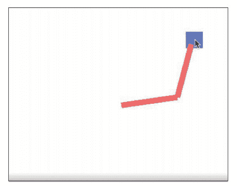
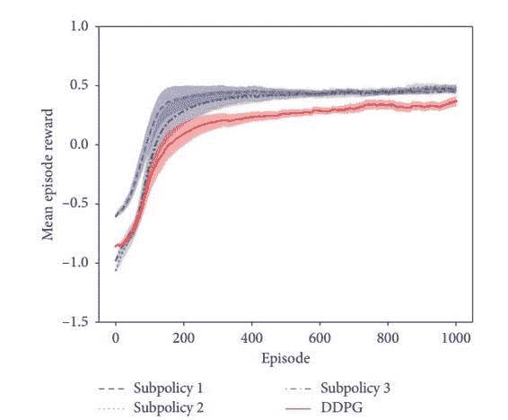


robot arm benchmark. The curve depicts the moving average of episode reward while the shaded area depicts the moving average ± partial standard deviation.

As Figure 5 shows, the training process of BAMDDPG’s subpolicies is better than that of DDPG. The centralized experience replay buffer stores and shares experiences from all subpolicies, enabling more knowledge gained from the environment. Therefore, BAMDDPG’s subpolicies can gain more reward during the training process. After about 1000 episodes, the subpolicies of BAMDDPG and the policy of the original DDPG both converge.

**Figure 4**. 2D robot arm benchmark.

**Figure 5**. Comparison between sub-DDPGs of BAMDDPG and DD.

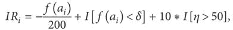
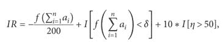
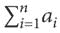


# Deep Ensemble Reinforcement Learning With Multiple Deep ...

The key of BAMDDPG is the aggregation of subpolicies. In this section, we show the comparison of performance between the aggregated policy and subpolicies so as to illustrate the effectiveness of aggregation. Suppose the action given by the ith subpolicy is `a = [ai , ai]`, then the immediate reward of the ith subpolicy is given by:

(12)

where `f(a | # i` the blue block after executing action `a` while it is an implicit function. The immediate reward of the aggregated policy can be expressed in the same way:

(13)

where represents the action taken by the aggregated policy.

Table 1 shows the performance comparison of subpolicies and aggregated policy of BAMDDPG. The result demonstrates that reward gained by the aggregated policy is 10%–50% better than those gained by subpolicy.

## TORCS

### Benchmark and Reward Function

The Open Racing Car Simulator (TORCS) is a car driving simulation software with high portability, which takes the client-server architecture [24, 25]. It realistically simulates real cars by modeling the physical dynamic models of the car engines, brakes, gearboxes, clutches, etc. It is a commonly used DRL benchmark and is appropriate for test of self-driving techniques.

Using TORCS, a developer is able to easily access a simulated car’s sensor information. Therefore, the controller of the simulated car is able to get the current environment state and follow a policy to send controlling instructions, including control of steering, brake, and throttle. Figure 6 presents TORCS’s client-server architecture. The controller connects to the race server through the user datagram protocol (UDP). At each time step, the information of the current driving environment state is perceived by the simulated car and is sent to the controller. The server then waits for an instruction from the controller for 10 ms. The simulated car executes the corresponding actions according to the current instruction, or last instruction if no new instruction is sent.

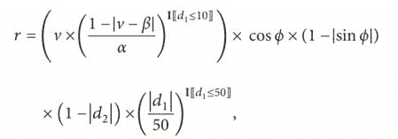
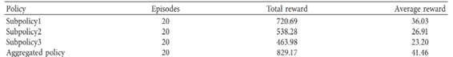
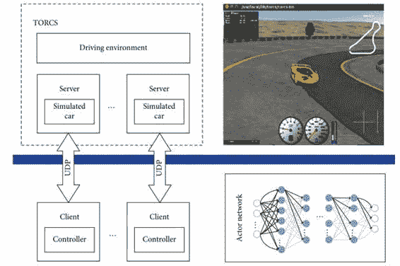


Designing a suitable reward function is a key for using TORCS as the platform to test BAMDDPG, which helps to learn a good policy to control the simulated car. We describe the details of designing the reward function in this section. As the driving environment state of TORCS can be perceived by various sensors of the simulated car, we can create the reward function using these sensor data which is shown in Table.

Equation (14) presents our constructed reward function, which restricts the behavior of the simulated car in TORCS. Each time the simulated car interacts with the driving environment of the TORCS, we expect to gain as large reward as possible through the following equation:

(14)

**Table 1**. Performance comparison of subpolicies and the aggregated policy

**Figure 6**. Diagram of the client-server architecture of TORCS.

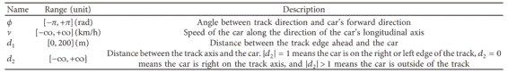
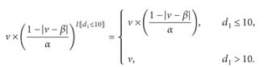
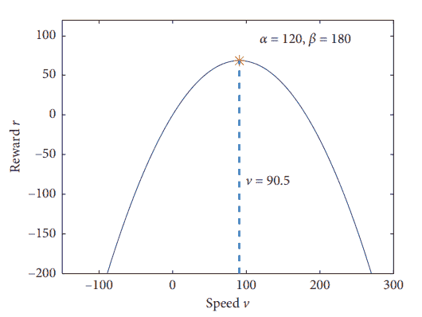


**Table 2**. Information of sensor data for creating the reward function

where the term `v` represents the car is expected to run as fast as possible so as to maximize the reward. The terms ``cos Ԅ\`{\_ªԄ|)`` mean Ԅ is expected as zero so that the car can run along the track all the time. The term ``\`{\_ª |)`` represents the car is on the track axis. Iۤ·ۥ represents an indicator 2 function whose value is 1 or 0 depending on whether the condition is met or not.

(15)

Equation (15) takes into account the speed constraints of the car whether the car encounters a turn or not. The car slows down when a turn is encountered and drives as fast as possible along a straight route. Here, `d = 10` is set to be the threshold of encountering a turn. The car is at a turn when `d < 10`, the corresponding reward is a quadratic function with respect to the speed `® + ? \* \\{®\\ 180`. The quadratic function reaches the maximum value when `v = 90.5`, which means the expected speed of the car at a turn is 90.5 km/h and the car will decelerate automatically when it encounters a turn.

**Figure 7**. Graph of speed constrained function.

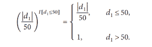


Equation (16) reformulates the last term in equation (14). It restricts the distance between the track edge ahead and the car. This term means that the turn should be observed by the car in advance and the steering angles should be adjusted according to the turn:

(16)

### Learning Curve and Training Time

We successfully achieve the optimal self-driving policy with BAMDDPG by aggregating multiple subpolicies in TORCS. During one episode of the training process, one subpolicy is selected. The corresponding agent perceives the driving environment state through various sensors and executes the action by following the selected subpolicy. Table 3 presents the detailed description of the action commands, including steering, brake, and throttle.

After the interaction, all subpolicies were updated using the minibatch from the centralized experience replay buffer. We have argued that less training time is demanded by BAMDDPG than DDPG. Figure 8(a) illustrates the comparison of learning curve between BAMDDPG and DDPG while Figure 8(b) demonstrates the comparison of training time.

In our experiments on TORCS, the simulated car was trained 6000 episodes with the Aalborg track using BAMDDPG and DDPG, respectively. Figure 8(a) illustrates the learning curve comparison of DDPG and BAMDDPG. The curve depicts the moving average of episode reward while the shaded area depicts the mean ± the standard deviation. Figure 8(a) demonstrates that BAMDDPG and DDPG both converge and oscillate.

Figure 8(b) demonstrates that BAMDDPG takes less time to train since the aggregated policy quickly approximates the optimal policy as subpolicies are trained to a certain extent. It takes 22.84 hours for BAMDDPG to be trained 6000 episodes, but 52.77 hours for DDPG, which demonstrates BAMDDPG can cut down the training time by 56.7%.

Figure 8(b) also shows that training time spent by BAMDDPG and DDPG is nearly the same. Attention is mostly paid on environment exploring by the simulated car. From the perspective of network


# Deep Ensemble Reinforcement Learning With Multiple Deep ...

corresponding networks.

### 4.2.3. Effectiveness of Aggregation

The ability of the BAMDDPG algorithm to reduce training time is based on policy aggregation. Section 3.3 illustrated the conclusion that the performance of the aggregated policy is better than that of subpolicies through theoretical analysis. In addition, Section 4.1 has shown the effectiveness of aggregation on 2D robot arm benchmark. In this section, we are to further illustrate the effectiveness of aggregation on TORCS.

For conciseness and contrast of expression, only three subpolicies are trained by the BAMDDPG algorithm in this experiment. The trained subpolicies and the aggregated policy control the same simulated car on the same track, Aalborg track, within one lap. Then, we observe the total reward and whether the cars can complete the track. The aggregated policy gained much larger total reward than subpolicies, but the cars controlled by subpolicies all left the track and are not able to complete the track, which indicates that aggregation technique does increase the performance of subpolicies.

Figure 9 further illustrates the difference in total reward between subpolicies and the aggregated policy. As shown by the real line, the total reward of the aggregated policy is in a steady upward trend as the number of steps increases. However, the total rewards of subpolicy 2 and subpolicy 3 increases steadily in the initial stage and then stops rising because the car pulled out of the track at some point. The performance of subpolicy 1 is the worst, and its total reward is always the lowest and ultimately remains unchanged due to the car leaving the track.

### Effect from Number of Subpolicies

The final policy gained by BAMDDPG is based on the aggregation of subpolicies, but the algorithm does not give specific number of subpolicies.

In theory, when there is large enough number of subpolicies, the aggregated policy successfully approximates the optimal policy. However, aggregating a large number of subpolicies is inefficient in consideration of computing and storage resource consumption in practice.

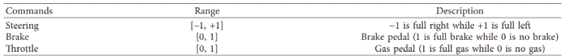

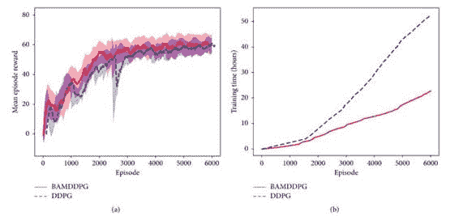

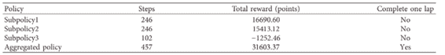


Under the consideration of balancing efficiency and performance, this section explores the appropriate number range of subpolicies through experiment.

We choose the numbers of subpolicies within 30 and get the appropriate number of subpolicies by comparing the performance of the aggregated policies with different number of subpolicies. These aggregated policies are tested on the Aalborg track, and we then compare their training time, total reward within 5000 steps. Furthermore, we compare the generalization performance of the aggregated policies by testing them on the CG1 track and CG2 track. Experimental results are demonstrated in Figure 10 and Table 5.

**Table 3**. Description of action commands

**Figure 8**. (a) Learning curve and (b) training time comparison of BAMDDPG and DDPG.

**Table 4**. Performance comparison of the aggregated policy and subpolicies

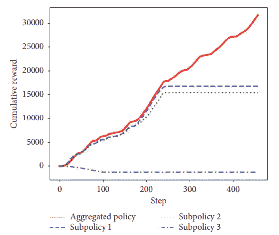


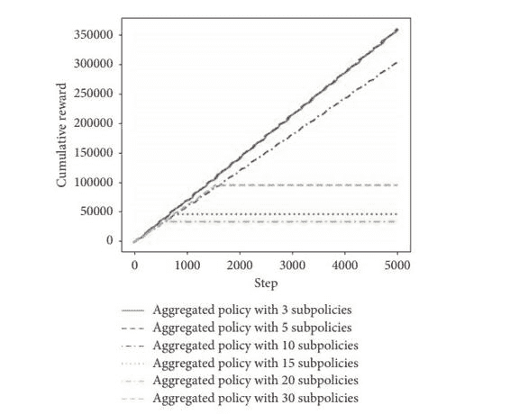

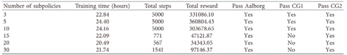

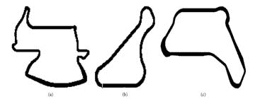


**Figure 9**. Performance comparison of the aggregated policy and subpolicies.

Figure 10 illustrates the comparison of total reward gained by aggregated policies with different number of subpolicies on the Aalborg track. Since the episode of TORCS may not terminate, we set the maximum number of steps to be 5000 in one episode. The aggregated policies with 3–10 subpolicies are able to reach the maximum number of steps while others terminate early in one episode. Therefore, they gained much larger reward than those aggregated policies with over 10 subpolicies.

Table 5 demonstrates, for policies aggregating from different numbers of subpolicies within 30, no large difference appears in training time, but the performances of different policies vary from each other. The policies aggregating from 3 to 10 subpolicies can achieve the maximum interaction number of 5000 steps on the Aalborg track, complete the training Aalborg track with larger total reward than the aggregated policies with over 10 subpolicies, and pass the test track CG1 and CG2 safely.

**Figure 10**. Reward comparison of aggregated policies with different numbers of subpolicies on Aalborg.

**Table 5**. Comparison of aggregated policies with different numbers of subpolicies

**Figure 11**. Maps of training and test tracks. (a) Aalborg; (b) CG1; (c) CG2.

Generally speaking, when the number of subpolicies is 3–10, the corresponding aggregated policies perform well and have better generalization performance than the aggregated policies with over 10 subpolicies, which means 3–10 is the appropriate number of subpolicies for BAMDDPG in practical application.

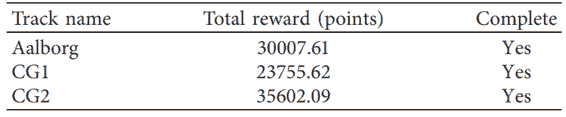


However, the aggregated policies with over 10 subpolicies cannot complete the Aalborg track and cannot pass the CG1 track. The reason why the aggregated policies with over 10 subpolicies performed worse mainly lies in the limit of the centralized experience replay. We set the replay buffer to 100,000 transition tuples `(s_t, a_t, r_t, s_{t+1})`. The centralized experience replay buffer cannot manage to share all experiences with more than 10 subpolicies. As a result, the aggregated policies with over 10 subpolicies gained less knowledge and performed not well. The experiment with a larger buffer size will display a better performance with aggregation of 10 subpolicies. But the memory setting has a nonmonotonic effect on the reinforcement learning (RL) performance [26].

**Table 6**. Generalization performance of the aggregated policy

### Generalization Performance

Generalization performance is a research hotspot in the field of machine learning, and it is also a key evaluation index for the performance of algorithms. An overtrained model often performs well in the training set, while it performs poorly in the test set. In our experiments, self-driving policies are learned successfully on the Aalborg track using BAMDDPG.

The car controlled by these policies has good performance on the training track. However, the generalization performance of the learned policies is not known. Hence, we test the performance of the aggregated policy learned with BAMDDPG on both the training and test tracks, including Aalborg, CG1, and CG2, whose maps are illustrated in Figure 11.


The total reward of the aggregated policy shown in Table 6 differs in different tracks since the length of different tracks is not the same. On a long track, the car travels for a longer time, and the total reward will be larger. In our experiment, route CG2 is the longest and CG1 is the shortest.


Table 6 illustrates that the car controlled by the aggregated policy passes the test tracks successfully. It demonstrates that the learned aggregated policy from BAMDDPG achieves a good generalization performance.

## CONCLUSIONS

This paper proposed a deep reinforcement learning algorithm, by aggregating multiple deep deterministic policy gradient algorithm and an m-out-of-n bootstrap sampling method. /is method is effective to the sequential and iterative training data, where the data exhibit long-tailed distribution, rather than the norm distribution implicated by the i.i.d. data assumption. The method can learn the optimal policies with much less training time for tasks with continuous space of actions and states.

Experiment results on the 2D robot arm game show that the reward gained by the aggregated policy is 10%Ң50% better than those gained by the nonaggregated subpolicies. Experiment results on TORCS demonstrate the proposed method can learn successful control policies with less training time by 56.7%, compared to the normal sampling method and nonaggregated subpolicies.

本书版权归 Arcler 所有


Deep Ensemble Reinforcement Learning With Multiple Deep ...

51

## REFERENCES

1\. R. S. Sutton and A. G. Barto, Reinforcement Learning: An Introduction, MIT press, Cambridge, MA, USA, 1998.

2\. K. Arulkumaran, M. P. Deisenroth, M. Brundage, and A. A. Bharath, “深度增强学习：简要综述”，IEEE 信号处理杂志，第 34 卷，第 6 期，第 26–38 页，2017 年。

3\. ! ¯ £ with deep convolutional neural networks”，在第 25 届神经信息处理系统国际会议论文集中，第 1097–1105 页，美国内华达州湖塔希 oe，2012 年 3 月。

4\. Y. LeCun, Y. Bengio, and G. Hinton, “Deep learning”，Nature，第 521 卷，第 7553 期，第 436–444 页，2015 年。

5\. V. Mnih, K. Kavukcuoglu, D. Silver et al., “Human-level control through deep reinforcement learning”，Nature，第 518 卷，第 7540 期，第 529–533 页，2015 年。

6\. H. Van Hasselt, A. Guez, and D. Silver, “Deep reinforcement learning with double Q-Learning”，在第 30 届 AAAI 会议论文集中。

'°~{

7\. T. Schaul, J. Quan, I. Antonoglou et al., “Prioritized experience replay”，2015 年，`https://arxiv.org/abs/1511.05952`。

8\. Z. Wang, T. Schaul, M. Hessel et al., “Dueling network architectures for deep reinforcement learning”，在第 33 届机器学习国际会议论文集中，第 2 卷，第 2939–2947 页，美国纽约，2016 年。

9\. D. Silver, G. Lever, N. Heess et al., “Deterministic policy gradient algorithms”，在第 31 届机器学习国际会议论文集中，第 387–395 页，中国北京，2014 年 6 月。

10\. T. P. Lillicrap, J. J. Hunt, A. Pritzel et al., “Continuous control with deep reinforcement learning”，计算机科学，第 8 卷，第 6 期，第 A187 页，2015 年。

11\. Z. Zheng, C. Yuan, Z. Lin et al., “Self-adaptive double bootstrapped DDPG”，第 27 届国际联合会议论文集。

{¢ {

12\. < ° £²+ policy gradient with an off-policy critic”，国际学习表示会议论文集。

13\. V. Mnih, A. P. Badia, M. Mirza et al., “Asynchronous methods for deep reinforcement learning”，第 33 届机器学习国际会议论文集，第 1928–1937 页，美国普里兰斯，2016 年 5 月。

14\. B. Efron and R. J. Tibshirani, An Introduction to the Bootstrap，CRC Press，美国佛罗里达州博卡拉顿，1994 年。

15\. I. Osband, C. Blundell, A. Pritzel et al., “Deep exploration via bootstrapped DQN”，第 33 届神经信息处理系统会议论文集，第 4026–4034 页，西班牙巴塞罗那，2016 年 12 月。

16\. Z. Yang, K. E. Merrick, H. A. Abbass et al., “Multi-task deep reinforcement learning for continuous action control”，第 3301–3307 页，澳大利亚墨尔本，2017 年 8 月。

17\. R. Lowe, Y. Wu, A. Tamar et al., “Multi-agent actor-critic for mixed cooperative-competitive environments”，神经信息处理系统进展，2017 年。

18\. W. Shi, S. Song, and C. Wu, “Soft policy gradient method for maximum entropy deep reinforcement learning”，2019 年，`https://arxiv.org/abs/1909.03198`。

19\. R. Davidson and E. Flachaire, “Asymptotic and bootstrap inference for inequality and poverty measures”，经济学杂志，第 141 卷，第 1 期，第 141–166 页，2007 年。

20\. H. Ishwaran, L. F. James, and M. Zarepour, “An alternative to the out of bootstrap”，统计规划与推断杂志，第 139 卷，第 3 期，第 788–801 页，2009 年。

21\. J. Wu and H. Li, “Aggregated multi-deep deterministic policy gradient for self-driving policy”，第 5 届车辆物联网国际会议论文集，第 11253 卷，第 179–192 页，法国巴黎，2018 年 11 月。

22\. A. M. F. Mood, Introduction to the 5eory of Statistics，麦格劳-希尔教育，美国纽约，2015 年。

23\. A. Dvoretzky, J. Kiefer, and J. Wolfowitz, “Asymptotic minimax character of the sample distribution function and of the classical multinomial estimator”，第 5e《数学统计学报》，第 27 卷，第 3 期，第 642–669 页，1956 年。

24\. B. Wymann, E. Espie, C. Guionneau et al., ´ Torcs: 5e Open Racing Car Simulator，SourceForge，2015 年。

本书版权归 Arcler 所有


Deep Learning Algorithms

52

13\. V. Mnih, A. P. Badia, M. Mirza et al., “Asynchronous methods for deep reinforcement learning”，第 33 届机器学习国际会议论文集，第 1928–1937 页，美国普里兰斯，2016 年 5 月。

14\. B. Efron and R. J. Tibshirani, An Introduction to the Bootstrap，CRC Press，美国佛罗里达州博卡拉顿，1994 年。

15\. I. Osband, C. Blundell, A. Pritzel et al., “Deep exploration via bootstrapped DQN”，第 33 届神经信息处理系统会议论文集，第 4026–4034 页，西班牙巴塞罗那，2016 年 12 月。

16\. Z. Yang, K. E. Merrick, H. A. Abbass et al., “Multi-task deep reinforcement learning for continuous action control”，第 3301–3307 页，澳大利亚墨尔本，2017 年 8 月。

17\. R. Lowe, Y. Wu, A. Tamar et al., “Multi-agent actor-critic for mixed cooperative-competitive environments”，神经信息处理系统进展，2017 年。

18\. W. Shi, S. Song, and C. Wu, “Soft policy gradient method for maximum entropy deep reinforcement learning”，2019 年，`https://arxiv.org/abs/1909.03198`。

19\. R. Davidson and E. Flachaire, “Asymptotic and bootstrap inference for inequality and poverty measures”，经济学杂志，第 141 卷，第 1 期，第 141–166 页，2007 年。

20\. H. Ishwaran, L. F. James, and M. Zarepour, “An alternative to the out of bootstrap”，统计规划与推断杂志，第 139 卷，第 3 期，第 788–801 页，2009 年。

21\. J. Wu and H. Li, “Aggregated multi-deep deterministic policy gradient for self-driving policy”，第 5 届车辆物联网国际会议论文集，第 11253 卷，第 179–192 页，法国巴黎，2018 年 11 月。

22\. A. M. F. Mood, Introduction to the 5eory of Statistics，麦格劳-希尔教育，美国纽约，2015 年。

23\. A. Dvoretzky, J. Kiefer, and J. Wolfowitz, “Asymptotic minimax character of the sample distribution function and of the classical multinomial estimator”，第 5e《数学统计学报》，第 27 卷，第 3 期，第 642–669 页，1956 年。

24\. B. Wymann, E. Espie, C. Guionneau et al., ´ Torcs: 5e Open Racing Car Simulator，SourceForge，2015 年。

本书版权归 Arcler 所有


Deep Learning Algorithms

53

25\. D. Loiacono, L. Cardamone, and P. L. Lanzi, Simulated Car Racing Championship: Competition Software Manual，Politecnico di Milano，Dipartimento di Elettronica, Informazione e Bioingegneria，Milan，Italy，2013 年。

26\. R. Liu and J. Zou, “/e effects of memory replay in reinforcement learning”，第 ICML 2017 工作坊论文集，澳大利亚悉尼，2017 年，`https://arxiv.org/pdf/1710.06574.pdf`。

本书版权归 Arcler 所有


本书版权归 Arcler 所有


# CHAPTER 3 DYNAMIC DECISION-MAKING FOR STABILIZED DEEP LEARNING SOFTWARE PLATFORMS

Soohyun Park1, Dohyun Kim2 and Joongheon Kim1

1Korea University, Seoul, Republic of Korea

2Naver Webtoon Corporation, Seongnam, Republic of Korea

## ABSTRACT

本章介绍了一种动态且低复杂度的决策算法，旨在实现深度学习平台的时间平均效用最大化，灵感来自 Lyapunov 优化。在深度学习计算中，由于计算成本高昂，可能会出现大延迟。因此，处理延迟是深度学习算法商业化的重要问题。本文提出的算法首先观察系统延迟，并在此基础上动态地在效用（即深度学习性能）和系统延迟之间进行权衡。为了评估所提算法的性能，本文在超分辨率框架的应用下，展示了真实数据的评估结果。最后，本文总结说 Lyapunov 优化算法可以应用于各种新兴应用。

**Keywords:-** Lyapunov optimization, stochastic optimization, real-time computing, deep learning platforms, computer vision platforms

## INTRODUCTION

当今，各种机器学习和深度学习算法已在计算机视觉、自然语言处理等众多应用中得到发展。此外，这些算法的性能不断提升。因此，机器学习和深度学习算法的发展已趋于成熟。然而，专注于算法在现实世界中实现的研究贡献相对较少，相比之下，算法本身的发展更为丰富。为了在现实世界中运行深度学习算法，必须考虑实时计算的问题。

因此，延迟处理是必要的，因为深度学习算法的计算通常会引入大延迟。在通信和网络研究文献中，存在一种著名的随机优化算法，用于在保持系统稳定的同时最大化效用函数。

这里，稳定性以队列建模，而该算法旨在在稳定队列动态的同时优化计算。


# 为了构建稳定性，队列被数学模型化为利雅普诺夫漂移 \[2\]。该算法灵感来自利雅普诺夫控制理论，因此被命名为利雅普诺夫优化理论 \[2\]。

## 本章介绍了利雅普诺夫优化理论的基本理论、示例和讨论。随后，讨论了利雅普诺夫优化理论在实时计算机视觉和深度学习平台中的应用。

## 此外，还展示了基于真实深度学习框架的计算性能评估结果，包括各种模型的实际图像超分辨率计算结果。

## 最后，将介绍新兴的应用。

本书版权归 Arcler 所有

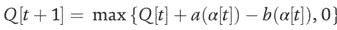

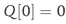

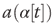

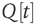

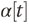

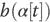

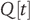

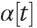


## Dynamic Decision-Making For Stabilized Deep Learning Software ...

## 57

## STABILIZED CONTROL FOR RELIABLE DEEP LEARNING PLATFORMS

在本节中，首先介绍一种用于时间平均优化且受限于稳定性的利雅普诺夫优化理论（参见第 2.1 节），随后提供基于示例的解释（参见第 2.2 节）。

最后，相关讨论将在（参见第 2.3 节）中组织。

### Theory

在本节中，我们介绍一种旨在时间平均惩罚函数最小化且受限于队列稳定的利雅普诺夫优化理论。请注意，时间平均惩罚函数最小化可以等价地转换为时间平均效用函数最大化。当存在效用与稳定性之间的权衡时，利雅普诺夫优化理论可以被使用。例如，当当前决策在惩罚函数的最小化方面是最优的，但决策的执行需要大量时间，从而引入延迟（即系统中的队列积压增加）时，这种权衡就很明显。此时，最优决策可以动态变化，因为当系统当前的延迟不严重（即队列延迟较小或可忽略）时，专注于效用最大化（即惩罚函数最小化）更为有利；相反，当系统当前的延迟较大时，最优决策将侧重于延迟的减少，此时决策应在牺牲一定效用最大化（或惩罚函数最小化）的情况下进行延迟减少。

\+ # `\[t\]) and it should be minimized and our control action decision-making is

#< \* ²#

formulated as follows:

(1)

(2)

where

is an arrival process at

at t when our control action

decision-making is

. In (1),

t is a departure/service process at

when our control action decision-making is

at t.

In this section, control action decision-making should be made in each unit time for time-average penalty function minimization subject to queue stability. Then, the mathematical program for minimizing time-average 本书版权归 Arcler 所有

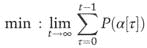

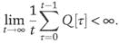

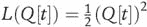

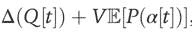


## Deep Learning Algorithms

## 58

penalty function, P(\[t\]) where the control action decision-making

can be presented as follows:

(3)

Subject to queue stability:

(4)

`|`| +

making

As mentioned, the Lyapunov optimization theory can be used when tradeoff between utility maximization (or penalty function minimization) and delays exists. Based on this nature, drift-plus-penalty (DPP) algorithm

\[2, 3, 4\] is designed for maximizing the time-average utility subject to queue

# ¯

, and

³`|# \*

^\`²µ{_\`²|ª²

\[2\], this dynamic policy is designed to achieve queue stability by minimizing an upper bound of our considering penalty function on DPP which is given by

(5)

¶ < #

Lyapunov function at t is derived as follows:

(6)

(7)

Therefore, the upper bound of the conditional Lyapunov drift can be derived as follows:

(8)

where C is a constant given by

(9)

本书版权归 Arcler 所有


## Dynamic Decision-Making For Stabilized Deep Learning Software ...

## 59

which supposes that the arrival and departure process rates are upper bounded. Due to the fact that C is a constant, minimizing the upper bound on DPP is as follows:

(10)

**Algorithm 1**. Stabilized Time-Average Penalty Function Minimization Finally, the dynamic control action decision-making

\+ `| ! #"

to queue stability can be formulated as follows based on the Lyapunov optimization theory:

(11)

\# ѽ\[t+1\] is the

optimal control action decision-making for the next time slot.

In order to verify whether (11) works correctly or not, following two example cases can be considerable:

*Case 1:* ²¸¹<

(12)

(13)

Then, (13) shows that control action decision-making should works as follows, i.e., (i) the arrival process should be minimized, and (ii) the 本书版权归 Arcler 所有


## Deep Learning Algorithms

## 60

departure process should be maximized. Both cases are for stabilizing the

\* # # ²¸¹

*Case 2:* Suppose Q\[t\]=0. Then

(14)

(15)

Then, (15) shows that control action decision-making should work for minimizing the given penalty function. This is semantically reasonable because focusing on our main objective is possible because stability does not need to be considered because Q\[t\]=0.

The pseudo-code of the proposed time-average penalty function minimization algorithm is presented in Algorithm 1. From line 1 to line 3, all variables and parameters are initialized. The algorithm works in each unit time as shown in line 4. In line 5, current queue-backlog Q\[t\] is observed to be used in (11). From line 7 to line 13, the main computation procedure for (11) is described.

Up to now, the time-average penalty function minimization is considered.

Based on the theory, the dynamic control action decision-making

\+ `|'!#"

queue stability can be formulated as follows:

(16)

\# \[t+1\] is the

optimal control action decision-making for the next time slot.

### 2.2 Example: multicore scheduling in mobile devices

In this section, the Lyapunov optimization-based stabilized time-average optimization algorithm is introduced with one simple toy model. In this example, dynamic core allocation decision-making algorithm is designed which is for time average energy consumption minimization subject to queue stability.

As illustrated in Figure 1, mobile smartphone is with the processor which is equipped with multiple cores. For example, ARM big.LITTLE processors are with multiple little and big heterogeneous cores.

本书版权归 Arcler 所有


Dynamic Decision-Making For Stabilized Deep Learning Software ...

61

在该系统中，当用户生成事件时，会生成任务事件，如图 1 中用 `a[t]` 表示。然后，这些事件会被定位到任务队列（即图 1 中的 `Q[t]`）。随后，事件可以由多核处理器进行处理。如果为处理队列中的事件分配了大量/更多的核心，则处理速度可以加快，这有助于保持队列稳定。然而，这对我们的主要目标——能量消耗最小化并不有利。相反，如果分配的核心较少，处理速度会变慢，这对队列稳定性有害，但有利于我们的主要目标，即能量消耗最小化。最终，可以观察到能量消耗最小化（即我们的主要目标）与稳定性之间的权衡。因此，可以确认基于 Lyapunov 优化的算法可以被使用。

**Figure 1**. Mobile devices with multicore processors.

+

\+ ^`|!

subject to queue stability can be formulated as follows based on (11): (17)

where A is the set of all possible core allocation combinations and

ѽ\[t+1\] is the optimal core allocation decision-making for the next time slot. Here, it is obvious that the arrival process is not controllable (i.i.d.

|# <

+#

(18)

In order to check whether the derived Eq. (18) is correct or not, two example

\# `|²¸¹`|²\\

本书版权归 Arcler 所有


Deep Learning Algorithms

62

\* `|²¸¹|

(19)

(20)

Thus, the departure process should be accelerated, i.e., more cores should be allocated. This is semantically true because the fast processing

\* $

Busy queue case (`Q[t]`=0): In this case

(21)

(22)

Thus, less cores should be allocated for energy consumption minimization which is our main objective. This is semantically true because the given main objective should be desired if the system is stable, i.e., `Q[t]`=0.

As discussed with examples, the proposed Lyapunov optimization-based dynamic core allocation decision-making algorithm works as desired.


# Discussions in stabilized control

The proposed dynamic super-resolution model selection algorithm is beneficial in various aspects, as follows.

## Hardware/system-independent self-adaptation

Suppose that this proposed algorithm is implemented in supercomputer-like high-performance computing machines. In this case, the processing should be fast; thus, the queue-backlog is always low. Therefore, the system has more chances to focus on our main objective, i.e., penalty function minimization or utility function maximization. On the other hand, if the hardware itself is performance/resource limited (e.g., mobile devices), then the processing speed is also limited due to the low specifications in processors. Thus, the queue-backlog can be frequently busy because it may not be able to process many data with the queue even though it utilizes the fastest model. Therefore,


it can be finally observed that the proposed algorithm is self-adaptive which can adapt depending on the given hardware/system specifications. It automatically adapts the models based on the given hardware/system; thus, it does not require system engineer’s trial-and-error tuning. Furthermore, the proposed algorithm is reliable according to the fact that the self-adaptation is for maximizing its utility while maintaining stability.

## Low-complexity operation

As shown in Algorithm 1, the computation procedure is iterative for solving closed-form equation, i.e., (11) and (16). Thus, the computational complexity of the proposed algorithm is polynomial time, i.e., `O(N)`, where `N` is the number of the given control actions. Thus, it guarantees low-complexity operations.

# THE USE OF LYAPUNOV OPTIMIZATION FOR DEEP LEARNING PLATFORMS

As explained, the Lyapunov optimization theory is a scalable, self-configurable, low-complexity algorithm which can be used in many applications. In this section, the use of Lyapunov optimization for deep learning and computer platforms is discussed in two different ways, i.e., departure process control (refer to Section 3.1) and arrival process control (refer to Section 3.2). Finally, its related performance evaluation results are presented (refer to Section 3.3).

## Lyapunov control over departure processes

As illustrated in Figure 2, stabilized real-time computer vision platforms should be equipped with queues in order to handle bursty traffics. If the queue is busy or near-overflow, the departure process should be accelerated.

Thus, the simplest model should be used for reducing the corresponding computation. On the other hand, if the queue is empty, deep learning computation accuracy can be improved with more sophisticate models because we have enough time to conduct the computation. Thus, multiple models are desired in order to select one depending on queue backlog.


**Figure 2**. Lyapunov control over departure processes in real-time computer vision platforms for time-average learning accuracy maximization subject to queue stability.

**Figure 3**. Lyapunov control over arrival processes in real-time computer vision platforms for time-average learning accuracy maximization subject to queue stability.

In Figure 2, multiple models exist, and it can be seen that the simplest model (i.e., low-resolution model) is able to conduct fast computation, but it presents low learning accuracy. On the other hand, the most sophisticate model (i.e., high-resolution model) is good for accurate learning performance, but it introduces computation delays. Thus, the tradeoff exists between performance and delays, i.e., Lyapunov optimization theory-based dynamic model selection decision-making algorithm can be designed as follows: (23)

and this can be reformulated as follows due to the fact that the arrival process is out of control:


(24)

| +
¯ #
`כ\[t+1\]` is the optimal control action decision-making for next time slot.

## Lyapunov control over arrival processes

The stabilized real-time computer vision platform in Section 3.1 is novel and scalable; however it has burden because multiple deep learning models should be implemented in a single platform.

Thus, a new dynamic control algorithm with a single deep learning model is also needed for resource-limited systems. As illustrated in Figure 3, our considering system has a single computer vision and deep learning model in computing platforms. In addition, the queue is in front of the system. Thus, the departure process is not controllable anymore. In this case, the arrival process should be controllable in order to control the queue dynamics for stability. Therefore, the arrival image/video streams should be controlled by handling sample rates. If high-frequency sampling is available, more signals will be generated, and then the results will be

\* < <# #

increases computer vision performance due to the fact that more images/

videos 可以在监控应用中获得，另一方面，即如果进行低频采样，计算机视觉性能可能会下降，而到达过程数据

\# #^

在计算机视觉性能和延迟之间可以观察到。最后，基于 Lyapunov 优化理论的采样率选择决策算法可以设计为：

(25)

并且由于离散过程失控，可以如下重新表述：

(26)

`|`

¯ #

`ѽ\[t+1\]` 是下一个时间槽的最优控制动作决策。


## Performance evaluation and discussions

在本节中，我们在 3.1 节提出的算法的性能评估结果进行了展示。数据密集型的基于模拟的评估被执行，然后结果在图 4 中展示。此外，表 1 显示了超分辨率性能随隐藏层数量的变化。如果隐藏层数量最大（即本研究中的 20 层），则 PSNR 和结构相似性（SSIM，超分辨率中广泛使用的性能指标）的值达到最大。然而，计算时间（CPU 仅和 CPU-GPU）会变慢。

如图 4 所示，如果模型是静态的（即深度或浅层），

<

$ \*

另一方面，浅层模型过快，因此队列总是为空。这显然有利于稳定性，但超分辨率性能最低。因此，可能更好如果算法允许一定的延迟以提高超分辨率质量。拟议算法最初遵循深度模型，因为

\* \* #

一定数量的图像（即临界阈值附近），它开始控制，即自适应，在约 5800 的单位时间内。因此，拟议算法开始选择能够处理延迟的超分辨率模型。因此，拟议算法确实优于其他两种静态算法。

**Figure 4**. 性能评估：队列积压（x 轴，单位时间；x 轴，队列占用（单位：位））。


**Table 1**. 从超分辨率性能测量结果中获得的实用性与延迟权衡（处理时间是在 512 768 张图像上测量的）

对于拟议的自适应稳定算法，在两种处理能力（CPU 仅平台与 CPU-GPU 平台）下进行评估，可以观察到 CPU-GPU 平台选择最大性能超分辨率模型（即表 1 中的 20 层隐藏层）的次数是 CPU 仅平台的 4:36 倍。这意味着拟议算法根据硬件/平台需求是自适应的。因此，不再需要基于试错的系统参数调优。


**Figure 5**. 超分辨率计算结果。注意，低分辨率模型为双三次插值，该模型没有隐藏层。（a）图像 #1（低分辨率），（b）图像 #1（高分辨率），（c）图像 #2（低分辨率），（d）图像 #2（高分辨率），（e）图像 #3（低分辨率）和（f）图像 #3（高分辨率）。

为确认超分辨率模型的性能，图 5 展示了使用真实图像的超分辨率计算结果。

如图所示，超分辨率模型的性能随着隐藏层数量的增加而提升，如图 5b、图 5d 和图 5f 所示。对于没有隐藏层的超分辨率计算，本文采用双三次插值，如图 5a、图 5c 和图 5e 所示。最终，这些结果表明，我们利用 Lyapunov 控制算法对自适应深度学习平台进行控制，可以根据队列积压大小信息使超分辨率性能有所不同。

# EMERGING APPLICATIONS

如所述，Lyapunov 优化框架用于时间平均实用性最大化，同时实现队列稳定；该理论具有可扩展性，因此广泛适用 \[2\]。因此，基于该算法的应用有很多，具体包括：

## 自适应视频流

Kim et al. \[3, 5\] 设计了一种动态控制算法，用于在无线视频网络中实现时间平均流媒体质量（即峰值信噪比（PSNR））最大化，并受到传输缓冲区稳定性的约束。Koo et al. \[6, 7\] 还提出了一种基于 DASH（动态自适应流媒体）的新机制，用于在考虑电池状态、LTE 数据流量限制以及混合 LTE 和 WiFi 网络中的稳定性的前提下最大化视频流媒体质量。


# Dynamic Decision-Making For Stabilized Deep Learning Software ...

## Networks

Neely et al. [8] 提出了一种新的动态多跳路由算法，用于在无线自组网和传感器网络中实现能源高效的数据/包转发，并受到队列稳定性的约束。

## 安全应用：监控

Mo et al. [9] 设计了一个基于深度学习的 CCTV 分布式监控系统框架。在该系统中，多个深度学习框架存在，每个深度学习模型都有其独立的配置。在这种情况下，存在复杂度与性能之间的权衡。

因此，拟议的 CCTV 监控算法会根据系统中的队列积压情况自适应选择深度学习模型，以在 maximization 目标下最大化识别性能，同时受到 CCTV 队列稳定性的约束。Kim et al. [10] 还设计了一种新的面部识别深度学习框架，用于 CCTV 监控平台。与拥有多个深度学习模型不同，该系统有一个学习系统（基于开源软件库 `OpenFace`），并控制 CCTV 摄像头的采样率。最终，拟议的决策算法会动态选择 CCTV 采样率，以在 maximization 目标下最大化识别性能，同时受到 CCTV 队列稳定性的约束。

## Others

图 [11] 说明了基于 Lyapunov 优化框架的动态控制算法用于动态强化学习策略设计。此外，图 [12, 13] 介绍了基于 Lyapunov 优化框架的自适应控制算法在股票市场定价和智能电网中的应用。

## CONCLUSIONS

本章介绍了一种动态控制决策算法，灵感来源于 Lyapunov 优化理论，在存在实用性/性能与延迟权衡的情况下。因此，动态控制决策算法旨在实时深度学习平台的时间平均实用性最大化（或惩罚最小化）。如讨论所示，基于 Lyapunov 优化的算法具有可扩展性、与硬件/系统无关、自配置且低复杂度。因此，它可以应用于视频流、无线网络、安全应用和智能电网等各种新兴应用。


## ACKNOWLEDGEMENTS

本工作得到韩国国家研究基金（2019R1A2C4070663, 2019M3E4A1080391）的支持。J. Kim 是对应作者（电子邮件：joongheon@korea.ac.kr）。


## REFERENCES

1. Kim D, Kwon J, Kim J. Lowcomplexity online model selection with Lyapunov control for reward maximization in stabilized real-time deep learning platforms. In: Proceedings of the IEEE International Conference on Systems, Man, and Cybernetics (SMC ‘18); 7–10 October, 2018; Miyazaki, Japan: IEEE; 2018. pp. 4363-4368

2. Neely M. Stochastic Network Optimization with Application to Communication and Queueing Systems. Vermont, USA: Morgan & Claypool; 2010

3. Kim J, Caire G, Molisch A. Qualityaware streaming and scheduling for device-to-device video delivery. IEEE/ ACM Transactions on Networking. 2016;24:2319-2331. DOI: 10.1109/ TNET.2015.2452272

4. Choi M, Kim J, Moon J. Adaptive detector selection for queue-stable word error rate minimization in connected vehicle receiver design. IEEE Transactions on Vehicular Technology. 2018;67:3635-3639. DOI: 10.1109/ TVT.2017.2776327

5. Kim J, Meng F, Chen P, Egilmez H, Bethanabhotla D, Molisch A, et al. Demo: Adaptive video streaming for device-todevice mobile platforms. In: Proceedings of the ACM International Conference on Mobile Computing and Networking (MobiCom ‘13), 30 September–4 October, 2013; Miami, FL, USA: IEEE; 2013

6. Koo J, Yi J, Kim J, Hoque M, Choi S. REQUEST: Seamless dynamic adaptive streaming over HTTP for multi-homed smartphone under resource constraints. In: Proceedings of the ACM International Conference on Multimedia (MM ‘17), 23–27 October, 2017; Mountain View, CA, USA: IEEE; 2017

7. Koo J, Yi J, Kim J, Hoque M, Choi S. Seamless dynamic adaptive constraints. IEEE Transactions on Mobile Computing. 2019;18:1647-1660. DOI: 10.1109/ TMC.2018.2863234

8. Neely M. Energy optimal control for time varying wireless networks. IEEE Transactions on Information Theory. 2006;52:2915-2934. DOI: 10.1109/ TIT.2006.876219

9. Kim J, Mo YJ, Lee W, Nyang D. Dynamic security-level maximization for stabilized parallel deep learning architectures in surveillance applications. In: Proceedings of the IEEE Symposium on Privacy-Aware Computing (PAC ‘07); 1–3 August, 2017; Washington DC, USA: IEEE; 2017. pp. 192-193

10. # framework via Lyapunov optimization. In: Proceedings of ACM Symposium on Operating Systems Principles (SOSP) AI Systems Workshop (AISys‘17), 28 October, 2017; Shanghai, China: ACM; 2017

11. Neely M, Supittayapornpong S. Dynamic Markov decision policies for delay constrained wireless scheduling. IEEE Transactions on Automatic Control. 2013;58:1948-1961. DOI: 10.1109/TAC.2013.2256682

12. Neely M. Stock market trading via stochastic network optimization. In: Proceedings of IEEE Conference on Decision and Control (CDC ‘10), 15–17 December, 2010; Atlanta, GA, USA: IEEE; 2010

13. # energy allocation to delay tolerant consumers. In: Proceedings of IEEE International Conference on Smart Grid Communication (SmartGridComm ‘10), 4–6 October, 2010; Gaithersburg, MD, USA: IEEE; 2010


# CHAPTER 4 DEEP LEARNING FOR HYPERSPECTRAL DATA CLASSIFICATION THROUGH EXPONENTIAL MOMENTUM DEEP CONVOLUTION NEURAL NETWORKS

Qi Yue1,2,3 and Caiwen Ma1

1Xi’an Institute of Optics and Precision Mechanics, CAS, Xi’an 710119, China

2University of Chinese Academy of Sciences, Beijing 100039, China

3Xi’an University of Posts and Telecommunications, Xi’an 710121, China

## ABSTRACT

Classification is a hot topic in hyperspectral remote sensing community. In the last decades, numerous efforts have been concentrated on the classification problem. Most of the existing studies and research efforts are following the conventional pattern recognition paradigm, which is based on complex handcrafted features. However, it is rarely known which features are important for the problem. In this paper, a new classification skeleton based on deep machine learning is proposed for hyperspectral data. The proposed classification framework, which is composed of exponential momentum deep convolution neural network and support vector machine (SVM), can hierarchically construct high-level spectral-spatial features in an automated way. Experimental results and quantitative validation on widely used datasets showcase the potential of the developed approach for accurate hyperspectral data classification.

**Citation:** through Exponential Momentum Deep Convolution Neural Networks”, Journal of Sensors, vol. 2016, Article ID 3150632, 8 pages, 2016. https://doi.org/10.1155/2016/3150632.

**Copyright:** © 2016 by Authors. This is an open access article distributed under the Creative Commons Attribution License, which permits unrestricted use, distribution, and reproduction in any medium, provided the original work is properly cited.


## INTRODUCTION

Recent advances in optics and photonics have allowed the development of hyperspectral data detection and classification, which is widely used in agriculture [1], surveillance [2], environmental sciences [3, 4], astronomy [5, 6], and mineralogy [7]. In the past decades, hyperspectral data classification methods have been a hot research topic. A lot of classical classification algorithms, such as *k*-nearest neighbors, maximum likelihood, parallelepiped classification, minimum distance, and logistic regression (LR) [8, 9], have been proposed. However, there are several critical problems in the classification of hyperspectral data: (1) high dimensional data, which would lead to curse of dimensionality; (2) limited number of labeled training samples, which would lead to Hughes effect; (3) large spatial variability of spectral signature [10].

data, follows the conventional paradigm of pattern recognition and complex

Classical feature extraction methods include the following: principle component analysis, singular value decomposition, projection pursuit, self-organizing map, and fusion feature extraction method. Many of these methods extract features in a shallow manner, which do not hierarchically extract deep features automatically. In contrast, the deep machine learning framework can extract high-level abstract features, which has rotation, scaling, and translation invariance characteristics [11, 12].


In recent years, the deep learning model, especially the deep convolution neural network (CNN), has been shown to yield competitive performance image \[13–15\], speech \[16\], and language \[17\]. However, most of the CNN network input data are original image without any preprocessing based on the prior knowledge. Such manner directly extends the CNN network training time and the feature extraction time \[18, 19\]. Besides, the traditional training algorithm based on gradient descend technique may lead to entrapment in local optimum and gradient dispersion. Moreover, there is little study on the convergence rate and smoothness improvement of CNN framework based on exponential momentum deep convolution neural network (EM-CNN). And an innovative method for updating parameters of the CNN on the basis of exponential momentum gradient descendent is proposed aiming at the problem of gradient diffusion of deep network.

The rest of the paper is organized into four sections. Section 2 describes the feature learning and deep learning. The proposed EM-CNN framework is introduced in Section 3, while Section 4 details the new way of exponential momentum gradient descent method, which yields the highest accuracy compared with homologous parameters momentum updating methods.

Section 5 is the experiment results. Section 6 summarizes the results and draws a general conclusion.

# FEATURE LEARNING

Feature extraction is necessary and useful in the real-world for that the data such as images, videos, and sensor measurement data is usually redundant, highly variable, and complex. Traditional handcrafted feature extraction algorithms are time-consuming and laborious and usually rely on the prior knowledge of certain visual task. In contrast, feature learning allows a machine to both learn at a specific task and learn the features themselves.

Deep learning is part of a broader family of machine learning based on learning representations of data. It attempts to model high-level abstractions in data by using a deep graph with multiple processing layers, composed of multiple linear and nonlinear transformations. Typical deep learning models include autoencoder (AE) \[20\], deep restricted Boltzmann machine (DRBM) \[21\], deep Boltzmann machines (DBM) \[22\], deep belief networks (DBN) \[23\], stacked autoencoder (SAE) \[24\], and deep convolutional neural networks (DCNN) \[25\].

The deep convolution neural network (DCNN), a kind of neural network, is an effective method for feature extraction, which can potentially lead to progressively more abstract and complex features at higher layers, and the learnt features are generally invariant to most local changes of the input.

as object detection \[13–15\], speech simultaneous interpretation \[16\], and depends on the features \[26\], we adopt deep convolution neural network (DCNN) framework.

# STRUCTURE DESIGN OF HYPERSPECTRAL DATA CLASSIFICATION FRAMEWORK

In deep convolutional neural network, input data, convolution kernel, and threshold parameter are the three most important issues \[27–29\]. The input tion performance.

The size of the convolution kernel determines the degree of abstraction of the feature. If convolution kernel size is too small, the effective local exceed the feature range that convolution kernel can express. Threshold parameter is mainly used to control the degree of response of characteristic submode. Besides, the network depth and dimension of output layer can also The deeper network layers indicate stronger feature expression ability, of output layer directly determines the convergence speed of network.

When the sample sets are limited, over lower dimension of the output layer cannot guarantee the validity of features, while over higher feature of the output layer will produce feature redundancy.

Since the traditional CNN input the original image directly into the deep \[28, 29\], three images obtained by image data preprocessing are used as performance. In order to obtain better extraction features, the sizes of con- network is seven according to the results of the experiments.

Besides, the lower sampling applies Max-pooling and the nonlinear mapping function is LREL function, which is shown in the following formula:

```
(1)
```

where ߝ is nonzero small constant and ݓ is the weight of neuron. The setting of ߝ ensures that inactive neurons receive a nonzero gradient value, so that the neuron has the possibility of being activated.

Based on the above analysis, a deep network framework for hyperspectral based on deep convolutional neural network is proposed in Figure 1.

In the proposed deep CNN model, the first layer, the third layer, and the fifth layer are convolution layers, which realized feature extraction from lower level to higher level. The second layer, the fourth layer, and the sixth layer are lower sampling layers, used for feature dimension reduction. The final layer is the output layer which is whole connection layer and output of the final extraction features.

# EXPONENTIAL MOMENTUM GRADIENT DESCENT ALGORITHM

## Error Transfer

Error transmission descends by two steps through forward propagation and reverse gradient, to conduct weight generation and adjustment. Using gradient descent method to update weight is shown in formula (2), and bias updating method is shown in formula (3) \[30\]:

```
(1)
(2)
```

**Figure 1**

In the formula, ߟ is the learning rate, is the gradient of error to weight, and is the gradient of error to bias, namely, the sensitivity of parameter adjustment. In order to achieve weight and bias optimizing, the gradient of error to weight and the gradient of error to bias must be first obtained.

For convolution layer, its output is shown as the following formula: (3)

where ܾ is the bias of ݆ is the block of in- ݆ ݆ put feature diagram, and is convolution kernel. According to derivation formula of sensitivity function, the sensitivity of convolution layer can be represented by the following formula:

```
(4)
```

where is the convolution kernel of ݈+1 sampling layer, up represents upper sampling, and is 1/4 of , so upper sampling should be conducted.لsymbol represents the multiplication of corresponding elements Thus, the gradient of convolution layer error to bias is shown in formula (6). In the formula, (ݑ, V) is the element location of sensitivity matrix: (5)

```
(5)
```

The gradient of convolution layer error to weight is shown in formula (7). In the formula, is the convolution block of and convolution kernel ܭ݆݅, (ݑ, V) is the element location of the block:

```
(6)
```

Substitute formula (5), (6) into formula (1), (2) and obtain the updated value of convolution layer’s weight.


The output of sampling layer’s neural network can be expressed by formula (8), in which

, respectively, represent multiplicative bias

and additive bias. Multiplicative bias is generally set as 1: `本书版权归 Arcler 所有`


¯ <

79

(7)

According to the sensitivity of calculating formula of gradient descent, the sensitivity of sampling layer obtained is shown as the following formula: (8)

Whereby the bias updating formula of sampling layer can be obtained, as is shown in formula (10). According to formula (3), bias value updating can be obtained:

(9)

## Exponential Momentum Training Algorithm

The traditional gradient descent method only transmits gradient error between single layers, which lead to slow convergence rate of the network.

Increasing the learning rate ߟ is a good way to improve the convergence speed.

但它不仅提高了收敛速度，还导致了网络的不稳定问题，即“振荡”。面对这种情况，文献[19]提出了动量法，通过加入动量因子来提高收敛速度。文献[31]基于文献[19]提出了自适应动量法。

然而，这两种方法都没有考虑振荡、收敛和动量之间的关系，动量因子并不能促进收敛并提升学习性能。本文采用梯度误差指数函数来调整动量因子的步调。

which can accelerate the network convergence speed and can decrease the momentum factor at the steep region of error curve, which can avoid excessive network convergence. Such method can improve the convergence rate of the algorithm and avoid oscillation of convergence process.

本书版权归 Arcler 所有


Deep Learning Algorithms

80

## Figure 2

动量因子的更新公式如下公式(11)：

³ݓ݇ = ݓ݇+1 \_ݓ , 其中ݤ݇表示误差的梯度

加权。

## EXPERIMENT AND ANALYSIS

本节评估拟议算法的性能，在 AVIRIS 和 ROSIS 高光谱数据集上进行实验。整体精度、泛化精度和 Kappa 参数，这三个最重要的指标用于评估拟议框架的性能。

本书版权归 Arcler 所有


¯ <

81

## Data Description

在我们的实验中，我们使用了 AVIRIS 和 ROSIS 高光谱数据集验证了拟议框架的性能。AVIRIS 高光谱数据 92AV3C 是 1992 年 6 月由 AVIRIS 传感器获得的。ROSIS 高光谱数据集是由一种称为反射光学成像仪器（ROSIS-3）的传感器在意大利帕维亚市收集的。

特别是，我们使用了印度帕维亚数据集，该数据集描绘了印第安纳

{»{! #

范围 0.4 到 2.510\_ 米。它包含总共 16 个类别，如表 1 所示。其真实标记如图 2 所示。我们使用的其他数据集是帕维亚大学数据集，其光谱带数量为 102。

选择了九个土地覆盖类别，如图 3 所示。每个类别的样本数量如表 2 所示。

### 表 1. 印度帕维亚数据集的十六个类别

为验证拟议方法的性能，我们按步骤组织了实验。首先分析了卷积核大小和网络深度对分类结果的影响。然后，我们验证了指数动量训练算法的性能。

最后，我们基于 CNN 框架进行了分类。

本书版权归 Arcler 所有


Deep Learning Algorithms

82

## Figure 3

### 卷积核大小和网络深度的影响

本节分析拟议框架分类性能受卷积核大小和网络深度的影响。深度卷积神经网络在固定网络结构和算法参数的前提下，通过一系列不同卷积核大小和网络深度进行训练。

结果如表 3 和表 4 所示。表 3 表明，卷积核大小对整体精度影响不大，且更应与图像数据的特征尺寸相匹配。

<# #

精度。

### 指数动量训练算法

本节验证了算法的泛化精度和收敛速度。我们选择自适应动量[31]和弹性动量[32]作为对比方法，观察损失随迭代的变化。

本书版权归 Arcler 所有


¯ <

83

训练目标函数。可以从图 4 中清楚看出，自适应动量的收敛点为 14，弹性动量的收敛点为 8，指数动量的收敛点为 7。因此，指数动量的迭代次数收敛最快，其训练时间消耗也最少。

在泛化精度测试实验中，我们选择 LeNet5 神经网络[33]和标准多层感知器[34]进行对比。

表 5 所示的准确率结果表明，与标准动量和自适应动量对应的训练模型相比，指数动量训练在不同网络结构下的表现更优。

### 表 2. 帕维亚数据集的九类

### 表 3. 不同卷积核大小的准确率比较 表 4. 不同深度的准确率比较

本书版权归 Arcler 所有


Deep Learning Algorithms

84

### 表 5. 算法图像识别准确率比较 与其他方法比较

### 与其他特征提取方法比较

我们通过与其他经典特征提取方法比较，验证了拟议特征提取方法的有效性。这些方法包括主成分分析-(PCA-)

SVM、核主成分分析-(KPCA-)逻辑回归(LR)、独立成分分析-(ICA-)SVM、非负矩阵因子化-(NMF-)LR 以及因子分析-(FA-)SVM。学习率设置为 0.1，并对训练数据进行 8000 个 epoch 的迭代。结果如图 5 所示。实验表明，结合 SVM 后，拟议方法在所有特征提取方法中表现最佳，并获得最高精度。

### 表 6

本书版权归 Arcler 所有


¯ <

85

### 图 4. 收敛曲线。

我们通过与空间主导方法比较，如径向基函数-(RBF-)线性 SVM、主成分分析-(PCA-)RBF-SVM 和堆叠自动编码器-(SAE-)逻辑回归(LR)，来评估 EFM-CNN-SVM 框架的分类精度。通过将光谱信息和空间信息结合形成混合输入，并利用第 3 节详细描述的深度分类框架，我们取得了有史以来最高的分类精度。

实验在相同参数设置下进行了 100 次。

结果如表 6 和图 6 所示。从表 6 可以看出，EFM-CNN-SVM 方法在所有其他方法中表现更好。

且联合特征比光谱特征在平均性能方面具有更高的精度。在图 6 中，我们从视觉角度观察分类精度。可以看出，拟议方法的分类结果最接近理想分类结果，除了 RBF-SVM 和线性 SVM 方法。

本书版权归 Arcler 所有


Deep Learning Algorithms

86

### 图 5. 与其他特征提取方法的比较。

## 结论

在本论文中，提出了一种基于深度 CNN 特征提取架构的高光谱数据分类框架，并提出了一种改进的错误传播算法——自适应指数动量算法。实验结果表明，改进的错误传播算法的收敛速度比同类错误优化算法（如自适应动量和弹性动量）更快。所提议的 EFM‑CNN‑SVM 框架已被证明比 PCA‑SVM、KPCA‑SVM 和 SAE‑LR 框架提供更好的性能。我们的实验结果表明，更深的层始终能够提高分类准确率，尽管操作时间和准确率之间存在矛盾。这表明深度架构对分类有用，且高层次的光谱空间特征能够提升分类准确率。当数据规模较大时，提取的特征具有更好的识别能力。

本书版权归 Arcler 所有


¯ <

87

### Figure 6 # ^?~++¶~

## ACKNOWLEDGMENTS

This work is supported by the National 863 High Tech Research and Development Program (2010AA7080302).

本书版权归 Arcler 所有


Deep Learning Algorithms

88

## REFERENCES

1.

F. M. Lacar, M. M. Lewis, and I. T. Grierson, “Use of hyperspectral imagery for mapping grape varieties in the Barossa Valley, South Australia,” in Proceedings of the 2001 International Geoscience and Remote Sensing Symposium (IGARSS ’01), pp. 2875–2877, IEEE, Sydney, Australia, July 2001.

2.

P. W. T. Yuen and M. Richardson, “An introduction to hyperspectral imaging and its application for security, surveillance and target acquisition,” Imaging Science Journal, vol. 58, no. 5, pp. 241–253, 2010.

3.

T. J. Malthus and P. J. Mumby, “Remote sensing of the coastal zone: an overview and priorities for future research,” International Journal of Remote Sensing, vol. 24, no. 13, pp. 2805–2815, 2003.

4\. J. M. Bioucas-Dias, A. Plaza, G. Camps-Valls, P. Scheunders, N. Nasrabadi, and J. Chanussot, “Hyperspectral remote sensing data analysis and future challenges,” IEEE Geoscience & Remote Sensing Magazine, vol. 1, no. 2, pp. 6–36, 2013.

5\. M. T. Eismann, A. D. Stocker, and N. M. Nasrabadi, “Automated hyperspectral cueing for civilian search and rescue,” Proceedings of the IEEE, vol. 97, no. 6, pp. 1031–1055, 2009.

6.

E. K. Hege, W. Johnson, S. Basty et al., “Hyperspectral imaging for astronomy and space surviellance,” in Imaging Spectrometry IX, vol.

5159 of Proceedings of SPIE, pp. 380–391, January 2004.

7.

F. V. D. Meer, “Analysis of spectral absorption features in hyperspectral imagery,” International Journal of Applied Earth Observation & Geoinformation, vol. 5, no. 1, pp. 55–68, 2004.

8.

S. Rajan, J. Ghosh, and M. M. Crawford, “An active learning approach

,” IEEE Transactions on Geoscience

and Remote Sensing, vol. 46, no. 4, pp. 1231– 1242, 2008.

9.

Q. Lu and M. Tang, “Detection of hidden bruise on kiwi fruit üsing

¥

Environmental Sciences, vol. 12, no. 4, pp. 1172–1179, 2012.

10\. G. M. Foody and A. Mathur, “A relative evaluation of multiclass image

\# ¥ ^^^ <

Geoscience & Remote Sensing, vol. 42, no. 6, pp. 1335– 1343, 2004.

11\. ½ ° ½ £ +

hyperspectral data based on deep belief network,” IEEE Journal of 本书版权归 Arcler 所有


¯ <

89

Selected Topics in Applied Earth Observations & Remote Sensing, vol.

8, no. 6, pp. 2381–2392, 2015.

12\. Y. Chen, Z. Lin, X. Zhao, G. Wang, and Y. Gu, “Deep learningbased

¥^^^ <

in Applied Earth Observations & Remote Sensing, vol. 7, no. 6, pp.

2094–2107, 2014.

13\. ! ^¯£


# References

with deep convolutional neural networks,” in Proceedings of the 26th Annual Conference on Neural Information Processing Systems (NIPS ’12), pp. 1097–1105, Lake Tahoe, Nev, USA, December 2012.

14. G. E. Hinton and R. R. Salakhutdinov, “Reducing the dimensionality of data with neural networks,” Science, vol. 313, no. 5786, pp. 504–507, 2006.
15. Z. Zhu, C. E. Woodcock, J. Rogan, and J. Kellndorfer, “Assessment of spectral, polarimetric, temporal, and spatial dimensions for urban Remote Sensing of Environment, vol. 117, pp. 72–82, 2012.
16. D. Yu, L. Deng, and S. Wang, “Learning in the deep structured Processing Systems Workshop, pp. 1–8, Vancouver, Canada, December 2009.
17. A.-R. Mohamed, T. N. Sainath, G. Dahl, B. Ramabhadran, G. E. Hinton, and M. A. Picheny, “Deep belief networks using discriminative features for phone recognition,” in Proceedings of the 36th IEEE International Conference on Acoustics, Speech, and Signal Processing (ICASSP ’11), pp. 5060–5063, Prague, Czech Republic, May 2011.
18. B. H. M. Sadeghi, “A BP-neural network predictor model for plastic injection molding process,” Journal of Materials Processing Technology, vol. 103, no. 3, pp. 411–416, 2000.
19. P. Baldi and K. Hornik, “Neural networks and principal component analysis: learning from examples without local minima,” Neural Networks, vol. 2, no. 1, pp. 53–58, 1989.
20. Y. Bengio, P. Lamblin, D. Popovici, and H. Larochelle, “Greedy layer-wise training of deep networks,” in Proceedings of the 20th Annual Conference on Neural Information Processing Systems (NIPS ’06), pp. 153–160, Cambridge, Mass, USA, December 2006.
21. G. E. Hinton, “Apractical guide to training restricted Boltzmann machines,” Tech. Rep. UTML TR2010-003, Department of Computer Science, University of Toronto, Toronto, Canada, 2010.
22. R. Salakhutdinov and G. E. Hinton, “Deep Boltzmann machines,” in and Statistics, pp. 448–455, Clearwater Beach, Fla, USA, April 2009.
23. G. E. Hinton, S. Osindero, and Y.-W. Teh, “A fast learning algorithm for deep belief nets,” Neural Computation, vol. 18, no. 7, pp. 1527–1554, 2006.
24. Y. Bengio, P. Lamblin, D. Popovici, and H. Larochelle, “Greedy layer-wise training of deep networks,” in Proceedings of the Neural Information Processing Systems, pp. 153–160, Cambridge, Mass, USA, 2007.
25. M. D. Zeiler and R. Fergus, “Stochastic pooling for regularization of deep convolutional neural networks,” `https://arxiv.org/abs/1301.3557`.
26. H. Larochelle, D. Erhan, A. Courville, J. Bergstra, and Y. Bengio, “An empirical evaluation of deep architectures on problems with many factors of variation,” in Proceedings of the 24th International Conference on Machine Learning (ICML ’07), pp. 473–480, Corvallis, Ore, USA, June 2007.
27. Y. Bengio, G. Guyon, V. Dror et al., “Deep learning of representations for unsupervised and transfer learning,” in Proceedings of the Workshop on Unsupervised & Transfer Learning, Bellevue, Wash, USA, July 2011.
28. Y. Bengio, A. Courville, and P. Vincent, “Representation learning: a review and new perspectives,” IEEE Transactions on Pattern Analysis & Machine Intelligence, vol. 35, no. 8, pp. 1798–1828, 2013.
29. W. Ouyang and X. Wang, “Joint deep learning for pedestrian detection,” in Proceedings of the 14th IEEE International Conference on Computer Vision (ICCV ’13), pp. 2056–2063, December 2013.
30. N. B. Karayiannis, “Reformulated radial basis neural networks trained by gradient descent,” IEEE Transactions on Neural Networks, vol. 10, no. 3, pp. 657–671, 1999.
31. S. S. Agrawal and V. Yadava, “Modeling and prediction of material removal rate and surface roughness in surface-electrical discharge diamond grinding process of metal matrix composites,” Materials and Manufacturing Processes, vol. 28, no. 4, pp. 381–389, 2013.
32. W. Tan, C. Zhao, H. Wu, and R. Gao, “A deep learning network for Nongye Jixie Xuebao/Transactions of the Chinese Society for Agricultural Machinery, vol. 46, no. 1, pp. 20–25, 2015.
33. N. Yu, P. Jiao, and Y. Zheng, “Handwritten digits recognition base on improved LeNet5,” in Proceedings of the 27th Chinese Control and Decision Conference (CCDC ’15), pp. 4871–4875, May 2015.
34. D. Shukla, D. M. Dawson, and F. W. Paul, “Multiple neuralnetwork,” IEEE Transactions on Neural Networks, vol. 10, no. 6, pp. 1494–1501, 1999.

# CHAPTER 5: ENSEMBLE NETWORK ARCHITECTURE FOR DEEP REINFORCEMENT LEARNING

Xi-liang Chen, Lei Cao, Chen-xi Li, Zhi-xiong Xu, and Jun Lai
Institute of Command Information System, PLA University of Science and Technology, No. 1, Hai Fu Road, Guang Hua Road, Qin Huai District, Nanjing City, Jiangsu Province 210007, China

## Abstract

The popular deep Q learning algorithm is known to be instability because of the Q-value’s shake and overestimation action values under certain conditions. These issues tend to adversely affect their performance.

In this paper, we develop the ensemble network architecture for deep reinforcement learning which is based on value function approximation.

The temporal ensemble stabilizes the training process by reducing the variance of target approximation error and the ensemble of target values reduces the overestimate and makes better performance by estimating more accurate Q-value. Our results show that this architecture leads to statistically significant better value evaluation and more stable and better performance on several classical control tasks at OpenAI Gym environment.

**Citation**: Xi-liang Chen, Lei Cao, Chen-xi Li, Zhi-xiong Xu, Jun Lai, “Ensemble Network Architecture for Deep Reinforcement Learning”, Mathematical Problems in Engineering, vol. 2018, Article ID 2129393, 6 pages, 2018. `https://doi.org/10.1155/2018/2129393`.

**Copyright**: © 2018 by Authors. This is an open access article distributed under the Creative Commons Attribution License, which permits unrestricted use, distribution, and reproduction in any medium, provided the original work is properly cited.

## Introduction

Reinforcement learning (RL) algorithms [1, 2] are very suitable for learning to control an agent by letting it interact with an environment.

In recent years, deep neural networks (DNN) have been introduced into reinforcement learning, and they have achieved a great success on the value function approximation. The first deep Q-network (DQN) algorithm which successfully combines a powerful nonlinear function approximation technique known as DNN together with the Q-learning algorithm was proposed by Mnih et al. [3]. In this paper, experience replay mechanism was proposed. Following the DQN work, a variety of solutions have been proposed to stabilize the algorithms [3–9]. The deep Q-networks classes have achieved unprecedented success in challenging domains such as Atari 2600 and some other games.


# 引言

Although DQN algorithms have been successful in solving many problems because of their powerful function approximation ability and strong generalization between similar state inputs, they are still poor in solving some issues. Two reasons for this are as follows: (a) the randomness of the sampling is likely to lead to serious shock and (b) these systematic errors might cause instability, poor performance, and sometimes divergence of learning. In order to address these issues, the averaged target DQN (ADQN) \[10\] algorithm is implemented to construct target values by combining target Q-networks continuously with a single learning network, exploration and better performance with the use of several Q-networks learning in parallel. Although these algorithms do reduce the overestimate, they do not evaluate the importance of the past learned networks. Besides, high variance in target values combined with the max operator still exists.

There are some ensemble algorithms \[4, 12\] solving this issue in reinforcement learning, but these existing algorithms are not compatible with nonlinearly parameterized value functions.

In this paper, we propose the ensemble algorithm as a solution to this problem. In order to enhance learning speed and final performance, we combine multiple reinforcement learning algorithms in a single agent with 本书版权归 Arcler 所有


Ensemble Network Architecture for Deep Reinforcement Learning 95 several ensemble algorithms to determine the actions or action probabilities.

In supervised learning, ensemble algorithms such as bagging, boosting, and mixtures of experts \[13\] are often used for learning and combining multiple classifiers. But in RL, ensemble algorithms are used for representing and learning the value function.

Based on an agent integrated with multiple reinforcement learning algorithms, multiple value functions are learned at the same time. The policy for the agent. The majority voting (MV), the rank voting (RV), the Boltzmann multiplication (BM), and the Boltzmann addition (BA) are used to combine RL algorithms. While these methods are costly in deep reinforcement learning (DRL) algorithms, we combine different DRL algorithms that learn separate value functions and policies. Therefore in our ensemble approaches we combine the different policies derived from the update targets learned by deep Q-networks, deep Sarsa networks, double deep Q-networks, and other DRL algorithms. As a consequence, this leads to reduced overestimations, more stable learning process, and improved performance.

# RELATED WORK

## Reinforcement Learning

Reinforcement learning is a machine learning method that allows the system to interact with and learn from the environment to maximize cumulative return rewards. Assume that the standard reinforcement learning setting where an agent interacts with the environment . We can describe this process with Markov Decision Processes (MDP) \[2, 9\]. It can be specifed as a tuple . At each step t, the agent receives a state s , and select an action a from the set of legal t t actions A according to the policy , where is a policy mapping sequences to actions. The action is passed to the environment E. In addition, the agent receives the next state S and a reward signal r . Tis process continues until the agent t+1 t reaches a terminal state.The agent seeks to maximize the expected discounted with discount factor . The goal of the RL agent is to learn a policy which makes the future discounted return maximize. For an agent behaving according to a stochastic policy # follows: . Te optimal action-value function Q satisfes the Bellman equation cThe

本书版权归 Arcler 所有


Deep Learning Algorithms 96

# 强化学习算法

强化学习算法通过迭代更新贝尔曼方程来估计动作值函数。当值函数 \[1\] 时，如果最优 Q 函数 Qχ 已知，代理可以通过在状态中选择具有最大值的动作来选择最优动作。

# 目标深度 Q 学习

RL 代理在观察一系列转移时会更新其模型参数，然后丢弃接收到的数据，仅进行一次更新。这种方法存在两个问题。第一个问题是接收到的数据之间存在强相关性，这可能会破坏许多流行的随机梯度基于算法的假设。第二个问题是 Q 函数的微小变化可能导致策略发生巨大变化，使得算法难以收敛 \[7, 9, 14, 15\]。

关于 (Mnih et al., 2013) 提出的深度 Q 网络算法，有两个方面进行了改进。一方面，动作值函数通过深度神经网络（DNN）进行近似，DQN 使用带有参数的 DNN 来近似值函数；另一方面，采用经验重演机制。该算法从经验缓冲区中采样转移进行学习，而不是完全在线学习。这种机制使得通过混合更近期和更旧的经验来打破时间相关性成为可能。该无模型强化学习算法解决了“模型灾难”的问题，并利用值函数的广义近似方法解决了“维度灾难”的问题。2015 年，Schaul 等人提到了收敛问题 \[14\]。上述 Q 学习更新规则可以直接在神经网络中实现。DQN 使用带有参数的 DNN 来近似值函数。从转移得到的参数更新如下 \[11\]：

(1)

其中

Sarsa 的更新目标可以描述如下：(2)

本书版权归 Arcler 所有


# 深度强化学习的集成网络架构 97

其中 是学习率的标量。

是目标网络参数，固定于。在使用平方误差作为损失函数时。

通常，经验重演可以减少学习所需的经验数量，并用更多的计算和更多的内存来替代，这些资源通常比 RL 代理与其环境交互的资源要便宜 \[14\]。

# 双重深度 Q 学习

在 Q 学习和 DQN 中，max 操作使用相同的值来选择和评估动作。这可能导致对值的过乐观估计（van Hasselt, 2010）。为了减轻这个问题，双重 Q 学习的误差目标更新可以表示为：(3)

DDQN 与 DQN 相同 \[8\]，但目标被替换为。

# 深度强化学习的集成方法

由于 DQN 类使用 DNN 来近似值函数，它们对相似状态输入具有很强的推广能力。这种推广在反复的引导时间差更新的情况下可能导致 divergence。因此，我们可以通过集成不同版本的系统来解决这个问题，这些系统已被证明更有效。它们可以提高准确性。Bagging、boosting 和 Ada Boosting 是训练多个价值函数的方法。它们通过多数投票、排名投票、Boltzmann 乘法、混合模型和其他集成时间序列集成来组合。

如第 2.2 节所述，深度强化学习算法的 DQN 类使用从每个

本书版权归 Arcler 所有


# 深度学习算法 98

C 步骤。时间序列集成方法适用于使用目标网络进行更新和训练的算法。时间序列集成使用前 K 个学习的网络来生成值估计，并构建 N 个包含 K 个不同内存缓冲区的完整网络。最近的 Q 值函数根据其自身的目标网络进行训练。因此，每个 Q 值函数都代表了 Q 值函数的时间延伸估计。

注意，更近期的目标网络在训练初期可能更准确，随着训练的进行，目标网络的准确性也在提高。因此，我们在此引入了一个学习率参数用于目标网络。第 i 个目标网络的权重为。

时间序列集成学习的 Q 值函数可以描述为：

(4)

当 lim 趋于无穷大时，我们可以看到当 等于 1 时，目标网络的权重相同。这表明，目标网络越接近，它们的权重就越大。随着目标网络变得更准确，它们的权重变得相等。损失函数与 DQN 相同，参数更新公式也相同：

(5)

在每次迭代中，最旧的参数会从目标网络缓冲区中移除，最新的参数会被添加到缓冲区。注意，训练初期的 Q 值函数可能不准确。因此，参数可能是时间函数，甚至是状态空间函数。

# 目标值的集成

传统的集成强化学习算法在内存空间中维护多个表格算法 \[4, 16\]，并使用多数投票、排名投票、Boltzmann 加法等方法进行组合。


# 集成网络架构 for 深度强化学习 99

表格算法。但深度强化学习使用神经网络作为函数逼近器。使用多个神经网络非常昂贵且效率低下。与以往的研究相比，我们结合不同的深度强化学习算法，它们分别学习价值函数和策略。因此，在我们的集成方法中，我们结合了由深度 Q 网络、深度 Sarsa 网络、双重深度 Q 网络和其他深度强化学习算法的不同策略更新目标得到的策略，如下：

(6)

除了这些更新目标公式外，基于值函数逼近器的其他算法也可以用于组合。算法 k 在时间 t 的更新目标将用 表示。

损失函数与 DQN 相同，参数更新公式也相同：

(7)

# 集成网络架构

时间序列和目标值集成算法（TEDQN）是价值基于深度强化学习算法的集成架构。如第 3.1 和 3.2 节所示，集成网络架构有两个部分，以避免 divergence 并提高性能。


# Deep Learning Algorithms

## 集成算法架构

我们的集成算法的架构如图 1 所示；这两个部分通过评估网络结合在一起。

The temporal ensemble stabilizes the training process by reducing the variance of target approximation error \[10\]. Besides, the ensemble of target values reduces the overestimate and makes better performance by estimating more accurate Q-value. The temporal and target values ensemble algorithm are given by Algorithm 1.

As the ensemble network architecture shares the same input-output interface with standard Q-networks and target networks, we can recycle all learning algorithms with Q-networks to train the ensemble architecture.

本书版权归 Arcler 所有


## EXPERIMENTS

### Experimental Setup

So far, we have carried out our experiments on several classical control and Box2D environments on OpenAI Gym: CartPole-v0, MountainCar-v0, and LunarLander-v2 \[15\]. We use the same network architecture, learning algorithms, and hyperparameters for all these environments.

We trained the algorithms using 10,000 episodes and used the Adaptive Moment Estimation (Adam) algorithm to minimize the loss with learning rate

and set the batch size to 32.

< # <

updated each 300 steps. The behavior policy during training was -greedy with {{

' { ¨

recent transitions

We independently executed each method 10 times, respectively, on every task.

For each running time, the learned policy will be tested 100 times without exploration noise or prior knowledge by every 100 training episodes to calculate the average scores. We report the mean and standard deviation of the convergence episodes and the scores of the best policy.

**Algorithm 1.** The temporal and target values ensemble algorithm.

本书版权归 Arcler 所有


Ensemble Network Architecture for Deep Reinforcement Learning 101

**Figure 1**. The architecture of the ensemble algorithm.

### Results and Analysis

We consider three baseline algorithms that use target network and value function approximation, namely, the version of the DQN algorithm from the Nature paper \[8\], DSN that reduce over estimation \[17\], and DDQN that substantially improved the state-of-the-art by reducing the overestimation bias with double Q-learning \[9\].

Using this 10 no-ops performance measure, it is clear that the ensemble network does substantially better than a single network. For comparison we also show results for DQN, DSN, and DDQN. Figure 2 shows the improvement of the ensemble network over the baseline single network of DQN, DSN, and DDQN. Again, we see that the improvements are often very dramatic.

The results in Table 1 show that algorithms we presented can successfully train neural network controllers on the classical control domain on OpenAI Gym.

A detailed comparison shows that there are several games in which TE

DQN greatly improves upon DQN, DSN, and DDQN. Noteworthy examples include CartPole-v0 (performance has been improved by 13.6%, 79.5%, and 7.8%, and variance has been reduced by 100%, 100%, and 100%), MountainCar-v0 (performance has been improved by 26.7%, 21.2%, and 24.8%, and variance has been reduced by 31.6%, 77.9%, and 8.4%), and LunarLander-v2 (performance has been improved by 28.3%, 32.8%, and 50.5%, and variance has been reduced by 19.2%, 46.4%, and 50.5%).

本书版权归 Arcler 所有


Deep Learning Algorithms

102

## CONCLUSION

We introduced a new learning architecture, making temporal extension and the ensemble of target values for deep Q learning algorithms, while sharing a common learning module. The new ensemble architecture, in combination with some algorithmic improvements, leads to dramatic improvements over existing approaches for deep RL in the challenging classical control issues.

In practice, this ensemble architecture can be very convenient to integrate the RL methods based on the approximate value function.

**Figure 2**. Training curves tracking the agent’s average score and average predicted action-value. (a) Performance comparison of all algorithms in terms of 本书版权归 Arcler 所有


Ensemble Network Architecture for Deep Reinforcement Learning 103

the average reward on each task. (b) Average predicted action-value on a held-out set of states on each task. Each point on the curve is the average of the action-value Q computed over the held-out set of states. (c) The performance of DQN and TEDQN on each task. The darker line shows the average scores of each algorithm, and the orange shaded area shows the two extreme values of DQN and the green shaded area shows TE DQN.

**Table 1**. The columns present the average performance of DQN, DSN, DDQN, EDQN, and TE-DQN after 10000 episodes, using -greedy policy with =

0.0001 after 10000 steps. The standard variation represents the variability over seven independent trials. Average performance improved with the number of averaged networks

Although the ensemble algorithms are superior to a single reinforcement learning algorithm, it is noted that the computational complexity is higher.

The experiments also show that the temporal ensemble makes the training process more stable, and the ensemble of a variety of algorithms makes the estimation of the Q-value more accurate. The combination of the two ways enables the training to achieve a stable convergence. This is due to the fact that ensembles improve independent algorithms most if the algorithms predictions are less correlated. So that the output of the Q-network based on the choice of action can achieve balance between exploration and exploitation. In fact, the independence of the ensemble algorithms and their elements is very important on the performance for ensemble algorithms.

In further works, we want to analyze the role of each algorithm and each Q-network in different stages, so as to further enhance the performance of the ensemble algorithm.

本书版权归 Arcler 所有


Deep Learning Algorithms

104

## REFERENCES

1.

S. Mozer and M. Hasselmo, “Reinforcement learning: an introduction,”

IEEE Transactions on Neural Networks and Learning Systems, vol. 16, no. 1, pp. 285-286, 2005.

2\. L. P. Kaelbling, M. L. Littman, and A.W. Moore, “Reinforcement learning: a survey,” Journal of Artifcial Intelligence Research, vol. 4, pp. 237–285, 1996.

3.

V. Mnih, K. Kavukcuoglu, D. Silver et al., “Playing Atari with deep reinforcement learning \[EB/OL\],” https://arxiv.org/abs/ 1312.5602.

4\. M. A. Wiering and H. van Hasselt, “Ensemble algorithms in reinforcement learning,” IEEE Transactions on Systems, Man, and Cybernetics, Part B: Cybernetics, vol. 38, no. 4, pp. 930–936, 2008.

5\. S. Whiteson and P. Stone, “Evolutionary function approximation for reinforcement learning,” Journal of Machine Learning Research (JMLR), vol. 7, pp. 877–917, 2006.

6.

P. Preux, S. Girgin, and M. Loth, “Feature discovery in approximate dynamic programming,” in Proceedings of the 2009 IEEE Symposium on Adaptive Dynamic Programming and Reinforcement Learning, ADPRL 2009, pp. 109–116, April 2009.

7.

T. Degris, P. M. Pilarski, and R. S. Sutton, “Model-Free reinforcement learning with continuous action in practice,” in Proceedings of the 2012


American Control Conference, ACC 2012, pp. 2177–2182, June 2012.

8\. V. Mnih, K. Kavukcuoglu, D. Silver et al., “Human-level control through deep reinforcement learning,” Nature, vol. 518, no. 7540, pp. 529–533, 2015.

9\. H. Van Hasselt, A. Guez, and D. Silver, “Deep reinforcement learning with double Q-Learning,” in Proceedings of the 30th AAAI Conference on Artificial Intelligence, AAAI 2016, pp. 2094–2100, February 2016.

10\. O. Anschel, N. Baram, N. Shimkin et al., “Averaged-DQN: Variance Reduction and Stabilization for Deep Reinforcement Learning \[EB/OL\],” https://arxiv.org/abs/1611.01929.

11\. I. Osband, C. Blundell, A. Pritzel et al., “Deep Exploration via Bootstrapped DQN \[EB/OL\],” https://arxiv.org/abs/1602.04621.

12\. S. Faußer and F. Schwenker, “Ensemble Methods for Reinforcement Learning with Function Approximation,” in Multiple Classifer Systems, pp. 56–65, Springer, Berlin, Germany, 2011.

本书版权归 Arcler 所有


Ensemble Network Architecture for Deep Reinforcement Learning 105

13\. A. K. Jain, R. P. W. Duin, and J. Mao, “Statistical pattern recognition: a review,” IEEE Transactions on Pattern Analysis and Machine Intelligence, vol. 22, no. 1, pp. 4–37, 2000.

14\. T. Schaul, J. Quan, I. Antonoglou et al., “Prioritized Experience Replay \[EB/OL\],” https://arxiv.org/abs/1511.05952.

15\. I. Zamora, N. G. Lopez, V. M. Vilches et al., “Extending the OpenAI Gym for robotics: a toolkit for reinforcement learning using ROS and Gazebo \[EB/OL\],” https://arxiv.org/abs/1608.05742.

16\. D. Ernst, P. Geurts, and L. Wehenkel, “Tree-based batch mode reinforcement learning,” Journal of Machine Learning Research (JMLR), vol. 6, no. 2, pp. 503–556, 2005.

17\. M. Ganger, E. Duryea, and W. Hu, “Double Sarsa and Double Expected Sarsa with Shallow and Deep Learning,” Journal of Data Analysis and Information Processing, vol. 04, no. 04, pp. 159–176, 2016.

本书版权归 Arcler 所有


本书版权归 Arcler 所有


## Section 2: Deep Learning Techniques Applied In Biology

本书版权归 Arcler 所有


本书版权归 Arcler 所有


# CHAPTER 6 FISH DETECTION USING DEEP LEARNING

**Suxia Cui1, Yu Zhou1, Yonghui Wang2, and Lujun Zhai1**

1Department of Electrical and Computer Engineering, Prairie View A&M University, Prairie View, TX 77446, USA

2Department of Computer Science, Prairie View A&M University, Prairie View, TX 77446, USA

## ABSTRACT

Recently, human being’s curiosity has been expanded from the land to the sky and the sea. Besides sending people to explore the ocean and outer space, robots are designed for some tasks dangerous for living creatures. Take the ocean exploration for an example. There are many projects or competitions on the design of Autonomous Underwater Vehicle (AUV) which attracted many interests. Authors of this article have learned the necessity of platform upgrade from a previous AUV design project, and would like to share the **Citation**: Suxia Cui, Yu Zhou, Yonghui Wang, Lujun Zhai, “Fish Detection Using Deep Learning”, Applied Computational Intelligence and Soft Computing, vol. 2020, Article ID 3738108, 13 pages, 2020. https://doi.org/10.1155/2020/3738108.

**Copyright**: © 2020 by Authors. This is an open access article distributed under the Creative Commons Attribution License, which permits unrestricted use, distribution, and reproduction in any medium, provided the original work is properly cited.

本书版权归 Arcler 所有


Deep Learning Algorithms 110

experience of one task extension in the area of fish detection. Because most of the embedded systems have been improved by fast growing computing and sensing technologies, which makes them possible to incorporate more and more complicated algorithms. In an AUV, after acquiring surrounding information from sensors, how to perceive and analyze corresponding information for better judgment is one of the challenges. The processing procedure can mimic human being’s learning routines. An advanced system with more computing power can facilitate deep learning feature, which exploit many neural network algorithms to simulate human brains. In this paper, a convolutional neural network (CNN) based fish detection method was proposed. The training data set was collected from the Gulf of Mexico by a digital camera. To fit into this unique need, three optimization approaches were applied to the CNN: data augmentation, network simplification, and training process speed up. Data augmentation transformation provided more learning samples; the network was simplified to accommodate the artificial neural network; the training process speed up is introduced to make the training process more time efficient. Experimental results showed that the proposed model is promising, and has the potential to be extended to other underwear objects.

## INTRODUCTION

The ocean is full of mystery and the underwater exploration has always been an exciting topic. Nowadays, robotics has been widely adopted into our daily lives. The AUV is one type of robot, which is gaining more and more attention \[1, 2\]. It must be equipped with a sophisticate onboard computer, Inertial Measurement Unit (IMU), and other sensors to be able to support a preprogrammed navigation system \[1\]. Authors have experience on design and function of an AUV \[3, 4\] for competitions. The AUV, as shown in Figure 1, is featured with an i7-based industrial motherboard plus an ARM microcontroller. Detail hardware layout and mechanical balancing scheme are introduced in \[3, 4\]. It passed the qualification and became one of the eleven finalists at the 2017 IEEE Singapore AUV Challenge \[5\]. This competition was hosted in a swimming pool of clear water. The tasks did not need a high-resolution camera, so the major processor was not chosen to be of high performance. After this the AUV retired from the competition, authors realized it was time to revise the system to conquer real life tasks.

As of now, most of the robot control platforms were shifting to Systems-On-Chip (SOC) \[6, 7\]. To move forward and add more functionalities to

本书版权归 Arcler 所有


Fish Detection Using Deep Learning 111


the AUV, one goal is to switch from a clear swimming pool environment to a real ocean water condition. Therefore, the hardware has to be upgraded to high resolution digital camera along with a powerful onboard computer, such as `NVIDIA JETSON AGX XAVIER` development board. So, before upgrading the whole system with integrated vision, research on an off-line simulation of the computer vision module was conducted. Fishes of many kinds were chosen to be the objects to build up the training and testing data set. Ocean water conditions vary from place to place. In the Gulf of Mexico where the authors reside, the water is not as clear as in the east or west coast of the United States. Thus, how to identify fish from the blurred sea water is most challenging in this research. One of the solutions is to adopt ultrasonic technology \[8, 9\]. To some extent, it was proved to be effective for the fish industry where a rough quantity of fish is sufficient enough. However, because of low resolution, it is difficult to differentiate objects in a complex environment that has mixed fishes, turtles, etc. The goal of this research is to investigate the object detection scheme under real sea water through an AUV build-in digital camera. Researchers have successfully adopted the digital camera as a tool for capturing images from the ocean to improve underwater robot vision \[10\], but the vehicle was remotely operated (ROV) instead of an AUV.

## 图 1. 自动潜水艇（AUV）及竞争环境。

## 文献综述

本研究的主要贡献在于将深度学习方法应用于模糊海水中的鱼类识别，从而提升了计算机视觉在自动潜水艇（AUV）系统中的应用，通过可行的神经网络实现。

本书版权归 Arcler 所有


## 深度学习算法

112

## 计算机视觉

计算机视觉利用计算机与成像传感器，模仿人类视觉功能，从获得的数据集中提取特征，进行分析和分类，以辅助决策。它通常涉及高层次计算机编程、图像处理、人工智能（AI）等多个领域。例如，制造业使用它来检测缺陷或在大量产品中提升质量 \[11, 12\]。在机场等安检点，已有成熟的面部检测和情感观察应用 \[13–15\]。医疗医生利用特定诊断软件，从医学影像中识别肿瘤及其他异常组织 \[16\]。农业行业采用计算机视觉的决策系统，预测田间产量 \[17\]。Google 正在设计自动驾驶汽车，其视觉范围约为 328 英尺，车辆能够识别交通标志并避开行人 \[18\]。许多最先进的案例表明，计算机视觉正在改变我们的日常生活。为提升性能，除了传统的图像处理技术外，深度学习算法——模拟大脑的算法——被广泛采用。

## 深度学习

深度学习与神经网络的概念数十年来已出现，最初由研究者 LeCun 等人于 1998 年研发 \[19\]。

他设计了一个名为 `LeNet5` 的五层分类器，使用卷积神经网络（`CNN`）。由于计算能力的巨大提升和大数据的爆炸，深度学习在过去几年取得了巨大成就。深度学习基于特定领域收集的大量数据。从海量数据中学习至关重要。深度学习之所以称为“深”，是因为神经网络拥有大量层级，以模拟大脑。随着高性能 `GPU`、专用集成电路加速器、云存储以及强大的计算设施的出现，现在可以收集、管理和分析大规模数据集。只有当数据集足够大时，深度学习才能解决过拟合问题。增强的计算能力还能加速耗时的训练过程。

## 视觉与目标检测

将深度学习纳入机器人系统后，其性能得到提升。以 `Google` 的 `AlphaGo` 为例，本书版权归 Arcler 所有


## 基于深度学习的鱼类检测

113

例如，研究人员分析人类学习行为，并与著名的围棋选手竞争 \[20\]。要在计算机视觉中推动深度学习，事先收集的足够图像样本至关重要。

`ImageNet` 是一个典型例子 \[21\]。本研究的一项贡献包括

##

然而，学习算法同样重要。传统的计算机视觉和图像处理方法在特征提取的准确性上存在局限，而深度学习方法可以通过神经网络提升该技术。

## 神经网络

过去几年，深度学习中的神经网络越来越受欢迎。2012 年，研究者 `Krizhevsky` 等人采用 `CNN` 在 `ImageNet` 大规模视觉识别挑战中完成图像分类，测试准确率显著高于传统算法。由于此成就，深度学习与神经网络的兴趣大幅提升 \[24\]。2014 年，`Ross` 等人提出 `Fast R-CNN` 算法，旨在将目标识别转化为回归问题 \[25\]。与 2012 年 `ImageNet` 大规模视觉识别挑战的最佳结果 53.3% 相比，平均精度提升了约 30%。

计算量巨大，因为每张图像中需要从成千上万的提案中提取不同尺寸的特征。由于 `Faster R-CNN` 大幅降低了计算负担，它已被广泛应用于计算机视觉中的目标检测、图像分类和目标识别。`Facebook` 的 `YOLO` 也是该领域的里程碑 \[26, 27\]。

## 材料与方法

本文介绍了一种用于在模糊海水中进行鱼类检测的 `CNN` 模型及图像分割。为支持本研究，开发了专用数据集。采用数据增强变换方案，因为原始图像在特定环境下数量不足，难以满足训练需求。为解决过拟合问题，应用了丢弃（`dropout`）算法。由于将系统整合至自动潜水艇（`AUV`）需要实时性，我们在处理时间上作了权衡，以减少处理时间。本节详细阐述系统设计及优化方法。

本书版权归 Arcler 所有


## 深度学习算法

114

## CNN 架构

`CNN` 模型通常由多层组成，包括输入层、带有非线性单元的卷积层以及全连接层 \[28, 29\]。如图 2 所示，`CNN` 的第一层是输入层，负责接收外部图像信息作为学习资源。随后的层为卷积层，负责从图像中提取特征。卷积运算是一种常见的数学运算，其离散函数的卷积公式如公式 (1) 所示：

(1)

## 图 2. 在 `RGB` 色彩图像上进行卷积运算 \[30\]。

数据集包含 256 级 `RGB` 色彩图像，分别对 `R`、`G`、`B` 通道进行处理，然后将结果相加得到特征图中每个元素，如图 2 所示。

为了更准确地提取目标的特征，需要进行更多处理。例如，在进行卷积运算时，涉及特征图的深度、步长（`stride`）和填充（`padding`）等参数。图 4 展示了深度为 3、步长为 1、零填充的特征图。

在复杂神经网络中，通常有两种相邻层之间的连接方式：全连接层和局部连接层，如图 5 所示。全连接神经网络中，输入层的所有像素都连接到隐藏层的每个神经元，如图 5(a) 所示。通常，`CNN` 的最后两层是全连接层，即 `softmax` 层和输出层。由于参数数量巨大会增加计算量并延迟处理，这两层常被使用。局部连接神经网络中，输入层的仅部分像素连接到随后的隐藏层神经元，如图 5(b) 所示。这种连接方式可以减少连接数量，从而加快系统速度。

本书版权归 Arcler 所有


## 基于深度学习的鱼类检测

115

## 图 3. 卷积运算在图像特征提取中的应用 \[31\]。

`CNN` 中的卷积层采用局部连接，如图 4 所示。

`matrix [0, 0, 0; 0, 1, 1; 0, 1, 2]` from input image and has nothing to do with the remaining parts of the input image pixels.

本书版权归 Arcler 所有


## Deep Learning Algorithms

116

The parameters for fully or local connectivity for all the layers in this `CNN` are listed in Table 1.

< # ! ?

**System Validation Using ImageNET Dataset**

Before applying this system into the ocean fish data set developed in this research, authors downloaded images from the well-known `ImageNet` ILSVRC \[21\] to do a system validation testing through object classification.

There are 500 images with 20 classes ranging from fish, coral, sea turtle,

¯ »

truths images are obtained from operate labeling soware manually. Each

» ^

bounding boxes location information and class information made up of a

{»{» < #" (X, Y), the

width w, and height h of the bounding box confidence scores, and predicted probabilities of fish, as shown in Figure 8.To predict the target location of an image, the target is displayed in a bounding box. There are always errors between the ground truth and the predictions. Loss function was developed to measure errors consisting of three parts: coordinate error, (Intersection over union) `IoU` error, and class error. Equation (2) gives the mathematics form of the loss function.

(2)

Here, `IoU` is used to measure position accuracy as shown in Figure 9.

**Figure 4**. Feature extractor using convolutional operation.

本书版权归 Arcler 所有


# Fish Detection Using Deep Learning

117

Each grid cell in an image will predict 䕲 bounding boxes that encloses an object to predict the object localization and class. In addition, there is a confidence with each bounding box. Confidence score has nothing to do with the class of object. It just depicts how certain it is that the predicted box actually encloses the real object.

(3)

where `Pr(object)` represents the probability of the object of interest. If there is an object in the grid cell, the `Pr(object)` is 1; otherwise, it is 0.

Usually, loss function is in the form of the sum of squared errors as shown below \[33\]. It consists of three parts which are localization errors,

##

(4)

where `x` , `y` are the ground truth coordinates of objects center; `w` , `h` are i

i

i

i

the width and height of the ground truth bounding box;

are the predicted

coordinates of the objects center;

are the width and height of predicted

\# #'# ? {

values from different classes.

**Figure 5**. Fully connected neural net and locally connected neural net \[32\].

本书版权归 Arcler 所有


## Deep Learning Algorithms

118

**Figure 6**. Convolutional operation using local connections.

**Ground Truth Preparation for Real Ocean Environment**


After testing the CNN system with perfect images without noise. Next step is to build our own dataset of fish in the ocean. Because it is difficult to obtain images from other kinds of objects such as the sea turtle, coral and so on. is part of the research, fish is the only object to be detected. For the collection of 410 images, many of them have multiple fish in one image, so the detection is challenging. The same method was chosen to create ground truth image. And all the parameters introduced before remain the same, only

`{»{»{ {»{»`

because of reduce in the classes. Figure 11 illustrates one labeled image example. It is obvious that this data set is totally different from the ideal images from ImageNET.

## DATA AUGMENTATION

Since deep learning is based on large training dataset for the system to learn and build up the identification knowledge, enough data has to be provided as learning resources to extract object features \[34\].

< # #

collected in real underwater environment from the Gulf of Mexico and are going to be used to attract object features. However, the number of original images collected from a particular environment is not large enough to train the system.

本书版权归 Arcler 所有


contribution to the loss. 如图(5)所示，前两项与 x 和 y 相关，用于协调已识别的目标位置，而 w 和 h 分别表示边界框的宽度和高度。

为了让前两项拥有更大的权重，

被指定为

最大值，其值为 5。因此，定位误差的权重得到了增强。在 IoU 误差计算方面，当目标中心落在该单元时，为了准确预测位置，IoU 误差的权重应增加。设

为 0.5 以细化 IoU 误差。对于相同的误差值，大目标的误差对检测的影响小于小目标的误差，因为相同的偏差在大目标中的占比远小于在小目标中的占比。

因此，应增加因更大目标 IoU 误差而产生的 loss 贡献。将宽度和高度的平方根替代原始形式。对于相同的偏差值，大框的平方根误差小于小框的误差。

**Figure 14**^

**Figure 15**. 训练损失对比。

本书版权归 Arcler 所有


Deep Learning Algorithms

124

(5)

在本论文中，作者优化了损失函数以适应多种鱼类应用。提出的损失函数经过正则化，以解决小数据集和过拟合问题，L2 正则化是在成本函数之后添加正则化函数，如公式 (6) 和 (7) 所示。

(6)

**Figure 16**^

本书版权归 Arcler 所有


Fish Detection Using Deep Learning

125

(7)

最后一项是 L2 正则化项，它是所有参数 w 的平方和除以训练集样本数 n。

< {«{«

seen, mainly for the convenience of the results of the latter, the latter will produce a 2, multiplied by 1/2 just rounded up. The principle and procedure

{

**Figure 17**^

本书版权归 Arcler 所有


Deep Learning Algorithms

126

**Figure 18**. Dropout 对训练损失的影响。

## RESULTS AND DISCUSSION

实验实施基于公开的 `Tensorflow` 工具箱和 `Python` 语言编程。硬件平台基于配备 4G 内存的 `GeForce GTX 745` GPU。实验采用前文提到的三个指标进行评估，分别比较性能、训练损失和测试损失。

### 数据增强实验结果

通过数据增强方式将图像数量翻倍，这表明该方法能帮助机器更准确地学习特征。我们使用测试数据集对模型进行评估。

结果表明，使用数据增强后，机器在识别感兴趣目标方面比未使用数据增强时更准确，实验结果如图 14 所示。

本书版权归 Arcler 所有


Fish Detection Using Deep Learning

127

**Figure 19**^

**Figure 20**^

`function`.

? ? {

the three sample images.

本书版权归 Arcler 所有


Deep Learning Algorithms

128

从图 15 可以看出，使用原始数据训练的神经网络最终训练损失为 0.35，而使用数据增强训练的最终训练损失为 0.46。这清晰地表明数据增强对减少训练损失非常有帮助。

图 16 展示了随着迭代次数增加训练损失的变化。迭代次数设置为 0 到 600 次。训练损失与测试损失的差异从 1.6 减小到 0.46 和 0.35，分别对应不同的情况。

< # '

### 实验结果 - Dropout 方法

在本测试中，隐藏层的神经元被随机移除，从而获得一个简化的深度神经网络。图 17 显示，每个样本图像的平均置信度显著提高；`Dropout` 方法的识别效果大幅增强。

`Dropout` 的训练损失如图 18 所示。可以看出，`Dropout` 方法始终使训练损失最小（图 18）。在应用 `Dropout` 方法后，从图 19 可以看到，训练损失与测试损失的差异从 0.03 减小到 0.004。`Dropout` 方法使训练损失与测试损失之间的差距非常小。

<

`dropout` is 0.85, the training loss is smallest all the time (Figure 18).After conducted dropout approach, we can see from Figure 19, the difference between training loss and test loss decreased from 0.03 to 0.004. There is only a slight difference between training loss and test loss with dropout. The

\# ' <

built is applicable.

### 实验结果 - 损失函数优化对模型性能的影响

作者使用带有图像分割的 `CNN` 模型，反向传播经过优化的损失函数的梯度，并更新网络参数。随着损失函数的优化，预测结果更加精确，如图 20 所示。

本书版权归 Arcler 所有


Fish Detection Using Deep Learning

129

**Figure 21**. 损失函数对训练损失的影响。

如图 21 所示，当迭代次数为 575 时，模型收敛。

< {¯ \*

收敛点为 0.27，当迭代次数为 650 时。

## Discussions

基于设计和优化的选择，本文设计并仿真了基于深度学习的鱼类检测模块。通过提高准确率和降低处理时间，该方法非常有前景被应用于 `AUV`（自主潜水器）实现。`Tensorflow` 工具箱和 `Python` 编程接口与当前先进的微控制器平台兼容。

## CONCLUSION

本文在鱼类检测中构建了神经网络模型。为确保训练过程拥有足够数据，采用了数据增强方法。选择 `Dropout` 算法解决过拟合问题。同时，损失函数被优化以更新网络内部参数。通过这些方法，训练时间和训练损失均显著降低。本文的主要贡献总结如下：(1) 建立包含真实模糊海水条件的数据集；(2) 修正 `CNN` 中的损失函数及其他参数，探索适用于鱼类检测的可行方案；(3) 系统面向嵌入式 `AUV` 设计，实现了所有可能的优化。

本书版权归 Arcler 所有


Deep Learning Algorithms

130

## ACKNOWLEDGMENTS

本工作得到美国国家科学基金会（`NSF`）的资助，拨款编号 #1332566、#1827243 和 #1411260。

本书版权归 Arcler 所有


Fish Detection Using Deep Learning

131

## REFERENCES

1\. R. B. Wynn, V. A. I. Huvenne, T. P. Le Bas et al., “Autonomous underwater vehicles (AUVs): their past, present and future contributions to the advancement of marine geoscience,” Marine Geology, vol. 352, pp. 451–468, 2014. M. Dinc and C. Hajiyev, “Integration of navigation systems for autonomous underwater vehicles,” Journal of Marine Engineering & Technology, vol. 14, no. 1, pp. 32–43, 2015.

2.

Y. Zhou, S. Cui, Y. Wang, and C. Ai, “Design of autonomous underwater vehicle (AUV) control unit,” in 2015 ASEE GulfSouthwest Annual Conference, pp. 25–27, ASEE Gulf-South, San Antonio, TX, 2015.

3\. °¨°£

¶# ~¥{

Computing (CSC’17), pp. 16–22, CSREA Press ©, Las Vegas, NV, 2017.

4\. SAUVC,

https://sauvc.org/#competition.

5\. A. Cadena, P. Teran, G. Reyes, J. Lino, V. Yaselga, and S. Vera,

“Development of a hybrid autonomous underwater vehicle for benthis monitoring,” in Proceedings of 2018 4th International Conference on Control, Automation and Robotics (ICCAR), pp. 20–23, IEEE, Auckland, New Zealand, 2018.

6.

M. Eichhorn, H. C. Woithe, and U. Kremer, “Parallel of path planning algorithms for auvs concepts, opportunities, and program – technical implementation,” in 2012 Oceans - Yeosu, MTS/IEEE, Yeosu, South Korea, 2012.

7\. ¯ < < ~ ¨ £

resource management utilizing convolutional neural network,” in 20th International Symposium on Woreless Personal Multimedia Communications (WPMC), pp. 442–447, IEEE, Bali, Indonesia, 2017.

8.

J. Kim, H. Cho, J. Pyo, and B Yu S-C Kim, “e convolution neural network based agent vehicle detection using forwardlooking sonar image,” in OCEANS 2016 MTS/IEEE Monterey, IEEE, CA, USA, 2016.

9.

F. Xu, X. Ding, J. Peng et al., “Real-time detecting method of marine small object with underwater robot vision,” in 2018 OCEANS – MTS/

IEEE Kobe Techno-Oceans (OTO), IEEE, Kobe, Japan, 2018.

10\. C.-F. Chien, Y.-J. Chen, Y.-T. Han et al., “AI and big data analytics for wafer fab energy saving and chiller optimization to empower 本书版权归 Arcler 所有


Deep Learning Algorithms

132

intelligent manufacturing,” in Proceedings of 2018 e-Manufacturing & Design Collaboration Symposium (eMDC), pp. 1–4, IEEE, Hsinchu, Taiwan, 2018.

11\. J. Jia, “A machine vision application for industrial assembly inspection,”

in Proceedings of 2009 Second International Conference on Machine Vision, pp. 172–176, IEEE, Dubai, UAE, 2009.


12\. S. Biswas, Y. Wang, and S. Cui, “Surgically altered face detection using log-gabor wavelet,” in Proceedings of the 12th International Computer Conference on Wavelet Active Media Technology and Information Processing (ICCWAMTIP), pp. 154–157, IEEE, Chengdu, China, 2015.

12\. S. Cui, O. Ekwonnah, and Y. Wang, “e analysis of emotions over keystroke dynamics,” in 2018 International Conference on Information, Electronic and Communication Engineering (IECE2018), pp. 28–29, DEStech Publications, Beijing, China, 2018.

14\. S. Cui, Y. Wang, and O. Ekwonnah, “Keystroke dynamics on user authentication,” in 4th International Conference on Cybernetics (CYBCONF), pp. 5–7, Beijing, China, 2019.

15\. Eman Abdel-Maksoud, Mohammed Elmogy, and Rashid AlAwadi, “Brain tumor segmentation based on a hybrid clustering technique,” Egyptian Informatics Journal, vol. 16, no. 1, pp. 71–81, Cairo University, 2015.

16\. Y. Wang, Y. Lan, Y. Zheng, K. Lee, S. Cui, and J. Lian, “A UGVbased laser scanner system for measuring tree geometric characteristics,” vol. 8905, in Proceedings of 2013 SPIE International Symposium on Photoelectronic Detection and Imaging, SPIE, Beijing China, 2013.

17\. B. Marr, “Key milestones of Waymo – Google’s self-driving cars,” https://www.forbes.com/sites/bernardmarr/2018/09/21/keymilestones-of-waymo-googles-self-driving-cars/#3831b2965369.

18\. Y. LeCun, L. Bottou, Y. Bengio, and P. Haffner, “Gradient-based learning applied to document recognition,” Proceedings of the IEEE, vol. 86, no. 11, pp. 2278–2324, 1998.

19\. £ ¿ # master Lee Se-dol,” 2016.

20\. About ImageNet, http://image-net.org/about-overview.

21\. ! ^¯£ with deep convolutional neural networks,” Advances in Neural Information Processing Systems, vol. 25, pp. 1106–1114, 2012.

本书版权归 Arcler 所有


Fish Detection Using Deep Learning 133

22\. J. Deng, A. Berg, S. Satheesh, H. Su, A. Khosla, and F. Li, “ImageNet large scale visual recognition competition 2012 (ILSVRC2012),” http://www.imagenet.org/challenges/LSVRC/2012/.

23\. Z.-Q. Zhao, P. Zheng, S.-T. Xu, and X. Wu, “Object detection with deep learning: a review,” IEEE Transactions on Neural Networks and Learning Systems, vol. 30, no. 11, pp. 3212–3232, 2019.

24\. R. Girshick, “Fast R-CNN,” in 2015 IEEE International Conference on Computer Vision (ICCV), pp. 1440–1448, IEEE, Santiago, Chile, 2015.

25\. J. Redmon, S. Divvala, R. Girshick, and A. Farhadi, “You only look Conference on Computer Vision and Pattern Recognition (CVPR), pp. 779–788, IEEE, Las Vegas, NV, USA, 2016.

26\. Q. Peng, W. Luo, G. Feng et al., “Pedestrian detection for transformer substation based on gaussian mixture model and YOLO,” in 2016 8th International Conference on Intelligent Human-Machine Systems and Cybernetics (IHMSC), pp. 562– 565, IEEE, Hangzhou, China, 2016.

27\. S. Hassairi, R. Ejbali, and M. Zaied, “A deep convolutional neural 2015 15th International Conference on Intelligent Systems Design and Applications (ISDA), pp. 207–212, IEEE, Marrakech, Morocco, 2015.

28\. D. Zhang, G. Kopanas, C. Desai, S. Chai, and M. Piacentino, in 2016 IEEE Winter Applications of Computer Vision Workshops (WACVW), pp. 1–7, IEEE, Lake Placid, NY, USA, 2016.

29\. Convolutional neural networks for recognition, https:// en.wikipedia.org/wiki/Kernel\_(image\_processing).

30\. Kernel (image processing), https://ujjwalkarn.me/2016/08/11/intuitive-explanation-convnets/.

31\. Deep learning and machine learning, https://ireneli. eu/2016/02/03/deep-learning-05-talk-about-convolutionalneural-network.

32\. M. Hu, Y. Yang, F. Shen, L. Zhang, H. Shen, and X. Li, “Robust web image annotation via exploring multi-facet and structural knowledge,” IEEE Transactions on Image Processing, vol. 26, no. 10, pp. 4871–4884, 2017.

本书版权归 Arcler 所有


Deep Learning Algorithms 134

33\. J. Gaya, L. T. Gonçalves, A. Duarte, B. Zanchetta, P. Drews, and S. Botelho, “Vision-based obstacle avoidance using deep learning,” in 2016 XIII Latin American Robotics Symposium and IV Brazilian Robotics Symposium (LARS/SBR), pp. 7–12, IEEE, Recife, Brazil, 2016.

34\. N. Srivastava, G. Hinton, A. Krizhevsky, I. Sutskever, and R. Salakhutdinov, “Dropout: a simple way to prevent neural networks 1929–1958, 2014.

本书版权归 Arcler 所有


# CHAPTER 7: CAN DEEP LEARNING IDENTIFY TOMATO LEAF DISEASE?

Keke Zhang1, Qiufeng Wu2., Anwang Liu1, and Xiangyan Meng2

1College of Engineering, Northeast Agricultural University, Harbin 150030, China

2College of Science, Northeast Agricultural University, Harbin 150030, China

## ABSTRACT

This paper applies deep convolutional neural network (CNN) to identify tomato leaf disease by transfer learning. `AlexNet`, `GoogLeNet`, and `ResNet` were used as backbone of the CNN. The best combined model was utilized to change the structure, aiming at exploring the performance of full training and fine-tuning of CNN. The highest accuracy of 97.28% for identifying tomato leaf disease is achieved by the optimal model `ResNet` with stochastic gradient descent (`SGD`), the number of batch size of 16, the number of **Citation**: Keke Zhang, Qiufeng Wu, Anwang Liu, Xiangyan Meng, “Can Deep Learning Identify Tomato Leaf Disease?”, Advances in Multimedia, vol. 2018, Article ID 6710865, 10 pages, 2018. https://doi.org/10.1155/2018/6710865.

**Copyright**: © 2018 by Authors. This is an open access article distributed under the Creative Commons Attribution License, which permits unrestricted use, distribution, and reproduction in any medium, provided the original work is properly cited.

本书版权归 Arcler 所有


深度学习算法 136

4992 次迭代，训练层从第 37 层到全连接层（记作`fc`）。实验结果表明，所提方法在识别番茄叶病害方面有效，并且可以推广到识别其他植物病害。

## 介绍

番茄是全球广泛种植的作物，富含营养，风味独特，具有健康效果，因此在全球农业生产和贸易中发挥重要作用。鉴于番茄在经济中的重要性，有必要通过技术手段最大化产量和产品质量。番茄叶斑病、早疫病、晚疫病、叶霉病、 Septoria 叶斑病、两点红螨、病毒病、黄叶卷曲病是 8 种常见的番茄病害 \[1–8\]；因此，实时精准的识别技术至关重要。

最近，由于 CNN 具有自我学习机制，即在一个过程 \[9\] 中同时提取特征并分类图像，CNN 已被用于 \[10\]、显著目标检测 \[11, 12\]、场景文本检测 \[13, 14\]、截断推理学习 \[15\]、路面裂缝检测 \[16, 17\]、生物医学图像分析 \[18\]、从网络图像预测面部属性 \[19\]、行人检测 \[20\]，并取得了更优的性能。此外，CNN 通过考虑区域的全局上下文信息，能够提取更强健和歧视性的特征 \[10\]，并且对自然图像的阴影、畸变和亮度变化影响较小。随着 CNN 的快速发展，涌现出许多强大的架构，如 `AlexNet` \[21\]、`GoogLeNet` \[22\]、`VGGNet` \[23\]、`Inception-V3` \[24\]、`Inception-V4` \[25\]、`ResNet` \[26\] 和 `DenseNets` \[27\]。

从零训练深度神经网络需要大量数据和昂贵的计算资源。同时，我们有时也有

\# 域。幸运的是，迁移学习可以通过避免复杂的数据挖掘和标注工作来提升深度神经网络的性能 \[28\]。在实践中，迁移学习包含两种方式 \[29\]。一种

\+ \#

值得注意的是，新数据必须调整到预训练网络的输入尺寸。

另一种方式是从预训练网络中获取已学习的权重，并将这些权重应用到目标网络中。

本书版权归 Arcler 所有


你能用深度学习识别番茄叶病害吗？ 137

在这项工作中，首先比较了随机梯度下降（`SGD`）\[30\]与自适应矩估计（`Adam`）\[30, 31\]在识别番茄叶病害方面的表现。这些优化方法基于预训练网络 `AlexNet` \[21\]、`GoogLeNet` \[22\] 和 `ResNet` \[26\]。随后，选择表现最佳的网络架构，并对两个超参数（即批量大小和迭代次数）对准确率的影响进行了实验。接着，我们使用在前一次实验中确定的合适超参数的网络，讨论不同网络结构对识别任务的影响。我们认为这对于选择微调预训练系统以解决其他类似问题的研究者来说是合理的。

本文其余部分组织如下。第 2 节展示相关工作概览。第 3 节介绍数据集以及三个深度卷积神经网络，即 `AlexNet`、`GoogLeNet` 和 `ResNet`。第 4 节展示本工作的实验和结果。

第 5 节总结全文。

**Figure 1**. 所提方法流程图。

## 相关工作

基于计算机视觉的农业病害识别研究一直是热门话题。早期，传统的机器学习方法和浅层网络被广泛应用于农业领域。

本书版权归 Arcler 所有


深度学习算法 138


Sannakki 等人 [32] 提出在每个像素上使用基于 k-means 的聚类来隔离感染斑点。他们得出结论，他们构建的基于机器视觉和模糊逻辑的分级系统对植物病害分级非常有用。Samanta 等人 [33] 提出了一种基于直方图的土豆疮病检测新方法，并应用颜色图像分割技术以精确提取强度模式。他们实现了 97.5% 的最佳分类准确率。Pedro 等人 [34] 应用模糊决策来识别杂草形状，采用模糊多准则决策策略；他们实现了 92.9% 的最佳准确率。Cheng 和 Matson [35] 采用决策树、支持向量机（SVM）和神经网络识别杂草和水稻；他们通过使用决策树实现了 98.2% 的最佳准确率。Sankaran 和 Ehsani [36] 使用二次判别分析（QDA）和 k 最近邻（kNN）对患柑橘黄龙病（HLB）和健康柑橘叶进行分类；他们通过 kNN 实现了 99.9% 的最高整体准确率。

最近，深度学习方法在识别植物病害方面得到广泛应用。Cheng 等人 [37] 使用 `ResNet` 和 `AlexNet` 识别农业害虫，同时进行了比较实验，`ResNet-101` 实现了 98.67% 的准确率。Ferreiraa 等人 [38] 利用卷积网络对大豆作物图像中的杂草进行检测并将其分类为草类和阔叶类，最佳准确率为 99.5%。Sladojevic 等人 [39] 构建了一个深度卷积神经网络，用于自动分类和检测 15 类植物叶病，同时能够区分植物及其周围环境，平均准确率为 96.3%。Mohanty 等人 [40] 基于预训练的 `AlexNet` 和 `GoogLeNet` 训练深度卷积神经网络，识别 14 种作物种类和 26 种病害，在保留测试集上实现了 99.35% 的准确率。Sa 等人 [41] 提出一种基于深度卷积神经网络的新型水果检测方法，通过迁移学习适配了更快的区域基于 CNN（`Faster R-CNN`）模型，取得了

## 材料与方法

本文专注于通过深度学习识别番茄叶病害。


最后，我们介绍了本文采用的三个强大的深度神经网络，即 `AlexNet`、`GoogLeNet` 和 `ResNet`。

be abstracted as a mathematical model (see Figure 1). First, we assume the mapping function from tomato leaves to diseases is and then send the training samples to the optimization method. The hypothesis set H means possible objective functions with diferent parameters; through a .

**Figure 2**. 原始番茄叶图像。

典型 CNN 过程可表示为下列公式。

首先，将训练样本（即训练番茄叶图像）送入分类器（即 `AlexNet`、`GoogLeNet` 和 `ResNet`）。然后，对前一层进行卷积，权重矩阵进行点积运算。

(1)

其中 f(ԫ) 是激活函数，通常为 Rectifier Linear Unit（`ReLU`）[42] 函数：

(2)

N 是某一层的卷积核数量，表示前一层的特征图，是权重矩阵，是偏置项。

卷积操作之后进行最大池化或平均池化。此外，学习到的特征会送入全连接层。

输入 x 将得到属于类 i 的概率。

(3)

其中 y 是响应变量（即预测标签），k 是类别数量，和 是我们的模型的参数。

### 原始数据集

本文使用的生鲜番茄叶片数据集来源于一个公开的图像仓库，该仓库专注于植物健康 [43]。数据集包含健康以及其他 8 种疾病类别（参见表 1、图 2），即早疫（病原体：Alternaria solani）[1]、黄叶卷曲病（病原体：番茄黄叶卷曲病毒（Tylcv），属于菊粒科卷曲病毒属 Begomovirus）[2]、卷烟叶斑病（病原体：Corynespora cassiicola）[3]、叶霉病（病原体：Fulvia fulva）[4]、病毒病（病原体：番茄斑点病毒）[5]、晚疫病（病原体：Phytophthora Infestans）[6]、 Septoria 叶斑病（病原体：Septoria lycopersici）[7]、两点红蜘蛛螨（病原体：Tetranychus urticae）[8]。该数据集总大小为 5550。

### 数据增强

深度卷积神经网络包含数百万参数，因此需要大量数据。否则，深度神经网络可能出现过拟合或鲁棒性不足。针对图像数据集，最常用的降低过拟合的方法是手动扩展数据集并进行保留标签的变换 [21, 44]。

样本以及 20% 的测试样本，然后进行数据增强处理

亮度调整，最大 delta 设为 0.4；(5) 对比度调整，比例范围 0.2 到 1.5；(6) 色相调整，最大 delta 设为 0.5；(7) 饱和度调整，比例范围 0.2 到 1.5；(8) 将图像旋转 90° 和 270°，分别。

本文给出的疾病类别在表 1 中。


**表 1**. 本文使用的生鲜番茄叶片数据集

### 深度学习模型

#### `AlexNet`

AlexNet 是 2012 年 ILSVRC 大规模视觉识别挑战的获胜者，是一种深度卷积神经网络，拥有 6000 万参数和 65 万神经元 [21]。本文使用的 `AlexNet` 架构如图 3 所示。`AlexNet` 包含五个卷积层（即 `conv1`、`conv2` 等），其中一些后接最大池化层（即 `pool1`、`pool2`、`pool5`），三个全连接层（即 `fc6`、`fc7`、`fc8`），以及输出层的线性层和 `softmax` 激活函数。为降低全连接层的过拟合，本文采用了名为“`dropout`”的正则化方法（即 `drop6`、`drop7`）[21]。前七层（即 `relu1`、`relu2` 等）均采用 `ReLU` 激活函数 [45]。在图 3 中，每个卷积层的标注表示该层特征图的尺寸，4096 表示前两个全连接层的神经元数量。最后全连接层的神经元数量被修改为 9，因为本文的分类问题有 9 类。此外，`AlexNet` 的输入像素尺寸要求。

#### `GoogLeNet`

GoogLeNet 是一个 Inception 架构 [22]，是 2014 年 ILSVRC 的获胜者，参数约为 680 万。`GoogLeNet` 的架构如图 4 所示。Inception 模块受空间维度启发，能够限制 `GoogLeNet` 的尺寸。`GoogLeNet` 的整体架构由多个 Inception 模块堆叠而成（见图 4），共包含九个 Inception 模块、两个卷积层、四个最大池化层、一个平均池化层、一个全连接层以及输出层的线性层和 `softmax` 函数。`GoogLeNet` 在全连接层使用 `dropout` 正则化，并在所有卷积层应用 `ReLU` 激活函数 [29]。本文将 `GoogLeNet` 的最后三层替换为全连接层、`softmax` 层和分类层；全连接层的神经元数量被修改为 9，与番茄叶片疾病识别问题的类别数相同。`GoogLeNet` 的输入图像尺寸要求为

**表 2**

**图 3**. 本文使用的 `AlexNet` 架构。

#### `ResNet`

残差深度学习框架被提出以解决退化问题。`ResNet` 由多个堆叠的残差单元组成，在 ILSVRC 2015 和 COCO 2015 分类竞赛中获得 3.57% 的错误率，位列第一 [26]。每个单元的表达式如下 [47]：

其中 和 是第 l 个单元的输入和输出，F 是残差函数。在 [26] 中，是身份映射，f 是 `ReLU` 函数 [42]。`ResNet` 设计了“瓶颈”构建块（见图 5）来改变维度。`ResNet` 模型有三种规模，分别为 50、101 和 152。为节省计算资源和训练时间，本文选择 `ResNet50`，其性能亦高。本文将

修改为 9 个神经元，与番茄叶片疾病识别问题的类别数相同。随后我们对 `ResNet` 的结构进行了修改。输入的尺寸

## EXPERIMENTS AND RESULTS

本节揭示实验并讨论实验结果。所有实验均在 Windows 10 系统下，使用 NVIDIA GTX1050（4G 视频内存）或 NVIDIA GTX1080Ti（11G 视频内存）GPU 进行，并使用 Matlab 实现。本文以整体准确率作为番茄叶片疾病检测每个实验的评估指标，即正确分类的样本占总样本的百分比：

(6)

其中“true positive”指真实为阳性且被正确分类的实例数量与总样本数之比。此外，训练时间也被视为网络结构实验的额外性能指标。

### 关于优化方法的实验

第一个实验旨在寻找适合识别番茄叶片疾病的 `SGD` [30] 与 `Adam` [30, 31] 之间的合适优化方法，并结合预训练网络 `AlexNet`、`GoogLeNet` 和 `ResNet` 进行评估。在该实验中，各网络的超参数设置如下：批量大小设为 32，初始学习率设为 0.001，每 2 个 epoch 将学习率乘以 0.5，最大会跑 5 个 epoch，即迭代次数为 6240。目前为止，`SGD`

优化方法中，动量被设置为 0.9。对于 `Adam`，梯度衰减率被设置为 0.9，平方梯度衰减率被设置为 0.999，分母偏移。

不同网络在表 3 中显示。此外，我们选择每个深度神经网络中的较好结果，以展示微调过程中的训练损失随迭代次数的变化（参见 Figure 6）。括号内的词语表示对应的优化方法。

在表 3 中，使用 `SGD` 优化方法的 `ResNet` 获得最高测试准确率 96.51%。在识别番茄叶病害时，`Adam` 优化方法的表现劣于 `SGD` 优化方法，尤其是与 `AlexNet` 结合时。在后文中，`AlexNet`（`SGD`）、`GoogLeNet`（`SGD`）和 `ResNet`（`SGD`）分别简称为 `AlexNet`、`GoogLeNet` 和 `ResNet`。

如 Figure 6 所示，`ResNet` 的训练损失在早期迭代中下降迅速，并在 3000 迭代后趋于稳定。与表 3 一致，`AlexNet` 和 `GoogLeNet` 的表现相似，且均劣于 `ResNet`。

**Figure 4**. GoogLeNet 的结构图 [22, 45].


**Figure 5**. ResNet bottleneck residual building block [26].

**Table 3**. 模型识别准确率。

### Experiments on Batch Size and Number of Iterations

从优化方法的实验中可知，`ResNet` 获得最高的分类准确率。接下来，我们评估了批大小和迭代次数对 `ResNet` 性能的影响。批大小分别设置为 16、32 和 64。同时，迭代次数设置为 2496、4992 和 9984。不同训练场景下的分类准确率在表 4 中给出。同时，表 1 中每个标签代表的叶病类别的分类准确率也给出。本实验中，初始学习率设置为 0.001，每 2496 次迭代后下降一个数量级。

在表 4 中，整体最佳分类准确率 97.19% 由批大小为 16 且


迭代 4992。如表 4 所示，无论增加迭代次数还是批大小，模型在识别番茄叶病害方面的性能提升不显著。小批大小配合中等迭代次数在本工作表现相当有效。此外，更大的批大小和迭代次数会延长训练时间。我们未尝试更高或更低的参数值，因为不同分类任务可能有不同的合适参数，且难以给出确定的超参数设置规则。

**Figure 6**.

### Experiments on Full Training and Fine-Tuning of ResNet

本节旨在通过改变模型结构来探究 CNN 的性能。在实际应用中，深度 CNN 通常参数量巨大，全量训练需要大量计算资源且耗时。此外，当训练数据有限时，全量训练深度 CNN 可能导致过拟合。因此，我们比较了预训练 CNN 在全量训练和微调结构后的性能。

我们改变了 `ResNet` 的结构，并利用前期实验得到的最佳参数进行组合。


**Table 4**.

`ResNet50` 若计算每个构建块和连接的层数，共有 177 层。在本实验中，`ResNet` 的最后三层被修改，结构通过冻结一定数量的层权重（将这些层的学习率设为 0）实现。

在训练过程中，被冻结层的参数不更新。全 `(37-“fc”, 79-“fc”, 111-“fc”, 141- “fc”, 163-“fc”)`。不同网络结构的准确率和训练时间如下；初始学习率设置为 0.001，每 2496 次迭代后下降一个数量级。为获得更具说服力的结论，`ResNet` (16, 9984)（在表 4 中排名第二）也进行了实验。

在表 5 中，展示了不同网络结构的准确率和训练时间。在 4992 次迭代和 9984 次迭代的两种情况下，`ResNet` 37 层微调结构的模型准确率高于全量训练模型。当结构数量等于全量训练模型时，结果相似。

表 5 的最后一列表示对应网络的训练时间，该时间显著低于全量训练模型。因为冻结层的梯度无需计算，冻结初始层权重可加速网络训练。

`+ models` (37-“fc”, 79-“fc”, 111-“fc”) 始终导致性能优于或约等于全量训练模型。因此，我们建议，在实际应用中，


`+ models` 可能是一个良好选择。特别是

`+ models` 可在节省计算资源和时间的同时获得良好性能。

`(16, 4992, 37-“fc”)` 通过 t-SNE 算法（参见 Figure 7）[48] 进行了考察。使用了 1176 张测试图像提取特征。Figure 7 中，不同颜色代表不同标签；标签对应的病害类别列于表 1。如 Figure 7 所示，9 种颜色的点清晰分离，表明 `ResNet` 使用最佳结构学习的特征可精确分类番茄叶病害。

**Figure 7**. t-SNE 生成的高维特征二维散点图。


# Can Deep Learning Identify Tomato Leaf Disease?

149

## CONCLUSION

本论文聚焦于利用深度卷积神经网络通过迁移学习识别番茄叶病害。所使用的网络基于预训练的 `AlexNet`、`GoogLeNet` 和 `ResNet` 模型。首先，我们通过 `SGD` 和 `Adam` 优化方法比较了这些网络的相对性能，发现 `ResNet` 与 `SGD` 优化方法获得最高结果，准确率达 96.51%。随后，我们对批大小和迭代次数对 `ResNet` 迁移学习的影响进行了评估。小批大小 `16` 结合中等迭代次数 `4992` 是本工作的最佳选择。我们的发现表明，对于特定任务，批量大小或迭代次数的增大并不会提高目标模型的准确率。批量大小和迭代次数的设置取决于您的数据集和所使用的网络。随后，使用最佳组合模型对结构进行微调。微调从第 `37` 层到 `fc` 的 `ResNet` 层获得了在识别番茄叶病害时的最高准确率 97.28%。基于可用数据量，层级微调可能是实现所面对应用最佳性能的实用方法。我们相信，本工作的结果将为其他类似的视觉识别问题提供灵感，并且本工作的实践研究可以轻松扩展到其他植物叶病害识别问题。

**Table 5**. Accuracies and training time in different network structures. The values inside parenthesis denote batch size, number of iterations, and training layers.

本书版权归 Arcler 所有


# Deep Learning Algorithms

150

## ACKNOWLEDGMENTS

本研究得到国家科技支撑计划 (2014BAD12B01-1-3)、公共福利行业（农业）研究项目（Level-2）(201503116- 04-06)、黑龙江省博士后基金（LBHZ15020）、哈尔滨应用技术研究与开发计划（2017RAQXJ096）以及黑龙江省农业产业技术协同创新体系番茄产业决策与预警（20170401）的支持。

本书版权归 Arcler 所有


# Can Deep Learning Identify Tomato Leaf Disease?

151

## REFERENCES

1\. R. Chaerani and R. E. Voorrips, “Tomato early blight (Alternaria solani): Te pathogen, genetics, and breeding for resistance,” Journal of General Plant Pathology, vol. 72, no. 6, pp. 335–347, 2006.

2\. A. M. Dickey, L. S. Osborne, and C. L. Mckenzie, “Papaya (Carica papaya, Brassicales: Caricaceae) is not a host plant of tomato yellow leaf curl virus (TYLCV; family Geminiviridae, genus Begomovirus),” Florida Entomologist, vol. 95, no. 1, pp. 211–213, 2012.

3\. G. Wei, L. Baoju, S. Yanxia, and X. Xuewen, “Studies on pathogenicity diferentiation of corynespora cassiicola isolates, against cucumber, tomato and eggplant,” Acta Horticulturae Sinica, vol. 38, no. 3, pp. 465–470, 2011.

4\. P. Lindhout, W. Korta, M. Cislik, I. Vos, and T. Gerlagh, “Further identifcation of races of Cladosporium fulvum (Fulvia fulva) on tomato originating from the Netherlands France and Poland,” Netherlands Journal of Plant Pathology, vol. 95, no. 3, pp. 143–148, 1989.

5\. K. Kubota, S. Tsuda, A. Tamai, and T. Meshi, “Tomato mosaic virus replication protein suppresses virus-targeted posttranscriptional gene silencing,” Journal of Virology, vol. 77, no. 20, pp. 11016–11026, 2003.

6\. M. Tian, B. Benedetti, and S. Kamoun, “A second Kazallike protease inhibitor from Phytophthora infestans inhibits and interacts with the apoplastic pathogenesis-related protease P69B of tomato,” Plant Physiology, vol. 138, no. 3, pp. 1785–1793, 2005.

7\. L. E. Blum, “Reduction of incidence and severity of Septoria lycopersici leaf spot of tomato with bacteria and yeasts,” Ciência Rural, vol. 30, no. 5, pp. 761–765, 2000.

8\. E. A. Chatzivasileiadis and M. W. Sabelis, “Toxicity of methyl ketones from tomato trichomes to Tetranychus urticae Koch,” Experimental and Applied Acarology, vol. 21, no. 6-7, pp. 473– 484, 1997.

9\. M. Anthimopoulos, S. Christodoulidis, L. Ebner, A. Christe, and S. Mougiakakou, “Lung Pattern Classifcation for Interstitial Lung Diseases Using a Deep Convolutional Neural Network,” IEEE Transactions on Medical Imaging, vol. 35, no. 5, pp. 1207–1216, 2016.

10\. Y. Tang and X. Wu, “Text-independent writer identifcation via CNN features and joint Bayesian,” in Proceedings of the 15th International Conference on Frontiers in Handwriting Recognition, ICFHR 2016, pp. 566–571, Shenzhen, China, October 2016.

本书版权归 Arcler 所有


# Deep Learning Algorithms

152

11\. Y. Tang and X. Wu, “Saliency Detection via Combining RegionLevel and Pixel-Level Predictions with CNNs,” in Proceedings of the European Conference on Computer Vision (ECCV), pp. 1608– 05186, 2016.

12\. Y. Tang and X. Wu, “Salient object detection with chained multi-scale fully convolutional network,” ACM Multimedia (ACMMM), pp. 618– 626, 2017.

13\. Y. Tang and X. Wu, “Scene text detection and segmentation based on cascaded convolution neural networks,” IEEE Transactions on Image Processing, vol. 26, no. 3, pp. 1509–1520, 2017.

14\. Y. Tang and X. Wu, “Scene Text Detection using Superpixel based Stroke Feature Transform and Deep Learning based Region Classifcation,” IEEE Transactions on Multimedia, vol. 20, no. 9, pp. 2276–2288, 2018.

15\. Y. Yao, X. Wu, Z. Lei, S. Shan, and W. Zuo, “Joint Representation and Truncated Inference Learning for Correlation Filter based Tracking,” in Proceedings of the European Conference on Computer Vision (ECCV), pp. 1–14, 2018.

16\. L. Zhang, F. Yang, Y. Daniel Zhang, and Y. J. Zhu, “Road crack detection using deep convolutional neural network,” in Proceedings of the 23rd IEEE International Conference on Image Processing, ICIP 2016, pp. 3708–3712, Phoenix, AZ, USA, September 2016.

17\. D. Xie, L. Zhang, and L. Bai, “Deep learning in visual computing and signal processing,” Applied Computational Intelligence and Sof Computing, vol. 2017, Article ID 1320780, 13 pages, 2017.

18\. Z. Zhou, J. Shin, L. Zhang, S. Gurudu, M. Gotway, and J. Liang, “Fine-tuning convolutional neural networks for biomedical image analysis: Actively and incrementally,” in Proceedings of the 30th IEEE Conference on Computer Vision and Pattern Recognition, CVPR 2017, pp. 4761–4772, USA, July 2017.

19\. Z. Liu, P. Luo, X. Wang, and X. Tang, “Deep learning face attributes in the wild,” in Proceedings of the 15th IEEE International Conference on Computer Vision, ICCV 2015, pp. 3730–3738, Santiago, Chile, 2015.

20\. W. Ouyang and X. Wang, “Joint deep learning for pedestrian detection,” in Proceedings of the 14th IEEE International Conference on Computer Vision (ICCV ’13), pp. 2056–2063, Sydney, Australia, December 2013.

本书版权归 Arcler 所有


# Can Deep Learning Identify Tomato Leaf Disease?

153

21\. A. Krizhevsky, I. Sutskever, and G. E. Hinton, “Imagenet classifcation with deep convolutional neural networks,” in Proceedings of the 26th Annual Conference on Neural Information Processing Systems (NIPS ’12), pp. 1097–1105, Lake Tahoe, Nev, USA, December 2012.

22\. C. Szegedy, W. Liu, Y. Jia et al., “Going deeper with convolutions,” in Proceedings of the IEEE Conference on Computer Vision and Pattern Recognition (CVPR), Honolulu, HI, USA, 2016.


28. S. J. Pan and Q. Yang, “A survey on transfer learning,” IEEE Transactions on Knowledge and Data Engineering, vol. 22, no. 10, pp. 1345–1359, 2010. [29] M. Mehdipour Ghazi, B. Yanikoglu, and E. Aptoula, “Plant identification using deep neural networks via optimization of transfer learning parameters,” Neurocomputing, vol. 235, pp. 228–235, 2017.

29. S. Ruder, “An overview of gradient descent optimization algorithms,” https://arxiv.org/abs/1609.04747, 2017. [31] D. P. Kingma and J. L. Ba, “Adam: a method for stochastic optimization,” https://arxiv.org/abs/1412.6980, 2017.

30. S. S. Sannakki, V. S. Rajpurohit, V. B. Nargund, R. Arun Kumar, and S. Prema Yallur, “Leaf disease grading by machine vision and fuzzy logic,” International Journal of Computer Technology and Applications, vol. 2, no. 5, pp. 1709–1716, 2011.

本书版权归 Arcler 所有


31. D. Samanta, P. P. Chaudhury, and A. Ghosh, “Scab diseases detection of potato using image processing,” International Journal of Computer Trends and Technology, vol. 3, pp. 109–113, 2012.

32. P. J. Herrera, J. Dorado, and A. Ribeiro, “A novel approach for weed type classification based on shape descriptors and a fuzzy decisionmaking method,” Sensors, vol. 14, no. 8, pp. 15304–15324, 2014.

33. B. Cheng and E. T. Matson, “A feature-based machine learning agent for automatic rice and weed discrimination,” International Conference on Artificial Intelligence and Soft Computing, pp. 517–527, 2015.

34. S. Sankaran and R. Ehsani, “Comparison of visible-near infrared and mid-infrared spectroscopy for classification of Huanglongbing and citrus canker infected leaves,” Agricultural Engineering International: CIGR Journal, vol. 15, no. 3, pp. 75–79, 2013.

35. X. Cheng, Y. Zhang, Y. Chen, Y. Wu, and Y. Yue, “Pest identification via deep residual learning in complex background,” Computers and Electronics in Agriculture, vol. 141, pp. 351–356, 2017.

36. A. dos Santos Ferreira, D. Matte Freitas, G. Gonçalves da Silva, H. Pistori, and M. Teophilo Folhes, “Weed detection in soybean crops using ConvNets,” Computers and Electronics in Agriculture, vol. 143, pp. 314–324, 2017.

37. S. Sladojevic, M. Arsenovic, A. Anderla, D. Culibrk, and D. Stefanovic, “Deep Neural Networks Based Recognition of Plant Diseases by Leaf Image Classification,” Computational Intelligence and Neuroscience, vol. 2016, Article ID 3289801, 11 pages, 2016.

38. S. P. Mohanty, D. P. Hughes, and M. Salathé, “Using deep learning for image-based plant disease detection,” Frontiers in Plant Science, vol. 7, article no. 1419, 2016.

39. I. Sa, Z. Ge, F. Dayoub, B. Upcrof, T. Perez, and C. McCool, “Deepfruits: A fruit detection system using deep neural networks,” Sensors, vol. 16, article no. 1222, no. 8, 2016.

40. V. Nair and G. E. Hinton, “Rectified linear units improve Restricted Boltzmann machines,” in Proceedings of the 27th International Conference on Machine Learning (ICML ’10), pp. 807–814, Haifa, Israel, June 2010.

41. D. P. Hughes and M. Salathe, “An open access repository of images on plant health to enable the development of mobile disease diagnostics,” https://arxiv.org/abs/1511.08060, 2016.

本书版权归 Arcler 所有


本书版权归 Arcler 所有


# CHAPTER 8: DEEP LEARNING FOR PLANT IDENTIFICATION IN NATURAL ENVIRONMENT

**Yu Sun, Yuan Liu, Guan Wang, and Haiyan Zhang**

School of Information Science and Technology, Beijing Forestry University, Beijing 100083, China

## ABSTRACT

Plant image identification has become an interdisciplinary focus in both botanical taxonomy and computer vision. The first plant image dataset collected by mobile phone in natural scene is presented, which contains 10,000 images of 100 ornamental plant species in Beijing Forestry University campus. A 26-layer deep learning model consisting of 8 residual building blocks is designed for large-scale plant classification in natural environment. The proposed model achieves a recognition rate of 91.78% on the BJFU100 dataset, demonstrating that deep learning is a promising technology for smart forestry.

**Citation**: Yu Sun, Yuan Liu, Guan Wang, Haiyan Zhang, “Deep Learning for Plant
vol. 2017, Article ID 7361042, 6 pages, 2017. https://doi.org/10.1155/2017/7361042.

**Copyright**: © 2017 by Authors. This is an open access article distributed under the Creative Commons Attribution License, which permits unrestricted use, distribution, and reproduction in any medium, provided the original work is properly cited.

本书版权归 Arcler 所有


## INTRODUCTION

Automatic plant image identification is the most promising solution towards bridging the botanical taxonomic gap, which receives considerable attention in both botany and computer community. As the machine learning technology advances, sophisticated models have been proposed for automatic plant identification. With the popularity of smartphones and the emergence of Pl@ntNet mobile apps [1], millions of plant photos have been acquired. Mobile-based automatic plant identification is essential to real-world social-based ecological surveillance [2], invasive exotic plant monitor [3], ecological science popularization, and so on. Improving the performance of mobile-based plant identification models attracts increased attention from scholars and engineers.

Nowadays, many efforts have been conducted in extracting local $ ~ leaf characteristic as a comparative tool for studying plants, and some leaf datasets including Swedish leaf dataset, Flavia dataset, and ICL dataset are standard benchmark. In [4], Söderkvist extracted shape characteristics and moment features of the leaves and analyzed the 15 different Swedish tree classes using back propagation for the feed-forward neural network.

In [5], Fu et al. chose the local contrast and other parameters to describe ' < network was used to segment the veins and other leaves. The experiment shows that the neural network is more effective in identifying the vein ' # combining snakes technique with cellular neural networks, which obtained satisfactory results on leaf segmentation. He and Huang used the probabilistic \# comparing to BP neural network [7]. In 2013, the idea of natural-based leaf recognition was proposed, and the method of contour segmentation algorithm based on polygon leaf model was used to obtain contour image [8]. With the deep learning becoming a hot spot in combination with shape characteristics, using deep belief network which includes eight layers of Convolution Neural Network to identify leaf images and achieved a higher recognition rate. Some researchers focus on $ # ° # word to describe the color, shape, texture features, and other characteristics [10].

In [11], Zhang et al. combined Harr features with SIFT features of classifying them by `k`-nearest neighbor method. In [12], they raised a method of recognizing the picking rose by integrating BP neural network.

本书版权归 Arcler 所有


The studies of identifying plants by fruit are relatively rare. Li et al. proposed the method of multifeature integration using preference Ainet as the recognition algorithm [13]. After so many years continued exploration into plant recognition technology, the dedicated mobile applications such as LeafSnap [14], Pl@ntNet [1], or Microsoft Garage’s Flower Recognition app [15] can be conveniently used for identify plants.


Although the research on automatic plant taxonomy has yield fruitful results, one must note that those models are still far from the requirements of a fully automated ecological surveillance scenario [3]. The aforesaid datasets lack the mobile-based plant images acquired in natural scene which vary greatly in contributors, cameras, areas, periods of the year, individual plants, to eliminate complex background and enhance desiring features. What is more, the handcraft feature engineering is incapable of dealing with large-scale datasets consisting of unconstrained images.

To overcome aforementioned challenges and inspired by the deep learning breakthrough in image recognition, we acquired the BJFU100 dataset by mobile phone in natural environment. The proposed dataset contains 10,000 images of 100 ornamental plant species in Beijing Forestry University campus. A 26-layer deep learning model consisting of 8 residual building blocks achieves a recognition rate of 91.78% on the BJFU100 dataset.

# PROPOSED BJFU100 DATASET AND DEEP LEARNING MODEL

Deep learning architectures are formed by multiple linear and nonlinear transformations of input data, with the goal of yielding more abstract and discriminative representations [16]. These methods have dramatically improved the state-of-the-art in speech recognition, visual object recognition, object detection, and many other domains such as drug discovery and genomics [17]. The deep convolutional neural networks proposed in [18] demonstrated outstanding performance in the large-scale image classification task of ILSVRC-2012 [19]. The model was trained on more than one million images and has achieved a winning top-5 test error rate of 15.3% over 1,000 classes. It almost halved the error rates of the best competing approaches.

This success has brought about a revolution in computer vision [17]. Recent progress in the field has advanced the feasibility of deep learning applications to solve complex, real-world problems [20].

## BJFU100 Dataset

The BJFU100 dataset is collected from natural scene by mobile devices. It consists of 100 species of ornamental plants in Beijing Forestry University campus. Each category contains one hundred different photos acquired by smartphone in natural environment. The smartphone is equipped with a 4208 resolution.

For tall arbors, images were taken from a low angle at ground as shown in Figures 1(a)–1(d). Low shrubs were shot from a high angle, as shown in Figures 1(e)–1(h). Other ornamental plants were taken from a level angle.

Subjects may vary in size by an order of magnitude (i.e., some images show only the leaf, others an entire plant from a distance), as shown in Figures 1(i)–1(l).

**Figure 1**. Example images of the BJFU100 dataset. (a) Chinese buckeye, (b) red-prince, (f) Yucca gloriosa, (g) Euonymus kiautschovicus Loes, (h) Berberis thunbergii var. atropurpurea, (i) mottled bamboo, (j) Celastrus orbiculatus, (k) Parthenocissus quinquefolia, and (l) Viburnum opulus.

## The Deep Residual Network

With the network depth increasing, traditional methods are not as expected to improve accuracy but introduce problems like vanishing gradient and degradation. The residual network, that is, ResNet, introduces skip connections that allow the information (from the input or those learned in earlier layers) to flow more into the deeper layers [23, 24]. With increasing depth, ResNets give better function approximation capabilities as they gain more parameters and successfully contribute to solving vanishing gradient and degradation problems. Deep residual networks with residual units have shown compelling accuracy and nice convergence behaviors on several large-scale image recognition tasks, such as ImageNet [23] and MS COCO [25] competitions.

**Figure 2**. (a) A basic building block. (b) A “bottleneck” building block of deep residual networks.

### Residual Building Blocks

Residual structural unit utilizes shortcut connections with the help of identity mapping. Shortcut connections are those skipping one or more layers. The original underlying mapping can be realized by feed forward neural networks with shortcut connections. The building block illustrated in Figure 2 is defined as

(1)

where `x` and `y` are the input and output vectors of stacked layers, respectively. The function `F(x, {W_i})` represents the residual mapping that needs to be learned. The function `f(a)` denotes ReLU [26] and the biases are omitted for simplifying notations. The dimensions of `x` and `F` must be equal to perform the element-wise addition. If this is not the case, a linear projection `W_s` is applied to match the dimensions of `x` and `F`:

(2)

The baseline building block is shown in Figure 2(a). A shortcut connection is added on deeper nets; a bottleneck building block is designed as in Figure 2(b). The 1×1 layers are responsible for reducing and then restoring dimensions, leaving a 3×3 bottleneck. These building blocks use fewer parameters to obtain more abstraction of layers.

The overall network architecture of our 26-layer ResNet, that is, ResNet26, model is depicted in Figure 3. As Figure 3 shows, the model is mainly designed by using bottleneck building blocks. The input image is fed into the network, increasing the level of abstraction and reducing the time complexity. The network ends with a global average pooling, a fully connected layer, and a softmax layer.

We adopt batch normalization (BN) [27] right after each convolution layer and before ReLU [26] activation layer. Downsampling is performed by the building blocks.

# EXPERIMENTS AND RESULTS

## Implementation and Preprocess

The model implementation is based on the open source deep learning framework `keras` [28]. All the experiments were conducted on a Ubuntu 16.04 Linux 服务器配备 3.40 GHz i7-3770 CPU（16 GB 内存）和 GTX 1070 GPU（8 GB 显存）。每类 100 个样本被划分为 80 个训练样本和 20 个测试样本。与传统的分类方法相比，深度学习方法的数据预处理要简单得多。本文的网络输入为 RGB 颜色图像。所有 `value` 均除以 255。

## Training Algorithm

在反向传播阶段，模型参数使用随机梯度下降（SGD）算法进行训练，优化目标为类别交叉熵损失函数。SGD 可表示为：

(3)

其中`sensitivity`表示灵敏度，`multiplicative bias`表示乘性偏置，`³`表示层的权重更新，`learning rate`表示学习率。

(4)

在一些初步训练实验之后，基学习率设为 0.001，并且在每个 epoch 之后逐渐衰减。衰减率为 10，动量为 0.9。图 4 展示了 ResNet26 在 40 个 epoch 后的训练过程。

**Figure 4**

与更大的模型相比，ResNet26 在 SGD 优化过程中收敛快且稳健，能够避免过拟合或陷入局部最小值。

# RESNET26 ON FLAVIA DATASET

为展示拟议的 ResNet26 模型的有效性，已在公开的 Flavia 叶片数据集上进行了一系列实验。部分样本如图 6 所示。我们随机选取 80% 的数据用于训练，20% 用于测试。

`value` 除以数据的最大值后，再减去数据的均值。

训练算法与应用于 BJFU100 数据集的算法完全相同。图 7 展示了 ResNet26 模型的训练过程。

epochs.

测试集的每个模型准确率通过 10‑fold 跨折验证估计，如图 8 可视化。ResNet18、ResNet34 和 ResNet50 的测试准确率分别为 99.44%、98.95% 和 98.60%。拟议


to 0.21%。表 1 汇总了我们的结果以及以往在 Flavia 叶片数据集上发表的结果。拟议的 `ResNet26` 模型相较于最佳方法提升了 0.28%。

**Figure 6**

本书版权归 Arcler 所有


Deep Learning Algorithms

166

**Figure 7**

**CONCLUSION**

首款移动设备获取了包含 10,000 张 100 种植物物种图像的 `BJFU100` 数据集，为进一步的植物识别研究提供了数据基石。我们继续通过更广泛的物种覆盖和季节变化来扩展 `BJFU100` 数据集。该数据集面向学术界开放，可在 `http://pan.baidu.com/s/1jILsypS` 下载。本文还研究了深度学习方法，自动发现分类所需的特征表示，实现统一的端到端管道用于在自然环境中识别植物。拟议的 `ResNet26` 模型在测试集上达到 91.78% 的准确率，表明深度学习是大规模自然环境下植物分类的有前途的技术。

未来工作中，`BJFU100` 数据库将进一步扩展至更多生命周期阶段的植物种类以及更细致的标注。

深度学习模型预测、昆虫检测、病害分割等。

本书版权归 Arcler 所有


**Figure 8**

首款移动设备获取了包含 10,000 张 100 种植物物种图像的 `BJFU100` 数据集，为进一步的植物识别研究提供了数据基石。我们继续通过更广泛的物种覆盖和季节变化来扩展 `BJFU100` 数据集。该数据集面向学术界开放，可在 `http://pan.baidu.com/s/1jILsypS` 下载。本文还研究了深度学习方法，自动发现分类所需的特征表示，实现统一的端到端管道用于在自然环境中识别植物。拟议的 `ResNet26` 模型在测试集上达到 91.78% 的准确率，表明深度学习是大规模自然环境下植物分类的有前途的技术。

未来工作中，`BJFU100` 数据库将进一步扩展至更多生命周期阶段的植物种类以及更细致的标注。

深度学习模型预测、昆虫检测、病害分割等。

`image-net.org/challenges/LSVRC/2012/.`

19\. B. Huval, T. Wang, S. Tandon 等， "对高速公路驾驶中深度学习的经验评估"， `https://arxiv.org/abs/ 1504.01716`。

20\. A. Kulkarni, H. Rai, K. Jahagirdar 和 P. Upparamani, "叶片时刻"，计算机和通信工程杂志，第 2 卷，第 984-988 页，2013 年。

21\. C. Sari, C. B. Akgul 和 B. Sankur, "结合粗糙形状特征、傅里叶描述符和多尺度距离矩阵用于叶片识别"，在第 55 届国际研讨会（`ELMAR '13`）论文集中，第 23-26 页，2013 年 9 月。

22\. K. He, X. Zhang, S. Ren, and J. Sun, "深度残差学习用于图像识别"，在 2016 年 IEEE 计算机视觉与模式识别会议（`CVPR '16`）论文集中，第 770-778 页，拉斯维加斯，内华达州，美国，2016 年 6 月。

23\. K. He, X. Zhang, S. Ren, and J. Sun, "深度残差网络中的身份映射"，在欧洲计算机视觉会议论文集中，第 630-645 页，2016 年。

24\. J. Dai, K. He, and J. Sun, "基于多任务网络级联的实例感知语义分割"，在 2016 年 IEEE 计算机视觉与模式识别会议（`CVPR '16`）论文集中，第 3150-3158 页，拉斯维加斯，内华达州，美国，2016 年 6 月。

本书版权归 Arcler 所有


Deep Learning Algorithms

172

在人类行为识别任务中，这些模型在应用于动物行为识别任务时并未得到充分研究。原因之一是缺乏足够的数据集，需要训练这些深度模型才能获得良好的性能。本文研究了两种当前人类行为识别任务的最先进的深度学习模型——`I3D` 模型和 `R(2 + 1)D` 模型——在解决老鼠行为识别任务方面的表现。我们将它们的性能与以往研究中的其他模型进行了比较，结果表明，先在人类行为数据集上预训练，再在老鼠行为数据集上微调的深度学习模型能够超越以往研究中的其他模型。这也表明，这些深度学习模型在不显著修改模型结构的情况下，可应用于其他动物行为识别任务，只需收集适当的数据集并使用收集的数据微调预训练模型即可。

**INTRODUCTION**

研究人员广泛使用从果蝇、老鼠到灵长类动物的各种动物，用于研究生物学、心理学，或开发新疗法和药物。

在许多研究中，观察动物的行为是获取解决研究问题所需数据的关键步骤。由于观看和标注数小时视频中的动物行为很费力，因此需要可靠且自动化的行为识别系统，将这些工作交给计算机。通过一个表现良好的系统，我们不仅能克服人类评估的局限性，还能使实验更加可重复。

许多研究报告了在创建用于动物行为识别任务的此类系统的工作。例如，`Jhuang H.` 等人 `[1]` 的论文中，他们创建了一个系统，能够自动分析老鼠在家笼中的行为。在特征提取模块中，对于每一帧，他们计算了老鼠的位置和速度特征，并将其与通过相邻帧使用算法 `[2]` 提取的运动特征结合起来。这些特征随后输入到支持向量机隐马尔可夫模型（`SVMHMM`，Support Vector Machine-Hidden Markov Models `[3]`）中，以评估帧中的动作。在另一项研究 `[4]` 中，`Jiang J.` 等人采用了类似的方法，但使用了 " ? " `[5]`，然后从这些点中提取了上下文和视觉特征。

本书版权归 Arcler 所有


应用深度学习模型进行老鼠行为识别 173

他们将这些提取的特征输入到一个浅层神经网络，该网络只有一个隐藏层，用于评估帧中的动作。特征提取方法的改进会影响系统的性能，与前一篇论文相比。然而，设计良好的特征提取模块是系统整体性能的关键，但创建优秀的特征提取器并不容易，它需要大量的专业知识和细致的工作，并且并非总是成功。这些系统的能力也高度局限于其设计之目的。例如，虽然老鼠和浣熊在外形上有许多相似之处，但一个自动老鼠行为识别系统可能在浣熊行为识别任务中表现不佳。

我们可以通过使用深度学习模型来解决上述问题，这些模型具有自动学习从给定数据中提取有用特征的能力。由于具有这一能力，深度学习模型在自然语言处理中被广泛使用，并且往往成为最先进的模型。尽管其性能很高，但将深度学习模型应用于任何任务都并不容易，因为这些模型参数太多，需要大量的数据来训练这些参数。这也是为什么深度学习模型在人类行为识别任务中表现出色，但在应用于动物行为识别任务时却不够深入研究的原因之一。

最先进的人类行为识别深度学习模型在应用于模型 `$` 架构 `[7]` 时，其最重要的特征是 `inception` 模块的……

不仅减少参数数量，还为下一层引入了新的特征组合。本文研究的第二个模型是 `R(2 + 1)D` 模型 `[8]`，它实现了残差模块架构的 3D 版本 `[9]`。该架构通过解决深层模型训练时信息消失的问题，使模型能够更深入。

本书版权归 Arcler 所有


Deep Learning Algorithms

174

为了解决训练数据稀缺的问题，我们并未从随机初始化的参数开始训练模型，而是使用在人类动作识别任务上预训练的参数。通过这种方式，我们可以将与人类动作识别相关的知识转移到新模型中 `[10]`。下一节将展示用于评估两个深度学习模型在鼠标行为识别任务中的数据集。在第 3 节，我们详细描述评估过程的实验和结果。最后，在第 4 节给出一些结论。

**THE MOUSE BEHAVIOR DATASET**

在 `H. Jhuang` 等人 `[9]` 的研究中，他们提出了一项通过长时间监测鼠标行为来分析鼠标表型的神经行为任务。在这项实验中，每只鼠标被放入透明的家笼中，并使用消费级摄像机从侧面垂直角度记录其行为。

为实现自动分析鼠标行为的机器学习系统，`Jhuang` 及其合作者创建了鼠标行为数据集，通过对超过 10 小时录制视频中的鼠标行为进行标注。在该数据集中，他们标注了 8 种行为：饮水、进食、梳理、挂立、直立、行走、休息以及头部微动作。这些行为的示例场景如图 1 所示，详细描述见表 1。

本书版权归 Arcler 所有


Applying Deep Learning Models To Mouse Behavior Recognition 175

**Figure 1**. 鼠标行为的示例场景。

在创建的鼠标行为数据集中，总计超过 9000 个短片段，仅从中选取了 4200 个最明确的片段，构建“剪辑数据库”。该数据库包含约 285,000 帧，对应约 2.5 小时的录制视频。为公平评估深度学习模型的性能，我们决定仅使用该子集，以消除即使人类也难以判断的模糊数据。每种行为在“剪辑数据库”中的帧数分布如图 2 所示。

**EXPERIMENTS AND RESULTS**

**Data Preparation**

为从 `RGB` 数据生成光流数据，我们使用了 `[11]` 研究中 `TV-L1` 算法在 `OpenCV` 库中的实现。对于每个 `RGB` 帧，我们输入其前一帧和当前帧到算法中，算法输出一个与输入相同尺寸且包含水平和垂直移动两个通道的光流帧。

为数据增强，我们采用了 `Carreira, J.` 和 `Zisserman, A.` `[6]` 研究中的相同方法。数据集中每个视频帧都会

! »' ? ! ! »

' < ! »'

! $ ? \` µ {|

本书版权归 Arcler 所有


Deep Learning Algorithms

176

! {»{'

! {{»{{' <

以提高预测准确率约 3%。

**Table 1**. 行为描述

**Figure 2**. “剪辑数据库”中每种行为的帧数分布。

**The Models The**

`I3D` 模型来源于 `Inception-V1` 模型 `[7]`。为了利用 2D 架构的优势，我们将 2D 模型的所有滤波器和池化核在时间维度上扩展 `N` 倍，从而将预训练的 2D 模型参数转移到 3D 模型。我们在 `Figure 3` 中展示了一个 本书版权归 Arcler 所有


Applying Deep Learning Models To Mouse Behavior Recognition 177

膨胀 `Inception` 模块（如 `Figure 3` 所示），以及本文研究中使用的 `I3D` 模型架构细节（如 `Figure 5` 所示）。

`R(2 + 1)D` 模型来源于 2D 版本 `[9]`，通过将每个 2D 卷积层替换为两个 3D 卷积层，一个用于 2D

! {»»

! ~»{»{

`R(2 + 1)D` 模型，以保持参数总数相同，如 `Figure 4` 所示。本文研究中使用的 `R(2 + 1)D` 模型架构细节如 `Figure 5` 所示。

对于两个模型，我们使用 16 帧连续帧作为输入（当前帧、其 8 帧前帧和 7 帧后帧）。

为初始化模型参数，`I3D` 模型使用了在 `ImageNet` 数据集上预训练的模型检查点权重 `[12]`；而 `R(2 + 1)D` 模型则使用了在 `Sport1M` `[13]` 和 `Kinetics` 数据集上预训练的模型检查点权重。

< + !

`TensorFlow` 框架，动量值为 0.9，学习率

{ \_ \_

我们还在全连接层中使用了 `dropout`，保留概率为

Á +

**Figure 3** $

本书版权归 Arcler 所有


Deep Learning Algorithms

178

**Figure 4**. `(2 + 1)D` 残差模块的架构。

本书版权归 Arcler 所有


Applying Deep Learning Models To Mouse Behavior Recognition 179

本书版权归 Arcler 所有


Deep Learning Algorithms

180

**Figure 5**. `I3D` 模型和 `R(2 + 1)D` 模型的架构。

如 `Carreira, J.` 和 `Zisserman, A.` `[6]` 论文所述，尽管 `I3D` 模型可以从 `RGB` 输入视频中学习运动特征，但使用相同的方法将 `I3D` 模型和 `R(2 + 1)D` 模型的输出预测结合起来时，效果不佳。两流融合方法如 `Figure 6` 所示。为研究不同两流融合比例对预测性能的影响，我们测试了多种融合比例，通过设置

#É $É <+

模块。例如，如果仅使用 30% 的 `RGB` 数据 + ¿

Á +$ + ¿ #É

$É

由于数据集的帧来自 12 个不同的视频，我们采用了 `leave-one-video-out` 跨验证方法，以确保模型评估的准确性。对于每个视频，我们将从该视频中提取的所有帧作为测试数据，将其他视频中提取的所有帧作为训练数据，并对模型进行调参以预测测试数据的标签。随后统计正确和错误预测的总数，并计算准确率。

**Results**

`Figure 7` 展示了不同 `RGB` 和光流数据微调模型的融合比例对各行为预测准确率的影响。

`Figure 8` 和 `Figure 9` 展示了在 `rgb_weight` 和 `flow_weight` 组合下，正确预测和错误预测比例的混淆矩阵。在 `Figure 7` 中，可以看到“drink”行为在不同融合比例下的表现。

**The Models The**

`I3D` 模型来源于 `Inception-V1` 模型 `[7]`。为了利用 2D 架构的优势，我们将 2D 模型的所有滤波器和池化核在时间维度上扩展 `N` 倍，从而将预训练的 2D 模型参数转移到 3D 模型。我们在 `Figure 3` 中展示了一个 本书版权归 Arcler 所有


Applying Deep Learning Models To Mouse Behavior Recognition 177

膨胀 `Inception` 模块（如 `Figure 3` 所示），以及本文研究中使用的 `I3D` 模型架构细节（如 `Figure 5` 所示）。

`R(2 + 1)D` 模型来源于 2D 版本 `[9]`，通过将每个 2D 卷积层替换为两个 3D 卷积层，一个用于 2D

! {»»

! ~»{»{

`R(2 + 1)D` 模型，以保持参数总数相同，如 `Figure 4` 所示。本文研究中使用的 `R(2 + 1)D` 模型架构细节如 `Figure 5` 所示。

对于两个模型，我们使用 16 帧连续帧作为输入（当前帧、其 8 帧前帧和 7 帧后帧）。


为初始化模型参数，I3D 模型使用了在 ImageNet 数据集上预训练的模型检查点权重 \[12\]；而 R(2 + 1)D 模型则使用了在 Sport1M \[13\] 和 Kinetics 数据集上预训练的模型检查点权重。

TensorFlow 框架，动量值为 0.9，学习率

我们还在全连接层中使用了 dropout，保留概率为

**Figure 3** $

本书版权归 Arcler 所有


Deep Learning Algorithms

178

**Figure 4**. (2 + 1)D 残差模块的架构。

本书版权归 Arcler 所有


Applying Deep Learning Models To Mouse Behavior Recognition 179

本书版权归 Arcler 所有


Deep Learning Algorithms

180

**Figure 5**. I3D 模型和 R(2 + 1)D 模型的架构。

As discussed in the paper of Carreira, J. and Zisserman, A. \[6\], although I3D models can learn motion features from RGB input videos, using

+$

same fusion method to combine output predictions of I3D models and R(2

\+ 1)D models. The two-stream fusion method is illustrated in Figure 6. To investigate the effects of different two-stream fusion ratios in prediction performances, we tested various fusion ratios of the two models by setting

#É $É <+

module. For example, if only using 30% of RGB data + ¿

Á +$ + ¿ #É

$É

Because frames of the dataset come from 12 different videos, we used leave-one-videos-out cross-validation to properly evaluate the performance of the models. For each video, we used all the frames extracted from it as testing data and all the frames extracted from the other videos as training

¨ + +

tuned models to predict labels for testing data. Then we count the total number of correct and incorrect prediction and calculate the accuracy.

**Results**

Figure 7 shows the results of using different fusion ratio of RGB and optical-flow data fine-tuned models on accuracies of prediction of each behavior.

And Figure 8 and Figure 9 show confusion matrixes of correct and incorrect prediction ratio of behaviors in combinations of rgb_weight and flow_weight. In Figure 7, we can see that for “drink” behaviors, combinations 本书版权归 Arcler 所有


Applying Deep Learning Models To Mouse Behavior Recognition 181

with more portion of RGB fine-tuned models have better performance than combinations with more portion of optical-flow fine-tuned models for both I3D models and R(2 + 1)D models. And the performance of R(2 + 1)D models are better than the performance of the I3D models in this behaviors.

## Figure 6. The two-stream fusion method.

In Figure 8 and Figure 9, from confusion matrixes of both I3D model and R(2 + 1)D model, we can see that almost false predicted samples of £¥# £ ¥# ¨ ' as the water-feed nipple and food-feed door are quite close to each other; Sometimes the two behaviors look very similar and the dataset is also imbalanced with the ratio of the number of “drink” frames to the number of “eat” frames is about 1:6.85. Therefore, the models tend to predict “drink” tuned using RGB data are more precise in distinguishing the two behaviors can utilize the information of the mouse’s mouth contact with water-feed data because there is no motion of water-feed nipple or food-feed door in the scenes.

本书版权归 Arcler 所有


## Deep Learning Algorithms

182

## Figure 7. Accuracies of the prediction of each behavior with different two-stream fusion ratios.

本书版权归 Arcler 所有


## Applying Deep Learning Models To Mouse Behavior Recognition 183

## Figure 8. Confusion matrices of predictions of I3D models with different two-stream fusion ratios.

本书版权归 Arcler 所有


## Deep Learning Algorithms

184

## Figure 9. Confusion matrices of predictions of R(2 + 1)D models with different two-stream fusion ratios.

For “eat”, “groom”, “micro-movement”, “rear”, and “walk” behaviors, we can see that using a right combination of RGB data +$ + give a better performance than using these models only. The R(2 + 1)D model outperforms I3D model in classifying “micro-movement” and “rear” behaviors but the I3D model is better in classifying “walk” behaviors.

The two models work very well on classifying “hang” behaviors and their performances just slightly reduce when we use a high portion of optical-本书版权归 Arcler 所有


## Applying Deep Learning Models To Mouse Behavior Recognition 185

$ + because of the lack of the mouse surrounding +$ +

And for the “rest” behaviors, it is easy to understand why using a high +$ + give better performance as “rest” behaviors are different from other behaviors that they have no movement in the scenes.

Overall, the two deep learning models we investigated in this research outperform the previous research model in the Mouse behavior dataset as shown in Table 2. The accuracies of the two models with different fusion ratio are shown in Figure 10. Both models have best performances at fusion ratio of 40% RGB data + Á+$ + tuned models. The I3D model achieves 96.9% of accuracy and the R(2 + 1) D achieves 96.3% of accuracy.

## Table 2. Comparison of performance of models

## Figure 10. Accuracies of I3D models and R(2 + 1)D models with different two-stream fusion ratios.

本书版权归 Arcler 所有


## Deep Learning Algorithms

186

## CONCLUSIONS

We have investigated two current state-of-the-art deep learning models for human action recognition in a mouse behavior recognition task. Both models outperformed the models from previous researches. It proves that our approach of utilizing deep learning models that pre-trained on human action datasets and fine-tuning them for animal behavior recognition tasks is efficient despite the scarcity of training data. We also showed the effect of two-stream fusion ratios on the predictions. The fine-tuned models can precisely recognize most of behaviors they learned from the mouse behavior dataset. But there are some difficulties in classifying behaviors that are ambiguous or similar to other behaviors. Our proposal to solve the problem is to collect more data on difficult-to-classify behaviors. And we can redesign experimental environment such as changing the camera position or the cage configuration in order to minimize the ambiguity between behaviors. For further research, we will collect behavior data of other animals. Then we will use them to fine-tune the fine-tuned models we achieved from this research to experiment if we can really efficiently utilize deep learning models for animal behavior recognition tasks without any requirements of extensive data for training these models.

## ACKNOWLEDGEMENTS

In this research, the super-computing resource was provided by Human Genome Center, the Institute of Medical Science, The University of Tokyo.


Additional computation time was provided by the super computer system in Research Organization of Information and Systems (ROIS), National Institute of Genetics (NIG). This work was supported by JSPS KAKENHI Grant Number JP18K11525.

本书版权归 Arcler 所有


## REFERENCES

1. Jhuang, H., Garrote, E., Yu, X., Khilnani, V., Poggio, T., Steele, A.D. and Sere, T. (2010) Automated Home-Cage Behavioural Phenotyping of Mice. Nature communications, 1, Article Number: 68. https://doi.org/10.1038/ncomms1064

2. Jhuang, H., Serre, T., Wolf, L. and Poggio, T. (2007) A Biologically Inspired System for Action Recognition. 2007 IEEE 11th International Conference of Computer Vision, Rio de Janeiro, 14-21 October 2007, 716-725. https://doi.org/10.1109/ICCV.2007.4408988

3. Altun, Y., Tsochantaridis, I. and Hofmann, T. (2003) Hidden Markov Support Vector Machines. International Conference on Machine Learning, Washington DC, 21-24 August 2003, 3-10.

4. Jiang, Z., Crokes, D., Green, B.D., Zhang, S. and Zhou, H. (2017) Behaviour Recognition in Mouse Videos Using Contextual Features Encoded by Spatial-Temporal Stacked Fisher Vectors. International Conference on Pattern Recognition Applications and Methods, 259-269. https://doi.org/10.5220/0006244602590269

5. Dollar, P., Rabaud, V., Cottrell, G. and Belongie, S. (2005) Behavior Recognition via Sparse Spatio-Temporal Feature. IEEE International Workshop on Visual Surveillance and Performance Evaluation of Tracking and Surveillance, Beijing, 15-16 October 2005, 65-72. https://doi.org/10.1109/VSPETS.2005.1570899

6. Carreira, J. and Zisserman, A. (2018) Quo Vadis, Action Recognition? A New Model and the Kinetics Dataset. 2017 IEEE Conference on Computer Vision and Pattern Recognition, Honolulu, HI, 21-26 July 2017, 4724-4733. https://doi.org/10.1109/CVPR.2017.502

7. Szegedy, C., Liu, W., Jia, Y., Sermanet, P., Reed, S., Anguelov, D., Erhan, D., Vanhoucke, V. and Rabinovich, A. (2015) Going Deeper with Convolutions. 2015 IEEE Conference on Computer Vision and Pattern Recognition, Boston, MA, 7-12 June 2015, 1-9. https://doi.org/10.1109/CVPR.2015.7298594

8. Tran, D., Wang, H., Torrensani, L., Ray, J., LeCun, Y. and Paluri, M. (2018) A Closer Look at Spatiotemporal Convolutions for Action Recognition. Computer Vision and Pattern Recognition. https://arxiv.org/abs/1711.11248

9. He, K., Zhang, X., Ren, S. and Sun, J. (2015) Deep Residual Learning for Image Recognition. 2016 IEEE Conference on Computer Vision and Pattern Recognition, Las Vegas, NV, 27-30 June 2016, 770-778. https://doi.org/10.1109/CVPR.2016.90

10. Torrey, L. and Shavlik, J. (2009) Transfer Learning. In: Soria, E., Martin, J., Magdalena, R., Martinez, M. and Serrano, A., Eds., Handbook of Research on Machine Learning Applications, IGI Global, 242-264.

11. Zach, C., Pock, T. and Bischof, H. (2007) A Duality Based Approach for Realtime TV-L1 Optical Flow. Proceeding of 29th DAGM Symposium of Pattern Recognition, 4713, 214-223. https://doi.org/10.1007/978-3-540-74936-3_22

12. Russakovsky, O., Deng, J., Su, H., Krause, J., Satheesh, S., Ma, S., Huang, Z., Karpathy, A., Khosla, A., Bernstein, M., Berg, A.C. and Fei, L.F. (2015) ImageNet Large Scale Visual Recognition Challenge. International Journal of Computer Vision, 115, 211-252. https://doi.org/10.1007/s11263-015-0816-y

13. Karpathy, A., Toderici, G., Shetty, S., Leung, T., Sukthankar, R. and ? ?\`{| + ¶ Neural Networks. 2014 IEEE Conference on Computer Vision and Pattern Recognition, Columbus, OH, 23-28 June 2014, 1725-1732. https://doi.org/10.1109/CVPR.2014.223

14. Kay, W., Carreira, J., Simonyan, K., Zhang, B., Hillier, C., Vijayanarasimhan, S., Viola, F., Green, T., Back, T., Natsev, P., Suleyman, M. and Zisserman, A. (2017) The Kinetics Human Action Video Dataset. Computer Vision and Pattern Recognition. https://arxiv.org/abs/1705.06950

本书版权归 Arcler 所有


Deep Learning Algorithms 188

# Section 3: Deep Learning Applications in Medicine

本书版权归 Arcler 所有


本书版权归 Arcler 所有


## CHAPTER 10

### APPLICATION OF DEEP LEARNING IN NEURORADIOLOGY: BRAIN HEMORRHAGE CLASSIFICATION USING TRANSFER LEARNING

Awwal Muhammad Dawud, Kamil Yurtkan, and Huseyin Oztoprak

Department of Computer Engineering, Cyprus International University, Nicosia, Cyprus

### ABSTRACT

In this paper, we address the problem of identifying brain haemorrhage which is considered as a tedious task for radiologists, especially in the early stages of the haemorrhage. The problem is solved using a deep learning approach where a convolutional neural network (CNN), the well-known AlexNet **Citation**: Awwal Muhammad Dawud, Kamil Yurtkan, Huseyin Oztoprak, “Application ¯ <- fer Learning”, Computational Intelligence and Neuroscience, vol. 2019, Article ID 4629859, 12 pages, 2019. https://doi.org/10.1155/2019/4629859.

**Copyright**: © 2019 by Authors. This is an open access article distributed under the Creative Commons Attribution License, which permits unrestricted use, distribution, and reproduction in any medium, provided the original work is properly cited.

本书版权归 Arcler 所有


Deep Learning Algorithms 192

neural network, and also a modified novel version of AlexNet with support vector machine (AlexNet-SVM) classifier are trained to classify the brain computer tomography (CT) images into haemorrhage or nonhaemorrhage images. The aim of employing the deep learning model is to address the primary question in medical image analysis and classification: can a sufficient fine-tuning of a pretrained model (transfer learning) eliminate the need of building a CNN from scratch? Moreover, this study also aims to investigate the advantages of using SVM as a classifier instead of a three-layer neural network. We apply the same classification task to three deep networks; one is created from scratch, another is a pretrained model that was fine-tuned to the brain CT haemorrhage classification task, and our modified novel AlexNet model which uses the SVM classifier. The three networks were trained using the same number of brain CT images available.

The experiments show that the transfer of knowledge from natural images to medical images classification is possible. In addition, our results proved that the proposed modified pretrained model “AlexNet-SVM” can outperform a convolutional neural network created from scratch and the original AlexNet in identifying the brain haemorrhage.

### INTRODUCTION


Intracranial haemorrhage (ICH) reveals as a bleeding within the intracranial vault \[1\]. Weak blood vessels, hypertension, trauma, and drug abuse are generally what trigger such a medical condition. ICH is a neurologic emergency in which it can have several subtypes such as basal ganglia, caudate nucleus, or pons. The types of haemorrhage are generally dependent on the anatomic location of bleeding \[2\]. According to the American Heart Association and American Stroke Association, the early and timely diagnosis of ICH is significant as this condition can commonly deteriorate the affected patients within the first few hours after occurrence \[3\]. Noncontrast head computer tomography (CT) is the imaging modality used to detect haemorrhage due its wide availability and speed. This modality has shown a high sensitivity and specificity in detecting acute haemorrhage \[2\].

Recently, deep learning has risen rapidly and effectively. Deep learningbased networks have shown a great generalization capability when applied to solve challenging medical problems such as medical image \[6\], medical organs detection \[7\], and disease detection \[8\]. Convolutional neural networks were the most effective networks among deep networks, for they own the paradigms of 本书版权归 Arcler 所有


标签内的内容，直到最后的[/content]。但中间似乎有异常符号和乱码。我们需要保留正文核心内容，删除多余空行，添加反引号等。但乱码部分显然不是正常文本，可能是用户不小心粘贴的噪声。我们需要尽量保留有价值信息，去掉乱码？但规则要求不要修改语义、不要删减有价值信息。乱码无意义，可以删除？但"不要删减有价值的信息"——乱码没有价值。然而我们也必须小心：也许乱码是某种损坏。用户要求“重新划分标题层级，优化段落格式...” 那么我们可以忽略乱码，只处理从"Deep 学习算法"开始的部分吗？但原文中在乱码之后有一行"Deep 学习算法 194"以及论文结构等，似乎是书籍的章节内容。后面还有标题如"RELATED WORK"、"CONVOLUTIONAL NEURAL NETWORK"等。我们应当提取主要文本进行排版。

我们需要识别结构。原文本有：

- "Deep 学习算法\n\n194" 可能是书中的页眉页码？"Deep 学习算法"似乎是一本书名，194是页码。接着"因此，在本论文中..." 这是正文。

- 然后有"RELATED WORK" 加粗？原文是`**RELATED WORK**`。应作为标题，可能最高级？但之前没有明确章节编号。接着多个段落。

- 后面有"CONVOLUTIONAL NEURAL NETWORK" 也应作为标题。还有"TRANSFER LEARNING"等。还有"`# AlexNet`" 注意原文本中有一行：`` `# AlexNet` `` 实际上是代码块？用户写的是`# AlexNet`，这可能是标题，但反引号可能是表示代码？看上下文："`# AlexNet`" 在"TRANSFER LEARNING" 标题之后，实际应该是小标题 "AlexNet"。原文中可能是"# AlexNet" 但为了显示标题层级，Markdown中用#。但我们根据要求重新划分层级。还有"## MATERIALS AND METHODS" 已经是二级标题。

还有"Deep Learning Algorithms" 以及"198"等页眉。需要删掉页码吗？正文核心内容，页码不是核心，可以删。但用户说保留正文核心内容，不要删减有价值信息。页码没有价值，可忽略。

还要注意原文本中有一些特殊符号如"~<" "\*" 等，可能是分页符或脚注。也需清理。原文中还有图片引用如"" 这些是图片，应保留为图片语法？但要求“代码块前后加上三个反引号”等，这些图片引用是Markdown语法，可以保留。但图片资源可能无效，但内容包含，我们保留。

另外，需要注意正文中公式或变量需要加反引号。比如"AlexNet" 是模型名，应加反引号？规则说变量名函数名类名路径名命令名添加反引号。AlexNet是专有名词、架构名，应作为模型名加上反引号。类似"CNN"也是模型名，应该加反引号。但如果是普通名词，如"卷积神经网络（CNN）"，"CNN"作为缩写，加反引号？可能应该加。但规则是“所有单独出现的变量名（varName），函数名（funcName()），类名（ClassName），路径名（/path.to.xxx），命令名（cmdname）以及它们的语句或表达式（ClassName.funcName(var1 + var2, \"cmd arg0 arg1\"）都需要添加反引号”。这里没有明确说模型名，但通常深度学习模型名如AlexNet、CNN也类似变量，可以加。在原文中有些已是反引号：如`CNN`、`AlexNet`、`AlexNet-SVM`。但后续很多地方"AlexNet"没有反引号，我们需要统一加上。

还有变量如"n", "a", "i", "b", "j"等在描述滤波器大小的地方，这些是数学变量，应该加反引号吗？根据规则，“所有单独出现的变量名”都需要加反引号。因此`n`、`a`、`i`、`b`、`j`应该加上反引号。注意原文中"*n*"等斜体，要去掉星号再加反引号。

还有函数名如"of()"已经有了。命令等没有。

还要注意标题层级：原始内容有"RELATED WORK", "CONVOLUTIONAL NEURAL NETWORK", "TRANSFER LEARNING", "AlexNet", "MATERIALS AND METHODS"以及"Deep Learning Algorithms"（后面的"198"可能是页码）。这些标题需要合理层级。根据正文结构，论文通常有主标题/章节。但用户要求“重新划分标题层级（保留合理的# ## ###结构）”。我们没有更多上下文，可以将这些标题作为一级或二级。通常论文主标题可能是“Introduction”、“Related Work”等。目前文本可能选自书籍章节，开头"Deep 学习算法"可能是书的章节标题。但后面有"RELATED WORK"等。我们可以采用：

- 使用`#` 作为大章节标题，比如“RELATED WORK”、“CONVOLUTIONAL NEURAL NETWORK”、“TRANSFER LEARNING”、“MATERIALS AND METHODS”等。但"AlexNet"是“TRANSFER LEARNING”下的子节，所以`## AlexNet`。但原文本在"TRANSFER LEARNING"标题下直接写"`# AlexNet`"——它用了`#`但可能实际是子节。为了避免层级混乱，我们可以把"TRANSFER LEARNING"作为`#`，"AlexNet"作为`##`。

开头部分没有标题，可以考虑新增"# Introduction"？但原文没有，我们不能添加。但重新划分标题时，可以保留原文的标题词，不新增。开头的“因此，在本论文中...”没有标题，可作为正文段落，但也可以为整个第2节? 原文说“论文结构如下：第1节是工作介绍。第3节...” 说明开头可能是介绍部分。但原文标题缺失。我们不能冒然加标题。

我们来看看原文结构：

```
Deep 学习算法

194

因此，在本论文中，我们的目标是...
...
论文结构如下：第 1 节是工作介绍。

第 3 节简要说明...
...
**RELATED WORK**

卷积神经网络已被用于...
...
~<

该堆叠自动编码器...
...
\*

此外，Gong 等人...
...
**CONVOLUTIONAL NEURAL NETWORK**

卷积神经网络（CNN）...
...
**Figure 1**. 卷积神经网络。

**TRANSFER LEARNING**

在医疗图像分析...
...
`# AlexNet`

AlexNet 是...
...
## MATERIALS AND METHODS

本工作解决了...
...
![Image ...]
...
## Deep Learning Algorithms

198

与出血医学状况相关的其他图像，利用...
```

注意到后面有"## Deep Learning Algorithms" 二级标题，可能是书的一章。前面还有"Deep 学习算法"和"194"可能是章标题和页码？实际上，书籍的章节标题可能是"Deep Learning Algorithms"（深度学习算法）。开头出现"Deep 学习算法 194"像是中文书名 "Deep学习算法" 加页眉页码？后面又有"Deep Learning Algorithms 198"和页码。所以原文来自于一本书，页眉是章节标题和页码。这些页眉与正文无关，应删除。"Deep 学习算法"和"194"可以删除；"Deep Learning Algorithms"和"198"也删除，除非它作为章节标题出现。但"## Deep Learning Algorithms"已经是一个标题，后面跟的"198"是页码，可保留标题。

另外，原文本包含一些孤立的特殊符号“~<”和“\*”，这些可能是分页符或列表符号，应删除。还有“-<unk>”等，需要清理。

还有“&”等开头乱码，应当彻底删除？因为那是乱码。我们不应输出乱码。要保留正文核心内容。乱码显然不是正文。所以我们应该只处理从“因此，在本论文中”开始到结尾的部分，忽略前面的乱码。但用户给的[content]标签里包含了乱码。用户期望我们“排版后文本应包含在[content]...[/content]中”，所以我们应输出排版的文本，不能包含乱码。可以认为那些乱码是“脏数据”，在排版过程中清洗掉。但规则说“不要删减有价值的信息”，乱码没有价值。所以删除是合理的。

现在我们需要重新组织输出。注意要保留图片链接。原文中有三张图片：


这些图片似乎没有实际意义，可能是扫描中的占位图。但用户要求保留正文核心内容，图片是内容的一部分？规则没有明确图片。最好保留图片语法。但注意原文图片后面又出现"与出血医学状况相关的其他图像"是正文。图片可能在正文中间，无法确定位置。我们保留原位置。

另外，标题大小写：原文中"RELATED WORK"、"CONVOLUTIONAL NEURAL NETWORK"、"TRANSFER LEARNING"都是全大写，我们保留作为标题。但是否需要加`#`？会变成大标题。可能合理。

"MATERIALS AND METHODS"是二级标题（##）。因为原文本用它作为二级标题（## MATERIALS AND METHODS），所以我们保留二级标题。

"AlexNet"作为三级标题，用###。

但现在有"TRANSFER LEARNING"是一级标题（#），其下"AlexNet"应为二级标题（##）。而"MATERIALS AND METHODS"也是二级标题？但原文本中"TRANSFER LEARNING"用**加粗**，没有#；"MATERIALS AND METHODS"用##。如果我们将"TRANSFER LEARNING"设为#，则它与"MATERIALS AND METHODS"同级或不同级。在论文中，"TRANSFER LEARNING"和"MATERIALS AND METHODS"都是章节，所以应该同级，都用#。这样"AlexNet"用##。可是原"MATERIALS AND METHODS"已经是##，而我们将其提升为#。但用户要求不要修改正文内容的语义，标题层级可以调整。没问题。

值得注意的是，原文本中在"TRANSFER LEARNING"之后出现"`# AlexNet`"，可能意味着原文已经有了一个#，但用反引号包住，表示代码块或强调。我们应将其作为标题`## AlexNet`或`### AlexNet`。由于"TRANSFER LEARNING"作为#，则"AlexNet"应该是##。

还有"CONVOLUTIONAL NEURAL NETWORK"这一章，其中包含"Figure 1" 图标题。图标题不需要反引号。我们需要保留"Figure 1"。这个标题可以加粗，但不需要标题标号。原文本用**Figure 1**. 卷积神经网络。我们可以保留为斜体或粗体。更好是`**Figure 1**. 卷积神经网络。` 但这不是标题，是图注。保留原样即可。

另外，"Deep Learning Algorithms"作为后面的一个二级标题，需要处理。它可能是该书后面某节的标题，但此处内容是从"与出血医学状况相关的其他图像..."开始，并不是"Deep Learning Algorithms"的内容。原文本在"## Deep Learning Algorithms"下一行是"198"，再下一行是"与出血医学状况相关的其他图像..."。这可能是章节的延续？实际上"Deep Learning Algorithms"是书的章节标题，而页眉"Deep Learning Algorithms 198"出现在这一页顶部，内容是论文正文，不是该章节标题。但我们无法区分。可能这段内容是书的一页，页眉是"Deep Learning Algorithms"，页码198，正文是上一章内容。如果我们把"## Deep Learning Algorithms"保留，后面接着正文“与出血医学状况相关的其他图像”，这似乎标题与内容不匹配。也许原文是从某处截取的页面，包括上一章的结尾和下一章的标题。但用户要求“重新划分标题层级”，我们不能改变标题顺序。通常，正文中的标题“Deep Learning Algorithms”应该属于一个新的章节，但后面的内容却是关于脑图像分类的，确实可能属于前面的“MATERIALS AND METHODS”章节。可能"Deep Learning Algorithms"是这本书的名字，出现在页眉，不是章节标题。那应该删除。同样开头的"Deep 学习算法"和"194"都是页眉。所以我们应该只保留正文中的真实标题："RELATED WORK", "CONVOLUTIONAL NEURAL NETWORK", "TRANSFER LEARNING", "AlexNet", "MATERIALS AND METHODS"。后面的"Deep Learning Algorithms"可能是页眉，而不是正文标题，因为它在图片之后、正文之前出现。但原文本标记为"## Deep Learning Algorithms"，也许我们认为它是章节标题。不过后面的内容明显是接续"本工作解决了..."的段落：“与出血医学状况相关的其他图像，利用其设计并训练的滤波器提取特征...”这一段是前面的延续，说明"Deep Learning Algorithms"不是新章节标题。它可能是页眉。因此，为了保持语义，我们应该删除"Deep Learning Algorithms"和"198"这些页眉/页码。同理删除开头的"Deep 学习算法 194"。所以最终的标题列表为： RELATED WORK, CONVOLUTIONAL NEURAL NETWORK, TRANSFER LEARNING, AlexNet, MATERIALS AND METHODS。其中AlexNet是Transfer Learning的小节。

另外，注意原文中有些正文有段落标记如"~<"和"\*"可能是分页符，我们删除，并将前后段落合并。原文：

```
该堆叠自动编码器在卷积神经网络之上的性能优势可能是由于训练数据量较小，因为 CNN 需要大量的训练示例才能收敛。

在另一项由 Mahajan 和 Mahajan [22] 进行的研究中，...
```

"~<"夹在中间，是噪声，删除。

还有：

```
\*

此外，Gong 等人 [23] 专注于...
```

"\*"是孤立星号，删除。

还有开头的乱码和`</think>`等都不应该出现在输出中。

现在需要进行反引号标注。我们来扫描所有需要加反引号的词：

- `AlexNet`：出现多次，专有模型名，需要加反引号。
- `CNN`：出现，需要加反引号。
- `AlexNet-SVM`：需要加反引号。
- `ILSVRC`：比赛名，不是变量，但可以不加？它不是代码。规则未要求专有缩写。可以不。
- `ReLU`：激活函数名，可能类似类名？加不加？规则针对变量/函数/类/路径/命令。ReLU不是代码，是术语。但通常深度学习中的ReLU可以加反引号作为函数。为了统一，可以加反引号。
- "tanh"：函数名，应加反引号：`tanh`。
- 数学变量：`n`, `a`, `i`, `b`, `j` 在"第 1 层使用 *n* 个大小为 *a* » *a* 的卷积滤波器..." 需要加反引号。注意有个符号"»"看起来像乘号？原文“大小为 *a* » *a*”，可能是"a × a"。应保持原样"»"？但需要加反引号在整个表达式如`a » a`？或者原文中的* * 代表斜体变量，我们去掉星号加反引号。但这里有乘法符号“»”可能是用户从PDF复制出来的“×”显示为“»”。我们要保留内容，所以保留“»”。
- `S1`, `C1` 等层名？可能是命名，应该加反引号。如“卷积特征图（C1）”、“池化层（S1）”，C1和S1像是变量/层名，加反引号。
- 函数`of()` 出现在"List.of(...)"中，需要加反引号。但原文本中没有这个例子，我们不需要自己造。
- 路径无。
- 命令无。

还有数字引用[19]等是引用标记，保留。

以下逐段处理：

原文开头：
```
Deep 学习算法

194

因此，在本论文中，我们的目标是...
```
我们删除前两行页眉。从“因此，在本论文中...”开始。

原文：
```
因此，在本论文中，我们的目标是将 AlexNet 获得的知识转移到新的目标任务中：将 CT 脑出血图像分类为出血或非出血图像。此外，我们从零开始创建了一个 CNN，同时也采用了从头开始的修改版 AlexNet 结合 SVM 来进行相同的分类任务。使用从零开始创建的 CNN 与微调预训练模型进行相同分类任务的目的是为了表明，基于迁移学习的网络在数据较少时能够表现更好。此外，充分微调预训练模型可以消除从零训练深度 CNN 的需求，而这通常需要长时间并需要大量图像来学习。请注意，在本研究中，从零创建的 CNN 被记作 `CNN`，使用原始 AlexNet 架构的预训练模型被记作 `AlexNet`，而修改后的模型被记作 `AlexNet-SVM`。
```
这里`AlexNet`需要反引号，但已经有一部分是`AlexNet`。整句中的AlexNet都要加。所以将“AlexNet”改为“`AlexNet`”，“CNN”改为“`CNN`”，"AlexNet-SVM"改为“`AlexNet-SVM`”。注意原文有些已经是反引号，保持。修改后：
```
因此，在本论文中，我们的目标是将`AlexNet`获得的知识转移到新的目标任务中：将 CT 脑出血图像分类为出血或非出血图像。此外，我们从零开始创建了一个`CNN`，同时也采用了从头开始的修改版`AlexNet`结合 SVM 来进行相同的分类任务。使用从零开始创建的`CNN`与微调预训练模型进行相同分类任务的目的是为了表明，基于迁移学习的网络在数据较少时能够表现更好。此外，充分微调预训练模型可以消除从零训练深度`CNN`的需求，而这通常需要长时间并需要大量图像来学习。请注意，在本研究中，从零创建的`CNN`被记作`CNN`，使用原始`AlexNet`架构的预训练模型被记作`AlexNet`，而修改后的模型被记作`AlexNet-SVM`。
```
这里“CNN”反引号重复，但原文就是“从零创建的 `CNN` 被记作 `CNN`”，可以保留，因为一个指代模型实例，一个指代名称。但最好统一：从零创建的`CNN`被记作`CNN`。

下一段：
```
论文结构如下：第 1 节是工作介绍。

第 3 节简要说明卷积神经网络的基本原理，而第 4 节解释了迁移学习概念，包括 `AlexNet`。

第 5.3 节讨论了两个深度网络的训练，其中使用的数据被描述。第 6 节讨论网络性能并比较两个模型的结果。最后，第 8 节是论文的结论。
```
原文中本来有“`AlexNet`”已经反引号，我们保留。但是“第 3 节”和“第 4 节”等，不需要加。注意这段原本分成三行，中间空行，可以合并为一个段落？为了优化段落格式，如果语义连贯，可以合并成一个段落。但原文是三个自然段，其实“论文结构如下”后面几句是列举，可以合并为一段。我们保持为一段或三句。按规则“优化段落格式，删除多余空行”，我们可以合并为一段。但原文中它们之间有空行，可能是想分段。不过内容紧凑，作为一段也可以。我们选择合并为一个段落。

原文：
```
**RELATED WORK**

卷积神经网络已被用于克服医疗领域的重大挑战，如图像分割 [19] 和为残疾人提供控制 [20]。Hussain 等人 [19] 开发了一个卷积神经网络，用于分割大脑中最常见的肿瘤——胶质瘤。作者提出了一个由两个网络组成的系统，这两个网络堆叠在一起形成新的 ILinear nexus 架构。该新架构能够实现所有提议和相关架构中的最佳结果。另一项由 Abiyev 和 Arslan [20] 进行的研究表明，卷积神经网络也可以作为辅助工具帮助残疾人。作者提出了一种基于两个卷积神经网络的“人机界面”，用于控制残疾人（脊髓损伤）通过眼动控制鼠标。他们的工作经过人工构建的数据集验证和测试，结果表明该网络的性能超过了许多其他相关工作。

此外，Helwan 等人 [21] 采用了深度学习技术来分类脑部计算机断层扫描（CT）图像，将其分类为出血或健康。作者使用了自动编码器和深度卷积神经网络来完成这一任务。正如作者所说，所使用的模型在训练和测试使用 2527 张图像时表现不同。研究发现，他们论文中使用的堆叠自动编码器包含三个隐藏层，并且超过了其他所用网络，达到了最佳性能。

~<

该堆叠自动编码器在卷积神经网络之上的性能优势可能是由于训练数据量较小，因为 CNN 需要大量的训练示例才能收敛。

在另一项由 Mahajan 和 Mahajan [22] 进行的研究中，研究了脑出血类型。该工作的作者使用了灰度共发生矩阵（GLCM）提取特征。这些特征用于识别出血类型。他们发现，适当的图像处理技术，如噪声去除和高分辨率分割方法

\*

此外，Gong 等人 [23] 专注于将脑部 CT 图像分割为区域，每个区域要么是正常，要么是出血。对于包含出血的图像，未包含出血的区域被视为正常区域，从而导致高度不平衡的数据集。

研究者采用了基于椭圆的图像分割方案，其加权精确率和召回率约为 83.6% 和 88.5%。
```
标题“RELATED WORK”改为一级标题`# RELATED WORK`。注意保留全大写。正文中需要给`CNN`加反引号。还有`ILinear nexus`可能是命名？ILinear nexus 是一个架构名，类似类名，应该加反引号？它看起来像类名“ILinearNexus”？但原文是"ILinear nexus"。根据规则，如果它作为一个名称，应该加反引号。我们可以加`ILinear nexus`。还有`CT`是计算机断层扫描缩写，不是代码，可以不加。

“~<”和“\*”删除。

“Mahajan 和 Mahajan [22] 进行的研究中，研究了脑出血类型。”这一句结尾是“高分辨率分割方法”后面没有句号，然后有“\*”分隔，实际上“高分辨率分割方法”段落不完整？可能是“高分辨率分割方法 [22]。”缺了内容。但我们不能自行补全。我们保持原样，删除星号。但需要把“此外，Gong 等人”另起一段。

“研究者采用了基于椭圆的图像分割方案，其加权精确率和召回率约为 83.6% 和 88.5%。” 这句接着前一句，可以合并为一段。原文本在同一段？原文中“研究者采用了...”是紧接前一段还是新段？原文在“...高度不平衡的数据集。”后空行，然后“研究者采用了...”。我们保持分段。

注意“Hussain 等人 [19]”中的“ILinear nexus”加反引号。

下一节：
```
**CONVOLUTIONAL NEURAL NETWORK**

卷积神经网络（CNN）是机器视觉和医学领域多项任务的常用网络 [24, 25]。通常，CNN 依赖于其架构特征，包括感受野、权重共享和池化操作，以处理像图像这样的结构化二维数据 [26]。权重共享的概念极大地减少了模型参数；这意味着相比于相当规模的全连接模型，该模型更不易过拟合。池化操作本质上通过减少输入特征图的空间维度，使 CNN 能够学习一些对训练期间适度扭曲的不变性；这一特性在测试时增强了 CNN 的泛化能力，因为模型对测试数据的适度扭曲更具容忍性 [27]。典型的 CNN 如图 1 所示。基本上，卷积层、池化层和全连接层被展示。例如，第 1 层使用 *n* 个大小为 *a* » *a* 的卷积滤波器生成 *n* 个卷积特征图（C1），每个特征图的大小为 *i* » *i*；随后对卷积特征图进行池化（下采样）操作，窗口大小为 *b* » *b*。因此，池化层（S1）由 *n* 个大小为 *j* » *j* 的特征图组成，其中 *j* = *i* / *b* [25]。卷积层通过指定大小的卷积滤波器对输入进行特征提取。

池化操作使用指定大小的窗口对输入特征图进行池化；常用的池化操作包括平均池化和最大池化 [28]。在平均池化中，池化窗口内输入值的平均值被取值；而在最大池化中，池化窗口内输入值的最大值被取值。为了学习分类模型，特征会向前传播到全连接层，最后通过输出层的单位进行分类。然后，反向传播算法可以用于通过梯度下降更新规则更新模型参数 [29]。

**Figure 1**. 卷积神经网络。
```
标题改为`# CONVOLUTIONAL NEURAL NETWORK`。正文中“CNN”加反引号；变量`n`, `a`, `i`, `b`, `j`加反引号。注意乘法符号“»”保留，但应写为“×”还是“»”？原样保留“»”，但可能用户希望标准Math？不要修改内容。我们保留“»”。但“大小为 *a* » *a*” 去掉斜体后应该为“大小为`a` » `a`”。对于复数形式如“*n* 个” => “`n` 个”。注意“C1”和“S1”加反引号。还有“j = i / b”应该写成`` `j` = `i` / `b` ``？变量加反引号。但整个表达式可以写成`j = i / b`？按规则：语句或表达式需要加反引号。这里是关系式，可以加反引号。但变量名单独出现也要加。为了清晰，将“其中 *j* = *i* / *b*”改为“其中 `j = i / b`”。同样“大小为 `a` » `a`”也可以整体做表达式。但“大小为 *a* » *a* 的卷积滤波器”中“»”是乘号，表达式是`a » a`，可以加反引号。我们按照原文逐个变量处理：`a` » `a`。但“»”不是反引号内？我们写成“大小为`a` » `a`的卷积滤波器”有点怪，但可接受。为了连贯，也许“大小为 `a` × `a`”更好，但原文是“»”。保留。另外，公式“j = i / b”可以加反引号作为表达式。

“Figure 1”不应加反引号，保留原样或加粗。

下一节：
```
**TRANSFER LEARNING**

在医疗图像分析和处理中，一个最常见的问题是研究用途的可用数据有限且较少。因此，使用小数据量训练完全深度网络结构（如 CNN）可能导致过拟合，这通常是低性能和泛化能力差的原因 [30]。迁移学习是解决这一问题的方法，它将在大规模数据集上训练良好的有效网络的学习参数进行共享。迁移学习的概念是使用已经在大规模数据集上训练好的预训练模型，并将其权重转移到目标网络模型中。为了将网络用于另一个问题，最后的全连接层则在新数据集上使用初始随机权重进行训练。尽管数据集与网络最初训练的数据集不同，但低层特征是相似的。因此，参数的

转移预训练模型可能为新目标模型提供强大的特征提取能力，并降低其训练计算量和内存成本。转移学习在医学影像中被广泛使用，并在准确性、训练时间和错误率方面表现出显著效果 [10, 31, 32]。在本论文中，我们提出了一种修改后的预训练模型 AlexNet，用于将 CT 脑出血图像分类为正常和异常两类。

`# AlexNet`

AlexNet 是 2012 年在 ImageNet Large Scale Visual Recognition Challenge (ILSVRC) 中实现最高分类准确率的第一个卷积神经网络 [10]。该深度结构由八个主要层组成；前五层主要为卷积层，后三层为全连接层。每个卷积层后都跟随一个激活函数层，即整流线性单元层 (ReLU)，该层被提出以通过比“tanh”激活函数的等效更快提升网络性能 [10]。在 AlexNet 中，每个卷积层之后都使用最大池化，以减小网络尺寸。

此外，在前两个全连接层之后加入了 dropout 层，该层有助于减少神经元数量并防止过拟合 [33]。

最后，在最后一层后加入一个分类层，用于对输入数据进行分类。

图 1 展示了 AlexNet 的结构。

## MATERIALS AND METHODS

本工作解决了将 CT 脑图像分类为正常或出血的问题，这对某些初级放射科医生和医生来说可能是一项困难的任务。本文通过实现一个经过广泛训练的深度学习网络，从正常脑 CT 图像中提取低到高层次特征，来解决该问题。本书版权归 Arcler 所有


## Deep Learning Algorithms

198

与出血医学状况相关的其他图像，利用其设计并训练的滤波器提取特征。这些特征随后用于区分脑图像的类别，即出血或非出血。然而，从原始到目标任务的知识转移也被考虑在内，即将著名的预训练模型 AlexNet 的知识转移到新的分类任务中，并使用与从零训练的 CNN 相同数量的图像进行测试。
```

这里“TRANSFER LEARNING”标题处理为`# TRANSFER LEARNING`。正文中“CNN”加反引号。“AlexNet”加反引号。注意有一个段落被分割：原文“因此，参数的\n\n转移预训练模型可能...” 这里有一个不需要的空行，应合并为一段。“因此，参数的转移预训练模型可能为新目标模型...” 是完整句，可能“参数的”和“转移”之间不应该断行，应合并。还有“在本论文中，我们提出了一种修改后的预训练模型 AlexNet...”加反引号。

“`# AlexNet`” 这个标题反引号是代码？我们应将其解释为标题，改为`## AlexNet`（因为Transfer Learning是一级）。注意后面的“AlexNet”都要加反引号。“tanh”加反引号，“ReLU”加反引号？“dropout”是技术名词，可能加反引号？原文本中“dropout 层”是层名，类似类名？可以加。但规则只针对变量函数类路径命令，dropout不是代码，而是技术术语。为了统一，可以不加。但通常`dropout`也常作为函数名。为了避免过度添加，我们可以对模型名、层名、激活函数名加反引号。所以`ReLU`、`tanh`、`dropout`都加？但“dropout层”是英文单词，不是变量。在学术写作中常用“dropout”原样，不需要反引号。我倾向于只加`CNN`, `AlexNet`, `AlexNet-SVM`, `tanh`, `C1`, `S1`, `ILinear nexus`。数学变量也加。ReLU可加可不加，因为它是激活函数名的缩写，类似类名。我们可以加`ReLU`。但原文有“整流线性单元层 (ReLU)”，为了技术术语，加反引号。我觉得可以加，因为规则中“所有单独出现的函数名”包括`tanh`，ReLU也是一个函数。加。

“图 1 展示了 AlexNet 的结构。”这里“图 1”是图引用，不是变量，不加。

“MATERIALS AND METHODS”已经是二级标题，但我们将其与一级标题统一？因为前面的大节（RELATED WORK, CONVOLUTIONAL NEURAL NETWORK, TRANSFER LEARNING）都是一级，所以“MATERIALS AND METHODS”也是一级，使用`# MATERIALS AND METHODS`。同样后面的“Deep Learning Algorithms”如果是真实章节标题，则也是一级或者二级？但我们决定删掉它，因为它是页眉。但为了保险，如果它是真实标题，那它应该在“MATERIALS AND METHODS”之后，可能是另一个章节。但后面的内容明显是继续讨论方法，所以我认为它是页眉。因此不输出“Deep Learning Algorithms 198”。注意“本书版权归 Arcler 所有”这一句是版权信息，属于正文？可能不是论文内容，但原文有，我们保留吗？它可能是页脚？其实“本书版权归 Arcler 所有”看起来像书页的版权声明，不是正文。但它出现在MATERIALS AND METHODS段落之后，可能是页脚。为了不丢失信息，可以保留？但这是分页处的页脚，不是篇章内容。用户要求保留正文核心内容，页脚不是核心。我们可以删除。类似地，“198”页码删除。“Deep 学习算法 194”页眉删除。所以删除。

图片后面的段落“与出血医学状况相关的其他图像...” 实际上是“MATERIALS AND METHODS”章节的后续文字，应该继续放在`# MATERIALS AND METHODS`下面。但原文中在“与出血医学状况相关的其他图像”之前有“## Deep Learning Algorithms”和“198”作为分隔，可能是从下一页开始，内容延续。我们应该将这段接在上一段之后，删除页眉。段落内容：“与出血医学状况相关的其他图像，利用其设计并训练的滤波器提取特征。这些特征随后用于区分脑图像的类别，即出血或非出血。然而，从原始到目标任务的知识转移也被考虑在内，即将著名的预训练模型 AlexNet 的知识转移到新的分类任务中，并使用与从零训练的 CNN 相同数量的图像进行测试。” 补充正文。这里的“AlexNet”和“CNN”加反引号。

我们需要处理“本书版权归 Arcler 所有”这句话。它可能是一个脚注，但可以保留，因为它可能表示来源，但不是论文内容。用户要求不要删减有价值信息；版权信息有价值？但它是书的版权，不是论文正文。在排版中，如果保留会显得突兀。我认为应删除，因为它是页脚。同样，页面上的图片引用是扫描页中的图片，可能不相关，但保留。

最终输出结构：

[content]
（删除乱码和页眉页脚）

# RELATED WORK

卷积神经网络...

...

# CONVOLUTIONAL NEURAL NETWORK

...

# TRANSFER LEARNING

...

## AlexNet

...

# MATERIALS AND METHODS

本工作解决了... 本书版权归 Arcler 所有

![Image...]（图片）

与出血医学状况相关的其他图像，...
[/content]

等等，“本书版权归 Arcler 所有”我决定删除，因为它不是正文。但保留也无妨。如果保留，它出现在标题下、图片前。但它看起来像页脚，不是正文内容。为了体现优化排版，删除。

现在需要逐句修改正文，注意所有需要加反引号的词。

让我们开始编写输出草稿。先按段落组织。

开头段落：

因此，在本论文中，我们的目标是将 `AlexNet` 获得的知识转移到新的目标任务中：将 CT 脑出血图像分类为出血或非出血图像。此外，我们从零开始创建了一个 `CNN`，同时也采用了从头开始的修改版 `AlexNet` 结合 SVM 来进行相同的分类任务。使用从零开始创建的 `CNN` 与微调预训练模型进行相同分类任务的目的是为了表明，基于迁移学习的网络在数据较少时能够表现更好。此外，充分微调预训练模型可以消除从零训练深度 `CNN` 的需求，而这通常需要长时间并需要大量图像来学习。请注意，在本研究中，从零创建的 `CNN` 被记作 `CNN`，使用原始 `AlexNet` 架构的预训练模型被记作 `AlexNet`，而修改后的模型被记作 `AlexNet-SVM`。

论文结构如下：第 1 节是工作介绍。第 3 节简要说明卷积神经网络的基本原理，而第 4 节解释了迁移学习概念，包括 `AlexNet`。第 5.3 节讨论了两个深度网络的训练，其中使用的数据被描述。第 6 节讨论网络性能并比较两个模型的结果。最后，第 8 节是论文的结论。

这里“第 3 节”和“第 1 节”顺序有点奇怪，但保持原文。

然后标题：

# RELATED WORK

正文段落：

卷积神经网络已被用于克服医疗领域的重大挑战，如图像分割 [19] 和为残疾人提供控制 [20]。Hussain 等人 [19] 开发了一个卷积神经网络，用于分割大脑中最常见的肿瘤——胶质瘤。作者提出了一个由两个网络组成的系统，这两个网络堆叠在一起形成新的 `ILinear nexus` 架构。该新架构能够实现所有提议和相关架构中的最佳结果。另一项由 Abiyev 和 Arslan [20] 进行的研究表明，卷积神经网络也可以作为辅助工具帮助残疾人。作者提出了一种基于两个卷积神经网络的“人机界面”，用于控制残疾人（脊髓损伤）通过眼动控制鼠标。他们的工作经过人工构建的数据集验证和测试，结果表明该网络的性能超过了许多其他相关工作。

此外，Helwan 等人 [21] 采用了深度学习技术来分类脑部计算机断层扫描（CT）图像，将其分类为出血或健康。作者使用了自动编码器和深度卷积神经网络来完成这一任务。正如作者所说，所使用的模型在训练和测试使用 2527 张图像时表现不同。研究发现，他们论文中使用的堆叠自动编码器包含三个隐藏层，并且超过了其他所用网络，达到了最佳性能。

该堆叠自动编码器在卷积神经网络之上的性能优势可能是由于训练数据量较小，因为 `CNN` 需要大量的训练示例才能收敛。

在另一项由 Mahajan 和 Mahajan [22] 进行的研究中，研究了脑出血类型。该工作的作者使用了灰度共发生矩阵（GLCM）提取特征。这些特征用于识别出血类型。他们发现，适当的图像处理技术，如噪声去除和高分辨率分割方法

此外，Gong 等人 [23] 专注于将脑部 CT 图像分割为区域，每个区域要么是正常，要么是出血。对于包含出血的图像，未包含出血的区域被视为正常区域，从而导致高度不平衡的数据集。

研究者采用了基于椭圆的图像分割方案，其加权精确率和召回率约为 83.6% 和 88.5%。

注意“高分辨率分割方法”后没有句号，但后面紧接着“此外，Gong”实际上“高分辨率分割方法”可能是一段没写完，但由于我们删除`\*`，它们成为两段。原文中“高分辨率分割方法”之后可能有“。”但我们没看到。我们无法补充。保持原样。但在排版中，应该写成“高分辨率分割方法”加上句号？我们不能添加。保持原样，但可以将其与后文合并？为了语义，应该合并成一句：...如噪声去除和高分辨率分割方法。此外，Gong... 这里“高分辨率分割方法”缺少宾语，但可能原文就是这样。我们保留，不加句号。但为了清晰，段落可以在“高分辨率分割方法”处结束，下一段“此外，Gong...”另起。但“高分辨率分割方法”不是完整句。不过原文的“\*”可能表示分页，其实后面可能接着“也被应用”等内容，但缺失。我们只能按原样分段。为了减少突兀，我们将“高分辨率分割方法”和“此外，Gong...”放在同一段落，中间用句号？不行，会改变原意。原文是“他们发现，适当的图像处理技术，如噪声去除和高分辨率分割方法\n\n\*\n\n此外，Gong 等人...” 也许“高分辨率分割方法”和“此外”之间是段落页脚，实际上“高分辨率分割方法”可能结束，没有句号。我们保留没有句号的结尾，然后另起段落。

“研究者采用了基于椭圆的图像分割方案...” 这个段落前原文有空行，保留。

下一标题：

# CONVOLUTIONAL NEURAL NETWORK

正文段落：

卷积神经网络（`CNN`）是机器视觉和医学领域多项任务的常用网络 [24, 25]。通常，`CNN` 依赖于其架构特征，包括感受野、权重共享和池化操作，以处理像图像这样的结构化二维数据 [26]。权重共享的概念极大地减少了模型参数；这意味着相比于相当规模的全连接模型，该模型更不易过拟合。池化操作本质上通过减少输入特征图的空间维度，使 `CNN` 能够学习一些对训练期间适度扭曲的不变性；这一特性在测试时增强了 `CNN` 的泛化能力，因为模型对测试数据的适度扭曲更具容忍性 [27]。典型的 `CNN` 如图 1 所示。基本上，卷积层、池化层和全连接层被展示。例如，第 1 层使用 `n` 个大小为 `a` » `a` 的卷积滤波器生成 `n` 个卷积特征图（`C1`），每个特征图的大小为 `i` » `i`；随后对卷积特征图进行池化（下采样）操作，窗口大小为 `b` » `b`。因此，池化层（`S1`）由 `n` 个大小为 `j` » `j` 的特征图组成，其中 `j = i / b` [25]。卷积层通过指定大小的卷积滤波器对输入进行特征提取。

池化操作使用指定大小的窗口对输入特征图进行池化；常用的池化操作包括平均池化和最大池化 [28]。在平均池化中，池化窗口内输入值的平均值被取值；而在最大池化中，池化窗口内输入值的最大值被取值。为了学习分类模型，特征会向前传播到全连接层，最后通过输出层的单位进行分类。然后，反向传播算法可以用于通过梯度下降更新规则更新模型参数 [29]。

**Figure 1**. 卷积神经网络。

这里“C1”和“S1”加反引号。注意“大小为 `a` » `a`”中的“»”不是反引号内，我写了`a` » `a`，但更好的方式是整个表达式加反引号`` `a » a` ``。同样“i » i”也可加。按照规则，出现变量名以及它们的语句或表达式，应该加反引号。表达式如“a » a”应该加反引号。所以我们可以改为：
“大小为`a » a`的卷积滤波器” 和 “每个特征图的大小为`i » i`；” “窗口大小为`b » b`” “`j = i / b`”。但注意“`a » a`”中“»” 是符号，反引号可以包含。这样更整洁。同样的还有“n 个”，n是变量单独出现，在“使用`n`个”中反引号只括住n。但如果“n个”作为数量，n单独出现，反引号可接受。但n是变量，我们按规则单独变量加反引号。表达式使用反引号整体加。在“其中`j = i / b`”中这个表达式包含变量i,b,j，可以整体反引号。好的。

注意“卷积特征图（`C1`）”中`C1`本身是变量，加。

“Figure 1” 可以保留粗体。

下一标题：

# TRANSFER LEARNING

正文：

在医疗图像分析和处理中，一个最常见的问题是研究用途的可用数据有限且较少。因此，使用小数据量训练完全深度网络结构（如 `CNN`）可能导致过拟合，这通常是低性能和泛化能力差的原因 [30]。迁移学习是解决这一问题的方法，它将在大规模数据集上训练良好的有效网络的学习参数进行共享。迁移学习的概念是使用已经在大规模数据集上训练好的预训练模型，并将其权重转移到目标网络模型中。为了将网络用于另一个问题，最后的全连接层则在新数据集上使用初始随机权重进行训练。尽管数据集与网络最初训练的数据集不同，但低层特征是相似的。因此，参数的转移预训练模型可能为新目标模型提供强大的特征提取能力，并降低其训练计算量和内存成本。转移学习在医学影像中被广泛使用，并在准确性、训练时间和错误率方面表现出显著效果 [10, 31, 32]。在本论文中，我们提出了一种修改后的预训练模型 `AlexNet`，用于将 CT 脑出血图像分类为正常和异常两类。

## AlexNet

`AlexNet` 是 2012 年在 ImageNet Large Scale Visual Recognition Challenge (ILSVRC) 中实现最高分类准确率的第一个卷积神经网络 [10]。该深度结构由八个主要层组成；前五层主要为卷积层，后三层为全连接层。每个卷积层后都跟随一个激活函数层，即整流线性单元层 (`ReLU`)，该层被提出以通过比`tanh`激活函数的等效更快提升网络性能 [10]。在 `AlexNet` 中，每个卷积层之后都使用最大池化，以减小网络尺寸。

此外，在前两个全连接层之后加入了 dropout 层，该层有助于减少神经元数量并防止过拟合 [33]。

最后，在最后一层后加入一个分类层，用于对输入数据进行分类。

图 1 展示了 `AlexNet` 的结构。

注意“比“tanh”激活函数的等效更快” 原文用了中文引号，我们保留引号，但`tanh`加反引号。写为“比`tanh`激活函数的等效更快”。但“等效”后面可能缺词，原文如此。

再下一标题：

# MATERIALS AND METHODS

正文：

本工作解决了将 CT 脑图像分类为正常或出血的问题，这对某些初级放射科医生和医生来说可能是一项困难的任务。本文通过实现一个经过广泛训练的深度学习网络，从正常脑 CT 图像中提取低到高层次特征，来解决该问题。与出血医学状况相关的其他图像，利用其设计并训练的滤波器提取特征。这些特征随后用于区分脑图像的类别，即出血或非出血。然而，从原始到目标任务的知识转移也被考虑在内，即将著名的预训练模型 `AlexNet` 的知识转移到新的分类任务中，并使用与从零训练的 `CNN` 相同数量的图像进行测试。

这里我们把图片放在什么位置？原文中“本书版权归 Arcler 所有”后有三张图片，然后“Deep Learning Algorithms 198”后接续内容。我们删除了版权和页眉，图片需要保留吗？图片路径“img/index-224_1.png”等是原文档中的图片引用，可能是扫描图片，与正文有关。我们最好保留在原文位置。原文位置是“...来解决该问题。本书版权归 Arcler 所有”紧接着图片。我们删除“本书版权归 Arcler 所有”后，图片应该继续。图片之后是“Deep Learning Algorithms 198”然后继续段落。所以我们可以在“...来解决该问题。”后放置图片，然后接续“与出血医学状况相关的其他图像...”的段落。但原图片是否应在“与出血医学状况相关的其他图像”之前？是的。所以结构如下：

本工作解决了...来解决该问题。


与出血医学状况相关的其他图像，利用其设计并训练的滤波器提取特征。这些特征随后用于区分脑图像的类别，即出血或非出血。然而，从原始到目标任务的知识转移也被考虑在内，即将著名的预训练模型 `AlexNet` 的知识转移到新的分类任务中，并使用与从零训练的 `CNN` 相同数量的图像进行测试。

这样图片与正文有所分离。原文本在图片前还有“本书版权归 Arcler 所有”的页脚，应该删除。但图片是否保留？题目没提到删除图片，所以保留。

注意：图片前后需要空行吗？Markdown 中图片独立一行。

另外，原文本“MATERIALS AND METHODS”标题后，正文“本工作解决了...”与段落“与出血医学状况相关的其他图像...”被图片和页眉分开，我们合并为一个连续的正文（图片在中间）。这可以接受。

最后，注意“图 1 展示了 AlexNet 的结构”中的“图 1”与前面的“Figure 1”不同，但保持原文。

现在处理一些细节：原文中“SVM”是否加反引号？它是机器学习算法缩写，不是代码，但也可以加？规则未要求。不加。

“ILSVRC”是比赛名，不加。“CT”缩写不加。“GLCM”缩写不加。

“receptive field”等未出现英文。

现在需要确保没有多余的乱码符号。在输出中不要包含开头的乱码。还需要注意原文本中有一个`</think>`和`[content<unk>...`，都是噪声，忽略。

还有一个问题：用户示例中要求“所有单独出现的变量名（varName），函数名（funcName()），类名（ClassName），路径名（/path.to.xxx），命令名（cmdname）以及它们的语句或表达式（ClassName.funcName(var1 + var2, \"cmd arg0 arg1\"）都需要添加反引号。” 我们的文本中没有代码语句，但有数学公式和模型名。我们已处理。

另一个重要点：规则说“如果上述东西被粗体（**）或者斜体（*）包围，去掉星号再加反引号。” 我们已经对斜体的变量处理了，去掉了`*`。比如原来的`*n*`变成`` `n` ``。

还需要处理标题“`# AlexNet`” 我们已转为`## AlexNet`。

现在整理最终输出。注意不要添加额外说明。输出用[content]...[/content]。

我们还要考虑是否保留原文中的“第 5.3 节”等中的“5.3”。不需要。

检查所有句子是否通顺。特别“因此，参数的转移预训练模型可能为新目标模型提供...” 我们将断行合并，原文“因此，参数的”和“转移预训练模型可能...”合并后，是“因此，参数的转移预训练模型可能为新目标模型提供强大的特征提取能力”，这个句子有点不通：“参数的转移预训练模型”可能有缺词。原文是“因此，参数的\n\n转移预训练模型可能...” 可能是“参数的转移预训练模型”不完整。实际上可能是“因此，参数的**迁移**预训练模型可能为新目标模型提供...”？我们不能修改内容，只能合并。保留原样。

另外，原文在“在本论文中，我们提出了一种修改后的预训练模型 AlexNet，用于将 CT 脑出血图像分类为正常和异常两类。” 这里“AlexNet”加反引号。

现在，编写最终答案。

需要注意输出的Markdown中标题层级。我们将"RELATED WORK"作为`#`， "CONVOLUTIONAL NEURAL NETWORK"作为`#`， "TRANSFER LEARNING"作为`#`， "AlexNet"作为`##`， "MATERIALS AND METHODS"作为`#`。这样有一些`#`，层级可能过大，但合理。或者可以把大章节都作为`#`。如果担心，也可以都用`##`。但原文本有`## MATERIALS AND METHODS`，说明它在原文中是二级标题，可能一些更大章节是一级。但原文的`**RELATED WORK**`没有用#，可能是印刷样式。我们重新划分层级时，为了保留合理结构，可以将所有主要章节设为`#`。AlexNet作为二级。

最终内容中，标题后空行，段落间空行。确保Markdown正确。

还需要注意引号。原文“人机界面”中文引号，保留。

现在，开始写输出。

但有一个小问题：原文“该堆叠自动编码器在卷积神经网络之上的性能优势可能是由于训练数据量较小，因为 CNN 需要大量的训练示例才能收敛。” 这一段在原文中是在“~<”之后。我们把它独立成段。可以。

还有“在另一项由 Mahajan 和 Mahajan [22] 进行的研究中，研究了脑出血类型。” 这句话有点累赘，但保留。

最后，检查有没有遗漏的“AlexNet”没加反引号。我们会在所有独立出现的地方加上。

输出中图片路径是`img/index-224_1.png`，路径名规则需要加反引号？规则：路径名`/path.to.xxx`需要添加反引号。图片路径不是单独出现，而是作为图片链接的URL。在Markdown中它已经作为链接地址，不需要反引号。但也许图片URL是路径名，如果单独出现需要。这里不需要，因为它是Markdown语法的一部分。

好的，现在生成最终输出。</think>[content]
因此，在本论文中，我们的目标是将`AlexNet`获得的知识转移到新的目标任务中：将 CT 脑出血图像分类为出血或非出血图像。此外，我们从零开始创建了一个`CNN`，同时也采用了从头开始的修改版`AlexNet`结合 SVM 来进行相同的分类任务。使用从零开始创建的`CNN`与微调预训练模型进行相同分类任务的目的是为了表明，基于迁移学习的网络在数据较少时能够表现更好。此外，充分微调预训练模型可以消除从零训练深度`CNN`的需求，而这通常需要长时间并需要大量图像来学习。请注意，在本研究中，从零创建的`CNN`被记作`CNN`，使用原始`AlexNet`架构的预训练模型被记作`AlexNet`，而修改后的模型被记作`AlexNet-SVM`。

论文结构如下：第 1 节是工作介绍。第 3 节简要说明卷积神经网络的基本原理，而第 4 节解释了迁移学习概念，包括`AlexNet`。第 5.3 节讨论了两个深度网络的训练，其中使用的数据被描述。第 6 节讨论网络性能并比较两个模型的结果。最后，第 8 节是论文的结论。

# RELATED WORK

卷积神经网络已被用于克服医疗领域的重大挑战，如图像分割 [19] 和为残疾人提供控制 [20]。Hussain 等人 [19] 开发了一个卷积神经网络，用于分割大脑中最常见的肿瘤——胶质瘤。作者提出了一个由两个网络组成的系统，这两个网络堆叠在一起形成新的`ILinear nexus`架构。该新架构能够实现所有提议和相关架构中的最佳结果。另一项由 Abiyev 和 Arslan [20] 进行的研究表明，卷积神经网络也可以作为辅助工具帮助残疾人。作者提出了一种基于两个卷积神经网络的“人机界面”，用于控制残疾人（脊髓损伤）通过眼动控制鼠标。他们的工作经过人工构建的数据集验证和测试，结果表明该网络的性能超过了许多其他相关工作。

此外，Helwan 等人 [21] 采用了深度学习技术来分类脑部计算机断层扫描（CT）图像，将其分类为出血或健康。作者使用了自动编码器和深度卷积神经网络来完成这一任务。正如作者所说，所使用的模型在训练和测试使用 2527 张图像时表现不同。研究发现，他们论文中使用的堆叠自动编码器包含三个隐藏层，并且超过了其他所用网络，达到了最佳性能。

该堆叠自动编码器在卷积神经网络之上的性能优势可能是由于训练数据量较小，因为`CNN`需要大量的训练示例才能收敛。

在另一项由 Mahajan 和 Mahajan [22] 进行的研究中，研究了脑出血类型。该工作的作者使用了灰度共发生矩阵（GLCM）提取特征。这些特征用于识别出血类型。他们发现，适当的图像处理技术，如噪声去除和高分辨率分割方法

此外，Gong 等人 [23] 专注于将脑部 CT 图像分割为区域，每个区域要么是正常，要么是出血。对于包含出血的图像，未包含出血的区域被视为正常区域，从而导致高度不平衡的数据集。

研究者采用了基于椭圆的图像分割方案，其加权精确率和召回率约为 83.6% 和 88.5%。

# CONVOLUTIONAL NEURAL NETWORK

卷积神经网络（`CNN`）是机器视觉和医学领域多项任务的常用网络 [24, 25]。通常，`CNN`依赖于其架构特征，包括感受野、权重共享和池化操作，以处理像图像这样的结构化二维数据 [26]。权重共享的概念极大地减少了模型参数；这意味着相比于相当规模的全连接模型，该模型更不易过拟合。池化操作本质上通过减少输入特征图的空间维度，使`CNN`能够学习一些对训练期间适度扭曲的不变性；这一特性在测试时增强了`CNN`的泛化能力，因为模型对测试数据的适度扭曲更具容忍性 [27]。典型的`CNN`如图 1 所示。基本上，卷积层、池化层和全连接层被展示。例如，第 1 层使用`n`个大小为`a » a`的卷积滤波器生成`n`个卷积特征图（`C1`），每个特征图的大小为`i » i`；随后对卷积特征图进行池化（下采样）操作，窗口大小为`b » b`。因此，池化层（`S1`）由`n`个大小为`j » j`的特征图组成，其中`j = i / b` [25]。卷积层通过指定大小的卷积滤波器对输入进行特征提取。

池化操作使用指定大小的窗口对输入特征图进行池化；常用的池化操作包括平均池化和最大池化 [28]。在平均池化中，池化窗口内输入值的平均值被取值；而在最大池化中，池化窗口内输入值的最大值被取值。为了学习分类模型，特征会向前传播到全连接层，最后通过输出层的单位进行分类。然后，反向传播算法可以用于通过梯度下降更新规则更新模型参数 [29]。

**Figure 1**. 卷积神经网络。

# TRANSFER LEARNING

在医疗图像分析和处理中，一个最常见的问题是研究用途的可用数据有限且较少。因此，使用小数据量训练完全深度网络结构（如`CNN`）可能导致过拟合，这通常是低性能和泛化能力差的原因 [30]。迁移学习是解决这一问题的方法，它将在大规模数据集上训练良好的有效网络的学习参数进行共享。迁移学习的概念是使用已经在大规模数据集上训练好的预训练模型，并将其权重转移到目标网络模型中。为了将网络用于另一个问题，最后的全连接层则在新数据集上使用初始随机权重进行训练。尽管数据集与网络最初训练的数据集不同，但低层特征是相似的。因此，参数的转移预训练模型可能为新目标模型提供强大的特征提取能力，并降低其训练计算量和内存成本。转移学习在医学影像中被广泛使用，并在准确性、训练时间和错误率方面表现出显著效果 [10, 31, 32]。在本论文中，我们提出了一种修改后的预训练模型`AlexNet`，用于将 CT 脑出血图像分类为正常和异常两类。

## AlexNet

`AlexNet`是 2012 年在 ImageNet Large Scale Visual Recognition Challenge (ILSVRC) 中实现最高分类准确率的第一个卷积神经网络 [10]。该深度结构由八个主要层组成；前五层主要为卷积层，后三层为全连接层。每个卷积层后都跟随一个激活函数层，即整流线性单元层（`ReLU`），该层被提出以通过比`tanh`激活函数的等效更快提升网络性能 [10]。在`AlexNet`中，每个卷积层之后都使用最大池化，以减小网络尺寸。

此外，在前两个全连接层之后加入了 dropout 层，该层有助于减少神经元数量并防止过拟合 [33]。

最后，在最后一层后加入一个分类层，用于对输入数据进行分类。

图 1 展示了`AlexNet`的结构。

# MATERIALS AND METHODS

本工作解决了将 CT 脑图像分类为正常或出血的问题，这对某些初级放射科医生和医生来说可能是一项困难的任务。本文通过实现一个经过广泛训练的深度学习网络，从正常脑 CT 图像中提取低到高层次特征，来解决该问题。


与出血医学状况相关的其他图像，利用其设计并训练的滤波器提取特征。这些特征随后用于区分脑图像的类别，即出血或非出血。然而，从原始到目标任务的知识转移也被考虑在内，即将著名的预训练模型`AlexNet`的知识转移到新的分类任务中，并使用与从零训练的`CNN`相同数量的图像进行测试。


在此过程中，我们旨在解决医学图像分析和诊断中的核心问题：无需从零训练深度 CNN 即可实现该任务；预训练模型和从零训练的 CNN 将证明这一核心问题的真实性和准确性。

## Data

本文使用的两个模型通过来自尼日利亚 Aminu Kano 教授医院的正常和患病脑计算机断层扫描 (CT) 图像进行训练和测试 \[34\]。需要注意的是，从该数据库收集的异常图像包含多种出血类型，但所有图像均被标记为出血，因为本工作旨在判断 CT 切片是否包含出血，无论出血的病理类型如何，出血识别在图像集合中均可实现 \[35\]。

## Data Augmentation

深度网络是数据贪婪的系统 \[36\]，因此提供的数据越多，模型越强大且准确。因此，本文决定使用数据增强技术来增加数据库中的图像数量，这有助于在训练过程中防止可能出现的过拟合 \[37\]。

< $ {

and 270 degrees. Overall, a total number of 12635 normal and haemorrhage CT brain images are obtained. Note that 70% of the data are used for training the employed networks while 30% are used for testing, i.e., 8855 and 3790

images, respectively. Table 1 shows the learning scheme that is used in this work.

本书版权归 Arcler 所有


### Application Of Deep Learning In Neuroradiology: Brain Hemorrhage ...

199

**Table 1**. 网络的学习方案。

图 2 展示了用于训练和测试深度网络的正常和出血脑 CT 切片的部分样本。

**Figure 2**. 数据库训练和验证图像的样本。(a) 出血图像；(b) 正常图像。

该数据库中的图像原始尺寸为 1024 1024 1 像素；

227 227 3。

我们决定使用相同的输入图像尺寸用于从零训练的 CNN，仅用于性能比较；尽管可以使用其他尺寸。此外，数据库中的图像为灰度类型，由于 AlexNet 模型要求 3 通道输入数据，因此将所有灰度图像重复三次拼接为 RGB 图像，得到 227 227 3 维。

## Training the Network Models

本文使用 MATLAB 环境模拟两个深度模型。

网络在配备 Intel Core i7 4770 处理器和 16 GB 内存的 64 位 Windows 桌面计算机上进行训练。需要注意的是，所用桌面计算机没有图形处理单元 (GPU)。

本书版权归 Arcler 所有


## Deep Learning Algorithms

200

网络的性能通过保留 30% 的数据作为独立测试集来评估。损失和准确率的计算如下：

(1)

`| ##`

图像数量，而 N 为训练和/或测试阶段的总图像数。

### CNN Training

用于脑出血分类的 CNN 模型架构和训练设置在本节中介绍。为确定优化神经网络的最佳学习参数，进行了广泛的测试。

注意，在检索的 12635 张脑 CT 图像中，8855 张用于训练，3790 张用于验证训练后的网络。

< #

图像显示于图 3 中，“Conv” 表示卷积层，“BN” 表示批量归一化，“FM” 表示特征图，“FC” 表示全连接层。

在本论文中，所有卷积操作均使用卷积

! »!

'! »

! ”

为设计拟议架构，我们考虑了可用的（即有限的）训练数据规模，以构建一个能够显著正则化的学习模型。

例如，我们采用了已被证明能提升模型泛化性能的批量归一化和 dropout 训练方案 \[38–40\]。

为优化拟议模型，我们采用小批量梯度下降；批量大小为 60。此外，我们使用学习率 0.001 并训练模型 100 个时代。训练后的 CNN 学习曲线如图 4 所示；验证准确率为 90.65%。

本书版权归 Arcler 所有


### Application Of Deep Learning In Neuroradiology: Brain Hemorrhage ...

201

此外，当未使用 dropout 和批量归一化进行训练时，我们观察到验证性能略有下降；验证准确率为 87.33%。整体上，拟议模型的

\# < #

进入`/path/to/xxx`目录，找到`xxx.json`。

在表达式`cvar = avar + bvar`中，加法运算符（`+`）将`avar`与`bvar`相加，得到它们的和`cvar`

在`List.of(arg0, arg1, arg2)`中，`List`接口的工厂方法`of()`接受一系列的元素，返回包含它们的只读列表。

之后我们这样调用`cmd`命令：`cmd arg0 arg1 arg2`。

```
if (condVar > someVal) {console.log("xxx")}
```


Application Of Deep Learning In Neuroradiology: Brain Hemorrhage ...

207

**Figure 7**. Learning curve for the trained CNN.

**Figure 8**. Learning curves of AlexNet.

<### #

提取从输入图像中提取的重要特征，这是由于用于训练它们的图像数量很少以及它们的深度。

总体而言，将预训练模型应用于解决出血结构问题，获得了强大的特征提取能力，因为本书版权归 Arcler 所有


Deep Learning Algorithms

208

使用如 ImageNet 等大型数据库训练的模型，本文中提出的 AlexNet-SVM、AlexNet 和 CNN 的应用效果表明，将深度 CNN 应用于脑出血问题上是

\# #

具有低误差率的网络。

**Figure 9**. Learning curves of AlexNet-SVM.

**Figure 10**. Learned kernels of CNN.

本书版权归 Arcler 所有


Application Of Deep Learning In Neuroradiology: Brain Hemorrhage ...

209

**Figure 11**. Learned kernels of AlexNet

**Table 5**. 网络性能指标

**Table 6**. 与早期工作的结果比较

## Performance Evaluation Metrics

这些指标来源于对测试采样图像的分类，如表 6 所示，它们是基于混淆矩阵（contingency table）得出的。准确率表示正确分类的图像样本的百分比，不考虑其类别标签。对于二元分类，灵敏度是正确分类样本的百分比，特异性是正确负样本的数量：

本书版权归 Arcler 所有


Deep Learning Algorithms

210

(2)

### 模型比较

本节解释了传统的 AlexNet 与拟议的 AlexNet-SVM 之间的比较，旨在展示 AlexNet 与 SVM 融合的优势，以及 AlexNet-SVM 可能取得优越性的原因。如表 5 所示，AlexNet 与 SVM 的融合使准确率提高了 0.934。这种优越性主要归功于 SVM 使用的不同优化准则。该算法用于最小化神经网络训练集上的预测损失。然而，在实践中，这两个挑战：首先，凸性问题；它不是凸的，意味着可能存在许多局部最小值。其次，平滑性问题；它不平滑，意味着在实际中可能难以最小化。相比之下，SVM 通过利用结构风险最小化原则，在测试集上最小化泛化误差。因此，由于最大化边界，SVM 的泛化能力高于其他分类器。

### LIMITATIONS

深度学习在医疗应用中的有效性很大，并且随时间不断提升；然而，它仍面临一些缺点，特别是数据可用性。数据的变异性（例如对比度、噪声和分辨率）可能是深度学习在医学领域适应的主要障碍。这些智能模型如果数据包含噪声或来自不同模态时，可能会出现泛化能力差。此外，深度学习模型是数据驱动的系统；数据越多，它们越高效。问题是，医疗领域的数据非常少且不公开，因为隐私问题。大多数情况下，数据包含敏感信息。因此，我们和许多其他研究人员倾向于使用基于转移学习的模型，这些模型通常需要较少的数据来学习，因为它们已经使用大量数据进行预训练。因此，系统能够学习不同层次的特征，这有助于在数据不大的情况下准确适应新任务。

本书版权归 Arcler 所有


Application Of Deep Learning In Neuroradiology: Brain Hemorrhage ...

211

### CONCLUSION

在这项研究中，利用神经网络解决脑出血在 CT 图像中的检测问题，结果稳健且前景可观。

这项研究的动机之一是解决放射科医生在诊断疑似脑出血图像时可能遇到的困难。因此，我们研究了一种潜在的深度卷积神经网络，以帮助医疗专家做出更准确的决策。结果，这可能会减少诊断错误，并提高医疗专家对出血的识别准确性。本文提出了一种预训练的修改网络“AlexNet-SVM”用于相同的分类任务。三个模型，包括拟议模型，在相对小的数据库上进行了训练，以考察网络性能。很明显，深度学习网络在医学图像分析中面临多种挑战。

最常见的挑战是训练数据集缺乏，这可能是一个障碍。本研究中的实验表明，即使深度网络最初是训练在自然图像上，知识转移到医学图像也是可能的。拟议模型使用 SVM 分类器有助于提高 AlexNet 的性能。此外，发现少量数据足以微调预训练模型，而从零开始训练的 CNN 需要大量数据。因此，拟议模型的性能表明，基于转移学习的网络可以在脑出血识别中被考虑。

本书版权归 Arcler 所有


Deep Learning Algorithms

212

### REFERENCES

1\. U. Balasooriya and M. S. Perera, “Intelligent brain haemorrhage

¥

Business Engineering and Industrial Applications Colloquium (BEIAC), pp. 128–133, IEEE, Kuala Lumpur, Malaysia, September 2012.

2\. R. Badenes and F. Bilotta, “Neurocritical care for intracranial haemorrhage: a systematic review of recent studies,” British Journal of Anaesthesia, vol. 115, no. 2, pp. 68–74, 2015.

3.

L. B. Morgenstern, J. C. Hemphill, C. Anderson et al., “Guidelines for the management of spontaneous intracerebral haemorrhage: a guideline for healthcare professionals from the American Heart Association/

American Stroke Association,” Stroke, vol. 46, pp. 2032–2060, 2010.

4\. R. H. Abiyev and M. K. S. Ma’aitah, “Deep convolutional neural networks for chest diseases detection,” Journal of Healthcare Engineering, vol. 2018, Article ID 4168538, 11 pages, 2018.

5\. A. Helwan and R. Abiyev, “Shape and texture features for the

\# ¥ ¨

on Engineering and Computer Science, 

A. Helwan and D. Uzun Ozsahin, “Sliding window based machine learning system for the left ventricle localization in MR cardiac images,” Applied Computational Intelligence and Soft Computing, vol. 2017, Article ID 3048181, 9 pages, 2017.

8.

O. K. Oyedotun, E. O. Olaniyi, A. Helwan, and A. Khashman, “Hybrid auto encoder network for iris nevus diagnosis considering potential malignancy,” in Proceedings of the 2015 International Conference on Advances in Biomedical Engineering (ICABME), pp. 274–277, Beirut, Lebanon, September 2015.

9.

A. Mnih and G. E. Hinton, “Ascalable hierarchical distributed language model,” in Proceedings of the Advances in Neural Information Processing Systems, pp. 1081–1088, Vancouver, Canada, December 2009.

本书版权归 Arcler 所有


Application Of Deep Learning In Neuroradiology: Brain Hemorrhage ...

213

10\. ! ^¯£

with deep convolutional neural networks,” in Proceedings of the Advances in Neural Information Processing Systems, pp. 1097–1105, Lake Tahoe, NV, USA, December 2012.


11. K. Simonyan and A. Zisserman, “Very deep convolutional networks for large-scale image recognition,” 2014, http://arxiv.org/abs/1409.1556.

12. K. He, X. Zhang, S. Ren, and J. Sun, “Deep residual learning for image recognition,” in Proceedings of the 2016 IEEE Conference on Computer Vision and Pattern Recognition (CVPR), pp. 770–778, Las Vegas, NV, USA, June 2016.

13. O. Russakovsky, J. Deng, H. Su et al., “ImageNet large Scale visual recognition challenge,” International Journal of Computer Vision (IJCV), vol. 115, no. 3, pp. 211–252, 2015.

14. C. M. Bishop, Pattern Recognition and Machine Learning, Springer-Verlag, New York, USA, 2006.

15. O. K. Oyedotun, E. O. Olaniyi, and A. Khashman, “A simple ... ,” International Journal of Applied Pattern Recognition, vol. 4, no. 4, pp. 307–328, 2017.

16. Abien Fred Agarap, “A neural network architecture combining gated recurrent unit (GRU) and support vector machine (SVM) for intrusion ...”

17. A. Alalshekmubarak and L. S. Smith, “A novel approach combining recurrent neural network and support vector machines for time series ... ,” in Proceedings of the ... on Innovations in Information Technology (IIT), pp. 42–47, IEEE, Abu Dhabi, UAE, March 2013.

18. Y. Tang, “Deep learning using linear support vector machines,” 2013, http://arxiv.org/abs/1306.0239.

19. S. Hussain, S. M. Anwar, and M. Majid, “Segmentation of glioma tumors in brain using deep convolutional neural network,” Neurocomputing, vol. 282, pp. 248–261, 2018.

20. R. H. Abiyev and M. Arslan, “Head mouse control system for people with disabilities,” Expert Systems, 2019.

21. A. Helwan, G. El-Fakhri, H. Sasani, and D. Uzun Ozsahin, “Deep networks in identifying CT brain hemorrhage,” Journal of Intelligent & Fuzzy Systems, vol. 35, no. 2, pp. 2215–2228, 2018.

22. R. Mahajan and P. M. Mahajan, “Survey on diagnosis of brain ... ,” pp. 378–381, 2016.

23. ... of head trauma,” in Proceedings of the IAPR International Workshop on Pattern Recognition in Bioinformatics, pp. 401–408, Springer, Melbourne, Australia, October 2007.

24. O. K. Oyedotun and A. Khashman, “Deep learning in visionbased static hand gesture recognition,” Neural Computing and Applications, vol. 28, no. 12, pp. 3941–3951, 2017.

25. H.-C. Shin, H. R. Roth, M. Gao et al., “Deep convolutional neural networks for computer-aided detection: CNN architectures, dataset characteristics and transfer learning,” IEEE transactions on medical imaging, vol. 35, no. 5, pp. 1285–1298, 2016.

26. O. K. Oyedotun and K. Dimililer, “Pattern recognition: invariance learning in convolutional auto encoder network,” International Journal of Image, Graphics and Signal Processing, vol. 8, no. 3, pp. 19–27, 2016.

27. M. D. Zeiler and R. Fergus, “Stochastic pooling for regularization of deep convolutional neural networks,” 2013, http://arxiv.org/abs/1301.3557.

28. D. Erhan, Y. Bengio, A. Courville, P.-A. Manzagol, P. Vincent, and S. Bengio, “Why does unsupervised pre-training help deep learning?,” Journal of Machine Learning Research, vol. 11, pp. 625–660, 2010.

29. O. Abdel-Hamid, A.-R. Mohamed, H. Jiang, and G. Penn, “Applying convolutional neural networks concepts to hybrid NN-HMM model for speech recognition,” in Proceedings of the IEEE International Conference on Acoustics, Speech, and Signal Processing (ICASSP’12), pp. 4277–4280, IEEE, Kyoto, Japan, March 2012.

30. M. Long, Y. Cao, J. Wang, and M. I. Jordan, “Learning transferable features with deep adaptation networks,” in Proceedings of the 32nd International Conference on Machine Learning, pp. 97–105, Lille, France, July 2015.

31. P. M. Cheng and H. S. Malhi, “Transfer learning with convolutional ... ,” Journal of digital imaging, vol. 30, no. 2, pp. 234–243, 2017.

32. H. Lei, T. Han, F. Zhou et al., “A deeply supervised residual network ...,” Pattern Recognition, vol. 79, pp. 290–302, 2018.

33. N. Srivastava, G. Hinton, A. Krizhevsky, I. Sutskever, and R. Salakhutdinov, “Stacked denoising autoencoder and dropout together ... ,” Journal of Machine Learning Research, vol. 15, pp. 1929–1058, 2014.

34. Aminu Kano Teaching Hospital, Nigeria, http://akth.org.ng.

35. M. Al-Ayyoub, D. Alawad, K. Al-Darabsah, and I. Aljarrah, “Automatic ... ,” ... Transactions on Computers, vol. 12, no. 10, pp. 395–405, 2013.

36. Y. LeCun, Y. Bengio, and G. Hinton, “Deep learning,” Nature, vol. 521, no. 7553, pp. 436–444, 2015.

37. J. Weston, F. Ratle, H. Mobahi, and R. Collobert, “Deep learning via semi-supervised embedding,” in Neural Networks: Tricks of the Trade, pp. 639–655, Springer, Berlin, Heidelberg, 2012.

38. S. Ioffe and C. Szegedy, “Batch normalization: accelerating deep network training by reducing internal covariate shift,” in Proceedings of the International Conference on Machine Learning, pp. 448–456, Lille, France, June 2015. K. He and J. Sun, “Convolutional neural networks at constrained time cost,” in Proceedings of the IEEE Conference on Computer Vision and Pattern Recognition (CVPR’15), pp. 5353–5360, Boston, MA, USA, June 2015.

39. S. Lawrence, C. L. Giles, A. C. Tsoi, and A. D. Back, “Face recognition: a convolutional neural-network approach,” IEEE Transactions on Neural Networks, vol. 8, no. 1, pp. 98–113, 1997.

40. F. Gaillard, “Intracranial hemorrhage, radiology reference article,” 2018, https://radiopaedia.org/articles/intracranialhaemorrhage.

41. R. G. J. Wijnhoven and P. H. N. de With, “Fast training of object detection using stochastic gradient descent,” in Proceedings of the International Conference on Pattern Recognition (ICPR), pp. 424–427, Istanbul, Turkey, August 2010.

42. V. Desai, A. E. Flanders, and P. Lakhani, “Application of deep learning in neuroradiology: automated detection of basal ganglia haemorrhage using 2D-convolutional neural networks,” 2017, http://arxiv.org/abs/1710.03823.

# CHAPTER 11

## A REVIEW OF THE APPLICATION OF DEEP LEARNING IN BRACHYTHERAPY

**Hai Hu, Yang Shao, and Shijie Hu**

Applied Nuclear Technology in Geosciences Key Laboratory of Sichuan Province, Chengdu University of Technology, Chengdu, China

## Abstract

### Objective

The automation of brachytherapy is the direction of future development.

- 回顾性研究了深度学习在宫颈癌近曲疗法中的应用，并梳理了发展现状。

## Method

### 方法

This survey reviewed the application of machine learning and deep learning in brachytherapy for cervical cancer in the past 10 years. The survey retrieved and reviewed electronic journal articles in scientific databases such as Google Scholar and IEEE. The three sets of keywords used 1) deep learning, brachytherapy, 2) machine learning, brachytherapy, 3) automation, brachytherapy.

retrieved and reviewed electronic journal articles in scientific databases such as Google Scholar and IEEE. The three sets of keywords used 1) 深度学习, 近曲疗法, 2) 机器学习, 近曲疗法, 3) 自动化, 近曲疗法.

**Citation**: Hu, H., Shao, Y. and Hu, S. (2020), A Review of the Application of Deep Learning in Brachytherapy. Open Access Library Journal, 7, 1-9. doi: 10.4236/oalib.1106589.

Copyright licensed under the Creative Commons Attribution International License (CC BY). http://creativecommons.org/licenses/by/4.0

## Results

### 结果


# Through research on the application of deep learning in brachytherapy

Through research on the application of deep learning in brachytherapy, it is found that the U-net model is basically based on convolutional neural networks or some attention mechanisms are added to it, and it is applied to brachytherapy of prostate or cervical cancer. The automatic segmentation and reconstruction of the mid-source applicator (interpolation needle), target area delineation, optimization in the treatment planning system and dose calculation have achieved good results, proving that deep learning can be applied to the clinical treatment of brachytherapy.

通过对深度学习在近曲疗法中的应用研究，发现 U-net 模型基本基于卷积神经网络，或者在其上加入了一些注意力机制，并应用于前列腺癌或宫颈癌的近曲疗法中。自动分割和重建中源应用器（插入针），目标区域划定，治疗计划系统中的优化以及剂量计算已取得良好结果，证明深度学习可以应用于近曲疗法的临床治疗。

# Conclusion

## 结论

The research on the application of deep learning in brachytherapy confirmed that deep learning can effectively promote the development of brachytherapy.

关于深度学习在近曲疗法中的应用研究确认了深度学习可以有效促进近曲疗法的发展。

**Keywords:** `Deep Learning`, `Brachytherapy`, `Machine Learning`, `Automation`

**关键词:** 深度学习, 近曲疗法, 机器学习, 自动化

# INTRODUCTION

## 引言

Brachytherapy technology is a method of placing a radioactive source into the tumor area through an applicator or directly implanting it into the tumor tissue for radiotherapy. Because of its inherent physical and biological characteristics, brachytherapy can give a high absorbed dose to the focused irradiation of the tumor, and the dose around the source drops rapidly, which can effectively increase the local irradiation of the tumor and protect the normal tissue around the tumor. The local control rate and survival rate have significantly reduced the complications associated with brachytherapy.

近曲疗法技术是一种通过应用器将放射性源置入肿瘤区域，或直接植入肿瘤组织进行放射治疗的技术。由于其固有的物理和生物学特征，近曲疗法可以向肿瘤部位输送高剂量，而源周围的剂量迅速下降，这可以有效提高肿瘤的局部照射剂量，并保护肿瘤周围的正常组织。局部控制率和生存率显著降低了近曲疗法相关的并发症。

When the patient moves or the tumor moves in the body, the relative position of the radiation source and the tumor can remain unchanged, and the tumor obtains high dose conformity. These advantages make brachytherapy widely used in clinical applications, often used in the cervix and uterus. The treatment of tumors in the body, vagina, nasopharynx, esophagus, rectum, breast, prostate, skin and other parts is also applicable to the treatment of tumors in many other parts \[1\] \[2\] \[3\].

当患者活动或肿瘤在体内移动时，辐射源与肿瘤的相对位置可以保持不变，肿瘤获得高剂量一致性。这些优势使近曲疗法在临床应用中被广泛使用，常用于宫颈和子宫。体内、阴道、鼻咽、食管、直肠、乳腺、前列腺、皮肤等部位的肿瘤治疗也同样适用于其他部位的肿瘤治疗 \[1\] \[2\] \[3\].

本书版权归 Arcler 所有


# A Review of The Application of Deep Learning in Brachytherapy 219

# 近曲疗法中的深度学习应用综述 219

The basic procedures of brachytherapy include: target area delineation, applicator reconstruction, dose calculation and dose optimization \[4\]. The specific process is shown in Figure 1. This review revolves around the brachytherapy process.

近曲疗法的基本程序包括：目标区域划定、应用器重建、剂量计算和剂量优化 \[4\]。具体流程如图 1 所示。本综述围绕近曲疗法的过程展开。

In recent years, with the development of computer hardware, the rapid calculation and innovation of large amounts of data and neural network algorithms brought by social digitization, deep learning technology has developed rapidly, and deep learning has also gradually emerged in the applicator reconstruction, dose calculation and treatment planning system \[6\] \[7\] \[8\]. How to closely integrate emerging deep learning with traditional brachytherapy technology to promote the development of three-dimensional brachytherapy technology is the problem considered in this article, but

近年来，随着计算机硬件的发展，社会数字化带来的大量数据和神经网络算法的快速计算与创新，深度学习技术迅速发展，并逐渐在应用器重建、剂量计算和治疗计划系统中出现 \[6\] \[7\] \[8\]。如何将新兴的深度学习技术与传统近曲疗法技术紧密结合，以促进三维近曲疗法技术的发展，是本文所考虑的问题，但

This article reviews the application of deep learning in the brachytherapy automation process \[9\], which is reported as follows.

本文综述了近曲疗法自动化过程中的深度学习应用 \[9\]，具体内容如下。

# ORGAN DISSECTION AND SEGMENTATION

# 器官解剖与分割

In brachytherapy, organ delineation and segmentation undoubtedly play an important role in the treatment plan. The patient performs layer-by-layer scanning through CT or MRI to obtain multiple medical images \[10\]. The doctor sketches the primary target area, the medium-risk target area and the organs at risk according to the patient’s condition. In clinical practice, manual sketching is still the main method. However, there are hundreds of CT images of a single patient, which is a lot of work for doctors. The automatic segmentation of the target area of medical images also plays an increasingly important role in helping doctors delineate tumor areas and endanger organs. Many segmentation methods have been developed, and the effects are different according to the type of application and the image studied. Now some of them have mature segmentation methods integrated in commercial treatment planning system \[6\].

在近曲疗法中，器官的轮廓划定和分割无疑在治疗计划中扮演着重要角色。患者通过 CT 或 MRI 分层扫描获得多张医学影像 \[10\]。医生根据患者的情况，绘制主要靶区、中危靶区以及危及器官。在临床实践中，手动绘制仍是主要方法。然而，单个患者可能有数百张 CT 图像，这对医生而言工作量巨大。医学影像目标区域的自动分割在帮助医生划定肿瘤区域和危及器官方面发挥日益重要的作用。已开发出许多分割方法，其效果因应用类型和所研究的图像而异。目前，部分成熟的分割方法已集成在商业治疗计划系统中 \[6\]。

**Figure 1**. The basic procedures of brachytherapy.

**图 1**. 近曲疗法的基本程序。

本书版权归 Arcler 所有


# Deep Learning Algorithms

# 深度学习算法

220

Derek Allman \[11\] et al. used convolutional neural networks in 2018 to locate and classify the sources and artifacts in the K-wave simulation formation data. The experimental results show that, unlike geometry-based beamforming, the use of convolutional neural networks can be effective to eliminate metal artifacts in the image. In 2018, Xia Huang \[12\] et al. constructed a convolutional neural network and combined residual learning to eliminate metal artifacts on CT images. The final signal-to-noise ratio on the test set was 38.09. In 2019, Davood Karimi \[13\] et al. used Convolutional Neural Networks (CNN) to develop an automated accurate and stable segmentation method for the clinical target volume of transrectal ultrasound imaging of the prostate in brachytherapy, and proposed two different strategies to Improving the accuracy of image segmentation, research shows that this method can significantly improve the performance of medical image segmentation. Yang Lei \[14\] et al. built the supervised learning model V-net in 2019 to complete the segmentation of the prostate in the ultrasound image, and marked the prostate tissue through deep supervised learning. Finally, the segmented prostate volume is reconstructed and refined through contours.

Derek Allman 等人于 2018 年使用卷积神经网络对 K-wave 仿真数据中的源和伪影进行定位和分类。实验结果表明，与基于几何的束形成不同，使用卷积神经网络可以有效消除图像中的金属伪影。2018 年，Xia Huang 等人构建了卷积神经网络并结合残差学习，消除 CT 图像中的金属伪影。测试集的最终信噪比为 38.09。2019 年，Davood Karimi 等人利用卷积神经网络（CNN）开发出一种用于近曲疗法经直肠超声检查前列腺临床靶区的自动化、准确且稳定的分割方法，并提出了两种提高图像分割精度的不同策略，研究表明该方法可显著提升医学图像分割的性能。Yang Lei 等人于 2019 年构建了监督学习模型 V-net，用于完成超声图像中前列腺的分割，并通过深度监督学习标记前列腺组织。最后，通过轮廓重建和精细，对分割的前列腺体积进行修正。

实验证明，所提方法可用于前列腺的诊断和治疗。结果表明，前列腺分割的 Dice 相似系数、Hausdorff 距离和平均表面距离分别为 0.92、3.94 和 0.60。Nathan Orlando 等人于 2020 年通过构建 U-net 和 V-net 网络，完成了超声引导前列腺癌的前列腺自动分割，证明所构建的模型取得了良好的分割效果，评估参数表明分割效果良好。Qin Nannan 等人于 2020 年通过构建 U-net 网络，完成了宫颈癌近曲疗法中靶区和危及器官的自动划定。自动划定靶区的平均 Dess 相似系数为 0.898，Hausdorff 距离的平均值在 5.3 mm 以内，这证明其可用于临床，并能大幅提高医生的工作效率。

# SEGMENTATION AND RECONSTRUCTION OF THE APPLICATOR (INTERSTITIAL NEEDLES)

# 分割与重建应用器（间质针）

The applicators serve as a bridge between the radiation source and the patient in brachytherapy, and are extremely important in brachytherapy.

近曲疗法中的应用器是辐射源与患者之间的桥梁，在近曲疗法中具有至关重要的作用。

由于密度差异和患者组织的不同，CT 图像上会显示出高亮特征。在治疗计划的制定中，本书版权归 Arcler 所有


《利用深度学习在近距离治疗中的应用综述》221


# 特别重要的是重建导管的轮廓

随后的源分布和剂量优化均基于对导管准确轮廓的重建。深度学习与导管重建也是当前发展的方向。Nlls Gessert \[17\] 等人于 2019 年基于空间连续性构建了一个深度学习模型，用于插值针插入时的尖端位置估计，以解决临床应用中的问题，并证明该模型也可用于调整校准插值针的位置。相关系数为 0.9997，显著优于其他方法。2019 年，William T. Hrinivich \[18\] 等人通过模型到图像注册算法重建了环形导管和椭圆形导管在 MRI 引导的宫颈癌中的重建，证明该算法的准确性和时间完全满足临床需求，使治疗计划的自动化迈出了一步。

Hyunuk Jung \[19\] \[20\] 等人通过构建 U-net 网络，完成了高剂量宫颈癌中导管的分割，并利用体素聚类算法生成导管轨迹，完成导管的重建，并通过 Hausdorff 距离、Days 相似系数以及针尖位置的平均差异对模型进行了评估。在此基础上，同一算法也用于研究宫颈癌近距离治疗中的插值针的分割和重建。实验证明，宫颈癌近距离治疗中插值针和导管的重建对临床具有很大帮助。Paolo Zaffino \[21\] 等人于 2019 年提出了一种基于卷积神经网络（CNN）的算法，用于在核磁共振图像中实现多个紧密排列的导管的全自动分割。最终分割的平均误差距离为 2.0 ± 3.4 mm，假阳性导管和假阴性导管的比例分别为 6.7%和 1.5%。

2020 年，Xianjin Dai \[22\] 等人结合注意力门（Attention gate）和 U-net，使用总变差（TV）正则化构建模型，用于在前列腺癌高剂量率 MRI 引导的近距离治疗中完成插值针的检测和重建，并通过针尖偏差和运动偏差对模型进行评估。Yupei Zhang \[23\] 等人于 2020 年研究了利用 U-net 网络和注意力结合，在超声引导的前列腺癌近距离治疗中重建插值针的位置。与 Xianjin Dai 的工作类似，他们都是针对前列腺癌近距离治疗的插值针。在定位和重建方面，唯一的区别是超声和 MRI 引导，本书版权归 Arcler 所有


## 深度学习算法

222

图像分别重建，重建结果足够好，能够满足临床需求。Fuyue Wang \[24\] 等人于 2020 年也通过构建 U-net 网络，应用于前列腺癌近距离治疗中插值针的自动分割，并证明该模型能够准确重建插值针的轨迹。

过去两三年，对目标区域轮廓和导管重建的关注有所增加。不同的网络模型也相继构建用于导管或插值针的重建或分割。但变化无法脱离根本，基本上基于深度学习的思想，使用 U-net 网络或其变体来重建或分割导管。目标区域的草图也通过受监督的神经网络进行。

## DOSE CALCULATION

深度学习在剂量计算方面的研究还不多，目前仍处于空白阶段，但剂量计算是近距离治疗中的重要环节，需要进一步研究 \[25\]。Marc Morcos \[26\] 等人于 2020 年基于蒙特卡罗方法计算了并研究了基于核磁共振引导的宫颈癌近距离治疗的剂量，并评估了不同旋转角度对强度调 modulated 疗法剂量的影响，为复杂宫颈癌的强度调 modulated 疗法治疗奠定了基础。

2020 年，Ximeng Mao \[27\] 等人通过卷积神经网络构建了一个快速的近距离治疗深度学习模型用于剂量计算，用于治疗计划。结果表明，其准确性与蒙特卡罗算法得到的结果相似，但计算速度快得多，并且可以扩展到其他部位的肿瘤。

## APPLICATION OF TREATMENT PLANNING SYSTEM

治疗计划由物理学家根据治疗规划系统（treatment planning system）制定。已开发出许多半自动或全自动的治疗规划系统，以提高治疗计划的质量并缩短规划时间。部分系统已集成并成功在商业环境中测试。因此，深度学习方法也适用于治疗计划的自动化 \[6\]。2011 年，Timmy Siauw \[28\] 等人提出了一种优化模型和快速启发算法，用于计算本书版权归 Arcler 所有


《利用深度学习在近距离治疗中的应用综述》223

HDR 近距离治疗剂量规划、逆向规划（IPIP）以及测量剂量，并与标准剂量进行了比较。研究表明，本研究所使用的算法得到的前列腺剂量具有临床意义。C Guthier \[29\] 等人于 2015 年研究了低剂量率近距离治疗的逆向规划，应用压缩感知的思想，开发并优化了逆向规划算法，使其适应当前最佳的逆向规划算法，并比较了不同算法的速度，同时有效降低了介入成本。

Alexandru Nicolae \[30\] 等人于 2016 年使用机器学习算法自动生成前列腺低剂量率近距离治疗计划，并将机器生成的计划与物理学家制作的计划进行了比较。结果显示，机器生成的计划质量与物理学家制作的计划质量相同，但可以减少规划时间和资源。

2019 年，Chenyang Shen \[31\] 等人开发了一种基于逆向优化后的权重调整策略网络，用于观察高剂量率宫颈癌的计划剂量体积直方图，并实时调整器官加权因子。实验结果表明，相较于物理学家制作的计划，质量提高了 10.7%。Maryam Golshan \[32\] 等人于 2019 年通过卷积神经网络构建了一个模型，用于在三维超声引导下自动检测近距离治疗中的种子。结果显示，每根针的估计时间为 1 分钟，总时间少于 15 分钟。与人工操作相比，该模型获得了更高的准确性。

By 2020, Alexandru Nicolae \[33\] et al. randomly compared the treatment plan based on machine learning with the traditional manual treatment plan to evaluate the total planning time between the two groups and the dose measurement results after 30 days of implantation, compared with the traditional Manual planning has a great advantage in the time of treatment planning based on machine learning.

## OTHERS

In addition to the application of deep learning technology in the above aspects \[34\], some scholars have also conducted a series of studies in toxicity prediction and other aspects. Several research centers have confirmed the value of machine learning methods in prediction, and now have used deep learning to study the toxicity of lungs, prostate, etc. In 2017, Xin Zhen \[34\] et al. study on the prediction of rectal toxicity in cervical cancer 本书版权归 Arcler 所有


## Deep Learning Algorithms

224

radiotherapy based on transfer learning deep convolutional neural network.

Convolutional neural network was used to analyze rectal dose distribution and predict rectal toxicity. 42 patients were collected and overcome by transfer learning for quantity problems, training on VGG-16, fine-tuning of the patient’s rectal display dose map, and comparison with traditional dose volume parameters, studies have shown that pre-trained CNN can simulate rectal dose distribution and predict rectal toxicity after cervical cancer radiotherapy. There are also some studies on the prediction of the survival rate of deep learning in the next 5 years.

In terms of toxicity research, the application of deep learning is not so extensive for the time being. Future research areas in this area have better prospects. Of course, there are other areas worthy of improvement.

## CONCLUSIONS

From the above, we can see that deep learning is becoming more and more widely used in brachytherapy, especially in the treatment of cervical cancer and prostate cancer has been widely developed. Often focusing on target area delineation, applicator reconstruction, radiotherapy planning system and dose calculation, etc., it provides new assistance for improving the clinical treatment effect and the automation of the treatment planning system.

The automation of the brachytherapy plan is one of the future development directions. It is worthwhile to conduct a series of studies to construct different networks through deep learning to solve the problems in brachytherapy. At this stage, target area delineation and applicator reconstruction are both moving in the direction of automation. Future dose calculation and dose optimization are also worthy of attention.

本书版权归 Arcler 所有


## A Review of The Application of Deep Learning in Brachytherapy 225

## REFERENCES

ᮤ潁፦, 总㗻⍆. ⭓栰⒴㏆㊥⚹ᨺᑕ἞䔿徃ᒎ\[J\]. ኱徆་⛉኱ᏛᏛ

㉍, 2019, 41(3): 193-198.

⋤㔠ⰼ, Ᏽ㔠亜, ⋤ᘓ᷄. ೇᕤᬛ⬟ᅾ⭓栰⒴䬃㞍୰ⓗ◊✲徃ᒎ\[J\].

⒴⑕徃ᒎ, 2019, 17(13): 1503-1505.

3.

Lee, J.H., Ha, E.J. and Kim, J.H. (2019) Application of Deep Learning to the Diagnosis of Cervical Lymph Node Metastasis from Thyroid Cancer with CT. European Radiology, 29, 5452-5457. https://doi.

org/10.1007/s00330-019-06098-8

4\. Doyle, L.A., Yondorf, M., Peng, C., Harrison, A.S. and Den, R.B.

\`{| ~< ^

Procedure Implementation for High-Dose Rate Prostate Brachytherapy.

Journal of Healthcare Quality, 40, 19-26.

5.

Meyer, P., Noblet, V., Mazzara, C. and Lallement, A. (2018) Survey on Deep Learning for Radiotherapy. Computers in Biology and Medicine, 98, 126-146. https://doi.org/10.1016/j.compbiomed.2018.05.018

6.

William, W., Ware, A., Basaza-Ejiri, A.H. and Obungoloch, J. (2018) A Review of Image Analysis and Machine Learning Techniques for Automated Cervical Cancer Screening from Pap-Smear Images.

Computer Methods and Programs in Biomedicine, 164, 15-22.

7.

Chen, J., Remulla, D., Nguyen, J.H., Aastha, D., Liu, Y., Dasgupta, P.,

¯\`{|

< $

International, 124, 567-577. https://doi.org/10.1111/bju.14852

8.

Cunha, J.A.M., Flynn, R., Bélanger, C., et al. (2020) Brachytherapy Future Directions. Seminars in Radiation Oncology, 30, 94-106. https://

doi.org/10.1016/j.semradonc.2019.09.001

9.

Tajbakhsh, N., Jeyaseelan, L., Li, Q., Chiang, J.N., Wu, Z.H. and Ding, X.W. (2020) Embracing Imperfect Datasets: A Review of Deep Learning Solutions for Medical Image Segmentation. Medical Image Analysis, 63, Article ID: 101693. https://doi.org/10.1016/j.media.2020.101693

10\. Allman, D., Reiter, A. and Bell, M.A.L. (2018) Photoacoustic Source

$ ^# #

IEEE Transactions on Medical Imaging, 37, 1464-1477.

11\. Huang, X., Wang, J., Tang, F., Zhong, T. and Zhang, Y. (2018) Metal Artifact Reduction on Cervical CT Images by Deep Residual Learning.

本书版权归 Arcler 所有


## Deep Learning Algorithms

226

BioMedical Engineering Online, 17, Article No. 175. https://doi.

org/10.1186/s12938-018-0609-y

12\. Karimi, D., Zeng, Q., Mathur, P., et al. (2019) Accurate and Robust Deep Learning-Based Segmentation of the Prostate Clinical Target Volume in Ultrasound Images. Medical Image Analysis, 57, 186-196.

https://doi.org/10.1016/j.media.2019.07.005


13\. Lei, Y., Tian, S., He, X., et al. (2019) Ultrasound Prostate Segmentation Based on Multidirectional Deeply Supervised V-Net. Medical Physics, 46, 3194-3206. https://doi.org/10.1002/mp.13577

14\. Orlando, N., Gillies, D.J, Gyacskov, I., Romagnoli, C., D’Souza, D. and Fenster, A. (2020) Automatic Prostate Segmentation Using Deep Learning on Clinically Diverse 3D Transrectal Ultrasound Images. Medical Physics, 47, 2413-2426. https://doi.org/10.1002/mp.14134

⛙ᴋᴋ, ⷸ᪫᷄, ྻ䇙㜿, ➼. ᇶன U-net ༹䦗䤆乷仹亄䘏⭓栰䗴 ᷜ⸲朞⋢␴⌙ ཬჾᐁ⮬≐⊦䓣䘏䞼䨞\[J\]. ୰ᅜ་Ꮫ≀⌮Ꮫ㛪⽿, 2020, 37(4): 524-528.

16\. Gessert, N., Priegnitz, T., Saathoff, T., et al. (2019) Spatio-Temporal Deep Learning Models for Tip force Estimation during Needle Insertion. International Journal of Computer Assisted Radiology and Surgery, 14, 1485-1493. https://doi.org/10.1007/s11548-019-02006-z

17\. Hrinivich, W.T., Morcos, M., Viswanathan, A. and Lee, J.H. (2019) Automatic Tandem and Ring Reconstruction Using MRI for Cervical Cancer Brachytherapy. Medical Physics, 46, 4324-4332. https://doi.org/10.1002/mp.13730

18\. Jung, H., Shen, C.Y., Gonzalez, Y., Albuquerque, K. and Jia, X. (2019) Deep-Learning Assisted Automatic Digitization of Interstitial Needles in 3D CT Image Based High Dose-Rate Brachytherapy of Gynecological Cancer. Physics in Medicine & Biology, 64, Article ID: 215003. https://doi.org/10.1088/1361-6560/ab3fcb

19\. Jung, H., Gonzalez, Y., Shen, C., Klages, P. and Albuquerque, K. (2019) Deep Learning Assisted Automatic Digitization of Applicators in 3D CT Image-Based High-Dose-Rate Brachytherapy of Gynecological Cancer. Brachytherapy, 18, 841-851. https://doi.org/10.1016/j.brachy.2019.06.003

20\. ° ~ \`{|?

Catheter Segmentation in MRI with 3D Convolutional Neural Networks: Application to MRI-Guided Gynecologic Brachytherapy.

本书版权归 Arcler 所有


## A Review of The Application of Deep Learning in Brachytherapy 227

Physics in Medicine & Biology, 64, Article ID: 165008. https://doi.org/10.1088/1361-6560/ab2f47

21\. Dai, X., Lei, Y., Zhang, Y., et al. (2020) Automatic Multi-Catheter Detection Using Deeply Supervised Convolutional Neural Network in MRI-Guided HDR Prostate Brachytherapy. Medical Physics. https://doi.org/10.1002/mp.14307

22\. Zhang, Y., Lei, Y., Qiu, R.L.J., et al. (2020) Multi-Needle Localization with Attention U-Net in US-Guided HDR Prostate Brachytherapy. Medical Physics.

23\. Wang, F., Xing, L., Bagshaw, H., Buyyounouski, M. and Han, B. (2020) Deep Learning Applications in Automatic Needle Segmentation in Ultrasound-Guided Prostate Brachytherapy. Medical Physics. https://doi.org/10.1002/mp.14328

24\. [Wang, X., Wang, P., Li, C., et al. (2018) An Automated Dose-Brachytherapy, 10, 478-482. https://doi.org/10.5114/jcb.2018.79396](https://doi.org/10.5114/jcb.2018.79396)

25\. Morcos, M. and Enger, S.A. (2020) Monte Carlo Dosimetry Study of Novel Rotating MRI-Compatible Shielded Tandems for Intensity Modulated Cervix Brachytherapy. European Journal of Medical Physics, 71, 178-184. https://doi.org/10.1016/j.ejmp.2020.02.014

26\. Mao, X.M., Pineau, J., Keyes, R. and Enger, S.A. (2020) RapidBrachyDL: Rapid Radiation Dose Calculations in Brachytherapy via Deep Learning. International Journal of Radiation Oncology, Biology, Physics.

27\. Siauw, T., Cunha, A., Atamtürk, A., Hsu, I.-C., Pouliot, J. and Goldberg, K. (2011) IPIP: A New Approach to Inverse Planning for HDR Brachytherapy by Directly Optimizing Dosimetric Indices. Medical Physics, 38, 4045-4051. https://doi.org/10.1118/1.3598437

28\. Guthier, C., Aschenbrenner, K.P., Buergy, D., et al. (2015) A New Optimization Method Using a Compressed Sensing Inspired Solver for Real-Time LDR-Brachytherapy Treatment Planning. Physics in Medicine and Biology, 60, 2179-2194. https://doi.org/10.1088/0031-9155/60/6/2179

29\. Nicolae, A., Morton, G., Chung, H., et al. (2017) Evaluation of a Machine-Learning Algorithm for Treatment Planning in Prostate Low-Dose-Rate Brachytherapy. International Journal of Radiation Oncology, Biology, Physics, 97, 822-829. https://doi.org/10.1016/j.ijrobp.2016.11.036

本书版权归 Arcler 所有


Deep Learning Algorithms

228

classification still provides a challenge due to the lack of large and publicly available annotated databases. In this work we explore Deep Learning for the automated classification of colonic polyps using different configurations for training CNNs from scratch (or full training) and distinct architectures of pretrained CNNs tested on 8-HD-endoscopic image databases acquired using different modalities. We compare our results with some commonly used features for colonic polyp classification and the good results suggest that features learned by CNNs trained from scratch and the “off-the-shelf” CNNs features can be highly relevant for automated classification of colonic polyps. Moreover, we also show that the combination of classical features and “off-the-shelf” CNNs features can be a good approach to further improve the results.

## INTRODUCTION

The leading cause of deaths related to the intestinal tract is the development of cancer cells (polyps) in its many parts. An early detection (when the cancer is still at an early stage) and a regular exam to everyone over an age of 50 years can reduce the risk of mortality among these patients. More specifically, colonic polyps (benign tumors or growths which arise on the inner colon surface) have a high occurrence and are known to be precursors of colon cancer development.

Endoscopy is the most common method for identifying colon polyps and several studies have shown that automatic detection of image regions which may contain polyps within the colon can be used to assist specialists in order to decrease the polyp miss rate \[1, 2\].

The automatic detection of polyps in a computer-aided diagnosis (CAD) system is usually performed through a statistical analysis based on color, shape, texture, or spatial features applied to the video frames \[3–6\]. The main problems for the detection are the different aspects of color, shape, and degree of colon muscular contraction \[5\].

categories: hyperplasic, adenomatous, and malignant. Kudo et al. \[7\] proposed the so-called “pit-pattern” scheme to help in diagnosing tumorous lesions once suspicious areas have been detected. In this scheme, the mucosal size, shape, and distribution of the pit structure \[8, 9\].

本书版权归 Arcler 所有


Exploring Deep Learning and Transfer Learning for Colonic Polyp ...

231

As can be seen in the Figures 1(a)–1(d), these five patterns also allow the division of the lesions into two main classes: (1) normal mucosa or hyperplastic polyps (healthy class) and (2) neoplastic, adenomatous, or carcinomatous structures (abnormal class). This approach is quite relevant in clinical practice as shown in a study by Kato et al. \[10\].

**Figure 1**. Example images of the two classes (a–d) and the pit-pattern types of these two classes (e–f).

In the literature, existing computer-aided diagnosis techniques generally make use of feature extraction methods of color, shape, and texture in

of colon polyps \[9, 11, 12\]. For example, the dual-tree complex wavelet transform DT-CWT features proved to be quite suitable for the distinction of different types of polyps as can be seen in many works like, for example,

\[13–15\]. Other features were also proved to be quite suitable for colonic

\# { !


[17], and directional wavelet transform features [18]. Particularly, in the work of Wimmer et al. [18], using the same 8 colonic polyp databases of this work, an average accuracy of 80.3% was achieved in the best scenario. In this work, we achieve an average accuracy of 93.55% in our best scenario.

characterization of these patterns due to several factors as the lack or excess of illumination, the blurring due to movement or water injection, and the extractor that summarizes and represents all these pit-pattern structures in a to surpass these problems. In this work we explore the use of Deep Learning through Convolutional Neural Networks (CNNs) to develop a model for


To achieve this, we test the use of CNNs trained from scratch (or full training) and off-the-shelf CNNs (or pretrained) using them as medical imaging feature extractors. In the case of the CNN full training we assume that a feature extractor is formed during the CNN training, adapting to the context of the database and particularly in the case of off-the-shelf CNNs we consider that the patterns learned in the original database can be used explore two different architectures for the training from scratch and six different off-the-shelf architectures, describing and analyzing the effects of CNNs in different acquisition modes of colonoscopy images (8 different databases). This study was motivated by recent studies in computer vision addressing the emerging technique of Deep Learning presented in the next section.

## MATERIALS AND METHODS

### Using CNNs on Small Datasets

Some researchers propose replacing handcrafted feature extraction algorithms with Deep Learning approaches that act as features extractor. Approach using CNNs takes advantage of many consecutive convolutional layers followed by pooling layers to reduce the data dimensionality making it, concomitantly, invariant to geometric transformations. Such convolution process and recent research indicates that a satisfactorily trained CNN with a large database can perform properly when it is applied to other databases, which can mean that the kernels can turn into a universal feature extractor [19]. Also, Convolutional Neural Networks (CNNs) have been demonstrated to be effective for discriminative pattern recognition in big data and in real-world problems, mainly to learn both the global and local structures of images [20].

Many strategies exploiting CNNs can be used for medical image characteristics of each database [21] and two of them, mostly used when it comes to CNN training, are described in the following part.


When the available training database is large enough, diverse, and very different from the database used in all the available pretrained CNNs (in a case of transfer learning), the most appropriate approach would be to initialize the CNN weights randomly (training the *CNN trained from scratch*) and train it according to the medical image database for the kernels domain adaptation, that is, to find the best way to extract the features of the data in order to classify the images properly. The main advantage of this approach is that the same method can be used for the extraction of strong features that are invariant to distortion and position at the same time of the image classification. Finally, the Neural Network Classifier can make use of these inputs to delineate more accurate hyperplanes helping the generalization of the network.

This strategy, although ideal, is not widely used due to the lack of large and annotated medical image database publicly available for training the CNN. However, some techniques can assist the CNN training from scratch with small datasets and the most used approach is data augmentation.

Basically, in data augmentation, transformations are applied to the image making new versions of it to increase the number of samples in the database.

These transformations can be applied in both the training and the testing phase and can use different strategies such as cropping (overlapped or not),

Furthermore, when the database is small, the best alternative is to use an *off-the-shelf CNN* [21]. In this case, using a pretrained CNN, the last or next-to-last linear fully connected layer is removed and the remaining pretrained CNN is used as a feature extractor to generate a feature vector for each input image from a different database. These feature vectors can be classify the images correctly. If the original database is similar to the target database, the probability that the high-level features describe the image correctly is high and relevant to this new database. If the target database is not so similar to the original, it can be more appropriate to use higher-level features, that is, features from previous layers of CNN.

In this work, besides using a CNNs trained from scratch, we consider the knowledge transfer between natural images and medical images using off-the-shelf pretrained CNNs. The CNN will project the target database samples into a vector space where the classes are more likely to be separable.


This strategy was inspired by the work of Oquab et al. [24], which uses a pretrained CNN on a large database (ImageNet) to classify images in a smaller database (Pascal VOC dataset) with improved results. Unlike that work, rather than copy the weights of the original pretrained CNN to the target CNN with additional layers, we use the pretrained CNN to project data into a new feature space through the propagation of the colonic polyp database into the CNN getting the resultant vector from the last CNNs layer, obtaining a new representation for each input sample. Subsequently, (e.g., support vector machines) in this representation to evaluate the results as used in [25, 26].

## CNNs and Medical Imaging

In recent years there has been an increased interest in machine learning techniques that is based not on hand-engineered feature extractors but using raw data to learn the representations [19]. The use of Deep Learning has been extensively explored in the last years in of raw data to do high-level representations of this knowledge through a large volume of annotated data. However, when it comes to the medical area, this type of application is limited by the problem of the lack of large, annotated, and publicly available medical image databases such as the existing natural imaging modalities which seems to have different properties according to each modality the situation is even aggravated [21, 27].

Recently, works addressing the use of Deep Learning techniques in medical imaging have been explored in many different ways mainly using CNNs trained from scratch. In biomedical applications, examples include mitosis detection in digital breast cancer histology [28] and neuronal segmentation of membranes in electron microscopy [29]. In Computer-Aided Detection systems (CADe systems), examples include a CADe of pulmonary embolism [30], computer-aided anatomy detection in CT volumes [31], 病灶检测在内镜图像中 [32], 硬化脊柱转移瘤的检测 [33], 以及结肠镜检查中自动检测结肠息肉


Exploring Deep Learning and Transfer Learning for Colonic Polyp ...

235

in wireless capsule endoscopy images [37, 38], and automatic colonic polyp

' 

the accuracy of CAde systems knee cartilage segmentation using triplanar CNNs [40].

Other recent studies show the potential for knowledge transfer from natural images to the medical imaging domain using off-the-shelf CNNs. Examples ½+

[41], pulmonary nodule detection [26], and mammography mass lesion

~ ¶

combination of CNNs features and classical features for pulmonary nodule detection can improve the performance of the model.

## CNNs Trained from Scratch: Architecture

In this section we briefly describe the components of a CNN and how it can be used to perform the CNN from scratch.

A CNN is very similar to traditional Neural Networks in the sense of being constructed by neurons with their respective weights, biases, and activation functions. The structure is basically formed by a sequence of convolution and pooling layers ending in a fully connected Neural Network as shown in Figure 2. Generally, the input of a CNN is image (or patch), where

is the dimension of the image and d is the

number of channels (depth) of the image. The convolutional layer consists of k # (also called kernels) with size

where

which are convolved with the input image resulting in the so-called activation maps or feature maps. As classic Neural Networks, the convolution layer outputs are submitted to an activation function, for example, the ReLU

, where x is the neuron input. After the

convolution, a pooling layer is included to subsample the image by average functions (mean) or max-pooling over regions of size

. These functions

are used to reduce the dimensionality of the data in the following layers (upper layers) and to provide a form of invariance to translation thus making

#

output volume dimensions.

本书版权归 Arcler 所有


Deep Learning Algorithms

236

**Figure 2** -

tion.

At the end of the CNN there is a fully connected layer as a regular Multilayer Neural Network with the Softmax function that generates a well-formed probability distribution on the outputs. After a supervised training,

' 

case of transfer learning.

## CNNs and Transfer Learning

Transfer learning is a technique used to improve the performance of machine learning by harnessing the knowledge obtained by another task. According to Pan and Yang [43], transfer learning can be defined by the following model. We give a domain D having two components: a feature space and a probabilistic distribution

; that is,

. Also, we give a task T with two components: a ground truth and an objective function

assuming that this function can be

learned through a training database. Function

can be used to predict the

correspondent class

of a new instance x. From a probabilistic point of

view,

can be written as

. In colonic polyp classification, usually,

a feature extractor is used to generate the feature space. A given training database X associated to the ground truth Y consisting of the pairs is used to train and “learn” the function

until it reaches a

defined and acceptable error rate between the result of the function and

the ground truth Y.

In case of transfer learning, given a source domain

and the learning task T and the target

s

domain

and the learning task ,

transfer learning aims to help improve the learning of the target predictive function

using the knowledge in

, where

and

.

本书版权归 Arcler 所有


Exploring Deep Learning and Transfer Learning for Colonic Polyp ...

237

Among the various categories of transfer learning, one, called inductive transfer learning, has been used with success in the pattern recognition area. In the inductive transfer learning approach an annotated database is necessary for the source domain as well as for the target domain. In this work, we apply transfer learning between two very different tasks using different labels

and different distributions

. To bypass the difference between the probability distribution of the images

, the last layer from the original function

directly connected to the

# # `¶~|

to adapt it to the new task

turning into the function

. In the following

sections the functions

used in this work are presented. Also, the use

of transfer learning using pretrained CNNs can help to avoid the problem

< ! {

Oquab et al. [24] suggest that the use of CNNs intermediate layer outputs

# `

machines) for a number of other applications different from the original CNN obtaining a good performance.

Despite the difference between natural and medical images, some feature descriptors designed especially for natural images are used successfully

' ' +#

? ¨

[18], shape descriptors [44], and local fractal dimension [45] for colonic knowledge transfer between natural and medical images using pretrained (off-the-shelf) CNNs [34, 46].

## Experimental Setup

### Data

The use of an integrated endoscopic apparatus with high-resolution acquisition devices has been an important object of research in clinical decision support system area. With high-magnification colonoscopies it is possible to acquire images up to 150-fold magnified, revealing the fine surface structure of the mucosa as well as small lesions. Recent work related to classification of colonic polyps used highly-detailed endoscopic images in combination with different technologies divided into three categories: high-definition endoscope (with or without staining the mucosa) combined with the i-Scan 本书版权归 Arcler 所有


Deep Learning Algorithms

238

technology (1, 2, and 3) [18], high-magnification chromoendoscopy [8], and high-magnification endoscopy combined with narrow band imaging [47].

\+ ` '|`

image processing technology consisting of the combination of surface enhancement and contrast enhancement aiming to help detect dysplastic areas and to accentuate mucosal surfaces and applying postprocessing to the $ # `¶|

There are three i-Scan modes available: i-Scan1, which includes surface enhancement and contrast enhancement, i-Scan2 that includes surface enhancement, contrast enhancement, and tone enhancement, and i-Scan3

## 探索深度学习和迁移学习在结肠息肉检测中的应用

## 239

### 采用的 CNN 技术

由于结肠息肉图像在从零训练一个良好的计算机辅助诊断（CAD）系统时存在局限性，所提方法的主要元素被定义为：（1）提取和预处理图像，以构建合适大小的数据库；（2）使用卷积神经网络（CNN）学习具有良好概括能力的代表性特征；（3）在训练阶段采用方法以避免过拟合。

为测试从零训练的 CNN 的应用，我们使用了 i-Scan1 数据库（不进行黏膜染色），该数据库在使用经典特征和预训练 CNN（在

| # \* # + |

architecture should be trained with subimages of size

based


preprocessing techniques are necessary for the image feature generation. In this experiment we apply normalization by subtracting the mean and dividing by the standard deviation of its elements as in \[48\] corresponding to local brightness and normalization contrast. We also perform data augmentation

#$ !

original image

$ !

$ !$

image, totalizing 7 new samples for each original image. After the data augmentation (resulting in 800 images), we randomly extract 75 subimages of size

from each healthy image and 25 subimages from each

abnormal image for the training set to balance the number of images in each class.

Also, in this experiment, to be able to compare the different architectures in a faster way, we used cross-validation evaluation with 10 different CNNs for each architecture. In nine of them, we removed 56 patients for training and used 6 for tests and, in one of them, we removed 54 patients for training and used 8 for test to assure that all the 62 patients are tested. The accuracy result given for each architecture is the average accuracy from each of the

{ # #

two classes.

For the second experiment in the CNN full training we propose to extract subimages of size

from the original images using the same

本书版权归 Arcler 所有


## 240

' '

#

part of the image, and then we trained the network with smaller subimages instead of the entire image. This helps to reduce the size of the network

'

the same image using different subimages in different parts of the image.

Additionally, choosing smaller regions in a textured image can diminish the degree of intraimage variances in the dataset as the neighborhood is limited.

Besides the different architectures for the training from scratch, we mainly explore six different off-the-shelf CNN architectures trained to

¶ <

! »»

as well as the details of each CNN are given as follows:(i)The `CNN VGG-VD` # \` » |

divided into two architectures according to the number of their layers. The CNN `VGG-VD16`{

CNN `VGG-VD19` has 19 convolution layers, adding one more convolutional layer in three last sequences of convolutional layers. The fully connected

#' {

\# ¶

\# \` |

sparsity in the hidden units and reduce the gradient vanishing problem.(ii) The `CNN-F` (also called Fast CNN) \[22\] is similar to the CNN used by

' < ! »

\# '

convolutional layer. The fully connected layers also have 4096 neurons as the CNN VGG-VD. Besides the original implementation, in this work, we also used the MatConvNet implementation (beta17 \[50\]) of this architecture trained with batch normalization and minor differences in its default hyperparameters and called here `CNN-F MCN`.(iii)The `CNN-M` architecture (Medium CNN) \[22\] also has 5 convolutional layers and 3 pooling layers.

< # ?

! ¨ ~

implementation called `CNN-M MCN`.(iv)The `CNN-S` (Slow CNN) \[22\]

is related to the “accurate” network from the Overfeat package \[51\] and

'

layer. We also use the MatConvNet implementation called `CNN-S MCN`.(v) The `AlexNet`

(after layers 2 and 5), and two fully connected layers. This architecture is `本书版权归 Arcler 所有`


## 探索深度学习和迁移学习在结肠息肉检测中的应用

## 241

+?

We also use the MatConvNet implementation called `AlexNet MCN`.(vi) The `GoogleLeNet` \[52\] CNN has the deepest and most complex architecture among all the other networks presented here. With two convolutional layers, two pooling layers, and nine modules also called “inception” layers, this network was designed to avoid patch-alignment issues introducing more sparsity in the inception modules. Each module consists of six convolution

!

In order to form the feature vector using the pretrained CNNs, all images are scaled using bicubic interpolation to the required size for each network, in the case of this work,

. The vectors obtained by the linear

layers of the CNN have size of

for the GoogleLeNet CNN and of

***Classical Features***

To allow the CNN features comparison and evaluation, we compared them with the results obtained by some state-of-the-art feature extraction methods for the classification of colonic polyps \[18\] shortly explained in the next items.(i) `BSAG-LFD`. The Blob Shape adapted Gradient using Local Fractal Dimension method combines BA-LFD features with shape and contrast histograms from the original and gradient image \[45\].(ii) `Blob SC`. The Blob Shape and Contrast algorithm \[44\] is a method that represents the local texture structure of an image by the analyses of the contrast and shape of the segmented blobs.(iii) `Shearlet-Weibull`. Using the Discrete Shearlet Transform this method adopts regression to investigate dependencies across different subband levels using the Weibull distribution to model the subband coefficient distribution \[53\].(iv) `GWT Weibull`. The Gabor Wavelet Transform function can be dilated and rotated to get a dictionary of filters with diverse factors \[18\] and its frequency using different orientations is used as a feature descriptor also using the Weibull distribution.(v) `LCVP`.

In the Local Color Vector Patterns approach, a texture operator computes the similarity between neighboring pixels constructing a vector field from an image \[12\].(vi) `MB-LBP`. In the Multiscale Block Local Binary Pattern approach \[54\], the LBP computation is done based on average values of block subregions. This approach is used for a variety image processing applications including endoscopic polyp detection and classification \[12\].

本书版权归 Arcler 所有

Deep Learning Algorithms

242

对于经典特征，分类准确率也使用支持向量机（SVM）分类器计算，但使用原始图像（未缩放）并采用“leave-one-patient-out”交叉验证策略训练，确保验证集中的图像不来自训练集中的患者（如[55]），以确保分类器能够推广到未见患者。

这种交叉验证同样应用于文献中的经典特征提取方法，以及完整训练和现成 CNN 特征。准确率指标用于便于比较结果，因为需要对比的方法和数据库数量较多。

**RESULTS AND DISCUSSION**

**CNNs Trained from Scratch**

在第一个实验中，我们使用与[20]相似的配置（见 Table 2），对完整训练的 CNN 进行实验，结果发现准确率不佳（79%）。

这可以解释为：涉及大量输入的神经网络在训练时需要大量计算。

* \` #

数据集的大小。

**Table 2**\# ! »»

相应的准确率（%）

第二个实验中，我们根据[48, 56]的工作和经验调整，选择 Table 3 中列出的超参数。同时，全连接层的单元数量也相应调整，并在 Table 3 中显示。可以看出，CNN-05 架构取得了最佳结果，因此选择它进行后续测试。

本书版权归 Arcler 所有


Exploring Deep Learning and Transfer Learning for Colonic Polyp ...

243

**Table 3** !

{»{»Á

' +

CNN 为每位患者训练（leave-one-patient-out (LOPO)）

+|

Table 4 是由 62 个不同的 CNN 组成的验证集均值，每个患者一个，使用 MatConvNet 框架[50]实现。

»' # #"

{»{' # \` |

该方法的优势在于能够提供一组可用的决策，以提高整体决策的确定性。子图像可以提高系统准确率，并为整体决策提供更高的确定性。

**Table 4**. CNN-05 在 i-Scan1 数据库上，不同步长的重叠子图像准确率（%）

\# <# { '

'# {»{# # !{

每张图像的子图像，准确率为 89.00%。该评估计算量巨大，因此我们决定使用不同步长（对应不同数量的子图像）进行评估，如 Table 4 所示。我们还进行了随机补片提取，结果如下。

本书版权归 Arcler 所有


Deep Learning Algorithms

244

可以得出结论：16384 个子图像与仅 25 个裁剪子图像（准确率 91.00%）之间的准确率差异不大。使用相同的方法，我们还对 CNN-05 架构在未对黏液素染色的 i-Scan3 数据库上进行了评估，取得了经典特征中的最佳结果，结果如 Table 5 所示。

**Table 5**. CNN-05 架构与经典特征在 i-Scan1 和 i-Scan3 数据库上的准确率（%）

为了更好地比较结果，我们提取了 CNN-05 最后全连接层（LFCL）和前全连接层（PFCL）的特征向量，并使用支持向量机（SVM）进行训练，采用与转移学习相同的 LOPO 交叉验证[55]。特征向量随后输入 CNN-05，并使用 LOPO 交叉验证训练支持向量机。

该方法的结果在 Table 5 中显示。可以看出，使用最后一层特征向量训练 SVM 并未提高 CNN 的性能，反而经典特征的结果更好（Table 5），这可能是因为最后层更适合解决数据不足的问题。然而，利用所有信息比较方法仍是一个挑战，将在下一节中探讨。

因此，为了解决这个问题，我们还提出使用预训练 CNN 进行转移学习，相关内容将在下一节中说明。

本书版权归 Arcler 所有


Exploring Deep Learning and Transfer Learning for Colonic Polyp ...

245


# Pretrained CNNs

本节介绍了针对 11 种现成 CNN 架构的实验，旨在通过经典特征提取，取得比从零训练的 CNN 更好的结果。与从零训练的 CNN 一样，我们使用未对黏液素染色的 i-Scan1 数据库进行初步实验。

使用双三次插值进行 Table 8 的测试，将数据库规模从 100 扩展到 2500 张图像。特征提取由 `CNN` 完成，随后使用 `LOPO` 交叉验证训练 `SVM`，结果如 `Table 6` 所示。

可以观察到，在本例中，使用更多样本（通过随机裁剪 25 张图像）的方法，平均准确率为 87.70%（图像缩放），而裁剪图像的平均准确率为 84.87%。其中一个解释是，缩放图像后，网络能获得更多关于病灶的信息，从而提取更具代表性的特征向量，形成更稳健和内在的特征描述。然而，在三个案例中（`GoogleLeNet`、`VGG-VD16`、`AlexNet MCN`），使用较小裁剪图像的结果优于使用完整图像的结果。

在第二个实验中，仍使用 `i-Scan1` 未对黏液素染色数据库，我们还测试了从 `CNN` 的其他层提取特征。`Table 7` 显示，当特征从最后全连接层提取时，准确率为 87.70%，而从前全连接层提取时为 85.75%（平均）。这是因为前全连接层的特征与训练用的自然图像更相关，而这些自然图像与结肠息肉图像差异较大。


在本例中，`CNN-F` 和 `AlexNet` 的最后全连接层特征表现更好。

基于前两个实验的结果，我们使用其他数据库，并将输入图像缩放后，从前全连接层提取特征。`Table 8` 的结果分为三组：现成特征、经典特征以及两者融合（后文将解释）。

在研究的 11 个预训练 `CNN` 中，表现较差的 `CNN` 包括 `GoogleLeNet`、`CNN-S` 和 `AlexNet MCN`。

本书版权归 `Arcler` 所有


如 `Table 8` 所示，平均表现最佳的预训练 `CNN` 是使用 `MatConvNet` 参数训练的 `CNN-M` 网络（89.74%），其次是

能够很好地适应其他数据集，如 [49] 所示，包括纹理识别，这可以解释在结肠息肉数据库中结果更好。然而，结果存在高变异性，许多从预训练 `CNN` 中获得的结果超过了使用经典特征的数据库的最佳结果（平均 88.54%）。在经典特征方面，平均表现最好的数据库是使用 `i-Scan3` 技术但不染色黏膜的数据库（81.61%）。

通过 `McNemar` 测试 [57]，我们分析是否将与其他 `CNN` 在 `i-Scan1` 数据库的结果进行比较，并与 `i-Scan3` 数据库进行比较。

本书版权归 `Arcler` 所有


**Figure 3**. 马克纳玛测试在 `i-Scan1`（a）和 `i-Scan3`（b）数据库中不进行黏膜染色的结果。矩阵中的黑色方块表示方法结果与经典特征（`i-Scan1` 数据库除外的 `LCVP`）以及预训练 `CNN`（`i-Scan3` 数据库除外的 `CNN-M` 和 `GoogleLeNet`）相比。

同样，在 `i-Scan3` 数据库中表现出色的方法（`BSAG-LFD`、`VGG-VD16`、`VGG-VD19`）未在 `Figure 3(a)` 中以灰色方块显示，这表明两个数据库之间方法之间的相关性不同，这意味着同时。

`Figure 3` 并且在 `Table 8` 中取得良好结果后，我们决定进行级别融合在特征向量中，将它们连接起来，看看特征是否相互补充。可以看到 `Figure 3` 中，这两个最相互补充的特征在两个数据库中，这两个特征向量的级别融合提高了结果，从 89.74% 和 88.59% 提升到平均 90.58%（见 `Table 8 Fusion 5/8`）。

在 `Figure 3(b)` 中还可以看到，`CNN-M` 在 `i-Scan3` 数据库中的结果。通过这两个特征的级别融合，平均准确率提升至 91.03%。

将三个特征向量（`CNN-M MCN`、`VGG-VD16`、`BSAG-LFD`）进行拼接，可获得更高的准确率：93.22%。值得注意的是，在两个数据库中，`CNN-M MCN` 和 `VGG-VD16` 与 `CNN-M MCN` 在 `i-Scan3` 数据库中的表现不同，这可以解释为这三种方法在级别融合中的改进。

将这两个现成 `CNN`（`CNN-M MCN` 和 `VGG-VD16`）与其他经典特征向量融合，也能提高准确率，如 `Table 8`（`Fusion 5/8/14` 和 `Fusion 5/8/15`）所示。

当我们在 `i-Scan1` 数据库中将 `Fusion 5/8/12` 向量再加入一个经典特征时，结果超越了所有之前的方法：93.55%（见 `Table 8`）。

在 `Figure 4` 中，结果显示了所有在马克纳玛测试中使用的方法，对于每种预测结果的更高一致性。例如，在 `i-Scan1` 数据库和 `i-Scan3` 数据库（`Figure 4(a)` 和 `4(b)`）中，真阳性框中的两张图片

本书版权归 `Arcler` 所有


**Figure 4**. 在马克纳玛测试中，针对每种预测结果进行测试。

将所有现成 `CNN` 和经典特征与从零训练的 `CNN-05`（使用 `i-Scan1` 和 `i-Scan3` 数据库）在 `Table 8` 的结果进行比较，可以看到完整训练的 `CNN` 超越了经典特征和部分预训练 `CNN` 的结果。这一方法可作为结肠息肉自动分类的选项。与现成特征相比，这种方法并不值得比较。

# CONCLUSION

本文提出，利用卷积神经网络（`CNN`）进行深度学习和迁移学习，以提高结肠息肉分类的准确性。这是因为包含大量标注数据的数据库通常有限。我们通过图像补丁数据增强来训练从零的 `CNN`，以扩大训练数据集并提供更多信息用于深度学习。测试了不同的架构，以评估滤波器数量、层数以及全连接层输出单元数量对分类的影响。

我们还评估了多种预训练 `CNN` 架构，通过从自然图像到医学图像的知识转移，从而提取结肠息肉图像的特征（即“off-the-shelf `CNNs` features. 我们展示了现成 `CNN` 特征可以处理大量数据。

除了预训练 `CNN` 是使用自然图像训练的外，从 `CNN-M MCN` 和 `VGG-16` 提取的 4096 个特征为结肠息肉提供了良好的特征描述。不同图像提供的强大提取器的原因在于，它们在同一架构中结合了颜色、纹理和形状等内在特征，从而将这些特征压缩和抽象为单个向量。此外，经典特征与现成特征的组合能够相互补充，取得最佳预测结果。可以得出结论：基于卷积神经网络的深度学习是结肠息肉分类的良好选择，可通过与经典特征的级别融合进一步提升性能。未来工作计划将此策略用于直接在视频帧中检测结肠息肉，并评估其实时应用性能，同时将其应用于其他内镜。

# ACKNOWLEDGMENTS

这项研究部分由巴西 `CNPq` 在 `Eduardo Ribeiro` 的资助下支持，赠款编号为 `00736/2014-0`。

本书版权归 `Arcler` 所有


# REFERENCES

1. `J. Bernal`, `J. Sánchez`, and `F. Vilariño`, “Towards automatic polyp detection with a polyp appearance model,” `Pattern Recognition`, vol. `45`, no. `9`, pp. `3166–3182`, `2012`.

2. `Y. Wang`, `W. Tavanapong`, `J. Wong`, `J. H. Oh`, and `P. C. de Groen`, “Polyp-alert: near real-time feedback during colonoscopy,” `Computer Methods and Programs in Biomedicine`, vol. `120`, no. `3`, pp. `164–179`, `2015`.

3. `S. Ameling`, `S. Wirth`, `D. Paulus`, `G. Lacey`, and `F. Vilarino`, “Texture-based polyp detection in colonoscopy,” in `Bildverarbeitung für die Medizin 2009, Informatik Aktuell`, pp. `346–350`, Springer, Berlin, Germany, `2009`.

4. `S. Y. Park`, `D. Sargent`, `I. Spofford`, `K. G. Vosburgh`, and `Y. A-Rahim`, “A colon video analysis framework for polyp detection,” `IEEE Transactions on Biomedical Engineering`, vol. `59`, no. `5`, pp. `1408–1418`, `2012`.

5. `W. Yi`, `W. Tavanapong`, `J. Wong`, `J. Oh`, and `P. C. de Groen`, “Part-based colonoscopy,” `IEEE Journal of Biomedical and Health Informatics`, vol. `18`, no. `4`, pp. `1379–1389`, `2014`.

6. `N. Tajbakhsh`, `S. R. Gurudu`, and `J. Liang`, “Automated polyp detection in colonoscopy videos using shape and context information,” `IEEE Transactions on Medical Imaging`, vol. `35`, no. `2`, pp. `630–644`, `2016`.

7. `S. Kudo`, `S. Hirota`, `T. Nakajima` et al., “Colorectal tumours and pit pattern,” `Journal of Clinical Pathology`, vol. `47`, no. `10`, pp. `880–885`, `1994`.

8. `M. Häfner`, `R. Kwitt`, `A. Uhl`, `A. Gangl`, `F. Wrba`, and `A. Vécsei`, “Feature extraction from multi-directional multi-resolution images,” `Pattern Analysis and Applications`, vol. `12`, no. `4`, pp. `407–413`, `2009`.

9. `M. Häfner`, `M. Liedlgruber`, `A. Uhl`, `A. Vécsei`, and `F. Wrba`, “Delaunay,” `Computer Methods and Programs in Biomedicine`, vol. `107`, no. `3`, pp. `565–581`, `2012`.

10. `S. Kato`, `K. I. Fu`, `Y. Sano` et al., “Magnifying colonoscopy as a non-biopsy technique for differential diagnosis of non-neoplastic and neoplastic lesions,” `World Journal of Gastroenterology`, vol. `12`, no. `9`, pp. `1416–1420`, `2006`.

11. `S. Gross`, `S. Palm`, `J. Tischendorf`, `A. Behrens`, `C. Trautwein`, and `T. Aach`, `Data`, `SPIE`, Bellingham, Wash, USA, `2012`.

12. `M. Häfner`, `M. Liedlgruber`, `A. Uhl`, `A. Vécsei`, and `F. Wrba`, “Color + color vector patterns,” `Medical Image Analysis`, vol. `16`, no. `1`, pp. `75–86`, `2012`.

13. in `Bildverarbeitung für die Medizin 2015`, `Informatik Aktuell`, pp. `365–370`, Springer, Berlin, Germany, `2015`.

14. `M. Häfner`, `A. Gangl`, `M. Liedlgruber`, `A. Uhl`, `A. Vécsei`, and `F. Wrba`, in `Proceedings of the 9th International Conference on Information Technology and Applications in Biomedicine (ITAB ‘09)`, pp. `1–4`, Larnaca, Cyprus, November `2009`.


15.`M. Häfner`, `A. Uhl`, `A. Vécsei`, `G. Wimmer`, and `F. Wrba`, “Complex wavelet transform variants and discrete cosine transform for scale + ¥ in `Proceedings of the 10th IEEE International Conference on Information Technology and Applications in Biomedicine (ITAB ‘10)`, pp. `1–5`, Corfu, Greece, November `2010`.

16.`Y. Yuan` and `M. Q.-H. Meng`, “A novel feature for polyp detection in wireless capsule endoscopy images,” in `Proceedings of the IEEE/RSJ International Conference on Intelligent Robots and Systems (IROS ‘14)`, pp. `5010–5015`, Chicago, Ill, USA, September `2014`.

17.`< £ endoscopy using vascularization features,” in `Medical Imaging 2009: Computer-Aided Diagnosis`, N. Karssemeijer and `M. L. Giger`, Eds., vol. `7260` of `Proceedings of SPIE`, Orlando, Fla, USA, February `2009`.

18.`G. Wimmer`, `T. Tamaki`, `J. J. W. Tischendorf` et al., “Directional wavelet # ¥ `Medical Image Analysis`, vol. `31`, pp. `16–36`, `2016`.

19.`A. S. Razavian`, `H. Azizpour`, `J. Sullivan`, and `S. Carlsson`, “CNN features off-the-shelf: an astounding baseline for recognition,” in `Proceedings` `本书版权归 Arcler`所有


`Deep Learning Algorithms`

`254`

`of the IEEE Conference on Computer Vision and Pattern Recognition Workshops (CVPRW ‘14)`, pp. `512–519`, Columbus, Ohio, USA, June `2014`.

20.`' ^¯£ deep convolutional neural networks,” in `Proceedings of the Advances in Neural Information Processing Systems 25 (NIPS ‘12)`, pp. `1097–1105`, Curran Associates, Denver, Colo, USA, `2012`.

21.`H. Shin`, `H. R. Roth`, `M. Gao` et al., “Deep convolutional neural networks for computer-aided detection: CNN architectures, dataset characteristics and transfer learning,” `IEEE Transactions on Medical Imaging`, vol. `35`, no. `5`, pp. `1285–1298`, `2016`.

22.¶ ° £ of the devil in the details: delving deep into convolutional nets,

in `Proceedings of the 25th British Machine Vision Conference (BMVC ‘14)`, Nottingham, UK, September `2014`.

23.`J. Guo` and `S. Gould`, “Deep CNN ensemble with data augmentation for object detection,” https://arxiv.org/abs/1506.07224

24.`M. Oquab`, `L. Bottou`, `I. Laptev`, and `J. Sivic`, “Learning and transferring mid-level image representations using convolutional neural networks,” in `Proceedings of the 27th IEEE Conference on Computer Vision and Pattern Recognition (CVPR ‘14)`, pp. `1717–1724`, Columbus, Ohio, USA, June `2014`.

25.`Y. Bar`, `I. Diamant`, `L. Wolf`, `S. Lieberman`, `E. Konen`, and `H. Greenspan`,

“Chest pathology detection using deep learning with non-medical training,” in `Proceedings of the IEEE 12th International Symposium on Biomedical Imaging (ISBI ‘15)`, pp. `294–297`, April `2015`.

26.`B. Van Ginneken`, `A. A. A. Setio`, `C. Jacobs`, and `F. Ciompi`, “Off-the-shelf convolutional neural network features for pulmonary nodule detection in computed tomography scans,” in `Proceedings of the 12th IEEE International Symposium on Biomedical Imaging (ISBI ‘15)`, pp. `286–289`, Brooklyn, NY, USA, April `2015`.

27.`N. Tajbakhsh`, `S. R. Gurudu`, and `J. Liang`, “Automatic polyp detection in colonoscopy videos using an ensemble of convolutional neural networks,” in `Proceedings of the 12th IEEE International Symposium on Biomedical Imaging (ISBI ‘15)`, pp. `79–83`, New York, NY, USA, April `2015`.

本书版权归`Arcler`所有


`Exploring Deep Learning and Transfer Learning for Colonic Polyp ...`

`255`

28.`Í ~ # #` “Mitosis detection in breast cancer histology images with deep neural networks,” in `Medical Image Computing and Computer-Assisted Intervention—MICCAI 2013`, K. Mori, I. Sakuma, Y. Sato, C. Barillot, and N. Navab, Eds., vol. `8150` of `Lecture Notes in Computer Science`, pp. `411–418`, Springer, Berlin, Germany, `2013`.

29.`Í ~ # #` “Deep neural networks segment neuronal membranes in electron microscopy images,” in `Proceedings of the 26th Annual Conference on Neural Information Processing Systems (NIPS ‘12)`, pp. `2843–2851`, December `2012`.

30.`N. Tajbakhsh`, `M. B. Gotway`, and `J. Liang`, “Computer-aided pulmonary embolism detection using a novel vessel-aligned multi-planar image representation and convolutional neural networks,” in `Medical Image Computing and Computer-Assisted Intervention—MICCAI 2015: 18th International Conference, Munich, Germany, October 5–9, 2015, Proceedings, Part II`, vol. `9350` of `Lecture Notes in Computer Science`, pp. `62–69`, Springer, Berlin, Germany, `2015`.

31.`H. R. Roth`, `L. Lu`, `A. Seff` et al., `A New 2.5D Representation for Lymph Node Detection Using Random Sets of Deep Convolutional Neural Network Observations`, Springer International, Cham, Switzerland, `2014`.

32. R. Zhu, R. Zhang, and D. Xue, “基于卷积神经网络特征的内窥镜图像病灶检测,” 以 `第 8 届图像与信号处理国际会议论文集 (CISP ‘15)` 为例, 页码 372–376, 中国沈阳, 2015 年 10 月。

33. H. Roth, J. Yao, L. Lu, J. Stieger, J. Burns, and R. Summers, “通过随机聚合检测脊柱骨折转移,” 2014

34. N. Tajbakhsh, J. Y. Shin, S. R. Gurudu 等, “卷积神经网络,” `IEEE Transactions on Medical Imaging`, 第 35 卷, 第 5 期, 页码 1299–1312, 2016 年。

35. N. Tajbakhsh, S. R. Gurudu, and J. Liang, “结直肠镜视频的计算机辅助结节检测系统,” 以 `第 24 届医学图像处理国际会议论文集 (IPMI ‘15)` 为例, 页码 327–338, 苏格兰岛屿, 2015 年 6-7 月。

本书版权归 Arcler 所有


Deep Learning Algorithms

258

54. 使用卷积神经网络的图像,” 以 `第 4 届图像处理理论、工具与应用国际会议论文集 (IPTA ‘14)` 为例, 页码 1–6, 2014 年 10 月。

55. Y. Zou, L. Li, Y. Wang, J. Yu, Y. Li, and W. J. Deng, “基于深度卷积神经网络的无线胶囊内窥镜图像消化道器官分类,” 以 `IEEE 数字信号处理国际会议论文集 (DSP ‘15)` 为例, 页码 1274–1278, IEEE, 新加坡, 2015 年 7 月。

56. J. S. Yu, J. Chen, Z. Q. Xiang, and Y. X. Zou, “混合卷积神经网络与极端学习机用于胶囊内窥镜图像,” 以 `IEEE 机器人与生物模仿国际会议论文集 (ROBIO ‘15)` 为例, 页码 1822–1827, IEEE, 中国珠海, 2015 年 12 月。

57. ^# ~¯Ì £ 卷积神经网络,” 以 `IEEE 第 29 届计算机辅助医疗系统国际会议论文集 (CBMS ‘16)` 为例, 页码 253–258, 爱尔兰都柏林, 2016 年 6 月。

58. A. Prasoon, K. Petersen, C. Igel, F. Lauze, E. Dam, and M. Nielsen, “基于三平面卷积神经网络的膝盖软骨分割的深度特征学习,” 以 `医学图像计算与计算机辅助干预—MICCAI 2013—第 16 届国际会议, 中国南京, 2013 年 9 月` 为例, 页码 246–253, Springer, 2013。

59. ? ¯ £ + 2D 视图集合与卷积神经网络的组合, 即时,” `医学图像分析`, 第 26 卷, 第 1 期, 页码 195–202, 2015

60. J. Arevalo, F. A. Gonzalez, R. Ramos-Pollan, J. L. Oliveira, and M. A. Guevara Lopez, “卷积神经网络用于乳腺 X 光检查,” 以 `第 37 届 IEEE 工程在医学与生物学协会年会 (EMBC ‘15)` 为例, 页码 797–800, IEEE, 意大利米兰, 2015 年 8 月。

61. S. J. Pan and Q. Yang, “转移学习综述,” `IEEE 知识与数据工程杂志`, 第 22 卷, 第 10 期, 页码 1345–1359, 2010。

本书版权归 Arcler 所有


Deep Learning Algorithms

260

准确性的 BCI 系统。提供了结构化的概述，包括过去几年中不同研究者使用的数据采集、特征提取和分类算法方法。

一些用于基于脑电信号（EEG）的脑机接口（BCI）系统的分类算法包括自适应分类器、张量分类器、传递学习方法以及深度学习，以及一些杂项技术。根据我们的评估，我们通常得出结论，通过自适应分类器可以获得比静态分类技术更准确的结果。深度学习技术被开发以实现所需目标，并且其实时实现能力优于其他算法。

## INTRODUCTION

## Background

脑机接口（或 BCI）基本上是建立人脑与计算机设备之间的连接，利用脑电信号控制或执行特定活动。这些脑电信号被翻译为设备的动作。因此，该接口提供了大脑与目标之间的一对一通信通路。

该技术已从机械装置和触控系统发展起来，如今正逐步向使用神经波作为输入的方向发展。虽然目前尚未广泛应用，但它在执行物理活动方面具有前景，并且是唯一能够让无法移动肢体的人仍能发挥作用的方式。

一个 BCI 系统包括一台带有电极的设备，电极作为传感器，以及一台计算机，用于解码信号为控制信号以驱动设备。通常，BCI 设备是一个便携式、可穿戴的头戴式装置。

BCI 设备具有两个功能。首先，它记录电极处采集的数据；其次，它解释或解码神经信号。

神经系统类似于电气系统，它通过神经冲动作为信号进行传递。这意味着神经元（大脑细胞）通过传输和接收极小的电波（仅为微伏范围）进行通信。因此，要精确感知并记录这些信号，我们需要精确且先进的传感器。

本书版权归 Arcler 所有


Deep Learning Algorithm for Brain-Computer Interface

261

电极可以直接放置在头皮上，或植入大脑，这需要手术操作。虽然非手术方式的电极放置不会损伤大脑，但会导致脑电信号质量较差。

直接从头皮记录的信号质量更好，但伴随手术风险，可能会对大脑组织造成损伤。手术造成的大脑组织损伤风险超过了手术方法获得的信号质量。

因此，BCI 是神经康复的更佳途径，尤其适用于瘫痪人士。除此之外，还包括功能磁共振成像（fMRI）和磁共振成像（MEG）。fMRI 利用 MRI 扫描仪映射大脑活动，而 MEG 则通过高灵敏度磁计感应大脑中因电流产生的磁场。fMRI 和 MEG 都使用体积庞大且昂贵的设备。另一种非侵入性方法是近红外光谱（NIRS）。在该过程中，通过将近红外光穿过头部来记录神经信号，其对大脑活动测量的质量不足以支持脑机接口。


# 脑机接口（BCI）概述

在健康人中，大脑会从中枢神经系统向肌肉传递信号，从而使人能够移动身体。然而，对于患脑卒中或神经肌肉疾病的人，大脑与身体其他肌肉之间的信号传递受到扭曲。患者的身体可能瘫痪或失去对肌肉运动的控制能力，如脑性麻痹。观察发现，患者可能无法移动某块肌肉，但大脑仍能发送神经信号。这意味着神经信号从中枢神经系统传出，但未被目标肌肉接收。脑机接口可以设计利用这些命令控制设备或计算机程序。

身体每一部分都由大脑的特定区域控制，当该区域活跃并传递信号时，BCI 系统可以从大脑活动中预测肌肉运动 \[1\]。

BCI 系统可以不断进步，利用大脑活动的多样性开发多种新应用。例如，在进行数值计算时，前额叶会被激活；而在理解语言时，Wernicke 区会被激活。

目前，众多团队致力于推动 BCI 的消费化发展。每天，科学家和工程师都在改进算法、提升性能。本书版权归 Arcler 所有


Deep Learning Algorithms

262

传感器设备以及提升数据质量和系统准确性的技术。

关键问题是：哪种方法最适合分析这些复杂的、随时间变化的神经响应，并将其映射到所需的输出响应上？这些信号仅在微伏范围内。因此，这些电信号会经过多个处理步骤以去除噪声并

' \*

应用于获取的数据 \[2\]。

## Preliminaries

为了更好地理解 BCI 系统及其内部运行过程，下面对相关术语和所述过程进行说明。

### Brain Waves

脑电波是振幅在微伏到几毫伏之间的振荡电压；图 1 列出了 5 种广为人知的脑电波，它们频率不同，分别对应不同的大脑状态 \[3\]。

### Table 1

脑电波及其对应频率

### Brain Activity Recording Methods for the BCI

脑电活动可以通过不同的记录方法进行分析和理解。BCI 的记录方法可分为以下类别：

#### (1) 侵入性记录技术

侵入性记录方法是指通过手术将电极植入大脑深部，其产生的信号质量优于非侵入性方法；但长期稳定性存在问题，且需防止感染。例如，脑电图（ECoG）用于测量大脑皮层的神经活动。

本书版权归 Arcler 所有


Deep Learning Algorithm for Brain-Computer Interface

263

#### (2) 非侵入性记录技术

非侵入性方法无需手术，因而避免感染风险；尽管信号质量较低，但仍是脑电信号采集的主流手段。

这些技术包括电 encephalography（EEG），即在头皮上记录大脑的电活动，以及磁 encephalography（MEG），即记录因氧氧化血红蛋白与去氧氧化血红蛋白差异而产生的磁性特性。

在我们的项目中，我们将采用基于 EEG 的信号记录技术，并在下文详细说明其特性 \[1\]。

### Electroencephalography (EEG)

1929 年，Hans Berger 介绍了 EEG，即测量大脑对事件或刺激反应时的电压水平。EEG 方法包括在头皮的不同位置放置电极，使用暂时性粘合剂固定（如图 1 所示）。大脑内的离子含量（如 Na+）产生电位，用于 EEG 测量。

### Figure 1

大脑解剖。

本书版权归 Arcler 所有


Deep Learning Algorithms

264

The EEG signals are of low quality because of different layers of tissues between the EEG cap and the signal source as shown in Figure 2. The potential created is in a range of tens of microvolts, and these electrodes need to have powerful amplifiers in order to acquire meaningful signals.

### Figure 2

EEG: (a) subject wearing a 32-electrode EEG cap; (b) standardized electrode placements.

### Need of BCI

Brain-computer interface-based technology is a developing field, and it has been under focus by many industries to innovate and make everyday life tasks easier. One of the questions which arises in the mind is why we need BCI systems? BCI system is a complex technology, no doubt, however, leading to a simpler life.

Following are the main reasons why we need to focus on this technology:(i) Control of devices can be made easy through just our thoughts(ii)Making a decision and then performing a task takes time, while operating a device using thoughts or technically our brain waves is easier(iii)Re-establishing

affected by brain-related diseases

### Individuals in Need of a BCI to Re-Establish Motor Control and Communication

A wide range of neurological diseases such as motor neuron diseases and spinal cord injury may lead to severe paralysis of the motor muscles, restricting the patient to control artificial devices through only a few muscles and thereby termed as “locked-in,” while people who have completely lost their motor control are termed as “completely locked-in.”

本书版权归 Arcler 所有


Deep Learning Algorithm for Brain-Computer Interface

265

Evident that the normal communication channel from the brain to the limbs is lost, BCI is used to re-establish the communication through an alternative route.

Even being applicable to a healthy person, BCI systems can be used to employ numerous tasks from the users using the signals generated from the brains to control applications as presented in the following \[4\]: *(1)*

### Noninvasive Brain-Computer Interface Research at the Wadsworth Center

The research conducted at the Wadsworth Center was to study different approaches employed in the BCI to control a computer screen cursor to analyze their advantages and disadvantages; one approach was sensory-based rhythm control in which the selected features in the frequency domain were based on the potentials created by motor imagery and linear regression was employed so that they can be converted as control signals to move the cursor.

The other procedure was the P300-based cursor control in which the user focuses attention on the desired symbol and is provided with a matrix to produce time-varying stimuli and linear regression is utilized to allow these signals as a control input to move the cursor.

The research suggested that the BCI is an application-oriented approach and depends entirely on user training; the EEG features dictate the BCI system for speed, accuracy, bit rate, and usefulness.

Sensorimotor Rhythms (SMR) is an approach employing better results for control tasks such as controlling a screen cursor, while the P300-BCI system was slower as compared to the SMR-BCI.

### The Berlin Brain-Computer Interface: Machine Learning-Based

The researchers for the Berlin brain-computer interface employed sensory motor rhythms, i.e., thinking of moving the left hand or right hand and used

While testing their trained model, they achieved an information transfer rate above 35 bits per minute (bpm), and overall spelling seed was 4.5 letters per minute including correcting the mistakes, using 128-channel EEG and using feedback control for untrained users in order to properly train the machine learning algorithms, thereby reducing the training user time used in the voluntary control approach \[2\].

本书版权归 Arcler 所有


Deep Learning Algorithms

266

### Structure of the BCI

The steps of the brain computer interface system include the following:(1) Brain activity measurement/recording methods of the BCI(2)Preprocessing techniques(3)Feature extraction(4)Machine learning implementation/classification(5)Translation to control signal

### Preprocessing

In BCI, preprocessing techniques consist of data acquisition of brain signals to check the signal quality without losing important information; the recorded signals are cleaned and conduct noise removal to acquire relevant information encoded in the signal. As mentioned above, the EEG signals are of poor quality; even the commercial 50 Hz frequency, due to nearby appliances, can corrupt the EEG signals, and the users are also advised not to think anything else apart from the stimuli as presented. In preprocessing, using Fourier transform or Fourier series, the signals are taken into the frequency domain and studied what frequency content is present in the signal. The undesired 60 Hz frequency signal and undesired signal produced by performing actions other than the said stimuli are then filtered out using a notch filter as mentioned in Figure 3.

### Figure 3

BCI block diagram.

### Feature Extraction

Feature extraction plays a vital role in brain-computer interface applications; the raw EEG signals are nonstationary signals that are corrupted by noise or due to artifacts present in the environment where they are being recorded, but still meaningful information can be extracted from them. The data 本书版权归 Arcler 所有


Deep Learning Algorithm for Brain-Computer Interface

267

dimensionality is also reduced to process it better, and machine learning models are applied. This method is essential to increase the classification accuracy of the BCI system.


# EEG 信号特征提取

EEG signal is a time-domain nonstationary signal, and the relevant information such as signal energy is analyzed as a function of time or frequency later; relevant statistic measures are adapted to properly explain the characteristics of the signal.

Some of the commonly used feature extraction techniques are listed as follows.

## Short-time Fourier transform

Short-time Fourier transform is a frequency-domain feature extraction technique in which the EEG signal is convolved with a window function to extract the relevant frequency features of the brain which are broken down as sinusoids at different frequency ranges.

Mathematically, it is represented as

(1)

where `x[k]` is the input EEG and `w[n – k]` is the window multiplied to

' \*

## Discrete-time and continuous-time wavelet transform

Discrete-time and continuous-time wavelet transform is a time frequency-based feature extraction technique that allows better temporal and spatial resolution in which the EEG signals are produced in the form of wavelets at different frequency ranges of interest as shown in Figure 4.

**Figure 4**. Feature extraction using short-time Fourier transform.

本书版权归 Arcler 所有


`Deep Learning Algorithms`

268

The technique of wavelet transforms as adapted in the literature is a filtering continuous application of high-pass and low-pass filters to extract the wavelets of the signal which, when added together, constitute the original signal and downsampled by a factor of 2 as shown in Figure 5.

**Figure 5**. Wavelet transform.

g and `h` + +

' ^^ \[5\].

# Neural Networks

Before starting to explain what deep learning is, it is first beneficial to explain the role of deep learning and its fundamental blocks.

which is composed of speech recognition and computer vision to natural language processing in the context of the BCI; the input features which are

\# \* #

用户正在执行操作。

`Neural Network` 是一种类似于大脑中神经元的模型，具有输入节点和输出节点；其数学模型由以下方程给出：(2)

其中 `v` 是输入和偏置项的加权和，该偏置项将在输出节点处输入，`b` 是主要设置为 1 的偏置项，`w` 是随机分配的权重，用于与输入相乘以更接近所需输出。

神经网络如图 6 所示。

本书版权归 Arcler 所有


Deep Learning Algorithm for Brain-Computer Interface

269

**Figure 6**. Neural network.

这些计算通常以矩阵形式进行；输入、权重项、输出和偏置如下所示：(3)

最后，输出节点会经过激活函数处理并提供

node。激活函数用于将相应的输入映射到输出节点处的正确输出 `y`：

(4)

<

needs to be trained a lot, and so a training rule is assigned to neural networks to get the right output. Many training rules are adapted, but one of the most commonly used is the delta rule, and the rule is expressed using the following equation:

(5)

其中 `x` 表示输入的数量，`e` 是输出节点 `j` 产生的误差，`&` 是学习规则，满足 (0 < `&` < 1)。

训练规则总结如下：(1) 给权重分配适当值。(2) 从训练数据获取输入并输入神经网络，得到输出 `d`；用输出 `d` 减去得到输出节点的正确值。

本书版权归 Arcler 所有


Deep Learning Algorithms

270

(6)

(3) 计算权重更新：

(7)

(4)

根据错误或容差阈值调整权重，直至得到正确输出：

(8)

上述解释针对单层神经网络；随着隐藏层的加入，神经网络架构变得更好，结构与单层网络相同，但在输入与输出节点之间增加了隐藏层，如图 7 所示。

**Figure 7**. Structure of the deep neural network.

概念与单层网络相似，但增加了隐藏层，且训练规则不同，因为 delta 规则的缺点是无法将输出传播到隐藏层，导致权重无法调整。

为了解释深度神经网络的工作原理，以上单层网络被设为基础。

在图 8 中，给定多层神经网络时，加权和

\# 将被传递到激活函数中：

本书版权归 Arcler 所有


Deep Learning Algorithm for Brain-Computer Interface

271

(9)

**Figure 8**. Multilayered network.

输出通过 sigmoid 激活函数计算：(10)

过程重复，得到的输出作为其他节点的输入，最终得到输出：

(11)

最后，加权和被插入激活函数：

Deep learning training rule is given in the following.

(12)

Backpropagation algorithm is commonly used as the training instruction for the deep neural networks; the procedure is summarized as follows: (1)

Assign adequate values to the weights.

(2)

Take the input from the training data and feed it into the neural network which will give an output `d`. Subtract the output `d` to 本书版权归 Arcler 所有


Deep Learning Algorithms

272

obtain the correct output at the output node and the delta ( *'!* of the output nodes:

(13)

(3)

Propagate the delta back towards the hidden nodes, and determine respective delta `'*` of nodes:

(14)

(4)

Repeat until it reaches the input nodes.

(5)

Modify the weights according to the rule:

(15)

(6)

这些步骤会一直重复，直至神经网络彻底训练，如图 6 所示。

现在，提取 alpha-beta 范围，并计算连续能量。将特征输入深度学习神经网络，并使用反向传播学习规则训练模型，得到准确率 97.83%，如图 9 所示 \[5\].

**Figure 9**. General diagram of neural networks in the BCI.

本书版权归 Arcler 所有


Deep Learning Algorithm for Brain-Computer Interface

273

# CRITICAL REVIEW OF THE RELATED LITERATURE

脑机接口 (BCI) 包含多个阶段，每个阶段的改进都会导致系统更高效。下面回顾主要步骤，包括数据获取、特征提取、分类算法以及应用。(1) 改进 EEG 信号获取：前端电路的最新状态。计算智能与神经科学：由 Ali Bulent Usakli（NCO Academy, Turkey）发表的一篇研究论文，提供了一些实用的高质量 EEG 信号获取建议，对用户和设计工程师都有帮助。最重要的考虑因素是选择合适的电极和头戴装置。在基于 EEG 的 BCI 中，电极、信号处理组件（包括脑内和环境条件）、噪声滤除、放大、信号转换和数据存储会影响记录过程。数据获取是任何机器学习流程的重要步骤。脑电信号需要清洗和预处理，以获得良好的结果 \[1\].(2) 使用 Emotiv Epoc+ 头戴设备进行 P300 波检测：矩阵尺寸、闪光时长和颜色的影响：Saleh Ibrahim Alzahrani 进行了研究，探讨了矩阵尺寸、闪光时长和颜色对 P300 波的影响。研究中，5 名受试者使用 Emotive EPOC+ 头戴设备的全部 14 个通道获取 P300 信号。该研究将 EEG 信号通过 USB dongle 传输到 OpenViBE 软件。

样本采集间隔为 8 秒，采样率为 128 样本/秒。配置的采样率为四个频率带提供了足够的样本，这些频率 band 包含重要的 ERP 数据。在信号采集过程中，

#" '»»

被指示保持冷静，避免不必要的动作，并设置所需的字母。研究报告指出，使用 Emotiv EPOC+ 头戴设备的优势之一是准备时间仅需两到三分钟，而其他头戴设备则需要十分钟以上。传感器质量通过 Emotiv Xavier SDK 得到验证，该 SDK 会对每个传感器提供反馈报告。为降低接触阻抗，在传感器表面涂抹生理盐水。主要目标是评估 Emotiv EPOC+ 头戴设备感知 P300 波的潜力。

signals. Finding the electrodes proficient at providing target signals helps minimize the number of channels which makes signal processing a lot easier. The results of this experiment provide evidence of the capability of Emotiv EPOC+ to detect the P300 signals from two channels, O1 and O2

本书版权归 Arcler 所有


Deep Learning Algorithms

274


# Deep Learning Algorithm for Brain-Computer Interface

[2].(3)Automatic seizure detection in SEEG using high frequency activities in wavelet domain. Medical engineering and physics: in this research paper, the researcher has found the method for detection of seizures using the high-frequency analysis in the wavelet domain. This method is used highly in the high-frequency domain. Because of seizer detection, the method is usually done using high frequency in the range of 80–250 Hz. Also, it can handle fast ripples in the range of 250 to 500 Hz. The biggest advantage in the seizure detection is that it can detect the seizure offset. The methodology consists of the Continuous Wavelet Transform (CWT), which was computed by convolving the SEEG signal which has to make the feature extraction, and it also includes the complex conjugate of the wavelet basis function (Ayoubian, 2013).

(4)Classification of epilepsy EEG signals using DWT-based envelope analysis and neural network ensemble: envelope detection is a very efficient method for detecting the impact of the signals which are based on the biological change or diagnosis. In this paper, the researchers used the Hilbert transform which has a good impact on the resultant signals so that the signals are then widespread using the DWH technique which has a unique behavior regarding the biological change; the researchers detected the changes using this method \[5\].

(5)Feature selection for motor imagery EEG classification based on firefly algorithm and learning automata: in this research paper, the researchers implemented spectral linear discriminant analysis for the classification of motor imagery signals. Feature extraction method used was basically common spatial patterns; the advantage of using this feature extraction method is basically of two-class discrimination problems. This maximizes the variance of one class and decreases the variance of the other class, which is the advantage, but the disadvantage is because of the multiclass overlap structure in this method, it is not used for multiclass prediction \[6\].

(6)Unsupervised adaptation of electroencephalogram signal processing based on fuzzy C-means algorithm. International Journal of Adaptive Control and Signal Processing: this research paper presented the techniques of brain mapping with emphasis on multichannel EEG and functional brain imaging techniques. During training and testing, the concentration of the subject on the target object is one of the concerns which signifies the capacity to operate a device. They have used different algorithms such as LDA and fuzzy C-means. Fuzzy C-means is an adaptive classifier, and this is probably used where the device behavior is not synchronized with the classification model \[7\].


(7)A review of classification algorithms for EEG-based brain-computer interfaces: a 10-year update: this paper is the latest review of the BCI classification techniques; there are some algorithms discussed in this paper taken from different papers, and their accuracies, optimization, the method of feature extraction used were compared, and every algorithm has its own advantages and disadvantages. In this paper, they have used the event-related potentials. Feature extraction method they have used is based on spatial filtering which is the most optimized filter; it can further be optimized by using the calibration \[8\].

(8)Sequential nonstationary dynamic classification with sparse feedback: in this research paper, basically, they have discussed the technique for the classification of the nonstationary and nonlinear signals. As we know that the BCI signals are nonstationary in nature, sparse feedback can be used for the stability of the brain signals and classifying them using the RBF classifiers which are radial basis functions. The signals are acquired in a nonlinear manner, and we can apply linear models to them, but again, multiclass prediction is not able to be performed. This is because of the sparse feedback matrices involved \[9\].

(9) Motor imagery and direct brain-computer communication: Gert Pfurtscheller and Neuper researched about the technique for the motor imaginary signals by the imagination of the left hand, right hand, and foot movements. In the neurofeedback method, real-time prediction of brain signals is difficult to achieve. We have nonlinear signals at the input of the neurofeedback method so that we can use the Hidden Markov Method (HMM) to make predictions in real time but the accuracy is a tradeoff \[10\].

(10)Toward unsupervised adaptation of LDA for brain-computer interfaces. IEEE Transactions on Biomedical Engineering: the firefly algorithm (FA) is an efficient algorithm for selecting the most appropriate subset of features and helps improving accuracy of classification. When the problem of entrapping of FA in the local optimum arises, a procedure for combining the firefly algorithm and learning automata (LA) is proposed which optimizes feature selection for motor imagery EEG. For the expected outcome of the high-dimensional feature set, a process of combining the common spatial pattern (CSP) and local characteristic-scale decomposition (LCD) algorithms is used. It is further classified by the use of the spectral regression discriminant analysis (SRDA) classifier \[11\].


## COMPARISON OF CLASSIFICATION ALGORITHMS

Table 2 shows the comparison of classification algorithms.

**Table 2**


## DISCUSSION

There is a large range of classifiers developed by scientists and engineers around the world. These classification algorithms can be divided into four groups.


Adaptive classifiers are listed as those classifiers in which parameters are progressively recalculated and also updated with procurement of new EEG data signals which are nonstationary, and adaptive classifiers are capable to follow the change in the feature distribution.

As mentioned in \[10\], a model for a motor-imagery-based self-paced BCI structure for operating a robot was proposed. They used a basic synchronous `$ #` conducting the online self-paced procedure. They extracted logarithmic band power as features, and features were extracted from EEG signals. Feature selection was manual so as to gain quality frequency bands. To extract the `* # #+ *` and averaged over 1 second sliding window, and natural log was applied.

Utilizing the features and associated labels, two linear discriminant analysis `| !` and the other to isolate right imagery movement development from others.

Features related to subject’s control brain signals are extracted and `# $ <` used to control the robot. They used parameters of the LDA algorithm in place of accommodating threshold and dwell features. Subject’s control intention and timing is the basis for adaptation for online training. The methodology proposed entailed information about the user’s control needed to train and adapt which could show promise of improving the accuracy learning process \[12\].


# Deep Learning Algorithm for Brain-Computer Interface

can employ both supervised and unsupervised. This means that even if there is no information of true labels of data being received, they can be executed.

From multiple research studies, it is inferred that unsupervised learning world applications of BCI do not present class labels, and for this purpose,

The approach which the researchers have used in this paper holds fewer stages for classification as compared to the classical machine learning algorithms, and they are simpler as well. Compared to other standard classifiers, Riemannian classifier does not need any parameter-tuning techniques such as cross validation to properly train and verify the accuracy of the produced model, which makes it far more robust and accurate all due to its logarithmic tendencies. Likewise, the inborn Riemannian separation for the SPD matrix is invariant both to inversion of the matrix and to any direct invertible change of the information, for example, any outside interference added to the EEG sources does not change the separations among the witnessed covariance matrices. These properties partially clarify why Riemannian classification techniques give a decent speculation ability, which empowered analysts to set up adjustment-free versatile ERP-BCIs utilizing basic subject-to-subject and session-to-session exchange learning methodologies [9].

It is shown that several approaches were implemented and gave higher performance than CSP + LDA procedures on motor imagery EEG data.

The biggest advantage is quality performance. However, this is a gain at tradeoff between performance and greater number of weights because of elevated expansion in input feature dimensionality which makes suitable regularization a much-needed step [12].

EEG data can be represented in the form of tensors and are treated as analysis tools for EEG data tools for EEG data analysis which includes feature represented in more than one dimension; this includes time, frequency space, and trails and hence, these are presented by the tensor order. EEG data that have time frequency and space can be represented by 3-dimensional tensor.

Tensors have been used frequently for motor imagery-based analysis even with a large amount of data containing different categories which can be represented by the tensor and its order [10].

used is deep neural networks (DNNs). DNN is also performed online for slow cortical potentials (SCP) and motion-onset visual evoked potential (MVEP) and paper was published on the P300-based BCI by Cicotte et al. Two convolutional layers were constructed followed by completely connected the P300 experiment, but the SVM model had more accuracy [2].

Deep extreme learning machine is used for Slow Cortical Potentials one was Kernal ELM. However, in this project, number of units, network structure, hyperparameter, and input features were not reasoned. This did not prove to be better than multiplayer ELM or standard ELM [4].

In order to classify more than two mental tasks, two main approaches can be used to obtain a multiclass classification function. The first approach consists in directly estimating the class using multiclass techniques such as decision trees, multilayer perceptron, naive Bayes classifiers, or `k`‑nearest neighbors. The second approach consists of decomposing the problem into several binary classification problems.

Multiclass and multilabel approaches therefore aim to recognize more than two commands. It is therefore necessary to choose carefully the mapping between mental commands and corresponding labels. However, the errors labels, sometimes, may not correspond to any class, and several classes may be at equal distances, thus causing class confusion [13].

## METHODOLOGY

Here are some methods which are discussed in the research papers for the past few years in brain-computer interface systems, as shown in Table 3.

**Table 3**. Summary of various methodologies in BCI systems

## CONCLUSION

During this course of work, a question arises whether it is possible to create a brain computer interface which is affordable, with high accuracy and optimization. So, after reviewing different papers, the conclusion is that if we need an optimized model with high accuracy for the noninvasive technique of brain signals, the artificial neural network has a high accuracy and is optimal. However, there are some tradeoffs as well that are model compatibility with the brain signals. From 10 years of BCI review, we have obtained that the ANN has a high response and accuracy; after all, it optimizes the system as well. However, further research studies have been done to make it more accurate because this has to be used in health care.

Due to the fast processing that ANN allows, a form of guidance could very useful for one of the three subjects.

Also, the statistical test was examined on whether it performs in a way accuracy above 90 percent.

to conclude that it provides enough control that a user can command an arbitrary computerized device. Also, it showed to be easily trainable.

In the future, the proposed model can provide support on multiplatforms.

This can be achieved by developing applications which can help humanity and make everyday tasks easier. Furthermore, the system can be controlled with a smartphone that can override EEG headset commands. This will act as fail-safe if the BCI system experiences any malfunctioning. On the basis

## REFERENCES

1. A. B. Usakli, “Improvement of EEG signal acquisition: an electrical aspect for state of the art of front end,” *Computational Intelligence and* *Neuroscience*, vol. 2010, Article ID 630649, p. 12, 2010.
2. S. I. Alzahrani, “P300 Wave Detection Using Emotiv Epoc+ Headset: Effects of Matrix Size, Flash Duration, and Colors,” Colorado State University, Fort Collins, CO, USA, 2016, Doctoral dissertation.
3. F. Yger, M. Berar, and F. Lotte, “Riemannian approaches in brain-computer interfaces: a review,” *IEEE Transactions on Neural Systems* *and Rehabilitation Engineering*, vol. 25, no. 10, pp. 1753–1762, 2016.
4. Algorithms for EEG-based brain–computer interfaces: a 10 year update,” *Journal of Neural Engineering*, vol. 15, no. 3, Article ID 031005, 2018.
5. signals using DWT-based envelope analysis and neural network ensemble,” *Biomedical Signal Processing and Control*, vol. 31, pp. 357–365, 2017.
6. A. Liu, K. Chen, Q. Liu, Q. Ai, Y. Xie, and A. Chen, “Feature selection learning automata,” *Sensors*, vol. 17, no. 11, p. 2576, 2017.
7. G. Liu, D. Zhang, J. Meng, G. Huang, and X. Zhu, “Unsupervised adaptation of electroencephalogram signal processing based on fuzzy C-means algorithm,” *International Journal of Adaptive Control and Signal Processing*, vol. 26, no. 6, pp. 482–495, 2012.
8. A. Andreev, A. Barachant, F. Lotte, and M. Congedo, *Recreational Applications of OpenViBE: Brain Invaders and Use-The-Force*, Wiley Online Library, Hoboken, NY, USA, 2016.
9. D. R. Lowne, S. J. Roberts, and R. Garnett, “Sequential non-stationary Pattern Recognition,” *Pattern Recognition*, vol. 43, no. 3, pp. 897–905, 2010.
10. G. Pfurtscheller and C. Neuper, “Motor imagery and direct brain-computer communication,” *Proceedings of the IEEE*, vol. 89, no. 7, pp. 1123–1134, 2001.
11. A. Schlögl, C. Vidaurre, and K. R. Müller, *Adaptive Methods in BCI Research-an Introductory Tutorial. In Brain-Computer Interfaces*, Springer, Berlin, Heidelberg, Germany, 2009.


12. C. Vidaurre, M. Kawanabe, P. von Bünau, B. Blankertz, and K. R. Müller, “Toward unsupervised adaptation of LDA for brain–computer interfaces,” *IEEE Transactions on Biomedical Engineering*, vol. 58, no. 3, pp. 587–597, 2010.

13. A. B. R. Suleiman and T. A. H. Fatehi, *Features Extraction Techniques of EEG Signal for BCI Applications*, University of Mosul, Mosul, Iraq, 2007.

14. I. A. Fouad and F. E. Z. M. Labib, “Using emotiv EPOC neuroheadset to acquire data in brain-computer interface,” *International Journal*, vol. 3, no. 11, pp. 1012–1017, 2015.

15. G. A.-R. Dornhege, *Toward Brain-Computer Interfacing*, MIT Press, Cambridge, MA, USA, 2007.

本书版权归 Arcler 所有


本书版权归 Arcler 所有


## Section 4: Deep Learning in Pattern Recognition Tasks

本书版权归 Arcler 所有


本书版权归 Arcler 所有


# CHAPTER 14 THE APPLICATION OF DEEP LEARNING IN AIRPORT VISIBILITY FORECAST

**Lei Zhu1, Guodong Zhu2,3, Lei Han3, and Nan Wang3**

1Training Center of Xinjiang Air Traffic Management Bureau, Urumqi, China

2College of Atmospheric Science, Nanjing University, Nanjing, China 3Meteorological Center of Xinjiang Air Traffic Management Bureau, Urumqi, China

## ABSTRACT

This paper uses Urumqi International Airport’s hourly observation from 2007 to 2016 and builds regression prediction model for airport visibility with deep learning method. From the results we can see: the absolute error is 325 m, and this method can predict visibility’s trend. So we can use this method to provide the airport visibility’s objective forecast guidance **Citation**: Zhu, L., Zhu, G., Han, L. and Wang, N. (2017), The Application of Deep Learning in Airport Visibility Forecast. Atmospheric and Climate Sciences, 7, 314-322.

doi: 10.4236/acs.2017.73023.

**Copyright**È{# #<-

censed under the Creative Commons Attribution International License (CC BY). http:// creativecommons.org/licenses/by/4.0

本书版权归 Arcler 所有


Deep Learning Algorithms

288

products for aviation meteorological services in the future. In this paper, the Urumqi area is as the research object, to explore the depth of learning in the field of weather forecasting applications, providing a new visibility return forecast for weather forecast personnel so as to improve the visibility of the level of visibility to ensure the safe and stable operation of the airport.

**Keywords:-** Deep Learning, Airport Visibility, Regression Prediction

## INTRODUCTION

With the rapid development of the national economy and the increasing popularity of civil aviation transport, airport operation on the visibility is becoming increasingly prominent. A long, low-visibility weather caused by fog, haze and other weather can cause a wide range of airport delays and cancellations. This not only has brought huge losses for the airlines and the airport, but also affects the public travel. At the same time visibility and flight safety are closely related. Low visibility is also one of the most common causes of flight accidents. Urumqi International Airport is the hub of the Xinjiang region airport. It is responsible for the Xinjiang region and Central Asia flight operations. The existing climate data show that Urumqi airport visibility was below 1000 m the average number of days for 60 days \[1\] \[2\]. Most of the low visibility days occurred in the winter half (November to March), up to 57 days. The weather phenomenon that causes low visibility is mainly fog and smoke.

Improving the level of visibility is an important measure to ensure the safe and stable operation of the airport. At present, the low visibility forecast for the smoke, fog and other weather, is still based on empirical forecasts and statistical forecasts. Although with the development of numerical forecasting, there are also numerical and fog model predictions and many experiments have shown that the fog model has only a certain degree of

<

\# ¨ # ¤ { #

error is 325 m, and this method can predict visibility’s trend. So we can use this method to provide the airport visibility’s objective forecast guidance **Citation**: Zhu, L., Zhu, G., Han, L. and Wang, N. (2017), The Application of Deep Learning in Airport Visibility Forecast. Atmospheric and Climate Sciences, 7, 314-322.

doi: 10.4236/acs.2017.73023.

## DEEP LEARNING

Deep Learning (DNNs) is also known as deep neural network (DNNs), which is the sub-field of machine learning. Its concept originated in the Artificial Neural Network (ANN). In essence, it refers to a class of neural networks with deep structure of the effective training methods. It uses a 本书版权归 Arcler 所有


The Application of Deep Learning in Airport Visibility Forecast 289

multi-layer representation to model the complex relationships between the data \[12\] \[13\] \[14\]. Deep Learning can be used in sorting, regression and information retrieval and other specific issues.

## THE ESTABLISHMENT OF PREDICTION MODEL

### Data Preprocessing

This article uses the Urumqi Airport from 2007 to October 2016 to March the following year 24 hours a day observation data. Contains hourly dominant visibility, temperature, dew point temperature, relative humidity, average wind direction and average wind speed. By sorting and controlling data quality, 43,752 data records were received. Since each factor is composed of different meteorological elements, in order to avoid the difference in magnitude between the various factors, it needs to be normalized before the input factor as the depth neural network, so that its value is limited to \[0, 1\].

See Equation (1) for the specific algorithm.

(1)

### Prediction of Forecasting Factors

For the time series regression prediction, the simplest way is to build a nonlinear function based on historical data. Combined with the prediction of dominant visibility, we construct two types of factors: the first type of forecasting factor contains only the dominant visibility (Vis) in the past.

-   [参见方程 (2) 以获取详细信息。由于主导可见度与风、温度和相对湿度等因素相关，第二种预测因子不仅包括过去的主导可见度，还包括温度（T）、露点温度（TD）、相对湿度（RH）、风向（WD）和风速（WS）。[参见方程 (3) 以获取详细信息。]

(2)

(3)

其中，主导可见度指当前的主导可见度 Vis。

t

为了验证不同时间长度对主导可见度的影响，本文使用若干 ns 进行建模操作，这些 ns 用于本书版权归 Arcler 所有。


### 深度学习算法

290

-   评估不同时间长度样本下模型预测效果的差异。

### 构建样本序列

本文以乌鲁木齐机场的每小时主导可见度为预测对象。利用随后十年十月到三月的观测数据。根据预测因子的选择，建立了两种 28 条样本序列。[详情请参见表 1]。在每个样本序列中，随机选取 80% 的 43,752 条历史数据作为训练样本用于预测模型训练和预测效果测试，其余为测试样本。在表 1 中，Vis 表示可见度，T 表示温度，TD 表示温度差，RH 表示相对湿度，WD 表示风向，WS 表示风速。

基于上述两种因子选择方法建立的 28 条样本序列，本文使用 Keras 中的 MLP 模型（多层感知机模型）进行建模，并使用测试样本进行测试。最终获得了 28 个主导可见度预测模型。下文详细讨论模型的预测效果。

**表 1**. 两种预测因子在不同时间的数量 本书版权归 Arcler 所有


**深度学习在机场能见度预测中的应用** 291

### 预测效果测试

本文以乌鲁木齐机场每小时主导可见度为预测对象，数据量约为 45,000 条记录。通过对预测对象的分析，可看出乌鲁木齐机场能见度变化范围在 0 到 10,000 米之间。26.9% 的主导可见度为 10,000 米。而民航机场运营对主导可见度小于 1000 米的影响占记录的 12.3%。具体分布如图 1 所示。通过使用 MLP 模型预测主导可见度，得到每小时的主导可见度预测结果。本文从两种不同的预测因子类型角度，考察该方法的预测效果。

#### 以主导可见度为预测因子的模型

该类模型仅使用过去的主导可见度，不纳入其他气象要素。构建以历史时间为基准的主导时间预测模型，基于当前时刻的主导可见度。该预测模型使用过去 1、3、6、9、12、24、36、48、60、72、84、96、108、120 小时的主导可见度作为输入。


图 2 所示的预测结果表明，使用历史主导可见度作为预测因子，不同时间长度的主导可见度平均绝对误差在 966 米至 706 米之间。最佳的预测时间为当前时间前 1 小时，平均绝对误差为 706.98 米。不同时间长度的模型预测效果各异，误差随时间长度的增加而缓慢上升。

本书版权归 Arcler 所有


# 深度学习算法

## 以多种气象要素作为预测因子的模型

本文尝试将预测因子扩展至主导可见度、过去的温度、露点温度、风向和风速，因为低能见度天气的发生原因众多，且能见度与温度、相对湿度等因素存在关联。本文使用该模型预测主导可见度。通过对预测结果的分析，发现使用多元预测因子的模型，不同时间长度的平均绝对误差在 799 米至 827 米之间。不同模型的平均绝对误差约为 10 米。过去 24 小时多元预测因子的模型效果最佳，其绝对误差为 798.87 米。[详情请参见图 3]。

为全面测试模型预测能见度的不同因子，本文统计了 5000 米以内的主导可见度，以预测平均绝对误差。该模型对不同量级主导可见度的预测能力进行了评估。模型在预测 1000 米以内的主导可见度时效果最佳，其平均绝对误差在 450 米至 550 米之间。该模型使用过去 72、120 小时的预测因子构建，预测效果更佳。随着主导可见度等级的提高，模型预测误差逐渐增加至约 1100 米。此处未提供详细的数据统计表。

**图 3**. 使用多种因子的主导可见度在不同时间长度下的预测效果。

本书版权归 Arcler 所有


# 深度学习在机场能见度预测中的应用

## 实用预测建议

基于本论文讨论的两种预测因子构建的模型预测效果，单因子构建的预测模型在能见度小于 1000 米的预测中表现更好。多因子构建的预测模型比 2000 米以上的预测效果更稳定。因此，这里同时使用这两种模型。同时考虑到能见度变化的连续性，我们选择使用过去 12 小时的预测因子来进行实际预测。

本文选择乌鲁木齐机场 2016 年 12 月 31 日的能见度数据进行预测。

机场能见度发生剧烈变化的一天，在 11 点前能见度保持在 1000 米以上，随后迅速下降，维持两小时的 100 米，然后 16:00 突然提升至 2000 米，之后又降至 100 米，如图 4 所示。低能见度过程包括持续的低能见度和能见度突然改善的过程，这对模型预测能力提出了高要求。

从模型预测结果可以看出，两种模型都能预测能见度的下降趋势和白天的转折。当实际能见度大于 1500 米时，多因子模型的预测误差相对较小。当主导能见度小于 1000 米时，单因子模型的预测效果相对更好，特别是在长期连续能见度小于 300 米时，单因子能见度的平均绝对误差为 86 米。因此，通过使用这两种预测模型，可以为预测人员提供能见度预测的量化参考。然而，从实际案例的模拟可以看出，当主导能见度良好或恶化时，深度学习模型存在一定的滞后现象，能见度大于 1500 米时错误明显增加。

# CONCLUSIONS

由于低能见度天气的高发率，系统的影响更为复杂。特别是低能见度的开始和结束时间预测更为困难。因此，如何尽可能预测低能见度天气及其消散时间，是保障乌鲁木齐机场冬季服务的关键。


**Figure 4**. 2016 年 12 月 31 日不同模型对主导能见度预测的影响。

本文尝试利用深度神经网络对机场能见度进行预测，使用近十年的数据进行模型预测。结果表明，乌鲁木齐机场的平均绝对误差最小可达 706 米。在能见度小于 1000 米的范围内，误差最低可达 325 米。同时，我们可以看到多因子预测模型的预测结果更为稳定。接下来，我们将尝试将该模型投入实际业务，并持续测试，以提高该方法在预测能见度方面的量化能力。

尽管该方法预测效果较好，但在对预测结果的详细分析中也发现了一些不足，例如预测能见度的转折或转差时间存在一定的滞后。结果显示，当主导能见度大于 2000 米时，平均绝对误差大于 2000 米，预测效果不佳；当主导能见度小于 1000 米时，预测效果较好。因此，我们将与其他因素合作为预测因子，以确保预测因子能更好地包含低能见度天气条件，从而提高模型的预测效果。

本书版权归 Arcler 所有


# REFERENCES

1. Zhu, L. and Zhu, G.D. (2012) Analysis of Low Visibility Weather Characteristics of Urumqi Airport in Recent 30 Years. Journal of Civil Aviation Flight Administration of China, 23, 27-30.
2. Zhu, L. and Zhu. G.D. (2010) Application of Support Vector Machine Method in Visual Field Forecast of Airport Runway. Journal of Stroke, 29, 171-175.
3. Li, P., Wang, S.G., Shang, K.H., et al. (2012) Beijing Area Visibility +# + Model ing. Journal of Lanzhou University (Natural Science Edition), 48, 52-57. (In Chinese)
4. Wang, K., Zhao, H., Liu, A.X., et al. (2009) Prediction of Atmospheric Visibility Based on Risk Neural Network. China Environmental Science, 29, 1029-1033.
5. Chen, H.Z., Hao, L.P., Xie, N., et al. (2009) Digitalization of Information ? { 151-156.
6. Zhu, G.D. (2011) Multi-Element Prediction of Urumqi International Airport based on `SVM` Method. Development and Oasis Meteorology, 5, 40-43.
7. <¯° Network in Urban Short-term Forecast of Visibility. Proceedings of the 6th Annual Conference of Chinese Society for Particles and Cross-Strait Particle Technology Symposium, 606-609.
8. Shao, Z.P. (2014) Zhengzhou Airport Visibility Changes and the Causes of Fog Analysis. Meteorological and Environmental Science, 37, 75-82.
9. He, H. and Luo, H. (2009) Fark Forecasting Method Based on Support Vector Machine Pattern Recognition. Meteorological Science and Technology, 37, 149-151.
10. Cao, Z.J., Wu, D., Wu, X.J., et al. (2008) Climate Characteristics of Fog in China from 1961 to 2005. Meteorological Science and Technology, 36, 556-560.
11. ½ ¨ ¸ \`| Analysis of Fog in the Capital Airport. Meteorological Science and Technology, 36, 717-723.

本书版权归 Arcler 所有


12. Bengio, Y. (2009) Learning Deep Architectures for AI. Foundations and Trends in Machine Learning, 2, 1-127. `https://doi.org/10.1561/2200000006`
13. Hinton, G., Osindero, S. and Teh, Y. (2006) A Fast Learning Algorithm for Deep Belief Nets. Neural Computation, 18, 1527-1554. `https://doi.org/10.1162/neco.2006.18.7.1527`
14. Liu, J.W., Liu, Y., Luo, X.L., et al. (2014) Progress in the Study of Depth. Application Research of Computers, 31, 1921-1930, 1942.

本书版权归 Arcler 所有


# CHAPTER 15

## HIERARCHICAL REPRESENTATIONS FEATURE DEEP LEARNING FOR FACE RECOGNITION

Haijun Zhang1,2 and Yinghui Chen1,3

1Guangdong Provincial Key Laboratory of Conservation and Precision Utilization of Characteristic Agricultural Resources in Mountainous Areas, Meizhou, China

2School of Computing, Jiaying University, Meizhou, China
3School of Mathematics, Jiaying University, Meizhou, China

## ABSTRACT

Most modern face recognition and classification systems mainly rely on hand-crafted image feature descriptors. In this paper, we propose a novel deep learning algorithm combining unsupervised and supervised learning named deep belief network embedded with `Softmax regress` (`DBNESR`) as a natural source for obtaining additional, complementary hierarchical representations, which helps to relieve us from the complicated hand-crafted **Citation**: Zhang, H. and Chen, Y. (2020), Hierarchical Representations Feature Deep Learning for Face Recognition. Journal of Data Analysis and Information Processing, 8, 195-227. doi: 10.4236/jdaip.2020.83012.

**Copyright** È# #<- censed under the Creative Commons Attribution International License (CC BY). `http://creativecommons.org/licenses/by/4.0`

本书版权归 Arcler 所有


feature-design step. `DBNESR` first learns hierarchical representations of feature by greedy layer-wise unsupervised learning in a feed-forward (bottom-up) and back-forward (top-down) manner and then makes more efficient recognition with `Softmax regress` by supervised learning. As a comparison with the algorithms only based on supervised learning, we again propose and design many kinds of classifiers: `BP`, `HBPNNs`, `RBF`, `HRBFNNs`, `SVM` and multiple classification decision fusion classifier

`~?|Ç# ¯+¯?+¶~ <`

experiments validate: Firstly, the proposed `DBNESR` is optimal for face recognition with the highest and most stable recognition rates; second, the algorithm combining unsupervised and supervised learning has better effect than all supervised learning algorithms; third, hybrid neural networks have better effect than single model neural network; fourth, the average recognition rate and variance of these algorithms in order of the largest to the smallest are respectively shown as `DBNESR`, `MCDFC`, `SVM`, `HRBFNNs`, `RBF`, `HBPNNs`, `BP` and `BP`, `RBF`, `HBPNNs`, `HRBFNNs`, `SVM`, `MCDFC`, `DBNESR`; at last, it reflects hierarchical representations of feature by `DBNESR` in terms of its capability of modeling hard artificial intelligent tasks.

Keywords: Face Recognition, Unsupervised, Hierarchical Representations, Hybrid

## INTRODUCTION

Face recognition (FR) is one of the main areas of investigation in biometrics and computer vision. It has a wide range of applications, including access control, information security, law enforcement and surveillance systems. FR has caught the great attention from large numbers of research groups and has also achieved a great development in the past few decades \[1\] \[2\] \[3\].


However, FR suffers from some difficulties because of varying illumination conditions, different poses, disguise and facial expressions and so on \[4\] \[5\] \[6\]. A plenty of FR algorithms have been designed to alleviate these difficulties \[7\] \[8\] \[9\]. FR includes three key steps: image preprocessing, feature extraction and classification. Image preprocessing is essential process before feature extraction and also is the important step in the process of FR. Feature extraction is mainly to give an effective representation of each image, which can reduce the computational complexity of the classification algorithm and enhance the separability of the images to get a higher recognition rate. While classification is to distinguish those extracted features with a good classifier. Therefore, an effective face recognition system greatly depends on the appropriate representation of human face features and the good design of classifier \[10\].

feature selection methods have been presented, such as: spectral feature selection (SPEC) \[11\], multi-cluster feature selection (MCFS) \[12\], minimum redundancy spectral feature selection (MRSF) \[13\], and joint embedding learning and sparse regression (JELSR) \[14\]. In addition, wavelet transform is popular and widely applied in face recognition system for its multi-resolution character, such as 2-dimensional discrete wavelet transform \[15\], discrete wavelet transform \[16\], fast beta wavelet networks \[17\], and wavelet based feature selection \[18\] \[19\] \[20\].

After extracting the features, the following work is to design an effective addition, random weight network (RWN) is proposed in some articles \[26\] for FR \[28\] \[29\].

interference of noise and redundant information, reduce the effects of environmental factors on images and highlight the important information of features, it is well known that the original face images often need to be of the huge computational cost. So PCA and 2D-PCA are used to extract geometric features from preprocessed images, reduce their dimensionality for computation and attain a higher level of separability. At last, we propose a novel deep learning algorithm combining unsupervised and supervised learning named deep belief network embedded with Softmax regress (DBNESR) to learn hierarchical representations for FR; as a comparison with the algorithms only based on supervised learning, again design many of the algorithm.

The proposed DBNESR has several important properties, which are summarized as follows: 1) Through special learning, DBNESR can provide effective hierarchical representations \[30\]. For example, it can capture the intuition that if a certain image feature (or pattern) is useful in some locations of the image, then the same image feature can also be useful in other locations or it can capture higher-order statistics such as corners and considered (e.g., faces). 2) DBNESR is similar to the multiple nonlinear functions mapping, which can extract complex statistical dependencies deep hierarchical representations by re-using and combining intermediate concepts, allowing it to generalize well across a wide variety of computer vision (CV) tasks others. 3) Further, an end system making use of deep learning hierarchical representations features can be more readily adapted to new domains.

The analysis and experiments are performed on the precise rate of face recognition. The conducted experiments validate: Firstly, the proposed DBNESR is optimal for face recognition with the highest and most stable recognition rates; Second, the deep learning algorithm combining unsupervised and supervised learning has better effect than all supervised learning algorithms; Third, hybrid neural networks has better effect than single model neural network; Fourth, the average recognition rate and variance of these algorithms in order of largest to smallest are respectively shown as DBNESR, MCDFC, SVM, HRBFNNs, RBF, HBPNNs, BP and BP, RBF, HBPNNs, HRBFNNs, SVM, MCDFC, DBNESR; At last, it

The remainder of this paper is organized as follows. Section 2 reviews the images preprocessing. Section 3 introduces the feature extraction learning proposed by us. Experimental results are presented and discussed in Section 6. Section 7 gives the concluding remarks.

## IMAGES PREPROCESSING

Images often appear the phenomenon such as low contrast, being not clear and so on in the process of generation, acquisition, input, etc. of images due to the influence of environmental factors such as the imaging system, noise and light conditions so on. Therefore it needs to make images preprocessing.

The purpose of the preprocessing is to eliminate the interference of noise and redundant information, reduce the effects of environmental factors on images and highlight the important information of images \[31\].

Images preprocessing usually includes gray of images, images filtering, gray equalization of images, standardization of images, compression of images (or dimensionality-reduced) and so on \[32\]. The process of images preprocessing is as following.

smoothing denoising for images. This method not only can effectively restrain the noise but also can very well protect the pixel point and all others pixel points within its neighborhood as the size of grey value, sets the median of the sequence as the gray value of the pixel point, as shown in Equation (1).

(1)

## Histogram equalization

Histogram equalization 的目的是为了增强图像、改善图像的视觉效果，使预处理后图像中多余的信息减少，并突出图像中一些重要的信息。

设图像 `A(x, y)` 的灰度范围为 `[0, L]`，图像直方图为 `H(r) A`，因此总像素点数为：

(2)

对直方图进行归一化处理，可得到每个灰度值的概率密度函数：

(3)

概率分布函数为：

(4)

设直方图均化的灰度变换函数为有限斜率不减的连续可微函数 `s = (T)`，将 `r` 代入 `A(x, y)` 可得到输出 `B(x, y)`。`H(r)` 是输出 `B` 的直方图，可得：

(5)

其中，。因此，当 `H(r)` 的分子与分母仅为比例常数时，`H_B(r)` 为常数。即

(7)

(8)

为使 `s` 的取值范围为 `[0, L]`，可得 `C = L`。对于离散情况，灰度变换函数如下：

(9)

其中，`r` 是第 `k` 个灰度值，`n` 是第 `k` 个像素点的数量，`n` 是总 `k`

我们对后面的图像进行直方图均化实验。

## 3) 图像压缩（或维度降低）

众所周知，原始人脸图像通常需要处理，因为计算成本巨大。作为流行的表示方式之一，几何特征常被提取以实现更高层次的可分离性。这里我们采用多尺度二维小波变换来生成人脸图像的初始几何特征。

我们对后面的图像进行多尺度二维小波变换实验。

## FEATURE EXTRACTION

特征提取的两大主要目的：其一是从人脸图像中提取特征信息，以便对所有样本进行分类；其二是减少图像冗余信息，使人脸数据的维度尽可能降低，从而提升后续操作的速度。众所周知，图像特征通常分为四类：统计像素特征、视觉特征、代数特征和几何特征（例如变换系数特征）。

### 1)

#### 使用 PCA 提取特征

假设有 `N` 张人脸图像，是 `M` 维的列向量。所有样本可以表示为：

(10)

计算所有样本图像的平均人脸如下：(11)


## 1) 使用 PCA 提取特征

计算人脸差，即每张人脸与平均人脸的差值如下：

(12)

因此，图像协方差矩阵 `C` 可表示为：

(13)

利用奇异值分解（SVD）定理计算 `A^T A` 的特征值 `λ` 和正交归一化特征向量 `v`，通过式 (14) 可计算协方差矩阵 `C` 的特征值。

(14)

将所有特征值按大小降序排列，通过公式可得：

(15)

其中，通常设 `a = 90%`，可得到特征人脸子空间。所有样本投影到子空间 `U`，如下：

(16)


因此，使用前 `t` 个主成分替代原始向量 `X`，不仅使人脸特征维度降低，而且不会丢失太多原始图像的特征信息。

## 2) 使用 2D-PCA 提取特征

假设样本集合是[公式]，`i` 是类别，`j` 是第 `i` 类的第 `j` 个样本，`N` 是类别总数，`M` 是每类样本总数，`K = NM` 是总样本数。

设为所有样本的平均值如下：

(17)

因此，图像协方差矩阵 `G` 可表示为：

(18)

且广义总散度准则 `J(X)` 可表示为：

(19)

设 `X` 为满足最大化广义总散度准则 `J(X)` 的单位向量，即：

(20)

通常存在多个最优解。我们通常选择满足正交约束的最优解集合，并以最大化 `J(X)` 为目标，其中，`t` 小于矩阵 `G` 对应的 `t` 个最大特征值。

矩阵 `S` 的组件如下：

`i`

(21)

然后可得到其降维特征矩阵。

我们分别使用 PCA 和 2D-PCA 提取特征，并对后面的图像效果进行比较。


## 设计监督学习分类器

通常基于监督学习的分类器常用于人脸识别（FR），本文设计两种分类器。一种是监督学习分类器，另一种是监督与非监督学习相结合的分类器 [33]。

### 1) BP 神经网络

BP 神经网络是一种根据误差反向传播算法的多层前向网络，是目前人脸图像最重要的应用之一。网络由 `L` 层组成，如图 1 所示。其训练算法包括三个步骤，如下 [35]。

### 2) 混合 BP 神经网络（HBPNNs）

当人脸图像数量较少时，单模型 BP 神经网络的泛化能力和运行时间表现良好；但单模型 BP 网络结构复杂，导致训练时间延长、收敛速度慢、易陷入局部极小值并表现出较差的泛化能力等问题。

为消除这些问题，我们设计混合 BP 神经网络（HBPNNs），由多个单模型 BP 网络组成，以替代复杂的 BP 网络用于 FR。混合网络的容错能力和泛化性能优于单模型网络，并可实现分布式计算，大幅缩短网络训练时间 [36]。

HBPNNs 是将 `K` 类多输入单输出整合，一个 BP 网络是子网络，仅负责识别 `K` 类中的一个类别，各子网络并行。参考图 1，BP 网络是一个子网络，只负责识别一类。


**Figure 1**. 单模型 BP 神经网络。

因此，选择标准的三层 BP 神经网络作为混合网络的子网络。对于混合网络的每个子网络，输入层的神经元数量对应于面部特征提取的维度，输出层的神经元数量为 1。隐藏层的神经元数量由以下经验公式计算：

(22)

其中，`m` 是输出层的神经元数量，`n` 是输入层的神经元数量，`a` 是介于 1 - 10 的常数 [38]。如果面部特征提取的维度为 `X`，则混合网络的每个子网络的结构如下：

(23)

BP 神经网络的结构如下：

(24)


子网络的结构比单模型 BP 神经网络更简单。当网络结构复杂时，每增加一个神经元，训练时间会显著增加。此外，随着网络规模逐渐变大，越来越复杂的结构容易出现收敛缓慢、陷入局部极小、泛化能力差等问题。相较之下，下面是：

**Figure 2**. 混合 BP 神经网络 (HBPNNs)。

### 3) RBF 神经网络

RBF（Radial Basis Function）神经网络模拟人脑接收域中相互调整和覆盖的神经网络结构，能够以任意精度逼近任意连续函数。具有快速学习、不易陷入局部极小的特点。

RBF 的表达式如下 [39]：

(25)

其中，`x` 到 `c` 的欧氏距离为[公式]。RBF 神经网络最常用的径向基函数是高斯函数，如下所示：

(26)


构建函数如下：

(27)

不同的径向基函数的 `c` 参数和权重 `w` 存在差异。训练 RBF 的具体步骤如下：

1. 对于样本数据集，我们使用方程 (27) 与 `M` 个隐藏节点对这些样本数据进行分类。

(28)

隐藏节点的数量最初在应用中被设为一个小整数。如果训练误差不佳，可以增加隐藏节点以降低误差。同时考虑测试误差，存在一个适当[公式]，如图 3 所示。

### 4) 混合 RBF 神经网络（HRBFNNs）

混合 RBF 神经网络（HRBFNNs）由多个 RBF 网络组成，用于替代单个 RBF 网络用于面部识别。混合网络具有更好的容错能力、更快的收敛速率和更强的泛化能力，并且可以实现分布式计算，大幅缩短网络训练时间 [40]。

如果面部特征提取的维度为 `n`，则混合网络的每个子网络结构如下：

(29)

RBF 神经网络的结构如下：

(30)

子网络的结构比 RBF 神经网络更简单。此外，当网络结构复杂时，每增加一个神经元，训练时间和计算量会显著增加。

### 5) 支持向量机（SVM）

SVM 是基于统计学习理论的一种新型机器学习技术，能够在高维特征空间中构建决策函数，以预测示例的标签。训练数据在高维特征空间中，新的测试数据[公式]。


假设有两类示例（正类和负类），正类和负类示例的数量分别为 `n` 和 `m`。训练集包含这些正负示例。标签集为 `i x`，其中[公式]。

**Figure 3**. RBF 神经网络。

**Figure 4**. 混合 RBF 神经网络 (HRBFNNs)。


SVM 用于学习一个决策函数，以预测示例的标签。SVM 的优化公式为：

(31)

其中，`i` 为训练示例。这是一个二次规划问题，使用拉格朗日乘子法并满足 KKT 条件，可得到最优解：

(32)

其中，[公式] 为确定最优解的参数，[公式] 是两个向量的点积。

对于非线性问题，SVM 可以将其映射到高维空间，使原问题线性可分。如方程 (32) 所示，如果我们知道两个向量的点积运算，则计算简单。根据 Mercer 理论，对于任意[公式]（式 (33)），任意的对称函数将在特定变换空间中成为点积。方程 (32) 对应于：

(34)

这就是 SVM。核函数 `K(x, x_i)` 有以下几类：

- 线性核函数；
- 多项式核函数，其中 `s`、`c` 和 `d` 为参数；
- 径向基核函数，其中参数为[公式]；
- Sigmoid 核函数，其中 `s` 和 `c` 为参数。


SVM 的模型图如图 [43] [44] [45] 所示，见图 5。SVM 本质上是两类分类的分类器。解决多类分类问题需要构建更合适的分类器。使用优化问题求解多类分类。

**Figure 5**. 支持向量机 (SVM)。

该方法有两种方式：

- 一种是 One-Against-One：在任意两类之间构建超平面，`k` 类需要构建[公式]个分类器；
- 一种是 One-Against-the-Rest：将一类与其他多个类进行对比，`k` 类需要[公式]个分类器。

我们将在实验中使用 “One-Against-One” 和 “One-Against-the-Rest” 两种方法，并选择效果更好的方法。


### 6) 特征融合与决策融合

特征融合和决策融合是两种主要方法。MCDFC 的不同之处如图 6 所示。

我们使用加权投票对每个分类器进行决策融合：

(35)

其中，`w_i` 为[公式]结果，[公式]

(36)

其中，类别 `y` 具有最大值，[公式] 表示类别 `y`，并与投票权重 `w_i` 结合。

**Figure 6**.


## DESIGNING THE CLASSIFIER COMBINING UNSUPERVISED AND SUPERVISED LEARNING

Supervised learning systems are domain-specific and annotating a large-scale corpus for each domain is very expensive [46]. Recently, semi-supervised learning, which uses a large amount of unlabeled data together with labeled data to build better learners, has attracted more and more attention in pattern recognition and classification [47]. In the paper we design a novel classifier of semi-supervised learning, namely combining [公式].


with `Softmax regress (DBNESR)` for `FR`. `DBNESR` first learns hierarchical representations of feature by greedy layer-wise unsupervised learning in a feed-forward (bottom-up) and back-forward (top-down) manner \[48\] and then makes more efficient classification with `Softmax regress` by supervised learning. Deep belief network (`DBN`) is a representative deep learning algorithm, has deep architecture that is composed of multiple levels of nonlinear operations \[49\], which is expected to perform well in semi-supervised learning, because of its capability of modeling hard artificial intelligent tasks \[50\]. `Softmax regression` is a generalization of the logistic regression in many classification problems.

## 1) Problem formulation

The dataset is represented as a matrix: (37)

where, `N` is the number of training samples, `M` is the number of test samples, `D` is the number of feature values in the dataset. Each column of `X` corresponds to a sample `X`. A sample which has all features is viewed as a vector in , where the `j`th coordinate corresponds to the `j`th feature.

Let `Y` be a set of labels correspond to `L` labeled training samples and is denoted as:

(38)

where, `C` is the number of classes. Each column of `Y` is a vector in , where, the `j`th coordinate corresponds to the `j`th class: 本书版权归 Arcler 所有


Deep Learning Algorithms

316

(39)

We intend to seek the mapping function using all the samples in order to determine `Y` when a new `X` comes.

## 2) Softmax regression

`Softmax regression` is a generalization # {

##

. The hypothesis function is as following:

(40)

Training model parameters vector , which can minimize the cost function:

(41)

`Softmax regression` # . It is used for each given sample `X`, using hypothesis function to estimate the probability value for each category `j`. The hypothesis function is as following:

(42)

where, denote model parameters vector, the cost function is as following:

(43)

where, `1{ڄ}` denotes:

1 {The value of expression is true} = 1 or 1 {The value of expression is false} = 0

(44)

本书版权归 Arcler 所有


Hierarchical Representations Feature Deep Learning for Face Recognition 317

There are no closed form solutions to minimize the cost function Equation (43) at present. Therefore, we use the iterative optimization algorithm (for example, gradient descent method or L-BFGS). After derivation we get gradient formula is as following:

(45)

Then make the following update operation:

(46)

## 3) Deep belief network embedded with Softmax regress (DBNESR)

~ !~ (`RBM`) \[52\] \[53\] of unsupervised learning networks as building blocks for the multi-layer learning systems and uses a supervised `#| +` after pre-training. Its architecture is shown in Figure 7. The deep architecture is a fully interconnected directed belief nets with one input layer hidden layers and one labeled layer at the top. The input layer `v1` has `D` units, equal to the number of features of samples. The label layer has `C` units, equal to the number of classes of label vector `Y`. The numbers of `+` the experience or intuition. The seeking of the mapping function, `#` for the deep architecture \[54\].

The semi-supervised learning method based on `DBN` architecture can be divided into two stages: First, `DBN` architecture is constructed by greedy layer-wise unsupervised learning using `~ # # !` parameter space `W` with `N` layers. Second, `DBN` architecture is trained according to the log-likelihood using gradient descent `!` supervised learning directly, the unsupervised learning stage can abstract the hierarchical representations feature effectively, and `\+ < \+ + +`

本书版权归 Arcler 所有


Deep Learning Algorithms

318

**Figure 7**. Architecture of deep belief network embedded with Softmax regress (DBNESR).

? " as \[50\]:

(47)

where, are the model parameters: is the symmetric interaction term between unit `i` in the layer and unit `j` in the layer `hk` , is the `i`th bias of layer is the `j`th bias of layer is the number of units in the `k`th layer. The network assigns a probability to every possible data via this energy function. The probability of a training data can be raised by adjusting the weights and biases to lower the energy of 本书版权归 Arcler 所有


Hierarchical Representations Feature Deep Learning for Face Recognition 319

that data and to raise the energy of similar, confabulated data that would prefer to the real data. When we input the value of , the network can learn the content of by minimizing this energy function.

(48)

(49)

°`| ! < distributions over are given as:

(50)

(51)

The probability of turning unit `j` is a logistic function of the states and :

(52)

The probability of turning unit `i` is a logistic function of the states of `hk` and :

(53)

where, the logistic function been chosen is the sigmoid function: (54)

The derivative of the log-likelihood with respect to the model parameter `wk` can be obtained from Equation (48):

(55)

where, denotes an expectation with respect to the data distribution and Model ' # by the model \[55\]. The expectation cannot be computed analytically. In practice, is replaced by, which denotes a distribution of samples when the feature detectors are being driven by reconstructed. This is an approximation to the gradient of a different objective function, called the 本书版权归 Arcler 所有


Deep Learning Algorithms

320

contrastive divergence (`CD`) \[56\] \[57\] \[58\] \[59\]. Using Kullback-Leibler distance to measure two probability distribution “diversity”, represented by, is shown in Equation (56):

(56)


where, `p_0` denotes joint probability distribution of initial state of RBM network, `p_n` denotes joint probability distribution of RBM network after `n` (``~ ~ \`~~| ¹``).

probability distribution of RBM network at the ends of MCMC. Therefore, `CD_n` can be regarded as a measure location for `p_n` between `p_0` and `p_n`. It constantly assigns `p_0` to `p_n` and gets new `p_0` and `p_n`. The experiments show that `CD_n` will tend to zero and the accuracy is approximate of MCMC after `n < RBM` is shown in Figure 8.

We can get Equation (57) by training process of RBM using contrastive divergence:

(57)

```
Ö < # "
```

(58)

where, `μ` is the momentum.

The above discussion is based on the training of the parameters between hidden layers with one sample `x`. For unsupervised learning, we construct the deep architecture using all samples by inputting them one by one from layer `h0`, train the parameters between `h0` and `h1`. Then `h1` is constructed, the value of `h1` is calculated by `h0` and the trained parameters between `h0` and `h1`. We also can use it to construct the next layer `h2` and so on. The deep architecture is constructed layer by layer from bottom to top. In each time, the parameter space ``WK # ` \_{|`` layer. Accord to the `WK` calculated above, the layer `hk` is obtained as below for a sample `x` fed from layer `h0`:

(59)

For supervised learning, the DBM architecture is trained by `C` labeled data. The optimization problem is formulized as:


## EXPERIMENTS

### 1) Face Recognition Databases

We selected some typical databases of images, for example ORL Face Database, which consists of 10 different images for each of the 40 distinct individuals. Each people is imaged in different facial expressions and facial details under varying lighting conditions at different times. All the pictures are captured with a dark background and the individuals are in an upright and frontal position; the facial gestures are not identical, expressions, position, angle and scale are some different; The depth rotation and plane rotary can be `Ø {Á`.

For each face database as above, we randomly choose a part of images as training data and the remaining as testing data. In this `$ #Á` individual image as training data and the rest as testing data. At `\# '`.

All the experiments are carried out in MATLAB R2010b environment running on a desktop with `TM2 Duo CPU T6670 @2.20GHz` and `4.00 GB RAM`.

### 2) Relevant experiments

#### Experiment 1

In this experiment, we preprocessing and get the sample Figure 9 as following: Seeing eliminate most of noise interference.

#### Experiment 2

In this experiment, we make histogram equalization for. From Figure 10 and Figure 11 we can see: After histogram equalization, the distribution of image histogram is more uniform, the range of gray increases some and the contrast has also been stronger. In addition, the `\*! # $` illumination, expanded the representation range of pixel gray, improved the contrast of image, made the facial features more evident and is conducive to follow-up feature extraction and FR.


**Figure 9**?

**Figure 10**. Face images before histogram equalization versus after histogram equalization. (a) Original image; (b) Image after histogram equalization.


**Figure 11**. Histogram of original image versus histogram of image after histogram equalization. (a) Histogram of original image; (b) Histogram of image after histogram equalization.

#### Experiment 3

In this experiment, we employ multi-scale two-dimensional wavelet transform to generate the initial geometric features `'` as following: From Figure 12 we can see: Although for compression of images (or dimensionality-reduced), LL sub-graph information capacity has decreased some, but still has very high resolution and the energy of wavelet domain did not decrease a lot. LL sub-graph can be well made for the follow-up feature extraction.

#### Experiment 4

In this experiment, we extract features respectively with PCA and 2D-PCA and compare their effects as following:

`?? {`

contribution rates `' +`

principal components contribution rates extracted with PCA. From Figure 14 we can see when the principal components are extracted for 20, the principal component contribution rate of 2D-PCA is greater than 90%, while the principal component contribution rate of PCA is less than 80%.

Accordingly, 2D-PCA can use less principal component to better describe the image than PCA.


**Figure 12**. Multi-scal two-dimensional wavelet transform.

**Figure 13** # ordinate: energy value.

**Figure 14**. Principal component accumulation contribution rate. Abscissa: principal components; ordinate: total energy value.


Figure 15 is the comparing results image of reconstruction with the feature respectively extracted with PCA and 2D-PCA. We can see that the images of reconstruction by 2D-PCA are clearer than the images of reconstruction by PCA when extracting same number of principal components. The reconstruction face extracted 50 principal components by 2D-PCA is almost same clear with the original image. 2D-PCA has better effect than PCA.

#### Experiment 5

In this experiment, we compare the recognition rate of the methods respectively based on PCA + BP, WT + PCA + BP, PCA + HBPNNs and WT + PCA + HBPNNs. The experiment is repeated many times and takes the average recognition rate. The experimental results are shown in Table 1. As shown in Table 1, Recognition rates of HBPNNs are ``\# \` `` HBPNNs) recognition rates of the methods based on WT + PCA are higher than them based on PCA.

#### Experiment 6

This experiment compares the recognition rate of the methods respectively based on WT + 2D-PCA + RBF and WT + 2D-PCA + HRBFNNs. The experiment is repeated for many times and takes the average recognition rate. The experimental results are shown in Table 2. As shown in Table 2, Recognition rates of HRBFNNs are improved very greatly being compared to RBF. Therefore, HRBFNNs being used for FR is more feasible.

#### Experiment 7

`¶~ # ¨ £ ++ ¥` "One-Against-the Rest" for the experiment and choose the method with ``\# ¶~<``. The experiment is repeated for 20 times and takes the average recognition rate. The experimental results are shown in Table 3.


As shown in Figure 16, the recognition effect of MCDFC is always not lower than the average level of other three kinds of classifiers and in almost all cases the effect of MCDFC is optimal.

To eliminate the error of single experiment and greatly reduce the random uncertainty, Table 5 lists the average recognition rates of each ``# ' \`~?|Ç#¯+¯?+¶~``.


best effect for FR, has the minimum variance, can effectively improve the generalization ability and has high stability.

## Experiment 9

In this experiment, in order to validate the performance of the proposed algorithm with some other methods such as BP, HBPNNs, RBF, HRBFNNs, SVM and MCDFC.

**Table 3**. Average recognition rates of different recognition methods

**Table 4**. Recognition rates of different recognition methods for 20 times

**Table 5**. Average recognition rates and variances of different recognition methods.

本书版权归 Arcler 所有


Hierarchical Representations Feature Deep Learning for Face Recognition 329

**Figure 16**

In the experiment we set up different hidden layers and each hidden layer with different neurons. The architecture of DBNESR is similar with DBN, but with a different loss function introduced for supervised learning stage.

For greedy layer-wise unsupervised learning we train the weights of tuning supervised learning for the different epochs.

All DBNESR structures and learning epochs used in this experiment are separately shown in Table 6. The number of units in input layer is the same as the feature dimensions of the dataset.

Almost all the recognition rates of these DBNESR structures are more than 90%, in particular the effects of the models of 500-1000-40 and 1000-500-40 are best and most stable.

Therefore, the DBNESR structures used in this experiment are 1000-500-40, which represents the number of units in output layer is 40, and in 2 hidden layers are 1000 and 500 respectively.

The learning rate is set to dynamic value, which the initial learning rate is set to 0.1 and becomes smaller as the training error becoming smaller. The experimental results are shown in Table 7, Table 8 and in Figures 17-19.

本书版权归 Arcler 所有


Deep Learning Algorithms

330

**Table 6**. Different hidden layers of DBNESR and learning epochs used in this experiment

**Table 7**. Recognition rates of different recognition methods for 20 times

**Table 8**. Average recognition rates and variances of different recognition methods

本书版权归 Arcler 所有


Hierarchical Representations Feature Deep Learning for Face Recognition 331

**Figure 17**

**Figure 18**. The bar charts of average recognition rate of different recognition methods.

本书版权归 Arcler 所有


Deep Learning Algorithms

332

**Figure 19**. The bar charts of variance of different recognition methods.

As shown in Table 7, Table 8 and in Figures 17-19, our proposed rates of DBNESR is highest and most stable, namely there is the largest average recognition rate and the smallest variance.

## CONCLUSION

The conducted experiments validate that the proposed algorithm DBNESR is optimal for face recognition with the highest and most stable recognition rates, that is, it successfully implements hierarchical representations’ feature deep learning for face recognition. You can also be sure that it reflects hierarchical representations of feature by DBNESR in terms of its capability of modeling other artificial intelligent tasks, which is also

HBPNNs and WT + PCA + HBPNNs. The experiment is repeated many times and takes the average recognition rate. The experimental results are shown in Table 1. As shown in Table 1, Recognition rates of HBPNNs are

HBPNNs) recognition rates of the methods based on WT + PCA are higher than them based on PCA.

## Experiment 6

This experiment compares the recognition rate of the methods respectively based on WT + 2D-PCA + RBF and WT + 2D-PCA + HRBFNNs. The experiment is repeated for many times and takes the average recognition rate. The experimental results are shown in Table 2.

As shown in Table 2, Recognition rates of HRBFNNs are improved very greatly being compared to RBF. Therefore, HRBFNNs being used for FR is more feasible.

## Experiment 7

“One-Against-the Rest” for the experiment and choose the method with experiment is repeated for 20 times and takes the average recognition rate.

The experimental results are shown in Table 3.

As shown in Table 3, “One-Against-the Rest” SVM has higher recognition rate than “One-Against-the-Rest” SVM and at the same time has lower wrong number. Therefore, we use the way of “One-Against-One” to reconstruct the

## Experiment 8


HBPNNs and WT + PCA + HBPNN

Xu, Y., Zhong, A., Yang, J. and Zhang, D. (2010) LPP Solution Schemes for Use with Face Recognition. Pattern Recognition, 43, 4165-4176. https://doi.org/10.1016/j.patcog.2010.06.016

4\. Component Analysis: An Integration of Multiple Similarity Subspace Models. IEEE Transactions on Neural Networks and Learning Systems, 25, 1538-1552. https://doi.org/10.1109/TNNLS.2013.2294492

5\. Yang, W.K., Sun, C.Y. and Zhang, L. (2011) A Multi-Manifold Discriminant Analysis Method for Image Feature Extraction. Pattern Recognition, 44, 1649-1657. https://doi.org/10.1016/j.patcog.2011.01.019

6\. Xu, Y., Li, X., Yang, J., et al. (2013) Integrating Conventional and Inverse Representation for Face Recognition. IEEE Transactions on Cybernetics, 44, 1738-1746.

7\. Wang, S.J., Zhou, C.G., Chen, Y.H., et al. (2011) A Novel Face Recognition Method Based on Sub-Pattern and Tensor. Neurocomputing, 74, 3553-3564. https://doi.org/10.1016/j.neucom.2011.06.017

8\. Zhang, H.Z., Zhang, Z., Li, Z.M., Chen, Y. and Shi, J. (2014) Improving Journal of Modern Optics, 61, 961-968. https://doi.org/10.1080/09500340.2014.915064

9\. Wang, S.J., Chen, H.L., et al. (2014) Face Recognition and Micro-Expression Recognition Based on Discriminant Tensor Subspace Analysis Plus Extreme Learning Machine. Neural Processing Letters, 39, 25-43. https://doi.org/10.1007/s11063-013-9288-7

10\. Wan, W.G., Zhou, Z.H., Zhao, J.W. and Cao, F.L. (2015) A Novel Face Recognition Method: Using Random Weight Networks and Quasi-Singular Value Decomposition. Neurocomputing, 151, 1180-1186. https://doi.org/10.1016/j.neucom.2014.06.081

本书版权归 Arcler 所有


Deep Learning Algorithms 336

21\. https://doi.org/10.1109/TNN.2003.820673

22\. Hidden Markov Models. Proceedings 1998 International Conference on Image Processing, ICIP98 (Cat. No. 98CB36269), Chicago, 7-7 October 1998, 141-145. https://doi.org/10.1109/ICIP.1998.723445

23\. Vlasenko, B., Prylipko, D., Böck, R. and Wendemuth, A. (2013) Modeling Phonetic Pattern Variability in Favor of the Creation of Robust Language, 28, 483-500. https://doi.org/10.1016/j.csl.2012.11.003

24\. He, L., Lech, M., Maddage, N.C. and Allen, N.B. (2011) Study of Empirical Mode Decomposition and Spectral Analysis for Stress and Control, 6, 139-146. https://doi.org/10.1016/j.bspc.2010.11.001

25\. Suykens, J.A.K. and Vandewalle, J. (1999) Least Squares Support https://doi.org/10.1023/A:1018628609742

26\. Lee, C.-C., Mower, E., Busso, C., Lee, S. and Narayanan, S. (2011) Emotion Recognition Using a Hierarchical Binary Decision Tree Approach. Speech Communication, 53, 1162-1171. https://doi.org/10.1016/j.specom.2011.06.004

27\. Igelnik, B. and Pao, Y.H. (1995) Stochastic Choice of Basis Functions in Adaptive Function Approximation and the Functional-Link Net. IEEE Transactions on Neural Networks, 6, 1320-1329. https://doi.org/10.1109/72.471375

28\. Pao, Y.H., Park, G.H. and Sobajic, D.J. (1994) Learning and Generalization Characteristics of the Random Vector Functional-Link Net. Neurocomputing, 6, 163-180. https://doi.org/10.1016/0925-2312(94)90053-1

29\. Xu, Y., Zhang, X.F. and Gai, H.C. (2011) Quantum Neural Networks https://doi.org/10.1016/j.proeng.2011.08.244

30\. Reddy, K.R.L., Babu, G.R. and Kishore, L. (2010) Face Recognition Based on Eigen Features of Multi Scaled Face Components and an https://doi.org/10.1016/j.procs.2010.11.009

31\. Suka, H.-I., Lee, S.-W., Shen, D.G. and the Alzheimer’s Disease Neuroimaging Initiative (2014) Hierarchical Feature Representation 本书版权归 Arcler 所有


Hierarchical Representations Feature Deep Learning for Face Recognition 337 and Multimodal Fusion with Deep Learning for AD/MCI Diagnosis. Neuroimage, 101, 569-582. https://doi.org/10.1016/j.neuroimage.2014.06.077

32\. Han, H., Shan, S.G., Chen, X.L. and Gao, W. (2013) A Comparative Study on Illumination Preprocessing in Face Recognition. Pattern Recognition, 46, 1691-1699. https://doi.org/10.1016/j.patcog.2012.11.022

33\. Chao, S. (2013) Research and Implement of Face Recognition Based on Neural Network. South China University of Technology, Guangzhou.

34\. Unsupervised Feature Learning and Deep Learning for Time-Series Modeling. Pattern Recognition Letters, 42, 11-24. https://doi.org/10.1016/j.patrec.2014.01.008

35\. Xu, Y.J., You, T. and Du, C.L. (2015) An Integrated Micromechanical Model and Bp Neural Network for Predicting Elastic Modulus of 3-D Multi-Phase and Multi-Layer Braided Composite. Composite Structures, 122, 308-315. https://doi.org/10.1016/j.compstruct.2014.11.052

36\. index.php/Backpropagation_Algorithm

37\. Zhang, Y.X., Gao, X.D. and Katayama, S. (2015) Weld Appearance Prediction with BP Neural Network Improved by Genetic Algorithm during Disk Laser Welding. Journal of Manufacturing Systems, 34, 53-59. https://doi.org/10.1016/j.jmsy.2014.10.005

38\. https://doi.org/10.1016/j.jmsy.2014.10.005

39\. Sundararajan, N. and Saratchandran, P. (1998) Parallel Architecture Computer Society Press, 412.

40\. University of Posts and Telecommunications Press of China, Beijing, 47-83.

41\. Karami, A. and Guerrero-Zapata, M. (2015) A Hybrid Multiobjective RBF-PSO Method for Mitigating DoS Attacks in Named Data Networking, Neurocomputing, 151, 1262-1282. https://doi.org/10.1016/j.neucom.2014.11.003

42\. Construction of RBF Networks Using Quasi-Gradient Method. Neurocomputing, 150, 349-356. https://doi.org/10.1016/j.neucom.2014.05.082

本书版权归 Arcler 所有


Deep Learning Algorithms 338


43. Liu, X.F., Bo, L. and Luo, H.L. (2015) Bearing Faults Diagnostics Based on Hybrid LS-SVM and EMD Method. Measurement, 59, 145-166. https://doi.org/10.1016/j.measurement.2014.09.037
44. Wang, Z.G., Zhao, Z.S., Weng, S.F. and Zhang, C.S. (2015) Solving One-Class Problem with Outlier Examples by SVM. Neurocomputing, 149,100-105. https://doi.org/10.1016/j.neucom.2014.03.072
45. Al-Hadeethi, H., Abdulla, S., Diykh, M., Deo, R.C. and Green, J.H. Expert Systems with Applications, 161, Article ID 113676. https://doi.org/10.1016/j.eswa.2020.113676
46. Based on Single-Layer SAE and SVM. Expert Systems with Applications, 42, 3368-3380. https://doi.org/10.1016/j.eswa.2014.11.069
47. of Rotor-Bearing System Using RQA and Optimal Binary Tree SVM. Neurocomputing, 152, 36-44. https://doi.org/10.1016/j.neucom.2014.11.021
48. Dasgupta, S. and Ng, V. (2009) Mine the Easy, Classify the Hard: A Proceedings of the Joint Conference of the 47th Annual Meeting of the Association for Computational Linguistics and 4th International Joint Conference on Natural Language Processing of the AFNLP, Suntec, Singapore, August 2009, 701-709. https://doi.org/10.3115/1690219.1690244
49. Zhu, X. (2007) Semi-Supervised Learning Literature Survey. Technical Report, University of Wisconsin Madison, Madison.
50. Schmidhuber, J. (2015) Deep Learning in Neural Networks: An Overview. Neural Networks, 61, 85-117. https://doi.org/10.1016/j.neunet.2014.09.003
51. Bengio, Y. (2007) Learning Deep Architectures for AI. Technical Report, IRO, Universite de Montreal, Montreal.
52. Hinton, G.E. and Salakhutdinov, R. (2006) Reducing the Dimensionality of Data with Neural Networks. Science, 31, 3504-3507. https://doi.org/10.1126/science.1127647
53. Hu, W.P., Qian, Y., Soong, F.K. and Wang, Y. (2015) Improved Mispronunciation Detection with Deep Neural Network Trained Acoustic Models and Transfer Learning Based Logistic Regression. https://doi.org/10.1016/j.specom.2014.12.008
54. Fischera, A. and Igelb, C. (2014) Training Restricted Boltzmann Machines: An Introduction. Pattern Recognition, 47, 25-39. https://doi.org/10.1016/j.patcog.2013.05.025
55. Lopes, N. and Ribeiro, B. (2014) Towards Adaptive Learning with Improved Convergence of Deep Belief Networks on Graphics Processing Units. Pattern Recognition, 47, 114-127. https://doi.org/10.1016/j.patcog.2013.06.029
56. Zhou, S.S., Chen, Q.C. and Wang, X.L. (2014) Fuzzy Deep. Neurocomputing, 131, 312-322. https://doi.org/10.1016/j.neucom.2013.10.011
57. Salakhutdinov, R. and Murray, I. (2008) On the Quantitative Analysis of Deep Belief Networks. Proceedings of the 25th International Conference on Machine Learning, Helsinki, Finland, August 2008, 872-879. https://doi.org/10.1145/1390156.1390266
58. Hinton, G.E. (2002) Training Products of Experts by Minimizing Contrastive Divergence. Neural Computation, 14, 1771-1800. https://doi.org/10.1162/089976602760128018
59. Zhang, H.-J., Zhang, N. and Xiao, N.-F. (2015) Fire Detection and 126, 5011-5018. https://doi.org/10.1016/j.ijleo.2015.09.167
60. Zhang, H.-J. and Xiao, N.-F. (2016) Parallel Implementation of Multilayered Neural Networks Based on Map-Reduce on Cloud Computing Clusters. Soft Computing, 20, 1471-1483. https://doi.org/10.1007/s00500-015-1599-3
61. Zhang, H.-J. and Xiao, N.-F. (2015) Learning Hierarchical Representations for Face Recognition Using Deep Belief Network Embedded with Softmax Regress and Multiple Neural Networks. Proceedings of the 2015 2nd International Workshop on Materials Engineering and Computer Sciences (IWMECS), 1-7. https://doi.org/10.2991/iwmecs-15.2015.1

# CHAPTER 16

## REVIEW OF RESEARCH ON TEXT SENTIMENT ANALYSIS BASED ON DEEP LEARNING

**Wenling Li1, Bo Jin1, and Yu Quan2**

1College of Science, Yanbian University, Yanji, China  
2Department of Economics and Management of Yanbian University, Yanji, China

## ABSTRACT

Sentiment analysis is part of the field of natural language processing (NLP), and its purpose is to dig out the process of emotional tendencies by analyzing some subjective texts. With the development of word vector, deep learning develops rapidly in natural language processing. Therefore, the text emotion analysis based on deep learning has also been widely studied. This article is mainly divided into two parts. The first part briefly introduces the traditional methods of sentiment analysis. The second part introduces several typical methods of sentiment analysis based on deep learning. The advantages and disadvantages of sentiment analysis are summarized and analyzed, which lays a foundation for the in-depth research of scholars.

**Keywords:** Deep Learning, Sentiment Analysis, Convolutional Neural Network, Recurrent Neural Network

**Citation:** Li, W., Jin, B. and Quan, Y. (2020), Review of Research on Text Sentiment Analysis Based on Deep Learning. Open Access Library Journal, 7, 1-8. doi: 10.4236/oalib.1106174.

**Copyright:** Licensed under the Creative Commons Attribution International License (CC BY). http://creativecommons.org/licenses/by/4.0

## INTRODUCTION

Text sentiment analysis is also known as opinion mining and tendency analysis. In short, it is the process of analyzing, processing, inducing, and inferring subjective text with emotion. It has a wide range of applications in public opinion monitoring, stock and movie box office forecasting, and consumer preference analysis [1]. Traditional affective analysis methods are mainly based on affective dictionary and machine learning, but there are some difficulties in using these two methods for affective analysis.

Firstly, the text is unstructured. The length of the text is difficult to fit the classic machine learning classification model. Secondly, feature extraction is difficult. The text may be talking about a certain topic, or it may be talking about a person, a product, or an event. Not only does it take a lot of effort to extract features manually, but the results are not good. Thirdly, there is a link between words, and it is also difficult to incorporate this part of the information into the model. “How to reduce manual work to a greater extent, and can quickly mine valuable information and perform sentiment analysis successfully entered everyone’s field of vision.”

Deep learning is a general term for a series of machine learning algorithms based on feature self-learning and deep neural networks (DNN). Its advantages are its strong discriminative ability and feature self-learning ability. It is very suitable for high-dimensional, unlabeled, and big data features. This article divides text sentiment analysis based on deep learning into three parts: 1) Review the classic methods of text sentiment analysis, and point out the advantages of deep learning; 2) Introduce several existing mature deep learning methods and make relevant notes; 3) Summarize the existing problems in text sentiment analysis based on deep learning, and put forward suggestions and prospects.

## BRIEF REVIEW ON THE RESEARCH PROGRESS OF


# TEXT SENTIMENT ANALYSIS

- [情感分析](https://en.wikipedia.org/wiki/Sentiment_analysis)也称为情感挖掘。情感分析的核心是对你拥有的数据进行分类，首先是对文本进行主观与客观的分类，以减少客观文本对分析造成的干扰，另一个是对主观文本进行分类 \[2\]，并根据人们的情感表达将情感分为若干类别，以便进行特定情境的分析；此外，分析的文本还可以按章节、段落和句子进行划分。

不同文本长度会导致不同的文本处理方法。下面主要介绍一些主流的主观信息情感分类方法，并指出当前情感分类研究的问题和不足。

## 情感词典方法

情感词典方法是一种无监督的分析方法，通常需要“情感词典 + 人工判断”的方法进行分析。Turney \[3\] 将情感分为两类：优秀和差劲，然后引入点向互信息（PMI）来计算选定词与优秀或差劲词之间的语义相似性，从而找到候选词的语义取向（SO）。公式如下：

(1)

Alistair 等人 \[4\] 认为需要考虑当前语境（CVS）中每个情感词的极性转移因素；2012 年，Jinan 等人 \[5\] 研究了两种不同的情感词典，并使用了三种不同的评分方法进行情感分析。评分方法包括常用的数据检索加权技术、词频-逆文本频率（TF-IDF）以及潜 Dirichlet 分配（LDA）策略。然而，上述方法都

近年来，随着网络数据的爆炸式增长和网络语言的不断增多，这种单一方法已无法解决大量未知词和复杂模糊词的问题。但对于少量文本，其准确率非常高，因此可以考虑将其与其他方法结合使用。

本书版权归 Arcler 所有


## 基于深度学习的算法

344

## 基于机器学习的方法

基于机器学习的情感分析的核心是有效的特征提取，然后使用分类器进行情感分类。2002 年，Pang \[6\] 等人首次使用机器学习算法进行情感分类任务，并提出了 Naive Bayes（NB）、Maximum Entropy（ME）和 Support Vector Machine（SVM）等模型用于文本情感分类。这里仅介绍一种算法，以微博评论为例，NB 算法的假设是，在给定几个情感类别时，假设多个情感之间的目标数据是相互独立的，然后输入文本数据，找到在每个文本类别中出现的最大概率，从而解决文本分类问题；近年来，基于机器学习的情感分类模型受到广泛研究，这推动了机器学习在情感分析中的快速发展。基于机器学习的方法运行更快，但仍需要大量的人工标注和其他操作。高质量数据集的集成成本高且耗时，其分类性能也受复杂特征设计的限制，并在不同领域的适应性较差。

## 基于深度学习的文本情感分析综述

## 基于深度学习

2006 年提出了深度学习的概念 \[7\]，2011 年，Socher \[8\] 引入了基于递归自动编码器的模型，用于进行电影评价的情感分析，其效果明显优于传统方法。近年来，CNN、RNN、LSTM 等方法逐步应用于情感分析，效果显著。本章将总结深度学习方法的特点，并介绍几种深度神经网络的特性及其在文本情感分析中的适用性。

## 深度学习方法的特点

与情感词典方法和机器学习方法相比，深度学习方法并非完美无缺，但它在不同类型文本上具有优势和劣势。为了发挥其更好的作用，以下总结并讨论其优缺点。

本书版权归 Arcler 所有


## 基于 CNN（卷积神经网络模型）

卷积神经网络是一种前向神经网络 \[9\]。

近年来，它被广泛应用于自然语言处理、图像处理、语音识别等领域。其结构主要由输入层、卷积层、池化层、全连接层和输出层组成。下图展示了经典卷积神经网络的结构（图 1：经典卷积神经网络结构，图片来源 \[10\]）。

As shown in Figure 1, taking short text as an example, the input layer is a vector representation of the input data, where the matrix is represented as: (2)

Among them, n is the word length of the sentence and k is the dimension of the word vector.

Next, the convolution layer performs a convolution operation on the input matrix and vectorizes the input data to extract local features. The result can be expressed as:

(3)

Among them, c represents the i-th eigenvalue corresponding to the i convolution operation; W represents the weight matrix; b represents the bias; f represents the activation function;

represents the length of the i to words in the sentence. After performing the convolution operation on the input matrix, the convolution kernel feature vector map is obtained as:

(4)

among them, .

The pooling layer is an important layer in the network structure. It can extract important features from the feature vector map obtained from the previous layer. In more operations, the maximum pooling method is used for sampling. The obtained features are expressed as:

本书版权归 Arcler 所有


Review of Research on Text Sentiment Analysis Based on Deep Learning 347

(5)

The convolution operation is used to obtain the vectorization of the sentence through the vectorization of the words, and then learn the vector representation of the sentence as a feature, which makes it more suitable as a way to deal with the sentiment analysis problem of short text. Not only can multiple channels be used for multi view feature extraction, but also the number of parameters can be reduced by sharing weights, but the main disadvantage is that the complexity is high when processing long text, and with the increase of convolution layer, there will be problems such as gradient disappearance.

## Based on RNN (Recurrent Neural Network Model)

Recurrent neural network mainly includes input layer, hidden layer and output layer. For some text data, there may be a relationship between the front and back, that is, there is a temporal relationship between the data.

The “memory function” of the recurrent neural network is reflected here.

Compared to ordinary fully connected neural networks, each neuron of the recurrent neural network will remember the output value of the previous moment, and affect the calculation of the output value of the current moment to a certain extent. The structure of the recurrent neural network is shown below in Figure 2.

Calculated as follows:

(6)

(7)

Among them, x is the value of the input layer; s is the output of the hidden layer; U is the weight parameter when calculating from x to s; V is the weight parameter when calculating the hidden layer to the input layer; W

$

layer before calculation on the value of the hidden layer at the current moment; O represents the value of the output layer.

But the recurrent neural network has its own shortcomings. During data training, if a longer sequence appears, the gradient will disappear or the gradient cannot be updated. Therefore, RNNs have a poor ability to capture long text information. Based on traditional RNNs, they are more suitable for sentence-level sentiment analysis problems (such as Weibo reviews).

本书版权归 Arcler 所有


Deep Learning Algorithms

348

Hochreiter \[12\] and others proposed long-short-term memory networks (LSTMs), and Cho \[13\] and others proposed gated recurrent units (GRU).

These recurrent neural network variant structures effectively solve the problem of long-term dependence by introducing gate layers such as forget gates to process input data. Text sentiment analysis belongs to a type of natural language processing. Words are related to each other and depend on each other. Therefore, the “memory function” of the recurrent neural network shows its advantages. It can analyze the feature associations between the words before and after in the sentence to extract more accurate features.

With the introduction of LSTM, GRU and other models, the problem of long text gradient disappearance has been solved, making recurrent neural

.

## Based on FNN (Fuzzy Neural Network Model)

FNN networks, the initial text representations are generally BOW and VSM

models with great sparsity, which is more suitable for processing text-level sentiment analysis problems at the chapter level. Because the text set of the same size will cause the initial representation of the short text to be too sparse, the problem will not be obvious. Therefore, the short text can be processed by controlling the size of the text set. Model training generally combines unsupervised pre-training and supervised parameter adjustment; accordingly it can use a large amount of unlabeled data, which is also its advantage.

**Figure 2**. RNN structure based on time. (Note: picture reference \[11\]).

## SUMMARY AND PROSPECT

< # $ ! ' -

ment analysis. It mainly introduces several different deep learning methods 本书版权归 Arcler 所有


Review of Research on Text Sentiment Analysis Based on Deep Learning 349

and text data for different categories, and further summarizes and analyzes their unique advantages and applicability. Deep learning method saves a lot of complicated process of complicated feature extraction compared with machine learning method, but it has its own shortcomings. If there is supervised deep learning, it still needs to label a large number of data sets for model training. In the case of unsupervised deep learning, the requirements for semantic association are very strict. But the understanding of semantics is diverse and often causes ambiguity, which affects the degree of relevance.


Therefore, the sentiment analysis of text based on deep learning still needs further research, and the author will continue to work hard in this direction.

本书版权归 Arcler 所有


## REFERENCES

1. Zhu, X.X. (2019) Summarization of Text Sentiment Analysis Based on Topic Mining Technology.

2. Yang, L.G., Zhu, J. and Tang, S.P. (2013) A Review of Text Sentiment Analysis. Journal of Computer Applications, 33, 1574-1607. https://doi.org/10.3724/SP.J.1087.2013.01574

3. Turney (2002) Thumbs Up or Thumbs Down? Semantic Orientation. Association for Computational Linguistics, ACM Press, Philadelphia, PA, 417-424. https://doi.org/10.3115/1073083.1073153

4. Reviews Using Contextual Valence Shifters. Computational Intelligence, 22, 110-125. https://doi.org/10.1111/j.1467-8640.2006.00277.x

5. Jinan, F., Osama, M., Sabah, M., et al. (2012) Opinion Mining over Twitter Space Classifying Tweets Programmatically Using the R Approach. Proceedings of the 7th International Conference on Digital Information Management, Macau, China, 313-319.

6. Pang, B., Lee, L. and Vaithyanathan, S. (2002) Thumbs up? Sentiment of Empirical Methods in Natural Language Processing, MIT Press, Cambridge, MA, 79-86. https://doi.org/10.3115/1118693.1118704

7. Hinton, G.E. and Salakhutdiony, R.R. (2006) Reducing the Dimensionality of Data with Neural Networks. Science, 313, 504-507. https://doi.org/10.1126/science.1127647

8. Socher, R., Cliff, C.L., Andrew, Y., et al. (2011) Parsing Natural Scenes and Natural Language with Recursive Neural Networks. In: Getoor, L. and Scheffer, T., Eds., Proceedings of the 28th International Conference on Machine Learning Bellevue, Omni Press, Madison, WI, 129-136.

9. Si, X.H. and Wang, Y. (2019) 基于 CNN 和 BLSTM 的短文本情感倾向分析研究. 软件学报, 18, 15-20.

10. Lu, C. (2017) 基于深度学习的情感分析方法研究. 湖南大学, 长沙.

11. Ji, L.Z. (2019) 基于深度学习的文本情感分析技术研究. 北京邮电大学, 北京.


12. Hochreiter, S. and Schmidhuber, J. (1997) 长短期记忆网络. 神经计算, 9, 1735-1780. https://doi.org/10.1162/neco.1997.9.8.1735

13. Cho, K., Van Merrienboer, B., Gulcehre, C., et al. (2014) 使用 RNN 编码器-解码器学习短语表示用于统计机器翻译. arXiv 预印本 arXiv:1406.1078. https://doi.org/10.3115/v1/D14-1179


# CHAPTER 17: CLASSIFYING HAND WRITTEN DIGITS WITH DEEP LEARNING

**Ruzhang Yang**

上海外国语学校, 中国上海

## ABSTRACT

识别自然图像中的数字是计算机视觉的重要任务，在支票阅读、街道号码识别、图像文本转录等实际应用中具有广泛意义。传统的机器学习方法依赖于人工设计的特征，但这些特征难以设计并难以推广到新的情境。

近年来，深度学习通过自动学习良好特征，在众多机器学习任务中取得了卓越的性能。本文研究了利用深度学习进行手写数字识别。

我们表明，使用简单的网络即可在 MNIST 数据集上达到 99.3% 的准确率。此外，我们使用深度网络检测包含多个数字的图像，并表明深度网络不仅能够分类数字，还能够定位它们。

我们在 MNIST 数据集 [18] 上测试了我们的方法。该数据集包含 50,000 张训练图像和 10,000 张测试图像，是深度学习方法的重要基准数据集。数据集中的样本图像如图 1 所示。在该数据集上，我们在测试集上实现了 99.3% 的准确率。

我们还研究了多数字分类问题，即图像中包含多个数字的情况。如图所示的示例所示。虽然数字的数量和位置事先未知，但我们的方法仍能准确地定位并分类图像中的所有数字。

## DIGIT CLASSIFICATION WITH DEEP NETWORKS

### Supervised Learning

监督学习任务由两个组成部分组成，输入 `x` 和标签 `y`。例如，输入可以是手写数字图像或自然物体图像，标签是对应的数字类别或物体类别。目标是学习从输入 `x` 到标签 `y` 的正确映射函数 `f`。为了实现这一点，学习者会得到人类注释者提供的正确映射示例。


其中 `x` 是示例输入，`y` 是人类注释者提供的对应标签。理想情况下，学习后的 `f` 应该能够将数据集中的每个输入映射到正确的标签，即

The hope is that the learner can learn the correct mapping between `x` and `y` based on these examples, so that on unseen data, the learner `f` can also correctly classify.

例如，函数类可以是二次函数。

**Figure 1**. MNIST 数据集中的样本。

**Figure 2**. 多数字分类。

in this example, are the parameters. We will denote the function selected by a parameter choice as `f`.

To encourage the learner to select a `f` that maps each `x_i` to the correct `y_i`.

In general, any loss function that takes a smaller value when `f(x_i)` is closer to `y_i`. Functions `f` that output a probability distribution. That is for each is the probability the input belongs to the `j`-th class. Then we can use the cross-entropy loss.


where `K` is the number of classes, and if ... and equals to 0 otherwise.

To train the model, we use gradient descent on the loss function `L`. This is described by the following process:

2. We compute the gradient of the loss function `∇L`. Computation of this gradient is discussed in the next section.

3. We update the parameters by ... direction that minimizes the loss `L`.

However, step size that is too large may lead to instability or ...

The above algorithm reduces `L` during each iteration. The hope is that when `L` is minimized, `f(x_i)` will be close to `y_i`, that is, the function `f` we selected can correctly predict the label `y_i` given `x_i` on the training set.

However, even if `f` correctly predicts every example we provided, this does not mean that `f` will classify correctly on new data. For example, `f` may have only memorized the training dataset. Therefore we need additional examples that the learner has not seen during training. The learner should only be able to classify these new examples correctly if it has learned the correct mapping between `x` and `y`. We can compute the testing accuracy by dividing the number of examples ... we use to evaluate our learner.

### Deep Networks

在前一节中，我们留下了一个问题：在训练过程中应该选择哪类函数 `{f}`。本节介绍了一种重要的函数类——深度网络 [19] [20] [21]。

#### 深度学习的核心思想是将非常简单的函数组合成一个非常复杂的函数


每个函数是一个带参数的简单函数。然后，`f` 的参数仅仅是所有层的参数组合。深度学习中常用的函数包括：

1. 矩阵乘法 `g(x) = Ax + b`，其中参数为矩阵 `A` 和向量 `b`。

2. 这个函数不包含参数。

3. `softmax` 函数：`softmax` 函数将任意实数的 `n` 维向量“压缩”到 `n` 维实数向量中，该向量的元素在 `[0,1]` 范围内且总和为 1。对 `n` 维输入向量 `z` 应用该函数如下，注意 `sigmoid` 自然产生一个分布，因为其输出之和为 1。

4. 卷积 [23] [24] [25] [26]: 卷积函数接收输入 `z`，并执行二维卷积操作。`c` 是一个数组，`c` 合并后是卷积函数的参数集合。

转换为更小的数组，例如大小为 ...。通常我们保持“通道”数量不变。例如，在数字中，一个更模糊的例子，使其在后续步骤中更容易处理。


我们用记号表示的输出。然后等。最终，我们有


。直观上，网络必须将原始输入图像映射到高度抽象和有意义的标签，这是一个高度复杂的映射。网络通过一系列简单的映射组合来实现这一点。每个函数可以被视为网络中的一个“层”。该函数将前一个函数的输出处理为更高层次的表示 `h`。因此，网络可以被视为处理输入，通过一系列“层”的顺序，其输出逐渐变得更高层次和更抽象，直到我们最终到达输出层，该层对应于标签。这种直观理解在图 3 中得到说明。

## 计算梯度

现在我们已经定义了模型类，为了在 2.1 节中实现该算法，我们必须能够计算梯度 `# L`。这通过反向传播算法 `[19]` `[20]` `[21]` 实现。

反向传播算法依次计算

直观上，这告诉我们每个隐藏层必须如何改变以最小化损失 `L`。当所有层都是简单函数时，我们可以分析计算梯度，并且可以在每个层 `h` 上计算梯度 `# L` 关于参数 `i`，这也可以通过 `i < $ > “向后”`在下一个层（因此得名反向传播）中自动计算。我们按以下顺序计算梯度 **检测和定位多个**

在许多实际问题中，例如车牌检测 `[5]` `[6]` `[7]` `[8]` 或房屋号码识别 `[11]`，同一张图像中可能包含多个数字，且它们的位置未知。因此，我们不仅希望对已有的数字进行分类，还希望定位数字的位置以及数量。我们展示，基于之前训练的深度分类器，我们可以设计一个算法来实现这一点。我们需要的是 本书版权归 Arcler 所有


## 使用深度学习对手写数字进行分类

359

给定一个图像补片，我们必须识别图像补片中是否存在数字，如果存在，则识别该数字是什么。如果我们能够实现这一点，那么我们可以将此方法应用于输入图像的每个补片，从而定位并分类图像中的所有数字。

`(x)` 接收输入图像，并输出对所有可能数字的概率分布。我们观察到，当输入是不包含任何数字的图像时，输出是一个

`\## # ¨`

当输入包含数字时，输出是一个概率分布，其熵较低，且 **Figure 3**。深度网络的示意图。

我们可以利用这一性质。我们测量最高概率分数与第二高概率分数之间的差值。如果图像包含数字，顶部预测的概率分数应该显著高于第二高的预测。如果图像不包含数字，所有可能的预测应该被分配相似的概率。

`\## # ¨`

该方法在实践中表现非常好，我们能够在实验中准确地发现图像中的数字。

本书版权归 Arcler 所有


## 深度学习算法

360

### 实验

#### 实验设置

我们使用 `MNSIT` 训练数据集中的 50,000 个数字图像进行训练。每个示例是一张 28 乘 28 的单色图像。我们的网络架构如下

|

!

»»{ »

»

|

! »»{»{

»

3)

一个 `ReLU` 层

|

!

{»{»

|

! {»{»»»

64

|

' ! »»

到 1024

7)

一个 `ReLU` 层

8)

一个矩阵乘法层，将大小为 1024 的向量映射到 10

9)

一个 `softmax` 层

我们使用梯度下降进行训练，学习率为  ，进行 20,000 次迭代。我们还使用一种名为 `Adam` `[28]` 的自适应梯度下降算法，该算法在各种任务上表现更好。由于移动数字不会改变其类别，在训练时我们还随机将数字在四个方向上平移最多 6 像素，以增强数据集，使网络对数字的平移更具鲁棒性，从而提高测试准确率

`?+ '#`

<

预测。

本书版权归 Arcler 所有


### 结果

`***, !***`

训练完成后，我们使用另外 10,000 个测试数据来测试网络的准确性。我们实现了 0.993 的测试准确率，这意味着网络在每 1000 个数字中只犯 7 个错误。

我们在图 4 中展示了训练曲线。可以看到，前 5000 次迭代后准确率迅速提升，随后逐步提升，直到训练集和测试集都达到约 99% 的准确率。未观察到过拟合。

`***!***`

对于多数字分类，我们在图 5 中展示了在样本输入中每个数字检测器在不同位置的响应。红 `der` 的区域表示分类器对该位置的数字更有信心。

可以看到，在正确数字位置，检测器在整个区域始终显示出高度置信的预测。这可以用于识别包含数字的区域。

`¨ ?`

<

当检测器响应很高时，与数字的存在非常吻合。

### 结论

这篇论文应用深度网络进行数字分类。我们不使用手工设计的特征，而是通过深度网络和反向传播算法自动学习特征。我们使用带有 `ReLU` 激活函数的卷积神经网络，并利用池化层去除不必要的细节，从而学习更高层次的特征。

我们使用随机梯度下降来训练网络。训练进展迅速，我们仅用 1000 次迭代即可达到 90%的准确率。经过 100k 次迭代后，我们在用于检测图像中多个数字的方法上，实现了 99.3%的测试性能。我们利用`### ¨ # # # # #`

本书版权归 Arcler 所有


Deep Learning Algorithms

362

产生近乎均匀的分布。我们利用这一点来检测图像片段是否包含图像。我们在多个数字检测任务上进行实验，我们的方法能够成功地定位数字并对它们进行分类。

**Figure 4**. 训练曲线。x 轴表示训练迭代次数。可以观察到，准确率在最初阶段迅速提升，仅需 1000 次迭代即可达到约 90%的准确率。之后准确率提升缓慢。最终，我们在测试集上达到 99.3%的准确率。

**Figure 5**. 多图像检测。左侧和右侧是两个例子，我们的模型能够在包含多个数字的图像中定位数字。

本书版权归 Arcler 所有


Classifying Hand Written Digits with Deep Learning

363

**Figure 6** < (redder) where there is a digit and lower (bluer) when there is not.

未来工作应进一步提高准确率，并处理多数字检测任务中不同数字大小的问题。

本书版权归 Arcler 所有


Deep Learning Algorithms

364

## REFERENCES

1. Neumann, L. and Matas, J. (2012) Real-Time Scene Text Localization and Recognition. IEEE Conference on Computer Vision and Pattern Recognition (CVPR), Providence, RI, 16-21 June 2012, 3538-3545.

2. Neumann, L. and Matas, J. (2010) A Method for Text Localization and Recognition in Real-World Images. Asian Conference on Computer Vision, Springer, Berlin, Heidelberg, 770-783.

3. Toselli, A.H., Romero, V., Pastor, M. and Vidal, E. (2010) Multimodal Interactive Transcription of Text Images. Pattern Recognition, 43, 1814-1825. https://doi.org/10.1016/j.patcog.2009.11.019

4. Bušta, M., Neumann, L. and Matas, J. (2017) Deep Textspotter: An End-to-End Trainable Scene Text Localization and Recognition Framework. IEEE International Conference on Computer Vision (ICCV), Venice, 22-29 October 2017, 2223-2231.

5. Raus, M. and Kreft, L. (1995) Reading Car License Plates by the Symposium on Circuits and Systems, 1, 538-541.

6. Barroso, J., Dagless, E.L., Rafael, A. and Bulas-Cruz, J. (1997) Number Plate Reading Using Computer Vision. Proceedings of the IEEE International Symposium on Industrial Electronics, Guimaraes, 7-11 July 1997, 761-766. Lee, S., Son, K., Kim, H. and Park, J. (2017) Car Plate Recognition Based on CNN Using Embedded System with GPU. 10th International Conference on Human System Interactions (HSI), Ulsan, 17-19 July 2017, 239-241.

7. Al-Hmouz, R. and Challa, S. (2010) License Plate Localization Based on a Probabilistic Model. Machine Vision and Applications, 21, 319-330. https://doi.org/10.1007/s00138-008-0164-9

8. Cun, Y.L., Bottou, L. and Bengio, Y. (1997) Reading Checks with Multilayer Graph Transformer Networks. IEEE International Conference on Acoustics, Speech, and Signal Processing, ICASSP-97, 1, 151–154.

9. Kamal, N., McCallum, A.K., Thrun, S. and Mitchell, T. (2000) using EM. Machine Learning, 39, 103-134. https://doi.org/10.1023/A:1007692713085

10. Netzer, Y., Wang, T., Coates, A., Bissacco, A., Wu, B. and Ng, A.Y. (2011) Reading Digits in Natural Images with Unsupervised Feature


Classifying Hand Written Digits with Deep Learning

365

Learning. NIPS Workshop on Deep Learning and Unsupervised Feature Learning, Granada, 12-17 December 2011, 5.

11. Maldonado-Bascón, S., Lafuente-Arroyo, S., Gil-Jimenez, P., Gómez-Moreno, H. and López-Ferreras, F. (2007) Road-Sign Detection and Recognition Based on Support Vector Machines. IEEE Transactions on Intelligent Transportation Systems, 8, 264-278. https://doi.org/10.1109/TITS.2007.895311

12. Forsyth, D.A. and Ponce, J. (2002) Computer Vision: A Modern Approach. Prentice Hall Professional Technical Reference.

13. Mundy, J.L. and Zisserman, A. (1992) Geometric Invariance in Computer Vision. Vol. 92, MIT Press, Cambridge.

14. Ke, Y. and Sukthankar, R. (2004) PCA-SIFT: A More Distinctive Representation for Local Image Descriptors. Proceedings of the 2004 IEEE Computer Society Conference on Computer Vision and Pattern Recognition, 27 June-2 July 2004, Vol. 2, 2.

15. Rublee, E., Rabaud, V., Konolige, K. and Bradski, G. (2011) ORB: An on Computer Vision, Barcelona, 6-13 November 2011, 2564-2571.

16. Liu, C., Yuen, J. and Torralba, A. (2016) Sift Flow: Dense Correspondence across Scenes and Its Applications. In: Dense Image Correspondences for Computer Vision, Springer, Cham, 15-49. https://doi.org/10.1007/978-3-319-23048-1_2

17. Yann, L., Cortes, C. and Burges, C.J.C. (2010) Mnist Handwritten Digit Database. http://yann.lecun.com/exdb/mnist

18. Rumelhart, D.E., Hinton, G.E., Williams, R.J., et al. (1988) Learning Representations by Back-Propagating Errors. Cognitive Modeling, 5, 1.

19. Yann, L., Bengio, Y. and Hinton, G. (2015) Deep Learning. Nature, 521, 436-444. https://doi.org/10.1038/nature14539

20. Schmidhuber, J. (2015) Deep Learning in Neural Networks: An Overview. Neural Networks, 61, 85-117. https://doi.org/10.1016/j.neunet.2014.09.003

21. Restricted Boltzmann Machines. Proceedings of the 27th International Conference on Machine Learning, Haifa, 21 June 2010, 807-814.

22. Yann, L., Boser, B.E., Denker, J.S., Henderson, D., Howard, R.E., Hubbard, W.E. and Jackel, L.D. (1990) Handwritten Digit Recognition


Deep Learning Algorithms

366

with a Back-Propagation Network. Advances in Neural Information Processing Systems, 2, 396-404.


23. Krizhevsky, A., Sutskever, I. and Hinton, G.E. (2012) ImageNet of the 25th International Conference on Neural Information Processing Systems, Lake Tahoe, 3-6 December 2012, 1097-1105.

24. Lawrence, S., Lee Giles, C., Tsoi, A.C. and Back, A.D. (1997) Face Recognition: A Convolutional Neural-Network Approach. IEEE Transactions on Neural Networks, 8, 98-113. https://doi.org/10.1109/72.554195

25. LeCun, Y., Jackel, L.D., Bottou, L., Cortes, C., Denker, J.S., Drucker, Comparison on Handwritten Digit Recognition. In: Oh, J.H., Kwon, C. and Cho, S., Eds., Neural Networks: The Statistical Mechanics


# CHAPTER 18

## BITCOIN PRICE PREDICTION BASED ON DEEP LEARNING METHODS

Xiangxi Jiang

Barstow School of Ningbo, Ningbo, China

## ABSTRACT

Bitcoin 是一种当前流行的加密货币，具有光明的未来。它类似于金融市场的时间序列，即一系列索引数据点。我们研究了不同的深度学习网络和提高准确性的方法，包括最小-最大归一化、`Adam` 优化器和基于窗口的最小-最大归一化。我们收集了比特币每分钟的价格数据，并将其重新排列以反映比特币的小时价格，总计 56,832 个数据点。我们以 24 小时的数据作为输入，输出下一个小时的比特币价格。我们比较了不同的模型，发现缺乏记忆意味着多层感知器（MLP）不适合基于当前趋势预测价格。长短期记忆网络（LSTM）在加入门控循环网络（GRU）后提供了相对最佳的预测效果。

`Citation`: Jiang, X. (2020), Bitcoin Price Prediction Based on Deep Learning Methods.

Journal of Mathematical Finance, 10, 132-139. doi: 10.4236/jmf.2020.101009.

`Copyright`È# #<-

`licensed` under the Creative Commons Attribution International License (CC BY). http://creativecommons.org/licenses/by/4.0

`book` 版权归`Arcler`所有


Deep Learning Algorithms

368

`Keywords:-` Deep Learning Model, Multi-Layer Perceptron, Gated Recurrent Network, Long Short-Term Memory, Cross-Validation, Normalization

## INTRODUCTION

Bitcoin 是一种加密货币和电子现金的形式。它是一种数字货币，可以在比特币网络上点对点（peer-to-peer）方式从用户发送到用户，无需中介。它记录点对点之间的交易，每条记录都经过加密。每条新记录都包含前一块的加密哈希值。每条记录包含时间戳、发送者、接收者和金额的数据。由于比特币是一项新兴技术，关于比特币未来价值的预测很少被提出。

Greaves 和 Au 使用线性回归、逻辑回归和支持向量机来预测比特币未来价格，但效果不佳 \[1\]. Indira 等人提出了一种基于多层感知器（MLP）的非线性自回归模型（NARX）来预测比特币的下一天价格 \[2\].

Jakob Aungiers 提出了一种长短期记忆深度神经网络（LSTM）来预测 S&P 500 股票价格 \[3]。他的研究为比特币预测提供了参考，因为两者类似。Madan 等人使用了更多的机器学习方法，如广义线性模型和随机森林，来解决比特币预测问题 \[4]。

上述研究主要集中在预测比特币的下一天价格。然而，比特币的交易频率远高于一天，且交易间隔更小。本研究尝试利用历史数据预测下一个小时的价格，而不是下一天的价格，这在实际应用中可能更有价值。为此，我们首先实施了数据归一化，包括最小-最大归一化和基于窗口的归一化，其中数据是基于窗口的初始值及变化百分比进行归一化 \[5\]。我们比较了多层感知器（MLP）、长短期记忆网络（LSTM）和门控循环单元（GRU）模型在测试数据集上的表现，并采用交叉验证。

## DATASET EXPLORATION

本研究使用的数据来自 Kaggle \[6\]。数据收集时间范围为 2012 年 1 月至 2018 年 7 月，包含时间戳、开盘价（Open）、最高价（High）、最低价（Low）、收盘价（Close）、比特币和美元的交易量、加权价格以及日期。本研究专注于利用过去 24 小时的价格预测未来一小时的价格，因此仅使用时间戳和加权价格作为模型输入。

`book` 版权归`Arcler`所有


Bitcoin Price Prediction Based on Deep Learning Methods 369

## PRE-PROCESSING

如图 1 所示，数据是按分钟采集的，总计约 3,409,920 个数据点。由于我们以小时为单位预测价格，因此数据点数为 1,409,920 ÷ 60 = 56,832 个。数据进一步划分为训练、验证和测试集。如图 2 所示，训练数据占整体数据的 80%，验证和测试集各占 10%。

由于数据是时间序列，样本不随机。我们以过去 24 小时的比特币价格作为输入，预测下一小时的比特币价格。我们还实施了多种预处理方法，以提高数据处理效率和模型收敛性。我们使用小批量（Minibatch）将大数据分割成小批，从而提高内存效率。我们使用最小-最大归一化和基于窗口的归一化方法，将整个股市数据归一化。归一化方法会对每个窗口的大小进行归一化，反映窗口起始小时的百分比变化 \[3\]。

## MODELS

深度学习网络是一种计算模型，能够在给定数据集中发现模式并根据输入进行分类。深度学习网络有多种不同的结构，包括多层感知器（MLP），具有线性激活函数；循环神经网络（RNN），会记录每个隐藏单元以影响下一次计算。RNN 的扩展包括长短期记忆网络（LSTM）和门控循环模型（GRU）。

`Figure 1`. 数据按分钟列出的概览。

`book` 版权归`Arcler`所有


Deep Learning Algorithms

370

`Figure 2`. 训练、验证和测试数据集。

MLP 是一种基本的预测方法。它读取所有输入，但不考虑顺序，然后确定独立变量与因变量之间的关系。可以在输入层和输出层之间添加隐藏层以及激活函数，以更好地描述非线性关系。

RNN 是一类计算方法，它利用模型的前一次结果和新输入数据进行计算。与 MLP 相比，RNN 能够从前一次计算中获得经验，并将其私有地保留，传递给下一次计算。这个私有变量称为隐藏状态（hidden state），从当前计算传递到未来计算。它独立于时间序列的算法顺序，仅根据输入数据进行训练。如果模式只在长期内重复，之前的重复可能不在时间顺序上。因此，与 MLP 不同，RNN 不能接受随机样本。

`book` 版权归`Arcler`所有


Bitcoin Price Prediction Based on Deep Learning Methods 371

长短期记忆网络（LSTM）解决了 RNN 网络中远距离事件对网络影响减弱的问题。它拥有一个开关，可以选择性地记住某些事件。它也不依赖于长期记忆，也不需要太多训练。它包含四个层来确定输出，然后将隐藏状态与结果传递给下一个循环。“遗忘门”在四个层之外存在，用于决定哪些经验不应被计入。

四个层和遗忘门可以分别赋予不同的信息，让模型专注于短期记忆或长期记忆。

门控循环模型（GRU）被认为是比 LSTM 更简单的模型，它将“遗忘”步骤与“输入”步骤合并，因此只需要一个隐藏单元。

在三种方法中，MLP 因其简洁性和所需计算能力较少而被广泛认可。它们的输入信息量相同。然而，隐藏层的数量和隐藏单元数是更具“魔力”的参数。有些数值表现良好，而有些则可能正好相反。RNN 通过隐藏单元利用前一个模型的信息。计算中使用的值不需要干预。只要训练集足够大，它就可以非常准确。但是，长期模式无法被记住，这可能导致不准确，尤其是在近年来出现快速变化时。LSTM 可以选择“遗忘”之前的状态。因此，它更能够处理长时间内具有重复趋势的数据。GRU 模型也能够选择回忆之前的经验，但它学习更快，且需要稍微少一些资源。

本文在本研究中比较了六种模型。模型设置列于下表 1，训练结果将在下文讨论。

## RESULTS

如图 3 所示，在 MLP 和 RNN 框架中，我们发现基于窗口的归一化比基于整个数据集的归一化效果更好。由于时间序列数据的特性，RNN 框架的收敛速度快于 MLP 方法。本研究中的模型性能通过预测价格与真实价格的根均方误差（RMSE）来评估。结果列于下表，如表 2 所示，基于窗口的归一化方法效果显著更好。

本书版权归 Arcler 所有


Deep Learning Algorithms

372

**Figure 3**. 模型训练性能。 (a) 使用整体数据集归一化的 MLP；(b) 使用窗口归一化的 MLP；(c) 使用整体数据集归一化的 RNN；(d) 使用窗口归一化的 RNN。

**Table 1**. 标题字体大小。表标题应始终位于表格上方

我们在测试数据集中可视化预测价格与真实值，并在图 4 中进行放大以便更仔细地观察预测价格在

? ¨ <~!# #

combination。

对所有模型进行了十倍交叉验证。如图 6 所示，随着训练集完成后，错误会下降。本书版权归 Arcler 所有


Bitcoin Price Prediction Based on Deep Learning Methods 373

\+ $

错误再次略微上升。基于交叉验证结果，如表 3 总结，两层 GRU 是最佳，而两层 LSTM 表现非常接近。

**Figure 4**. 测试数据集上的预测价格。

**Figure 5**. 放大视图。

本书版权归 Arcler 所有


Deep Learning Algorithms

374

**Table 2**. 六种模型在不同归一化方法下的 RMES（应为 RMSE）。**Figure 6**. 交叉验证结果。第一行是原始数据的 10 折分割，第二行是每折的平均 RMSE，第三行是该折内的 RMSE/平均价格。

**Table 3**. 交叉验证结果总结

本书版权归 Arcler 所有


Bitcoin Price Prediction Based on Deep Learning Methods 375

## CONCLUSION AND DISCUSSION

根据交叉验证结果，两层 LSTM 在原始测试数据集上表现最佳，而两层 GRU 也是最佳。六种模型性能相近，因此不同模型可能在不同场景中更受青睐。MLP 模型计算需求较低，但其性能略低于 RNN 模型。我们的研究结合了多项独特特点，包括基于小时的预测、利用过去 24 小时的数据、基于窗口的归一化以及对不同层数和不同类型模型的比较。基于此研究，未来工作可以在预测一系列估计值上进行，以便应用于更常见的比特币交易场景。

本书版权归 Arcler 所有


Deep Learning Algorithms

376

## REFERENCES

1.

Alex, G. and Au. B. (2015) Using the Bitcoin Transaction Graph to Predict the Price of Bitcoin.

2.

Indera, N.I., Yassin, I.M., Zabidi, A. and Rizman, Z.I. (2017) NonLinear Autoregressive with Exogeneous Input (NARX) Bitcoin Price Prediction Model Using PSO-Optimized Parameters and Moving Average Technical Indicators. Journal of Fundamental and Applied Sciences, 9, 791-808. https://doi.org/10.4314/jfas.v9i3s.61

3.

Aungiers, J. (2018) Time Series Prediction Using LSTM Deep Neural Networks. https://www.altumintelligence.com/articles/a/Time-Series-Prediction-Using-LSTMDeep-Neural-Networks

4.

Isaac, M., Saluja, S. and Zhao. A. (2015) Automated Bitcoin Trading via Machine Learning Algorithms. http://cs229.stanford.edu/

proj2014/Isaac%20Madan,%20Shaurya%20Saluja,%20Aoj ia%20

Zhao,Automated%20Bitcoin%20Trading%20via%20Machine%20

Learning%2 0Algorithms.pdf

5.

Pedregosa, F., et al. (2011) Scikit-Learn: Machine Learning in Python.

Journal of machine learning research, 12, 2825-2830.

6.

Zielak. (2019) Bitcoin Historical Data, Bitcoin Data at 1-Min Intervals from Select Exchanges, Jan 2012 to July 2018, Version 14. https://

www.kaggle.com/mczielinski/Bitcoin-historical-data

本书版权归 Arcler 所有


## Index


# Symbols

Automatic speech recognition 11

Automation 218

2D-convolution operation 357

Automation, brachytherapy 218

# A

Autonomous underwater vehicle (AUV) 109

Action-value function 32

AUV design project 109

Adaptive moment estimation 137

Airport operation 288

# B

Airport visibility 287, 288, 297

Back-propagation algorithm 358, 361

Algebraic features 305

Animal behavior recognition system Backpropagation learning algorithm 171, 196

Animal behavior recognition tasks Backpropagation neural network 172, 195

Applicator reconstruction 219

BAMDDPG algorithm 35, 45

Arbitrary precision 309

Batch size 145

BCI system 260, 261, 264, 265, 267, 279, 281

Bicubic interpolation 68, 246

Audio recognition 4

Bitcoin 367, 368, 369, 375, 376

Automatic check reading 354

Boltzmann addition (BA) 95

Automatic detection 230

Boltzmann machine 5, 7, 10

Automatic learning 354

Boltzmann multiplication (BM) 95

Botanical taxonomy 157, 158

Brachytherapy 217

本书版权归 Arcler 所有


Deep Learning Algorithms 378

Brachytherapy process 219

Computer-aided diagnosis (CAD) system 230

Brain-computer interface 259, 260, 264, 265, 266, 273, 280, 283

Computer-aided diagnosis techniques 231

Brain computer tomography (CT) 192

Computer program 5

Brain haemorrhage 200

Computer tomography (CT) 192, 194, 198, 211

Computer vision 112, 157, 268

Computer vision (CV) tasks 302

# C

Computer vision platforms 56, 63, 64

CAD system 239

Cancer cells 230

Confusion matrix 209

Car driving simulation software 41

Contour segmentation algorithm 158

Car plate detection 358

Central nervous system 261

Control action decision-making 57, 58, 59, 60, 65

Central processing unit (CPU) 199

Civil aviation transport 288

Control electrical devices 259

Classical feature extraction methods 163

Convergence behaviors 161

Classical machine learning algorithms 278

Convolutional layer 114

Convolutional neural networks 192, 194, 215

Clinical treatment 218, 224

Convolutional neural networks performance 193

Clipped database 175, 176

Convolution neural network (CNN) 74

CNN model 113, 114, 119, 120, 128

CNN system 118

Convolution operation 346, 347

CNN training 229, 232, 233

CT brain images 197, 198, 201, 203, 214

Colonic polyp images 239

CT images 192, 195, 197, 200, 211

Commercial treatment planning system 219

# D

Communication channel 265

Complex neural network 114

Data analytics 6, 26

Computational intelligence 273

Data augmentation transformation 110, 122

Computation procedure 60, 63

Data augmentation transformation approach 126

Computed virtual chromoendoscopy (CVC) 238

DBN architecture 317

本书版权归 Arcler 所有


Index 379

DBNESR structures 329

Dirichlet allocation (LDA) strategy 343

Decision function 312, 327

Decision making 112

Discrete distribution 38

Deep belief network (DBN) 315

Discriminative representations 159

Deep belief network embedded with Softmax regress (DBNESR) 299

Disease categories 141, 148

Disease segmentation 166

Distributed computing 307, 310

Deep belief networks (DBN 75

Distribution function 38, 52

Deep Boltzmann machines (DBM) 75

DNN technique 30, 33

Dominant visibility 290

Deep convolution neural network (DCNN) 75, 76

Dose calculation 219

Deep learning 3, 4, 5, 6, 8, 9, 11, 12, 13, 14, 15, 16, 17, 18, 19, 20, 21, 24, 25, 26

Dose conformity 218

Dose optimization 219, 224

Deep Learning approach 232

DQN classes 97

Deep learning architectures 159

DRL algorithms that 95, 99

Deep learning model 166

Drug discovery 159

Deep learning platforms 55, 56, 68, 69, 71

Dynamic control algorithm 65, 68, 69

Deep learning technology 219, 223

Deep network 354

EEG signals 264, 266, 267, 268, 273, 278, 282

Deep network models 345

Effective training methods 288

Deep neural network (DNNs) 288

Electrical system 260

deep Q learning algorithm 93

Electrocorticography (ECoG) 262

Deep reinforcement learning 93

Electroencephalography-(EEG-)based control 259

Deep reinforcement learning (DRL) algorithms 30

Embedded systems 110

Deep residual learning framework 142

EM-CNN framework 75

Ensemble architecture 99

Deep restricted Boltzmann machine (DRBM) 75

Ensemble network architecture 93

Exponential momentum training algorithm 81

Deterministic policies 32

Deterministic policy gradient (DDPG) algorithm 30

Extensive computational resources 146

Deterministic policy gradient (DPG) algorithm 30

External Inputs (NARX) model 368

# F

Dew point temperature 294

Face database 322

本书版权归 Arcler 所有


Deep Learning Algorithms 380

Face recognition 299

Human visual functions 112

Feature extraction 342

Hybrid BP neural networks (HBPNNs) 307

Feature extraction method 173

Hybrid HBPNNs 328

Feed forward neural network 193

Hybrid RBF neural networks (HRBFNNs) 310

Financial fraud detection 14

Fine-tuning 135, 144, 146, 147, 148, 149

Financial institutions 14

Fish detection 129

FNN networks 348

Forecasting factors 291

Hyperspectral remote sensing community 73

FR algorithms 300

# I

Functional MRI (fMRI) 261

Function takes 357

I3D model 172, 173, 175, 177, 180, 181, 184, 185

Fusion ratio 185

# G

ILinear nexus architecture 194

Gated recurrent model (GRU) 369

Image processing 112

Gated recurrent network (GRU 367

Image segmentation 194

Gated recurrent units (GRU) models 368

Images preprocessing 303

Imaging system 302

Gradient descent 354

Inception module architecture 173

Gradient error 79

Independent algorithms 103

Grading system 138

Information security 300

Graphical processing unit (GPU) 199

Insect detection 166

Intracranial haemorrhage (ICH) 192

Inverse planning (IPIP) 223

# H

Iterative optimization algorithm 317

Hierarchical representations 300, 332

# J

Joint embedding learning and sparse regression (JELSR) 301

# K

Hour-based prediction 375

House number recognition 358

Kernel size 76, 81, 82, 83

Human action datasets 186

k-nearest neighbour (kNN) 138

Human action recognition 186

# L

Human action recognition tasks 172

Language modeling task 12

本书版权归 Arcler 所有


Index 381

Large-scale image recognition tasks 161

Mature segmentation methods 219

Large-scale visual recognition challenge 193

Mechanical devices 260

Large training dataset 118

Medical image analysis 192, 196, 198, 211

Larning parameters 197

Medical image segmentation 220

Leaf curl disease 136, 140

Meteorological elements 291

Learning curve 44, 200

Minimum redundancy spectral feature selection (MRSF) 301

Learning module 102

Min-max normalization 367, 368

Linear SVM methods 85

Model compatibility 281

Linguistic data processing 9

Model implementation 162

Model parameter 163

Logistic regression (LR) 84, 85

Monmonotonic effect 49

Long short-term memory 368

Motion-onset visual evoked potential (MVEP) 280

Long short-term memory network (LSTM) 9

Mouse behavior dataset 175

Long-term continuous visibility 295

Multi-cluster feature selection (MCFS) 301

Loss function 122

Multi-digit detection task 363

Lyapunov optimization 55, 56, 57, 58, 69, 72

Multi-layer learning systems 317

Lyapunov optimization theory 56, 57

Multilayer perceptron 8

Multi-layer perceptron (MLP) 367

Multiple digits 361

# M

Machine learning 4

Multiple layer perceptron (MLP) 369

Machine learning-based method 344

Multiplicative bias 78

Machine learning-based sentiment

# N


## 索引

- Machine learning methods 193
- Natural images 353
- Machine learning system 174
- Natural language processing 268
- Majority voting (MV) 95
- Near-infrared spectroscopy (NIRS) 261
- Manufacture industry 112
- Market trends 6
- Neural network-based computer model 7
- Markov decision processes (MDP) 95
- Neural networks 4

本书版权归 Arcler 所有


- Deep Learning Algorithms 382
- Neurological diseases 264
- Probability score 359
- Neuroscience 273
- Probability setting 121
- Nonhaemorrhage images 192, 194
- **Q**
- Nonlinear function 94
- Normalization 368
- Q-network 94, 103
- Novel machine learning technique 310
- Quadratic discriminant analysis (QDA) 138
- Numerical forecasting 288
- Quality performance 279
- Q-value functions 98
- **O**
- Object center coordinates 116
- One-to-one communication pathway 260
- Radial Basis Function (RBF) 309
- Radiation source 220
- `+${{`
- Real-time computing 56
- `+$ +` Real-world applications 278
- 180, 184, 185
- Recognition ability 86
- Optimal policy 32
- Recurrent neural network 342
- Ornstein–Uhlenbeck process 35, 36
- Regression prediction 288
- `\# {{`
- Reinforcement learning 30, 94, 95, 104
- **P**
- Pattern recognition paradigm 73
- Residual structural unit 161
- Penalty function 60
- Restricted Boltzmann machine (RBM) 317
- Performance evaluation 56
- Per-pixel value 163
- Reverse planning algorithm 223
- Pixels location 119
- RGB color images 114
- Planning time 222
- RGB data 175, 180, 181, 184, 185
- `{`
- `\+ {{`
- Pointwise mutual information (PMI) 184, 185, 343
- Root mean square error (RMSE) 371
- Policy gradient (PG) algorithms 32
- Prediction model training 290
- **S**
- Preprocessing techniques 266
- SAE-LR frameworks 86
- Pretrained network 144
- Segmentation methods 195
- Principal components contribution rates 324
- Sentiment analysis 341, 342, 343, 344, 345, 347, 348, 349
- Principle component analysis 84

## Document Outline

- 封面
- 标题页
- 版权声明
- 声明
- 编辑者简介
- 目录
- 贡献者列表
- 缩写列表
- 前言
- 第 1 节：深度学习方法与方法论
    - 第 1 章 深度学习理论与应用进展：2020 年及以后的视角
        - 摘要
        - 引言
        - 深度网络拓扑结构
        - 深度学习的应用
        - 现代深度学习平台
        - 训练算法
        - 深度学习的常规挑战
        - 可用的开源数据集
        - 参考文献
    - 第 2 章 多深度确定性策略梯度算法的深度集群强化学习
        - 摘要
        - 引言
        - 背景
        - 方法
        - 结果与讨论
        - 结论
        - 参考文献
    - 第 3 章 稳定深度学习软件平台的动态决策
        - 摘要
        - 引言
        - 可靠深度学习平台的稳定控制
        - 利用利雅普诺夫优化的深度学习平台应用
        - 新兴应用
        - 结论
        - 致谢
        - 参考文献
    - 第 4 章 通过指数动量深卷积神经网络对超光谱数据进行分类
        - 摘要
        - 引言
        - 特征学习
        - 超光谱数据分类框架的结构设计
        - 指数动量梯度下降算法
        - 实验与分析
        - 结论
        - 致谢
- Title Page
- Copyright
- `<unk>...`

### 参考文献

## 第 9 章 将深度学习模型应用于老鼠行为识别

### 摘要

### 引言

### 老鼠行为数据集

### 实验和结果

### 结论

### 致谢

### 参考文献

- 第 3 节：医学领域的深度学习应用
    - 第 10 章 深度学习在神经放射学中的应用：利用迁移学习进行脑出血分类
        - 摘要
        - 引言
        - 相关工作
        - 卷积神经网络
        - 迁移学习
        - 材料和方法
        - 结果和讨论
        - 局限性
        - 结论
        - 参考文献
    - 第 11 章 深度学习在近距离治疗中的应用综述
        - 摘要
        - 引言
        - 器官轮廓和分割
        - 应用器（间质针）的分割和重建
        - 剂量计算
        - 治疗计划系统的应用
        - 其他
        - 结论
        - 参考文献
    - 第 12 章 探索深度学习和迁移学习用于结肠息肉分类
        - 摘要
        - 引言
        - 材料和方法
        - 结果和讨论
        - 结论
        - 致谢
        - 参考文献
    - 第 13 章 深度学习算法用于脑机接口
        - 摘要
        - 引言
        - 相关文献综述
        - 分类算法比较
        - 讨论
        - 方法论
        - 结论
        - 参考文献
- 第 4 节：深度学习在模式识别任务中的应用
    - 第 14 章 深度学习在机场可见度预测中的应用
        - 摘要
        - 引言
        - 深度学习
        - 预测模型的建立
        - 预测效果测试
        - 结论
        - 参考文献
    - 第 15 章 层次特征表示深度学习用于人脸识别
        - 摘要
        - 引言
        - 图像预处理
        - 特征提取
        - 设计监督学习分类器
        - 设计结合无监督和监督学习的分类器
        - 实验
        - 结论
        - 致谢
        - 参考文献
    - 第 16 章 基于深度学习的文本情感分析研究综述
        - 摘要
        - 引言
        - 文本情感分析研究进展综述
        - 基于深度学习的文本情感分析入门
        - 总结与展望
        - 参考文献
    - 第 17 章 使用深度学习对手写数字进行分类
        - 摘要
        - 引言
        - 深度网络中的数字分类
        - 实验
        - 结论
        - 参考文献
    - 第 18 章 基于深度学习方法的比特币价格预测
        - 摘要
        - 引言
        - 数据探索
        - 预处理
        - 模型
        - 结果
        - 结论与讨论
        - 参考文献
- 索引
- 封底
