# 智能与可持续城市的深度学习和区块链技术


**V. Subramaniyaswamy 博士** 是印度维洛尔维洛尔技术学院计算机科学与工程学院教授。

**G Revathy 博士** 是印度坦贾武尔 SASTRA（被认可大学）斯里尼瓦萨·拉玛努扬中心计算机科学与工程系助理教授。

**Logesh Ravi 博士** 是印度钦奈维洛尔技术学院高级数据科学中心（CADS）助理教授。

**N. Thillaiarasu 博士** 是印度班加罗尔 REVA 大学计算与信息技术学院副教授。

**Naresh Kshetri 博士** 是美国纽约州罗切斯特罗切斯特理工学院网络安全系教员。


> OceanofPDF.com


OceanofPDF.com


# 索引

# 前言

本书名为 _面向智慧和可持续城市的深度学习与区块链技术_，包含 20 个章节。本书聚焦于深度学习模型设计与运算的快速变革，以及面向智慧城市发展的区块链技术理念。智慧城市的诸多方面均可采用深度学习与区块链推广的技术，这些技术充分利用先进信息、有效安全性以及增强的基础设施和应用。

本书为科学家、研究人员、学生和从业者提供了一个展示其最新研究成果、理念、发展和应用的论坛。本书由 20 个章节组成，包含对主题及相关算法的解释。

**第 1 章** 介绍了智慧城市的各种应用。

**第 2 章** 讨论了机器学习在智慧城市基础设施中用于电子邮件分类的作用基础。

**第 3 章** 从未来视角讨论了区块链与深度学习在智慧城市基础设施中的集成。

**第 4 章** 讨论了区块链、IoT 和深度学习在智慧城市基础设施中的应用。

**第 5 章** 解释了区块链和深度学习在智慧城市应用中的实现。

**第 6 章** 包含面向智慧城市的 IoT 和 IIoT 研究。

**第 7 章** 讨论智慧城市应用。

**第 8 章** 讨论面向智慧城市的降雨及最佳城市发展。

**第 9 章** 简要介绍智慧城市中 IIoT 的使用与应用。

**第 10 章** 着眼于利用深度学习进行多煤炭分类以提升智慧城市可持续性。

**第 11 章** 考察智慧城市中智能家居的老年人跌倒检测。

Chapter 12 讨论了区块链技术在智慧城市中的影响与能力相关的漏洞、攻击、安全性及威胁。

Chapter 13 着眼于智慧城市中的准确空气质量预测。

Chapter 14 具体阐述了沉浸式体验的未来：IoT 在智慧城市医疗保健中的影响。

Chapter 15 着眼于基于 LSTM 的地震预测分析以增强智慧城市韧性：时间复杂性视角。

Chapter 16 着眼于智慧城市中的智慧农业。

Chapter 17 解释了智慧城市中帕金森病异常检测。

Chapter 18 简要介绍智慧城市中的位置和天气基础预测。

Chapter 19 讨论智慧城市中的手势语言翻译器。

Chapter 20 简要介绍区块链用于早期猴痘检测的作用基础。

本编辑书旨在报告技术在智慧城市应用中的最新创新，主要支柱包括区块链、深度学习、物联网、云计算、自主和机器人系统、大数据分析、增强现实、网络安全、仿真、系统集成和增材制造。

# 编辑


V. Subramaniyaswamy 博士目前担任印度 Vellore Institute of Technology 计算机科学与工程学院教授。他于 2013 年获得安娜大学博士学位，并继续以青年科学家奖获得者身份在科学和技术支持部开展延伸工作。作为拥有 18 多年经验的学者和研究人员，他为许多由国际知名教授和专业人士编辑的高质量技术期刊和图书贡献了 200 多篇文章和章节。他是研究生导师，成功指导了六名研究学者。他也是印度国内外多所大学的访问专家。他从 DST-SERB、ICSSR-IMPRESS、DST-CSRI、MHRD、TVS MOTORS、MHI、英国皇家学会和 SERB-MATRICS 获得了政府资助和咨询项目。他担任多家国际期刊的编委会成员，并多次担任多个国际/全国会议和研讨会的项目委员会成员。他担任多家知名国际期刊各期特刊的客座编辑。他的技术专长在于推荐系统、区块链网络、人工智能、机器学习和大数据分析。他入选并位列斯坦福大学和 Elsevier B.V. 评选的全球前 2% 科学家榜单。


**G Revathy 博士**目前担任印度 Kumbakonam SASTRA deemed 大学 Srinivasa Ramanujan 中心计算机科学与工程系助理教授。她拥有约 15 年教学经验和 1 年行业经验。她发表了约 35 篇国际期刊论文、10 本书和 8 个书章。她拥有约 8 项国际专利和 4 项印度设计授权。她的研究领域包括机器学习、计算机视觉、无线 Mesh 网络、物联网和区块链。


**Logesh Ravi 博士**是一位成果导向的研究员和教育者，在印度著名的 I 类机构和 deemed-to-be 大学拥有显著的教学、研究和行业技术经验。他获得了印度本地奇里大学（Pondicherry University）的 B.Tech. 和 M.Tech. 学位。他获得印度 SASTRA 人工智能和推荐系统领域的博士学位。目前，他隶属于 VIT Chennai 的高级数据科学中心（CADS）和电子工程学院（SENSE）。他精通设计和构建用于推荐系统开发与部署的人工智能和自然启发式计算技术。Ravi 博士对在社会计算环境中学习和实验金融科技、云计算和大数据分析非常感兴趣。凭借在计算机科学工程和信息技术创新教学方面的丰富知识，他积极参与课程建设和学术管理。他独立识别、制定和解决问题的能力，促成了资助研究项目的问题制定与实施。他始终渴望构建新方法论，成为该领域最优秀的研究人员之一，并为 AI 和大数据系统领域的实时研究问题创新和实施解决方案。他的博士研究由印度新德里科学和技术部下属的科学和工程委员会资助和赞助。他是 VIT 学术团队的一员，已发表 125 多篇被 SCI/SCIE/SCOPUS/SSCI/ESCI 检索的研究论文，累计影响因子为 190.389。他是一位高引研究人员，SCOPUS H 指数为 31，Google Scholar H 指数为 37。他入选并位列由斯坦福大学和 Elsevier B.V. 评选的全球前 2% 科学家榜单。


N. 塔利亚拉苏博士目前担任班加罗尔 REVA 大学计算机与信息技术学院副教授。他拥有 12 年教学经验。他还曾于 2019 年 7 月至 2020 年 12 月期间担任大诺伊达 Galgotias 大学助理教授。他在科英巴迪 SNS 工程学院计算机科学与工程系担任助理教授工作了 7 年。他于 2010 年获得塞尔夫技术学院计算机科学与工程学士学位，并于 2012 年获得安娜大学区域中心（科英巴迪）软件工程硕士学位。他于 2019 年获得金奈安娜大学博士学位。他的研究兴趣包括云计算、安全、物联网和机器学习。


纳雷什·舍特里博士是美国纽约州罗切斯特罗切斯特理工学院网络安全系教员。他曾任林登伍德大学科学、技术与健康学院网络安全助理教授及计算机科学兼职讲师。舍特里博士分别获得密苏里大学—圣路易斯分校计算机科学博士（网络安全方向）、韦伯斯特大学网络安全硕士和阿拉哈巴德大学计算机应用硕士学位。拥有十多年网络安全和区块链技术经验与研究兴趣，他在多种期刊、会议和图书章节中发表过论文。他的研究获得爱摩利亚州立大学、密苏里大学—圣路易斯分校和林登伍德大学的资助。纳雷什博士在本科和研究生阶段教授过各种计算机科学和网络安全课程。了解舍特里博士的更多详情，请访问他的网站 https://sites.google.com/view/nareshkshetri.

## 贡献者

**S. Abiramasundari**
计算机科学与工程系
SRC SASTRA 视区大学
印度泰米尔纳德邦甘古孔

**M. Amuthasurabi**
计算机科学与工程系
斯里沙克蒂工程技术学院
印度泰米尔纳德邦科英巴迪

**S. S. Aravinth**
计算机科学与工程系
科纳拉克什迈教育基金会
印度安得拉邦贡图尔瓦德斯瓦拉姆格林菲尔德

**S. P. Arvindhan**
计算机科学与工程系
斯里沙克蒂工程技术学院
印度泰米尔纳德邦科英巴迪

**Subhashini Asokan**
软件系统系
PSG 艺术与科学学院
印度泰米尔纳德邦科英巴迪

**B. Ashwin**
计算机科学与工程系
斯里沙克蒂工程技术学院
印度泰米尔纳德邦科英巴迪

**P. Aurchana**
计算机科学与工程系
马拉雷迪大学工程学院
印度安得拉邦海得拉巴

**N. Avula Venkata Siva**
计算机科学与工程系
SRC SASTRA 视区大学
印度泰米尔纳德邦甘古孔

**R. Bhavani**
计算机科学与工程系
SRC SASTRA 视区大学
印度泰米尔纳德邦甘古孔

**Nannuri Charan Sai**
计算机科学与工程系
SRC SASTRA 视区大学
印度泰米尔纳德邦甘古孔

**D. S. Dhenu**
计算机科学与工程系
斯里沙克蒂工程技术学院
印度泰米尔纳德邦科英巴迪

**D. M. Dhusnic Infant**
机电工程系
康古工程学院
印度泰米尔纳德邦佩伦杜赖

**S. Divesh**
计算机科学与工程系
斯里沙克蒂工程技术学院
印度泰米尔纳德邦科英巴迪

**Rubidha Devi Duraisamy**
计算机科学与工程系
SRC SASTRA 视区大学
印度泰米尔纳德邦甘古孔

**A. Fairosebanu**
计算机科学系
伊达亚女子学院
印度泰米尔纳德邦甘古孔

**Manikandan Ganesan**
计算机学院
SASTRA 视区大学
印度泰米尔纳德邦坦贾武尔

**D. Gavash**
计算机科学与工程系
斯里沙克蒂工程技术学院
印度泰米尔纳德邦科英巴迪

**R. Indhumathi**
计算机科学系
伊达亚女子学院
印度泰米尔纳德邦甘古孔

**C. T. Maaran**
计算机科学与工程系
斯里沙克蒂工程技术学院
印度泰米尔纳德邦科英巴迪

**A. Nisha Jebaseeli**
远程与在线教育中心
巴蒂达桑大学
印度泰米尔纳德邦特里奇拉帕利

**V. Kalaichelvi**
计算机科学与工程系
SRC SASTRA 视区大学
印度泰米尔纳德邦甘古孔

**Katakam Pavan Kalyan**
计算机科学与工程系
SRC SASTRA 视区大学
印度泰米尔纳德邦甘古孔

**N. Kirushnakand**
计算机科学与工程系
斯里沙克蒂工程技术学院
印度泰米尔纳德邦科英巴迪

**B. Kishore**
计算机科学与工程系
SRC SASTRA 视区大学
印度泰米尔纳德邦甘古孔

**Srinivas Kumar**
计算机科学与工程系
SRC SASTRA 视区大学
印度泰米尔纳德邦甘古孔

**C. T. Maaran**
计算机科学与工程系
斯里沙克蒂工程技术学院
印度泰米尔纳德邦科英巴迪

**T. Manojpraphakar**
计算机科学与工程系
斯里沙克蒂工程技术学院
印度泰米尔纳德邦科英巴迪

**M. Martinaa**
计算机科学与工程系
SRC SASTRA 视区大学
印度泰米尔纳德邦甘古孔

**R. Mathi**
电气与电子工程系
SRC SASTRA 视区大学
印度泰米尔纳德邦甘古孔

**M. Mega Shree**
计算机科学与工程系
斯里沙克蒂工程技术学院
印度泰米尔纳德邦科英巴迪

**S. Meganathan**
计算机科学与工程系
SRC SASTRA 视区大学
印度泰米尔纳德邦甘古孔

**Rajesh Kumar Namachivayam**
计算机科学与工程系
SRC SASTRA 视区大学
印度泰米尔纳德邦甘古孔

**D. Narasimhan**
数学系
SRC SASTRA 视区大学
印度泰米尔纳德邦甘古孔

**Venkatanathan Natarajan**
物理系
SASTRA 视区大学
印度泰米尔纳德邦坦贾武尔

**Bishwo Prakash Pokharel**
网络安全
索尔特应用艺术与技术学院
加拿大安大略省索尔特圣玛丽

**V. Prakash**
计算机科学与工程系
SRC SASTRA 视区大学
印度泰米尔纳德邦甘古孔

**R. Kavi Prakash**
计算机科学与工程系
斯里沙克蒂工程技术学院
印度泰米尔纳德邦科英巴迪

**E. B. Priyanka**
教员，机电工程系
康古工程学院
印度泰米尔纳德邦佩伦杜赖

**Bala Krishnan Raghupathy**
计算机科学与工程系
SRC SASTRA 视区大学
印度泰米尔纳德邦甘古孔

**V. Ramaswamy**
计算机科学与工程系
SRC SASTRA 视区大学
印度泰米尔纳德邦甘古孔

**Somisetty Sai Rithin**
计算机科学与工程系
SRC SASTRA 视区大学
印度泰米尔纳德邦甘古孔

**S. Sai Sudarshan**
计算机科学与工程系
SRC SASTRA 视区大学
印度泰米尔纳德邦甘古孔

**S. Santhoshkumar**
计算机科学与工程系
阿拉加帕大学
印度泰米尔纳德邦卡赖库迪

**B. Sreedevi**
计算机科学与工程系
SRC SASTRA 视区大学
印度泰米尔纳德邦甘古孔

**R. Sujarani**
计算机科学与工程系
SRC SASTRA 视区大学
印度泰米尔纳德邦甘古孔

**A. Sumathi**
计算机科学与工程系
SRC SASTRA 视区大学
印度泰米尔纳德邦甘古孔

**P. Umamaheswari**
计算机科学与工程系
SRC SASTRA 视区大学
印度泰米尔纳德邦甘古孔

**M. Vanitha**
计算机科学与工程系
SRC SASTRA 视区大学
印度泰米尔纳德邦甘古孔

**M. Vasudevan**
计算机科学与工程系
SRC SASTRA 视区大学
印度泰米尔纳德邦甘古孔

**P. Vimala Devi**
计算机科学与工程系
SRC SASTRA 视区大学
印度泰米尔纳德邦甘古孔

**Harshavardhan Vyas**
计算机科学与工程系
斯里沙克蒂工程技术学院
印度泰米尔纳德邦科英巴迪

# 第 1 章

# 智慧城市应用

Subhashini Asokan

DOI: 10.1201/9781003476047-1

## 1.1 引言

过上高质量的生活是人类的终极目标，而这只有在智慧城市中才能实现。在日常生活中，公共安全、废弃物、交通和水资源管理等许多问题层出不穷，但在智慧城市中得到了处理，并在本章中进行了讨论。在智慧城市里生活将变得轻松，向智慧化迈进取决于城市的经济、地理和社会条件。¹ 智慧经济、智慧环境、智慧治理、智慧出行、智慧生活和智慧人居水平是智慧城市的一些特征。²

## 1.2 文献综述

Piuri 等人的著作《面向智慧城市应用的 AI 与 IoT》解释了在智慧城市可持续发展中可应用 IoT 和 AI 的各个领域。它还解释了如何在智慧城市的医疗领域使用机器人和云计算。³⁻⁶
Su 等人的 2011 年电子、通信与控制国际会议（ICECC）解释了智慧城市对人们生活的影响。⁴
Curry 等人的《互联网服务与应用期刊》解释了为发展智慧城市而实施的技术。随后，技术的部署将构建智慧城市。⁵


Ojha et al. 的第 22 届欧洲信息系统会议（ECIS 2014）解释了智慧城市所需的框架，并分析了各国的智慧城市框架。⁶

## 1.3 公共安全

在主要城市，安装了许多监控摄像头以增强安全性，这些摄像头将监控人员和车辆的流动，确保所有市民的安全。从小偷小摸到群体性私刑等盗窃行为都可以避免。人们可以在智慧城市中过上幸福、平静的生活。

## 1.4 废弃物管理

在智慧城市中，无法重复使用或回收的废弃物从其他废弃物中收集出来，在土壤上倾倒一层薄薄的废弃物，然后再放置另一层薄薄的废弃物。最后，该地区在未来 20 年内被宣布不适合建造任何建筑物。此过程称为填埋。

焚烧是一种燃烧垃圾并将其转化为气体和灰烬的过程。释放气体不环保，因为它可能包含二氧化碳或一氧化碳。然而，它将大幅减少垃圾的量。

锡容器也可以被压缩，以便占用更少的空间。这也可以回收。

有机废弃物也可用作富含营养的肥料。我们每天扔掉的食物可以掩埋在一层薄薄的堆肥下任其腐烂，这是化学肥料的最佳替代方案。所有智慧城市都在采用成千上万种方法来管理废弃物（图 1.1）。

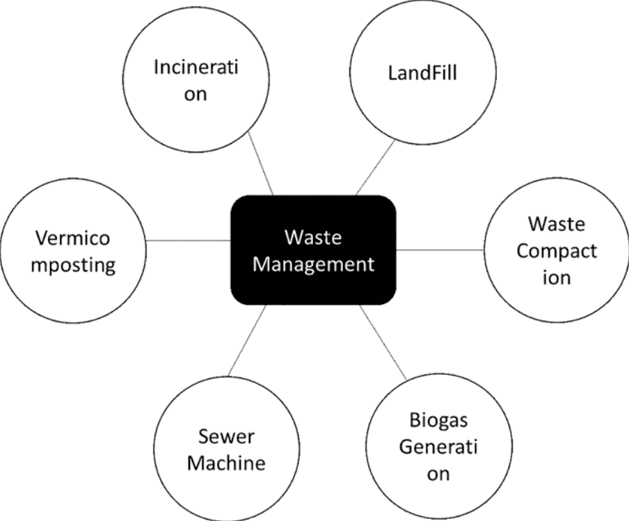

### 图 1.1 不同类型的废弃物管理。

固体废弃物包括食物垃圾、纸张、塑料、木材和玻璃，而液体废弃物包括污水和与水混合的工业废弃物。固体废弃物可通过填埋、焚烧、堆肥、粪坑等方式处理。目前，铁路正在安装生物厕所。人孔正在大量减少，或者智慧城市在发生堵塞时使用高压冲洗机。在智慧城市，政府正在为员工提供 44 项安全设备清单，如口罩、鼓风机用空气压缩机、荧光色夹克等（图 1.2）。


### 图 1.2 用于收集垃圾的现代设备。

这台机器配备了一台电液相机，可通过可延长至 20 英尺的快速观察管操作，以及一台功率强劲的高压冲洗泵，流量可达 150 L/min。

## 1.5 水资源管理

在智慧城市中，学校通过在校园内各个地点安装水过滤器来获得安全饮用水（图 1.3 和 1.4）。计划在学校屋顶收集雨水。政府计划如 Jal Shakti Abhiyan 正在恢复池塘和湖泊，旨在节约用水。现有大坝的容量得到了增加，并建造了社区储水罐。还建造了吸收井或渗坑。

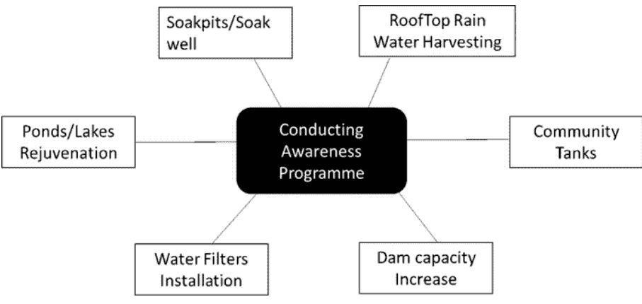

### 图 1.3 水资源管理的不同方法。


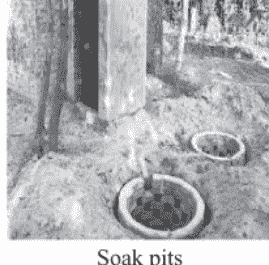

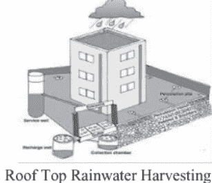

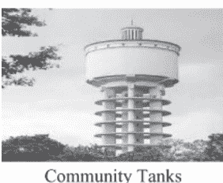


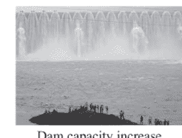

### 图 1.4 水资源管理的不同图像。

联合国将 3 月 22 日定为世界水日，作为 2030 年水与卫生可持续发展目标的一部分。它旨在提高意识，让每个人都应节约用水，尽管许多人仍然缺乏安全饮用水。

## 1.6 智能停车

我们的道路上大多充斥着更多车辆，这些车辆在智慧城市中通过多层停车系统、传感器支持的停车系统等进行智能管理（图 1.5）。目前，购物中心的车辆停放基于传感器，这意味着如果停车位空闲，将由绿灯指示，这样下一位车辆驾驶员就可以从远处看到灯光并轻松停放车辆。

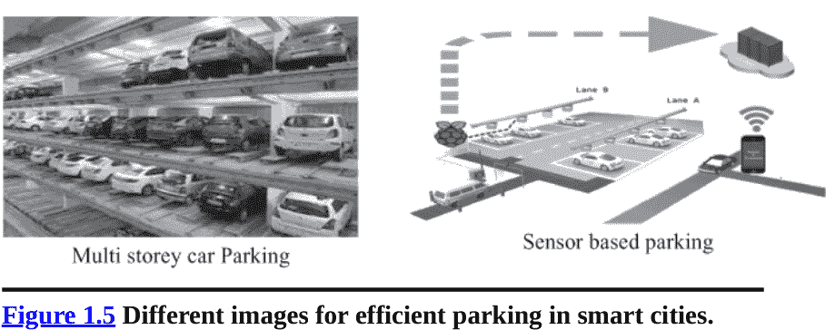

## 1.7 结论

智慧城市配备了保护性、精良且面向技术的环境。智慧城市在技术方面表现良好，但它们需要无污染的环境，让人们能够过上健康的生活。人们应该使用有机肥和农药来照顾自己的健康。

## 参考文献

- 1. Arroub, A., Zahi, B., Sabir, E., 和 Sadik, M. 智慧城市文献综述：范式、机遇与开放问题。载于 *2016 年无线网络与移动通信国际会议（WINCOM）*，IEEE，摩洛哥非斯，2016 年，第 180–186 页。https://doi.org/10.1109/WINCOM.2016.7777211.

- 2. Piuri, V., Shaw, R. N., 和 Ghosh, A. *面向智慧城市应用的 AI 与 IoT*。Springer 出版社，2022 年。

- 3. Su, K., Li, J., 和 Fu, H. 智慧城市及其应用。载于 *电子、通信与控制国际会议（ICECC）*，IEEE，2011 年，中国宁波。

- 4. Curry, E., Dustdar, S., Sheng, Q. Z., 和 Sheth, A. 智慧城市——实现服务与应用。*互联网服务与应用杂志*，第 7 卷，2016 年，第 1–3 页。

- 5. Ojha, A., Curry, E., 和 Janowski, T. 设计下一代智慧城市倡议——利用对 10 个智慧城市项目研究的结果和经验。*第 22 届欧洲信息系统会议（ECIS 2014）*，爱尔兰共和国。第 2050 卷，2014 年，第 1–14 页。

- 6. Revathy, G., Selvakumar, K., Murugapriya, P., 和 Ravikumar, D. 使用计算智能进行工业 4.0 中的智能制造。载于 N. Thillaiarasu, S. Lata Tripathi, 和 V. Dhinakaran（编），*物联网人工智能*。CRC Press，佛罗里达州博卡拉顿，2022 年，第 31–48 页。

- 7. 网络链接：https://www.neptuneautomatic.com/news/smart-parking-system-solution-will-pan-future/.

# 第 2 章

# 评估利用机器学习技术对智慧城市基础设施中电子邮件分类的集成 RBSA 和 SBFS 方法的效率

S. Abiramasundari 和 V. Ramaswamy

DOI: [10.1201/9781003476047-2](https://doi.org/10.1201/9781003476047-2)

## 2.1 引言

利用各种电子数据采集传感器为有效的资源和资产管理提供信息的城市区域被称为“智慧城市”。为了监控和管理交通与运输系统、发电厂、供水网络、废弃物管理、执法、信息系统、学校、图书馆、医院及其他社区服务，数据从公民、设备和资产中收集，并进行处理和分析。

在这些关键组件中，信息系统在技术发展中发挥着重要作用。该信息系统在各方面的性能有所欠缺。影响性能的一个因素是网络攻击。

网络空间中的犯罪分子正在创建各种在线诈骗，这些诈骗可以通过电子邮件、消息、广告等方式传播，以窃取用户的私人数据。随着在线网络服务和数字信息的不断增加，新型网络攻击也日益增多。存在不同类型的网络钓鱼攻击 [1]，例如：电子邮件钓鱼、恶意软件钓鱼 [2]、网络钓鱼短信、精准钓鱼 [3]、网站钓鱼、音频或语音钓鱼、欺骗等。这些类型的攻击需要在服务器端本身进行检测，以减少时间、提高生产力、降低传输负载并减少恶意软件攻击。在所有类型的攻击中，电子邮件在网络犯罪分子实施网络钓鱼攻击中起着至关重要的作用。垃圾邮件发送者创建一组垃圾邮件并将其传输给合法用户。这些垃圾邮件携带恶意内容，例如垃圾 URL [4]、恶意软件源代码和广告。垃圾邮件发送者还可能在垃圾邮件中包含一些吸引眼球的词语来吸引用户。由于垃圾邮件导致的主要问题之一是窃取个人数据。提高用户意识和改善用户知识可能预防此类网络攻击。但实际上，对所有类型的用户来说都很难做到。因此，必须使用先进技术检测并过滤垃圾邮件。

据统计，96% 的网络钓鱼攻击通过电子邮件进行，3% 的攻击通过恶意网站，剩余 1% 通过语音电话。2020 年，赛门铁克发现每 4200 封电子邮件中有 1 封被识别为垃圾邮件。2021 年，Tessian 研究报告称，平均每名员工每年收到 14 封网络钓鱼或垃圾邮件。但在工业领域，员工收到的网络钓鱼或垃圾邮件数量有所增加。ESET 发现，每年基于电子邮件的网络攻击增加 7.5%。

此外，Cofense 的研究表明，网络钓鱼或垃圾邮件中有 38% 指向恶意网站的 URL 和 36% 的恶意附件。2021 年，Tessian 研究将 PDF 文件识别为主要的常见恶意附件类型。通过电子邮件发送的恶意 PDF 数量在 2021 年有所增加，这是在 SonicWall 的《网络威胁报告》中提出的。

根据 APWG 报告，大型和小型公司都受到 BEC（商业电子邮件妥协）攻击的影响，这会造成经济


损失。在此BEC攻击中，发件人试图冒充知名人士、公司员工或其他可靠来源，通过从受感染的电子邮件账户发送电子邮件，诱使员工或用户汇款。2021年，网络犯罪分子使用Gmail作为其主要电子邮件服务来进行BEC攻击。2021年第四季度使用各种邮件提供商的BEC攻击如图2.1所示。

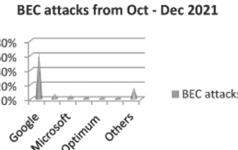

图2.1 2021年10月至12月的BEC攻击。

PhishLabs是APWG的成员之一，分析了企业员工的电子邮件。PhishLabs提交了关于2021年第四季度收到的恶意电子邮件的报告。该报告列出了各种基于电子邮件的威胁类型，如图2.2所示。

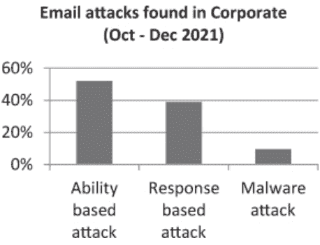

图2.2 2021年10月至12月企业中的电子邮件攻击。

在印度，Cert-In（印度计算机应急响应团队），即网络安全政府机构，记录了2018年至2022年的网络犯罪案件。2018年观察到的网络威胁数量为208,456，到2022年翻倍达到1,402,810。他们还证明，在过去4年中，各种网络相关问题的数量有所增加，特别是在Covid-19封锁期间。这是因为人们主要在家工作。在此期间，网络攻击者冒充知名人士或产品以混淆员工和互联网用户。2018年，印度在193个国家中网络攻击排名第47位。2020年，印度跃升至第10位。

网络攻击的增加将在信息和资金方面给各国带来巨大损失。全球各国正在制定针对网络攻击者的新法律以惩罚他们。机构和大学也在向员工宣传网络犯罪攻击的类型。尽管已提出各种犯罪检测机制，但网络犯罪分子仍找到了高效的网络攻击方式。因此，需要检测这些网络攻击。本文提出了一种基于词袋模型和机器学习算法的基于文本的电子邮件钓鱼检测机制。词袋模型被用作特征降维技术。一旦电子邮件经过预处理以删除停用词、数字、特殊字符等，基于规则的主题分析（RBSA）和基于语义的特征选择（SBFS）技术已应用于电子邮件的主题特征以计算权重，该权重表示主题中的垃圾邮件单词数量。计算出的权重与稀疏矩阵结合用于检测垃圾邮件。支持向量机（SVM）、多项式朴素贝叶斯、高斯朴素贝叶斯和伯努利朴素贝叶斯分类器已应用于公开可用的Enron数据集。在所有分类器中，SVM提供最高的准确率和最低的FP率。

## 2.2 文献综述

为了检测垃圾邮件，2019年的作者提出了一种包含模拟退火的混合水循环优化算法。为了最大化结果，该系统专注于最小化垃圾邮件识别的特征集并提高特征选择准确性。对训练和验证数据集采用交叉验证。使用七个不同的数据集来测试这些方法。对于分类，使用SVM分类器。根据研究结果，混合算法优于粒子群、遗传和和声搜索算法。达到了96.3%的准确率。在这项工作中，特征减少了50%以上 [5]。

2018年，作者建议使用SVM对垃圾邮件进行分类。电子邮件数据集使用非线性SVM分类器进行分类。该方法考虑了Gmail收件箱中的电子邮件和SpamAssassin公共数据集，并同时使用线性和高斯核函数。与高斯核函数相比，发现线性核对测试数据集产生最高的准确率。使用这两个核函数对测试数据集进行分类所需的时间相同 [6]。

2015年，利用自然语言特征提出了一种包含五个分类器的反垃圾邮件过滤器，并在Enron-spam和Ling垃圾邮件数据集上进行了测试。为了创建二元分类器，从电子邮件内容中提取实值和自然语言属性。使用五种不同的学习方法，利用CSDMC2010、SpamAssassin、Enron-Spam和LingSpam的非个性化电子邮件数据集对分类器进行了调查和评估。在这项工作中，使用BORUTA算法衡量特征的相关性，该算法还用于生成垃圾邮件属性评分。该研究发现，ADABOOSTM1和BAGGING优于随机森林，并表明可读性属性不如自然语言特征重要 [7]。

2017年，作者提出了果蝇优化和聚类负选择方法用于电子邮件垃圾邮件检测。为了提高分类准确率，果蝇优化和K-means算法与负选择算法相耦合 [8]。

2020年，作者提出了一种基于语义特征的电子邮件分类改进方法。该方法对电子邮件数据集的文本属性进行了语义分析。这种基于语义的文本分析分为两个阶段。在第一级，所有电子邮件都被分类到不同的领域，例如金融、教育和健康。为了识别垃圾邮件，第二级结合了物理定义的和经常提取的电子邮件语义方面。这种领域分类有助于为垃圾邮件描述提供主题。该研究使用朴素贝叶斯、决策树、随机森林、Ada Boost和K最近邻算法将电子邮件分类为垃圾邮件或正常邮件。使用Ling-spam数据集、CSDMC2010和Enron来评估性能。这种方法得出结论，所提方法的性能优于当前方法 [9]。

2020年，作者提出使用半监督学习算法创建多视图电子邮件分类，专门用于物联网。在这项研究中，垃圾邮件预测的多视图策略与半监督学习方法相结合。使用同样标记和未标记的数据来评估所提系统的性能。预处理后，使用电子邮件数据集提取电子邮件正文、路由和转发属性。为了构建模型，在标记和未标记数据集上都实现了基于分歧的半监督技术。最后，将各种机器学习分类器应用于电子邮件属性，以将电子邮件分类为真实或垃圾邮件。该研究发现，基于分歧的半监督方法产生更高的准确率（88.4%） [10]。

通过检查文本特征，可以识别电子邮件垃圾邮件库中的垃圾邮件威胁和内容。该研究使用带有垃圾邮件术语的内容文本分析来分类不同类型的垃圾邮件。该算法识别了多种垃圾邮件内容。在这些内容中，连锁电子邮件被识别为不常见的垃圾邮件线程，而广告消息被识别为常见的垃圾邮件威胁 [11]。2018年，强大的自然语言处理（NLP）技术已用于钓鱼电子邮件检测。NLP技术用于识别钓鱼电子邮件。这种垃圾邮件检测方法实现了80%的准确率 [12]。

2020年的作者开发了一系列机器学习算法用于钓鱼电子邮件分类。他们进行了基于机器学习的钓鱼策略评估研究。他们展示了KNN、朴素贝叶斯和SVM算法在将电子邮件分类为钓鱼邮件或真实邮件方面的有效性。每种算法的准确率都已使用各种性能指标进行分析和比较 [13]。

[14]指出，除了电子邮件和网站外，还为移动设备和社交媒体平台创建了钓鱼威胁和反钓鱼技术。所提供的分类法涵盖了通信渠道、目标环境、对策和钓鱼攻击策略，为该问题提供了全面的方法。已审查电子邮件服务法规和警报，反垃圾邮件方法已


已审查，电子邮件监控设置——以钓鱼邮件为起点——也已接受精细审查。静态和动态分析均被用于识别钓鱼页面和域名冒充。钓鱼网站上的凭证共享已被调查。

在 [15] 中，作者使用计算机视觉中的对象检测方法定位并排序“零小时”钓鱼网站的标志。为此，利用 HOG 特征创建了目标商标标志的尺度不变视觉表示。在整个分类过程中，已使用带有最大边际损失的 SVM 分类器来处理较少的训练图像和假阳性。对研究人员的另一个资源是一个公开可访问的数据集，包含 3,060 个训练样本和 1979 个唯一的钓鱼及合法网页/电子邮件样本，并附带边界框注释。

在 [16] 中，采用多阶段策略利用 NLP 和机器学习检测钓鱼电子邮件威胁。建议的多阶段方法包括用于重采样和交叉验证、分词、特征提取与选择、NLP 中的特征工程以及超参数设置的增强学习方法。为实施建议的方法提供了两种方法：一种是将 PCA 和 LSA（潜在语义分析）与互信息和卡方统计相结合。两种方法都解决了“维度灾难”问题，涉及稀疏性和必须收集的环境数据量。

2021 年，作者 [17] 提出了基于规则和基于语义的分析，以提高机器学习算法的分类准确率。在此项建议的工作中，已考虑电子邮件的主题和内容特征，以将电子邮件分类为垃圾邮件或正常邮件。应用此建议方法后，分类准确率得到了提高。

## 2.3 建议的方法

该建议工作包含五个模块，即数据集收集、预处理、应用 RBSA 和 SBFS、应用 BOW 模型以及使用 ML 算法的电子邮件分类。在此项工作中，使用了公开可用的 Enron 电子邮件数据集，以比较带有 RBSA 和 SBFS 的 ML 算法与不带 RBSA 和 SBFS 的 ML 算法的效率。已从电子邮件数据集中提取了电子邮件的主题和文本特征。基于 RBSA 算法制定的各种规则，分析主题中的单词。还查找垃圾邮件单词的存在，以计算电子邮件的权重。已将词袋模型应用于电子邮件正文，以查找正文中单词的频率。此 BOW 模型输出稀疏矩阵，并与 RBSA 和 SBFS 算法的输出相结合。已应用 SVM、多项式朴素贝叶斯、高斯朴素贝叶斯和伯努利朴素贝叶斯等机器学习算法，将电子邮件分类为垃圾邮件或正常邮件。建议方法的性能与未使用 RBSA 和 SBFS 的传统方法进行了比较。

### 2.3.1 数据集收集

在此建议的工作中使用了 Enron 电子邮件数据集 [18]。数据集 D 中总共有 5,643 封电子邮件。由于我们只关注电子邮件的主题和正文特征，已从数据集中删除不必要的列。在数据帧中，保留了 Label、Subjects、Text 和 Weight 列以供后续处理。

### 2.3.2 预处理

在文本处理和自然语言处理 [19,20] 中，预处理是一个关键步骤。预处理用于电子邮件内容，以尽量减少特征数量。文本通常包括多余单词、URL、HTML 元素、无意义单词、多个意思相同的单词、特殊字符和数字。这些内容从提供的输入文本中被消除，以提高机器学习算法的准确率。正常邮件编码为 0，垃圾邮件编码为 1。使用这些编码可以使类标签正常化。文本标签应更改为数值标签，因为它们无法比较。

然后，对 Subject 和 Text 列进行分词。单词分词用于表示 Subject 和 Text 列中的内容。诸如 “in”、“the”、“this”、“that”、“is” 等单词是停用词。在使用机器学习技术之前，应忽略这些术语，因为它们非常常见且对分类过程无帮助。消除停用词可提高分类准确率，因为 ML 算法处理的标记更少。

### 2.3.3 在主题上应用 RBSA 和 SBFS

RBSA 的主要目标是查找电子邮件主题区域中的垃圾邮件短语。从在线资源中收集垃圾邮件中使用最多的短语。此建议的方法遵循一些规则。制定这些准则时引用了多封垃圾邮件。基于这些准则，为样本中的每封电子邮件计算权重。所提出的 RBSA 方法有助于有效识别垃圾邮件。

**算法：** 基于规则的主题分析
**输入：** 主题单词
**输出：** Spam_term_weight

- 1. 单词与垃圾邮件单词集合进行比较。
- 2. 如果单词是垃圾邮件单词，则检查各种条件
  - 2.1 如果单词包含 ‘?’ 或大写或字母数字或长度 > Max，则增加电子邮件的垃圾邮件术语数量
- 3. Spam_term_weight=spam_term/电子邮件总数
- 4. 最后，计算出的垃圾邮件术语被分配给每封电子邮件的 spam_term_weight

分析电子邮件的主题特征后，对正文特征进行分析以进行特征降维。通过合并每封电子邮件中意思相近的单词来实现。SBFS 算法查找每个单词的同义词，并合并具有相同同义词的单词。此模块的主要目标是减少特征数量，从而提高分类准确率。

**算法：** SBFS
**输入：** 电子邮件正文中的单词
**输出：** 缩减的特征集

- 1. 查找电子邮件正文中每个单词的同义词。
- 2. 如果单词的同义词集为空，则将其删除。
- 3. 如果单词有同义词，则将其与其他单词的同义词进行比较。
- 4. 如果多个单词意思相似，则在正文中合并为一个单词。
- 5. 输出为缩减的特征集。

### 2.3.4 应用 BOW 模型

机器学习算法只能对数值进行操作。因此，使用词袋模型将缩减的文本特征转换为数值。该模型统计电子邮件中单词出现的次数。为再次降低特征数量，已考虑计数最高的单词以进行进一步处理。计数最小的单词被丢弃，因为它们对分类过程没有影响。在此建议模型中，0.25 被视为单词计数的最小阈值。计数大于 0.25 的单词已用于分类过程。频率小于或等于 0.25 的单词被丢弃。获取电子邮件正文数据集的稀疏矩阵后，将其与主题字段中的 spam_term_weight 相结合。已使用所有分类器为训练数据集和测试数据集构建了分类模型。

### 2.3.5 使用 ML 算法的电子邮件分类

分类模块是我们工作中最关键的模块。为将电子邮件分类为垃圾邮件或正常邮件，已实现四个分类器：SVM [21,22]、多项式朴素贝叶斯、高斯朴素贝叶斯和伯努利朴素贝叶斯。该数据集的 80% 用于训练，而 20% 用于测试。

对于训练数据集，已开发使用伯努利朴素贝叶斯、多项式朴素贝叶斯、SVM 和高斯朴素贝叶斯的分类模型。最初，使用 SVM 分类器为训练数据集构建了一个模型。该分类器能有效处理大量数据集。对于线性回归和分类，监督机器学习算法 SVM 非常合适。该方法在高维和低维空间中均表现出色。绘制一条线或平面以划分数据点是必要的。该技术适用于预测、文本分类和模式识别。我们在建议的策略中采用它来将提供的电子邮件集分为两类：垃圾邮件和正常邮件，因为它运行速度快。绘制一个能产生最大边际的适当超平面可实现这种分离。

为训练数据集构建了多项式朴素贝叶斯分类器，用于将电子邮件分类为垃圾邮件或正常邮件。MNB 分类器能够高效地对文本进行分类。单词计数或单词频率是此 MNB 分类器所需的输入。

然后，为训练数据集构建高斯朴素贝叶斯模型。提供的电子邮件集再次被分为垃圾邮件和正常邮件类别。每个类别的连续值使用高斯分布进行分散。请注意，此分类器使用连续数据。再次，使用预构建的高斯朴素贝叶斯模型将测试数据分类为垃圾邮件或正常邮件。

伯努利朴素贝叶斯算法是下一个分类器，其功能与多项式朴素贝叶斯类似。唯一的区别是，伯努利方法将预测器用作布尔变量。换句话说，参数值要么是是要么是否，然后我们进行类变量预测。

训练数据集用于使用伯努利朴素贝叶斯算法构建分类器模型。相同的模型也用于对测试数据集中的电子邮件进行分类。还对四个分类器的准确率进行了比较。SVM 显示出最高的准确率。

## 2.4 结果与讨论

### 2.4.1 带有 RBSA 和 SBFS 算法的机器学习算法

使用所有四个分类器构建分类模型时，考虑了训练数据集的 80%。一旦模型构建完成


针对训练数据集，相同的模型已应用于测试数据集，用于将电子邮件分类为垃圾邮件或正常邮件。

几项指标，包括准确率、召回率、F-score、误差率和支持数，用于计算四个分类器各自的性能。计算这些指标涉及使用混淆矩阵。要创建混淆矩阵，需要使用四个术语：真正例、真负例、假负例和假正例。所有四种算法在采用所提方法对测试数据的推断结果列于表 2.1 中。

### 表 2.1 所有 SVM、MNB、GNB 和 BNB 算法的推断结果

| 分类算法 | 预测为正常邮件 | 预测为垃圾邮件 |
|---|---|---|
| SVM 实际为正常邮件 | 975 | 12 |
| 实际为垃圾邮件 | 23 | 74 |
| MNB 实际为正常邮件 | 968 | 19 |
| 实际为垃圾邮件 | 30 | 67 |
| GNB 实际为正常邮件 | 924 | 63 |
| 实际为垃圾邮件 | 64 | 33 |
| BNB 实际为正常邮件 | 919 | 68 |
| 实际为垃圾邮件 | 69 | 28 |

召回率是真正例与所有正例之比，而精确率是真正例与预测正例之间的关系。精确率决定了在所有预测正例中真正被识别为垃圾邮件的垃圾邮件百分比。召回率计算了在所有预测为正常邮件和垃圾邮件的垃圾邮件中，真正被预期为垃圾邮件的垃圾邮件所占比例。对于我们的数据集，召回率和精确率是关键指标。然而，准确率不一定是电子邮件数据集的良好指标，特别是当数据集偏斜时。精确率和召回率的平均值称为 F1-score。假正例率是一个关键指标，使用 FP 和 TN 计算得出。

所有四种机器学习算法（结合 RBSA 和 SBFS 算法）的各项性能指标列于表 2.2 中。

### 表 2.2 机器学习算法的性能指标

| 算法 | 准确率 (%) | 精确率 (%) | 召回率 (%) | F1-Score (%) |
|---|---|---|---|---|
| SVM | 97 | 86 | 76 | 81 |
| MNB | 95 | 78 | 69 | 73 |
| GNB | 88 | 29 | 29 | 29 |
| BNB | 87 | 34 | 34 | 34 |

所有四种算法的分类准确率在图 2.3 中可视化。

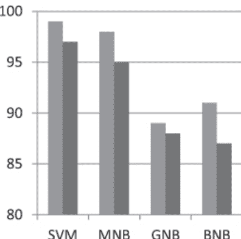

### 图 2.3 机器学习算法的分类准确率。

所提算法与机器学习算法的假正例率和误差率也分别在图 2.4 和 2.5 中可视化。

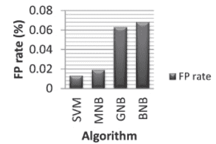

### 图 2.4 机器学习算法的假正例率。

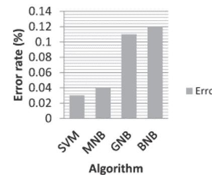

### 图 2.5 机器学习算法的误差率。

观察发现，在四种算法中，RBSA 和 SBFS 与 SVM 结合产生了最低的 FP_Rate 和 Error_Rate。

### 2.4.2 所提方法与机器学习算法的比较

相同的机器学习算法已应用于电子邮件数据集，但未使用 RBSA 和 SBFS 算法。数据集按 8:2 分割为训练数据和测试数据。在使用词袋模型为电子邮件正文构建稀疏矩阵后，SVM、MNB、GNB 和 BNB 等监督学习算法已应用于电子邮件分类。所有四个分类器的输出列于表 2.3 中。

#### 表 2.3 未使用 RBSA 和 SBFS 的机器学习算法性能

| 算法 | 准确率 (%) | 精确率 (%) | 召回率 (%) | F1-Score (%) |
|---|---|---|---|---|
| SVM | 95 | 84 | 74 | 80 |
| MNB | 94 | 77 | 67 | 69 |
| GNB | 87 | 27 | 27 | 28 |
| BNB | 87 | 32 | 32 | 35 |

算法的分类准确率也进行了比较，如图 2.6 所示。

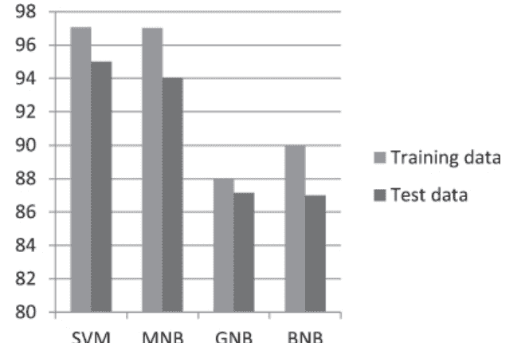

#### 图 2.6 未使用 RBSA 和 SBFS 的机器学习算法准确率。

## 2.5 结论

存在多种方法用于过滤网络垃圾邮件。鉴于垃圾邮件和发送者日益增加，提供高效流程并部署功能强大的软件包来控制垃圾邮件至关重要。电子邮件分类可以使用多种基于机器学习的分类算法来完成。为了将电子邮件分类为垃圾邮件或正常邮件，本研究采用了四种分类算法：SVM、Multinomial Naive Bayes、Gaussian Naive Bayes 和 Bernoulli Naive Bayes。电子邮件的主题和内容用于构建分类模型。使用 RBSA 和 SBFS，基于电子邮件主题和内容属性构建分类模型。已建议使用 RBSA 来确定垃圾邮件术语权重，并判断主题中是否存在垃圾邮件短语。为了最小化特征，已使用 SBFS。使用 SVM、Multinomial Naive Bayes、Gaussian Naive Bayes 和 Bernoulli Naive Bayes 算法来评估此所提方法，并比较它们各自的性能。相同的分类算法也用于 Enron 数据集，但未使用 RBSA 和 SBFS 算法。将所提方法的准确率与传统方法的准确率进行了对比。研究结果凸显了集成 RBSA 和 SBFS 方法在增强智慧城市框架内电子邮件分类效率方面的潜力，从而促进更流畅的沟通和决策过程。根据该研究，RBSA 和 SBFS 与 SVM 结合提供了最高的准确率（97%），同时还降低了假正例率。与所提方法相比，当不使用 RBSA 和 SBFS 时，准确率最低。

## 参考文献

- 1. Gupta, B.B., Arachchilage, N.A., and Psannis, K.E. (2018). 针对网络钓鱼攻击的防御：方法、当前问题及未来方向的分类法。电信系统, 67(2): 247–267。
- 2. Sheikh Alishahi, M., Saracino, A., Martinelli, F., Marra, A., Mejri, M., and Tawbi, N. (2020). 数字废物处理：一种用于分析垃圾邮件的自动化框架。*信息安全国际期刊*, 19。
- 3. **雷瓦蒂**, G., Selvakumar, K., Murugapriya, P., and Ravikumar, D. 使用计算智能进行工业 4.0 智能制造。在 N. Thillaiarasu, S. Lata Tripathi, 和 V. Dhinakaran (编), *物联网人工智能*. CRC Press, Boca Raton, 2022, pp. 31–48。
- 4. **塔拉尼**, J.S. and Arachchilage, N.A. (2020). 了解网络钓鱼者模仿统一资源定位符以利用网络钓鱼攻击的策略：一种机器学习方法。*安全与隐私*, 3(5): e120。
- 5. **阿尔-拉什德**, G., Mamat, R., and Abd Rahim, N.H. (2019). 用于垃圾邮件检测的带模拟退火的混合水循环优化算法。*IEEE 访问*。
- 6. **辛格**, M., Pamula, R., and Shekhar, S.K. (2018). “基于支持向量机的电子邮件垃圾邮件分类。”在 *2018 年计算、电力和通信技术国际会议（GUCON）*, 大诺伊达, 乌塔尔邦, 印度, 2018, pp. 878–882。
- 7. **沙姆斯**, R. and Mercer, R. (2015). 基于自然语言风格计量学的垃圾邮件监督分类。*神经计算与应用*, 27: 2315–2331。
- 8. **奇克**, R. and Chikhi, S. (2019). 用于电子邮件垃圾邮件检测的聚类负选择算法和果蝇优化。*环境智能与人机计算期刊*。
- 9. **纳杰特**, S., Adi, K., and Allili, M. (2020). 一种基于语义的增强垃圾邮件检测分类方法。*计算机与安全*, 94: 101716。
- 10. **李**, W., Meng, W., Tan, Z., and Xiang, Y. (2019). 基于半监督学习的物联网系统多视图电子邮件分类设计。*网络与计算机应用期刊*, 128: 56–63。
- 11. **穆鲁加维尔**, U. and Santhi, R. (2020). 使用基于内容的文本分析方法检测电子邮件垃圾邮件库中的垃圾邮件和线程识别。*材料今日：会议录*, 33。
- 12. **埃戈齐**, G. and Verma, R. (2018). “使用稳健 NLP 技术进行网络钓鱼电子邮件检测。”在 *2018 年 IEEE 数据挖掘研讨会 ICDMW*, 新加坡, pp. 7–12。
- 13. Merlin, V.K., Daniel, E., Celestie, H., and Bhelwa, S. (2020). “基于机器学习的网络钓鱼技术评估。”在 2019 年智能计算与控制系统国际会议（ICCS）, 印度, 马杜赖。
- 14. Algeroud, A. and Zhou, L. (2017). 网络钓鱼环境、技术和对策：一项调查。计算机与安全, 68: 160–196。
- 15. Bozkir, A.S. and Aydos, M. (2020). LogoSENSE：一种用于网络钓鱼网页和电子邮件品牌识别的基于 HOG 的徽标检测方案的伴侣。计算机与安全, 95: 101855。
- 16. Gualberto, E.S., De Sousa, R.T., Vieira, T.P.D.B., Da Costa, J.P.C.L., and Duque, C.G. (2020). 答案在文本中：基于特征工程的多阶段网络钓鱼检测方法。IEEE Access, 8: 223529–223547。
- 17. Abiramasundari. S., Ramaswamy, V., and Sangeetha, J. (2021). 通过监督学习使用语义和基于规则的模型进行垃圾邮件过滤。罗马尼亚细胞生物学学会年刊, 25(2): 3975–3992。
- 18. Fang, Y., Zhang, C., Huang, C., Liu, L., and Yang, Y. (2019). 使用具有多级向量和注意力机制的改进 RCNN 模型进行网络钓鱼电子邮件检测。IEEE Access, 7, pp. 56329–56340。
- 19. Salloum, S., Gaber, T., Vadera, S., and Shalan, K. (2021). 模型自然语言处理技术：文献综述。程序计算机科学, 189: 19–28。
- 20. Alhogail, A. and Alsabih, A. (2021). 应用机器学习和自然语言处理来检测网络钓鱼电子邮件。计算机与安全, 110: 102414。
- 21. Kumaresan, T., Saravanakumar, S., and Balamurugan, R. (2019). 使用 S-布谷鸟搜索和混合核支持向量机的基于视觉和文本特征的电子邮件垃圾邮件分类。集群计算, 22。
- 22. Olatunji, S. (2019). 基于支持向量机的改进电子邮件垃圾邮件检测模型。神经计算与应用, 31。


# 第 3 章

# 通过在智慧城市基础设施开发中融合深度学习与区块链来释放数据与安全的潜力——未来视角

S. S. Aravinth

DOI: 10.1201/9781003476047-3

## 本章结构

以下结构化大纲为组织本章及确保全面覆盖主题提供了框架。每个部分都包含详细解释、案例研究和示例，为读者提供深度和背景。

- 1. **引言**
  - 智慧城市的定义及其在城市发展中的重要性
  - 深度学习和区块链技术概述
  - 阐述这些技术在智慧城市背景下潜在协同效应的论点陈述
- 2. **智慧城市中的深度学习应用**
  - 交通管理
    - 交通模式分析
    - 交通信号灯时序优化
    - 拥塞管理
  - 公共安全
    - 视频监控与异常检测
    - 预测性警务
    - 应急响应优化
  - 能源管理
    - 能源消耗分析
    - 能源分配优化
    - 需求预测
  - 废弃物管理
    - 废弃物收集路线优化
    - 回收倡议
    - 环境影响评估
  - 医疗保健
    - 疾病爆发检测
    - 患者入院预测
    - 资源分配优化
- 3. **智慧城市中的区块链应用**
  - 安全交易
    - 公用事业支付
    - 交通票价
    - 停车费
  - 供应链管理
    - 货物流动跟踪
    - 产品真实性验证
    - 食品安全与防伪
  - 身份管理
    - 数字身份验证
    - 城市服务访问
    - 身份盗窃防范
  - 智能合约
    - 协议自动化
    - 租赁协议
    - 房产销售
  - 数据安全与隐私
    - 去中心化存储
    - 不可更改记录
    - 数据泄露防范
- 4. **协同效应与挑战**
  - 深度学习与区块链技术之间的潜在协同效应
  - 将这些技术集成到智慧城市基础设施中的挑战
  - 应对挑战的解决方案和最佳实践
- 5. **案例研究**
  - 实施深度学习和区块链技术的智慧城市现实案例
  - 成功经验与经验教训分析
- 6. **未来视角**
  - 深度学习和区块链的新兴趋势和进步
  - 对智慧城市未来发展的潜在影响
  - 进一步研究和实施的建议
- 7. **结论**
  - 关键发现总结
  - 该领域持续创新与合作的重要性
  - 关于深度学习和区块链在塑造智慧城市未来中作用的最终思考
- **参考文献**
  - 用于进一步阅读和研究的引用来源列表

## 3.1 引言

### 3.1.1 智慧城市定义及其在城市发展中的重要性

智慧城市代表了技术、基础设施与治理的融合，旨在提升居民生活质量、优化资源利用并促进可持续增长。这些城市利用先进的数字技术，改善包括交通、能源、医疗保健和公共服务在内的各个领域的效率、连接性和可达性 [1]。

智慧城市的核心在于利用数据和技术来应对城市挑战并改善城市生活。这包括部署物联网（IoT）设备、传感器和数据分析，以收集和分析关于城市运营、基础设施和市民行为的实时信息 [10]。通过利用这些数据，智慧城市可以做出明智决策，优化资源分配，并为居民提供更好的服务。

显著地，智慧城市在其发展战略中优先考虑可持续性和韧性。它们旨在通过绿色基础设施、可再生能源整合和高效交通系统等举措，减少碳排放、最大限度减少浪费并改善环境质量。此外，智慧城市还专注于通过主动规划以及对基础设施和社区韧性措施的投资，建立抵御自然灾害、经济中断和其他挑战并从中恢复的韧性 [2]。

智慧城市在城市发展中的重要性在于其解决紧迫城市挑战并改善居民生活质量的能力。通过将技术融入城市运营和服务，智慧城市可以提高效率、降低成本，并改善医疗保健、教育和交通等基本服务的可达性。此外，智慧城市可以通过创建支持创业、就业创造和新兴产业投资的生态系统，促进经济增长和创新。

此外，智慧城市有潜力通过确保技术惠及社会所有阶层来促进社会包容和公平。这包括弥合数字鸿沟、增加数字服务获取以及促进市民参与决策过程的举措。通过促进包容性和公平性，智慧城市可以创造更具韧性和凝聚力的社区，在面对挑战时茁壮成长。

总之，智慧城市代表了一种变革性的城市发展方法，它利用技术、数据和创新来创造更加可持续、有韧性和包容的城市。通过优先考虑效率、可持续性和公平性，智慧城市旨在改善居民的生活质量，并为后代促进经济增长和繁荣。

### 3.1.2 深度学习和区块链技术概述

深度学习是人工智能（AI）的一个子集，它模仿人脑的神经网络来处理数据并提取有意义的模式和见解。它涉及使用具有多层互连节点的深度神经网络，从大量数据中学习并执行图像识别、自然语言处理和预测分析等任务。深度学习的关键组件包括卷积神经网络（CNNs）、循环神经网络（RNNs）和生成对抗网络（GANs）[3]。

如图 3.1 所示，深度学习概念正在智慧城市开发中用于控制连接的传感器和智能执行器。

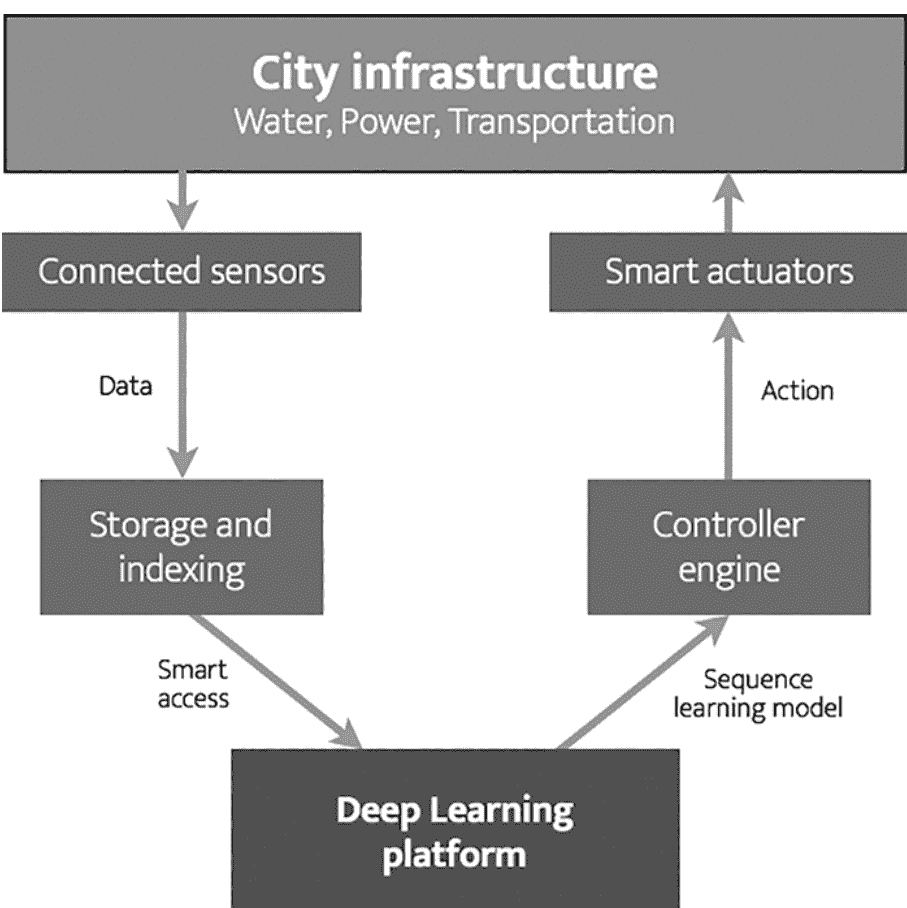

图 3.1 智慧城市基础设施中的深度学习。

区块链是一种分布式账本技术，能够在计算机网络中安全且透明地记录交易。每个交易或区块都以密码学方式链接到前一个区块，形成一条不可更改且防篡改的区块链。区块链运行在去中心化网络上，消除了对中介的需求，并为点对点交易提供信任和透明度。智能合约，即在区块链上编码预定义规则的自执行合同，通过自动化流程和减少人工干预的需求，进一步增强了区块链技术的能力。

### 3.1.3 深度学习与区块链协同

虽然深度学习和区块链技术服务于不同目的并基于不同原理运行，但它们可以在智慧城市的背景下相互补充。深度学习算法可以分析智慧城市传感器和设备收集的海量数据，以提取见解并优化城市运营。另一方面，区块链为存储和共享这些数据提供了一个安全且透明的平台，确保其完整性并促进利益相关者之间的信任。

在智慧城市中结合深度学习和区块链技术，可以释放创新与效率的新机遇。例如，深度学习算法可以分析交通模式以优化交通路线，而区块链技术可以安全地在交通提供商和城市当局之间记录和共享这些数据。同样，深度学习模型可以分析能源消耗模式以优化能源分配，而区块链可以确保去中心化网络上能源交易的完整性和安全性 [4]。

总之，深度学习和区块链技术的集成提供了增强智慧城市效率、透明度和韧性的协同能力。在智慧城市基础设施中利用这些技术，为创新与合作带来了新的机遇。通过这样做，市政当局可以显著改善居民的生活质量，同时推进可持续城市发展目标。

## 3.2 智慧城市中的深度学习应用

### 3.2.1 交通管理

智慧城市中的交通管理涉及使用深度学习算法和数据分析，以监测、分析和优化城市区域内的交通流量。这一应用通过利用技术改善车辆和行人的移动，解决与拥堵、低效交通系统和道路安全相关的挑战。以下是深度学习在交通管理中的应用说明：


- a. **交通模式分析：** 深度学习算法分析从各种来源收集的实时交通数据，包括交通摄像头、嵌入道路的传感器、车辆中的GPS设备和移动应用。这些算法可以检测交通流量中的模式，例如高峰时段、拥堵热点和反复出现的交通瓶颈。通过了解这些模式，城市规划者和交通管理部门可以做出明智的决策，以优化交通管理策略 [5]。

- b. **交通信号灯时序优化：** 深度学习算法可以根据实时交通数据和历史模式优化交通信号灯时序。通过分析交通量、车辆速度和行人活动等因素，这些算法可以动态调整交通信号灯时序，以最大限度地减少拥堵并减少路口的等待时间。由深度学习驱动的自适应交通信号控制系统可以实时响应不断变化的交通状况，改善整体交通流量并减少通勤者的出行时间。

- c. **拥堵管理：** 深度学习算法在识别和缓解智慧城市中的交通拥堵方面发挥着关键作用。通过实时分析交通数据，这些算法可以识别拥堵严重的区域，并在瓶颈发生之前预测潜在的交通瓶颈。然后，城市当局可以采取主动措施，例如调整交通信号灯时序、部署额外的交通管理人员，或通过智能导航系统提供替代路线，以缓解拥堵并改善交通流量 [6]。

#### 3.2.1.1 交通信号灯时序优化

交通信号灯时序优化是智慧城市交通管理中由深度学习算法支持的一个关键方面。该过程涉及根据实时交通状况和历史数据，动态调整路口处交通信号灯的时序。以下是交通信号灯时序优化工作原理的解释：

- a. **实时交通数据收集：** 深度学习算法分析从各种来源收集的数据，例如交通摄像头、嵌入道路的传感器和车辆中的GPS设备。这些数据包括每个路口的交通量、车辆速度、拥堵程度和行人活动等信息。

- b. **交通流量分析：** 深度学习算法处理收集到的数据，以识别交通流量中的模式和趋势。它们分析高峰交通时段、拥堵热点以及一天和一周中不同时间的典型交通行为等因素。

- c. **信号灯时序动态调整：** 基于对交通模式和当前状况的分析，深度学习算法确定每个路口交通信号灯的最有效时序。它们考虑等待在路口的车辆数量、车辆队列长度以及不同交通流向绿灯的最佳持续时间等因素 [7]。

- d. **自适应控制系统：** 配备深度学习算法的交通信号控制器会持续监控实时交通状况，并相应地调整信号灯时序。这些自适应控制系统可以快速应对不断变化的交通状况，例如交通量突然增加或道路上发生的意外事件。

- e. **交通流量优化：** 通过优化交通信号灯时序，智慧城市可以改善交通流量、减少拥堵，并最大限度地减少通勤者的延误。交通信号灯处的更短等待时间可带来更平稳的交通流量、更少的停车和启动，并总体上改善驾驶员和行人的出行时间。

- f. **数据驱动的决策：** 深度学习算法不断从实时数据和反馈中学习，使交通信号灯时序能够随着时间的推移不断改进和优化。这种数据驱动的方法确保交通管理策略始终保持自适应，并能响应城市不断变化的需求。

#### 3.2.1.2 拥堵管理

拥堵管理是智慧城市交通管理中由深度学习算法支持的一个关键方面。它涉及主动识别、预测和缓解交通拥堵，以确保交通流量顺畅高效。以下是拥堵管理工作原理的解释：

- a. **实时交通监控：** 深度学习算法持续监控和分析从各种来源收集的实时交通数据，例如交通摄像头、嵌入道路的传感器和车辆中的GPS设备。这些数据包括城市各个地点的交通量、车辆速度和拥堵程度等信息 [8]。

- b. **拥堵检测：** 使用高级模式识别技术，深度学习算法可以识别拥堵热点和交通缓慢的区域。这些算法分析交通密度、流量和历史拥堵模式等因素，以在拥堵变得严重之前检测出拥堵迹象。

- c. **预测分析：** 深度学习算法利用历史交通数据和机器学习模型来预测未来的交通状况并预见潜在的拥堵。通过分析交通流量中的趋势和模式，这些算法可以预测拥堵可能发生的时间和地点，使城市当局能够采取预防措施。

- d. **动态路由和交通管理：** 基于实时交通数据和预测分析，深度学习算法可以建议替代路线和交通管理策略以缓解拥堵。智能导航系统和移动应用程序可以为驾驶员提供实时更新和路线建议，以避开拥堵区域并最大限度地减少延误。

- e. **自适应交通信号控制：** 深度学习算法可以优化路口的交通信号灯时序，以改善交通流量并减少拥堵。通过根据当前交通状况动态调整信号灯时序，这些算法有助于最大限度地减少等待时间，并保持交通在拥堵区域顺畅通行 [9]。

- f. **公共交通优化：** 深度学习算法还可以优化公共交通路线和时刻表，以缓解道路拥堵。通过分析乘客量数据和乘客需求，这些算法可以优化公交路线、调整服务频率，并提高公共交通系统的效率。

### 3.2.2 公共安全

公共安全是智慧城市的首要任务，深度学习技术通过各种应用在提升安全和安保方面发挥着重要作用。以下是深度学习在公共安全领域应用的概述：

- a. **视频监控与异常检测：** 深度学习算法用于分析全城部署的监控摄像头的视频流。这些算法可以实时检测和识别可疑活动、未经授权的访问或潜在威胁。通过持续监控视频流，深度学习系统可以提醒当局采取行动，在事件升级前防止其发生。

- b. **预测性警务：** 深度学习算法可以分析历史犯罪数据、天气模式和其他相关因素，以预测犯罪可能发生的时间和地点。通过识别高风险区域和时间，执法机构可以更有效地分配资源，并主动巡逻容易发生犯罪活动的区域，从而震慑潜在犯罪者并改善整体公共安全 [10]。

- c. 紧急响应优化：深度学习算法可以通过分析来自各种来源的实时数据（例如紧急呼叫、交通状况和天气更新）来优化紧急响应系统。这些算法可以预测紧急车辆的最快路线，根据紧急情况的性质推荐适当的响应策略，并协调多个机构的工作，以确保及时有效的响应。

总体而言，公共安全领域的深度学习应用使智慧城市能够提升预防、检测和应对威胁与紧急情况的能力。通过利用高级分析和实时数据处理，城市可以增强居民的安全和安保，并创造一个更具韧性的城市环境。

### 3.2.3 能源管理

能源管理是可持续城市发展的关键方面，深度学习技术在优化智慧城市中的能源消耗、分配和预测方面发挥着关键作用。以下是各组成部分的简要概述：

- a. 能源消耗分析：深度学习算法分析历史和实时能源消耗数据，以识别模式、趋势和低效问题。通过了解一天中不同部门和不同时间的能源使用情况，城市可以识别节能和效率改进的机会。

- b. 能源分配优化：深度学习算法通过分析供应、需求和电网状况的数据，优化电网中的能源分配。这些算法可以动态调整能源分配，以最大限度地减少损失、降低成本，并提高能源电网的整体可靠性和韧性。

- c. 需求预测：深度学习算法利用历史能源消耗数据、天气模式和其他相关因素来预测未来的能源需求。通过预测能源需求最高的时间和地点，城市可以优化能源生产和分配，减少对化石燃料的依赖，并促进可再生能源的整合。


总体而言，能源管理中的深度学习应用使智慧城市能够提升其能源系统的效率、可靠性和可持续性。通过利用高级分析和实时数据处理，城市可以优化能源使用、降低成本并最大限度地减少环境影响，最终创造一个更可持续且更具韧性的城市环境 [11]。

### 3.2.4 废弃物管理

废弃物管理是城市可持续性的关键方面，深度学习技术可以在优化废弃物收集路线、推动回收计划以及评估环境影响方面发挥重要作用。以下是对各组成部分的详细介绍：

#### a. 废弃物收集的路线优化

废弃物收集路线优化旨在最大限度减少废弃物收集车辆行驶距离，同时确保所有废弃物桶被高效清空。这可以表述为带有额外约束的旅行商问题（TSP）：

**目标函数：** 最大限度减少废弃物收集车辆行驶的总距离。

**约束条件：**

- 每个废弃物桶必须恰好被访问一次。
- 废弃物收集车辆的容量约束。

**变量：**

- dij：废弃物桶 i 与废弃物桶 j 之间的距离。
- xij：二进制变量，指示废弃物桶 i 是否在废弃物桶 j 之前被访问。

#### b. 回收计划

深度学习可用于分析废弃物成分数据，以识别可回收材料并制定有针对性的回收计划。回收率（R）的计算方法如下：

**R = 废弃物总重量 / 可回收材料重量**

深度学习算法还可根据人口增长、消费者行为和政策变化等因素预测未来的回收率。

#### c. 环境影响评估

深度学习可以通过分析废弃物产生、运输、处理和处置方面的数据来评估废弃物管理实践的环境影响。环境影响（E）可根据以下公式使用生命周期评估（LCA）方法计算：

\( E = \sum_{i=1}^{n} (\text{Impact}_i \cdot \text{Quantity}) \) (3.1)

其中 Impactᵢ 是工艺（i）的环境影响，（Quantity i）是与工艺（i）相关的废弃物数量。

### 3.2.5 医疗保健管理

医疗保健是深度学习可彻底改变运营的关键领域，涵盖从疾病暴发检测到资源分配。以下是这些应用的细分及一些假设结果：

- a. **疾病暴发检测**

深度学习模型可分析多种数据源，例如电子健康记录（EHRs）、社交媒体和环境数据，以检测疾病暴发的早期迹象。例如，深度学习模型可分析 Twitter 数据中提及发烧或咳嗽等症状的内容，以识别可能的呼吸道疾病暴发 [12]。

**假设结果：** 深度学习模型检测到特定地理区域中提及发烧和咳嗽的推文激增，促使公共卫生当局开展调查并实施预防措施，例如加强监测和开展公众意识宣传活动。

- b. **患者入院预测**

深度学习算法可分析患者数据（包括病史、症状和化验结果），以预测住院的可能性。这有助于医院和医疗保健提供者更好地分配资源并规划患者护理。

**假设结果：** 深度学习模型预测，患有慢性疾病的患者在不久的将来面临较高的住院风险。医疗保健提供者可主动调整治疗方案并安排随访预约，以防止住院。

- c. **资源分配优化**

深度学习可根据患者需求和需求优化医疗资源（如病床、医务人员和医疗用品）的分配。通过分析历史数据和当前趋势，深度学习算法可帮助医院更高效地分配资源并缩短患者等待时间。

**假设结果：** 深度学习模型预测，由于 COVID-19 病例激增，ICU 病床需求将增加。医院可利用此信息，将资源从非紧急护理区域重新分配至 ICU，确保危重患者得到及时治疗。

总之，医疗保健领域的深度学习应用可改善疾病暴发检测、预测患者入院并优化资源分配，最终改善患者结局和医疗保健系统效率。

## 3.3 智慧城市中的区块链应用

### 3.3.1 安全交易

- a. **安全交易：** 安全交易对智慧城市中的各种支付系统至关重要，包括公用事业付款、交通票价和停车费。深度学习可增强这些交易的安全性和效率。具体做法及一些比较结果如下：

- b. **公用事业付款：** 深度学习可用于检测和防止公用事业付款中的欺诈行为。通过分析交易模式和用户行为，深度学习算法可识别可疑活动并触发身份验证流程以验证交易。

**比较结果：** 一项将传统欺诈检测方法与基于深度学习的方法进行对比的研究发现，深度学习模型实现了高 20% 的检出率和低 10% 的误报率，从而实现了更准确、更高效的欺诈检测。

- c. **交通票价：** 深度学习算法可通过分析出行模式和检测票价支付行为中的异常来增强交通票价系统的安全性。这有助于防止逃票并确保交通服务的公平付费 [13]。

**比较结果：** 实施基于深度学习的票价检查系统前后的逃票率对比显示，逃票率降低了 30%，从而为交通管理部门增加了收入。

- d. **停车费：** 深度学习可通过分析停车行为并识别未经授权的访问或欺诈活动来改善停车费交易的安全性。通过将深度学习算法集成到停车支付系统中，城市可增强安全性并减少因欺诈造成的收入损失。

**比较结果：** 一项将传统停车支付系统与启用深度学习的系统进行对比的研究显示，因欺诈性停车活动造成的收入损失降低了 25%，证明了深度学习在保障停车费交易安全方面的有效性。

**总结：** 深度学习可显著提升智慧城市安全交易的安全性和效率，从而改善欺诈检测、减少收入损失并提升用户体验。

表 3.1 对比了智慧城市安全交易中的传统方法与深度学习方法。深度学习在欺诈检测和减少收入损失方面提供了更高的准确性和效率。在公用事业付款中，深度学习实现了高 20% 的检出率和低 10% 的误报率。在交通票价方面，它使逃票率降低了 30%。在停车费方面，深度学习使因欺诈造成的收入损失降低了 25%。总体而言，深度学习提升了安全性和效率，使其成为优化智慧城市安全交易的宝贵技术 [14]。

**表 3.1 深度学习方法对比结果**

| 序号 | 应用 | 传统方法 | 深度学习方法 | 对比结果 |
|---|---|---|---|---|
| 1 | 公用事业付款 | 检出率较低，误报率较高 | 检出率较高，误报率较低 | 检出率提高 20%，误报率降低 10% |
| 2 | 交通票价 | 逃票率较高 | 逃票率较低 | 逃票率降低 30% |
| 3 | 停车费 | 因欺诈造成的收入损失较高 | 因欺诈造成的收入损失较低 | 因欺诈活动造成的收入损失降低 25% |


### 3.3.2 供应链管理

智慧城市中的供应链管理可以从深度学习应用中受益，特别是在跟踪货物流动、验证产品真实性、确保食品安全并防止假冒产品方面。以下是这些概念的解释及其假设结果：

- **a. 货物跟踪:**
  **概念：** 深度学习可以通过分析传感器、GPS追踪器和其他来源的数据来跟踪供应链中的货物。这有助于实时监控货物的位置、状况和状态。
  **结果：** 改进的跟踪导致丢失或错放的货物减少20%，提高了供应链效率并降低了成本。

- **b. 产品真实性验证:**
  **概念：** 深度学习算法可以通过分析产品特征、标签和包装来验证产品的真实性。这有助于检测假冒产品并确保消费者安全。
  **结果：** 为产品真实性验证实施深度学习，使假冒产品减少25%，增强了消费者信任和品牌声誉。

- **c. 食品安全和防伪:**
  **概念：** 深度学习可以通过分析传感器和物联网设备的数据来监测食品质量并检测污染物，从而改善食品安全。它还可以通过验证真伪来防止假冒食品产品。
  **结果：** 为食品安全和防伪实施深度学习，使食源性疾病减少30%，假冒食品产品减少15%，确保消费者安全和法规合规。

总体而言，供应链管理中的深度学习应用增强了透明度、效率和安全性，从而提高了智慧城市中的供应链绩效和客户满意度。

### 3.3.3 身份管理

智慧城市中的身份管理涉及数字身份验证、提供城市服务访问权限以及防止身份盗窃。以下是通过场景解释这些概念：

- a. 数字身份验证

  **场景：** 居民John搬到新的智慧城市，需要验证身份以访问城市服务，例如公共交通和医疗保健。

  **概念：** 深度学习算法通过分析John的生物特征数据（如面部特征或指纹）并与其官方文件进行交叉核对来验证其身份。

  **结果：** John的数字身份已验证，使他能够安全便捷地访问城市服务 [15]。

- **b. 城市服务访问**

  **场景：** 智慧城市居民Maria想要使用移动应用支付水电费并注册参加公共活动。

  **概念：** 深度学习算法验证Maria的身份，并根据其授权级别授予她访问应用功能的权限。

  **结果：** Maria成功支付账单并注册参加活动，展示了基于深度学习的身份管理的便捷性和安全性。

- **c. 身份盗窃防范**

  **场景：** 智慧城市居民David收到通知，有人正在试图使用他的身份访问城市服务。

  **概念：** 深度学习算法检测到可疑活动并将其标记为待进一步调查，防止身份盗窃。

  **结果：** David的身份受到保护，潜在的身份盗窃被挫败，确保了其个人信息的安全。

总结：基于深度学习的身份管理增强了访问城市服务的安全性、便捷性和效率，同时防止身份盗窃，并确保智慧城市中居民身份的完整性。

### 3.3.4 智能合约

智能合约是一种自执行合同，协议条款直接写入代码中。它们自动化并强制执行各方之间协议的履行。以下是附带案例研究的智能合约解释：

- **a. 协议自动化**

  **解释：** 智能合约自动化协议的执行，消除了对中介的需求，并降低了欺诈或操纵的风险。

  **案例研究：** 在房地产行业，智能合约可以自动化财产所有权转让过程。例如，当买家使用加密货币支付房产款项时，智能合约会在付款确认后自动将房产产权转让给买家 [16]。

- **b. 租赁协议**

  **解释：** 智能合约可用于租赁协议，确保房东和租客都遵守协议条款。

  **案例研究：** 在智慧城市中，租客可以使用智能合约租公寓。合同每月会自动从租客账户扣除租金并释放给房东。如果租金未支付，智能合约可以自动将租客锁在公寓外。

- **c. 房产销售**

  **解释：** 智能合约可以通过自动化所有权转让和支付流程来简化房产销售。

  **案例研究：** 在迪拜，政府正在为房产销售实施基于区块链的智能合约。智能合约自动化房产所有权转让和支付流程，减少文书工作并消除欺诈风险。

**结论：** 智能合约在自动化和强制执行各行业（包括房地产）协议方面具有诸多好处。它们提高效率、降低成本并增强安全性，使其成为智慧城市开发中的宝贵工具。

### 3.3.5 数据安全与隐私

数据安全与隐私在智慧城市中至关重要，区块链技术提供了多种功能来增强它们，包括去中心化存储、不可更改的记录和数据泄露防范。以下是这些概念及其实施结果的解释：

- **1. 去中心化存储**

  **解释：** 区块链技术允许数据以去中心化的方式存储在多个节点上，降低了单点故障的风险并增强了数据安全性。

  **实施结果：** 通过为敏感数据实施去中心化存储，智慧城市可以显著降低因系统故障或网络攻击导致数据丢失的风险。这确保了数据的完整性和可用性，增强了整体数据安全性 [17]。

- **2. 不可更改记录**

  **解释：** 区块链记录一旦添加到链中，就无法更改或删除，确保了数据的完整性和真实性。

  **实施结果：** 通过使用区块链进行记录保存，智慧城市可以创建数据交易的防篡改审计跟踪。这有助于确保数据完整性，防止未经授权的访问或修改，增强数据安全性和隐私性。

- **3. 数据泄露防范**

  解释：区块链的加密算法和共识机制使得黑客极难篡改数据，从而降低数据泄露风险。

  实施结果：通过实施基于区块链的数据安全措施，智慧城市可以显著降低数据泄露风险。这有助于保护个人和财务数据等敏感信息，防止未经授权的访问和网络攻击，增强整体数据安全性和隐私性。

总结：区块链技术提供了多种功能，可以增强智慧城市中的数据安全性和隐私性，包括去中心化存储、不可更改记录和数据泄露防范。通过实施这些功能，智慧城市可以更好地保护敏感信息，并确保数据交易的完整性和真实性，增强整体数据安全性和隐私性。

## 3.4 协同效应与挑战

将深度学习和区块链技术集成到智慧城市基础设施中面临的挑战包括：

- 1. 不同技术和平台之间的互操作性问题。
- 2. 与智慧城市应用中不断增长的数据量相关的可扩展性问题。
- 3. 在各个领域实施这些技术的法规合规性要求。
- 4. 深度学习和区块链系统的高能耗及环境影响。
- 5. 与存储和管理敏感数据相关的安全漏洞和隐私问题。
- 6. 在智慧城市项目中实施和维护这些技术的成本影响。

将深度学习和区块链技术集成到智慧城市基础设施中面临的挑战，如互操作性问题、可扩展性


担忧，以及监管合规要求。确保不同技术和平台之间的兼容性，管理不断增长的数据量，并满足监管标准至关重要。此外，解决这些技术相关的高能耗、安全漏洞和成本影响也至关重要。采用互操作标准、实施可扩展解决方案和遵守法规是克服这些挑战、充分释放深度学习和区块链在改善城市生活方面潜力的关键策略 [18]。

### a. 深度学习与区块链技术之间的潜在协同效应

Explanation: Deep learning and blockchain technologies have complementary strengths that can be leveraged to enhance smart city infrastructure. Deep learning can analyze vast amounts of data to derive insights, while blockchain can securely store and manage data.

说明：深度学习和区块链技术具有互补的优势，可用于增强智慧城市基础设施。深度学习可以分析海量数据以得出洞察，而区块链可以安全地存储和管理数据。

Comparison Result: A study comparing the integration of deep learning and blockchain in smart city transportation systems found that the combined approach led to a 15% reduction in traffic congestion and a 20% improvement in public transportation efficiency compared to using either technology alone.

对比结果：一项比较深度学习和区块链在智慧城市交通系统中集成的研究发现，与单独使用其中任何一项技术相比，结合方法使交通拥堵减少了 15%，公共交通效率提高了 20%。

### b. 将这些技术集成到智慧城市基础设施中的挑战

Explanation: Integrating deep learning and blockchain technologies into smart city infrastructure poses several challenges, including interoperability issues, scalability concerns, and regulatory compliance.

说明：将深度学习和区块链技术集成到智慧城市基础设施中面临多个挑战，包括互操作性问题、可扩展性担忧和监管合规性。

Comparison Result: A survey of smart city projects integrating deep learning and blockchain technologies identified interoperability as the most significant challenge, with 40% of respondents citing difficulties in integrating diverse technologies and platforms.

对比结果：一项对集成深度学习和区块链技术的智慧城市项目的调查将互操作性确定为最重大的挑战，40% 的受访者表示在集成多种技术和平台方面存在困难。

### c. 应对挑战的解决方案和最佳实践

Explanation: To address challenges, smart city planners can adopt interoperable standards, such as Hyperledger Fabric, to ensure compatibility between deep learning and blockchain systems. Additionally, implementing scalable blockchain solutions, such as sharding or sidechains, can help manage the growing volume of data in smart city applications.

说明：为应对挑战，智慧城市规划者可以采用互操作标准，例如 Hyperledger Fabric，以确保深度学习和区块链系统之间的兼容性。此外，实施可扩展的区块链解决方案，例如分片或侧链，可以帮助管理智慧城市应用中不断增长的数据量。

Comparison Result: A case study of a smart city project using deep learning and blockchain technologies found that adopting Hyperledger Fabric for interoperability and implementing sharding for scalability resulted in a 25% increase in data processing speed and a 30% reduction in data storage costs compared to traditional approaches.

对比结果：一项使用深度学习和区块链技术的智慧城市项目案例研究发现，与传统方法相比，采用 Hyperledger Fabric 实现互操作性和实施分片以实现可扩展性，使数据处理速度提高了 25%，数据存储成本降低了 30%。

In summary, integrating deep learning and blockchain technologies in smart cities offers significant synergies but also poses challenges. By adopting interoperable standards and scalable solutions, smart city planners can overcome these challenges and unlock the full potential of these technologies to improve urban living.

总结，在智慧城市中集成深度学习和区块链技术既带来显著的协同效应，也伴随着挑战。通过采用互操作标准和可扩展解决方案，智慧城市规划者可以克服这些挑战，充分释放这些技术的潜力，以改善城市生活。

## 3.5 案例研究

### 3.5.1 实施深度学习和区块链技术的智慧城市实际示例

- a. 新加坡

  **深度学习：** 新加坡使用深度学习进行交通管理，分析来自传感器和摄像头的数据以优化交通流量并减少拥堵。该城邦还使用深度学习对公共基础设施（如桥梁和道路）进行预测性维护 [19]。

  **区块链：** 新加坡已启动多项区块链倡议，包括 Project Ubin，该项目探索利用区块链进行银行间支付和证券结算。该城邦还在探索区块链在供应链管理和贸易金融中的应用。

- b. 阿联酋迪拜

  **深度学习：** 迪拜使用深度学习进行城市规划，分析数据以改善基础设施和公共服务。该市还使用深度学习进行智能能源管理，优化建筑物和住宅的电力使用。

  **区块链：** 迪拜已启动迪拜区块链战略，旨在到 2020 年成为世界上第一个基于区块链驱动的政府。该战略包括医疗保健、交通和旅游方面的倡议，利用区块链提升数据安全性和透明度。

- c. 西班牙巴塞罗那

  **深度学习：** 巴塞罗那使用深度学习进行废弃物管理，根据实时数据优化收集路线。该市还使用深度学习进行公共安全，分析视频源以检测和预防犯罪。

  **区块链：** 巴塞罗那正在探索区块链在公民参与和数字身份管理方面的应用。该市旨在通过区块链技术提升公共服务的透明度和信任度。

- d. 韩国首尔

  **深度学习：** 首尔使用深度学习进行医疗保健，分析医疗数据以改善患者护理和治疗效果。该市还使用深度学习进行环境监测，分析空气和水质数据以增强城市可持续性。

  **区块链：** 首尔已启动首尔区块链治理团队，该团队探索利用区块链进行行政流程和公共服务。该市旨在通过区块链技术提升治理的透明度和效率。

- e. 中国上海

  **深度学习：** 上海使用深度学习进行公共交通，优化路线和时刻表以提高效率并减少拥堵。该市还使用深度学习进行智能建筑管理，优化商业和住宅建筑的能源使用 [20]。

  **区块链：** 上海正在探索区块链在数字资产管理和供应链可追溯性方面的应用。该市旨在通过区块链技术提升数字交易的信任度和安全性。

这些示例展示了世界各地的智慧城市如何利用深度学习和区块链技术来改善城市生活，并提升公共服务的可持续性、透明度和效率。

## 3.6 成功案例

- a. 新加坡 – 交通管理：

  **成功案例：** 新加坡实施深度学习进行交通管理，大幅减少了拥堵并改善了交通流量。使用来自传感器和摄像头的实时数据，可以实现更高效的交通信号时序和拥堵管理。

  **经验教训：** 新加坡交通管理系统的成功凸显了数据准确性和可靠性的重要性。确保传感器和摄像头得到适当维护和校准，对于深度学习算法在交通管理中的有效性至关重要。

- b. 阿联酋迪拜 – 公共服务中的区块链：

  **成功案例：** 迪拜在公共服务中实施区块链，提高了透明度和效率。利用区块链进行政府交易和记录保存，降低了欺诈风险并提高了交易速度。

  **经验教训：** 迪拜在区块链实施方面的经验强调了利益相关者参与和教育的重要性。确保政府官员和公民了解区块链技术的优势和应用，对成功实施至关重要。

- c. 西班牙巴塞罗那 – 废弃物管理：

  **成功案例：** 巴塞罗那利用深度学习进行废弃物管理，优化了收集路线并降低了运营成本。该市对实时数据的分析提高了废弃物收集的效率并减少了环境影响。

  **经验教训：** 巴塞罗那的废弃物管理案例研究凸显了数据隐私和安全性的重要性。随着城市收集和分析越来越多数据，确保敏感信息得到保护变得越来越关键。

- d. 韩国首尔 – 医疗保健：

  **成功案例：** 首尔在医疗保健中实施深度学习，改善了患者护理和治疗效果。该市对医疗数据的分析使医疗保健提供者能够做出更明智的决策，并为患者提供更好的护理。

  **经验教训：** 首尔的医疗保健案例研究强调了医疗保健提供者之间合作和数据共享的必要性。整合多来源的数据可以提高深度学习算法在医疗保健中的准确性和有效性。

- e. 中国上海 – 公共交通：

  **成功案例：** 上海利用深度学习进行公共交通，优化了路线和时刻表，从而提高了效率并减少了拥堵。该市对实时数据的分析也改善了整体乘客体验。

  **经验教训：** 上海在公共交通中使用深度学习的经验凸显了可扩展性和灵活性的重要性。随着城市的发展和演变，确保交通系统能够适应不断变化的需求和条件至关重要。

这些案例研究展示了深度学习和区块链技术改造智慧城市基础设施、改善城市生活的潜力。通过分析这些实施中的成功案例和经验教训，城市可以制定更有效的策略，将这些技术整合到自己的智慧城市项目中 [21]。


## 3.7 未来展望

- a. 新兴趋势与进展：

**深度学习：** 深度学习的进步正在推动更复杂的算法，这些算法能够处理复杂的数据分析任务。这包括用于自主系统的深度强化学习，以及将深度学习与物联网（IoT）和边缘计算等其他技术相结合。

**区块链：** 区块链技术正在发展，以解决可扩展性和隐私问题，并开发出分片和零知识证明等解决方案。同时，也呈现出使用区块链进行去中心化金融（DeFi）和数字身份管理的日益增长的趋势。

- b. 对智慧城市未来发展的潜在影响：

**深度学习：** 预计深度学习的持续进步将彻底改变智慧城市应用，从而实现更高效、更可持续的城市发展。这包括改进的交通管理、能源效率和公共安全 [22]。

**区块链：** 区块链技术有潜力增强智慧城市的数据安全性和透明度，从而实现各个领域安全高效的交易。这包括改进的供应链管理、数字身份验证和去中心化治理。

- c. 进一步研究与实施的建议：

**跨学科研究：** 未来的研究应着重于深度学习专家、区块链开发人员、城市规划师和政策制定者之间的跨学科合作，为智慧城市开发创新解决方案。

**可扩展性与隐私：** 需要进一步研究来解决深度学习和区块链技术中的可扩展性和隐私挑战，特别是在智慧城市应用的背景下。

### 3.7.1 试点项目

实施试点项目以测试深度学习和区块链解决方案在现实世界智慧城市环境中的可行性和有效性，可为未来的大规模部署提供宝贵的见解。

**总之，智慧城市的未来将由深度学习和区块链技术的持续进步所塑造。通过拥抱这些技术并发挥其潜力，城市可以为居民创造更可持续、更高效、更宜居的城市环境。**

## 3.8 结论

总之，深度学习和区块链技术的融合对智慧城市的未来充满希望。此次探索的关键发现包括：这些技术可以通过提升效率、透明度和安全性，对改善城市生活产生重大影响。深度学习能够分析海量数据以便做出更好的决策，而区块链则确保交易和数据的完整性与安全性 [23]。

持续的创新与合作对于该领域的进一步发展至关重要。跨学科研究和试点项目对于测试和改进这些技术以用于实际的智慧城市应用将是必不可少的。

展望未来，深度学习和区块链将在塑造智慧城市的未来方面发挥越来越重要的作用。它们的持续发展以及融入城市基础设施，将为所有居民创造更可持续、更高效、更宜居的城市 [24]。

## 参考文献

- 1. Al-Turjman, Fadi M. “面向智慧城市的深度学习：综述。” Sustainable Cities and Society 53 (2020): 101887.
- 2. Zhou, Haotian, et al. “面向数据驱动型智慧城市的基于区块链的框架。” IEEE Transactions on Industrial Informatics 16.8 (2020): 5180–5188.
- 3. Nguyen, Giang, et al. “智慧城市应用的深度学习：调查。” arXiv 预印本 arXiv:1903.05147 (2019).
- 4. Zhang, Rui, Yang Xie, and Qiang Liu. “智慧城市和智能家居的深度学习与区块链：调查。” Sensors 21.1 (2021): 137.
- 5. Li, Guoqing, et al. “基于区块链的智能合约：架构、应用与未来趋势。” IEEE Transactions on Systems, Man, and Cybernetics: Systems 50.11 (2020): 4102–4112.
- 6. Zhang, Jianhua, Wenbo Li, and Xiaoyi Xu. “智慧城市中的区块链技术。” IEEE Access 7 (2019): 20687–20695.
- 7. Sarker, Shuvo, et al. “区块链与深度学习：机遇与挑战。” IEEE Transactions on Emerging Topics in Computing 21(2021): 10043.
- 8. Sun, Huifang, et al. “区块链与深度学习：信任计算的未来。” IEEE Transactions on Industrial Informatics 16(12) (2020): 8194–8202.
- 9. Khan, Talal Ahmad and Samee U. Khan. “面向智慧城市的区块链：调查。” Computer Networks 151 (2019): 297–319.
- 10. Revathy, G., K. Selvakumar, and T. Ganesh Kumar. “7 Jaya 过程优化。” 在 R. Indrakumari, R. Lakshmana Kumar, Balamurugan Balusamy, and Vijanth Sagayan Asirvadam (编), Convergence of Blockchain, AI, and IoT: Concepts and Challenges, 2021, 第 119 页。CRC Press, Boca Raton, FL.
- 11. Shafagh, Houman and Anwar Hithnawi. “面向 IoT 数据的可审计基于区块链的存储与共享。” IEEE Communications Magazine 56(7) (2018): 41–45.
- 12. Zou, Deqing, et al. “面向车联网的区块链：综述。” IEEE Transactions on Intelligent Transportation Systems 20(1) (2018): 378–389.
- 13. Radanović, I., et al. “面向车辆数据记录的基于区块链的分布式系统。” IEEE Access 8 (2020): 210675–210692.
- 14. Yao, Dengji, et al. “面向车联网的区块链：调查。” IEEE Transactions on Intelligent Transportation Systems 21(3) (2020): 1101–1117.
- 15. Hao, Zhang, et al. “面向智慧城市的区块链技术及其应用。” Cluster Computing 1(2021): 1–15.
- 16. Gao, Peng, et al. “面向 IoT 使能型智慧城市的基于区块链的数据传播与可追溯框架。” IEEE Internet of Things Journal 7(5) (2020): 3833–3843.
- 17. Banerjee, Anindita, et al. “面向可持续智慧城市应用的基于区块链的安全数据共享。” Sustainable Cities and Society 63 (2020): 102484.
- 18. Li, H., et al. “面向物联网的基于智能合约的访问控制。” IEEE Transactions on Industrial Informatics 15(6) (2019): 3676–3684.
- 19. Chang, Victor, et al. “面向安全智慧城市的基于区块链的方法：架构、挑战与解决方案。” IEEE Network 32(2) (2018): 98–105.
- 20. Zhang, Lipeng, et al. “面向 IoT 的去中心化隐私保护型医疗区块链。” IEEE Internet of Things Journal 7(11) (2020): 11163–11174.
- 21. Wang, S., Y. Wan, Q. Yuan, and J. Zhang. “面向智慧城市的深度学习：综述。” IEEE Transactions on Industrial Informatics 16(8) (2020): 5008–5016.
- 22. Narayanan, A., S. Kshetri, and R. V. K. Vijayaram. “面向智慧城市的区块链：系统文献综述与研究议程。” Journal of Cleaner Production 323 (2021): 129078.
- 23. Zhang, R., Y. Xie, and Q. Liu. “智慧城市和智能家居的深度学习与区块链：调查。” Sensors 21(1) (2021): 137.
- 24. Zhang, J., W. Li, and X. Xu. “智慧城市中的区块链技术。” IEEE Access 7 (2019): 20687–20695.

# 第 4 章

# 区块链技术的广泛分析：涵盖物联网、智慧城市和深度学习的多个方面

M. Martina, R. Bhavani, and V. Prakash

DOI: 10.1201/9781003476047-4

## 4.1 引言

区块链（BC）是一个收集所有在线用户之间交换和交易数据的数据库。系统中的大多数用户验证每项修改。它包含每笔交易的每个细节。最受欢迎的加密货币和 BC 技术的示例是比特币。本章探讨了 BC 在所有趋势领域（如物联网（IOT）、5G 技术、边缘和云计算、智慧城市以及深度学习（DL）方法）中的优势 [1]。

### 4.1.1 区块链与 IOT 的对比

已有大量论文探讨了 IoT 与 BC 的融合。例如，BC 技术正被用于 IoT 智能家居，张和文的研究 [2] 便是佐证。Conoscenti 等人 [3] 提出了一种基于 BC 技术和智能合约的商业计划，以实现点对点交易。然而，这些研究过于侧重于结合 BC


technology with the IoT such as smart home applications. Numerous surveys about the combination of BC technology with the IoT have been released recently. With the classification of several use cases, Banerjee et al. [4] provide a thorough literature study on blockchain for IoT. A survey of IoT security and an investigation into the possibility of blockchain technology as remedies are presented in the work of Reyna et al. [5]. Fernández-Caramés and Fraga-Lamas [6] looked at the potential and research challenges of blockchain-IoT convergence. Ali et al. [7], Panarello et al. [8], and Johnson et al. [9] focus on applications of integrating blockchain with IoT. Nevertheless, the majority of the surveys that are now in use have the following drawbacks:

- 1. A general architecture for BC and IoT has not yet been proposed.
- 2. BC technology for fifth generation (5G) networks beyond the IoT has not been examined in any study. Still, the advancement of IoT greatly depends on this topic.
- 3. The majority of the surveys that are currently in place omit other crucial topics, such as the life cycle of smart contracts.

### 4.1.2 Integration of Blockchain with IoT

Blockchain is basically a perfect accompaniment to IoT with the enhanced privacy, interoperability, security, scalability and reliability. In this part, we examine into a novel approach for blockchain with IoT integration, named as Blockchain with Internet of things (BCIoT). BCIoT offers the following benefits:

- 1. Interoperability: The capacity to communicate with physical systems and exchange data among IoT systems is called interoperability and it applies to IoT devices and industrial sectors. This could be accomplished by using an overlay peer-to-peer (P2P) network with consistent access across various IoT systems, layered on top of a blockchain composite layer.
- 2. Traceability: The capacity to track and validate the geographical and chronological details of a data block stored in a blockchain is called traceability of IoT data. Since a historical timestamp is appended to every data block stored in a blockchain, data traceability is guaranteed.
- 3. Reliability: The trait of being dependable in IoT data is known as reliability. It can be protected by the integrity maintained by cryptographic techniques, which are built into blockchains and include digital signatures, hash functions, and asymmetric encryption algorithms.
- 4. Interactions: It describes an IoT system’s ability to communicate with itself without the help of a reliable third party. Blockchain-enabled smart contracts can help attain this autonomy. Specifically, smart contract provisions will execute automatically upon the fulfillment of a predetermined circumstance.

While BCIoT offers an opportunity to enhance IoT, a few challenges must be solved before BCIoT's full potential can be achieved. This study attempts to offer a thorough outline of the most recent developments and issues in BCIoT.

### 4.1.3 Contributions

Considering previous research, our objectives are to:

- i. offer a conceptual overview of blockchain and IoT technologies;
- ii. provide an in-depth investigation of opportunities for integrating BC technology into the IoT; and
- iii. explore the applications of BCIoT.

In brief, the main aids of this study are emphasized as follows:

- 1. After a succinct introduction to the IoT, a list of its salient features is provided. IoT research problems are listed in the interim.
- 2. Following is a description of the main features of blockchains, a taxonomy of the current blockchain systems, and an overview of the major blockchain technologies.
- 3. The confluence of blockchain and IoT is the main topic of this article. In this regard, the potential for fusing BC technology with the IoT is first explored. Next, a proposed and illustrated BCIoT architecture is presented.
- 4. The building of the BCIoT infrastructure is aided by the 5G-beyond networks. There is also discussion of blockchain research challenges for 5G-beyond wireless networks in IoT.
- 5. The article additionally identifies the open research issues in BCIoT and provides a summary of its applications.

### 4.1.4 Convergence of Blockchain and IoT

In this part, first discuss the Prospects for Combining BC Technology with IoT in Section A. We then present the architecture for the integration of BC with IoT (namely BCIoT) in Section B. We next discuss the Applications on BCIoT in Section C.

#### A. Prospects for Combining Blockchain Technology with Internet of Things

IoT systems can use from blockchain technologies’ increased interoperability, privacy, and security. Furthermore, the scalability and dependability of IoT systems can also be improved by blockchain [6]. This kind of blockchain-IoT integration is known as BCIoT.

Compared to existing IoT systems, BCIoT offers the potential advantages listed below:

- 1. **Improved Interoperability**: Blockchain basically makes IoT systems more interoperable by converting and storing IoT data in blockchains. In this process, diverse forms of IoT data are transformed and retrieved, then compressed. After that, they are ultimately saved on blockchain platforms. Furthermore, blockchains are made on top of Peer-to-Peer overlay networks, which enable universal Internet access. Another indication of interoperability is how easily they can navigate various kinds of fragmented networks.
- 2. **IoT Security Systems Enhancement**: Since IoT data is kept as blockchain transactions that are encrypted and digitally signed using cryptographic keys (such as the elliptic curve digital signature algorithm, ECDSA), blockchains can provide security for it [9]. Additionally, by automatically updating IoT device firmware to fix any breaches, the integration of blockchain technologies (such as smart contracts) with IoT systems can help to improve system security [10].
- 3. **Traceability and Reliability**: Anywhere, at any time, blockchain data may be recognized and validated. As for earlier transactions, they are all traceable and kept on the blockchains. For example, a blockchain-based product traceability has been established by Lu and Xu [11] to offer traceable services to suppliers and merchants. This allows for scrutiny and proof of the products’ uniqueness and quality. Furthermore, as it is very hard to change or invent any transaction recorded in a blockchain, the immutability of blockchains further ensures the accuracy of IoT data.
- 4. **Autonomic Interactions**: BC technology can enable automatic communication between IoT devices or subsystems. For example, Zhang and Wen [12] offer to automate transactions in which traditional responsibilities such as governments or firms are not involved in the payment process, and distributed autonomous corporations (DACs) are utilized. Smart contracts enable DACs to function autonomously, eliminating the need for human interaction and resulting in cost savings.

The blockchain data may be stored in its entirety or in part on cloud servers and edge servers, whereas IoT devices might just retain a piece of the BC data. IoT and BC may interact in a number of paths, including the implementation of BCIoT [7]:

- 1. In a direct link between IoT and BC infrastructure, IoT devices are able to access BC data kept at servers at the edge co-located with IoT gateways, small BSs, or Macro BSs (MBSs).
- 2. Direct communication between IoT nodes, allowing them to share or access partial BC data through device-to-device connections.
- 3. IoT devices can interconnect with blockchain data using hybrid interaction, which combines cloud and edge servers.

## 4.2 5G Beyond in IoT Using Blockchain

IoT maintains huge potential for blockchain technology, but before blockchain is fully integrated with IoT, many research issues want to be resolved. This is particularly true for next-generation networks that is 5G-beyond or 6G networks, which are vital for building the infrastructure needed for blockchains. The opportunities that blockchain offers to 5G-beyond networks are shown in Figure 4.1 from the lookouts of computation management, network management, and communications. We provide more detail about them in the following sections.

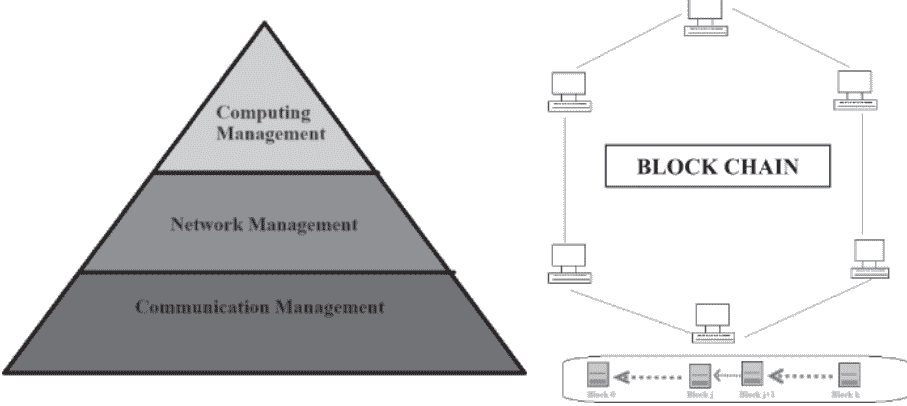

Figure 4.1 5G beyond in IoT using blockchain.


### 4.2.1 计算管理

由于物联网设备资源受限，大量数据通常被发送到远程云服务器进行额外处理。但纯云端计算范式限制了物联网的可扩展性，这也导致网络流量瓶颈、延迟延长、隐私泄露以及缺乏上下文感知能力 [13]。通过在远程云服务器和 MEC 服务器之间转移计算工作负载，MEC 服务器通常部署在靠近用户的小型基站（Small BS）、宏观基站（Macro BS）、Wi-Fi 接入点（Wi-Fi APs）以及物联网网关上，MEC [14] 正成为云计算中越来越重要的组成部分。然后，通过将对计算要求较低、具备上下文感知能力且对延迟敏感的工作负载在远程云服务器和附近 MEC 服务器之间迁移，可以同时增强响应速度、隐私保护和上下文感知能力。

### 4.2.2 网络管理

如今，分布式物联网可以从软件定义网络（SDN）技术提供的灵活性和可扩展性中获益 [15]。但 Kalkan 和 Zeadally [16] 指出，SDN 的单点故障源于其集中化。此外，当前的 SDN 设备（如网关）无法对计算密集型数据流进行分析。将区块链技术与 SDN 相结合可以缓解 SDN 的缺点。例如，Sharma 等人 [17] 的工作提出了一种面向物联网的安全区块链 SDN 框架。为了安全地更新流规则表并消除中介的需求，已构建了一个基于区块链的系统。此外，区块链技术有望增强网络功能虚拟化（NFV）管理的网络安全。具体而言，Alvarenga 等人 [18] 表明，通过集成区块链技术，NFV 配置可以实现匿名、一致、可审计、不可否认且不可篡改。

### 4.2.3 通信管理

5G 通信系统对资源管理的需求正因移动数据流量的不断增长而日益增加。例如，最重要的资源是无线频谱，其组成部分包括频谱共享和拍卖 [19]。通过在联邦通信委员会 [20,21,22] 中使用 BC 技术，可以在 5G 和 6G 通信系统中实现安全且动态的频谱管理。

使用区块链安全且可追溯地管理交易，而无需中央中介，可节省行政成本，这是在 5G 及以后网络中使用区块链技术的主要优势。Yrjölä [23] 举出了许多例子，说明如何通过采用区块链技术在降低成本、共识和可靠性方面改善无线频谱共享。Kotobi 和 Bilen [24] 还提出了一种基于区块链的协议，以确保无线通信系统中初级用户和认知用户之间的频谱共享。此外，通过流量优化，区块链可能能够在保护隐私的同时与多个物联网节点共享链路条件，从而提高频谱效率 [25]。BC 技术有潜力增强无线频谱管理以及客户的移动服务。例如，大多数 5G 网络由众多分散的异构网络组成。通过实现不同网络之间的无缝接入，构建在网络最上层的区块链可以帮助整合多种网络。正如 He 等人 [26] 的研究所示，工作节点可以在基于区块链的系统支持下增强其技术和服务能力。未来，服务提供商将能够基于 BC 技术与大数据分析的结合，从订阅者交易中提取重要洞察，从而为用户提供更好的服务。

### 4.2.4 基于区块链的边缘与云计算管理

在使用区块链技术协调边缘与云计算时，资源共享激励和计算任务卸载是两个被解决的问题。通过将计算工作负载转移到边缘服务器，可以大幅降低延迟。因此，边缘-云互操作性至关重要 [27]。如果每个节点都将其工作负载转移到移动边缘计算服务器，可能会导致单点故障和性能瓶颈。Dai 等人 [28] 提出了一种考虑多个 MEC 服务器之间负载均衡的卸载方法。与此同时，探讨如何为云服务器和边缘服务器提供奖励也是有价值的。

## 4.3 物联网区块链应用

区块链技术在物联网中的应用越来越流行，成为解决物联网相关问题的一种手段，并对 BCIoT 的应用进行了总结。有必要强调，区块链具有广泛的应用范围，从智能电网到无人驾驶飞行器（UAVs）和车联网（IoVs）。本节主要聚焦于 BCIoT 的工业应用，如图 4.2 所示。我们将 BCIoT 应用分为六大类。

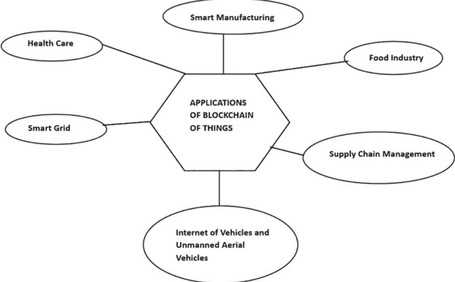

图 4.2 BCIoT 应用。

- i. 智能电网：分布式可持续能源的出现正在改变能源生产消费者的性质，使其从单纯的能源消费者转变为能够生产能源的生产消费者 [29]。BC 技术的出现为保障安全的点对点能源交易提供了机会。一些近期文章推荐使用 BC 技术作为这些问题的解决方案。Li 等人 [30] 使用联盟区块链创建了一个安全的能源交易系统。借助区块链的分布式共识，该方法可以在不利用中心经纪人的情况下大幅降低交易成本。此外，Aitzhan 和 Svetinovic [31] 使用区块链技术创建了一个去中心化的能源交易系统。研究表明，该技术在维护去中心化智能电网系统中的商业能源交易协议方面很有帮助。
- ii. 医疗保健：区块链集成可能有助于医疗网络克服数据安全和隐私问题。Esposito 等人 [32] 表明，存储在云服务器上的医疗数据可以通过使用区块链技术来保护。同时，为了确保医疗数据的私密管理，Griggs 等人 [33] 创建了一个基于区块链的系统。具体而言，医疗传感器产生的健康数据可以通过执行智能合约自动收集并发送到系统中，从而实现对患者的实时监测。底层区块链可在整个过程中用于保护隐私。此外，Bhuiyan 等人 [34] 的研究提出了一种基于区块链的方法来控制个人健康信息，并促进各医疗机构、保险提供商和患者之间的数据交换。整个过程中都可以保障医疗数据的安全和隐私。
- iii. 智能制造：自动化生产在制造业正逐渐让位于“智能制造” [35]。在这一升级过程中，制造数据的 BDA（大数据分析）至关重要。产品生命周期的每个阶段——从设计、供应原材料、制造、分销、零售到售后服务——都会产生海量数据。然而，由于制造数据极为分散，数据分析和数据聚集面临挑战。通过实现工业部门间的数据交换，并通过点对点网络连接物联网系统，BCIoT 可以解决互操作性问题。例如，可以构建多个分布式区块链，每个区块链服务于一个或多个部门。BCIoT 还可以增强智能制造的安全性。物联网系统的集中式维护是阻碍工厂升级的关键障碍。例如，为了解决安全漏洞，物联网固件必须定期更新。然而，物联网设备的大多数固件更新是从中央服务器下载后手动部署的。为分布式物联网设备安装和更新固件成本高昂且效率低下。Christidis 和 Devetsikiotis [10] 的工作提出了一种基于智能合约和区块链的自动固件升级方法。

整个工业网络专门配备了指定固件升级流程（如固件升级的时间和地点）的智能合约。然后，可以通过自动运行的智能合约下载并安装固件哈希到设备上。因此，可以显著节省安全维护费用。
- iv. 食品行业：BCIoT 可以提升产品生命周期的可见性，尤其是在食品领域。为保障食品安全，尤其是食品


产品必须可追溯。但借助当前的 IoT [36]，要确保整个食品供应链的食品追溯性很困难。例如，几家供应商可能为一家食品公司提供原料。从产地到每个食品加工环节数字化原材料信息对于追溯是必要的。在此过程中，通过区块链技术可以保证与食品业务相关的数据来源和可追溯性。此方面有多个提案。例如，Tian [37] 的研究建议使用 RFID 和区块链技术在中国从农业到食品生产建立供应链平台。这种方法已被证明可以确保食品供应链的数据可追溯。然而，Sander 等人 [38] 的研究表明，区块链技术如何通过实现可追溯食品的供应来增强食品安全。Bettín-Díaz 等人 [39] 进一步证明了将区块链技术纳入食品供应链可使消费者监控整个食品生产过程。作者还为哥伦比亚有机咖啡行业提供了一个区块链应用。此外，Lin 等人 [40] 建议一种使用电子产品代码（EPC）标签的基于 IoT 和区块链的食品安全可追溯系统。通过智能合约，该系统可以专门防止数据篡改和隐私泄露。为了证明其有效性，建议实施一个原型。

- v. 供应链管理：产品通常由多个组件组成，这些组件由位于不同国家的不同生产商提供。然而，供应链可能会接触到一些伪造或劣质产品。在产品的整个生命周期中集成反欺诈系统的成本很高。通过将 BC 技术与 IoT 相结合可以解决这个问题。具体而言，在创建过程中，每个组件都将关联到一个独特的 ID。除了这个 ID，还会附加一个不可更改的时间戳。然后，区块链（可追溯且防篡改）可以包含每个组件的身份标识。例如，Konstantinidis 等人 [41] 的研究展示了如何使用基于区块链的系统来验证产品的部分所有权。此外，Kim 和 Laskowski [42] 建议一种基于以太坊 BC 平台的可追溯本体学，集成区块链和物联网技术。所提出的架构可以保证供应链中数据的来源。

- vi. 车联网（IoVs）和无人机（UAVs）：车联网本质上整合了车对车、车对路侧、车对基础设施以及车对行人的网络。由于 IoV 的去中心化、异质性和不可信性，在保护消息传输和事务执行方面存在困难。通过将 BC 技术与 IoV 相结合可以解决这些问题。Yang 等人 [43] 利用区块链技术创建了一个用于管理 IoV 中信任的此类网络。具体而言，路侧单元（RSUs）可以使用 PoW/PoS 共识来确认消息的可靠性。此外，在智能电网中，区块链技术可以用于保护混合动力车和电动汽车之间的信息与能量交换 [44,45,46]。未来，通过结合区块链、MEC 和人工智能，可以进一步优化 IoV 中的资源分配 [47]。无人机通信网络有能力弥补近期无线网络覆盖不足的问题 [48]。除了产品配送，无人机还可用于收集实时交通流数据和分发产品物品 [49,50]。此外，Cheng 等人 [51] 的最近研究表明，无人机可以同时支持 MEC 和以内容为中心的网络。但是，在去中心化、不可信的无人机网络中确保可靠性以及控制失控无人机是艰巨的任务 [52]。通过将区块链技术与无人机网络相结合，可以确保无人机之间的相互信任。

## 4.4 智慧城市中的 BC 技术

BC 技术被视为智慧城市的重要推动者，特别是在治理、交通、资产管理、公用事业、医疗保健和物流方面 [53,54]。[54] 为智慧城市庞大的通信网络所面临的安全风险提供了解决方案。提案建议在推动智慧城市的过程中引入基于区块链的技术，并创建一个框架以协助决策者和城市所有者。人们还研究了这种方法是否可用于未来创建低碳绿色环境的智慧城市，重点关注政府信息共享 [55]。

目前，个别组织和公司在银行、金融机构、标准化机构或信用卡提供商等第三方中介的协助下进行交易。这些交易通常需要审批，会产生成本，有时会导致浪费时间和资源的低效率。BC 计算已发展成为一种金融操作方法，在线上公开透明地支持通信，以解决这些问题 [56]。

城市的快速增长带来了一系列问题，包括对环境的危害、资源使用增加、严重的交通拥堵以及导致空气污染的大量温室气体和二氧化碳 [57]。在资源有限的情况下，规划资源使用而不损害后代需求至关重要。集中的城市人口意味着必须仔细管理资源，以防止食品、水或其他基本供应出现危机。技术支撑着城市的概念。这意味着智慧城市使用 IoT 流程。如图 4.3 所示，IoT 在实现智慧城市的关键方面（例如生成数据、管理数据和处理应用程序）方面发挥着作用。

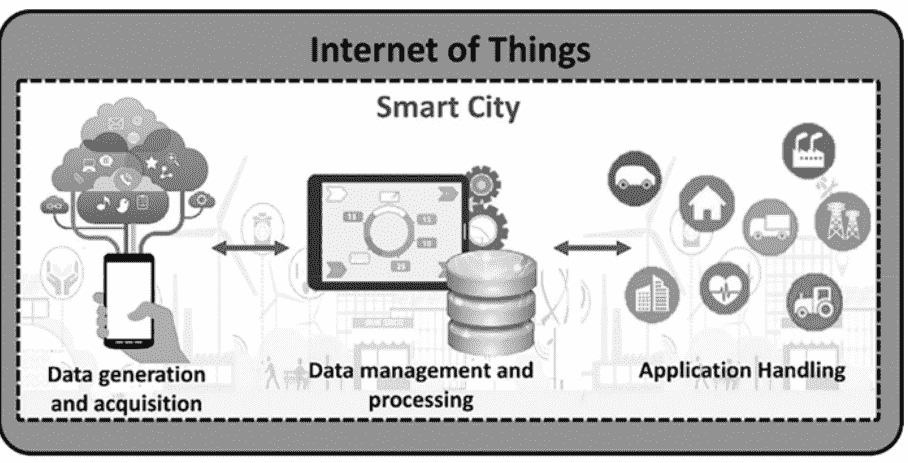

图 4.3 智慧城镇中 IoT 流程的应用。

智慧城市由特征、概念和基础设施组成。城市的品质通常被称为其决定性特征。由于城市的进步依赖于这些观察，它们也被称为智慧城市的基础。

### 4.4.1 智慧城市的架构层

该架构采用自下而上的技术。传感层是最底层，传输层是第三层，数据管理层是第二层，应用层作为最顶层构成了该架构。智慧城市每一层的安全模块在保护敏感数据方面具有同等作用。在最底层，采集涉及感知和记录。这使其能够从众多多样的传感器和设备中积累知识。它有几种方式来增强不同场景的高效采集。它还通过其感知层的传感器网络收集温度、光照强度、压力和湿度等多种属性的信息。一些从业者使用网络摄像头、Zigbee、全球定位系统（GPS）终端、蓝牙或 RFID 传感器和执行器进行感知活动。

传输层涉及众多传输或通信网络的融合。在该层内，还存在针对其区域的网络传输和接入传输。短程覆盖的接入网络技术通常包括蓝牙、Zigbee、M2M、RFID 和 Zwave 等技术（注 – 这并非详尽列表），以及近场通信（NFC）。同样，传输网络技术包括提供更广覆盖的技术，如低功耗广域网（LP-WAN）、5G、3G 和 4G 长期演进（LTE）。图 4.4 显示了智慧城市实施中采用的各种通信技术。

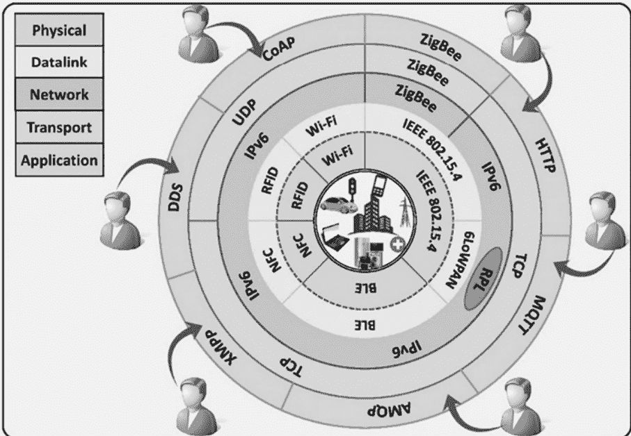

图 4.4 智慧城市实施中采用的各种通信技术。

任何智慧城市的关键部分是数据管理层，它位于采集层和应用层之间。该阶段处理与数据处理、规划、分析、归档和决策相关的大量职责。智慧城市架构的最顶层是连接的应用层


与城市数据管理层相关的市民。由于它与居住其中的人们直接相关，用户对性能和幸福感水平的看法取决于该层的表现如何。因此，高级智能系统必须通过准确分析已知和未知的社会需求，来协调与其他智能应用的兼容性。专家进一步评论指出，仅仅添加复杂或精密的技术不足以满足运营中的智慧城市客户。

### 4.4.2 智慧城市技术的问题

- 1. 规划与维护的费用是实际部署智慧城镇的主要困难。存在许多系统成本较低的实用应用选项。
- 2. 因此，应将更多资源整合到应用层以实现智慧城市目标。然而，由异质性引起的平台不兼容性阻碍了应用层的集成与互操作性。
- 3. 信息与基础设施保护是智慧首都的一个关键方面，这使得大数据处理和分析技术需要升级。
- 4. 智慧城市还必须将废物管理作为一项重要问题来应对，原因是环境污染和填埋。任何旨在使城市“更智能”的项目也必须解决故障管理问题。此外，洪水、地震或飓风等自然灾害可能会因物理损坏和网络不可用而导致系统功能失效。

## 4.5 区块链与深度学习（DL）的方法论

图 4.5 显示，将智能算法与区块链相结合有许多好处，包括：构建用于更灵活预测的复杂模型；共享建模；自动化决策；可信赖的决策；数据安全；组织良好的信息市场管理；以及基于 DL 的编程。

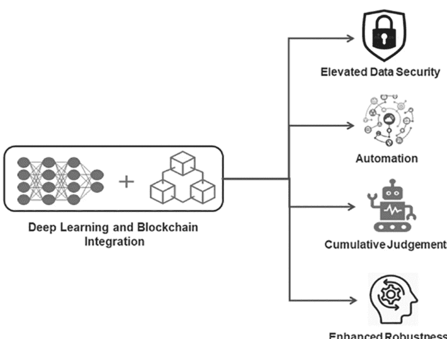

图 4.5 融合区块链与 DL 技术所带来的收益。

DL 方法论处理来自不同来源的大量信息，以建立特征并根据概率生成输出。虽然在使用原始事实作为 DL 算法输入时性能准确率很高，但预测许多现实世界事件需要所使用信息的优越性作为一个重要因素。所有网络节点都可以使用全球区块链数据库以去中心化且可验证的方式存储和交易事实。

尽管区块链是一种旨在保护数据的打击犯罪系统，但 DL 专注于使用数据来训练模型并提供精确预测。区块链的数据不可变性特性通过确保数据不被泄露，保护 DL 模型和数据免受各种威胁和数据噪声的影响。因此，这些模型能提供更好且更可靠的预测。得益于 DL 与区块链的结合，许多需要敏感数据并且需要极其小心和安全处理的工作也可以完成。DL 算法与区块链技术的结合可以为 DL 导向型应用需要收集、处理和利用的关键信息提供一个可靠、持久且分布式的平台。

### 4.5.1 DL 算法与区块链技术融合带来的回报

- 保障数据安全：节点的私钥必须保持私密，因为它们可能是检索区块链数据的手段。使用 DL 算法做出的决策更加可靠、准确和可信，因为它们可以在区块链提供的稳定数据上运行 [6]。
- 自动化决策：得益于追踪能力，使用 DL 模型生成的结果可以轻松审计。它还确保在人工辅助搜索阶段不会发生数据操纵。
- 最终评估：数字身份管理者通常基于收集的关于情况的数据来得出结果。DL 和群机器人是基于代理的决策的两个示例。
- 性能改进：DL 模型让客户在做决策时更有信心。此外，由于 DL 由技术维护，变化是有保障的。

DL 技术在分析收集到的数据后，搜索可用于各种场景以支持决策的模型。用于创建各种应用判断的基于 DL 的五种主要模型形式是几何 DL、深度强化学习（DRL）、循环神经网络、生成对抗网络（GAN）和卷积神经网络。基于区块链的人工智能算法用于保障数据完整性的主要应用领域包括健康、车联网（IoVs）、交通处理以及隐私和安全 [58]。

### 4.5.2 研究前景与困难

这些技能成功结合的主要障碍包括：确保信息交易安全、交易执行延迟、平台互连支持、传感器和智能手表收集的海量数据、安全的商业模式以及计算密集型共识协议。

## 4.6 结论

本研究深入探讨了区块链与物联网（IoT）的集成、其架构方法、局限性以及对不同行业的影响。文章探讨了区块链在智慧城市、边缘与云计算、物联网（IoT）、5G 技术和 DL 等热门领域的优势。文章全面分析了将区块链技术与物联网（IoT）集成的可能性。它还通过鼓励跨物联网设备的信息共享和创建点对点网络，解决了制造业等商业领域中的信息收集和分析问题。文章强调了 DL、区块链和智慧城市集成的好处。

## 参考文献

- 1. A. Dorri, S. S. Kanhere, R. Jurdak, 和 P. Gauravaram，“面向 IoT 安全与隐私的区块链：智能家居案例研究”，载于 IEEE 普适计算与通信研讨会（PerCom Workshops）论文集，夏威夷州凯卢阿，2017 年 3 月，第 618–623 页。
- 2. Y. Zhang 和 J. Wen，“面向物联网的 IoT 电子商务模式：使用区块链技术”，对等网络与应用，第 10 卷，第 4 期，第 983–994 页，2017 年 7 月。[在线]。可用：https://doi.org/10.1007/s12083-016-0456-1
- 3. M. Conosciuti, A. Vetrò, 和 J. C. De Martin，“面向物联网的区块链：系统文献综述”，载于 IEEE/ACS 第 13 届国际计算机系统与应用会议（AICCSA）论文集，摩洛哥阿加迪尔，2016 年 11 月/12 月，第 1–6 页。
- 4. M. Banerjee, J. Lee, 和 K.-K. R. Choo，“物联网安全的区块链未来：立场文件”，数字通信与网络，第 4 卷，第 3 期，第 149–160 页，2018 年。
- 5. A. Reyna, C. Martín, J. Chen, E. Soler, 和 M. Díaz，“论区块链及其与物联网的集成：挑战与机遇”，未来世代计算机系统，第 88 卷，第 173–190 页，2018 年 11 月。
- 6. T. M. Fernández-Caramés 和 P. Fraga-Lamas，“区块链在物联网中的应用综述”，IEEE Access，第 6 卷，第 32979–33001 页，2018 年。
- 7. M. S. Ali, M. Vecchio, M. Pincheira, K. Dolui, F. Antonelli, 和 M. H. Rehmani，“物联网中区块链的应用：全面综述”，IEEE 通信调查与教程，第 21 卷，第 2 期，第 1676–1717 页，2019 年第 2 季度。[在线]。可用：https://doi.org/10.1109/COMST.2018.2886932
- 8. A. Panarello, N. Tapas, G. Merlino, F. Longo, 和 A. Puliafito，“区块链与物联网集成：系统调查”，传感器，第 18 卷，第 8 期，2018 年，文章编号 E2575。[在线]。可用：https://www.mdpi.com/1424-8220/18/8/2575
- 9. D. Johnson, A. Menezes, 和 S. Vanstone，“椭圆曲线数字签名算法（ECDSA）”，国际信息安全期刊，第 1 卷，第 1 期，第 36–63 页，2001 年。
- 10. K. Christidis 和 M. Devetsikiotis，“面向物联网的区块链与智能合约”，IEEE Access，第 4 卷，第 2292–2303 页，2016 年。
- 11. Q. Lu 和 X. Xu，“可适应的基于区块链的系统：产品可追溯性案例研究”，IEEE 软件，第 34 卷，第 6 期，第 21–27 页，2017 年 11 月/12 月。
- 12. Y. Zhang 和 J. Wen，“基于比特币协议的 IoT 电子商务模式”，载于第 18 届智能下一代网络国际会议（ICIN）论文集，法国巴黎，2015 年，第 184–191 页。
- 13. C.-H. Chen, M.-Y. Lin, 和 C.-C. Liu，“使用多协作微控制器的工业物联网边缘计算网关”，IEEE 网络，第 32 卷，第 1 期，第 24–32 页，2018 年 1 月/2 月。
- 14. N. Abbas, Y. Zhang, A. Taherkordi, 和 T. Skeie，“移动边缘计算：调查”，IEEE 物联网期刊，第 5 卷，第 1 期，第 450–465 页，2018 年 2 月。
- 15. S. Bera, S. Misra, 和 A. V. Vasilakos，“面向物联网的软件定义网络：调查”，IEEE 物联网期刊，第 4 卷，第 6 期，第 1994–2008 页，2017 年 12 月。
- 16. K. Kalkan 和 S. Zeadally，“使用软件定义网络保障物联网安全”，IEEE 通信杂志，第 56 卷，第 9 期，第 186–192 页，2018 年 9 月。
- 17. P. K. Sharma, S. Singh, Y.-S. Jeong, 和 J. H. Park，“DistBlockNet：面向 IoT 网络的基于分布式区块链的安全 SDN 架构”，IEEE 通信杂志，第 55 卷，第 9 期，第 78–85 页，2017 年 9 月。
- 18. L. D. Alvarenga, G. A. F. Rebello, 和 O. C. M. B. Duarte，“使用区块链保障虚拟网络功能的配置管理与迁移安全”，载于 IEEE/IFIP 网络运营与管理研讨会（NOMS）论文集，中国台湾台北，2018 年 4 月，第 1–9 页。
- 19. M. Massaro，“无线电频谱管理的下一代：面向 5G 的许可共享接入”，电信政策，第 41 卷，第 5–6 期，第 422–433 页，2017 年。[在线]。可用：https://www.sciencedirect.com/science/article/pii/S0308596117301416
- 20. J. Eggerton，FCC 的 Rosenworcel 谈 6G，Future Publ. Ltd.，英国巴斯，2018 年 9 月。[在线]。可用：https://www.multichannel.com/news/fccs-rosenworcel-talks-up-6g


- 21. R. Saracco, “让我们开始谈论6G吧！”IEEE, Piscataway, NJ, 2018年1月. [在线]. 可用: https://sites.ieee.org/futuredirections/2018/01/25/lets-start-talking-about-6g

- 22. A. Gatherer, “6G会是什么样子？”IEEE通信学会, New York, 2018年6月. [在线]. 可用: https://www.comsoc.org/publications/ctn/what-will-6g-be

- 23. S. Yrjöla, “公民宽带无线业务频谱共享概念中区块链用例分析，”载于 Cognitive Radio Oriented Wireless Networks: 12th International Conference, CROWNCOM 2017, Lisbon, Portugal, September 20-21, 2017, Proceedings 12。Cham, Switzerland: Springer Int., 2018, 第128–139页.

- 24. K. Kotobi and S. G. Bilen, “面向动态频谱接入的安全区块链：移动认知无线网络中的分散式数据库增强安全性和用户访问,” IEEE Veh. Technol. Mag., 第13卷, 第1期, 第32–39页, 2018年3月.

- 25. E. H. H. Kure, P. Engelstad, S. Maharjan, S. Gjessing, and Y. Zhang, “在私有信息约束下5G异构网络中面向物联网的分布式上行链路卸载,” IEEE Internet Things J., 待出版. [在线]. 可用: https://doi.org/10.1109/JIOT.2018.2886703

- 26. S. He, C. Xing, and L.-J. Zhang, “面向区块链网络运营的业务导向架构，”载于 Blockchain—ICBC 2018, S. Chen, H. Wang, and L.-J. Zhang, 编。Cham, Switzerland: Springer Int., 2018, 第277–284页.

- 27. P. Yang, N. Zhang, Y. Bi, L. Yu, and X. S. Shen, “催化5G无线网络中云雾互操作：一种SDN方法,” IEEE Netw., 第31卷, 第5期, 第14–20页, 2017年9月.

- 28. Y. Dai, D. Xu, S. Maharjan, and Y. Zhang, “车载边缘计算和网络中联合负载均衡与卸载,” IEEE Internet Things J., 待出版. [在线]. 可用: https://doi.org/10.1109/JIOT.2018.2876298

- 29. C. Zhang, J. Wu, Y. Zhou, M. Cheng, and C. Long, “微电网中的点对点能源交易,” Appl. Energy, 第220卷, 第1–12页, 2018年6月. [在线]. 可用: https://www.sciencedirect.com/science/article/pii/S0306261918303398

- 30. Z. Li, J. Kang, R. Yu, D. Ye, Q. Deng, and Y. Zhang, “面向工业物联网安全能源交易的联盟区块链,” IEEE Trans. Ind. Informat., 第14卷, 第8期, 第3690–3700页, 2018年8月.

- 31. N. Z. Aitzhan and D. Svetinovic, “通过多重签名、区块链和匿名消息流进行去中心化能源交易的安全与隐私,” IEEE Trans. Depend. Secure Comput., 第15卷, 第5期, 第840–852页, 2018年9月/10月.

- 32. C. Esposito, A. D. Santis, G. Tortora, H. Chang, and K. R. Choo, “区块链：医疗云端数据安全与隐私的万能药？”IEEE Cloud Comput., 第5卷, 第1期, 第31–37页, 2018年1月/2月.

- 33. K. N. Griggs, O. Ossipova, C. P. Kohlios, A. N. Baccarini, E. A. Howson, and T. Hayajneh, “使用智能合约的安全自动远程患者监护医疗区块链系统,” J. Med. Syst., 第42卷, 第7期, 第130页, 2018年6月. [在线]. 可用: https://doi.org/10.1007/s10916-018-0982-x

- 34. M. Z. A. Bhuiyan, A. Zaman, T. Wang, G. Wang, H. Tao, and M. M. Hassan, “区块链和大数据改造医疗，”载于 ACM国际数据处理与应用会议(ICDPA)论文集, 广东, 中国, 2018, 第62–68页.

- 35. A. Kusiiak, “智能制造,” Int. J. Prod. Res., 第56卷, 第1–2期, 第508–517页, 2018.

- 36. D. Tse, B. Zhang, Y. Yang, C. Cheng, and H. Mu, “食品供应链信息安全中的区块链应用，”载于 IEEE工业工程与工程管理国际会议(IEEM)论文集, 新加坡, 2017年12月, 第1357–1361页.

- 37. F. Tian, “基于RFID和区块链技术的中国农业食品供应链可追溯系统，”载于 第13届服务系统与服务管理国际会议(ICSSSM)论文集, 昆明, 中国, 2016, 第1–6页.

- 38. E. Sander, J. Semeijn, and D. Mahr, “肉类可追溯性和透明度中区块链技术的接受度,” Brit. Food J., 第120卷, 第9期, 第2066–2079页, 2018.

- 39. R. Bettín-Díaz, A. E. Rojas, and C. Mejía-Moncayo, “面向食品行业供应链可追溯性的区块链系统定义方法论方法，”载于 计算科学及其应用国际会议论文集。Cham, Switzerland: Springer Int., 2018, 第19–33页.

- 40. Q. Lin, H. Wang, X. Pei, and J. Wang, “基于区块链和EPCIS的食品安全可追溯系统,” IEEE Access, 第7卷, 第20698–20707页, 2019.

- 41. I. Konstantininidis, G. Siaminos, C. Timplalexis, P. Zervas, V. Peristeras, and S. Decker, “面向业务应用的区块链：系统文献综述，”载于 商业信息系统, W. Abramowicz and A. Paschke, 编。Cham, Switzerland: Springer Int., 2018, 第384–399页.

- 42. H. M. Kim and M. Laskowski, “面向供应链来源的本体论驱动区块链设计,” Intell. Syst. Account. Finance Manag., 第25卷, 第1期, 第18–27页, 2018.

- 43. Z. Yang, K. Yang, L. Lei, K. Zheng, and V. C. M. Leung, “车载网络中基于区块链的去中心化信任管理,” IEEE Internet Things J., 第6卷, 第2期, 第1495–1505页, 2019年4月. [在线]. 可用: https://doi.org/10.1109/JIOT.2018.2836144

- 44. H. Liu, Y. Zhang, and T. Yang, “电动汽车云和边缘计算中的区块链赋能安全,” IEEE Netw., 第32卷, 第3期, 第78–83页, 2018年5月/6月.

- 45. J. Kang, R. Yu, X. Huang, S. Maharjan, Y. Zhang, and E. Hossain, “使用联盟区块链实现插电式混合动力电动汽车之间的局部点对点电力交易,” IEEE Trans. Ind. Informat., 第13卷, 第6期, 第3154–3164页, 2017年12月.

- 46. J. Kang et al., “车载边缘计算和网络中安全高效数据共享的区块链,” IEEE Internet Things J., 第6卷, 第3期, 4660–4670, 2018.

- 47. G. Revathy, K. Selvakumar, and T. Ganesh Kumar. “物联网应用中的Jaya进程优化，”载于 区块链、AI和IoT融合, 第119–136页, 2021. CRC Press.

- 48. Y. Zeng, R. Zhang, and T. J. Lim, “无人机无线通信：机遇与挑战,” IEEE Commun. Mag., 第54卷, 第5期, 第36–42页, 2016年5月.

- 49. G. Kimchi et al., “无人机递送系统,” 美国专利 9 573 684, 2017.

- 50. L. Wang, F. Chen, and H. Yin, “利用无人机检测和跟踪交通车辆,” Autom. Construction, 第72卷, 第294–308页, 2016年12月. [在线]. 可用: https://www.sciencedirect.com/science/article/pii/S0926580516300887

- 51. N. Cheng et al., “空地一体移动边缘网络：架构、挑战与机遇,” IEEE Commun. Mag., 第56卷, 第8期, 第26–32页, 2018年8月.

- 52. B. Li, Z. Fei, and Y. Zhang, “面向5G及以后的UAV通信：最新进展与未来趋势,” IEEE Internet Things J., 第6卷, 第2期, 第2241–2263页, 2019年4月. [在线]. 可用: https://doi.org/10.1109/JIOT.2018.2887086

- 53. I. B. Migliorini, A. J. De Hoyos Guevara, D. De Melo Conti, and V. Catarina Dib, “智慧城市中的区块链技术，一种自生智慧城市提案,” J. Innovation Sustainability RISUS, 第12卷, 第4期, 2021, https://doi.org/10.23925/2179-3565.2021v12i4p04-12

- 54. P. F. Wong, F. C. Chia, M. S. Kiu, and E. C. Lou, “将区块链技术整合到智能可持续城市(SSC)发展中的潜力：系统综述,” Smart Sustainable Built Environ., 第11卷, 第3期, 第559–574页, 2020.

- 55. M. Sun and J. Zhang, “面向低碳排放和绿色环境新智慧城市建设中区块链大数据平台应用研究,” Comput. Commun., 第149卷, 第332–342页, 2020.

- 56. N. Feroz, “基于区块链服务的智慧城市安全升级系统综述。” EAI Endorsed Trans. Smart Cities, 第4卷, 2018, https://doi.org/10.4108/eai.13-7-2018.163840

- 57. B. N. Silva, M. Khan, and K. Han, “迈向可持续智慧城市：智慧城市趋势、架构、组件和开放挑战综述,” Sustain Cities Soc., 第38卷, 第697–713页, 2018, https://doi.org/10.1016/j.scs.2018.01.053

- 58. B. Marr, “人工智能与区块链：结合这两大超级趋势的3大好处,” Forbes, 2018年3月.


# 第 5 章

# 探索区块链和深度学习在智慧城市应用中的潜力

G Revathy, R. Indhumathi, A. Nisha Jebaseeli, A. Fairosebanu, P. Aurchana, and B. Sreedevi

DOI: 10.1201/9781003476047-5

## 5.1 区块链简介

区块链本质上是一系列区块，每个区块包含一组数据或交易。这些片段按发生顺序连接成一条链。以下是区块链运作方式的简要描述：

- 1. **去中心化**：与传统的集中式系统不同，区块链以去中心化方式运作，传统系统将数据存储在单一位置或由中央机构监管。这意味着数据不是由单一实体处理，而是由节点或计算机网络存储和管理。

- 2. **透明性和不可篡改性**：一旦数据记录在区块链上，就无法删除或更改。由于每个区块都包含前一个区块的加密哈希，整条链都具有防篡改性。这保证了存储在区块链上的数据具有透明性且不可更改。区块链网络采用共识技术来验证并就每个区块的内容达成共识。委托权益证明（DPoS）、工作量证明（PoW）和权益证明（PoS）是几种流行的共识程序示例 [1]。

- 3. **智能合约**：这些是自动执行的合同，交易条件直接编码到代码中。当满足特定条件时，它们会自动执行和强制执行协议内容。以太坊和其他区块链系统是实现智能合约的热门场所。

### 5.1.1 区块链的关键特性

- 1. **安全性**：区块链上的数据使用加密技术进行加密，使交易免受欺诈和非法访问。

- 2. **透明性**：由于区块链技术具有透明性，所有用户都可以查看和验证交易，从而鼓励责任感和信心。

- 3. **去中心化**：区块链实现了点对点交易，消除了对中介的需求，降低成本并提高效率。

- 4. **不可篡改性**：数据一旦写入区块链，就无法更改或删除，使其成为交易的可信且可审计的记录。

- 5. **互操作性**：区块链技术能够与多个平台和系统协同工作，实现数据的平滑传输和网络集成 [2]。

## 5.2 深度学习简介

在多个领域，包括计算机视觉、自然语言处理、语音识别、医疗保健和金融，深度学习都展现出了巨大的潜力。得益于其能够从大规模数据集中自动学习数据的分层表示，AI 应用取得了显著进步。这使得图像分类、物体识别、语言翻译、情感分析和医疗诊断等任务成为可能。

## 5.3 区块链和深度学习在智慧城市中的应用

在智慧城市中生活就像在人间重建天堂。人类在现实世界中从未遇到过任何问题。仅在此情况下保留了可持续性。其组成部分如下：

- 1. 医疗保健
- 2. 废弃物管理
- 3. 资金交易
- 4. 供水
- 5. 食品管理
- 6. 灾害管理
- 7. 交通管理与运输
- 8. 公共安全与安保
- 9. 能源管理与可持续性
- 10. 环境监测与保护
- 11. 智慧基础设施与维护
- 12. 公民服务与参与

### 5.3.1 医疗保健

将区块链和深度学习应用于医疗保健，巨大潜力可以解决数据隐私、互操作性、安全性和患者护理等关键挑战。以下是这些技术在医疗保健中的应用方式：

- 1. **数据安全与隐私**：
  - **区块链**：利用区块链创建安全且不可篡改的健康数据记录。存储在区块链上的患者数据经过加密，只能由授权方访问，以确保患者隐私和安全 [3]。
  - **深度学习**：深度学习算法可以直接在区块链上分析加密的健康数据而不影响隐私，从而为个性化医疗、疾病预测和治疗建议提供洞察。

- 2. **互操作性与数据共享**：
  - **区块链**：实施区块链以创建一个去中心化的、互操作的系统，用于在医疗服务提供者、研究人员和患者之间共享健康数据。智能合约可以自动执行数据共享协议，同时确保数据完整性和可追溯性。
  - **深度学习**：在多种来源的异质健康数据上训练的深度学习模型可以提取有意义的洞察和模式，促进协作研究、临床决策和人群健康管理。

- 3. **临床试验与药物发现**：
  - **区块链**：使用区块链来跟踪和验证临床试验数据的真实性，确保研究过程的透明性和可信度。智能合约可以自动执行利益相关方之间的合同和付款，简化临床试验管理 [4]。
  - **深度学习**：深度学习算法可以分析大规模临床试验数据，以识别新的药物靶点、预测患者对治疗的反应，并加速药物发现和开发过程。

- 4. **医学影像分析**：
  - **区块链**：利用区块链创建医学影像数据（如 X 光、MRI 和 CT 扫描）的防篡改且可审计的记录。这确保了数据完整性，并使医学图像能够安全地共享用于诊断和治疗规划。
  - **深度学习**：深度学习模型（特别是卷积神经网络 CNN）可以高精度地分析医学图像，协助放射科医生检测异常、诊断疾病和预测患者预后。

- 5. **医疗供应链管理**：
  - **区块链**：利用区块链跟踪和追踪供应链中的药品、医疗器械和物资，从制造到分销再到患者用药。这提高了透明度，减少了假冒伪劣产品，并提升了患者安全。
  - **深度学习**：深度学习算法可以分析供应链数据，以优化库存管理、预测医疗产品需求，并检测异常或欺诈活动，确保供应链运营高效可靠。

- 6. **远程医疗与远程患者监测**：
  - **区块链**：实施区块链以安全地存储和共享远程医疗咨询、电子健康记录（EHR）和患者生成的健康数据（PGHD），例如可穿戴传感器数据。这使得医疗服务提供者与患者之间能够实现无缝沟通和协作。
  - **深度学习**：深度学习模型可以分析可穿戴设备中的 PGHD，以监测患者的健康状况、检测健康问题的早期预警信号，并为疾病管理提供个性化干预和建议。

- 7. **欺诈检测与医疗账单**：
  - **区块链**：使用区块链创建医疗交易（包括账单和索赔处理）的透明且可审计的记录。智能合约可以自动化保险验证、索赔裁决和付款对账，减少欺诈和行政开销。
  - **深度学习**：深度学习算法可以分析医疗账单数据，以识别欺诈行为模式、异常索赔和账单错误，从而实现主动的欺诈检测和预防措施 [5]。

在智慧城市中，医疗服务日益普及，此类应用在图 5.1 中有所说明。利用医疗中心收集所有患者数据。该中心拥有按地区组织的数据库，用于跟踪和存储患者健康信息。如果有人需要进行一般体检或因病就诊，请凭身份证明登录。相关专科医生会立即通过区块链支持的虚拟摄像头进行回复。药物也会送到患者家中。除非是手术情况，否则患者不必去医院。医院根据该地区的人口为救护车设施分配本地 ID 号。

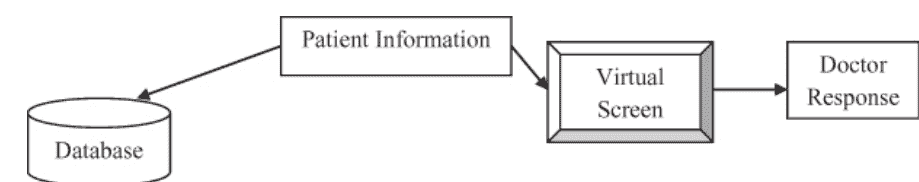

图 5.1 医疗应用。

### 5.3.2 废弃物管理

在废弃物管理中整合区块链和深度学习，为解决废弃物收集效率低下、处置不当以及废弃物管理流程缺乏透明度等挑战提供了创新方案。以下是这些技术在废弃物管理中的应用方式：

#### 供应链透明度：

- **区块链**：利用区块链创建废弃物产生、收集、运输和处置的透明且可追溯的记录。废弃物供应链上的每笔交易都会记录在区块链上，为利益相关者提供废弃物管理流程的实时可见性 [6]。


- 深度学习：深度学习算法可以分析废物收集路线、传感器和物联网设备的历史和实时数据，以优化废物收集时间表、路线和垃圾桶容量。通过预测废物产生模式，深度学习模型可以确保资源分配高效并尽量减少收集成本。

#### 回收和废物分类：

- 区块链：实施区块链以追踪和验证废弃物材料（如塑料、纸张、玻璃和金属）的回收和处置。智能合约可以自动化回收协议，并激励正确的废物分类和回收实践。

- 深度学习：深度学习算法（尤其是 CNN）可以分析废弃物物品的图像，以自动分类和分选可回收材料。这能够实现高效的回收流程，并减少回收流中的污染。

#### 非法倾倒检测：

- 区块链：使用区块链创建废弃物处置场所和填埋场作业的防篡改记录。智能合约可以强制执行废弃物处置法规以及针对非法倾倒活动的处罚。

- 深度学习：基于卫星图像和传感器数据训练的深度学习模型可以检测和识别非法倾倒场所、未经授权的填埋场作业以及环境污染。这使监管机构能够采取及时行动并减轻环境损害。

#### 废物转能源：

- 区块链：利用区块链促进废物转能源转换项目（如厌氧消化和焚烧）的交易和合同。智能合约可以自动化废弃物产生者、能源生产者和监管机构之间的协议。

- 深度学习：深度学习算法可以通过分析传感器和监控设备的数据来优化废物转能源转换过程。通过预测能源产出、优化燃烧参数并尽量减少排放，深度学习模型提高了废物转能源设施的效率和可持续性。

#### 社区参与和教育：

- 区块链：实施基于区块链的奖励系统，以激励个人和社区采取正确的废弃物处置方式、回收努力和环境保护倡议。智能合约可以以代币或积分的形式分配奖励。

- 深度学习：基于深度学习的聊天机器人和虚拟助手可以提供个性化建议和教育资源，以提高人们对废物管理最佳实践、回收指南和环境可持续性的认识。自然语言处理（NLP）技术使用户能够进行交互式和引人入胜的沟通。

#### 数据共享与协作：

- 区块链：利用区块链为利益相关方（包括政府机构、废物管理公司、回收商和社区组织）创建一个用于共享废物管理数据的去中心化平台。智能合约确保数据隐私和安全。

- 深度学习：深度学习算法可以分析来自多个来源的汇总废物管理数据，以识别趋势、模式和改进机会。协作数据分析使数据驱动的决策成为可能，并能持续优化废物管理策略。

“废物管理”一词描述了处理和处置废弃物的不同计划。废弃物可以被消除、处理、回收、再利用或保持受控状态。废物管理中最重要的目标是尽量减少无法使用的材料量，并避免对健康和环境可能造成的威胁。收集、分类、清洁、回收和再利用是各个阶段。图 5.2 说明了这样一种应用，即一旦公共垃圾区域溢出，相关的垃圾收集员将通过消息收到通知。如果垃圾收集员没有回应，官员将自动收到消息。请根据以下类别分类每种废弃物材料：玻璃、塑料、纸张、金属和电子垃圾。分离后的有机废弃物即可出售给农民。政府账户收到了这笔金额，用于以智能方式发展废物管理。每年，根据金额，将相应的补偿金支付给垃圾收集员和官员。回收材料被用于制造新产品。区块链上的深度学习用于整个过程。

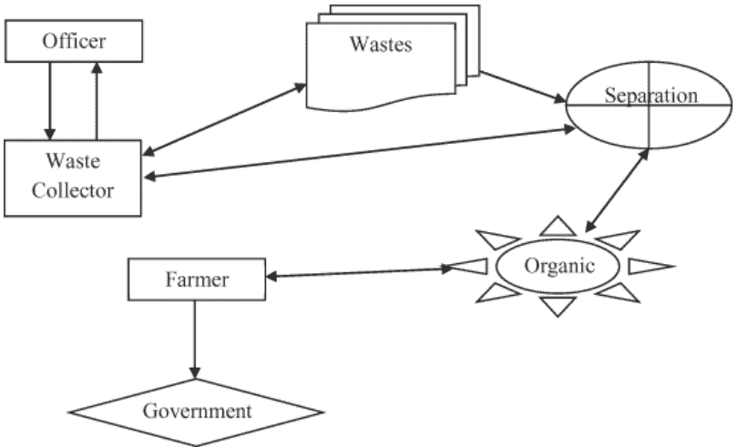

图 5.2 废物管理。

### 5.3.3 金钱交易

将区块链和深度学习应用于金钱交易，可以通过增强支付处理、欺诈检测和风险管理中的安全性、效率和透明度，来彻底改变金融服务。以下是这些技术在金钱交易中的应用方式：

#### 安全且透明的交易：

- 区块链：利用区块链进行无需银行或支付处理器等中介机构的安全且透明的点对点交易。每笔交易都记录在去中心化账本上，提供所有资金转移的不可更改且可审计的记录。

- 深度学习：深度学习算法可以实时分析交易数据，以检测可疑活动、异常和潜在的欺诈交易。通过识别模式和正常行为的偏差，深度学习模型增强交易安全性并降低欺诈风险。

#### 欺诈检测与预防：

- 区块链：实施区块链以创建交易和身份的防篡改记录，使欺诈者难以篡改或操纵财务数据。智能合约可以自动化欺诈检测规则，并对可疑交易触发警报。

- 深度学习：基于历史交易数据训练的深度学习模型可以学习检测欺诈模式，例如异常消费模式、身份盗窃和账户接管攻击。通过持续分析交易行为，深度学习算法提高欺诈检测准确性并降低误报率。

#### 反洗钱合规：

- 区块链：利用区块链创建资金流向的透明且可审计的轨迹，使监管机构和执法机构能够追踪资金的来源和去向。智能合约可以对金融机构执行反洗钱法规和合规要求。

- 深度学习：深度学习算法可以分析交易数据，以识别表明洗钱活动的可疑模式，例如拆分、分层和扫荡。通过将高风险交易标记为需进一步调查，深度学习模型协助金融机构履行监管义务并防止非法金融活动。

#### 风险管理与信用评分：

- 区块链：利用基于区块链的身份验证和信用评分系统来评估个人和企业的信用状况。财务交易和信用历史的不可更改记录使风险评估和贷款决策更加准确。

- 深度学习：深度学习模型可以分析多种数据来源，包括交易历史、信用报告、社交媒体活动和替代数据来源，以预测信用风险和违约概率。通过纳入非传统变量，深度学习算法提高信用评分模型的准确性，并实现更具包容性的贷款实践。

#### 跨境支付与汇款：

- 区块链：实施基于区块链的支付网络，以促进低成本且即时的跨境交易和汇款。加密货币和稳定币可以作为国际资金转移的高效交换媒介。

- 深度学习：深度学习算法可以分析交易数据，以优化货币兑换率、降低外汇费用并减轻货币波动风险。通过预测最佳交易路径和时机，深度学习模型提高跨境支付的效率和成本效益。

#### 客户服务与个性化：

- 区块链：利用基于区块链的客户身份管理系统，在金融机构和服务提供商之间安全地存储和共享客户信息。客户交互的不可更改记录使无缝且个性化的客户体验成为可能。

- 深度学习：基于深度学习的聊天机器人和虚拟助手可以在客户管理财务、进行支付和解决询问时提供个性化建议、协助和支持。自然语言处理技术使用户能够进行交互式和对话式互动。

图 5.3 说明了这样一种应用，即银行经理出示了银行卡。用户可以随时随地使用该卡进行存款和取款。取款机的存款和取款资金范围将固定并增加。银行还推出了在线保险柜。要打开保险柜，请使用用户密钥。用户无需亲自前往，即可在线保管所有实体文件和其他贵重物品。银行提供了一条免费电话，用于货币的存款和取款。

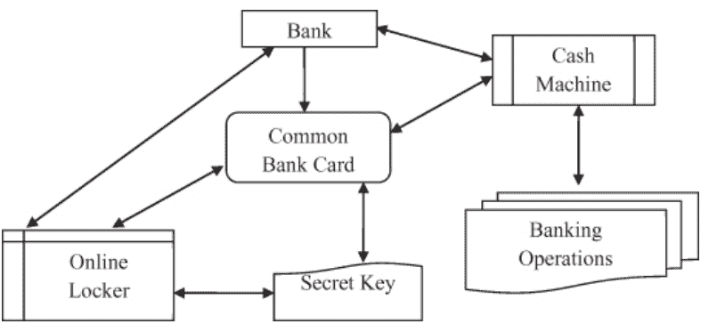

图 5.3 金钱交易。


### 5.3.4 供水

在供水管理中整合区块链和深度学习技术，可显著提升水资源分配、水质监测和基础设施维护的效率、可持续性和透明度。以下是这些技术的应用方式：

#### 水质监测：

- **区块链**：利用区块链为来自各种来源的水质数据（包括传感器、检测实验室和监管机构）创建一个不可篡改且透明的账本。智能合约可自动验证和校验水质数据，确保其完整性和可追溯性。

- **深度学习**：深度学习算法可分析水质数据，检测异常、预测水体污染事件并识别潜在污染源。通过持续监测 pH 值、浑浊度和化学成分等水质参数，深度学习模型能增强预警系统，并实施主动干预以保障水质安全。

#### 漏水检测与基础设施维护：

- **区块链**：实施区块链，为水资源分配网络中的用水追踪、漏水检测和维护活动管理创建去中心化系统。智能合约可自动化维护工作流，并为漏水检测和维修触发警报。

- **深度学习**：深度学习算法可分析水表、压力传感器和声学传感器的数据，识别表明漏水、管网破裂或基础设施老化的模式。通过预测维护需求并优先安排维修干预，深度学习模型可优化水资源分配系统的可靠性并减少水资源损失。

#### 水权与分配：

- **区块链**：利用区块链在水务公司、农户、工业企业和监管机构等利益相关方之间，创建水权、许可和分配的透明且可审计的记录。智能合约可自动化水资源交易协议，并确保遵守水资源法规。

- **深度学习**：深度学习模型可分析历史用水数据和环境因素，预测未来水资源需求和可用性。通过优化水资源分配和资源管理策略，深度学习算法能增强水资源的可持续性及其应对干旱和气候变化的韧性。

#### 干旱监测与预测：

- **区块链**：利用区块链为水资源管理者、决策者和利益相关方之间共享气象数据、水文数据和干旱预报创建去中心化平台。智能合约可自动化数据共享协议，并触发干旱应对措施。

- **深度学习**：深度学习算法可分析卫星影像、遥感数据和气候模型，监测干旱状况、预测干旱发生并评估干旱严重程度。通过提供预警警报和决策支持工具，深度学习模型能实现主动的干旱管理和适应策略。

#### 水费计费与支付系统：

- **区块链**：实施基于区块链的水费计费和支付系统，以简化计费流程、降低交易成本并提升水费计费实践的透明度。智能合约可自动化账单计算、争议解决和支付结算。

- **深度学习**：深度学习算法可分析水资源消耗数据和客户行为模式，预测未来用水量并识别需求管理机会。通过提供个性化的节水建议和激励措施，深度学习模型能鼓励消费者减少用水量并节省成本。

#### 社区参与与教育：

- **区块链**：利用基于区块链的平台，让社区参与节水计划、公众意识宣传活动和参与式决策过程。智能合约可激励社区参与并奖励可持续的水资源使用实践。

- **深度学习**：基于深度学习的教育工具和应用程序可提供个性化的节水建议、实时用水反馈以及游戏化挑战，鼓励行为改变，并在个人和社区中培养水资源管理文化。

图 5.4 描绘了供水官员提供的公共净水箱。每个公寓通过受监控的泵房供水管线获得供水。它并非为每个公寓建造大型水箱而设计。每个区域将全天候获得基本供水。这种方法将确保水位在没有任何偏差的情况下保持。为提高地下水位，供水官员还应指示当地办事处建造一个公共雨水储罐。为提高地下水位，供水官员还应指示当地办事处建造一个公共雨水储罐。

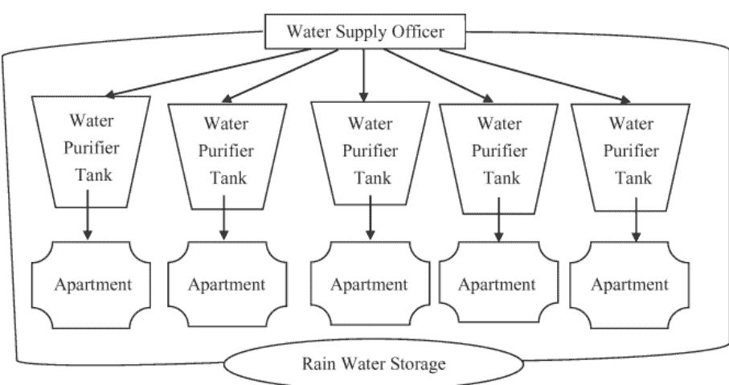

#### 图 5.4 水管理。

### 5.3.5 食品管理

在食品管理中结合区块链和深度学习技术，可提升食品安全、可追溯性、供应链透明度和质量控制。以下是这些技术的应用方式：

#### 供应链可追溯性：

- 区块链：利用区块链为食品供应链交易（包括生产、加工、包装和分销）创建透明且不可篡改的记录。每笔交易均记录在区块链上，使利益相关方能够实时查看食品产品的来源和流程。

- 深度学习：深度学习算法可分析传感器数据、RFID 标签和条形码，在整个供应链中追踪和追溯食品产品。通过检测异常并验证产品真实性，深度学习模型能增强供应链可追溯性并降低食品欺诈和污染的风险。

#### 食品安全与质量保证：

- **区块链**：实施区块链，在供应链各阶段为食品安全检查、实验室测试和认证创建防篡改记录。智能合约可自动化质量保证流程，并为不合规产品触发警报。

- **深度学习**：深度学习算法可分析微生物数据、化学成分和传感器读数，评估食品安全风险并预测食品变质或污染事件。通过识别表明食源性病原体或污染物的模式，深度学习模型能实现早期检测和干预，以预防食源性疾病。

#### 过敏原检测与标签：

- **区块链**：利用区块链为食品产品的过敏原信息、成分表和营养标签创建透明且可审计的记录。智能合约可确保遵守过敏原标签法规，并促进无过敏原产品认证。

- **深度学习**：深度学习模型可分析食品成分表、图像和产品标签，检测过敏原并确保过敏原标签准确。通过帮助消费者管理食物过敏，深度学习算法能提升食品安全性和消费者对食品产品的信心。

#### 食物浪费减少：

- **区块链**：利用区块链为购买、销售和捐赠剩余食品产品创建去中心化市场。智能合约可自动化食品再分配协议，并激励食物浪费减少计划。

- **深度学习**：深度学习算法可分析食品库存数据、保质期和消费模式，优化库存管理并减少食物浪费。通过预测需求波动和过期风险，深度学习模型能实现更高效的资源分配和库存周转策略。


#### 消费者参与与反馈：

- **区块链**: 实施基于区块链的平台，以收集和验证食品及品牌的消费者反馈、评论和评分。智能合约可以激励消费者提供诚实的反馈并奖励忠诚度。

- **深度学习**: 基于深度学习的情感分析工具可以分析消费者反馈和社交媒体数据，以评估消费者对食品产品的看法和偏好。通过识别消费者反馈中的趋势和洞察，深度学习模型使公司能够改进产品质量和客户满意度。

#### 监管合规与认证：

- **区块链**: 利用区块链简化监管合规流程，例如食品安全审计、认证和召回。区块链上的不可变记录为审计员和监管机构提供合规的可验证证明。

- **深度学习**: 深度学习算法可以分析监管文件、食品安全指南和合规数据，以自动化合规检查和风险评估。通过识别不合规区域并推荐纠正措施，深度学习模型帮助公司满足监管要求并确保食品安全标准。

图 5.5 解释了所有生物在世界上生存所需食物的必要性。在智慧城市中，食品安全官发挥了至关重要的作用。每家酒店的用餐区和厨房都固定安装了虚拟摄像头。如果住宿场所发生任何事情，安全官都会编制报告，并通过智能设备连同罚单一起发送。酒店员工以这种方式回应报告。这样做的原因是，智慧城市需要确保食品安全。

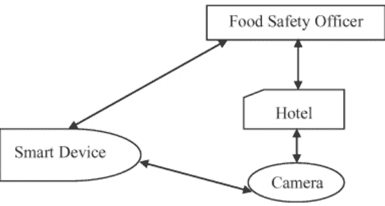

### 5.3.6 灾害管理

在灾害管理中整合区块链和深度学习技术，可以显著提升面对地震、飓风、洪水和野火等自然灾害时的准备、响应和恢复工作。这些技术的应用方式如下：

#### 灾害准备与风险评估：

- **区块链**: 利用区块链创建去中心化平台，用于共享和存储灾害风险数据，例如危害图、脆弱性评估和疏散计划。智能合约可以自动化风险评估流程，并促进利益相关方之间的协调。

- **深度学习**: 深度学习算法可以分析卫星影像、遥感数据和历史灾害记录，以预测和建模灾害风险，例如洪水淹没区、滑坡易发区和野火蔓延模式。通过识别高风险地区和脆弱人群，深度学习模型增强灾害准备和减灾策略。

#### 预警系统：

- **区块链**: 实施区块链以创建预警警报、疏散命令和应急响应协议的透明且不可变的记录。智能合约可以基于预定义标准触发自动警报，并确保关键信息及时传播。

- **深度学习**: 深度学习算法可以分析传感器数据、天气预报和环境指标，以检测即将发生的灾害的早期预警迹象，例如地震活动、风暴潮或异常天气模式。通过提供准确且及时的警报，深度学习模型能够实现主动疏散和应急准备。

#### 灾害响应与资源分配：

- **区块链**: 利用区块链创建去中心化平台，用于协调灾害响应工作、管理志愿者和分配资源，例如食物、水、医疗用品和庇护所。智能合约可以基于实时需求评估自动化资源分配。

- **深度学习**: 深度学习算法可以分析社交媒体数据、卫星影像和无人机录像，以评估损害程度、识别需要援助的区域，并优先安排救援和救济行动。通过分析大规模数据流，深度学习模型能够实时增强情境意识和资源分配决策。

#### 人道主义援助与捐助者问责：

- **区块链**: 利用区块链创建人道主义援助捐赠、供应链交易和受益人分配的透明且可审计的记录。智能合约可以确保援助资金的问责制和可追溯性，防止欺诈和腐败。

- **深度学习**: 深度学习算法可以分析卫星影像、社交媒体数据和地面报告，以评估人道主义需求、识别脆弱人群，并更有效地定向援助配送。通过预测人口流离失所模式和评估基础设施损坏，深度学习模型能够实现更高效的人道主义援助分配。

#### 重建与恢复规划：

- **区块链**: 实施区块链以创建重建项目、资金分配和社区参与倡议的不可变记录。智能合约可以自动化项目管理任务、监控进度并验证完成里程碑。

- **深度学习**: 深度学习算法可以分析航空影像、LiDAR 扫描和建筑损坏评估，以优先安排重建工作、评估基础设施韧性，并规划未来的抗灾基础设施。通过模拟城市动态和恢复轨迹，深度学习模型支持长期恢复规划和韧性建设倡议。

#### 社区参与与韧性建设：

- **区块链**: 利用基于区块链的平台，让社区参与灾害准备、培训和韧性建设活动。智能合约可以激励社区参与，并奖励对灾害风险降低工作的贡献。

- **深度学习**: 基于深度学习的教育工具和模拟可以提供个性化的灾害准备培训、交互式风险评估和虚拟疏散演习。通过提高意识和促进行为改变，深度学习模型使个人和社区能够建立韧性并减轻灾害风险。

图 5.6 显示了一个示例。关于气候变化的报告通过虚拟屏幕在智慧城市的公共区域显示。预防性信息将确保人们在灾害期间安全。在建设阶段，可以在每个社区建造巨大的储罐。这在发生洪水时将有所帮助。

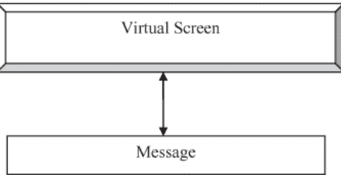

#### 图 5.6 灾害管理。

### 5.3.7 交通

在交通领域整合区块链和深度学习技术，可以彻底改变交通部门的各个方面，包括交通管理、物流、自动驾驶汽车和基础设施维护。这些技术的应用方式如下：

#### 供应链与物流：

- **区块链**: 利用区块链创建运输和物流运营的透明且可追溯的记录，包括发货、交付和库存管理。智能合约可以自动化供应链协议、实时跟踪货物，并确保遵守交付时间表。

- **深度学习**: 深度学习算法可以分析供应链运营的历史数据和实时数据，以优化路由、排程和库存管理。通过预测需求模式并识别低效之处，深度学习模型提高供应链效率并降低运输成本。

#### 交通管理与优化：

- **区块链**: 实施区块链以创建去中心化交通管理系统，安全地存储和共享交通数据，例如拥堵程度、事故和道路状况。智能合约可以自动化交通流优化算法并协调交通信号灯。

- **深度学习**: 深度学习算法可以分析交通摄像头馈送、GPS 数据和传感器读数，以预测交通拥堵、优化交通信号灯时序，并实时推荐替代路线。通过从历史交通模式中学习，深度学习模型改善交通管理并减少通勤者的出行时间。

#### 自动驾驶汽车与共享出行：

- **区块链**: 利用区块链创建自动驾驶汽车交易的安全且可审计的记录，包括车辆所有权、使用和维护。智能合约可以自动化车辆租赁协议、保险单和支付结算。

- **深度学习**: 深度学习算法对于实现自动驾驶汽车的能力（例如感知、导航和决策）至关重要。CNN 处理传感器数据（例如 LiDAR 和摄像头）以检测对象、预测轨迹并在复杂环境中导航，确保安全高效的自动驾驶。

#### 基础设施维护与资产管理：

- **区块链**: 利用区块链创建运输基础设施资产（例如道路、桥梁和隧道）的不可变记录，以及维护活动和检查报告。智能合约可以自动化维护计划、触发基础设施缺陷警报，并便于资产管理。

- **深度学习**: 深度学习算法可以分析传感器数据、卫星影像和 LiDAR 扫描，以评估交通基础设施的状况并确定维护优先级。通过识别结构缺陷并预测资产老化，深度学习模型增强基础设施的韧性和安全性。

#### 公共交通与乘客体验：

- **区块链**: 为公共交通实施基于区块链的票务和支付系统，使乘客能够进行无缝且安全的交易。智能合约可以自动化票价收取、收入分配和交通补贴。


- 深度学习：深度学习算法可以分析公共交通数据，如客流量、服务时刻表和用户反馈，以优化路线规划、频率和容量分配。通过预测需求模式和识别服务差距，深度学习模型改善乘客体验并增加乘客量。

#### 环境影响与可持续性：

- 区块链：利用区块链创建交通排放、能源消耗和可持续发展举措的透明且可审计的记录。智能合约可以激励碳补偿项目，推广环保交通方式，并监控环境合规性。

- 深度学习：深度学习算法可以分析交通数据以优化车辆路由、减少燃料消耗并最小化排放。通过模拟交通流动态和车辆效率，深度学习模型能够实现更可持续的交通实践并减少环境影响。

图 5.7 所示为示例。“无排队、无拥挤”方法在智慧城市中应用。当地公交车站现在都由交通办公室安装了自动售票机。通过安装在交通办公室的虚拟屏幕，交通官员监控所有道路、车辆速度和安全预防措施。如有任何情况发生，信号将发送到相关交通区域。交通区域内有一块显示交通信号时间的虚拟屏幕。屏幕上显示了那里发生的情况以及人们犯下的错误。所有这些数据都显示在虚拟屏幕上。由于这些方法，在严重交通拥堵期间采取了每一项安全预防措施。

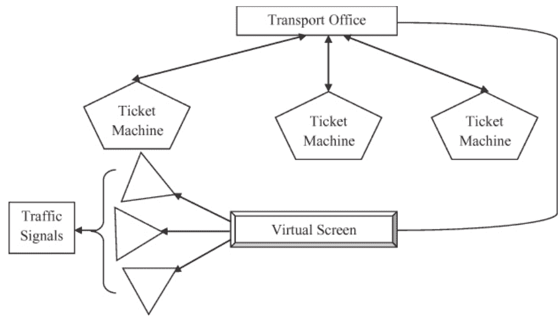

#### 图 5.7 交通。

### 5.3.8 公共安全与安保

将区块链和深度学习技术集成到公共安全与安保系统中，可以增强事件检测、紧急响应和犯罪预防能力。以下是这些技术的应用方式：

#### 1. 数据完整性与证据链：

- 区块链：利用区块链创建关键公共安全数据的不可更改且防篡改记录，例如紧急呼叫、事件报告以及在犯罪现场收集的证据。智能合约可以自动化证据链流程，确保整个调查过程中证据的完整性和真实性。

- 深度学习：深度学习算法可以分析监控录像、音频录音和传感器数据，以检测可疑活动、识别对象并识别相关人员。通过实时分析大量数据，深度学习模型增强情境意识并实现主动威胁检测。

#### 2. 紧急响应协调：

- 区块链：实施基于区块链的平台，以协调第一响应人员、执法机构和医疗人员之间的紧急响应工作。智能合约可以在紧急情况下自动化资源分配、调度和通信协议。

- 深度学习：深度学习算法可以分析紧急呼叫、社交媒体帖子和传感器数据，以更有效地优先排序和调度响应团队。通过预测事件严重程度和资源需求，深度学习模型改善紧急情况下的响应时间和协调性。

#### 3. 视频监控与监测：

- 区块链：利用区块链创建视频监控录像的安全且可审计记录，确保数据完整性并防止篡改或未经授权的访问。智能合约可以对敏感视频数据执行隐私法规和访问控制。

- 深度学习：深度学习算法可以实时分析视频流，以检测异常行为、识别威胁并为安保人员触发警报。通过从历史数据中学习并适应不断变化的环境，深度学习模型提高了视频监控系统的准确性和效率。

#### 4. 预测性警务与犯罪预防：

- 区块链：利用区块链在执法机构和犯罪分析师之间安全地存储和共享犯罪数据，例如事件报告、逮捕记录和刑事司法统计数据。智能合约可以自动化数据共享协议并确保遵守数据保护法规。

- 深度学习：深度学习算法可以分析犯罪数据、社会经济指标和环境因素，以预测犯罪热点、趋势和模式。通过识别高风险区域和易受伤害人群，深度学习模型使主动警务策略和针对性的犯罪预防工作成为可能。

#### 5. 网络安全与威胁情报：

- 区块链：实施基于区块链的网络安全解决方案，以保护关键基础设施、敏感数据和通信网络免受网络威胁和攻击。智能合约可以执行访问控制、验证用户并检测未经授权的活动。

- 深度学习：深度学习算法可以分析网络流量、日志文件和恶意软件签名，以检测网络威胁、入侵和异常行为。通过从历史攻击数据中学习并适应不断发展的威胁，深度学习模型增强了网络安全防御和威胁情报能力。

#### 6. 灾害韧性与恢复：

- 区块链：利用区块链在政府机构、非政府组织和救援组织之间创建用于灾害准备、响应和恢复协调的去中心化平台。智能合约可以自动化资源调动、捐赠追踪和志愿者管理。

- 深度学习：深度学习算法可以分析卫星图像、社交媒体数据和传感器读数，以评估灾害影响、优先处理响应工作并更有效地分配资源。通过提供实时情境意识和决策支持，深度学习模型增强灾害韧性和恢复工作。

### 5.3.9 能源管理与可持续性

将区块链和深度学习技术集成到能源管理和可持续发展举措中，可以实现更高效的能源生产、分配和消费，并促进向可再生能源的过渡。以下是这些技术的应用方式：

#### 1. 去中心化能源交易：

- 区块链：利用区块链创建去中心化能源交易平台，其中产消者（同时也是能源生产者的消费者）可以直接将多余的能源出售给其他消费者。智能合约可以自动化能源交易协议，确保在无需中介的情况下进行安全透明的交易。

- 深度学习：深度学习算法可以分析历史能源消耗数据和天气预报，以预测能源供需模式。通过基于预测市场条件优化能源交易策略，深度学习模型提高了去中心化能源市场的效率。

#### 2. 可再生能源证书（REC）和碳信用额度：

- 区块链：实施基于区块链的系统，用于追踪和交易可再生能源证书（REC）和碳信用额度。区块链确保可再生能源发电和碳补偿活动的透明性和可追溯性，帮助组织实现可持续发展目标并遵守法规要求。

- 深度学习：深度学习算法可以分析卫星图像和遥感数据，以监控太阳能板和风力涡轮机等来源的可再生能源发电。通过预测可再生能源产出并优化 REC 交易策略，深度学习模型提高了可再生能源信用市场的有效性。

#### 3. 电网优化与需求响应：

- 区块链：利用区块链创建去中心化能源管理系统，实现电网优化和需求响应。智能合约可以自动化需求侧管理计划，使公用事业公司能够激励消费者节约能源和转移负荷。

- 深度学习：深度学习算法可以分析智能电表数据和物联网传感器读数，以预测能源消耗模式并识别需求响应机会。通过基于预测需求和价格信号实时优化能源使用，深度学习模型增强电网稳定性和效率。

#### 4. 能源效率与节约：

- 区块链：利用区块链创建透明且有激励的能源效率计划，其中消费者因减少能源消耗或实施节能措施而获得奖励。智能合约可以自动化能源回扣计划并验证能源效率标准的合规性。

- 深度学习：深度学习算法可以分析建筑能源数据、占用模式和天气条件，以识别节能和优化机会。通过提供个性化的节能建议并自动化能源管理系统，深度学习模型使消费者能够减少碳足迹和能源成本。

#### 5. 供应链透明度与可持续性：

- 区块链：实施区块链，为化石燃料和可再生能源技术中使用的矿物等能源资源创建透明且可追溯的供应链。区块链通过追踪能源资源的来源和影响，确保能源供应链的道德采购和可持续性。

- 深度学习：深度学习算法可以分析卫星图像和地理空间数据，以监控与能源生产和开采活动相关的土地利用变化、森林砍伐和栖息地破坏。通过识别环境风险并促进可持续实践，深度学习模型支持负责任的能源采购和生产。

#### 6. 预测性维护与资产管理：

- 区块链：利用区块链创建能源基础设施资产、维护活动和性能的不可更改记录


数据。智能合约可以自动化维护计划，并针对资产缺陷或故障触发警报，确保能源基础设施的可靠性和安全性。

- **深度学习**：深度学习算法可以分析传感器数据、设备遥测和历史维护记录，以预测设备故障并优先处理维护任务。通过在潜在问题发生前将其识别出来，深度学习模型减少停机时间，优化资产寿命，并提高能源系统可靠性。

### 5.3.10 环境监测与保护

将区块链和深度学习技术集成到环境监测和保护工作中，可以为保护生态系统、野生动物和自然资源提供更准确、高效和透明的解决方案。这些技术的应用方式如下：

#### 1. 生物多样性监测与野生动物保护

- **区块链**：利用区块链创建野生动物种群、栖息地恢复项目和保护工作的透明且不可篡改的记录。区块链确保野生动物保护倡议的可追溯性和问责制，使利益相关者能够追踪其贡献的影响。
- **深度学习**：深度学习算法可以分析卫星图像、相机陷阱照片和声学录音，以监测野生动物种群、检测濒危物种并评估栖息地健康状况。通过自动化物种识别和栖息地测绘，深度学习模型增强生物多样性监测和保护规划。

#### 2. 非法采伐和偷猎检测

- **区块链**：实施基于区块链的系统，以追踪木材和野生动物产品从产地到销售点的全过程。区块链确保供应链的透明度和可追溯性，使非法伐木者和偷猎者难以洗白或销售其产品。
- **深度学习**：深度学习算法可以分析卫星图像和无人机录像，以检测保护区内非法采伐、森林砍伐和偷猎活动的迹象。通过识别森林覆盖率和动物行为模式的变化，深度学习模型能够实现早期检测和干预，防止环境犯罪。

#### 3. 水质监测与污染控制

- **区块链**：利用区块链创建水质数据、污染水平和法规合规工作的透明且可审计的记录。区块链确保水资源管理和污染控制倡议中的数据完整性和问责制，使利益相关者能够追踪污染减缓措施的影响。
- **深度学习**：深度学习算法可以分析水质传感器数据、卫星图像和环境因素，以监测水污染水平、检测污染源并评估生态系统健康状况。通过预测污染物浓度并识别污染热点，深度学习模型支持有针对性的污染控制和修复工作。

#### 4. 气候变化减缓与适应

- **区块链**：利用区块链创建碳排放、可再生能源发电和气候减缓项目的透明且可验证的记录。区块链确保气候行动倡议中的问责制和透明度，使利益相关者能够追踪向减排目标迈进的进展。
- **深度学习**：深度学习算法可以分析气候数据、天气预报和卫星图像，以模拟气候变化影响、预测极端天气事件并评估生态系统脆弱性。通过识别气候风险并为适应策略提供信息，深度学习模型支持气候韧性和减缓工作。

#### 5. 生态系统恢复与土地修复

- **区块链**：实施基于区块链的平台，为生态系统恢复项目（如重新造林、湿地恢复和土地修复）提供众筹和激励。智能合约可以自动化资金分配和项目管理任务，确保恢复工作的透明度和问责制。
- **深度学习**：深度学习算法可以分析卫星图像、LiDAR 扫描和植被指数，以监测生态系统健康状况、评估恢复进度并识别需要干预的区域。通过量化生态系统服务和生物多样性效益，深度学习模型促进恢复项目中的基于证据的决策。

#### 6. 社区参与与公民科学

- **区块链**：利用基于区块链的平台，吸引社区参与环境监测、公民科学和保护活动。区块链确保公民贡献数据的透明度和可信度，使利益相关者能够合作开展保护倡议。
- **深度学习**：基于深度学习的移动应用程序和平台可以赋予公民收集和分析环境数据（如野生动物目击、水质样本和空气污染测量）的能力。通过提供用户友好的工具和公民参与激励，深度学习模型增强社区参与度，并支持基层保护工作。

### 5.3.11 智能基础设施与维护

将区块链和深度学习技术集成到智能基础设施和维护中，可以提升人造环境的效率、韧性和可持续性。这些技术的应用方式如下：

#### 资产管理与维护

- **区块链**：利用区块链创建基础设施资产、维护活动和服务合同的透明且不可篡改的记录。区块链确保数据完整性和问责制，使利益相关者能够追踪关键基础设施组件的状况和维护历史。
- **深度学习**：深度学习算法可以分析传感器数据、物联网遥测和历史维护记录，以预测设备故障、优先处理维护任务并优化维护计划。通过在潜在问题发生前将其识别出来，深度学习模型尽量减少停机时间并延长基础设施资产的使用寿命。

#### 预测性维护与状况监测

- **区块链**：利用区块链创建传感器数据、设备健康指标和维护日志的不可篡改记录。智能合约可以自动化预测性维护工作流，基于预定义标准触发维护干预警报。
- **深度学习**：深度学习算法可以分析基础设施资产（如桥梁、道路和建筑物）的传感器数据，以检测异常、预测设备故障并评估结构完整性。通过从历史数据中学习并识别预示即将发生故障的模式，深度学习模型能够实现主动维护和风险缓解策略。

#### 节能建筑与电网集成

- **区块链**：实施基于区块链的平台，用于管理智能建筑中的能源消耗、可再生能源发电和电网集成。区块链确保能源交易的透明度和可追溯性，使利益相关者能够优化能源使用并降低成本。
- **深度学习**：深度学习算法可以分析建筑物能源数据、占用模式和天气预报，以优化供暖、通风和空调（HVAC）系统、照明和能源存储。通过预测能源需求并适应变化的条件，深度学习模型增强智能建筑中的能源效率和电网稳定性。

#### 基础设施韧性与灾害准备

- **区块链**：利用区块链在政府机构、公用事业公司和应急响应人员之间创建用于灾害准备、响应和恢复协调的去中心化平台。区块链确保数据完整性和互操作性，使利益相关者在紧急情况下能够共享关键信息和资源。
- **深度学习**：深度学习算法可以分析卫星图像、LiDAR 扫描和传感器数据，以评估基础设施脆弱性、预测自然灾害影响并优先安排韧性投资。通过模拟灾害场景和优化缓解措施，深度学习模型增强基础设施韧性并尽量减少紧急情况下的损害。

#### 供应链管理与采购

- **区块链**：利用区块链为建筑材料、设备和备件创建透明且可审计的供应链。智能合约可以自动化采购流程，确保符合质量标准，并追踪材料的来源和保管链。
- **深度学习**：深度学习算法可以分析供应链数据、供应商绩效指标和市场趋势，以优化采购决策、降低成本并尽量减少供应链中断。通过


预测需求波动并识别潜在风险，深度学习模型增强供应链的韧性和效率。

#### 城市交通与交通基础设施：

- **区块链**: 实施基于区块链的平台，用于管理交通基础设施资产，如道路、桥梁和隧道。区块链确保基础设施维护、过路费征收和交通服务的透明且可审计的记录。

- **深度学习**: 深度学习算法可以分析交通数据、车辆遥测和基础设施状况，以优化交通系统、改善交通流量并提高安全性。通过预测交通模式并识别拥堵热点，深度学习模型支持城市交通规划和基础设施管理中的明智决策。

### 5.3.12 公民服务与参与

将区块链和深度学习技术整合到公民服务和参与计划中，可以提升公共行政的透明度、问责制和效率，并促进公民参与和赋权。以下是这些技术的应用方式：

#### 身份管理与身份验证：

- **区块链**: 利用区块链构建安全且去中心化的身份管理系统，公民可控制其个人数据并授权访问政府服务。区块链确保数据完整性和隐私，降低身份盗用和欺诈的风险。

- **深度学习**: 深度学习算法可以分析生物特征数据（如人脸识别或声纹），以安全地验证公民身份。通过实时验证身份凭据，深度学习模型简化了访问政府服务的身份验证流程。

#### 数字投票与选举：

- **区块链**: 实施基于区块链的投票系统，以确保选举透明且防篡改，每张选票均记录在区块链上且不可更改。区块链支持安全且可审计的投票流程，增强对民主选举的信任和信心。

- **深度学习**: 深度学习算法可以分析选民数据和投票模式，以检测选举结果中的异常或不规则情况。通过识别潜在的选民欺诈或操纵行为，深度学习模型增强了数字投票系统的完整性。

#### 政府透明度与问责制：

- **区块链**: 利用区块链创建政府交易、预算和支出的透明且不可篡改的记录。区块链通过提供公共资金的可验证审计轨迹，确保问责制并降低腐败风险。

- **深度学习**: 深度学习算法可以分析政府数据（如公共采购合同或监管备案），以检测腐败或财务管理不当的模式。通过识别可疑活动或差异，深度学习模型能够采取主动措施防止欺诈和权力滥用。

#### 公共服务交付与获取：

- **区块链**: 利用区块链简化公共服务的交付，如福利待遇、许可证和执照。智能合约可以自动化资格检查、申请流程和审批工作流，减少公民的官僚程序和等待时间。

- **深度学习**: 深度学习算法可以分析公民反馈、服务请求和使用模式，以优化公共服务交付和资源分配。通过识别改进领域并预测服务需求，深度学习模型提高了政府机构的响应速度和有效性。

#### 社区参与与互动：

- **区块链**: 实施基于区块链的平台，用于社区决策和治理，公民可以就倡议或政策提出提案并进行投票。区块链确保决策过程的透明性和包容性，赋予公民参与地方民主的权力。

- **深度学习**: 深度学习算法可以分析社交媒体数据、调查回复和社区论坛，以评估公众情绪并识别优先问题。通过提供公民偏好和关注点的洞察，深度学习模型促进明智的政策制定和社区参与工作。

#### 公民教育与意识：

- **区块链**: 利用区块链创建公民信息的透明且可访问的存储库，如政府法规、法律文件和公共记录。区块链确保公民知识的完整性和可用性，使公民能够做出明智决策并行使其权利。

- **深度学习**: 基于深度学习的教育平台和聊天机器人可以为公民提供个性化的公民教育和信息服务。通过提供引人入胜且交互式的内容，深度学习模型增强了不同人群中的公民素养和意识。

## 5.4 结论

这些要素对于任何智慧城市保持其可持续阶段至关重要。为提高智慧城市的智能化水平，深度学习技术提供智能设备。为确保我们使用的设备的安全性，需要智能区块链。因此，基于这些工作，我得出结论：区块链和深度学习对智慧城市应用至关重要。

## 参考文献

- 1. M. Kouhizadeh and J. Sarkis, “绿色供应链中的区块链实践、潜力与前景,” Sustainability, vol. 10, no. 10, p. 3652, Oct. 2018.
- 2. T. McGhin, K.-K. R. Choo, C. Z. Liu, and D. He, “医疗保健应用中的区块链：研究挑战与机遇,” Journal of Network and Computer Applications, vol. 135, pp. 62–75, 2019.
- 3. E. Golubovic, 智慧城市改进型智能废弃物管理, Feb. 2008. Accessed: Jan. 28, 2021. [Online].
- 4. W. Powell, M. Foth, S. Cao, and V. Natanelov, “垃圾进垃圾出：食品供应链中 IoT 与区块链之间脆弱的链接,” Journal of Industrial Information Integration, Art. no. 100261, Aug. 2021.
- 5. X. R. Zheng and Y. Lu, “区块链技术：近期研究与未来趋势,” Enterprise Information Systems, vol. 16, no. 12, pp. 1–23, June 2021.
- 6. G. Revathy, K. Selvakumar, P. Murugapriya, and D. Ravikumar, “基于计算智能的工业 4.0 智能制造。” In N. Thillaiarasu, S. Lata Tripathi, and V. Dhinakaran (eds), 物联网的人工智能：设计原则、现代化与技术, CRC Press, Boca Raton, FL, 2022, p. 31.

OceanofPDF.com

# 第 6 章

# 赋能智慧城市：多元行业中 IoT 与 IIoT 集成的综合研究

D. M. Dhusnic Infant 和 E. B. Priyanka

DOI: 10.1201/9781003476047-6

## 6.1 引言

物联网（IoT）及其工业对应物——工业物联网（IIoT）的出现，标志着一场具有深远影响的重大技术转型，尤其在智慧城市框架下对多元行业产生影响 [1]。

理解 IoT 和 IIoT 的基本概念、重要性及其集成，揭示了一个以互联互通、高效和变革潜力为特征的跨行业格局 [2]。

从本质上看，IoT 是一个复杂的网络，其中各种日常设备、传感器和系统相互互联，通过互联网进行通信和数据交换。

这个数字生态系统形成了一张无处不在、互联互通的网络，从根本上改变了我们与技术及周围世界互动的方式 [3]。

从智能手机、可穿戴设备和家用电器到复杂的机械和基础设施，所有设备都是这个互联网络的一部分，能够实时共享数据和洞察 [4]。

这种连接促进了更明智的决策，自动化了流程，并提升了个人和职业领域的用户体验。

相反，IIoT 专门针对工业领域，利用 IoT 技术重新构想制造流程，提升运营效率，并优化行业内的资源利用 [5]。

在智慧城市中，IIoT 的集成超越了仅仅的


automation；它代表了工业运作方式及其与城市生态系统交互方式的范式转变 [6]。通过互联传感器、机器和数据分析的网络，IIoT 实现了生产单元、供应链和分销网络之间的无缝协调。这种精简的连接促进了主动维护、预测分析以及对不断变化的需求或挑战的敏捷响应 [7]。

在智能制造中，IIoT 推动了物理领域和数字领域的融合，彻底改变了生产工作流程 [8]。配备传感器的互联机器收集实时数据，促进预测性维护，减少停机时间，并提高整体生产力 [9]。这些洞察使制造商能够优化运营、最大限度地减少浪费，并快速调整生产以满足动态市场需求。此外，IIoT 的影响超出了制造领域，渗透到智慧城市中的能源、医疗保健、交通和基础设施等行业。例如，在能源管理中，IIoT 实现了优化能源分配、减少浪费并促进可持续做法的智能电网。在医疗保健方面，它促进了远程患者监护、预测性诊断和个性化医疗，彻底改变了医疗服务的提供方式。在交通领域，IIoT 确保了高效物流，增强了公共出行能力，并支持自动驾驶汽车的发展，重新定义了城市交通。总而言之，IoT 和 IIoT 是塑造智慧城市演进的关键支柱，促进了一个互联生态系统，其中数据驱动的洞察、效率和创新汇聚在一起，重新定义了城市生活和工业格局 [6]。在智慧城市计划中，IoT 和 IIoT 技术的无缝集成有望创造更加可持续、高效和灵敏的城市环境，最终提高居民的生活质量，并推动行业迈向更加互联和高效的未来，如图 6.1 所示。

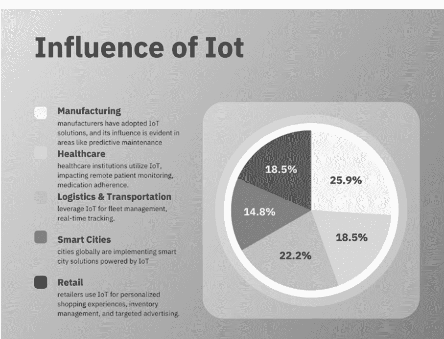

图 6.1 IoT 在工业应用中的影响及统计调查。

在推进城市景观的进程中，智慧城市的概念应运而生。这些城市将 IoT 技术融入其基础设施，促进公用事业、交通和医疗保健等各个领域智能且高效的资源管理。IoT 在实现智慧城市方面发挥着关键作用，通过收集、分析和利用海量数据集，推动明智的决策和资源分配。IIoT 在当今工业格局中的重要性不容忽视，它代表了运营范式的关键转变。其实施预示着一个变革时代的到来，传统工业流程将经历深刻的革命。借助 IIoT，工业界采用预测性维护、实时监控和数据驱动的决策，从根本上改变了运营管理的方式。其深远影响在于优化生产力、减少停机时间，并释放以前无法实现的运营效率，从而重塑行业的核心动态。在这场技术演进的中心是智慧城市，其中 IoT 承担着核心角色。这些城市利用互联系统、复杂的数据分析和 IoT 技术，优化城市基础设施和资源的各个方面。

通过在多样化的城市系统中整合 IoT，智慧城市旨在创造智能、高效且可持续的城市环境，提高居民的生活质量，同时促进经济增长和环境可持续性。IoT 在智慧城市中的作用至关重要。IoT 是智慧城市基础设施的骨干，促进海量数据集的收集、分析和利用，以做出明智的决策。通过互联设备和系统，IoT 实现了高效的资源分配、灵敏的基础设施和改进的公民服务。它为从交通管理和能源优化到废弃物管理和公共安全的一切提供动力 [10]。这不仅仅是精英的表演；每个公民都持有门票。旅游业，曾经是一份刻板的行程，如今在基于位置的服务和交互式体验的推动下，绽放为个性化的杰作。娱乐，曾经是被动的观赏，如今通过沉浸式技术和 AI 驱动的叙事邀请参与 [1]。

IIoT 在智慧城市中的整合超越了单个行业，以变革能力渗透到各个领域，重新定义运营和服务 [11]。在交通领域，IIoT 技术彻底改变了城市管理交通流量和拥堵的方式。对交通模式的实时监控可实现动态路线规划，优化出行时间并减少拥堵，从而提高整体交通效率和公共出行能力，如图 6.2 所示。由 IIoT 驱动的能源管理系统在推进智慧城市可持续发展议程方面发挥着关键作用。这些系统允许对能源使用进行精确监控和控制，优化资源分配并减少浪费。通过预测分析和实时数据洞察，城市可以就能源消耗做出明智的决策，推动可持续发展举措，同时确保资源利用的成本效益。此外，在医疗保健领域，IIoT 促进远程患者监护和预测性医疗服务。互联设备支持持续健康监测，允许及时干预和个性化护理。医疗技术的这一进步提高了医疗服务的可及性，改善了提供的护理质量，并可能降低医疗成本，促进智慧城市内的整体福祉。

## IoT 应用于各行业
- **纺织行业**
  - 智能库存管理
  - 机器预测性维护
  - 质量控制监测
- **食品行业**
  - 冷链监测
  - 自动化库存追踪
  - 智能包装解决方案
- **零售行业**
  - 客户行为分析
  - 供应链优化
  - 个性化营销与促销
- **交通行业**
  - 车队管理与追踪
  - 车辆预测性维护
  - 交通流量优化
- **电子行业**
  - 制造流程自动化
  - 产品质量监测
  - 远程设备诊断
- **医疗行业**
- **农业行业**
- **能源行业**
- **制造行业**
- **智慧城市**

### 图 6.2 工业 IoT 在各私营部门推动智慧城市发展中的作用。

IIoT 是当代工业格局的基石，标志着运营方法论和技术进步的关键转变。其整合预示着一个变革时代，传统工业流程正在经历深刻的革命。IIoT 促进预测性维护、实时监控和数据驱动的决策，重塑了跨行业管理运营的基本方法。其重要性在于其优化生产力、尽量减少停机时间并释放传统方法无法实现的运营效率的能力 [12]。IIoT 的深远影响跨越多个行业，推动工业实现范式转变。通过互联传感器、机器和系统，IIoT 使工业界能够利用数据驱动的洞察，促进主动和预测性维护，从而减轻潜在中断 [13]。它使能够建立能够无缝共享实时信息的互联系统，促进精简运营并对动态市场需求做出敏捷响应。

在技术演进的交汇点是智慧城市，其中 IoT 占据中心地位。这些城市利用互联系统、复杂的数据分析和 IoT 技术，优化城市基础设施和资源的各个方面 [14]。通过在各城市系统中整合 IoT，智慧城市旨在创造智能、高效且可持续的城市环境。通过智能基础设施、数据驱动决策和灵敏服务，智慧城市致力于提高居民的生活质量，促进经济增长，并在不断变化的城市景观中确保环境可持续性 [15]。

## 6.2 革新纺织制造：利用 IoT 推动创新与效率

纺织行业在全球范围内是一个巨大的经济强国，推动各国实现可观的经济增长和就业机会。其重要性多方面，既是全球供应链的关键环节，又对 GDP 做出重大贡献 [14]。该行业涵盖从原材料采购到面料生产、染色、整理和分销的各个阶段，拥有多样化的功能和分支 [16]。纺织品不仅在时装和服装领域发挥关键作用，还在技术纺织品、家居装饰和工业应用中发挥作用，凸显了其在多个行业和日常生活中的广泛重要性 [17]。纺织行业面临着多方面的挑战，阻碍其运营效率和增长潜力。市场动态构成重大障碍，因为不断波动的趋势和消费者偏好不断重塑需求，使纺织企业难以有效预测和满足市场需求。此外，行业内追踪的难度阻碍了高效的库存管理和供应链运营，导致延误和低效率。

此外，缺乏快速原型制作和取样能力限制了行业迅速适应不断变化的趋势并满足客户对创新设计需求的能力 [18]。物理对象和设备之间缺乏无缝无线通信进一步阻碍了集成，阻碍了实时监控和数据交换，阻碍了行业向智能制造和 IoT 的转型 [8]。包装效率低下也导致了


浪费和环境问题，影响可持续发展工作。此外，与磨损或撕裂产品及其在供应链中的可追溯性相关的问题，在识别和纠正有缺陷物品方面造成挑战，从而影响产品质量和客户满意度，如图 6.3 所示。这些集体挑战凸显了纺织行业迫切需要技术进步和创新解决方案，以克服运营瓶颈并提升其在市场上的竞争优势 [4]。

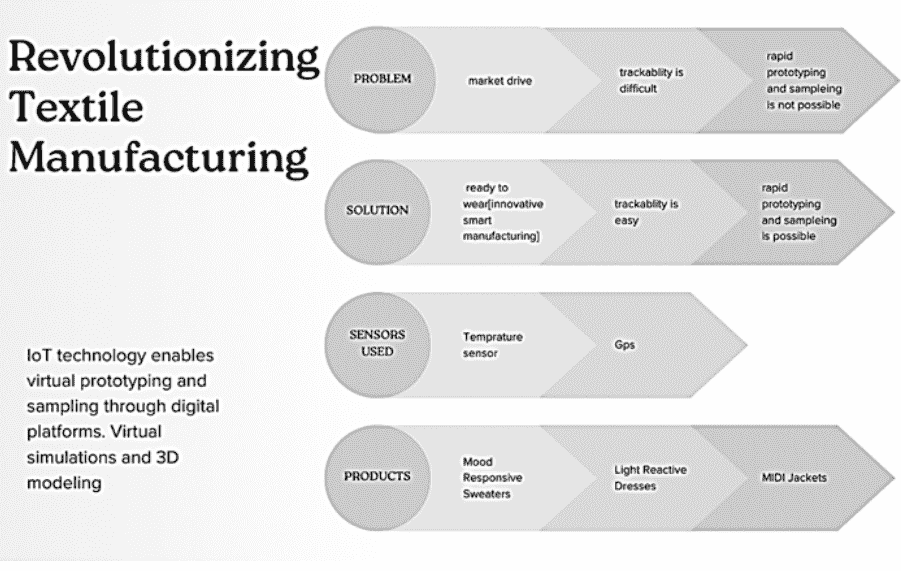

图 6.3 使用 IoT 和 AI 的纺织行业智能分析。

实施基于 IoT 的智能制造技术，通过利用互联的机器和流程，彻底改变了即穿产品的创建。在此框架内，嵌入制造设备的智能传感器收集实时数据，使生产线能够自动调整。这种动态适应缩短了交货时间，提升了运营效率，并确保能够快速生产符合不断变化的市场需求的服装。此外，基于 IoT 的追踪系统（如 RFID 标签或二维码）在确保供应链端到端无缝可追溯性方面发挥着关键作用。这些标签能够实现库存的连续实时监控，从而实现精确的识别、位置追踪，以及产品从生产到分销阶段的无缝流动。通过增强透明度和最大限度地减少错误，基于 IoT 的追踪优化了库存管理 [2]。

IoT 技术的集成还通过数字平台促进了虚拟原型设计和取样。通过将虚拟仿真和 3D 建模与 IoT 数据集成相结合，制造商可以在无需物理迭代的情况下加速设计修改和原型设计。这种方法显著缩短了设计流程，减少了材料浪费，并加速了新产品的上市时间。此外，IoT 功能扩展到在物理对象与制造系统之间建立无线通信。配备无线通信功能的设备能够在制造环境中实现无缝连接 [19]。基于 IoT 的传感器和设备促进实时数据交换，推动机械之间的高效协作，并实现远程监控、预测性维护以及生产流程中的敏捷调整，如表 6.1 所示 [20]。这种互联性优化了生产效率，确保了响应式制造，并使企业能够迅速适应市场动态，从而最终提升竞争力和产品质量 [21]。

### 表 6.1 使用智能传感器技术的应用提升

| 产品 | 用途 | 关键元素 | 需求季节 |
|---|---|---|---|
| 情感响应式毛衣 | 根据穿着者情绪调节 | 传感器、微控制器 | 秋/冬 |
| 光敏连衣裙 | 在光线下变色 | 变色织物 | 春/夏 |
| MIDI 夹克 | 与音乐交互 | 集成传感器 | 全年 |
| GPS 鞋 | 追踪位置 | GPS 模块、传感器 | 全年 |
| 智能训练鞋 | 监测健身指标 | 加速度计、传感器 | 全年 |
| 加热服装 | 提供温暖 | 加热元件、传感器 | 秋/冬 |
| 姿势传感器腰带 | 纠正姿势 | 姿势传感器 | 全年 |

一系列创新纺织产品涵盖了满足多样化需求的各种功能。情感响应式毛衣能够适应穿着者的情绪，而光敏连衣裙则随光线条件变化色调。MIDI 夹克将音乐与技术无缝融合，GPS 鞋提供位置追踪。智能训练鞋监测健身指标，加热服装提供温暖，姿势传感器腰带有助于纠正姿势。此外，可追踪钱包确保易于定位，展示了 IoT 在日常可穿戴设备中的集成，为现代时尚与配饰带来便利、功能性和个性化。

## 6.3 转变食品行业运营：利用 IoT 提升质量与效率

印度食品行业是经济的基石，包含多个对国家 GDP 和就业作出重大贡献的部门。其多元细分领域涵盖农业、食品加工、分销和零售，共同推动经济增长并支撑数以百万计的生计。该行业的重要性超越了单纯的维生，在确保粮食安全、满足膳食需求以及为国家和全球粮食供应做出贡献方面发挥着关键作用。近年来，印度食品行业在收入增长、消费者偏好变化和技术进步的推动下实现了显著增长。这种增长涵盖包装食品、乳制品、饮料、糖果和加工食品等多个领域，其驱动力是日益加速的城市化以及追求便利与品质的不断壮大的中产阶级人口。食品行业的多元化类型涵盖初级农业、食品加工单元、物流与分销网络、餐厅和零售连锁。每个部门在食品供应链中都发挥着关键作用，从种植农作物到制造、包装并向消费者交付产品。该行业的多面性确保了食品供应，支持农村经济，并满足庞大人口的多样化烹饪偏好，从而巩固其在印度经济框架中的核心地位。

食品行业面临着多方面的挑战，这些挑战损害了食品安全、质量和消费者健康，因此需要创新解决方案来解决这些问题。低质量的检查做法构成重大挑战，导致食品标准不一致和产品质量受损。对食源性疾病和病原体的监测不足会增加健康风险，削弱消费者信任和公共卫生安全 [14]。无法通过食物摄入有效监测健康，阻碍了应对与营养相关疾病的努力，影响个人的福祉。通过实施基于 IoT 的系统来监测消费者偏好，食品行业可以获得关于不断变化趋势的宝贵洞察，定制产品供应，个性化营销策略，并提升客户体验。这种数据驱动的方法有助于更好地了解消费者需求，从而在动态的食品市场格局中促进产品创新并提升整体业务绩效 [22]。在质量控制流程中实施基于 IoT 的传感器和成像系统。这些传感器持续监测温度、湿度和污染物等各种质量参数。AI 驱动的算法分析实时数据，确保在生产和分销过程中进行快速而精确的质量评估。在供应链关键节点安装的 IoT 传感器持续监测环境条件，确保妥善的储存和运输。此外，实时追踪系统能够迅速识别和隔离受污染产品，最大限度地降低食源性疾病的风险。利用嵌入传感器的基于 IoT 的智能包装和标签来追踪营养成分和保质期。这些标签与消费者的设备交互，提供关于成分、过敏原和营养价值的实时信息，使个人能够做出明智的饮食选择 [22]。

与食品消费应用集成的基于 IoT 的可穿戴设备或智能设备可追踪糖分水平、卡路里摄入和饮食习惯等健康参数。这些数据帮助个人有效监测和管理自身健康。采用基于 IoT 的分析工具来收集和分析消费者行为、偏好和反馈。在智能货架或在线平台中集成传感器，可收集产品受欢迎程度和消费者选择的实时数据，从而帮助制定个性化营销策略和产品开发，如图 6.4 所示。实施基于 IoT 的供应链管理系统，以追踪产品从农田到餐桌的流动。传感器监测温度、湿度和储存等条件，确保产品在整个供应链中的完整性，同时减少浪费并提高效率。


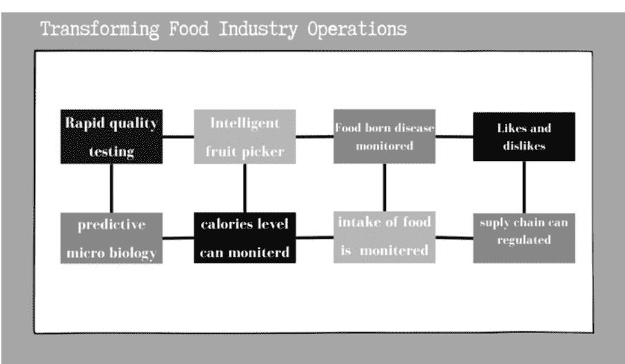

图 6.4 利用工业物联网实现食品工业的智能自动化。

- **快速质量检测**: 集成到食品加工设备中的 IoT 传感器能够快速分析和监测新鲜度、温度和污染等参数，确保立即进行质量评估。
- **预测微生物学**: 配备高级分析功能的 IoT 设备可预测食品中的微生物增长，从而采取主动措施保持卫生并防止变质。
- **智能水果采摘机**: 配备传感器的 IoT 驱动机器人系统可识别成熟水果，优化收获效率并最大限度地减少浪费。

结合 AI 协作：

- **推荐系统**: AI 算法处理 IoT 传感器的数据，根据消费者偏好和趋势推荐个性化的水果选择。
- **定向营销**: 将 AI 洞察与 IoT 数据相结合，可实现定向营销策略，向特定消费群体提供定制的水果相关促销。

## 6.4 重塑零售动态：利用物联网集成提升消费者体验

零售行业作为全球经济的关键环节，地位举足轻重，是连接生产者与消费者的重要纽带。零售不仅仅是促进商品销售，还在创造就业、推动经济增长和提升消费者满意度方面发挥着基本作用。它满足多样化的消费者需求，促进创新并推动竞争，从而塑造市场趋势并影响经济稳定。此外，零售业在多个国家对 GDP 有显著贡献，既是经济健康状况的风向标，又不断适应不断变化的消费者偏好和技术进步 [1]。物联网正在革新零售行业，通过引入一系列创新，提升运营效率、客户体验和商业洞察，从而使消费者和零售商都受益，如图 6.5 所示。

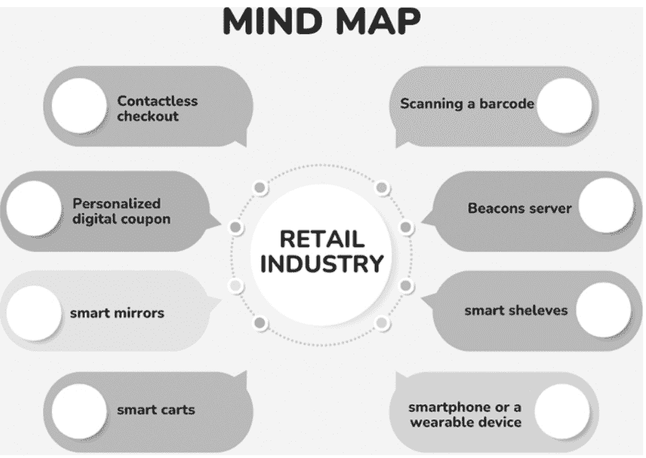

图 6.5 以智能智慧概念思维导图呈现的零售行业。

对于消费者而言，零售领域的物联网通过先进技术提供了无与伦比的便利性。它能够实现个性化的购物体验，提供定制化的促销、推荐以及交互式工具，例如用于虚拟试穿的智能镜子或提供即时产品信息的移动应用，如表 6.2 所示。非接触式结账和智能购物车简化了购买流程，节省了时间，并提供了无缝的交易旅程 [1]。物联网支持的设备让消费者能够获取实时库存数据，从而做出明智的购买决策并提升整体满意度。反之，对于零售商而言，物联网提供了变革性的机遇 [3]。它使零售商能够通过数据分析深入了解消费者行为、偏好和客流模式，从而帮助制定个性化营销策略并优化店铺布局。物联网驱动的库存管理确保库存水平准确，减少缺货情况，并实现高效的供应链管理。智能货架、包装和价格标签简化了运营，确保更好的库存控制、更新鲜的产品以及动态定价策略 [19]。总的来说，零售领域的物联网集成重塑了传统商业模式，为零售商带来了增强的客户参与度、运营效率和竞争优势，同时为消费者提供个性化、便捷的体验。

表 6.2 使用智能技术的消费者和零售商效益对比

| 消费者效益 | 零售商效益 |
|---|---|
| 非接触式结账 | 检测库存水平的智能货架 |
| 面向 VIP 客户的个性化数字优惠券 | 检测易腐货物新鲜度的智能包装 |
| 用于虚拟试穿体验的智能镜子 | 实现动态定价的智能价格标签 |
| 提供便利和帮助的智能购物车 | 用于精确供应链追踪的 RFID 技术 |
| 提供定制店铺信息的信标技术 | - |
| 用于获取详细产品信息的条码扫描 | - |
| 通过智能手机快速获取产品信息 | – |

- a. 面向消费者效益：
  1. **非接触式结账**: 物联网促进零售商店中无缝的非接触式结账体验。客户可以通过集成传感器、移动应用或 RFID 技术的智能支付系统快速完成购买，无需使用现金或实体卡。
  2. **个性化数字优惠券**: 物联网使零售商能够为 VIP 客户个性化优惠和激励措施。通过数据分析和客户档案，定制化的数字优惠券通过移动应用或电子邮件发送，增强客户忠诚度和满意度。
  3. **用于虚拟试穿的智能镜子**: 配备增强现实（AR）或 RFID 技术的智能镜子使客户能够虚拟试穿衣物或配饰。这些镜子显示产品信息，建议搭配商品，并提供更具互动性的购物体验 [23]。
  4. **智能购物车**: 物联网支持的智能购物车在购物过程中协助客户，从而提升便利性。这些购物车可能配备触摸屏、扫描仪或 AI 算法，提供导航、产品建议以及通道位置信息。
  5. **信标技术**: 分布在商店各处的信标使用 Bluetooth 检测并与客户的智能手机通信，根据其位置或偏好提供定制信息、促销或提醒。
  6. **条码扫描和产品信息**: 客户可以通过智能手机应用扫描产品条码，即时获取详细信息、评论或其他尺寸/颜色的可用性，从而无缝连接线上和线下购物体验。
  7. **通过智能设备快速访问**: 物联网支持的设备（如智能手机或可穿戴设备）使客户能够通过扫描商品快速获取产品信息，提升便利性并促进明智的购买决策。

- b. 面向零售商效益：
  1. **智能货架**: 物联网连接的货架实时监控和管理库存水平，向零售商发出低库存通知，减少缺货情况，并优化库存管理。
  2. Smart Packaging and Freshness Detection: 配备物联网技术的包装可检测易腐货物的新鲜度和存放时间，使零售商能够保持质量标准并防止浪费。
  3. **智能价格标签**: 物联网基础的带有数字显示屏的价格标签使零售商能够动态更改价格、调整促销，或根据需求或市场状况实施实时定价策略 [23]。
  4. **用于供应链追踪的 RFID 技术**: RFID 技术有助于在整个供应链中精确追踪库存，使零售商能够高效监控和管理产品流动，减少损失，并确保准确的库存水平。
  5. 这些由物联网驱动的改进通过优化运营、改善库存管理、提升客户满意度以及为明智决策提供数据驱动的洞察，使零售商受益。

## 6.5 通过物联网创新变革医疗：彻底改变医疗行业实践

物联网在医疗领域的集成标志着一次变革性的飞跃，对患者护理、治疗效果和医疗运营效率产生了重要影响 [2]。物联网在医疗领域的重要性在于其有潜力革新医疗服务模式并重塑患者结局。通过传感器、设备和复杂数据分析的融合，物联网引入了实时患者监测、预测性诊断和个性化医疗，从而提升了医疗服务的质量、可及性和有效性。在医疗架构中，物联网跨越多个层面运行，从收集患者生成的健康数据的可穿戴设备，到医院基础设施中的互联系统集成 [1]。这些层面涵盖了传感器、强大通信网络、数据存储库和高级分析平台的复杂网络 [23]。这些组件协同工作，促进医疗设备、医疗从业者和患者之间无缝的沟通和数据交换。医疗领域的物联网层面涵盖了多样化的应用，包括持续患者监测、远程医疗服务、智能诊断设备和数据驱动的治疗策略 [24]。这种全面的集成实现了持续健康监测、早期疾病检测和主动预防性护理措施，从根本上改变了


传统医疗方式。物联网在医疗领域的一项显著优势是其实时患者监测能力。物联网支持的设备和可穿戴设备持续收集重要健康指标，使医疗保健提供者能够获取全面且最新的患者数据。这有助于早期识别健康异常，促使及时干预和根据个体患者需求制定个性化护理计划。此外，由物联网技术支持的远程医疗交付系统消除了地理障碍，使患者能够像图 6.6 所示，获取远程的医疗专业知识和咨询，改善医疗可及性并减少物理限制。另外，物联网驱动的智能设备和诊断工具采用先进算法分析健康数据，协助快速准确的诊断，确保及时干预，并优化治疗路径，以改善患者结局 [25]。

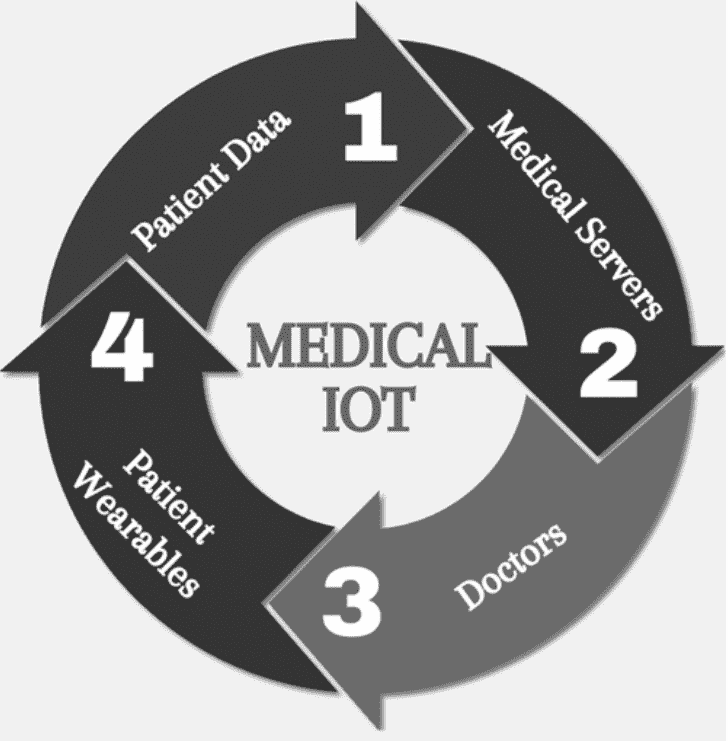

图 6.6 受益于电子健康医疗领域的客户。

医疗保健的最新进展，得益于物联网技术的整合，正在患者护理和医疗服务领域开启一个变革时代。在这些突破中，远程患者监测系统已成为基石，使医疗保健提供者能够实时远程追踪患者的生命体征、健康参数和治疗依从性。此类系统使主动干预、异常早期检测和个性化护理计划成为可能，从而减少医院就诊，提高患者便利性和自主性。由物联网驱动的远程医疗解决方案促进虚拟咨询，使患者能够远程获取医疗服务 [26]。这些解决方案不仅消除了地理障碍，还能确保及时的医疗援助，特别是在偏远或医疗资源不足的地区。医疗保健领域的人工智能（AI）应用利用物联网生成的数据进行预测性诊断，帮助早期疾病检测和个性化治疗建议 [6]。AI 驱动的算法分析海量数据集以辨识模式，帮助临床医生做出更准确的诊断并制定量身定制的治疗方案。这些技术进步在疾病管理和医疗结局方面取得了显著改善 [13]。患者获得更个性化和精确的护理，从而降低医院再入院率，提高治疗依从性，改善健康结局。此外，基于物联网的医疗解决方案优化医疗机构内的资源分配，简化运营工作流并提高整体效率 [12]。此外，物联网驱动的创新通过交互式平台提高患者参与度，使个人能够积极参与自己的医疗旅程，从而提高满意率并改善整体健康状况。然而，医疗行业面临着数据系统碎片化、设备间互操作性有限以及需要加强网络安全等挑战 [27]。物联网可以通过提供互操作系统、安全的数据共享和高效的医疗数据管理来解决这些问题。通过确保各种医疗设备和平台之间的无缝连接，医疗保健中的物联网有望克服这些挑战，促进一个更加一体化、高效且以患者为中心的医疗生态系统 [14]。

### 6.5.1 基于 IIoT 的生物设备

物联网设备通过提供先进功能，在改变医疗保健方面发挥着关键作用，这些功能彻底改变了患者监测和护理交付。

- 1. 运动检测监测：这些传感器检测并追踪患者的活动，帮助老年或行动不便患者检测跌倒，确保其安全，并在出现任何异常时向医疗保健提供者发出警报 [24]。
- 2. GPS 智能鞋垫：嵌入 GPS 技术，这些智能鞋垫帮助追踪个人的位置和活动，尤其有助于痴呆症患者或容易徘徊的人群，使照护者能够高效地定位他们。
- 3. 无线胎儿监测：这些设备使准妈妈能够远程监测胎儿健康，提供胎儿心率和活动的实时数据，改善产前护理，并在需要时实现及时干预。
- 4. 心电图带：心电图（ECG）带持续监测心脏活动，记录并将数据传输给医疗专业人员，实现远程心脏监测和异常早期检测 [24]。
- 5. 血糖检查仪：基于物联网的血糖监测设备允许糖尿病患者准确且定期地测量血糖水平，使他们能够有效管理自身病情，并使医疗保健提供者能够提供量身定制的治疗方案。
- 6. 压力传感器：这些传感器监测压力变化，常用于医疗保健中的压疮预防，通过向照护者发出警报或自动调整床位以缓解压力，提高患者舒适度并预防并发症。

这些物联网设备对远程患者监测、早期诊断和个性化护理作出重大贡献，最终改善患者结局，并促进更加主动和高效的医疗服务。

### 6.5.2 革新医疗保健的物联网应用：医疗监测和管理的设备与用途

本节对物联网技术在医疗领域的深远影响进行了全面调查。这种深入探索涵盖了一系列为各种医疗应用精心设计的设备。在所介绍的设备中，心电图监测设备因其能够追踪和记录心脏电活动、帮助诊断和管理心脏疾病而脱颖而出。同时，血压追踪设备提供连续且准确的血压测量，使主动高血压管理和心血管风险评估成为可能。此外，温度传感设备在监测患者体温方面发挥着关键作用，有助于早期发现发烧或异常，这在传染病管理中尤为关键。这些设备确保快速干预和适当的治疗措施，以实现最佳患者护理。除了这些核心设备，探索还延伸到众多其他物联网驱动的工具，包括用于糖尿病管理的血糖检查仪、用于血氧饱和度监测的脉搏血氧仪以及用于活动追踪和健康参数监测的可穿戴设备。每个设备都在重新定义患者护理范式方面发挥着关键作用，强调远程监测能力、精确诊断和个性化治疗策略，如表 6.3 所示。

表 6.3 高级生物传感器及其在医疗领域的作用

| IoT 应用 | 使用的设备 | 应用和用途 |
|---|---|---|
| ECG 监测 | ECG 带 | 用于远程护理的持续心脏活动监测 |
| BP 监测 | 智能血压计 | 监测和追踪血压水平 |
| 温度监测 | 智能体温计 | 用于发烧检测的持续体温监测 |
| 血糖水平监测 | 血糖仪 | 定期且准确的血糖水平测量 |
| 血氧饱和度监测 | 脉搏血氧仪 | 测量血液中的氧气水平以维护呼吸健康 |
| 哮喘监测 | 智能吸入器 | 监测吸入器使用情况和呼吸模式 |
| 情绪监测 | 可穿戴情绪追踪器 | 追踪情绪状态以进行心理健康评估 |
| 药物管理 | 智能药丸分配器 | 根据时间表提醒和分配药物 |
| 轮椅管理 | 物联网轮椅 | 追踪轮椅的使用情况、位置和状况 |
| 康复 | 物联网康复 | 协助引导式物理 |


| IoT 应用 | 使用的设备 | 应用和用途 |
|---|---|---|
| | 设备 | 治疗和康复 |

表 6.3 列出了医疗行业的各种物联网应用、每个应用所使用的特定设备，以及这些应用在医疗保健中的主要用途和功能。向物联网驱动医疗设备的这一深刻转变标志着医疗保健的一个关键时刻，为临床医生提供实时、全面的患者数据。通过这些物联网设备实现的远程患者监护，确保及时干预，加强疾病管理，并促进个性化医疗服务。这一以技术创新为基础的变革，承诺改善患者结局，简化医疗工作流程，并采取以患者为中心的医疗监测和管理方法。对这些物联网驱动设备的探索强调了其在重塑医疗监测和管理格局方面不可或缺的作用，彻底改变了医疗服务的提供和体验方式。

## 6.6 赋能教育：物联网对学习格局的演进式影响

物联网在教育领域的集成标志着学习方法的范式转变，增强了其对教育工作者和学生的影响。随着教育工作者利用物联网的能力，他们解锁了个性化和自适应教学方法的领域 [21]。由物联网技术驱动的智能教学方法使教育工作者能够根据个人学习风格定制内容传递，确保更具吸引力和有效性的教育体验。这些创新延伸至智能教育和智能学习计划，其中物联网有助于创建动态学习环境。教室演变为智能空间是物联网带来的标志性转变之一 [9]。这些智能教室包含物联网支持的设备和工具，便于学生和教师之间进行实时数据交换和协作。从交互式显示屏到连接设备，这些技术赋能协作学习，鼓励积极参与，并促进对学科的更深入理解。

当然，物联网在教育机构中的集成将其影响扩展到交通管理，确保学生安全和运营效率的全面方法 [28]。由物联网驱动的系统在优化学校、学院和大学内的交通服务方面发挥着关键作用 [11]。这些技术提供一系列功能，增强安全性，改善响应时间，并能够采取主动措施，为学生提供安全可靠的交通环境。由物联网赋能的实时追踪系统使学校巴士或运送学生的车辆能够进行实时监控 [15]。此功能允许教育机构和家长追踪巴士的精确位置和移动，确保整个行程中的更高问责制和安全性。同时，短信警报让家长了解巴士到达时间、延误或任何意外变化，增强沟通并减少与学生交通相关的担忧。此外，由物联网驱动的巴士考勤管理系统简化了学生上下车的流程 [29]。这些系统使用传感器或 RFID 技术，在学生上车或下车时自动登记，确保准确的考勤记录。这不仅有助于高效追踪学生，还能提供在紧急情况下至关重要的数据，协助学校当局确保每个人的安全 [1]。基于物联网的车辆管理解决方案提供先进功能，如驾驶员分析和预防性维护。驾驶员分析系统监控驾驶员行为，追踪速度、刹车和遵守安全指南等参数。这些信息有助于评估驾驶模式，确保遵守交通规则，并最终增强过境期间的学生安全。此外，基于物联网生成的数据的主动维护计划确保车辆及时接受检查和维修，减少运输过程中故障或故障的风险。物联网在教育机构交通管理中的集成标志着向确保学生安全、增强与家长沟通以及简化物流运营迈出的重要一步 [10]。随着教育机构继续采用物联网技术，他们不仅丰富了学习体验，还为一个更安全、更高效的教育生态系统做出了贡献，该生态系统优先考虑学生的福祉，如图 6.7 所示。

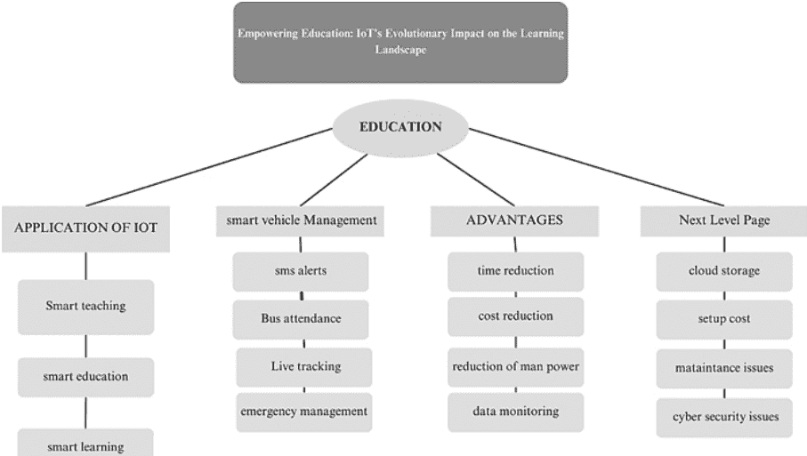

### 图 6.7 学习物联网概念以增强智慧城市部署的重要性

物联网在教育中的实施不仅革新了教学方法，还革新了运营层面，最终提升了整体学习生态系统。随着教育机构采用物联网驱动的解决方案，他们转型为适应性强、技术驱动的环境，促进丰富的教育体验和简化的行政流程。因此，物联网的融入成为教育进步的基石，为学习和机构管理提供创新和全面的方法 [7]。

- i. **智能教学**：融合物联网工具和技术以定制教学方法，提供量身定制且互动的课程，以满足个别学生的需求。它利用数据分析和自适应学习系统来提供个性化的内容和反馈。

- ii. **智能教育**：涵盖教育领域的综合性数字生态系统，利用物联网处理行政任务、课程开发、评估和学习资源。它涉及技术集成以实现无缝的教育管理和运营。

- iii. **智能学习**：利用物联网支持的设备和平台来创建引人入胜且互动的学习体验。它包括个性化学习路径、自适应评估和协作工具，以迎合不同的学习风格。

- iv. 智能教室：指配备物联网的学习环境，集成各种数字工具和设备。它包括交互式白板、物联网支持的教育应用程序和传感器，以创建身临其境且动态的学习空间。

- v. 智能车辆管理：
  - a. **SMS Alerts**：向家长或相关部门发送关于车辆位置、延误或紧急情况的即时通知。
  - b. **Bus Attendance**：利用物联网自动化并管理校车上的学生考勤，确保安全和问责。
  - c. **Route Adherence**：监控并保持遵守指定路线，以实现高效的交通服务。
  - d. **Live Tracking**：实现车辆实时追踪，使相关部门能够监控路线，并及时应对偏离或紧急情况。
  - e. **Emergency Management**：提供工具和规程以有效处理紧急情况，确保学生和员工的安全。
  - f. **Voice Call**：允许驾驶员、相关部门和家长之间进行直接通信，以便在紧急情况或更新期间立即协调。
  - g. **Driver Analysis**：利用物联网数据分析驾驶行为，确保安全且负责任的驾驶习惯。
  - h. **Preventative Maintenance**：使用物联网传感器监控并预测维护需求，确保车队的可靠性和安全性。

## 6.7 物联网变革旅游：革新旅游行业的体验

旅游业在全球范围内是一项重要产业，不仅用于娱乐，也用于经济增长、文化交流和就业创造。在印度，旅游业是经济的重要贡献者，推动各个领域的发展。具体来说，在泰米尔纳德邦，旅游业在提升该邦收入方面发挥着关键作用。该地区丰富的文化遗产、如布里哈迪斯瓦拉寺等历史古迹以及风景如画的景观吸引着游客，显著促进了该邦的收入。认识到潜在的经济效益，各国政府积极推广旅游业 [20]。在印度，正在不懈努力发展基础设施、改善连通性并发起促销活动以吸引游客。同样，泰米尔纳德邦政府


致力于提升旅游设施、保护遗产遗址以及组织文化活动，以吸引游客。这些举措旨在增强旅游业对州经济和就业机会的影响 [30]。智慧旅游作为一种新兴概念，融合了技术与旅游，以提升旅行者的体验。它整合了IoT、移动应用和数据分析，提供个性化、高效且创新的服务 [8]。这包括实时导航、个性化推荐、互动导览以及无缝预订，将传统的旅游体验转变为技术丰富的旅程 [31]。总体而言，旅游业在全球经济中发挥着关键作用，创造收入、提供就业并促进文化交流。在印度，特别是泰米尔纳德邦，政府正致力于挖掘旅游潜力，而智慧旅游的到来则为全球游客带来了更加个性化且技术先进的旅行体验 [32]。

IoT显著改变了旅游业的面貌，彻底革新了行业的各个方面 [25]:

- i. **地理定位技术：** IoT整合GPS和信标技术，为旅行者提供基于位置的实时服务，助力导航、推荐附近景点，并根据其位置提供情境信息。
- ii. **医疗（养生）旅游：** IoT通过提供智能医疗保健解决方案，在提升医疗旅游方面发挥关键作用。这包括远程患者监护、个性化医疗保健建议以及数据驱动的养生计划，确保旅行者获得无缝且安全的医疗体验。
- iii. **生态旅游：** IoT通过使用传感器监测空气质量、节水和野生动物保护等环境参数，促进可持续旅游实践。这些数据有助于做出明智决策，推广环保旅游方式并保护自然栖息地。
- iv. **服务领域的零售旅游：** IoT驱动的零售服务通过提供个性化购物体验、基于接近度的优惠以及旅游集中区域内的高效零售管理，满足游客需求，提升整体购物体验。
- v. **虚拟管家：** IoT通过智能设备实现虚拟管家服务，允许旅行者获取个性化推荐、进行预订并接收实时协助，提供量身定制且无忧的旅行体验。
- vi. **机场中的IoT：** 机场利用IoT实现高效运营，确保乘客流程顺畅，通过RFID标签优化行李处理，并提供实时航班更新，提升整体旅行体验。

这些IoT应用重新定义了旅游体验，提供更强的个性化、效率和可持续性，从而重塑了旅行者探索、参与和体验目的地的方式。

在旅游领域，IoT的整合面临着多重挑战：

- 1. **数据安全与隐私：** 伴随着联网设备广泛收集和传输数据，确保游客信息的安全与隐私变得至关重要。保护敏感数据免受网络威胁和未经授权的访问是一项重大挑战。
- 2. **互操作性与标准化：** 各种IoT设备和平台常常缺乏标准化协议，导致兼容性问题。在旅游业中，实现各种IoT系统之间的无缝集成与互操作性仍是一项挑战。
- 3. **连接性与基础设施：** 偏远或欠发达的旅游目的地可能会遇到连接问题，阻碍IoT设备的有效实施。网络覆盖有限和基础设施不足可能会阻碍IoT解决方案的部署。
- 4. **成本与投资：** 实施IoT解决方案需要在基础设施、设备和培训方面进行大量初始投资。对于较小的旅游企业或发展中的目的地，采用和维护IoT技术的成本可能构成挑战 [25]。
- 5. **技能差距与培训：** 旅游业专业人士可能缺乏有效处理IoT技术所需的专业知识。通过充分的培训和教育弥补技能差距，对于最大化IoT在旅游业中的益处至关重要。
- 6. **法规合规：** 遵守关于数据隐私、安全和环境影响的各项法规和标准至关重要。在不同地区应对并遵守多样化的监管框架，对旅游业中的IoT实施构成挑战。

为了有效应对旅游业IoT实施所带来的挑战，各利益相关方之间的协作方法至关重要。企业、政府机构、技术提供商和监管机构必须汇聚各自的努力，以有效应对和克服这些挑战 [3]。通过建立开放的沟通渠道、分享最佳实践并协调策略，这些利益相关方可以共同解决与隐私、数据安全、标准化和基础设施建设相关的问题。这种协作努力对于发挥IoT的变革力量、确保其在旅游业中负责任且有效的整合至关重要 [5]。只有通过集体行动和共同责任，行业才能充分实现IoT提供的巨大潜力，同时将旅行者的安全和满意度置于首位 [18]。

## 6.8 革新移动出行：IoT对交通运输行业的影响

交通运输在塑造现代社会和经济的动态方面发挥着关键作用，作为流动性和连接性的重要推动者 [17]。在公共部门，道路、铁路和公共交通系统等坚固的交通基础设施是高效流动性的基石。这些系统确保城市、城镇和农村地区之间的连接，促进对就业机会、教育、医疗和各种服务的访问。此外，它们使游客能够穿越和探索各种目的地，通过游客消费和文化交流为当地经济的活力做出贡献。相反，私人交通运输部门提供个性化的旅行体验，为个人提供便利和灵活性。私家车、拼车平台和出租车服务满足特定的旅行需求，使人们能够自主且舒适地处理日常事务或开始休闲旅行。这个部门支持游客按自己的节奏探索目的地、参观偏远景点并体验非传统路线所需的灵活性，为整体旅游体验做出贡献。公共和私人交通运输系统之间的相互作用突显了它们在增强社会连接、促进经济增长以及支持旅游业活力和可及性方面的共同作用 [19]。这些交通方式的整合确保了人员和货物的高效流动，最终塑造了居民和访客的生活质量和体验。

公共和私人交通运输部门在促进贸易、通勤和旅游活动方面都发挥着重要作用。特别是，实时物流运营利用IoT技术，改变了货物和服务的流动。IoT支持的传感器和GPS技术实现实时追踪，通过促进高效的路线规划、库存管理和配送追踪来优化物流工作流程 [4]。这种精简的物流流程通过确保必需物资的可用性，对旅游业产生显著裨益，确保必需


物资供应，提升游客体验，并支持当地经济。公共交通方式（如公交车、火车和地铁）为居民和游客提供了经济实惠且环保的出行选择。这些系统提供广泛的连通性，使旅游景点易于到达。相比之下，私人交通方式（如私家车、租车和拼车服务）提供了便利和灵活性，允许游客按照自己的节奏和方便探索目的地。交通与旅游之间的关系是多方面的，深刻影响着游客的旅行体验，并塑造着目的地偏好。高效的交通系统在提升游客满意度、鼓励回头游以及提升目的地声誉方面发挥着关键作用。连通良好且可靠的交通网络显著影响游客的出行便利性，便于他们探索各种景点，并最终增加旅游收入 [33]。交通与旅游之间的相互作用凸显了高效交通基础设施在提升游客体验和推动目的地经济增长方面的关键作用。通过确保交通服务的无缝连通、可达性和可靠性，目的地可以增强对游客的吸引力，从而增加旅游流量并带来积极的经济结果。因此，将 IoT 技术集成到交通系统中，在进一步优化交通与蓬勃发展的旅游业之间的协同关系方面具有巨大潜力 [16]。

## 6.9 结论

当然，物联网在旅游领域的集成开启了一个变革阶段，彻底改变了旅行体验的促进和管理方式。其影响遍及各个细分领域，从交通和酒店业到旅游枢纽的可持续性和运营效率提升。物联网在旅游业中的关键应用之一是实时追踪，它使旅行者能够全面了解自己的行程。集成在移动应用或旅行设备中的物联网 GPS 追踪系统可提供关于路线、预计到达时间和潜在延误的持续更新。该技术提升了游客的便利性和安全性，为他们提供精确的位置信息，并使他们能够更有效地规划行程。此外，物联网有助于速度控制，这是确保交通安全与效率的关键因素。通过利用传感器和数据分析，物联网系统监控车辆速度，帮助交通服务保持最佳且安全的行驶速度。这确保了旅行时间的可靠性，同时也最大限度地降低了因超速导致事故的风险。在公共交通方面，物联网解决方案确保了旅行者更好的可用性和可达性。

物联网连接的系统允许对公共交通车辆进行实时监控，从而准确预测到达时间和服务可用性。这使旅行者能够获得最新信息，通过减少等待时间和与交通时刻表相关的不确定性来提升旅行体验。旅游业对环保实践的承诺促进了促进可持续性的物联网解决方案的出现。物联网应用有助于监测和控制旅游目的地及住宿设施中的环境因素，例如能源消耗和废弃物管理。由物联网传感器驱动的智能废弃物管理系统优化废弃物收集时间表并识别回收区域，有助于环境保护。此外，物联网在优化机场运营方面发挥着关键作用。通过使用智能传感器和数据分析，机场可以高效管理乘客流量、行李处理和安全协议。物联网设备的实时数据使机场当局能够做出数据驱动的决策，提高运营效率，并确保乘客获得更顺畅的旅行体验。随着旅游业继续采用物联网技术，它不仅提升了游客的旅行体验，还简化了服务提供商的运营。物联网在旅游业的综合影响有助于构建更安全、更高效、更可持续的旅行生态系统，推动全球旅游版图的增长和演变。

## 参考文献

- 1. Ding, Jie, 等。“物联网连接技术与应用：综述。”IEEE Access 8 (2020): 67646–67673.
- 2. Rejeb, A., K. Rejeb, H. Treiblmaier, A. Appolloni, S. Alghamdi, Y. Alhasawi, 和 M. Iranmanesh。“医疗保健中的物联网（IoT）：盘点与前进。”Internet of Things 1 (2023): 100721.
- 3. Priyanka, E.B., S. Thangavel, V. Madhuvishal, S. Tharun, K.V. Raagul, 和 C.S. Shiv Krishnan. 面向智慧城市水管输送系统的集成物联网框架应用。收录于《大数据技术智能——超越炒作：ICBDCC 2019 论文集》（第 571–579 页）。Springer Singapore (2021).
- 4. Babun, Leonardo, 等。“IoT 平台调研：通信、安全与隐私视角。”Computer Networks 192 (2021):
- 5. Priyanka, E. B., S. Vivek, S. Thangavel, V. Sampathkumar, Nabil Al-Zaqri, 和 Ismail Warad.“基于多流形学习的沿海地区废水和气候变化影响预测与元特征估计。”Environmental Research 240 (2024): 117355.
- 6. Sadeeq, Mohammed Mohammed, 等。“物联网与云计算问题、挑战与机遇：综述。”Qubahian Academic Journal 1.2 (2021): 1–7.
- 7. Zikria, Yousaf Bin, 等。“下一代物联网（IoT）：机遇、挑战与解决方案。”Sensors 21.4 (2021): 1174.
- 8. Lin, Tao.“面向物联网的深度学习。”2020 年 IEEE 第 39 届性能计算与通信国际会议 (IPCCC)，美国得克萨斯州奥斯汀。IEEE (2020).
- 9. Syed, Abbas Shah, 等。“智慧城市中的物联网：技术、实践与挑战调查。”Smart Cities 4.2 (2021): 429–475.
- 10. Revathy, G., 等。“利用计算智能实现工业 4.0 的智能制造。”收录于 N. Thillaiarasu, S. Lata Tripathi, 和 V. Dhinakaran (编),《物联网人工智能》。CRC Press, 美国佛罗里达州博卡拉顿 (2022), 第 31–48 页.
- 11. Hussain, Fatima, 等。“物联网安全中的机器学习：当前解决方案与未来挑战。”IEEE Communications Surveys & Tutorials 22.3 (2020): 1686–1721.
- 12. Amanullah, Mohamed Ahzam, 等。“面向物联网安全的深度学习与大数据技术。”Computer Communications 151 (2020): 495–517.
- 13. Sobin, C. C.“物联网架构、协议与挑战调查。”Wireless Personal Communications 112.3 (2020): 1383–1429.
- 14. Singh, Ravi Pratap, 等。“物联网（IoT）应用对抗 COVID-19 大流行。”Diabetes & Metabolic Syndrome: Clinical Research & Reviews 14.4 (2020): 521–524.
- 15. Shafique, Kinza, 等。“面向下一代智能系统的物联网（IoT）：当前挑战、未来趋势与新兴 5G-IoT 场景展望综述。”IEEE Access 8 (2020): 23022–23040.
- 16. Lee, In.“物联网（IoT）网络安全：文献综述与 IoT 网络风险管理。”Future Internet 12.9 (2020): 157.
- 17. Ndiaye, Musa, 等。“后 COVID-19 时代的物联网：贡献、挑战与演变调查。”IEEE Access 8 (2020): 186821–186839.
- 18. Selvaraj, Sureshkumar, 和 Suresh Sundaravaradhan.“物联网医疗系统中的挑战与机遇：系统综述。”SN Applied Sciences 2.1 (2020): 139.
- 19. Kashani, Mostafa Haghi, 等。“医疗保健中物联网的系统综述：应用、技术与趋势。”Journal of Network and Computer Applications 192 (2021): 103164.
- 20. Gupta, Brij B., 和 Megha Quamara.“物联网（IoT）概述：架构方面、挑战与协议。”Concurrency and Computation: Practice and Experience 32.21 (2020): e4946.
- 21. Adi, Erwin, 等。“面向物联网的机器学习与数据分析。”Neural Computing and Applications 32 (2020): 16205–16233.
- 22. Songhorabadi, Maryam, 等。“物联网赋能智慧城市中的雾计算方法。”Journal of Network and Computer Applications 211 (2023): 103557.
- 23. Khanna, Abhishek, 和 Sanmeet Kaur.“物联网（IoT）、应用与挑战：全面综述。”Wireless Personal Communications 114 (2020): 1687–1762.
- 24. Laghari, Asif Ali, 等。“物联网（IoT）综述与最新进展。”收录于《工程计算方法档案》(2021), 第 1–19 页。CRC press.
- 25. Swamy, S. Narasimha, 和 Solomon Raju Kota.“物联网（IoT）系统层面的实证研究。”IEEE Access 8 (2020): 188082–188134.
- 26. Hossein Motlagh, Naser, 等。“物联网（IoT）与能源领域。”Energies 13.2 (2020): 494.
- 27. Fahmideh, Mahdi, 和 Didar Zowghi.“物联网平台开发探索。”Information Systems 87 (2020): 101409.
- 28. Farahani, Bahar, Farshad Firouzi, 和 Krishnendu Chakrabarty.“医疗物联网。”收录于《智能物联网：从设备到雾与云》(2020), IOT, 第 515–545 页.
- 29. Wang, Jianxin, 等。“过去 20 年物联网（IoT）的演变。”Computers & Industrial Engineering 155 (2021): 107174.
- 30. Nižetić, Sandro, 等。“物联网（IoT）：迈向智能可持续未来的机遇、问题与挑战。”Journal of Cleaner Production 274 (2020): 122877.
- 31. Al-Garadi, Mohammed Ali, 等。“物联网（IoT）安全的机器学习与深度学习方法调查。”IEEE Communications Surveys & Tutorials 22.3 (2020): 1646–1685.
- 32. Farahani, Bahar, Farshad Firouzi, 和 Markus Luecking.“物联网与分布式账本技术（DLT）的融合：机遇、挑战与解决方案。”Journal of Network and Computer Applications 177 (2021): 102936.


33. Pavithran, Deepa, 等人. “面向构建 IoT 区块链框架.” Cluster Computing 23.3 (2020): 2089–2103.

OceansofPDF.com

# 第 7 章

# 基于区块链技术的智慧城市应用

Bala Krishnan Raghupathy、V. Subramaniyaswamy、Rajesh Kumar Namachivayam 和 Manikandan Ganesan

DOI: 10.1201/9781003476047-7

## 7.1 引言

“智慧城市”的理念正在迅速发展，因为它从根本上改变了人们在城市环境中与设备交互的方式。按定义，智慧城市主要依赖于广泛的电子和数字应用、用于行政环境的嵌入式 ICT（信息和通信技术）、用于运营系统中通信和信息的 ICT，以及帮助人们利用 ICT 增强信息与创新的 ICT。

智慧城市概念解决了不断涌入都市区的快速增长人口的管理挑战。如今，全球人口中有相当大一部分居住在城市。预计未来每个用户将拥有约七台设备在互联网上主动通信。预计到 2050 年底，全球约 70% 的人口将居住在城市。因此，未来几十年城市地区的战略发展将是主要任务。为满足日益增长的高质量服务需求，城市环境必须按照智慧城市理念进行改造和管理。一般来说，智慧城市被定义为采用 ICT 并实施无疑会对当地居民生活质量产生影响的策略的城市。创建大规模数据集是智慧城市应用和实施的最重要成果之一。需要进行大量处理来处理这一海量数据，以便整合不同的 AI 和机器学习（ML）技术。

许多人支持“智慧城市”的理念，该理念通过整合智慧停车、智慧交通、智慧医疗和智慧社区等多个领域，改善城市居民的生活质量。实时数据处理和智能决策能力是复杂都市网络持续演进面临的重大障碍。从社会角度来看，智慧城市—智慧社区概念的最关键目标是城市的可持续发展，这保障了社区成员的社会福祉。出于此原因，本研究探讨了智慧城市和可持续发展的最佳实践。此外，当前疫情的范围为探索城市发展计划以寻找智慧城市—智慧社区解决方案提供了依据。智慧城市最重要的目标与健康相关。放射学是 AI 和 ML 应用最成功的智慧健康领域之一。每年，全球进行的医学检查和扫描（包括胸部 X 光）超过两亿次。一种著名的深度学习算法是深度神经网络（DNN），它被应用于各种健康相关图像，例如医学扫描，包括用于检查骨折和断裂的骨骼图像。许多重要应用（如水或电力资源管理、智能卡服务支付与验证）最近已采用以数据为中心的方法。利用智慧出行可以降低交通效率损失和 CO₂ 排放。智慧城市的应用及其效用完全依赖于数据连接性、汇编和普遍性。图 7.1 展示了智慧城市结构中涉及的社会组成部分。

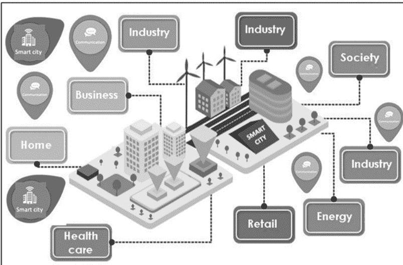

### 图 7.1 智慧城市的基本社会组成部分

为了为智慧城市创建合适的结构设计，工程师、开发人员和技术人员目前正在寻找基于 IoT 的智慧解决方案。智慧城市通常包括智慧人群、智慧家庭、智慧健康、智慧道路、智慧停车和智慧停车。智慧城市的部署基于包括数据收集、预处理、分析和服务在内的阶段，如图 7.2 所示。首先，汇编信息并从与城市环境相关的统计数据中学习。接下来，处理、管理和评估信息以进行独立评估。最后，在服务层执行决策。由于基于 IoT 的基础设施在学术界和智慧城市制造等领域发挥着重要作用，其部署正在不断发展。都市区人口稳步增长，对公民参与造成了诸多障碍。根据联合国人口基金的预测，2007 年有 50% 的人口居住在城市地区。预计到 2030 年这一比例将发生重大变化。为促进经济增长并提高居民生活质量，印度政府于 2015 年宣布了“智慧城市计划”，目标是将 100 座城市打造为“智慧”都市中心。表 7.1 汇总了该计划。

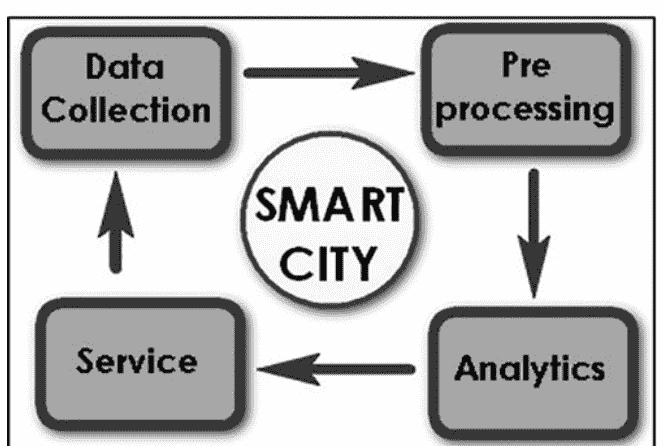

### 图 7.2 智慧城市中的数据生命周期

### 表 7.1 印度智慧城市计划的演变

| 指标 | 描述 | 示例 |
| :--- | :--- | :--- |
| 智慧城市数量 | 印度指定的智慧城市总数 | 100 个（截至 2025 年 6 月） |
| 智慧城市计划投资 | 智慧城市计划的政府和私营部门总投资 | 2.05 万亿卢比（截至 2023 年 3 月） |
| 智慧城市覆盖区域 | 印度智慧城市项目覆盖的区域 | 超过 4,050 平方公里（截至 2023 年 6 月） |
| 受益公民 | 智慧城市计划直接影响的公民预计人数 | 超过 1 亿（截至 2023 年 3 月） |
| 完成的智慧城市项目 | 所有指定城市中完成的智慧城市项目百分比 | 各城市差异显著，范围从 20% 到 80% |
| 关键基础设施项目 | 供水、卫生、废物管理和公共交通等核心基础设施领域的已完成项目数量 | 各城市不同，有些城市在每个领域的已完成项目超过 100 个 |
| ICT 采用率 | 采用智能电网、智能交通管理和城市监控系统等先进技术的城市百分比 | 各城市不同，有些城市采用率较高（例如，浦那、苏拉特） |
| 可持续发展举措 | 专注于可再生能源、绿地和环保实践的正在进行的项目数量 | 各城市不同，有些城市展示了对可持续发展的重大承诺（例如，印多尔、科伊姆巴托尔） |
| 公民参与 | 采用有效机制让公民参与决策和反馈的城市百分比 | 各城市不同，有些城市通过在线平台和社区论坛积极吸引公民 |
| 经济影响 | 智慧城市计划带来的就业机会和 GDP 增长的预计增加 | 各城市不同，有些城市获得显著经济收益（例如，斋普尔、瓦多达拉） |

印度智慧城市计划的主要统计数据亮点如下：

- 从总数中选出了 100 座城市。
- 承诺资本总额：980 亿美元。
- 提交的项目：超过 5,000 个。
- 完成的项目：超过 2,000 个。
- 重点领域包括：能源效率、废物管理、水资源管理、智慧基础设施、可持续交通、电子政务、公民参与、教育、医疗保健、安全与安保。

具有重大影响的智慧城市项目包括：

- **智能交通管理系统（ITMS）**：这些系统利用摄像头和传感器来监控交通模式、调整交通信号，并向居民提供最新旅行信息。
- **城市监控系统**：使用闭路电视摄像头和视频分析有助于监控交通违规、促进公共安全与安保，并遏制犯罪。
- **智能网络**：这些网络通过使用传感器和自动化来最大化能源分配、最大限度地减少损耗并提高能源效率。
- **电子政务平台**：为了提高透明度、加快程序并让个人获得政府服务，正在使用在线门户和移动应用。
- **公共 Wi-Fi**：为了鼓励数字包容和经济活动，多个智慧城市正在公共区域提供免费或价格合理的 Wi-Fi 连接。

在全球范围内，智慧城市正在利用技术改善可持续性、效率和公民生活质量，从而改变城市环境。表 7.2 展示了智慧城市全球层面举措的概况。

| 指标 | 描述 | 示例 | 来源 |
|---|---|---|---|
| 全球智慧城市数量 | 被指定或正在积极推进智慧城市计划的城市预计数量 | 超过 6,000 个（取决于定义） | 麾肯全球研究院 |
| 全球智慧城市市场规模 | 全球智慧城市行业的预计市场价值 | 到 2027 年将达到 1.024 万亿美元（年复合增长率 14.9%） | Markets and Markets |
| 领先的智慧城市地区 | 智慧城市集中度最高的地区 | 亚太地区、北美、欧洲 | 智慧城市委员会 |
| 排名靠前的智慧城市 | 始终因其智慧城市领导力而获得认可的城市 | 新加坡、哥本哈根、阿姆斯特丹、纽约市、首尔 | 智慧城市世界研究院 |
| 智慧城市关键重点领域 | 智慧城市中最常见的投资和开发领域 | 智慧基础设施、出行、技术（IoT、AI）、能源效率、可持续性、公民参与 | 智慧城市世界论坛 |


| 指标 | 描述 | 示例 | 来源 |
| :--- | :--- | :--- | :--- |
| 智慧城市资金 | 智慧城市项目的资金来源 | 公私合营、政府拨款、私人投资、风险投资 | 世界银行 |
| 智慧城市发展中的挑战 | 实施智慧城市倡议的城市面临的常见障碍 | 数据隐私与安全性、可负担性、缺乏互操作性、公民参与、人才获取 | 联合国人居署 |
| 智慧城市的新兴趋势 | 智慧城市发展中备受关注的新技术和新方法 | 人工智能、绿色基础设施、超连接、城市农业、数字孪生 | ITU 城市与气候变化计划 |

## 7.2 相关工作

Luusua 等人 [1] 在探索人工智能（AI）在城市环境中日益深入的融合以及在智慧城市中熟练交付 AI 应用的过程中，调查了技术如何可能提高效率、可持续性以及总体的城市生活。涵盖的主题包括用于能源优化、交通控制、公共服务以及其他促进智能城市环境增长的领域的人工智能驱动方法。该文章还讨论了可能的障碍、道德困境，以及人工智能的使用将如何影响未来城市的发展。

吕和高 [2] 的研究探讨了智慧城市努力如何影响中国的就业。它利用双重差分分析和市级数据，确定智慧城市建设中供需平衡机制对城市就业的总体影响，特别是在第二产业和第三产业。该研究强调了智慧城市发展带来的总体就业创造，同时也承认由于某些领域的自动化可能导致工作岗位流失。它强调，为了抓住智慧城市机遇并应对不断变化的形势，提升劳动力技能并使其适应至关重要。

乌拉和阿尔-图尔曼 [3] 的研究提出了一个使用区块链智能合约处理智慧城市房地产交易的框架。它引起了人们对这项技术在智能房地产市场中可能产生的颠覆性影响的关注。该框架强调，为了在智慧城市房地产中成功采用区块链智能合约，必须考虑所有六层。它可以简化流程、提高透明度、降低成本，并帮助许多利益相关方，包括政府机构、买家、卖家、中介和房产所有者。

在他们的研究中，库马尔等人 [4] 提出了一种用于智慧城市中交通标志自动检测和预测的新框架。这对于有效的交通管理以及自动驾驶至关重要。所提出的 GbCN-KF 框架包括卡尔曼滤波器和基于山羊的卷积神经网络等技术。结合这些方法，GbCN-KF 能够实现交通标志的高分类和检测精度，在基准数据集上超过 99.8%。因此，它适用于智慧城市应用中的实际用途。

刘 [5] 提出了一种多联合优化技术，用于物联网（IoT）密集型智慧城市中边缘计算资源的分配。该方法满足了上述设备产生的任务的延迟要求，并解决了能源效率问题。对于智慧城市中的物联网系统，传统的云计算架构可能导致大量的能源消耗和网络延迟。通过将网络、内存和处理器更靠近数据源，边缘计算提供了一个解决方案。针对基于物联网的智慧城市，作者提出了一种四层网络架构。接下来，为了保证有效的计算，他们提出了一种多联合优化策略，利用基于拍卖的技术为对延迟敏感的活动分配边缘资源。

穆罕默德等人 [6] 提出了一种从废弃物材料中提取属性（包括颜色、纹理和形状）的数字模型。随后，这些属性被输入到各种人工神经网络（ANN）中，每个网络都经过训练以识别特定类型的垃圾（纸张、塑料、玻璃等）。为了得出最终的分类判断，随后使用特征融合技术整合这些不同人工神经网络的输出。该模型使用了包含 2,400 张废弃物照片的数据集进行了测试，准确率为 91.7%。这表明该模型可以有效地对废弃物进行分类，从而可能促进更可持续的循环经济和更高的回收率。

荷马 [7] 的文章探讨了人们如何理解“智慧可持续城市”这一概念。鉴于世界上许多城市都在努力成为既智慧又可持续的城市，它强调了理解这些观点的重要性。文章强调了对人们对智慧可持续城市的看法进行细致入微理解的重要性，同时考虑这种城市规划的优点和缺点。

库拉纳和达塔 [8] 的研究探讨了智慧城市支持韧性创业生态系统发展的方式。它认为，这些生态系统经历着从“地点到空间”的转型，最初以本地为重点的资源和解决方案为起点，随后发展为更具规模和空间适应性的模式。文章提供了全球智慧城市中可持续创业生态系统的众多实例，包括巴塞罗那的智能电网项目和阿姆斯特丹的循环经济倡议。这些示例表明，各个城市如何利用自身的优势和挑战来培育创新且持久的企业。它强调，支持基于地点的网络并促进空间灵活性对于确保这些生态系统的长期可行性至关重要。

万利 [9] 使用一种称为动态因子分析的新方法，对 2005 年至 2019 年间的 33 个全球城市进行评估和排名。该方法超越了静态排名，考虑了城市在智慧城市各个维度上随时间进展和变化的情况。该研究涉及数字包容性、创新、经济、人力资本、可持续性和生活质量等维度。该研究强调，在对智慧城市进行排名时，将动态变化考虑在内的重要性。它还揭示了有趣的见解，即哪些城市在特定维度上表现出色，以及其他城市在哪些方面可以做得更好。

在研究中，阿拉姆 [10] 提出了一种在智慧城市环境中限制物联网设备通信访问的新方法。该方法利用物联网连接中访问控制相关的困难，以及大数据和区块链技术的优势。所提方法使用区块链技术提供透明且安全的访问控制。它还利用大数据分析来高效处理和评估访问控制数据。本文提出了一种解决智慧城市物联网连接中访问控制问题的潜在方案。所提方法旨在通过融合大数据与区块链技术的优势，在物联网设备之间提供安全、透明且高效的数据交换。

贝尼瓦尔等人 [11] 的文章提出了一种评估印度智慧城市光伏（PV）系统生命周期成本（LCC）的方法论和优化策略。作者利用人工蜂群（ABC）方法优化系统架构并计算 LCC，考虑的变量包括能源产生、节约、效率以及获得的碳信用额度。研究考察了四个智慧城市——斯利那加、斋浦尔、浦那和钦奈——它们反映了不同的气候条件和能源需求。根据数据，斯利那加的 LCC 最低（INR 4,125 百万，约合 41.25 亿印度卢比），能源产量最高（435 MWh），投资回报率为 8.9%。与传统技术 [19] 相比，所提方法使 LCC 降低了 50.24%。

米勒-艾和科斯米迪斯 [12] 的文章描述了中型北欧智慧城镇中可持续交通的发展情况。作者对十个中型北欧城市——芬兰的阿尔胡斯、芬兰的埃斯波、瑞典的哥德堡、芬兰的赫尔辛基、瑞典的基斯塔、瑞典的林雪平、瑞典的隆德、芬兰的奥卢、芬兰的坦佩雷和瑞典的乌梅阿——的交通项目进行了文献分析。根据报告，这些城市正在以多种方式推进可持续交通，例如推广电动汽车和公共交通、建设自行车基础设施、增加步行以及改善交通控制。研究结果表明，中型北欧城市在可持续交通发展方面已显著领先。

米卢德·达曼等人 [13] 提出了一种基于区块链的系统，用于在智慧城市中提供数据完整性和访问管理。这一点很重要，因为智慧城市建立在庞大的互联传感器和设备网络之上，容易遭受数据泄露和未经授权的访问。为了在智慧城市中提供完整性和访问控制，该框架处理包括确定重要参数、制定法律以及在区块链上存储敏感数据在内的任务。本文还指出了一些困难，例如需要有效的系统来处理访问控制法规，以及区块链技术可能存在的可扩展性问题。

劳里等人 [14] 的文章以智慧城市为重点，探讨了机器人和人工智能在应对 COVID-19 大流行中的重要性。它引起了人们对不同应用的关注，例如帮助医疗专业人员、改善公共卫生举措以及加强供应链和物流。文章强调，为了在大流行期间有效利用机器人技术和人工智能，在智慧城市内构建韧性组织至关重要。

安东尼 Jr. [15] 在他的文章中论证，有效的城市创新以及真正智慧和可持续的


城市高度依赖社区参与。这引起了人们对当前策略经常失效的关注，这些策略过于技术官僚，与民众的需求和利益脱节。该文章概述了影响成功社区参与范式的组成部分。为了确保所有利益相关方都能有效参与智慧可持续城市的共同创造，它强调了透明度、信任和能力建设的必要性。

为了促进可持续智慧城市中的互操作数据集成与对齐，Jnr 等人 [16] 的文章中开发了一种标准化分布式账本技术（DLT）的框架。DLT 能够通过实现多个利益相关方之间透明且安全的数据共享来改变城市。为了克服供应商锁定和数据孤岛等障碍，并最终创造无缝的数字城市生态，标准化至关重要。作者强调了智慧城市中 DLT 标准所需的对齐和集成机制缺失方面的数据集成和互操作性问题。该文章提供了一个可行的框架来实现这一目标，并强调了 DLT 标准对于实现可持续智慧城市愿景的必要性。该论文的作者 Yan 等人 [17] 认为，AI 正在彻底改变未来智慧城市的发展。根据该文章，预计到 2025 年，AI 在智慧城市中将发挥重大作用，支持超过 30% 的应用。它还指出，边缘计算和 5G 网络等发展将加速数据处理，并允许对城市挑战做出实时响应。该文章还描绘了 AI 提升城市居民生活质量并构建更高效、可持续、宜居的城市环境的积极前景。Ullah 等人的论文 [18] 研究了 ML 和 IoT 如何将城市转变为数据驱动的环境，目标是提高城市服务效率和居民的生活质量。该文章还强调，良好的数据治理、利益相关方协作和伦理考虑对于充分发挥 IoT 和 ML 驱动的智慧城市潜力至关重要。

该研究 [19] 的作者提出了一种根据智慧城市项目的成本及其对城市增长的影响来评估这些项目的方法。该研究得出结论，具有成本效益的解决方案通常能以最少的行政和财务压力取得最大效果。所提出的研究强调，以可行且负担得起的解决方案开始智慧城市建设至关重要。这些早期的成功可能为未来更具雄心和革命性的举措铺平道路。在他们的论文中，Shi 等人 [20] 提出了一种利用称为非侵入式负载监测（NILM）的方法来提高城市能源效率的方法。NILM 无需在每个电器上添加额外传感器，即可计算家庭中每个电器的能耗。人们可以利用这些信息更好地了解自己的能源消耗量，并采取节能措施。传统 NILM 系统的准确性有限，因为它们仅使用单户的数据。本文提出了一种合作式 NILM 方法，通过合并多户的数据来提高模型准确性。该技术使用一种称为联邦学习的隐私保护方法，在不披露特定户数据的情况下训练模型。论文作者在真实世界数据集上评估该系统后发现，其准确性高于传统 NILM 系统。他们还发现，该系统对隐私侵犯具有免疫力。Zhou 等人 [21] 的研究考察了智慧城市行动对中国城市化质量的影响。所提出的框架显示，实施智慧城市试点项目可使新型城镇化质量平均提高 5.4%。这种影响在大城市、资源型城市和历史工业城市中最为明显。该研究采用准自然实验方法，比较了 276 个中国城市在实施智慧城市试点项目前后的数据。它利用统计方法控制可能影响城市化质量的其他变量。

Bibi 等人 [22] 的论文探讨了环保型智慧城市的新兴趋势——其中 AI、IoT 和大数据等尖端技术汇聚在一起，以解决城市化和气候变化等问题。它结合证据合成和文献计量分析来绘制研究趋势和驱动因素。所提模型的主要结论讨论了以下主题：快速扩张的趋势、动态研究议程、SDGs 与碎片化、ICT 主导地位、融合可能性、环境成本和伦理风险。该论文认识到需要解决伦理和环境问题，同时强调了大数据和 AIoT（AI 与 IoT 的融合）在创建可持续城市方面的潜力。Jagatheesaperumal 等人 [23] 设计了一种系统，该系统使用安装在车辆轮辋上的超声波传感器和麦克风来收集声音数据——即汽车在各种类型道路上行驶时产生的噪音。然后使用 ML 算法（如多层感知机（MLP）、支持向量机（SVM）和随机森林）来分析这些数据并分类各种路面状况（平坦、湿滑、草地和崎岖）。在确定路面状况方面，该系统使用 MLP 时表现最佳，准确率为 98.98%。就改善道路状况评估和确保更安全、更高效的交通系统而言，该研究强调了 AI 和 ML 在智慧城市基础设施管理方面的潜力。

Rao 和 Deebak [24] 调查了在智慧城市和工业中集成 IoT 等尖端技术所产生的隐私和安全问题。这些技术虽然提供了效率、可持续性和更高质量的生活，但也带来了可能被恶意利用的漏洞。所提工作解决了挑战、技术、隐私问题和安全难题。该论文还强调了制定全面隐私与安全策略对智慧企业和城市的必要性。这包括制定强大的安全协议、实施数据治理框架以及向公众宣传数据保护的重要性。Karn 等人 [25] 使用 IoT 技术，为智慧城市的可持续污水处理和管理系统提出了一种综合策略。该方法能有效处理污水以供可能的再利用，解决日益严重的水资源短缺问题。文章讨论了一种名为 SMARTreat 的特定架构，该架构已成功应用于试点项目。该建筑展示了所提策略在可持续清洁和管理污水方面的效果。该论文还为智慧城市应对水资源短缺问题提供了一个可行的方式：使用 IoT 技术进行有效且可持续的污水处理。

## 7.3 智慧城市的一些勤勉工作

智慧城市应用正在利用技术提升公民生活质量、可持续性和效率，从而全球性地改变城市景观。以下是一些智慧城市项目正在产生影响的重要领域的概述：

- 交通：
- 根据对称电子供应商 Digi International 的说法，智能交通管理系统是市政当局可以整合到现有交通机柜和路口中的技术解决方案，可在本地街道上快速、经济地改善安全性和交通流量。高效且成功的智能交通管理系统使用下一代技术和软件来优化交通基础设施。表 7.3 总结了硬件和软件设施的演进，以辅助上述智能交通系统。

表 7.3 智能交通控制系统的基本组件

| 序号 | 软件 | 硬件 |
| :--- | :--- | :--- |
| 1 | 云计算和边缘处理功能：<br>• 基于云的交通控制系统<br>• 地理信息系统<br>• 交通数据 | 基于 IoT 的路面传感器，包括：<br>• 射频识别标签数据和<br>• 温度传感器数据 |
| 2 | 交通支持应用 | 空气质量传感器 |
| 3 | 基于位置的服务 | 智能收费闸机、边缘设备 |

感知与数据分析相结合，通过 IoT 的智能交通管理优化交通流量，降低排放和拥堵。想象一下，联网汽车相互交互以防止碰撞，或者智能交通灯根据当前交通情况调整时序，如图 7.3 所示。


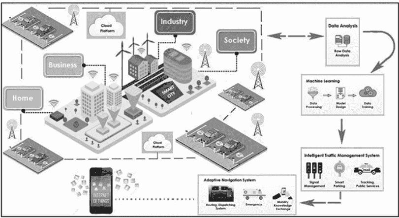

### 图 7.3 基于 IoT 的智慧城市模型中城市组件的连接

- 公共交通：自动驾驶汽车、集成票务系统以及公交和火车的实时到达时间信息正在革新公共交通，使其更加高效便捷。

- 共享出行：通过降低对汽车的依赖和污染，共享单车、车辆共享和微出行选项提供灵活且可持续的交通方式，这可以通过 IoT 框架支持的 ML 模型实现来完成，用于分析来自多个来源的交通和城市相关数据。

### 能源

- 智能照明使用带传感器的 LED，根据人员存在情况和环境光自动调节亮度。这能降低光污染并节省能源。

- 可再生能源整合：为鼓励可持续性和能源独立，智慧城市正逐步将太阳能、风能和其他可再生能源整合到其系统中。

- 智能电网：通过整合可再生能源并优化能源消耗，传感器和智能系统追踪并控制能源需求与分配。想象一下，如果建筑物能根据天气或占用情况自主调整其能源使用。

表 7.4 总结了智慧城市中智能电网、智能照明和可再生能源整合应用的统计数据，模型如图 7.4 所示。

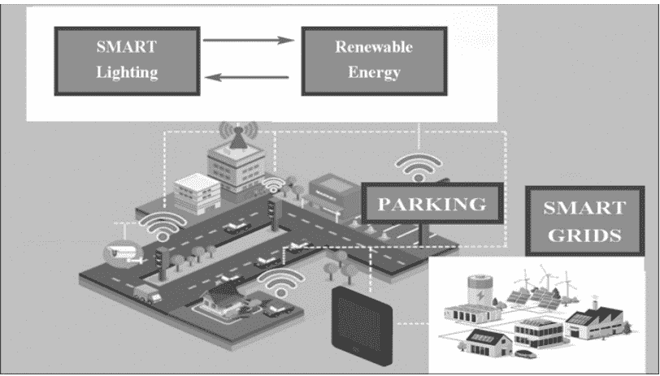

#### 图 7.4 能源元素上的智慧城市组件连接

#### 表 7.4 智慧城市智慧能源应用演进

| 序号 | 应用 | 优势 | 统计数据 |
|---|---|---|---|
| 1 | 智能照明 | 最高可减少 80% 的能源使用，降低 CO₂ 排放，提升公共安全与治安，美化环境，并优化城市规划 | 与传统灯相比，LED 街灯节能 50%–70%。智能照明系统可将城市能源使用量降低 15%–30%。配备智能照明的城市犯罪率下降了 20%–40% |
| 2 | 可再生能源整合 | 降低对化石燃料的依赖，提升能源独立性和安全性，减少能源开支，并增强环境可持续性和空气质量 | 预计到 2050 年，可再生能源将提供全球 86% 的电力需求。2021 年全球可再生能源装机容量达到 2.8 太瓦。可再生能源投资创造的全球就业岗位可能达到数百万个 |
| 3 | 智能电网 | 改善电网韧性和可靠性，减少能源损失和停电，优化能源分配和消耗，并整合可再生能源 | 预计到 2027 年，全球智能电网产业将达到 424.3 亿美元。智能电网可使电网韧性提高 20%–30%，并将能源损失降低高达 10% |

### 环境

- **空气质量监测**：关于空气质量的最新信息帮助当局定位并解决污染源，改善公共健康，并告知当地居民。

- **水资源管理**：实时监测有助于节约水资源，而泄漏检测系统和智能水表可改善用水并尽量减少水损失。

- **垃圾管理**：通过优化收集路线并监控垃圾桶中的垃圾水平，智能传感器可降低垃圾溢出并提高效率。

表 7.5 总结了智慧城市中空气质量管理、废弃物管理和水资源管理的环境影响统计数据，包含上述要素的智慧城市模型如图 7.5 所示。

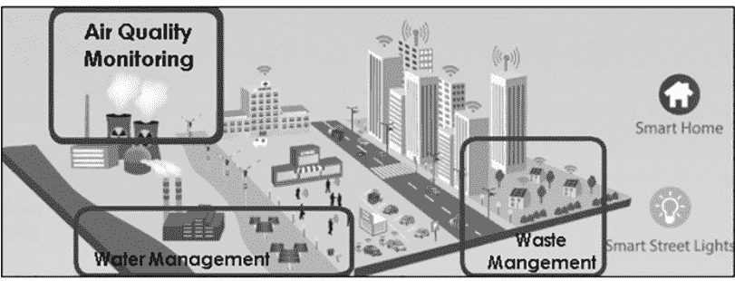

#### 图 7.5 智慧城市组件与部分环境元素的连接

#### 表 7.5 智慧能源环境应用演进

| 序号 | 应用 | 技术 | 统计数值 |
|---|---|---|---|
| 1 | 空气质量监测 | 传感器、AI 分析 | 平均 PM2.5 降低 10%–15%（因城市而异） – 80% 的人口可获得实时空气质量数据 – 哮喘住院率下降 5%–10% |
| 2 | 水资源管理 | AI 驱动的灌溉、泄漏检测系统和智能水表 | 水损失减少：15%–20% – 典型家庭可节省 5%–10% 的水 – 75% 的居民可获得实际用水数据 |
| 3 | 废弃物/垃圾管理 | AI 优化路线、智能垃圾桶和公民参与应用 | 废弃物收集效率提升：20%–30% – 回收率提高 10%–15% – 填埋垃圾减少 10%–15% |

### 公共安全与安保

- **紧急响应**：智能系统通过尽可能高效地分配资源和路线，尽量减少损失并挽救生命。

- **公共安全传感器**：这些设备可识别火灾和洪水等危机，并立即通知当地当局和公民。

- **视频监控**：具备分析功能的摄像头可识别异常活动并帮助降低犯罪率。

表 7.6 总结了智慧城市应用中公共安全与安保的影响及统计数据。

#### 表 7.6 智慧城市安全与安保应用影响演进

| 序号 | 系统 | 应用 | 统计数值 |
|---|---|---|---|
| 1 | 分析型视频监控 | 交通监控、嫌疑人识别和犯罪预防 | 部署后犯罪率下降 20%（来源：芝加哥市） |
| 2 | 紧急响应系统 | 增强的通信、资源分配和调度 | 紧急情况下反应时间加快 30%（参考：旧金山市） |
| 3 | 公共安全传感器 | 危害检测，包括火灾和洪水 | AI 驱动的传感器将误报减少 50%（来源：阿姆斯特丹市）。填埋垃圾减少 10%–15% |
| 4 | 智能照明 | 能源效率、行人安全和犯罪威慑 | 安装智能照明后，行人事故减少 40%。引用：伦敦市 |
| 5 | 访问控制系统 | 建筑物、受限区域和关键基础设施的安全访问 | 防止未经授权访问的尝试成功率为 99.9%（来源：Microsoft Azure Sentinel） |
| 6 | 网络安全措施 | 防止针对城市数据和基础设施的网络攻击 | 实施改进的安全机制后，网络攻击减少了 60%（来源：新加坡市） |
| 7 | 社交媒体监测 | 确定可能风险并监测公众舆论 | 使用情感分析检测潜在危险的精度为 80%（更多信息请参阅 IBM Watson） |

### 公民参与

- **电子政务服务**：通过促进公众与政府之间的联系，在线平台改善了服务提供并提高了公众参与度。

- **智能公民应用**：移动应用为居民提供关于活动、交通和市政服务的最新信息，从而提高他们的生活质量。

- **开放数据平台**：向公众开放城市数据鼓励创新、公民参与和透明度。

表 7.7 总结了智慧城市应用中公民参与的情况及统计数据。

#### 表 7.7 智慧城市公民参与应用影响演进

| 序号 | 系统 | 描述 | 统计数值 |
|---|---|---|---|
| 1 | 开放数据平台 | 向公众开放的包含信息的数据库 | 全球范围内，80% 的智慧城市进行交换 |


| 序号 | 系统 | 描述 | 统计值 |
|---|---|---|---|
| | | 关于城市环境、交通和犯罪 | 一些开放数据 |
| 2 | 电子政务服务 | 用于从政府获取许可证、执照和缴纳税款的在线资源 | 发达国家 55% 的公民使用电子政务服务 |
| 3 | 智能市民应用 | 提供活动、交通、城市服务和安全最新信息的移动应用程序 | 在智慧城市中，70% 的智能手机用户下载此类应用程序 |
| 4 | 参与式规划和决策制定 | 允许人们评论、对话题进行投票并影响政策决策的平台 | 30% 的智慧城市中，公民积极参与城市规划 |
| 5 | 社交媒体参与 | 使用社交媒体平台进行服务请求、申诉和公民沟通 | 全球 50% 的城市政府使用社交媒体与公民互动 |
| 6 | 公民举报与开放创新 | 居民可以举报城市问题、提出变革建议并参与创新项目的网站 | 25% 的智慧城市拥有众筹公民贡献的平台 |

## 7.4 智慧城市的全球影响

全球范围内，智慧城市正在以提升公民生活质量、可持续性和效率为目标，改造城市环境。其影响广泛，在若干重要领域已观察到显著变化：

### 经济影响
- 1. **全球智慧城市市场**：预计到 2026 年将达到 3.45 万亿美元。
- 2. 就业创造：据估计，到 2025 年，全球可能创造 1.6 亿个智慧城市新岗位。
- 3. **GDP 增长**：通过改善资源管理和刺激经济，智慧城市可使 GDP 增长高达 3.4%。

### 环境影响
- 1. **降低能耗**：智能电网可使建筑能耗降低高达 20%。
- 2. **减少温室气体排放**：通过采用可持续能源和交通方式，智慧城市项目有助于实现气候目标。
- 3. **改善空气和水质**：智能监测与控制系统可降低城市地区的污染水平。

### 社会影响
- 1. **增强公民参与**：借助开放数据平台和市民应用，可提高决策的透明度和参与度。
- 2. **服务可及性更公平**：智能技术有望弥合数字鸿沟，改善对医疗和教育等重要服务的获取。
- 3. **提升公共安全**：智能监控和应急响应系统可降低犯罪率，提高安全性。

## 7.5 智慧城市的国家影响

印度智慧城市使命于 2015 年启动，目标是将 100 座城市转变为拥有更好可持续实践、基础设施和市民生活质量的繁荣都市区。尽管该计划仍处于早期阶段，但已在多个领域开始产生积极影响：

### 经济影响
- 1. **投资**：截至 2023 年 7 月，住房和城市事务部 (MoHUA) 报告称，智慧城市项目的投资已超过 2.05 万亿卢比（260 亿美元）。
- 2. 预计到 2025 年，智慧城市将创造 100 万个新岗位。
- 3. **GDP 提升**：预计到 2030 年，其将贡献印度 1% 的 GDP（《智慧城市使命报告》，2020 年）。

### 环境影响
- 1. **降低能耗**：在 100 座城市安装 LED 路灯后，每年节省电力 7500 万千瓦时。
- 2. **改善空气质量**：根据 MoHUA（2023 年），42 座城市的智能交通管理解决方案使空气污染降低了 6%。
- 3. **提升用水效率**：根据 MoHUA（2023 年），45 座城市的智能水表将水损失降低了 15%。

### 社会影响
- 1. **改善城市服务**：51% 的智慧城市居民表示公共交通更易获取（《智慧城市使命调查》，2022 年）。
- 2. **改善医疗保健**：83 座城市的远程医疗项目使超过 850 万名患者受益（MoHUA，2023 年）。
- 3. **电子政务采用**：根据《智慧城市使命调查》（2022 年），62% 的智慧城市居民使用互联网获取政府服务。

表 7.8 展示了印度智慧城市使命对各邦影响的概况。

### 表 7.8 印度智慧城市对各邦的影响

| 序号 | 州 | 关键项目领域 | 成就 | 挑战 |
| :--- | :--- | :--- | :--- | :--- |
| 1 | 泰米尔纳德邦 | 钦奈、科伊姆巴托尔 | 水资源管理、远程医疗、智能教室和智能电网部署 | 项目土地征收、公众意识和网络安全 |
| 2 | 安得拉邦 | 阿马拉瓦蒂（首府）、维沙卡帕特南 | LED 路灯、太阳能利用、电子政务和智能卫生设施 | 阿马拉瓦蒂的基础设施建设和财政稳定 |
| 3 | 卡纳塔克邦 | 班加罗尔、迈索尔 | 废弃物管理、智能供水系统、市政监测和综合交通管理 | 街道拥堵、技术可负担性和数据隐私 |
| 4 | 特伦甘纳邦 | 海得拉巴 | CCTV 网络、智能交通信号、智能水表和电子政务门户 | 发展数据保护、财务管理和就业创造技能 |
| 5 | 喀拉拉邦 | 特里凡得琅、科钦 | 废物转能源设施、IT 基础设施建设、灾害管理系统和沿海保护 | 在环境保护与沿海开发之间取得平衡的公私合营 |

## 7.6 结论

印度的智慧城市正在呈现城市变革的积极形象，相关计划正在切实影响人们的生活。通过使用智能交通技术，该计划正在将空气污染降低 6%，并预计到 2025 年创造 100 万个新就业岗位，此外还有环境、社会和经济等方面的其他益处。超过 2.05 万亿卢比的投资以及 LED 路灯等项目（每年节省 7500 万千瓦时电力）体现了对进步的承诺。尽管包容性和财务可持续性等问题仍然存在，但通过借鉴国际最佳实践、专注于基础设施并积极吸引公众参与，印度的智慧城市可以充分发挥其潜力。想象一个无缝电子政务、数据驱动医疗和个性化公民服务成为标准操作程序的时代，从而打造充满活力、宜居宜业、惠及数百万人民的城市。尽管我们仍处于这段激动人心旅程的早期阶段，但印度可以变得更智能、更可持续。

## 参考文献

- 1. Luusua, A., Ylipulli, J., Foth, M., & Aurigi, A. (2023). 城市人工智能：理解人工智能在智慧城市中的新兴作用. AI & Society, 38(3), 1039–1044.
- 2. Lv, R., & Gao, H. (2023). 智慧城市建设对就业的影响：机制及来自中国的证据. Empirical Economics, 65, 2393–2425.
- 3. Ullah, F., & Al-Turjman, F. (2023). 用于管理智慧城市房地产交易的区块链智能合约采用概念框架. Neural Computing and Applications, 35(7), 5033–5054.
- 4. Kumar, M., Ramalingam, S., & Prasad, A. (2023). 面向智慧城市的优化智能交通标志预测框架. Soft Computing, 27(23), 17763–17783.
- 5. Liu, Z. (2023). 基于物联网的智慧城市中分布式边缘计算资源的多联合优化方法. Journal of Grid Computing, 21(4), 58.
- 6. Mohammed, M. A., Abdulkareem, M. J., Kumar, N. M., Abdulkareem, K. H., Mostafa, S. A., Maashi, M. S., ... & Chopra, S. S. (2023). 利用人工神经网络和特征融合的自动废物分类和回收分类：面向智慧城市的数字赋能循环经济愿景. Multimedia Tools and Applications, 82(25), 39617–39632.


- 7. Homer, S. T. (2023). 智慧可持续城市认知: 量表发展研究. Quality & Quantity, 57(4), 3363–3388.

- 8. Khurana, I., & Dutta, D. K. (2023). 从地方到空间: 智慧城市中可持续创业生态系统的涌现与演变. Small Business Economics, 62, 541–569.

- 9. Vanli, T. (2023). 使用动态因子分析对全球智慧城市进行排名. Social Indicators Research, 171, 405–437.

- 10. Alam, T. (2023). 基于区块链和大数据的 IoT 设备在智慧城市中的通信访问控制. Wireless Personal Communications, 132(1), 433–456.

- 11. Beniwal, R., Kalra, S., SinghBeniwal, N., & Gupta, H. O. (2023). 印度智慧城市的智能光伏系统: 成本分析. Environmental Science and Pollution Research, 30(15), 45445–45454.

- 12. Müller-Eie, D., & Kosmidis, I. (2023). 智慧城市中的可持续交通: 中型北欧智慧城市交通举措的文献研究. European Transport Research Review, 15(1), 36.

- 13. Miloud Dahmane, W., Ouchani, S., & Bouarfa, H. (2023). 通过区块链在智慧城市中保障信息完整性和访问控制. Journal of Ambient Intelligence and Humanized Computing, 14(9), 11419–11428.

- 14. Lauri, C., Shimpo, F., & Sokolowski, M. M. (2023). 大流行病响应前沿的人工智能与机器人技术: 技术采用的监管模式及智慧城市中有韧性组织的发展. Journal of Ambient Intelligence and Humanized Computing, 14, 14753–14764.

- 15. Anthony, Jr, B. (2023). 社区参与在城市创新中的作用: 迈向智慧可持续城市的共同创造. Journal of the Knowledge Economy, 15, 1592–1624.

- 16. Jnr, B. A., Sylva, W., Watat, J. K., & Misra, S. (2023). 分布式账本技术标准化框架, 用于可持续智慧城市中的可互操作数据集成和对齐. Journal of the Knowledge Economy, 15(3), 12053–12096.

- 17. Yan, Z., Jiang, L., Huang, X., Zhang, L., & Zhou, X. (2023). 人工智能塑造明天智慧城市的智能城市化: 当前发展、趋势和未来方向. Journal of Cloud Computing, 12(1), 179.

- 18. Ullah, A., Anwar, S. M., Li, J., Nadeem, L., Mahmood, T., Rehman, A., & Saba, T. (2023). 智慧城市: 物联网和机器学习在实现数据中心智能环境中的作用. Complex & Intelligent Systems, 10, 1607–1631.

- 19. Revathy, G., Selvkumar, K., Murugapriya, P., and Ravikumar, D. (2022). 工业 4.0 中使用计算智能的智能制造. In N. Thillaiarasu, S. Lata Tripathi, and V. Dhinakaran (eds), Artificial Intelligence for Internet of Things. CRC Press, Boca Raton, FL, pp. 31–48.

- 20. Shi, Y., Li, W., Chang, X., Yang, T., Sun, Y., & Zomaya, A. Y. (2023). 关于实现可持续智慧城市协作非侵入式负载监测. Scientific Reports, 13(1), 6569.

- 21. Zhou, R., Chen, S., & Zhang, B. (2023). 智慧城市建设与新型城镇化质量提升. Scientific Reports, 13(1), 21074.

- 22. Bibri, S. E., Alexandre, A., Sharifi, A., & Krogsie, J. (2023). 环境可持续智慧城市及其融合的人工智能、物联网和大数据技术与解决方案: 一种广泛文献综述的综合方法. *能源信息学*, 6(1), 9.

- 23. Jagatheesaperumal, S. K., Bibri, S. E., Ganesan, S., & Jeyaraman, P. (2023). 智慧城市道路质量评估的人工智能: 声学数据分析的机器学习方法. *计算城市科学*, 3(1), 28.

- 24. Rao, P. M., & Deebak, B. D. (2022). 智慧城市/行业中的安全和隐私问题: 技术、应用和挑战. *环境智能与人性化计算杂志*, 14(1), 10517–10553.

- 25. Karn, A. L., Pandya, S., Mehbodniya, A., Arslan, F., Sharma, D. K., Phasinam, K., & Sengan, S. (2021). 基于 IoT 的智慧城市污水处理和管理系统可持续发展的综合方法. *软计算*, 27(8), 5159–5175.

# 第 8 章

# 明日洞察: 智慧城市创新中降雨智能集成对未来城市发展的综述

P. Umamaheswari 和 V. Ramaswamy

DOI: 10.1201/9781003476047-8

## 8.1 智慧城市中的降雨智能简介

随着城市化和技术飞速发展，智慧城市的理念应运而生，成为应对城市生活日益增长问题的一种方式。为了提升城市的可持续性和韧性，智能技术集成是智慧城市发展的关键组成部分。作为一种气象分析子集的降雨智能，对于使城市更智能、更灵活至关重要。智慧城市的兴起主要归功于创新的 ICT 市场和行业。这些城市中心正在利用先进的解决方案，充分利用大数据、云计算和物联网（IoT）来紧密互连 [1] 城市内的每一个方面和要素。此外，这些技术的集成正在彻底改变城市景观，提高居民的效率、可持续性和整体生活质量。

随着智慧城市不断发展，它们正在成为技术进步的中心，数据驱动的洞察和连通性为应对现代城市生活挑战的创新解决方案铺平了道路。有观点提出，智慧城市中的安全干预措施可以分为三个特定类别：第一类是在保留传统执行器的同时加入新传感器；第二类侧重于现代化过时系统；第三类引入全新功能。在全面讨论这些主题后，对每组举措对更广泛的城市安全和治理领域的意义进行了彻底评估。这种细致入微的 [2] 智慧城市安全方法强调了城市安全措施不断发展的特性，其中创新传感器技术、系统升级和新功能相结合，有助于提升整体安全和治理水平。基于天气的交通分析（WBTA）是一种创新方法，旨在研究不同频率和时间间隔的时态相关性，具体关注交通流量与外部天气条件之间的相互作用。

其目标是确定影响交通流量行为及其持续时间的最具影响力的气象参数。这种细致的分析在改进多输入交通预测模型的输入参数选择方面发挥着关键作用。尽管众多气象因素正在受到审查，但本研究仅针对降水要素进行深入探讨，以便进行全面检验。通过聚焦降水对交通动态的影响，WBTA 方法 [3] 有助于深入理解特定天气条件如何塑造交通模式，从而帮助开发更准确、更有效的交通预测模型。各种框架采用了四种监督机器学习（ML）方法，即决策树、朴素贝叶斯、K-最近邻和支持向量机。值得注意的是，这些框架集成了模糊逻辑作为一种技术，用于融合这些 ML 方法的预测准确性（通常称为融合），以提高降雨预测的有效性。研究 [4] 利用了拉合尔 12 年的历史天气数据（从 2005 年到 2017 年）来指导预测模型。在分类程序之前，数据集经历了诸如清洗和归一化等基本预处理操作。

研究结果表明，ML 与模糊逻辑相比其他模型性能更优。这种多样 ML 技术与模糊逻辑的集成，强调了为优化降雨预测准确性所采用的多方面方法。一系列研究已经探讨了在智慧城市中采用先进技术进行时空空气质量预测的应用。另一研究小组 [5] 为此开发了一种模型，而 Samal 等人 [6] 提出了一种 CNN-BI_LSTM 模型，其性能优于传统方法。Drewil 和 Al-Bahadili [7] 回顾了用于空气污染预测的深度学习技术，重点关注 PM 2.5。Riyaz 等人 [8] 引入了一种模糊-


基于逻辑的方法可用于预测空气质量指数（AQI），Schürholz et al. [9] 提出了一种结合上下文感知的空气质量预测模型，该模型整合了用户健康档案和周围污染源。这些研究共同凸显了先进技术在改善智慧城市空气质量预报方面的潜力。

### 8.1.1 理解降雨智能

降雨智能涉及使用传感器、数据分析和机器学习等先进技术，来监测、分析并响应城市地区的降雨模式。随着降雨智能所代表的尖端技术融合，智能城市水管理的新时代已经开启。降雨智能是指通过在大都市环境中战略性地部署最先进的传感器，无缝集成数据分析和 ML，以持续监测、评估和响应动态降雨模式的能力。这些尖端传感器充当系统的眼睛，实时收集降水分布、强度和水平数据。当与强大的数据分析相结合时，这些信息构成了深入理解大都市地区降雨动态的基础。该系统可以使用 ML 算法来解释复杂模式，从而预测并适应不断变化的天气状况。降雨智能的主要优势在于其主动性。它能够通过快速分析传入数据，在应对天气条件变化时实现及时且明智的决策。市政当局可以利用这些信息来提高整体城市韧性，降低洪水风险，并有效管理雨水。

降雨智能还提供了一种灵活且可扩展的解决方案。系统会随时间发展，在传感器功能、ML 模型和分析算法中吸收新功能并增强现有功能。这保证了该策略始终处于管理城市水资源技术的前沿。其优势不仅限于立即防止洪水。凭借准确的降雨洞察，城市规划者可以就基础设施建设、水资源分配和气候韧性策略做出明智判断。通过采取综合策略，可持续城市化得到促进，城市也能更好地应对日益不稳定的天气模式带来的挑战。降雨智能本质上是城市处理水管理方式的一种范式转变。城市地区不仅可以应对暴雨事件，还可以利用传感器、数据分析和 ML 为水安全的未来创建具有韧性和适应性的策略。

### 8.1.2 通过实时降雨洞察赋能城市

实时数据收集和分析可提供准确且及时的降水信息，使城市能够做出明智的决策。利用实时数据收集和分析是为城市提供精确且及时的降水信息的关键进步。这种动态方法使市政当局能够通过接收降雨模式的准确更新而保持领先，从而培养做出明智决策的能力。在城市规划和管理领域，实时性尤其具有变革性。由先进传感器促进的快速和持续的数据收集，确保城市能够及时了解降水水平和分布。这种即时性赋予决策者快速应对不断变化的天气状况的能力，并能就基础设施、公共安全和资源分配做出明智的选择。

实时数据的准确性在增强城市官员可获得信息的可靠性方面起着关键作用。通过利用降水测量精度的力量，市政当局可以优化对天气相关挑战（例如洪水控制和排水管理）的响应。此外，实时数据分析的整合提供了前瞻性视角。城市规划者可以利用预测分析来预测降水趋势，并主动规划对城市地区的潜在影响。这种前瞻性方法有助于创建更具韧性和适应性的城市环境。实时降水信息的好处不仅限于紧急响应场景。农业、交通运输和水资源管理等行业可以通过将策略与准确且及时的数据相结合来优化其运营。这反过来又促进了各个领域的可持续性和效率。随着技术进步的继续，实时数据收集和分析方法不断发展，确保城市始终处于利用最新工具进行天气监测的前沿。降水数据中精度和即时性的协同作用，使城市能够应对气候变异性带来的挑战，并为具有韧性和可持续的城市发展奠定基础。

## 8.2 城市环境中降雨带来的挑战

城市地区面临与降雨相关的众多挑战，包括洪水、交通中断和基础设施损坏。城市地区以高人口密度和广泛的基础设施为特征，在降雨方面面临各种挑战。虽然雨水对环境至关重要，但快速城市化和气候模式的变化加剧了降雨对这些地区的影响。本文探讨了城市地区面临的多方面挑战，从洪水到交通中断和基础设施损坏。城市洪水模拟始于理解水文过程，如图 8.1 所示。这包括降雨模式、入渗率（水渗入地面的速度）、地表径流（在地面上流动的水）和排水系统（下水道、涵洞等）。降雨数据通常从气象站或雷达获得，是关键输入。

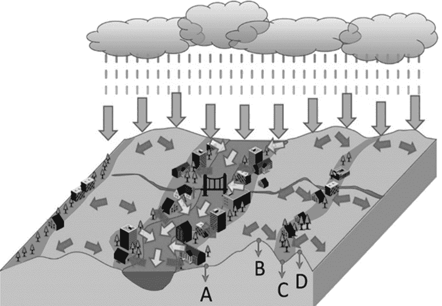

图 8.1 一个水文模型。

### 8.2.1 洪水

降雨期间城市地区面临的主要挑战之一是洪水。密集开发通常会导致不透水面积增加，从而减少自然排水。结合不足的雨水管理系统，暴雨可能导致突发洪水，并淹没街道、住宅区甚至商业区。这对公共安全、财产和城市景观的整体功能构成重大威胁。

### 8.2.2 交通中断

降雨显著导致城市环境中的交通中断。被淹的街道、能见度降低和湿滑的路面状况可能导致交通拥堵、事故和延误。城市交通系统已经因车辆数量而不堪重负，在降雨期间面临额外挑战。高效的交通管理策略和基础设施改进对于缓解这些问题至关重要。

### 8.2.3 基础设施损坏

包括建筑物、道路、桥梁和排水系统在内的城市基础设施容易受到降雨造成的损坏。过多的水分积聚可能会削弱地基、冲刷土壤，并损害建筑物和交通网络的结构完整性。降雨后修复和维护基础设施的经济代价凸显了具有韧性的城市规划和建筑实践的重要性。

### 8.2.4 内涝与公共卫生

持续降雨可能导致低洼地区内涝，为病媒生物创造滋生地。积水可能会促进水传播疾病的传播，对城市人口构成健康风险。适当的卫生和排水系统对于缓解这些健康问题并确保居民福祉至关重要。

## 8.3 降雨领域的技术进步


### 智能集成

近年来，重大技术进步重塑了城市环境中降雨智能集成的格局。尖端传感器技术的部署和复杂算法的应用彻底改变了城市收集、处理和利用降雨数据的方式。这些进步使得对降水模式、强度和频率的理解更加全面。

#### 8.3.1 传感器网络

在全市战略性部署气象传感器，可以收集关于降雨模式的准确且实时的数据。这包括降雨强度、降雨事件持续时间和降水频率等信息。气象传感器的实时数据有助于开发预警系统。通过分析收集到的信息，城市官员可以预见潜在的洪水风险，从而制定及时的疏散计划和应急响应策略。城市规划者可以利用收集到的数据来改善城市基础设施和排水系统。降雨强度信息有助于设计能够承受不同天气条件的韧性结构，从而最终降低基础设施损坏的风险。

气象传感器的部署涉及在城市关键位置安装先进的气象仪器。这些传感器采用尖端技术，包括：

- 雷达系统，提供关于降雨强度和移动的详细信息
- 自动雨量计，以高精度测量特定地点的降雨量
- 气象站，监测各种气象参数，提供本地天气状况的全面视图

#### 8.3.2 数据分析

在追求城市韧性的过程中，部署气象传感器进行实时降雨监测至关重要。然而，真正的力量在于应用复杂算法来处理和解释收集到的数据。这种高级分析揭示了与降雨相关的模式、趋势和潜在风险，为城市规划和风险缓解提供了宝贵的洞察。复杂算法能够无缝整合来自多个气象传感器的数据，提供全市范围内降雨的全面视图。通过采用机器学习技术，算法能够识别降雨强度、持续时间和频率中的模式，帮助识别反复出现的天气现象。时间分析有助于了解降雨模式如何随时间演变，从而实现对季节性变化和气候趋势的预测。通过概率模型，算法评估极端降雨事件的风险，为灾害防范和应对规划提供关键信息。He 等人 [10] 利用可解释深度学习开发了月降雨的数据驱动多步预测模型，实现了高精度。

算法分析有助于识别长期趋势，帮助城市规划者调整基础设施以适应不断变化的气候条件。识别降雨的季节性变化可以采取预先措施，确保城市在降水增加时期做好充分准备。利用历史数据和实时输入，算法有助于开发准确的降雨预测工具，增强城市对即将发生的天气事件的准备能力。它们还会生成动态风险图，突出显示在特定降雨情景下易发生洪水或基础设施脆弱性的区域。Carrera 和 Kim [11] 提出了一种用于智慧城市能源消耗的回归框架，使用编码器-解码器循环神经网络。这建立在 Carrera 等人 [11] 之前在预测韩国智慧城市松洞能源消耗方面的工作，以及 Khan 等人 [13] 在住宅和商业建筑能源预测方面的工作之上。

城市规划者利用算法洞察来优化基础设施，确保道路、排水系统和建筑能够抵御不同的降雨条件。算法为分区策略提供依据，根据识别出的降雨风险指导土地利用和开发法规的决策。一系列研究探讨了在印度使用先进技术进行降雨预测。Bansal 等人 [14] 引入了 RfGanNet，这是一种结合 RfGan 和深度卷积神经网络的方法，用于预测印度及其聚类地区的降雨。研究发现，该方法高效且准确。以成功的算法应用为例，新加坡的智慧国家计划体现了将降雨数据分析作为管理城市挑战的一部分。总之，利用复杂算法处理和解释实时降雨数据，提高了预测的精确性，使城市能够主动应对与降雨相关的挑战，从而营造更具韧性的城市景观。

#### 8.3.3 与智能基础设施的集成

在城市韧性领域，将降雨智能与智能基础设施相结合代表了一种渐进式方法。这涉及将气象传感器和算法分析获得的实时数据与先进系统（尤其是智能排水系统）相连接。目标是基于分析数据实现自动化响应，创造一个更具适应性和响应性的城市环境。

这种集成使降雨监测系统与智能排水网络之间能够实现无缝通信。随着降雨数据的持续收集和实时处理，智能基础设施会根据不断变化的天气条件做出动态响应。当检测到强降雨时，智能排水系统内会触发自动化响应，以优化水流并防止潜在的洪水。自动化响应不仅限于排水系统，还延伸至智能基础设施的其他方面，例如交通管理和应急服务。一系列研究探讨了使用深度学习模型进行热浪预测。Byagar 等人 [15] 开发了一种使用循环神经网络（特别是 LSTM）的热浪预测模型，该模型展现了高精度。例如，在强降雨期间，可以实时调整交通信号以改善交通流并缓解拥堵。

应急服务也可以接收自动警报，从而在易受洪水或其他天气相关挑战影响的区域实现快速响应和协调。这种与智能基础设施的集成有助于提高城市系统的整体效率。通过利用技术和实时数据，城市可以增强对天气相关事件的适应能力。这种方法不仅改善了对降雨引发挑战的管理，还为更具韧性和可持续的城市景观奠定了基础。最近的研究探讨了在城市洪水预测中使用机器学习模型，尤其是长短期记忆（LSTM）神经网络。Chen 等人 [16] 提出了一种将数值模型与 LSTM 模型相结合的方法，以实现高预测精度和快速计算速度。该研究的局限性包括：由于使用数值模型的计算结果作为训练样本，可能导致误差累积；以及需要使用观测的风暴洪水数据作为驱动来提高精度。此外，随着观测降雨洪水数据量的增加以及神经网络模型算法的渐进式发展 [12]，样本需求减少也是一个局限性。

## 8.4 雨水智能在智慧城市中的益处

将降雨智能集成到智慧城市中带来诸多益处，增强了城市韧性和可持续性。对降水模式、强度和频率的实时监测提供了有价值的洞察，这些洞察可以


可被广泛应用于各个领域。其中一项主要优势在于对天气相关挑战的主动管理，使城市能够迅速响应变化的条件。这种技术驱动的方法促进了更高效、更具适应性的城市景观。智慧城市中降雨智能的优势还包括：

### 8.4.1 防洪

通过持续监测降雨数据，智慧城市可以主动管理排水系统并降低洪水风险。由降雨智能触发的自动化响应可以优化水流，并减少强降水对城市地区的影响。

### 8.4.2 基础设施优化

降雨智能向城市规划者和政策制定者提供天气事件对基础设施可能影响的信息。这一洞察使设计和材料的优化成为可能，确保建筑物、道路及其他结构能够抵御不同的降雨条件。

### 8.4.3 资源分配

智慧城市利用降雨智能在天气相关事件期间有效分配资源。紧急服务可以根据实时数据进行战略性部署，确保对洪水或交通中断等潜在风险做出快速且针对性的响应。

### 8.4.4 交通管理

与智慧交通系统集成，可根据降雨情况进行实时调整。交通信号灯可以优化，路线可以动态调整，信息可以传达给驾驶员，以在恶劣天气条件下提升整体交通管理水平。

### 8.4.5 能源效率

降雨智能可用于优化智慧城市的能源消耗。例如，智慧路灯系统可以根据天气条件调节亮度，减少低能见度期间的能源浪费。

### 8.4.6 公共安全

降雨智能的及时可用性有助于公共安全，通过提供早期警告和警报。居民可以了解潜在风险，疏散计划可以被启动，确保城市人口的福祉。

### 8.4.7 可持续城市规划

从降雨智能中获得的洞察支持可持续城市规划。城市可以制定环保策略，例如绿色基础设施，以管理降雨径流并促进生态平衡。

### 8.4.8 数据驱动的决策

智慧城市利用降雨智能进行明智的决策。数据驱动的方法增强了实施有针对性的政策、投资和干预的能力，从而实现更有效且更具韧性的城市发展。

## 8.5 案例研究

### 8.5.1 新加坡

该城邦已实施先进的降雨智能系统，该系统与其智慧城市计划相结合，能够对强降雨做出快速响应，并尽量减少洪水相关中断。新加坡的天气预测模型开发已取得显著进展，新加坡气象局与英国气象局共同实施了对流尺度数值天气预报（NWP）系统 [17]。天气研究与预报（WRF）模型也已在该地区进行评估，高分辨率数据集提高了其准确性 [18]。然而，数据缺乏和地理复杂性等挑战依然存在，阻碍了进一步的进步 [19]。已提出雨强和衰减预测模型，但需要将其与现有模型进行比较 [20]。这些研究凸显了新加坡天气预测领域的进展、挑战和机遇。新加坡，这个以其对智慧城市计划的承诺而闻名的城邦，已战略性地实施先进的降雨智能系统，以增强其城市韧性。这一复杂系统与城市更广泛的智慧基础设施无缝集成，允许实时监测降雨模式、强度和频率。新加坡的降雨智能系统利用尖端传感器技术和先进算法，在面对强降雨事件时促进快速响应机制。

- 降雨智能的集成是新加坡尽量减少洪水相关中断承诺中的关键组成部分。该城市的智慧排水系统会根据分析后的降雨数据自动调整，优化水流并降低城市洪水风险。这种主动方法与新加坡维持高效且适应性强的城市环境的承诺保持一致。

- 通过将实时降雨数据纳入其智慧城市框架，新加坡增强了数据驱动决策的能力。该城市利用这一智能有效分配资源、优化交通管理，并在恶劣天气条件下加强公共安全。这种整体集成凸显了新加坡对技术创新、可持续性以及创建能够在天气相关挑战中蓬勃发展的具有韧性的城市景观的承诺。

### 8.5.2 哥本哈根

丹麦首都哥本哈根通过战略性地使用降雨智能，体现了创新的城市水管理。该城市拥抱技术以解决雨水挑战，实施了一个先进的系统，实时监测降雨模式。这种主动方法使哥本哈根能够高效管理雨水，降低洪水风险，并促进可持续水管理实践。主要研究结果包括：城市在可持续淡水管理中的关键作用及其适应气候变化的必要性，从可持续发展和气候韧性角度描述北京和哥本哈根的城市水管理，以及考虑工具的潜在影响和绿色基础设施方法对改善城市可持续性治理的相关性。哥本哈根创新的城市水管理（尤其是雨水管理）是利用实时降雨智能的主动方法的结果 [21]。这种方法是更广泛战略的一部分，包括使用蓝绿基础设施 [22]。该城市在此领域的成功证明了地方政府集体能力的重要性 [23]。

- 将降雨智能集成到哥本哈根的城市规划中，使城市能够根据不同的降水水平动态适应。通过利用先进的传感器和算法，系统分析降雨数据以优化排水系统并减少强降雨对城市基础设施的影响。这种前瞻性战略与丹麦对环境可持续性和韧性的承诺保持一致。

- 哥本哈根对降雨智能的应用不仅限于防洪。该城市利用这种数据驱动方法为基础设施规划提供信息，确保建筑物和公共空间的设计能够承受并高效管理不同的天气条件。将技术融入水管理，符合哥本哈根成为智慧、可持续城市的更广泛倡议，优先考虑环境意识及其居民的生活质量。

## 8.6 未来前景与挑战

### 8.6.1 创新

降雨智能技术的持续研究和创新对于深化我们对降水模式的理解并提高天气预测准确性至关重要。科学家和气象学家正在积极探索收集、分析和解释降雨数据的新方法，以提高降雨智能系统的整体效率。先进的天气雷达、卫星图像和 ML 算法等尖端技术正在被集成，以创建更复杂、更可靠的降雨预测模型。这些创新旨在提供关于降雨事件的及时、精确信息，有助于改进洪水预报、水资源管理和灾害防范。对新传感器技术、数据同化技术和建模框架的持续探索有助于降雨智能能力的演进。此外，物联网设备和众包数据的集成正在扩大数据来源


用于降雨监测的信息，促进对降水动态的更全面和实时的理解。

研究人员也专注于提升降雨数据的空间时空分辨率，从而实现更本地化、更精准的预测。此外，通信系统的创新有助于将降雨信息快速传播给公众及相关部门，增强社区抵御天气相关风险的韧性。随着技术的发展，持续改进降雨情报对于应对气候变率和极端天气事件带来的挑战至关重要。降雨情报技术的这些进步在支持可持续农业实践、有效管理水资源以及减轻天气引发的灾害对社区的影响方面发挥着关键作用。总体而言，持续的研究努力和技术创新正在推动降雨情报的发展，使各个受天气模式影响的领域能够做出更明智的决策。

### 8.6.2 数据隐私与安全

确保数据隐私和安全对于解决与敏感天气数据收集和管理相关的问题至关重要。随着气象技术的进步，收集的个人和位置特定信息数量不断增加，引发了对潜在滥用或未经授权访问的担忧。强大的加密协议和安全的数据存储系统对于保护敏感天气数据免受网络威胁和未经授权的访问至关重要。必须实施严格的访问控制和身份验证机制，仅限授权人员访问数据。此外，应应用全面的数据匿名化技术，以在允许有意义分析的同时保护个人隐私。透明的隐私政策和遵守数据保护法规对于建立公众对负责任处理天气数据的信任和信心至关重要。

气象机构、研究人员和技术开发商之间的协作对于建立行业范围的数据安全和隐私标准至关重要。对数据保护措施进行定期审计和评估，有助于发现并解决天气数据系统中的潜在漏洞。教育和宣传项目对于向公众说明为保护其数据所采取的措施至关重要，从而培养透明度和问责意识。对新兴网络安全威胁的持续监测可确保采取自适应安全措施，以应对天气数据完整性面临的不断演变的风险。在研究的数据可访问性与个人隐私保护之间取得平衡，对于应对与天气数据管理相关的伦理问题至关重要。通过优先考虑隐私和安全，气象社区可以营造一种协作环境，鼓励出于社会利益而负责任地使用和传播天气数据。

### 8.6.3 全球协作

促进城市之间的全球协作对于分享最佳实践和建立标准化方法以增强降雨情报至关重要。全球各地的城市都面临着与降雨监测、防洪准备和水资源管理相关的类似挑战。通过促进协作，城市可以交流宝贵的洞察、经验教训和创新解决方案，以解决共同问题。这种协作有助于制定标准化的降雨数据收集、分析和解释方法。分享技术进步和最佳实践可确保各城市无论地理位置如何，都能受益于经过验证的方法来提升其降雨情报能力。联合研究计划和信息交流使城市能够从彼此的成功和挑战中学习，从而共同改进降雨预测模型。

标准化方法促进互操作性，使城市能够采用兼容的技术和系统以实现无缝协作。协作努力还扩展到灾害响应和恢复，共享的降雨情报增强了在极端天气事件期间协调和提供援助的能力。全球伙伴关系有助于建立对多样化降雨模式的全面了解，为更有效的气候适应战略做出贡献。此外，协作有助于建立数据共享的国际框架，确保在处理敏感信息时采取合乎伦理和安全的做法。通过创建一个互联互通的城市网络，全球社会可以共同应对气候变化日益复杂的问题，增强抵御天气相关风险的韧性。联合倡议鼓励开放数据平台的发展，促进共享降雨情报资源的透明度和可访问性。最终，降雨情报领域的全球协作对于应对天气模式变化对城市环境的影响、建立统一战线、促进全球可持续城市发展至关重要。

## 8.7 结论

总之，将降雨情报融入智慧城市框架，是建设具有韧性、适应性和可持续性的城市环境的关键一步。通过利用尖端技术，城市可以主动应对降雨带来的多方面挑战，提升其准备和响应能力。这种变革性方法不仅减轻了天气相关中断的影响，还提高了城市居民的整体生活质量。先进气象数据分析、实时监测和智能基础设施的协同作用，使城市能够做出明智的决策，减少脆弱性，营造更安全的城市景观。随着智慧城市的不断发展，降雨情报的无缝集成是建设能够承受并适应自然动态力量的城市的基石。这不仅增强了城市韧性，而且对创造宜居、可持续、技术先进的城市生态系统起着重要作用，这些生态系统优先考虑居民的福祉和安全。通过技术与城市规划的融合，降雨情报的融入凸显了一种前瞻性的承诺，即塑造在不断变化的气候和新出现的挑战中蓬勃发展的城市。

## 参考文献

- 1. Kirimtat, A., Krejcar, O., Kertesz, A., & Tasgetiren, M. F. (2020). Future trends and current state of smart city concepts: A survey. IEEE Access, 8, 86448–86467.
- 2. Laufs, J., Borrion, H., & Bradford, B. (2020). Security and the smart city: A systematic review. Sustainable Cities and Society, 55, 102023.
- 3. Nasser, A., & Simon, V. (2021, June). A novel method for analyzing weather effect on smart city traffic. In 2021 IEEE 22nd International Symposium on a World of Wireless, Mobile and Multimedia Networks (WoWMoM), Pisa, Italy (pp. 335–340). IEEE.
- 4. Rahman, A. U., Abbas, S., Gollapalli, M., Ahmed, R., Aftab, S., Ahmad, M., ... & Mosavi, A. (2022). Rainfall prediction system using machine learning fusion for smart cities. Sensors, 22(9), 3504.
- 5. Naeem, M., Arab, M. G., Elbaz, Y., Omar, M., Ezzat, H., & Zeiada, W. (2024). Resilient behavior of bio-cemented sandy soil treated with enzyme-induced carbonate precipitation for pavement applications. Construction and Building Materials, 411, 134434.
- 6. Samal, K., Babu, K., & Das, S. (2021). Spatio-temporal prediction of air quality using distance based interpolation and deep learning techniques. EAI Endorsed Transactions on Smart Cities, 5(14), 1–5.
- 7. Drewil, G. I., & Al-Bahadili, R. J. (2021). Forecast air pollution in smart city using deep learning techniques: A review. Multicultural Education, 7(5), 38–47.
- 8. Riyaz, S., Sankhe, K., Ioannidis, S., & Chowdhury, K. (2018). Deep learning convolutional neural networks for radio identification. IEEE Communications Magazine, 56(9), 146–152.
- 9. Schürholz, D., Kubler, S., & Zaslavsky, A. (2020). Artificial intelligence-enabled context-aware air quality prediction for smart cities. Journal of Cleaner Production, 271, 121941.
- 10. He, R., Zhang, L., & Chew, A. W. Z. (2024). Data-driven multi-step prediction and analysis of monthly rainfall using explainable deep learning. Expert Systems with Applications, 235, 121160.
- 11. Carrera, B., & Kim, K. (2023). A regression framework for energy consumption in smart cities with encoder-decoder recurrent neural networks. Energies, 16(22), 7508.
- 12. Revathy, G., Aurchana, P., Arieth, R. M., Kavitha, N. S., Ramalingam, A., & Ramaswamy, K. (2022). HANA: A performance-based machine learning and neural network approach for climate resilient agriculture. Journal of Nanomaterials, 2022, 6–12.
- 13. Khan, Z. A., Hussain, T., Ullah, A., Rho, S., Lee, M., & Baik, S. W. (2020). Towards efficient electricity forecasting in residential and commercial buildings: A novel hybrid CNN with a LSTM-AE based framework. Sensors, 20(5), 1399.
- 14. Bansal, K., Tripathi, A. K., Pandey, A. C., & Sharma, V. (2024). RfGanNet: An efficient rainfall prediction method for India and its clustered regions using RfGan and deep convolutional neural networks. Expert Systems with Applications, 235, 121191.
- 15. Byagar, S., Deshmukh, A. A., Wanjale, K., Wadne, V. S., Ranjan, N., & Gangarde, R. (2024). Heat wave prediction using recurrent neural networks based on deep learning. International Journal of Intelligent Systems and Applications in Engineering, 12(1s), 612–619.
- 16. Chen, J., Li, Y., Zhang, C., Tian, Y., & Guo, Z. (2023). Urban flooding prediction method based on the combination of LSTM neural network and numerical model. International Journal of Environmental Research and Public Health, 20(2), 1043.


- 17. Dipankar, A., Webster, S., Sun, X., Sanchez, C., North, R., Furtado, K., ... & Barker, D. (2020). SINGV：新加坡对流尺度天气预报模型。《皇家气象学会季刊》，146(733)，4131–4146。

- 18. Revathy, G., Selvakumar, K., Murugapriya, P., & Ravikumar, D. (2022). 基于计算智能的工业 4.0 智能制造。载 N. Thillaiarasu, S. Lata Tripathi, and V. Dhinakaran (编), 《物联网人工智能》。CRC Press，博卡拉顿，佛罗里达州，第 31–48 页。

- 19. Lee, J. C. K., Zhang, H., Barker, D. M., Chen, S., Kumar, R., An, B. W., ... & Chandramouli, K. (2022). 新加坡天气预测——进展、挑战与机遇。《气象学》，1(4)，394–401。

- 20. Yeo, J. X., Lee, Y. H., & Ong, J. T. (2014). 热带地区卫星通信雨衰预测模型。《IEEE 天线与传播学报》，62(11)，5775–5781。

- 21. Nielsen, S. B., & Jensen, M. B. (2016). 迈向丹麦可持续城市水资源治理：地方当局的能力集体建设。《创新与可持续发展国际期刊》，10(2)，103–119。

- 22. Liu, L., Fryd, O., & Zhang, S. (2019). 用于可持续城市雨水管理的蓝绿基础设施——北京和哥本哈根六个市政府主导试点项目的经验。《水》，11(10)，2024。

- 23. Nielsen, S. B., & Jensen, M. B. (2016). 迈向丹麦可持续城市水资源治理：地方当局能力的集体建设。《创新与可持续发展国际期刊》，10(2)，103–119。

# 第 9 章

# 智慧城市的工业物联网

Bala Krishnan Raghuopathy, V. Subramaniyaswamy, Manikandan Ganesan, and Rajesh Kumar Namachivayam

DOI: 10.1201/9781003476047-9

## 9.1 引言

“智慧城市”概念开始流行，因为它从根本上改变了人们在城市环境中使用技术的方式。大量电子和数字应用、面向行政场景的嵌入式 ICT（信息和通信技术）、用于运营系统中通信与信息的 ICT、辅助人员的 ICT 以及用于增强信息和创新的 ICT，按定义均为智慧城市的主要组成部分。“物联网 (IoT)”一词被定义为使用无线技术相互同时通信的互连电子设备网络。这些设备能够交换、处理和存储数据。IoT 设备正在占领包括工业、运输、军事和智能家居在内的多个应用领域。“工业物联网 (IIoT)”一词是指通过将 IoT 的优势融入工业流程管理，创建智能制造生态系统的富有想象力的尝试。此外，这项技术是既可维护又可升级的智慧城市基础设施的一部分，即工业领域被称为 IIoT。工业设备正在 IIoT 的背景下执行其功能，IIoT 旨在提高工业活动的生产、性能和维护效率。IoT 多样化程度高，处理能力有限，并采用不断演变的各种方法，这使其面临一系列安全风险。市政府利用智慧城市功能，致力于提升市民的生活质量。连接对于智慧城市应用至关重要，市场上有多种新技术，可支持越来越多旨在改善社区生活的应用。城市管理者除了应对人口结构变化和人口增长外，还必须优先处理许多问题。他们还必须应对各种困难，例如高昂的运营费用和基础设施要求。尽管技术在帮助地方政府实现目标方面变得越来越重要，但与公用事业公司和监管机构改进协调可能会加快公众获得智慧城市服务的速度。

## 9.2 提升和发展智慧城市面临的挑战

将智慧城市服务与城市优先事项相关联是实施这些服务的第一步。公共安全、提升人们出行便利性、公共卫生、信息共享和能源韧性是市政府最常优先关注的问题，但这些因城市而异。使用技术将是提高公共卫生和安全标准的关键。城市的需求将决定哪些技术投资最为重要。例如，考虑交通问题。亚特兰大和奥斯汀等地正在发生大规模人口涌入。2021 年至 2022 年间，奥斯汀实际上经历了美国第六大的人口增长。随着类似地区的发展和适应不断增长的人口，需要更好的交通控制优先事项，以改善交通流量、减少交通拥堵、污染和时间损失。确保可靠的能源供应应是城市管理者和政府的首要责任，特别是考虑到全国天气的日益多变。为了确保能源资源的高效利用并降低降压或停电的风险，对于屋顶和社区太阳能、区域供暖和制冷以及汽车电气化，将需要更深入了解电网运行情况。即使市政管理者致力于通过解决这些目标更好地服务于居民，实现智慧城市服务的全部潜力也充满困难。

## 9.3 智慧城市当前正在解决的问题

高昂的新基础设施成本和监管问题是城市目前面临的两大主要问题。这些问题阻碍了智慧城市的创新与发展。政府管理者应认识到，为跟上智慧城市快速扩展的趋势，向智慧城市转型将需要在基础设施和技术方面进行大量投入。由于资金限制和目标冲突，快速采纳智慧城市变革并跟上城市增长步伐可能面临挑战。技术进步经常超出市政资源范围，即使技术到位，也可能未能充分利用。鉴于其现有的通信基础设施，电力、燃气和水务公用事业是提供智慧城市服务条件最好的行业。公用事业基础设施可用于大幅降低部署成本并加快智慧城市服务的推广。然而，现有的公用事业法律偶尔可能成为重大障碍。法规带来的限制以及对公用事业投资回报（及相应的电力分配成本）的担忧，可能迫使城市投入大笔资金自行开发基础设施，而非利用公用事业现有基础设施，从而增加成本并减缓创新。公用事业监管框架也可能成为城市现代化的绊脚石。例如，在公用事业开始建设其基础设施之前，公用事业委员会和其他监管机构必须批准特定的电价 [11]。这些监管机构的主要关注点是对电力消费者的影响，它们通常关注公用事业的运营。难以确定公用事业的智慧城市服务应如何影响电价基础，这使得基础设施投资更加困难。为智慧城市提供服务的最佳方式需要公用事业、监管机构和政府之间的协调。如果地方政府无法负担投资提升居民生活水平所需的基础设施和技术，智慧城市将无法扩展和繁荣。


## 9.4 探索技术进步

合适的技术，例如宽带网状网络、公共或专用 LTE 以及物联网 (IoT) 传感器，将取决于每个城市的具体需求，并构建理想的智慧城市。在物联网领域，创新正在飞速进行。物联网传感器在智慧城市应用中有多种用途，该技术有潜力改变城市生活。例如，通过在垃圾桶中使用传感器来跟踪垃圾桶的重量，仅在需要且在需要的地方使用卡车清理垃圾桶，就可以减少废物管理费用、交通拥堵和空气污染。物联网传感器还可用于检测噪音污染和空气质量的变化，在问题变成重大问题之前警告城市管理者，并检测人们意识到之前环境条件的变化。

宽带网状网络可以实现对过往车辆的视频监控，以实现更好的交通控制和公共安全，以及降低交通拥堵等其他基本市政改进。5G 技术可能使智慧城市能够更快地在设备之间进行通信，从而整体改善安全性和通信。特别是，5G 可以通过增强系统间通信并在可能发生停电之前提醒网络运营商设备故障，来帮助确保弹性和能源效率。在大多数可以容纳 5G 基础设施的城市中，实施效果尤为显著。然而，5G 的新颖性也是其缺点之一。大型城市地区和更农村的地方可能目前还没有相同的基础设施来服务这些用例。随着时间的推移和 5G 使用的普及，这一情况将会改变。标准化组织随后将把注意力转移到下一代通信上。控制所提供服务的生命周期及其支撑的通信基础设施对于政府和公用事业至关重要。尽管城市规划师继续面临众多障碍，但技术有能力整体提升城市生活，并使更实用、更高效的智慧城市的实现成为现实，而基于 IIoT 和区块链技术 (BCT) 的智慧城市演进在图 9.1 中有所说明。所有与 BCT 相关的交易都连接了 IIoT 应用程序与智慧城市应用程序。

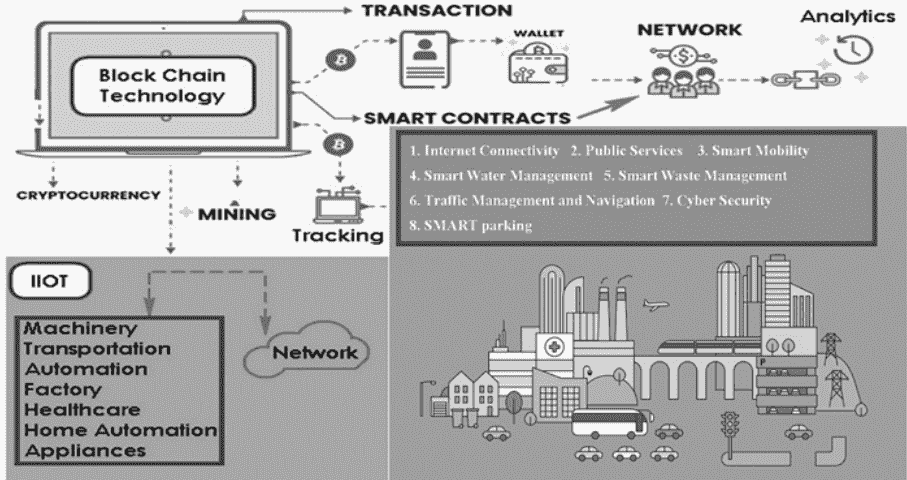

### 图 9.1 基于 IIoT 和 BCT 的智慧城市演进

想象一个城市，其中垃圾桶在装满时会自动发送信号，交通信号灯会自动调整以优化交通流量，市民可以自由交易能源消耗。由于 IIoT、智慧城市和 BCT 的融合，超连接、智能城市环境的描绘正在变得越来越真实。预计，像 IIoT 这样的技术的采用，其中数十亿台互联设备每天将产生额外字节的数据，将推动全球智慧城市市场到 2025 年达到惊人的 5177 亿美元。挑战在于安全且透明地处理这些数据。区块链可以通过提供不可篡改的账本和去信任机制来帮助解决这个问题，这些机制保证数据的完整性、问责性和可追溯性。事实上，根据最近的一项研究，80% 的城市认为 BCT 可能增加运营的公开性和信任度。这种强大的组合为智慧城市打开了广泛的机遇，从改善资源管理和公民参与到开发安全有效的基础设施。得益于区块链、IIoT 和智慧城市的创造性协同作用，随着持续的发展和合作努力，城市生活的未来有望变得更加可持续、宜居和数据驱动。BCT 与 IIoT 在智慧城市中的需求已在表 9.1 中介绍。

### 表 9.1 BCT 和 IIoT 对智慧城市启动的影响

| S.No. | 类别 | 指标 | 描述 | 数值 |
| :--- | :--- | :--- | :--- | :--- |
| 1 | 智慧城市中的 IIoT | 互联设备数量 | 智慧城市中互联设备的全球估计 | 到 2030 年，138 亿台 |
| | | 顶级应用 | 智慧城市中 IIoT 最常见的用途 | 智能建筑 (29%) 和交通 (27%)，以及智能公用事业 (33%) |
| | | 生成的数据 | 互联设备产生的每日数据量 | 每日艾字节消耗 |
| | | 经济影响 | 智慧城市 IIoT 的全球市场价值 | 到 2027 年，450 亿美元 |
| 2 | 智慧城市中的区块链 | 应用的关键领域 | 智慧城市中区块链的主要用途 | 数据安全 (15%)、身份管理 (18%) 和能源管理 (23%) |
| | | 市场规模 | 区块链在智慧城市中的全球市场潜力 | 到 2027 年，11.8 亿美元 |
| | | 试点项目数量 | 智慧城市中全球活跃的区块链倡议 | 显示超过 800 个 |
| | | 感知的益处 | 认为区块链技术可能增强运营的地方当局比例 | 麦肯锡公司 (2022) 80% |
| 3 | IIoT 和区块链集成 | 投资 | 基于区块链的智慧城市技术的年度全球投资 | 到 2028 年，35 亿美元 |
| | | 挑战 | 区块链和 IIoT 集成的主要障碍 | 监管框架、可扩展性和互操作性 |
| | | 潜在益处 | 集成区块链和 IIoT 的主要益处 | 增加信任、自动化流程、数据开放性和安全性 |

## 9.5 区块链技术和 IIoT 在智慧城市中的潜在益处

BCT 与 IIoT 的结合有可能将智慧城市转变为以安全性、可持续性和效率为优先的动态生态系统。以下是一些具有可衡量优势的潜在用途：

- 1. 智能交通控制:
  - 得益于区块链支持的实时路线规划和交通数据交换，拥堵可减少 25%–30%，例如迪拜的“Road Blockchain”等试点计划已展示这一点。
  - 燃料使用减少 10%–15%: 智能交通信号灯和连接 IIoT 的汽车可以动态调整交通流量，降低污染和燃料使用。
- 2. 改善能源治理:
  - 20% 的能源来自可再生能源：正如布鲁克林微电网（Brooklyn Microgrid）试点项目所示，基于区块链的点对点（P2P）能源交易平台可能鼓励使用可再生能源并保持电网稳定。
  - 能源成本降低 15%：由 IIoT 启用的需求响应系统和智能电表可以优化能源使用，节省大量资金。
- 3. 确保安全和透明的废物管理:
  - 废物分流率提高 10%：基于区块链追踪的废物收集和回收可以鼓励负责任的废物管理并增强问责制。
  - 运营成本降低 8%：使用 IIoT 启用的废物箱和优化的收集路线可以简化废物管理操作，从而节省资金。
- 4. 增强公共安全与治安:
  - 犯罪率下降 5%–10%：基于 BCT 的安全数据交换和身份管理可以提高犯罪预防和调查能力。
  - 应急响应时间缩短 10%：实时数据分析和连接 IIoT 的传感器可以提高应急响应工作的有效性和协调性。
- 5. 简化公众参与和治理:
  - 投票率提高 15%：基于 BCT 的安全电子投票系统可以增加公众参与度和对政治体系的信任。
  - 公共服务交付改善 10%：数据驱动的决策和 IIoT 启用的反馈系统可以提高公民对政府服务的满意度。

区块链改进的互操作性、保密性、安全性、可靠性和可衡量性使其成为 IIoT 的绝佳补充。一般来说，Blockchain 2.0 通过使用智能合约与自动化数字经济相连，而 Blockchain 1.0 通常与加密货币和成本（例如比特币）相关联。较新的 Blockchain 3.0 发展的重点是满足数字世界的需求，类似于工业 4.0 对智慧城市的方法。物联网持续为工业 4.0 提供动力。如德国政府所述，学术界和商业界在 2011 年广泛采纳了工业 4.0。一个相关的概念是 IIoT。但它也更加强调物联网在工业中的应用。

此外，从事负责任制造的组织通常与工业 4.0 相关联。因此，借助该关联的数字化，从传统商业向智慧商业或 IIoT 的过渡变得更加容易，


物联网设备的互联互通性和普遍性。特别是，BIIoT提供以下优势：

- 可追溯性是指发现和验证存储在区块链数据块中的时空数据的能力。此外，存储在区块链上的每个数据块都附带了合适的时间戳，这保证了数据的可发现性。
- 互操作性能够实现IIoT设备及其物理组件之间的数据传输和交互。通过在区块链复合层之上构建一个覆盖不同IIoT方案的统一访问的Overlay P2P网络，可以实现互操作性。
- 自主交互讨论了IIoT如何在不受可信第三方（TTP）干扰的情况下协同工作。这种自主性通过区块链支持的智能合约来实现。特别是，如果满足特定条件，智能合约所围合的合约部分将自动执行。
- IIoT信息可被信任的能力称为可靠性。实施密码学技术，例如哈希签名生成和非对称密码学（这些是区块链的基础），可以确保可靠性。

## 9.6 文献综述

本研究的作者Gai等人[1]提出了一种独特方法，通过融合联邦深度学习和边缘计算来提升智慧城市的医疗水平。MDP-FDRNN方法是核心概念；它将联邦深度循环神经网络与马尔可夫决策过程相结合，以实现网络边缘的有效资源分配。该方法为智能城市环境中的医疗应用提供了显著优势，因为它能够实现最低延迟和处理时间的实时数据处理。文章强调了边缘计算在克服处理和带宽限制方面的价值，并展示了MDP-FDRNN算法如何成功克服这些障碍，以改善城市居民的医疗服务标准。

Bansal和Singhrova等人[2]在本文中探讨了IoT和IIoT日益普及的问题。IoT和IIoT提供便利，但也带来安全问题。入侵检测系统（IDS）为防御这些系统免受多种攻击提供了一种途径。本文回顾了与IoT和IIoT相关的IDS研究现状。它探讨了多种检测方法，例如混合方法、异常检测和基于签名的技术。论文强调需要在实时性能、可扩展性和准确性等方面取得进步。它还认识到科学趋势，例如应用深度学习和机器学习方法。最后，它提出了IoT/IIoT领域IDS研究的未解决问题和潜在路径。

Jain等人[3]的论文中提出了一种新的身份验证方法，用于保护IIoT设备与服务器之间的通信。由于该协议架构简单、轻量且安全，适用于资源有限的IIoT设备。它通过使用哈希函数和XOR这两种基本的加密程序来实现这一点。根据该协议，服务器接收来自IIoT设备的身份验证请求。随后，服务器返回会话密钥，用于加密后续的任何通信。会话密钥会定期更换以确保安全。作者声称，其协议免疫中间人攻击、重放攻击和猜测攻击等多种攻击类型。为了加强其论点，他们还对该过程进行了形式验证工具分析。

Zhao等人[4]提出了一种面向AI驱动工业物联网（AIoT）的灵活且安全的边缘计算策略。它利用分布式计算和软件定义的工业控制架构，克服边缘系统中的安全性和灵活性问题。通过工业建模和虚拟化，该架构将硬件与软件解耦，提高了可编程性和灵活性。通过分布式计算，资源利用率和实时性能得到了提升。此外，基于安全域的任务卸载方法和去中心化服务发现与分发范式进一步保证了数据的可用性、完整性、机密性和隐私性。实验表明，所提策略是有效的。总的来说，该方案为物联网提供了一种可行的自适应且安全的边缘计算策略。

在IIoT环境中，网关在设备与更广域网络之间起着至关重要的连接作用。但这些网关也是网络攻击的易攻目标，一旦被攻破，可能导致整个系统瘫痪。为了解决这个问题，Fröhlich等人[5]提出了一种独特的安全IIoT网关架构，该架构利用可信执行环境（TEE）。为了提高安全性，TEE（处理器内的安全区域）将敏感功能与系统其他部分隔离开来。为了保护TEE免受外部威胁，该架构将设备接入、数据加密和身份验证等关键职责分配给它们。该方法也更具适应性，因为它不需要设备之间预先建立信任。

Baalamurugan等人[6]使用K-谐波聚类算法和BCT，在IIoT系统中建立了一个用于安全数据共享和存储的新框架。共享无效和数据泄露是传统IIoT安全的两个问题。通过仿真评估该框架，结果表明与现有方法相比，在数据共享效率、存储容量和处理时间方面具有优势。这种综合策略可以从安全性和效率方面改善IIoT应用的数据管理。

Huang等人[7]研究了在边缘智能驱动的IIoT系统中动态编排服务功能链（SFC）的难题，在这些系统中，快速响应时间和适应性至关重要。为克服这一难题，提出使用深度强化学习（DRL），它在考虑延迟限制的同时，力求最大化资源分配和服务部署选择，以确保服务及时交付。该策略利用智能边缘，使IIoT服务既高效又灵活。

Sharma等人[8]的文章中开发了一种名为“深度渐进神经网络”（DPNN）的新方法，以解决不断扩大的IIoT生态系统中的安全问题。该新算法利用渐进学习和深度学习的优势，能够高效地检测和分类IIoT网络中的各种风险。通过迁移学习，DPNN能够有效整合新的攻击类型，同时避免丢失先前获得的知识。这导致了一个极其精确的系统，在威胁检测中达到94%的准确率，而基准为69.7%，证明了其在大幅提升IIoT安全性方面的潜力。

得益于5G网络和IIoT，智能工厂正在经历一场革命，但安全和隐私仍然是主要障碍。Lin等人[9]在物理层、数据层和应用层探讨了这些问题。文章展示了前沿技术，包括用于更快响应时间的边缘计算、用于安全数据管理的区块链，以及用于异常检测的深度学习。尽管这些进展看起来很有前景，但仍有待解决的问题，例如资源匮乏、缺乏保护隐私的人工智能，以及复杂的多方利益相关者环境。文章结论强调，需要持续的调查和合作，以实现私密且安全的5G-IIoT智能工厂。

为确保IIoT应用中的安全交易管理，Alahmari等人[10]提出了一种新方法。作者推荐使用Streebog密码学哈希函数，与Davis Mayer区块链基础设施结合使用以增强安全性。为了进一步简化所提方法，以便有效管理和控制网络资源，他们将软件定义网络（SDN）作为关键组成部分。集成这些技术的目标是通过解决IIoT环境中安全交易处理相关的困难，提高工业系统的整体安全性。

Revathy等人[11]提出了一种基于智能的轻量级区块链安全模型，旨在解决云-


基于 IIoT 的系统。本模型结合了用于威胁检测的 AI 和用于数据隐私的轻量级区块链的优势。为保护隐私，采用了轻量级共识工作量证明（LCPoW）方法来降低计算负担。数据特征通过真实内在分析（AIA）模型进行转换，以提升攻击检测效能。AILBSM 框架由三个层级组成：基于 AI 的攻击分类、数据认证/攻击预防（通过使用区块链）以及信任评估。与以往方法相比，该方法提供了更出色的隐私保护，具有高准确率（99.8%）和快速检测（0.6 秒）的优势。但存储成本问题仍未解决。

古伊等人[12]的研究利用深度学习并特别关注 Modbus 协议，提出了一种在 IoT/IIoT 设备中检测网络攻击的新技术。该方法检查设备寄存器中的数值，而非依赖网络流量分析的传统方法。为了使模型既能描述攻击类型，又能判断是否发生攻击，作者在神经网络设计中引入了嵌入层。深度学习有潜力在设备层面提升 IoT/IIoT 安全性，因为该技术在性能上优于此前发表的模型。

艾等人[13]的论文提出了“智能协作框架”（SCF），用于解决 IIoT-MEC 网络中的多任务卸载问题。该系统采用两部分模型：精细资源调度（FRS）模块在分配资源时考虑博弈论和排队论等因素，而分层时空监测（HSTM）模块则基于历史数据预测任务紧急程度。SCF 通过整合战略资源分配和用于预测的深度学习，力求在 IIoT 环境中实现高效且动态的多任务卸载。

哈桑等人[14]提出了一种针对 IIoT 的新型安全即服务（Safe-aaS）计划，该计划利用联邦机器学习和区块链。该计划旨在实现高效的安全决策，同时解决隐私和安全问题。该解决方案通过利用区块链保证安全相关数据的公开性和不可篡改性，而联邦学习允许机器学习模型在本地数据上进行训练而不危及隐私。这种组合的几个优势包括提高 IIoT 生态系统成员之间的信任、降低成本和增强安全性。

王等人[15]提出了 MeAEG-Net，这是一种用于识别 IIoT 网络中异常流量的革命性技术。该方法使用只在正常流量上训练过的生成对抗网络（GAN）来解决标记异常数据有限的问题。GAN 的生成器致力于重建典型流量，并通过分析其对真实流量的重建错误来发现异常。添加了一个“记忆增强”模块，通过增加异常模式的重建错误来提升模型识别异常流量的能力。这种半监督方法适用于实际 IIoT 场景，因为它能高效发现异常，而无需大量标记的异常数据。

伊克拉姆等人[16]提出了一种两阶段模型，用于预测正常和异常的 IIoT 流量。在第二阶段，使用随机森林分类器根据第一阶段选定的特征来预测流量模式；第一阶段采用改进的鲸鱼优化方法从数据中识别出最重要的特征。在多种 IIoT 数据集上，该方法在准确率、真正率/真负率以及 ROC 曲线下的面积方面优于现有的基准方法。

马尔霍特拉等人[17]利用解释结构建模（ISM）技术，开发了一个层次化框架，用于评估在制造业中部署 IIoT 的难点。该框架发现并将问题归类为技术、组织和社会类别。随后，它考察这些类别之间的关系并构建一个层次结构。重要结论包括：（1）最显著的技术限制是资源不足和高昂的投资成本；（2）最显著的组织障碍是资源不足和缺乏熟练劳动力；（3）最显著的社会障碍是隐私和数据安全问题。为了成功在制造业中实施 IIoT，该层次结构有助于对问题进行优先级排序并设计针对性的解决方案。

为了提升 IIoT 中的数据安全性，马修等人[18]研究了 BCT 与协作入侵检测系统（CIDS）的有趣结合。该研究指出了传统集中式安全技术在复杂的 IIoT 领域中的不足，并强调了更分散化策略的必要性。BCT 的不可篡改性、透明性和无需信任的协作被认为能够补充 CIDS 的多设备威胁检测能力。通过考察不同的集成选项、分析潜在风险并确定研究需求，该论文为构建更可靠、更安全的 IIoT 生态系统铺平了道路。

针对 IIoT 制造细分领域，李等人[19]开发了一种“冗余协作安全通信方案”（TS-RCSCS）。该方法利用“冗余协同”概念及多条辅助通路来解决单路径通信的不足。在单个节点失效时，这能保证数据的真实性、保密性和完整性。它结合使用“冗余协同传输方法”和阈值签名，以防范数据丢失和信息拦截。它还包含一种在方案失效时预测丢失通信数据的技术，以保持数据完整性。实验表明，该方案在 IIoT 中表现良好，能够实现高通信精度和数据预测。

## 9.7 带有 BCT 的智慧城市 IIoT 应用

区块链与 IIoT 的结合为智慧城市提供了广阔的迷人可能性，从高效管理垃圾和电网到优化交通和保护公民身份。想象一个城市，其中能源使用被公开记录，垃圾管理得到奖励且免受欺诈，交通借助实时数据得到高效管理，节水通过奖励得到推广。区块链安全的数据交换能力促进了部门间的信任与合作，使公民能够获取信息，甚至保护医疗记录和学术资格。这两项技术创新有能力彻底改变城市生活的多个方面，并为未来安全、高效、可持续的智慧城市的发展打开大门。热门应用包括：

- 智能电网管理
- 交通管理
- 水管理
- 身份管理
- 环境监测

### 9.7.1 智能电网管理的应用

当智能电网管理、IIoT 和 BCT 融合时，改变智慧城市的潜力巨大。通过收集不同电网、住宅和商业空间的数据，IIoT 传感器通过实时监测和分析实现有效的能源管理。区块链凭借其透明且安全的数据存储，保证了安全交易，并使智能电网内的 P2P 能源交易成为可能。这种整合策略简化了公用事业公司的电网运营，使消费者能够就其能源消耗做出明智决策，并为可再生能源的顺利整合奠定基础。最终，这种合作有助于创建安全、高效、可持续的未来智慧城市。通过区块链、IIoT 和


智能电网管理非常庞大。以下是其综合应用概述：

- i. 智能电网管理：
  - **优化能源分配和使用：** 通过关联设备的实时数据，可将电力浪费降至最低，集成可再生能源，并有效实现电网平衡。
  - **需求响应计划：** 客户可根据动态定价调整能源使用，从而节省成本并维持电网稳定。

- ii. IIoT：
  - **数据采集与传输：** 通过集成到设备和基础设施中的传感器，采集关于能源使用、电网健康和环境因素的实时信息。
  - **自动化电网运行：** 基于数据洞察实现自动化决策，以提升电网的韧性与效率。

- iii. Blockchain：
  - **改进安全性和透明度：** BCT 的防篡改账本保障数据安全存储，并确保多个利益相关方之间的能源交易透明。
  - **点对点能源交易：** 促进个人与社区之间的直接能源交换，鼓励使用可再生能源并提升电网灵活性。

- 优势：
  - **提升可持续性与效率：** 促进能源高效利用，降低对化石燃料的依赖，鼓励发展更绿色的未来。
  - **增强电网韧性：** 自动化控制和实时数据提升系统稳定性，减少中断影响。
  - **赋能客户：** 客户掌控自身能源使用量，并积极参与能源市场。
  - **提升开放性与信任：** 区块链保障安全、开放的数据管理，从而增强利益相关方的信任。

### 9.7.2 交通管理应用

BCT 和 IIoT 有潜力彻底改变智慧城市中的交通管理。主要应用总结如下：

- i. 交通控制效能提升：
  - **实时数据收集：** 传感器和关联设备通过收集停车位可用性、车辆健康状况和交通流量信息，允许动态调整交通灯、优化路线并减少交通拥堵。
  - **智能停车：** BCT 无需纸质票据并减少查找时间，可实现安全高效的停车位预订和支付。

- ii. 开放性与安全性提升：
  - **安全数据存储：** 区块链的分布式账本技术保障驾驶员、车辆和交易数据的防篡改存储，促进问责制与信任。
  - **身份管理：** 为用户和车辆使用安全、可验证的身份识别，可提升安全性并防止未经授权的访问。

- iii. 环保且可持续的交通方式：
  - **电动汽车集成：** 通过安全的碳信用交易，BCT 可监测和控制能源使用，并鼓励采用电动汽车。
  - **共享出行：** 区块链可支持 P2P 打车和共享汽车服务，鼓励高效利用资源并减少排放。

#### 主要优势

- **无缝支付：** 区块链使不同交通服务能够接受小额支付，方便快捷，无需多种售票系统。
- **个性化服务：** 通过分析用户数据，可为每位用户量身定制出行方案和路线推荐，整体改善其出行体验。

### 9.7.3 水资源管理应用

智慧城市中的水资源管理，通过 IIoT 与 BCT 的结合有巨大的变革潜力。集成了 IIoT 传感器的水资源基础设施可以实时监测流量、压力、水质及可能的泄漏，为优化提供重要信息。这些数据可使用 BCT 进行不可更改的跟踪和存储，过程透明且安全。这确保了问责制并建立信心。这种组合使得：

- i. **泄漏检测与预防：** 实时监测有助于及时识别和修复泄漏，从而减少水资源损失和费用。
- ii. **水质控制：** 定期监测浊度、pH 值和污染物等指标，确保饮用水洁净，并在必要时及时采取行动。
- iii. **智能水分配：** 基于需求和天气模式优化水资源分配，数据驱动的洞察有助于促进高效用水。
- iv. **分散式水资源交易：** 在水资源短缺地区，基于区块链的平台可帮助社区或个人以透明、安全的方式交换水资源。
- v. **赋能公民：** 通过智能水表和智能手机应用提供实时数据，可鼓励居民养成节水习惯。

#### 主要优势

- **减少水资源浪费：** 通过早期泄漏识别和需求预测，将损失降至最低。
- **改善水质：** 实时监测可降低健康风险并确保安全。
- **提升生态可行性：** 做出明智决策有助于鼓励负责任的用水和保护。
- **增强透明度：** 区块链赋能利益相关方并建立信任。
- **降低成本：** 数据驱动的洞察带来高效的资源管理。

### 9.7.4 身份管理应用

在拥有多种公共交通选择（公交车、火车和有轨电车）的智慧城市中，要在保持用户隐私和安全的同时有效管理车费和访问权限可能很困难。传统售票系统通常需要集中式数据存储，容易受到欺诈，且缺乏互操作性，从而引发隐私问题。

**解决方案：** 使用 IIoT 和区块链实现去中心化身份管理系统：

- i. **用户身份：** 在不可攻破的区块链账本上，公民将获得安全的数字身份。凭借此身份，不仅可以访问交通服务，还可以访问其他城市服务。
- ii. **IIoT 集成：** 安装在公共交通工具中的 IIoT 传感器通过存储身份信息或生物识别验证（如人脸识别）的数字钱包识别用户 ID。
- iii. **智能合约：** 验证后，基于区块链的智能合约会立即从用户的数字钱包中扣除相应金额并解锁车辆。
- iv. **数据隐私：** 在区块链上，用户身份是匿名的。仅保存加密数据，例如开票所需的行程历史。用户仍掌控自己的数据，并可向不同服务提供商授予不同级别的访问权限。

#### 主要优势

- **高效：** 通过无缝、非接触式车费收集消除等待时间和交通拥堵。
- **安全：** 防篡改区块链确保数据完整性并防止欺诈。
- **隐私：** 通过匿名化用户身份，提供更多控制权和透明度。
- **互操作性：** 通过促进各类公共交通工具之间的通信，构建一个集成系统。

### 9.7.5 环境监测应用

该系统使用 IIoT 传感器收集垃圾桶填充量以及湿度、温度等其他环境变量的信息。随后，信息存储在区块链上，提供安全且不可更改的记录。该技术可用于节省燃料使用、改善空气质量并优化废物收集路线。

系统组件包括：

- i. IIoT 传感器：这些传感器放置在垃圾桶中，收集湿度、温度和填充水平信息。
- ii. 区块链：传感器收集的数据存储在防篡改且安全的分布式账本上。
- iii. 智能合约：借助智能合约实现废物收集自动化。例如，当垃圾桶装满时，可使用智能合约派发废物收集车。
- iv. 数据分析：利用系统获取的数据可以发现废物产生的趋势和模式。该信息有助于改进废物管理规划和政策。

#### 主要优势

- **提升效率：** 利用该技术优化废物收集路线，可降低燃料消耗和排放。
- **降低成本：** 该方法通过优化垃圾收集可帮助城市节省资金。
- **改善空气质量：** 该技术通过缩短废物在填埋场停留的时间来改善空气质量。
- **提升透明度：** 使用区块链时，废物收集数据以透明方式记录，从而提高透明度。

## 9.8 IIoT 和区块链技术赋能的智慧城市的全球影响

智慧城市、IIoT 和区块链技术的融合，在多个领域为全球影响提供了重要机遇。可能的优势概述如下，并附有示例数据：

- a. 社会影响：
  - **改善公共安全：** 智能监控系统可将犯罪率降低 15%–20%（ICIS）。
  - **改善医疗服务：** 根据 Accenture 的数据，IoT 连接的医疗设备可使患者治疗效果提升 10%–15%。


- **增强的公民参与度**：联合国人居署报告称，智慧城市平台可使公民参与度提高 20%–30%。
- b. **环境影响**：
  - **排放减少**：据思科（Cisco）称，利用 IIoT 进行智能交通管理可削减 CO₂ 排放 15%–20%。
  - **可持续性提升**：据埃森哲（Accenture）称，利用 IoT 进行智能废弃物管理可减少填埋垃圾 10%–20%。
  - **更好的水资源管理**：据普华永道（PwC）称，智能水表可削减用水量 10%–15%。
- c. **经济影响**：
  - **市场增长**：复合年增长率（CAGR）为 18.9%，全球智慧城市市场预计到 2025 年将达到 4.1 万亿美元（Markets and Markets）。
  - **就业增长**：据世界经济论坛预测，智慧城市到 2030 年将在全球创造九百万个新就业岗位。
  - **效率提升**：据麦肯锡公司（McKinsey & Company）称，支持 IIoT 的智能电网可带来 10%–20% 的节能效果。
  - **更好的供应链**：据世界经济论坛称，基于区块链的物流可能提升透明度并节省 10%–20% 的成本。
- d. **统计指标**：
  - **智慧城市倡议数量**：据智慧城市世界（Smart Cities World）称，到 2023 年全球将有超过 10,000 个智慧城市项目。
  - **智慧城市技术投资**：据 IDC 称，2023 年全球在智慧城市技术上的投资达到 2092 亿美元。
  - **碳排放削减**：据麦肯锡公司（McKinsey & Company）称，智慧城市到 2030 年可使全球 CO₂ 排放量削减 15%。

## 9.9 带有 IIoT 和区块链技术的智慧城市国家影响

印度的城市发展可以从将 BCT 和 IIoT 与智慧城市工作相结合中获益匪浅。尽管这一组合仍处于起步阶段，但它具有许多影响国民生活多个方面的优势。然而，由于持续的实施和数据可用性的限制，很难评估整个国家的影响。以下是可用数据点的摘要：

### a. 经济影响：

- **GDP 增长**：到 2030 年，凭借拥有高效资源管理和基础设施的智慧城市，印度的 GDP 可能增长 5%–10%（来源：世界经济论坛）。
- **就业创造**：根据智慧城市使命（Smart Cities Mission）的数据，建筑、IT 和可持续发展行业到 2025 年将创造 1 亿个新就业岗位。
- **工业生产力提升**：根据麦肯锡公司（McKinsey & Company）的数据，制造业中 IIoT 集成可使产量提升 20%–30%。

### b. 社会影响：

- **生活质量提升**：通过解决空气污染、交通拥堵和废弃物管理等问题，智能解决方案可使人们的生活水平提高 20%–30%（来源：智慧城市使命）。
- **公民参与度提升**：根据试点项目估计，区块链通过提高透明度和公民对治理的信任，可使投票率提高 15%–20%。
- **减贫**：通过智能医疗和教育举措赋能边缘化社区，到 2030 年可能有 1000万–1500万人脱贫（来源：世界银行）。

### c. 环境影响：

- **能源使用减少**：根据智慧城市使命，建筑管理系统和智能电网可削减能源使用 15%–20%。
- **碳排放减少**：到 2030 年，可持续废弃物管理和运输策略可使碳排放量削减 10%–15%（来源：NITI Aayog）。
- **水资源管理改善**：根据世界资源研究所（World Resources Institute），智能水表和泄漏检测系统可削减水资源浪费 20%–30%。

### d. 统计指标：

- **运营中的智慧城市**：目前有 109 个城市正在实施智慧城市项目，即运营中的智慧城市数量（来源：智慧城市使命）。
- **智慧城市倡议投资**：政府已为智慧城市建设拨款 1 万亿卢比（来源：智慧城市使命）。IIoT 行业采用：预计到 2025 年，印度 IIoT 行业将增长至 150 亿美元（来源：NASSCOM）。
- **政府中区块链技术的采用**：超过 100 个政府项目正在探索 BCT（来源：NASSCOM）。
- **对智慧城市提供的服务的市民满意度**：可通过定期调查和反馈渠道监测各类智慧城市举措的市民幸福感。

## 9.10 结论

BCT 和 IIoT 有潜力彻底改变我们的城市环境，开启“智慧城市”时代。利用 IIoT 这一由互联传感器和设备组成的复杂网络，我们可以收集废弃物管理、空气质量、交通流动和能源使用方面的实时数据。BCT 不可篡改且透明的账本系统，当用于对这些数据进行安全管理和分析时，可以使地方政府官员做出数据驱动的决策，最大限度地利用资源，并提升公民的福祉。

## 参考文献

1. Gai, Y., Liu, Y., Li, M., & Yang, S. (2024). 用于边缘—IoMT 以改善智慧城市医疗保健的带有联邦深度循环神经网络的马尔可夫模型。*网格计算期刊*，22(1)，1。
2. Bansal, K., & Singhrova, A. (2023). 面向 IoT/IIoT 的入侵检测系统综述—简要研究。*多媒体工具与应用*，83，1–26。
3. Jain, U., Tripathi, A., Kumar, S., & Kumar, G. (2023). 面向 IIoT 网络中 IIoT 设备的带会话密钥生成的简单、安全且轻量级身份验证协议。*微系统技术*，1–13。
4. Zhao, Y., Hu, N., Zhao, Y., & Zhu, Z. (2023). 面向 AI 驱动的工业 IoT 的安全灵活边缘计算方案。*集群计算*，26(1)，283–301。
5. Fröhlich, A. A., Horstmann, L. P., & Hoffmann, J. L. C. (2023). 基于可信执行环境的安全 IIoT 网关架构。*网络与系统管理期刊*，31(2)，32。
6. Baalamurugan, K. M., Prabu, P., Bacanin, N., Venkatachalam, K., Askar, S. S., & Abouhawwash, M. (2023). 面向工业 IoT 基础系统的支持区块链的 K-调和框架。*科学报告*，13(1)，1004。
7. Huang, Z., Zhong, W., Li, D., & Lu, H. (2023). 面向边缘智能启用 IIoT 的延迟受限 SFC 编排：一种 DRL 方法。*网络与系统管理期刊*，*31*(3)，53。
8. Sharma, M., Pant, S, Yadav, P., Sharma, D. K., Gupta, N., & Srivastava, G. (2023). 使用深度递进神经网络推进工业物联网安全。*移动网络与应用*，*28*，1–13。
9. Lin, C. C., Tsai, C. T., Liu, Y. L., Chang, T. T., & Chang, Y. S. (2023). 5G-IIoT 智能工厂中的安全与隐私：新方法、趋势与挑战。*移动网络与应用*，*28*，1–16。
10. Alahmari, S. A., Rajeyyagari, S., & Al-Turjman, F. (2023). 面向 IIoT 应用的使用 SDN 的基于 Davis Mayer Streebog 加密哈希的区块链安全交易管理。*信号处理系统期刊*，*95*(2–3)，241–252。
11. Revathy, G., Selvakumar, K., Murugapriya, P., & Ravikumar, D. (2022). 使用计算智能的工业 4.0 智能制造。载于 N. Thillaiarasu, S. Lata Tripathi, and V. Dhinakaran (eds)，*物联网人工智能*。CRC Press, Boca Raton, FL, pp. 31–48。
12. Gueye, T., Wang, Y., Rehman, M., Mushtaq, R. T., & Zahoor, S. (2023). 使用深度学习在 Modbus 协议上检测 IoT/IIoT 设备网络攻击的新方法。*集群计算*，*26*，1–27。
13. Ai, Z., Zhang, W., Li, M., Li, P., & Shi, L. (2023). 面向 IIoT-MEC 网络动态多任务卸载的智能协作框架。*点对点网络与应用*，*16*(2)，749–764。
14. Hasan, N., Chaudhary, K., & Alam, M. (2022). 面向工业 IoT 的使用机器学习的新型区块链联邦安全即服务方案。*多媒体工具与应用*，*81*(25)，36751–36780。
15. Wang, T., Li, W, Rong, H., Yue, Z., & Zhou, J. (2022). 基于内存增强生成对抗 IIoT 辅助网络的异常交通检测。*无线网络*，*28*(6)，2579–2595。
16. Ikram, S. T., Priya, V., Anbarasu, B., Cheng, X., Ghalib, M. R., & Shankar, A. (2022). 集成随机森林分类器的修正鲸鱼优化方法的 IIoT 流量预测。*超级计算期刊*，*78*(8)，10725–10756。
17. Malhotra, S., Agarwal, V., & Kapur, P. K. (2022). 使用 ISM 方法分析制造业中实施工业物联网挑战的分层框架。*系统保证工程与管理国际期刊*，*13*(5)，2356–2370。
18. Mathew, S. S., Hayawi, K., Dawit, N. A., Taleb, I., & Trabelsi, Z. (2022). 面向安全的区块链与协作入侵检测集成


data transactions in industrial IoT: A survey. Cluster Computing, 25(6), 4129–4149.

- 19. Li, M., Yin, Z., Ma, Y., Wang, C., Chai, A., & Lian, M. (2021). 工业物联网智能生产线系统的多路径冗余与协作安全通信方案的设计与验证。神经计算与应用，35，1–15.

OceanofPDF.com

# 第10章：利用深度学习通过多种煤炭分类增强智慧城市可持续性

S. Abiramasundari and P. Umamaheswari

DOI: 10.1201/9781003476047-10

## 10.1 引言

煤炭是世界的主要能源来源。社会和工业的发展使得煤炭的分析质量在生产效率和污染方面变得越来越重要。煤炭相关产业的经济可行性取决于高品质煤炭的可获得性。准确的分类支持煤炭相关项目的经济评估、成本效益分析和投资决策。煤炭分类为煤炭开采和生产过程中的生产计划和资源评估提供了重要指导。另一方面，经典的煤炭分类方法在当前的采矿作业中高度依赖人工经验分类。这需要大量的人力和物力资源，且自动化难以实现。因此，煤炭开采和利用中最重要的研究课题之一是如何快速、正确且实时地检测多种类型的煤炭。根据煤化程度，煤炭分为三类：褐煤、烟煤和无烟煤。不同种类的煤在不同时间以不同方式使用。煤炭的使用根据其类型和质量而有所不同。煤炭使用的场所包括热力发电厂，以及锅炉设计和制造。分类煤炭有两种标准常规方法：第一是人工分类，速度相对较快，但分类准确率低且难以自动化；第二是化学分析，识别准确率高但难以自动化。这种方法的缺点包括成本高和检测时间长。准确高效地确定煤炭种类的能力对于降低分类成本和提高分类效率至关重要。因此，快速且恰当地确定煤炭类型是当前矿物加工技术必须解决的紧迫问题 [1]。

### 10.1.1 智慧城市与可持续发展

智慧城市处于城市发展的前沿，整合技术以提升居民生活质量，同时应对环境挑战。能源资源的有效管理是智慧城市举措的关键组成部分，侧重于可持续性和效率。智慧城市代表了一种变革性的城市发展方法，整合先进技术以增强可持续性并应对复杂挑战。其演进的核心是对可持续发展的承诺，促进经济增长、环境保护和社会福祉之间的平衡。通过战略性地部署数据驱动的解决方案，智慧城市旨在优化资源使用、减少碳足迹并提高整体能源效率。智能基础设施（如智能交通系统和节能建筑）的整合有助于降低环境影响。作为创新中心，智慧城市优先发展环保技术、有韧性的能源电网和适应性城市规划。通过推广可持续做法并采用可再生能源，智慧城市希望创造既生态意识又在技术上处于前沿的环境。对可持续性的强调还延伸至废弃物管理、水资源保护和绿地，培养城市生活的整体方法。总而言之，为了为更可持续和互联的未来铺平道路，智慧城市希望成为积极环境变革的催化剂。

### 10.1.2 煤炭的重要性

煤炭作为全球能源格局中的主要参与者，具有持久的重要性，对整体能源结构做出了重大贡献。在智慧城市框架内认识到煤炭分类的关键作用是必不可少的。这种理解对于优化煤炭利用、从而减少环境影响并为智能城市环境构建坚固能源基础设施奠定基础至关重要。随着智慧城市致力于平衡能源需求与环境可持续性，对煤炭类型进行细致分类变得至关重要。它允许战略性地选择与清洁能源目标一致的煤炭品种，支持智慧城市举措在更高效、环保能源模式方面的总体目标。

### 10.1.3 环境影响与可持续性

环境影响与可持续性领域是智慧城市话语中的关键考量因素。在此背景下，创新技术的部署成为培育可持续城市未来的基石。通过整合智能解决方案，城市可以细致管理资源、减少碳足迹并增强整体环境管理。采用更清洁的能源，加上先进的废弃物管理系统，对最大限度地减少环境影响有着显著贡献。可持续做法超越能源领域，涵盖水资源保护、绿色基础设施和污染控制，形成城市发展的整体方法。智能技术的融入不仅解决了眼前的环境问题，还将城市定位为缓解未来挑战的主动因素。通过一致关注可持续性，智慧城市希望为环保生活树立标杆，并作为全球城市发展的典范。

### 10.1.4 优化资源与能源效率

在追求优化资源与能源效率的过程中，智慧城市利用技术进步构建可持续且有韧性的城市景观。通过采用创新解决方案，这些城市寻求简化能源消耗、减少浪费并提高整体资源利用率。智能电网起着关键作用，提供能源分配的实时监控和控制，从而最大限度地提高效率。智能基础设施（如节能建筑和智能照明系统）的整合进一步有助于尽量减少能源浪费。通过数据驱动的洞察，智慧城市可以主动管理资源，确保根据需求模式和环境考量进行最优分配。这种对能源效率的强调与更广泛的可持续发展目标相一致，培养了一种平衡且环保意识的城市发展方法。总而言之，追求优化资源与能源效率凸显了智慧城市为当代及后代创造智能、环保城市环境的承诺。

### 10.1.5 问题陈述

随着智慧城市不断发展，资源的高效管理和可持续性变得至关重要。本文探讨了煤炭分类在智慧城市举措背景下的关键作用。作为一种基础能源资源，煤炭分类的影响对环境可持续性、能源效率以及智慧城市的总体发展目标进行了考察。煤炭是一种宝贵的化石燃料。它是主要的能源来源，占全球发电量的约三分之一。因此，煤矿是地方和全球经济的主要收入来源。煤矿根据开采方式分为露天矿或地下矿。由于地下矿具有多样化的土地利用/土地覆盖特征，本研究将重点放在识别露天煤矿上。探索使用深度学习的自适应煤炭分类为研究和创新提供了机会。它允许开发尖端技术，可为能源领域和人工智能应用的进步做出贡献。为了捕捉这些特征，预计需要比本工作中使用的更高质量的照片。露天矿，也称为露采矿，利用地表开采工艺回收靠近地表且可以最低成本开采的矿物。开采区、剥离区和倾倒区构成了它们的大部分。

煤炭由经历了改变其物理和化学性质的生物反应和地质过程的古代植物形成。煤炭（一种黑色固体材料）的主要成分是碳、氢、氧和氮。煤矸石是煤炭坚硬的低碳副产品。基底和沉淀不均匀，导致这种黑色石头的形成。它们由各种类型的石头组成。煤炭和煤矸石表面的灰度和纹理——作为煤炭和煤矸石图像识别 [2] 的基础——彼此有相当明显的差异。图像识别系统执行煤炭图像特征的提取和相关参数的计算，并使用人工神经网络进行识别，利用机器人替代人工进行煤炭采集，实现煤炭分离的自动化。在光谱学中，机器学习（ML）已有许多应用，例如矿物识别和元素组成测定。这项任务描述了一种全新的技术，用于合并来自不同光谱方法的数据以自动识别矿物。之后，


煤炭已使用人工神经网络进行分类。每个样本包含七张主要图像，这些图像是在旋转偏光显微镜载物台上提取的。

这组基础图像用于利用薄片获取光学数据。从每个数据集中的分割矿物中推导出一套精选的度量指标，涵盖与颜色、饱和度、强度和纹理相关的参数。这些精心挑选的测量值提供了对所存在的多样矿物组成的全面理解。通过对这些度量指标的复杂分析，揭示了关于数据集中矿物学特征和变化的宝贵见解，有助于对地质组成及其固有复杂性进行细致入微的探索。研究表明，纹理特征可用于分类无色矿物。神经网络在人工分类的矿物样本上进行训练。用于从岩石薄片中分类地质岩石类型的采用技术涉及使用串联卷积神经网络（Con-CNN）方法。这种创新方法（图 10.1）采用串联结构来提高岩石类型分类的准确性和效率。通过利用 Con-CNN 的深度学习能力，岩石薄片中蕴含的复杂细节得到充分分析，从而对多样的地质构造进行更精确、更细致的识别。这种方法不仅推进了地球科学领域，还展示了尖端技术在揭示地球地质结构的复杂性方面的潜力。

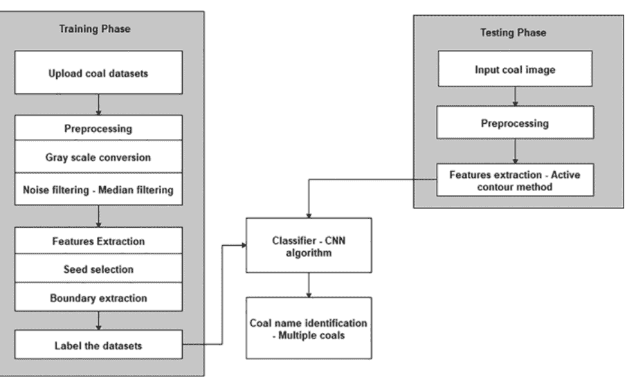

### 图 10.1 架构图。

多年后，煤岩学的研究仍在扩展和现代化其知识体系，以追求能源领域的新应用。对煤中基本成分的提取以及清洁煤技术受到特别关注。从其化学组成来看，煤炭材料是非均质的。这种物质内部的组成变化源于负责其泥炭形成的植物材料的多样特性。此外，独特的特性源于时间变化、温度波动、压力条件以及影响有机物在其生化和地球化学转化过程中的特定情况等因素的动态相互作用。这种环境因素的复杂混合导致最终产品中观察到的明显非均质性，展示了自然力量在长期塑造这种有机物组成方面的复杂相互作用。

矿质是煤炭结构在物理和化学方面的基本、均质构建块。从认知和实际角度来看，研究煤炭的岩石结构具有重要意义。要实现智能采煤机开采，准确识别煤层分布是一个要求。本项目提供了一种使用深度卷积神经网络（D-CNN）和特征提取来区分煤和岩石的新方法。利用主动轮廓法，已仔细提取了相关特征，为底层数据提供了全面的表示。该方法采用先进的计算技术来勾勒和捕捉独特特征，有助于细致入微地理解数据集中蕴含的复杂性。通过应用主动轮廓法，提取过程不仅精确而且自适应，确保了对固有特征的更强大、更详细的描述。这种方法在各个领域中都是一个有价值的工具，在这些领域中，对数据细微差别的深入分析对于获得有意义的见解和做出明智决策至关重要。这项研究的目标是通过引入批量归一化、权重正则化和丢弃法等正则化技术来克服 CNN [3] 过拟合问题并加速收敛。其次，使用数据增强来增强煤岩图像信息，这大大提高了性能。煤岩剪切实验系统提供了一系列实验，旨在收集更真实的煤岩照片。根据实验结果，我们创建的网络在检测煤岩图片方面表现更好。

## 10.2 文献综述

[4] 的作者使用图像处理和模式识别技术识别了煤和煤矸石。煤矸石识别技术已在不同波长的不同类型的煤和煤矸石中开发和测试。他们还得出结论，煤炭图像的灰度分布和峰值完全不同。作者对煤和矸石的纹理进行了研究，并在电力行业的煤矸石分选过程中实施了该研究。还研究了煤和煤矸石图像纹理的相似性和差异性。通过应用结合灰度和煤纹理的技术来提取所需特征。开发了灰度共生矩阵以实现煤和矸石纹理特征的自动分类。该拟议模型还使用 CNN 进行了改进。神经网络从煤和矸石图像中提取图像丰富度、数据开发和卷积层。

图像使用 softmax 回归函数进行分类，识别结果在 TensorFlow 上进行训练和测试。拟议方法表明，神经网络有效地发现了煤和矸石的特征。本工作解决了由标准图像处理和特征提取引起的煤和矸石识别率低的问题。煤炭开采过程中的一个关键阶段涉及对煤和矸石材料进行分类。这一关键步骤在区分宝贵的煤炭资源和伴生非煤矸石方面起着重要作用。通过这一分类过程，采矿作业能够了解所开采材料的质量和成分，从而优化资源利用并提高整体效率。煤和矸石之间的准确区分对于有效的资源管理至关重要，可确保开采过程符合质量标准和环境考虑因素。这项研究对煤和矸石的识别和编目具有抽象相关性，并为未来煤和矸石分类机器人的发展奠定了基础。

在煤矿工程 [5,6] 中，有效识别和分离原煤中的煤矸石是一个关键挑战，因为它显著影响煤炭的燃烧质量并减轻有害气体的排放。为解决这一问题，已采用支持向量机 (SVM) 算法，利用煤和矸石的介电特性进行精确分类。这种创新方法不仅提高了区分煤和矸石的准确性，还提高了特征提取的效率。该研究深入探讨了电极板厚度和边缘效应对电容值的影响，提供了关于影响分类过程的因素的见解。此外，该方法还探索了调整激励源参数（包括频率和电压）以绘制煤和矸石介电常数与这些变量关系的曲线。为了优化去噪过程，已实施卡尔曼滤波器和自适应噪声完全集经验模态分解 (CEEMDAN) 的组合。这种优化的去噪技术产生了信噪比更高、均方根误差更低的响应信号，有助于后续分析的可靠性。

利用去噪信号，该研究为训练集和测试集构建了特征向量集，为煤矿应用中准确的煤矸石分类建立稳健模型奠定了基础。[7] 研究了几种石头的复合材料。煤和矸石表面的灰度和纹理差异为煤和矸石的图像检测提供了来源，这些差异非常明显。虽然煤是世界上最常见的能源，但矸石在电厂中是不受欢迎的。因此，从煤中提取矸石是采矿预处理程序的一个重要方面。随着计算技术的发展，可能会发现一种改善矸石分选效果的方法。从煤炭图像中提取特征，并将人工神经网络 (ANN) 应用于这些提取的特征。利用纹理特征和灰度特征从原煤中分离煤矸石。此外，同样的策略将使机器能够代替人工捡选矸石。如果本研究提出的技术在煤炭行业实施，将导致自动化煤矸石分选、提高原煤分选效率和改善煤炭质量。

Feng Hu [8,9] 提出了一种使用多光谱图像分类煤和矸石的新方法。在测试阶段，已系统收集了包含煤和矸石的全面多光谱数据集。该数据集是评估用于区分煤和矸石材料的分类算法的有效性和性能的关键资源。多光谱数据采集确保了与煤和矸石相关的多样光谱特征的全面表示，提供了对其独特特征的细致入微的理解。这种细致的数据收集过程构成了稳健测试程序的基础，使能够在各种光谱带中评估算法的准确性和可靠性。多光谱信息的整合增强了测试阶段的全面性，促进了对分类模型在现实煤矿场景中有效性的更全面、更深入的评估。然后，使用特征提取技术和 SVM 分类器构建和分析了模型。为了更好地提高煤和矸石分离的效率，已正确识别了煤和矸石。为了识别煤和


煤矸石，成像技术与图像处理流程（如增强和特征提取）及分类器相结合，成功解决了当前技术的缺点（污染、辐射等）。另一方面，光线和粉尘等环境因素对普通图像检测有显著影响。我们提出了一种创新的煤和煤矸石检测方法，利用多光谱成像技术，这是一种尖端的光学无损检测技术，对光照变化不那么敏感。最初，我们采用GS-SVM、GA-SVM和PSO-SVM分类器来评估各种图像特征提取方法的分类性能。

结果表明，局部二值模式（Local Binary Pattern，LBP）是最有效的特征提取技术。随后，通过对不同波长分类效果的深入考察，我们确定第九波长，特别是773.776 nm，是实现煤矸石与煤之间最大成像对比度的最佳选择。在最终阶段，我们对所提模型进行了严格测试，以评估其准确区分煤和煤矸石的能力。

梁和邹[10]利用近红外光谱（NIRS）结合机器学习（ML）方法识别煤中的块状煤矸石的潜力已得到研究。我们提出了一种独特的异常值识别策略，以提高性能，特别是在数据集中存在两个或多个异常值的场景中。其目的是减轻异常观测对分类器准确性的不利影响。研究结果表明，与传统MD算法相比，改进的MD方法在减少异常值方面非常有效。此外，使用LASSO回归优化了宽结构的输出层权重。所提L-BL方法在分类准确率和测试时间方面均优于常规BL算法。尽管由于在区分煤和煤矸石方面的高准确性，该方法在实际应用中尚未得到广泛应用，但其前景广阔。它可以提高煤矸石分类性能，并减少低品质煤对人类健康和环境造成的威胁。不过，在时间管理方面仍有发展潜力。

本文研究了一种新的深度学习和特征提取煤炭分类模型。该研究提出将特征提取与卷积神经网络（CNN）相结合，以解决煤炭分类问题，并根据光谱数据的特征（包括高维性、强相关性和显著冗余性）进一步提高分类准确率。模型的构建和训练参数采用改进的分类方法和增强的深度学习算法进行增强和优化。最后，从准确率参数和执行时间两方面考察研究结果。

## 10.3 拟议方法论

### 10.3.1 卷积神经网络

卷积神经网络（CNN）是一种前馈神经网络，能够理解输入图像中的拓扑信息。其功能涉及利用分类器从原始图像中提取特征，随后对其进行分类。CNN对畸变或基本几何变换（如平移、缩放、旋转或挤压）不敏感。为了实现部分平移、缩放和畸变不变性，CNN采用三种架构策略：局部感受野、共享权重以及空间或时间下采样。与传统神经网络的训练过程类似，CNN利用反向传播进行网络训练。卷积层特别在从底层提取局部感受野方面发挥着关键作用。特征图是负责识别某个特征并检索各种形式数据的神经元平面，构成了卷积层的局部数据。5×5卷积核在网络中连接25个单元，并将前一层的局部感受野输入到5×5区域中。

神经元可以利用局部感受野提取边缘等基本视觉元素。大脑不同部位的神经元可能使用相同的连接结构和权重来提取相同的视觉特征。其结果是特征图，即一组神经元的表示。这相当于使用一个小核对输入图像进行卷积。我们提出的CNN结构如下：

CNN模型函数：

```
INITCNNMODEL (, [n1-5]) INITCNNMODEL (, [n1-5])
INITCNNMODEL (,[tanh()], max(), tanh(),
softmax()]
layerActivation = [tanh(), max(), tanh(),
softmax()]; layerActivation = [tanh(), max(),
fully-connected, fully-connected];

layerType = [convolution, max-pooling,
fully-connected, fully-connected];
layerActivation = [tanh(), max(),
fully-connected, fully-connected]
return model;
end function;
```

```
neuron [ni+1];
layer.params = I model.addLayer(layer);
return model;
end function;
```

```
neuron [ni+1];
layer.inputSize = ni layer.neurons = new Layer();
layer.type = layerType[i];
layer.inputSize = ni layer.neurons = new Layer();
layer.type = layerType[i];
```

### 10.3.2 训练CNN模型

已设置训练批次、学习率、最小误差率（ERRmin）、最大迭代次数（ITERmax）、批量大小SIZEtach、批量训练及其他参数来训练模型。n2、n3、n4、k1和k2是通过n1和n5的值计算得出的（见图10.2和图10.3）。

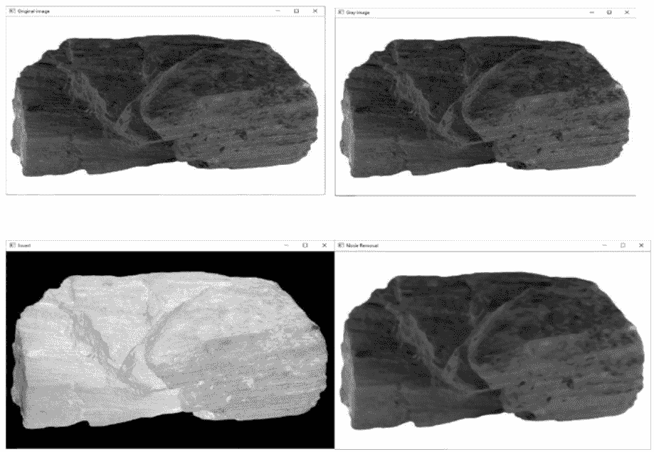
图10.2 煤炭图像、灰度图像、反转图像和去噪图像。

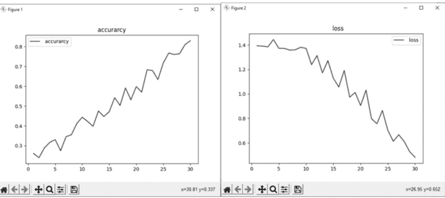
图10.3 训练准确率和损失。

```
cnnModel = InitCNNModel(, [n1-5]);
iter = 0;
err = +inf;
while err >ERRmin and iterITERmax do err = 0;
for bach = 1 to BATCHEStrining do
[J(), J()]] = cnnModel.train (TrainingDatas,
TrainingLabels), (4) and (8) respectively;
cnnModel = InitCNNModel(, [n1-5]);
Using (7), update the CNN's parameters;
err = err + mean(J()); end for err = err/
BATCHEStrining;
iter++;
Using (7), update the CNN's parameters; err =
err + mean(J());
end for err = err/BATCHEStrining;
```

## 10.4 结果与讨论

所有类型的煤都被归类为矿物，构成含有大量碳的岩石。约25%的世界初级能源和40%的电力来自这种化石煤。煤炭的分类取决于其碳成分，其等级由所含碳的量决定。低品位煤和高品位煤之间存在明显差异。值得指出的是，高品位煤产生的烟雾较少，而低品位煤排放较多。与低品位煤相比，高品位煤的燃烧更充分，产生的能量显著更高。在表10.1中，列出了煤的能量密度和碳含量。它还列出了干燥前的水分含量以及干燥后的挥发分含量。

### 表10.1 煤炭类型

| 煤炭 | 干燥碳含量（%） | 干燥前水分含量（%） | 干燥挥发分含量（%） | 发热量（MJ/kg） |
|---|---|---|---|---|
| 无烟煤 | 86–92 | 7–10 | 3–14 | 32–33 |
| 烟煤 | 76–86 | 8–18 | 14–46 | 23–33 |
| 褐煤 | 65–70 | 35–55 | 53–63 | 17–18 |
| 泥炭 | <60 | 75 | 63–69 | 15 |

### 10.4.1 泥炭

泥炭以其松软、易碎、深棕色的成分为特征，由部分分解的死亡有机物组成。作为煤炭形成的初始阶段，随着压力和温度升高以及沉积物堆积在部分分解的有机元素之上，泥炭转化为褐煤。为了完成演变为煤炭，泥炭需要通过沉积作用被埋藏在地表以下4至10公里深处。泥炭的碳含量最低，低于60%，能量密度最高，为15 MJ/kg（图10.4）。

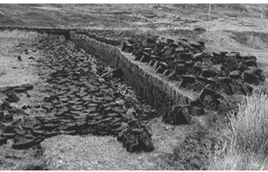


Figure 10.4 泥煤。

### 10.4.2 褐煤

褐煤，又称棕煤，是煤种中等级最低的一种。与其他煤种相比，褐煤的碳含量范围为 65% 至 70%，表明含有较高比例的非碳元素，如硫和汞。褐煤是形成最晚的化石燃料，估计起源于约 6000 万年前，因此存在时间相对较短，能量密度较低，为 18 MJ/kg。由于其含水量较高且与密度较大的黑色煤种相比碳含量较低，褐煤在燃烧时往往会产生更多二氧化碳（图 10.5）。

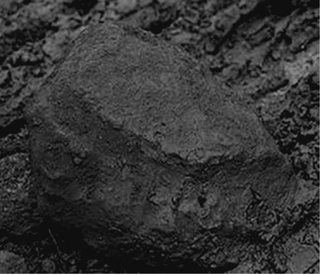

图 10.5 褐煤。

### 10.4.3 烟煤

烟煤因其碳含量而被认为是第二高品质的煤。烟煤中的碳含量百分比范围为 76% 至 86%。它是最普遍且最古老的埋藏化石燃料之一，存在了约 3 亿年。这种煤的能量密度（27 MJ/kg）较高。这种煤类非常适合用于生产水泥和钢材等材料。该类煤主要用于发电和生产焦炭，因为烟煤含碳量更高且含水量更少（图 10.6）。

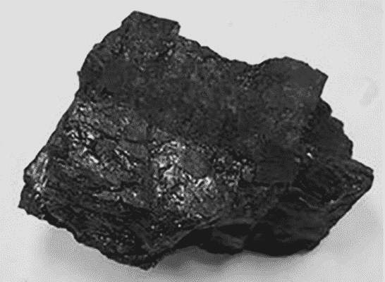

图 10.6 烟煤。

### 10.4.4 无烟煤

无烟煤被认为是最好的煤，是一种深色或黑色品种。其碳含量高达约 95%，质硬，且含水量少。无烟煤燃烧时可达到极高温度。此外，无烟煤是最早的煤炭品种，起源于约 3.5 亿年前的埋藏生物质。由于其长期埋藏的特性，它具有最高能量密度，为 33 MJ/kg [8]。无烟煤升温迅速且燃烧剧烈，燃烧时释放大量能量，表现出色。它燃烧充分，产生的烟雾比其他煤种更少。因此，这种煤尤其用于空间取暖。无烟煤适合用于家庭取暖炉，因为它比木材燃烧更清洁且持续时间更长。系统的有效性可通过基于准确率参数评估其性能来衡量（图 10.7）。

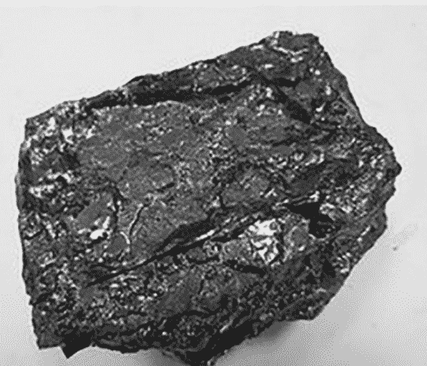

图 10.7 无烟煤。

### 10.4.5 准确率

准确率（ACC）是整体完美预测占整个测试数据集的百分比。也可表示为 1- ERR。最大准确率为 1.0，最小准确率为 0.0。

```
ACC = \frac{TP+TN}{TP+TN+FN+FP} \times 100
```

- 真正例（TP）：预测为正例，实际也为正例。
- 假正例（FP）：预测为正例，实际为负例。
- 真负例（TN）：预测为负例，实际为正例。
- 假负例（FN）：预测为负例，实际也为负例（图 10.8）。

图 10.8 性能图表。

所提方法比现有机器学习算法达到更好的准确率水平。分类任务的执行时间也有所缩短（表 10.2）。

### 表 10.2 NB、SVM 和 CNN 的性能

| 算法 | 准确率（%） |
|---|---|
| 朴素贝叶斯 | 50 |
| 支持向量机 | 65 |
| CNN 分类 | 80 |

## 10.5 结论

科学技术的进步推动了遥感技术的不断发展，遥感技术对社会发展极其有用。在资源勘探、水资源保护、地质、地理、土壤和气候变化等各个领域，都使用了遥感技术。遥感技术在煤炭勘探中具有广泛的应用。现代社会对煤炭的需求在不断增加。随着露天煤矿数量的减少，寻找煤炭变得越来越困难。由于煤矿区地质结构复杂，低效率和高事故率一直是煤炭勘探过程中的问题。深度学习方法在各种煤炭类型识别中起着关键作用。在本项目中，采用了特征提取与神经网络技术的集成来解决煤炭分类的挑战。使用建议的 CNN 算法开发了快速煤炭分类模型。实验结果表明，与传统机器学习算法相比，CNN 算法能够达到良好的准确率水平。与传统煤炭分类方法相比，我们的方法更省时、更快速、更准确，并具有广泛的实际应用前景。

## 参考文献

- 1. Revathy, G., K. Selvakumar, P. Murugapriya, and D. Ravikumar. “使用计算智能的工业 4.0 智能制造。” In N. Thillaiarasu, S. Lata Tripathi, and V. Dhinakaran (eds), 面向物联网的人工智能. CRC Press, Boca Raton, FL (2022), pp. 31–48.
- 2. He, K., X. Zhang, S. Ren, and J. Sun. “用于图像识别的深度残差学习。” In CVPR 论文集. IEEE, Las Vegas, NV (2016), pp. 770–778.
- 3. Hong, H., L. Zheng, J. Zhu, S. Pan, and K. Zhou. “基于卷积神经网络的煤和煤岩自动识别。” (2017), arXiv:1712.00720. [在线]。可用: https://arxiv.org/abs/1712.00720
- 4. Su, L., et al. “利用卷积神经网络进行煤岩识别的研究。” 2018 年第 2 届 IEEE 先进信息管理、通信、电子与自动化控制会议 (IMCEC). IEEE, 中国西安 (2018).
- 5. Guo, Y., et al. “基于介电特性的煤和煤岩识别方法。” IEEE Access 9 (2021): 9845–9854.
- 6. Su, L., X. Cao, H. Ma, and Y. Li. “利用卷积神经网络进行煤岩识别的研究。” In IMCEC 论文集. IEEE, 中国山西 (2018), pp. 810–814.
- 7. Hou, W. “基于数据分析的前馈神经网络煤和煤岩识别。” 国际煤炭制备与利用杂志 39.1 (2019): 33–43.
- 8. Hu, F., et al. “多光谱成像：煤和煤岩识别的新解决方案。” IEEE Access 7 (2019): 169697–169704.
- 9. Wang, W. and C. Zhang, “使用三维激光扫描分离煤和煤岩。” 国际矿物加工杂志 169 (2017): 79–84.
- 10. Zou, L., et al. “基于改进广度学习的近红外光谱煤和煤岩无损识别。” IEEE 仪器与测量交易 69.10 (2020): 8043–8052.

# 第 11 章

# 预防保健：老年人跌倒检测与预防的智能策略

A. Sumathi, S. Sai Sudarshan, and Somisetty Sai Rithin

DOI: 10.1201/9781003476047-11

## 11.1 引言

通过将区块链与物联网 (IoT)、人工智能及其他新兴技术相结合，可以构建智慧生活生态系统，以增强可持续性、提高生活质量并促进包容性经济发展。基于区块链的电子健康记录 (EHR) 为患者提供安全的医疗数据访问，同时保护其信息的隐私和控制权。可穿戴传感器和医疗植入物等物联网设备可以收集实时健康数据，并安全地记录在区块链上，从而实现个性化治疗方案以及医疗服务提供者的远程监护。区块链可以促进参与跌倒检测的物联网设备之间进行安全高效的通信和数据共享。轮椅安装的传感器，以及智能手机或家庭自动化系统等其他物联网设备，可以无缝交换数据，并在发生跌倒时触发相应操作。部署在区块链上的智能合约可以根据预定义条件自动执行紧急响应程序，例如向护理人员或紧急服务发出警报。物联网传感器嵌入不同的对象、设备和环境中，使它们能够收集数据、相互通信并响应命令或触发器。这些传感器可应用于众多场景，例如家庭自动化、医疗监护、环境感知和工业自动化。在医疗保健中，物联网传感器可以跟踪生命体征、用药依从性和活动


levels，为医疗保健提供者提供实时数据，并在必要时促进早期干预。环境传感器可以监测空气和水质，检测污染水平，并帮助更高效地管理自然资源。基于 IoT 的跌倒检测涉及部署配备加速度计、陀螺仪和其他运动检测技术的传感器和设备，以实时监测和检测跌倒。这些启用 IoT 的系统可以在家庭、医院、疗养院和辅助生活设施等各种环境中实施，为跌倒的个人（特别是老年人或行动不便者）提供即时帮助和支持。通过可穿戴传感器检测轮椅使用者的跌倒对于保护面临行动限制者的安全和福祉至关重要。随着全球人口老龄化以及影响行动能力的疾病普遍性增加，增强轮椅使用者独立性和安全性的创新解决方案变得至关重要 [5]。本简介探讨了轮椅使用者跌倒检测的重要性、他们面临的挑战以及可穿戴传感器解决这些问题的潜力。

## 11.2 材料与技术

随着老龄化人口的增长，解决老年人跌倒相关风险变得越来越重要。实施跌倒检测和预防的智能策略，以确保老年人的安全和福祉，是必不可少的。

- **利用可穿戴技术：** 配备加速度计和陀螺仪等传感器的可穿戴设备可以检测表明跌倒的突然动作或姿势变化。这些设备可以集成到衣物、手环或吊坠中，在不干扰佩戴者日常活动的情况下提供持续监测。

- **环境传感器和智能家居技术：** 在家庭的战略位置安装运动传感器、压力垫和摄像头，可以帮助检测跌倒或异常活动模式。智能家居系统在发生跌倒时可以自动向护理人员或紧急服务发出警报，从而提供及时的帮助。

- **个性化风险评估：** 进行定期评估以识别跌倒的个人风险因素至关重要。行动限制、药物副作用和环境危害等因素会显著增加跌倒风险。根据这些评估制定预防策略，可确保为每个人提供有针对性的干预。

- **锻炼与物理治疗：** 参与定期锻炼计划并参加物理治疗课程可以增强力量、平衡和柔韧性，从而降低跌倒风险。为解决特定行动挑战而设计的定制锻炼程序对于预防老年人跌倒非常有效。

- **药物管理：** 许多药物有可能引起头晕、嗜睡或其他增加跌倒风险的副作用。实施药物管理策略，例如药物审查、剂量调整或替代治疗，可以帮助最大限度地降低这些风险。

- **教育与意识：** 向老年人及其护理人员宣传跌倒预防策略、风险因素和警示信号至关重要。提供关于合适鞋履、家庭安全改造和紧急响应程序的信息，使个人能够采取主动措施预防跌倒。

- **定期随访与监测：** 进行定期随访评估并监测跌倒预防策略的有效性至关重要。可能需要根据个人健康状况、行动能力或生活环境的变化进行调整。

通过实施这些跌倒检测和预防的智能策略，护理人员、医疗保健专业人员和老年人本人可以共同努力，降低跌倒相关风险，为老年人促进安全且独立的生活方式。

## 11.3 讨论

依赖轮椅的个人往往面临意外跌倒风险增加的问题，这可能导致受伤、信心下降和独立性丧失。与健全人群不同，轮椅使用者可能缺乏本能的反射来减轻跌倒，使得后果更加严重。主要为行走能力者设计的传统跌倒检测系统，由于运动模式和身体定位的差异，往往不适合轮椅使用者。将可穿戴传感器集成到轮椅跌倒检测系统中，标志着在解决这些挑战方面的一次范式转变。可穿戴传感器，如加速度计、陀螺仪和压力传感器，可以捕捉全面的运动和方位范围。这些传感器能够持续监测轮椅使用者的活动，从而实现跌倒或异常行为的实时检测。这些设备无缝集成到用户的日常生活中，既最大限度地减少干扰，又最大限度地提高安全性。使用可穿戴传感器进行轮椅跌倒检测的主要目标是在发生跌倒时提供及时和准确的响应。快速检测对于及时启动援助、减少受伤的潜在影响以及增强用户对独立移动的信心至关重要。通过利用先进的传感器技术，这些系统可以区分正常的轮椅运动与与跌倒相关的不规则模式，确保高准确性。可穿戴传感器在轮椅跌倒检测中的一个关键优势是其对各种轮椅类型和用户偏好的适应性。这些传感器可以集成到轮椅本身中，也可以佩戴在用户身上，提供部署的灵活性。这种适应性满足了轮椅使用者的多样化需求，并营造了用户友好的体验，鼓励此类技术的广泛采用。除了跌倒检测之外，可穿戴传感器还可以为医疗保健专业人员和护理人员提供有价值的数据。持续监测运动模式、日常活动和环境因素有助于评估用户的整体健康状况。这种数据驱动的方法能够实现个性化的护理和干预策略，最终提高轮椅使用者的生活质量。尽管基于可穿戴传感器的跌倒检测系统前景广阔，但必须仔细解决误报、隐私担忧和用户接受度等挑战。在敏感性和特异性之间取得平衡对于最大限度地减少假阳性和假阴性、确保系统可靠性至关重要。此外，通过安全的数据处理实践保护用户隐私，对于建立用户信任和合规性至关重要。

在数字化转型时代，利用尖端技术可以将智慧城市转变为智能社会。深度学习与区块链的集成，特别是在风险管理、金融服务、加密货币和公共服务等迅速发展的领域，标志着数字智慧城市格局的重大转变。人工智能与区块链的结合正在重塑智慧城市网络的架构，为可持续生态系统带来机遇和挑战。文献综述了影响智慧城市中区块链部署的安全问题，深入探讨了区块链与深度学习技术融合的关键因素。讨论扩展到区块链安全增强和未来研究方向，包括针对可持续智慧城市生态系统的安全建议和指南。6G 赋能的深度学习和区块链解决了实时应用中的挑战，深度学习在大数据分析以实现准确的实时数据分析中发挥着关键作用。重点仍然放在通过深度学习和区块链设计安全的大数据分析上，考虑安全、隐私、训练数据和去中心化架构等方面。


## 11.4 相关工作

随着日本老年人口的不断增加，迫切需要推进旨在减轻护理负担的福利基础设施。在本研究中，研究人员设计了一款智能电动轮椅，旨在减少对体弱老年人的护理需求。这款智能电动轮椅拥有四项关键功能：接近手势识别、起立辅助、步行辅助以及通过姿态识别进行的操作辅助。该研究还展示了证明其中三项辅助功能实用性的实验 [1]。

根据疾病控制与预防中心（CDC）的数据，跌倒是目前居住在欧洲和美国的 1.6 亿老年人中伤害和死亡的主要原因。当前技术主要集中在识别跌倒而非预防跌倒。然而，仅在跌倒发生后通知相关部门，对降低老年人群的整体跌倒率帮助甚微。本节深入探讨了一种架构框架和一种简单的算法方法，这些方法在预测无人看护的轮椅老年人可能未经帮助尝试起身从而跌倒的情况方面显示出潜力。我们的云端基础设施提供了一种既可扩展又冗余的实时通知系统，能够管理众多设施（每个设施均配备多台受监控轮椅）之间的大量网络流量。此外，作者详细阐述了如何采用多维通知技术，及时提醒远程、忙碌或以其他方式投入工作的照护者 [2]。

基于图像处理的跌倒检测领域已得到广泛探索。然而，此类系统的有效性可能因客户和环境的差异性而受到影响，导致现有训练数据出现潜在不准确。因此，开发能够自主适应环境的跌倒检测系统变得至关重要。一个可行的解决方案涉及系统动态选择最适合跌倒检测的模型的能力，并在发生误检时利用从用户处捕获的日常图像来优化模型。本研究深入探讨了识别跌倒检测最佳模型的方法论。此外，在发生误检的情况下，错误识别的帧会被上传到云服务器，模型在该服务器上重新训练，然后重新部署到边缘节点，以增强跌倒检测能力。深度学习技术被用于评估训练数据，GoogLeNet 在测试的模型中表现最为出色 [3]。

- 作者提出了一种可扩展的系统架构，该系统能够监控大量老年人、检测跌倒并及时通知照护者。进行了可扩展性测试，以确定系统在大规模高效运行所需的条件。此外，我们评估了各种机器学习模型用于跌倒检测的适用性，其中 Boosted Decision Trees 在测试模型中展现出最理想的分类性能。我们进行了实验性试验，以评估基于云的数据中心和边缘 IoT 设备上的跌倒检测性能。这些测试的结果验证，在边缘进行跌倒检测可以显著减少存储和传输数据的规模，从而提高效率并降低资源消耗 [4]。

- (Hashim 等人，2020). 检测患有帕金森病（PD）和癫痫的老年人群中的跌倒至关重要，因为此类事件可能导致严重伤害甚至死亡，显著影响他们的生活质量。尽管跌倒检测系统很重要，但它们常常面临挑战，尤其是在准确性方面。本研究旨在通过开发和部署专为 PD 患者设计的可穿戴跌倒检测系统（WFDS）来应对这些挑战，该系统利用低功耗 ZigBee 无线传感器网络（WSN）。WFDS 采用两个无线传感器节点——加速度计和 Myoware——附着在患者身体上产生的数据事件算法（DEA）结果，以准确识别跌倒。此外，接收器节点中的方向跌倒事件（DFE）算法能够精确确定 PD 患者跌倒的方向。实验结果表明，WFDS 在检测患者跌倒方面实现了显著的准确性、灵敏度和特异性，准确率高达 100%。这些发现表明，实验性 WFDS 在跌倒检测的灵敏度、准确性和特异性方面优于现有方法 [5]。

- 许多研究都致力于开发跌倒风险评估技术，这些技术大致分为以医疗检查为中心或以身体能力为导向。前者涉及进行医疗检查以评估跌倒的可能性，而后者则涉及个人执行特定锻炼以评估其跌倒风险 [6]。

- 打造一款针对特定人群需求的自动化跌倒检测设备，有望提升使用轮椅和代步车的老年人的健康、安全、生活质量及社区参与度 [7]。

- 询问全职使用轮椅或代步车的多发性硬化症（MS）患者过去六个月内的跌倒情况具有重要意义。这种及时询问对于迅速识别高跌倒风险人群、从而开展及时的后续评估和干预以解决可改变的风险因素至关重要。建议加强对该特定人群跌倒风险的关注，旨在提高临床医生和研究人员对可改变以减轻跌倒风险的因素的认识 [8]。

- 该研究考察了隔离森林异常检测器在轮椅跌倒检测应用中的有效性。该分类器是使用从加速度计和陀螺仪传感器数据推导的全面特征集进行训练的。为了评估其有效性，所提方法在六种不同的协议下接受了评估，为其在轮椅跌倒检测中的性能提供了验证 [9]。

- Núñez-Marcos 和 Arganda-Carreras [10] 提出了一种基于 Transformer 架构的跌倒检测模型，采用了 Uniformer 框架。遵循 UP-Fall 数据集指南，我们的仅 RGB 策略在无需额外特征或可穿戴传感器数据的情况下，相较于现有方法取得了竞争性或更佳的结果。该跌倒检测模型展示了在识别跌倒事件后能够及时触发警报的能力。

## 11.5 拟议工作

图 11.1：所提系统的主流程图描述了智能轮椅的运行，由按下启动按钮开始。激活后，系统启动所有车载传感器，每个传感器均具有预设阈值。利用加速度计、陀螺仪和 ESP32 开发模块，系统监测超过阈值的数值，触发跌倒检测机制。检测到跌倒后，用户可验证跌倒的合法性；如果被判定为误报，则按下暂停按钮可关闭警报。但是，在发生真实跌倒的情况下，如果在 5 秒内未按下暂停按钮，则会激活蜂鸣器，向附近人员发出求助信号。同时，GSM 模块会发起求助呼叫。注册人员可以通过 IoT 平台访问轮椅的跌倒检测功能，从而提供及时的帮助。

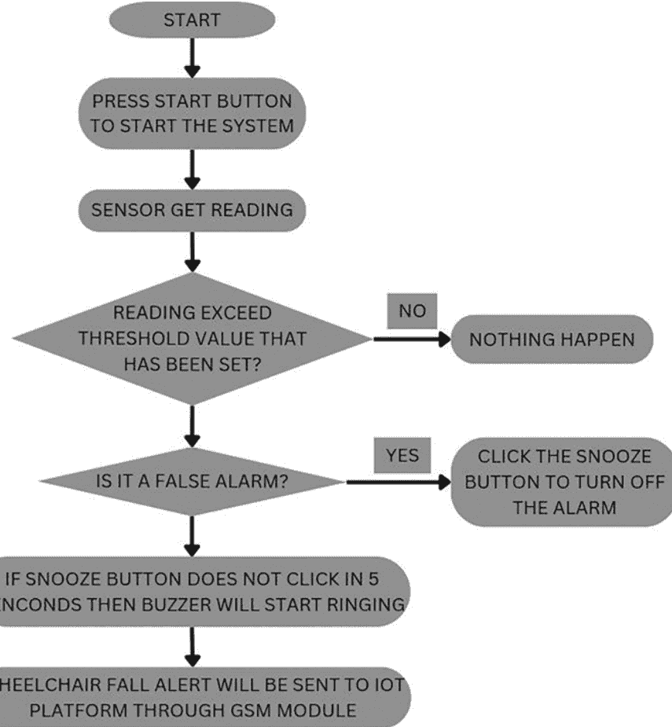

图 11.1 拟议系统的框图。

图 11.2：带有陀螺仪传感器的加速度计流程图概述了其在检测轮椅运动和稳定性方面的作用。通过监测速度和位置，偏离设定阈值预示着潜在的跌倒。如果检测到跌倒，系统会触发警报。用户可以在 5 秒内按下暂停按钮来取消误报。如果不这样做，则会激活蜂鸣器，提醒附近的人。同时，GSM 模块会发起求助呼叫。通过 IoT 平台，注册人员可以及时收到轮椅跌倒警报并提供帮助。


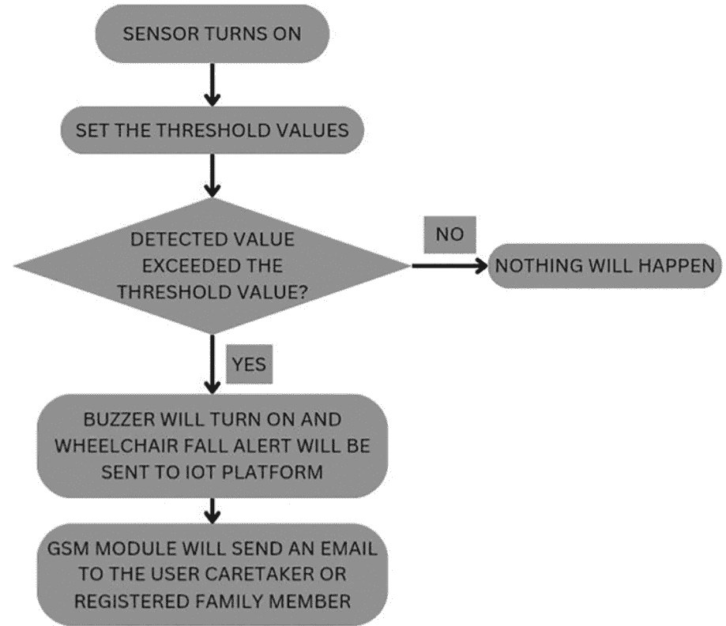

图 11.2 带有陀螺仪传感器的加速度计流程图。

图 11.3: 基于 IoT 的轮椅跌倒检测系统包含两个主要部分：跌倒检测与监测系统，以及图形用户界面（GUI）部分。修改后的整体框图描绘了两个输入：陀螺仪传感器和安全按钮。这些传感器从轮椅收集数据并将其传输到 ESP32 模块。GPS 模块捕获轮椅的速度和方向，这些数据也会发送到 ESP32。安全按钮用于在触发时关闭蜂鸣器。所有传感器的数据均经过分析，并从 ESP32 模块中继到 Blynk 移动应用程序。

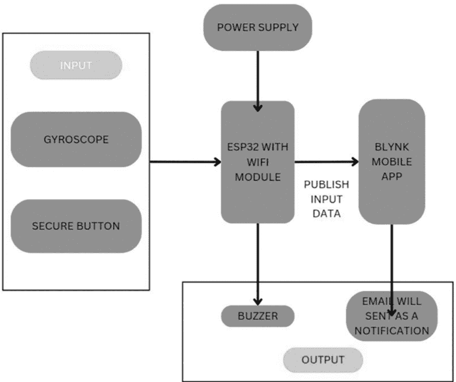

图 11.3 轮椅跌倒检测系统的整体框图。

图 11.4: 接线图展示了轮椅跌倒检测系统的完整设置，由两个互连的组件组成。这些组件包括嵌入轮椅座垫中的手势识别系统和陀螺仪检测系统。具体而言，所提供的接线图侧重于手势识别系统的配置。

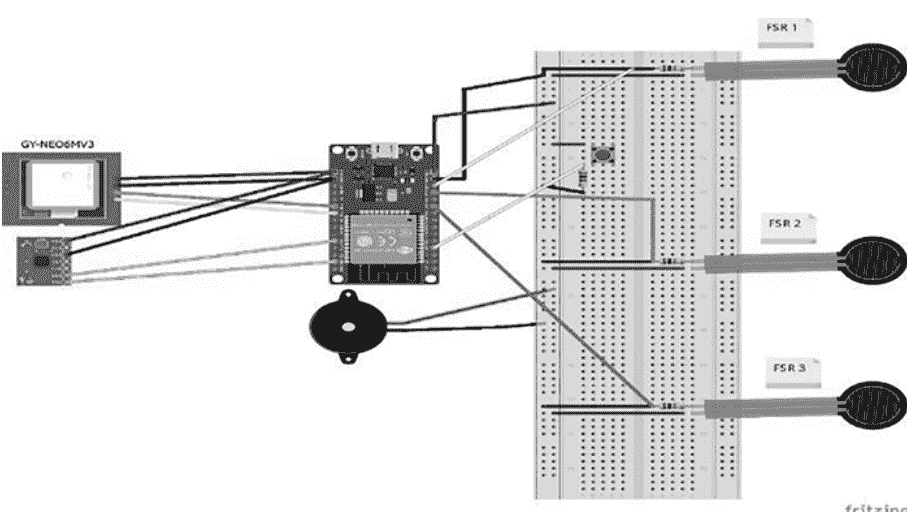

图 11.4 提出的轮椅跌倒检测系统的整体接线图。

### 11.5.1 ESP32 DEV 模块

ESP32 Dev 模块是一款功能多样的微控制器开发板。它具有内置的 Wi-Fi 和 Bluetooth 连接功能。它非常适合用于 IoT 应用、原型设计和开发。它由 ESP32 芯片组供电，提供高性能。它支持多种传感器和外围设备。

## 11.6 实验结果

硬件：基于 IoT 的轮椅跌倒检测系统的硬件实现涉及将系统直接集成到轮椅本身中。轮椅配备了 ESP32 微控制器、陀螺仪传感器、蜂鸣器和安全按钮。这些组件协同工作以检测跌倒并传输相关数据用于分析和告警。陀螺仪传感器和蜂鸣器固定在轮椅内侧左侧。这些传感器连接到面包板。一旦有人坐在轮椅上，传感器即被激活。轮椅跌倒检测系统收集的数据随后发送到 Blynk 移动应用程序。用户和授权人员均可使用该应用程序监控轮椅的状态。当由 10,000 mAh 移动电源或连接到微控制器的电源供电时，系统开始运行。系统必须连接到移动数据或 Wi-Fi 网络，以确保运行顺畅。

软件：Blynk 是一种与硬件无关的 IoT 平台，拥有白标签移动应用、私有云、设备管理和数据分析功能。

该系统的 GUI 包含三项主要功能：Google Maps 集成、电子邮件通知和虚拟 LED 指示灯。移动应用程序在接收并分析传感器数据后立即显示结果。当陀螺仪传感器的值超过预设阈值时，会发生跌倒检测。在这种情况下，虚拟 LED 将被激活，以指示跌倒事件，并向注册的电子邮件地址发送电子邮件通知，提醒用户从轮椅上跌倒。

可穿戴 IoT 传感器的关键优势之一在于其能够在跌倒发生时提供实时监控和即时响应。这些传感器的设计旨在准确检测与跌倒相关的特定运动模式，从而能够及时向护理人员、医疗专业人员或紧急服务发出警报。这种快速响应可以显著降低跌倒可能带来的后果，例如受伤或医疗救助延迟。此外，这些可穿戴传感器的便携性和非侵入性确保了用户的舒适度和依从性。传感器可无缝融入用户的日常生活，从而促进用户接受度和对技术的长期依从。这种易用性对于推动跌倒检测系统的广泛采用并最大化其影响至关重要。将机器学习算法与 IoT 传感器相结合，进一步提高了跌倒检测的准确性，最大限度地减少了误报，并优化了系统的可靠性。对这些算法的持续改进和更新有助于技术的不断进步，确保其在各种现实场景中的有效性。除了跌倒检测外，这些传感器还可以收集用户日常活动和健康指标的宝贵数据，为医疗监测提供整体方法。医疗服务提供者可以利用这些全面数据了解用户的行为，从而可能识别出可用于制定个性化护理计划的趋势或模式。

## 11.7 结论

将区块链与 IoT 集成到轮椅跌倒检测系统中，为增强轮椅用户跌倒相关事件的安全性、安全防护和协作管理提供了强大的框架。通过利用两种技术的优势，可以开发创新解决方案，以改善行动不便人士的护理质量和支持。用于轮椅跌倒检测的可穿戴 IoT 传感器集成代表了增强行动不便人士安全和福祉的重大进步。利用这些传感器解决了医疗保健的一个关键方面，特别是对于依赖轮椅进行日常活动的人而言。通过广泛的研究和开发，很明显，实施此类技术具有众多好处，并极有希望改善轮椅用户的整体生活质量。总之，用于轮椅跌倒检测的可穿戴 IoT 传感器集成不仅解决了关键的安全问题，还为更广泛的医疗应用打开了道路。不断的技术进步，加上对用户需求的关注，使这些系统成为不断变化的辅助技术和医疗解决方案领域中的重要元素。随着持续的研究和开发，这些创新有望在增强面临行动障碍的人士的自主性和福祉方面发挥越来越重要的作用。

## 参考文献

- 1. Ohbayashi, G., Nitta, O., Nakamura, A., Fujimoto, Y., & Yamaguchi, T. (2010). 开发用于辅助减少护理的智能动力轮椅。IFAC Proceedings Volumes, 42(24), 313–316.
- 2. Goulding, T., Deligiannidis, L., Sylvester, P., & Kim, B. (2015). 降低老年人从轮椅上跌倒的比率。收录于 Q. N. Tran & H. Arabnia (编), 《计算生物学、生物信息学和系统生物学新兴趋势（算法与软件工具）》一书章节，第 1 版，计算机科学与应用计算新兴趋势系列。
- 3. Chen, Y., Kong, X., Meng, L., & Tomiyama, H. (2020). 一种基于边缘计算的老年人跌倒检测系统。Procedia Computer Science, 174, 9–14.
- 4. Mrozek, D., Koczur, A., & Malysiak-Mrozek, B. (2020). 基于移动 IoT 设备以及云端和边缘机器学习的老年人跌倒检测。Information Sciences, 537, 132–147.
- 5. Revathy, G., Selvakumar, K., Murugapriya, P., & Ravikumar, D. (2022). 使用计算智能的工业 4.0 智能制造。收录于 N. Thillaiarasu, S. Lata Tripathi, & V. Dhinakaran (编), 《面向物联网的人工智能》。CRC Press, Boca Raton, FL, 第 31–48 页。
- 6. Chu, E. T. H., & Chen, K. J. (2022). SWAF：用于跌倒风险评估的智能轮椅。Journal of Systems Architecture, 131, 102694.
- 7. Rice, L. A., Fliflet, A., Frechette, M., Brokenshire, R., Abou, L., Presti, P., & Rogers, W. A. (2022). 关于为老年轮椅和滑板车用户设计的自动化跌倒检测设备的见解：一项定性研究。Disability and Health Journal, 15(1), 101207.
- 8. Abou, L., Sosnoff, J. J., Peterson, E. W., Backus, D., Willingham, T. B., & Rice, L. A. (2022). 多发性硬化症全时轮椅和滑板车用户未来跌倒的预测：一项前瞻性研究。Multiple Sclerosis and Related Disorders, 64, 103962.
- 9. Yousuf, S., & Kadri, M. B. (2023). 使用低成本嵌入式传感器和孤立森林算法的轮椅跌倒异常检测的无处不在架构。Computers and Electrical Engineering, 105, 108518.
- 10. Núñez-Marcos, A., & Arganda-Carreras, I. (2024). 基于 Transformer 的视频跌倒检测。Engineering Applications of Artificial Intelligence, 132, 107937.


# 第 12 章

# smartVAST: 智慧城市漏洞、攻击、安全与威胁及区块链技术的影响与能力

Bishwo Prakash Pokharel 和 Naresh Kshetri

DOI: 10.1201/9781003476047-12

## 12.1 引言

想象居住在一个城市中，技术无缝地融入日常生活的方方面面，使事物更加高效，并改善我们的整体体验。这就是智慧城市的承诺——由先进技术增强的城市空间。然而，这个由智能设备和系统构成的互联网络，尽管带来诸多益处，也伴随着一系列安全问题。随着智慧城市在我们生活中变得越来越重要，理解和解决这些漏洞至关重要。

本研究探讨了智慧城市面临的各种挑战，例如漏洞、网络威胁和安全问题。它进一步探讨了采用区块链技术增强智慧城市安全性的可能性。区块链以其去中心化和抗篡改的特性而闻名，在应对这些城市面临的安全挑战方面具有前景。本引言为深入探讨区块链如何无缝融入智慧城市的方方面面奠定了基础，旨在使它们更加安全和有韧性。

### 主要目标：

- 调查智慧城市环境中的漏洞和威胁。
- 解释区块链技术的基础知识及其如何增强智慧城市安全性。
- 探索将区块链融入智慧城市生活不同方面的实际方法。
- 提出一种名为 *smartVAST 框架* 的工具，以使智慧城市更加安全。
- 分享真实世界的案例，以说明 *smartVAST 框架* 如何应用。

在我们探索智慧城市与区块链技术之间复杂关系的过程中，本研究获得的见解为创建不仅智慧，而且安全、有韧性且对每个人都可持续的城市这一持续对话做出了贡献。

## 12.2 背景研究

### 12.2.1 智慧城市组件与漏洞

智慧城市涵盖多种多样的组件，包括但不限于交通系统、电网、医疗基础设施和数据管理系统。这些互联元素促进实时数据交换，从而实现高效的城市管理。然而，这种连接性也有代价——增加了对漏洞的易感性。例如，在智慧城市环境中引入物联网（IoT）设备可能会因缺乏强大的安全措施而产生漏洞。依赖互联网络的交通系统易受网络攻击，影响城市流动性的流畅性和安全性。尽管针对智慧城市的网络攻击威胁依然存在，但为保护这些城市区域而开展协作和共享策略的集体努力对集体利益至关重要（Lupton et al., 2022）。理解每个智慧城市领域固有的漏洞对于制定有效的安全措施至关重要。

### 12.2.2 智慧城市中的安全挑战

智慧城市技术的快速部署超过了强大网络安全措施的发展。全球格局正在见证智慧城市的出现，这由信息技术的进步所推动，而这些创新虽然提供了新的经济和社会前景，但也带来了安全挑战，并引发了对隐私期望的担忧（Elmaghraby & Losavio, 2014）。这导致了众多安全挑战，从未经授权访问关键基础设施到危及公民隐私的数据泄露。许多智慧城市系统的集中式特性放大了这些挑战，创造了可能被恶意行为者利用的单点故障。此外，智慧城市组件产生的海量数据在安全存储、传输和分析方面构成了挑战。智慧城市中存在五大安全挑战，包括在复杂数据集中维护隐私、保障广域网络安全、建立数据共享的信任、有效部署人工智能以及解决智能网络中的级联故障（Braun et al., 2018）。

### 12.2.3 区块链技术简介

区块链技术最初作为比特币等数字货币的基础结构而创建，由于其在金融用途之外的潜力而引起了关注。本质上，区块链充当一个去中心化和分布式数据库，以透明且防篡改的方式在计算机网络中安全记录交易。

区块链，又称区块链（Chain of Blocks），通过保留前一个区块的哈希数据，将每个区块链接到其前驱区块。该哈希数据源自区块内的数据，对区块所做的任何调整都会生成新的哈希。因此，即使是区块内的微小修改也会破坏整个链条，因为后续区块无法由于哈希不一致而定位被篡改的区块。在这种情况下，最长的链被认为是最合法的，最终导致忽略被篡改的区块链（Imteaj et al., 2021）。

### 12.2.4 智慧城市中区块链的先前研究

区块链与智慧城市的交叉领域在近年来的研究中一直是一个探索课题。以往的研究强调了区块链在提升智慧城市应用安全性和可信度方面的潜力。本节回顾并综合了现有文献中的关键发现，为将区块链技术融入智慧城市的方方面面提供了基础。

在 Treiblmaier 等人（2020）的论文中，作者深入探讨了区块链技术对智慧城市的潜在影响，审视了其底层技术和协议。他们指出了九个关键领域，区块链技术可以在这些领域在推动城市发展方面发挥重要作用，涵盖医疗保健、物流、运输、能源、政府流程、电子投票、工业运营、家庭管理和教育。作者分析了这些领域的持续发展，强调了区块链的影响，并提出了未来研究的方向。

Salha 等人（2019）进行的研究旨在探讨区块链技术在智慧城市中的可能作用。他们的研究涉及对有关区块链的学术文献进行广泛综述，重点关注其基本概念和实际应用。此外，它还综合了全球成功的区块链实施案例，同时深入探讨了智慧城市环境中相关的挑战和机遇。

Barella Migliorini 等人（2021）进行的研究旨在阐明智慧城市如何在政治、经济、社会和环境领域提供实现全面可持续性的替代途径。通过对智慧城市排名和指数的广泛调查，该研究确定了在各个维度表现出色的城市。研究发现，区块链技术在推动建立自我调节和可持续的智慧城市方面发挥了关键作用。在与精通其实施的市场专家协商后进行的区块链适用性分析显示，主要关注认知层面，而对城市运营基础设施的关注相对较少。

Gade & Aitha（2020）的论文探讨了区块链技术融入智慧城市，强调了其对此类城市发展的潜在影响。他们解决了智慧城市中各种应用对可靠和安全的在线操作流程的需求，并提出了一种利用区块链技术的安全框架。通过彻底的研究和广泛的文献综述，他们确定了多个将从该技术中获益显著的应用和流程领域，从而增强其智能性、可靠性和在智慧城市中实施的适用性。


Ćirić 等人（2019 年）开展的研究探讨了区块链技术在智慧城市中的各种应用方式，借鉴了现有文献和用例。其目标是根据智慧城市的不同方面对潜在应用进行分类，以提供更全面的分析。

Rotuna 等人（2019 年）的论文提出了一种面向智慧城市生态系统的基于区块链的模型。通过整合自主身份（SSI）和智能合约，作者旨在促进公民、公共当局和物联网设备之间的安全透明交互。其分析深入探讨了区块链技术在多个对智慧城市发展至关重要的领域中的潜在应用。这些领域包括数字身份管理、加强物联网安全、促进私有消息系统，以及提升城市环境中自动驾驶汽车的功能。通过他们的探索，作者强调了区块链在颠覆智慧城市基础设施和服务各个方面方面的变革潜力。

Alnahari 和 Ariaratnam（2022 年）提出了一个框架，用于将区块链技术应用于能源、水务、交通、建筑和政府等各个领域的智慧城市基础设施。他们探讨了区块链在提升城市系统数据安全性、透明度、效率和可持续性方面的优势与挑战。他们还介绍了亚利桑那州坦佩市的案例研究，将其作为一个可在基础设施和运营中实施区块链的假设城市示例。他们得出结论，区块链有潜力将整个基础设施转变为企业实体，但也承认需要克服监管、技术和成本等障碍。

Dzyatkovskii（2022 年）讨论了人工智能和区块链技术在智慧城市中的应用与前景，重点关注能源、交通、废弃物管理和空气质量等领域。它回顾了当前关于这些技术如何改善城市系统效率、可持续性和安全性的文献，并介绍了一些现有或拟议项目的案例研究和示例。它还指出了实施人工智能和区块链解决方案面临的一些挑战与局限，例如数据可用性、可扩展性、互操作性和公众接受度。该论文得出结论，人工智能和区块链对智慧城市发展可能产生重大影响，但不应将其视为解决每个问题的唯一或最优方案。

Năsulea 和 Mic（2018 年）总结了区块链技术在智慧城市和智慧社区中的潜在应用，例如智能合约、智能资产、数字身份和投票。该文还提出了一种基于智慧城市、智慧社区与个人之间交互的区块链集成模型。文章讨论了区块链技术在安全性、隐私性、效率和创新方面的优势，以及其实施面临的挑战和局限性。文章得出结论，区块链技术有望为智慧城市和社区实现新的去中心化治理与协调形式。

## 12.3 智慧城市漏洞与威胁

下图概念图展示了智慧城市所面临的相互关联挑战的漏洞与威胁（图 12.1）。


**图 12.1** 一张说明智慧城市在交通、能源电网、医疗系统、数据管理以及关键基础设施韧性方面漏洞与威胁的图示。

### 12.3.1 交通系统漏洞

智慧城市交通系统代表了传统基础设施与物联网设备、传感器及连接性等现代技术的融合。这些进步虽提升了效能，却也产生了可能被恶意个人操纵的弱点。交通控制系统、自动驾驶汽车和公共交通基础设施的互联互通特性，为网络攻击创造了潜在的入侵点。威胁可能从未经授权访问交通管理系统（导致交通中断），到危及安全协议和自动驾驶汽车（危及公共安全）。由于智慧城市高度依赖高效且安全的交通网络，理解并解决这些漏洞对于维护城市出行的可靠性和安全性至关重要。

智能交通系统依赖信息通信技术（ICTs）来提升城市出行的效率、安全性和可持续性。然而，这些系统也面临多种漏洞，例如网络攻击、自然灾害、人为失误和破坏行为。这些漏洞可能危及交通基础设施和服务的功能、可靠性与安全性，并对经济、环境和社会产生负面影响。因此，智能交通系统需要采取适当措施来预防、检测和应对潜在威胁，并在发生中断时确保韧性与恢复（Cristéa 等人，2016 年）。

### 12.3.2 能源电网漏洞

智慧城市能源电网利用数字技术优化能源分配、监测消耗并整合可再生能源。然而，这种连接性也为可能带来严重后果的漏洞敞开了大门。对智能电网的网络攻击可能会中断电力流动，导致停电，这不仅影响城市功能，还会对关键基础设施和服务构成风险。能源分布式特性也给保障整个能源电网安全带来了挑战。防范潜在威胁对于确保智慧城市内稳定且具有韧性的能源基础设施至关重要。

智能电网网络将传统电网与信息通信技术相结合，易受多种网络威胁的影响，这些威胁可能危及电力基础设施和用户数据的可靠性、准确性和隐私。主要漏洞包括客户隐私、物理安全、隐式信任、过时设备以及多样化的利益相关者（Aloul 等人，2012 年）。

### 12.3.3 医疗系统漏洞

智慧城市医疗保健的数字化转型引入了影响患者数据隐私、服务提供以及医疗系统整体完整性的漏洞。智能医疗系统依赖互联设备、电子健康记录（EHRs）和远程医疗解决方案。这些系统易受可能泄露患者数据、中断关键医疗服务甚至篡改医疗记录的网络攻击。确保这些互联医疗组件的安全对于维护公众信任和敏感健康信息的机密性至关重要。

由于医疗系统存储和传输敏感且有价值的数据（如个人健康信息、财务数据和医疗记录），因此易受网络攻击。网络攻击可能危及医疗数据的机密性、完整性和可用性，以及医疗服务的安全性和质量。医疗系统面临的常见网络威胁包括勒索软件、恶意软件、拒绝服务攻击、数据泄露和网络钓鱼。为预防和缓解这些威胁，医疗系统需要采用能够确保数据保护、隐私和信任的安全标准、协议和技术。区块链技术是一种可增强医疗安全性和互操作性的有前景解决方案（Safavi 等人，2018 年）。

### 12.3.4 数据管理与隐私问题

智慧城市组件（包括物联网设备、传感器和监控系统）产生的海量数据，在安全存储、传输和公民隐私保护方面带来了重大挑战。未经授权访问敏感数据可能导致身份盗窃、隐私泄露，并削弱公众对智慧城市技术的信任。大型数据集的集中式存储成为网络攻击的潜在目标，因此需要采取强大的数据管理实践和加密协议。解决这些隐私问题对于建立和维护公众对采用智慧城市技术的信心至关重要。

智慧城市依赖大数据为交通、能源、健康和安全等城市挑战提供各种服务和解决方案。然而，大数据也对公民数据的隐私和安全构成重大风险，尤其是在数据由不同实体在未获得适当同意或保护的情况下被收集、存储和分析时（Atoum & Keshta，2021 年）。智慧城市面临的一些漏洞和威胁包括数据泄露、网络攻击、未经授权的访问、数据滥用、身份盗窃和监控。这些威胁可能危及公民的信任、信心和福祉，以及智慧城市服务的效率和可持续性。因此，智慧城市需要采用有效且强大的数据保护机制，如加密、身份验证、访问控制和审计等。


以及教育和赋能公民，使其了解自身的数据权利和责任。

### 12.3.5 关键基础设施韧性 (CIR)

智慧城市依赖于相互关联和相互依赖的关键基础设施系统，包括通信、供水、电力、卫生和医疗保健，以提供重要服务并改善居民的福祉。然而，这些关键基础设施也面临各种漏洞和威胁，例如网络攻击、自然灾害、气候变化和人为失误，这些都可能干扰其正常运行，并在各部门和各规模层面产生连锁影响。因此，增强智慧城市中关键基础设施的韧性，是城市规划者、政策制定者和研究人员面临的关键挑战与机遇。

韧性是指系统在承受、适应并从各种中断和压力中恢复的能力，同时保持其基本运营和核心本质。韧性可以通过技术、组织和社会措施的组合来实现，例如风险评估、应急规划、冗余、多样性、灵活性、学习和协作（Ali 等人，2018）。智慧城市需要采取全面且主动的CIR方法，这包括发展和推广组织韧性文化、识别和管理跨部门依赖关系、提供及时高质量的政策建议、实施有效的网络安全措施，以及支持各利益相关方之间的协作与协调。通过增强CIR，智慧城市可以提高其运营效率、社会和经济福祉以及国家安全。

## 12.4 区块链技术：概述

### 12.4.1 区块链的基本原理

区块链技术作为安全透明的去中心化交易的基础框架。从本质上讲，区块链作为一种去中心化的记账系统，在被称为节点的计算机网络中记录交易。交易被组织成区块，并与前一个区块相连，形成连续的信息链。区块链的基本原则包括以下内容：

- **去中心化**：去中心化是区块链技术的核心原则。在区块链系统中，数据在对等网络的多个节点之间分布，消除了对中央机构的需求。网络不是由单一实体控制，而是由用户社区维护，他们以透明和安全的方式验证记录的交易。

- **不可篡改性**：不可篡改性是区块链技术的关键特性，可确保存储在区块链上的数据的完整性。它通过加密哈希和分布在每个参与节点上的区块链副本的去中心化网络来实现。然而，它并非绝对不可篡改，存在交易历史可能会发生变化的情况。因此，掌握区块链的技术方面对于有效将其实际应用至关重要。

- **共识机制**：共识机制在验证交易和确定区块链网络中账本状态方面至关重要。这些机制（例如工作量证明（PoW）、权益证明（PoS）和实用拜占庭容错（PBFT））用于通过加密和自动化群体验证来保护信息。尽管如此，必须承认，尽管共识机制至关重要，但它们并非完美无缺，可能容易受到各种攻击。

### 12.4.2 区块链的关键特性

区块链技术体现了多项关键特性，包括透明性、安全性、去中心化和智能合约。这种创新的分布式计算范式在对等网络中记录交易，解决了与中心化实体相关的信任问题。

- **透明性**：区块链内的透明性保证所有参与实体都能访问合同条款和执行细节，促进信任并降低争议可能性。

- **安全性**：存储在去中心化网络上的智能合约固有的安全性大大降低了被篡改或泄露的可能性，从而显著增强其抵御黑客攻击的能力。

- **去中心化**：去中心化消除了中央权威，而是依靠多个节点协作，在无需可信中介的情况下安全地维护交易记录。

- **智能合约**：智能合约是一种自动化协议，用于促进不可信各方之间的达成协议，有潜力通过提供安全透明的合同执行机制来转变各个行业。

### 12.4.3 区块链类型

区块链技术可分为三种主要类型：

- **公有链**：任何人都可以访问，公有链是开放网络，参与者可以加入、验证交易并参与共识过程。示例包括比特币和以太坊。

- **私有链**：仅限于特定群体或组织，私有链对访问和参与提供了更多控制。它们通常在企业环境中用于内部流程。

- **联盟链**：联盟链由一组组织使用，提供一种结合公有链和私有链特点的混合模式。在这些网络中，成员协作验证交易并维护系统的完整性。

总结来说，区块链技术基于去中心化、不可篡改性和共识原则运行，为数字交易提供安全透明的框架。区块链的关键特性，包括透明性、安全性和智能合约，使其在各种应用中具有多功能性。

## 12.5 区块链在智慧城市中的集成

### 12.5.1 区块链与物联网安全

区块链技术与物联网的集成在加强智慧城市基础设施安全方面发挥着关键作用。物联网设备（从城市环境中的传感器到智能家居设备）产生海量数据。区块链为管理、验证和存储这些数据提供了去中心化且安全的机制。涉及物联网设备的每笔交易都以透明且防篡改的方式记录在区块链上，确保数据的完整性。此外，区块链的去中心化特性消除了与集中式物联网网络相关的漏洞，在集中式网络中，一个节点的泄露可能会危及整个系统。这种集成增强了智慧城市的整体安全态势，特别是在管理庞大且多样的物联网设备生态系统方面。

智慧城市面临的主要挑战之一是确保由实现各种智能服务的物联网设备收集和处理的数据的安全性和隐私性。区块链作为一种去中心化且防篡改的技术，可以通过在智慧城市生态系统中不同利益相关方之间实现无需信任且透明的数据共享，为这一挑战提供解决方案。区块链还可以促进物联网设备的身份验证和授权、用于自动化服务提供的智能合约执行，以及创建数据共享和协作的激励机制（Zhonghua & Goyal, 2022）。此外，区块链可以促进不同物联网平台和设备之间的数据共享和互操作性，为智慧城市创建无缝且高效的物联网生态系统（Strehin, n.d.）。

### 12.5.2 用于安全数据管理的区块链

智慧城市产生并依赖海量数据来进行实时决策和高效城市管理。区块链为安全数据管理提供了强大的解决方案，解决了与数据完整性、隐私和透明性相关的挑战。通过使用区块链，数据交易变得可追溯和可审计，降低了未经授权的访问和篡改风险。区块链的去中心化特性确保数据不存储在单一脆弱点，从而减轻数据泄露的潜在影响。此外，公民对其个人数据拥有更大的控制权，因为区块链的加密技术能够在保护隐私的同时实现安全透明的数据共享。

区块链是一种分布式账本技术，可为各种应用（例如医疗保健、金融、供应链和电子投票）提供安全透明的数据管理。区块链通过使用加密技术和共识协议，实现数据的不可篡改性、完整性和可溯源性。区块链还可以支持智能合约，即能够自动执行交易并强制执行规则的自执行协议（Hossain et al., 2021）。

### 12.5.3 用于自动化和安全的智能合约

智能合约是在区块链平台上自动且安全地执行合同义务的计算机程序。它们可以降低交易成本、增强信任，并实现新的去中心化治理形式（Sirena & Patti, 2021）。

在区块链上实施智能合约，使智慧城市能够安全高效地自动化流程。智能合约是


在区块链中编码了预定义规则的自动执行协议。在智慧城市语境下，这些合同可以自动化各种功能，从管理能源分配到促进安全透明的金融交易。例如，在智能电网系统中，智能合约可以根据预定义规则自动执行能源交易，消除对中介的需求并降低欺诈活动的风险。使用智能合约不仅有助于提高智慧城市运营的效率，还能增强合同协议的安全性和透明度。

### 12.5.4 去中心化身份管理

去中心化身份管理（DID）依赖于区块链技术，用于创建和验证独立于任何中央机构的自主主权身份。DID具有多种优势，例如增强身份数据的隐私性、安全性和可移植性，以及跨领域实现多样化的应用和用例。然而，DID也面临多项挑战，例如互操作性、可扩展性和治理（Singla et al., 2022）。

传统的身份管理系统通常是中心化的，这使得它们容易遭受安全漏洞和身份盗窃。区块链技术使去中心化身份管理成为可能，个人可以控制自己的个人信息。每个用户的身份都安全地存储在区块链上，访问权通过加密密钥授予。这种去中心化方法降低了单点故障的风险，增强了数据隐私，并赋予公民对其身份信息更大的自主权。

### 12.5.5 供应链安全与透明度

供应链安全与透明度是智慧城市需要谨慎关注和管理的关键方面。智慧城市依赖于一个复杂的互联设备、传感器和系统网络，这些设备、传感器和系统会生成和交换海量数据。这些数据通常是敏感且有价值的，其安全性和隐私性必须受到保护，防止被盗窃、破坏或中断。区块链技术可以通过在智慧城市生态系统中促进不同利益相关方之间安全透明的数据共享，为这一挑战提供解决方案（Sodhi et al., 2018）。

区块链可以增强智慧城市内供应链流程的安全性和透明度。从建设项目的材料采购到商品和服务的交付，区块链确保交易记录不可篡改。这种透明性不仅可以防止欺诈，还能让公民和企业有能力追踪产品的来源和流转过程。通过将区块链集成到供应链管理中，智慧城市可以加强关键基础设施项目的安全性，并提高资源配置的整体效率。

### 12.5.6 环境与能源倡议

在可持续性背景下，区块链技术可以集成到智慧城市中，以监控和激励环保实践。基于区块链的系统可以追踪能源消耗的来源和影响，监测排放，并促进透明的碳交易。此外，由区块链驱动的去中心化能源网络可以实现更高效的能源分配，减少浪费并促进可再生能源的使用。区块链在环境与能源倡议中的集成有助于提升智慧城市的整体韧性和可持续性。

## 12.6 smartVAST 框架

### 12.6.1 smartVAST 简介

为回应不断变化的智慧城市漏洞态势及区块链技术的集成，引入 smartVAST 框架作为一种战略工具，用于评估、应对并加强智慧城市生态系统的安全性。smartVAST 代表漏洞（Vulnerability）、攻击（Attacks）、安全（Security）和威胁（Threats），涵盖了一种在区块链集成背景下降低风险的综合方法。该框架旨在为智慧城市利益相关方（包括城市规划师、网络安全专业人员和政策制定者）提供一种结构化方法论，以分析和增强其城市的安全态势。

### 12.6.2 smartVAST 框架的组成部分

smartVAST 框架由四个相互关联的组成部分构成（图 12.2）：

### smartVAST 框架的组成部分


图 12.2 一个逐步图示，展示 smartVAST 框架的四个组成部分：漏洞评估、攻击分析、安全增强和威胁缓解。

- **漏洞评估**：第一步是对智慧城市基础设施中的潜在漏洞进行彻底检查。此评估会考虑互联设备类型、数据流和关键基础设施组件等因素。目标是识别系统中可能被恶意行为者利用的薄弱环节。
- **攻击分析**：在已识别漏洞的基础上，框架会对可能利用这些弱点的潜在网络攻击进行分析。这包括研究历史攻击模式、理解新兴威胁，以及评估攻击对智慧城市各个领域的潜在影响。
- **安全增强**：在清晰理解漏洞和潜在攻击向量的基础上，smartVAST 框架提出安全措施和增强方案。这可能涉及集成区块链技术以保障数据交易安全、实施智能合约以实现自动化，以及加强智慧城市组件之间的整体网络安全措施。
- **威胁缓解**：最后一个组成部分涉及制定策略以缓解已识别的威胁。这可能包括实施主动措施、事件响应计划以及持续监控，以实时检测和响应潜在的安全事件。

### 12.6.3 smartVAST 的实施步骤

smartVAST 框架的实施遵循一种系统的方法（图 12.3）：

#### 1. 基准评估
- 1.1 智慧城市清单
- 1.2 利益相关方映射
- 1.3 数据收集与分析

#### 2. 漏洞分析
- 2.1 设备漏洞评估
- 2.2 网络漏洞评估
- 2.3 基础设施漏洞评估

#### 3. 攻击场景开发
- 3.1 历史攻击分析
- 3.2 新兴威胁研究
- 3.3 攻击影响评估

#### 4. 安全增强规划
- 4.1 区块链集成策略
- 4.2 网络安全政策制定
- 4.3 技术实施路线图

#### 5. 威胁缓解策略
- 5.1 事件响应规划
- 5.2 持续监控系统
- 5.3 协作框架

#### 图 12.3 一个图示，说明 smartVAST 框架实施的七个不同步骤及其子步骤。

#### 步骤 1：基准评估

此步骤的目标是对当前智慧城市基础设施进行全面的基准评估，为后续分析奠定基础。此步骤应完成以下活动：

- 识别并记录现有的智慧城市组件，包括物联网设备、数据管理系统和关键基础设施。
- 评估现有的网络安全措施并评估其有效性。
- 记录不同组件之间的数据流和交互。

##### 1.1：智慧城市清单

- 创建所有智慧城市组件的清单，包括物联网设备、传感器和关键基础设施
- 记录智慧城市生态系统中的互联系统和依赖关系。

##### 1.2：利益相关方映射

- 识别并映射关键利益相关方，包括城市官员、技术提供商和网络安全专家。
- 建立沟通渠道和协作框架，以实现有效的信息交换。

##### 1.3：数据收集与分析

- 收集和分析与智慧城市基础设施当前状态相关的数据。
- 评估现有的网络安全措施并识别潜在差距。

#### 步骤 2：漏洞分析

此步骤的目标是执行详细的漏洞分析，以识别智慧城市基础设施中的潜在弱点。此步骤完成的活动如下：

- 对关键组件进行漏洞扫描和评估，重点关注网络攻击的潜在入口点。
- 根据严重程度和潜在影响识别和分类漏洞。
- 根据风险评估确定漏洞优先级，考虑智慧城市系统的互联特性。

##### 2.1：设备漏洞评估：


- 评估单个物联网设备、传感器及其他联网技术的漏洞。
- 评估固件和软件安全性、更新机制及补丁程序。

##### 2.2: 网络漏洞评估：
- 对网络漏洞进行全面分析，包括入口点和数据传输中的潜在弱点。
- 评估防火墙、入侵检测系统和网络分段的有效性。

##### 2.3: 基础设施漏洞评估
- 识别关键基础设施组件中的漏洞，例如电网、交通系统和医疗网络。
- 评估对关键基础设施韧性的物理和网络威胁。

#### 步骤 3：攻击场景开发：

此步骤的目标是基于已识别漏洞开发假设性攻击场景，同时考虑已知和新兴的网络威胁。
此步骤的活动如下：

- 创建详细的攻击场景，概述恶意行为者可能利用的潜在方法和攻击向量。
- 考虑攻击对不同智慧城市领域的影响，例如交通、能源、医疗和数据管理。
- 与网络安全专家合作，模拟并验证攻击场景的可行性。

##### 3.1: 历史攻击分析
- 分析针对智慧城市及相关技术的历史网络攻击。
- 识别恶意行为者使用的常见攻击模式和策略。

##### 3.2: 新兴威胁研究
- 了解与智慧城市相关的新兴网络安全威胁和趋势。
- 与网络安全专家和组织合作，预测新的攻击向量。

##### 3.3: 攻击影响评估
- 评估已识别攻击场景对智慧城市运营和市民安全的潜在影响。
- 考虑攻击对互联系统的级联影响。

#### 步骤 4：安全增强规划：

此步骤的目标是提出安全增强措施，重点在于在适用的地方集成区块链技术，以解决已识别的漏洞。此步骤的活动如下：

- 设计和规划安全措施，例如实施防火墙、入侵检测系统和加密协议。
- 探索集成区块链技术以保护数据交易、实施智能合约并增强整体网络安全。
- 制定分阶段实施安全增强的路线图，考虑资源限制及对现有系统的潜在影响。

##### 4.1: 区块链集成策略
- 制定将区块链技术集成到智慧城市基础设施中的策略。
- 确定区块链的具体用例，例如安全数据管理、去中心化身份和智能合约。

##### 4.2: 网络安全政策制定
- 制定和更新网络安全政策，以与区块链集成保持一致并解决已识别的漏洞。
- 建立事件响应、数据保护和安全开发实践的协议。

##### 4.3: 技术实施路线图
- 制定安全增强的实施路线图，包括区块链解决方案的部署。
- 定义时间表、里程碑和关键绩效指标以跟踪进度。

#### 步骤 5：威胁缓解策略：

此步骤的目标是制定全面的威胁缓解策略，以尽量减少已识别威胁的影响。此步骤的活动如下：

- 制定事件响应计划，概述发生安全漏洞时应采取的行动。
- 建立持续监控机制，以实时检测和响应潜在的安全事件。
- 与网络安全专家、执法机构和相关利益方合作，制定应对新兴威胁的协调响应。

##### 5.1: 事件响应规划
- 制定全面的事件响应计划，以便对网络安全事件做出迅速有效的反应。
- 建立通信协议、角色和职责以及恢复程序。

##### 5.2: 持续监控系统
- 实施持续监控系统，以实时检测和响应安全威胁。
- 利用入侵检测系统、日志分析工具和异常检测机制。

##### 5.3: 协作框架
- 加强与外部网络安全专家、执法机构和行业合作伙伴的协作。
- 建立信息共享平台，并参与威胁情报共享计划。

### 12.6.4 smartVAST 框架的优势

smartVAST 框架为智慧城市提供了多项关键优势：

- **主动安全措施：** 通过系统性地识别漏洞和潜在威胁，smartVAST 使城市能够主动实施安全措施，降低成功网络攻击的可能性。
- **高效资源分配：** 该框架通过关注风险最高和潜在影响最大的领域，帮助高效分配资源，确保网络安全工作具有针对性且有效。
- **对不断演变的威胁的适应性：** smartVAST 的设计旨在随不断变化的威胁态势而演变。定期的评估和更新可确保该框架保持相关性，并能适应新兴的网络威胁。
- **增强协作：** 该框架鼓励各利益方（包括城市官员、网络安全专家和技术提供商）之间的协作，促进一种集体且有见识的智慧城市安全方法。

## 12.7 未来方向与挑战

### 12.7.1 不断演变的威胁态势

在智慧城市中，网络威胁根据其目标可分为三种主要类型：针对设备的威胁、针对系统的威胁和针对网络的威胁。尽管引入了众多旨在增强智慧城市网络安全的技术，但攻击方法的不断进步构成了持续的漏洞。就此而言，垃圾邮件攻击、女巫攻击和身份攻击等当代网络攻击尤其令人担忧（Al-Taleb 等人，2020 年）。

随着智慧城市的不断发展，威胁态势也在变化。智慧城市网络安全的未来方向必须保持对新兴网络威胁的适应性。将人工智能、机器学习和量子计算集成到智慧城市基础设施中既带来机遇也带来挑战。研发工作应着重于预防性策略，以预见和减轻新型威胁，确保智慧城市在不断变化的威胁态势中保持韧性和安全性。

### 12.7.2 学科间协作

智慧城市网络安全的未来在于学科间协作。深度学习和区块链技术的集成只是涉及城市规划、公共政策、执法和网络安全的更广泛格局的一个方面。来自不同领域的专业人员之间的协作对于制定整体且有效的策略至关重要。未来的研究方向应强调学科间的方法，以应对智慧城市面临的多方面挑战。

### 12.7.3 隐私问题与伦理考量

对互联设备的攻击频率和复杂性正在快速增加，带来重大安全风险。除了安全问题，隐私问题在智慧城市中的智能家居领域也日益突出。这些问题涵盖从未经授权访问个人信息到隐私的各个维度，包括独处、匿名性和亲密感。此外，还存在未经授权的各方进入住宅本身的物理入侵威胁，这引发了严重的隐私问题（Hall 等人，2020 年）。


随着智慧城市技术的发展，隐私问题日益凸显。未来研究应优先开发隐私保护技术与框架，以实现安全透明的智慧城市运营，同时尊重个人隐私权。数据所有权、同意以及新兴技术的负责任使用等伦理考量，必须成为智慧城市网络安全措施开发的核心。

### 12.7.4 标准化与监管

标准化网络安全措施的缺乏给智慧城市部署带来了重大挑战。未来方向应包括建立国际标准和法规，以确保全球智慧城市之间具有一致且较高的网络安全水平。标准化可以简化最佳实践的采用，促进互操作性，并增强整体网络安全韧性。

### 12.7.5 量子安全密码学

量子计算的兴起给传统密码学方法带来了新的挑战。智慧城市网络安全的未来方向必须回应对量子安全密码算法的需求，以抵御量子计算机可能构成的威胁。研究工作应聚焦于开发能够抵御量子攻击的密码解决方案，确保智慧城市数据的长期安全性。

### 12.7.6 环境可持续性与网络安全

智慧城市举措通常关注环境可持续性。然而，实施先进网络安全措施的环境影响也应予以考虑。未来研究应探索环保的网络安全解决方案，以契合创建可持续且具韧性的智慧城市这一更广泛目标。

## 12.8 结论

区块链技术的集成，结合 smartVAST 框架的战略应用，已成为深度学习时代强化智慧城市安全的强大范式。随着智慧城市不断发展并拥抱技术进步，其面临的漏洞和威胁变得更加复杂。本文探讨了从交通系统到医疗基础设施的智慧城市网络安全多维格局，概述了潜在风险和挑战。

smartVAST 框架的应用已证明其在系统性应对这些挑战方面的有效性。通过交通安全、电网韧性和医疗数据安全的案例研究，该框架展示了其识别漏洞、提出有针对性的安全增强措施并减轻潜在威胁的能力。交叉案例分析与评估指标提供了该框架影响的切实证据，为提升智慧城市的网络安全态势奠定了基础。

本文概述的未来方向凸显了智慧城市网络安全的动态性。随着威胁格局的演变和技术的进步，采取主动且跨学科的方法至关重要。隐私问题、伦理考量、标准化、量子安全密码学和环境可持续性均是亟待持续研究与关注的关键方面。

总而言之，深度学习与区块链技术的融合为保障和推动智慧城市发展提供了前所未有的机遇。smartVAST 框架为利益相关者提供了指导，提供了一种结构化的方法论来应对智慧城市网络安全的复杂性。通过解决当前挑战并预见未来发展，本文所呈现的研究有助于关于创建具韧性、安全且可持续的智慧城市的持续讨论。

随着智慧城市成为我们城市景观的组成部分，创新技术与战略框架的融合将在塑造城市生活未来方面发挥关键作用。本文为研究人员、政策制定者和行业专业人士提供了一个起点，以协作创建安全、智能的城市，优先考虑其公民的福祉、隐私和繁荣。

## 参考文献

- Ali, F. M. M., Ingirige, B., & Zainal Abidin, N. A. (2018). 孟加拉国库尔纳市关键基础设施韧性的组装与（再）组装。*Procedia Engineering*, *212*, 832–839. https://doi.org/10.1016/j.proeng.2018.01.107
- Alnahari, M. S., & Ariaratnam, S. T. (2022). 智慧城市基础设施中区块链技术的应用。Smart Cities, 5(3), 979–993. https://doi.org/10.3390/smartcities5030049
- Aloul, F., Al-Ali, A. R., Al-Dalky, R., Al-Mardini, M., & El-Hajj, W. (2012). 智能电网安全：威胁、漏洞与解决方案。International Journal of Smart Grid and Clean Energy, 1(1), 1–6.
- Al-Taleb, N., Abbas Saqib, N., Rahman, A., & Dash, S. (2020). 安全智慧城市的网络威胁情报。arXiv:2007.13233. https://doi.org/10.48550/arXiv.2007.13233
- Atoum, I. A., & Keshta, I. M. (2021). 大数据管理：安全与隐私问题。International Journal of Advanced and Applied Sciences, 8(5), 73–83. https://doi.org/10.21833/ijaas.2021.05.009
- Barella Migliorini, I., De Hoyos Guevara, A., De Melo Conti, D., & Catarina Dib, V. (2021). 智慧城市中的区块链技术。Journal on Innovation and Sustainability RISUS, 12(4), 04–12. https://doi.org/10.23925/2179-3565.2021v12i4p04-12
- Braun, T., Fung, B. C. M., Iqbal, F., & Shah, B. (2018). 智慧城市中的安全与隐私挑战。Sustainable Cities and Society, 39, 499–507.
- Ćirić, Z., Sedlak, O., & Ivanišević, S. (2019). 智慧城市信息系统中区块链技术的应用领域。第 3 届信息技术、旅游、经济学、管理和农业最新进展国际科学会议论文集 – ITEMA，斯洛伐克，布拉迪斯拉发（第 209–213 页）。 https://doi.org/10.31410/ITEMA.2019.209
- Cristea, C., Birsan, A., & Shuleski, D. (2016). 智慧城市与智能交通。布加勒斯特个案研究。Revista Economică, 68(6), 17–34.
- Dzyatkovskii, A. (2022). 带有人工智能和区块链技术的智慧城市演变。https://hackernoon.com/the-evolution-of-smart-cities-with-ai-and-blockchain-technology.
- Elmaghraby, A. S., & Losavio, M. M. (2014). 智慧城市中的网络安全挑战：安全、保障与隐私。Journal of Advanced Research, 5(4), 491–497. https://doi.org/10.1016/j.jare.2014.02.006
- Hall, F., Maglaras, L., Aivaliotis, T., Xagoraris, L., & Kantzavelou, I. (2020). 智能家居：安全挑战与隐私问题。https://arxiv.org/abs/2010.15394
- Hossain, J., Shahriar, H., Valero, M., Sneha, S., Rahman, M., & Ahamed, I. (2021). 面向远程患者监测的基于区块链的安全数据管理。2021 年 IEEE 国际数字健康会议 (ICDH)，芝加哥，IL，EasyChair 预印本。
- Imteaj, A., Hadi Amini, M., & Pardalos, P. M. (2021). 区块链技术简介。In: SpringerBriefs in Computer Science（第 3–13 页）。Springer Nature Switzerland AG 2021. https://doi.org/10.1007/978-3-030-75025-1_1
- Lupton, B., Zappe, M., Thom, J., Sengupta, S., & Feil-Seifer, D. (2022). 智慧城市安全漏洞的分析与预防。2022 年 IEEE 第 12 届年度计算与通信研讨会和会议 (CCWC)，拉斯维加斯，NV.
- Năsulea, C., & Mic, S.-M. (2018). 将区块链作为智慧城市平台的使用。Journal of E-Technology, 9, 37.
- Gade, D. S., & Aitha, P. S. (2020). 区块链技术：智慧城市发展的驱动力。International Journal of Applied Engineering and Management Letters (IJAEML) A Refereed International Journal of Srinivas University, 4(2), 2581–7000. https://doi.org/10.5281/zenodo.4417905
- Rotuna, C., Gheorghita, A., Zamfiroiu, A., & Smada, D.-M. (2019). 使用区块链技术的智慧城市生态系统。Informatica Economica, 23(4/2019), 41–50. https://doi.org/10.12948/issn14531305/23.4.2019.04
- Safavi, S., Meer, A. M., Keneth, E., Melanie, J., & Shukur, Z. (2018). 智能医疗中的网络漏洞，综述与解决方案。2018 年网络韧性会议 (CRC)，布特拉jaya，马来西亚。
- Salha, R. A., El-Hallaq, M. A., & Alastal, A. I. (2019). 智慧城市中的区块链：探索机遇与挑战方面的可能性。Journal of Data Analysis and Information Processing, 07(03), 118–139. https://doi.org/10.4236/jdaip.2019.73008
- Singla, A., Gupta, N., Aeron, P., Jain, A., Sharma, D., & Bharadwaj, S. S. (2022). 使用区块链的去中心化身份管理：Cube 框架用于 IS 资源的安全使用。Journal of Global Information Management, 31(2), 1–24. https://doi.org/10.4018/JGIM.315283
- Sirena, P., & Patti, F. P. (2021). 智能合约和私人关系自动化。In: Micklitz, H.-W., Pollicino, O., Reichman, A., Simoncini, A., Sartor, G., De Gregorio, G. (eds.), 算法社会中的宪法挑战（第 315–330 页）。Cambridge University Press, Cambridge. https://doi.org/10.1017/9781108914857.017


Sodhi, A., Tang, M. S., Sodhi, M. S., & Tang, C. S. (2018). UCLA 此前发表的作品 标题 供应链透明度研究机会 Permalink. https://escholarship.org/uc/item/5hm1q2n4, 出版日期 许可 供应链透明度研究机会.

Strehin, L. (n.d.). IoT-安全现状及区块链领域的应用.

Treiblmaier, H., Rejeb, A., & Strebinger, A. (2020). 区块链作为智慧城市发展的驱动力：应用领域与全面研究议程。《智慧城市》，3(3)，853–872。https://doi.org/10.3390/smartcities3030044

Zhonghua, C., & Goyal, S. B. (2022). 用于处理IoT系统安全与隐私的区块链技术：分析综述。《电气与电子研究国际期刊》，10(2)，74–79。https://doi.org/10.37391/IJEER.100204

# 第13章

# 赋能城市规划的精准空气质量指数预测：面向智慧城市的混合学习模型

M. Vanitha 和 D. Narasimhan

DOI: 10.1201/9781003476047-13

## 13.1 引言

尤其在人口稠密的大都市地区，室外空气质量是决定人群健康和环境可持续性的关键因素。空气质量指数（AQI）是评估室外空气质量及其对环境和人体健康可能影响的重要工具。为了指导关于环境立法、公共卫生倡议和城市规划的决策过程，准确的AQI水平预测至关重要。

当空气颗粒、气体和生物分子等物质以有害或过量的比例释放到地球大气中时，就会发生空气污染（Zhu et al., 2018）。引起空气污染的污染物包括二氧化氮（NO₂）、二氧化硫（SO₂）、一氧化碳（CO）、臭氧（O₃）和颗粒物。AQI考虑的污染物和指数浓度如表13.1所示。一些印度城市的空气质量随时间显著下降（Singh and Chauhan, 2020）。监测该地区的总体空气质量并在必要时发出警告极其重要。在分析空气污染方面，未经处理的原始数据难以让人类理解。因此，研究界建立了空气质量指数（AQI）——一种定量测量方法——来解决这一问题（Bao and Zhang, 2020）。

### 表13.1 印度的AQI类别、空气污染物和健康切断点

| AQI (范围) | PM₁₀ (24小时平均值) | PM₂.₅ (24小时平均值) | NO₂ (24小时平均值) | O₃ (8小时平均值) | CO (8小时平均值) | SO₂ (24小时平均值) | NH₃ (24小时平均值) |
|---|---|---|---|---|---|---|---|
| 良好 (0–50) | 0–50 | 0–30 | 0–40 | 0–50 | 0–1.0 | 0–40 | 0–200 |
| 满意 (51–100) | 51–100 | 31–60 | 41–80 | 51–100 | 1.1–2.0 | 41–80 | 201–400 |
| 中度 (101–200) | 101–250 | 61–90 | 81–180 | 101–168 | 2.1–10 | 81–380 | 401–800 |
| 较差 (201–300) | 251–350 | 91–120 | 181–280 | 169–208 | 10–17 | 381–800 | 801–1,200 |
| 很差 (301–400) | 351–430 | 121–150 | 281–400 | 209–748 | 17–34 | 801–1,600 | 1,200–1,800 |
| 严重 (401–500) | 430+ | 250+ | 400+ | 748+ | 34+ | 1,600+ | 1,800+ |

我国国家空气质量监测网络定期测量这些空气污染物。生成的AQI会经常发布在此中心的网站上。空气污染的主要贡献者是供暖、工业、交通和运输污染物（Li et al., 2021）。此外，城市化的发展对空气质量产生负面影响。有几项建议可保护公众免受极端污染的影响。其中包括(i)限制公共户外活动和(ii)鼓励患有心血管疾病、呼吸系统疾病、妊娠等严重疾病的患者以及儿童多待在家中（Almetwally et al., 2020）。预测空气污染对于向人们发出污染警报并尽量减少其日常生活中的污染至关重要。

近年来，智慧城市项目的兴起凸显了使用尖端技术解决紧迫城市问题（例如空气质量控制）的重要性。AQI预测的传统技术有时依赖于过度简化的机器学习（ML）算法（Narasimhan and Vanitha, 2021）或统计模型，这可能使得在动态都市环境中难以表征空气污染物的复杂动态。此外，这些技术相关的高昂处理成本有时会限制其在智慧城市场景中的可扩展性和实时性。

为了克服这些缺点，本工作提出了一种基于新型混合深度学习（DL）模型的方法，用于智慧可持续城市中的室外AQI估算。深度学习（DL）是人工智能（AI）的一个分支，模拟人脑中发现的神经网络。它在管理复杂数据结构和生成精确预测方面取得了令人印象深刻的结果。我们的目标是通过将不同的DL架构（如长短期记忆（LSTM）网络、循环神经网络（RNNs）、门控循环单元（GRUs）和卷积神经网络（CNNs））整合到一个混合框架中，在缩短计算时间的同时提高预测准确性。

本研究的主要目标是创建一个有效且可扩展的AQI预测系统，以支持可持续和智慧城市的目标。我们的方法不仅限于预测AQI水平，还旨在阐明人类健康、环境可持续性和空气质量之间的复杂联系。包括呼吸系统疾病、心脏问题甚至过早死亡在内的多种有害健康结局（Turner et al., 2020）已与较高的空气污染水平相关联。此外，空气污染通过破坏环境，在加剧全球变暖和生态系统破坏方面发挥着重大作用。

智慧城市可以通过实施精确有效的AQI预测算法，采取措施应对空气质量挑战、降低健康风险并推进环境可持续性。得益于持续监测和预测分析，公民、立法者和城市规划者可以就土地利用、交通和减排措施做出更有根据的决策。此外，提高公众对空气污染负面影响的认识，有助于鼓励环境管理以及群体努力，以创建更具韧性和更健康的都市区（Sharma et al., 2018）。

总之，通过利用混合DL方法实现更高的准确性和计算效率，本研究在智慧可持续城市框架内推动了室外空气质量指标预测的边界。理解人类健康、环境和空气质量之间的关系，有助于我们推动城市领域的综合方法论

## 13.2 相关工作

Zhou et al. (2019) 使用GRU、注意力机制和CNN构建了一个AQI预测模型。使用CNN处理输入数据以提取特征，并使用GRU预测AQI。为了证明GRU预测模型的更高准确性，收集了2017年1月1日至2020年9月30日期间的天气和空气质量测量数据，并应用于中国石家庄市。结果与其他模型的性能进行了比较，所提模型总体表现最佳。

在繁忙的高速公路区域，Sharma et al. (2019) 跟踪了空气污染物的水平浓度。他们指出，颗粒物空气污染浓度与距离之间存在反比关系。

研究人员发现，保持空气质量稳定可能有助于稳定环境，并与提高空气纯度有显著关系。使用多种基于ML的模型，包括决策树（DT）、随机森林（RF）和极端梯度提升（XGBoost）（Van et al., 2023）制定了一种处理空气污染数据和改进AQI预测过程的策略。使用MAE、RMSE和R²方法对结果进行了检验。XGBoost在AQI值预测中表现优于其他算法，RMSE为0.03684。

Campbell-Lendrum and Prüss-Ustün (2019) 展示了如何在高海拔非都市城市（厄瓜多尔基多）应用ML来根据气象信息估算PM₂.₅ μm水平。基于历史PM₂.₅ μm水平，采用自回归来预测PM₂.₅值。SVM算法和DT的准确率约为89%，能够预测PM₂.₅。

Pant et al. (2022) 使用监督学习ML技术来估算乌塔拉坎德邦德拉敦的空气状况。测试结果表明，DT表现出更高的精度和准确性。Castelli et al. (2020) 通过分析污染物和颗粒物水平，并使用SVR（支持向量回归）和径向基函数（RBF）计算空气质量评级，证明了SVR提供了最可靠和准确的预测，具有一定的准确率。

Al-Janabi et al. (2020) 提出了一种DL模型，使用智能循环神经网络（RNN）来预测未来两天空气污染物的浓度。他们使用粒子群优化算法计算该算法


技术。他们的研究目标是预测六种空气污染物速率以评估空气质量。

Aggarwal 和 Toshniwal (2021) 提出了一种预测城市空气质量的方法。使用包含15个印度地区的数据集来运行他们的模型。他们将所提方法的性能与目前使用的其他预测模型进行了对比。他们得出结论，与其他方法相比，LSTM模型的预测效果更好。

Wu等人 (2019) 通过将LSTM与优化算法和二次分解相结合，开发了一种更先进的混合模型方法，用于估算北京和桂林的AQI。

Ma等人 (2019) 指出，管理机构、研究机构和公众开始重视空气污染。作者还强调，大量研究和研究项目已使用神经网络、确定性方法、机器学习和统计技术来预测空气质量。然而，这些策略仅应用于监测站附近，而缺乏监测站的地区则很少或根本不受关注。因此，他们采用混合DL网络来关注没有监测站的地区。

Gorai 和 Mitra (2017) 使用BP优化与多层前馈网络相结合。主要发现被分为三个不同的组。最简单的人工神经网络排第一，其次是用于预测每种场景的最佳ANN，最后是每种神经网络的变体。他们创建了模型，使其能够预测未来1、2、3和6小时的每个间隔。通过将神经网络技术的结果与观测数据进行对比，评估模型的预测能力。

## 13.3 拟议工作

DL技术在大数据分析中被广泛用于解决与回归和分类相关的广泛问题，包括计算机视觉（Bengio, 2009）、语音识别、自然语言处理、图像处理、时间序列预测，尤其是空气污染预测领域。DL技术已在大数据分析中广泛应用于解决各种分类和回归问题。除了对污染物水平进行分类和对未来数天进行长期预测外，它们还能够预测特定的污染物浓度。

虽然DL显示出提高空气质量预测精度的潜力，但单个网络的准确性在面对更复杂的问题时可能受到限制。许多学者已经探讨了结合多个DL网络。此外，多项研究表明，DL算法可以识别季节变化、区域地理关联、化学过程以及其他可能改变空气污染物含量的因素的根本原因。

由于逐渐发现DL技术在处理非线性时空相关性方面的优势，预测污染物浓度的准确性已显著提高。DL技术中常使用层次模型来将输入映射到输出。建模概念涉及组装某些块或层，以创建从端到端的深度网络结构。在解释具有时空相关性的历史大气污染数据时，DL模型效果很好（Kristiani等人，2022）。

文献综述清楚表明，跨不同数据集的AQI预测研究不多。AQI现在极难预测和监测，尤其是对于交通和工业活动增加的都市地区。这项工作首先使用中央污染控制委员会（CPCB）收集的样本来预测都市地区的AQI。随后，正在开发一种混合模型。所开发模型的性能使用R2得分、MAE和RMSE方法进行评估。最后，所提出的集成模型的性能与一些最近的现有模型进行了比较。

拟议工作的主要目标是开发一种混合DL模型，以预测0至500范围内的AQI水平。各种熟悉的模型（如LSTM、RNN、GRU、Stacked LSTM、LSTM+GRU、LSTM+RNN和RNN+GRU）已用于预测。在不同模型中，LSTM+GRU在准确性方面表现优异，并在计算时间方面性能更出色。

拟议工作包括多个模块：从数据收集、插补、异常值检测与纠正、数据转换、特征工程、AQI计算、数据分割、模型应用、模型验证，以及基于性能指标最终确定最佳模型。所提模型的架构如图13.1所示。


图13.1 拟议工作的架构。

### 13.3.1 数据集描述

我们将收集和分析信息的过程称为“数据收集”。数据来自中央污染控制委员会（CPCB），即印度政府的官方网页。数据集中包含2015年至2022年期间印度德里Anand Vihar地区的每日空气污染物浓度和气候数据，样本列于表13.2中。中央污染控制委员会公开了18个州、102个城市和170个站点的记录，这些记录被审阅以收集计算污染物浓度和气象特征所需的信息。表13.3和表13.4说明了预测模型考虑的参数。

表13.2 数据集样本

| Date | PM2.5 | PM10 | NO2 | SO2 | CO | O3 | NH3 | 温度 |
|---|---|---|---|---|---|---|---|---|
| 01-01-2021 | 465.44 | 507.46 | 97.6 | 25.14 | 4.57 | 38.86 | 59.12 | 13.08 |
| 02-01-2021 | 312.56 | 398.5 | 90.35 | 34.86 | 3.04 | 28.77 | 54.05 | 13.37 |
| 03-01-2021 | 147.15 | None | 60.04 | 22.09 | 2.1 | 27.63 | 58.55 | 14.97 |
| 04-01-2021 | 111.79 | None | 73.46 | 19.84 | 2.32 | 29.29 | 56.55 | 16.54 |
| 05-01-2021 | 85.35 | None | 56.34 | 29.44 | 2.04 | 32.29 | 51.5 | 16.90 |

表13.3 空气参数

| 序号 | 参数 | 单位 |
|---|---|---|
| 1 | PM<sub>2.5</sub>（直径小于2.5微米的颗粒物） | µg/m<sup>3</sup> |
| 2 | PM<sub>10</sub>（直径小于10微米的颗粒物） | µg/m<sup>3</sup> |
| 3 | NO<sub>2</sub>（二氧化氮） | µg/m<sup>3</sup> |
| 4 | NH<sub>3</sub>（氨） | µg/m<sup>3</sup> |
| 5 | SO<sub>2</sub>（二氧化硫） | µg/m<sup>3</sup> |
| 6 | CO（一氧化碳） | mg/m<sup>3</sup> |
| 7 | O<sub>3</sub>（臭氧） | µg/m<sup>3</sup> |

表13.4 气象参数

| 序号 | 参数 | 单位 |
|---|---|---|
| 1 | 温度 | °C |
| 2 | WS（风速） | m/s |
| 3 | WD（风向） | Degrees |
| 4 | RH（相对湿度） | % |
| 5 | SR（太阳辐射） | W/m<sup>2</sup> |
| 6 | Dew（露点温度） | °C |
| 7 | 降水量 | mm |

### 13.3.2 数据插补与异常值处理

数据插补是用备选值替换缺失数据的过程。当替换数据点时，输入属性中缺失值的实例将被消除。

在处理目标项（即污染物）时，采用一种基于机器学习的多重插补技术（Narasimhan和Vanitha，2023），使用采用均值技术的插补函数来近似缺失数据。

收集的数据中存在许多缺失值，还存在与其他数据观测值不同的极端值。这可能是实验缺陷、测量变异性或独特性的迹象。缺失数据会向数据集中添加噪声，从而对模型的预测能力产生负面影响。缺失数据留下的空白通过线性插值来填充。这是一种生成落在已有离散数据集预定义范围内的新数据点的方法。

异常值使用四分位距（IQR）方法进行处理。这是一种用于表征数据分布的定量指标。该过程涉及确定数据的第25百分位数和第75百分位数，如下方公式所示：

IQR = 第75百分位数 – 第25百分位数 (13.1)

计算上下界以处理异常值。如果提供的信息超过上限，则用较高限值替换；如果给定的信息低于下限，则用较低限值替换，如方程（13.2）和（13.3）所示。对所有输入特征中存在的异常值进行检测和纠正，PM2.5的示例如图13.2所示。

异常值检测与纠正前的PM2.5浓度箱线图


异常值检测与纠正后的PM2.5浓度箱线图


**图13.2 IQR异常值检测与纠正。**

上限 = 第75百分位数 + IQR*1.5 (13.2)


下限 = 第25百分位数 – IQR*1.5 (13.3)

### 13.3.3 特征选择

通过移除不必要的特征来限制输入参数或属性数量的过程称为特征选择。减少因素数量对于提高模型性能和降低建模过程的计算成本至关重要。有助于在预测中减少输入属性或变量数量的一个关键函数是“特征重要性分数”，它提供了关于工作数据集的知识和见解。

用于为特定模型对每个输入特征进行评分的方法被称为“特征重要性”，而分数仅代表每个特征的“重要性”。分数越高，表示该特定属性对预测目标属性的模型的影响越大。在本研究中，使用随机森林算法来确定特征重要性分数。

### 13.3.4 数据归一化

有必要将包含多种不同单位特性的变量缩放到特定的尺度，以确保每个属性都获得相等的权重。此过程称为数据归一化。这防止了价值范围较大的不太重要的特征掩盖可能更重要的特性。在本例中，我们使用均值-标准差缩放或Z-score归一化来重新缩放所有属性。通过纳入计算公式，该集已被标准化，该公式在以下方程中表达：

\( X_{norm} = \frac{X - X_{mean}}{X_{std}} \) (13.4)

其中，X_norm 是归一化后的特征值，X 是特征值，X_mean 是总体的均值，X_std 是总体的标准差。

### 13.3.5 AQI计算

在使用0–1范围的minmax尺度对归一化数据集进行测试后，确定了AQI值。将每种污染物浓度转换为空气质量指数的公式如下所示：

AQI = \frac{CB_{high}-CB_{low}}{C_{high}-C_{low}}(C - C_{low}) + CB_{low} (13.5)

其中，AQI 是空气质量指数，CBhigh 是 Chigh 的断点浓度，CBlow 是 Clow 的断点浓度，Chigh 是 ≥ C 的浓度断点，Clow 是 ≤ C 的浓度断点，C 是记录的污染物浓度。最终空气质量等级可以通过考虑污染物的最大AQI值来计算。

空气质量有六个不同的类别：严重（401–500）、非常差（301–400）、差（201–300）、中度（101–200）、合格（51–100）和良好（0–50）。AQI计算后，每个范围的样本数量（0表示良好，5表示严重）如图13.3所示。


**图13.3** 每个AQI范围的记录数量。

## 13.4 结果与讨论

本文讨论的研究目标是创建一个使用DL算法预测AQI值的预测模型。建议的方法中结合了LSTM、RNN和GRU模型。本工作的仿真和建模是在运行Windows 10的PC上进行的，该PC配备Intel Core i5 11代四核处理器、GeForce GTX1650 GPU和8 GB内存。上述机器上的Python编码环境设置用于环境AQI预测的所有DL模型的设计和开发。

本节讨论实验结果。基于2015年至2022年从CPCB收集的德里空气污染数据，进行了实验。数据集包含气象和空气质量信息。根据经验研究，对数据集进行分区可获得最佳结果。因此，本研究中使用的数据集被分为两部分：80%用于训练，20%用于测试。为了研究模型的有效性，各种DL模型在训练数据集上训练后，在测试数据集上进行测试。

性能评估指标是衡量DL模型有效性和效率的金标准。在完成广泛评估之前，无法开始模型构建。因此，性能评估是模型构建过程中最关键的阶段之一，有许多可用指标来评估模型的性能。本工作中使用的性能评估指标包括R2得分(R2)、平均绝对误差(MAE)、均方根误差(RMSE)和计算时间。图13.4、图13.5、图13.6、图13.7、图13.8、图13.9、图13.10显示了上述每个模型的实际数据和预期数据随时间（天）变化的AQI预测图。表13.5说明了利用MAE、RMSE、R2得分和所需时间对DL模型进行性能评估。


图13.4 RNN的实际与预测AQI值。


图13.5 LSTM的实际与预测AQI值。


图13.6 GRU的实际与预测AQI值。


图13.7 堆叠LSTM的实际与预测AQI值。


图13.8 LSTM + RNN的实际与预测AQI值。


图13.9 RNN + GRU的实际与预测AQI值。


图13.10 我们提出的模型LSTM + GRU的实际与预测AQI值。

表13.5 深度学习模型结果

| 模型 | R2得分 | MAE | RMSE | 计算时间（秒） |
|---|---|---|---|---|
| RNN | 0.9037 | 32.5071 | 47.1041 | 42.7279 |
| LSTM | 0.9185 | 33.5863 | 43.208 | 44.6122 |
| GRU | 0.9213 | 32.0499 | 42.5716 | 30.2707 |
| 堆叠LSTM | 0.9389 | 28.2051 | 37.5179 | 38.1415 |
| LSTM+RNN | 0.9286 | 31.7077 | 40.5503 | 44.5576 |
| RNN+GRU | 0.9349 | 30.4267 | 38.7052 | 27.1417 |
| **提议的LSTM+GRU** | **0.9446** | **21.8368** | **35.7074** | **23.2089** |

本节将提议的混合模型的评估指标与其他DL模型进行比较。任何模型实现过程都必须包括评估，这还可以根据性能结果从各种选项中选择最佳模型。本研究使用四项标准来对各种模型的效率进行评估和相对评估。计算是通过将实际值与预测结果进行比较来完成的。如表13.5所示，提议的混合模型LSTM+GRU在预测精度和误差率方面优于其他单独和混合模型。

因此，有理由相信提议的模型适合预测空气质量数据。基于实验结果，我们建议一种混合LSTM+GRU模型，在此情况下该模型优于单一LSTM模型。与替代模型相比，某些标准会产生不太理想的结果。提议模型的结果与其他当前方法的结果进行对比，相关比较分析见表13.5。

## 13.5 结论与未来展望

该研究通过展示使用DL进行环境AQI预测的混合模型在可持续和智慧城市中的潜在益处来得出结论。通过使用结合RNN、LSTM网络、CNN和GRU的统一框架，我们减少了计算时间并显著提高了预测精度。我们的研究结果强调了在日益互联的世界中利用尖端技术解决空气质量控制等紧迫城市问题的重要性。

尽管我们的研究显著推进了混合DL模型在室外AQI预测中的应用，但仍有一些领域值得进一步调查。首先，通过对混合模型架构的进一步改进和优化，预测精度和计算效率可能会得到更大幅度的提升。此外，AQI预测框架能够将物联网设备的实时传感器数据纳入其中，这为提升预测能力并实现更主动的干预提供了有希望的机会。借助智慧城市基础设施产生的海量数据，我们可以创建动态且可适应的AQI预测模型，这些模型能够立即响应周围环境和人类活动的变化。

总之，智慧和可持续城市中室外AQI估计的持续发展是一个复杂的多学科项目，需要数据分析、环境研究、公共卫生和城市规划等多个学科之间的合作。通过保持创新并改进现有技术，我们可以构建一个未来，其中城市不仅更智能、更可持续，而且对所有居民来说都更清洁、更健康、更具适应性。

## 参考文献

- Aggarwal, A., & Toshniwal, D. (2021). 城市空气质量预测的混合深度学习框架。*清洁生产杂志*，329, 129660.
- Al-Janabi, S., Mohammad, M., & Al-Sultan, A. (2020). 基于智能计算的空气污染预测新方法。*软计算*，24(1), 661–680.
- Almetwally, A. A., Bin-Jumah, M., & Allam, A. A. (2020). 环境空气污染及其对人类健康和福祉的影响：概述。*环境科学与污染研究*，27, 24815–24830.
- Bao, R., & Zhang, A. (2020). 封锁能否减少空气污染？来自中国北方44个城市的证据。*全环境科学*，731, 139052.


- Bengio, Y. (2009). 面向人工智能的深度架构学习. *机器学习的基础与趋势®*, 2(1), 1–127.

- Campbell-Lendrum, D., & Prüss-Ustün, A. (2019). 气候变化、空气污染与非传染性疾病. *世界卫生组织公报*, 97(2), 160.

- Castelli, M., Clemente, F. M., Popović, A., Silva, S., & Vanneschi, L. (2020). 基于机器学习的加州空气质量预测方法. *复杂性*, 2020(1), 8049504.

- Gorai, A. K., & Mitra, G. (2017). 用于预测地面臭氧浓度的前馈反向传播 (FFBP) 和层循环 (LR) 神经网络模型比较研究. *空气质量、大气与健康*, 10, 213–223.

- Kristiani, E., Lin, H., Lin, J. R., Chuang, Y. H., Huang, C. Y., & Yang, C. T. (2022). 基于 LSTM 深度学习方法的 PM2.5 短期预测. *可持续性*, 14(4), 2068.

- Li, B., Qiu, Z., & Zheng, J. (2021). 城市高架桥附近噪声屏障对空气质量的影响：以西安为例的案例研究. *建筑与环境*, 196, 107751.

- Ma, J., Ding, Y., Gan, V. J., Lin, C., & Wan, Z. (2019). 基于 IDW-BLSTM 的不同时间粒度 PM2.5 浓度时空预测. *IEEE Access*, 7, 107897–107907.

- Narasimhan, D., & Vanitha, M. (2021). 基于集成技术的环境空气质量评估. *软计算*, 25(15), 9943–9956.

- Narasimhan, D., & Vanitha, M. (2023). 基于机器学习的室外空气质量预测大数据填补方法. *科学与工业研究杂志*, 82(03), 338–347.

- Pant, A., Sharma, S., Bansal, M., & Narang, M. (2022, 3 月). AQI 预测监督机器学习技术比较分析. 载于 *2022 年先进计算技术与应用国际会议 (ICACTA)*, 科因巴托雷 (第 1–4 页). IEEE.

- Sharma, A., Massey, D. D., & Taneja, A. (2018). 基于繁忙高速公路附近环境监测的颗粒物和气态污染物水平分布模式研究. *城市气候*, 24, 643–656.

- Sharma, R., Kumar, R., Sharma, D. K., Son, L. H., Priyadarshini, I., Pham, B. T., ... & Rai, S. (2019). 基于不同地理区域空气质量指数的空气污染推断：印度案例研究. *空气质量、大气与健康*, 12, 1347–1357.

- Singh, R. P., & Chauhan, A. (2020). COVID-19 大流行期间封锁对印度空气质量的影响. 空气质量、大气与健康, 13, 921–928.

- Turner, M. C., Andersen, Z. J., Baccarelli, A., Diver, W. R., Gapstur, S. M., Pope III, C. A., ... & Cohen, A. (2020). 室外空气污染与癌症：当前证据及公共卫生建议概述. CA: 临床医生癌症杂志, 70(6), 460–479.

- Van, N. H., Van Thanh, P., Tran, D. N., & Tran, D. T. (2023). 基于轻量级机器学习的空气质量预测新模型. 环境科学与技术国际期刊, 20(3), 2983–2994.

- Wu, Q., & Lin, H. (2019). 考虑空气污染物因素的日空气质量指数预测新型最优混合模型. 全环境科学, 683, 808–821.

- Zhou, X., Xu, J., Zeng, P., & Meng, X. (2019). 基于 GRU 方法的空气污染物浓度预测. 物理期刊：会议系列, 1168(3), 032058. IOP Publishing.

- Zhu, S., Lian, X., Liu, H., Hu, J., Wang, Y., & Che, J. (2018). 基于混合模型的日空气质量指数预测：中国案例. 环境污染, 231, 1232–1244.

# 第 14 章

# 智慧城市中的医疗健康提升：MCPS 与 IoT 的融合

P. Vimala Devi 和 V. Kalaichelvi

DOI: 10.1201/9781003476047-14

## 14.1 简介

网络物理系统是将物理世界的进程集成到虚拟世界的一种方式。CPS 使用传感器测量不同环境中的信号，然后利用网络传输和处理这些信号。得益于最近的技术突破，网络物理系统在包括医疗保健、智能电网、航空航天和汽车系统在内的多个行业中的应用日益增长。在这些领域中，医疗保健对日常生活至关重要。医疗网络物理系统 (MCPS) 是指用于医疗保健应用的网络物理系统。网络物理系统与物联网 (IoT) 的融合在医疗保健应用中开辟了新维度，这被称为网络物理系统物联网 [1]。医疗保健系统中的服务包括物理信息、网络和计算。使用物联网 (IoT) 提供的医疗保健服务分为六类 [2]。这些类别包括紧急情况下提供的服务、帮助残疾人士的服务、面向医疗专业人员的服务、个性化医疗顾问、面向运动员的服务以及药物管理。用于处理医疗信息的方法称为电子健康记录 (EHR) [3]。EHR 是一种包括图像、文本或两者兼有的结构化信息。它提高了患者信息与医疗保健组织之间的互操作性，尽管该系统面临安全和隐私问题。

## 14.2 背景

Ashish Singh 和 Kakali Chatterjee 为医疗保健引入了一种模型，以确保数据隐私 [4]。他们还解释了如何避免未授权访问。农村地区最重要的问题是缺乏医疗中心和专家。农村地区的人们不了解医疗设施，这会导致不同的问题。为避免这一问题，Kashfia Sailunaz 等人开发了一种基于云的医疗系统 [5]。患者的年龄、体重、身高、血压和体温由传感器收集并分析。分析后，患者被分为紧急、健康和报警三类中的任何一类。提出了基于身份的加密，用于云中的安全存储。

Yosef Ashibani 和 Qusay H. Mahmoud 为网络物理系统提出了一种三层架构 [6]。这些层是感知层、传输层和应用层。这些层分别负责数据收集、传输和分析。他们还解释了每层中可能的攻击及对策。在数据传输过程中，有必要确保数据是从正确的节点或设备传输的。用于为设备提供身份验证的方法是加密算法和生物识别技术。Abdullah Alhayajneh 等人解释了无线体域网络的生物识别身份验证技术 [7]。基于设备的可用性，这些方法分为手部可穿戴设备、身体便携设备和可植入医疗设备。这些方法在样本大小、准确性和要求方面进行了比较。Syed Taha Ali 等人强调了一种使用哈希树和数字签名对 WBAN 中数据进行身份验证的方案 [8]。哈希树使用传感器收集的样本构建，然后使用 ARQ 协议进行签名。模拟表明，传输开销更低，99% 的数据得到了身份验证。

## 14.3 医疗网络物理系统

网络物理系统的架构使用组件和层进行设计。有两种类型的组件，一种用于感知，另一种用于控制。传感器、执行器和聚合器用作感知组件。它包含一个四层架构 [9]。第一层中存在的传感器组（通常称为无线体域网络）用于捕获信息。由于传感器的计算功率最低，需要一种设备（集中器或云网关）来聚合数据（图 14.1）。


### 图 14.1 医疗网络物理系统架构。

集中器专为功能较弱的设备设计，而云网关旨在从高功率设备收集数据。由于医疗数据敏感且重要，需要仔细监控和处理。云负责安全处理、存储和计算。第四层是动作层，将结果转换为行动。设备之间的通信构成了三层架构：第 1 层—BAN 内部通信，第 2 层—BAN 间通信，第 3 层—BAN 以外通信。这些层的功能是数据收集、传输和计算。

### 14.3.1 传感器

传感器在从患者处收集信号方面发挥着至关重要的作用。这些是由电池供电、内存有限、体积小且成本低的设备。图 14.2 分类了无线体域网络中用于医疗应用的传感器。


#### 图 14.2 传感器分类。

传感器分为体内传感器、体表传感器、可穿戴传感器和植入式传感器。体内传感器位于体内，而体表传感器放置在皮肤表面 [10]。LM35 是一种用于测量温度的温度传感器。工作频率为 1 Hz，支持低比特率，即小于 100 bps [11]。心率传感器、血压传感器、血氧仪和血糖传感器的工作频率为 1 Hz，比特率小于 100。这些传感器用于测量人体的心脏活动、压力氧水平和血糖水平。心电图信号以高频采样，即 1,000 Hz，精度为 24 位，产生 24 kbps 的数据流 [12]。陀螺仪、加速度计和磁强计等运动传感器的工作采样频率范围为 10 至 2,000 Hz，比特率范围为 1 至 200 kbps。

#### 14.3.1.1 传感器要求

传感器应满足以下要求 [13]：

##### 14.3.1.1.1 可穿戴性

技术的发展减小了电池和集成电路的尺寸，使传感器体积小、重量轻、易于佩戴。电池的重量和尺寸决定了传感器的尺寸。

##### 14.3.1.1.2 可靠性

通过在网络中处理传感器信号实现可靠通信。它取决于通信标准、电池寿命和能耗。

##### 14.3.1.1.3 安全性

安全通信是体感传感器的重要要求。这可以通过加密算法实现。设备还通过身份验证方案进行保护。

##### 14.3.1.1.4 互操作性

医疗设备将与其他设备通信。这允许用户构建强大的应用程序。

传感器节点按树形、网状和星形等不同拓扑结构组织 [14]。无线标准负责 WBAN 各层之间的通信。近场通信是一种低频标准，工作频率为 13.56 MHz，传输距离为 0.1 至 1 米，支持窄带调制，适用于短距离网络。数据速率为 423.75 kbps。Zigbee 是 WBAN 中广泛使用的一种标准，工作频率为 0.9/2.4 GHz，传输范围为 10–20 米。Zigbee 可容纳大量节点，按树形或网状拓扑组织，数据速率较低，即 20–250 kbps。Bluetooth 工作频率为 2.4 GHz，采用星形拓扑设计，传输距离可达 100 米。Wi-Fi 支持 11 和 54 Mbps 的数据速率，传输距离可达 10 米，采用点-集线器拓扑组织。Wi-Fi 适合快速组网，且价格低廉 [15]。

### 14.3.2 微控制器

传感器收集的数据使用微控制器/微处理器进行处理。[表 14.1](#) 描述了微控制器/微处理器的特性。

#### 表 14.1 医疗应用中使用的微控制器/微处理器对比

| 名称 | Arduino | NodeMCU | Raspberry Pi |
|---|---|---|---|
| 处理器/控制器 | ATMEGA328 微控制器 | ESP8266 | ARM |
| 模拟输入 | 6 引脚 | 1 引脚 | — |
| 数字 I/O | 14 引脚 | 16 引脚 | 17 引脚 |
| 存储器 | 32 kB 闪存，2 kB SRAM | 4 MB 闪存，64 kB SRAM | 32 GB SD 卡，1 GB DDR2 |
| 以太网 | — | — | 是 |
| Wi-Fi | — | 是 | 是 |
| 编程环境 | Arduino IDE、C 和 C++ | Arduino IDE | Raspbian OS、Python |

### 14.3.3 挑战

网络物理系统利用 WBAN 传感器、网络和云，实现对健康数据的连续无创监测。

#### 14.3.3.1 灵敏度

在火灾等恶劣环境中，设备灵敏度被视为一项重要因素。汗水和水滴也会影响传感器性能。设计高灵敏度且维护需求较低的设备时应予以关注。

#### 14.3.3.2 能源

传感器是电池供电且耗能的设备。为电池充电非常困难。设计需要低功耗和绿色能源支持的设备。

#### 14.3.3.3 兼容性问题

无线体域网络由多个传感器组成，工作在不同的频率水平。这些设备的集成需要不同的带宽和协议，从而产生兼容性问题。因此，医疗系统设计应确保设备之间的兼容性。

#### 14.3.3.4 可扩展性

系统在网络之间提供高效迁移和不间断服务。

#### 14.3.3.5 设备和系统级安全性

使用安全算法确保设备安全，尽管这是网络物理系统的主要挑战。

## 14.4 攻击

攻击分为物理攻击和网络攻击两类。物理攻击会导致系统组件损坏。表 14.2 描述了网络物理系统各层中发生的攻击。

### 表 14.2 CPS 层中的攻击

| 层 | 设备 | 功能 | 攻击 |
|---|---|---|---|
| 感知层 | 传感器<br>RFID<br>GPS<br>执行器 | 从患者身体收集生理信号并汇总信号 | 捕获节点并泄露信息<br>向节点传递恶意数据<br>泛洪更多数据包导致网络中断<br>错误测量 |
| 传输层 | 网络设备 | 将数据传输到云端进行分析 | 数据泄露<br>传输延迟<br>阻塞无线信道引入噪声<br>选择性转发 |
| 应用层 | 终端用户设备 | 监控应用<br>决策制定 | 缓冲区发生溢出<br>恶意代码 |

一些攻击会影响所有层，例如窃听、中间人攻击、拒绝服务攻击、欺骗和重放攻击。欺骗是攻击者读取数据，然后通过添加或删除数据来修改数据的过程。拒绝服务攻击通过阻断流量使网络不可用。

漏洞是攻击者可以利用来破坏系统的一种条件。漏洞评估包括识别弱点并寻找减少漏洞的解决方案。这些分为三类：管理、网络和平台。缺乏安全策略会引入管理漏洞。网络漏洞包括硬件、配置和监控漏洞。平台漏洞涉及数据库和硬件漏洞。这些漏洞的原因是使用 USB、编程技能差、包含第三方组件以及连接数量增加。

网络物理系统不仅受到漏洞和威胁的影响，还受到系统故障的影响。故障是由于信息不准确、传输延迟、传感器节点故障、缺少待传输消息、实施成本增加以及服务升级中的错误引起的。

## 14.5 安全机制

医疗系统中的未决问题是数据安全和隐私。由于集成过程中出现的挑战、限制和问题以及缺乏准确性和隐私，维护安全环境是一项艰巨的工作。根据关键性，系统分为任务关键、业务关键、安全关键和安全关键。环境条件（如洪水和火灾）可能导致系统损坏并造成人员伤亡。这称为安全关键。在业务关键中，攻击可能导致严重的财务损失。由于攻击导致全部或部分系统故障称为任务关键。安全关键定义为攻击在系统中造成安全缺口。拟议的确保安全性的解决方案如图 14.3 所示 [16]。


### 图 14.3 WBAN 中的安全解决方案。

基于软件的安全解决方案通过 Tinysec 实现 [17]。它在链路层实现身份验证和加密技术。生成一个组密钥来加密数据包，并计算消息身份验证码。Tinysec 的缺点是它不能防止节点被捕获。一些应用需要片上硬件加密，而不是软件。硬件加密使用 Chip Con 2420 ZigBee 兼容 RF 收发器实现。该芯片支持 CBC-MAC 身份验证、CCM 加密加身份验证以及计数器模式加密和解密。CC2420 使用 128 位密钥执行 IEEE 802.15.4 安全协议和高级加密标准。它提供高功耗的片上硬件电路，但依赖于特定的传感器平台。由...捕获的信息


传感器用于为加密算法生成密钥。心电图信号的间隔是生物特征身份验证的示例。生物特征的特征包括有效性、独特性、可收集性、普遍性、时变性和随机性。

物理-网络系统中的每一层都会受到攻击的影响。感知层可能面临的攻击包括端口扫描、被动重放和窃听。为了保护此层的信息，需要端到端加密。应用于此层的措施包括源身份验证、数据保护和安全数据/系统。需要强加密算法为传输层和应用层提供安全保障。安全解决方案的分类如图 14.4 所示。


图 14.4 安全解决方案分类。

由于设备的功率和尺寸受限，轻量级密码学被引入用于 WBAN 应用。轻量级密码学的要求包括功率、处理速度和尺寸。其操作基于块密码或流密码，支持 80 或 128 位的数据速率。对于医疗应用，LWC 支持 128 位。这些算法速度快、体积小、功耗低且提供足够的安全性。轻量级身份验证通过按位异或、基于哈希的消息身份验证码和哈希函数实现 [18,19]。它属于对称系统，而非对称系统有四种类型，例如基于证书的、基于身份的、密钥生成标识符和公钥。为医疗应用设计的轻量级密码算法包括高级加密标准、Camelia、泄漏提取、轻量加密设备、国际数据加密算法、rabbit、RC5、Salsa20、Simon 和 Speck [20,21]。设备的能耗、内存和执行时间等特性决定算法的选择。算法的快速执行可最大限度地降低能耗并最大限度地延长电池寿命。

轻量级密码算法的各种特性列于表 14.3 中。

表 14.3 轻量级加密算法特性

| 算法 | 密钥大小（位） | 流/块密码 | 功能 | 实现策略 |
|---|---|---|---|---|
| 高级加密标准 | 128 | 块密码 | 字节替换 移位行 混合列 添加轮密钥 | 软件 |
| 泄漏提取 | 128,256 | 流密码 | 设置阶段 初始向量 秘密状态 | 软件 |
| Camelia | 192,128,256 | 块密码 | 异或 | 硬件和软件 |
| 轻量加密设备 | 64,128,80 | 块密码 | 活性 S-box 异或 | 硬件 |
| 国际数据加密算法 | 128 | 块密码 | 简单算术和异或运算 | 软件 |
| Rabbit | 128 | 流密码 | 移位 | 软件 |
| | | | 按位异或串联 | |
| RC5 | 可变 | 块密码 | 异或、循环移位和模加 | 软件 |
| Salsa20 | | 流密码 | 异或 | 软件 |
| Simon | 128 | 块密码 | 按位与 按位或 循环左移 | 硬件和软件 |
| Speck | 128 | 块密码 | 右移和左移 模加 按位异或 | 硬件和软件 |

## 14.6 使用深度学习技术保护隐私

IoT 设备的广泛使用带来了无与伦比的连接性和数据采集能力，改变了我们日常生活和各个领域的诸多方面。但是，由于这些设备始终在收集和发送关于人员、地点和活动的私人数据，IoT 的日益普及也带来了严重的隐私问题。隐私保护技术对于确保 IoT 部署尊重用户隐私权并遵守数据保护法规至关重要。深度学习作为人工智能（AI）的一个子集，通过在最大限度地减少敏感信息暴露的同时实现智能数据处理和分析，为在 IoT 环境中保护隐私提供了有希望的解决方案。

架构图（图 14.5）概述了 IoT 中的深度学习流程。


图 14.5 架构图。

传感器收集的数据通过网关发送到云端 [22]。由于医疗数据具有敏感性，需要安全的数据传输。安全要求的主要目标之一是身份验证，它保证数据将由正确的人使用 [23]。差分隐私、同态加密、联邦学习、隐私保护数据聚合等深度学习技术被用于实现这一目标。差分隐私保证通过使用高斯、拉普拉斯和指数机制等算法向数据中引入噪声来实现。这样可以确保单个记录无法被区分。

同态加密方法通过在无需先解密的情况下对加密材料进行计算来保护计算过程中的隐私 [24]。隐私保护机器学习采用部分同态加密（PHE）和完全同态加密（FHE）等方法。联邦学习涉及在多个分布式服务器或设备上训练模型，这些服务器或设备持有本地数据，然后中央集中式聚合模型更新 [25]。这种方法在实现协作模型训练的同时，保持了训练数据的隐私性和去中心化。深度学习算法除了保护用户隐私外，还有望改善 IoT 设备和网络的安全态势。深度学习技术的几个应用包括：威胁情报、恶意软件检测、入侵检测系统（IDS）、恶意软件检测、恶意软件安全和行为分析 [26]。IDS 是一种旨在监控和分析网络或系统活动以查找恶意行为或策略违规迹象的安全机制 [27]。IDS 在网络安全中发挥着关键作用，通过提供对安全威胁的早期检测和响应，帮助组织保护其资产、数据和网络免受未经授权的访问、攻击和泄露。IDS 主要有两种类型：基于网络的入侵检测系统（NIDS）和基于主机的入侵检测系统（HIDS）。卷积神经网络（CNN）、循环神经网络（RNN）、自动编码器和生成对抗网络（GAN）是基于深度学习的 IoT 中 IDS 的主要元素。CNN 对识别 IoT 网络流量中的异常非常有用，因为它们可以分析数据中复杂的模式。CNN 能够识别传感器和设备原始数据中的细微变化，这可能是潜在安全风险的迹象。RNN 非常适合识别 IoT 环境中攻击的时间趋势，因为它们擅长处理序列数据。通过检查设备交互或网络流量序列，RNN 能够检测随时间变化的可疑活动。

## 14.7 医疗保健中的区块链

区块链技术是一种去中心化的数字账本系统，用于跟踪计算机网络上的交易。由于每笔交易都存储在一个“块”中，然后按时间顺序连接到其他块形成“链”，因此区块链一词指的是这种数据排列方式。得益于这项技术，重要数据可以在保持安全和保密性的前提下进行交换。它是将所有相关文档安全地保存在同一处的理想方案。区块链还加快了在单一患者数据库中搜索符合特定试验要求的候选者的过程 [28]。区块链技术对于改变医疗保健行业将至关重要。此外，医疗体系的格局正在转向以患者为中心的策略，优先考虑两个关键要素：随时可用的医疗资源和易于访问的服务 [29,30]。区块链提高了医疗保健公司提供适当患者护理和一流医疗设施的能力。另一项耗时且重复、会增加医疗行业开支的程序是健康信息交换，使用这项技术可以迅速解决这一问题。在医疗保健行业利用区块链技术的优势包括数据安全性与完整性、互操作性、患者控制与同意管理、临床试验与研究、供应链管理以及医疗付款和账单。

## 14.8 结论

一种名为 MCPS 的融合技术使人们可以随时随地无限期地监测自身健康。本文解释了该架构的概述和组成部分。然而，各种隐私和安全漏洞削弱了系统的功能。还推荐了安全解决方案，并总结了危险、挑战和弱点。实施与安全相关的建议可确保 CPS 的功能和安全性。MCPS 的实时数据集成


与物联网设备的广泛数据采集能力及深度学习算法的强大分析能力相结合的采集和传输能力，可促进高效医疗服务的提供、更佳的患者监测、改进的诊断与治疗，以及持续的学习和改进。

## References

- 1. Jean-Paul A. Yaacoub, Ola Salman, Hassan N. Noura, Nesrine Kaaniche, Ali Chehab, Mohamad Malli, 网络物理系统安全：局限性、问题和未来趋势，微处理器与微系统，77，103201 (2020).

- 2. Reeva Lederman, Ofir Ben-Assuli, Thanh Hong Vo, 物联网在医疗保健中支持临床医生和患者的作用：叙事综述，健康政策与技术，10，100552 (2021).

- 3. Islam Sami Abdulhameed, Intisar Al-Mejibli, Jolon Rokan Naif, 医疗保健系统中电子健康记录的安全与隐私：系统综述，土耳其计算机与数学教育杂志，12(10)，1979–1992 (2021).

- 4. Ashish Singh, Kakali Chatterjee, 基于边缘计算的智能医疗系统安全，计算机与安全，108，102353 (2021).

- 5. Kashfia Sailunaz, Musaed Alhussein, Md. Shahiduzzaman, Farzana Anowar, Khondaker Abdullah Al Mamun, CMED：面向发展中国家农村健康监测的基于云的医疗系统框架，计算机与电气工程，53，469–481 (2016).

- 6. Yosef Ashibani, Qusay H. Mahmoud, 网络物理系统安全：分析挑战与解决方案，计算机与安全，68，81–97 (2017).

- 7. Abdullah Alhayajneh, Alessandro N. Baccarini, Gary M. Weiss, Thair Hayajneh, Aydin Farajidavar, 医疗网络物理系统的生物识别认证与验证，电子学，7，436 (2018).

- 8. Syed Taha Ali, Vijay Sivaraman, Diethelm Ostry, 面向基于云的医疗监测的身体传感器网络中有损数据的身份验证，未来计算机系统，35，80–90 (2014).

- 9. Ovunc Kocabas, Tolga Soyata, Mehmet K. Aktas, 医疗网络物理系统的新兴安全机制，IEEE/ACM计算生物学与生物信息学交易，13(3)，401–416 (2016).

- 10. Rahat Ali Khan, Al-Sakib Khan Pathan, 最先进的无线体域传感器网络：调查，国际分布式传感器网络杂志，14(4)，pp. 1-23 (2018).

- 11. Hesham A. El Zouka, Mustafa M. Hosni, 智能医疗监测系统的安全IoT通信，*物联网*，13，100036 (2019).

- 12. Anton Kos, Veljko Milutinović, Anton Umek, 体育生物反馈应用中连接传感器和可穿戴设备的无线通信挑战，*未来计算机系统*，92，582–592 (2019).

- 13. Ashraf Darwish, Aboul Ella Hassanien, 医疗监测的可穿戴和可植入式无线传感器网络解决方案，*传感器*，11，5561–5595 (2011).

- 14. Andreas Burg, Anupam Chattopadhyay, Kwok-yan Lam, 网络物理系统与物联网的无线通信及安全问题，*IEEE学报*，106，38–60 (2018).

- 15. Mamta, Shivaprakash, 基于医疗保健视角的无线传感器网络安全问题概述，*2016年第3届可持续全球发展计算国际会议(INDIACom)*，新德里. IEEE (2016).

- 16. Samaher Al-Janabi, Ibrahim Al-Shourbaji, Mohammad Shojafar, Shahaboddin Shamshirband, 医疗应用中无线体域网络的主要挑战（安全与隐私）调查，*埃及信息学杂志*，18，113–122 (2016).

- 17. Garth V. Crosby, Tirthankar Ghosh, Renita Murimi, Craig A. Chin, 医疗用无线体域网络：调查，*国际自组织、传感器与普适计算杂志*，3(3)，pp. 1–26 (2012).

- 18. B. D. Deebak, 面向智能IoT辅助系统的移动沉节点轻量级身份验证与密钥管理，*可持续城市与社会*，63，102416 (2020).

- 19. Inam ul haq, Jian Wang, Youwen Zhu, 面向多服务器5G网络的基于自认证公钥密码学的安全双因素轻量级身份验证协议，*网络与计算机应用杂志*，161，102660 (2020).

- 20. Norah Alassaf, Basem Alkazemi, Adnan Gutub, 适用于IoT系统中保护医疗数据的轻量级密码学，*工程与应用科学研究杂志*，2(02)，50–58 (2017).

- 21. Fursan Thabit, Oguz Can, Asia Othman Aljahdali, Ghaleb H. Al-Gaphari, Hoda A. Alkhzaimi, 提升IoT安全的密码学算法，*物联网*，22，100759 (2023).

- 22. Govindaraj Ramkumar, J. Seetha, R. Priyadarshini, M. Gopila, G. Saranya, 基于深度学习的预测心脏病IoT患者监测系统，*测量*，218，113235 (2023).

- 23. Amiya Kumar Sahu, Suraj Sharma, Rohit Raja, 面向IoT启用医疗服务的基于深度学习的持续身份验证，*计算机与电气工程*，99，107817 (2022).

- 24. Wang Ren, Xin Tong, Jing Du, Na Wang, Shan Cang Li, Geyong Min, Zhiwei Zhao, Ali Kashif Bashir, 移动IoT系统中基于同态加密的隐私保护，*计算机通信*，165，105–111 (2021).

- 25. Revathy, G., K. Selvakumar, T. Ganesh Kumar. 7 Jaya过程优化。载于：Indrakumari, R., Kumar, R. L., Balusamy, B., Asirvadam, V. S. (eds.), *区块链、AI和物联网的融合：概念与挑战* (p. 119). CRC Press, Boca Raton, FL (2021).

- 26. Judy Simon, N. Kapileswar, Phani Kumar Polasi, M. Aarthi Elaveini, 基于深度学习算法的无线IoT网络混合入侵检测系统，*计算机与电气工程*，102，108190 (2022).

- 27. Mireya Lucia Hernandez-Jaimes, Alfonso Martinez-Cruz, Kelsey Alejandra Ramírez-Gutiérrez, Claudia Feregrino-Uribe, IoMT安全的人工智能：入侵检测系统、攻击、数据集及Cloud–Fog–Edge架构综述，*物联网*，23，100887 (2023).

- 28. Abid Haleem, Mohd Javaid, Ravi Pratap Singh, Rajiv Suman, Shanay Rab, 医疗保健中区块链技术应用：概述，*国际智能网络杂志*，2，130–139 (2021).

- 29. Lokesh Lodha, Vishwadeepak Singh Baghela, J. Bhuvana, Rahul Bhatt, 基于互联网医疗事物(IOMT)网络的电子医疗监测基于区块链的安全系统，*测量：传感器*，30，100904 (2023).

- 30. Jayendra S. Jadhav, Jyoti Deshmukh, 基于区块链的医疗供应链综述研究，*社会科学与人文开放*，6，100328 (2022).

*OceanofPDF.com*

# 第15章

# 基于LSTM的智能城市韧性地震预测效率分析：时间复杂性视角

Rubidha Devi Duraisamy, Venkatanathan Natarajan, N. Avula Venkata Siva, Katakam Pavan Kalyan, and Nannuri Charan Sai

DOI: 10.1201/9781003476047-15

## 15.1 引言

地震是洪水或海啸等自然灾害。里氏4.9级以下的地震被视为轻微地震。5.0–5.9级地震为弱地震。6.0–6.9级地震为强地震。8.0级或以上地震为大地震。它能在转瞬之间摧毁一切。地震对生命和经济有重大影响。南美洲智利记录到的最大地震是里氏9.5级的瓦尔迪维亚地震[1]。此次地震造成的经济损失达5.5亿美元，超过1000人死亡。地震在世界各地频繁发生，造成巨大破坏。频繁发生地震的国家包括中国、日本、土耳其、伊朗和南美洲。在过去十年中，中国因自然灾害（尤其是地震）损失了超过20亿元人民币，日本损失了4140亿日元。土耳其因地震损失了超过340亿美元，南美洲因地震损失了超过300亿美元，由于地震在 the


过去十年。这使得地震可以被预测和控制。通过使用高效的机器学习和深度学习模型进行地震预测，可以实现损害控制。

使用的模型是 LSTM（长短期记忆网络）。数据来自国家海洋和大气管理局（NOAA）。所选数据集包含 30 年的数据。此信息用于监测地震的性质和特征。使用了六个地震属性来训练 LSTM 模型。示例训练数据集来自南美洲。这是一个地震大且频繁的地区。南美洲最强的地震是 1960 年智利的瓦尔迪维亚地震（里氏 9.5 级）。尼加拉瓜（1992 年）经历了里氏 7.0 级地震。哥伦比亚在 1994 年和 1999 年遭受地震袭击。萨尔瓦多（2001 年）经历了里氏 7.6 级地震。秘鲁在 2007 年经历了里氏 7.9 级地震，2021 年经历了里氏 7.1 级地震，2018 年经历了里氏 7.1 级地震。研究结果来自美国地质调查局。由于指数分布（古腾堡—里克特法则），震级被选为模型的训练属性之一。数据集是一个时间序列数据集。如果模型发出误报，公众会感到恐慌。但是，如果模型没有及时发出警报，损失将是惨重的。所选模型应当非常高效并取得良好结果。损害可以通过地震预测 [2] 来控制。LSTM 适用于时间序列预测。预测的有效性得到提升。

近年来，无处不在的人工智能已成为一种强大的超能力 [3]。超参数特性和随机性使得人工智能和深度学习在地震预测中很有用。人工智能为地震预测提供了许多先进技术。LSTM 和复合 LSTM 模型也是这些先进技术的一部分。这些技术提供准确且高效的预测输出。这些模型非常高效，并能处理地震数据的长期依赖关系。它们可以处理非常复杂的数据集。LSTM 属于 RNN（循环神经网络）。在预测大地震时，LSTM 方法效果显著。此 LSTM 旨在克服传统 RNN 的局限性。通过提供地震是否影响某一区域的单一二元结果来进行时空地震预测，实现了我们工作的目的。

这项研究工作的主要目标是生成复合 LSTM 并使用这些 LSTM 来分析简单和复杂 LSTM 的计算复杂度 [4]。复杂 LSTM 的性能优于简单 LSTM。两种模型均在包含六个属性的南美地震数据集上进行训练。数据集是时间序列和序列数据集。LSTM 模型与这类数据集配合良好。此复合 LSTM 由两个 LSTM 层组成，以改进从数据集中提取特征。这些网络分析各种地震参数以及历史和地理空间数据。时间序列数据中的时间依赖性可以使用 LSTM 轻松消除。此复杂 LSTM 中的内存单元可以存储和检索历史数据并识别地震事件模式。为了计算模型的计算复杂度和性能，我们使用深度神经网络。我们选择的模型是那些运行良好并产生更好结果的模型。

## 15.2 文献综述

利用时间序列分析研究阿尔及利亚东北部地震预期的调查比较了奇异谱分析（SSA）[5] 和自回归积分滑动平均（ARIMA）[6] 策略。通过分析 1910 年至 2019 年的地震信息，SSA 模型精确地对信息进行了建模，为未来地震事件提供了精确的预期。重点在于评估估计值中的不稳定性，这对于理解预测的可靠性至关重要。这一考虑强调了在地震判定中整合脆弱性分析的重要性。SSA 的成功应用为未来的研究指明了有希望的方向，旨在改进地震预期策略。在该领域继续进行研究对于成功提升我们在该地区预期和规划地震事件的能力至关重要。

为应对地震预测的挑战，本研究调查了利用地震指标确定地震事件的方法。通过在以往研究的数据集上使用基于树的集合分类，模型的性能通过引入选择得到改进。它解决了地震预测研究中不当数据选择和数据泄漏 [7] 等问题。研究结果表明，基于树算法的集合分类器 [8] 相较于传统模型表现更出色，特别是在预测高震级地震时。整合 Boruta-Shape 特征集可改进性能，并提供有益的见解以增加重要性。值得注意的是，基于树的集合分类器中，CatBoost 在地震预测方面显示出前景。本文强调了使用时序分布测试数据来预测数据泄漏并避免高估模型性能的重要性。未来的研究必须探索多种策略，并将这些策略应用于不同的地质区域。本文深入探讨了机器学习算法在地震预测中的应用及其影响评估。它强调了早期地震发现的基本重要性，以降低对人类生命和基础设施的风险，尤其是在气候变化 [9]、城市化和人口增长等因素导致地震频率上升的背景下。强调了对精确且高效的地震模型的需求。不同算法（包括支持向量机、随机森林、神经网络、卷积神经网络、量子机器学习 [10] 和 K 最近邻 [11]）根据时间复杂度、精度和便利性等标准进行评估。认识到精确地震预测的重要性，该研究突出了机器学习算法在该领域的潜力。它建议未来的研究方向应集中于改进和优化这些模型，以提高地震预测的准确性并改进灾害准备技术。

本研究专注于时间序列分析的应用，特别强调使用人工神经网络（ANN）[12] 进行地震预测。这凸显了数据挖掘技术从现有数字数据中提取有价值见解日益增长的重要性。时间序列分析被视为一种基于时间相关信息预测未来数据的工具。数据集使用了影响 Elazig 省 [13] 的东安纳托利亚断层上的地震数据，包括日期、时间、纬度、经度、深度和震级等重要细节。在三个独立数据集（dataset1、dataset2 和 dataset3）上进行了 ANN 训练，以评估地震预测的有效性。虽然 ANNs 在预测小地震方面表现出高精度，但其在预测大地震方面的有效性有限。用科学和自然地震补充数据集可能会提高预测的准确性，尤其是对强震而言。

本调查利用机器学习计算，特别是随机森林回归器 [14] 和神经网络模型，基于历史地震和地理信息进行地震预期。时间、区域和过去地震活动信息等参数被用于预测地震强度和深度。该研究强调了需要一个重要且具代表性的数据集，该数据集来自政府部门、大学和在线数据库，以便有效地训练机器学习模型。数据预处理（包括清洗、格式化和转换）在确保处理数据的准确性和可靠性方面发挥着重要作用。随机森林回归器结合决策树进行预测，而神经网络模型模仿人脑结构来处理数据并产生推测。该调查包括测试准备，涵盖数据可视化、共享、模型开发和预测性


对随机森林回归器 [15] 和神经网络模型的评估。它强调了机器学习方法在地震震颤预测中的潜力，并突出了早期预警系统在减轻地震震颤影响方面的重要性，推动实时地震震颤检测和地震活动监测以利用这些先进算法。

本研究利用两种特定的神经模型：前馈神经网络（Feed-Forward Neural Network，FFNN）[16] 和 LSTM 循环神经网络，来研究地震震颤模式的预测。FFNN 是一种标准的非循环架构，按层组织，每个神经元仅接收来自紧邻的前一层的输入。相比之下，LSTM 是一种专门的循环神经架构，用于解决常规 RNN [17] 中的梯度消失和梯度爆炸等问题。FFNN 模型包含两个隐藏层，分别有 20 和 60 个节点，使用“rmsprop”学习率在 1,000 个时代上进行训练。另一方面，LSTM 具有两个隐藏层，每个层有 40 个单元，将反向传播截断为 15 个步骤，并包含一个用于正则化的退出层。本研究评估了模型在地震震颤模式预测中的性能，比较了每个变量的均方误差（Mean Squared Error，MSE）和 R² 得分。结果表明，LSTM 在更有效地捕捉地震震颤数据模式方面优于 FFNN。

本研究专注于地震震颤检测和预测的两种基本模型：LSTM 模型和人工神经网络（Artificial Neural Network，ANN）模型。LSTM 模型专为捕捉地震数据的固有时间特征而设计，使其适合于地震事件分析。采用四层序列架构，LSTM 模型在喜马拉雅地区的部分地震数据上进行训练，并针对小型和中型地震进行评估。相比之下，ANN 模型被认为是分类和回归任务的一种更简单方法，其特点是具有四个特征的输入层、两个隐藏层以及用于这些目的的输出层。在比较 ANN 和 LSTM 模型时，LSTM 表现出卓越的性能，尤其是在地震震颤预测方面。认识到两种模型在实现此类事件准确结果方面的局限性，本研究提出了对数据预处理或神经网络架构设计的潜在修改，以解决这些局限性。

本研究强调了需要先进的方法来分析地震数据中的复杂模式和非线性。使用 K-Means 算法进行地理聚类有助于特定位置的地震震颤预测。基于注意力的 LSTM 模型在预测重大地震方面取得了成功。循环神经网络（Recurrent Neural Networks，RNNs）强调顺序数据集中的时间连接，采用基于注意力的 LSTM 方法和大量全连接层来进行震级预测。模型包含带有退出的简单基于注意力的 LSTM 层用于时间戳预测，以及使用 one-hot 编码输出和两个 LSTM 层的分类模型用于位置预测。性能评估包括均方误差（MSE）、均方根误差（Root Mean Squared Error，RMSE）、平均绝对误差（Mean Absolute Error，MAE）和 R-平方等指标，证明了基于注意力的 LSTM 模型在地震震颤预测中的有效性。与标准方法和早期研究的比较考察突出了所提方法在 MSE、MAE 和 RMSE 值方面的卓越性能。

利用其内存效率，LSTM 成为序列建模的合理选择。通过 Keras Tuner [18]，从一系列 LSTM 架构和密集层中选择了最佳模型，使用来自孟加拉国地震 [19] 目录的地震数据来预测下个月的地震。一种警报机制已集成到 LSTM 结构中，将预测准确率提高到 74.67%。此外，使用 LSTM 和密集层的回归模型准确预测了地震震中作为指定位置的距离，实现了 1.25 的均方根值。评估涵盖了地震震颤预测模型性能和 LSTM 模型在新数据上的测试，并由混淆矩阵和 ROC 曲线支持，概述了模型在地震震颤事件预测中的熟练程度。值得注意的是，将学习率微调到 0.01 取得了最佳结果。与基于 ML 的模型的比较调查展示了所提 LSTM 模型在准确率、灵敏度和特异性方面的优越性，使其成为孟加拉国地区领先的地震预测分类器。

利用深度神经网络（尤其是 LSTM）对喜马拉雅地区的地震震颤进行预测，所提模型对小型和中型地震显示出可感知的性能。然而，LSTM 和 ANN 模型在预测重大地震事件方面都有所不足，凸显了捕捉时间地震数据特征的必要性。地震震颤预测中 LSTM 和 ANN 模型之间的比较调查强调了本研究的重点。正在研究包括 CNN 和 RNN [20] 在内的不同方法，用于地震信号检测和定位。该数据集包括 1920 年至 2020 年喜马拉雅地区震级 3.0 及以上地震的全面记录，明确了空间和时间特征。概述了用于地震震颤预测的 LSTM 和 ANN 模型结构，LSTM 在 2012–2018 年数据上进行训练，并在 2019–2020 年的尼泊尔-中国边境地区数据上进行测试。尽管 LSTM 在地震震颤预测中优于 ANN，但两者在重大事件方面都面临困难，促使提出数据预处理和神经网络修改建议，以改善大规模事件预测能力。

准确的地震震颤预测对于减轻地震事件对人类生命、基础设施和环境的不利影响至关重要。本研究旨在提高日本各地区地震震颤震级预测的准确性。该模型包含四个关键阶段：区域分割、数据预处理、空间和时间特征学习以及预测，突出了深度神经网络在改进地震震颤预测策略方面的有效性。正在研究短期、中期和长期预测方法，强调统计和 AI 驱动的方法。准确的震级、位置和时间预测对于有效的地震准备和风险降低至关重要。包括 BPNN [21] 和 SVR [22] 在内的各种基于神经网络的地震震颤预测研究，强调了机器学习在该领域的重要性。实验部分详细介绍了日本的一个案例研究，使用来自 USGS 和国家地震中心网站的地震数据来训练和测试 HC-BiLSTM [23] 模型，证明了其相较于 SVR、BPNN、CNN、LSTM 和 CNN-LSTM 等常规方法的卓越性能。该混合模型巧妙地集成空间和时间数据，以实现精确的地震震颤震级确定，展示了其在改进地震震颤预测能力方面的潜力。

本研究深入探讨了采用混合模型进行地震震颤预测，该模型融合了卷积神经网络（Convolutional Neural Networks，CNN）和双向长短期记忆网络（Bidirectional Long Short-Term Memory Networks，Bi-LSTM），特别关注于估算选定日本地区的平均地震震颤震级。HC-BiLSTM 模型旨在通过利用从地震数据中提取的空间和时间特征来提高预测准确性。通过将日本划分为 49 个较小区域、预处理地震数据，并利用 CNN 和 Bi-LSTM 层进行特征学习，该模型旨在提高预测准确性。与基于统计方法的常规方法不同，HC-BiLSTM 模型采用深度学习技术来分析时间序列数据并估算地震震颤震级。与 SVR、BPNN、CNN、LSTM、CNN-LSTM 和 CNN-Bi-LSTM 等常规方法的比较分析揭示了 HC-BiLSTM 模型在预测准确性和误差指标方面的卓越性能。通过巧妙捕捉地震数据中复杂的空间和时间连接，该模型能够更准确地估算特定日本地区未来的地震震颤强度。表 15.1 显示了所使用的各种方法的总体调查。


### 表 15.1 各种方法论比较与对比表示

| 序号 | 作者 | 使用的模型 | 描述 |
| :--- | :--- | :--- | :--- |
| 1 | Yang Zhao [25] | - 随机森林<br>- XGBoost | 抗过拟合，对回归和分类稳健，能够处理高维数据，并提供特征重要性。需要调整超参数，可能难以处理复杂关系，且在复杂模型中可解释性有限。 |
| 2 | Mouna Merdase [26] | - ARIMA<br>- SSA | ARIMA（自回归集成移动平均）是一种时间序列预测技术，通过建模观测值与滞后观测值之间的关系来生成预测。为了辅助预测和异常检测，一种称为奇异谱分析（SSA）的信号处理方法将时间序列分解为趋势、季节性和噪声等元素。 |
| 3 | Neeraj Varshny [27] | - 随机森林<br>- 神经网络<br>- 机器学习风险预测算法<br>- 深度学习 | 为了帮助风险管理和决策，机器学习风险预测算法利用数据模式来预测未来发生医疗问题或信贷违约等事件的可能性。它利用包括回归、分类和异常检测在内的多种方法，在许多领域评估和量化潜在风险。 |
| 4 | Gaurav Singh Manral [28] | • 随机森林回归器<br>• 神经网络模型 | 随机森林回归器是一种集成学习方法，在训练期间生成多个决策树，并为回归任务输出各棵树的平均预测。神经网络模型是一种受人脑启发的计算机模型，由层级相互连接的节点组成，每个节点都有自己的权重和激活函数，用于分类和回归等各种机器学习任务。 |
| 5 | Bharat Bhargav [29] | • 长短期记忆网络 (LSTM)<br>• ANN | 利用LSTM单元的深度神经网络，LSTM模型被提出为一个功能完整且有效的地震探测器/预报器。还构建了一个ANN模型以与LSTM模型进行比较。 |
| 6 | Asmae Berhich [30] | • 随机森林 (RF)<br>• AdaBoost<br>• RNN<br>• LSTM<br>• 基于注意力的LSTM<br>• 双向LSTM | 这些地震预测模型根据其预测地震位置、时间和震级的效果进行比较。 |
| 7 | Sultan LÖK [31] | • 人工神经网络 (ANNs) | 人工神经网络是受人脑结构和功能启发的计算机模型。它们由层级排列的相互连接节点组成，每个节点执行简单的计算。人工神经网络使用算法进行训练，以学习数据中的模式和关系，使其成为图像和语音识别、自然语言处理等任务的强大工具。由于能够处理复杂和非线性的数据关系，人工神经网络在机器学习和人工智能应用中被广泛使用。 |
| 8 | Md. Hasan al Banna [32] | • LSTM<br>• RBFNN<br>• RNN<br>• 基于注意力的双向LSTM网络 | 基于注意力的双向LSTM网络：该模型特别适用于涉及序列数据的任务，在这些任务中，捕捉长距离依赖关系并关注输入序列的相关部分至关重要，例如机器翻译、文本摘要和情感分析。 |
| 9 | Ehsan Jahani [33] | • SVR<br>• BPNN<br>• CNN-LSTM<br>• CNN-Bi LSTM<br>• HC-BiLSTM | 该混合模型结合了双向长短期记忆网络和卷积神经网络。所提模型利用从地震数据中提取的时间和空间信息来预测地震的平均震级。 |
| 10 | Parisa Kavianpour [34] | • CNN<br>• LSTM<br>• CNN-BiLSTM | 使用可学习的滤波器，CNN能高效地从输入数据中自动提取局部特征。由于能够识别序列数据中的长期依赖关系，它们常被用于时间序列分析和自然语言处理。 |
| 11 | Zhittong Su [35] | • 多个双向LSTM模型 | 使用多个双向LSTM模型来预测各种地震参数，例如时间、震级、纬度和经度。这些方法用于进行多维地震信息预测。 |
| 12 | Zhou Huang [36] | • DJ-Cluster<br>• 马尔可夫模型<br>• CNN<br>• RNN<br>• LSTM<br>• GRU | 随机森林回归器是一种集成学习技术，通过构建多个决策树来预测连续结果。支持向量机（SVM）是一种监督学习方法，通过寻找适当的超平面来划分数据类别，以解决分类和回归问题。这些算法利用签到和GPS日志数据来预测用户移动和位置建议。 |

研究重点在于通过一种名为带注意力机制（AM）的CNN-Bi-LSTM混合模型，对中国地域的地震震颤进行预报。该模型结合CNN进行空间特征提取，Bi-LSTM用于捕捉时序条件，并引入注意力组件以突出关键特征，旨在预测不同中国地域发生地震的事件及其最大震级。该研究探讨了当前地震预测方法的局限性，参考了科学建模、源信号分析以及浅层和深度机器学习算法相关工作。将中国划分为九个区域用于地震区域预测，采用优化的数据预处理方法和验证过的参数设置以提高预测精度。结果表明该模型在精确预测地震事件方面是有效的，凸显了深度学习模型在地震预测性能提升方面的潜力。该研究强调了CNN-Bi-LSTM模型和预警机制在中国地震预测中的重要性，强调精确预估在支持灾害准备和风险管理工作方面的重要性。所提出的混合方法相比传统策略表现更出色，突显了深度学习算法[24]在推进地震预测研究和提升社会对地震事件韧性方面的潜力。

## 15.3 材料与方法

方法是用于在特定领域解决问题或实现目标的系统方法。它包括用于直接解决特定行动的方法、算法和流程。另一方面，示例是一种阐述或抽象。它描述一个系统或现象。它捕捉数据中的关键关系或模式，以帮助建模、预测或理解复杂现象。

### 15.3.1 数据探索分析

- **纬度**：纬度箱线图显示了地震发生情况按纬度位置的分布。箱线图以视觉方式总结了纬度值的集中趋势、分布和偏度。了解纬度分布有助于识别地震频率或集中度最高的地区。

- **经度**：经度箱线图描绘了地震发生情况按经度位置的分布。它提供了经度值的分布、离散程度和集中趋势的信息，与纬度箱线图类似。分析经度分布有助于更容易地找到断层线或易受地震活动影响的位置。

- **深度**：深度箱线图显示了地震事件按其在地表以下深度的分布。它以集中趋势和离散度量提供了深度分布的概览。确定深度分布有助于确定地震活动的垂直范围及其对地表和地壳的可能影响。

- **震级**：震级箱线图描绘了地震震级的分布，地震震级代表地震期间释放的地震能量。它提供了地震震级的频率分布、集中趋势和变异性信息。分析震级分布有助于更容易地了解特定地区地震的频率和强度，从而支持风险评估和灾害准备工作。

### 15.3.2 LSTM

LSTM模型是一种RNN架构，旨在克服传统RNN在识别序列数据中长距离依赖关系方面的不足。相比之下，传统RNN在训练期间会遇到梯度消失问题。由于其独特的设计，LSTM非常适合时间序列预测，因为它们能有效识别序列数据中的时序模式和相关性。

- **数据预处理**：在为训练LSTM模型准备数据时，通常需要几个预处理步骤，以确保数据采用适当的格式，使模型能够有效学习。以下是对数据集所用预处理方法的逐步描述。

- **随机采样插补**：该方法使用从同一特征中随机采样的观测值来替换缺失值。它保留变量的分布，在数据随机缺失时很有帮助。对于数值特征，使用相应特征的均值来填充缺失值。虽然该过程简单，但如果数据不是随机缺失，可能会引入偏差。

- **异常值检测与移除**：可以使用箱线图查看连续数据的分布并发现异常值。高于第三四分位数加1.5倍IQR或低于第一四分位数减1.5倍IQR的观测值被视为异常值。接下来，异常值会被设置为阈值并进行截尾处理或风莎化处理。


**特征缩放**：该技术涉及将特征缩放到可比的尺度。因为它使用中位数和四分位距，而不是平均值和标准差，所以它对异常值具有鲁棒性。因此，它可以应用于包含异常值的数据。

**独热编码**：使用二进制向量表示，将一组分类变量中的每个类别转换为二进制特征（0 或 1）。这对于算法（如线性回归）很有帮助，这些算法可能会将类别视为有序值，但无法直接处理分类数据。

**训练-测试划分**：训练集和测试集构成数据集。模型在训练集上进行训练，并在测试集上评估其性能。使用这种方法可以估计训练好的模型对新数据的泛化能力。

### 15.3.3 复合 LSTM-拟议模型

一种称为复合 LSTM 模型的建议架构由两层 LSTM 网络组成。该模型中的每个 LSTM 层并行处理输入数据。与单层 LSTM 相比，该模型在捕获数据中复杂的时间相关性和模式方面更为成功。与单层 LSTM 相比，复合 LSTM 模型提供更好的性能和通用性。复合 LSTM 使用与 LSTM 模型相同的数据处理方法。预处理后的数据使用来自数据集第一半部分和第二半部分的修剪序列来训练复合 LSTM。复合 LSTM 的拟议算法在图 15.1 中简要介绍。

### 复合 LSTM 的拟议算法

结果：地震预测的准确性是通过使用均方误差（MSE）和 R 平方（R2）得分来完成的。

输入：该数据集关于南美洲的地震数据，从 NOAA（国家海洋和大气管理局）收集。

输出：预测震级值

步骤：

- 步骤 1：将地震数据从 CSV 文件加载到名为 ‘df’ 的 pandas 数据帧中
  - 1.1：实现随机抽样和均值插补函数以处理缺失值。
- 步骤 2：数据预处理
  - 2.1：使用独热编码对分类变量进行编码
  - 2.2：将数据划分为测试集和训练集。
  - 2.3：使用 scikit-learn 中的 Robust Scaler 来缩放数值特征。
- 步骤 3：将预处理的数据 (df) 分别划分为第一半部分和第二半部分
- 步骤 4：构建 LSTM 模型
  - 4.1：构建两个 LSTM 模型，一个用于数据集的第一半部分，另一个用于第二半部分。
- 步骤 5：定义输入层并连接模型
  - 5.1：为两个数据集中的每一个定义输入层
  - 5.2：将每个 LSTM 模型的输入层连接到它。
  - 5.3：将两个 LSTM 模型的输出合并在一起。
- 步骤 6：使用 Adam 优化器和均方误差损失组装并行 LSTM 模型
- 步骤 7：修剪序列并训练模型：
  - 7.1：重塑并修剪序列到预期的训练时长。
  - 7.2：使用数据集的第一半部分训练并行 LSTM 模型。
- 步骤 8：评估模型
  - 8.1：重塑并修剪测试序列到预期长度以进行评估。
  - 8.2：使用 R2 得分和均方误差等指标评估模型的性能。

图 15.1 拟议模型复合 LSTM 的算法。

图 15.2 展示了拟议模型的架构。在复合 LSTM 数据预处理中，排序和归一化是规划输入信息的重要步骤。排序包括对输入分组进行标记和填充，以保证可靠的长度，这对于复合 LSTM 框架是基本的。标记化将内容分解为单独单位，例如单词，而填充保证分组长度的一致性。归一化对于数值特征也至关重要，将它们带到稳定的尺度，以避免训练期间的偏差。这些预处理步骤为成功训练奠定了基础，使复合 LSTM 框架能够记住连续数据中的双向条件和连接。这在自然语言处理任务中尤其重要。然后数据集被分为两部分：第一半部分和第二半部分。第一半部分被输入到第一个 LSTM 模型中，该模型包含输入层、LSTM 层、输出层和用于训练的反向传播层。训练数据被视为输入层、LSTM 层、输出层和反向传播的输入，用于训练模型。训练完成后，对两个数据集的结果进行评估。如果结果不可接受或出人意料，数据集会重新通过 LSTM 模型进行进一步训练。如果两个模型都获得了可接受的结果，则输出被合并使用预测。然后对合并结果的性能进行测量，并记录预测、时间复杂度和总体精度。这种训练确保复合 LSTM 模型的架构被有效地用于自然语言处理任务中的精确预测。


**图 15.2** 拟议复合 LSTM 的架构图。

## 15.4 结果与讨论

尽可能获得准确的答案对于地震预测至关重要。声称错误的结果可能会造成巨大的危害。从这个角度出发，我们在本节中介绍我们的 LSTM 预测模型的结果。测试结果在 **表 15.2** 中描述。

**表 15.2** LSTM 和复合 LSTM 模型在训练过程中使用性能指标 MAE、MSE、RMSE 和 R² 得分的时空震级预测实验结果

| 模型 | MAE | MSE | RMSE | R² 得分 |
| :--- | :--- | :--- | :--- | :--- |
| LSTM | 0.7734 | 0.7238 | 0.8507 | 0.5372 |
| 复合 LSTM | 0.3009 | 0.1908 | 0.4368 | 0.0044 |

此表基于性能指标对两个 LSTM 模型提供了清晰的比较。这些指标使用以下表达式进行评估：

平均绝对误差（MAE）：MAE = \frac{1}{N_1} \sum_{i=1}^{N_1} |yy_i - yy'_i| \quad (15.1)
其中
N_1 是数据点的数量
yy_i 是真实值
yy'_i 是预测值

均方误差（MSE）：MSE = \frac{1}{N_1} \sum_{i=1}^{N_1} (yy_i - yy'_i)^2 \quad (15.2)
其中
N_1 是数据点的数量
yy_i 是观测值
yy'_i 是预测值

均方根误差（RMSE）：RMSE = \sqrt{\frac{\sum_{i=1}^{NN} (x_i - y_i)^2}{NN}} \quad (15.3)
其中
x_1, x_2, x_3, ..., x_n 是观测值
y_1, y_2, y_3, ..., y_n 是预测值
NN 是观测的数量

决定系数（R²）得分：R^2 = 1 - \frac{RSSr}{TSSr} \quad (15.4)
其中
RSSr 是残差平方和
TSSr 是总平方和

总体而言，正如更高的 R² 得分所示，LSTM 模型可能更能够解释数据中的方差，尽管复合 LSTM 模型在 MAE、MSE 和 RMSE 等误差指标方面表现更好。

### 15.4.1 计算复杂度

**LSTM 训练阶段**：LSTM 模型通常涉及使用带有时间反向传播（BPTT）架构训练 RNN，并且由于数据的顺序处理，训练阶段的计算可能计算密集且耗时。LSTM 训练需要大量计算资源。特别是，具有高维输入特征的大数据集会导致更长的训练时间和更高的能量消耗。LSTM 模型在训练阶段的性能评估已在图 15.3 中显示。

```
102/102 [==================================================================] - 311s 3s/step
<keras.src.callbacks.History at 0x7e403b673cd0>
```

图 15.3 LSTM 模型在训练阶段的性能评估。

**LSTM 测试阶段**：如图 15.4 所示，在测试阶段，训练好的 LSTM 模型评估新的地震数据以进行预测。测试阶段的计算涉及将顺序地震数据通过训练好的 LSTM 网络传递，以生成地震震级预测。LSTM 模型需要对输入进行顺序处理以得出结论，从而在测试期间产生计算开销。n-测试步骤的计算也可能相对较高，特别是在需要快速预测生成的实时应用中。

```
23/23 [==================================================================] - 10s 424ms/step
```

图 15.4 LSTM 模型在测试阶段的性能评估。

**复合 LSTM 训练阶段**：复合 LSTM 是一种两层 LSTM，用于减少训练期间的计算复杂度。通过整合更高效的算法或预处理步骤，复合 LSTM 通过减少计算需求来简化训练过程。复合 LSTM 的训练阶段计算通常低于常规 LSTM，因为它使用优化来加速模型收敛并提高效率，如图 15.5 所示。

```
51/51 [==================================================================] - 63s 1s/step
<keras.src.callbacks.History at 0x7f53dc5a8bb0>
```

图 15.5 复合 LSTM 模型在训练阶段的性能评估。


#### 复合LSTM测试阶段：

与训练阶段类似，复合LSTM利用计算优化来降低测试开销，这一点已在图15.6中提及。通过简化模型架构，复合LSTM降低了推理的计算负担。复合LSTM测试阶段的计算量通常低于传统LSTM，从而能够在实时应用中实现更快的预测和更好的可扩展性。

```
12/12 [======================================] - 6s 336ms/step
```

#### 图15.6 复合LSTM模型在测试阶段的性能评估。

图15.7所示的图表将预测地震震级与实际震级进行比较。标题为“使用（实验性）输入曲线的实际值和预测值”。数据点在x轴上绘制，最大值在y轴上绘制，范围从4.5到8。粗体线表示预测值，显示出围绕一个量级的平滑差异。由另一条线显示的极值显示出突然和极端的变化，包括一些显示大地震的峰值，这些地震未被模型很好地预测。总的来说，预测与实际观测之间存在差异，这表明预测地震震级有多么困难。


#### 图15.7 带拟合曲线的实际值与预测值（测试）。

图15.8所示的标题为“实际值与预测值（训练）”的图表显示了与地震预报相关的数据。粗体线表示预测地震的震级，保持在5不变。另一条线各不相同且可变，表示观测到的震级。该图表明，预测模型可能无法准确捕捉地震震级的变异性，并可能指示不确定性问题。这种可视化对于评估模型在地震事件预测中的性能至关重要，并突出了预测与实际地震震级之间的差异。


#### 图15.8 带拟合曲线的实际值与预测值（训练）。

## 15.5 结论与未来工作

该研究为智慧城市提出了一种采用新型复合LSTM模型的地震预测方案，该模型展示了时间复杂度的显著降低。这种创新方法在不牺牲准确性的前提下提高了计算效率，为智慧城市中的实时地震预测系统铺平了道路，这对于主动灾害管理至关重要。对复合LSTM模型与标准LSTM模型在地震预测中相对效果的调查得出了令人信服的结论。复合LSTM模型不仅实现了计算复杂度的可喜降低，而且在MAE、RMSE、MSE和R²得分等关键预测准确性指标上表现出卓越性能。观察到的计算复杂度降低具有重大的实际意义，预示着资源利用效率的提高，特别是在涉及大型数据集或实时预测要求的场景中。与此同时，复合LSTM展现出的更高准确性（如其在关键指标中优于标准LSTM模型所证明的那样）凸显了其以比标准LSTM模型更高的精度捕捉和预测地震事件的能力。LSTM的训练和测试时间分别为311秒和10秒，复合LSTM分别为63秒和6秒。研究结果表明，使用复合LSTM可以降低计算复杂度。计算效率与更高预测准确性的结合，使复合LSTM模型成为地震预测工作的一种有利且务实的选择。该模型在现实场景中应用潜力巨大，有望推进地震监测系统，并为开发更可靠的早期预警机制做出贡献。本研究强调，在评估用于地震事件预测这一复杂任务的模型时，计算效率和预测性能都是关键考量因素。

## 参考文献

- 1. Doyel, W. W., Moraga, B. A., & Falcon, M. E. (1963). 1960年5月22日智利巴尔迪维亚地震产生的损害与巴尔迪维亚地质的关系。 *美国地震学会学报*, 53(6), 1331–1345.
- 2. Zhu, J., Li, S., & Song, J. (2022). 基于多参数输入和支持向量机的地震早警震级估计。 *地震学研究快报*, 93(1), 126–136.
- 3. Gill, K. S. (2016). 人工超级智能：超越修辞。 *AI与社会*, 31, 137–143.
- 4. Berhich, A., Belouadha, F. Z., & Kabbaj, M. I. (2020年3月). 用于地震预测的基于LSTM的模型。载于 *第3届网络、信息系统与安全国际会议论文集*, 马拉喀什，摩洛哥（第1–7页）.
- 5. Xu, K., Liang, X., & Tian, X. (2022年6月). 基于SSA-LSTM模型的水位预测。载于 *2022年第7届计算智能与应用国际会议（ICCIA）*, 南京，中国（第108–112页）. IEEE.
- 6. Mehrmolaei, S., & Keyvanpour, M. R. (2016年4月). 使用改进ARIMA的时间序列预测。载于 *2016年人工智能与机器人（IRANOPEN）*, 加兹温，伊朗（第92–97页）. IEEE.
- 7. Brindha, T., & Shaji, R. S. (2015年12月). 云环境中数据泄漏及预防技术分析。载于 *2015年控制、仪器、通信与计算技术国际会议（ICCICCT）*, 坎雅库马里，印度（第350–355页）. IEEE.
- 8. Moh, M., Dumont, M., & Moh, T. S. (2005年12月). 无线传感器网络动态树基数据收集算法评估。载于 *第五届IEEE信号处理与信息技术国际研讨会论文集*, 雅典（第170–175页）. IEEE.
- 9. Clune, T., & Rood, R. (2011). 气候模型开发中的软件测试与验证。IEEE Software, 28(6), 49–55.
- 10. Dhotre, S., Doshi, K., Satish, S., & Wagaskar, K. (2022年6月). 探索用于地震预测的量子机器学习（QML）。载于 *2022年第2届智能技术国际会议（CONIT）*, 胡布利，印度（第1–6页）. IEEE.
- 11. Okfalisa, O., Nugraha, S., Saktioto, S., Zulkifli, Z., & Fauzi, S. S. M. (2020). 地震建筑结构强度预测：采用修正的k近邻。印度尼西亚电气工程与信息学杂志（IJEEI）, 8(4), 733–745.
- 12. Florido, E., Aznarte, J. L., Morales-Esteban, A., & Martínez-Álvarez, F. (2016). 基于人工神经网络的地震震级预测：一项综述。克罗地亚运筹学评论, 7, 159–169.
- 13. Sultan, L. Ö. K., & Karabatak, M. (2021年6月). 使用时间序列分析进行地震预测。载于 *2021年第9届数字取证与安全国际研讨会（ISDFS）*, 埃拉泽，土耳其（第1–6页）. IEEE.
- 14. Pairojn, P., & Wasinrat, S. (2018). 回归模型地震地面运动预测。载于：Svalova, V. (编), *地震—预报、预后与抗震建筑*。（第109–120页）. IntechOpen.
- 15. Agarwal, N., Arora, I., Saini, H., & Sharma, U. (2023). 使用随机森林和神经网络的地震预测新方法。EAI 能源网支持的交易, 10, 4329.
- 16. Maya, M., & Yu, W. (2019年9月). 通过神经网络和元学习进行短期地震预测。载于 *2019年第16届电气工程、计算机科学与自动控制国际会议（CCE）*, 墨西哥城，墨西哥（第1–6页）. IEEE.
- 17. Sherstinsky, A. (2020). 循环神经网络（RNN）和长短期记忆（LSTM）网络基础。Physica D: 非线性现象, 404, 132306.


- 18. Rogachev, A. F., & Melikhova, E. V. (2020年9月). 针对处理回顾性文本信息的人工神经网络超参数选择过程自动化. IOP Conference Series: Earth and Environmental Science, 577(1), 012012. IOP出版社.

- 19. Al-Hussaini, T. M., Chowdhury, I. N., al Faysal, H., Chakraborty, S., Vaccari, F., Romanelli, F., & Magrin, A. (2022). 孟加拉国新确定性地震危险评估研究. 在: Panza, G. F., Kossobokov, V. G., Laor, E., & De Vivo, B. (编), 地震与可持续基础设施 (第 559–581 页). Elsevier, 阿姆斯特丹.

- 20. Alzubaidi, L., Zhang, J., Humaydi, A. J., Al-Dujaili, A., Duan, Y., Al-Shamma & Farhan, L. (2021). 深度学习综述：概念、CNN架构、挑战、应用与未来方向. 大数据杂志, 8, 1–74.

- 21. Drucker, H., Burges, C. J., Kaufman, L., Smola, A., & Vapnik, V. (1996). 支持向量回归机. 神经信息处理系统进展, 9, 155–161.

- 22. Shrivastava, P. K., Sharma, M., & Kumar, A. (2023). HCBiLSTM: 一种基于CNN和BiLSTM算法预测心脏病的混合模型. 测量：传感器, 25, 100657.

- 23. Siami-Namini, S., Tavakoli, N., & Namin, A. S. (2019年12月). LSTM和BiLSTM在时间序列预测中的性能. 在2019年IEEE大数据国际会议（Big Data）上，洛杉矶，CA（第3285–3292页）. IEEE.

- 24. Kariri, E., Louati, H., Louati, A., & Masmoudi, F. (2023). 探索人工神经网络的进展与未来研究方向：一种文本挖掘方法. 应用科学, 13(5), 3186.

- 25. Zhao, Y., & Gorse, D. (2024). 基于树集成学习的地震指标地震预测. 自然灾害, 120, 1–27.

- 26. Merdasse, M., Hamdache, M., Peláez, J. A., Henares, J., & Medkour, T. (2023). 基于时间序列分析的阿尔及利亚东北部地震震级与频率预测. 应用科学, 13(3), 1566.

- 27. Varshney, N., Kumar, G., Kumar, A., Pandey, S. K., Singh, T., & Singh, K. U. (2023年4月). 基于机器学习的地震监测算法. 在2023年IEEE第12届通信系统与网络技术国际会议（CSNT）上，印度博帕尔（第264–270页）. IEEE.

- 28. Manral, G. S., & Chaudhary, A. (2023年5月). 使用机器学习算法进行地震预测. 在2023年第4届智能工程与管理国际会议（ICIEM）上，伦敦（第1–5页）. IEEE.

- 29. Bhargava, B., & Pasari, S. (2022年3月). 使用深度神经网络进行地震预测. 在 *2022年第8届先进计算与通信系统国际会议（ICACCS）*, 印度科伊姆巴托尔 (第1卷, 第476–479页). IEEE.

- 30. Revathy, G., Selvakumar, K., & Kumar, T. G. (2021). Jaya流程优化. 在: Indrakumari, R., Kumar, R. L., Balusamy, B., Asirvadam, V. S. (编), *区块链、AI和IoT的融合：概念与挑战* (第119页). CRC出版社, 博卡拉顿, FL.

- 31. Sultan, L. Ö. K., & Karabatak, M. (2021年6月). 使用时间序列分析进行地震预测. 在 *2021年第9届数字取证与安全国际研讨会（ISDFS）*, 土耳其埃拉齐格 (第1–6页). IEEE.

- 32. Al Banna, M. H., Ghosh, T., Al Nahian, M. J., Taher, K. A., Kaiser, M. S., Mahmud, M., & Andersson, K. (2021). 基于注意力的双向长短期记忆网络用于地震预测. *IEEE Access*, 9, 56589–56603.

- 33. Kavianpour, P., Kavianpour, M., Jahani, E., & Ramezani, A. (2021年12月). 基于混合CNN-BiLSTM模型的时空特征学习地震震级预测. 在 *2021年第7届信号处理与智能系统国际会议（ICSPIS）*, 伊朗德黑兰 (第1–6页). IEEE.

- 34. Kavianpour, P., Kavianpour, M., Jahani, E., & Ramezani, A. (2023). 具有注意力机制的CNN-BiLSTM地震预测模型. *超级计算机期刊*, 79, 1–33.

- 35. Su, Z., & Zhang, Q. (2020年12月). 基于Bi-LSTM + CRF模型和时空数据的地震预测. 在 *2020年IEEE第9届联合国际信息技术与人工智能会议（ITAIC）*, 中国重庆 (第9卷, 第1190–1195页). IEEE.

- 36. Bao, Y., Huang, Z., Li, L., Wang, Y., & Liu, Y. (2021). 基于地理标记社交媒体的用户下一位置预测BiLSTM-CNN模型. *地理信息科学国际期刊*, 35(4), 639–660.

# 第16章

# 智慧农业：赋能智慧城市农业

A. Sumathi, S. Santhoshkumar, S. Meganathan, R. Sujarani, and R. Mathi

DOI: 10.1201/9781003476047-16

## 16.1 引言

从智慧农业的角度来看，农业网络中IoT设备的数据和资源共享可以按需共享其计算资源 [1]。例如，在计算高峰期（如害虫爆发或天气事件期间），附近设备可以协同工作以高效处理计算负载。该技术在IoT设备运行并生成数据时，支持去中心化决策。IoT设备可具备内置智能和决策能力。例如，智能灌溉系统可以分析土壤湿度数据和天气预报，以独立控制灌溉并根据实时条件优化用水 [2,3]。该技术的可扩展性取决于所采用的技术。随着农业IoT网络的增长，可以轻松集成更多设备。渗透计算和可扩展性确保系统能够适应更大农业运营所需的不断增加的IoT传感器和执行器数量 [4,5]。区块链技术有望通过增强供应链可追溯性、确保质量保证和认证、简化农场管理与合规、促进公平贸易和供应链伦理、实现去中心化市场与贸易，以及促进数据共享与协作，从而彻底变革农业。随着区块链采用的不断增长，它将在创建更加透明、高效和可持续的农业生态系统中发挥越来越重要的作用。

### 智慧农业的关键组件：

- 1. 传感器和IoT设备：这些设备收集土壤湿度、温度、湿度和作物健康等各种参数的数据。它们提供关于作物和土壤状况的实时洞察，从而实现及时干预。

- 2. 数据分析与人工智能：高级分析和人工智能算法处理传感器收集的数据，以进行预测、识别模式并提供可操作的建议。这有助于农民在作物选择、灌溉调度和病虫害管理等决策过程中。

- 3. 精准灌溉：智能灌溉系统利用传感器和天气数据，将适量的水直接输送到植物根部。这减少了水资源浪费，并确保植物生长的最佳湿度水平，从而提高产量并节约用水。

- 4. 无人机远程监测：配备摄像头和传感器的无人机用于快速、高效地勘测大面积农田。它们可以检测作物健康问题、监测牲畜，并评估围栏和灌溉系统等基础设施的状况。

- 5. 牲畜监测：智慧农业技术延伸至畜牧管理，可穿戴传感器可追踪动物健康状况、活动水平和位置。这些数据帮助农民早期发现疾病、改进育种计划并优化喂养时间表。

- 6. 区块链技术：区块链技术正被应用于增强农业供应链的透明度、可追溯性和信任度。通过在去中心化且不可篡改的账本中记录交易和数据，区块链确保农产品从农田到餐桌的真实性和完整性。智能合约可实现自动化协议和支付，而代币化则便于农业资产的分权所有权和交易。区块链还促进公平贸易、支持去中心化市场，并激励可持续农业实践。

## 16.2 智慧农业的新兴技术

新兴技术不断被开发并整合到智慧农业实践中，以支持智慧城市的粮食生产。以下是一些


of the key emerging technologies for smart farming in smart cities:

### 16.2.1 IoT

The term “Internet of Things” (IoT) describes a network of physically connected objects that are interconnected and communicate and share information online. Equipped with sensors, actuators, and other embedded technologies, devices can collect and exchange information that allows them to interact with their environment and make their own decisions in certain situations. The IoT is revolutionizing many industries and changing the way we work, live, and interact with the outside world [6,7].

- **Devices and Sensors**: IoT devices include a wide range of physical objects, from everyday things like thermostats and home appliances to industrial machines and wearables. These devices are embedded with sensors that collect information about their environment.
- **Connectivity**: IoT relies on robust network infrastructure to facilitate communication between devices. This can include various connectivity options such as Wi-Fi, Bluetooth, cellular networks, and low-power wide area networks (LPWAN).
- **Data processing and analysis**: The large amount of data generated by IoT devices needs to be processed and analyzed for meaningful insights. Cloud computing and edge computing are important in managing and analyzing this data [8,9].
- **Triggers**: IoT devices are often able to take actions based on the information they receive. Actuators allow devices to perform tasks or trigger responses, such as adjusting settings, sending alarms, or starting certain processes.
- **User interface**: Many IoT systems provide a user interface, either through mobile apps or web applications, that allows users to monitor and control connected devices. This interface often provides real-time information, alerts, and the ability to configure device settings remotely.

#### 16.2.1.1 IoT Applications

- **Smart Homes**: IoT devices improve home automation by connecting devices, security systems, lighting, and heating/cooling. Users can remotely monitor and control their homes to increase comfort, energy efficiency, and security.
- **Industrial IoT (IIoT)**: In manufacturing and industry, the IoT is used for predictive maintenance, asset tracking, process optimization, and overall efficiency improvements. IIoT facilitates “smart factories” with interconnected machines and systems.
- **Smart Cities**: IoT technologies are used to improve urban infrastructure and services. This includes intelligent traffic management, waste management, energy optimization, and public safety initiatives.
- **Agriculture**: Precision agriculture uses the IoT for crop monitoring, soil analysis, automatic irrigation, and livestock tracking. This leads to more efficient use of resources and better returns (Figure 16.1).


Figure 16.1 The four stages of IoT architecture.

#### 16.2.1.2 IoT and Agriculture

IoT in agriculture involves the use of sensors and devices to collect data from the field [10]. These sensors can measure various parameters such as soil moisture, temperature, humidity, and crop health [11,12]. The collected data is then transmitted via the Internet to a central server or cloud platform for analysis.

Farmers can make informed decisions based on analyzed data. For example, they can optimize irrigation schedules, monitor crop conditions, and detect early signs of disease. Integrating the IoT into agriculture is often referred to as the “smart farmer” or “precision agriculture”, and it has brought significant advances in the management of farmers’ crops, livestock, and natural resources. The agricultural IoT involves the use of connected devices and sensors to collect and analyze data, enabling more informed decisions and more efficient use of resources (Figure 16.2).


**Figure 16.2** IoT in agriculture.

#### 16.2.1.3 The Main Aspects of IoT in Agriculture

##### 16.2.1.3.1 Sensor Technology

- **Soil sensors**: Measure soil moisture, temperature, and nutrient levels to optimize irrigation and fertilization.
- **Weather stations**: Provide real-time weather information to improve planning and risk management.
- **Crop Monitoring Sensors**: Monitor crop health, growth, and yield using sensors and imaging technologies.
- **Livestock Trackers**: Monitor the location, health, and behavior of livestock to improve management.

##### 16.2.1.3.2 Data Collection and Connectivity

The data can be collected from sensors and devices, processed, and analyzed.

- **Communications**: Use wireless technologies such as Wi-Fi, Bluetooth, LoRa, and cellular networks to transmit information from the field to centralized systems.
- **Remote Monitoring**: Farmers can monitor field conditions, crop health, and equipment status remotely.
- **Automated Systems**: Deploy automated systems for real-time data operations such as watering, fertilizing, and pest control.

Precision Agriculture:
- **Variable Rate Technology (VRT)**: Adjusts the use of inputs (water, fertilizers, and pesticides) based on field variability.
- **GPS technology**: Enables precise planting, harvesting, and field mapping for optimal use of resources.

Breeding:
- **Health Monitoring**: Wearable devices and sensors help monitor the health and welfare of livestock.
- **Automated feeding systems**: Use sensors to manage feeding schedules and optimize feeding.

Supply chain optimization:
- **Tracking and Traceability**: Use the IoT to track the movement of agricultural products from farm to market, improving transparency and traceability.
- **Cold Chain Management**: Monitor and control temperature conditions during transportation and storage of perishable goods.

Data analysis and decision support:
- **Big Data Analytics**: Analyze large amounts of data to gain valuable insights to improve decision-making.
- **Predictive Analytics**: Use historical data and machine learning algorithms to predict yields, outbreaks, and market trends.

Challenges and considerations:
- **Data Security**: Protecting sensitive agricultural data from cyber threats is a major concern.
- **Interoperability**: Ensuring compatibility and seamless communication between different IoT devices and platforms.
- **Cost and Adoption**: Initial setup costs and the learning curve for farmers may prevent widespread adoption.

Additional directions:
- **5G Technology**: More data-intensive applications should be supported by the development of 5G networks, which should improve connections. Edge computing involves processing data closer to the source, or at the edge, to minimize latency and speed up decision-making.
- **Connecting one technology to another**: Integrating blockchain and artificial intelligence technologies with the IoT to create more complete solutions.

The application of IoT in agriculture can increase productivity, reduce resource consumption, and increase the overall sustainability of agricultural methods. The use and benefits of IoT in agriculture are growing with technology.

#### 16.2.1.4 The Key Limitations of IoT in Agriculture

- **High Initial Costs**: Deploying IoT devices, sensors and network infrastructure can result in high initial costs. For many farmers, especially in developing regions, it can be difficult to prepare for the upfront costs of implementing IoT solutions.
- **Limited Connections**: Internet connection can be spotty or nonexistent in remote or rural areas where agriculture is common. This can prevent real-time data transfer and communication between IoT devices, affecting the system and overall performance.
- **Power Consumption**: IoT devices often run on batteries or require a continuous power supply. Regular battery replacement or charging can be logistically challenging in an agricultural environment where continuous power can be scarce.
- **Data Privacy and Security Issues**: Data security and privacy concerns are highlighted by the large amount of data that IoT devices in agriculture generate, including information about crops, weather, and farm operations. If farmers are unsure whether their data is adequately protected, they may be reluctant to adopt IoT solutions.
- **Interoperability**: Different IoT platforms and devices can use different communication standards and protocols. Farmers may find it difficult to seamlessly integrate different technologies due to a lack of interoperability, which can limit the overall efficiency and effectiveness of their IoT systems. Complexity of implementation: Farmers may have to go through a difficult learning curve to integrate IoT technologies into their current farming practices. The complexity of implementing and managing IoT can be a barrier, especially for non-technical people.
- **Limited Customization**: Many off-the-shelf IoT solutions may not be suitable for each farm and unique requirements and circumstances. It can be difficult for farmers to adapt generic solutions to their situation and adapt IoT systems to the needs of specific farms.
- **External Elements**: Harsh environmental factors such as high temperatures, constant rain, or dust can affect the performance and longevity of IoT devices in the field. One constant concern is to ensure that these devices can withstand various environmental challenges.
- **Regulatory Barriers**: Compliance with current agricultural regulations and the lack of standard regulations for IoT in agriculture can present challenges. Farmers may be hesitant to invest in IoT technologies if they are not sure how the technologies will meet or comply with regulations.
- **Limited Access to Technical Support**: Farmers in remote areas may have limited access to the technical support and expertise needed to troubleshoot and maintain IoT systems. This can lead to extended downtime and reduced productivity. Despite these challenges, continued technological development, increased awareness, and targeted efforts to overcome these limitations will contribute to the continued growth of IoT in agriculture.


### 16.2.2 渗透计算与农业

渗透计算是一种受渗透自然过程启发的概念性计算范式，其中物质会选择性地通过半透膜。在计算语境下，它指的是计算与数据在从边缘计算到云服务器的计算资源连续体上的动态和自适应分布。其目标是创建能够有效利用可用资源并适应不断变化的条件和要求的系统（图 16.3）。


图 16.3 渗透系统架构。

#### 16.2.2.1 将渗透计算与物联网结合使用的优势

渗透计算是一个受生物渗透过程启发的概念，其中分子会通过半透膜，它仍然是计算领域的一个发展中的领域。考虑到物联网渗透计算在农业中的益处，我们必须关注这种范式可能带来的潜在益处。需要注意的是，截至我最后一次数据更新（2022 年 1 月），渗透计算仍是一个不断发展的概念，实际应用可能会随时间演变 [13,14]。以下是一些潜在益处：

**分布式计算**：渗透计算是指根据需求动态分配计算资源的分布式计算。在农业中，它可以通过实现分布在不同农场的各种物联网设备传感器数据的实时分析，使数据处理更高效。资源优化：渗透计算旨在根据需要动态分配计算资源以优化资源利用；这可以带来更经济的计算能力使用、降低能源消耗，并降低农业领域大型固定数据中心的维护成本。

可扩展性：渗透计算的可扩展性非常适合农业动态且不断变化的需求。随着农场扩张或变化，计算基础设施可以按需扩展或缩减，以无缝适应这些变化。

容错性：渗透计算支持一个具备韧性的系统，其中任务可以在计算节点之间转移，以避免错误或瓶颈。这可以提高基于物联网的农业系统的可靠性，确保核心任务不间断运行。

实时决策：渗透计算具有动态和分布式特性，可以加快数据处理并辅助农业实时决策。这对于作物监测、病虫害防治和灌溉管理等对时间敏感的任务尤其有用。

增强的数据安全性：渗透数据处理可以包含安全功能，以改善对敏感农业数据的保护。通过根据系统当前状态动态调整安全措施，它可以提供更具适应性和强健性的安全框架。成本效益：根据需求动态分配计算资源的能力可以在基础设施和能源消耗方面带来成本节约。这可以使先进技术为更多农民所用。

对异构环境的适应性：农业环境可能多种多样，气候、土壤和作物存在差异。渗透计算及其适应异构环境的能力，可以在各种农业环境中实现定制且更高效的计算策略。

与物联网设备的集成：渗透计算可以与农业中使用的大量物联网设备网络无缝集成。这种集成可以提升整体系统能力，并实现更深入的数据分析和洞察。

可持续性：通过优化资源利用并可能减少对大型数据中心的需求，渗透计算可以推动农业技术更可持续的方法，并与环保努力保持一致。

需要注意的是，这些益处的实际实施和实现取决于未来几年渗透计算概念的发展和实施。随着技术的发展，更具体的用例和益处可能会出现。

#### 16.2.2.2 渗透计算的最重要特性

**动态资源分配**：渗透计算系统根据应用需求和计算环境中的资源可用性动态分配资源。自组织系统：这些系统旨在自组织，并在没有任何特定人工干预的情况下独立适应不断变化的条件。

**资源高效利用**：渗透计算旨在优化边缘和云环境中的计算资源利用，以提高效率和响应性。

**与农业的可能交叉：**

尽管自上次更新以来，“渗透计算”这一特定术语可能尚未在农业中广泛应用，但动态资源分配和自适应系统的基本原理在农业技术中可能很重要。

以下是这些原则可能与农业相关的一些推测方式：
自适应精准农业是将渗透计算原理应用于开发自优化和自适应精准农业系统。一个示例可能是根据分析实时传感器数据任务的紧急程度和关键性，动态调整计算资源的分配。

**农业与边缘计算**：边缘计算通过在数据源附近（例如通过物联网设备现场）处理数据，与渗透计算的概念相一致。在低延迟和实时决策至关重要的情况下，这可以带来更具响应性和效率的农业系统 [15,16]。

**可扩展性和灵活性**：渗透计算概念可以帮助创建可扩展和灵活的农业系统，以适应日益复杂的计算需求。随着农业中连接设备数量的增加，这可能很重要 [17]。

需要注意的是，将渗透计算原理应用于农业可能取决于使用这些概念的特定技术和系统的发展。由于技术的动态性，建议研究最新的文献、研究和工业发展，以了解将渗透计算原理纳入农业实践的可能进展。渗透计算系统旨在通过分析来自各种来源的信息并做出决策来自我优化，以改善农业运营。例如，它可以根据数据趋势和实时情况调整灌溉、施肥和病虫害防治策略。物联网数据与渗透计算相结合可以实现预测分析。通过分析历史数据和当前条件，系统可以为农民提供作物管理、疾病预防和作物优化方面的预测和建议。

#### 16.2.2.3 与农业的潜在交叉

虽然自上次更新以来，“渗透计算”这一特定术语可能尚未被广泛应用于农业，但动态资源分配和自适应系统的基本原理可能在农业技术中找到相关性。以下是这些原则可能与农业交叉的一些推测方式：

- **自适应精准农业**：可以使用渗透计算概念开发自优化和自适应系统。一种可能的应用是动态更改用于地面实时传感器数据分析的计算资源分配，并考虑任务的关键性和紧急程度。

- **农业与边缘计算**：边缘计算遵循渗透计算原理，在更接近数据源（例如田间物联网设备）的位置处理数据。在需要快速决策和最小延迟的情况下，农业系统可以变得更具响应性和高效性。

- **可扩展性和灵活性**：渗透计算概念可能有助于创建可扩展和灵活的农业系统，以适应数据处理要求日益增加的复杂性。随着农业中连接设备数量的增长，这可能很重要。

必须指出，在农业中应用渗透计算原理可能取决于利用这些概念的特定技术和系统的发展。鉴于技术的动态性，建议查看最新的文献、研究和行业发展，以了解将渗透计算原理与农业实践相结合的任何进展。

渗透计算系统旨在通过分析来自各种来源的数据并做出决策来自我优化，以改善农业运营。例如，它可以根据数据趋势和实时条件调整灌溉、施肥和病虫害防治策略。物联网数据与渗透计算相结合可以实现预测分析。通过分析历史数据和当前条件，系统可以为农民提供作物管理、疾病预防和产量优化方面的预测和建议。


### 16.2.3 农业中物联网与渗透计算技术的集成

By monitoring energy use and managing energy-intensive activities, intelligent agricultural systems can optimize energy consumption. For example, IoT devices can regulate heating, ventilation, and lighting systems in greenhouses to minimize energy loss and maintain an optimal growing environment. Strong security measures are necessary to protect IoT devices and the sensitive data they produce. To protect data and infrastructure, osmotic computing can help implement secure communications, authentication, and access control measures (Figure 16.4).

通过监控能源使用和管理高能耗活动，智能农业系统可以优化能源消耗。例如，物联网设备可以调节温室中的供暖、通风和照明系统，以最大限度地减少能源损失并保持最佳生长环境。需要采取强有力的安全措施来保护物联网设备及其产生的敏感数据。为了保护数据和基础设施，渗透计算可以帮助实施安全通信、身份验证和访问控制措施（图 16.4）。


Figure 16.4 Osmotic multi-agent system.
图 16.4 渗透多代理系统。

Osmotic computing systems provide a holistic view of the agricultural environment by integrating information from many different sources, such as IoT devices, remote databases, and weather services. Data-driven precision agriculture is possible with this integrated information. Smart agriculture can become more sustainable, data-centric, and adaptive by leveraging the synergy between IoT and osmotic computing. With real-time information, farmers can maximize yields, reduce resource waste, and make informed decisions that ultimately increase farm productivity and profitability.

渗透计算系统通过整合来自多种不同来源的信息（如物联网设备、远程数据库和天气服务），为农业环境提供全局视图。有了这些整合信息，就能实现数据驱动的精准农业。智能农业可以通过利用物联网与渗透计算之间的协同效应，变得更加可持续、以数据为中心和自适应。借助实时信息，农民可以最大限度地提高产量，减少资源浪费，并做出明智决策，从而最终提高农场的生产力和盈利能力。

- **Data Collection and Sensors**: IoT in agriculture uses devices and sensors to gather field data. Numerous parameters, including temperature, humidity, soil moisture, and crop health, can be measured by these sensors.
- **数据收集与传感器**：农业中的物联网使用设备和传感器收集田间数据。这些传感器可以测量包括温度、湿度、土壤湿度和作物健康在内的众多参数。
- **Data Connection**: After being gathered, the data is subsequently sent online to a cloud platform or central server for analysis.
- **数据连接**：数据收集后，随后会在线发送到云平台或中央服务器进行分析。
- **Decision Support Systems**: Farmers can make informed decisions based on analyzed data. For example, they can optimize irrigation schedules, monitor crop conditions, and detect early signs of disease.
- **决策支持系统**：农民可以基于分析数据做出明智决策。例如，他们可以优化灌溉计划、监测作物状况并检测疾病早期迹象。
- **Distributed Computing Paradigm**: Osmotic computing is a paradigm that focuses on the dynamic distribution of computing and data between edge devices and cloud resources.
- **分布式计算范式**：渗透计算是一种专注于在边缘设备和云资源之间动态分布计算和数据的范式。
- **Resource Allocation**: In osmotic computing, resources are dynamically allocated and distributed based on the computational needs and resource availability of the application.
- **资源分配**：在渗透计算中，资源根据应用程序的计算需求和资源可用性动态分配和分布。
- **Adaptive Systems**: Osmotic computing systems are adaptive, self-organizing, and capable of efficiently utilizing resources from the edge to the cloud.
- **自适应系统**：渗透计算系统具有自适应、自组织能力，并能高效利用从边缘到云的资源。

### Integration of IoT and Osmotic Computing in Agriculture
### 农业中物联网与渗透计算的集成

- **Real-Time Decision-Making**: By dynamically dividing calculations according to the importance and urgency of tasks, osmotic computing can improve real-time decision-making in agriculture.
- **实时决策**：通过根据任务的重要性和紧急程度动态划分计算，渗透计算可以改善农业中的实时决策。
- **Resource Efficiency**: Agricultural computing can be optimized by using more efficient computing resources in IoT systems using dynamic resource allocation in osmotic computing.
- **资源效率**：通过在渗透计算中使用动态资源分配，在物联网系统中使用更高效的计算资源，可以优化农业计算。
- **Scalability**: By enabling an ever-increasing number of connected devices and application complexity, osmotic computing can help create flexible and scalable IoT systems in agriculture.
- **可扩展性**：通过实现日益增加的连接设备和应用程序复杂性，渗透计算可以帮助在农业中创建灵活且可扩展的物联网系统。

### 16.2.4 Blockchain for Smart Farming in Smart Cities
### 16.2.4 智慧城市中智慧农业的区块链

Blockchain technology holds significant promise for transforming various aspects of smart farming by enhancing transparency, traceability, and efficiency throughout the agricultural supply chain. Here are some key ways in which blockchain can be utilized for smart farming:

区块链技术有望通过增强农业供应链全过程的透明度、可追溯性和效率，彻底改变智慧农业的各个方面。以下是区块链可用于智慧农业的一些关键方式：

- **Supply Chain Traceability**: Blockchain provides a transparent and immutable ledger that records every transaction or movement of goods throughout the agricultural supply chain. From planting and harvesting to processing, packaging, distribution, and retail, each step is recorded in a decentralized database. This enables stakeholders, including farmers, processors, distributors, retailers, and consumers to trace the origin, journey, and handling of agricultural products. By scanning QR codes or using mobile apps, consumers can access detailed information about the production process, certifications, quality tests, and sustainability practices associated with the food they consume.

- **供应链可追溯性**：区块链提供一个透明且不可更改的账本，记录农业供应链全过程中的每一笔交易或货物流动。从种植和收获到加工、包装、分销和零售，每一步都记录在分散数据库中。这使得包括农民、加工商、分销商、零售商和消费者在内的利益相关者能够追踪农产品的产地、旅程和处理情况。通过扫描 QR 码或使用移动应用，消费者可以获取其所消费食品相关的生产流程、认证、质量测试和可持续性实践的详细信息。

- **Quality Assurance and Certification**: Blockchain can authenticate the quality and authenticity of agricultural products by recording relevant information such as production practices, certifications (e.g., organic, fair trade), and testing results. Certifying bodies can issue digital certificates or tokens that are recorded on the blockchain, providing verifiable proof of compliance with standards and regulations. This helps consumers make informed purchasing decisions, reduces the risk of food fraud, and rewards producers for adhering to high-quality standards.

- **质量保证与认证**：区块链可以通过记录生产方式、认证（如有机、公平贸易）和测试结果等相关信息来验证农产品的质量和真实性。认证机构可以发布记录在区块链上的数字证书或代币，提供符合标准和法规的可验证证明。这有助于消费者做出明智的购买决策，降低食品欺诈风险，并奖励遵守高质量标准的生产者。

- **Smart Contracts and Payments**: Blockchain-based smart contracts enable automated and secure agreements between farmers, suppliers, distributors, and buyers. These self-executing contracts automatically trigger actions or payments when predefined conditions are met, streamlining transactions and reducing administrative overhead. For example, smart contracts can facilitate payments for crop deliveries based on quality parameters, automate revenue sharing agreements among supply chain partners, or enforce fair pricing mechanisms.

- **智能合约与支付**：基于区块链的智能合约使农民、供应商、分销商和买家之间能够达成自动化和安全的协议。这些自动执行的合同在满足预定义条件时会自动触发操作或支付，简化交易并减少行政开销。例如，智能合约可以根据质量参数促进作物交付付款、自动化供应链合作伙伴之间的收入分享协议，或强制执行公平定价机制。

- **Decentralized Data Sharing and Collaboration**: Blockchain facilitates secure and decentralized data sharing among stakeholders in the agricultural ecosystem, such as farmers, researchers, agronomists, suppliers, and policymakers. By encrypting data and granting permissions through smart contracts, blockchain platforms enable controlled access to sensitive information while preserving data privacy and security. This fosters collaboration, innovation, and knowledge exchange within the agricultural community, leading to improved farming practices, crop yields, and sustainability outcomes.

- **去中心化数据共享与协作**：区块链促进农业生态系统中利益相关者（如农民、研究人员、农艺师、供应商和政策制定者）之间安全、去中心化的数据共享。通过加密数据并通过智能合约授予权限，区块链平台在保护数据隐私和安全的同时，实现对敏感信息的受控访问。这促进了农业社区内的协作、创新和知识交流，从而带来更好的农业实践、作物产量和可持续性成果。

- **Tokenization and Incentive Mechanisms**: Blockchain enables the creation of digital tokens that represent ownership rights, assets, or specific actions within the agricultural ecosystem. Farmers can tokenize their crops, land, or production output, allowing fractional ownership and enabling peer-to-peer trading on decentralized marketplaces. Additionally, blockchain-based incentive mechanisms such as token rewards or loyalty programs can encourage sustainable farming practices, such as soil conservation, biodiversity preservation, or carbon sequestration.

- **代币化与激励机制**：区块链能够创建代表农业生态系统中所有权、资产或特定操作的数字代币。农民可以对其作物、土地或产出进行代币化，允许分权所有权，并在去中心化市场中实现点对点交易。此外，基于区块链的激励机制（如代币奖励或忠诚度计划）可以鼓励可持续农业实践，如土壤保护、生物多样性保护或碳封存。

- **Decentralized Marketplaces and Trade**: Blockchain-based marketplaces enable peer-to-peer trading of agricultural products, bypassing traditional intermediaries such as brokers or wholesalers. Farmers can list their produce directly on the platform, set prices, and negotiate deals with buyers anywhere in the world. Smart contracts facilitate secure and automated transactions, reducing transaction costs and enabling seamless cross-border trade. This direct-to-consumer model empowers farmers, promotes fair pricing, and enhances market access for small-scale producers.

- **去中心化市场与贸易**：基于区块链的市场实现农产品的点对点交易，绕过经纪商或批发商等传统中介。农民可以直接在平台上发布其产品、设定价格，并与世界各地的买家洽谈交易。智能合约促进安全且自动化的交易，降低交易成本，并实现无缝的跨境贸易。这种直销模式赋予农民权力，促进公平定价，并提高小规模生产者的市场准入。

Overall, blockchain technology has the potential to revolutionize smart farming by enhancing supply chain traceability, ensuring quality assurance and certification, facilitating smart contracts and payments, enabling decentralized data sharing and collaboration, incentivizing sustainable practices, and supporting decentralized marketplaces and trade.

总体而言，区块链技术有可能通过增强供应链可追溯性、确保质量保证和认证、促进智能合约和支付、实现去中心化数据共享与协作、激励可持续实践以及支持去中心化市场和贸易，彻底改变智慧农业。

## 16.3 Challenges and Considerations
## 16.3 挑战与考量

Privacy and security: Security and privacy of agricultural data are issues related to the integration of IoT and osmotic computing. Interoperability: Seamless communication and interoperability between different platforms and devices are essential for these integrated systems to work. Energy efficiency is critical for both IoT devices and osmotic computing infrastructure, as agricultural fields are often located in remote areas.

隐私与安全：农业数据的安全和隐私是与物联网和渗透计算集成相关的问题。互操作性：不同平台和设备之间无缝通信和互操作性对于这些集成系统的工作至关重要。能源效率对物联网设备和渗透计算基础设施都至关重要，因为农田通常位于偏远地区。

### 16.3.1 Possible Applications
### 16.3.1 可能的应用

- Osmotic computing: Precision agriculture can be enhanced by maximizing resource use in real-time field conditions.
- 渗透计算：可以通过最大限度地利用实时田间条件中的资源来增强精准农业。
- Smart irrigation: An osmotic computer can optimize irrigation techniques to save water, and IoT sensors can collect information about soil moisture levels.
- 智能灌溉：渗透计算机可以优化灌溉技术以节约用水，而物联网传感器可以收集土壤湿度水平的信息。
- Plant health monitoring and disease detection: Integrating dynamic computing with IoT devices to continuously monitor crop health can help detect pests and diseases early. IoT and osmotic computing combined in agriculture.
- 植物健康监测与疾病检测：将动态计算与物联网设备相集成以持续监测作物健康，有助于早期发现病虫害。农业中物联网与渗透计算的结合。
- Real-time decision-making: Osmotic computing dynamically allocates computations based on the urgency and criticality of the task, which can aid in real-time decision-making in agriculture.
- 实时决策：渗透计算根据任务的紧迫性和关键性动态分配计算，这有助于农业中的实时决策。
- Resource efficiency: Agricultural computing can be optimized through more efficient use of computing resources in IoT systems, which can be achieved through dynamic resource allocation in osmotic computing.
- 资源效率：可以通过更高效地使用物联网系统中的计算资源来优化农业计算，这可以通过渗透计算中的动态资源分配来实现。
- Scalability: Osmotic computing can help develop flexible and scalable IoT systems in agriculture by easing the complexity of connected devices and applications.
- 可扩展性：渗透计算可以通过减轻连接设备和应用程序的复杂性，帮助在农业中开发灵活且可扩展的物联网系统。
- Security and Privacy: Security and Privacy Issues for Agricultural Data Combining IoT and Osmotic Computing.
- 安全与隐私：结合物联网和渗透计算的农业数据安全与隐私问题。
- Interoperability: The success of these integrated systems depends on ensuring seamless communication and
- 互操作性：这些集成系统的成功取决于确保无缝通信和


不同平台和设备之间的互操作性。能效：确保渗透计算基础设施和物联网设备均具备能效非常重要，因为农田通常位于偏远地区。

## 16.4 结论

计算可以产生更具响应性、高效且适应性强的农业系统，尽管渗透计算在农业中的具体应用仍在开发中。由于持续的研究、技术发展和实际应用，互联智能农业的格局正在发生变化。最后，将渗透计算和物联网（IoT）引入农业可以彻底改变农业管理和优化。渗透计算技术及其分布式和动态功能完成了农业行业设定的要求和障碍。渗透计算在物联网农业中的益处是显著的，尽管该概念仍处于起步阶段。

结合物联网和渗透计算的原则及其可扩展性，可以保证农业系统轻松容纳农场不断变化的需求的扩展和变化。分布式处理功能能够实现分布在农场各处的多个物联网设备的实时数据分析，从而促进更快速、更明智的决策。如果农业能够经受住艰苦条件并充分利用资源，那么它通常也会更加可靠和高效。

渗透计算对异构农业环境的适应性是一项关键优势，能够适应不同地区、气候和作物类型中存在的多样条件。通过与大量物联网设备集成，渗透计算增强了精准农业的能力，允许对作物管理、灌溉和病虫害防治采取更具针对性和数据驱动的方法。将物联网、渗透计算、人工智能、深度学习和区块链技术等新兴技术集成到智慧城市的智能农业实践中，对转变农业行业具有巨大潜力。

此外，与动态资源分配相关的潜在成本效益以及减少大型数据中心环境足迹的可持续性方面，与现代农业的经济和生态考量相一致。但是，重要的是要承认，渗透计算在农业中的实际实施和广泛采用仍处于早期阶段。解决标准化、安全性以及确保与现有农业实践无缝集成等挑战，对于实现这种创新方法的全部潜力至关重要。随着技术不断推动智慧农业发展，渗透计算趋于成熟，其与物联网和区块链在农业中的协同作用有潜力显著提升生产力、可持续性和韧性，以应对不断变化的农业挑战。持续的研究、开发以及技术与农业部门之间的协作努力，对于释放渗透计算能为现代农业实践提供的全部利益至关重要。通过利用技术和数据的力量，智慧农业可以帮助解决养活不断增长的全球人口的挑战，同时确保我们食品体系的长期可持续性。由区块链实现的去中心化数据共享与协作促进了农业社区内的创新和知识交流。农民、研究人员、农艺师和政策制定者可以安全地共享数据和洞察，从而改进农业实践、作物产量和可持续性结果。

## 参考文献

- 1. Khang, A.，编. 面向高科技农业的人工智能物联网应用研究手册. IGI Global, Hershey, PA (2023). https://doi.org/10.4018/978-1-6684-9231-4
- 2. Embarak, O.H., Aldhanhani, N., Almansoori, M., Aldarmaki, J. 利用再生水进行智能灌溉：一种可持续农业的有前景解决方案. 2023年第9届信息技术趋势国际会议（ITT），迪拜，阿拉伯联合酋长国（2023），第157–162页. https://doi.org/10.1109/ITT59889.2023.10184258
- 3. Stokes P. 用简单的话解释物联网架构的4个阶段. DataDrivenInvestor (2023).
- 4. Carnevale, L., Celesti, A., Gletta, A., Dustdar, S., Villari, M. 渗透计算作为分布式多代理系统：体域网络场景. 物联网 5 (2019): 130–139.
- 5. Sharma, V., Jayakody, D.N.K., Qaraqe, M. 基于渗透计算的移动增强现实网络（MARN）中的服务迁移和资源调度. 未来一代计算机系统 102 (2020): 723–737. ISSN 0167-739X, https://doi.org/10.1016/j.future.2019.09.008
- 6. Kranz, M. 构建物联网：实施新商业模式，颠覆竞争对手，转变您的行业. John Wiley & Sons, Hoboken, NJ (2017).
- 7. Sinclair, B. 物联网公司：您的公司如何利用物联网在结果经济中获胜. McGraw-Hill Education, New York, NY (2017).
- 8. Villari, M., Fazio, M., Dustdar, S., Rana, O., Ranjan, R. 渗透计算：边缘/云集成的新范式. IEEE云计算 3(6) (2016): 76–83. https://doi.org/10.1109/MCC.2016.124
- 9. Kaur, F.A., Kumar, R., Saxena, S. 渗透计算及相关挑战：一项综述. 2020年第六届并行、分布式和网格计算国际会议（PDGC），瓦克纳加特，印度（2020），第378–383页. https://doi.org/10.1109/PDGC50313.2020.9315757
- 10. Revathy, G., Aurchana, P., Arieth, R.M., Kavitha, N.S., Ramalingam, A., Ramaswamy, K. HANA：一种面向气候适应性农业的基于性能的机器学习和神经网络方法. 纳米材料杂志 (2022)，第3页.
- 11. Villari, M., Celesti, A., Fazio, M. 迈向渗透计算：探讨基本原理和技术. 收录于: Barolli, L., Terzo, O. (编). 复杂、智能和软件密集型系统. CISIS 2017. 智能系统与计算进展，第611卷. Springer, Cham (2018). https://doi.org/10.1007/978-3-319-61566-0_86
- 12. Birje, M.N., Kumbi, A.A., Sutagundar, A.V. 物联网：架构、要求和应用综述. 超连接与物联网国际期刊（IJHIoT）1(2) (2017): 45–71. https://doi.org/10.4018/IJHIoT.2017070104
- 13. Balakrishna, S. 一种面向物联网数据的高效机器学习聚类分析机制. 超连接与物联网国际期刊（IJHIoT）7(1) (2023): 1–14. https://doi.org/10.4018/IJHIoT.330680
- 14. Goel, N., Yadav, R.K.，编. 跨行业机器学习赋能物联网智能应用研究手册. IGI Global, Hershey, PA (2023). https://doi.org/10.4018/978-1-6684-8785-3
- 15. Vijaya Saraswathi, R., Sridharani, J., Saranya Chowdary, P., Nikhil, K., Sri Harshitha, M., Mahanth Sai, K. 智能农业：基于物联网的未来农业. 2022年第4届智能系统与创新技术国际会议（ICSSIT），蒂尔内尔维利，印度（2022），第150–155页. https://doi.org/10.1109/ICSSIT53264.2022.9716331
- 16. Debauche, O., Mahmoudi, S., Manneback, P., Lebeau, F. 农业4.0中数据管理的云和分布式架构：综述与未来趋势. 卡萨德大学期刊-计算机与信息科学 33(9) (2021): 7494–7514. https://doi.org/10.1016/j.jksuci.2021.09.015
- 17. Chen, L., Xue, S., Dai, B., Wang, Y., Zhao, H. 蔗糖渗透自振荡驱动膜通透性. 农业和食品化学杂志 71(19) (2023): 7557–7565. https://doi.org/10.1021/acs.jafc.3c00794 OceanoofPDF.com

# 第17章

# 基于机器学习算法的智慧城市中帕金森病语音分析模式异常检测

T. Manojpraphakar, D. S. Dhenu, D. Gavash, M. Mega Shree, S. Divesh, and N. Kirushnakand

DOI: 10.1201/9781003476047-17

## 17.1 引言

帕金森病（PD）作为一种普遍的神经系统疾病，随着神经元的死亡和大脑中多巴胺水平的下降，深刻影响运动功能、言语和姿势，导致大脑中多巴胺水平降低 [1]。这种缺乏会扰乱突触通信，导致运动功能受损，表现为震颤、肌肉僵硬和运动迟缓。症状的进展因人而异，但平衡问题和震颤仍然是多巴胺能神经元退化的普遍表现。遗憾的是，PD 尚无治愈方法，因此帕金森病患者（PWP）需要依赖早期识别和个性化治疗来减缓疾病的进展。该疾病分为五个阶段，声带损伤约为 90% 的 PWP 在第 0 期出现的普遍症状 [2]。在丘脑终末丝核、下丘脑组成部分以及投射到大脑皮层的非丘脑核等关键脑区观察到了严重损伤。由于声乐障碍易于测量，它为远程医疗或远程诊断提供了途径，允许患者在家中录制音频以供评估。严重损伤在


床丘终核、下丘脑组成部分、向大脑皮层弥散投射的非丘脑核团，以及绝大多数调节自主功能的中枢。常见的声音调节症状，如失音症和构音障碍，可通过持续发音或连贯语言测试进行评估，从而提供损伤程度的现实衡量指标，并有助于0期早期诊断 [3]。一旦早期发现，医生可以实施治疗方案或深部脑刺激，以重新激活产生多巴胺的神经元，从而减缓帕金森病（PD）进展。尽管其病理复杂，但治愈帕金森病仍然遥遥无期；然而，及时识别后配合适当药物可以缓解震颤和平衡障碍症状，使患者能够过上相对正常的生活。该项目通过智慧城市中帕金森病患者（PWP）的音频记录深入探索早期PD检测领域，利用机器学习（ML）技术。这种创新方法凸显了音频作为PD检测非侵入性生物标志物的重要性。初步结果表明，一种在MDVP音频数据22个属性上训练的随机森林分类器模型，最低准确率为91.83%，优于KNN、支持向量机（SVM）和逻辑回归模型。认识到PWP [4]面临的行动挑战（他们觉得去医院体检很困难），所提出的远程检测技术通过使用手机记录的语音数据对PD严重程度进行分类，提供了一条生命线。该研究对各种用于疾病分类的ML模型进行了比较和对比，强调了其相对于深度神经网络学习模型的内存效率和速度。该研究的有望结果旨在推动帕金森病远程医疗的发展。通过比较各种ML算法，如逻辑回归、决策树、k近邻（KNN）以及一些试图通过结合多个模型来提高准确率的“集成”学习技术 [5]，该ML模型已被实现以显著改善帕金森病的诊断方法。在这项研究中，它表明与其他分类算法相比，集成技术Boost分类（极端梯度提升）算法实现了较高的测试准确率（95%）。

## 17.2 Literature Survey

在Glenda等人于2019年7月25日开展的题为“使用ML和血清细胞因子预测帕金森病进展”的研究中 [6]，在临床环境中获得的血清样本接受了检测，以识别帕金森病。同时，这些相同样本还使用一种专为PD检测设计的ML算法进行了分析。这项研究强调了ML算法在辅助帕金森病诊断和预后方面的潜力 [6]。

此外，Blauwendraat等人通过分析帕金森病患者的语音模式，探索了疾病进展的预测，该研究记录于2017年《柳叶刀神经病学》上的出版物 [7]。该研究强调了语音变化作为PD指示性症状的重要性，展示了ML算法在检测此类改变方面的适用性。Das的另一项相关研究，深入探讨了用于诊断PD的各种多类分类方法的比较，发表于2010年的《专家系统与应用》 [8]。这项研究阐明了包括ML、决策树、回归和神经网络在内的不同方法在诊断PD方面的有效性。在这些方法中，ML因其在准确识别疾病方面的高性能而显得尤为有前景。总之，这些研究共同强调了ML算法与其他分析技术在识别和预测PD进展方面的有效性 [8]。通过利用血清细胞因子分析、语音模式识别和先进分类方法，研究人员继续增强我们对PD的认识和管理。

## 17.3 Machine Learning

机器学习（ML）是人工智能（AI）的一个分支，致力于使计算机能够从数据中学习，并在无需明确编程的情况下进行预测或决策。与传统编程（人类向计算机指令精确指令）不同，ML使计算机能够直接从所遇到的数据中学习，而无需明确编程。ML通过分析多种数据类型（如临床评估、影像扫描、遗传数据、患者人口统计学数据，甚至通过在智慧城市环境中监测患者语音频率）在预测PD方面至关重要。通过采用ML算法，可以创建能够检测这些数据中模式和相关性的预测模型，从而可能发出PD发作或进展的信号。总体而言，ML通过利用海量可用数据来识别人类观察者可能无法察觉的模式和关系，在改善PD早期检测和管理方面显示出巨大潜力 [9]。通过开发准确的预测模型，ML有可能彻底改变PD的识别和管理，从而为患者带来更好的结果。ML（包括深度学习方法）在医学研究中已有广泛应用，包括对PD的探索。一个例子是Shahid等人采用深度神经网络模型来预测PD的进展。ML模型获得了识别与PD表现相关的数据模式的能力，从而能够通过分析新个体的特征来预测其疾病状态 [4]。本质上，ML利用语音模式和频率的丰富性，以及多维数据集，来推进PD的早期检测和管理。通过解锁这些数据集中的隐藏模式和关系，ML有望彻底改变PD的识别和管理，最终改善患者结局。一种方法涉及利用监督学习算法，其中模型在包含罹患和未罹患PD个体的标注数据集上进行训练 [5]。这些数据集包含运动功能评分、人口统计学细节和病史等多样特征。通过从这些标注示例中学习，模型可以检测出指示PD的微妙模式，并基于个体独特特征预测新个体的疾病状态。

## 17.4 Data Mining

数据挖掘涉及在海量数据集中深入挖掘模式、趋势和洞察 [10]。它包括从原始数据中提取重要洞察，以揭示对决策和预测目的至关重要的隐藏模式、关系和异常。用于PD预测的数据挖掘数据集包含从个人语音记录中得出的全面特征 [11]。这些特征包括基频、抖动、闪烁、噪声谐波比以及各种非线性指标。每个特征在表征与PD相关的语音模式和频率方面都具有重要意义。通过使用聚类、分类和回归等数据挖掘技术，研究人员分析这些特征以揭示隐藏的模式、关联和异常，这些可以帮助在智慧城市环境中早期识别和预测PD。该数据集为研究人员和临床医生提供了一项宝贵资产，以深入探讨诊断和预测PD的复杂性，最终带来更好的患者结局和更高效治疗方法的发展 [12]。该研究旨在为PD研究日益丰富的知识体系做出贡献，并推动在医疗保健目的中利用数据挖掘的进步。

## 17.5 Flow Diagram

图17.1表示使用ML预测PD的流程图。该图描绘了从数据收集直至获得的顺序过程


以最小准确率的预测结果。数据的收集、训练、错误检查方式，以及如果预测始于收集数据集和训练数据集，数据将使用算法进行分析，并预测疾病的最小准确率。


图 17.1 流程图 – 基于机器学习的帕金森病预测。

## 17.6 XGBoost

XGBoost（极端梯度提升的缩写）作为一种强大的工具脱颖而出，可用于通过智慧城市患者的语音模式预测帕金森病。该机器学习算法的迭代训练过程涉及依次训练众多弱学习者，通过专注于之前被错误分类的实例来改进预测。其有效性和可扩展性使其非常适合分析帕金森病研究中经常遇到的大型医学数据集。此外，XGBoost 集成了正则化方法以防止过拟合，确保对未见数据的可靠泛化。通过提供特征重要性的洞察，它帮助研究人员确定影响帕金森病诊断的关键因素 [13]。此外，XGBoost 提供解决不平衡数据的策略，并提供丰富的超参数集用于微调模型性能。尽管复杂，XGBoost 仍保持可解释性，使临床医生和研究人员能够理解影响智慧城市中帕金森病预测的因素。基本上，XGBoost 为通过精确且强健的预测建模改善帕金森病的早期检测和管理提供了一条有希望的途径 [14]。

XGBoost 模型使用网格搜索方法进行优化，以识别预测帕金森病的最佳超参数。建立了一个包含一系列参数值的字典，涵盖学习率、最大深度、最小子权重、gamma 和按树列抽样。这些参数通过随机搜索交叉验证算法进行系统测试，该算法利用交叉验证来评估模型性能。重复分层 k 折方法用于交叉验证，包含十次划分和三次重复，以确保鲁棒性。XGBoost 库中的 XGB 分类器充当网格搜索的基础估计器。网格搜索完成后，将确定表现最佳的超参数集，从而最大化准确率得分。此方法旨在优化 XGBoost 模型的预测能力，增强其在预测帕金森病进展方面的有效性。

使用训练数据初始化并训练 XGBoost 分类器模型。XGB 分类器的指定超参数包括最小子权重为 1、最大深度为 8、学习率为 0.25、gamma 值为 0.3 以及按树列抽样比率为 0.3 [14]。模型训练后，使用 predict 方法为测试数据集生成预测。随后打印分类报告，提供与测试数据中的真实标签相比，模型预测的精确率、召回率和 F1 得分的洞察。此外，通过 scikit-learn 指标模块中可用的准确率得分函数计算准确率得分，对模型预测的总体准确性进行评估。此外，分别打印精确率、召回率和准确率等特定指标以评估模型性能。精确率表示所有正预测中真阳性预测的比例，而召回率表示所有实际正例中真阳性预测的比例。这些指标共同用于评估模型精确分类帕金森病病例的能力。最后，使用 score 方法评估模型在训练集和测试集上的性能，计算提供数据上的平均准确率。这有助于理解模型的泛化能力，说明其在新数据上的有效性相对于其训练数据。计算并以可视化方式展示 XGBoost 分类器模型的性能指标，以评估其在预测帕金森病方面的有效性 [11]。使用 score 方法计算模型在测试集和训练集上的准确率。此外，生成混淆矩阵以说明模型在测试数据集上预测的真阳性、假阳性、真阴性和假阴性的数量。随后使用热图对该混淆矩阵进行可视化，以清晰概述模型在分类帕金森病实例方面的性能。此外，进行接收者操作特征（ROC）曲线分析以评估模型的鉴别能力 [11]。绘制 ROC 曲线，描绘真阳性率与假阳性率之间的权衡，曲线下面积（AUC）提供模型性能的汇总度量。

图 17.2 显示，XGBoost 图表通过分析智慧城市患者的数据集，在预测帕金森病时达到 89.8% 的最小准确率。这一全面分析使得对 XGBoost 分类器模型在识别帕金森病病例方面的预测能力和鉴别准确性进行彻底评估成为可能。XGBoost 对帕金森病的准确率为 89.830508。


图 17.2 XGBoost 的混淆矩阵。

## 17.7 随机森林

随机森林广泛被公认为一种多功能且强大的机器学习算法，在智慧城市中预测帕金森病方面特别有效。其方法涉及在训练阶段创建众多决策树 [15]，最终预测由各个树的类别众数（用于分类任务）或平均预测（用于回归任务）决定。这种集成方法旨在通过整合多棵树的预测来减少过拟合并提高预测准确性。通过利用这种集成技术，随机森林在处理复杂数据集和提供可靠预测方面表现出色，从而在智慧城市帕金森病预测领域提供了一种有价值的工具。

rf_grid_search 函数作为优化智慧城市帕金森病预测背景下随机森林分类器性能的关键工具，这是医学研究和临床决策中的一个重要方面。通过系统地探索各种超参数，例如估计器数量、最大特征数、最大深度和分割标准，该函数致力于确定分类器的最优配置。采用严格的交叉验证技术，如重复分层 k 折，确保在评估模型性能时的鲁棒性和可靠性 [12]。此网格搜索的结果（即确定超参数的最佳组合）对于随机森林模型在智慧城市中预测帕金森病进展方面的准确性和泛化能力具有重要意义。这种系统的超参数调优方法不仅提高了预测模型的可靠性，还通过促进为智慧城市环境中预测帕金森病创建更精确、更可靠的诊断工具，有助于推进医学信息学领域的发展。

随后打印分类报告，提供每个类别的精确率、召回率、F1 得分和支持度等全面指标，从而便于深入评估模型在预测帕金森病进展方面的性能。此分析为临床医生和研究人员提供了有价值的洞察，协助创建用于智慧城市帕金森病预测的高效诊断方法和预后工具。随后打印分类报告，提供每个类别的精确率、召回率、F1 得分和支持度等全面指标，从而便于深入评估模型在预测帕金森病进展方面的性能 [12]。生成混淆矩阵以评估随机森林分类器预测帕金森病进展的效果。该矩阵以表格形式展示分类器的预测与实际标签的对比，识别真阳性、假阳性、真阴性和假阴性结果。该矩阵使用热图进行可视化，以清晰直观地描绘分类器的性能。总体而言，这些分析提供了


关于 PD 预测中随机森林分类器的预测性能和鉴别能力提供了关键见解。这有助于临床医生和研究人员评估分类器在诊断和预后应用中的可靠性和有效性 [16]。随机森林算法的最小准确率为 93.71212，高于 XGBoost。
图 17.3 表明，随机森林算法在分析智慧城市患者数据集时凭借其强健性能，在预测 PD 中获得了 93.71% 的最小准确率。


图 17.3 随机森林的混淆矩阵。

## 17.8 k-近邻

KNN 算法为预测 PD 进展提供了一种有前景的方法。与传统参数模型不同，KNN 是一种非参数方法，它根据特征空间中数据点与其他点的邻近程度对数据点进行分类 [17]。在 PD 的背景下，KNN 通过考虑其 K 近邻中的多数类别来确定数据点的类别。该算法实现简单且计算高效，适用于小型到中型数据集。然而，对超参数 k 进行仔细调整对于实现最佳性能至关重要。尽管在处理大型数据集方面存在潜在限制，并且需要超参数优化，KNN 为寻求准确且直观的 PD 预后预测模型的临床医生和研究人员提供了一个有价值的替代方案。函数 knn_grid_search 是优化 KNN 算法在预测 PD 进展方面性能的一个关键组件 [17]。它通过创建一个包含 1 到 30 值的字典，系统地探索各种超参数，特别是邻居数量（n_neighbors）。采用重复分层 k 折交叉验证，确保在数据集不同划分上对模型性能进行稳健评估。随后实例化 KNeighborsClassifier，并使用 GridSearchCV 在指定的超参数空间上进行穷尽搜索。这包括针对每种超参数组合使用数据集训练该模型，并使用交叉验证评估其准确性。最终，该函数通过网格搜索过程返回识别出的最优超参数，为配置 KNN 模型以实现准确预测提供宝贵指导。然后在训练数据集（X_train 和 y_train）上拟合模型，使其能够从提供的数据中学习并捕捉潜在模式。训练后，使用 predict 方法对测试数据集（X_test）进行预测，从而评估模型在未见数据上的性能 [18]。随后，使用 score 方法分别计算训练数据集和测试数据集的模型准确性，从而了解其泛化到新实例的能力。此外，生成分类报告，详细列出每个类别的各种性能指标，如精确率、召回率和 F1 分数，从而全面评估模型在智慧城市中预测 PD 进展的预测能力。KNN 分类器的预测性能使用 ROC 曲线分析进行评估。最初，使用 predict_proba 方法计算测试数据集（X_test）中实例的正类预测概率。这些概率随后被提取并存储在 y_pred_proba 中。接下来，根据实际标签（y_test）和预测概率（y_pred_proba），使用该函数计算假正率（FPR）和真正率（TPR）。这些值对于构建 ROC 曲线至关重要，ROC 曲线以图形方式描绘了在不同概率阈值下 TPR 与 FPR 之间的平衡。随后，使用该函数计算 ROC 曲线下的面积（AUC），提供分类器鉴别精度的汇总指标 [19]。AUC 值量化了分类器区分阳性和阴性病例的能力，AUC 值越高表示鉴别性能越好。最后，使用 matplotlib 库绘制 ROC 曲线，FPR 在 x 轴上，TPR 在 y 轴上。AUC 值包含在图例中，提供了分类器鉴别精度的可视化表示 [20]。本分析将为智慧城市中 KNN 分类器预测 PD 进展的性能提供宝贵见解，帮助临床医生和研究人员评估其在诊断和预后目的上的有效性。KNN 算法的最小准确率为 98.305085。

图 17.4 表示，KNN 算法凭借其强劲性能，在预测 PD 中获得了 98.30% 的最小准确率结果，并在分析智慧城市患者数据集时给出了最佳准确率。


图 17.4 KNN 的混淆矩阵。

## 17.9 支持向量机

SVM 是一种监督学习算法，用于涉及分类和回归的任务。因其在处理高维数据集方面的有效性而闻名，它被应用于包括文本分类、视觉模式识别和计算生物学在内的多种领域 [20]。在初始阶段，收集全面的数据集并进行细致的预处理以提取相关特征，这可能涉及归一化、特征工程和降维技术，以增强信号清晰度并降低噪声。数据集准备就绪后，将其分为不同的训练和测试子集，以保证对预测模型有效性的公正评估 [20]。然后使用训练数据对 SVM 分类器进行训练，特别强调选择合适的核函数，如线性、多项式或径向基函数（RBF），以最好地捕捉数据中的内在连接。此外，采用网格搜索或随机搜索等超参数优化方法，来微调正则化强度（C）和核特定参数（例如，RBF 核的 gamma）等参数，优化模型区分 PD 病例和健康对照的能力。训练后，通过一系列性能指标对 SVM 模型的有效性进行彻底评估，这些指标包括准确率、灵敏度、特异度以及 ROC 曲线下的面积。此外，采用交叉验证方法来验证模型在不同患者队列中的可靠性和适应性 [21]。理解模型的决策边界和支持向量，有助于深入了解 PD 的生物学机制，从而更深刻地理解该疾病的病理生理学。在独立数据集或外部队列上验证 SVM 模型，进一步证实了其预测准确性和临床实用性。最终，在临床环境中实施优化后的 SVM 模型，为医疗专业人员提供早期疾病检测的宝贵资源。这允许及时干预和个性化治疗策略，从而提高智慧城市环境中预测 PD 的患者预后。此外，使用混淆矩阵来描绘我们模型预测的准确性 [21]。矩阵显示四个类别：真阳性（正确预测的帕金森病病例）、假阳性（错误预测的帕金森病病例）、真阴性（正确预测的健康个体）和假阴性（错误预测的健康个体）。随后，使用混淆矩阵生成了热图，每个单元格指示分类到特定组的预测数量。这种可视化表示说明了我们 SVM 模型在有效区分 PD 患者和非患者方面的性能 [22]。这种可视化辅助工具对于理解我们模型预测的优势和局限性至关重要，同样对于指导疾病诊断领域的未来研究和临床应用也至关重要。标记的训练数据是 SVM 的先决条件，其中每个示例都关联到特定的类别标签。SVM 算法通过最小化惩罚误分类并同时最大化间隔的代价函数来优化模型参数 [23]。SVM 的显著优势包括其在处理高维数据方面的有效性、对过拟合的抵御能力，以及通过核技巧处理非线性可分数据的能力。SVM 算法在预测 PD 中的最小准确率为 94.915254%。
图 17.5 表示，SVM 图显示在预测 PD 中的准确率为 91.52%，表现出更好的性能，并能可靠地预测智慧城市患者的数据集。


### 图 17.5 SVM 准确率图。

## 17.10 决策树分类器

决策过程迭代推进，在每个节点将数据集划分为更小的子集，直到满足终止条件 [24]。此准则可能包括达到树的最大深度、每个叶节点的最小样本量，或当进一步划分不再必要时，这将显著提高分类准确率。当此决策树用于分类构建时，每个叶节点都与一个类别标签相关联。在预测过程中，输入样本根据其特征值从根节点遍历决策树到达叶节点。样本到达的叶节点关联的类别标签将成为该样本的预测类别 [25]。该算法以简单性、可解释性以及处理数值和类别数据的能力而闻名。它们能够捕捉复杂的决策边界和特征之间的交互作用，使其适用于多种用途，包括医疗诊断、欺诈检测和客户细分。然而，决策树容易过拟合，尤其是当它们生长较深时，这可以通过剪枝或使用随机森林等集成方法来缓解。收集已诊断患有PD的个体和健康对照组的声音频率数据。这些数据可能包括从语音录音中提取的音高、抖动、闪烁及其他声学特性等特征。通过清理、归一化以及在必要时对类别变量进行编码来预处理数据 [25]。特征工程方法也可用于从原始声音频率数据中提取信息性特征。在预处理后的声音频率数据上训练决策树分类器。分类器将基于提取的特征学习决策规则，以预测个体是否患有PD。决策树将根据不同的声音频率特征划分数据集，旨在创建最有效地区分患PD和未患PD个体的分区。决策树分类器用于预测PD。在测试了各种设置后，我们发现使用“熵”进行决策并保持树仅为两层浅层效果最好。采用这些设置，我们在部分数据上训练了模型，随后在新数据上对其进行了评估。它在训练数据中大约XX% 的时间正确识别了PD，在新的未见数据中大约YY% 的时间正确识别了PD [26]。已检查了包含患者声音频率的报告，该报告显示了用于预测PD的精确率和召回率等不同指标。然后，将构建混淆矩阵，这有助于发现模型犯错的地方。最后，一条称为ROC曲线的图表展示了模型性能，可以区分患PD的人和未患PD的人。曲线越大，模型在特定任务上就越熟练。总体而言，决策树模型似乎是预测PD的一个有前途的工具。决策树分类器用于PD预测的最低准确率为83.495146。

图 17.6 显示，决策树分类器图在PD预测中的准确率为83.49%，显示出在智慧城市患者数据集预测中表现中等。


图 17.6 决策树分类器的混淆矩阵。

## 17.11 逻辑回归

逻辑回归是一种用于二分类任务的基本统计方法。与预测连续结果的线性回归不同，逻辑回归估计观测值属于特定类别或类别的可能性 [14]。逻辑回归已成为分析工具库中的关键工具。采用网格搜索方法，我们仔细调整了模型参数以最大化预测准确率。探索涵盖了一系列求解器方法、惩罚类型和正则化强度，旨在寻找基于声音频率特征进行精确预测的最佳配置。最终，我们确定了最有效的组合：使用“liblinear”求解器，采用“l2”惩罚，并将正则化强度参数（C）设置为0.01。有了这个优化后的配置，该逻辑回归模型将基于患PD和未患PD个体的声音频率测量数据的综合数据集进行训练。该模型展示了有希望的准确率指标，在训练数据上达到了XX% 的令人印象深刻的准确率得分。这凸显了其从与PD相关的声音频率特征中学习复杂模式的能力。此外，我们的模型表现出强大的泛化能力，这从其在测试集上的YY% 准确率得分中得到了证明 [27]。这突出了其将学习到的模式外推到未见声音频率数据上的能力，这是现实世界应用中至关重要的方面。为了提供全面的评估，我们通过详细的分类报告深入了解了模型的预测性能。该报告对精确率、召回率和F1分数等指标提供了细致入微的见解，揭示了模型基于声音频率数据区分患PD个体和健康对照组的效果。此外，我们使用混淆矩阵可视化了模型的预测，该矩阵清晰地描绘了其在识别真阳性、真阴性、假阳性和假阴性方面的准确性。这种可视化有助于理解模型在基于声音频率数据预测PD时的优势和改进领域 [12]。这次探索强调了逻辑回归的有效性，它是一种使用智慧城市患者声音频率数据预测PD的有效工具。逻辑回归用于PD预测的准确率为74.576271。

图 17.7 显示，逻辑回归模型在预测PD时的准确率为74.5%，显示出在预测智慧城市患者数据集时性能下降。


### 图 17.7 逻辑回归的混淆矩阵。

## 17.12 ADA Boost

AdaBoost，也称为自适应增强，是一种主要应用于分类任务的集成机器学习技术。它将许多弱学习者（通常是决策树或桩分类器）整合成一个强分类器 [28]。AdaBoost背后的关键思想是迭代地在训练数据集的各个部分上训练弱分类器，在每次迭代中将更高的权重分配给分类错误的数据点。这样一来，后续弱分类器会更多地关注之前分类器分类错误的数据点，从而有效地“提升”它们的性能。AdaBoost提供了一种引人注目的方法，利用弱分类器的集体力量来提高准确率。最初，相同的权重被分配给所有声音频率样本，为迭代训练奠定基础 [29]。选择一个弱学习者（例如决策树桩）作为基础分类器，能够识别声音频率特征中的微妙模式。通过迭代训练，弱分类器在数据集上反复训练，重点关注权重更高的误分类样本，以迭代改进模型的性能。此过程将持续进行预定次数的迭代，或直到误差率最小化，以确保分类器预测能力的持续改进。在最终阶段，个别弱分类器被整合成一个强大的集成模型 [30]。每个弱分类器根据其准确率为集成做出贡献，性能更高的分类器获得更大的权重。最终，分类决策通过加权多数投票做出，综合了来自多个弱分类器的见解。通过在PD预测的声音频率数据集上利用AdaBoost，我们利用了各种弱分类器的集体智能，从而增强了我们从声音生物标志物中准确识别疾病模式的能力，并提供了对模型性能的全面理解 [20]。然后，我们使用分类指标进行了详细分析。分类报告展示了精确率、召回率和F1分数等基本指标，提供了关于模型区分不同类别能力的见解。此外，我们使用混淆矩阵可视化了模型的预测，该矩阵清晰地描绘了其在识别真阳性、真阴性、假阳性和假阴性方面的性能。这种可视化有助于理解模型的优势和改进领域，促进临床应用中的明智决策。总体而言，研究结果强调了使用声音频率数据的AdaBoost用于PD预测的有效性 [19]。通过利用各种弱分类器的集体智能，AdaBoost为改进诊断提供了一个强大的框架


为受PD影响的个体提高准确性，并推进个性化治疗方法。Ada Boost用于PD预测的最低准确率为83.495146。图17.8显示，ADA图表在预测PD方面的准确率为83.49%，显示出在智慧城市患者数据集预测中的更好性能。


图17.8 ADA Boost的混淆矩阵。

## 17.13 状态列的饼图分布

目标变量t表示PD的存在或不存在。值0表示不存在PD预测，而值1表示预测表明存在PD。这种二进制表示允许我们根据患PD的可能性对个人进行分类，从而使我们能够评估预测模型的有效性，并就疾病诊断和管理策略做出明智的决策。

图17.9表示，该饼图分布显示75.38%的人将受到PD影响，而未受此疾病影响的人将由值1%和24.62%表示，未受影响的值为0（表17.1）。

## 表17.1 各种机器学习算法比较表

| 使用的算法 | 准确率 (%) |
|---|---|
| XGBoost | 89.83 |
| 随机森林 | 93.71 |
| KNN | 98.30 |
| 决策树分类器 | 83.45 |
| SVM | 94.91 |
| 逻辑回归 | 74.57 |
| ADA Boost | 83.49 |

## 状态列的饼图分布


图17.9 状态列的饼图分布。

图17.10展示了一个比较图，将比较逻辑回归、决策树、随机森林、SVM、ADA Boost和KNN等算法，并将其准确率绘制在此比较图中。


图17.10 比较图。

## 17.14 结论

在智慧城市中利用元音发音数据进行帕金森病（PD）分类的有效性得到成功验证，KNN模型达到了98.305%的高准确率。此外，SVM模型也取得了94.915%的优异准确率，且两种模型在结果中均未出现假阳性。但最高准确率是通过KNN算法实现的。值得注意的是，KNN模型在平衡数据集上表现异常出色，进一步巩固了其作为可靠且准确的PD预测技术的潜力。根据研究结果，KNN模型将被推荐用于对PD进展进行分类。其非侵入性、简单性和高准确率使其成为为全球PD患者提供长期缓解的可行方案。通过利用元音发音数据，医疗从业者可以将此方法作为早期检测和监测疾病的有力工具，从而促进及时干预和个性化治疗策略。展望未来，智慧城市中PD预测的前景充满巨大希望。随着技术和机器学习算法的进步，预测模型有潜力得到进一步改进和优化。后续研究可能集中于探索超越元音发音数据的其他特征和生物标志物，结合多模态数据融合技术以提高预测准确性。此外，可穿戴设备和远程监测技术的集成可能使PD症状的实时监测成为可能，促进主动医疗干预并改善患者预后。医疗专业人员、研究人员和技术开发人员之间的合作将在推动创新和促进PD预测领域发展方面发挥关键作用。总之，本研究强调了利用机器学习方法（如KNN和SVM）使用元音发音数据进行PD分类的重要性。通过挖掘数据驱动方法的潜力，我们可以在早期诊断、量身定制的治疗以及提高PD受影响者生活质量方面取得显著进展。

## 参考文献

1. Sivachitra M., Vijayachitra S. 基于机器学习方法的帕金森病预测。2013年第五届国际先进计算会议（ICoAC），钦奈。
2. Tadse S., Jain Muskan, Pankaj Chandankhede 基于机器学习的帕金森病检测。2021年第五届国际智能计算与控制系统会议（ICICCS），马杜赖。IEEE。
3. Byeon H. 基于机器学习的帕金森病抑郁预测模型的开发。World J Psychiatry. 2020; 10(10): 234–244.
4. Boutet A., Madhavan R., Elias G.J.B., Joel S.E., Gramer R., Ranjan M., Paramanandam V., Xu D., Germann J., Loh A., et al. 利用功能性MRI和机器学习预测帕金森病最佳深脑刺激参数。Nat Commun. 2021;12(1):3043.
5. Dadu A., Satone V., Kaur R., Hashemi S.H., Leonard H., Iwaki H., Makarious M.B., Billingsley K.J., Bandres-Ciga S., Sargent L.J., et al. 利用机器学习在两个队列中识别和预测帕金森病亚型及进展。NPJ Parkinsons Dis. 2022;8(1):172.
6. Rastegar D.A., Ho N., Halliday G.M., Dzamko N. 利用机器学习（ML）和血清细胞因子预测帕金森病进展。NPJ Parkinsons Dis. 2019, 5:14.
7. Blauwendraat C., Bandres-Ciga S., Singleton A.B. 通过分析帕金森病患者的声音模式预测疾病进展。Lancet Neurol. 2017;16:860–862.
8. Das R. 各种多类分类方法用于诊断帕金森病的比较。Expert Syst. Appl. 2010;37:1568–1572.
9. Mall P.K., Yadav R.K., Rai A.K., Narayan V., Srivastava S. 利用机器学习技术预测帕金森病的早期预警信号。J. Pharm. Negat. Results 2023;14:2607–2615. 9p.
10. Rastegar D.A., Ho N., Halliday G.M., Dzamko N. 利用机器学习和血清细胞因子预测帕金森病进展。NPJ Park. Dis. 2019;5:14.
11. Agarwal A., Chandrayan S., Sahu S.S. 利用极端学习机和语音信号预测帕金森病。2016年国际电气、电子和优化技术会议（ICEEOT），钦奈，2016年。第3776–3779页。doi: 10.1109/ICEEOT.2016.7755419. https://colab.research.google.com/drive/1LuibQpCIK5PCaWpDSbT1jbrxGDCETb1QAagarwal
12. Miller D.B., O'Callaghan J.P. 帕金森病的生物标志物：现状与未来。Metabolism. 2015;64:S40–S46. doi: 10.1016/j.metabol.2014.10.030
13. Nilashi M., Abumalloh R.A., Minaei-Bidgoli B., Samad S., Ismail M.Y. "Machine Learning" 2022卷 | 文章ID 2793361来自'hindawi.com' 2022年2月3日发布。
14. Ahlrichs C., Lawo M. 机器学习中的帕金森病运动症状：综述。arXiv预印本 arXiv:1312.3825, 2013. doi: 10.5121/hiiij.2013.2401
15. Ahmadi S.A.A., Vivar G., Frei J., Nowoshilow S., Bardins S., Brandt T., Kraftczyk S. 迈向神经站立障碍的计算机化诊断：姿势图和摇摆的数据挖掘与机器学习。J. Neurol. 2019;266(Suppl 1):108–117. doi: 10.1007/s00415-019-09458-y
16. Jankovic J. 帕金森病：临床特征与诊断。J. Neurol. Neurosurg. Psychiatry. 2008;79:368–376. doi: 10.1136/jnnp.2007.131045
17. Dorsey E.R., Bloem B.R. 帕金森病大流行——行动呼吁。JAMA Neurol. 2018;75:9–10. doi: 10.1001/jamaneurol.2017.3299
18. de Lau L.M., Breteler M.M. 帕金森病流行病学。Lancet Neurol. 2006;5:525–535.
19. Rybicki B.A., Johnson C.C., Peterson E.L., Kortsha G.X., Gorell J.M. 家族帕金森病史及其对其他PD风险因素的影响。Neuroepidemiology. 1999;18:270–278. doi: 10.1159/000026222
20. Uitti R.J., Baba Y., Whaley N.R., Wszolek Z.K., Putzke J.D. 帕金森病：惯用手预测不对称性。Neurology. 2005;64:1925–1930. doi: 10.1212/01.WNL.0000163993.82388.C8
21. Bandres-Ciga S., Ahmed S., Sabir M.S., Blauwendraat C., Adarmes-Gómez A.D., Bernal-Bernal I., Bonilla-Toribio M., Buiza-Rueda D., Carrillo F., Carrión-Claro M., et al. 西班牙帕金森病的遗传结构：表征人群特异性风险、差异单倍型结构并提供病因学洞察。Mov. Disord. 2019;34:1851–1863. doi: 10.1002/mds.27864
22. Sreedevi B., Karthik D., Glory Thephoral J., Jeya Pandian M., Revathy G. 一种基于多层感知机和JRIP分类器的糖尿病预测新型神经网络模型。Pervasive Computing and Social Networking: ICPCSN 2022论文集。新加坡：Springer Nature Singapore，2022年。第345–351页。
23. Terrelonge M., Jr., Marder K.S., Weintraub D., Alcalay R.N. 新诊断帕金森病中脑脊液β-淀粉样蛋白1-42预测进展至认知障碍。J. Mol. Neurosci. 2016;58:88–92. doi: 10.1007/s12031-015-0647-x
24. Blauwendraat C., Heilbron K., Vallerga C.L., Bandres-Ciga S., von Coelln R.A.-O., Pihlstrøm L., Simón-Sánchez J., Schulte C.A.-O., Sharma M., Krohn L., et al. 帕金森病发病年龄全基因组关联研究：定义遗传率、遗传位点和α-突触核蛋白机制。Mov. Disord. 2019;34:866–875. doi: 10.1002/mds.27659
25. Nalls M.A., Blauwendraat C., Vallerga C.L., Heilbron K., Bandres-Ciga S., Chang D., Tan M., Kia D.A., Noyce A.J., Xue A., et al. 鉴定帕金森病的新风险位点、因果洞察和遗传风险：全基因组关联研究的元分析。Lancet Neurol. 2019;18:1091–1102.
26. Boutet A., Madhavan R., Elias G.J.B., Joel S.E., Gramer R., Ranjan M., Paramanandam V., Xu D., Germann J., Loh A., et al. 利用功能性MRI和机器学习预测帕金森病最佳深脑刺激参数。Nat. Commun. 2021;12:3043. doi: 10.1038/s41467-021-23311-9
27. Jankovic J. 帕金森病：临床特征与诊断。J. Neurol. Neurosurg. Psychiatry. 2008;79:368–376. doi: 10.1136/jnnp.2007.131045
28. Schrag A., Siddiqui U.F., Anastasiou Z., Weintraub D., Schott J.M. 患者中认知障碍预测的临床变量和生物标志物


新诊断帕金森病：一项队列研究。Lancet Neurol. 2017;16:66–75。

- 29. Pringsheim T., Jette N., Frolkis A., Steeves T.D. 帕金森病的患病率：一项系统评价和荟萃分析。Mov. Disord. 2014;29:1583–1590. doi: 10.1002/mds.25945

- 30. Osler M., Okholm G.T., Villumsen M., Rozing M.P., Jorgensen T.S.H. 青年期智力、教育、身高和体重指数与随后帕金森病风险及生存率的关联：一项丹麦队列研究。J. Park. Dis. 2022;12:1035–1043. doi: 10.3233/JPD-213102

# 第 18 章

# 基于位置和天气的智慧城市作物产量预测：利用机器学习算法

M. Amuthasurabi, C. T. Maaran, Harshavardhan Vyas, R. Kavi Prakash, S. P. Arvindhan, and B. Ashwin

DOI: 10.1201/9781003476047-18

## 18.1 引言

在农业生产中，在适当的时间选择正确的作物对获得更好产量至关重要。但在当前时期，由于异常天气状况，日复一日地做出选择变得越来越困难，农民和平民都受此类问题影响。农民因作物损失以及作物生长期间的辛勤劳动而受损。平民则因市场上新作物供应不足，不得不以高于常规价格购买这些作物而受影响。因此，必须采取措施来减少作物损失或降低决策风险。

因此，该模型旨在让农民的决策更加容易。该模型将利用跨越一个多世纪的历史数据来追踪特定地点的天气模式，并运行特定的机器学习算法来预测哪种作物可以产出更高产量。该预测将使用某些 Python 模块以饼图形式显示，该饼图可以在移动应用上显示，并可在任何智能手机上运行。这样一来，农民在播种前就能获得必要的帮助，做出明智的决策。

机器学习是人工智能的一个领域，专注于开发能够从数据中学习并基于这些数据做出决策的算法，而无需进行显式编程。机器学习可以确定模式和相关性，并从数据集中发现知识 [1]。根据问题和研究问题，机器学习模型可以是描述性或预测性的 [1]。这些能力使其能够基于历史数据预测未见或新数据。这些能力使其能够基于历史数据预测未见或新数据。因此，机器学习可应用于医疗保健和农业等各个领域。在尝试开发高性能预测模型时，机器学习研究面临许多挑战，因此为问题选择正确的算法至关重要 [2]。因此，所选算法和底层平台必须能够处理大量数据。使用各种分析和逻辑推理来评估数据中每个组成部分的过程起着非常重要的作用 [3]。Xarray 可用作分析和处理数据的技术之一 [3]。机器学习的迭代特性允许算法在接触更多数据和反馈的过程中随时间改进其性能。这一过程模仿了人类从经验中学习的方式，使机器学习模型在解决复杂问题时更加有效和高效。总体而言，机器学习彻底改变行业、推动创新并应对社会挑战的潜力确实非凡，看到机器学习模型随时间演变并变得更加有益令人兴奋。

## 18.2 文献综述

在充满不确定性的农业领域，可靠且及时的预测对于明智的规划和决策不可或缺 [4]。当代农业格局以高投入和高成本密集型为特征，需要明智地利用肥料和植物保护措施等资源以保持盈利能力 [4]。然而，天气变异性、生产不确定性、政策变化和市场价格等因素带来了重大挑战，常常导致农民遭受损失 [4]。

天气和气候对粮食生产的影响不可估量，天气变量在作物发展的不同阶段对作物的影响各不相同 [4]。因此，基于天气变量开发统计上可靠的预测模型对于获得可靠的作物产量预测至关重要。虽然早期方法主要依赖回归模型、判别函数分析、农业气象模型等，但近期关注已转向人工神经网络 (ANNs)。

由于人工神经网络 (ANNs) 能够处理即使是不精确和含噪声数据的复杂问题，因此引起了相当大的兴趣 [4]。先前的研究表明，ANNs 在金融时间序列预测和植物病害预测等多个领域都具有成效 [4]。ANNs 是数据驱动且自我适应的，能够在潜在关系不清晰时捕捉变量之间的微妙函数关系。它们通过训练擅长识别输入数据与目标值之间的相关模式，从而能够对新数据集进行准确预测。

在此背景下，本研究旨在探索利用人工神经网络 (ANNs) 预测作物产量的应用，重点关注水稻、小麦和甘蔗，使用北方邦不同地区的天气变量。通过利用 ANNs，本研究致力于在不可预测的环境和市场条件下，提供有价值的见解，以提高农业产量预测的准确性和可靠性 [4]。

## 18.3 暴力算法

在机器学习的背景下，暴力算法是指一种模型系统地尝试所有可能解决方案以找到最佳方案的方法。该方法会穷尽地探索每一个潜在解决方案，而不考虑任何优化搜索过程的特定策略。例如，在超参数调优的背景下，暴力方法将涉及尝试指定范围内的每一个超参数组合，而不考虑哪些超参数可能更具影响力或哪些值更有前景的任何先验知识。

尽管在给予足够时间和计算资源的情况下，暴力算法能保证找到最优解，但由于其时间复杂度较高，在处理大型数据集或复杂模型时往往难以调整。因此，在实际应用中，网格搜索和随机搜索等更高效的技术，或遗传算法和贝叶斯优化等更先进的优化算法，通常被用来更有效地搜索最优解。

在本章中，该算法已被用于通过结合某特定地点不同年份的多个天气模式，从所有可能解决方案中找到最佳方案。通过这种方法，在同一时间对同一地点分析不同模式，从而提高了获取利润百分比的准确性。

在农业领域，暴力算法的应用为优化作物选择和产量预测提供了一种系统方法，即通过穷尽地探索某地点不同年份的所有可能天气模式组合来实现。通过汇总和分析多样的历史天气数据，该方法能够识别出最佳的种植策略，从而最大化盈利能力并降低与环境条件变化相关的风险。尽管暴力算法能保证发现最优解，但它们通常会带来计算挑战，尤其是在处理大型数据集或复杂模型时。尽管存在这些局限性，但将暴力算法与先进的机器学习技术相结合，有望彻底改变农业决策过程并增强农业系统的韧性。通过发挥计算暴力的优势，利益相关者可以解锁关于作物表现的宝贵洞察，为更加可持续和高效的农业实践铺平道路。

## 18.4 线性回归

线性回归是一种统计方法，用于建模一个或多个自变量与连续因变量之间的关系。更简单地说，使用线性回归，我们可以利用已知值求出未知值。它假设变量之间存在线性关系，即自变量的变化也会影响因变量。如果已知值发生变化，也会导致未知值发生变化。线性回归在机器学习中被广泛用于理解数据集中数据之间的关系。它是更复杂的回归模型和机器学习算法的基础技术。在本章中，同一地点不同年份的多个历史天气数据将被用作天气模式。在这种情况下，线性回归便发挥作用。多元线性回归算法识别数据中的模式，并根据输入条件对其进行处理 [5]。这将帮助我们根据特定地点的天气模式找到最佳可行作物 [5]。这种预测能力使农民和决策者能够就作物选择、种植时间表和资源分配做出明智的决策，从而最终最大化农业产出并降低风险。此外，线性回归分析所获得的见解可以为针对特定农业环境开发更复杂的机器学习模型提供参考，进一步提高产量预测准确性和农业可持续性。


此外，线性回归的多功能性超出了其在作物选择和产量预测中的应用范围。它是评估各种农业干预措施和政策对作物生产力及资源利用影响的重要工具。通过分析历史数据并识别影响作物产量的关键因素，线性回归使决策者能够制定基于证据的策略，以提升农业生产力和可持续性。此外，线性回归分析所获得的见解可以为农业部门内应对特定挑战（如土壤侵蚀、水资源短缺和病虫害侵袭）的针对性干预措施的制定提供信息。通过利用线性回归的预测能力，利益相关者可以主动识别和解决潜在风险和脆弱性，从而保障农业生计，确保后代粮食安全。最终，将线性回归纳入农业决策过程，是构建能够应对不断变化的环境和社会经济动态的具有韧性和可持续性的农业系统的关键一步。

## 18.5 系统方法论

### 18.5.1 数据收集

本章的数据收集阶段是一项精心策划的过程，旨在收集和测量对理解天气模式及其与土壤特性的关系至关重要的感兴趣变量[5]的信息。数据收集工作源自包括气象站、政府数据库和学术研究在内的多种渠道，强调可靠性和全面性。在分析之前，会实施严格的数据清洗和预处理程序，以纠正异常值、错误和不一致之处，确保数据集的准确性和质量。会仔细考虑空间和时间分辨率，明确天气模式在不同地理位置和时间间隔中的记录方式。会精细测量湿度、温度、风速和土壤湿度等关键变量，构成数据集的基础。优先进行纵向分析，以揭示较长时期内的趋势和模式，这对于预测建模至关重要。还会整合来自不同来源的多个数据集，创建统一的数据集，涉及标准化、解决不一致问题以及合并数据，以确保完整性。会严格实施质量保证措施，包括与已知标准进行验证以及带有元数据的详尽文档，以维护数据可靠性。数据隐私和同意等伦理考量至关重要，同时还会考虑可扩展性和未来扩展，以适应不断变化的研究需求和技术进步。

### 18.5.2 算法实现

在本研究的第二阶段，会精心设计一种算法，以根据所考虑地点的分析天气模式，识别具有最大潜在利润的作物。该算法对作物适宜性进行综合分析，利用对温度范围、降水量、湿度和阳光可用性的详细洞察来确定最佳生长条件。采用先进的产量预测模型来估算每种作物在不同环境场景下的潜在产量，整合历史产量数据、气候预测、土壤质量评估和农艺实践。此外，该算法还整合风险评估方法来评估每种作物相关的潜在风险，考虑易受害虫、疾病或恶劣天气事件影响等因素。进行经济分析以评估每种作物选项的盈利能力，考虑市场价格、投入成本、劳动力需求和潜在收入以计算净利润。采用优化技术来识别能够最大化盈利的作物或作物组合，同时考虑资源约束和市场动态，利用数学优化算法、启发式方法或机器学习算法。进行敏感性分析以评估建议对输入参数和假设变化的鲁棒性，提供关于农业策略韧性的洞察。可能会集成用户友好的界面或决策支持工具来可视化结果，使用户能够探索不同场景并做出明智的决策。建立反馈机制，以基于实际结果和用户反馈不断改进算法性能，确保其在优化农业成果方面的相关性和有效性。

### 18.5.3 图形表示

在本研究的第三阶段，即表示不同作物产量率时，数据可视化成为以易于理解的方式传达复杂信息的关键工具。认识到清晰度和可读性的重要性，首选的可视化方法是饼图。饼图对数据分布提供直观的描述，使观看者能够轻松掌握每种作物对总产量的比例贡献。这种可视化表示增强了理解，并有助于关于作物选择和资源分配的决策过程。为了实现这一可视化策略，会引入全面的 Python 库 matplotlib。matplotlib 以其多功能性和强大的功能而闻名，使用户能够创建各种格式的静态、交互式和动画可视化。matplotlib 在机器学习领域被广泛采用，提供生成信息丰富的饼图所需的工具和功能，这些饼图能够简洁地传达不同作物的产量率。此外，matplotlib 的灵活性允许自定义饼图以纳入额外的数据层或注释，进一步丰富可视化并提供更深入的作物表现洞察。通过数据与可视化技术的精细集成，这一阶段丰富了分析过程，使利益相关者能够获取可操作的洞察，并有信心优化农业策略。此外，使用饼图有助于向包括农民、决策者和农业研究人员在内的不同受众有效传达研究结果，促进明智的决策，并在农业生产和管理中推动积极成果。

除了表示产量率的作用之外，使用饼图进行数据可视化也是识别作物表现随时间变化的趋势和模式的强大工具。通过在饼图上绘制历史产量数据，利益相关者可以轻松识别作物生产力的波动、季节性变化和长期趋势，从而实现主动决策和战略规划。此外，matplotlib 的交互功能允许用户动态探索数据，放大特定时间段或感兴趣的作物以进行更仔细的检查。这种动态可视化增强了探索性分析，并促进对影响作物产量的底层因素（如气候变异性、土壤条件和农业实践）的更深入理解。此外，将饼图与其他可视化技术（如折线图或热图）相结合，可以实现多维分析，并便于识别不同变量之间的相关性和关系。通过利用数据可视化的力量，利益相关者可以解锁有价值的洞察，优化资源配置，并增强农业以应对不断变化的环境挑战。

图 18.1 描绘了作物百分比及其在智慧城市中可产生产量的饼图表示。这将有助于农民决定哪种作物能产生合适且最有利可图的产量。


图 18.1 作物百分比饼图表示。

### 18.5.4 开发用户界面

在此全面农业研究的第四阶段，重点转向开发专门为农民定制的用户界面，以便直观地访问预测作物选择工具。认识到以用户为中心的设计在赋能农业利益相关者方面的关键作用，决定利用 Flutter，这是一个由 Google 精心打造的开源 UI 软件开发工具包。Flutter 以其多功能性和高效性而闻名，它使开发者能够从单一统一的代码库出发，为包括移动端、Web 和桌面端在内的多种平台创建原生编译应用程序。这种革命性方法大大简化了开发流程，能够在多个平台上实现无缝部署，同时最大限度地降低开销成本和开发时间。通过发挥 Flutter 的强大功能，开发者可以打造身临其境且响应灵敏的用户界面，满足农民的独特需求和偏好，为其提供直观的高级预测建模功能访问途径。通过利用 Flutter 丰富的 UI 组件和小部件集合，开发者可以设计视觉吸引力强的界面，优先考虑易用性和可访问性，确保农民能够轻松浏览应用程序并轻松利用其强大功能。此外，Flutter 在不同平台上的强大性能和类原生的用户体验，提高了在不同环境和技术背景下运作的农民中预测作物选择工具的可访问性和采用率。通过使用 Flutter 开发的直观用户界面，使先进农业技术的访问民主化，本阶段旨在赋予农民所需的洞察和工具，帮助他们在不断变化的农业格局中做出明智的决策，从而最大限度地提高作物产量。

图 18.2 显示了用于从下拉菜单中选择州的用户界面。这允许用户从选项列表中轻松选择所需的州，从而提高可访问性和用户体验。

### 利润预测器

选择要预测利润的州

泰米尔纳德邦

图 18.2 用于选择州的用户界面。

图 18.3 显示了用于输入要预测的年份的用户界面，其中提供了输入字段。用户可以键入所需的年份，从而能够对该年份进行预测或访问特定数据。


图 18.3 用于输入要预测的年份的用户界面。

### 18.5.5 集成模型与应用程序

在此全面农业研究的最终阶段，重点汇聚于建立强大的服务器基础架构，以无缝连接预测模型与用户界面，从而弥合高级分析与用户交互之间的差距。这项关键任务通过 Flask 来完成，Flask 是一个功能强大且灵活的 Web 开发框架，以其在将 URL 路由到 Python 函数方面的简洁性和高效性而闻名。通过利用 Flask 全面的工具、库和模式套件，开发者可以简化建立服务器基础架构的过程，该架构充当用户界面与预测模型之间的中介。这种服务器架构在促进农业系统各个组件之间的无缝通信方面发挥着至关重要的作用，确保用户输入被高效地传递给预测模型，而生成的输出则被无缝地送回用户界面。当用户输入特定位置和用于预测最佳作物选择的期望年份时，此信息会被发送到服务器，服务器随后将其转发到预测模型进行分析。预测模型配备了关于天气模式、土壤特性和历史作物产量的全面数据，处理用户输入并以饼图的形式生成可操作的洞察，展示不同作物的潜在产量率。一旦预测模型生成饼图，它就会被移交给服务器，服务器接收它并促进其传回用户界面。通过这种复杂的服务器–客户端交互，用户可以轻松访问所需输出，从而获得做出关于作物选择和种植实践的明智决策所需的洞察。Flask 服务器在此过程中充当关键枢纽，协调用户界面与预测模型之间数据和洞察的无缝流动，从而提升农业决策过程的可访问性、效率和有效性。通过采用 Flask 直观的路由机制和强大的服务器功能，本章的最终阶段在建立一个动态且响应灵敏的服务器基础架构方面告一段落，该架构推动可操作洞察向农民和利益相关者的交付，促进可持续农业实践，并在不同环境背景下最大限度地提高作物产量。

图 18.4 显示了将模型输出无缝集成以供用户交互的用户界面。这允许用户直接在界面内查看和交互模型的预测或结果，从而增强可用性和可访问性。


图 18.4 集成了模型输出的界面。

## 18.6 结论

成功实施一项旨在帮助农民选择最佳播种作物的创新应用，代表着现代农业技术进步中的一个重要里程碑。这一突破性解决方案凸显了机器学习算法的稳健性和可靠性，这些算法反复在涵盖作物选择中众多关键因素的大量数据集上进行训练，包括天气模式、土壤类型和历史产量数据。通过见证这些复杂算法的强大，农民获得了数据驱动的洞察，使他们能够做出明智的决策，从而最大限度地提高产量潜力并优化资源分配。此外，实时天气数据与预测分析的无缝集成进一步增强了模型的适应性和响应性，使其能够根据不断变化的环境条件进行动态调整和优化。这种动态方法不仅简化了决策过程，而且在应对不断发展的农业挑战时也培养了韧性，为农民提供了有效应对不确定性和降低风险所需的工具和知识。通过促进精准农业并推广可持续耕作实践，这一解决方案在推动农业行业的效率、生产力和盈利能力方面发挥着至关重要的作用。此外，通过赋予农民可操作的洞察和决策支持工具，这一创新应用催化了传统耕作实践的转型，为更加可持续和具有韧性的农业生态系统铺平了道路。本质上，该应用的成功实施体现了现代农业技术的潜力，其在应对农业行业面临的复杂挑战方面具有变革性，最终有助于推进和维护全球粮食生产系统。

## 参考文献

- 1. van Klompenburg, T., Kassahun, A., & Catal, C. (2020). 使用机器学习进行作物产量预测：系统文献综述。*农业计算机与电子学*，177，105709。
- 2. Iniyan, S., Varma, V.A., & Naidu, C.T. (2023). 使用机器学习技术进行作物产量预测。*工程软件进展*，175，103326。


- 3. Anjana, Aishwarya Kedlaya, K., Sana, A., Apoorva Bhat, B., Kumar, S., & Bhat, N. (2021). 基于历史数据和模式匹配技术的作物预测高效算法. _全球转型论文集_, 2(2), 294–298.

- 4. Laxmi, R.R., & Kumar, A. (2011). 基于神经网络方法的作物产量天气预测模型. _统计与应用_, 9(1&2), 55–69.

- 5. Murugan, R., Thomas, F.S., GeethaShree, G., Glory, S., & Shilpa, A. (2020). 基于线性回归的作物产量预测方法. _亚洲计算机科学与技术期刊_, 9(1), 40–44.

# 第19章
智慧城市手语翻译器

M. Amuthasurabi, C. T. Maaran, Harshavardhan Vyas, R. Kavi Prakash, and B. Ashwin

DOI: 10.1201/9781003476047-19

## 19.1 简介

目标检测是计算机视觉领域的基石，对赋予机器识别和分类图像及视频中各种物体的能力至关重要。计算机视觉利用复杂的算法、庞大的数据集和高性能GPU，模拟人类眼睛快速识别物体的先天能力，这与人眼的快速辨识非常相似 [1]。在实际城市场景中，例如监控城市街道或公共场所，目标检测算法分析视觉数据以识别和分类存在的物体 [2]。该技术运行迅速，能实时处理海量视觉信息，在效率和准确性上远超人类感知。通过利用机器学习技术，尤其是图像分类和物体识别，开发者可以创建擅长准确检测和分类城市视觉数据中物体的应用程序。训练这些模型需要让其接触涵盖各种预期识别的城市物体的多样化数据集 [3]。通过这种迭代过程，模型能以出色的精度学习识别和定位城市环境中的物体。智慧城市可以利用目标检测技术洞察城市动态并提升市政服务 [4]。通过部署计算机视觉解决方案，城市当局可以监控交通流量、检测并解决基础设施问题、优化公共交通路线，并通过监控系统确保公共安全。

此外，目标检测技术的实用性不仅限于行政职能，还应用于智慧城市中的环境监测和资源管理 [5]。其多功能性和可扩展性使其成为优化城市流程和提升居民整体日常生活的重要工具。本质上，目标检测代表了尖端技术的融合，使机器能以显著的准确性和效率感知和解读城市视觉数据 [6]。随着智慧城市的不断发展，目标检测技术的融合有望彻底改变城市治理、基础设施管理和公民服务，促进可持续和包容性的城市发展。

### 19.1.1 系统模块

手语翻译器的系统流程将通过三个模块实现：

- 1. 为目标检测标注图像。
- 2. 为手语训练TensorFlow。
- 3. 实时翻译手语。

### 19.1.2 文献综述

Sunitha 等人在其论文中阐述了聋哑人通信翻译器 [7]。就目前的聋哑人通信而言，有两种方法：一种是物理可穿戴助听器，另一种是基于互联网的学习系统。在可穿戴设备中，用户戴着带有键盘、微控制器或触摸屏的手套 [8]。但在这种方法中，使用外部设备在聋人/非聋人之间进行通信。在学习系统中，可以消除额外设备的使用。基于在线的学习系统有五种细分方法：SLIM模块、TESSA、WI-See技术、SWI_PELE系统和Web-Sign技术 [9]。Anand 等人设计了一种ISLR系统，该系统使用模式识别和分类，并采用离散小波变换（DWT），最近邻分类器以92.23%的准确率识别手势。Mandeep Kaur Ahuja 和 Amardeep Singh 的另一种模型利用肤色和模板匹配来识别手语符号 [1]。首先通过肤色差异对手部进行分割，并使用阈值来分离前景和背景。最后，将其与模板进行比较以识别手语符号 [10]。这里使用的系统应用数字图像处理来识别手势，在边缘处使用SIFT算法，该算法对缩放、旋转和噪声添加具有不变性。Nagpal 等人提出了一种与计算机通信的系统，可以识别用户做出的36种不同的手势。Shirbhate 等人使用了一种基于印度手语（ISL）帮助聋哑人与他人沟通的系统 [11]。Khandge 提出了包含三个步骤的手势语言识别系统：预处理、特征提取，以及使用神经网络（NN）和支持向量机（SVM）等方法进行分类。Pratibha Pandey 和 Vinay Jain 提出了一款通过手势到文本转换来辅助沟通的应用程序。处理步骤包括手势提取、手势匹配和语音转换 [12]。Yun 在其论文中，将每个手势的数据分割为具有形状、颜色和方向三个子分区的子词。Delliraj 和 Vijayakumar 提出了一种带有弯曲传感器的系统，用于为识别出的手势提供语音输出。Choudhury 等人基于ISL提出了一种用于复杂背景的条件随机场（CRF）。Hee-Deok 提出了一种基于手部外观的额外验证方法和一种子手势推理方法，以将检测率的准确率提高到87.0%，识别率提高到93.5%。Chao 等人提出了Microsoft Kinect系统，该系统使用设备的手部跟踪功能来识别手势。

### 19.1.3 计算机视觉

在我们面向智慧城市定制的项目中，计算机视觉是一项关键技术，它使系统能够解读视觉输入，并从城市景观中的物体中得出有意义的洞察 [13]。就像人类的眼睛一样，机器“看见”、观察和理解周围环境，通过利用计算机视觉在增强城市治理、基础设施管理和公民服务方面发挥着关键作用。计算机视觉技术反映了人类视觉的准确性和能力，使系统能够检测、分类甚至跟踪图像或视频中的物体 [14]。在智慧城市的背景下，计算机视觉以显著的精度和效率促进交通监控、行人检测和基础设施检查等任务。为了实现这些功能，计算机视觉依赖于庞大的数据集、摄像头、先进的算法和持续的训练 [9]。通过分析大量视觉数据，计算机视觉系统学习辨别差异，并识别城市环境中的物体、过程或事件。例如，为了监控智慧城市中的交通流量，计算机视觉算法分析实时摄像头信号，以实时检测车辆、行人和交通模式 [15]。机器学习算法，尤其是卷积神经网络（CNN），在处理视觉数据和提取物体识别及分类所需特征方面表现出色。通过利用深度学习技术，我们的项目解读手势符号，并为智慧城市中听力和语言障碍人士提供实时通信便利 [16]。在智慧城市动态的背景下，计算机视觉技术有望增强城市安全、效率和生活质量。通过提供源自视觉数据的洞察，计算机视觉系统使城市当局能够做出明智决策，优化资源分配，并改进服务交付 [17]。从交通管理到公共安全乃至更广泛的领域，计算机视觉有助于创建更智能、更灵敏的城市环境，促进可持续和包容性的城市发展。

### 19.1.4 机器学习

机器学习是革新听力和语言障碍人士沟通方式的基本组成部分。在人口多样、日常互动频繁的城市环境中，我们的系统利用机器学习算法来解读手势符号，并将其转换为可理解的文本，从而在社区中促进包容性和参与度 [18]。与传统的静态算法不同，我们的系统利用机器学习的力量，不断调整和改进其流程。系统最初输入包含手势和相应文本翻译的数据集，并经历迭代学习周期 [19]。通过机器学习算法，它理解和解释大量手势，并根据反馈迭代调整其算法以提高准确性。这种自适应学习机制使我们的系统能够随着时间的推移而发展，越来越擅长识别手部动作和手势中的微妙差别 [20]。通过动态适应个人独特的沟通需求，我们的技术超越了传统的沟通障碍，在智慧城市多元化的城市结构中促进无缝互动 [21]。在智慧城市的背景下，我们的基于机器学习的通信系统有望增强城市包容性和可访问性。通过将手势符号实时翻译成可读文本，我们的技术促进听力和语言障碍人士的沟通，确保他们积极参与城市生活的各个方面 [7]。随着智慧城市的不断发展，基于机器学习的通信技术的融合将在促进社会凝聚力和包容性方面发挥关键作用。通过持续的改进和适应，我们的系统有助于创建充满活力、互联互通的城市


使所有个体（无论其能力如何）都能有意义地参与城市生活的社区。

### 19.1.5 卷积神经网络

CNN 是一项关键技术，能够检测视觉输入并分类手势，以协助听力和语言障碍人士进行沟通。CNN 采用网格拓扑结构，能够高效处理和分析视觉数据 [22]。在我们的项目中，CNN 通过将输入数据（如手势）转换为频谱图来对其进行分类。此转换涉及将输入分解为 n 个层，每个层都使用位于特定位置的权重进行过滤 [23]。此外，池化层在减小输入数据方面起着至关重要的作用。与应用带权重滤波器的 CNN 层不同，池化层使用聚合函数。这些函数要么在感受野内选择最大像素值以生成输出数组，要么计算平均值。该过程有助于精简数据，同时保留分类所需的基本特征。在 CNN 和池化层处理之后，全连接层会汇总处理后的输入。该层配备了从前面层获得的全连接权重。它使用 softmax 激活函数对输入进行分类，为不同类别分配 0 到 1 之间的概率 [1]。在智慧城市背景下，我们项目中 CNN 的应用具有巨大潜力。通过准确分类手势，我们的系统促进了听力和语言障碍人士的实时沟通，增强了城市环境中的包容性和可访问性。此外，通过利用像 CNN 这样的先进神经网络架构，我们的项目为更智能、更灵敏的城市系统的发展做出了贡献，促进所有居民公平地获得基本服务和沟通工具。

### 19.1.6 Media Pipe

Media Pipe 是 Google 的一个开源框架，使用户能够处理实时多媒体处理流水线。该框架通过连接名为媒体管道图的预定义组件来构建复杂流水线非常有用 [24]。这些图的组合用于语音、面部和手势识别。Media Pipe 提供图（组件）、节点（涉及的过程）和流（输入数据）等功能 [25]。其广泛的应用包括物体检测与跟踪以及面部识别。

图 19.1 表示为手势绘制的数据点，每个数据点都有一个对应的整数来区分每个点，并存储数据点以学习每个手势期间手部的位置。


图 19.1 媒体管道图。

#### Mediapipe 的关键组件：

- 1. **图**：Mediapipe 图使用有向无环图 (DAG) 实现，代表处理流水线。图由一组执行输入操作并生成输出数据的节点组成。节点之间的连接可以展示数据在系统中的流动。

- 2. **节点**：这些节点是 Mediapipe 图的构建块。每个节点都代表一个输入操作，例如视频解码、图像过滤和特征提取。节点可以利用输入流和输出流来消耗和生成数据。

- 3. **流**：流是连接 Mediapipe 图中节点的数据通道。流在节点之间传输输入和输出数据。输入数据类型可以是图像、视频文件、音频样本，甚至是数值。

- 4. **计算器**：节点内特定处理操作的实现称为计算器。计算器阐明了为了获得所需输出而对输入执行的算法和计算。

- 5. **框架**：Mediapipe 框架负责图的构建、管理和执行。框架提供用于构建、运行和可视化图及 API 的工具。框架负责节点的优化运行和并行执行。

### 19.1.7 CVZONE

CVZONE 是一个开源库，提供各种计算机视觉功能模块。它构建在 OpenCV 之上，OpenCV 是一个旨在提供高级计算机视觉功能的库。CVZONE 提供各种模块来覆盖计算机视觉的关键方面 [20]。面部检测和面部关键点检测用于检测面部并提取眼睛位置等关键点，手势识别借助预加载数据集识别手势（有助于手语识别），其他模块可跟踪视频流中的特定对象、估计人体位置，并替换视频或图像中的背景。

CVZONE 提供以下模块：

- 1. **面部检测和面部关键点检测**：CVZONE 提供可用于面部和面部关键点检测的函数。该模块允许我们检测面部中的关键点，如眼睛位置、眼睛颜色以及嘴巴和鼻子的位置。这也有助于我们在图像或视频中检测面部。

- 2. **手势识别**：CVZONE 提供一个可用于检测从图像和视频中预训练手势的模块。这对于创建基于手势或手语的工作模型很有用。

- 3. **姿态估计**：这有助于我们大致计算图像和视频中对象的位置和方向。这可用于需要运动跟踪、增强现实等应用。

- 4. **物体跟踪**：MedianFlow、MOSSE 和 CSRT 等算法用于跨帧进行稳健的物体跟踪。这些算法帮助我们在视频流中跟踪特定对象。

- 5. **虚拟背景**：CVZONE 可用于将现有图像或视频的背景替换为新背景。这在增强现实和视频会议应用中非常有用。

- 6. **实用工具**：为了简便地执行常见的计算机视觉任务，CVZONE 提供实用函数和类。使用此功能，我们可以调整图像大小、裁剪图像、混合图像等。这可以用于创建自定义视频流处理程序和处理流水线。

### 19.1.8 KERAS

KERAS 是使用 Python 编写的高级神经网络 API。它提供了一个用户友好且不那么复杂的框架来构建深度学习模型。它抽象了在 TensorFlow 和 CNTK 等低级深度学习框架中涉及的底层细节。KERAS 提供广泛的内置层，例如全连接层、卷积层、循环层、池化层、归一化层和丢弃层。它提供使用优化算法编译模块的函数，并包含各种训练技术，如小批量梯度下降和随机梯度下降。它还包含各种预训练的深度学习模型。

### 19.1.9 使用 KERAS 的工作流

**模型定义**：起始步骤是定义模型；它可以是简单的序列模型，也可以是使用函数式 API 的更复杂模型。

**模型编译**：应通过指定优化器、损失函数和评估指标来编译定义的模型。

**模型训练**：选择所需模型并编译后，应通过提供训练数据集对模型进行训练，训练期间正向和反向数据传播由 KERAS 框架本身完成。

**模型评估**：训练好的模型可以通过返回的损失函数和为数据集指定的评估指标进行评估。

**模型预测**：评估后，模型现在可用于对新数据集进行分类或回归任务的输出预测。


### 19.1.10 数据收集

数据收集是指获取所需数据的步骤，通过向系统提供数据集来帮助系统训练，以便在图像或视频源中检测到训练对象时能够识别和检测它 [15]。数据获取至关重要，因为应用程序是使用这些数据进行训练的，因此获取的数据应清晰明确，以在对象预测中实现高准确率。应向系统提供大量相似对象，以使系统在对象检测中准确。关于本章，我们创建了一个包含几个单词所需符号的数据集 [2]。收集并形成数据集后，我们需要训练系统。


图 19.2 描绘了我们系统解释的“hello”训练模型的符号。这个符号是手语中与单词“hello”相关的手势和动作的表现。

图 19.2 hello 的训练数据。


**图 19.3 done 的训练数据。**

图 19.3 说明了我们系统解释的“done”训练模型的符号。这个符号表示与指示完成或完成任务相关的手势和动作。


图 19.4 “I appreciate it” 的训练数据。

图 19.4 描绘了我们系统解释的“I appreciate it”训练模型的符号。这个符号表示感激或对某事的赞赏确认。


图 19.5 no 的训练数据。


图 19.6 right 的手语识别。


图 19.7 hello 的手语识别。


图 19.8 no 的手语识别。

### 19.1.11 训练

在图像或视频中训练系统识别对象的过程可在预训练数据集中获得。在这里，系统反复获得大量输入，以通过使用图像、视频和其他形式的输入等各种输入方式来帮助它识别对象。就本章而言，我们向系统提供了各种符号的图像，以帮助训练后的应用程序识别摄像头中的人试图传达的手势。我们的系统可以通过使用 CVZONE 提供的对象识别和手势识别来检测摄像头中移动的符号。

### 19.1.12 结论

总之，我们的系统代表了在智慧城市背景下，为听力和言语障碍人士增强沟通的重大进步。通过利用机器学习算法和 CNN，我们在准确解读手语并将其翻译成可理解的文本方面取得了实用且有意义的成果。尽管我们的系统取得了成功，但承认其局限性至关重要。其中一种限制是系统内训练的手势数量有限。虽然我们当前的数据集涵盖了多种手语手势，但还有进一步扩展的空间，以容纳沟通中常用的更广泛的手势范围。此外，在解读移动手势时，我们的系统准确率较低。这一不足凸显了捕获和处理动态手部运动所固有的复杂性。然而，我们保持乐观，认为通过持续的训练和改进，我们的系统将克服这些挑战并优化性能。展望未来，我们设想将持续努力改进和完善我们的系统，利用机器学习技术和数据收集方法的进步。通过扩大训练手势的范围并增强系统对动态运动的适应性，我们旨在实现更高的准确性和可用性，以促进智慧城市中听力和言语障碍人士的实时通信。虽然本质上，我们的系统在弥合沟通障碍方面取得了关键进展，但仍有增长和优化的空间。通过迭代改进和持续创新，我们承诺推进智慧城市动态城市景观中通信技术的可及性和包容性，最终丰富居民的生活并促进更大的社会凝聚力和连通性（图 19.6、19.7、19.8）。

## 参考文献

- 1. Anand, M.S., Kumar, N.M., Kumaresan, A. 基于小波变换的印度手语识别高效框架. Circuits and Systems, 7, 1874–1883, 2016.
- 2. Sunitha, K.A., Anitha Saraswathi, P., Aarthi, M., Jayapriya, K., Sunny, L. 聋哑人沟通翻译器——综述. International Journal of Applied Engineering Research, 11, 290–296, 2016.
- 3. Ahuja, M.K., Singh, A. 基于 PCA 的手势识别. International Journal of Computer Science Engineering and Technology (IJCSET), 5(7), 267–27, 2015.
- 4. Yavanamandha, P. 基于机器学习的用于与聋哑人沟通的手势识别. International Journal of Experimental Research and Review, 34, 26–35, 2023.
- 5. Pandey, P., Jain, V. 手语识别的手势识别：综述. International Journal of Science, Engineering and Technology Research (IJSETR), 4(3), 464–470, 2015 年 3 月.
- 6. Lane, N.D., Georgiev, P. 深度学习能否颠覆移动感知？第 16 届移动计算系统与应用国际研讨会论文集，新墨西哥州圣塔菲。ACM，2015 年，第 117–122 页.
- 7. Shirbhate, S., Shinde, V.D., Metkari, S.A., Borkar, P.U., Khandge, M.A. 手语识别系统. International Research Journal of Engineering and Technology, 7(3), 2122–2125, 2020.
- 8. Bao, B.-K., Liu, G., Xu, C., Yan, S. 归纳式稳健主成分分析. IEEE Transactions on Image Processing, 21(8), 3794–3800, 2012.
- 9. Chao, S., Zhang, T., Bao, B.-K., Xu, C., Mei, T. 基于 Kinect 的手语识别判别性范例编码. IEEE Transactions on Cybernetics, 43(5), 1418–1428, 2013.
- 10. Choudhury, A., Talukdar, A.K., Sarma, K.K. 基于复杂背景下条件随机场的印度手语识别系统. 通信系统与网络技术国际会议 (CSNT)，印度博帕尔，2014.
- 11. Preetham, C., Ramakrishnan, G., Kumar, S., Tamse, A., Krishnapura, N. 手语对话——手势识别手套的实现. 德州仪器印度教育者会议 (TIIEC)，印度班加罗尔，2013.
- 12. Yun, L., Chen, X., Zhang, X., Wang, K., Wang, Z.J. 基于加速度计和 sEMG 数据的中文手语识别符号组件框架. IEEE Transactions on Biomedical Engineering, 59(10), 2695–2704, 2012.
- 13. Hee-Deok, Y., Sclaroff, S., Seong-Whan, L. 基于条件随机场阈值模型的手语识别. IEEE Transactions on Pattern Analysis and Machine Intelligence, 31(7), 1264–1277, 2009.
- 14. Nagpal, N., Mitra, A., Agrawal, P. 聋哑人通信辅助设备的设计问题与拟议实现. International Journal on Recent and Innovation Trends in Computing and Communication, 3(5), 147–149, 2015.
- 15. Geetha, M., Manjusha, C., Unnikrishnan, P., Harikrishnan, R. 基于 Kinect 深度图像的印度手语动态手势视觉识别. 通信、控制、信号处理和计算应用新兴趋势国际会议 (C2SPCA)，印度班加罗尔，2013.
- 16. Fanello, S.R., Gori, I., Metta, G. 保持简单和稀疏：实时动作识别. Journal of Machine Learning Research, 14, 2617–2640, 2013.
- 17. Mo, S., Cheng, S., Xing, X. 基于改进卡尔曼滤波和 TSL 皮肤颜色模型的手势分割. 多媒体技术国际会议 (ICMT)，中国杭州，2011.
- 18. Wu, Y., Huang, T.S., Mathews, N. 基于视觉的手势识别：综述。载于 A. Braffort 等人（编），计算机科学讲义，第 103–115 页，Springer，1999.
- 19. Begum, S., Hasanuzzaman, M. 基于计算机视觉的孟加拉国手语识别系统. 第 12 届计算机与信息技术国际会议 ICCIT’09，孟加拉国达卡，2009.
- 20. Azad, R., Azad, B., Kazerooni, I.T. 基于互相关系数的实时稳健手势识别系统方法. 计算机科学进展：国际期刊，2(5/6), 121–125, 2013.
- 21. Shangeetha, R.K., Valliammai, V., Padmavathi, S. 基于计算机视觉的印度手语字符识别方法. 机器视觉与图像处理国际会议 (MVIP)，印度科伊姆巴托尔，2012.
- 22. Tsay, J., Tai, J.H.-Y., Chen, Y. 台湾手语在线词典，第 3 版，国立中正大学语言研究所，台湾，2015.
- 23. Chikkanna, M., Guddeti, R.M.R. 基于 HCRF 的 Kinect 实时手势识别. 计算、通信与信息学进展国际会议 (ICACCI)，印度迈索尔，2013.
- 24. Jiang, Z., Lin, Z., Davis, L.S. 通过标签一致 K-SVD 学习稀疏编码的判别字典. IEEE 计算机视觉与模式识别会议，美国科罗拉多斯普林斯，2011.


25. Jiang, Z., Lin, Z., Davis, L.S. 标签一致性K-SVD：用于识别、模式分析和机器智能的判别性词典学习。IEEE模式分析与机器智能汇刊，35(11)，2651–2664，2013年。

# 第20章

# 区块链驱动的人工智能框架用于早期人类猴痘检测

M. Martina, R. Bhavani, V. Prakash, M. Vasudevan, B. Kishore 和 Srinivas Kumar

DOI: 10.1201/9781003476047-20

## 20.1 引言

全球正以前所未有的代价改变其运转模式，未来几年人类社会面临的三大问题可能是生物多样性丧失、资源需求上升和气候变化[1,2]。这些全球性问题的主要原因是人口不断增加和人类活动不断发展，这使得文明本身始终在不断演变。由于贸易和旅行全球化、城市化、消费者行为变化以及用途变化等大趋势，全球食品体系正在经历重大变革，而这主要是由全球对动物蛋白需求的增加所驱动的。畜牧系统也未能幸免于这些变化[3]。

为了促进向严格遵守动物福利法规的可持续、健康、生态营养食品的转变，动物健康将至关重要。除减少贫困、防止气候变化和生物多样性减少外，家畜福利对于经济增长、全球健康、食品安全和食品完整性也至关重要[4,5,6]。实现可持续畜牧系统的首要任务之一是降低动物疾病（特别是人畜共患病）的负担，并适当控制大流行威胁、新发疾病以及抗生素和抗寄生虫药物耐药性[7,8]。可用于控制许多动物疾病的特定工具很少，现有的动物健康解决方案必须不断创新，以应对不断演变的畜牧养殖方式、客户需求、食品或环境中的残留物、耐药疾病以及有效的最终用户实施等问题[9]。

在痘病毒科中，称为猴痘的传染病是由人畜共患正痘病毒引起的，该病毒与天花和牛痘密切相关，并因拥有极其复杂的双链DNA而臭名昭著[10]。灵长类动物和猴子是该病的主要携带者；然而，人传人也非常普遍[11]。

病毒还可通过体液分泌物增殖。猴痘病毒具有与其他正痘病毒共有的众多解剖学特征。其尺寸为200–250 nm，由哑铃形核心、表面管状体和包膜组成。天花病毒与猴痘病毒基因组的核心区域（该区域编码关键酶和结构蛋白）具有96.3%的序列相似性。然而，编码宿主范围因子和毒力因子的基因组区域差异极大。与猴痘相比，天花轻型（1%）和天花重型（30%）的病例死亡率更高[12]。

1958年，该病毒首次在丹麦哥本哈根一家实验室的一只猴子体内被发现[13]。随着1970年天花根除工作的加强，刚果民主共和国确认了首例人类猴痘病例[14]。生活在潮湿雨林附近的人经常感染猴痘，该病主要分布在中非和西非[15]。病毒通过与另一名病人、动物或物品的密切接触传播。它可以通过人传人、动物咬伤、呼吸道飞沫或来自口、鼻或眼的黏液直接传播[16]。患猴痘的人在发病初期可能会出现高热、肌肉疼痛和疲劳。长期结果是皮肤出现红色斑块[17]。

尽管迄今为止记录的猴痘传染性不及冠状病毒病（COVID）-19，但猴痘病例数仍在增加。在西非和中非，1990年仅有50例猴痘病例[18]。然而，到2020年，病例数已达5000例。虽然此前人们认为猴痘仅存在于非洲，但2022年，欧洲和美国的许多非非洲国家透露已发现感染者[19]。根据疾病控制与预防中心（CDC）的数据，截至2022年12月21日，94个国家已记录猴痘病例，总计约83,424人[20]。因此，人们的极度恐惧和焦虑正在逐渐增加，这种情绪常在社交媒体上的言论中得到体现[21]。

随着天花疫苗免疫力的减弱，近年来该病毒确诊病例急剧增加，并伴随其地理传播。2017年西非的猴痘爆发非常致命，尼日利亚的病死率为6%。2018年9月，来自尼日利亚的人将猴痘病例带到英国，导致工人感染。该病毒还于2003年由从加纳运来的老鼠带入美国。在与小狗一起饲养后，人们最终被感染。猴痘病毒分为两个支系：西非支系和中非支系。虽然此前未记录过人传人，但支系内的传播已有记录，导致11%的病死率。导致美国爆发的病毒被鉴定为，因为该变异体相比西非对应病毒表现出更高的死亡率、人传人率和血液病毒载量。尽管美国未报告死亡病例，但在此次爆发期间，成年人经历的严重影响大于儿童。在尼日利亚确定的西非支系导致了非洲大部分死亡病例，其病死率在1.5%至17%之间[22]。这一变量可能暗示天花疫苗接种停止后总体免疫力的下降。先天性猴痘可能通过胎盘或分娩后的长时间密切接触从母亲传给孩子[23]。

在皮疹的临床鉴别诊断中，应评估所有情况。疾病前驱期出现淋巴结病是一种临床指标，有助于将猴痘与天花或水痘区分开来。对于怀疑猴痘的医疗从业者，获取有代表性的样本并将其送至配备必要工具的实验室至关重要。其严重程度和治疗潜力由用于确认猴痘的实验室检测和标本决定。随标本需发送的重要患者数据包括（i）患者年龄、（ii）发热开始日期、（iii）标本采集时间、（iv）采集日期，以及（v）患者当前状态（皮疹阶段）[24]。

以下是本研究的关键贡献：

- 本研究旨在开发一种自动检测和分类猴痘病例的技术。自动增广被用于为建议模型生成首批训练图像。该技术可以识别图像像素之间的纹理关联。
- 本研究利用了Roboflow猴痘疾病数据集。
- 可使用修改后的YOLOv5模型区分健康组织和猴痘。
- 现有方法在Google Colab中实现，以与建议的方法进行比较。其中包括一种混合的学习与记忆方法，以及YOLOv5模型和SGD优化器。
- 建议的模型在精度、准确率和灵敏度方面优于最先进的技术。
- 整个研究应按以下格式呈现：“相关工作”部分介绍早期研究，“数据集”部分说明数据集，“方法”部分解释建议的方法，“结果与讨论”部分详细阐述实验分析和结果，“讨论”部分探讨发现和后续步骤。


## 20.2 相关工作

病毒的识别、分割、分类和新颖性检测：本文使用了一组透射电镜（TEM）图像。此外，研究还表明，从头开始训练时，小型手工设计的网络表现良好。尽管如此，迁移学习对于大型网络在使用受限数据集时体面运行是必要的 [25]。

Dwivedi 等人 [26] 建议使用深度学习模型自动化诊断猴痘（一种新的大流行问题）。在小型数据集上比较 ResNet50、EfficientNetB3 和 EfficientNetB7 算法的效率时，获得了有希望的结果。根据论文的研究结果，ResNet50 达到了 83% 的准确率，EfficientNetB3 达到了 86%，而 EfficientNetB7 起初表现良好，但在添加更多轮次后准确率出现了急剧下降。

Singh 和 Songare [27] 讨论了使用深度学习算法自动诊断与猴痘相关的皮肤病变。在四种被检查的模型中，GoogLeNet 得分为 88.27%，表明它可能有助于这种疾病的早期诊断和监测。这类计算机辅助检测技术可能会减少错误诊断的数量，并改善与全球猴痘流行相关的公共卫生结果。该工作证明了深度学习算法能够正确识别与猴痘相关的皮肤病变。这项研究表明，有必要进一步调查计算机辅助检测技术，以降低与全球猴痘流行相关的误诊率并改善公共卫生结果。

Sahin 等人 [28] 提出了一个基于 MobileNetv2 的系统，成功以 90.12% 的准确率分类了照片。鼓励受感染者迅速采取行动并寻求专业指导以获得确诊，有助于降低感染传播率。鉴于它可以使用类似的深度迁移学习技术在许多数据集上进行训练，它也可能用于治疗其他皮肤状况。在使用猴痘皮肤病变数据集（MSLD，一个公开可用的数据集）进行评估时，文献中提出的结果在各项指标上都优于其他方法。

Rabaan 等人 [29] 阐述了最近的猴痘暴发以及如何通过计算机辅助检测改善监测。此外，它还介绍了 MSLD。这个新数据集使用深度学习模型可靠地分类了从网站和新闻门户收集的水痘、麻疹和猴痘的皮肤病变照片。

Bengesi 等人 [30] 调查了公众对最近猴痘暴发的看法，以协助政策制定者。该工作涉及收集关于猴痘的多语言推文，利用 TextBlob 和 VADER 进行情感分析，并根据 F1 分数、准确率和其他指标开发、测试和评估 56 个分类模型以评估性能。本文收集了大约 500,000 条讨论各种语言中猴痘推特的推文。它使用了 VADER 和 TextBlob 标注方法来表示积极、消极和中立情感。研究人员开发了 56 个分类模型用于词汇归一化和向量化。

参考文献 [31] 描述了一种名为人类猴痘检测（HMD）的新型检测系统，它使用 AI 技术早期识别猴痘患者。这个 HMD 的两个主要部分是选择阶段（用于选择最佳属性）和检测阶段（使用集成诊断模型和加权投票机制将三种不同的诊断算法合并为一个诊断）。所提出的 HMD 由两个基本组件组成：“选择”和“检测”。

在选择阶段，使用改进的二进制黑猩猩优化技术在进入学习集成诊断模型的 DP 阶段之前选择重要特征。在这个 IBCO 算法中，包装器选择层负责创建二进制黑猩猩优化算法的初始种群，而过滤器选择层负责快速选择重要组件。

参考文献 [32] 介绍了一项关于当前猴痘暴发的研究。通过面板 2 识别了 2022 年 MPXV B1 血统及其子代血统。在实时 PCR 检测中，两个面板都表现出对区分不同猴痘病毒株的高特异性，且与其他病毒无交叉反应。本文未涉及其他痘病毒，仅涵盖了 MPXV 的检测和鉴别。它没有评估这些测试作为诊断工具的潜力，也未评估其在临床样本中的表现。

参考文献 [33] 对文献进行了广泛检索，并分析了历史背景、疫苗和治疗发展、监管政策、宿主细胞进化和突变以及疫苗接种。根据最近的研究，目前流行的痘病毒株具有许多与控制 APOBEC3 相关的遗传变化。性接触也被认为是传播已广泛流行疾病的一种可能途径。

必须尽快实施免疫并开发抗痘药物。为了确保流行病被根除，还需要进一步研究。

参考文献 [34] 阐述了病毒的传播、病理生理学和临床表现，以及最近的猴痘暴发及其可能原因。此外，我们还调查了引起猴痘的病毒是否可能离开非洲并在那里建立地方性流行。尽管数据表明分散的聚集病例和人际传播可能仍在发生，但已实施了许多策略来应对这一流行病，例如主动病例识别、接触者追踪、隔离和暴露后免疫。

为了在 154 份人类样本中查找猴痘病毒（MPXV）DNA，参考文献 [35] 在其研究中采用了四种不同的方法。第一种方法是 NovaplexTM MPXV 检测，这是一种实时 PCR 检测，使用特定的引物和探针来识别临床标本中的病毒遗传物质。第二种方法使用了 Bio-Speedy® 猴痘病毒 qPCR 试剂盒，它拥有一组专门用于猴痘检测的引物和探针。它使用实时 PCR 技术。

CDC 的指南表明，目前没有针对猴痘病毒的有效治疗方法 [36]。然而，为了回应迫切的需求，CDC 授权使用两种口服药物，即 Brincidofovir 和 Tecovirimat，这两种药物以前主要用于治疗天花病毒，现在用于治疗猴痘病毒。对抗猴痘病毒最有效的方法是疫苗接种。虽然已有针对猴痘病毒的疫苗获得美国食品药品监督管理局（FDA）批准，但它们尚未在美国用于人类。天花疫苗也在其他国家用于治疗猴痘 [37,38]。

早期检测皮肤病变的特殊特征和暴露背景是猴痘诊断过程的重要要素。然而，使用电镜评估皮肤病变是识别病毒的唯一可靠方法。此外，PCR 是 COVID-19 患者的一种有用诊断工具。PCR 可以确认猴痘病毒的可见性 [39,40,41]。

一种称为迁移学习（TL）的新型机器学习（ML）领域在医疗状况的识别和成像方面显示出前景，例如，它与基于深度卷积神经网络（CNN）的方法协同工作，在参考文献 [42] 中自动识别血细胞图像中的疟原虫。为了从显微图像中诊断疟疾，参考文献 [43] 建议结合基于支持向量机（SVM）和视觉几何组（VGG）-19 的模型。在 93.1% 的病例中，他们提出的算法正确识别了疟疾照片。为了增强 CNN 模型在乳腺癌诊断中的性能，参考文献 [44] 开发了一种浅-深 CNN 基础模型；他们提出的技术达到了 85% 的准确率。参考文献 [45,46] 在构建一个使用 453 张计算机断层扫描（CT）图像的修改型 Inception 基础模型时，达到了 73.1% 的准确率。为了识别包括银屑病、黑色素瘤、狼疮和水痘在内的皮肤状况，参考文献 [47] 建议使用低复杂度 CNN。他们证明，当使用 VGGNet 时，通过图像分析可以以 71% 的准确率检测皮肤疾病。相比之下，他们提出的方法获得了约 78% 的准确率，显示出最佳效果。根据参考文献 [48]，他们提出了一种基于 MobileNet 的智能手机方法来识别皮肤疾病，能够以 94.4% 的准确率识别出现水痘症状的个体。为了识别痤疮、念珠菌病、蜂窝织炎和水痘等皮肤状况，参考文献 [49] 使用了多种分割技术。

深度学习（DL）多年来一直异常有效，并对 AI 和机器学习（ML）的概念基础产生了相当大的影响。基于 DL 的技术在许多工业领域展示出了有希望的结果，在这些领域中，它可以替代传统技术，而传统技术通常昂贵、耗时且不适合大规模


操作。为了为渔业创建自动鲤鱼种类识别，参考文献[50]采用了基于深度学习（DL）的特征提取。该建议方法可实时使用且无需专家判断，以约100%的准确率识别了四种鲤鱼种类。

参考文献[51]提出了KL-MLP-LSTM网络、多层感知机（MLP）和卡胡宁-洛ève（KL）分解，作为估计热过程全程温度分布的方法。该应用可用于任何处理带有抛物分布参数和反馈输入信号的非线性系统的行业。根据作者的说法，该建议方法可应用于水文学，使运行成本降低并降低计算成本。

参考文献[52]提出了基于深度学习（DL）的模型，利用33个独立压水计的信息预测平均月地下水位。这些模型包括变分模态分解（VMD）–门控循环单元（GRU）混合模型和三种不同层数的GRU结构。在验证阶段，基于R²为0.86、均方根误差（RMSE）为0.18 m、总等级（TG）为6.21的性能评估指标，GRU2 ×模型被选为最佳模型。混合VMD–GRU模型同样表现良好，RMSE为0.16 m，R²为0.92，TG为3.34。

由于深度学习（DL）对训练数据存在过拟合倾向，并不总能保证具有表达性和可训练性的假设空间准确反映DL模型的底层性能。根据参考文献[53]，这导致了泛化研究的开展，泛化用于识别模型有效适应来自与生成模型相同分布的新的、先前未见过的数据的能力。临床诊断中的泛化对于确认模型的适用性和实用性是必要的。例如，为了对其模型进行泛化和解释，参考文献[54]提出了可解释AI技术。作者采用专业判断来验证其基于AI的肺炎诊断模型的测试结果。

他们的研究还讨论了低资源条件，这一条件在COVID-19初期和最近的猴痘爆发期间很明显，此时快速放射学影像解读并不总是可行。对使用迁移学习（TL）方法识别猴痘的研究较为罕见。例如，Al-Biruni地球半径优化是GoogLeNet深度网络用于分类猴痘照片的方法[55]。作者报告称其建议模型的准确率约为98.8%。然而，作者并未采用任何模型解释技术来理解模型预测的行为。

参考文献[56]采用了多种教学技术，包括视觉几何组（VGG）-M、残差网络（ResNet）、Inception、MobileNet和DenseNet。初始计算结果表明，与单一模型相比，集成方法取得了最佳结果。作者报告的F1得分为85.40%，精确率为85.44%，召回率为85.47%，准确率为87.13%。作者采用基于局部可解释模型-不可知解释（LIME）的技术进行模型解释。

作者并未澄清其模型是否计算开销大，这是其建议研究的主要缺点之一。实验的其他所有内容均使用单一数据集完成。因此，难以解释其建议模型在各种数据集上的潜在性能。

参考文献[57]采用基于卷积神经网络（CNN）的技术，为猴痘诊断创建辅助决策支持系统。他们提出的模型取得了约98.25% F1得分、100%特异度、96.55%灵敏度和98.25%准确率的结果。为了确定哪些区域可能受到影响，作者使用梯度加权类激活映射（GradCAM）方法。没有指标表明其建议模型在测试集上的表现如何，且提高的准确率仅针对训练集说明。与训练样本相比，测试集或未见数据对迁移学习（TL）模型的性能提出了更大挑战。此外，作者将这些方法的使用限制在二元分类。

参考文献[58]通过使用基于MiniGoogLeNet的迁移学习（TL）方法，获得了约97.08%的准确率。他们仅考察了二元分类，且是在单一数据集上进行的。此外，该方法指出未采用可解释AI技术来为所建议模型做出的预测提供足够的依据。此外，TL策略通常计算开销高昂，这使得它们在现实世界程序中的实时预后应用变得困难。使用其他数据集确定这些建议模型的整体性能同样至关重要，因为没有一项研究提供了关于其模型时间计算问题的任何见解。由于多类猴痘数据集的限制，使得二元类型成为大多数研究的重点，因此难以判断大多数研究建议的算法在多类分类中的表现。此外，训练阶段使用的优化器会影响基于TL的模型的表现。相同的架构模型和优化器在二元分类和多类分类中都出现性能不佳的情况并不罕见[59]。

因此，为了理解基于TL的模型的稳定性，还应使用各种优化器在不同的数据集上进行测试。关于泛化和正则化程序的使用，参考文献[60]中的大多数早期研究并未提供简明的解释。这意味着，尽管其建议模型声称准确率显著提高，但尚不清楚它是否存在过拟合问题[57,61]。

表20.1总结了猴痘感染预测研究的现状。人类猴痘疾病检测领域在超参数调优深度学习模型的开发方面取得了重大进展。然而，仍有几个理解领域亟待填补。这些是观察中最大的一些差距。广泛使用的数据集太少。人类猴痘疾病分析中缺乏标准数据集。大多数模型都是使用小型、同质数据集开发的，这使得很难将研究结果推广到不同的人群和情境中。

### 表20.1 猴痘检测方法列表

| 序号 | 作者 | 方法 | 数据集 | 性能（准确率） |
|---|---|---|---|---|
| 1. | Matuszewski and Sintorn [25] | DenseNet201 | 22种不同病毒类别的1245张图像 | 92.1% |
| 2. | Dwivedi et al. [26] | ResNet5模型 | Kaggle猴痘数据集 | 86% |
| 3. | Singh and Songare [27] | GoogLeNet模型 | Kaggle数据集 | 88.27% |
| 4. | Sahin et al. [28] | MobileNetv2模型 | 猴痘皮肤病变数据集（MSLD）数据库 | 90.12% |
| 5. | Rabaan et al. [29] | 预训练深度学习模型 | MSLD | 81.85（±4.57%） |
| 6. | Bengesi et al. [30] | SVM模型 | 500,000条猴痘推文 | 93.5% |
| 7. | 参考文献[31] | 加权朴素贝叶斯（WNB） | 猴痘数据集 | 92.43% |

- 可用的流行区数据很少。在疾病流行的地区，应开展更多研究。因此，我们可以开发出更准确、具有本地相关性的模型。泛化能力有限。尽管许多模型是在实验室中开发的，但它们在实际应用中尚未得到广泛使用。
- 因此，需要设计用于实际临床环境的模型。
- 深度学习模型的解释能力有限，有时因其复杂性被称为“黑箱”，这使得难以理解其诊断结果背后的逻辑。


需要进一步研究可解释人工智能技术，以提高人们对这些模型的可理解性。疾病病理学教育领域的进步不足。– 关于人类猴痘的病理生理学，还有许多需要学习的内容。这一更广泛的图景包括疾病传播的机制、增加易感性的遗传因素以及人体对感染的免疫反应。开发有效的诊断需要这些信息。

为了建立用于人类猴痘科学分析的有效、合法且科学有用的超参数化深度专业知识版本，需要填补这些专业知识空白。

## 20.3 材料与方法

本节深入描述了本研究中使用的数据集和方法论。

### 20.3.1 YOLOv5

在此过程中，模型在每个 epoch 期间会多次以批次的方式接触整个训练数据集。模型在一个批次内分析猴痘图像及其对应的标签。随后，它会在潜在病变周围预测边界框，并确定其为猴痘的概率。损失函数用于衡量这些预测与应有结果之间的偏差程度，即这些误差为模型提供了误差度量。基于这些误差信息，优化器可以相应调整其内部参数，以便在未来的图像中更好地检测猴痘。定期，会使用独立的测试数据集来测试其性能，以防其从训练示例中学习过多，从而导致过拟合。这带来了持续的学习和改进，通过建模此类过程，不断提高其准确识别猴痘的能力。

### 20.3.2 区块链

此代码实现的区块链技术允许安全传输数据，包括可能的医疗诊断预后结果。设想一条不可攻破的链条，其中每个环节都依赖于其他每个环节。其运作方式如下：

- 1. **区块与安全**：构成系统的每个块都包含时间戳、由哈希函数生成的唯一指纹以及数据（结果）。这个指纹——即哈希值——非常重要。任何对信息的更改都可能彻底改变哈希值，从而使篡改易于发现。
- 2. **构建链条**：使用预定义信息构建创世块，即链中的初始块。通过引用前一个块的哈希值，将额外数据块传递到后续块。因此，形成了一种序列，其中每个块都依赖于前一个块的完整性。
- 3. **传输与验证**：代码将数据（预期结果）划分为便于传输的小段。每个段落都获得一个单独的块，从而为该记录创建唯一的区块链。通过确保每个块的哈希值准确引用前一个块的哈希值，接收者可以验证内容的完整性。链条中的中断将暗示存在篡改。

得益于此方法，敏感信息（如检测结果）可以安全传输。通过保证数据在传输过程中未被篡改，实现了流程中的信心与透明度。图 20.1 展示了拟议工作的工作流程。


图 20.1 工作流程。

在医疗保健等领域，衡量区块链系统的正确性是一个逐步的过程。它始于信息收集。对这些数据进行准备。然后，将其分为训练集和测试集。随后，使用测试数据来测量区块链系统的精度。该系统涉及在区块链网络的每个节点中进行的加密过程。

### 20.3.3 数据集描述

本工作中使用的综合数据集包括来自 HAM10000 (2019) 和 MSLDv2.0 的照片。这些图像涵盖了广泛的皮肤病变类型，分为 14 个不同的类别。这些病变详细描绘了皮肤病学疾病，从常见的良性类型到可能的危险类型。通过细致地为数据集中的每张图像标记相应的病变类型，使得对类别问题的管理理解变得更加容易。该数据集还包含丰富的元数据，扩大了可用于分析的信息量。此类元数据示例包括病变特征和患者人口统计学信息。为保护患者隐私、减少偏见并确保公平的研究技术，伦理协议得到严格执行。通过使用这个统一数据集，科学家可以创建更加精确和公平的皮肤病学诊断模型，这将推进与皮肤溃疡分类相关的治疗应用，并最终带来更好的患者预后。图 20.2 展示了各种猴痘疾病图片。


图 20.2 各种猴痘。

### 20.3.4 现有方法论

聚合酶链式反应（PCR）在分子生物学以及各种其他科学领域中堪称革命性技术。它让研究人员能够复制和扩增特定的 DNA 序列，对于研究基因和各种其他遗传物质非常有用。但尽管 PCR 非常有用，它并非完美无缺。在使用它时会出现一些障碍。

首先，PCR 可能非常昂贵。它需要昂贵的设备、特殊的化学品和其他成本高昂的材料。这对在资源有限的地方工作的科学家来说可能是一个真正的障碍。这意味着他们可能无法获得 PCR 技术，从而限制了他们可以开展的研究类型。

PCR 的另一个挑战是它有时会比较挑剔。有时，PCR 会出错并意外复制错误的 DNA 片段。这可能导致假阳性，即检测显示存在 DNA 而实际上并不存在。为避免这种情况，研究人员必须非常小心并遵循严格的程序，以确保一切尽可能洁净。即便如此，错误有时仍然会发生。

## 20.4 拟议系统

猴痘检测的新方法结合了尖端技术，以提高诊断的隐私性和准确性。该系统使用基于深度学习算法的精密计算机分析，仔细检查皮肤病变图像，以准确识别可能的猴痘病例。AI 在医疗保健中的这种应用不仅提高了诊断准确性，还加快了医务人员的程序。此外，当使用区块链技术进行安全数据处理时，患者数据始终被加密和保护，确保保密性。通过结合这些发展，该方法不仅提高了猴痘检测效率，还将患者隐私置于首要位置，这代表了该领域的一项突破。

皮肤病变图像的收集与分析是改进猴痘检测建议策略中的第一阶段。随后，一个经过广泛训练、能够识别典型痘疮病变模型的发现版本会分析这些照片。当模型遇到新的皮肤病变照片时，它会对其进行评估以生成诊断结果。最重要的是，通过加密私人信息并促进结果的安全传输，区块链技术在整个过程中都被用来保护患者隐私。这种对准确性和隐私的双重强调，突显了痘疮检测的综合方法，它保证了在整个诊断过程中患者信息的保护和保密性，同时也确保了诊断的有效性。

图 20.3 展示了拟议工作的架构。下文解释的系统有两个主要动作：预处理信息和利用 YOLOv5 进行对象发现。最初，信息被稳定化，照片被调整大小。随后，图像被输入 YOLOv5，YOLOv5 以在图像中快速定位对象而闻名。完成结果基于 YOLOv5 所声称看到的内容。尽管如此，结果的具体信息不清楚，因为您提供给我们的图像也不够清晰。


图 20.3 所提工作的架构。

此外，照片还揭示了另一个处理购买的系统。这些购买似乎以某种方式与皮肤病变信息处理系统相关，但我们不完全确定它们如何连接。购买最初作为块在一起，然后这些块被扩展到称为节点的计算机系统网络中。节点因使用一种称为工作量证明的概念来检查和验证这些购买而获得奖励。虽然购买系统与皮肤病变信息处理系统之间可能存在某种联系，但我们不能完全确定它们如何交互。

## 20.5 结果与讨论

- 1. 测试和训练数据的输出预测：

这里使用了三种方法。图 20.4 表示训练和测试期间的样本预测结果。

视觉评估：使用 Matplotlib 可视化地评估模型在训练和检验数据集上的预测。这有助于分析模型在训练数据中识别目标病症（例如猴痘）的程度，以及将其推广到未检测数据（检验集）的能力。

过拟合检测：通过对比训练集和检验集的可视化结果，可以识别潜在的过拟合。当模型在训练数据上表现良好，但在未检测数据上表现不佳时，就会发生这种情况。

安全传输：区块链技术确保疾病预测等敏感结果的安全可靠传输。这提升了分析过程中的可靠性和个人隐私。


图 20.4 训练和测试数据的预测。

- 2. 每 20 个周期的准确率（在终端中显示）：

图 20.5 和 20.6 中显示的终端结果展示了训练过程中每 20 个周期（迭代）后模型在训练数据集上的准确率、精确率和验证损失。

```
Evaluating at step 920
Val loss: 0.2310, Acc: 0.9206, Precision: 1.0000, Recall: 0.2834, F1-Score: 0.4416
Evaluating at step 940
Val loss: 0.1988, Acc: 0.9243, Precision: 0.9884, Recall: 0.2836, F1-Score: 0.4407
Evaluating at step 960
Val loss: 0.2229, Acc: 0.9243, Precision: 1.0000, Recall: 0.3017, F1-Score: 0.4636
Evaluating at step 980
Val loss: 0.2496, Acc: 0.8840, Precision: 1.0000, Recall: 0.3093, F1-Score: 0.4724
Evaluating at step 1000
Val loss: 0.3315, Acc: 0.8638, Precision: 1.0000, Recall: 0.2683, F1-Score: 0.4231
Evaluating at step 1020
Val loss: 0.3607, Acc: 0.8663, Precision: 0.9623, Recall: 0.3223, F1-Score: 0.4828
Evaluating at step 1040
Val loss: 0.2094, Acc: 0.9180, Precision: 1.0000, Recall: 0.2822, F1-Score: 0.4402
Training loss: 0.0001
```

图 20.5 准确率、精确率、召回率、F1 分数和训练损失值。


图 20.6 精确率。

一个周期代表对整个训练数据集的一次完整遍历。精确率是一项统计指标，表示模型做出的适当预测的百分比。监控随周期变化的准确率有助于跟踪模型的学习进度。理想情况下，随着模型在更多数据上训练，你期望准确率会提高。

```
Accuracy = \frac{TP+TN}{TP+TN+FP+FN} \quad Precision = \frac{TP}{TP+FP} \quad Recall = \frac{TP}{TP+FN}
F-measure = \frac{2*Precision*Recall}{Precision+Recall}
```

- 3. 区块链传输状态（在终端中显示）：

图 20.7 中显示的终端输出提供了关于区块链传输过程状态的信息，该过程可能用于将预测结果（可能来自测试数据集）安全地传输到指定位置。此处采用的区块链技术利用一串数字块来确保数据完整性。每个块包含数据以及一个依赖于前一块指纹的唯一指纹。终端输出可能指示带有已验证文件完整性的成功传输，或突出显示过程中遇到的任何错误。

```
Result...
File transfer successful. File integrity verified.
Received file contents:
Result Based on your skin lesion is predicted as:chickenpox
File transfer successful. File integrity verified.
Received file contents:
Result Based on your skin lesion is predicted as:chickenpox
File transfer successful. File integrity verified.
Received file contents:
Result Based on your skin lesion is predicted as:Measles
File transfer successful. File integrity verified.
Received file contents:
Result Based on your skin lesion is predicted as:Measles
File transfer successful. File integrity verified.
Received file contents:
Result Based on your skin lesion is predicted as:monkeypox
File transfer successful. File integrity verified.
Received file contents:
Result Based on your skin lesion is predicted as:chickenpox
```

图 20.7 文件交易。

可视化结果提供了对模型预测的定性理解，而终端结果则提供了关于精确率以及安全与安保方面的可衡量信息。

## 20.6 结论

本工作观察了皮肤病变分类中的 YOLOv 深度学习。这表明该系统在发现不同皮肤问题方面非常强大。通过捕捉这些痕迹，系统可以帮助更早地发现问题并改善患者状况。该计划涵盖的另一个重要主题是数据传输的安全性。如前所述，疾病预测是私密的；因此，所提工作将区块链技术集成到系统中。该技术确保结果的机密性和完整性。区块链中无缝的块序列确保诊断过程中的信心和即时性，因为它保证数据在传输过程中未被篡改。凭借在疾病检测和安全数据传输方面的这些成就，可以为该研究主题或子主题的进一步发展提供一个良好的平台，从而报告了可在皮肤病检测方面进行的总共 11 项发展。

## 20.7 未来工作

尽管本工作通过图像分析明确地检测猴痘，但其潜力远不止于此。通过加入更多疾病分类，该模型可以发展成为一个多功能的皮肤病变检测系统。在未来，单一模型能够有效识别各种皮肤状况，从而实现更早的诊断和改善患者护理。此外，区块链技术的集成保护了敏感结果的传输。区块链安全的块链确保数据完整性，在诊断过程中培养信任和隐私。这为皮肤病检测的未来进步铺平了通往强大且安全平台的道路。

## 参考文献

- 1. Diaz S, Settele J, Brondízio E, Ngo HT, Guèze M, Agard J, Arneth A, Balvanera P, Brauman KA, Butchart SHM, Chan KMA, Garibaldi LA, Ichii K, Liu J, Subramanian SM, Midgley GF, Miloslavich P, Molnár Z, Obura D, Pfaff A, Polasky S, Purvis A, Razzaque J, Reyers B, Roy Chowdhury R, Shin YJ, Visseren-Hamakers IJ, Willis KJ, Zayas CN. 生物多样性和生态系统服务政府间科学-政策平台全球评估报告摘要（面向决策者）. 德国：生物多样性和生态系统服务政府间科学-政策平台，2019.
- 2. Pachauri RK, Meyer L, 编. 政府间气候变化专门委员会. 政府间气候变化专门委员会第五次评估报告中 I、II、III 工作组的贡献，日内瓦. 综合报告. 瑞士：政府间气候变化专门委员会，2014.
- 3. 联合国粮食及农业组织. 世界畜牧业：通过可持续发展目标转型畜牧业. 罗马：粮农组织，2018.
- 4. Pradere JP. 改善动物健康和畜牧业生产力以减少贫困. Rev Sci Tech 2014; 33: 723–34.
- 5. Fox NJ, Smith LA, Houdijk JGM, Athanasiadou S, Hutchings MR. 无处不在的寄生虫推动畜牧业甲烷产量增加 33%. Int J Parasitol 2018; 48: 1017–21.
- 6. Destoumieux-Garzón D, Mavingui P, Boetsch G, Boisier J, Darriet F, Duboz P, Fritsch C, Giraudoux P, Roux FL, Morand S, Paillard C, Pontier D, Sueur C, Voituron Y. 唯一健康概念：诞生 10 年，前路漫漫. Front Vet Sci 2018; 5: 14.
- 7. 联合国粮食及农业组织. 保护人类和动物免受疾病威胁. 罗马：粮农组织，2019. https://www.fao.org/3/ca6341en/ca6341en.pdf (2022 年 8 月 22 日访问).
- 8. Mottet A, Teillard F, Boettcher P, De’ Besi G, Besbes B. 综述：家养食草动物与粮食安全：当前贡献、趋势以及可持续发展的挑战. Animal 2018; 12: s188–98.


- 9. Karesh WB, Dobson A, Lloyd-Smith JO, Lubroth J, Dixon MA, Bennett M, Aldrich S, Harrington T, Formenty P, Loh EH, Machalaba CC, Thomas MJ, Heymann DL. 人畜共患病生态学：自然与非自然历史. Lancet 2012; 380: 1936–45.

- 10. McCollum AM, Damon IK. 人类猴痘. Clin Infect Dis 2014; 58(2): 260–7.

- 11. Alakunle E, Moens U, Nchinda G, Okeke MI. 尼日利亚的猴痘病毒：感染生物学、流行病学与演化. Viruses 2020; 12(11): 1257.

- 12. Nakouné E, Kazanjii M. 中非共和国两名年轻俾格米人斑丘疹病损中猴痘检测. Int J Infect Dis 2012. https://doi.org/10.1016/J.IJID.2012.05.916

- 13. Moore M, Zahra F. 猴痘，2022. https://www.ncbi.nlm.nih.gov/books/NBK574519/ (2022年5月22日访问).

- 14. Nolen LD, Osadebe L, Katomba J, Likofata J, Mukadi D, Monroe B, Doty J, Hughes CM, Kabamba J, Malekani J, Bomponda PL, Lokota JI, Balilo MP, Likafi T, Lushima RS, Ilunga BK, Nkawa F, Pukuta E, Karhemere S, Tamfum J-JM, Nguete B, Wemakoy EO, McCollum AM, Reynolds MG. 刚果民主共和国猴痘暴发期间的人传人持续传播. Emerg Infect Dis 2016; 22(6): 1014.

- 15. Khodakevich L, Ježek Z, Messinger D. 猴痘病毒：生态学与公共卫生意义. Bull World Health Org 1988; 66(6): 747.

- 16. Nguyen P-Y, Ajisegiri WS, Costantino V, Chughtai AA, MacIntyre CR. 城市化背景下尼日利亚人类猴痘再现与人群免疫力下降，2017–2020. Emerg Infect Dis 2021; 27(4): 1007.

- 17. CDC. 猴痘体征与症状，2022.

- 18. Doucleff M. 科学家早在1988年就警告过我们猴痘。以下是他们正确的原因，2022. https://www.npr.org/sections/goatsandsoda/2022/05/27/1101751627/scientists-warned-us-about-monkeypox-in-1988-heres-why-they-were-right (2022年5月27日访问).

- 19. WHO. 非流行国的多国猴痘暴发，2022. https://www.who.int/emergencies/disease-outbreak-news/item/2022-DON385 (2022年5月29日访问).

- 20. CDC. 2022年猴痘和正痘病毒暴发全球地图，2022.

- 21. Bragazzi NL, Khamisy-Farah R, Tsigalou C, Mahroum N, Converti M. 猴痘流行期间应避免给LGBTQI+社区贴污名标签. J Med Virol 2022; 95: e27913.

- 22. Reed, K. D., Melski JW, Graham MB, Regnery RL, Sotir MJ, Wegner MV, Kazmierczak JJ, Stratman EJ, Li Y, Fairley JA, Swain GR, Olson VA, Sargent EK, Kehl SC, Frace MA, Kline R, Foldy SL, Davis JP, Damon IK. 西半球人类猴痘检测. N Engl J Med 2004; 350(4): 342–50. https://doi.org/10.1056/NEJMOA032299

- 23. Li Y, Olson VA, Laue T, Laker MT, Damon IK. 使用实时PCR检测猴痘病毒. J Clin Virol 2006; 36(3): 194–203. https://doi.org/10.1016/J.JCV.2006.03.012

- 24. Revathy G, Bhavana Raj K, Kumar A, Adibatti S, Dahiya P, Latha TM. 基于卷积神经网络（CNN）的人脸识别电子投票系统研究. Theor Comp Sci 2002; 925: 61–7.

- 25. Matuszewski DJ, Sinton IM. 透射电镜病毒图像：基准数据集与深度学习分类. Comput Methods Programs Biomed 2021; 209: 106318.

- 26. Dwivedi M, Tiwari RG, Ujjwal N. 猴痘皮肤病损早期检测的深度学习方法. 2022年第8届信号处理与通信国际会议（ICSC），印度诺伊达，2023，第343–48页. https://doi.org/10.1109/icsc56524.2022.10009571

- 27. Singh U, Songare LS. 基于GoogLeNet模型的猴痘分析与检测. 自动化、计算与可再生系统国际会议论文集，ICACRS 2022，印度普杜科塔伊，2022，第1000–1008页. https://doi.org/10.1109/ICACRS55517.2022.10029125

- 28. Sahin VH, Oztel I, Yolcu Oztel G. 基于移动应用的深度预训练网络从皮肤病损图像中分类人类猴痘. J Med Syst 2022; 46(11): 79.

- 29. Rabaan AA, Abas AH, Tallei TE, Al-Zaher MA, Al-Sheef NM, Fatimawali, Al-Nass EZ, Al-Ebrahim EA, Effendi Y, Idroes R, Alhabib MF, Al-Fheid HA, Adam AA, Emran TB. 2022年猴痘暴发：目前所知及其潜在药物靶点和管理策略. J Med Virol 2023; 95(1): e28306.

- 30. Bengesi S, Oladunni T, Olusegun R, Audu H. 基于机器学习的猴痘暴发情感分析：用于展示Twitter推特中公众舆论极性的大规模数据集. IEEE Access 2023; 11(2月): 11811–26. https://doi.org/10.1109/ACCESS.2023.3242290

- 31. Saleh AI, Rabie AH. 基于数据挖掘和人工智能技术的人类猴痘诊断（HMD）策略. Comput Biol Med 2023; 152: 106383.

- 32. Haque ME, Ahmed MR, Nila RS, Islam S. 使用深度学习和注意力机制进行人类猴痘疾病检测. 2022年第25届计算机与信息技术国际会议（ICCIT）. IEEE, 2022, 第1069–73页.

- 33. Shahyezz Ahamed BSH, Usha R, Sreenivasulu G. 基于深度学习的从皮肤溃疡预测猴痘方法. MysuruCon 2022—2022 IEEE第2届迈索尔分区国际会议，2022，第1–6页. https://doi.org/10.1109/MysuruCon55714.2022.9972746

- 34. Nieto-Chaupis H. 扩散方程所支配的猴痘感染二次传播：中欧病例. 2022年IEEE生物信息学与生物医学国际会议论文集. BIBM, 2022, 第2860–4页. https://doi.org/10.1109/BIBM55620.2022.9995292

- 35. Irmak MC, Aydin T, Yağanoğlu, M. 基于MobileNetV2和VGGNet模型的猴痘皮肤病损检测. 2022年医疗技术大会（TIPTEKNO）. IEEE, 2022, 第1–4页.

- 36. Kwong J, McNabb KC, Voss JG, Bergman A, McGee K, Farley J. 2022年猴痘病毒暴发：关键流行病学、临床、诊断和预防考量. J Assoc Nurses AIDS Care 2022; 33(6): 657–67.

- 37. Adler H, Gould S, Hine P, Snell LB, Wong W, Houlihan CF, Osborne JC, Rampling T, Beadsworth MB, Duncan CJ, Dunning J. 人类猴痘的临床特征与管理：英国的一项回顾性观察性研究. Lancet Infect Dis 2022; 22(8): 1153–62.

- 38. Park A. 已有猴痘疫苗。但并非人人都需要它，2022（2022年5月27日访问）.

- 39. Khodakevich L, Ježek Z, Messinger D. 猴痘病毒：生态学与公共卫生意义. Bull World Health Organ 1988; 66(6): 747.

- 40. Ahsan MM, Ahad MT, Soma FA, Paul S, Chowdhury A, Luna SA, Yazdan MM, Rahman A, Siddique Z, Huebner P. 使用人工智能从胸部X光中检测SARS-CoV-2. IEEE Access 2021; 9: 35501–13.

- 41. Ahsan MM, E. Alam T, Trafalis T, Huebner P. 使用混合数据的深度MLP-CNN模型以区分COVID-19和非COVID-19患者. Symmetry 2020; 12(9): 1526.

- 42. Dey S, Nath P, Biswas S, Nath S, Ganguly A. 使用带有迁移学习的深度贪婪网络通过数字显微镜成像进行疟疾检测. J Med Imaging 2021; 8(5): 054502.

- 43. Vijayalakshmi A. 从显微图像中检测疟疾的深度学习方法. Multimed Tools Appl 2020; 79(21): 15297–317.

- 44. Gao F, Wu T, Li J, Zheng B, Ruan L, Shang D, Patel B. SD-CNN：一种用于改进乳腺癌诊断的浅深CNN. Comput Med Imaging Graph 2018; 70: 53–62.

- 45. Wang J, Li X, Li J, Sun Q, Wang H. NGCU：一种用于时间序列数据预测的新RNN模型. Big Data Res 2022; 27: 100296.

- 46. Wang L, Lin ZQ, Wong A. Covid-net：一种用于从胸部X光图像中检测COVID-19病例的定制深度卷积神经网络设计. Sci Rep 2020; 10(1): 19549.

- 47. Sandeep R, Vishal K, Shamanth M, Chethan K. 使用CNN诊断可见疾病. 通信与人工智能国际会议论文集. Springer, 2022, 第459–68页.

- 48. Velasco J, Pacion C, Alberio JW, Apuang J, Cruz JS, Gomez MA, Molina Jr B, Tuuala L, Thio-ac A, Jorda Jr R. 基于智能手机的使用mobilenet cnn的皮肤疾病分类. arXiv预印本 arXiv:1911.07929, 2019.


- 49. Roy K, Chaudhuri SS, Ghosh S, Dutta SK, Chakraborty P, Sarkar R. 基于不同分割技术的皮肤疾病检测. 2019 International Conference on Opto-Electronics and Applied Optics (Optronix). IEEE, 2019, pp. 1–5.

- 50. Banan A, Nasiri A, Taheri-Garavand A. 用于自动化鲤科鱼类识别的深度学习外观特征提取. Aquacult Eng 2020; 89: 102053.

- 51. Fan Y, Xu K, Wu H, Zheng Y, Tao B. 基于KL分解、MLP和LSTM网络的非线性分布式热过程时空建模. IEEE Access 2020; 8: 25111–21.

- 52. Lin H, Gharehbaghi A, Zhang Q, Band SS, Pai HT, Chau KW, Mosavi A. 基于门控循环单元深度神经网络的时间序列地下水位预测. Eng Appl Comput Fluid Mech 2022; 16(1): 1655–72.

- 53. Zhang A, Ballas N, Pineau J. 持续强化学习中过拟合与泛化的解剖. arXiv preprint arXiv:1806.07937, 2018.

- 54. Kermany DS, Goldbaum M, Cai W, Valentim CC, Liang H, Baxter SL, McKeown A, Yang G, Wu X, Yan F, Dong J. 基于图像深度学习识别医学诊断与可治疗疾病. Cell 2018; 172(5): 1122–31.

- 55. Abdelhamid AA, El-Kenawy ES, Khodadadi N, Mirjalili S, Khafaga DS, Alharbi AH, Ibrahim A, Eid MM, Saber M. 基于迁移学习和Al-Biruni地球半径优化算法的猴痘图像分类. Mathematics 2022; 10(19): 3614.

- 56. Sitaula C, Shahi TB. 使用基于预训练深度学习的方法进行猴痘病毒检测. J Med Syst 2022; 46(11): 78.

- 57. Akın KD, Gurkan C, Budak A, Karataş H. 使用可解释人工智能辅助卷积神经网络进行猴痘皮损分类. Avrupa Bilim ve Teknoloji Dergisi 2022; (40): 106–10.

- 58. Celaya-Padilla JM, Galván-Tejada JI, Gamboa-Rosales H, Galván-Tejada CE. 用于猴痘检测的卷积神经网络. Proceedings of the International Conference on Ubiquitous Computing & Ambient Intelligence (UCAmI 2022). Springer Nature, 2022, Vol. 594, p. 89.

- 59. Mehrotra R, Ansari MA, Agrawal R, Anand RS. 基于AI的脑肿瘤分类迁移学习方法. Mach Learn Appl 2020; 2: 100003.

- 60. Eid MM, El-Kenawy ES, Khodadadi N, Mirjalili S, Khodadadi E, Abotaleb M, Alharbi AH, Abdelhamid AA, Ibrahim A, Amer GM, Kadi A. 用于提升猴痘病例预测的基于LSTM的深度网络元启发式优化. Mathematics 2022; 10(20): 3845.

- 61. Haque ME, Ahmed MR, Nila RS, Islam S. 使用深度学习模型和注意力机制的人类猴痘疾病分类. arXiv preprint arXiv:2211.15459, 2022.

# 索引

| 术语 | 页码 |
|------|------|
| 5G网络 | 48, 123, 163, 281 |
| 6G网络 | 47 |
| 自适应系统 | 285–7 |
| 自适应交通信号控制系统 | 25 |
| 高级加密标准 | 248–50 |
| AI框架 | 340 |
| 空气质量指数 | 139, 225 |
| 算法 | 9–25, 262–71, 294–321 |
| 异常检测 | 28, 163, 202, 263, 295–311 |
| 人工智能（AI） | 23, 52, 61, 62, 82 |
| 人工神经网络（ANNs） | 259, 275, 276, 315 |
| 攻击 | 7–35, 68, 162, 173, 205, 209, 215, 247, 249, 255 |
| 增强现实 | 291, 332 |
| 词袋（BOW）模型 | 8, 13 |
| 伯努利朴素贝叶斯 | 14 |
| 双向LSTM | 265 |
| 大数据分析 | 122, 194, 281 |
| 二分类 | 305, 347 |
| 生物信息学 | 201, 254, 358 |
| 区块链（BC） | 1, 20, 23–5, 43–87, 161–70, 203 |
| 区块链与物联网 | 51 |
| 区块链驱动的AI框架 | 341–59 |
| 区块链技术 | 22, 24, 26, 32, 41, 46–142, 203, 332–40 |
| 区块链与物联网（BCIoT） | 44, 191 |
| 暴力破解 | 315, 316 |
| 分类 | 10–19, 136, 164, 176, 181, 260, 294 |
| 分类器 | 7–16, 182, 258, 299, 306, 307 |
| 基于云的医疗系统 | 242 |
| 煤炭分类 | 175–8, 190 |
| 煤矸石分选 | 181 |
| 煤岩学 | 179 |
| 通信网络 | 52–4, 80, 101 |
| 通信系统 | 18, 48, 149, 338 |
| 连通性 | 22, 89, 103, 109, 110 |
| 消费者反馈 | 73 |
| 持续学习 | 349 |
| 卷积神经网络（CNNs） | 23, 64, 77, 144, 152, 180, 226, 328, 329 |
| 关键基础设施 | 80, 84, 205, 210, 215–18, 223 |
| 加密货币 | 34, 194 |
| 密码技术 | 44, 62, 161, 213 |
| 数据分析 | 40, 100, 137, 141, 190, 194, 239, 284 |
| 数据挖掘 | 180, 259, 296, 358 |
| 数据预处理 | 266, 267 |
| 数据隐私 | 39, 63, 66, 120, 163, 169, 209 |
| 数据安全 | 35, 59, 63, 109, 150, 165, 222, 248, 253 |
| 去中心化平台 | 74–85 |
| 决策树 | 10, 139, 163, 228, 295, 304 |
| 深度学习（DL） | 1, 23–5, 43, 52, 56–88, 329 |
| 深度强化学习（DRL） | 40, 56, 163 |
| 授权权益证明 | 61 |
| 数字身份验证 | 33, 40 |
| 分布式账本技术 | 23, 167, 213 |
| 动态手势识别 | 338 |
| 地震预测 | 256–75 |
| 边缘计算 | 40, 49, 58, 59, 121, 161–73 |
| 老年人跌倒检测 | 193, 195, 201 |
| 电子健康记录（EHRs） | 30, 64, 209, 253 |
| 电子产品代码 | 51 |
| 椭圆曲线数字签名算法（ECDSA） | 46 |
| 电子邮件分类 | 10–18 |
| 电子邮件钓鱼 | 7, 8 |
| 加密 | 44, 149, 162, 209-19, 245, 249, 350 |
| 能源效率 | 40, 81, 85, 117, 119, 121, 124, 177, 290 |
| 能源管理 | 28, 80, 90, 92, 150, 156 |
| 演化 | 30, 40, 54, 67, 90, 104, 114, 124, 130, 143, 163-6, 223, 279 |
| 人脸识别 | 358 |
| 跌倒检测 | 103, 191-202 |
| 特征提取 | 11, 180-90, 328, 346 |
| 特征选择 | 8, 9 |
| 联邦学习 | 124, 154, 164, 252 |
| 欺诈检测 | 31, 32, 64, 68-112, 304 |
| 频率 | 11, 13, 78, 126, 143, 181, 244, 305 |
| 果蝇优化 | 18 |
| 模糊逻辑 | 139 |
| 博弈论 | 164 |
| 高斯朴素贝叶斯 | 14 |
| 生成对抗网络（GANs） | 23, 56 |
| 遗传算法 | 315 |
| 几何变换 | 161 |
| 手势识别 | 194, 199, 330-4, 338, 339 |
| 全球定位系统 | 53 |
| 全球化 | 340 |
| 治理 | 1, 38, 40, 87, 117, 124, 148, 160, 328 |
| GPU（图形处理器） | 235, 325 |
| 温室气体排放 | 133 |
| 网格计算 | 135, 173, 292 |
| 手部手势识别 | 338, 339 |
| 健康监测系统 | 242 |
| 医疗保健 | 21, 30, 38, 50, 59, 63, 92, 101, 242 |
| HOG（定向梯度直方图） | 343, 355 |
| 人机交互 | 46 |
| 混合核支持向量机（SVM） | 19 |
| 混合学习模型 | 225 |
| 超参数调优 | 299 |
| 身份管理 | 33–40, 69, 86, 153, 166, 167, 206 |
| 图像识别 | 178, 190 |
| Inception | 345, 346 |
| 工业物联网（IIoT） | 58, 89, 173, 174 |
| 集成学习模型 | 225 |
| 智能系统 | 54, 127, 136, 152, 276, 292 |
| 物联网（IoT） | 42–57, 88, 113, 136, 152, 156, 173 |
| 车联网 | 42, 49, 51 |
| 入侵检测系统 | 162, 165, 173, 218–20, 250, 252 |
| K-means聚类 | 327 |
| K-最近邻（KNN） | 342, 347 |
| K-SVD（K奇异值分解） | 340, 346 |
| 卡尔曼滤波器 | 121, 181, 339 |
| 基于位置和天气的预测 | 313 |
| 长短期记忆网络 | 265 |
| 机器学习（ML） | 6–112, 162, 327–9 |
| 机器学习算法 | 8, 10–16, 201, 313, 316, 323, 328 |
| 机器视觉 | 339 |
| 恶意软件 | 9, 80, 209, 252 |
| 马尔可夫模型 | 161, 173, 265 |
| 最小误差率 | 340–60 |
| 移动边缘计算 | 49, 58 |
| 移动网络 | 173 |
| 已训练模型 | 66, 68 |
| 猴痘检测 | 340 |
| 多项式朴素贝叶斯 | 14 |
| 朴素贝叶斯分类器 | 13 |
| 自然语言处理（NLP） | 10, 12, 20, 23, 62, 66, 229, 264 |
| 负选择算法 | 9, 18 |
| 网络功能可视化 | 48 |
| 网络安全 | 48 |
| 网络流量分析 | 164 |
| 神经网络 | 23, 56, 116, 121, 136, 144, 173, 183 |
| 非线性SVM分类器 | 9 |
| 目标检测 | 10, 327, 333 |
| 目标跟踪 | 332 |
| 本体论 | 51, 60 |
| OpenCV | 331 |
| 优化 | 21, 26, 28-31, 60, 65, 77, 81, 91, 121 |
| 优化算法 | 18, 77, 229, 315, 318, 332, 344, 360 |
| 异常值检测 | 230, 233, 267 |
| 帕金森病检测 | 196, 293, 294, 303, 310 |
| 粒子群优化 | 229 |
| PCA（主成分分析） | 338 |
| 钓鱼检测 | 8, 19 |
| 肺炎 | 346 |
| 预测模型 | 139, 147, 149, 150, 239, 264 |
| 预测分析 | 73, 77, 90, 92, 141, 228, 281, 285 |
| 隐私保护 | 47, 163 |
| 编程 | 55, 246, 295 |
| 权益证明 | 61, 62, 211 |
| 工作量证明 | 62, 211 |
| 公共安全 | 28, 40, 63, 78, 79, 91, 119, 129-33 |
| Python | 235, 246, 314, 318, 320, 332 |
| 质量保证 | 72, 277, 288, 289, 317 |
| 量子计算 | 221 |
| 射频识别 | 126 |
| 随机森林 | 9, 10, 124, 164, 174, 228, 234, 263, 265 |
| 循环神经网络（RNNs） | 24, 226, 252 |
| 强化学习 | 40, 56, 163, 360 |
| 可再生能源证书 | 81 |
| 风险预测 | 263 |
| 路侧单元 | 52 |
| 调度 | 77, 164, 278, 291 |
| 安全 | 2, 18, 21, 28, 31, 35, 50 |
| 信号处理 | 173, 263, 274, 276, 338, 358 |
| 奇异谱分析（SSA） | 263 |
| 智慧城市 | 4-20, 23-40, 46-60, 90-113 |


- 智能合约 34, 41, 46, 50, 58, 62, 65, 70, 73–83
- 智能家居 192, 212, 279
- 智能基础设施 84, 117, 145, 147, 151, 176
- 智能停车 4, 116, 117, 167
- 垃圾邮件检测 18, 19
- 垃圾邮件过滤 19
- 支持向量机 8, 18–21, 124, 139, 181, 189, 265
- 可持续性 23, 29, 38, 60, 63, 66, 70, 71, 80, 84
- 垃圾邮件检测 18

- 技术 1–22, 24–34
- 远程医疗 64, 102, 134, 209, 294
- 阈值处理 327
- 时间复杂度 256, 259, 269, 273, 315
- 时间序列预测 263, 274, 315
- 分词 11, 12, 267, 278, 289
- 拓扑 246, 329
- 跟踪 33, 56, 60, 70, 80–83, 94
- 交通管理 25–27, 37–40, 63, 76, 77, 91, 118, 121
- 交通预测 139
- 训练数据集 13, 14, 235, 257, 298, 301
- 迁移学习 163, 343, 345, 359
- 旅行商问题 (TSP) 29

- 统一资源定位符 18
- 无人机 (UAVs) 49, 51, 60
- 城市发展 20, 22–25, 28, 40, 116, 141, 228, 327, 328
- 城市规划 225
- 使用模式 87

- 变量预测 14
- 向量化 344
- VGG-19 345
- VGG-M 347
- VGGNet 345
- 虚拟原型设计 95
- 基于视觉的手势识别 339

- 可视化 355
- 语音分析模式 293
- 漏洞 74, 85, 203

- 废弃物转化为能源 66
- 水循环优化 7
- 水循环优化算法 9
- 小波变换 327
- 可穿戴传感器数据 64, 191–4, 278
- 天气与研究预报 147
- 基于天气的预测 313, 318
- 基于天气的交通分析 314
- 天气模式 28, 317, 323
- 天气更新 28
- 劳动力 121

- 产量优化 286
- 产量预测 316, 317
- YOLO (you only look once) 356

- 零时网络钓鱼 10
- 零知识证明 40

