# 医疗系统中的深度学习与物联网：范式与应用

## 范式与应用

编辑者

Krishna Kant Singh | Akansha Singh
Jenn-Wei Lin | Ahmed A. Elngar

## 关于编辑者

**Krishna Kant Singh, 博士**，是印度班加罗尔杰因大学（视为大学）工程与技术学院计算机科学与工程系的教授。他拥有丰富的教学和研究经验。他撰写了 50 篇研究论文。他还是 `IEEE Access` (SCIE) 的副编辑以及 `Open Science` 的客座编辑。研究领域包括图像处理。他在 `IIT` 获得了 `BTech`、`MTech` 和博士学位。

**Akansha Singh, 博士**，是印度诺伊达阿米蒂大学计算机科学与工程系的副教授。她撰写了 40 多篇研究论文和 25 书。她还是多个期刊的评审员以及 `IEEE` 技术成员。她在 `Roorkee` 获得了 `BTech`、`MTech` 和博士学位。研究领域包括图像处理、遥感、物联网和机器学习。

**Jenn-Wei Lin, 博士**，目前是台湾天主教大学计算机科学与工程系的正教授。在此之前，他曾在 1993 年至 2001 年间担任中华电信有限公司的研究员。他目前的研究兴趣包括云计算、移动计算与网络、分布式系统和容错计算。Lin 博士在国立立交通大学获得计算机与科学硕士学位，在国立台湾大学获得电气工程博士学位。

**Ahmed A. Elngar, 博士**，是埃及贝苏宜大学计算机与人工智能学院计算机科学助理教授，科学创新小组 (`SIRG`) 创始人兼负责人，担任技术信息研究中心 (`TISC`) 主管。Elngar 博士在国际知名期刊上发表了 25 多篇科学研究论文，并出版了五本涵盖数据挖掘、智能系统、社交网络和智能环境等不同主题的书。他是许多国际期刊的编辑和评审员。Elngar 博士获得过多项奖励，包括 2019 年在印度德里举行的全球教育峰会奖颁发的计算机科学工程青年研究员奖。他还获得了全球教育与企业领导奖（`GECL—2018`）最佳青年研究员（40岁以下）。他是国际粗集集的成员。此外，他还拥有来自信息技术产业发展局 (`ITIDA`) 的 2016 年技术报告“Eldshan认证协议”。Elngar 博士参与许多社区活动和环境服务，包括组织在埃及几乎所有省大学举办的研讨会。他还组织过一次关于智能手机技术及其在生活各个领域发展视障人士能力的研讨会。Elngar 博士在贝苏宜大学计算机与人工智能学院计算机科学系获得博士学位。

# 贡献者

Reshu Agarwal
Amity 信息与技术学院，阿米大学诺伊达，北方特拉什德邦，印度

Rajeev Agrawal
G. L. Bajaj 科技与管理学院，大格特诺伊达，北方特拉什德邦

Abhinent Anand
Chitkara 大学工程与技术学院，奇特卡拉大学，旁遮普邦，印度

Pratik Bhattachardjee
计算机科学与工程系，Brainware 大学，巴拉萨特，加尔各答

Suparna Biswas
马哈拉·布尔··阿扎德技术大学，西孟加尔，印度

Pushpa Chowdhury
信息技术系，G. L. Bajaj 技术与管理学院，大格特诺伊达，北方特拉什德邦，印度

Subhadip Chowdhury
DSMS 机构集团，西孟加尔健康科学大学，西孟加尔，印度

C. Deepa
计算机科学与工程系，KIT- Kalaignarkunanididhi 技术学院，钦伊巴库尔，泰米尔纳德邦，印度

Ritam Dutta
Surendra 工程与管理学院，MAKAUT，西孟加尔，印度

Ahmed A Elangar
计算机科学与人工智能学院，Beni-Suf 大学，埃及 Beni-Suf 市

R. Indrakumari
SCSE, Galgotias 大学，大格特诺伊达，北方特拉什德邦

Shylaja Vinayak Karatangi
电子与通信工程，G.L. Bajaj 技术与管理学院，大格特诺伊达，北方特拉什德邦，印度

Harleen Kaur
Guru Nanak Dev 大学，阿姆利则，旁遮普邦，印度

Latika Kharb
JIMS, Sector 5, Rohini, 里 110085，印度

Manavalan
中央药品标准控制组织，普杜契里

K. K. Mishra
信息技术系，G. L. Bajaj 技术与管理学院，大格特诺伊达，北方特拉什德邦，印度

Sai Prasad Mishra
SCSE, Galgotias 大学，大格特诺伊达，北方特拉什德邦

Om Prakash
电子与通信工程，St.Mary 工程学院，海得拉巴，特伦甘纳邦，印度

Amrita Rai
电子与通信工程，G.L. Bajaj 技术与管理学院，大格特诺伊达，北方特拉什德邦，印度

Subrata Sahana
SCSE, Galgotias 大学，大格特诺伊达，北方特拉什德邦

Vikram Sandhu
Guru Nanak Dev 大学，阿姆利则，旁遮普邦，印度

Amit Sehgal
Sharda 大学

T. L. Singal
信息技术系，Chitkara 大学，旁遮普邦

Rajeev Agrawal
G. L. Bajaj 技术与管理学院，大格特诺伊达，北方特拉什德邦

Sweta Sneh
计算机科学与工程系，Galgotias 大学，大格特诺伊达，北方特拉什德邦

Rashbir Singh
计算机科学与工程系，Galgotias 大学，大格特诺伊达，北方特拉什德邦

Prateek Singh
计算机科学与工程系，Galgotias 大学，大格特诺伊达，北方特拉什德邦

Latika Kharb
JIMS, Sector 5, Rohini, 里 110085，印度

Arun Kumar Singh
计算机科学与工程系，Galgotias 大学，大格特诺伊达，北方特拉什德邦

Prem Chand Vashist
计算机科学与工程系，Galgotias 大学，大格特诺伊达，北方特拉什德邦

Abhinet Anand
Chitkara 大学工程与技术学院，奇特卡拉大学，旁遮普邦，印度

Sai Prasad Mishra 和 Subratat Sahana

Rish Kumar Srivastava
SCSE, Galgotias 大学，大格特诺伊达，北方特拉什德邦

Subba
SCSE, Galgotias 大学，大格特诺伊达，北方特拉什德邦

Manavalan
中央药品标准控制组织，普杜契里

Pratik Bhattacharjee
计算机科学与工程系，Brainware 大学，巴拉萨特，加尔各答

Suparna Biswas
马哈拉·布尔··阿扎德技术大学，西孟加尔，印度

Amrita Rai
电子与通信工程，G.L. Bajaj 技术与管理学院，大格特诺伊达，北方特拉什德邦，印度

Shylaja Vinayak Karatangi
电子与通信工程，G.L. Bajaj 技术与管理学院，大格特诺伊达，北方特拉什德邦，印度

Reshu Agarwal
Amity 信息与技术学院，阿米大学诺伊达，北方特拉什德邦，印度

On Pramakh
计算机科学与工程系，Brainware 大学

Ritam Datta
Surendra 工程与管理学院，MAKAUT，西孟加尔，印度

Subhadip Chowdhury
DSMS 机构集团，西孟加尔健康科学大学，西孟加尔，印度

Ahmed A Elangar
计算机科学与人工智能学院，Beni-Suf 大学，埃及 Beni-Suf 市

Vikram Sandhu
Guru Nanak Dev 大学，阿姆利则，旁遮普邦，印度

Harleen Kaur
Guru Nanak Dev 大学，阿姆利则，旁遮普邦，印度

Amit Sehgal
Sharda 大学

Sweta Sneh
计算机科学与工程系，Galgotias 大学，大格特诺伊达，北方特拉什德邦

Rashbir Singh
计算机科学与工程系，Galgotias 大学，大格特诺伊达，北方特拉什德邦

Prateek Singh
计算机科学与工程系，Galgotias 大学，大格特诺伊达，北方特拉什德邦

Latika Kharb
JIMS, Sector 5, Rohini, 里 110085，印度

# 缩略表

- `AACs` 辅助设备
- `AAL` 日常活动
- `AD` 障碍
- `AI` 人工智能
- `ANN` 人工神经网络
- `AODV` 路由协议
- `ASIC` 专用电路
- `AP` 点
- `ASD` 自闭症谱系障碍
- `AT` 辅助技术
- `BAN` 体域网络
- `CAE` 压缩自编码器
- `CALM` 生活
- `CDMA` 码分多址
- `DL` 深度学习
- `DNNs` 深度神经网络
- `DSP` 信号处理
- `PAN` 个人区域网络
- `PCA` 主成分分析
- `PD` 帕金森病
- `PET` 正发射层
- `PSAPs` 个人声音放大产品
- `RBD` 快速眼动睡眠行为
- `RBMs` 受限玻尔兹曼机
- `RFID` 射频识别
- `RNNs` 循环神经网络
- `ROC` 接收器工作特征
- `RPL` 低功耗路由协议
- `RPS` 每秒旋转
- `RREQ` 路由请求
- `RSSI` 接收信号强度
- `SALSA` 南亚利桑肢体保救
- `SMA` 语义医疗
- `SNP` 单核苷酸多态性
- `SNR` 信噪比
- `SVM` 支持向量机
- `T1D` 型1糖尿病
- `T2D` 型2糖尿病
- `TA` 时间抽象
- `TB` 结核病
- `TDMA` 时分多址
- `UPns` 无监督预训练网络
- `VAE` 变分自编码器
- `WAN` 广域网
- `WAN` 无线体域网
- `WBN` 无线 BAN
- `WDA` 可穿戴设备接入
- `WHO` 世界卫生组织
- `WPAN` 无线个人区域网络
- `WSN` 无线传感器网络
- `NC` 正常认知
- `NEMS` 微机电系统

# 前言

本编辑著作《医疗保健系统中的深度学习与物联网：范式与应用》，旨在讨论深度学习和物联网在医疗保健领域的应用与挑战。本书的主要目标是为展示物联网辅助医疗技术提供一个平台。

本文提供了介绍最新技术的数学和概念背景。它描述了全球从业者和研究人员正在使用的深度学习技术以及物联网（`IoT`）。书中涵盖了深度前馈网络、正则化、优化算法、卷积网络、序列建模和实际方法论，还介绍了物联网（`IoT`）的概念，即一组将传统设备变为智能设备的集合。物联网遍布几乎所有领域，并通过连接到网络进行数据共享和分析。最后，本书提供了研究视角，涵盖了深度学习与物联网的融合。它还介绍了这些技术在医疗保健框架开发中的应用。

本书是作者尝试介绍物联网、深度学习及其在医疗应用中领域相关的主题。今天，物联网是增长最快的领域之一，并被广泛应用于各种行业。物联网的一个主要应用是远程医疗监测系统。基于物联网的系统是由无线通信、传感器技术，最重要的是数据处理等各种技术结合而成的。深度学习被认为是数据处理中最有效的技术之一。由于物联网与深度学习的融合使得事物能够通信、共享信息并协调工作。

最近，医疗领域基于物联网的应用引起了研究人员和技术人员的高度关注。在书中，首先概述了支持基于物联网应用的现有技术。其次，以一种清晰且令人印象深刻的方式介绍了深度学习技术。书中还讨论了基于物联网的医疗保健系统的最新设计与开发。最后，书中建议了物联网和深度学习可以应用的场景。

本书是所讨论技术的理论、数学和示例的结合体。对于学习计算机科学或电子学的各个水平的学生来说，都具有参考价值。目标读者群包括学生、教师以及业内人士。

本书将为医疗保健应用提供深度学习和物联网的最新范式。读者将深入了解深度学习和物联网的基础知识。随后，将介绍深度学习与物联网的融合。同时也介绍了这两个领域在医疗保健行业中的应用。

## 用于医疗保健的深度学习

C. DEEP A*¹ 和 K. THARAGESWARI²

¹计算机科学与工程系，
KIT—Kalaignarkunanididhi Institute of Technology, Coimbatore,
Tamil Nadu, 印度

²计算机科学与工程系，
Karpagam Academy of Higher Education, Coimbatore,
Tamil Nadu, 印度

*通讯作者。电子邮箱：deepachinnaiyan@gmail.com

## 摘要

深度学习是机器学习（`ML`）的一个子领域，它通过学习将宇宙表示为嵌套的概念层次结构，从而提供了灵活性和对概念的理解。这些概念通过被称为神经元或神经网络的元素连接在一起。在人脑中，高层信息通过被称为突触的连接或被称为神经元的元素连接。如今，医院和诊所处理海量数据，处理这些数据在预测患者疾病和症状方面面临困难。电子系统记录了这些记录中收集的信息并进行了标记。通过标准的分析方法，我们无法分析所获得的每一个值和数据。为了克服这些问题，使用了传统的机器学习技术。在某些情况下，计算机系统被训练用于为患者预测并处方药物。在药物发现和预测每个人的药物方面，会记录他们的日常活动，并结合基因活动和每个人的可用数据，根据其基因组和活动为其开具不同剂量的药物。用于疾病预测的算法是深度卷积神经网络，它训练系统并提供测试报告，而模式识别被用于区分从 `CT`、`X` 光和 `MRI` 技术获得的图像，并为某些类型的肿瘤提供报告。

## 1.1 引言

深度学习是人工智能（`AI`）的一个子领域，旨在实现其伪智能目标。它依赖于神经框架并模拟人类大脑。它通过将世界理解为嵌套的概念层次结构，在思想上实现了惊人的力量和多功能性。深度学习模型的设计通常最终目标是具有处理数据的非直接单元（即神经元）以及这些模型中不同层的数据处理程序。深度卷积网络在处理视频、图像、语音和声音方面取得了进展。

## 用于医疗保健的深度学习

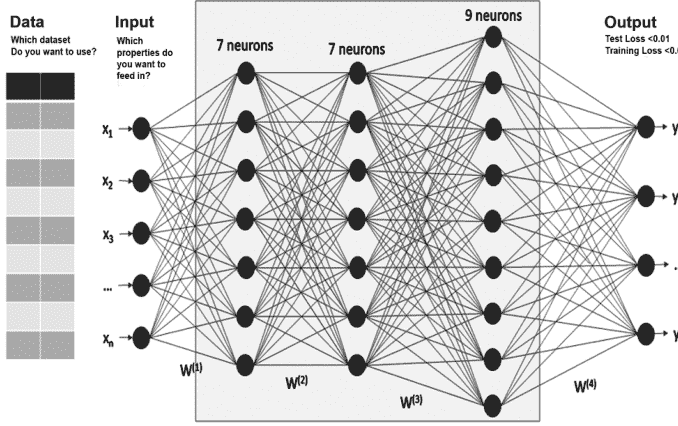

**图 1.1** 深度神经网络。

| 数据 | 输入 | 7 个神经元 | 7 个神经元 | 9 个神经元 | 输出 |
|---|---|---|---|---|---|
| 你想使用哪个数据集？ | 你想输入哪些属性？ | | | | 测试损失 <0.01 训练损失 <0.01 |

## 1.2 使用的架构

深度学习架构在设计某些特定行业的参数和活动方面起着至关重要的作用。它们被分为不同的类型，如

- 无监督预训练网络（`UPNs`），
- 卷积神经网络（`CNNs`），
- 循环神经网络，
- 以及
- 递归神经网络。

### 1.2.1 无监督预训练网络（`UPNs`）

生成对抗网络（`GANs`）是一种使用无监督网络来发现如何并行准备两个模型的方案。`GANs`（以及所有生成式设计）的一个主要方面是它们使用一种本质上更小于这对于系统正在准备的数据的测量是典型的。`UPN` 被进一步细分为三个主要概念。它们是：

- 生成对抗网络 (`GANs`)，
- 自动编码器 (`Autoencoders`)，
- 深度信念网络 (`DBNs`)。

### 1.2.1.1 自动编码器 (`AUTO ENCODERS`)

自动编码器是一种具有三层结构的认知系统：信息层、编码层和解释层。该方案准备好复制隐藏的数据源，使隐藏层尝试自适应信息源的表征。自动编码器认知系统是一种使用反向传播的无监督机器学习（`ML`）计算，它将目标特征等同于数据源。自动编码器似乎准备好复制其对输出的贡献。在底部，它还有一个隐藏层，描述了用于与数据通信的编码。自动编码器属于神经网络家族，但也与主成分分析 (`PCA`) 强密相关。以下是自动编码器的一些关键事实：

- 这是一种不受控的类似于 `PCA` 的机器学习算法。
- 它与 `PCA` 具有相同的目标来优化函数。
- 它是一个神经网络。
- 神经网络的输出输出是其输入。

虽然自动编码器与 `PCA` 相比，但它们的自动编码器通常比 `PCA` 更具通用性。自动编码器可以表示编码中的线性以及非线性变换，而 `PCA` 可能只进行线性变换。由于其网络表示法，自动编码器可以连接起来创建深度学习网络。自动编码器的类型有：

- 去噪自动编码器，
- 稀疏自动编码器，
- 变分自动编码器 (`VAE`)，以及
- 收缩自动编码器 (`CAE`)。

### 1.2.1.2 DBN

`DBNs` 由用于所有预训练阶段的受限玻尔兹曼机 (`RBMs`) 层组成，随后是用于微调阶段的前馈网络。

## 医疗保健的深度学习

在我们追求的领域中，我们将越来越清楚地阐述 `DBNs` 如何利用 `RMs` 进行更有可能的模型信息准备。

### 1.3 使用 RBM 层的特征提取

`RBMs` 用于从原始信息向量中分离出更高级的特征。为了实现这一点，当我们向 `RBM` 显示数据记录并要求 `RBM` 复制该记录时，我们必须固定隐藏单元的负载和状态，其最终目标是创建出接近第一个数据参数的内容。Hinton 讨论了这种影响，关于机器对信息的渴求。


RBMs 对应深度学习和 DBNs 的本质动机是在无监督准备模式下熟悉这些更高级的特征。研究发现，我们应该通过允许 RBMs 持续适应更大数量的特征，使用从减少的 RBM 预训练层提取的特征作为更高 RBM 预训练层的贡献，从而准备出更强大的神经系统。

## 1.3.1 生成对抗网络 (GAN)

以无监督方式研究此类特征被认为是 DBNs 的预训练期。在预训练阶段，RBM 的每个隐藏层都需要动态地传播数据到逐渐复杂的特征。这些高需求特征被动态地整合，用于非线性方法中精细的机械化组件设计。该网络将是 GAN。已经证明，GANs 非常擅长基于其他实践图像合成新图像。这一概念可以扩展到建模其他领域，例如：

- 视频
- 声音 (Patterson and Gibson, 2017)

GANs 是这种使用无监督学习同时训练两个模型的网络实例。GANs 的主要方面是它们使用一个比通常小得多的变量计数来考虑我们训练网络的信息量。整个网络被强制有效地表征训练信息，更高效地生成与训练信息可比的信息。

## 1.3.2 生成式设计、无监督学习与 GAN 的训练

如果我们有一个大型训练图像语料库（例如训练图像），我们就可以构建一个生成网络来识别关于我们训练网络的信息量。生成网络在 GANs 中产生图像，而判别器网络尝试识别分类。生成网络在 GANs 中产生图像，而判别器网络尝试识别真假。当我们有训练图像数据集（例如 ImageNet），我们就可以构建一个生成网络来产生与训练图像可比的信息。生成网络在 GANs 中产生图像，以更有效地生成信息。

## 1.3.3 CNN

CNN 的目标是通过卷积来感知内容。在图像分类任务中，它们非常有用，以抵抗识别问题。它们可以识别人脸、街道和无数视觉组件。CNNs 为自动驾驶汽车、机器人和视觉障碍治疗驱动了显著的应用。

## 1.3.4 循环神经网络 (RECURRENT NETWORK OF NEURAL)

它是前馈系统的一部分。在能够在多个时间步后传递信息方面，它们与其他前馈技术不同。传统上，此类网络难以训练，但最近的研究进展使得它们更易于使用。这些网络从输入向量序列引入每个向量并逐个进行建模。这使其系统能够在输入窗口周围保持状态。循环神经网络是建模时间维度的特征。

## 1.3.5 递归神经网络 (RECURSIVE NETWORK OF NEURAL)

它可以处理变长度的输入。主要区别在于，在训练集中，循环神经网络可以描述层次结构。图像通常具有包含许多对象的场景。解码图像通常是一个有趣的问题，但具有挑战性。这种递归分解强制我们不仅要定义整个场景的意图，还要识别它们如何连接到图像。这些网络可以从图像或句子等数据集中检索几乎所有的粒度框架和高级层次系统。

潜在结果。此类过程在健康结构空间上以及考虑方案的基本形式为推测时代、理论测试和实践提供了支持。AI 可以通过揭示数据中新隐藏的趋势，来增强健康结构内的推测时代和假设测试任务，并沿着这些路线在个人层面和结构层面都产生重要影响（Panch et al., 2018）。

同样，机器学习（ML）算法利用当前的统计显著性记录和技术来理解可用信息。这为医疗保健信息提供了清晰的视角，机器学习模型可以整合许多因素并在更广泛的数据类型中进行泛化，且能够在更复杂的情况下生成结果（Henglin et al., 2017）。这些安排位于不同的区域，通常在急诊诊所而非网络设置中，在大多数情况下依赖单一焦点数据，并提供了关于可重现性的建议（Johnson et al., 2017）和通用性的建议（Celi et al., 2014）。尽管如此，AI 的快速发展正随着人类服务以及更广泛地跨越所有数据进行，为公共领域的各项工作做好准备（Brynjololfsson and Mcafee, 2018）。

## 1.5 人工智能在医疗保健中的优势

机器学习是一项快速发展的技术。虽然未来还会有有趣的技术突破，但与任何新技能一样，不仅会有限制机器学习在医疗领域实施的技术性困难，还缺乏一个用于实施和传播的响应式框架。此外，AI 的响应式框架需要精选信息的可访问性、充分的立法环境、保护个人自由的法律措施、明确的问责法律，以及处理策略变更的能力以允许机器学习的适当实施。AI 是一项快速增长的技术。

尽管对于任何新创新，未来会有关键的专业飞跃，但限制 AI 在医疗领域使用的专业困难将不会被简化，而是缺乏一个用于接收和传播的开放环境。AI 的响应式环境需要（其他其他方面）源信息的可访问性、赋权的行政状况、保护居民权利的合法安排、明确的责任原则，以及监督关键变化的能力以授权 AI 的恰当展示和使用。一些益处包括：

- 数据策展
- 信任与数据管理
- 与技术行业合作
- 问责制
- 管理策略变更的能力

## 1.6 机器学习在医疗保健中的应用

机器学习应用于医疗保健的一些主要领域包括：

- `疾病识别`
- 定制化药物
- 药物发现
- 药物制造
- 临床试验研究
- 放射学
- 数字医疗记录
- 流行病爆发预测
- 运行机器人（Puneet Mathur 2018）

### 1.6.1 药物发现

药物开发并不是一种简单的方法。在药物引入该领域之前，它需要大量的研究、测试、时间和资金投入。一种新药的营销价格估计可能高达 26 亿美元。数据科学可以利用来自各种检查、治疗结果、研究、社交媒体等多个领域、跨多个学科的多组非组织和结构化生物医学信息。通过使用高效的数学算法，它可以随后生成一个关于药物如何与人体酶通信的模型，并估计成功率。模拟可以通过使原始筛选足以评估药物的效能潜力来加速这一过程。这不仅意味着药物开发成本的大幅减少，还最大限度地降低了失败风险。数据科学的方法可以整合到带有基因信息的研究中，从而为特定药物和疾病导致的遗传缺陷提供精确的见解。

### 1.6.2 可穿戴设备

可穿戴设备已变得无处不在。除了创造酷的配件外，人们更有动力管理自己的健康。他们记录重要的健康测量值，如心率、血压、睡眠模式和脉搏等。可穿戴设备是一个巨大的帮助，特别是对于老年人。它帮助家庭成员随时了解医疗人员状况。可穿戴设备与移动设备连接，并生成大量的患者信息存储到云端访问。数据科学家将使用 AI、大数据和机器学习分析上述来自可穿戴设备的原始数据以预测重要见解。他们可以通过复杂的分析模型观察患者健康的差异，并识别疾病或相关症状。这使得医生能够预测并为可能的健康问题提供预防护理。

### 1.6.3 诊断

诊断是患者治疗周期的关键环节，因为它定义了将给予的治疗性质。然而，即使在 21 世纪，诊断也远非理想。2018 年的 BBC 报告显示，仅美国就有约 40,000 至 80,000 例死亡是由于诊断缺陷导致的。虽然有大量信息可用于进行高效实验，但大多数模型无法做到。分析师可以通过数据科学利用深度学习方法来处理全面的临床和实验室记录，以做出更快、更高效的诊断。数据分析可能使他们能够识别问题的早期迹象，并允许医生为患者提供医疗保健以及改进的治疗。此外，医学科学家可以使用这些信息诊断早期慢性疾病，并诊断出具有卓越成就记录的治疗方案。癌症和心脏病等疾病的治疗可能是至关重要的。

### 1.6.4 公共卫生部门

大多数医疗机构为了提高公众整体健康，已开始利用数据分析。从 Google 地图、网站、社交媒体和可穿戴设备等多个源可以获得海量的分散医疗信息。大量的分散医疗信息对于了解公共卫生地理区域构成了挑战。数据研究人员可以分析人口、健康问题、个人医疗结果等参数来开发热图。上述评估使他们能够识别即将发生的健康问题，使他们熟悉该地区的医疗服务状况。它还使他们定义个人无法选择治疗的原因。医疗专业人员可以使用结果针对该当前或潜在健康问题采取预防措施。

### 1.6.5 降低医疗成本

随着时间的推移，医疗费用似乎在增加，这证明它是提供优质患者护理的影响因素。然而，这也可以通过分析和 `BI` 工具来解决。数据研究人员可以分析与收费和变量分类相关的账单和临床系统信息。他们能够深入房间利用趋势和满足患者所需的资源，有助于定义可能的运营漏洞和收入损失。提供者可以使用数据科学来改进供应链并审查设备维护计划以避免意外故障。这可以帮助他们了解如何维持低成本。通过分析，可以适当监控患者恢复和出院计划方案以降低再入院率。总之，数据驱动的法规可能为降低运营成本留出空间，为患者带来更低的医疗费用和更高的满意度。在增强护理服务和患者体验方面，这也是至关重要的。

### 1.6.6 优化资源配置

医疗需求只会不断提高，在任何特定阶段，供应商可能会发现难以获得医疗人员来进行患者护理。患者流量的任何波动将始终影响系统。劳动力成本将由于非必要的员工而增加。相反，员工数量不足可能会决定加班并进入倦怠阶段。你可以保持最佳员工在处置？解决方案在于数据分析。这可以根据历史信息估计多年来患者就诊次数的变化，并根据之前的入率创建人员分配模式。它将为供应商提供一个概念，即中心将需要什么程度的员工。因此，可以为患者适当且及时地分配床、员工和其他必要的资源。

显然，与不断发展的患者护理相比，信息有助于医疗公司解决资源管理、医疗人员不足和治疗成本高昂的问题。此外，它通过在患者之间传播意识并让他们参与治疗过程来赋予患者。

## 1.7 机器学习的开发周期

在我们开始观察 AI 并将预测模型应用于不同的信息集之前，我们可能希望向追随者传达一个免责声明：活动中使用的任何信息在现实中与我的客户或真实患者都没有对应。与全球任何信息集合的任何相似之处纯属巧合。本书的作者或发行者不对此信息索引的有效性或安全性承担任何责任。分发此治疗信息索引的目的是影响读者观察如何在创作条件下将 AI 应用于社会保险信息集。此信息索引无法用于其他原因，例如临床准备工作、电子创建或其他与业务相关的活动（Puneet Mathur 2018）。

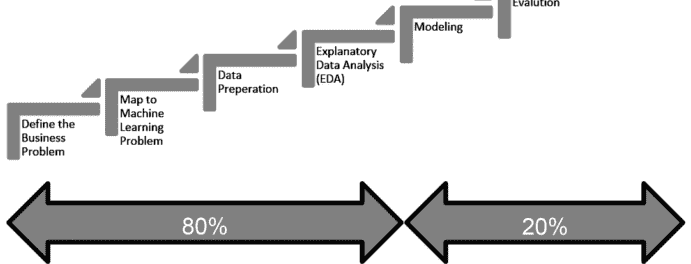

图 1.2 机器学习架构。

### 1.7.1 业务问题的定义

从客户处获取问题声明或要求交给业务人员，以便对问题声明进行澄清。

### 1.7.2 ML 算法映射

识别业务问题后，对 `ML` 问题进行映射，选择特定算法来定义数据。数据被分为训练数据和测试数据。训练系统或机器处理数据并根据问题声明对其进行分类。

### 1.7.3 数据准备

创建一个分析沙盒来执行业务陈述或项目所需的所有分析。这发生在不同的阶段，例如，提取数据、加载数据，然后转换数据以进行处理。

### 1.7.4 探索性数据分析

进行可测量和想象的调查，以发现准备好的信息中的异常或错误，这些错误正等待着备份信息的预测显示。

### 1.7.5 建模

在准备数据并为项目筛选预测模型后，对几种算法进行了实验，以便我们找到最适合该项目的算法以及给出最佳结果的最优模型，最后为模型创建一个反馈循环。我们可以使用分类、关联和聚类等不同技术对系统进行建模。

### 1.7.6 评估

在此阶段，将进行详细研究，以根据利益相关者的意见检查业务问题和完成的项目建模研究是否一致。

## 1.8 使用 ML 算法预测疾病

疾病的诊断围绕着 `ML` 架构中提到的相同过程。这遵循特定的标准，如数据选择、特征选择（包括数据预处理）、模型训练以及可用数据的演变（Beysolow II, 2017）。自动心跳分类是帮助医生在长期 Holter 心电图监测中识别表皮心跳的一种重要方法。为了提高心跳评估的效率，我们建议通过定义理想特征子集采用疾病特有的特征选择方法。为了评估这项技术，还将进行一项比较三个步骤的实验。首先，按照一对一（OVO）F 分数的降序列出所有特征。其次，将这些特征纳入验证系统并参数化。最后，本研究使用的分析应用是描述性分析，它使用原始数据单元。为了查看和理解大数据中的复杂信息，使用了可视化分析。患者分层是一种将大数据划分为较小单元并为患者提供个性化支持的方法，并根据这些分层数据进行预测分析（Zang et al., 2014）。

医疗与深度学习在不久的将来将成为组合。进行的一些主要研究包括癌症检测、肺部检测等。通过 `DCNN`，深度学习可以利用深度学习技术精确地归类结核。

### 1.9.1 案例 I

#### 目标

评估胸部放射学深度卷积结构（`DCNNs`）的可行性。

#### 材料与技术

在此研究中使用了四个符合 `HIPAA` 标准的数据集，这些数据集是从一个包含 1007 张后前胸射线的研究排除的。数据集包括授权（17.1%）、准备（68.0%）和测试（14.9%）。使用了两个不同的 `DCNN`——`GoogleLeNet` 和 `AlexNet` 来组织图像作为吸入性结核。在 `ImageNet` 上经过了训练和教育的系统，并使用各种预处理技术进行了开发（Krizhevsky et al., 2017; Szegedy et al., 2015）。使用了性能最好的计算。一位免费委员会认证的心脏科医生在优化算法不一致的情况下无差别地解码照片。用于预测心脏发作风险的 `DeLong` 方法对一项前景性的放射科医生扩展工作进行了详细评估（Jaeger et al., 2014）。

#### 结果

`AlexNet` 和 `GoogleNet` 使用的分类系统其 `AUC` 为 0.99，这是在 `DCNN` 算法的帮助下实现的。相关系统的 `AUC` 远高于未训练系统的 `AUC`（P = 0.001）。进一步扩展这些数据增加了准确性（`AlexNet` 和 `GoogleNet` 分别为 P = 0.03 和 0.02）。在 150 次实验中的 13 次中，使用的 `DCNN` 存在差异由心脏科医生无差别地评估，该医生高效地解释了这 13 个案例中的每一个（100%）。这种放射科医生扩展的方法导致了 97.3% 的有效性和 100% 的显性性（Lakhani and Sundaram, 2014）。

### 1.9.2 案例 II：使用 ML 技术预测乳腺癌

预测任何疾病都不是一项简单的任务，因为背后的工作是一项艰燥的任务，并且需要异常的支出状态来发现特定疾病。为了达成解决方案，必须极其安全。

为了给患者提供精确的处方，参考了患者病史及其基因组信息。乳腺肿瘤信息的预测利用了许多 `AI` 计算来发现患者和疾病的状态。针对这种思考的情况，我们使用了策略性复发来发现疾病的严重性。首先，我们必须先将信息输入机器。此时，机器将剔除数据集中的无效信息，并通过检查信息集的突出特征来对信息进行重构（见表 1.1）。

数据特征从诊断阶段变化到纹理、半径、周长、光滑度、凹度等。必须发现数据的相关性并将其从数据集中移除。相关数据显示了预测和诊断过程中的差异。使用了不同的相关性技术来寻找最坏情况、标准误差（`SEs`）和均值变化。

在找到相关性过程后，发现了数据与其相同相关值之间的关系。在诊断过程中，找出每个变量之间的关系更为重要。

利用 `ggcorr` 图以越来越精确和准确的方式发现了因素的相似性。然后利用 `PCA` 过程发现相对于数据集的图表，并根据其结果和输出得出解决方案。过多的因素可能会导致以下问题：

- `PC` 吐量扩大
- 感知问题过于耗脑
- 包括对研究没有影响的因素在内的熟练降低
- 使信息理解变得困难
- 上述 `ggcorr` 图的高关系值方法导致因素之间存在“多重共线性”

我们使用一种原理通过减少高相关性因素来改进模型。在决定主要部分的数量时，我们利用了累计贡献率或得分图，以及主成分特征值完全弯曲处所在的向前进展。`PCA` 使用结构化信息，以避免尺度差异带来的信息扭曲。在 `PCA` 结果中，如果累积比例在 85% 或以上，就可以根据主成分的数量来确定。例如，如果 `PC4` 的累积比例为 88.7，那么 `PC1–PC4` 的比例之和为 88.7%。

## 表 1.1 带特征的数据检查

| 诊断 | 半径均值 | 纹理均值 | 周长均值 | 面积均值 | 光滑度均值 | 紧凑度均值 | 凹度均值 | 凹点均值 |
| :--- | :--- | :--- | :--- | :--- | :--- | :--- | :--- | :--- |
| 恶性 | 17.99 | 10.38 | 122.80 | 1001.0 | 0.11840 | 0.27760 | 0.3001 | 0.14710 |
| 恶性 | 20.57 | 17.77 | 132.90 | 1326.0 | 0.08474 | 0.07864 | 0.0869 | 0.07017 |
| 恶性 | 19.69 | 21.25 | 130.00 | 1203.0 | 0.10960 | 0.15990 | 0.1974 | 0.12790 |
| 恶性 | 11.42 | 20.38 | 77.58 | 386.1 | 0.14250 | 0.28390 | 0.2414 | 0.10520 |
| 恶性 | 20.29 | 14.34 | 135.10 | 1297.0 | 0.10030 | 0.13280 | 0.1980 | 0.10430 |
| 恶性 | 12.45 | 15.70 | 82.57 | 477.1 | 0.12780 | 0.17000 | 0.1578 | 0.08089 |

| 半径词 | 纹理词 | 周核词 | 面积词 | 光滑度词 | 紧凑度词 | 连接性词 | 凹点词 | 对称性词 | 椭圆维度词 |
| :--- | :--- | :--- | :--- | :--- | :--- | :--- | :--- | :--- | :--- |
| 相关性: | 相关性: | 相关性: | 相关性: | 相关性: | 相关性: | 相关性: | 相关性: | 相关性: | 相关性: |
| 0.36 | 0.38 | 0.53 | 0.54 | 0.574 | 0.782 | 0.92 | 0.598 | | |
| 0.365 | 0.348 | 0.225 | 0.361 | 0.368 | 0.36 | 0.233 | 0.219 | | |
| 0.978 | 0.227 | 0.529 | 0.618 | 0.816 | 0.269 | 0.129 | | | |
| 0.209 | 0.438 | 0.543 | 0.747 | 0.208 | 0.076 | | | | |
| 0.568 | 0.519 | 0.548 | 0.494 | 0.618 | | | | | |
| 0.892 | 0.801 | 0.614 | 0.881 | | | | | | |
| 0.855 | 0.533 | 0.687 | | | | | | | |
| 0.902 | 0.511 | 0.538 | | | | | | | |

图 1.3 最坏情况的相关性。


| | 1 | 2 | 3 | 4 | 5 | 6 | 7 | 8 | 9 | 10 |
| :--- | :--- | :--- | :--- | :--- | :--- | :--- | :--- | :--- | :--- | :--- |
| 0.21 | 0.977 | 0.95 | 0.16 | 0.38 | 0.33 | 0.51 | 0.23 | | | |
| 0.22 | 0.11 | 0.40 | 0.23 | 0.19 | 0.23 | 0.41 | 0.28 | | | |
| 0.94 | 0.15 | 0.42 | 0.36 | 0.56 | 0.27 | | | | | |
| 0.08 | 0.28 | 0.27 | 0.33 | 0.41 | | | | | | |
| 0.34 | 0.27 | 0.33 | 0.41 | | | | | | | |
| 0.80 | 0.74 | 0.39 | 0.80 | | | | | | | |
| 0.77 | 0.73 | 0.31 | | | | | | | | |

图 1.4 与 SE 相关性。

## 19


图 1.5 与均值的相关性。

## 癌症均值


图 1.6 癌症变量的关系。最后，获得了包含了 SE 和最坏情况的 PCA 变量。

## 医疗系统中的深度学习与物联网

PC1 到 PC6 的累计比例约为 88.7%（超过 85%）。这意味着 PC1–PC6 可以解释 88.7% 的数据数据。

## 组件重要性

| PC1 | PC2 | PC3 | PC4 | PC5 | PC6 |
| :--- | :--- | :--- | :--- | :--- | :--- |
| 0.4427 | 0.3857 | 0.2767 | 0.1475 | 0.12483 | 0.0988 |
| 0.4427 | 0.6324 | 0.7236 | 0.7929 | 0.8434 | 0.8879 |
| 0.8272 | 0.9068 | 0.9519 | 0.9139 | 0.9908 | 0.9871 |

| PC7 | PC8 | PC9 | PC10 | PC11 | PC12 |
| :--- | :--- | :--- | :--- | :--- | :--- |
| 0.0910 | 0.0818 | 0.0647 | 0.0592 | 0.0541 | 0.051184 |
| 0.02251 | 0.01589 | 0.0113 | 0.0169 | 0.0116 | 0.0098 |
| 0.9180 | 0.9258 | 0.9399 | 0.9517 | 0.9614 | 0.97087 |

| PC13 | PC14 | PC15 | PC16 | PC17 | PC18 |
| :--- | :--- | :--- | :--- | :--- | :--- |
| 0.0912 | 0.03964 | 0.030 | 0.0286 | 0.0242 | 0.0239 |
| 0.0088 | 0.0053 | 0.0031 | 0.0026 | 0.0018 | 0.00175 |
| 0.9912 | 0.9965 | 0.9968 | 0.9991 | 0.9998 | 0.9998 |

| PC19 | PC20 | PC21 | PC22 | PC23 | PC24 |
| :--- | :--- | :--- | :--- | :--- | :--- |
| 0.22244 | 0.17652 | 0.173 | 0.16565 | 0.15602 | 0.1344 |
| 0.00165 | 0.0011 | 0.0066 | 0.0009 | 0.0001 | 0.0006 |
| 0.9943 | 0.9959 | 0.9974 | 0.9989 | 0.9998 | 0.99989 |

| PC25 | PC26 | PC27 | PC28 | PC29 | PC30 |
| :--- | :--- | :--- | :--- | :--- | :--- |
| 0.12442 | 0.09043 | 0.08387 | 0.07987 | 0.07236 | 0.01153 |
| 0.00052 | 0.00027 | 0.00023 | 0.00005 | | |
| 0.99942 | 0.9995 | 0.9996 | 0.9997 | 0.9998 | 1.0000 |

图 1.7 累积比例。

## 所有方差 - PCA


图 1.8 挥线图。

患者 ID：849014 => 结果：恶性

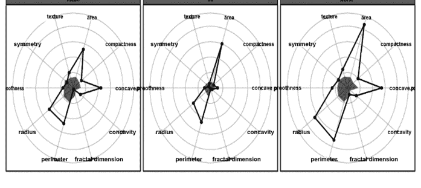
图 1.14 恶性癌症数据的雷达图。

已执行，考虑到该系统可以用于所有人群。对深度学习和医疗保健的详细视图讨论了该过程的工作、建模和评估。重点关注的技术是数据科学中医疗分析的新兴技术和方法论。

- 人工智能
- 机器学习
- 深度学习
- 神经网络
- 卷积网络

Bysolow II. T. (2017). Introduction to Deep Learning Using R: A Step-by-Step Guide to Learning and Implementing Deep Learning Models Using R. Apress.

Brynolfsson, E., & Mcafee A.N. (2018). The business of artificial intelligence. Harv Bus Rev. 24, 2017. Available: https://hbr.org/cover-story/2017/07/the-business-of-artificial-intelligence. Accessed: 28 September 2018.

Celi L.A., Moseley E., Moses C., Ryan P., Somai M., Stone D., & Tang K. (2014). Pharmacovigilance to clinical care optimization. Big Data, 2(3), 134–141. Medline: 25675325 de:10.1089/big.2014.0008.

Henglin M., Stein S., Husheva P., Snoek J., Wiltschko A.B., & Cheng S. (2017). Machine learning approaches in cardiovascular imaging. Cardiac Cvascular Imaging, 10(1), 1–9. Medline: 28956772:10.1161/CIRIMAG.117.005614.

Jaeger S., Karagriz A., Candemir S., Folio L., Siegelman J., Callaghan F., Zhiyun X., Palaniapan K., Singh R.K., Antani S., Thoma G., Yi-Xiang W., Puan X., & McDonald C.J. (2014). Tuberculosis screening using chest radiographs. IEEE Trans Med Mag 33(2):233–245, de:10.1109/TMI.2013.2284099.

Jiang F., Jiang Y., Dong Y., Li H., Ma S., Wang Y., Dong Q., Shen H., & Wang Y. (2017). Artificial intelligence in healthcare: past, present and future. Vasc Necrol, 2(4), 230–243.

Johnson A., Pollard T.J., & Mark R.G. (2017). Reproducibility in critical care: a mortality study case. In Proceedings of the 2nd Machine Learning for Healthcare Conference, 68, 361–376.

Krizhevsky A., Sutskever I., & Hinton G.E. (2017). ImageNet classification with deep convolutional networks. Commun ACM, 60(6), 84–90.

Lakhani P., Bengio Y., & Baskaran S. (2017). Deep learning at radiography: automated classification of pulmonary tuberculosis using convolutional neural networks. Radiology, 284(2), 574–582.

LeCun Y., Bengio Y., & Hinton G. (2017). Deep learning. Nature, 521(7553), 436–444.

Patterson J., & Gibson A. (2017). Deep Learning: A Practitioner’s Approach. O'Reilly Media. Mathew P. (2018). Machine Learning Applications using Python: Case Studies from Healthcare, Retail and Finance. Apress.

Gupta R. (2019). Top use cases of data science in healthcare. Available: https://bigdata-madesimple.com/top-use-cases-of-data-science-in-healthcare/

Szegedy C., Liu W., Jia Y., Samer P., Remet S., Angulev D., Erhan D., Vanhcke Rabinovich A. (2015). Going deeper with convolutions. In: Proceedings of the IEEE Conference on Computer Vision and Pattern Recognition (CVPR), IEEE, 1–9.

Zhang Z., Dong J., Luo X., Choi K. S., & Wu X. (2014). Heart-beat classification using specific feature selection. Compute Biol Med, 46, 79–89.


SONIA SINGLA

独立研究员，英国伯明翰，电子邮箱：ssoniyaster@gmail.com

物联网（IoT）在治疗机构中有着各种应用，从远程传感器的检查到治疗性设备组合。它有助于保持患者状态验证，并通过允许人员传达他们的想法来改善他们的健康状况。（注：提供的 OCR 文本存在大量重复/乱码部分，已根据提供的片段进行了逻辑清理）。

实际上，查看所提供的文本，摘要部分存在大量重复。我将提供独特内容的清理版本。

## 2.1 什么是人工智能？

- 人工智能
- 机器学习
- 深度学习
- 神经网络
- 卷积网络

## 2.2 人工智能在糖尿病中的应用

糖尿病（Diabetes mellitus）是一种导致高血糖的代谢性疾病。未治疗的高血糖会伤害神经、眼睛和肾脏。糖尿病有几种不同类型：

- 1 型糖尿病是一种免疫系统疾病，会破坏胰腺中产生胰岛素的细胞。它是导致这种疾病的原因。大约 10% 的人患有这种类型。
- 2 型糖尿病发生在你的身体对胰岛素产生抵抗且糖在血液中形成时。
- 糖尿病前期发生在你的血糖高于正常水平时；但不足以诊断为 2 型糖尿病。
- 妊娠糖尿病是怀孕期间的高血糖。由胎盘产生的阻胰岛素激素引起。

美国的糖尿病危机不容忽视。这些数据令人震惊：从2012年开始，约9.3% 的美国人患有糖尿病，超过 8600 万人处于糖尿病前期。总而言，糖尿病每年导致 243,000 人死亡，1 型和 2 型糖尿病在美国因糖尿病并发症和相关的住院记录了总计 1760 亿美元的治疗费用。预防这些住院和严重负担的关键在于控制血糖水平、避免危险的低血糖（通常建议为低血糖事件）。虽然各行业的组织都在使用人工智能来帮助理解来自可用设备的海量数据流，但社会保健部门有一个绝佳的机会将人工智能用于最重要的事业，改善受糖尿病影响的人的结局并拯救生命。例如，关于人工智能如何显示改善患者结果，可以参考在荷兰一家领先糖尿病诊所进行的一项持续观察研究。该诊所的先进观察研究使用了基于流式人工智能的架构。名为 Rhythm 的系统监测并管理糖尿病患者的血糖测量。通过根据所有八位患者变化的血糖设计模型，研究人员发现，在八位患者中的七位中，仅 Rhythm 系统就延长了 20% 的时间并减少了 9% 的危险低血糖。

糖尿病管理在目前需要一种合适的、高接触的方法。Rhythm 的观察性基础表明，糖尿病诊所有一种替代方案，它不仅仅是协调那些通过后期标准人工检查获取的血糖控制结果，而是对其进行真正的升级。因此，我们预期一个自动化的、人工智能驱动的系统可以提高糖尿病诊所人员控制血糖水平的能力，我们应该有权在糖尿病大范围内实现办公室较低的住院率。尽管减少了与糖尿病相关的潜在危险情况，这每年可节省 670 亿美元的医疗支出。最后，将 Rhythm 在美国普通人群中取得的结果推广，将对我们整体人口的健康产生惊人的影响。本指南不仅关注监测美国糖尿病规模的前景方法，还追溯了限制性管理部门——以及所有患者——如何持续从人工智能中受益。坦率地说，人工智能在医疗领域的进展正在产生努力的影响：自2011年以来，与人工智能相关的社会保障行动逐年增加，资金从2013年的 6400 万美元增长到2014 年的巨额 3.58 亿美元。

对于美国糖尿病患者的后续工作仍有大量工作要做；然而，人工智能在任何时候对于帮助这项艰巨工作都具有巨大的潜力。考虑到这一切，这正是人工智能的真正意义：将人类本已准备好构想并使用的那些改变世界的想法，以无人、只有机器能够达到的规模应用这些灵感（www.information-age.com）。

糖尿病是一种严重的且不必要的疾病，影响着工业国家高达 3% 的人口。胰岛素依赖型（IDDM）患者需要注射外源性胰岛素来控制血糖吸收。（医学杂志，1993年）已表明，强化胰岛素治疗法（IIT），涉及每天 3-4 次注射或使用皮下胰岛素泵，是调节血糖并以此减少或推迟 IDDM 并发症的最佳方法；治疗开发的复杂性和高成本是其某些缺点。研究重点结果和记录的以及遗忘的数据已得到证实，这将最终改变患者的治疗观点。糖尿病患者管理显然是一项艰巨的任务；如何从具有障碍的 IIT 开始改变重点，这涉及社会和经济因素的讨论。

(Lasker, 1993)。人们认为，利用信息技术最新进展和决策支持系统，可以通过减少定期检查的次数来提高 IIT 的成本效益，同时增加患者/医生的互动率。目前已有一些用于治疗计划评估的设备和警报系统，既有按计划的也有按次访问的（Lehman and Deutsch, 1995），对于其中一些设备，其提供真实决策的能力已经得到证明（Andreasen et al., 1994）。媒体传输组织开放性和使用的指数级增长，推动了此类工具整合到框架的组织状况中，以便为视诊提供长期的帮助，类似于医生的远距离监护能力（Gomez et al., 1992）。使用适当的人工智能技术，例如基于数据的系统、智能数据分析和基于案例的推理，可能会改进组织的结构：应该允许客户使用智能工作区域进行定期的治疗检查和更新（Montani, 2019）。

得益于适当的系统，全球共享生态系统的临近性对于确保构建部分之间通信的可能性至关重要；解决生命中冲突部分的方法。将这些策略自动化可以确保实际干预的规模化，以防止观众聚集。这将减少每个部分的干预成本并扩大范围。与自动化行为改变策略相关的重大项目（Brand et al., 2016）为了在万事大绪时权衡状况

……已完成（Bardus et al., 2016），并在儿童和青少年中明确应用（Brand et al., 2016）。这些进展中的大部分有助于某些项目和应用，但无论如何，这些项目对身体计划结果或干预实践尚未产生完美的影响（Brand et al., 2016）。具有显著学习能力的人工智能（AI）通过自动化按需获取提取的传输来扩展发明，并随着系统的可靠学习，这种方法为扩展发明提供了策略（Ramesh et al., 2004）。Stephens 及其伙伴首次开发并报告了一个多功能直接聊天机器人 Tess，它利用 AI 改进了关注儿童健康的专家工作（Stephens et al., 2019）。我们赞赏他们的工作，聊天机器人已用于一系列健康实践（例如：身体发育 (Kramer et al., 2019)、心理健康 (Hoermann et al., 2017)、药物依从性、抑郁和压力），以表达共情和关怀。

在这种情况下，Tess 是实施认知行为、动机访谈和行为激活的核心行动，并作为常规治疗的伙伴。文本由心理健康专家编写并验证，并根据患者的情绪和关注进行调整。Tess 被提议通过对会话结束请求做出的客户互动来进行自我学习。这项工作应对了健康准备领域在衡量参与者之间关系中一个重要意义且具有创新的后续阶段。


鉴于早期对应用的挫败感，必须对这些新开展的计划进行谨慎评估。Stephens 等人报告了一项可行性特征，展示了耐受韧性、受访支持和目标进展。虽然这些结果易于理解，但未来的研究应该在完全随机的对照试验中，调查 Tess 作为儿科体重管理工具的投入情况。

干预被认为通过影响关键中介因素来发挥作用，这些变化影响着近端（社会）和远端（身体）结构的结果（Baranowski and Lytle, 2015）。为了增加 Tess 在远端结果上的可能价值，早期评估可能希望衡量、改进和优化其对患者广泛关注的关键结果（例如：压力和焦虑）以及心理社会干预因素（例如：自我效能和结果预期）的影响。此类研究可以帮助 Tess 增强其对通往所需结果的过渡变量的影响，并借此减少改变近端和远端结果产生的不满意性，同时强调直接变化的理论细微之处。

AI 中的模拟智能通常需要确定一个巨大的参考点方案，所有这些点都是经过解释的（例如：正确/错误和可接受/不可接受）。文中未介绍 Tess 的基础学习。它从关键会话中获得的建议学习（反馈）依赖于客户对对话结束时关于“满意度”请求的回答。鉴于在不一致的服务者协调中响应可能具有社交吸引性，尚不清楚这些反馈是否正确提供了关于 Tess 与客户之间预期深度交流的消息满意度的重要信息。此外，建立了哪些保护措施来消除客户提供信息的错误，或防止 Tess 偏离轨道并发布可能不当的未来尚不明确。Tess 未来的进展和完善可能需要专家对程序的智能反馈，以及对系统和响应计数进行审慎评估，以确保建立了有助于维护内容承诺和准确性的保护措施。

人们对许多青少年过度使用（Van Eijnden et al., 2018）的问题引起了关注。尚未出现关于儿童使用聊天机器人的论文。在很大程度上引起关注的是，鼓励家庭制定符合年龄段的家庭计划，围绕家庭媒体使用制定标准和建议（Pediatrics, 2016），包括聊天机器人，这将是有价值的。鉴于目前关于儿童青少年屏幕媒体使用的建议及其对力量相关实践的潜在影响（例如：休息 (Carter, et al., 2016) 和饮食确认 (Marsh et al., 2013)），综合来看，监护人需要在其关联中进行某种监督或考虑。

尽管 Tess 与患者的对话是驱动的，但与健康专家提供的治疗是独立的。目前尚不清楚传递给客户的问题、考虑和担忧如果没有转交给医生，是否会干扰所提供的治疗或其执行。也许，可以将 Tess 改为医生和父母提供卓越的学习。此外，还不清楚如果自残倾向被传递给 Tess 而没有立即提供社交干预会发生什么。最后，研究涵盖了 9 岁和 18 岁的儿童，他们处于不同的发育阶段，具有不同的特殊发育需求和风格。对对话进行情感分析按年龄划分的情感分析可以了解 Tess 如何针对特定年龄和相关复杂性进行专门设计（Thompson and 2019）。行为干预技术（BITs）通过各种媒体（包括互联网媒体、便捷应用程序和电脑游戏）来应对发育和心理研究带来的收益。BITs 提供了几种潜在的有利情况，包括扩展的范围和可及性、成本效益、增强责任，特别是在青少年中。无论如何努力，儿科肥胖仍然巨大的公共健康问题。通过管理该领域的各种方法，其中一些已取得重大进展。正在不断研究作为传递领先干预措施的有效且开放的系统。领先的社交聊天机器人 Tess 处理健康的不同方面，例如：压力和紧张。每天，Tess 通过现有通信方式（即短信息服务 [SMS]）通过短对话传递整合的辅助支持、心理教育和干预。Tess 通过患者首选的通信方式（短信内容教育）在个性化对话中与患者联系，以促进治疗依从性、直接变化和整体过程。成年患者向其目标的细微进展进展达到了 81%。交换的 4113 条消息和代表舒适度评估的患者（96% 的时间）表明，青少年认为通过自动化思维提供的帮助的可信度和灵活性，这在儿科环境中是明确的，可以扩展到服务更大社会范围的自动化思维辅助的灵活性事件。作为临床医生的伙伴，Tess 可以在工作时间之外继续治疗关系，同时保持患者的满意度。凭借 Tess 持续学习的能力，未来的执行可能会有更多功能来提升客户体验（Stephens et al., 2019）。

在结构阶段，必须细致考虑持续援助、关键问题和决策，以帮助确保弱势群体的区域安全（Stephens et al., 2019）。

## 2.3 人工智能在心血管疾病中的作用

CVD（如术语所示，C代表心脏、冠状、心肌病、先天性；V代表；D代表疾病）是一种心血管疾病，也是导致印度及全球范围内死亡的真正原因之一。很少有人注意到烟草的使用、饮酒、体重以及由于高盐分摄入的不健康饮食习惯与高血压（也称为高血压）有关，而高血压是冠状动脉疾病的主要风险因素。此外，它也是欧洲国家女性死亡的主要原因之一，并且对于进入绝经期（EIWH）的日益成熟的女性来说持续至关重要。通常，在印度，这是由于贫困、缺乏教育、治疗场所以及疾病早期导致的，这已经影响了城市和农村地区。抑郁和不安在日益富裕且日益年轻的女性中很常见；在欧洲国家，倾向于吸烟、吃快餐和饮酒的女性具有很高的冠状动脉诱发疾病风险。在印度，约 52% 的 70 岁以下的人因 CVD 去世（ISSN 2250-3153），1995–1996 年和 2004 年的调查数据显示，2004 年医院留院患者最显著的例子是糖尿病，其次是伤口、心脏病和心脏疾病（Engelau et al, 2019）。

从 2015 年 9 月到 2016 年 7 月，横断面数据显示，女性比例比男性高 56%，糖尿病的发病率为 9%，高血压的常规率为 22%，高胆固血症的发病率为 20%，既往和现任吸烟者的相关疾病患病率分别约为 14% 和 4%（Marbaniani et al., 2017）。2016 年对瓦拉纳西城市地区的研究显示，高血压的发生率为 32.9%，平均收缩压和舒张压分别为 124.25 ± 15.05 mm Hg 和 83.45 ± 9.49 mm Hg。女性受影响的情况日益超过男性（Singh et al., 2017）。1995 年，城市和农村地区成年人（>20 岁）的高血压发病率为每千人 159 例。2012 年 5 月至 10 月，奥里萨姆初级社会保护关注的大部分患者正面临呼吸系统疾病（17%）和心血管疾病（10.2%）（Swain et al., 2017）。2012–2014 年的评估从从印度西部 400 户城市和 400 户农村家庭收集的数据显示，缺乏对处方使用的指导；通常，使用药物治疗心血管疾病时没有考虑过期日期和正规剂量（Mirza and Ganguly, 2016）。2010–2012 年，在韦尔洛尔，通过玫瑰心绞痛调查和心电图进行的横断面评估发现，心脏感染的发病率在农村男性中 3.4%，城市男性中 7.3%，农村女性中 7.4%，城市女性中 13.4%，正如 1991 年至 1994 年间确定的发生率所暗示的，女性高于男性（Oommen et al., 2016）。2010–2012 年的横断面概述显示，1991–1994 年城市和农村的发生率增加。饮酒、体重、循环压力增加和吸烟使得德里城市的人患心血管疾病风险高于德里农村的人。城市地区的平均体重为 24.4–26.0 kg/m²，农村地区为 20.2–23.0 kg/m²；城市的收缩循环压力为 122.1–129.8 mm Hg，农村地区约为 114.9–123.1 mm Hg；城市的舒张性心脏压力为 74.3–83.9 mm Hg，全国范围内约为 73.1–82.3 mmHg（Kaufman et al., 2016）。在 35 至 70 岁之间，糖尿病、高血压和吸烟导致的高风险影响，以及不采取治疗是印度死亡的关键临床解释（Khetan et al., 2017）。

在未来，人类心理能力框架（例如深度学习和抽象注册）可能在改进心血管（CV）药物方面发挥基础性作用，以支持精准心血管医学。心血管疾病现在面临着商业挑战，如诊断和治疗的成本降低、努力效率低下、过度使用、缺乏患者思考以及高再入院率和死亡率。依赖专家和数据科学家之间的良好关系，以实现具有临床意义的机械化和感知数据评估。在此之前，大数据（例如“组学”数据、人类肠道微生态测序、在线生活和心脏成像）极其巨大且具有异质性，变化太快，无法安全地检查和使用。模拟洞察可以解构大数据并用于一线持续思考。无疑，CVD 在本质上是多变且异质的。

当进行表达性测试时。抽象反应包含 (www.nim.nih.gov)

- 在准备选择信息时遇到困难，
- 使用信息进行学习时存在问题，
- 在聚焦方面存在不便。

利用具有无监督特征的重要学习进行海量数据分析，对于识别异质性血管患者的新型基因型和表型具有重要潜力，例如：心律问题、HFpEF、日本吊样心肌病、白大褂高血压、高血压、肺性高血压、家族性房颤和代谢性问题。此外，AI 应用和精准药物的改进将支持心血管精准医学。随后，情感计算（例如 IBM Watson）将成为社会保健工作场所的标准，并帮助专家完成其针对患者结果的基础性工作和设计。IBM、Apple 和 Google 等各类先进公司正认真投入人类管理评估，以促进精准健康化。我们相信 AI 不会取代医生；但值得注意的是，医生们正在学会如何充分利用 AI 来验证他们的假设、进行大规模分析并在临床实践中优化 AI 应用，以加速精准心血管医学时代。尽管如此，对 AI 挑战的忽视可能会影响 AI 对心血管医学的影响。计算机智能、深度学习和心理准备是有前景的，并可以改变医学治疗的方式，但医生们应该准备好迎接高端 AI 时代（Kittanawong et al., 2017）。

Pete Trojan 是美国 AI 的坚定支持者，一位对人工智能有一定掌握的产品架构师。Trainer 和他的团队开发了 SU（他称之为“插件机器人”），这种机器人可以持续运行在现有的任务应用程序中，例如 Facebook Messenger 和 Twitter 私信。“许多心理健康机构或社交场合现在已经在其领地拥有一种辅助工具，”Trainer 解释道，“SU 可以接入到这些工具上，帮助识别‘触发’词汇或短语，这可以提醒管理员，随后分诊反应或提供建议和联系。SU 被设定为识别‘需求’，并利用 AI 将语言与不同的疾病或状况进行匹配。”

SU 在一年后正根据“反对痛苦生活运动”（CALM）的指导进行制作。具体而言，Trainer 表示

究竟什么能让机器产生的心理健康信息值得信赖？Tiffin 说，临床医生“经常需要忽略复杂的决策”，机器“在提交错误方面甚至被认为更具攻击性”。机器经历的准确性取决于系统被设定的参考标准。“存在一些众为人知的情况，由于提供配置数据的人口差异，计算变得不平衡。”

鉴于心理健康状况的广泛和复杂性，获取良好的学习数据对于任何此类进展的规划者来说都可能是一个紧迫的问题。“受社会标准影响的药物，那些鼓励人们在活动中投入更多精力的药物，发现它们既愉快又令人满意。”Tiffin 说，“这归功于自动化。这是因为它们通常很简单且依赖于‘此时此地’。”然而，那些“通过挖掘患者过去来理解其当前不适的药物，对于一个缺乏真实的智能系统来说要困难复制得多。”

Paton 认为 AI 在治疗心理健康问题中的整个处理过程应该包含“真实和虚构咨询师时间的混合”。虽然人们理解热情的健康组织更快地解决问题是有用的，但对于该技术在区分症状、进行分析以及模拟患者在人类导师身上报告的同情方面的能力存在疑问。Holly 说，她对 Woebot 的经验表明它可以是一个实用的临时解决方案，但 Sally Brown 警告说，这种开发无论在任何方面多么巨大，都不应“被视为解决长期人员不足或资金不足的对策”（Kritannow et al., 2017）。

符号疗法（AT），一种创新的体验疗法，让患者构建他们受害者的形象（在他们的声音语言游历中），并使他们能够在管理症状的同时抵抗他们的对抗情绪。与这些图像交谈进一步将控制权从图像转移给患者。

随机对照试验的制定者发现，图像治疗在 12 周后（常规治疗期限的一半）从根本上减少了幻想，并对缓解精神分裂的各种症状产生了显著影响。有时，它被用于完全停止发作。

帕金森病（PD）是一种大脑区域多年持续受损的疾病。

PD 的主要症状是

- 身体特定部位的程序性震抖（震颤），
- 运动能力下降，以及
- 肌肉僵硬和恐惧。

患有 PD 的人还可能经历广泛的其他身体和心理症状。这些包括：抑郁和焦虑、平衡问题（这可能会增加跌倒的风险）、嗅觉丧失（嗅觉障碍）、睡眠问题（睡眠障碍）和记忆问题。

人工智能是改善 PD 患者生活历程中一个赋能的发展领域。

缩短评估时间对于 PD 患者和健康专家来说都将是一个有价值的进展——在检查上花费的时间更少，他们无疑会投入更多精力讨论 PD 对人们日常生活的影响以及药物的有效性等问题。

不同性别的发病率显示，根据结尾数据，70–99 岁人群的发病率在某些情况下表明男性增加。在 80 多岁时，男性的复发率增加；然而，女性的发病率下降（Hirsch et al., 2015）。在 60–69 岁和 70–79 岁之间注意到性别差异。

# 医疗系统中的深度学习与物联网

该研究在利比亚东北部的贝格齐对 163 名患者进行了检查，其中 87 名男性患者，76 名女性患者。疾病的发病年龄在男女患者中相同。男性和女性患者的发病率分别为每 10 万人中 32.5 和 30.3。

发病率随年龄增长而增加，且男女在 70 岁时均较高（Ashok et al., 2013）。在埃及的尔哈加（Al Kharga），对 2005 年和 2009 年的 62,583 人进行了检查，评估 40 岁以下帕金森病（PD）的发生率。这些群体中约有 15,482 人年龄小于 40 岁，其中 49 人患有帕金森病。男性的正常率相同；但随着年龄增长而增加，且与城市地区相比，农村地区的发生率更高（Tallaway et al., 2013）。

60 岁以下的发病率和事件发生率要高得多，九项评估均显示其发生率随年龄增长而增加；在六项检查中，显示发病率有所下降。观察到的差异可能是状况和遗传因素的结果，也可能是病例确定方法、判定标准或研究人群年龄分布差异的直接结果（Campausen et al., 2005）。

评估表明，事件发生率随年龄增长而增加，在 89 岁时下降，且在西班牙斯尼裔中最为常见，其次是非西班牙斯尼裔白人、亚洲人和黑人。初期男性发生率高于女性，由于老年人高死亡率，这种精细程度随年龄增长而减少（Widrefelt et al., 2011）。

对卡纳纳塔克邦（Karnataka）农村和城市的 557 名患者进行了帕金森病研究；结果显示帕金森病在年龄增长时开始，随年龄增长而进展，男性多于女性，且在没有帕金森病家族史的人中发现得更多，这与早期认为的在有家族遗传的人中发现更多不同（Kadakol et al., 2012）。

通过门户调查对 140 人进行了检查，其中 46 人遇到过帕金森病的影响；结果显示发生率随年龄增长而增加，且男性多于女性（Bharuch et al., 1988）。

2004–2015 年对印度南南部特伦甘纳邦（Telangana State）的 382 名患者进行了检查，显示疾病发病年龄为 60 岁，且与普通地区的女性相比，男性更多。在印度和亚洲，帕金森病的发病率低于其他国家（Jha, and Chaudhary, 2017）。

从 11944 年到 2004 年使用 Medline、INASP 和 African Journal Online 数据库对 13 个非洲国家进行了检查。结果显示帕金森病的患病率和发病率随年龄增长而增加，与城市地区相比，农村地区的男性比女性多得多。帕金森病超越的增加在很大程度上是双倍的，这需要通过进一步检查（Liu et al., 2016）。

特定检查中帕金森病的普通性显示其随年龄增长而增加，几项评估显示 80 岁以后下降，这可能是诊断不准确导致生存时间差异以及受访率较低的直接结果。中国需要进行未来研究，因为只有两项评估显示率数据（Zou et al., 2015）。

完成的 22 项评估显示，男女范围随年龄增长而增加，被评估为 10 年内增加了 0.05 和 0.14，且在 50 岁以下基本等同；无论如何，在 80 岁以上的女性中，很多情况下男性较多（Moisan et al., 2017），男女帕金森病基本相似，但男性存在高风险（De Lau et al., 2004）。

## 2.5.1 疾病随年龄的扩散及发病年龄

许多调查分析疾病早期发病为 40 或 41 岁，且在 10 年内增加了 0.05 和 0.14，在 50 岁以下基本等同；它发现它随年龄增长而增加，在某些检查中在 80 岁时趋于稳定，而在另一些检查中，它在 80 岁时增加（Wirefelt et al., 2011）。

## 2.5.2 发生率与发病率

北美、欧洲和澳大利亚约有 1601 例，亚洲较少为 646 例，帕金森病在亚洲国家显示较低。从每 10 万人中 15 例到每 10 万人中 328 例的帕金森病事件率。评估的目的是衡量正常率和 10 年期帕金森病发病率。在澳大利亚的社会背景下，帕金森病的发生率表现为：60–69 岁人群为 0.48%，70–79 岁人群为 0.82%，80 岁以上的人群为 0.56%。60 岁以下未报告帕金森病病例，显示发病率随年龄增长并在 80 岁以上于稳定（Mehta et al., 2007）。在印度等具有多种种族的国家流行病学研究显示，由于种族特征，帕金森病在白加索人中比非白加索人更普遍，在白人（美国、欧洲、澳大利亚）中比非白人少。对阿拉伯国家的评估显示，帕金森病的复发率不像其他国家高。阿拉伯人中帕金森病的发生率（每 10 万人中 27–43 例）高于黑非洲人（每 10 万人中 10 例、埃塞俄比亚每 10 万人中 7 例、多哥每 10 万人中 20 例）和中国人（每 10 万人中 18 例）。

一些研究采用了入户调查，某些富裕地区的审查通常不等于基于网络的追踪，由于门户调查人数较少，此类病例中帕金森病的发生率很高，可能是多种原因的结果，但通常会导致国家范围内的数据错误（Zhang and Roman, 1993）。研究通常使用 Medline 和 Embase 数据库收集数据，排除了当地发表的论文和综述文章，仅参考书籍以分析全球帕金森病的流行学；尽管如此，PubMed 和机构的检索论文未被考虑，在某些综述论文中，方法被简单排除。关于护理者生活和改善状况的信息较少，这是一个高度关注的问题（Szeto et al., 2016）。


# 医疗系统中的深度学习与物联网

比女性更有成效；无论如何，这种程度在基本上随着年龄的增长而成正比例，在进一步检查中，应当考虑这种资质的程度，以及哪些部分使人们比女性更有效，以及原因是否依赖于高水平的雌激素，这目前尚不清楚（Liu et al., 2016）。

## 2.5.3 帕金森病（PD）的父母形象

对 166 名患者进行了评估，以寻找认知功能正常（NC）的帕金森病患者与患有轻度认知障碍（MCI）的帕金森病患者之间的关系。与 PD-MCI 患者相比，PD-NC 患者的父母照顾者在资产方面的影响更大，而 PD-MCI 患者在家庭繁荣程度方面的生活质量（QoL）测量值较低。结果表明，需要对父母照顾者这一不便的主体进行干预，因为作为学术障碍的早期发生阶段，PD-MCI 照顾者已经遭受了许多绝望。对 72 名患者进行了调查，以审查患有帕金森病患者的个人满意度和护理。结果显示，部分患者对明确关注和治疗性秩序指南表示满意和欢迎；未来需要对物理治疗、语言训练、支持指导以及社会权威在帕金森病管理中的作用进行研究（Clarke et al., 2016）。

物理治疗可以帮助遭遇关节挛缩的帕金森病患者在步行、游泳和其他身体活动方面获得更好的改善。NINDS 赞助的临床功能专家推荐了各种运动，例如太极。与词汇相关的治疗和饮食治疗有助于改善病情。在对父母照顾者开展的调查中，焦虑和抑郁是普遍的发现（Eloise et al., 2011）。

左多巴胺是控制帕金森病反应的最主要的药物，但它涉及基本挑战，例如“药效消失”现象、左多巴胺诱发性运动障碍和其他运动复杂性问题。儿茶酚-o-甲基转移酶抑制剂、多巴胺激动剂和非多巴胺治疗是帕金森病治疗中的可选药物，可以与左多巴胺或相互联合使用。专注于大脑诱导的神经外科治疗正在被快速审查中。无论如何，本综述试图包含帕金森病治疗的最新进展；需要注意的是，新药并不优于已开发的标准治疗，治疗方案必须个性化并根据每个个体患者的需要进行调整（Jankovic and Aguilar, 2008）。

# 人工智能在医疗保健中的作用

牛津帕金森病中心在顾问神经病学家 Michele Hu 教授和副教授 Richard Wade-Martins 教授的推动下，在理解这种疾病的各个方面取得了巨大进展。主要，他们允许了来自 NIHR 牛津生物医学研究中心的一项为期五年的研究，以检查 PD 与一种被称为快速眼动睡眠障碍（RBD）的睡眠状况之间的联系。在 RBD 中，通常进展期间关闭的睡眠是不完美的，导致人们在睡眠时移动或大叫。

睡眠问题令感官系统专家非常感兴趣，因为它们可能是感官系统问题的早期标志。Michele 和她的伙伴特别关注 RBD 与帕金森病之间的联系，因为许多患帕金森病的人被认为也会遇到 RBD 的负面影响。一个持续发展帕金森病的人在意识到病情开始恶化之前，可能已经很长时间的 RBD。因此，是否可以将 RBD 作为帕金森病的某种“生物标志物”？

评估收集的底层进展是邀请现在正进入 NHS 睡眠中心就诊的人佩戴一些新设备。年度设备配备了手腕上的开发传感器、指尖上的心率和氧气传感器，以及头部、胸部或中腹部的睡眠监控设备。

牛津生物医学工程学院的 Michele 和小组将“训练”计算机计数以精确解释可穿戴设备提供的数据。这种数据收集需要从全英国选择有 RBD 或 PD 的人员，按照常规间隔在家佩戴睡眠监控设备两或三个晚上（www.neuro.com）。

## 医疗系统中的深度学习与物联网

在预测痴呆症方面，AI 似乎可以分为四类关键领域：

- 对话监控：公司正在利用 AI 监测对话指标，以感知早期痴呆症的发展情况。
- 恢复性图像分析：公司正在利用 AI 编写程序，检查大脑区域的萎缩情况，以帮助预测痴呆症的开始。
- 视觉指标：公司正在准备计数，研究眼球运动轨迹，以追踪并比较认知水平与大脑发育。
- 遗传分析：公司正在利用 AI 分析遗传数据，以预测痴呆症的发生。

个人制造领先者显示出抽象性问题。

> “它还将寻求有效的帮助，引发早期结束。”

早期干预的必要性紧迫的，因为通常情况下痴呆症是可以预测的。阿尔茨海默病国际协会（Alzheimer’s Disease International）关注痴呆症的整体状况——这是一个症状群的统称——指出2017年约有 5000 万人患该疾病。

## AI 在医疗中的作用

这一数字往往会总体增加，预计在 2030 年达到 7500 万，在 2050 年达到 1.31 亿。研究表明，许多痴呆症患者尚未经过正式诊断，这强调了需要更低侵入性、更易获取的方法来确定某人是否受影响。根据阿尔茨海默病协会的数据，英国有约 4000 名 65 岁以下的人患有痴呆症。虽然没有根治方法，但药物可以帮助患者维持动态的生活并管理其症状。

## 关键词

- 人工智能
- 医疗保健
- 机器学习
- 心理健康
- 心血管

## 参考文献

Alves, G., Forsåa, B.E., Pedersen, F.K., Gjerstad, D.M., & Larsen, P.J. (2008). Epidemiology of Parkinson’s disease. Journal of Neurology, 5(1), 18–32.

Andreasson, S., et al. (1994). A probabilistic approach to glucose prediction and insulin dose adjustment: adjustment of metabolic model and pilot evaluation study. Computer Methods and Programs in Biomedicine, 41, 153–165.

Ashok, P.P., Radhakrishnan, K., Sridharan, R and Mousa, E.M. Epidemiology of Parkinson’s disease in Bengali, North-East Libya. Clinical Neurology and Neurosurgery, 88(2), 109–113.

Agayo, G. (2016). Parkinson’s disease: a concise overview of etiology, diagnosis, comorbidity and management. Journal of Neurological Disorders, 16(1), 298–300.

Baranow, T., & Tle, L. (2015). The IDEICS outcomes have expected? Obesity Reviews, 6(Suppl 2), S612–S172. https://doi.org/10.1111/obr.12359

Bardus, M., van Beuren, S.B., Smith, J., & Abraham, C. (2016). A review and content analysis of engagement, functionality, aesthetics, information quality, and change techniques in the most popular commercial apps for weight management. The International Journal of Behavioral Nutrition and Physical Activity, 13, 35. https://doi.org/10.1186/s12966-016-03599

Benamer, S.T.H., Silva, D.R., Siddiqui, A.K., & Grosset, G.D. (2010). Parkinson’s disease in Arabic: a systematic review. Movement Disorder, 23(9), 1205–1210.

Benevolent AI is Putting AI to Treat Parkinson’s disease in the UK. (n.d.). Retrieved June 2, 2019, from https://labiotech.com/medical/benevolent-ai-parkinsons-disease/

Bharucha, E.N., Bharucha, P.E., & Bharucha, E.A. (1988). Prevalence of Parkinson's disease in the Parsi community of Bombay, India. Achievements of Neurology, 45(12), 1321–1323.

Bharucha, A.J., Anand, V., Forlizzi, J., Dew, M.A., Stevens, S., & Wactlar, H. (2009). Intelligent assistive technology to dementia care: current capabilities, limits, and future. The American Journal of Geriatric Psychiatry, 17(2), 88–104. https://doi.org/10.1097/Gj.00132185

Brand, L., Letran, A., Hughes, S., O'Connor, T., Baranowski, J., Nicklas, T. (2016). Assessing feedback in a mobile videogame. Games for Health, 5(3), 203–208. https://doi.org/10.1089/ghj.2015.0056

Campenhaus, U., Borscheheim, B., Wick, R., Rotzel, B., Sampaio, C., Poeve, W., Siegert, U., Berger, K., & Dodel, R. (2005). Prevalence and incidence of Parkinson's disease in Europe. European Neuropsychology, 15(1), 473–490.

Carter, B., Rees, P., Hale, D., Bhattacharjee, D., & Paridard, M.S. (2016). Association between portable screen-based media access or use and sleep: a systematic review and meta-analysis. JAMA Pediatrics, 170(12), 1202–1208. https://doi.org/10.1001/jamapediatrics.2016.2341

Clarke, C., Welsh, R., & Gulligan, E. (1995). Quality of life in Parkinson's disease. The British Journal of Clinical Practice, 49(6), 288–293.


# 参考文献

Council on Communications and Media. (2016). Media use in school-aged children. *138*(5), e201652.

Diabetes: Symptoms, Causes, Treatment, and More. (n.d.). Retrieved June 1, 2019, from https://www.health.com/diabetes/

De Lau, L.M., Giesberg, P., de Rijk, M.C., Hofmann, A., Koudstal, P., Breteler, M. (2004). Incidence of Parkinson's disease in a general population: the Rotterdam University. *63*, 1240–1244.

Eeden, D.V., Tanner, M.C., Bernstein, L.-A., Foss, D.R., Leimpeter, A., Bloch, A.D., Nelson, M. (2003). Incidence of Parkinson's disease: variation by age, gender, and ethnicity. *American Journal of Epidemiology*, *111*(1), 1015–1022.

Eloise, H.T., Naismith, L.S., Pereira, M., & Lewis, G. Quality of life in Parkinson's caregivers: the contribution of personality traits. *BioMed Research*, *1*, I–10.

Engel, M., Karan, A., & Mahal, A. (2012). The economic impact of Non-communicable diseases on humans in India. *Globalization and Health*, *8*, 9. https://doi.org/10.1186/1744-803-9

Fang, K.Y., Bjering, H., & Ginige, A. (2018). Advaries and where to have them. *Studies in Health Technology and Information*, *22*, 45–50.

Fulmer, R., Joker, A., Gentile, B., Lakerink, L., & Rau, M. (2018). Using artificial intelligence (AI) to relieve symptoms of depression and anxiety: randomized controlled trial. *JAMA Mental*, *5*(e4). https://doi.org/10.1001/jamanpsych.772

Ferrara, P., Corsello, G., Gianotti, F., Bordone, A., Ehrlich, J., Giardino, I., & Pettoello-Mantovani, M. (2017). Internet addiction: starting the debate on health and well-being overwhelmed by digital media. *The Journal of Pediatrics*, *191*, 280–281.e1. https://doi.org/10.1016/j.jpedia.2017.09.054

Gomez, E.J., et al. (1992). A telemedicine distributed-support system for diabetes management, Proceedings of the 14th Annual Conference of Engineering and Biological Society, 1238–1239.

Hirsch, L., Jette, N., Folkis, A., Steeve, T., & Pringshear, T. (2016). The epidemiology of Parkinson's disease: a systematic review and meta-analysis. *Neuroepidemiology*, *46*(4), 292–300. https://doi.org/10.1159/000445751

Hoemann, S., McCabe, K., Milne, D.N. (2017). Application of synchronous text-based dialogues in mental health. *Neuropsychology*, *15*(8), e20162341. https://doi.org/10.1196/j..077

How it works. (n.d.). Retrieved June 2, 2019, from https://www.health.com/ai-can-improve-outcomes-type-1-2

# 56 医疗保健系统中的深度学习与物联网

Mehta, P., Kibley, A., Wang, J.J., Rochchia, E., Mitchell, P., & Sue, M.C. (2007). 澳大利亚社区帕金森病的流行患病率和发病率。《内科医学杂志》, *37*(1), 812–814。

Moisan, F., Kab, S., Mohammed, F., Canonico, M., Quintin, C., Carcaillon, L., Nicolau, J., Dupont, N., Singh, A., Boussac, M., & Elbaz, A. (2017). 帕金森病男女比例随年龄而增加：法国全国性研究与元分析。《运动障碍》, *87*(1), 952–957。

Montani, S. (2019). 用于糖尿病管理的人工智能技术：TIDDM 项目。《第14届欧洲人工智能会议（ECAI）论文集》，德国柏林，2000年12月20-25日。

Mirza, N., & Ganguly, B. (2016). 印度西部农村和城市普通人口家庭可用药物的利用情况。《临床与诊断研究杂志》, *10*(8), https://doi.org/10.7860/JCDR/2016/26006-8298

Muthane, U.B., Ragotham, M., & Guraraj, G. (2007). 印度帕金森病及运动障碍的流行病学：问题与可能。《印度医学协会杂志》, *55*(1), 719–724。

NIH. (n.d.). 精神分裂症。检索于 2019 年 6 月 1 日，https://www.nih.gov/health/publications/schizophrenia/index.html。

Oemam, A.M., Abraham, V.J., Korea & V.J. (2016). 农村和城市冠心病的发行性：一项横断面研究。《印度心脏杂志》,, *68*(4), 473–479. https://doi.org/10.1016/j.ijh.2015.11.015

Oxford Neuroscience (n.d.). 人工智能在发现帕金森病早期中的作用。检索于 2019 年 6 月 2 日，https://www.neuroscience.ox.ac.uk/news/the-role-of-ai-in-spotting-the-onset-of-parkinson-2019-disease.

Pringsheim, T., Netkle, F., Rawls, S. (2014). 帕金森病的流行率：系统性评价与元分析。《运动障碍》, *29*(13), 1583–1586。

Sally, B., Norris, A. E., & DiPietro, L. (2016). 移动应用对抗儿童和成人肥胖的影响：系统性评价。《儿科护理专家杂志: JPN》, *25*(1), 5–17. https://doi.org/10.1111/jpsn.12134

Ramesh, A., Kambambathi, C., Monsoon, J.R.T., & Dev, P.J. (2004). 医学中的人工智能。《爱尔兰皇家外科医学院年报》, *86*(5), 334–338. https://doi.org/10.1308/14780840229

Rivera, J., McPherson, A., Hamilton, J., Birksen, C., Coons, M., Iyer., ... Sinsin, J. (2016). 用于体重管理的移动应用：范围综述。《jMIR 健康与健康》， *4*(3), e87. https://doi.org/10.2196/jmirhealth-5115

Singh, S., Shankar, R., & Singh, G.P. (2017). 高血压的可行性及相关风险因素：瓦拉纳西横断面研究。《国际血压杂志》, *2017*, 5491838. https://doi.org/10.1155/2017/5491838

Steps, T.N., Joerin, A., Rauws, M., & Werk, L.N. (2019). 通过支持治疗儿童肥胖和糖尿病的可行性：AI 行为教练聊天机器人。《翻译行为医学》, *9*(3), 440–447. https://doi.org/10.1093/tbm/ob43

Swain, S., Pati, S., & Pati, S. (2017). 印度奥里萨邦接受初级护理的成年患者发病率图记录：初级保健专业国际分类。《家庭医学与初级保健杂志》, *6*(2), 316–322. https://doi.org/10.4103/2249-4863.220029

## AI 在医疗保健中的作用

Szeto, J., Mszowowski, L., Gilat, M., Walton, C., Naismith, S., & Lewis, S. (2016). 帕金森病中的轻度认知障碍：对照护者的影响。《帕金森病杂志》, *6*(3), 58。

## 案例研究：医疗保健与深度学习

通过多层表示进行学习，擅长探索高维数据，并能够处理复杂的异构数据。与传统的机器学习（`ML`）不同，深度学习不需要人工干预来引导机器，因此无需担心人为错误，这提高了准确性（LeCun et al., 2015; Miotto et al., 2017）。

在最近的研究中，提到了先进深度学习技术的各种能力，例如从复杂的非结构化数据中学习（Miotto et al., 2017; Wei et al., 2017）、使用深度卷积神经网络（`CNNs`）进行图像识别以及通过深度信念网络进行文本分类。深度学习在医学诊断的主要应用包括健康信息、生物医学（Mamoschina et al., 2016）、磁共振成像（`MRI`）和CT扫描，以及心电图（Kumar et al., 2015; Pyakilla et al., 2017），这些对于心脏、疾病和脑肿瘤等严重疾病的诊断非常有用。医学应用如分类、检测、定位、注册、分割、图像重建、后处理和回归是深度学习在医学领域的某些具体用途。

与机器学习和其他传统技术相比，深度学习通过从原始数据中学习，在异构环境中提供了更好的性能，且其隐藏层支持其从给定的输入中学习抽象（Miotto et al., 2017）。深度学习的基础是神经网络的工作能力，它应用通用学习程序从数据中进行学习。

## 3.2 背景与相关工作

### 3.2.1 当前现状

根据工业政策与促进局的报告，从2014财年（1.2% [国内生产总值]）到2018年（GDP的1.4%），总GDP中公共卫生支出的比例增长了约0.2%。尽管如此，印度的公共卫生支出与斯里兰卡和印度尼西亚等许多低收入国家相比仍处于最低水平。因此，印度政府计划到2025年将GDP的2.5%用于公共卫生。

众所周知，医疗保健行业是印度增长最快的行业之一，由于数据的复杂性，近年来发现了许多挑战，例如知识不足、缺乏及时性以及疾病诊断准确性问题（Esteva et al., 2019）。医疗保健行业涵盖许多领域，如医院、医学研究、药物发现、医疗保险、远程医疗和医疗设备。事实上，该部门产生了巨额收入和就业机会，正成为印度增长最快、规模最大的部门之一。

但这里的主要问题之一是增加了未管理的生物医学数据，这些数据在本质上是复杂的、非结构化的、高维且异构的。因此，为了从生物医学数据中获取有用信息，之前已经应用人工智能（`AI`）和机器学习（`ML`）技术。但由于数据的独特性质和快速增长，深度学习方法非常适用。深度学习提供了具有速度和精度的数据分析，这是医疗保健领域非常需要的，而这种能力在人工智能的其他分支中是未曾过的（LeCun et al., 2015）。

### 3.2.2 深度学习

机器学习是人工智能的一个子集，帮助系统从环境中自动学习，并从经验中不断自我改进。它在没有显式编程的情况下做出预测或决策。深度学习是机器学习的一个专门分支/子类，应用监督学习和无监督学习直接从数据表示中学习特征。深度学习基于多层非线性处理单元进行特征提取和变换。人工智能、机器学习和深度学习之间的关系如图3.1所示。

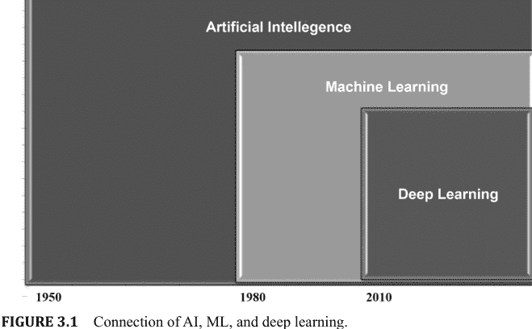

## 案例研究：医疗保健与深度学习

机器学习应用统计和数据驱动的规则将给定输入转换为所需的输出。这些规则从大量示例中自动生成，无需使用显式的人类规范。对于特征提取，机器学习系统需要领域专家知识和人工工程来检测模式。而深度学习应用表示学习进行模式识别。深度学习使用了多层表示。这些层按顺序排列，并包含大量的非线性和原始操作。一层的表示用作下一层的输入，并持续到获得最优表示为止。

深度学习技术可以扩展到大型数据集，并接受多种类型，如图3.2所示。

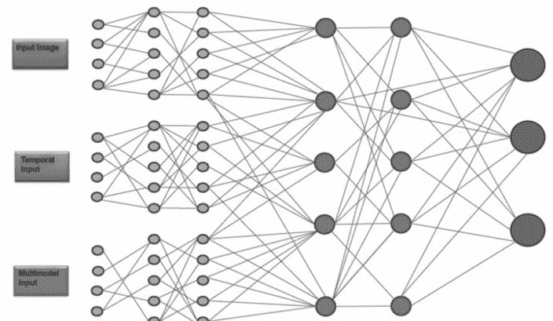

**图 3.2 深度学习的表示**

在深度学习中，网络本身对数据进行过滤和归一化，这在传统的机器学习方法是不可能的（Esteva et al., 2019）。与机器学习方法相比，深度学习使用自动表示来执行任务。通过这种方式，它减少了对监督的需求，并加速了从数据中提取操作意见的过程。例如，在医疗保健领域，深度学习应用多层方法进行分类，例如发现临床数据中的噪声、医学图像的异常以及基于患者特征的聚类。

### 深度学习的工作

由于传统的人工神经网络（`ANN`）是深度学习的基础，生物神经网络包含多层，每层执行所需的计算并将结果发送到下一层（Miotto et al., 2017）。隐藏层的数量、连接技术以及从输入中提取有意义信息的能力是深度学习与`ANN`之间的主要区别（LeCun et al., 2015）。

深度学习也被称为深度结构化学习或分层学习。在这里，“深度”代表神经网络中隐藏层的数量。传统`ANN`只有二到三层隐藏层，与具有多个隐藏层的`DNN`不同（Rumelhart et al., 1988; Bengio, 2009）。深度学习在检查准确性时与程序员的交互显著较少，而机器学习则更多地与人类交互以检查结果是否正确。

## 案例研究：医疗保健与深度学习

学习和知识获取的异构数据案例（Chen and Lin, 2014）。`DNN` 的基本架构如图 3.3 所示。

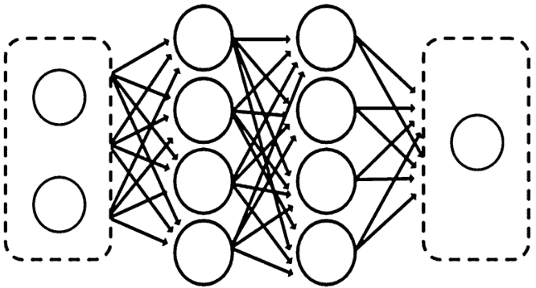

图 3.3 具有 10 层或 100 层隐藏层的深度神经网络。

如 `DNN`（Le et al., 2011）、深度自动编码器、深度置信网络（Hinton et al., 2006）、深度波尔兹曼机（`DBM`）、循环神经网络（`RNNs`）（Williams and Zipper, 1989）以及 `CNN`（LeCun et al., 1998, Haykin and Kosko, 2001; Tran et al., 2015）等深度针对特定目的设计。每种方法的用途取决于数据类型、学习类型（监督学习或无监督学习）以及对数据执行的活动类型。因此，方法的选择取决于上述因素，这些因素可以以更好的方式解决问题。

### 3.2.2.2 医疗保健中的深度学习

深度学习方法帮助计算直接从数据中学习，使其在不同的应用中特别是在医疗领域非常有用。这些方法基于深度架构并应用层次学习结构，能够整合来自不同数据集的异构数据。这些学习方法允许机器应用人类智能来生成高精度的结果（Hinton, 2018）。近年来，医疗领域 `ML` 和 `AI` 系统的使用增长巨大（Beam and Kohane, 2018），这严重依赖人类交互来为机器提供训练。深度学习方法不需要不需要不需要交互。它们通过使用电子健康记录（`EHR`）和其他来源提取相关特征直接从数据中进行训练。深度学习在疾病早期检测、疾病严重程度、临床风险识别和未来住院概率方面更适用。在医疗保健中，深度学习方法有助于做出临床决策，特别是检测医学数据中的异常。深度学习应用于海量数据集，连接患者不同的临床记录，并利用其神经网络提供最佳结果。目前，医学图像分析是深度学习方法的一个非常流行的应用。这些方法在基于皮肤图像和视网膜底的皮肤癌（Esteva et al., 2017）和糖尿病视网膜病变（Lee et al., 2019）自动检测中显示出高精度的性能。深度学习正通过提取医学数据中的隐藏模式和机会，帮助医生为患者提供更好的治疗。医疗执业者始终尝试应用新方法在医疗保健中寻找有效结果，从而做出更好的医疗决策。深度学习在医疗保健中一些有前景的应用如下。

### 3.2.2.3 医学图像的分析与诊断

`CNN` 是深度学习方法的一种，特别适用于来自不同成像技术的医学图像分析和诊断（Xu et al., 2016），例如 CT 扫描、MRI（Klesiesk et al., 2016）、眼底图像、X 射线图像（Cao et al., 2016; Alcantara et al., 2017）。这些图像非常适用于诊断癌症、心脏病、脑出血和脑肿瘤等不同关键疾病。斯坦福大学的研究人员声称，`CNN` 处理大图像要高效得多。


在最近的一项调查中，CNN 已用于脑病理分割（Havei et al., 2016）、计算机辅助检测、形状分析和分割，显示出可前景的结果。

在 2018 年 6 月的一项研究发现，在分析皮肤科图像时，CNN 识别黑色瘤的特异性比临床医生高出 10%。还观察到 CNN 的表现比皮肤科医生好近 7%（来源：https://healthytanalytics.com/features/what-is-deep-learning-and-how-will-it-change-healthcare）。

## 案例研究：医疗保健与深度学习

在此背景下，“蒙特西奈莱恩机器学院”的研究团队开发了一种 DNN，用于诊断神经系统问题，如脑中和出血。开发的深度学习算法发现比放射科医生快 150 倍（来源：https://healthitanalytics.com/news/deep-learning-ids-neurological-scans-150-faster-than-humans）。

尽管 CNN，其他深度学习技术也已用于成像，例如在预测阿尔茨海默病中使用功能共振成像（Hu et al., 2016）、使用受限波尔兹曼机（RBM）识别 MRI 生物标志物，以及与其他现有方法相比，正电子发射断层扫描（PET）的分类准确率提高了 6%（Li et al., 2015）、在 3D 脑图像上使用 DNN 获取潜在特征表示（Kuang and He, 2014）、DNN 解决图像标记问题（Lerouge et al., 2015）、数据处理分组方法、用于识别脾脏和肝脏的多层架构（Kondo et al., 2014），也已用于医学成像并显示出卓越的结果。

### 3.2.2.4 精准医疗与药物发现

深度学习通过识别治疗疾病的最佳治疗和预防技术，有助于精准医疗和药物发现。出于分析目的，这两项任务都使用了海量的基因组、临床、环境、个人生活方式和其他特定人群的数据。深度学习为医学研究人员和药物利益相关者提供了一个平台，以探索这些数据集的新模式。因此，这有助于研究人员和医生理解隐藏模式以及对于提供更好的临床治疗、预防机制以及发现特定疾病的通用药物的重要信息。目前，正在研究在深度学习中使用预测分析和基于分子的建模有效组合，以寻找人类某些类型癌症发生的根源。预计深度学习将帮助快速分析数据，处理时间也将从几个月/几周减少到几个小时。

许多私人公司致力于精准医疗的研究。2018 年 1 月，GE Healthcare 和 Diagnostic 宣布，他们将联合使用深度学习方法分析关键数据集以开发精准药物。他们将决定使用来自不同来源的数据组合，例如 EHR 数据、体内/体外数据、实时数据和临床活动指南，以做出有效的临床决策（来源：https://healthanalytics.com/features/what-is-deep-learning-and-how-will-it-change-healthcare）。在组合数据集上成功应用深度学习后，未来预计活检的数量将会减少。在一项研究中，马萨诸塞大学在《JMIR Medical Informatics》上发表文章称，深度学习在识别“不良药物事件”方面远优于传统方法（来源：https://healthanalytics.com/news/deep-learning-spots-adverse-events-in-unstructured-data）。

### 3.2.2.5 预测分析与临床决策支持

如今，医疗行业和医生对深度学习寄予许多期望，以支持做出有效决策、疾病的预测分析并显示可能的结果。在未来的将来，深度学习可能在住院环境中作为诊断专家，并对高风险医疗状况如血液疾病、代谢疾病和神经问题做出决策。

例如，一个名为“ICU Intervene”的基于深度学习的项目由 MIT（CSAIL）的研究人员开发，用于为医生提供重症监护室患者病情变化的实时报警（来源：https://healthanalytics.com/news/mit-uses-deep-learning-to-create-icu-ehr-predictive-analytics）。

Google 也致力于医疗保健，为眼疾病提供决策系统。目前，其子公司“DeepMind”正在开发深度学习工具，以识别 50 多种不同类型的眼疾病以及相应的治疗决策（来源：https://healthanalytics.com/news/google-backed-deepmind-creates-deep-learning-cds-for-eye-diseases）。

在相同背景下，发表在 *Nature* 杂志上的文章发现，所提出的深度学习工具在准确性上与医生相当（De Faw et al., 2018）。

通过深度学习是可能的

可以快速分析几张扫描图像，并在快速前进模式下缩短扫描与治疗之间的延迟，且不会损害治疗质量。

对于临床决策，电子健康记录（EHR）是收集患者完整病史的有效来源，包括治疗和用药活动、不同实验室检查的测试结果、临床诊断以及未来的住院概率。为了进行高效挖掘以产生高质量的结果并帮助疾病研究，需要海量数据（Andreu-Perez et al., 2015）。

深度学习方法可以自动扩展以管理海量和分布式数据集。这些方法能够从异构数据集中识别出新颖模式/特征。因此，深度学习已被应用于医学信息学研究，以帮助临床决策和预测分析。在一项研究中，卷积神经网络（CNN）已从放射学图像及相应的结果中识别出语义信息（Shin et al., 2016）。Liang 等人（2014）提出了一种在大型高血压数据集上进行训练的有效方法，以进行有效的分析并产生丰硕的信息。

在另一项研究中，研究人员已通过从简单的血检到深度神经网络（DNN）预测人类的年龄（Putin et al., 2016）。文献已表明，DNN 的预测准确性高于其他传统方法。通过自动编码器中的降噪，可以在不需要额外人工干预的情况下实现从 EHR 数据库的自动特征提取（Miotto et al., 2016）。

### 3.2.2.6 可持续的公共卫生

公共健康是一个重大问题，涉及疾病的许多方面，如识别和预防措施、医疗健康促进、环境因素（如空气质量）、生活方式和社会行为。人口在可持续公共卫生中起着至关重要的作用。由于地理区域广大且缺乏覆盖所有患者的适当医疗设施，大量人口可能会影响用药质量。在正确时间预测疾病、适当用药和药物安全等许多问题需要关注，并需要有效的预测方法来分析海量数据。

传统的预测方法可以随数据规模扩展，但它们非常复杂、处理速度慢，且缺乏所需的准确性。这些方法还需要只有专家才能提供的参数化数据。此外，整合实时数据的能力有限，在监测疾病识别、药物推荐、药物对患者的效等分析效果方面也是一个大问题。

相比之下，深度学习方法具备以泛化方式解决问题的强大能力。它们不需要人工干预即可分析数据并检索信息。由于这些原因，深度学习方法被推荐为公共卫生的关键分析方法（Huang et al., 2015）。

报告显示，由于空气质量差，每年有约 60,000 人死亡，这是慢性疾病增长的主要原因（Ong et al., 2016）。

我们可以看到，社交媒体作为社会的一部分，可以是关于各种病毒感染疾病（流感、埃博拉和脑炎）的实时信息的丰富来源。一组研究人员利用社交媒体服务来追踪公众的持续状态（Zhao et al., 2015）。探索流行病特征有助于理解疾病进展的原因，DBN 非常适合此目的。在一项研究中，使用 DBN 将与抗生素相关的推特帖子分类分为九类（Kendra et al., 2015）。一种预训练的基于 RBM 的深度学习方法已用于跟踪疾病的进展，并根据标记数据和传播进行微调。

## 表 3.1 深度学习技术在医学诊断中的研究文章结果

| 作者/参考文献 | 方法/模型 | 应用/工作 | 数据源 |
| :--- | :--- | :--- | :--- |
| de Vos 等人 (2016) | CNN | 结果显示 2D 图像可用于解剖区域的 3D 定位 | CT |
| Dou 等人 (2017) | CNN | 肝脏、心脏和大血管的自动医学图像分割 | MRI |
| Pan 等人 (2015) | CNN | 分析多相 MRI 图像以对脑肿瘤进行分级，并基于敏感性和特异性给出分级性能。结果显示使用卷积神经网络 (CNN) 的性能提升了 18% | MRI |
| Payan and Montana (2015) | CNN | 阿尔茨海默病预测。所提方法优于现有的分类器。为了预测该疾病，算法使用了大脑 MRI 扫描 | MRI |
| Dubrovina 等人 (2018) | CNN | 自动完成乳腺组织分类。胸大肌检测准确率较高，为 0.83；乳头准确率较低，为 0.56 | 乳腺摄影图像 |
| Acharya 等人 (2017) | CNN | 自动检测正常和心肌梗死 (MI) 心电图波形。有噪声的平均准确率为 93.5%，无噪声时为 95.22% | ECG |
| Mehta 等人 (2017) | CNN | 人类脑结构的自动分割 | CT |
| Esteva 等人 (2017) | CNN | 通过卷积神经网络 (CNN) 成功检测皮肤癌。获得了与 21 位经认证的皮肤科医生诊断相似的满意结果 | 临床图像 |
| Bar 等人 (2015) | CNN | 在包含 93 幅图像的数据集上成功检测胸部射线数据 | X-ray |
| Kamnitsas 等人 (2017) | CNN | 使用多尺度 3D CNN 进行脑变分割。主要考虑的三类患者为创伤性脑损伤、脑肿瘤和缺血性中风 | MRI |
| Mohamed 等人 (2018) | CNN | 提出了一种乳腺密度分类器，供放射科医生更好地区分两种乳腺密度类别（即分散型和异质型），以便对乳癌进行真实诊断 | 乳腺摄影图像 |

## 表 3.1（续）

| 作者/参考文献 | 方法/模型 | 应用/工作 | 数据源 |
| :--- | :--- | :--- | :--- |
| González 等人 (2018) | CNN | CNN 已用于吸烟引起疾病的分期和预后 | CT |
| Looney 等人 (2017) | CNN | 全自动 3D 超声分割用于胎盘，以理解孕早期的并发症 | 3D 超声数据 |
| Choi and Jin (2016) | CNN | 通过两个串联 CNN（全局和局部）进行条纹分割。所提方法的速度和精度预计在图像分析和其他临床试验中产生预期结果 | MRI |
| Bejnordi 等人 (2017) | CNN | 与病理学家小组相比，所提算法在女性乳腺癌淋巴结转移检测中具有更优的性能 | 来自数字切玻片的图像 |
| Klesiek 等人 (2016) | CNN | 这工作提出了一种脑分割算法及其在其他临床活动中的用处。结果非常有前景，并能与其它现有算法相比 | MRI |
| Rasti 等人 (2017) | CNN | 乳腺癌的诊断展示了 96.39% 的准确率、97.73% 的敏感性和 94.87% 的特异性 | MRI |
| Anirudh 等人 (2016) | CNN | 本文提出了通过 CNN 检测肺结节。为了训练网络，使用了标签，并通过 3D 分割排除了肺部气道。因此，在高敏感性的同时降低了假阳性 | CT |
| Roth 等人 (2015) | CNN | 提出了使用全自动自底向上技术进行胰腺分割。所提算法维持了 46.6%–68.8% 的平均分割准确率 | CT |
| Pratt 等人 (2016) | CNN | 在 80,000 张图像集上进行糖尿病网膜病变诊断。诊断的准确性和敏感性分别为 75% 和 95% | 数字眼底 |

## 3.3 挑战与机遇

尽管深度学习技术在解决医疗健康问题方面比机器学习算法取得了实质进展，并获得了理想的结果，但在医疗系统中应用深度学习临床时，仍有若干挑战需要识别和解决。一个主要挑战是医生对深度学习的接受度，因为他们对深度学习产生的结果有效性表示怀疑。医生还觉得深度学习正在成为医生的替代品，他们将在未来被深度学习所取代。

相反，深度学习应该有助于减轻工作压力，让医生专注于疾病的关键部分，并帮助他们进行诊断和治疗活动。特别是，医疗系统中考虑了以下问题。

### 3.3.1 数据数量

基础大脑架构的构建是一个持续的过程，从出生前开始持续到成年。首先，学习始于神经元之间简单的神经连接和基本技能的生成，随后是复杂的电路和技能。在一段时间内会形成数百万个新的神经连接。之后，修剪使得大脑电路更加高效。

深度学习模型在某种程度上基于人类大脑架构，这是一组高密度的计算模型。多层神经网络是深度学习的一个示例，需要优化数百万个网络参数来解决任何问题。


| Bayramoglu 等人 (2016) | CNN | 使用两种不同技术（如单任务 CNN 和多任务 CNN）展示了乳腺癌病理学图像的分类 | 病理学图像 |
| --- | --- | --- | --- |
| Fu 等人 (2016) | CNN | 所提方法通过减少假阳性数量提升了视网膜血管分割的性能 | 眼底图像 |

## 表 3.1（续）

| 作者/参考文献 | 方法/模型 | 应用/工作 | 数据源 |
| --- | --- | --- | --- |
| Akkus 等人 (2017) | CNN | 回顾基于深度学习的脑分割方法。回顾了通过深度学习架构对解剖脑结构和脑变进行分割。还总结了不同深度学习算法的特征 | MRI |
| Moeskops 等人 (2016) | CNN | 提出了自动脑分割，该算法的性能取决于几个关键活动 | MRI |
| Bejnordi 等人 (2017) | CNN | 所提算法在女性乳腺癌淋巴结转移检测中的性能优于病理学家小组 | 来自数字切玻片的图像 |
| Bejnordi 等人 (2017) | CNN | 与病理学家小组相比，所提算法在女性乳腺癌淋巴结转移检测中具有更优的性能 | 来自数字切玻片的图像 |
| Li 等人 (2018) | CNN | 利用基因表达数据检测癌症。结果显示该方法更适合管理基因和癌症预测 | 医学图像 |
| Chmelik 等人 (2018) | CNN | 检测癌症：与其它算法相比提供了更高的准确率 | 医学图像 |
| Causey 等人 (2018) | CNN | 基于 CT 的肺癌诊断 | CT |
| Prasoon 等人 (2013) | CNN | 通过关节图像进行骨关节炎预测 | MRI |
| Gulshan 等人 (2016) | CNN | 自动检测眼底的糖尿病网膜病变和水肿 | 眼底图像 |
| Esteva 等人 (2017) | CNN | 通过卷积神经网络成功检测皮肤癌。获得了与21位经认证的皮肤科医生诊断相似的满意结果 | 临床图像 |

## 表 3.1（续）

| 作者/参考文献 | 方法/模型 | 应用/工作 | 数据源 |
| --- | --- | --- | --- |
| Liu 等人 (2015) | CNN | 基于电子健康记录 (EHR) 的心衰和肺疾病风险预测 | EHR |
| Nguyen 等人 (2012) | CNN | 提出了一种新型深度学习方法用于识别院后风险 | EHR |
| Zhou and Troyanskaya (2015) | CNN | 他们开发了一种算法来预测染色改变的影响 | 基因组 |
| Kelley 等人 (2016) | CNN | 引入 Basset，一个从 DNA 学习功能活动的开源包 | 基因组 |
| Alipanahi 等人 (2015) | CNN | 预测 DNA 和 RNA 结合蛋白的特异性 | 基因组 |
| Angermeller 等人 (2016) | CNN | 从单细胞序列预测缺失的甲基化状态 | 基因组 |
| Koh 等人 (2017) | CNN | 将次优数据映射到高质量数据集的技术。在个人、物种和细胞类型中，多种染色标记的总体准确率达到 99.68%。该方法有助于维持数据质量并降低成本 | 基因组 |
| Ahmed 等人 (2016) | DBN-NN | 乳腺癌的自动检测和诊断。结果获得了 99.68% 的准确率、100% 的敏感性和 99.47% 的特异性 | 乳腺摄影 |
| Cheng 等人 (2016) | SADE | 乳腺癌和肺结节的检测：展示了良性变变的诊断。发现深度学习技术能够在无明确设计的情况下修改 CAD 系统 | 乳腺超声和肺 CT |
| Danaee 等人 (2017) | SADE | 利用基因表达数据检测癌症。结果显示所提方法更适合管理基因和癌症预测 | 医学图像 |

## 表 3.1（续）

| 作者/参考文献 | 方法/模型 | 应用/工作 | 数据来源 |
| --- | --- | --- | --- |
| Gao 等人 (2015) | CRNN | 所提出的方法在白内障的临床管理中非常有用，并应用于其他眼疾病的诊断 | 眼底图像 |
| Masood 等人 (2015) | SA-SVM | 皮肤癌自动诊断系统：在缺乏所需标记数据的情况下，所提出的学习模型给出了很有前景的结果 | 皮肤镜下图像 |
| Han 等人 (2017) | CSDCNN | 本文介绍了在大规模数据集上的乳腺癌多分类，准确率达 93.2% | 乳腺摄影图像 |
| Hawaii 等人 (2017) | DNN | 该工作致力于脑肿瘤分割，在 25 秒到 3 分钟内完成了全脑分割 | 磁共振成像 (MRI) |
| Zhang 等人 (2016) | RBM | 展示了乳腺肿瘤分类，结果显示准确率为 93.4%，敏感性 88.6%，特异性 97.1% | 剪切弹性弹性 |
| Cha 等人 (2016) | DL-CNN | 基于 DL-CNN 的膀胱自动计算机分割系统 | CT 尿路造影 (CT) |
| Lensee 等人 (2017) | U-Net | 应用 U-Net 架构进行脑肿瘤分割 | 磁共振成像 (MRI) |
| Dalmis 等人 (2017) | U-Net | 提出使用 U-Net 进行乳腺和腺体组织分割。通过 3C u-net (0.933 和 0.850)、2 U-nets (0.944 和 0.811) 以及基于图谱的方法 (0.863 和 0.671) 得到的乳腺和腺体组织分割的 DSC 平均值 | 磁共振成像 (MRI) |
| Kumar 等人 (2015) | CAD | 使用 CAD 系统的深度特征进行肺结节分类，准确率为 75.01%，敏感性 83.35%，假阳性 0.39 | CT |
| Sun 等人 (2016) | CNN, DBN, SADE | 使用三种深度学习算法进行肺癌诊断。准确率是三种算法获得的结果：CNN (0.7976)、DBN (0.8119) 和 SADE (0.7922)。DBN 实现了最高准确率 | CT |
| Samala 等人 (2016) | DL-CNN | 作者展示了数字乳腺断层扫描微分类检测技术。通过工作特征曲线 (AUC) 获得的最佳结果为 0.93 | 平面投影图像 |

## 表 3.1（续）

| 作者/参考文献 | 方法/模型 | 应用/工作 | 数据来源 |
| --- | --- | --- | --- |
| Wang 等人 (2017) | DCNN | 提出通过深度学习和“非深度学习”技术对前腺癌进行预测分析。深度学习的准确率、敏感性和特异性分别为 84%、69.6% 和 83.9%，而“非深度学习”技术提供的准确率、敏感性和特异性分别为 70%、49.4% 和 81.7% | 磁共振成像 (MRI) |
| Xu 等人 (2016) | SSAE | 通过细胞核检测策略检测乳腺癌。所提出的 SSAE 方法性能优于其他最先进的检测策略。SSAE 在 F 指数上有所改进，即 84.49%，在 AveP 上也有改进 | 数字病理图像 |

`SADE`: 自自适应差分进化，`SSAR`: 堆叠稀疏自动编码器，`UGRNN`: 更新门循环神经网络，`DILI`: 药物诱导肝损伤，`DSC`: 相似系数

# 案例研究：医疗健康与深度学习

活检中的肿瘤分类。良性细胞是非癌性的，不会侵犯或扩散到附近的组织及身体其他部分。纤维瘤和脂肪瘤是良性肿瘤的示例（López et al., 2012）。恶性肿瘤是癌性的，会影响附近的组织。它们从乳腺组织开始侵犯淋巴结，并身体其他部位如骨骼和肝脏。活检有助于识别乳癌肿瘤的特性（Pöllänen et al., 2014）。

在深度学习中，`CNN` 是深度神经网络（`DNN`）的一个子类，主要关注通过数据演示自动学习特征学习（LeCun et al., 1998）。

在一项关于自发性乳腺癌预测的研究中，Listgarten 等人（2004）使用了类醇代谢酶（`CYP450s`）的单核苷酸多态性（`SNP`）谱。在所有类型的乳腺癌中，非家族性乳腺癌超过90%（Dumitrescu and Cotarla, 2005）。这项研究基于类醇代谢基因`SNP`的特定排列，这些基因可能会增强乳腺组织中生态毒素/激素的增加，这是导致乳腺癌发生概率较高的原因。

深度学习利用各种决策树模型结合 `SVM` 技术，利用 `SNP` 数据获得最高准确率，其预测能力取决于模型。验证和准确性基于交叉验证、自助采样法和重采样方法等训练方法。

`SVM` 和朴素贝叶斯技术使用了一组准确率最高的 `SNP`，而决策树仅使用一组 `SNP` 并在结果中获得了最高准确率。在乳腺癌预测准确百分比方面，`SVM`、朴素贝叶斯和决策树分别为69%、67% 和 68%。

近年来，深度学习在癌症预测方面的进展加速，癌症是最流行的疾病，图像在分析中起着主导作用（Jiang et al., 2017）。特别是癌症研究主要基于放射学和病理学两类活动。最近的若干深度学习工作包含了用于训练模型的大型数据集，并在一系列图像上显示出与诊断专家相当的结果，例如 `CT` 扫描（Merk et al., 2017）、`MRI`（Jamaludin et al., 2017）、胸部 `X` 光（Rajpurkar al., 2017）和乳腺 `X` 光（Koi et al., 2017）。研究发现，胸部 `CT` 扫描可以降低肺癌的死亡率（Setio et al., 2017）。

器官/病变分割已完成大量工作，包括一系列器官和不同的病理形态，支持深度分析并将其作为自动化系统（Litkens et al., 2017）。分割任务可能包括涉及脑肿瘤、大脑正常结构和非肿瘤性病变的神经影像（Akkus et al., 2017）。

过去，传统方法根据分子亚型与预后之间的相关性识别了多种类型的癌症，如乳腺癌（Azrowski et al., 2014）、肾细胞癌（Karlo et al. 2014）和胶质母细胞瘤。相比之下，深度学习方法完成的类似工作显示了基于成像的具有前景的结果（Akkus et al., 2017; Kforiatis et al., 2017; Li et al., 2017; Ning et al., 2018; Zhu et al., 2019）。

2017 年，一篇开创性文章介绍了淋巴结中转移性乳癌沉积的识别（Ehtesami et al., 2017）。在文中，23 个团队使用了 129 个 `WSI` 节点的测试进行预测，并与人类专家的两个基准进行了比较。与病理学家相比，深度学习方法显示出其与病理学家水平相当的潜力。

另一项研究中，`CNN` 应用于 50 张切片以绘制不同类型癌症的“浸润淋巴细胞”模式，并与分子亚型和生存率相关（Saltz et al., 2018）。在所提的工作中，使用了有限数量的切来训练初始模型。此外，病理学家被用于对模型的预测进行反馈。整个过程持续到找到满意的结果。为了基于形态的研究，这项研究提供了一种高效的方法，如果每张切片都需要病理学家进行标注，将是不可能的。`ImageNet` 是用于解决大规模视觉识别挑战的 `CNN` 工具，错误率接近贝叶斯率。该工具结合了异构医疗数据集并预测了准确的结果（Krizhevsky et al., 2012）。

图 3.4 显示了 `CNN` 如何使用病理图像进行癌症预测。在训练阶段，病理学家的作用是在可用切片上选择感兴趣的区域。这些图像被裁剪成小块用于 `CNN` 训练。然后应用反向传播调整模型。每张切片的预测由模型生成，最后将所有预测聚合形成切片级预测。最近，这种方法被用于浸润性导管癌的识别并具有前景的结果（Cruz et al., 2014）。

在另一项研究中，为了预测前列腺癌的状态，使用了深度学习识别切片上的异常区域（Wang et al., 2018）。在这项工作中，作者应用了一种新技术来识别肺癌的驱动突变（Schaumber et al., 2018）。

乳腺癌预测准确率方面，`SVM`、朴素贝叶斯和决策树分别为69%、67% 和68%。最近，这种方法被用于浸润性导管癌的识别并具有前景的结果（Cruz et al., 2014）。

在另一项研究中，为了预测前列腺癌的状态，使用了深度学习识别切片上的异常区域（Wang et al., 2018）。在这项工作中，作者应用了一种新技术来识别肺癌的驱动突变（Schaumber et al., 2018）。

### a. 在病理图像上的训练：

`img/8e7871c4c36f9e41f405d44_png`

### b. 推理

- 胶质母细胞瘤：0.71
- 奥细胞瘤：0.06
- 星形细胞瘤：0.20
- 正常大脑：0.03
- 星形细胞瘤：0.85
- 星形细胞瘤：0.96
- 奥细胞瘤：0.55

## 图 3.4 CNN 用于图像分析的作用。

来源：改编自 Levine et al., 2019

## 表 3.2 验证方法与准确率的乳腺癌识别

| 出版 | 方法 | 患者人数 | 数据类型 | 准确率 | 验证方法 | 重要特征 |
| --- | --- | --- | --- | --- | --- | --- |
| Ayer et al. (2010) | ANN | 62, 219 | 乳腺线摄影，人口统计学 | 96 | 10 折交叉验证 | 诊断年龄，乳腺摄影发现 |
| Listgarten et al. (2004) | SVM | 174 | SNPs | 69 | 20 折交叉验证 | snpCYP11B2 +4536 T/C snpCYP1B1 +4328 C/G |
| Kim et al. (2017) | SVM | 679 | 临床，病理，流行病 | 67 | 留法 | 肿瘤局部侵犯 |
| Park et al. (2014) | 基于图的SSL算法 | 374 | 临床，病理 | 68 | 留法 | Pathologic_S, Pathologic_T, 类型类型总结 |
| Eshlaghy et al. (2013) | | 547 | 临床，人口 | 95 | 10 折交叉验证 | 诊断年龄，月经年龄 |
| Park et al. (2013) | 基于图的SSL算法 | 162,500 | SEER | 71 | 5 折交叉验证 | 肿瘤大小，诊断年龄，节点数 |
| Xu et al. (2012) | SVM | 295 | 基因组 | 97 | 留一交叉 | 50基因签名 |
| Gevaert et al. (2006) | BN | 97 | 临床，微阵列 | AUC = 0.851 | 留法 | 年龄，血管生成，MMP9分级，HRASLA和 RAB27B基因 |
| Delen et al. (2005) | DT | 2,000,000 | SEER | 93 | 交叉验证 | 肿瘤大小，肿瘤大小，节点数，组织学 |
| Kim and Shin (2013) | SSL 协同训练算法 | 162,500 | SEER | 76 | 5 折交叉验证 | 诊断年龄，肿瘤大小，节点数，肿瘤延伸 |

# 案例研究：医疗与深度学习

## 3.5.2 案例研究：阿尔茨海默症

阿尔茨海默症是一种由于进行性神经系统功能障碍引起的慢性神经退行性疾病。这通常始于脑细胞的逐渐死亡，导致记忆丧失和思维能力下降（Burns and Illiffe, 2009）。它是影响人类独立工作能力痴呆的主要原因。它始于早期，表现为遗忘近期活动（如对话、忘记物品）（世界卫生组织。痴呆——公共卫生重点优先事项 2017，来源：http://www.who.int/mental_health/neurology/dementia/infographic_dementia/en），推理/判断问题、学习困难以及执行例行任务遇到困难（世界卫生组织。痴呆事实表，2017，来源：http://www.who.int/mediacentre/factsheets/fs362/en/）。随着疾病的进展，在患者的行为中可能会观察到不同的变化，例如执行日常任务有困难、情绪快速变化、行为改变（例如自残行为，如打自己、咬自己和抓挠自己）、错误的性行为（例如在公共场所自淫/猥亵）、偷窃和投掷物品（Burns and Illiffe, 2009）。直到目前，尚未发现完全治愈这种疾病的有效治疗方法。在后期可能会出现各种并发症并导致死亡。

### 3.5.2.1 阿尔茨海默症的因

在一项研究中，研究人员观察到遗传并发、日常生活和环境因素是阿尔茨海默症的主要原因（Wilson et al., 2011）。严重的基因变化是阿尔茨海默症的主要原因之一，这通常发生于中年（世界卫生组织。痴呆——公共卫生重点优先，2017。来源：http://www.who.int/mental_health/neurology/dementia/infographic_dementia/en）。阿尔茨海默病（`AD`）的主要病因仍然是一个巨大的研究课题，但该疾病的核心问题是“脑蛋白（即斑块和缠结蛋白）”的功能异常，这不仅会干扰神经元的正常活动，还会释放毒性事件。因此，神经元由于失去相互作用而死亡。控制记忆的大脑区域首先受到损害。受损的神经元随后扩散损害，并按照特定的模式影响大脑的其他区域。在疾病的后期，大脑萎缩并导致死亡。

### 3.5.2.2 阿尔茨海默症的症状

`AD` 的症状因人而异，并随着时间的推移逐渐出现。这种疾病的初期症状可能是遗忘事件/活动、轻度混乱、在没有任何支持的情况下无法活动、无法识别物体等。阿尔茨海默症症状的变化可以分为三类，即功能性、认知性和行为性。功能性变化影响日常活动，如财务管理、个人护理和旅行。最后，患者将完全依赖他人。

短期记忆属于处理近期事件的认知变化，包括无法识别熟悉的路线/脸孔/物体、学习能力丧失、无法识别亲友以及无法做出决策。

行为性变化是由于患者参与了社会上不可接受的活动而引起的，例如情感感觉丧失和情绪变化（如焦虑、抑郁、躁动、缺乏兴趣和淡漠），这对于家庭来说非常难以处理，最终需要在专家监督下进行医疗。


在最近的一项研究中，旧金山大学的研究人员提出了一种深度学习模型，通过使用大脑的“18氟脱氧葡萄糖 PET”来对 AD 进行早期预测（Dean et al., 2018）。该模型能够比现有技术早多六年检测出 AD。在这项工作中，收集了来自 1002 名患者的 2109 张前瞻性 18F-FDG PET 脑图像以及来自 40 名患者回顾独立测试集的 40 项影像研究以进行临床诊断。此外，记录了最终诊断。所提出的模型使用了 90% 的数据集用于训练，剩余数据集的 10% 用于测试。根据敏感性、t 分布随机邻嵌入、特异性、显著性映射和接收者工作特征（ROC）等不同因素，将该模型的性能与放射学读者的进行了比较。在 AD 最终临床诊断的早期预测中，算法在 ROC 曲线下的面积达到 0.98，特异性 82%，敏感性 100%。这一结果是在最终诊断前平均 75.8 个月获得的。

在其他研究工作中，为了预测稀疏学习数据集上的轻度认知障碍（MCI）和阿尔茨海默型痴呆（AD型痴呆），使用了名为“D2NLM”的深度语言模型与 DNN 的结合（Orimaye et al., 2018）。为了学习深度学习模型，研究人员使用了更高的 n-gram 词汇空间，并在 DementiaBank 关于阿尔茨海默症和相关痴呆的临床 Pitt 数据集进行了实验工作（来源：https://dementia.talkbank.org/access/English/Pitt.html）。

对于该数据集，进行了简易精神状态评估和其他临床诊断实践，以收集不同类型的数据，例如口头访谈、诊断的 MCI 数据和不同形式的 AD 型痴呆。最终结果显示，AD 型痴呆的临床诊断准确率为 91.4%，特异性 98.3%，敏感性 98.8%。

在对 PubMed 和 Google scholar 的调查中，深度学习技术特别是 CNN 和 RNN 在神经影像数据上显示出其 AD 分类的准确率为 96.0%，MCI 脑震预测的准确率为 84.2%（Jo et al., 2019）。通过多模态神经影像和体液生物标志物的结合，获得了 AD 分类的性能提升。进一步发现，深度学习在不同类别数据的 AD 研究中仍在进化中。

多模态 RNN 作为一种深度学习方法，已应用于预测从 MCI 转换为 AD（Lee et al., 2019）。研究人员结合了“横断面神经影像生物标志物”、“纵向脑髓液”和“基线认知性能生物标志物”，以开发一个集成框架来改进预测。在单模态数据上，提出的模型对 MCI 转换为 AD 的预测准确率为 75%。开发了一种基于深度学习的新型技术用于 MSI 和 AD 的早期诊断（Liu et al., 2014），与 SVM 相比提供了更好的 AD。

## 3.5.3 案例研究：糖尿病

糖尿病是一种常见的慢性病，影响了全球大部分人口。由于其增长率，对健康构成了巨大威胁。这是由于胰腺 β 细胞胰岛素分泌减少引起的（Lonappan et al., 2007）。糖尿病会导致眼睛、心脏、神经和血管等部位严重损伤（Krasheva et al., 2011）。糖尿病分为类：一型糖尿病（T1D）、二型糖尿病（T2D）和妊娠糖尿病（GDM）。

T1D 患者通常在 30 岁以下。这种类型糖尿病的症状是血糖水平升高、尿多和口渴（Iancu et al., 2008）。该类患者需要胰岛素治疗来维持血糖，而不仅仅是药物。

T2D 患者多为中老年，主要患有高血压、肥胖、动脉样硬化和血脂异常等多种疾病（Robertson et al., 2011）。该类患者遭受胰岛素分泌逐渐丧失。但他们可以选择各种治疗方案。在 T2D 早期，通过药物改善胰岛素分泌，但在后期需要胰岛素。

三型糖尿病或 GDM 是由于胎盘释放的激素与胰岛素相互引起的，会导致血糖升高（Kavakiotis et al., 2017）。它发生在怀孕期间，通常在产后消失。大多数病例婴儿都有发生糖尿病的风险（Han et al., 2014）。良好的饮食习惯是降低糖尿病水平的最佳选择（Kim, 2009）。GDM 的治疗方案与 T2D 使用的相同。

## 案例研究：医疗健康与深度学习

在一项研究中，对于每一类糖尿病，每个患者通常会在日常生活中采取一些共同的常规，例如及时诊断、患者教育、定期的医疗护理以及遵循风险缓解活动，如糖尿病足、视网膜病变、肾病等。

早些，许多人工智能算法已被用于糖尿病的预测，例如支持向量机（SVM）、决策树逻辑回归等（Kavakiotis et al., 2007）。通过使用主成分分析和神经模糊算法，可以将糖尿病患者与正常人区分开来（Polat and Günş, 2007）。通过量子粒子群优化算法和加权最小二法向量机预测了2型糖尿病（T2D）（Yue et al. 2008）。线性判别分析-小波支持向量机（LDA-MWSVM）被提出用于糖尿病（Duyu et al., 2011）。在该方法中，线性判别分析被用于降维和特征提取。为了从高维数据预测T2D，研究提出了一种使用逻辑回归的预测模型来区分不同的发病情况（Razavian et al., 2015）。SVM已被用于将糖尿病作为一个多变量回归问题进行预测，特别关注血糖水平（George et al., 2013）。在其他研究中发现，大多数研究人员通过这些方法提高了预测的准确性（Kavakiotis et al., 2017）。

## 3.6 结论

本章从深度学习在医疗健康领域的动力意义开始介绍。介绍了深度学习在通过对癌症、阿尔茨海默病和糖尿病等主要疾病进行有效检测和诊断以避免错误决策方面的作用。此外，还讨论了医疗健康部门在国家收入产生和经济增长中的作用。根据印度卫生和家庭福利部的报告，到2022年，医疗健康部门在收入方面可能涵盖总市场价值的8.6万亿卢比。研究中发现，与斯里兰卡和印度尼西亚等低收入国家相比，公共卫生支出较低是一个讨论问题。印度政府计划到2025年将总GDP的2.5%投入公共卫生。医疗健康系统涵盖了许多领域，如医院、医学研究、药物发现、医疗保险、远程医疗和医疗设备，这些领域产生了海量数据。

## 医疗系统中的深度学习与物联网

数据在本质上是复杂且非结构化的，对于医疗健康行业的利益相关者来说，获取有效信息是一个巨大的挑战。因此，为了获取有效信息，应用了不同的传统人工智能和基于机器学习（ML）的技术。但由于数据的独特性和快速增长，这些算法无法按预期满足需求。深度学习具有处理此类类型数据的能力。它通过多层非线性处理单元进行特征提取和转换。与机器学习和其他传统技术不同，深度学习使用表示学习进行模式识别并获得预期的输出。近年来，由于海量的异构数据以及医疗健康对实时信息的需求（特别是对于临床决策），深度学习在疾病的检测和诊断中发挥着至关重要的作用，帮助临床医生为患者提供更好的治疗。本章讨论了深度学习的不同应用和挑战。针对癌症、阿尔茨海默病、心脏病、皮肤病、脑瘤等的研究调查是在各种数据源上使用不同的深度学习方法完成的，在每项调查中，学习都显示了所需的理想结果。癌症、阿尔茨海默病和糖尿病这三种严重疾病被作为案例研究，以展示深度学习方法在实时环境中进行分析和预测的性能。在当前癌症患者高增长的背景下，对疾病严重性进行有效且准确的预测是非常理想的。根据奥斯陆大学医院的报告，病理结果显示癌症进展的准确性仅为60%，这是一个研究问题。研究发现，近85%的死亡是由肺癌引起的。约90%的乳腺癌病例在性质上是自发性的/非家族性的。阿尔茨海默病是另一种由于进行性神经系统疾病引起的严重疾病。这种疾病逐渐杀死脑细胞，导致记忆丧失和思维能力下降。目前尚未发现能完全治愈这种疾病的有效方法。在晚期，可能会出现各种并发症并导致死亡。但对疾病的正确预测和更好的治疗可能会延长患者的寿命。另一个著名疾病是糖尿病，它属于常见糖尿病的类别，涵盖了全球巨大的人口。这是由于血糖中量过多而非正常水平引起的。糖尿病分为T1D、T2D和GDM（妊娠糖尿病）三类。每类糖尿病都有特定的症状，并根据某些标准影响患者。在上述背景下，根据对不同平台深度学习方法的调查和分析发现，与现有传统技术和病理结果相比，这些方法在疾病的所需且准确预测方面显示了可接受且有前景的结果。

## 关键词

- 深度学习
- 医疗健康
- 精准医疗
- 阿尔茨海默病
- 糖尿病
- 癌症

## 参考文献

- Abdel-Zaher, A.M. and Eldeb, A.M., 2016. Breast cancer classification using deep belief networks. Expert Systems with Applications, 46, pp. 139–144.
- Acharya, U.R., Fujita, H., Oh, S.L., Hagiwara, Y., Tan, J.H., and Adam, M., 2017. Application of deep convolutional neural network for automated detection of myocardial infarction with ECG signals. Information Sciences, 415, pp. 190–198.
- Akkus, Z., Ali, I., Sedlář, J., Agrawal, J., Parney, L., Giannini, C., and Erickson, B., 2017. Predicting deletion of chromosomal arms 1p1q in low-grade gliomas from MR images using machine intelligence. Journal of Digital imaging, 30, pp. 469–476.
- Akkus, Z., Galzimianova, A., Hoogi, A., Rubin, D.L., and Erickson, B., 2017. Deep learning for brain MRI: state of the art and future directions. Journal of Digital Imaging, 30(4), pp. 449–567.
- Alcantara, M.F., Cao, Y., Liu, C., Brunette, M., Zhang, N., Sun, T., Chen, Q., Li, and Albarracin, C., 2017. Improving tuberculosis diagnostics using deep learning and mobile health among Peru. Smart Health, 1, pp. 66–77.
- Alghamdi, M., Al-Mallah, M., Ketyan, S., Brenner, W., Holman, J., and Sak, S., 2017. Predicting diabetes mellitus using SMOTE and ensemble learning approach: the Henry Ford Testing (FIT) project. PLoS ONE, 12(7), p. e01985.
- Ipalanish, B., Delong, A., Weir, A., 2015. (Wait, text is cut: "ipalanish, B., Delong, A., Weir, A.") -> *Correction on context*: Ipalanish, B., Delong, A., Weir, A., 2015. (Note: entry is not fully formed in source).
- Deishner, J., Weissauch, M.T., and Frey, B.J., 2015. Predicting the sequence of DNA binding. Nature Biotechnology, 33(8).
- American Diabetes Association, 2010. Diagnosis and classification of diabetes. Diabetes Care, 33(1), pp. S62–69.
- Bellazzi, R., and Zupan, B., 2008. Predictive data mining in clinical medicine: current issues and guidelines. International Journal of Medical Informatics, 77(2), pp. 81–97.
- Bengio, Y., 2009. Deep learning architectures. Foundations and Trends in Machine Learning, 2(1), pp. 1–127.
- Bengio, Y., Courville, A., and Vincent, P., 2013. Representation learning: a review and perspectives. IEEE Transactions on Pattern Analysis and Machine Intelligence, 35(8), pp. 1798–1928.
- Bunn, A. and Lilly, S., 2011. An automated diabetes monitoring system based on LDA-Wavelet Support Classifier. Experiments with Applications, 38(7), pp. 831–8315.
- Causey, J.L., Zhang, J., Ma, S., Liang, B., Qualls, J.A., Polite, D.G., Prior, F., Zhang, S., and Huang, X., 2018. Highly accurate model for prediction of lung node malignancy with CT scans. Scientific Reports, 8(1), p. 9286.
- *(Note: The OCR text contained many repetitions and fragmented entries in the reference section; I have cleaned the list logically based on the provided text while maintaining the information available.)*

# 案例研究：医疗健康与深度学习

- Cha, K.H., Hadjiiski, L., Samala, R.K., Chan, H.P., Caoli, E.M., and Cohan, R.H., 2016. 使用深度学习卷积神经网络和水平集在 CT 尿造中进行膀胱分割。《医学物理》， 43(4), pp. 1882–1896.
- Chaudhary, K., Poirion, O.B., Lu, L., and Garmire, L.X., 2018. 基于深度学习的多组学整合稳健地预测肝癌生存率。《临床癌症研究》， 24(6), pp. 1248–1259.
- Chen, X.W. and Lin, X., 2014. 大数据深度学习：挑战与展望。《IEEE Access》， 2, pp. 514–525.
- Chen, Y., Li, L., Zhang, Q., and Xu, R., 2015. 表型驱动的遗传学预测助力药物发现。《生物信息学》， 31(12), pp. 1276–1283.
- Cheng, J.Z., Ni, D., Chou, Y.H., Qin, J., Tiu, C., Chang, Y., Huang, S., Shen, D., and Chen, C.M., 2016. 深度学习架构的计算机辅助诊断：超声中乳腺病变和 CT 扫描中肺结节的应用。《科学报告》， 6, p. 24454.
- Cheng, Y., Wang, F., Zhang, P., and Hu, J., 2016. 利用电子健康记录进行月份预测：一种深度学习方法。2016 年 SIAM 国际数据挖掘会议论文集 (pp. 432–440)。信息与应用数学学会。
- Chmelik, J., Jakubiecki, R., Walec, P., Jan, J., Ourednicki, P., Lambert, L., Amadori, E., and Gavelli, G., 2018. 基于深度卷积神经网络的 3D CT 数据中难以判断的转移性脊椎病变的分割与分类。《医学影像分析》， 49, pp. 76–88.
- Cho, H. and Jin, K.H., 2016. 使用深度卷积神经网络对纹状体进行快速稳健的分割。《神经科学方法杂志》， 274, pp. 146–153.
- Cichetti, D.Y., 1992. 临床实验室中的神经网络与诊断：现状。《临床化学》， 38(1), pp. 1–9.
- Crecen, D.C., Gust, A., Gambardella, L.M., and Schmidhuber, J., 2013, 9月. 深度神经网络在癌症组织病学图像中的有丝分裂检测。医学影像与计算机辅助干预国际会议 (pp. 411–418)。Springer, 柏林，海德堡。
- Cochran, A.J., 1997. 皮肤黑色素患者的预后预测。《细胞研究》， 10(3), pp. 162–167.
- Collins, F.S. and Varmus, H., 2015. 精准医学的新倡议。《新英格兰医学杂志》， 372(9), pp. 793–795.
- Coudray, N., Ocampo, P.S., Sakellaropoulos, T., Tarula, N., Snudler, M., Fenyö, D., Moreira, A.L., Razavian, N., and Tsiros, A., 2018. 使用深度学习从非细胞肺癌病理学图像进行自动检测和突变预测。《自然医学》， 24(10), p. 1559.


# 医疗系统中的深度学习与物联网

## 文献综述

- Cox, M.E. and Edelman, D., 2009. 2 型糖尿病的筛查与诊断测试。《临床糖尿病》， 27(4), pp. 132–138.
- Cuz, J.A. and Wishart, D., 2006. 机器学习在癌症预测和预后中的应用。《癌症信息学》， 2, p. 11769351060020030.
- Cuz-Ro, A., Basanhavally, A., González, G., Gilmore, H., Feldman, M., Ganesan, S., Shih, N., Tomaszewski, J., and Madabushi, A., 2014. 使用卷积神经网络在切片图像中自动检测浸润性导管癌。2014 医学影像：数字病理（第 9041 卷，p. 90403）。国际光学光子学会，华盛顿。
- Dalmış, M.U., Litiens, G., Holland, K., Setio, A., Mann, R., Karsmeijer, N., and Gubern-Mérida, A., 2017. 使用深度学习分割 MRI 中的乳腺和纤维腺体组织。《医学物理》， 44(2), pp. 533–546.
- Danaee, P., Ghaeni, R., and Hendrix, D.A., 2017. 一种用于癌症检测和相关基因识别的深度学习方法。太平洋生物计算专题会议 (pp. 219–229)。
- De Fauw, J., Letsam, J., Romero-Paredes, B., Nikolov, S., Tomasev, N., Asham, H., Glorot, X., Odoghue, B., Visinent, D., and Driessen, G., 2016. 适用于肾脏疾病诊断和转诊的临床深度学习。《自然医学》， 24(9), p. 1342.
- de Vos, B., Volterink, M., Jong, P.A., Vergemeer, M., and Isgum, I., 2016. 用于 3D 解剖定位的 2D 图像分类：采用卷积神经网络。2016 医学影像：图像处理（第 9784 卷）。国际光学光子学会，华盛顿。
- Delen, D., Walker, G., and K, A., 2005. 预测乳腺癌生存率：方法的比较。《医学中的人工智能》， 34(2), pp. 113–127.
- Jing, S., Sohn, H., Kawczynski, M., Trivedi, H., Haranish, R., 2018. 深度学习模型预测乳腺癌生存率：利用 MRI 扫描诊断阿尔茨海默病（注：此处原文可能存在逻辑冲突或笔误，按字意翻译）。《放射学》， 29(2), pp. 456–464.
- Dou, Q., Yang, L., Chen, X., Qin, J., 2017. 深度学习学习网络进行 3D 体积分割。《医学影像分析》， 41, pp. 45–54.
- Dubrovina, A., Kiselev, P., Ginsburg, B., 2017. 深度学习在影像中的应用。《计算机、生物医学与工程学》。
- Cichetti, D.Y., 1, A., San.,, R., 2013. 深度学习网络预测癌症复发。《细胞与分子医学》， 9(1), pp. 208–221.
- Ehtami, A., Linz, J., Glass, B., 2017. 深度学习血管血管血管血管血管血管
- Hinton, G., Deng, L., Yu, D., Dahl, G., Mohamed, A.R., Jailty, N., Senior, A., Vanhcke, V., Nguyen, P., Kingsbury, B., and Sainath, T., 2017. 用于声语音识别的深度神经网络。《信号处理杂志》， 29, pp. 28–38.
- Hinton, G.E., Osindero, S., and Teh, Y.W., 2006. 深度置信网络的快速学习算法。《神经计算》， 18(7), pp. 1527–1554.
- Hirschberg, J. and Manning, C.D., 2015. 自然语言处理的进展。《科学》， 349(6245), pp. 261–266.

## 案例研究：医疗健康与深度学习

Hripcsak, G. and Albers, D.J., 2012. 电子健康记录的下代表型。Journal of the Medical Informatics Association, 20(1), pp. 117–121.
Hu, X., Wang, T. and Jin, F., 2016. 阿尔茨海默病与肠道微生态。Science China Life Sciences, 59(10), pp. 1006–1023.
Huang, T., Lin, L., Fang, X., An, P., Min, J., and Wang, F., 2015. 医疗系统中大数据的承诺与挑战。Big Data Research, 2(1), pp. 2–11.
Iancu, I., Mata, M., and Lancu, E., 2008. 糖尿病患者血糖动力学分析方法。In 2008 IEEE International Conference on Automation, Quality and Testing, Robotics (Vol. 3, pp. 60–65). IEEE.
Iseneer, F., Kickergeder, P., Bonekamp, D., Bendszus, M., Wick, Schlemmer, H.P., and Maier-Heid, K., 2017. 使用大感受野卷积神经网络进行脑肿瘤分割。In Bildverarbeitung für Medizin 2017 (pp. 86–91). Springer Verlag, Heidelberg.
Jamaludin, A., Otis, M., Kadir, T., Zisserman, A., Urban, J., Battié, M.C., Fairbunk, J., McCallum, I., and Genodic: Consortium, 2017. ISSLS PRISE IN BIOENGINEERING SCIENCE 2017: 无需人工干预的腰椎磁共振成像（MRI）放射学特征自动读取与专家放射科医生水平相当。European Spine Journal, 26(5), pp. 1374–1383.
Jensen, P.B., Jensen, and Brunak, S., 2012. 挖掘电子健康记录：迈向更好的研究应用和临床。Nature Genetics, 13(6), p. 395.
Jiang, F., Yang, Y., Dong, Y., Li, H., Ma, S., Wang, Y., Dong, Q., Shen, H., and Wang, Y., 2017. 医疗保健中的人工智能：过去与未来。Stroke and Vascular Neurology, 2(4), pp. 230–243.
Jo, T., No, H., and Saykin, A.J., 2019. 阿尔茨海默病的深度学习：使用神经影像进行诊断分类与预测。arXiv preprint arxiv:1905.09391
Kammatis, K., Led, C., Newcombe, V.F., Simpson, J.P., Kane, A.D., Menon, D.K., Rueckert, D., and Glocker, B., 2017. 带有全 CRF 的高效多尺度 3D CNN 用于精确脑病变分割。Journal Medical Analysis, 36, pp. 61–78.
Carla, C., Di Paolo, P., Chai, J., Hakimi, A.A., Ostrovnaya, I., Russo, P., Hirac, H., Motzer, R., Hisnik, J., and Akin, O., 2014. 肾细胞癌的组学：CT 特征与特征之间的关联。Radiology, 270(2), pp. 464–471.
Kavakotis, I., Tsave, O., Salifoglou, A., Maglaveras, N., Vhavas, I., and Chovardara, I., 2017. 糖尿病研究中的机器学习和数据方法。Computational and Structural Biology Journal, 15, pp. 104–116.
Kelley, D.R., Snoek, J., and Winn, J.L., 2016. Basslet: 使用深度卷积神经网络学习可访问基因组的调节代码。Genome Research, 26(7), pp. 990–999.
Kendra, L.R., Karki, S., Eickholt, J.L., and Gandy, L., 2015. 生物圈中抗生素讨论的特征：最好的画面是什么？Journal of Medical Internet, 17(6), p. e154.
Khan, S., Islam, N., Jan, Z., Din, I.U., and Rodrigues, J.C., 2019. 用于迁移学习乳腺癌检测和分类的新型深度学习框架。Pattern Recognition Letters, 125, pp. 1–6.
Kim, J. and Shin, H., 2013. 使用标记和伪标记患者数据预测乳腺癌生存率。Journal of the American Medical Informatics Association, 20(4), pp. 613–618.

## 案例研究：医疗与深度学习

Kim, J.H., 2009. 估计分类错误率：重复交叉验证、重复留出和自助法。Computational Statistics & Data Analysis, 53(11), pp. 3735–3745.
Kleesiek, J., Urban, G., Hubert, A., Schwarz, D., Maier-Heien, K., Bendszus, M., and Biller, A., 2016. 深度脑提取：用于颅骨提取的 3D 卷积网络。Neuroimage, 129, pp. 460–469.
Koh, P., Pierson, E., and Kundaje, A., 2017. 使用卷积网络进行全基因组 seq 去噪。Bioinformatics, 33(14), pp. 225–235.
Kondo, T., Ueno, J., and Takao, S., 2014. 使用主成分回归的多层神经网络进行器官识别。Second International Symposium on Computing and Networking (pp. 157–163).
Kononen, I., 2001. 医疗诊断机器学习：历史、现状与展望。
Ko, T., Lijens, G., Van Gisseberg, B., Mérida, A., Heeten, A., and Karsijer, N., 2017. 大规模学习乳腺病变检测。Medical Image Analysis, 35, pp. 303–312.
Korfiat, P., Kline, T.L., Lachance, D., Harvey, I., Buckingham, J.C., and Erickson, B., 2017. 深度卷积网络预测 MGMT 状态。Journal of Digital Imaging, 30(5), pp. 622–628.
Krasteva, A., Panov, V., Krasteva, A., and Aova, Z., 2011. 口腔和系统性疾病。Biotechnology & Engineering, 25(1), pp. 2183–2186.
Krizhevsky, A., Sutskever, I., and Hinton, G., 2012. 深度网络图像分类。Advances in Neural Information Processing (pp. 1097–1105).
Kuang, D. and He, L., 2014, November. 深度学习分类 ADHD。In 2014 International Conference on Computing and Big Data (pp. 27–32).
Kumar, D., Wang, A., and Clausi, D., 2015, June. 使用 CT 特征进行肺结分类。In 2015 22th Conference on Computer and Robot Vision (pp. 133–138).
Le, Q., Ngiam, J., Coates, A., Lahiri, A., Pronoch, B., and Ng, A., 2011. 深度学习方法。Proceedings of the 28th International Conference on Machine Learning (pp. 265–272).
Le, Y., Bottou, L., Bengio, Y., and Hanner, P., 1998. 基于梯度的学习目标识别。Proceedings of the IEEE(86), pp. 2278–2324.
Le, Y., Bengio, Y., and Hinton, G., 2015. 深度学习。Nature, 521(7553), pp. 436–444.
Le, B.J., and Kim, Y., 2015. 基于向异性和甘油三酯表型的识别 2 型糖尿病风险因素。IEEE Journal of Biomedical and Health Informatics, 20(1), pp. 39–46.
Le, G., Ho, Kang., Sohn, K., and Kim, D., 2019. 使用多模态深度学习方法预测阿尔茨海默病进展。Scientific Reports, 9(1), p. 1952.
Lerouge, J., Herault, R., Chatalain, C., Jardin, F., and Modelewski, R., 2015. IOSDA：用于图像标记的输入/输出架构。Pattern Recognition, 48(9), pp. 2847–2858.
Levine, A.B., Schlosser, C., Grewal, J., Cooke, R., Jones, S.J., and Yet, S., 2019. 机器崛起：癌症诊断深度学习进展。Trends in Cancer, 5, pp. 157–169.
Li, F., Tran, L., Trung, H.K., Ji, S., Shen, D., and Li, J., 2015. 用于改进 AD/MCI 分类的健健深度方法。IEEE Journal of Biomedical and Health Informatics, 19(5), pp. 1610–1616.
Li, Y., Li, X., Xie, X., and Shen, L., 2018, April. 基于深度学习的胃癌识别。In 2018 IEEE 15th International Symposium on Biomedical Imaging (ISBI 2018) (pp. 182–185). IEEE.
Li, Z., He, Y., Keel, S., Meng, W., Chang, R.T., and He, M., 2018. 基于彩色眼底照检测糖尿病视网膜病变的深度学习系统功效。Ophthalmology, 125(8), pp. 1199–1220.
Li, Z., Wang, Y., Yu, J., Guo, Y. and Cao, W., 2017. 用于 IDH 预测的深度学习。Scientific Reports, 7(1), p. 5467.
Liang, Z., Zhang, G., Wang, A., and Rojo, J., 2014. 糖尿病深度学习。In 2014 International Conference on Healthcare Informatics (pp. 556–559).
Listgarten, J., Masood, A., Al-Jumaily, A., and Anam, K., 2015. 用于皮肤癌诊断的自监督学习。In 2015th International IEEE/EMBC Conference on Neural Engineering (NER) (pp. 1012–1015).
World Health Organization, 2016. 2014 世界癌症报告。瑞士日内瓦，瑞士：世界卫生组织，国际癌症研究机构，WHO Press, 2015.
Mamoshina, P., Weiner, A., Putin, E., and Zharonov, A., 2016. 深度学习在生物医学中的应用。Molecular Pharmaceuticals, 13(5), pp. 1445–1454.
Mehabi, S., Sohn, L., D., Pankrat, J.J., Thereau, T., Sauver, J.L.S., Liu, H., and Palak, M., 2015, October. 使用深度学习进行诊断代码的时间模式和关联发现。In 2015 International Conference on Healthcare Informatics (pp. 408–411).


Mehta, R., Majumdar, A., and Sivaswamy, J., 2017. BrainSegNet: 用于脑结构自动分割的卷积神经网络架构。Journal of Medical Imaging, 4(2), p. 024003.

Merkov, J., Luftkin, R., Nguyen, C., Soatto, S., Tu, Z., and Vedaldi, A., 2017. DeepRadiologyNet: CT头部图像中的放射科医生级检测。arXiv preprint:1711.09313.

Miotto, R., Li, L., Kidd, B.A., and Dudley, J.T., 2016. Deep patient: 一种通过电子健康记录预测患者未来状况的无监督表示。Scientific Reports, 6, p. 26094.

Miotto, R., Wang, F., Wang, S., Jiang, X., and Dudley, J.T., 2017. 医疗保健的深度学习：回顾、机遇与挑战。Bioinformatics, 19(6), pp 1236–1246.

Moeskops, P., Viever, M.A., Mendik, A.M., de Vries, L.S., Bender, M.J., and Isgum, I., 使用卷积神经网络进行磁共振（MR）脑部自动分割。IEEE Transactions on Medical Imaging, 35(5), pp. 1251–1261.

Mohamed, A.A., Berg, W.A., Peng, H., Luo, Y., Jankowicz, R.C., and Wu, S., 2018. 一种乳腺密度密度分类的深度学习方法。Medical Physics, 45(1), pp. 314–321.

Mohan, A., Blough, D.M., Kure, Post, A., and Saltz, J., 2011. 基于分类法的授权策略中的冲突与不一致性检测。In 2011 IEEE国际生物信息学与生物医学国际会议 (pp. 590–594).

Ning, Z., Luo, J., Li, Y., Han, S., Feng, Q., Yu, Y., Chen, W., Chen, T., and Zhang, Y., 2018. 整合放射组学与深度卷积特征的胃肠间质瘤模式分类。IEEE Journal of Biomedical and Engineering Informatics, 23(3), pp. 1181–1191.

Noh, H., Hong, S., and Han, B., 2015. 用于语义分割的学习反卷积网络。In Proceedings of the IEEE国际视觉会议 (pp. 1520–1528).

Ong, B.T., Sugiura, K., and Zetsu, K., 2016. 利用环境监测数据动态预训练的深度循环神经网络预测PM 2.5。Neural Computing and Applications, 27(6), pp. 1553–1666.

Orimaye, S.O., Wong, J.S.M., and Wong, C.P., 2018. 用于分类轻度认知障碍和阿尔茨海默病痴呆症类型的深空语言网络。PLoS One, 13(11), p.e0205636.

Pan, Y., Huang, W., Z., Zhu, W., Zhou, J., Wang, Y., and Ding, Z., 2015. 基于神经网络和卷积神经网络的脑肿瘤分级。In 2015第37届 IEEE医学与生物工程学会年度会议 (EMBC) (pp. 699–702). IEEE.

Park, C., Ahn, J., Kim, H., and Park, S., 2014. 使用半监督学习分析癌症复发的整合性网络构建。PLoS One, 9(1),e86309.

Park, K., Ali, A., Kim, D., An, Y., Kim, M., and Shin, H., 2018. 用于评估乳腺癌生存能力的鲁棒预测模型。Engineering Applications of Artificial Intelligence, 26(9), pp. 2194–2205.

Payan, A. and Montana, G., 2015. 预测阿尔茨海默病：基于3D卷积神经网络的神经影像学研究。arXiv preprint:1502.02506.

Tham, T., Tran, T., Phung, D., and Venkatesh, S., 2017. 从医疗记录预测医疗轨迹：一种深度学习方法。Journal of Biomedical Informatics, 69, pp. 218–229.

Saltz, J., Gupta, R., Hou, L., Singh, P., Nguyen, V., Samaras, D., Zhao, T., Batiste, R., and Van, J., 2018. 利用深度学习分析病理图像中肿瘤浸润淋巴细胞的空间组织和分子相关性。Cell Reports, 23(1), pp. 181.

Savage, R.S. and Yuan, Y., 2016. 预测乳腺女性的光敏感性。Royal Society Open, 3(2), p.1405.

Schaubert, A., Rubin, M., and Fuchs, T., 2017. H&E染色全切数字断层扫描预测前腺癌中的PTEN突变。BioRxiv, p.64279.

Setio, A., Traverso, A., Berens, M., Cerello, P., Dou, Q., Fantaci, M., Geurts, B., and van der, R., 2017. 肺结节自动检测算法验证与比较。In Medical Imaging 2016：计算机辅助诊断 (Vol. 9, p.785). International Society for Optics and Photonics, Washington, DC.

Hin, H., Lu, L., Kim, L., Seff, A., Yao, J., and Summers, R., 2016. 大型放射数据库的交织文本图像深度学习。Medical Image Analysis.

Stojadinovic, A., Nissan, A., Eberhardt, J., Chua, T., and Esquivel, J., 2011. 用于结肠癌个性化风险评估的贝叶斯信任网络。American Surgeon, 77(2), pp. 21–230.

Sun, W., Zheng, B., and Qian, Y., 2016. 基于深度学习的计算机诊断。In Medical Imaging 2016：诊断 (Vol. 9, p.785). International Society for Optics and Photonics, Washington, DC.

Sun, Y., Goodison, S., Li, J., Liu, F., and Farmer, W., 2006. 通过临床和遗传标记进行早期乳腺癌预后。Bioinformatics, 23(1), pp. 30–37.

Tran, N., Yuan, T., Pham, D., and Venatesh, S., 2015. 电子健康记录（EMR）驱动医学对象的向量表示。Journal of Biomedical Informatics, 54, pp. 96–105.

Sun, W., Chen, A., Yang, L., Xie, Y., Gazdar, A., and Xiao, G., 2018. 肺癌综合分析以发现肿瘤形状和边界特征。Scientific Reports, 8(1), p. 10393.

Wang, X., Yang, W., Weibner, J., Han, J., Kong, X., Yan, Y., Bu, L., Liu, T., and Wang, L., 2017. 通过全自动磁共振成像搜索前腺癌：深度学习对比非深度学习。Scientific Reports, 7(1), p. 15415.

Wei, J., He, J., Chen, K., and Tang, Y., 2017. 基于协同过滤和深度学习的冷启动物品推荐系统。Systems with Applications, 69, p. 29–39.

Wickramasinghe, N., 2017. 用于医疗记录的卷积网络。Engineering in Medicine and Biology Society.

Williams, R.J. and Zipser, D., 1989. 用于连续循环神经网络的学习算法。Neural Computation, 1(2), pp. 270–280.

Wson, R., Barral, S., Lee, J.H., Leurgans, S.E., Foroud, T.M., Sweet, R.A., Graff-Radford, T.D., Mayeux, R., and Bennett, D.A., 2011. 晚发阿尔茨海默病不同记忆形式的遗传性。Journal of Alzheimer’s Disease, 23(2), pp. 249–255.

Xu, J., Xiang, L., Liu, Q., Gilmore, H., Wu, J., Tang, J., and Madabhashushi, A., 2015. 用于乳腺癌病理图像核检测的堆叠稀疏自动编码器（SSAE）。IEEE Transactions on Medical Imaging, 35(1), pp. 13.

Xu, R., Li, L., and Wang, Q., 2014. 大规模放射数据库。BMC Bioinformatics, 15.

Xu, T., Huang, H., Zhang, S., and Metaxas, D., 2016. 用于宫颈诊断的多模态深度学习。In医学计算与计算机辅助干预国际会议 (pp. 115–123). Springer, Cham.

Xu, X., Zhou, Y., Wang, M., and Li, A., 2012. 使用支持向量机的乳腺癌特征。In第5届生物医学工程与信息国际会议 (pp. 928–931). IEEE.

Xu, Y., Dai, Z., Chen, F., Gao, S., Pei, J., and Lai, L., 2015. 药物诱导肝损伤的深度学习。Journal of Chemical Information and Modeling, 55(10), pp. 2085–2093.

Yala, A., Helen, C., Schuster, T., and Portnoi, T., 2019. 基于深度学习乳腺摄影的乳腺癌风险模型。Radiology, 292(1), pp. 60–66.

Yue, C., Xin, L., Kewen, X., and Chang, S., 2008. 基于QSO和WLS-SVM的2型糖尿病智能设计。In智能信息应用国际研讨会 (pp. 117–121). IEEE.

Zhang, Q., Yao, Y., Su, J., Wang, C., Shi, J., and Zheng, H., 2016. 基于剪切波弹性成像的深度学习乳腺肿瘤分类。Ultrasonics, 72, pp. 150–157.

Zhao, L., Chen, J., Chen, F., Wang, W., Lu, C.T., and Ramakrishnan, N., 2015. Simnest：通过在线半监督深度学习进行社交媒体嵌套流行病模拟。In2015年数据挖掘国际会议 (pp. 639–648). IEEE.

Zhou, J. and Troyanskaya, O.G., 2015. 用深度学习序列模型预测非编码变异的影响。Nature Methods, 12(10), p. 931.

Zhu, Z., Albadawy, E., Saha, A., Zhang, J., Harowicz, M.R., and Mazrowski, M.A., 2019. 深度学习识别乳腺癌放射组学关联。Computers in Biology and Medicine, 109, pp. 85–90.

Zou, B., Lampos, V., Gorton, R., and Cox, I.J., 2016. 利用社交媒体内容进行传染病监测。In第6届数字健康国际会议 (pp. 157–161). ACM.

# 第4章

## 医疗保健中的辅助设备与物联网

ABHINEET ANAND¹, SAI PRASAD MISHRA², 和 SUBRATA SAHANA²

¹Chitkara大学工程与技术学院，Chitkara大学，旁遮普普邦，印度

²SCSE，Galgotias大学，大格诺伊达

*通讯作者。邮箱：Abhineet.mnnit@gmail.com

## 摘要

为有困难（或残障）人士提供硬件形式的人类辅助并非新事，自古以来它一直是人类经验的一部分。对于无法进行某些特定活动的人，物联网产品已随处可用，以协助他们的日常生活。在本文中，我们对不同设备进行了结构化的比较研究，以了解并列出该领域发生的情况。这也有助于未来产品的设计方向，从而帮助人类过上更好的生活。

## 4.1 引言

俗话说健康的国家就是富裕的国家。人们会生病、发生事故并出现紧急情况，这就是为什么医疗保健至关重要的原因。医疗保健可以定义为对伤害、疾病、疾病进行诊断、治疗、预防和管理，这有助于维护人类的身心健康。医疗保健分为多个领域，以满足国家和全球每个人的健康需求。它包括医院、诊所、医疗设备、医疗保险、医疗旅游和辅助技术。只要人类存在，医疗保健行业将继续发展，因此成为任何国家经济的主要部分。印度医疗保健部门以快速速度增长，因为它提供了公共医疗覆盖和各种医疗工具的可及性。

技术是现代医疗体系的重要部分。最新技术为我们过健康的生活提供了许多便利。人们依赖技术创新来过无压力的生活。许多公司致力于开发医疗技术并为他们构建IT解决方案。患者现在可以获得最好的诊断工具和尖端治疗方法。2016年被认为是医疗技术创新最大的一年。出现了许多包括医疗设备和小摆件在内的创新。2017年见证了医疗技术基础设施、护理模式和疾病管理应用领域的创新和医疗解决方案。2020年，跨云和移动解决方案的健康数据将大幅增加，预计将达到8300万美元，因此从医疗部门收集的数据将达到2800亿美元。

云和大数据等现代技术改变了医疗领域的信息和技术。从医疗领域的不同资源中收集了大量数据。大数据有助于每天进行分析、做出预测并防止巨大的风险，而云则有助于减少浪费并提高研发效率。它还有助于高效的健康信息交换。

尽管如此，要触及社会中如此庞大的人口（包括老年人和易患慢性疾病的人群）仍然困难。虽然技术无法阻止衰老或根除慢性疾病，但它可以在可及性方面提供帮助。物联网（IoT）扩大了医疗保健护理交付的范围，基于物联网的医疗设备已成为普及性医疗的渠道，能够在正确的时间接触患者（Domingo, 2012）。通过连接智能手机的健康实时监测，医生或授权人员无论地点、时间和情况如何，都能更容易跟踪患者的健康状况。物联网设备收集并传输健康数据，如血压、氧饱和和血糖、体重、ECG，如图4.1所示。

物联网有许多应用，如癌症治疗、连续血糖监测和胰岛素笔、自动胰岛素输送、连接吸入器以及卫生医院的推广。

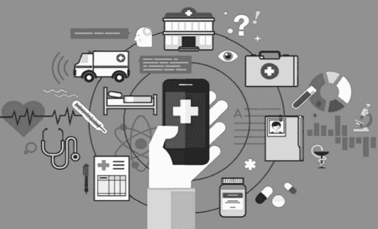

图4.1 使用物联网的医疗保健。

## 4.1.1 物联网与辅助技术

在物联网技术出现，许多残障人士依赖他人来完成任务。然而，今天由于尖端技术的进步，通过设备和软件系统，残障人士面对困难变得更加容易。物联网技术开启了辅助技术（AT）在医疗、教育和康复等领域为视障人士提供的服务时代，让盲人能够更好地理解和感知周围环境。1951年引入了盲文打字机，其按键对应盲文编码中的六点。

## 4.2 辅助技术

辅助技术是增强人士日常生活的的产品和系统。它是任何用于维护或增加残障能力的物品、设备或软件程序。

辅助技术可以是纸板制的辅助板、专用计算机、软件和硬件、特殊教学材料等等。辅助设备帮助在行走、说话、听力、站立、平衡、记忆、目标和演讲方面有困难的人过上正常生活。现在，许多辅助设备使用人工智能（AI）技术构建，包括实时语音转文本和视觉识别工具。2018年，微软推出了无障碍AI计划，以改进为残障人士创建设备的过程（Delgado, 2017）。

眼动追踪帮助身体残障的人士通过辅助板在电脑屏幕上移动鼠标光标。助听器帮助听力受损严重的人。这是通过创建一种替代解剖结构的电通道实现的。语音生成设备帮助有沟通困难的人更好地、更容易与人交流。机器人外骨骼帮助瘫痪人士，设备让他们能够与外部世界互动。这些设备成为了他们新的耳朵、眼睛和声音，让他们工作并过独立的生活。

## 4.2.1 历史

辅助技术的基础阶段大致在20世纪，因为当时没有一个特定的时刻可以被视为它的发现。1988年签署的《技术法案》提供了资金，协助各州开发响应消费者需求的辅助服务和信息系统。它首次提供了辅助技术的定义以及评估残障人士当前需求的流程。

# 医疗保健功能中的辅助设备与物联网

（1973年）之后，先后出现了《残疾人法》（1997年）和《残疾人技术援助法案》（1988年），促进了辅助技术（AT）设备的持续发展。信息时代推动了这一进步，并增加了对计算机相关辅助工具的关注。

## 4.2.2 ATIA

辅助技术行业协会（ATIA）是一个非营利会员组织，成员包括基于技术的辅助设备及服务的制造商、销售商和提供者。ATIA 成员积极参与为各种残障人士（如盲目和低视、计算机访问问题、听聋和听力障碍、沟通障碍、学习障碍、认知障碍、行动障碍、增强及替代交流设备（AACs）等）提供全方位支持。


ATIA 成员表现卓越且技能精湛，拥有丰富的经验和知识，这有助于人们理解如何构建能够满足个人独特需求的辅助技术。他们在使辅助技术设备或产品适应个人情况方面拥有经验，并为具有不同残障的消费者寻找独一无二的解决方案。ATIA 会议自1999年以来每年举行一次，为由用户、教育工作者以及行业和政府人士组成的 AT 社区展示产品和服务。此外，ATIA 还赞助工作小组，并寻找向专业人士和大众推广其工作的方法（Lawson, 1962）。

ATIA 及其成员还组织在线网络研讨会，向从业人员以及对 AT 和 AT 设备感兴趣的人进行教学。

## 4.2.3 医疗保健中的辅助技术

一直是医疗行业不可或缺的一部分（图4.2）（Scherer and Glueckauff, 2005）。它使人们能够过上富有、独立且自我认同的生活。辅助技术帮助人们过上健康的生活，并为残障人士提供支持服务、长期护理并改善健康状况。如果没有帮助，他们会感到被排除、孤立、依赖，通常会陷入贫困；加剧了疾病和能力缺失对他们的家庭、朋友和社会的影响。辅助技术帮助老年人能够上独立的生活。最常用的辅助设备是拐杖、眼镜、轮椅、助听器和助行器。图4.3 显示了表示不同残障人士特殊需求的符号。


**图 4.2** 辅助技术。

| 活动监控 | 用于点对移动的智能辅助杖 | 辅助外骨骼 |
| :--- | :--- | :--- |

**图 4.3** 使用传感器的活动监控。

对于老年人来说，辅助技术和机器人技术的发展可以产生真正的改变，让他们能够在那个年纪完成自己的工作。`RoboCoach Xian` 是一种辅助性机器人训练器，模仿人类动作并向老年公民教授运动。通过传感器等传感器技术的增强，它提供了个性化的柔和运动，帮助老年人保持活跃。它还为患有疾病的老年人提供身体、心理和认知治疗。还有类似的机器人技术可以在患者休息时帮助提高活动能力。自动洗浴机可以进行交互并监控患者的进展。如图 4.4 所示，我们如何借助传感器监控老年人或残障人士的活动。

辅助技术还可用于追踪人在日常活动和运动期间的健康状况（Mukhopadhyay, 2014），例如心率、睡眠追踪等许多方面。它还可以帮助医生跟踪患者的健康状况，并根据所进行的分析创建报告，无论医生是否在患者身边。

还有许多各种技术为任何可以访问互联网的人提供虚拟协助。由国家残疾与康复研究所开发的数据库包含了目前正在使用的超过21,000 种辅助设备的信息。其中，6000 种设备在20 世纪80 年代初被列出。随着老年人占全球人口的8.5%，以及非传染性疾病的增加，预计到2030年，将有超过2亿人需要一种辅助设备，老年人更是如此。今天，全球超过10亿人需要一个或多个辅助设备（或产品）。对2005年调查数据的回顾显示，65岁及以上的人中有14%–18%使用了AT解决方案，由于缺乏意识、可用性以及某些方面的财务问题，只有20%–30%的人可以使用这类辅助技术。皮尤研究中心的报告显示，2013年该群体中有18%的人拥有智能手机，而今天这一数字为42%。与技术的更多互动大幅增加了AT用户数量。45岁以下的人比老年组更容易对AT未满足的需求发表意见。图 4.4 显示了用于普及医疗保健的不同健康赋能技术。

图4.5 显示了不同类型的辅助技术。对有困难（或残障）的人提供硬格式的人类协助并不是新事，相反，自古以来它一直是人类经验的一部分，例如眼镜于1268–1289年左右在意大利发明，轮椅最早出现于5世纪的中国。如前所述，AT解决方案从低技术到高技术不等，取决于目的和用途。购买AT可能是为了执行多种其他功能，也可以进行定制，如制造假手，设计见图4.5。

# 医疗保健功能中的辅助设备与物联网 109

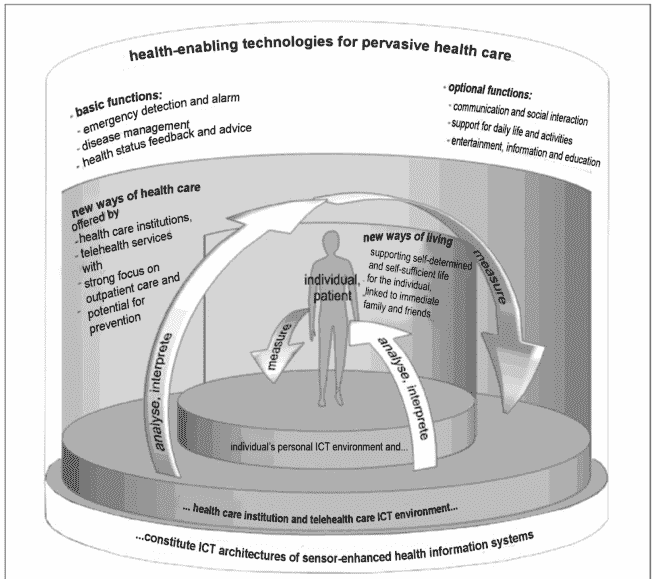


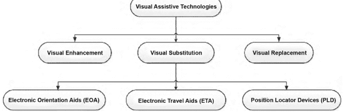

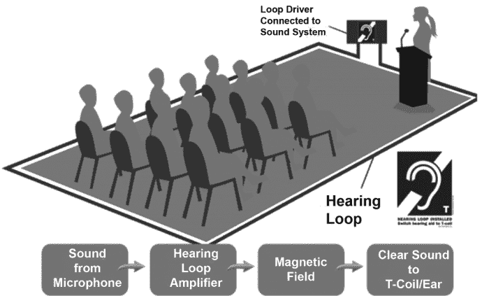

## 医疗保健中的辅助设备与物联网

红外系统利用红外光传输声音信号（图 4.8）。发射器将声音信号转换为光信号，并投射到听者佩戴的接收器，接收器将其解码回声音。与 FM 系统一样，带有线圈（telecoil）助听器的人也可以佩戴颈环，以将红外信号转换为磁信号（Fransen等人，2006）。与感应圈或 FM 系统不同，红外信号无法穿过墙壁，这使其在经常讨论机密的法庭中特别有用。红外系统无法在光源过多的区域使用（Izs，2015）。

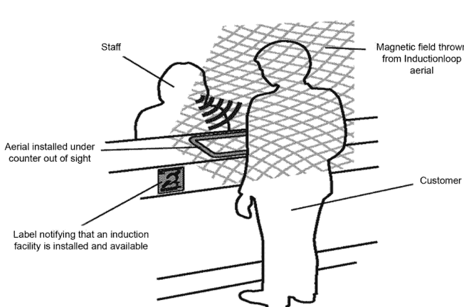

**图 4.8** 环系统。

环系统是便携的，大小手机手机手机；因此，听力障碍的人能够有效执行他们的日常生活（图 4.8）。个人放大器在看电视或开车旅行等场所非常有用。

### 4.2.3.1.5 线圈

线圈（也称为 `t-coil`）是一种金属线圈，充当微型无线接收器使用，安装在许多助听器和人工耳蜗内。其主要目的是通过电话为听者提供清晰清脆的声音。它还用于各种残障人士辅助设备，如 FM 系统、红外系统和个人放大器。

线圈的工作原理是接收来自听力环的电磁信号，然后在助听器或人工耳蜗内将其转换回声音，消除大部分干扰性的背景噪音，从而提供根据个人需求定制的声音。对于听力困难且没有助听器的人来说，带有头戴设备的环接收器可以提供符合个人需求的益处。

### 4.2.3.1.6 语言交流

针对语言障碍人士的辅助技术（AT）产品帮助他们在与他人面对面交流时进行沟通。示例包括：用于嘈杂环境中声音不够大无法被听见、或因健康状况导致说话声音轻的人的语音放大系统；人工喉、电声喉或喉支（尺寸如电转子一样小的辅助医疗设备）；交流板、语音输出软件以及将单词转换为语音的语音生成设备。

### 4.2.3.1.7 学习与认知发展

AT 产品支持在学习、记忆、专注和组织方面有困难的人。示例包括：记忆辅助工具（帮助提高记忆和回忆的小装置或系统）、支持学习的文本转语音系统、帮助记忆力低下的人记住事情的笔记系统、专门提高认知和学习能力的移动应用程序、针对阅读困难者的有声书，以及记录个人语音消息的录音机。

`FORBRAIN`：这是一个由名为 `For Life Ltd` 的初创公司的听觉处理产品。它是一种革命性的专利设备，通过听觉反馈帮助语言和听力障碍人士。`FORBRAIN` 类似于带有突破性技术的无线耳机，通过创建一个增强的视听环直接通过骨结构传递声音，来增强特定的语音模式。这种视听环设备是一个自然过程，可以显著提高注意力和专注，改善一个人的口语工作记忆和短期记忆。使用 `FORBRAIN` 就像大声读几分钟或与他人交一样简单（Calabrese等人，2007）。

### 4.2.3.2 FORBRAIN

### 4.2.3.2.1 骨传导

声音比空气传播得快。做一个实验：用手指塞住耳朵并说些什么，你会听到自己的声音在头里清晰地共鸣，尽管你的耳朵被捂住了（图 4.9 和图 4.10）。


图 4.9 学习与认知发展 1。

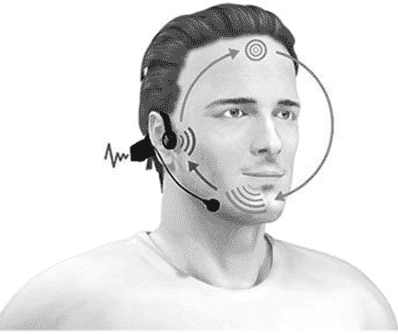

图 4.10 学习与认知发展 2。

### 4.2.3.2.2 动态滤波器

它增强语音的特定频率，以增加记忆、注意感觉处理。

### 4.2.3.2.3 听觉反馈环

这是一个自然的视听环，利用了每个人都可以毫不轻松的听觉判别、意识和节奏整合能力（Mandell等人，2007）。

### 4.2.3.3 移动与定位

针对在移动、坐姿或定位方面需要帮助的人的 AT 产品极大帮助了残障人士和老年人在无需他人支持的情况下独立移动。示例包括：供腿部或姿势问题人士使用的轮椅；辅助老年人行走的助行器（通常在该年龄段，韧带撕裂或虚弱会导致疼痛）；配备额外产品以提供姿势和压力管理的电动轮椅；拐杖或支架作为移动和坐姿辅助工具，增加他们的平衡和稳定性；以及供残障人士使用的电动或手摇板车，让他们能够在户外自由出行。

### 4.2.3.4 日常生活

针对因年龄增长导致功能受限的老人以及残障人士的 AT 产品，增加了他们在执行日常生活活动时的独立性，如洗澡、个人卫生、穿衣、吃饭和其他基本家庭活动，包括购物、清洁、财务管理等（Katz, 1983）。示例包括：刷牙辅助器（一种简单易用的辅助口腔卫生的某类辅助设备）；穿衣辅助工具（如扣扣和拉链拉器）；长柄鞋器（方便站立时无需费力且无需弯腰即可从任何角度穿鞋）；取物器（通常用于帮助无法触及物品或在这些方面有困难的残障或老年人的设备）；适配型厨房工具和餐具；改装轮椅（如用于执行特定任务的杯架或按钮）；辅助机器人（如吸尘器、自动洗皂液清洁器）；书架；开关适配产品（如针对特殊需求儿童和青少年的自适应玩具和开关适配毛绒玩具）等更多等（图 4.11）。

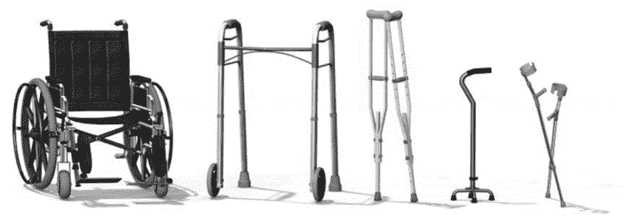

图 4.11 移动与定位。

### 4.2.3.5 环境适应

良好的 AT 产品帮助残障人士在建筑内（如房屋、办公室、医院或其他建筑）轻松移动，使他们能够独立使用各种设备。这些包括基于物联网的系统，如自动开合门；使用遥控控制灯光、温度和窗帘；以及许多其他环境需求。示例包括开门器、升降机、电梯、遥控电器、语音控制安全检查和其他开关。各种类型的控制器可控制特定设备，如播放视频。环境控制是这类设备的通用术语，通常缩写为 `EC`。

### 4.2.3.6 车辆改装与交通

AT 产品旨在通过车辆改装实现人员的安全运输并增加独立性（图 4.12 和图 4.13）。近年来，残障人士在个人和公共交通方面已有了多种选择。`Mobility Works` 和国家公路安全管理局包含了有关康复计划和改装车辆的详细信息。示例包括用于将轮椅锁定并固定在汽车地板或任何移动车辆上的安全锁；步行者座椅选项；方便进出车辆的坡道和升降机；加高顶；自适应安全带（提供更好的姿势并帮助儿童更好地与环境互动），以及为老年人提供的安全可靠的老年人生活交通工具。

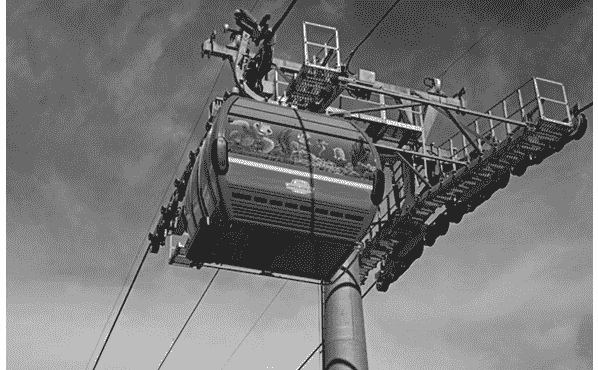

图 4.12 车辆改装与交通 1。

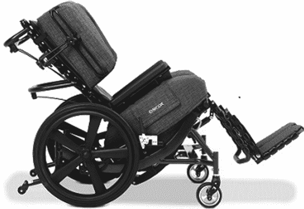

图 4.13 车辆改装与交通 2。

## 医疗功能中的辅助设备与物联网

## 4.2.3.7 计算机及计算机相关外围

这些是帮助残障人士使用计算机的辅助技术（AT）设备。外围设备连接到计算机并为其增加功能。尽管有了高分辨率彩色显示器和更好的图形用户界面（GUI），但对于视觉障碍者来说，阅读和理解屏幕上的内容仍然困难。一些帮助残障人士的计算机相关辅助设备示例包括屏幕放大器（图 4.14），这是一种特殊的软件，可以放大计算机屏幕并为视力低或模糊的人士放大文本或任何虚拟内容；替代键盘；输入设备（如语音识别软件，将用户的语音作为输入）；速率增强应用；以及输出设备（如屏幕阅读辅助功能，它可以向用户朗读输出内容）（Beaver and Mann, 1995）。

## 屏幕放大器


图 4.14 屏幕放大器。

## 4.2.3.8 娱乐与休闲

辅助技术解决方案还让人能够参加运动并进行娱乐休闲活动（图 4.15）。生活质量取决于人的社交互动和活动。这些活动对于人类的成长和发展至关重要。残障青少年和儿童无法参加运动，这些阻碍会降低他们的自尊心和自信。一些辅助解决方案包括适配开关的玩具、运动适配设备（如改装的轮椅）、电子化或机械化适配设备、在线或虚拟娱乐活动（如虚拟现实）、电子辅助工具（如计时器和遥控器）、计算机或由计算机辅助的活动（如触摸屏和交互式白板）等更多等（King et al., 2003）。

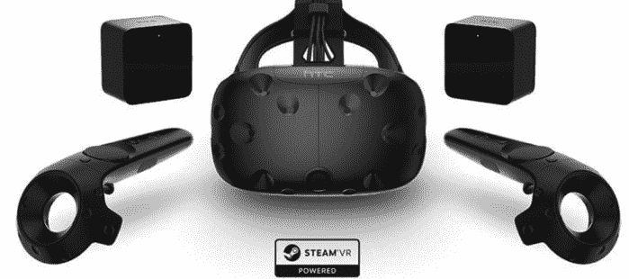

图 4.15 娱乐与休闲。

## 4.2.3.9 医疗行业

医疗保健中心也使用一些辅助设备（图 4.16）。这些供公共提供的辅助技术设备由治疗师、骨科医生和医生提供。为了补偿残疾并让人们参与社交和日常生活，在对设备需求和人员支持进行适当检查后，会提供各种辅助解决方案。一些示例包括浴椅、手杖和拐杖。

假肢涉及使用人工肢体或假肢来改善肢体缺失患者的状况，它是通过合适的材料与设计的独特结合而开发的，以适应个人的需求，例如用于站立和行走稳定性的下肢或假肢部分（针对下肢），用于伸展和抓取的上肢或假肢部分（针对上肢），以及专门设计的鞋、助行器和轮椅（图 4.17）（Jarcho, 1981）。

## 医疗功能中的辅助设备与物联网

121

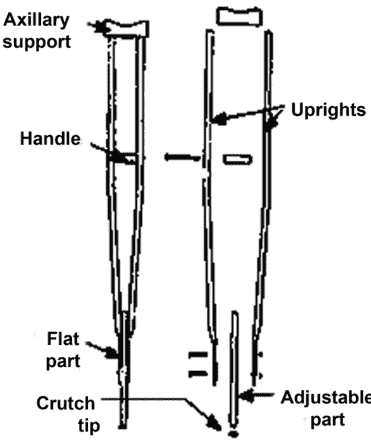

**图 4.16** 医疗行业。

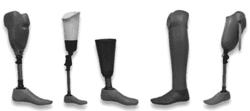

## 假肢

**图 4.17** 下肢或假肢部分。

## 4.2.3.10 假肢设备的工作

并非所有的假肢都是完全相同的。它们的设计取决于以下因素：

- 身体类型
- 截肢类型
- 上肢，肘部以下
- 下肢，膝盖以上，膝盖以下
- 尺寸
- 形状
- 残肢的肌力，以及
- 生活方式

通常来说，假腿和假手具有相同的功能。它们可能通过不同的方式来实现该功能。

你的假肢设备的各个组件如下：

**接受腔（Socket）：** 

假手或假腿最部分部件实际上是外表看不见的那个。接受腔非常重要，因为用户会感到很多疼痛和不适，必须佩戴假肢设备（图 4.18）。为了确保接受腔完美贴合并具有更高的耐用性，假肢使用精密的方法制造，例如熔融、机器人雕刻（最准确的制造工艺）以及3D 激光扫描技术。


图 4.18 接受腔示例。

## 医疗功能中的辅助设备与物联网

大腿以上截肢将有两个关节：膝关节和踝关节。膝关节的设计将允许腿部自然向前摆动。膝关节、踝关节以及肘关节都可以计算机化，以便计算机可以远程控制设备的摆动以及在使用过程中的减震。

它可能有一个足部或手部附件，功能范围从非常基础到全功能不等。

目前正在进行研究，以扩展现代假肢的能力，使其提供尽可能接近人体生物能力的功能。

矫形器产品涉及在矫具（外部支架）的设计和制造中体现精度和创造力，用于控制身体虚弱部位。矫形器通常用于颈部、下肢、骨盆和下肢、骨盆区域、胸部和背部以及上肢。公立医院和各种活动免费向公众提供这些设备。

## 4.2.3.11 安全/保障

辅助技术设备帮助为残障人士或老年人提供安全。这些设备帮助残障人士保护自己和家人的安全。一些示例包括：安装在床任意侧且易于调节的床栏；针对盲人或视力人士的特殊锁（如无线遥控门和无障碍组合锁），以及辅助技术报警器。有很多基于软件的应用程序可以实时追踪。`InstaCare` 应用程序在紧急情况下或按按钮求助时会通知家庭成员或授权医生。这个电子按钮与手机等智能设备配对。`InstaCare` 内置了运动传感器，可以持续追踪活动并作为恐慌按钮。

## 4.2.4 选择合适的辅助技术

今天市场上有成百种辅助技术设备，选择一个与个人需求、环境设置和舒适度最匹配的正确设备非常重要（图 4.19）。这是一个多步骤的过程，需要理解和时间（Galitz, 2007）。以下步骤定义了选择辅助设备的过程。

## 医疗系统中的深度学习与物联网

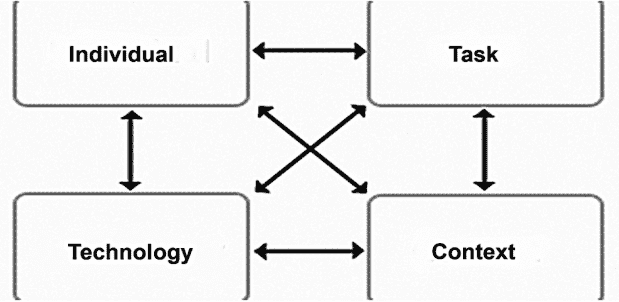

图 4.19 选择合适的辅助技术。

1. **陈述主要目标：** 使用辅助设备的目的是什么？你想用辅助设备完成什么？这项技术能否帮助用户完成他们现在无法完成或受限完成的事情？

2. **获取情况：** 在这一步中，获取来自用户、家庭成员和医疗专业人士的信息。有时，名单还会扩大到同事、护理人员和相关的邻居，以及任何对用户有经验或对辅助技术有专业知识的人。这取决于用户的局限性和需求。此外，还要确定特定设备对用户有效的期限。

3. **选择设备/系统：** 设备易于使用吗？它能完成所需的任务吗？这是最有效的方法吗？它能适应变化吗？增强现实也是检查选项的好机会。

4. **专家建议：** 在购买任何辅助技术设备之前，寻找合适的“专家”来帮助用户选择合适的设备。这些“专家”可能是医生、医师、治疗师和教育者。来自相似经验的人的建议也有很大帮助。全国各地每个州都有许多辅助技术专家。

5. **选择供应商/经销商：** 购买设备时一个重要的考虑因素是经销商的响应速度。经销商应该能够提供技术支持和服务。经销商还应该具备良好的技术水平并经过适当培训。

6. **寻求资金：** 辅助技术解决方案的成本可能很高，因此资金支持可以提供很大帮助，并节省大量精力和精力。获取资金的潜在资源包括健康保险计划（如家庭保险计划、`ICICI` 健康计划等，在这些计划中，在健康保险公司支付其份额之前，必须自付投保金额，例如每月支付）、公共计划项目、针对公共医疗的慈善团体或贷款。制造商或零售、批发商提供折扣价格，例如二手或翻新物品。申请贷款或向慈善团体申请时，应有适当的文件和材料。初始请求可能不会被接纳，但申诉可能是成功的。

7. **识别培训需求：** 使用辅助设备（AT）的残障人士应获得适当的培训和指导。这是经销商、制造商代表、工作人员（教育机构）或医院护士（医疗机构）的责任。

8. **定期检查：** 应该按照特定的时间间隔进行随访。短期随访应在几个月后进行，长期重新评估应定期进行，每年或两年一次。

9. **需要注意的一些重要点**

- 在购买前测试辅助设备。不要盲从广告或“月度辅助设备”的文章。
- 不要强迫使用辅助设备。确保其目标和目的。
- 在购买辅助设备之前，请务必了解该物品如何使用，并确保物品合适。
- 辅助技术有多种类型。高科技和低科技设备对残障人士的生活影响虽有不同。某些成本较低的低科技设备比高科技系统更有效。低科技设备通常易于使用且易于维修。高科技设备通常是专门的工程或技术产品，因此维修或更换的成本通常很高。

## 4.2.5 辅助技术与移动应用程序


在这个技术进步的时代，有许多 IT 公司正关注辅助技术并为此做出贡献。

# 医疗系统中的深度学习与物联网

今天，有许多移动应用程序提供辅助技术及其解决方案。每个应用程序都有特定的用途，界面易于使用，具有极强的直观性和可访问性。应用程序保持最新功能的更新。事实上，由于此类应用程序对于残障人士来说使用非常简单且有趣。应用程序的各种类别如下：

- **听力**：这类软件应用程序提供“视觉化声音”，为失去听力或听力较弱的残障或老年人提供新体验。一旦用户摘下助听器，就可以享受各种功能，如闪光通知、单音频、自适应声音、助听器兼容性，针对不同目的创建不同模式的振动感，例如检查传入的应用程序通知、来电电话或警报（Warwick 等，1997）。

- **视觉**：创新功能还帮助视力模糊的人能够轻松阅读，并充分利用当今移动技术。为此目的的一些应用程序如下：

  - **屏幕放大镜**：此应用程序帮助放大屏幕尺寸或分辨率，使手机上的每种数字内容变得更大，方便用户查看。这可以通过点击屏幕放大和缩小轻松实现。

  - **颜色调整**：可以更改屏幕颜色，以增加色盲人士的屏幕可读性。

  - **反色**：用户可以为眼睛选择最佳显示模式。

  - **字体大小**：此功能可以更改手机上的文本大小以放大查看。

  - **灵敏度**：如果有多个手势可以使用，而你很难使用设备，那么可以通过这个具有直观界面的控制进行控制。可以方便地访问设置以获得更好的用户体验。某些功能包括辅助菜单、长按延迟功能，允许用户设置点击和按住屏幕的识别时间。这为用户提供了在屏幕上执行额外操作以及简单触控模式。

- **触摸控制**：用户经常会无意中触碰屏幕。此应用程序允许我们控制触摸响应，使响应更准确。它为用户提供了单次触摸操作设备的更多功能。

# 医疗功能中的辅助设备与物联网

还有许多功能让应用程序如此精彩，例如易于回答、易于使用等。

## 4.2.6 维修与维护

辅助设备应该制作良好并经过妥善维护（Inge and Shepherd, 1995）。如果辅助设备在很短时间内很容易损坏，那么它就不是一个可行的选择。在个人化教育计划（IEP）下，学校负责维护。在《残疾人教育法》（IDEA）下，学区负责提供包括辅助器具和相关服务在内的辅助设备。

维修意味着通过某些改进改善辅助设备的不良状况，而维护是指更换零件以防止可能发生的故障。成本和维修的难易程度取决于设备的设计、维修人员的知识以及基础设施的可用性。成本往往阻碍了许多残障人士维修设备。贫困人口发现购买新零件或设备极其困难。农村地区也是如此。如果维修店离家远或在另一个城市，交通和住宿成本将成为障碍。

CBR 代表社区康复（Lane, 1997），旨在通过建立基于社区的医疗整合、机会均等和物理治疗来帮助残障人士（图 4.20）。它让残障人士获得辅助设备，并通过确保维护来保证良好质量，帮助他们参与日常生活。CBR 行动的主要优势在于可以在基础设施有限的农村地区开展，且不限于专业人士（Chatterjee 等，2003）。

## 社区康复

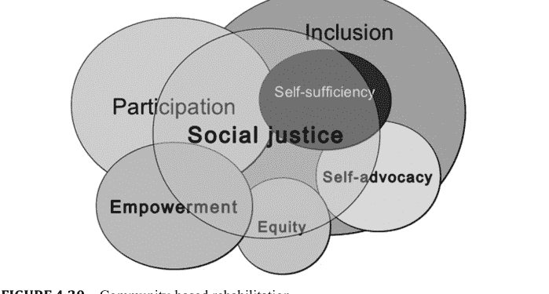

CBR的一些成果如下：

- CBR 人员了解 AT、辅助设备以及针对不同类型疾病的特殊设备。

- 残障人士及其家庭接受如何正确使用设备的培训，并进行随访以确保正确使用和护理辅助设备。

- 本地人士能够获得辅助设备并获得简单的维修和维护。

- 阻碍获取设备或信息不足的障碍应通过适当的资金和服务支持来减少。

- 这些设备应在全国所有地区可用，无论其地理位置如何。

## 4.3 结论

本章对各章节的发现进行了概述，说明了什么是 AT 和辅助设备，它们是如何工作的，以及各种医疗辅助帮助残障人士和老年人的设备。医疗技术在提供帮助残障人士过上正常生活的服务方面取得了巨大进步。包容和表现是人类尊严和人权的核心组成部分。技术赋能医疗行业，使其能够提供惠及许多残障人士的服务。虽然辅助技术（AT）设备满足了大多数人的愿望，但并非所有人都能用上。由于成本相对较高、地理位置限制以及平均销售服务的局限，医疗和社会护理仍然难以触及。政府机构和许多非政府组织（NGO）正致力于在全国农村和特殊地区提供免费的辅助技术设备。在向残障人士交付软件硬件设备之前，应该进行定期安全检查，并在各个地点安装客户服务，以提供更好的服务、延长产品寿命并避免进一步的伤害。医疗状况中，许多病情是隐藏状态的。最终，软件和移动应用程序提供了一个环境，能够更好地分析消费者的需求并相应提供设备。应该向消费者提供有关如何使用、维护设备以及监控自身进展的适当培训。为残障或老年人购买辅助设备寻找合适的服务提供者是非常重要的一步，在购买之前应考虑许多因素，如设备选择、设计和输出最大化。辅助设备对于个人部分或永久性的功能障碍具有前景，通过适当的产品（硬件/软件）以及在存在社会和环境限制时的妥善跟进，可以增强他们的能力。辅助技术解决方案的演变不仅造福了残障、老人、学生和医疗行业，还为年轻人和残障人士创造了新的就业领域。

## 关键词

- 医疗
- 物联网 (IoT)
- 辅助设备
- 健康促进技术
- 辅助技术

## 参考文献

- American Speech-Language-Hearing Association, Guidelines for Fitting and Monitoring FM Systems. American Speech-Language-Hearing Association, 2002.
- Beaver K. A. and Mann, W. C.: “Overview of technology for low vision,” Am. J. Ocul. Ther., vol. 49, no. 3, pp. 913–921, 1995.
- Calabre, C., et al., “A perivascular niche for brain tumor cells,” Cancer Cell, vol. 11, no. 1, pp. 69–82, 2007.
- Chatterjee, S., Patel, Chatterjee, A. and Weiss, H. A. “Evaluation of a community-based rehabilitation model for schizophrenia in rural India,” Br. J. Psychiatry, vol. 182, no. 1, pp. 57–62, 2003.
- Coutinho, R. S., Dauk, M. A., and Mu, C.: “Wireless audio distribution with range slow moving.” Google Patents, 2011.
- Delgado, A. D. Exoskeleton Technology: Applications as an Inpatient Locomotion Training Device and Exercise Device. Icahn School of Medicine at Monai, 2017.
- Doming, M. C. “An overview of the Internet of Things for people with disabilities,” J. Net. Comput. Appl., vol. 35, no. 2, pp. 584–596, 2012.
- Fransen, A., et al., “Integrated telecom with signal processing.” Google Patents, 2006.
- Galitz, W. O. The Essential Guide to User Interface Design: Introduction to GUI Design Principles and Techniques. John Wiley & Sons, 2007
- Inge K. J. and Shepard, “Assistive technology and strategies for school system personnel,” in Assistive Technology: A Resource for School, Work, and Community, pp. 133–166, 1995.
- Iso, L. The significance of cognitive innovations in developing assistive technologies for people with non-standard cognitive characteristics,” in Proceedings of the 66th IEEE International Conference on Cognitive Informatics (CogInfoConf), 2015, pp. 77–82.
- Jarcho, M. Calcium phosphate ceramics as hard tissue prosthetics,” Clin. Orthop. Rel., vol. 157, pp. 259–278, 1981.
- Katz, S. “Assessing self-maintenance: daily living, mobility, and instrumental activities of living,” Am. J. Geriatr. Soc., 31, no. 12, pp. 721–727, 1983.
- King, L., Wang, M., Rosenbaum, P., Keto, M., and Young, N. L. “A conceptual model of the factors affecting the recreation and leisure participation of children with disabilities,” Phys. Oper. Oper. Ther., vol. 23, no. 1, pp. 63–90, 2003.
- Lane, J. P. “Development, evaluation and marketing of assistive devices,” Technol. Disabil., vol. 6, no. 2, pp. 105–125, 1997.
- Lawson, B. E. A. “Apparatus for fabricating a socket mount.” Google Patents, 1962.
- Mandell, J., Schulze, K., and Shelang, G. “Cognitive amnesia: an auditory-motor feedback disorder?” Review. Neur. Neurosci., vol. 25, no. 3–4, pp. 323–334, 2007.
- Mukhopadhyay, S. C. “Wearable sensors for human activity monitoring: A review,” IEEE Sens. J., vol. 15, no. 3, pp. 132–130, 2015.
- Scherer, M., Clark, C., and Dancer, J. “Assistive technology and strategies for school system personnel,” Rehab. Psychol., vol. 50, no. 2, pp. 132–130, 2015.
- Warick, R., Clark, C., and Sinclair, S. “Evaluation of a community-based rehabilitation model for schizophrenia in rural India,” Br. J. Psychiatry, vol. 182, no. 1, pp. 57–62, 2003.

# 第5章：物联网对辅助设备的影响

- INDRAK
- RISHABH
- SUBBA
- MANAVAL
- SCSE
- Galgotias大学
- 中央工程学院
- 卫生与福利部

## 摘要

本章介绍了可穿戴技术、其属性、足迹、伦理问题以及安全措施。物联网将利用可穿戴设备（Fan等，2014）。无处不在的无线传感器网络（WSN）技术评估并识别辅助设备的信号，从而改变了技术。执行器和传感器完美统一，收集到的信息在平台间共享（Gub等，2013）。

许多医院使用物联网定位患者。

## 5.1 引言

最新进展利用无线系统通过物联网（IoT）整合并同步来自各种设备的可穿戴技术（如智能手机、手表和手环）。

辅助技术（AT）是一个广义术语，涵盖了残障人士或老年群体的辅助、适应和康复设备（Wilkie，2010）。任何形式的残障人士在独立执行日常生活（ADLs）方面面临困难。日常生活包括移动、洗澡、进食等自我活动。辅助技术是一种强大的工具，使人们能够独立或无需帮助的情况下完成日常生活（Hoenig等，2003）。例如，轮椅为残障人士提供了移动能力。

物联网对医疗辅助设备的影响

世界卫生组织（WHO）的辅助技术全球协作（GATE）计划正积极致力于为所有人提供辅助技术支持。辅助技术（AT）是人与其向往的生活之间的接口。在本章讨论了各种辅助技术设备及其在医疗保健领域的应用。

## 5.2 辅助设备的传感器类型

传感器在辅助设备的设计和开发中起着重要作用，因为它们能收集监测健康所需的准确数据。微机械和微电子等技术为各种传感器的发明铺平了道路，能够以低功耗监测人类活动。根据工作模式，传感器可分为侵入式传感器和非侵入式传感器。

### 5.2.1 侵入式传感器

在侵入式传感器中，利用体液收集健康相关的数据。血液在从各种器官收集关键参数方面起着至关重要的作用。除了血液，活细胞也被用于收集活器官的状态。样本通过自然腔从人体中采集。侵入式传感器的一个例子是离体传感器，它可以在心肺旁路期间监测血气和 pH 值。该传感器适用于连续参数监测系统（Islam and Mukhopadhayay, 2017）。

### 5.2.2 非侵入式可穿戴传感器

非侵入式可穿戴传感器不需要体液，因此无需通过切口或注射穿透人体；这些传感器无痛且更具吸引力（表5.1）。此类传感器使用的体液可能是汗液、皮肤间隙液、唾液和泪水（Bandoodkar and Wang, 2014）。

## 5.3 辅助设备传感器的工作原理

传感器的工作原理基于不同的技术，如光学、电、压电效应以及电化学传感。

### 表5.1 侵入式与非侵入式传感器

| 侵入式/植入式传感器 | 非侵入式/可穿戴传感器 |
|---|---|
| 脉搏血氧仪 | 药物电子胶 |
| 血糖传感器 | 视网膜植入物 |
| 温度 | 深脑刺激器 |
| 肌电 | 起搏器 |
| 电图 | 无线胶囊内镜 |
| 血压 | 植入式除颤器 |
| pH 值 | 人工耳植入物 |

### 5.3.1 电化学传感器与阻抗传感器

阻抗传感器和电化学传感器是监测生理参数测量的重要可穿戴传感器。电化学传感器进一步分为气测式、电位式和电性传感器，它们使用电容和电阻方法来制造不同的传感器。电容器是电子世界的构建块。电容器存储电荷的能力称为电容。触摸是人类至关重要的感官通道，用于响应物理接触的技术通常被称为电容感应。电容传感器具有低温度依赖性、高灵敏度和低功耗，并且感知各种化学和物理参数的能力。不同类型的电容传感器包括同轴圆柱形、平行板、边缘场和圆柱交叉电容传感器（Rowland et al., 2011）。电容传感器适用于侵入式和非侵入式参数测量。电容器的边缘场具有感知样本纹理、位置和强度的能力（Dean et al., 2012）。电化学传感器具有高度便携性、高灵敏度和低成本，适用于许多基于电解质和代谢产物的手持分析仪。

传感器的工作从从目标设备收集输入开始，输入分为三类：目标输入（即传感器测量的实际输入）、干扰输入（指敏感输入）以及修正输入（导致传感器对目标和干扰输入的输入输出关系发生变化的输入）。根据特性，可穿戴传感器分为静态传感器（例如体温）和动态传感器。静态传感器具有准确性、灵敏度、阈值、分辨率、公差、量程、线性度、短期和长期漂移、滞后、响应时间、互换性、交叉敏感性、恢复时间和产率等特性（Rucco et al., 2018）。动态特性处理传感器输入的性能特征，如斜坡、阶跃正弦波和斜坡。阶跃输入的输出响应是瞬态的，它达到稳态然后在恢复期间返回初始值。n阶多项式数学方程将传感器的电输出与输入参数联系起来。电输出可以是电流、电压和相位；方程的阶数取决于传感器的复杂性。

### 5.3.2 辅助设备的通信协议

辅助设备的通信系统是一种连接人机的新技术（Kim et al., 2015）。无线通信对于辅助设备向相邻设备传输数据至关重要，这在传输中产生了几种问题（Jiang et al., 2015）。无线通信系统旨在将体域网络（BAN）和个人区域网络（PAN）作为传输信道。辅助设备使用无线通信建立 BAN 以向附近设备传输数据。在早期，BAN 使用无线传输技术，这容易被窃听。辅助设备传输最敏感的数据，应当确保安全传输（Jeong et al., 2012）。此外，体内通信是无线的，且辅助设备的电场分布使用有限差分时域法（FDTD）将人体作为导线（Zimmerman, 1996），因此无线传输并不适用。Zimmerman 引入了体内通信（Sasamori et al., 2009）。

体内通信的硬件设计如图5.1所示，该图描述了体内网络到附近设备的信息传输。它包含串行接口单元（作为芯片通信系统）、序列器/反序列器和调制解调器。系统通过使用先进先出（FIFO）方法的处理器将数据转换为串行形式。转换后的串行数据通过调制器转换为传输信号。反序列器将数据传输到串行接口单元和主处理器。


**图5.1** 体内通信系统——硬件架构。

## 5.4 医疗领域的语音识别


# 医疗领域的辅助设备

医疗领域的辅助设备正成功解决许多问题。语言技术能够帮助人们轻松理解和获取信息（Pearson et al., 2010）。特别是语音识别在健康系统中提供了主要应用。语音识别系统由麦克风、声卡和语音引擎软件组成（Al-Aynati and Chorneyko, 2003）。在放射科中，语音识别的应用将周转时间从 15.7 小时缩短到 4.7 小时（Callaway et al., 2002）。由于放射科处理大量数据，手动输入报告耗时。基于电话的口述语音识别系统可以记录放射医生口述的细节，从而加速报告生成过程。这种方法通常被称为后端语音识别。对手术病理报告的改进分析显示，一天内签发的病例比例从 22% 提高到 37%（Singh and Pal, 2011）。前端语音识别软件也已用于医生在个人计算机帮助下生成报告。语音识别软件为残障人士提供了便利。脑性瘫痪和运动神经元疾病正受益于语音识别软件。

## 物联网对医疗辅助设备的影响

市场上还存在通信软件，通过将文本转换为词汇来帮助视障人士操作电脑。

## 5.5 心室辅助设备

心室辅助设备是一种用于帮助心力衰竭患者的机电设备。心室辅助设备包含一个包裹在心脏脆弱部位周围的气球，用以促进血流。根据患者的健康状况，心室辅助设备被设计为左心室辅助设备、右心室辅助设备或双心室辅助设备（Sen et al., 2016）。传统上，心室辅助设备包含一个用于循环血液的泵、一个用于控制设备活动的控制器、一个用于运行设备的电源，以及一条连接右心房与肺动脉、左心房与主动脉的驱动线。

如今，心脏移植被认为是治疗心力衰竭最成功的长期手术治疗方法。然而，获取移植器官是一个漫长的过程。在这种情况下，心室辅助设备被认为是一种治疗方案，因为它作为通往移植的桥梁。该设备可以支持患者直到供体出现。在某些情况下，当患者的健康状况不支持心脏移植时，心室辅助设备充当终点治疗法。

## 5.6 血压监测

血压与心率、体温、氧饱和度等一样，是非常重要的因素。血压的测量用最大心跳（收缩压）相对于最小心跳（舒张压）的术语来表示（Siddiki, 2011）。通常，血压以毫米汞柱（mmHg）为单位进行测量。血压记录为两个数字：

- **收缩压**：这是心脏将血液泵出心脏时的压力。
- **舒张压**：这是心脏在两次跳动之间休息时的压力。

根据世界卫生组织（WHO）的数据，2008 年全球高血压患者估计人数约占世界总人口的 40%。血压主要有两种类型：(1) 低血压和 (2) 高血压。

### 高血压

高血压是指个人的血压值达到“140/90 mmHg”或更高。如果任何个人患有高血压，意味着他的心脏和血管承受了额外的压力，这在以后可能会增加心脏病发作或中风的概率。

### 低血压

低血压是指任何个人的血压值低于“90/60 mmHg”。低血压的原因从脱水到任何手术并发症或严重的医疗问题不等。低血压并不非常令人担忧，但在血压非常低时，身体可能会感到头晕或昏厥，这可能是一个严重的健康问题。

### 物联网血压监测仪

因此，迫切需要找到此类设备，帮助人们了解自己的血压，而不需要每次都去看医生，并减少他们的医疗账单。人们总是需要辅助设备，通过这些设备，人们可以在不每次都请医生的情况下帮助自己监测疾病。这些设备应该是易于使用的，这样人们就可以自己使用，而不需要医生和其他人的任何帮助。对于患有高血压的人有这样的设备，而且对改进设备也有新的开发。

现在已经有了基于物联网的血压监测仪。这些机器的主要功能是测量收缩压和舒张压，这基本上被用于测量动脉中的压力（Pickering, 2002）。该机器使用示波法来测量收缩压和舒张压。机器记录的数据随后通过连接的 Wi-Fi 存储在数据库中，任何人都可以远程访问（Babbis, 2012）。通过使用这种设备，患者可以自己测量血压，而不需要医生的任何参与，从而节省大量的人力。

示波法技术现在在自动血压计设备中非常常见。为了使用示波法测量血压，将袖带放置在患者的上臂上并充气到高于患者收缩压的压力，导致动脉血流停止。之后，袖带内的压力仅降低到患者的收缩压以下。

| 试验数量 | 商业监测设备 | 基于物联网的监测设备 |
| :--- | :--- | :--- |
| 1 | 125/85 | 135/94 |
| 2 | 132/86 | 132/91 |
| 3 | 110/72 | 114/75 |

## 5.7 针对老年和视障人士的物联网辅助设备

全球有 2.85 亿人面临视力挑战并导致行动不便（Lacey et al., 2006）。老年人也面临同样的问题，且十分之一的跌倒导致了严重伤害（Tinetti et al., 1988）。显然，这些人需要额外的行走和平衡支持，而传统的步行器和拐杖无法提供这些支持。因此，智能设备对于老年人的安全至关重要。物联网是智能设备的基础。用于老年人的物联网辅助步行器包含硬件和软件。电气部分被视为硬件，包含了传感器单元、控制单元和输出。软件用于协助寻找确切位置。传感器收集有关位置和周围环境的信息。如果在步行器路径上发现障碍，传感器会感知物体位置并通过物联网将细节传输给控制器，通过输出设备提醒用户并避免跌倒或死亡。

基于物联网的步行器架构分为三层：

- **感知层**
- **网络层**
- **应用层**

**感知层**被称为识别层（Suo et al., 2012），是物联网架构的底层，负责收集来自环境和物体的方向、位置信息并将数据转换为数字格式。该层通过蓝牙、射频识别（RFID）、6LoWPAN 和近场通信来唯一识别地址（Silva et al., 2017）。

**网络层**被认为是架构的大脑，负责感知层与应用层之间的安全数据传输（Suo et al., 2012）。该层是通信网络与互联网的融合。

**应用层**是传统物联网架构的最顶层，根据用户的需求提供个性化服务，从而缩小了用户与应用程序之间的差距。


## 5.8 血糖监测

糖尿病是一种影响全球许多人的慢性病。由于全球范围内久坐工作的增加以及科技的进步，根据世界卫生组织（WHO）的数据，有 4.2 亿至 5 亿人患有糖尿病（WHO，2018）。在过去的几十年里，这种疾病在人类社会中几乎像流行病一样蔓延。在当今世界，总有人正在遭受这种慢性病的折磨。糖尿病是指个体血糖（又称血糖）极高的疾病。在人体内，葡萄糖是能量的主要来源，为细胞提供工作动力，它源自个人摄入的食物。胰岛素是人体内由胰腺产生的一种激素，有助于葡萄糖进入人体细胞以产生能量。有时，人体无法产生足够的胰岛素（或没有胰岛素），或无法有效利用胰岛素，导致糖留在血液中，结果糖在血液中循环而无法到达细胞，从而提高血糖水平并导致这种疾病。糖尿病分为两种类型：I 型和 II 型。如果一个人患有 I 型糖尿病，其身体无法产生胰岛素。免疫系统会破坏产生胰岛素的细胞。因此，患者必须服用胰岛素才能维持生命（Marker 等人，2018）。如果一个人患有 II 型糖尿病，则身体不产生或不使用胰岛素。这是最常见的糖尿病类型。

由于糖尿病问题日益严重，一直需要创新技术来帮助人们自行追踪病情。许多制药公司每天都在努力，将此类设备带给每个人。在这些设备的帮助下，人们能够自由、独立地追踪血糖状态。Polisena 等人（2015）于 2009 年对加拿大药物和技术局进行的一项研究发现，使用远程医疗工具（如 PDA 或设备）存储和共享监测的血糖，并在医生的反馈支持下，可以改善血糖水平并减少住院次数。市场上有各种由制药公司制造和销售的血糖监测设备，帮助人们独立地追踪血糖水平。这些血糖仪套盒附带有一个设备，可以通过测试纸告知血糖水平读数。为了使用这种血糖仪，人需要刺破皮肤（通常是手指）并将血样涂在测试纸上，然后将其插入仪表中。血液中的葡萄糖与测试纸中的化学物质反应，然后通过电流确定血液样本中的血糖水平，并在仪表上提供数值结果。因此，通过使用这些血糖仪套盒，个人可以在几秒钟内获得血糖水平。

可穿戴技术是血糖监测行业的新趋势，它带来了血糖测试的新潮流（Gonzales 等人，2019）。这些可穿戴设备由可以佩戴的小装置组成，配备各种传感器和无线连接，以协助血糖监测、个性化治疗、与医疗保健提供者联系，并在需要时向身体输送药物。可穿戴设备包括皮肤贴、隐形眼镜和鞋类。

### 皮肤贴

这些小贴片封装了一些传感器，可以测量汗液中的血糖并自动释放剂量胰岛素以检查血液血糖。贴片可以贴在人体上，在低血糖的情况下，它会自动向智能手机发送消息提醒个人吃饭。某些贴片系统需要电线来传输数据，但一些制药公司正在研发可以无线传输数据的贴片。某制药公司开发了 `Freestyle Flash` 血糖监测系统。它是一种贴在手臂背后的贴片，由带有微丝的小型圆形传感器组成，可以测量皮肤下组织液中的血糖水平。有一个外部设备可以透过衣服扫描读取传感器。这种技术已经在欧洲某些地区投入使用。

### 隐形眼镜

Brian Otis 和 Babak Parviz 正在为 `Google X` 探索通过人类泪水监测血糖水平的智能隐形眼镜（Parviz，2014）。一家领先的制药公司已同意在产品上市后进行许可并商业化。他们还在尝试制造可以帮助补偿视力问题的镜片，这是糖尿病患者的常见问题。`Google` 在 2015 年获得了这种隐形眼镜的专利，它可以通过人类的泪水测量其血糖水平。


- 鞋类：技术的发展不仅局限于自我监测。技术的发展在预防某些糖尿病并发症方面也流行，例如糖尿病神经病变，嵌入热传感器和压力传感器的袜子和鞋子可以指出人类脚部血供不足的特定区域（Park，2005）。手机应用程序将连接到此类鞋类，如果脚部某个区域没有血液供应，将警告佩戴者。它还可以检查一些伤口或软组织损伤，这些损伤最容易发生感染。这种技术将减少截肢病例。德国弗劳恩霍夫研究所（Fraunhofer Institute）的研究人员正在开发和测试一种配备了 40 个微传感器的袜子。传感器分布在脚底、脚跟、脚背和脚踝，以获取 3D 读数。当一个人单脚站立太久压力开始积聚时，传感器会向无线设备发送信号，提醒佩戴者减轻体重。这种技术将减少截肢的发生。亚利桑那大学外科系的南方肢体挽救联盟（SALSA）正在研究一种由光纤和传感器制成的监测压力和角度以防止足溃疡，这种袜子的测试仍在进行。

## 5.9 心电图监测

心率是人体一个非常重要且关键的参数。医生使用医疗设备和仪器测量人体参数。为了测量心率，医生使用心率仪。在本节将介绍基于物联网的心电图监测系统。这种创新设备测量个体的心率，并将记录的心率发送到连接的云数据库中。通过该设备的帮助，医生可以实时检查参数。他们还可以分析目前住院患者的健康状况。该设备的另一个优势是它可以安装在救护车上，在患者到达医院之前就可以测量并上传患者的所有参数。这些数据可以发送给医生，以便医生开始准备治疗。在本节中，我们还将讨论由 Agatsa 营销的名为 SankLife 的智能设备（Tangri，2017）。

### 5.9.1 物联网于心电图中

印度注册总处报告称，心血管疾病导致的死亡在 2001–2003 年占总死亡的 17%，成年死亡的 26%。在 2010–2013 年，这一比例增加到总死亡的 23%，成年死亡的 32%。目前，在印度，自2015 年以来，仅心血管疾病导致的死亡已增加到 40%（Gupta 等人，2016）。政府每年都会为卫生部门拨留大量资金，以非常廉的价格进行各种检查和手术。通过这台心电图机，医生可以使用云平台追踪远程位置患者的人体健康参数。这也有助于患者了解自己的健康参数。

### 5.9.2 ECG 传感器的工作原理

这台心电图仪主要由两个部分组成：

- i) 患者监测和
- ii) 信号监测。

该 `ECG` 传感器 (`AD8232`) 可以配合系在手腕上的腕带使用。`AD8232` 是一种非常廉价的传感器；除了价格便宜外，它具有非常好的阻抗和增益特性。`AD8232` 将 `ECG` 信号提供给基于 `ARM 7` 控制器的芯片。微处理器将接收 `ECG` 信号并处理。这些信号将以每分钟跳数（`bpm`）记录。这将被划分为不同的时间段。之后，设备将通过移动应用程序将数据传输到数据库服务器。然后，数据库服务器将报告上传到云服务器（Satija et al., 2017）。

医生借助云平台可以读取这些信号参数，并且记录将结合患者的姓名、年龄和性别等信息，相对于所有时间域显示。该设备的主要优点是它可以在更大范围内提供概率。该设备便携且易于使用。该设备可以在任何地方使用，医生可以在全球任何地方访问结果。由于所有数据都存储在云服务器中，因此可以随时随地从地方访问。另一个设备是 `SanketLife`，由 `Agata` 在印度销售。`SanketLife` 大小类似于信用卡，它是基于移动设备的心电图机。该设备的工作原理是将拇指放在机器提供的插槽中，读数与单机设备相比，准确率达到 98%。`SanketLife` 允许测量心脏传感器的电活动，并通过低功耗蓝牙技术将读数传输到手机。该设备配备三个传感器，通过与皮肤接触完成 12 导心电图。当信号被处理时，数据将显示在手机中并生成 `PDF` 报告。此 `PDF` 报告可以与医生共享。该设备可以与任何智能手机同步，可以在任何时间任何地方查看报告。该设备目前的功能包括显示 `ECG` 报告和评估压力水平。然而，该技术的下一次迭代将使设备能够将报告发送给医生小组进行快速审查。目前还尝试使其通过 `ECG` 报告检测其他疾病（图 5.4）。

## 物联网对医疗辅助设备的影响

医生与医护人员

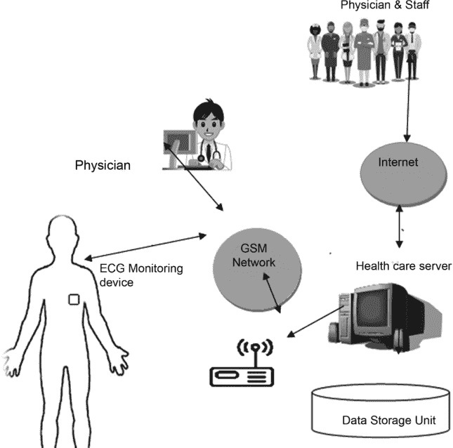

图 5.4 可穿戴移动心电图架构。

## 5.10 体温监测

体温是维持我们身体健康最重要的因素之一，尤其是对于婴儿。由于世界上慢性疾病的突然增加，对追踪体温有着重要需求。体温的任何增加或减少都可能指向任何严重的健康问题。谈到婴儿，总是需要监测他们的体温，因为体温的任何细微变化都可能让他们感到不适，而他们需要随时保持舒适。老年人也是如此；如果他们的体温出现问题，他们也会感到不舒服。随着可穿戴设备领域的快速发展，需要制造一种可以测量人体温度的设备。

在这一 21 世纪，我们希望万物都接入物联网；因此它在医疗保健领域发挥了重要作用。每天都有新设备制造或改进。物联网和移动服务使得这些设备的制造成为可能，并帮助人们将健康状况分享给医生、护士等医院工作人员。

在特定时间或任何事件引起的经常性高温或低温可能会阻碍机体功能并影响人的日常生活。它可能导致严重的健康问题，而且每次看医生都会导致药物改变以及健康损害和金钱损失。例如，如果身体受到任何细菌或病毒感染，体温会突然升高，从而产生健康问题并影响个人的正常活动。根据 Healthline 的数据，婴儿的平均温度为 97–99°F，成人的平均温度也是 97–99°F。

### 5.10.1 身体监测系统中的物联网

`MosChip` 设计了一种基于物联网的硬件和软件来跟踪患者（Satija et al., 2017）。这些设备通过蓝牙连接。设备紧凑、手巧，并在 3.3V 电池上工作。

### 5.10.2 身体监测系统的工作原理

温度贴片可以连接到人体，在人体测量的身体温度可能因人而异。设备将在特定间隔内收集数据。这些数据将与智能手机共享。为 `iOS` 和 `Android` 设计的应用程序将收集数据、聚合数据，并通过 `Wi-Fi`（参见 5.3）将实时数据发送到云端。

| 体温低（常规趋势） | 体温高（常规趋势） |
| --- | --- |
| 阿迪生病 | 出汗 |
| 糖尿病 | 畏寒和发抖 |
| 药物/酒精滥用 | 头痛 |
| 甲状腺功能减退 | 肌肉酸痛 |
| 感染 | 胃口不振 |
| 肾衰竭 | 易怒 |
| 肝衰竭 | 脱水 |
| 脓毒症 | 全身无力 |
| 药物副作用 | 异常皮疹，特别是皮疹恶化时 |
| 休克 | 对强光敏感 |
| 呼吸呼吸/哮喘 | 颈部僵硬，头部前倾时疼痛 |
| 癌症 | 精神错乱 |
| 失眠 | 持续呕吐 |

借助该设备，医生可以密切关注其患者报告，并立即建议用药。该设备包括高热或低温的警报功能，以及提醒医生访问患者的提醒。

这些设备可用于测量婴儿的体温。婴儿需要特殊的关注和照顾，该系统可以通过父母的智能手机通过无线网络（如 `Wi-Fi`）连接，并在婴儿温度高于或低于正常温度时向父母发出警报（Zakaria et al., 2018）。

### 5.10.3 可穿戴式物联网体温监测系统

一定会产生疑问，为什么我们不能制造一种可以测量人体所有关键参数的手带？解决方案是制造一种带有多种测量不同人体参数传感器的可穿戴手带。该手带可以通过协作具有测量 `ECG`、血糖、体温、血压、心率、汗液检测能力的传感器来制造。由于传感设备缺乏计算能力，这些数据可以发送到智能手机或平板电脑，由后者处理原始数据并为用户生成输出。然而，还有另一个问题：追踪

## 物联网对医疗辅助设备的影响

所有此类参数将需要 24/7 全天候，而智能手机或平板电脑将缺乏这一点（Zakaria et al., 2018）。

然而，在云计算领域出现后，在 `Wi-Fi` 设施的帮助下，传感器收集的数据可以发送到云服务器（Ferreira et al., 2015）。任何授权用户都可以通过互联网连接，在任何地方方便地访问所有这些数据（Xiong et al., 2012）。然后，医生和医院机构可以访问所有这些数据，以改善患者的健康或增加/减少药物剂量。患者本人及其家人也可以通过应用程序和互联网连接，在他们的手机或平板电脑上访问这些数据。图 5.6 给出了整体医疗物联网嵌入框架（Alahi Mukhopadhyay, 2019）。

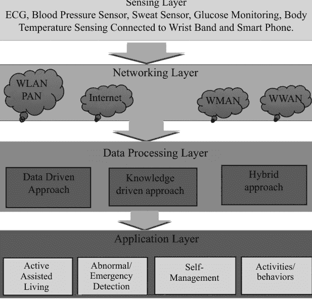

图 5.6 用于医疗的物联网嵌入框架。

## 5.11 辅助设备的安全威胁

辅助设备在安全和隐私方面的基本要求与其他无线设备几乎相同。本节讨论了辅助设备的各种安全威胁及其解决方案。物理攻击是对辅助设备通信链路或物理组件的攻击。干扰是一个利用专用设备阻断从源到目的地的无线通信的过程。辅助设备的篡改旨在访问敏感信息，而接口攻击则在辅助设备之间合法用户的射频通信中引入不希望的信号和噪声。恶意节点注入是特意在物联网边缘添加恶意节点，其目的是更改关键数据。物理损坏是部分或完全地破坏辅助设备的组件。恶意代码注入改变辅助设备的控制软件和功能组件。剥夺睡眠攻击会耗尽辅助设备的电池电。网络攻击是利用辅助设备在通信网络中的联网能力。流量分析是通过向流量中注入漏洞来嗅探辅助设备上的数据流量。拒绝服务会淹没网络辅助设备的流量网络，从而导致受益者无法参与网络通信。消息重放攻击操纵用户命令并执行相同的命令以导致设备故障。在女巫攻击中，用户身份验证被破解，安全数据被滥用。

## 5.12 结论

辅助技术（`AT`）包含了关于提供辅助服务和产品的系统和服务。对于需要特殊照顾的人来说，`AT` 是一种非常有价值的治疗工具。本章证明了辅助设备及其相关服务的必要性。辅助健康技术帮助人们无论健康状况如何都能活得更久。残障人士面临各种隔离他们参与社交和社区活动的障碍。辅助设备改善了弱势人群的生活方式和功能。对于老年人来说，辅助设备为他们的生活提供了更大的控制。

## 物联网对医疗辅助设备的影响

## 关键词

- 物联网 (`IoT`)
- 辅助技术 (`AT`)
- 非侵入性传感器
- 阻抗传感器
- 电化学

## 参考文献

Alahi, M. E. E., & Mukhopadhyay, S. C. (2019). IoT enabled smart sensing system. In Smart Sensors, Measurement and Instrumentation Smart Nitrate Sensor, Springer, Cham, 115–130. https://doi.org/10.1007/978-3-030-20095-4_2

Al-Aynati, M. M., & Chorney, K. A. (2003, June). Comparison of voice-automated transcription and human transcription in generating pathology reports. Retrieved from https://www.ncbi.nlm.nih.gov/pubmed/12741898

Babbs, C. F. (2012). Oscillometric measurement of systolic and diastolic blood pressures validated in a physiological mathematical model. Biomedical Engineering, 11(1), 56.

Bandookkar, A., & Wang, J. (2014). Non-invasive wearable electrochemical sensors. Trends in Biotechnology, 32(7), 363–371.

Callaway, E. C., Sweet, F. C., Siegel, E., Reiser, J. M., & Beall, D. P. (2002). Speech recognition interface to a hospital information system using self-designed visual program: Initial experience. Journal of Digital Imaging, 15(1), 43–53.

Dean, R., Rae, A., Baginski, M., Richard, J., Hartz, Z., & Elton, D. (2012). A capacitive fringing field for moisture measurement based on printed circuit board technology. IEEE Transactions on Instrumentation and Measurement, 61(4), 1105–1112.

Fan, J. Y., Yin, H., Hu, L. D., Zeng, Y., & Wu, F. (2014). IoT-based smart rehabilitation system. IEEE Transactions on Informatics, 10(2), 1568–1577.

Ferreira, B., Rodrigues, J., Leiao, J., & Domingos, H. (2015). Privacy-preserving content-based image retrieval in the cloud. Proceedings of the IEEE Symposium on Distributed Systems (SRDS).

Gonzales, W. V., Mobash, K., & Han, K. (2017). Real-time signal quality-aware ECG telemetry-based monitoring. IEEE of Things Journal, 4(3), 815–823.

Gubi, H., Mohan, M., & Narula, J. (2016). Trends in coronary disease in India. Annals of Global Health, 8(2).

Hoenig, H., Taylor, D., & Sloan, F. (2003). Does assistive technology provide assistance among the disabled? American Journal of Public Health, 93(2), 330.

Sasamoto, T., Takahashi, M., & Uno, T. (2009). Transmission mechanism of wearable device on-body. IEEE Transactions on Antenna and Propagation, 57(4), 936–942.

Sen, M., & Pal, T. R. (2011). Voice recognition technology implementation in surgical pathology: Advantages and limitations. Archives of Laboratory Medicine, 135 (11), 1476–1481.

Suo, H., Wan, J., Zou, C., & Liu, J. (2012). Security in the Internet of Things: A review. In Proceedings of the International Conference on Computer Science and Electronics.

Tangri, R. (2017). Innovation India: Agatas' SankLife device takes elderly persons living in the community. New England of Medicine, Retrieved from https://decisionresourcesgroup.com/blog/innovation-agatas-sanklife-device-takes-ecg-monitoring-next-level/

Tinetti, M. E., Speedley, M., & Ginter, S. (1988). Risk Factors for falls among elderly persons living in the community. New England of Medicine, 319(26), 1701–1707.

Wilkie, J. (2010). Using assistive technology and telecare to provide people with disabilities with improved opportunities to achieve greater independence. Journal of Assistive Technologies, 4(3), 50–53.

Xiong, N., Vandenberg, A., & Han, W. (2012). Green cloud computing schemes based on networks: a survey. 6(18), 3294–3300.

Zakaria, N. A., Saleh, F. N. B. M., & Razak, M. A. A. (2018). IoT (Internet of Things) based infant body temperature monitoring. In Proceedings of the 2nd International Conference on BioSignal Analysis, Processing and Systems (ICBAPS).

Zimmerman, T. (1996). Personal area networks: Near-field intrabody communication. IBM Systems Journal, 35(4), 609–617.


# 第6章

# 老人护理智能跌倒检测系统


# 面向老年人的智能跌倒检测系统

**PRATIK BHATTACHARJEE*¹ 和 SUPARNA BISWAS²**

¹ 计算机科学与工程系，Brainware 大学，Barasat，西孟加尔邦，印度
² 计算机科学与工程系，Maulana Abul Kalam Azad 科技大学，西孟加尔邦，印度

*通讯作者。电子邮箱：`buktaida@gmail.com`

## 摘要

跌倒被认为是老年人主要的健康问题之一。根据世界卫生组织发布的一份报告，早期跌倒检测是老年群体中一个亟待解决的问题。报告显示，跌倒问题影响了 65 岁左右人群的 28%–35%，70 岁以上的人群比例为 32%–45%。这一领域引起了研究者的关注，他们正在寻找一种廉价且易于使用的解决方案。由于目前还没有提供一种统一接受的解决方案，这仍然是一个开放的挑战。科学家们已经基于不同的方法提出了多种解决方案，以提供成功的患者护理系统（PCS）。

在本章中，我们尝试讨论了近期研究人员提出的各种先进方法论。本章旨在从非常基础的概念开始，对这一研究领域提供简要介绍。章节的后半部分讨论了由作者开发的原型检测系统，这对于展示此类系统的一种实际实现很有帮助。该原型在测试平台上的准确率显示为 94.45%。

## 6.1 引言

由于医学科学和药物的革命，人类预期寿命在 21 世纪大幅增加。在如今的许多家庭中，八九九十岁的老人已不再罕见。其中一些人可以独立完成日常活动，而另一些人则依赖护理人员。根据美国国家老年人协会（NCOA）的统计，每年有四名 65 岁及以上的美国人发生跌倒。每隔 11 秒，有一位老年人因跌倒在急诊室接受治疗；每隔 19 分钟，有一位老年人因跌倒去世。跌倒被认为是老年人腿部受伤的主要原因，也是导致老年人非致命性休克相关住院的最常见原因（Lim et al., 2014）。

随着全球大家庭的解体，工作的夫妻有时别无选择，只能让父母由护理人员照顾。护理人员并不总能伴随老人，特别是当他们可以自己移动时。因此，需要实时跌倒监控（Bai et al., 2012）来监测他们的活动。由于老年人通常对可穿戴传感器感到反感且容易遗忘，因此监控应该通过他们乐于携带的设备来完成（El-Bendy et al., 2013）。在智能手机和社交媒体时代，孤独的老人大部分时间都花在这些他们乐于随身携带的设备上。因此，智能手机被选为监控设备，用于检测他们在睡眠或早晨/晚上散步期间可能发生的突然跌倒（Hegde et al., 2013）。这是选择智能手机作为监控设备的社会趋势（Igual et al., 2013）。技术原因是智能手机现在被认为是一个传感器枢纽，由加速度计、陀螺仪、全球定位系统（GPS）、磁力计、重力、接近和光传感器等组成（Li et al., 2009）。

在 21 世纪初高速互联网引入后，计算的定义发生了快速变化。物联网（IoT）的概念通过集成智能物体、传感器、计算机和计算组件，改变了传统的客户端-服务器计算环境的定义，扩展了超出本地硬件限制的范围和计算能力（Perera et al., 2013）。

### 6.1.1 物联网的基础与重要性

物联网的经典定义是包含互连设备的系统。现在物联网的基本方面是自动连接一切使其“智能化”：

- 能够发送信息的设备
- 接收信息的设备
- 能够同时执行上述功能的设备，例如手机

智能设备之间可以进行通信，并使用一些机器学习（ML）技术做出决策（Perera et al., 2013）。

互联网的出现为世界打开了无限通道。物联网设备利用这一基础设施扩展了互联网的范围。因此，通过应用物联网，它允许企业和个人实现更高效的工作。典型的物联网架构如图 6.1 所示。

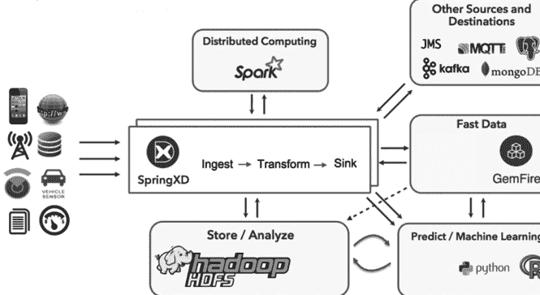

**图 6.1** 物联网架构（图片感谢：Maheshhwar Ligade）。

### 6.1.2 非传统 I/O 设备

基于物联网的设备通常分布在广泛区域，并遵循异构架构。这需要一个能够处理在线和离线数据的系统。这类 I/O 设备通常被称为“分布式 I/O”。分布式 I/O 系统的主要特征是设备具有较小的区域和更多的 I/O 选项，如数字和模拟站。这种分布式方法的显著优势是由于靠近传感器，信号传输距离短。使用可靠的传统的通信总线，如以太网和 RS485 以及 Modbus/TCP、Modbus/RTU、Profibus 甚至 ASIC，可以将模块整合到成本更优的系统中。

### 6.1.3 物联网在医疗领域的作用

在引入基于无线人体网络的自动监测系统后，医疗科学和保健领域发生了快速变化。

人体网络也被称为 WBAN 或人体传感器网络（Arya and Bilandi, 2014）。它是人体各种可穿戴传感器之间的无线连接。

## 6.1.4 WBAN 架构

基于 ICT 的医疗监测结构可以分为三层，即第一层、第二层和第三层，如图 6.2 所示。

- **第一层 (Tier-I)**：这是通信的第一层，数据通信在安装在人体内的传感器之间进行。它将数据发送到“汇点（Sink）”，这是一个个人服务器。
- **第二层 (Tier-II)**：这是 WBAN 的下一层，汇点和接入点 (AP) 之间相互通信。
- **第三层 (Tier-III)**：这是最外层，AP 通过互联网与云端的医疗服务器通信。该服务器需要授权。

### 6.1.4.1 WBAN 的应用

WBAN 发现于：

- 远程医疗和远程患者监测
- 生活方式和运动
- 军事

### 6.1.4.2 WBAN 的优缺点

WBAN 的优势如下：

- 用于检测关键疾病
- 用于监测实时健康数据并提供建议

WBAN 的劣势如下：

- 安全性较低
- 在传感器节点中实现安全技术非常困难
- 它需要高能效传感器节点

大多数现代医院和医疗中心现在使用基于 WBAN 的设备进行患者监测。然而，在农村地区仍待实施，因为那里没有足够的合格医疗人员进行持续的人工监测。

## 6.2 现代智能手机简介

根据定义，智能手机将具有复杂的多任务操作系统，例如 `iOS`、`Android` 等；高配置的 Web 访问功能；全功能桌面浏览器（如 `Safari` 等）；全功能音乐播放器和视频播放器；照片显示、3G/4G 和无线局域网（Wi-Fi）连接、电视输出等。智能手机能够下载和安装应用程序，并可能有虚拟或物理 QWERTY 标准键盘。

### 6.2.1 智能手机作为传感器枢纽

#### 6.2.1.1 嵌入式/内部手机传感器

今天的智能手机是开放、可编程的，并带有多个嵌入式传感器。手机中传感器的数量和类型取决于底层手机平台和可用性。一些先进的嵌入式手机传感器如下。

**加速度计** 可以定义为速度随时间的变化率。加速度计通常是一种电机械仪器，用于量化加速度值。加速度可以是静态的（重力加速度），也可以是动态的，用于感知移动设备的运动或振动。

使用加速度计可以更好地理解元件的环境。通过这个微型设备可以确定不同类型的运动，例如主体正在上坡、它在倒下前能承受的最大倾斜角度，或者它是水平飞行还是向下倾斜。智能手机根据手机的倾斜自动旋转设备（竖屏/横屏）。

传统的加速度计包含多个轴：二维运动和第三个轴用于确定位置。智能手机使用这三个轴，而汽车使用两个轴来确定碰撞时刻就足够了。这些设备非常敏感，因为它们应该读取加速度的极微小变化。准确程度高度取决于灵敏度。

**陀螺仪**：角速率传感器或通俗所称的陀螺仪传感器是可以测量角速度的设备。角速度可以定义为旋转角度/时间的变化。角速度的单位是度/秒或旋转/秒（RPS）。陀螺仪可以测量或维持旋转运动。小型廉价陀螺仪的一个例子是微机电系统（MEMS），它可以确定角速度。旋转速度由角速度决定。

**磁力计**：磁力计测量磁场，因此可以通过改变手机的电压输出来指向北方。它决定了触发指南针应用时显示 `Apple Maps` 或 `Google Maps` 的方式。它支持独立的指南针应用。磁力计可以检测磁性金属，因此也用于金属检测器，这就是智能手机支持金属检测器应用的方式。尽管如此，该传感器与手机的加速度计和 GPS 单元协同工作，以确定主体的精确位置以及设备在导航路线中的指向。

**GPS**：GPS 技术与卫星通信，通过经纬度确定主体的位置。它不需要任何数据连接，在没有移动信号的情况下也可以完美运行（但由于无法完全下载，地图将看起来模糊）。

**距离/接近传感器**：距离/接近传感器通过红外 (IR) LED 和红外光检测器测量物体的远近。该传感器在通话期间通过检测脸部距离自动关闭触摸屏功能以避免意外输入。传感器发出一束肉眼不可见的光。

**环境光传感器**：该传感器检测环境光并相应调整屏幕亮度。它被称为自动亮度调节器，可以增加或减少屏幕亮度以防止升高。

**湿度传感器**：三星在 2013 年发布了 S4 型，这是第一部配备湿度传感器的手机。最佳温度和湿度根据传感器确定。然而，这些传感器在高端手机中可用。

**心率传感器**：心脏使用 LED 和光学传感器测量心跳。LED 向皮肤方向产生光，该传感器测量反射的光波。脉搏会导致光强产生差异。心跳通过计算血液脉动确定。它被许多健康和健身应用使用。

**条形码/二维码传感器**：条形码传感器利用代码反射的光确定读取值。它产生电压变化的模拟信号来表征条形码。该模拟信号随后转换为数字形式并解密以显示数据。条形码传感器用于扫描条形码或二维码。

**步计**：健身追踪应用使用此传感器计算主体走的步数。步计内部使用加速度计产生的数据，可用于观察行走或跑步等运动。

**触摸传感器**：触摸屏上有电流持续通过，显示屏上的触摸会导致信号变化。设备检测到这种变化作为输入。早期的手机模型使用电阻触摸屏，直到苹果首次引入电容触摸屏。然而，现在所有手机仅使用电容触摸。

**生物识别**：生物传感器可以识别人类各种分类特征，并可为设备提供额外的安全保护。这可能包括指纹识别、虹膜识别和全脸部识别。生物识别被广泛用于解锁手机以及在购买时验证身份。此外，生物识别传感器还可以用于收集人的心率和 SpO2（动脉血氧饱和度估计值），用于任何健康相关的应用。

**麦克风**：麦克风是一种简单的传感器，可以检测和测量声音的响度。虽然麦克风传感器有不同的尺寸和灵敏度，但智能手机主要使用微米级的电容麦克风。除了进行普通的语音通话外，麦克风还用于 `Google Assistant`、`Siri`、`Alexa`、`Cortana` 等数字助手的语音搜索和语音命令。

**温度计**：每部智能手机都配备了内置温度计，用于监测设备内部和电池的温度波动。如果发生过热，设备将自动关闭以防止对自身或用户造成任何类型的损坏。尽管如此，一些高端手机配备了用于测量环境温度的辅助温度计。例如三星 Galaxy S4 就配备了可以测量外部温度的温度计。这些温度计传感器可以被不同的应用程序用于记录房间温度。

常见的移动传感器总结如表 6.1 所示。

### 6.2.2 智能手机中的健康监测传感器

健康监测传感器也称为生物传感器，是独立的分析设备，它们包含与合适的换能器密切接触的生物活性物质，用于检测（可逆且选择性地）样本中化学物质的密度或运动。下面列出了用于健康监测的常见手机传感器。

**表 6.1** 智能手机支持的一些传感器

| 类别 | 名称 | E_m/E_s | PC/EC | A/P |
| --- | --- | --- | --- | --- |
| 触觉 | 接近传感器 | E_m/E_s | EC | A/P |
| 加速度 | 陀螺仪 | E_m | PC | P |
| | 加速度计 | E_s | PC | P |
| 热 | 温度 | E_s | EC | P/A |
| 图像 | CMOS 相机 | E_m | EC | P/A |
| | 摄像机 | E_s | EC | A |
| 光 | 环境光 | E_m/E_x | EC | A |
| | 背光 | E_m | EC | P |
| 位置 | 电子指南针 | E_m | EC | A |
| | GPS | E_m | EC | P |
| 高度 | 高度计 | — | EC | P |
| 水 | 湿度 | E_m | EC | P |
| | 湿度 | E_x | EC | P |
| 医疗 | 气压计 | E_m | EC | P |
| | 心率监测 | — | EC | P |
| 声学 | 生物传感器 | — | EC | P |
| | 麦克风 | E_m | EC | P |
| 射频 | RFID | — | EC | A |

`E_m`：嵌入式，`E_x`：外部，`PC`：本体感受，`EC`：外感受，`A`：主动，`P`：被动。

**麦克风传感器**：可以使用微传感器评估患者的感觉，例如患有肌张力症的患者。肌张力症是一种由于肌肉收缩后松弛缓慢引起的疾病，可能导致运动困难。患者需要在咨询后 8 周内拨打数据收集中心告知其健康数据。自动语音响应方案将症状分为四类：肌肉僵硬、无力、疼痛和疲劳。

**摄像头传感器**：远程医疗和远程会诊使用手机摄像头传感器，通过适当的应用获取患者图像和视频的有用统计数据。此类应用于远程皮肤病领域，医生利用患者的皮肤图像进行诊断。移动设备摄像头的领域可以通过在手机上连接特殊组件进一步扩展。例如，可以在手机摄像头上设计一个光学显微镜。来自光学附件的放大图像将传递到手机摄像头。研究观察到摄像头分辨率足以检测血细胞和微生物的形态，从而实现自动局部分析。使用这种系统已经作为案例研究完成了结核的检测。该设备价格廉价且易于携带。

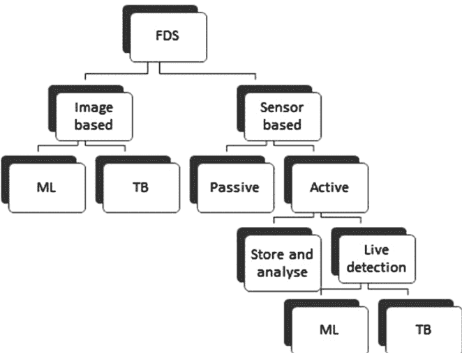

ML=基于机器学习的，TB=基于阈值的

**图 6.3** FDS 的分类。

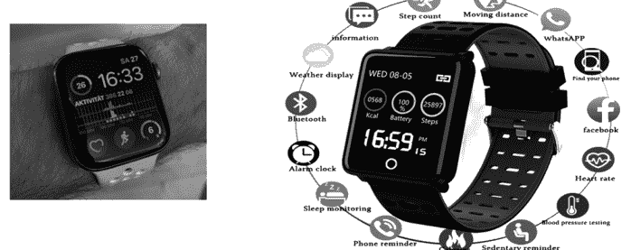

**图 6.4** 一些可穿戴智能手表（图片由谢亚马逊）。

虽然防止跌倒非常困难，但及时的检测和治疗可以挽救许多人的生命。通常，跌倒与治疗之间的时间对于防止任何伤害或不幸事故至关重要。因此，

## 6.3 用于老年人护理的智能跌倒检测系统

可靠且及时地检测跌倒非常重要（Wang et al., 2008）。在大多数使用 ML 方法的先进跌倒检测机制中，存储和分析方法可能会消耗生成警报所需的关键时间。另一方面，基于阈值的方法根据实时数据流提供了良好的跌倒检测准确性，并且与基于 ML 方法相比，生成的警报更快（Huang et al., 2008）。在现实生活中，及时的警报比避免几次误报更重要，因此检测大多遵循基于阈值的方法（Buzin Junior and Adami, 2018）。然而，细粒度的跌倒如跌倒前姿态很难通过这种方式检测。基于 ML 的方法可以用于此目的（Ruan et al., 2015）。

## 6.4 不同的监测方法

跌倒监测方法可以分为三类：(1) 非移动基于传感器的方法，(2) 基于可穿戴传感器的方法和 (3) 基于计算机图像的方法。

在听觉识别法中，跌倒过程的识别取决于受试者的频率波动。然而，基于传感器的方法依赖于陀螺仪和加速度计等运动传感器将跌倒与日常生活活动（ADL）区分开来。基于计算机图像的方法通过摄像头对受试者进行实时监控，并通过任何计算机算法识别姿态。它比其他两种方法更准确。护理人员对这种监测系统只需投入的精力。然而，这种方法仍处于起步阶段。传统方法仍需通过进一步研究进行大量改进。

### 6.4.1 非移动基于传感器的方法

这些系统基于麦克风和红外（IR）传感器。该技术与基于相机的技术类似。此类系统的设计通常简单且廉价。它涉及一个声学或环境传感器以及一台计算机。从传感器收集的数据随后传递到 PC 进行分析（Lee et al., 2014）。调查是根据某些预定义的跌倒检测条件和截止阈值进行的（图 6.5）。

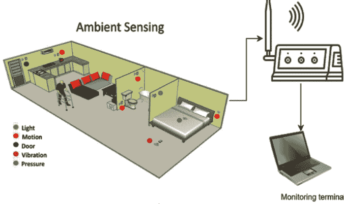

**图 6.5** 非移动基于传感器的监测系统架构。

*来源：经 Patel et al., 2012 许可转载© 2021 BioMed Central Ltd. https://creativecommons.org/licenses/by/4.0/

*感知*：这种方法消除了通常与图像技术相关的隐私问题。设计简单且廉价。然而，此类传感器对噪声非常敏感。因此，它们在外部环境中并不好用（Ruan et al., 2015）。虽然可以同时监测多个受试者，但这需要大量的进一步研究。总而言，它对室内应用非常有用（Nasution and Emmanuel, 2007）。

### 6.4.2 基于可穿戴传感器的方法

这种方法相比非移动方法具有许多优势（Perry et al., 2009）。系统使用加速度计或陀螺仪或两者将跌倒与日常活动区分开来（Buzin Junior and Admir, 2018）。传感器通常将数据发送到微控制器或 PC。可穿戴传感器能够独立工作。因此可以连续地监测受试者的活动（Dinh et al., 2009）。大多数手机公司现在都在制造可穿戴的手环和智能手表。虽然此类设备的准确性仍处于起步阶段，但它们在普通人中迅速流行起来（图 6.6）。


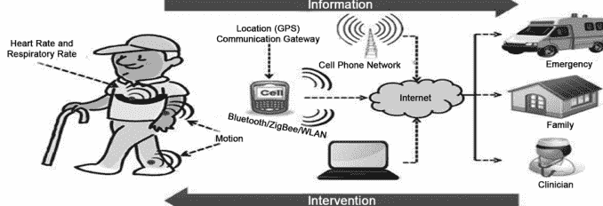

来源：经 Patel et al., 2012 许可转载 2021 BioMed Central Ltd. https://creativecommons.org/licenses/by/4.0/

**感知：** 可穿戴传感器廉价且对外部噪声免疫。因此，它们可以用于室内和室外监测。相比非移动方法，它们有很多优势。远程监测不需要特殊的设施。与其他方法相比，不需要建立通信网络。然而，电池寿命短和老年人的使用意愿是其主要缺点。设备的重量可能是另一个问题。

### 6.4.3 基于图像的方法

基于图像的捕捉原始图像并提取进一步分析的有用信息（Juang et al., 2008）。来自多个摄像头和视频源的视角可用于系统观察受试者（Miao et al., 2006）。计算机视觉是数字计算机等机器分析图像并告知信息的程序（Cucchi et al., 2004）。基于图像的技术包括三个部分：特征识别、基于特征的模式分类以及最后的模式识别（图 6.7）。

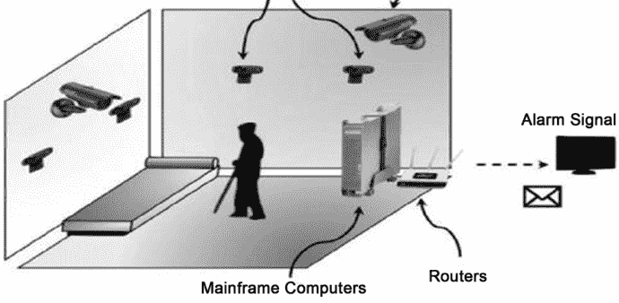

图 6.7 基于计算机的监测系统。

来源：经 Patel et al., 2012 许可转载 2021 BioMed Central Ltd. https://creativecommons.org/licenses/by/4.0/

**感知：** 基于图像的技术可以同时监测多人。基于可穿戴方法的一个主要缺点是需要老年人频繁佩戴设备，且如果人失去知觉，报警将无效。这些设备大多由电池驱动，由于活动传感器的功耗，需要频繁充电。基于图像的方法可以解决这些困难。与其他两种方法相比，它提供了更高的准确性。发生跌倒时，系统可以使用 `GSM` 通知护理人员。然而，由于摄像头的固定位置，系统范围有限。扩展范围需要更多的摄像头。成功的通信需要完善的设施，其中多个摄像头连接到维护数据库的单一服务器。无疑，这种设施增加了安装成本，在户外场景下也不有效。

## 6.5 跌倒检测方法

跌倒检测方法是使用上述三种方法中的一种实现的。它涉及两个方面：跌倒检测和跌倒分析。虽然针对使用在线和离线数据的检测技术提出了许多先进方法，但基于阈值的方法非常流行。然而，这些方法在分析细粒度跌倒方面并不高效。可以使用某些 `ML` 技术如 `KNN`、`SVM`（Foroughi et al., 2008）、随机森林、决策树等高效完成跌倒姿态分析。这些方法比基于阈值的方法慢，但提供了更详细的分析，可用于受试者的未来治疗。

后续章节将简述每种方法及其优缺点。

### 6.5.1 基于阈值的方法

基于阈值的方法快速、轻量，是检测跌倒最流行的方法（Huang et al., 2009）。系统通常从三轴加速度计获取加速度数据，并使用信号向量幅（`SVM`）方法或欧几得距离法将其合并。由于任何跌倒事件会导致加速度巨大变化，因此会与预定义的截止阈值进行比较（Tsinganos and Skodras, 2017）。如果当前加速度超过阈值，则检测到事件并生成相应的警报。用于合并加速度数据的数学表达式如下：

$SVM = \sqrt{(Ax)^2+(Ay)^2+(Az)^2}$，其中 $Ax, Ay, Az$ 分别是沿 x、y、z 轴的加速度分量。

欧氏距离可以通过从当前读数中减去之前的读数并合并来计算：

如果 $Ex = Ax_{(t+1)} - Ax_{(t)}$，$Ey = Ay_{(t+1)} - Ay_{(t)}$，$Ez = Az_{(t+1)} - Az_{(t)}$ 分别为沿 x、y、z 轴的欧氏距离，

$EuDi = \sqrt{(Ex)^2+(Ey)^2+(Ez)^2}$

现在，如果 $SVM_{acc} > SVM_{acc}$（阈值）或 $EuDi > ED$（阈值），则该事件被记录为跌倒。

虽然这种方法对于检测很有用，但可能会对类跌倒事件（如绊倒、快速坐或由于任何非跌倒事件导致的速度突然增加）产生许多误报。

一些研究人员尝试通过计算俯仰、横滚或偏航值来提取姿态信息，这些值仅仅是角度的变化，根据加速度计或陀螺仪的读数，获取沿 x、y、z 轴的肢体运动。然而，它们的准确性与针对训练过的系统分析数据的机器学习方法相比，远不可比拟。

### 6.5.2 基于机器学习的方法

基于机器学习的方法依赖于经过训练的机器进行数据分析。首先通过已知数据集对机器进行训练，使其能够对类似的未知数据分析输出结果（分类）。这里的检测通常通过姿态分析实现，即当受试者在一定时间内处于卧姿，且是从任何非卧姿变为卧姿，则标记为跌倒。此目的的常用分类器有决策树（Sarkar 等人，2019）、`KNN`、随机森林和 `SVM`。此外，一些研究使用了非传统模型，如隐马尔可夫模型（Thome 等人，2008）、逻辑回归，并具有良好的准确率。

基于机器学习的系统可以精确识别跌倒前、倒中和倒后的姿态。还能以高准确率识别不同细粒度的跌倒（如左跌/右跌/面朝下/摔倒）以及坐下/行走/爬楼梯/下楼梯等姿态。

然而，基于机器学习的模型在处理实时数据时运行较为困难，因为它们基于实时数据并在非常短的时间间隔内（例如 `10 秒`）周期性进行分析。这有助于刷新结果，也可以存储之前的的结果。通过仔细选择刷新频率，标称延迟对生成跌倒告警几乎没有影响。然而，分类时间在很大程度上取决于分析系统的硬件，因此在这些情况下，优选性能良好的现代服务器。

### 6.5.3 混合或组合方法

大多数现代方法通过将上述两种方法的优点结合起来，将机器的一部分设为基于阈值，另一部分基于机器学习。通常，跌倒检测部分基于基于阈值的方法，并针对可能的跌倒生成早期告警。这通过测试来自设备的实时数据流，最大限度地减少了检测延迟。数据流同时被输入到机器学习模块进行细粒度分析。如果分析后机器学习模块发现早期告警为误报，则会发送一条次要消息来消除之前的信息；否则，它将开始分析跌倒和倒后的信息，以检测跌倒前后的姿态。如果机器学习模块训练得当，它还可以通过分析跌倒强度来估计可能的伤害。它还可以通过分析跌倒预测人员是否已失去活动能力，并向多个目的地发送适当的紧急消息以便立即关注。

## 6.6 原型跌倒检测与分类系统

我们使用混合方法开发了一个原型跌倒检测和跌倒前分析系统。在目前的原型中，我们将 `FDS` 和 `ADL` 视为跌倒（室内和室外）检测与分析的共同单元。`FDS` 模块是基于实时数据流的阈值方法，而分析模块基于使用 `KNN` 分类器的机器学习分类。如果检测到跌倒，系统将发送告警，指定受试者跌倒前的最后姿态，以及位置（室外）、日期和时间。所有数据都存储在文件中供日后参考。

目前有不同的智能家居设备（包括商用的实验性的）能够检测跌倒。然而，大多数设备除了告知检测到跌倒及其时间外，不会提供任何额外信息。由于头部损伤是老年人跌倒后最常见且严重的事故，因此伤害程度根据初始身体姿态（坐/卧/站/走）而异很大。在特定姿态下失去平衡的倾向可能会提供关于受试者表型的额外信息，可能有助于未来的治疗。

### 6.6.1 架构与设计

由于时间跨度对跌倒者至关重要，因此基于阈值的告警系统从实时数据中检测跌倒并生成告警（如果检测到跌倒）。然后根据跌倒类型，使用监督机器学习算法（如 `KNN`、`SVM` (Foroughi 等人，2008)、随机森林等）对数据进行进一步细粒度处理。它会进一步检查初始告警是真实跌倒还是误报（由类跌倒事件引起），并在必要时进行纠正。如果根据分类器判断为真实跌倒，它还可以通过分析跌倒强度来估计可能的伤害。

### 6.6.2 算法

该算法分为三个部分：数据采集、处理和输出。

**算法 6.1：三阶段检测**

```
SVM_acc = sqrt(Ax^2 + Ay^2 + Az^2)
```

4. 检查 $SVM_{acc}$ 是否低于 $g=9.8m/s$（阶段 1）

   if $SVM_{min} < g$ and $SVM_{max} > 2g$

      if Timestamp($SVM_{max}$) - Timestamp($SVM_{min}$) < 2 秒

         跳转到步骤 5

   else

      跳转到步骤 2

5. 检查记录数（阶段 2）

   if (record_count > 150)

      跳转到步骤 6

   else

      跳转到步骤 2

6. 检查 $SVM_{acc}$ 低于 $g$ 超过 20 秒（阶段 3）

   初始化 $SVM_{acc} = SVM_{min}$ 和 InTime=timestamp($SVM_{acc}$)

   while ($SVM_{acc} < g$)

      current_time = timestamp($SVM_{acc}$)

      if (current_time - InTime) > 20 秒

         在服务器生成视觉告警和听觉告警。

         向受试者亲属发送短信。

         停止服务器运行并持续显示告警。

### 6.6.3 实现

系统使用常见的 Android 手机（红米 6A）运行 Android 8.1 系统，通过 `Wi-Fi` 连接到运行 Windows 10 的桌面服务器。代码使用 `Python 3.7` 实现。机器学习模块使用 `K=3` 的 `KNN` 分类器开发。数据采集模块以每秒 40 条数据的速率接收加速度计和陀螺仪数据。我们使用了 2 秒的重叠窗口进行同步。

实现架构如图 6.9 所示。


图 6.9 实现架构。

## 6.7 结果分析

数据以 `40 Hz` 的频率针对三种场景采集，即：正常行走（无跌倒）、跌倒但恢复（无告警但记录了事件）以及跌倒且未恢复（视听警告）。下图（图 6.10）显示了三种情况：(a) 受试者跌倒后恢复，(b) 受试者跌倒后未恢复，(c) 受试者处于正常运动状态。

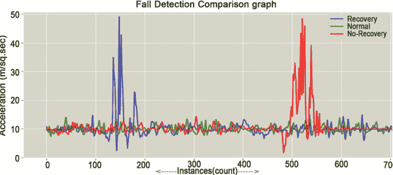

图 6.10 对比图。

在图中可以观察到，恢复和未恢复情况下的跌倒加速度相似。然而，所有三种情况在跌倒发生之前的正常部分（直到记录 100 处）是相似的。在记录 100 到 200 之间跌倒后，受试者恢复了，`SVM` 准确值再次达到持平。然而，当在记录 490 到 550 之间（约）发生“跌倒后未恢复”的情况时，跌倒后的图表非常不同。由于受试者没有恢复且没有运动，导致 `SVM_acc` 值几乎保持静止。

### 6.7.1 误报

在图 6.11 中，我们评估了“跺脚”和“快速坐下”的情况，这些可能会产生与跌倒相似的加速度值。我们逐一分析了这些情况，如下：

- **跺脚**：尽管我们得到了高于跌倒最高值的阈值，但其持续时间远低于将其记录为跌倒所需的最小阈值时间。因此，没有产生警告。
- **快速坐下**：快速坐下产生的加速度值的峰值差（max–min）远低于所需值；因此，该情况也没有被记录为跌倒，这是正确的解释。

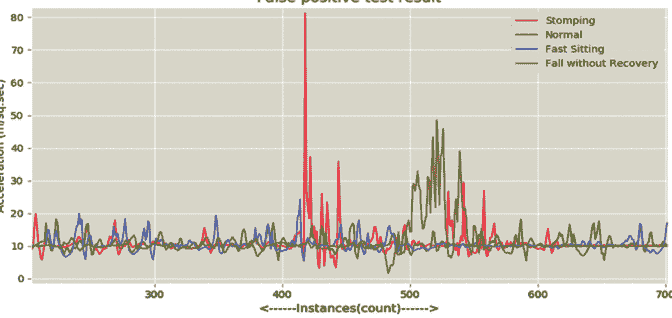

**图 6.11** 假阳性案例。

### 6.7.2 正确预测

图 6.12 显示了当检测到未自我恢复的跌倒时，监控终端显示的警告，并立即向亲属的手机发送短信，在注明常规跌倒警告消息的同时，具体的体势、位置、日期和时间。考虑到所有可能的情况，系统时间、警告时间和短信时间几乎是相同的。

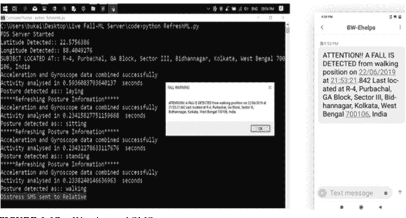

**图 6.12** 警告与短信。

### 6.7.3 比较与准确率表

多次试验和跌倒检测准确率如表 6.2 所示。观察到的总体准确率为 94.45%。

**表 6.2 不同情况的试验结果**

| 活动类型 | 试验次数 | 正确解释 | 准确率 (%) |
|---|---|---|---|
| 日常活动（正常，无警告） | 150 | 40 | 100 |
| 跌倒后恢复（无警告） | 150 | 138 | 92 |
| 跌倒且未恢复（警告 + 短信） | 150 | 139 | 92.67 |
| 绊倒（假阳性） | 150 | 135 | 90 |
| 快速坐下（假阳性） | 150 | 138 | 92 |
| 设备突然停止发送数据（警告 + 短信） | 50 | 50 | 100 |

**总体 94.45% 准确率**

使用 `KNN` 分类器对随机存储的 1350 个测试样本进行体态检测测试，结果列在表 6.3 中。

**表 6.3 计算的准确率参数**

| 活动 | 精确度 | 召回率 | f1 分数 | 样本量 |
|---|---|---|---|---|
| 立 | 1.00 | 0.97 | 0.99 | 329 |
| 坐姿 | 1.00 | 0.99 | 1.0 | 372 |
| 走路 | 0.97 | 1.00 | 0.98 | 327 |
| 卧姿 | 1.00 | 1.00 | 1.0 | 322 |

不同的平均准确率如表 6.4 所示。

**表 6.4 平均准确率**

| | 精确度 | 召回率 | f1 分数 | 样本量 |
|---|---|---|---|---|
| 微平均 | 0.99 | 0.99 | 0.99 | 1350 |
| 宏平均 | 0.99 | 0.99 | 0.99 | 1350 |
| 加权平均 | 0.99 | 0.99 | 0.99 | 1350 |

使用 `KNN (K=3)` 的混淆矩阵如图 6.13 所示。

**图 6.13 混淆矩阵**

| | 立 | 坐 | 走路 | 卧 |
|---|---|---|---|---|
| 立 | 320 | | | |
| 坐 | | 370 | | |
| 走路 | | | | 327 |
| 卧 | | | | 322 |

## 6.8 未来方向

考虑到所有可能的情况，系统时间、警告时间和短信时间几乎是相同的。

在 6.11 中，我们评估了“跺脚”和“快速坐下”的情况，这些可能会产生与跌倒相似的加速度值。我们逐一分析了这些情况，如下：

- **跺脚**：尽管我们得到了高于跌倒最高值的阈值，但其持续时间远低于将其记录为跌倒所需的最小阈值时间。因此，没有产生警告。
- **快速坐下**：快速坐下产生的加速度值的峰值差（max–min）远低于所需值；因此，该情况也没有被记录为跌倒，这是正确的解释。

### 6.8.3 疾病预测与医疗辅助

基于机器的监测的另一个方面是，它可以帮助早期疾病预测，并将这些知识提供给医生或护理人员，为他们提供及时的诊断方向，以确保基础护理，从而避免二级和三级护理。现在，如果一个智能跌倒检测系统每次都能通过紧邻之前的姿态识别跌倒，那么它可能会发现多个因素之间的某种模式或关系，例如从特定姿态（如步行、睡眠等）的反复跌倒。与同一路径上的其他情况相比，从步行姿态频繁跌倒可能导致对平衡能力问题的预测，这可能是由血压突然波动或神经系统疾病引起的。老年人从睡眠姿态跌倒大多发生在夜，此时人工干预可能无法进行无缝监控，但基于技术和传感器的智能监控将继续提醒人类监控人员，以避免任何致命影响。

## 6.9 结论

本章包含了由物联网、机器学习等先进技术支持的手机跌倒检测系统，以扩展及时监控，主要由机器执行，并通过受用户移动性提醒的人类提供支持。社会驱动、技术进步、当今世界人口结构的变化、对提高生活质量的需求等是这一新兴工作背后的驱动因素。文中给出了此类智能跌倒检测系统（`FDSS`）的功能框架、高效跌倒检测的不同技术、通过详细流程图和算法说明的用于准确检测的三个阶段 `FDS`，以及一些显示准确性以及由于错误检测跌倒产生的误报等代表性结果。这种基于实现的方法以及随后的研究方向，将引起该研究领域研究者的兴趣。

## 关键词

- 跌倒检测系统 (`FDS`)
- 患者护理服务 (`PCS`)
- 智能手机传感器
- 基于位置的服务 (`LBS`)
- 人类活动监控

## 参考文献

Arya, Bilandi N. A review: Wireless body area networks for healthcare. International Journal of Innovative Research in Computer and Communication Engineering, vol. 2, no. 4, 2014.

Bai Y-Y, Wu S.-C., Tsai C.-L. Design and implementation of a fall monitor system using a 3-axis accelerometer in a smart phone. In Proceedings of the 16th IEEE International Symposium on Consumer Electronics, Harrisburg, USA, June 4–6, 2012, pp. 1–6.


# 参考文献

Buzin C. L. Junior and Adami G. SDQI–Fall detection system for elderly. *IEEE Latin America Transactions*, vol. 16, no. 4, 1084–1090, Apr. 2018.

Cucchiara R., Prati, A., Vezzani R. An intelligent surveillance system for dangerous situation detection in environments. *Intelligenza Artificiale*, vol. 1, no. 1, pp. 11–15, 2004.

Dinh, A., Chen, L., Shi, Y., McCrosky C., Basran J., et al. (Eds). Implementation of a physical activity monitoring system for the elderly people built-in vital sign and fall detection. Presented at the 6th International Conference on Information Technology: New Generations, Las Vegas, NV, IEEE, April 27–29, 2009.

El-Bendary, N., Tan Q., Pivot F.C., Lam, A. Fall detection and prevention for the elderly: A review of trends and challenges. *International Journal of Smart Sensing and Intelligent Systems*, vol. 6, pp. 1230–1266, 2013.

Filipe, L., Dez-Fdezola R., Costa, N., Pereira, A., Wireless body area networks for healthcare applications: Protocol stack review. *International Journal of Distributed Sensor Networks*, vol. 15, pp. 1–23, 2015.

Foroughi H., Rezanian A., Pazariaee A. (Eds). Robust fall detection using human shape and multi-class support vector machine. Presented at 6th Indian Conference on Computer Vision, Graphics and Image Processing, Bhubaneswar, India, IEEE, December 16–19, 2008.

Hege, R., Sudardan B.G., Kumar S.C., Hariprasasad S., Satayanarayana B.S. Technical advances in fall detection system—A review. *International Journal of Computer Science and Mobile Computing*, vol. 2, pp. 152–160, 2013.

Hijaz F., Afzal, Ahmed T., Hasan, O. Survey of fall detection and daily activity monitoring techniques. In Proceedings of the International Conference on Information and Emerging Technologies, Karachi, Pakistan, June 14–16, 2010, pp. 1–6.

Huang B., Tian G., Li X. A method for fast fall detection. Presented at 7th World Congress on Intelligent Control and Automation; Chongqing, China. IEEE; June 25–27, 2008.

Huang C.-N., Chiang C.-Y., Chang J.-S., Hong Y.-X., Hxu S., J., et al. Location-aware fall detection system for medical care quality improvement. Presented at the 3rd Smart Fault Detection Systems for Elderly Care, 189 International Conference on Multimedia and Ubiquitous Engineering, Qingdao, China. IEEE, June 4-6, 2009.

Igual R., Medrano C. Issues and trends in fall detection. *BioMed Online*, vol. 12, 2013.

Juang C., Chang C., Wu J., Lee D. Computer vision-based posture estimation. *IEEE Transactions on Systems, Man, and Cybernetics–Part A: Systems*, 39, no. 1, 2009.

Lee J., Robinovich S., Park, E. Inertial sensing-based pre-impact detection. *IEEE Transactions on Neural Networks and Rehabilitation*, vol. 23, 2015.

Lim K. H., Jasindar K., Hoo B., Sherina M. factors of injury among Asian. *Journal of Gerontology & Geriatrics*, vol. 8, no. 2, 2013.

Miao S.-G., Sung P.-H., Huang C. A customized fall detection system using omnichannel cameras and personal information. In The 1st Transdisciplinary Conference on Diagnosis and Health (D2H), Arlington, VA, April 2-4, 2006.

Mubashir M., Shao L. survey on fall detection: Principles and approaches. *Neurocomputing*, vol. 100, pp. 144–152, 2013.

Nasion A. H., Emanuel S. Intelligent video surveillance for monitoring elderly in home. Presented in the IEEE 9th Workshop on Signal Processing, Crete, Greece, October 1–3, 2007.

National Council on Aging, Fall Prevention Facts. Retrieved from `https://www.ncoa.org/resources-for-the-falls/falls-prevention/` (Accessed July 15, 2019).

Patel, S., Park, H., Bonato, P Review of wearable sensors and systems with application in rehabilitation. *J Neuro* 9.

Perera C., Jayaramana P., Zavlavsky A., Christen P., Georgakopoulos D. Dynamic configuration of sensors using mobile body in internet of things. In Proceedings of the IEEE 8th International Conference on Intelligent Sensors, Sensor Networks and Information Processing, Melbourne, VIC, 2013, pp. 473–478.

Perry J. T., Kellogg S., Jeong-Hoon Y., Ali H., Shariff H. Evaluation of real-time fall detection. In Proceedings of the 6th International Symposium on High-Capacity Optical Networks and Enabling Technologies, Alexandria, Arab Republic of Egypt, pp. 158–166, December 28–30, 2009.

Ruan W., Liao Q., Falkner N, Li X., Tu G. TagFall: Towards-unstructive fine-grained fall detection using RFID tags. 2015, doi: 10.4108/2225-7226.2015.720062

Sarkar R., Raj V., Vinay S., Pratihar D K. An optimization-based decision tree approach for predicting slip-fall-accidents in elderly. *Safety Science*, vol. 118, pp. 57–69, 2019.

Song C., No Y., Yoo H. A 0.2-mW-2Mb/s digital transceiver based on wideband signaling for human communications. *IEEE Journal of Solid-State Circuits*, vol. 42, no. 9, pp. 2021–2033.

- Thome N., Miguel S., Ambellous S. 一实时、多视角跌倒检测系统：基于 LHMM 的方法。*IEEE Transactions on Circuits and Systems for Video Technology*, vol. 18, no. 11, 1522–1532, 2008.

- Tsingangan P., Skodras A. 一种基于智能手机的老年人跌倒检测系统，2017, doi: 10.1109/ISPA.2017.8073568

- Wang C.-C., Chiang C.-Y., Lin P.-Y., Chou Y.-C., Kuo I.-T., Huang C.-N., 等人. 针对老年居民的跌倒检测系统的开发。发表于第2 届国际生物信息学与生物医学工程会议，中国上海，2008年5月16-18日。

- Yoo H., 无线体域网及其在医疗保健中的应用，2013。

- Yu B. 用于医疗保健的无线体域网：可行性研究，2009.收录于第10届 IEEE 电子健康网络、应用与服务国际会议论文集，新加坡；页码 42–47，2008年7月7-9日。

# 第 7 章 智能传感器变革医疗系统

AMRITA RAI,<sup>1</sup> SHYLAJA VINAYKUMAR KARATANGI,<sup>1</sup> RESHU AGARWAL,<sup>2</sup> 和 OM PRAKASH,<sup>3</sup>

<sup>1</sup>电子与通信工程系，G.L. Bajaj 技术与管理学院，大诺伊达，北方普拉邦，印度

<sup>2</sup>阿米特信息与技术学院，阿米特大学诺伊达，北方普拉邦，印度

<sup>3</sup>电子与通信工程系，圣玛利亚工程学院，海得拉巴德，特伦甘纳邦，印度

* 通讯作者。电子邮箱：`amritaskrai@gmail.com`

## 摘要

在过去的几十年里，人类预期寿命显著增加。由于行动困难或其他健康问题，独居的老年人通常需要支持。在这种情况下，一个独立的辅助系统可能会有所帮助。近期技术进步历史上最令人兴奋的趋势和创新之一是物联网（`IoT`）。近年来，它受到了广泛关注，以缓解人口老龄化和慢性病增加给医疗系统带来的焦虑。物联网领域目前的开发和增长为医疗保健创新时代道路提供了巨大潜力。医疗保健的愿景被广泛青睐，因为它提升了人类的生活质量和健康水平，并涉及多项健康法规。健康领域多功能物联网设备的持续增加正面临广泛的挑战，例如如何为用于健康监测、实时数据处理以及智能决策和事件管理的物联网终端节点供电。传感器可以动态收集患者数据以刺激预防性护理、诊断、医疗系统中的深度学习与物联网等并衡量治疗结果。本章关注非侵入性和非侵入性传感器，并排除了植入式传感器，重点是智能传感器的基本概念，这些传感器用于帮助老年人的医疗和监测系统，并在医疗和家庭环境中证明是有用的。本章简要介绍了不同的智能传感器及其对人类的影响，这将有助于未来的研究。此外，它为未来物联网医疗系统的应用提出了一种标准模型。

## 7.1 引言

本章探讨了医疗获取的主要问题、处理被忽视的慢性医疗保健服务，以及医疗交付系统基于智能传感器增强居民的文化水平、劳动力、资金、信息技术和应急警觉的能力。此外，本章详细阐述了医疗系统的责任，它在健康领域的识别中起着至关重要的作用，并与政府健康机构合作。医疗系统不是健康的唯一甚至最有力的因素，但它是非常重要的。通过私人计划或公共资助计划获得医疗保险都是最低要求。

## 7.2 医疗系统中的传感技术

目前，由于半导体超大规模集成电路（`VLSI`）技术的进步，低功耗处理器、传感器和大数据分析与智能无线网络相结合。这一切都是物联网（`IoT`）的重要组成部分，也是传感技术改进和创新的根源。

在过去的十年里，传感器和传感器系统被广泛用于感知周围环境并便利我们的日常生活。如今，传感技术在医疗、监控、追踪等不同领域显示出快速发展。事实上，传感器本身并不具备智能，因此它们无法提供智能，但我们可以通过整合和分析来自不同传感器和网络平台的数据来构建智能，适用于各种应用，如电子健康系统、监控系统、追踪系统、监测系统、灾难管理系统、制造系统、车辆系统等。

对于大多数本地建立的医疗服务，行动方案包含了通信、成像、检测和人机接口，目标是在不干扰患者生活方式的情况下进行治愈。对于改进医疗检测、通信和检查设备，这种能够持续监测患者身体状况的联网物理设备很可能是可信的。物联网框架通过从起点到终点的远程传感数据，为患者、急诊设施、监护员和医生提供了动态且先进的方案。

所有来自智能传感器的数据都通过应用集成电路（`ASIC`）进行控制。`CHS`系统的其他元件是 `D/A` 转换器、`A/D` 转换器、振荡电路以及与带有简单信号调制的 `ASIC` 数字信号处理（`DSP`）电路。电路由两个氧化银（`AgGO`）电池供电，工作限制为 35 小时，电压为 3.1 V，内阻为 15.5 mV。所有信息通过 `ASIC` 通过发射器收集并传输到基站，供专业人员识别问题。这项创新预计将进一步改进并针对特定的疾病进行治疗。在 `CHS` 中使用智能传感器有许多优点：

- 设计简单
- 高可靠性
- 系统灵活性
- 最少的电缆互连
- 高性能
- 小巧坚固的封装。

### 智能传感器的缺点

- 当我们升级智能传感器并且必须将旧设备与新传感器混合时，需要格外小心，因为它们可能不兼容。
- 如果总线线故障，任何系统都会宕机，而离散布线并非如此。然而，在离散布线的情况下，如果一个传感器故障，可能需要关闭系统。通过使用冗余备份总线，可以缓解总线故障问题。

智能传感器的应用包括科学、民用、电子健康、军事和家庭应用。

### 7.2.1 气体传感器

气体传感器是医疗系统中最流行的传感器之一，属于化学传感器分类，用于确定周围环境中气体的浓度。它是环境监测应用的良好传感器，例如空气质量监测、医院或任何地点的气体泄漏检测、酒者的呼气测试，以及医学科学中的电子噪声（Bogue, 2014; Lin 等人， 2015）。光学、表面声波、催化、电化学和半导体气体传感器是不同类型的气体传感器。根据传感特性，气体传感器可以分为两类（Liu 等人，2012; Yamazoe and Shimano, 2002; Lee 等人, 1996）：第一，基于电性能的变化，例如基于 `MOS` 的传感器、基于聚合物的传感器、碳纳米管传感器（Thai, 2011）等；第二，基于其他属性的变化（例如光学传感器、热热传感器、气相色谱仪、基于超声的声学传感器等）（Peticulescu 等人，2006）。

### 7.2.2 生化传感器

利用生化传感器将化学或生物量转换为电信号。生物传感器包含一个化学敏感层、一个换能器、一个受体（生物组件）和一个电子信号处理器（De la Guardia, 1995）。生化传感器的类型如下：

- 氧传感器
- 二氧化碳传感器
- 表面反应测量传感器
- 流量传感器
- 血糖检测器
- 浓度传感器
- `pH` 传感器
- 酸传感器以及
- 散射测量传感器。

#### 生物传感器的基本特性

- 线性——为了确定高底物浓度，传感器应具有高度线性。
- 灵敏度——它代表电极相对于底物浓度的响应值。
- 选择性——获得正确结果所需的化学干扰最小。
- 响应时间——达到 95% 响应所需的时间。

#### 生物传感器的应用

生物传感器用于：

- 食品分析
- 生物分子分析
- 药物开发
- 犯罪检测
- 医学领域的诊断
- 环境监测
- 作为检测系统的生物战
- 器官替代以及
- 药物制造。

### 7.2.3 无线传感器网络


# 无线传感器网络

无线传感器网络是由小型传感器节点组成的自配置网络，这些节点使用无线信号相互通信，并大量部署以理解、监控和感知物理世界。任何远程传感器网络的关键属性包括：

- 使用电池或能量采集的节点的节点功耗限制
- 处理节点故障的可能性
- 节点的移动性
- 本质上是异构的节点
- 大规模部署的可扩展性
- 在环境条件下运行的能力
- 简单易用
- 跨层

## 无线传感网络的优点

- 不需要固定基础设施。
- 对于偏远地区（如农村、山区等）非常有用，如果需要额外的工作站具有灵活性。
- 任何阶段都可以接入设备。
- 布线极少。
- 使用集中监测系统。

## 无线传感网络的缺点

- 相比有线网络安全性较低。
- 相比有线网络速度较低。
- 相比有线网络配置复杂。
- 容易受到噪声影响。
- 相比有线网络通信速度较低。
- 成本仍然较高。

# 智能传感器变革医疗保健系统

在医疗应用方面，它们被用于生理数据的远程监测、医院内的追踪和监测、药物管理等。

## 7.2.4 RFID：医疗保健的基础

智能医疗系统是一种在关键点收集数据、精确存储数据并在需要时检索数据的系统。这种练习将注意力从医疗设备管理转向患者护理。这带来了更健康的医疗服务并提升了医院水平。另一个无线频率识别（RFID）发挥关键作用的领域是医院手术期间（Jackson, 2008）。

任何基于 RFID 的系统涉及三个主要组件：
1. **主机**，用于通过编码和解码将读取器的 ID 数据连接到个人电脑或任何服务器主机；
2. **RFID 标签**，用于存储身份信息或代码；
3. **标签读取器**或**标签标识符**，用于向 RFID 发射器响应发送查询信号（Karmakar 等人，2008）。

## 7.3 智能医疗：服务与应用

智能传感器在医疗和保健领域的物联网应用将有助于患者获得最佳治疗帮助、缩短治疗时间、降低成本和最理想的行政。健康需要定期进行检查，以确保我们的身体保持健康良好状态。大多数健康监测的关键参数是心率、体重、体温、血压和血糖水平（Sundaravarivel 等人，2018）。健康检查的方法之一是利用远程患者监测。这种技术使用远程控制传感器收集数据和图像，并发送到基站进行显示、照明和存储病史。“居家健康”应用可能整合遥测设备以捕捉特别重要的信号。

# 医疗系统中的深度学习与物联网

在医疗诊所失误成为可预防死亡的第六大原因的时期，为了从专家那里获得治疗建议，在硬件中嵌入传感器可以作为一种防线和可靠性保障。随着现在可以获取的各种远程检查服务，设备可以协作构建一个完整的数据组织器。例如，与血压、心率（HR）、超声或其他设备相关的医疗设备，可以自然地将所有收集的数据传输给医疗专家。因此，这种方法对于改进设备制造是非常合适的，因为它允许对患者状况进行持续监测（Sidheeq et al., 2017）。下面将讨论智能传感器的各种应用和服务。

## 7.3.1 电子胶片 (e-TABLET)

电子胶片由多通道传感器组成，用于体内的远程生物医学计算。经过长期的研究，研究人员发现，借助某些传感器，他们可以通过物联网（IoT）检测疾病。这项建议的工作由小型或通用药丸大小的电子胶片组成，内部包含多通道传感器、天线、无线传输器、食用电池和微控制器。这些组件组合在一起，以保持其微小的尺寸、坚固的组装和适用于治疗用途的安全特性。图 7.3 解释了电子胶片的结构。

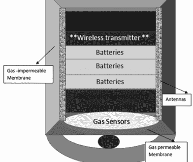

**图 7.3** 电子胶片的结构。

# 智能传感器变革医疗系统

因此，它被制成微小的药丸大小，可以吞下并通过胃肠道进入。一旦吞下，它就会开始连接到系统以检测体内的异常。电子胶片经过组件化定制，电子胶片的外层由耐化学腐蚀聚醚醚酮（PEEK）制成。使用电子胶片将摆脱侵入性技术，例如导管、内窥镜仪器或为胃肠道收集数据的放射性同位素。

利用电子药丸的药物递送也可以通过车载设备进行控制，采用精确且多功能的递送设计，这些设计通过其他方法是无法实现的。借助电子胶片，我们可以对健康进行从上到下、对点的疾病检查。此外，它的用途还从药物递送扩展到探索人体特定区域，针对癌症类型、溶液 pH 值、人体温度、受损组织、胃部问题、生物标志物测量和心率（HR）。心率评估用于减少心脏病，这是当今世界的一种大疾病。所有这些功能将由配备合适传感器的食用电池执行。胶片还包含一个微型摄像头，捕捉所有信息图像并发送到系统；借助这些数据，医生可以分析患者的进一步报告，还能在重大疾病的初期检测到变化。

电子胶片的工作如图 7.4 所示。这种设备设置可以传输酸度、压力温度水平等基本数据，或将食道问题和肠道的图像发送到系统，系统反过来分析癌症、烧心、食管炎和嗜酸性粒细胞病等疾病。电子胶片进一步用于测量肌肉收缩、进入难易程度以及身体的不同元素，以发现以前无法获得的数据。1972 年，一些医生借助电子药片进行了研究和开发。它被称为医疗监测系统，可以处理温度、pH 值、电导率和溶解氧等参数。

电子胶片可检测人体的疾病或异常。首先，它由连接到基底的硅二极管组成，并制造在位于计数器正面附近的两个硅芯片上。它被用于区分体温和体重。硅 IC 的使用使传感器变得有用且易于获得。第二个传感器用于确定溶液的 pH 值。第三个传感器用于确定受损组织、体水量（显示肾、肺、肝状况）、盐吸收、天然混合物分解为电胶体、胆汁分泌。第四个传感器用于确定溶解氧速率并识别大小肠中好氧细菌的活性。最后一个第五个传感器用于通过血流测量心率（HR），并借助摄像头捕捉心脏血流阻塞以及异常的血液和瓣膜循环的图像（Susarla et al., 2018; Ashraffuzzaman et al., 2013）。

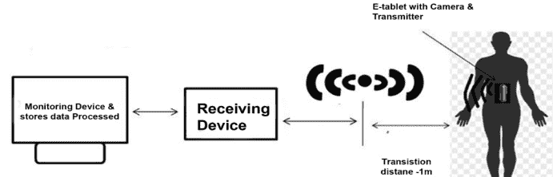

**图 7.4** 带有智能传感器和物联网设备的电子胶片工作原理。

电子胶片有许多值得考虑的优势，这使得建议的章节更加可靠：微小的尺寸和有效的可访问健康框架至关重要。它保持了药物运动，具有药物副作用最小和治疗性价值增强的优点。药物的影响预计发生得更快。电子胶片的即时响应提供了身体实时分析，以便轻松识别疾病和药物对身体的反应。

## 7.3.2 智能手表 (SMARTWATCH)

今天，技术和传感器携化使得智能手表成为最流行的可穿戴设备。有些人采用智能手表不仅是为了健身目的，还为了反映他们的社会心理行为。实验结果显示，智能手表的使用性和可见性是基于时尚与技术结合的重要因素。在众多可穿戴设备中，智能手表已成为可穿戴设备广泛普及的重要起点（图 7.5）。同样，传统手表的功能和可感知性将其定位为时尚、体面和高雅（Carlson, 2015）。对新创新的极大热情也反映在智能手表提供的海量应用中，例如，“Apple Watch”有超过 10,000 个应用程序，“Android Wear”有超过 4000 个应用程序（Curry, 2015）。此类手表具有通过赋予个人行动进行自我检查；获取基于行动衡量的反馈；考虑行为模式；以及支持与医疗服务和提供人员的双向通信，从而在日常生活中提供和监测健康的潜力。尽管如此，智能手表是一项新兴技术，对这些设备的研究仍处于早期。手表旨在安装各种类型的传感器以实现某些功能：通过 RFID 技术识别标记特征；利用惯性传感器通过检测下臂承受的力量识别信号；以及识别手指运动、手部动作和关节。研究表明，婴儿出生后的初始心率（HR）是新生儿发现和评估的核心。尽管如此，通过听诊心声或触诊脐带来获取心率被观察为既存又不准确，因此电子智能手表被用于监测早产婴儿的心率。

# 外实用性动机

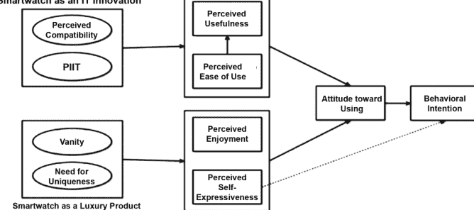

# 内在非实用性动机

**图 7.5** 智能手表作为奢侈品的技术的使用。

来源：经许可自 Choi 和 Kim, 2016. © Elsevier.

204

医疗系统中的深度学习与物联网

## 7.4 智慧医疗中的物联网

物联网（IoT）是一个由物理组件（类似于“智能设备”）以及其他各种物品组成的网络，这些组件与传感器、执行器和编程等仪器相关联。这种结构从环境的各个点收集信息，并通过互联网传输这些数据。2013年的全球物联网标准倡议将物联网描绘为“数据社会”。物联网不仅传输收集的数据，还能通过现有系统远程控制环境，为物理世界向基于PC的系统的渐进直接融合提供了网关，并实现了更高的效率、准确性和成本上的灵活性。

物联网通过执行器和传感器进行扩展，技术的进步使其包含了更广泛的现代化物理框架，例如智能家居、智能电网、智慧城市、智能健康和卓越交通（图 7.6）。通过将其处理框架嵌入现有的互联网基础中，一切都变得异常显著且智能（Sidheeque et al., 2017）。

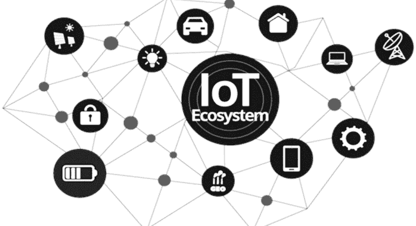

**图 7.6** 物联网概览。

来源：重印自 https://www.sensorsexpo.com/iot-ecosystem

### 7.4.1 物联网的应用

使用物联网的基本理念是针对医院住院的患者，无论医院里是否有医生或其他人员，其生理状况都需要被持续监测。健康传感器用于收集广泛的生理数据和使用记录，云端用于研究和存储数据，而短时间内会将隔离后的信息远程转发给家长视角，以支持进一步的检查和审计，如 Chamberlin (2016) 的图 2 所示。因此，它取代了通过标准间隔时间来验证患者关键体征的方法；这实际上是持续的现代化数据发展。同时，它通过充分考虑显而易见的想法，并通过减少标准程序的开支转而支持方案，从而降低了方案的成本（Ahmed et al., 2016）。

世界某些地区的公民面临着糟糕的身体状况，因为他们没有权利获得有效的健康检查，这可能演变成紧急情况。尽管有与物联网相关的远程医疗，但它将提供类似于面对面咨询的业务体验（图 7.7）。这些方案可以使用各种传感器来发现对健康信息的理解，数据对于大多数检查统计的计算至关重要，随后通过医疗专员的远程系统能够建立健康建议（Zworykin, 1957）。物联网正在改变远程患者监测、定制化治疗、改善结果并降低人工服务成本。例如，基于可穿戴超声波的传感器通过检查他们的活动和识别跌倒来赋能每一个人。物联网是一个能够持续采集数据的平台，鼓励这些数据的收集和研究，并提供影响不同合作伙伴的能力以建立一个关联领域。真正的重大进展将有助于解决行业面临的挑战。

根据 MarketResearch.com 的另一份报告，物联网市场预计到 2020 年达到 1170 亿美元。研究机构 Gartner 预测，超过 40% 的组织预计物联网将在未来三年内对其业务产生变革性影响。

### 7.4.2 物联网有帮助吗？

数据驱动的医疗服务部门利用物联网可以从受益。物联网驱动的进步可以促进患者健康的数据驱动定制化研究、改善临床结果以及成功的患者监测。诊所正在利用物联网改变医疗服务，其在社会保险领域具有强大的未来前景。物联网的应用位置如下：

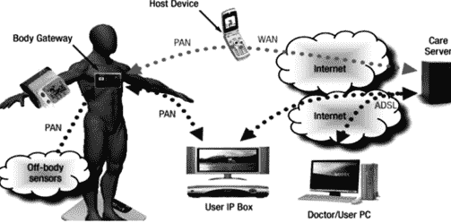

**图 7.7** 智能传感器在医疗保健中的工作和应用。

来源：重印。

### 7.4.3 慢性病管理

物联网通过监测患者生理状况的设备（例如：血糖水平、高血压患者的血压、糖尿病患者的体重等）解决了任何问题。这些设备发送的间歇数据可用于执行特定的检查。

### 7.4.4 远程监测与康复医院

这一自动化维度使提供者能够管理常规检查和现场关联的工作，以远程监测功率并从而节省成本。此外，远程检查已成功显示出结果，例如降低了再入院率并提高了员工效率。

### 7.4.5 健康与预防性护理

物联网的出现，通常作为一种可穿戴技术，使得健康监测变得有益。这种数据的持续开放使使用户能够探索并关联各种参数。

物联网显然通过技术的使用提供了一种改变医疗服务的保障。物联网与技术方案的有效结合可以成为医疗服务的倍增器。同样，它们在电子保健、环境预防健康方面具有潜力。

智能传感器转型医疗系统 207

# 智能传感器转型医疗保健系统

替代主。因此，敏感且经过检查的恢复性信息应该能够在确保安全性的同时，通过安全性在不同设备之间进行交换。

Parida 等人 (2012) 提出了一种基于 RFID 技术的内部药物管理框架。该框架旨在医疗保健行业中发挥关键作用，通过追踪药物（例如，根据患者的常规或紧急处方或在没有 RFID 标签的情况下进行）。该框架配备了摄像头和电子系统来跟踪患者。该框架的主要优势是它可以很好地被广泛的人群使用，包括老年人或受教育程度较低的人群。

此外，Clifton 等人 (2013) 提出了一种通过高频获取患者生理信息来整合电子病历记录的框架。他们指出，引入医疗保健数据框架的 AI 能够获得临床上的优势地位，并具有改善结果的可能。

Hamida 等人 (2013) 提出了另一种用于监测失眠等睡眠障碍患者的系统。该系统有助于睡眠数据的分析，并为存储的 Result提供安全传输。该系统最大的优势是其安全保护措施和零运行成本。

Ray (2014) 提出了通过 IoT 枢纽远程观察家中更年个体群体患者的方案。该框架在实际中具有便携性、经济性且耐延迟性。然而，该框架在针对基础老年人的服务方面还需要支持。

此外，Huang 等人 (2014) 提出了一种智能药盒。该框架记得老年人的问题，以提供全面的药物安全。向患者提醒用药的方法是一个药盒，它对药物进行计划，以避免误用。尽管操作简便，但早期的框架由于大量的电子元件和电池而显得笨重，并且仅关注 pH 值、温度和重量 (Zworykin, 1957; Mackay, 1959)。设备必须深植于体内，这使得远程通信在其周围的环境中变得非常有趣；电子医学目前的努力也被限制在低频率传输 (Chen et al., 2009; Johansson et al., 2006; Valdastri et al., 2004; Wang et al., 2008; The et al., 2009; Park et al., 2002; Kfouri et al., 2008)。现有的电子医疗框架策略面临着各种负面影响 (Cramer et al., 1989; Grosset et al., 2006; Olivieri et al., 1991; Shalansky et al., 2004)。

所提出的工作建立了一种基于标准多通道传感器的基础电子平板设备，克服了这些限制的部分。该框架结构的基本图随后是对其在监测不同类型的生长、受损组织、生物标志物和 HBR 方面的评估。

## 7.6 结论与未来展望

智能传感器将在智能医疗系统中带来更高水平的交互和更多的技术发展。智能传感器与医疗系统的整合为控制医院以及居家老年护理系统提供了便利。在医疗保健系统中实施智能传感器的重要一步是采用传感技术、实施技术以及针对广泛应用的基于 IoT 的方法。

作为电子平板电脑，它由天线、食用电池、微处理器和其他元件组成，其即时响应能够对身体进行实时分析，从而轻松识别疾病以及药物对身体的反应。

## 7.7 未来研究方向

利用定制信息的数字设备进步将引发社会保险技术的变革。虽然它们在功能上面临许多挑战和限制，但这些原因永远无法阻止我们掌握可能积极影响我们生活的进步。

翻译器的创造促成了带有测试电路的剂量案例，用于通过对胃肠道进行内部检查来定位疾病和偏离正常的情况，即使在不允许使用传统内镜的受限地区。尽管如此，这些容器无法被成功使用，因为它们从单通道传输，体积巨大，并经历了可靠性差、敏感性低和寿命短的负面影响。这些后来通过使用实验室传感器进行了尝试，例如玻璃 pH 电极、电阻温度计等。

在接下来的几年里，我们可以看到利用新型电池材料实现这些想法的工作模型。目前正在使用锂；但科学家们设想转向钠。

# 智能传感器转型医疗保健系统

这是为了向人类提供开放、安全、稳固且低成本的医疗服务。

## 关键词

- IoT (物联网)
- 医疗保健
- 技术
- 可穿戴传感器
- 电子平板电脑
- 多通道传感器
- 电子健康

## 参考文献

Ahmed M. U., Björkman M., Čaušševič A., Fotouhi H., Lindén M., An overview on the Internet of Things for health monitoring systems, Social Informatics and Telecommunications Engineering, 169, 2016, pp. 429–436.

Ali B., Awad A. I., Cyber and physical security vulnerability assessment for IoT-based smart homes, Sensors, 2018, 18, 1–17. doi:10.3390/s18030817.mdpi.com/journal/sensors.

Angelov G. V., Nikolov D. N., Ruskova I., Gieva E E., Spasova M. L., Healthcare sensing and monitoring. In: Ganchev I., Garcia N., Mavromoustakis C., Goleva R. (Eds). Enhanced Heart detection using smart, Lecture Notes in Computer Science, 11369.

Johannesen E. A., Wang L., Wyse C., Cumming D. R., Cooper J. M., 用于胃肠道事件的传感器上实验室的生物相容性, IEEE 医学工程杂志, 53(11), 2006, 2333–2340.


# 参考文献

Karmakar N. C., Roy S. M., Ikram M. S., 用于 RFID 应用的低成本紧凑相控阵列天线的开发. In: Mukhopadhyaya S. C., Gupta G. S (Eds.). 智能传感器与传感技术. Springer. 柏林, 2008, pp. 333–342. https://doi.org/10.1007/978-3-540-79590-2_22

Koufi M., Marinov O., Quevedo P., Faramarapur N., Shirani S., Liu L.W.C., Fang Q., Deen M., 联合内微化无线荧光诊断成像系统, IEEE 量子电子学选刊杂志, 14(1), 2008, 226–234.

Kiem A., Hovstadt M., Kao O., 移动感知电子健康事件中网络医疗设备的安全与通信架构. In: IEEE 第1 届移动服务国际会议论文集, HI, 2012, pp. 112–114.

Lee D. D., Chung Y., Choi M. S., Baekek J. M., 低功耗微气体传感器, 传感器与执行器 B, 33, 1996, 147–150.

Lin Y-L., Kyung C., Yasuura H., 智能传感器与系统. Springer. 恰姆, 2015. https://doi.org/10.1007/978-3-319-14711-6.

Lin Y-C., Wei K-C., 早产期间心率监测的电子手视表, 2017年8月, pp. 214–215. http://www.pediat-neonatol.com.

Lu X., Cheng S., Liu H., Hu S., Dang H. N., 传感技术综, 传感器, 12(7), 2012, 9635–9665.

Mackay R. S., 人体无线电遥测, IRE 医学电子杂志, 6(2), 1959, 100–105.

Morgantia E., Angelin A., Damanic L., Lorenzella L., Mugellini E., 用于识别物体、图表和手势事件的嵌入传感器的智能手表. In: 机器人与智能传感器国际研讨会论文集 (IRIS 2012), 2012.

Olivieri N. F., Masuvi D., Hermann K., Koren G., 用药事件监测系统的合规性, 儿童疾病档案, 66(12), 1991, 1399–1402.

Parida M., Yang H-C., Jheng S.-W., Kuo C-J., RFID 技术在内部药物管理系统中的应用. In: 第15 届基于网络的信息系统国际会议论文集, 澳大利亚墨尔本, 2012, pp. 577–581.

Park Y. J., Ahn J., Lim J. S., 生物传感器的“C芯片”平台. In: Lin Y-L., Kyung C., Yasuura H., Liu Y (Eds.). 智能传感器与系统. Springer. 恰姆, 2015, pp. 23–34. https://doi.org/10.1007/978-3-319-14711-6.

Park J. H., Wang S., Choi B. J., Lee H. C., Park J. C., Kim M. N., Lee J. T., Cho J. H., 用于穿戴式内镜的双向多通道遥测模块. In: 2002 IEEE-EMBS 医学与生物技术专题会议, 美国, 2002, pp. 273–276.

Peticulescu, A., Hall, B., Fraenelle, R., Phillips, S., 基于衰减的原型传感器, 美国声学会杂志, 120, 2006, 1779–1782.

Ray P., 健康物联网 (IoT): 用于监测老年人的架构框架. In: 科学与管理国际会议论文集, 印度钦奈, 2014, pp. 3–5.

Shansky S., Levy A., Ignasewski A., 用于识别不遵守医嘱的自述评分, 药物治疗公告, 38(9), 2004, 1363–1368.

Sidhequee A., Kumar A., Balamurugan R., Sathish K., 使用物联网的心跳感知与心脏检测, 国际工程科学与计算, 7(4), 2018.

Solanas A., Casino F., Batista E., Rallo R., 智能医疗：从数据到智慧的旅程. In: IEEE 第3 届研究与技术社会论坛 (RTSI), 摩德纳, 2017, pp. 1–6, doi:10.1109/RTSI2017.806598

Sundavaridel P., Kouineas E., Mohanty S., Gathanathira M., 关于智能医疗的你：评估物联网的不同技术和组件, 消费电子杂志, 7(1), 2018, 18–28.

Sursla M., Akhil C., Reddy A., Hema D., 心跳检测与监测, 网络通信与新兴技术杂志, 8(5), 2018, 18–20.

Tai T., Yang Y., Dejean G., Tenzis M., Puers R., FSK 无线气体传感, 微波杂志, 12, 2011, 84–95.

Thone J., Rajomais S., Turgis D., Carta R., 用于无线胶囊内镜的近场传输器, 传感器与执行器 A: 物理, 156(1), 2009, 43–48.

Zanouk G., Athanasiadis E., Gaitanis A., Georgakopoulos A., Chatziolannoue A., Chatziolannou A., Sprouyg G., 肺结节 PET/CT 图像辅助计算机辅助诊断, 生物医学信息杂志, 63, 2016, 357–365.

Valdastri P., Menciasi A., Arena A., Dario P., 用于生理参数体内监测的植入式遥测系统, IEEE 医学信息技术, 8(3), 2004, 271–278.

Wang K., Yan G., Jiang P., Ye D., 机器人内镜, IEEE 机器人杂志, 24(1), 2008, 206–210.

Yamazoo N., Shimano K., 气体传感器的功率理论, 传感器与执行器 B, 128, 2002, 566–573.

Zeinab K. A. M., & Elmostafa, S. A. (2017). 物联网应用、挑战与相关未来技术. 世界科学新闻, 2(67), 126–148.

Zworykin V. K., 无线胶囊, 179(456), 1957, 898.

# 第 8 章 物联网 (IoT) 的医疗应用

**RITAM DUTTA**<sup>1*</sup>, **SUBHADIP CHOWDHURY**<sup>2</sup>, 和 **AHMED A ELGAR**<sup>3</sup>

<sup>1</sup> Surendra Institute of Engineering and Management, MAKAUT, 西孟加拉邦, 印度
<sup>2</sup> DSMS Group of Institutions, 西孟加拉健康大学, 西孟加拉邦, 印度
<sup>3</sup> 计算机与人工智能学院, 苏埃大学, Beni Suef 市, 埃及

*通讯作者。电子邮件：`ritamdutta1986@gmail.com`

## 摘要

在现代，物联网 (IoT) 已被认为是学术和工业应用未来技术最重要的领域之一。万物互联（Internet of Everything）是一种新兴技术，被设想为全球机器和设备网络，能够相互交互。本章介绍了物联网技术的最新趋势，以便具有实时应用的基于物联网产品的成功部署。在综述中，详细讨论了与医疗应用相关的各种物联网实时应用。在医疗范式中，基于物联网的技术增强了护理质量，通过实时功能方便了终端用户，提供了成本效益的医疗服务提供方法，覆盖偏远地区的有效远程医疗，以及物联网应用在制药、机器人、健康经济学、健康保险、有效政策制定等方面的用途。基于物联网的医疗服务是医疗的未来，将辅助基于机器学习和人工智能的医疗模型。最后，通过最近的文献调查研究了几种可能的技术和管理挑战。

## 8.1 物联网（IoT）在医疗保健领域的应用

能量从读取器传输到标签，在没有任何电力供应的情况下控制标签。电子收费站、任何产品级的追踪都是被动式 RFID 的少数示例。主动式 RFID 标签具有自带电源并可以与读取器建立通信。外部传感器配备了主动式 RFID 用于监测压力、温度等。半被动式 RFID 标签使用电池为集成电路通信供电。在医疗领域，标签通常用于患者的身份识别。为了实现无误的治疗环境，可以使用 RFID 技术。此外，它将通过追踪移动来维护患者的安全；如果患者需要从一个部门转到另一个部门进行诊断或其他手术，它将追踪其交通系统（Amendola et al., 2014）；追踪来自无菌供应部门的无菌容器；追踪生物医疗废物以便识别、分类、运输、处理等。

## 8.2 云端计算

许多物联网应用的主要需求是海量数据存储、实现实时决策的极快处理速度，以及用于流传输数据、音频或视频的高速宽带网络（Gubbi et al., 2013）。云计算提供了便捷的访问方式，以处理海量数据集，并对数量巨大的物联网设备进行实时处理。

在医疗保健领域，这种云计算系统将帮助追踪远程传感器数据，为患者建立预防性、基础性和治疗性服务的数据库，用于医疗病历管理、远程医疗（Kim et al., 2010）、建立包含血型和 Rh 因子的全球血库可用性数据库、开发来自交通控制系统的数据以为器官捐献建立绿色通道等。

## 8.3 各种物联网实时应用

设备和系统上的实时物联网应用需要确保数据或消息的接收以及及时响应。设备上物联网应用的内置智能可以轻松识别问题、观察测试环境、相互通信，并可能无需人工干预即可解决问题。物联网促进了无数基于行业和特定用户的物联网应用的发展。设备和网络提供了物理连接，而物联网应用能够以可靠的方式实现设备间和人机交互。质量控制、对多个设施的监测（如获取患者健康状况数据、药物状态、患者医疗费用、保险相关数据、治疗过程中各种基于物联网的监测系统的实时追踪等）。

## 8.4 物联网系统开发中的各种局限性

根据物联网地面报告调查，本节讨论了企业在物联网发展方面的局限性。还观察到数据中心在安全、企业消费者隐私、数据存储管理、服务器技术和数据中心网络方面面临挑战（Bradley et al., 2013）。本节讨论了若干技术和管理挑战，即隐私、数据挖掘和安全问题。

### 8.4.1 隐私挑战

物联网可能会提高人们的生活质量（Fichman et al., 2005）。虽然它通过智能家居系统和可穿戴设备继续增长势头，但对接受物联网的信心将取决于对用户隐私的保护。医院或医疗中心的健康相关数据始终处于特权通信和专业秘密之下。因此，医疗记录是医院的财产，但未经患者许可，医院不能共享信息。在各种医疗应用中使用云计算和数据库管理系统时，处方或治疗程序是在线远程医疗，医生将在在线平台上相互连接。因此，数据泄露是实施医疗物联网的隐私挑战之一。

### 8.4.2 数据挖掘的挑战

人工智能（AI）需要大量数据植入神经中枢，而医疗保健数据是最敏感的数据，患者的生命危在在其中。因此，通过数据挖掘成功编写健康相关模型对于医疗工作者和物联网支持者来说是一个真正的挑战。

### 8.4.3 安全威胁

尽管物联网系统具有许多优势，它也面临来自黑客和其他网络罪犯的安全威胁。惠尔·惠普最近的一项研究（Hewlett Packard, 2014）显示，70% 最常用的物联网设备包含严重漏洞。安全和隐私的缺乏会导致企业和个人对采用物联网产生阻力（Sundmaker et al., 2010; Li and Johnson, 2002; Manyika et. al., 2010）。

## 8.5 医疗领域

物联网与医疗保健有着长期关系。首先，为患者建立了医疗记录系统（EMRS），包括患者身份、医生开具的所有处方、所有医疗和非医疗项目等。如今，大型医院正将其作为案例研究（Mogli, 2016）。

### 8.5.1 物联网在医疗保健中的若干应用

物联网在医疗保健中有多种应用，如数据挖掘、智能药物、智能诊断系统、远程观察患者的无线传感器、远程医疗等。有几个示例：

- 诊断患者生命体征统计（如体温、血糖水平、脉搏氧仪、心电图等）的监测工具；应急通信管理工具、交通设施救护车控制、事故的智能应急系统（基于物联网的技术将定位事故并自动向救援中心发送信号并报告损坏）、智能移动远程医疗应用、血库可用性连接等。

AAL（辅助生活）是一种面向老年人的工具，帮助他们过上更好的生活。到 2050 年，大量人口（约 20%）将达到 60 岁或以上（UN, 2001）。老年患者主要面临慢性疾病、骨科相关疾病、阿尔茨海默症、残疾等严重问题。他们需要特殊的医疗保健，AAL 将支持他们。AAL 将追踪智能家居内老年人的活动，它可以检测任何跌倒或其他事故，提醒用药，摄像头可以协助追踪设备，可以附近的紧急救援，并实现许多此类功能（Rashidi and Mihailidis, 2013）。它们使用带有运动检测器的摄像头、智能瓷砖、PIR（被动红外）、主动红外、RFID、磁性开关等连接到物联网拓扑结构。

m-IoT 通常是指基于移动的传感器、通信和计算技术。基本上，基于安卓、Windows 或 iOS 的医疗应用包含在这一物联网拓扑中。若干住院、药房类应用主要包含了若干基于物联网的应用。

例如移动式传感器、追踪器、记录器连接到云端系统，实时传输患者的健康统计数据，如体温、血糖水平、过敏水平、慢性阻塞性肺炎（COPD）患者吸入器、追踪老年患者活动等。该计算系统通过物联网和传感器的帮助利用智能手机高效提供医疗服务。在远程医疗中，这种通信系统还可以实现医患界面。

可以通过近场通信系统、红外线（IRDA）或类似技术通过物联网系统监测药物反应（ADR）。它可以通过智能系统监测所有的过敏反应、肾功能、肝功能，或药物对孕妇或婴儿的影响。这有助于帮助患者产生最小程度的反应，并最大限度地减少副作用的机会。

社区健康（CH）和社区护理还利用物联网连接的独特组合，为医疗平台引入信息与通信技术（ICT）方法。ICT 将有助于将医疗记录保留在在线平台上，以便与偏远地区的患者以及三级医院进行交流。各种无误差诊断、医疗建议、接种计划的成功取决于 ICT，而 ICT 将通过各种物联网平台进行连接。

此外，各种设备（如分级可穿戴设备）可以将实时数据发送到设置为云数据库的接收器，以实时流向医生监测患者状况。它可以管理患者数据以监测生命体征、诊断、治疗等。各种模型（如语义医疗访问平台、各种嵌入式网关或预测模型）通过物联网的帮助医生更准确地识别和治疗疾病。它可以从任何地方实时跟踪药物和患者健康状况，并在需要时发送急救护理。它还帮助残障和特殊人士像其他任何人一样享受正常的生活方式。

## 8.6 物联网在医疗领域的未来

目前应用于医疗系统的物联网版本在各处被讨论。让我们谈谈物联网在医疗领域的未来场景。众所周知，物联网可以在广阔领域工作，具有多维特性。例如，智能家居可以针对任何医疗紧急情况叫救护车，并提供低流量区域的建议；带有 GPS 功能的步数手表或智能手机可以预测糖尿病患者可能发生的低血糖病例。因此，他们自己的个人物品可以拯救我们的生命。

从本质上说，如果未来希望形成一个连接良好的理想医疗系统，他们必须考虑物联网。如果没有各种异构日常物品的网络和连接性，AI 就无法正常工作。基于 AI 的医疗系统需要海量数据挖掘以及与监控设备的良好连接。它需要高能效、巨大的存储空间以及不同的生物信息设备，这些设备可以将人体连接到物联网拓扑中。这些各种方法和应用必须共同工作。让我们讨论一些未来的物联网辅助医疗流程，它们比今天更便宜、更高效地拯救人类生命。

### 8.6.1 物联网在医疗流程中的未来

在物联网和 AI 的帮助下，诊断和治疗服务将变得更加高效准确。在诊断方面，人们可以使用智能技术更准确地诊断疾病。

#### 8.6.1.1 智能尘

在这里，“智能尘”的使用将变得普遍。今天我们使用巨大的辐射源，如 X 射线、CT 扫描、MRI，这些设备具有穿透我们身体的能力，并为医生提供内部器官的实时图像或视频。通过使用这种扫描机制，医生可以对受影响的肢和内脏制作 3D 图像。在诊断过程中，由于操作者技巧不高或设备维护不当，患者必须反复消耗大量的辐射。这是印度等落后和发展中中国家面临的问题。

根据印度政府原子能监管委员会，公众的辐射暴露许可为每年 1 mSv，职业暴露许可为每年 20 mSv（aerb.gov.in, 2017）。但由于频繁接受放射治疗治疗癌症、急诊 X 射线或反复扫描，骨科急症可能会导致患者的暴露超过许可限值。

智能尘是微型无线电机械传感器的集合，可以检测环境微小变化，如振动、光、温度等。在智能胶囊的帮助下，这些微尘可以注入或口服给患者，尘埃可以通过无害连接路径收集所有数据，并在不暴露辐射的情况下制作受影响区域的 3D 图像。这将改变治疗过程的局面。在这里，医生不仅可以获得图像，还可以通过智能尘检测到受影响肢体的微观变化、更准确且实时的变化。这将有助于医生一次性发现整个问题。即使是智能尘也能检测人体内的微生物，并识别细菌或病毒，避免不必要的血液检查。

未来，患者需要服入装有智能尘的胶囊，它可以检测身体的任何变化，并提前向医生或患者本人发送信号。

如果智能尘能够识别微生物并在细胞水平工作，那么显而易见，无法治愈的癌细胞或 HIV 细胞可以被提前识别，甚至智能尘可以破坏抗生素可能无法治疗的受影响细胞或微生物。纳米颗粒肿瘤学已经为这种突破性技术提供了初步路径（Egusuiaguirre et al., 2012）。

#### 8.6.1.2 自动给药系统

物联网不仅可以提供健康统计的宝贵数据，还有助于管理智能给药系统。通过监控系统，所需的药物注射器也连接到目标区域，可能是注射器或已植入系统。最近实施的闭环胰岛素输送系统（Dana Lewis and Scott Leibrand, 2015）就是一个重要例子。在这里，自动胰岛素将在连续血糖监测系统的帮助下帮助身体从低血糖或高血糖状态恢复功能。

在这里，患者需要服用一种根据微传感器按需信号给智能药胶囊来定期释放药物的药物（如缓释药物）。


现在，物联网系统被用于通过数字跟踪器制造药物。这有助于识别患者是否服了药。Proteus 和大津制药是第一家引入带有数字跟踪系统的 FDA 批准药物的公司（proteus.com/press-releases, 2017 年 11 月 14 日）。

# 8.6.1.3 残疾与疾病减少

假体植入是消除残疾的古代手术治疗之一。从维京人的时代到中世纪战争，历史证明了人工不可用眼睛、连接刀剑的人工手等。人工手或脚在手术中很正常。但现在，AI 结合几种不同的假肢技术让盲人非常轻松地获得视力。人工脚或肢体与神经物质连接是未来，在那里带有假手的患者可以轻松喝咖啡。

## 物联网（IoT）在医疗保健领域的应用

对于宇航员来说，这些系统还处于初始阶段。但在未来，OT 服将能够检查患者、检测对 OT 的需求并全高效地处理患者。这将缩小医患比例的差距，并降低术后感染率。

不同的机构现在都希望构建拥有自主监测系统的智能服装。这种监测系统可以轻松检测任何与健康相关的问题，服装本身还可以进行一些初步急救治疗。在不将来，同样的系统将发展用于高风险职业甚至个人保护，如果发生任何事故，智能服装会在救护车到达或治疗之前处理某些要伤。

机器人在医疗保健领域的应用分为不同领域，如智能胶囊、手术机器人、使用手术机器人的假肢、运动协调分析与治疗、机器人辅助心理和社交治疗、机器人患者监测（TNO, 2008）。机器人被用于与计算机集成系统关联，以便手术和治疗操作。但在决策方面存在局限性，机器人需要人类操作员。因此，最近支持物联网的环境提供了控制纳米机器人或进行微创手术的机会（Scutti, 2015），甚至通过基于互联网的物联网平台和机器人进行远程手术。可以使用基于 Android 的平台通过 Raspberry Pi 远程操作机器人设备（Ishak and Kit, 2017）。这将最大限度地减少人类与无菌设备和患者的接触，从而防止术后医院获得感染。微机器人可以随胶囊摄入或通过注射器注射，它将处理受影响的区域或肢体而无需表面切口，并缩短患者的住院时间并节省手术时间（Gaskell, 2017）。在护理护理中，佐治亚理工学院于 2009 年创建的机器人是一个协助护士的机器人护士。护士可以通过直接物理界面（DPI）操作它，它将像患者的反应一样反应。在物理治疗中，机器人使用整个全球作为辅助性外骨骼系统，或协助运动协调治疗，或维持肌肉治疗（McNick, 2012）。

## 8.7 物联网在医疗保健管理系统和决策中的未来

物联网不仅有助于医疗保健系统为患者提供服务的效率，还有助于降低治疗成本。

### 医疗系统中的深度学习与物联网

在现代，高质量的治疗需要自付费用。在印度等发展中国家，医疗提供者的透明度受到质疑。患者及其亲属经常对治疗费用昂贵和对不必要程序的过度收费表示不满。以下是一些需要解决的问题，以及物联网如何帮助解决这些问题：

#### 8.7.1 透明的住院和治疗程序

许多不快乐的患者和患者家属对治疗过程表示怀疑。在当今世界，患者对医院、其成本、在不同健康相关网站上的评分、疾病和药物等信息非常充分。当患者入住医院时，关于患者的信息对于焦虑的患者家属来说是不足够的。根据职业保密和特权通信，医生不能向家属告知整个治疗过程。弥合差距的唯一媒介是咨询。患者与医院之间的相互信任也面临威胁。

为了消除这一弱点，物联网可以占据重要位置。所有患者或亲属可能都有智能手机，他们可以在上面存储与医院相关的应用程序。在这里，通过安全连接和基于 OTP 的安全检查，患者可以获得批准，患者家属可以登录，应用程序在医生规定的诊断程序后提供实时更新，已完成的诊断、药物和药房的订单、患者状态、当前账单等。

图 8.1 是一个关于应用程序如何改变医患关系的设想。

### 8.8 无错误治疗

由于疏忽、紧急情况或人为错误会发生许多错误。媒体报道了许多案例，例如在确定要手术或切除的肢体时发生部位错误。根据 Girdhar J. Gyani 博士（《经济时报》报告，2016年8月2日）向媒体报道的消息，印度每年有 520 万次医疗错误。

在追踪器、传感器和数字标记的帮助下，医院可以很容易消除医疗错误。错误的手术肢体、错误的药物、多次相同的诊断以及患者识别在追踪器和标记的帮助下显著减少。如果使用技术标记患者并与手术区域的设备相关联，人为错误的概率将降至最低。

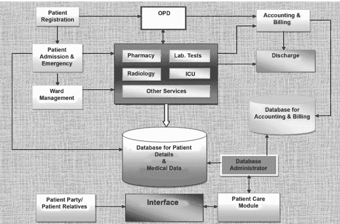

图 8.1 基于物联网的智能医疗管理系统流程图。

来源：重自 Layek and Chowdhury, 2018。开放获取。

#### 8.8.1 远程医疗

在印度，重大变革将影响农村医疗保健。远程医疗系统现在不仅服务于医院到医院的场景，还可以通过移动计算、传感器网络和云计算将远程医疗中心与医生连接起来。一些项目已经运行成功。

在西孟加拉邦，Barrah、Birbhum、Siurg、Bardban 和 Bally 的农村健康亭是由 ITRA Media Lab Asia（itra.medialabasia.in, 2016）在焦odhpur、加尔各答大学、杜尔加普理工学院等大学的帮助下引入的。在亭内，提供了电子健康传感器包，并开发了基于 Android 的应用程序。开发了基于云的数据库并实施了传感器-云基础设施。当患者来到亭内时，他们首先向亭的健康服务提供者提供测量数据。他们连接了一些基于传感器的电子健康包，坐在屏幕前，分配的医生通过视频通话协助他们。基于 Android 的系统将患者数据实时发送到医生系统。然后医生通过在线发送处方，亭打印带有数字签名的处方。这可以引入远程地区门诊服务的医生问题，从而使全民健康延伸到印度最偏远的地区。

云计算和基于 Android 的门诊医疗交付系统或现代远程医疗的成功故事，为支持基于物联网的“全民”主题的智能医疗目标提供了理念。

#### 8.8.2 数据库和医疗记录

物联网系统使电子医疗记录更高效。医生可以随时方便地接触患者，患者的所有体征统计也会实时传给医生。数据库本世纪的首要成就之一，本世纪始于数据驱动技术，最终变成了基于人工智能的世纪，物联网在其中发挥着巨大的作用。在医疗记录中，可以通过物联网和大数据实现一个全国性的智能系统的想法。医疗记录可以存储在基于 Web 的平台上，报告和处方等所有患者数据都保在那里，医生可以在访问时访问（Chhatani et al., 2016）。

## 8.9 整个国家的智能医疗系统——一个可以改变印度次大陆的理念

通过生物识别应用统一所有公民数据的想法已经在印度通过印度唯一身份管理局以 Aadhaar 卡的形式实施。截至目前，登记人数已超过 12 亿（Aadhar card, 2016）。像 Aadhaar 卡一样，可以为印度患者引入一个统一的数据库系统。印度已经有足够的持有 Aadhaar 卡的公民。卡可以与印度的医疗数据库关联。这种模型是一种大规模的智能医疗提供模型，可以连接所有的医院和医疗整合在基于物联网的云计算服务大伞下。其基本模型取决于以下几点：

### 8.9.1 针对所有公民的统一医疗记录

医疗记录服务由医院和卫生中心通过内网提供，对记录的访问仅取决于患者的授权或司法裁定。否则，记录属于医院的财产，他们可以将其用于医疗审计或作为案例研究。

通过 Aadhaar 卡号，政府可以为所有公民实施基于物联网的电子医疗记录，这样就不需要在大多家医院中对单个患者进行唯一身份识别。

### 8.9.2 为什么需要这个？

通常情况下，患者去医院治疗时必须携带多份诊断报告和处方。由于现代私立医院的竞争以及对政府设施的获取，患者通常需要携带大量的报告来记录病史。从长期来看，医院有能力在一段时间内维护医疗记录。由于患者流量巨大，患者无法获得门诊（OPD）记录以及医院的院外记录。现在，如果患者想去另一家医院，他们需要携带纸质报告。由于缺乏意识，患者可能会丢失报告。还有许多其他缺点：

- 1. 患者丢失了纸质记录，不得不进行多次重复且不必要的诊断。
- 2. 如果患者丢失了记录，一家医院无法轻易看到另一家医院的记录。
- 3. 病史无法供医生进行及时治疗。
- 4. 医疗记录未保留导致了重复性的自付费用增加。
- 5. 政府或机构无法衡量治疗标准，导致临床审计质量差。
- 6. 质量测量的执行不力。
- 7. 治疗的时间和成本将变得很高，导致严重患者的死亡和发病病例增加。

### 医疗系统中的深度学习与物联网

现在，如果能够实施患者的统一医疗记录，将出现许多优势：

- 单个患者只会有一个医疗记录号。
- 无需携带纸质医疗记录。只需输入 Aadhaar 号即可输入医疗记录，医生可以在单一平台上轻松访问患者的医疗记录。
- 所有与患者健康相关的数据都更新到国家医疗记录中，如果患者想从提供者处获得服务，任何公共或私立医院都可以访问该记录。
- 公立和私立医院的临床审计将变得更容易并可以标准化。
- 为了实现有效且高效的治疗，可以突出新的研究数据，以研究同类疾病的患者医疗记录。
- 可以衡量不同医院治疗同种疾病的时间、成本和程序。
- 可以在全国实施治疗和诊断的标准化。
- 这有助于政府制定医疗保健政策。

### 8.9.3 实施

这部分的实施非常容易，因为印度已经具备大型数据库处理能力。只需将云端患者护理数据库与 Aadhaar 数据库连接起来。在这里，所有的测试报告、处方以及与患者治疗相关的数据都附在患者数据库中。数据库存储每份医疗记录的方式就像它们存储在医院自己的医疗记录中一样。每家医院都可以访问自己的患者护理数据库，如果患者来寻求服务，就可以查看所有的治疗历史。

患者将携带身份证件去医院。医院将记录身份证件，患者将收到用于授权的许可页面。当患者获得授权后，医院将能够访问患者数据库但不能对其进行编辑。这样，就可以获取患者的病史。

- 这里，Aadhaar 卡号将连接到患者医疗记录数据库。
- 在医院获得患者授权后，患者和医院都可以访问其医疗数据库。
- 3. 医院可以随时访问患者医疗记录中自己的部分，但未经许可无法访问完整历史。因此，如果医院需要，他们可以取消获取自己的医疗记录。因为医院的医疗记录可以在系统中被单独访问。这将大幅减少记录的维护和保留成本。
- 4. 如果像印度医学会这样的适当机构能够访问数据库，那么对所有医院和医疗保健提供者进行医疗审计将变得更容易。
- 5. 政策制定者可以访问此数据库。
- 6. 有了这个系统，临床和医疗审计变得非常简单。

患者家属可以实时、透明地追踪患者的用药和账单。医生可以发送带有数字签名的处方，所有的诊断报告都可以上传到设施中。这将缩短每个部门的时间。通过这种智能流程，可以减少在所有部门之间走动的需求。它将缩短报告、处方、手术、诊断程序流程、出院总结和计时的时间。

## 8.10.4 手术室

通过物联网（IoT），手术室可以配备多个传感器，用于检测环境中任何变化。这种智能系统可以减少从脏区域到手术室洁净及无菌区域的污染。通过智能物联网传感器进行有效分区可以减少医院感染（交叉感染）。

## 8.10.5 中央消毒供应供应部

## 8.10.6 医疗废物管理

通过实施基于智能物联网的系统，可以减少大量的医疗废物。该系统还可以检测医疗废物的泄漏或溢出。追踪器可以指示医疗废物的收集和分类。分类后，智能指示器会报告处理过程以避免任何错误。通过对药物和设备进行智能意图管理可以减少医疗废物。智能化可以减少容器不匹配、废物错误移除或错误处理导致的分类和处理程序错误。

## 8.10.7 节能

有效的基于物联网的传感器和照明系统可以节省能量。它可以确保不使用的机器进入睡眠模式并仅在需要时使用。智能照明系统可以减少部门的电费。

## 8.10.8 洗衣与床单服务

有效的基于物联网的床单和洗衣服务可以节省时间并去除使用床单上的污渍。医院可以轻松识别脏污和净床单，并轻松存储可能已过期的未使用床单。

## 8.10.9 床位管理

智能物联网可以计算医院的入住率，从而向入院科和急诊科发送信号，释放患者到病房/ICU或其他区域。智能床可以减少移动监护仪并直接将生命体征发送给医生或护士，并在任何紧急情况下向他们报警。


## 8.10.10 控制人员和细菌流入

智能物联网系统可以轻松检测环境变化，因此可用于检测安全区域的非法访问，控制住院患者的访客和陪同人员，并在治疗患者或其他任何情况后使用手消毒液。它可以与 `HVAC` 系统结合，以控制患者区域内的气候。

## 8.10.11 护理护理

物联网可以计算用药流程。因此，当出现用药时间时，可以帮助护士照顾无法手动使用护理系统的终末期患者。智能监护器还会就突然的变化、患者体液输入（如盐水）或持续释放提醒发送信号给相应的部门。

## 8.10.12 诊断

智能诊断可以减少患者暴露于辐射危害的机会，准确分析受影响区域并向医生建议治疗方案。它可以帮助生成 3D 建模系统。

## 8.11 智能医疗系统框架

智能医院使用生物传感器、无线技术（如 `Bluetooth`、`RFID` 等）在基于云的数据库拓扑结构中连接并跟踪多个监护器。该信息系统包含所有部门，如患者个人数据、病史、注册和入院、过去的处方、计费部门、医生门户、医疗记录、手术等。基本上，通过智能标签进行的患者识别和患者数据连接到医院或连锁医院的云端数据库。医院的管理信息系统连接到这个云端数据库，医生或护士可以访问门户，利用物联网技术远程查看患者的直播信息。他们甚至可以使用基于物联网的服务（支持 PC 或智能手机应用程序）来远程控制机器。


## 物联网 (IoT) 的医疗应用

关于智能医院的基本模型，我们可以从文献研究中找到一些，例如：

### 网关数据系统


图 8.4 智能医院架构（重绘）（Yu 等，2012）。

该模型是基于 Yu 等人（2012）的假设性模型，分为感知层、网络层和应用层。现代基于物联网的智能医院正在使用嵌入式技术、传感器网络、无线通信、`RFID` 等多种工具。云计算技术将用于建立此类中心，医院的智能中心可以通过异构平台（如智能手机 `Android` 或 `iOS`、`Windows PC` 平台、`Bluetooth`、`Zigbee` 等多种设备）连接起来。生物传感器接口将与计算系统和云数据库系统建立连接，医生可以直接监控患者的健康状况。报警应及时通过传真机、短信或其他任何方式发送给医生。主要的局限性是使用基于 `IP` 的物联网平台，从长期来看，为不同设备设置单独 `IP` 地址可能并不适用。为此，可以使用另一种统一系统，不需要更改 `IP` 地址，而是形成并激活便携式地址。基于多个输入的智能医院架构将由一个云计算系统进行存储和监控，以便通过系统化过程处理所有输出。通过数据库管理系统

238

医疗系统中的深度学习与物联网

医疗程序直播到相应的部门，并需要传感器对过程进行持续监控以发现故障。在这里，任何泄漏或故障都会向系统发送错误输入。机器的低功耗和低能耗对于托管此类大型拓扑结构至关重要。物联网传感器将帮助维护机器的最佳状态，从而停止不必要的电力消耗（Shah 等，2018）。对多项管理和临床数据进行审计对于系统的流畅运行非常重要。该领域可以使用开源软件，以便在需要时修改和实施新的系统或子系统。开源软件更具成本效益，且具有修改自由。医院信息系统应建立在云数据库系统中，以便使追踪变得简单且本质稳健。

## 8.12 结论

物联网为医疗领域提供了巨大的机会。智能医院和医疗部门是医疗提供者的未来。在人工智能和物联网的帮助下，`ICT` 可以更准确地实施。它将降低医疗成本，提高治疗和护理质量，并创造一个零缺陷的安全未来。

利用物联网（IoT）技术可以将其降至最低。另一个问题是医疗方面的服务错误。通过物联网的实时跟踪和传感器也可以将其降最低。各种管理应用、生物传感器和关节设备协调了患者的整体治疗，这缩短了宝贵的时间并增强了医患关系。

医院和医疗保健提供者国家认可委员会总共有 10 个模块，并且需要大量的纸面工作。通过物联网，所有要求的模块都可以汇聚以建立一个来自各个部门的反馈报告系统，并整合到一个基于云的计算中以查看条款的合规性。如果监控系统良好且传感器能够及时传递变化，就可以管理纠正措施以引入自动化系统。

智能空调（`HVAC`）和灾难控制系统可以通过向任何虚拟事件发送信号来自动防止火灾或类似的灾难，并优先采取纠正行动。通过基于物联网的系统，应急委员会可以轻松识别故障区域并采取纠正措施控制局面。

通过生物传感器和其他机器人以及基于人工智能的现代医疗接口，可以更高效地治疗患者。这将减少错误、耗时间和患者的住院时长。通过物联网和云数据分析可以预测疾病的发生率。通过引入物联网设备，可以很好地监测疾病的流行率并进行监测。设备可以远程控制，例如远程医疗。在不久的将来，自动化医疗中心只需要经过培训的人员来维护连接到无线云计算系统的自动化设备。患者只需到达中心，远程医疗门户将检查患者，使用 `DPI` 技术远程诊断患者，甚至在不直接接触的情况下对其进行手术。这将减少治疗结果中的变量，从而降低患者生命的风险因素。

物联网在康复护理方面也有其作用。假肢、物理治疗助手、护理辅助机器人以及传感器创造了奇迹。它可以照顾老年人和残障人士。在大数据和云计算中，物联网在医疗领域使其其价值最大化。

因此，物联网在医疗行业的技术利用方面具有巨大的效力，并将用于未来的平台。

## 关键词

- 物联网 (IoT)
- 客户价值
- 管理挑战
- 医疗保健
- 传感器与云计算
- 治疗服务

## 参考文献

Amendola, S., Lodato, R., Manzari, S., Occhiuzzi, C., and Marroco, G., (2014). RFID technology for IoT-based personal healthcare in smart spaces, IEEE Internet of Things Journal, 1(2), 14–152.

原子能源监管委员会

Atori, L., lera, A., and Morabito, G. (2010). The Internet of Things: a survey. Computer Networks 54(5), 5277–5285.

Bradley, J., Barbier, J., and Handler, D. (2013). Embracing the Internet of Everything to capture your share of $14.4 trillion. Cisco White Paper. Retrieved from https://www.cisco.com/web/about-ac/79/docs/niot/IoE_Economy.pdf [Accessed July 22, 2019].

Chtlani, A., Dadl, A., Guidwani, M., Kwani, M., Kanade, P. (2016). Portable medical record using using Internet of Things for medical devices, IEEE, e-ISSN: 2472–7555, IEEE Explorer Observer 5, 2016. DOI: 10.1109/CICN.2016.93 [Accessed on August 5, 2019].

Economic Times (2016). https://health.economictimes.indiatimes.com/news/5-million-medical-errors-are-happening-in-india-annually-dr-girdhar-jyani/53497049, August 2, 2016, Economic Times, [Accessed on August 2, 2019].

econsultancy.com, https://consultancy.com/internet-of-things-healthcare/ [Web Accessed on July 27, 2019].

https://medium.com/neodotife/data-lewis-open-aps-acks-artificial-pancreas-afef63a9997f [Accessed on Oct 10, 2018]. April.Life Article.

Esguaguirre, S.P., Iaggartua, M., Hernandez, R.M., Pedraz, J.L. (2012). Systems for cancer therapy: advances in clinical and preclinical research, Clinical and Translational Oncology, ISSN online:1699-3052, 2012, 14: 83–93, DOI: 10.1007/s12094-012-0766-6.

Fichman, R., Lee, M., and Tiwan, A. (2005). Beyond valuation: “Options Thinking” in IT project management. California Management Review, 47(2), 74–96.

Gagan, (2016), IoT based system for person with physical disability, IJREEICE, 4(Special issue 2), 158–160, DOI: 10.1718/IJREEICE/NCAEE.2016.31

Gartner (2014). Gartner says the Internet of Things will transform the data center, Retrieved from http://www.gartner.com/newsroom/id/2684616 [Accessed on July 21, 2019].

nGubbi, J., Buaya, R., Marusic, S., and Palaniswami, M. (2013). Internet of Things (IoT): a vision, architectural elements, and future disputes. Future Generation Computer Systems, 29(7), 1445–1660.

Hewett Packard. (2014). HP study reveals 70 percent of Internet of Things devices vulnerable to attack. Retrieved from https://www.hp.com/us-en/hp-news/press-release. hmid=id74467h*Y0TKvnPf [Accessed on July 25, 2019] hhowitworkday.com, 2016, https://www.howitworkday.com/how-stephen-hawkings wheelchair-robots/, published on January 8, 2016 [Accessed on August 2, 2016] Il, L., lera, A., and Morabito, G. (2010). The Internet of Things: a survey. Computer Networks 54(5), 5277–5285.

Bradley, J., Barbier, J., and Handler, D. (2013). Embracing the Internet of Everything to capture your share of $14.4 trillion. Cisco White Paper. Retrieved from https://www.cisco.com/web/about-ac/79/docs/niot/IoE_Economy.pdf [Accessed July 22, 2019].

Chtlani, A., Dadl, A., Guidwani, M., Kwani, M., Kanade, P. (2016). Portable medical record using using Internet of Things for medical devices, IEEE, e-ISSN: 2472–7555, IEEE Explorer Observer 5, 2016. DOI: 10.1109/CICN.2016.93 [Accessed on August 5, 2019 online].


# 参考文献

Economic Times (2016). https://health.economictimes.indiatimes.com/news/5-million-medical-errors-are-happening-in-india-annually-dr-girdhar-jyani/53497049, August 2, 2016, Economic Times, [Accessed on August 2, 2019].

econsultancy.com, https://consultancy.com/internet-of-things-healthcare/ [Web Accessed on July 27, 2019].

https://medium.com/neodotife/data-lewis-open-aps-acks-artificial-pancreas-afef63a9997f [Accessed on Oct 10, 2018]. April.Life Article.

Esguaguirre, S.P., Iaggartua, M., Hernandez, R.M., Pedraz, J.L. (2012). Systems for cancer therapy: advances in clinical and preclinical research, Clinical and Translational Oncology, ISSN online:1699-3052, 2012, 14: 83–93, DOI: 10.1007/s12094-012-0766-6.

Fichman, R., Lee, M., and Tiwan, A. (2005). Beyond valuation: "Options Thinking" in IT project management. California Management Review, 47(2), 74–96.

Gagan, (2016), IoT based system for person with physical disability, IJREEICE, 4(Special issue 2), 158–160, DOI: 10.1718/IJREEICE/NCAEE.2016.31

Gartner (2014). Gartner says the Internet of Things will transform the data center, Retrieved from http://www.gartner.com/newsroom/id/2684616 [Accessed on July 21, 2019].

Gubbi, J., Buaya, R., Marusic, S., and Palaniswami, M. (2013). Internet of Things (IoT): a vision, architectural elements, and future disputes. Future Generation Computer Systems, 29(7), 1445–1660.

Rashidi, P., Mihalidis, A. (2013). A survey on ambient-assisted living tools for older adults. IEEE Journal of Medical and Health, 17(3), 579–581.

# 第9章 移动应用支持的医疗系统

**VIKRAM SANDHU*** 和 **HARLEEN KAUR**

古鲁纳纳克德夫大学，印度旁遮普邦，阿姆瑞则尔

*通讯作者。电子邮件：`Sandhu.vikram@yahoo.com`

## 摘要

本章探讨了移动临床及健康相关应用的最新水平。我们讨论了“作为医疗设备的应用”这一概念以及相关的监管控制。世界在人际通信领域经历着一种非凡的现象。这使得人们能够跨越巨大的地理距离进行通信，这在以前是无法实现的，特别是在发展中国家。手机由于其高渗透率，具有巨大的潜力，为国家提供了以前无法想象过的机遇。中国是移动手机用户最多的国家；印度是全球第三大移动手机用户国，其中近56%的人可以在设备上接入互联网，平均每天使用3-4小时。在美国，83%的人拥有手机，60%的人可以使用宽带服务。研究发现，印度农村地区在手机引入的“渗透率”和“远程医疗”方面显著增加，这将进一步使移动健康（m-health）行业成功触及14亿总人口中的5亿人。Pew研究中心和美国生活项目2015年的智能手机用户研究发现，17%的成年人和25%的年轻人使用手机寻求整体健康信息。

谁没有看过这十年最伟大的电影《终结者》？他们在里面使用了“天网”？什么是“天网”？它是物联网（`IoT`）的概念。这个案例的吸引力是无限的，具有改善我们生活的惊人承诺。世界正在进入许多人称为物联网的计算时代，其中“事物”指的是具有唯一标识符、嵌入式系统以及通过网络传输数据能力的实体或物理对象（Alexia Mourtoul，《物联网文章》，2015年）。物联网在医疗保健行业中提高电子设备的准确性、可靠性和生产力方面发挥着重要作用（《通信杂志》，2017年4月）。根据`Gartner`（一家技术研究和咨询公司）的预测，到2020年，物联网设备将达到280亿个。物联网通过监测远程健康和新兴通知系统改变农村地区的状况。物联网的概念之一是移动健康，通常被称为`m-health`。`mHealth`为医疗领域常见的一个问题提供了一个优雅的解决方案：如何在高度动态和分布式的医疗机构中在需要的地方获取正确的信息。未来的年龄组可能很好地观察到疾病治愈和解读方面的剧变。ASCO主席Bruce E. Johnson表示，新兴的副作用可以以目前技术更快的速度进行解读和治疗，这种技术的飞速发展极大地便利患者及其医生消除无疾病环境障碍的护理（ASCO会议，2018年6月）。移动应用涵盖了整个医疗链，即信息收集、干预、识别、管理和观察。然而，医疗专业人员和患者目前充斥着健康应用，最终他们可能会在不理解实用性的情况下，在决定正确的应用时感到困惑。特别是与健康相关的应用程序是多样的，从上述观点观察到的，这清楚地描绘了风向。

## 9.3 定义 mHealth

1. **电子健康（`eHealth`）**：由计算机、手机和卫星通信组成的信息通信技术将利用电子信息用于医疗服务。

2. **移动健康（`mHealth`）**：移动信息的使用——如个人辅助设备（`PDA`）和手机——用于辅助医疗服务和应用。

`mHealth`和`eHealth`结合在一起——两者都用于增强健康状况，其技术结合运行。例如，涉及数字患者档案和电子“病历”编制的各种`eHealth`项目，这些病历最好能够在国家计划内监管使用患者数据的权利（联合国基金会报告，2009年）。

移动设备为医疗保健通信研究提供了新场景。`mHealth`或移动健康被描述为“在移动设备中交换重要信息并使用网络用于医疗部门的实践”，这是一项活跃的创新，通过利用全球手机的功能和无处不在，实现了消费者与交付物之间的重要通信，并有助于对潜在疾病采取预防技术（Dutta等，2016年）。目前，还没有关于`mHealth`的标准定义。根据全球电子健康观察站，通过智能手机和各种网络相关设备提供的培训被称为`mHealth`。

## 9.4 为什么要用 mHEALTH？

此时感觉整个世界——包括电信公司、服务提供者、非政府组织，尤其是批评者——都渴望在用法上加上“m”作为前缀。发展中国家在被问及健康时，得到了“m”的巨大答案。手机简单易懂的功能使得任何群体都能被触达。一旦用户之间分享他们的智能设备，提供给客户的广泛益处将进一步扩大（Meachal, 2006年）。例如短信服务等设施可以让他们获取每日剂量或预约挂号。去中心化的健康系统可以通过健康相关软件应用的进步实现中心化，因为它们提供了实时反馈、预设的自动化服务以及许多其他服务。

慢性疾病的进展和治愈发生在传统临床环境之外的日常生活中。医生非常依赖患者关于警告信号、副作用和目标状态的记录。通常情况下，诊所就诊的患者记录相隔数月，且准确性可能变化很大。`mHealth`为患者随时收集和分享相关数据创造了可能性，而不仅仅是在他们就诊时，允许快速收敛到最佳治疗方案。例如，癫痫患者能够自我报告所服的药物和剂量，以及发作的量和程度，应用程序将这些数据实时传输给医生，医生随后寻找反应模式并指导患者相应地调整药量。

## 9.5 全世界的mHealth及其应用！

十二种常见的`mHealth`应用（重绘）（Labrique等，2013年）。

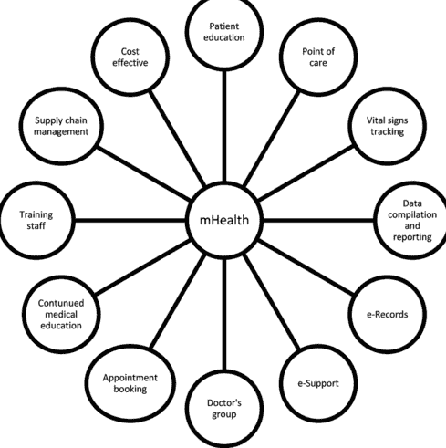

### 9.5.1 患者教育

上述移动健康（`mHealth`）方法的应用基本上以消费者为中心，制定了一种新的信息交流方式，旨在提高消费者的认知水平，改变其方法从而塑造其行为。

> 例如，`Toothflix 2.0` 包含了英语和西班牙语视频，并进行了相应的安排以便快速访问。该应用程序是健康意识培养、案例研究接收、知情同意或娱乐的重要患者信息交换工具。更新的内容反映了美国牙科协会（`ADA`）的临床标准。每段视频都展示了牙科问题和管理的 3D 动画，并由受影响的患者让真实患者感到安心。

### 9.5.2 旁旁检测

涉及智能设备的内在集合，或将智能设备连接到集成的、自主的外围设备，该设备可以协助检查患者，从而扩展社区甚至患者家庭的健康服务覆盖范围。

> 例如，`EyeQue Insight` 应用程序允许您测试视力。其专利技术可以在不到 3 分钟内完成从 20/20 到 20/400 的远视筛查；因此患者可以随时了解自己和家人的视力需求。在启用家庭共享的情况下，最多有 6 人使用此应用程序。它以英语为主语言，4 岁以上的儿童可以使用它。

### 9.5.3 生命体征追踪

基于智能手机的注册设施有助于识别和列出合适的客户（主要针对明确的设施），旨在增强方案在开发绝对和准确护理方面的责任，以识别并减少疾病结果的差异。通过支持移动应用程序的医疗保健系统跟踪关键事件，有助于维持主要发展指标的人口记录，如产妇和新生儿率。

> 例如，`Pizma-G Medical Innovations`——它是 `G-Medical Priz` 设备的配套应用程序——您的个人健康追踪器；通过此应用程序，您将获得健康量的全面概述：心电图（`ECG`）；心率、血氧饱和、温度、压力水平评估。此外，还可以追踪血压、体重和血糖水平，并手动添加其他第三方设备获取的结果。还提供了设置提醒的选项，让您再也不会忘记进行测量。

### 9.5.4 数据汇编与重组

全球移动健康实践的最初变化之一是，它允许一线人员和医疗系统从纸质支持系统转向近时的报告或患者数据记录，即电子记录（`e-records`）。记录的汇编从服务器开始，根据时间、位置或涉及的人员来解读医疗系统或疾病的统计数据。

> 例如，`Advanced MobileDoc` 与 `Advanced EHR` 完全集成，我们创建或更改的任何内容都在安全云中完成，并立即供您的员工使用。它有助于安排和管理预约。它可以传输、打印并电子化更新处方，并使用 `Advanced EHR` 中的任何模板创建患者备注。它具有查看和签署实验室结果，以及查看患者病史、保险和责任方的功能。还包含了许多此类功能。

### 9.5.5 电子记录 (e-RECORDS)

电子健康记录仅对关注相同患者的人开放，允许医疗专业人员在受限计算机上使用患者记录。移动健康通过允许打破这些壁垒并匿名提供记录给予了它应有的推动。现在，医生可以在移动健康系统中电子记录他们提供的治疗，并在整个系统中记录患者测试结果，以从记录中获取患者账户。

> 例如，`GenexEHR` 是一个简单的应用程序，用于控制健康信息，将我们从纸质世界的束缚中解放出来。这让医生、护士具有灵活性在需要的时间和地点安全地访问和共享我们的健康信息。它具有在医疗文档中捕获和维护纸质患者检查、处方、X 射线等的功能。它允许我们维护和共享血糖计、血压和体重读数，查看处方并获取个人药物的提醒。

### 9.5.6 电子支持 (e-SUPPORTS)

它包括知识、程序、规则和注册，确保医疗人员遵守规则是实施多方面护理策略的核心。基本上，任务的转变（例如将筛查测试责任从医生转移给护士）通常需要调整针对实验人员的流程，以符合受限的正式指南。移动健康方案将实时护理维护工具与机械分类相结合，并依赖于原则，通过让医疗人员及时遵循定义的规则，在这些任务变化的情况下帮助确保治疗价值。

> 例如，`eASYApp` 电子抗微生物决策 - 一个所有实时服务、决策、可持续性和纠正工具的集合，支持抗生素管理相关任务。该应用程序为医生、制药公司和其他辅助医疗人员提供实时解决方案，并根据剂量和标准的抗生素交付方式提供关于所有年龄段正确且抗生素相关的肌酐清除测试的检查建议。纠正工具支持效益识别，包括通过可下载的 `AMS` 团队参与记录汇编表观察抗生素管理系统的演示，甚至是标准的加可下载的推荐常规研究和减量治疗研究。

### 9.5.7 医生群体

远程医疗技术的手段之一是它通过智能手机帮助医生之间进行信息共享，这对于医疗专业人员在正确的时间和地点通过专家指导来协助关联治疗非常有用。此外，信息共享涉及视频、记录和语音；但智能设备允许所有这些形式的互连。

> 例如，`Curofy`——一个主要面向医疗专业人员的私人健康应用程序，支持他们保持更新，特别是在医学新进展领域，包括医学期刊的变化甚至是医生之间的实际病例咨询，以便他们在执业中保持顶尖。医疗专业人员可以讨论各种医学专业，与其他专业人员共同职责。该应用程序每天讨论的病例不少于 300 个。该程序还提供了来自 `IMA`（印度医学协会）的最新医学指导原则和声明，帮助医生关注最新的 `IMA` 活动和继续医学教育（`CME`）。该应用程序有助于提供最新的医疗工作信息，并帮助一键申请以及许多许多此类服务。

### 9.5.8 预约登记

工作预约和设置工具通过发送即将到来或延迟服务的提醒来帮助一线人员保持熟悉，从而通过使医生复诊成为优先来增强责任。发展中国家的环境往往存在医生限制，导致利用旧的纸质技术进行定期复诊成为一个问题。

> 例如，`Asian Connect`——它让人们连接到 `Blue Sapphire Healthcare Private Limited` 的亚洲医院链。它提供了方便的工具，通过智能手机管理您的健康。我们可以搜索医生和科室。制作和管理预约、管理病史、访问实验室报告、提供服务反馈。人们可以轻松安排预约、访问医疗报告并获得专属折扣。

### 9.5.9 持续医学知识

持续医学教育是发达国家治疗的主要基础。智能手机被用于向需要处理事务和远程医疗的医生专业人士提供定期指导，通过使用教学视频、教育性文本以及包括协同培训在内的内容，这些培训可以在实践环节期间加强技能。

> 例如，`CNL`：临床护士领袖问答——帮助护士们充满信心地准备参加 `ACCN` 临床护士领袖认证。它包含了 360 多个未解决的问题，并附有详尽的描述，其图像由专家制定。包含 220 多道困难性提问、250 多本描述性电子书以及 160 多个必知词汇条款；数百种准备策略和建议；目标涵盖所有患者评估、医疗策略、并行管理、基于证据的培训、案例研究及许多其他服务；并通过结果跟踪提供帮助，让每一个微小的点滴汇聚成巨大的成就。

### 9.5.10 员工培训

医疗专业人员经常在农村地区之间工作，与管理专业人员的接触较少。电子控制面板管理员可以通过通信电子输出量，甚至通过专业人员执行实地工作时进行的潜在时间 `GPRS` 跟踪，在自己或不同水平上跟踪社区健康专业人员的日常工作。

> 例如，`Touch Surgery`：拥有为不同手术检查准备的手术视频，帮助随时随地通过触控来学习新实践和检查信息，它是医疗专业人员和外科医生研究的屡获殊荣的手术实践平台，并被全球最重要机构的研究。超过 100 多个美国住院医生计划使用了它，并获得了 `AO` 基金会（美国手外科协会）的授权。它提供了手术动作的描述性模拟，无论何时何地都能为手术做准备。它帮助从顶级医生那里掌握新技术。

### 9.5.11 货物与服务的流程管理

移动健康应用直接指导并处理必需商品的库存和设施，使其受到了全球范围内的广泛关注。在许多国家，允许远程中心或药店记录并传输药物和其他设施的库存水平，以便以电子方式订购额外供应品的简易应用已得到实施。

> 例如，`Syft` 同步软件 `4.0.1.02`——供应链管理应用。它是一个用于企业级库存可见化和控制的综合平台。在孤立状态下管理供应相关活动没有帮助。`Syft Synergy`——一种平台解决方案——有助于弥补鸿沟，提供供应链的全面可见性和控制。它包括主数据管理、库存服务、仓库、围术期使用点、程序使用点和配送等功能。

### 9.5.12 成本效益

移动健康和移动投资正快速连接财务运营与医学领域，导致医疗保健、设施或药物的支出。它创建了更易组织和管理的供需策略。这些计划侧重于减少患者的财务差距，并正在尝试新方法影响医生遵守规则和/或提供高质量的护理。

> 例如，`星星保险`——印度最大的保险公司推出了同类首个移动应用，为客户提供即时保单续保、跟踪理赔更新状态、附近的星级网络医院、当地的分支机构、一键联系客户和医疗建议免费热线电话，并获取各种产品的报价并在无需任何文件的情况下轻松购买，这些都是该健康应用的一些功能。

## 9.6 现有的移动应用程序

在当前的十年中，关于利用现有智能设备信息提供网络相关远程医疗的研究已经增加，主要在发达国家，供普通公民和武装部队使用。但不断上升的设备成本和当前阶段智能设备电信服务的受限带宽，限制了这些服务在医疗组织一般潜力部门内的广泛应用。然而，在过去的几年里，学术文献中提到了一些基于 `3G` 和 `4G` 的具有医疗无线技术的新兴 `mHealth` 应用（Kotz, 2011）。

### 9.6.1 现有无线技术用于 m健康的局限性

1. 缺乏一种灵活且互联的、多种移动电信远程医疗技术。这种连接子集的缺失是因为电信实践与现有智能设备使用指南之间实现功能性具有复杂性。

2. 由于信息连接价格高昂，全球智能设备与卫星之间的限制依然存在。

3. 由于带宽限制，智能手机互联网连接和通信权限的访问受限。

4. 医疗等复合部门很难改变。主要的改变是该领域为了帮助建立远程医疗平台而经常需要的管理变革。这些必要的管理变革主要影响医疗专业人员和其他医院工作人员如何由于这些变化而减少或增加权力。

5. 医疗专业人员和医疗部门的小额及长期成本和运营状况并不完全明确。

6. 智能技术的主要费用手段需要改进和指导。


- 7. 观察到，要求专家行使手机远程医疗的权利短缺，因为它被认为是一种额外的负担，且他们没有因此奖励。

# 9.7 mHealth 的特征分类

根据 mHealth 的定义，可以根据医疗信息激增的原因和目的特征进行分类：

## 医疗保健移动应用程序启用系统

- 1. 患者到管理员
- 2. 患者到医生
- 3. 医生到医生
- 4. 医生到专家系统
- 5. 患者到医疗患者关系管理系统

根据案例组，mHealth 系统可以归类如下：

- 1. 针对患者的 mHealth（治疗性 mHealth）
- 2. 针对健康人的 mHealth（预防性 mHealth）
- 3. 针对慢性病或脆弱患者的 mHealth

根据利用技术的分类如表 9.1 所示。

### 9.7.1 使用健康应用引起的各种风险

- 问题（见表 9.2 和 9.3）（Whittaker R, 2012）
- 机会（见表 9.4）（Thomas Martin, 2012年8月）

| 表 9.1 移动应用传输速率 |
| :--- |
| mHealth 技术 | 移动应用传输速率 | | | |
| :--- | :--- | :--- | :--- | :--- |
| 移动设备使用的应用数量 | 受限 | 受限于中范围：WLAN 802.11a/b | 高范围：GSM/GPRS, CDMA | 高范围：UMTS |
| 单应用 多个应用 | <1 Mbd | 2–54 Mbd 10–115 kbd 0.144–2 Mbd | | |
| | <1 Mbd | 1–27 Mbd <10 kbd（保证传输容量）<1 Mbd | | |

注：Bd，波。

为了让顾问和官员关注发展的 mHealth 任务，还需要提供可持续性和衡量能力。在可能的情况下，移动手机在医疗服务中的应用可以归括为两点：第一，作为医疗机构内出于各种原因使用智能手机的计划参与课程；第二，一种粗略的冲动。

## 表 9.2 使用健康应用引发的各种风险

| 按严谨程度递排序的各种风险 | 受影响的主要利益相关者 | 威胁可能发生的情况示例 | 管理该威胁的补措施 |
| :--- | :--- | :--- | :--- |
| 声誉受损 | 医生/协会 | 应用显示了有关医疗人员提供服务的响应数据 | 提高安全性 |
| 机密性受损 | 消费者（在此情况下为患者） | 消费者记录安全性低；由于设备处理不当导致消费者数据丢失 | 编码；避免不当处理消费者数据存储设备 |
| 消费者数据质量低 | 消费者（即患者)/医疗人员/医院（如运营记录） | 应用允许将不恰的数据输入消费者报告，或在被他人处理时允许检索 | 在准入和从真实应用检索时进行数据验证 |
| 弱势生活方式或临床选择 | 消费者/医疗人员 | 在差异测量细节中使用了错误的消费者报告；不恰的信息或探索工具；建议或统计不足；不安全的通信 | 确保检索到适当的数据；确认统计已妥善编码；使用证明能显示健康变化的行为方法 |
| 不恰但可更改的医疗行为 | 消费者/医疗人员 | 药物建议不足 | 基于样本数据进行的测试提供建议；对反馈机制做出反应 |
| 不恰且不可更改的医疗行为 | 消费者（即患者)/医疗人员/医院（问责经验） | 不恰的统计控制应用程序的各种活动 | 接受保护且重要的软件设计和创新技术；系统化地确保设计、测试编码和用户界面 |

## 表 9.3 mHealth 实施面临的问题

| 领域 | 关注点 |
| :--- | :--- |
| 规则与授权 | - 隐私和记录安全<br>- FDA 对医疗服务 mHealth 提案的指南<br>- 国家间的医疗服务以及对医疗习俗工作的尊重（如诊断指令）<br>- 信息测量或范围访问权限 |
| 移动系统 | - 各种网络之间的协议<br>- 各种政策和专利方案之间的协议<br>- 对个人或消费者的收费<br>- 地区的报告 |
| 健康组织 | - 可持续行业设计的不恰示例<br>- 补偿不足<br>- 对 mHealth 评估的不恰纵<br>- 医疗角色的职责与医疗系统的整合<br>- 整合到电子记录和健康通信方案<br>- 健康通信技术优先于更广泛的前瞻性价格 |
| 移动健康实践 | - 需要更有效方式的信息需求<br>- 对应用或特殊人群的关注错误<br>- mHealth 的权威性<br>- 未经评估且在假设或确认中无来源的免费应用<br>- 通过演示平台或专利方案提供的未连接或孤立项目 |
| 探索 | - 需要专家指导的研究<br>- 需要证明其用性和成本效益<br>- 研究与专家进展在速度和灵活性方面的差异<br>- 服务不足人群的覆盖范围或使用权 |

## 表 9.4 解决 mHealth 问题的机会

| 部门 | 机会 |
| :--- | :--- |
| 规则与授权 | - 联盟级控制<br>- 电子商务与健康服务的同步<br>- 合作的共同价值 |
| 移动系统 | - 开放架构或统一边缘的考虑<br>- mHealth 服务协作与关联 |
| 健康组织 | - 利用当前健康转型的机会（例如：发现项目；电子健康报告服务的竞争；鼓励区域项目和估计） |
| 移动健康实践 | - 与消费者联系以扩大对他们困境的解释<br>- 建立有效的理论和确认<br>- 用于复制和发展的合作与相互教育，人口记录整合以及健康服务的融合<br>- 考虑开放式服务和其他减少进一步完善完整集成方案障碍的手段 |
| 探索 | - 考虑替代研究过程以提高速度并保持稳定性，包括对类比的仔细反思<br>- 增加增加访问的评估<br>- 有影响的研究打印和主动入侵测量 |

**可持续性问题：** 范围和规模（Arul Chic, 2013）。

实体的利用和接受。引用文献中整合的大多数研究都在关注早期发生，即没有扩展执行的试点研究。

# 9.8 智能手机增强发展中国家健康的潜力

与 mHealth 的成本效益和扩展性同样重要的是，它提供一种处理有前景健康需求的有效手段的能力。医疗专业人员指出，在未来几年里，发展中国家的官员和健康服务人员将面临费率，以及更长的寿命。

## 医疗保健移动应用程序辅助系统

### 9.8.1 发展中国家的未来健康需求

## 9.9 这些健康系统的影响

### 医疗系统中的深度学习和物联网

#### 9.9.2 增强型健康应用结果

1. 发达国家面临着与那里建立的情况不同的财务和教育状况，研究工作的影响可能表现为相关项目，主要是因为发达疾病在发展中国家变得非常泛滥。

2. 世界糖尿病基金会提议……由于移动健康设施在该世纪下半叶被放置，现在正在增加适当的数据，这表明大多数预期收益正在发生。这些研究与发达国家开展的研究相平衡，在那里智能手机的普及水平比十年前有了飙升，这开始创造一个显著的证实，通过对移动健康计划和项目的规划和执行，可以获得健康产品和能力性收益（联合国基金会，2009）。

#### 9.9.1 增强患者健康

关于移动健康系统的引用医学研究显示，长期移动健康执行的报告日益增加。患者健康在许多方面得到了增强。与治疗方案的依从性：2010年的一项泰国研究建议，每天收到药物提醒短信的糖尿病患者依从性增加到 90% 以上。一个名为 `SIMpill` 的应用程序利用移动技术观察和记录药物依从性也显示了信心。

有效性意味着更好的护理质量。通过能力，可以实现并扩大更广泛的人口收益，并且服务系统可以得到加强。公认的有效性示例包括：

## 移动应用支持的医疗系统

健康效率，表现为持续、可重复的在健康或财务方面不断增强的成果。

4. 这类研究工作对于发展中国家尤为重要，保证人应持续持续评估增长情况，以确定感知的相关证据，并加强全球衡量项目的研究。

## 9.10 多方利益相关者的激励：移动健康价值链

成功且合理的移动健康项目的一个关键特征之一是建立强大的企业，主要是防止营利或非营利部门的阻碍系统。为了汇聚他们的活力和资源，有必要深入理解这些不同利益相关者的需求和要求。识别这些优势的一种方法是通过价值链调查，或者对产品或服务在营利或慈善模式下的所有机构和活动之间的关系进行评估。下表列出了移动健康价值链中从消费者到设备贸易商的各种参与者（联合国基金会，2009年）：

| 消费者或居民（移动用户） | 增强的健康结果 |
| :--- | :--- |
| 医疗服务提供者 | 获得更熟练和实用的医疗服务 |
| 非政府组织 | 推进组织目标和宗旨，吸引资金 |
| 机构 | 卓越的组织目标 |
| 行政部门或立法者 | 高效的医疗条款和高效的管理 |
| 设备供应商 | 设备收入创造，增强品牌意识 |
| 服务提供者 | 从服务费用中盈利，增强订阅者支持 |
| 应用相关交付物 | 从额外的应用程序授权费用中盈利 |
| 物质管理 | 提高读者数量或收益 |
| 机会提供者 | 从销售中盈利 |

## 9.11 移动健康的主要成就

根据移动健康文献的结合以及对当前服务机会的观察，给出了以下对于确保各国移动健康系统的可扩展性和可持续性至关重要的因素（Akter and Ray, 2010）。

### 9.11.1 以患者为中心的结果

以患者为中心（不依赖于医疗机构）的医疗保健正成为一个主要问题并获得动力，因为所提供机会的可持续性和患者的权利紧密相关。正如 Hau 所言，“研究无非是在早期阶段对消费者医疗需求的关注。”通过关注患者需求，已经确定了以下分类，这对于确保组织增长至关重要。

* **负担能力：** 移动健康计划确定的主要问题之一是确保服务在负担范围内。有必要考虑各种方法，利用无线网络通信来降低向人群提供医疗服务的费用。这是移动健康重大扩展的问题，其关键在于提供具有成本效益的服务的能力。
* **可及性：** 数据分发设置和移动健康网络的扩展性主要受到网络问题的影响。发展中国家面临网络覆盖的主要问题，这反过来影响了移动健康应用的交付。例如，印度农村的健康管理引入了初级医疗呼叫中心来接收各州的电话；但由于智能手机网络覆盖弱，每天的电话都会被中断。
* **响应性：** 有 40% 的人口不了解移动健康服务。因此，通过利用所有类型的大众媒体（如电视、广播等）进行严谨的通信服务，让他们警惕这些应用程序及其可用性是非常关键的。这将使移动健康服务能够对其的使用创造更高的需求。意识的受限被观察为医疗交付物在启动、实现和维持健康移动应用方面所面临的障碍之一。
* **适用性：** 最简单且经过验证的无线应用程序具有超越围墙限制的预期优势。在这种情况下，智能手机在推进移动健康平台方面处于有利位置，因为基础已经建立，全球总人口中约 50 亿人巨大的接受。即使是基于智能手机的简单应用（例如 `cureit` 或 `Alert txt89` 平台）也有广泛的用户接受，因为它们提供了简单、廉价且实用的解决方案。

### 9.11.2 服务价值

价值应该是所有移动健康应用的核心，以对承诺更高水平的关注。质量权利一直是医疗保健的主要考虑因素之一，即使服务是通过通信技术等不同模式交付的。价值降低是医疗机构面临挑战的主要问题，导致医疗专业人员及其员工额外的成本和关注。服务模式缺乏可靠性和能力正成为移动健康实践组织面临的一个大挑战，特别是在医疗交付物的信息和效率、信息的隐私和安全方面，此外还有对履行、未来目标和健康生活价值的影响。以下制定了不同类别，以要求采取立即行动。

**提供者的信息和可靠性：** 只有少数医疗专业人员拥有教育、指导或经验来习惯具有多样化功能、复杂且不可靠的应用以及严重信息丢失风险的设备持设备。事实上，为了引入健身设施，有必要获得额外的信息以及安全高效地使用智能和各种应用程序的能力。充分的准备应允许专家提供极佳的管理决策。

**访问量和检查设备：** 用于提供医疗服务的移动设备存在缺陷，医疗服务提供者应该理解并采取行动。有很多限制，下面列出了其中几个：

1. 屏幕尺寸——屏幕越大对用户越好。
2. 处理器性能——处理器性能越强对用户越好。
3. 内存——内存越高，存储的信息越多。
4. 带宽——带宽越好，设备的扩展性越好。
5. 电池寿命——电池寿命越长，增强用户知识的时间越多，即使在紧急情况下也可用。

这些限制通常限制了他们使用智能应用程序的能力。观察到，在显示尺寸有限和图像增强设备减少的情况下，往往会混淆移动应用程序，例如血糖指示。

* **有效兼容性：** 移动健康应用的复杂性需要以极其完美的方式使用无线模式、互联网和各种网络。因此，不同模式之间的有效兼容性是移动健康解决方案面临的一个巨大问题。高速通信系统在许多发展中国家的环境中仍然无法获得。这可能会延迟一些需要整合语音、可视化和记录改进价值的复杂移动健康应用的行动。

* **事实可交换性：** 对于任何国家而言，通信安排交换信息的能力是增强综合健康通信方案的关键点。但是，由于各种通信系统的限制，这一点被忽视了；这反过来阻止了对这些系统交换的重要信息的访问。例如，在孟加拉国，智能医疗应用程序模式支持的患者记录库和电子健康报告当地医疗行业无法获得；因此，系统之间没有信息交换以增强消费者护理。

## 移动应用程序辅助医疗保健系统

**促进政策与有效环境：** 医疗保健指令需要有利于支持市场创新，同时要具有足够的灵活性以保证设施质量、机密性强化以及治疗的高标准。移动健康（mHealth）的实时研究记录和病例的新变化对于指导监管人员和教育政策制定者至关重要。移动健康应用的展望都应建立在一个决定性的知识和实证基础之上，这将使卫生官员和法律制定者能够根据 Michael 的描述，就如何分配有限健康资源的问题做出更优决策。

## 9.12 关于加强 mHealth 的建议

加强 mHealth 的建议（Tomlinson et al., 2023）：

- 必须重新评估探索原则，以便在加强措施合适时提供支持。
- 对 mHealth 干预措施的支持应与行为改变的可靠理论结合起来，并必须使用至少两种基于受影响行动的程序。
- 有必要建立一个与活跃平台相关的开放 mHealth 框架，并制定应用程序开发指南，以促进易访问且可持续的健康通信。
- 必须发现执行计划（例如通过产品设计来检查干预的各种特征），以获得显著的确认基础。
- 在高收入国家以外的其他低收入国家，加强 mHealth 通常由检查的效率和实用性引导，因此在适当的事实基础上进行解读。
- 不同利益者（如政府、资源提供者和组织）应协助制定原则，以建立改进的自主且商业可行的网络。

## 关键词

- 移动应用程序
- 短信
- 智能手机
- 移动平板电脑
- 移动健康 (mHealth)
- 远程医疗
- 医疗保健
- 评估
- 监管与认证
- 质量

## 参考文献

Akter, S. and Ray, P. (2010). “mHealth–An ultimate platform to serve the unserved”. IMIA Yearbook of Medical Informatics, pp. 1–7.

Kotz, D. (2011). “A threat taxonomy for mHealth privacy”. IEEE Third International Conference on Communication Systems and Networks, Bangalore, India, 4-8 January.

Labrique, A. B., Vasudevan, L., Kochi, E., Fabricant, and R., Mehl, G. (2013). “mHealth innovations as health strengthening tools: 12 common applications and a visual framework"; GlobalHealth:Science Practice, 1, no.2, 160–171. http://dx.doi.org/10.9745/GHSP-D.13-00031.

Martin, T. (August 2012). “Assessing mHealth: opportunities and barriers to patient engagement”. Journal of Healthcare for the Poor and Underserved, vol. 23, 935–941.

Michael, P. N. (2009). “The case for mHealth in developing countries”. MIT Press Journal, vol. 4, no. 103.

Pimmer, C. and Tulenko, K. (2016). “The convergence of mobile and social media: Affordances and constraints in mobile use in low-and-income countries”. Mobile Media & Communication, vol. 4, no. 2, 252–269. DOI:10.1177/2050157915622657.

Tomlinson, M., Rother-Morris, M, J., Swartz, L., and Tsai, A. C. (2013). “Scaling up mHealth: Where Is the Evidence?” PLOS Medicine, vol. 10, no. 2, e100382. www.plosmedicine.org.

Ventola, C. L. (2014). “Mobile devices and apps for healthcare professionals: Uses and benefits”. vol. 39, no. 50, 356–364.

Vital Wave Consulting. (2009). “mHealth for Development: The Opportunity of Mobile Technology for Healthcare in the Developing World”. Washington, D.C. and Berkshire, UK: UN Foundation-Vodafone Foundation Partnership.


Whittaker, R. (2012). “Issues in mHealth: Findings from key informant interviews”. Journal of Medical Internet Research, vol. 14, no. 5, e129 URL: http://www.jmir.org/2012/5/e129/ doi:10.2196/jmir.1989 PMID:2303244.

World Health Organization. (WHO, 2011a). Global Observatory for eHealth series-Volume 3, https://www.who.int/goe/publications/goe_mhealth_web.pdf

World Health Organization. (WHO, 2011b). “mHealth: New horizons for health through mobile technologies: Second global survey on eHealth”. Global Observatory for eHealth Series, vol. 8, 102, ISBN 978-92 4 156425 0 (NLM classification: 26.5).

Yeh, F. Yeh, S.-T. and Fontenelle, C. (2012). “Usability study of a mobile website: The Health Sciences Library, University of Colorado Ansch Medical Campus, experience”. Journal of the Medical Library Association, vol. 100, no. 2.

# 移动应用程序辅助医疗保健系统

## 医疗保健的节效网络设计

AMIT SEGAL*, RAJEEV AGRAWAL², and SWETA NEHA³

¹Sharda University, Plot 32-34, Greater Noida, Uttar Pradesh

²Chitkara University, Rajpura, Punjab

³College of Business, Kennesaw State, GA

*通讯作者：amitsehgal2@gmail.com

## 摘要

物联网（IoT）是一个互联设备系统，具有唯一标识符，能够在网络上进行通信。随着嵌入式可穿戴传感器的快速增长，医疗保健需要一个专门框架来实现实时健康监测、安全诊断和高功率活动。相反，这些设备大多由电池驱动，因此对最小化能耗有强烈需求。本章探讨了由国家和中央政府管理的医疗保健系统面临的挑战，并利用信息通信技术（ICT）、物联网（IoT）及其他相关技术提出了这些挑战的统一解决方案。

## 10.1 医疗保健中的 ICT

“智慧城市”一词对于来自不同地理和社会经济条件的人来说可能有不同的含义。它可能包括教育、基础设施、通信、交通、公用事业、可持续生态、能源等方面的现代化。除了这些，任何城市居民最重要且基本的需求之一是更好且易获取的医疗保健服务。尽管如此，在印度等发展中国家，大多数人口住在农村或小城镇，获得专科医疗服务与长途跋涉和等待队列相关（Strasser et al., 1994; McFarlane et al., 2000; Strasser, 2003; Rao et al., 2011; Krishna and Ananthpur, 2013）。私立医院此类服务的成本迫使经济有限的人转向多专科公医院，那里提供廉价的优质诊断和治疗。这进一步加长了等待时间。

医疗保健是受过培训的医疗专业人员向个人和社区提供的多种服务的结合。整个医疗部门包括各种实体，如概念（如健康参数和疾病）、理念（如诊断技术）、想法（如医疗中心和医院）以及人员（如经过培训的医疗工作人员和临床专家）。这些实体相互支持、控制并互动，构成一个完整的系统（Gullford et al., 2002）。实现智慧城市负担得起的医疗目标面临的挑战主要是：

- 专科医疗基础设施缺乏或缺失；
- 人力匮乏（医生、护士和经过培训的医护人员）；
- 医疗卫生支出低廉且效率低下；
- 农村地区难以获得诊断服务。

这些挑战在农村地区尤为严峻（Reddy et al., 2011）。随着基于 ICT 的技术（如 IoT (Chase, 2013)、机器学习/人工智能等）的发展，人们正不断努力开发一个框架来克服上述挑战（Islam et al., 2015; Deo, 2015; Chung et al., 2016）。基于 IoT 的医疗保健框架也是解决方案之一（Chuchisan et al., 2014; Pasha and Shah, 2018）。与任何国家的分层医疗系统类似，该框架也采用分层架构，并支持医疗服务部门的多个领域。如表 10.1 所示，与现有医疗系统集成的 IoT 框架可以提供智能医疗功能。从远程医疗到电子健康和移动健康（Silva et al., 2015），ICT 的利用正在不断增加，并为医疗领域提供越来越多的支持（Eysenbach, 2001; Istepanian et al., 2006; Veeramuth et al., 2011; Postolache et al., 2012; Flodgren et al., 2015）。已开发出设备提供基于 IoT 的服务，如环境辅助生活（Rodriguez et al., 2015）、慢性病远程监测（Rahn et al., 2016）、在移动期间提供患者监测的智能救护车（Yamada et al., 2004; Beri et al., 2016; Pol et al., 2016; Udawat et al., 2017）等。这些应用大多基于传感器，传感器记录人体生物信号并将其传输到数据聚合单元。数据随后在该单元中进行处理，或发送到中央数据处理单元，以生成关于患者健康状况的临床推理。

机器学习等技术也被用于为患者建议未来的行动方案（Impedovo and Pirlo, 2019）。然而，这些设备和技术尚未成熟到可以完全取代传统的诊断和患者监测方法，也无法与临床专家进行认知协作。目前已有可穿戴传感器，它们可以在无人类直接干预的情况下获取高精度的生理数据。这些数据从简单的体温、脉率到采集心电图（ECG）和脑电图（EEG）信号不等。来自传感器的数据存储在本地的数据聚合器或远程数据库中。从传感器传输的数据可以通过有线或无线网络获取。根据应用程序类型或用户设备，通过不同的网络接入技术向用户进一步提供这些数据。因此，网络在基于 ICT 的医疗系统的整体运行中起着至关重要的作用。

## 医疗系统中的深度学习与物联网

由于数据类型的高度多样化，以及传感器或佩戴者和终端用户在放置、移动和环境方面的随机性，此类网络所需的特性与其他许多使用的通信系统非常不同。与任何其他 IoT 系统类似，医疗系统产生的数据也非常巨大，因为大量用户的健康状况和临床治疗构成了数据源。此外，与许多生成文本或数值数据的 IoT 系统（成像设备除外）不同，这些数据包含了来自病理样本切片和放射设备的高分辨率图像。此外，ECG 或 EEG 等数据是持续生成的，在支持 IoT 的监护或危症单元的远程监测系统中，需要无缝传输。服务质量（QoS）或性能参数在网络资源方面的要求更高，且具有严格的准确性和安全性要求。两个最重要的网络资源是带宽和功耗。

## 表 10.1 适用于各种医疗服务的 IoT 应用

| 医疗服务 | IoT 应用 |
| :--- | :--- |
| 预防性警报 | 常规检查和用药提醒、接种、疾病二级预防指南（弹出警报、短信、电子邮件、任务列表、详细指南） |
| 诊断 | 临床测试的建议检查报告、患者状况信息、医疗紧急情况下的触发备注/警报 |
| 治疗方案 | 基于诊断报告和相似患者知识库的治疗/药物计划、剂量建议、根据患者病历的可能药物反应指南 |
| 患者随访 | 复查检查或紧急情况下的即时咨询的警报/提醒、药物计划的监测 |
| 住院管理 | 通过之前的记录进行护理管理、通过估计患者恢复率规划住院时长、避免重复检查、对护理人员采取的行动做出响应 |

IoT 网络是智能网络，需要传感器和网络设备，这些设备不仅应该是智能的而且应该是低成本的。设备在数据的计算、处理和传输过程中不断产生，这是一项高功耗活动。相反，大多数此类设备由电池驱动，对最大限度减少功耗有很强的要求，使其成为一种节能网络。医疗应用中对具有最佳 QoS 的无缝连接的需求限制了网络和应用。

## 适用于医疗服务的节能网络设计

迫使规划者将设备置于睡眠模式或采用节能方法，而这些方法在其他几种不那么关键的应用中更为常见。

## 10.2 医疗保健网络架构

根据部署规模和覆盖区域，网络分为个人区域网（PAN）、局域网（LAN）、城域网（MAN）和广域网（WAN）。PAN 通常由传感器组成，传感器通过单跳或多跳通信与数据聚合器通信。这些传感器可以采用动态或静态架构。对于移动设备，优选动态架构；对于静态设备，可以同时采用动态和静态架构。访问存储在中间层或云端的数据以及相应的用户界面需要跨越三层的数据流和连接性。包含这些额外的通信、存储、处理和终端用户应用程序，大多数 IoT 应用的整体网络架构基于 IoT 世界论坛给出的七层网络模型（Hakim, 2018）。图 10.2 展示了该网络模型。

这两组之间的中间层代表了这两组产生的数据聚合，并促进了这些组之间的数据流。

在从云端传输的数据流之间。三层架构（Sethi and Sarangi, 2017）是 IoT 的常用方法。图 10.1 展示了其中一种。


**图 10.1** IoT 框架的三层架构。

## 医疗系统中的深度学习与物联网

数据采集层由传感器组成，连接形成 PAN，收集各种参数（Castillejo et al., 2013; Agrawal, 2017）。此类设备的网络被称为人体区域网（BAN）或人体传感器网络（Chen et al., 2011; Filipe et al., 2015）。这些传感器连接到数据聚合器，聚合器可以是使用蓝牙的智能手机或通过 WiFi 连接的本地服务器。其他常用的连接技术包括 ZigBee、无线射频识别（RFID）和超高频。中间层——数据聚合器和处理——负责从各种传感器收集数据并进行处理，以向患者提供临床推理并发送到上层存储层。数据存储层包括云存储，用于长期保存数月到几年的数据。此外，数据需要更大的空间，高计算和处理资源被发送到云端，以便使中间层资源保持简单且低能耗需求。然而，边缘计算技术被应用于中间层，以减少与云之间的数据流量。这可以以处理数据并将生成的推理发送给患者，以及剔除相关性小的冗余数据或信息的形式来实现。

所有这些层中使用的设备和过程具有不同的能量需求，因此对整体能效率的影响也不相同。

## 医疗保健服务的节能网络设计

……网络。例如，由于高端计算、海量存储和其他高耗能资源的影响，上组设备的电能需求要高得多。因此，这些设备使用主电源线作为能量源，而不是由电池供电。较低层级使用的设备通常由电池供电，因此在这些设备中，能量是一项更宝贵的资源。因此，高层和低层设备在能量利用方面的挑战各不相同。由于信息传输是耗能的活动，任何减少跨不同层级以及网络与用户之间数据流的技术都将使整个系统更具节能性。在本章，我们重点关注可以用于物联网（IoT）框架下低层的各种技术和方法，以最大限度地减少能量消耗/需求，从而提高其能源效率。应用场景主要被限制在医疗保健服务，但在适用情况下保留了其通用性。

| 协作与流程 | •长期存储、终端用户应用、业务流程 |
| :--- | :--- |
| 应用 | •数据分析、报告生成 |
| 数据抽象 | •数据聚合、传输信号 |
| 数据聚合 | •数据存储、控制 |
| 边缘计算 | •用户应用、快速响应 |
| 网络接入 | •终端应用、数据处理 |
| 物联网（设备） | •传感器、无线接口 |

图 10.2 物联网的层级模型

# 10.3 物联网网络中的能量限制

物联网网络的底层包括 RFID 标签、生物传感器、传感器尘等，它们通常由电池供电，因此在这些设备中，能量是一项更宝贵的资源（Dunkels, 2010）。能量限制的挑战包括尺寸、成本、带宽、无线链路的稳定性以及信号强度（IEEE802.11, IEEE802.15, Jones et al., 2001）。为了提高能源效率，由于无线链路的冲突导致耗电增加，需要避免冲突。在医疗保健网络中，持续的数据传输是耗能的活动。

## 医疗服务的高能效网络设计

基于成本、尺寸、能耗以及与数据收发、计算能力、延迟、数据速率等性能参数的可接受值等因素。对于电池供电设备，在将设备投入特定应用之前，需要计算其能耗。包括传感器节点在内的边缘设备是受限最严重的设备，在设计、开发和实施过程中必须遵循合适的能量模型，以便节点的所有模块之间存在相关性，从而实现能耗最低且节点寿命最长。构成传感器节点架构的基础模块包括：带有合适转换器和调节器的电源、传感器/执行器以及模数转换/数模转换器、数据处理单元以及通信（收发器）单元。如第 10.2 节所述，用于医疗服务的传感器网络的挑战和要求与通用无线传感器网络（WSN）不同。基于传统能耗优化模型的体域网络（BAN）的设计与实现在寿命和整体网络性能方面可能无法达到预期结果。这些模型基于对能耗的理论估计，并适用于各种现有的模块和平台。为了更准确地分析功耗，应遵循对实际硬件节点进行实际/实时测量。此类模型的一个局限性是，它们只能用于硬件和协议与模型测量测试的设备相似的节点。因此，需要开发能够在泛化性与特定应用需求之间提供最佳平衡的模型。

### 10.4.1 传感器节点的能量特性

对于电池供电设备，开发设备能量模型时的基本准则应该是：设备在时间间隔内所有操作所消耗的能量应小于或等于设备中存储的能量。这可以写为：

$$E_{st} \geq \int_{t1}^{t2} P_{consumed}dt$$

其中，$E_{st}$ 是设备在时间间隔 $t1$ 存储的能量，$P_{consumed}$ 是在时间间隔 $(t2 - t1)$ 内消耗的功率。如果存在可再生能源（在时间间隔 $(t2 - t1)$ 内提供 $P_{supply}$），则能量模型修改为：

## 医疗系统中的深度学习与物联网

$$E_{st} \geq \int_{0}^{T} P_{\text{consumed}} - P_{\text{supply}} dt.$$

为了估计设备的寿命，需要准备设备的能量特性，它代表了设备在各种运行状态下的功耗情况。图 10.3 显示了这样一个在三种模式（活跃、睡眠和待机）下运行的设备能量特性图。节点的平均能耗可以计算为：

$$E_{\text{avg}} = a * T_{\text{active}} + b * T_{\text{standby}} + s * T_{\text{sleep}} (10.3)$$

其中，$E_{\text{avg}}$ 是计算出的设备平均能耗，$T_{\text{active}}, T_{\text{standby}}$ 和 $T_{\text{sleep}}$ 分别是设备处于活跃、待机和睡眠模式持续持续，$a, b,$ 和 $s$ 分别是在平均周期内活跃、待机和睡眠状态发生的频率。

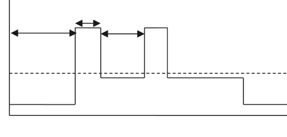

**图 10.3** 传感器节点的能量特性。

与物理传感器类似，在生物传感器情况下，从人体获取的生理数据也需要被处理并转换为适合传输的格式。许多医疗监控设备内置了计算和处理能力，以便患者可以看到监测的参数，并且还可以对被监测者的临床状态做出初步推断。用于此目的的控制器和其他数据处理模块也消耗大量的能量。传感器设备中执行这些功能的控制器在未实际处理数据或计算某些推断时，也会以不同的运行模式工作以节电。与设备的能量特性类似，还会准备一份控制器模块的能耗特性图。对于总时间“t”（它是从状态 $i$ 到状态 $j$ 的转换时间 $(T_{tr,i,j})$ 与控制器保持在状态 $j$ 的持续 $(T_{st,j})$ 之和），作为时间函数的能耗 $E_{cp}(t)$ 是从 $i$ 到 $j$ 转换期间消耗的能量 $(E_{tr,i,j}(t))$ 以及在状态 $j$ 运行时消耗的能量 $(E_{st,j}(t))$ 之和：

$$E_{cp}(t) = E_{tr,i,j}(t) + E_{st,j}(t)$$

$$t = T_{tr,i,j} + T_{st,j}$$

对于控制器可以进入的“n”个状态，控制器保持在状态 $j$ 持续 $T_{st,j}$ 的概率为 $p_{st,j}$，从状态 $i$ 到 $j$ 的转换概率的总能耗可以计算为：

$$E_{cp}(t) = \sum_{i=1}^{n} E_{st,j}(t)*p_{st,j} + \sum_{i=1,j=1}^{n} E_{tr,i,j}(t)*p_{tr,i,j}$$

同样，能量也可以为通信模块进行计算，如前所述，与传感器设备的所有其他模块相比，该模块负责最大的能耗。这主要是因为传感器设备中缺乏高性能计算和图形处理单元。如果需要，可以使用云端资源进行此类处理，而通信模块实现了设备与云端之间的数据流。

### 10.4.2 数据传输的能量模型

基于传感器节点和其他网络设备的能耗组成部分和可用电池功率，可以计算整个网络的设备和网络寿命。网络寿命是定义 WSN 质量的关键指标。它取决于网络的若干因素和设计参数，例如网络架构和拓扑、各层协议、通道特性、运行模式及其之间的转换、数据传输技术等。文献中有各种关于网络寿命的定义（Chang and Tassiolas, 2004; Ehsan et al., 2012; Jaleleet et al., 2013）。

定义：“网络寿命是网络能够向汇节点传输数据的时间。”


目前已提出了各种能量模型（Azhari et al., 2017; Elsbery, 2013; Chepkw et al., 2015; Amin et al., 2017）。本节中用到的一些重要能量参数。第 $i$ 个节点的功耗由给出：


# 医疗系统中的深度学习与物联网

$$P_i = \sum_{j \in S} x_{ij}p_{ij} + \sum_{j \in S} x_{ji}p_{ji} \quad (10.7)$$

EPUB = $\left(\frac{B_D + B_p}{B_D}\right)(P_{TX} + \xi P_{RX})T \quad (10.9)$

$B_D$ 代表数据包中数据比特的平均数量，$B_p$ 代表数据包中前导码的平均数量，$P_{TX}$ 是单位为瓦特的发射机功率，$P_{RX}$ 是单位为瓦特的接收功率（包括相关的电子电路），而 $T$ 是以秒为单位的比特时间。常数 $\xi$ 表示接收模式平均时间与传输模式平均时间之比，由介质访问控制（MAC）层方案决定。然而，该表达式没有考虑传感和信号处理功率、信道估计导致的信号损失以及反馈等因素。

物理层的能量消耗可以表示为：

$E_{dec} = E_{dec}^{trans} + \beta d^{\alpha} + E_{dec}^{rec} \quad (10.10)$

其中 $E_{dec}^{trans}$ 是发射端的能量消耗，考虑了发射机电子电路（锁相环、压控振荡器、偏置电流等）的开销，$E_{rec}$ 是接收端的能量消耗，考虑了接收电子设备的开销，项 $\beta d^{\alpha}$ 处理从源距离 $d$ 传输的单位辐射功率，其中 $\alpha$ 代表路径损耗（取值范围从 2 到 5），$\beta$ 是常数（单位为 $J/(bit \ m^{\alpha})$）。

跨层能耗参数也被用于某些研究中的网络寿命分析（He et al., 2012; Karvonen et al., 2015; Correa-Chica et al., 2016）。物理层、MAC 层和网络层的能量模型被统一以便更准确地估计特定应用的能量消耗和网络寿命。在用于医疗服务的网络分析方面，该方向的研究较少，因此为进一步的研究提供了巨大的空间。

## 10.5 节能型体域网 (BAN)

BAN 由一组电池供电的传感节点组成。这些节点可以是可穿戴或植入的。为了增加网络的寿命和可靠性，需要通过减少传感节点的能量消耗来最大化电池寿命。由于数据传输消耗了大量的能量，人们正在不断努力在最小功耗的限制内开发智能且自适应的 BAN，且不对无缝连接、安全性、实时数据采集与处理、高吞吐量无错误通信等性能参数产生任何影响。在本节中，讨论了优化 BAN 能量消耗的技术，从而实现节能医疗保健系统。

对于节能网络，在实现设备成本和性能之间取得平衡时，必须考虑设备级的功耗限制。生物传感器设备的标准架构包括：一个作为被测物理参数换能器的传感单元、一个处理单元，以及一个带有信号处理电路和用于信号收发的天线的通信单元。设备所有单元的性能都必须单独保持，同时将能量消耗维持在较低水平以获得更长的寿命。需要对资源进行优化选择，例如传感单元的灵敏度和分辨率、处理单元的计算能力以及发射功率和接收灵敏度，这将使设备不仅具有成本效益，而且节能。还通过嵌入式软件模块实现高效的设备运行和服务提供方法，以在不影响设备性能的情况下降低功耗。

### 10.5.1 物理层技术

许多研究工作已经明确证实，设备 70% 以上的能量消耗由通信单元引起。调节网络架构不同层之间数据传输和数据流的技术已显著提高了网络的能量效率。在物理设备层，考虑了高效的节点放置方法以实现低功耗网络。物联网网络以“多对一”模式运行，多个传感器节点通过单跳或多跳将数据发送到公共数据聚合器或汇点（sink）。可以使用节点放置技术优化数据流和跳数，以平衡能量和性能。这不仅平衡了不均匀的数据流，还减少了网络拥塞。一些常用于节点放置的流行算法包括——

- 遗传算法 (Noruzi and Zaim, 2014; Zorlu, and Şahingöz, 2017)
- 生启发算法 (Kulkarni et al., 2009; Tamizharasi et al., 2013)
- 粒子群优化 (Shunyuan et al., 2016)
- 优化人工鱼群算法 (Yiyue et al., 2012)
- 人工蜂群、领地捕食者气味标记算法 (Abidin and Din, 2013)

在医疗应用中，我们对节点放置没有太大控制权，因为生物传感器必须放置在身体的特定位置以测量所需的参数。此外，在门诊监控中，带有生物传感器（可穿戴或植入式）的患者位置也无法控制以实现节点节点放置。因此，建议在数据聚合器节点或中间中继节点上应用节点放置技术。其目的是平衡数据流，避免聚合器或中继节点出现任何拥塞。

由于数据的有效传输不仅对网络的能量效率至关重要，对无缝连接也至关重要，前端收发模块（即天线）领域正在进行多项研究。此类研究的目标是从最大增益、最小损耗的角度优化天线设计。

## 10.5.3 网络层的能量效率

网络层负责数据从源节点到目的节点的路由。最简单的路由技术被称为泛洪算法（flooding），即节点接收到的数据通过广播转发到所有邻居节点。这种技术在能量效率方面非常低下，并且存在诸如崩溃（implosion）、重叠（overlap）、闲谈（gossiping）等其他缺点。研究人员提出了多种改进的泛洪形式，以克服其缺点并使网络更高效、更可靠，并在其他服务质量（QoS）参数方面表现得更好。人们开发了各种路由技术来解决边缘节点和其他网络设备能耗不均匀且随机增加的问题，这包括平衡不均匀的数据流、减少数据重传、消除冗余数据传输、降低端到端延迟等。此类路由协议不仅根据最小数据包丢失和最大吞吐量，还根据最小能量消耗来决定传输数据的最可靠路径。针对传感器网络各种应用设计的路由协议分为五类：基于内容或属性、基于平面、地理位置、分层和多路径路由。然而，类似于物理层和网络层，在为体域网络（BAN）设计路由协议时，必须考虑一些额外的挑战。这些简要介绍如下：

- **动态拓扑**：在 BAN 中，传感器被放置在人体（可穿戴式）或体内（植入式）。由于这些传感器通过无线通道（无线体域网络或 WBAN）发送数据，它们相对于数据聚合器或汇纽节点的方向直接取决于人体的运动。这使得信道条件更加随机和动态，运动受限的卧床除外。患者环境引起的多径衰落和阴影效应，以及由于户外与室内移动导致的信道特性变化，使得信道估计更加复杂和随机。针对这种随机和动态网络条件的路由技术应该具有足够的自适应性。
- **能量效率**：与任何带有电池供电节点的传感器网络一样，BAN 中的传感器也受到能量限制。虽然可穿戴和植入式传感器都必须具有长电池寿命以提供连续服务，但植入式传感器的寿命寿命更为重要，因为植入它们需要复杂的手术。此外，它们的尺寸通常非常小，这限制了嵌入其中的电池功率，因此要求尽可能低的能量消耗。因此，路由协议的设计目标应该是最大限度地减少传感节点的能量消耗。
- **设备温度**：在感知、计算和通信期间，传感器节点可能会产生热量，导致外表面温度升高。对于直接接触人体的节点（特别是植入式传感器），这是一个关键问题。在设计和部署此类设备时，必须考虑任何导致节点发热的路由协议影响。
- **预期 QoS**：网络的可靠性根据各种 QoS 参数进行分析，这些参数指示了网络的整体性能。网络层路由协议决定路由路径和数据转发，这会影响吞吐量、延迟、抖动等多个 QoS 参数。在 BAN 中，网络层路由方案的设计应该在 QoS 参数方面实现网络性能最大化。

文献中已根据移动性、跨层架构、QoS 和能量效率等不同标准对网络层路由协议进行了各种分类。对 BAN 中使用的协议也进行了类似的分类。然而，由于本章侧重于节能网络，将在后续章节中介绍基于能量效率的 BAN 路由协议的详细分类和描述。

## 10.5.4 传输层和应用层的能量效率

与网络层类似，应用于传输层的协议和数据流管理方案除了影响整体性能外，还会影响网络的能量效率。传输层协议的主要功能是确保可靠的数据传输，并将由于链路故障或网络拥塞参数导致的数据包丢失和重传降至最低。已开发了多个版本的传输控制协议，用以提供可靠且节能的端到端数据传输。

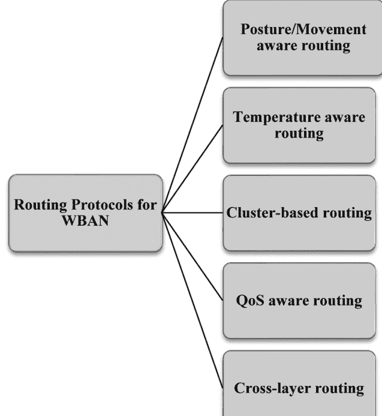

**图 10.5** WBAN 路由协议分类。

在应用层，操作系统（OS）或中间件负责实现提高设备和整体网络性能的技术，这也影响能量消耗。在医疗应用中，大多数 BAN 设备的处理能力处于较低水平，所使用的操作系统或中间件功能也有限。使用预测设备在激活、待机、睡眠等各种模式之间切换并执行这种切换的技术，是为了使其更具有能量效率。

因此可以得出结论，在整个网络架构的不同层次应用了组合技术来提高能量效率。医疗应用除了用于各种应用的通用传感器网络面临的挑战外，还引入了挑战，在设计提供电子健康、移动健康、远程医疗等形式远程医疗服务的网络架构时，必须解决这些挑战。此类技术的更详细描述将在本章的后续章节中给出。

## 10.6 节能路由协议

由于无线 BAN 中使用受电池限制的生物传感器设备，基于 IoT 的医疗网络的能量效率至关重要。可以通过多种手段提高能量效率，例如调整通信技术的物理参数、设计低功耗设备以及开发节能路由协议。路由协议主要为数据聚合和多对一传输设计。通过监控节点电量水平并采用平衡能量利用的方法来采用节能路由协议，是低功耗医疗系统中面临的主要挑战（Yating, 2019）。

在节能路由协议中，带有能量数据的路由请求（REQ）数据包在网络的节能可靠路径中传输。随后接收控制数据（路由回复（RREP）数据包）。整个过程被称为泛洪。随着泛洪的增加，数据包开销也会增加。这可能导致巨大的能量消耗。此外，在设计节能路由协议时需要避免过拟合状况（Sarlesh, 2017a, b）。目前已有几种路由协议不仅解决了能量效率问题，还解决了可靠性和 QoS 问题。例如，基于预测的安全可靠路由协议提供了可靠且安全的路由。

为了支持医疗网络的能量效率，基于 IoT 的路由协议应该考虑到 IoT 设备的开启/关闭状态，动态地从一个步骤移动到另一个步骤。这需要通过通信网络对能量的产生和消耗进行监控和记录。在 WBAN 中，传感节点的能量与其寿命相关联。由于节点直接植入人体，它们不会产生过多热量。数据路由的所有路径都有良好的定义，且必须感知能量。涉及节能路由协议的主要问题是复杂算法的实现。虽然有几种高效的路由协议，但它们没有考虑到延迟容、姿态信息、温度升高等不同方面。

### 10.6.1 路由协议的分类

广而言之，高效能的路由协议可以分为以下几类：

- **基于属性的路由协议**：传感器节点将基于内容的数据包传输到邻居节点。主要的基于属性的路由协议包括能量感知的数据中心型路由，其中每个节点决定转发还是丢弃接收到的数据包，以提高网络层面的能量效率（Sarvesh, 2017）。然而，主要的关注点是过拟合的可能性，这需要被避免。
- **基于平直结构的路由协议**：大量具有相同配置和特征的节点收集数据并将其传输到目的地。最初，数据存储在不同节点的路由表中。根据这些信息，源节点选择中间节点，然后将数据传输到所需的目的地。有几个参数，包括电量、接收信号强度和中间节点的跳数，它们决定了基于平直结构的路由协议的运行（Sarvesh, 2017）。这些协议优于能量效率的改进型。
- **地理路由协议**：数据根据位置信息从源节点传输到目的节点，采取最短距离。这在减少数据包开销并延长网络寿命的同时，提高了网络的整体能量效率。
- **分层路由协议**：这是最平衡能量的路由协议。在该协议中，若干传感器节点组成一个簇。簇中的其中一个传感器节点被指定为簇头。簇中的不同传感器节点收集数据并将其传输到其簇头。数据由簇头进行聚合，然后重新传输到基站（网络中的另一个传感器节点）。最广泛使用的分层路由协议是低功耗自适应聚类层次结构（Yating, 2019）。
- **按需距离矢量路由（AODV）路由协议**：在 AODV 路由协议中，路由选择是由目的节点根据信噪比（SNR）和跳数指标完成的，这些指标通常用于估计链路质量。使用包含 SNR 信息的改进型数据包 RREQ 进行路由发现。当目的节点接收到控制数据（RREQ）时，它向源节点发送 RREP 数据包。该网络基于其网络寿命具有能量效率，并具有更高的吞吐量（Sarwesh, 2017; Youngbook, 2018）。
- **多路径路由协议**：在单路径路由协议中，如果路由失败，会产生额外的控制数据。这需要数据重传，导致网络中开销数据增加。为了克服这种情况，采用了多路径路由协议，它不仅减少了系统的开销，还提高了网络的能量效率和可靠性。
- **基于低功耗路由（RPL）算法的移动性支持路由协议**：网络拓扑的频繁变化可能导致链路质量恶化、数据包传输延迟、包碰撞或其他不一致。基于 RPL 的路由协议在考虑传感器节点移动性的同时提供了能量效率（Lazrevsk, 2018; Al-Shammari, 2018）。它们通过智能决策来增加效率。
- **能量感知路由协议**：这种方法在考虑节点移动性的同时提供了能量效率。

## 10.6.2 能量效率路由策略

在无线传感器网中，多路径路由协议通过减少开销来提高能量效率，这种方法是基于。在跨层机会性 MAC 路由中，任何节点都可以作为传感器节点或中继节点。

# 医疗系统中的深度学习与物联网

能量来源可用于为电池充电，从而延长电池的更换周期，进而增加网络的无中断运行寿命。从太阳能产生电能是在发电量方面应用最广泛的技术之一，其功率范围从几毫瓦到几千瓦不等。能量采集（EH）领域的最新进展是从环境中提取能量，这些能量不仅存在于自然界，也人为存在。泛化此类技术，能量采集可以定义为“一种从风能、水能、太阳能等自然能源，或射频（RF）信号、振动、压力等人为来源中获取能量的过程或方法，目的是直接为设备提供运行电源，或通过为电池充电来实现。”这些通过能量采集技术供电的网络也被称为绿色网络，因为它们不依赖于传统或可再生能源。物联网应用是基于能量采集设备的强有力支持者，而医疗服务等关键应用强烈要求实施能量采集，其目标是使支持网络不仅更加能源高效，而且在无缝连接和延长寿命方面更加可靠。

## 10.7.1 体域网（BAN）中的能量采集

BAN 中的传感器节点持续获取并传输数据，以提供患者临床状态的监测。为了延长网络寿命，目前正在使用三种能量采集方法为传感器节点提供能量，从而减少更换电池的需求。

- 来自人体的能量：人体通过其动作和运动作为不同形式的能量来源，可以转换为电能，从而为生物传感器提供动力。
- 来自周围环境的能量（自然来源）：环境中存在太阳能、风能、热能、光能等多种可再生能源，传感器可以将其利用并转换为动力源。
- 来自周围环境的能量（人为来源）：由于多种人为无线通信系统，电磁波（射频信号）几乎存在于周围环境中。这些能量可以被传感器采集作为动力源。

## 医疗服务的能源高效型网络设计

对于用于医疗应用的传感器，环境中存在的自然能源并不总是随时可用，因为佩戴传感器的个人可能处于室内，那里没有足够的风能或太阳能来产生足够的电能。从人体采集能量也不够可靠，因为患者的活动通常受到限制，不能作为能量来源。任何存储和放大这些微弱或稀疏能量源的额外设备或组件都会增加佩戴设备的不适感，从而降低了其用户友好性。大多数传感器依赖无线通信进行连接，预计射频能量会存在并可以作为传感器的来源。连接传感器与其网络接入设备（即数据聚合器或汇聚节点）的信道传输着两者之间的射频能量和数据。该射频通道是主要的能量来源之一，因为网络接入设备持续供应能量。此外，该设备的设计和配置使其与射频通道相同的频率范围内运行，从而简化了传感器能量采集模块的设计。文献中已经提出了资源分配方案，利用同一信道为传感器添加额外的能量信号，该信号可以作为电源。除了这种来源外，设备附近的任何可用射频能量都可以用于能量采集。

## 关键词

- 能源高效网络
- 能源高效路由
- 能量模型
- 物联网
- 智能医疗保健
- 网络

## 参考文献

Abo-Zahhad, M., (2014). Survey on energy consumption models in wireless sensor networks. Open Transactions on Wireless Communications, vol. 1, no. 1, pp. 1–17.

Abidin, H. Z. and Din, N. M., (2013). Sensor node placement in wireless sensor network based on territorial scent marking algorithm. ISRN Sensor Networks, vol. 2013, Art. no. 170809.

Agrawal, D. P., (2017). Personal/body area networks and healthcare applications. In: Embedded Sensor Systems. Springer, Singapore.

Al-Shammari, M. E. (2018). Energy efficient service embedding in IoT networks. In 27th Wireless and Optical Communications Conference, 1–5.

Amin, B., Ullah, N., Ahmed, S., Taqi, M., Hanan, A., (2017). Path-loss and energy model (PLEEM) for body area networks (WANs). In International Symposium on Wireless Systems and Networks, pp. 1–6.

Awan, K. (2016). Wireless body area networks routing protocols: A review. Indian Journal of Engineering and Computer Science, vol. 4, no. 3, pp. 594–604.

Azhari, M. E., Moussaid, N. E., Toumanari, A., and Latif, R., (2017). Equalized energy consumption in wireless body area networks for a prolonged network lifetime. Wireless Communications and Mobile Computing, vol. 2017.


# 参考文献

Bhamutvi, V. (2017). A guide for the selection of routing protocols in WBAN. *Journal of Human-Centric Computing and Information Sciences*, vol. 7, no. 24.

Boucher, A. (2008). *Algorithms and Protocols for Wireless Sensor Networks*. Wiley-IEEE Press, New York, USA.

Boulle, A. (1997). Rural healthcare and rural—Inextricably—Policy in progress. *HST Up-to* 38: 27–6.

Castillejo, P., Martinez, J., Rodriguez-Molina, J., Cuerva, A. (2013). Integration of wearable devices in a wireless sensor network for an Ehealth application. *IEEE Communications*, vol. 20, pp. 38–40.

Chang, J.-H., and Tassias, L. (2004). Maximum lifetime routing in wireless sensor networks. *IEEE/ACM Transactions on Networking*, vol. 12, no. 4, pp. 609–619.

Chase, J. (2013). *The Evolution of Internet Things*. Texas Instruments, white paper.

Move, M., Gonzalez, S., Vasilakos, A., Chao, H., and Leung, V. C. (2011). Body area networks: A survey. *Mobile Networks and Applications*, vol. 16.

Karvonen, H., Janitali, I., and Hämminen, M. (2015). A cross-layer energy efficiency model for WBAN using IR-UWB transceivers. *Telecommunication Systems*, vol. 58, no. 2, p. 165–177.

Ko, J., Aziz, Ananthapur, A., Dawson-Haggerty, S., Culler, D. E., Hui, J. W., Levi, P. (2011). Connecting low-power and lossy networks to the Internet. *IEEE Communications Magazine*, vol. 49, no. 4, p. 96–101.

Krishna, A. and Ananthapur, K. (2013). Globalization: Spatial health disparities in rural India. *Distance and distance* [Online]. Available: `https://sites.duke.edu/krishna/files/2013/10/`

Kulkarni, R. V., Venayagamoorthy, G. K., and Cheng, M. X. (2009). Bio-inspired node localization in wireless sensor networks. In *Conference Proceedings - IEEE International Conference on Systems, and Cybernetics*, p. 205–210.

# 300 医疗系统中的深度学习与物联网

- Kuntz, R. (2010). 无线传感器网络动力学中的介质访问控制。博士论文，斯特拉斯堡大学。
- Lazareversal, M. (2018). 基于物联网的医疗保健应用的移动性支持的高效能量路由协议。在 IEEE 通信与网络标准会议上，第 29–31 页。
- Li, J., Bose, A., and Zhao, Y. Q. (2005). 无线局域网与个人局域网的研究。在加拿大电气与计算机工程会议上，美国萨斯喀彻省萨斯卡彻温，第 1415–1418 页。
- McFarland, S., Racis, M., Muisime, F. (2000). 公共卫生，《柳叶刀》（Lancet），第 356 卷，841–846 页。
- Norouzi, A. and Aim, Z. H. (2014). 遗传算法在无线传感器网络优化中的应用，《世界期刊》（The World Journal），2014年，文章号 286575。
- Pasha, M. and Shah, S. M. W. (2018). 基于物联网的环境中的电子健康框架。无线通信与移动计算，2018年，文章号 6183732。
- Pol, S., Gupta, P., Rahatkar, D., and Patel, A. (2016年6月). 智能救护车系统。在 IJCA 计算、通信与网络进展国家会议论文集中，第 6 卷，第 23–26 页。
- Postolache, G., Girão, P. M., and Postolache, O. (2012). 说服性坚持的需求与障碍。在《医疗保健的感知与移动传感计算——技术与社会问题》，Springer 出版公司，美国纽约州纽约市。
- Rajendran, V., Orbaca, K., Garcia-Luna-Aceves, J. (2003). 无线传感器网络的能量高效无冲突访问控制。在第 15 届嵌入式网络传感器系统国际会议上，第 181–192 页。
- Mao, R., K. D., Kumar, A. S., Chatterjee, M., Sundararaman, T. (2011). 印度医疗健康资源。《柳叶刀》（The Lancet），第 377 卷，第 587–598 页。
- Reddy, K. S., Patel, V., Paul, V. K., Kumar, A., Dandona, L., 等 (2011). 迈向2020年实现印度全民医疗目标：行动号召。《柳叶刀》（Lancet），第 377 卷，第 760–768 页。
- Redoni, A., Enrico, M., Borsani, L., Cesana, M., and Tagliacchi, M. (2023). 基于无线传感器网络的患者监测、定位和追踪的集成系统。《Ad Hoc 网络》（Ad Hoc Networks），第 11 卷，第 39–53 页。
- Rodriguez, J., Misra, S., Wang, H., and Zhu, Z. (2016). 环境感知与通信。《IEEE 通信杂志》（IEEE Communications Magazine），第 54 卷，第 24–25 页。
- Rojn, L., Slaand, S., Jain, M., Ibrahim, A., Wild, J., Johnson, K. I. (2016). 慢性疾病的远程监测：欧洲国家政策景观评估。《PLoS One》，第 11 卷，第 5 期，文章号 e0155738。
- Sarwish, P. (2017a). 物联网应用的高效能网络架构。在《超越物联网》（Beyond Internet of Things），Springer 国际出版，美国纽约州纽约市，第 119–144 页。
- Sarwish, P. (2017b). 物联网医疗保健应用的高效网络设计。在《下一代医疗保健的物联网与大数据技术》（Things and Big Data Technologies for Next Generation Healthcare），Springer 国际出版，美国纽约州纽约市，第 35–61 页。
- Sethi, P. and Sarangi, S. R. (2017). 物联网：架构、协议与应用。《电气与计算机工程杂志》（Journal of Electrical and Computer Engineering），第 2017 卷，文章号 9324035。
- Shunyan, S., Quan, Y., and Baguo, X. (2016). 基于改进粒子群优化的无线传感器网络节点定位算法。《未来通信与网络国际期刊》（International Journal of Future Communication and Networking），第 9 卷，第 4 期，第 179–190 页。

# 医疗服务的节能设计

- Silva, B. M., Rodrigues, J. J., de la Torre Die, I., López-Coronado, M., Saleem, K. (2015). 移动健康：2015年现状回顾，《生物医学信息学》（Journal of Biomedical Informatics），第 56 卷，第 265–272 页。
- Solanas, A., Patsakis, C., Conti, M., Vlachos, I., Ramos, V., Falcone, F., Postolache, O., Pérez-Martínez, P., Rerea, R., D., and Ballesté, A. (2014). 智能健康：智能城市中的环境感知健康范式。《IEEE 通信杂志》（IEEE Communications Magazine）。第 52 卷，第 74–81 页。
- Strasser, R. (2003). 全球农村医疗：挑战与解决方案。《家庭医学》（Family Practice），第 20 卷，第 457–463 页。
- Strasser, R. P., Harvey, D., and Burley, M. (1994). 小社区的健康需求。《澳大利亚农村健康杂志》（Australian Journal of Rural Health），第 2 卷，第 7–13 页。
- Tamizahari, A., Arthi, R., and Murugan, K. (2013). 用于优化无线传感器网络定位的仿启发算法。在第 3 届计算、通信与技术国际会议上，印度提鲁琴戈德，第 1–5 页。
- Udwant, O., Thombare, N., Chauhan, D., and Waghole, D. (2017). 使用物联网的智能救护车系统。在 2017 年大数据与科学国际会议上，浦那，第 171–176 页。
- Vasseur, J.-P., Dunkels, A. (2010). 使用 IP 连接智能对象。Elsevier 出版，阿姆斯特丹，荷兰。
- Veeramuthu, V., Murali, P. (2011). 2011年环境感知的健康需求。《理论与应用技术杂志》（Journal of Theoretical and Applied Technology），第 31 卷，第 91–99 页。
- Yamada, Y., Sushi, S., and Mukai, M. (2004). 说服性坚持的需求与障碍。在《医疗保健的感知与移动传感计算——技术与社会问题》，日本御尾，第 161–165 页。
- Yating, Q. (2019). 物联网医疗保健应用的高效网络设计。《传感器杂志》（Sensors），第 19 卷，第 7 期，第 24 页。
- Yiyue, S., Heng, Z. H. (2012). 遗传算法在无线传感器网络优化中的应用，《世界期刊》（The World Journal），2014年，文章号 286575。
- Young, C. (2018). 基于物联网的环境中的电子健康框架。《无线通信与移动计算》（Wireless Communication and Mobile Computing），2018年，文章号 6183732。
- Zhao, F. (2017). 无线传感器网络的能量高效无冲突访问控制。在第 15 届嵌入式网络传感器系统国际会议上，第 181–192 页。


# 应用数据挖掘检测自闭症患者的精神状态

RASH SINGH, PRATEEK SINGH², LATIKA KHARB

¹信息技术系，阿米蒂大学，诺伊达

²管理学院，罗希尼 5 号，德里，德里

*通讯作者邮箱：`latika.kharb@jims.org`

## 摘要

技术是每个时代的需求，我们的目标是通过数据挖掘（如最近邻、决策树和朴素贝叶斯）对精神状态（如兴奋和放松）来为自闭症（ASD）患者提供支持。

## 1.1 引言

众所周知，压力影响健康。压力被定义为由于需求引起的状态。近年来，全球三分之一的人口报告受到压力影响。然而，产生了一个问题：压力是否真的会改变生理结构？

- 化学变化由压力引起，会导致刺激。
- 高强度压力会缩小大脑。
- 压力事件或行为会杀死脑细胞。

# 将数据挖掘应用于检测心理状态

在行为中。它们偶尔被用于在极度头部疼痛后评估心理兴趣，或者在心脏移植或肝脏移植之前/之后进行评估（`http://neurosky.com/f etched on 06/11/2017`）。本章的动机是利用如 `Neurosky` 波形等 EEG 头戴设备获取各种焦虑情绪、微小肌肉运动和热忱范围的连续记录，并结合 `Arduino` 等微型比例尺控制器来捕获数据并将其转换为 alpha、beta、gamma、delta 和 theta 波。

据观察，由于患有自闭症谱系障碍（ASD）的个体其 alpha 脑波减少，而在 ASD 患者中，高 beta 脑波被认为会促进攻击性行为。gamma（伽马）脑波可用于检测个体的技能和能力。高 theta 值会引起冲动和不可预测的特征。

## 11.2 文献综述

技术进步引起的信息挖掘量不断扩大以及个人对数据挖掘需求的日益增长，使得大规模数据的分类成为了一项挑战性任务（Zhou et al., 2012）。为了理解上述段落的目标并了解独特性以及每种脑波如何对人的生理活动做出贡献，以下领域得到了广泛研究。

**脑波：** 这些是由我们的大脑以电磁方式产生的波，分为五类：`alpha`、`beta`、`theta`、`gamma` 和 `delta`。`EEG`（脑电图）是用于捕捉大脑内部产生的电位差并读取这些脑波的技术，可用于医学领域的治疗方案分析。在这项研究工作中，我们借助数据挖掘的帮助用此来分析不同的心理和生理状态。

**EEG：** `EEG` 用于发现大脑电学运动中的不适。`EEG` 跟踪并洞察电学运动和脑波模式。在用户的头部上方放置带有电导的微小金属板（电极）；放大器会放大电磁脑波，捕获它们，并绘制大脑内部电学运动的实时图表。图表的日常活动和他的兴趣会产生一种可识别的模式电脑波模式。通过 `EEG`，治疗专家可以扫描并预测癫痫以及不同的问题。他/她将为你提供生活方式/药物方面的建议以帮助该人员。

# 医疗系统中的深度学习与物联网

**Alpha：** `Alpha` 脑波的范围在 8–13 Hz 之间（见表 11.1 和图 11.1）。`Alpha` 波是一种独特的脑波，注意到 `Alpha` 波的电位会增加，这可以通过 `EEG` 或磁脑图进行记录。这些波在人在保持清醒状态的同时闭上眼睛并开始放松时，便源自大脑的枕叶。`Alpha` 具有具有以下特征。

## 表 11.1 EEG 信息及其范围

| 波形 | 频率 | 简定义 |
| --- | --- | --- |
| Alpha | 8–13 Hz | Alpha 脑波在我们闭上眼睛并开始从外部触觉刺激中抽离时，提供了一种独特的安静、创造性的、“感觉纠正”状态。它是清醒与睡眠之间的桥梁 |
| Beta | 13–20 Hz | Beta 脑波很大程度上主导了我们的清醒注意力周期。Beta 波在活动中是“快速”产生的，例如当我们专注、警觉、忙于处理棘手问题、判断、决策或集中在我们的精神爱好上时。Beta 脑波进一步被分为三组 |
| Lo-Beta/Beta1 | Beta1, 12–15 Hz | “快速”且深 |
| Beta/Beta2 | 15–22 Hz | 在涉及高紧张和兴奋水平的活动中，对我们有意义的高参与度活动 |
| Hi-Beta/Beta3 | 22–38 Hz | 它们被说是产生的必要的 beta 波 |
| Theta | 4–8 Hz | Theta 脑波是我们捕捉内部信息、记忆和一种本能的范围。Theta 脑波在大多数情况下产生 |
| Gamma | 20 Hz | Gamma 脑波是我们在处于高紧张的活动时产生的深度思考 |
| Delta | 1–4 Hz | Delta 脑波是我们在睡眠时产生的脑波，是放松的、无意识的 |


# 医疗系统中的深度学习与物联网

## EEG

EEG 用于发现大脑电学运动中的不适。EEG 跟踪并洞察电学运动和脑波模式。在用户的头部上方放置带有电线的微小金属板（电极）；放大器会放大电磁脑波，捕获它们，并绘制大脑内部电学运动的实时图表。图表的日常活动和他的兴趣会产生一种可识别的模式电脑波。通过 EEG，治疗专家可以扫描并预测癫痫以及不同的问题。他/她将为你提供生活方式/药物方面的建议以帮助该人员。

## Alpha

Alpha 脑波的范围在 8–13 Hz 之间（见表 11.1 和图 11.1）。Alpha 波是一种独特的脑波，注意到 alpha 波的电位会增加，这可以通过 EEG 或磁脑图进行记录。这些波在人在保持清醒状态的同时闭上眼睛并开始从外部触觉刺激中抽离时，便源自大脑的枕叶。Alpha 波具有以下特征。

### 表 11.1 EEG 信息及其范围

| 波形 | 频率 | 简定义 |
| --- | --- | --- |
| Alpha | 8–13 Hz | Alpha 脑波在我们闭上眼睛并开始从外部触觉刺激中抽离时，提供了一种独特的安静、创造性的、“感觉纠正”状态。它是清醒与睡眠之间的桥梁 |
| Beta | 13–20 Hz | Beta 脑波很大程度上主导了我们的清醒注意力周期。Beta 波在活动中是“快速”产生的，例如当我们专注、警觉、忙于处理棘手问题、判断、决策或集中在我们的精神爱好上时。Beta 脑波进一步被分为三组 |
| Lo-Beta/Beta1 | Beta1, 12–15 Hz | “快速”且深 |
| Beta/Beta2 | 15–22 Hz | 在涉及高紧张和兴奋水平的活动中，对我们有意义的高参与度活动 |
| Hi-Beta/Beta3 | 22–38 Hz | 它们被说是产生的必要的 beta 波 |
| Theta | 4–8 Hz | Theta 脑波是我们捕捉内部信息、记忆和一种本能的范围。Theta 脑波在大多数情况下产生 |
| Gamma | 20 Hz | Gamma 脑波是我们在处于高紧张的活动时产生的深度思考 |
| Delta | 1–4 Hz | Delta 脑波是我们在睡眠时产生的脑波，是放松的、无意识的 |

- 这种脑波在人在睡眠时睁眼时产生大脑的电学运动

## 将数据挖掘应用于检测心理状态

这让我们以开放的心态感到更加放松。原始而深层的感觉通常与 theta 波有关，因为它是我们经历那种感觉的主要原因。过量的 theta 波产生暴露可能会导致人们在某些绝望的情境下变得毫无防备。theta 波有其独特的影响，因为它们是帮助我们增强创新思维和冲动的主要原因，这让我们感到更加自然。此外，它还有助于从压力状态中恢复睡眠。只要 theta 波暴露的时间段足够长或强度足够高，对我们的大脑和整体人格就会很有帮助。

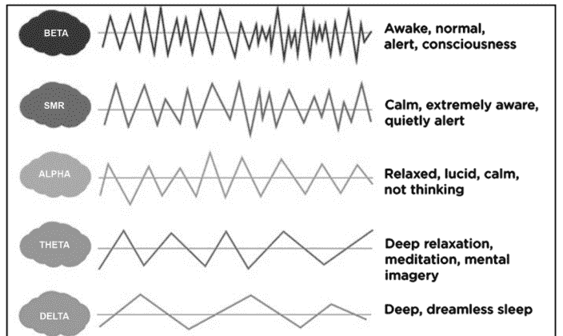

**图 11.1** 不同脑波的视觉化显示。

关于 theta 波需要注意的一些关键点如下：

- 数量过多会导致冲动、多动、注意力缺陷多动障碍（ADHD）、粗心和悲伤（我们在研究中是如何使用 theta 波的？）
- 数量过少可能导致紧张、热情认可度低和压力。
- 数量适中会导致本能、创造力、放松和热情的联的发展。

电位值大约在 20 到 100 之间（http://www.brainworksneurotherapy.com/what-are-brainwaves）。

脑电图（EEG）利用由大脑不同部分产生的不同脑波（delta、theta、alpha、beta 和 gamma）来检测不同的情感光谱，如压力、微肌肉运动、快乐感、悲伤、眨眼、头部动作、注意力水平、人的冥想状态等。不同的研究使用不同脑波的组合来证明他们的研究。因此，文献综述包含了 1989 年至 2017 年之间的研究论文。

文献综述是检测哪些波被研究人员更广泛使用和交互的重要步骤，这将有助于技术开发、优先考虑异常波，并确定本研究中应该使用哪种波。

### 11.2.4 分类技术

**K-最近邻算法**：`KNN` 计算（通常简写为 `KNN`）是一种处理信息排序的方法，它根据最靠近该点的一组信息引导，衡量一个信息点成为一个集合或另一个集合个体的程度（https://utsync.com/different-types-of-brain-waves-delta-theta-alpha-beta-gamma 访问于 2017/11/06）。

**决策树**：决策树是一种使用分支方法来阐明决策所有可能结果的图。它为可以自动化的可能结果分配金钱/时间或其他值。

**神经网络**：神经网络在很大程度上包含大量并行工作并分层掌握的处理器。主层创建原始数据——实际上等同于人类视觉处理中的视神经。每个渐进层都提供前一层的输出，而不是直接来自信息——同样，距离视神经较远的神经元接收来自附近神经元的信号。最后一层创建框架的输出。

**朴素贝叶斯**：`Naive贝叶斯`分类器是一种使用贝叶斯定理对对象进行分类的算法。朴素贝叶斯分类器假设数据点的属性之间存在强烈的（或朴素的）独立性。朴素贝叶斯分类器的用途包括垃圾邮件过滤器、文本分析和医学诊断。这些分类器被广泛用于机器学习，因为它们容易实现。

**KNN**：`KNN` 方法是数据挖掘和统计中一种流行的分类方法，因为其实现简单且分类性能显著（Zhang et al., 2018）。

`KNN` 可用于已分类和未分类类别的数据管理和预测系统。它是业务中安排问题中最广泛使用的部分。对于任何策略的评估，我们必须从三个角度来看：

- 于解释的输出；
- 计算时间；
- 预测能力。

`KNN` 计算考虑了思考的所有参数。它通常因其解释简单和计算时间短而被使用。

### 表 11.3 使用 KNN 进行 EEG 分类的研究论文

| 序号 | 名称 | 年份 | 作者 |
|---|---|---|---|
| 1 | 脑机接口 | 2002 | Blankertz 等人 |
| 2 | 使用 k-means 和 EEG 的睡眠识别系统 | 2010 | Güneş 等人 |
| 3 | 基于 EEG 的情感识别 | 2010 | Khosrowabadi 等人 |
| 4 | 想象性语音 | 2010 | Brigham 等人 |
| 5 | 情感识别 | 2010 | Petronatakis 等人 |
| 6 | 慢性压力的 EEG 相关性 | 2011 | Khosrowabadi 等人 |
| 7 | EEG 和 KNN 分类器 | 2011 | Sulaiman 等人 |
| 8 | EEG 估计的张量处理 | 2013 | Demitriadis 等人 |
| 9 | 深度步骤检测 | 2017 | Amjadzadeh 等人 |
| 10 | 作为测试平台的机器学习方法 | 2017 | Mohanchandra 等人 |

结果：从表 11.3 中，我们得出哪些波被研究人员更广泛使用和交互的结论，这将有助于技术开发、优先考虑异常波，并确定本研究中应该使用哪种波。

### 表 11.4 脑波使用情况统计（部分）

| 序号 | 作者 | 年份 | 脑波 | δ | Θ | α | β | γ |
|---|---|---|---|---|---|---|---|---|
| 25 | Van Berkum, Jos JA | 2008 | 情绪谱（压力）小肌肉运动 注意力冥想 | | | | | ✓ |
| 26 | Heraz Alicia | 2009 | 情绪谱（压力）小肌肉运动 注意力冥想 | ✓ | ✓ | ✓ | ✓ | |
| 27 | Saidatul, A. 等 | 2011 | 情绪谱（压力）小肌肉运动 注意力冥想 | | | ✓ | ✓ | |
| 28 | Hamid Noor Hayatee Abdul, 等 | 2015 | 情绪谱（压力）小肌肉运动 注意力冥想 | | | ✓ | ✓ | |
| 29 | Chavan Deepika. R. 等 | 2016 | 情绪谱（压力）小肌肉运动 注意力冥想 | | | ✓ | ✓ | |
| 30 | Bell Martha Ann, 和 Kimberly Cuevas | 2013 | 情绪谱（压力）小肌肉运动 注意力冥想 | | ✓ | ✓ | | |
| 31 | Halliday, David M. 等 | 1998 | 情绪谱（压力）小肌肉运动 注意力冥想 | | | ✓ | ✓ | |
| 32 | Abdulka, Sarah N. 等 | 2015 | 情绪谱（压力）小肌肉运动 注意力冥想 | | | ✓ | ✓ | |
| 33 | Woodman, Geoffrey F | 2013 | 情绪谱（压力）小肌肉运动 注意力冥想 | | | | ✓ | |
| 34 | Teplan, Michal | 2002 | 情绪谱（压力）小肌肉运动 注意力冥想 | | | | ✓ | ✓ |

表 11.4 的结果：目的是确定 alpha、beta、gamma、theta 和 delta 脑波中哪些在决定大脑工作特征和心理状态方面最为重要且突出，以及每种脑波在决定研究工作预测属性方面的贡献。

## 对人员是否放松、是否兴奋、是否压力等不同状态进行分类

| Delta | Theta | Alpha | Beta | Gamma |
|---|---|---|---|---|

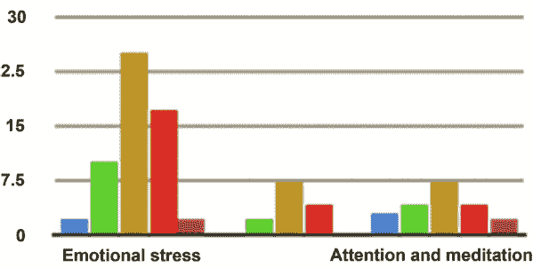

**图 11.2** 研究人员使用的不同脑波对比。

- Delta
- Theta
- Alpha
- Beta
- Gamma

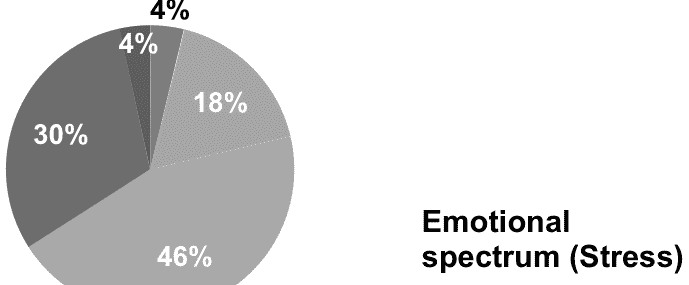

**图 11.3** 用于检测情绪谱的脑波对比。

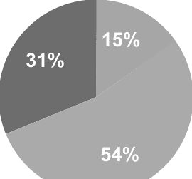

**图 11.4** 用于检测小肌肉运动的不同脑波对比。

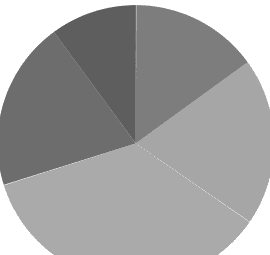

**图 11.5** 用于检测注意力和冥想的不同脑波对比。

根据表 11.4 的文献综述，我们得出结论：对于特殊的情绪谱（压力、快乐、悲伤及以往），研究人员在研究中使用 delta (4%)、theta (18%)、alpha (45%)、beta (30%) 和 gamma (4%)，其中 alpha 利用率最高，beta 次之。

对于小肌肉运动（眨眼和颈部动作），研究人员在研究中使用 delta (0%)、theta (15%)、alpha (54%)、beta (31%) 和 gamma (0%)，alpha 和 beta 利用率最高。

对于注意力和冥想，研究人员在研究中使用 delta (15%)、theta (20%)、alpha (35%)、beta (20%) 和 gamma (10%)，同样，alpha 和 beta 是研究人员使用的最多的脑波。

## 应用数据挖掘检测心理状态

基于上述数据，构建了表 11.5，显示了不同波在生成不同结果中的贡献百分比，并此决定优先级。通过此，我们确定 alpha 优先级为第一，beta 优先级为第二，theta 优先级为第三，gamma 优先级为第五。因此，对于我们的预测模型和方法，这项研究将采用 alpha、beta、theta 和 gamma 进行数据挖掘。

### 表 11.5 不同波生成不同结果的贡献百分比

| Delta | Theta | Alpha | Beta | 结果 |
|---|---|---|---|---|
| 4 | 18 | 45 | 30 | 情绪谱（压力） |
| 0 | 15 | 54 | 31 | 小肌肉运动 |
| 15 | 20 | 35 | 20 | 注意力与冥想 |
| 4 | | | | 5 |

根据表 11.4 的文献综述，我们得出结论：对于特殊的情绪谱（压力、快乐、悲伤及以往），研究人员在研究中使用 delta (4%)、theta (18%)、alpha (45%)、beta (30%) 和 gamma (4%)，其中 alpha 利用率最高，beta 次之。

对于小肌肉运动（眨眼和颈部动作），研究人员在研究中使用 delta (0%)、theta (15%)、alpha (54%)、beta (31%) 和 gamma (0%)，alpha 和 beta 利用率最高。


# 表 11.4（续）

| 序号 | 作者 | 年份 | 脑波 | δ | Θ | α | β | γ |
|---|---|---|---|---|---|---|---|---|
| 25 | Van Berkum, Jos JA | 2008 | 情绪谱（压力）小肌肉运动 注意力冥想 | | | | | ✓ |
| 26 | Heraz Alicia | 2009 | 情绪谱（压力）小肌肉运动 注意力冥想 | ✓ | ✓ | ✓ | ✓ | |
| 27 | Saidatul, A. 等 | 2011 | 情绪谱（压力）小肌肉运动 注意力冥想 | | | ✓ | ✓ | |
| 28 | Hamid Noor Hayatee Abdul, 等 | 2015 | 情绪谱（压力）小肌肉运动 注意力冥想 | | | ✓ | ✓ | |
| 29 | Chavan Deepika. R. 等 | 2016 | 情绪谱（压力）小肌肉运动 注意力冥想 | | | ✓ | ✓ | |
| 30 | Bell Martha Ann, 和 Kimberly Cuevas | 2013 | 情绪谱（压力）小肌肉运动 注意力冥想 | | ✓ | ✓ | | |
| 31 | Halliday, David M. 等 | 1998 | 情绪谱（压力）小肌肉运动 注意力冥想 | | | ✓ | ✓ | |
| 32 | Abdulka, Sarah N. 等 | 2015 | 情绪谱（压力）小肌肉运动 注意力冥想 | | | ✓ | ✓ | |
| 33 | Woodman, Geoffrey F | 2013 | 情绪谱（压力）小肌肉运动 注意力冥想 | | | | ✓ | |
| 34 | Teplan, Michal | 2002 | 情绪谱（压力）小肌肉运动 注意力冥想 | | | | ✓ | ✓ |

表 11.4 的结果：目的是确定 alpha、beta、gamma、theta 和 delta 脑波中哪些在决定大脑工作特征和心理状态方面最为重要且突出，以及每种脑波在决定研究工作预测属性方面的贡献。

## 应用数据挖掘检测心理状态

对人员是否放松、是否兴奋、是否压力等不同状态进行分类。

| Delta | Theta | Alpha | Beta | Gamma |
|---|---|---|---|---|
| | | | | |


**图 11.2** 研究人员使用的不同脑波对比。

- Delta
- Theta
- Alpha
- Beta
- Gamma


**图 11.3** 用于检测情绪谱的不同脑波对比。


### 小肌肉运动

**图 11.4** 用于检测小肌肉运动的不同脑波对比。


### 注意力与冥想

**图 11.5** 用于检测注意力和冥想的不同脑波对比。

根据表 11.4 的文献综述，我们得出结论：对于特殊的情绪谱（压力、快乐、悲伤及以往），研究人员在研究中使用 delta (4%)、theta (18%)、alpha (45%)、beta (30%) 和 gamma (4%)，其中 alpha 利用率最高，beta 次之。

对于小肌肉运动（眨眼和颈部动作），研究人员在研究中使用 delta (0%)、theta (15%)、alpha (54%)、beta (31%) 和 gamma (0%)，alpha 和 beta 利用率最高。

对于注意力和冥想，研究人员在研究中使用 delta (15%)、theta (20%)、alpha (35%)、beta (20%) 和 gamma (10%)，同样，alpha 和 beta 是研究人员使用的最多的脑波。

## 应用数据挖掘检测心理状态

基于上述数据，构建了表 11.5，显示了不同波在生成不同结果中的贡献百分比，并此决定优先级。通过此，我们确定 alpha 优先级为第一，beta 优先级为第二，theta 优先级为第三，gamma 优先级为第五。因此，对于我们的预测模型和方法，这项研究将采用 alpha、beta、theta 和 gamma 进行数据挖掘。

# 320

## 医疗保健系统中的深度学习与物联网

在附录 A 中，图 A1 显示了算法，图 A2 显示了相应算法的百分准确率。

从表 11.6 中，我们得出结论：在合适的算法下，`KNN` 表现最好，它为我们的预测机器提供了 97.50% 的准确率。目前，我们采用混合数据集作为训练数据集的一部分，用于预测细微肌肉运动的分类信息（分类为“眼睛睁开”和“眼睛闭眼”），以及人员心理状态的分类（分类为“兴奋”、“不兴奋”和“放松”），这些包含了对 gamma 波、theta 波、alpha 波和 beta 波估值的 100% 确定性所有项。

### 表 11.6 不同算法的准确率比较

| 序号 | 算法 | 准确率 (%) |
|---|---|---|
| 1 | 决策树 | 96.25 |
| 2 | KNN 方法 | 97.50 |
| 3 | 神经网络 | 78.75 |
| 4 | 朴素贝叶斯 | 96.25 |

`KNN` 的工作原理：例如，我们正在取一个基础案例来演示此计算。以下是红圈和绿色方块的分布图；我们用 `RC` 表示红圈，用 `GS` 表示绿色方块 [见图 11.7(a)]。

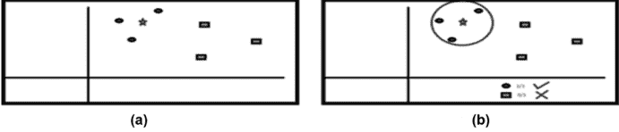

**图 11.7** K-NN 示例。

如你所见 [见图 11.7(a)]，我们有一个蓝色星形（`BS`）。它可以被归类为红圈或绿色方块。`KNN` 模型中的“K”值是指我们希望从投票中选取的最近邻居的数量计算。假设我们取 K 值为 3。那么，我们将在蓝星周围创建一个圆形边界，并创建一个足够大的圆，聚焦于蓝星，同样地在平面上捕获三个数据点 [见图 11.7(b)]。

蓝星周围的三个最近邻居结果都是红圈。因此，具有很高的确定性水平，我们可以说蓝星应该位于红圈类别。在这里，决策变得非常显而易见，因为蓝星的三个可能的邻居结果都是红圈。在 `KNN` 中 K 值的选择对于进行计算至关重要。接下来我们将更多讨论为了选择最佳 K 值而需要考虑的组件。随着 K 值的增加，图表会变得更加平滑。

我们在 `KNN` 中已知的两个参数是训练率和验证误差率 [见图 7(a)]。

从 11.8 可以得出结论，当 K 为 1 时，训练误差率恒为 0。任何数据点离其自身最近都会产生 100% 的准确率。换句话说，K 为 1 的 `KNN` 将始终预测完全相同的精确值。在验证误差曲线相似的情况下，我们将选择 K-1 的值 [见图 11.8(b)]。

这使得 `KNN` 的理解变得更加清晰。在 K=1 时，我们超过了上限。因此，误差率首先降低并在图中趋于最低点。在最低点之后，误差率随 K 值的增加而增加。为了获得 K 的理想估计值，你可以从初始数据集中分离训练集和验证集。

目前通过验证误差曲线获取 K 的理想估计。此 K 的估计值应应用于所有的预测。

附录 B 中的图 B2 显示了 `KNN` 在第三列下的预测，该预测是基于 alpha、beta、theta 和 gamma（第 9-12 列）输入的标签预测。置信度水平显示了预期有多大的确定性。分类的信信显示了模型对状态的确定程度。

置信度的成本（即 1 和 0）可以通过以下 if-else 条件定义：

```
if(confidence > threshold)
then 1
else
0
```

随后，进行预测，并实际上在附录 B 图 B2 的预测列中可见，分类为“眼睛睁开”、“眼睛闭眼”、“不兴奋”和“放松”。

附录 B 中的图 B1(b) 指出了用于训练预测机器的数据集，其属性为 gamma、theta、alpha 和 beta，具有标签，它分类了 gamma、theta、alpha 和 beta 各种值的细微肌肉动作（眼睛睁开/眼睛闭眼）以及心理状态（兴奋/放松）。

这项研究工作使用 $K = 5$（百分比最近邻）来确定分类输出并进行预测，所获得的性能准确率为 97.50%。

## 11.4 数据

为了在临床和商业上具有相关性，特征提取方法的算法复杂度必须能够被容易且快速地计算，并且对处理能力和功耗的需求最小 (Phinyomark and Scheme, 2018)。

### 11.4.1 数据采集

训练数据集来自 Andrzejak 等人 (2001)。该数据集有五个部分：讨论为 Z 的数据集 A、讨论为 O 的数据集 B、讨论为 N 的数据集 C、讨论为 F 的数据集 D 以及讨论为 S 的数据集 E。

# 将数据挖掘应用于心理状态检测

管理，第 46 卷，第 278–285

Dharmawan, Z., (2007). 使用 EEG 数据分析游戏玩家压力水平的分析。硕士论文报告，特尔夫特理工大学电气、数学与计算机科学学院，荷兰，特尔夫特。

Lahane, P., Vuidya, A., Umale C., Shirude S., and Raut, A., (2016). 使用 EEG 信号实时检测人类压力的方法，《国际计算机与通信工程创新研究杂志》，第 4 卷，第 4 期。

Lawson, W., (2013). 自闭症或自闭症大脑中的感官连接、兴趣/注意与伽马波同步性。《医学假说》，第 80 卷，第 3 期，第 284–288 页。

Phinyomark, A. and Scheme, E., (2018). 基于高阶交叉的 EMG 模式识别的新特征。 2018 年 IEEE 生命科学会议 (LSC)，加拿大魁北省蒙特利尔，第 263–266 页。

Ratey, J., Mikelsen, E., Sorgi, P., Zuckerman, S., Polakoff, S., Bemporad, J., Bick, P., and Kadish, W., (1987). 自闭症：攻击行为的治疗。《临床药学杂志》，第 7 卷，第 35–41 页。

Zhang, S., Li, X., Zhong, M., Zhu, X., and Wang, R., (2018年5月). 不同数量近邻数量的高效 KNN 分类。《IEEE 神经网络与学习系统事务》，第 29 卷，第 5 期，第 1774–1785 页。

Zhou, L., Wang, H., and Wang, W., (2012). 基于云计算环境的分类算法的并行实现。《印尼电气工程杂志》，第 10 卷，第 1087–1092 页。


# 索引

## A

- 加速度计传感器，163, 168
- 湿度传感器，165
- 阿尔茨海症
    - 诱因, 85
    - 深度学习模型, 86–87
    - 症状, 38–42
- 人工智能 (AI)，在...的作用
    - 医疗保健中的益处, 8–9
    - 心血管疾病, 36–38
    - 痴呆, 51–53
    - 糖尿病, 28–36
    - 心理健康, 28
    - 概述, 28
- 帕金森病，42–50
- 辅助设备传感器，133
    - 通信协议, 135–136
    - 阻抗与电化学, 134–135
    - 侵入性, 133
    - 非侵入性, 133
    - 辅助设备的安全威胁, 152
    - 类型, 133
- 辅助技术 (AT)，105–106, 108
    - 活动监控, 108
    - 辅助技术协会 (ATIA), 107
    - 计算机相关外围, 119
    - 日常生活, 116
    - 环境适应, 117
    - 在医疗保健中, 107–110
    - 增强健康的技术, 110
    - 听力益处, 107
    - 历史, 106–107
    - 感应圈, 111–113
    - 学习与认知发展, 114–115
    - 医疗行业, 120–121
    - 移动与定位, 116
    - 选择过程, 123–125
    - 娱乐与休闲, 119–120
    - 安全/防护, 123
    - 语音交流, 114
    - 远程线圈, 113–114
    - 类型, 110
    - 车辆改装与交通, 117–118
    - 视觉技术，类型, 111
- 自闭症脑波 (ASD)，数据挖掘
    - 挖掘, 303–305
    - α 波脑波, 306–310
    - β阻滞剂, 307–308
    - 脑波, 305
    - 不同波的比较, 315
    - 不同波的贡献, 317
    - 情绪谱检测, 315
    - 脑电图 (EEG) 信号, 305
    - 未来前景, 324
    - 伽马脑波, 308–310
    - 方法论步骤, 317–322
    - 微动, 316
    - 不同脑波的视觉化显示, 309
- 自动亮度调节器，165
- 自动编码器，4

## B

- 二维码传感器，165
- 气压计，164
- 行为干预技术 (BITs)，35
- 生化传感器，197–198
    - 应用, 197–198
    - 基本特征, 197
- 生物识别传感器，165
- 血压监测，137–140
    - 放大器与滤波器, 140


# 索引

## A

- 辅助设备, 139
- IoT 与商业设备的比较, 140
- 基于 IoT 的, 140
- 微控制器, 140
- 充气波分析法, 138

## B

- 体温监测，147–148
- 基于 IoT 的硬件软件系统，148
- 身体温度趋势及影响，149
- 可穿戴式基于 IoT，150–151
- 工作原理，148–180n
- 乳腺癌，80
    - 良性与恶性, 80–81
    - 验证方法与准确率识别, 84
    - 乳腺造影，80
- 业务问题定义，13
    - 在医疗保健中, 65–66
    - 精准医疗与药物发现, 67–68
    - 用于特征提取的数据类型表示, 63
    - 工作原理, 64–65
- 深度学习架构，3–5
- 深度神经网络，3
- 糖尿病，28
    - 行为干预技术 (BITs), 35
    - 数据检查, 32
    - 深度学习模型, 87–89
    - 妊娠性, 29
    - 胰岛素依赖型患者, 30
    - 强化胰岛素疗法, 29
    - 节律, 29
    - AI 的作用, 28–36
    - 1 型, 29
    - 2 型, 29
- 癌症与深度学习，79
    - 乳腺癌检测，80
    - 乳腺造影，80
    - 食道癌预测，80
    - 单核苷酸多态性 (SNP), 81
    - 疾病常见性与死亡率，36–38
    - 人工智能 (AI)的作用，3
    - 传感器的作用, 94
- 跌倒检测，87–89
    - 深度学习，60–61
    - 数据库与医疗记录，228
    - 基于 IoT 的医疗，227
    - 错误处理，226
    - 领域复杂性，72
    - 累积比例，20
    - 癌症预测，，，1
    - 医疗中的，19
- 云计算系统，217
- 基于社区的康复 (CBR)，127–128
    - 基础图, 193
    - 感应圈，144
- 卷积神经网络 (CNNs)，6

## D

- 数据采集，322–323
- 图像分析与诊断，66–67
- 案例研究，79–89
- 深度学习，60–61
    - 神经网络，6
    - 数据库与医疗记录，228
    - 基于 IoT 的医疗，227
    - 错误处理，226
    - 领域复杂性，72
    - 累积比例，20
    - 癌症预测，，，1
    - 医疗中的，19

## F

- 跌倒检测方法，174–175
- 跌倒检测系统 (FDS)，169–170
    - 分类, 170
- 跌倒监测方法
    - 准确率，183–184
    - 基于图像，173–174
    - 混淆矩阵，184
    - 正确预测，181–182
    - 误报，181–182
    - 非侵入性传感器方法，171–172
    - 可穿戴式传感器方法，172–173
- 费曼，39
- 先进先出 (FIFO)，135
- 听觉反馈环，116
- 骨连接，115
- 动态滤波器，116
- FORBRAIN，115
- FreeStyle血糖监测系统，144

## G

- 生成对抗网络 (GANs)，3–5
- 妊娠性糖尿病，28
- 全球定位系统 (GPS)，158, 164
- 血糖监测，142–145
- 陀螺仪，163
- 医疗服务。另见物联网 (IoT)
    - 信息通信技术在...中的，270–273
    - IoT 应用，272
    - 网络架构，273–275
    - 七层网络模型，275
    - 三层架构，273
- 听力环
    - 环系统，113
    - 工作原理，112–113
- 心率传感器，165
- 医院服务，232–233
    - 智能医院架构，237
    - 管理系统，235
    - 中心消毒供应室，234
    - 节能，234–235
    - 医院信息系统，233–234
    - 基因和细菌的流入控制
    - 入院区，235
    - 洗衣与床单服务，235
    - 医疗废物管理，234
    - 治疗护理，235
    - 手术室，234
    - 接诊区，234
    - 智能诊断，236
    - 智能医院流程模型，236

## H

- 医疗保健与深度学习，60–61
- 图像分析与诊断，66–67
- 背景与相关工作，61–62
- 案例研究，14–16, 79–89

## I

- 阻抗传感器, 134–135
- 信息与通信技术 (ICT), 207
- 在医疗保健领域, 270–273
- 胰岛依赖糖尿病 (IDDM) 患者, 30
- 物联网 (IoT), 216. 参见 辅助技术 (AT)
- 基于 AI 的健康辅助, 184–185
- 辅助技术，以及 105
- 基础与重要性, 158–159
- 数据挖掘的挑战, 218
- 疾病预测与医疗辅助, 187
- 能量限制, 276–278
- 用于日常使用, 216–217
- 跌倒预测, 186–187
- 在医疗保健领域, 205–222
- 在医疗保健管理系统中, 225–226
- 评估, 13
- 解释性数据分析, 13
- 公共卫生中的地理学, 10–11
- 数据检查, 17
- 建模, 13
- 优化资源, 11–12
- 乳腺癌预测, 15–21
- 疾病预测, 14
- 可穿戴设备, 10
- 磁力计, 164
- 移动健康协会与协会的主要成就, 264–265
- 以患者为中心的结果, 262–263
- 医疗行业, 120–121
- 医疗流程与物联网
- 自动化辅助系统, 223
- 残疾与死亡率, 223–224
- 机器人手术, 224–225
- 健康，AI 在其中的作用
- 情绪反应, 39–42
- 负性症状, 39
- 精神分裂症, 38–39
- 符号疗法 (AT), 42
- 移动健康 (mHealth)
- 应用, 247
- 预约预约, 251
- 每个 App 的广播率, 255
- 需求产生, 245–246
- 特征分类, 254–255
- 持续医学教育, 252
- 成本效益, 253
- 数据汇编与报告, 249
- 定义, 245
- 医生小组, 250
- 电子健康记录, 249–250
- 增强的患者健康, 260
- e-支持, 250
- 增强的健康应用, 260–261
- 影响, 259–260
- 实施面临的问题, 257
- 流量与货物服务的管理, 253
- 解决问题的机会, 258
- 患者教育, 248
- 现地检查, 248
- 加强建议, 265

## K

- K-近邻 (KNN), 310–311

## M

- 机器学习 (ML), 8–9
- 算法映射, 13
- 应用, 9
- 架构，在其中 12
- 业务问题定义, 13
- 成本, 11
- 数据准备, 13
- 开发周期, 12
- 诊断, 10
- 药物发现, 9
- 发生的风险类型, 255–256
- 员工培训, 252
- 生命体征追踪, 248–249
- 麦克风, 166
- 麦克风传感器, 167
- 移动 App 支持系统
- 背景, 244–245
- 医疗保健人员的困境, 244
- 移动应用与辅助技术, 125–127
- 修复与维护, 127–128
- 移动健康价值链, 261

## N

- 朴朴素贝叶斯, 310
- 神经网络, 310
- 非侵入式传感器监测系统, 172
- 非侵入式可穿戴传感器, 133, 134
- 诺丁汉障碍检测器 (NOID), 224

## O

- 光字符识别 (OCR), 111

## P

- 帕金森病 (PD)
- 性发病率分布, 43
- 不可避免性与发病率, 45–48
- 运维, 48
- 元检查, 43
- 父母家庭, 48–50
- 物理治疗, 48
- 动力, 43
- AI 的作用, 42–45
- 随年龄增长的情况, 45
- 步数计, 165
- 梦想, 38–39
- 目前移动应用, 253–254
- 限制, 254
- 假肢设备，工作原理, 121–123
- 原型跌倒检测, 177
- 算法, 177–199
- 架构与设计, 177–178
- 混合跌倒检测分析模型, 178
- 实施架构, 180
- 接近传感器, 165

## R

- 雷达图
- 良性癌症数据, 23
- 恶性癌症数据, 24
- 射频识别 (RFID), 199, 216–217
- 快速眼动睡眠行为障碍 (RBD), 49
- 限制玻尔兹曼机 (RBMs)
- 卷积神经网络, 6
- 生成对抗网络, 5
- 循环神经网络, 6–7
- 递归神经网络, 7
- 生成式设计训练, 6

## S

- 精神分裂症, 38
- 屏幕放大镜, 119
- 老年人，跌倒, 168–169
- 可用的监测与辅助设备, 169
- 跌倒检测系统 (FDS), 169–170
- 基于实时数据的实时检测, 169–171
- 智能医疗系统, 228–229. 参见 医院服务
- 基于 Aadhar 的医疗记录系统，流程图, 231
- 优势, 230
- 缺点, 229
- 框架, 236–238
- 实施, 230–232
- 统一医疗记录, 229
- 智能手机. 参见 跌倒监测方法
- 相机, 164
- 定义, 163
- 传感器特征, 163–166
- 手机中的健康监测传感器, 166
- 未来健康需求, 259
- 增强健康的潜力, 258–259
- 传感器枢纽, 163–166
- 手机中支持的传感器, 166–167
- 智能传感器转型医疗系统, 192–194
- 物联网的应用, 204–207
- 应用集成电路 (ASIC), 195

## T

- 调圈 (t-coil), 113–114
- 温度计, 166
- 触摸屏传感器, 165

## U

- 无监督预训练网络 (UPNS), 3–4
- 自动编码器, 4
- 深度置信网络 (DBNs), 4–5

## V

- 心室辅助设备, 137

## W

- WBAN 架构, 161
- 优势, 161–162
- 应用, 161
- 缺点设备, 10
- 耳用设备, 162–163
- 耳用智能手表, 170
- 耳用式移动心电图-架构, 147
- 耳用式技术, 143
- 无线体域网 (WBAN), 288
- 路由协议分类, 290
- 无线传感器网络, 216

## 生化传感器, 197–198
## 优势与机会, 207–210
## 数字信号处理 (DSP), 195
## 缺点, 196
## 电子平板电脑, 200–202
## 未来研究方向, 210–211
## 气体传感器, 196
## 持续性疾病管理, 206
## 射频识别 (RFID), 199
## 服务与应用, 199–200
## 健康与预防, 206–207
## 无线传感器网络, 198–199
## 智能手表, 202–203
## 语音识别, 136–137
## 压力定义, 304
## 符号疗法 (AT), 42
