# 深度学习与 XAI 异常检测技术：集成深度异常解释性的理论与实践


Amazon Web Services 副总裁兼首席布道师 Jeff Barr 撰写序言


> 献给我的家人，感谢你们无条件的爱与支持。感谢我的读者，感谢你们的灵感并花时间阅读本书。

- Cher Simon

## 序言

我很荣幸受邀为本有趣且实用的书籍写序言。作为 Amazon Web Services (AWS) 的首席布道师，我看到我们的客户渴望使用机器学习来规模化解决许多不同类型的现实世界问题。得益于云端海量的存储和计算能力，他们能够应对在十年前尚不切实际甚至无法完成的挑战。

本书详细探讨了这些挑战之一：利用所有这些存储和计算能力，创建可以准确高效地检测隐藏在其中的异常的机器学习 (ML) 模型。

当我想到异常检测时，我会立刻想到我的直觉，那种觉得某些地方不对劲的“蜘蛛感”。你懂那种感觉吧，内心深处的早期警报，你的潜意识似乎比你先察觉到了，对吧？那是你的内部异常检测器在工作，使用了你可能没有意识到自己已经设置的规则和模式。

而机器学习驱动的异常检测，就是我那无法解释的“蜘蛛感”的科学化、数学上严谨且可扩展的版本。本书将向你展示如何构建异常检测器，并将其应用于各种任务关键型场景——如欺诈检测、预测性设备维护等。虽然它将为你提供坚实的理论基础，但还会向你展示如何将理论投入实践。事实上，在读完第四页之前，你就能学会如何设置 SageMaker Studio Lab！

早期的模型是黑箱，无法提供关于它们如何做出预测的任何见解。随着机器学习从实验室走向生产环境，有远见的人意识到了合理的疑虑并提出了问题：模型是如何做出决策的？模型是否存在偏见？我们凭什么应该信任它来做出任务关键的决策？

最后，本书还将带你进入可解释人工智能（或简称 XAI）这一重要课题。拥有数百万个参数和数十亿个权重，复杂的模型初看起来似乎超出了人类的理解范围。幸运的是，事实并非如此。当你在完成每一章中的示例时，你将学习如何利用解释来赢得用户的信任，确保符合你的目标，并确保模型能够准确反映你的业务需求。

我希望你从从书中中学到很多知识（我知道我学到了很多），并且能够在几天内应用这些收获。

祝你好运，并随时告诉我进展如何！

Jeff Barr

Amazon Web Services 副总裁兼首席布道师

## 贡献者

## 关于作者

Cher Simon 是 AWS 一位专注于人工智能、机器学习和数据分析的高级解决方案架构师。Cher 在构建企业级、数据驱动和 AI 驱动的行业解决方案方面拥有 20 年的经验。在日常为客户构建云原生解决方案之余，Cher 还是一位热衷的作家，也是 AWS 会议的频繁演讲者。

## 关于审稿人

Austen Groener 是位于波士顿大地区 AWS 的应用科学家。他的研究和工作专注于为 Amazon Dash Cart 开发计算机视觉和人工智能能力。此前，他是洛希希德马丁太空系统的研究科学家，在遥感领域工作。Austen 拥有德雷塞尔大学的物理学博士学位。

Samet Akcay 是一位 AI 研究工程师/科学家。他的主要研究方向是实时图像分类、检测、异常检测以及通过深度学习进行无监督特征学习。他最近合著并开源了 anomalish，这是该领域最大的异常检测库之一。Samet 拥有英国杜伦大学的博士学位。他在计算机视觉和机器学习顶级会议及期刊上发表了超过 30 篇论文。

Aditya Jain 毕业于德克萨斯大学奥斯汀分校和理工学院 (IIT)。他拥有在 Meta、SparkCognition 和 Ola Cabs 等组织部署大规模机器学习模型的经验。他热爱破解机器学习的工作原理，并回答“什么是学习？”的问题，从而使模型更具解释性。Aditya Jain 本质上是一个技术专家，热衷于利用深度学习和人工智能解决社会最大的问题。当他没有……

| | | 选择 XAI 技术 | 39 |

- 回顾 AutoGluon 45

## 前言

尽管取得了令人瞩目的进展，但深度学习模型的黑箱性质使其难以解释，这对于实际部署和合规性要求是一个缺点。

《异常检测的深度学习与 XAI 技术》展示了最先进的方法，帮助你理解并应对这些挑战。通过利用书中描述的可解释人工智能 (XAI) 和深度学习技术，你将发现如何在确保公平性和伦理分析的同时，提取关键的业务洞察。

本实用指南将提供相关工具和最佳实践，以实现深度学习的透明度和可解释性，最终为你的异常检测应用建立信任。在整个章节中，你将掌握异常检测知识，能够胜任一系列现实项目。无论你是在构建计算机视觉还是自然语言处理模型，都将学习如何量化和评估它们的解释性。

读完本深度学习书籍后，你将能够构建各种深度学习 XAI 模型并进行验证以评估它们的可解释性。

本书适用于任何渴望解释深度学习异常检测的人、寻找 XAI 最佳实践的资深数据科学家或机器学习从业者，以及希望在异常检测性能与可解释性之间做出决策的业务领导者。建议具备使用 Python 的深度学习和异常检测相关主题的基础知识，以充分利用本书的内容。

第一章“理解深度学习异常检测”描述了异常的类型和异常检测的现实案例。它提供了两个 PyOD 深度演练，以说明基本概念，包括在使用深度学习进行异常检测时的挑战、机会和考虑因素。

第二章“理解可解释人工智能”涵盖了 XAI 概述、自美国国防高级研究计划局 (DARPA) 计划以来的演变、在“解释权”和合规性背景下的意义，以及 XAI 循环的整体方法。

第三章“自然语言处理解释性”深入探讨文本数据中的异常发现。你将完成两个 NLP 演练，使用 AutoGluon 和 Cleanlab 检测异常，并使用 Shapley 加性解释 (SHAP) 解释模型输出。

第四章“时间序列异常解释性”介绍了时间序列数据异常检测的概念和方法。你将使用长短期记忆 (LSTM) 构建时间序列异常检测器，并使用 OmniAI 的 SHAP 解释器解释异常。

第五章“计算机视觉异常解释性”将视觉异常检测与 XAI 。本章涵盖了图像级和像素级异常检测的各种技术。示例演练展示了如何实现视觉异常检测。

第六章“区分内在与后置性”讨论了内在与后置性。

第七章“反向传播与扰动解释性”回顾了反向传播与扰动。

第八章“模型无关与模型特定解释性”评估了模型无关与模型特定的。

第九章“解释性评估方案”描述了解释性。

> 提示或重要说明

> 格式如所示。

我们随时欢迎读者的反馈。

**一般反馈：** 如果您对本书的任何方面有任何疑问，请发送电子邮件至 customomercare@packtpub.com，并在邮件主题行中中注明书名。

**错误勘正：** 尽管我们尽力确保内容的准确性，但错误仍然在所避免。如果您在书中发现错误，如能向我们报告，我们将不胜感激。请访问 www.packtpub.com/support/errata 并填写表单。

**盗版：** 如果您在互联网上遇到任何形式的我们作品的非法副本，如果您能提供地址或网站名称，我们将不胜感激。请通过 copyright@packt.com 与我们联系并附上材料链接。

**如果您对成为作者感兴趣：** 如果您在某个领域拥有专业知识并兴趣编写或贡献书籍，请访问 authors.packtpub.com。

在您读完《深度学习与异常检测 XAI 技术》后，我们非常想听听您的想法！请点击此处进入该书的亚马逊 评论页面并分享您的反馈。

您的评论对我们以及技术社区至关重要，并将帮助我们确保交付高质量的内容。

感谢购买本书！

您是否喜欢在旅途中阅读，但又无法随身携带纸质书？

您购买的电子书是否与您选择的设备兼容？

别担心，现在购买每本 Packt 书籍，您都可以免费获得该书的无 DRM PDF 版本。

在任何地方、任何时间或使用任何设备阅读。直接从您喜欢的技术书中搜索、复制并粘贴代码到您的应用程序中。

优惠不止此；您每天可以在收件箱中获得独家折扣、时通讯和优质免费内容。

遵循以下简单步骤获取优惠：

1. 扫描二维码 码或访问下方链接：


`https://packt.link/free-ebook/9781804617755`

2. 提交您的购买证明。

3. 就好了！我们将直接将免费 PDF 和其他福利发送到您的电子邮箱。

## 第一部分 – 可解释深度学习异常检测导论

在开启驱动转型性业务机会的 AI 之旅之前，理解在整个过程中采用和整合可解释性的有力理由至关重要。

第一部分介绍了深度学习的使用以及 XAI 在异常检测中的重要作用。在第一部分结束时，您将获得概念性的理解，并拥有实践经验，了解 XAI 在机器学习 (ML) 生命周期大图中的位置。除了意识到 AI 采用中的执行层责任和监管压力的增大外，您将学习 XAI 如何带来重大的业务利益，并将您的 AI 战略转化为竞争性优势。

本部分包含以下章节：

- 第 1 章，理解深度学习异常检测

- 第 2 章，理解可解释 AI

异常检测是一个活跃的研究领域，广泛应用于许多商业和任务关键型应用，包括医疗保健、欺诈检测、工业预测性维护和网络安全。它是一个发现偏离系统、数据集或环境中既定正常行为和预期特征的离群值、异常模式和异常观测值的过程。

许多异常检测应用需要领域特定知识，以便及时提取可操作的见解，以做出明智决策并降低风险。例如，设备性能下降的早期检测可以防止非计划的停机，而疾病威胁的早期发现可以防止疫情爆发。

云技术的出现、无限的数字存储容量以及海量数据促使了用于异常检测的深度学习研究。检测离群值需要巨大的数据集，因为在数据充足的情况下，异常是稀少的。例如，检测机器异常振动以及异常的能耗或温度，允许公司规划预测性维护并避免昂贵的停机时间。

深度学习异常检测在解决异常的稀缺性、高维数据的复杂建模以及识别异常类别等挑战方面显示出良好的前景。异常检测的主要兴趣通常集中在从目标领域隔离出不受理想的数据实例（例如产品缺陷和安全风险）。其他兴趣包括通过删除噪声数据或无关的离群值来提高模型性能，以及从数据集中识别新兴趋势以获得竞争优势。

本章概述了异常检测，涵盖以下主题：

- 探索异常的类型

- 发现现实世界的应用用例

- 考虑何时以及为何使用深度学习

- 理解挑战与机遇

理解深度学习异常检测

在本章结束时，您将理解异常检测的基础知识，包括现实世界的应用用例以及深度学习在加速离群值发现中的作用。您还将对利用深度学习技术进行异常检测的现有挑战和增长潜力有所感知。

### 技术要求

对于本章，您需要以下组件进行示例：

- PyOD - 用于多变量数据异常检测的开源 Python 库

- Matplotlib - 用于创建数据可视化的绘图库

- NumPy - 处理数组时提供数学函数的开源库

- Pandas - 提供数据分析和处理的库

- Seaborn - 基于 Matplotlib 的数据可视化库

- TensorFlow - 用于构建深度学习的开源框架

示例笔记本和要求可见 `https://github.com/PacktPublishing/Deep-Learning-and-XAI-Techniques-for-Anomaly-Detection/tree/main/Chapter-1`。

您可以在 SageMaker Studio (`https://aws.amazon.com/sagemaker/studio-lab/`) 进行实验，这是一个免费的开发环境，每次会提供 12 小时 CPU 或 4 小时 GPU。

### 探索异常的类型

在选择合适的算法之前，对什么是异常有基本的理解对于提高效率至关重要。异常表现为各种形状和大小，包括对象、向量、事件、模式和观测值。它们可以存在于静态实体或时间环境中。以下是不同类型的比较：

- 点异常存在于任何数据集中，单个数据点超出正常分布边界。例如，昂贵的信用卡购买就是点异常。

- 集合异常仅当一组相关的数据记录或观测序列共同出现并与剩余数据集有显著差异时才会发生。多个系统的错误激增就是集合异常。

- 上下文异常在对比上下文属性（如日期和时间）时发生。例如在非高峰购物时段订单激增。

异常具有至少一个（单变量）或多个属性（多变量），属于数值、二值、连续或类别数据类型。这些属性描述了异常的特征、特性和维度。图 1.1 显示了常见异常类型的示例：

| 特征 | 特征 2 | 类 |

|---|---|---|

| 115 | 10 | 1 |

| 130 | 15 | 1 |

| 300 | 500 | 0 |

| 100 | 12 | 1 |

图 1.1 – 异常类型

## 理解深度异常检测

在本章讨论的包依赖项示例 Jupyter 笔记本和 requirements files 文件可以在 `https://github.com/PacktPublishing/Deep-Learning-and-XAI-Techniques-for-Anomaly-Detection/tree/main/Chapter1` 获得。

你可以在 Amazon SageMaker Studio Lab (`https://aws.amazon.com/sagemaker/studio-lab/`) 上进行实验，这是一个免费的机器学习环境，为每个用户提供最多 12 小时的 CPU 或 4 小时的 GPU 时间，以及 15 GB 的免费存储空间。或者，你也可以在你喜欢的集成开发环境 (IDE) 中尝试。在 GitHub 仓库中可以找到一个示例笔记本 `chapter1_pyod_point_anomaly.ipynb`。让我们开始吧：

1. 首先，使用提供的 requirements files 文件安装所需的包。

```python
import sys
!{sys.executable} -m pip install -r requirements.txt
```

2. 导入必要的库。

```python
import matplotlib.pyplot as plt

import pandas as pd
import numpy as np
import warnings
from pyod.models.knn import KNN
from platform import python_version

warnings.filterwarnings('ignore')

print(f'Python version: {python_version()}')
```

3. 加载并预览数据集，如图 1.2 所示：

```python
df = pd.read_csv('diabetes.csv')
df.head()
```

| Pregnancies | Glucose | BloodPressure | SkinThickness | Insulin | BMI | PedigreeFunction | Age | Outcome |

|---|---|---|---|---|---|---|---|---|

| 0 | 148 | 72 | 35 | 0 | 33.6 | 0.627 | 50 | 1 |

| 1 | 85 | 66 | 29 | 0 | 26.6 | 0.351 | 31 | 0 |

| 2 | 88 | 64 | 0 | 0 | 23.3 | 0.672 | 32 | 1 |

| 3 | 89 | 66 | 23 | 94 | 28.1 | 0.167 | 21 | 0 |

| 4 | 0 | 137 | 40 | 35 | 168 | 43.1 | 22.8 | 33 | 1 |

图 1.2 – 数据集预览

4. 该数据集包含以下列：

- Pregnancies: 怀孕次数

- Glucose: 口服糖耐量测试中的血浆血糖浓度

- BloodPressure: 舒张压 (mm Hg)

- SkinThickness: 三头肌皮褶厚度 (mm)

- Insulin: 2小时血清胰岛素 (mu U/ml)

- BMI: 体质指数（体重kg / 身高的`m^2$`）

- DiabetesPedFunction: 糖尿病功能指数

- Age: 年龄（岁）

- Outcome: 类别变量（0 为非糖尿病，1 为糖尿病）

5. 图 1.3 显示了数据集的描述性统计数据：

| | Glucose | BloodPressure | SkinThickness | Insulin | BMI | DiabetesPedFunction | Age | Outcome |

|---|---|---|---|---|---|---|---|---|

| count | 768.0000000 | 768.0000000 | 768.0000000 | 768.0000000 | 768.0000000 | 768.0000000 | 0.417876 | 33.240885 | 0.348958 |

| mean | 125.4053242 | 120.894831 | 69.105469 | 79.794979 | 319.929517 | 0.417876 | 33.240885 | 0.348958 |

| std | 37.695718 | 31.972818 | 19.358607 | 15.592818 | 115.24402 | 7.84160 | 0.031229 | 11.76022 | 0.476951 |

| min | 0.0000000 | 99.0000000 | 0.0000000 | 0.0000000 | 0.0000000 | 0.078000 | 21.00000 | 0.0 |

| 25% | 1.0000000 | 99.0000000 | 23.00000 | 31.00000 | 27.30000 | 0.243750 | 24.00000 | 0.0 |

| 50% | 5.0000000 | 117.000000 | 72.00000 | 33.00000 | 30.50000 | 0.326500 | 29.00000 | 0.0 |

| 75% | 6.0000000 | 140.25000 | 80.00000 | 32.00000 | 127.25000 | 0.366000 | 41.00000 | 1.0 |


| max | 199.000000 | 199.000000 | 199.000000 | 846.000000 | 67.10000 | 2.44200 | 81.0 |

图 1.3 – 描述性统计

6. 我们将专注于使用 `Glucose` 和 `Insulin` 特征来识别点。将目标列赋值给变量：

```python
X = df['Glucose']
Y = df['Insulin']
```

7. 图 1.4 是使用以下代码显示的原始分布图：

```python
import matplotlib.pyplot as plt
plt.scatter(X, Y)
plt.xlabel('Glucose')
plt.ylabel('Blood Pressure')
```

## 深度异常检测理解

8. 接下来，从 `PyOD` 加载 K 近邻 (`KNN`) 模型。在预测离群值之前，我们必须将列重塑为所需的格式：

```python
from pyod.models.knn import KNN
Y = Y.values.reshape(-1, 1)
X = X.values.reshape(-1, 1)
clf = KNN()
clf.fit(Y)
outliers = clf.predict(Y)
```

9. 列出识别出的离群值。你应该看到如图 1.5 所示的输出：

```python
anomaly = np.where(outliers==1)
anomaly
```

```python
(array([[8, 13, 20, 31, 43, 52, 54, 56, 73, 99, 111, 132, 144, 153, 162, 182, 189, 196, 206, 220, 228, 231, 247, 248, 254, 286, 287, 296, 297, 323, 335, 359, 364, 370, 388, 392, 409, 412, 415, 458, 485, 486, 487, 540, 545, 555, 574, 584, 606, 645, 665, 673, 679, 695, 707, 713, 715, 753]]))))
```

图 1.5 – 由 `KNN` 检测到的离群值

图 1.6 显示识别出的离群值的预览：

| Pregnancies | Glucose | BloodPressure | SkinThickness | Insulin | BMI | DiabetesPedigreeFunction | Age | Outcome |
|---|---|---|---|---|---|---|---|---|
| 8 | 2 | 197 | 70 | 45 | 543 | 30.5 | 0.158 | 53 | 1 |
| 13 | 1 | 189 | 60 | 23 | 846 | 30.1 | 0.398 | 59 | 1 |
| 20 | 3 | 126 | 88 | 41 | 235 | 39.3 | 0.704 | 27 | 0 |
| 31 | 3 | 158 | 76 | 36 | 245 | 31.6 | 0.851 | 28 | 1 |
| 43 | 9 | 171 | 110 | 24 | 240 | 45.4 | 0.721 | 54 | 1 |
| 52 | 5 | 88 | 66 | 21 | 23 | 24.4 | 0.342 | 30 | 0 |
| 53 | 8 | 176 | 90 | 34 | 300 | 33.7 | 0.467 | 58 | 1 |
| 54 | 7 | 150 | 66 | 42 | 342 | 34.7 | 0.718 | 42 | 0 |
| 56 | 6 | 187 | 68 | | | | | | |

图 1.6 – 离群值

10. 可视化离群值的分布，如图 1.7 所示：

```python
import matplotlib.pyplot as plt
plt.scatter(X, Y)
plt.xlabel('Glucose')
plt.ylabel('Blood Pressure')
plt.show()
```

- 诊断医疗状况
- 监控网络安全威胁
- 减少对环境的影响
- 推荐财务策略

全球经济的持续增长以及业务对实时、无处不在的数字支付需求增加，为欺诈暴露打开了大门，导致电子商务系统容易受到组织犯罪的影响。保护技术系统免受潜在欺诈风险的欺诈预防机制不足以涵盖所有可能的欺诈场景。因此，欺诈检测系统在检测可疑和恶意活动方面提供了额外的保护。

发现抽样（`Discovery sampling`）是一种审计技术，如果误差百分率低于定义的最小不可接受阈值，则决定批准或拒绝抽样的审计总体总体。基于发现抽样的人工欺诈审计技术需要多个学科的领域知识，并且非常耗时。在欺诈检测系统中利用机器学习（`ML`）已被证明能够产生更高的模型准确性，并检测出新的异常类别。

欺诈检测系统利用行为分析方法，通过对个人行为模式进行建模并监控偏离标准的情况（例如基于历史交易的每日银行活动、消费速度、交易国家和受益人）来防止欺诈。然而，个人的消费习惯会受收入变化、生活方式和其他外部因素的影响。这些不可预测的变化会给底层模型引入概念偏移（`concept drift`）。因此，欺诈检测模型和个人的交易分析必须通过关联输入数据和各种参数进行递归和动态更新，以实现自适应行为分析。

让我们使用来自 `https://www.kaggle.com/datasets/whenanancodes/fraud-detection` 的匿名多变量信用卡交易数据集以及 `PyOD` 提供的 `AutoEncoder` (`https://pyod.readthedocs.io/en/latest/pyod.models#module-pyod.models.auto_encoder`) 来回顾一个欺诈检测示例。

`AutoEncoder` 是一种无监督深度学习算法，它可以使用输入的压缩潜表示来重构高维输入数据。`AutoEncoder` 通过计算重构误差帮助检测数据中的异常。

图 1.11 显示了高级 `AutoEncoder` 架构，由三个部分组成：

- **Encoder (编码器)** - 将高维输入数据转换为低维潜表示
- **Code (代码)** - 学习输入数据的潜空间表示
- **Decoder (解码器)** - 根据编码器的输出重构输入数据


示例笔记本 `chapter1_pyod_autoencoder.ipynb` 可以在书籍的 `GitHub` 仓库中找到。

你也可以在 `Amazon SageMaker Studio Lab` (`https://aws.amazon.com/sagemaker/studio-lab/`) 上尝试此示例，这是一个免费的笔记本开发环境，每个用户会话提供最多 12 小时的 `CPU` 或 4 小时的 `GPU`，以及 15 Gi 的免费存储。或者，你可以在你喜好的 `IDE` 中尝试。让我们开始吧：

1. 首先，使用提供的 `requirements.txt` 文件安装所需的包。

```
import sys
!{sys.executable} -m pip install -r requirements.txt
```

2. 加载核心库：

```python
%matplotlib inline
import pandas as pd
```

```python
import numpy as np
import matplotlib.pyplot as plt
import seaborn as sns
import os
from platform import python_version
import tensorflow as tf
from pyod.models.auto_encoder import AutoEncoder
os.environ['TF_CF_MIN_LOG_LEVEL'] = "3"
print(f'TensorFlow version: {tf.__version__}')
print(f'Python version: {python_version()}')
```

3. 加载并处理匿名的信用卡交易：

```python
df = pd.read_csv('creditcard.csv')
df.head()
```

结果如下：

| Time | V1 | V2 | V3 | V4 | V5 | V25 | V26 | V27 | V28 | Amount | Class |
|---|---|---|---|---|---|---|---|---|---|---|---|
| 0 | -1.35860 | -0.072871 | 2.536347 | 1.378155 | -0.338221 | 0.128639 | -0.189115 | 0.133558 | -0.021053 | 149.62 | 0 |
| 1 | 1.91857 | 0.266151 | 0.166480 | 0.448154 | 0.060018 | 0.167170 | 0.125895 | -0.008983 | 0.014724 | 2.6 | 0 |
| 2 | -1.358354 | -1.340163 | 1.773209 | 0.379780 | -0.503199 | -0.327642 | -0.139097 | -0.055353 | -0.059752 | 378.6 | 0 |
| 3 | -0.966272 | -0.185228 | 1.792993 | -0.863291 | -0.010309 | 0.643736 | -0.221929 | 0.062723 | 0.061458 | 123.5 | 0 |
| 4 | -1.158233 | 0.877737 | 1.547817 | 0.403054 | -0.047193 | -0.206010 | 0.050292 | 0.219422 | 0.215153 | 69.9 | 0 |

4. 分配特征和标签变量：

```python
model_features = df.columns.drop('Class')
X = df[model_features]
y = df['Class']
```

5. 查看标签频率分布。你应该看到 284315 条非欺诈交易和 492 条欺诈交易：

```python
y.value_counts()
```

6. 设置污染率（`contamination rate`），即数据集中异常值的比例。默认值为 0.1。在这里我们将其设置为最大值 0.5。设置训练的轮数（`epochs`）：

```python
contamination = 0.5
epochs = 30
```

7. 设置隐藏层的神经元数量并初始化 `AutoEncoder`：

```python
hn = [64, 30, 30, 64]
clf = AutoEncoder(epochs=epochs, contamination=contamination, hidden_neurons=hn)
clf.fit(X)
```

图 1.13 显示了此示例中 `AutoEncoder` 模型摘要：“sequential”

| Layer (type) | Output Shape | Param # |
|---|---|---|
| dense (Dense) | (None, 30) | 930 |
| dropout (Dropout) | (None, 30) | 0 |
| dense_1 (Dense) | (None, 30) | 930 |
| dropout_1 (Dropout) | (None, 30) | 0 |
| dense_2 (Dense) | (None, 64) | 1984 |
| dropout_2 (Dropout) | (None, 64) | 0 |
| dense_3 (Dense) | (None, 30) | 1950 |
| dropout_3 (Dropout) | (None, 30) | 0 |
| dense_4 (Dense) | (None, 30) | 930 |
| dropout_4 (Dropout) | (None, 30) | 0 |
| dense_5 (Dense) | (None, 64) | 1984 |
| dropout_5 (Dropout) | (None, 64) | 0 |
| dense_6 (Dense) | (None, 30) | 1950 |

总参数: 10,658

可训练参数: 10,658

不可训练参数: 0

图 1.13 - `AutoEncoder` 模型摘要

### 发现现实用例

8. 获取预测：

```python
outliers = clf.predict(X)
```

9. 从模型预测中过滤出异常值。`anomaly` 变量包含了识别出的异常值：

```python
anomaly = np.where(outliers==1)
anomaly
```

10. 查看特定实例的输出。你应该看到输出为 1，表示这是一次欺诈交易。用真实值（`ground truth`）验证结果：

```python
sample = X.iloc[[4920]]
clf.predict(sample, return_confidence=False)
```

结果所示图 1.14：

```
-0s 23ms/step
array(11)
X.iloc[[4920]]
Time V1 V2 V3 V4 V5 ... V25 V26 V27 V28 Amount
4920 4462.0 -2.30335 1.75947 -0.359745 2.33043 -0.821628 ... -0.156114 -0.542628 0.039666 -0.153029 239.9
1 rows x 30 columns
```

```python
y.iloc[[4920]]
4920 1
Name: Class, dtype: int64
```

图 1.14 - 预测与真实值

11. 使用扰动数据集评估模型预测：

```python
clf.predict_confidence(sample)
```

12. 生成训练数据的二分类标签，其中 0 表示正常值，1 表示异常值：

```python
y_pred = clf.labels_
```

13. 调用 `decision_scores_` 函数计算异常评分。值越高表示异常情况越严重：

```python
y_scores = clf.decision_scores_
```

14. 图 1.15 显示了使用以下代码通过 `decision_scores_` 根据污染率阈值值计算出的异常评分。红色水平线表示正在使用的阈值：

```python
plt.rcParams("figure.figsize") = (15,8)
plt.plot(y_scores)
plt.axhline(y=clf.threshold, c='r', ls='dotted', label='threshold')
plt.xlabel('Instances')
plt.ylabel('Decision Scores')
plt.title('Anomaly Scores with Auto-Calculated Threshold')
plt.savefig('auto_decision_scores.png', bbox_inches='tight')
plt.show()
```


图 1.15 - 自动计算的异常评分

15. 图 1.16 显示使用以下代码修改后的阈值：

```python
threshold = 50
plt.rcParams["figure.figsize"] = (15,8)
```

```python
plt.plot(y_scores, color="green");
plt.axhline(y=threshold, c='r', ls='dotted',
    label='threshold')
plt.xlabel('Instances')
plt.ylabel('Anomaly Scores')
plt.title('Anomaly Scores with Modified Threshold')
plt.savefig('modified_threshold.png', bbox_inches='tight')
plt.show()
```

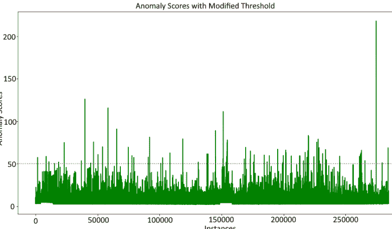

16. 我们将使用以下代码确定误差损失历史：

```python
plt.rcParams['figure.figsize'] = (15,8)
pd.DataFrame.from_dict(clf.history_).plot(title='Error Loss');
plt.savefig('error_loss.png', bbox_inches='tight')
plt.show()
```

图 1.17 显示了误差损失历史：

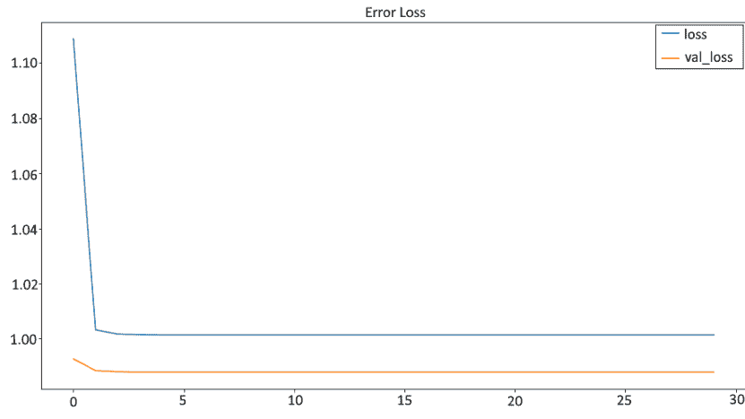

图 1.17 – 误差损失历史

17. 通过散点图对比时间与金额，可视化异常点图和离群值：


以下是一个使用 `sns.scatterplot()` 绘制散点图的 Python 代码示例：

```python
sns.scatterplot(x="Time", y="Amount", hue=y_scores,
data=df, palette="RdBu_r", size=y_scores);
plt.xlabel('Time (seconds elapsed from first transaction)');
plt.ylabel('Amount')
plt.legend('Anomaly Scores')
plt.savefig('pca_anomaly_score.png', bbox_inches='tight')
plt.show()
```

结果如图 1.18 所示：

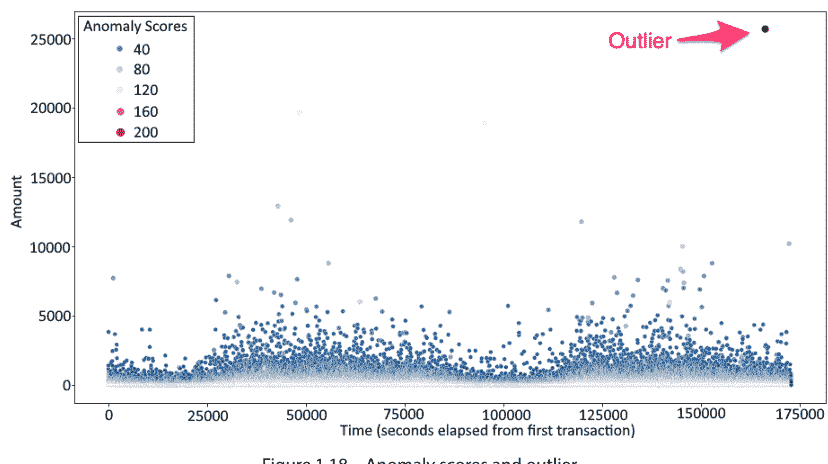

你已经完成了一个使用自动编码器（AutoEncoder）进行欺诈检测的示例演示。下一节将讨论更多现实世界的异常检测。

## 工业 4.0 与预测性维护

工业 4.0 的兴起改变了制造技术，侧重于物联网（IoT）实现机器与工业设备之间的互联互通。互联设备产生的实时数据为结构健康检查和异常检测中的预测分析提供了巨大的机会。

机器维护不当是制造业中意外停机的主要原因。提高设备的可用性和性能对于防止意外停机、避免不必要的维护成本以及增加工业负载的生产力至关重要。

尽管设备健康会随着使用时间的增加而恶化，但及早发现异常症状有助于优化机器整个寿命周期内的性能和运行时间，并确保连续性。

预测性维护技术已从响应式演变为机器学习方法。由于缺乏定义异常类别的领域知识，且在可用数据中缺乏过去的异常行为，预测性维护的异常检测具有挑战性。许多现有的制造流程只能检测到异常的一部分，导致其余异常在设备进入故障状态之前未被检测到。预测性维护中的异常检测旨在预测设备故障的发生，并进行及时维护以避免不必要的停机。

你可以使用此数据集通过 `PyOD` 实现预测性维护问题：https://www.kaggle.com/datasets/shivamb/machine-predictive-maintenance-classification。

## 医疗状况诊断

通过医疗诊断应用（如磁共振成像 MRI）和可穿戴设备收集的生理数据使医疗保健人员能够利用异常检测方法突出异常读数，这些读数可能是患者潜在健康风险的前兆。除了医疗诊断外，异常检测还通过预测心率和血压等生理信号，帮助医疗提供者预测恢复情况并评估医疗风险。

检测和预测的准确在医疗异常检测中至关重要，因为它们涉及时间敏感的决策和生死局面。除了类别不平衡和异常样本稀缺等常见挑战外，医疗异常检测还面临区分患者和人口统计特定特征的挑战。

深度学习技术因其特征学习和非线性建模能力，在医疗异常检测中变得日益流行。然而，目前的深度异常检测方法主要根据标注数据将患者症状与已知的疾病类别相关起来。在没有可量化的因果估计或解释的情况下，医学专家对信任黑盒模型的决策将持怀疑态度。可解释人工智能（XAI）的作用对于提供深度可见性，即深度学习模型如何得出导致明智决策的预测至关重要。

## 网络安全

检测零日攻击或不可预见的威胁具有高度价值，因为使用无标记数据集的无监督深度学习已广泛应用。入侵检测系统（IDS）分为基于主机和基于网络类。基于主机的 IDS 在操作系统层面检测集体异常，例如策略违反和未经的访问。基于网络的 IDS 分析高维网络数据以识别外部攻击。

Web 应用现在是犯罪分子令人厌恶的目标，因为现有的基于签名的技术不再提供足够的保护，因为规则的质量取决于已知攻击。基于异常的 Web 检测方法通过测量属性相对于既定正常配置的概率来区分异常请求。

## 气候与环境监测

人类活动驱动的广泛气候变化导致自 1880 年以来地球温度升高了 0.14 华氏（或 -1.7 摄氏度），根据美国海洋和大气管理局（NOAA）的数据，2020 年是记录以来第二暖的一年。气候变化的不可逆后果可能导致其他影响，如极端干旱、水短缺、灾难性山火和严重洪水。检测异常天气模式和气候事件（如热浪、寒潮、气旋和洪水频率），有助于理解气候变量的行为和关系。

世界上几乎 80% 的能量由化石燃料产生，因此通过异常检测方法检测绿色能源并减少总能耗至关重要。例如，建筑消耗了全球 40% 的能量和 33% 的温室气体排放。因此，减少能耗是实现 2050 年净零排放目标的重要努力。

## 金融领域

识别金融数据（如股票指数）中的异常对于明智决策和竞争优势具有重要意义。金融数据的特点包括量、速度和多样性。例如，纽约证券交易所（NYSE）每天产生一个 TB 的股市数据，以低延迟反映市场的的变化。市场参与者需要一种机制来识别金融数据中的异常，这些异常可能会导致对市场行为的误读，从而导致糟糕的交易决策。

## 深度学习基础

神经元包含一个激活函数，通过输出层产生预测。图 1.19 展示了一个基础深度学习架构：

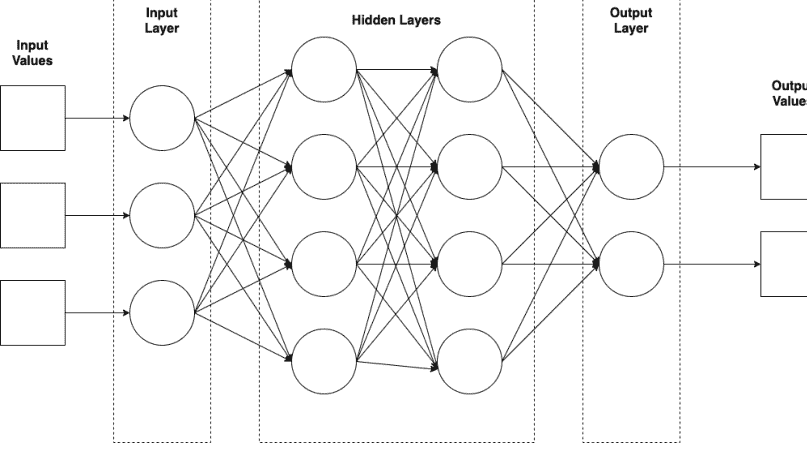

异常检测技术通常分为三类：

- **监督异常检测**：使用不平衡的标记数据集训练 ML 模型，其中每个实例都被归类为正常类或异常类。如果有地面真值（ground truth）或实际观测值，这种方法是可行的。异常检测模型通过确定与训练数据集分布相同的未见数据离群值的类别。监督异常检测的局限性包括异常样本稀缺以及在识别正常类精确表示方面存在挑战。

- **半监督异常检测**：使用大量未标记数据集，辅以少量针对预期行为的标记数据来训练 ML 模型。这种方法假设离群值与训练数据集的分布不同。因此，由于异常很少，半监督比检测离群值更具适用性。

- **无监督异常检测**：使用包含正常和异常观测值的未标记数据集训练 ML 模型。这种方法假设正常和异常观测值通常孤立在高密度和低密度区域。异常检测器寻找低密度区域中的实例或潜在的离群值。

除了识别未见数据的类别外，异常检测算法还可以产生异常评分以量化严重程度，帮助企业确定可接受的影响阈值并管理风险容忍水平。

## 深度学习与传统方法的权衡

异常检测的重要性在许多关键任务领域都是显而易见的。在选择深度学习与传统异常检测方法时，请考虑业务目标、数据规模和训练时间的权衡，例如算法的可扩展性、模型灵活性、解释性和可解释性。

深度学习方法能够且理想地处理大型数据集和复杂问题。如果你的业务目标是发现大型数据集中的隐藏模式，深度学习可以提取并关联许多相互依赖之间的关系。否则，如果你的数据量较小，传统方法可能是很好的开始。

训练深度学习异常检测模型可能是计算密集型且耗时的，这取决于参数的数量和可用的基础设施（如图形处理器/GPU）。随着深度学习模型规模和复杂性的增长，需要更多的计算力。相反，传统的异常检测方法可以在廉价的硬件上更快地运行和训练，仅需几小时。

传统的由专家手动创建的基于规则的异常检测方法的可扩展性不足，无法处理高维数据且难以维护。例如，为每种可能的恶意行为开发安全规则并保持其更新是挑战性的。相比之下，深度学习异常检测方法通过隐藏层在嵌套层次中增量学习和提取特征，更具适应性。

## 挑战与未来方向

本节涵盖了深度学习的基础和通用实践。在接下来的章节中，我们将讨论深度学习异常检测的已知挑战以及 XAI（解释人工智能）在该领域的未来机遇。

计算资源的丰富和可用数据的增加加速了多年异常检测技术的演进。根据国际数据公司（IDC）的数据 https://www.statista.com/statistics/871513/worldwide-data-created-digital/，在 COVID-19 期间产生的 64.2 兆字节数据中，少于 2% 留到了 2021 年，这为大数据分析和异常检测带来了巨大的机遇。然而，高假报率、异常样本稀缺和分布不平衡等挑战仍然普遍。

建立正常行为与异常行为的边界在异常检测中至关重要。然而，由于异常的动态性质，这并不总是一项简单的任务。例如，当恶意攻击者不断适应时，定义正常行为是一个移动的目标，且对于异常检测算法来说是合理的任务。噪声和标记错误的数据可能导致良性记录显示为异常观测值。异常记录可能被聚合数据或隐藏趋势的掩盖而漏检。此外，输入数据和特征的变化可能会发生漂移，导致当前的正常行为概念失效。

通常，除了 ML 可以改进决策和运营效率外，随着预测准确性和复杂性的增加，公司在模型性能与可解释性（为了满足审计和监管合规性）之间的权衡陷入挣扎。例如，个人根据欧盟（EU）《通用数据保护条例》（GDPR）享有“解释权”。因此，在不同采纳 ML 成熟程度的企业中，对解释性的意识日益增强。

了解了关键点后，让我们探索下一代深度学习异常检测实践的一些未来研究重点和机遇。与其专门使用监督技术拟合标记的异常样本，或使用无监督方法进行训练，人们对使用部分标记异常数据的**弱监督异常检测**兴趣日益增加，希望获得两者的兼得。弱监督异常检测旨在通过少量准确标记的样本增强模型学习，并继续探索未见的异常。

大多数深度学习方法关注**点异常**。如气候控制和机电系统等复杂的互连设备为**多模态异常检测**提供了新机会。当一个或多个维度超过或低于预期值范围，或者多个维度之间不相关时，就会发生多维异常。

XAI 是一个新兴的研究领域，研究通过工具和框架来提供人类可读的解释，并通过量化因素增加对模型预测的信心。XAI 在异常检测中的早期阶段基于规则的专家系统，由人类专家制定规则和系统知识，使其具有内在解释性。对可解释和可操作深度学习异常检测的进一步研究对于解释模型决策和减轻潜在偏差具有重要意义。

尽管存在上述挑战，异常检测高度适用于各个领域，并将保持一个多样化的研究领域。在本章中，你学习了异常检测的基础、实际行业用例，以及深度学习与传统异常检测方法的权衡考虑。你还完成了两次演示，并探索了该领域的挑战和令人兴奋的机遇。在下一章中，我们将讨论 XAI 及其对异常检测的意义。

# 第 2 章：可解释人工智能（XAI）基础

2012 年 ImageNet 的突破加速了深度学习革命，并演变为 2015 年对解释人工智能（XAI）的关注，由美国高级研究计划局（DARPA）发起，由于对这些透明系统的研究兴趣增加。考虑到高风险情况下隐藏的担忧，DARPA 在 2017 年 5 月启动了 XAI 项目，旨在开发用户可以理解并信任的 AI 系统。

在过去的几十年里，AI 以以前未有的速度进化，到了不需要人工干预的程度。虽然深度学习在解决复杂问题方面日益成熟，这些进步引发了对 AI 社会影响和伦理含义的担忧。

XAI 是一个新兴的研究领域，专注于研究解释 AI 系统内部机制的方法、工具和框架。XAI 的目标是满足利益相关者的兴趣和期望。例如，https://ieexplore.ieee.org/document/9785199 讨论了一个 XAI 案例研究，为声学学家和皮肤科医生提供了关于 ML 模型如何检测黑色素瘤或痣病变的异常的信息和解释。该模型封装了来自皮肤成像协作组织（ISIC）的 10,000 张图像的数据集知识。除了使用解耦推验变分自动编码器（DIP-VAE）检测皮肤病变异常外，模型还根据医疗指南对评估皮肤状况的对称性、边界和颜色提供解释。

在本章中，我们将探索以下 XAI 主题：

- 理解 XAI 的基础
- 回顾 XAI 的意义
- 选择 XAI 技术

在本章结束时，你将了解到更多关于 XAI 及其对异常检测的意义，包括业务影响、社会影响和监管合规性。

## XAI 的起源与动机

AI 系统从输入数据中提取模式，并根据训练过的知识得出感知。随着 AI 系统和应用在日常生活中的日益增加，人们对解释性和问责制的需求日益增长，以便为更广泛的 AI 采用模型输出提供合理依据。与具有自解释性的传统人工规则规则系统不同，许多深度学习算法本质上是不透明的，且对于人类的可解释性来说过于复杂。

XAI 是一个跨越心理学、计算机科学和工程的多学科领域，如图 2.1 所示。通过应用算法、心理学和认知科学概念，XAI 旨在提供可解释的 AI 决策，让没有机器学习背景的用户也能理解模型行为。

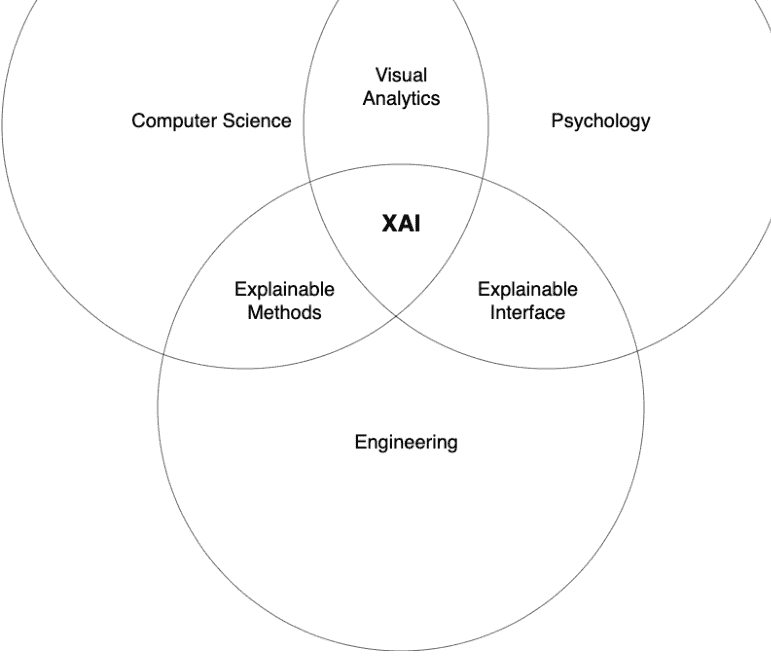

DARPA 最初的关注是在两个问题领域评估 XAI——即数据分析和自主性。他们认为，仅仅总结 AI 系统的内部逻辑不足以应对运营挑战，因为还需要帮助情报分析师从模型输出中过滤假阳性，并决定何时以及如何应用 AI 支持的工作流能力。DARPA 的 XAI 计划遵循以用户为中心的方法，产生更具解释性的模型，设计用户界面，并根据心理需求创建充分的解释。他们聘用了了人在回路的心理学家来评估用户满意度、心理模型、任务性能和信任水平。为了识别更具解释性的模型，DARPA 关注三个主要领域：

- **深度解释**：通过审查深度设计选择来进行深度解释，包括训练数据来源、架构复杂度、训练序列、正则化、损失函数和优化技术。

- **可解释模型**：探索作为贝斯规则列表（Bayesian rule lists）的可解释模型，以学习因果关系和可解释结构。

- **模型归纳**：通过近似黑盒模型来导出可解释模型。

除了推理 AI 系统外，DARPA 的 XAI 计划还旨在表征所学模型的优缺点。为期4 年的 DARPA XAI 计划于 2021 年结束，最终交付成果是开源的可解释人工智能工具包（XAITK; https://xaitk.org/），计划产物包括代码、论文和报告。XAITK 的目标是将 DARPA 的 XAI 研究整合到一个单一的公开访问仓库中，并为感兴趣的贡献者的未来研究提供运营能力。你可以在这篇论文阅读更多关于 DARPA XAI 的信息：https://onelibrary.wiley.com/doi/10.1002/ai12.61。

从那时起，以下动机成了 XAI 的增长：

- **用户意图**：向用户解释模型输出——例如，为什么一个学生的大学申请被拒绝了？

- **社会信任**：向公众提供解释，以培养对 AI 系统的信任和接受——例如，公众是否信任在推荐职位候选人时遵循伦理指南的 AI 系统？

- **监管合规**：向审计员或监管机构解释算法逻辑以满足法律和伦理要求——例如，AI 系统能否解释会计中哪些特定交易被标记为异常？

- **模型调试**：对模型产物的解释，使技术专业人员能够调试模型衰减

- **业务利益**：为基于模型预测的业务决策提供解释——例如，在线零售商想要理解 AI 系统如何做出产品推荐以改进客户体验

## 可解释性与解释性

机器学习模型可以是部分或完全可解释的。完全可解释的模型通常更有结构性，并遵循领域知识，使用相关变量提供关于决策如何得出的透明解释。相比之下，部分可解释的模型通常不受领域约束限制，并揭示了推理过程的关键要素。图 2.2 比较了基于模型准确性和可解释性的机器学习算法。

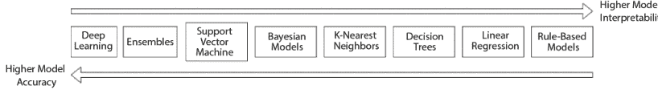

图 2.2 – 模型准确性与可解释性

具有更多结构化功能细节的简单模型，如决策树、基于规则的算法和线性回归模型本质上是可以解释、可模拟且可分解的。相反，具有数百万参数和权重的深度学习网络等复杂算法被认为是黑盒模型，因为人类无法理解。

目前的 XAI 成熟度尚未识别导致模型决策或预测的根源。尽管如此，XAI 方法专注于局部和全局可解释性，我们将在第 6 章中深入讨论。以下是对这两个概念的介绍：

- **局部可解释性**解释了机器学习模型如何关联单个决策或预测特定结果。这种方法侧重于向用户解释模型决策背后的推理——例如，银行在根据 AI 生成的决策拒绝贷款申请时，可能接受审计以证明其可解释性。

- **全局可解释性**通过研究模型学习（包括数据和算法的选择）提供模型整体行为的完整视图。这种方法向用户解释哪些元素影响了模型的决策——例如，公司的营销团队可能想知道哪些因素影响了模型的决策。

XAI 技术适用于各种数据模态，包括图像、文本和表格数据。我们将在书的第二部分详细介绍通过**自然语言处理 (NLP)**、时间序列和计算机视觉来构建可解释异常检测器。

本节强调了 XAI 的转折点和动机。下一节将比较 XAI 的两个方面：解释性和可解释性。

## 解释性与可解释性的区别

XAI 有两个主要概念：解释性和可解释性。了解这些在文献中经常混用的术语的区别。

在机器学习中，解释性是指对导出预测的工作机制提供人类可理解的解释——例如，欺诈检测模型预测某笔交易为欺诈，我们想知道它是得出这一结论的。

相比之下，可解释性是指对预测的上下文理解——例如，我们想理解标记为欺诈的信用卡交易的严重程度和风险。简单来说，解释性关注“如何”和“为什么”，而可解释性强调的是“什么”。

表 2 总结了解释性和可解释性的比较，其中解释性产生模型决策的推理，而可解释性衡量对模型行为的理解程度。

| 解释性 (Explainability) | 可解释性 (Interpretability) |
| :--- | :--- |
| 对导出预测的工作机制提供人类可理解的解释 | 对预测的上下文理解 |
| 模型训练后事后解释以评估模型的局部和全局解释性 | 内生可解释的算法，如决策树和线性模型 |
| 模型如何预测欺诈？哪些参数导致了欺诈预测？ | 什么类型的欺诈？欺诈有多严重？ |

## XAI 的角色与利益相关者

理解并语境化利益相关者的需求对于培养 AI 系统的信任以及帮助用户（如图 2.3 所示）在接受模型决策之前评估风险至关重要。正如知情同意一样，医疗提供者在进行手术之前，会告知患者治疗计划，并根据其医疗状况指导他们评估风险和收益。知情的用户具有更高的情境意识，并被赋予做出更好决策的能力。

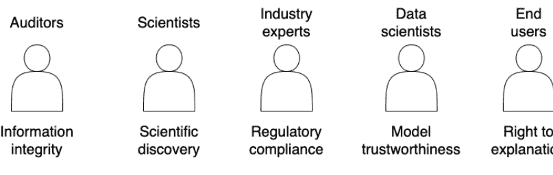

具有不同视角的 XAI 角色包括：

- **审计员**：在应对日益复杂的法律法规时，审计员必须确保在整个审计过程中信息的完整性，以验证模型输出的准确性和可靠性。随着 AI 的趋于成熟，XAI 帮助审计员理解模型的输入、处理和输出，以满足审计标准。

- **研究科学家**：AI 系统在基于训练模型拟合和泛化未见数据方面取得了巨大进展。XAI 帮助研究科学家根据从模型中提取的信息增强其知识，从而带来科学发现。

- **行业专家**：由于简单模型具有可解释性并满足监管要求，通常优于黑箱模型。XAI 帮助行业专家在考虑模型性能与可解释性的权衡时降低门槛。

- **数据科学家**：模型开发是一个迭代过程。XAI 帮助数据科学家在整个 ML 生命周期中识别潜在的算法和数据偏差，以确保 AI 系统的可信度。

- **终端用户**：自 2016 年诞生以来，欧盟（EU）《通用数据保护条例》（GDPR）实施了“解释权”，赋予数据主体从自动化决策系统中获得解释的权利。个人可以请求人工干预，以挑战影响其法律和财务权利的不公平决策——例如，一个被拒绝贷款的个人有权要求解释以证明该决策的合理性。


AI 系统提供的解释主要作为一种工制品，引导用户根据模型输出决定下一步的操作。通常情况下，对模型结果和推理过程都了解的用户，其决策时间比只获得模型结果的用户要短。2.4 展示了当前和理想的未来 XAI 状态，用户可以根据 AI 生成的解释识别最佳行动方案。

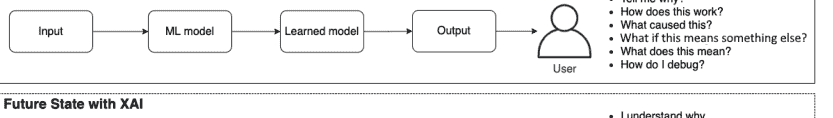

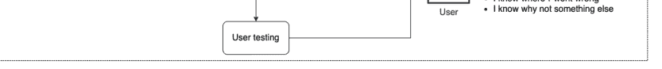

图 2.4 – XAI 的未来状态

AI 系统必须为用户产生有意义的解释。然而，“意义”的定义对于不同的用户群体可能有所不同。例如，对数据科学家有意义的解释可能并不适用于审计员。在这种情况下，数据科学家可能关注算法细微差别，而审计员通常寻找的是合理的保证。因此，收集直接的用户反馈并进行用户测试以验证验收标准至关重要。注意，用户对有意义解释的观点可以让他们对 AI 系统感到更加舒适和熟悉。

既然你已经理解了用户的可解释性需求，让我们在下一节中探索如何将 XAI 应用于异常检测。

# 实现 XAI

可解释性是构建异常检测深度学习解决方案的关键。XAI 效果的定性衡量通常涉及主观评分和对解释清晰度的用户反馈进行调查。定量方法（如不忠实度/infidelity 和灵敏度/sensitivity）被用作显著性图解释的客观评估指标，基于解释捕捉预测器行为对扰动做出反应的程度。

ML 生命周期涉及一个识别业务目标、建构特定 ML 问题、数据准备、模型开发和部署的循环迭代过程。在 ML 中引入 XAI 能够实现语境理解并增加可解释性。图 2.5 展示了一个端到端的可解释深度学习异常检测循环。

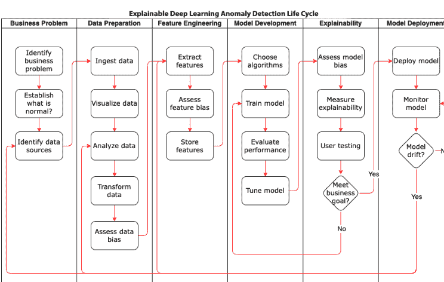

图 2.5 - 可解释深度学习异常检测生命周期

- **业务问题**：构建异常检测 AI 系统的组织应该能够识别清晰的问题，并根据可量化的成功标准衡量业务价值。组织必须围绕业务问题构建 ML 问题，包括数据模态、目标预测、正常与异常情况以及性能指标。

- **数据准备**：在识别可靠数据源后，组织必须执行数据处理任务，对数据进行接入、清洗、可视化、分析和转换以减轻潜在偏差。

- **特征工程**：清洗后的数据现在可以用于特征工程，以提取模型训练的相关属性。检测特征偏差，性别、种族特征或社会地位等属性可能会对模型预测产生不利影响。

- **模型开发**：此阶段涉及模型构建、训练、调优和性能评估，以实现预测精度。

- **可解释性**：如果模型本身不是可解释的，此阶段通过检测算法内部由于错误假设导致的系统性误差来评估模型偏差。除了选择合适的 XAI 技术外，组织还对 AI 生成的解释进行基准测试，以满足业务目标和用户直觉。无论你的算法有多强大，通过 XAI 识别假阳性和阴性结果对于确定最佳权衡至关重要。

- **模型部署**：经过训练、调优和验证的模型已准备好部署和推理。监控概念漂移和数据漂移。

正如你所注意到的，XAI 可以应用于模型开发之前、期间和之后。图 2.6 突出了构建模型时 XAI 的一些示例。

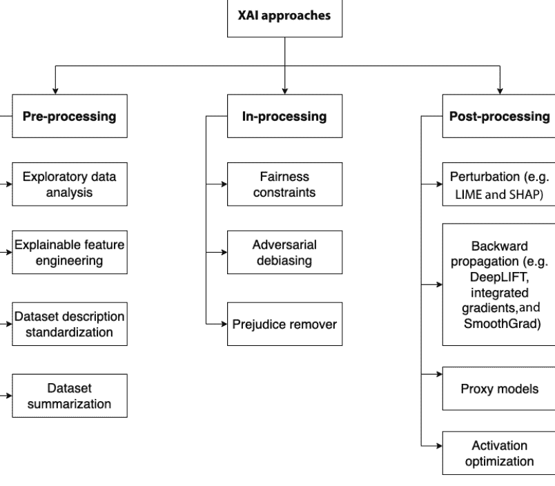

图 2.6 - 构建模型时引入 XAI

## 理解可解释 AI

让我们回顾这些方法：

- **预处理 XAI 技术**：重点在模型学习过程之前消除偏差，包括通过特征加权避免歧视，并确保多样性的平衡与包容性。示例包括探索性数据分析、可解释特征工程、数据集标准化和数据集摘要。

- **处理中 XAI 技术**：在模型训练期间实施，旨在优化目标变量预测的同时最小化偏差。例如，公平性约束通过在模型内部强制公平条件来限制模型行为，对抗去偏差通过消除保护属性的暴露。

- **后处理 XAI 技术**：在模型训练后应用，而不改变输入数据。常用方法包括扰动、反向传播和激活优化。

### 审查 XAI 的重要性

与 XAI 相关的 GDPR 条文如下：

- 第 12 条：“行使数据主体权利的透明信息、通信和方式”(https://gdpr-info.eu/art-12-gdpr/）。这要求企业以数据主体的自然语言向其传达易于理解的信息。

- 第 15 条：“数据主体的数据访问权”(https://gdpr-info.eu/art-15-gdpr/）。该条款规定数据主体有权获得有关自动化决策过程所涉及逻辑的解释。

- 第 22 条：“自动化个人决策，包括画像分析”(https://gdpr-info.eu/art-22-gdpr/）。赋予了个人请求人工干预以验证 AI 决策的权利。考虑到第 15 条中解释权和第 22 条中人工干预权的影响，企业必须清楚其自动化系统如何符合 GDPR 的。

本文（https://doi.org/10.1093/ipab02）讨论了由于自动化决策，GDPR 第 22 条可能对基于 AI 的异常检测系统中的问责机制带来挑战。例如，用户可能会惊讶地发现自己的账户因为银行使用异常检测算法检测到的异常消费模式而被冻结。根据 GDPR，该用户有权要求人工干预以验证自动化决策，并获得有关触发此类操作的解释。

违反 GDPR 可能导致高达年度总营业额 4% 或 2000 万欧元的财务责任，以较高者为准。公司将面临负面的声誉影响。除了 GDPR，其他法规也纷纷效仿以执行合规。例如，《平等信贷机会法》要求企业对被拒绝的信贷申请提供理由说明。随着各项法规对解释权执行力的加强，企业必须对 XAI 进行尽职调查，以改善用户体验、建立信任并降低业务风险。

ML 算法专注于通过统计相关性来估计概率，而不考虑变量之间的因果关系。除了审查潜在的数据和算法偏见外，企业必须意识到解释能力，以支持 AI 系统的持续使用。企业不应采用一刀切的方法，而应关注产生如 GDPR 条文所描述的以用户为中心的解释。

既然你已经理解了异常检测中解释权的法律影响，企业必须对 XAI 进行尽职调查，以改善用户体验、建立信任并降低业务风险。

### 利用 XAI 推动包容

ML 算法专注于通过统计相关性来估计概率，而不考虑变量之间的因果关系。除了审查潜在的数据和算法偏见外，企业必须意识到解释能力，以支持 AI 系统的持续使用。企业不应采用一刀切的方法，而应关注产生如 GDPR 条文所描述的以用户为中心的解释。

既然你已经理解了异常检测中解释权的法律影响，企业必须对 XAI 进行尽职调查，以改善用户体验、建立信任并降低业务风险。

### 理解可解释人工智能 (XAI)

ML 算法专注于通过统计相关性来估计概率，而不考虑变量之间的因果关系。除了审查潜在的数据和算法偏见外，企业必须意识到解释能力，以支持 AI 系统的持续使用。企业不应采用一刀切的方法，而应关注产生如 GDPR 条文所描述的以用户为中心的解释。

既然你已经理解了异常检测中解释权的法律影响，企业必须对 XAI 进行尽职调查，以改善用户体验、建立信任并降低业务风险。

### 缓解业务风险

ML 算法专注于通过统计相关性来估计概率，而不考虑变量之间的因果关系。除了审查潜在的数据和算法偏见外，企业必须意识到解释能力，以支持 AI 系统的持续使用。企业不应采用一刀切的方法，而应关注产生如 GDPR 条文所描述的以用户为中心的解释。

### 选择 XAI 技术

基本的 XAI 原则要求 AI 系统提供人类可以理解的解释、证据和信息，以证明模型输出的合理性。

- 选择 XAI 算法：解释深度学习模型的 XAI 算法主要分为两类：基于扰动和基于梯度的算法。虽然基于扰动的 XAI 技术可以产生直观的解释（如归因图），但其输出可能对微小的扰动敏感。相比之下，基于梯度的 XAI 方法生成的解释更具健壮性，但可能不符合原始模型。第 7 章将更深入地介绍基于扰动和基于梯度的 XAI 技术。

- 确定成功标准：解释性对于用户的偏好、经验、领域知识、信仰和文化影响可能具有主观性。组织可以决定应该向利益相关者展示 AI 系统生成的哪些解释，以及如何展示。他们需要多频繁访问这些信息？一个设计良好的、以人为本的 XAI 界面应该是怎样的？解释是否具有可模拟性和可重复性？第 9 章将更详细地介绍解释性方案。

大众的共识是，AI 算法性能的提高会导致复杂性增加和解释性降低。大多数高性能技术（如深度学习）的解释性较低。相反，大多数可解释方法（如决策树）的准确率因子较低。尽管如此，解释性对用户来说是主观的，满意的解释水平可能根据个人及其偏好而异。

尽管对 XAI 方法的基准测试持续进行，但目前还没有统一的方法来衡量解释质量，因为 XAI 方法因用例、数据模态和算法选择而异。因此，更好地理解内部逻辑有助于纠正潜在缺陷、对输入变量实施质量控制、确保公平决策，并检测可能操纵模型预测的对抗扰动漏洞。

大规模实施 XAI 不仅限于技术层面。公司必须定义合理的业务战略，以平衡准确性和解释性之间的权衡，以满足合规性要求。因此，在选择合适的解释性框架和工具时，理解 XAI 的基础和相关概念至关重要。

### 总结

虽然 AI 的出现扩展了可能的边界，但解释性通过提供相关的模型指标来满足公司利益相关者的需求，使其更易于。未来的 XAI 进展需要对现有解释性框架的有效性进行进一步测试，并通过精细的工程来传递人类可理解的解释，驱动有效的解释性。

本章结束了书的第一部分。你概述了用于异常检测的深度学习和 XAI，包括它们的意义和最佳实践。在第二部分中，我们将涵盖构建深度学习异常检测器的实际示例，从 NLP 开始。

# 第二部分 – 构建可解释的深度学习异常检测器

第二部分深入探讨了如何在三个主要应用领域中使用各种数据模态构建深度学习异常检测器，并提供了逐步的示例演示。到第二部分的结束时，你将学习如何使用 AutoGluon 和 Cleanlab 等先进框架快速开发复杂的异常检测器，并能够应用 XAI 技术扩展这些领域中的模型解释性。

此部分包含以下章节：

- 第 3 章，自然语言处理异常解释

- 第 4 章，时间序列异常解释

- 第 5 章，计算机视觉异常解释

## 3 自然语言处理异常解释

自然语言处理（NLP）的演变始于 20 世纪 50 年代的机器翻译将俄语翻译成英语。计算能力和大数据的出现激发了 NLP 创新，导致了语言学、计算机科学和人工智能的一个新子领域。图 3.1 显示了 NLP 与其他学科的交叉点：

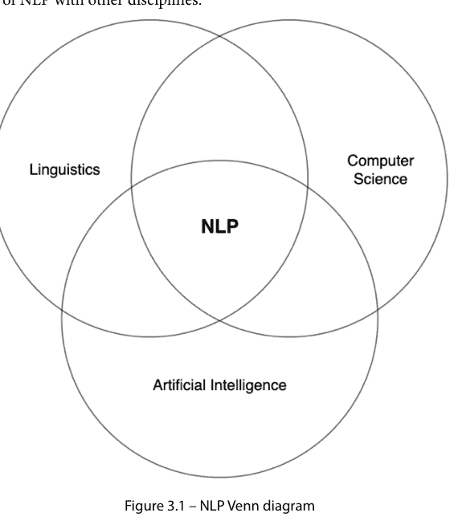

我们周围有大量的非结构化文本数据用于 NLP 任务，例如文本分类、主题建模和意图检测。NLP 使计算机能够大规模地理解和分析大量的书面和口语人类语言。目标是使语言细微差别上下文化并提取有用信息以获得价值见解。

深度学习彻底改变了许多 NLP 应用，包括文本摘要、机器翻译和问答。尽管准确率很高，但其不透明性挑战了深度学习模型的解释性。此外，讽刺、俚语和多义等常见语言挑战增加了处理文本数据的复杂性。NLP 解释性旨在揭示神经网络的内部表示，例如 transformer 模型。

NLP 有两个演示涵盖：

- 使用 [AutoGluon](https://auto.gluon.ai/) 使用公共数据集构建文本分类器。

- 针对 NLP 解释性，使用 [Cleanlab](https://github.com/cleanlab) 评估质量。

在本章结束时，你将对解释性有更深入的理解。接下来，让我们讨论技术要求。

### 技术要求

你需要以下 Python 包：

- Matplotlib：用于数据可视化的绘图库

- NumPy：处理数组时提供的数学函数开源库

- pandas：提供数据分析和处理的库

- Imbalanced-learn：导入为 imlearn 提供处理不平衡数据集工具的开源库

- MXNet：开源深度学习框架

- TensorFlow：构建深度学习应用的开源框架

- AutoGluon：开源 AutoML 库

### 理解自然语言处理

- Cleanlab：自动检测异常并发现数据错误的开源库

- SciPy：用于科学计算的开源库

- SciKeras：为 Keras 模型提供 scikit-learn 封装

- Transformers：为 ML 任务提供预训练模型

- Scikit-learn：用于预测数据的 ML 库

- SHAP：使用 Shapley 值解释 ML 输出的 Python 库

本章讨论的示例笔记本和包依赖位于 https://github.com/PacktPublishing/Deep-Learning-and-XAI-Techniques-for-Anomaly-Detection/main/Chapter3

你可以在 [SageMaker Studio Lab](https://aws.amazon.com/sagemaker/studio-lab/) 上尝试这些示例，这是一个免费的开发环境，每次会提供最多 12 小时 CPU 或 4 小时 GPU 以及 15 GB 存储。或者，你也可以在你喜欢的开发环境 (IDE) 中尝试。

### 理解自然处理

文本分类是一种使用预定义标签将文本分类类别的 NLP 任务。文本分类的常见业务用例包括情感分析、主题检测和语言检测。将有价值的业务见解分类为客户偏好、个性化体验、内容审核、新兴市场领域和社交情感。

作为 NLP 的概述，我们将使用 [AutoGluon](https://auto.gluon.ai/) 和由 Harvard Dataverse 维护的 Amazon 评论公共仓库 https://doi.org/10.7910/DVN/W960FO 构建文本分类模型。该数据仓库包含 2008 年至 2020 年间收集的 7 个数据集，每个包含 5000 条评论。你可以从该仓库下载 `export_food.csv` 文件进行示例演示。

下节给出 AutoGluon 的概述。

### 回顾 AutoGluon

AutoGluon 是一个由亚马逊开发的开源 AutoML 库，用于文本、表格和图像数据的深度学习和 ML 应用自动化。在没有先 ML 经验的情况下，用户只需几行代码和少量配置即可训练出用于文本分类、表格数据预测和图像分类的先进且高准确的模型。

AutoGluon 通过分层注册和堆叠多个模型来工作。在不需要大量数据预处理的情况下，AutoGluon 可以根据标签列的值类型推断给定数据集的 ML 任务。例如，标签列中的非数值字符串值表示分类问题，而标签列中的重复值表示回归问题。

AutoGluon 的 TextPredictor 将 NLP 数据集格式化为包含文本列和标签列的表格，用于预测文本。每行代表一个训练示例，分类任务具有离散类别值，回归任务具有连续值。此外，TextPredictor 支持多语言问题以及包含数值和类别列的多模态数据表格。你可以在 https://arxiv.org/abs/2003.06505 了解更多关于 AutoGluon 的信息。

现在我们准备好使用 AutoGluon 构建分类器了。书的 GitHub 仓库中有一个示例笔记本 `chapter3_autogluon_nlp.ipynb`：

- 1. 首先，安装所需的包：

```python
import sys
!{sys.executable} -m pip install -r requirements.txt
```

- 2. 接下来，加载核心库并验证包依赖关系：

```python
%matplotlib
import numpy as np
import warnings
import matplotlib.pyplot as plt
import pandas as pd
import tensorflow as tf
from platform import python_version
from autogluon.tabular.version import __version__
```

```python
warnings.filterwarnings('ignore')
np.random.seed(42)
```

```python
print(f'TensorFlow version: {tf.__version__}')
print(f'Python version: {python_version()}')
print(f'AutoGluon version: {__version__}')
```

- 3. 显示列值的完整文本：

```python
pd.set_option("display.max_colwidth", None)
```

- 4. 载入原始数据集。删除任何前导和后缀字符。然后预览数据：

```python
df = pd.read_csv('export_food.csv')
data = df[['reviews', 'ratings']]
data['reviews'] = data['reviews'].str.strip()
data.head(3)
```

图 3.2 数据集预览

“我每个月订购这个产品超过一年了。这几瓶有问题，包装也变了。显而易见是两个不同的制造商。整瓶都是假冒品，标签上没有粉色丝带，瓶子不一样，而且和这款含有 3% 果汁含量的主产品相比，味道也不对。主产品的标签在顶部，而假冒品的果汁含量为 1%。标签上也有差异；请对比照片。这两个产品中，假冒品是不争疑的，味道和他们正在推销的这种西柚橘味完全不同，由于味道不对劲，他们给了我全额退款。当他们发现这是我最喜欢的口味而且我每天都喝时，我就可以把它们买下架了。

我以前每天都会喝这些气泡水。味道也极好，我最喜欢的是黑树莓味。然而，我刚刚发现它们含有糖和人工甜味剂。安全的甜味剂只有甜菊、龙舌蜜和生蜂蜜。我已经停止食用任何含有有害甜味剂的食物或饮料，因为它们与许多疾病有关，包括痴呆和阿尔茨海默症患者的增加。”

图 3.2 – 数据集预览

- 5. 审查有关 DataFrame 的信息，包括索引类型、列、非空值和内存占用：

```python
data.info()
```

图 3.3 显示了 DataFrame 信息：


```text
<class 'pandas.core.DataFrame'
RangeIndex: 5000 entries, 0 to 4999
Data columns (total 2 columns):
# Column      Non-Null Count Dtype
0 reviews      5000 non-null  object
1 ratings     5000 non-null  int64
types: int64(1), object(1)
memory usage: 78.2 KB
```

图 3.3 – DataFrame 信息

- 6. 查看数据集中的唯一类别：

```python
data['ratings'].unique()
```

图 3.4 显示数据集中的唯一类别：

```python
array([4, 5, 1, 2, 3])
```

图 3.4 – 唯一类别

- 7. 查看每个类的记录计数：

```python
data['ratings'].value_counts()
```

图 3.5 显示类别频率分布：

| ratings | count |
|---|---|
| 5 | 3402 |
| 4 | 683 |
| 1 | 677 |
| 3 | 134 |
| 2 | 104 |

Name: ratings, dtype: int64

图 3.5 – 类别频率分布

- 8. 绘制类别频率分布的可视化：

图 3.6 显示类别频率分布的可视化：


- 9. 如图所示，原始数据集是非常不平衡的。为了演示，我们将使用`RandomOverSampler`随机复制少数类别的示例：

```python
from imblearn.over_sampling import RandomOverSampler

X = data[['reviews']]
Y = data[['ratings']]
```

```python
ros = RandomOverSampler(sampling_strategy='minority')
X_res, y_res = ros.fit_resample(X, Y)
```

- 可视化过采样后的类别频率分布。我们现在增加了两星级样本：

```python
y_res.value_counts().plot(kind='bar')
```

过采样后，你应该看到图 3.7 所示的新类别频率分布：


图 3.7 - 过采样后

- 合并平衡数据：

```python
rebalanced_data = X_res.join(y_res)
rebalanced_data.head(3)
```

- 将平衡后的数据集按 80:20 的比例分为训练和测试：

```python
from sklearn.model_selection import train_test_split

X_train, X_test = train_test_split(rebalanced_data, test_size=0.2, random_state=42)
```

- 13. 查看训练和测试数据的形状：

```python
print(f'Train shape: {X_train.shape}')
print(f'Test shape: {X_test.shape}')
```

图 3.8 显示训练和测试形状

```text
Train shape: (6638, 2)
Test shape: (1660, 2)
```

图 3.8 – 训练和测试数据

- 14. 我们现在准备好使用 AutoGluon 的 Predictor 训练模型。让我们定义名为`ag_food_reviews`的目录来保存训练模型和日志。删除任何同名的文件夹：

```python
import shutil
import os

OUTPUT_DIR = 'ag_food_reviews'
try:
    shutil.rmtree(OUTPUT_DIR)
except:
    pass
os.makedirs(OUTPUT_DIR)
print(f'Model output directory: {OUTPUT_DIR}')
```

- 15. 我们调用`TextPredictor`来拟合训练数据。在这里，我们将`ratings`列定义为标签，`multiclass`为问题类型，`acc`为评估指标，并配置了输出目录。然后我们可以调用`predictor.fit`使用完整的训练数据进行训练，以获得质量最好的模型。注意，训练时间取决于数据的大小。或者，您可以通过设置秒级的`time_limit`来减少训练时间。例如`predictor.fit(X_train, time_limit=300)`：

```python
from autogluon.text import TextPredictor

predictor = TextPredictor(label='ratings', problem_type='multiclass', eval_metric='acc', path=OUTPUT_DIR)
predictor.fit(X_train)
```

### 理解自然语言

16. 在这里，我们可以看到关于模型的一些信息，包括可训练参数的数量和估计的模型大小。训练完成后，你可以在图 3.9 中看到超参数列表，由预测器保存在输出文件夹下的`config.yaml`中：

```text
Global seed set to 42
GPU available: False, using: False
TPU available: False, using: 0 cores
IPU available: False, using: 0 IPs
HPU available: False, using: 0 HPUps
```

| Name | Type | Params |
|---|---|---|
| model | HFAutoScaleTextPrediction | 108 M |
| validation_metric | Accuracy | 0 |
| loss_func | CrossEntropyLoss | 0 |

```text
108 M Trainable params
0 Non-trainable params
108 M Total parameters
435.582 Total estimated model size (MB)
```

图 3.9 - AutoGluon 训练摘要

17. 图 3.10 显示了训练结果。`TextPredictor`拟合单个模型并根据性能指标进行优化，并将训练好的模型保存到输出文件夹：

图 3.10 - AutoGluon 训练过程

18. 训练完成后，我们可以使用测试数据集来评估模型性能。默认情况下，`evaluate()`函数会报告之前定义的指标——准确率（accuracy）。你可以包含额外的指标进行评估，例如`f1_micro`分数：

```python
test_score = predictor.evaluate(X_test, metrics=['accuracy', 'f1_micro'])
print(test_score)
```

图 3.11 显示了准确率`f1_micro`分数：

```text
'accuracy': 0.801204819271084, 'f1_micro': 0.801204819271084
```

图 3.11 – 评估指标

19. 现在我们准备好通过调用`predictor.predict()`函数从训练好的模型进行预测了。首先，我们将从测试数据中识别一些具有正面和负面评价的样本。在这里，我们将至少三星级的评价归为正面，少于三星级的评价归为负面：

```python
positive_reviews = X_test.query('ratings > 3')
negative_reviews = X_test.query('ratings <= 3')
```

20. 使用以下代码预览正面评价的列表：

```python
with pd.option_context('display.max_colwidth', None):
    display(positive_reviews)
```

图 3.12 显示了正面评价的预览：

| | | | |
|---|---|---|---|
| 4965 | | They taste really good and I would recommend it to anyone | 4 |
| 3994 | | Tastes good. | 5 |
| 3820 | | Did not like the ginger. | 5 |
| 2290 | My favorite flavor. Sparkling lemonade... | | 5 |
| 3149 | | | 5 |
| ... | | Refreshing | |
| 620 | We love this and had been paying more per bottle at the grocery. I love being able to get this for cheaper and the combination of flavors. | | 5 |
| 4745 | | Product came pre-opened with two inches of product mixing. | 4 |
| 4313 | | good taste n price | 5 |

809 行 × 2 列

图 3.12 – 正面评价

### 21. 使用以下代码预览负面评价：

```python
with pd.option_context('display.max_colwidth', None):
    display(negative_reviews)
```

图 3.13 显示了负面评价的预览：

```text
产品评论: Sparkling ICE is the best! They are tasty, calorie free, bubbly, and inexpensive. Buying on amazon is less expensive than at the grocery store, so I order all of the time.
预测评分: 5
产品评论: I have been ordering this for months but last batch was old or faded I had to return
预测评分: 2
```

除了预测类别外，我们还可以获得预测的类别概率。

图 3.13 – 负面评价

### 22. 让我们为选定的评价预测目标标签：

```python
review1 = "Sparkling ICE is the best! They are tasty, calorie free, bubbly, and inexpensive. Buying on amazon is less expensive than at the grocery store, so I order these all the time."
review2 = "I have been ordering this for months but last batch was old or faded I had to return"

predictions = predictor.predict({'reviews': [review1, review2]})
print(f'Product Review: {review1} \nPredicted Rating: {predictions[0]}')
print(f'Product Review: {review2} \nPredicted Rating: {predictions[1]}')
```

图 3.14 显示了两个预测的评价：

```text
产品评论: Sparkling ICE is the best! They are tasty, calorie free, bubbly, and inexpensive. Buying on amazon is less expensive than at the grocery store, so I order all the time.
预测概率：
- 1 0.158037
- 2 0.250578
- 3 0.042650
- 4 0.133276
- 5 0.415499
```

图 3.14 – 预测评分

23. 我们还可以获得预测的类别概率：

```python
probs = predictor.predict_proba({'reviews': [review1, review2]})
print(f'Product Review: {review1} \nPredicted Class-Probabilities: {probs[0]}')
print(f'Product Review: {review2} \nPredicted Class-Probabilities: {probs[1]}')
```

图 3.15 显示了概率：

| | 1 | 2 | 3 | 4 | 5 |
|---|---|---|---|---|---|
| 0 | 0.158037 | 0.250578 | 0.042650 | 0.133276 | 0.414599 |
| 1 | 0.000047 | 0.099846 | 0.000051 | 0.000025 | 0.000030 |

图 3.15 – 类别概率

24. 对整个测试数据产生预测：

```python
test_predictions = predictor.predict(X_test)
```

25. `fit`函数在训练结束会自动保存预测器。我们可以重新加载它进行预测：

```python
loaded_predictor = predictor.load('ag_food')
loaded_predictor.predict_proba({'reviews': [review1, review2]})
```

图 3.16 显示了每个类别的输出：

| | 1 | 2 | 3 | 4 | 5 |
|---|---|---|---|---|---|
| 0 | 0.158037 | 0.250578 | 0.042650 | 0.133276 | 0.414599 |
| 1 | 0.000047 | 0.099846 | 0.000051 | 0.000025 | 0.000030 |

图 3.16 – 输出

26. 或者，通过调用`save`函数，可以将训练好的模型保存到指定的路径：

```python
predictor.save('my_saved_dir')
loaded_predictor2 = predictor.load('my_saved_dir')
loaded_predictor2.predict_proba({'reviews': [review1, review2]})
```

### 理解自然语言处理

27. 我们可以使用预测器提取嵌入，将每行数据映射到中间神经网络表示：

```python
embeddings = predictor.extract_embedding(X_test)
print(embeddings)
```

28. 图 3.17 显示了预测器使用的嵌入：

```text
[[-0.6521491 -0.2670833 0.0942155 ... 0.2998472 0.4482594
-0.7461727]
 [0.0053702 0.6880415 0.0228932 ... 0.5043433 0.2496965
-0.2685917]
 [0.1406348 0.6670949 ... 0.46771514 0.0938134]
 [0.2750997 -0.3464984 0.1748297 ... -0.6468537 0.5334411
-0.1258212]
 [0.1943227 0.5131886 0.03548399 ... 0.3546247 0.2514265
-0.6742987]
 [-0.65595 -0.7710974 -0.4287235 ... -0.7155813 0.6250126
0.1075721]]
```

29. 使用 t 分布随机邻域嵌入 (t-SNE)，我们可以看到对应五个目标标签的测试数据提取嵌入，如图 3.18 所示：

```python
from sklearn.manifold import TSNE

plt.rcParams["figure.size"] = (20,10)
X_embedded = TSNE(n_components=2, random_state=123).fit_transform(embeddings)

for val, color in [(1, 'red'), (2, 'purple'), (3, 'blue'), (4, 'orange'), (5, 'green')]:
    idx = (X_test['ratings'].to_numpy() == val).nonzero()
    plt.scatter(X_embedded[idx, 0], X_embedded[idx, 1], c=color, label=f'label={val}')
plt.legend(loc='best')
```

图 3.18 – t-SNE

4. 从`export_food.csv`读取文本数据集以提取`reviews`和`ratings`列。使用唯一的目标标签：

```python
df = pd.read_csv("export_food.csv")
```


`df = df[['reviews', 'ratings']]`

`df = df['reviews'].str.strip()`

`df = df['ratings'].unique()`

你应该能看到结果，如图 3.20 所示：

```
array({4, 5, 1, 2, 3})
```

Figure 3.20 - 唯一类别

5. Cleanlab 需要从零索引的目标标签。因此，我们将对评分列进行归一化，并将其分配新的 `categorical_ratings` 列：

```python
from sklearn import preprocessing

le = preprocessing.LabelEncoder()
le.fit(df['ratings'])
df['categorical_ratings'] = le.transform(df['ratings'])
df.head(5)
```

Figure 3.21 - 编码后的分类目标标签 `categorical_ratings`

我每个月都订这个东西超过一年了。最近几次发货有问题，包装也很差。很明显它们来自两个不同的制造商。满瓶的是透明的，而空瓶是脏的。当你仔细观察瓶子时，可以看到正品含有 1% 的果汁含量。背面标有 3% 的果汁含量，冒仿品也是如此。标签也有差异。请对比照片。两个产品，包装和策略不同，与原产品不符。我联系了亚马逊，他们正在调查此问题，他们正在下架“红葡萄柚味”口味。他们还给了我全额退款。我希望他们能解决这个问题，因为这太丢人了。我非常喜欢这个味道，到处都喝。

我以前每天都喝各种口味的 Sparkling Ice 水。它们都非常棒，我最喜欢黑树莓味。然而，我发现它们含有三糖，这只是另一种有害的甜味剂。我喜欢的其他人工甜味剂是龙舌糖和甜菊。我已经停止饮用含有有害人工甜味剂的食物，因为它们与许多疾病有关，包括痴呆和阿尔茨海默症发病率的增加。

Figure 3.21 – 编码后的目标标签

6. 使用 `categorical_ratings` 列作为目标标签创建一个新数据集：

```python
df_full_ds = df[['reviews', 'categorical_ratings']]
df_full_ds.head(5)
```

Figure 3.22 显示了使用编码后 `categorical_ratings` 列的新数据集：

| | reviews | categorical_ratings |
|---|---|---|
| 0 | False | False |
| 1 | False | False |
| 2 | False | False |
| ... | ... | ... |
| 4997 | False | False |
| 4998 | False | False |
| 4999 | False | False |

5000 行 × 2 列

Figure 3.22 – 带有 `categorical_ratings` 列的新数据集

7. 移除任何包含缺失值的行：

```python
raw_full_ds = raw_full_ds.dropna()
raw_full_ds.isna()
```

Figure 3.23 验证了没有缺失值的行：

| | reviews | categorical_ratings |
|---|---|---|
| 0 | False | False |
| 1 | False | False |
| 2 | False | False |
| ... | ... | ... |
| 4997 | False | False |
| 4998 | False | False |
| 4999 | False | False |

5000 行 × 2 列

Figure 3.23 - 显示无缺失值的行的结果

8. 将 `categorical_ratings` 分配为新的目标列：

```python
raw_full_texts = raw_full_ds['reviews']
full_labels = raw_full_ds['categorical_ratings']
```

9. 设置类别数量：

```python
num_classes = len(set(full_labels))
print(f'Number of classes: {num_classes}')
print(f'Categorical classes: {set(full_labels)}')
```

10. 检查形状和特征数据：

```python
print(f'Dataset shape: {raw_full_ds.shape}')
print(f'Dataset features: {raw_full_ds.columns}')
```

Figure 3.24 验证了我们将要使用数据形状和特征：
`Dataset shape: Index(['reviews', 'categorical_ratings'], dtype='object')`

Figure 3.24 - 数据形状和特征

11. 将 DataFrame 转换为 NumPy 数组：

```python
raw_full_texts_arr = raw_full_texts.to_numpy(dtype=str)
```

Figure 3.25 显示了转换后的输出：
`Example Label: 4`
`Example Text: Great but cheaper at the store`

Figure 3.25 - 转换后的评论预览

12. 预览示例评论和评分，如图 3.26 所示：

```python
i = 4995
print(f"Example Label: {full_labels[i]}")
print(f"Example Text: {raw_full_texts[i]}")
```

结果是：
`Example Label: 4`
`Example Text: Great but cheaper at the store`

Figure 3.26 - 示例评论的结果

13. 创建一个函数，通过将所有字符转换为小写并移除 HTML 标签和标点符号来清洗数据：

```python
def preprocess_text(input_data):
    lowercase = tf.strings.lower(input_data)
    stripped_html = tf.strings.regex_replace(lowercase, r"<[^>]*>", "")
    no_punctuation = tf.strings.regex_replace(stripped_html, r"[^\w\s]", "")
    return no_punctuation
```

14. 使用文本向量化将特征映射到整数：

```python
vectorize_layer = tf.keras.layers.TextVectorization(max_tokens=max_features)
vectorize_layer.adapt(raw_full_texts)
```

15. 通过调用 `adapt` 对数据集进行预处理：

```python
raw_full_texts = vectorize_layer(raw_full_texts).numpy()
```

16. 构建多分类构建神经网络：

```python
def get_net():
    net = tf.keras.Sequential([
        tf.keras.layers.Input(shape=(1,),
        tf.keras.layers.Dense(128, activation='relu'),
        tf.keras.layers.Dropout(0.2),
        tf.keras.layers.Dense(num_classes, activation='softmax')
    ])
    net.compile(
        optimizer="adam",
        loss=losses.SparseCategoricalCrossentropy(),
        metrics=metrics.SparseAccuracy(),
    )
    return net
```

17. 使用 SciKeras 包装神经网络：

```python
from scikeras.wrappers import KerasClassifier

model = KerasClassifier(model=get_net, epochs=10)
```

18. 使用 k 折交叉验证预测概率：

```python
from sklearn.model_selection import cross_val_predict

num_crossval_folds = 5
pred_probs = cross_val_predict(
    model,
    full_texts,
    full_labels,
    cv=num_crossval_folds,
    method="predict_proba"
)
```

19. 计算 `log_loss`，这是评估预测的评分，值越小越好：

```python
from sklearn.metrics import log_loss

loss = log_loss(full_labels, pred_probs)
print(f"交叉验证的 log loss 估计:{loss}")
```

20. 根据预测概率，对识别出的标签问题按置信度得分进行排序，以衡量标签的质量：

```python
from cleanlab.filter import find_label_issues

ranked_label_issues = find_label_issues(
    labels=full_labels, pred_probs=pred_probs, return_indices_ranked_by="self_confidence"
)
```

21. Cleanlab 在此数据集上识别了 1556 个潜在标签错误。让我们列出前 10 个预测异常的索引：

```python
print(f"Cleanlab 识别了 {len(ranked_label_issues)} 个潜在标签错误：\n前十个最可能的错误索引：n{ranked_label_issues[:10]}")
```

22. 创建一个函数来查看排名靠前的标签异常：

```python
def get_anomaly(index):
    return pd.DataFrame({"Reviews": raw_full_texts[index],
    "分类 labels": full_labels[index]+1, [index]})
```

23. 查看一个预测标签异常：

```python
get_anomaly(4270)
```

这条评论得到两星评分似乎不寻常，如图 3.28 所示：

| 评论 | 标签 |
| --- | --- |
| 4270 价格很好 | 2 |

图 3.28 - 检测到的标签异常

24. 让我们选择另一个预测的异常：

```python
get_anomaly(4443)
```

图 3.29 显示了另一个可疑的评分：

| 评论 | 标签 |
| --- | --- |
| 4443 苏水的很好的替代品！我喜欢它 | 2 |

图 3.29 - 标签异常

25. 手动检查和修复潜在的标签错误可能耗时。我们可以使用 Cleanlab 过滤噪声数据来训练一个更好的模型。首先，将数据集按 80:20 的比例进行划分：

```python
from sklearn.model_selection import train_test_split

raw_train_texts, raw_test_texts, train_labels, test_labels = train_test_split(raw_full_texts, full_labels,
test_size=0.2, random_state=42)
raw_train_texts.to_numpy(dtype=str)
raw_test_texts.to_numpy(dtype=str)
```

26. 接下来，检查数据的形状：

```python
print(f'raw_train_texts shape: {raw_train_texts.shape}')
print(f'train_labels shape: {train_labels.shape}')
print(f'raw_test_texts shape: {raw_test_texts.shape}')
print(f'test_labels shape: {test_labels.shape}')
```

查看数据划分，如图 3.30 所示：

```python
raw_train_texts shape: (4000,)
train_labels shape: (4000,)
raw_test_texts shape: (1000,)
test_labels shape: (1000,)
```

图 3.30 - 检查数据划分

### 27. 文本向量化：

```python
vectorize_layer.metrics.reset_state()
vectorize_layer.adapt(raw_train_texts)
```

```python
train_texts = vectorize_layer(raw_train_texts)
test_texts = vectorize_layer(raw_test_texts)
```

```python
train_texts = train_texts.numpy()
test_texts = test_texts.numpy()
```

### 28. 训练并评估我们创建的神经网络：

```python
from sklearn.metrics import accuracy_score

model = KerasClassifier(get_net(), epochs=10)
model.fit(train_texts, train_labels)
preds = model.predict(test_texts)
acc_og = accuracy_score(test_labels, preds)
```

`print(f'Test accuracy of original neural net: {acc_og}')`

图 3.1 显示了训练结果：

```python
Epoch 1/10
125/125 [============================] - 1ms/step - loss: 1.3862 - categorical_accuracy: 0.0075+00
Epoch 2/10
125/125 [============================] - 0ms/step - loss: 1.0653 - categorical_accuracy: 0.0000+00
Epoch 3/10
125/125 [============================] - 0ms/step - loss: 1.0118 - categorical_accuracy: 0.0000+00
Epoch 4/10
125/125 [============================] - 0ms/step - loss: 0.9991 - categorical_accuracy: 0.0000+00
Epoch 5/10
125/125 [============================] - 0ms/step - loss: 0.9967 - categorical_accuracy: 0.0000+00
Epoch 6/10
125/125 [============================] - 0ms/step - loss: 0.9994 - categorical_accuracy: 0.0000+00
Epoch 7/10
125/125 [============================] - 0ms/step - loss: 0.9957 - categorical_accuracy: 0.0000+00
Epoch 8/10
125/125 [============================] - 0ms/step - loss: 0.9910 - categorical_accuracy: 0.0000+00
Epoch 9/10
125/125 [============================] - 0ms/step - loss: 0.9958 - categorical_accuracy: 0.0000+00
Epoch 10/10
125/125 [============================] - 0ms/step - loss: 0.9940 - categorical_accuracy: 0.0000+00
Test accuracy of original neural net: 0.698
```

图 3.31 - 训练结果


29. `CleanLearning` 包装器通过交叉验证训练原始模型，以产生潜在错误的预测概率。在重新训练原始模型之前，从数据集中移除噪声数据。Cleanlab 训练的模型预测行为与原始模型相同。我们可以看到模型现在的训练损耗较低：


```python
from cleanlab.classification import CleanLearning

model = KerasClassifier(get_net(), epochs=10)
cl = CleanLearning(clf=model, seed=42)

cl = cl.fit(train_texts, train_labels)
```

图 3.32 显示了评估指标：


图 3.32 - 评估指标

- 30. 噪声数据后获得新的预测准确率：

```python
pred_labels = cl.predict(test_texts)
acc_cl = accuracy_score(test_labels, pred_labels)
print(f'Test accuracy of Cleanlab\'s neural net: {acc_cl}')
```

图 3.33 显示了测试结果：


图 3.33 - 测试准确率

- 31. 下，让我们评估模型预测的后解释性。首先，加载必要的库和数据。然后设置相关的特征列和目标列：

```python
import pandas as pd
import numpy as np
import scipy as sp
import matplotlib.pyplot as plt
import transformers
import shap
```

```python
dataset = pd.read_csv('export.csv')
data = pd.DataFrame({'text':dataset['reviews'], 'sentiment':dataset['ratings']})
```

- 32. 加载调优过的 `distilbert-base-uncased-sst-2-english` transformer 模型：

```python
import transformers

model = transformers.pipeline(
  'sentiment-analysis',
  model='distilbert-base-uncased-sst-2-english',
  top_k=None
)
```

- 33. 将 transformer 流直接传递给 `SHAP`：

```python
explainer = shap.Explainer(model)
```

- 34. 将预测的评论传递给 `SHAP` 解释器。例如，4270 样本被 `Cleanlab` 标记为排名最高的标签：

```
shap_values = explainer(df['reviews'][4111:4113])
```

- 35. 我们现在将可视化由 `SHAP` 计算的特征归属：

```python
shap.plots.text(shap_values)
```

图 3.34 显示了每个类的特征归属。你可以在 Jupyter notebook 中悬停在输出类上查看预测输出的解释。基准值代表移除或掩码整个文本时的模型输出。输出是整个原始输入。`SHAP` 值显示了取消掩码每个单词偏离基准值的影响。`SHAP` 图表示了每个单词对预测的影响。

例如，单词 `price` 将预测推向负面评论，而 `love` 将预测推向正向评论：


图 3.34 - SHAP 力图

- 36. 同样，我们可以突出导致预测评论为正向的单词。例如，移除单词 `price` 将预测推向正向：

```python
shap.plots.text(shap_values[:, :, "POSITIVE"])
```

图 3.35 显示了预测评论的 `SHAP` 力图：


图 3.35 - 正向评论的力图

- 37. 让我们提取预测负面评论的单词。在这种情况下，移除单词 `love` 使预测推向负面：

```python
shap.plots.text(shap_values[:, :, "NEGATIVE"])
```

- 38. 这里我们可视化影响正类预测的单词：

```python
shap.plots.bar(shap_values[:, :, "POSITIVE"].mean(0))
```

图 3.37 显示了预测正向评论的条形图：


图 3.37 - 正向评论的条形图

- 39. 这里我们可视化影响负类预测的单词：

```python
shap.plots.bar(shap_values[:, :, "NEGATIVE"].mean(0))
```

图 3.38 显示了预测负面评论的条形图：


图 3.38 - 负面评论的条形图

- 40. 我们可以按降序排序条形图以获得更好的可视化效果：

```python
shap.plots.bar(shap_values[:, :, "POSITIVE"].mean(0),
order=shap.Explanation.argsort())
```

图 3.39 显示了按降序排序的条形图：


图 3.39 - 降序排序的条形图

### 41. 这里是 `SHAP` 图的升序排列：

```python
shap.plots.bar(shap_values[:, :, "POSITIVE"].mean(0),
order=shap.Explanation.argsort().flip())
```

图 3.40 显示了按升序排序的条形图：


19 个其他特征和 -1.38

图 3.40 – 升序排序的条形图

### 练习

Amazon 在 2022 发布了新的 MASSIVE 数据集，https://www.amazon.science/blog/amazon-releases-51-language-dataset-for-language-understanding，包含 51 种语言的 100 万条标注语句，可在 https://github.com/alexa/massive 获取。

Anomaly detection with time series data is crucial for detecting novel and unexpected outliers in many real-world use cases, including healthcare, manufacturing, and cybersecurity. Hence, it has been an active research domain since the 1960s. As computing power and deep learning advances, neural networks can learn expressive feature representation using complex and multidimensional time series data with higher performance than traditional.

Let's discuss the taxonomy of time series data to help us understand deep learning approaches for time series anomaly detection. A time series dataset consists of observations collected sequentially over a pre-determined period. These time series data points can be univariate or multivariate:

- Univariate time series refers to a series of one-dimensional timestamped data, with a single column of values that changes around a single variable. For example, a univariate time series of monthly precipitation can be used to predict rainfall and unexpected downpour.

- Multivariate time series refers to a series of multidimensional timestamped data, with multiple columns of values that change over time. These variables might have temporal or spatial dependencies on each other. A variable with temporal dependence might be influenced by another variable's past or current behavior. In contrast, a variable with spatial dependence represents the dynamic relationships between a specific observation and nearby data points. For example, a multivariate time series containing precipitation, water temperature, humidity, and discharge can be used to extract climate patterns.

As time series measurements can occur at regular or irregular intervals, we can observe different trends or movements for relationship correlation. Figure 4.1 shows the components that represent various trends in time series:

# 理解时间序列的可解释性深度异常检测

让我们学习每种趋势代表的含义：

- 长期趋势（Secular trend）代表一种长期趋势，在可预见的未来内保持可预测的轨迹，或持续稳定的增长或减少方向移动。长期趋势的示例包括人口老龄化和计算能力。

- 周期波动（Cyclical fluctuation）代表没有固定频率的逐渐波动，导致连续的扩张或收缩周期。例如，随着经济增长或失业率下降，消费者支出会增加。

- 季节性变化（Seasonal variation）代表固定频率的系统性或预期性变化。例如，零售收入通常在假期期间增加，夏季的电费账单更高。

- 不规则变化（Irregular variation）指的是随机、非均匀且非季节性的模式。不规则变化的示例包括异常的心电图（ECG）读数或自动取款机（ATM）的异常账户取款。

在对时间序列结构有了基础理解的基础上，让我们下一节讨论深度学习异常检测方法。

# 理解时间序列的可解释性深度异常检测

由于异常在本质上是稀有的，许多深度学习模型从正常观测中学习特征表示，并通过测量与已知行为的偏差来检测异常。根据标记观测值的可用性，深度学习采用不同的方法，如监督、半监督和无监督。请参考第1章对这些方法进行对比。

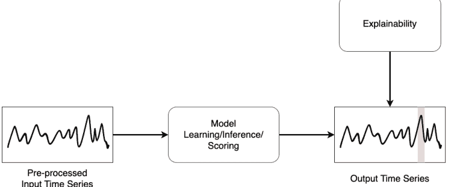

图4.2显示了时间序列深度学习异常检测的高级工作流，包含以下阶段：

- 1. 深度学习模型接受时间步（timestep）或滑动窗口（sliding window）作为输入数据。A.- 时间步代表单个数据点，而滑动窗口指的是包含历史信息的时间步序列。通常，输入数据需要预处理任务（如填充缺失值和归一化），以提取最佳滑动窗口。

- 2. 异常可能以点或子表面形式出现，并非每个观测值都是异常值。模型根据定义的损失函数计算异常评分，以确定预测是否偏离其他数据并应被标记为异常。本质上，异常评分表示异常的程度，使用为风险评估确定的阈值。

- 3. XAI 旨在为模型的预测提供推理支持。事后解释方法（如 SHAP）常用于评估模型预测的质量。

工作流中有三种类型用于时间序列异常检测的深度学习模型：

- 基于预测的模型（Forecasting-based models）通过将预测值与实际值进行比较，预测新入的数据点或滑动窗口是否为异常值。偏差值成为异常值，用于识别异常行为。

- 基于重构的模型（Reconstruction-based models）通过对正常滑动窗口输入的子序列进行编码，以在重构期间提供时间上下文。模型会生成重构误差，因为它们仅使用正常观测进行训练。重构误差根据阈值值对异常进行排名。

- 混合模型（Hybrid models）结合了预测和基于重构的模型，以在时间序列中实现更好的学习，使用预测的时间戳预测和重构方法的潜在表示。

在完成对时间序列异常检测深度学习方法的概述后，让我们下一节探索一个使用基于重构的模型检测时间序列异常，并使用 SHAP XAI 方法评估预测质量的示例。

### 技术要求

为了本章的示例演练，你需要以下 Python 包：

- Keras：一个用于构建神经网络的开源库

- Matplotlib：一个用于创建数据可视化的绘图库

- NumPy：一个在处理数组时提供数学函数的开源库

- OmniXAI：一个通过统一接口提供各种 XAI 方法的开源 XAI 库

- pandas：一个提供数据分析和处理工具的库

- Seaborn：一个基于 Matlab 的数据可视化库

- Sklearn：一个用于预测数据分析的机器学习工具

- TensorFlow：一个用于构建深度学习应用的开源框架

本章所讨论示例的示例 notebook、包依赖关系文件（`requirements.txt`）以及示例数据集可以在以下地址获取：https://github.com/PacktPublishing/Deep-Learning-and-XAI-Techniques-for-Anomaly-Detection/tree/main/Chapter.4。

接下来，让我们探索该示例的数据集。

### 问题

本节回顾了使用来自 Kaggle 的纽约出租车交通数据集（https://www.kaggle.com/datasets/julienta/nyc-taxi-traffic）的异常检测问题，该数据源自纽约出租车和利务车委员会。该数据集包含了2014年7月到2015年1月期间每30分钟聚合一次的乘客总数的单变量时间序列观测值。数据包括纽约马拉松、感恩节、圣诞节、元旦和雪风暴期间的五个异常。

你将通过分析纽约出租车交通数据集来实现端到端的异常检测，创建一个长短期记忆（LSTM）模型来预测异常值，并使用 OmniXAI SHAP 解释器解释异常。

下一节将回顾该示例的逐步演练。

### 解决方案演练

本节旨在逐步演示创建一个 LSTM 模型来检测时间序列数据集中的异常，并使用 OmniXAI 提供的 SHAP 解释器为预测生成局部解释。你可以通过 https://arxiv.org/pdf/2206.01612.pdf 更多关于 OmniXAI 的信息：

- 使用提供的文件安装必要的库：

```
sys.executable -m pip install -r requirements.txt
```

2. 加载必要的库：

```python
% inline
import numpy as np
import pandas as pd
import matplotlib.pyplot as plt
import seaborn as sns
from sklearn.preprocessing import StandardScaler
from sklearn.model_selection import train_test_split
import tensorflow as tf
from tensorflow.keras.layers import LSTM, Dense, RepeatVector, TimeDistributed
import os
import warnings

os.environ['TF_CPP_LOG_LEVEL'] = '3'
warnings.simplefilter('ignore', category=FutureWarning)
```

3. 加载并准备纽约交通数据集：

```python
data = pd.read_csv('nyc.csv')
data['date'] = pd.to_datetime(data['date'], infer_format=True)
data = pd.DataFrame(data,columns=['date', 'value'])
data.head(5)
```

结果所示于*4.4*：

| date | value |

|---|--|

| 0 | 2014-07-01 00:00:00 | 10844 |

| 1 | 2014-07-01 00:30:00 | 8127 |

| 2 | 2014-07-01 01:00:00 | 6210 |

| 3 | 2014-07-01 01:30:00 | 4656 |

| 4 | 2014-07-01 02:00:00 | 3820 |

4. 为了查看数据集，描述以下代码：


```python
data.describe()
```

5. 使用`StandardScaler`对数据标准化：

```python
scaler = StandardScaler()
scaler.fit(data[['value']])
data['scaled_value'] = scaler.transform(data[['value']])
data.head(5)
```

## 84 时间序列异常解释性

图 4.6 显示了带有新`scaled_value`列的数据集预览：

| date | value | scaled_value |
|---|---|---|
| 0 | 2014-07-01 00:00:00 | 10844 | -0.618745 |
| 1 | 2014-07-01 00:30:00 | 8127 | -1.010291 |
| 2 | 2014-07-01 01:00:00 | 6210 | -1.286549 |
| 3 | 2014-07-01 01:30:00 | 4656 | -1.510496 |
| 4 | 2014-07-01 02:00:00 | 3820 | -1.630971 |

图 4.6 - 标准化数据

6. 让我们对比原始值和缩放后的值：

```python
x_year = data['date']
y_total = data['value']
y_scaled = data['scaled_value']
```

```python
fig, axs = plt.subplots(2, sharex=False, sharey=False,
figsize=(20,8))
```

```python
plt.gca().xaxis.set_major_formatter(mdates.
DateFormatter('%d-%m-%Y'))
plt.minorticks_off()
```

```python
axs[0].plot(x_year, y_total)
axs[0].set_title('Raw Total Taxi Passengers')
```

```python
axs[1].plot(x_year, y_scaled)
axs[1].set_title('Scaled Total Taxi Passengers')
```

```python
fig.autofmt_xdate()
```

```python
plt.savefig('raw_scaled_ts.png', bbox_inches='tight')
plt.show()
```

### 解决方案步骤

让我们可视化并对比原始值和缩放后的值。图 4.7 显示了原始值和缩放值。快速的视觉评估显示，11 月初和 1 月的出租总人数出现了明显的峰值，这对应于 11 月 2 日的 2014 年纽约马拉松和元旦的时间线。1 月底总客人数的下降与 2014 年纽约地区的暴风雪吻合。

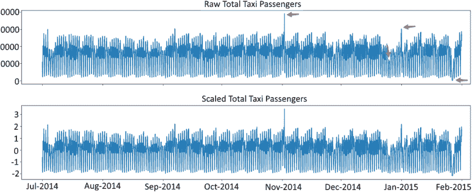

图 4.7 – 原始值与缩放值的对比

7. 使用直方图可视化数据分布：

```python
sns.histplot(data=data, x='value', kde=True)
```

图 4.8 显示了启用了核密度估计（KDE）参数的数据分布直方图：

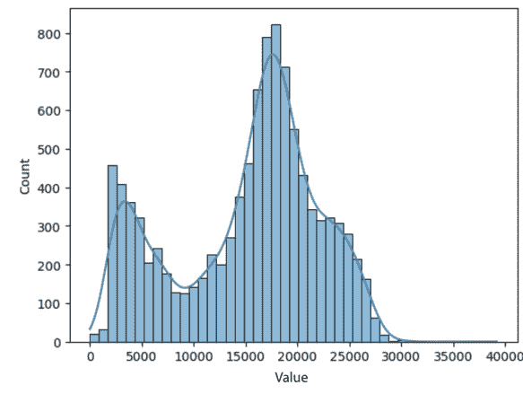

图 4.8 – 数据分布

8. 设置时间步以对每小时趋势进行训练，因为数据集是以 30 分钟为间隔聚合的：

```python
TIMESTEPS = 2
train_data, test_data = train_test_split(data, train_
size=0.8, shuffle=False, random_state=42)
train_data.sort_index(inplace=True)
test_data.sort_index(inplace=True)
print(f'Train shape: {train_data.shape}')
print(f'Test shape: {test_data.shape}')
```

你应该能看到训练和测试划分的如下输出形状，如图 4.9 所示。

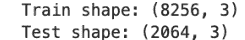

图 4.9 – 训练和测试划分的输出形状

9. 使用预定义的时间步准备新的数据集：

```python
def newdataset(df, timesteps, feature):
    df_x, df_y = [], []

    for i in range(timesteps, len(df)):
        df_x.append(df.iloc[i-timesteps:i][feature].values)
        df_y.append(df.iloc[i][feature])
    df_x = np.array(df_x)
    df_y = np.array(df_y)
    return df_x, df_y
```

```python
train_x, train_y = newdataset(train_data, TIMESTEPS, 'scaled_value')
test_x, test_y = newdataset(test_data, TIMESTEPS, 'scaled_value')
```

```python
train_x.shape, train_y.shape, test_x.shape, test_y.shape
```

10. 通过初始化编码器和解码器、应用 dropout、使用`RepeatVector`重复输入并添加`TimeDistributed`层创建一个简单的 LSTM 模型。我们将使用平均绝对误差（MAE）作为评估指标并使用 Adam 优化器：

```python
LSTM_units = 64
model = keras.Sequential()
model.add(LSTM(LSTM_units, input_shape=(train_x.shape[1], train_x.shape[2]), return_sequences=False, name='encoder'))
model.add(Dropout(0.2, name='encoder_dropout'))
model.add(RepeatVector(train_x.shape[1], name='repeater'))
model.add(LSTM(LSTM_units, return_sequences=True, name='decoder_lstm'))
model.add(Dropout(0.2, name='decoder_dropout'))
model.add(TimeDistributed(Dense(train_x.shape[2]), name='decoder_output'))
model.compile(loss='mae', optimizer='adam')
model.summary()
```

图 4.10 显示了模型摘要：Model: "sequential_1"

| Layer (type) | Output Shape | Param # |
|---|---|---|
| encoder_lstm (LSTM) | (None, 64) | 16896 |
| encoder_dropout (Dropout) | (None, 64) | 0 |
| decoder_repeater (RepeatVector) | (None, 2, 64) | 0 |
| decoder_lstm (LSTM) | (None, 2, 64) | 33024 |
| decoder_dropout (Dropout) | (None, 2, 64) | 0 |
| time_distributed (TimeDistributed) | (None, 2, 1) | 65 |

Total params: 49,985

Trainable params: 49,985

Non-trainable params: 0

图 4.10 – 模型摘要

11. 模型 20 个 epoch：

```python
%time
history = model.fit(
    train_x,
    train_y,
    epochs=20,
    batch_size=32,
    validation_split=0.1,
    shuffle=False
)
```

图 4.11 显示了训练过程：

```
CPU times: 3 μs, 0 ns, total: 3 μs
Epoch 1/20
233/233 [============] - 10s/step - loss: 0.2356 - val_loss: 0.1076
Epoch 2/20
233/233 [==================] - 5ms/step - loss: 0.1199 - val_loss: 0.1023
Epoch 3/20
233/233 [==============]] - 5ms/step - loss: 0.1162 - val_loss: 0.0996
Epoch 4/20
233/233 [==============]] - 5ms/step - loss: 0.1090 - val_loss: 0.0793
Epoch 5/20
233/233 [==============]] - 5ms/step - loss: 0.0876 - val_loss: 0.0458
Epoch 6/20
233/233 [==============]] - 5ms/step - loss: 0.0713 - val_loss: 0.0387
Epoch 7/20
233/233 [==============]] - 5ms/step - loss: 0.0693 - val_loss: 0.0182
Epoch 8/20
233/233 [==============]] - 5ms/step - loss: 0.0663 - val_loss: 0.0265
Epoch 9/20
233/233 [==============]] - 5ms/step - loss: 0.0658 - val_loss: 0.0193
Epoch 10/20
233/233 [==============]] - 5ms/step - loss: 0.0648 - val_loss: 0.0224
Epoch 11/20
233/233 [==============]] - 5ms/step - loss: 0.0635 - val_loss: 0.0166
Epoch 12/20
233/233 [==============]] - 5ms/step - loss: 0.0647 - val_loss: 0.0185
Epoch 13/20
233/233 [==============]] - 5ms/step - loss: 0.0623 - val_loss: 0.0224
Epoch 14/20
233/233 [==============]] - 5ms/step - loss: 0.0663 - val_loss: 0.0177
Epoch 15/20
233/233 [==============]] - 5ms/step - loss: 0.0614 - val_loss: 0.0226
Epoch 16/20
233/233 [==============]] - 5ms/step - loss: 0.0626 - val_loss: 0.0257
Epoch 17/20
233/233 [==============]] - 5ms/step - loss: 0.0614 - val_loss: 0.0294
Epoch 18/20
233/233 [==============]] - 5ms/step - loss: 0.0662 - val_loss: 0.0156
Epoch 19/20
233/233 [==============]] - 5ms/step - loss: 0.0611 - val_loss: 0.0256
Epoch 20/20
233/233 [==============]] - 5ms/step - loss: 0.0606 - val_loss: 0.0218
```

12. 评估训练与验证损失：

```python
plt.plot(history.history['loss'], label='training_loss')
plt.plot(history.history['val_loss'], label='validation_loss')
plt.legend()
plt.show()
```

图 4.12 显示了性能：

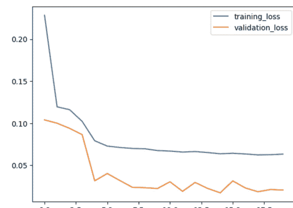

图 4.12 – 模型性能

13. 计算训练数据集中的重建误差：

```python
reconstructed = model.predict(train_x)
train_mae_loss = np.mean(np.abs(reconstructed) - train_x),
axis=1)
```

14. 基于重建误差的百分位数阈值来确定异常。在这种情况下，我们将第 80 百分位或 0.03 作为重建误差阈值：

```python
THRESHOLD = np.percentile(train_mae_loss, 80)
print(f'Reconstruction error threshold: {THRESHOLD}')
```

图 4.13 显示了 80 百分位重建误差阈值：

```
Reconstruction error threshold: 0.03356761403541711
```

15. 可视化训练 MAE 损失分布：

```python
sns.histplot(train_mae_loss[:,0], kde=True, stat='density', linewidth=0).set_xlabel('train_mae_loss')
plt.show()
```

图 4.14 用于访问训练数据重建误差的 MAE 分布：

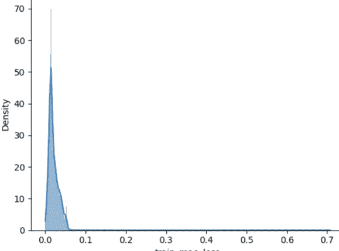

图 4.14 – 训练 MAE 分布

16. 计算测试数据的重建误差。如果数据点返回的重建误差高于训练数据点，则该点将被标记为异常：

```python
test_reconstruction = model.predict(test_x)
test_mae_loss = np.mean(np.abs(test_x - test_reconstruction), axis=1)
```

17. 现在让我们来测试 MAE 损失分布：

```python
sns.histplot(test_mae_loss[:], kde=True,
stat='density', linewidth=0).set_xlabel('test_mae_loss')
plt.show()
```

图 4.15 显示了测试 MAE 损失分布。请注意，MAE 高于训练 MAE 的第 80 百分位数或高于我们之前配置的 0.03 重建误差阈值的测试数据点，将被标记为异常。

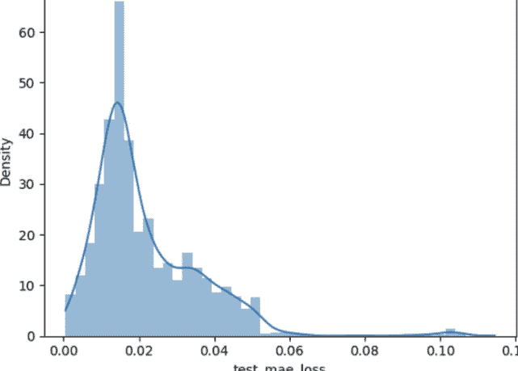

图 4.15 – 测试 MAE 损失分布

18. 过滤识别出的异常：

```python
anomaly_results_df = test_data[TIMESTEPS]:['value',
'scaled_value']].copy()
anomaly_results_df.index = test_data[TIMESTEPS:].index
```

```python
anomaly_results_df['date'] = test_data['date']
anomaly_results_df['deviation'] = test_mae_loss
anomaly_results_df['threshold'] = THRESHOLD
anomaly_results_df['anomaly'] = anomaly_results_
df['deviation'].apply(lambda dev: 1 if dev > THRESHOLD
```

### 时间序列异常解释性

```python
else 0)
anomalies = anomaly_results_df[anomaly_results_
df['anomaly'] == 1]
not_anomalies = anomaly_results_df[anomaly_results_
df['anomaly'] == 0]
print(f'Total normal: {not_anomalies.shape[0]}')
print(f'Total anomalies: {anomalies.shape[0]}')
```

图 4.16 显示了标记为异常的观测值预览：

```
总正常：1639
总异常：423
```

图 4.16 - 预测的正常和异常观测值

19. 预览识别出的异常：

```python
anomalies.head(5)
```


图 4.17 显示了标记为异常的观测值预览：

| value | scaled_value | date | deviation | threshold | anomaly |
| :--- | :--- | :--- | :--- | :--- | :--- |
| 8258 | 22993 | 1.132044 | 2014-12-20 01:00:00 | 0.034212 | 0.033568 | 1 |
| 8294 | 25685 | 1.519987 | 2014-12-20 19:00:00 | 0.037085 | 0.033568 | 1 |
| 8295 | 25252 | 1.457588 | 2014-12-20 19:30:00 | 0.044607 | 0.033568 | 1 |
| 8296 | 23238 | 1.167350 | 2014-12-20 20:00:00 | 0.039972 | 0.033568 | 1 |
| 8301 | 24614 | 1.365645 | 2014-12-20 22:30:00 | 0.034693 | 0.033568 | 1 |

图 4.17 - 识别出的异常预览

20. 以下是查看检测到的异常的代码：

```python
distribution:anomaly_results_df['anomaly'].
plot(kind='hist')
plt.show()
```

解决方案步骤 93

图 4.18 显示了检测到的异常分布：

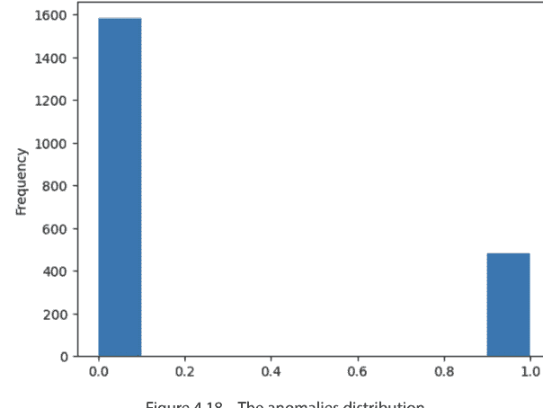

21. 可视化偏差与阈值的关系。结果如图 4.19 所示：

```python
anomaly_results_df['deviation', 'threshold']
plot(figsize=(14, 6))
plt.xlabel('Index')
plt.show()
```

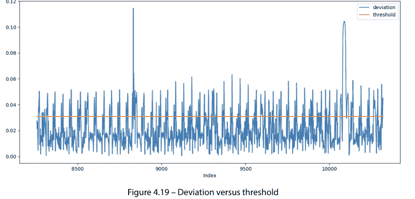

22. 接下来，我们将看到检测层的分布：

```python
sns.set(rc={'figsize': (20,10)})
sns.boxplot(x=anomaly_results_df.date, y=anomaly_results_df.value, label='Total passengers', alpha=0.6)
sns.scatterplot(x=anomalies.date, y=anomalies.value, color='r', label='Anomalies')
plt.ylabel('Count')
fig.autofmt_xdate()
plt.savefig('anomalies_vs_total.png', bbox_inches='tight')
plt.show()
```

图 4.20 显示了离群值的分布。注意 2015 年元旦期间发生的离群值，以及 1 月底在纽约地区暴风雪期间的下降。

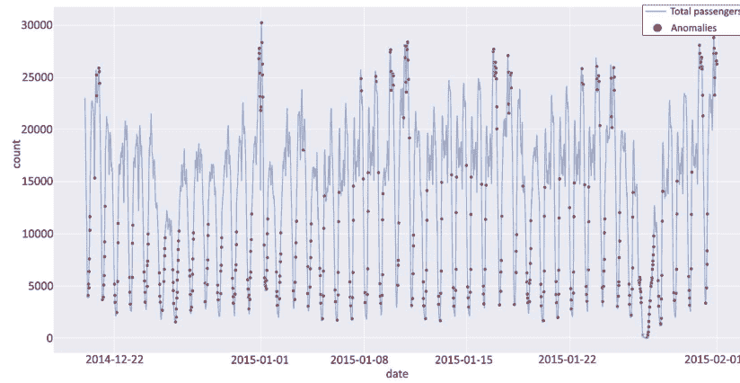

图 4.20 – 检测到的异常

23. 现在，我们准备好评估基于 LSTM 的异常检测器的解释性。导入 OmniAI 库：

```python
from omnixai.data.timeseries import Timeseries
from omnixai.explainers.timeseries import TimeseriesExplainer
from omnixai.explainers.timeseries import Shaper
```

24. 加载 NYC 流量数据集：

```python
df = pd.read_csv('nyc.csv')
df = df[['date', 'value']]
df['date'] = pd.to_datetime(df['date'], infer_datetime=True)
df = df.set_index('date')
```

25. 创建训练集和测试集。你可以修改范围来评估不同的解释性：

```python
train_df = df.iloc[:8600]
test_df = df.iloc[8600:9000]
```

26. 设置 80 百分位的异常阈值以检测离群值：

```python
threshold = np.percentile(train_df['value'].values, 80)
```

27. 创建一个函数判断时间序列是否异常：

```python
def detector(ts: Timeseries):
    anomaly_scores = np.sum((ts.values > threshold).astype(int)
    return anomaly_scores / ts.shape[0]
```

28. 为了初始化 SHAP 解释器，将训练数据集设置为 `training_data`，模型设置为 `predict_function`，并将 `anomaly_detection` 设置为 `mode`。`predict_function` 生成的分越高表示越异常：

```python
explainer = ShapTimeseries(
    training_data=Timeseries.from_pd(train_df),
    predict_function=detector,
    mode='anomaly_detection'
)
test_x = Timeseries.from_pd(test_df)
```

29. SHAP 通过调用解释器为测试实例生成本地解释。`index` 参数指示数据在 `test_x` 中的位置。处理大型数据集时，可以使用 `nsamples` 参数对数据集进行采样以缩短运行时间：

```python
explanations = explainer.explain(
    test_x,
    params={'shap': {'nsamples': 500}})
explanations.plot()
```

### 时间序列异常性

图 4.21 比较了乘客人数和测试实例的计算异常评分。OmniAI 的 SHAP 解释器为检测到的异常提供了本地解释性，将 2015 年元旦期间乘客人数的激增与之联系起来：

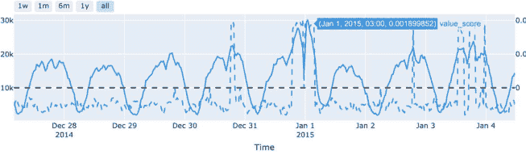

图 4.21 - OmniAI SHAP 本地解释

恭喜！你已经完成了深度学习的时间序列异常检测。你转换了数据集，创建了基于 LSTM 的异常检测器，并使用 OmniAI 的 SHAP 解释器分析了本地解释性。在后续章节，我们将讨论如何使用不同的数据集练习深度学习异常检测。

### 练习

为了练习本章学的内容，我建议探索 Numenta 异常基准 (NAB) https://www.kaggle.com/datasets/julienj/twitter-mentions-volumes。这个时间序列数据集包含 Apple、Amazon、Salesforce、CVS、Facebook、IBM、Coca-Cola、Pfizer 和 UPS 等大公司的 Twitter 提到。数据在2015 年 2 月至 4 月每 5 分钟聚合一次。例如，你的模型能检测到 3 月 Apple 提到的异常激增吗？你能用 XAI 方法解释检测到的时间序列异常吗？确保检查数据集中的不平衡分布和缺失值。

### 总结

解释机器学习模型决策背后的逻辑对于增加透明度和可解释性至关重要，以赢得用户的信任并满足合规性。相反，展示 AI 模型的失败同样重要，以提高模型性能并避免在高风险环境中的不利影响。

寻找异常可能是枯燥的，因为时间序列数据中存在各种异常，例如季节性和分位数异常。在本章中，你学习了如何用深度学习检测并解释时间序列数据的异常。我希望你能将所学的时间序列异常解释性知识用于识别可操作的见解。

下一章将涵盖计算机视觉异常性。

# 计算机视觉异常性

计算机视觉异常检测有广泛的应用，如工业制造、医学影像分析和自动驾驶。检测图像数据中的异常对于识别异常事件、安全风险和质量缺陷至关重要，这些可能会给许多公司带来财务和品牌损害。

根据美国质量协会（https://asq.org/quality-resources/cost-of-financial-loss）的说法，组织从销售收入中产生了 15-20% 的质量相关成本。除了财务损失外，质量相关活动还会导致客户满意度下降、潜在诉讼和生产力影响。因此，视觉异常检测的研究在理论和应用上都起着至关的作用。例如，根据材料处理协会（MHI）的调查（https://www.nytimes.com/2022/07/12/business/warehouse-technology-robotics.html），机器人技术预计将在未来 5 年内增加 50%。然而，自动驾驶汽车在公共道路上的广泛应用仍面临技术挑战和法律审查。

在示例演示中，我们将使用胸部 X 光射线数据集进行视觉检测问题实验，以检测患有肺炎的图像。然后，你将可视化模型的类激活图（CAM）和梯度加权类激活映射（Grad-CAM），以解释卷积神经网络（CNN）用于识别目标图像类别的判别性图像区域。

下一节将回顾视觉异常检测的分类。

### 回顾视觉异常检测

异常检测根据预期行为检测不符合规范的模式，以创建一个观察未见数据的合理模型。视觉异常检测是指使用机器学习（ML）方法（如监督、半监督和无监督技术）在图像数据中识别并定位异常区域。请参考第 1 章了解这些技术的比较。

评估视觉异常有两种方法：

- **图像级（Image-level）**：该方法评估整个图像是否正常或异常。
- **像素级（Pixel-level）**：该方法检测图像中的异常区域以确定图像是否正常或异常。像素级方法广泛用于工业故障检测，但由于变化巨大且边界模糊，该方法对于任务关键型应用可能具有挑战性。

通常，大多数视觉可解释性（XAI）通过基于输出概率的热力图生成或散点图来解释 ML 模型的决策。示例包括本章将回顾的 CAM 和 Grad-CAM，以及第 7 章的显著图和第 8 章的**积分梯度（Integrated Gradients）**。

下一节回顾各种图像级和像素级技术。

### 回顾图像级异常检测

传统的 ML 方法通常将图像的输出分布与参考分布进行比较以确定是否存在异常。深度学习算法如 CNN 通过使用高维数据的强大表示来增强传统方法。以下是图像级异常检测的示例：

- **密度估计（Density estimation）**：该方法估计正常与未见图像之间的概率分布以检测异常。密度估计方法如**k 最近邻（KNN）**需要大型数据集。此外，随着数据集增长，特征维度变得越来越复杂。
- **一类分类（One-class classification (OCC））**：该方法通过在特征空间中构建决策边界对正常类进行分类。深度学习模型通过特征提取增强密度估计。例如，一类卷积神经网络 [OCC-CNN](https://arxiv.org/pdf/1901.0868.pdf）是一种基于 CNN 的异常检测方法，其中 OCC 异常很少，其学习过程仅关注目标。
- **图像重建（Image reconstruction）**：该方法通过逆映射将输入图像映射到低维表示以重建原始图像。图像重建假设正常图像产生小的重建误差，而异常数据应产生较高的重建误差。我们在第 1 章回顾过如自动编码器（autoencoder），这是一种通过隐藏层压缩输入数据的无监督神经网络。如果输入特征是独立的或非冗余的，压缩将很容易。
- **自监督分类（Self-supervised classification）**：该方法利用大规模无监督数据学习颜色、纹理、形状、位置和方向等视觉表示。

### 回顾像素级异常检测

虽然图像级算法可以通过将整个图像分割成块来用于像素级异常检测，但可能缺乏语义信息。因此，以下无监督像素级方法是理想的：

- **图像重建（Image reconstruction）**：假设卷积神经网络仅用正常图像训练，像素级图像重建方法重建输入图像。然后，它评估输入与重建图像之间的像素差异以确定异常区域。从锐利边缘和复杂纹理创建高质量图像对于像素级异常检测具有挑战性，会导致检测异常时出现更高的假阳性率。
- **特征建模（Feature modeling）**：与图像重建不同，基于特征的方法使用整个图像的局部区域表示来检测异常。区域特征与测试图像局部区域之间的特征分布决定了目标区域是否应标记为异常。

在提供了计算机视觉异常检测技术的概述后，让我们在下一节探索深度学习模型在寻找异常时寻找什么。

### 将深度视觉异常检测与 XAI 结合

深度学习通过教计算机模仿视觉系统，为计算机视觉异常检测提供了巨大机会。例如，CNN 设计用于复制视觉皮层的结构，用于目标检测、图像分类和语义分割等计算机视觉任务。图 5.1 显示了以下的高级架构：


图 5.1 - 简单的 CNN 架构

如前面的图像所示，CNN 的架构由以下主要层组成。你可以从这篇论文 https://ieeeexplore.ieee.org/document/830818 学习更多关于 CNN 的知识。该架构中的层为：

- **卷积层（Convolutional layer）**：这是从输入图像中提取各种特征的第一层。当卷积层接收输入时，它通过在空间维度上对每个滤波器进行卷积产生 2D 激活图。网络学习特定的滤波器。
- **池化层（Pooling layer）**：该层使用最大池化或平均化处理输入以对空间维度进行下采样。
- **全连接层（Fully-connected layer）**：这是接收池化层输出并产生分类的层。

你可能在想，人类能理解深度学习是如何思考的吗？CAM 和 Grad-CAM 等 XAI 方法对于解释性重要。CAM http://cnnlocalization.csail.mit.edu/ 通过定位相关区域帮助用户解释 CNN 如何预测给定输入。虽然 CAM 提供了热力图，但它可能存在噪声并遭受空间信息的丢失。或者，Grad-CAM 可以通过保留空间信息改进 CAM。

Grad-CAM https://arxiv.org/abs/1610.02391 是一种将 CAM 推广到为基于 CNN 模型生成视觉解释的技术。它利用最终卷积激活图的梯度来突出图像中的重要区域。与 CAM 不同，Grad-CAM 没有 CNN 架构要求。

现在你已经理解使用深度学习进行异常检测的 XAI 方法，让我们讨论一下示例演示需要什么。

### 技术要求

实验该示例需要以下技术要求：

- **OpenCV-Python**：用于图像处理和计算机视觉任务（如人脸检测和物体跟踪）的开源库。
- **Keras**：用于构建神经网络的开源库。
- **Matplotlib**：用于创建数据可视化的绘图库。
- **NumPy**：处理数组时提供数学函数的开源库。
- **pandas**：提供数据分析和处理工具的库。
- **SciPy**：用于科学和技术计算的开源 Python 库。
- **Slearn**：用于预测数据分析的 ML 工具。
- **TensorFlow**：构建深度学习应用的开源框架。

在本章讨论的示例笔记本和依赖关系文件位于 https://github.com/PaktPublishing/Deep-Learning-and-XAI-Techniques-for-Anomaly-Detection/tree/main/Chapter5。

你可以在 Amazon SageMaker Studio Lab https://aws.amazon.com/sagemaker/studio-lab/ 上实验该示例，这是一个免费的笔记本开发环境，每个用户会话提供最多 12 小时 CPU 或 4 小时 GPU 以及 15 GiB 免费存储。或者，你也可以在你偏好的集成开发环境 (IDE) 中尝试。

接下来，让我们探索此示例的数据集。

### 问题

肺炎是一种由病毒、细菌或真菌引起的急性呼吸道感染，导致肺泡内充满脓液或液体。肺炎的症状包括发热伴随咳嗽、寒战和呼吸困难。如果不进行治疗，肺炎可能会危及生命，特别是在婴儿、幼儿童和老年人等脆弱群体。根据 Our World in Data（https://ourworldindata.org/pneumonia）显示，2019 年有近 250 万死于肺炎。

美国的病毒性肺炎通常由流感病毒、呼吸道合胞病毒（RSV）和 SARS-CoV-2（COVID-19）引起。

在临床检查和病史回顾中，胸部 X 光常用于诊断肺炎。人工智能不断进步在发现胸部 X 光中的异常模式方面已取得成效，解决了需要更多专家来读放射影像的问题。

本节将回顾一个使用胸部 X 光数据集进行视觉异常检测的示例，该数据集可以下载自：https://www.kaggle.com/datasets/paultimothymooney/chest-xray-pneumonia。你将学习如何使用预训练的 VGG16 模型检测视觉异常。然后，你将使用标准激活图和 Grad-CAM 定位图像中的异常区域，以解释模型的预测结果。

train，val）以及两个子文件夹（PNEUMONIA，NORMAL）。这些图像收集自患者的常规临床护理，并由专家医生进行分级以供 AI 使用。

接下来的章节将提供该示例的逐步操作演练。

### 解决方案演练

本节将详细回顾视觉异常检测示例，以解释由预训练的 VGG16 模型识别出的异常。示例笔记本 `chapter5_gradcam_cv.ipynb` 可以在书籍的 GitHub 仓库找到：

- 首先，使用 `requirements.txt` 文件安装所需的包：

```python
import sys
!{sys.executable} -pip install -qr requirements.txt
```

- 第二，加载核心库：

```python
import cv2
```


```python
import os
import re
import glob
import random
import warnings
import numpy as np
import pandas as pd
import scipy as sp
import matplotlib.pyplot as plt
import matplotlib.cm as cm
import matplotlib.image as mpimg
from platform import python_version, display
from IPython.display import Image, display
from sklearn.model_selection import train_test_split
from sklearn.metrics import classification_report, accuracy_score, confusion_matrix, ConfusionMatrixDisplay
import tensorflow as tf
from tensorflow.keras import keras
from tensorflow.keras.models import *
from tensorflow.keras.layers import *
from tensorflow.keras.optimizers import *
from tensorflow.keras.applications import vgg16
from tensorflow.keras.preprocessing.image import img_to_array, array_to_img, ImageDataGenerator
```

```python
filter.simplefilter(action='ignore', category=FutureWarning)
os.environ['TF_CP_MIN_LOG_LEVEL'] = '3'
```

```python
print(f'TensorFlow version: {tf.__version__}')
print(f'Python version: {python_version()}')
```

图 5.2 显示了 Python 和 TensorFlow 的包关系：
TensorFlow 版本: 2.11.0
Python 版本: 3.9.10

图 5.2 – 包依赖

- 3. 为图像数据集路径、所需的输入形状和批大小（batch size）设置变量：

```python
%matplotlib inline
base_path = "images/chest_xray/"
train_path = base_path + "train/"
test_path = base_path + "test/"
```

### 计算机视觉异常解释性

```python
val_path = base_path + "val/"
SHAPE = (224,224,234)
batch_size = 256
classes = ["NORMAL", "PNEUMONIA"]
```

```python
print(f'train_path: {train_path}')
print(f'test_path: {test_path}')
print(f'val_path: {val_path}')
```

图 5.3 显示了训练、测试和验证的图像：

```python
train_path: images/chest_xray/train/
test_path: images/chest_xray/test/
val_path: images/chest_xray/val/
```

图 5.3 - 图像路径

- 创建一个加载原始图像的函数：

```python
def load_image_data(path, label):
    images = []
    for img_path in glob.glob(path + label + '*/'):
        images.append(mpimg.imread(img_path))
        if len(images) > 4:
            break
    fig = plt.figure(figsize=(25, 10))
    columns = 5
    for i, image in enumerate(images):
        plt.subplot(round(len(images)) / columns + 1, columns, i + 1)
        plt.imshow(image, cmap='gray')
        aspect='auto'
        plt.title(label)
```

- 5. 加载被分类为 PNEUMONIA（肺炎）类的样本图像预览：

```python
load_image_data(train_path, classes=[1])
```

图 5.4 显示了分类为 PNEUMONIA 的样本图像预览。通常，胸部 X 光中的不透明区域表示肺炎症和肺炎：

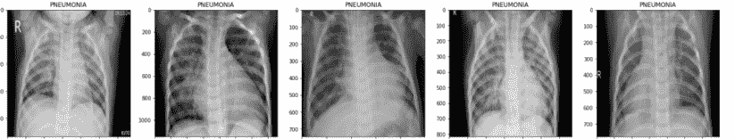

图 5.4 – 肺炎胸 X 光

- 6. 加载被分类为 NORMAL（正常）类的样本图像预览：

```python
load_image_data(train_path, classes=[0])
```

图 5.5 显示了某些分类为 NORMAL 的样本图像：

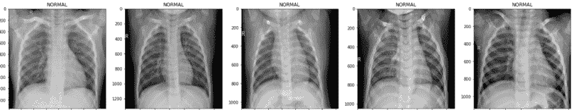

图 5.5 – 正常胸 X 光

- 7. 接下来，我们将加载 VGG16 预训练模型并准备训练：

```python
def set_seed(seed):
    tf.random.set_seed(seed)
    os.environ['PYTHONHASHSEED'] = str(seed)
    np.random.seed(seed)
    random.seed(seed)
```

```python
def set_model():
    set_seed(33)
    vgg = vgg16.VGG16(weights='imagenet', top=False, input_shape=SHAPE)
    for layer in vgg.layers[:-8]:
        layer.trainable = False
    x = vgg.output
    x = GlobalAveragePooling2D()(x)
    x = Dense(2, activation="softmax")(x)
    model = Model(vgg.input, x)
    model.compile(loss="categorical_crossentropy", optimizer=SGD(learning_rate=0.001), metrics=["accuracy"])
    return model
```

- 8. 生成带有 1/255 缩放的图像数据次：

```python
train_datagen = ImageDataGenerator(rescale=1/255)
```

- 9. 在训练期间从目录读取图像并进行数据增强：

```python
train_generator = train_datagen.flow_from_directory(train_path, batch_size=batch_size, class_mode='categorical', shuffle=True)
test_generator = train_datagen.flow_from_directory(test_path, batch_size=batch_size, class_mode='categorical', shuffle=False)
val_generator = train_datagen.flow_from_directory(val_path, batch_size=batch_size, class_mode='categorical', shuffle=False)
```

- 10. 获取测试标签：

```python
X, y = next(test_generator)
test_labels = np.argmax(y, axis=1)
```

- 11. 加载 VGG16 模型并查看摘要，如图 5.6 所示：

```python
model.summary()
```

| Layer (type) | Output Shape | Param # |
| :--- | :--- | --- |
| input (InputLayer) | (None, 224, 224, 3) | 0 |
| block1_conv1 (Conv2D) | (None, 224, 224, 64) | 17992 |
| block1_conv2 (Conv2D) | (None, 224, 224, 64) | 36928 |
| block1_pool (MaxPooling2D) | (None, 112, 112, 64) | 0 |
| block2_conv1 (Conv2D) | (None, 112, 112, 128) | 73856 |
| block2_conv2 (Conv2D) | (None, 112, 112, 128) | 147584 |
| block2_pool (MaxPooling2D) | (None, 56, 56, 128) | 0 |
| block3_conv1 (Conv2D) | (None, 56, 56, 256) | 295168 |
| block3_conv2 (Conv2D) | (None, 56, 56, 256) | 590080 |
| block3_conv3 (Conv2D) | (None, 56, 56, 256) | 590080 |
| block3_pool (MaxPooling2D) | (None, 28, 28, 256) | 0 |
| block4_conv1 (Conv2D) | (None, 28, 28, 512) | 1180160 |
| block4_conv2 (Conv2D) | (None, 28, 28, 512) | 2359080 |
| block4_conv3 (Conv2D) | (None, 28, 28, 512) | 2359080 |
| block4_pool (MaxPooling2D) | (None, 14, 14, 512) | 0 |
| block5_conv1 (Conv2D) | (None, 14, 14, 512) | 2359080 |
| block5_conv2 (Conv2D) | (None, 14, 14, 512) | 2359080 |
| block5_conv3 (Conv2D) | (None, 14, 14, 512) | 2359080 |
| block5_pool (MaxPooling2D) | (None, 7, 7, 512) | 0 |
| global_average_pooling2d (GlobalAveragePooling2D) | (None, 512) | 0 |
| dense (Dense) | (None, 2) | 1026 |

Total params: 14,715,714
Trainable params: 12,980,226
Non-trainable params: 1,735,488

图 5.6 – VGG16 模型摘要

### 12. 使用 8 个 epoch 训练模型：

```python
model.fit(
    train_generator,
    steps_per_epoch=train_generator.samples/train_generator.batch_size,
    epochs=8
)
```

结果如下：

```
Epoch 1/8
20/20 [============================] -244s 12s/step loss: 0.5509 accuracy: 0.7429
Epoch 2/8
20/20 [===========================] -243s 12s/step loss: 0.5010 accuracy: 0.7429
Epoch 3/8
20/20 [==========================] -242s 12s/step loss: 0.4415 accuracy: 0.7500
Epoch 4/8
20/20 [============================] -244s 12s/step loss: 0.3763 accuracy: 0.8202
Epoch 5/8
20/20 [===========================] -243s 12s/step loss: 0.3097 accuracy: 0.8921
Epoch 6/8
20/20 [============================] -244s 12s/step loss: 0.2551 accuracy: 0.9112
Epoch 7/8
20/20 [===========================] -243s 12s/step loss: 0.2152 accuracy: 0.9220
Epoch 8/8
20/20 [============================] -244s 12s/step loss: 0.1901 accuracy: 0.9293
```

图 5.7 —— 8 个 epoch 的训练结果

### 13. 训练完成后，通过创建分类报告来评估模型性能：

```python
print(classification_report(y_test, np.argmax(model.predict(test_generator, axis=1))))
```

图 5.8 显示分类报告：

| | precision (精确率) | recall (召回率) | f1-score | support (支持数) |
|---|---|---|---|---|
| 0 | 0.93 | 0.51 | 0.66 | 234 |
| 1 | 0.77 | 0.98 | 0.86 | 624 |
| accuracy | | | 0.80 | 624 |
| macro avg | 0.85 | 0.74 | 0.76 | 624 |
| weighted avg | 0.83 | 0.78 | | 624 |

### 14. 获取测试数据的预测：

```python
y_preds = np.argmax(model.predict(test_generator, axis=1))
```

### 15. 创建混淆矩阵来评估性能：

```python
cm = confusion_matrix(y_test, y_preds)
cmp = ConfusionMatrixDisplay(cm, display_labels=classes)
fig, ax = plt.subplots(figsize=(5,5))
cmp.plot(ax=ax)
plt.xlabel('Predicted Class')
plt.ylabel('True Class')
plt.savefig('pneumonia_confusion_matrix.png', bbox_inches='tight')
```

图 5.9 显示混淆矩阵：


图 5.9 —— 混淆矩阵

### 16. 现在准备好生成 CAM。创建一个绘制激活图的函数：

```python
def plot_activation(img):
    pred = model.predict(img[np.newaxis,:])
    pred_class = np.argmax(pred)
    weights = model.layers[-1].get_weights()[0]
    weights = weights[:pred_class]
    intermediate = Model(model.input, model.get_layer("block5_conv3").output)
    conv_output = intermediate.predict(img[np.newaxis,:])
    conv_output = np.squeeze(conv_output)
    h = int(img.shape[0]/conv_output.shape[0])
    w = int(img.shape[1]/conv_output.shape[1])
    plt.imshow(img.astype('float32').reshape(img.shape[0],img.shape[1],3), aspect='auto')
    plt.imshow(conv_output, cmap='jet', alpha=0.35, aspect='auto')
    plt.title('Pneumonia' if pred_class == 1 else 'Normal')
```

### 17. 调用 `plot_activation` 函数可视化少量测试图像及其标签：

```python
```


## 计算机视觉异常解释性

如图 5.10 所示，CAM 帮助可视化 CNN 用于识别图像标签的判别性区域：


图 5.10 —— CAM

### 1. 尝试使用 Grad-CAM 进行不同的激活图可视化

我们首先加载一些图像：

```python
pneumonia_data_dir = test_path + classes[1]
normal_data_dir = test_path + classes[0]
gradcam_test_pneumonia = []
gradcam_test_normal = []

def load_gradcam_images(data_dir, output_list):
    for x in os.listdir(data_dir):
        if x.endswith(".jpeg"):
            filename = os.path.join(data_dir, x)
            output_list.append(filename)

load_gradcam_images(pneumonia_data_dir, gradcam_test_pneumonia)
load_gradcam_images(normal_data_dir, gradcam_test_normal)
```

### 2. 设置图像大小、卷积层和预处理变量

```python
img_size = SHAPE
last_conv_layer_name = "block5_conv3"
preprocess_input = keras.applications.vgg16.preprocess_input
```

### 20. 创建获取图像数组的函数

将输入图像映射到最后一个卷积层并计算梯度以显示最后一个卷积层的特征图：

```python
def get_img_array(img_path, size):
    img = keras.preprocessing.image.load_img(img_path, target_size=size)
    array = keras.preprocessing.image.img_to_array(img)
    array = np.expand_dims(array, axis=0)
    return array

def make_gradcam_map(img_array, model, last_conv_layer_name, pred_index=None):
    grad_model = tf.keras.models.Model([model.inputs], [model.get_layer(last_conv_layer_name).output])
    with tf.GradientTape() as tape:
        last_conv_layer_output, preds = grad_model(img_array)
        if pred_index is None:
            pred_index = tf.argmax(preds[0])
        class_channel = preds[:, pred_index]
    grads = tape.gradient(class_channel, last_conv_layer_output)
    pooled_grads = tf.reduce_mean(grads, axis=(0, 1))
    last_conv_layer_output = last_conv_layer_output[0]
    heatmap = last_conv_layer_output @ pooled_grads
    heatmap = tf.squeeze(heatmap)
    heatmap = tf.maximum(heatmap, 0) / tf.math.max(heatmap)
    return heatmap.numpy()
```

### 21. 生成热图

```python
def create_heatmap(images, heatmap_path):
    img_array = preprocess_input(get_img_array(images, img_size))
    heatmap = make_gradcam_map(img_array, model, last_conv_layer_name)
    heatmap_path.append(heatmap)
```

### 22. 将热图缩放到 0 到 255 之间叠加在原始图像上

```python
import matplotlib.pyplot as cm

def save_and_display_gradcam(img_path, heatmap, output_path, alpha=0.4):
    img = keras.preprocessing.image.load_img(img_path)
    img = keras.preprocessing.image.img_to_array(img)
    heatmap = np.uint8(255 * heatmap)
    jet = cm.get_cmap("jet")
    jet_colors = jet(np.arange(256))[:, :3]
    jet_heatmap = jet_colors[heatmap]
    jet_heatmap = keras.preprocessing.image.array_to_img(jet_heatmap)
    jet_heatmap = jet_heatmap.resize((img.shape[1], img.shape[0]))
    jet_heatmap = keras.preprocessing.image.img_to_array(jet_heatmap)
    superimposed_img = jet_heatmap * alpha + img
    superimposed_img = keras.preprocessing.image.array_to_img(superimposed_img)
    output_path.append(superimposed_img)
```

### 23. 使用 Grad-CAM 定位输入图像中的异常区域

使用 Grad-CAM，我们可以定位输入图像中的异常区域并精确指向感兴趣区域：

```python
fig = plt.figure(figsize=(25, 5))
for i in range(3):
    create_heatmap(gradcam_test_pneumonia[i], heatmaps_pneumonia)
    fig.add_subplot(rows, columns, i+1)
    plt.imshow(heatmaps_pneumonia[i], aspect='auto')
    plt.title(re.sub(pneumonia_data_dir, "",gradcam_test_pneumonia[i]))

fig = plt.figure(figsize=(25, 5))
for i in range(3):
    save_and_display_gradcam(gradcam_test_pneumonia[i], heatmaps_pneumonia[i], gradcam_pneumonia_images)
    fig.add_subplot(rows, columns, i+1)
    plt.imshow(gradcam_pneumonia_images[i], aspect='auto')
    plt.title(re.sub(pneumonia_data_dir, "",gradcam_test_pneumonia[i]))
```

结果如图 5.11 所示：


图 5.11 —— Grad-CAM PNEUMONIA（肺炎）类

### 24. 使用 Grad-CAM 对 NORMAL 类重复热图可视化

```python
fig = plt.figure(figsize=(25, 5))
for i in range(3):
    create_heatmap(gradcam_test_normal[i], heatmaps_normal)
    fig.add_subplot(rows, columns, i+1)
    plt.imshow(heatmaps_normal[i], aspect='auto')
    plt.title(re.sub(normal_data_dir, "",gradcam_test_normal[i]))
```

```python
for i in range(3):
    save_and_display_gradcam(gradcam_test_normal[i],
    heatmaps_normal[i], gradcam_normal_images)
    fig.add_subplot(rows, columns, i+1)
    plt.imshow(gradcam_normal_images[i],
    aspect='auto')
plt.title(re.sub(normal_data_dir, "",gradcam_test_normal[i]))
```


结果如图 5.12 所示：

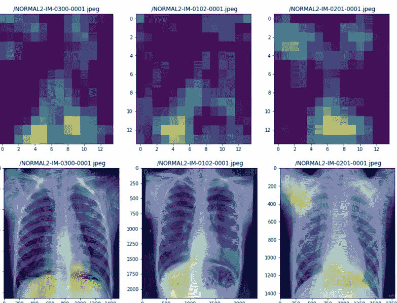

图 5.12 – Grad-CAM NORMAL 类

你能通过观察图像区分这两个类别吗？正常的 X 光片显示肺部清晰，没有阴影或云雾。细菌性肺炎表现为肺的一个叶内出现局灶性实变。病毒性肺炎则显示双肺周围呈现更弥散的间质性模式。通过将热图叠加在图像上，你可以定位判别性的图像区域，以理解 VGG16 模型是如何决定目标类别的。

做得好！在本节中，你完成了一个视觉异常检测的端到端流程。让我们在下一节中讨论如何应用所学的内容。

### 练习

为了练习本章学的内容，我建议探索大理石表面异常检测（Marble Surface Anomaly Detection）数据集，用于检测大理石上的斑点和裂纹。可以通过此处下载：https://www.kaggle.com/datasets/wardaddy24/marble-surface-anomaly-detection。它包含两个类别的图像：良好和缺陷。请注意，良好类别中的接缝并不是缺陷。

### 总结

本章向你展示了 CAM 和 Grad-CAM 如何通过识别类别判别激活图来提供异常定位。此外，你还学习了通过在用于计算机视觉异常检测的 CNN 中添加视觉解释来提供透明并建立用户信任。在下一章节中，我们将探索内在解释性（intrinsic）与事后解释性（post hoc）。

# 第 3 部分——评估可解释深度学习异常检测器

第 3 部分进一步阐述了这些可解释人工智能（XAI）技术的不同维度。在第 3 部分结束时，你将通过分析 XAI 方法、衡量可解释程度，并根据**美国国家标准与技术研究院 (NIST)** 提出的 XAI 系统四项基本原则评估解释质量，提升你的技能。

本部分包含以下章节：

- 第 6 章：区分内在解释性与事后解释性
- 第 7 章：反向传播与扰动解释性
- 第 8 章：模型无关与模型特定解释性
- 第 9 章：可解释性评估方案

## 6 区分内在解释性与事后解释性

人工智能（AI）正继续以前所未有的速度发展，并改变着我们在各个领域的生活，从寻找治疗方法到应对气候变化以及探索太空。根据普华道 2022 年年度业务调查（https://www.pwc.com/us/en/tech-effect/ai-analytics/ai-business-survey.pwc），41% 的受访公司表示他们使用 AI 来增强决策。

虽然使用机器学习（ML）进行自主学习的潜力广阔，但对算法如何做出决策的解释需求应运而生。随着 AI 的普及并成为主流技术，研究社区和终端用户需要理解 AI 系统对现实场景的影响、隐藏风险以及对人类生活的后果。因此，可解释性及其各种解释形式是 ML 模型中不可或缺的元素。

我们在第 2 章讨论了可解释性（explainability）之间的差异。如果不理解决策是如何做出和证明的原理，将 ML 模型部署到生产环境中可能是危险的，因为可能会导致可能负的业务和社会影响。

可解释机器学习（Interpretable ML）指的是模型如何用人类理解的术语解释其行为。目前已经提出了许多可解释 ML 技术，但在标准方面缺乏共识。通常，根据 ML 根据衡量可解释性的时间分为两大类：

- 内在解释性——在初始设计阶段限制 ML 模型的复杂性和维度
- 事后解释性——在训练后应用解释性方法来分析模型

内在可解释模型是有意设计并构建的简单结构以实现自我解释。可解释 ML 模型的示例包括线性回归、广义加性模型（GAMs）、决策树和 K 近邻算法。相比之下，需要额外模型或后处理来提供解释的 ML 模型被称为具有事后解释性。

本章通过回顾内在与事后解释性来探索可解释人工智能（XAI）技术。我们将探索每类方法的局部和全局可解释性。局部解释性是指理解单个模型的预测并追踪模型是如何得出决策的。相反，全局解释性侧重于用于决策的整体模型结构。

以下是本章的主要主题：

- 理解内在解释性
- 理解事后解释性
- 考虑内在与事后解释性的对比

在本章结束时，你将理解内在解释性与事后解释性之间的差异，以及对这些技术的未来考虑。我们还通过一个示例演示，使用局部可解释模型无关解释（LIME）来解释图像分类器的输出。https://arxiv.org/abs/1602.04938。现在，让我们回顾本章的技术要求。

### 技术要求

以下是你在示例演示中所需的包：

- Lime - 一个用于解释 ML 模型的开源 Python 库
- scikit-image - 一个开源 Python 图像处理库
- Matplotlib - 一个用于创建数据可视化的绘图库
- NumPy - 一个在处理数组时提供数学函数的开源库
- pandas - 一个提供数据分析和处理工具的库
- Keras - 一个为神经网络提供 API 的开源库
- TensorFlow - 一个用于构建深度学习应用的开源框架

在本章中讨论的包依赖项的 Jupyter notebook 和 requirements 文件可以在此处获取：https://github.com/PackPublishing/Deep-Learning-and-XAI-Techniques-for-Anomaly-Detection/tree/main/Chapter6。

你可以在 Amazon SageMaker Studio Lab 上尝试此示例，https://aws.amazon.com/sagemaker/studio-lab/这是一个提供 12 小时 CPU 或 4 小时 GPU 以及 15 GB 存储的免费 ML 开发环境。或者，你可以在喜欢的集成开发环境（IDE）中尝试。

在下一节中，我们将更深入地涵盖解释性。

### 理解解释性

可解释机器学习旨在通过人类理解的方式解决不可理解的 ML 模型和预测挑战。将解释性直接融入结构的模型是局部和全局可解释的，不需要进一步处理。我们可以通过审查线性回归等可解释模型，确定特定特征对目标的边际影响。本节讨论了如何在局部和全局范围内实现解释性。

### 内在全局解释性

在本文中（https://arxiv.org/pdf/1808.0003.pdf），作者指出通过强制稀疏性或语义单调性，内在模型可以实现全局解释性：

- 稀疏性使用更少的特征进行模型预测，通过突出影响特征增加解释性。例如，最小绝对收缩算子（LASSO 回归或 L1 正则化）在处理许多特征时有助于建立稀疏性。将不重要特征的系数减为零使 LASSO 回归选择低共性的特征子集，从而消除特征，使广义线性模型（GLMs）更具解释性。
- 语义单调性约束确保特征和目标预测朝着相同的方向进展。特征间的交互简化了关系，增加了解释性。例如，添加正则化损失允许卷积神经网络（CNN）更有效地学习。

或者，使用更简单的方法逼近复杂模型的输出，因为决策树也可以实现全局解释性。这种技术被称为知识蒸馏（knowledge distillation）（https://arxiv.org/pdf/2006.0525.pdf），即将信息从大型或集成模型传输到小型模型，而不损害性能。在这种情况下，决策树是可解释的，因为它们通过提问澄清性问题来获取足够的信息以做出最终预测，类似于人类的思维过程。然而，决策树容易过拟合，并且随着深度增加会丢失解释性。在决策树中使用主动学习可以避免过拟合，同时获得与复杂模型相当的性能更好的解释性。

### 内在局部解释性

与内在全局解释性不同，内在模型为单个预测提供解释。基于注意力的神经网络（例如用于神经机器翻译（NMT）的 Transformer）提供了内在局部解释性。例如，NMT 包含用于计算源句表示的编码器和一个用于顺序翻译单词的解码器。

生成翻译时使用的句子。用户通过可视化单个预测的权重矩阵和注意力评分（attention scores）来理解基于注意力模型所利用的重要元素。

在本节中，你已经学习了内源解释性。接下来，让我们来探索事后解释性（post hoc explainability）。

### 理解事后解释性

事后解释性是指在模型训练后应用解释性技术。通常，事后解释性方法通过关联特征与预测结果来近似模型行为。然而，在使用这些方法时，评估解释的质量（例如我们在第 9 章将回顾的*忠实性*和*单调性*）至关重要。本节讨论了如何在局部和全局实现事后解释性。我们将通过一个使用 LIME 解释图像分类器的示例。

### 事后全局解释性

ML 模型通过使用大量数据训练来学习，并将知识转化为结构和参数。传统的流水线使用特征工程将原始数据转换为特征。然后 ML 模型将学习到的表示映射到输出。

事后全局解释性通常通过评估模型准确率偏离特定特征值的程度来关注特征重要性，这是一个使用修改后的数据集预测所有特征评分的迭代过程。

通常，来自*深度神经网络 (DNN)* 模型的学习表示不是人类可解释的。因此，深度学习解释依赖于理解内部层表示。例如，激活映射框架（activation mapping framework）通过评估与神经元激活对应的生成图像质量，帮助识别 CNN 中特定神经元层的首选输入，提供了全局结构的上下文。

### 事后局部解释性

事后解释性旨在通过识别归因于模型行为的输入特征，为单个预测提供解释。流行的事后解释性方法包括基于局部近似和基于扰动的解释框架。

基于局部近似的解释框架使用 if-then 规则，利用可解释模型在输入范围范围内重建单个预测。相比之下，基于扰动的解释通过衡量特征在被省略（omission）或遮挡（occlusion）改变时预测评分的变化情况来确定特征归因，从而产生反事实解释。然而，在某些情况下，省略特征可能是不可行的，而遮挡可能会引入新信息，导致意外的结果。

LIME 是一种流行的局部近似和基于扰动的框架，它为单个预测提供事后解释。它对实例的局部邻域进行扰动，以学习可解释的稀疏线性模型作为解释。LIME 还通过突出文本和视觉伪迹中实例元素之间的关系，为模型的预测提供定性解释。

让我们回顾一个如何使用 LIME 解释图像分类器的示例。你可以从书籍的 GitHub 仓库访问笔记本文件 `chapter6_LIME.ipynb`：

- 首先，我们安装所需的包：

```python
import sys

!{sys.executable} -m pip install -r requirements.txt
```

- 2. 加载库：

```python
%matplotlib inline

from tensorflow import keras

from tensorflow.keras.preprocessing import image

from tensorflow.keras.applications import inception_v3 as incv3

from tensorflow.keras.applications.utils import decode_predictions

import tensorflow as tf

from skimage.io import imread

import os

import matplotlib.pyplot as plt

import numpy as np

import lime

from lime import lime_image

from skimage.segmentation import mark_boundaries

from platform import python_version

os.environ["TF_CPP_LOG_LEVEL"] = "3"

print(f'TensorFlow version: {tf.__version__}')

print(f'Python version: {python_version}')
```

图 6.1 显示了 TensorFlow 和 Python 的依赖：
TensorFlow version: 2.11.0
Python version: 3.8

- 3. 加载 Inception V3 预训练模型。默认输入大小为 299x299：

```python
model = incv3.InceptionV3()

def load_process_img(path):

    images = []

    for img_path in path:

        img = image.load_img(img_path, target_size=(299, 299))

        m = image.img_to_array(img)

        m = np.expand_dims(m, axis=0)

        m = incv3.preprocess_input(m)

        images.append(m)

    return np.vstack(images)
```

```python
images = load_process_img([os.path.join('./', 'pets.jpg')])

plt.imshow(images[0] / 2 + 0.5)

plt.axis('off')

plt.title("Original Image", fontsize=12)
```

图 6.2 显示了原始图像：


- 4. 从 Inception V3 模型获取预测并查看前几类：

```python
preds = model.predict(images)

print('Top 5 classes:')

for im in decode_predictions(preds[0]):

    print(im)
```


图 6.3 显示了预测的前几类：

Top 5 classes:

图 6.7 显示了最小权重至少为 0.1 的超像素（superpixels）：

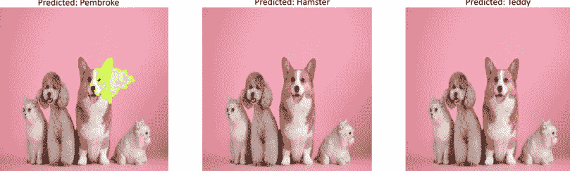

图 6.7 - 权重大于定义最小值的超像素

深度学习模型在提取图像低级特征（如角、边缘和条纹）方面表现出色。然而，这些低级特征对人类来说不可解释。来自 `lime_image` 的 `LIMEImageExplainer` 方法通过突出对模型预测产生正向或负向贡献的感兴趣区域（ROIs）或超像素，为图像分类器提供高层级解释。因此，LIME 可以评估所提供的解释是否具有敏感性，并防止模型由于错误的原因做出准确预测。

在本节中，我们使用 Inception V3 训练模型构建了一个图像分类器，并使用 LIME 解释了输出。接下来，让我们讨论在使用内在性（intrinsic）与事后性（post hoc）解释性时的最佳实践。

### 考虑内在性与事后解释性

我们能忽略解释性而仅仅信任最先进的模型吗？简单的回答是否定的。正确的预测并不能充分解决现实世界的问题。除非 AI 系统是可信赖的，否则用户不会采用它。了解预测为何重要，可以展示 AI 系统在多大程度上值得信任，并结合领域专业知识提供最佳行动方案的见解。

在选择内在解释性还是事后解释性时，没有硬性规定。从解释性的角度来看，具有足够准确性的内在模型始终比复杂模型更优。否则，后处理方法是可以在模型训练后提供事后解释性的替代方案。

不可避免的是，人类会根据位置、领域知识和个人经验带有无偏的偏见来信任解释选择。通常情况下，人类寻求对比性和交互性的解释，因为它们更容易理解。因此，在生成解释时可能会丢失部分信息。因此，忠实于模型且审慎的解释至关重要，它们通过关注重要方面而非每个细节来增加用户的信任。

### 总结

随着机器学习成为主流，解释性将是不可或缺的。可解释机器学习（interpretable ML）有助于验证模型、防止因错误原因产生正确预测，并增加用户信任，从而实现更广泛的应用。例如，我们不希望信贷申请根据性别而非还款记录状况来拒绝不合格的申请者。

可解释机器学习通过帮助人类理解模型的决策过程来发现新的见解。今天，用户除了基于统计关系的概率外，还要求关于因果关系的信息。尽管设计标准缺乏共识，但可解释机器学习技术在基准测试方法面临挑战。在下一章中，我们将探索反传播 XAI 技术。

## 反传播与扰动解释性

研究人员发现，大脑可以在 13 毫秒内处理并解释眼睛看到的图像。人类视觉过程始于光线到达视网膜，视网膜将光转换为神经信号，将形状、颜色和方向等信息发送到大脑。根据过去的经验，人脑提取影响视觉感知的特征。

图 7.1 显示了计算机如何在 0 到 255 之间的像素值网格中查看图像，而对形状和颜色没有内在知识。深度神经网络（如卷积神经网络 CNN）类似于人类大脑，包含非线性结构和人工神经元层，用于从输入图像中学习特征。

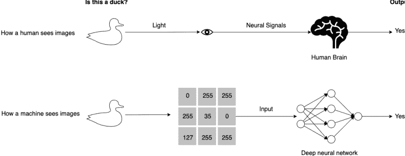

图 7.1 – 人类视觉感知与计算机视觉

尽管近年来取得了令人鼓舞的结果，但这些最先进的模型由于其透明特性带来的不确定性，尚未获得广泛采用。可解释神经网络提供了一种机制，用于可视化网络如何学习，并解释训练输入与预测之间的关系。

## 反传播与扰动解释性

有许多可解释人工智能（XAI）技术可以研究神经网络的内部工作。在第 6 章中，我们回顾了全局和局部解释性的范围，以及它们如何应用于内在和事后解释模型。本章涵盖了两种流行的 XAI 方法：反传播和扰动。本章主要主题包括：

- 回顾反传播解释性
- 回顾扰动解释性
- 比较反传播与扰动

在本章结束，你将学习更多关于反传播和扰动的方法，以便为你的用例选择合适的方法。

### 回顾反传播解释性

特征归因方法通常包含两个步骤：通过前向传播确定推理结果，然后通过反传播为已训练模型上的输入特征分配相关性评分。

反传播是一种基于梯度的 XAI 方法，它通过在神经网络中进行多次前向和反向传播生成输出的偏导数来评估特征归因。与神经网络训练不同，特征归因背景下的反传播不需要计算模型参数权重更新的梯度。反传播特征归因不是从输入层开始，而是从最终输出层开始分配重要性评分，然后反向跨每个中间层计算局部激活梯度，直到到达输入层，如图 7.2 所示：

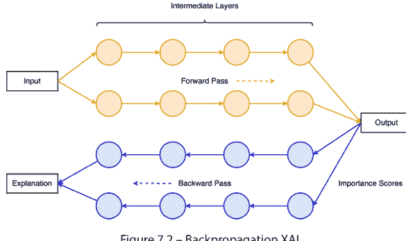

本节介绍了显著性图（saliency maps），这是一种基于反传播的 XAI 技术。

### 显著性图

显著性图是使用 CNN 解释图像时最常用的 XAI 方法之一。它适用于大多数深度学习网络，并提供了一种直观的方法来调查 CNN 内部隐藏层。

显著性图利用反传播探测已训练的神经网络，获取关于特定类别的空间信息——识别物体的位置，而无需显式地为图像标记此类信息。显著性图放大梯度的权重，以反映或近似图像的相关部分。显著性图只需要一次反向传播，因为它关注得分最高的类别。

获取显著性图有三种方法：

- 使用反卷积网络（DeconvNet），通过反池化和逆 ReLU 技术反转特定的激活输入层
- 使用基于梯度的反传播，根据对输入网络的计算梯度高亮像素
- 使用引导反传播结合 DeconvNet 和基于梯度的反传播

让我们看看基于梯度的反传播方法的显著性图。示例笔记本 `chapter7_saliency_maps.ipynb` 以及本章讨论的包依赖项可见于 https://github.com/PacktPublishing/Deep-Learning-and-XAI-Techniques-for-Anomaly-Detection/tree/main/Chapter7。

你可以在 Amazon SageMaker Studio Lab（https://aws.amazon.com/sagemaker/studio-lab/）上进行实验，这是一个免费的 ML 开发环境，为每个用户提供 12 小时 CPU 或 4 小时 GPU 以及 15 GB 存储。或者你也可以在你喜欢的集成开发环境（IDE）中尝试。或者，你可以尝试你偏好的 IDE：

1. 首先，让我们加载必要的库：

```python
import tensorflow as tf
import numpy as np
import matplotlib.pyplot as plt
from platform import python_version
import os
import warnings
warnings.filterwarnings("ignore")
os.environ["TF_CPP_MIN_LOG_LEVEL"] = "3"
```

### 138 反向传播与扰动可解释性

```python
print(f'TensorFlow version: {tf.__version__}')
print(f'Python version: {python_version()}')
%matplotlib inline
```

2. 加载一个在 ImageNet 上预训练权重的 VGG16 分类模型：

```python
model = tf.keras.applications.VGG16(weights='imagenet')
model.summary()
```

7.3 显示了 VGG16 模型架构的摘要：

| 层 (类型) | 输出形状 | 参数 |
|---|---|---|
| input_1 (InputLayer) | (None, 224, 224, 3) | 0 |
| block1_conv1 (Conv2D) | (None, 224, 224, 64) | 1792 |
| block1_conv2 (Conv2D) | (None, 224, 224, 64) | 36928 |
| block1_pool1 (MaxPooling2D) | (None, 112, 112, 64) | 0 |
| block2_conv1 (Conv2D) | (None, 112, 112, 128) | 73856 |
| block2_conv2 (Conv2D) | (None, 112, 112, 128) | 147584 |
| block2_pool1 (MaxPooling2D) | (None, 56, 56, 128) | 0 |
| block3_conv1 (Conv2D) | (None, 56, 56, 256) | 295168 |
| block3_conv2 (Conv2D) | (None, 56, 56, 256) | 590000 |
| block3_pool1 (MaxPooling2D) | (None, 28, 28, 256) | 0 |
| block4_conv1 (Conv2D) | (None, 28, 28, 512) | 1180160 |
| block4_conv2 (Conv2D) | (None, 28, 28, 512) | 2359008 |
| block4_conv3 (Conv2D) | (None, 28, 28, 512) | 2359008 |
| block4_pool1 (MaxPooling2D) | (None, 14, 14, 512) | 0 |
| block5_conv1 (Conv2D) | (None, 14, 14, 512) | 2359008 |
| block5_conv2 (Conv2D) | (None, 14, 14, 512) | 2359008 |
| block5_conv3 (Conv2D) | (None, 14, 14, 512) | 2359008 |
| block5_pool1 (MaxPooling2D) | (None, 7, 7, 512) | 0 |
| flatten (Flatten) | (None, 25088) | 0 |
| fc1 (Dense) | (None, 4096) | 10276454 |
| fc2 (Dense) | (None, 4096) | 16781312 |
| predictions (Dense) | (None, 1000) | 4097000 |

总参数: 138,357,544
可训练参数: 138,357,544
不可训练参数: 0

图 7.3 – VGG16 模型摘要

3. 加载图像文件并为 VGG16 设置期望的目标输入大小：

```python
img_path = 'panda.jpeg'
image = tf.keras.utils.load_img(img_path, target_size=(224, 224))
plt.imshow(image)
plt.axis('off')
plt.show()
```

图 7.4 显示了原始图像：img/c06290096a327475ed91ba4a432b77_155.png

图 7.4 – 原始图像

4. 在获取前几类的预测之前对图像进行预处理：

```python
img = tf.keras.utils.img_to_array(image)
img = img.reshape((1, *img.shape))
y_pred = model.predict(img)
top5 = tf.keras.applications.vgg16.decode_predictions(y_pred, top=5)
print('Top 5 classes:')
top5
```

### 反向传播与扰动可解释性

图 7.5 显示了预测概率最高的大熊猫的排五个预测类别：

```
1/1 [====================] - 1s40ms/step
Top 5 classes:
('n0251045', 'giant_panda', 0.955901),
('n0250981', 'less_panda', 0.0398475),
('n0248336', 'gibbon', 0.0192165),
('n2443114', 'polecat', 0.0085649),
('n2488702', 'collar', 0.0003928)]
```

图 7.5 - 前五个预测类别

5. 通过寻找梯度的绝对值和最大值来识别此类预测感兴趣区域 (ROI)。我们归一化梯度：

```python
images = tf.Variable(img, dtype=float)
with tf.GradientTape() as tape:
    pred = model(images, training=False)
    sorted_class = np.argsort(pred.numpy()[0])[::-1]
    loss = pred[sorted_class[0]]
    grads = tape.gradient(loss, images)
    grads_abs = tf.math.abs(grads)[0]
    gmin, gmax = np.min(grads_abs), np.max(grads_abs)
    grads_eval = (grads_abs - gmin) / (gmax - gmin + 1e-8)
```

6. 图 7.6 显示了该输入的热力图，其中熊猫的眼睛和鼻子对大熊猫类别的得分贡献。颜色条突出了亮度的范围：

```python
fig, axes = plt.subplots(1,2, figsize=(20,7))
axes[0].imshow(image)
fig.colorbar(axes[1].imshow(grads_eval, cmap="turbo", alpha=0.9))
plt.savefig('panda_saliency_maps.png')
```

img/c06290096a327475ed91ba4a432b77_157.png
img/c06290096a327475ed91ba4a432b77_1.png

图 7.6 – 热力图

前面的示例显示了如何使用基于梯的反向传播提取贡献像素。现在，在下一节中探索扰动可解释性。

### 扰动可解释性

扰动方法通过扰动训练输入（通过遮图像像素或替换文本数据中的单词）来研究神经网络的属性。领域专家和用户可以通过直觉分析热力图中突出特征来评估其对整体模型预测的影响。本节探索使用局部模型无关解释 (LIME) 的基于扰动的可解释性。

### LIME

我们在第 6 章中讨论了 LIME 作为局部近似框架。在本节中，我们将探索 LIME 如何通过扰动提供局部可解释性。LIME 将解释定义为人类可理解的数值、视觉或文本表示。有三种 LIME 解释器：

- **LimeTabularExplainer**：基于表格数据的分类器预测。
- **LimeImageExplainer**：基于超像素的存在或具有共同特征像素分组的图像分类器预测。
- **LimeTextExplainer**：基于单词的存在或解释文本分类器预测。LIME 扰动给定的句子“The cake is delicious”，生成如“The cake delicious”、“The is delicious”或“cake is delicious”等变体，并识别相关单词“delicious”。

让我们看看 LIME 如何使用 Amazon 评论数据集（https://www.kaggle.com/datasets/arhamrumi/amazon-product-reviews）为文本分类器提供局部解释性。示例 Jupyter 笔记本（`chapter7_lime.ipynb`）和文件依赖项可以在 https://github.com/PacktPublishing/Deep-Learning-and-XAI-Techniques-for-Anomaly-Detection/main/ 获取。或者，你可以在喜欢的 IDE 中尝试：

1. 首先，安装并加载库：

```python
pip install nltk wordcloud
import pandas as pd
import numpy as np
import matplotlib.pyplot as plt
import tensorflow as tf
from tensorflow import keras
import os
import warnings
warnings.filterwarnings("ignore")
os.environ["TF_CPP_MIN_LOG_LEVEL"] = "3"
```

2. 接下来，加载并预览数据集，如图 7.7 所示：

```python
df = pd.read_csv('reviews.csv')
df.head()
```


### 数据集预览

| Id | Productid | Userid | ProductName | HelpfulnessNumerator | HelpfulnessDenominator | Score | Time | Summary | Text |
|---|---|---|---|---|---|---|---|---|---|
| 0 | B0E4KFG0 | ASDGX7AUBGW | delmartian | | | 5 | 103862400 | Good Quality Dog Food | I have bought the Vitality canned |
| 1 | B00B13GRG4 | A1D87FGZCE5NK | dl pa | | 1 | 134967000 | Not Advertised | Product arrived as Salted Peanut... |
| 2 | B004UAQQQ | A39B5RC6GFGVX | Natalia Cortes "Natalia Cortes" | | | 4 | 121907600 | "Delta" says it all | a confection that has been around a fe... |
| 3 | B0LQIQCHO | ABXMLWJXXAIN | Karl | | | 3 | 1307923200 | Cough Medium | If you are looking for the secret ingredient i... |

图 7.7 - 数据集预览

图 7.8 显示了我们将用于分类的特征和目标列：

```python
df = df[['Text', 'Score']]
df.head()
```

| | | |
|---|---|---|
| 0 | I have bought of the Vitality canned d... | 5 |
| 1 | Product arrived labeled as Salted Peanut... | 1 |
| 2 | This is a confection that has been around a fe... | 4 |
| 3 | If you are looking for the secret ingredient i... | 2 |
| 4 | Great taffy at a great price. There was a wid... | 5 |

图 7.8 - 特征和目标列

图 7.9 显示该数据集包含 568,454 个样本，分为 2 列：`Text`（文本）和 `Score`（评分）：

```
<class 'pandas.frame.DataFrame'>nRangeIndex: 568454 entries, 0 to 568453
Data columns (total 2 columns):
# Column Text Non-Null Count Dtype
0 Text 568454 non-null object
1 Score 568454 non-null int64
types: int64(1), object(1)
memory usage: 8.7+ MB
```

图 7.9 —— 数据集信息

我们将对数据集进行采样演示。你可以尝试增加这个数字：

```python
subsample_size = 3000
df = df.sample(n=subsample_size, random_state=1)
```

我们将为该数据集生成一个词云：

```python
from nltk.corpus import stopwords
from wordcloud import WordCloud
import re
```

```python
def clean_text(s):
    ns = re.sub(r'http\S+', '', s)
    s = re.sub(r'(RT|via) ((?:\b\W*@\W+))', ' ', s)
    s = re.sub(r'@\S+', ' ', s)
    s = re.sub(r'&amp;', ' ', s)
    return s
```

```python
df['clean_text'] = df['Text'].apply(clean_text)
text = df['clean_text'].to_string().lower()
```

```python
wordcloud = WordCloud(
    collocations = False,
    relative_scaling = 0.2,
    stopwords=set(stopwords.words('english'))
).generate(text)
```

```python
plt.figure(figsize=(15, 15))
```

### 审查扰动解释性

```python
plt.axis("off")
plt.savefig('review_wordcloud.png', bbox_inches='tight')
plt.show()
```

图 7.10 显示了该数据集的文本后词云：


图 7.10 —— 词云

将模型特征和目标赋值给变量：

```python
X = df['clean_text']
y = df['Score']
y.value_counts()
```

设置随机种子以保证可复现性。将数据集分为 80% 的训练集和 20% 的测试集。你有 2,400 个训练样本和 600 个测试样本：

```python
seed = 42
np.random.seed(seed)
from sklearn.model_selection import train_test_split
X_train, X_test, y_train, y_test = train_test_split(X, y, test_size=0.2, stratify=y, random_state=42)
print(f'X_train count: {X_train.shape[0]}')
print(f'y_train count: {y_train.shape[0]}')
```

```python
print(f'X_test count: {X_test.shape[0]}')
print(f'y_test count: {y_test.shape[0]}')
```

设置训练时唯一词的最大数量，以及每个产品评论保留的单词最大数量：

```python
vocab_size = 20000
maxlen = 80
```

对序列进行分词并填充以具有相同的长度：

```python
from keras.preprocessing.text import Tokenizer
from keras.preprocessing.sequence import pad_sequences
from sklearn.pipeline import TransformerMixin
from sklearn.base import BaseEstimator
```

```python
class TextToSequences(Tokenizer, BaseEstimator, TransformerMixin):
    def __init__(self, **kwargs):
        super().__init__(**kwargs)
    def fit(self, texts, y=None):
        self.fit_on_texts(texts)
        return self
    def transform(self, texts, y=None):
        return self.texts_to_sequences(texts)
```

```python
sequencer = TextToSequences(num_words=vocab_size)
```

```python
class Padder(BaseEstimator, TransformerMixin):
    def __init__(self, maxlen=500):
        self.maxlen = maxlen
        self.max_index = None
    def fit(self, X, y=None):
        self.max_index = pad_sequences(X, maxlen=self.maxlen).max()
        return self
    def transform(self, X, y=None):
        X = pad_sequences(X, maxlen=self.maxlen)
        X[X > self.max_index] = 0
        return X
```

```python
padder = Padder(maxlen)
```

创建一个 LSTM 模型：

```python
from keras.models import Sequential
from keras.layers import Dense, Embedding, LSTM
from keras.wrappers.scikit_learn import KerasClassifier
from sklearn.pipeline import make_pipeline
```

```python
batch_size = 128
max_features = vocab_size + 1
import tensorflow as tf
tf.random.set_seed(seed)
def create_model(max_features):
    model = Sequential()
    model.add(Embedding(max_features, 128))
    model.add(LSTM(100, dropout=0.2, recurrent_dropout=0.2))
    model.add(Dense(5, activation='softmax'))
    model.compile(loss='categorical_crossentropy',
                  optimizer='adam', metrics=['accuracy'])
    return model
```

创建用于训练的 sklearn pipeline：

```python
pipeline = KerasClassifier(build_fn=create_model,
    epochs=10, batch_size=batch_size, max_features=max_features, verbose=1)
```

```python
pipeline = make_pipeline(sequencer, padder, pipeline)
pipeline.fit(X_train, y_train)
```

### 反向传播对比扰动解释性

在测试集上进行预测：

```python
y_preds = pipeline.predict(X_test)
```

生成模型的准确率得分和分类报告，如图 7.11 所示：

```python
from sklearn.metrics import accuracy_score,
confusion_matrix, classification_report, ConfusionMatrixDisplay
print(f'Test Accuracy: {accuracy_score(y_test, y_preds)*100:.2f}%')
print(f'Classification Report:\n{classification_report(y_test, y_preds)}')
```

Test Accuracy: 55.67%
Classification Report:

| | precision | recall | f-score | support |
|---|---|---|---|---|
| 1 | 0.44 | 0.27 | 0.34 | 59 |
| 2 | 0.00 | 0.00 | 0.00 | 29 |
| 3 | 0.24 | 0.25 | 0.24 | 48 |
| 4 | 0.20 | 0.38 | 0.26 | 85 |
| 5 | 0.78 | 0.72 | 0.75 | 379 |

| | precision | recall | f-score | support |
|---|---|---|---|---|
| accuracy | | | 0.56 | 600 |
| macro avg | 0.33 | 0.32 | 0.32 | 600 |
| weighted avg | 0.58 | 0.56 | 0.56 | 600 |

图 7.11 —— 测试准确率和分类报告

让我们使用混淆矩阵来总结预测的类别：

```python
labels = [1,2,3,4,5]
cm = confusion_matrix(y_test, y_preds)
ConfusionMatrixDisplay(cm, display_labels=labels).plot(cmap=plt.Blues)
plt.xlabel('Predicted Rating')
plt.ylabel('True Rating')
plt.savefig("confusion_matrix.png", bbox_inches='tight')
```

图 7.12 显示了结果。

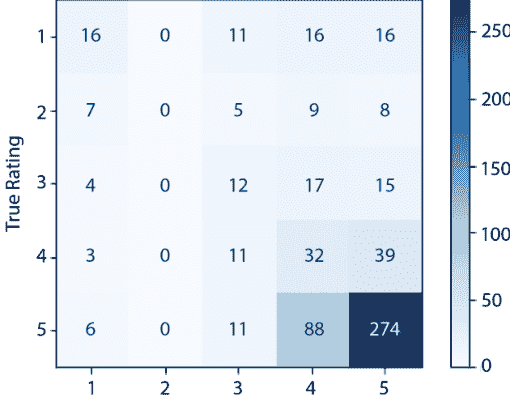

图 7.13 显示了该样本文本的正确预测类别为 5：

```python
idx = 599
test_text = np.array(X_test)
test_class = np.array(y_test)
text_sample = test_text[idx]
class_names = [1,2,3,4,5]
print(f'Sample class: \n{text_sample}\n')
print(f'Probability: {pipeline.predict_proba([text_sample])].round(3)}')
print(f'True class: {class_names[test_class]}')
```

Sample Text:
This nutritious bar is great for before or workouts. Low in sugar, high in protein makes this a perfect snack for Diabetics.

```
1/1 [====================================] - 0s 30ms/step
Probability: [0. 0. 0.002 0.998]
True class: 5
```

图 7.13 —— 样本文本预测概率

### 反向传播对比扰动解释性

实例化 `LimeExplainer` 以产生局部解释，如图 7.14 所示：

```python
from lime.lime_text import LimeExplainer
explainer = LimeExplainer(class_names=class_names)
exp = explainer.explain_instance(text_sample, pipeline,
predict_proba, num_features=10, top_labels=1)
exp.show_in_notebook(text=text_sample)
```

Prediction probabilities

### 带有高亮的文本

This nutritious is great for before after workouts.
Low in sugar, high in protein makes this a perfect snack for
Diabetics too.

| | NOT 5 |
|---|---|
| 1 | 0.00 |
| 2 | 0.00 |
| 3 | 0.00 |
| 4 | 0.05 |
| 5 | 0.95 |

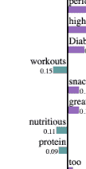

图 7.15 显示了在移除 `LimeExplainer` 识别出的重要单词后重新评估预测概率的修改文本：

```python
text_sample_modified = re.sub('perfect|high|great|makes',
', ', text_sample)
print(f'Modified Sample Text: \n{text_sample_modified}\n')
print(f'Probability: {[pipeline.predict_proba([text_\nsample_modified])].round(3)}')
```


Modified Sample:
This nutritious bar is for before or after workouts. Low in sugar, in protein this a snack for Diabetics.

```
1/1 [====================================] - 0s 37ms/step

Probability: [0.071 0.085 0.164 0.22 0.495]
```

图 7.15 - 修改后的新预测概率

### 反向传播与扰动 XAI 的对比

在回顾了反向传播和扰动之后，让我们比较这些 XAI 技术的优缺点。

通常，反向传播在通过网络进行单次反向传播生成所有输入特征的重要性评分方面比基于扰动的 XAI 方法更高效。然而，基于反向传播的 XAI 方法通常容易受到影响，并且需要模型的内部信息。虽然与图像区域相关的特征归因看起来直观，但相邻像素可能会出现巨大的归因分配差异，这是反向传播方法的缺点。此外，模型特征缺乏粒度可能导致其与输出变化的相关性不一致，导致解释的忠实度较低。

相比之下，基于扰动的方法适用于任何深度学习模型，无论其架构如何。与反向传播的方法相比，它们的噪声较少。通过创建变体对象，扰动方法通过增量评估评估模型的可解释性。尽管广受欢迎，但基于扰动的 XAI 方法通常依赖于输入模态，无法捕捉通的网络特征。此外，评估所有可能的特征集可能非常耗时且耗资源。

静态图像的扰动通常比具有独特特征的文本数据和具有时间维度的视频更直接。因此，基于扰动方法的进展更多地围绕图像分类，为未来对其他数据类型的扰动研究留下了空间。扰动方法对实例的微小修改敏感，会导致输出的剧烈偏差。

构建一个可靠的 XAI 系统不仅是解释模型的预测。任务关键型和安全关键型应用需要与其原始模型一致的忠实解释。例如，XAI 系统必须产生准确且忠实的解释，将病理图像分类为恶性，以便临床医生能够有信地专注于调查感兴趣区域（ROI）。

我们是否能统一反向传播和基于扰动的方法，以便在复杂黑盒模型的事后解释中结合两者之长？为了在预测准确率之外实现解释性方面做出持续努力，目前出现了一种统一这两种方法的需求，例如 `DeepExplain`，`https://github.com/marcoananca/DeepExplain`。

解释性驱动可解释性。然而，解释性并不等同于因果关系。在考虑计算效率和泛化能力之外，在设计 XAI 系统时引入领域专家对于检测潜在偏差、确保模型行为和验证预测质量至关重要。

### 总结

本章深入概述了反向传播和扰动 XAI 方法，包括实际示例、优点和局限性。在下一章中，我们将探索模型无关与模型特定的可解释性 XAI 技术。

## 模型无关与模型特定的可解释性

为高风险决策创建**机器学习 (ML)** 模型需要在整个机器学习 (ML) 生命周期内考虑准确性和可解释性。在医疗保健领域，医生必须通过知情同意过程提供关键信息，以教育患者有关医疗程序、治疗或临床试验的潜在风险和获益。

同样，当将**人工智能 (AI)** 整合到医疗诊断过程中时，医生必须能够澄清与 ML 模型相关的重要信息以得出预测结果，包括输入数据的类型和训练过程。

在**可解释人工智能 (XAI)** 方法如此多样化的背景下，你可能会好奇应该选择哪种 XAI 方法。在本章中，我们将探索以下主题以理解模型无关和模型特定的 XAI 方法之间的区别：

- 回顾模型无关的可解释性
- 回顾模型特定的可解释性
- 选择 XAI 方法

在本章结束时，你将对这两种方法有更好的理解并获得实践经验。让我们在下一节中回顾本章的技术要求。

### 技术要求

在示例演练中，你将以下 Python 包：

- `Matplotlib` - 用于创建数据可视化的绘图库
- `NumPy` - 在处理数组时提供数学函数的开源库
- `pandas` - 一个提供数据分析和处理工具的库
- `MXNet` - 一个开源的深度学习框架
- `Keras` - 一个为神经网络提供 API 接口的开源库
- `TensorFlow` - 用于构建深度学习应用程序的开源框架
- `AutoGluon` - 一个自动化 ML 任务的开源 AutoML 库
- `MoveColumn` - 用于在 Python DataFrame 中移动列的包
- `Scikit-learn` - 用于预测性数据分析的 ML 库
- `SHAP` - 使用 Shapley 值解释 ML 输出的 Python 库
- `Saliency` - 提供显著性技术实现的 Python 库
- `Pillow` - 一个开源 Python 图像处理库

在本章讨论的包依赖的示例 Jupyter notebook 和要求文件可以在 `https://github.com/PacktPublishing/Deep-Learning-and-XAI-Techniques-for-Anomaly-Detection/tree/main/Chapter.8` 获取。

你可以在 Amazon SageMaker Studio Lab (`https://aws.amazon.com/sagemaker/studio-lab/`) 上尝试这些笔记本，这是一个免费的 ML 开发环境，为每个用户提供最多 12 小时的 CPU 或 4 小时的 GPU 以及 15 GB 的免费存储。或者，你也可以在你偏好的集成开发环境 (IDE) 中尝试。

在接下来的节中，我们将深入讨论模型无关的可解释性。

### 回顾模型无关的可解释性

模型无关的 XAI 方法对于任何模型类型都是通用的。它们通常用于模型训练后的事后解释。其目标是产生与原始模型忠实的解释，而无需理解内部网络结构，这为模型选择提供了灵活性。在这里，对于难以提取网络内部工作的复杂透明模型，模型特定的方法更为相关。

在第 6 章和第 7 章中，我们回顾了局部解释模型无关解释 (LIME)，这是一种局部近似技术。在第 5 章中，你学习了

### 回顾模型无关的可解释性

### 使用 SHAP 解释 AutoGluon

在接下来的演示中，我们将使用 `AutoGluon` (`https://github.com/autogluon/autogluon`) 构建一个二分类器来分析乳腺癌数据集并将肿瘤分类为恶性（癌症）或良性。

Shapley 值基于合作博弈论在 XAI 方法中变得流行，数据集中的单个特征代表玩家，目标预测被视为基于其边际贡献的收益。通过 Shapley 值分解每个特征的加性贡献，为评估训练模型的特征重要性提供了直观的衡量。注意，Shapley 值仅突出特征如何影响预测，而不提供因果关系。

相比之下，第 7 章介绍的 LIME 通过使用扰动样本训练线性模型来提供局部解释。

Kernel SHAP (`https://proceedings.neurips.cc/paper/2017/file/82a086219786327dc63fad2be67767-Paper.pdf`) 是一种模型无关的 XAI 方法，结合了 LIME 和 SHAP，通过加权线性回归衡量特征重要性。使用无正则化的回归模型扩展 LIME 使得 Kernel SHAP 实现了更高的效率。然而，随着特征数量增加以计算所有可能的排列，估计 Shapley 值可能非常耗计算资源且耗时。

### 模型特定解释性

2. 加载必要的库：

```python
%matplotlib inline

import tensorflow as tf

from tensorflow import keras

from sklearn.model_selection import train_test_split

import matplotlib.pyplot as plt

import pandas as pd

import numpy as np

import sklearn

import shap

import os

import re

import string

from platform import python_version

import warnings

import movecolumn as mc

from sklearn import preprocessing

from autogluon.tabular.version import __version__

from autogluon.tabular import TabularDataset, TabularPredictor
```

`warnings.filterwarnings("ignore")`
`os.environ["CPP_MIN_LOG_LEVEL"] = "3"`

```python
print(f'TensorFlow version: {tf.__version__}')

print(f'Python version: {python_version()}')

print(f'AutoGluon version: {__version__}')
```

图 8.1 显示了包依赖项：

```
TensorFlow version: 2.11.0
Python version: 3.9.10
AutoGluon version: 0.6.2
```

图 8.1 – 包依赖项

3. 加载乳腺癌数据集：

```python
df = pd.read_csv('breast-cancer.csv')

df.head(5)
```

图 8.2 显示了乳腺癌数据集的预览：

| id | diagnosis | radius_mean | texture_mean | perimeter_mean | area_mean | smoothness_mean | compactness_mean | concavity_mean | concave_points_mean |
|---|---|---|---|---|---|---|---|---|---|
| 842302 | M | 17.99 | 10.38 | 122.80 | 1001.0 | 0.11840 | 0.27760 | 0.3001 | 0.1470 |
| 842517 | M | 20.67 | 17.77 | 132.90 | 1326.0 | 0.08476 | 0.07864 | 0.0869 | 0.07017 |
| 8430903 | M | 19.69 | 21.25 | 130.00 | 1203.0 | 0.10960 | 0.15990 | 0.1974 | 0.12790 |
| 8436831 | M | 11.42 | 20.38 | 77.58 | 386.1 | 0.14250 | 0.28390 | 0.2414 | 0.10520 |
| 84356402 | M | 20.29 | 14.34 | 135.10 | 1297.0 | 0.10030 | 0.13280 | 0.1980 | 0.10430 |

5 行 × 12 列

图 8.2 – 加载乳腺癌数据集

4. 查看目标列 `diagnosis`（诊断结果）的类别分布：

```python
df['diagnosis'].value_counts().plot(kind = 'bar')
```

图 8.3 显示了良性 (B) 和恶性 (M) 类之间的频率分布：

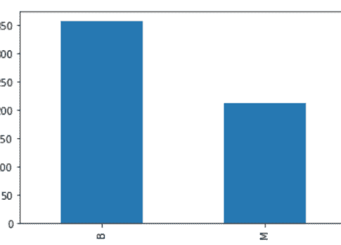

图 8.3 – B 和 M 类别分布

5. 查看关于数据集的信息：

```python
df.info()
```

图 8.4 显示了部分数据集信息：

```
<class pandas.core.frame.DataFrame>
RangeIndex: 569 entries, 0 to 568
Data columns (total 32 columns):

| | Column | Non-Null | Dtype |
|---|---|---|---|
| 0 | id | 569 non-null | int64 |
| 1 | diagnosis | 569 non-null | object |
| 2 | radius_mean | 569 non-null | float64 |
| 3 | texture_mean | 569 non-null | float64 |
| 4 | perimeter_mean | 569 non-null | float64 |
| 5 | area_mean | 569 non-null | float64 |
| 6 | smoothness_mean | 569 non-null | float64 |
| 7 | compactness_mean | 569 non-null | float64 |
| 8 | concavity_mean | 569 non-null | float64 |
| 9 | concave_points_mean | 569 non-null | float64 |
| 10 | symmetry_mean | 569 non-null | float64 |
| 11 | fractal_dimension_mean | 569 non-null | float64 |
| 12 | radius_se | 569 non-null | float64 |
| 13 | texture_se | 569 non-null | float64 |
| 14 | perimeter_se | 569 non-null | float64 |
| 15 | area_se | 569 non-null | float64 |
| 16 | smoothness_se | 569 non-null | float64 |
| 17 | compactness_se | 569 non-null | float64 |
| 18 | concavity_se | 569 non-null | float64 |
| 19 | concave_points_se | 569 non-null | float64 |
| 20 | symmetry_se | 569 non-null | float64 |
| 21 | fractal_dimension_se | 569 non-null | float64 |
| 22 | radius_worst | 569 non-null | float64 |
| 23 | texture_worst | 569 non-null | float64 |
| 24 | perimeter_worst | 569 non-null | float64 |
| 25 | area_worst | 569 non-null | float64 |
| 26 | smoothness_worst | 569 non-null | float64 |
| 27 | compactness_worst | 569 non-null | float64 |
| 28 | concavity_worst | 569 non-null | float64 |
| 29 | concave_points_worst | 569 non-null | float64 |
| 30 | symmetry_worst | 569 non-null | float64 |
| 31 | fractal_dimension_worst | 569 non-null | float64 |

dtypes: float64(30), int64(1)
memory usage: 142.4 KB
```

图 8.4 - 数据集信息

6. AutoGluon 推断最后一列为目标标签。因此，我们将 `diagnosis` 列移动到最后：

```python
mc.MoveToLast(df, 'diagnosis')
df.head(3)
```

图 8.5 显示标签已移动到末尾：

| perimeter_worst | area_worst | smoothness_worst | compactness_worst | concave_points_worst | symmetry_worst | fractal_dimension_worst | diagnosis |
|---|---|---|---|---|---|---|---|
| 184.6 | 2019.0 | 0.1622 | 0.6856 | 0.7119 | 0.2654 | 0.4601 | 0.1189 | M |
| 158.8 | 1956.0 | 0.1238 | 0.1866 | 0.2416 | 0.2530 | 0.2750 | 0.0890 | M |
| 152.5 | 1709.0 | 0.1444 | 0.4245 | 0.4504 | 0.2430 | 0.3613 | 0.0875 | M |

图 8.5 – 将目标标签移动到最后一列

7. 列出数据集中的所有列：

```python
df.columns
```

图 8.6 列出了数据集的所有特征：


数据集特征列表如下：

```
['id', 'radius_mean', 'texture_mean', 'perimeter_mean', 'area_mean', 'smoothness_mean', 'compactness_mean', 'concavity_mean', 'concave_points_mean', 'symmetry_mean', 'fractal_dimension_mean', 'radius_se', 'texture_se', 'perimeter_se', 'area_se', 'smoothness_se', 'compactness_se', 'concavity_se', 'concave_points_se', 'symmetry_se', 'fractal_dimension_se', 'radius_worst', 'texture_worst', 'perimeter_worst', 'area_worst', 'smoothness_worst', 'compactness_worst', 'concavity_worst', 'concave_points_worst', 'symmetry_worst', 'fractal_dimension_worst', 'diagnosis']
```

图 8.6 – 数据集特征

8. 使用 `LabelEncoder` 将类别列转换为数值。0 表示良性，1 表示恶性：

```python
le = preprocessing.LabelEncoder()
le.fit(df['diagnosis'])
df['diagnosis'] = le.transform(df['diagnosis'])
```

```python
df['diagnosis'].value_counts().plot(kind = 'bar')
```

图 8.7 显示了编码后的类别分布：

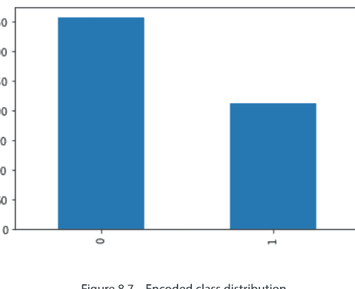

9. 将数据集按 80:20 的比例分为训练集和测试集：

```python
train_data, test_data = train_test_split(df, size=0.2, random_state=42)
print(f'Train data: {train_data.shape[0]}')
print(f'Test data: {test_data.shape[0]}')
```

图 8.8 显示了数据集划分：

| Train data | 455 |
|---|---|
| Test data | 114 |

图 8.8 – 训练与测试划分

10. 现在可以使用 `AutoGluon` 构建二分类器了。为 `AutoGluon` 定义输出文件夹以保存训练后的模型。我们将删除任何同名的文件夹：

```python
save_path = 'ag_breast_cancer'
overwrite = True

if overwrite:
  try:
    tf.compat.v1.gfile.DeleteRecursively(save_path)
  except:
    pass
```

```python
tf.io.gfile.makedirs(save_path)
print(f'Model output directory: {save_path}')
```

11. 分配待预测的目标列：

```python
label = 'diagnosis'
print("Class variable summary: \n", train_data[label].describe())
```

图 8.9 显示了类别变量的摘要：

| Class variable summary: |
|---|
| count | 455.000000 |
| mean | 0.371429 |
| std | 0.483719 |
| min | 0.000000 |
| 25% | 0.000000 |
| 50% | 0.000000 |
| 75% | 0.000000 |
| max | 1.000000 |

`Name: diagnosis, dtype: float64`

图 8.9 – 类别变量摘要

12. 设置目标标签、输出目录和评估指标以拟合模型。在这里，为了效率，我们将限制设置为 120 秒（如果需要，可以移除此设置）。`AutoGluon` 根据列的值自动推断问题类型为二分类：

```python
predictor = TabularPredictor(label=label, path=save_path, eval_metric='accuracy').fit(train_data, time_limit=120, presets='best_quality')
```

```
Presets: ['best_quality']
num_stack_levels=0, num_bag=5, auto_stack=True
Beginning AutoGlu tuning ... Time limit = 120s
AutoGlu will save models to 'ag_breast_cancer/'
AutoGluon Version: 0.4.2
Python Version: 3.9.10
Operating System: Linux
Machine: x86_64
Platform Version: #1 SMP Wed Oct 26 2022:36:53 UTC
Train Rows: 455
Train Columns: 31
Label Column: diagnosis
Preprocessing data ...
AutoGlu infers your prediction is: 'binary' (because only 2 unique label values observed: [0, 1])
```

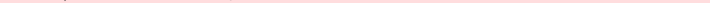

图 8.10 – AutoGlu 拟合

13. 我们可以使用 `leaderboard` 函数获取单个模型的性能：

```python
predictor.leaderboard(test_data, silent=True)
```

图 8.11 显示了排行榜（leaderboard）：

| model | test_score | score_val | pred_time_test | pred_time_val | fit_time_test | fit_time_val | stack_level | order |
|---|---|---|---|---|---|---|---|---|
| 0 | LightGBM_Auto_Base | 0.97534 | 0.968317 | 0.003919 | 0.004951 | 0.507196 | 0.010949 | 1 | 13 |
| 1 | RandomForest_Auto_Base | 0.97354 | 0.962418 | 0.006016 | 0.013671 | 0.536504 | 0.006016 | 0.01293 | 1 | 9 |
| 2 | ExtraTree_Auto_Base | 0.97354 | 0.962418 | 0.006016 | 0.013671 | 0.536504 | 0.006016 | 0.01293 | 1 | 8 |
| 3 | NeuralNet_Auto_Base | 0.97158 | 0.968028 | 0.013926 | 0.071929 | 0.612626 | 0.010356 | 0.015953 | 1 | 12 |
| 4 | Lasso_Auto_Base | 0.97158 | 0.968028 | 0.005912 | 0.011045 | 0.500663 | 0.005912 | 0.020967 | 1 | 11 |
| 5 | RandomForest_Auto_Base | 0.96492 | 0.964635 | 0.007256 | 0.017449 | 0.047648 | 0.007256 | 0.011540 | 1 | 8 |
| 6 | RandomForest_Auto_Base | 0.96492 | 0.964133 | 0.004153 | 0.010453 | 0.047648 | 0.004153 | 0.011469 | 1 | 5 |
| 7 | XGBoost_Auto_Base | 0.96492 | 0.963915 | 0.003968 | 0.010318 | 0.047648 | 0.003968 | 0.010318 | 1 | 9 |
| 8 | WeightedEnsemble_Auto_Base | 0.96292 | 0.962344 | 0.004864 | 0.015034 | 0.507357 | 0.003464 | 0.001278 | 2 | 14 |
| 9 | LightGBM_Auto_Base | 0.96192 | 0.959411 | 0.003953 | 0.009657 | 0.593943 | 0.003953 | 0.020967 | 1 | 4 |
| 10 | LightGBM_Auto_Base | 0.96192 | 0.959411 | 0.005231 | 0.023068 | 0.523168 | 0.025211 | 0.022815 | 1 | 9 |
| 11 | XGBoost_Auto_Base | 0.96092 | 0.958413 | 0.002568 | 0.020617 | 0.020558 | 0.020558 | 0.020687 | 1 | 12 |
| 12 | KNeighbors_Auto_Base | 0.96092 | 0.957468 | 0.011728 | 0.019035 | 0.017159 | 0.020936 | 0.010781 | 1 | 11 |

15. 使用训练好的模型在测试数据上获取预测。我们的模型实现了 0.96 的准确率和 0.95 的 F1 分：

```python
y_pred = predictor.predict(test_data_nolabel)
print("Predictions: \n", y_pred)
perf = predictor.evaluate_predictions(y_true=y_test, y_pred=y_pred, auxiliary_metrics=True)
```

图 8.2 显示了评估指标：

```json
Evaluation: accuracy on test data: 0.964912280701544
Evaluations on test data:
{
  "accuracy": 0.964912280701544,
  "balanced_accuracy": 0.926596790042581,
  "mcc": 0.925319358008162,
  "f1": 0.953488372093023,
  "precision": 0.953488372093023,
  "recall": 0.953488372093023
}
Predictions:
204 0
70 1
131 1
431 0
540 0
..
486 0
75 1
249 0
238 0
265 1
Name: diagnosis, Length: 114, dtype: int64
```

图 8.12 – 评估指标

16. 我们通过调用 `predictor_probs` 获取预测的类别概率：

```python
pred_probs = predictor.predict_proba(test_data_nolabel)
pred_probs.head(5)
```

图 8.13 显示了类别概率：

| | 0 | 1 |
|---|---|---|
| 204 | 0.950747 | 0.049253 |
| 70 | 0.001357 | 0.998643 |
| 131 | 0.0177222 | 0.982278 |
| 431 | 0.985273 | 0.014727 |
| 540 | 0.991829 | 0.008171 |

图 8.13 – 预测类别概率

17. 在这里，我们回顾了训练过程的完整总结，包括训练的模型数量和类型、评估指标以及处理时间：

```python
results = predictor.fit_summary(show_plot=True)
```

图 8.14 显示了 `AutoGluon` 的完整总结：

每个模型的估计性能：

| model | accuracy | pred_time_val | fit_time | pred_time_margin | fit_time_margin | stack_level | cam_infer | fit_order |
|---|---|---|---|---|---|---|---|---|
| Noise(NeuralNet)_Bag_11 | 0.996813 | 0.915252 | 4.72868 | 0.819219 | 0.579834 | 1 | 2 | 10 |
| WeightedEnsemble_Bag_11 | 0.996813 | 0.915252 | 4.72868 | 0.819219 | 0.579834 | 1 | 2 | 9 |
| NeuralNet_Bag_11 | 0.996813 | 0.126662 | 7.13687 | 0.123667 | 0.713687 | 1 | 1 | 12 |
| RandomForest_Bag_11 | 0.996813 | 0.126662 | 7.13687 | 0.123667 | 0.713687 | 1 | 2 | 5 |
| XGBoost_Bag_11 | 0.997129 | 0.943749 | 3.62371 | 0.669473 | 0.653191 | 1 | 4 | 11 |
| CatBoost_Bag_11 | 0.996813 | 0.99871 | 10.78536 | 0.008712 | 0.178536 | 1 | 7 | 10 |
| ExtraTrees_Bag_11 | 0.996813 | 0.99871 | 10.78536 | 0.008712 | 0.178536 | 1 | 7 | 8 |
| RandomForest_Bag_10 | 0.996813 | 0.940635 | 5.73348 | 0.513348 | 0.573348 | 1 | 6 | 7 |
| LightGBM_Bag_11 | 0.996813 | 0.985273 | 0.01727 | 0.014727 | 0.14727 | 1 | 6 | 13 |
| WeightedEnsemble_Bag_10 | 0.996813 | 0.985273 | 0.01727 | 0.014727 | 0.14727 | 1 | 6 | 13 |

图 8.23 显示了两个特征之间的依赖性图：

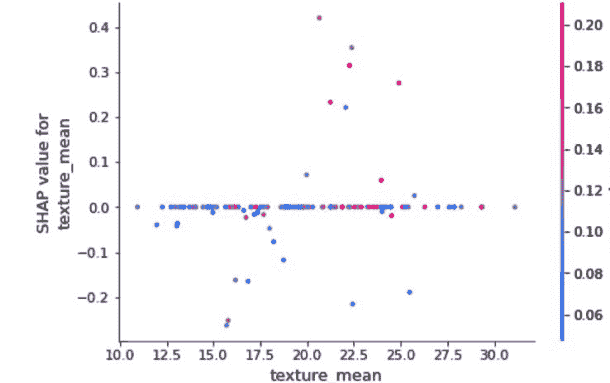

图 8.23 – 依赖性图

- 或者，在这种情况下，你可以指定不同的特征进行着色，例如 `texture_mean`：

```
shap.dependence_plot('radius_worst', shap_values, test_ndata, interaction_index="texture_mean")
```

图 8.24 显示了带有指定第二个特征的依赖性图：

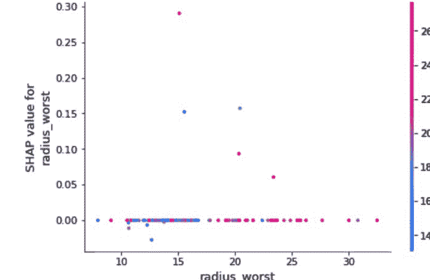

图 8.24 – 带指定第二个特征的依赖性图

`Kernel SHAP` 是通用的。因此，它广泛适用于解释各种机器学习模型的预测。然而，使用 `Kernel SHAP` 在大型数据集上计算 `Shapley` 值可能会非常耗时且计算密集。我们在示例中使用了样本设置（`samples` setting），作为限制每个预测 `SHAP` 评估次数的替代方案。

相比之下，`SageMaker Clarity`（https://aws.amazon.com/sagemaker/clarify/）通过并行 `SHAP` 计算显著提高了 `SHAP` 的运行速度并增强了可扩展性。请参考 `SageMaker Clarity`：云端机器学习偏差检测与可解释性（https://assets.amazon.science/45/76/b30bab4f14acbab96cfe8067ed2b4a/amazon-sagemaker-clarify-machine-learning-bias-detection-and-explainability-in-the-cloud.pdf），获取更多关于 `Amazon SageMaker Clarity` 实现 `Kernel SHAP` 的信息。

在本节中，你完成了一个构建和解释深度学习模型的完整流程，通过分类良性或恶性肿瘤来检测乳癌。下一节将深入探讨模型特定的可解释性。

## 审查模型特定的可解释性

与模型无关（agnostic）的技术不同，模型特定的 `XAI` 方法取决于模型类的选择，并要求理解模型的内部工作原理。因此，模型特定的方法适用于可继承模型或我们理解内部网络表示的情况。对底层模型结构获得洞察使我们能够通过演绎推理反向工程化原理，以证明模型所做决策性。

在提供对特定模型更深理解的同时，实现模型特定的 `XAI` 方法（如反向传播方法）涉及按反序重建模型，以展开内部逻辑和复杂性。本节将讨论一个使用集成梯度（`Guided IG`）的特定模型示例。

## 使用 Guided IG 解释显著性


集成梯度（IG）[https://arxiv.org/abs/1703.01365](https://arxiv.org/abs/1703.01365) 是一种通过计算模型预测的梯度来评估特征归因的 XAI 技术。IG 具有更好的可扩展性，且运行独立于网络内特征的数量。然而，IG 的速度慢于其他基于反向传播的方法，进行梯度评估需要 50 到 200 次反向传播。

Guided IG 是一种基于 IG 的针对深度学习模型的增强特征归因方法。Guided IG 通过引入自适应路径方法（APM）计算出与 IG 不同的积分路径，从而最小化不相关的归因。

本节涵盖了使用 Guided IG 的图像分类任务。示例笔记本 `chapter8_ipynb` 可在书籍 GitHub 仓库中获取：

1. 首先，使用提供的 `requirements` 文件安装所需的包：

```python
import sys
!{sys.executable} -m pip install -r requirements.txt
```

2. 加载必要的库：

```python
import numpy as np
import PIL.Image as Image
import matplotlib.pyplot as plt
import tensorflow.compat.v1 as tf
import tensorflow_hub as hub
import saliency.tfl as saliency
import os
from platform import python_version
import warnings
```

```python
warnings.filterwarnings("ignore")
os.environ["TF_CP_MIN_LOG_LEVEL"] = "3"
print(f'TensorFlow version: {tf.__version__}')
print(f'Python version: {python_version()}')')
%matplotlib inline
```

图 8.25 显示了此示例的包依赖关系：

TensorFlow version: 2.11.0

Python version: 3.9.10

图 8.25 – 包依赖关系

3. 加载示例图像和用于图像分类的预训练 InceptionV3 模型：

```python
IMAGE_SHAPE = (224, 224)
im = Image.open("gsdog.jpeg").resize(IMAGE_SHAPE)
im
```

## 模型特定的可解释性

图 8.26 显示了原始输入图像：


4. 下载预训练的 Inception V3 模型：

```python
classifier_model = "https://tfhub.dev/google/imagenet/
inception_v3/classification/3"
```

```python
classifier = tf.keras.Sequential([
    hub.KerasLayer(classifier_model,
    input_shape=IMAGE_SHAPE+(3,))
])
```

5. 将输入图像转换为 NumPy 数组并增加维度：

```python
im = np.array(im) / 255.0
```

6. 获取预测类别：

```python
result = classifier.predict(im[np.newaxis, ...])
predicted_class = np.argmax(result, axis=-1)
```

7. 读取 ImageNet 标签：

```python
labels_path = 'https://storage.googleapis.com/download/data/ImageNetLabels.txt'
with open(labels_path, "r") as file:
    labels = [line.strip() for line in file]
```

8. 查看顶部类别：

```python
class_name = labels[predicted_class]
print(f"Predicted class: {class_name}")
```

9. 创建显著性对象和黑色基准：

```python
graph = tf.Graph()
sess = tf.Session(graph=graph)
baseline = np.zeros(im.shape)
```

10. 计算 IG 和 Guided IG 的归因掩码：

```python
ig_mask_3d = ig.GetMask(im, feed_dict={neuron_selector: predicted_class}, x_steps=25, x_baseline=baseline)
guid_ig_mask_3d = guid_ig.GetMask(im, feed_dict={neuron_selector: predicted_class}, x_steps=25, x_baseline=baseline)
```

11. 将 3D 张量转换为 2D 灰度图：

```python
ig_grayscale = saliency.VisualizeImageGrayscale(ig_mask_3d)
```

```python
guided_ig_grayscale = saliency.VisualizeImageGrayscale(guid_ig_mask_3d)
```

12. 可视化并绘制 IG 和 Guided IG 的显著性图。我们可以看到 Guided IG 比 IG 噪声少：

```python
fig = plt.figure(figsize=(20, 20))
rows = 1
columns = 3
fig.add_subplot(rows, columns, 1)
plt.imshow(im)
plt.axis('off')
plt.title("Original Image", fontsize=24)

fig.add_subplot(rows, columns, 2)
plt.imshow(ig_grayscale, cmap="gray")
plt.axis('off')
plt.title("Integrated Gradients", fontsize=24)

fig.add_subplot(rows, columns, 3)
plt.imshow(guided_ig_grayscale, cmap="gray")
plt.axis('off')
plt.title("Guided Integrated Gradients", fontsize=24)
```

图 8.28 显示了 IG 和 Guided IG 的视觉对比：

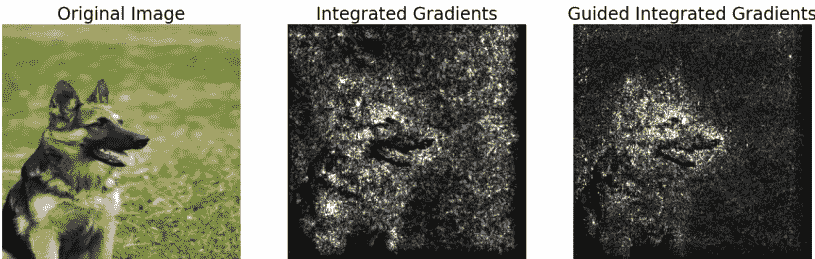

图 8.28 – IG 与 Guided IG 的对比

# 模型特定的可解释性

在本节中，你通过比较 IG（积分梯度）和 Guided IG（引导积分梯度）完成了对显著性技术的评估流程。传统上，反向传播方法通过评估对应于输入图像的梯度来识别像素归因，并使用特定神经网络中的加权梯度生成显著性图。IG 的路径从一条黑线开始，通过遵循所有像素以相同速率增加的方向最终到达输入图像，在此过程中捕捉了许多无关的像素。尽管 IG 检测到了大多数阻碍因素，但 Guided IG 表现出更少的噪声和更好的视觉显著性。

Guided IG 应用 APM（近似投影模型）对图像和模型的归因路径进行泛化，以创建符合预测类别的真实显著性图。通过选择性地过滤绝对值最低的模型子集，并将积分路径与输入、基准和模型进行适配，Guided IG 能够避免选择噪声信号。

在回顾了模型无关和模型特定的 XAI 示例后，你可能会疑惑应该选择哪种方法。接下来的章节提供了选择 XAI 方法的通用指南。

### 选择 XAI 方法

随着公众意识的转变和监管合规要求的提高，可解释性对于需要自动化决策的组织至关重要。论文 [https://arxiv.org/abs/2107.04427](https://arxiv.org/abs/2107.04427) 提出了一种包含以下属性的方法论，以弥合利益相关者需求与基于以人为中心的 AI 的解释性方法之间的差距：

- **解释方法属性：** XAI 应由兼容性属性、解释属性、方法和过程组成。属性是指决定 XAI 方法对于特定项目类型或用例可行性的元素。相比之下，解释属性必须定义解释的范围，包括语言类型和解释内容。此外，方法使用应提供有关如何通过过程属性使用 XAI 方法的信息，以识别产生解释的机制。

- **可解释性需求：** 识别正确的利益相关者并通过问卷捕捉利益相关者的需求至关重要，包括用例限制、功能性和非功能性需求。

- **信息收集：** 在确定利益相关者后，编制问卷列表以获取每项需求所需的详细信息。

- **利益相关者需求与解释方法属性匹配：** 在进行彻底的需求分析后，你应该整合 XAI 技术知识，并向利益相关者展示将解决的可解释性程度，以及现有 XAI 技术的已知局限性。

一旦明确了利益相关者的需求，下一步就是决定选择哪种 XAI 方法。通常，你应该确定 ML 模型的内部结构是否是可解释的且具有清晰的表示。例如，决策树比深度学习神经网络更具解释性。你可以通过提取决策规则并使用 Gini 纯度指标衡量决策划分质量来解释决策树，以识别潜在的分类错误。然而，决策树的复杂度随着终端节点数量的增加而增加。相反，神经网络将具有非线性数学运算的神经元层结合，使其难以解释。

图 8.29 总结了本章中涵盖的模型无关和模型特定的 XAI 方法，以及你应该如何考虑什么对你的用例最合适：

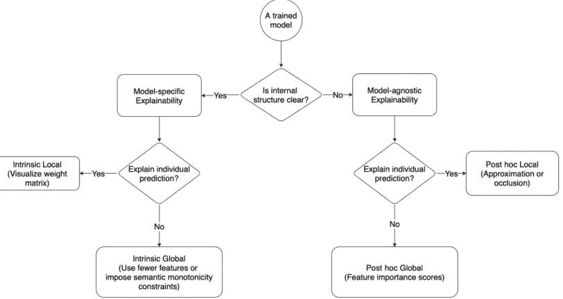

图 8.29 – 选择模型无关与模型特定的 XAI 方法

如之前的图所示，从训练模型开始，如果你可以获取内部结构（例如系数权重或集成树中使用的特征频率），则应该探索模型特定的框架以获得更好的解释性性能。否则，你应该评估模型无关的框架，因为它不依赖于内部模型结构，侧重于输入和输出之间的关联。随后，考虑可解释性的范围，即你是将为单个预测提供局部解释，还是为整个模型行为提供全局解释。

### 总结

对 AI 系统可解释性的关注不仅限于 XAI 技术的进步。相反，它涉及多学科的协作，以全面审查法律、伦理和社会问题。你应该意识到，这种指导对于全面审查至关重要。

# 可解释性方案

根据世界经济论坛 [https://www.weforum.org/agenda/2022/01/artificial-intelligence-ai-trust-survey/](https://www.weforum.org/agenda/2022/01/artificial-intelligence-ai-trust-survey/)，大约 60% 的人认为人工智能将改变他们的生活。相比之下，只有 50% 的人信任 AI 技术。通常，可解释 AI (XAI) 系统通过为单个实例生成解释来提供可解释性。美国国家标准与技术研究院 (NIST) 在其论文《可解释人工智能的原则》中识别了 XAI 的四个基本原则：

- **解释（Explanation）：** XAI 系统必须产生证据来证明机器学习输出的合理性。

- **有意义（Meaningful）：** XAI 系统产生的证据必须是目标观众可以理解的。

- **解释准确（Explanation accuracy）：** 证据展示了正确的推理。

- **知识限制（Knowledge limits）：** XAI 系统在设计边界内运行。

> Phillips, P., Hahn, C., Fontana, A., Yates, K., Greene, D. and Przybicki, M. (2021), Four Principles of Explainable Intelligence, NIST Interagency/Internal Report (NISTIR 8312), National Institute of Standards and Technology, Gaersburg, MD, [online], [https://doi.org/10.6028/NIST.IR.8312](https://doi.org/10.6028/NIST.IR.8312), [https://tsaps.nist.gov/publication/get_pdf.cfm?pub_id=93399](https://tsaps.nist.gov/publication/get_pdf.cfm?pub_id=93399)（访问日期略）。

因此，必须定义一个不减缓创新和采用的 AI 治理模型。目标是实现 AI 系统的最佳信任，避免人类与机器之间的信任。图 9.1 总结了 XAI 系统的关键设计考量。

| 用户 | XAI 目标 | 信息 | 基准 |
|---|---|---|---|
| 谁是目标观众？ | 解释什么？ | 如何解释？ | 如何评估解释？ |

图 9.1 - XAI 系统设计考量

到目前为止，你已经在书中学习并体验了各种 XAI 技术。在本章中，我们涵盖了基于 NIST 基本原则的以下评估方案，以衡量 XAI 系统的解释质量：

- 系统因果量表 (SCS)

- 探索归因方法 (BAM)

- 忠实度与单调性

- 人类引导的评估框架

在本章中，你将学习现有的 XAI 评估和基准格局，并对哪些方法适用于你的应用有一个初步了解。

### 系统因果量表 (SCS)

系统可用性量表 (SUS) 由 John Brooke 于 1986 年创建，提供了一种衡量系统界面可用性的简单工具。它由包含 10 个问题的问卷组成，提供 5 个选项，允许受访者从“非常同意”到“非常不同意”对产品和服务的质量进行评估。

受 SUS 启发的 SCS（见 [https://doi.org/10.1007/s13218-020-00636-z](https://doi.org/10.1007/s13218-020-00636-z)）专注于衡量 XAI 系统的定性方面。SCS 满足了 NIST 对有意义的原则，以确定最终用户对 XAI 系统提供的解释的感知。

### 探索基准归因方法 (BAM)

SCS 通过李克特量表问卷来评估 XAI 用户界面在向目标受众提供解释方面的有效性，涵盖以下范围：

- 给定的解释提供了具有相关粒度的因果因素

- 给定解释的上下文对用户来说是有意义的

- 用户可以调整所提供解释的粒度

- 用户需要指导来理解解释

- 用户在没有支持的情况下也能理解生成解释的因果关系

- 用户能够结合领域知识应用生成解释的能力

- XAI 系统产生一致的解释

- 用户认为生成的解释易于理解

- 用户需要参考资料或文档来解释生成的解释

- XAI 系统能够快速、高效地进行解释

SCS 旨在提供一种直观的方法，来评估 XAI 用户界面的有效性以及 SCS 提供的解释质量。与衡量 0 到 100 之间效用性的 SUS 分数不同，SCS 将得分归一化为百分比排名。假设 SCS 刻尺的分值范围在 1 到 5 分之间，分别对应*强烈不同意、不同意、同意和非常同意*评分。如果一个 XAI 系统满足所有 10 项要求，则给出 50 分的高分。例如，根据上述要求，如果一个 XAI 系统的变异值为 44，除以 50 得到归一化的 0.88 SCS 分。

SCS 的目的是提供一个快速的评估框架，基于终端用户来评估 XAI 界面的质量。SCS 的一个缺陷是，李克特量表遵循序数测量，每个响应类别之间的差异没有明确定义。假设响应类别之间的间隔是相等的可能是误导性的，并可能导致错误的结论。例如，“非常同意”与“同意”之间的情感响应幅度可能与其他连续类别（如“强烈不同意”和“不同意”）不同。此外，用户对解释质量的主观评分可能会误导解释在模拟任务中的有效性。

在学习了如何使用 SCS 从用户那里获得定性反馈后，下一节将探索使用基准归因方法识别假阳性解释的定量方法。

### 探索基准归因方法 (BAM)

尽管目前有多种特征归因 XAI 方法，由于缺乏地面事实数据（ground truth），要量化哪些输入对模型确实重要可能具有挑战性。仅依赖视觉评估在实际上可能是误导性的。对输入数据不敏感的梯度计算 XAI 方法无法为预期的目标输出产生相关的解释，这在机器学习任务（如异常检测）中可能是有害的。例如，研究表明，某些 XAI 方法无法展示真实的特征重要性，尽管对训练好的模型参数进行了排序，但仍会产生相同的视觉解释或显著性映射。对于 AI 辅助医疗诊断，当在随机化训练好的模型的数据和参数后，模型预测的解释没有发生变化时，这可能是存在风险且令人担忧的。

向目标受众提供假阳性解释是没有价值的。解决这一差距的常用方法涉及*人机回评估 (human-in-the-loop assessment)*来评估可解释性的质量，这对于大型数据集来说可能是昂贵的。因此，XAI 评估指标应该通过捕获假阳性来证明模型预测的合理性。

BAM，[https://doi.org/10.48550/arXiv.1907.09701](https://doi.org/10.48550/arXiv.1907.09701)，旨在解决假阳性解释问题。BAM 使用带有已知相对特征重要性的训练模型的半合成数据集来评估特征归因的准确性。BAM 的方法符合 NIST 关于解释准确性的 XAI 原则。

BAM 训练分类器以从输入图像检测目标对象类和背景场景。预期是，向输入图像添加无关像素不应影响模型预测预期目标对象或背景场景类的能力。

例如，如图 9.2 所示，一张随机包含鱼的沙漠输入图像，应该导致预期的目标背景场景为沙漠类。那些将鱼分配为背景场景类并赋予更高归因的解释应当是假阳性的。这种假阳性预测可能会误导目标受众，因为在这张输入图像中，鱼在语义上比沙漠更有意义。


图 9.2 – 包含随机对象的输入图像

BAM 使用以下指标评估特征归因方法：

- 模型对比分 (MCS)：在相同输入下，衡量两个模型之间的归因差异

- 输入依赖率 (IDR)：给同一个模型提供两个不同的输入，计算归因差异

- 输入依赖率 (IIR)：给同一个模型提供两个功能相似的输入，衡量归因差异

MCS 和 IDR 仅适用于 BAM 数据集，[https://github.com/google-research-datasets/bam](https://github.com/google-research-datasets/bam)，而 IIR 适用于所有模型和输入。根据 BAM 的观察，原生梯度下降和梯度权重类激活映射 (CAM) 不太产生假阳性。相比之下，引导反向传播 (guided backpropagation) 无论特征重要性如何变化似乎分配相同的属性。


正如第 7 章所述，基于扰动的方法通过评估从输入数据中移除一组预定义的高归因特征后模型性能的变化提供可解释性。与基于扰动的方法相反，`BAM` 通过识别不重要的特征（其预期归因为零）来评估忠实性（`faithfulness`）。`BAM` 对预定义特征不作假设。相反，`BAM` 的方法专注于通过调整在数据引入该特征的频率，评估该特征相对于两个不同模型的显著性。

到目前为止，本节回顾了 `BAM` 如何通过分析相对特征重要性来增强可解释性。接下来，让我们讨论忠实性和单调性的意义。

## 理解忠实性和单调性

`XAI` 中的忠实性是指评估特征重要性评分与单个特征在实际预测上的性能之间的相关性。衡量忠实性通常通过逐步移除预定义的重要特征、观察模型性能的变化并验证与模型预测的相关性来实现。换句话说，识别出的特征与模型输出真正相关吗？

除了特征重要性相关，研究人员还发现了诸如极性一致性等用于评估解释忠实性的额外属性，https://arxiv.org/abs/2201.12114.v2。机器学习中的极性指的是正负分析——例如，情感分析中的正面和负面短语。极性一致性通过衡量解释权重对模型预测的贡献和抑制影响来验证忠实性。

## 可解释性评估方案

评估忠实性符合 `NIST` 的 `XAI` 原则，评估 `XAI` 系统产生合理解释和发现知识局限的能力。如果识别出的重要特征对模型预测有贡献，则认为解释是忠实的。

图 9.3 是忠实性的韦恩图，包含了特征重要性相关性和极性一致性：

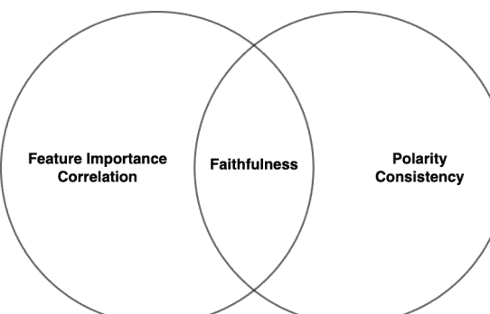

图 9.3 - 忠实性韦恩图

相比之下，`XAI` 中的单调性通过逐步添加预定义的重要特征来评估特征归因，以验证特征相关性。预期是随着重要特征的逐步添加，模型性能应该逐渐提高。图 9.4 对比了 `XAI` 评估中的忠实性与单调性：

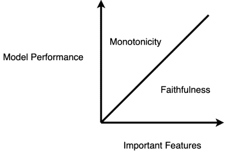

图 9.4 - 忠实性与单调性对比

图 9.5 展示了用于可视化量化解释忠实度（`faithfulness`）程度的各种指标：

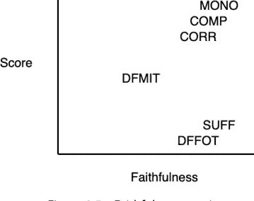

让我们了解每个忠实度指标代表什么以及它们在量化忠实度时的尺度：

- **决策翻转 – 最大信息量标记（`DFMIT`）：** 该指标衡量的是 0 到 1 之间的忠实度。得分为 1 表示解释是忠实的。如果解释能为模型的预测提供有效的推理，则认为它是忠实的。例如，在自然语言处理（`NLP`）中使用 `DFMIT` 衡量忠实度，是通过观察在从测试集中移除高重要标记后，模型决策翻转的平均百分比来实现的。

- **决策翻转 – 标记比例（`DFFOT`）：** 在这里，`DFFOT` 值越低，对解释的忠实度越高。与 `DFMIT` 类似，`DFFOT` 不是整体移除高重要标记，而是通过测量导致模型预测变化所需重要特征的最小比例或阈值，来观察决策翻转的百分比。

- **全面性（`COMP`）：** 该指标根据重要特征的表示和分布来衡量解释的忠实度。`COMP` 分数是根据移除重要特征导致输出概率的变化计算的。为了测试解释的全面性，可以创建一个对比示例并移除预测概率。原始预测概率与新预测概率之间的差异产生了 `COMP` 分数。`COMP` 分数越高，对解释的忠实度越高。

- **充分性（`SUFF`）：** 该指标通过评估重要特征是否包含足够的信息以保留原始预测来衡量忠实度。`SUFF` 通过评估特征对模型的持续重要性来增强 `COMP`。例如，从 `NLP` 分类器中移除一组已知影响力的标记或短语子集，应该会导致预测概率发生变化。`SUFF` 衡量该分类器的平均百分比变化，从保留前 5% 的已知重要特征开始，逐步增加，直到模型预测发生变化为止。`SUFF` 分数越低，说明解释越具有忠实度。

- **重要性与输出概率之间的相关性（`CORR`）：** 在这里，如果随着重要特征的逐步移除，特征重要性与预测概率呈正相关，则认为解释是忠实的。相关性越高，说明解释越具有忠实度。

- **单调性（`MONO`）：** 从空向量开始，观察逐步添加特征后分类概率的变化。如果预测类别的概率随着特征的添加而单调增加，则该解释是忠实的。单调性值越高，说明解释越具有忠实度。

我们已经涵盖了多种 `XAI` 指标，通过隔离模型特征的影响并观察模型相似性来评估忠实度。`XAI` 指标捕捉了关于解释如何提高模型可解释性以及用户对模型行为理解的直觉。选择合适的 `XAI` 指标对于确保模型具有合理理由的可信度至关重要。

接下来的章节将探索基于人类的评估框架（`human-grounded evaluation framework`）如何对 `ML` 生成的解释中的人类推理进行量化分析。

## 基于人类的评估框架

当解释能够让目标受众建立模型行为的心理表征并掌握推理过程时，它是实用且有用的。目标受众包括没有领域知识的终端用户和可以提供信息反馈的专家用户。

衡量人类模拟性（`human simulatability`）对于评估人类对 `ML` 行为的理解程度至关重要。人类模拟性有两种类型：

- **正向模拟（`Forward simulation`）：** 人类根据给定输入预测模型的输出。例如，要求用户根据特定的邮政编码估计房价。

- **反事实模拟（`Counterfactual simulation`）：** 在给定输入和输出的情况下，如果输入不同，人类预测模型的输出或做出因果判断。例如，要求用户预测如果飞机提前 20 分钟到达机场，他们是否会错过航班。

模拟终端用户的预测可以为基于不寻或无关特征的不准确模型预测提供见解。或者，用户可以与 `XAI` 系统交互，并通过问卷机制（如 `SCS Likert` 量表问卷）提供反馈，说明他们是否从 `XAI` 中获得了任何洞察。准确且有意义的 `XAI` 解释应该支持模型调试。专家用户（如数据科学家）可以就解释是否有助于发现差距并改进性能提供反馈。

基于人类的评估框架 https://doi.org/10.48550/arXiv.1801.0575 通过要求人类标注员标记图像并手动捕捉特定类别的特征来评估局部可解释性。该方法通过将加权解释图与真实的单层掩码进行比较，总结了人类对解释的平均表示。尽管基于人类的评估框架提供了对显著特征更细粒度的评估，但由于人类对某些特征的固有偏见，结果存在局限性。

## 总结

在这一章中回顾了 `XAI` 评估方案和基准指标后，你现在理解如何根据 `NIST` 的基本 `XAI` 原则分析解释的质量。

本章标志着本书的结束。感谢你与我一起探索各种 `XAI` 主题。我们学习了 `XAI` 在深度学习异常检测中的挑战、机会和意义。通过在书中整合理论与实践，你学习了在 `NLP`、时间序列和计算机视觉中检测异常的深度学习模型。你现在理解如何量化和评估模型可解释性，以满足合规性要求并减少公平性和伦理分析中的偏见。

## C

- `CAM`
- 参考链接 102
- `Cleanlab` 44
- `CNN` 架构
  - 卷积层 102
  - 全连接层 102
  - 池化层 102
- 集合异常 4
- 计算机视觉异常可解释性
  - 问题 104
  - 前提 103
  - 解决方案 104-119
- 上下异常 5
- 卷积神经网络（`CNNs`）125, 135
- 反事实模拟 188

## D

- `DeepExplain`
  - 参考链接 151
- 深度学习 23-25
  - 架构 24
- 深度学习异常检测
  - 挑战与基于预测的模型 25, 26
  - 针对时间序列，80
  - 混合模型 80
  - 基于重构的模型 80
- 深度学习异常检测
  - 生命周期 34
    - 业务问题阶段 34
    - 数据准备阶段 34
    - 可解释性阶段 35
    - 特征工程阶段 34
    - 模型部署阶段 35
    - 模型开发阶段 34
- 深度学习模型
  - 滑动窗口 80
  - 时间步 80
- 深度神经网络（`DNN`）126
- 深度视觉异常检测
  - 集成，结合 `XAI` 102

## E

- 心电图（`ECG`）5, 79
- 可解释性 31
  - 对比可解释性 31
- 可解释 AI 工具包（`XAITK`）29
  - `URL` 29
- 可解释人工智能（`XAI`）系统 181
- 解释人工智能（`XAI`）22
  - 作为多学科领域 29
  - 基础 24
  - 深度解释 29
  - 评估 29
  - 可解释性，对比可解释性 31
  - 未来状态 33
  - 实施 33-36
  - 可解释模型 29
  - 模型归纳 29
  - 动机 29, 30
  - 意义，回顾 36
  - 利益者需求，上下文化 32, 33
- 可解释人工智能（`XAI`）方法
  - 选择 178, 179
- 可解释人工智能（`XAI`）技术 136

## F

- 忠实度 185, 186
- 忠实度指标
  - 完整性（`COMP`）187
  - 重要性与输出概率的相关性（`CORR`）188
  - 决策翻转 - Token 比例（`FFOT`）187
  - 决策翻转 - 最信息 Token（`DFMIT`）187
  - 单调性（`MONO`）188
  - 充分性（`SUFF`）187
- 基于预测的模型 80
- 前向模拟 188

## H

- 人类引导评估框架 188, 189
  - 参考链接 189
- 混合模型 80

## I

- 图像级视觉异常检测
  - 示例 100, 101
  - 回顾 100, 101
- 过程中处理 `XAI` 技术 36
- 输入依赖率（`IDR`）185
- 输入独立率（`IIR`）185
- 物联网（`IoT`）21
- 可解释性 31
  - 对比可解释性 31
- 可解释机器学习 123
  - 内置全局可解释性 125
  - 内置可解释性 125
  - 对比事后可解释性 133
  - 内置局部可解释性 125, 126
- 入侵检测系统（`IDSs`）22

## G

- `GDPR` 条文示例，`XAI`
  - 第 12 条 37
  - 第 15 条 37
  - 第 22 条 37
- 通用数据保护条例（`GDPR`）26
- 广义线性模型（`GLMs`）
- 全局可解释性 30
- 梯度加权激活映射（`Grad-CAM`）188
  - 参考链接 103
- 图处理器（`GPUs`）25
- 引导反向传播 185
  - 使用 137
- 引导梯度（`Guided IG`）172
  - 显著性，解释 173-178

## K

- `Keras` 154
- `Kernel SHAP` 155, 172
- `K` 近邻（`KNN`）8, 100
- 知识蒸馏 125

## L

- 绝对收缩选择算子（`LASSO`）
- 局部可解释性 30
- 局部模型无关解释（`LIME`）141-155
  - `LimeExplainer` 141
  - `LimeTabular` 141
  - `LimeTextExplainer` 142
- `LSTM`
  - 创建时间序列异常检测 81-96

## M

- 机器学习（`ML`）130
- 磁共振成像（`MRI`）24
- 平均绝对误差（`MAE`）87
- 模型准确率，对比可解释性 30
- 全可解释模型 30
- 模型无关可解释性回顾 154, 155
- 模型无关 `XAI` 方法 154
- 模型特定 `XAI` 方法 172
- 对比分数（`MCS`）185
- 单调性 186
- 多语言语言理解（`NLU`）73
- 多变量时间序列 78
- `MXNet` 154

## N

- 美国标准与技术研究院（`NIST`）181
- 美国海洋和大气管理局（`NOAA`）23
- 自然语言处理（`NLP`）30, 45, 187
- 神经机器翻译（`NMT`）23
- 网络 23
- 纽约证券交易所（`NYSE`）23
- `NLP` 异常可解释性问题 56-72
- 异常基准（`NAB`）参考链接 96
- 单类分类（`OCC`）101
- 单类卷积神经网络（`OC-CNN`）101

## P

- `pandas` 154
- `Pillow` 154
- 点异常 41
- 扰动可解释性 `LIME` 141-150
- 扰动 `XAI` 对比反向传播 `XAI` 151
- 像素级视觉异常检测回顾 101
- 极性 185

## R

- 现实世界案例 125
  - 发现 12
  - 减少环境影响 23
  - 财务策略建议 23
  - 欺诈检测 1–21
  - 周期性波动 79
  - 工业维护预测 21
  - 医学状况诊断 22
- 深度学习异常检测 79, 80
  - 异规则变化 79
  - 基于重构的模型 80
  - 异常检测 81-96
- 兴趣区域（`ROI`）133, 140
- 投资回报（`ROI`）39
- 测量 78
  - 多变量时间序列 78
  - 季节性变化 79
  - 长期趋势 79
  - 单变量时间序列 78

## S

- 显著性 154
  - 解释，使用引导梯度 173–178
- 显著性图 137–141
  - 特征建模 101
- `Scikit-learn` 154
  - 图像重构 101
- 语义单调性约束 125
- 半监督异常检测 24
- `Shapley` 加性解释（`SHAP`）44, 154
- `Shapley` 值 155
- 稀疏性 125
- 利益者需求，上下文化 32

## U

- 单变量时间序列 78
- 无监督异常检测 24
- 无监督像素级方法

## V

- 基础梯度下降 185
- 视觉异常评估
  - 图像级 100
  - 像素级 100
- 视觉异常检测
  - 图像级视觉异常检测回顾 100
  - 像素级视觉异常检测回顾 101
  - 回顾 100
- 考虑解释权 36, 37
- 社会影响 37, 38

## XAI 利益者画像

- 审计师 32
- 数据科学家 32
- 终端用户 32
- 行业专家 32
- 研究科学家 32

## XAI 技术

- 数据模态，识别 39
- 可解释性范围，分析 39
- 选择 39, 40
- 利益者，分析 39
- 成功标准，确定 40
- `XAI` 算法，选择 40

## W

- 世界经济论坛参考链接 38

## X

- `XAI`。参见可解释人工智能（`XAI`）
- 深度视觉异常检测，集成 102
- 用于 `ML` 模型构建的 `XAI` 方法
  - 示例 35, 36
  - 过程中处理 `XAI` 技术 36
  - 后处理 `XAI` 技术 36
  - 预处理 `XAI` 技术 36

## XAI 动机

- 业务利益 29
- 模型调试 29
- 监管合规性 29
- 社会信任 29
- 用户利益 29

## XAI 意义

- 业务风险，缓解 39
- 回顾 36

## T

- `t` 分布随机嵌入（`t-SNE`）55
- `TensorFlow` 154
- 预测器 46
- 时间序列，77, 78
  - 异常检测问题 81
  - 组件 79
  - 索引 195
- 监督异常检测 24
- 事后全局可解释性 126
- 事后局部可解释性 123, 126
- 事后局部可解释性 126-133
- 后处理 `XAI` 技术 36
- 预处理 `XAI` 技术 36
- 系统因果量表（`SCS`）182
- 系统可用性量表（`SUS`）182

# 你可能喜欢的其他书籍

如果你喜欢这本书，你可能对 `Packt` 出版的其他书籍感兴趣：

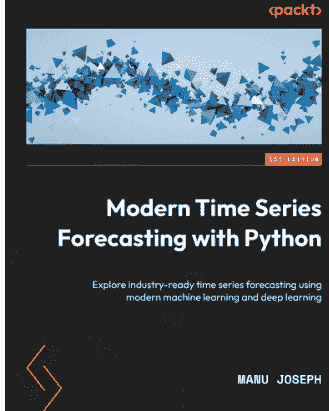

# Python 现代时间序列预测

`Manu Joseph`

`ISBN: 9781803246802`

- 学习如何像专业人士一样操纵和可视化时间序列数据
- 使用 `ARIMA` 等流行模型建立强大的基准
- 探索如何将时间序列预测转化为回归问题
- 为预测的机器学习模型进行特征工程
- 探索集成（`Ensembling`）和堆叠（`Stacking`）等模型的迷人世界
- 掌握全局预测范式
- 理解并应用如 `N-BEATS` 和 `Autoformer` 等先进深度学习模型
- 探索多步预测和交叉验证策略

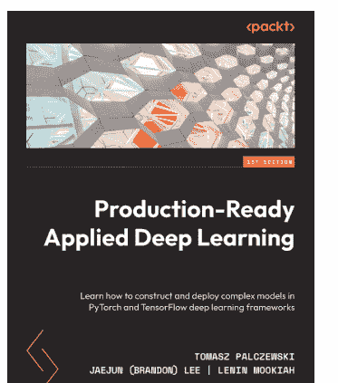

# 生产就绪的实用深度学习

`Tomasz Palczewski`, `Jaejeun (Brandon) Lee`, `Lenin Mookiah`

`ISBN: 9781803243665`

- 了解如何使用 `PyTorch` 和 `TensorFlow` 开发深度学习模型
- 将概念验证模型转换为生产就绪的应用
- 探索如何使用 `AWS` 高效地构建深度学习流水线
- 探索针对不同部署要求的模型压缩
- 开发在移动设备上运行深度学习的 `Android` 和 `iOS` 应用
- 监控生产环境中带有深度学习模型的系统
- 为开发和部署模型选择正确的系统架构
