# 深度学习在医学图像分割中的应用：概述、方法与挑战


- 索引 285

## 致谢

完成 *医学图像分割深度学习应用* 之旅充满协作，我们对所有为此工作做出重大贡献的人表示由衷感激。

首先，我们向撰稿作者表示诚挚的感谢。他们的奉献、专业知识和辛勤工作是本书的基础。他们富有见解的章节丰富了本书，使其成为医学图像分割领域的全面资源。

我们也感谢审稿人，他们宝贵的反馈和建设性建议在完善内容方面起到了关键作用。他们的关键见解确保了最高质量标准，他们的贡献不胜感激。

最后，我们感谢家人和朋友在本书编写过程中给予的坚定支持与鼓励。他们的理解与耐心是我们力量和动力的源泉。

## 贡献者名单

- 扎卡里亚·C·亚历克
  电子工程学院
  VIT 大学
  维洛尔
  印度

- 热朱尔·卡里姆·巴布伊亚
  教育技术中央研究所 (CIET)
  国家教育研究和培训委员会 (NCERT)
  新德里
  印度

- 塔伊拉·安德拉比
  计算机科学系
  克什米尔大学
  斯利那加
  查谟和克什米尔
  印度

- 萨吉德·尤素夫·巴特
  计算机科学系
  克什米尔大学
  斯利那加
  查谟和克什米尔
  印度

- 穆达西尔·阿什拉夫
  计算机科学与信息技术学院
  大众大学
  加利福尼亚州
  美国

- 罗尚·伯傑斯
  电气、计算机和软件工程系
  工程学院
  奥克兰大学
  奥克兰
  新西兰

- 丽塔·巴尼克
  电气工程系
  特里普拉 ICFAI 大学
  卡马尔加特
  西特里普拉
  印度

- 安库尔·比斯瓦斯
  计算机科学与工程系
  特里普拉理工学院
  纳辛加尔
  西特里普拉
  印度

- 艾扎兹·米尔
  计算机科学系
  克什米尔大学
  斯利那加
  查谟和克什米尔
  印度

- 曼祖尔·查丘
  计算机科学系
  克什米尔大学
  斯利那加
  查谟和克什米尔
  印度

- 苏海尔·卡迪尔·米尔
  信息学与计算机系统系
  卡立德国王大学
  阿布哈
  沙特阿拉伯

- 阿努帕玛·钱德拉谢赫兰
  放射学系
  斯里拉马钱德拉大学
  金奈
  印度

- 查扬·保罗
  计算机科学与工程系
  斯瓦米·维韦卡南达大学
  巴拉克普尔
  西孟加拉邦
  印度

- 谢利·N·德维
  生物医学工程系
  卡拉萨林姆研究与教育学院
  斯里维利普图尔

- 亚西娅·雷赫曼
  计算机科学系
  克什米尔大学
  斯利那加
  查谟和克什米尔
  印度

- 瓦尼·马拉加尔
  工程与技术模型学院
  计算机科学与工程系
  詹穆
  印度

- 卢布纳·里亚兹
  计算机科学系
  克什米尔大学
  斯利那加
  查谟和克什米尔
  印度

- 梅赫拉·沙尔玛
  工程与技术模型学院
  计算机科学与工程系
  詹穆
  印度

- V. K. 桑达拉拉曼
  独立顾问
  MR 成像及前兼职教授
  VIT 大学
  维洛尔
  印度

- 伊什法克·谢赫
  计算机科学系
  克什米尔大学
  斯利那加
  查谟和克什米尔
  印度

- 纳维恩·马尼·乌帕迪亚伊
  工程与技术模型学院
  计算机科学与工程系
  詹穆
  印度

- 比斯玛·苏丹
  计算机科学系
  克什米尔大学
  斯利那加
  查谟和克什米尔
  印度

- 玛吉德·扎曼
  科学家 D
  克什米尔大学
  查谟和克什米尔
  印度

## 前言

医学图像分割领域在过去十年中取得了巨大进步，这主要得益于深度学习技术的快速发展。这些进步使医学界在图像分析中达到曾被认为不可能的精度和效率水平。认识到这些技术的深远影响，我们着手创建一份全面的资源，它既可以作为该领域的入门指南，也可以作为最新研究和技术的指南。

*医学图像分割深度学习应用*的构思旨在让读者深入了解深度学习如何革新我们处理医学图像分割的方式。本书汇集了该领域专家的贡献，每位专家都就深度学习及其在医学影像中的应用的各个方面提供了独特见解。

本书的组织旨在引导读者从基础概念进入高级技术。它首先介绍医学图像分割的基础知识，包括关键数据集、数据增强方法和评估指标。随着读者深入，他们将遇到关于传统分割方法的讨论，这些内容提供了历史背景，凸显了导致当前最先进的深度学习模型的方法论演变。

在随后的章节中，本书深入探讨了深度学习在医学影像中的具体应用，涵盖脑肿瘤分割、视网膜血管分割和糖尿病视网膜病变早期检测等关键领域。这些章节不仅探讨了所采用的技术，还解决了研究人员在这些专业领域面临的挑战和局限性。

本书还涵盖了前沿话题，例如使用生成对抗网络 (GANs) 进行图像分割以及用于细胞图像分割的协作模型。通过包含这些高级主题，我们旨在为读者提供关于医学图像分割未来的前瞻性视角。


我们相信这本书将成为广大读者（包括研究人员、从业者和学生）的宝贵资源。它旨在为读者提供所需的理论知识和实践洞察，以应对医学图像分割快速发展的领域。我们希望这本书能激发该重要领域的进一步研究和创新，最终为改善医疗保健结果做出贡献。

作为编辑，我们对撰稿作者、评审人员以及所有支持本项目的人员深表感谢。他们的专业知识、奉献精神和协作精神对本书的问世起到了关键作用。我们相信读者会发现这本书是一个信息丰富且富有收获的资源，有助于他们的专业发展和研究工作。

## Introduction

医学图像分割是医学成像领域的关键组成部分，能够实现对解剖结构和异常的精确识别与分析。随着成像技术的指数级增长和大量医学数据集的可用性，对准确、高效且自动化的分割方法的需求从未如此迫切。深度学习作为人工智能的一个子集，已成为一种变革性方法，在处理和解释复杂医学图像方面提供了前所未有的能力。

本书《医学图像分割中的深度学习应用》旨在全面深入地探讨深度学习模型如何正在革新这一领域。通过汇集最新的研究、方法和实际应用，它为寻求了解使用深度学习架构进行医学图像分割的挑战和进步的读者提供了一站式资源。

本书首先对医学图像分割进行基础概述，讨论各种成像模态、基准数据集、数据增强技术以及开发稳健分割模型所必需的评估指标。随后，它深入探讨了为现代技术奠定基础的历史背景和传统方法，为该领域的演变提供了宝贵的见解。

后续章节着重介绍深度学习模型在医学成像特定领域的应用，包括脑肿瘤分割、视网膜血管分割、内耳分割以及糖尿病视网膜病变的早期检测。每个章节对这些专业领域的方法、挑战和未来方向进行了深入考察，突出了深度学习在改善患者预后方面的实际影响。

本书还探讨了生成对抗网络（GANs）在医学图像分割中的应用、用于细胞图像分割的协作模型，以及研究人员在这个快速发展领域面临的持续挑战等高级主题。最后几章提供了前瞻性视角，讨论了深度学习在医学成像中的未来前景以及为充分实现其潜力必须克服的潜在障碍。

通过这种全面的方法，《医学图像分割中的深度学习应用》为读者提供了在这个动态领域中导航和做出贡献所需的知识和工具。无论您是研究人员、从业者还是学生，本书都提供了关于将深度学习应用于医学科学中最具挑战性和影响力的领域之一的宝贵见解。

## 1 Introduction to Medical Image Segmentation: Overview of Modalities, Benchmark Datasets, Data Augmentation Techniques, and Evaluation Metrics

医学图像分割简介：模态、基准数据集、数据增强技术和评估指标概述

Aasia Rehman^1 and Suhail Qadir Mir^2

^1Department of Computer Science, University of Kashmir, Srinagar, Jammu and Kashmir, India
^2Department of Informatics and Computer Systems, King Khalid University, Abha, Saudi Arabia

### 1.1 Introduction

### 1.1 引言

医学图像分析是监测疾病临床进展及患者对某种治疗反应的重要组成部分，从而有助于进一步制定患者治疗方案。医学成像加速了多种疾病的诊断和治疗。通常有多种不同的医学成像模态，利用不同的技术为各种目的生成图像。图 1.1 展示了不同医学图像的示例。在当今的临床实践中，X射线、计算机断层扫描（CT）、磁共振成像（MRI）和超声（US）等成像模态被广泛使用。这些医学图像要么检查多个器官（例如 MRI 和 CT），要么针对特定器官（例如视网膜图像、乳腺X线摄影、皮肤镜检查和结肠镜检查）。每种模态产生的数据量也有所不同（Shen et al. 2017）。每种成像模态为各种应用和诊断目标提供了独特的优势，同时也存在揭示人体许多器官内部结构和功能的局限性。X射线、CT、MRI、US、皮肤镜检查、结肠镜检查、显微图像和光学相干断层扫描（OCT）只是本章将讨论的最广泛使用的医学成像模态的一些示例。此外，我们还将讨论它们的基本工作原理及其用途。

#### 1.1.1 X-Rays

#### 1.1.1 X射线

在医学领域，X射线成像用于生成骨骼等内部解剖结构的详细图像，以帮助诊断过程。

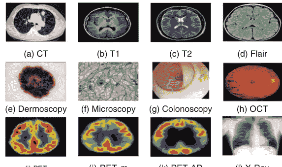

图 1.1 不同的医学成像模态。

X射线被归类为电磁波，能够穿透包括人体在内的各种固体物体。在常见的成像模态中，X射线经常被用来可视化人体内部结构。该过程涉及将一束聚焦的X射线导向体内特定的感兴趣区域。X射线穿过人体后，会被诸如胶片或数字传感器等灵敏探测器捕获。人体内的不同组织与X射线的相互作用不同；较软的组织（如肌肉和器官）吸收的X射线较少，导致成像图像上呈现较深的色调，而较密的组织（如骨骼）吸收更多的X射线，在图像上表现为白色区域。要产生清晰图像，必须使用适当剂量的辐射，且身体部位必须相对于X射线束处于理想位置。为了更准确地描绘人体三维（3D）结构，会从不同角度获取同一位置的多幅图像并叠加，以创建二维（2D）图像。放射科医生是专门的医学从业者，专注于通过解读图像中的视觉信息来诊断骨折、癌症和其他疾病等各种情况。X射线是在抽空的玻璃管中产生的电磁辐射。阴极和阳极产生电压间隙，使电子穿过管内的真空并朝向旋转的钨靶。当电子撞击阳极时，会产生X射线和热量。只有在阴极和阳极之间施加电压差时才会产生X射线，因此直到被医学放射技师激活之前，X射线管都是惰性的。X射线、CT、荧光透视和血管造影都是采用这种物理开/关设置的成像类型。X射线通常用于拍摄骨骼图像，主要用于评估骨折或其他异常。此外，牙医和正畸医生使用X射线来获取牙齿的详细视图。此外，X射线在检测骨骼肿瘤或异常方面发挥着重要作用。它们也用于手术期间引导外科医生。在乳腺X线摄影期间获取乳房X射线图像，以发现和评估肿瘤或微钙化等异常。由于它可以在体检触摸到之前发现可能的癌症信号，因此它是乳腺癌早期识别和预防的关键工具。X射线不仅用于成像骨骼，还用于成像胸部和肺部，以诊断肺炎、肺癌和肺气肿等疾病。除了检测胆结石、肾结石和肠梗阻外，X射线成像还可以用于评估肝脏、脾脏和肾脏等腹部器官。图 1.11 展示了胸部X射线的示例。由于其广泛的可及性、速度和经济性，X射线成像是一种广受欢迎的诊断方法。它是一种非侵入性操作，无需切口或注射，从而为患者提供相对安全舒适的体验。低组织对比度是X射线成像的缺点之一。与其他模态相比，区分恶性组织和健康组织更加困难。X射线成像的另一个缺点是只提供人体三维结构的二维图像，这可能使得无法看到某些内部结构，尤其是在难以到达的位置。二维图像缺乏深度可能会遮挡内部结构的一些方面，使准确诊断更加困难。

#### 1.1.2 Computed Tomography (CT)

#### 1.1.2 计算机断层扫描（CT）

CT扫描，或计算机断层扫描，通过结合X射线和计算机技术来生成人体内部结构的精细图像。与传统X射线不同，CT扫描产生断层图像，提供身体的不同视角。这些扫描是非侵入性的，确保患者无痛体验。通过从不同角度向人体照射X射线，并使用探测器测量X射线穿过人体时的强度，CT扫描可以提供内部解剖结构的高分辨率图像。CT扫描使用多层探测器，这是一种专用的X射线探测器，可以同时从不同角度采集多幅图像，以提供身体的详细断层视图。空间滤波（可降低噪声并增强对比度）和多能成像（利用不同能量的X射线记录不同数据并增强对比度）是CT扫描中用于提高图像质量的另外两种方法。得益于计算机处理，CT扫描产生的图像可以以多种格式查看，包括断层切片、3D图像甚至虚拟现实图像。放射技师进行CT扫描，而放射科医生（接受过图像解读训练的医学专家）则负责图像解读。


结果。使用CT扫描仪时，患者将躺在一张桌子上，桌子会移动到一个形状像甜甜圈的机器中央。扫描仪内部的X射线管在绕患者旋转时，以不同角度产生一连串X射线束。X射线光在穿过人体时会形成衰减模式，因为它被不同组织以不同速率吸收。位于X射线管对侧的一系列探测器接收衰减X射线的模式，并将其转换为电信号。这些电信号的数据随后被传输到计算机，计算机使用复杂算法将信息重新组装成3D图像。CT扫描用于增强对软组织和传统X射线可能无法清晰定义的图像复杂区域的检查。它们常用于可视化和评估血管、内部器官、骨骼、大脑、颈部、脊柱和胸部。CT扫描帮助医疗专业人员完成各种诊断任务，包括肿瘤检测、骨折评估以及监测癌症治疗对患者的影响。

图 1.1a 展示了肺部CT扫描的一个示例。CT成像的高分辨率是一大优势，因为它使医生能够看到骨骼结构、器官功能和血管结构等解剖细节。这使其对诊断多种疾病非常有用。除了作为诊断工具的实用性外，CT成像技术在医院、诊所和医生办公室等场所也普遍可用。此外，CT成像快速高效，数据通常在短时间内即可获得。电离辐射暴露是CT成像的一个关键问题，因为它可能增加癌症和其他健康问题的风险，尤其是在重复扫描或孕妇中。CT扫描仪也代表一笔巨大的资金投入，有些医院可能负担不起。因此，有些患者可能无法接受这种成像检查。必须仔细权衡CT扫描的优缺点，并在可能时考虑其他成像方法。

#### 1.1.3 磁共振成像 (MRI)

MRI，即磁共振成像，与CT扫描有相似之处，但提供更高质量，能够生成身体结构的详细横断面图像。与CT扫描类似，MRI无痛且安全，因为磁场和射频波对患者不会产生任何不良影响。MRI利用强大的磁场使体内氢原子核对齐，从而能够生成内部结构的精确图像。这会产生一个微小的磁矩，可以利用它来提供人体内部解剖结构的准确表征。首先，得益于射频（RF）脉冲的使用，重排后的氢原子核会发出微弱的无线电信号。探测器接收这些信号，经过计算机分析后，我们就能得到人体内部运作的清晰图像。

当患者进入MRI机器并置于强大磁场中时，患者体内的氢原子会被重新排列。然后，无线电波穿过人体后，排列好的氢原子会产生微弱的无线电信号。天线接收无线电波，信息被传输到计算机进行处理。数据经过复杂算法处理，以生成人体内部解剖结构的3D模型。氢原子存在于体内每一个细胞中，其浓度因组织类型而异。MRI可以生成轴位、矢状位和冠状位图像，从而提供患者解剖结构的完整3D图像。

MRI用于观察大脑、脊髓、骨骼、心脏、血管以及各种其他内部身体结构的内部组成。图 1.1b–d 分别展示了MR T1加权、T2加权和Flair的示例。MRI因避免对患者造成有害电离辐射暴露，而优于X射线和CT扫描等替代成像方法。这些仪器也能以极高细节显示软组织，包括肌肉、肌腱和韧带。它们可以在不同平面上提供图像，从而更全面地展示内部结构。除了其他优点外，MRI在不造成任何损伤或不适的情况下提供微观分辨率的能力，是一个主要卖点。不过，MRI扫描仪对金属敏感；因此，携带特定植入物（如起搏器）的个人不适合接受MRI扫描。

由于成本高昂，扫描仪可能是一笔可观的投资，使得一些机构负担不起。与X射线或CT扫描相比，检查时间也可能更长。

#### 1.1.4 正电子发射断层扫描 (PET)

PET扫描能生成人体内部部位的3D图像。医生使用PET扫描来观察和定量体内发生的代谢和功能活动。在医学领域，它常被用于检测、分类和跟踪广泛的病症，包括癌症和神经系统疾病。PET扫描的工作原理是寻找释放正电子的放射性示踪剂。这些放射性示踪剂是注入体内并发射正电子（带正电粒子）的物质。当体内的正电子与电子相遇时，两者会相互湮灭，产生两个向相反方向传播的伽马射线。PET扫描仪识别这些伽马射线，并利用它们构建显示体内放射性示踪剂分布的3D图像。PET扫描在肿瘤学中广泛应用，用于评估肿瘤生长、评价治疗反应和检测转移。PET扫描用途多样，尤其在生成高分辨率脑部图像和预测癌症进展方面。

它们通常用于已确诊癌症的患者，因为PET扫描可以准确显示癌症扩散的范围并评估化疗效果。此外，PET扫描有助于涉及大脑或心脏的手术术前规划。而且，阿尔茨海默病、癫痫和帕金森病等病症可以使用PET扫描进行诊断，因为它们能清晰展示大脑功能的变化。图 1.1i–k 分别展示了正常、轻度认知障碍和阿尔茨海默病的PET扫描示例。PET扫描可以在其他成像技术显示结构异常之前，检测组织中的功能和代谢变化。PET扫描可以对整个身体进行全面评估，从而同时检测转移性疾病或评估多个器官系统。与其他成像技术不同，PET扫描提供关于体内发生的生理和生化过程的信息，从而更好地理解疾病机制。PET扫描涉及使用放射性物质，这会使患者暴露于少量电离辐射之下。虽然辐射剂量通常被认为是安全的，但这仍是一个需要考虑的因素，尤其是对孕妇和儿童。由于其空间分辨率可能不如CT或MRI等其他成像形式，因此在PET扫描上难以准确定位微小病灶。PET扫描可能比其他成像技术更昂贵，主要是因为放射性示踪剂的生产和给药，以及扫描和图像分析所需的专用设备。PET扫描仪不像其他成像模态那样广泛可用，这可能会限制某些地区对该技术的获取。需要注意的是，PET扫描通常与其他成像模态联合使用，以对患者病情进行更全面的评估。使用PET扫描的决定由医生根据具体临床场景以及潜在收益是否超过该程序相关的风险和成本来做出。

#### 1.1.5 超声 (US) 图像

超声（US），也称为超声图，利用高频波来显示内部身体结构。在这种医学成像技术中，换能器发射高频声波，并捕捉来自内部结构的回波以生成图像。传入体内的一些声波在穿过分隔各种组织类型的界面时，会反射回换能器。换能器接收这些回波，将其转换为电信号，并传输到计算机进行分析，从而生成人体内部结构的高分辨率图像。深度信息是通过测量发射的超声波与 the

样本各层反射的波，从而能够创建 2D 或 3D 图像。超声常用于监测胎儿的生长，提供实时成像。它通常不适合用于成像骨骼或含气组织（如肺），但在腹部、血管和甲状腺检查中应用广泛。在腹部成像中，超声通常用于检查消化系统器官，包括胆囊、胰腺、脾脏和肾脏。作为一种医学成像技术，超声具有许多优点。设备的便携性使得超声成像操作可以在任何地方进行，而不仅限于医院。此外，使用超声具有速度快和无辐射成像的优点。由于它不使用可能有害的电离辐射，因此也优于 X 光和 CT 扫描等其他成像方法。能够产生实时图像的功能还能够对内部结构和功能进行动态评估。然而，超声成像也存在许多缺点。无法成像表面下方或不透明介质（如骨骼或气体）后面的结构是一个主要缺点。骨骼或气体回声等伪影会进一步扭曲图像，使内部结构难以分辨。超声图像和诊断的精度也可能受超声技师技术水平的影响。

#### 1.1.6 结肠镜检查

虚拟结肠镜检查（也称为 CT 结肠镜）允许医务人员检查大肠，以查找结肠癌或直肠癌，以及称为息肉的生长物，一项研究（Nguyen and Lee 2019）已证明这一点。

结肠镜检查的原理是将结肠镜插入直肠并通过结肠。

结肠镜是一根长而柔软的管子，末端配备光源和摄像头。

它允许医生实时观察结肠内壁，并检测息肉、溃疡、炎症或肿瘤等任何异常。

在操作过程中，如有必要，医生还可以进行治疗干预，例如息肉切除或组织活检。

图 1.1g 展示了结肠镜检查的示例。

结肠镜检查是一种有效的诊断工具，用于识别结直肠癌、炎症性肠病（如溃疡性结肠炎和克罗恩病）以及其他影响结肠和直肠的疾病。

结肠镜检查允许检测和切除息肉，息肉是可能随时间发展成癌症的异常生长物。

结肠镜检查对结直肠癌和其他胃肠道（GI）疾病具有较高的诊断准确性，有助于指导制定适当的治疗方案。

结肠镜检查是一种侵入性操作，需要将柔性管插入直肠和结肠，可能会给患者带来不适或疼痛。

与医疗专业人员讨论结肠镜检查的风险、益处和替代方案非常重要，以便根据个人情况和病史就该操作做出知情决定。

#### 1.1.7 皮肤镜检查

皮肤镜检查是一种用于评估皮肤病变的无创成像技术。

它也称为皮肤镜检查或表面显微镜检查。

该过程包括使用皮肤镜检查皮肤，皮肤镜是一种配备放大镜片和照明装置的便携式仪器。

皮肤镜检查使皮肤科医生能够观察到肉眼不可见的皮肤结构和图案，从而协助识别和治疗各种皮肤疾病，尤其是黑色素瘤及其他形式的皮肤癌。

皮肤镜检查的原理是利用偏振光或非偏振光照亮皮肤，并放大表面及表面下特征。

皮肤镜消除了皮肤的表面反射，从而能够更清晰地观察深层组织。

皮肤镜检查还采用液体浸润或接触式皮肤镜检查，即在皮肤上涂抹凝胶或油，以消除皮肤镜与皮肤之间的气隙，进一步提高图像质量。

皮肤镜检查在早期发现黑色素瘤（最致命的皮肤癌形式）方面发挥着至关重要的作用。

它帮助皮肤科医生评估色素性皮肤病变的形态学特征，并区分良性病变和恶性病变。

它有助于区分不同类型的皮肤病变，并指导制定适当的治疗方案。

图 1.1e 展示了皮肤病变的示例。

皮肤镜检查可用于长期监测皮肤病变的变化，特别是在有皮肤癌病史或非典型痣的个体中。

它有助于识别任何进展或退缩的迹象，从而帮助进一步管理的决策过程。

皮肤镜检查提高了皮肤病变的诊断准确性，尤其是在区分良性病变和恶性病变方面。

皮肤镜检查是一种无创操作，不需要任何切口或组织采样。

它可以在门诊环境中快速且轻松地进行。

皮肤镜检查可以减少对良性病变不必要的活检需求，从而节省医疗资源。

所使用皮肤镜的质量和功能会影响皮肤镜图像的准确性和可靠性。

配备适当放大倍率和照明的高质量设备对于获得最佳结果至关重要。

#### 1.1.8 显微图像

显微成像是指使用显微镜对微观水平的物体进行可视化和检查的过程。

这涉及对肉眼无法看到的微小物体进行放大，从而能够详细检查其结构和特征。

科学和医学高度依赖显微成像来完成各种目的，包括对微小材料、生物体和其他标本的研究、诊断和分析。

显微成像的原理基于光或电子与被观察样品之间的相互作用。

用于成像的显微镜有不同类型，包括光学显微镜和电子显微镜。

组织样本通常通过活检获得以供检查，随后对小块组织进行染色以显示细胞特征。

使用对照染色剂来增强图像的颜色、可见性和对比度。

此类图像通常用于癌症鉴定，通常会仔细审查细胞大小、形状和分布等特征。

图 1.1f 展示了显微图像的示例。

显微成像在医学诊断和病理学中至关重要。

它允许检查活检样本、识别细胞异常，并诊断各种疾病和状况。

显微成像技术（如光学显微镜）允许对样品进行无损检查。

这意味着可以在不改变样品结构或成分的情况下对其进行观察，从而实现进一步的分析或实验。

先进的显微成像设备（如电子显微镜）的采购和维护成本可能较高。

每种显微成像技术在分辨率、景深和对比度方面都有其特定的局限性。

为特定应用选择合适的成像技术对于获得准确可靠的结果至关重要。

#### 1.1.9 光学相干断层扫描（OCT）

OCT 是一种无创成像方法，利用光波生成生物组织的详细断面图像。

OCT 的原理基于光波的干涉。

该技术采用低相干干涉测量法，其中光源发射的近红外光束被分为两条路径：参考臂和样品臂。

参考臂包含一面镜子，而样品臂将光导向受检组织。

来自两条路径的反射光被重新组合，参考光束和样品光束之间发生干涉。

干涉图样被检测和分析，以重建组织的深度分辨图像。

通过测量反射光的时间延迟，OCT 可以确定样本中各组织层或结构的深度，然后利用此信息生成组织的详细断面图像。

OCT 在诊断和治疗各种眼部疾病方面应用广泛，例如黄斑变性、糖尿病视网膜病变、青光眼和视网膜脱离。

它提供视网膜内各层的详细图像，从而实现眼部疾病的早期发现和监测。

图 2.1h 展示了眼部 OCT 的示例。

在心脏病学中，OCT 用于可视化和评估冠状动脉。

它有助于诊断和表征冠状动脉疾病，检测斑块堆积，并指导支架置入等干预措施。

OCT 提供详细、高分辨率图像的


组织结构，使细节和异常的可视化成为可能。它提供实时成像，允许立即进行评估和评价。OCT 的穿透深度有限，仅为几毫米，具体取决于被成像的组织。这限制了其在成像更深层组织或结构方面的应用。先进的 OCT 系统可能价格昂贵，限制了其在某些医疗环境中的可及性。然而，该技术随着时间的推移变得更加普及。

### 1.2 医学图像分割数据集

基于深度学习方法的分割需要高质量且多样的数据集用于训练和评估。在本节中，我们讨论分割领域中常用的数据集及其特性。研究人员可以借助这些数据集构建和测试其深度学习模型。通过了解这些数据集的特点和挑战，可以更好地理解所创建模型的性能和泛化能力。领域专家监督这些数据集的创建和标注。下面的子节中详细描述了每个数据集，元数据在表 1.1 中提供。

| 数据集 | 模态 | 器官 | 网址 |
|---|---|---|---|
| LiTS (Bilic, P., 2023) | CT | 肝脏 | https://competitions.codalab.org/ |
| KiTS (Heller et al. 2019) | CT | 肾脏 | https://wiki.cancerimagingarchive.net/ |
| BraTS (Menze et al. 2015) | MR | 脑部 | https://www.kaggle.com/brats2020-training-data |
| LIDC-IDRI (Armato et al. 2011) | CT | 肺部 | https://wiki.cancerimagingarchive.net/LIDCIDRI |
| ISIC (Codella et al. 2018; Tschandl et al. 2018) | 皮肤镜 | 皮肤 | https://challenge.isic-archive.com/ |
| BUSI (Al-Dhabyani et al. 2020) | 超声 | 乳腺 | https://scholar.cu.edu.eg/?q=afahm |
| KvasirSEG (Jha et al. 2020) | 结肠镜 | 息肉 | https://datasets.simula.no/kvasir-seg/ |
| CVCClinicDB (Bernal et al. 2015) | 结肠镜 | 息肉 | https://www.kaggle.com/cvcclinicdb |

#### 1.2.1 多模态脑肿瘤分割挑战 (BraTS) 数据集

BraTS 数据集是一种广泛用于脑病变分割的数据集，已与医学图像计算和计算机辅助干预 (MICCAI) 会议合并。BraTS 数据集是不同患者脑部 MRI 扫描的大规模汇编。不同版本的数据集可能包含不同数量的图像。然而，训练和测试中通常包含数百种场景。BraTS 集合中的每次 MRI 扫描常规包含多种成像模态，包括 T1 加权、T2 加权和对比增强 T1 加权图像。这些图像可以是任何尺寸，尽管它们通常是空间尺寸为 240 × 240 × 155 体素或更大的 3D 体积。增强肿瘤核心、肿瘤周围水肿和坏死区域在该数据集中均用真实标签进行标注。这使得可以在特定肿瘤成分上评估和比较分割算法。该数据集中存在不同类型的癌症，以及广泛的肿瘤尺寸和形态，并且需要在其他脑结构存在的情况下精确分割肿瘤。Kaggle 平台上有几个挑战以 BraTS 数据集为中心。BraTS 2020 Kaggle Challenge 是一个值得注意的竞赛，试图通过深度学习技术推进脑病变分割领域。BraTS 数据集的一个子集已提供给挑战参与者用于练习和评估。

#### 1.2.2 LIDC-IDRI (肺部图像数据库联盟图像集) 数据集

LIDC/IDRI 数据库是一个用于肺病变分割和诊断的著名数据集。它是一个全球可访问的在线平台，旨在开发、培训和评估计算机辅助诊断 (CAD) 技术，用于肺癌的早期检测和诊断。该数据集中的 1018 例病例代表了八家医学影像公司和七所教育机构的共同努力。对于每个个体，可扩展标记语言 (XML) 文件中包含来自临床胸部 CT 扫描的图像以及四位经验丰富的胸部放射科医生执行的两阶段图像标注技术的结果。在初始单盲阅读轮次中，放射科医生分别评估了所有 CT 扫描，并将病变分类为“结节 ≥ 3 mm”、“结节 < 3 mm”或“非结节 ≥ 3 mm”。单盲阅读阶段结束后，每位放射科医生评估了自己的掩膜以及其他三位放射科医生的掩膜，以得出结论。LIDC/IDRI 数据库总共包含 2,444 和 527 张 CT 扫描图像。每次 CT 扫描通常由一系列轴位切片组成，从而形成肺部的 3D 体积表示。CT 图像的尺寸可能有所不同，但它们通常是分辨率较高的轴位切片，尺寸约为 512 × 512 像素。

#### 1.2.3 LiTS (肝肿瘤分割) 数据集

LiTS 数据集是一种广泛用于肝病变分割的数据集，专注于肝肿瘤的分割。LiTS 数据集专门针对 LiTS，提供包含恶性和良性肝病变的 CT 扫描。该数据集提供体素级别标注，使能够对肝肿瘤进行精确分割和分析。它提供了一系列多样化的病例，捕捉肝脏内肿瘤大小、形状、位置和外观的变化。由于肿瘤病变具有异质性和扩散性结构，自动肿瘤病变分割具有困难性。LiTS 数据集包含 200 例肝脏 CT 扫描。训练集中有 130 例 CT 扫描，测试集中有 70 例。每次 CT 扫描包含多个轴位切片，从而产生大量用于分析的图像。LiTS 数据集中 CT 图像的尺寸可能有所不同，但通常是分辨率较高的轴位切片，尺寸约为 512 × 512 像素。为鼓励对肝病变分割技术的研究和开发，LiTS Challenge 作为一项竞赛创建。该竞赛利用来自全球各地临床机构提供的数据和 CT 扫描切片。

#### 1.2.4 KiTS (肾肿瘤分割) 数据集

KiTS 数据集是专门针对 KiTS 的医学影像数据集合。每年有超过 40 万人被诊断出患有肾癌，最常见的治疗方法是手术。目前，人们对肿瘤形态与手术结果之间相关性的兴趣日益浓厚，从而推动了先进手术规划方法的发展。这种兴趣源于肾脏和肾肿瘤形态中观察到的相当大的多样性。KiTS19 挑战，即 2019 年 KiTS 挑战，是一项以对比增强 CT 图像中展示的肾肿瘤分割为中心的竞赛。

该挑战旨在鼓励开发用于 KiTS 的准确且可靠的算法。数据集中包含 300 名个体的动脉期腹部专家标注 CT 扫描。其中 70%（即 210 例）可用作训练集，其余 30%（即 90 例）保留用作测试集。肾脏、肾肿瘤和肾囊肿的自动语义分割是医学影像研究界的热门话题，2023 年的 KiTS23 挑战将各队相互竞争，看谁能在此领域开发出最成功的系统。KiTS23 是 KiTS 挑战的第三版，此前曾在 2019 年和 2021 年举办过比赛。

#### 1.2.5 ISIC (国际皮肤影像协作) 数据集

ISIC 数据集通常用于皮肤病变的分割和分类。ISIC 数据集的主要主题包括恶性黑色素瘤、良性病变及其他皮肤病变的分割和分类。它提供了一系列通过皮肤镜拍摄的多样化图像，允许探索不同皮肤病变特征，例如颜色、形状、纹理和大小。该数据集提供病变边界的实测标注，从而能够对皮肤病变进行精确分割和分析。ISIC2018 数据集包含专门为病变分割任务设计的一个子集。用于病变分割的 ISIC2018 数据集包含 2594 张皮肤镜图像。这些图像涵盖多种皮肤病变，包括黑色素瘤、痣、基底细胞癌及其他病变类型。该数据集使研究人员能够开发和评估用于自动病变边界勾勒的算法和模型。ISIC 挑战是 ISIC2018 数据集不可或缺的一部分，为研究人员和数据科学家提供了一个展示其在皮肤病变分析方面专业知识的平台。该挑战邀请参与者为各种任务开发创新解决方案，包括病变分割、分类和检测。它为研究人员和数据科学家提供了一个机会，可以针对标准基准评估和比较其算法，促进该领域的合作与知识共享。ISIC 挑战希望通过解决精确皮肤病变分割、分类和检测的难题，改进自动皮肤病变分析领域。鼓励参与者开发能够协助临床医生诊断和管理皮肤疾病的算法，最终改善患者护理和结局。

#### 1.2.6 BUSI (乳腺超声) 数据集

BUSI 数据集通常用于在 US 图像中分割乳腺病变。乳腺癌是全球女性死亡的主要原因之一。然而，早期检测可以降低死亡率。BUSI 数据集分为三类：描绘正常、良性和恶性情况的图像。将机器学习或深度学习与 BUSI 图像相结合，可在乳腺癌的分类、检测和分割方面取得有希望的结果。基线数据收集涉及从 25 至 75 岁的女性中获取 BUSI 图像。2018 年数据集中包含了 600 名女性患者。该集合包含 780 个标准尺寸为 500 × 500 像素的可移植网络图形 (PNG) 图像。灰度是 US 图像最常见的颜色方案。这些图像在 Baheya 被收集并以数字成像和医疗通信 (DICOM) 格式保存。


医院。扫描程序采用了LOGIQ E9 US系统和LOGIQ E9 Agile US系统。这些尖端仪器常用于放射学、心脏和血管应用中的高质量成像。它们提供1280 × 1024像素的图像分辨率。ML6–15–D Matrix线阵探头使用了频率范围为1–5 MHz的换能器。为了增强数据集的实用性，开展了若干必要的任务。数据集中包含重复图像，随后予以消除。此外，来自巴希亚医院的放射科医生对标注进行了彻底审查和校正。为了便于兼容性，使用专用的DICOM转换器应用程序将DICOM图像转换为PNG格式。该数据集提供用于分割乳腺病变的标注或真值掩模，从而能够评估分割算法。该数据集包括来自不同医疗中心的超声图像，引入了成像条件、设备和患者人群的变异性。

#### 1.2.7 结肠镜数据集

人体胃肠道由各个部分组成，包括大肠，大肠可能受到不同异常和疾病的影响，包括结直肠癌。女性和男性均面临患结直肠癌的更高风险，使其成为总体上第三常见的癌症形式。息肉是结直肠癌的前体，在50岁及以上人群的筛查性结肠镜检查中几乎有一半的人被发现息肉，且其患病率随年龄增长而增加。结肠镜检查被认为是检测和评估这些息肉的标准方法，随后进行活检和切除。早期疾病检测对结直肠癌的生存率有显著影响，因此息肉检测至关重要。通过改善息肉检测可以降低患结直肠癌的几率。因此，早期自动诊断息肉有助于预防结直肠癌并提高生存率。目前有多个用于结肠镜相关研究的数据集可供使用，例如计算机视觉中心（CVC）CVC-ClinicDB、CVC-ColonDB、Kvasir-SEG和ETIS-Larib数据集。我们将在此简要讨论其中一些：

##### 1.2.7.1 Kvasir-SEG

Kvasir-SEG数据集专门针对胃肠内镜图像中息肉的分割而定制。它提供免费可访问的胃肠息肉图像，并附带相应的分割掩模。这些标注由专家消化病学家精心制作并验证。该数据集大小为46.2 MB，包含来自Kvasir Dataset v2的1000张息肉图像及其相应的真值。Kvasir-SEG中的图像分辨率各异，范围从332 × 487到1920 × 1072像素。数据集组织在两个不同的文件夹中，图像文件及其关联的掩模共享相同的文件名。图像文件使用JPEG压缩，以实现高效存储和无缝的在线浏览功能。研究人员和教育工作者可以轻松访问并下载此开放数据集，用于研究和教育目的。Kvasir-SEG数据集为旨在推进息肉分割、检测、定位和分类领域的研究人员和开发者提供了宝贵资源。鉴于需要多个数据集来比较计算机视觉算法，该数据集可有效地用于训练和验证目的。它能够开发专门针对各种制造商拍摄的结肠镜图像的尖端解决方案。该领域的进一步探索有潜力降低息肉漏诊率并提高检查质量。此外，Kvasir-SEG数据集的多功能性超出了其主要关注点，使其适用于一般分割和边界框检测研究。其与众多不同领域（包括医疗和非医疗领域）的数据集并存，增加了其价值和适用性。

##### 1.2.7.2 CVC-ClinicDB 和 CVC-ColonDB

CVC-ClinicDB和CVC-ColonDB是专门为内镜图像中息肉分割而设计的数据集。CVC-ClinicDB集合包含29个不同的序列，总计612张静态图像，分辨率为384 × 288。数据集中的每张图像均附带经过精心标注的真值，该真值准确勾勒了息肉的边界。CVC-ClinicDB包含在常规结肠镜检查中拍摄的内镜图像。另一方面，CVC-ColonDB数据集包含380张图像。CVC-ColonDB中的图像分辨率为576 × 720像素。这两个数据集的图像展示了多种类型、尺寸、形状和纹理的息肉。CVC-ClinicDB和CVC-ColonDB数据集中的挑战包括息肉检测、准确勾勒息肉边界以及将息肉与其他结构或伪迹区分开来。

### 1.3 医学图像分割中使用的数据增强技术

使用医学图像开发深度学习方法长期以来一直是一个颇具吸引力的研究方向，旨在帮助临床医生进行快速检查和精确诊断。然而，这些方法在训练期间需要包含多样化变化的大型数据集。不幸的是，由于多种因素，医学图像的可用性往往受到限制，例如某些疾病的患者数量不足、患者不愿分享其图像以及医疗设备短缺。因此，这种稀缺性导致数据集偏差、过拟合和不准确的结果。为缓解这些挑战，数据增强成为一种常见的补救措施，现有文献中针对不同图像类型应用了各种技术。然而，由于不同研究中使用的疾病、网络架构和数据集大小存在差异，确定特定图像类型最有效的增强技术仍然含糊不清。在本节中，我们将讨论医学图像分割中使用的一些数据增强技术。

#### 旋转

基于旋转的图像增强涉及在保持图像初始方向的同时对其进行旋转。这种旋转在全新的坐标系中进行，确保保留像素的相对位置。旋转可以围绕轴在1°到359°的范围内顺时针或逆时针进行。然而，随着旋转角度增大，存在丢失图像标签的潜在风险。因此，该增强技术的可靠性取决于旋转的程度。虽然旋转变换可能不适用于数字识别任务中识别数字6和9，但它们通常被认为对医学图像是安全的。

#### 翻转

翻转是一种通过反转像素相对于两轴之一（对于2D图像而言）的位置来生成图像镜像版本的方法。尽管它可以沿垂直轴或水平轴进行，但垂直翻转很少被优先选择，因为可能会导致图像顶部和底部区域互换时出现不一致性（Nalepa et al. 2019）。

#### 平移

平移是通过实现平移向量沿轴移动图像的过程。这种方法保留像素的相对位置，从而减少位置偏差（Shorten and Khoshgoftaar 2019），并防止模型过度关注特定空间位置的特征（Nalepa et al. 2019）。

#### 缩放

通过应用缩放因子，图像沿不同轴进行缩放，这些因子可能在每个轴上不同或保持一致。具体而言，缩放修改可以描述为缩小（当缩放因子<1）或放大（当缩放因子>1）。

#### 剪切

这种平移将图像的一条边沿垂直轴或水平轴移动，从而形成平行四边形形状。垂直剪切沿垂直轴移动边缘，而水平剪切沿水平轴移动边缘。剪切程度由剪切角决定。

#### 基于强度的增强

这种增强包括修改对比度或亮度、模糊、标准化强度、直方图均衡化、锐化以及引入噪声。


高斯噪声通过从高斯分布中随机采样来改变强度值。椒盐噪声随机将像素值分配为白色或黑色。均匀噪声通过从均匀分布中随机采样来调整像素值，从而被引入。

#### 随机裁剪与擦除

随机裁剪增强涉及从原始图像中选取一小块区域并调整其大小，以匹配原始图像的尺寸。因此，该增强技术也可称为缩放或放大。随机擦除增强涉及随机消除图像的部分区域。

#### 颜色修改

图像增强中的颜色修改涵盖多种技术。例如，彩色RGB图像表示为一个数组，包含三个颜色通道，分别表示红、绿和蓝强度级别。这种设置允许在保留图像空间特性的同时改变其颜色。这一过程称为颜色空间移位，可在多种颜色空间中执行，因为原始颜色通道在每个空间中以不同方式组合。通过颜色修改增强RGB彩色图像的一种方法涉及使用应用于直方图的滤波器转换图像颜色通道内的像素值，从而创建具有改变的颜色空间属性的新图像。另一种方法涉及应用来自RGB滤波器的三个移位（整数值），并将每个移位纳入原始图像中的一个通道。此外，图像增强还可涉及调整色相、饱和度和明度分量，隔离特定颜色通道（例如蓝色、红色或绿色），并在不同颜色空间之间转换。但是，将彩色图像转换为灰度图像时应谨慎进行，因为此转换可能会使性能降低多达3%（Chatfield et al. 2014）。

#### 生成式模型

前文概述的基本数据增强方法在处理医学图像等复杂数据时显得不足。已开展多项研究，旨在提出更适合医疗应用的数据增强技术。其总体目标是复制一种与现实世界数据高度相似的数据分布，使新生成样本与真实数据之间难以，甚至无法区分。深度生成模型的近期进展使其在促进数据增强任务方面尤其具吸引力。例如，生成对抗网络（GANs）（Goodfellow et al. 2020）已展现出生成逼真图像的能力，从而在医疗应用中得到广泛采用（Sandfort et al. 2019; Mahapatra et al. 2019）。然而，GANs也存在局限性，包括学习不稳定性、收敛困难以及易发生模式崩溃（Mescheder et al. 2018）等问题，即生成器仅生成有限的样本集。变分自编码器（VAEs）（Kingma and Welling 2014）代表另一类深度生成模型，尽管在数据增强领域受到的关注较少。与GANs相比，VAEs在输出多样性方面表现出色，并避免了模式崩溃。然而，一个显著缺点是它们往往会产生模糊不清的输出图像，这源于损失函数中包含的正则化项。近来，一种名为扩散模型（DMs）（Sohl-Dickstein et al. 2015; Ho et al. 2020）的新型深度生成模型应运而生，在生成多样且逼真的输出方面展现出巨大潜力。尽管如此，DMs仍处于早期发展阶段，在医疗应用中尚未获得显著普及。不过，预计它们将为现有生成模型提供一个有吸引力的替代方案。DMs的缺点在于其计算开销大且采样时间长。表1.2介绍了基于三类深度生成模型的用于医学图像增强的尖端深度学习模型。

表1.2 用于医学图像分割数据增强的一些尖端深度生成模型。

| 参考文献 | 模型 | 数据集 | 模态 | 评估指标 |
|---|---|---|---|---|
| (Guibas et al. 2017) | CGAN | DRIVE | 眼底摄影 | KLD, F1 |
| (Shin et al. 2018) | Pix2Pix | BraTS2015, ADNI | 磁共振 | Dice |
| (Qasim et al. 2020) | Red-GAN | BraTS2015, ISIC | 磁共振 | Dice |
| (Shi et al. 2020) | StyleGAN | LIDC-IDRI | 计算机断层扫描 | Dice, 精确度, 灵敏度 |
| (Platscher et al. 2022) | Pix2Pix, SPADE, CycleGAN | 私有 | 磁共振 | Dice |
| (Liang and Chen 2021) | VAE-GAN | 私有 | 超声 | MMD, 1-NN, MS-SSIM |
| (Gan and Wang 2022) | AL-VAE | 私有 | 光学相干断层扫描 | MMD, MS, WD |
| (Huo et al. 2022) | PA-VAE | 私有 | 磁共振 | PSNR, SSIM, dice NMSE, jacc. |
| (Khader et al. 2023) | DDPM | ADNI, MRNet, LIDC-IDRI | 磁共振, 计算机断层扫描 | Dice |
| (Fernandez et al. 2022) | brainSPADE | SABRE, BraTS2015 | 磁共振 | Dice, 准确率 |
| (Wolleb et al. 2022) | IITM-Diffusion | BraTS2020 | 磁共振 | — |

Guibas等人（Guibas et al. 2017）提出了一种分两步生成人工眼底照片及相应血管分割掩膜的方法。作者仅基于分割任务对生成图像进行了评估，获得的F1得分为0.887，而使用真实图像则为0.898。这一微小差异表明生成图像的质量可比。Platscher等人（Platscher et al. 2022）对这三个框架进行了对比评估，证明其能够生成适合医学图像分割和翻译任务的高保真图像，使Dice得分提高了9.1%。这些框架有望大幅降低对医学图像手动标注的需求，从而减少数据标注相关的时间和成本。Huo等人（Huo et al. 2022）引入了一种基于渐进式VAE的框架（PAVAE），旨在创建人工脑病变及其相关分割掩膜。作者提出了一种分两阶段的策略，第一阶段涉及使用条件对抗VAE生成合成分割掩膜。在随后的阶段，通过将病变掩膜与“掩膜嵌入块”相结合来生成照片级逼真的病变图像。这些块在生成过程中将病变掩膜嵌入特征空间，类似于空间自适应去正则化（SPADE）中使用的方法。一种分割网络使用真实病变和合成病变的组合进行训练，与仅使用真实图像训练的模型相比，Dice得分从66.69%提升至74.18%。Fernandez及其同事（Fernandez et al. 2022）提出了brainSPADE，这是一种旨在创建适合训练分割模型的带标签脑MRI图像的生成模型。该模型将扩散模型（DM）与VAE-GAN相结合，在GAN组件中利用SPADE归一化来有效整合分割掩膜。该模型包含两个主要部分：分割图生成器和图像生成器。分割图生成器是一个VAE，最初处理分割图，提取并组织其潜在空间。该空间通过扩散模型（LDMs）进行扩散和去噪来优化，以强调有意义的信息同时滤除噪声。随后，VAE解码器从优化后的潜在空间生成人工分割图。图像生成器是一个SPADE模型，从任何提供的样式建立样式潜在空间，并将其与人工分割图结合以生成最终输出图像。brainSPADE的有效性在使用nnU-Net的分割任务中得到评估，显示在合成数据上训练时的表现与真实数据相似，并且当两种数据合并时观察到了显著的性能提升。在讨论生成模型在医疗数据增强中的应用时，需要注意几个因素。首先，整合特定领域的技术和知识，如解剖学和生理学，可以提高生成数据的真实性和实用性（He et al. 2022）。其次，包括伦理考量在内的


偏向或不真实数据的风险以及彻底验证的必要性至关重要。此外，研究人员正在探索生成模型与迁移学习（Shorten and Khoshgoftaar 2019；Talo et al. 2019）或主动学习（Ren et al. 2022；Rahimi et al. 2021）等方法之间的协同效应，以提升数据增强的效果。不可忽视的是，可解释性与说明性对于临床决策和法规合规尤为重要。除数据增强之外，生成模型在多种医疗任务中具有前景，例如合成患者记录或从非图像数据生成图像（Chambon et al. 2022）。

### 1.4 评估分割模型的性能指标

医学图像分割的性能指标用于评估应用于医学影像数据的分割算法的准确性和质量。根据系统的功能，多个变量会影响合适评估指标的选择。在本节中，我们将介绍几种最流行的性能指标，可用于评估深度学习模型对图像分割的准确程度。这里 TP、TN、FP、FN 和 GT 分别代表真阳性、真阴性、假阳性、假阴性和基础真实值：

#### 1.4.1 Dice 相似系数 (DSC)

DSC 评估基础真实区域与分割区域的重叠程度。它的计算方式为分割区域与基础真实区域交集的两倍与两者面积之和的比值。DSC 值越高，表示分割准确性越好。Dice 系数可按公式 (1.1) 进行数学表述：

```
DSC = \left| \frac{2 \times S_{GT} \cap S_{Segmented}}{|S_{GT}| + |S_{Segmented}|} \right| = \frac{2 \times TP}{2TP + FP + FN} \quad (1.1)
```

与整体像素准确率相比，DSC 更可取，因为它考虑了每个类别中的误报和漏报。它不仅检查像素是否被正确标记，还检查分割边界是否被正确绘制，因此更可取。此外，DSC 通常通过交叉验证策略来评估网络性能的可靠性。

#### 1.4.2 交并比 (IoU)

IoU（又称 Jaccard 指数，JI）通过计算重叠区域与并集区域的比值，来衡量预期分割与基础真实分割的重叠程度。JI 与 DSC 相似，因为它们表现出单调或正相关关系，如下式 (1.2) 所示。

```
JI = \frac{S_{GT} \cap S_{Segmented}}{S_{GT} \cup S_{Segmented}} = \frac{TP}{TP + FP + FN} (1.2)
```

#### 1.4.3 精确率

精确率（又称真实预测评估）计算为真阳性与假阳性和真阳性总和的比值。真阳性指对阳性类样本的正确识别，而假阳性指错误预测为阳性类的样本。精确率是评估预测成功程度的宝贵指标。它准确说明了可靠阳性结果的百分比。更高的精确率表明模型结果更准确、更精确。因此，较高的精确率数值表明使用给定数据训练的架构较好。从数学上讲，精确率按公式 (1.3) 表述。

```
Precision = \frac{Accurately identified disease pixels}{total number of pixels predicted as diseased} = \frac{TP}{TP + FP} (1.3)
```

#### 1.4.4 召回率

召回率（又称灵敏度）是真阳性与真阳性和假阴性之和的比值。在此语境下，真阳性指对阳性类样本的准确识别，而假阴性指错误预测为阴性类的样本。本质上，召回率表示成功检测出的真阳性所占比例。与精确率类似，召回率也是评估预测成功程度的宝贵指标，尤其是在处理类别不平衡时。较高的召回率值表明模型能有效捕获大多数阳性结果并正确标记它们。从数学上讲，召回率按公式 (1.4) 表述。

```
Recall = \frac{Accurately identified disease pixels}{total number of pixels in GT} = \frac{TP}{TP + FN} (1.4)
```

#### 1.4.5 F1 分数

该指标用于评估模型的准确性。它利用调和平均数将精确率和召回率合并为单一指标。与使用常规平均值不同，调和平均数会限制极端值。该指标有助于在召回率和精确率之间取得平衡。这些指标的分数范围为 0 到 1，其中 1 表示最佳性能，0 表示最差性能。F1 分数接近 1 的模型被视为理想模型，因为它们的假阳性和假阴性数量较少。该指标适用于二分类和多类分类及分割问题。从数学上讲，F1 分数按公式 (1.5) 表述。

```
F1_score = 2 × Recall × Precision / (Recall + Precision) (1.5)
```

#### 1.4.6 准确率

准确率（又称整体像素准确率）表示被正确分类的图像像素百分比。尽管它是一项基本的性能指标，但在存在类别不平衡时，其在表示分割性能方面存在局限性。当分割类别之间存在不平衡时，一个类别往往会占据主导地位。如果主导类别的准确率高于其他类别，结果可能存在偏差。因此，当图像中不存在类别不平衡时，应将准确率用作分割性能的衡量指标。准确率的另一种定义是每类准确率，即对所有类别中被正确分类的像素比例取平均值。该统计量对于存在类别不平衡的图像尤其有帮助。在类别不平衡的情况下，应同时考虑平均每类准确率和每类准确率。然而，平均每类准确率在降低单个类别的置信度测量方面存在局限性。此外，当特定类别的实例较少时，可能会出现较大的方差，影响结果的可靠性。从数学上讲，准确率按公式 (1.6) 表述。

```
Accuracy = Accurately classified pixels / Total number of pixels present in the image = (TP + TN) / (TP + TN + FP + FN) (1.6)
```

### 1.5 结论

综上所述，本章对医学图像分割错综复杂的格局进行了多方面探讨。通过考察各种成像方式、数据集、数据增强技术和性能指标，我们阐明了该医疗关键领域的广度和深度。从不同成像方式的复杂性到数据集选择和增强策略的微妙之处，每个方面都对开发健壮且准确的分割算法有所贡献。而且，对性能指标的讨论强调了在评估分割方法的有效性时，严格评估和基准测试的重要性。

随着医学图像分割不断发展，并受益于技术和方法学的进步，它始终处于提高诊断准确性、治疗方案制定和患者护理的最前沿。通过利用本章获得的见解，研究人员和从业者将能够应对持续挑战并推动医学图像分割的边界，最终增强我们揭示人体复杂性并改善临床结果的能力。

## 参考文献

- Al-Dhabyani, W., Gomaa, M., Khaled, H., and Fahmy, A. (2020). 乳腺超声图像数据集. Data in Brief 28: 104863. https://doi.org/10.1016/j.dib.2019.104863.
- Armato, S.G. 3rd, McLennan, G., Bidaut, L. et al. (2011). 肺部图像数据库联盟（LIDC）和图像数据库资源计划（IDRI）：CT 扫描中肺结节的已完成参考数据库. Medical Physics 38 (2): 915–931. https://doi.org/10.1118/1.3528204.
- Bernal, J., Sánchez, F.J., Fernández-Esparrach, G. et al. (2015). WM-DOVA 地图用于结肠镜检查中准确高亮息肉：与医师显著性图的验证对比. Computerized Medical Imaging and Graphics: The Official Journal of the Computerized Medical Imaging Society 43: 99–111. https://doi.org/10.1016/j.compmedimag.2015.02.007.
- Bilic, P., Christ, P., Li, H.B. et al. (2023). 肝肿瘤分割基准（LiTS）. Medical Image Analysis 84: 102680. https://doi.org/10.1016/j.media.2022.102680.
- Chambon, P., Bluethgen, C., Delbrouck, J.-B. et al. (2022). Roentgen：用于胸部 X 射线生成的视觉语言基础模型. arXiv Available at: http://arxiv.org/abs/2211.12737.
- Chatfield, K., Simonyan, K., Vedaldi, A., and Zisserman, A. (2014). 魔鬼藏于细节之中：深入研究卷积神经网络. BMVC 2014 - Proceedings of the British Machine Vision Conference 2014, pp. 1–11. https://doi.org/10.5244/c.28.6.


- Codella, N. C. F. F., Gutman, D., Celebi, M. E. et al. (2018). 皮肤病变分析助力黑色素瘤检测：2017年生物医学成像国际研讨会（ISBI）上的挑战，由国际皮肤成像协作组织（ISIC）主办。《生物医学成像国际研讨会论文集》，2018年4月，第168–172页。https://doi.org/10.1109/ISBI.2018.8363547.

- Fernandez, V., Pinaya, W. H. L., Borges, P. et al. (2022). 分割模型能否使用完全合成生成的数据进行训练？医学图像模拟与合成国际研讨会。《计算机科学讲义（包括人工智能讲义和生物信息学讲义子系列）》，13570 LNCS，第79–90页。https://doi.org/10.1007/978-3-031-16980-9_8.

- Gan, M. and Wang, C. (2022). 基于对抗学习变分自编码器的食管光学相干断层扫描图像合成。《生物医学光学快报》13（3）：1188–1201。https://doi.org/10.1364/BOE.449796.

- Goodfellow, I., Pouget-Abadie, J., Mirza, M. et al. (2020). 生成对抗网络。《ACM通讯》63（11）：139–144。https://doi.org/10.1145/3422622.

- Guibas, J. T., Virdi, T. S. and Li, P. S. (2017). 基于双生成对抗网络的合成医学图像。arXiv (Nips)，第1–9页。可于：http://arxiv.org/abs/1709.01872 查阅.

- He, Y., Wang, L., Yang, F. et al. (2022). 不同扩散梯度方向配置对心脏DTI扩散张量估计精度的影响。《信号处理国际会议论文集》，ICSP，2022年10月，第437–441页。https://doi.org/10.1109/ICSP56322.2022.9965350.

- Heller, N., Sathianathen, N., Kalapara, A. et al. (2019). KiTS19挑战数据：300例带有临床背景、CT语义分割和手术结局的肾肿瘤病例。arXiv，1–14页。可于：http://arxiv.org/abs/1904.00445 查阅.

- Ho, J., Jain, A. and Abbeel, P. (2020). 去噪扩散概率模型。ArXiv，abs/2006.1。可于：https://api.semanticscholar.org/CorpusID:219955663 查阅.

- Huo, J. et al. (2022). 通过渐进式对抗变分自编码器进行脑病变合成。载于 SASHIMI@MICCAI。可于：https://api.semanticscholar.org/CorpusID:251371486 查阅.

- Jha, D., Smedsrud, P.H., Riegler, M.A. et al. (2020). Kvasir-SEG：一个分段息肉数据集。载于：多媒体建模（Y.M. Ro 等编），第451–462页。查姆：Springer International Publishing.

- Khadar, F., Müller-Franzes, G., Arasteh, S.T. et al. (2023). 用于3D医学图像生成的去噪扩散概率模型。《科学报告》13（1）：1–20。https://doi.org/10.1038/s41598-023-34341-2.

- Kingma, D. P. and Welling, M. (2014). 自编码变分贝叶斯。第二届表征学习国际会议，ICLR 2014 – 会议论文集，（迈阿密），第1–14页。https://doi.org/10.61603/ceas.v2i1.33.

- Liang, J. and Chen, J. (2021). 使用生成对抗网络进行甲状腺超声图像数据增强。IEEE国际超声研讨会，IUS，第1–4页。https://doi.org/10.1109/IUS52206.2021.9593403.

- Mahapatra, D., Bozorgtabar, B., and Garnavi, R. (2019). 使用渐进式生成对抗网络进行医学图像分析的图像超分辨率。《计算机化医学成像与图形：计算机化医学成像学会官方期刊》71：30–39。https://doi.org/10.1016/j.compmedimag.2018.10.005.

- Menze, B.H., Jakab, A., Bauer, S. et al. (2015). 多模态脑肿瘤图像分割基准（BraTS）。IEEE医学成像汇刊 34（10）：1993–2024。https://doi.org/10.1109/TMI.2014.2377694.

- Mescheder, L., Geiger, A. and Nowozin, S. (2018). 哪些GAN训练方法确实能收敛？第35届国际机器学习会议，斯德哥尔摩，瑞典。ICML 2018，8，第5589–5626页.

- Nalepa, J., Marcinkiewicz, M., and Kawulok, M. (2019). 脑肿瘤分割数据增强：综述。《前沿计算神经科学》13（12月）：1–18。https://doi.org/10.3389/fncom.2019.00083.

- Nguyen, N.-Q. and Lee, S.-W. (2019). 使用连续深度编码器-解码器网络进行医学图像鲁棒边界分割。IEEE Access 7：33795–33808.

- Plasscher, M., Zopes, J., and Federau, C. (2022). 医学图像生成的图像转换：缺血性卒中病变分割。《生物医学信号处理与控制》72：https://doi.org/10.1016/j.bspc.2021.103283.

- Qasim, A. B., Ezhov, I., Shit, S. et al. (2020). Red-GAN：通过条件生成攻击类别不平衡。医学成像的又一个视角。载于：Arbel, T. 等（编）《第三届医学深度学习会议论文集》。PMLR（机器学习研究论文集），第655–668页。可于：https://proceedings.mlr.press/v121/qasim20a.html 查阅.

- Rahimi, S., Oktay, O., Alvarez-Valle, J., and Bharadwaj, S. (2021). 通过主动学习解决医学图像标注的高昂成本。载于：医学图像机器学习与分析国际会议。可于：https://api.semanticscholar.org/CorpusID:237641383 查阅.

- Ren, P., Xiao, Y., Chang, X. et al. (2022). 深度主动学习综述。《ACM计算调查》54（9）：https://doi.org/10.1145/3472291.

- Sandfort, V., Yan, K., Pickhardt, P.J. et al. (2019). 使用生成对抗网络（CycleGAN）进行数据增强以提高CT分割任务的泛化性。《科学报告》9（1）：1–9。https://doi.org/10.1038/s41598-019-52737-x.

- Shen, D., Wu, G., and Suk, H.-I. (2017). 医学图像分析中的深度学习。《生物医学工程年度评述》19：221–248。https://doi.org/10.1146/annurev-bioeng-071516-044442.

- Shi, H., Lu, J. and Zhou, Q. (2020). 基于风格GAN的用于强健肺结节分割的新型数据增强方法。第32届中国控制与决策会议论文集，CCDC 2020，第2486–2491页。https://doi.org/10.1109/CCDC49329.2020.9164303.

- Shin, H. C., Tenenholtz, N. A., Rogers, J. K. et al. (2018). 使用生成对抗网络进行医学图像合成以实现数据增强和匿名化。医学图像模拟与合成——第三届国际研讨会，SASHIMI 2018，与MICCAI 2018联合举办，论文集，《计算机科学讲义（包括人工智能讲义和生物信息学讲义子系列）》，11037 LNCS，第1–11页。https://doi.org/10.1007/978-3-030-00536-8_1.

- Shorten, C. and Khoshgoftaar, T.M. (2019). 面向深度学习的图像数据增强综述。《大数据杂志》6（1）：https://doi.org/10.1186/s40537-019-0197-0.

- Sohl-Dickstein, J., Weiss, E., Maheswaranathan, N., and Ganguli, S. (2015). 使用非平衡热力学的深度无监督学习。载于：第32届国际机器学习会议论文集，法国里尔——第37卷。JMLR.org（ICML’15），第2256–2265页.

- Talo, M., Baloglu, U.B., Yildirim, O., and Acharya, U.R. (2019). 使用MR图像的基于深度迁移学习的自动脑异常分类应用。《认知系统研究》54：176–188。可于：https://api.semanticscholar.org/CorpusID:56595027 查阅.

- Tschandl, P., Rosendahl, C., and Kittler, H. (2018). 数据描述符：HAM10000数据集，常见色素性皮肤病变多源皮肤镜图像的大型集合。《科学数据》5：1–9。https://doi.org/10.1038/sdata.2018.161.

- Wolleb, J., Sandkühler, R., Bieder, F., and Cattin, P.C. (2022). 图像到图像转换的瑞士军刀：多任务扩散模型。arXiv，1–12页。可于：http://arxiv.org/abs/2204.02641 查阅.

## 2 医学图像分割深度学习模型基础

Aasia Rehman 和 Sajid Yousuf Bhat

克什米尔大学计算机科学系，斯利那加，查谟和克什米尔，印度

### 2.1 引言

反向传播学习算法的引入标志着深度神经网络（DNNs）取得了重大进展。尽管该算法最初在20世纪70年代被提出，但直到20世纪80年代中期，这一概念才在神经网络领域得到全面理解和有效应用。对反向传播算法理解和应用的进步，促进了自主学习的实现。区分DNN与以往机器学习方法的关键在于自动特征提取。DNN是一种特定类型的神经网络，采用多层感知机（MLP）的形式。由于它使用能够从数据集中自动学习抽象特征的算法进行训练，因此无需费力地手动编码特征提取器。深度学习一词意味着包含大量处理层，这与单元层数较少的浅层学习模型形成对比。从浅层学习向深度学习的过渡，使得能够映射更复杂且非线性的函数，而这些函数无法使用浅层架构高效映射。这一发展得益于日益增多的廉价处理单元，例如通用图形处理单元（GPU），以及大量训练数据（大数据）。尽管GPGPU中并行处理核心的丰富程度不如中央处理单元（CPU）那么显著，但这使得它们更适合用于实现DNN。除反向传播算法和GPU之外，过去20年来数据（即“大数据”）的增长也帮助机器学习（ML）和深度学习得到了发展和更广泛的应用。机器学习将继续影响并引起包括教育、金融、治理、医疗保健、制造、营销及其他领域在内的各个领域发生重大变化。


深度学习可以说是计算机科学近年来最值得注意的进步之一。其影响已渗透到众多科学学科，并已在企业和行业中引起颠覆和深刻变革。尽管已取得重大进展，但深度学习领域仍有待实现的进一步进步。深度学习有潜力通过实现更精确的疾病诊断（如癌症）、促进新药发现以及预测自然灾害来改善人类生活。已发表的作品中描述了许多不同的深度架构。比较各种设计可能很困难，因为每种设计都有自己的一套优势，这些优势会根据应用和正在处理的数据的性质而变化。例如，视觉相关任务通常青睐卷积神经网络（CNNs）（LeCun et al. 1998），而序列和时间序列建模则倾向于青睐循环神经网络（RNNs）（Mikolov et al. 2010）。尽管如此，深度学习是一个快速发展的领域。广泛领域对更具人类特征、高效机器的需求，促使新架构和学习算法每年都在开发。

研究人员对深度学习产生了兴趣，该技术在各种应用中展示了有前景的效果。在本章中，我们首先概述了当前用于医学图像分割的许多深度学习方法。然后，我们探讨医学图像分割的主要应用，例如解剖结构分割，最后讨论医学图像分割面临的挑战。

### 2.2 医学图像分割的深度学习模型

#### 2.2.1 卷积神经网络（CNN）

CNN 是一种复杂的神经网络架构，旨在分析二维（2D）图像。但是，它也适用于一维（1D）和三维（3D）数据。

任何 CNN 系统的核心是卷积层。与经典神经网络一样，卷积是一种线性运算，其中权重与输入相乘。通过将二维权重阵（也称为掩码或滤波器）应用于输入数据，对其进行线性变换。此滤波器的大小小于原始数据的大小。如图 2.1 所示，滤波器与输入中与滤波器相同大小的补丁进行逐元素乘法运算，从而产生一个单一值。此过程会迭代地应用于整个输入图像，以生成特征图，即以二维表示的特征数组。通过不断将相同的滤波器应用于整个图像，该方法可以定位图像中隐藏的特征。

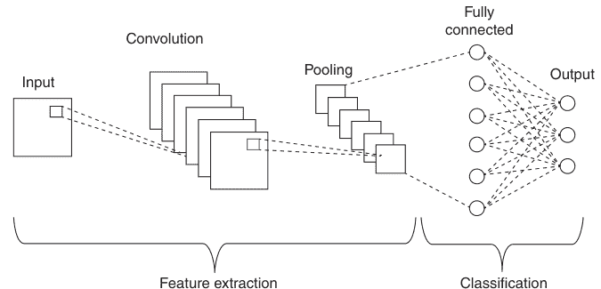

图 2.1 卷积神经网络概览。

“平移不变性”这一术语描述了这种关键特性。CNN 的主要优势之一在于其滤波器无需手动设计。相反，它们可以通过反向传播训练自动学习，其中反向传播使用空间反转滤波器的卷积运算（Litjens et al. 2017; Shi et al. 2021）。堆叠 CNN 的卷积层是一种非常有效的技术。靠近输入的层学习线条和边界等简单特征，而模型中更靠后的层则学习形状等更复杂的特征。CNN 是正则化 MLP 的一种变体。MLP 中的神经元彼此全部互连。由于这些网络的完全连接特性，可能会发生过拟合，但可以通过正则化来避免。在传统的正则化过程中，通常将权重添加到损失函数中。另一方面，CNN 采用一种独特的正则化方法，该方法利用数据中存在的层次模式，通过从较小、更简单的模式组装出更复杂的模式来降低连接性和复杂性（Zhou et al. 2021; Kalchbrenner et al. 2014）。传统算法的滤波器是手工设计的，但 CNN 可以学习它们。这种无需额外特征工程知识的独立性是其主要优势。CNN 的著名变体包括 AlexNet、Inception、ResNet、VGG、SqueezeNet 等等。

#### 2.2.2 全卷积神经网络（FCN）

在 Long et al. 开发的完全卷积网络（FCN）（Shelhamer et al. 2017）中，最终的完全连接层被替换为完全卷积层，如图 2.2 所示。这一重大进步使网络能够进行密集的像素级预测。高分辨率特征与上采样输出合并，并输入卷积层，从而产生

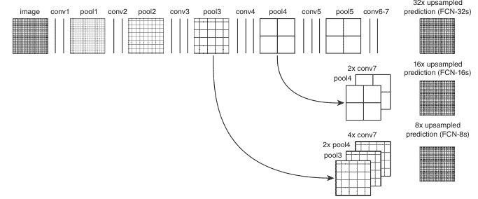

图 2.2 全卷积神经网络概览。

更准确的结果，以提高定位性能。Nie et al. 进行了相同的实验（Zhang et al. 2015），但添加了 FCN（Nie et al. 2016）。在使用相同模态和数据集的情况下，将 FCN 与 CNN 进行比较，显著更高的平均 Dice 得分（0.885 对 0.864）证明了 FCN 的优越性。CNN 仍然存在一些显著缺点。上采样图像看起来模糊，且对精细细节缺乏敏感性。分割提供的信息不足。分割背后的理念是对每个像素进行分类，而无需对其进行全面观察。因此，像素之间不存在空间一致性。Chen et al. (2018b) 引入了 DeepLab v1，用一个池化步长替代了原先使用的两个池化步长。填充大小也从 100 减小到 1。基于 VGG16 网络，DeepLab v1 用全卷积层取代了最终的完全连接层。移除了最后两个池化层，取而代之的是，它们纳入了空洞卷积，这是一种也用于条件随机场的技术（Krähenbühl and Koltun 2011）。DeepLab v2 (Chen et al. 2017b) 引入了空洞空间金字塔池化（ASPP），并集成了 ResNet101，以增强其空洞卷积能力。ASPP 能够捕捉不同尺度的图像上下文。DeepLab v3 (Chen et al. 2018b) 修改了 ASPP 模块，在卷积后、ReLU 前加入了第二个全局图像池化通道和批量归一化。为了进一步提高分割结果，尤其是目标边缘，DeepLab v3+ (Chen et al. 2018a) 在 DeepLab v3 中添加了一个高效的解码器模块。SegNet (Badrinarayanan et al. 2017) 是一种对称编码器–解码器结构，它使用 FCN 的语义分割任务来完成像素级图像分割，如图 2.3 所示。该结构包括编码段和解码段。编码器构建在 VGG16 之上，分析网络模型中的数据和对象。每个对象的标签

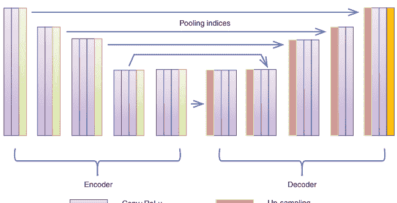

图 2.3 SegNet 模型概览。

将应用于其对应的像素，而解码器将解析的数据转换为最终图像。

SegNet 的解码器在池化过程中采用最大池化索引方法来上采样低分辨率输入特征，这一点非常突出。与 FCN 不同，FCN 使用反卷积算法进行不带学习的非线性上采样，SegNet 则采用不同的方法。它使用编码器传递的更高池化索引，如图 2.4 所示，这节省了空间并取得了值得称赞的性能。最大池化索引不记录绝对最大特征值，而是记录每个编码器映射中池化窗口内最大特征值的位置。通过使用编码器传输的池化索引来上采样输入，解码器生成稀疏特征图。然后，使用可训练的滤波器组对该特征图进行卷积，以增加其密度。相比之下，U-Net 通过将编码器的完整特征图发送到解码器，将连结操作置于卷积之前。

图 2.4 带有特征图值 a、b、c、d 的 SegNet 解码器。SegNet 首先使用最大池化索引和可训练的解码器滤波器组进行卷积，以重建输入图像。

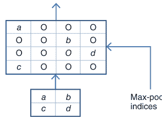


#### 2.2.3 UNet

Ronneberger et al. (2015) 提出了 U-Net，这是一种广泛用于医学图像分割的知名架构，采用了去卷积的概念。FCN 的精巧框架为这一概念奠定了基础。U-Net 在网络各层级之间增强的跳跃连接设计，是该网络深度扩展至 19 层所带来的额外优势。它进行了多项调整，以避免在定位精度和上下文敏感性之间做出取舍。随着区域变大，需要更多的池化层，这种取舍会更加突出，从而降低定位精度。

另一方面，小尺寸的补丁只能看到有限的输入上下文。如图 2.5 所示，所提出的框架中包含一对编码器和解码器路径。编码器路径的结构与 CNN 类似。解码器路径由一个上采样层组成，随后接一个去卷积层。U-Net 的主要特点是其能够在编码器和解码器管道中，在分辨率相等的层之间建立直接连接。

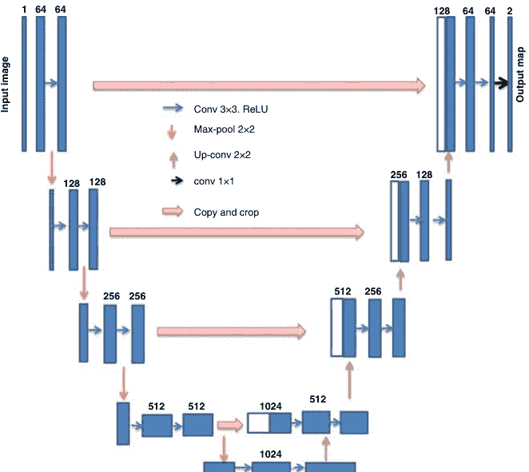

图 2.5 基本 U-Net 架构。

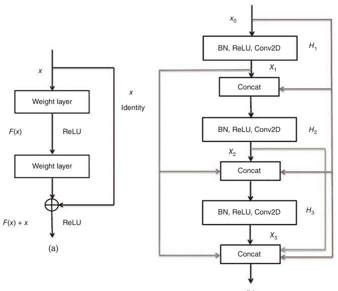

图 2.6 (a) 残差块。(b) 密集块。

这些连接使去卷积层能够访问关键的高分辨率特征。基于经典 U-Net（Ronneberger et al. 2015）结构构建的模型，可以通过使用其他过程（例如残差块和密集块，如图 2.6a,b 所示）进行改进。Cicek et al. (2016) 提出的 3D U-Net 模型用更详细的位置数据来补充 U-Net 结构的能力。通过若干个带有标注的 2D 切片，所提模型能够生成稠密的体积分割。该网络既可以从稀疏示例生成稠密标注，也可以从新样本生成稠密标注。网络的整个操作已修改以支持 3D 操作。除此之外，Milletari et al. (2016) 还基于 U-Net 网络设计开发了一种名为 V-Net 的 3D 结构。可以使用残差连接来避免梯度消失并加快网络收敛，从而允许创建具有更好特征表示的更复杂的网络架构。V-Net 性能的提升是由其四个下采样层带来的。

#### 2.2.4 Multi-scale-Based Models

多尺度分割设计是为了处理感兴趣区域存在不同尺度的事实。通过在不同尺度下将图像分割为众多同质区域，多尺度分割方案可以在多个尺度上呈现信息。这些架构通过使用局部变量和全局变量的组合来标记每个像素，从而改进了高级分割。2018 年，美国亚利桑那州立大学的研究人员提出了 U-Net++，以解决 U-Net 的不足之处，例如其对同尺度特征图的依赖。如图 2.7 所示，架构中采用了 Dense-Block 来提升传统 U-Net 的性能。为了弥合模块间特征的差距并增强梯度流，该模型在跳跃路径上使用了卷积和密集连接，这与传统模型（U-Net）不同（Zhou et al. 2020）。此外，它还引入了深度监督的概念，该概念会执行架构缩减。所提设计使用四种不同的医学图像数据集（即细胞核、结肠息肉、肝脏和肺结节）在多种模态上进行了评估。结果表明，即使未使用深度监督，基于交并比（IoU）度量，U-Net++ 也优于基本 U-Net 和宽 U-Net 模型。

#### 2.2.5 Pyramid-Based Models

为了聚合上下文，PSPNet（Zhao et al. 2017）提出了一个金字塔池化模块，并采用了辅助损失，如图 2.8 所示。全局场景类别的重要性在于它们能够提供关于分割类别分布的提示。这些数据通过金字塔池化模块广泛使用的内核池化层来收集。ResNet 经过膨胀卷积（DCs）修改，并加入了一个金字塔池化模块。

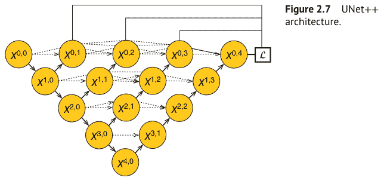

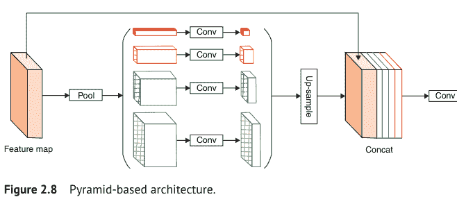

该组件将 ResNet 生成的特征图与内核池化层的输出相结合，这些内核分别覆盖整个图像、图像的一半以及图像的一小部分。在 ResNet 的第四步之后，在主分支损失之上施加了辅助损失。

#### 2.2.6 Recurrent Neural Networks (RNNs)

处理序列数据（例如文本、音乐、视频和时间序列，其中任何特定时间或位置的数据都依赖于先前观察到的数据）是 Rumelhart et al. (1986) 开发的 RNN 的常见用途。如图 2.9 所示，RNN 在当前时间 $X_i$ 接收一个输入，以及上一步 h_{i-1} 的隐藏状态，

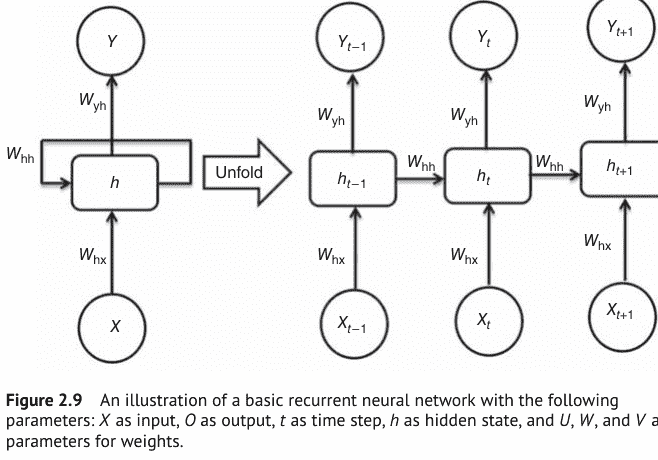

然后生成所需输出和一个新的隐藏状态。尽管最初是为 1D 输入设计的，但 RNN 正迅速被用于图像识别。它们已被应用于分割问题，并在 MRBrainS 竞赛（Stollenga et al. 2015）中取得了相当令人鼓舞的性能。由于医学图像中的感兴趣区域（ROI）通常分布在许多相邻切片上（例如在 CT 或 MRI 中），因此经常观察到连续切片之间的相关性。因此，RNN 能够利用输入切片提供的序列信息来确定每对之间存在的上下文。RNN 结构主要由两个组件组成：用于处理切片间信息提取的 RNN，以及用于处理切片内信息提取的任何 CNN 模型。在 RNN 中，LSTM（长短期记忆网络）（Hochreiter and Schmidhuber 1997）是最著名的。常规 LSTM 网络输入中发生的空间信息丢失对于医学图像分割来说是个问题。将向量乘法替换为卷积操作，使得卷积 LSTM（Srivastava et al. 2015）（CLSTM）成为一个有前景的选择。Armato et al. (2011) 通过将 CLSTM 添加到深度 CNN 输出层，并考虑相邻切片之间的上下文信息，来改进分割。采用他们的策略，对于著名的 U-Net 拓扑（Ronneberger et al. 2015），Dice 相似系数（DSC）从 0.7976 提高到了 0.8247。

#### 2.2.7 Attention-Based Models

注意力机制是以人脑为模型构建的。人脑无法完全理解输入到视觉和听觉皮层的绝大多数数据，但确实会记住最关键的信息。该过程既提高了处理速度，也提高了效率。尽管注意力机制最初在 RNN 中得到应用，但它迅速传播到人工智能的其他领域，包括图像定位、语音识别和机器翻译（Bahdanau et al. 2015; Chorowski et al. 2015; Vaswani et al. 2017）。研究人员对 Google DeepMind（Mnih et al. 2014）提出的循环视觉注意模型给予了高度评价。同样，Bahdanau et al. (2015) 的作者使用注意力方法来解决自然语言处理问题。研究人员发现注意力模块可用于医学图像分割，这成为主要的研究课题。Jin et al. (2019) 的作者应用注意力方法来分割医学图像。Jin et al. (2019) 的作者使用注意力方法对医学图像进行语义分割。这使得模型能够恢复丢失的信息。此外，He et al. (2016) 在深度网络中使用注意力门来将 Computed Tomography (CT) 扫描中的消化道分离出来。注意力过程有助于网络捕捉器官可变的形状和大小。Li et al. (2019) 提出的 CSAU-Net 主张一种血管


提取技术。在产生结果之前，模型通过集成连接损失和注意力权重来调整特征。在 Oktay et al. (2018) 中，作者发表了一种用于在不同条件下从 CT 图像中分割器官的注意力 U-Net 模型。使用注意力门使得注意力 U-Net 能够以更高的准确性超越 U-Net 模型，而无需显著增加参数数量或需要后处理。

#### 2.2.8 基于集成的模型

集成机制在减少训练过程中的过拟合方面是有效的 (Maclin 2016)。集成模块整合多个并行运行的网络的结果，以执行必要的分割 (Maclin 2016)。该方法基于一个概念，该概念同时结合了图像的预处理和后处理模块。为了增强网络从输入图像中分割 ROI 的能力，使用预处理单元，然后在后处理阶段对结果进行改进。深度学习社区发现，集成机制通常优于更传统的单子网方法。训练过程受益于集成模块中每个子网的独特贡献 (Li et al. 2018a)。Kamnitsas et al. (2018) 的作者提出了一种网络的网络集成以帮助肿瘤定位，并被宣布为 BraTs 2016 竞赛的获胜者。Li et al. (2018a) 的作者定义了多个 U 型模型，以使用 MRI 数据处理多种模态 (Han and Ye 2018)。类似地，Feng et al. (2020) 提出了两种不同的 U-Net 启发算法，用于医学图像的语义分割。一种方法涉及正交小波框，而另一种从低分辨率路径捕获残差信号。与传统的 U-Net 模型相比，这种策略能够提供更出色的结果。

#### 2.2.9 其他模型

像 Mask R-CNN (He et al. 2017) 这样的 R-CNN 变体处理实例分割问题，这需要同时进行目标识别和分割。在两个不同层次上的目标识别和分割是 Mask R-CNN 模型的基础。为了训练深度生成模型，研究人员开发了生成对抗网络 (GAN) (Goodfellow et al. 2020)。如图 2.10 所示，它由两个网络组成：一个生成器网络，用于寻找数据分布，以及一个判别器网络，用于尝试区分真实数据分布和生成器提供的虚假数据。这两款模型共同学习数据分布。Park et al. (2020) 的作者提出了一种用于分割视网膜血管的条件生成对抗网络 (M-GAN)。M-GAN 采用分层深度 FCN 来补偿损失。

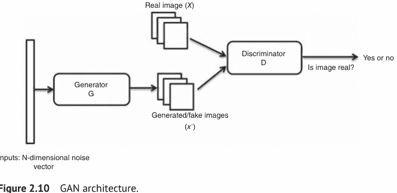

Zhou et al. (2019) 于 2019 年提出了 Model Genesis，这是一种使用迁移学习算法分割 3D 医学图像数据的方法。在处理医学数据时，迁移学习至关重要，因为医学数据通常以 MRI 和 CT 等 3D 格式出现。为了避免从头开始训练医学图像，有必要将 3D 图像转换为 2D 图像并进行必要的调整。这种修改会导致关键空间信息丢失，从而影响网络的整体性能。为解决这个问题，本工作的作者引入了 Model Genesis，这是一组可以自主学习且无需人工标注的模型。该研究的作者采用迁移学习方法创建了特定于应用的目标架构。他们在五个面临分类和分割问题的 3D 应用上测试了该范式。实验表明，从 2D-ImageNet 数据集进行的迁移学习优于在 3D 医学数据上原生训练的模型。所提框架的相关性体现在其始终优于任何 2D 技术。此外，作者还展示了将该概念扩展到应用之外，涵盖领域和操作模式的意图。

### 2.3 医学图像分割模型的应用

医学图像分析是致力于疾病诊断的医疗系统的关键组成部分。医学影像为临床研究提供了人体内部器官的视觉和功能表现。主要目标是将医学图像分类为不同的分类，或强调图像中的特定数据。分析医学图像非常重要，因为它可以帮助放射科医生和临床医生准确诊断疾病。医学影像还用于分割病变和器官解剖结构。

#### 2.3.1 解剖器官分割

医学图像允许对器官结构进行准确检查。通过分割器官和解剖特征，医学图像可以更定量地分析与形态和体积相关的临床特征，例如脑部和心脏研究。此外，它通常作为计算机辅助检测/诊断 (CAD) 的初始步骤。骨骼、椎骨、血管和主要器官是人体解剖结构的示例。然而，由于 3D 扫描包含多个切片，医学专家很难从这些图像中提取感兴趣的解剖结构或病变，而且这是一个耗时的操作。在医学图像分析中，有许多用于器官分割的深度学习方法。已经创建了许多定制模型来直接针对分割任务。表 2.1–2.7 总结了文献中眼、脑、肝、肺、心脏、肾和多器官的分割流程。

##### 2.3.1.1 眼

视网膜血管分割是视网膜病理学研究中的一个难题。过度分割或缺少小而脆弱的血管仍然是一个问题。基于深度学习的视网膜血管分割技术优于人类专家。Liskowski 和 Krawiec (2016) 是首个使用深度卷积神经网络进行视网膜血管分割的研究工作。从那以后，视网膜血管分割的几个应用主要采用了 CNN。Leopold et al. (2019) 将完全残差自编码器批量归一化网络 (PixelBNN) 提出作为视网膜血管分割的快速架构。U-Net 和 PixelCNN 是其基础。在 FCN 中，它既利用跳跃连接又利用批量归一化。下一步是在三个不同的视网膜血管分割数据集上训练、测试和交叉测试该模型：DRIVE (Staal et al. 2004)、STARE (Hoover et al. 2000) 和 CHASEDB1 (Owen et al. 2009)。测试的执行时间和性能令人满意。Wang et al. (2019a) 提出了一种带有两个编码器的新 U-Net，一个用于空间信息，另一个用于上下文信息，以更好地捕捉数据的含义。作者在两条路径的交汇处创建了一个特征融合模块，以合并各种形式的特征表示。此外，作者在跳跃连接中利用通道注意力来选择相关特征图。此外，多尺度预测模块结合了低级和高级预测，以提高精度。所提出的 DEU-Net 模型在两个数据集上均能够在视网膜血管分割中获得更高的准确性。Yue et al. (2019) 推荐了一种用于视网膜血管分割的增强 U-Net 结构。在经典 U-Net 中添加多尺度输入层和稠密块，使其能够利用更复杂的空间上下文信息。分割结果得到了改善，特别是对于细血管，由于其与周围像素的对比度较低，很难检测。为了提高准确性，Zhang et al. (Zhang and Chung 2018) 采用带有残差连接的 U-Net 来检测血管，并实现了边缘感知技术来标记边界区域以包含更多信息。Jaemin et al. (Son et al. 2017) 提出了使用生成对抗训练的视网膜血管分割方法。这种方法应能减少血管分割中的误差空间。Khan et al. (2021) 能够有效分割各种对比度、位置和视盘大小的大、中、细血管，提供了一种基于完全卷积层的多尺度内核，该内核极其轻量。此外，所提出的架构使用了多尺度内核、减少池化操作的应用以及跳跃连接来加快训练。在特异性、准确性、曲线下面积 (AUC) 和灵敏度方面，测试结果表明该方法始终显著优于对照组。退行性视网膜疾病的判定高度依赖于视网膜宏观和微观血管结构的高保真分割，但这仍然是一项挑战性任务。基于自编码的分割方法在提取视网膜微血管结构方面遇到困难，原因在于编码阶段的连续分辨率降低以及解码阶段无法恢复丢失的信息。为解决这个问题，Kamran et al. (Kamran et al. 2021) 引入了 RV-GAN，这是一种专为准确的视网膜血管分割量身定制的创新多尺度生成框架。该提议的架构通过利用两个生成器和两个多尺度自编码判别器，增强了微血管的检测和分割。与传统的基于 GAN 的分割算法相比，作者独特的加权特征匹配损失显著提高了准确性。开发的架构将重建与加权特征匹配损失相结合，在 DRIVE (Staal et al. 2004)、STARE (Hoover et al. 2000) 和 CHASE (Owen et al. 2009) 三个数据集上分割视网膜血管时，分别获得了 98.87、99.14 和 98.87 的 AUC 值。表 2.1 总结了各种基于深度学习的视网膜血管分割模型。

##### 2.3.1.2 脑

MRI 通常用于研究影响大脑的疾病。阿尔茨海默病、癫痫、精神分裂症、多发性硬化症、癌症和神经退行性疾病只是许多从大脑影像研究中获益匪浅的神经疾病中的一部分。多项研究提出了用于大脑分割的深度学习技术。特别是，


##### 表 2.1 基于深度学习的眼部分割模型摘要。

| 参考文献 | 模态 | 模型 | 数据集 | 性能 |
|---|---|---|---|---|
| (Liskowski and Krawiec 2016) | 眼底 | CNN | DRIVE (Staal et al. 2004), STARE (Hoover et al. 2000), CHASE (Owen et al. 2009) | 准确率 – 94.9%, 95.6%, 96.2% |
| (Leopold et al. 2019) | 眼底 | PixelBNN | DRIVE (Staal et al. 2004), STARE (Hoover et al. 2000), CHASE (Owen et al. 2009) | 准确率 – 91.06%, 90.45%, 89.36% |
| (Staal et al. 2004) | 眼底 | DEU-Net | DRIVE (Staal et al. 2004), CHASE (Hoover et al. 2000) | F1 – 82.70%, 80.37% |
| (Zhang and Chung 2018) | 眼底 | U-Net | DRIVE (Staal et al. 2004), STARE (Hoover et al. 2000), CHASE (Owen et al. 2009) | 准确率 – 95.04%, 97.12%, 97.70% |
| (Yue et al. 2019) | 眼底 | Enhanced-UNet | DRIVE (Staal et al. 2004) | 准确率 – 95.61% |
| (Khan et al. 2021) | 眼底 | RM-FCN | DRIVE (Staal et al. 2004), STARE (Hoover et al. 2000), CHASE (Owen et al. 2009) | 准确率 – 98.30%, 98.10%, 98.90% |
| (Kamran et al. 2021) | 眼底 | RV-GAN | DRIVE (Staal et al. 2004), STARE (Hoover et al. 2000), CHASE (Owen et al. 2009) | AUC. – 98.87%, 99.14%, 98.87% |

Chen et al. (2017a) 创建了一种创新的体素级残差网络 (VoxRes-Net)。在训练极深的 DNN 时，残差单元有助于缓解退化问题。对于 3D MRI 图像中的脑部分割，Wang et al. (2019c) 开发了一种带有残差单元和金字塔汇聚块的 3D 卷积模型。虽然已为脑部 MR 图像分割提出了大量深度学习技术，但其中大多数忽略了整合形状先验。这种遗漏阻止了它们利用脑结构的一致性，从而阻碍了其实现最佳性能的能力。为了解决这个问题，Sun et al. (2020) 提出了一种带有两个子网络的深度学习架构，利用解剖学注意力进行脑部 ROI 分割。第一个是分割子网络，用于从每个输入 MR 图像中分离 ROI，同时提取具有区分度的图像表示。第二个是专门用于关注脑部解剖结构的子网络，由一组标注的脑图集输入。作者使用此框架构建了两个解剖分割模型：解剖门控全卷积网络和解剖门控 U-Net。阿尔茨海默病神经影像学倡议 (ADNI) (Jack et al. 2008) 和 LONI-LPBA40 数据集上的实验结果表明，所提出的算法在脑部 MR 图像的 ROI 分割中提供了更高的性能。Nie et al. (2019) 使用 T1、T2 和弥散加权模式拍摄了 11 名健康婴儿的大脑图像。作者通过结合上下文语义信息和不同尺度的特征优化了网络。他们还使用 3D FCN 对多模态脑部 MRI 图像进行了分割。Casamitjana et al. (Mangin and Rivi 2019) 将脑肿瘤分割问题分解为两个可管理的任务：整个肿瘤分割和各种肿瘤区域的划分。Moeskops et al. (2017) 的工作表明，当应用于完全卷积和带有 DCs 的网络拓扑时，对抗训练提高了脑部 MRI 的分割性能。Xue et al. (2018) 受传统 GAN 启发，提出了 SegAN，一种用于医学图像分割的新型对抗神经网络。与图像分割所需的大量像素级标注相比，典型 GAN 判别器的单一标量输出（真或假）可能无法提供足够的梯度反馈以确保网络稳定性。作者没有使用传统的全连接网络进行分割，而是设计了一种带有多尺度损失函数的新型对抗评论家网络。这种方法迫使评论家和分割者都掌握全局和局部特征。这生成了分割标签图。作者表明，SegAN 架构优于当前的 U-net 分割方法，使其更有效且更稳定。使用了来自医学图像计算与计算机辅助干预 (MICCAI) BRATS 脑肿瘤分割竞赛的数据集来评估所提出的 SegAN 方法。大量实验结果表明，带有多尺度损失的拟议 SegAN 是有效的。SegAN 在 BRATS 2015 上优于现有模型，在骰子分数和精度方面均超越了它们，同时在 BRATS 2013 上对整个肿瘤和肿瘤核心分割提供了与尖端模型相当的性能。表 2.2 总结了各种基于深度学习的脑部分割模型。

##### 2.3.1.3 肝脏

准确的肝脏分割对于各种计算机辅助操作至关重要，包括涉及肝病诊断和治疗及干预方案开发的操作。深度学习已被多项研究用于在 CT 扫描中分割肝脏 (Li et al. 2018b; Zhou et al. 2018)。Dou et al. (Dou et al. 2017) 开发了一种独特可靠的带有 的 3D FCN。

##### 表 2.2 基于深度学习的脑部分割模型摘要。

| 参考文献 | 模态 | 模型 | 数据集 | 性能 |
|---|---|---|---|---|
| (Wachinger et al. 2018) | MR | CNN | MICCAI BRATS (Landman and Warfield 2019) | DSC – 91.0% |
| (Roy et al. 2019) | MR | FCN | MALC15 (Marcus et al. 2007), ADNI-29 (Jack et al. 2008) | 准确率 – 88%, 83% |
| (Coupé et al. 2020) | MR | CNN-ensemble | 私有 | DSC – 73.3% |
| (Chen et al. 2017a) | MR | ResNet | MRBrainS | DSC – 84.3% |
| (Wang et al. 2019c) | MR | CNN-3D | CANDI (Kennedy et al. 2012), IBSR-18 (Frazier et al. 1910) | DSC – 90.7%, 90.4% |
| (Sun et al. 2020) | MR | AG-UNet, AG-FCN | ADNI-29 (Jack et al. 2008), LONI-LPBA40 | DSC – 88.64%, 80.67% |
| (Xue et al. 2018) | MR | SegAN | MICCAI BRATS (Menze et al. 2015) | DSC – 85% |

用于分割 3D 图像的深度监督方法。对于肝脏分割，3D 深度监督网络实现了更高的性能。Tran et al. (2021) 提出了一种名为 U^n-Net (n 折叠 U-Net) 的替代网络架构。U^n-Net 模型利用基于卷积单元输出提取的特征的跳跃连接。因此，U^n-Net 网络在节点处利用卷积单元输出特征。作者在这项工作中测试了 U^2-Net 和 U^3-Net 以进行肝脏和肝肿瘤分割。此外，网络节点融入了 DC 和稠密结构。所提网络在实验中优于现有网络。Wang et al. (2021) 提出了基于传统 U-Net 的 SAR-U-Net 架构。U-Net 编码器中的 SE 块最初被引入以在每次卷积后动态提取图像特征。它通过隐藏图像中较不相关的区域，同时强调对当前分割任务至关重要的部分来实现这一点。其次，采用了 ASPP 通过各种感受场收集多尺度图像细节，替换了过渡层和输出层。第三，用残差结构替换了传统的卷积块，以解决梯度消失问题，从而使网络受益于显著增加的深度和准确性。

与类似模型相比，所提技术具有最高的准确性。

此外，在 SLiver07 数据集试验中，所提方法相比其他密切相关的模型实现了最高的分割准确性。Fan et al. (Fan et al. 2021) 提出了一种多尺度嵌套 U-Net (MSN-Net)，一种替代 U-Net 设计。Res-block 和多尺度上下文融合 (MSCF) 块构成了 MSN-Net。为了防止梯度消失，作者采用了使用带有瓶颈层的 Res-block 构建的更深层网络。为了解决语义差距，重新设计了一种新型跳跃连接。MSCF 块和众多连接构成了创新的跳跃连接。高级和低级特征以及多尺度语义信息在 MSCF 块中结合，以产生更准确的特征。MSCF 块之间使用了稠密连接。实验结果表明，与其他尖端模型相比，MSN-Net 在缩小语义差距方面更有效。通过使用创新的跳跃连接，所提策略有效地减少了编码器和解码器路径之间的语义差距，并提高了网络分割精度。表 2.3 总结了各种基于深度学习的肝脏分割模型。

##### 2.3.1.4 肺部

肺部图像分割是肺部影像分析中的关键初始阶段，在为肺癌检测提供肺部 CT 图像的精确解读方面起着根本作用。CT 和 X 射线图像中的肺部分割已得到深入研究 (Gaäl et al. 2020; Pawar and Talbar 2021)。例如，Skourt et al. (Ait Skourt et al. 2018) 设计了一种 U-Net 架构，用于从 CT 图像中分割肺部。依赖于用户生成特征的传统肺部分割方法难以准确分割带有结节的肺实质。深度学习已被证明在图像分类和对象识别中优于传统方法，提供了一种更有效的替代方案。为了缓解贴胸膜结节问题，Wu et al. (Wu and Lin 2020) 开发了一种基于扩展卷积的加权全卷积神经网络，用于分割肺实质。虽然深度学习模型在分割解剖结构方面的能力有了显著提高，但由于训练参数数量巨大，这增加了内存占用并降低了泛化能力，因此仍令人担忧。为了解决这个问题，Yahyatabar et al. (2020) 开发了一个 Dense-UNet 模型。该模型通过增加网络中每层之间的连接数量来改善信息流。这使得在设计参数大幅减少的网络的同时，能够保持强健的分割。作者声称，Dense-UNet 是为胸部 X 射线 (CXR) 图像中的肺部野分割提出的最轻量级深度模型。此外，主要挑战之一是

表 2.3 基于深度学习的肝脏分割模型摘要。

| 参考文献 | 模态 | 模型 | 数据集 | 性能 |
| :--- | :--- | :--- | :--- | :--- |
| (Stollenga et al. 2015) | CT | FCN | 3DIRCAD (Soler et al. 2010) | DSC – 95.7% |
| (Christ et al. 2017) | CT, MR | Cascaded FCN | 3DIRCAD (Soler et al. 2010) | DSC – 94.3% |
| (Li et al. 2018b) | CT | H-Dense U-Net | LiTS (Bilic et al. 2023), 3DIRCAD (Soler et al. 2010) | DSC – 96.5%, 98.2% |
| (Seo et al. 2020) | CT | U-Net modified (mUNet) | LiTS (Bilic et al. 2023), 3DIRCAD (Soler et al. 2010) | DSC – 96.0%, 98.51% |
| (Liu et al. 2019) | CT | Cascaded UNet | LiTS (Bilic et al. 2023) | DSC – 97.16% |
| (Zhou et al. 2018) | CT | U-Net – Nested | LiTS (Bilic et al. 2023) | IoU – 82.9% |
| (Dou et al. 2017) | CT | CNN-3D | Sliver07 | VOE 5.4 |
| (Tran et al. 2021) | CT | U^n–Net | LiTS (Bilic et al. 2023), 3DIRCADb (Soler et al. 2010) | DSC – 96.38%, 96.45% |
| (Wang et al. 2021) | CT | SAR-UNet | LiTS (Bilic et al. 2023) | DSC – 95.71% |
| (Fan et al. 2021) | CT | MSN-Net | MICCAI2017 LiTS (Bilic et al. 2023) | DSC – 94.24%, IoU – 90.75% |

在胸部 X 射线中对肺部进行分割面临的问题是，由于严重肺部疾病导致的极端肺形状转移和模糊肺区域，自动肺部分割模型可能被错误构建。刘等人（2022）使用预训练的 efficientnet-b4 编码器，以及解码器中的残差块和 LeakyReLU 激活函数，增强了 U-Net 网络的性能。通过避免梯度反向传播中乘法效应带来的梯度不稳定性，该网络能够高效提取肺野特征。与其他方法的实验比较表明，该方法不仅在从 CXR 图像中分割肺部方面更准确，而且标准差更低、更稳健。帕尔等人（2022）引入了 Attention UW-Net，它通过一个新颖的中间层连接编码器和解码器层。最终编码器层经过上采样生成中间层，该中间层包含多个全连接卷积层。这些层通过跳跃连接与相应的上采样和下采样块建立连接。一个下采样层被用来将中间层额外链接到解码器管道。UW-Net 不仅超越了 U-Net 及其衍生模型，还超越了近年来开发的其他传统自动和半自动分割/标注模型。由于所有类型（大、中、小病变）的分割掩码预测准确率具有统一性，该模型非常适合器官的自动标注。表 2.4 汇总了各种基于深度学习的肺部分割模型。

表 2.4 基于深度学习的肺部分割模型摘要。

| 参考文献 | 模态 | 模型 | 数据集 | 性能 |
| :--- | :--- | :--- | :--- | :--- |
| (Stirenko et al. 2018) | X-ray | CNN | SH | Acc – 70% |
| (Gaal et al. 2020) | X-ray | Attention U-Net | JSRT (Shiraishi et al. 2000) | DSC – 97.5% |
| (Hofmanninger et al. 2020) | CT | U-Net, ResU-net | LTRC (Goksel and Foncubierta-Rodriguez 2017), Anatomy3 (Yang et al. 2018b) | DSC – 94%, 92% |
| (Pawar and Talbar 2021) | CT | GAN | ILD (Depeursinge et al. 2012) | DSC – 96% |
| (Ait Skourt et al. 2018) | CT | U-Net | LIDC (Armato et al. 2011) | DSC – 95.02% |
| (Wu and Lin 2020) | CT | Dilated – FCN | LIDC/IDRI (Armato et al. 2011) | DSC – 97.02% |
| (Yahyatabar et al. 2020) | X-ray | Dense-Unet | JSRT (Shiraishi et al. 2000), Montgomery | DSC – 97.6%, 97.9% |
| (Liu et al. 2022) | X-ray | Improved UNet | JSRT (Shiraishi et al. 2000), Montgomery | DSC – 97.9%, 97.7% |
| (Pal et al. 2022) | X-ray | Attention-UWNet | NIH Chest X-ray (Wang et al. 2017) | F1 – 83.8% |

##### 2.3.1.5 肾脏

肾脏分割是分析图像和开发复杂手术程序中的关键步骤。针对 CT 扫描中的肾脏分割，已提出多种深度神经网络（DNN）。科托等人（2019）训练了一组全卷积网络，并在测试期间结合其预测结果进行分割。该算法实现了高度准确的分割结果，尤其是在勾勒肾皮质方面。虽然提供的参考分割的精度似乎对数值性能设定了适度的上限，但所提出的解决方案在 CT 图像中提供了可靠且准确的肾皮质自动分割。杨等人（2018a）将基于 3D FCN 的架构与金字塔池化相结合，以增强特征提取。张等人（2019）提出了一种基于 3D FCN 的两阶段框架，用于分割肾脏和肿瘤。为了减轻类别不平衡和计算开销，第一步是在早期阶段定位肾脏并移除多余背景。然后在第二阶段，对裁剪补片中的肾脏和肿瘤进行仔细分割。该建议技术的综合 Dice 系数为 90.24%，使团队在 MICCAI 2019 肾肿瘤分割（KiTS）挑战赛中位列 105 支参赛队伍的第四名。赵等人（2020）提出了一种多尺度监督 U-Net，用于从 CT 图像中分割肾脏和肾肿瘤。作者利用 KiTS19 数据集，设计了一种架构，通过集成深度监督与指数损失来提高 3D U-Net 的性能。表 2.5 汇总了各种基于深度学习的肾脏分割模型。

表 2.5 基于深度学习的肾脏分割模型摘要。

| 参考文献 | 模态 | 模型 | 数据集 | 性能 |
| :--- | :--- | :--- | :--- | :--- |
| (Couteaux et al. 2019) | CT | Ensemble UNet | COCO (Lin et al. 2014) | DSC – 86.7% |
| (Wang et al. 2019b) | CT | Modified U-Net | KiTS (Heller et al. 2019) | DSC – 95.4% |
| (Yang et al. 2018a) | CT | FCN with PPM | Private | DSC – 93.1% |
| (Zhang et al. 2019) | CT | 3D-FCN | KiTS (Heller et al. 2019) | DSC – 90.24% |
| (Zhao et al. 2020) | CT | Multi-scale supervised 3D U-Net | KiTS (Heller et al. 2019) | DSC – 96.9% |

##### 2.3.1.6 心脏

心脏是我们身体的重要器官。然而，许多人也因诸多心脏问题而生命受到威胁。为了解决心脏医疗领域的实际问题，必须实现心脏区域的自动分割。根据多项研究（Wang and Smedby 2018; Payer et al. 2018），完整的心脏已使用基于深度学习的神经网络进行了分割。陈等人（Tran 2016）使用全卷积神经网络架构对心脏 MRI 进行了像素分类。短轴心脏 MRI 前所未有地实现了所提 FCN 架构所能提供的如此复杂的语义分割。韩等人（2020）开发了一种级联体积 FCN。该方法采用串联的一对 V-Net。第一个网络定位心脏，第二个网络将心脏和大血管结构划分为更小的部分。为了帮助从 MR 图像中进行心脏分割，作者将 V-Net 重建为 3D V-Net。叶等人（2019）提供了一种新型深度监督 3D U-NET，通过使用多深度融合提取上下文信息来改进原始网络。作者采用了焦点损失，并将其应用扩展到图像分割领域的多类别挑战中。最后，他们将焦点损失与 Dice 损失耦合，形成了新的混合损失函数。混合损失可用于解决类别不平衡的问题。沈等人（2019）开发了一种统一架构，同时利用深度学习和传统水平集方法进行冠状动脉计算机血管造影（CTA）分割。利用 3D FCN 学习冠状动脉的 3D 语义特征，这为经典水平集提供了良好的起点。徐等人（2020）提出了一种新型 GAN，称为渐进序列因果 GAN（PSCGAN）。

这标志着在动态 MR 成像中开创性地开发了一种无造影剂缺血性心脏病（IHD）技术，能够同时生成类似晚期钆增强（LGE）的图像，并准确分割与诊断相关的组织。为了实现这一目标，PSCGAN 具有三个非常有用的特性：

- 1) 一种用于图像合成与分割训练的迭代框架，采用分而治之策略，包含三个阶段（即先验生成、条件合成和增强分割）。
- 2) 设计了一种序列因果学习网络（SCLN），具有多尺度双流路径和多注意力加权单元。该架构在从动态 MR 图像中提取空间和时序连接的同时，能有效识别特定于任务的依赖关系。它还融合了 GAN 架构，利用对抗训练使整个过程中更容易理解动态 MR 图像中感兴趣的隐空间依赖关系。
- 3) 为自主学习开发的两种损失概念：为了减轻合成过程中的噪声，作者采用了利用稀疏正则化的合成正则化损失项；在分割中，作者采用了利用每种组织像素数量的辅助损失项，以补偿判别。


Table 2.6 基于深度学习的心脏分割模型汇总表。

| 参考文献 | 模态 | 模型 | 数据集 | 性能 |
| :--- | :--- | :--- | :--- | :--- |
| (Wang and Smedby 2018) | CT, MR | U-Net | MMWHS (Zhuang and Shen 2016) | DSC – MR 79.2%，CT 86.6% |
| (Dou et al. 2017) | MR | CNN-3D | MMWHS (Zhuang and Shen 2016) | DSC – 92.8% |
| (Payer et al. 2018) | CT | CNN | MMWHS (Zhuang and Shen 2016) | DSC – 90.8% |
| (Han et al. 2020) | MR | 3D V-Net | HV SMR (Pace et al. 2015) | DSC – 94.2% |
| (Ye et al. 2019) | MRI | UNet with multidepth fusion | MICCAI 2017 | DSC – 90.73% |
| (Shen et al. 2019) | MR | 3D-FCN | Private | DSC – 90.05% |
| (Xu et al. 2020) | MR | GAN | Private | DSC – 91.8% |

因此，PSCGAN在合成和分割的稳定训练中取得了创纪录的成果。这些发现证明，所设计的方法可以在心脏疾病的标准化评估中提供巨大支持。表2.6总结了各种基于深度学习的心脏分割模型。

##### 2.3.1.7 多器官

在放射治疗规划过程中，为保护重要器官，必须明确界定危及器官（OAR）。在鼻咽癌放射治疗前，必须对20多个器官进行精确分割。此后，由于深度学习的最新进展，深度学习方法在OAR分割方面表现优于其他方法。多器官分割由于器官不平衡现象普遍存在，臭名昭著地具有挑战性。U-Net架构在医学图像分割方面表现出高度有效性，使其成为事实上的标准。另一方面，普通卷积层学习到的特征缺乏区分度。为解决此问题，Wang et al. (2019d) 提出了一种名为密集连接深度U-Net（DC UNet）的独特架构。DC U-Net由三个部分组成：密集连接、包含上采样的选择性反卷积层以及转置卷积填充函数。为对胸部CT扫描中的OAR进行分割，Vesal et al. (2019) 为以下器官和结构设计了一个深度学习框架：心脏、食管、气管和主动脉。所提出的方法采用了一种受U-Net启发的网络，其瓶颈由DCs和聚合残差连接组成，利用全局上下文和密集数据。Zhang et al. (2020) 引入了一种有效的级联V-Net模型，旨在提升多器官分割性能，通过在级联V-Net架构中建立密集块级跳跃连接来实现。Crespi et al. (2023) 提出了三种形式的单器官模型集成，能够利用其组件的不同专业化来构建多器官掩码。积极的发现表明，这可能是解决开发有效多器官分割技术这一问题的可行方法。Xing et al. (2023) 提出了Diff-UNet，这是一种用于分割体积图像的独特系统。该方法通过常规的U形架构高效地从输入体积中捕获语义信息，从而产生对医学体积分割至关重要的优越像素级表示。作者还创建了一个用于推理的步骤不确定性融合（SUF）模块，合并扩散模型在每个步骤的输出，以增强扩散模型预测结果的稳定性。

作者还对三个数据集进行了全面评估，表明Diff-UNet在MRI扫描中的多模态脑肿瘤分类、肝肿瘤以及多器官CT体积方面显著优于其他当前方法。表2.7总结了各种基于深度学习的多器官分割模型。

| 参考文献 | 模态 | 模型 | 数据集 | 性能 |
|---|---|---|---|---|
| (Gao et al. 2019) | CT | DNN | PDDCA (Raudaschl et al. 2017) | DSC – 80.3% |
| (Nikolov et al. 2018) | CT | U-Net | PDDCA (Raudaschl et al. 2017) | DSC – 70.4% |
| (Tong et al. 2018) | CT | FCN | PDDCA (Raudaschl et al. 2017) | DSC – 67.1% |
| (Tang et al. 2019) | CT | Attention U-Net | PDDCA (Raudaschl et al. 2017) | DSC – 73.5% |
| (Agn et al. 2019) | MR, CT | Generative method | Private | DSC – 70.4% |
| (Wang et al. 2019d) | CT | DC U-Net | 3D-IRCADb, LiTS (Bilic et al. 2023) | DSC-liver – 94.9%, Spleen–92.1% |
| (Vesal et al. 2019) | CT | Residual UNet | SegTHOR 2019 (Trullo et al. 2017) | DSC – 91.57% |
| (Zhang et al. 2020) | CT | Cascaded V-Net | SegTHOR 2019 (Trullo et al. 2017) | DSC – 88.02% |
| (Xing et al. 2023) | CT | Diff-UNet | BraTS2020, MSD, liver, BTCV | DSC – 85.35%, 95.72%, 83.75% |

### 2.4 医学图像分割的当前挑战

在采用基于深度学习设计的模型进行医学图像分割时，会出现各种障碍。本节将探讨医学图像分割中遇到的一些基本挑战，具体如下。

深度学习模型通常需要大量带注释的训练数据才能达到最佳性能。然而，获得一个足够大且多样的、具有准确注释解剖结构的数据集可能具有挑战性，尤其是对于罕见或不常见的结构。

- 类别不平衡是指与其他结构或病变相比，某些结构或病变在训练数据中代表性不足。类别分布不平衡可能会对深度学习模型的性能产生负面影响，导致分割结果存在偏差。此外，医学图像在形状、大小和外观方面通常表现出高度变异性，这使得开发能够有效处理此类变化的模型变得具有挑战性。

- 医学图像通常包含具有复杂形状、模糊边界或与邻近结构（如器官、血管或病变）重叠的结构。开发能够处理此类复杂场景并准确分割重叠结构的深度学习模型是一项重大挑战。

- 解剖结构在不同患者间和同一患者内部在尺寸、形状和外观方面可能表现出显著的变异性。深度学习模型需要足够强健以处理此类变化，以便在不同个体和临床场景中泛化良好。

- 在特定数据集上训练的深度学习模型可能难以很好地泛化到未见的医学图像，尤其是在成像协议、设备或患者人群存在差异时。在不同数据集和临床环境中实现强健性和泛化能力是一项具有挑战性的任务。

- 深度学习模型常被视为黑盒系统，在解释和阐明其分割决策方面存在困难，尤其是在关键的医疗场景中。为模型决策提供洞察和解释对于建立信任并确保基于深度学习的分割算法的临床接受至关重要。

- 即使基于深度学习的分割算法在研究环境中表现出有前景的结果，其成功转化和临床实践采用也可能具有挑战性。与现有医疗系统集成、临床试验验证、用户友好性以及医疗专业人员的接受度等因素，都需要解决才能实现成功的临床采用。

- 选择合适的网络架构并优化其超参数是开发有效分割模型的关键步骤。确定最佳的网络深度、宽度、跳跃连接及其他架构选择以处理解剖结构复杂性是一项具有挑战性的任务。

### 2.5 结论

在本章中，我们详细阐述了与深度学习图像分割相关的主要尖端算法的应用和架构。表2.1至2.7对流程和应用进行了总结。提升分割精度和可靠性的尖端技术的采用正在稳步增加。利用人工智能诊断各种疾病，长期医疗的概念得以实现。它成为临床医生的宝贵资源。深度学习算法极大地推动了医学图像分割的发展。虽然仍存在挑战，但它们也为进一步的探索和创新提供了机遇。通过解决这些挑战，我们可以释放基于深度学习分割的全部潜力，使其成为临床医生和研究人员在改进医疗诊断和患者护理方面不可或缺的工具。

## 参考文献

- Agn, M., af Rosenschöld, P.M., Puonti, O. 等 (2019). 用于放射治疗规划中脑肿瘤和危及器官分割的模态自适应方法。医学图像分析 54: 220–237. https://doi.org/10.1016/j.media.2019.03.005.
- Ait Skourt, B., El Hassani, A., 和 Majda, A. (2018). 使用深度神经网络进行肺CT图像分割。计算机科学前沿 127: 109–113. https://doi.org/10.1016/j.procs.2018.01.104.
- Armato, S.G. 3rd, McLennan, G., Bidaut, L. 等 (2011). 肺影像数据库联盟（LIDC）和图像数据库资源倡议（IDRI）：CT扫描中肺结节的已完成参考数据库。医学物理学 38 (2): 915–931. https://doi.org/10.1118/1.3528204.
- Badrinarayanan, V., Kendall, A. 和 Cipolla, R. (2017) SegNet：用于图像分割的深度卷积编码器-解码器架构。IEEE Transactions on

- 模式分析与机器智能，39(12)，第 2481–2495 页。doi：https://doi.org/10.1109/TPAMI.2016.2644615.

- Bahdanau, D., Cho, K. H. 和 Bengio, Y. (2015) 通过联合学习对齐与翻译的神经机器翻译。第 3 届国际学习表征会议，ICLR 2015 – 会议轨道论文集，美国加利福尼亚州圣地亚哥，第 1–15 页。

- Bilic, P., Christ, P., Li, H.B. 等 (2023)。肝肿瘤分割基准 (LiTS)。医学图像分析 84: 102680。https://doi.org/10.1016/j.media.2022.102680。

- Chen, H., Dou, Q., Yu, L. 等 (2017a)。VoxResNet：用于 3D MR 图像脑分割的深度体素残差网络。神经影像 170: 446–455。

- Chen, L.-C., Papandreou, G., Schroff, F. 等 (2017b) 重新思考语义图像分割中的空洞卷积。arXiv，可在以下网址获取：http://arxiv.org/abs/1706.05587。

- Chen, L.-C., Zhu, Y., Papandreou, G. 等 (2018a) 具有可分空洞卷积的编码器-解码器用于语义图像分割。收录于 Ferrari, V. 等（编）计算机视觉 – ECCV 2018，第 833–851 页。Cham：Springer 国际出版。

- Chen, L.C., Papandreou, G., Kokkinos, I. 等 (2018b)。DeepLab：带有深度卷积网络、空洞卷积和全连接 CRF 的语义图像分割。IEEE 模式分析与机器智能汇刊 40 (4): 834–848。https://doi.org/10.1109/TPAMI.2017.2699184。

- Chorowski, J., Bahdanau, D., Serdyuk, D. 等 (2015) 用于语音识别的基于注意力的模型。神经信息处理系统进展，2015 年 1 月，第 577–585 页。

- Christ, P.F., Ettlinger, F., Grün, F. 等 (2017)。使用级联全卷积神经网络对 CT 和 MRI 体积进行自动肝脏和肿瘤分割。arXiv 1–20。可在以下网址获取：http://arxiv.org/abs/1702.05970。

- Çiçek, Ö., Abdulkadir, A., Lienkamp, S. S. 等 (2016) 3D U-net：从稀疏标注中学习稠密体积分割。收录于医学图像计算与计算机辅助干预 – MICCAI 2016：第 19 届国际会议，希腊雅典，2016 年 10 月 17–21 日，计算机科学笔记丛书（包括人工智能和生物信息学讲义子系列），9901 LNCS，第 424–432 页。https://doi.org/10.1007/978-3-319-46723-8_49。

- Coupé, P., Mansencal, B., Clément, M. 等 (2020)。AssemblyNet：一种用于 3D 全脑 MRI 分割的大规模 CNN 集合。神经影像 219: 117026。https://doi.org/10.1016/j.neuroimage.2020.117026。

- Couteaux, V., Si-Mohamed, S., Renard-Penna, R. 等 (2019)。基于 U-Nets 集合聚合的 2D CT 肾皮质分割。诊断与介入成像 100 (4): 211–217。https://doi.org/10.1016/j.diii.2019.03.001。

- Crespi, L., Roncaglioni, P., Dei, D. 等 (2023)。CT 系列中多器官分割的集成方法。arXiv。可在以下网址获取：http://arxiv.org/abs/2303.17956。

- Depeursinge, A., Vargas, A., Platon, A. 等 (2012)。构建用于间质性肺疾病的参考多媒体数据库。计算机化医学成像与图形：计算机化医学成像学会官方期刊 36 (3): 227–238。

- Dou, Q., Yu, L., Chen, H. 等 (2017)。用于体积医学图像自动分割的 3D 深度监督网络。医学图像分析 41: 40–54。https://doi.org/10.1016/j.media.2017.05.001。

- Fan, T., Wang, G., Wang, X. 等 (2021)。MSN-Net：一种用于肝脏分割的多尺度上下文嵌套 U-Net。信号、图像与视频处理 15 (6): 1089–1097。https://doi.org/10.1007/s11760-020-01835-9。

- Feng, X., Tustison, N.J., Patel, S.H. 和 Meyer, C.H. (2020)。使用 3D U-Nets 集合进行脑肿瘤分割及使用放射组学特征进行总生存期预测。计算神经科学前沿 14: 1–10。https://doi.org/10.3389/fncom.2020.00025。

- Frazier, J.A., Caviness, V.S., Kennedy, D.N. 等 (1910)。互联网大脑分割存储库 (IBSR) 1.5 mm 数据集。Collections 10 (C60W3M): C6RC85。

- Gaál, G., Maga, B. 和 Lukács, A. (2020)。基于注意力 U-Net 的胸部 X 光肺分割对抗性架构。CEUR 研讨会论文集 2692: 1–7。

- Gao, Y., Huang, R., Chen, M. 等 (2019) FocusNet：一种用于头颈部 CT 图像中失衡大小器官分割的端到端深度神经网络。收录于 Shen, D. 等（编）医学图像计算与计算机辅助干预 – MICCAI 2019，第 829–838 页。Cham：Springer 国际出版。

- Goksel, O. 和 Foncubierta-Rodríguez, A. (2017)。用于器官分割和标志定位的 VISCERAL 解剖基准：任务与结果。收录于：基于云的医学图像分析基准测试（A. Hanbury, H. Müller 和 G. Langs 编）。Springer，107–125。

- Goodfellow, I., Pouget-Abadie, J., Mirza, M. 等 (2020)。生成对抗网络。ACM 通讯 63 (11): 139–144。https://doi.org/10.1145/3422622。

- Han, Y. 和 Ye, J.C. (2018)。通过深度卷积帧小波构建 U-Net：稀视 CT 的应用。IEEE 医学影像汇刊 37 (6): 1418–1429。https://doi.org/10.1109/TMI.2018.2823768。

- Han, T., Ivo, R.F., Rodrigues, D.D.A. 等 (2020)。用于全心脏和大血管 3D 分割的级联体积全卷积网络。未来一代计算机系统 108: 198–209。https://doi.org/10.1016/j.future.2020.02.055。

- He, K., Zhang, X., Ren, S. 和 Sun, J. (2016) 用于图像识别的深度残差学习。IEEE 计算机社会计算机视觉与模式识别会议论文集，2016 年 12 月，第 770–778 页。https://doi.org/10.1109/CVPR.2016.90。

- He, K., Gkioxari, G., Dollár, P. 和 Girshick, R. (2017) Mask R-CNN。收录于 2017 IEEE 国际计算机视觉会议 (ICCV)，第 2980–2988 页。https://doi.org/10.1109/ICCV.2017.322。

- Heller, N., Sathianathen, N., Kalapara, A. 等 (2019)。KiTS19 挑战数据：带有临床背景的 300 例肾肿瘤病例、CT 语义分割和外科手术结果。arXiv 1–14。可在以下网址获取：http://arxiv.org/abs/1904.00445。

- Hochreiter, S. 和 Schmidhuber, J. (1997)。长短期记忆。神经计算 9 (8): 1735–1780。https://doi.org/10.1162/neco.1997.9.8.1735。

- Hofmanninger, J., Prayer, F., Pan, J. 等 (2020)。常规成像中的自动肺分割主要是数据多样性问题，而非方法学问题。欧洲放射学实验 4 (1): 50。https://doi.org/10.1186/s41747-020-00173-2。

- Hoover, A.D., Kouznetsova, V. 和 Goldbaum, M. (2000)。通过匹配滤波器响应的分段阈值探测定位视网膜图像中的血管。IEEE 医学影像汇刊 19 (3): 203–210。https://doi.org/10.1109/42.845178。

- Jack, C.R., Bernstein, M.A., Fox, N.C. 等 (2008)。阿尔茨海默病神经影像倡议 (ADNI)：MRI 方法。磁共振成像期刊 685–691。https://doi.org/10.1002/jmri.21049。

- Jin, Q., Meng, Z., Pham, T.D. 等 (2019)。DUNet：一种用于视网膜血管分割的可变形网络。基于知识的系统 178 (8): 149–162。https://doi.org/10.1016/j.knosys.2019.04.025。

- Kalchbrenner, N., Grefenstette, E. 和 Blunsom, P. (2014) 一种用于句子建模的卷积神经网络。第 52 届计算语言学协会年度会议，ACL 2014 – 会议论文集，1，第 655–665 页。https://doi.org/10.3115/v1/p14-1062。

- Kamnitsas, K. 等 (2018) 用于强健脑肿瘤分割的多模型和多架构集合。收录于脑病变：胶质瘤、多发性硬化、中风和创伤性脑损伤：第三届国际研讨会，BrainLes 2017，与 MICCAI 2017 同期举行，加拿大魁北克市，2017 年 9 月 14 日，计算机科学笔记丛书（包括人工智能和生物信息学讲义子系列），10670 LNCS，第 450–462 页。https://doi.org/10.1007/978-3-319-75238-9_38。

- Kamran, S. A., Hossain, K. F., Tavakkoli, A. 等 (2021) RV-GAN：使用新型多尺度生成对抗网络对眼底照片中的视网膜血管结构进行分割。收录于 de Bruijne, M. 等（编）医学图像计算与计算机辅助干预 – MICCAI 2021：第 24 届国际会议，法国斯特拉斯堡，2021 年 9 月 27 日–10 月 1 日，第 34–44 页。Cham：Springer 国际出版。


- Kennedy, D.N., Haselgrove, C., Hodge, S.M. et al. (2012). CANDIShare：儿科神经影像数据资源。Neuroinformatics 10 (3): 319–322. https://doi.org/10.1007/s12021-011-9133-y.

- Khan, T. M., Robles-Kelly, A., Naqvi, S. S. 和 Arsalan, M. (2021) 用于高分辨率视网膜血管语义分割的残差多尺度全卷积网络 (RM-FCN)。收录于 Torsello, A. 等 (编) 结构、句法和统计模式识别：联合 IAPR 国际研讨会，S+ SSPR 2020，意大利帕多瓦，2021 年 1 月 21–22 日，论文集，第 324–333 页。查姆：Springer 国际出版公司。

- Krähenbühl, P. 和 Koltun, V. (2011) 具有高斯边势的全连接 CRF 中的高效推断。神经信息处理系统进展 24：2011 年第 25 届年度神经信息处理系统会议，NIPS 2011，第 1–9 页。

- Landman, B. A. 和 Warfield, S. K. (2019) MICCAI 2012：多图谱标注研讨会。出版社未标识，法国尼斯 (2012)。

- LeCun, Y., Bottou, L., Bengio, Y., 和 Haffner, P. (1998). 应用于文档识别的基于梯度的学习。IEEE 学报 86 (11): 2278–2324. https://doi.org/10.1109/5.726791.

- Leopold, H.A., Orchard, J., Zelek, J.S., 和 Lakshminarayanan, V. (2019). PixelBNN：通过批量归一化增强 PixelCNN 并提出用于视网膜血管分割的快速架构。成像期刊 5 (2): https://doi.org/10.3390/jimaging5020026.

- Li, H., Jiang, G., Zhang, J. 等 (2018a). 用于 MR 图像中白质高信号分割的全卷积网络集成。NeuroImage 183: 650–665. https://doi.org/10.1016/j.neuroimage.2018.07.005.

- Li, X., Chen, H., Qi, X. 等 (2018b). H-DenseUNet：用于 CT 体积中肝脏和肿瘤分割的混合稠密连接 UNet。IEEE 医学影像交易 37 (12): 2663–2674. https://doi.org/10.1109/TMI.2018.2845918.

- Li, R., Li, M., Li, J., 和 Zhou, Y. (2019) 用于准确视网膜血管分割的连接敏感注意力 U-NET。arXiv，可于 http://arxiv.org/abs/1903.05558 获取。

- Lin, T.-Y., Maire, M., Belongie, S. 等 (2014) Microsoft COCO：上下文中的常见对象。收录于 Fleet, D. 等 (编) 计算机视觉 – ECCV 2014：第 13 届欧洲会议，瑞士苏黎世，2014 年 9 月 6–12 日，第 740–755 页。查姆：Springer 国际出版公司。

- Liskowski, P. 和 Krawiec, K. (2016). 使用深度神经网络分割视网膜血管。IEEE 医学影像交易 35 (11): 2369–2380. https://doi.org/10.1109/TMI.2016.2546227.

- Litjens, G., Kooi, T., Bejnordi, B.E. 等 (2017). 医学图像分析中深度学习综述。医学图像分析 42: 60–88. https://doi.org/10.1016/j.media.2017.07.005.

- Liu, Y., Qi, N., Zhu, Q. 和 Li, W. (2019) CR-U-Net：用于 CT 图像中肝脏分割的带残差映射的级联 U-Net。收录于 2019 年 IEEE 可视通信与图像处理会议，第 0–3 页。https://doi.org/10.1109/VCIP47243.2019.8966072.

- Liu, W., Luo, J., Yang, Y. 等 (2022). 使用改进的 U-Net 进行胸部 X 射线图像中的自动肺部分割。科学报告 12 (1): 1–10. https://doi.org/10.1038/s41598-022-12743-y.

- Maclin, R. (2016). 流行集成方法：一项实证研究。人工智能研究杂志 11 (7 月): 169–198.

- Mangin, J.-F. 和 Rivi, D. (2019) 结合 3D U-Net 和自底向上几何约束用于自动皮质沟回识别。可于 www.brainvisa.info 获取。

- Marcus, D.S., Wang, T.H., Parker, J. 等 (2007). 开放获取影像研究系列 (OASIS)：年轻、中年、非痴呆和痴呆老年人的断层 MRI 数据。认知神经科学杂志 19 (9): 1498–1507. https://doi.org/10.1162/jocn.2007.19.9.1498.

- Menze, B.H., Jakab, A., Bauer, S. 等 (2015). 多模态脑肿瘤图像分割基准 (BRATS)。IEEE 医学影像交易 34 (10): 1993–2024. https://doi.org/10.1109/TMI.2014.2377694.

- Mikolov, T., Karafiát, M., Burget, L. 等 (2010) “基于循环神经网络的语言模型”于 2010 年 9 月 26–30 日在日本千叶县幕张举行的 Interspeech 2010 会议上发表。

- Milletari, F., Navab, N. 和 Ahmadi, S. A. (2016) V-Net：用于体积医学图像分割的全卷积神经网络。2016 年第 4 届国际 3D 视觉会议论文集，3DV 2016，第 565–571 页。https://doi.org/10.1109/3DV.2016.79.

- Mnih, V., Heess, N., Graves, A. 等 (2014) 视觉注意力的循环模型。收录于第 27 届国际神经信息处理系统会议论文集 – 第 2 卷，第 2204–2212 页。剑桥，MA：MIT Press (NIPS’14)。

- Moeskops, P., Veta, M., Lafarge, M. W. 等 (2017) 用于脑 MRI 分割的对抗训练和扩张卷积。收录于《医学图像分析深度学习与临床决策支持多模态学习：第三届国际研讨会 DLMIA 2017 和第 7 届国际研讨会 ML-CDS 2017，与 MICCAI 2017 同时举行，魁北克城，QC，9 月 14 日，论文集 3》，第 56–64 页。计算机科学讲义（包括人工智能讲义和生物信息学讲义子系列），10553 LNCS。https://doi.org/10.1007/978-3-319-67558-9_7.

- Nie, D., Wang, L., Gao, Y., 和 Shen, D. (2016) 用于多模态同强度婴儿脑图像分割的全卷积网络。IEEE 生物医学成像国际研讨会论文集，2016 年，第 1342–1345 页。https://doi.org/10.1109/ISBI.2016.7493515.

- Nie, D., Wang, L., Adeli, E. 等 (2019). 用于多模态同强度婴儿脑图像分割的 3D 全卷积网络。IEEE 控制论交易 49 (3): 1123–1136. https://doi.org/10.1109/TCYB.2018.2797905.

- Nikolov, S., Blackwell, S., Zverovitch, A. 等 (2018). 使用深度学习实现放射治疗的头颈解剖结构临床适用分割。arXiv 可于 http://arxiv.org/abs/1809.04430 获取。

- Oktay, O., Schlemper, J., Le Folgoc, L. 等 (2018) Attention U-Net：学习观察胰腺的位置。arXiv, (Mild)。可于 http://arxiv.org/abs/1804.03999 获取。

- Owen, C.G., Rudnicka, A.R., Mullen, R. 等 (2009). 测量 10 岁儿童视网膜血管迂曲度：验证计算机辅助视网膜图像分析 (caiar) 程序。调查眼科学与视觉科学 50 (5): 2004–2010. https://doi.org/10.1167/iovs.08-3018.

- Pace, D. F., Dalca, A. V., Geva, T. 等 (2015) 先天性心脏病中交互式全心分割。收录于 Navab, N. 等 (编) 医学图像计算和计算机辅助干预 – MICCAI 2015，第 80–88 页。查姆：Springer 国际出版公司。

- Pal, D., Reddy, P.B., 和 Roy, S. (2022). Attention UW-Net：一种用于胸部 X 射线自动分割和标注的全连接模型。生物学与医学中的计算机 150 (6 月): 106083. https://doi.org/10.1016/j.compbiomed.2022.106083.

- Park, K.B., Choi, S.H., 和 Lee, J.Y. (2020). M-GAN：通过堆叠深度全卷积网络平衡损失进行视网膜血管分割。IEEE Access 8 (M): 146308–146322. https://doi.org/10.1109/ACCESS.2020.3015108.

- Pawar, S.P. 和 Talbar, S.N. (2021). LungSeg-Net：使用生成对抗网络进行肺野分割。生物医学信号处理与控制 64: 102296. https://doi.org/10.1016/j.bspc.2020.102296.

- Payer, C., Štern, D., Bischof, H., 和 Urschler, M. (2018) 使用 CNN 和解剖标签配置进行多标签全心分割。收录于 Pop, M. 等 (编) 心脏统计图谱和计算模型。ACDC 和 MMWHS 挑战，第 190–198 页。查姆：Springer 国际出版公司。

- Raudaschl, P.F., Zaffino, P., Sharp, G.C. 等 (2017). 头颈 CT 分割方法评估：2015 年自动分割挑战。医学物理学 44 (5): 2020–2036. https://doi.org/10.1002/mp.12197.

- Ronneberger, O., Fischer, P. 和 Brox, T. (2015) U-Net：用于生物医学图像分割的卷积网络。收录于医学图像计算和计算机辅助干预 – MICCAI 2015：第 18 届国际会议，德国慕尼黑，2015 年 10 月 5–9 日，第 1–8 页。Springer 国际出版公司。

- Roy, A.G., Conjeti, S., Navab, N. 等 (2019). Bayesian QuickNAT：用于全脑深度分割结构化质量控制中的模型不确定性。NeuroImage 195: 11–22. https://doi.org/10.1016/j.neuroimage.29.90.103.042.


Rumelhart, D.E., Hinton, G.E., and Williams, R.J. (1986). 通过误差反向传播学习表征。*自然* 323: 533–536.

Seo, H., Huang, C., Bassenne, M. 等人 (2020). 针对 CT 图像中肝脏和肝肿瘤分割的改进型 U-Net（mU-Net），融入对象相关高层特征。*IEEE 医学影像交易* 39 (5): 1316–1325. https://doi.org/10.1109/TMI.2019.2948320.

Shelhamer, E., Long, J., and Darrell, T. (2017). 用于语义分割的全卷积网络。*IEEE 模式分析与机器智能交易* 39 (4): 640–651. https://doi.org/10.1109/TPAMI.2016.2572683.

Shen, Y., Fang, Z., Gao, Y. 等人 (2019). 基于带注意门和水平集函数的 3D FCN 的冠状动脉分割。*IEEE Access* 7: 42826–42835. https://doi.org/10.1109/ACCESS.2019.2908039.

Shi, F., Wang, J., Shi, J. 等人 (2021). COVID-19 影像数据获取、分割和诊断中人工智能技术综述。*IEEE 生物医学工程评论* 14: 4–15. https://doi.org/10.1109/RBME.2020.2987975.

Shiraishi, J., Katsuragawa, S., Ikezoe, J. 等人 (2000). 有无肺结节的胸部 X 光片数字图像数据库的开发：放射科医生肺结节检测的受试者操作特性分析。*美国放射学杂志* 174 (1): 71–74. https://doi.org/10.2214/ajr.174.1.1740071.

Soler, L., Hostettler, A., Agnus, V. 等人 (2010). 用于医疗算法数据库比较的 3D 图像重建：特定患者解剖和医学图像数据库。*IRCAD*，法国斯特拉斯堡。

Son, J., Park, S.J., and Jung, K.-H. (2017). 基于生成对抗网络的眼底图像中视网膜血管分割。*arXiv* 可于以下网址查阅：http://arxiv.org/abs/1706.09318.

Srivastava, N., Mansimov, E. and Salakhutdinov, R. (2015) 使用 LSTM 进行无监督视频表征学习。第 32 届国际机器学习会议，ICML 2015, 1, pp. 843–852.

Staal, J., Abràmoff, M.D., Niemeijer, M. 等人 (2004). 视网膜彩色图像中的基于脊线的血管分割。*IEEE 医学影像交易* 23: 501–509.

Stirenko, S., Kochura, Y., Alienin, O. 等人 (2018) 基于分割和增强的深度学习肺结核胸部 X 射线分析。载于 2018 IEEE 第 38 届电子与纳米技术国际会议，ELNANO 2018 – 论文集，pp. 422–428. https://doi.org/10.1109/ELNANO.2018.8477564.

Stollenga, M. F., Byeon, W., Liwicki, M., and Schmidhuber, J. (2015) 并行多维 LSTM，应用于快速生物医学体积图像分割。*神经信息处理系统进展*，2015 年 1 月，pp. 2998–3006.

Sun, L., Shao, W., Zhang, D., and Liu, M. (2020). 解剖学注意引导的深度网络用于脑部 MR 图像 ROI 分割。*IEEE 医学影像交易* 39 (6): 2000–2012. https://doi.org/10.1109/TMI.2019.2962792.

Tang, H., Chen, X., Liu, Y. 等人 (2019). CT 图像中危及器官勾勒的临床适用深度学习框架。自然机器智能 1 (10): 480–491. https://doi.org/10.1038/s42256-019-0099-z.

Tong, N., Gou, S., Yang, S. 等人 (2018). 基于形状表示模型约束全卷积神经网络的头颈癌放疗全自动多器官分割。医学物理 45 (10): 4558–4567. https://doi.org/10.1002/mp.13147.

Tran, P.V. (2016). 用于短轴 MRI 心脏分割的全卷积神经网络。arXiv 1–21。可于以下网址查阅：http://arxiv.org/abs/1604.00494.

Tran, S.T., Cheng, C.H., and Liu, D.G. (2021). 用于 CT 肝脏和肝肿瘤分割的多层 U-Net，Un-Net。IEEE Access 9: 3752–3764. https://doi.org/10.1109/ACCESS.2020.3047861.

Trullo, R., Petitjean, C., Ruan, S. 等人 (2017) 基于 SharpMask 架构和条件随机场的胸部 CT 图像中危及器官分割。IEEE 生物医学成像国际研讨会论文集，2017，pp. 1003–1006. https://doi.org/10.1109/ISBI.2017.7950685.

Vaswani, A., Shazeer, N., Parmar, N. 等人 (2017) 注意力就是你所需要的一切。神经信息处理系统进展，2017 年 12 月 (NIPS)，pp. 5999–6009.

Vesal, S., Ravikumar, N., and Maier, A. (2019). 用于胸部 CT 多器官分割的 2D 膨胀残差 U-net。CEUR 研讨会论文集 2349: 2–5.

Wachinger, C., Reuter, M., and Klein, T. (2018). DeepNAT：用于神经解剖分割的深度卷积神经网络。NeuroImage 170: 434–445. https://doi.org/10.1016/j.neuroimage.2017.02.035.

Wang, C. and Smedby, Ö. (2018) 基于深度学习和形状上下文的全自动整个心脏分割。载于 Pop, M. 等人 (编) 心脏统计图谱与计算模型。ACDC 和 MMWHS 挑战，pp. 242–249. Cham: Springer International Publishing.

Wang, X., Peng, Y., Lu, L. 等人 (2017) ChestX-ray8：医院级胸部 X 射线数据库及常见胸部疾病弱监督分类与定位的基准。第 30 届 IEEE 计算机视觉与模式识别会议论文集，CVPR 2017，2017 年 1 月，pp. 3462–3471. https://doi.org/10.1109/CVPR.2017.369.

Wang, B., Qiu, S. and He, H. (2019a) 用于视网膜血管分割的双编码 U-Net。载于 Shen, D. 等人 (编) 医学图像计算和计算机辅助干预 – MICCAI 2019，pp. 84–92. Cham: Springer International Publishing.

Wang, C., He, Y., Qi, X. 等人 (2019b) BiSC-UNet：一种用于肾脏和肾肿瘤精细分割的框架。提交给 2019 年肾肿瘤分割挑战：KiTS19。

Wang, L., Xie, C., and Zeng, N. (2019c). RP-Net：一种用于磁共振成像脑部分割的 3D 卷积神经网络。IEEE Access 7: 39670–39679. https://doi.org/10.1109/ACCESS.2019.2906890.

Wang, Z. H., Liu, Z., Song, Y.Q. 等人 (2019d) 用于腹部多器官分割的密集连接深度 U-Net。国际图像处理会议论文集，ICIP，2019 年 9 月，pp. 1415–1419. https://doi.org/10.1109/ICIP.2019.8803103.

Wang, J., Lv, P., Wang, H., and Shi, C. (2021). SAR-U-Net：基于挤压激活模块和空洞空间金字塔池化的残差 U-Net，用于计算机断层扫描中自动肝脏分割。生物医学中的计算机方法和方案 208: 106268. https://doi.org/10.1016/j.cmpb.2021.106268.

Wu, Y. and Lin, L. (2020). 基于膨胀卷积加权全卷积网络的 CT 图像自动肺部分割。物理学杂志：会议系列 1646 (1). https://doi.org/10.1088/1742-6596/1646/1/012032.

Xing, Z., Wan, L., Fu, H. 等人 (2023). Diff-UNet：一种用于体积分割的嵌入扩散网络。arXiv 1: 1–10。可于以下网址查阅：http://arxiv.org/abs/2303.10326.

Xu, C., Xu, L., Ohorodnyk, P. 等人 (2020). 使用渐进序列因果 GAN 进行缺血性心脏病图像无造影剂合成与分割。医学图像分析 62: 101668. https://doi.org/10.1016/j.media.2020.101668.

Xue, Y., Xu, T., Zhang, H. 等人 (2018). SegAN：具有多尺度 L1 损失的医学图像分割对抗网络。神经信息学 16 (3–4): 383–392. https://doi.org/10.1007/s12021-018-9377-x.

Yahyatabar, M., Jouvet, P. and Cheriet, F. (2020) Dense-Unet：一种用于胸部 X 光片肺野分割的轻量级模型。IEEE 医学与生物学工程学会年度国际会议论文集，EMBS，2020 年 7 月，pp. 1242–1245. https://doi.org/10.1109/EMBC44109.2020.9176033.

Yang, G., Li, G., Pan, T. 等人 (2018a) 基于带金字塔池模块的 3D 全卷积神经网络的 CT 图像中肾脏和肾肿瘤自动分割。载于 2018 年第 24 届国际模式识别会议 (ICPR)，pp. 3790–3795. https://doi.org/10.1109/ICPR.2018.8545143.

Yang, J., Veeraraghavan, H., Armao, S.G. III, 等人 (2018b). 胸部放射治疗规划自动分割：AAPM 2017 的一项重大挑战。医学物理 45 (10): 4568–4581. https://doi.org/10.1002/mp.13141.

Ye, C., Wang, W., Zhang, S., and Wang, K. (2019). 用于整个心脏 CT 图像分割的多深度融合网络。IEEE Access 7: 23421–23429. https://doi.org/10.1109/ACCESS.2019.2899635.


Yue, K., Zou, B., Chen, Z., and Liu, Q. (2019). 基于多尺度输入的密集U-net视网膜血管分割. 医学成像期刊 6 (3): 34004. https://doi.org/10.1117/1.JMI.6.3.034004.

Zhang, Y. and Chung, A. C. S. (2018). 用于视网膜血管分割任务的带额外标签的深度监督. 收录于《医学图像计算与计算机辅助干预 – MICCAI 2018：第21届国际会议，西班牙格拉纳达，2018年9月16–20日，第83–91页》. 计算机科学讲义（包括人工智能讲义和生物信息学讲义子系列），11071 LNCS. https://doi.org/10.1007/978-3-030-00934-2_10.

Zhang, W., Li, R., Deng, H. et al. (2015). 用于多模态同强度婴儿脑图像分割的深度卷积神经网络. NeuroImage 108: 214–224. https://doi.org/10.1016/j.neuroimage.2014.12.061.

Zhang, Y., Wang, Y., Hou, F. et al. (2019). 用于CT体积肾肿瘤分割的级联体积卷积网络. arXiv 1–7. https://doi.org/10.24926/548719.004.

Zhang, L., Zhang, J., Shen, P. et al. (2020). 用于多器官分割的跨级联V-Net块级跳跃连接. IEEE医学影像汇刊 39 (9): 2782–2793. https://doi.org/10.1109/TMI.2020.2975347.

Zhao, H., Shi, J., Qi, X. et al. (2017). 金字塔场景解析网络. 收录于2017年IEEE计算机视觉与模式识别会议（CVPR）论文集，第6230–6239页. https://doi.org/10.1109/CVPR.2017.660.

Zhao, W., Jiang, D., Queralta, J.P., and Westerlund, T. (2020). MSS U-Net：基于多尺度监督U-Net的CT图像肾脏和肿瘤3D分割. 医学信息学解锁 19: 100357. https://doi.org/10.1016/j.imu.2020.100357.

Zhou, Z., Rahman Siddiquee, M.M., Tajbakhsh, N. and Liang, J. (2018). Unet++：用于医学图像分割的嵌套U-Net架构. 收录于《医学图像分析深度学习与临床决策支持多模态学习：第4届国际研讨会DLMIA 2018，及第8届国际研讨会ML-CDS 2018，与MICCAI 2018联合举办，西班牙格拉纳达，2018年9月20日，第3–11页》. 计算机科学讲义（包括人工智能讲义和生物信息学讲义子系列），11045 LNCS. https://doi.org/10.1007/978-3-030-00889-5_1.

Zhou, Z., Sodha, V., Rahman Siddiquee, M. M. et al. (2019). Models genesis：用于3D医学图像分析的通用自学模型. 医学图像计算与计算机辅助干预：MICCAI...医学图像计算与计算机辅助干预国际会议，11767，第384–393页. https://doi.org/10.1007/978-3-030-32251-9_42.

Zhou, Z., Siddiquee, M.M.R., Tajbakhsh, N., and Liang, J. (2020). UNet++：重新设计跳跃连接以利用图像分割中的多尺度特征. IEEE医学影像汇刊 39 (6): 1856–1867. https://doi.org/10.1109/TMI.2019.2959609.

Zhou, S.K., Greenspan, H., Davatzikos, C. et al. (2021). 医学影像深度学习综述：影像特征、技术趋势、附带进展亮点的案例研究及未来展望. IEEE汇刊 109 (5): 820–838. https://doi.org/10.1109/JPROC.2021.3054390.

Zhuang, X. and Shen, J. (2016). 用于MRI全心分割的多尺度补片和多模态图谱. 医学图像分析 31: 77–87. https://doi.org/10.1016/j.media.2016.02.006.

## 3 揭示历史洞见：医学图像分割传统方法的全面探索

Mudasir Ashraf$^1$ and Majid Zaman$^2$
$^1$ University of the People计算机科学与信息技术学院，CA，美国
$^2$ 印度查谟和克什米尔克什米尔大学计算机科学系D级科学家

### 3.1 引言

医学图像分割是现代医疗技术的关键方面，是诊断和治疗程序精度与有效性的基础（Sharma et al. 2018）。

在医学图像中勾勒结构的复杂任务随着成像模态的进步而不断发展，每一步前进都带来挑战与创新解决方案。

本研究开启一场全面探索，深入挖掘医学图像分割传统方法的历史画卷，旨在阐明其在医疗领域中的演变、意义及持久影响。

#### 3.1.1 医学图像分割的情境化

医学图像分析的格局经历了一场变革之旅，从常规X线摄影发展到磁共振成像（MRI）和计算机断层扫描（CT）等复杂的三维（3D）成像模态。

随着医学影像应用范围不断扩大，对精确分割的需求呈指数级增长。

从辅助手术规划的器官勾勒，到促进肿瘤等病理状况的早期检测，精确分割构成了有效医学图像分析的基石（Gillies et al. 2016）。

#### 3.1.2 精确分割的重要性

精确的医学图像分割对于确保后续分析和治疗规划的可靠性至关重要。

随着临床医生越来越依赖医学影像进行决策，对强健分割方法的需求变得更加迫切。

这不仅仅是技术上的细微差别，而是提高诊断准确性、指导治疗干预并最终改善患者预后的关键决定因素（Soni et al. 2016）。

#### 3.1.3 医学图像分割中的传统方法

在成像技术不断发展的背景下，医学图像分割的传统方法发挥了关键作用。

如表3.1所述，阈值法、基于区域的技术和基于轮廓的算法等经典方法一直是分割的历史支柱。

这些方法虽然根植于基本原理，但随着时间的推移，已进行了重大改进，以满足临床应用不断增长的需求（Pham et al. 2000）。

#### 3.1.4 随时间演变

这些传统方法的历史演变体现了改进和适应技术进步的迭代过程。

从早期的启发式方法到更复杂的算法实现，演变的每个阶段都为医学图像分割的丰富画卷做出了贡献。

理解这一演变对于情境化传统方法的历史意义并欣赏其在当代医疗格局中的持续相关性至关重要（Sonka et al. 2014）。

图3.1中的流程图展示了医学图像分割中从传统方法到深度学习技术的进展，突出了各自的优势和局限性。

#### 3.1.5 研究目标

深度学习技术近年来取得了显著进步，彻底改变了包括医学图像分割在内的多个领域。

在心血管疾病预测领域，TensorFlow、PyTorch和Keras等尖端技术发挥了关键作用（Ashraf et al. 2021）。

Ashraf et al.（2021）进行的实证研究揭示了这些技术的预测能力，为我们探讨其在医学图像分割中的应用奠定了基础。

正如Ashraf et al.（2021）的实证研究所示，深度学习技术融入医学分析已成为一股变革力量。

这项研究不仅展示了TensorFlow、PyTorch和Keras等技术在预测心血管疾病方面的潜力，还为其更广泛的应用提供了宝贵见解。

此外，Ashraf et al.（2022）的工作介绍了与这些尖端技术相结合的特征选择的重要性，强调了全面了解手头工具的必要性。

本研究旨在对医学图像分割中的传统方法进行全面探索和批判性分析。

通过追溯经典方法从起源到当今适应性的历史轨迹，我们力求揭示这些方法的优势、局限性及持久相关性。

通过这一细致的考察，我们希望为该领域的研究人员、从业者和开发人员提供宝贵见解，在不断发展的计算技术和深度学习时代培养一种细致入微的视角。

### 3.2 文献综述

#### 3.2.1 医学图像分割的历史演变

医学图像分割的历史与成像技术的演变密切相关。

早期的分割尝试以启发式方法为特征，人工干预起着重要作用（Smith 2003）。

X线成像的出现标志着这些启发式方法的开始，依赖于主观的人类判断来从图像中提取有意义的信息。

随着技术的进步，对自动分割的需求催生了阈值方法，这是医学图像分析中采用的最早技术之一（Gonzalez et al. 2008）。

虽然阈值法、基于区域的技术和基于轮廓的技术等传统方法已在医学图像分割中广泛应用，但正如表3.1所讨论的，它们面临着固有的局限性。

阈值法虽然简单且计算效率高，但难以适应不同的强度特征和复杂结构（Pham et al. 2000; Zhang et al. 2019）。

基于区域的技术（如聚类算法）可以处理多样的图像特征，但在定义清晰边界方面可能会遇到困难，尤其是在存在噪声或重叠结构的情况下（Zhang et al. 2019; Shen et al. 2017）。

基于轮廓的算法虽然在勾勒精确对象边界方面有效，但对图像伪象敏感，通常需要复杂的算法和预处理步骤（Gonzalez et al. 2008; Yuhkevich et al. 2006）。

计算技术（特别是深度学习）的融合已成为克服传统方法局限性的有前途解决方案。

深度学习模型（尤其是卷积神经网络（CNNs））在各种成像模态中对器官、肿瘤和解剖结构的分割表现出卓越性能（Litjens et al. 2017; Shen et al. 2017）。

它们能够自动学习层次


| 方法 | 优势 | 局限性 |
|---|---|---|
| 阈值分割 | 简单且计算高效，适用于结构明确的图像 | 难以处理强度特性变化的情况，对复杂结构的适应性有限 |
| 基于区域（聚类） | 可适应多样的图像特征，适合复杂结构 | 难以定义清晰边界，对噪声和重叠结构敏感 |
| 基于轮廓 | 能够精确勾勒物体边界，适合复杂形状 | 对图像伪影敏感，需要复杂的算法和预处理 |

features from data eliminates the need for explicit feature engineering, allowing the models to adapt to the nuances present in medical images (Litjens et al. 2017; Tajbakhsh et al. 2020).

The work of Shin et al. (2016) underscores the significance of CNN architectures in computer-aided detection, showcasing their potential in automating complex tasks. The hierarchical nature of CNNs enables them to discern intricate patterns, making them well suited to medical image segmentation, where subtle details play a crucial role (Shahzad et al. 2018).

Transfer learning has become a pivotal strategy in contemporary techniques to address the challenge of limited annotated medical data (Tajbakhsh et al. 2020). By pre-training models on large datasets and fine-tuning them for specific segmentation tasks, transfer learning facilitates the development of robust models that generalize well to diverse patient populations and imaging conditions (Shin et al. 2016; Havaei et al. 2017). This methodology accelerates the deployment of effective segmentation solutions, particularly in scenarios where acquiring extensive labeled datasets is challenging.

Contemporary techniques emphasize the integration of multi-modal information to enhance the accuracy and completeness of medical image segmentation (Havaei et al. 2017; Shen et al. 2017). The fusion of data from different imaging modalities, such as MRI and CT, provides a more holistic understanding of complex anatomical structures. This integration is particularly valuable in scenarios where complementary information from multiple sources enhances the overall segmentation accuracy (Menze et al. 2015; Li et al. 2020).

| 架构 | 特点 |
| :--- | :--- |
| U-Net | 带跳跃连接的编码器–解码器架构，单次前向传递即可处理整个图像，对生物医学图像分割有效 |
| V-Net | U-Net的3D变体，包含3D卷积层，目标函数基于Dice系数 |
| Residual U-Net | 包含短的残差类跳跃连接，增强网络性能 |

#### 3.2.2 阈值技术及其应用

作为基础技术，阈值分割涉及基于预定义阈值对像素强度进行分类。尽管简单，但其有效性取决于图像中结构明确的情况。在放射图像中，像素强度对应于不同的解剖特征，体现了阈值分割的效用（Van Ginneken 2002）。然而，在强度特性变化的场景中会出现挑战，需要仔细考虑适当的阈值。

#### 3.2.3 基于区域的技术

基于区域的技术作为对阈值分割局限性的回应而出现。k-means和模糊c-means等聚类算法因将具有相似属性的像素分组为连贯区域而声名鹊起。这些方法展示了对多样化图像特征的适应性，并应用于复杂结构（如大脑）的分割，使用阈值分割难以定义清晰边界（Zhang et al. 2019）。

#### 3.2.4 基于轮廓的算法及其应用

基于轮廓的算法引入了通过边缘检测和追踪勾勒物体边界的概念。虽然解决了阈值分割和基于区域的技术带来的挑战，但基于轮廓的方法引入了新的复杂性。对噪声的敏感性和对复杂算法的需求是值得注意的考量。在分割具有复杂形状的结构（如血管或形状不规则的肿瘤）方面的应用，展示了基于轮廓的方法的潜力（Gonzalez et al. 2008）。

#### 3.2.5 传统方法的局限性

尽管具有历史意义，但传统方法面临Table 3.1中讨论的固有局限性。阈值分割难以适应图像强度的变化，因此在结构复杂或组织特性多变的场景中效果较差（Pham et al. 2000）。基于区域的技术可能在定义清晰边界时遇到困难，尤其是在面对噪声或重叠结构时（Zhang et al. 2019）。基于轮廓的算法虽然在某些场景中有效，但对图像伪影敏感，可能需要复杂的预处理步骤（Gonzalez et al. 2008）。

#### 3.2.6 深度学习在医学图像分割中的兴起

当代医学图像分割时代以深度学习的突出作用为特征，如Table 3.2所示。CNN在各种成像模态下对器官、肿瘤和复杂解剖结构的分割中展示了卓越能力（Litjens et al. 2017）。能够从数据中自动学习层次特征，使深度学习模型成为提高分割准确性的强大工具。

#### 3.2.7 迁移学习与多模态信息

迁移学习已成为当代技术中的关键策略。通过在大型数据集上预训练模型并为特定任务微调，迁移学习有助于开发强健的分割模型，这些模型能够很好地推广到多样化的患者群体和成像条件（Shin et al. 2016）。多模态信息的集成进一步提高了分割准确性，提供了对复杂解剖结构更全面的理解。

#### 3.2.8 实时分割与临床应用

当代技术旨在实现实时分割能力，这对于术中引导和动态成像场景等应用至关重要。先进计算技术的集成使处理时间更快，使实时分割在临床环境中成为可能。这一发展对手术干预有深远影响，使治疗程序能够精确高效。

Figure 3.1 Flowchart illustrating the progression from traditional approaches to deep learning techniques in medical image segmentation, highlighting their respective strengths and limitations.

图3.1 说明从传统方法到深度学习技术在医学图像分割中演进的流程图，突出了各自的优势和局限性。

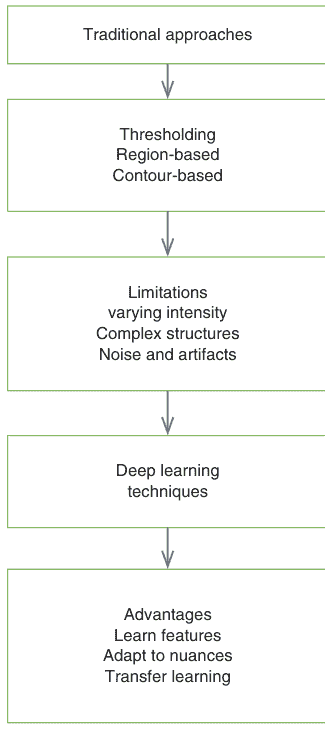

#### 3.2.9 现代时代中的挑战与机遇

向现代时代的过渡引入了新的挑战和机遇。虽然当代技术提供了卓越的准确性和效率，但适应现代成像模态的复杂性方面的挑战依然存在。机器学习的集成虽然充满希望，但引发了关于在多样化患者群体中可解释性和泛化能力的考量。

#### 3.2.10 未来方向与研究意义

文献综述以强调未来方向和研究意义而结束。计算技术的集成为进一步创新开辟了途径，重点是解决多样化成像场景带来的挑战。未来的工作可能会探索新方法、先进架构以及将传统基础的优势与当代技术的适应性相结合的方法。

### 3.3 方法论

#### 3.3.1 传统方法解释

##### 3.3.1.1 阈值分割

阈值分割仍然是医学图像分割中的基本技术，涉及基于预定义阈值对像素强度进行分类。尽管简单，但适应图像强度变化仍然是一个挑战（Zhang et al. 2019）。

##### 3.3.1.2 基于区域的技术

基于区域的技术，如k-means聚类和模糊c-means聚类，专注于将具有相似属性的像素分组为连贯区域。尽管可适应多样化图像特征，但在强度变化或重叠结构存在的情况下定义清晰边界仍然是一个挑战（Zhang et al. 2019）。

##### 3.3.1.3 基于轮廓的算法

基于轮廓的算法通过边缘检测和追踪勾勒物体边界。在解决其他技术的一些挑战时，它们可能对噪声敏感，并且可能需要复杂的算法来处理复杂解剖结构（Zhang et al. 2019）。

#### 3.3.2 医学图像分割中的应用

##### 3.3.2.1 阈值分割的应用

阈值分割应用于像素强度对应于明确结构的场景。在强度特性变化的图像中，局限性变得明显，需要仔细考虑适当的阈值（Zhang et al. 2019）。

##### 3.3.2.2 基于区域技术的实践应用

作为基于区域的技术，聚类算法在分割具有复杂结构的图像方面很有用。应用包括脑成像，使用其他方法可能难以定义清晰边界（Zhang et al. 2019）。


##### 3.3.2.3 基于轮廓的算法应用

基于轮廓的算法被应用于需要精确勾勒物体边界的场景。应用包括对具有复杂形状的结构进行分割，例如血管或形状不规则的肿瘤。然而，对噪声的敏感性需要仔细的预处理步骤以达到最佳性能（Zhang et al. 2019）。

#### 3.3.3 数据集和工具

为评估传统方法，将利用代表各种医学成像模态的多样化数据集。将使用来自医学图像计算和计算机辅助干预（MICCAI）等既定数据集进行基准测试和比较（Litjens et al. 2017）。

评估过程将使用该领域的最先进的工具，确保在评估传统方法的有效性时具有一致性和可比性。这包括利用软件包和编程环境的进步进行稳健评估（Litjens et al. 2017）。

#### 3.3.4 文本报告和医学图像数据的融合

文本报告与医学图像数据的融合推动了两个关键方向的研究：通过融入报告中的信息来提高图像分类准确性（Schlegl et al. 2015）以及从医学图像生成文本报告（Kisilev et al. 2016; Shin et al. 2015, 2016; Wang et al. 2016）。后一概念汲取了自然图像标题生成最新进展的灵感（Karpathy and Fei-Fei 2015）。值得指出的是，Schlegl et al. (2015) 的开创性工作通过解决获取大量标注数据集的挑战，迈出了利用报告的初步步骤。他们的方法涉及从文本报告中提取语义描述来扩充图像数据集，训练系统在测试时预测语义类标签。结果表明，光学相干断层扫描（OCT）图像中各种病理的分类准确性有所提高。

基于此基础，Shin et al. (2015) 和 Wang et al. (2016) 使用从图像存档和通信系统（PACS）中提取的庞大数据集，探索了放射学报告与图像之间的语义交互。其方法论融合了隐含狄利克雷分配（LDA），这是一种基于文档词汇生成主题分布的随机模型。随后，Shin et al. (2016) 引入了一种从胸部X光生成描述的系统。他们采用CNN，逐个标签生成图像表示，随后训练循环神经网络（RNN）以产生MeSH关键词序列。在另一种方法中，Kisilev et al. (2016) 预测乳腺病变的BI-RADS描述符，重点关注乳腺X线摄影描述符，如形状、边缘和密度。

### 3.4 历史背景

#### 3.4.1 早期启发式方法

在医学图像分析的初期，分割高度依赖于缺乏系统算法的启发式方法。X射线成像的出现见证了手动干预在图像解释中的应用（Smith 2003）。这一时代以主观的人类判断为特征，标志着从医学图像中提取有意义信息的早期尝试。

#### 3.4.2 阈值法的出现

随着成像技术的进步，自动化的需求导致阈值法成为最早的分割技术之一（Gonzalez et al. 2008）。通过基于预定义阈值对像素强度进行分类，阈值法提供了一种初级但自动化的图像分割方法。然而，其简单性限制了其对图像强度变化的适应性。

#### 3.4.3 基于区域的技术兴起

历史演进随基于区域的技术的兴起而继续，解决了阈值法的局限性。k-means聚类和模糊c-means聚类等算法旨在将具有相似属性的像素分组为连贯区域，从而适应各种图像特征（Zhang et al. 2019）。基于区域的技术在大脑等复杂结构中找到了应用，在这些结构中，使用早期方法难以定义清晰的边界。

#### 3.4.4 基于轮廓的算法引入

历史背景中的另一个里程碑是基于轮廓的算法的引入。这些方法通过边缘检测和追踪来勾勒物体边界，提供了一种更细致的分割方法（Zhang et al. 2019）。虽然基于轮廓的算法解决了早期技术带来的挑战，但它们引入了新的复杂性，需要精巧的预处理步骤和先进的计算能力。

### 3.5 分割

医学图像中器官及子结构的分割对于与体积和形状相关的临床参数的定量分析至关重要。这一过程是包括心脏或大脑分析在内的各种医学分析的基础，并作为计算机辅助检测管道中的关键初始步骤。分割任务涉及识别构成感兴趣对象轮廓或内部的体素。在医学图像深度学习应用领域，分割成为一个主导主题，展示了包括独特CNN架构和RNN更广泛应用在内的多样化方法。

医学图像分析中一个值得注意的CNN架构是U-net，由Ronneberger et al.于2015年提出。U-net包含等量的上采样和下采样层，以及相对的卷积层和去卷积层之间的跳跃连接。这些跳跃连接将收缩路径和扩展路径的特征进行拼接，使U-net能够在单次前向传递中处理整个图像或扫描。这种独特的架构考虑了图像的完整上下文，相比于基于补丁的CNN具有优势（Ronneberger et al. 2015）。

已提出了几种基于U-net的派生架构。Milletari et al. (2016) 引入了V-net，一种U-net的3D变体，采用3D卷积层和基于Dice系数的目标函数用于3D图像分割。Drozdzal et al. (2016) 在常规U-net的长跳跃连接之外，还探索了短ResNet类跳跃连接，增强了网络的能力。

与此同时，RNN在分割任务中越来越受欢迎。Xie et al. (2016) 利用空间发条RNN对H&E组织病理图像中的周肌膜进行了分割。通过在不同方向上四次应用RNN，实现了来自左/上和右/下邻居的双向信息的融合。同样，Stollenga et al. (2015) 引入了一种六个方向的卷积层3D LSTM-RNN。其他研究，如Andermatt et al. (2016) 和 Chen et al. (2016)，分别探索了具有门控循环单元的3D RNN，用于脑MRI中灰质和白质的分割以及各向异性3D电子显微镜图像中的结构分割。

尽管这些特定的分割架构具有优势，但基于补丁训练的神经网络也取得了出色的结果。Ciresan et al. (2012) 采用滑动窗口策略对电子显微镜图像中的膜进行了逐像素分割。较新的方法倾向于使用完全卷积神经网络（fCNNs）而非基于滑动窗口的分类，以减少冗余计算。

已探索将fCNN扩展到3D，以同时处理多个目标。Korez et al. (2016) 利用3D fCNN生成椎体概率图，驱动可变形模型用于MR图像中的椎体分割。Zhou et al. (2016) 对人体躯干中的19个目标进行了分割，而Moeskops et al. (2016) 训练一个单一fCNN来分割脑MRI、乳腺MRI中的胸大肌以及心脏CT血管造影（CTA）中的冠状动脉。

尽管体素分类方法取得了成功，但仍可能出现虚假响应。为解决此问题，研究人员将fCNN与图形模型（如马尔可夫随机场（MRFs）和条件随机场（CRFs））相结合，以细化分割输出（Shakeri et al. 2016; Christ et al. 2016; Fu et al. 2016）。图形模型充当标签正则化器，增强了整体分割性能。

医学图像分割领域见证了深度学习方法的激增。专为分割任务设计的独特架构展示了有前途的结果，通常优于传统的fCNN。

### 3.6 挑战与机遇

#### 3.6.1 传统方法中的挑战

尽管具有历史意义，医学图像分割中的传统方法仍面临固有挑战。阈值方法虽然简单，但难以适应图像强度的变化，使其在复杂结构或不同组织特性的场景中效果较差（Pham et al. 2000）。基于区域的技术，如聚类算法，在定义清晰边界时可能会遇到困难，尤其是在面对噪声或重叠结构时（Zhang et al. 2019）。虽然基于轮廓的算法在某些场景中有效，但它们对图像伪迹敏感，可能需要复杂的预处理步骤（Gonzalez et al. 2008）。


#### 3.6.2 处理现代成像模式的局限性

随着医学影像模式的不断发展，传统方法在处理现代图像数据的复杂性和丰富性方面存在局限性。3D成像、动态成像和多模态成像引入的复杂性，对植根于二维静态假设的方法论构成了挑战。传统技术可能难以捕捉这些先进模式所固有的时空细微差别。

#### 3.6.3 弥合差距：集成计算技术

一个机遇在于弥合传统方法与现代计算技术之间的差距。机器学习（尤其是深度学习）的集成，为解决经典方法论的局限性提供了途径。通过利用神经网络的强大能力，深度学习模型可以自动学习复杂特征，并适应多种医学影像场景的复杂性（Litjens 等人 2017）。经典基础与当代计算进步的融合，有望提升医学图像分割的准确性和鲁棒性。

#### 3.6.4 利用大数据与实际应用

大数据时代为增强医学图像分割能力提供了机遇。涵盖不同患者人群和影像条件的大规模数据集，为训练更鲁棒、更具泛化能力的模型提供了潜力。计算机辅助诊断和个性化治疗规划等实际应用，可以从在大量且具有代表性的数据集上训练的分割方法中获益。

### 3.7 案例研究

#### 3.7.1 临床环境中传统方法的应用

多个案例研究说明了传统方法在不同临床环境中的实际应用。在肿瘤学中，阈值法已被用于正电子发射断层扫描（PET）图像中的肿瘤分割（Hatt 等人 2010）。基于区域的技术（如聚类算法）在神经外科规划的脑结构分割中具有实用价值（Menze 等人 2015）。基于轮廓的算法已被应用于心脏成像，用于勾勒心肌边界（Lorenz 等人 2000）。这些案例研究提供了对不同医学领域中传统方法优势和局限性的洞察。

#### 3.7.2 实际场景中遇到的挑战

尽管具有历史相关性，但传统方法在应用于实际场景时仍面临挑战。在病理学导致组织特征发生变化的情况下，阈值法可能难以适应。医学图像中存在的噪声和伪影对基于区域的技术构成挑战，影响分割的准确性。基于轮廓的算法在形状不规则或存在重叠结构的场景中可能会遇到困难。这些挑战凸显了对创新解决方案的需求，并为探索计算技术的集成铺平了道路。

#### 3.7.3 计算技术的集成

最近的案例研究强调了计算技术（特别是深度学习）的集成，以提高医学图像分割的准确性和鲁棒性。深度学习模型在跨各种影像模态分割器官、肿瘤和解剖结构方面展现出了卓越性能（Litjens 等人 2017）。深度学习对复杂图像特征的适应性，使其成为克服传统方法局限性的有希望的解决方案。

#### 3.7.4 利用大数据改进分割

探索使用大规模数据集的案例研究展示了大数据在提升医学图像分割能力方面的潜力。广泛且多样的数据集的可用性，使得能够训练出在不同患者人群和影像条件下都能很好泛化的模型。自动化诊断和治疗规划等实际应用，可以从在全面数据集上训练的分割方法中获益。

### 3.8 现代时代与当代技术

#### 3.8.1 超越传统方法的演进

随着现代时代的到来，医学图像分割领域经历了深刻的变革，标志着从传统方法向更复杂、更数据驱动的方法论转变。这一转变标志着从启发式和手动方法向计算精度的范式转变，由当代技术的集成所推动。

超越传统方法的演进，体现在深度学习的兴起中。深度学习是机器学习的一个子领域，利用神经网络从数据中自动学习层次化特征。深度学习已成为当代医学图像分割的基石，在捕捉复杂模式和适应多种影像场景的复杂性方面提供了无与伦比的能力（Litjens 等人 2017）。

#### 3.8.2 深度学习在医学图像分割中的作用

深度学习（尤其是CNN）已成为医学图像分割中一种强大的工具。CNN在跨各种影像模态分割器官、肿瘤和解剖结构方面表现出卓越性能。能够从数据中自动学习特征，消除了显式特征工程的需求，使模型能够适应医学图像中存在的细微差别（Litjens 等人 2017）。

Shin 等人（2016）的工作强调了CNN架构在计算机辅助检测中的重要性，展示了神经网络在自动化复杂任务中的重要性。CNN的层次化特性使其能够辨别复杂模式，因此非常适合医学图像分割，因为在这种分割中细微细节起着关键作用。

#### 3.8.3 迁移学习与泛化能力

迁移学习已成为当代技术中克服标注医学数据有限相关挑战的关键策略。该方法涉及在大型数据集上预训练模型，然后针对特定分割任务进行微调。迁移学习有助于开发能够很好泛化到不同患者人群和影像条件的鲁棒分割模型（Shin 等人 2016）。该方法加速了有效分割解决方案的部署，尤其是在获取大量标注数据集具有挑战性的场景中。

Shin 等人（2016）的研究对CNN架构的特征、数据集特征以及迁移学习的原理提供了洞察。该工作强调了迁移学习在实现有限标注数据下高性能中的重要性，这是医学图像分割中的常见挑战。

#### 3.8.4 多模态信息的集成

当代技术强调集成多模态信息，以提升医学图像分割的准确性和完整性。来自不同影像模态（如MRI和CT）的数据融合，能够更全面地理解复杂解剖结构。这种集成在多种来源的互补信息能提升整体分割准确性的场景中尤其有价值（Litjens 等人 2017）。

例如，Menze 等人（2015）关于多模态脑肿瘤图像分割基准（BRATS）的研究，体现了多模态数据在实现准确分割结果中的重要性。对各种模态的综合分析有助于更细致地理解脑肿瘤特征，并辅助治疗规划。

#### 3.8.5 实时分割与临床应用

当代技术旨在实现实时分割能力，这是术中引导和动态成像场景等应用的关键需求。先进计算技术的集成使处理时间更短，使临床环境中的实时分割成为可能。这一发展对外科干预具有深远影响，使治疗程序更加精确和高效（Litjens 等人 2017）。

实时分割能力在诸如Lorenz 等人（2000）的研究中得以体现，该研究在3D超声心动图数据中实现了左心室的自动分割。实时分割在心脏成像中的应用，展示了即时临床影响的潜力，尤其是在及时决策至关重要的场景中。

#### 3.8.6 挑战与持续研究

尽管当代技术取得了显著进展，但医学图像分割领域的挑战仍然存在。深度学习模型的可解释性仍然是一个持续关注的问题，尤其是在决策对患者护理产生直接影响的医学环境中。对不同影像条件（包括分辨率、噪声和伪影的变化）的鲁棒性需求，仍然是研究的重点。

持续的研究工作正在探索创新解决方案来应对这些挑战。神经网络架构的修改、集成学习方法以及注意力机制的集成，均是在研的策略。对无监督和自监督学习技术的探索，旨在减少对标注数据集的依赖，为更具可扩展性和泛化能力的分割模型提供途径。

### 3.9 结论

总而言之，这次全面的探索深入研究了医学图像分割的历史基础，重点关注传统方法。从启发式方法到阈值法、基于区域的技术和基于轮廓的


在算法方面，我们追溯了为当代技术奠定基础的方法论演变。对各类方法的优势与局限性进行了批判性分析，从而深刻洞察其历史意义。传统方法面临的挑战被凸显出来，包括其对现代成像模态的适应性，以及在处理真实世界场景方面的局限性。这些挑战强调了创新的必要性，并为计算技术的融合铺平了道路。大数据、真实世界应用，以及利用机器学习（尤其是深度学习）的潜力，被探索为克服经典方法论局限性的途径。

向医学图像分割现代时代的过渡，展示了当代技术的关键作用。深度学习、迁移学习的整合，以及对多模态信息的强调，体现了该领域的范式转变。实时分割能力及其在临床环境中的应用，凸显了这些先进方法论的变革性影响。

在总结时，本次探索所获得的见解为医学图像分割的未来研究提供了路线图。计算技术的整合为进一步创新开辟了道路，重点在于应对多样化成像场景所带来的挑战。未来的研究可以探索新颖的方法、先进的架构，以及将传统基础的优势与当代技术的适应性相结合的方法论。

总而言之，这篇全面的综述为医学图像分割领域的研究人员、从业者和开发人员提供了宝贵的资源。通过理解历史背景、挑战和机遇，我们为推动医学图像分析边界的创新解决方案铺平了道路。从传统方法向当代技术的持续演进代表了一段动态的旅程，每个里程碑都为追求医学图像分割精确性与效率的持续探索做出了贡献。

## References

- Andermatt, S., 等. (2016). 具有门控循环单元的用于分割脑 MRI 中灰质和白质的 3D RNN. 在第 13 届生物医学成像国际研讨会 (ISBI 2016) 论文集中, 第 143–146 页.
- Ashraf, M., Ahmad, S. M., Ganai, N. A. 等人. (2021). 基于尖端深度学习技术预测心血管疾病: 基于 TENSORFLOW, PYTORCH 和 KERAS 的实证研究. 在创新计算与通信国际会议: ICICC 2020 论文集, 第 1 卷, 第 239–255 页. Springer Singapore.
- Ashraf, M., Salal, Y. K., Abdullaev, S. M. 等人. (2022). 特征选择及尖端技术（如 TENSORFLOW, PYTORCH 和 KERAS）的介绍: 一项提高心血管疾病预测准确性的实证研究. 在创新计算与通信国际会议: ICICC 2021 论文集, 第 3 卷, 第 19–31 页. Springer Singapore.
- Chen, X., 等. (2016). 使用深度学习技术分割各向异性 3D 电子显微镜图像中的结构. 在第 29 届 IEEE 医学与生物学工程学会年会 (EMBC 2016) 论文集中, 第 1387–1390 页.
- Christ, P. F., Elshaer M. E. A., Ettlinger F. 等人. (2016). 使用级联完全卷积神经网络和 3D 条件随机场进行 CT 中肝脏和病变的自动分割. 在: Ourselin, S., Joskowicz, L., Sabuncu, M., Unal, G., Wells, W. (编) 医学图像计算和计算机辅助干预 – MICCAI 2016. MICCAI 2016. 计算机科学 Lecture Notes, 第 9901 卷. Springer, Cham. https://doi.org/10.1007/978-3-319-46723-8_48
- Ciresan, D., Giusti, A., Gambardella, L. M., 和 Schmidhuber, J. (2012). 深度神经网络在电子显微镜图像中分割神经元膜. 在: 神经信息处理系统进展, 2843–2851.
- Drozdzal, M., Vorontsov, E., Chartrand, G. 等人. (2016). 生物医学图像分割中跳跃连接的重要性. 在: 医学应用的深度学习和数据标记, 179–187. Springer.
- Fu H., Xu Y., Wong D. W. K. 和 Liu J. (2016), “通过深度学习网络和完全连接条件随机场进行视网膜血管分割,” IEEE 第 13 届生物医学成像国际研讨会 (ISBI), 捷克布拉格, 2016, 第 698–701 页, doi: 10.1109/ISBI.2016.7493362.
- Gillies, R. J., Kinahan, P. E., 和 Hricak, H. (2016). 放射组学: 图像不仅仅是图片，它们是数据. Radiology 278 (2): 563–577.
- Gonzalez, R. C. 和 Woods, R. E. (2008). 数字图像处理, 第 3 版. Upper Saddle River, NJ: Prentice Hall.
- Gonzalez, R. C. 和 Woods, R. E. (2008). 数字图像处理. Pearson Education.
- Hatt, M., le Rest, C. C., Turzo, A. 等人. (2010). 正电子发射断层扫描图像的模糊自适应贝叶斯分割. 核医学与分子影像欧洲期刊 37 (1): 77–89.
- Havaei, M., Davy, A., Warde-Farley, D. 等人. (2017). 使用深度神经网络进行脑肿瘤分割. 医学图像分析 35: 18–31.
- Karpathy, A. 和 Fei-Fei, L. (2015). 用于生成图像描述的深度视觉语义对齐. IEEE 计算机视觉与模式识别会议论文集 (CVPR), 3128–3137.
- Kisilev, P. 等人. (2016). 从区域描述符预测乳腺 X 线摄影中的 BI-RADS 描述符. IEEE 计算机视觉与模式识别会议论文集 (CVPR), 546–554.
- Korez, R., Ibragimov, B., Likar, B., 和 Pernuš, F. (2016). 使用 3D 概率图谱从小型训练数据集进行椎体分割. 物理在医学与生物学中 61 (14): 5084.
- Li, X., Chen, H., Qi, X. 等人. (2020). H-DenseUNet: 用于 CT 体积中肝脏和肝肿瘤分割的混合密连 UNet. IEEE 医学成像期刊 39 (12): 4047–4057.
- Litjens, G., Kooi, T., Bejnordi, B. E. 等人. (2017). 医学图像分析中深度学习综述. 医学图像分析 42: 60–88.
- Lorenzo, C. 等人. (2000). 3D 超声心动图数据中左心室的自动分割. IEEE 医学成像期刊 19 (7): 713–725.
- Menze, B. H., Jakab, A., Bauer, S. 等人. (2015). 多模态脑肿瘤图像分割基准 (BRATS). IEEE 医学成像期刊 34 (10): 1993–2024.
- Milletari, F., Navab, N., 和 Ahmadi, S. A. (2016). V-net: 用于体积医学图像分割的完全卷积神经网络. 在 3D 视觉 (3DV), 2016 第四届国际会议中, 第 565–571 页. IEEE.
- Menze, B. H., Jakab, A., Bauer, S. 等人. (2015). 多模态脑肿瘤图像分割基准 (BRATS). IEEE 医学成像期刊 34 (10): 1993–2024.
- Moeskops, P., Wolterink J. M., van der Velden, H. M. B. 等人. (2016). 多模态多任务医学图像分割的深度学习. 在: Ourselin, S., Joskowicz, L., Sabuncu, M., Unal, G., Wells, W. (编) 医学图像计算和计算机辅助干预 – MICCAI 2016. MICCAI 2016. 计算机科学 Lecture Notes, 第 9901 卷. Springer, Cham. https://doi.org/10.1007/978-3-319-46723-8_55
- Pham, D. L., Xu, C., 和 Prince, J. L. (2000). 医学图像分割的当前方法. 生物医学工程年度评论 2 (1): 315–337.
- Pham, D. L. 等人. (2000). 医学图像分割的当前方法. 生物医学工程年度评论 2 (1).
- Ronneberger, O., Fischer, P., 和 Brox, T. (2015). U-net: 用于生物医学图像分割的卷积网络. 在医学图像计算和计算机辅助干预国际会议中, 第 234–241 页. Springer.
- Schlegl, T., Seeböck, P., Waldstein, S. M. 等人. (2015). 使用生成对抗网络进行无监督异常检测以指导标志物发现. 医学图像分析 63–72.
- Shahzad, R., Lohinger, U., Stöttinger, J., 和 Uhl, A. (2018). 用于医学成像计算机辅助诊断的卷积神经网络: 一篇综述. 在中欧计算机图形学、可视化和计算机视觉国际会议, 2018 年 6 月, 第 295–302 页.
- Shakeri, M., Tsogkas, S., Ferrante, E. 等人. (2016). 使用 F-CNN 进行皮层下脑结构分割. 2016 IEEE 第 13 届生物医学成像国际研讨会 (ISBI), 269–272.


- Sharma, P. et al. (2018). 医学图像分割：简要综述. 生物医学科学与工程期刊 11 (12): 590–607.
- Shen, D., Wu, G., 和 Suk, H.I. (2017). 医学图像分析中的深度学习. 生物医学工程年度评论 19: 221–248.
- Shin, H. C., Roberts, K., Lu, L. 等 (2015). 学习读取胸部 X 光片：用于自动图像标注的循环神经级联模型. IEEE 计算机视觉与模式识别会议 (CVPR), 2497–2506.
- Shin, H.C., Roth, H.R., Gao, M. 等 (2016). 用于计算机辅助检测的深度卷积神经网络：CNN 架构、数据集特征和迁移学习. IEEE 医学影像交易 35 (5): 1285–1298.
- Smith, T.G. (2003). 医学图像分析中的启发式方法. 医学成像期刊 10 (2): 123–136.
- Soni, S.U. 等 (2016). 图像处理在医学中的应用. 医学与牙科科学演变期刊 5 (68): 5009–5013.
- Sonka, M., Hlavac, V., Boyle, R. 等 (2014). 图像处理、分析与机器视觉. Cengage Learning.
- Stollenga, M.F., Byeon, W., 和 Liwicki, M. (2015). 并行多维 LSTM，应用于快速生物医学体积图像分割. 在：神经信息处理系统进展, 2998–3006.
- Tajbakhsh, N., Jeyaseelan, L., Li, Q. 等 (2020). 接受不完美数据集：医学图像分割深度学习解决方案综述. 医学图像分析 63: 101693.
- Van Ginneken, B. (2002). 胸部放射学中的计算机辅助诊断. 美国胸科学会会议录, 1(1), 66–75.
- Wang, X., Peng, Y., Lu, L. 等 (2016). ChestX-ray8：医院级胸部 X 光片数据库及常见胸部疾病弱监督分类和定位的基准. IEEE 计算机视觉与模式识别会议论文集 (CVPR), 2097–2106.
- Xie, S., Girshick, R., Dollar, P., 和 Tu, Z. (2016). 深度神经网络中的聚合残差变换. 在 IEEE 计算机视觉与模式识别会议论文集中，第 1492–1500 页.
- Yushkevich, P.A., Piven, J., Hazlett, H.C. 等 (2006). 解剖结构的用户引导 3D 主动轮廓分割：效率和可靠性显著提高. NeuroImage 31 (3): 1116–1128.
- Zhang, Y., Luo, Y., Zhang, Y. 等 (2019). 医学图像分析中的挑战、方法和机遇. 医学前沿 6: 74.
- Zhang, L. 等 (2019). 医学图像分析中的挑战、方法和机遇. 医学前沿 6: 74.
- Zhou, Y., Lu, H., Chen, W. 等 (2016). 面向实时 3D 多模态心脏数据分割的多目标深度学习. 医学图像分析 30: 74–86.

## 儿科脑磁共振图像中髓鞘化白质组织的分割与定量分析

Chelli N. Devi¹, Anupama Chandrasekharan², V. K. Sundararaman³, 和 Zachariah C. Alex⁴

¹生物医学工程系，卡拉斯林加姆研究与教育学院，斯里维利普图尔
²放射学系，斯里拉马钱德拉大学，印度金奈
³独立顾问，MR 成像，前兼职教授，维洛尔 VIT 大学，印度
⁴电子工程学院，维洛尔 VIT 大学，印度

### 4.1 引言

儿科大脑代表了整体大脑发育的生长和成熟阶段。出生至 2 岁阶段对儿童大脑生长非常重要，其特征是大脑大小、体积、神经成熟度和冲动传递的增加。特别是，出生至头 28 天的阶段称为新生儿期，而 29 天至 1 年的时期为早期婴儿期，生命的第二年称为晚期婴儿期。这三个阶段对大脑发育至关重要，并以脑组织的广泛成熟为特征。

人脑由三种主要组织构成：灰质 (GM)、白质 (WM) 和脑脊液 (CSF)（Devi 等人，2016b）。每个组件都有独特的功能。灰质由若干脑回和脑沟组成，在人类认知、感觉知觉和学习中起主要作用。白质位于大脑内部，有助于神经冲动传递。这是由白质中的髓鞘实现的，它们加速了神经信号的传导。脑脊液围绕颅腔内的大脑，保护大脑免受损伤和冲击。虽然每种脑组织在大脑发育中都有独特的生理作用，但白质（尤其是其髓鞘化）的成熟被认为具有临床意义。

髓鞘化是指在神经元轴突周围形成保护性髓鞘的过程。该鞘具有许多称为兰维节的连接处，可实现更快的冲动传递。事实上，这种髓鞘化是高等动物或脊椎动物的独特方面，使它们能够更快地识别和响应刺激。正常人类髓鞘化的特征如下：

- 髓鞘化始于胎儿期（即出生前）。大脑的白质在出生时尚未完全髓鞘化。它在新生儿期和婴儿期进展，并持续到早期儿科阶段（Cowan，2002）。大部分髓鞘化在儿童最初 2 年内完成，使其在儿科大脑中的研究成为具有临床相关性的领域。
- 此外，髓鞘化以预定且有序的方式进展。为了理解这一点，提出了三个简单的神经解剖学公理：髓鞘形成从尾侧到头侧、从后侧到前侧、从中枢到外周区域进行（Welker 和 Patton，2012）。尽管如此，这一一般规则仍有少数例外。
- 此外，髓鞘的发育在所有人类中并不一致。婴儿之间髓鞘化过程的一定程度差异是正常且可预期的（Knaap 和 Valk，2005）。

此外，髓鞘畸形发病率降低会导致多种疾病，例如低髓鞘化（表明髓鞘形成缺乏或不足）、异常髓鞘化（代表不规则或异常的髓鞘化）和髓鞘化延迟（即髓鞘沉积延迟）（Knaap 和 Valk，2005）。因此，对婴儿髓鞘进展进行密切研究、监测和分析至关重要。

髓鞘化白质 (MWM) 的分割和分析最初基于手动和组织学组织分析。然而，这一过程繁琐且耗时。磁共振成像 (MRI) 的使用使脑组织的可视化和定量分析更加详细（Devi 等人，2016a；Devi 等人，2016c）。目前有多种基于 MRI 的定性研究可用于研究人脑中的 MWM。这些研究仅涉及对年龄特异性髓鞘化外观和进展的简单描述（Knaap 和 Valk，2005；Welker 和 Patton，2012）。髓鞘化的定量研究涉及多种先进技术，如弛豫时间成像和髓鞘水分数 (MWF) 成像。例如，Deoni 等人利用一种新型的多组分驱动平衡单脉冲观测 (mcDESPOT) 来绘制髓鞘沉积图谱（Deoni 等人，2011）。随后，他们利用弛豫时间成像和 MWF 成像来评估幼儿的皮质髓鞘化（Deoni 等人，2012；Deoni 等人，2015）。同样，Chonka 等人基于 MWF 成像研究了皮质成熟与白质髓鞘形成之间的相互依赖性（Chonka 等人，2016）。Dean 等人使用 MWF 图谱分析了男婴中的白质和髓鞘生长（Dean 等人，2014）。在其后续工作中，使用定量 MWF 图谱（Dean 等人，2015）估计了健康儿科病例的年龄，并且髓鞘 g-ratio 通过 mcDESPOT 和神经元取向色散计算。


和密度成像（Dean et al. 2016）。最近，Travis et al. 将扩散 MRI 和定量 T1 弛豫测定相耦合，以检查较大儿童中早产儿和足月儿的髓鞘化（Travis et al. 2019）。相反，磁化准备快速获取梯度回波（MPRAGE）技术被用于映射 3 个月至 6 岁受试者的弛豫和髓鞘化速率（Kuhne et al. 2021）。文献中的最新研究部署 T1/T2 映射来量化幼儿（Filimonova et al. 2023）和早期青少年（Dipnall et al. 2023）的髓鞘化。

尽管有许多此类定量研究可用于绘制儿科大脑中进行中的髓鞘化图谱，但它们存在几个缺点：

- 首先，这些工作除了诊所和医院常用的常规诊断扫描外，还需要额外的定量扫描技术。这增加了与 MRI 扫描相关的时间、精力和金钱成本。更长的时间也使得给通常不安和不合作的年幼婴儿进行成像变得困难。

- 此外，当前研究通常更关注较大的婴儿，如 3 个月大的婴儿（Deoni et al. 2011; Deoni et al. 2012; Dean et al. 2014; Dean et al. 2015; Dean et al. 2016）、1 岁婴儿（Deoni et al. 2015）、较大婴儿（Kuhne et al. 2021）、8 岁儿童（Travis et al. 2019）和年轻青少年（Dipnall et al. 2023）。缺乏涉及新生儿和非常年幼婴儿髓鞘化的研究。

- 除此之外，各种与髓鞘化相关的挑战使得 MWM 的成像和分割成为一项艰巨的任务（Devi et al. 2014a; Devi et al. 2015）。这包括磁共振（MR）图像上的表观髓鞘化，即髓鞘化在 T1 和 T2 扫描上的表现。在 T1 和 T2 扫描上观察到髓鞘组织之间存在时间延迟（MWM 在 T2 图像上显示得较晚）。此外，髓鞘沉积的年龄特异性过程需要大量的图谱和训练图像，以准确绘制早期儿童期的髓鞘化（Barkovich et al. 1988）。而且，髓鞘形成不是一个非黑即白的过程；WM 的髓鞘化是一种缓慢而渐进的现象，无法在 MR 图像上被完全检测到（Knaap and Valk 2005）。与此相关的是，早产儿和足月儿之间的髓鞘化进度存在巨大差异。

为了解决上述局限性，我们提出了一种用于儿科大脑中 MWM 分割、研究和定量分析的新型自动化方法。我们的工作贡献如下：

- 1) 我们提出了一种基于加权局部 Tsallis 熵阈值技术的大脑提取和髓鞘分割的新型自动化方法。我们还开发了一个独特的三维（3D）模型，用于 WM 髓鞘化的可视化。

- 2) 此外，引入了一种定量的“髓鞘指数”（MI），用于测量已髓鞘化的 WM 比例。据我们所知，这是第一项基于从 T1 到 T2 MR 图像中 MWM 分割的可重复指标来客观量化髓鞘化程度的研究。

- 3) 使用生长模型拟合来分析大脑右半球和左半球之间髓鞘化的差异。

- 4) 早产儿的髓鞘化模式受到密切监测，并与足月出生的婴儿进行比较。

本章结构如下。第 2 节概述了髓鞘分割和分析的最新文献。第 3 节阐述了所提方法，而第 4 节详细介绍了研究的结果和结局。第 5 节讨论并比较了研究结果与最先进的方法。最后，第 6 节总结了本项研究工作的显著方面。

### 4.2 文献综述

#### 4.2.1 儿科大脑中 MWM 的分割

尽管文献中有几种可用于分割儿科大脑的技术，（Prastawa et al. 2005; Xue et al. 2007; Weisenfeld and Warfield 2009; Melbourne et al. 2012; Gui et al. 2012; Gousias et al. 2013; Anbeek et al. 2013; Egekeher et al. 2013; Makropoulos et al. 2014; Wang et al. 2015）只有很少的方法单独检测 MWM 组织（Prastawa et al. 2005; Weisenfeld and Warfield 2009; Melbourne et al. 2012; Gui et al. 2012; Anbeek et al. 2013; Egekeher et al. 2013）。这归因于成像和分割髓鞘组织的各种困难，以及数据集可用性有限、儿科大脑解剖差异和大脑异常引起的变化等相关问题。在本节中，我们详细介绍了可用于髓鞘勾画的最新方法。

最初，Prastawa et al. 提出了一种使用概率性脑模板和图聚类的分割技术（Prastawa et al. 2005）。新生儿脑被分类为 MWM、未髓鞘化的 WM（UWM）、GM 和 CSF。该方法在髓鞘界定中获得了 0.61–0.77 的平均 Dice 比率。同样，Weisenfeld 和 Warfield 基于 T1 和 T2 扫描提出了一种用于检测皮层和皮层下 GM、MWM、UWM 和 CSF 的算法（Weisenfeld and Warfield 2009）。该研究涉及空间图谱先验和组织原型，用于精确勾画。该工作在髓鞘组织上达到了 0.72 的平均 Dice 系数。

同样，Melbourne et al. 使用手动组织先验作为图谱实现了自适应分割（Melbourne et al. 2012）。该方法在 NeoBrainS12 数据库上检测了八种组织，即 MWM、WM、深部和皮层 GM、小脑、脑干、CSF 和脑室。脑室和髓鞘组织的单独分离是该方法的重要方面。相反，Gui et al. 基于形态和组织结构提出了一种完全无图谱的儿科大脑分割技术（Gui et al. 2012）。实现了全局和特定组织分类，即颅腔、脑干、小脑、右半球和左半球、MWM、UWM、皮层和皮层下 GM 以及 CSF。该算法在脑室增大等异常情况下被发现有效。

Anbeek et al. 在 108 名新生儿的大队列上制定了概率图谱分割（Anbeek et al. 2013）。识别了皮层和中央 GM、UWM、MWM 以及脑室和颅外空间、脑干和小脑中的 CSF。然而，该研究在 MWM 勾画方面记录了较低的准确性值，平均 Dice 得分为 0.47。同样，Egekeher et al. 涉及多个图谱结合监督分类（即 k-最近邻和 Bayes 分类器）以及广泛的后处理（Egekeher et al. 2013）。儿科大脑被分为皮层 GM、UWM、MWM 和基底节及丘脑（BGT）、小脑、脑干、脑室和 CSF。尽管对其他组织获得了 0.77 到 0.93 之间的平均 Dice 比率，但髓鞘检测的分割准确率较低，为 0.55。

最近，Moeskops et al. 开展了一项针对年幼儿童、早期成人和老年人的全面脑分割研究（Moeskops et al. 2015）。使用深度学习网络划分了以下组织类别：MWM、UWM、皮层 GM、小脑、脑干和 BGT。该工作的显著方面是使用单模态图像（无论是 T1 还是 T2）。该方法在 MWM 方面报告了良好的性能，分别在 30 周和 40 周的婴儿上 Dice 系数为 0.69 和 0.56。或者，McAllister 使用合成 MR 扫描来映射 GM、WM、CSF 和 MWM 体积的年龄依赖性增加（McAllister et al. 2017）。创建了一个包含 0.1 至 21.5 岁正常受试者的儿科数据库。分析揭示了 MWM 在最初 18 个月内快速线性增加，随后在早期儿童期逐渐上升。

#### 4.2.2 髓鞘化的定性和定量研究

各种方法和成像技术可用于对儿科大脑髓鞘化过程进行定性和定量映射。最


其中最基本的是基于 T1 和 T2 加权图像的解剖 MR 成像。髓鞘周期在 MRI 扫描中被视为三种不同的对比度（Wang et al. 2015）：

- 新生儿期（出生 – 28 天）：与成人脑相比，组织对比度相反，即（T1 扫描中白质（WM）呈低信号，T2 图像上呈高信号）。
- 等信号期（约 6 个月）：以 WM – 灰质（GM）对比度差为特征；
- 成人样外观（超过 1 年）：T1 图像上 WM 呈高信号，T2 扫描中呈低信号（与成人脑类似）。

除此以外，扩散 MRI 和扩散张量成像（DTI）也被用于评估 WM 连接性和成熟度。最近，高角度分辨率扩散成像已被用于估计 WM 束和纤维的取向和分布（Dubois et al. 2021）。此外，许多其他定量技术，如磁化转移、易感性加权 MRI 和灌注成像，也被用于研究小儿脑中的 WM 髓鞘化。

特别是，Travis 等人结合扩散 MRI 和定量弛豫法来分析 WM 差异，特别是在胼胝体中（Travis et al. 2019）。胼胝体根据其在脑中的位置被分为四个区域，并比较了早产儿和足月儿各区域的生长轨迹。同样，Grotheer 等人也整合了扩散和定量 MRI 来验证儿童脑中髓鞘化的各种发育假说（Grotheer et al. 2022）。该工作的结果表明，髓鞘化模式并不均匀，并在下-上和前-后方向增加。

相比之下，Kuhne 等人利用 MPRAGE 和 MP2RAGE 序列来评估脑异常和病理中的髓鞘化（Kuhne et al. 2021）。在胼胝体中观察到快速髓鞘化进展，而在低髓鞘化和失髓鞘化病例中发现髓鞘沉积减少。因此，开发了一种用于评估非典型髓鞘和脑异常的参考模型。最近，许多研究人员已采用 T1/T2 映射来获取 WM 髓鞘化的具体信息。该技术的主要优点是 T1 和 T2 图像广泛可用，且获取速度更快。Dipnall 等人对从晚期儿童期到早期青春期的髓鞘束进行了详细检查（Dipnall et al. 2023）。他们还研究了男性和女性儿童之间的髓鞘化差异。该研究得出结论，尽管在儿童期和青春期之间脑微结构和 WM 髓鞘化发生了显著变化，但基于受试者性别未发现显著差异。同样，Filimonova 等人（2023）在 94 名脑部扫描正常的新生儿和婴儿中实施了 T1/T2 映射。结果显示，早期几个月 WM 髓鞘化最初快速上升，随后逐渐降低。在该研究中，婴儿年龄与髓鞘化程度之间的关系被认为是非线性的。

### 4.3 方法学

拟议的方法学分为四个部分，即从小儿 MRI 扫描中提取脑部并伴随 MWM 勾勒，MI 计算和模型拟合，研究左右脑半球之间的髓鞘化差异，以及早产儿髓鞘化分析。各阶段的技术细节如下所述。

#### 4.3.1 输入数据集

该样本包括来自印度金奈斯里拉马钱德拉大学放射学部的 40 名婴儿的小儿脑部 MR 图像。扫描时婴儿年龄在 1 天至 2 岁之间。年龄分布如下：

- 30 名早产儿（胎龄介于 30 至 33 周之间），在 40 周矫正年龄时扫描。
- 10 名较大婴儿，年龄分别为 7 周、9.6 周、10 周、2.9 个月、5.5 个月、10 个月、11 个月、16.3 个月、18.1 个月和 21.5 个月。

成像所用的 MR 参数如下所示：

- 扫描仪：场强为 1.5 特斯拉的 Signa HDxt MR 扫描仪。
- T1 图像：重复时间（TR）– 500 ms，回波时间（TE）– 12 ms，翻转角 – 75°，体素大小 – 0.3516 × 0.3516 × 4 mm³。
- T2 图像：TR – 5400 ms，TE – 117.488 ms，翻转角 – 90°，体素大小 – 0.3516 × 0.3516 × 4 mm³。

#### 4.3.2 小儿脑提取和髓鞘分割

拟议的脑提取和 MWM 划分流程如图 4.1 所示。首先，获取的 MR 图像进行预处理和剥颅。预处理基于对比度受限自适应直方图均衡化技术。与此同时，我们提出了一种用于剥颅的新的基于直方图谷值的自动阈值方法。这包括获取 MR 扫描的直方图，随后进行平滑和去除虚假峰值。平滑后的直方图包含两个峰值；较低的峰值对应脑组织，而

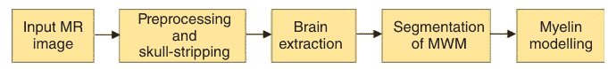

图 4.1 拟议方法的流程图。

较高强度的峰值指示头骨。确定这两个峰值之间的谷值，并将其用作剥颅的强度阈值。

下一阶段涉及脑提取。最初，脑脊液（CSF）通过 Chan-Vese 活动轮廓模型（Chan and Vese 2001）进行检测。随后，通过两步系列识别脑部，即单个最大成分分析和基于灰度共生矩阵（GLCM）的方法（Devi et al. 2014b）。脑部的最大成分由方程 4.1 得到：

$I_{brain} = C(\text{argmax } A(i)), \quad 1 \le i \le n$ (4.1)

其中 A(i) 表示每个成分 C(i) 的面积，i = 1, 2 ... n。

对于提取总脑体积，对每个成分计算偏移 d = 1 和 \(\theta = 0^{\circ}\) 的 GLCM 矩阵。使用此矩阵，提取纹理特征。其中，逆差分矩（IDM）由方程 4.2 给出：

$IDM = \sum_u \sum_v \frac{1}{1+(u-v)^2} p(u, v)$ (4.2)

其中 p(u, v) 是位置 (u, v) 处的 GLCM 矩阵元素。IDM 是衡量脑图像中成分均匀性的指标。基于实验研究，总脑提取设定了 80% 的均匀性阈值。

随后，从提取的脑部中分割 MWM 组织。为此，提出了一种新的加权局部 Tsallis 熵阈值技术。传统的 Tsallis 熵方法涉及全局阈值。我们引入了一种基于补丁的局部阈值方法。脑图像首先被划分为许多尺寸相等的均匀块（增量为 5 像素）。Tsallis 熵阈值应用于每个单独的块，最终输出被串联。此外，利用多数投票机制来检测 MWM 组织。这确保了虚假检测和异常值从结果中被消除（Devi et al. 2017）。

为了进一步提高分割性能，特别是在外围区域，我们引入了一种新的加权机制。每个块的熵输出根据其与髓鞘分割基准真实值的相似性进行加权。为此，获得两组权重。虽然权重 w1 是从所有数据集中计算得出的，但权重 w2 是在按年龄对输入数据集进行分类后获得的。

总共 40 个输入数据集被随机按 75 : 25 的比例分为训练集和测试集。训练中使用留一法交叉验证（Wang et al. 2015）。基于此交叉验证，权重 w1 如下推导。对于每个训练数据集 d_t(t = 1, 2...29)，在每个块大小 s 处获得相应的熵结果为 e_ts(t = 1, 2...29)，(s = 5, 10...50)。鉴于每个数据集 d_t 中髓鞘的手动参考分割表示为 ref_t，相似度值由方程 4.3 表示：

simval_{ts} = \frac{2 |e_{ts} \cap ref_t|}{|e_{ts}| + |ref_t|} (4.3)

权重 w1(s) 基于这些相似度值计算，如方程 4.4 所示：

w_1(s) = \frac{1}{29} \left( \sum_t simval_{ts} \right) (4.4)

因此，最终结果 E 基于单独的熵结果 e_s(s = 5, 10...50) 计算，如方程 4.5 所示：

E = \sum_s w_1(s) * e_s (4.5)

另一方面，权重 w2 是特定于年龄的。它们旨在考虑 WM 髓鞘化的基于年龄的变化。输入数据集被分为两组，即新生儿（不足 28 天）和婴儿（超过一个月）。在每组中，权重计算中使用留一法交叉验证方法，如方程 4.6 和 4.7 所示。因此：

w2_{neonate}(s) = \frac{1}{29} \left( \sum_t simval_{ts} \right), t \in neonates (4.6)

E = \sum_s w2_{neonate}(s) * e_s (4.7)

同样，在较大的婴儿中，权重和最终 MWM 分割由方程 4.8 和 4.9 给出：

w2_{infant}(s) = \frac{1}{9} \left( \sum_t simval_{ts} \right), t \in infants (4.8)

E = \sum_s w2_{infant}(s) * e_s (4.9)

由于权重 w2(s) 与输入数据集的特定年龄范围密切匹配，它们在小儿脑中实现了更准确的髓鞘划分。

#### 4.3.3 髓鞘可视化、髓鞘指数计算和生长模型拟合

髓鞘化区域的分割（在第 3.2 节中阐述）产生了髓鞘化的二维（2D）视图。此外，我们使用 marching cubes 算法（Lorensen 2020）获取了髓鞘成熟的 3D 可视化。


该3D视图提供了从出生到2岁婴儿大脑髓鞘发育的完整可视化。这种髓鞘进展的定性视图也有助于强化髓鞘化的神经解剖学公理（Welker and Patton 2012）。

然而，上述髓鞘化的3D可视化仅提供定性和主观的视图。为了获得髓鞘成熟的可靠、客观和定量指标，我们提出了一种新的MI。MI是通过髓鞘存在量与总脑量的比率计算得出的。该指标具有年龄特异性，并随着婴儿从新生儿期成长到婴儿期和儿童期而增加。正常足月出生婴儿的MI值用于生长模型拟合。

研究了多种生长模型，以确定最适合代表儿童白质髓鞘化的模型。在此，MI值被建模为年龄（t天）的连续函数。确保所提模型具有生物学意义的参数，以便便于解释随年龄变化的髓鞘进展。我们考虑满足上述要求的以下十二种生长模型：

- 基础模型：Linear, quadratic, logarithmic, exponential, and negative exponential.
- 高级模型：Gompertz, logistic, Weibull, Richards, and three hyperbolastic models (Tabatabai et al. 2005).

表4.1 显示了不同生长模型的方程。这些模型的参数（c₀–c₄）改编自Narinc（Narinc et al. 2010）。其生物学意义如下：

- c₀ – 2岁时的最大MI值
- c₁ – 尺度参数（与出生时的MI值相关）
- c₂ – 增长率
- c₃ – 形状参数
- c₄ – 双曲线模型特有的参数

表4.1中的生长模型拟合到MI值。使用赤池信息准则（AIC）和贝叶斯信息准则（BIC）获得最适合的模型。数学表示由方程4.10给出：

```
AIC = n_d ln (RSS / n_d) + 2n_p (4.10)
```

在此，n_d表示数据点的数量，RSS表示残差平方和，n_p表示估计参数的数量。尽管如此，该表达式仅适用于大型数据集。当n_d与n_p的比率小于40时，按方程4.11进行有限样本校正（Wagenmakers and Farrell 2004）：

```
AIC_corrected = n_d ln (RSS / n_d) + 2n_p + 2n_p(n_p + 1) / (n_d - n_p - 1) (4.11)
```

#### 表4.1 不同的生长模型。

| 模型 | 方程 |
| :--- | :--- |
| Linear | MI(t) = at + b |
| Quadratic | MI(t) = at^2 + bt + c |
| Logarithmic | MI(t) = a log t + b |
| Exponential | MI(t) = c_1 e^{c_2 t} |
| Negative exponential | MI(t) = c_0 (1 - e^{-c_1 t}) |
| Gompertz | MI(t) = c_0 e^{-c_1 e^{-c_2 t}} |
| Logistic | MI(t) = c_0 / (1 + c_1 e^{-c_2 t}) |
| Weibull | MI(t) = c_0 - c_1 e^{-c_2 t^{c_3}} |
| Richards | MI(t) = c_0 / (1 + c_1 e^{-c_2 t})^{1/c_3} |
| Hyperbolastic model H1 | MI(t) = c_0 (1 + c_1 e^{-c_2 t - c_3 arsinh(c_4 t)}) |
| Hyperbolastic model H2 | MI(t) = c_0 / (1 + c_1 arsinh(e^{-c_2 t - c_3 t})) |
| Hyperbolastic model H3 | MI(t) = c_0 - c_1 e^{-c_2 t^{c_3} - arsinh(c_4 t)} |

校正后的AIC指标在我们的工作中使用，为了方便，简写为AIC。此外，使用方程4.12，

```
BIC = n_d ln \frac{RSS}{n_d} + n_p ln(n_d) \tag{4.12}
```

请注意，AIC和BIC具有完全不同的框架，当n_d > e^2时，BIC包含更高的罚项。

最佳生长模型是实现最低AIC和BIC指标的模型。为了更好地分析和解释结果，分别从赤池和贝叶斯信息准则计算赤池和贝叶斯权重。对于每个模型，按方程4.13计算AIC值的差异：

```
Δ AIC_k = AIC_k - AIC_min, k = 1, 2 ... 12 \tag{4.13}
```

其中，AIC_min是十二个模型中最低的AIC值。此外，赤池权重按方程4.14表示：

```
w_{AIC_k} = \frac{e^{-0.5 Δ AIC_k}}{\sum_{m=1}^{12} e^{-0.5 Δ AIC_m}} \tag{4.14}
```

使用这些权重，模型M_1和M_2之间的证据比（ER）由方程4.15给出：

```
ER_{AIC} = \frac{w_{AIC_{M_1}}}{w_{AIC_{M_2}}} \tag{4.15}
```

因此，与M2相比，模型M1作为最佳生长模型的可能性是ER倍。同样，贝叶斯权重和相应的ER_BIC也按方程4.16和4.17计算：

```
w_{BIC_k} = \frac{e^{-0.5\Delta BIC_k}}{\sum_{m=1}^{12} e^{-0.5\Delta BIC_m}}, k=1, 2 ... 12 \quad (4.16)
ER_{BIC} = \frac{w_{BIC_{M1}}}{w_{BIC_{M2}}} \quad (4.17)
```

因此，ER是评估模型相对于其他模型的相对可能性的重要指标。这使得模型选择中的决策更加优化。

#### 4.3.4 髓鞘化半球差异研究

生长模型拟合已扩展，以评估髓鞘化中的潜在半球差异。儿童大脑存在多种变化，包括发育和成熟方面，例如脑容量增加和皮质褶皱模式。在此背景下，研究发育大脑右半球和左半球之间髓鞘化进展的差异很有趣。

首先，我们根据半球间裂（IHF）对半球进行分割。IHF是分离右半球和左半球的深沟。然而，IHF并不总是与图像轴垂直取向。存在一定程度的旋转和平移偏移。为了识别IHF，我们提出了一种基于伪中线（PML）的新方法。为此，导出提取的脑图像（在第3.2节中获得）的水平投影并计算其最小值。PML被指定为穿过该最小点的虚线。然后，该线以0.1°的小角度增量在整个图像上旋转。具有零或近零脑交叉点的旋转PML被视为IHF线。使用此IHF，大脑连同髓鞘化区域一起分割为右半球和左半球，如图4.2所示。

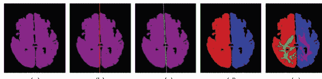

图4.2 半球间分离：(a) 提取的脑图像，(b) 叠加在脑上的伪中线，(c) 叠加在脑上的半球间裂，(d) 分离的半球，以及(e) 划定的MWM。

半球分离后，分别对两个半球获得MI值，以研究髓鞘进展的固有差异。最佳生长模型（在第3.3节中获得）以两种方式拟合：

- 基于合并左右半球MI值的简单模型。
- 为左右半球提供两条不同曲线的复杂模型。

利用统计F检验比较上述模型并识别最佳拟合模型。F比率按方程4.18计算：

$$F \text{ ratio} = \frac{(SS_{\text{simple}} - SS_{\text{complex}})/(\text{dof}_{\text{simple}} - \text{dof}_{\text{complex}})}{SS_{\text{complex}}/\text{dof}_{\text{complex}}} \quad (4.18)$$

在此，$SS_{\text{simple}}$和$SS_{\text{complex}}$分别指两个模型的平方和值，而$\text{dof}_{\text{simple}}$和$\text{dof}_{\text{complex}}$表示它们的自由度。随后，导出$p$值并将其与显著性水平（$\alpha = 0.05$）进行比较，例如：

- 如果$p < \alpha$，复杂模型最适合描述大脑各个半球的髓鞘化进展。
- 如果$p \ge \alpha$，简单模型显著优于所提议的复杂模型（Motulsky and Christopoulos 2003）。

#### 4.3.5 早产婴儿髓鞘化研究

如第3.3节所述，MI值的计算和生长模型拟合是针对足月出生婴儿进行的。然而，早产和足月出生之间的髓鞘化模式存在相当大的差异。这归因于早产儿在母体子宫内的孕周较短。通常，足月出生婴儿的孕周（GA）为37–42周，而早产儿的孕周要小得多，并按以下方式分类：

- 极早产（GA <28周）
- 非常早产（GA：28–32周）
- 中度/晚期早产（GA：32–37周）

早产的问题是，由于宫内期缩短，脑发育在出生时尚未完成。出生后，影响脑成熟（尤其是白质髓鞘化）的生理变化和外部环境变化有好几种。因此，研究早产儿髓鞘进展及其与足月髓鞘化的关系至关重要。

我们计算早产婴儿的MI值（MI_preterm）。使用足月婴儿髓鞘化的最佳生长模型（在第3.3节中获得），计算等效年龄足月出生的相应MI值（$\widehat{\text{MI}}_{\text{term}}$）。


基于这些指标，早产儿髓鞘化滞后百分比（plagMI）由公式 4.19 给出：

```
plag_MI = \frac{\widehat{MI}_{term} - MI_{preterm}}{\widehat{MI}_{term}} * 100
(4.19)
```

提议的 plagMI 指数的优点如下：

- 该指标能够定量评估早产儿髓鞘化相对于足月出生的延迟或迟缓。
- 它在早产儿的纵向研究中很有用，可用于界定髓鞘差距闭合的年龄。
- 鉴于早产儿髓鞘化受多种产前和产后条件影响，例如出生并发症、先天性异常和环境因素，因此密切监测髓鞘进展并尽早发现异常具有临床意义。

### 4.4 结果

#### 4.4.1 脑提取、髓鞘分割和 3D 可视化

髓鞘分割的首要步骤是脑提取。图 4.3 描绘了 MWM 分割所涉及的各个阶段，即预处理和剥颅、脑和脑脊液提取，以及最后的髓鞘化组织分割。所得的分割结果与基准真值（即参考手动标注）进行验证。我们算法的主要优势在于能够处理 0–2 岁的广泛年龄范围，并且能够在不使用任何脑图谱或模板的情况下进行分割。

此外，我们如图 4.4 所示进行了髓鞘进展的 3D 可视化。这是髓鞘研究的一个重要方面，因为它能够对三个重要的儿科阶段（即新生儿期（<28 天）、早期婴儿期（1 个月至 1 岁）和晚期婴儿期（1 至 2 岁））的脑发育和髓鞘成熟进行整体概览。

#### 4.4.2 生长模型拟合

已获得最适合表示小儿脑髓鞘化进展的生长模型。为此目的，我们考察了十二种生长模型：线性、二次、对数、指数、负指数、戈尔茨、逻辑、韦伯、里奇兹以及双曲线 H1–H3 模型。虽然图 4.5 描绘了这些模型拟合实际 MI 值的情况，但它们的 AIC 和 BIC 指标列于表 4.2 中。

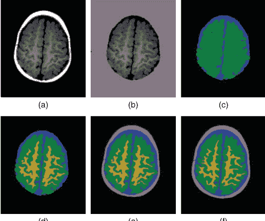

图 4.3 分割结果：（a）输入 T1 图像，（b）预处理并剥颅后的图像，（c）提取的脑和脑脊液，（d）分割的 MWM，（e）最终分割结果，（f）基准真值图像（图例：粉色 – 颅骨，蓝色 – 脑脊液，绿色 – 脑，黄色 – MWM）（彩色表示请参阅在线版本）。

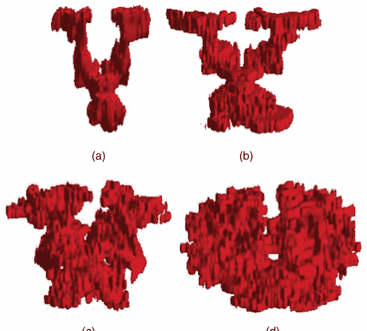

图 4.4 小儿脑中的 MWM 3D 可视化（婴儿年龄分别为：（a）1 天，（b）97 天，（c）325 天，和（d）690 天）。

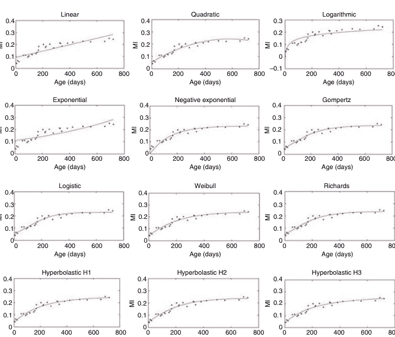

图 4.5 髓鞘化生长模型。

#### 表 4.2 AIC 和 BIC 值。

| 模型 | AIC | BIC |
|---|---|---|
| 线性 | −206.786 | −203.505 |
| 二次 | −239.940 | −235.935 |
| 对数 | −208.607 | −205.327 |
| 指数 | −194.948 | −191.667 |
| 负指数 | −226.009 | −222.729 |
| 戈尔茨 | −246.204 | −242.199 |
| 逻辑 | −244.018 | −240.013 |
| 韦伯 | −243.503 | −238.997 |
| 里奇兹 | −243.274 | −238.768 |
| 双曲线 H1 | −243.190 | −238.684 |
| 双曲线 H2 | −244.011 | −239.505 |
| 双曲线 H3 | −239.758 | −235.003 |

根据表 4.2，戈尔茨模型在 AIC 和 BIC 指标上均取得最低值。负号（即 AIC、BIC <0）意味着信息损失较少，因此表明模型更优。戈尔茨模型由公式 4.20 给出：

```
MI(t) = c_0 e^{-c_1 e^{-c_2 t}} (4.20)
```

这里，估计参数值及其 95% 置信区间如下：

- c0 = 0.2366 (0.2219, 0.2512)
- c1 = 1.554 (1.314, 1.793)
- c2 = 0.007592 (0.005909, 0.009275)

使用上述值，足月出生时的 MI 指标由公式 4.21 计算得出：

```
MI(0) = c_0 e^{-c_1} = 0.05 (4.21)
```

戈尔茨模型在理解髓鞘进展方面的临床意义、其在评估整体脑发育中的作用，以及参数 c0、c1 和 c2 的生物学相关性在第 5.2 节中讨论。

此外，还得到了赤池和贝叶斯权重及其对应的 ER 值（表 4.3）。由于戈尔茨模型取得了最低的 AIC 和 BIC 指标，因此被认为是描述小儿病例髓鞘进展的最优生长模型。因此，ER 值基于戈尔茨模型得出。ER 指标提供了戈尔茨模型相对可能性的概览。换句话说

#### 表 4.3 赤池和贝叶斯权重及 ERs。

| 模型 | 赤池权重 | 赤池 ER | 贝叶斯权重 | 贝叶斯 ER |
| :--- | :--- | :--- | :--- | :--- |
| 线性 | 1.12 x 10⁻⁹ | 3.63 x 10⁸ | 1.78 x 10⁻⁹ | 2.53 x 10⁸ |
| 二次 | 0.0177 | 22.92 | 0.0197 | 22.92 |
| 对数 | 2.78 x 10⁻⁹ | 1.46 x 10⁸ | 4.44 x 10⁻⁹ | 1.02 x 10⁸ |
| 指数 | 3.01 x 10⁻¹² | 1.35 x 10¹¹ | 4.79 x 10⁻¹² | 9.39 x 10¹⁰ |
| 负指数 | 1.67 x 10⁻⁵ | 2.43 x 10⁴ | 2.67 x 10⁻⁵ | 1.69 x 10⁴ |
| 戈尔茨 | 0.4058 | 1.00 | 0.4504 | 1.00 |
| 逻辑 | 0.1360 | 2.98 | 0.1510 | 2.98 |
| 韦伯 | 0.1051 | 3.86 | 0.0908 | 4.96 |
| 里奇兹 | 0.0938 | 4.33 | 0.0810 | 5.56 |
| 双曲线 H1 | 0.0899 | 4.51 | 0.0777 | 5.80 |
| 双曲线 H2 | 0.1355 | 2.99 | 0.1171 | 3.85 |
| 双曲线 H3 | 0.0162 | 25.1 | 0.0123 | 36.53 |

，它反映了与其他生长模型相比，戈尔茨模型是最优选择的可能性。表 4.3 显示，戈尔茨模型比逻辑模型（髓鞘化的次优模型）优 2.98 倍，比指数模型（最不理想的模型）优 100 亿倍。同样，与线性模型和对数模型相比，戈尔茨模型最适合髓鞘发育的可能性高出一亿倍。

#### 4.4.3 右半球和左半球的髓鞘化

髓鞘进展分别在右半球和左半球进行评估，以识别正常髓鞘化模式中可能存在的差异。如第 4.2 节所示，戈尔茨模型被认为是整体髓鞘化最佳拟合模型。为了分析髓鞘化的半球变化，基于戈尔茨生长模型提出了两个子模型（即简单模型和复杂模型）。这些模型的方程和参数列于表 4.4。模型间的 F 比值为 3.2705，其 p 值为 0.0280。由于 α 设置为 0.05，p < α 成立。我们得出结论，半球髓鞘化的复杂模型拟合显著更好。因此，为两个半球分别建模 MI 值是合理的。我们的结果表明，小儿脑右半球和左半球的髓鞘化模式存在显著差异。关于髓鞘进展中显著差异的具体信息以及与其他研究结果的比较在第 5.3 节中介绍。

#### 表 4.4 半球髓鞘化的简单模型和复杂模型。

| | 简单模型 | 复杂模型 |
|---|---|---|
| 方程 | MI_II(t) = c_t0 e^(-c_t1 t - c_t2 t^2) | 右半球: MI_i(t) = c_t0 e^(-c_r1 t^exp-c_r2 t) 左半球: MI_i(t) = c_t0 e^(-c_tn t^exp-c_t2 t) |
| 参数（95% 置信区间） | c_t0: 0.2367 (0.2246, 0.2488) c_t1: 1.551 (1.354, 1.748) c_t2: 0.007574 (0.006186, 0.008963) | 右半球: c_t0: 0.2282 (0.2111, 0.2452) c_r1: 1.560 (1.274, 1.845) c_r2: 0.007498 (0.005513, 0.009483) 左半球: c_t0: 0.2453 (0.2291, 0.2615) c_t1: 1.543 (1.287, 1.798) c_t2: 0.007636 (0.005816, 0.009457) |

#### 4.4.4 早产儿的髓鞘化

第 4.2 节和第 4.3 节报告的结果适用于正常足月髓鞘化。然而，我们应该密切监测和分析早产儿髓鞘化，以记录其与足月出生新生儿和婴儿髓鞘进展之间固有的差异。我们已获得早产儿相对于足月出生婴儿的髓鞘化滞后百分比（plag_MI）指数。据我们所知，这是首个能够准确映射早产儿髓鞘化延迟或迟缓的定量指标。在我们的研究中，早产儿相对于其足月当量对照组的 plag_MI 值在 27.97% 至 46.65% 之间。然而，应注意，上述 plag_MI 值仅适用于本工作中考虑的儿科受试者。将结果推广到未知和异质人群，只有在确保以下方面与研究人群相容后才能进行：早产儿出生时的胎龄、是否存在出生并发症、脑异常、先天性畸形、损伤等。关于早产儿髓鞘化及相关挑战的更多信息在第 5.4 节中阐述。

### 4.5 讨论

#### 4.5.1 髓鞘化研究的临床意义

白质髓鞘化是脊椎动物髓鞘化的一个独特方面，低等动物中不存在。髓鞘化过程发生在神经元轴突周围


并确保神经冲动传导更快。髓鞘化的另一个有趣特点是，儿童大脑在出生时并未完全髓鞘化。它在儿科早期阶段进展，以达到完全成熟。与此相关的是，个体间髓鞘发育存在巨大差异。这在异常情况和早产儿中尤其正确。尽管如此，尽管存在这些担忧，但在儿科大脑中研究髓鞘进展具有临床重要性，因为：

- 1) 髓鞘形成反映了儿童的大脑成熟。与年龄相称的髓鞘化表明大脑的生长和发育正常。
- 2) 异常髓鞘化表现为低于正常（低髓鞘化）、感知延迟（髓鞘化迟缓）或异常（失髓鞘化），提示严重的潜在脑部疾病，必须早期发现和治疗。
- 3) 有时，即使是正常髓鞘化（如早产儿）也需要密切监测，以诊断未来潜在的发育异常。

在此背景下，我们提出了一项关于髓鞘化的定性和定量研究。我们工作的主要贡献如下：

- 该研究仅涉及结构脑MR图像（T1和T2扫描）。我们不涉及其他最近研究（Deoni et al. 2015; Chonka et al. 2016; Dean et al. 2016; Travis et al. 2019; Kuhne et al. 2021; Filimonova et al. 2023）中的功能或定量MRI。
- 我们的方法在广泛的婴儿年龄范围（0–2岁）中获取2D图像分割和3D可视化的MWM。
- 我们引入了一种新的MI，用于量化任何给定年龄时已髓鞘化的WM量。就我们所知，这是首个基于结构MRI扫描量化WM髓鞘化程度的方法。
- 此外，确定了一个最佳生长模型，以准确表示儿科大脑中的髓鞘进展。使用此模型，分析了半球髓鞘化的潜在差异。
- 我们还研究早产儿的髓鞘成熟，以比较他们的发育里程碑与正常足月儿。

#### 4.5.2 新生儿、婴儿和儿童髓鞘化建模

我们提出了一种用于儿科大脑中MWM自动分割和可视化的方法。我们工作的显著特点是，它在具有不同脑成熟度和图像对比度的不同年龄组中表现良好。例如，与成人大脑相比，新生儿扫描具有反转的图像对比度。早期婴儿图像（约6个月）具有

#### 表 4.5 与其他髓鞘化模型的比较。

| Publication | No. of models | Growth models | Optimal model | Measure of best fit |
|---|---|---|---|---|
| Deoni et al. (2011) | — | 未提及 | 幂函数曲线 | 最小残差 |
| Deoni et al. (2012) | — | 未提及 | 对数 | — |
| Dean et al. (2014) | 8 | Gompertz、修正的Gompertz、Bleasdale and Nelder、Richards、Stannard、双曲正切、logistic、一般logistic | 修正的Gompertz | BIC |
| Deoni et al. (2015) | 3 | 线性、对数、二次 | 对数 | BIC |
| Dean et al. (2016) | — | 未提及 | 对数 | — |
| Siying Wang et al. (2019) | 2 | 线性、指数 | 脑干中线性，深部脑中指数 | 决定系数 |
| Grotheer et al. (2023) | — | 未提及 | 线性 | AIC |
| 拟议工作 | 12 | 线性、二次、对数、指数、负指数、Gompertz、logistic、Weibull、Richards、三个双曲模型 | Gompertz模型 | AIC, BIC |

强烈的对比度，而1岁以后的婴儿期扫描则接近成人外观。我们的方法准确地分割和建模了所有三个年龄段的髓鞘组织。

此外，我们的研究基于获得的MI值确定了髓鞘化的最佳拟合模型。我们在表4.5中概述了其他最近建模髓鞘化的研究。表格显示，各种出版物考虑了不同的生长模型和最佳拟合度量。尽管如此，对最佳生长模型尚无共识。这可能归因于以下原因：

- 不同的研究小组评估了多种生长模型。通常，没有关于这些模型如何被选定用于比较的初步信息。
- 此外，儿科人群的年龄范围差异巨大。虽然我们的方法甚至可以可视化1天大婴儿的髓鞘化，但几种方法的最低年龄起始于3个月（Deoni et al. 2011; Deoni et al. 2012; Dean et al. 2014; Dean et al. 2016）或1年（Deoni et al. 2015）。
- 同样，所采用的髓鞘可视化技术存在广泛变化。这些技术对髓鞘的敏感度各不相同，特别是在不同年龄组中。

因此，我们得出结论，本工作获得的最佳生长模型高度特定于研究的样本和条件。

在我们的研究中，我们评估了十二种生长模型，Gompertz模型（MI(t) = c0 * e^(-c1 * e^(-c2 * t)))最能描述髓鞘进展。这些参数的生物学意义如下：

- c0 表示2岁时的MI值（c0 = 0.2366）
- c1 基于初始MI值识别尺度参数（c1 = 1.554）
- c2 显示生长率（c2 = 0.007592）

足月出生时的MI值（MI(0））计算为0.05。因此，根据Gompertz模型，我们推断足月出生时儿科大脑中有5%已髓鞘化，到2岁时有23.66%已髓鞘化。生长率约为0.76%。

#### 4.5.3 髓鞘化的半球差异

使用简单模型和复杂模型分析了右半球和左半球之间髓鞘化速率和进展的潜在差异。复杂模型拟合显著更好，从而表明存在半球变异。生长率参数（c_r2 = 0.007498, c_l2 = 0.007636）象征着右半球的髓鞘化率为0.75%，左半球为0.76%。与右半球相比，2岁时达到的髓鞘化水平（c_r0 和 c_l0）在左半球中更高。因此，我们得出结论，相对于右半球，左半球髓鞘化更快。

与其他最近出版物的比较揭示了半球髓鞘化的多样化结果。一些研究报告了不对称的髓鞘成熟和显著的半球差异（左半球髓鞘化更快），这与我们的发现相似（Deoni et al. 2011）。WM通路中的结构不对称也已被识别（Dubois et al. 2009）。而其他研究则感知到区域特异性和年龄特异性的皮层不对称，例如，1岁时枕叶的不对称以及后期年龄中 precentral/lingual gyri 的不对称（Deoni et al. 2015）。还有其他研究人员认为半球髓鞘化没有显著差异（Deoni et al. 2012; Dean et al. 2016）。结果中如此巨大的差异归因于儿科受试者年龄范围的多样性、采样密度不均以及不同方法之间研究髓鞘化的MRI技术的差异。

#### 4.5.4 早产髓鞘化

目前，量化早产儿髓鞘化进展的著作稀缺。这可以归因于早产髓鞘化分割和建模中的问题，例如早产大脑发育的高度变异性、缺乏早产儿的图谱和模型，以及缺乏专用数据集的可用性。因此，与足月儿不同，为早产髓鞘化拟合通用生长模型并不实际。我们获得了早产儿髓鞘化指数的百分比滞后，以衡量其与等龄足月婴儿相对于的髓鞘化程度和水平。我们的结果显示髓鞘化滞后为27.97–46.65%。持续监测和分析髓鞘化滞后对于确定早产儿和足月婴儿之间髓鞘差距弥合的年龄是必要的。这将有助于确定早产新生儿和婴儿所需专科医疗护理的程度和持续时间。

### 4.6 结论

从临床和研究角度来看，儿科大脑髓鞘化区域的分割、可视化和分析非常重要，因为它们有助于检测正常的大脑成熟和生长。然而，在儿科受试者（包括新生儿、早期和晚期婴儿）中研究MWM面临许多挑战，例如正常髓鞘化的大变异性、所有区域缺乏均匀髓鞘化、特定数据集和髓鞘图谱稀缺，以及需要额外的定量MRI技术。我们提出了一种仅基于临床T1和T2 MRI扫描的新型髓鞘分割和可视化方法。分割方法引入了一种新的加权局部Tsallis熵阈值来检测MWM。使用髓鞘分割图，我们提出了一种新的MI来量化髓鞘化程度。此外，基于AIC和BIC指标，将Gompertz生长模型确定为描述儿科大脑中髓鞘进展的最佳拟合模型。此外，我们还研究了髓鞘化的半球差异，并对早产儿的髓鞘发育进行了详细分析。获得的结果显示右半球和左半球髓鞘化模式有明确界限，左半球髓鞘化更快。此外，我们观察到早产儿髓鞘化存在27.97–46.65%的滞后。总体而言，我们的研究对MWM进行了定性和定量分析，将有助于临床医生客观识别各种髓鞘疾病和异常，例如低髓鞘化、髓鞘化迟缓和失髓鞘化。


## 参考文献

- Anbeek, P., Isgum, I., Kooij, B.J.M. et al. (2013). 新生儿脑MRI中八种组织类的自动分割. *公共科学图书馆：综合* 8 (12): 1–9.

- Barkovich, A.J., Kjos, B.O., Jackson, D.E., and Norman, D. (1988). 新生儿和婴儿脑的正常成熟：1.5 T磁共振成像. *放射学* 166: 173–180.

- Chan, T.F. and Vese, L.A. (2001). 无边界主动轮廓模型. *IEEE 图像处理学报* 10 (2): 266–277.

- Cowan, F.M. (2002). 足月期至2岁正常婴儿脑的磁共振成像. In: *新生儿脑磁共振成像* (ed. M.A. Rutherford). Saunders Limited.

- Croteau-Chonka, E.C., Dean, D.C., Remer, J. et al. (2016). 考察早期儿童期皮层成熟与白质髓鞘化之间的关系. *神经影像* 125: 413–421.

- Dean, D.C., Muircheartaigh, J.O., Dirks, H. et al. (2014). 建模健康男婴白质与髓鞘发育：3至60月龄. *神经影像* 84: 742–752.

- Dean, D.C., Muircheartaigh, J.O., Dirks, H. et al. (2015). 从定量髓鞘水分数图估计健康婴儿的年龄. *人脑图谱* 36: 1233–1244.

- Dean, D.C., Muircheartaigh, J.O., Dirks, H. et al. (2016). 利用磁共振成像绘制婴儿髓鞘G比率指数图. *神经影像* 132: 225–237.

- Deoni, S.C.L., Mercure, E., Blasi, A. et al. (2011). 利用磁共振成像绘制婴儿脑髓鞘化图. *神经科学杂志* 31 (2): 784–791.

- Deoni, S.C.L., Dean, D.C., Muircheartaigh, J.O. et al. (2012). 利用髓鞘水分数和弛豫时间映射研究婴儿期和早期儿童期白质发育. *神经影像* 63: 1038–1053.

- Deoni, S.C.L., Dean, D.C., Remer, J. et al. (2015). 健康幼儿和学龄前儿童的皮层成熟与髓鞘化. *神经影像* 115: 147–161.

- Devi C.N., Chandrasekharan A., Sundararaman V.K., and Alex Z.C. 2014a. 新生儿脑磁共振图像的自动分割. In Proceedings of the International Conference on Communications and Signal Processing, April 2014, 640–643. IEEE.

- Devi C.N., Chandrasekharan A., Sundararaman V.K., and Alex Z.C. 2014b. 儿科脑磁共振图像中髓鞘化白质的分割. In Proceedings of the International Conference on Computational Intelligence and Computing Research, December 2014, 726–729. IEEE.

- Devi, C.N., Chandrasekharan, A., Sundararaman, V.K., and Alex, Z.C. (2015). 新生儿脑MRI分割：一篇综述. *生物与医学中的计算机* 64: 163–178.

- Devi C.N., Chandrasekharan A., Sundararaman V.K., and Alex Z.C. 2016a. 不使用图谱先验的儿科MRI自动脑分割. In Proceedings of the International Conference on Wireless Communications, Signal Processing and Networking, March 2016, 1525–1528. IEEE.

- Devi, C.N., Chandrasekharan, A., Sundararaman, V.K., and Alex, Z.C. (2016b). 儿童磁共振图像中脑组织分类的混合方法. Indian Journal of Science and Technology 9 (28): 1–5.

- Devi C.N., Chandrasekharan A., Sundararaman V.K., and Alex Z.C. 2016c. 年幼儿童脑MRI中脑室的自动分割. In Proceedings of the International Conference on Computational Intelligence and Computing Research, December 2016, 31–34. IEEE.

- Devi, C.N., Chandrasekharan, A., Sundararaman, V.K., and Alex, Z.C. (2017). 婴儿脑MR图像的自动分割：特别参考髓鞘化白质. BioCybernetics and Biomedical Engineering 37: 143–158.

- Dipnall, L.M., Yang, Y.Y.M., Chen, J. et al. (2023). 儿童期脑白质髓鞘发育：一项纵向T1w/T2w比值研究. Brain Structure and Function 229 (1): 151–159.

- Dubois, J., Hertz-Pannier, L., Cachia, A. et al. (2009). 婴儿语言和感觉-运动网络中的结构不对称. Cerebral Cortex 19: 414–424.

- Dubois, J., Alison, M., Counsell, S.J. et al. (2021). 新生儿脑MRI：方法学挑战与神经科学进展综述. Journal of Magnetic Resonance Imaging 53: 1318–1343.

- Egekher V.S., Benders M.J.N.L., Viergever M.A., and Isgum I. 2013. 利用MRI进行自动新生儿脑组织分割. In Proceedings of Medical Imaging: Image Processing, 86691. SPIE.

- Filimonova, E., Amelina, E., Sazonova, A. et al. (2023). 利用T1w/T2w映射技术评估婴儿和年幼儿童的正常髓鞘化. Frontiers in Neuroscience 17: 1102691.

- Gousias, I.S., Hammers, A., Counsell, S.J. et al. (2013). 新生儿脑磁共振成像：将脑图像自动分割为50个解剖区域. *公共科学图书馆：综合* 8 (4): 1–16.

- Grotheer, M., Rosenke, M., Wu, H. et al. (2022). 早期婴儿期白质髓鞘化与出生时的空间梯度和髓鞘含量相关. Nature Communications 13: 997.

- Grotheer, M., Bloom, D., Kruper, J. et al. (2023). 人类白质髓鞘化速率在出生时减缓. BioRxiv Preprint. https://doi.org/10.1101/2023.03.02.530800.

- Gui, L., Lisowski, R., Faundez, T. et al. (2012). 形态驱动的新生儿脑MR图像自动分割. Medical Image Analysis 16: 1565–1579.

- Knaap, M.S. and Valk, J. (2005). 髓鞘化及髓鞘疾患的磁共振. Springer-Verlag.

- Kuhne, F., Neumann, W.J., Hofmann, P. et al. (2021). 使用磁化准备两次快速获取梯度回波序列的T1弛豫时间测量评估婴儿和年幼儿童的髓鞘化. Pediatric Radiology 51: 2058–2068.

- Lorensen, W.E. (2020). 等跑方块算法的历史. IEEE Computer Graphics and Applications 40 (2): 8–15.

- Makropoulos, A., Gousias, I.S., Ledig, C. et al. (2014). 发育中新生儿脑的全脑MRI自动分割. *IEEE 医学图像学报* 33 (9): 1818–1831.

- McAllister, A., Leach, J., West, H. et al. (2017). 儿童定量合成MRI：发育期间颅内组织分割的规范值. American Journal of Neuroradiology 38 (12): 2364–2372.

- Melbourne A., Cardoso M.J., Kendall G.S. et al. 2012. NeoBrainS12挑战：带髓鞘化白质类别的自适应新生儿脑MRI分割及脑室I-IV的自动提取. In Proceedings of MICCAI Grand Challenge: Neonatal Brain Segmentation (NeoBrainS12), 16–21. MICCAI.

- Moeskops, P., Benders, M.J.N.L., Chita, S.M. et al. (2015). 使用监督分类对早产儿脑MR图像进行自动分割. *神经影像* 118: 628–641.

- Motulsky, H.J. and Christopoulos, A. (2003). 使用线性和非线性回归拟合生物数据模型：曲线拟合实用指南. GraphPad Software.

- Narinc, D., Karaman, E., Firat, M.Z., and Aksoy, T. (2010). 比较非线性生长模型以描述日本鹌鹑的生长. Journal of Animal and Veterinary Advances 9 (14): 1961–1966.

- Prastawa, M., Gilmore, J.H., Lin, W., and Gerig, G. (2005). 发育中新生儿脑MR图像的自动分割. Medical Image Analysis 9: 457–466.

- Tabatabai, M., Williams, D.K., and Bursac, Z. (2005). 双曲生长模型：理论与应用. Theoretical Biology and Medical Modelling 2 (14): 1–13.

- Travis, K.E., Castro, M.R.H., Berman, S. et al. (2019). 不止髓鞘：利用定量T1和扩散MRI探究早产儿白质差异. NeuroImage: Clinical 22: 101756.

- Wagenmakers, E.J. and Farrell, S. (2004). 使用赤池权重的AIC模型选择. Psychonomic Bulletin and Review 11 (1): 192–196.

- Wang, L., Gao, Y., Shi, F. et al. (2015). LINKS：基于学习的多源集成框架用于婴儿脑图像分割. *神经影像* 108: 160–172.

- Wang, S., Ledig, C., Hajnal, J.V. et al. (2019). 利用T2加权MRI对早产儿髓鞘化模式进行定量评估. Scientific Reports 9: 12938.

- Weisenfeld, N.I. and Warfield, S.K. (2009). 新生儿脑MRI的自动分割. *神经影像* 47 (2): 564–572.

- Welker, K.M. and Patton, A. (2012). 利用磁共振成像评估正常髓鞘化. Seminars in Neurology 32: 15–28.

- Xue, H., Srinivasan, L., Jiang, S. et al. (2007). 从新生儿MRI中自动分割和重建皮层. NeuroImage 38: 461–477.


## 5 医学影像中的深度学习转换：脑肿瘤、视网膜血管和内耳分割的进展

Rejaul Karim Barbhuiya¹ 和 Chayan Paul²

¹Central Institute of Educational Technology (CIET), National Council of Educational Research and Training (NCERT), 新德里，印度
²Department of Computer Science and Engineering, Swami Vivekananda University, 巴拉克普尔，西孟加拉邦，印度

### 5.1 引言

图像分割（也称为分割）是计算机视觉中的基本任务之一。它是基于颜色、亮度、纹理和运动等因素，将图像分离成不同部分或片段的过程。图像分割广泛应用于医学影像、自动驾驶汽车、机器人、卫星拍摄图像的处理等多种用途。为确保分割图像的准确性，有必要保持同质性，即同一片段中的像素应共享相似属性，如强度、颜色、纹理或运动。此外，片段应具有逻辑边界且保持一致，片段之间过渡平滑。在对图像进行分割时，主要目标是将其划分为有意义的区域，在此过程中，每个像素或像素组根据其与周围像素的相似性被分配一个标签。

支撑图像分割的基本概念如下：

- 1) 平滑性：为防止过分割或欠分割，片段在其边界处应表现出平滑的过渡。
- 2) 完整性：图像中的每个像素都必须被分割，不得留下未分配的像素。
- 3) 效率：在实时应用中，分割算法必须在计算上高效，以处理大规模图像。

图像分割存在多种方法，每种方法都有其自身的优点、缺点以及在特定情境下的适用性。最常用的方法包括：

- 1) 阈值法：阈值法是一种基于像素强度值将图像划分为不同部分的过程。强度值高于或低于所选阈值的像素将根据阈值被分配到不同的片段中。
- 2) 区域生长：这是一种自下而上的方法，根据相似性标准将像素划分为片段。如果附近像素满足某些相似性要求，它们将从种子点开始迭代地添加到片段中。
- 3) 聚类：图像分割算法，如 K-means 或高斯混合模型（GMMs），根据特征（包括颜色或纹理）的相似性对像素进行分组。每个簇代表图像的一部分。
- 4) 边缘检测：基于边缘的分割技术，如 Canny 边缘检测器和 Sobel 算子，旨在识别梯度幅值或强度的突变，以识别对象边界。
- 5) 轮廓分割：该方法利用图像的边缘或轮廓来确定对象边界，根据这些轮廓将图像划分为区域。
- 6) 深度学习方法：深度学习通过直接从数据中学习分层表示，彻底改变了图像分割行业。卷积神经网络（CNNs）通常用于语义分割和实例分割任务，U-Net、全卷积网络（FCNs）和 DeepLab 等架构被频繁采用（Khan et al. 2020）。

图像分割在各个领域都有众多应用，包括用于器官勾勒、肿瘤识别和疾病诊断的医学影像；用于识别汽车、行人和道路标记等物体的自动驾驶视频流识别；以及用于在图像或视频中识别和定位物体的物体检测与识别系统（Ma et al. 2024）。此外，卫星图像分割在遥感应用中被用于土地覆盖和土地利用分类、精准农业、灾害响应与管理、基础设施和水资源监测、城市规划以及气候变化。人脸识别系统也使用分割来识别和定位嘴巴、鼻子和眼睛等面部特征。尽管图像分割取得了进展，但存在重叠或遮挡物体，或对象边界模糊的复杂场景仍然是一个挑战。未来的研究方向包括开发能够有效处理此类复杂场景的分割方法。

常用的医学影像技术包括计算机断层扫描（CT）、正电子发射断层扫描（PET）和磁共振成像（MRI）。

在医学影像领域，许多技术有助于可视化内部器官并辅助诊断各种健康状况。常用技术包括：

- CT 利用 X 射线技术生成人体的详细断层图像，由医疗专业人员检查以识别骨折、肿瘤和内部损伤。
- MRI 利用磁体和无线电波生成软组织、器官和关节的高分辨率图像。MRI 对诊断涉及大脑和脊髓的疾病、关节损伤以及骨肿瘤非常有用。
- PET 成像基于放射性物质，有助于识别组织中的代谢活动。这对于诊断各种类型的癌症以及神经系统疾病至关重要。

然而，对这些成像技术生成的大量图像进行人工评估对于医生和放射科医生等医疗从业者来说既耗时又容易出错。因此，有迫切需要设计一种基于计算机的诊断系统。通过图像处理进行疾病诊断、规划和监测的任何基于计算机的机制的开发，都始于分割这一基本任务。

在医学图像分割中，目标是通过将图像分离成不同的区域或片段来识别感兴趣的特征或异常。此过程有助于准确诊断和治疗规划，并使专业人员能够提取定量数据（Lei and Nandi 2022）。分割任务示例包括器官勾勒、肿瘤检测、病变定位和解剖结构提取。

尽管被广泛应用，常规分割方法可能不够精确、劳动密集，并且经常需要人工干预。深度学习技术（特别是 CNNs）的发展彻底改变了医学图像分割，实现了过程自动化并取得了令人印象深刻的结果（Barbhuiya et al. 2022; Mall et al. 2023）。

包括 CNNs 在内的深度学习算法对图像分割非常有用，因为它们可以自动学习输入图像的分层特征。最初，支持向量机（SVMs）和随机森林等常规机器学习方法用于医学图像分割任务中的特征提取和分类。然而，CNNs 的引入，特别是 Ronneberger 等人（2015）提出的 U-Net 架构，显著提高了分割准确性。U-Net 架构基于编码器-解码器概念，并包含跳跃连接，即使在标注数据有限的情况下，也能实现准确的结构分割和定位。

随后的架构，包括 DeepLab、全卷积网络（FCNs）和 SegNet，引入了修改以解决医学影像中的特定挑战，例如类别不平衡、小数据集规模和精细结构分割。

### 5.2 经典图像分割技术

传统图像分割方法（通常称为经典技术）用于根据颜色、亮度、纹理或运动等特定特征将图像划分为不同的部分或对象。这些方法已在包括医学影像和工业质量控制在内的各个行业中被广泛研究和实施。经典图像分割任务列表包括阈值法、区域生长、边缘检测、聚类和分水岭（图 5.1）。在本节中，我们将详细阐述经典图像分割技术的基本概念和操作流程。

#### 5.2.1 阈值法

阈值法是一种广泛使用且简单直接的图像分割方法，涉及选择一个阈值，并根据像素强度值是高于还是低于该阈值来对图像像素进行分类。有几种可用的阈值法，包括全局阈值法、自适应

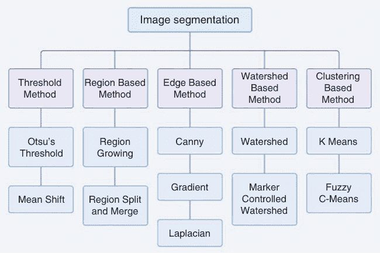

**图 5.1** 经典图像分割技术的分类学。来源：经 Hmrishav Bandyopadhyay（2023）许可使用。


阈值化，以及大津法。全局阈值化为整个图像分配一个单一的阈值，而自适应阈值化则基于图像中小区域的特征局部计算阈值。大津法通过最大化类间方差自动选择最优阈值，有效地分离前景和背景像素。当像素强度直方图包含两个或更多分布时，此方法很有用。

#### 5.2.2 区域生长

区域生长是一种自下而上的分割方法，它基于相似性准则将像素分组为区域。该过程通常从可以手动选择或自动生成的种子点开始。然后，如果相邻像素满足预定义的相似性条件（例如具有相似的强度值或梯度），则会将其迭代添加到区域中。区域生长算法会继续扩展区域，直到无法再添加像素为止，从而生成连贯且同质的分段。

#### 5.2.3 边缘检测

边缘检测技术专注于识别像素强度中的突变或不连续性，这些通常对应于图像中的对象边界。两种流行的边缘检测算法是（i）以Irwin Sobel命名的Sobel算子，以及（ii）以John Canny命名的Canny边缘检测器。前者通过计算图像的梯度幅值来检测边缘，突出高强度梯度区域。相比之下，后者是一种多阶段方法，结合梯度计算、噪声消除、非极大值抑制和滞后阈值法来检测边缘，同时最大限度地减少误正。

#### 5.2.4 聚类

基于聚类的分割方法涉及根据相似特征（如颜色、强度或纹理）将像素分组。一种常用的聚类技术是K-means算法，它根据像素与簇均值的接近程度迭代地将像素分配给簇。GMMs通过将像素强度分布建模为高斯分布的混合物来扩展K-means算法，从而允许更灵活的簇形状。

#### 5.2.5 分水岭变换

分水岭变换是一种受水文学启发的形态学分割方法，其中像素强度被视为高程值，并从浸入点（标记）模拟洪水淹没，以基于分水岭流域划分区域。该技术对于分割具有清晰边界的对象特别有用，并在医学影像、遥感和工业检测中有应用。

经典图像分割技术也面临诸多挑战，例如过分割和欠分割，这些可能出现在背景复杂或光照不均的图像中。此外，经典分割算法通常涉及手动调整参数，这往往耗时且可能易受人为错误影响，导致次优结果。另外，经典技术可能难以分割包含大量噪声或伪影的图像，从而导致分割结果不准确。最后，某些经典分割算法可能无法很好地扩展到大图像或大数据集，限制了其在实际场景中的适用性。

### 5.3 针对医学图像的基于深度学习的图像分割方法

近年来，深度学习技术（如CNN）彻底改变了图像分割领域，尤其是在医学成像领域。CNN的架构非常适合学习视觉数据的层次化表示，使其在医学图像分割等任务中特别有效。在医学图像分割中，CNN用于自动从原始图像数据中提取和学习关键特征，而无需手动或手工制作的特征提取。它们可以有效地捕捉医学图像中的复杂模式和空间关系，从而更准确地分割解剖结构、病变和异常。已经开发或改编了多种CNN架构，专门用于医学图像分割任务（Kayalibay et al. 2017; Malhotra et al. 2022）。一种流行的架构是U-Net，它具有用于精确定位的对称扩展路径和用于记录上下文的收缩路径（Ronneberger et al. 2015; Siddique et al. 2021）。由于能够生成高质量的分割掩码，U-Net已被广泛用于生物医学图像分割。

另一种常见的方法是使用FCN，它使用卷积层替代全连接层（Dai et al. 2016）。这使得FCN可以处理任意大小的图像并生成密集的像素级预测。FCN已在医学图像分割任务中得到有效应用，能够从多种成像模态中精确勾勒异常和结构。用于医学图像分割的深度学习技术也常常引入注意力机制、条件随机场（CRF）和多尺度架构等先进技术，以提高分割精度和鲁棒性（Guo et al. 2020）。

尽管深度学习方法具有所有这些优势，但在将其应用于医学图像分割时，仍有若干挑战需要解决。这些挑战包括需要大规模标注数据集、高端计算资源（如图形处理单元GPU）以及结果的可解释性。但是，基于深度学习方法的最近进展以及大规模医学成像数据集的可用性，为在处理医学图像时进一步提高基于深度学习的分割方法的精度和适用性带来了希望（Bhattacharya et al. 2021）。

深度学习方法（尤其是CNN及其变体）通过允许从医学图像中自动且准确地勾勒结构和异常，为医学图像分割领域带来了重大进展。这些方法有望彻底改变医学诊断、治疗规划和患者护理，因为它们可以为临床医生提供来自成像数据的宝贵见解。

以下部分将对医学图像分割领域中的一些深度学习算法进行详细讨论。

#### 5.3.1 卷积神经网络（CNN）

O'Shea和Nash（2015）提出了CNN，这是图像分类领域的一种基准算法。CNN专门设计用于处理结构化网格状数据，例如图像（Khan et al. 2020）。CNN架构通常由交替的卷积层和池化层组成，并在末端包含一个或多个全连接层。有时，全局平均池化用于替代全连接层（Khan et al. 2020）。CNN经常用于对象识别、图像分类和分割等任务。它们对计算机视觉领域产生了重大影响。CNN的简化架构如图5.2所示。

##### 5.3.1.1 卷积层

CNN的核心组件是卷积层，其中一组称为卷积核的特殊滤波器被应用于输入图像，如图5.3所示。这些卷积核在图像上滑动，计算其权重与感受野中值之间的点积。这样一来，它会检查图像的每个小部分，以查看它与卷积核所寻找的模式匹配程度（Khan et al. 2020）。如果卷积核是对称的，则该操作变为相关操作。这个卷积核将图像划分为小的感受野，开始提取特征图案，并使用特定权重与图像进行卷积以捕获相关信息。

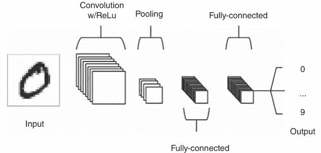

图5.2 具有五层的CNN架构。来源：O'Shea和Nash（2015），经Keiron O'Shea许可。

##### 5.3.1.2 激活函数

卷积操作后，将诸如整流线性单元（ReLU）之类的激活函数应用于每个元素。激活函数将非线性引入神经网络，使CNN能够学习输入特征之间的复杂非线性关系。除了ReLU之外，还有许多其他激活函数，例如sigmoid、tanh、maxout、SWISH以及ReLU的变体（如leaky ReLU、ELU和PReLU），用于引入非线性（Gu et al. 2018）。这一步很重要，因为它有助于模型从数据中学习复杂的模式和特性。

##### 5.3.1.3 池化层

池化层通常插入在连续的卷积层之间，以在保留重要信息的同时降低特征图的空间维度。常见的池化操作包括最大池化和平均池化，它们通过取每个池化窗口内的最大值或平均值来对特征图进行下采样。

##### 5.3.1.4 全连接层

在网络的最后阶段，通常会添加一个或多个全连接层来执行高级推理和决策。这些层将一层中的每个神经元与下一层中的每个神经元连接起来，使网络能够学习卷积层提取的特征之间的复杂关系。


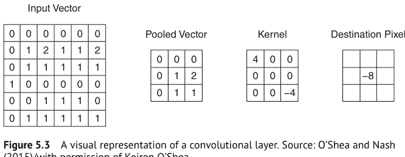

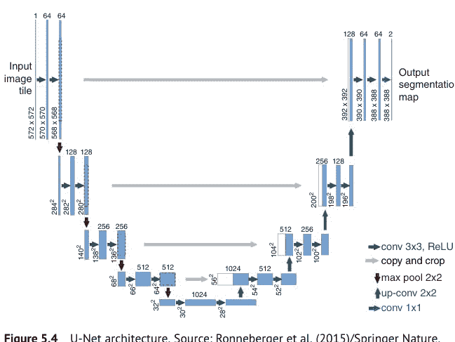

##### 5.3.1.5 Softmax 激活函数

对于分类任务，CNN 的输出层通常采用 softmax 激活函数，该函数将各类别的输出分数归一化为概率分布。这使得网络能够输出概率，指示每个类别的可能性。

##### 5.3.1.6 损失函数与优化

在训练阶段，神经网络通过最小化损失函数进行优化，该损失函数用于评估预测输出与真实标签之间的差异。分类任务中常用的损失函数包括

图 5.5 配备齐全的 GoogLeNet。来源：Szegedy et al. (2015)/经 IEEE 许可。

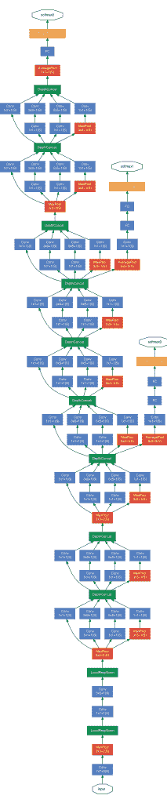

交叉熵损失。为最小化损失函数，采用随机梯度下降 (SGD) 或其变体等优化算法。

##### 5.3.1.7 反向传播

网络参数梯度的计算通过反向传播实现，反向传播能够高效地将错误向后传播至网络中。随后，这些梯度被用于通过所选优化算法更新网络的权重。

CNN 通过反复应用卷积层、激活层、池化层和全连接层来学习输入数据的分层表示，从而在各种计算机视觉任务中实现最先进的性能。这一过程使 CNN 能够捕获越来越复杂的特征和模式，从而在图像分类、目标检测和语义分割等任务中表现出色。

随着深度学习领域的不断发展，经典版本的 CNN 经历了多次修改和升级。在医学图像分割中广泛使用的一些变体包括 AlexNet (Chen et al. 2021b; Priya and Vasudevan 2024)。

#### 5.3.2 U-Net

U-Net 是由 Ronneberger et al. (2015) 开发的 CNN 架构，如图 5.4 所示。它是一种广泛用于生物医学图像分割和语义分割任务的架构。U-Net 基于 FCN。

U-Net 具有 U 形的编码器–解码器网络架构。它包含由桥连接的四个编码器和解码器块。编码器和解码器网络之间的信息流由桥完成。在每个块中，编码器网络将特征通道数加倍，并将空间维度减半，通过在 ReLU 激活前激活卷积层来充当特征提取器。跳跃连接改善了梯度流并保留信息以获得更好的语义特征，而最大池化则降低了计算成本。通过上采样和拼接跳跃连接特征图，解码器网络创建分割掩码。然后使用卷积和 sigmoid 激活进行像素级分类。研究人员发现 U-Net 在脑肿瘤检测领域有广泛的应用。Akter et al. 提出了一种深度 CNN 和 U-Net，用于脑肿瘤图像的分类和分割，其准确率可达 90.8% (Akter et al. 2024)。Cheng et al. 提出了一种深度网络，在 U-Net 的编码阶段引入 VGG-19 网络，用于脑肿瘤图像的边缘检测。他们还添加了一个边缘检测模块以增强所提模型的性能。实验结果表明，所提模型在不同标准数据集上都能取得有希望的结果 (Cheng et al.)。

在不断发展的深度学习技术领域，U-Net 在医学图像分割领域已获得广泛认可。

#### 5.3.3 GoogleNet 或 Inception

GoogleNet（也称为 Inception-v1）标志着 CNN 架构演进中的一项重要发展，特别是在图像分类领域，如图 5.5 所示。GoogleNet 由 Google 研究人员于 2014 年提出，通过为大规模图像数据集处理提供高效且可扩展的解决方案，彻底改变了深度学习。

GoogleNet 的核心是 Inception 模块这一开创性概念，它从根本上改变了 CNN 处理信息的方式。与使用固定尺寸滤波器的传统卷积层不同，Inception 模块包含多个并行卷积分支，具有不同的滤波器尺寸。这种配置使网络能够同时捕获不同空间尺度的特征，从而提高其在图像中识别复杂模式和对象的能力。

支撑 GoogleNet 的一个关键设计原则是其在不牺牲性能的前提下致力于计算效率。为实现这一目标，GoogleNet 在应用较大卷积之前采用了降维技术，例如 1x1 卷积。通过减少输入通道数量，这些卷积在保留信息内容的同时减轻了计算负担。

此外，GoogleNet 采用了一种新颖的架构结构，促进了网络的深度和宽度。该架构不仅仅是层层堆叠，而是具有多个抽象层级，更深层捕获更抽象和更高级的特征。这种分层表示使网络能够辨别越来越复杂的模式，从而提高分类准确率。

GoogleNet 的另一个值得注意的方面是其在网络末端采用全局平均池化，而非传统的全连接层。全局平均池化计算每个特征图的平均值，显著减少了网络中的参数数量，并降低了过拟合的风险。这种改进的方案不仅简化了模型，还增强了其泛化能力。

GoogleNet 已成为深度学习领域的开拓者，为 CNN 中创新架构设计提供了典范。其在标准基准数据集上的卓越性能使其成为该领域的领先模型，其跨多个领域的广泛应用使其在医疗保健、自动驾驶汽车、安全和电子商务等领域备受重视。GoogleNet 在优化计算资源、以分层方式组织特征表示以及实现辅助监督方法方面取得了重大进展。这些创新使其成为构建高级神经网络架构的基本构建块，不仅用于图像分类，也用于其他应用。

### 5.4 脑肿瘤图像分割中采用的深度学习算法

脑肿瘤分割是指医学图像处理中的一种过程，在该过程中，算法被应用于勾勒和识别脑图像中的感兴趣区域（肿瘤组织），这些图像通常通过 MRI 或 CT 等技术获取。分割涉及将脑图像划分为多个区域或类别，例如肿瘤组织、健康组织、水肿和坏死。这对于各种医疗应用非常重要，包括脑肿瘤的诊断、治疗计划和监测。机器学习和深度学习方法（尤其是 CNN）在脑肿瘤分割中日益流行，原因在于它们能够从大型数据集中掌握复杂模式，并且擅长处理高维医学图像。这些算法在专家手动勾勒肿瘤区域的标注数据集上进行训练。随后，它们可以自主分割以前未见图像中的肿瘤。

Deepak 和 Ameer (2019) 提出了一种深度迁移学习方法，用于从脑 MRI 图像中分类胶质瘤、脑膜瘤和垂体瘤，平均分类准确率达到 98%，并优于现有方法。即使在医学图像数据有限的情况下，迁移学习也被证明是有效的，并为进一步分析提供了关于误分类的洞察。Cheng et al. (2015) 提出了一种方法，通过增强肿瘤区域并将其分割为环形子区域，来改进 T1 加权增强 MRI 图像中的脑肿瘤分类。与传统方法相比，该方法显著提高了分类准确率，证明了其在计算机辅助诊断中的可行性和有效性。Cheng et al. (2016) 引入了一种新的基于内容的图像检索 (CBIR) 方法，用于对 T1 加权增强 MRI 图像中的脑肿瘤进行分类，通过增强肿瘤区域、实现自适应空间划分以进行特征提取以及应用 Fisher 核框架进行相似度测量，平均平均精度达到 94.68%。新系统优于相关最先进的方法，展示了其在通过图像支持临床决策方面的有效性


医疗领域中的检索。Pereira et al. (2016) 提出了一种采用小核卷积神经网络（CNNs）和强度归一化的自动脑肿瘤分割方法，在 BRATS 2013 挑战赛中表现最佳，在 BRATS 2015 挑战赛中位居第二。该方法证明了从 MRI 图像中准确分割脑肿瘤的有效性，为改进治疗规划和临床实践提供了潜力。Biratu et al. (2021) 对脑肿瘤分割和分类方法的最新进展进行了全面综述，涵盖区域生长、浅层机器学习和深度学习技术。他们比较了各自的优势、劣势、技术方面及性能指标，以提供该领域当前最先进技术的见解。Cheng et al. (2023) 引入了 EAV-U-Net，这是一种新型系统，通过将 VGG-19 网络结构、注意力机制模块和边缘检测模块整合到 U-Net 架构中，准确检测脑肿瘤病变区域。EAV-U-Net 显著提升了分割性能，尤其是在肿瘤边缘模糊的情况下，在多个标准数据集的多个性能指标上取得了令人印象深刻的成果。Priya and Vasudevan (2024) 提出了一种结合 AlexNet 和 GRU 神经网络的混合模型，利用 MRI 数据进行脑肿瘤分类，实现了高准确率、精确率、召回率和 F1-Score，展示了在脑肿瘤检测中改善患者预后和医疗环境的潜力。该模型在区分不同类型脑肿瘤方面表现有效，有助于恶性肿瘤的早期检测与表征。

### 5.5 视网膜血管分割的深度学习模型

视网膜血管分割在眼科学医学图像分析中至关重要，涉及在视网膜图像中识别血管，以诊断糖尿病视网膜病变等疾病。准确的分割有助于疾病检测和进展追踪，并促进计算机辅助诊断系统的发展，在眼部病理管理中发挥关键作用。

Jiang et al. (2018) 提出了一种受监督方法，利用预训练的全卷积网络和迁移学习进行准确的视网膜血管分割，在多个数据库中实现了最先进的准确性。还应用了额外的非监督后处理技术来优化分割结果，展示了迁移学习在医学成像应用中的有效性。Zhao et al. (2020) 引入了一种采用具有广泛感受野的生成对抗学习的视网膜血管分割技术。该方法实现了显著的分割准确率，超越了当前领先方法。通过有效捕捉复杂的微小血管和广泛的高层语义血管特征，所提算法在辅助眼科学疾病诊断方面展现出前景。Guo et al. (2020) 引入了一种使用 Inception 模块的 Dense U-Net 架构用于视网膜血管分割，在训练中融入生成对抗网络（GANs）以提高性能。DRIVE 数据集的评估显示，分割准确率较高，Dice 率为 82.15%，AU-ROC 和 AU-PR 值分别为 0.9772 和 0.9058，表明自动视网膜血管分割有效。Atlı and Gedik (2021) 提出了 Sine-Net，这是一种用于视网膜血管分割的新型深度学习架构，实现了高准确性和鲁棒性。在三个公开可用的数据库（STARE、CHASE_DB1 和 DRIVE）上的实验验证表明，Sine-Net 在某些指标上优于现有方法，展示了其临床应用潜力。Chen et al. (2021a) 提出了基于深度学习的视网膜血管分割的全面综述，强调其在诊断糖尿病和高血压等疾病以防止失明方面的重要性。它调查了近期出版物，确定了网络架构的趋势，概述了挑战，并提出了未来研究方向，以推进和增强该领域的模型。Begundez-Arias et al. (2021) 引入了一种基于深度学习的视网膜血管分割方法，使用简化的 U-Net 架构，配合新型损失函数和批量归一化，在多种眼底图像数据集上实现了强健且准确的结果。与 DRIVE、STARE 和 CHASE_Db1 数据库中的手动分割进行评估表明，与现有方法相比性能更优，暗示其有潜力集成到血管结构分割的临床工具中。Liu et al. (2022) 引入了一种改进的 U-Net 算法用于视网膜血管分割，采用全局卷积网络、注意力模块和多尺度特征提取来准确勾勒血管边界。对 DRIVE 和 CHASE_DB1 数据集的评估表明，准确性更优，与现有算法相比平均性能有所提升。Abbi et al. (2023) 创建了 LMBiS-Net，这是一个轻量级像素级 CNN，可学习参数数量非常少（仅 0.172 M），用于分割视网膜毛细血管。为了便于编码器和解码器之间的信息流，网络除了多路径特征提取块外，还包含双向跳跃连接。Ilesanmi et al. (2023) 提出了用于视网膜眼底图像分割和分类的 CNN 算法的系统综述，强调其在帮助早期检测和治疗眼部问题方面的潜力。对 62 项研究的分析表明，CNN 在提高分割精度和减少对人类专业知识的依赖方面有效，尽管存在一些局限性，但始终观察到较高的准确性。

### 5.6 内耳分割的深度学习模型

内耳分割涉及从医学影像数据（如 MRI 或 CT 扫描）中识别和勾勒内耳内的解剖元素。内耳是一个负责听觉和平衡的多面结构，包括耳蜗、前庭和半规管等互连的组成部分。

分割对于理解这些结构的形态和空间关系至关重要，有助于内耳疾病和病理的诊断和治疗。准确的分割使临床医生能够量化和分析内耳结构的体积、形状和异常，从而为治疗决策、手术规划和疾病监测提供依据。

专家手动分割既耗时又主观，导致不同观察者之间不一致。因此，自动分割方法，特别是基于深度学习算法的方法，因其能够从医学影像数据中高效且准确地勾勒内耳结构而日益受到青睐。这些自动化方法简化了分割过程，减少了人为错误，并能够在不同患者和成像模式之间实现一致且可重复的结果。

Wang et al. (2019) 提出了术后植入 CT 图像中金属伪影减少的挑战，以准确分割对人工耳蜗编程至关重要的耳蜗内解剖结构（ICA）。他们引入了一种基于 3D 条件 GAN 的方法，通过合成术前图像，与之前的 2D 方法相比取得了显著改进，在不需要术前 CT 扫描的情况下提高了分割准确性。Jeevakala et al. (2020) 提出了一种由 U-Net 驱动的 Mask R-CNN 方法，用于内听道及其神经的检测和分割。在对不同年龄段超过 50 名不同患者的临床数据集进行实验后，他们发现该模型优于最先进的模型。Zeng et al. (2021) 提出了一种集成深度学习方法，利用耳镜图像有效且精确地识别多种耳部疾病，在八个不同的疾病类别中实现了 95.59% 的令人印象深刻的平均准确率。实时分类器在临床环境中展示了其潜力，为耳部疾病的早期检测和治疗提供了希望，特别是在缺乏专家诊断的情况下。Vaidyanathan et al. (2021) 利用 944 份已手动分割内耳作为参考标准的 MRI 扫描训练了一个 3-D U-Net。研究发现，该模型的表现与人类专家相当。研究结果还表明，该模型在内耳分割方面高效、一致且可靠。Atebani 提出了一种模型，在其中，一个单一的双头体积 3D U-Net 实现了完全自动化的工作流程，使用临床实践中的手动标记内部数据集（N = 43）进行训练。


和尸体标本（N = 43），随后进行了评估。模型的稳健性通过使用三个独立的开源数据集（N = 23 + 7 + 17）进一步接受审查，这些数据集包含来自尸体标本的扫描。

### 5.7 结论

本章对深度学习技术对医学影像领域的深远影响进行了深入考察，重点关注脑肿瘤、视网膜血管及内耳分割方面的进展。该研究揭示了医学图像处理的范式转变，这一转变由深度学习算法的卓越能力所推动。深度学习技术（尤其是CNNs）的出现彻底改变了医学影像领域，使解剖结构和病理异常的自动化、准确分割成为可能。

在脑肿瘤分割领域，深度学习模型已达到无与伦比的精度和效能水平，能够实现及时检测、精确勾勒肿瘤边界以及制定个性化的治疗计划策略。这些进步有望通过及时干预和个性化治疗方法来改善患者预后。同样，在视网膜血管分割方面，深度学习算法在从眼底图像中以高精度提取血管结构方面表现出显著效果。通过实现对视网膜血网的定量分析，这些模型有助于早期发现和监测多种眼部病变，包括糖尿病性视网膜病变和高血压性视网膜病变。

深度学习在内耳分割中的应用为理解听觉和前庭系统的复杂解剖结构开辟了新的途径。通过MRI和CT扫描等医学影像技术精确勾勒内耳结构，提高了影响听力和平衡的疾病的诊断精度。这一进步有助于制定个性化治疗方案和外科干预措施。尽管取得了这些进展，但仍面临挑战，包括对大型带注释数据集的需求、模型可解释性以及对不同成像条件的稳健性。解决这些挑战需要计算机科学家、临床医生和影像专家之间的多学科合作，以改进现有算法并开发新方法。展望未来，将深度学习转化整合到常规临床实践中，有望彻底改变医疗保健服务。

通过简化图像分析工作流程、提高诊断准确性并促进个性化治疗策略，医学影像领域的深度学习有望在不同医学专科中提升患者护理和预后。随着我们不断推动创新的边界，优先考虑伦理问题、确保算法透明度并促进全球患者公平获取尖端技术至关重要。

## 参考文献

- Abbasi, M.M., Iqbal, S., Naveed, A. et al. (2023). LMBiS-Net: 用于视网膜血管分割的基于轻量多路径双向跳跃连接的CNN. ArXiv (Cornell University) arXiv预印本 arXiv:2309.04968.
- Akter, A., Nosheen, N., Ahmed, S. et al. (2024). 用于脑肿瘤MRI分类和分割的鲁棒临床适用CNN和U-Net算法. 专家系统与应用 238 (122347): 122347. https://doi.org/10.1016/j.eswa.2023.122347.
- Atli, I. and Gedik, O.S. (2021). Sine-Net: 用于视网膜血管分割的完全卷积深度学习架构. 工程科学与技术，国际期刊 24 (2): 271–283.
- Bandyopadhyay, H. (2023). 图像分割简介：深度学习 vs. 传统 [+示例]. (2023年4月24日访问) V7. https://www.v7labs.com/blog/image-segmentation-guide
- Barhuiya, R.K., Ahmad, N., and Akram, W. (2022). 卷积神经网络在癌症诊断中的应用. 在: 肿瘤计算智能：癌症诊断、预后和治疗应用, 95–109. 新加坡, Springer Singapore.
- Bhattacharya, S., Maddikunta, P.K.R., Pham, Q.V. et al. (2021). 冠状病毒（COVID-19）大流行的深度学习与医学图像处理：一项综述. 可持续城市与社会 65: 102589.
- Biratu, E.S., Schwenker, F., Ayano, Y.M., and Debelee, T.G. (2021). 脑肿瘤分割和分类算法综述. 成像杂志 7 (9): 179.
- Chen, C., Chuah, J.H., Ali, R., and Wang, Y. (2021a). 基于深度学习的视网膜血管分割：综述. IEEE Access 9: 111985–112004.
- Chen, J., Wan, Z., Zhang, J. et al. (2021b). 基于3D AlexNet的前列腺肿瘤医学图像分割与重建. 生物医学计算机方法与方案 200 (105878): 105878. https://doi.org/10.1016/j.cmpb.2020.105878.
- Cheng, D., Gao, X., Mao, Y. et al. (2023). 基于U-Net网络的脑肿瘤特征提取与边缘增强算法. Heliyon 9 (11): e22536. https://doi.org/10.1016/j.heliyon.2023.e22536.
- Dai, J., Li, Y., He, K., and Sun, J. (2016). R-FCN：通过基于区域的完全卷积网络进行目标检测. 神经信息处理系统进展 29.
- Deepak, S. and Ameer, P.M. (2019). 通过迁移学习使用深度CNN特征进行脑肿瘤分类. 生物学与医学中的计算机 111: 103345.
- Gu, J., Wang, Z., Kuen, J. et al. (2018). 卷积神经网络的最新进展. 模式识别 77: 354–377. https://doi.org/10.1016/j.patcog.2017.10.013.
- Gegundez-Arias, M.E., Marin-Santos, D., Perez-Borroto, I., and Vasallo-Vazquez, M.J. (2021). 基于卷积核和修改U-Net模型的视网膜图像血管分割新深度学习方法. 生物医学计算机方法与方案 205: 106081.
- Guo, X., Chen, C., Lu, Y. et al. (2020). 结合生成对抗网络和密集U-Net的视网膜血管分割. IEEE Access 8: 194551–194560.
- Ilesanmi, A.E., Ilesanmi, T., and Gbotoso, A.G. (2023). 使用卷积神经网络的视网膜眼底图像分割和分类方法的系统综述. 医疗保健分析 4: 100261.
- Cheng, J., Huang, W., Cao, S. et al. (2015). 通过肿瘤区域增强和分区提升脑肿瘤分类性能. PloS one 10 (10): e0140381.
- Cheng, J., Yang, W., Huang, M. et al. (2016). 通过自适应空间池化和Fisher向量表示检索脑肿瘤. PloS one 11 (6): e0157112.
- Jeevakala, S., Sreelakshmi, C., Ram, K. et al. (2020). 使用深度学习技术进行内耳道及其神经检测与分割中的人工智能. 计算机辅助放射学与外科国际期刊 15: 1859–1867.
- Jiang, Z., Zhang, H., Wang, Y., and Ko, S.B. (2018). 使用带迁移学习的全卷积网络进行视网膜血管分割. 计算机化医学成像与图形 68: 1–15.
- Kayalibay, B., Jensen, G., and van der Smagt, P. (2017). 基于CNN的医学影像数据分割. ArXiv (Cornell University). arXiv预印本 arXiv:1701.03056.
- Khan, A., Sohail, A., Zahoora, U., and Qureshi, A.S. (2020). 深度卷积神经网络近期架构综述. 人工智能评论 53: 5455–5516.
- Lei, T. and Nandi, A.K. (2022). 图像分割：原理、技术与应用. John Wiley & Sons.
- Liu, C., Gu, P., and Xiao, Z. (2022). 用于视网膜血管分割的带空间位置注意力的多尺度U-Net. 医疗保健工程期刊.
- Ma, J., He, Y., Li, F. et al. (2024). 医学图像中的分割任意对象. 自然通讯 15 (1): https://doi.org/10.1038/s41467-024-44824-z.
- Malhotra, P., Gupta, S., Koundal, D. et al. (2022). 医学图像分割的深度神经网络. 医疗保健工程期刊.
- Mall, P.K., Singh, P.K., Srivastav, S. et al. (2023). 医学图像处理深度神经网络综述：最新进展与未来


机遇。《医疗分析》4 (100216): 100216. https://doi.org/10.1016/j.health.2023.100216.

O'Shea, K. 和 Nash, R. (2015). 卷积神经网络导论. ArXiv (康奈尔大学). https://doi.org/10.48550/ARXIV.1511.08458.

Pereira, S., Pinto, A., Alves, V., 和 Silva, C.A. (2016). 基于 MRI 图像的卷积神经网络脑肿瘤分割. 《IEEE 医学成像汇刊》35 (5): 1240–1251.

Priya, A. 和 Vasudevan, V. (2024). 基于深度学习的混合 AlexNet-GRU 脑肿瘤分类与检测. 《生物医学信号处理与控制》89 (105716): 105716. https://doi.org/10.1016/j.bspc.2023.105716.

Ronneberger, O., Fischer, P., 和 Brox, T. (2015). U-Net: 用于生物医学图像分割的卷积网络. ArXiv (康奈尔大学). https://doi.org/10.48550/ARXIV.1505.04597.

Siddique, N., Paheding, S., Elkin, C.P., 和 Devabhaktuni, V. (2021). 用于医学图像分割的 U-Net 及其变体：理论与应用综述. 《IEEE Access》9: 82031–82057.

Szegedy, C., Liu, W., Jia, Y., Sermanet, P., Reed, S., Anguelov, D., 和 Rabinovich, A. (2015). 带卷积的深层网络. IEEE 计算机视觉与模式识别会议论文集 (第 1–9 页).

Vaidyanathan, A., van der Lubbe, M.F., Leijenaar, R.T. 等人. (2021). 用于 MRI 上内耳完全自动分割的深度学习. 《科学报告》11 (1): 2885.

Wang, J., Noble, J.H., 和 Dawant, B.M. (2019). 基于 3D 条件生成对抗网络的耳部 CT 图像内耳解剖结构分割金属伪影降低. 《医学图像分析》58: 101553.

Zeng, X., Jiang, Z., Luo, W. 等人. (2021). 使用集成深度学习模型高效准确地识别耳部疾病. 《科学报告》11 (1): 10839.

Zhao, H., Qiu, X., Lu, W. 等人. (2020). 使用具有大感受野的生成对抗网络进行高质量视网膜血管分割. 《成像系统与技术国际期刊》30 (3): 828–842.

## 6 基于深度学习的图像分割用于糖尿病视网膜病变及其他视网膜疾病的早期检测

Ankur Biswas¹ 和 Rita Banik²

¹特里普拉技术学院计算机科学与工程系，印度特里普拉邦纳辛加尔
²ICFAI 特里普拉大学电气工程系，印度特里普拉邦卡马尔加特

### 6.1 引言

糖尿病视网膜病变（DR）及相关视网膜疾病是全球重要的卫生问题，影响数百万人，若不治疗会导致严重视力受损（Aziz 等人，2021 年）。视网膜是位于眼球后部的对光敏感组织，对视力至关重要。然而，随着时间的推移，多种医学疾病可能损害脆弱的视网膜，从而危及视力。DR 是一种常见的视网膜疾病，在糖尿病人群中尤为普遍。与该病相关的高血糖水平可能通过损害小血管导致视网膜逐渐发生变化。如果不治疗，DR 可能进展到失明的程度。（Aziz 等人，2021 年）除糖尿病外，还有许多其他可能出现并影响视力的视网膜疾病。与糖尿病相关的高血糖水平可能导致视网膜小血管中的液体或血液阻塞、扩张或渗漏。个体患病时间越长，患糖尿病的可能性就越大。根据视网膜损伤的程度，DR 可经历多个阶段。早期会出现微动脉瘤或微小血管膨出。随着疾病进展，会出现出血、棉絮样斑和硬性渗出物等更严重的视网膜异常。最先进的视网膜病变形式是增殖性视网膜病变，新的脆弱血管会在视网膜或视盘上萌发。这些异常血管可能通过渗漏血液或导致视网膜瘢痕而引起失明。增殖性视网膜病变的另一种威胁视力的后果是视网膜脱离，即视网膜从眼球后部撕裂脱离。与糖尿病无关的视网膜脱离、视网膜色素变性、年龄相关性黄斑变性和视网膜动脉阻塞是其他视网膜疾病。年龄相关性黄斑变性损害提供清晰前向视力的视网膜中心部分——黄斑。它是老年人失明的主要原因。视网膜血管阻塞（即视网膜血管闭塞）可能导致视力丧失或扭曲。视网膜色素变性是一组遗传性疾病，会导致视网膜细胞逐渐退化并最终随时间消失，导致管状视野并最终失明。视网膜可能会从其后方的支撑组织层剥离，这种情况称为视网膜脱离，通常需要手术治疗。

要早期识别视网膜疾病并防止不可逆的视力丧失，定期眼科检查至关重要。对于患有糖尿病、高血压或有眼部疾病家族史等风险因素的人群，筛查尤其关键。许多视网膜问题可以通过早期治疗来帮助避免进一步的视力丧失并缓解不适（Wang 等人，2019 年）。因此，早期检测和精确诊断对成功管理和避免不可逆的视觉损伤至关重要。诊断视网膜问题的常规方法通常复杂、基于个人评估，且容易出现人为失误。为了克服这些局限性，人们越来越倾向于探索替代性的复杂图像分割方法，以增强早期检测过程。随着计算机视觉技术的发展，科学家们正在研究如何使用眼底图像和眼部扫描，通过深度学习（DL）来识别不同的视网膜疾病。基于深度学习的图像分割已成为解决这些问题的可行方法（Torre 等人，2020 年；Vij 和 Arora，2022 年）。DL 使用可在海量数据集上训练的人工神经网络来识别图像中的复杂模式。自动化分割过程能够精确高效地识别视网膜异常（Mateen 等人，2020 年）。这表明，开发自动化筛查技术可能有助于增加眼科医疗服务的可及性。一种常见的方法是训练卷积神经网络（CNN），使用大量由专家手动评分和分类的视网膜图像数据集进行训练。为了区分未显示糖尿病视网膜病变、年龄相关性黄斑变性、青光眼或其他疾病症状的扫描图像，CNN 直接从像素数据中学习特征（Alyoubi 等人，2020 年）。某些网络已被证明具有与专业评级员相近的准确率。DL 有潜力通过筛查庞大人群来识别需要进行全面眼科检查的个体。它可以通过自动化初步图像分析来帮助缓解全球眼科医疗资源匮乏的问题（Sarki 等人，2020 年）。然而，在模型能够在没有人工监督的情况下自主使用之前，它们仍需要经过彻底验证。为了增强对这些算法决策的信心，未来的研究还将努力使它们更具可解释性或更易于理解。

本章旨在探讨基于深度学习的图像分割技术在糖尿病视网膜病变及其他视网膜疾病早期检测中的潜力。通过对现有文献的广泛综述，（Li 等人，2019a 年；Yin 等人，2020 年）我们将考察该领域的现状，并识别该领域的关键挑战。在本章中，我们还致力于为这一主题日益增长的知识体系做出贡献，并提供可指导未来研究和治疗实践的见解。通过利用基于深度学习的图像分割的力量，我们可以改善受视网膜疾病影响人群的护理质量和预后（Playout 等人，2019 年）。本文的第一部分将概述 DR 及其他视网膜疾病的发病率和后果，强调早期检测和精确诊断这些疾病的重要性。我们将探讨标准诊断技术的局限性以及对更高效、更准确方法的需求。第二部分将深入探讨用于图像分割的 DL 技术，重点介绍 CNN。我们将研究 CNN 的架构和训练流程，以及迁移学习和预训练模型在视网膜图像分割中的应用。此外，我们还将考察其他 DL 算法，如生成对抗网络（GANs）（Jeong 等人，2022 年）和循环神经网络（RNNs）（Bonassi 等人，2022 年），以及它们在此领域的潜在应用。第三部分将说明基于深度学习的图像分割在识别 DR 及其他视网膜疾病中的应用和优势。我们将描述图像分割如何帮助识别 DR 的早期指标，以及它如何提高诊断的准确性和效率。此外，我们还将研究 DL 方法在协助诊断和分类各种视网膜异常方面的潜力，以及它们在定量分析和疾病进展监测中的作用。第四部分将探讨与基于深度学习的图像分割相关的问题和局限性。这些包括数据集的可用性和质量、模型可解释性和可说明性、计算复杂性和资源需求，以及伦理考量（Shen 等人，2020 年）。我们将考察对标准化数据集的需求、模型可解释性的进展、计算资源的优化，以及建立负责任应用的伦理框架。最后，第五部分将推荐未来的研究方向，强调对大规模标注数据集、模型可解释性的突破、计算资源优化和伦理考量的需求。我们将以呼吁研究人员和医疗专业人员在基于深度学习的图像分割领域早期识别 DR 及其他视网膜疾病方面持续合作与创新来结束。

### 6.2 深度学习与图像分割

DL 方法，尤其是 CNN，已经彻底改变了不同学科中的图像分析。图像分割是医学图像分析的一个基本阶段，


涉及将图像分割为不同的感兴趣区域。在大规模数据集上训练的深度学习模型在视网膜图像分割方面表现出色，能够精确识别与糖尿病视网膜病变（DR）及其他视网膜疾病相关的异常特征。尽管基于深度学习的图像分割前景广阔，但许多问题限制了其在临床实践中的更广泛应用。标注数据有限、模型可解释性、计算复杂性以及潜在的伦理问题都是需要解决的主要障碍。研究人员、临床医生和数据科学家之间的协作对于克服这些问题并在医疗保健环境中负责任地部署深度学习算法至关重要。在医学图像分析中，图像分割必不可少，特别是在涉及视网膜问题时。深度学习通过自动从图像中学习和提取复杂特征，彻底改变了图像分割领域。在本部分中，我们将探讨用于图像分割的众多深度学习策略，重点讨论卷积神经网络（CNN）、迁移学习和其他前沿方法。

#### 6.2.1 卷积神经网络架构

具有卷积架构的神经网络一直是图像分割深度学习方法的主要支柱。卷积神经网络能够从图像中提取层次化特征，因为其架构模拟了人脑的视觉皮层。卷积层、池化层和全连接层是这些网络包含的层之一。为了捕捉空间关系，卷积神经网络利用卷积层对图像补片进行局部计算。使用带有非线性激活函数的多个卷积层，使卷积神经网络能够从输入图像中提取越来越抽象和复杂的特征。随后，使用池化层对特征图进行下采样，在降低空间维度的同时保留最显著的特征。最终，根据学习到的特征，使用全连接层对图像进行分类和分割。在一项研究中，作者提出了一种基于混合技术的替代方案，用于基于眼底图像检测糖尿病视网膜病变。（Hemanth et al. 2020）具体来说，该混合技术通过集成图像处理和深度学习来改进结果。

#### 6.2.2 预训练模型和迁移学习

迁移学习是一种利用已训练模型来完成另一领域图像分割任务的方法。使用ImageNet等大规模数据集对广泛图像识别任务进行预训练的卷积神经网络，称为预训练模型。研究人员通过从这些预训练模型开始，可以大大减少特定分割任务所需的训练时间和计算资源。通过使用专属于视网膜图像的较小标注数据集，迁移学习会调整网络权重，使预训练模型符合目标分割任务。使用这种方法，模型能够学习视网膜特有的属性并增强其分割能力。迁移学习使研究人员能够利用在大规模数据集上训练的模型的专业知识和特征提取能力，在难以获取标注视网膜数据集时尤其有用。一项研究引入了用于糖尿病视网膜病变分类的卷积神经网络模型，并将其与不同预训练深度学习模型的变体进行比较，以使用二分类和多类分类进行初步糖尿病视网膜病变识别。（Biswas and Banik 2023）达到的97%准确率表明，预训练的ResNet模型在诊断糖尿病视网膜病变方面更为有效。

#### 6.2.3 其他深度学习技术

其他深度学习神经网络架构也已被广泛研究用于视网膜疾病背景下的图像分割。少数卷积神经网络架构采用扩张卷积滤波器以获得更大的感受野，从而在分割视网膜血管时达到近乎人类水平的准确度（Biswas et al. 2020）。这也使得网络训练只需几次迭代。U-Net架构是专门为生物医学图像分割设计的另一种方法（Guo et al. 2021）。U-Net设计包括一个扩展路径，用于对分割区域进行精确定位，以及一个收缩路径，用于收集上下文和空间信息。由于U-Net能够处理少量训练数据并生成可靠的分割结果，因此它在视网膜图像分割应用中被频繁使用。因此，基于U形的技术是医疗领域最有效的结构之一。然而，编码器的重复下采样过程会导致空间信息的丢失，而空间信息对于医学图像分割至关重要。在一项研究中，作者提出了一种独特的轻量端到端特征优化网络来解决此问题。（Wang et al. 2021a）该网络使用编码器–解码器网络作为其骨干网络，并在编码器和解码器上分别应用两条额外路径（空间优化路径和语义优化路径），以提高模型的详细表达能力和区分能力。此外，还提出了一种特征自适应融合块（FAF块），它能够成功融合深度不同的特征。所提出的网络可以端到端进行训练。

此外，循环神经网络和生成对抗网络在视网膜图像分割方面也显示出潜力。生成对抗网络由生成器网络和判别器网络组成。生成器网络学习生成逼真的分割图像，而判别器网络学习区分生成的图像和实际图像。使用这种对抗训练方法可以提高分割准确性，同时产生视觉上令人愉悦的结果。另一方面，循环神经网络适合处理序列数据，例如体积图像或图像序列。循环神经网络可以利用序列中存在的时间依赖性，提供更精确的分割结果。在视网膜成像中，循环神经网络可用于分割使用多种模态或视角拍摄的图像，或跟踪疾病随时间变化的进程。这些前沿的深度学习方法为提高视网膜疾病图像分割的精度和效果提供了可行的途径。研究人员可以使用卷积神经网络、迁移学习、U-Net架构、生成对抗网络和循环神经网络，可靠地分割感兴趣区域并从视网膜图像中提取重要信息。因此，基于深度学习方法（尤其是卷积神经网络）的视网膜疾病图像分割领域已经发生了革命。生成对抗网络、循环神经网络、U-Net架构、迁移学习和生成对抗网络都提高了分割的效率和准确性。这些方法在增强视网膜疾病的早期识别和检测、改善患者预后以及指导个体化治疗方案方面显示出巨大潜力。基于深度学习的图像分割是一个随着进一步研究和创新而不断改进，并将带来更有效医疗保健治疗的领域。

### 6.3 基于深度学习的图像分割的应用与优势

在众多不同领域，基于深度学习的图像分割有着广泛的应用。在医学影像中，它通过提供精确的肿瘤勾画、器官和解剖结构识别，帮助进行诊断和治疗规划。在机器人领域，通过分割感兴趣物体，它使机器人能够感知并与周围环境交互。由于其优势（包括提高准确性、减少主观性和人力成本，以及具备实时分析的潜力），基于深度学习的图像分割是计算机视觉应用中的重要工具。在眼部分析中，基于深度学习的分割可用于以下任务。

#### 6.3.1 糖尿病视网膜病变检测

作为全球失明的主要原因之一，必须早期发现糖尿病视网膜病变，以便进行有效干预。基于深度学习的图像分割技术在识别糖尿病视网膜病变早期指标方面具有显著优势。（Ting et al. 2019）深度学习算法能够通过将视网膜图像分割为血管、渗出物和微动脉瘤等离散区域，精确识别与糖尿病视网膜病变相关的异常。公开可访问的Kaggle数据集的


视网膜图像广泛用于训练模型。五种深度CNN模型（Resnet50、Inceptionv3、Xception、Dense121和Dense169）的集成用于编码丰富信息，并增强Kaggle数据集上各阶段糖尿病视网膜病变（DR）的分类。（Gummar et al. 2019）通过隔离和分析某些感兴趣区域，图像分割在糖尿病视网膜病变的识别中至关重要。从大量视网膜图像中，DL算法可以捕捉到人类观察者可能忽略的细微模式和特征，从而识别视网膜病变的微小指标。这提高了诊断效率和准确性，使及时干预和预防措施成为可能，以降低进一步视力丧失的风险。

#### 6.3.2 确定其他视网膜疾病

基于DL的图像分割方法除了用于糖尿病视网膜病变外，还具有诊断和分类多种视网膜疾病的潜力。利用CNN和其他尖端技术的能力，科学家能够训练模型精确识别和分类青光眼、年龄相关性黄斑变性和视网膜血管阻塞等异常。能够使用基于DL的图像分割来识别和分类各种视网膜疾病有几个优势。首先，它使早期诊断成为可能，从而允许快速治疗并可能带来更好的患者预后。此外，它通过提供关于视网膜疾病独特特征和严重程度的全面详细信息，实现定制的治疗策略。这种量身定制的方法可能带来更好的病情管理和更有针对性的治疗。然而，视网膜结构的分割对于确定DR和其他视网膜疾病至关重要（Li et al. 2019b）。检测和区分视网膜图像中不同区域或结构的过程称为分割。以下是在DR和其他视网膜疾病背景下的主要分割结构。

##### 6.3.2.1 视盘

视神经离开眼睛的视网膜部位称为视盘，或视神经头。它是一个类似圆形或椭圆形的区域，对于将视觉数据从视网膜传输到大脑至关重要。分析视盘的外观对于检测青光眼等疾病至关重要，因为其中的异常可能是多种其他眼部问题的征兆。

##### 6.3.2.2 微动脉瘤

这些是视网膜微小血管壁上的微小、局部的突出或膨出（Atli and Gedik 2021）。它们与通常影响糖尿病患者的DR疾病频繁相关。DR的早期诊断和治疗取决于视网膜成像中微动脉瘤的检测。

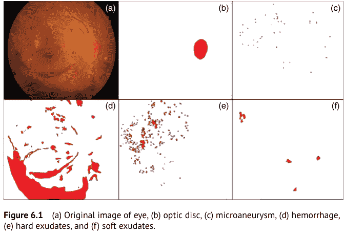

##### 6.3.2.3 出血

血液从血管渗漏称为出血。由于血液，出血在视网膜成像中可能表现为异常的红色斑块。高血压性视网膜病变和DR等疾病容易出现出血。出血的模式、大小和位置都可以为诊断和追踪这些疾病提供重要信息。

##### 6.3.2.4 硬性渗出物

硬性渗出物是由于受损血管脂质渗漏而在视网膜上形成的黄色或白色沉积物。它们与糖尿病性黄斑水肿等疾病频繁相关。必须识别和监测视网膜成像中的硬性渗出物，以确定视网膜病变的严重程度并指导治疗方案（Wang et al. 2020）。

##### 6.3.2.5 软性渗出物（棉絮斑）

软性渗出物，通常称为棉絮斑，是由于炎症物质堆积而在视网膜上形成的白色或灰白色病灶。它们与高血压性视网膜病变和糖尿病视网膜病变等疾病频繁相关。软性渗出物的检测对于确定视网膜损伤程度并指导适当治疗至关重要。图6.1展示了在检测DR和其他视网膜疾病背景下的主要结构分割。

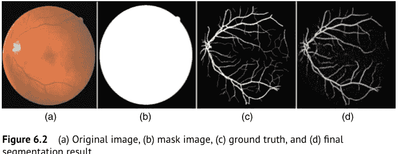

##### 6.3.2.6 视网膜血管

视网膜血管分割是视网膜图像处理中的关键步骤，也是眼科学中用于各种诊断和治疗应用的宝贵工具（Ooi et al. 2021）。这种分割对于糖尿病视网膜病变、青光眼和高血压性视网膜病变等疾病的早期诊断和监测至关重要，在这些疾病中，血管形态的变化能提供关于疾病发展的关键洞察。此外，视网膜血管分割有助于治疗规划，特别是激光治疗，并能更好地了解与年龄相关性黄斑变性和早产儿视网膜病变等疾病相关的血管异常。其重要性还延伸到协助研究计划、临床试验和自动筛查程序的创建，从而提高诊断效率和一致性。此外，将视网膜血管分割纳入远程医疗和人工智能技术有潜力改善远程诊断和个性化医疗保健方法，最终提高眼科护理领域的患者预后。图6.2展示了用于视网膜血管分割的不同图像的对比。

#### 6.3.3 疾病进展监测与定量分析

基于DL的图像分割技术对于定量分析和追踪疾病进程也是必不可少的。这些方法通过分割视网膜图像，允许自动测量黄斑厚度、血管直径和视盘大小等视网膜特性。这些测量可以提供关于疾病如何进展以及如何对治疗做出反应的深入信息。能够使用基于DL的分割对视网膜特征进行定量分析有几个好处。首先，它减少了对容易出现人为错误的劳动密集型手动测量的需求。其次，它使追踪疾病随时间的进程成为可能，为医疗从业者提供评估治疗方案有效性并选择最佳行动方案所需的信息。最终，这种定量分析可能有助于为患者提供更个性化和更有针对性的治疗。

#### 6.3.4 医疗专业人员的辅助工具

医疗从业者可以使用基于DL的图像分割作为眼部问题的诊断辅助工具。这些策略通过提供可靠且精确的视网膜图像分割，提高诊断效率并增强医疗提供者的技能。过去，眼科医生的技能及其对视网膜图像的主观解释被用来诊断视网膜异常。通过产生标准化和客观的分割结果，基于DL的图像分割减少了主观性。之后，医学专家可以专注于检查分割区域并使用定量数据来指导其临床判断。此外，通过自动化分割过程并节省时间和资源，基于DL的分割可能提高医疗专业人员工作流程的效率。这使诊断更加有效，并让医务人员能够将其知识和精力集中在患者护理的其他重要方面。

因此，基于DL的图像分割方法在视网膜疾病领域有多种用途和优势。这些方法在诊断方面提供了增强的精度和效率，从DR的早期识别到多种视网膜疾病的检测。它们还使定量分析、疾病进展追踪成为可能，并为医疗提供者提供有用的支持工具。基于DL的图像分割的能力将得到提高，该领域的进一步研究和开发将有助于改善视网膜疾病治疗中的患者预后。常用的数据集包括IDRiD、DRIVE、STARE、HRF、FGADR、DDR、e-ophthaEX和e-ophthaMA，而性能指标包括准确率、灵敏度、IoU、Dice系数、像素级准确率、精确率、召回率等。用于检测DR和其他眼部疾病的基于DL的图像分割模型比较（Deshmukh et al. 2023; Wang et al. 2021b; Suardika et al. 2022; Karmakar et al. 2022）如表6.1所示。

### 6.4 挑战与局限性

基于DL的图像分割存在许多困难和限制。需要大量标记的训练数据，这可能


#### 表 6.1 DL 模型比较

| 模型 | 架构 | 优势 | 局限性 | 指标 | 指标得分 |
| :--- | :--- | :--- | :--- | :--- | :--- |
| U-Net | 卷积 | 高精度，可处理复杂结构 | 需要大量标注数据 | 精确度 准确率 | 89.48 92.60 to |
| FCN | 全卷积 | 高效，实时处理 | 对物体边界处理能力有限 | 精确度 | 84.30 |
| FRNet | 卷积 | 轻量级端到端特征细化网络 | 空间信息丢失，难以处理模糊边界 | 准确率 | 0.968 |
| DeepLab | 空洞卷积 | 捕捉细微细节，可处理大图像 | 计算量大。 | 精确度 | 95.79 |
| Mask R-CNN | 区域卷积 | 结合目标检测与分割 | 计算复杂度更高 | 交并比 | 0.843 |
| RetinaMask | 特征金字塔网络 | 高精度，处理类别不平衡，实时处理 | 物体边界精度有限，对参数调节敏感 | AUC | 0.950 to |
| PSPNet | 金字塔池化模块 | 多尺度上下文信息，精确的物体边界勾勒 | 计算量大，对超参数敏感 | 精确度 | 88.27 |

获取成本高且耗时，是主要障碍之一。此外，由于计算需求高，DL 模型在资源有限设备上的实现受到限制。过拟合的可能性（即模型在训练数据上表现良好，但无法推广到新的、未见过的图像）是另一个缺点。

#### 6.4.1 数据集质量与可用性

广泛标注的训练数据集稀缺，对基于 DL 的图像分割方法的成功应用构成重大障碍。DL 模型高度依赖大量高质量标注数据，在医学领域（尤其是罕见视网膜病变的情况下）这类数据难以获取 (Gunduz et al. 2023)。缺乏标注数据集使得训练可靠且准确的模型更加困难，因为它们无法充分反映现实世界情况的复杂性和多样性。为克服这一难题，需要可用作比较和评估各种分割技术基准的标准化数据集。这些数据集需要涵盖广泛的视网膜病变，并包含详尽的标注作为可靠的基准真值。创建这些数据集将推动图像分割 DL 方法的发展，并允许对各种策略进行公平比较。

#### 6.4.2 模型的可说明性与可解释性

特别是 CNN，由于其复杂的学习过程和复杂的拓扑结构，有时被称为“黑盒” DL 模型。在医疗场景中，医生必须理解模型预测背后的逻辑才能做出自信决策，因此这种缺乏可解释性的问题带来了困难。为了让临床实践接受并使用 DL 模型，模型必须透明且易于解释。旨在揭示这些模型决策过程的方法正在开发中。为提高可解释性并建立临床医生的信任，显著性图和注意力机制等技术强调了对模型预测贡献最大的图像区域。

#### 6.4.3 计算复杂性与资源需求

基于 DL 的图像分割技术需要大量计算资源，例如强大的硬件和高效的软件。深度神经网络训练可能计算需求高，包括耗时的处理过程和大量内存占用。在资源受限的环境（如实时应用或低资源医疗场景）中实现这种复杂性可能很困难。为克服这些障碍，科学家正在探索提高 DL 模型计算效率的方法。其中包括模型量化和压缩，这些方法在不显著牺牲准确率的前提下降低了模型大小和处理需求。此外，通过分布式计算和专用加速器（两种硬件技术发展）提高效率，可以使 DL 推理更易于实际部署并更具实用性。

#### 6.4.4 伦理问题

在医疗领域使用基于 DL 的图像分割存在重大伦理问题 (Fernandez-Quilez 2023)。处理机密医疗数据时，确保隐私和数据安全至关重要。维护信任和保护患者隐私需要确保患者数据被匿名化、安全存储，且仅用于批准的目的。此外，必须解决图像分割中使用的数据和算法中的任何偏差。不平衡的数据集可能引入偏差，导致不同人口群体的分割准确率出现差异。为防止当前医疗不公平的延续，我们有必要致力于公平。临床实践中 DL 模型的正确使用也受伦理问题约束。医疗从业者在解释这些模型并基于其做出决策时应谨慎，因为它们存在局限性并可能带来风险。为保障患者安全和合乎伦理的治疗，对模型能力和局限性的公开且明确的沟通至关重要。

尽管基于 DL 的图像分割方法在视网膜疾病领域取得了显著改进，但仍有一系列问题和限制需要解决。这些包括数据集的质量与可访问性、模型的可解释性与可说明性、计算复杂性与资源需求以及伦理问题。研究人员和从业者可以通过解决这些问题，提升医疗保健中基于 DL 的图像分割的疗效、可靠性和道德性。

### 6.5 结论与未来方向

基于 DL 的图像分割对包括糖尿病视网膜病变在内的视网膜疾病早期诊断和治疗具有巨大前景。通过使用 DL 方法，我们可以实现个性化治疗方案，提高医疗人员的能力，并改进诊断的准确性和效率。然而，我们必须解决本文讨论的困难和限制，例如数据集的质量与可访问性、模型的可解释性、计算复杂性以及伦理问题。通过在这些领域通力合作并进行创新，我们可以充分实现基于 DL 的图像分割的潜力，并在视网膜疾病领域改善患者预后方面取得重大进展。为实现这些目标，鼓励研究人员和医疗专业人员继续合作，确保以患者为中心的护理、伦理和开放性成为我们科学进步的基石。

需要更多研究来提升基于 DL 的图像分割在视网膜疾病早期诊断中的应用。重要研究领域包括创建大规模标注数据集、增强模型可解释性以及优化计算资源。此外，为保障医疗保健提供中的患者福祉与平等，需要妥善处理数据隐私、患者同意和算法偏见等伦理问题。

## 参考文献

Alyoubi, W.L., Shalash, W.M., and Abulkhair, M.F. (2020). 基于深度学习技术的糖尿病视网膜病变检测：综述. Informatics in Medicine Unlocked 20: 100377.

Atli, İ. and Gedik, O.S. (2021). Sine-Net：用于视网膜血管分割的全卷积深度学习架构. Engineering Science and Technology, an International Journal 24 (2): 271–283.

Aziz, T., Ilesanmi, A.E., and Charoenlarpnopparut, C. (2021). 基于智能窗口特征的视网膜眼底图像中出血的高效准确检测. Applied Sciences 11 (14): 6391.

Biswas, A. and Banik, R. (2023). 用于评估糖尿病视网膜病变患病率和风险水平估计的深度学习系统. E3S Web of Conferences 430: 01292.

Biswas, R., Vasan, A., and Roy, S.S. (2020). 用于眼底图像中视网膜血管分割的空洞深度神经网络. Iranian Journal of Science and Technology, Transactions of Electrical Engineering 44 (1): 505–518.

Bonassi, F., Farina, M., Xie, J., Scattolini, R. (2022). “面向学习式控制的循环神经网络：最新结果与未来发展构想”. Journal of Process Control 114: 92-104. doi:https://doi.org/10.1016/j.jprocont.2022.04.011

Deshmukh, S. V., Roy, A., Agrawal, P. (2023) “使用 U-Net 架构进行糖尿病视网膜病变检测的视网膜图像分割”, International Journal of Image, Graphics and Signal Processing (IJIGSP), Vol.15, No.1, pp. 79-92. DOI:https://doi.org/10.5815/ijigsp.2023.01.0


Fernandez-Quilez, A. 2023. “放射学中的深度学习：数据伦理与算法透明度、可解释性和可说明性的价值。” AI Ethics 3: 257–265. doi:https://doi.org/10.1007/s43681-022-00161-9.

Gündüz, H. A., Binder, M., To, X. Y., 等. 2023. “面向基因组学数据高效训练的自监督深度学习方法。” Communications Biology 6: 928. doi:https://doi.org/10.1038/s42003-023-05310-2.

Guo, C., Szemenyei, M., Hu, Y., Wang, W., Zhou, W., Yi, Y. 2021. “用于视网膜血管分割的通道注意力残差 U-net。” In: ICASSP 2021–2021 IEEE 国际声学、语音和信号处理会议 (ICASSP). IEEE, pp 1185–1189.

Hemanth, D.J., Deperlioglu, O., 和 Kose, U. (2020). 使用深度卷积神经网络的改进糖尿病视网膜病变检测与分类方法。Neural Computing and Applications 32 (3): 707–721.

Jeong, J. J, Tariq, A., Adejumu, T. 等. 2022. “用于医学图像分类与分割的生成对抗网络 (GANs) 系统综述。” Journal of Digital Imaging 35: 137–152. doi:https://doi.org/10.1007/s10278-021-00556-w.

Karmakar, R., Nooshabadi, S., 和 Eghrari, A. (2022). Mobile-RetinaNet：用于低资源环境下视网膜眼底图像分割的计算高效型 DeepNet。Investigative Ophthalmology & Visual Science 63 (7): 2064–F0053.

Li, T., Gao, Y., Wang, K. 等. (2019a). 糖尿病视网膜病变筛查中深度学习算法的诊断评估。Information Sciences 501: 511–522.

Li, X., Hu, X., Yu, L. 等. (2019b). CANet：用于糖尿病视网膜病变和糖尿病性黄斑水肿联合分级的跨疾病注意力网络。IEEE Transactions on Medical Imaging 39 (5): 1483–1493.

Mateen, M., Wen, J., Hassan, M. 等. (2020). 糖尿病视网膜病变自动检测：关于数据集、方法和评估指标的综述。IEEE Access 8: 48784–48811.

Ooi, A.Z., Embong, Z., Abd Hamid, A.I. 等. (2021). 基于 Canny 边缘检测器的视网膜眼底图像交互式血管分割。Sensors 21 (19): 6380.

Playout, C., Duval, R., 和 Cheriet, F. (2019). 用于眼底图像视网膜病变分割的一种新型弱监督多任务架构。IEEE Transactions on Medical Imaging 38: 2434–2444.

Qummar, S., Khan, F.G., Shah, S. 等. (2019). 用于糖尿病视网膜病变检测的深度学习集成方法。IEEE Access 7: 150530–150539.

Sarki, R., Ahmed, K., Wang, H., 和 Zhang, Y. (2020). 基于深度学习和眼底图像的糖尿病眼病自动检测：一项综述。IEEE Access 8: 151133–151149.

Shen, Y. 等. (2020). 域不变可解释眼底图像质量评估。Medical Image Analysis. 61: 101654.

Ting, D.S., Wu, W.C., 和 Toth, C. (2019). 早产儿视网膜病变筛查的深度学习。British Journal of Ophthalmology 103 (5): 577–579.

Torre, J.d.L., Valls, A., 和 Puig, D. (2020). 用于糖尿病视网膜病变分级的深度学习可解释分类器。Neurocomputing 396: 465–476.

Vij R, Arora S. 2022. “使用神经影像的神经退行性疾病分析中深度学习技术的计算机视觉：一项综述。” In: 国际创新计算与通信会议; pp 179–189.

Wang, D., Hu, G., 和 Lyu, C. (2021a). Frnet：用于医学图像分割的端到端特征细化神经网络。International journal of computer vision 37: 1101–1112.

Wang, H., Yuan, G., Zhao, X. 等. (2020). 基于深度模型学习信息和多特征联合表示的糖尿病视网膜病变筛查中硬性渗出物检测。Comput Methods Programs Biomed 191: 105398.

Wang, X., Ju, L., Zhao, X, Ge, Z. 2019. “使用区域多任务学习的视网膜异常识别。” 国际创新计算与通信会议 (eds Shen, D. 等): 30–38 (Springer).

Wang Z, Zhong Y, Yao M. 等. 2021b. “使用深度学习方法进行黄斑水肿自动分割以诊断眼科疾病”。Scientific reports 11, 13392. doi:https://doi.org/10.1038/s41598-021-92458-8

Suardika IGPD, Maysanjaya IMD, Kesiman MWA. 2022 “基于 Mask R-CNN 的视网膜眼底图像视盘分割，” 2022 年第 4 届生物医学工程国际会议 (IBIOMED), 印度尼西亚日惹, pp. 71–74, doi: https://doi.org/10.1109/IBIOMED56408.2022.9987756.

Yin, P., Yuan, R., Cheng, Y., 和 Wu, Q. (2020). 生物医学图像分割的深度引导网络。IEEE Access 16 (8): 116106–116116.

## 肺野分割深度学习模型分析

Tairah Andrabi 和 Sajid Yousuf Bhat

克什米尔大学计算机科学系，斯利那加，查谟与克什米尔，印度

### 7.1 引言

肺部疾病涵盖了影响呼吸和整体健康的广泛健康问题。从肺炎等传染病到肺气肿、“慢性阻塞性肺疾病 (COPD)”等持续性疾病，乃至肺癌和 COVID-19 等可能危及生命的疾病，这些疾病在全球医疗保健领域构成重大挑战。为了诊断与肺部相关的疾病，医疗专业人员利用一系列先进的医学影像模态，包括磁共振成像 (MRI)、胸部 X 光 (CXR)、计算机断层扫描 (CT) 和正电子发射断层扫描 (PET)。其中，胸部 X 光作为关键诊断工具脱颖而出。胸部 X 光 (CXR)，又称胸部 X 光片，是医学诊断领域的基本成像模态。胸部 X 光 (CXRs) 关于心脏、肺部、肋骨及周围组织提供了关键洞察。它们以成本效益高、广泛可用、辐射剂量低以及能够提供其他成像技术不易提供的有价值洞察而著称。由于这些优势，每天产生大量的 X 光片，使其成为医学诊断的基石。尽管价格实惠，但解读 CXR 需要相当的专业知识，并且由于其复杂性而面临挑战。对 X 光片的手动检查既耗时又费力，强调了对自动化诊断系统的需求。

计算机辅助诊断 (CAD) 工具是一类旨在帮助医疗专业人员（尤其是放射科医生）解读医学图像并做出准确诊断的软件应用。CAD 已经取得了快速进步，其在临床实践中的应用不仅提高了诊断准确性，还加速了决策过程，从而实现更及时的干预和改善患者预后。

近年来，医学图像分析取得了显著进展，图像分割作为其组成部分，从医学图像中提取关键且有意义的信息。肺野分割 (LFS) 作为先决步骤，精确勾勒出感兴趣区域。然而，这项任务面临着自身的一系列挑战，例如 (i) 患者体位的差异，(ii) 受年龄和性别等因素影响的心脏、膈肌、锁骨和肋骨笼等叠加解剖结构的存在 (Agrawal and Choudhary 2023)，(iii) 由于潜在病理导致的肺部外观可能出现的畸变，以及 (iv) 不同成像设备在图像质量、对比度和亮度设置上的差异。此外，上方锁骨骨区域存在多样的强度水平，使得肺尖精确分割变得复杂。解决这些障碍对于确保分割算法的准确性和可靠性至关重要。

过去 40 年来，LFS 引起了广泛关注，见证了从基本基于规则的方法到复杂深度学习方法的进步，这在各种高质量出版物中有所体现。Van Ginneken 等人对 LFS 技术提供了基础分类，将其组织为四个主要类别 (Van Ginneken et al. 2001): “(i) 基于规则，(ii) 基于像素分类 (PC)，(iii) 基于可变形模型，以及 (iv) 混合方法。” 最初，CAD 系统中的肺分割方法依赖于定义肺部与相邻结构之间关系的特定规则。后来，在 20 世纪 90 年代，出现了像素级分类，根据手动提取的特征（被认为是浅层学习）将单个像素分类为肺部或非肺部。在 21 世纪初，基于可变形模型的方法利用能够在内部和外部影响下适应的模型来勾勒肺部形状。尽管存在多种 LFS 方法，但持续的研究仍致力于提高其效果。目前，研究人员专注于通过深度学习进行自动特征提取，强调了该领域内一个有前景的进步方向。

基于深度学习的 LFS 采用多种复杂模型，例如“卷积神经网络 (CNN)、循环神经网络 (RNN)、生成对抗网络 (GAN)、编码器-解码器架构”等其他先进架构。其中，基于编码器-解码器架构的 U-Net 已成为语义分割的热门选择，尤其在肺分割领域。其在捕获上下文信息方面的有效性使其非常适合胸部 X 光或 CT 扫描中存在的医学图像复杂结构。DeepLab，一种使用空洞卷积的最先进架构，也已被改编用于肺分割任务。值得注意的 是，DeepLab 在处理多样化图像分辨率方面表现出色，展示了在精确分割肺野方面的成功。此外，“Mask R-CNN”作为专为实例分割设计的“Faster R-CNN”的改进版本，已被用于


在肺分割领域的应用，能够提供肺部结构的准确逐像素勾勒。注意力机制，如自注意力或通道注意力，进一步增强了深度学习模型聚焦相关区域、舍弃无关信息的能力，从而提高肺分割的精度。这些具有各自优势的多样模型的整合，有助于开发强健且高效的肺分割方法，解决各种图像分辨率问题，并在勾勒肺部边界方面实现高精度。

本章后续各节结构如下：第7.2节简要概述医学影像模态。第7.3节概述胸部X光片中肺分割的经典方法。第7.4节总结胸部X光片和CT扫描中肺分割的深度学习模型。第7.5节列举了几个公开可访问的胸部X光片和CT扫描。用于评估模型性能的不同评估指标在第7.6节中介绍。最后，第7.7节总结了系统综述得出的结论性发现和未来发展方向。

### 7.2 医学影像模态

在临床环境中，多样的医学影像模态通过提供针对特定诊断需求的独特信息发挥着关键作用。流行的模态包括“CT、MRI、PET、超声成像和光学相干断层扫描（OCT）”，如图7.1所示。然而，在肺分割的语境下，重点在于利用两种模态——CT扫描和X光。选择CT扫描和X光是由于它们独特的属性以及在捕捉肺部成像相关细节方面的适用性。

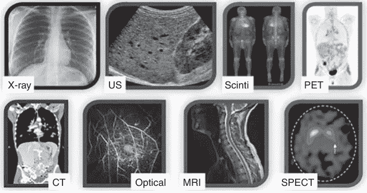

图7.1 多样医学影像技术概览。来源：Beyer et al. (2020) /Springer Nature/CC BY 4.0。

### 7.3 胸部X光片中肺分割经典方法概述

LFS的传统方法通常涵盖各种技术和方法，下文将进行讨论。

#### 7.3.1 基于规则的方法

基于规则的方法包括依赖预定义规则或标准来勾勒和描述肺部边界及区域的技术。这些规则就像按特定顺序应用的逐步指令，用于准确勾勒肺部。规则考虑的因素包括肺部的位置、明暗程度、纹理和形状，以及它们与其他身体结构的关系。这些方法通过允许以不同顺序应用规则来提供灵活性，从而适应各种情况。(Gados and Horvath n.d.)（图7.2）。

强度阈值处理、边缘检测和基于知识的规则是基于规则分割中使用的技术。

强度阈值处理基于预定义的灰度阈值将每个像素归类为非肺或肺区域。主要挑战在于确定最佳阈值，因为阈值过低可能导致肺部轮廓模糊，而阈值过高可能会合并或模糊肺与非肺区域之间的边界。Cheng和Goldberg引入了此类别中最早的方法之一，(Cheng and Goldberg 1988) 采用不同的灰度阈值分别分割左肺和右肺。相比之下，Armato等人提出了一种结合迭代灰度阈值处理的方法，(S. G. Armato et al. 1998) 同时融合全局和局部方面，并使用形态学操作和滚球技术进行轮廓平滑。虽然迭代阈值处理提高了分割精度，但引入了计算开销。相反，静态阈值可能导致次优分割，尤其是在对比度变化的图像中。

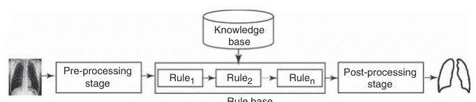

图7.2 基于规则的肺分割工作流程示意图。来源：Mittal et al. (2017) /John Wiley & Sons。

基于边缘检测的肺分割用于突出肺部边缘或轮廓，从而实现准确分割。它依赖于肺与非肺区域之间像素强度的变化，利用肺边缘附近的剧烈强度变化。Powell等人最初使用导数来识别肋骨边界，(Powell et al. 1988) 该方法随后由Xu等人改进，他们应用“二阶导数”进行轮廓识别以捕捉复杂细节，(Xu and Doi 1995) 但易受噪声影响。Duryea等人采用“启发式技术”进行边缘追踪，(Duryea and Boone 1995) 在802张图像中独立分割双肺，平均处理时间为每张图像0.84秒。Li等人进一步解决了肋骨结构阻碍和伪轮廓等挑战，(Li et al. 2001) 利用一阶导数在每张图像中以0.775秒实现肺轮廓。在强度和边缘基础分割领域，通过融合对纹理、肺部空间和形状特征的先前理解的方法来解决与解剖结构变形相关的挑战。Luo等人提出了一种综合方法，采用基于知识的特征，(Luo et al. 2000) 利用面向对象的解剖模型，并使用蛇模型进行强健的初始轮廓构建和边界检测。Brown等人也提出了类似方法，利用解剖模型处理正常肺形状和变形。(Brown et al. 1998) 虽然这些方法有助于增强肺分割的鲁棒性，但它们也面临阈值确定、计算效率以及边缘基础方法对噪声敏感等挑战。基于规则的技术的选择取决于特定需求和图像特征。

#### 7.3.2 可变形方法

这些是能够调整其形状和边界以准确跟随肺部复杂且可能不规则轮廓的技术。与依赖刚性模板或预定义形状的固定模型不同，可变形方法提供更大的灵活性，能够处理肺部形状变异和重叠结构存在等挑战。可变形模型分为两类：“参数式和几何式。”（图7.3）。

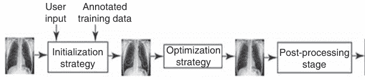

图7.3 基于可变形模型的肺分割过程。来源：Mittal et al. (2017) /John Wiley & Sons。

#### 7.3.3 参数式方法

“主动形状模型（ASM）”和“主动外观模型（AAM）”都属于参数式，使用有限参数集用于CXR中的肺分割。这些方法融合形状和外观信息，以适应肺部结构和纹理的变化。

1995年，Cootes等人引入了“ASM”（Cootes et al. 1995），随后被其他研究者改进。Wu等人通过引入加权组件和纳入额外约束改进了ASM的性能 (Wu et al. 2015)。与标准ASM技术相比，该修改获得了更好的准确性。Shi等人提出的可变形模型通过层次化主成分分析（PCA）在“患者特定和基于人群”两个层面集成形状统计 (Shi et al. 2008)。其目的是采用统计形状建模，在不同解剖结构中实现可靠的肺分割，并包含尺度不变特征变换（SIFT）以提高准确性。Iakovidis和Savelonas为肺分割自动化了地标提取，(Iakovidis and Savelonas 2009) 在初始边界检测方面具有优势，但在低对比度图像中面临挑战。Dawoud将形状信息与基于强度的阈值处理相结合，(Dawoud 2011) 与ASM相比展现了改进的结果。然而，为了获得最佳性能，它需要使用分辨率相同的图像。Zhang等人 (Zhang et al. 2014) 建议了一种类似的方法，结合强度信息和形状先验进行肺分割。两项研究均使用JSRT数据集对其模型进行训练和评估。ASM的局限性在于其仅关注对象的形状，忽略了纹理和颜色变化等因素。为了解决这一问题，引入了AAM，扩展ASM以同时考虑形状和外观。虽然AAM更强大，但也需要更多计算工作。Li等人 (Li et al. 2016) 引入了一种创新方法，集成形状和外观模型以增强肺野分割。他们的方法采用了多尺度和多步长策略，有助于提高准确性。此外，Shao等人提出了使用基于学习的地标检测和层次化框架的AAM方法，(Shao et al. 2014) 确保彻底且强大的分割过程。

#### 7.3.4 几何可变形模型

基于几何的可变形模型，如曲线演化理论和水平集方法，由Caselles等人提出，以确保平滑演化并有效处理拓扑变化，(Caselles et al. 1993) 在捕捉复杂肺部形状方面具有优势，同时独立于参数。Annangi等人利用先前形状信息，使用了主动轮廓


分割任务的技术，(Annangi et al. 2010) 结合水准集最小能量与 Otsu 阈值处理，并利用提取的边缘特征、角点及区域特定数据。该方法熟练解决了与局部极小值相关的挑战，并在每张图像的双肺中在七秒内完成了肺结构的分割。

通过引入图割技术，Candemir 等人旨在解决与肺形状可变性和高计算时间相关的挑战。该方法最初计算平均肺形状，并利用图割技术确定边界。尽管在静态形状建模方面遇到挑战且面临高计算时间，他们仍提出了一种采用多分类器方法的方法，(Candemir et al. 2013) 在 1024×1024 分辨率下实现了 8 秒的分割。该方法通过引入解剖图谱和非配准进一步增强，(Candemir et al. 2014) 在 256×256 分辨率下实现了 20–25 秒的更快执行时间。

总体而言，包括 AAMs、活动形状模型和几何可变形模型在内的可变形方法，在胸部放射摄影中对肺结构进行精确分割展现出潜力。

#### 7.3.5 基于像素分类器的分割

从 20 世纪 90 年代初以来，各种“机器学习技术，如 k 近邻 (kNN) 和支持向量机 (SVM)”已被广泛用于 LFS。这种基于像素分类器 (PC) 的方法使用灰度值将像素分配给解剖结构，即使在解剖结构缺失或显著变形的情况下也能确保稳定性能，前提是分类器已得到充分训练。然而，训练这些分类器具有挑战性，因为难以获得多样化且高质量的标注医学训练数据。基于 PC 的方法分为两类：一种基于浅层学习，另一种基于深度学习，具体取决于特征提取过程（可以是手动或自动）（图 7.4）。

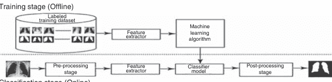

图 7.4 基于像素的肺部分割过程。来源：Mittal 等人 (2017) /John Wiley & Sons。

#### 7.3.6 浅层学习

在浅层学习中，采用机器学习方法提取重要信息。挑战在于为提取的特征识别合适的类别。随着研究趋势的增长，(McNitt-Gray et al. 1993) 旨在使用“模式分类方法”构建一种分割技术。多种分类器包括“线性判别、k 近邻和前馈反向传播神经网络 (FFBPNN)”，用于基于局部纹理和灰度特征对像素进行分类。每个分类器都在包含 17 张 CXR 图像的数据集上进行训练，训练好的分类器在一组不同的 16 张图像上进行评估。尽管神经网络优于 KNN 和 LDA，准确预测了超过 76% 的像素，但仍存在局限性。Vittitoe 等人通过引入马尔可夫随机场建模 (MRFM) 来识别肺区域和非肺区域，解决了这些局限性，在 115 张 CXR 的测试集上实现了 94.8% 的像素分类准确率，(Vittitoe et al. 1998) 优于一些早期方法。然而，MRFM 的计算开销被视为一个缺点。最后，Shi 等人和 Jangam 等人在各自的工作中分别修改了模糊 C-均值聚类算法以用于肺部分割。Shi 等人实现了一种基于“基于高斯核的模糊 C-均值”的无监督方法，(Shi et al. 2009) 在 JSRT 数据集的 52 张 CXR 上实现了 97.8% 的准确率。另一方面，Jangam 等人提出了一种“优化模糊 C-均值聚类”方法，(Jangam and Rao 2019) 结合了水准集算法和空间模糊聚类用于分割。然而，Jangam 等人的方法计算时间较长，为 25–30 秒。这两项研究在计算效率方面有所不同。

### 7.4 深度学习方法

#### 7.4.1 胸部 X 射线中的肺野分割

准确的肺部分割在医学影像中至关重要，因为在过程中即使丢失肺的一小部分也可能产生严重后果。用于分割的浅层学习方法依赖于手动定义的特征，这可能既乏味又容易出错。相比之下，深度学习自动从数据中提取特征，使其成为肺部分割的一种强大且高效的方法。

肺部分割的深度学习方法使用先进的神经网络架构来自动识别 CXR 图像中的肺结构。这些模型包含多层非线性处理，包括输入层、中间层和输出层。深度学习为肺部分割这一计算机视觉任务提供了多种计算高效的方法，包括卷积神经网络，如“全卷积网络 (FCN)、类似 DeepLab v3 的扩展卷积以及类似 UNet 的编码器–解码器模型”及其变体。这些架构对提高分割精度做出了重要贡献。此外，创新方法，如“生成对抗网络”、“注意力机制”和“多阶段或混合框架”，进一步增强了分割过程。网络学习区分肺区域和非肺区域，解决解剖结构变异和图像质量等挑战。训练通常在大型数据集上进行，使模型能够泛化到多样化的病例。

##### 7.4.1.1 基于 CNN 的方法

在过去几年中，随着深度学习技术（尤其是“CNN”）的兴起，人工智能领域经历了显著的演变。本研究强调了 CNN 在自动化分割过程中的有效性，从而减少了所需的人工工作量和时间。当然，CNN 可应用于多种领域，包括但不限于图像识别、计算机视觉、自然语言处理和语音识别。在医学影像分析中，CNN 在不同器官分割方面证明了其有效性，能够自动提取特征并识别人类难以检测的复杂模式。至关重要的是，这种能力增强了精确高效的肺部分割，这对于诊断、治疗和监测致命性肺病至关重要。为解决模型过拟合、参数减少和处理不平衡数据等挑战，Novikov 等人 (2018) 开发了一种强大的“全卷积网络 (FCN)”架构。三种变体——All-Dropout（结合高斯丢弃层以防止过拟合）；All-Convolutional（用卷积层替代池化层以实现更密集的特征提取）；以及“InvertedNet”（Novikov 等人，2018，利用反向残差块和指数线性单元 (ELU) 实现加速训练）——都经过了全面评估。该研究使用了包含 247 张胸部 X 光片的 JSRT 数据集。InvertedNet 的训练时间为 33 小时，涉及 3,140,771 个参数。研究结果表明，InvertedNet 的表现优于其他方法，在雅卡尔得分方面表现良好，这已被研究结果所证明。

此外，Adel Sulaiman 及其同事引入了一种使用深度 CNN 的肺部分割模型。该模型包含卷积块和连接块 (Sulaiman et al. 2023)，卷积层捕获关键特征，转置层增强特征图的空间分辨率。使用了准确率、交并比 (IoU) 和 Dice 系数等性能指标来评估模型的有效性，取得了令人印象深刻的结果。该模型采用 k 折交叉验证 (k = 5) 进行训练，在损失极小的情况下达到了 97% 的准确率。

编码器–解码器神经网络架构广泛用于图像分割，由两个基本部分组成：编码器和解码器。编码器通常被称为收缩路径，利用卷积层对输入图像进行下采样，提取关键特征并降低空间维度。相反，解码器称为扩展路径，采用上采样层来增强空间分辨率并生成分割掩码。U-Net 是一种专用的编码器–解码器网络，最初由“Olaf Ronneberger”（Ronneberger 等人，2015）为生物医学图像分割而创建，它结合跳跃连接和额外的卷积层以提高分割精度。

##### 7.4.1.2 基于 U-Net 的方法

“U-Net 架构”对医学图像分割产生了重大影响，标志着一项关键进步。研究人员对 U-Net 研究做出了显著贡献。以下是众多研究人员对基于 U-Net 的模型所作的一些贡献（图 7.5）。

在此背景下，Islam 等人为肺部分割提出了一种“基于 U-Net 的深度 CNN”，结合了先进的数据增强技术、改进的跳跃连接以及对收缩-扩展路径的修改等增强功能。这些改进旨在更好地捕捉复杂性

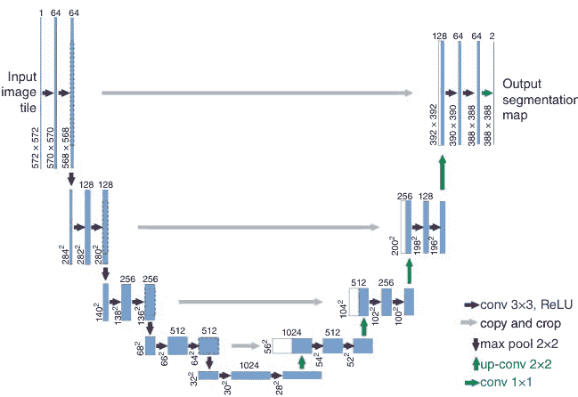

图 7.5 医学图像分割的基本 U-Net 架构。来源：Ronneberger 等人 2015 /Springer Nature。


存在于胸部 X 光片中的变异。该模型达到 98.6% 的 Dice score，并在两个基准胸部 X 光数据集上进行评估：“Shenzhen Hospital (SH) 数据集和 Montgomery County (MC) 数据集”，展示了 U-Net 改进在推进医学图像分割方面的性能。深度学习模型在解剖结构分割方面表现出色，但训练参数数量庞大是一个潜在问题。这会导致内存使用增加和模型泛化能力下降，与我们之前关于 U-Net 架构的讨论相关联。为解决这一问题，Yahyatabar 等人引入了 “Dense-Unet”（Yahyatabar 和 Jouvet 2020），这是一种具有密集连接的 U-Net 扩展，增强了层间的信息流。该模型提供 “compact and normal” 版本，包含挤压激发（SE）块。该研究使用了 JSRT 和 Montgomery 数据集，分别达到 97.6/95.3 和 97.9/95.59 的 Dice 和 Jaccard 分数，说明了分割性能的提升。同样，与以前自动分割胸片中肺部区域的研究一样，Liu 等人提出了一个 “Improved U-Net”（Liu et al. 2022）网络，该网络在编码器中包含预训练的 EfficientNet-b4 骨干网络、LeakyReLU 激活函数以及解码器中的残差块，以高效提取肺野特征并防止梯度不稳定。所提方法在公开 CXR 数据集（JSRT 和 MC）以及一个私有 Haut 肺分割数据集上进行了测试，并在 “Jaccard Index 和 Dice 灵敏度系数（DSC）” 方面优于传统的 U-Net 模型。两项研究都使用数据增强技术来克服训练集规模有限的问题，增强对多样化数据集的泛化能力。（Liu et al. 2022; Yahyatabar 和 Jouvet 2020）。

U-Net 架构在最近的医学研究中被广泛采用；然而，它存在不足，最突出的是在最终卷积层中存在单一的 dropout 函数，这导致过拟合和模型泛化能力差。为解决这些问题，Arvind 等人提出了一种改进的、相对轻量的 U-Net 模型变体（Arvind et al. 2023），在卷积层和去卷积层中都加入多个 dropout，以改善胸部 X 光片中肺部图像的语义分割。他们在 U-Net 的架构组件（如批归一化和更少的卷积）方面的改进，在保持性能指标的同时，减少了模型参数并降低了模型复杂度。该研究在多个数据集上实现了改进的性能，泛化准确率为 93.87%。

在继续讨论编码器–解码器方法时，研究人员引入了 “DED-CNN（双编码器–解码器 CNN）”（Ullah et al. 2023），用于精确分割胸部 X 光片中多器官解剖结构。该模型使用预训练的 VGG19 作为编码器，包含一个 SE 块以获得更好的表示，并采用 “注意门模块（AGMs）” 来改进第二个编码器–解码器中较小区域的分割。对基准数据集（JSRT、MCCXR 和 SCXR）的评估表明，DED-CNN 在解剖结构分割方面优于现有的 CNN 架构。

胸部 X 光片对于诊断肺部疾病（包括癌症和其他胸部感染）至关重要。作为回应，作者提出了 “CSR-Net”（Kumar et al. 2023），这是一个完全卷积网络，集成了 “以 ResNet-101 为特征提取器的迁移学习（TL）”，并辅以 “作为骨干网络的 U-Net”。迁移学习在克服数据限制、增强泛化能力和减少训练时间方面证明很有价值。CSR-Net 的性能在 JSRT 数据库上进行了评估，Dice score、精确率、召回率、准确率和雅卡尔相似系数（JSC）等指标被定量测量。

##### 7.4.1.3 基于空洞卷积的方法

Deeplabv3+ 是一种关键架构（Chen et al. 2018），为精确图像分析提供了一个强大的编码器–解码器框架。虽然其前身 deeplabv3 在捕获多尺度上下文信息方面表现出色，但在准确勾勒物体边界方面面临挑战。Deeplabv3+ 通过集成解码器模块解决了这一局限性，改进了分割结果，特别是在物体边界和物体边缘沿线。在此基础上，研究人员探索了各种改进，以进一步提升其性能并应对特定挑战。

Singh 等人开发了 Deep LF-Net（Singh et al. 2021），这是一个基于 deeplabv3+ 的编码器–解码器网络，旨在稳健地分割印度患者多种异常的肺部。编码器包含空洞卷积和空间金字塔池化，用于捕获多尺度上下文信息，而解码器则优化分割，解决致密影和胸腔积液等挑战。后处理（包括面积过滤）能有效消除假阳性。在内部印度数据集和公开数据集（Shenzhen、JSRT 和 MC）上进行评估，Deep LF-Net 展现出卓越性能，在 JSRT 上达到 99.37%，在 MC 上达到 99.09%，在 Shenzhen 上达到 98.31% 的准确率，优于现有方法。在 Boudoukhani 等人最近的一项研究中（Boudoukhani et al. 2023），采用了一种独特的方法来解决肺部分割中的常见挑战，例如形状/尺度变化、设备伪影、假阳性以及跨设备泛化能力差的问题。编码器中的注意门滤除噪声，聚焦于相关肺部特征，并最小化假阳性，而解码器中的残差卷积保留关键细节，从而在多样化的 X 光数据集上产生清晰、准确的肺部边界，提升了该模型的泛化能力。该模型基于 EfficientNet-b4 和 ResNet-50 架构，优于先前的模型，在无需预处理/后处理的情况下实现了 “98.03% 的 Dice 系数和 96.14% 的 Jaccard 指数”（Figure 7.6）。

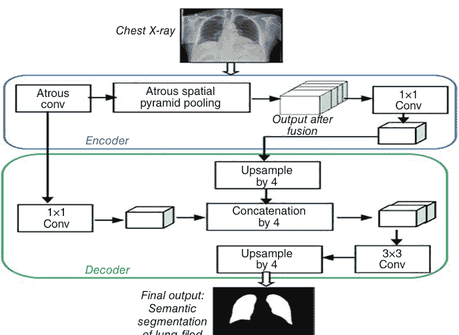

图 7.6 用于语义肺部分割的 Deeplabv3+ 架构概览。来源：Singh et al. 2021 / ELSEVIER 授权。

##### 7.4.1.4 基于注意力的方法

大量研究在其分割框架中采用了注意力机制。基于注意力的模型已成为强大的工具。与传统的 U-Net 架构不同，这些模型在收缩路径和扩展路径中战略性地集成了注意力模块，从而捕获与肺部区域相关的关键特征并提高整体分割准确率。Kim 等人提出了一种基于自注意力的深度学习模型，包含 “X-注意力和 Y-注意力模块”（Kim 和 Lee 2021）。X-注意力模块专注于局部特征，而 Y-注意力模块则结合来自更深层的全局上下文，以有效利用全局特征。两个注意力模块都采用通道注意力和空间注意力，增强特征提取过程。这些模块推导的注意力图被相乘，并通过残差学习在后续层中使用。所提议的注意力模块有助于提供准确的像素级注意力信息，从而生成噪声更少的平滑分割掩码。为了克服以前模型在正确分割肺部区域方面面临的问题（特别是在存在肋骨边缘、不规则形状以及大小和形状变化的情况下），研究人员引入了一种名为 “Attention RegSeg（ARSeg）” 的新分割模型（Ghali 和 Akhloufi 2022）。该方法利用注意力机制消除无关特征。ARSeg 架构采用 RegNetY-32GF 作为骨干网络，用于检测和提取肺部特征。解码器由三个 Deconv 块和一个 1×1 卷积层组成，用于生成肺部掩码。主要目标是克服这些局限性并改进肺部分割任务。与此同时，作者提出了一种新型的注意力 UW-Net，它解决了 U-Net 的局限性，并直接分割胸部 X 光片中大小感兴趣区域，无需预处理/后处理步骤（Pal et al. 2022）。该模型包含一个具有完全连接卷积和注意门的中间层，专门设计用于提高小病变的分割准确率。即使在 NIH X 光数据集子集（200 张图像）上训练，该方法也显示出有希望的结果，表明高效且准确的肺部分割具有潜力。该模型在多样化胸部 X 光数据集中的泛化能力仍不确定，因为该研究未探究其在不同数据集上的表现。

##### 7.4.1.5 基于 GAN 的方法

2014 年由 “Ian Goodfellow 等人” 引入的 “GAN”（Goodfellow et al. 2020）是一个人工智能框架，它采用涉及双神经网络的竞争性训练方法：“生成器和判别器”。生成器的目标是生成几乎与真实数据无法区分的合成数据，例如图像，而判别器则区分训练数据和生成的数据，以确定输入的原始性。利用这两个神经网络，研究人员扩展了 GAN 的应用，提出了一种创新模型。他们的模型（Munawar et al. 2020）配备了类似于 U-net 结构的生成器，被训练用于生成分割掩码，而四个判别器（“D1、D2、D3 和 D4”）充当二进制分类器，用于区分基准真实掩码和生成的掩码。“Montgomery County、JSRT 和 Shenzhen” 数据集被用于评估，该模型达到了 “IOU 分数 0.943 和 Dice 相似系数（DSC）0.9740”。在一项相关研究中，（El Mansouri et al. 2022）作者进一步探讨了基于 GAN 的肺部分割，使用了带有 U-Net 设计的类似 GAN 架构。他们的重点是胸部 X 光片分割，具体使用了包含 240 张图像的 JSRT 数据集（40 张用于验证，40 张用于测试，160 张用于训练）。所提模型取得了 0.9778 的显著 Dice 分数。尽管取得了成功，但该研究承认了 GAN 相关的计算强度，强调未来研究需要探索多样化的数据集，并评估不同图像尺寸下的性能。

为应对 GAN 中不稳定性和多样性的挑战，Lyu 等人引入了 “多任务 Wasserstein 生成对抗 U 型网络（MWG-UNet）”（Lyu 和 Tian 2023）。该架构包含一个生成器，用于将生成样本的分布与真实数据相匹配，以及一个


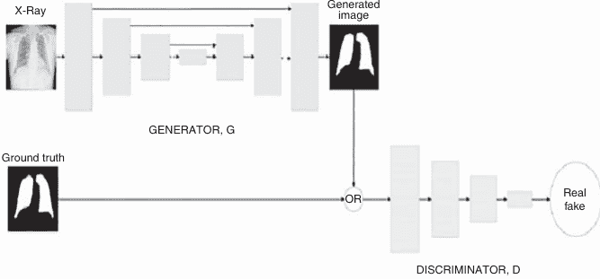

图 7.7 GAN 架构概览。来源：Munawar et al. 2020/IEEE/CC-BY-4.0.

鉴别器用于区分真实数据和合成数据。生成器采用一种增强型 U-Net，称为 ARU-Net。MWG-UNet 中多任务学习的主要目的是提升性能和泛化能力（图 7.7）。

##### 7.4.1.6 多阶段和集成方法

多阶段和集成学习框架的使用已在多项研究中显著改善了分割结果。

Ciano 等人提出了一种多器官分割方法（Ciano et al. 2021），该方法采用带有多阶段算法的 GAN 来处理 X 射线图像。

该研究使用了 PGGAN、Pix2PixHD 和 SMANet，强调了在 CAD 中精确分割的重要性，尤其是在训练数据有限的场景下，展示了先进的分割技术。

同样，研究人员引入了一种复杂的肺分割方法（Souza et al. 2019），提出了一种级联两阶段模型。

该方法采用一种重建技术来分割肺部，最初在肺部补丁上使用 AlexNet。

在出现模糊影或实变的情况下，会训练一个次级 CNN（ResNet-18）用于肺部重建。

初始分割和后续重建阶段的结果被结合，从而提高了最终分割结果的准确性。

为了扩展肺分割集成框架的研究，Rahman 等人开展了研究（Rahman et al. 2021; Rahman et al. 2022），引入了基于两阶段方法的肺分割集成深度学习框架。

而后一种方法在第一阶段使用传统的 CNN 进行补丁分类。

两项研究都结合了后处理技术和修改后的 U-Net 架构，以提高最终分割准确性，为可用于训练 CNN 的小数据集场景提供了一种替代方案。

#### 7.4.2 CT 扫描中肺部分割深度学习方法概述

深度学习技术最近已成为医学图像（尤其是 CT 扫描）中肺野分割（LFS）的强大工具。

本综述侧重于基于深度学习的 LFS 方法的进步与应用，强调其在医疗诊断中的重要性。

早期的肺分割尝试依赖于数值方法（Abdani et al. 2022）、灰度阈值法（Zulkifley et al. 2022）和基于形状的技术等常规技术。

然而，这些方法在处理医学图像的复杂性方面存在局限性。

深度学习的出现，以 CNN 为先锋，对医学图像分割领域产生了变革性的影响。

最近的研究提出了几种基于 CNN 的肺野分割方法（Stofa et al. 2021），利用 2D CNN、2.5D CNN 和 3D CNN 的能力。

这些技术相较于传统方法表现出显著改进，能够实现更准确、更高效的分割。

Xu 等人提出的研究针对肺分割提出了一个简单的 CNN 模型（Xu et al. 2019），采用基于“聚类算法”的方法生成训练数据集。

k-means 聚类算法利用图像补丁的平均强度和最小强度，有效地将 CT 切片分为两组。

为确保准确性和完整性，最终数据集通过一个多步过程生成，涉及用于形状一致性的十字交叉验证、用于重叠移除的体积交集、用于区域识别的连通分量分析以及用于数据增强的补丁扩展。

网络架构包括一个包含六个内核的单个卷积层用于特征提取、一个最大池化层用于下采样，以及两个用于最终分类的全连接层。

该模型的性能在生成的数据集上采用八折交叉验证方法进行了严格评估。

Lyu 等人引入的一种互补方法开发了用于肺野自动分割的算法，旨在滤除肺部 CT 图像中的噪声，同时保留肺部边界。

这通过采用基于图像分解的滤波方法实现，随后应用小波变换和多种形态学操作来准确勾勒肺部边界。

由此产生的肺部轮廓作为分割优化过程的一部分进行了校正和平滑（Liu and Pang 2020），结合了一种调整轮廓的方法。

这一全面的方法集说明了肺分割领域所采用的多样化策略，展示了聚类算法、CNN 架构和图像处理技术的有效性（Liu and Pang 2020; Xu et al. 2019）。

一种有效的方法是采用“带假阳性的 U-Net 架构”（Khanna et al. 2020）策略，说明更先进的网络在肺分割中的有效性。

在另一项研究中（Comelli et al. 2020），比较了“U-Net 和 E-Net 模型”的性能，强调了它们在肺纤维化患者中分割肺实质方面的有效性。

一种具有用于恢复全局上下文和提取细节的独立路径的 U-Net 架构（Ait Skourt et al. 2018）显示出高性能，Dice 系数为 0.9502。

此外（Hu et al. 2020），一种在 Mask R-CNN 方法中结合监督和非监督机器学习技术的集成方法展示了快速且准确的分割，准确率为 97.68%，平均处理时间为 11.2 秒。

多视图卷积网络已被用于识别肺结节（Setio et al. 2016），针对不同类型的结节。

将多个 2D ConvNet 流与稳健的分类方法相结合，取得了有希望的结果，平均每次扫描出现 4 个假阳性，并实现了 85.4% 的“检测灵敏度”。

超越 2D 方法，一些研究人员专注于训练“3D CNN”以实现肺结节的自动检测。

这些网络在从 LIDC 等数据集中提取的感兴趣体积（VOI）上进行训练，LIDC 是检测“肺结节”的宝贵资源。

研究人员还分析了 3D FCNN 的性能，以在单次迭代中为整个体积生成评分图，从而展示了 3D CNN 的有效性（Negahdar et al. 2018），展示了 3D CNN 的效率。

随着不断的进步，Roy 等人提出了一种用于肺结节分割的创新模型（Roy et al. 2019），融合了“深度学习与形状驱动水平集”。

该方法利用深度 FCN 生成的“粗分割图”，通过初步的粗略勾勒来辅助分割过程，以细化精确的边界检测。

最初，采用水平集的形状驱动演变进行精细分割。

此外，这些水平集在自动初始化模型中发挥了重要作用（Thanoon et al. 2023），利用深度网络粗分割推导出的种子点。

由于肺结节的形状、轮廓、纹理和位置存在差异，因此分割肺结节是一项复杂的任务。

有些结节可能与周围组织相连，进一步复杂化了其轮廓的确定。

肺结节分割的主要目标是精确识别结节的轮廓，并将其与肺部区域分开。

尽管采用了各种肺结节分割方法，但挑战依然存在，尤其是在准确分割不同类型的肺结节方面。

Zhang 等人（Zhang et al. 2021）提出了一种使用增强型 U-Net 卷积网络的强健肺结节分割方法。

该方法对各种类型的肺结节表现出精确的分割效果。

该方法涉及使用 α-hull 算法进行轮廓校正的肺实质分割。

包含肺结节的 CT 切片经过预处理步骤，并采用“带批归一化的改进 U-Net”来进行准确分割。

训练使用来自“肺影像数据库联盟和图像数据库资源计划（LIDC/IDRI）”的带有相应真值的补丁。

该模型超越了最先进的算法，达到 0.8623 的 Dice 得分。

与此同时，作者开发了“层次分割网络（CHS-Net）”（Punn and Agarwal 2022），用于识别 COVID-19 感染 CT 扫描中受影响的肺部区域。

该模型在公开可用的组合数据集上进行了评估。

CHS-Net 解决了 COVID-19 数据稀缺的问题。

该模型受到 U-Net、Google 的 Inception 和残差网络等先进架构的启发，采用多阶段方法进行分割和特征提取。

CHS-Net 在分割肺部掩码和感染区域方面达到 95% 的准确率。

最近，作者引入了一种名为“小波 U-Net++”（Akila Agnes et al. 2024）的新方法，融合了“带小波池化的 U-Net++ 架构”。

该方法使用 Haar 小波变换对编码器中的特征图进行下采样，捕捉高频和低频细节以提高分割准确性，特别是对于小型和不规则结节。

在包含 1018 张 CT 图像的 LIDC-IDRI 数据集上进行的评估得出了有希望的结果，平均 Dice 系数为 0.936，平均 IoU 为 0.878。

此外，这些进步凸显了肺分割中持续存在的挑战，需要创新解决方案以提高诊断准确性（表 7.1）。

### 7.5 数据来源与数据集

数据在推进计算机辅助方法方面发挥着至关重要的作用，尤其是在“CAD”系统领域。

开发这些系统需要大量的图像集合，因为它们为训练算法、测试其有效性以及比较不同技术的性能提供了基础。

然而，由于法律和隐私问题，构建大规模医学数据集面临挑战。

尽管如此，特定的研究组织已为“胸部 X 光片和 CT 扫描”准备了数据集，使其可公开用于研究目的。

许多研究人员依赖下面列出的数据集进行研究，这些数据集对于训练和评估深度学习模型至关重要。


#### 表 7.1 肺分割模型的比较分析

| 序号 | 参考文献 | 模型 | 模态 | 数据集 | 准确率 | DSC | JC | F1-分 |
|---|---|---|---|---|---|---|---|---|
| 01 | Yahyatabar and Javout (2020) | 密集 U-Net | X 射线 | JSRT MC | | 97.6, 97.9 | 95.3, 95.59 | |
| 02 | Arvind et al. (2023) | 增强 U-Net | X 射线 | JSRT MC Shenzhen | 93.87% | | | |
| 03 | Boudoukhani et al. (2023) | 注意力门控残差 DeepLabV3+ | | JSRT MC Shenzhen | | 98.03% | 96.14% | |
| 04 | Ghali and Akhloufi (2022) | 视觉变换器 | X 射线 | JSRT MC Shenzhen | 97.47% | | | |
| 05 | Zhang et al. (2021) | 改进的 U-Net | CT | LIDC/IDRI | | 0.8623 | | |
| 06 | Punn and Agarwal (2022) | 分层分割网络 | CT | “COVID-19 CT dataset, COVID-19 CT Lung and Infection Segmentation Dataset” | 95% | 81% | 89% | |
| 07 | Novikov et al. (2018) | 全卷积网络 (FCN) | X 射线 | JSRT | | | 95% | |
| 08 | Sulaiman et al. (2023) | 深度卷积神经网络 | X 射线 | MC Shenzhen | 0.97 | 0.93 | 0.96 | |
| 09 | Liu et al. (2022) | 改进的 U-Net | X 射线 | JSRT MC Haut | 98.55, 98.94, 99.41 | 97.92, 97.82, 98.84 | 95.73, 95.55, 97.43 | |
| 10 | Islam et al. (2018) | 基于 U-Net | X 射线 | MC Shenzhen | | 98.6% | | |
| 11 | Ait Skourt et al. (2018) | 基于 U-Net | CT | LIDC/IDRI | | 0.9502 | | |
| 12 | Hu et al. (2020) | Mask R-CNN | CT | | 97.68 | | | |
| 13 | Singh et al. (2021) | 深度 LF-Net | X 射线 | JSRT MC Shenzhen | 99.37%, 99.37%, 98.31% | | | |
| 14 | Ullah et al. (2023) | DED-CNN | X 射线 | JSRT MC Shenzhen | | 97.60%, 97.67%, 95.68% | 95.50%, 95.48%, 91.84% | |
| 15 | Ghali and Akhloufi (2022) | 注意力 RegSeg | X 射线 | JSRT MC Shenzhen | 95.69% | | | 95.6 |
| 16 | Munawar et al. (2020) | GAN | X 射线 | JSRT MC Shenzhen | | 0.9740 | 0.943 | |
| 17 | Khanna et al. (2020) | 残差 U-Net | CT | LUNA16, VESSEL12, HUG-ILD | 98.63, 99.62, 98.68 | | | |
| 18 | El Mansouri et al. (2022) | GAN | X 射线 | JSRT | | 0.9778 | | |
| 19 | Kim and Lee (2021) | 自注意力 DNN | X 射线 | MC JSRT Shenzhen | | 0.982, 0.968, 0.954 | | |
| 20 | Liu et al. (2022) | 小波变换 | CT | Multimedia database of interstitial lung diseases (ilds) | 98.04% | 94.91% | | |
| 21 | Lyu and Tian (2023) | MWG-UNet | X 射线 | JSRT Shenzhen | 95.28% | 92.31% | | 95.7 |
| 22 | Agnes et al. (2024) | 小波 U-Net++ | CT | LIDC-IDRI | | 0.936 | 0.878 | |
| 23 | Pal et al. (2022) | 注意力 UW-Net | X 射线 | NIH | | | | 95.7 |

#### 7.5.1 胸部 X 射线数据集

##### 7.5.1.1 JSRT（“日本放射技术学会”）

“标准胸部 X 射线数字影像数据库”（包含和不含肺结节）由“日本放射技术学会学术委员会”于 1998 年创建，（Shiraishi et al. 2000）得到日本放射学会 (JRS) 的支持，并与美国和日本的医疗设施合作。JSRT 是使用最频繁的数据集，在“结节检测和肺分割研究”中享有盛誉，包含“247 张后前位 (PA) 胸部 X 射线”，分辨率为“2048×2048”像素。在这些 CXR 图像中，154 张“带有肺结节”（54 个良性和 100 个恶性结节）和“93 张无结节”。这些 CXR 存储为具有 12 位灰度深度的 PNG 文件。此外，数据库还包括患者详细信息，例如年龄、性别、诊断（良性或恶性）、结节的 X 和 Y 坐标，以及显示结节位置的基本图表。作为一个宝贵的存储库，该数据集在各种专注于从胸部 X 射线中识别肺结节的研究中被广泛使用。（Kaggle, 2020）。

##### 7.5.1.2 蒙哥马利县 (MC) 数据集

“蒙哥马利县 (MC)”数据集是马里兰州蒙哥马利县卫生与公众服务部与美国国家医学图书馆 (USNLM) 合作的成果。蒙哥马利数据集包含正面视图拍摄的带标签 X 射线图像。该数据存储库包含通过结核病 (TB) 筛查计划获得的“138 张后前位 (PA) 胸部 X 射线”。在这些 CXR 中，80 张 CXR 描绘了没有结核病表现的正常胸部状况，而 58 张显示出结核病迹象。该数据集附带与数据集中每张 X 射线图像对应的基准真实掩膜。这些掩膜是二值图像，可提供肺部区域的勾勒，并有助于在 X 射线图像中识别特定肺部区域。数据集中的每张 CXR 都附带存储在文本文件 (.txt) 中的临床读数，并且为左右肺分别提供单独的基准真实掩膜，形式为 .png 文件。这些 X 射线图像保持高图像质量，具有“每像素 12 位的分辨率和 0.0875 毫米的像素尺寸”。（Kaggle, 2018）。

##### 7.5.1.3 深圳数据集

深圳数据集由“美国国家医学图书馆 (USNLM) 与中国广东医科大学附属第三人民医院”合作创建，包含 662 张后前位 (PA) 胸部 X 射线。其中，326 张 CXR 描绘正常病例，而 336 张 X 射线显示结核病表现，包括一些儿科前后位 (AP) X 射线。该数据集包含不同尺寸的图像，宽度范围从 1130 到 3001 像素，高度范围从 948 到 3001 像素。大多数图像的大小约为 3K × 3K 像素。CXR 图像以“.jpeg”文件扩展名保存，并使用“飞利浦 DR 数字诊断系统”拍摄。这些图像仅提供了 566 个基准掩膜。这些图像分辨率极高，尺寸为 4020 × 4892 或 4892 × 4020 像素。该数据集中的每张 X 射线图像都具有 12 位的灰度深度，可提供全面的 4096 级灰度范围，以实现增强成像。由于其高分辨率图像以及可用于进一步分析和解剖特征识别的相应掩膜，该存储库是详细胸部成像研究和分析的宝贵资源。

##### 7.5.1.4 印第安纳数据集

印第安纳数据集包含总共 7470 张医学图像，针对这些图像，3955 份详细放射学报告被用于各种医学应用或研究。该数据集源自印第安纳大学附属的多家医院。这些医院可能贡献了其医学图像和相关报告，以形成这个综合数据集。这些图像和报告构成了支持多种医学应用的综合存储库。利用文本挖掘技术，该数据集为每张图像纳入八种疾病标签，使单个图像能够关联多个标签。这个多样化的标签系统有助于基于病理学的图像分类，涵盖广泛的医学状况。X 射线片的尺寸从 1024 到 4248 像素不等，无论是宽度还是高度，最初以“医学数字成像与通信 (DICOM) 格式”存在。后来，这些图像被转换为 PNG 格式，以提高可访问性和标准化用途。美国国家医学图书馆的研究人员已使用该数据集开展不同的研究，例如 CXR 视图分类、（Xue et al. 2015）图像旋转识别、（Santosh et al. 2015）以及这些图像中外来物体的检测。

##### 7.5.1.5 美国国立卫生研究院胸部 X 射线数据集 (NIH)

NIH 数据集（也称为“胸部 X 射线 14”）（Wang et al. 2017）是一个重要的存储库，包含“112,120”张 CXR 图像，并使用“来自 30,805 名独特患者的疾病标签”进行注释。这些标签使用“自然语言处理 (NLP) 技术”得出，从相关的放射学结果中提取疾病分类。该数据集涵盖 14 种不同的胸部疾病类别，以及一个指示“无异常发现”的额外类别。然而，缺乏明确的基准真实掩膜带来了重大挑战。该数据集展示了广泛的病理状况。通过提供对该数据集的访问，本出版物旨在为科学家提供资源，以增强疾病识别和诊断的算法训练，


最终帮助医生做出更明确、更准确的诊断决策。

##### 7.5.1.6 COVID-19放射学数据库

“COVID-19 Chest X-ray Database”是由“达卡大学、卡塔尔大学、多哈和孟加拉国”的学者，在与“巴基斯坦和马来西亚”的合作伙伴及医疗专业人员协作下共同构建的庞大医学影像库。

该数据集分阶段逐步发布，后续更新增加了不同类别的图像数量。

所有CXR图像均为PNG格式，分辨率为299×299像素。

该数据集在不断演进，更新以阶段性方式提供。

根据最新信息，它包括“3616例COVID-19阳性病例”、“10,192张正常图像”、“6012张肺阴影图像”和“1345张病毒性肺炎图像”。

承诺定期用COVID-19肺炎患者的新放射影像更新数据库。

该数据库为科学家们应对COVID-19大流行做出重要学术贡献提供了宝贵资源。(Kaggle (2022))

| CXR类型 | 图像数量 | 来源 |
|---|---|---|
| 正常 | 10,192 | RSNA: 8,851, Kaggle: 1,341 |
| 肺阴影 | 6,012 | RSNA CXR数据集 |
| COVID-19 | 3,616 | PadChest数据集: 2,473, 德国医学院: 183, 各种来源: 559, GitHub来源: 400 |
| 病毒性肺炎 | 1,345 | “胸部X光图像（肺炎）数据库” |

PadChest：PadChest数据集包含来自109,931项研究的160,868张胸部X光片，涉及西班牙“圣胡安医院”（Bustos et al. 2020）在2009年至2017年期间的67,000人。

图像以16位灰度图像形式存储，保留了详细信息。

在与X光片相关的报告中，有27,593份由医生手动标注。

一种创新方法是在这些带标签的报告上训练循环神经网络（RNN）。

训练好的RNN随后被用于根据从报告中提取的信息自动标注剩余数据集。

标签遵循与统一医学语言系统（UMLS）标准一致的层级分类法。(Bodenreider 2004)

RSNA-Pneumonia：RSNA-Pneumonia (RP) 数据集源自 ChestX-ray14，包含30,000张胸部X光（CXR）图像，并针对肺炎进行了精心标注。

该数据集包含16,248张后前位（PA）片、13,752张前后位（AP）片以及4,527张测试图像。

这些数字化放射影像已从PNG格式转换为DICOM格式，包含患者详细信息。

每张放射影像的分辨率为1024×1024，采用8位灰度格式呈现，并针对肺阴影标注了边界框。

类别为正常、肺阴影和非正常。

该数据集在Kaggle上的“RSNA肺炎检测挑战赛（2018）”中被广泛使用，对于训练和评估用于胸部X光片自动肺炎检测的机器学习模型至关重要。(Kaggle n.d.)

#### 7.5.2 CT扫描数据集

随着医学影像技术的发展，CT扫描数据集已成为研究肺部疾病的重要工具，为研究人员提供了丰富的医学影像及相关临床数据。

肺部疾病常用的CT数据集如下。

##### LIDC-IDRI

Armato et al. 在《肺部影像数据库联盟（LIDC）与影像数据库资源计划（IDRI）：CT扫描肺结节的已完成参考数据库》中介绍了LIDC-IDRI数据集。

该数据集是肺组织研究联盟的合作成果，包含来自1,200名患者的1,018例低剂量肺部CT扫描。

该数据集由经验丰富的胸部放射科医生精心提供的病变标注增强，包含钙化和恶性度等相关特征。

该资源在推进肺组织分析研究方面发挥着关键作用，并为研究各种肺部疾病提供了宝贵参考。

该数据集中的CT图像采用DICOM格式，总大小为125 GB，每次扫描的分辨率为[65,764]×512×512体素，并附带相关元数据文件。

平均每次扫描包含240张切片，平均切片厚度为1.73 mm。(Armato et al. 2010)

##### LUNA16

LUNA16数据集专注于肺结节检测，包含888组3D CT图像。

LUNA16专注于肺结节分割，为针对肺结节检测和表征的算法创建与评估提供了丰富资源。

##### LOLA11

LOLA11（肺叶与肺部分析挑战赛的缩写）(Lola11 n.d.) 是专门为肺叶分析相关挑战设计的数据集。

该数据集包含来自不同来源的55例胸部容积CT扫描，提供了包含显著病理和异常的多样化扫描。

##### SPIE-AAPM

由“SPIE医学影像会议与国家癌症研究所（NCI）和美国医学物理学家协会（AAPM）合作发起”，使研究人员能够评估和对比其在采用定量图像分析将结节分类为良性或恶性方面的方法。

该数据集最后更新于2014年，包含总计12.1 GB的22,489例CT扫描，以及70份患者记录和辅助数据（除图像外），这些记录和数据提供了基准真实信息。

科学家和医疗专业人员使用这些数据集来开发和评估深度学习算法、机器学习模型以及各种计算方法，旨在理解、诊断和预后各种肺部疾病。(National Lung Screening Trial (NLST) n.d.)

##### 肺部CT诊断数据集

该数据集于2014年更新，可通过TCIA公开访问。

该数据集包含61名患者的数据，由莫菲特癌症中心维护更新。

该数据集包含4,682张图像，累计大小为2.5 GB。

这些图像代表以DICOM格式保存的CT医学影像模式，切片厚度范围为“3–6 mm”。

每个文件包含包含患者详细信息和肿瘤切片实例编号的元数据。(Cancer imaging archive n.d.)

##### NLST数据集

NLST数据集于2013年更新，是一个受限访问的存储库，是一项关键临床研究，用于评估低辐射CT筛查降低肺癌相关死亡率的效果。

除了病理图像外，该数据集还包含与相关临床数据配对的放射学图像。

该项目由“国家癌症研究所癌症预防部与癌症治疗和诊断部”的合作努力支持。

该数据集包含近21,082,502例CT扫描，总量为11.3 TB，涉及26,254名个体 (NLST 2013).

(National Cancer Institute - Cancer Data Access System n.d.)

### 7.6 评估指标

评估指标是用于衡量模型或算法性能的定量指标。

这些指标有助于确定模型在特定任务上的表现如何。

其意义在于促进不同算法之间的比较，并在确保模型在实际场景中的精度方面发挥着关键作用。

这些指标通过将模型的预测结果与基准真实值进行比较来评估模型的性能。

基准真实值是指由医学专家手动获得的实际肺部分割结果。

以下是医学图像中肺部分割常用指标的摘要。

#### 真阳性（TP）

当模型将某事物预测为阳性且其本身为阳性时。在肺部分割中，当图像像素为肺像素时，模型会正确地将其识别为肺像素。

#### 真阴性（TN）

当模型将某事物预测为阴性且其本身为阴性时。在肺部分割中，当系统将不属于肺部区域的图像像素正确分类为非肺像素时。


假阳性（FP）：当模型将负样本预测为正样本时。在肺分割的情况下，当模型将属于非肺区域的图像像素分类为肺像素时。

假阴性（FN）：当模型将正样本分类为负样本时。在肺分割的情况下，当模型将属于肺区域的图像像素分类为背景像素时。

以下是医学图像中肺分割常用指标的摘要。

#### 准确率（Accuracy）
准确率是评估深度学习模型的关键指标，能提供其预测能力的洞察。它衡量模型准确预测数与总预测数之比，确定被正确分类为肺或非肺的图像像素百分比。该计算通过以下公式实现：

Accuracy = \frac{TP + TN}{TP + TN + FP + FN}

#### Jaccard 指数（Jaccard Index）
也称为重叠度量，它是实测掩膜与分割图像之间的相似度度量。它也称为 IoU。使用以下公式计算：

Jaccard Index = \frac{TP}{TP + FP + FN}

其值在 0 到 1 之间，其中 0 表示预测图像与实测图像之间没有重叠或相似性，1 表示完全重叠，即分割图像与实测图像完全相同。Jaccard 指数值越高，分割结果的相似性和准确性越好。Jaccard 指数被认为是平衡的，因为它同时考虑了假阳性和假阴性。它会对模型缺失或包含实测中不存在的区域进行惩罚。

#### Dice 系数（Dice coefficient）
DSC 度量两个集合之间的相似性，通常用于图像分割和自然语言处理等任务。该指标量化预测分割与实测之间的重叠程度。同样，DSC 越高表示分割准确性越好。它也称为“Sørensen Dice 系数”，计算如下：

DC = \frac{2 \times TP}{2 \times TP + FP + FN}

#### 精确率（Precision）
精确率是衡量模型正预测准确性的指标。它计算为模型分类为正样本的 TP 预测数与模型分类为正样本的总实例数之比，无论这些预测是否正确。在肺分割中，它是被正确分类的像素数除以被分类为肺像素的总数。当假阳性预测代价高昂时，精确率是一项重要的评估指标。例如，如果模型错误地将健康组织分类为癌变组织。高精确率意味着错误识别正值的错误被最小化。精确率提供了模型正预测准确性的度量。计算如下：

Precision = \frac{TP}{TP + FP}

#### 召回率（Recall）
也称为灵敏度，它是模型正确捕获和识别 TP 的能力的度量。在肺分割中，它是从图像中正确分类肺像素的概率。当假阴性比假阳性更关键时，它是一个有用的指标。使用以下公式计算：

Recall = \frac{TP}{TP + FN}

#### 特异度（Specificity）
与灵敏度或召回率相反，特异度是模型正确识别 TN 的能力的度量。在肺分割中，它是正确分类背景（或非肺）像素的概率。当假阳性代价高昂或关注负预测的准确性时，它是一个有用的指标。该指标使用以下公式推导：

Specificity = \frac{TN}{TN + FN}

特异度告诉我们模型做出正确负预测的准确性。特异度值越高，模型正确识别 TN 的效果越好，最小化假阳性的发生。值越低意味着模型错误地将负实例预测为正，导致假阳性。

#### F1 分数（F1-score）
F1 分数是一项关键的评估指标，通过同时考虑精确率和召回率，对模型性能提供平衡评估。通过计算精确率和召回率的调和平均数，F1 分数在单个值中对这两项指标提供对称表示。最大值为 1 表示完美的精确率和召回率，最小值为 0 表示精确率或召回率为零，F1 分数是模型准确性的可靠指标，计算如下：

F1 Score = \frac{2 \times Precision \times Recall}{Precision + Recall}

#### Hausdorff 距离（Hausdorff distance）
度量预测和实测分割边界上任意两点之间的最大距离。Hausdorff 距离越低，分割之间的对齐越好。

肺分割或任何医学图像分割任务的评估指标选择取决于多种因素，包括分割的具体目标、数据集特征以及评估指标所期望的具体特性。

### 7.7 结论

这项研究描绘了基于深度学习技术（特别是在 LFS 中）的变革性作用的更广阔图景，标志着从传统计算机视觉算法的重要转变。评估中强调优先考虑鲁棒性和泛化能力，以降低针对低变异性或标注不充分的数据过拟合的风险。该综述强调了标准化数据集的迫切需求，以有效评估用于分割和疾病分类的各种模型。在提出未来研究方向方面，该研究建议探索多模态成像并整合临床数据，以提高肺分割的精度。在医学图像分析（特别是 CXR 图像）的深度学习模型不断进步的背景下，该研究认识到由于器官重叠和各种解剖结构的存在，肺分割面临着持续的挑战。所提架构所反映的持续研究工作旨在提高分割的准确性和鲁棒性。重要的是，所讨论的分割框架有望适应 CT 等其他医学成像模态，从而将其适用性扩展到 CXR 图像之外。这种多功能性使深度学习成为医学成像领域多种诊断和监测任务的关键技术。

## 参考文献

Abdani, S.R., Zulkifley, M.A., Shahrimin, M.I., 和 Zulkifley, N.H. (2022). 计算机辅助翼状胬肉筛查系统：综述. Diagnostics (巴塞尔, 瑞士) 12 (3): 639. https://doi.org/10.3390/diagnostics12030639.

Agrawal, T. 和 Choudhary, P. (2023). 胸部 X 线摄影中的分割与分类：系统综述. The Visual Computer 39 (3): 875–913. https://doi.org/10.1007/s00371-021-02352-7.

Ait Skourt, B., El Hassani, A., 和 Majda, A. (2018). 基于深度神经网络的肺 CT 图像分割. Procedia Computer Science 127: 109–113. https://doi.org/10.1016/j.procs.2018.01.104.

Akila Agnes, S., Arun Solomon, A., 和 Karthick, K. (2024). 用于 CT 扫描中肺结节精确分割的 Wavelet U-Net++：改善肺癌早期检测与诊断. Biomedical Signal Processing and Control 105: 105509. https://doi.org/10.1016/j.bspc.2023.105509.

Annangi, P., Thiruvenkadam, S., Raja, A., Xu, H., Sun, X., 和 Mao, L. (2010). 一种基于先验形状和低级特征的 X 射线肺分割区域主动轮廓方法. 2010 IEEE 生物医学成像国际研讨会：从纳米到宏观. https://doi.org/10.1109/isbi.2010.5490130.

Armato, S., McLennan, G., McNitt-Gray, M. 等 (2010). WE-B-201B-02: 肺影像数据库联盟 (LIDC) 和图像数据库资源倡议 (IDRI)：用于肺结节分析的 CT 扫描已完成公共数据库. Medical Physics 37 (6Part6): 3416–3417. https://doi.org/10.1118/1.3469350.

Armato, S.G., Giger, M.L., 和 Mac Mahon, H. (1998). 数字化后前位胸部 X 线片中肺的自动分割. Academic Radiology 5 (4): 245–255. https://doi.org/10.1016/s1076-6332(98)80223-7.

Arvind, S., Tembhurne, J.V., Diwan, T., 和 Sahare, P. (2023). 用于胸部 X 射线肺语义分割的改进轻量级基于深度 CNN 的 U-Net. Results in Engineering 17: 100929. https://doi.org/10.1016/j.rineng.2023.100929.

Beyer, T., Bidaud, L., Dickson, J. 等 (2020). 我们将读取什么扫描：临床肿瘤学中的成像仪器趋势. Cancer Imaging 20 (1): https://doi.org/10.1186/s40644-020-00312-3.

Bodenreider, O. (2004). 统一医学语言系统 (UMLS)：整合生物医学术语. Nucleic Acids Research 32 (数据库期刊): D267–D270. https://doi.org/10.1093/nar/gkh061.

Boudoukhani, N., Elberrichi, Z., Ouladjdi, L., 和 Dif, N. (2023). 用于胸部 X 射线精确肺分割的新型注意力门控剩余深度卷积网络. Evolving Systems. https://doi.org/10.1007/s12530-023-09516-x.

Brown, M.S., Wilson, L.S., Doust, B.D. 等 (1998). 基于知识的胸部 X 射线图像中肺边界分割与分析方法. Computerized Medical Imaging and Graphics 22 (6): 463–477. https://doi.org/10.1016/s0895-6111(98)00051-2.

Bustos, A., Pertusa, A., Salinas, J-M., 和 de la Iglesia-Vayá, M. (2020). PadChest：带有多标签注释报告的大型胸部 X 射线图像数据集. Medical Image Analysis 66: 101797. https://doi.org/10.1016/j.media.2020.101797.

癌症成像档案：用于肺癌诊断的大规模 CT 和 PET/CT 数据集 (lung-pet-ct-DX). (无日期). 从 https://wiki.cancerimagingarchive.net/pages/viewpage.action?pageid=70224216 检索.

Candemir, S., Jaeger, S., Palaniappan, K. 等 (2014). 使用带有非刚性配准的解剖图谱进行胸部 X 线片中的肺分割. IEEE 医学成像交易 33 (2): 577–590. https://doi.org/10.1109/tmi.2013.2290491.

Candemir, S., Palaniappan, K., 和 Akgul, Y. S. (2013, April). 图像分割图割的多类正则化参数学习. 2013 IEEE


第10届生物医学成像国际研讨会。https://doi.org/10.1109/isbi.2013.6556813

Caselles, V., Catte, F., Coll, T. 和 Dibos, F. (1993). 图像处理中主动轮廓的几何模型。Numerische Mathematik 66 (1): 1–31。https://doi.org/10.1007/bf01385685。

Chen, L.-C., Zhu, Y., Papandreou, G. 等 (2018). 语义图像分割的带扩散可分卷积的编码器-解码器。载于：《计算机科学讲义》, 833–851。Springer International Publishing https://doi.org/10.1007/978-3-030-01234-2_49。

Cheng, D. 和 Goldberg, M. (1988). 胸部X光片分割算法。载于：《1988年可视通信与图像处理：系列第三卷》（T.R. Hsing 编）。华盛顿，美国：SPIE https://doi.org/10.1117/12.968961。

Ciano, G., Andreini, P., Mazzierei, T. 等 (2021). 多器官胸部X光图像生成与分割的多阶段 GAN。《数学》9 (22): 2896。https://doi.org/10.3390/math9222896。

Comelli, A., Coronnello, C., Dahiya, N. 等 (2020). 基于深度学习的高分辨率计算机断层扫描图像肺部分割：放射组学研究的初步步骤。《成像杂志》6 (11): 125。https://doi.org/10.3390/jimaging6110125。

Cootes, T.F., Taylor, C.J., Cooper, D.H. 和 Graham, J. (1995). 主动形状模型：其训练与应用。《计算机视觉与图像理解》61 (1): 38–59。https://doi.org/10.1006/ciu.1995.1004。

Dawoud, A. (2011). 通过迭代阈值融合形状信息的胸部X光片肺部分割。《IET 计算机视觉》5 (3): 185。https://doi.org/10.1049/iet-cvi.2009.0141。

Duryea, J. 和 Boone, J.M. (1995). 数字胸部X光图像肺野分割的全自动化算法。《医学物理学》22 (2): 183–191。https://doi.org/10.1118/1.597539。

El Mansouri, O., El Mourabit, Y. 和 El Habouz, Y. (2022). 基于生成对抗网络的胸部X光图像肺部系统分割。《ITM Web of Conferences》43: 01020。https://doi.org/10.1051/itmconf/20224301020。

Gados, D. 和 Horvath, G. (无日期). 胸部X光片肺野分割的启发式方法。载于：《IFMBE 论文集》, 802–805。柏林海德尔堡：Springer https://doi.org/10.1007/978-3-540-73044-6_208。

Ghali, R. 和 Akhlloufi, M. A. (2022 年 8 月). ARSeg: 用于 CXR 肺部分割的注意力 RegSeg 架构。2022 年 IEEE 第 23 届信息再用与数据科学整合国际会议 (IRI)。https://doi.org/10.1109/iri54793.2022.00068

Goodfellow, I., Pouget-Abadie, J., Mirza, M. 等 (2020). 生成对抗网络。《ACM 通讯》63 (11): 139–144。https://doi.org/10.1145/3422622。

Hu, Q., Souza, L.F.D.F., Holanda, G.B. 等 (2020). 基于掩码区域卷积神经网络的 CT 肺部分割有效方法。《医学人工智能》103: 101792。https://doi.org/10.1016/j.artmed.2020.101792。

Iakovidis, D. K. 和 Savelonas, M. (2009 年 11 月). 基于选择性阈值的主动形状模型辅助胸部X光片肺野分割。2009 年第 9 届生物医学信息技术与应用国际会议。https://doi.org/10.1109/itab.2009.5394326

Islam, J. 和 Zhang, Y. (2018). 基于深度学习的胸部X光片鲁棒肺部分割研究。arXiv。https://arxiv.org/abs/1811.12638。

Jangam, E. 和 Rao, A.C.S. (2019). 使用萤火虫优化模糊 C-均值和水平集算法从胸部 X 光片中分割肺部。载于：《图像处理与模式识别最新进展》, 303-311。Springer Singapore https://doi.org/10.1007/978-981-13-9184-2_27。

Kaggle. (2018) 肺部胸部 X 光异常。https://www.kaggle.com/Datasets/Kmader/Pulmonary-Chest-Xray-Abnormalities?Select=Montgomery。

Kaggle. (2020) 胸部 X 光结节 (JSRT)。https://www.kaggle.com/Datasets/Raddar/Nodules-in-Chest-Xrays-Jsrt。

Kaggle (2022). COVID-19 放射影像数据库。Kaggle。https://www.kaggle.com/Datasets/Tawsifurrahman/Covid19-Radiography-Database。

Kaggle. (无日期). RSNA 肺炎检测挑战赛 | 。https://www.kaggle.com/c/Rsna-Pneumonia-Detection-Challenge/Data。

Khanna, A., Londhe, N.D., Gupta, S. 和 Semwal, A. (2020). 用于计算机断层扫描图像自动肺部分割的深度残差 U-Net 卷积神经网络。《生物控制与生物医学工程》40 (3): 1314–1327。https://doi.org/10.1016/j.bbe.2020.07.007。

Kim, M. 和 Lee, B.-D. (2021). 使用自注意力深度神经网络的胸部 X 光自动肺部分割。《传感器》(巴塞尔, 瑞士) 21 (2): 369。https://doi.org/10.3390/s21020369。

Kumar, P., Raja, L. 和 Soni, P.K. (2023). CSR-NeT: 使用迁移学习技术从胸部 X 光片中进行肺部分割。《印度国家科学院学报》。https://doi.org/10.1007/s43538-023-00223-4。

Li, L., Zheng, Y., Kallergi, M. 和 Clark, R.A. (2001). 胸部 X 光片肺部区域自动识别的改进方法。《学术放射学》8 (7): 629–638。https://doi.org/10.1016/s1076-6332(03)80688-8。

Li, X., Luo, S., Hu, Q. 等 (2016). 基于统计形状和外观模型的 X 光片肺野自动分割。《医学成像与健康信息学杂志》6 (2): 338–348。https://doi.org/10.1166/jmihi.2016.1714。

Liu, C. 和 Pang, M. (2020). 基于图像分解和小波变换的自动肺部分割。《生物医学信号处理与控制》61: 102032。https://doi.org/10.1016/j.bspc.2020.102032。

Liu, W., Luo, J., Yang, Y. 等 (2022). 基于改进 U-Net 的胸部 X 光图像自动肺部分割。《科学报告》12 (1): 8649。https://doi.org/10.1038/s41598-022-12743-y。

Lola11 - Grand Challenge. (无日期). 从 https://lola11.grand-challenge.org/ 检索。

Luo, H., Gaborski, R. 和 Acharya, R. (2000). 胸部 X 光片肺部区域自动分割：一种模型引导方法。2000 年国际图像处理会议论文集 (Cat. No.00CH37101)。https://doi.org/10.1109/icip.2000.899459

Lyu, Y. 和 Tian, X. (2023). MWG-UNet: 胸部 X 光图像肺野和心脏分割的混合深度学习框架。《生物工程》(巴塞尔, 瑞士) 10 (9): 1091。https://doi.org/10.3390/bioengineering10091091。

McNitt-Gray, M. F., Sayre, J. W., Huang, H. K. 和 Razavi, M. (1993). 胸部 X 光片分割的模式分类方法；载于：M. H. Loew (编), 医学成像 1993：图像处理论文集。SPIE。https://doi.org/10.1117/12.154500

Mittal, A., Hooda, R. 和 Sofat, S. (2017). 胸部 X 光片肺野分割：历史回顾、现状与深度学习期望。《IET 图像处理》11 (11): 937–952。https://doi.org/10.1049/iet-ipr.2016.0526。

Munawar, F., Azmat, S., Iqbal, T. 等 (2020). 使用生成对抗网络的胸部 X 光图像肺部分割。IEEE Access 8: 153535–153545。https://doi.org/10.1109/access.2020.3017915。

国家癌症研究所 - 癌症数据访问系统。 (无日期). NLST - 癌症数据访问系统。https://cdas.cancer.gov/Nlst/。

国家肺癌筛选试验 (NLST) (国家肺癌筛选试验 (NLST) - 国家肺癌筛选试验 (NLST) 公开访问 - 癌症影像档案馆 Wiki。 (无日期). 可从以下网址查阅: https://wiki.cancerimagingarchive.net/Display/NLST。

Negahdar, M., Beymer, D. 和 Syeda-Mahmood, T. F. (2018). 使用全卷积神经网络的胸部 CT 图像自动体积肺部分割。载于：K. Mori 和 N. Petrick (编), 医学成像 2018：计算机辅助诊断论文集。SPIE。https://doi.org/10.1117/12.2293723

Novikov, A.A., Lenis, D., Major, D. 等 (2018). 胸部 X 光片多类分割的全卷积架构。《IEEE 医学成像汇刊》37 (8): 1865–1876。https://doi.org/10.1109/tmi.2018.2806086。

Pal, D., Reddy, P.B. 和 Roy, S. (2022). Attention UW-Net: 胸部 X 光自动分割和标注的完全连接模型。《生物与医学中的计算机》150: 106083。https://doi.org/10.1016/j.compbiomed.2022.106083。

Powell, G.F., Doi, K. 和 Katsuragawa, S. (1988). 数字胸部图像中肺部纹理分析和计算机辅助诊断的肋间空间定位。《医学物理学》15 (4): 581–587。https://doi.org/10.1118/1.596209。


- Punn, N.S. 和 Agarwal, S. (2022). CHS-Net：一种用于通过 CT 图像对 COVID-19 进行分层分割的深度学习方法。神经处理快报 54 (5): 3771–3792. https://doi.org/10.1007/s11063-022-10785-x.

- Rahman, M. F., Tseng, T.-L. B., Pokojovy, M., Qian, W., Totada, B., 和 Xu, H. (2021). 一种用于胸部 X 射线图像肺部区域分割的采用改进 U-Net 架构的自动方法。在 H. Bosmans, W. Zhao, 和 L. Yu (编) 的《医学影像 2021：医学影像物理》论文集中。SPIE. https://doi.org/10.1117/12.2581882

- Rahman, M.F., Zhuang, Y., Tseng, T.-L. 等 (2022). 一种采用双模型深度学习集成方法提高胸部 X 射线图像肺部区域分割精度的方法。视觉通信与图像表征 85: 103521. https://doi.org/10.1016/j.jvcir.2022.103521.

- Ronneberger, O., Fischer, P., 和 Brox, T. (2015). U-Net：用于生物医学图像分割的卷积网络。在《医学图像计算与计算机辅助干预–MICCAI 2015》中，234–241。Springer International Publishing https://doi.org/10.1007/978-3-319-24574-4_28.

- Roy, R., Chakraborti, T., 和 Chowdhury, A.S. (2019). 一种用于肺结节分割的深度学习驱动水准集合协同方法。模式识别快报 123: 31–38. https://doi.org/10.1016/j.patrec.2019.03.004.

- Santosh, K.C., Candemir, S., Jaeger, S. 等 (2015). 一种用于质量控制的基于主肋取向度量的胸部 X 射线片旋转自动检测方法。模式识别与人工智能国际期刊 29 (02): 1557001. https://doi.org/10.1142/s0218001415570013.

- Setio, A.A.A., Ciompi, F., Litjens, G. 等 (2016). CT 图像中的肺结节检测：采用多视图卷积网络的假阳性减少。IEEE 医学影像汇刊 35 (5): 1160–1169. https://doi.org/10.1109/tmi.2016.2536809.

- Shao, Y., Gao, Y., Guo, Y. 等 (2014). 具有联合形状和外观稀疏学习的肺野分层分割。IEEE 医学影像汇刊 33 (9): 1761–1780. https://doi.org/10.1109/tmi.2014.2305691.

- Shi, Y., Qi, F., Xue, Z. 等 (2008). 一种利用基于人群和特定患者的形状统计来分割系列胸部 X 射线片中肺野的方法。IEEE 医学影像汇刊 27 (4): 481–494. https://doi.org/10.1109/tmi.2007.908130.

- Shi, Z., Zhou, P., He, L., Nakamura, T., Yao, Q., 和 Itoh, H. (2009). 一种基于带有空间约束的高斯内核 FCM 的胸部 X 射线片肺部分割方法。2009 年第六届模糊系统与知识发现国际会议。https://doi.org/10.1109/fskd.2009.811

- Shiraishi, J., Katsuragawa, S., Ikezoe, J. 等 (2000). 一种用于带有和不带肺结节的胸部 X 射线片的数字图像数据库的开发。美国放射学杂志 174 (1): 71–74. https://doi.org/10.2214/ajr.174.1.1740071.

- Singh, A., Lall, B., Panigrahi, B.K. 等 (2021). Deep LF-Net：一种来自印度胸部 X 射线片（包括严重不健康图像）的语义肺分割方法。生物医学信号处理与控制 68: 102666. https://doi.org/10.1016/j.bspc.2021.102666.

- Souza, J.C., Bandeira Diniz, J.O., Ferreira, J.L. 等 (2019). 一种用于胸部 X 射线肺部分割和重建的基于深度神经网络的自动方法。生物医学中的计算机方法与程序 177: 285–296. https://doi.org/10.1016/j.cmpb.2019.06.005.

- Stofa, M.M., Zulkifley, M.A., 和 Zainuri, M.A.A.M. (2021). 皮肤病变分类与分割：一篇综述。先进计算机科学与应用国际期刊 12 (10): https://doi.org/10.14569/ijacsa.2021.0121060.

- Sulaiman, A., Anand, V., Gupta, S 等 (2023). 一种用于胸部 X 射线图像肺部疾病分割的卷积神经网络架构。诊断（巴塞尔，瑞士）13 (9): 1651. https://doi.org/10.3390/diagnostics13091651.

- Thanoon, M.A., Zulkifley, M.A., Mohd Zainuri, M.A.A., 和 Abdani, S.R. (2023). 基于 CT 图像的肺癌筛查和诊断深度学习技术综述。诊断（巴塞尔，瑞士）13 (16): 2617. https://doi.org/10.3390/diagnostics13162617.

- Ullah, I., Ali, F., Shah, B. 等 (2023). 一种用于胸部 X 射线图像解剖结构分割的深度学习双编码器-解码器框架。科学报告 13 (1): 791. https://doi.org/10.1038/s41598-023-27815-w.

- Van Ginneken, B., Ter Haar Romeny, B.M., 和 Viergever, M.A. (2001). 胸部 X 射线摄影中的计算机辅助诊断：一项综述。IEEE 医学影像汇刊 20 (12): 1228–1241. https://doi.org/10.1109/42.974918.

- Vittitoe, N.F., Vargas-Voracek, R., 和 Floyd, C.E. (1998). 一种使用马尔可夫随机场建模来识别胸部 X 射线片中肺部区域的方法。医学物理学 25 (6): 976–985. https://doi.org/10.1118/1.598405.

- Wang, X., Peng, Y., Lu, L., Zu, Z., Bagheri, M., 和 Summers, R. M. (2017 年 7 月). ChestX-Ray8：一种医院级胸部 X 射线数据库，以及常见胸部疾病弱监督分类和定位的基准。2017 年 IEEE 计算机视觉与模式识别会议（CVPR）。https://doi.org/10.1109/cvpr.2017.369

- Wu, G., Zhang, X., Luo, S., 和 Hu, Q. (2015). 一种基于数字放射胸部图像的自定义主动形状模型的肺部分割方法。医学影像与健康信息学期刊 5 (2): 184–191. https://doi.org/10.1166/jmihi.2015.1382.

- Xu, M., Qi, S., Yue, Y. 等 (2019). 一种使用聚类算法生成的数据集训练的 CNN 对 CT 图像中肺实质进行分割的方法。生物医学工程在线 18 (1): 2. https://doi.org/10.1186/s12938-018-0619-9.

- Xu, X. 和 Doi, K. (1995). 用于计算机辅助诊断的图像特征分析：胸部 X 射线片中肋骨边界的准确确定。医学物理学 22 (5): 617–626. https://doi.org/10.1118/1.597549.

- Xue, Z., You, D., Candemir, S., Jaeger, S., Antani, S., Long, L. R., 和 Thoma, G. R. (2015 年 6 月). 胸部 X 射线图像视图分类。2015 年 IEEE 第 28 届计算机辅助医学系统国际研讨会。https://doi.org/10.1109/cbms.2015.49

- Yahyatabar, M., Jouvet, P., 和 Cheriet, F. (2020 年 7 月). Dense-Unet：一种用于胸部 X 射线图像肺野分割的轻量模型。2020 年 IEEE 工程医学与生物学学会第 42 届年会（EMBC）。https://doi.org/10.1109/embc44109.2020.9176033

- Zhang, G., Cong, L., Wang, L., 和 Guo, W. (2014). 胸部放射摄影中肺野分割算法。在《图像与图形技术进展》中，137–144。Berlin Heidelberg: Springer https://doi.org/10.1007/978-3-662-45498-5_16.

- Zhang, X., Li, S., Zhang, B. 等 (2021). 一种基于自适应 α-hull 算法和 DenseNet 卷积网络的不同位置 CT 图像中肺结节自动检测与分割方法。成像系统与技术国际期刊 31 (4): 1882–1893. https://doi.org/10.1002/ima.22580.

- Zhang, X., Liu, X., Zhang, B., Dong, J., Zhang, B., Zhao, S., 和 Li, S. (2021). 一种用于 CT 图像中不同类型肺结节精确分割的改进 U-Net 卷积网络。医学，100 (40): e27491. https://doi.org/10.1097/MD.0000000000027491.

- Zulkifley, M.A., Moubark, A.M., Saputro, A.H., 和 Abdani, S.R. (2022). 一种采用带有组和混洗算子的语义分割网络的自动苹果识别系统。农业 12 (6): 756. https://doi.org/10.3390/agriculture12060756.

## 8 医学图像分割领域的生成对抗网络
Bisma Sultan, Aasia Rehman, 和 Lubna Riyaz
克什米尔大学计算机科学系，斯利那加，查谟和克什米尔，印度

### 8.1 引言

最近，医学影像领域的许多人士对使用深度学习（DL）来区分正常或异常结构产生了浓厚兴趣。研究表明，该方法在广泛的成像方式和临床环境中效果极佳，可协助医生进行计算机辅助诊断、治疗或手术规划。医生在诊断、治疗或手术规划中需要查看的医学数据量不断增加，这推动了计算机辅助图像分析工具的发展，这些工具可以利用计算机进行的准确、快速、可重复且客观的测量。医学图像分割旨在从医学图像中识别解剖学或病理实体的边界，仍然是目前最重要的分析任务之一。图像分割作为许多计算机辅助检测和诊断技术的基本组成部分，用于分析各种成像模态，如计算机断层扫描（CT）、磁共振成像（MRI）、正电子发射断层扫描（PET）或超声（US）。

传统上，医学图像的解剖学或病理结构是手动描绘的。为了获得具有临床价值的轮廓，这项任务耗时且需要适当的临床知识。对于临床或研究项目中通常生成的大量数据，这不适用。由于人类专家可能会疲劳且专业水平差异较大，手动分割容易出现显著的专家内部和专家间差异性。在学习方法发展之前，分割是通过广泛使用数学模型和低级图像


处理。在临床环境中，基于模型的分割利用统计形状模型已被采用（Heimann and Meinzer 2009）。内部形状拟合与自动校正通过利用形状信息引导描边，改进了这些模型（Kim et al. 2017）。此外，已研究了某些使用受概率图谱限制的统计形状模型的混合技术。贝叶斯方法，包括利用期望–最大化（Van Leemput et al. 1999）、可能性聚类（Barra and Boire 2002）、基于直方图的阈值法，随后是区域生长（Purushwalkam et al. 2013）、活动轮廓（Zhou et al. 2016）以及最近的机器学习（ML）（Conze et al. 2017）技术，均已被用于图像分割。高水平的个体间形状变异、薄弱边界以及组织外观的明显变异使上述技术远非理想。通常，面对医学成像的固有挑战（包括噪声、非均匀对比度和运动畸变）时，这些技术的鲁棒性不足。此外，这些方法涉及显著的计算成本，因为其中许多是半自动的，因此需要先验信息。正因为如此，开发了DL方法，以更有效地利用数据驱动方式挖掘图像特征（如对比度、方向、形状和纹理模式的变化）。

最近，人工智能（AI）和DL模型在医学图像分割领域表现出色，成为当前的最先进技术。目前，依赖手工制作特征（ML）的系统与直接从数据推导特征（DL）的系统之间正在发生转变。卷积神经网络（CNNs）是当今最流行模型的基础。特别是U-Net卷积架构（Ronneberger et al. 2015）已被广泛接受，因为它能够用相对较少的训练数据输出全面的描边。然而，随着基于纯和混合Transformer模型（Shamshad et al. 2023）的兴趣日益增长，新的基于注意力的范式也随之出现。

自2014年诞生以来，生成对抗网络（GANs，一种DL模型）在学术界和工业界都获得了大量关注，并迅速普及。目前，大量高质量论文已被发表并广泛讨论，各种专注于AI的公司也致力于推进和宣传GAN模型。我们的分析表明，GAN在医学图像分割中的应用大约始于2016年。近年来，由于GAN具有训练数据需求低、生成能力强以及与其他神经网络无缝集成等显著优势，基于GAN的分割方法在医学图像研究中的应用显著增加。GAN的使用已经证明能显著提升医学图像分割的效果，展示了其在该特定领域的有效性和影响。这表明在医学影像领域整合先进DL技术（尤其是GANs）呈现出积极趋势，有助于提高分割过程的准确性和可靠性。本文介绍了基于GAN的图像分割技术综述。为了完整性，还简要讨论了近期的非DL图像分割技术。描述了GAN原理及其代表模型。回顾了利用这些GAN模型的各种图像分割方法。此处将分割技术分为三个主要类别：分割区域、成像模态和分类方法。描述了重要基于GAN的分割技术的主要思想。在寻找相关研究论文的过程中，我们在Google Scholar和PubMed等学术平台进行了深入探索。我们的搜索策略涉及使用“分割”、“医学图像”和“GAN”等特定关键词。此外，我们还通过在Semantic Scholar、Springer和arXiv上进行额外搜索，以及探索计算机科学领域的顶级会议来扩大调查范围。在这些搜索中，主要关注与GAN相关的关键词，以确保识别相关文献的全面且穷尽的方法。

本文其余部分组织如下：第2节讨论评估图像分割方法有效性的方法。第3节介绍图像分割技术概览。第4节介绍GAN模型及其主要变体。第5节给出基于GAN的图像分割方法的分类。第6节展示结果和讨论。最后在第7节给出论文结论。

### 8.2 图像分割技术概述

本节回顾了最近的医学图像分割方法。

#### 8.2.1 图像分割的传统方法

医学图像分割的传统方法涵盖了一系列根植于经典计算机视觉和图像处理的成熟技术。这些方法，如阈值法、基于边缘的模型、区域生长模型和图割模型，依赖数学和算法原理，将医学图像划分为不同的区域或结构。

阈值法涉及基于选定的阈值将输入图像划分为区域，多阈值分割中可以采用多个阈值（Senthilkumaran and Vaithgei 2016）。选择合适的阈值具有挑战性，因为较高的值可能导致边界破碎并忽略细微的分段。阈值法对噪声敏感，且缺乏对不同图像特征之间空间关联的感知。阈值法已应用于多个领域，例如MRI图像中的脑肿瘤检测及其与其他技术的结合。Wittke et al.（2007）采用基于分类的阈值法，从前列腺癌的组织学切片中生成二值图像。虽然阈值法简单快速，但自动找到最优阈值可能复杂，对于CT扫描或超声图像等噪声图像，可能需要迭代阈值法。总体而言，阈值法是一种广泛使用的方法，但有效应用需要仔细考虑。

基于边缘的方法依赖边缘检测来识别边界和物体轮廓。各种边缘检测算子依赖于梯度（导数）函数，包括但不限于Roberts、Prewitt、Sobel、Marr–Hildreth、Laplacian和Canny边缘检测器（Song et al. 2017）。特别是，Canny边缘检测器因其涉及边缘增强和跟踪的优化而备受重视。基于边缘的分割解决了欠分割、过分割和虚假边缘等挑战。Kattire et al.（Shah (n.d.)）提出了一种两阶段方法：首先通过考虑图像梯度的幅度和方向获取边缘信息，随后基于纹理生成边缘图。虽然基于边缘的方法简单，但在存在噪声时可能表现不佳，一些边缘检测器适用于X射线预处理。

在区域生长方法中，像素通过从种子点迭代扩展被分组为同质区域。每个区域的生长由相似性准则指导，该准则通常定义为像素强度值与区域平均强度之间的差异。然而，区域生长方法通常需要手动设置种子，使其对噪声敏感并导致区域出现空洞。挑战包括寻找合适的阈值，尤其是在噪声图像中。尽管简单且易于实现，但区域生长方法存在缺点，包括需要人工交互、对初始化敏感、处理时间长以及可能产生非连通区域。Tan et al.（2017）建议采用自适应区域生长配合最大曲率策略（ARG-MC）来检测PET图像中的肿瘤。

基于图割的分割方法已被证明对于最优全局分割是有效的。这些方法将分割转换为具有多项式时间复杂度的最大流问题，将图像视为一个图，其中节点表示像素/体素，包括通过t-边连接的特殊节点源（S）和汇（t），以及通过n-边连接的其他节点。对象（O）和背景（B）种子被标记，目标是实现区分对象和背景的最优切割。流行算法包括归一化切割和最小切割。这些方法适用于各种图像

模态，不被认为是复杂的，速度通常适中，在可用先验形状信息时能产出出色的结果。文献中多个基于图的研究相互类似，但在定义硬约束和设计优化能量函数方面有所不同。Chen 等人（Chen et al. 2012）采用了图割与图搜索相结合的方法，用于分割有症状渗出相关紊乱（SEAD）。在他们的方法中，他们巧妙地将基于概率约束的分类器整合到了利用图搜索/图割的方法中。该方法展示了出色的准确性。

#### 8.2.2 医学图像分割的深度学习方法

医学图像能够实现对器官结构的详细检查，并促进定量分析，以评估与形状和体积相关的临床特征，尤其在脑和心脏等器官的研究中。这种分析是通过器官和解剖特征的分割来实现的。各种深度学习（DL）方法已在医学图像分析中用于器官分割。

已有多项研究提出使用 DL 进行脑部分割。例如，H. Chen 等人（2018b）引入了体素级残差网络（VoxResNet），该网络包含残差单元，用于解决训练非常深层神经网络时可能出现的退化问题。这种方法确保了随着网络深度增加而带来的性能提升能够得到充分实现。Borne 等人（n.d.）提出了一种用于脑肿瘤分割的级联 V-Net 方法，将任务分为两个步骤：分割整个肿瘤并勾勒其不同区域。

在视网膜成像领域，血管分割对于诊断各种眼部疾病至关重要。Liskowski 和 Krawiec（Liskowski and Krawiec 2016）的开创性工作采用了深度 CNN 进行视网膜血管分割。此后，CNN 广泛用于此项任务。Guo 等人（2019）提出了一种涉及预处理技术的方法，使用具有短连接的多尺度、多级 CNN 来增强低对比度视网膜图像并提取视网膜血管。Yan、Yang 和 Cheng（2019）开发了一个三阶段 DL 模型，用于分割粗细不同的视网膜血管。

肺图像分割对于肺癌检测中肺 CT 图像的准确分析至关重要。Ait Skourt、El Hassani 和 Majda（2018）使用了 U-Net 架构进行 CT 图像中的肺分割。Yahyatabar、Jouvét 和 Cheriet（2020）解决了胸部 X 光片中的肺分割问题，基于 U-Net 引入了 Dense-U-Net，以增强信息流，加快模型收敛并减少参数，同时保持高性能。Guo 等人（2019）引入了 CE-Net，它使用密集空洞卷积和残差多核池化进行特征提取，应用于各种 2D 医学图像分割任务，包括肺和视网膜光学相干断层扫描（OCT）层分割。

在 CT 和 MRI 扫描的腹部成像中，分割可识别肝脏、胰腺和肾脏等结构。Christ 等人（2017）开发了级联全卷积神经网络（CFCN），用于自动分割腹部图像中的肝脏和病变。该网络使用两个级联的全卷积网络（FCN），第一个分割肝脏的感兴趣区域（ROI），第二个在此 ROI 内识别病变。Zhao 等人（2020）引入了一种多尺度监督 3D U-Net（MSS），用于分割 CT 图像中的肾脏和肾肿瘤。Man 等人（2019）提出了一种受深度 Q 网络（DQN）启发的方法，结合可变形 U-Net 用于胰腺分割，将 3D 体积沿三个轴分割为 2D 切片。

对于心脏成像，由于心脏疾病构成重大威胁，实现心脏区域的自动分割至关重要。Xu、Wu 和 Feng（2018）结合了用于快速检测的 Faster R-CNN 与用于强大分割的 3D U-Net，引入了条件函数（CFUN）以进行全面的心脏分割。Yan、Yang 和 Cheng（2019）开发了一种深度监督 3D U-Net，以增强不同网络深度上的上下文信息提取。Xia 等人（2019）引入了一个两阶段框架，用于心房导管的自动分割，使用一个 3D U-Net 进行初始心房中心识别，并使用另一个 3D U-Net 进行精确分割。

在乳腺超声成像中，Xia 等人（2019）使用三个正交图像平面将图像分为四种主要组织——皮肤、纤维腺体组织、肿块和脂肪组织。CNN 被用于识别图像块中中心像素的组织类别。

### 8.3 生成对抗网络

本节介绍了 GAN 的核心原理，并阐述了各种显著的变体。这些变体涵盖了 GAN 框架内的一系列进展，包括条件生成对抗网络（CGAN）、深度卷积生成对抗网络（DCGAN）、信息生成对抗网络（InfoGAN）、辅助分类器生成对抗网络（AC-GAN）、Wasserstein 生成对抗网络（Wasserstein-GAN）、循环生成对抗网络（CycleGAN）以及渐进式生长生成对抗网络（ProGAN）等。

#### 8.3.1 原始 GAN

在机器学习（ML）领域，GAN 的概念是备受争议的主题之一，这是一种由 Goodfellow 及其同事于 2014 年引入的生成技术（Goodfellow et al. 2020）。GAN 在图像处理（Ledig et al. 2017; Kazeminia et al. 2020）、艺术风格迁移（Knyaz et al. 2019; Zhang et al. 2019）、分类（Israel et al. 2017）、医学影像和图像生成（Li et al. 2018; Lin et al. 2017）等多种应用中取得的显著成功，凸显了 GAN 在各种计算机视觉任务中取得的重大进展。随着时间的推移，不同领域提出了许多 GAN 模型的变体。近年来，GAN 已成为深度学习（DL）领域最活跃研究的算法之一。

在 GAN 中，有两个关键组件：生成器和判别器。这两个组件可以使用任何可微分系统来实现，该系统将数据从一个空间转换到另一个空间，尽管通常使用神经网络来实现此目的。早期的 GAN 中，生成器 G 和判别器 D 使用了多层感知机（MLP）。生成器的作用是创建新数据样本，同时试图模仿现实世界示例的分布。另一方面，判别器通常充当二分类器，旨在区分生成的实例和真实实例。

GAN 通过最小最大优化问题进行优化。该优化过程在鞍点处收敛，该点代表判别器的最大值和生成器的最小值。本质上，GAN 优化的目标是达到纳什均衡，此时生成器准确捕捉现实世界示例的分布。

##### 8.3.1.1 GAN 框架

GAN 框架（如图 8.1 所示）在两个模型均为神经网络时证明是相当直接的。为了理解关于数据 x 的生成器分布 Pg，为输入噪声变量建立了先验分布，记为 Pz(z)（Goodfellow et al. 2020），其中 z 表示噪声变量。然后，生成器充当从噪声空间到数据空间的映射，记为 G(z, θg)。此映射使用带有参数 θg 的神经网络来执行。另一方面，定义了另一个神经网络 D(x, θd)，同样配备参数 θd。D(x) 的输出提供一个标量，表示 x 来自真实训练数据而非 GAN 模型 G 产物的可能性。训练判别器 D 的目标是增强其

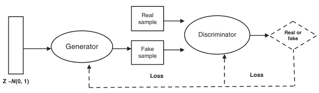

既能正确分类真实训练数据，也能分类由生成器 G 产生的合成实例。同时，G 被训练以最小化项 log(1 - D(G(z))).

在 GANs 领域，可以应用各种目标函数。GANs 中的初始目标函数涉及 G 和 D 之间的极小极大博弈，可以如下表示（公式 8.1）：

```
\frac{Min}{G} \frac{Max}{D} V(D, G) = E_{x \sim p_{data}(x)}[\log D(x)] + E_{z \sim p_z(z)}[\log(1 - D(G(z)))] \tag{8.1}
```

log D(x) 表示 [1 0]^T 和 [D(x) 1-D(x)]^T 之间的交叉熵。log(1 - D(G(z))) 表示 [1 0]^T 和 [D(G(z)) 1-D(G(z))]^T 之间的交叉熵。

对于固定的 G，理想解在公式 8.2 中给出：

```
D^*_G(x) = \frac{p_{data}(x)}{p_{data}(x) + p_g(x)} \tag{8.2}
```

在某些情况下，公式 8.1 产生的梯度可能不足以支持 G 进行有效学习。在训练过程早期，G 可能会生成与训练数据显著偏离的样本，导致 D 对这些最初生成的实例做出自信的拒绝。这常常导致 log(1 - D(G(z))) 饱和。作为替代方案，G 可以被训练以最大化 log(D(G(z)))，而不是最小化 log(1 - D(G(z)))。因此，生成器的损失函数可以如公式 8.3 表示：

```
J(G) = E_{z \sim p_z(z)}[-log(D(G(z)))] = E_{x \sim p_g}[-log D(x)] \tag{8.3}
```

#### 8.3.2 GAN 变体

在以下小节中，我们将介绍一个值得注意的 GAN 变体。

##### 8.3.2.1 InfoGAN

InfoGAN (Chen et al. 2016) 引入了一种不同的噪声向量方法。它没有使用单个非结构化噪声向量，而是提出将输入噪声分解为两个不同的组成部分：z，代表不可压缩噪声；c，即潜在代码。这个潜在代码旨在捕捉真实数据分布中存在的基本结构化语义特征。InfoGAN (Chen et al. 2016) 寻求最小化公式 8.4 中给出的目标函数：

```
\frac{min}{G} \frac{max}{D} V_{info}(D, G) = V(D, G) - \lambda I(c; G(z, c)) \tag{8.4}
```

- V(D, G) 代表原始 GANs 的目标函数
- G(z, c) 表示生成的样本
- I 表示互信息
- λ 用作可定制的正则化参数。

目标是最大化 I(c; G(z, c))，这增强了 c 与 G(z, c) 之间的互信息，确保 c 包含尽可能多来自真实示例的关键和有意义的特征。然而，在实际中，直接优化 I(c; G(z, c)) 具有挑战性，因为这需要访问后验分布 P(c|x)。

一种可行的解决方案是通过引入辅助分布 Q(c|x) 来近似 P(c|x)，从而为 I(c; G(z, c)) 建立一个下界。InfoGAN (Chen et al. 2016) 的最终目标函数随后定义为公式 8.5 所示：

```
\frac{min}{G} \frac{max}{D} V_{info}(D, G) = V(D, G) - \lambda L_{info}(c; Q) \tag{8.5}
```

- L_info (c; Q) 表示 I(c; G(z, c)) 的下界。

InfoGAN 还具有多种变体，包括因果 InfoGAN (Kurutach et al. 2018) 和半监督 InfoGAN (ss-InfoGAN) (Spurr et al. 2017)。

##### 8.3.2.2 DCGAN

DCGAN (Radford et al. 2016) 将 GANs 与 CNN 结合，这是一种计算机视觉的强大方法。DCGAN 对 CNN 网络架构引入了特定约束，以确保稳定训练并利用学习到的特征表示进行图像分类。DCGAN 通过以下三项关键改进提高了生成图像的质量。

- DCGAN 为判别器使用步长卷积，为生成器使用分数步长卷积，取代了常规池化层。虽然 CNN 通常用于特征提取，但 DCGAN 中的 CNN 结构被用于生成样本，这标志着它与通常特征提取角色的偏离。步长和分数步长卷积能高效地将大部分信息传递到后续层，确保生成样本的完整性和清晰度。

- DCGAN 引入批量归一化算法来解决梯度消失问题。该算法解决了由不良初始化引起的问题，有利于梯度在各层之间传播，并防止生成器将所有样本收敛到单一点上。

- DCGAN 采用多种激活函数，包括 Adam 优化方法、ReLU 激活函数和 leakyReLU 激活函数。经验结果证实了 DCGAN 在实际应用中的强大性能，凸显了 GAN 结构生成样本的能力。与其他 GAN 模型相比，DCGAN 广泛被认为是黄金标准。

##### 8.3.2.3 cGAN

GAN 作为一种无监督学习技术，从未标注的数据集中推导概率分布模式，并以渐进和无约束的方式表达它们。然而，在处理复杂或大规模数据集时，GAN 在管理其生成的结果方面面临挑战。为了解决这个问题，一个简单的方法是引入约束并为生成器建立特定目标。当判别器和生成器都考虑额外信息 y 时，GANs 可以扩展为条件模型。条件 GANs (Mirza and Osindero 2014) 的目标函数可以与 InfoGAN 的目标函数进行比较，如公式 (8.5) 和 (8.6) 所示。然而，在 InfoGAN 中，潜在代码 c 不是预先已知的；它实际上是在训练过程中发现的。此外，InfoGAN 还包含一个额外的网络 Q，该网络输出条件变量 Q(c|x)。

```
min_G max_D = E_{x ~ P_{data}(x)}[log(x/y)] + E_{z ~ P_z(z)}[log(1 - D(G(z/y)))] \tag{8.6}
```

在 CGANs 基础之上，可以根据各种因素（如类别标签、文本边界框和关键点）生成条件样本。

##### 8.3.2.4 ACGAN

辅助分类器生成对抗网络 (ACGAN) (Odena et al. 2017) 是一种专注于图像合成的高级 CGAN。只需提供一个类别标签，它就可以从零开始生成图像。值得注意的是，与早期方法相比，ACGAN 生成的图像分辨率更高。ACGAN 的损失函数分为两部分，如公式 8.7 和 8.8 所示：

```
L_G = E[log P(S = real | X_{real})] + E[log P(S = Fake | X_{fake})] \tag{8.7}
L_C = E[log P(C = c | X_{real})] + E[log P(C = c | X_{fake})] \tag{8.8}
```

在此上下文中，L_G 表示用于评估来源真实性的对数似然，而 L_C 对应于用于分类类别或类别的对数似然。训练过程涉及生成器旨在最大化 L_C 与 L_G 之间的差值，而判别器被训练以最大化它们的和 L_C + L_G。

ACGAN 取得了一个重要里程碑，成为第一个能够为 ImageNet 数据集 (Fei-Fei et al. 2010) 中所有类别生成可识别样本的 GAN 变体。

##### 8.3.2.5 WGAN

在文献 (Arjovsky et al. 2017) 中，作者在 GANs 上下文中引入了 Wasserstein 距离，也称为 Earth-Mover (EM) 距离，用于量化真实样本与生成样本之间的不相似性，而不是使用 Jensen-Shannon (JS) 散度。Wasserstein 距离在公式 8.9 中定义：

```
W(p_r, p_g) = inf_{γ ~ Π(p_r, p_g)} E_{(x,y)~γ}[||x - y||] \tag{8.9}
```

其中 Π(p_r, p_g) 表示组合 p_r 和 p_g 的所有可能联合分布的集合，而 γ 包涵所有可想象的分布。

Wasserstein 距离具有多项优势。即使分布不重叠，它也可以计算分布之间的距离，具有出色的平滑特性，并在一定程度上缓解了梯度消失问题。此外，Wasserstein GAN (WGAN) 解决了训练不稳定性问题，并增强了生成样本的多样性，消除了在生成器 (G) 和判别器 (D) 训练中进行复杂平衡的需求。

### 8.4 基于 GAN 的图像分割技术分类

利用 GANs 的医学图像分割技术的分类如图 8.2 所示，划分为三个总体分类，每个分类取决于所采用的分割策略。这些类别涵盖分割区域、模态以及过程中使用的特定 GAN 模型。这种系统化分类为理解和组织基于 GAN 的医学图像分割领域内的多样化方法提供了结构化框架。这个三层分类系统不仅有助于全面理解基于 GAN 的医学图像分割内的多样化方法，还为研究人员和从业者在导航这一专业领域不断发展的格局时提供了有价值的框架。

#### 8.4.1 基于分割区域的分类

本节对利用 GAN 的不同医学图像分割方法进行分类，重点关注用于分割的特定解剖区域。该研究全面考察了多个分割区域，包括大脑、眼睛、胸部和乳房、心脏、腹部、盆腔和骨骼。本质上，它系统地分析和分类了基于 GAN 的技术，特别强调其设计用于分割的解剖结构。

##### 8.4.1.1 使用 GAN 进行大脑分割

识别和区分健康与异常脑组织是医学图像处理中广泛研究的领域。这一领域旨在将患病部分与正常部分区分开来，以便进行精确的脑分析，从而实现准确的


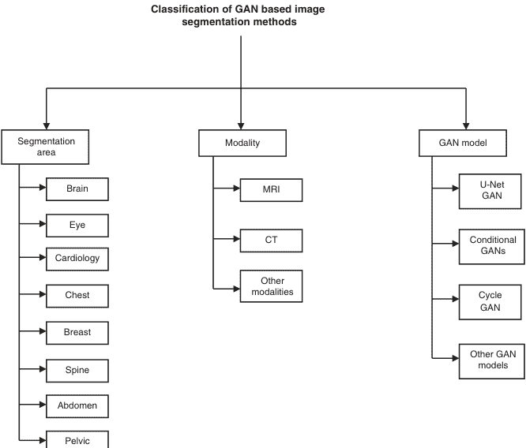

图 8.2 基于 GAN 的医学图像分割方法分类。

疾病诊断以及异常的识别和分类。影响中枢神经系统最常见的恶性肿瘤是脑肿瘤。李及其同事在其研究中采用了基于 GAN 的方法（Li et al. 2018; Xue et al. 2018; Yuan et al. 2019; Li et al. 2020; Nema et al. 2020; Cheng et al. 2021; Conte et al. 2021）成功分割了这些肿瘤。Xue et al. (2018) 将 U-Net 作为 GAN 的生成器，并引入了多尺度 L1 损失方法，从而实现了直接且高效的脑肿瘤分割。此外，Cheng et al. (2021) 利用 GAN 对样本标签进行重加权和校正，从而提高了手动分割标签的图像质量，进而提高了脑肿瘤分割的准确性。Moeskops et al. 利用 GAN 技术分割各种脑组织，如灰质和白质（Moeskops et al. 2017; Mondal et al. 2018; Oh et al. 2020; Delisle et al. 2021）。在其工作中，Mondal et al. (2018) 首次采用 GAN 对 3D 多模态脑图像进行半监督分割，与完全监督方法相比，分割性能显著提升。Delannoy et al. (2020) 和 Li et al. (2021a) 将 GAN 方法应用于新生儿脑图像分割，为新生儿疾病诊断提供了宝贵帮助。

此外，基于 GAN 的方法在分割各种其他脑病变和异常方面已被证明是有效的（Alex et al. 2017; Kamnitsas et al. 2017; Finck et al. 2020; Kuang et al. 2020; La Rosa et al. 2021）。

Altun Güven 和 Talu (2023) 的作者介绍了 SSimDCL，这是一种用于脑 MRI 分割的新型 GAN，展示了其相较于既定架构的卓越性能、在各种数据集分析中的效率，以及在自动脑 MRI 分割方面的潜力。Khaled et al. (2022) 的作者引入了一种用于脑分割的多阶段 GAN 模型，通过粗到精的方法提高准确性，并相较于单阶段模型实现了改进的 Dice 系数准确性（表 8.1）。

表 8.1 基于 GAN 的脑分割方法。

| 参考文献 | 模态 | 方法 | 数据 | 指标 | 整体 | 核心 | 增强 |
|---|---|---|---|---|---|---|---|
| Cheng et al. (2021) | MRI | GAN | BraTS 2017 | DSC | 0.87 | 0.86 | 0.87 |
| | | | | 灵敏度 | 0.87 | 0.72 | 0.68 |
| Borne et al. (n.d.) | MRI | U-Net GAN | BraTS 2013 | DSC | 0.84 | 0.70 | 0.65 |
| | | | | 灵敏度 | 0.83 | 0.74 | 0.72 |
| Conze et al. (2017) | MRI | U-Net GAN | BraTS 2017 | DSC | 0.901 | 0.781 | 0.682 |
| Conze et al. (2021) | MRI | VGG GAN | BraTS 2017 | DSC | 0.82 | 0.71 | 0.92 |

##### 8.4.1.2 基于 GAN 的眼部分割

眼底图像获取限制带来的挑战，例如普遍的图像噪声以及视网膜复杂多变的特性，为分割带来了重大障碍。令人惊讶的是，众多基于 GAN 的方法在眼底图像分割方面优于人类专家。由于血管复杂的分支模式和普遍的背景噪声，自动分割眼底图像面临重大挑战。Lahiri et al. 在其研究中实现了精确的视网膜血管分割（Lahiri et al. 2017; Mahapatra et al. 2017; Iqbal and Ali 2018; Javanmardi and Tasdizen 2018; Son et al. 2019; Yang et al. 2020）。在他们的 2017 年研究（Lahiri et al. 2017）中，Lahiri et al. 率先使用了 GAN 半监督学习，标志着一种分割视网膜血管的有效方法。Iqbal and Ali (2018) 重新定义了一组损失函数以生成更真实的视网膜图像，从而辅助分割过程。Yang et al. (2020) 增强了生成器和判别器网络结构，以在分割过程中准确捕捉血管边缘细节。Schlegl et al. 对眼底图像中的异常病变进行了分割（Schlegl et al. 2017, 2019; Jiang et al. 2019; Wang et al. 2021a），为眼部疾病诊断做出了贡献。青光眼是一种常见的眼部疾病，其中对视杯和视盘进行准确分割，以确定视杯视盘比 (CDR)，至关重要。Shankaranarayana et al. 采用了各种对抗学习方法来应对这一挑战（Shankaranarayana et al. 2017; Wang et al. 2019; Kadambi et al. 2020; Luo et al. 2021）。与之前提到的研究不同，Liu et al. (2019c) 和 Tennakoon et al. (2018) 采用 GAN 技术对 OCT 图像中的层和流体区域进行分割。此外，Ouyang et al. (2019) 和 Yildiz et al. (2021) 利用不同的基于 GAN 的方法对角膜进行分割。MedRegNet (Santarossa et al. 2022) 是一种基于 GAN 的无监督描述符模块，它在无需专家标注的情况下增强了多模态视网膜图像配准，展示了优于经典算法的性能，即使在模态间存在显著视觉差异的情况下也是如此，提供了适应性，并具有超出视网膜成像的潜在应用（表 8.2）。

表 8.2 基于 GAN 的眼部分割方法。

| 参考文献 | 模态 | 方法 | 数据集 | 准确率 | 灵敏度 |
|---|---|---|---|---|---|
| Guo et al. (2020) | 眼底镜检查 | SRGAN | DRIVE | 0.96 | 0.77 |
| | | | STARE | 0.96 | 0.87 |
| | | | CHASE | 0.95 | 0.82 |
| Huang et al. (2021) | 眼底镜检查 | SUD-GAN | DRIVE | 0.9560 | 0.9663 |
| | | | STARE | 0.8340 | 0.8334 |
| Huo et al. (2018b) | ICGA | CGAN | 私有 | 0.9892 | 0.7763 |
| Iqbal and Ali (2018) | OCT | WGAN | 私有 | – | 0.8091 |

##### 8.4.1.3 基于 GAN 的心脏病学分割

心脏病学是主要专注于心脏及其相关循环系统的研究、诊断和治疗的医学专科。可用作心脏病学同义词的另一个术语是“心血管医学”或“血管医学”。这些术语涵盖了更广泛的范围，包括心脏和血管，凸显了该领域超越心脏本身的综合性质。

与其他解剖区域相比，医学图像中心脏分割的复杂性更高，因为心脏作为一个持续运作的器官具有动态特性，其形状在体力活动期间会发生变化。因此，对完整心脏结构进行精确计算、建模和分析对医学研究和实际应用具有极大的意义。因为心脏内每个区域都表现出独特的形状和操作特征，分割方法和挑战在不同区域之间也有所不同。

基于这一理解，Dou et al. 在多篇参考文献中对多个感兴趣区域进行了分割（Chartsias et al. 2018; Zhang et al. 2018b; Dong et al. 2018; Joyce et al. 2018; Rezaei et al. 2018b; Upendra et al. 2019; Liu et al. 2019a; Xu et al. 2020; Decourt and Duong 2020; Shi et al. 2020; Wu et al. 2021; Yang et al. 2021; Cui et al. 2021; Gilbert et al. 2021; Chen et al. 2022）。与此同时，Xu et al. (2020) 引入了一种深度时空对抗网络，能够同时分割和测量心肌梗死区域。Decourt and Duong (2020) 提出了一种新的损失函数，以提高边界像素分割的准确性，显著提高了对心肌、内膜和外膜的分割精度，尤其是在处理有限标注数据时。基于 GAN 的自动心脏区域分割方法的实施，在相当程度上解决了心脏医学领域的实际挑战（表 8.3）。

##### 8.4.1.4 基于 GAN 的胸部分割

胸部和乳房 X 射线是普遍的医学诊断方法之一，利用最小剂量的辐射生成这些区域的快速、经济高效的图像。这些图像有助于诊断和监测各种疾病的治疗

表 8.3 基于 GAN 的心脏病学分割方法。

| 参考文献 | 模态 | 方法 | 数据集 | 性能 (DSC) |
| :--- | :--- | :--- | :--- | :--- |
| Li et al. (2021b) | CT | ConvNets GAN | MICCAI-2017 | 升主动脉 (AA) 0.748 |
| | | | | 左心房血 (LA blood) 0.552 |
| | | | | 左心室血 (LV blood) 0.572 |
| | | | | 左心室心肌 (LVmyo) 0.478 |
| Li et al. (2018) | CT, MRI | U-Net GAN | MICCAI-2017 | CT 0.5 |
| | | | | MRI 0.66 |
| Luo et al. (2021) | CT, MRI | Cycle GAN | MICCAI-2017 | CT 0.815 |
| | | | | MRI 0.592 |
| Mahapatra et al. (2017) | CMRI | U-Net GAN | ACDC | 左心室 (LV) 0.88 |
| | | | | 右心室 (RV) 0.90 |
| | | | | 心肌 (Myo) 0.89 |
| Man et al. (2019) | CMRI | GAN | 私有 | 左心房 (LA) 0.946 |
| | | | | 心房疤痕 0.821 |


表 8.4 胸部基于GAN的分割方法

| Reference | Modality | Method | Dataset | Performance (DSC) |
| :--- | :--- | :--- | :--- | :--- |
| Knyaz et al. (2019) | X射线 | SeUDA (面向无监督域自适应的语义感知GAN) | Montgomery | 右肺 0.9559<br>左肺 0.9342 |
| Kuang et al. (2020) | CT | CGAN Pix2Pix | 私有 | 0.814 |
| Lahiri et al. (2017) | CT | GAN | LIDC-IDRI | 0.7986 |
| Ledig et al. (2017) | X射线 | SCAN (结构校正对抗网络) | JSRT | 0.973 |
| Li et al. (2021a) | 乳腺X线摄影 | U-Net GAN | 私有 | 0.9703 |

心肺疾病。准确的肺部分割在诊断各种肺部疾病中具有重要意义。Chen et al. (2018a)、Tan et al. (2021)和Stiehl et al. (2021)在各种医学图像中进行了肺部分割。在肺部疾病谱中，肺癌是导致死亡的主要原因。Jin et al. (2018)在GAN中引入了一种新的多掩膜重建损失，以生成更真实的肺结节图像。为了准确的肺癌检测，Jain et al. (2021)通过整合海藻群陀螺优化算法增强了GAN模型，用于肺结节分割。此外，Dai et al.采用了多种GAN模型来自动分割多个重要胸部器官（Dai et al. 2018; Dong et al. 2019; Trullo et al. 2019），显著简化了放疗计划的制定（表 8.4）。

##### 8.4.1.5 基于GAN的乳腺分割

乳腺癌是最常见的癌症之一，尤其影响女性。Zhu et al.实现了乳腺肿块的精确分割（Zhu and Xie 2016; Shen et al. 2019; Han et al. 2020; Ma et al. 2020; Xing et al. 2021; Li et al. 2021c），这是计算机辅助乳腺癌诊断的关键步骤。Shen et al. (2019)率先使用CGAN生成X射线乳腺肿块图像，并引入U-Net以提高分割精度。此外，还将CycleGAN与FCN合并用于乳腺病变分割，减轻了放射科医生的标注工作负担（表 8.5）。

表 8.5 乳腺基于GAN的分割方法。

| Reference | Modality | Method | Dataset | Performance (DSC) |
|---|---|---|---|---|
| Kamnitsas et al. (2017) | 乳腺X线摄影 | FCN-CRF GAN | INBreast | 0.9097 |
| Kan et al. (2021) | X射线 | CGAN | INBreast | 0.8881 |
| Kazeminia et al. (2020) | 乳腺超声 | BUS-GAN (基于GAN的乳腺超声) | 私有 | 0.8712 |
| Kessler et al. (2020) | 乳腺超声 | SPCGAN (半像素级循环GAN) | 私有 | 0.92 |
| Kim et al. (2017) | 乳腺X线摄影 | CGAN | INBreast | 0.9154 |

##### 8.4.1.6 基于GAN的脊柱分割

骨骼图像分割面临多种挑战，包括信噪比低、成像伪影以及骨表面通常仅有几毫米厚。为应对这些挑战，已引入多种骨骼分割和配准方法。
Han et al. (2018)和Sekuboyina et al. (2018)采用GAN进行脊柱分割。Han et al.专注于同步分割160多个脊柱结构的语义，而Sekuboyina et al.则专注于局部脊柱分割。与此同时，Liu et al.将GAN与多种神经网络相结合，用于MRI图像中的膝关节分割（参考文献：Liu 2019; Gaj et al. 2020; Kessler et al. 2020）。Gong et al. (2021)利用GAN在轴位MRI图像上同时对椎间盘、神经孔、硬膜囊和后弓进行分割和疾病诊断（表 8.6）。

表 8.6 脊柱基于GAN的分割方法。

| Reference | Modality | Model | Dataset | Performance (DSC) |
|---|---|---|---|---|
| Sekuboyina et al. (2018) | MRI | Spine-GAN (循环GAN) | 私有 | 0.87 |
| Shah (无日期) | MRI | CycleGAN | T2PSE | 股骨 0.97<br>胫骨 0.95<br>股骨软骨 0.66<br>胫骨软骨 0.65 |
| Shen et al. (2019) | X射线 | DCGAN | 私有 | 股骨 0.9762<br>股骨头 0.9786 |
| Shi et al. (2020) | 超声 | CGAN | 私有 | 0.9603 |
| Shi et al. (2019) | MRI | GAN | 私有 | 0.949 |

##### 8.4.1.7 基于GAN的腹部分割

深度神经网络在自动分割腹部CT扫描中的器官方面已有广泛应用。在腹部扫描图像中，区分相邻器官之间的空间边界是一项挑战，而且不同目标器官的尺寸差异较大，这使问题更加复杂。由于这些复杂性，传统的深度学习方法难以准确分割每个器官。

Yang et al. (2017)和Kim and Ye (2018)专门针对肝脏分割应用了GAN技术，显著提高了分割精度和处理速度。Liu et al. (2019a)（Liu et al. (2019b)）利用GAN进行标签分配并生成概率图，从而实现对结直肠肿瘤的准确分割。Ruan et al. (2020)将多尺度特征提取器和感兴趣区域定位器集成到GAN中，用于快速准确的肾肿瘤分割。对于胃和胰腺分割，Huang et al. (2021)和Li et al. (2021b)采用了多种对抗网络（表 8.7）。

##### 8.4.1.8 基于GAN的盆腔分割

人体中复杂的盆腔结构表现出显著的变异性，导致多种临床挑战，包括形状变化、不同结构之间的信号相似性以及标注数据匮乏。盆腔结构的自动分割和建模对支持医生的临床实践具有巨大重要性。准确分割前列腺及其周围关键结构对于前列腺放射治疗计划至关重要。Kohl et al. (2017)、Jia et al. (2020)和Wang et al. (2021b)利用GAN技术分割前列腺，这是位于盆腔内的男性生殖器官。Sultana et al.在多篇文献中对盆腔内多个器官进行了同步分割（Sultana et al. 2020; Brion et al. 2021; Lei et al. 2021; Zhang et al. 2021）（表 8.8）。

表 8.7 腹部基于GAN的分割方法。

| Reference | Modality | Model | Dataset | Performance (DSC) |
|---|---|---|---|---|
| Moeskops et al. (2017) | CT (3D) | DI2IN GAN | MICCAI (SLiver07) | 0.95 |
| Odena et al. (2017) | CT | LAGAN | 私有 | 0.9154 |
| Oh et al. (2020) | 内镜图像 | Pix2Pix CGAN | CVC-Clinic | 0.8848 |
| Oh et al. (2020) | CT | MB-FSGAN (多分支特征共享GAN) | 私有 | 0.690, 0.722 |
| Ouyang et al. (2019) | MRI | CycleGAN 3D Res-U-Net PatchGAN | NIH胰腺数据集 | 0.8393 |

#### 8.4.2 基于图像模态的分类

在本节中，基于GAN的医学分割方法根据其使用的特定图像模态进行组织和分类。本节深入探讨了多种图像模态，包括MRI、CT和OCT。

##### 8.4.2.1 基于GAN的磁共振成像(MRI)分割

MRI是一种利用强大磁场和无线电波生成人体内部结构详细图像的医学成像方法。该技术能够生成高分辨率三维图像，便于可视化软组织、器官以及大脑、肌肉、关节和血管等各种结构。值得指出的是，与X射线或CT扫描相比，MRI在某些诊断需求中是一种更安全的替代方案，因为它不使用电离辐射。

Conte et al. (2021)等人利用GAN生成缺失的MRI序列，证明了GAN生成的图像在协助其他深度学习模型进行分割任务方面的有效性。Chen et al. (2020)等人在MRI图像中实现了颅颌面(CMF)骨结构的精确分割。Yang et al. (2021)等人引入了一种膨胀块对抗网络，用于分割短轴心脏MRI图像中的左心室、右心室和心肌。Conze et al. (2021)等人利用GAN对腹部MR图像进行自动多器官分割，有效实现了多器官的同步分割。Gadermaier et al. (2019)等人利用GAN分割MRI图像中的肌肉组织（表 8.9）。

##### 8.4.2.2 基于GAN的计算机断层扫描(CT)图像分割

CT是一种利用X射线生成人体详细横断面图像的医学成像方法，能够全面展示内部结构。这使得对骨骼、器官和组织的详细可视化成为可能。CT扫描在诊断一系列医学状况（包括损伤、感染和肿瘤）方面发挥着关键作用。该过程涉及使用旋转X射线机和计算机来生成详细的二维图像或三维重建。由于其快速性和捕捉精确解剖细节的能力，CT成像在各个专科的医学诊断中被广泛应用。


##### Table 8.8 GAN-based segmentation method for pelvic

| Reference | Modality | Model | Dataset | Performance (DSC) |
|---|---|---|---|---|
| Rezaei et al. (2018a) | MRI | FCN-GAN | 私有 | 0.41 |
| Rezaei et al. (2018b) | MRI | 3D APA-Net (3D 对抗金字塔各向异性卷积深度神经网络) | PROMISE12 | 整体: 0.906<br>基底: 0.891<br>顶端: 0.869 |
| Ronneberger et al. (2015) | MRI | U-Net GAN | PROMISE12 | 0.8624 |
| La Rosa et al. (2021) | CT | U-Net CGAN Pix2Pix | 私有 | 前列腺: 0.929<br>子宫: 0.724 |
| Ruan et al. (2020) | CT | FCN GAN U-Net | 私有 | 前列腺: 0.868<br>膀胱: 0.762<br>直肠: 0.719 |
| Schlegl et al. (2019) | CT, MRI | CycleGAN | 私有 | 膀胱: 0.93<br>前列腺: 0.88<br>直肠: 0.88<br>左股骨头: 0.94<br>右股骨: 0.94 |

##### Table 8.9 GAN-based segmentation method using MRI as modality

| Reference | Region of Interest | Model | Dataset | Performance |
|---|---|---|---|---|
| Conze et al. (2021) | 整个病变、FLAIR 高信号区和造影增强区域 | GAN | BraTS 2017 | DSC = 0.82 |
| Dong et al. (2018) | 颅颌面骨结构 | U-Net CycleGAN | ADNI | DSC = 0.8856 |
| Mahapatra et al. (2017) | 左心室 (LV)、右心室 (RV) 和心肌 (MYO) | U-Net GAN | ACDC | DSC = 0.96, 0.92, 0.87 |
| Radford et al. (2016) | 肝脏、右肾、左肾、脾脏、多器官 | U-Net CGAN | CHAOS | (肝脏, 右肾, 左肾, 脾脏, 多器官) F-score = 85.53, 70.17, 70.39, 64.77, 69.92, 68.78 |

##### Table 8.10 Segmentation of CT images using GAN based Methods

| Reference | Region of Interest | Model | Dataset | Performance |
|---|---|---|---|---|
| Decourt and Duong (2020) | 白质 | CGAN pix2pix | ADNI | DSC = 0.817 |
| Kohl et al. (2017) | 脑组织 | GAN | MICCAI 2012 MRBrainS13 | DSC = 0.92 DSC = 0.85 |
| Radford et al. (2016) | 肝脏、右肾、左肾、脾脏、多器官 | U-Net CGAN | CHAOS | (肝脏, 右肾, 左肾, 脾脏, 多器官) F-score = 85.53, 70.17, 70.39, 64.77, 69.92, 68.78 |

Oh 等人（2020 年）在 CT 图像中分割白质，实现了脑组织的精确勾画。Tan 等人（2021 年）将基于 EM 距离的损失函数与 GAN 相结合，以精确分割输入 CT 扫描中的肺部。Conze 等人（2021 年）利用 GAN 对腹部 CT 图像进行自动多器官分割，有效实现了多器官的同时分割（表 8.10）。

##### 8.4.2.3 Segmentation of Other Modalities Using GAN

X 线成像是一种广泛使用的医学诊断技术，利用电离辐射创建人体内部的详细图像。X 射线在可视化骨骼方面特别有效，有助于诊断骨折、感染和某些疾病。该过程涉及将身体的一部分暴露在少量电离辐射下，生成的 X 线图像为各种医学专科（如骨科和牙科）的医疗专业人员提供了宝贵信息。OCT 是一种非侵入性成像技术，利用光波捕获生物组织的高分辨率断层图像。它常用于眼科，以可视化视网膜的各个层，从而允许早期检测和监测黄斑变性和青光眼等眼部疾病。此外，OCT 在其他医学领域（包括心脏病学和皮肤病学）也有应用，在不需要电离辐射的情况下，它能提供关于组织结构的详细洞察（表 8.11）。

##### Table 8.11 Segmentation of other modalities using GAN based Methods

| Reference | Region of Interest | Modality | Model | Dataset | Performance |
|---|---|---|---|---|---|
| Israel et al. (2017) | 视网膜异常 | OCT | CycleGAN | K's 数据集 | DSC = 0.8239 |
| Kan et al. (2021) | 乳腺肿块 | X 线 | CGAN | INbreast | DSC = 88.81 |
| Kurutach et al. (2018) | 肺结节 | CT | 3D CGAN | LIDC | DSC = 0.989 |
| Lahiri et al. (2017) | 肺结节 | CT | GAN | LIDC-IDRI | DSC = 0.7986 |
| Son et al. (2019) | 肺部 | CT(3D) | TD-GAN | 私有 | DSC = 0.894 |
| | 心脏 | | | | DSC = 0.870 |
| | 肝脏 | | | | DSC = 0.817 |
| | 骨骼 | | | | DSC = 0.835 |

Wang 等人（2021b 年）提出了一种弱监督学习网络，用于分割 OCT 图像中的病变。Shen 等人（2019 年）使用 CycleGAN 生成了 X 线乳腺肿块图像。Jin 等人（2018 年）提出了一种创新的多掩膜重建损失，将其纳入 GAN 以生成高度逼真的肺结节图像。Jain 等人（2021 年）通过集成专门用于肺结节分割的海草杂乱牧羊人优化算法，改进了 GAN 模型以实现精确的肺癌检测。在他们的 2020 年研究（Sultana et al. 2020）中，Sultana 等人采用了多类 3D U-Net 对盆腔结构进行粗分割，随后采用改进的 GAN 进行更精细的器官分割。在他们的研究中，Zhang 等人（Zhang et al. 2018a）在 X 线图像上使用了多器官的无监督分割。

#### 8.4.3 Classification on the Basis of GAN Model Employed

在本节中，使用 GAN 的医学图像分割技术是根据所实现的特定 GAN 变体进行组织的。所考虑的模型范围涵盖了基于 U-Net 的 GAN、CycleGAN、DCGAN（深度卷积 GAN）、CGAN（条件 GAN）和 Pix-2-Pix GAN。这种分类有助于区分和分类在医学图像分割背景下使用的多样化 GAN 架构。每个模型代表一种独特的方法，反映了该领域各项研究中采用的细致策略和方法学。

##### 8.4.3.1 Segmentation Using U-Net Based GAN

Xue 等人（2018 年）将 U-Net 用作 GAN 的生成器，并引入了多尺度 L1 损耗方法，从而实现了直接高效的脑肿瘤分割。Shi 等人（2019 年）引入了 UG-net（GAN 内的修改版 U-Net），专门用于分割海马子区。Guo 等人（2020 年）利用 U-Net 识别边界，利用 GAN 进行形状预测，专门针对胸肌区域的分割。Guo 等人（2020 年）分别将 U-Net 和金字塔结构用作生成器和判别器，以从冠状动脉中提取复杂特征。Sultana 等人（2020 年）利用具有多类功能的 3D U-Net 对盆腔结构进行初步分割，随后实施增强版 GAN 以进行更精确的器官分割。Wang 等人（2020 年）将 U-Net 的结构元素纳入 GAN 中，以改进 OCT 图像中食管的分割（表 8.12）。

##### 8.4.3.2 Segmentation Using Conditional GANs (CGAN, pix2pix GAN, and ACGAN)

Oh 等人（2020 年）使用在 pix2pix 框架内实现的 CGAN，准确分割了 18F-FDG PET/CT 图像中的白质。该方法实现了脑组织的精确勾画。Jiang 等人（2018 年）引入了 CGAN 及其 Dice 损耗函数，开创了漆裂分割的先河。Shen 等人（2019 年）是首个采用 CGAN 的研究者。

##### Table 8.12 Segmentation using U-Net based GAN models

| Reference | Region of Interest | Modality | Dataset | Performance |
|---|---|---|---|---|
| (Borne et al. (n.d.)) | 整个肿瘤 | MRI | BraTS 2013 | 整体 DSC = 0.84 |
| | 肿瘤核心 | | | 核心 DSC = 0.70 |
| | GD 增强的肿瘤核心 | | | 增强 DSC = 0.65 |
| Dong et al. (2019) | 海马（CA1, CA2, DG, CA3, 头部, 尾部, SUB, ERC 和 PHG） | MRI | CIND Center | DSC = 0.919 |
| Li et al. (2021a) | 胸部肌肉 | 乳腺X光摄影 | 私有 | DSC = 0.9703 |
| Ruan et al. (2020) | 前列腺 膀胱 直肠 | CT | 私有 | DSC = 0.90, DSC = 0.96, DSC = 0.91 |


| 参考文献 | 感兴趣区域 | 模态 | 数据集 | 性能 |
|---|---|---|---|---|
| Decourt and Duong (2020) | 白质 | PET/CT MRI | ADNI | DSC = 0.817 |
| Kan et al. (2021) | 乳腺肿块 | X-ray | INbreast | DSC = 88.81 |
| Oh et al. (2020) | 结肠息肉 | 肠镜图像 | CVC-Clinic | DSC = 0.8848 |
| Shi et al. (2020) | 骨影 | 超声 | 私有 | DSC = 0.9603 |
| Wittke et al. (2007) | 眼部疾病 | 细胞 (2D) | 私有 | DSC = 0.89 |

为生成 X-ray 乳腺肿块图像。他们在该过程中集成了 U-Net 以提高分割精度。Huo et al. (2018a)、Huo et al. (2018b) 的作者提出了一种基于 CGAN 的脾肿大分割网络，随后提出了一种端到端的合成与分割网络，实现了精确的脾脏分割。在 Poomeshwaran et al. (2019) 中，作者提出了一种改进的 pix2pix 框架用于分割结肠息肉区域。Kan et al. (2021) 的作者将内置辅助分类器集成到 GAN 中，以分割前列腺和女性生殖器官（子宫）。Alsinan et al. (2020) 的作者增强了 CGAN，使超声图像中骨影能够实时分割。Liu et al. (2021) 的作者将统计模型与 CGAN 相结合，以高效生成高质量标注图像，促进细胞分割。Nishiyama et al. (2021) 的作者利用 CGAN 准确评估臀中肌体积（表 8.13）。

##### 8.4.3.3 使用 CycleGAN 进行分割

2021 年，Wang 及其同事（Wang et al. 2021b）引入了一种依赖于 CycleGAN 的弱监督学习网络，用于 OCT 图像中病灶的分割。Xing et al. (2021) 的作者将 CycleGAN 与 FCN 相结合，用于乳腺病变分割。这种集成旨在通过简化标注任务来减轻放射科医生的工作量。Lei et al. (2021) 的作者利用双金字塔网络进行特征提取，并利用 CycleGAN 生成合成 MRI 图像，以补充信息，实现多器官的同时分割。de Bel et al. (2021) 的作者通过集成残差学习改进了标准 CycleGAN，并将该改进网络应用于减少组织病理学中不同样本之间的差异（表 8.14）。

#### 表 8.14 基于 CycleGAN 模型的分割

| 参考文献 | 感兴趣区域 | 模态 | 数据集 | 性能 |
|---|---|---|---|---|
| Israel et al. (2017) | 视网膜异常 | OCT | K's dataset | DSC = 0.8239 |
| Kessler et al. (2020) | 乳腺病变 | 乳腺超声 | 私有 | DSC = 0.92 |
| Schlegl et al. (2019) | 膀胱 | CT | 私有 | DSC = 0.93 |
| | 前列腺 | | | DSC = 0.88 |
| | 直肠 | MRI | | DSC = 0.88 |
| | 左股骨头 | | | DSC = 0.94 |
| | 右股骨头 | | | DSC = 0.94 |
| Wei et al. (2020) | 结肠组织 | 细胞 (2D) | 私有 | DSC = 0.66 |
| | 肾脏组织 | | | DSC = 0.85 |

#### 表 8.15 基于其他 GAN 模型的分割

| 参考文献 | 感兴趣区域 | 模态 | 数据集 | 性能 |
|---|---|---|---|---|
| Man et al. (2019) | 左心房 (LA) | CMRI | 私有 | DSC = 0.946 |
| | 心房疤痕 | | | DSC = 0.821 |
| Shen et al. (2019) | 股骨 | X-ray | 私有 | DSC = 0.9762 |
| | 股骨头 | | | DSC = 0.9786 |
| Song et al. (2017) | 头部 | CT MRI | PDDCA | (脑干, 视交叉, 下颌骨, 视神经) DSC = 0.916, 0.589, 0.816, 0.703 |
| | 颈部 | | | (喉, 咽, 腮腺) DSC = 0.799, 0.706, 0.845 |
| Sultana et al. (2020) | 腹部 (肝脏, 右肾, 左肾, 脾脏) | MRI | CHAOS2019 | (肝脏, 右肾, 左肾, 脾脏) DSC = 0.8820, 0.8396, 0.8348, 0.8047 |
| | 大脑 | | | DSC = 0.4471 |
| Tong et al. (2019) | 颅颌面骨骼结构 | MRI, CT | CQ500 | 颅颌面骨骼结构 DSC = 0.8100 |
| | 心脏子结构 | | ADNI | 心脏子结构 DSC = 0.751 |

##### 8.4.3.4 使用其他 GAN 模型进行分割

Schlegl et al. (2019) 的作者引入了快速 AnoGAN 方法，有效识别异常图像并执行图像分割。Chen et al. (2022) 的作者引入了一种级联 GAN，对左心房和心房疤痕进行端到端分割。Wei et al. (2020) 的作者引入了一种增强型 DCGAN 用于股骨区域分割，以便根据分割结果评估股骨颈干角。Zhang et al. (2018a) 的作者引入了 TD-GAN (任务驱动 GAN)，在 X 射线图像上开创了多器官无监督分割。在 Tong et al. (2019) 中，作者通过引入形状约束增强了 GAN，并利用深度监督全卷积 DenseNet 作为分割网络，用于头颈区域的多器官分割。Yuan et al. (2020) 的作者克服了 2D 分割的限制，实现了腹部器官和脑肿瘤的 3D 分割。Chen et al. (2021) 的作者引入了一种多样化数据增强 GAN，通过利用标注的源图像域中的信息，促进了未标注的目标图像域分割模型的训练（表 8.15）。

### 8.5 结论

本文综述了基于 GAN 的图像分割技术。我们简要介绍了 GAN 的原理及若干扩展。关于生成模型 G，其参数更新不同于优化数据似然性；相反，它们涉及从判别模型 D 反向传播梯度。此外，GAN 通过规避马尔可夫链学习机制，区别于传统的概率生成模型。而且，GAN 直接执行采样和推理，提高了应用效率并拓宽了其实际用例。

我们还总结了 GAN 在医学图像分割中的应用。作为一种多功能设计框架，基于 GAN 的深度学习模型对提高医学图像分割精度做出了显著贡献。本节总结指出，这些模型沿两个主要方向进行了主要改进。首先，侧重于增强或改进损失函数。鉴于 GAN 的适应性，各种损失函数可以集成到 GAN 模型中。因此，通过为特定任务定制多样化的损失函数，模型性能可以显著提升。其次，强调将 GAN 与其他神经网络集成 (Yan et al. (2019); Yang et al. (2017); Yang et al. (2020); Yang et al. (2021))。GAN 的生成模型和判别模型可以通过任何可微函数进行参数化。这种独特的学习方法使 GAN 能够更有效地提取语义分割特征，从而提升分割网络的性能。

尽管 GAN 的进步为医学图像分割带来了新的前景，但实际实现仍面临几个局限性。首先，医学图像分割领域的 GAN 研究高度侧重于技术方面，采用计算机科学中典型的评估指标。大多数研究评估的是模型的可行性，而非其在实际临床环境中的有效性，缺乏针对医学标准的评估。其次，作为一种生成模型，GAN 会遇到不收敛、训练复杂性、模式坍缩和模式跳跃等问题。在将训练好的 GAN 结果应用于新场景时，模型通常需要迁移学习来维持性能，从而降低了临床环境中的可重复性。此外，GAN 的可解释性非常差——它作为一个黑盒映射函数运行，以随机变量为输入并生成所需的数据分布作为输出。这种可解释性的缺乏对其在医学领域的实际应用构成了重大障碍。因此，研究人员必须着重解决 GAN 在不稳定性、低可重复性和缺乏可解释性方面的挑战，以便其成功集成到医学应用中。

此外，获得临床医生和患者对 GAN 生成数据质量的认可也是一项挑战。如 Zhao et al. (2020) 中 Mazurowski et al. 所指出的，放射学中人工智能的临床采用仍然是一个有争议的话题。在临床环境中实施 GAN 时，主要关注点围绕可能生成错误信息。在数据生成过程中，GAN 可能会不经意地创建不存在的疾病信息，或将现有的疾病特征视为无关而忽略。因此，在临床实践中使用 GAN 时必须谨慎考虑。与其他应用类似，基于 GAN 的实现需要严格验证 Zhou et al. (2016)。短期内，基于 GAN 的方法得出的分割结果应由经验丰富的临床医生审核。此外，仅依赖 GAN 自动分割的结果应局限于受控的实验范围。此外，与其他深度学习技术类似，在临床场景中使用 GAN 时，伦理和法律考量也会发挥作用 Zhu and Xie (2016)。尽管 GAN 存在局限性，但审慎和细致的使用有潜力为医学图像分割引入许多新的可能性。

总之，GAN 在医学图像处理领域具有巨大的潜力。各种基于 GAN 的方法及其迭代版本引起了广泛关注，显著推动了该领域深度学习算法的应用和发展。然而，使临床医生和患者接受这些方法仍然是一个相当大的障碍。此外，GAN 存在不稳定性、低可重复性和可解释性挑战等局限性。


解决这些问题将为生成对抗网络（GAN）的发展铺平道路，开辟新的途径和方法。

## 参考文献

- Ait Skourt, B., El Hassani, A., and Majda, A. (2018). 基于深度神经网络的肺部CT图像分割. Procedia Computer Science 127: 109–113. 可查阅：https://doi.org/10.1016/J.PROCS.2018.01.104.

- Alex, V., Mohammed Safwan K. P., Chennamsetty, S.S., Krishnamurthi, G. (2017) ‘用于脑病变检测的生成对抗网络’, 医学成像 https://doi.org/10.1117/12.2254487, 10133, pp. 113–121.

- Alsinan, A.Z., Patel, V.M., and Hacihaliloglu, I. (2020). 使用GAN从超声数据中进行骨阴影分割，用于骨科手术. 计算机辅助放射学与手术国际期刊 15 (9): 1477–1485. 可查阅：https://doi.org/10.1007/S11548-020-02221-Z/METRICS.

- Altun Güven, S. and Talu, M.F. (2023). 使用新型GAN方法进行脑部MRI高分辨率图像生成与分割. 生物医学信号处理与控制 80: 104246. 可查阅：https://doi.org/10.1016/J.JBSPC.2022.104246.

- Arjovsky, M., Chintala, S., and Bottou, L. (2017). Wasserstein GAN. Arxiv (康奈尔大学) 可查阅：http://arxiv.org/abs/1701.07875.

- Barra, V. and Boire, J.Y. (2002). 基于可能性聚类算法的大腿MR图像中脂肪和肌肉分割. 生物医学中的计算机方法与程序 68 (3): 185–193. 可查阅：https://doi.org/10.1016/S0169-2607(01)00172-9.

- Borne, L., Rivière, D., Mangin, J. F. (无日期) 结合3D U-Net和自底向上几何约束，实现自动皮质沟识别 | OpenReview（无日期）. 可查阅：https://openreview.net/forum?id=ryl0VTZCtV (访问日期：2023年12月27日).

- Brion, E., Léger, J., Barrañán-Montero, A.M. et al. (2021). 锥束CT中男性盆腔器官分割的域对抗网络和基于强度的数据增强. 生物与医学计算机 131: 104269. 可查阅：https://doi.org/10.1016/J.COMPBIOMED.2021.104269.

- Chartsias, A., Joyce, T., Papanastasiou, G., Semple, S., Williams, M., Newby, D., Dharmakumar, R. and Tsaftaris, S.A., (2018) ‘因子化空间表示学习：半监督心肌分割的应用’, 计算机科学讲义（包括人工智能讲义和生物信息学讲义子系列）, 11071 LNCS, pp. 490–498. 可查阅：https://doi.org/10.1007/978-3-030-00934-2_55/TABLES/1.

- Chen, C., Dou, Q., Chen, H. and Heng, P.A., (2018a) ‘面向胸部X光分割无监督域适应的语义感知生成对抗网络’, 计算机科学讲义（包括人工智能讲义和生物信息学讲义子系列）, 11046 LNCS, pp. 143–151. 可查阅：https://doi.org/10.1007/978-3-030-00919-9_17/COVER.

- Chen, H. et al. (2018b). VoxResNet: 用于3D MR图像脑部分割的深度体素残差网络. NeuroImage 170: 446–455. 可查阅：https://doi.org/10.1016/J.NEUROIMAGE.2017.04.041.

- Chen, J., Yang, G., Khan, H. et al. (2022). JAS-GAN: 基于生成对抗网络的不平衡心房靶标联合心房和疤痕分割. IEEE生物医学与健康信息学期刊 26 (1): 103–114. 可查阅：https://doi.org/10.1109/JBHI.2021.3077469.

- Chen, X., Niemeyer, M., Zhang, L. et al. (2012). 视网膜OCT中液体相关异常的3D分割：概率约束图搜索—图切. IEEE医学图像汇刊 31 (8): 1521. 可查阅：https://doi.org/10.1109/TMI.2012.2191302.

- Chen, X., Duan, Y., Houthooft, R. et al. (2016). InfoGAN: 可解释表示学习. Arxiv (康奈尔大学) 可查阅：https://arxiv.org/abs/1606.03657.

- Chen, X., Lian, C., Wang, L. et al. (2020). 用于颅面骨骼结构MRI分割的一次性生成对抗学习. IEEE医学图像汇刊 39 (3): 787–796. 可查阅：https://doi.org/10.1109/TMI.2019.2935409.

- Chen, X. et al. (2021). 用于跨模态标注图像分割学习的多样化数据增强. 医学图像分析 71: 102060. 可查阅：https://doi.org/10.1016/J.MEDIA.2021.102060.

- Cheng, G., Ji, H., and He, L. (2021). 脑肿瘤分割中错误标签掩码的修正和重新加权. 医学物理学 48 (1): 169–177. 可查阅：https://doi.org/10.1002/MP.14480.

- Christ, P.F., Ji, H., and He, L. (2017). 使用级联完全卷积神经网络自动分割CT和MRI体积中的肝脏和肿瘤. Arxiv (康奈尔大学) 可查阅：https://arxiv.org/abs/1702.05970v2 (访问日期：2023年12月27日).

- Conte, G.M., Weston, A.D., Vogelsang, D.C. et al. (2021). 用于多序列脑肿瘤分割模型中合成缺失T1和FLAIR MRI序列的生成对抗网络. 放射学 299 (2): 313–323. 可查阅：https://doi.org/10.1148/RADIOLOGY.2021203786/ASSET/IMAGES/LARGE/RADIOLOGY.2021203786.FIG.6.JPEG.

- Conze, P.H., Nolet, V., Rousseau, F. et al. (2017). 用于动态增强CT扫描中肝肿瘤分割的尺度自适应超体素随机森林. 计算机辅助放射学与手术国际期刊 12 (2): 223–233. 可查阅：https://doi.org/10.1007/S11548-016-1493-1/METRICS.

- Conze, P.H., Kavur, A.E., Cornec-Le Gall, E. et al. (2021). 带级联卷积和对抗深度网络的腹部多器官分割. *医学人工智能* 117: 102109. 可查阅：https://doi.org/10.1016/J.ARTMED.2021.102109.

- Cui, H., Yuwen, C., Jiang, L. et al. (2021). 使用生成对抗网络进行心脏图像分割的双向跨模态无监督域适应. *生物与医学计算机* 136: 104726. 可查阅：https://doi.org/10.1016/J.COMPBIOMED.2021.104726.

- Dai, W., Dong, N., Wang, Z., et al. (2018) 'SCAN: 用于胸部X光中器官分割的结构校正对抗网络', *计算机科学讲义（包括人工智能讲义和生物信息学讲义子系列）*, 11045 LNCS, pp. 263–273. 可查阅：https://doi.org/10.1007/978-3-030-00889-5_30/TABLES/4.

- de Bel, T., Bokhorst, J.M., van der Laak, J., and Litjens, G. (2021). 用于病理组织切片强健领域转换的残差CycleGAN. *医学图像分析* 70: 102004. 可查阅：https://doi.org/10.1016/J.MEDIA.2021.102004.

- Decourt, C. and Duong, L. (2020). 用于儿科MRI左心室分割的半监督生成对抗网络. *生物与医学计算机* 123: 103884. 可查阅：https://doi.org/10.1016/J.COMPBIOMED.2020.103884.

- Delannoy, Q., Pham, C.H., Cazorla, C. et al. (2020). SegSRGAN: 使用生成对抗网络进行超分辨率和分割——新生儿脑MRI的应用. *生物与医学计算机* 120: 103755. 可查阅：https://doi.org/10.1016/J.COMPBIOMED.2020.103755.

- Delisle, P.L., Anctil-Robitaille, B., Desrosiers, C. et al. (2021). 多领域分割的现实图像归一化. *医学图像分析* 74: 102191. 可查阅：https://doi.org/10.1016/J.MEDIA.2021.102191.

- Dong, S., Luo, G., Wang, K., et al. (2018) 'VoxelAtlasGAN: 带图谱引导生成和体素到体素鉴别的超声心动图中3D左心室分割', *计算机科学讲义（包括人工智能讲义和生物信息学讲义子系列）*, 11073 LNCS, pp. 622–629. 可查阅：https://doi.org/10.1007/978-3-030-00937-3_71/TABLES/1.

- Dong, X. et al. (2019). 使用U-net-GAN对胸部CT图像进行自动多器官分割. *医学物理学* 46 (5): 2157–2168. 可查阅：https://doi.org/10.1002/MP.13458.

- Fei-Fei, L., Deng, J., and Li, K. (2010). ImageNet: 构建大规模图像数据库. *视觉期刊* 9 (8): 1037–1037. 可查阅：https://doi.org/10.1167/9.8.1037.


- Finck, T. 等 (2020)。基于深度学习生成的合成双相位反转恢复图像改善多发性硬化症病变检测。放射学调查 55 (5): 318–323。可在以下网址查阅: https://doi.org/10.1097/RLI.0000000000000640.

- Gadermayr, M. 等 (2019)。用于神经网络分割脂肪浸润人类大腿MR图像的领域特定数据增强。磁共振成像杂志 49 (6): 1676–1683。可在以下网址查阅: https://doi.org/10.1002/JMRI.26544.

- Gaj, S., Yang, M., Nakamura, K., 和 Li, X. (2020)。基于条件生成对抗网络的膝关节MRI软骨和半月板自动分割。磁共振医学 84 (1): 437–449。可在以下网址查阅: https://doi.org/10.1002/MRM.28111.

- Gilbert, A., Marciniak, M., Rodero, C. 等 (2021)。从现有解剖模型生成合成标注数据：心脏超声分割示例。IEEE医学影像汇刊 40 (10): 2783–2794。可在以下网址查阅: https://doi.org/10.1109/TMI.2021.3051806.

- Gong, H., Liu, J., Li, S., 和 Chen, B. (2021)。Axial-SpineGAN：轴位磁共振成像图像上多种脊柱结构的同时分割与诊断。医学与生物物理学 66 (11): 115014。可在以下网址查阅: https://doi.org/10.1088/1361-6560/ABFAD9.

- Goodfellow, I., Pouget-Abadie, J., Mirza, M. 等 (2020)。生成对抗网络。ACM通讯 63 (11): 139–144。可在以下网址查阅: https://doi.org/10.1145/3422622.

- Guo, S., Wang, K., Kang, H. 等 (2019)。BTS-DSN：用于视网膜血管分割的带短连接的深度监督神经网络。国际医学信息学杂志 126: 105–113。可在以下网址查阅: https://doi.org/10.1016/J.IJMEDINF.2019.03.015.

- Guo, Y., Zhao, W., Li, S. 等 (2020)。基于边界识别和形状预测的胸大肌自动分割。医学与生物物理学 65 (4): 045016。可在以下网址查阅: https://doi.org/10.1088/1361-6560/AB652B.

- Han, L., Huang, Y., Dou, H. 等 (2020)。基于注意力生成对抗网络的乳腺超声图像病变半监督分割。生物医学计算机方法与方案 189: 105275。可在以下网址查阅: https://doi.org/10.1016/J.CMPB.2019.105275.

- Han, Z., Wei, B., Mercado, A. 等 (2018)。Spine-GAN：多种脊柱结构的语义分割。医学图像分析 50: 23–35。可在以下网址查阅: https://doi.org/10.1016/J.MEDIA.2018.08.005.

- Heimann, T. 和 Meinzer, H.P. (2009)。用于3D医学图像分割的统计形状模型：综述。医学图像分析 13 (4): 543–563。可在以下网址查阅: https://doi.org/10.1016/J.MEDIA.2009.05.004.

- Huang, L., Li, M., Gou, S., Zhang, X. 和 Jiang, K. (2021) '基于迁移学习图像增强网络的低场3D胃MRI自动分割方法', 生物医学研究国际期刊, 2021。可在以下网址查阅: https://doi.org/10.1155/2021/6679603.

- Huo, Y., Xu, Z., Bao, S., Assad, A. 等 (2018a) ‘对抗合成学习使无目标模态基础真值的分割成为可能’, 生物医学成像国际研讨会论文集, 2018年4月, 第1217–1220页。可在以下网址查阅: https://doi.org/10.1109/ISBI.2018.8363790.

- Huo, Y., Xu, Z., Bao, S., Bermudez, C. 等 (2018b) ‘使用全局卷积核和条件生成对抗网络进行脾肿大分割’, https://doi.org/10.1117/12.2293406, 10574, 第45–51页。可在以下网址查阅: https://doi.org/10.1117/12.2293406.

- Iqbal, T. 和 Ali, H. (2018)。医学图像生成对抗网络 (MI-GAN)。医学系统杂志 42 (11): 1-11。可在以下网址查阅: https://doi.org/10.1007/S10916-018-1072-9/METRICS.

- Israel, S.A., Goldstein, J.H., Klein, J.S. 等 (2017) ‘用于分类的生成对抗网络’, 应用图像模式识别研讨会论文集, 2017年10月, 第1–4页。可在以下网址查阅: https://doi.org/10.1109/AIPR.2017.8457952.

- Jain, S., Indora, S., 和 Atal, D.K. (2021)。使用基于海草洗牌牧羊人优化算法的生成对抗网络进行肺结节分割。生物医学中的计算机 137: 104811。可在以下网址查阅: https://doi.org/10.1016/J.COMPBIOMED.2021.104811.

- Javanmardi, M. 和 Tasdizen, T. (2018) ‘使用对抗训练进行生物医学图像分割的域自适应’, 生物医学成像国际研讨会论文集, 2018年4月, 第554–558页。可在以下网址查阅: https://doi.org/10.1109/ISBI.2018.8363637.

- Jia, H. 等 (2020)。3D APA-Net：用于MR图像中前列腺分割的3D对抗金字塔各向异性卷积网络。IEEE医学影像汇刊 39 (2): 447–457。可在以下网址查阅: https://doi.org/10.1109/TMI.2019.2928056.

- Jiang, H. 等 (2018) ‘基于cGAN的ICGA图像中漆裂纹分割’, 计算机科学讲义（包括人工智能讲义和生物信息学讲义子系列）, 11039 LNCS, 第228–235页。可在以下网址查阅: https://doi.org/10.1007/978-3-030-09049-6_27/TABLES/1.

- Jiang, H. 等 (2019)。基于改进cGAN的高度近视ICGA图像中线性病变分割。生物医学光学快报 10 (5): 2355–2366。可在以下网址查阅: https://doi.org/10.1364/BOE.10.002355.

- Jin, D. 等 (2018) ‘基于3D条件生成对抗网络的CT逼真肺结节模拟，用于稳健肺分割’, 计算机科学讲义（包括人工智能讲义和生物信息学讲义子系列）, 11071 LNCS, 第732–740页。可在以下网址查阅: https://doi.org/10.1007/978-3-030-00934-2_81/FIGURES/5.

- Joyce, T., Chartsias, A. 和 Tsaftaris, S. (2018) ‘无基础真值标签的深度多类分割’。可在以下网址查阅: https://www.research.ed.ac.uk/en/publications/deep-multi-class-segmentation-without-ground-truth-labels(访问日期：2023年12月27日).

- Kadambi, S., Wang, Z., 和 Xing, E. (2020)。用于眼底图像中视盘和杯联合分割的WGAN域自适应。计算机辅助放射学和手术国际杂志 15 (7): 1205–1213。可在以下网址查阅: https://doi.org/10.1007/S11548-020-02144-9/METRICS.

- Kamnitsas, K. 等 (2017) ‘使用对抗网络进行脑病变分割的无监督域自适应’, 计算机科学讲义（包括人工智能讲义和生物信息学讲义子系列）, 10265 LNCS, 第597–609页。可在以下网址查阅: https://doi.org/10.1007/978-3-319-59050-9_47/COVER.

- Kan, C.N.E., Gilat-Schmidt, T., 和 Ye, D.H. (2021)。通过对抗学习增强儿科CT中生殖器官分割。医学成像2021：图像处理 11596: 282–287。可在以下网址查阅: https://doi.org/10.1117/12.2582127.

- Kazeminia, S. 等 (2020)。医学图像分析中的生成对抗网络。医学人工智能 109: 1–41。可在以下网址查阅: https://doi.org/10.1016/j.artmed.2020.101938.

- Kessler, D.A. 等 (2020)。用于从MRI中分割多个膝关节组织的深度神经网络优化。计算机化医学成像与图形 86: 101793。可在以下网址查阅: https://doi.org/10.1016/J.COMPMEDIMAG.2020.101793.

- Khaled, A., Han, J.J., 和 Ghaleb, T.A. (2022) ‘使用多阶段生成对抗网络进行多模型医学图像分割’。IEEE访问 10: 28590–28599。可在以下网址查阅: https://doi.org/10.1109/ACCESS.2022.3158342.

- Kim, B., 和 Ye, J. C. (2018).用于肝病变分割的循环一致性对抗网络与多相位U-Nets(OpenReview (无日期)。可在以下网址查阅: https://openreview.net/forum?id=SyQtAooiz(访问日期：2023年12月28日).

- Kim, S. 等 (2017)。基于内部形状拟合和自动校正的MRI冈上肌自动分割。生物医学计算机方法与方案 140: 165–174。可在以下网址查阅: https://doi.org/10.1016/J.CMPB.2016.12.008.

- Knyaz, V.A., Kniaz, V. V. 和 Remondino, F. (2019) ‘基于条件生成对抗网络的图像到体素模型转换’, 计算机科学讲义（包括人工智能讲义和生物信息学讲义子系列）, 11129 LNCS, 第601–618页。可在以下网址查阅: https://doi.org/10.1007/978-3-030-11009-3_37.

- Kohl, S. 等 (2017) ‘用于侵袭性前列腺癌检测的对抗网络’。Arxiv (康奈尔大学)。可在以下网址查阅: https://arxiv.org/abs/1702.08014v1(访问日期：2023年12月28日).

- Kuang, H., Menon, B.K., 和 Qiu, W. (2020)。使用密集多路径上下文生成对抗网络对非增强CT扫描中的卒中病变进行自动分割。医学与生物物理学 65 (21): 215013。可在以下网址查阅: https://doi.org/10.1088/1361-6560/ABA166.


Kurutach, T. et al. (2018). 使用因果 InfoGAN 学习可规划的表示. 神经信息处理系统进展 31: 8733–8744.

La Rosa, F., Yu, T., Barquero, G. et al. (2021). 基于生成对抗网络的 MPRAGE 至 MP2RAGE UNI 转换改善多发性硬化症患者的自动组织和病变分割. 生物与医学计算机 132: 104297. 可于：https://doi.org/10.1016/J.COMPBIOMED.2021.104297.

Lahiri, A., Ayush, K., Kumar Biswas, P., et al. (2017) ‘生成对抗学习用于减少大规模显微图像语义分割中的手动标注：以视网膜眼底图像自动血管分割为测试案例', 第 42–48 页. 可于：https://github.com/carpedm20/DCGAN- ().

Ledig, C. et al. (2017) ‘基于生成对抗网络的单幅图像超分辨率逼真重建', CVPR, 2(3), 第 4 页. 可于：http://openaccess.thecvf.com/content_cvpr_2017/papers/Ledig_Photo-Realistic_Single_Image_CVPR_2017_paper.pdf https://ieeexplore.ieee.org/abstract/document/8099502.

Lei, Y. et al. (2021). 基于合成MRI辅助双金字塔网络的男性盆腔CT多器官分割. 医学与生物物理 66 (8): 085007. 可于：https://doi.org/10.1088/1361-6560/ABF2F9.

Li, B., You, X., Wang, J. et al. (2021a). IAS-NET：用于新生儿脑MRI无监督跨域分割的联合类内自适应GAN与分割网络. 医学物理 48 (11): 6962–6975. 可于：https://doi.org/10.1002/MP.15212.

Li, M., Lian, F., Wang, C., and Guo, S. (2021b). 具有多级线索的胰腺分割双对抗卷积网络. 医学与生物物理 66 (17): 175025. 可于：https://doi.org/10.1088/1361-6560/AC155F.

Li, Y., Chen, Y. and Shi, Y. (2020) ‘使用3D生成对抗网络的脑肿瘤分割', 模式识别与人工智能国际期刊, 35(4). 可于：https://doi.org/10.1142/S0218001421570020.

Li, Y., Zhao, G., Zhang, Q. et al. (2021c). SAP-cGAN：基于超像素平均池化的数字乳腺X线摄影中乳腺肿块分割的对抗学习. 医学物理 48 (3): 1157–1167. 可于：https://doi.org/10.1002/MP.14671.

Li, Z., Wang, Y. and Yu. J. (2018) ‘使用对抗网络的脑肿瘤分割', 计算机科学讲义（包括子系列人工智能讲义和生物信息学讲义）, 10670 LNCS, 第 123–132 页. 可于：https://doi.org/10.1007/978-3-319-75238-9_11/COVER.

Lin, D.Y. et al. (2017) ‘基于条件对抗网络的遥感图像合成', 国际地球科学与遥感学会议 (IGARSS), 2017年7月, 第 48–50 页. 可于：https://doi.org/10.1109/IGARSS.2017.8126890.

Liskowski, P. and Krawiec, K. (2016). 使用深度神经网络分割视网膜血管. IEEE医学影像汇刊 35 (11): 2369–2380. 可于：https://doi.org/10.1109/TMI.2016.2546227.

Liu, F. (2019). SUSAN：使用对抗网络分割未标注图像结构. *医学磁共振* 81 (5): 3330–3345. 可于：https://doi.org/10.1002/MRM.27627.

Liu, J. et al. (2019a). 具有交叉约束形状和基于神经网络初始化的多序列心肌分割. *计算机化医学成像与图形* 71: 49–57. 可于：https://doi.org/10.1016/J.COMPMEDIMAG.2018.11.001.

Liu, J. et al. (2021). 自适应光学视网膜图像上标签高效细胞分割与识别的活细胞外观模型诱导生成对抗网络. *IEEE医学影像汇刊* 40 (10): 2820–2831. 可于：https://doi.org/10.1109/TMI.2021.3055483.

Liu, X., Cao, J. et al. (2019c). ‘基于对抗学习的视网膜光学相干断层扫描图像中层和液体区域半自动分割'. *IEEE Access* 7: 3046–3061. 可于：https://doi.org/10.1109/ACCESS.2018.2889321.

Liu, X., Guo, S. et al. (2019b). 基于标签分配生成对抗网络的CT扫描准确结直肠肿瘤分割. *医学物理* 46 (8): 3532–3542. 可于：https://doi.org/10.1002/MP.13584.

Luo, L. et al. (2021). 基于边界先验和对抗学习的视盘和视杯联合分割. *计算机辅助放射学与外科国际期刊* 16 (6): 905–914. 可于：https://doi.org/10.1007/S11548-021-02373-6/METRICS.

Ma, X. et al. (2020). 使用生成对抗网络的乳腺MRI中纤维腺组织自动分割. *医学与生物物理* 65 (10): 105006. 可于：https://doi.org/10.1088/1361-6560/AB7E7F.

Mahapatra, D. et al. (2017) '基于生成对抗网络和局部显著性图的视网膜图像分析图像超分辨率', *计算机科学讲义（包括子系列人工智能讲义和生物信息学讲义）*, 10435 LNCS, 第 382–390 页. 可于：https://doi.org/10.1007/978-3-319-66179-7_44/FIGURES/4.

Man, Y. et al. (2019). 几何感知U-Net驱动的深度Q学习CT胰腺分割. *IEEE医学影像汇刊* 38 (8): 1971–1980. 可于：https://doi.org/10.1109/TMI.2019.2911588.

Mirza, M. and Osindero, S. (2014). 条件生成对抗网络. *Arxiv* (*康奈尔大学*) 1–7. 可于：http://arxiv.org/abs/1411.1784.

Moeskops, P. et al. (2017) '脑MRI分割的对抗训练和空洞卷积', *计算机科学讲义（包括子系列人工智能讲义和生物信息学讲义）*, 10553 LNCS, 第 56–64 页. 可于：https://doi.org/10.1007/978-3-319-67558-9_7/COVER.

Mondal, A.K., Dolz, J. and Desrosiers, C. (2018) '使用生成对抗学习的少样本3D多模态医学图像分割'. *Arxiv* (*康奈尔大学). 可于：https://arxiv.org/abs/1810.12241v1 (访问日期：2023年12月27日).

Nema, S. et al. (2020). RescueNet：一种用于脑肿瘤分割的非配对GAN. 生物医学信号处理与控制 55: 101641. 可于：https://doi.org/10.1016/J.BSPC.2019.101641.

Nishiyama, D. et al. (2021). CT扫描中自动肌肉分割的深度生成模型. PLOS ONE 16 (9): e0257371. 可于：https://doi.org/10.1371/JOURNAL.PONE.0257371.

Odena, A., Olah, C. and Shlens, J. (2017) ‘具有辅助分类器GAN的条件图像合成', 第34届国际机器学习会议, ICML 2017, 6, 第 4043–4055 页.

Oh, K.T. et al. (2020). 使用生成对抗网络的FDG-PET中白质语义分割. 数字成像期刊 33 (4): 816–825. 可于：https://doi.org/10.1007/S10278-020-00321-5/METRICS.

Ouyang, J. et al. (2019). 通过前段OCT图像的对抗预分割实现准确组织界面分割. 生物医学光学快报 10 (10): 5291–5324. 可于：https://doi.org/10.1364/BOE.10.005291.

Poomeshwaran, J.M. et al. (2019) ‘使用生成对抗网络的息肉分割', IEEE工程在医学与生物学学会年会国际会议论文集, EMBS, 第 7201–7204 页. 可于：https://doi.org/10.1109/EMBC.2019.8857958.

Purushwalkam, S. et al. (2013) ‘大腿MRI中脂肪组织自动分割', 计算机科学讲义（包括子系列人工智能讲义和生物信息学讲义）, 7950 LNCS, 第 451–458 页. 可于：https://doi.org/10.1007/978-3-642-39094-4_51/COVER.

Radford, A., Metz, L. and Chintala, S. (2016) ‘基于深度卷积生成对抗网络的无监督表征学习', 第4届国际学习表征会议, ICLR 2016 - 会议论文集, 第 1–16 页.

Rezaei, M., Yang, H., and Meinel, C. (2018b). 生成对抗网络的上下文感知全心脏和大血管分割. 信息学当期 0: 353–358. 可于：https://doi.org/10.1007/978-3-662-56537-7_89/COVER.

Rezaei, M. et al. (2018a) ‘用于脑肿瘤语义分割的条件对抗网络', 计算机科学讲义（包括子系列人工智能讲义和生物信息学讲义）, 10670 LNCS, 第 241–252 页. 可于：https://doi.org/10.1007/978-3-319-75238-9_21/COVER.

Ronneberger, O., Fischer, P. and Brox, T. (2015) ‘U-net：生物医学图像分割卷积网络', 计算机科学讲义（包括


子系列《人工智能讲座笔记》和《生物信息学讲座笔记》，9351，第 234–241 页。可在以下网址查阅: https://doi.org/10.1007/978-3-319-24574-4_28/ COVER.

阮, Y. 等人 (2020). MB-FSGAN: 基于多分支特征共享生成对抗网络的 CT 肾肿瘤联合分割与定量. 《医学图像分析》 64: 101721. 可在以下网址查阅: https://doi.org/10.1016/J.MEDIA.2020.101721.

Santarossa, M., Kilic, A., von der Burchard, C., 等人 (2022) ‘MedRegNet: 基于 GAN 和排序损失的无监督多模态视网膜图像配准’, 《2022 医学成像: 图像处理》, 12032, 第 321–333 页. 可在以下网址查阅: https://doi.org/10.1117/12.2607653.

Schlegl, T. 等人 (2017) ‘利用生成对抗网络进行无监督异常检测以指导标志物发现’, 《计算机科学讲座笔记（含子系列：人工智能讲座笔记和生物信息学讲座笔记）》，10265 LNCS，第 146–147 页. 可在以下网址查阅: https://doi.org/10.1007/978-3-319-59050-9_12/COVER.

Schlegl, T. 等人 (2019). f-AnoGAN: 基于生成对抗网络的快速无监督异常检测. 《医学图像分析》 54: 30–44. 可在以下网址查阅: https://doi.org/10.1016/J.MEDIA.2019.01.010.

Sekuboyina, A. 等人 (2018) ‘Btrfly Net: 基于局部脊柱先验的能量对抗学习椎体标注’, 《计算机科学讲座笔记（含子系列：人工智能讲座笔记和生物信息学讲座笔记）》，11073 LNCS，第 649–657 页. 可在以下网址查阅: https://doi.org/10.1007/978-3-030-00937-3_74/TABLES/2.

Senthilkumaran, N. 和 Vaithgi, S. (2016). 基于阈值技术的医学图像分割. 《计算机科学与工程：国际期刊》(CSEIJ) 6 (1): 可在以下网址查阅: https://doi.org/10.5121/cseij.2016.6101.

Shah, A.V. (无日期) ‘医学图像边界检测算法实现’. 可在以下网址查阅: www.ijert.org ().

Shamshad, F. 等人 (2023). 医学影像中的 Transformer: 一项综述. 《医学图像分析》 88: 102802. 可在以下网址查阅: https://doi.org/10.1016/j.media.2023.102802.

Shankaranarayana, S.M. 等人 (2017) ‘利用全卷积和对抗网络进行联合视盘和视杯分割’, 《计算机科学讲座笔记（含子系列：人工智能讲座笔记和生物信息学讲座笔记）》，10554 LNCS，第 168–176 页. 可在以下网址查阅: https://doi.org/10.1007/978-3-319-67561-9_19/COVER.

Shen, T. 等人 (2019). 基于对抗医学影像的 X 射线乳腺肿块分割学习. 《生物医学计算机方法与方案》 180: 105012. 可在以下网址查阅: https://doi.org/10.1016/J.CMPB.2019.105012.

石, X., 杜, T., 陈, S., 等人 (2020) ‘UENet: 用于血管造影图像分割的一种新型生成对抗网络’, 《IEEE 工程在医学与生物学学会年度国际会议论文集》, EMBS, 2020 年 7 月, 第 1612–1615 页. 可在以下网址查阅: 10.1109/EMBC44109.2020.9175334.

石, Y., Cheng, K., 和刘, Z. (2019). 利用生成对抗网络进行脑 MR 图像中的海马次区分割. 《生物医学工程在线》 18 (1): 1-12. 可在以下网址查阅: https://doi.org/10.1186/S12938-019-0623-8/TABLES/1.

Son, J., Park, S.J., 和 Jung, K.H. (2019). 利用生成对抗网络在眼底图像中实现视网膜血管和视盘的精确分割. 《数字成像期刊》 32 (3): 499–512. 可在以下网址查阅: https://doi.org/10.1007/S10278-018-0126-3/TABLES/6.

宋, R., 张, Z., 和刘, H. (2017). 基于边缘连接的 Canny 边缘检测算法. 《模式识别与图像分析》 27 (4): 740–747. 可在以下网址查阅: https://doi.org/10.1134/S1054661817040162/METRICS.

Spurr, A., Aksan, E. 和 Hilliges, O. (2017) ‘半监督引导 InfoGAN’, 《计算机科学讲座笔记（含子系列：人工智能讲座笔记和生物信息学讲座笔记）》，10534 LNAI，第 119–134 页. 可在以下网址查阅: https://doi.org/10.1007/978-3-319-71249-9_8.

Stiehl, B. 等人 (2021). 基于仲裁的可扩展深度神经网络与对抗学习，用于快速螺旋自由呼吸 CT 的自动肺叶分割. 《计算机辅助放射学与外科国际期刊》 16 (10): 1775–1784. 可在以下网址查阅: https://doi.org/10.1007/S11548-021-02454-6/METRICS.

Sultana, S., Robinson, A., Song, D.Y., 和 Lee, J. (2020). 基于 CNN 的盆腔 CT 图像用于前列腺癌放射治疗的分层从粗到精分割. 《2020 医学成像: 图像引导手术、机器人干预与建模》 11315: 394–401. 可在以下网址查阅: https://doi.org/10.1117/12.2549979.

谭, J., 静, L., 霍, Y. 等人 (2021). LGAN: 利用生成对抗网络进行 CT 扫描肺部分割. 《计算机化医学成像与图形》 87: 101817. 可在以下网址查阅: https://doi.org/10.1016/J.COMPMEDIMAG.2020.101817.

谭, S., 李, L., Choi, W. 等人 (2017). 基于最大曲率策略的自适应区域生长法，用于 18F-FDG PET 中的肿瘤分割. 《医学与生物物理学》 62 (13): 5383. 可在以下网址查阅: https://doi.org/10.1088/1361-6560/AA6E20.

Tennakoon, R. Gostar, A.K., Hoseinnezhad, R. 和 Bab-Hadiashar, A., (2018) ‘基于对抗损失的卷积神经网络 OCT 图像中的视网膜液分割’, 《生物医学成像国际研讨会论文集》, 2018 年 4 月, 第 1436–1440 页. 可在以下网址查阅: https://doi.org/10.1109/ISBI.2018.8363842.

同, N. 等人 (2019). 基于对抗训练的形状约束全卷积 DenseNet，用于头颈部 CT 和低场 MR 图像的多器官分割. 《医学物理学》 46 (6): 2669–2682. 可在以下网址查阅: https://doi.org/10.1002/MP.13553.

Trullo, R., Petitjean, C., Dubray, B., 和阮, S. (2019). 使用距离感知对抗网络进行多器官分割. 《医学成像期刊》 6 (1): 014001. 可在以下网址查阅: https://doi.org/10.1117/J.MI.6.1.014001.

Upendra, R.R., Dangi, S. 和 Linte, C.A. (2019) ‘利用 2D U-Net 模型从动态心脏 MRI 中分割左心室的对抗网络架构’, 《计算机科学讲座笔记（含子系列：人工智能讲座笔记和生物信息学讲座笔记）》，11504 LNCS，第 415–424 页. 可在以下网址查阅: https://doi.org/10.1007/978-3-030-21949-9_45/COVER.

Van Leemput, K. 等人 (1999). 脑部 MR 图像的自动基于模型的组织分类. 《IEEE 医学成像汇刊》 18 (10): 897–908. 可在以下网址查阅: https://doi.org/10.1109/42.811270.

王, C. 等人 (2020). OCT 图像中食管组织分割的对抗卷积网络. 《生物医学光学快报》 11 (6): 3095–3110. 可在以下网址查阅: https://doi.org/10.1364/BOE.394715.

王, J., 李, W., 陈, Y. 等人 (2021a). 利用对抗学习方法对视网膜 OCT 图像进行弱监督异常分割. 《生物医学光学快报》 12 (8): 4713–4729. 可在以下网址查阅: https://doi.org/10.1364/BOE.426803.

王, S. 等人 (2019). 基于补丁的输出空间对抗学习，用于联合视盘和视杯分割. 《IEEE 医学成像汇刊》 38 (11): 2485–2495. 可在以下网址查阅: https://doi.org/10.1109/TMI.2019.2899910.

王, W. 等人 (2021b). 利用生成对抗网络自动分割前列腺磁共振成像. 《临床成像》 70: 1–9. 可在以下网址查阅: https://doi.org/10.1016/J.CLINIMAG.2020.10.014.

魏, Q., 韩, J., 贾, Y., 等人 (2020) ‘X 射线片上股骨颈干角完全自动评估的一种方法’, 《科学仪器评论》 91(1). 可在以下网址查阅: https://doi.org/10.1063/1.5089738/1021302.

Wittke, C., Mayer, J., 和 Schweiggert, F. (2007). 利用空间统计方法对前列腺癌进行分类. 《IEEE 生物医学信息技术汇刊》 11 (4): 406–414. 可在以下网址查阅: https://doi.org/10.1109/TITB.2006.888703.

吴, H., 陆, X., 雷, B. 和温, Z. (2021). 利用多阶段姿态估计网络和共判别器的对抗学习，从心脏磁共振图像中自动分割左心室. 《医学图像分析》 68: 101891. 可在以下网址查阅: https://doi.org/10.1016/J.MEDIA.2020.101891.

夏, Q., 姚, Y., 胡, Z. 和郝, A., (2019) ‘使用体积全卷积网络从 GE-MRI 中自动分割 3D 心房’, 《计算机科学讲座笔记（含子系列：人工智能讲座笔记和生物信息学讲座笔记）》，11395 LNCS，第 211–220 页. 可在以下网址查阅: https://doi.org/10.1007/978-3-030-12029-0_23/COVER.

邢, J., 李, Z., 王, B. 等人 (2021). 利用半像素级循环生成对抗网络进行超声病变分割. IEEE/ACM Transactions on


计算生物学与生物信息学 18 (6): 2555–2565。可在以下网址查阅：https://doi.org/10.1109/TCBB.2020.2978470。

徐, C., Howey, J., Ohorodnyk, P. 等人 (2020)。基于时空生成对抗学习的无造影剂梗死分割与定量。《医学图像分析》59: 101568。可在以下网址查阅：https://doi.org/10.1016/J.MEDIA.2019.101568。

徐, Z., Wu, Z. and Feng, J. (2018) ‘CFUN: 结合更快 R-CNN 和 U-net 网络以实现高效全心脏分割’。Arxiv (康奈尔大学)。可在以下网址查阅：https://arxiv.org/abs/1812.04914v1 (访问日期: 2023年12月27日)。

薛, Y., Xu, T., Zhang, H. 等人 (2018)。SegAN: 用于医学图像分割的带多尺度 L1 损失的对抗网络。《神经信息学》16 (3–4): 383–392。可在以下网址查阅：https://doi.org/10.1007/S12021-018-9377-X/METRICS。

Yahyatabar, M., Jouvet, P. and Cheriet, F. (2020) ‘Dense-Unet: 用于胸部 X 光图像肺野分割的轻量模型’。IEEE 工程医学与生物学学会年度国际会议论文集, EMBS, 2020年7月, 第 1242–1245 页。可在以下网址查阅：https://doi.org/10.1109/EMBC44109.2020.9176033。

颜, Z., Yang, X., and Cheng, K.T. (2019)。用于准确视网膜血管分割的三阶段深度学习模型。《IEEE 生物医学与健康信息学期刊》23 (4): 1427–1436。可在以下网址查阅：https://doi.org/10.1109/JBHI.2018.2872813。

杨, D., Xu, D., Zhou, S.K. 等人 (2017) ‘基于对抗图像到图像网络的自动肝脏分割’。计算机科学讲义（包括人工智能讲义和生物信息学讲义子系列）, 10435 LNCS, 第 507–515 页。可在以下网址查阅：https://doi.org/10.1007/978-3-319-66179-7_58/FIGURES/4。

杨, T., Wu, T., Li, L., and Zhu, C. (2020)。SUD-GAN: 用于视网膜血管分割的结合短连接和密集块的深度卷积生成对抗网络。《数字成像杂志》33 (4): 946–957。可在以下网址查阅：https://doi.org/10.1007/S10278-020-00339-9/METRICS。

杨, X., Zhang, Y., Lo, Y. B. 等人 (2021)。DBAN: 用于心脏 MRI 分割的带多尺度特征的对抗网络。《IEEE 生物医学与健康信息学期刊》25 (6): 2018–2028。可在以下网址查阅：https://doi.org/10.1109/JBHI.2020.3028463。

Yıldız, E., Arslan, A.T., Taş, A.Y. 等人 (2021) ‘基于体内共聚焦显微镜图像的角膜下基神经自动分割的生成对抗网络’。《转化视觉、科学与技术》10 (6): 33–33。可在以下网址查阅：https://doi.org/10.1167/TVST.10.6.33。

袁, W., Wei, J., Wang, J., 等人 (2019) ‘用于多模态未配对图像脑肿瘤分割的统一注意力生成对抗网络’。计算机科学讲义（包括人工智能讲义和生物信息学讲义子系列）, 11766 LNCS, 第 229–237 页。可在以下网址查阅：https://doi.org/10.1007/978-3-030-32248-9_26/COVER。

袁, W., Wei, J., Wang, J. 等人 (2020)。用于未配对 3D 医学图像多模态分割的统一生成对抗网络。《医学图像分析》64: 101731。可在以下网址查阅：https://doi.org/10.1016/J.MEDIA.2020.101731。

张, H., Xu, T., Li, H. 等人 (2019)。StackGAN++: 带堆叠生成对抗网络的逼真图像合成。《IEEE 模式分析与机器智能汇刊》41 (8): 1947–1962。可在以下网址查阅：https://doi.org/10.1109/TPAMI.2018.2856256。

张, Y., Miao, S., Mansi, T. and Liao, R. (2018a) ‘面向 X 射线图像分割的非受监督域自适应任务驱动生成建模’。计算机科学讲义（包括人工智能讲义和生物信息学讲义子系列）, 11071 LNCS, 第 599–607 页。可在以下网址查阅：https://doi.org/10.1007/978-3-030-00934-2_67/TABLES/1。

张, Z., Yang, L. and Zheng, Y. (2018b) ‘带周期和形状一致性生成对抗网络的多模态医学体积转换与分割’, 第 9242–9251 页。

张, Z., Zhao, T., Gay, H. 等人 (2021)。ARPM-net: 用于盆腔 CT 图像中前列腺及危险器官分割的新型基于马尔可夫随机场增强的 CNN 对抗方法。《医学物理学》48 (1): 227–237。可在以下网址查阅：https://doi.org/10.1002/MP.14580。

赵, W., Jiang, D., Queralta, J.P., and Westerlund, T. (2020)。MSS U-Net: 带多尺度监督 U-Net 的 CT 图像肾脏和肿瘤 3D 分割。《医学信息学解锁》19: 100357。可在以下网址查阅：https://doi.org/10.1016/J.IMU.2020.100357。

周, S., Wang, J., Zhang, S. 等人 (2016)。基于局部和全局强度信息的医学图像分割主动轮廓模型。《神经计算》186: 107–118。可在以下网址查阅：https://doi.org/10.1016/J.NEUCOM.2015.12.073。

朱, W. and Xie, X. (2016) ‘用于乳腺 X 线摄影肿块分割的对抗深度结构网络’。bioRxiv, 第 095786 页。可在以下网址查阅：https://doi.org/10.1101/095786。

## 基于数据多层次改进的协作细胞图像分割模型

伊斯法克·谢赫, 曼祖尔·查朱, 和 艾贾兹·米尔

克什米尔大学计算机科学系, 斯利那加, 查谟和克什米尔, 印度

### 9.1 引言

细胞生物学的计算进步通过提供前所未有的细胞形态模式洞察,改变了医学领域。细胞图像分割对于从生物医学图像中提取有意义模式至关重要,有助于更深入地理解细胞过程。精确的生物细胞分割对个体化用药至关重要,它能够实现针对单个细胞特征的定制化治疗,并通过识别异常细胞模式帮助早期疾病诊断。最近,已出现大量用于自动分割细胞图像的计算方案,可分为三类:图像阈值技术、聚类方法和深度学习方法。阈值技术通过生成滤波器来区分前景和背景像素类别,从而对医学图像进行分割,该滤波器根据图像中各组分的像素强度计算。由于该方法固有的预设条件,找到该滤波器的最优值具有高度挑战性,这可能会改变细胞的形态特性(如周长、强度、偏心率和主弧)(Sheikh 和 Chachoo 2022a)。因此,该方法有损坏细胞形态特征的风险。聚类方法根据数据点与最近聚类的邻近程度(通过欧氏距离和曼哈顿距离测量确定)为数据点分配标识。这些方法通常采用 k-means 和模糊 c-means 进行医学图像分割。然而,已观察到这些方法可能同时存在数据点过采样和欠采样问题(Sheikh 和 Chachoo 2022b)。尽管如此,这些方法可能存在数据点过采样或欠采样问题。深度学习模型因其高效的数据表示而在细胞追踪和分割任务中被广泛应用。尽管深度学习解决了现有技术的主要缺陷,但它仍面临与数据数量和质量相关的挑战。生物数据的质量显著阻碍了适当数据表示的泛化(Xu 等人 2022; Long 2020)。

为应对现有挑战,已开发出提高生物数据质量的策略。这些策略大致分为具代表性和不具代表性的学习方法。在不具代表性的方法中,一种常见方法是采用多尺度变换(MST)策略,其中数据观察转换为高频和低频数据补片(Candès 等人 2006; Bhutada 等人 2011; Do 和 Vetterli 2005)。然后使用逆变换技术整合这些分解补片,采用空间融合策略。尽管这种方法能有效提高数据质量,但由于 MST 方法内固有的条件,该变换过程经常会出现误分类问题。相比之下,具代表性的学习技术旨在通过将输入观察线性分解为局部和全局几何特征,以最大限度地减少数据点的误配准。这些分解观察的融合遵循空间融合规则,从而生成能够识别亚结构数据模式的改进医学图像(Li 等人 2020; Jia 等人 2021; Makem 和 Tiede 2020)。

改进后的医学观察被输入深度学习模型,用于细胞图像的语义分割。我们为后续融合过程选择了 U-net 模型,因为它能够有效保留局部和全局几何特征。这种完全卷积神经网络被广泛

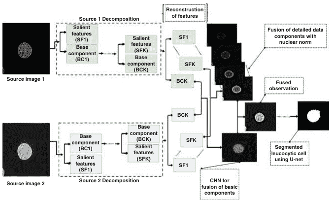

图 9.1 拟议医学图像融合模型框架。


应用于医学影像中的语义分割任务，并在细胞追踪与分割挑战（ISBI challenge）（Xu et al. 2022）等竞赛中取得了成功。该模型架构包含多种层，包括输入层、编码路径、瓶颈层和解码路径。输入层处理不同样本大小的数据，可容纳三通道的RGB图像或单通道的灰度图像。随后，编码阶段采用重复的卷积和最大池化操作来提取上下文特征。接着，对得到的特征图应用反卷积和上采样操作以保留局部特征。我们的研究为细胞融合与分割任务引入了多项改进，例如分离子结构数据模式、减少数据失真、改进系数表示以及准确提取白细胞。我们所提方法的框架如图9.1所示。

### 9.2 方法论

所提方法的框架包含三个不同阶段：预处理、数据增强和后处理。在预处理阶段，执行重采样和数据生成程序。因此，图像增强操作提高了子组件的识别率，而后处理对增强后的细胞图像进行分割。预处理操作在三个生物医学数据库上进行：急性淋巴细胞白血病国际数据库（ALL-IDB）（ALL-IDB 2024）、JTSC（Zheng et al. 2018）和CellaVision（Zheng et al. 2018）。这些数据集中的图像样本包含五种不同类型的白细胞（淋巴细胞、单核细胞、中性粒细胞、碱性粒细胞和嗜酸性粒细胞），其尺寸各异，通过重采样标准化为统一大小。随后，重采样过程完成后，生成生物图像的两种不同外观（品红和饱和度）。这些颜色通道包含高亮度信息，对于从背景纹理中区分细胞至关重要（Makem and Tiede et al. 2020）。

预处理的结果被导向多级分解与融合阶段，在此阶段生物数据的质量得到显著提升。我们将数据改进过程限制在四个不同的级别，因为进一步增强存在图像质量劣化的风险。该操作涉及数据分解和集成策略。医学观测分解采用隐含低阶方法执行，因其对噪声具有鲁棒性，并能最大限度地减少采样不足的特征（Liu and Yan 2011）。该过程如图9.2所示，在每个级别生成两个不同的组件（基本组件和详细组件），其中一个处理局部特征（结构属性），另一个涵盖

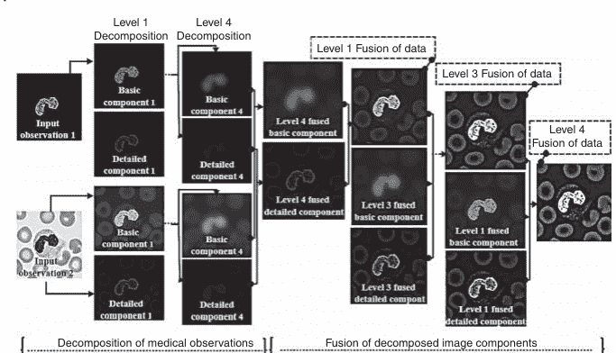

图9.2 一个展示图像组件四级分解与集成的细胞图像示例。

全局特征（亮度特征）。随后，使用核范数方法进行局部特征的融合，而全局组件则利用CNN方法进行融合。该融合过程如图9.3所示，在整体数据表示方面表现出最有效的性能（Sheikh and Chachoo 2023）。

增强后的医学图像被输入到深度学习模型中进行语义分割。可用于分析医学图像的模型有多种，其中之一是U-net模型，这是一个完全卷积神经网络。其架构分为编码器路径和解码器路径。编码器路径捕获上下文信息（图像内容），而解码器部分保留空间特征（图像中信息的位置）。编码器组件由一系列卷积层和最大池化层组成。卷积层是处理图像数据及其在输入数据中检测模式和空间特征的基本单元。卷积操作涉及将一个小滤波器（内核）在输入数据上滑动，从而得到滤波器权重与输入域感受野中数值之间的点积。提供给卷积操作的输入包括尺寸为(n x n x channels)的细胞成像样本和一组滤波器，每个滤波器的大小为(i x i x channels)。卷积的输出得到一个大小为(n-out x n-out x k)的图像或特征图。

卷积操作之后，应用最大池化层对特征图进行下采样。特征图的大小由两个超参数调节：滤波器和步幅。池化操作过程如图所示

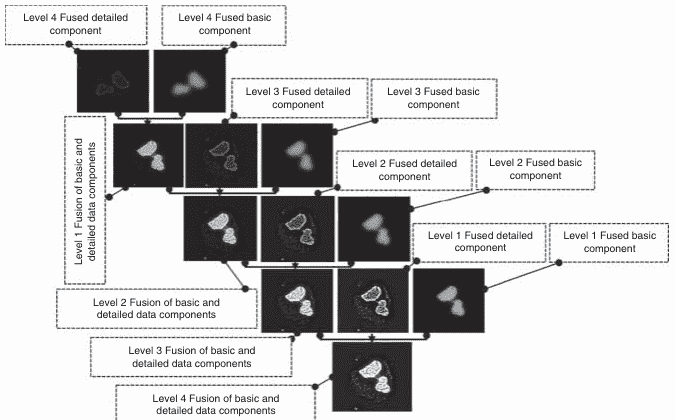

图9.3 细胞成像样本上的四级数据集成操作。

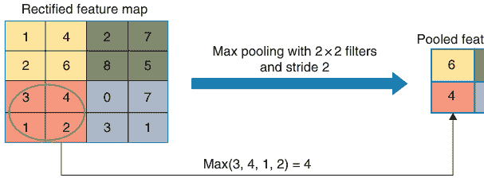

图9.4 最大池化操作。

图9.4，其中输入特征（4*4）被下采样至（2*2）特征图维度。这是通过从每个2*2块中选择最大值来实现的。卷积操作在网络中迭代多次；随着我们深入神经网络，数据矩阵的大小会减小。这种减小使更深层级的滤波器能够感知数据更大的上下文。在卷积过程中，输入数据的高度和宽度逐渐减小，而数据滤波器的数量则增加，从而便于从数据中提取复杂模式。

下采样过程关注数据的上下文特征，而不涉及空间特征。然而，对于医学细胞分割，上下文特征和空间特征都是必需的。该要求通过上采样操作来满足，该操作通过将低分辨率图像转换为高分辨率图像来保留空间信息。可用的上采样技术有多种，例如双线性插值、三次插值、最近邻插值和转置卷积。这些方法中的大多数基于插值，意味着网络不会自行学习，并且需要手动特征工程。为了实现最佳上采样，转置卷积已被确定为首选方法。与其他技术不同，转置卷积不依赖预设条件，网络包含可学习参数。转置卷积已被广泛用于语义分割，以重建原始样本大小。

U-net架构如图9.5所示，不包含密集层，因此可以接受任何维度的数据样本。在我们的经典U-net设计中，各种参数由特定符号表示，每个符号都有明确含义。例如，“2@Conv”表示一对连续的卷积层，而这些卷积的输出张量表示为“c1, c2,... cn”。上采样层的输出张量带有前缀“u”（例如“u6, u7, u8和u9”），下采样层的输出张量则由“p1, p2, p3和p4”表示。编码器的输出对应8*8*256的图像尺寸，而解码器部分的输出为128*128*1。这意味着收缩路径减小图像尺寸并增加网络更深层级中的滤波器深度，而解码器部分通过与上采样卷积层结合的跳跃连接重建原始图像尺寸。例如，上采样层u6的输出是通过将卷积（c4）和反卷积张量（u6）串联得到的，表示为u6 = u6 + c4。该过程生成一个同时包含局部和全局几何特征的图像。我们采用了Adam优化器进行模型编译，而模型损失由二元交叉熵控制，因为只有两个类别：白细胞细胞和背景。学习率衰减在三个连续的时代中实现，如果在五个连续的时代中没有改善，则触发早期停止条件。U-net在不同增强级别上的操作如图9.6所示。

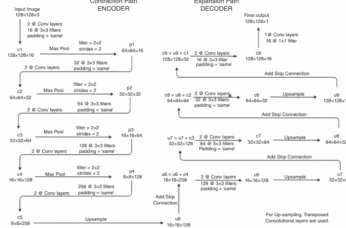

图9.5 详细的U-net架构。

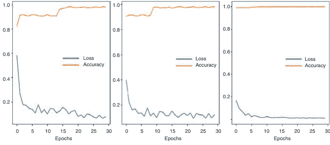

图9.6 U-net在不同数据增强级别上的性能。


采用了 Adam 优化器进行模型编译，而模型的损失由二元交叉熵控制，因为只有两个类别：白细胞和背景。学习率衰减在三个连续的 epoch 中实现，如果连续五个 epoch 没有改善，则触发早停条件。U-net 在不同增强级别下的操作如图 9.6 所示。

### 9.3 结果与讨论

医学图像经常受到各种类型的异常值影响，导致细胞成像子组件的不当区分。此外，许多相关研究已认识到处理生物医学成像数据集所面临的挑战（Jia et al. 2021; Makem and Tiedeu 2020）。一些自动化方法，如基于模式的分割和边界细胞分割，由于数据噪声聚类，导致数据点的欠分割和过分割。为了解决这一问题，我们在研究中设计了一种改进方法，专注于分割增强的生物图像。该方法的目标是减轻数据点的误配准，从而实现白细胞的平滑提取。

所提方法在三个不同的生物数据集上进行评估：ALL-IDB 数据集、CellaVision 数据集和 JTSC 数据库。ALL-IDB 包含急性白血病患者的淋巴细胞，并提供分割和未分割子集。出于评估目的，我们使用了该子集中的未分割样本。该子集中的医学样本尺寸各异，因此需要重采样至统一尺寸。CellaVision 和 JTSC 数据集包含五种不同类型的白细胞：嗜碱性粒细胞、嗜酸性粒细胞、单核细胞、淋巴细胞和中性粒细胞。这些数据集均可公开获取，并为所有数据集提供了手动注释文件。我们采用了特定的比例（80 : 20）来训练和测试模型。

评估指标：模型性能采用多种指标进行评估（Dice 1945; Muthu and Murali 2021），包括 Jaccard 指数（J）、F1 度量、准确率、精确率、召回率和特异性。Jaccard 指数（J）衡量模型结果与注释文件掩码之间的重叠程度，范围从 0（表示不完美分割）到 1（表示完美分割）。F1 度量在精确率和召回率之间取得平衡，取值范围从 0（表示不平衡的调和平均数）到 1（表示平衡的调和平均数）。

准确率是计算模型整体正确性的指标，其中完美准确率由值 1 表示，不完美准确率由 0 表示。精确率，又称为真阳性率，评估真阳性（TP）预测相对于总正预测（TP + FP [假阳性]）的准确性，取值介于 0 和 1 之间。更高的精确率值对应更低的假阳性率。特异性，又称为真阴性率，衡量真阴性（TN）相对于总负预测（TN + FN [假阴性]）的准确性。特异性值越高，表明假阳性率越低。召回率，或灵敏度，评估所有相关实例的正确性，范围从 0 到 1，值越高表示假阴性越少。它是通过将真阳性（TP）除以假阴性（FN）和真阳性（TP）之和来计算的。

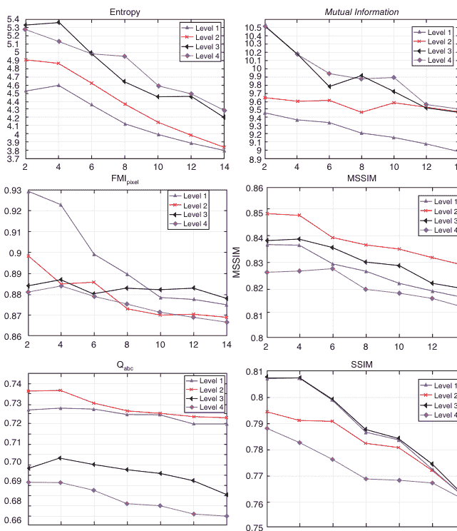

图 9.7 不同指标的数据融合操作性能，包括 SSIM（结构相似性）、MSSIM（最大结构相似性）、FMI（快速互信息）和 Qabc（质量指标）。

定量比较：我们对模型进行了定性和定量评估。定性评估揭示了各种细胞子结构（RBC、WBC、血小板和背景）外观的视觉增强。为每个生物数据库生成了四个改进级别，旨在增强白细胞识别以实现更平滑的提取，同时保留形态亚图案的精细和详细信息。所提方法的可视化表现显示在三个单独的图中（图 9.7–9.9），其中图 9.7 和 9.8 展示了数据融合操作的结果，图 9.9 展示了分割结果。通过定性分析，很明显，与相关技术相比，我们生成的结果具有更高的亮度和清晰度。所提方法的定量结果显示在两个表中（表 9.1 和 9.2），并与最先进的方法进行比较分析。我们采用的方法展现出更优越的性能指标，这体现在各种性能指标中达到的最高值和次高值，超过了相关技术。

| 增强级别 1 | 增强级别 2 | 增强级别 3 | 增强级别 4 | 手动分割 | 自动分割 |
|---|---|---|---|---|---|
| [Image] | [Image] | [Image] | [Image] | [Image] | [Image] |
| [Image] | [Image] | [Image] | [Image] | [Image] | [Image] |
| [Image] | [Image] | [Image] | [Image] | [Image] | [Image] |
| [Image] | [Image] | [Image] | [Image] | [Image] | [Image] |
| [Image] | [Image] | [Image] | [Image] | [Image] | [Image] |
| [Image] | [Image] | [Image] | [Image] | [Image] | [Image] |
| [Image] | [Image] | [Image] | [Image] | [Image] | [Image] |
| [Image] | [Image] | [Image] | [Image] | [Image] | [Image] |

图 9.8 选定用于协作融合策略的医学图像示例。

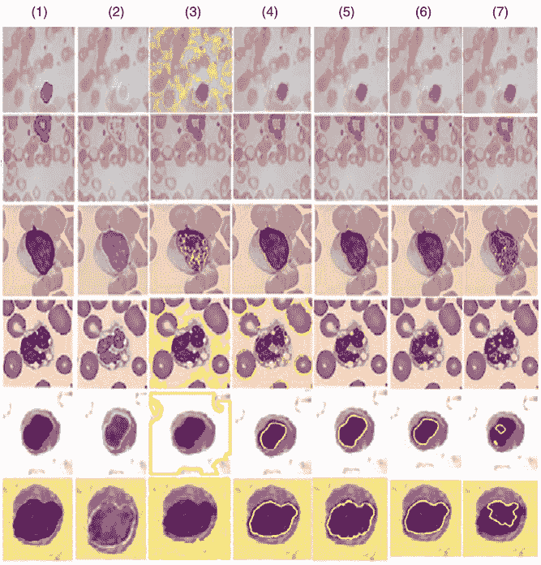

图 9.9 不同细胞图像分割方法的定性比较，对象为从不同数据集（包括 CellaVision、JTSC 和 BloodSeg）收集的部分细胞图像。列 (1) 表示专家分割，列 (2) 表示所提方法的结果，列 (3) 是 Source: Abdeldain et al. 2018 的分割，列 (4) 是 Source: Vincent et al. 2015 的分割，列 (5) 由 Source: Makem and Tiedeau 2020 提供，列 (6) 是由 Source: Vogado et al. 2016 分割，列 (7) 由 Source: Abdul Nasir et al. 2011 提供。

### 表 9.1 数据融合操作（图像融合阶段）的定量比较。

| 数据集/模型 | CellAVision 熵 | CellAVision 互信息 | CellAVISION 标准差 | ALL-IDB 熵 | ALL-IDB 互信息 | ALL-IDB 标准差 | JTSC 熵 | JTSC 互信息 | JTSC 标准差 |
| :--- | :--- | :--- | :--- | :--- | :--- | :--- | :--- | :--- | :--- |
| LRR-NSST (Li et al. 2018) | 4.545 | 9.071 | 29.516 | 4.725 | 9.187 | 30.389 | 4.405 | 8.869 | 28.756 |
| LRR-Wavelet (Li et al. 2018) | 4.554 | 9.071 | 29.659 | 4.791 | 9.253 | 30.758 | 4.419 | 8.749 | 28.958 |
| NSST (Guorong et al. 2013) | 4.544 | 9.109 | 29.653 | 4.542 | 8.931 | 29.531 | 4.394 | 8.708 | 28.353 |
| LP-CNN (Liu et al. 2017) | 5.098 | 10.196 | 21.412 | 5.463 | 10.927 | 21.9876 | 5.555 | 9.431 | 38.254 |
| CSMCA (Zhu et al. 2019) | 4.994 | 9.989 | 17.796 | 5.081 | 10.162 | 22.1006 | 4.811 | 9.3224 | 18.984 |
| NSST-PC-LLE (Liu et al. 2019) | 5.873 | 10.547 | 28.982 | 5.198 | 10.396 | 22.9263 | 2.494 | 4.9891 | 38.346 |
| 所提方法 | | | | | | | | | |
| 级别 1 | 4.907 | 9.818 | 32.931 | 4.932 | 9.367 | 33.536 | 4.608 | 8.918 | 31.838 |
| 级别 2 | 5.168 | 10.336 | 37.061 | 5.013 | 9.633 | 33.751 | 4.718 | 9.334 | 32.561 |
| 级别 3 | 5.331 | 10.663 | 37.258 | 5.468 | 10.403 | 36.162 | 4.915 | 9.763 | 35.257 |
| 级别 4 | 5.115 | 10.551 | 37.385 | 5.136 | 9.732 | 36.347 | 4.865 | 9.201 | 38.438 |

### 9.4 结论与未来展望

多样生物特征的融合生成了一个强大的决策图，能够高效表征子类数据模式。该过程已证明在细胞成分识别方面实现了改进。由于数据融合在四个不同级别上进行，观察到更高的增强级别带来了更好的分割性能。通过在细胞成像样本上采用协作策略，观察到了各种成分的精细特征。该工作具有广泛的适用性，可应用于多模态医学图像，如 CT 扫描、X 射线图像、POSET 图像、膝关节图像和 X 射线图像。这些的计算分析

### 表 9.2 融合后操作的定量比较。

| 数据集 | 方法 | 召回率 | 特异性 | 精确率 | 准确率 | f-measure | J |
| :--- | :--- | :--- | :--- | :--- | :--- | :--- | :--- |
| ALL-IDB | OTSU (Safuan et al. 2017) | 0.8234 | – | 0.8902 | – | 0.8554 | 0.747 |
| | FC (Alférez et al. 2019) | 0.6137 | – | 0.6008 | – | 0.6071 | 0.435 |
| | Shahzad et al. (2020) | – | – | – | 0.9334 | 0.3309 | 0.198 |
| | Sudha and Geetha (2020) | 0.9805 | – | 0.9932 | – | 0.9867 | 0.973 |
| | Garcia et al. (2021) | 0.7671 | 0.9997 | 0.9857 | 0.9924 | 0.8628 | 0.758 |
| | 拟议方法 | 0.9951 | 0.9865 | 0.9901 | 0.9989 | 0.9715 | 0.944 |
| CellaVision | SVR | 0.8592 | – | 0.9655 | – | 0.9242 | 0.867 |
| | OTSU (Safuan et al. 2017) | 0.861 | – | 0.9781 | – | 0.9161 | 0.845 |
| | FC Alférez et al. 2019 | 0.848 | – | 0.9025 | – | 0.8746 | 0.777 |
| | Makem and Tiedeu (2020) | 0.970 | – | 0.9737 | 0.9937 | 0.9475 | 0.900 |
| | Sudha and Geetha (2020) | 0.8791 | – | 0.9963 | – | 0.9341 | 0.876 |
| | 拟议方法 | 0.9825 | 0.9794 | 0.9875 | 0.9968 | 0.9597 | 0.922 |
| JTSC | Vincent et al. (2015) | 0.753 | 0.4772 | 0.5115 | 0.7921 | 0.4833 | 0.318 |
| | Vogado et al. (2016) | 0.971 | 0.8318 | 0.9355 | 0.9899 | 0.8768 | 0.780 |
| | Kumar and Kumar (2017) | 0.9677 | 0.8186 | 0.9343 | 0.9897 | 0.8653 | 0.762 |
| | Abeldaim et al. (2018) | 0.6598 | 0.4544 | 0.1679 | 0.6849 | 0.1913 | 0.106 |
| | Makem and Tiedeu (2020) | 0.972 | – | 0.9101 | 0.9312 | 0.9079 | 0.830 |
| | 拟议方法 | 0.9845 | 0.9721 | 0.9742 | 0.9651 | 0.9389 | 0.884 |

数据库对诊断包括阿尔茨海默病、脑肿瘤和 COVID-19 在内的各种生物疾病具有潜力。所采用方法的多级融合规则也可用于整合多组学数据，例如 RNA-seq、DNA 甲基化、全张成像（WSI）和拷贝数变异数据。这种整合不仅能最大限度地减少采样特征不足的问题，还能为疾病预测提供新的见解。

## 致谢

所有作者均等同作出贡献。

## 参考文献

- Abdeldaim, A.M., SahloI, A.T., Elhoseny, M., and Hassanien, A.E. (2018). 基于图像分析的计算机辅助急性淋巴细胞白血病诊断系统。载于：*图像处理中的软计算与机器学习进展*, 131–147. Cham: Springer International Publishing.
- A.S. Abdul Nasir, M.Y. Mashor, and H. Rosline (2011). 急性白血病图像中白细胞的无监督彩色分割，收录于：*IEEE 成像系统与技术国际会议*，马来西亚 Batu Ferringhi。
- Alférez, S., Merino, A., Acevedo, A. et al. (2019). 外周血恶性淋巴细胞图像分析的颜色聚类分割框架。*Med. Biol. Eng. Comput.* 57 (6): 1265–1283.
- ALL-IDB. (2024) 用于图像处理的急性淋巴细胞白血病图像数据库 [在线]。可用：https://homes.di.unimi.it/scotti/all/. [访问日期：2024 年 3 月 25 日]。
- Bhutada, G.G., Anand, R.S., and Saxena, S.C. (2011). 使用小波和 curvelet 变换去噪图像的自适应融合边缘保持图像增强。*Digital Signal Processing* 21 (1): 118–130.
- Candès, E., Demanet, L., Donoho, D., and Ying, L. (2006). 快速离散 curvelet 变换。*Multiscale Modeling and Simulation* 5 (3): 861–899.
- Dice, L.R. (1945). 物种间生态关联量度。*Ecology* 26 (3): 297–302.
- Do, M.N. and Vetterli, M. (2005). 轮廓let 变换：一种高效的方向多分辨率图像表示。*IEEE 图像处理期刊* 14 (12): 2091–2106.
- Garcia, F.L., Alvarado, M., and Cervantes, J. (2021). 基于图像色调特征 PCA 的白细胞计数系统分割方法。PLoS One 16 (12): e0261857.
- Guorong, G., Luping, X., and Dongzhu, F. (2013). 基于非子采样剪切let 变换的多焦点图像融合。IET 图像处理 7 (6): 633–639.
- D. Jia, S. Gao, Q. Chen, X. Luo, and X. Zhuang. (2021). 医学图像无监督配准的低秩表示，Arxiv (康奈尔大学) arXiv [cs.CV]。
- Kumar, P.S. and Kumar, S. (2017). 使用多 SV 自动诊断急性淋巴细胞白血病和急性髓细胞白血病。生物医学成像与生物工程期刊 1 (1): 20–24.
- H. Li, X.-J. Wu, and T. Durrani. (2018). ‘使用低秩表示的多焦点噪声图像融合’，Arxiv (康奈尔大学) arXiv [cs.CV]。
- Li, Z., Dong, A., and Zhou, J. (2020). 阿尔茨海默病诊断的低秩表示与判别相关分析研究。医学中的计算和数学方法 2020: 1–8.
- G. Liu and S. Yan. (2011). 用于子空间分割和特征提取的隐式低秩表示，收录于：2011 年国际计算机视觉会议，西班牙巴塞罗那。
- Liu, Y., Chen, X., Peng, H., and Wang, Z. (2017). 基于深度卷积神经网络的多焦点图像融合。信息融合 36: 191–207.
- Liu, Y., Chen, X., Ward, R.K., and Wang, Z.J. (2019). 基于卷积稀疏形态成分分析的医学图像融合。IEEE Signal Processing Letters 26 (3): 485–489.
- F. Long. (2020). 基于改进 U-Net 的显微镜细胞核分割，BMC 生物信息学，第 21 卷，第 1 期，2020 年 12 月。
- M. Makem and A. Tiedeu. (2020). 基于自适应三阶段 PCA 融合的白细胞核检测高效算法，医学信息学解锁，第 20 卷，第 100416 期，第 100416 页，2020 年。
- Muthu, J.S. and Murali, P. (2021). 图像加密中混沌映射与系统混沌检测技术综述。SN 计算机科学 2 (5): 1–24.
- S.N.M. Safuan, R. Tomari, W.N.W. Zakaria, and N. Othman. (2017). 使用各种分割策略的血涂片图像白细胞计数分析，载于：电气与电子工程进展：从理论到应用：国际电气与电子工程会议 (IC3E 2017) 论文集。
- Shahzad, M., Umar, A.I., Khan, M.A. et al. (2020). 全张血液细胞显微图像语义分割的鲁棒方法。医学计算与数学方法 2020 (1): 4015323.
- Sheikh, I. M., and Chachoo, M. A. (2022a). 基于膨胀和腐蚀形态学的边界细胞检测算法的白细胞细胞核识别。载于：Springer 电子图书 (pp. 79–102) Cham: Springer International Publishing. https://doi.org/10.1007/978-3-030-96569-3_4.
- Sheikh, I.M., and Chachoo, M.A. (2022b). 医学图像模式分类的强制块对角低秩表示方法。信息技术国际期刊，14(3)，1221–1228。https://doi.org/10.1007/s41870-021-00841-5.
- Sheikh, I.M. and Chachoo, M.A. (2023). 基于多级隐式低秩表示与卷积神经网络协作的新型细胞图像融合方法。生物医学信号处理与控制 83 (104654): 104654.
- Sudha, K. and Geetha, P. (2020). 显微血液图像中重叠白细胞分割与计数的新方法。生物控制与生物医学工程 40 (2): 639–648.
- I. Vincent, K.-R. Kwon, S.-H. Lee, and K.-S. Moon. (2015). 使用两步神经网络分类器的急性淋巴细胞白血病分类，载于：第 21 届韩日联合计算机视觉前沿研讨会 (FCV)，韩国木浦。
- Vogado, L.H., ds MS Veras, R., Andrade, A.R., e Silva, R.R., De Araujo, F.H. and De Medeiros, F.N., (2016). 基于多彩色通道空间的白血病细胞无监督分割，载于：IEEE 多媒体国际研讨会 (ISM)，美国加州圣何塞。
- Xu, J., Zhou, D., Deng, D. et al. (2022). 细胞图像分析中的深度学习。智能计算。
- Zheng, X., Wang, Y., Wang, G., and Liu, J. (2018). 基于自监督学习的白细胞图像快速稳健分割。Micron 107: 55–71.
- Zhu, Z., Zheng, M., Qi, G. et al. (2019). 基于 NSCT 域相位一致性和局部拉普拉斯能量的多模态医学图像融合方法。IEEE Access 7: 1–1.


## 10 基于深度学习模型的医学图像分割的 10 个挑战与未来方向

罗尚·伯贾斯

奥克兰大学工程学院电气、计算机和软件工程系，奥克兰，新西兰

### 10.1 引言

医疗保健专业人员（包括临床医生和放射科医生）主要负责医学图像的解读。然而，人类专家的可用性受限，加上他们在估计时使用的方法令人疲惫且不够精确，这限制了熟练医疗保健从业者在图像解读方面的效率。专家之间的差异以及医学图像固有的复杂性带来了挑战，使得精确的疾病诊断成为这些专业人员的一项重大障碍。

自动化计算机技术简化了图像分析这一具有挑战性的过程，使得半自动和完全自动化的程序成为可能。这些方法帮助专家实现客观、快速和精确的诊断。因此，基于深度学习的医学图像分析方法的持续探索与进步，仍然是一个引人注目且充满活力的研究领域。

将深度学习（DL）技术集成到医学图像分析中非常引人入胜，但进展仍面临各种挑战。阻碍 DL 在医学图像中应用的一个关键限制是数据内在的变异，涵盖对比度、分辨率和信噪比等因素，这些因素通常源于临床实践程序。医疗数据的非标准化获取进一步复杂化了分析，而对详细医学图像标注的需求限制了 DL 在该领域的利用。

一项重大挑战源于数据的稀缺，尤其是与其他数据集相比，以及医疗数据集共享的复杂性。处理医疗数据的隐私既是技术问题也是社会学问题，需要从两个角度进行审视。构建深度学习算法（DLA）需要大量标注数据，而标注过程耗时较长，因为这需要放射科医生具备相应的领域知识。

为了应对标注数据有限的挑战，实施半监督学习可以利用现有标注数据以及大量未标注数据。此外，使用显著缩减的数据集开发少样本学习方法，为解决数据可用性有限的挑战提供了一种潜在的补救措施。

尽管 DLA 取得了成就，但医学领域仍存在众多限制和障碍。DL 能否降低医疗费用、提高医疗效率并提升患者满意度，仍然不确定。然而，进行能够证明 DL 算法有效性的临床试验，并为其在医学图像分析中的应用制定指南，是必要的。

### 10.2 医疗数据集类型

在医学影像和医疗保健研究领域，多样且经过精心策划的数据集的可访问性在推动 DLA 发展方面发挥着关键作用。这些数据集是研究人员开发和评估分析医学图像的新方法的基本基础，有助于生成诊断、预后和治疗策略。医学数据集的范围广泛，涵盖了众多成像模态以及对解剖结构和病理状况的分析。图 10.1 展示了用于评估医学图像的各种模态。该信息使用 Kaggle 和 paperswithcode.com 收集。每个数据集都是一个信息宝库，为算法的发展带来了独特的挑战和前景。在本节中，我们深入探讨了医学数据集的多面性，审视了其分类、内在属性，以及它们为医学研究和计算医疗保健前沿所做出的宝贵贡献。

#### 10.2.1 X 射线

X 射线是电磁辐射，其波长短于紫外线（UV）但长于伽马射线。X 射线具有不同程度穿透物质的能力，在医学影像诊断方面有着广泛的应用。它们是检测和可视化人体内部结构的宝贵工具。图 10.2 展示了正常肺部解剖与

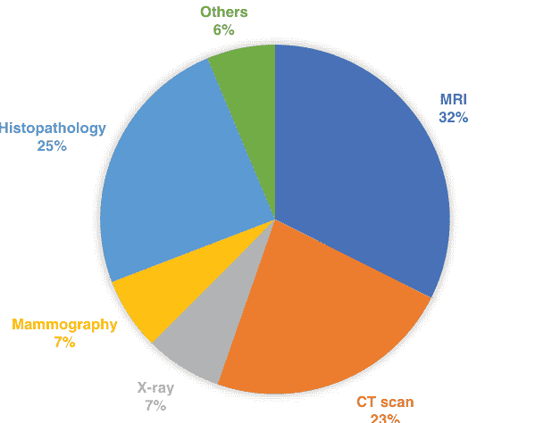

Figure 10.1 医学影像中所用模态的百分比分布。

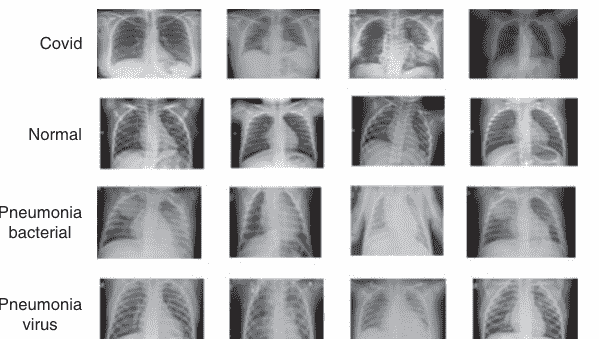

Figure 10.2 胸部 X 射线样本。来源：Loey 等人 (2020)/MDPI/CC BY 4.0。

其他病理状况。胸部放射摄影在诊断肺部疾病和心脏病理（包括结核病、胸腔积液、肺不张、实变、气胸和心脏超充气）方面至关重要。这些图像广泛可用、成本效益高，且剂量低于替代成像方法，因此是大规模筛查的有效方法（Candemir 等人，2018）。

最初的结核病筛查系统已被引入，利用迁移学习技术和深度卷积神经网络（CNN）（Hwang 等人，2016）。Rajaraman 和 Antani (2020a) 引入了一种专门的集成学习方法来识别胸部 X 射线异常。这些模型的预测通过多种集成技术整合，以最小化预测方差。采用类选择性映射来直观高亮这些图像中受影响的区域。Loey 等人 (2020) 引入了一种带有迁移训练的生成对抗网络（GAN），用于预测胸部 X 射线中的 COVID-19。由于 COVID-19 疾病的数据有限，GAN 网络生成额外的胸部 X 射线图像。CovidGAN 技术的介绍依赖于辅助分类器生成对抗网络，该网络生成人工胸部 X 射线图像用于 COVID-19 分类（Waheed 等人，2020）。Rajaraman 和 Antani (2020b) 实施了一种标注数据增强技术，以丰富用于训练的数据集，从而提高了胸部 X 射线图像中 COVID-19 的预测效果。

#### 10.2.2 计算机断层扫描

计算机断层扫描（CT）图像是通过一种称为 CT 扫描（通常称为 CT 扫描）的技术生成的诊断医学图像。CT 扫描是一种利用 X 射线创建全面身体横断面图像的医学成像形式。该技术便于创建内部结构的三维视角，与传统 X 射线成像相比，能够实现更全面的评估。CT 图像的各种特征包括高空间分辨率、对比度增强、多平面成像以及致密组织和软组织分化。这些图像广泛用于诊断和分期、治疗规划、血管成像等。

2016 年，研究人员率先引入了一种旨在检测三种结节类型（实性、半实性和磨玻璃影）的深度 CNN（Li 等人，2016）。Balagourouchetty 等人 (2019) 提出了一种基于 GoogLeNet 的肝脏病变分类集成 FCNet 分类器。基础 GoogLeNet 架构经历了三项修改以增强特征提取。Masood 等人 (2020) 引入了一种多维区域基础全卷积网络，用于检测和分类肺结节，达到 97.91% 的令人印象深刻的准确率。他们尤其强调在肺结节识别中检测微结节（小于 3 毫米），且不影响性能指标。2019 年，Zhao 和 Zeng 引入了一种基于监督的 MSS U-Net 和 3DU-Net 的深度学习架构（DLA），用于肾脏及相关肿瘤的自动分割（Zhao 和 Zeng，2019）。Fan 等人 (2020) 和 Li 等人 (2019) 应用 DL 方法在 COVID-19 期间从 CT 图像中识别 COVID-19。

#### 10.2.3 乳腺X线摄影（MG）

MG 是一种专门的医学成像技术，在筛查和诊断乳腺状况方面发挥着重要作用，主要关注乳腺癌检测。该程序利用 X 射线生成乳腺组织的详细图像。乳腺X线摄影图像在乳腺癌早期预后中不可或缺，并被推荐作为女性常规筛查方案的一部分，通常从特定年龄或基于个体风险因素开始。乳腺X线摄影中肿块的自动分类和早期检测仍然是活跃研究的领域。在过去十年中，DLA 在克服与乳腺癌检测和分类相关的挑战方面取得了重大进展。

Fonseca 等人 (2015) 引入了一种使用 CNN 提取特征的方法，用于根据 ACR 标准检测乳腺成分。一些研究人员建议使用 12 层的 CNN 模型来检测乳腺动脉钙化并评估冠状动脉疾病（Wang 等人，2017）。在另一项研究中，一种使用 faster R-CNN 的计算机辅助设计（CAD）系统能够自主将乳腺X线摄影图像中的病变分类为良性和恶性，如图 10.3 所示（Ribli 等人，2018）。

一种在超过 1,000,000 条乳腺X线摄影数据上训练的深度 CNN 用于乳腺癌分类（Wu 等人，2019）。另一种基于深度 CNN 的系统已被开发用于在数字乳腺断层合成图像中检测 AQ 病变（包括钙化和软组织异常）（Conat 等人，2019）。所提出的模糊完全连接层架构将融合模糊规则与传统 CNN 相结合，用于语义 BI-RADS 评分（Kang 等人，2020）。该框架在三分类和多类分类的 BI-RADS 评分中表现出卓越性能。

#### 10.2.4 组织病理学

组织病理图像是高分辨率显微图像，用于捕捉经过处理和染色以便在显微镜下检查的组织标本。这种图像对于病理学（一种专注于


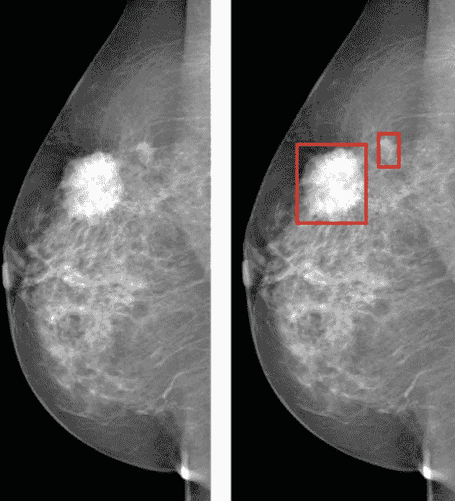

图 10.3 使用乳腺 X 线摄影图像检测病变。来源：Ribli 等人 (2018)/Springer Nature/CC BY 4.0。

通过检查组织、器官和细胞来研究和诊断疾病。图 10.4 展示了 BreakHis 数据库（Spanhol 等人，2016）中病理组织图像的四种不同放大倍数。

深度学习（DL）正在成为一种强大的方法，用于分析病理学图像并处理细胞核检测、图像分类以及细胞和组织分割等任务（Xing 等人，2018）。数字病理学图像分析领域在全切片成像（WSI）方面取得了显著进展，能够对含有染色组织切片的玻璃载片进行高分辨率数字化。在另一项研究中，Dimitriou 等人（2019）概述了构建 DL 模型时分析多千兆字节 WSI 图像所面临的挑战。

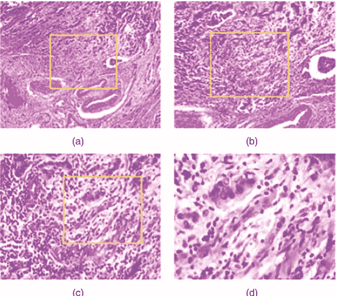

图 10.4 乳腺肿瘤组织的显微图像，具有四种不同的放大倍数。(a) 40X，(b) 100X，(c) 200X，(d) 400X。来源：Spanhol 等人 (2016)/经 IEEE 许可。

#### 10.2.5 磁共振成像（MRI）

利用磁共振，它捕捉人体器官发出的电磁信号，随后重建这些器官结构的信息。高分辨率 MRI 提供了更好的结构细节，对病变的精确定位和疾病的准确诊断贡献显著。在医学图像处理中，MRI 图像分割面临各种挑战。脑组织的复杂性，加上运动伪影、环形伪影和噪声等伪影，使得准确分割变得困难（Prakasha 等人，2023）。此外，体积效应、灰度不对称和额外噪声等挑战进一步复杂化了分割过程（Veeramalla 等人，2023）。在直肠 MRI 分割的背景下，器官的不规则形状以及附近结节和器官的邻近性，使得准确隔离直肠区域面临挑战（Srivaramangai，2023）。此外，源于不同 MRI 扫描仪、供应商、获取序列以及神经发育不同阶段的固有异质性，增加了在不同年龄、模态和地点对婴儿脑 MRI 进行分割的复杂性（Zhang 等人，2023）。

总体而言，MRI 分割面临与伪影、组织复杂性、不规则形状以及数据获取异质性相关的挑战。

#### 10.2.6 其他图像

内镜检查是将一根长而非手术用的管子插入体内，以详细视觉检查内部器官或组织的技术。该技术对于研究人体内多种系统（包括呼吸系统、消化系统、泌尿系统和女性生殖道）非常有价值（Jani 和 Srivastava，2019；Münzer 等人，2018）。

无线胶囊内镜是一种创新设备，旨在进行无痛和非侵入性检查，以检测和诊断消化道溃疡和出血等疾病。Soffer 等人系统分析了 WCE 中 DL 的文献（Soffer 等人，2020）。He 等人（2018）引入了第一个用于 WCE 图像中钩虫检测的基于深度学习的框架，结合了两个 CNN 网络用于边缘提取和钩虫分类。一些研究人员创建了一个 CNN 模型，用于早期胃癌识别和侵犯深度预测，这对于确定适当的治疗方法至关重要（Yoon 等人，2019）。Nakagawa 等人（2019）应用基于 CNN 的 DL 技术来增强使用内镜诊断食管壁，而 Choi 等人（2020）讨论了内镜中 DL 的特点和方面。

正电子发射断层扫描（PET）是一种核医学成像工具，通过注射特定放射性示踪剂来可视化组织内的分子水平活动。Wang 等人（2020）研究了机器学习在 PET 衰减校正和低计数 PET 重建中的应用，强调了 DL 在 PET 图像任务中相较于传统机器学习的优势。另一项研究概述了 PET 图像重建，强调其在 DL 中的直接应用或在传统重建技术中集成（Reader 等人，2020）。

### 10.3 与数据集相关的挑战

医学图像分割有助于理解图像、特征提取、识别以及异常或病变评估。它为病理分析提供了关键信息，进而有助于诊断和制定治疗方案。分割的主要目标是将图像划分为表现出强相关性的不同区域。这一过程涉及将图像 $I$ 分离为有限个区域集合 $R_1, R_2, ..., R_s$，如 Eq. (10.1) 所示。

```
$I = \cup_{i=1}^s R_i, R_i \cap R_j = \emptyset \quad \text{and} \quad i \neq j$ (10.1)
```

机器学习技术的高效运行依赖于提取描述性特征。识别这些特征通常具有挑战性，尤其是在图像理解等尚处于活跃研究阶段的应用领域。解决这一挑战的战略方法是开发能够自主学习和提取图像理解所需特征的智能机器。在这方面，CNN 模型是一种杰出的智能且成功的模型，而 U-Net、SegNet 和 W-Net 等各种架构的进步，使得医学图像理解中必要特征的自动学习和提取成为可能（Badrinarayanan 等人，2017；Ronneberger 等人，2015；Xia 和 Kulis，2017）。研究人员已在各种医学图像理解应用中有效利用 CNN，包括肿瘤检测以及分类为良性和恶性类别（Ovalle 等人，2016）。皮肤病变检测和光学相干断层扫描图像中异常的识别也可以使用 CNN 进行检测（Kermany 等人，2018；Nasr-Esfahani 等人，2016）。许多研究人员还展示了结肠癌检测、血液癌症检测和心脏异常（Kiranyaz 等人，2016；Sirinukunwattana 等人，2016）。Kallenberg 等人（2016）展示了如何使用 CNN 检测乳腺异常。值得注意的是，像 CheXNet 这样的基于 CNN 的模型，用于分类 14 种不同的胸部疾病，其性能已显示优于人类从业者的平均专业水平（Philips 等人，2020；Rajpurkar 等人，2017）。

CNN 已成为通过分析胸部 X 光和 CT 扫描进行 COVID-19 检测领域中的主导力量。COVID-19 是一种全球大流行病，正在全世界迅速传播。检测 COVID-19 感染常用的测试是逆转录聚合酶链反应（RT-PCR）。虽然 RT-PCR 被视为 COVID-19 检测的金标准，但它是一个复杂、耗时且劳动密集的过程，可用性和准确性有限。在 RT-PCR 试剂盒短缺的地方，胸部 X 光可以作为 COVID-19 的初步筛查工具，提供更准确的诊断。许多研究人员已采用 DL 技术来分类胸部感染并区分 COVID-19 和其他疾病。一个早期建议用于 COVID-19 检测的模型涉及使用基本的预训练 AlexNet 模型，并使用胸部 X 光图像进行微调。为了提高模型性能，需要更多的训练样本和更好的分割技术（Hasan 等人，2022）。关于研究参与者详细信息不足、随机化过程以及缺乏外部验证等各种因素，促使个人重新考虑对这种疾病使用这些诊断技术（Montazeri 等人，2021）。

在推进医学图像分割方法的追求中，高质量数据集的重要性无论如何强调都不为过。挑战


Table 10.1 数据集面临的挑战及其解决方案。

| Issues | Solutions |
| :--- | :--- |
| 有限的标注数据 | - 数据增强<br>- 使用迁移学习 |
| 稀疏标注 | - 加权损失函数 |
| 类别不平衡 | - 过采样<br>- 修改评估指标<br>- 数据增强<br>- 合并少数类 |
| 强度不均匀性 | - 预滤波操作<br>- 更好的扫描设备 |
| 图像纹理复杂性 | - 使用图像增强技术 |

与数据集相关的挑战在塑造分割算法的有效性和适用性方面起着关键作用。表 10.1 显示了分割过程中与数据集相关的各种问题及其解决方案。从数据可变性和标注复杂性到关于数据集规模和多样性的问题，都是研究人员必须应对的关键因素。应对这些挑战对于确保分割模型的鲁棒性和可靠性至关重要。本节深入探讨了与数据集相关的挑战的多面格局，探讨了研究人员在释放医学图像分割技术全部潜力时所面临的复杂问题。解决这些挑战不仅对算法开发至关重要，而且还为将前沿研究转化为实用且有影响力的临床应用奠定了基础。与数据集相关的不同挑战如图 10.5 所示，并如下所述。

#### 10.3.1 标注数据集有限

深度学习（DL）网络模型需要大量数据，而对高质量标注训练数据的要求凸显了数据集在各种基于深度学习的医疗流程中的重要性（Srinivasu et al. 2021）。然而，为医学图像处理收集大量标注医学图像的努力面临挑战（Çiçek et al. 2016）。标注新的医学图像既耗费人力又昂贵，且需要高水平的专业知识。虽然有几个大规模数据集可公开获取，但仍需要更具挑战性的数据集来进一步提升 DL 模型的训练效果，尤其是在涉及复杂对象的场景中。特别是，现有的 3D 数据集规模通常不足，有些是合成的，这强调了持续需要更具挑战性的数据集（Levin et al. 1988）。

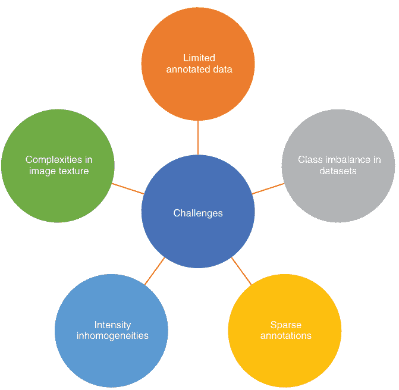

图 10.5 与数据集相关的各种挑战。

##### 10.3.1.1 解决方案

扩大现有医学图像数据集的规模可以通过多种策略实现：

- (I) 采用图像增强变换，例如以不同角度旋转图像、垂直或水平翻转图像、裁剪以及剪切图像。这些增强技术有助于提升系统性能。
- (II) 利用高效模型的迁移学习可以为有限数据问题提供可行的解决方案（Bhattacharya et al. 2021）。
- (III) 合成来自不同来源的数据为扩大数据集规模提供了额外途径（Bhattacharya et al. 2021）。

#### 10.3.2 稀疏标注

在医学图像分割中，稀疏标注是指可用数据中仅有一部分被标注或标记的情况。完全标注信息（尤其是 3D 图像）是一项耗时的任务，并且并非始终可行。因此，对 3D 图像中的信息切片进行部分标记很常见。使用这些稀疏标注的 3D 图像训练 DL 模型面临相当大的挑战（Çiçek et al. 2016）。这意味着训练数据有限、标注负担增加以及模型结果存在偏差。它还可能导致在处理罕见病例时出现挑战。在医学影像中，某些病理状况或解剖变异可能相对罕见。稀疏标注可能无法充分代表这些较少见的病例，使得模型在临床实践中遇到此类实例时难以进行准确分割。

##### 10.3.2.1 解决方案

在稀疏标注数据集的情况下，应用加权损失函数是一个可行的解决方案。在这种方法中，数据集中未标记数据的权重均设为零，从而使模型仅专注于从已标记像素中学习。

#### 10.3.3 数据集中的类别不平衡

当数据集中不同类别的实例分布不均匀时，即某些类别的实例数量显著多于其他类别时，就会发生类别不平衡。在医学图像分割的背景下，每个类别可能对应特定的解剖结构或病理状况，类别不平衡可能带来多种影响：模型偏差、对少数类敏感度降低、评估指标误导以及模型性能下降。

类别分布不平衡在各种公开可用的医学图像数据集中是固有的，这在训练 DL 模型时构成重大挑战，并可能导致模型准确率产生误导。例如，在患者数据中，如果某种疾病相对罕见，仅在 10% 的受筛查患者中出现，由于大多数患者没有该疾病，整体模型准确率可能会被虚高，从而达到局部最小值（Bhattacharya et al. 2020; Merkow et al. 2016）。

##### 10.3.3.1 解决方案

为解决类别不平衡问题，可以采用多种策略：

- (I) 对数据进行过采样，并根据数据集中不平衡的程度调整过采样的幅度。
- (II) 修改评估或性能指标，以缓解数据集不平衡的影响。
- (III) 应用数据增强技术来创建新的数据样本。
- (IV) 通过合并少数类来处理数据集类别不平衡问题。

#### 10.3.4 强度不均匀性

强度不均匀性，也称为阴影或非均匀性，是指图像中与底层解剖结构无关的像素强度变化。这些变化可能由组织厚度变化、患者定位或成像设备缺陷等因素引起。强度不均匀性对医学图像分割的影响可能是显著的，导致各种挑战，例如分割边界不准确、纹理信息误导、难以区分组织、假阳性和假阴性增加，以及定性分析受损。在与病理相关的图像中，通常会观察到颜色和强度的变化（Roy et al. 2011）。强度不均匀性会在图像上产生阴影效应，尤其是在 MR 图像分割中。此外，TEM 图像可能由于非均匀支撑膜的存在而显示亮度变化，在分割过程中带来挑战。

##### 10.3.4.1 解决方案

为缓解强度不均匀性，文献中采用了各种算法并提出了许多非参数技术（Roy et al. 2011）。在分割前使用预滤波操作是消除不均匀性的一种方法。此外，扫描设备的进步有助于解决和改善强度不均匀性。

#### 10.3.5 图像纹理复杂性

图像纹理的复杂性是指图像视觉外观中存在的复杂而详细的模式和变化。理解和处理这些复杂性对于图像分割至关重要。在医学图像领域，图像处理过程中可能会出现各种伪影，主要归因于使用不同的传感器和电子元件进行图像采集（Guo and Ashour 2019; Hesamian et al. 2019）。采集的图像通常表现出紧密邻近的灰度级别，导致图像边界不清晰。重叠组织以及皮肤线条和毛发等不规则特征（在皮肤镜图像中）会增加医学图像中感兴趣区域识别的复杂性。


##### 10.3.5.1 解决方案

多种图像增强技术（例如直方图均衡化、Sobel 滤波器和 Canny 边缘检测器）在分割之前应用，以减轻图像中各种伪影和噪声的影响。这些技术旨在抑制图像噪声，同时保留图像边缘上的信息。

### 10.4 关于 DL 模型的挑战

深度神经网络（DNN）的引入通过提供从复杂成像数据中学习复杂模式和表示的无与伦比的能力，彻底改变了医学图像分割。然而，这一变革性转变也带来了其自身的一系列挑战，需要仔细审查。医学图像分割中与 DNN 相关的挑战包括模型可解释性、对大型且多样化数据集的需求、计算密集型训练过程以及过拟合的风险等问题，如表 10.2 所示。随着研究人员致力于利用 DNN 的潜力进行精确分割任务，理解和解决这些挑战变得至关重要。本节探讨了 DNN 在医学图像分割中应用的细微复杂性，揭示了在这个快速发展的领域中既有障碍也有改进机会。

关于训练 DNN 以实现医学图像稳健分割的关键和困难挑战包括：

#### 10.4.1 过拟合

过拟合是 DL 任务（包括医学图像分割）中的常见挑战。过拟合会导致模型过度学习训练数据集中的复杂性和模式，使其在训练数据上的表现可能超过在未处理数据实例上的表现。这个问题在使用小规模数据集训练模型时尤其明显（Shen et al. 2017）。

| 问题 | 解决方案 |
| :--- | :--- |
| 模型过拟合 | 通过增强技术扩展数据集大小<br>使用 dropout 技术<br>使用批量归一化 |
| 空间复杂度 | 引入池化（如果使用 CNN） |
| 梯度消失 | 使用反卷积和 softmax<br>对权重进行周密初始化 |
| 计算复杂度 | 过滤器可视化<br>正则化<br>层级相关性传播（LRP） |

##### 10.4.1.1 解决方案

为应对过拟合，可以利用两种基本策略：

- (I) 通过增强技术扩展数据集大小（Merkow et al. 2016）。
- (II) 应用 dropout 技术，即在每次迭代期间丢弃随机一组网络神经元的输出，有助于缓解过拟合（Cui et al. 2016）。

#### 10.4.2 模型的空间复杂度

医学图像分割模型需要大量内存（Srivastava et al. 2014）。为了确保与特定设备（如手机）兼容，简化是必要的。

##### 10.4.2.1 解决方案

简化模型并采用涉及模型压缩技术的技术，可以有效降低 DL 模型的内存需求。

在训练时间方面，DNN 架构需要投入大量时间。训练期间的快速收敛在图像分割中尤其关键。

##### 10.4.2.2 解决方案

- (I) 实现批量归一化，这是一种通过减去均值将像素值围绕 0 中心化的技术。这种方法有助于促进快速收敛（Srivastava et al. 2014）。
- (II) 加入池化层以减少参数维度，也有助于加速收敛。

#### 10.4.3 梯度消失和爆炸

深度神经网络面临梯度消失问题，即最终梯度损失难以向后传播到早期层，这一挑战在 3D 模型中更为明显（Ioffe and Szegedy 2015）。

##### 10.4.3.1 解决方案

各种解决方案应对梯度消失问题：

- (I) 使用 softmax 和反卷积对中间隐藏层输出进行缩放，涉及结合辅助损失和隐藏层的原始损失。这增强了梯度值。

- (II) 对网络权重进行周密初始化是应对和缓解梯度消失问题的另一种策略（Kamnitsas et al. 2017）。

#### 10.4.4 计算复杂度

专注于特征分析的高效 DNN 需要高性能计算设备和 GPU 才能最佳运行（Goceri 2019）。某些高级算法甚至可能依赖高性能计算机进行模型训练，而这并不总是容易获得。

##### 10.4.4.1 解决方案

在应对这些挑战时，研究人员应仔细分析参数数量以达到所需的精度水平。过滤器可视化、正则化和层级相关性传播等多种技术用于评估训练模型所需的参数。

### 10.5 结论

深度学习（DL）技术在医学图像分割方面已取得显著成功，在各种应用中提供了最先进的结果。在本研究中，我们解释了医学成像中使用的模态分布，这些模态对于临床决策是必要的。从 MRI 捕获的细腻纹理到 CT 扫描揭示的详细解剖结构，丰富的医学数据集为计算医疗保健的进步奠定了基础。我们对这些模态的探索凸显了它们在推动创新和增强对复杂医疗状况理解方面所起的关键作用。

然而，在将 DL 算法集成到医学影像分析中时，医学图像分割面临许多挑战。标注数据的匮乏，加上解剖结构和病理的固有变异性，在训练稳健且可泛化的 DL 模型方面构成了巨大的障碍。本章根据这些挑战与数据集和模型的关联性将其分类。医学图像中固有的复杂纹理和模式需要精密的方法，然而过拟合的风险巨大，威胁着模型将所学内容推广到多样化临床场景的能力。追求代表广泛医学状况光谱的全面数据集，是未来工作取得成功的关键。

在我们努力解决既存在于数据中又嵌入于算法中的挑战时，变革性突破的潜力依然触手可及。模态的集成、多样化数据集的利用以及 DL 模型的持续改进，构成了指引我们走向未来的罗盘，届时医学图像分割不仅将辅助诊断和治疗规划，而且将从根本上转变个性化医疗保健的范式。

## 参考文献

- Badrinarayanan, V., Kendall, A., and Cipolla, R. (2017). SegNet：一种用于图像分割的深度卷积编码器-解码器架构。IEEE 模式分析与机器智能汇刊 39（12）：2481–2495.
- Balagourouchetty, L., Pragatheeswaran, J.K., Pottakkatt, B., and Ramkumar, G. (2019). 基于 GoogLeNet 的集成 FCNet 分类器用于局灶性肝病变诊断。IEEE 生物医学与健康信息学期刊 2194：1–1。https://doi.org/10.1109/jbhi.2019.2942774。
- Bhattacharya, S., Maddikunta, P.K.R., and Hakaketa, S. (2020). 基于蚁狮重采样的深度神经网络模型用于不平衡多模态卒中数据集的分类。多媒体工具与应用 79：1–25.
- Bhattacharya, S., Maddikunta, P.K.R., and Phametal, Q.V. (2021). 针对冠状病毒（COVID-19）大流行的深度学习与医学图像处理：一项综述。可持续城市与社会 65：102589.
- Candemir, S., Rajaraman, S., Thoma, G., and Antani, S. (2018). 用于胸部 X 射线中心脏扩大严重程度分级的深度学习：一项调查。载于：2018 IEEE 生命科学会议（LSC）。第 109–113 页。https://doi.org/10.1109/LSC.2018.8572113
- Choi, J., Shin, K., Jung, J. 等人 (2020). 通过联合使用人工智能提高数字乳房断层合成的准确性和效率。临床内镜 53（2）：117–126。https://doi.org/10.5946/ce.2020.054。
- ÇiÇek, O., Abdulkadir, A., Lienkamp, S.S. 等人 (2016). 3D U-Net：从稀疏标注中学习稠密体积分割。载于：医学图像计算和计算机辅助干预国际会议论文集。第 424–432 页。Springer，希腊，雅典。
- Conant, E.F., Toledano, A.Y., Pariaswamy, S. 等人 (2019). 通过联合使用人工智能提高数字乳房断层合成的准确性和效率。放射学：人工智能 1（4）：e180096。https://doi.org/10.1148/ryai.2019180096


- Cui, H., Zhang, H., Ganger, G.R. 等人 (2016). Geeps: 针对分布式 GPU 的 GPU 专用参数服务器的可扩展深度学习. In: 第 11 欧洲计算机系统会议论文集, 第 1–16 页, 葡萄牙里斯本 (2016 年 7 月).

- Dimitriou, N., Arandjelović, O., 和 Caie, P.D. (2019). 全切片图像分析的深度学习: 概述. Frontiers in Medicine 6 (11 月): 1–7. https://doi.org/10.3389/fmed.2019.00264.

- Fan, D.-P., Zhou, T., Ji, G.-P., 等人 (2020). Inf-Net: CT 扫描中 COVID-19 肺部感染的自动分割, 第 1–10 页 [在线]. http://arxiv.org/abs/2004.14133

- Fonseca, P., Mendoza, J., Wainer, J. 等人 (2015) 基于卷积神经网络架构搜索程序的乳腺密度自动分类. In: 第 9414 卷, 医学成像 2015: 计算机辅助诊断论文集, 第 941428 页. https://doi.org/10.1117/12.2081576

- Goceri, E. (2019). 深度学习时代图像分割的挑战与最新解决方案. In: 2019 年第九届图像处理理论、工具与应用国际会议 (IPTA) 论文集 (2019 年 11 月), 第 1–6 页. 土耳其伊斯坦布尔: IEEE.

- Guo, Y. 和 Ashour, A.S. (2019). 皮肤镜医学图像分割中的中性集. In: 医学图像分析中的中性集, 第 229–243 页. Academic Press.

- Hasan, M.K., Alam, M.A., Dahal, L. 等人 (2022). 使用公共数据集进行 COVID-19 检测的深度学习方法面临的挑战. Informatics in Medicine Unlocked 30: 100945. https://doi.org/10.1016/j.imu.2022.100945.

- He, J.Y., Wu, X., Jiang, Y.G. 等人 (2018). 基于深度学习的无线胶囊内镜图像中的钩虫检测. IEEE Transactions on Image Processing 27 (5): 2379–2392. https://doi.org/10.1109/TIP.2018.2801119.

- Hesamian, M.H., Jia, W., He, X., 和 Kennedy, P. (2019). 医学图像分割的深度学习技术: 成就与挑战. Journal of Digital Imaging 32 (4): 582–596.

- Hwang, S., Kim, H.-E., Jeong, J., 和 Kim, H.-J. (2016). 基于深度卷积神经网络的结核病筛查新方法. In: 第 9785 卷, 医学成像 2016: 计算机辅助诊断; 97852W. https://doi.org/10.1117/12.2216198

- Ioffe, S. 和 Szegedy, C. (2015). 批量归一化: 通过减少内部协变量偏移加速深度网络训练. https://arxiv.org/abs/1502.03167.

- Jani, K.K. 和 Srivastava, R. (2019). 胶囊内镜医学图像分析综述. Current Medical Imaging 15 (7): 622–636. https://doi.org/10.2174/15734056146661811012152434.

- Kallenberg, M., Petersen, K., 和 Nielsen, M. (2016). 无监督深度学习在乳腺密度分割和乳腺X线风险评分中的应用. IEEE Transactions on Medical Imaging 35 (5): 1322–1331.

- Kamnitsas, K., Ledig, C., Newcombe, V.F. 等人 (2017). 用于精确脑病变分割的带有全连接 CRF 的高效多尺度 3D CNN. Medical Image Analysis 36: 61–78.

- Kang, C., Yu, X., Wang, S.H. 等人 (2020). 依赖模糊逻辑的图像评分启发式神经网络结构. IEEE Transactions on Fuzzy Systems 29: 34–35. https://doi.org/10.1109/tfuzz.2020.2966163.

- Kermany, D.S., Goldbaum, M., Cai, W. 等人 (2018). 基于图像的深度学习识别医学诊断和可治疗疾病. Cell 172 (5): 1122–1131.

- Kiranyaz, S., Ince, T., 和 Gabbouj, M. (2016). 基于 1-D 卷积神经网络的实时特异性患者 ECG 分类. IEEE Transactions on Biomedical Engineering 63 (3): 664–675.

- Levin, D.N., Pelizzari, C.A., Chen, G.T. 等人 (1988). MR、CT 和 PET 图像的回顾性几何相关性. Radiology 169 (3): 817–823.

- Li, L., Qin, L., Yin, Y. 等人 (2019). 人工智能区分胸部 CT 中的 COVID-19 与社区获得性肺炎. Radiology 2020: 1–5. https://doi.org/10.1007/s10489-020-01714-3.

- Li, W., Cao, P., Zhao, D., 和 Wang, J. (2016). 计算机断层扫描图像中基于深度卷积神经网络的肺结节分类. Computational and Mathematical Methods in Medicine 2016: https://doi.org/10.1155/2016/6215085.

- Loey, M., Smarandache, F., 和 Khalifa, N.E.M. (2020). 针对胸部 COVID-19 X 射线数据集缺乏问题: 基于 GAN 和深度迁移学习的新型检测模型. Symmetry (Basel) 12 (4): https://doi.org/10.3390/SYM12040651.

- Masood, A., Sheng, B., Yang, P. 等人 (2020). 基于增强的带多层融合 RPN 的 RFCN 的肺癌检测与分类自动决策支持系统. IEEE Transactions on Industrial Informatics 16 (12): 7791–7801. https://doi.org/10.1109/tii.2020.29729187801.

- Merkow, J., Marsden, A., Kriegman, D., 和 Tu, Z. (2016). 密集体对体血管边界检测. In: 医学图像计算和计算机辅助干预国际会议论文集 (2016 年 10 月), 第 371–379 页. 希腊雅典: Springer.

- Montazeri, M., ZahediNasab, R., Farahani, A. 等人 (2021). 基于图像的 COVID-19 诊断和预后的机器学习模型: 系统综述. JMIR Medical Informatics 9 (4): e25181. https://doi.org/10.2196/25181.

- Münzer, B., Schoeffmann, K., 和 Bószörmenyi, L. (2018). 内窥镜图像和视频的基于内容的处理与分析: 一项综述. Multimedia Tools and Applications 77 (1): 1323–1362. https://doi.org/10.1007/s11042-016-4219-z.

- Nakagawa, K., Ishihara, R., Aoyama, K., 和 Ohmori, M. (2019). 使用深度神经网络与经验内镜医生相比对食道鳞状细胞癌侵犯深度进行分类. Gastrointestinal Endoscopy 90 (3): 407–414. https://doi.org/10.1016/j.gie.2019.04.245.

- Nasr-Esfahani, E., Samavi, S., 和 Karimi, N. (2016). 使用卷积神经网络分析临床图像进行黑色素瘤检测. In: 第 38 届 IEEE 医学与生物学工程学会年会国际会议论文集; EMBC, 第 1373–1376 页.

- Ovalle, J.E.A., González, F.A., Ramos-Pollán, R. 等人 (2016). 基于卷积神经网络的乳腺X线摄影肿块病变分类表征学习. Computer Methods and Programs in Biomedicine 127: 248–257.

- Phillips, N.A., Rajpurkar, P., Sabini, M. 等人 (2020) Chexphoto: 用于基准测试深度学习鲁棒性的 10,000+ 张智能手机照片和胸部 X 射线的合成摄影变换. https://doi.org/10.48550/arXiv.2007.06199.

- Prakasha, S., Bhyri, C., Tawade, C.M., 和 Kalpana, V. (2023). 磁共振图像中脑肿瘤分割及脑肿瘤配准过程中面临的挑战. In: 2023 年分布式计算和电气电路与电子国际会议 (ICDCECE), 第 1–5 页. IEEE.

- Rajaraman, S. 和 Antani, S.K. (2020a). 针对胸部 X 线片中结核病检测改进的特定模态深度学习模型集成. IEEE Access 8: 27318–27326. https://doi.org/10.1109/ACCESS.2020.2971257.

- Rajaraman, S. 和 Antani, S. (2020b). 深度学习弱标签数据增强: 胸部 X 射线中 COVID-19 检测的研究. Diagnostics 10 (6): 1–17. https://doi.org/10.3390/diagnostics10060358.

- Rajpurkar, P., Irvin, J., Zhu, K. 等人 (2017). Chexnet: 基于深度学习的放射学家水平胸部 X 射线肺炎检测. CoRR arXiv:1711.05225.

- Reader, A.J., Corda, G., Mehranian, A. 等人 (2020). PET 图像重建的深度学习. IEEE Transactions on Radiation and Plasma Medical Sciences 4 (1): 1–1. https://doi.org/10.1109/trpms.2020.3014786.

- Ribli, D., Horváth, A., Unger, Z. 等人 (2018). 基于深度学习的乳腺X线摄影病变检测与分类. Scientific Reports 8 (1): 1–7. https://doi.org/10.1038/s41598-018-22437-z.

- Ronneberger, O., Fischer, P., 和 Brox, T. (2015). U-net: 用于生物医学图像分割的卷积网络. In: 医学图像计算和计算机辅助干预–MICCAI 2015: 第 18 届国际会议, 德国慕尼黑, 2015 年 10 月 5–9 日, 论文集, 第三部分 18, 第 234–241 页. Springer International Publishing.

- Roy, S., Carass, A., Bazin, P.L., 和 Prince, J.L. (2011). 使用补丁进行磁共振图像强度不均匀性校正. Proceedings of SPIE The International Society for Optical Engineering 7962: 79621F.

- Shen, D., Wu, G., 和 Suk, H.I. (2017). 医学图像分析中的深度学习. Annual Review of Biomedical Engineering 19: 221–248.


Sirinukunwattana, K., Raza, S.E.A., Tsang, Y. 等 (2016). 常规结肠癌组织学图像中核的检测与分类的局部敏感深度学习. IEEE Transactions on Medical Imaging 35 (5): 1196–1206.

Soffer, S., Klang, E., Shimon, O. 等 (2020). 无线胶囊内镜的深度学习：系统综述与荟萃分析. Gastrointestinal Endoscopy 92 (4): 831–839.e8. https://doi.org/10.1016/j.gie.2020.04.039.

Panchol, F., Oliveira, L.S., Petitjean, C., 和 Heutte, L. (2016). 乳腺癌组织病学图像分类的数据集. IEEE Transactions on Biomedical Engineering (TBME) 63 (7): 1455–1462.

Srinivasu, P.N., Bhoi, A.K., Jhaveri, R.H. 等 (2021). 使用力传感器进行关键机器人程序实时路径规划的概率深度Q网络. Journal of Real-Time Image Processing 18 (5): 1773–1785.

Srivaramangai, R. (2023). 直肠癌磁共振图像分割. 载: 图像和视频处理中的计算智能 (ed. M.D. Patil, G.K. Birajdar, 和 S.S. Chaudhari), 155–173. Chapman and Hall/CRC.

Srivastava, N., Hinton, G., Krizhevsky, A. 等 (2014). Dropout：防止神经网络过拟合的一种简单方法. Journal of Machine Learning Research 15 (1): 1929–1958.

Veeramalla, S.K., Hindumathi, V., Reddy, T.V. 等 (2023). 使用主动轮廓建模与形态处理相结合的MRI图像分割. Journal of Mechanics in Medicine and Biology 23: 2340002.

Waheed, A., Goyal, M., Gupta, D. 等 (2020). CovidGAN：使用辅助分类器GAN进行数据增强以改善Covid-19检测. IEEE Access 8: 91916–91923. https://doi.org/10.1109/ACCESS.2020.2994762.

Wang, J., Ding, H., Bidgoli, F.A. 等 (2017). 使用深度学习从乳腺X线摄影中检测心血管疾病. IEEE Transactions on Medical Imaging 36 (5): 1172–1181. https://doi.org/10.1109/TMI.2017.2655486.

Wang, T., Lei, Y., Fu, Y. 等 (2020). 定量PET中的机器学习：衰减校正和低计数图像重建方法综述. Physica Medica 76 (3月): 294–306. https://doi.org/10.1016/j.ejmp.2020.07.028.

Wu, N., Phang, J., Park, J. 等 (2019). 深度神经网络提高放射科医生在乳腺癌筛查中的表现. IEEE Transactions on Medical Imaging 39: 1–1. https://doi.org/10.1109/tmi.2019.2945514.

Xia, X. 和 Kulis, B. (2017). W-net：完全无监督图像分割的深度模型. arXiv 预印本 arXiv:1711.08506.

Xing, F., Xie, Y., Su, H. 等 (2018). 显微图像分析中的深度学习：一项综述. IEEE Transactions on Neural Networks and Learning Systems 29 (10): 4550–4568. https://doi.org/10.1109/TNNLS.2017.2766168.

Yoon, H.J., Kim, S., Kim, J.H. 等 (2019). 基于病变的卷积神经网络改善早期胃癌的内镜检测和深度预测. Journal of Clinical Medicine 8 (9): 1310. https://doi.org/10.3390/jcm8091310.

Zhang, X., Wu, Y., Guo, J. 等 (2023). 异质婴儿脑MRI域自适应分割的3D掩码自编码与伪标记. arXiv 预印本 arXiv:2303.09373.

Zhao, W., 和 Zeng, Z. (2019). 肾脏和肿瘤分割的多尺度监督3D U-net. https://doi.org/10.24926/548719.007.

## 11 医学图像分析深度学习的进展：技术、应用与前景的全面探讨

Vani Malagar, Navin Mani Upadhyay, 和 Mekhla Sharma

模型工程技术学院，计算机科学与工程系，印度杰姆穆

### 11.1 引言

医学影像在现代医疗保健中发挥了重要作用，并为人体解剖学和生理学提供了极其有用的洞察。现有技术包括X射线、计算机断层扫描（CT）、磁共振成像（MRI）和正电子发射断层扫描（PET），这些技术为医疗保健领域的进一步研究产生了海量数据。这些数据以二进制、名义和图像格式存在。因此，从这些数据中提取相关信息往往需要图像获取和分割。分割是将图像划分为与解剖结构或组织相对应的不同区域的过程。传统上，医学图像分割依赖于涉及训练有素的专业人员的手动生成技术。然而，这些技术容易出现以下局限性（Nazir 和 Kaleem 2023）：

- 耗时过程：手动分割可能是一项乏味且耗时的任务，影响工作流程效率。
- 主观性和观察者间差异性：手动方法容易受到人为错误和不一致的影响，可能影响分析准确性。
- 可扩展性有限：手动方法不适用于大型数据集或实时应用。

今天，得益于深度学习技术，卷积神经网络（CNN）在医学图像分割中具有变革性方法，并拥有以下卓越能力：

- 特征提取：有助于学习医学图像中的复杂模式和关系，从而消除了手动特征工程的需求。
- 高精度：在各种分割任务中表现出经过验证的最先进性能，在苛刻场景中超越传统方法。

### 11.2 医学图像分割的重要性

医学数据涉及电子健康记录和医学影像，后者已发展出复杂的断层（即断面）图像，如超声、CT、断层合成、PET和MRI。生成的图像通常是三维或四维的。医学图像分割关注两类考虑内容：第一类是在医学图像中识别和隔离特定结构或异常（包括其临床意义），第二类讨论精确分割如何有助于个性化治疗方案和干预措施（Luo 等 2021）。

- 临床意义：医学图像分割在识别和隔离医学图像中的特定结构或异常方面发挥着关键作用，为诊断、治疗计划和跟踪各种医疗状况提供有用的洞察。勾勒图像中的独特解剖结构或病理区域，使医疗专业人员能够更好地识别和理解异常的范围和位置，从而促进更精确的诊断。因此，医学图像分割使（Said 等 2023）：
  - 疾病早期检测与诊断：例如，在放射学中，从CT或MRI扫描中将肿瘤或病变与周围组织分割，可以精确评估其大小、形状和特征，这对肿瘤科医生确定癌症分期并制定适当的治疗策略也至关重要。
  - 治疗计划：通过提供患者解剖结构的详细地图，并建议外科医生使用分割图像来规划手术的最佳方法。例如，在神经外科中，分割脑部结构有助于外科医生导航关键区域并避免损伤健康组织。
  - 监测疾病进展：用于跟踪受影响区域随时间的变化，帮助评估治疗效果并调整治疗策略。

- 精准医疗：精准医疗旨在根据每位患者的个体和独特特征定制各种医疗干预和治疗方案。因此，医学图像的精确分割在推动精准医疗原则方面发挥着重要作用。医疗专业人员可以通过精准医疗准确勾勒解剖结构和病理区域，从而制定详细的个性化治疗方案。如同在癌症治疗中所见，使用肿瘤精确分割的肿瘤科医生能够根据肿瘤的特定特征定制治疗策略。此外，分割还有助于随时间监测疾病（Alsanea 和 Dutta 2024）。因此，机器学习算法的融合有助于识别微妙的模式和变化，并有助于提高个性化医疗方法的效率和准确性。总的来说，精确和准确的分割被用作实现精准医疗的基础，通过根据每位患者的独特属性定制治疗，为优化患者预后和最大限度地减少不良影响提供了可能性。

#### 11.2.1 案例研究

以下是一些引人入胜的案例研究，涵盖了深度学习模型在医学图像分割中的应用，这些研究带来了变革性的结果，并在医疗保健领域提供了显著的进步。这些成功案例展示了深度学习模型在医学图像分割中的变革性影响（Aljabri 和 AlGhamdi 2022）。

- i) 放射学：作为深度学习的网络架构，卷积神经网络（CNN）在从各种MRI扫描中分割脑肿瘤方面取得了卓越成果，有助于手术规划和治疗监测。案例研究表明，这减少了放射科医生的手动工作量，从而提高了诊断准确性。
- ii) 心脏病学：深度学习的使用彻底改变了医学影像中心脏结构的分割。一些应用（如用于从心脏MRI扫描中分割左心室的应用）有助于更精确地评估心脏功能，并提高了心脏病诊断的准确性。
- iii) 胸部CT扫描：深度学习模型已被用于检测和分割胸部CT扫描中的肺结节，有助于早期发现肺癌。案例研究表明，使用这些模型已促成及时干预，以提高生存率。
- iv) 糖尿病：深度学习模型已被用于视网膜血管分割，以诊断和监测糖尿病视网膜病变，该病变具有能力


- 识别导致糖尿病患者早期干预和预防视力丧失的微妙血管变化。

- v) 多参数MRI：前列腺癌定位的多参数MRI数据使用深度学习模型来改善活检靶向和治疗规划，并已显示出增强的诊断准确性和更明智的临床决策（Lateef 和 Ruichek 2019）。

- vi) 黑色素瘤检测：深度学习模型已用于皮肤病变分割以检测黑色素瘤，成功案例表明这些模型能够区分良性和恶性病变，从而实现及时准确的诊断。

- vii) 肌肉骨骼成像：深度学习模型应用于肌肉骨骼成像，实现关节分割以及软骨和骨骼等结构的定量分析，并有助于改善关节炎进展和治疗效果的评估。

- viii) 超声自动胎儿脑分割：深度学习模型有助于评估胎儿神经发育。这些模型能够提供快速精确的测量，从而早期识别发育异常（Salman 和 Bahrani 2010）。

### 11.3 医学图像分割的深度学习技术

深度学习已成为医学图像分析和分割领域的一项重要进展。本节提供了医学图像分割挑战和未来进展所需的深度学习基础理解。步骤按以下阶段分类（Luo 等人 2021）。

#### 11.3.1 医学图像分割的基础模块

在对医学图像进行预处理后，分割阶段开始。通过应用图像分割算法，将所有单独的图像划分为不同的像素集。图像分割涉及将图像转换为一组像素，这些像素由掩码或标记图像表示。通过将图像划分为多个段，可以仅处理图像的重要段，而不是处理整个图像。本章讨论了各种分割技术，例如聚类（Clustering，以某种方式将相关像素合并）、区域生长（Region expanding，扩展区域直到达到边界）以及用作图像分割端到端解决方案的阈值分割（thresholding）。本章还使用 K-means、基于直方图的捆绑和主动轮廓。通过深入研究这些基本组件，本章提供了理解深度学习在这一关键医疗应用中的内部工作原理和巨大潜力所需的信息。下面解释了深度学习概念中涉及的重要概念。

##### 11.3.1.1 激活函数

激活函数为网络引入非线性，使其能够学习输入和输出数据之间复杂的相关性。CNN中常用的激活函数有：

- 修正线性单元（ReLU）：该函数计算效率高，避免了可能阻碍深层网络训练的梯度消失问题。ReLU函数的表示如下所示：

$f(x) = \max(0, x)$

其中，$f(x)$ 是一组计算效率高的函数，如果接收到任何负输入则返回 0，否则返回 $x$。

- Sigmoid：Sigmoid 函数保证神经网络的输出始终在 0 和 1 之间。该函数应用于神经网络的每一层。Sigmoid 函数是一个有界且可微的实函数，定义了所有实数输入值，并且在每一点都有非负导数。Sigmoid 函数定义如下：

$f(x) = \frac{1}{1 + e^{-x}}$

- 双曲正切（TanH）：TanH 是一个以 0 为中心且所有值介于 -1 和 1 之间的非线性激活函数。该激活函数有助于去中心化神经网络的隐藏层，因为每个 TanH 函数的均值为 0 或接近 0。

$f(x) = \frac{\exp(x) - \exp(-x)}{\exp(x) + \exp(-x)}$

##### 11.3.1.2 损失函数

损失函数衡量模型预测与实际真实标签之间的偏差程度。训练期间最小化损失函数会引导网络学习最优参数。

图像分割中常用的损失函数包括：

- 二元交叉熵：适用于二分类任务（例如背景与前景之间的像素级分类）。

- Dice 损失：对模型的假阳性（将背景分类为前景）和假阴性（将前景分类为背景）进行惩罚。

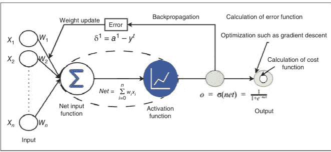

图 11.1 带反向传播的梯度下降。

##### 11.3.1.3 带反向传播的梯度下降

梯度下降是训练 CNN 模型的一种优化方法。它迭代修改网络的权重和偏差以减少损失函数，如图 11.1 所示。

- 前向传递：输入数据通过网络层传递，得到预测结果。
- 损失计算：损失函数将预测输出与基准真实标签进行比较。
- 反向传播：错误（损失）通过网络向后传播，计算每个权重和偏差的梯度（斜率）。
- 权重更新：使用梯度以最小化损失的方式调整权重和偏差。

#### 11.3.2 常见架构

##### 11.3.2.1 U-Net

U-Net 是专门为医学图像分割开发的完全卷积网络（FCN）。它使用带有跳跃连接的编码器-解码器架构。

##### 11.3.2.2 组件

- 编码器：通过重复的卷积和池化操作从输入图像中提取特征。
- 解码器：上采样提取的特征，并通过跳跃连接将其与编码器路径中的对应特征组合，以实现精确定位。
- 跳跃连接：直接连接对应的编码器和解码器层，以保留空间信息并帮助精确分割小结构。

##### 11.3.2.3 卷积神经网络（CNNs）

卷积神经网络（CNNs）是一种在处理图像数据方面表现尤为出色的深度神经网络设计。它们擅长捕捉图像中的空间特征和关系。CNNs 是一类广泛的架构，使用卷积层从图像中提取特征。它们可用于各种分割任务。图 11.2 展示了完整的图像处理流程。

关键组件如下（Gudhe 等人 2023）：

- 输入层：接收预处理后的图像数据，通常是表示图像宽度、高度和颜色通道（例如 RGB）的 3D 张量。
- 卷积层：应用在输入上滑动的滤波器（核），提取边缘、形状和纹理等局部特征。
- 池化层：对卷积层生成的特征图进行下采样，在保留关键信息的同时减小数据规模和处理开销。最大池化和平均池化是两种常见的池化操作。
- 激活层：这为网络引入非线性，使其能够学习复杂模式。流行的激活函数包括 ReLU 和 Sigmoid。
- 全连接层：将前几层的输出展平为向量，并执行传统神经网络操作以用于分类或回归任务。

##### 11.3.2.4 完全卷积网络（FCN）

完全卷积网络（FCNs）是一种所有层都依赖卷积函数的 CNN，从而实现端到端分割。端到端分割是图像的像素级选择集合。FCN 的参与组件如下：

- 编码器：类似于一般 CNN 编码器，提取特征。
- 上采样层：提高特征图分辨率以匹配输入图像大小。
- 输出层：为属于特定类别的每个像素生成概率图。

##### 11.3.2.5 SegNet

SegNet 是一种与 U-Net 相似的编码器-解码器架构，但使用池化索引进行上采样，而不是反卷积。表 11.1 包含 CNN 层的详细描述。SegNet 的组件如下：

- 编码器：类似于 U-Net 的编码器，提取特征。


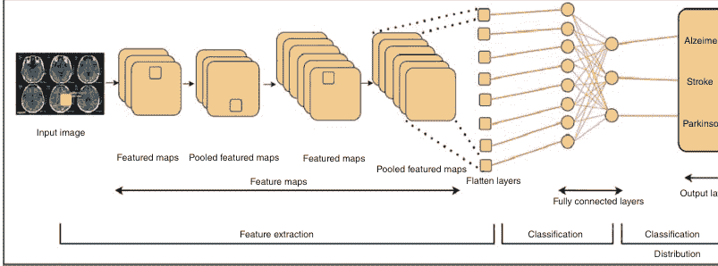

图 11.2 基本 CNN 架构。

表 11.1 CNN 层的详细描述。

| 层 | 描述 |
| :--- | :--- |
| 输入 | 接收预处理后的图像数据。 |
| 卷积 | 使用滤波器提取局部特征。 |
| 池化 | 减小特征图的维度。 |
| 激活 | 引入非线性。 |
| 全连接 | 执行最终分类或回归。 |

- 解码器：利用编码器路径中的池化索引进行上采样，与 U-Net 相比减少了参数数量。
- 输出层：生成分割图。

##### 11.3.2.6 DeepLabv3+

DeepLabv3+ 利用空洞卷积（也称为膨胀卷积）高效地捕获多尺度信息。DeepLabv3+ 的组件如下所示（Luo et al. 2021）：

- 空洞卷积：以特定的空洞率应用滤波器，在不显著增加参数数量的情况下，捕获更广范围的信息。
- 编码器-解码器：类似于 U-Net，但使用空洞卷积替代标准卷积。

#### 11.3.3 高级技术

本节探讨了有望进一步增强基于深度学习的医学图像分割能力的高级技术，如图 11.3 所示。

##### 11.3.3.1 用于数据增强的生成对抗网络（GANs）

数据稀缺是医学图像分割中的一个重大挑战。GANs 通过生成可增强现有数据集的合成医学图像，提供了一种潜在的解决方案。GANs 由两个相互竞争的神经网络组成，如下所示：

- 生成器：学习生成与真实数据分布高度一致的逼真合成图像。
- 判别器：试图区分真实图像和合成图像，从而促使生成器改进其创作。

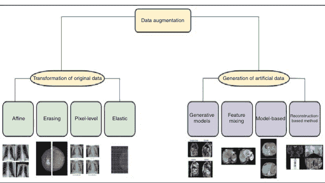

图 11.3 医学图像中的数据增强。

基于上述网络，医学图像分割的优势如下：

- **增强数据集**：生成额外的训练数据，解决数据稀缺问题并提高模型的泛化能力。
- **减少偏差**：允许生成具有指定特征的合成数据，以减少现实世界数据集中潜在的偏差。

##### 11.3.3.2 用于医学图像分割的 Transformer

Transformer 在自然语言处理中已被证明是成功的，目前正在研究其在医学图像分割中的潜在应用。Transformer 依赖自注意过程来检测数据中的长程依赖关系。步骤如图 11.3 所示。这对于需要理解遥远图像区域之间关系的应用（如医学图像分割）非常有用。将医学图像转换为分割结果的优势如下：

- Transformer 可以捕捉医学图像中的复杂关系，从而提高分割准确率。
- Transformer 架构在特定分割任务中可能比经典 CNN 更高效。

##### 11.3.3.3 用于提升性能的集成学习

集成学习结合多个深度学习模型，以提供更稳健、更准确的预测器。不同的模型独立训练，然后通过平均或投票等技术将其预测结果组合起来。表 11.2 详细总结了所使用的高级技术。该方法利用多个模型的能力，同时尽量减少任何单个模型缺陷的影响。集成学习的两个主要优势如下（Alemi Koohbanani et al. 2020）：

- **提高准确率**：结合不同的设计可以超越单个模型。
- **减少方差**：结合各种模型可以减少变异并带来更一致的结果。

表 11.2 高级技术摘要。

| 描述 | 技术 | 在医学图像分割中的优势 |
|---|---|---|
| 两个竞争的神经网络：生成器创建合成图像，判别器对其进行评估。 | 生成对抗网络（GANs） | 增强数据集，减少偏差 |
| 利用自注意机制进行长程依赖建模。 | Transformers | 潜在地捕捉图像中的复杂关系，并提高准确性和效率。 |
| 结合多个模型的预测。 | 集成学习 | 提高准确性并减少方差 |

### 11.4 医学图像分割中的深度学习应用

#### 11.4.1 诊断应用

深度学习已经改变了医学图像分割，在各种诊断应用中释放了巨大的潜力。本节讨论了深度学习如何支持医疗专业人员：

##### 11.4.1.1 改进的肿瘤分割与表征

早期和精确的肿瘤诊断对于有效的癌症治疗至关重要。深度学习模型在分割医学图像（如乳腺X线摄影和CT扫描）中的肿瘤方面非常有效。精确的分割使早期发现癌症成为可能，从而实现更有效的治疗。

- **肿瘤表征**：分析大小、形状和纹理有助于区分良性肿瘤和恶性肿瘤，并指导更多的治疗方案。
- **治疗规划**：通过正确识别肿瘤特定区域及其范围，分割有助于规划精确的放射治疗或手术操作。

##### 11.4.1.2 病变检测与分析

深度学习算法可以有效地识别和分析医学图像中的各种病变。示例如表 11.3 所示。

表 11.3 病变检测分析的详细描述、应用和优势。

| 应用 | 描述 | 优势 |
| :--- | :--- | :--- |
| 皮肤癌检测 | • 在皮肤镜图像中分割可疑病变。<br>• 有助于早期黑色素瘤检测。<br>• 模型可以分析不对称、边缘不规则、颜色变化和直径（ABCD规则）等特征，以识别潜在恶性病变。 | • 及时干预显著提高治疗成功率。 |
| 糖尿病视网膜病变分析 | • 在眼底照片中自动检测和表征糖尿病视网膜病变（DR）。<br>• 识别微血管异常，如微动脉瘤、出血和渗出物，这些都是DR的早期迹象。 | • 及时管理血糖水平。<br>• 应采取预防措施，有可能防止视力丧失。 |
| 乳腺癌检测 | • 正在研究模型用于乳腺X线摄影分析，以识别可疑肿块和微钙化。<br>• 从多个视角分析乳腺X线摄影图像，以提高病变检测准确性。 | • 通过深度学习改进乳腺癌检测，可以带来更精准的活检并可能实现更早的干预。 |
| 肺结节检测 | • 分析胸部X光和CT扫描以检测肺结节。<br>• 识别肺部密度的细微变化，这些变化可能表明存在结节，结节可能是癌性的。 | • 早期发现肺结节允许及时调查，并可能为肺癌提供根治性治疗。 |

##### 11.4.1.3 器官分割

精确的器官分割对于多种诊断技术至关重要。对大脑、肾脏和肝脏等器官进行精确分割，有助于简化复杂手术的术前规划。外科医生可以通过实时分割在手术期间获得视觉指导，从而提高准确性并最大限度地减少组织损伤。表 11.4 显示了器官分割在术前规划中的应用。

表 11.4 器官分割在术前规划中的应用。

| 器官 | 术前规划 |
|---|---|
| 肝脏 | 肝切除手术和移植的规划 |
| 肾脏 | 肾移植手术过程中的精确定位 |
| 大脑 | 协助脑肿瘤切除和动脉瘤夹闭的手术规划 |
| 心脏 | 使瓣膜置换手术的心脏结构评估成为可能 |
| 肺部 | 肺容积减少手术和肺叶切除的规划 |
| 脊柱 | 为脊柱融合手术的术前评估提供便利 |

##### 11.4.1.4 用于疾病进展监测的医学图像分析

深度学习模型可以通过分析一系列医学图像来跟踪各种疾病随时间的进展。这允许：

- *监测治疗反应*：通过观察病变或异常的大小和特征变化来评估治疗效果。
- *早期检测复发*：通过医学图像中的细微变化识别疾病复发的迹象，从而实现早期干预。

总体而言，医学图像分割的深度学习为诊断应用提供了多种好处。这些方法提供准确的肿瘤分割、病变检测、器官勾画和疾病监测，使医务人员能够更准确地识别患者、制定更好的治疗方案，并最终改善患者预后。

#### 11.4.2 治疗应用

- *图像引导干预*：为手术提供实时分割，例如机器人手术或放射治疗。
- *个体化医疗*：根据个体患者信息和分割结果，实现个性化治疗方案的制定。

### 11.5 挑战与未来展望

#### 11.5.1 挑战与局限性

医疗数据的复杂性以及对精确和稳健结果的需求，为医学图像分割带来了各种挑战。一个显著的


问题在于解剖结构和疾病的固有多样性，这要求模型在不同人群中表现良好。缺乏带注释的数据集，以及手动分割相关的巨大成本和努力，使得设计和训练成功模型变得困难。处理多模态图像，例如合并 CT 和 MRI 扫描的数据，非常具有挑战性。此外，医学图像中普遍存在的噪声、伪影和低对比度需要强大的分割方法。最后，深度学习模型在医疗领域中的可解释性仍然是一个问题。临床医生要求决策过程透明，以便广泛接受和信任这些技术。解决这些问题对于有效实施准确且具有临床实用性的医学图像分割技术至关重要 (Chanu 2020)。

##### A) 数据多样性

医学图像分割由于各种成像模态、分辨率和采集因素中的固有多样性而面临重大问题。来自不同来源的数据（例如 CT、MRI、超声和 X 光）的组合产生了独特的特性和成像伪影。这些模态以不同方式捕捉解剖结构，导致强度、对比度和空间分辨率的变化。此外，采集因素（如层厚、视野和成像方法）的差异增加了数据的复杂性，如图 11.4 所示。

- 模态特定特征：每种成像模态都有独特的优势和局限性，导致广泛的数据特性。例如，CT 扫描擅长描绘骨骼结构，而 MRI 更适合可视化软组织。调整分割模型以解决这些模态特定属性是一项艰巨的挑战。

- 分辨率差异：成像模态之间或同一模态内空间分辨率的变化会带来挑战。处理分辨率变化的数据需要使用强大的预处理技术、插值方法或分辨率不变模型。

- 采集参数变异性：造影剂、成像方法和患者定位的变化会影响分割模型的一致性。开发对这些参数变化具有抵抗力的算法对于泛化性至关重要。

##### 医学数据集

##### 多样化的成像模态

- 放射学
- 超声
- 磁共振
- 计算机断层扫描
- 血管造影
- PET
- 皮肤病学，皮肤
- 内镜
- 其他器官

##### 分辨率差异

- 像素
- 大小
- 层厚

##### 采集参数

- 对比度
- 协议

用于解决变异性的预处理和数据归一化技术

图 11.4 处理数据变异性的流程图。

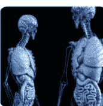

##### B) 解剖变异性

分割具有固有解剖变异性的结构的复杂性为医学图像分割带来了第二层挑战。器官形状、大小、位置以及患者特定因素的自然差异都会导致图 11.5 所示的解剖变异性。

##### 形状

- 轮廓和区域
- 拓扑
- 大小和位置
- 空间距离
- 形状分布

##### 外观

- 外观分布
- 纹理
- 其他

##### 运动

- 密集运动
- 滑动运动
- 弹性运动

##### 上下文

- 邻接信息
- 几何结构
- 图谱

图 11.5 解剖信息。

- 患者特定解剖：受年龄、性别和基础健康问题等因素影响，个体间的解剖差异需要分割模型能够容纳这种固有多样性。多样的患者解剖可能难以适应一刀切的技术。

- **结构变形**：由老化、疾病或手术引起的自然器官变形会使分割工作复杂化。开发能够承受结构修改的模型对于准确描绘至关重要。

- **个体间变异性**：由于个体间异质性，创建能够准确代表不同患者人群的分割模型可能具有挑战性。可能需要迁移学习或集成方法等技术来妥善处理这些变量。

在上述挑战下，深度学习模型（尤其是 CNN）彻底改变了医学图像分割，在各种临床场景中展示了变革性的结果。这些困难凸显了深度学习通过提高诊断准确性和实现个性化治疗策略来改变医疗实践的潜力，最终改善患者预后 (Pranathi et al. 2024)。

#### 11.5.2 未来趋势和进展

医学图像分割中深度学习的未来充满了令人兴奋的可能性。本节深入探讨了有望进一步彻底改变该领域的一些重要趋势和进展。

##### 11.5.2.1 自监督学习

数据匮乏一直是医学图像分割的重大挑战。自监督学习使用未标记数据进行模型训练，是解决这一困难的一种有前途的方法。自监督学习方法旨在从未标记输入中提取有意义的表示来训练模型。这些表示随后可用于下游任务（如医学图像分割），即使标记数据不足。医学图像分割的优势列于以下 (Osmani et al. 2024)：

- 降低对标记数据的依赖：允许利用大量未标记的医学图像，从而减少数据匮乏。

- 模型泛化：通过从未标记数据中学习表示来提高模型的泛化能力。

##### 11.5.2.2 可解释人工智能（XAI）技术

深度学习模型经常作为“黑箱”运行，使得难以理解其决策过程。可解释人工智能（XAI）方法通过提供模型如何做出预测的见解来解决这一问题。表 11.5 详细描述了优点和缺点。

| 技术 | 描述 | 优点 | 缺点 |
|---|---|---|---|
| 局部可解释模型无关解释（LIME） | 通过在预测周围局部学习一个可解释模型，解释任何黑盒模型的单个预测。 | - 与模型无关：适用于任何机器学习模型。<br>- 为单个预测生成解释。 | - 对于复杂模型可能计算成本高昂。<br>- 局部解释可能不太好地推广到其他数据点。 |
| SHAPley 加性解释（SHAP） | 通过在所有特征之间分配预测信用，解释每个特征如何对特定预测做出贡献。 | - 提供特征重要性的洞察。<br>- 提供不同的解释模式（摘要、依赖图）。 | - 对于大型数据集可能计算成本高昂。<br>- SHAP 值的解释可能需要领域知识。 |
| 特征重要性技术（置换重要性，特征消融） | 根据特征置换或移除时模型性能的下降对特征进行排序。 | - 实现和理解简单。<br>- 识别模型中最重要的特征。 | - 不解释特征如何交互。<br>- 对相关特征可能产生误导。 |
| 部分依赖图（PDP） | 通过对其他特征取平均，可视化单个特征对模型预测的边际效应。 | - 视觉上易于解释。<br>- 显示模型预测如何随单个特征变化。 | - 为许多特征生成可能很麻烦。<br>- 未考虑特征交互。 |
| 基于梯度的技术（Grad-CAM，积分梯度） | 突出显示对模型预测贡献最大的图像区域。 | - 为图像分类模型提供可视化解释。<br>- 帮助识别模型关注图像的哪些部分。 | - 仅限于图像数据。<br>- 解释可能具有主观性。 |


- 医学应用的重要性：XAI 对提升深度学习模型在医疗环境中的信任度和采用率至关重要。医疗从业者需要理解模型预测背后的原因，以便做出明智的决策。

- 可解释性方法：分析特征重要性，以确定哪些图像属性对模型预测影响最大。可视化分割过程中模型最关注哪些图像区域。

##### 11.5.2.3 联邦学习

联邦学习提供了一种机制，用于在分布式私有数据集上训练深度学习模型，同时保护患者隐私。模型训练在包含患者数据的单个设备或本地服务器上进行，如图 11.6 所示。与其交换原始数据，不如仅传输模型更新，以在保持患者隐私的同时实现全局改进。联邦学习中分割的一些主要优势如下（Ye 等人，2022）：

- 促进协作：允许在多个机构的数据上进行训练，而无需集中式数据存储，在保护隐私的同时鼓励协作。


图 11.6 医学图像分割联邦学习流程图。

- 提高泛化能力：探索来自不同医疗中心的异构数据集，可增强模型的泛化能力。

##### 11.5.2.4 与 AI 集成以构建综合医疗决策支持系统

图像分割的深度学习有潜力与其他 AI 组件结合，形成综合医疗决策支持系统。通过将深度学习模型与其他 AI 功能（例如，疾病分类和风险预测）相结合，医疗从业者可以获得更全面的视角，以便做出明智的临床决策（Drioua 等人，2023）。

潜在应用：将分割结果与患者数据相结合，能够实现个性化的治疗方法。AI 系统通过自动化操作并为医务人员提供实时图像分析，提高工作流效率。

医学图像分割中深度学习的未来似乎充满希望。通过解决数据稀缺、可解释性和隐私等障碍，以及促进协作和与其他 AI 技术集成，我们可以释放该领域的巨大潜力，彻底改变医疗保健并改善患者预后。

### 11.6 结论

综上所述，使用深度学习模型进行医学图像分割的未来在彻底改变医疗诊断和治疗规划方面具有巨大潜力。尽管受限数据可用性、类别不平衡、患者情况差异和计算资源限制等挑战存在，但未来的道路需要全面协作的努力。通过利用数据增强、域适应和多模态融合等先进技术，该领域旨在应对数据稀缺性挑战，提高模型泛化能力，并提高不同患者人群的分割精度。整合自监督学习和不确定性估计技术有助于减少对标注数据的依赖，同时提高模型可解释性。此外，针对实时、设备端处理优化模型，可确保关键医疗应用按时交付。机器学习研究人员与医疗从业者之间的协作，加上对伦理问题的持续培训，在深度学习模型在医学图像分割中的负责任开发和实施中起着至关重要的作用。这些协作努力的目标是开发强健、透明且广泛适用的模型，大幅提高医学图像解释的精度和效率，最终带来更好的患者预后。

## 参考文献

Alemi Koohbanani, N., Jahanifar, M., Zamani Tajadin, N., and Rajpoot, N. (2020). NuClick：一种用于显微图像交互式分割的深度学习框架。Medical Image Analysis 65: 101771.

Aljabri, M. and AlGhamdi, M. (2022). 关于使用深度学习进行医学图像分割的综述。Neurocomputing 506: 311–335.

Alsaeana, M. and Dutta, A.K. (2024). 基于深度学习技术从放射图像中检测心血管疾病。Expert Systems e13542.

Chanu, M.M. (2020). 使用深度学习方法从磁共振图像中进行脑肿瘤分割和分类综述。Journal of Advanced Research in Dynamical and Control Systems 12 (SP3): 87–94.

Drioua, W.R., Benamrane, N., and Sais, L. (2023). 使用深度学习进行乳腺癌病理图像分割。Sensors 23 (17): 7318.

Gudhe, N.R., Kosma, V.-M., Beharvan, H., and Mannermaa, A. (2023). 使用基于贝叶斯 dropout 的深度学习从病理图像中进行细胞核实例分割。BMC Medical Imaging 23 (1).

Lateef, F. and Ruichek, Y. (2019). 使用深度学习技术进行语义分割综述。Neurocomputing 338: 321–348.

Luo, X., Wang, G., Song, T. 等人 (2021). MIDeepSeg：使用深度学习对医学图像中不可见对象进行最小交互分割。Medical Image Analysis 72: 102102.

Nazir, S. and Kaleem, M. (2023). 带有深度神经网络的医学图像分析联邦学习。Diagnostics 13 (9): 1532.

Osmani, N., Rezayi, S., Esmaeeli, E., and Karimi, A. (2024). 使用深度学习算法将非医学图像迁移学习到医学图像。Frontiers in Health Informatics 13: 177.

Pranathi, V., Vignan, D., Akshay, B. 等人 (2024). 使用深度学习方法对城市区域遥感图像进行语义分割。International Journal of Research Publication and Reviews 5 (3): 3799–3804.

Said, Y., Alsheikhiy, A.A., Shawly, T., and Lahza, H. (2023). 基于深度学习架构的肺癌诊断医学图像分割。Diagnostics 13 (3): 546.

Salman, S.D. and Bahrani, A.A. (2010). 使用分水岭变换方法对灰度医学图像中的肿瘤组织进行分割。International Journal of Advancements in Computing Technology 2 (4): 123–127.

Ye, E.Z., Ye, E.H., Bouthillier, M., and Ye, R.Z. (2022). DeepImageTranslator V2：分析使用深度学习生成的语义分割图的多模态医学图像。HighTech and Innovation Journal 3 (3): 319–325.

## 索引

- a
- abdominal 3, 7, 61, 202, 205
- adversarial 17, 19, 188–212
- anatomy 3, 4, 19, 28, 128, 129, 246, 267, 280, 282
- angiography 2, 76, 281
- arteries 39, 40, 207
- atrous convolution 53
- attenuation 4
- augmentation 1, 15–22, 275
- autoencoders 18
- auxiliary classifier generative adversarial networks (ACGAN) 207

### b

- back propagation 123, 272
- benchmark 1, 13
- blood vessels 4, 39, 40, 133, 137, 197, 203
- boosting 160, 282

### c

- Canny 114, 117, 188
- cardiac 47, 48, 190
- cardiology 198, 269
- cardiovascular 66, 198
- cerebellum 89
- chemotherapy 6
- chest X-rays (CXR) 149, 156, 169

- CheXNet 253
- colorectal 14
- ConvNets 165, 199
- cornea 198
- coronary 9, 48
- corpus 90
- cortex 36, 47
- cortical 86, 89
- COVID 171, 248, 253
- Cycle-consistent adversarial network (CycleGAN) 18, 200, 206, 208

### d

- data augmentation 15, 275
- dataset
  - ADNI 18, 43, 55, 205
  - BRATS 18, 42, 80, 83, 126, 197, 205, 207
  - BUSI 13
  - CHASE 39, 127, 198
  - CVC-ClinicDB 14, 15
  - CVC-ColonDB 14, 15
  - DRIVE 39, 127, 142, 198
  - IRCAD 45
  - IRCADb 51
  - ISIC 13, 24
  - JSRT 46, 156, 200
  - Kvasir-SEG 14
  - LIDC 18, 46, 165–168, 172
- dataset (cont.)
  - LUNA16 172
  - Montgomery 169, 200
  - Shenzhen 169
  - STARE 40, 127, 142, 198
- deep convolutional generative adversarial networks (DCGANs) 193
- DeepLab 30, 160, 275
- deep learning models
  - attention-based models 36
  - convolutional neural network (CNN) 28–30, 119
  - ensemble-based models 37
  - fully convolutional neural network (FCN) 29
  - generative adversarial network (GAN) 17, 37, 185, 190–207, 275
  - GoogleNet or Inception 124
  - multi-scale-based models 34
  - pyramid-based models 34
  - recurrent neural networks (RNNs) 35, 75
  - UNet 32, 41–51, 157, 159, 162, 163, 168
- deep neural networks 82, 132, 265
- deep supervision 34
- denoising 24
- DenseNet 210
- DenseUNet 56, 82
- dermatologists 8
- diabetes 133, 269
- diabetic retinopathy 133, 138–145, 147, 148, 278
- diaphragm 150
- dice loss 271
- digital imaging 170
- Digital Imaging and Communications in Medicine (DICOM) 13, 170
- dilated 34, 44, 137, 160, 275
- diminishing 124, 211
- disease classification 285
- disease diagnosis 38, 196
- downsample 120, 158, 166
- downsampling 164, 233, 273
- dropout 157, 265
- drugs 28
- dual encoder 159
- dysmyelination 86, 104

### e

- ears 128
- edge detection 114, 117, 152
- electromagnetic 2, 246, 251
- electron microscopy 76
- embedding 19
- endoscopic 15, 261
- endoscopy 252, 262, 281
- ensemble 37, 163, 276
- entropy 271

### f

- false negative 20, 174
- false positive 20, 174, 236
- feedback 42
- flatten 274
- flipping 16, 255
- fluoroscopy 2
- foreground 117, 271
- framework 191
- fundus 18, 41, 197
- funduscopy 198
- fuzzy 30, 69, 72, 156, 227

### g

- gallbladder 7
- gallstones 3
- gamma rays 5, 246
- gastrointestinal 252
- Gaussian 17, 114, 156
- generative models 17
- gestational 91, 97, 103


- 腺体 209
- 青光眼 9, 134, 198
- 神经胶质瘤 55, 125
- 全局平均池化 124
- 梯度 259, 272
- 灰质 85
- 生长模型 93, 98
- 生长率 94

### h
- 出血 133, 140, 278
- 直方图 91
- 组织学的 188
- 病理组织学的 249, 250
- 病理学 75
- 均匀性 92, 113
- 低髓鞘化 86, 104, 107

### i
- 不平衡 22, 256
- Inception 124
- InfoGANs 192
- 强度 16, 69, 72
- 中间层 156
- 内脏器官 4
- 插值方法 280
- 可解释性 144, 147, 211, 258, 285
- 宫内的 97
- 隔离 139

### j
- Jaccard 系数 174

### k
- Kaggle 10, 139, 169, 171, 172, 179
- Keras 66
- 核 34, 119
- 肾结石 3
- 肾组织 209
- 膝 201, 240

### l
- LeakyReLU 45, 159, 193
- 左心房的 199
- 左心房 199, 209
- 左肾 205, 209
- 左肺 200
- 左心室 205
- 左心室的 199
- 白细胞的 228, 233, 234
- 白血病 229, 234, 241
- 白细胞 229, 242
- 韧带 5
- 线性 273
- 逻辑回归 94, 95, 101, 105
- 肺野 150, 164, 180
- 肺结节 165, 169, 172
- 肺分割 44, 150, 152, 154, 156, 164

### m
- 机器学习 71, 155
- 宏观 40
- 乳腺X光片/s 249, 277
- 乳腺摄影 249
- 手动分割 185, 280
- 医学影像/s
  - 肠镜检查 10, 14, 202
  - 计算机断层扫描 (CT) 1-7, 10-12, 42, 44-47, 49-51, 166-168, 188-190, 200-207
  - 皮肤镜检查 8, 10, 13
  - 磁共振成像 (MRI) 4, 151, 197, 201-209, 251
  - 显微图像 8, 249
  - 光学相干断层扫描 (OCT) 9, 73, 190
  - 正电子发射断层扫描 (PET) 5, 267, 281
  - 超声 (US) 6, 13, 270
  - X射线 1-5, 45, 149-151, 169, 199, 246
- 甲基化 240
- 微动脉瘤 139
- 微钙化 3, 278
- 微结节 249
- 显微镜 8, 9
- 显微镜检查 2, 241
- 显微图像 224
- 微血管的 40
- Minimax 192
- 错误分类 125
- 单核细胞 229, 234
- 单调的 21
- 形态学的 8, 117
- 形态学 12, 89, 109, 128
- 死亡率 13, 173
- 多模态的 11
- 多器官分割 223
- 多发性硬化症 40, 55
- 有髓鞘的 85, 90–94
- 髓鞘化 85–91

### n
- 邻近的 50, 150
- 新生儿的 85, 90, 94, 98
- 神经影像 53, 108, 110
- 非手术的 252
- 非均匀的 186
- 核的 82, 228, 230
- 核 4, 177, 286
- 核 250

### o
- 对象边界 143
- 对象检测 123, 130
- 遗漏 41
- 肿瘤科医生 268, 269
- 不透明度 248
- 眼科医生 142
- 器官
  - 腹部 12, 195, 196, 202, 209
  - 膀胱 204, 207, 209
  - 大脑 11, 40, 85, 125, 190
  - 乳房 13, 199, 200, 249
  - 胸部 149, 156, 169, 200
  - 眼睛 9, 39, 197
  - 心脏 47, 198
  - 肝脏 12, 42, 190, 205, 248, 278
  - 肺 11, 149–158, 160–182, 200
  - 颈部 4, 209, 210, 223
  - 鼻子 114
  - 胰腺 7, 190
  - 皮肤 10, 190, 253, 281
  - 脾脏 7, 51, 209
  - 肾脏 12, 46, 190, 205
- 器官分割 61, 203, 218
- 异常值 92
- 过度分割 39

### p
- 大流行 130, 261
- 参数化的 210
- 病理的 246, 256, 268
- 病理 128, 150, 260
- 模式分析 53, 261
- 模式识别 56, 131, 222
- 骨盆的 196, 202, 207
- 骨盆 195
- 性能指标
  - 准确率 22, 174, 198, 200
  - Dice 系数 69, 88, 157, 165, 174, 197
  - Dice 分数 (dsc) 18, 30, 42, 88, 127, 142, 159, 207
  - F1 分数 126, 167, 175
  - 豪斯多夫距离 175
  - IoU 21, 142, 157, 162, 174
  - 精确率 21, 174, 269
  - 召回率 21, 175
  - 特异性 175
- PET 扫描 5, 6
- 咽 209
- Pix GAN 206
- pix2pix 194, 207
- 肺炎 3, 149, 171, 179, 247
- 息肉 14, 34, 208, 220
- 预训练的 126, 135, 159
- 预训练 45, 159
- 预防 3, 173
- 前列腺 188, 202, 270
- 肺的 149, 165, 172, 200, 269
- 金字塔 30, 41, 143, 160, 161, 204

### q
- 二次的 94, 100, 105
- 定性的 86, 104, 107, 236–238, 257
- 定量的 39, 86–90, 98, 102–107, 135, 160, 238

### r
- 辐射 7, 49, 149, 173, 199, 279
- 放射性的 115, 252
- 射频 4
- 放射摄影 65, 149
- 放射学的 169, 170, 173
- 放射科医生 11, 31, 172, 208, 246
- 放射学 14, 73, 91, 211, 281
- 放射治疗 200
- 随机裁剪 17
- 随机森林 213
- 重建 40, 163, 203, 252
- 整流的 120, 231, 271
- 直肠 7, 204, 251
- 区域生长 114, 188
- 感兴趣区域 (ROI) 2, 36, 37, 41, 150, 190, 205–209, 257
- 配准 155, 198, 228, 234
- 正则化 29, 193, 258, 260
- 肾的 47
- 肾肿瘤 12
- 重采样 229, 234
- 残差块 33, 45, 157, 159
- 残差连接 33, 40, 50
- ResNet 29, 35, 43, 75, 137, 160, 163
- 呼吸的 252
- 视网膜 133, 137, 139, 140
- 视网膜血管 39, 126, 137, 189, 197
- 视网膜病变 126, 129, 140, 269, 278
- 肋骨 149, 180
- 右肾 205, 209
- 右肺 152, 200
- 右心室 203, 205
- 右心室的 199
- 鲁棒的 4, 12, 44, 70, 127, 157, 160, 260, 276, 279, 280, 285
- 旋转 16
- RSNA 171, 172

### s
- 显著性 144
- 采样的 229
- 样本/s 9, 35, 91, 94, 191, 231
- 采样 17, 18, 106, 240
- 分割模型 20, 41, 70, 254, 282
- 分割网络 166, 210, 211
- SegNet 30, 115, 253, 273
- 语义的 12, 36, 50, 150, 161, 192, 200, 228–230, 249
- 语义分割 12, 30, 48, 123, 150, 159, 161, 211, 228–230, 232
- 灵敏度 21, 40, 69, 73, 142, 159, 165, 175, 188, 236, 256
- 剪切 16
- 皮肤癌 8, 278
- 皮肤病变 8, 13
- 跳跃连接 32, 50, 233, 272
- 颅骨 91, 92, 98, 99
- 标本 8, 129, 249
- 谱 144, 149, 170, 190, 200, 261
- 脊柱的 5
- 脊柱 4, 196, 200, 279
- StackGAN 225
- 随机梯度下降 123
- 中风 25, 55
- StyleGAN 18
- 重叠的 2, 96, 150
- 有监督深度学习 147
- 合成图像 275, 277

### t
- 目标 30, 38, 76, 137, 202, 210
- 纹理 13, 113–117, 152, 186, 255, 278, 281
- 治疗的 65, 129, 269, 279
- 疗法 140
- 阈值 69, 92, 107, 153, 187
- 组织 2–10, 48, 70, 90–98, 149, 196, 203
- 换能器 6, 14
- 迁移学习 20, 38, 68, 135, 255, 282
- Transformers 167, 186, 276, 277
- 真阴性 20, 173, 236
- 真阳性 (TP) 20, 173, 235, 236
- 结核病 248, 262
- 肿瘤识别 114

### u
- 超声成像 151, 190
- 无监督学习 26, 194
- 上采样 31, 49, 75, 158, 229, 273, 275
- 泌尿的 252

### v
- 验证 90
- 验证 20, 52, 92, 127, 211, 253
- Vanilla GAN 190
- 梯度消失 33, 193, 258–260, 271
- 方差 22, 117, 185, 277, 280
- 变分自编码器 (VAEs) 18, 19, 36
- 血管的 7, 14, 39, 133, 139, 248
- 向量 38, 115, 192, 273
- 心室 89, 269
- 椎骨 39
- 脊椎的 76, 103
- VGG 29, 123, 126, 159
- 视觉变换器 167
- 体积分割 33, 50
- 体素 11, 41, 75, 91, 172, 188

### w
- 分水岭变换 117
- 小波 37, 164, 166, 168, 238
- 弱监督的 206
- 白细胞 242
- 白质 56, 85, 205

