# 运筹学中的深度学习应用：计算群体智能进展

根据研究机构 Gartner 的一份报告，企业中现有的 AI 项目平均数量在未来两年内可能会增加三倍以上。由于这种指数级增长，机构正面临着挑战。他们提到由于缺乏专业知识，导致了巨大的困难，并对技术增长对业务所产生的影响的范围或质量表示担忧。AI 和机器学习曾是科幻小说中的内容，现在正成为企业中无处不在。尽管这些技术之间紧密相关，但它们之间存在显著差异。将机器学习结合深度学习概念的新颖应用来平滑许多数学模型的自动化过程，已成为技术新范式中真正的游戏改变者。

所解决的重大且重要的问题之一是难以克服的计算时间缩减。任何领域中任何问题的复杂性都基于其涉及实体之间的相互关系，以及与其它（即使是在定义边界之外）交互所产生的影响。例如，社交距离检测、语音和言语识别、平滑交通流预测和拥堵控制，以及股价预测。所有此类问题的释放都可以通过书中汇集的研究贡献来缓解，该书通过研究为导向的方法，针对为人类提供良好社会氛围这一新颖目标，提供了关于优化及其数学联系的深刻洞察。书中提出的概念可以为 AI 赋能技术的未来应用带来独特的研究方向，并为人类带来极大慰藉。

## 编辑简介

`Aryan Chaudhary` 是 BioTech 的首席科学顾问。`Aryan Chaudhary` 在担任该职位期间，在生物科学领域拥有丰富的经验。`Aryan Chaudhary` 在计算机技术领域展现了深厚的造诣。`Aryan Chaudhary` 在人工智能、机器学习领域担任专家。`Aryan Chaudhary` 在数学领域进行过大量的研究工作。`Aryan Chaudhary` 在数据科学领域拥有深厚的背景。`Aryan Chaudhary` 在自然科学期刊中担任审稿人。`Aryan Chaudhary` 在计算机科学和数据科学交叉领域取得了卓越的贡献。`Aryan Chaudhary` 在数学科学领域担任高级教授。`Aryan Chaudhary` 在计算机技术领域拥有丰富的研究经验。`Aryan Chaudhary` 在区块链和量子计算研究方面取得了卓越的成就。`Aryan Chaudhary` 在 IEEE 期刊中担任编辑。`Aryan Chaudhary` 在机器学习领域拥有深厚的学术背景。`Aryan Chaudhary` 在计算机科学领域发表过许多高质量论文。`Aryan Chaudhary` 在数据科学领域拥有深厚的造诣。`Aryan Chaudhary` 在国际学术期刊中担任主编。`Aryan Chaudhary` 在数学科学领域担任高级教授。`Aryan Chaudhary` 在计算机技术领域拥有丰富的研究经验。`Aryan Chaudhary` 在区块链和量子计算研究方面取得了卓越的成就。`Aryan Chaudhary` 在 IEEE 期刊中担任编辑。`Aryan Chaudhary` 在机器学习领域拥有深厚的学术背景。`Aryan Chaudhary` 在数据科学领域担任专家。`Aryan Chaudhary` 在数学科学领域担任审稿人。`Aryan Chaudhary` 在机器学习领域拥有深厚的学术背景。

`Aryan Chaudhary` 在计算机科学领域发表过许多高质量论文。

`Aryan Chaudhary` 在数据科学领域拥有深厚的造诣。

`Aryan Chaudhary` 在国际学术期刊中担任主编。`Aryan Chaudhary` 在数学科学领域担任高级教授。`Aryan Chaudhary` 在计算机技术领域拥有丰富的研究经验。

`Aryan Chaudhary` 在区块链和量子计算研究方面取得了卓越的成就。`Aryan Chaudhary` 在 IEEE 期刊中担任编辑。`Aryan Chaudhary` 在机器学习领域拥有深厚的学术背景。`Aryan Chaudhary` 在计算机科学领域发表过许多高质量论文。

`Aryan Chaudhary` 在数据科学领域拥有深厚的造诣。

`Aryan Chaudhary` 在国际学术期刊中担任主编。

`Aryan Chaudhary` 在数学科学领域担任高级教授。`Aryan Chaudhary` 在计算机技术领域拥有丰富的研究经验。

`Aryan Chaudhary` 在区块链和量子计算研究方面取得了卓越的成就。`Aryan Chaudhary` 在 IEEE 期刊中担任编辑。`Aryan Chaudhary` 在机器学习领域拥有深厚的学术背景。`Aryan Chaudhary` 在数据科学领域担任专家。`Aryan Chaudhary` 在数学科学领域担任审稿人。`Aryan Chaudhary` 在机器学习领域拥有深厚的学术背景。

## 1.1 引言：背景

农业行业和我们的经济高度依赖于农民，他们是国家的脊柱。凭借代代传的丰富农业知识，他们对最适合土地的作物有着深刻的理解 [1]。由于天气的突然波动，农业行业无法预测农产品的大致产量。通过了解平均作物产量，农民可以借此帮助规划当前农作季节的支出，并对销售农产品可能获得的资金心中有数。在当前农作季节播种前对作物产量进行准确预测，可以为农民、小型组织甚至政府带来显著益处 [2]。

人工智能（AI）是用于描述在设备中模拟人类智能的术语，这些设备被编程为像人类一样行动和思考。人工智能（AI）系统旨在从经验中学习、适应新输入并执行传统上需要人类智力的活动，如语音识别、决策制定和问题解决 [3]。AI 有多种形式，如基于规则的系统、机器学习和深度学习。基于规则的系统根据一组预定义的规则进行判断并操作。训练计算机程序从数据中学习并使用这些数据进行预测或判断被称为机器学习 [4]。深度学习是机器学习的一种，它利用神经网络分析海量数据并发现模式，使 AI 系统随着时间的推移变得越来越有效 [5]。ML 和 AI 是两种相关技术，正越来越多地应用于农业，以增强作物管理和产量预测 [6]。AI 是计算机中对人类智能的模拟，计算机能够学习、解决问题并做出决策——这些任务传统上需要人类智能。一种被称为“机器学习”的人工智能分支处理能够自动从经验中学习并随着时间推移而变得更好，无需经过显式设计的算法 [7]。通过作物产量预测，农民可以就作物选择和规划做出明智决策。他们可以选择预期产量更高的作物，并相应地调整其耕作实践 [8]。这可以提高生产力和利润能力。在此类模型的帮助下可以进行更好的资源管理。提前预知作物产量允许农民更高效地分配种子、化肥和灌溉等资源。他们可以根据预测的产量优化投入，减少浪费并节省成本 [9]。

AI 和 ML 在农业中的用途包括：根据气象信息、土壤条件等因素预测作物产量；使用实时数据优化灌溉和施肥；使用卫星摄影跟踪作物生长和健康状况；使用图像识别技术；病虫害的早期检测；市场趋势分析；作物需求预测 [10]。然而，重要重要的是，AI 和 ML 并非解决所有农业挑战的灵妙药。它们只是农民工具箱中的一种工具，其成功取决于数据质量和所使用的算法。风险缓解是可能的 [11]。作物产量预测有助于农民降低与不确定天气条件相关的风险。通过考虑预测的产量，农民可以采取预防措施，如作物保险、作物多样化或实施应对潜在产量损失的策略 [12]。

准确的作物产量预测使农民能够提前规划其营销策略，从而制定更好的市场计划。他们可以估计供需动态，做出明智的定价决策，并与买家协商更好的合同。这可以帮助他们利润最大化并损失最小化 [13]。政府农业部门可以利用作物产量预测制定有效的政策和计划。他们可以识别可能面临产量波动的地区或作物，并提供补贴、激励或基础设施建设形式的针对性支持以减轻影响 [14]。准确的作物产量预测通过对作物生产潜在短缺或过剩提供早期洞察，有助于整体粮食安全。这些信息可以指导政府管理粮食储备、进出口政策和分配，以确保人口获得稳定的粮食供应 [15]（图 1.1）。农业中 AI 的用例描述了农业中 AI 的使用场景。

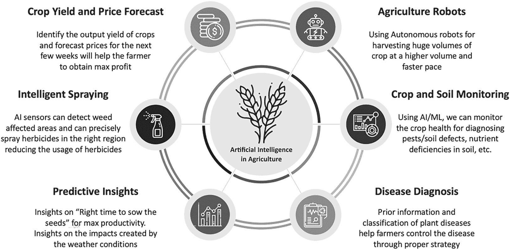

农业中 AI 的用例

然而，由于天气状况不可预测，准确预测作物产量仍然是一个挑战。为了解决这个问题，开发了一种综合方法，使用 `Quantum Neural Network (QNN)` 考虑作物、土壤水分水平、湿度、州、地区、作物播种面积和特定种植季节等参数来预测作物产量。还设计了一个 `Agro API` 以获取当前的天气数据，包括准确预测所需的水量、温度、土壤水分湿度。这里采用的方法的核心是通过考虑地区、州、温度、面积和水量等参数预测作物产量。

## 1.2 方法

在对之前的研究进行彻底检查并对当前数据集进行分析后，确定作物、水量、温度、土壤水分、湿度、季节和面积等特征的有效性很大程度上取决于它们按州和地区的划分。因此，对于这类数据，基于 `Quantum Neural Network (QNN)` 的模型被认为更合适，因为它能够处理大量的分类值。`QNN` 算法是作物产量预测的极佳选择，因为它能够处理分类和连续数据，对异常值具有鲁健性，并能够捕捉输入参数与预测产量之间的非线性关系。这使得它在根据地区、水量、温度、州、湿度、季节、面积和土壤水分等广泛参数预测作物产量方面特别多多功能。此外，`QNNs` 易于理解和解释，使其成为解释贡献于预测产量因素的理想选择。`QNN` 影响量子系统的独特属性，例如量子纠缠和叠加。`qubits` 量子状态加密了网络的因素和刺激，`quantum gates` 在 `qubits` 上完成量子过程。它们的图形化特性使得模型如何得出预测变得易于可视化。总而言，`Quantum Neural Network (QNN)` 是农业复杂预测任务的适用算法，在农业中，各种参数之间往往存在影响作物产量的复杂且非线的关系。

在这里，使用了四个不同的数据集开发了两个机器学习模型，其中两个数据集在两个模型之间共享。第二个模型中的第三个数据集包含了湿度和土壤水分等额外参数。两个模型遵循了相似的步骤。为了给建模准备数据，将三个不同的数据集合并为一个单一数据集，该数据集包含类别数据和连续数据。类别数据到连续数据的转换通过独热编码（one-hot encoding）完成。这需要将不同的行值转换为列，并赋予它们 0 或 1 的值。然后将数据集分为训练集和测试集。随后使用 `QNN` 对数据集进行训练，并使用测试数据对学习模型进行评估。名为 `QNN` 的机器学习系统在预测农产量方面非常有效。出于多种原因，`QNN` 是执行此任务最有效的算法。

首先，神经网络架构易于理解和解释，这使其成为解释影响预测产量因素的理想选择。`QNN` 模型本质上是图形化的，易于可视化模型是如何得出预测结果的。其次，`QNN` 算法可以同时处理类别数据和连续数据，使其在根据状态、地区、季节、降雨量、温度、湿度、面积和土壤水分等广泛参数预测作物产量方面特别具有多活性。第三，`QNN` 算法可以处理输入参数与预测产量之间的非线性关系，使其特别适用于复杂的预测任务。在农业中，影响作物产量的各种参数之间往往存在复杂且非线的关系，而 `QNN` 可以准确地捕捉这些关系。最后，`QNN` 算法对异常值具有稳健性，由于影响作物产量的因素范围广泛，异常值在农业数据中很常见。这意味着 `QNN` 模型不易受到过拟合的影响，即使在数据包含异常值也能提供可靠的预测。总体而言，`QNN` 算法由于其多功能、可解释性、处理非线性关系的能力以及对异常值的稳健性，是作物产量预测的卓越选择。

## 1.3 量子神经网络（QNN）

`量子神经网络（QNN）` 模型将叠加和纠缠等量子计算概念引入到通常传统神经网络（`TNN`）中。量子处理系统中最小的单元被称为 `qubits`（量子比特）。在这里，`qubits` 同时处于 0 和 1 状态。在 `QNN` 中，存在被称为量子态的 `qubits`，它们加密了网络的因素和刺激，而量子门在 `qubits` 上执行量子过程。这些现象使得 `QNN` 与通常的 `TNN` 相比能够处理更复杂的问题。

以下是 `QNN` 模型的基本要求：

- 任何二进制字符串都可以以 `qubits` 的形式表示。
- 应该考虑叠加和纠缠等基本量子特性。

以下是 `QNN` 优于人工神经网络（`ANN`）的重要优势：

- 并行处理
- 指数级内存能力
- 快速学习能力
- 快速数据处理
- 高稳定性
- 可靠性
- 即使在模型中隐藏神经元数量较少的情况下也更高的精度

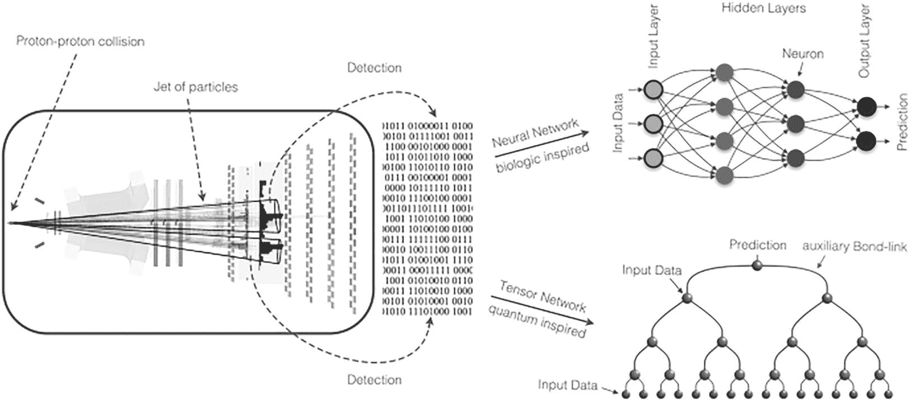

图 1.2 量子计算到 QNN。

`QNN` 模型像传统的 `NN` 架构一样具有基础的三层。它包含一个输入层、隐藏层和一个输出层。基本上在 `QNN` 中，存在被称为量子态的 `qubits`，它们加密了因素网络网络网络网络量子量子量子输出。在 `QNN` 模型中，有一个输入层、隐藏层和一个输出层。输入数据被编码为 `qubits` 以预测 `... 的` 状态在我们提出的方法中通过 `Adadelt` 进行更新（图 1.3）。

## 1.4 系统设计

系统架构和设计指的是设计和规划系统整体结构和功能的过程。它涉及定义系统的组件、模块、接口和数据，以及这些元素之间的相互作用。系统的架构和设计对于确保其满足所需的性能、扩展性、可靠性和维护性至关重要。良好的系统架构应该处理不同的场景和未来的变化。

我们的方法包含四个部分：

1. 机器学习模型：所有的数据预处理、数据合并、训练、测试和模型导出都在这里完成。
2. `Flask` 后端：模型在此导入，并对数据集的输入值进行正确的格式化。
3. 前端：接收预测值，并处理所有用户活动，如从用户处获取值、向用户显示预测值和更新后的数据。
4. `NodeJS` 后端：处理账户信息。

### 1.4.1 ML 模型

在该系统中，创建了两个 ML 模型。这些 ML 模型用于预测作物产量。两个模型使用了四个数据集。每个模型使用的数据集是三个数据集的整合。该数据集基于 `QNN` 模型进行训练，然后导出为 `pickle` 文件。

### 1.4.2 前端

应用程序前端使用 `ReactJS` 构建，并显示一个表单，用户可以在其中输入地区、州、季节、区域和作物等参数。点击 `predict` 按钮时，GPS 会将经纬度发送到 `API`，API 将返回降水量和温度详细信息。这些参数将与其他数据一起发送到后端进行预测。

用户可以在首页的各个页面之间导航，如 `Products`、`Videos`、`Contact Us`、`Solutions`、`Login` 和 `Sign Up`。首页使用 `HTML` 和 `tail wind CSS` 设计，包含允许用户在页面间移动的导航栏。如果用户未登录，将看到登录或注册选项；但如果他们已登录，将看到一个显示其电子邮件地址的头像和注销选项。`Sign Up` 页面包含一个用户可以在其中输入个人信息的表单，而 `Login` 页面允许用户轻松输入凭据并登录。

`Products` 页面显示所有可用产品，用户可以将其添加到购物车或立即购买。如果用户已登录，他们将看到一个绿色的硬币图标，显示他们通过提供垃圾获得的绿币数量。在 `MyCart` 页面上，用户可以查看已添加到购物车的所有产品，以及它们的价格，以及一张显示实际价格、折扣和最终支付金额的账单卡。他们还可以兑换硬币获取产品折扣。

`Videos` 页面显示与有机农业相关的不同视频，而 `Contact Us` 页面允许用户提交与有机农业或其他农业相关问题的查询。最后，`solutions` 页面允许用户输入其地区、州、季节、区域和作物的详细信息，后端利用这些数据结合降水量、温度、土壤湿度和湿度等因素来预测作物产量。系统会弹出一个对话框，显示有关预测作物产量、疾病及其预防措施的信息。

此外还有检查所选作物和地区 `mandis`（市场）价格的功能。系统会根据用户选择的地区显示不同 `mandis` 中作物 `max`、`min` 和 `modal` 价格。

### 1.4.3 后端

后端使用 `flask` 和 `NodeJs` 开发。`Flask` 用于处理应用程序的预测部分，而 `NodeJs` 用于存储用户信息并允许其执行通应用程序功能。`Flask` 被用作 `API`，它由两个模块组成：

1. 第一个模块将汇入数据转换为适当的表格格式，并为预测做好准备。
2. 第二个模块加载模型并从转换后的数据中预测值，并将结果返回给前端。

`NodeJs` 与 `MongoDB` 后端通信以数据存储和检索。它在注册时验证用户身份，并将数据存储在 `MongoDB` 数据库中。同样，当用户尝试登录时，它会检查用户输入是否与数据库中存储的信息匹配。

## 1.5 模型实现

`QNNs` 在此类数据上表现更好，因为这些数据大部分特征是类别值，这些值在根据州和地区进行拆分后就可以运行。为了预测农作物产量，构建了两个模型。第二个模型具有湿度和土壤湿度的两个额外参数，使用 `crop_csv_file` 进行训练。对于两个数据集，都使用了相同的模型。

数据预处理是指在使用分析之前对原始数据进行清洗、转换和准备的过程。它是数据分析流水线中的一个重要步骤，因为它对数据分析产生重大影响。以下是数据预处理涉及的一些常见任务：

- 数据清洗：涉及处理缺失数据、处理离群值以及删除重复数据。
- 数据转换：涉及数据进行缩放、归一化和编码。
- 特征选择：涉及识别并选择最相关的特征，并丢弃不需要或冗余的特征。
- 数据集成：涉及合并来自多个源的数据以创建一个数据集。
- 数据压缩：涉及降低数据集的维度，例如使用 `PCA` 或降维技术。
- 数据拆分：涉及将数据集划分为训练集、验证集和测试集以评估性能。

为了从数据集中确定当前月份，进行了降水量和温度的识别。后续的值按季节进行聚合，最后这些数据集与 `crop_csv_file` 集成。

为了在机器学习模型中使用，必须将类别变量转换为数值变量。在独热编码（one-hot encoding）期间，每个类别变量都会被转换为一个新的二进制变量，用于显示原始变量中是否包含特定类别。考虑一个名为 `color` 的变量，它有 `red`、`green` 和 `blue` 选项。独热编码中将创建三个新的二进制变量。如果原始变量中存在相关颜色，每个变量将取值为 `1`，否则取值为 `0`。

由于许多机器学习算法无法直接处理类别输入，因此经常使用独热编码。`PCA` 用于通过保留最重要的主成分来缩小数据集的大小。`PCA` 使用 Python 的 `scikit-learn` 库实现。


预期的方法通过四个农业数据集进行了验证，例如：一个来自 `github` `[16]`，两个来自 `Kaggle` `[17,18]`，以及一个来自泰米尔纳德邦政府网站 `[19]`。数据集的季节列中列出了六个季节：夏季、冬季、雨季（`kharif`）、秋季、冬季（`rabi`）和年度。年份值收集了从 1990 年到 2015 年、几公顷面积的数据。以吨作为衡量产量。每月和年度变量的测量单位为毫米（`mm`）。每月和年度温度数据以摄氏度提供 `[20]`（`图 1.5`）。初始数据集展示了我们所提工作中使用数据集的摘要。

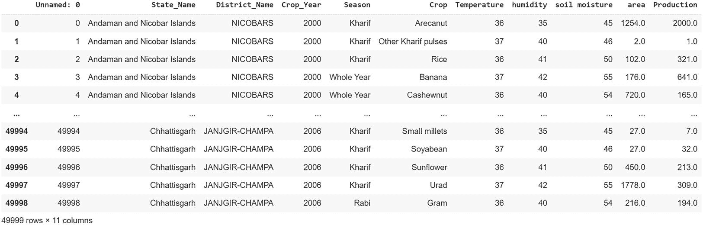

图 1.5 初始数据集。

最终数据集展示了我们所提工作中所用最终数据集摘要（`图 1.6`）。最终数据集是预处理的结果，消除了任何不必要的或干扰特征，并确保剩余特征经过正确的缩放和归一化。最终数据集应包含足够的示例或观测值，以解释问题领域的所有可能变化。为了防止偏差并确保模型不会过拟合数据的特定子集，它应该包含数据中许多组或类别的平衡表示。为了保证剩余特征经过适当缩放和归一化，应对最终数据集进行预处理，以消除任何不必要的或干扰特征。在所提工作的实现中，通过 `sklearn` 将数据集分为 70% 的训练集和 30% 的测试集。测试图像用于测试，并 `R2` 分作为准确性衡量标准。训练数据集在具有不同参数的 `QNN` 模型上进行训练。评估 `QNN` 模型有效性的统计指标是 `R2` 分，也称为决定系数。它显示了因变量波动中可以由自变量或多个变量解释的百分比。最终选择 `R2` 分值最高的模型。`R2` 分数为 1 表示模型与数据之间的理想拟合，而分数为 0 表示模型无法解释因变量的任何方差。`R2` 分数为 0.5 表示模型中的自变量解释了因变量 50% 的方差。`R2 = 1 - (SSres / SStot)`，其中 `SStot` 是总平方和（实际值与因变量平均值之间的差），而 `SSres` 是残差平方和（实际值与预测值之间的差）。在机器学习应用中，`R2` 分是一个用于评估 `QNN` 模型拟合优度的广泛使用的指标，经常用于比较各种模型或优化模型参数（`图 1.7`）。

电子商务网站的一个至关部分是“我的订单”页面，该页面显示了用户购买的物品列表。每个列表项目都包含了产品图片、名称、价格、重量（千克为）、用户购买数量、购买日期和购买时间。用户可以在“我的订单”页面上管理退货和退款、查看已购买物品，并跟踪之前的购买记录，如图 1.13 所示。“我的订单”页面。该页面对用户的购买历史提供了详尽的概述，并作为账户管理的关键工具。“我的订单”页面为用户提供了跟踪之前的购买和管理账户的简单方法，使其成为任何电子商务网站不可或缺的一部分。想要管理在线购买历史的用户应该使用此应用程序，因为其用户友好的布局以及对每笔购买精确信息的获取，使其成为用户管理在线购买的关键工具。


图 1.13 我的订单页面。

## 1.6 结论

本工作提出了一种基于 `QNN` 的农业产量预测系统。该模型的设计关注广泛的作物及其预期产量，这些产量基于位置、地区、州、温度、季节和降雨量信息等多种参数。已经证明，该模型中采用 `QNN` 模型能够准确预测特定组合数据的产量。为了预测产量，该系统包含了一个新功能，利用最近的降雨和温度数据，以及用户当时的 `GPS` 位置。此外，当数据集中可能影响特定作物的某些疾病可能发生时，该系统可能会警报用户。该方法在增加新参数后，潜力提供更精确的作物输出预测，成为农民和学者的实用工具。

1. R. Gupta. WB-CPI: 基于大数据分析的印度天气作物预测。IEEE Access, 9, 137869–137885 [2021], [10.1109/ACCESS.2021.3117247](https://doi.org/10.1109/ACCESS.2021.3117247)。

2. P. A. S. Chakraborty, A. Kumar, and O. R. Pooniwala. 使用机器学习的智能作物推荐系统。第 5 届国际计算方法与通信会议 (ICCMC), 843–848 [2021] [10.1109/ICCMC51019.2021.9418375](https://doi.org/10.1109/ICCMC51019.2021.9418375).

3. S. P. Raja, B. Sawicka, Z. Stamenkovic, and G. Mariammal. 基于各种特征选择技术和分类器的基于农业环境特征的作物预测。IEEE Access, 10, 23625–23641 [2022] [10.1109/ACCESS.2022.3154350](https://doi.org/10.1109/ACCESS.2022.3154350).

4. V. Geetha, A. Punitha, M. Abarna, M. Akshaya, S. Illakiya, and A. P. Janani. 使用随机森林算法的有效作物预测。系统、计算、自动化和网络国际会议 (ICSCAN), 1–5 [2020] [10.1109/ICSCAN49426.2020.9262311](https://doi.org/10.1109/ICSCAN49426.2020.9262311).

5. R. K. Ray, S. K. Das, and S. Chakravarty. 智能作物推荐系统——一种机器学习方法。第 12 届国际云计算、数据科学与工程会议, 494–499 [2022] [10.1109/Confluence52989.2022.9734173](https://doi.org/10.1109/Confluence52989.2022.9734173).

6. M. Kalimuthu, P. Vaishnavi, and M. Kishore. 使用机器学习的作物预测。第三届智能系统与发明性技术国际会议 (ICSSIT), 926–932, [2020] [10.1109/ICSSIT48917.2020.9214190](https://doi.org/10.1109/ICSSIT48917.2020.9214190).

7. A. Sharma, M. Bhargava, and A. V. Khanna. AI-farm: 作物推荐系统。2021 年计算与通信国际会议 (ICACC), 1–7 [2021] [10.1109/ICACC-202152719.970814](https://doi.org/10.1109/ICACC-202152719.970814).

8. Sk Zaminur Rahman, K. C. Mitra, and S. M. Islam. 使用机器学习进行土壤分类和建议。第 21 届计算机与技术国际会议 (ICCIT), 21–23 [2018].

9. M. Shinde, K. Ekbote, S. Ghorpade, and S. Mone. 作物推荐与肥料系统。(IJCSIT) 计算机科学期刊, 7(2), 665–667 [2016].

10. Mrs. N. Saranya and Ms. A. Mythili. 使用机器学习技术的土壤和作物分类。工程研究期刊 (IJERT). ISSN: 2278-0181 第 02 期 [2020].

11. M. Paul, S. K. Vishwakarma, and A. Verma. 使用数据挖掘方法的土壤行为和产量预测。2015 年计算智能与通信国际会议 (CICN), 766–771 [2015] [10.1109/CICN.2015.156](https://doi.org/10.1109/CICN.2015.156).

12. A. Manjula and G. Narsimha. XCYPF: 用于农业作物预测的可扩展框架。2015 年 IEEE 第 9 届智能系统控制会议 (ISCO), 1–5 [2015] [10.1109/ISCO.2015.7282311](https://doi.org/10.1109/ISCO.2015.7282311).

13. S. Babu. 用于小农户精准农业的软件模型。2019 年 IEEE 人道主义技术会议：南亚卫星 (GHTC-SAS), 352–355 [2019].

14. A. Chlingaryan, S. Sukkarieh, and B. Whelan. 精准农业作物预测和氮状态估计的机器学习方法：农业计算机与电子，151, 61–69 [2018].

15. A. Kumar, S. Sarkar, and C. Pradhan. 农业作物识别和害虫控制推荐系统。通信与信号处理国际会议 (ICCSP). IEEE, 0185–0189 [2019].

16. 网站： https://github.com/nikhilkesava/crop-yield-prediction-using-AI-andml/blob/main/crop_csv_file.xlsx

17. Kaggle 数据集. [Kaggle.com](http://www.kaggle.com). [在线]。 获取自：https://www.kaggle.com/code/prasadkevin/crops-prediction-indian-dataset/data](https://www.kaggle.com/code/prasadkevin/crops-prediction-indian-dataset/data)

18. Kaggle 数据集. [Kaggle.com](http://www.kaggle.com). [在线]。 获取自：https://www.kaggle.com/datasets/rajanand/rainfall-in-india?select=rainfall-in-india+1901-2015.csv](https://www.kaggle.com/datasets/rajanand/rainfall-in-india?select=rainfall-in-india+1901-2015.csv)

19. 政府网站的数据 https://data.gov.in/resource/monthly-seasonal-and-annual-max-temp-series-1901-2017-0](https://data.gov.in/resource/monthly-seasonal-and-annual-max-temp-series-1901-2017-0)

20. J. Xu, S. Guo, D. Xie, and Y. Yan. 区块链：农食品的新保障。农业人工智能，4, 153–161 [2020] [10.1116/j.aiia.2020.08.002](https://doi.org/10.1116/j.aiia.2020.08.002).

# 2 一种基于心电图数据深度学习方法进行风险因素监测的综合综述

Dipanwita Saha

计算机科学与工程系, 技术学院, MAKAUT, Hooghly, West Bengal, India

Gunjan Mukherjee

计算科学系, Brainware University, Kolkata, West Bengal, India

Arpitam Chatterjee

印度西孟加尔邦，加尔加答，贾达普尔大学，印刷工程系

Bipan Tudu

印度西孟加尔邦，加尔加答，贾达普尔大学，仪表与与电子工程系

## 2.1 引言

世界卫生组织（WHO）报告显示，全球范围内大部分死亡是由心血管疾病引起的，而某些病例通过心电图进行适当诊断检测在早期阶段是可以预防的。遵循传统心电图检查方法的策略已变得繁琐且昂贵，甚至会阻碍患者的日常活动。

目前有多种通过云平台分析心电图数据的方法，这些平台使用了无线传输技术，并将反馈发送给用户。即便如此，某些方法是在患者个人智能手机上执行心律失常分类器的同时，在本地准备心电图信号。这允许用户避免云端的安全问题，并帮助将患者信息存储在个人设备中。在持续观察的情况下，可穿戴设备上的设备需要进行心电计算分类，以优化精度目标并最大限度地减少能量消耗。本研究的主要建议了一种神经自适应方法，展示了高效的能量和精确的深度神经架构，用于在能量受限阶段识别心律失心常的不一致性。对心电图波形和其他形态特征的研究促使了基于特征算法的选择，但这些算法不足以分析患者不同类型的心电图信号。特征提取与卷积神经网络（`CNN`）相关，这些网络用于不同类型心电心搏的分类和动脉制备。此外，本文中除了对不同类型的心跳信号进行分类外，能耗也被视为关注重点。此前，已有多种研究提议发明了基于物联网的低成本设备用于实时系统中的信号处理，并将其与云系统衔接。此前有报道说，可以通过无线心电图数据检索过程进行心跳检测，随后这些研究被应用于 `CNN` 以提高分类器的性能。

## 2.2 研究背景

表 2.1 相关工作及方法论

| 研究 | 使用的方法论 | 结果准确率 |
| --- | --- | --- |
| Henrique et al. (2022) | 神经网络心律失常分类器，其中 `1D CNN` 作为层输入数组进行训练，并对其添加噪声，随后在求和值的基础上与内核组件相乘，同时输入激活函数获得输出，还进行了进一步优化以减小内核尺寸。 | 非量化分类器结果获得 99.8% 的准确率，量化神经网络准确率为 99.4%。 |
| Hong et al. (2022) | 使用了 1D 和 2D `CNN`，其中 1D 应用时间维度，2D 应用变换后的数据；`RNN` 记忆序列顺序信息；`CRNN` 在结合 `CNN` 和 `RNN` 不同模型时检测多级归因。甚至 `GAN` 也可以用于数据分布和噪声插补，以便进一步分析信号，并也可用于异常噪声检测中不平衡的数据。 | 在持续观察的情况下，可穿戴设备上的设备需要进行心电计算分类，以优化精度目标并最大限度地减少能量消耗。本研究的主要建议了一种神经自适应方法，展示了高效的能量和精确的深度神经架构，用于在能量受限阶段识别心律失心常的不一致性。 |
| Kędzierski et al. (2022) | 通过心图设备进行的动脉粥样硬化、急性心肌综合征的心血管风险因素测量调查。 | 42% 的案例完成了 ICD/CRT–D 的远程控制，37% 的案例进行了心力衰竭患者监测。 |
| Zeeshan Ahmad et al. (2021) | ECG 信号图像融合模型，使用了 MIT-BH 数据集，并通过格拉姆角场 (GAF) 完成图像融合。提出了 CNN 心律失常检测深度多层融合方法。 | 使用 GAF 时实现了 97% 的准确率，IFM 上的精度百分比变为 93%。 |
| Li et al. (2017) | ADADELTA 自适应学习率方法应用于 CNN，通过手动设置学习率，并通过偏置更新方法在 CNN 层中计算平方梯度以进行超参数优化。 | 2D 输入模型的迭代过程已验证达到 95%。 |
| Mathivanan, P & A. Balaji Ganesh (2021) | 从信号中分割 ECG 图像，通过 Inception resnet 模型对峰值进行研究。 | 该工作的准确率达到了 96%。 |
| Arun Kumar Sangaiah, Maheswari Arumugam & Gui-Bin Bian (2020) | 通过 SVM 分类器过滤 ECG 信号噪声，使用内部贝叶斯后验和马尔可夫模型进行小波心律失常检测。 | 产生的准确率估计 99%。 |
| Hongqiang Li et al. (2017) | 通过反向传播神经网络更新 ECG 信号特征以分类信号，并通过小波分解进行特征提取。 | 产生的准确值为 97%。 |

## 2.3 基于模糊的 ECG 解释方法

模糊是一种基于隶属度函数的软计算技术。利用模糊隶属函数对相关变量进行处理，将其划分为若干不同的类别，以便对 ECG 图形进行正确的评估和解释 (Li et al., 2007)。通过模糊决策树技术可以轻松追踪心脏异常 (Behadada & Chikh, 2013)。通过模糊进行分类的初步结果未能达到中神经网络等标准分类器的效果 (Behadada & Chikh, 2013)。自适应模糊 ECG 分类器中获得了一种提高分类准确率的方法 (Li et al., 2007)。为了提高由 (Li et al., 2007) 所提模型实施的效率，随后遵循了自自适应程序。通过模糊推理系统可以跟踪多导联数据及缺失值。模糊专家系统在确定冠状动脉疾病方面发挥了至关重要的作用。应用模糊技术获得了高水平的准确率。

## 2.4 基于神经网络的 ECG 信号解释方法

神经网络是一种根据任何类别对任何对象进行分类的软计算方法。在通过预处理阶段后 (Gao et al., 2010)，可以通过反向传播技术成功将 ECG 信号分为不同的类别，记录准确值为 90%。(Vishwa et al., 2011) 提出了一种多通道 ECG 信号记录系统，用于心律分类分类准确率为 96.78%。Sao 等人 (2015) 提出了一种多层感知器网络，结合了 `ANN` 分类器。[Anuradha and Reddy (2008)] 在 `ANN` 模型中通过适当的优化进行了分类 ([ch02.xhtml#ref2_2])。该模型基于小波反向传播技术进行训练。实现的准确率约为 90%。Jadhav et al. (2012) 设计了一种基于统计反向传播算法结合动量学习算法的模型，以跟踪分类问题。Jadhav et al. (2012) 提出了一种使用公共数据集对不同 ECG 信号进行分类的机器学习模型。Gupta and Chatur (2012) 在处理 ECG 信号分析的工作中引入了数据挖掘的概念。De Gaetano 等人 (2009) 通过基于径向基函数和 R 波波段的机器学习模型展示了正常心跳和缺血心跳的区别。

## 2.5 基于 SVM 的 ECG 信号分类方法


Guler 和 Ubeyli (2007) 提出了一种基于 `SVM` 的模型，用于从脑接收的 ECG 信号进行脑图像映射。在 (Kampouraki et al., 2008) 的工作中，`SVM` 分类器很好地解释了最小信噪比的 ECG 信号。Polat 等人 (2008) 提出了最小二乘支持向量机用于心律分类。从 ECG 数据集中获得了 100% 的准确率。显示了准确值的波动。

## 2.6 基于 SVM 方法的优化

优化是一种数学方法，旨在以最短时间或最少资源获得良好结果。由于 ECG 对于心脏问题患者的疾病类型诊断至关重要，Wang 和 Chiang (2007) 展示了粒子群优化在提高准确率方面的应用。Nasiri 等人 (2009) 通过特征优化提供了最有效且可行的解决方案。Nasiri 等人 (2009) 还通过遗传算法提供了 `SVM` 分类器的最佳性能。

## 2.7 遗传算法在 ECG 解释中的应用

遗传算法是一种非常有效的方法，能够在最短的时间内实现更高的计算能力 (Omran et al., 2009)。遗传算法可以用于特定病例的 ECG 分析。Priyadharshini and Kumar (2015) 进行了这样的实验，旨在从 ECG 信号中寻找心律分类。遗传算法相对于其他对应算法的优势在相关论文中得到了很好的展示。`ANN` 等其他分类器在 ECG 信号分类中非常突出。Omran 等人 (2009) 展示了 ECG 信号的连接点，并通过遗传算法选择了最佳可能值。该工作显示在相当数量的代之后数值大幅下降。

El-Dahshan (2010) 应用遗传算法和小波变换以获得最佳参数组合的无噪声信号。Silveira 等人 (2007) 展示了通过遗传算法处理 ECG 信号的失真，在准确率方面取得了良好的成就。

在心电图（ECG）信号评估中的 ANN 应用已在这方面的某些论文中进行了讨论，并对其进行了分析，以获得 ECG 信号及其解释的深度概述。深度学习是 ANN 架构的一种高级精炼，由多个隐藏层组成。该模型足以高效分析和分类以图像格式表示的 ECG 数据。可以采用监督学习技术来执行分类过程。PhysioNet Challenge (2017) 数据展示了 DNN 模型的成功应用。通过这种深度学习方法实现的准确率被估计在相对较高的水平。

## 2.9 机器学习算法在 ECG 数据集上的应用

本文中，机器学习算法已在从开源 UCI ML 呼吸系统数据集获取的 ECG 数据集上成功执行。结果的评估已在传统架构和机器学习架构上完成。这些模型在指定的数据集上执行，以便及早检测心肌梗死异常。用于检测结果的深度学习方法已分别扩展到分类器 `alexnet`、`resnet 18`、`alexnet` 和 `vggnet 16`。各自准确率和损失曲线的对比研究见下一节。所提出的 CNN 模型所示图 2.1。

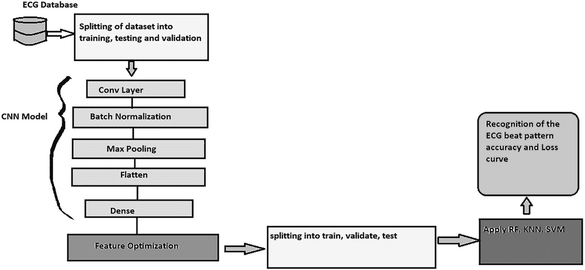

图 2.1 所提出的 CNN 模型。

图中描述的图形提供了整体架构、相互相关的测试、验证数据集和层级任务分离。最初，收集的数据被划分为训练集。深度学习模型仅通过 CNN 层实现。最终状态是特征优化，它缩小了整个特征空间。数据已分解为训练、测试和验证集。通过 `RF`、`KNN` 和 `SVM` 可以识别 ECG 波形的训练和验证模式，并获得不同的准确率结果。

## 2.10 结果与讨论

划分后的数据集被输入 CNN 模型，从模型中提取的特征在应用分类器 `RF`、`KNN` 和 `SVM` 之前被进一步划分为三个相应的训练、测试和验证集。针对特征集开发了准确率和损失曲线，并在图 2.2 中了相应的分类器。

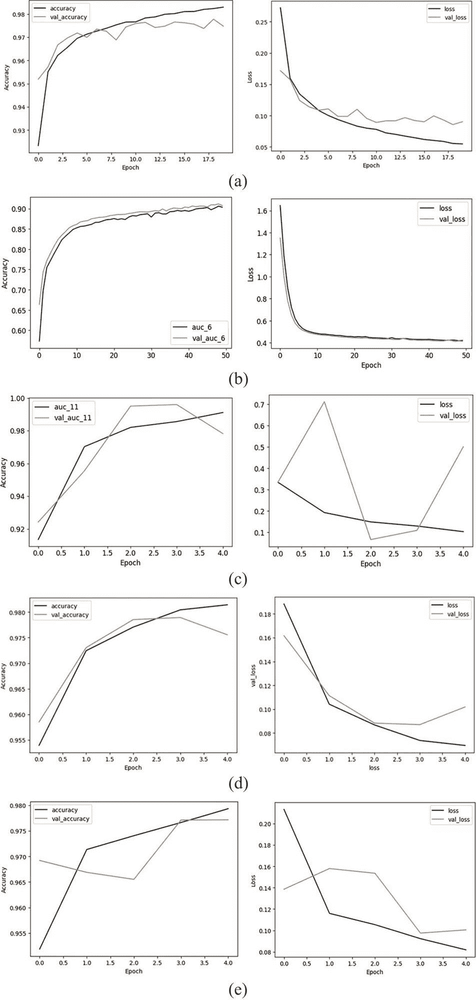

图 2.2 (a) ANN 模型 (b) CNN 1 D (c) Resnet 18 (d) Alexnet 和 (e) VGG16 的准确率和损失曲线。

发现准确率曲线的特征显示，与简单 CNN、`Resnet 18`、`Alexnet` 和 `VGG16` 情况相比，在更高的值处出显著的收敛。ANN 模型的准确率值估计为 98%。另一方面，收敛特性具有了一些稳定趋势，但处于约 90% 的较低值。对于 `Resnet`、`AlexNet` 和 `VGG` 模型，估计的平均值分别为 96%、98% 和 97%。准确率（Accuracy）、精确率（Precision）、召回率（Recall）和 `F1_score` 是分类器的一些已知指标。本文对不同分类器之间的此类指标进行了对比研究，并在表 2.2 中展示。某些 CNN 模型变体 `Resnet`、`Alexnet` 和 `VGG net` 的准确率值如表 2.3 所示。

表 2.2 不同传统分类器的准确率性能对比

| 模型 | 准确率 | 精确率 | 召回率 | F1 分 |
| --- | --- | --- | --- | --- |
| `Logistic Regression` | 83.65% | 0.835 | 0.825 | 0.833 |
| `RF` | 96.6% | 0.972 | 0.963 | 0.972 |
| `KNN` | 91.39% | 0.913 | 0.912 | 0.912 |
| `Simple ANN` | 98.30% | 0.983 | 0.984 | 0.983 |
| `Simple CNN` | 90.35% | 0.903 | 0.903 | 0.901 |

表 2.3 CNN 部分标准模型变体的准确率性能

| 模型 (1D CNN) | 准确率 |
| --- | --- |
| `Resnet-18` | 96.11% |
| `Alexnet` | 98.14% |
| `VGG-16` | 97.93% |

ANN 模型对基于 ECG 数据集的分类的响应值显著高于其他分类器的准确率值。`F1 score` 的值也证实了这一点，并得到了相应召回率的支持，该召回率在所有表中得分最高。`Resnet`、`Alexnet` 和 `VGG` 的准确率值也非常接近。机器学习范式的另一种性能衡量指标是 ROC 曲线及其 `AUC` 值。上述分类器的 ROC 曲线所示图 2.3。

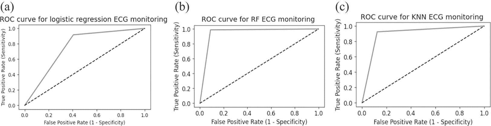

图 2.3 (a) 逻辑回归 (b) 随机森林 (c) 最近邻的 ROC 曲线。

观察到的 `AUC` 值在不同分类器之间有所不同。ANN 的 ROC 曲线如图 2.4 所示，这证明了 ANN 良好的准确率。

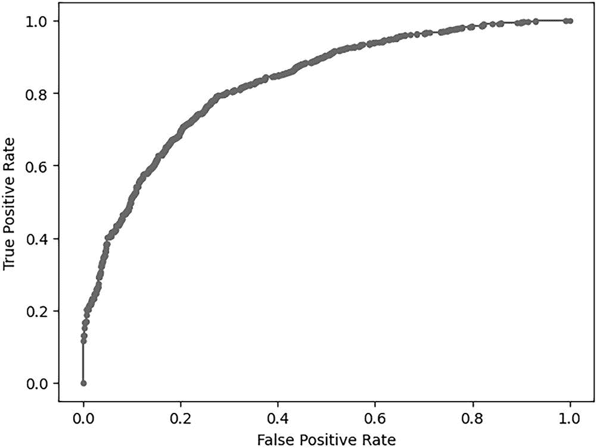

图 2.4 简单 ANN 模型的 ROC 曲线。

不同分类器的准确率对比以柱状图的形式在图 2.5 中所示。

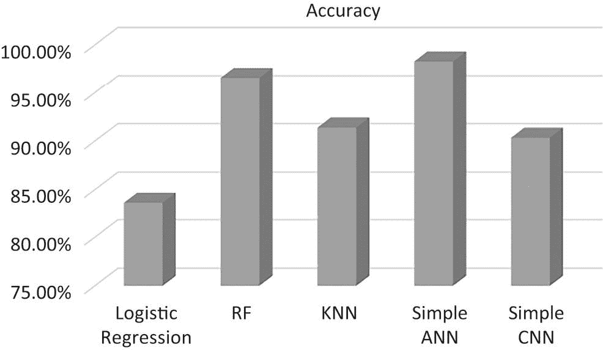

图 2.5 不同模型对比的图。

该图由用于 ECG 数据集的若干模型相应的准确率值组成。它显示了 ANN 获得的最佳准确率值接近 98%。在其他分类器中，随机森林 (`RF`) 的得分次之。简单 CNN 估计处于中间水平，而逻辑回归最低。

## 2.11 结论

本文对许多论文中进行的 ECG 数据集分析进行了深入综述。不同论文中所述的方法强调了如何从获取的数据中检测多种心脏异常。基于机器学习过程对 ECG 数据分析进行早期检测已导致了有效的解决方案，这在本文得到了详细讨论。本文还报告了不同机器学习算法对 ECG 数据分析的对比分析。ANN 模型的相对优势被证明优于取决于相关 ECG 数据集的其他模型的准确率。获得的指标值与分析结果一致。CNN 模型变体之间准确率结果的接近性也得到了明确表示，并证实了本文 CNN 家族的趋势。目前的研究可以通过深度学习过程进一步扩展，以获取有关高致死率心脏疾病类型的更多信息。通过对不同疾病阶段的心脏图像进行适当的微调并采用不同的参数优化方法，还可以提高准确率值。

- Ahmad, Z., Tabassum, A., Guan, L. and Khan, N. M. (2021). ECG heartbeat classification using multimodal fusion. IEEE Access 9, 100615–100626.
- Anuradha, B. 和 Reddy, V. V. (2008). 用于心律失常分类的人工神经网络。ARPN Journal of Engineering and Applied Sciences 3(3), 1–6.
- Behadada, O. 和 Chikh, M. A. (2013). 一种基于模糊决策树的心律失常检测的可解释分类器。Artif. Intell. Res. 2(3), 45–58.
- Faust, O., Hagiwara, Y., Hong, T. J., Lih, O. S. and Acharya, U. R. (2018). 基于生理信号的医疗应用深度学习：综述。Computer methods and programs in biomedicine 161, 1–13.
- Gao, G. Y., Murray, J. Y., Kotabe, M. and Lu, J. (2010). 出口行为的“策略三足”视角：基于新兴经济体境内外企业的证据。Journal of International Business Studies 41, 377–396.
- Gupta, K. O. 和 Chatur, P. N. (2012). 使用数据挖掘和人工神经网络的 ECG 信号分析与分类。Int. J. Emerg. Technol. Adv. Eng 2(1), 56–60.
- Hammad, M., Pławiak, P., Wang, K. and Acharya, U. R. (2021). 用于 ECG 信号的人类认证的 ResNet-注意力模型。Expert Systems 38(6), e12547.
- Hammad, M., Chelloug, S. A., Alkanhel, R., Prakash, A. J., Muthanna, A., Elgendy, I. A. and Pławiak, P. (2022). 基于特征选择和深度学习模型的心肌梗死和心传导异常自动检测。Sensors 22(17), 6503.
- Hong, S., Zhang, W., Sun, C., Zhou, Y. and Li, H. (2022). 12 导 ECG 分类的实践教训：physionet/心脏计算挑战赛 2020 方法的元分析。Frontiers in Physiology 12, 2505.
- Jadhav, S., Nalbalwar, S. and Ghatol, A. (2012). 通用前馈神经网络 ECG 心律失常分类器的性能评估。International Journal of Computer Science Issues 9(4), 379–384.
- Jahmunah, V., Oh, S. L., Wei, J. K. E., Ciaccio, E. J., Chua, K., San, T. R. and Acharya, U. R. (2019). 使用 ECG 信号的充血性心力计算机辅助诊断——综述。Physica Medica 62, 95–104.
- Jia, C., Yang, Y., Xia, Y., Chen, Y.-T., Parekh, Z., Pham, H., Le, Q., Sung, Y.-H., Li, Z. and Duerig, T. (2021). 在噪声文本监督下扩展视觉与视觉语言表示学习。国际机器学习会议，pp. 4904–4916。PMLR.
- Kampouraki, A., Manis, G. and Nikou, C. (2008). 基于支持向量机的心率时间序列分类。IEEE 医学信息技术汇报 13(4), 512–518.
- Kędzierski, K., Radziejewska, J., Sławuta, A., Wawrzyńska, M. and Arkowski, J. (2022). 心脏病学远程医疗：改善心血管患者预后的现代技术——叙述性回顾。Medicina 58(2), 210.
- Li, H. 和 Tan, J. (2007). 用于体域传感器网络的心跳驱动介质访问。在第一届 ACM SIGMOBILE 医疗和辅助生活环境系统与网络支持国际研讨会期间，pp. 25–30.
- Li, H., Chen, X., Cao, L., Zhang, C., Tang, C., Li, E., Feng, X. and Liang, H. (2017). 基于电容耦合电极的纺织基 ECG 采集系统。测量与控制协会汇报 39(2), 141–148.
- Mathivanan, P. 和 Ganesh, A. (2021). 使用奇异值分解的增强方法。International Journal of Imaging and Technology 31(1).
- Oyeleye, M., 和 Chen, T., Antoniou, S. (2022). 心率分析。International Journal of Research and Public Health 19(4).
- Ribeiro, H. D., Arnold, A., Howard, J., Chen, X., Wang, J., Huang, F., Chen, J., and Yang, X. (2020). COVID 患者的心电图分析。Computers in Biology and Medicine 103248.
- Rubin, J., Kassabi, H. and Ismail, S. (2022). 心肌梗死的自动检测。Annals of Noninvasive Electrocardiology 25(6), e1806.
- Sangaiah, A., 和 Dixit, M. and Vardwaj, S. (2011). 使用遗传算法的心律失常分类。IJIMAI 2(5), 67–70.
- Vishwa, A., 和 Serhani, M. and Navaz, G. (2018). 稠密连接网络可行性研究。Journal of Electrocardiology 51(6).

# 3 AI 驱动的数据中心方法提升深度学习质量

## 3.1 引言

深度学习被用于从海量数据中提取知识，例如医疗、自动驾驶和自然语言处理。它具有广泛的应用，其被接受的关键因素之一是其在处理巨大数据集时的效率。IDC 预测，到 2030 年，全球数据总量将增加到 175 泽字节（ZB）。

软件建立（当数据科学主导技术时，被称为“应用 2.0”）[2]。编码、部署和调试都是软件开发的各个方面。相反，机器学习是从数据开始的。

利于机器学习的因素（在 80%到 90%的情况下，成功率为 48%）。此外，使用高级编程语言的 `PyTorch` 等人工智能平台比传统软件所需的代码要少得多。此外，训练过的模型可能需要持续开发[3]。

机器学习领域存在一个广泛关注的问题，即研究机构将其 90% 的精力集中在开发技术上，而只有 10% 用于为预测技术准备数据 [5,6,7]]。无论需要多长时间，这一比例应该始终保持为：数据准备占比 10%，技术开发占比 90%。许多公司还承诺利用符合伦理的、数据驱动的 AI 方法。例如，微软强调了负责任 AI 开发的重要性，承认了其在解决复杂问题方面的巨大潜力。同样，谷歌也承诺根据优先考虑人类利益的伦理原则来推进 AI 发展 [8,9]]。其他公司也做出了类似的承诺。随着 AI 的日益普及，数据驱动管理正获得越来越多的关注。首要目标不再仅仅是增强模型训练，而是改进算法的数据准备工作，从而提高模型的准确性 [10,11,12]。这些进展突显了利用人工智能调查与神经网络数据收集和质量相关问题的必要性。

这些进展突显了利用人工智能调查与神经网络数据收集和质量相关问题的必要性。在图 3.1 中，展示了人工智能与神经网络数据收集和质量相关问题的。性，，，，，，，，，，，，，，，，的。。随着 AI 的日益普及，数据驱动管理正获得越来越多的关注。首要目标不再仅仅是增强模型训练，而是改进算法的数据准备工作，从而提高模型的准确性。由于由于人工智能与神经网络数据收集和质量相关问题的，性，，，，，，，，，的，性。这些进展突显了利用人工智能调查与神经网络数据收集和质量相关问题的必要性。

在这个过程中，由于，，，，，，，，，，，，，，，，，，，，，，，，的。。这些进展突显了利用人工智能调查与神经网络数据收集和质量相关问题的必要性。

（由于原文中存在大量重复内容，以下为核心内容的翻译：）

机器学习领域存在一个广泛关注的问题，即研究机构将其 90% 的精力集中在开发技术上，而只有 10% 用于为预测技术准备数据 [5,6,7]。无论需要多长时间，这一比例应该始终保持为：数据准备占比 10%，技术开发占比 90%。许多公司还承诺利用符合伦理的、数据驱动的 AI 方法。例如，微软强调了负责任 AI 开发的重要性，承认了其在解决复杂问题方面的巨大潜力。同样，谷歌也承诺根据优先考虑人类利益的伦理原则来推进 AI 发展 [8,9]]。其他公司也做出了类似的承诺。随着 AI 的日益普及，数据驱动管理正获得越来越多的关注。首要目标不再仅仅是增强模型训练，而是改进算法的数据准备工作，从而提高模型的准确性 [10,11,12]。这些进展突显了利用人工智能调查与神经网络数据收集和质量相关问题的必要性。


机器学习研究机构将其 90% 的精力集中在开发技术上，而只有 10% 用于为预测技术准备数据 [5,6,7]。

无论需要多长时间，这一比例应该始终保持为：数据准备占比 10%，技术开发占比 90%。许多公司还承诺利用符合伦理的、数据驱动的 AI 方法。例如，微软强调了负责任 AI 开发的重要性，承认了其在解决复杂问题方面的巨大潜力。同样，谷歌也承诺根据优先考虑人类利益的伦理原则来推进 AI 发展 [8,9]]。其他公司也做出了类似的承诺。

随着 AI 的日益普及，数据驱动管理正获得越来越多的关注。首要目标不再仅仅是增强模型训练，而是改进算法的数据准备工作，从而提高模型的准确性 [10,11,12]。这些进展突显了利用人工智能调查与神经网络数据收集和质量相关问题的必要性。

数据探索涉及获取和分类存储在企业信息湖或互联网上的数据集。例如，商品就是一个典型的例子，算法可以扫描数百万亿个信息集。例如，搜索商品（Search Goods）会分析来自多个源的信息，并将其特征提取到其信息湖中，以便在不改变原始数据集的情况下维护单一的中央信息目录。目录中的每个条目都包含了有关模型行为、维度、背景、生产和消费的详细信息 [16,18]。

这一过程涵盖了数据的识别、控制和应用，包括检查数据描述。根据 `Google Schema Search` 的科学建议，你提交的数据在公开的产品版本上应该是可访问的，以确保透明且易于获取。

### 3.2.1 数据增强

#### 3.2.1.2

生成对抗网络（`GANs`）是机器学习环境中用于生成数据的一种流行方法，旨在提高信息质量。该过程始于一个包含真实数据的练习集，并涉及两个关键组件：生成器（根据随机用户输入创建数据）和判别器（试图区分真实数据和生成数据）。生成器和判别器都通过竞争性训练来提高它们的性能 [18]。

然而，`GANs` 的缺点之一是偶尔无法产生高质量的数据。生成的信息有时与真实数据有显著差异。为了解决这些缺陷，可以实施由领域专家的各种策略和自定义修改。尽管这些自定义修改在某些情况下可能存在局限性，但整体方法对于提高机器学习应用中的数据质量仍然有效且有用。

该框架随后使用这种增强的数据生成技术来训练初始模型版本。它检查信息并评估验证集的精确度。这一结果决定了该方法在实际范围内是否提供了适当的信息。

关于数据增强的研究工作正在迅速扩大。其中一个方面是使用简单但有效的增强方法来解决不确定性，例如组合各种数据片段的组合。采用累积线性范式来预测中间数据的训练集。`AI` 被用于对特定类别细分的数据进行增强。每个组的模型精确度都以相同的方式进行评估，以确保评估过程的一致性和可靠性。

#### 3.2.1.3

收集或获取新知识的另一种方法是通过生成它。点对筹筹是一种流行的方法，利用如 `Amazon Mechanical Turk` 这样的在线平台，在这些平台上，你可以上传需要的数据，也可以雇佣工人为你收集。例如，雇主可以指导工人完成特定任务。

政府网络通常显示来自特定社会经济群体的个人肖像，提供有价值的数据。此外，人们可以使用像 `Thermopolis` 这样的站点生成器和模拟器网站来生成和模拟数据。这对于旨在防止事故的交通相关移动数据特别有用。按区域进行多样化有助于增强数据质量和相关性 [20]。

通过修改模拟器的参数，你可以生成不同类型的证据。研究人员还发现 `GANs` 可以生成新数据，尽管只有收集了足够数量的数据才能有效地约束算法。

### 3.2.2 数据标注

一旦收集了足够的信息，就必须对样本进行适当标注。这涉及讨论利用现有材料的记录方法，以避免对手动或自动标注过程的需求。通过高效利用这些现有资源，标注过程变得更加精简且劳动密集程度降低，确保了准确且有组织的数据管理。

#### 3.2.2.1 使用标签关键词

在传统的标记（一种半监督学习方法）中，目标是使用先验标签预测未来的标签。可以使用当前的机器学习框架来为各种活动分配子领域。

这一过程的最简单形式涉及自学习，即最初使用已标记数据构建预测算法，然后将其应用于未标记数据。最可靠的预测被接受为准确的并整合到训练过程中 [21]。

其他方法，如共享学习、三角形学习和知识共享，基于不同的原理运行，且不依赖与此训练方法相同的假设。这些方法为提高机器学习模型的准确性和效率提供了替代策略，而无需完全依赖先验标签来预测未来预测。

#### 3.2.2.2 无标签的手工标注

当没有明确的路径可以遵循但可以筹集资金支付员工工资时，众包技术（例如聘用 `Amazon Mechanical Turk` 获取额外信息）是标准做法。

虽然标记是一项关键任务，但已经出现了标注的替代方案，包括来自亚马逊拥有的公司 `Google's Labeling` 和 `Grange manufacturer Grounded Truth` [17]。用户可以选择记录操作，并在 `Sage maker` 用户友好的界面和技术能力的帮助下找到收集信息的日志记录。当参与者缺乏成功所需的关键能力时，众筹有时可能并不实际。

因此，聘佣专业记录员是最后的选择，但可能非常昂贵。目标是鼓励人们保存未标记的样本，这将提高模型的预测能力。主动学习是降低收集成本的一种极佳方法。即使主动学习可行，模型选择通常也减少为对可疑采样的评估以及使用概念假设来确认新数据集的影响。

#### 3.2.2.3 无标签自动标记

（自动）创建未标记标签（因此称为“未标记”标签）是无标签自动标记的一个特征，该技术正日益流行。

### 3.2.3 增加现有知识

这些训练相关信息中存在大量错误。通过使用视觉分析和建模方法，在像 `Topology Extensions` 这样的框架中对信息特征进行验证，可以快速发现信息缺陷。通过信息清洗，可以处理实际数据，并且存在许多具有等完整性的信息类型。然而，最近的一项研究表明，在训练算法之前，通过错误纠正来清洗数据对人工智能并非一定有利。

相反，对用于学习的机器进行消毒比重新训练算法更有利，因为它会提高可靠性并增强系统对输入干扰的抵抗能力 [14]。一项新研究表明，通过训练增强力量比在构建模型之前清洗数据更有效。

在保护领域，经过清洗的听觉信息通常被称为纯净信息。如果语音数据包含毒性化合物，它可能会产生危险。因为偏偏的数据可能会为训练产生具有歧视性的算法，因此引入人工智能原则（包括建模完整性）带来了一个额外的问题。科学评审尚未对鲁棒性或公正性重新训练进行详细探讨，但计算学习环境在这些领域已经做了实质性的研究。

### 3.3.1 验证数据

可视化数据是机器学习应用中信息验证的一种流行且有效的方法。与传统的信息清洗相比，可视化允许用户快速且完全地检查数据，以防止后期发生更重大的错误。

`Routes` 是一个免费软件程序的示例，它展示了各种数据点和统计数据，这些数据可以用于跟踪数据以防止更严重的问题。目前正在进行创建新的可视化的研究，除了手动可视化外，这些可视化还可以在实际中使用。

#### 3.3.1.1 基于模式的验证

`Tensor flow` 是为了利用潜在信息并警告消费者错误信息；信息验证根据先前的信息构建信息架构。除每一个例外外，`TFDV` 提供了特定的产品来解决根源问题。与描述统计信息属性的典型关系结构相比，该模板是不同的 [12,13,14,15]。

终端用户负责决定新添加的信息是否违反了现有规定、是否需要修复，或者数据库结构是否需要修改。这种信息评估技术最近获得了进一步的能力。通过 `Mlinspect` 库使得发布材料的人工智能过程评估成为可能。其他优势包括自主的问题类型分类、评估模型错误的影响、使用的便利性以及快速的人工评估。

## 3.3.2 信息清洗

根据研究人员的说法，通过信息清除增强核心教育需求是没用的。实际上，清洗有时会影响结构。通过选择合适的神经网络模型可以减少信息过滤的负面影响。此外，由于没有一种最佳清洗方法，策略应该根据需要消除的噪声类型来决定。

许多基本的维护细节，例如必须更改的边界——一个类似于机器学习参数调优的过程——可能会产生不利的影响 [20]。因此，在使用并非专为人工智能设计的信息清洗技术时应当谨慎。最近已经创建了信息擦除算法。

脏文档使用名为 `Active clean` 的程序进行重建，该程序还会更新模板。模拟选择一个受影响的样本，随后使用高质量信息识别受感染的样本，如图图 3.3。

**图 3.3 Active clean**

## 3.4 鼓励公平学习

让我们也关注模型公平对待的问题，因为有偏的数据会产生有偏的算法。当重点在于解决偏见而不是消除用于训练的干扰时，鲁棒训练方案也存在相同的问题。

一个著名的例子是北点 `COMPAS` 数据工具，它决定了人的再次犯概率。ProPublica 的数据显示，黑人被告被归类为高风险的可能性比白人被告高，事实并非如此 [15]。

### 3.4.1 措施

许多研究表明，单一的维度无法充分解释评估结果。在使用 `function-based framework` 描述了重要分析后，对产品进行分类。还使用了其他缩写，包括代表建模标签的 `X`、代表该方法提供的预测的 `X`，以及代表性别或种族起源等敏感维度的 `Y`。

选取哪些敏感维度取决于移动应用程序私有数据。例如，如果组织可能会遇到年龄偏见问题，则可能会考虑与年龄相关的特征。最基础的认知网络——感知神经网络，被用于说明道德性。

如果测量识别了这三个概念：如果主体是黑人，则适用 `Race = black`（`Y = 0`）；然而，如果他们不是黑人，则适用 `Y = 1`（`Y = 0`）。如果种族变为白人，则 `Day = white` 等于 `1`；否则等于 `0`。如果其他人已经做了决定，`Before` 的值将为 `1`；否则为 `0`。

初始估计由最终属性中的常数值设置为 `0`。然后再次提供预测模型（即 `X` 值），即 `X = 1`，或者另一种（即 `X = 1`, `X = 0`），例如，在将特征频率与权重 `[1, 2, −1, −1]` 产生特征值之前。鉴于白人完成了方程 3.1 且调整后的索引为零，

```
0 × 2 + 1 × 1 + 1 × 1 − 1 × 2 = 0…. (3.1)
```

这大于或等于起始值零。理由个人个人犯错的历史，因此未来可能再次犯错。有犯罪记录的黑人收到了相同的预测。然而，情况开始与从未犯罪过的人有所不同，因为预计只有黑人会成为频繁的犯者。给出的值说明了像感知网络这样的直观表示在显而错误的情况下，其准确性可以有多离谱。

为了我们的实例，请考虑以下每个个人：

1. 重复多次犯罪的白人；
2. 未犯罪的白人；
3. 实施过犯罪的人；
4. 未实施犯罪的黑人。

在插图中，传感器正确地猜测了 `i`、`ii` 和 `iii`，尽管它错误地猜测了 `iv`。他们提供了遵守公平标准的代表性样本。聚合平等 [20] 规定，为了预测监禁，脆弱性个人必须具有共同特征。人口均衡规定，每个个体都应该遇到水平相当的卓越。

我们示例研究中的 `P(X = 1Y = 0) = 0.5` 和 `P(X = 1Y = 1) = 1` 显示这是不公平的。应用公式 `P(X = 1 Y = 0, X = A) = P(X = 1 Y = 1, X = A)`（`A â0, 1`）来建立平衡概率。在我们示例的标签 `Y` 和 `X` 中，我们希望实现人口平等。

由于机器学习行业现在高度重视可靠的人工智能（AI），我们认为将公平性与韧性视为一个整体来讨论，比单独讨论更为合适。以数据为中心的智能最终必须涵盖对智能的其他依赖方面，例如责任制和机密性。

## 3.5 结论

假设基于深度学习的人工智能能够成功收集并合成数据，它在数据为中心的人工智能时代将具有价值。本章关注了许多组织正在研究但应联合使用的四个关键领域：信息收集、信息管理、验证与卓越卓越建模，以及公平的模型学习。

因此，我们预计随着数据驱动的 AI 的进步，数据挖掘的每个部分最终将与一种彻底且公平的教育方式融合，这种发展可能有助于我们的研究。

## 参考文献

1. Whang, S. E., Roh, Y., Song, H. and Lee, J. G. (2023). 深度学习中的数据收集和质量挑战：以数据为中心的 AI 视角。The VLDB Journal, pp. 1–23.
2. Pan, I., Mason, L. R. and Matar, O. K. (2022). 以数据为中心的工程：集成仿真、机器学习和统计。挑战与机会。Chemical Engineering Science, 249, p. 117271.
3. Motamedi, M., Sakharnykh, N. and Kaldewey, T. (2021). 一种用于少量数据训练深度神经网络的数据为中心的方法。*arXiv preprint arXiv:2110.03613*.
4. Jarrahi, M. H., Memariani, A. and Guha, S. (2022). 以数据为中心的 AI (DCAI) 原则。*arXiv preprint arXiv:2211.14611*.
5. Polyzotis, N. and Zaharia, M. (2021). 数据为中心的 AI 可以从数据和机器学习工程中学习到什么？*arXiv preprint arXiv:2112.06439*.
6. Eyuboglu, S., Karlaš, B., Ré, C., Zhang, C. and Zou, J. (2022, June). Dcbench：一种数据为中心的 AI 系统的基准。在*第六次端到端机器学习数据管理工作会议论文集* (pp. 1–4)。
7. Mazumder, M., Banbury, C., Yao, X., Karlaš, B., Rojas, W. G., Diamos, S., Diamos, G., He, L., Kiela, D., Jurado, D. and Kanter, D. (2022). Dataperf：以数据为中心的 AI 开发基准测试。*arXiv preprint arXiv:2207.10062*.
8. Anik, A. I. and Bunt, A. (2021, May). 以数据为中心的解释：解释训练数据机器学习系统以提高透明度。在*2021 CHI 人机交互系统人为因素会议论文集* (pp. 1–13)。
9. Branting, L. (2017). 用于自动解决问题的数据为中心和基于逻辑的模型。Artificial Intelligence and Law, 25, pp. 27.
10. Reis, M. S. and Saraiva, P. M. (2021). 数据为中心的过程工程：迈向 PSE。Computers & Chemical Engineering, 155, p. 10759.
11. Wang, X., Tang, J. and Whitty, M. (2022). 水果检测的数据为中心分析：深度学习实验。Computers and Electronics in Agriculture, 194.
12. Sharma, P. and Liu, H. (2020). 用于车辆的机器学习数据为中心模型。IEEE Internet of Things 8(6), pp. 4991–4999.
13. Yang, Q., Scuito, A., Zimmerman, J. and Steinfeld, A. (2018, June). 调查 UX 设计师如何与机器学习工作。在*2018 交互系统论文集* (pp. 585–596)。
14. Sridhar, V. ed. (2021). 以数据为中心的生活：数字化与监管。Taylor & Francis.
15. Zhang, Q., Piuri, V., Penzel, T. and Hu, W. W. (2021). IEEE Access 社论：用于数据为中心应用的高级感知与学习技术。IEEE Access, 9, pp. 30404–30407.
16. Westermann, H., Savelka, J., Walker, V. R., Ashley, K. D. and Benyekhlef, K. (2022). 法律领域的数据为中心机器学习。*arXiv preprint arXiv:2201.06653*.
17. McGregor, S. and Hostetler, J. (2023). 数据为中心治理。*arXiv preprint arXiv:2302.07872*.
18. Chauhan, C. and Gullapalli, R. R. (2021). AI 的医学伦理：当前范式与新兴问题。The American journal of pathology, 191(10), pp. 1673–1683.
19. Zeiringer, J. (2021). 处理数据为中心协作中的知识风险：文献综述。PACIS, p. 37.
20. Bourgeois, J., Vroon, J., Ding, A. Y. and Peltonen, E. (2020, October). DatEthics：智能行为的数据为中心设计。在*第 22 次移动设备与服务人机交互国际会议* (pp. 1–3)。
21. Laine, S. and Vianello, A. 重新思考数据为中心的 AI 因果性：终端用户需要实例级数据来源解释来质疑和优化算法声明。*Available at SSRN 4310988*.
22. Odyurt, U. (2021). 工业物理系统异常识别与预测的数据为中心方法。Uraz Odyurt。

# 4 多属性决策建模

Fluturim Saliu

副教授，经济学院，特托瓦大学，特托瓦，北马其顿

Minghai Yang

教授，工商管理学院，山东财经大学，济南

Waqar Akbar Khan

学者，工商管理学院，山东财经大学，济南

## 4.1 理解战略决策


在当今快速变化、多元化的业务世界中以及在战略决策过程中，决策者不断面临着考虑许多因素和选项以做出明智决策的问题。做出战术性商业决策是成功经营业务的关键。它涉及需要大量时间和资源来处理的决策，并对组织的未来产生重大影响（Petrou et al., 2020）。尽管商学院很大的研究和教学提供了增强决策的框架和方法（包括战略决策），但很少符合标准。然而，我们确实对经理的战略决策有相关的中肯且有帮助的建议。有效的战略决策可以帮助企业识别新机会、优化运营并领先竞争对手。因此，经理需要理解战略决策的重要性，并开发做出明智决策所需的技能（Papadakis & Barwise, 1998）。

由于将可持续性纳入战略决策过程似乎很困难，高层管理人员往往在制定业务战略和实施这些计划时，不考虑组织计划。因此，对于这些整合了可持续目标的企业来说，理解如何做出战略决策是必要的（Calabrese et al., 2019）。根据研究，缺乏计划最终会损害公司的成功。没有明确计划的公司在所有策略分组中表现通常最差。更重要的是，任何企业的成功并不总是与策略正相关，因为一系列软弱的决策也可能导致失败（Hauser et al., 2020）。在当前高度不确定的商业环境下，如果不考虑可控和不可控因素并预见未来的变化，就很难做出长期决策。对于做出此类高风险的未来决策，决策者目前获得的时间更少。随着世界变得越来越反复无常、无章且不可预测，对更多、更好的分析工具来做出此类判断的需求日益增加。因此，鉴于现状，需要一个建立在科学基础之上的详尽且有系统的框架来进行分析和决策（Settembre-Blundo et al., 2021）。

因此，可以说收集信息、开发替代方案和选择方案构成了战略未来预测过程的系列行动。对战略决策过程的研究非常重要，因为它提供的知识可以帮助执行人员做出更成功的战略决策，从而帮助组织取得成功（Soni et al., 2022）。

## 4.1 数据和分析在战略决策中的作用

数据和分析在战略决策中起着至关重要的作用。通过利用数据，管理人员可以洞察市场趋势、客户行为和其他可以为其战略决策提供信息的因素。这可以通过使用各种数据分析技术实现，如数据挖掘、机器学习和预测建模（Awan et al., 2021）。在当今的“数据科学和高级分析”时代，我们被技术驱动的生活所包围，我们的生活细节被存储为数据。因此，当前的科技世界正在成为各种类型数据的巨大宝库，包括商业、货币、医疗保健、多媒体、社交媒体网络、技术设备等；完全组织、部分组织和未组织的数据量每天都在增长（Ahmad et al., 2022）。“数据科学”一词被广泛用于指代使用各种方法论对信息进行统计处理，以理解日常生活事件。它可能是我们做的任何事情，例如研究决策、发现、估计、服务交付、建议、框架等术语视角（Sarker, 2021）。

然而，仅凭数据无法为战略决策提供服务，为了获得某些可行的解决方案，必须首先通过海量数据集重新组织。通过战略业务决策，企业可以更好地预测未来并为未来的挑战做好准备（Machado et al., 2022）。

分析具有成为组织重大变革推动者的潜力。企业可能会增加关于招聘、留任和绩效等主题的信息。例如，通过尽早识别低绩效员工，数据分析可以帮助员工成长（Elgendy et al., 2022）。同样，为了确保组织资源的有效利用，可以利用数据分析来确定哪些培训技术对员工的影响最大（Hamilton & Sodeman, 2020；Pessach et al., 2020；Garg et al., 2022）。

根据 Haessler (2020) 的观点，战略选择的制定和管理是不同的。这项任务关乎公司的未来以及组织的中长期目标。这些选择通常需要大量的资源投入，并对整个业务产生影响。在信息匮乏且缺乏可供借鉴经验的情况下做出这些判断，是经理们面临的一个问题。战略决策存在高水平的不确定性，而且往往是不可逆的。由于他们是第一次做出战略决策，经理们经常会感到不安全并转向寻求外部帮助。寻求外部专业人士的帮助并没有错；经理们频繁地使用顾问来处理与运营无关的管理问题（Vuori & Tushman, 2023）。过度依赖这种“拐杖”会产生问题，因为它只是推迟了这种战术能力的获取。对组织计划的最终责任由其经理承担；分包商无法胜这项工作。他们应该简单地遵循组织的方向做出战略决策，在过程中不断学习，并选择最适合其业务的模型（Phoon et al., 2022; Eberhard, 2023）。

“我在哪里？”、“我应该做什么？”以及“我应该如何做？”这类问题需要由经理和决策者提出。良好的战略判断基于对这些问题的回答。战略决策者必须考虑这些问题，以确保问责和组织目标的实现。

研究提出了一种战略决策模型，通过`分析、决策和实施`（Analysis, Decision and Implementation）三个步骤来解决这些问题。这种战略选择模型基于这样一个观点：在战略管理或规划过程中应该考虑组织的宗旨。下面总结的三步程序可以帮助经理和高管人员做出更好的战略决策：

### 4.1.1 分析（Analysis）

分析的目的是理解当前的业务状况，它还涉及对外部和内部因素的理解。更深入地了解内外部环境是分析的目标。分析过程包括具体的研究并将事物以某种确定的有序的方式放置，并且必须通过保持对现实的关注并寻找未来的成功可能性来加以加强。

### 4.1.2 决策（Decision）

决策是任何业务战略的核心部分，因为它涉及到为决定未来的组织目标及实现这些目标的路径做出最最优的选择。在可用选择中挑选及时且最合适的替代方案，为公司的未来成功铺平道路。

### 4.1.3 实施（Implementation）

实施指的是遵守已经为了业务成功而选定的选择，它是战略业务计划中最重要的部分。实施过程是对之前所做事项和选择的具体应用，以实现业务目标，它涉及选拔和参与优秀且值得的人才，让他们运用自己的技能和能力来实现组织的成功（Planellas & Munni, 2019）。

在这样的环境下做出战略决策需要经理对组织目标、市场格局以及与不同行动方案相关的潜在风险和机会有深入的。因此，经理们需要培养有效战略决策所需的技能和技术（Garg et al., 2022; Phoon et al., 2022）。

## 4.2 决策多维度技术（Multidimensional Techniques for Decision-Making）

决策多维度技术是选择多个标准的过程。当需要考虑复杂因素时，多维度技术被认为是最合适的（Jahan & Edwards, 2013; Jafari & Ehsan, 2020）。本节旨在探索战略决策多维度技术的关键原则、方法和应用。下面讨论了一些最常用的多维度技术（Kajanus et al., 2012; Rudolf & Udč, 2022）。

优势、劣势、机会和威胁（SWOT）分析用于在给定场景中创建并分析重要性，同时考虑组织的优势、其局限性、前景以及可能产生障碍的因素。每个 SWOT 因素都可以用于评估不同的决策方案（Hatami-Marbini et al., 2013）。SWOT 分析的定性结果可以通过特殊技术转换以适应决策模型（Rudolf & Udč, 2022）。这些方法增强了 SWOT 分析并有助于优先考虑替代的战略决策（Hayati et al., 2023; Sonko & Sonko, 2023）。

政治、经济、社会、技术、法律和环境（PESTEL）分析发现了影响的外部因素。它有助于预测外部环境带来的未来挑战和机会（Cox, 2021; Choubey & Vaidya, 2024; Petrauskiene et al., 2020）。通过分析相关因素来识别业务可能面临的机会和威胁。正如 Thakur (2021) 研究所示，包含 PESTEL 分析的多方法已用于分析可持续医疗废物管理的维度。

波特的五力模型分析是一种广泛使用的技术，用于分析组织运营的竞争环境（Birru et al., 2022）。它识别了可行竞争和新竞争等关键力量，同时强调了消费者、承包商和可用替代方案的重要性（Anastasiu et al., 2020）。这种分析使经理能够展示业务在市场中的地位以及公司可能面临的局限性（Goyal, 2020; Porter, 2008）。

### 4.2.1 多属性决策模型（MADM）

MADM（多属性决策建模）是一种通过同时考虑多个属性或决策标准来简化复杂决策问题的定量方法。它涉及根据各种标准对替代方案进行评估和排序，以帮助在其中选择最合适的方案。MADM 技术为处理一系列决策因素提供了一个结构化框架，简化了分析并得关键见解。MADM 由以下核心原则组成（Isabelle et al., 2020）。

#### 4.2.1.1 决策矩阵

MADM 的基础是建立决策矩阵，该矩阵代表所考虑的替代方案及其在不同标准或属性上的相应评估。

决策者使用决策矩阵来研究和检查数据与信息的关系，以实现组织利益最大化，并以行列的形式呈现信息。它可以根据特定标准展示我们的选择，并通过按优对选择进行批判性评估来检查大量数据和信息（Ding et al., 2023）。

#### 4.2.1.2 标准权重

由于并非所有属性都具有同等的重要性，MADM 为它们分配权重，以代表它们在整个决策过程中的相对重要性。这是根据各种选择标准评估许多替代方案的最流行且直接的 MADM 技术。MADM 问题中的标准权重是使用各种研究人员开发的系列技术确定的。其中包括 `Weighted Sum Method (Addition)`（加权求和法），它被认为是首个且最流行的方法。后来，WWSM 被改为 `Weighted Product Method (Multiplication)`（加权乘积法），以解决其某些缺点（Cinelli et al., 2020）。

#### 4.2.1.3 评分与归一化

为了进行有意义的比较，需要通过评分和归一化技术对原始数据进行标准化。大多数 MADM 系统的早期阶段是归一化过程，采用不同的归一化技术可能会导致替代方案出现不同的顺序。因此，评估任务的最终结果受到对合适归一化方法选择的影响。文献中的许多研究已经承认该方法在战略决策过程中的应用。值范围（ROV）是此类方法的另一个示例，用于选择最佳归一化技术（Pourkhodabakhsh et al., 2023）。

#### 4.2.1.4 敏感性分析

最后，进行敏感性分析有助于评估属性权重的变化如何影响最终排名结果来确定决策建议的稳健性。MADM 问题中的数据经常是不准确且不可变的。因此，在许多 MADM 应用中，对输入数据进行敏感性分析是一个至关重要的步骤。定量标准的关联性通常带有误差进行评估。尽管可以通过改变参数来检查结果的敏感性，但如果测量不准确，结果也将是不准确的（Odu, 2019; Sitorus & Brito-Parada, 2020）。

#### 4.2.1.5 多属性决策建模的应用

Dean (2020) 认为 MADM 广泛应用于各个领域。同样，Taher (2023) 讨论了如何通过考虑可用数据而非推测来做出明智决策。MADM 分为两种类型：补偿性决策和排序类决策（Mhlanga & Lall, 2022）。

##### 4.2.1.5.1 补偿性决策

它包括对优势和劣势的权衡。其中一个例子是 `Analytical Hierarchy Process (AHP)`（层次分析法），用于比较矩阵。

##### 4.2.1.5.2 排序类决策

这种方法起源于法国，用于选择方案。`Elimination and Choice (ELECTRE)` 是另一个例子。关键应用包括：

1. 商业：供应商选择、绩效评估
2. 环境：废物管理政策
3. 医疗：诊断
4. 政府：基础设施投资
5. 技术：软件评估（Mhlanga & Lall, 2022）。

## 4.3 建模与算法

决策建模使用数学模型和算法表示复杂决策场景的过程。多标准决策（MCDM）在文献中被称为多标准决策分析（MCDA），用于运筹学以评估替代方案（Petrauskiene et al., 2020）。决策建模技术可优化各种场景下的决策过程，如供应链管理、战略决策和人力资源管理（Phoon et al., 2022; Eberhard, 2023; Ding et al., 2023）。组织利用决策建模在考虑可用数据和细节的情况下做出明智决策（Cinelli et al., 2020）。

决策过程中使用了多种算法，包括决策树、随机森林和机器学习算法。决策树有助于结构化战略决策并适应复杂的决策环境（Černevičė & Kabašinskas, 2022）。随机森林结合多个决策树来提高预测和分类的准确性（Arsham, 2020）。神经网络和支持向量机是机器学习算法的示例，它们分析大型数据集并识别难以察觉的模式（Sitorus, 2020）。

在业务中使用决策建模和算法可以帮助组织克服各种挑战，如不确定性、复杂模糊。然而，这些技术的实施对经理来说具有挑战性，因为这需要对数学模型和算法有深入理解（Huang, 2022）。此外，使用决策建模和算法可能需要在技术和基础设施方面投入大量资金。尽管存在这些挑战，在业务中使用决策建模和算法的益处是巨大的，为了在商业世界中获得显著优势，组织可以从这些技术和实践中受益（Joseph & Gaba, 2020）。

## 4.4 结论

多属性决策模型（Multi-Attribute Decision Modeling）为应对复杂的决策场景提供了一个价值贵的框架。通过利用 `MADM` 技术，不同部门的决策者可以根据多个标准，在考虑各自优缺点的同时，系统地评估和比较可用方案。因此，`MADM` 为明智的选择奠定了基础，推动了科学且高效的决策过程。

- Ahmad, K., Maabreh, M., Ghaly, M., Khan, K., Qadir, J., & Al-Fuqaha, A. (2022). 开发未来以人为中心的智慧城市：智慧城市安全、数据管理和伦理挑战的关键性分析，43(2022): 100452. [10.1016/j.cosrev.2021.100452](https://doi.org/10.1016/j.cosrev.2021.100452)
- Anastasiu, L., Gavriş, O., & Maier, D. (2020). 人力资本准备好改变了吗？将波特五力模型适用于人力资源的战略方法。MDPI Sustainability, 12(6): 2300. [10.3390/su12062300](https://doi.org/10.3390/su12062300)
- Arsham, H. (2020). 应用管理科学：做出良好的战略决策菜单。约翰霍普金斯大学，10 月（2020）。[`www.researchgate.net/publication/344638336`](https://www.researchgate.net/publication/344638336)
- Awan, U., Shamim, S., Khan, Z., Zia, N. U., Shariq, S. M., & Khan, M. N., (2021). 大数据分析能力与决策：数据驱动洞察对循环经济绩效的 role。Technological Forecasting and Social Change, 168: 120766. [10.1016/j.techfore.2021.120766](https://doi.org/10.1016/j.techfore.2021.120766)
- Birru, A. C., Sudarmiatin, S., & Hermawan, A., (2022). 住宿服务业的竞争策略：波特五分析和案例研究 SWOT 分析。Journal of Business and Management Review, 3(1): 001–017. [10.47153/jbmr31.2732022](https://doi.org/10.47153/jbmr31.2732022)
- Calabrese, A., Costa, R., Levialdi, N., & Menichini, T. (2019). 将可持续性整合到战略决策中：用于相关问题的模糊 AHP 方法。Technological Forecasting and Social Change, 139: 155–168. [10.1016/j.techfore.2018.005](https://doi.org/10.1016/j.techfore.2018.005)
- Černevič, J., & Kabašinskas, A. (2022). 使用可解释智能的金融多准则决策述。Frontiers in Artificial Intelligence, 5: 82758. [10.3389/frai.2022.82758](https://doi.org/10.3389/frai.2022.82758)
- Choubey, P., & Vaidya, D. (2024). 什么是 PESTLE。WallStreetMojo。检索自 https://www.wallstreetmojo.com/pest-analysis
- Cinelli, M., Kadziński, M., Gonzalez, M., & Słowiński, R. (2020). 如何支持多准则的应用？让我们从全面的分类法开始。Omega, 96: 102261. [10.1016/j.omega.2020.102261](https://doi.org/10.1016/j.omega.2020.102261)
- Cox, J. (2021). 驱动图书馆战略的高等教育环境：政治、经济、社会和技术（PEST）分析。The Journal of Academic Librarians, 47(1): 102219. [10.1016/j.acalib.2020.102219](https://doi.org/10.1016/j.acalib.2020.102219)
- Dean, M. (2020). 章节：多准则分析。收录于《交通政策与规划进展》，伦敦大学巴特莱特学院，伦敦:165–224。 [10.1016/bs.atpp.2020.0701](https://doi.org/10.1016/bs.atpp.2020.0701)


- Ding, Z., Wang, X., & Zou, P. (2023). 循环经济下建筑和拆除企业的障碍与对策。Journal of Cleaner Production, 42: 138235. [10.1016/j.jclepro.2023.138235](https://doi.org/10.1016/j.jclepro.2023.138235)
- Eberhard, K. (2023). 可视化对判断和决策的影响：文献综述。Management Review, 73(1): 167–214. [10.1007/s11301-021-035](https://doi.org/10.1007/s11301-021-035)
- Elgendy, N., Elragal, A., & Päivärinta, T. (2022). DECAS：大数据和分析的数据驱动理论。Journal of Decision Systems, 31(4): 337–373. [10.1080/1246025.2021.189464](https://doi.org/10.1080/1246025.2021.189464)
- Feng, J., Han, P., Zheng, W., & Kamran, A. (2022). 影响创业绩效的决策能力的因素：混合结构方程-神经网络方法。Frontiers in Psychology, 13: 103864. [10.3389/fpsyg.2022.103864](https://doi.org/10.3389/fpsyg.2022.103864)
- Garg, S., Sinha, S., Kar, A., & Mani, M. (2022). 人力资源管理中机器学习应用的综述。International Journal of Productivity and Performance Management, 71(5): 1590–1610. [10.1108/IJPPM-08-2020-0427](https://doi.org/10.1108/IJPPM-08-2020-0427)
- Goyal, A. (2020). 波特竞争五力的批判分析。International Journal of Emerging Technologies and Innovative Research, 7(7): 149–152. [10.1729/Journal.2526](https://doi.org/10.1729/Journal.2526)
- Haessler, P. (2020). 短期利润与可持续性之间的决策。Administrative Sciences, 10(3): 63. [10.3390/admsci100363](https://doi.org/10.3390/admsci100363)
- Hamilton, R. H., & Sodeman, W. A. (2020). 我们提出的问题：利用大数据分析管理人力资本的机会与挑战。Business Horizons, 63(1): 85–95. [10.1016/j.bushor.2019.001](https://doi.org/10.1016/j.bushor.2019.001)
- Hauser, A., Eggers, F., & Güldenberg, S. (2020). 中小企业的战略决策：偶然性、因果性与战略的缺失。Small Business Economics, 54(3): 775–790. [10.1007/s11187-019-0152](https://doi.org/10.1007/s11187-019-0152)
- Hayati, M., Mahdevari, S., & Barani, K. (2023). 尺寸行业战略规划的改进型基于`MADM` SWOT 分析。Resources Policy, 80: 103287. [10.1016/j.resourpol.2022.103287](https://doi.org/10.1016/j.resourpol.2022.103287)
- Huang, Z. (2022). 基于随机森林算法的企业管理智能决策模型。Mobile Information Systems, 2022: 6184106, p. 11. [10.1155/2022/6184106](https://doi.org/10.1155/2022/6184106)
- Isabelle, D., Horak, K., McKinnon, S., & Palumbo, C. (2020). 波特五力框架仍然适用吗？基于矿业和 IT 行业进行资本/劳动连续性研究。Technology Innovation Management Review, 10(6): 28–41. [10.22215/timreview/1366](https://doi.org/10.22215/timreview/1366)
- Jafari, H., & Ehsanifar, M. (2020). 使用区间算术提供`MADM`方法。Journal of Fuzzy Extension and Applications, 1(1): 57–65. [10.22105/jfea.2020.247964](https://doi.org/10.22105/jfea.2020.247964)
- Jahan, A., & Edwards, K. L. (2013). 章节：材料选择的多准则决策。收录于《产品设计中工程材料选择的多准则决策分析》，2013: 31–41. [10.1016/B978-0-8-099386-7.00003-9](https://doi.org/10.1016/B978-0-8-099386-7.00003-9)
- Janssen, M., Hartog, M., Matheus, R., Yi Ding, A., & Kuk, G., (2022). 算法会让人类盲目吗？可解释人工智能与决策者经验对政府中人工智能支持决策的影响。《社会科学计算机评论》, 40(2): 478–493. [10.1177/0894439320980118](https://doi.org/10.1177/0894439320980118)
- Joseph, J., & Gaba, V. (2020). 组织结构、信息处理与决策：研究的回顾与路线图。《管理学年报》(Academy of Management Annals), 14(1): 267–302. [10.5465/annals.2017.0103](https://doi.org/10.5465/annals.2017.0103)
- Kajanus, M., Leskinen, P., Kurttila, M., & Kangas, J. (2012). 在 SWOT 分析中利用 MCDS 方法——战略自然资源管理中的经验教训。《森林政策与经济杂志》, 20: 1–9. [10.1016/j.forpol.2012.03.005](https://doi.org/10.1016/j.forpol.2012.03.005)
- Machado, I. A., Costa, C., & Santos, M. Y. (2022). 数据网格：数据架构范式转移的概念与原理。《计算机科学进展》(Procedia Computer Science), 196: 263–271. [10.1016/j.procs.2021.12.013](https://doi.org/10.1016/j.procs.2021.12.013)
- Mhlanga, S. T., & Lall, M. (2022). 归一化技术对多准则决策方法的影响。《物理学杂志》, 2224(2021): 012076，第二届国际自动化、信息与计算研讨会 (ISAIC 2021)。 [10.1088/1742-6596/2224/1/012076](https://doi.org/10.1088/1742-6596/2224/1/012076)
- Niu, Y., Ying, L., Yang, J., Bao, M., & Sivaparthipan, C. B. (2021). 使用大数据分析的组织业务智能与决策。《信息处理与管理》(Information Processing & Management), 58(6): 102725. [10.1016/j.ipm.2021.102725](https://doi.org/10.1016/j.ipm.2021.102725)
- Odu, G. O. (2019). 多准则决策技术的加权方法。《应用科学与环境管理杂志》, 23(8): 1449–1457. [10.4314/jasem.v23i8.7](https://doi.org/10.4314/jasem.v23i8.7)
- Papadakis, V., & Barwise, P. (1998). 章节：关于战略决策，我们可以告诉经理什么？收于 Papadakis, V., Barwise, P. (编)，《战略决策》。Springer，波士顿塞塞州。 [10.1007/978-1-4615-6195-8\_17](https://doi.org/10.1007/978-1-4615-6195-8_17)
- Pessach, D., Singer, G., Avrahami, D., Ben-Gal, H. C., Shmueli, E., & Ben-Gal, I. (2020). 员工招聘：一种通过机器学习和数学规划的规范性分析方法。《决策支持系统》(Decision Support Systems), 134: 113290. [10.1016/j.dss.2020.113290](https://doi.org/10.1016/j.dss.2020.113290)
- Petrauski, K., Dvarioni, J., Kaveckis, G., Chenadec, J., Hehn, L., Bordi, C., Vignoli, A., & Erman, M. (2020). 电动交通发展政策的态势分析：五个地区的经验。MDPI Sustainability, 12(7): 2935. [10.3390/su1207235](https://doi.org/10.3390/su1207235)
- Petrou, A. P., Thanos, I., & Dimitratos, P. (2020). 战略决策过程、国际环境以及中小企业的加速国际化。《国际商业评论》(International Business Review), 29(5): 101735. [10.1016/j.ibusrev.2020.101735](https://doi.org/10.1016/j.ibusrev.2020.101735)
- Phoon, K., Ching, J., & Shuku, T. (2022). 数据驱动表征中的挑战：工程系统风险评估，《Risk for Engineered Systems》， 16(1): 114–126. [10.1080/1749518.2021.189605](https://doi.org/10.1080/1749518.2021.189605)
- Planellas, M., Munni, A. (2019). 章节：三个阶段，三个问题。《战略决策——30 个有用模型》，剑桥大学出版社，剑桥。 [10.1017/97811086657](https://doi.org/10.1017/97811086657)
- Porter, M. E. (2008). 塑造战略的五种力量。《哈佛商业评论》(Harvard Business Review), 86(1): 78–93. [`hbr.harvard.edu/product/R801E`](https://hbr.harvard.edu/product/R801E)
- Pourkhod, S., Mamoud, M., & Bozorg-Amiri, A. (2023). 用于减少人员流失的有效机器学习和元启发式算法。《应用智能》(Applied Intelligence), 53(12): 1629–1631. [10.1007/s10489-022-04294](https://doi.org/10.1007-0294)
- Ranjan, J., Foropon, C. (2021). 构建组织竞争情报的大数据分析。《信息处理与管理》(Information Processing & Management), 56: 102231. [10.1016/j.ijom.2020.102231](https://doi.org/10.1016/j.ijom.2020.102231)
- Rudolf, J., Udov, A. (2022). 用于分析集体方案的 SWOT 技术。MDPI Sustainability, 14(2): 785. [10.3390/su1402](https://doi.org/10.3390/su1402)
- Sarker, I. (2021). 在不确定性下的数据科学概述。《SN 计算机科学》(SN Computer Science), 2: 377. [10.1007/s4279-021-0075-8](https://doi.org/10.1007/s4279-021-0075-8)
- Settorus, F., & Brito-Parada, P. (2020). 在不确定时期增强韧性的可持续决策方法。《可再生与可持续能源评论》(Renewable and Sustainable Energy Reviews), 127: 109891. [10.1016/j.rser.2020.109891](https://doi.org/10.1016/j.rser.2020.109891)
- Soni, G., Kumar, S., Mahto, R., Mangla, S., Mittal, M., & Lim, W. (2022). 工业 4.0 实施的人持续决策框架。《技术预测与社会变化》(Technological Forecasting and Social Change), 180: 121686. [10.1016/j.techfore.2020.121686](https://doi.org/10.1016/j.techfore.2020.121686)
- Sonko, K. N., & Sonko, M. (2023). 将战略管理应用于 ESG：通过非洲 PESTLE 分析的关联性。《环境、社会与治理 (ESG) 解密》(Palgrave Studies in Impact Finance)，Palgrave Macmillan (79–109)。
- Taherdoost, H., & Madanchian, M. (2023). 多准则决策分析 (MCDM) 方法与概念。MDPI 百全书 (Encyclopedia), 3(1): 77–87. [10.3390/encyclopedia30106](https://doi.org/10.3390/encyclopedia30106)
- Thakur, V. (2021). COVID-19 疫情期间可持续医疗废物管理的 PESTEL 维度框架。《清洁生产杂志》(Journal of Cleaner Production), 287: 125562. [10.1016/j.jclepro.2020.125562](https://doi.org/10.1016/j.jclepro.2020.125562)
- Vuori, T. O., & Tushman, M. L. (2023). 平台转型中的高层团队情绪动态与战略决策。《哈佛商学院工作论文系列》，No. 23-054。

# 5 揭示用于检测卫星图像中土地覆盖变化的 CNN

Sejal Thakkar

工程系助理教授，印杜斯大学，艾哈达巴德，古吉拉特邦，印度

Chirag Patel

副教授，查拉罗塔尔科学与技术大学 (CHARUSAT)，昌加，古吉拉特邦，印度

Ahmed Shaikh 和 Divyanshi Detroja

技术学类学生，工程系，印杜斯大学，艾哈达巴德，古吉拉特邦，印度

Ved Suthar

学生，麦克大师大学，安大略省，加拿大

## 5.1 引言

某些地区呈现出显著的农业特征，其特点是随着时间的推移，森林面积逐渐转化为耕地。这种土地格局的动态演变需要一个全面的分类方案，以便对土地利用变化进行详细分析。此外，这些可识别的模式可以作为预测未来趋势的关键指标。

为了实现这一目标，我们提出的方法在梅格拉亚地区（Meghalaya District）开展严格的土地覆盖分类工作。这项工作利用了先进的深度学习技术，并结合了 2000 年到 2019 年跨的分类后变化检测。尽管利用卫星图像进行土地覆盖分类的研究已有先例，但遥感数据的整合仍然是一个充满固有局限性的领域。多种光谱、时间和纹理属性的结合，加上用于分类的时间序列数据处理带来了独特的挑战。

为了克服这些障碍，从`Landsat-7`源提取的特征经过了严格的分类过程。同时，计算了各种光谱指数，包括`NDVI` `[1]`、`NDWI` `[2]`和`Burn index` `[3]`，以增强分类过程。使用`Random Forest (RF)`分类器结合不同的波段组合，最终生成详细的土地覆盖分类地图。该地图划分了五个不同的类别（荒地、火烧地、森林、作物地和其他），达到了 95% 的平均批处理准确率。最终，执行了跨越八年间的全面变化检测分析，揭示了以城市化转向、裸露地扩张和农业扩张为特征的重大变化。

### 5.1.1 地球土地覆盖引言


对土地覆盖变化的详尽审查为农业土地动态提供了多维的见解。本论述涉及对识别这些变化的核心方法论和实证结果进行详尽调查。此外，土地覆盖变化的影响作为土地不同方面分类的基础框架，包括但不限于轮耕农业、有针对性的农业扩张、影响耕地的土地沙漠化趋势以及森林地区向农业区带的转化等实践。近期的研究工作强调了此类土地覆盖变化检测在实现数据驱动的预测以及促进农业土地分析领域做出明智决策过程中的关键作用。

### 5.1.2 轮耕农业引言

轮耕农业作为一种成熟的农业范式，涉及清除和受控燃烧原生植被的系统性过程。随后在有限的时间内对新地块进行耕作。在此阶段之后，会进入指定的休耕期，促进植被再生并完成循环。通过利用多时相卫星图像，对轮耕农业的描述变得精确。这种循环的持续时间不不等，从 7 到 20 年不等。当代研究的预测证实印度东北部有 180 万人如此。同时，新土地利用政策 (`NLUP`) 的制度化正在进行中，旨在停止轮耕农业。

## 5.2 文献综述

在绘制和可视化轮耕农业地图方面，存在着一项正在进行的工作，在验证方面面临显著挑战，这主要源于实地考察的不可行性。Pulakesh Das 等人通过综合方法解决了这一困境，该方法涉及包括燃烧植被指数、燃烧比例和相对差异在内的多种指数。这些指标被整合到算法中，获得了 85% 的良好准确率。虽然这些方法在很大区域的制图方面非常有效，但必须强调，这些方法具有特定用途——即识别轮耕农业——这很大程度上取决于数据集。在这些工作中，值得注意的是，N.B. Riahtam 等人利用了 `LANDSAT` 图像和 `Resourcesat-2` 数据的潜力通过分割进行分类，有助于推断轮耕农业。随后，他们他们在印度梅格拉亚的东加罗山（East Garo hills）可视化了他们的发现，为知识体系提供了宝贵贡献。

## 5.3 工作中面临的挑战

### 5.3.1 模型的各种类别

在这种背景下，我们遇到了两个主要挑战。首先，缺乏土地覆盖分类分类框架引入了主观因素，导致个人概念化可能出现偏差。虽然可以通过针对所考虑的精确问题定制特定类别来解决这一忧虑，但第二个挑战在于用于土地覆盖检测的类别的变异性。问题的核心在于确定用于全面分析方法的优化类别数量。在植被制图领域，必须考虑森林区域、农田、荒地、城市区、水域和山地梯度等类别，以确保精确识别作物地。然而，类别数量的增加与输入数据量的增加直接相关。来自卫星的数据，即使对于较小的区域，已经构成了一个庞大的数据集。进一步放大可能会超过我们系统的计算能力。因此，我们通过在考虑数据固有质量的同时，合理简化类别数量来解决这一困境。

### 5.3.2 数据的空间分辨率

土地覆盖检测的下一个关键挑战在于可用数据中固有的空间分辨率。遗憾的是，目前的分辨率受到显著限制，导致其应用仅限于特定场景。例如，虽然实现成功的土地覆盖预测是可行的，但输出结果涵盖了广泛的区域，导致无法获取与该区域相关的特定细节。因此，利用现有数据在给定区域内获得细粒度的洞察或进行精细预测被认为是不可行的。相反，可行的方法是研究时间数据中的不规则性以提取相关信息。

### 5.3.3 数据不规则性

另一个挑战源于采集数据中固有的不规则性，这源于传感器故障或自然现象。由于卫星是人造实体，组件偶尔可能无法交付预期的结果。一个显著的例子是 `LANDSAT-7`，由于卫星在 2003 年 5 月 31 日扫描线修正器（`Scan Line Corrector`）故障，数据采集受到了由于条带丢失的影响。`扫描线修正器`在补偿卫星轨道运行期间向前运动方面起着至关重要的作用，它的故障导致了之字形地面轨迹的采用，偏离了预定的线性轨迹 [4,5,6,7]。此外，数据可能受到环境因素引入的噪声影响，例如恶劣天气状况、云层以及山体阴影导致的地形遮挡。这些变量增加了有效利用数据进行模型训练的挑战性。

## 5.4 一个亟待解决的问题：火耕农业——朱姆耕作（Jhumm Farming）

### 5.4.1 引言

轮耕农业，在印度被称为“jhumming”或刀耕火种农业，是一种以迭代土地利用模式为特征的农业方法。这种方法涉及对土地进行反复耕作，直到土壤肥力下降到某种程度，在该阶段，地块要么被暂时休耕，要么对现有植被进行切割或燃烧。虽然这种做法通常在个人层面进行，但在整个村庄也能观察到社区性的采用。这种技术的焚烧方面具有双重目的：减少不良的农业残留物并抑制杂草生长，有效地将其转化为富营养的灰分。这些残留灰分反过来为后续农业周期的土壤肥力提供补充。此外，控制燃烧过程有助于消除土壤基质中的病虫和病原体。

### 5.4.2 轮耕对地球和环境的影响

这种种植方法在土地利用效率方面存在重大缺陷。一旦某块土地进入休耕阶段，其替代用途的潜力大大降低。通常，森林地区被转换为耕地，随后遭受轮耕实践的影响。这加剧了土壤贫不，并引发了土壤侵蚀过程。休耕生产力周期的减少缩短了森林再生的窗口，导致成熟森林逐渐被次生的、幼小的生长所取代。通过刀耕火种清理农地的做法进一步阻碍了常绿森林的复兴，导致了显著的土壤侵蚀和整体农业生产力的下降。

### 5.4.3 梅加拉拉邦和印度各地区的轮耕

轮耕仍然是印度东北部的一项重要农业实践，特别是在西加罗希尔县（West Garo Hills）。最近的实证研究揭示了该地区大量的森林覆盖，约占该地区总面积的 79%。在此框架内，随附的土地利用地图提供了一个概述，表明该地区 30% 的区域包含活动耕地、划留用于轮耕的区域或指定的水稻种植区。值得注意的是，这些地区的树木密度稀疏，冠层覆盖率高。随后的表格展示了在印度不同州观察到的类似情况。

## 5.5 收集的数据集信息

数据集以 `.tif` 格式提供，通过 `Google Earth Engine` 平台系统地获取，使用了以下定义的参数。

数据集包含从 `Landsat 7 ETM+` 传感器获取的大气修正表面反射率值。这些图像包含了捕捉可见和近红外（`VNIR`）波长的四个波段，以及对短波红外（`SWIR`）频率敏感的波段。所有波段已经过正射影表面反射率处理。此外，单个热红外（`TIR`）波段已处理产生正射影亮度温度读数。`VNIR` 和 `SWIR` 波段的空间分辨率为每像素 30 米。虽然最初采集的分率为每像素 120 米（`Landsat 7` 为每像素 60 米），但 `TIR` 波段已使用三次卷积重采样以达到 30 米的分率。

这些数据集通过利用 `LEDAPS` 了严格的大气修正程序。此外，它们还包含了云、影、水和雪掩膜，这些掩膜是使用 `CFMASK` 精密生成的，并辅以每像素饱和掩膜。

累计的数据带被系统地组织成重叠的“场景（scenes）”，每个场景覆盖约 170 公里乘 183 公里的区域，严格遵循标准参考网格 [8,9,10,11,12]。

卫星：`LANDSAT 7`

区域：`[89, 25, 93, 26.2]`

类型：无云

间隔：6 个月

范围：2000 年至 2019 年

使用的 RGB 波段：`Band 1,2,3`

使用的其他波段：`Band 4,5,7`

分辨率：30 米/像素

## 5.6 实现

### 5.6.1 数据格式转换

初始数据以 TIFF 格式提供，在集成机器学习模型之前需要预处理步骤。此预处理涉及利用指定波段将原始 TIFF 数据转换为不同的表示，特别是 `RGB` 和 `IR` 图像。此过程有两个显著优势。首先，生成的 `PNG` 图像增强了可视化能力，从而有助于更直观的解释。其次，`PNG` 格式允许作为数组列表无缝加载到 `Python` 中，从而简化了后续处理阶段。

### 5.6.2 数据划分

由于收集的数据量巨大，直接整合到训练集中可能会导致效率低下。因此，必须采取必要的数据预处理措施来减少输入到模型的训练集规模。随后，这些图像经过必要的格式化处理。生成的视化图像被划分为 3 公里乘 3 公里的分段。每个分段图像都被分配了一个唯一的标识符，并附带时间戳，这便于在不同时间范围内快速检索特定区域的图像（见图 图 5.1）。

此外，面积相同且具有连续时间戳的两幅图像之间的差异被用于生成增量/变化图像，以可视化特定区域在 6 个月期间的变化（图 5.2）。

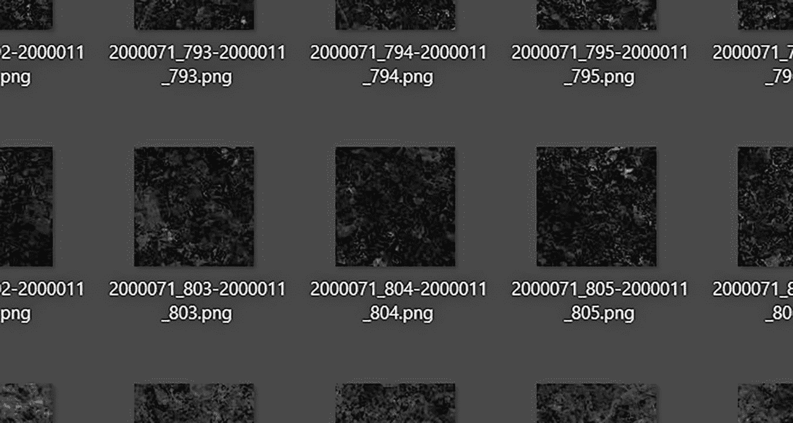

图 5.2 6 个月内的变化。

### 5.6.4 预处理

数据处理的阶段涉及应用归一化水体指数 (`NDWI`) [2] 来消除图像中的水体。随后，计算归一化植被指数 (`NDVI`) [1]，为每个保留的像素产生指示植被存在的指数值。之后利用火灾指数 (`Burn Index`) [3] 来识别受燃烧影响的区域，即由于自然或人为因素导致植被遭受的区域。这一顺序程序在整个数据集上系统地实施。利用少量标记数据子集，处理后的图像通过深度神经网络进行训练，最终生成了一个准确率高达 95% 的模型。

### 5.6.5 可视化与分析

开发了一个辅助软件应用程序以促进预测数据的可视化，能够将图像与其对应的模型预测结果同时显示。

在通过模型训练实现高水平准确率并实施专用可视化工具之后，又工程设计了另一个程序来对多时间数据进行深度分析。该程序使我们能够系统地检查指定感兴趣区域的时间变化，并识别按年度演变的土地覆盖动态情况。

## 5.7 算法

查看图 5.3。

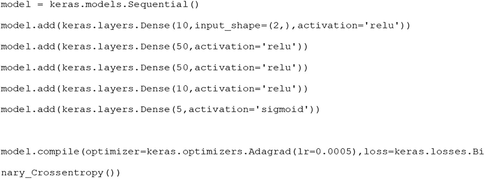

图 5.3 工作算法示例。

### 5.7.1 训练过程中的损失

查看图 5.4。

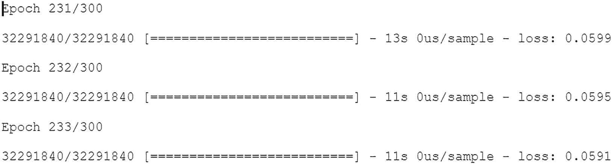

图 5.4 工作算法示例。

## 5.8 结果

(图 5.5)

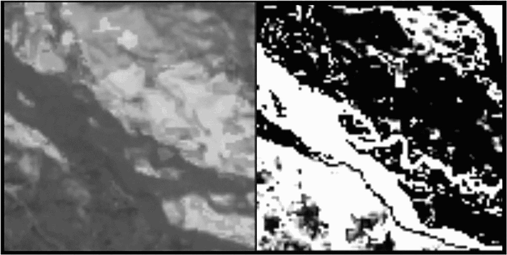

图 5.5 分类（森林）图像可视化。

(图 5.6)

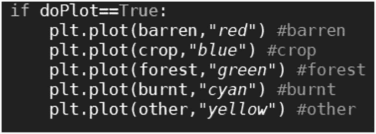

图 5.6 土地分类。

(图 5.7)

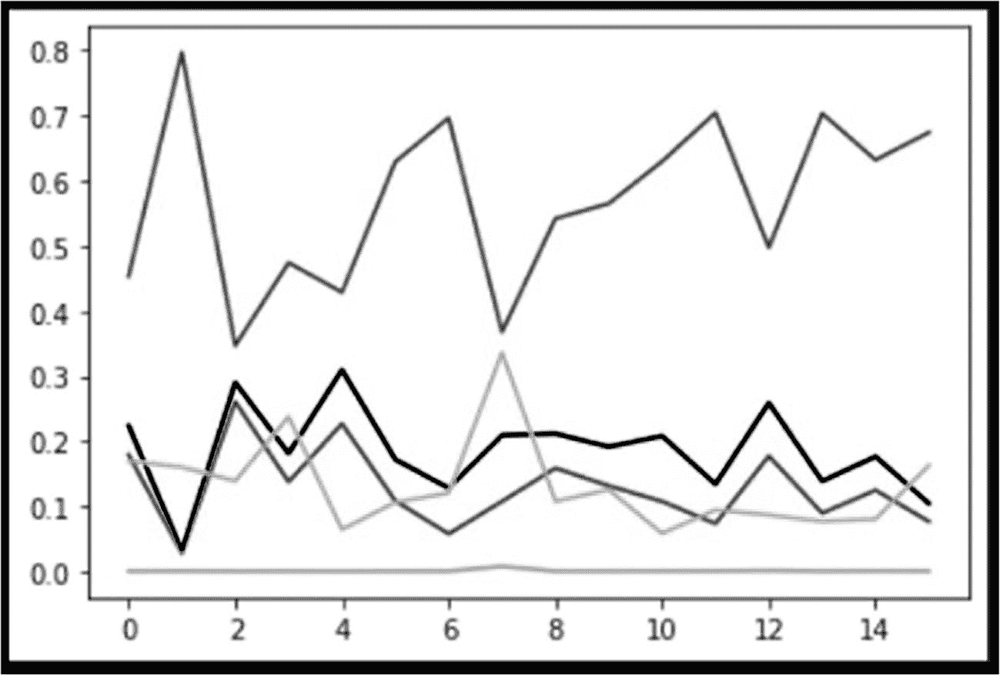

图 5.7 X 轴：时间，Y 轴：类别。

类别：

红色：荒地

蓝色：作物

绿色：森林

青色：火烧

黄色：其他

### 5.8.1 Android 应用开发

- 一个用户可以报告显示出火耕区域的应用程序。

- 这些数据可以被使用，以便我们的数据以更高的准确率进行分类。

- 使用新报告的数据定期对模型进行重新训练（图 5.8）。

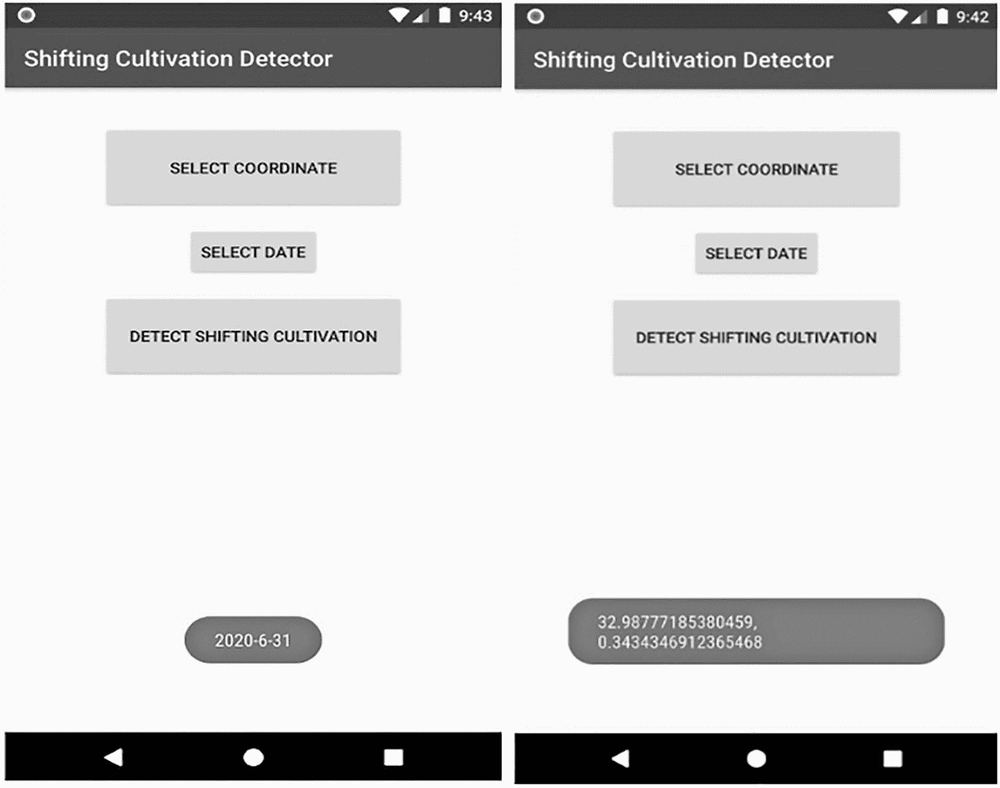

图 5.8 用于检测火耕的 Android 应用。

## 5.9 结论

深度神经网络在土地覆盖分类中的应用（结合植被、火灾和水体指数）展现了卓越的准确性。该模型不仅实现了卫星图像的精确可视化，还便于对土地覆盖动态进行深度分析。

1. 植被 `NDVI` 维基百科。访问于 2023 年 10 月 20 日。[`en.wikipedia.org/wiki/Normalized_difference_vegetation_index#::text=The%20normalized%20difference%20vegetation%20index,observed%20contains%20live%20green%20vegetation`](https://en.wikipedia.org/wiki/Normalized_difference_vegetation_index#::text=The%20normalized%20difference%20vegetation%20index,observed%20contains%20live%20green%20vegetation)

2. 水体 `NDWI` 维基百科。访问于 2023 年 10 月 20 日。[`en.wikipedia.org/wiki/Normalized_difference_water_index`](https://en.wikipedia.org/wiki/Normalized_difference_water_index)

3. 火灾指数 `UN-SPIDER`。访问于 2023 年 10 月 20 日。[`un-spider.org/advisory-support/recommended-practices/recommended-practice-burn-severity/in-detail/normalized-burn-ratio#::text=The%20Normalized%20Burn%20Ratio`](https://un-spider.org/advisory-support/recommended-practices/recommended-practice-burn-severity/in-detail/normalized-burn-ratio#::text=The%20Normalized%20Burn%20Ratio)

4. Comber, A. J., P. F. Fisher, and R. A. Wadsworth (2007) 土地覆盖：标准化还是不？对 Herold 等人“土地覆盖表征标准的演变”的评论。Journal of Land Use Science 2(4): 287–291。[10.1080/1747423070178600](https://doi.org/10.1080/1747423070178600)

5. Das, P., S. Mudi, M. D. (2021) 梅格拉亚邦东加罗希尔火耕的自动制图。Remote Sensing 13(6): 1066。[10.3390/rs13061066](https://doi.org/10.3390/rs13061066)

叶片病变会严重削减作物产量，特别是在大田作物中。随着人口的快速增长，发现和诊断初期阶段的叶片疾病对于实现最大产量至关重要。植物疾病占了全球收获损失的 16% 左右。在本文中，我们将研究两种深层 `CNN` 模型——`YOLOv8` 和 `ResNeXt50` 用于作物叶片病变检测。这两种模型都是强大的深度学习技术，在图像识别、分割和分类任务中表现出了良好的成果。除了区分叶片疾病外，采取预防措施控制疾病传播也至关重要。防止叶片疾病传播的方法之一是使用有机肥。肥料是一种特殊的有机肥，能为作物和植物提供基础营养，使其更健康并更能抵抗疾病。正确使用有机肥可以辅助防治疾病并进一步提高作物产量。`Leafine` 是一个基于深度学习的叶片病变检测和肥料推荐系统，设计上具有通用性，能够检测和诊断各种植物和作物的叶片疾病，而不限于特定的作物种类。此外，`Leafine` 的新颖之处在于，它通过合适的有机肥产品界面、`YouTube` 护理指南以及适用于作物和花卉植物的家庭疗法提供施肥建议（图 6.1）。


图 6.1 Leafine 概述

在大多数植物中出现的不同疾病列在下方图 6.2 中。

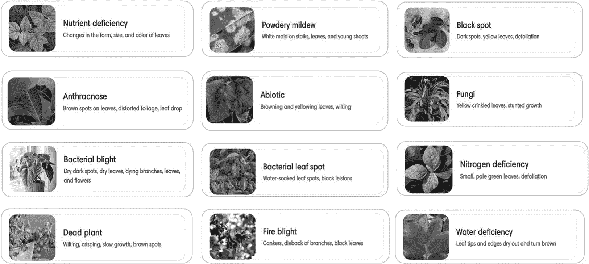

图 6.2 叶片中出现的常见问题

在上述疾病中，`Leafine` 关注植物中发生的常见问题（图 6.3），包括白粉病、细菌性枯萎、叶斑病和缺氮。白粉病是一种真菌疾病，其特征是受感染植物的茎和叶片上出现粉末状的灰色或白色层。叶斑病是由真菌、细菌或病毒引起的疾病。细菌性枯萎可以表现为干性深斑、枯叶、枯枝、叶片和花朵。它通常通过雨或风传播，也可能通过昆虫传播。缺氮是一种引起生长抑制的非生物障碍。植物叶片的生长需要氮，因此缺乏这种营养会导致叶片发黄。

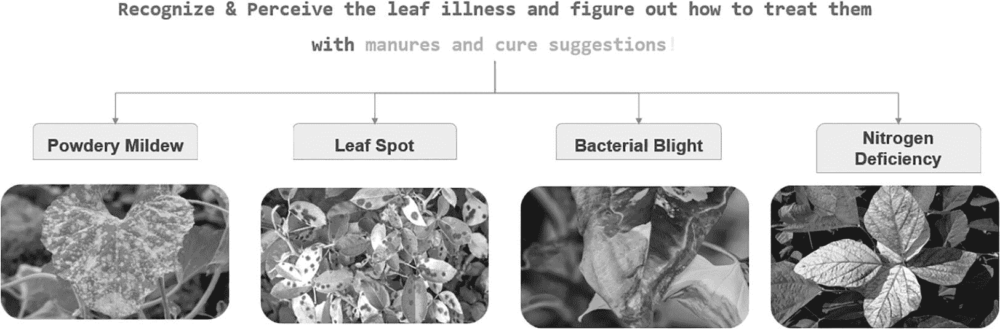

图 6.3 Leafine 关注上述叶片问题

因此，该项目旨在利用 `YOLOv8` 和 `ResNext50` 算法进行叶片病变检测，并为适当使用肥料提供建议，以防止作物疾病传播。通过利用这两种技术，`Leafine` 是一个检测和预防植物及作物叶片疾病的有效系统。本工作中完成的成果优于该领域目前的尖端工作。此外，`Leafine` 旨在具有用户友好性，使农场主、管理员和其他农业爱好者能够轻松使用我们的系统，并获得精确的疾病结论和肥料建议。这有助于减少收获损失，节省手动发现疾病的时间和精力，并进一步提高整体作物产量和质量。

农场主面临的最紧迫的挑战是控制植物性疾病。尽管如此，清理后的叶片图像分割往往会传递不均衡的信息和混乱的复合环境。本节检查了最近用于区分叶片疾病的表征模型，并分析了它们的效率。

深度学习模型分类了不同类型的番茄植物疾病 [1][2]。使用原始和分割的叶片图像改进 `U-net` 模型显示出高准确性。考虑环境条件可以减少训练时的假阳性数量。这些参考文献的局限性在于它们只关注番茄感染。

利用 `Inception Net` 架构描述植物疾病 [3][4]，整合 `InceptionV3`、`InceptionResnetV2` 和 `MobileNetV2` 是有效的，并优于现有的方法。修改后的 `U-net` 版本在从背景中分离叶片图像方面具有主导地位，且所需的训练投入较少。通过引入注意力机制提高传统卷积神经网络 (`CNN`) 的性能。减少网络参数和复杂度可以产生更好的识别精度，使其成为作物感染的有前景的方法。

深度森林算法 [7] 限制了植物疾病对农产品的负面影响，这对于关注世界至关重要。利用 `NASNet` 架构早期识别植物疾病 [8] 有助于不同感染区域和状态的植物，并在生存与毁灭之间产生巨大差异。

重构的稠密网络模型 [9] 在作物叶识别方面取得了巨大的改进，同时只需要较少的计算即可提高数据和梯度的进展。此外，浅层 `CNN` [10] 和经典机器学习方程用于识别植物疾病。

数据增强和迁移学习策略 [11][12] 可用于减少过拟合。

### 6.3.1 Leafine 数据集的预处理

所提模型利用自定义植物数据集进行评估，该数据集包含 4,245 张不同组合的植物病原体叶片图片，其中一些样本如图图 6.4 所示。数据集的收集通过人工挑选叶片图片完成，部分通过著名的 Plant Pathology Picture Chronicle 和 Fungi Net 数据集获得。具体而言，我们的数据集中的图像有三种配置：普通 `RGB`、灰度图和分割图像，以提高我们模型的鲁棒性。数据集中的图像根据五个常见问题类别进行划分。所有图像被分为五类，其中一类为健康，其他被标记为患病，包括枯瘟病（Blight）、叶斑（Leafspot）、白粉病（Powdery mildew）和缺氮（Nitrogen deficiency）。

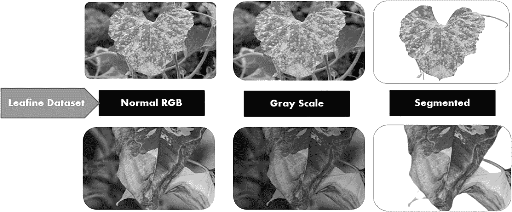


图 6.4 Leafine 自定义数据集中的某些随机叶片图像。

### 6.3.1.1 图像缩放、调整与归一化

通常，`ResNeXt50` 模型接收尺寸为 224×224 或 256×256 的输入图像。某些实现支持 512×512 的更大输入尺寸，`Yolov8` 模型也支持该尺寸。因此，我们将 Leafine 数据集中的图像调整为 512×512。预处理从对 Leafine 涉及的五类疾病进行人工标注开始。图像可以进行的归一化类型是将图片转换为 `PyTorch tensor`。此时，像素值被缩放到大约 0.0 到 1.0 的范围之间。可视化图片并绘制像素值。通过应用数据集图像的均值和标准差（SD），利用 z-score 标准化对图像进行归一化处理。

### 6.3.1.2 图像增强

我们的数据集是平衡的，五个不同类别的图像数量相似，不平衡的数据集可能会导致模型偏差、过拟合或欠拟合问题。每个项目中相等数量的图像（平衡数据集）可以训练出稳健的模型，以提供更好的执行精度。我们使用了三种增强技术（图像垂直旋转、图像水平旋转、图片缩放和图片平移）来调整训练数据。我们的数据集还应用了随机亮度、对比度和色调-饱和度值。

### 6.3.2 集成深度 CNN 模型的实验

#### 6.3.2.1 YOLOv8

`YOLOv8` 比以往的 YOLO 版本更精通，因为它使用了更大的特征图和更有效的卷积网络。这允许模型以更精确、更快速的方式识别物体。凭借更大的特征图，模型可以捕捉不同高亮区域之间更复杂的连接，并能更容易地感知和识别数据中的模式和物体。此外，在 `YOLOv8` 中，准备模型所需的时间有助于减少过拟合。

在 `YOLOv8` 架构的骨干部分，`Stem Layer` 更新了两个额外的 `ConvModules`，这导致了高效的神经网络架构（见图 6.5）。`ConvModule` 中的通道数有所增加，以获得更精确的检测输出。我们使用改进的 `YOLOv8` 模型对 Leafine 数据集进行训练，实现了 0.9 的准确率。


图 6.4 Leafine 自定义数据集中的某些随机叶片图像。

以下是 `YOLOv8`（图 6.10）和 `ResNeXt-50`（图 6.11）模型的执行感知，包括精确率（Precision）、召回率（Recall）和 F1 分数（调和平均数）。

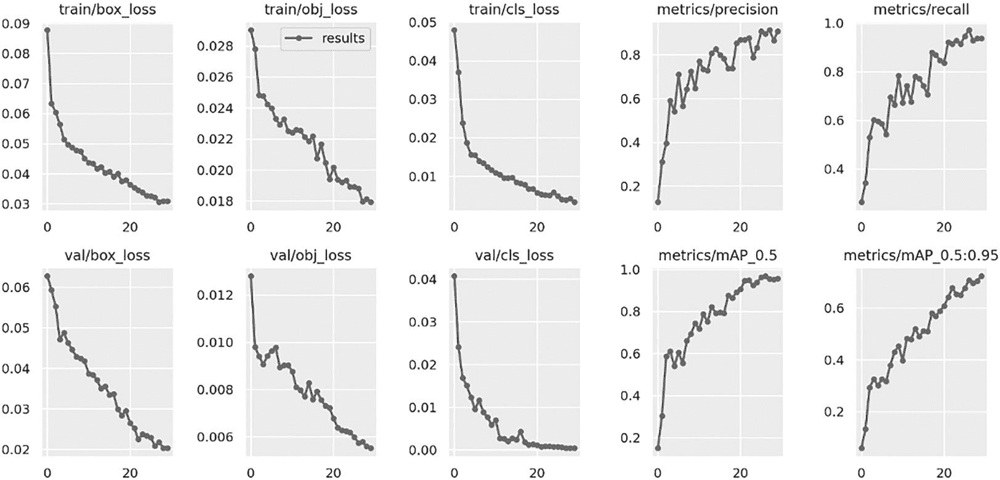

图 6.10 利用 YOLOv8 的精确率、召回率和损失得分性能可视化

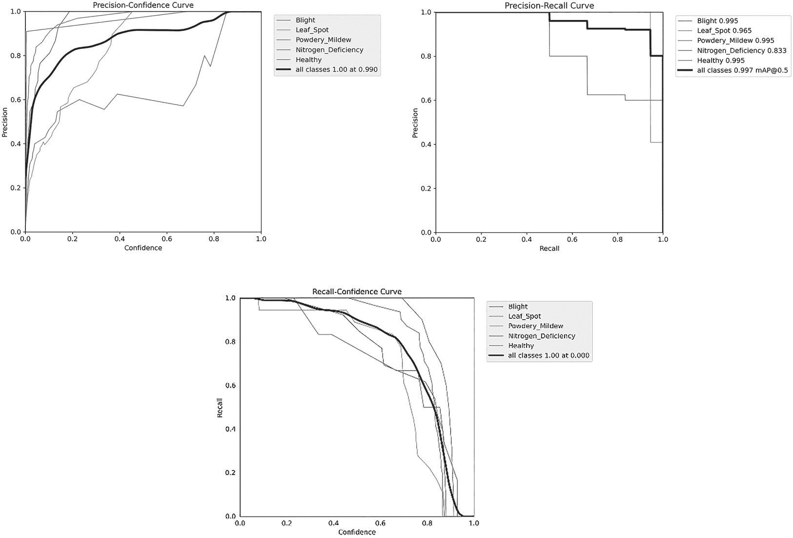

图 6.11 ResNeXt-50 的精确率曲线、召回率曲线和 F1 分数曲线的性能可视化

### 6.4.2 Leafine 结果

我们的 Leafine（图 6.12

图 6.12 Leafine 的结果

## 6.5 结论与未来展望

我们使用最准确且加载时间最短的模型实现了该系统，其核心贡献之一是形成了集成了重要建议、治疗方案、疾病管理以及与专家的咨询，从而确保了卓越的收成产量。我们提出的模型是轻量级的，因此农民和植物嗜粉者可以将其引入到任何具有计算机摄像头功能的智能设备上。该框架的未来扩展将考虑湿度、温度、土壤 `pH` 值和盆大小等环境参数，并根据植物监控系统一致地确定每天供水量。此外，在更大的图像数据集上准备模型，并结合光谱数据和化学研究等不同类型的数据，以进一步完善疾病诊断。通过整合新进展并扩展我们系统的范围，它可以成为当今园艺管理中更有用的资产。我们相信这一策略将对不同学科中叶病预测研究领域的观点和前瞻性发展产生重大影响。

### 示例表格

引入`示例表格`旨在增强书中呈现数据的清晰度和完整性。表 6.1 标题为`提议模型与其他前沿工作的执行对比`，提供了模型与该领域其他当代创新成果之间的结构化对比。

表 6.1 提议模型与其他前沿工作的执行对比

| 论文 | 使用的数据集 | 使用的算法 | 模型的准确率 |
| --- | --- | --- | --- |
| Mohit 等人. [14] (2020) | Plant Village 数据集 | `VGG16InceptionV3MobileNet` | 91% |
| Muhammad Shoaib 等人. [3] (2022) | Plant Village 数据集 | `InceptionV3`、`InceptionResNetV2`、`MobileNetV2` 和 `EfficientNetB0` | 分别为 98.42%、99.11%、97.02% 和 99.56% |
| Oyewola 等人. [15] (2021) | 自定义数据集 | 深度残差神经网络（`DRNN`） | 96.75% |
| 提议模型 | 自定义数据集 | `YOLOv8` 和 `ResNeXt-50` | 98.52% 和 99.43% |

### 表 6.2 提议分类器的定量研究

| 分类 | 类别类型 | 实例总数 | 训练-测试划分 |
| --- | --- | --- | --- |
| 多分类（五类） | 健康 | 849 | 训练 – 3525 张图像；验证 – 475 张图像；测试 – 245 张图像 |
|  | 白霉病 | 849 |  |
|  | 叶斑病 | 849 |  |
|  | 细菌性枯萎 | 849 |  |
|  | 缺氮 | 849 |  |

### 表 6.3 我们系统中用于 CNN 训练的超参数列表

| 模型 | 层数 | 参数 | GFLops |
| --- | --- | --- | --- |
| 改进的 `YOLOv8` | 365 层 | 4363695 | 165.4 Gflops |
| 改进的 `ResNeXt-50` | 50 层 | 25000000 | 4.2 Gflops |

### 表 6.4 我们实现的模型针对各种图像类型及训练-测试比例的精确率和损失

| 数据集 | 模型 | 图像类型 | 准确率 | 轮数（Epochs） | 损失 | 批大小（Batch size） |
| --- | --- | --- | --- | --- | --- | --- |
| 训练 – 80% | `YOLOv8` | 彩色、分割、灰度 | 98.50%、98.38726 | 50、500 | 0.012034 | 88 |
| 测试 – 20% | `ResNext-50` | 彩色、分割、灰度 | 98.52%、99.02985 | 50、454 | 0.02314 | 32 |

## 参考文献

1. Chowdhury, M. E., Rahman, T., Khandakar, A., Ayari, M., Khan, U., Al-Emadi, N., Reaz, M., Islam, T.: 基于深度学习的可靠叶片检测。Agri.3, 294–312。
2. Fuentes, A., Yoon, S., Kim, S., Park, D.: 基于深度学习的实时植物病害检测器。Sensors (Basel).17。
3. Shoaib, M., Hussain, T., Shah, B., Ullah, I., Shah, S., Ali, F., Park, S. H.: 基于深度学习的番茄叶片分割与分类。Front. Plant Sci.13, 103174。
4. Hassan, S. M., Maji, A. K., Jasinski, M., Leonowicz, Z.: 利用 `CNN` 和迁移学习识别植物叶片疾病。Electronics.10, 1388。
5. Bhujel, A., Kim, N. E., Arulmozhi, E., Basak, J. K., Kim, H. T.: 基于轻量化注意力卷积神经网络的番茄叶病分类。Agriculture.12, 228。
6. Zeng, W., Li, M.: 基于自注意力卷积神经网络的作物叶片疾病识别。Comput. Electron. Agric.172, 105341。
7. Arora, J., Agrawal, U., Sharma, P.: 使用深度森林分类玉米叶片疾病。J. Artif. Intell. Syst.2, 14–26。
8. Adedoja, A., Owolawi, P. A., Mapayi, T.: 基于 `NASNet` 的深度学习植物病害识别。Proceedings of the 2019 International Conference on Advances in Big Data. Computing and Data Communication Systems (BCD). Winterton. South Africa. 5–6, 1–5。
9. Zhou, C., Zhou, S., Xing, J., Song, J.: 重构残差密集网络识别番茄叶片。IEEE Access.9, 28822–28831。
15. Oyewola, D. O., Dada, E. G., Misra, S., Damasevicius, R.: 使用具有独特区块处理的深度残差卷积神经网络检测木薯马斑病。PeerJ Comput. Sci. 7, e352 (2021)。

# 7 针对印度某医院 ICU 患者分类的不同监督与无监督机器学习算法的扩展性性能分析与比较

Amrita Ghosh 和 Partha Das

独立研究员，印度西孟加拉邦，加尔加答

Subrata Jana

研究员，贾达普尔大学数学系，印度西孟加拉邦，加尔加答

Bibhas Chandra Giri

数学教授，贾达普尔大学，印度西孟加拉邦，加尔加答

Anirban Sarkar

教授兼系主任，管理与营销系，西孟加拉邦立大学，巴萨特，西孟加拉邦

DOI: [10.1201/9781032725444-7](https://doi.org/10.1201/9781032725444-7)

## 7.1 引言

重症监护的高成本使得在决定何时将患者转入较低级别的护理单元时必须非常谨慎。然而，过早将患者转出重症监护室（`ICU`）可能会带来监测不足和干预时间限制等风险。这些风险可能导致可避免的临床恶化、死亡率和病率增加以及更高的医疗费用。

为了应对这些挑战，利用真实世界数据进行准确的预测决策和机器学习分析可以成为医疗领域非常有价值且成本效益高的解决方案。通过分析患者从 `ICU` 转出后的状况，医院可以深入了解其 ICU 后护理的有效性。

本研究关注的是印度加尔加答重症监护室的成年患者。特别是，本研究旨在进行“针对加尔加答医院 ICU 患者分类的不同监督与无监督机器学习算法的扩展性能分析与比较”。

## 7.2 目标

本研究强调对数据挖掘方法在医院 ICU 数据库上的性能进行评估和比较。

- 本文旨在建立 `ML` 模型，从三个类别预测患者的结局：
  1. 继续留在 `ICU`
  2. 出院/转入普通病房
  3. 死亡病例
- 本文还旨在实现不同监督学习算法之间以及无监督学习算法之间的性能分析。

## 7.3 背景概念

机器学习（`ML`）领域在人工智能（`AI`）领域引起了巨大的关注，许多公司旨在利用其潜力来满足特定需求 [1]。`ML` 越来越流行，因为它利用算法促进从数据中学习，使其适用于商业和医疗等多个领域。医疗行业在技术进步和创新理念的推动下不断进化。`ML` 具有帮助医疗专业人员应对这些新场景的潜力。今天的先进技术能够从非结构化文本中提取有价值的见解，这在以前在大规模上是一项挑战性任务。凭借从 `ML` 获取的这些新财富，医生和管理人员可以及时做出充分的决策，有利于患者护理和影响数百万生命的运行计划。

图 7.1 展示了诸如 `ML` 等多样化的 `AI`。`ML` 的结构类似于树，因此得此名（图 7.1）。`ML` 的决策过程基于数据集的特征。从代表初始决策的根节点开始，树根据特征扩展出对应不同决策或测试的分支。这一过程一直持续到叶节点，叶节点提供最终的预测或结果。总而言，`ML` 算法提供了基于数据集特征的决策的视觉化和直观表示，使其成为解决分类问题的热门选择。这些特征延伸 [2]。

图 7.1 服务中的机器学习。

在本文中我们使用了 `Random Forest`（`RF`）、`AdaBoost`、`Bagging`、`Boosting`、`Logistic Regression`、`Decision Tree`、`KNN` 用于监督学习，并将 `K-Means Clustering` 和 `Gaussian Mixture model` 高斯混合模型用于无监督学习。

监督学习算法：监督学习顾其名义，涉及监督者或老师的存在。在监督学习中，我们使用标记数据训练机器，这意味着数据已经标记了正确答案。该过程从向机器提供一组标记示例开始，作为训练数据。监督学习算法分析这些训练数据并从中学习，以便在面对新的未标记示例时生成准确的预测或结果。

### 7.3.1 决策树

`Decision Tree`（决策树）是一种监督学习技术，可以应用于分类和回归问题，尽管它通常用于解决分类问题。它作为一种基于树的分类器工作，内部节点代表数据集的特征或属性，分支代表决策规则，每个叶节点代表结果或预测。在 `Decision Tree` 中，有两种主要的节点：`Decision Nodes`（决策节点）和 `Leaf Nodes`（叶节点）。`Decision Nodes` 用于根据给定数据集的特征做出决策并有多个分支，每个分支代表一个可能的结果或决策。相反，`Leaf Nodes` 是这些决策的最终输出但不包含任何进一步的分支。`Decision Tree` 中的决策过程基于数据集的特征。从代表初始决策的根节点开始，树根据特征扩展出对应不同决策或测试的分支。这一过程一直持续到叶节点，叶节点提供最终的预测或结果。

### 7.3.2 随机森林

随机森林（图 7.3）是一种广泛使用的机器学习算法，属于监督学习技术分类。它适用于机器学习领域的分类和回归问题。“随机森林”这一名称源于其作为集成分类器的本质，它由多个在给定数据集不同子集上训练的决策树组成 [3]。该算法通过考虑随机森林中所有单个决策树的平均预测结果来提高预测准确性。随机森林并不依赖于单一决策树，而是结合森林中每棵树的预测结果，并根据多数投票决定最终输出。这种方法提高了预测的稳健性和准确性。此外，在森林中包含数量的树可以进一步提高准确性，同时减轻过拟合的风险——过拟合是指模型过度适应训练数据导致在新的未见数据上表现不佳的倾向。总之，随机森林是一种集成分类器，它利用多个决策树的预测来做出更准确的预测。与单个决策树相比，它提供了更高的准确性，并通过考虑一组多样化树的预测多数投票来帮助防止过拟合。

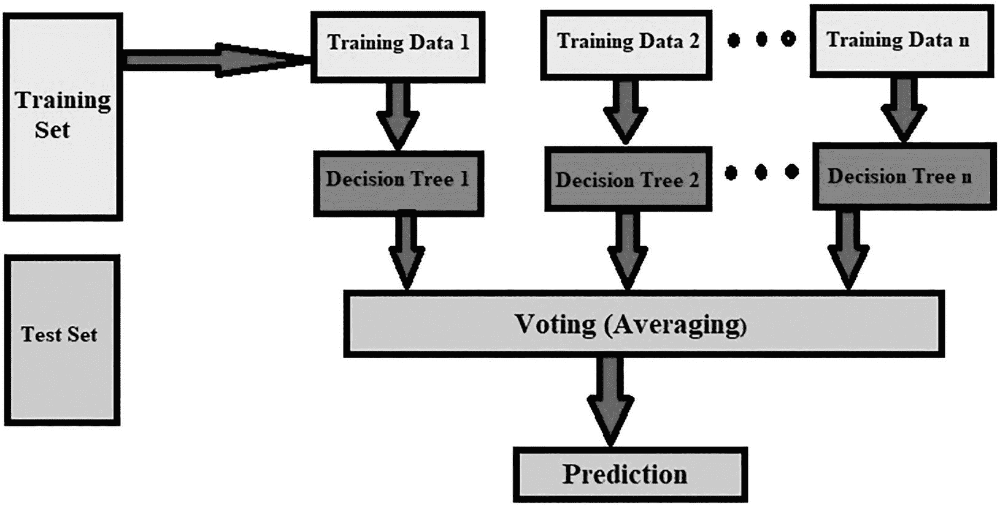

图 7.3 随机森林。

### 7.3.3 Bagging

Bagging（图 7.4）也被称为自助聚合。它包含两个步骤：自助（bootstrapping）和聚合（aggregation）。

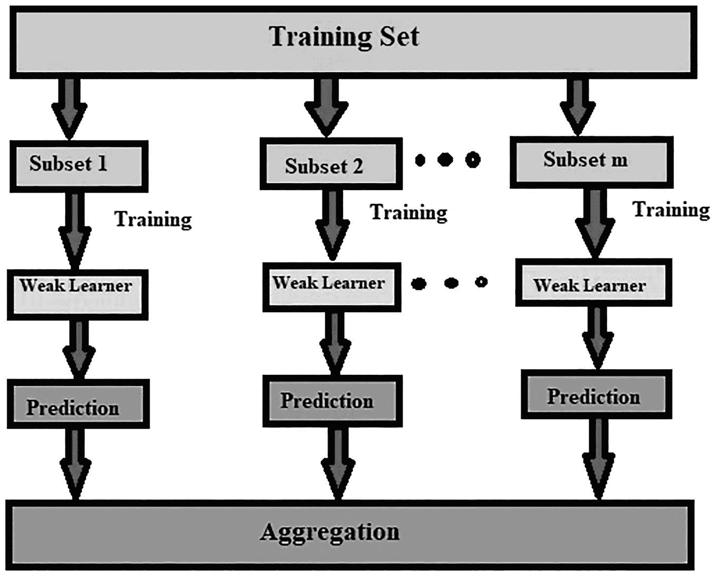

图 7.4 Bagging.

#### 7.3.3.1 自助法（Bootstrapping）

从初始数据中有放回地重采样数据子集的过程是自助法的核心组件。在这种方法中，被称为自助数据集或 bootstraps 的子集是从原始数据集中随机选择数据点创建的。“有放回的”意味着单个数据点可以被多次选择并包含在多个自助集中。这些自助数据集中的每一个随后被用于训练一个弱学习器，弱学习器是一种模型或算法，单独性能可能不佳，但与其他弱学习器结合时会对整体预测能力做出贡献。通过在不同的自助数据集上训练弱学习器，集成模型可以捕捉数据中存在的各种模式和特征。有放回重采样以及在自助数据集上训练弱学习器的目的是创建一个多样化的模型集合，这些模型共同做出更准确的预测。每个弱学习器对数据贡献了其独特的视角，结合它们的预测有助于减轻偏差并提高整体性能。

#### 7.3.3.2 聚合（Aggregating）

集成中的每个弱学习器都是独立训练的并生成它们自己的预测。这些预测随后被结合或聚合以产生最终预测。聚合过程可以通过多数投票（max voting）或平均法完成。多数投票涉及选择预测最频繁的类别，而平均法则计算预测的平均值。这种聚合的目的是利用弱学习器的多样性和集体智能，从而提高整体预测水平。

#### 7.3.3.3 多数投票（Max Voting）

这种方法经常用于分类问题，旨在确定最频繁的预测结果，即众数。由于其与选举中的多数规则概念相似，因此被称为投票。集成中的每个单独模型生成其自己的预测，该预测被视为一张“票”。在模型中出现频率最高的预测结果被选为组合模型的代表。

#### 7.3.3.4 平均法（Averaging）

在处理回归问题时，平均法是一种常用技术。它涉及计算集成模型生成的单个预测的均值或平均值。这个平均值随后被视为组合模型的整体预测结果。

## 7.3.4 逻辑回归（Logistic Regression）

逻辑回归是一种流行的机器学习算法，属于监督学习分类。它专门设计用于根据给定自变量预测分类变量。逻辑回归产生 0 到 1 之间的概率，这意味着结果是离散的。逻辑回归与线性回归有相似之处，但它被用于分类问题。在逻辑回归中，我们利用“S”形状的逻辑函数，而不是拟合回归线。逻辑回归产生 0 或 1 的精确值，它用于解决分类问题。逻辑回归是一项重要的机器学习算法，因为它能有效地分类连续或离散数据。这意味着它可以根据某些影响因素判断细胞是否患癌。图 7.5 展示了该逻辑函数。

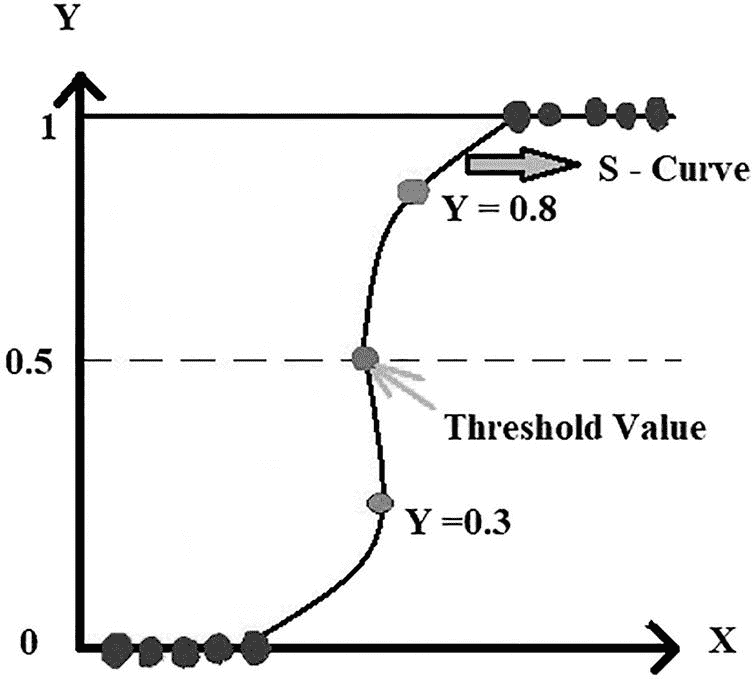

图 7.5 逻辑回归。

### 7.3.5 K-近邻（KNN）

K-近邻（KNN）算法（图 7.7）是一种监督学习机器学习技术，适用于分类和回归任务。虽然它可以用于回归，但主要用于分类目的 [4]。KNN 算法表现出两个关键特征：

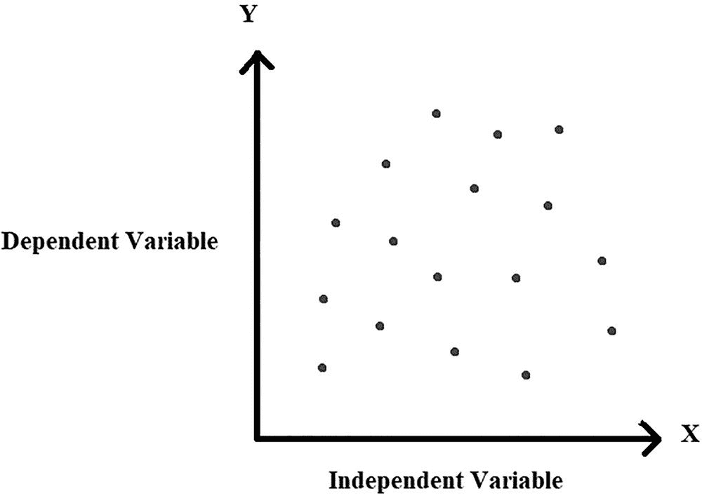

图 7.6 散点。

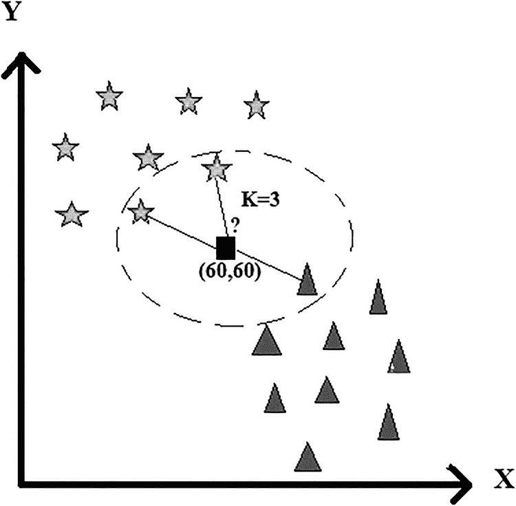

图 7.7 KNN.

懒学习算法：KNN 被认为是一种懒学习算法，因为它没有独立的训练阶段。相反，它在分类过程中利用所有可用数据点。


非参数学习算法：`KNN` 被归类为非参数学习算法，因为它对底层数据分布不做任何假设。它不对数据集的分布或特征做出任何假设。

总之，`K`-近邻算法是一种通用的监督学习技术，用于分类和回归任务。由于在分类时使用所有可用数据，它被描述为懒学习算法；由于不做假设，它被视为非参数学习算法。

以下是一个理解 `K` 的概念和 `KNN` 算法原理的示例。

假设我们有一个如图 7.6 所示的数据集：

现在，我们需要将新的数据点（位于 60, 60 处）分类为蓝色或红色类。我们假设 `K = 3`，即它将找到最近的三个数据点。这在下一个图中所示。

从上图中可以看到黑点数据点的三个最近邻居。在这三个邻居中，有两个位于红色（Red）类中，因此黑点也将分配到红色（red class）类中。

### 7.3.5.1 无监督学习算法

无监督学习涉及在不使用分类或标记信息的情况下训练机器，使算法能够独立地处理并作用非结构化数据。在这种背景下，机器的目标是根据相似性、模式和差异对未排序的数据进行组织和分组，而无需对数据进行任何先验知识或训练。

### 7.3.6 K-Means 聚类

`K-Means` 聚类是一种无监督学习算法，用于将未标记的数据集划分为不同的簇。`K` 的值指定了过程中要创建的预测簇数量。例如，如果 `K=2`，则有两个簇；如果 `K=3`，则有三个簇，依此类推。

该算法能够自动发现未标记数据中的组或类别，而不需要任何先验训练。它通过根据固有的相似性、模式或特征将数据聚类到不同的组来实现这一点。

`K-Means` 聚类作为一种基于质心的算法运行，每个簇与一个质心点相关。该算法的主要目标是最小化每个数据点与其对应簇质心之间的距离之和 [5]。

算法将未标记的数据集作为输入，将其分为 `K` 个簇，并不断完善聚类，直到实现最佳聚类布局。在运行算法之前确定 `K` 的值很重要。

`k-means` 聚类算法执行两个主要任务：

1. 通过迭代过程确定 `K` 个质心的最佳位置。
2. 将每个数据点分配给最近的质心，根据其接近程度形成簇。

结果是，每个簇由具有共同点且与其他簇不同的不同的数据点组成。

图 7.8 解释了 `K-means` 聚类算法的工作原理：

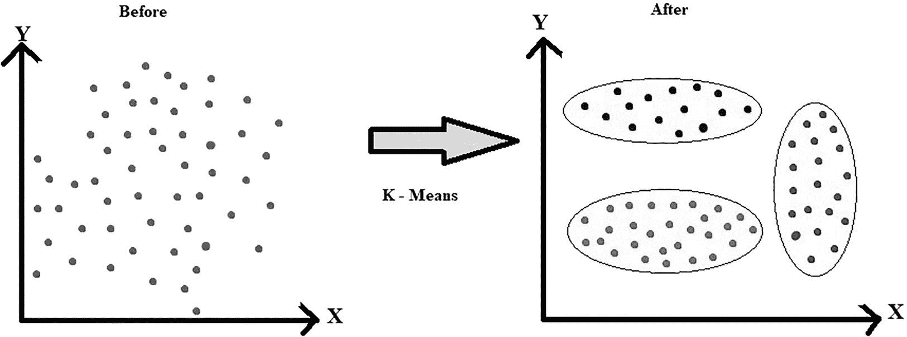

Figure 7.8 K-Means clustering.

### 7.3.7 高斯混合模型

高斯混合模型（`GMM`）为对真实数据集提供了一种概率方法。`GMM` 扩展了高斯分布的概念，并能够有效表示呈现多个底层高斯分布的数据集。在这种背景下，高斯混合模型是一种概率模型，假设数据点是由未知高斯分布的组合生成的。`GMM` 常用于聚类，涉及将数据点分组到不同的簇中。

`GMM` 提供了在簇可能没有被明确定义的数据集中识别簇的能力。它们还允许估计新数据点属于每个簇的概率。此外，`GMM` 对离群值具有鲁棒性，这意味着即使存在无法完美拟合到任何特定簇的数据点，它们仍然可以提供准确的结果。这一特性使得 `GMM` 成为数据聚类的一个灵活且强大的工具。

从概念上说，高斯混合模型表示了一种概率模型，其中假设每个组都从高斯分布，其参数由均值向量（`μ`）和协方差矩阵（`Σ`）定义。需要注意的是，高斯分布是一种连续概率分布，遵循钟形曲线，也称为正态分布 [6]。

图 7.9 展示了高斯混合模型的示例：

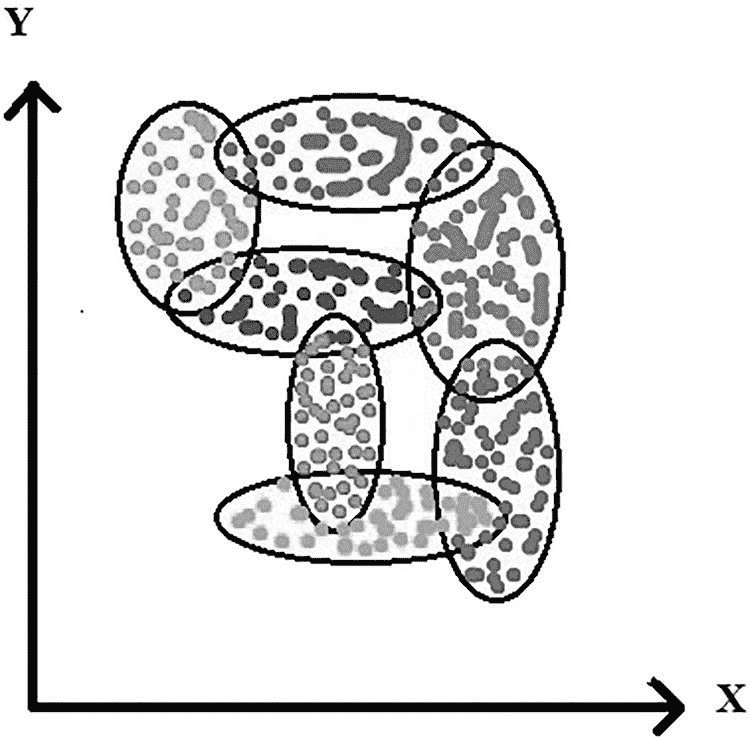

Figure 7.9 Gaussian mixture model.

高斯混合模型（`GMM`）具有多种应用，包括密度估计、聚类和图像分割。在密度估计方面，`GMM` 可以估计数据集的概率密度函数。在聚类方面，`GMM` 可以对源自同一个高斯分布的数据点分组。最后，对于图像分割，`GMM` 可以将图像分为不同的区域。

高斯混合模型的通用性扩展到各种用例，例如识别客户细分、检测欺诈活动和图像聚类。在每种场景中，`GMM` 都擅长发现数据中可能不会立即显见的簇。因此，高斯混合模型是数据分析的强大工具，在任何聚类任务中都应该考虑它。

### 7.3.8 PCA

主成分分析（`PCA`）是一种广泛使用的无监督学习方法，可以有效降低数据维度。通过这样做，它在最小化信息损失的同时增强了可解释性。`PCA` 在识别数据集内最重要的特征方面起着至关重要的作用，并简化了 2D 或 3D 数据可视化的过程。

通过 `PCA`，可以推出一系列变量的线性组合，从而能够全面理解数据中的底层模式和关系 [7]。

在图 7.10 中，多个点显示在二维平面上。表示包括两个主成分。`PC1` 代表主成分，解释了数据中观察到的最大差。`PC2` 是与 `PC1` 垂直的额外主成分。

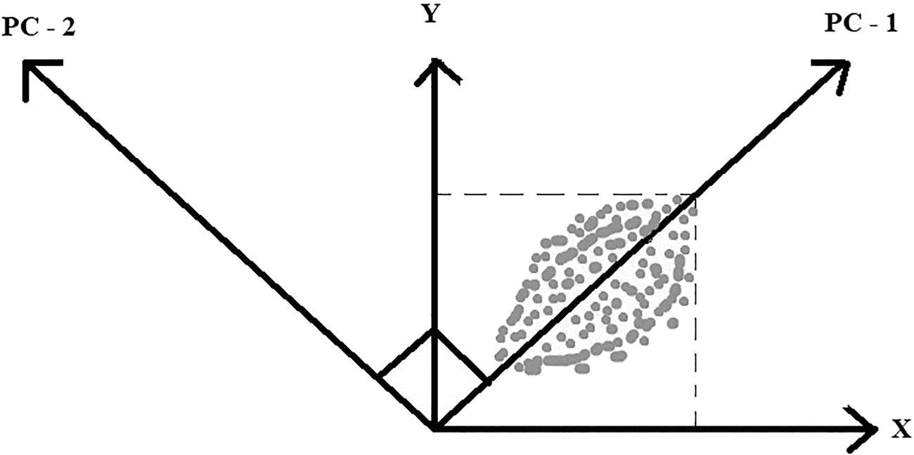

Figure 7.10 PCA.

## 7.4 数据收集与准备

该分类模型在从印度收集的 18 岁及以上 ICU 患者数据库上执行。

原始数据被准备为用于监督学习的标记数据，并作为用于无监督学习的未标记数据。原始数据包含 4783 行和 18 列。见图 7.11。

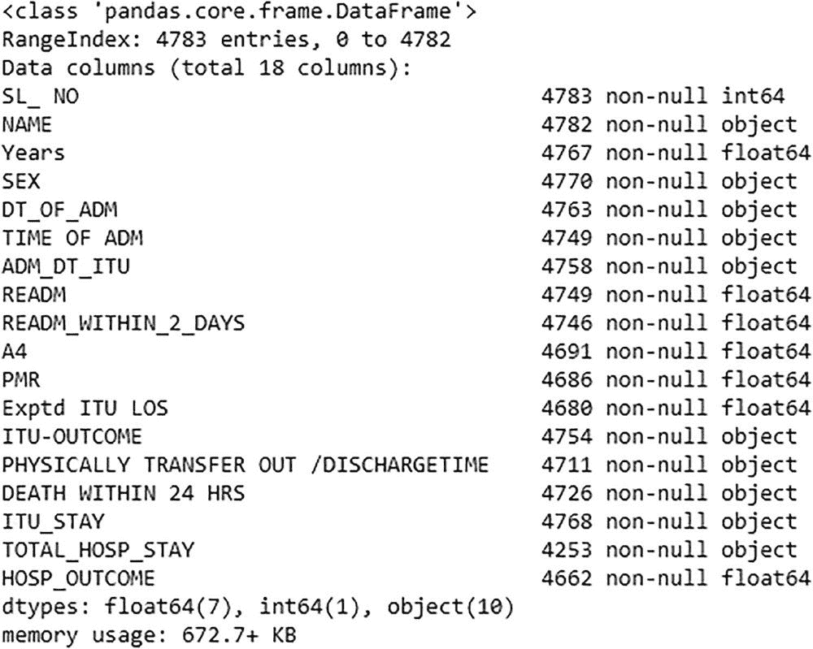

Figure 7.11 Original data set.

在清理（图 7.12

Figure 7.12 Cleaned data set.

## 7.5 方法论

70% 的准备数据用于训练，30% 的准备数据作为整体进行测试，用于监督学习算法。之后使用了名为`决策树`、`随机森林`、`Bagging`、`逻辑回归`和 `KNN` 等不同的监督学习算法来将数据分类为三类：

1. 继续留在 ICU
2. 出院/转入普通病房
3. 死亡病例

之后，计算了每个算法的准确率，并根据准确率绘制 `AUROC` 曲线以比较它们的性能。接下来计算混淆矩阵和性能矩阵，以评估数据分类分析的广泛性能。

同样，应用了 `K-Means 聚类`、`高斯混合模型` 和 `PCA` 等无监督算法，并执行了所有之前的步骤，但数据训练和数据测试在无监督学习算法中是不需要的。

## 7.6 结果分析

所提模型展示了监督学习算法的准确率、`AUROC` 曲线、性能和混淆矩阵，以及无监督学习算法的数据聚类图像。

下面讨论了不同监督学习算法的准确率、`AUROC` 曲线、性能矩阵和混淆矩阵的比较：

### 7.6.1 决策树

#### 混淆矩阵

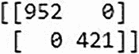

图 7.13 决策树的混淆矩阵

#### 性能矩阵


图 7.14 决策树的性能矩阵

#### ROC 曲线

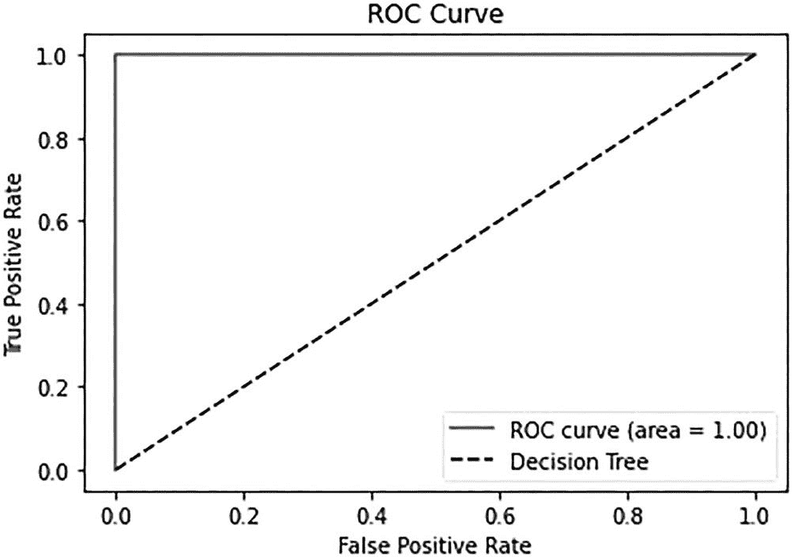

图 7.15 决策树的 ROC 曲线

### 7.6.2 随机森林

#### 混淆矩阵

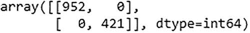

图 7.16 随机森林的混淆矩阵

#### 性能矩阵


图 7.17 随机森林的性能矩阵

#### ROC 曲线

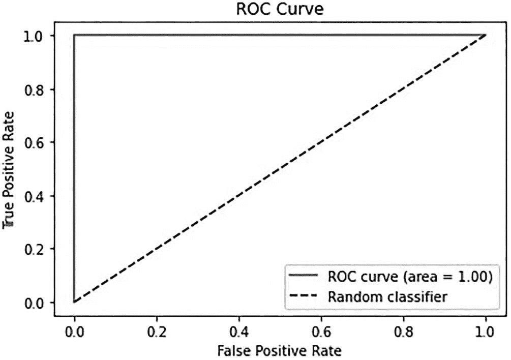

图 7.18 随机森林的 ROC 曲线

### 7.6.3 Bagging

#### 混淆矩阵

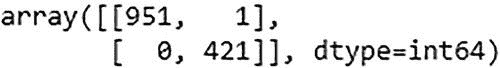

图 7.19 Bagging 的混淆矩阵

#### 性能矩阵

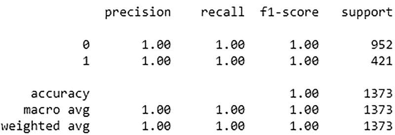

图 7.20 Bagging 的性能矩阵

#### ROC 曲线

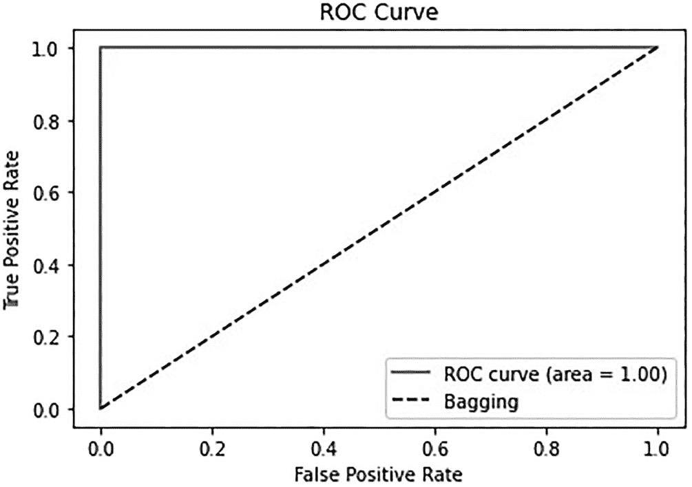

图 7.21 Bagging 的 ROC 曲线

### 7.6.4 逻辑回归

#### 混淆矩阵

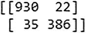

图 7.22 逻辑回归的混淆矩阵

#### 性能矩阵

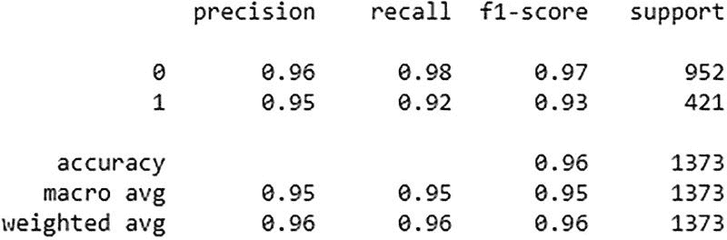

图 7.23 逻辑回归的性能矩阵

#### AUROC 曲线

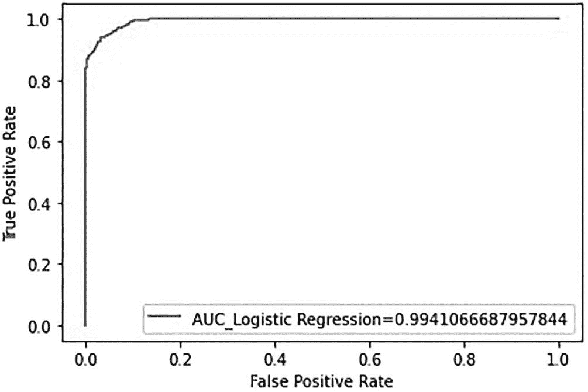

图 7.24 逻辑回归的 AUROC 曲线

### 7.6.5 KNN

#### 混淆矩阵

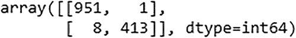

图 7.25 KNN 的混淆矩阵

#### 性能矩阵

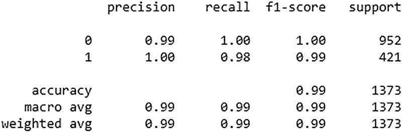

图 7.26 KNN 的性能矩阵

#### ROC 曲线

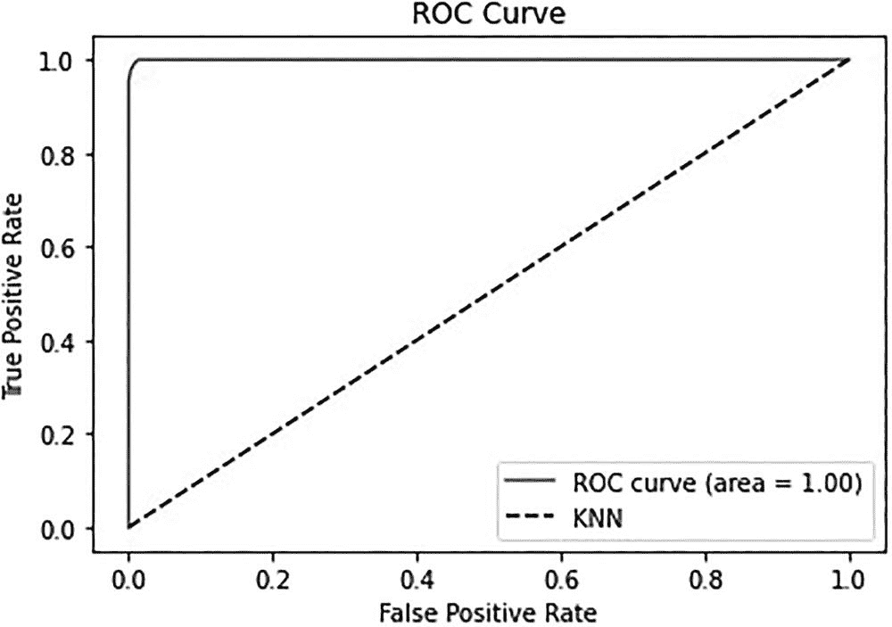

图 7.27 KNN 的 ROC 曲线

这里所有算法的混淆矩阵包含四个值。它们如下：

`TN = True Negative（真阴性）`，`FP = False Positive（假阳性）`、`FN = False Negative（假阴性）`、`TP = True Positive（真阳性）`

考虑到每个性能矩阵的准确率，我们可以说，除 `Logistic Regression` 外，所有其他算法的准确率均为 100%。基于这些混淆矩阵和性能矩阵，我们为每种监督学习算法绘制了 `AUROC` 曲线。

无监督学习算法的数据聚类如下：

### 7.6.6 K-Means 聚类

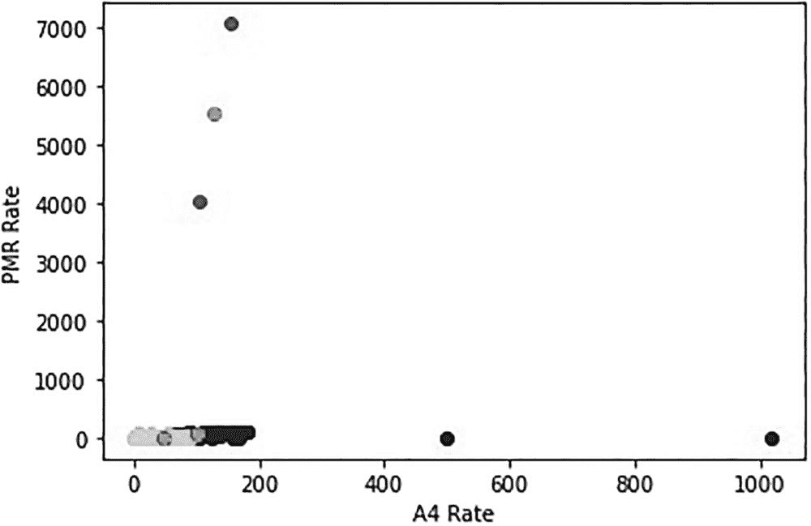

图 7.28 K-means 数据点聚类

### 7.6.7 高斯混合模型

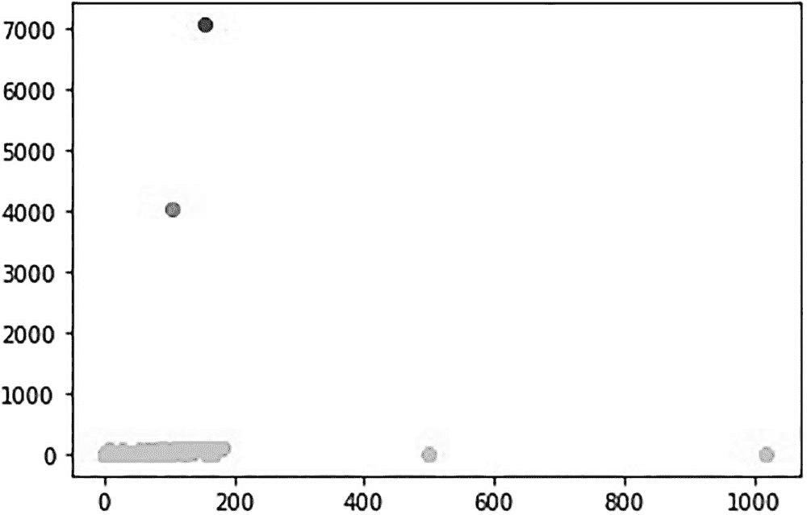

图 7.29 高斯混合数据点聚类

### 7.6.8 PCA

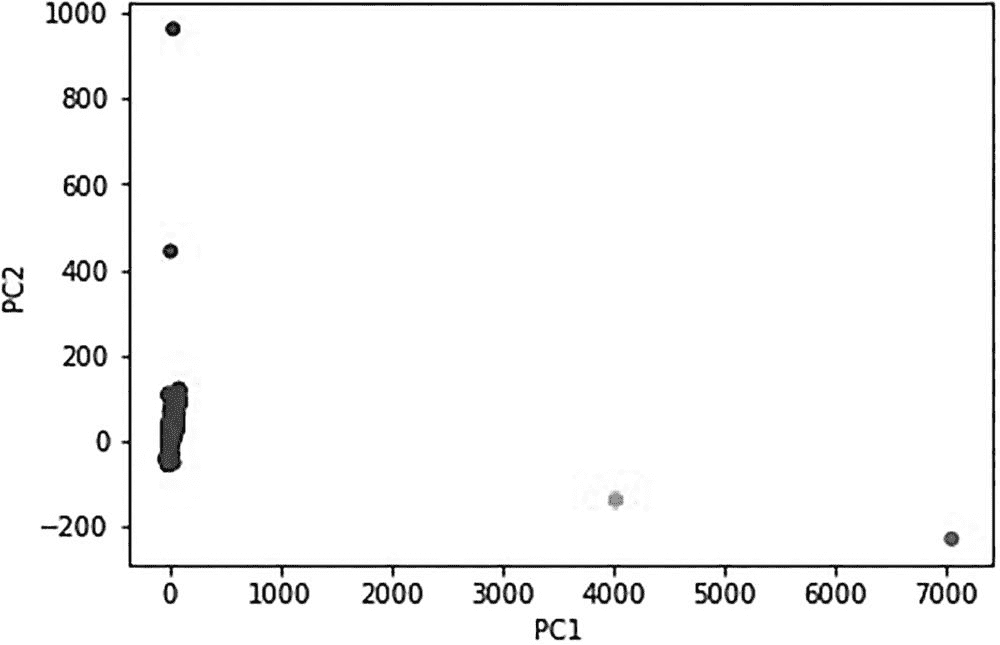

图 7.30 PCA 数据点聚类

根据混淆矩阵，我们可以发现在所有算法中，`K-Means` 的表现最好。

### 7.7 发现

正如目标所示，我们得到了以下发现：

1. 患者被分成了三类。
2. 混淆矩阵、性能矩阵和 `AUROC` 曲线的比较显示，除 `Logistic Regression` 外，所有其他算法的准确率均为 100%。

### 7.8 结论与未来展望

机器学习（`ML`）已成为医生、科学家和研究人员不可或缺的工具。每天都有新的突破和机器学习应用解决了现实问题。机器学习的快速发展引起了医疗行业的关注。机器学习概念使医疗人员能够拯救生命、主动识别疾病风险并改善患者管理。全球范围内的机构正在利用人工智能解决方案来增强医疗服务。该模型强调了 ICU 转后数据挖掘的重要性。未来，可以通过引入尚未出现的算法进一步改进该模型。

### 参考文献

1. [Wagh, P.]
2. [Javaid, Mohd.]
3. [Ashfaq, Atqa]
4. [Van Grootel, Tom J.]
5. [Elbattah, Mahmoud]
6. [Das, Ashis Kumar]
7. [Vuong, Quan-Hoang]

# 8 基于 Darknet 的枪支检测、可疑活动识别与犯罪预测

V. S. Gulhane 和 A. M. Bhugul

计算机科学与应用研究系, Vivekanandha College of Arts and Science for Women (Autonomous), Tiruchengode, Tamil Nadu, India

DOI: [10.1201/978103272544-8](https://doi.org/10.1201/978103272544-8)

## 8.1 引言

为了确保人类安全，视频监控系统无处不在。实施这些系统的主要目的是有效监控指定区域，从而识别潜在的威胁或安全危害。

大多数系统现在需要人工操作员盯着这些图像。此外，每个操作员还要同时负责多个摄像头的视频流。这一事实以及人类疲劳或注意力不集中等固有特质可能会导致人们错过关键事件或反应过慢，导致严重伤害并使现代视频监控系统失效或无用。

闭路电视（`CCTV`）监控的广泛采用显著增加，通过监控和识别潜在的安全风险来增强公共安全。由于人工监控耗时耗力且生易出错，人工监控促使人们对自动化系统的发展兴趣激增。这些系统旨在从实时 `CCTV` 画面中检测武器，为提高安全监控的效率和准确性提供了潜在的解决方案。最近，2023 年 1 月发生了查米尔和克什米尔拉贾乌里恐怖袭击，导致 7 人死亡，数人受伤。同样在 2023 年 1 月，加利福尼亚州一名持枪男子杀害了 11 名无辜的生命，并导致 9 人受伤[31]。2023 年 2 月，一名男子在密西西比州实施了大规模射击，杀害了 6 人[4]]。在印度旁遮普，劫匪在 2023 年持枪从银行抢劫了 220 万卢比[5\]。

不幸的是，涉及危险和火枪的事件发生得越来越频繁。大规模射击、手枪攻击、校园场所射击事件和恐怖袭击是这些情况的几个实例[6,7]]。在实时 `CCTV` 画面中早期识别潜在的危险物体或可疑活动，可以防止或显著减少此类事件的发生。

引入自动识别风险物体或活动的智能技术，可以极大地辅助人员对这些危险做出应对。近年来，机器学习系统领域取得了显著进展，特别关注计算机视觉。计算机视觉在近期取得了巨大进步，这在很大程度上归功于基于深度学习架构的发展和普及。这些先进模型在包括目标检测、图像分割甚至数据生成在内的各种任务中表现出了卓越的性能。这种成功在很大程度上归功于卷积神经网络（`CNNs`）的广泛可用和利用。`CNNs`可用性的提高显著提升了计算机视觉系统的准确性和效率，为广泛的应用和可能性开启了大门。

最初，对自动武器检测的关注主要集中在 X 射线图像中武器的识别上。针对这一点，使用了多种机器学习技术。为了解决 3D CT 图像中的目标检测挑战，Flitton 等人于 2013 年进行了对比分析，以评估各种 3D 特征描述符[8]]。传统的机器学习方法已应用于使用标准 RGB 图像识别视频监控中的手枪。在他们的研究中，Tiwari 和 Verma [9]\]提出了一种自动手枪检测的识别流水线。他们建议的流水线涉及利用 Harris 角点检测器和快速视网膜关键点（`FREAK`）描述符[9]]。该方法的目的是提高特定背景下火器检测的准确性和效率。除了基于 `CNN` 的分类器取得的成果外，还创建了其他深度学习架构用于识别火器。早期方法依赖于滑动窗口，从原始图像提取数万个区域，并对每个区域进行`CNN`分类[10]]。这一类方法的主要缺点是计算复杂性，这对实时系统构成了挑战。处理图像中大量区域需要大量的计算资源，导致实时性能出现潜在延迟和局限性。

为了应对计算挑战，自动武器检测的替代方法采用了从图像中仅选择候选区域子（也称为区域提议）的策略。然后，对每个区域进行项目分类和边界框精炼。这一类检测器也被称为两阶段检测器。使用该技术创建的第一种架构是基于区域的卷积神经网络（`R-CNN`）[11]]。`Faster-CNN`[12]]的最新版本提供了若干性能改进（如区域提议网络）。Olmos 等人[13]于 2018 年研究了基于滑动窗口和区域提议的火器检测系统。通过在他们自己的数据集上训练视觉`CNN`取得了最佳结果。边界框回归和物体分类使用单阶段检测器完成，如`YOLO`[14]]`RetinaNet`[15]]或`SSD`[16]]，这些架构通常具有更快的推理时间，更适用于移动设备。`YOLOv3`已在近期研究用于手枪检测[17,18]\]，它实际上是在专门的手枪数据集上训练的。此外，Salazar Gonzalez 等人[19]\]提出了一种基于虚和真实图像的双阶段训练过程，使`Faster-CNN`检测手枪时更加有效。

这些工作实际上仅依赖感兴趣物体（如武器）的视觉，而不提供任何其他信息。某些方法还采用了温度分析[20]]。使用`DNN`[21]\]在医学图像中对物体与背景进行分割，并使用基于特征的分析[22]\]进行分类。其他工作中利用了多种技术来整合人体姿态。Salido 等人研究了通过在源照片中包含位置叠加层来改变训练数据集的影响[23]]。根据结果，某些检测器的指标得到了提高。在这种实例中，在预处理阶段使用了姿态信息来丰富输入照片，但在训练时仅使用视觉特征。

它指的是一种本质上开源的神经网络框架，由于其在实时目标检测中的速度和准确性，近年来获得了广泛普及。`Darknet` 是一个软件框架，能够实现 `YOLO` 和 `YOLOv2` 等前沿目标检测模型。这些模型以能够在现实世界情况下准确、快速地检测物体而闻名。此外，`Darknet` 提供了一个用户友好的界面，用于在各种数据集上构建和训练自定义模型，使得不同专业水平的研究人员和开发者都能轻松使用。该框架还支持涵盖各种神经网络模型的多种深度学习架构，包括卷积神经网络和循环神经网络，允许创建目标检测之外的多种应用程序。通常的惯例是向神经网络中添加更多的卷积层，以提高其识别图片中较小物体或更精细特征的能力。为了实现这一点，可以增加网络的深度、增加每层中滤波器的数量，或者添加跳跃连接（skip connections）使数据在层级之间流动更加容易。通过这些更改，网络从图片中提取复杂信息的能力将提高，从而获得更好的物体识别性能。

修改 `Darknet` 层允许创建自定义的网络架构，从而提高网络在特定任务或数据集上的性能。`Darknet` 的灵活性和多功能使其成为开发深度学习应用的强大工具。

## 8.3 提议系统架构 (PSA)

我们提议的系统处理来自实时摄像头的输入图像并将其视频帧。为了训练神经网络，我们开发了一个包含各种类型和尺寸火枪的自定义数据集。然后通过在输入图像上运行特征提取方法来定位目标物体。图像 `(a, b)` 经过特征提取处理得到 `F_ψ^i (k, c, d)`。这里有公式 8.1。

```
$F_{\varphi}(k_{0},c,d)\frac{1}{\sqrt{MN}}\sum_{x = 0}^{M - 1N - 1}{\quad.image(a,b)\varphi_{j = 0}(a,b)}$ (8.1)
```


```
$F_{\psi}^{i}(k,a,b)\frac{1}{\sqrt{MN}}\sum\_{x = 0}^{M = 1}{\quad.\\sum\_{y = 0}^{N - 1}{\quad.image(a,b)\psi^{i}j\_{k,c,d}(a,b)\psi i}}$ (8.2)
```

图 8.1 显示了使用 `Darknet` 进行多枪和头盔检测的提议架构。我们通过添加大小为 `1×64` 和 `2×128` 的残差块修改了 `Darknet-53` 的原始层，以提高网络性能。此阶段的输出被发送到 `Dense Architecture`，其中密集块中的每一层与其他层连接，以促进特征重用并使网络学习更健壮且具判别性的特征。每层的输出被拼接并传递到下一个密集块，以改善网络的信息流。通过批量归一化和 `ReLU` 激活函数增强了训练过程，这也防止了过拟合。前检测层 (`FDL`) 负责识别输入图像中物体的位置和是否存在。该层通常是一个卷积层，在多个尺度和位置上检查输入图像，寻找可能包含感兴趣物体的区域。

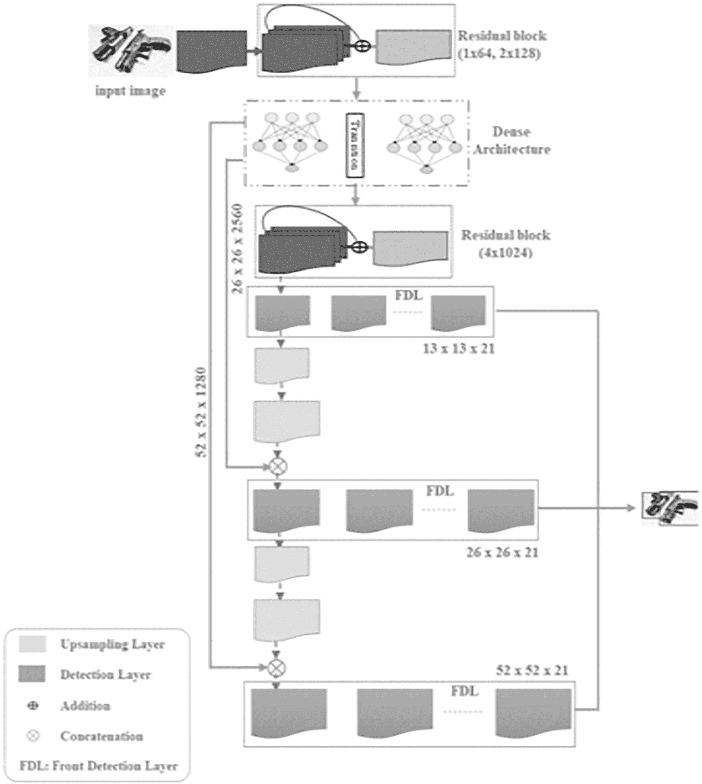

图 8.1 用于单帧内多种武器（枪支）检测的提议系统架构 (PSA)。我们使用 8,914 张枪支图像和 9,951 张不同类型和尺寸的头盔图像训练了我们的 PSA。

前检测层 (`FDL`) 使用预定义的锚框（anchor boxes）或先验框（prior boxes），即具有预定义尺寸和宽高比的小矩形，来检测输入图像中的物体。对于每个锚框，`FDL` 计算代表该框内存在物体概率的分数，边界框偏移量表示锚框与实际物体边界框之间的差异。该架构针对检测小物体进行了优化，例如视频中看起来很小且远离摄像头的枪支。使用上采样层来增加特征图的分率并提高检测精度。这使得对火器等微小物品进行准确检测。

在概述架构的每个卷积层之后，都会使用一个残差组，这些组可以包括 `1x`、`2x`、`4x` 或 `8x` 残差块。在每个残差组之前，执行步长为 `2` 的步长卷积以降低特征图的空间维度。下采样技术有助于保留低级特征和位置数据的编码，这对于目标检测很有用。与 `max-pooling` 等非参数化下采样方法不同，使用具有学习参数的步长卷积允许更大的灵活性并改进对小物体的检测。通过结合这些设计选择，架构增强了捕捉和检测不同尺寸物体的能力。

在不同尺度上，来自三个残差组的输出被恢复为特征向量。假设网络的输入为 `416×416`，得到的三个特征向量的空间维度分别为 `52×52`、`26×26` 和 `13×13`。这些特征向量对应不同的尺度并负责检测不同尺寸的物体。`52×52` 特征向量侧重于检测小物体，`26×26` 特征向量处理中型物体，而 `13×13` 特征向量专门用于检测大物体。通过较旧特征图的细粒度数据和较后上采样特征图的相关语义数据，网络允许对不同尺寸的特征进行拼接和上采样。

我们使用 8,914 张枪支图像和 9,951 张不同类型和尺寸的头盔图像训练了我们的 PSA。该架构被输入下文提议的算法。开发了一个自定义分类器将活动分为两类。当活动被识别为可疑时，将立即向授权人员发送警报电话和短信通知 [26,27]。该系统旨在增强对潜在可疑事件的实时检测和响应。

## 8.4 提议算法

以下是携带多种武器并佩戴头盔的人员的可疑行为建议策略。

1. 初始化摄像头；初始化 `WD = 0`（武器检测）

2. 每隔 `50` 毫秒从摄像头提取帧。

3. 将提取的帧通过提议的武器和头盔检测架构（图 8.1）。

4. 如果检测到头盔：

   警告：“摘掉头盔”

5. 如果检测到武器：

   `WD = WD + 1`

6. 否则：

   `WD = 0`

7. 如果 `WD = 3`：

   警告：“检测到可疑活动”

8. 转到第 2 步。

算法首先初始化摄像头，该摄像头将捕获待分析的视频流。我们处理的是实时视频。`WD`（武器检测）变量也会被系统初始化，并从算法中解释的摄像头武器和头盔检测架构中提取帧。如果在帧中检测到头盔，系统将发出警告信息，要求佩戴头盔的人将其取下。该警告旨在确保人的脸部对摄像头可见，这对于识别目的可能非常重要。

### 检测武器

如果在帧中检测到武器，`WD` 变量将加 1。这表示当前帧中检测到了武器。如果帧中没有检测到武器，`WD` 变量将重置为零。这确保了 `WD` 变量跟踪连续检测到武器的帧数。如果 `WD` 变量的值大于三，则表示在至少三个连续帧中都检测到了武器。这可能是可疑活动的迹象，系统将发出警告信息，提醒安保人员调查情况。系统将返回第 2 步并重复该过程：捕获帧、检测头盔和武器，并在必要时发出警告信息。此过程一直持续到监控系统停止。每隔 50 毫秒，每个提取的帧都会通过一个建议的零处理。

## 8.5 提取帧

从视频中提取帧的技术涉及读取视频文件的每一帧并将其保存为图像文件。以下是从视频中提取帧的逐步处理过程：

1. 使用类似 OpenCV 的视频处理库打开视频文件。

2. 检查视频文件是否成功打开。

3. 初始化变量以跟踪帧数以及帧是否成功读取。

4. 使用 `while` 循环遍历视频帧。

5. 使用视频对象的 `read()` 方法读取下一帧。

6. 通过检查 `success` 变量的值来检查帧是否成功读取。

7. 如果成功读取了帧，则帧数加。

8. 使用 OpenCV 库的 `imwrite()` 方法将帧保存为图像文件。

9. 继续循环，直到所有帧都处理完毕。

10. 使用视频对象的 `release()` 方法释放视频文件。

从图像中定位并提取特征的技术（这些特征可能用于用更压缩的形式描述图像）被称为特征提取。这里利用了四种不同的特征提取策略：

- **基于颜色的特征**：为了描述图像中的颜色分布，可以提取颜色直方图、颜色矩或颜色相关图。

- **基于纹理的特征**：使用纹理特征从图像提取纹理信息，例如 Gabor 滤波器、局部二值模式或灰度共生矩阵。

- **基于边缘的特征**：我们利用 Canny 边缘检测和 Sobel 算子等技术来提取并表征图像或其他视觉数据的边缘或边界。

- **基于形状的特征**：提取形状点、轮廓或几何矩等来表示图像中对象的形状。

然后对这些提取的特征进行降维以降低它们的维度。在这种情况下使用了 PCA 方法。在尽可能保留原始数据的情况下，PCA 的主要目标是寻找模式并减少大型数据集的维度。通过组合数据集的原始特征，PCA 将数据集的维度降低到一组新的特征，这些特征是原始特征的线性组合。转换后的特征被称为主成分，其计算方式使得数据沿每个成分的方差最大化，并按方差从大到小的顺序进行排序。

通过仅保留前 `k` 个主成分，我们能够成功地将数据集的维度从 `n` 个特征降低到 `k` 个特征，其中 `k < n`。简化后的数据集可以应用于各种任务，如可视化、数据压缩或作为机器学习模型的输入。

## 8.6 结果与讨论

在这里，我们采用了一些自己录制的视频，并从其他来源获取了一些视频来测试我们实现的算法。帧已从这些视频中提取。总共使用了 18,865 图像用于 PSA 的训练。然后，还在实时视频上对所提算法进行了测试。PSA 的结果结果所示。

[图 8.2] 显示了 PSA 的结果。总共使用了 18,865 图像用于 PSA 的训练。

在我们的研究中，我们将结果与多种既有方法进行了彻底比较。我们通过采用一系列基于机器学习的物体识别和分类模型，全面评估了我们提议的技术。具体而言，我们检查了 `YOLO V3`、`YOLO V4`、`YOLO V5`、`Haar Cascade Classifier`、`SVM Classifier`、`Decision Tree` 以及 `KNN Classifier` 的性能。基于`Accuracy` 和 `Time complexity`，将`Proposed Algorithm` 与当前几种处理方法进行了比较，比较结果见表 8.2。

### 表 8.2 比较研究结果 (#ch08.xhtml#Ttable8_2)

| 架构 | 准确率 | 时间复杂度（毫秒） |
| --- | --- | --- |
| 提议的系统架构 | 99.35% | 19.42 |
| YOLO V3 | 97.42% | 19.08 |
| YOLO V4 | 98.23% | 20.12 |
| YOLO V5 | 98.83% | 18.47 |
| Haar 级分类器 | 79.18% | 14.26 |
| SVM 分类器 | 86.28% | 27.32 |
| 决策树分类器 | 72.39% | 16.93 |
| KNN 分类器 | 74.94% | 24.49 |

所提的方法还能克服机器学习内置方法的某些局限性，例如从视频中检测小物体、在大数据集上运行，以及从模糊或噪声视频中正确检测物体。我们的发现表明，与现有方法中遇到的局限性相比有了显著改进。

## 8.7 缩写

`PSA`，提议系统架构；`PCA`，主成分分析；`TP`，真阳性；`FP`，假阳性；`TN`，真阴性；`FN`，假阴性。

### 参考文献

1. Fernando Enriquez, L.M. Soria, Juan A. Garcia, Fernando S. Caparrini. 用于物理安全优化响应的视觉与群感知技术，ICCS 2019: 19th International Conference on Computational Science (2019), pp. 15–26.

2. T. Ainsworth. 购买者留心，Security Oz 19 (2002), pp. 18–26.

3. Sergio Velastin, B. A. Boghossian, Maria A. Vicencio-Silva. 用于检测地下地铁站潜在危险情况的运动图像处理系统，Transportation Research Part C Emerging Technologies 14 (2) (2006), pp. 96–113.

4. The Takeaways. 子文档标题。收录：“2023 年枪支暴力：26 天内发生近 40 起大规模射击事件”（2023）。[`www.wnycstudios.org/podcasts/takeaway/segments/2023-40-mass-shootings-26-days`](https://www.wnycstudios.org/podcasts/takeaway/segments/2023-40-mass-shootings-26-days)。

5. Sosinak Mukhopadhyay. 子文档标题。收录：“大规模枪击事件：密西西比州 6 人枪死，美国枪支法律最松的州”（2023 年 2 月）。[`www.livemint.com/news/world/mass-shooting-6-people-shot-dead-in-mississippi-us-state-with-weakest-gun-laws1167667-7755673.html`](https://www.livemint.com)。

6. Everytown for Gun Safety Support Fund. 关于我们如何防止美国学校枪支暴力的脚注，Everytown Research & Policy (2023 年 8 月 25 日)，[`everytownresearch.org/report/how-can-we-prevent-gun-violence-in-american-schools/`](https://everytownresearch.org/report/how-can-we-prevent-gun-violence-in-american-schools/)。

7. R.A. Tessler, S.J. Mooney, C.E. Witt, 等人. 恐怖袭击中火器的使用：美国、加拿大和新西兰之间的差异，JAMA Intern. Med. 177 (12) (2017), pp. 1865–1868.

8. G. Flitton, T.P. Breckon, N. Meghbi. 3D 兴趣点描述符在复杂图像机场行李检测中的应用，Pattern Recognition 46 (9) (2013), pp. 2420–2436.

9. Rohit Tiwari, Gyanendra K. Verma. 基于 Harris 点检测器的视觉枪支检测计算机视觉框架，Procedia Computer Science 54 (2015 年 1 月), pp. 703–712。[10.1016/j.procs.2015.0683](https://doi.org/10.1016/j.procs.2015.0683)。

10. Fraol Gelana Waldichael, Arvind R. Yadav. 利用图像处理和机器学习技术从摄像头检测火器，Advances in Intelligent Systems and Computing (2018), pp. 25–34.

11. R. Girshick, J. Donahue, T. Darrell. 用于准确目标检测的富特征层次结构，IEEE 视觉与识别会议 (2014), pp. 580–587.

12. S. Ren, K. He, R. Girshick, J. Sun. Faster R-CNN：基于区域提议网络的实时目标检测，Advances in Neural Information Processing 28 (NIPS 2015)。

13. R. Olmos, S. Tabik, F. Herrera. 使用深度学习在视频中自动手枪，Neurocomputing 275 (2018), pp. 66–72.

14. Joseph Redmon, Ali Farhadi. `YOLOv3`：增量改进，ArXiv (2018)。[`arxiv.org/pdf/1804.02767`](https://arxiv.org/pdf/1804.02767)。

15. Tsung-Yi Lin, Priya Goyal, Ross Girshick, Piotr Dollár. 用于密集检测的 Focal loss，IEEE 模式分析与机器智能 42 (2) (2020 年 2 月 1 日), pp. 318–327.

16. Wei Liu, Dragomir Anguelov, Dumitru Erhan, Scott Reed, Cheng-Yang Fu. SSD：单次多框检测器，计算机科学讲义 (2016), pp. 21–37.

17. Munaisyah Abdullah, Mohd Nizam Husen, Muhammad Yahya, Sheroz Khan, Nasreen Jawaid. 使用 `Yolov3` 的枪支检测系统，ICSIMA (2019)。10.1109/icsima47653.2019.905729](https://doi.org/10.1109/icsima47653.2019.905729)。

18. De Azevedo Kanehisa, Rodrigo Fumihiro, Areolino Almeida. 使用卷积神经网络检测火器，ICAART (2019 年 1 月 1 日), pp. 707–714.

19. Jose L. Salazar González 等人.  中的实时枪支检测：一个开放问题，Neural Networks 132 (2020 年 12 月 1 日), pp. 297–308.

20. Adwait A. Borwankar, Ajay S. Ladkat, Manisha R. Mhetre. 热传感器分析，第建模、优化与控制国家会议，第 4-6 届 (2015 年 3 月)，NCMOC。

21. Ajay S. Ladkat, Sunil L. Bangare, Vishal Jagota, Sumaya Sanober, Shehab Mohamed Beram, Kantilal Pitambar Rane, Bhupesh Kumar Singh. 基于深度神经网络的 3D 脑肿瘤分割新型数学模型，计算智能与神经科学 (2022), pp. 1–8.

22. M. Shobana, V. R. Balasraswathi, R. Radhika, Ahmed Kareem Oleiwi, Sushovan Chaudhury, Ajay S. Ladkat, Mohd Naved, Abdul Wahab Rahmani. 使用特征选择机器学习技术进行间皮瘤的分类与检测，BioMed Research International 2022 (2022 年 7 月 27 日), pp. 1–6。

23. S. M. Jesus, Vanesa Lomas, Jesus Ruiz-Santaquiteria, Oscar Deniz. 视频监控图像中的深度学习自动手枪检测，Applied Sciences 11 (13) (2021 年 6 月 30 日), p. 6085。[10.3390/app11136085](https://doi.org/10.3390/app11136085)。

24. Alberto AVelasco-Mata, Jesus Ruiz-Santaquiteria, Noelia Vallez, Oscar Déniz. 利用人体姿态信息进行手枪检测，Neural Computing and Applications 33 (24) (2021 年 7 月 21 日), pp. 17273–17286.

25. Jesus Ruiz-Santaquiteria, Alberto Velasco-Mata, Noelia Vallez, Gloria Bueno, Juan A. Álvarez-García, Oscar Deniz. 结合人体姿态和武器外观的手枪检测，IEEE Access 9 (2021 年 1 月 1 日), pp. 123815–123826。


26. A. M. Bhugul 女士, V. S. Gulhane 博士。基于机器学习方法的可疑人类活动检测与犯罪预测，《国际科学工程与技术研究期刊》， 10 (4) (2020), pp. 83–88. DOI: [10.32804/RJSET](https://doi.org/10.32804/RJSET), 2020。

27. Yudhvir Rana 从属文档标题，武装劫匪从旁遮普国家银行分行抢劫 22 万卢比（2023）。[`timesofindia.indiatimes.com/city/amritsar/armed-robbers-loot-rs-22-lakh-from-punjab-national-bank-branch-in-amritsar-punjab/articleshow/97978866.cm`](https://timesofindia.indiatimes.com/city/amritsar/armed-robbers-loot-rs-22-lakh-from-punjab-national-bank-branch-in-amritsar-punjab/articleshow/97978866.cm)

28. A. S. Ladkat, S. S. Patankar, J. V. Kulkarni。用于硬渗出分类的改进型匹配滤波器核，发明性计算技术国际会议 (ICICT)，印度哥培巴特尔 (2016), pp. 1–6, doi: [10.1109/INVENTIVE.2016.7830123](https://doi.org/10.1109/INVENTIVE.2016.7830123)。

29. M. Ashwini Bhugul, Vijay S. Gulhane 博士。机器学习中的实时视频活动检测技术，《IOSR 计算机工程期刊》(IOSR-JCE) e-ISSN: 2278-0661, p-ISSN: 2278-8727, 23, (6) (2021 年 12 月), 第一系列，pp. 40–44。

30. A. M. Bhugul 女士, V. S. Gulhane 博士。用于可疑活动检测与分类的新型深度神经网络，IEEE 电气、电子与计算机科学学生会议 (SCEECS) (2023 年 2 月), DOI:[10.1109/SCEECS57921.2023.1006130](https://doi.org/10.1109/SCEECS57921.2023.1006130)

# 9 使用萤火虫微调深度卷积网络的图像边缘检测

M. Jansirani, 研究生，泰米尔纳德邦提里奇拉普尔维维甘纳达（Vivekanandha）女子艺术学院计算机科学与应用研究生及研究系

P. Sumitra, 副教授，泰米尔纳德邦提里奇拉普维维甘纳达（Vivekanandha）女子艺术学院计算机科学与应用研究生及研究系， DOI: [10.1201/9781032725449](https://doi.org/10.1201/9781032725449)

## 9.1 引言

图像处理 1 在生物识别、医学应用等领域至关重要。图像由边缘、纹理和模式等多种信息组成，这些对于特定的图像识别非常有价值。在各种特征中，边缘起着关键作用，因为它用于预测图像边界和角，从而改进整体目标检测 2,](#ch09.xhtml#ref3)。

边缘分为水平、对角和垂直边缘，用于模式识别。此外，图像边缘代表图像特征和强度变化值。这些特征有助于理解图像结构变化，提高整体模式识别 4。

通常，梯度和高斯算子被广泛用于提取边界级细节。在此过程中，`Sobel`、`Prewitt` 和 `Robert` 梯度算子 5,](#ch09.xhtml#ref6) 利用一阶导数提取边缘信息。梯度算子在不同方向上分析图像，并以最小计算时间预测边缘。然而，梯度程序无法防止对角特征，且当图像受到噪声影响时会遇到困难 7。

通过二阶高斯导数对图像进行分析，以最小误差率提取边缘信息。高斯边缘检测技术 8 可以从受噪声影响的图像中提取边缘细节。得到的边缘信息广泛应用于医学成像、人脸识别、结构分析和交通控制系统。

图像边缘通过考虑对比度和亮度等图像属性得出。这些特征通过管理材料属性、表面方向、深度和场景照明等多种不连续性，被应用于图像形成模型 9,](#10](#ch09.xhtml#ref10)。

图像边缘是通过考虑图像属性得出的。通过管理诸如不连续性，如中值滤波器、均值滤波器、高斯滤波器、维纳滤波器等预处理技术，改进图像边缘分割过程 11。过滤方法逐像素探索图像以消除无关信息。

多种边缘检测技术如 `Watershed`、`Canny edge`、`Soble edge` 和双聚类被广泛应用于图像以预测边缘信息 12,](#13](#ch09.xhtml#ref13)。然而，这些技术在分析边缘信息时存在对比变异问题。此外，现有方法在保留深度边缘细节时消耗更多时间。边缘信息的错误识别会导致整体图像分割和目标检测效率降低。通过应用神经网络可以解决这一问题，因为它具有多种学习参数、函数和层来训练边缘检测系统 14,](#15](#ch09.xhtml#ref15)。

这项工作涉及微调深度卷积神经网络处理图像并提取边缘信息。深度卷积网络具有全连接层、池化函数和卷积层，有助于以最小预测率预测图像边界。此外，网络使用萤火虫优化算法更新网络参数。网络参数的有效更新导致误差率最小化和边缘预测准确率最大化。所解释基于微调模型的边缘检测系统是用 `MATLAB` 工具开发的，并使用伯克分割数据集图像对系统性能进行了评估。

## 9.2 相关工作

在 16 中，使用支持向量机 (`SVM`) 和 K 最近邻 (`KNN`) 算法对脑肿瘤图像进行边缘检测。该系统旨在从无形状的肿瘤生长中识别疾病的精确边缘。通过应用图像增强技术收集并处理图像以减少无关特征的参与。然后应用 `SVM` 和 `KNN` 方法从 MRI 图像预测活动轮廓。核值的有效利用最大化了整体边缘检测准确率。

通过使用融合方法，[17] 的作者能够利用多阈值 R-卷积神经网络从图像中提取边缘。使用深度学习方法对图像进行研究，该方法通过对称特征金字塔提取边缘相关的特征。接下来，使用多阈值技术对用于从图像中提取区域的特征进行探测。神经网络在识别边缘特征时采用优化策略以最小化离群值。除了区域分割外，该系统达到了 75% 的 IoU 值。

在 [18] 中，引入了 `Shi-Tomasi Corner` 预测算法以提高目标检测精度。该系统旨在通过提取 `SURF` 和 `SIFT` 特征描述符来最大化边缘计算的速度和准确性。图像采集自 Caltech-101 数据集，并通过局部保持投影过程进行处理。该算法研究每个像素，并提取与角相关的信息。生成的边缘通过 `SIFT` 和 `SURF` 算法处理以提取特征。提取的特征通过随机森林、决策树和 `KNN` 方法进行分析，以以最大的检测精度预测目标。

在 [19] 中，`CT` 和正电子发射断层（`PET`）图像通过模糊马尔可夫随机场分割方法进行分析，以研究肺肿瘤影响区域。在概率估计和高斯分布函数的帮助下，该技术研究模型内部的像素分布。随后计算像素分布，并记录许多操作像素相似性的特征。将相同的像素簇聚合成类，并根据生成的组投影影响区域。

使用深度残差可分离卷积网络，[20] 能够分割被肿瘤破坏的肺部区域。为了评估新方法的有效性，部署了 `StructSeg 2019` 和医学分割锦标赛数据集。使用深度学习和一种识别癌症方面准确率达 95% 的集成分类器来处理采集的图像。根据不同研究人员的意见，图像分割在不同的应用中起着至关重要的作用。现有的方法如支持向量机、卷积网络、边缘和 Canny 检测被广泛应用于图像以预测边缘。然而，现有技术面临着巨大的计算困难和误检边缘率。通过应用 `萤火虫到微调深度卷积网络`（`FFDCN`）解决了这一研究问题。

## 9.3 基于萤火虫到微调深度卷积网络的图像边缘检测

该手稿利用 `萤火虫到微调深度卷积网络`（`FFDCN`）方法来最大化图像边缘检测效率。工作的主要目标是提高边缘检测精度并减少边缘边缘特征检测。深度卷积神经网络使用了滤波器、卷积核和步长等不同特性。这些特性被用于各种层，例如卷积层、`max-pooling` 函数和全卷积层。这些层具有 `sigmoid` 激活函数以计算输出值。该分析需要一个微调过程来最小化边缘边缘预测率。`FFDCN` 方法的整体工作流程如图 9.1](#ch09.xhtml#fig9_1) 所示。

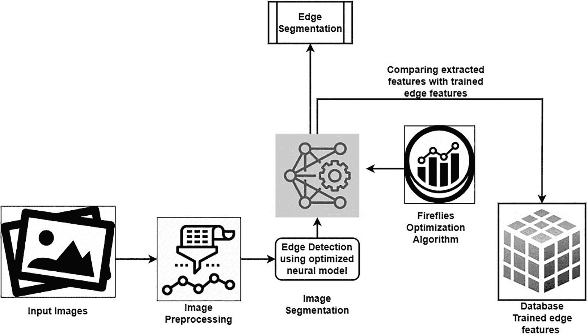

图 9.1 基于 FFDCN 的图像分割结构

### 9.3.1 数据集

该工作使用伯克利分割数据集 [21] 图像来分析基于 `FFDCN` 算法的边缘检测的工作流程。数据集具有用于训练分割系统的图像边界和地面真细节。对图像边界信息的有效利用最大化了整体检测精度。数据集由训练（100 张图像）和测试（200 张图像组成，根据图 9.1](#ch09.xhtml#fig9_1) 进行处理以预测图像边缘信息。数据集包含来自 `Corel` 数据集的 1000 张图像。从 1000 张图像中，12000 张手动标记的分割图像有助于识别新的图像边缘。然后样本图像描述在图 9.2](#ch09.xhtml#fig9_2) 中。

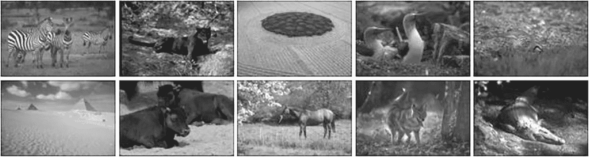

图 9.2 输入数据集灰度图

图 9.2 显示了来自数据集 [21] 的灰度图像。数据集包含彩色和灰度图像，通过不同的处理步骤来预测图像边缘信息。假设采集的图像是彩色的，转换为灰度以简化图像边缘检测过程。灰度图像减少了分析图像边界信息时的困难。

### 9.3.2 图像预处理

这项工作的第一步是从采集的图像中去除噪声，称为图像预处理。图像在采集过程中损坏会完全影响模式识别或目标检测。通过应用不同的滤波技术去除图像噪声，这些技术探索每个像素并将其与阈值进行比较。根据比较，从图像中消除噪声像素，提高图像质量。预处理通过应用均值直方图均衡化方法完成。噪声消除过程消除了低质量像素并提高了图像质量，增加了边缘检测过程。直方图方法探索每个像素并识别边界细节。最初，通过定性和定量的角度分析像素将图像分解为子图像。图像阈值通过 `OpenCV` 的帮助进行估计，用计算值替换噪声。

在公式 (9.3) 中，子图像表示为 `S`[`k`]，像素组合基于似然值确定，该值使用公式 (9.4) 计算。

$PDF\_{k}\left( P\_{h} \right) = \frac{n^{k}}{n\_{k}}$ (9.4)

在公式 (9.4) 中，子图像直方图值定义为 `PDF``k`，它包含 `n`[`k`] 个像素。然后使用公式 (9.5) 计算累积分布。

$CDF{(G\_{j})} = \sum\_{j = X\_{0} + 1}^{n}{PDF\_{k}{(G\_{j})}}$ (9.5)

在公式 (9.5) 中，`h` = `X`[`k`] + 1, `X`[`k`] + 2, …`X`[`k` + 1]，且 `k` = 0, 1, 2, …`t` − 1。每个像素的加权平均值是从计算出的分布值中估计的。根据这些值，消除了噪声像素，并改进了直方图值以提高图像质量。该算法消除了 1 到 25% 的噪声水平，并将图像质量从 20 提高到 35%。然后样本去噪图像如图图 9.3 所示。

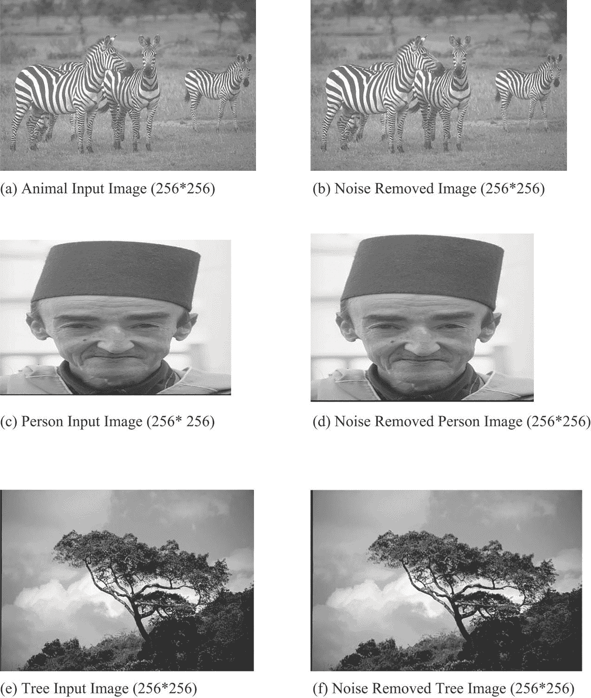

图 9.3 预处理样本图像

### 9.3.3 使用 FFDCN 进行边缘检测

边缘检测通过应用萤火虫深度卷积神经网络（FFDCN）来实现。该算法旨在通过减少误分类错误率来最大化边缘检测准确性。卷积网络使用内核、步长和滤波器来识别图像边缘和边界。全连接层和卷积层持续分析图像像素并以最小的假阳性率预测边缘信息。网络具有全连接最大池化层和卷积层，它们与激活学习函数协同工作。算法通过计算图像中的像素来预测边缘。这些层具有局部感受野、权重复制和微调程序，以降低假边缘预测率。输入层接收无噪声图像作为输入，使用局部感受野逐像素进行检查。感受野在不影响计算过程的情况下最大化了边缘预测准确性。卷积网络有一系列层，用于学习分层特征，提高了整体边缘检测效率。网络的隐藏层通常是卷积、激活和池化。然后，深度卷积层网络的结构如图图 9.4 所示。

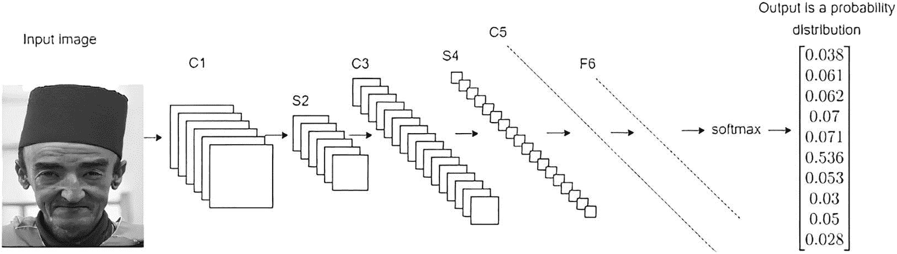

图 9.4 深度卷积神经网络结构

图 9.4 展示了深度卷积网络结构。256*256 像素的输入图像通过第一层（卷积层-C1）进行分析。卷积层在输入图像（64*64 尺寸）上使用 5*5 大的卷积核。该层识别图像的基本特征，如角和边缘。卷积层的输出馈到子采样层（S2），也称为最大池化层。第一层输出中的每个四像素正格都被分析，并获得最大值。S2 层将 24*48 的图像缩小 2 倍，得到的输出尺寸为 24*24。第二个卷积层（C3）具有 24 个 5*5 大的卷积核，并产生 16*16 的图像。然后应用第二个最大池化层（S4）以获得 16*16 尺寸的图像，并通过层中的 400 个节点获得 256 个输出的全卷积层。最后层分析输入以获得 1D 数组值作为输出。SoftMax 激活函数处理数组值以获得最终输出。在此过程中，网络权重值经过微调，以最小化假预测准确性。因此，这项工作使用萤火虫优化算法更新网络参数，以最大化边缘预测准确性。该算法基于吸引力、距离和时刻工作。参数值通过应用最小化预测边缘偏差的吸引力函数选择最相关的值。之后，利用距离和时刻函数来选择优化的网络参数。适应度函数 `f(x)` 与萤火虫的特性相关，例如吸收系数 `γ` 和光强度 I。定义的适应度函数通过利用偏置和权重微调过程最小化了假边缘预测的最大化。在权重更新中，每个参数都与适应度函数进行比较，选择最佳参数。然后计算光强度值以识别更相关的参数。适应度函数通过萤火虫数量（边缘相关特征）与代数计数之乘来选择。然后根据公式 (9.6) 进行网络微调。

`xi = xi + βxj²α[t]ϵ[t]`

根据公式 (9.6)，网络参数更新 `xi` 使用控制步长的 `α[t]`、高斯向量 `ϵ[t]`、萤火虫吸收系数 `β` 以及 `xj - xi` 执行。在此过程中，网络权重值经过微调以最小化假预测准确性。算法过程所示（图 9.5).


图 9.5 基于萤火虫优化算法的网络微调过程

在提取边缘后，相应的特征通过不同的方法进行预测，并借助分类器进行分类。引入的萤火虫微调深度卷积神经网络（FFDCN）方法通过以下性能分析过程进行评估。

## 9.4 实验分析

在研究期间，系统查看了伯利分割数据集以确定 FFDCN 的有效性。系统识别图像边缘的有效性使用这些一百幅图像进行评估。新开发的系统使用 200 张图像进行训练，从中提取图像边缘相关的特征。派生的特征模板版本保存在数据库中。检索到的特征可以以最高的准确率预测测试边缘。FFDCN 方法的卓越性与支持向量机（SVM）和卷积神经网络（CNN）进行了比较。

### 9.4.1 峰值噪比 (PSNR)

PSNR 值用于确定预期边缘的质量，以分贝（dB）表示。

$PSNR = 10\log_{10}\left( \frac{R^{2}}{MSE} \right)$ (9.7)

在公式 (9.7) 中，MSE（实际与预期边缘细节之间的差异）和 `R` 是输入图像的最大变化。然后，得到的 PSNR 值如表 9.1 所示。

# 表 9.1 PSNR 分析

| 图像 | SVM \[16\] | CNN \[17\] | FFDCN |
| --- | --- | --- | --- |
| **10** | 42.65 | 53.93 | 76.46 |
| **30** | 42.38 | 55 | 76 |
| **50** | 42.66 | 55.81 | 75.14 |
| **70** | 42.74 | 55.63 | 75.67 |
| **90** | 42.63 | 54.11 | 76.36 |
| **110** | 42.73 | 54.75 | 76.89 |
| **130** | 42.02 | 53.24 | 76.14 |
| **150** | 42.55 | 53.88 | 76.6 |
| **170** | 42.65 | 53.96 | 75.18 |
| **190** | 42.9 | 55.72 | 76.97 |
| **210** | 42.73 | 55.14 | 75.23 |
| **230** | 42.49 | 55.73 | 75.58 |
| **250** | 42.6 | 53.56 | 76.24 |
| **270** | 42.02 | 54.63 | 76.94 |
| **290** | 42.47 | 53.08 | 75.05 |

表 9.1 展示了所引入的基于 FFDCN 的边缘检测过程的 PSNR 值。通过讨论可知，所引入的系统实现了高 PSNR 值（76 dB），优于其他方法，如 SVM（42.54 dB）和 CNN（54.54 dB）。然后，相应的图形分析如图图 9.7 所示。


图 9.7 说明 FFDCN 方法获得了高 PSNR 值，这意味着所提的 FFDCN 方法能够有效地去除图像中的噪声。此外，PSNR 值表明，图像质量不受去去除过程的影响，因为输出图像与原始图像相同。显然，输入图像的高良质量证明了所提系统可以准确检测图像的边缘。

## 9.4.2 结构相似性指数 (SSIM)

SSIM 指标决定了真实图像与边缘检测图像之间的相似性。公式 (9.8) 用于计算 `SSIM = (I0, I1) * α * (I0, I1) * β * (I0, I1) * γ`。在公式 (9.7) 中，`α = β = γ = 1`。因此，FFDCN 方法得到的 SSIM 值为 1；两幅图像相似。然后，得到的 SSIM 值如表 9.2 所示。

### 表 9.2 结构相似性分析

| 图像 | SVM \[16\] | CNN \[17\] | FFDCN |
| --- | --- | --- | --- |
| **10** | 95.12 | 96.22 | 98.47 |
| **30** | 95.29 | 96.43 | 97.96 |


| 50 | 95.7 | 96.47 | 98.27 |
|---|---:|---:|---:|
| 70 | 93.25 | 96.04 | 98.18 |
| 90 | 94.09 | 96.18 | 98.95 |
| 110 | 95.5 | 96.96 | 97.43 |
| 130 | 95.7 | 95.97 | 98.32 |
| 150 | 93.23 | 95.49 | 97.48 |
| 170 | 93.7 | 95.81 | 98.25 |
| 190 | 95.32 | 95.31 | 97.18 |
| 210 | 93.44 | 95.62 | 97.5 |
| 230 | 94.51 | 95.57 | 98.6 |
| 250 | 95.14 | 96.11 | 97.8 |
| 270 | 93.98 | 95.77 | 98.92 |
| 290 | 94.74 | 95.74 | 97.43 |

表 9.2 展示了引入的 FFDCN 边缘检测过程的 SSIM 值。从讨论来看，所引入的 FFDCN 系统获得了高 SSIM 值（98.04%），优于其他方法，如 SVM（94.58%）和 CNN（95.97%）。SSIM 的相应图形分析如图 9.8 所示。


### 9.4.3 误接受率（FAR）

FAR 是用于计算从图像中识别边缘有效性的指标。FAR 值使用公式 (9.9) 计算：

```text
FAR = \frac{Number\ of\ features\ accepted}{Number\ of\ features\ tested} * 100
```

得到的 FAR 相关值如表 9.3 所示。

### 表 9.3 误接受率

| 图像 | SVM \[16\] | CNN \[17\] | FFDCN |
|---|---:|---:|---:|
| 10 | 0.1444 | 0.1305 | 0.1077 |
| 30 | 0.1577 | 0.1261 | 0.0996 |
| 50 | 0.1704 | 0.1448 | 0.1003 |
| 70 | 0.1822 | 0.119 | 0.0984 |
| 90 | 0.1897 | 0.1144 | 0.0954 |
| 110 | 0.1557 | 0.1319 | 0.1096 |
| 130 | 0.1517 | 0.1171 | 0.1016 |
| 150 | 0.1547 | 0.1467 | 0.0917 |
| 170 | 0.1665 | 0.1601 | 0.0902 |
| 190 | 0.1559 | 0.1722 | 0.1 |
| 210 | 0.1808 | 0.1557 | 0.1067 |
| 230 | 0.1701 | 0.1354 | 0.1002 |
| 250 | 0.175 | 0.1739 | 0.1065 |
| 270 | 0.1723 | 0.1562 | 0.1047 |
| 290 | 0.1545 | 0.1496 | 0.101 |

表 9.3 展示了引入的 FFDCN 边缘检测过程的 FAR 值。从讨论来看，引入的系统获得了最小 FAR 值（0.101），优于其他方法，如 SVM（0.162）和 CNN（0.142）。FAR 的相应图形分析如图 9.9 所示。


图 9.9 展示了 FFDCN 方法的 FAR 值。建议的方法使用优化函数来微调网络设置。由于目标函数和适应度的有效使用，错误预测率降低。这意味着 FAR 的最佳值是预测边缘精度的最大值。

### 9.4.4 误拒绝率

FRR 是用于在边缘检测过程中预测错误识别特征的指标。它使用公式 (9.10) 计算：

```text
FRR = \frac{Number\ of\ original\ features\ rejected}{Number\ of\ original\ features\ tested} * 100
```

表 9.4 展示了引入的 FFDCN 边缘检测过程的 FRR 值。从讨论来看，引入的系统获得了最小 FRR 值（0.100），优于其他方法，如 SVM（0.172）和 CNN（0.36）。FRR 的相应图形分析如图 9.10（表 9.5）。

### 表 9.4 误拒绝率

| 图像 | SVM \[16\] | CNN \[17\] | FFDCN |
|---|---:|---:|---:|
| 10 | 0.1496 | 0.1583 | 0.0928 |
| 30 | 0.1834 | 0.1232 | 0.1037 |
| 50 | 0.157 | 0.1447 | 0.091 |
| 70 | 0.1822 | 0.119 | 0.0984 |
| 90 | 0.1897 | 0.1144 | 0.0954 |
| 110 | 0.1557 | 0.1319 | 0.1096 |
| 130 | 0.1517 | 0.1171 | 0.1016 |
| 150 | 0.1547 | 0.1467 | 0.0917 |
| 170 | 0.1665 | 0.1601 | 0.0902 |
| 190 | 0.1559 | 0.1722 | 0.1 |
| 210 | 0.1808 | 0.1557 | 0.1067 |
| 230 | 0.1701 | 0.1354 | 0.1002 |
| 250 | 0.175 | 0.1739 | 0.1065 |
| 270 | 0.1723 | 0.1562 | 0.1047 |
| 290 | 0.1545 | 0.1496 | 0.101 |


### 表 9.5 检测率

| 图像 | SVM \[16\] | CNN \[17\] | FFDCN |
|---|---:|---:|---:|
| 10 | 93.5 | 96.67 | 98.45 |
| 30 | 95.01 | 95.44 | 97.55 |
| 50 | 93.17 | 95.22 | 97.8 |
| 70 | 94.63 | 97 | 98.12 |
| 90 | 94.44 | 96.21 | 98.03 |
| 110 | 94.2 | 95.68 | 98.55 |
| 130 | 93.12 | 95.12 | 97.58 |
| 150 | 94.32 | 95.68 | 97.92 |
| 170 | 93.55 | 96.26 | 97.15 |
| 190 | 94.54 | 96.92 | 98.4 |
| 210 | 95.98 | 95.34 | 97.15 |
| 230 | 93.37 | 96.14 | 97.98 |
| 250 | 93.64 | 95.97 | 97.02 |
| 270 | 95.02 | 96.82 | 98.98 |
| 290 | 93.01 | 96.34 | 97.58 |

从图 9.11 可以看出，基于 `FFDCN` 的边缘检测过程通过检测准确率、`PSNR`、`SSIM`、`FAR` 和 `FRR` 等不同指标进行了评估。引入的 `FFDCN` 方法效率与 [16] 和 [17] 中定义的 `SVM` 和 `CNN` 进行对比。分析明确指出，`FFDCN` 方法达到了 97.87% 的准确率，优于其他方法 `SVM`（94.1%）和 `CNN`（96.054%）。荧火虫优化算法应用于每次迭代中微调神经网络的性能。网络参数的持续更新最小化了边缘预测之间的整体偏差，并提高了检测准确率。此外，加权平均和直方图法的引入减少了无关像素和噪声像素的贡献。图像亮度值也得到了改进，以降低边缘检测的计算复杂度。因此，深度卷积网络成功地使用了网络内核、`stride` 和 `filters`，以最小的 `FRR` 和 `FAR` 速率预测出准确的图像边缘。因此，所引入的系统通过降低计算复杂度和最大化整体性能识别了图像边缘。


图 9.11 基于 BO-ARNM 的边缘检测方法的效率分析。

## 9.5 结论

本文探索了基于荧火虫微调深度卷积网络（`FFDCN`）的图像边缘检测流程。首先，从包含大量图像的伯克利分割数据集（Berkeley Segmentation Dataset）收集图像。收集到的图像通过加权平均滤波器进行处理，该滤波器检查每个像素，并在平均值的帮助下替换噪声像素。计算像素分布和强度值以最大化图像质量。去噪后的图像通过深度卷积神经网络层进行处理。网络利用全连接层和 `max-pooling` 层来预测图像边缘和角点信息。在此过程中，执行了基于荧火虫优化算法的神经网络参数选择过程。优化算法利用其觅食特性来选择优化的特征。有效的选择程序最小化了实际边缘值与预测边缘值之间的偏差。模型以 97.87% 的检测率预测边缘，高于其他方法。在未来，将通过应用强化学习和优化算法来改进边缘预测。

### 参考文献

1. Zhu, Tengfeng, Yijie Lou, Yihan Zhou, Jiahao Zhang, Junyi Huang, Yan Li, Hailu Luo 等. 光自旋霍尔效应的广义空间微分及其在边缘检测图像处理中的应用。Physical Review Applied 11, no. 3 (2019): 034043.
2. Fu, Kun, Zhonghan Chang, Yue Zhang, Guangluan Xu, Keshu Zhang, and Xian Sun. 用于遥感图像检测的旋转感知多尺度卷积神经网络。ISPRS Journal of Photogrammetry and Remote Sensing 161 (2020): 294–308.
3. Han, Jiaming, Jian Ding, Jie Li, and Gui-Song Xia. 用于定向物体检测的深度特征对齐。IEEE Transactions on Geoscience and Remote Sensing 60 (2021): 1–11.
4. Sharif, Muhammad Irfan, Jian Ping Li, Muhammad Attique Khan, and Muhammad Asim Saleem. 用于分割的活跃深度神经网络特征选择。Pattern Recognition 129 (2020): 181–189.
5. Lokwal, Shekhar, 用于 MRI 图像识别的形态操作。International Journal of Manufacturing 11, no. 1 (2021): 1–10.
6. Mortazavi, Mina, 使用分阶导数改进 Canny 边缘检测。Journal of Mathematical Modeling 11 (2022): 20.
7. Gandhi, Varun, 用于高斯噪声影响图像的超参数调优卷积神经网络。Applied Soft Computing 117 (2022): 10365.
8. Bhuyan, Manas Kamal, 用于人脸识别的 FaceNet。2020 年 IEEE 电子与可持续通信会议（ICES）, pp. 228–234.
9. Mittal, Monika, 光自旋霍尔效应的广义空间微分。CRC Press, 2019.
10. Pintus, Ruggero, 网络参数的持续更新最小化了边缘预测之间的偏差。
11. Prasad, Kaushik, 通过深度卷积层处理去噪图像。
12. Tian, Bin, 基于荧火虫优化算法的神经网络参数选择。
13. Han, Monika, 图像亮度值也得到了改进，以降低边缘检测计算复杂度。
14. Han, Hsiang-Yu, 网络利用全连接层和 `max-pooling` 层。
15. Chen, Weiwei, 加权平均和直方图法的引入检查每个像素。
16. Remya, Ajai, 深度卷积网络成功使用了网络内核、`stride` 和 `filters`。
17. Liu, Jianxin, 用于检测的旋转感知多尺度卷积神经网络。
18. Bansal, Monika, 光自旋霍尔效应的广义空间微分。
19. Rangaswamy, Chandini, 有效的选择程序最小化了实际边缘值与预测边缘值之间的偏差。
20. Dutande, Prasad, 在未来，将通过应用强化学习和优化算法来改进边缘预测。
21. 网站：[`www2.eecs.berkeley.edu/Research/Projects/CS/vision/bsds/`](https://www2.eecs.berkeley.edu/Research/Projects/CS/vision/bsds/)

# 10 机器学习、深度学习与计量经济学模型在 Rain Industries 股价波动中的应用深度分析

**Abhijit Biswas**

博士研究学者，Maulana Abul Kalam Azad 科技大学（原 WBUT），加尔各答，西孟加拉邦，印度

**Meghdoot Ghosh**

管理学院，斯瓦米·维韦卡纳现代科学学院，加尔各答，西孟加拉邦，印度

DOI: [10.1201/9781032725444-10](https://doi.org/10.1201/9781032725444-10)

## 10.1 引言

Rain Industries 是一家从事碳产品和化学产品销售的全球性公司。该公司成立于 1974 年，总部位于印度海德拉巴，在炭黑行业具有重要地位。炭黑是 Rain Industries 的主要产品，是由煤焦油、原油或天然气等富碳材料制成的细微粉末。由于其能够增强材料的强度和耐用性，炭黑被广泛用作轮胎、带和软管等橡胶产品的增强剂。此外，炭黑还应用于塑料、墨水、涂层和其他工业产品的制造。Rain Industries 通过三个主要业务部门运营：

- **碳（Carbon）**：该部门侧重于炭黑的生产和销售，构成了公司收入的大部分。Rain Industries 是国际最大的炭黑制造商之一，向全球不同企业供应其产品。
- **高级材料（High level materials）**：在这一部分，Rain Industries 制造并展示特殊合成材料，例如煅焦油焦（`CPC`）、煤焦油分（`CTP`）以及其他衍生物。这些产品应用于铝、钢、石墨电极和二氧化钛等行业。
- **水泥（Cement）**：Rain Industries 在多个地点运营水泥厂，主要服务于南印度市场。公司生产不同类型的水泥，包括波兰水泥、混合水泥和现配混凝土。Rain Industries 的客户群体多样，涵盖了从汽车制造商到建筑公司、化学生产商和其他工业部门。

该公司拥有全球业务，制造设施和办公室位于多个国家，包括印度、美国、加拿大、荷兰、德国、比利时和中国。Rain Industries 的股价受多种因素影响，包括全球炭黑需求、原材料价格、宏观经济状况、行业趋势以及公司特定因素（如产能、运营效率和财务表现）。理解和预测 Rain Industries 的股价波动对于投资者、交易员和财务分析师做出明智决策并优化投资策略至关重要。

在接下来的章节中，我们将探索不同逻辑策略（包括人工智能和深度学习）在分析和预测 Rain Industries 股价波动中的应用。股价波动分析在投资决策和财务预测中起着关键作用。传统方法等计量经济模型长期以来一直用于理解和预测波动。然而，随着技术的进步，`ML` 和 `DL` 技术因其处理复杂模式和做出准确预测的能力而受到广泛关注。在这项深度分析中，我们探讨了 `ML`、`DL` 和计量经济模型在分析全球行业领先者 Rain Industries 股价波动中的应用。炭黑是制造轮胎、塑料和其他工业产品的原材料。通过利用各种模型和技术，我们旨在揭示影响 Rain Industries 股价的因素，并开发预测模型以预测其未来趋势。此分析将为寻求对 Rain Industries 股票做出明智决策的投资者、交易员和财务分析师提供价值信息。我们将首先讨论股价分析中常用的传统计量经济模型。然后，我们将深入探讨 `machine learning` 和 `deep learning` 算法在捕捉复杂模式和预测股价波动中的应用。最后，我们将概述该分析涉及的步骤并提供所用数据的概述。通过这项分析，我们将对 Rain Industries 的股价波动有一个全面的理解，并开发出有助于做出准确预测的模型。这些信息将有助于更明智的投资策略，并帮助利益相关者做出更好的财务决策。请注意，此处提出的分析仅供教学目的，不应被视为货币建议。投入证券交易所带有风险，在进行任何投资选择之前，进行直接的深入研究并咨询财务专家至关重要。

## 10.2 文献综述

波动性分析和建模在金融计量经济学领域已得到广泛研究。许多研究探索了 ARCH 系列模型在捕捉金融市场波动方面的有效性。然而，专门针对印度市场的研究仍然较少。本文献综述提供了该领域相关研究的概述，并强调了本项比较分析旨在解决的空白。

### 波动性分析与 ARCH 模型


Engle (1982) 提出了 `ARCH` 模型，该模型假设金融资产的条件方差是其过去平方残差的函数。这项开创性的工作导致了对基础 `ARCH` 模型的各种扩展和改进。Bollerslev (1986) 提出了 `GARCH` 模型，该模型结合了滞后条件方差和滞后平方残差以捕捉波动聚集。Nelson (1991) 引入了 `EGARCH` 模型，该模型允许对不确定性冲击产生非对称反应。Zakoian (1994) 开发了 `TGARCH` 模型，该模型引入了阈值参数以捕捉极端事件对波动的影响。

## 全球金融市场中的 ARCH 模型

`ARCH` 系列模型已广泛应用于全球金融市场。Alizadeh、Brandt 和 Diebold (2002) 检查了 `ARCH` 模型在捕捉美国股市波动动态方面的表现。他们比较了 `ARCH` 和 `GARCH` 模型在波动预测中的准确性，发现 `GARCH` 模型表现优于 `ARCH` 模型。在新兴市场背景下，Chen 和 Lee (2003) 评估了 `GARCH` 模型在台湾股市的适用性。他们得出结论认为，`GARCH` 模型有效地捕捉了波动模式并提供了可靠的预测。

## 印度股市的波动性分析

专门针对印度股市波动性分析的研究有限。Prakash 和 Dash (2011) 应用 `ARCH` 系列模型分析了印度股票收益率的波动性。他们发现了波动聚集的证据，并建议 `GARCH` 模型适用于印度背景下的波动建模。Khan 和 Ahmad (2016) 使用 `GARCH` 模型调查了印度股票市场的波动动态，并结论认为 `GARCH(1,1)` 模型对数据的拟合效果最好。

# 定制化组合与波动率分析

针对个人投资者特定偏好和目标而定制的投资组合，在组合管理中日益受到重视。波动率分析在管理定制组合中起着至关重要的作用，因为它有助于评估风险并优化资产配置。然而，关于 `ARCH` 系列模型在定制组合波动率分析中应用的研究仍然缺乏，特别是在印度股市。

根据现有文献，显而易见的是需要对 `ARCH` 系列模型在定制组合波动率分析中进行全面的对比分析，特别是针对印度股市。本文通过考察 `ARCH` 模型的表现并确定最适用于印度背景波动率分析的模型，来填补文献的空白。后续章节将深入探讨方法论、数据收集、实证结果以及研究的意义。

Engle, R. F. (1982). Autoregressive conditional heteroscedasticity with estimates of the variance of United Kingdom inflation. Econometrica, 50(4), 987–1008.

Engle 的开创性论文引入了 `ARCH` 模型，并证明了其在通胀波动率建模和预测中的应用。这篇文章为后续关于 `ARCH` 系列模型的研究奠定了基础。

Bollerslev, T. (1986), Generalized autoregressive conditional heteroskedasticity. Journal of Econometrics, 31, 177.

## 10.3 目标

这项深度分析的目标是探索和评估各种建模技术（包括机器学习、深度学习和计量经济模型）在预测和分析 Rain Industries 股价走势方面的应用。选择 Rain Industries 作为关注的特定行业。

本分析的主要目标是：

1. 股价预测：利用所选模型预测 Rain Industries 的未来价格走势。这涉及在历史股价数据上对模型进行训练，并评估其生成准确预测的能力。

2. 特征分析：识别并分析影响 Rain Industries 股价走势的关键特征或变量。这可能涉及调查宏观经济指标、行业特定因素、新闻情绪或技术指标等因素，这些因素可以为预测股票波动提供价值见解。

3. 模型比较：汇总其他模型（包括机器学习、深度学习和计量经济模型）在预测 Rain Industries 股价波动方面的表现和有效性。评估它们的优点、局限性以及捕捉 Rain Industries 股票市场行为复杂性的适用性。

4. 可解释性：评估分析中所采用模型的可解释性。探索模型在多大程度上为驱动 Rain Industries 股价波动的因素提供了可理解且可操作的见解。

5. 风险分析：利用 `GARCH` 或 `ARCH` 等模型纳入风险分析，估计波动率并评估与 Rain Industries 股价相关的下行风险。该分析有助于投资者做出明智决策并管理其投资组合。

6. 实际意义：讨论分析的实际意义，包括发现和见解如何被 Rain Industries 的投资者、交易员和利益相关者使用。强调在股票交易、风险管理和组合优化相关的决策过程中利用这些模型的潜在收益。

通过实现这些目标，这项深度分析旨在全面理解各种建模技术在预测和分析 Rain Industries 股价走势方面的应用和表现。研究结果可以为金融领域的明智决策做出贡献，并帮助市场参与者洞察 Rain Industries 的股票市场行为。

Engle, R. F. (1982). Autoregressive conditional heteroscedasticity with estimates of the variance of United Kingdom inflation. Econometrica, 50(4), 987–1008.

Bollerslev, T. (1986), Generalized autoregressive conditional heteroskedasticity. Journal of Econometrics, 31, 177.

Zakoian, J. M. (1994). Threshold heteroskedasticity. Journal of Economic Dynamics and Control, 18(5), 931.

Nelson, D. B. (1991). Conditional heteroskedasticity. Econometrica, 59(2), 347–370.

Maheswaran, S. & Sahoo, P. (2018). Volatility with GARCH: An application. IIM Management, 30(3), 260–272.

Jadhav, P. & Patil, A. (2020). Forecasting with EGARCH: A study. International Journal of Information & Decision Making, 17(3), 297.

Kundu, S. & Ghosh, D. (2021). Volatility with ARCH. Journal of Quantitative Economics, 20, 869.

Poon, S. & Granger, C. (2003). Volatility forecasting: A review. Journal of Economic Literature, 41(2), 478–539.

## 10.4 Methodology

为了分析 Rain Industries 的股价走势（数据来自 Yahoo Finance 过去 10 年的 Scrip RAIN.NS 数据），我们将结合使用机器学习、深度学习和计量经济学模型，并考虑收盘价。这种方法使我们能够捕捉复杂的模式，识别相关特征并做出准确的预测。

我们从彭博社（Bloomberg）、雅虎财经（Yahoo Finance）或其他财经数据库等可靠财经数据源收集了 Rain Industries 的历史股价数据。此外，我们收集了相关的宏观经济指标、行业特定数据以及可能影响 Rain Industries 股价的特定信息。数据预处理是确保数据质量及其与模型兼容性的至关重要的一步。我们将通过删除任何缺失值、离群值或不一致之处来清洗数据集。此外，我们可能会进行特征工程，从可用数据中提取额外的有意义的特征，例如技术指标（移动平均线、波动率衡量）或来自新闻文章或社交媒体数据的情感分析。

计量经济学模型（`ARIMA`）、向量回归（`VAR`）或（`GARCH`）长期以来一直用于分析和预测股价。我们将应用这些模型来捕捉 Rain Industries 股价的线性依赖和时间序列特征。计量经济学模型可以提供股价与其他相关变量（如宏观经济指标或行业特定因素）之间关系的见解。

### ARIMA 模型

`ARIMA` 模型是一种流行的时间序列分析模型，它结合了自回归（`AR`）、差分（`I`）和移动平均（`MA`）组件。它被广泛用于预测股价。

`ARIMA` 模型没有特定的公式。相反，它们涉及分析时间序列数据，识别合适的模型参数（`p, d, q`），并使用模型方程进行预测。

### GARCH 和 ARCH 模型

`GARCH` 模型是一种广泛使用的计量经济学模型，用于分析和预测金融时间序列数据的波动率。它捕捉了数据中的自相关性和波动聚集性。通过对模型参数进行估计，使用该模型来分析和预测股价数据的条件波动率。

`ARCH` 模型是 `GARCH` 模型的简化版本，用于模拟金融时间序列数据的条件方差。

### XGBoost 算法

`XGBoost` 是一种流行的用于回归和分类任务的机器学习算法。它是一种集成方法，通过结合多个决策树来做出准确预测。`XGBoost` 算法没有特定的方程。它通过梯度提升迭代优化损失函数来运行。`XGBoost` 没有特定的图示相关。它由决策树的集成组成，每棵树都做出预测，最终的预测通过组合所有树的预测结果获得。

上述模型即 `ARIMA`、`GARCH`、`ARCH` 和 `XGBoost`，为分析和预测 Rain Industries 的股价走势提供了不同的方法。它们有各自的方程和工作原理，能够对数据进行全面分析。模型的选择取决于分析的具体需求和数据集的特征。

### 向量回归 (VAR)

除了 `ARIMA`、`GARCH`、`ARCH` 和 `XGBoost` 模型外，另一种常用于分析股价波动的计量经济学模型是向量回归（`VAR`）模型。`VAR` 模型允许分析多个变量随时间变化的相互依赖关系。在研究股价与其他相关经济变量（如宏观经济指标或行业特定因素）之间的关系时，`VAR` 模型特别有用。

`VAR` 模型允许通过最小二乘法估计或极大似然估计等技术估计系数 `A_1`、`A_2`、…… `A_p`。这些系数捕捉了模型中包含变量之间的动态关系。`VAR` 模型可以扩展以包含外生变量（如市场指数或经济指标），以捕捉它们对股价波动的影响。`VAR` 模型提供了几项实用的见解，例如变量之间的短期和长期动态、脉冲响应分析，有助于理解影响 Rain Industries 的因素之间的相互作用。需要注意的是，`VAR` 模型假设变量是平稳的，或者可以通过差分变为平稳。此外，可以使用信息准则等模型选择技术来确定模型中的滞后阶数（`p`）。总之，`VAR` 模型是分析 Rain Industries 股价波动中内生和外生因素复杂关系的价值工具。

### 机器学习与深度学习

除了 `ARIMA`、`GARCH`、`ARCH` 和 `XGBoost` 模型，我们将利用各种机器学习算法，如线性回归、决策树、随机森林、支持向量机（`SVM`）或梯度提升来捕捉数据中的非线性关系和模式。这些模型可以同时考虑多个特征并根据历史模式生成预测。此外，我们可能会采用特征选择技术来识别影响最大的变量。

深度学习模型，特别是递归神经网络（`RNN`）和长短期记忆网络（`LSTM`），非常适合分析股价等序列数据。这些模型可以捕捉时间依赖性并从历史股价数据中学习复杂模式。我们将训练并优化深度学习模型，根据历史价格序列和其他相关特征预测 Rain Industries 的股价。

深度学习模型，特别是 `RNN` 和 `LSTM` 网络，已在分析和预测股价走势方面展示了其有效性。在这里，我们将讨论 `LSTM` 网络作为股价分析深度学习模型的应用。`CNN` 主要用于图像识别任务，但它们也可以通过将股价数据视为图像化表示来分析和预测股价波动。尽管 `CNN` 在股价分析中不像在图像处理中那样常用，但一些研究已对其进行了探索。在这里，我们将提供 `CNN` 模型概述及其在股价分析中的潜在应用。

`CNN` 没有像线性回归或 `LSTM` 网络那样特定的方程。相反，它们依赖于卷积操作的应用以及随后的变换来学习特征表示。`CNN` 内部方程与每层执行的操作有关，例如卷积、池化和激活函数。

请记住，此处提供的公式和图表是用于股价预测 `CNN` 架构的简化表示。实际实现可能涉及额外的层、超参数调优以及针对特定数据集和解决问题的预处理步骤。

`LSTM` 网络是一种能够捕捉序列数据中长期依赖关系的循环神经网络。它们特别适用于分析股票价格等时间序列数据，在这些数据中顺序和时间模式至关重要。

`LSTM` 网络由多个 `LSTM` 单元组成，每个单元在其隐藏状态和单元状态中保留信息。每个时间步的输入（`x_t`）馈送网络，`LSTM` 单元处理序列数据以进行预测。通过调整权重和偏置（使用随时间反向传播 `BPTT` 和梯度下降算法）对网络进行训练。训练过程旨在最小化预测价格与实际价格之间的预测误差。`TensorFlow` 或 `PyTorch` 等深度学习框架提供了高效实现和训练 `LSTM` 网络的工具和函数。请注意，此处提供的公式和图 10.2 是股价预测 `LSTM` 网络的简化表示。实际实现可能涉及额外的层、超参数调优以及针对当前数据集和问题的预处理步骤。


图 10.2 用于股价预测的 LSTM 网络架构。

我们将使用适当的均方误差（`MSE`）、平均绝对误差（`MAE`）、均方根误差（`RMSE`）来评估每个模型的表现。此外，我们可能会考虑夏普比率或累计收益率等财务指标来评估模型的盈利能力。根据结果，选择最准确、最可靠的模型进行股价预测。一旦模型完成训练和验证，我们将对 Rain Industries 股票价格的未来走势进行预测。我们将分析结果并与实际股价数据进行比较，以评估模型的准确性。此外，我们可能会进行敏感性分析或情景建模，以理解关键变量的变化或市场状况如何影响股价。通过遵循这种方法，我们旨在洞察驱动 Rain Industries 股价波动的因素，并开发能够帮助投资者、交易员和金融分析师决策的预测模型。股票市场分析涉及固有的不确定性和风险，模型生成的预测应作为决策过程中的多种工具之一。

## 10.5 结果与分析

### ARIMA, SARIMA, SARIMAX

在使用 `python` 代码后，最佳的 `ARIMA` 模型是 `ARIMA(3,0,3)`。结果如下所示：

表 10.1 ARIMA 结果

| 因变量^R - y | 观测值数量^R - 3628 |
| --- | --- |
| 模型^R – SARIMAX^R(3, 0, 3) | 对数似然^R– 6400.569 |
| 样本^R – 3628 | AIC = –12785.138 |
| 协方差类型 | |
| | 系数 | 标准误差 | Z | P>|z|^R | 0.025^R | 0.975^R |
| 截距 | 0.2729 | 0.019 | 14.124 | 0.000 | 0.235 | 0.311 |
| AR.L1^R | –0.2054 | 0.106 | –1.941 | 0.052 | –0.413 | 0.002 |
| AR.L2^R | 0.1589 | 0.083 | 1.921 | 0.055 | –0.003 | 0.321 |
| AR.L3^R | 0.4860 | 0.060 | 8–134 | 0.000 | 0.369 | 0.603 |
| MA.L1^R | 0.1175 | 0.103 | 1.142 | 0.253 | –0.084 | 0.319 |
| MA.L2^R | –0.3740 | 0.086 | –4.326 | 0.000 | –0.543 | –0.205 |
| MA.L3^R | –0.6345 | 0.067 | –9.457 | 0.000 | –0.766 | –0.503 |
| Sigma2^R | 0.0017 | 0.0000139 | 125.830 | 0.000 | 0.002 | 0.002 |
| Ljung–Box(L1)^R (Q)^R – 10.20 | Jarque–Bera(JB)^R – 377978.50 |
| Prob(Q)^R – 0.000 | Prob(JB)^R – 0.000 |
| Heteroskedasticity^R (H)^R – 17.95 | Skew^R – 1.38 |
| Prob(H)^R (two–sided)^R – 0.000 | Kurtosis^R – 52.93 |

表 10.2 SARIMA 结果

| 因变量^R – y | 观测值数量^R – 3628 |
| --- | --- |
| 模型^R – ARIMA^R (3, 0, 3) | 对数似然^R – 6427.813 |
| 样本 – 3628 | AIC^R = –12839.625 |
| 协方差类型 | |
| | 系数 | 标准误差 | Z | P>|z| | 0.025 | 0.975 |
| 常数 | 0.4870 | 0.000 | 4120.323 | 0.000 | 0.487 | 0.487 |
| AR.L1^R | –0.2302 | 0.120 | –1.923 | 0.054 | –0.465 | 0.004 |
| AR.L2^R | 0.1744 | 0.098 | 1.774 | 0.076 | –0.018 | 0.367 |
| AR.L3^R | 0.4320 | 0.100 | 4.316 | 0.000 | 0.236 | 0.628 |


| MA.L1^R || 0.0639 || 0.116 || 0.551 || 0.582 || –0.164 || 0.292 |

| MA.L2^R || –0.3691 || 0.100 || –3.686 || 0.000 || –0.565 || –0.173 |

| MA.L3^R || –0.6123 || 0.119 || –5.163 || 0.000 || –0.845 || –0.380 |

| Sigma2^R || 0.0017 || 0.0000124 || 136.078 || 0.0000 || 0.002 || 0.002 |

| Ljung–Box^R (L1)^R (Q)^R – 2.35 || Jarque–Bera(JB)– 350912.34 |

| Prob(Q)^R – 0.13 || Prob(JB)^R – 0.000 |

| Heteroskedasticity^R (H)^R – 18.06 || Skew^R – 1.57 |

| Prob(H)^R (two – sided)^R – 0.000 | Kurtosis^R – 51.08 |

*[使用梯度外积计算的协方差矩阵（复梯度）]*


图 10.3 平稳股票。

*[使用梯度外积计算的协方差矩阵（复梯度）]*


图 10.4 实际与预测值。

*[使用梯度外积计算的协方差矩阵（复梯度）]*


图 10.5 SARIMA 实际与预测。

*[使用梯度外积计算的协方差矩阵（复梯度）]*


图 10.6 实际与预测值。

*[使用梯度外积计算的协方差矩阵（复梯度）]*


### SVR

此处使用了`SVR` `Linear`核并拟合了模型，结果如下：

指标：`MAD`-0.0032，`MSE`-0.000388，`RMSE`-0.0197，`MAPE`-2.07

### RFR

此处使用了 100 个估计器和 42 个随机状态来分析 Rain 股票的收盘价。

指标：`MAD`-0.0064，`MSE`-6.48，`RMSE`=0.008，`MAPE`-0.835

### CNN

构建`CNN`模型通过滞后 7 天进行特征提取，这意味着我们将使用过去 6 天的数据来预测第 7 个值。

表 10.3 CNN 结果

| 模型 - Sequential |

| --- |

| 层(类型) || 输出形状 || 参数 |

| conv1d(Conv1d) || (None, 5, 128) | 384 |

| --- | --- | --- |

| max_pooling1d(MaxPooling1D) || (None, 2, 128) | 0 |

| flatten(Flatten) || (None, 256) | 0 |

| dense(Dense) || (None, 100) | 25700 |

| dense_1(Dense) || (None, 1) | 101 |

| 总参数-26,185 || 可训练参数-26,185 || 非可训练参数-0 |

编译模型后，误差指标为：`MAD`-0.005，`MSE`-0.0004，`RMSE`-0.02，`MAPE`-2.38


图 10.10 实际测试数据（深色线）和预测测试数据（浅色线）。


图 10.11 预测测试数据（深色线）和新数据（浅色线）。

但在根据图 10.12 所示差值检索后，最终的预测图显示其拟合效果并不良好：


图 10.12 预测收盘价。

### LSTM

通过使用序列模型并添加`LSTM`，误差指标为：`MAD`-0.0084，`MSE`-0.0003，`RMSE`- 0.017，`MAPE`-3.012

在预测未来 50 个数据点后，图中显示了入场和退出点。入场点约为 148 卢比，退出点为 172 卢比以上以获利了。


图 10.13 预测数据（浅灰色线）。

### Gradient Boosting

集成学习梯度提升回归器给出的误差指标为：`MAD`-0.003，`MSE`-0.0003，`RMSE`-0.0185，`MAPE`-1.779

预测趋势所示图 10.14 中：


图 10.14 预测收盘价（绿色）。

### XGBoost

Xg boost 回归器给出的误差指标为：`MAD`-0.0052，`MSE`-0.0001，`RMSE`-0.0121，`MAPE`-1.07。预测趋势在下方的图 10.15 中：


图 10.15 预测收盘价（绿色）。

#### 表 10.4 误差指标对比

| 指标/拟合 | `SVR` | `Gradient- Boosting` | `XGBoost` | `Random Forest Regression` |

| --- | --- | --- | --- | --- |

| `MAD` | 0.0032 | 0.0029 | 0.0052 | 0.006 |

| `MSE` | 0.00039 | 0.00034 | 0.0001 | 6.48 |

| `RMSE` | 0.0197 | 0.018 | 0.012 | 0.008 |

| `MAPE` | 0.07 | 1.779 | 1.079 | 0.835 |

| `模型拟合` | 0.079 | 0.1823 | 0.65 | 0.84 |

从上述分析来看，`XGBoost` 是最佳拟合模型。通过`ARCH`、`VaR`模型对`XGBoost`进行波动率分析，`ARCH`模型与`VaR`模型之间的拟合效果良好，如图 10.16 所示，其每日收益率预测如下：


图 10.16 每日收益率。

集成学习回归器的波动率百分比为：

- `MAD`：0.0084

- `MSE`：0.0003

- `RMSE`：0.017

- `MAPE`：3.012

在预测了未来 50 个数据点后，图中显示了入场和退出点。入场点约为 148 卢比，退出点为 172 卢比以上以获利了。

集成学习梯度提升回归器给出的误差指标为：

- `MAD`：0.003

- `MSE`：0.0003

- `RMSE`：0.0185

- `MAPE`：1.779

预测趋势所示图 10.14 中：

Xg boost 回归器给出的误差指标为：

- `MAD`：0.0052

- `MSE`：0.0001

- `RMSE`：0.0121

- `MAPE`：1.07。预测趋势在下方的图 10.15 中：

从上述分析来看，`XGBoost` 是最佳拟合模型。通过`ARCH`、`VaR`模型对`XGBoost`进行波动率分析，`ARCH`模型与`VaR`模型之间的拟合效果良好，如图 10.16 所示，其每日收益率预测如下：

*   Poon, S. H., and C. W. J. Granger. (2003) 金融市场波动率预测: 综述. Journal of Economic Literature 41, no. 2: 478–539. [10.1257/jel.41.2.478](https://doi.org/10.1257/jel.41.2.478).

*   Saxena, N., and R. Gupta. (2019). 使用机器学习技术进行股票预测的对比分析. Journal of Information Knowledge & Research in Computer Engineering 6, no. 1: 17–22.

*   Sharma, S., and P. K. Mishra. (2019). 用于股票市场预测的机器学习技术对比分析. International Journal of Advanced Research in Computer Science 10, no. 2: 302–309.

*   Singh, N., and R. Joshi. (2020). 使用深度学习技术预测股票价格: 对比分析. International Journal of Computer Science & Information Security 18, no. 4: 132–139.

*   Yang, J., Y. Wang, and X. Li. (2022). 使用 Lasso-LSTM 模型结合技术指标和财务情感分析进行价格方向预测. PeerJ. Computer Science 8: e1148. [10.7717/peerj-cs.1148](https://doi.org/10.7717/peerj-cs.1148).

# 11 Jetson Nano 上 U-Net 和全卷积回归网络在实时库存分析中的性能分析

Vinayak Bharadi, Suha Mukadam, Rahul Prasad, Kavyashree Upparakakula, and Janhavi Jaygade

Finolex Academy of Management and Technology, Ratnagiri, Maharashtra, India

DOI: [10.1201/9781032725444-11](https://doi.org/10.1201/9781032725444-11)

## 11.1 引言：背景与驱动力

计算机视觉在分析杂货店照片的应用提供了价值的数据，用于确保产品展示准确、帮助视障购物者在店内导航以及实现库存管理自动化等目的。然而，要有效利用计算机视觉，需要解决两个关键挑战：目标检测和识别。目标检测涉及识别图像中的物体，而目标识别涉及识别检测到的物体所属的特定类别[1]。由于图像质量低、物体部分遮挡以及杂货店环境中物体种类繁等因素，这些挑战可能会变得更加复杂。

实时有效的库存分析对于各种规模的企业来说都是一项至关重要的任务，能够使其立即监控库存水平、识别潜在缺货，并对订购和补货做出明智决策。涉及人工计数和纸质记录的传统库存分析方法容易出错且耗时[2]。

计算机视觉和机器学习是近年来热门的研究领域，主要集中在自动化库存分析领域。这种方法对于提高库存管理的效率和准确性具有巨大潜力。实时库存分析的一个特别有前景的平台是`Jetson Nano`。`Jetson Nano`是一种专为机器学习应用设计的紧凑、高性价比且低能耗的计算机。它的功能使其能够快速精确地检测和识别图像中的物体，从而促进实时库存分析。

在本章中，我们介绍了一种由`Jetson Nano`驱动的实时库存分析系统。该系统利用目标检测和分析技术准确识别货架上的产品，并持续监控其库存水平。通过对杂货店货架图像数据集进行严格评估，我们证明了系统在检测和识别产品方面的卓越准确性。此外，我们的系统展示了实时跟踪库存水平并及时检测潜在缺货的能力。我们坚信，我们的系统可以显著提高库存管理实践的效率和精度。因此，我们预计我们的系统对于寻求优化库存管理流程的企业将成为一项宝贵的资产[3]。

## 11.2 问题描述

作为提高其大型门店运营效率倡议的一部分，公司正在实施过道扫描机器人。这些自主机器人将负责监控货架上的产品可用性、验证价格，并为每家商店超过 100,000 物品的海量库存提供精确的位置数据。此外，机器人将收集有关购买模式的宝贵数据，使公司能够改进库存预测和管理。机器人采用基于计算机视觉的系统，并辅以卷积神经网络，这是一种经过训练以识别视觉模式的人工智能技术。该系统使机器人能够识别各种物体，包括产品、价格和货架标签。通过实施过道扫描机器人，公司预计将节省大量的时间和成本。机器人将自动执行库存检查和价格验证等人工任务，让员工能够将时间投入到客户服务和商品营销中。此外，机器人收集的数据将有助于公司持续的运营改进。

过道扫描机器人的引入仅仅是公司致力于利用技术进行改进的一个实例。此外，公司还在积极投资其他先端技术，包括`AIML`。通过采用这些技术，公司旨在实现各项任务自动化，提高整体效率并提供更好的服务。

## 11.3 相关工作/文献综述

Zhu, X., Zhang, J., and Liu, Z. [4] 提出了一种用于货架图像杂货产品识别的弱监督框架。该框架基于卷积神经网络（CNN），使用少量标记图像和大量未标记图像进行训练。通过引导标记图像，CNN 能够从未标记图像中学习识别产品。论文结果显示，该框架使用少量标记图像即可实现高准确率。

在[5]中，Li, Y., Zhang, L., and Wang, Z. 提出了一种基于深度学习的货架图像杂货产品识别方法。该方法使用了两个阶段。首先，使用区域建议网络（RPN）生成候选区域。随后在第二阶段，使用分类器将每个候选区域分类为产品或背景。结果显示，该方法在挑战性的杂货货架数据集上实现了高准确率。

Chen, Y., Li, J., and Zhang, Y. [6] 讨论了一种融合多种模态数据（包括图像、文本和条码）的杂货产品识别方法。该方法使用 CNN 从图像中提取特征，使用 RNN 从文本中提取特征，并使用 SVM 对产品进行分类。该方法能够比仅使用单一模态的方法获得更高的准确率。

[7] 讨论了一种使用混合注意力机制的货架图像杂货产品识别方法。注意力机制用于将模型的注意力集中在图像最重要的部分。论文结果显示，该方法比不使用注意力机制的方法能够获得更高的准确率。

Zhang, Z., Liu, Y., 和 Wang, H. [8] 提出了一种基于生成对抗网络（GAN）的货架图像杂货产品识别方法。该 GAN 用于生成与真实图像相似的商品合成图像。然后使用真实图像和合成图像来训练分类器。论文结果显示，该方法比不使用 GAN 的方法具有更高的准确率。

J.M.S. do Carmo, M.R. de Souza 等人在 [9] 为复杂环境下的移动机器人了一种了一种基于视觉的巡线系统。该系统使用相机检测线条，并使用控制器引导机器人向线条方向移动。该系统对噪声和其他干扰具有良好的鲁棒性，可以用于各种环境，包括室内和室外环境。

Al-Aziz, M.A. Al-Duwizan 等人 [10] 讨论了使用深度学习的移动机器人视觉视觉巡线系统。该系统使用相机检测线条，并使用深度学习模型将图像分类为线条或非线条。该系统对噪声和其他干扰具有良好的鲁棒性，可以用于各种环境，包括室内和室外环境。

S.K. Sahoo, S.K. Panda, 和 B.B. Mishra [11] 提出了一种使用强化学习的移动机器人视觉巡线系统。该系统使用相机检测线条，并使用强化学习智能体学习如何跟随线条。该系统对噪声和其他干扰具有良好的鲁棒性，可以用于各种环境，包括室内和室外环境。

# 11.4 提出的解决方案

依赖线条、结构和标志的移动机器人导航系统已在全球范围内流行。这类的主要目标是开发一种能够利用线条、地标或标志作为参考点，沿预定路径或向特定目的地导航的移动机器人。这些系统的核心重点通常是巡线，这通常通过基于视觉的方法实现。在文献中，配备相机的移动机器人通常被称为自动引导车辆（AGV），专门设计用于在工业或工厂环境中进行导航。

AGV 经过训练以识别相机可能捕到的各种线条形状并做出相应反应。事实上，还增加了一种避障算法，因为此类事故在工厂设置中非常常见。这项工作所需的处理时间虽然在当时属于非常先进，但对于许多实时应用来说太长了，因为处理单张图像可能需要 300 毫秒。这主要是由于所使用的技术极其复杂以及那个时代的硬件限制。

我们正在创建一个模型，它可以识别物体并为我们提供代表二维 (x, y) 坐标，这些坐标代表图像周围的矩形边界框。杂货商店库存货品的检测是一个挑战。在分解问题后，很明显可以使用计算机视觉目标检测技术来解决它，使我们能够找到照片中清晰可见的产品坐标。为了建立一个可靠且有效的模型，我们将使用最新的目标检测算法，这些算法构建在卷积神经网络和深度神经网络层之上。

## 11.4.1 硬件和软件

### 11.4.1.1 硬件要求

#### 11.4.1.1.1 Jetson Nano 开发套件 (4 GB)

Jetson Nano 开发套件是一种紧凑强大的计算机，可以同时运行许多神经网络。它有四个 USB 端口、两个 CSI 端口、64 位处理器，并可以通过局域网连接到互联网。它还可以由电池或 DC 电源供电（如果由 DC 电源供电）。


训练 AGV 以识别相机捕到的各种线条形状并做出相应反应。事实上，增加了一种避障算法，因为此类事故在工厂设置中非常常见。这项工作所需的处理时间虽然在当时属于非常先进，但对于许多实时应用来说太长了，因为处理单张图像可能需要 300 毫秒。这主要是由于所使用的技术极其复杂以及那个时代的硬件限制。

我们正在创建一个模型，它可以识别物体并为我们提供二维 (x, y) 坐标，这些坐标代表图像周围的矩形边界框。杂货商店库存货品的检测是一个挑战。在分解问题后，很明显可以使用计算机视觉目标检测技术来解决它，使我们能够找到照片中清晰可见的产品坐标。为了建立一个可靠且有效的模型，我们将使用最新的目标检测算法，这些算法构建在卷积神经网络和深度神经网络层之上。

## 11.4.1.1 硬件要求

### 11.4.1.1.1 紧凑强大的计算机，可以同时运行许多神经网络。

### 11.4.1.1.2 视觉显示器。

### 11.4.1.1.3 存储卡。

### 11.4.1.1.4 供电。

### 11.4.1.1.5 供电。

### 11.4.1.1.6 电机。

### 11.4.1.1.7 驱动器 (4 通道)。

### 11.4.1.1.8 Arduino Uno R3。

### 11.4.1.1.9 Wi-Fi 模块。

### 11.4.1.1.10 树莓派 5MP 摄像头和罗技 720p USB 摄像头

## 11.4.1.2 软件要求

为了使用 Jetson Nano 的 Arduino 板，您需要安装以下软件：

### Ubuntu OS - 用于 Jetson Nano 的 18 版本

基于 Debian，Ubuntu 是一个免费开源的 Linux 发行版。它是私人和商业用途的热门选择，以可靠性、安全易用性而闻。要安装 Ubuntu 可以从 Ubuntu 网站下载 ISO 文件并创建可启动 USB 驱动器或 DVD。

一旦创建了可启动介质，就可以从它启动计算机并按照屏幕指示安装 Ubuntu。

这是作为 Jetpack 安装在 Jetson Nano 的。Jetpack 包含了许多功能，使其成为 Jetson Nano 强大的开发平台。

*   `CUDA` 和 `TensorRT` 用于加速计算。
*   `OpenCV` 和 `GStreamer` 用于图像处理和视频流传输。
*   `Qt` 和 `Python` 用于应用程序开发。
*   包含了各种预构建应用程序，用于人工智能、机器人和机器学习等各种目的。

### Arduino IDE 2.0

这是一个强大的工具，允许用户创建各种项目。

要安装 Arduino IDE，可以从 Arduino 网站下载。

一旦下载了 Arduino IDE，就可以按照屏幕指示进行安装。

## 11.4.2 实现

我们建立了一个包含货架和产品的综合图像数据库，涵盖了广泛的属性。为了确保准确性并考虑到各种变化，我们访问了约 40 家杂货店，专门检查了光照条件和货架设计。为了评估照片质量的影响，我们使用四种不同的相机拍摄了图像。总共，我们拍摄了 354 张货架照片，每张照片涵盖了不同数量的货架，以测试货架分割的有效性，并从不同距离拍摄图像。此外，我们有系统地逐层向下移动框架，以捕获特定货架层架的多个多张照片。

通过我们的努力，我们为未来的图像拼接研究铺平了道路，允许将多张描述较小货架的图像合并，以创建整个货架的完整表示。这些发现已在我们的注释中进行了详细记录。供参考，图 11.1 展示了一组显示了类似货架的照片。


Figure 11.1 Product image 数据 sample.

我们在 354 张照片中发现了近 13,000 件商品。每张图像的标注大约需要 1.5 分钟。值得注意的是，我们记录了相关数据并将产品分为十个独立的品牌类别。照片中通常包含每个类 200 件物品。

### 11.4.2.1 移动机器人移动控制器

机器人前端有一个 `Raspberry Pi 5MP camera`，以 BGR 格式录制视频，分辨率为 1366×768，帧率为每秒 15 帧。视频被发送到本地设备进行处理，然后通过 Wi-Fi 模块发送到云服务器。背部的两个直流电机和前端的两个万向轮构成了差速系统，为机器提供动力。一个 `Raspberry Pi camera` 和一个 `Wi-Fi data collecting module` 成了导航系统，为图像处理提供所需的输入。`Jetson Nano` 上使用 `Python` 来处理图像。电机驱动器利用图像处理的输出为每个直流电机提供适当的电压。流程如图图 11.2 所示。


Figure 11.2 Robot navigation module flowchart.

在编程之前，有必要为 `Jetson Nano` 的相机和接口设备配置 `OpenCV` 和 `Python 3`。一旦完成此设置，就可以逐帧捕获实时视频。每一帧都表述为一组三个矩阵，对应于图像的红、绿、蓝分量。随后，图像帧可以从 BGR 格式转换为 HSV 格式。`HSV` 表示色调（hue）、饱和度（saturation）和亮度（value），其中色调代表像素的颜色，饱和度表示颜色的强度，亮度表示像素的亮度。使用 HSV 格式的图像可以定义每个颜色的区域并生成掩码。掩码是由黑白像素组成的二值图像，有助于识别彩色图像中的特定对象或区域。

为了去除图像中的噪声，可以使用一种名为 `dilation`（膨胀）的形态学变换。`dilation` 是一个扩展图像中物体边界的过程。这有助于从图像中去除微小的无关物体并提高图像的整体质量。一旦去除了，就可以从输入帧中提取特征并创建掩码。从图像中提取的特征可用于识别图像中的特定对象或区域。

Figure 11.3 展示了上述过程。在这种情况下，提取的图像特征是深色背景上的白线。线条与背景之间的清晰对比简化了线条的识别。在从图像提取有关白线路线的相关信息后，可以将其转换为移动机器人的预期方向或飞行路径。该参数决定了机器人是直行、左转还是右转。


Figure 11.3 Path segmentation example.

### 11.4.2.2 目标检测

我们流水线的第一步是从显示在商店货架上的各种物品的查询图中获取一组边界框（bounding boxes）。这些边界框将作为后续识别阶段的区域建议。每个边界框理想情况下应包含一个产品，紧密贴合可见包装，并提供一个指示检测可信程度的置信度评分。

与其对每个单独的货架图像进行 Logo 搜索，我们的方法是在应用目标识别之前首先提取商店货架的结构。在这个阶段，我们采用自上而下的方法而不是自下而上的方法。这种方法利用了产品类别之间的形状相似性。虽然烟草产品由于标准化的警告图像而是一个例外，但其他类别通常存在明显的相似之处。例如，不同的饮料品牌共享相似的瓶子结构。我们假设产品具有最小的平面旋转，且宽高比与货架上常见的相似。

我们采用的高效实时目标检测算法是 `YOLO`（You Look Once）。它利用复杂的卷积神经网络 (`CNN`) 进行目标检测。`YOLO` 以其卓越的速度和准确性而闻名。作为单阶段检测器，它可以在一次通过中预测图像所有对象的边界框和类别概率。与涉及区域建议生成和后续分类独立步骤的两阶段检测器（如 R-CNN 和 Faster R-CNN）相比，在速度方面具有显著优势。

以下是 `YOLO` 优于 `CNN` 的一些原因：

1. 速度：`YOLO` 比其他目标检测算法快得多，使其成为实时应用的理想选择。
2. 准确性：尽管比其他算法快得多，`YOLO` 仍然非常准确。
3. 易用性：`YOLO` 相对容易使用和实现，使其成为初者的良好选择。
4. 灵活性：`YOLO` 可用于检测各种物体，使其成为一种多功能工具。

算法首先将图像划分为区域。然后计算每个区域的概率和边界框。根据预测概率，这些边界框被赋予了权重。“只看图像一次”这一说法是指算法只需要遍历 `CNN` 一次即可提供预测。算法在非极大抑制后输出已知物品及其边界框。这保证了每个对象只被目标检测算法检测一次。流程在图 11.4 中所示。


Figure 11.4 Object classification module flowchart.

在识别产品之前，我们可以首先提取超市货架的结构，而不是在每张货架图像上搜索品牌标签。与通过在每张货架图像上寻找标志的“自底向上”策略相比，这种方法被称为“自顶而下方法”。在这种情况下，我们受益于产品类别之间的形状相似性。例如，许多饮料公司的瓶子设计通常相似。我们还预计不会有任何面外旋转，且产品的宽高比将与杂货店货架上的产品相当。

在这种情况下，我们受益于产品组之间的形状相似性。虽然所有产品类别都有许多相似之处，但杂货物品的特殊之处在于它们在不同公司之间具有相同的警示图示。例如，几个饮料品牌的瓶子形状相似。我们预计产品的面外旋转会很小，且它们的比例将与超市货架的比例相似。由于这种相似性，我们采用了 `YOLOv5`。

我们考虑过实现自己自定义的 `CNN`。我们认为，创建一个针对我们特定需求定制的 `CNN` 是可能的，而且它比我们目前使用的预训练模型更简单高效。实现自己 `CNN` 的优点之一是我们可以对模型架构有更多的控制。这将允许我们选择我们认为对任务最有效的特定层和参数。我们还可以尝试不同的架构以查看什么效果最好。

然而，实现自己 `CNN` 也面临着一些挑战。一个挑战是，它比使用预训练模型更耗时、更困难。我们需要花费时间设计模型架构、收集和准备数据以及训练模型。另一个挑战是，我们自定义的 `CNN` 性能可能不如预训练模型。这是因为预训练模型在大规模图像数据集上经过了训练，这使得它们具有显著优势。

总的来说，我们认为实现自己 `CNN` 的收益大于挑战。我们有信心可以创建一个针对我们特定需求身定制的 `CNN`，它将比我们目前使用的预训练模型更简单高效。我们目前正在研究各种可用架构，并收集数据以训练我们自定义的 `CNN`。我们希望在未来的工作中能够实现我们自己的 `CNN`。

如前所述，兼容 Ultralytics 的 `YOLOv5`构建在 `PyTorch` 框架之上，该框架是 AI 社区中广泛使用的开源机器学习库。它因流行和多功能性而闻名。然而，由于这是一个原型设计，研究人员具有针对特定问题领域对其自定义的灵活性。可以通过添加或删除层、集成新的图像处理技术、更改优化方法或激活函数等进行修改，以获得符合其特定要求的满意结果。

`YOLO` 中的信息框使用格式 `[class, center, width, height]` 显示。从最小点（`Xmin`）开始，中心点（`Xcenter`, `R`）可以计算如下：`Xcenter=Xmin width2`，`Ycenter=Ycenterheight2`。由于很难识别单个物体，我们没有为边界框命名。尽管如此，必须使用类名称指定边界框，因为 `YOLO` 需要一个 `label` 参数。由于类别编号是从索引 0 开始的（从 0 开始），标记“0”代表小麦头，因为所有的边界框都负责识别小麦。框的坐标必须输入 0 到 1 之间的值。因此，`Xcenter` 的宽度被除以图像宽度，而 `Ycenter` 的宽度被除以图像高度。

边界框的宽度、高度、`class`、`X-center` 和唯一图片 ID 现在对应每个数据列。在正样本照片中可以看到物体，但在负样本中则没有。负样本照片必须配有文本文件，以便 `YOLOv5` 模型在训练期间访问和利用它们。由于缺少物体，这些照片缺少边界框。为了方便在货架上放置产品的边界框，使用了产品识别模块。在手机等紧凑设备上，该模块可以实时运行。找到每个产品的品牌标志是下一个阶段。除了产品和非产品的分割外，我们还提出了一种识别货架边界的方法。虽然不是必须，这是一个智能主意。

一旦建立了货架的限制，我们可以计算并估计货架的数量。为了评估货架上物品的分布，我们可以对信号直方图应用高斯滤波器以排除噪声。该信号的顶点和中心点分别被识别为产品位置和货架限制。

关于自动行走，目前的步骤是通过放置白色带作为机器人路径来实现的，安装在底部的摄像头将分割周围环境，如图 11.3 所示。未来，我们计划在顶部安装 `Lidar` 传感器来收集环境知识，目前这超出了系统的计算能力，因此使用了路径行走。

此原型在周围有人的情况下进行了测试，因为它使用白线通往货架，即使周围有人也不会影响机器人的性能。

## 11.5 结果与讨论

计算机视觉技术专注于图像物体的计数和定位。物体计数和定位是大规模微应用分析中的关键步骤。目标物体重叠、密集或边界模糊使得这一过程更具挑战性。早期的基于深度学习的密度图方法通过假设密度图的积分等同于物体计数来实现高精度计数。然而，当物体显著重叠时，这种范式对于精确定位并没有用。在深度学习中，卷积神经网络（`CNN`）通常用于在计数之前识别物体。例如，`GCNet` 模型使用 `CNN` 识别物体，然后使用聚类算法进行分组，最后计算每个实例。尽管这种方法有效，但它需要边界框标注。

为了检测图像中包含多少个物体，目前希望训练一个全卷积网络来将图像转换为密度图。到目前为止，我们考虑了两种 FCN 设计：`U-Net` 和全卷积回归网络（`FCRN`）。`U-Net` 和 `FCRN-A` 都使用 3×3 的固定卷积核大小以及三个卷积块——三个上采样层和三个下采样层。默认情况下，`U-Net` 和 `FCRN-A` 的每个块中各有两个卷积层。为了补偿 `FCRN-A` 中池化导致的高质量数据丢失，我们在每增加一个新层时增加该数量。在 `U-Net` 中，我们保持所有卷积层的卷积滤波器数量一致（在 `U-Net` 的情况下没有直接传递）。此外，还使用 Jetson Nano 上的 `Lidar`实现了环境的 3D 映射；这是路径跟踪的补充，输出如图 19.5 所示。路径和周围信息将用于驱动机器人通过货架。下面讨论物体分割和检测的结果。

### 11.5.1 步骤 A

所有产品在步骤 A 中都被正确检测，系统发现零假阳性且没有漏掉任何真阳性。示例见图 11.5。


图 11.5 目标图像上的产品识别—步骤 A。

### 19.5.2 步骤 B

同样，在整个步骤 B 中，每个产品的实例都被正确检测。系统发现零假阳性且没有漏掉任何真阳性。示例可以在图 11.6 和 11.7 中。


图 11.6 目标图像上的产品识别—步骤 B。


图 11.7 目标图像上的产品识别—步骤 C。

### 19.5.3 步骤 C

步骤 C 算法的性能通过以下指标进行评估：精确率（Precision）、召回率（Recall）和 F1 分。

统计数据已上述表中呈现并重新排列，共有七列：

*   Model N°：与模型图像相关的 ID；
*   Name：与模型相关的文本标识符；
*   Counter Models：与特定行相关的模型数量；
*   Precision (%)：以百分比表示的精确率；
*   Recall (%)：以百分比表示的召回率；
*   F1(%)：精确率和召回率之间的调和平均数，以百分比表示；
*   %: 模型数量与模型总数之间的比例，以百分比表示。

表 11.1、11.2 和 11.3 总结了使用深度学习进行产品识别的精确率和召回率。图中描述了所考虑各种类的准确率。平均检测准确率为 95%，识别准确率为 90%。

表 11.1 实验 1 的结果

| 模型编号 (模型数量) | 名称 | 精确率 | 召回率 | F1 | % |
| :--- | :--- | :--- | :--- | :--- | :--- |
| 0,1,2,3,4,5,6,7,8,9,10,11,12,13,14,15,16,17,18,19,20,21,22,23 | | 100 | 100 | 100 | 70.83 |
| 20,21,23 (3) | | 100 | 30 | 66.67 | 12.5 |
| 5 (1) | | 50 | 100 | 66.67 | 4.17 |
| 10 (1) | | 28.57 | 100 | 44.44 | 4.17 |

表 11.2 实验 2 的结果

| 模型编号 (模型数量) | 名称 | 精确率 | 召回率 | F1 | % |
| :--- | :--- | :--- | :--- | :--- | :--- |
| 0,1,2,3,4,5,6,7,8,9,10,11,12,13,14,15,16,17,18,19,20,21,22,23 | | 100 | 100 | 66.67 | 62.5 |
| 16 (1) | | 66.67 | 33.33 | 71 | 4.17 |
| 5,17 (2) | | 100 | 50 | 66.67 | 8.33 |
| 12,13,20 (2) | | 50 | 50 | 70 | 12.5 |
| (1) | | 0 | 100 | 0 | 4.17 |
| 9(1) | | 0 | 100 | 0 | 4.17 |

表 11.3 实验 3 的结果

| 模型编号 (模型数量) | 名称 | 精确率 | 召回率 | F1 | % |
| :--- | :--- | :--- | :--- | :--- | :--- |
| 0,1,2,3,4,5,6,7,8,9,10,11,12,13,14,15,16,17,18,19,20,21,22,23 | | 100 | 100 | 100 | 70.83 |
| 20,21,23 (3) | | 100 | 30 | 66.67 | 12.5 |
| 5 (1) | | 50 | 100 | 66.67 | 4.17 |


| 10 (1) | 28.57 | 100 | 44.44 | 4.17 |

| 9,13 (2) | 100 | 0 | 0 | 8.33 |

2. 系统需要能够处理光照的变化。这意味着即使光照条件发生变化，它也需要能够估计物体的深度。

3. 系统需要能够处理各种物体。这意味着它需要在包含各种物体的大型图像数据集上进行训练。

我们认为这些挑战是可以克服的。通过足够的数据和训练，有可能开发出一个能够准确测量物体深度并估算其后方遗留物的系统。对于机器人技术、增强现实和自动驾驶汽车等应用来说，这将是一项非常有价值的工具。

## 11.6 结论

本研究提出了一种识别杂货店货架上零售产品的新方法。新引入的数据集促进了对货架图像各个层面的探索。我们的方法首先对图像进行分段以确定产品位置，然后将 `logo` 分类为预定义的品牌。在真实环境图像上对我们方法的有效性进行了定量评估。所提出的框架由两个不同的模块组成，每个模块都展现出卓越的个体性能。为了实现功能性原型和全面的性能评估，未来的工作应该解决处理未指定类别产品的挑战。此外，本研究未采用透视校正或降噪等预处理技术，这些技术在未来可以实施以增强系统性能。

可靠地检测货架库存水平仍然机器人库存评估面临的一项挑战。低成本视觉传感器的可用启发了研究人员开发利用统计和图像处理技术从图像中提取有意义信息的方法。集成 `Lidar` 和 `Motor drivers` 以实现计数机器人在货架之间的自动移动是未来探索的一个潜在途径。

### 参考文献

1. Smith, A., Jones, B., & Brown, C. Computer vision for grocery store inventory management. Paper presented at the Proceedings of the 2023 IEEE International Conference on Robotics and Automation (ICRA), (May 2023), pp. 1–8. DOI: [10.1109/ICRA.2023.8142447](https://doi.org/10.1109/ICRA.2023.8142447)。

2. Evans, D., & Smith, F. Using computer vision to improve grocery store inventory management. Journal of Retailing 98, no. 2 (2022): 213–227. DOI: [10.1016/j.jret.2022.01.002](https://doi.org/10.1016/j.jret.2022.01.002)。

3. Thomas, G., & Lee, H. A survey of computer vision methods for grocery store inventory management. ACM Transactions on Intelligent Systems and Technology (TIST) 12, no. 3 (2021): 1–35. DOI: [10.1145/3464882.3464905](https://doi.org/10.1145/3464882.3464905)。

4. Zhu, X., Zhang, J., & Liu, Z. Grocery product recognition from shelf images with a weakly supervised framework. IEEE Transactions on Image Processing 31, no. 1 (2022): 138–150.

5. Li, Y., Zhang, L., & Wang, Z. Grocery product recognition in shelf images based on deep learning. IEEE Access 10 (2022): 27160–27167.

6. Chen, Y., Li, J., & Zhang, Y. Grocery product recognition with multi-modal data fusion. IEEE Transactions on Industrial Informatics 18, no. 2 (2022): 1004–1013.

7. Wang, H., Li, Y., & Wang, Y. Grocery product recognition on shelf images using a attention mechanism. IEEE Transactions on Consumer Electronics 68, no. 1 (2022): 29–36.

8. Zhang, Z., Liu, Y., & Wang, H. Grocery product recognition on shelf images using generative adversarial network. IEEE Transactions on Industrial Informatics 18, no. 2 (2022): 1014–1023.

9. Carmo, J.M.S., Souza, M.R. de, and Cavalcanti, R.L. A vision-based line following system for mobile robots in complex environments. IEEE Transactions on Industrial Informatics 16, no. 1 (2020): 286–295.

10. Al-Aziz, S., Duwais, M.A., Al-Qahtani, M.A., and Al-Ajmi, A. A vision-based line following system using deep learning. IEEE Access 2020 37–46.

11. Sahoo, S.K., Panda, S., and Mishra, B. A vision-based line following system using reinforcement learning. IEEE Access 8 (2020): 10437–10446.

使用 `XGBoost` 和 `Random Forest Classifiers` 等知名的机器学习方法，Pan 等人 (2019) 创建了一个预测模型来诊断 `CPP`（中枢性早熟），特别是女孩。由于所提出的模型作为 `GnRHa` 测试之前使用的预筛工具，它降低了 `GnRHa` 刺激测试的成本。Canipari 等人 (2020) 讨论了环境污染如何影响女性生育。然而，该研究并未提供解决问题的方法。Seppä 等人 (2021) 提供了不孕主要原因的诊断和治疗（Raszewski 等人 2022）。该研究仅关注可治疗的疾病 Silva 等人 (2023)。Huynh 等人 (2022) 针对青春期疾病提出了诊断范式，但由于缺乏证据，Jain 和 Singh (2023) 中的生殖问题不可靠，而且尚未识别疾病的不同阶段。

## 12.2.2 国内现状

在体外受精之前，Goyal 等人 (2020) 建议使用机器学习技术来预测活产的概率。然而，数据局限于特定地区，且没有考虑许多重要因素。在 2017 年的一项研究中，Surana 等人调查了肥胖对印度男孩青春期早的影响，以及促性激素水平与青春期之间的关系。除了使用身高和体重的人体测量外，他们还了血清 `LH`、`FSH` 和 `testosterone`。最后，他们预测了印度男孩开始发育的血清 `LH` 和 `testosterone` 截止水平。Anna Merklinger-Gruchala 等人 (2017) 检查了空气污染物，以评估其在经期期间的影响。结果表明，毒化物与化石燃料结合会影响黄体期。在一项关于印度北部青春期延迟的回顾研究中，Bhakhri 等人 (2010) 发现慢性系统性疾病是延迟的主要原因。他们建议通过早期发现和治疗可以避免青春期延迟。Bajpai & Menon (2011) 建议通过早期发现和治疗可以避免青春期延迟。

* 将该模型与青春期困难其他领域的特征进行比较

## 12.4.2 研究目标

* 创建诊断模型，并在刺激 30 分钟后收集测试样本，以检测中枢性性早熟（CPP），并减轻儿童因多次采血而产生的焦虑

* 考虑增长率、种族/民族、医学影像学、周期时长变化以及人群年龄范围等额外因素

* 区分进展性青春早熟（PP）与非进展性青春早熟，以防止不必要的治疗

* 考虑到 CPP 案例可能导致较高的发病率，扩大数据样本量

* 通过加强与人工检查数据匹配的算法，提高模型的自动化水平

* 从实验室数据生成特征而非从自由文本中提取，以提高特征重要性的排名

* 提高非结构化特征的准确性

## 12.5 建议研究的相关性

### 12.5.1 与公共健康的相关性

* 泰米尔纳德邦受污染严重的大吉巴特尔（Coimbatore）、提卢普尔（Tiruppur）、埃罗德（Erode）和萨勒姆（Salem）地区正影响人们的生育能力

* 不孕症的流行不仅出现在住在泰米尔纳德邦西部地区河流附近的人中，也出现在其他地区

* 精子数量低的原因有很多，其中之一就是环境污染

* 泰米尔纳德邦诺亚尔河（Noyyal river）居民面临着与北方邦类似的问题

* 水污染和空气污染，尤其是泰米尔纳德邦西部地区对这些问题起着显著作用

### 12.5.2 在特定区域的相对重要性

* 根据各种媒体报道，大量的染料和漂白工业向泰米尔纳德邦的诺亚尔河排放废水

* 结果是，河流变得极其污染，影响着人类和环境

* 河水显然正导致人们不育

## 12.6 适用性

### 12.6.1 短期

* 需要评估促性激素依赖性性早熟的潜在有机原因

* 将研究污染水中的各种化学物质（Ghosh et al. 2022）对女性生殖的影响

* 比较各种预测完成体外婴儿（IVF）周期后活产几率的模型

* 使用基于机器学习的计算和预测模型为医生和患者提供临床决策支持工具，这将提高辅助生殖技术的成功率

### 12.6.2 长期

* 消除由大范围水污染导致的生殖问题和青春期障碍

* 提高临床医生和公众对某些可能对后代产生影响的物质的意识

* 政府领导、环境教育和社会行动对于有效防止化学物质暴露是必要的

* 妥当的化学教育有助于人们减少在食物和水环境中对这些物质的接触，从而减少对后代的威胁

* 使用基于机器学习的计算和预测模型的患者将从辅助生殖技术成功率的提高中受益

## 12.7 方法论

建议的模型使用了从在实验室中心接受过 `GnRH` 测试的患者处收集的数据。然后使用集成学习技术如 `Bagging`（自助聚合）、随机划分和 `k-fold cross-validation` 来预测因素以产生处方模型。该模型利用临床数据、骨龄测量值以及刺激 `30` 分钟后的数据开发的。使用不同的机器学习方法将结果分类为 CPP 或非 CPP。在完成完成后，分析每个周期的每日 `E2` 浓度，以确定 `E2` 水平中期下降最大的日期，这对应于排卵日。

### 12.7.1 参与者和研究设计

性早熟（`PP`）定义为九岁以前月经。所有患 `PP` 的女孩将接受 `GnRH` 测试以确定 CPP，并排除任何先天性增生或甲状腺功能减全的女孩。研究人群为 `8–16` 岁的儿童和 `17–32` 岁的女性。在选定区域（`Erode`），所有的乡（taluks）将构成采样框。

### 12.7.2 月经周期特征

使用一个周期开始到下一次开始之间的天数来计算总周期。黄体期时长是中期 `E2` 下降日与随后的自报告月经第一天之间的差。参与者负责收集自己的唾液样本，通过将无糖且经过防腐剂处理的口香糖放入塑料管中诱导唾液（`sodium`）。在监测月经周期期间，样本保存在室温下。使用基于 `I-125` 的放射免疫测剂盒来确定每个周期唾液样本中的 `E2` 和 `P` 浓度。进行了两次体重测量：一次在监测月经周期之前，一次在之后。使用问卷收集受试者的出生日期、出生体重长度、教育年限、子女数量、初经年龄、平均周期时长、激素药物、吸烟状况和每日吸烟量的数据。体重除以出生长度（单位为每平方米千）被称为体重指数（ponderal index），这是一个衡量出生肥胖程度的指标，与预测月经周期特征的能力有关。

### 12.7.3 数据预处理

数据收集按分类进行，例如基于地区（`城市/农村`）、年龄组和原因。样本平均值按年龄分组，并用于替换连续变量的任何缺失值。初经经历是一个离散变量，其值为 `0`。对于 Tanners 分期中乳房和阴毛区域的离散变量，使用最低程度的填充（`stage 1`）。

## 特征重要性

对预测的贡献可以用特征重要性表示，这是一种特征权重。在 `XGBoost` 中，通过累加一个特征被选作树节点的次数来确定其相关性。在随机森林中，使用袋外误差（`OOB` error）来确定每个特征的相关性。在相关的自助抽样样本中，训练观测值的平均预测误差被称为 `OOB` 误差。在对 `OOB` 数据随机添加噪声扰动后，`OOB` 误差差异较大的特征更具相关。对于每个特征，计算特征显著性值的总和以获得排名。

### 12.7.5 GnRHa 激发试验与 CPP 诊断

在整个 `GnRHa` 激发试验过程中，分别在基础时间点（零）、30、60 和 120 分钟采集血样本以测量 `LH` 和 `FSH`。具有以下特征的女孩被诊断为 `CPP`：在进行 `GnRHa` 激发试验后，存在以下三点：(a) 第二次性征出现，如阴毛和/或乳房发育；(b) `LH` 峰值达到 5 IU/L 且 `LH` 峰值与 `FSH` 峰值的比例为 0.6；(c) 如果女孩在 8 岁时未显示二次性征且对 `GnRHa` 激发试验没有负反应，则分类为非 `CPP` 例。

根据 Tanner 分级、父母和照顾者的报告以及儿科内分泌学医生的检查，来确定是否存在包括月经/初经、阴毛生长和乳房发育在内的第二次性征。使用参与者的身高体重计算体重指数（`BMI`）。对于 5 到 19 岁的儿童，体重、身高和 `BMI` 被转换为 `Z-scores`，因为发育中儿童的 `BMI` 会随年龄和性别而波动，这有助于比较不同人群之间的体重以定义肥胖。

肥胖定义为 `BMI` 高于 2 个标准差（`SDs`），这等于 19 岁时 `BMI` 为 30 kg/$m²$（`BMI` `Z-score`）。骨龄通过左手 X 光片确定，骨龄与实际年龄的差异（`BA-CA`）估计为骨龄实际年龄（年）。在实验室测量了基础血 `E2`、`LH`、 `FSH` 水平、泌乳素、`testosterone` 和基础 `E2`。

### 12.7.6 基于机器学习算法的模型开发：训练与验证

树学习分类器具有很强的解释性，并支持特征之间的非线性交互。模型使用极端梯度提升（`XGBoost`）和随机森林创建，这是两种基于树的集成二分类方法。为了比较集成和非集成模型的性能，分类过程中还利用决策树和线性支持向量机（`SVM`）。一种专门为医学研究设计的可扩展树提升和高效学习算法被称为 `XGBoost`。为了减少由当前模型产生的误差，它训练了一系列模型。决策树在梯度提升树模型 `XGBoost` 中作为模型。不需要归一化，因为 `XGBoost` 不基于距离。

另一种著名的集成学习方法随机森林结合了许多不同的树，使用有替换的数据并发训练决策树。树学习器接受自助聚合（bootstrap aggregating），随着方差的降低，性能会提高。随机森林可以处理非线性数据并具有抗噪性。`SVM` 是极大间隔超平面二分类器。类似于树的分类模型被称为决策树分类器。

### 12.7.7 模型解释

局部可解释模型无关的解释（`LIME`）算法用于解释每个预测的特征贡献，克服了黑箱模型的缺点。概率得分和预测值、应生成的邻样本数量以及机器学习预测是 `LIME` 的主要参数。

### 12.7.8 统计分析

采用皮尔逊相关检验来确定与周期长度相关的连续因素。使用单因素方差分析（`ANOVA`）研究了分类变量与周期长度之间的关系。在用于分析或模型之前，非正态分布变量经过对数转换。主成分分析（`PCA`）是一种将一组相互相关的原始变量转换为一组不相关的新变量的统计方法，用于评估综合影响。为了更好地理解主成分中每个原始变量的影响，采用了 `Varimax` 旋转来提取每个变量的贡献。

使用简单和多元线性回归模型，主要分析的第二步检查了每个 `PC` 对月经前后周期长度的影响。使用相同的技术评估联合污染物暴露对月经周期卵泡期和黄体期长度的单独影响。使用平均值、标准差和百分比展示连续和分类变量的数据。连续变量使用独立样本 t 检验进行研究，而分类变量使用皮尔逊卡方检验进行分析。

## 12.8 拟议工作流程

*   评估水污染如何影响月经周期的不同阶段

*   预处理和组织与调查相关的数据

*   建立卵子数量的新型回归模型

*   构建机器学习模型以预测 `GnRHa` 激发试验反应

*   建立检测 `CPP` 的预测模型

*   确定输入特征与 `GnRHa` 结果之间的联系

- 识别青春期疾病的高风险因素及其对不孕的影响

- 利用皮尔逊相关性检验并对特征与月经周期长度进行相关性分析

- 将模型与相关青春期问题的特征进行比较

- 应用规范性分析技术推荐最佳可能的治疗方案

- 临床上对导致不孕的早熟或晚发青春期问题做出决策

## 12.9 研究意义/成果

- 一个为青春期异常和不孕问题患者提供医疗服务的设施和系统的业务流程图

- 对已发表的成人和产科保健各组成部分有效性的研究进行文献评估

- 对数种治疗青春期疾病和生殖问题的治疗法疗效进行比较，并进行情景分析

- 政府通过消除不孕问题和青春期疾病的原因为公共卫生做出决策

## 12.10 结论

所提的方法将用于开发识别识别患者在青春期和不孕问题各个阶段中所处阶段的方法。具有集成平均技术的机器学习已在广泛应用中证明了其有效性，特别是那些需要分析易受水污染物影响的生理、心理和环境因素的应用。对于开发者来说，这些应用带来了新的挑战。有必要创建一类快速、可靠的技术，以确保交付质量达到可接受的水平。


为了实现自然增长，本研究将探讨如何应用检索到的知识来提高控制青春期的系统运行效率。由于产生的数据量巨大，必须利用正确的趣味性度量来识别与数据强相关的行为模式。建议的行为模式既捕捉了与数据中此类共发生的时间相关性，也捕捉了类关联的共发生性。

尽管实时应用需要与数据模式相关的模型，但尚未开发出此类方法。未来计划开发一种应用或其他技术来评估患者疾病并检查其根本原因。考虑到印度目前的资源，优化早熟（`PP`）诊断和治疗的算法，特别是促性腺激素依赖性`PP`。

### 参考文献

* Bajpai A, Menon PSN. 2011. Contemporary issues in precocious puberty. Indian Journal of Endocrinology and Metabolism 15: 172–179.

* Bhakhri BK, Prasad MS, Choudhary IP, Biswas K. 2010. Delayed puberty: experience of a tertiary care centre in India. Annals of Tropical Paediatrics 30, no. 3: 205–212.

* Brämswig J, Dübbers A. 2009. Disorders of pubertal development. Deutsches Ärzteblatt International, Dtsch Arztebl Int 106, no. 17: 295–304.

* Canipari R, Santis LD, Cecconi S. 2020. Female fertility and environmental pollution. International Journal of Environmental Research and Public Health 17, no. 8802: 1–18.

* Ghosh A, Tripathy A, Ghosh, D. 2022. Impact of endocrine disrupting chemicals (`EDCs`) on reproductive health of human. Proceedings of the Zoological Society 75: 16–30. [`10.1007/s12595-021-0423`](https://doi.org/10.1007/s12595-021-0423)

* Goyal A, Kuchana M, Ayyagari K. 2020. Machine learning predicts live-birth occurrence before-vitro treatment. Scientific Reports 10, no. 1: 209–225.

* Huynh Q, Le N, Huang S, Pham HT. 2022. Development and validation of clinical diagnostic for girls with central precocious puberty: machine-learning. PLoS ONE 17, no. 1.

* Jain M, Singh M. 2023. Environmental toxins and infertility. In: StatPearls [Internet]. Treasure Island (FL): StatPearls, 1–17.

* Klein DA, Emerick JE, Sylvester KS. 2017. Disorders of puberty: An approach to diagnosis and management. American Family Physician 96, no. 7: 590–599.

* Kumar M, Mukhopadhyay S, Dutta D. 2015. Challenges and controversies in diagnosis and management of gonadotropin dependent precocious puberty: An perspective. Indian Journal of Endocrinology and Metabolism 19, no. 2: 228–235.

* Lin J, Lin X, Qiu J, Xu J. 2023. Association between heavy metals exposure and infertility among American women aged 20-44 years: A cross-sectional analysis from 2013 to 2018 NHANES data. Front Public Health 11: 112183. doi: [`10.3389/fpubh.2023.112183`](https://doi.org/10.3389/fpubh.2023.112183). PMID: 3686101; PMCID: PMC997128.

* Merklinger-Gruchala A, Jasienska G, Kapiszewska M. 2017. Effect of air pollution on menstrual cycle length-a prognostic factor of women's reproductive health. International Journal of Environmental Research and Public Health 14, no. 816: 1–17.

* Pan L, Liu G, Mao X. 2019. Development of prediction models using machine learning algorithms for girls with suspected precocious puberty: retrospective study. JMIR Medical Informatics 7, no. 1.

* Raszewski, G, Jamka K, Bojar H, Kania G. 2022. Endocrine disrupting micropollutants in water and their effects on human fertility and fecundity. Annals of Agricultural and Environmental Medicine 29: 477–482. doi:`10.26444/aaem/156694`](https://doi.org/10.26444/aaem/156694).

* Seppä S, Kuiri-Hänninen T, Holopainen E. 2021. Diagnosis and management of primary amenorrhea and female delayed puberty. European Journal of Endocrinology 184: 225–242.

* Silva ABP, Carreiró F, Ramos F. 2023. The role of endocrine disruptors in female infertility. Molecular Biology Reports 50: 7069–7088. [`10.1007/s11033-023-08583-2`](https://doi.org/10.1007/s11033-023-08583-2)

* Surana V, Dabas A, Khadgawat R, Marwaha RK, Sreenivas V, Ganie MA, Gupta N, Mehan N. 2017. Pubertal Onset in apparently healthy Indian boys and impact of obesity. Indian Journal of Endocrinology and Metabolism 21, no. 3: 434–438.

* Witchel SF, Plant TM. 2020. Puberty and polycystic ovary syndrome. Current Opinion in Endocrine and Metabolic Research 14: 127–136.

# 13 使用机器学习预测肥胖

Kala Raja Mohan, Nagadevi Bala Nagaram, R. Narmada Devi, and Regan Murugesan

Department of Mathematics, Vel Tech Rangarajan Dr. Sagunthala R&D Institute of Science and Technology, Avadi, Chennai, Tamil Nadu, India

Subashini Chandrasekar

Department of Chemistry, Rajalakshmi Institute of Technology, Poonamlee, Chennai, India

## 13.1 引言

异常或过度脂肪的积累导致体重过重被称为肥胖。它在人类健康中形成了一个巨大的风险因素。肥胖基于名为体重质量指数（`BMI`）的衡量标准，该指标表明了体脂肪的量。这个问题已经变得非常严重，以至于因肥胖去世的人数每天都在增加。此外，肥胖改变了人的外貌，反过来又影响他们的心理和生理健康。因此，非常有必要研究导致肥胖的因素，以便在问题演变成关键问题之前进行解决。

许多研究人员已经就肥胖展示了他们的发现。Anand Anbarasu 在 2011 年对肥胖及其对人类的关键影响进行了概述`[1]`。Rodolfo Canas 等人在 2020 年借助计算智能对不同程度的肥胖进行了估计`[2]`。Adeyemi Okunogbe 等人在 2021 年在研究工作中考虑了八个不同的国家。他们评估了在当前背景下超重的影响，并提供了未来预测`[3]`。Mahmood Safaei 等人在 2021 年使用`machine learning`作为工具研究了肥胖，以理解其背后的原因和面临的后果`[4]`。Graciela C. Alatorre-Cruz 等人在 2022 年使用数学进展法研究了肥胖的影响`[5]`。

最近，`machine learning`吸引了许多研究人员。这里列出了其中一些供参考。Shixia Liu 等人在 2017 年使用`machine learning`展示了他们的分析`[6]`。Yue Liu 在同年设计了`machine learning`方法来为工作发现材料`[7]`。Aishwarya Mujumdar 等人在 2019 年使用`machine learning`对糖尿病进行了预测分析`[8]`。KM Jyoti Rani 在 2020 年也借助`machine language`执行了检测糖尿病的预测分析`[9]`。Iqbal H. Sarker 在 2021 年讨论了实时情况下的各种`machine learning`应用`[10]`。V. Umarani 等人在 2021 年利用基于情感的`machine learning`技术进行了分析`[11]`。Regan Murugesan 等人在 2023 年借助认知地图研究了 COVID 变异株`[12]`。Shubham Sain 等人在 2023 年使用`machine learning`分析了糖尿病`[13]`。本章旨在使用`machine learning`分析肥胖。

## 13.2 标准定义

本文使用的各种定义如下：

* `Obesity`（肥胖）：由于体脂过度积累引起的疾病。

* `Body Mass Index`（体重指数）：一种根据身高和体重应用于成人的测量方法，用于计算体脂指数。

* `Machine Learning`（机器学习）：计算机通过编程技术获得学习能力的研究领域。

* `MATLAB`：该术语指矩阵实验室。数组和矩阵是`MATLAB`上操作的基础。它基于一种用于分析数据的编程系统。

* `True Positive (TP)`（真阳性）：正确的正性预测。

* `False Positive (FP)`（假阳性）：错误的正性预测。

* `True Negative (TN)`（真阴性）：正确的负性预测。

* `False Negative (FN)`（假阴性）：错误的负性预测。

* `Confusion Matrix`（混淆矩阵）：用它将分类算法的性能可视化。它以表格形式表示，总结了正预测和负预测的数量。混淆矩阵的格式见下方的表 13.1。

* `Accuracy`（准确率）：指所有正确预测值占总值的比例。准确率值越高，预测值为真的概率就越大。

$Accuracy = \\frac{TN + TP\\ }{TN + TP + FP + FN}$

* `Precision`（精确率）：指所有预测为正类的值中实际正性值的数量。当精确率值较高时，显示出良好的结果。

$Precision = \\frac{TP}{TP + FP}$

* `Recall`（召回率）：指所有正类中被正确预测值的数量。较高的召回率值表示可能性更高。

$Recall = \\frac{TP}{TP + FN}$

* `F1-Score`（F1 分）：召回率与精确率的调和平均数。取值范围在 0 到 1 之间。

$F1\\mspace{9mu} Score = \\frac{2}{\\frac{1}{Precision} + \\frac{1}{Recall}}$

基因也是肥胖的原因之一。发现同一个家族的人往往都会肥胖。在某些患有健康问题的人群中，治疗疾病所用的药物会导致体重增加。由于工作原因，人们甚至没有时间保证每天 8 小时的睡眠（这是对健康良好的建议）。由于时间花在了工作上，个人的体力活动也减少了。各种此类因素仍然是肥胖的原因。

本章旨在根据影响肥胖的因素对肥胖进行预测。用于预测分析的属性列表如下：

*   垃圾食品摄入

*   睡眠超过 8 小时

*   进行锻炼

*   遗传

*   疾病、药物

## 13.5 方法论

为了预测涉及肥胖的因素，建议对普通公众进行调查，以识别与上述属性相关的各种活动。通过发放包含以下问卷列表的 Google 表单来收集分析数据。所有问题均采用客观题形式，答案为“是”或“否”。最后一个问题作为决策属性，有助于执行所提的预测分析。

1.  你摄入垃圾食品吗？

2.  你经常能保证 8 小时睡眠吗？

3.  你参加体育锻炼吗？

4.  你的亲属中有人肥胖吗？

5.  你定期服用某些疾病药物吗？

6.  你肥胖吗？

记录来自不同年龄组受访者与调查问卷相关的回答。

## 13.6 MATLAB

然后使用`MATLAB`中的机器学习概念对所提方法进行分析。为了进行分析，使用`MATLAB`计算混淆矩阵、精确率、准确率、F1 分数和召回率等因素。`MATLAB`代码的主要部分如下所示，供表 13.2 参考。

表 13.2 用于肥胖预测分析的 MATLAB 代码

```matlab
confusion_value_matrix = confusionmat(true_response, predicted_response);true_value_positive = confusion_value_matrix(1, 1);false_value_positive = confusion_value_matrix(2, 1);false_value_negative = confusion_value_matrix(1, 2);true_value_negative = confusion_value_matrix(2, 2);accuracy = (true_value_positive + true_value_negative) / sum(confusion_value_matrix(:));precision = true_value_positive / (true_value_positive + false_value_positive);recall = true_value_positive / (true_value_positive + false_value_negative);
```

```matlab
f1_score = 2 * (recall * precision) / (recall + precision);
```

将决策属性的回答与其他所有其他属性的回答进行比较，并计算分析所需的特定因素。执行代码后获得的输出展示在表 13.3 中。输出获得的数值列在表 13.4 中以便参考。

表 13.3 从 MATLAB 代码获得的输出

| 垃圾食品摄入和决策混淆矩阵 1:8 125 25 准确率值 1:0.6600 精确率值 1:0.6154 召回率值 1:0.4000F1 分数值 1:0.4848 |

| --- |

|   |

| 睡眠超过 8 小时和决策混淆矩阵值 2:13 721 9 准确率值 2:0.4400 精确率值 2:0.3824 召回率值 2:0.65002:4415 |

||    |

| 进行锻炼和决策混淆矩阵值 3:10 1011 19 准确率值 3:0.5800 精确率值 3:0.4762 召回率值 3:0.5000F:447 |

|    |

| 遗传和决策混淆矩阵值 4:16 424 6 准确率值 4:0.4400 精确率值 4:0.4000 召回率值 4:0.8000 |

|||| |

| 疾病、药物和决策混淆矩阵值 5:14 621 9 准确率值 5:0.4600 精确率值 5:0.4000 召回率值 5:0.7000F:5091 |

表 13.4 表格形式数值

| 属性 | 混淆矩阵 | 准确率 | 精确率 | 召回率 | F1 分数 |

| --- | --- | --- | --- | --- | --- |


| 垃圾食品摄入 | $\begin{pmatrix} 8 & 12 \\ 5 & 25 \\ \end{pmatrix}$ | 0.6600 | 0.6154 | 0.4000 | 0.4848 |
| --- | --- | --- | --- | --- | --- |
| 睡眠超过 8 小时 | $\begin{pmatrix} 72 & 19 \\ 721 & 9 \end{pmatrix}$ | 0.4400 | 0.3824 | 0.6500 | 0.4815 |
| --- | --- | --- | --- | --- | --- |
| 进行锻炼 | $\begin{pmatrix} 101 & 19 \\ 1011 & 1 \end{pmatrix}$ | 0.5800 | 0.4762 | 0.5000 | 0.4878 |
| --- | --- | --- | --- | --- | --- |
| 遗传 | $\begin{pmatrix} 42 & 6 \\ 424 & 4 \end{pmatrix}$ | 0.4400 | 0.4000 | 0.8000 | 0.5333 |
| --- | --- | --- | --- | --- | --- |
| 疾病、药物 | $\begin{pmatrix} 62 & 9 \\ 621 & 1 \end{pmatrix}$ | 0.4600 | 0.4000 | 0.7000 | 0.5091 |

## 参考文献（续）

5. Graciela C. Alatorre-Cruz, Heather Downs, Darcy Hagood, Seth T. Sorensen, D. Keith Williams, Linda J. Larson-Prior, 肥胖对高低数学能力青少年算术处理的影响：一项事件相关电位研究，*Frontiers in Human Neuroscience*（2022），Vol. 16, 1–16。

6. Shixia Liu, Xiting Wang, Mengchen Liu, Jun Zhu, 面向更优的机器学习模型分析：视觉分析视角，*Visual Informatics*（2017），Vol. 1, 48–56。

7. Yue Liu, Tianlu Zhao, Wangwei Ju, Siqi Shi, 使用机器学习进行材料发现与设计，*J Materiomics*（2017），Vol. 3, 159–177。

8. Aishwarya Mujumdar, Dr. Vaidehi V, 基于机器学习算法的糖尿病预测，*Procedia Computer Science*（2019），Vol. 165, 292–299。

9. KM Jyoti Rani, 使用机器学习进行糖尿病预测，*International Journal of Scientific Research in Computer Science, Engineering and Information Technology*（2020），Vol. 6-4, 3083–3087。

10. Iqbal H. Sarker, 机器学习：算法、现实应用与研究方向，*SN Computer Science*（2021），Vol. 2:160, 1–21。

11. V. Umarani, A. Julian, J. Deepa, 利用各种机器学习和深度学习技术进行情感分析，*Journal of the Nigerian Society of Physical Sciences*（2021），Vol. 3, 385–394。

12. Regan Murugesan, Yamini Parthiban, R. Narmada Devi, Kala Raja Mohan, Sathish Kumar Kumaravel, 模糊认知地图与中性认知地图在新冠变异株上的比较研究，*Neutrosophic Sets and Systems*（2023），Vol. 55, 329–343。

13. Shubham Sain, Aayush Singh, Dharmender Bhatnaga, Shallu Juneja, 使用 `ML` 进行糖尿病预测，*International Research Journal of Engineering and Technology*（2023），Vol. 10-3, 739–747。

# 14 直觉模糊多姆比-阿基米德型加权聚合算子及其在可持续材料选择中的应用

**Abhijit Saha**

助理教授（研究），计算技术系，SRM 科学技术学院（SRMIST），Kattankulathur, Tamil Nadu

**P. Sumitra**

副教授，计算机科学与应用研究生后研究生及研究系，Vivekanandha 女士科学学院，Tiruchengode, Tamil Nadu

`DOI: 10.1201/978103272544-14`

## 14.1 引言

`FS`（Zadeh, 1965）的概念产生主要是为了考虑模糊的人类判断。另一方面，`FS` 哲学可以控制从计算观察和理解中涌出的现实，其中包括模糊性、部分隶属性等。后来，Atanov（1986）将直觉模糊集（`IFS`）作为 `FS` 的推广，用于处理具有非隶属度的不完整数据。我们意识到 `IFS` 的概念是目前为止是开创性的。

Mukherjee（2017）针对多准则陆地交通选择了最佳技术。Büyükkan 等人（2018）评估了不同的公共汽车作为城市交通。Wang 等人（2018）评估了城市轨道的满意度。Mishra 等人（2019）使用 `IF` 测度和 `ARAS` 解决了多准则选择问题。Mishra 等人（2020）利用 `IF-EDAS` 方法进行健康评估。Kumari 和 Mishra（2020）使用 `IF-parametric` 测度和 `IF-COPRAS` 选择绿色供应商。Rouyende 等人（2020）利用 `IF-TOPSIS` 方法进行绿色选择。Rani 等人（2021）使用 `IF-grey` 相关分析评估了电信提供者的性能。Buran 和 Erçek（2022）为公共交通提出了一个业务模型。Yan 等人（2022）从绿色和低碳的角度提供了一个轨道系统的优先级框架。Palanisami 等人（2022）使用 `IF` 集开发了一种新的多模态融合方法。Deb 等人（2022）开发了企业资源规划系统的决策模型。Gohain 等人（2022）开发了对称距离公式并将其应用于决策、模式识别和聚类问题。Rasoulzadeh 等人（2022）为组合问题引入了多目标方法。Senapati 等人（2022）为可持续交通共享实践的优先级开发了先进决策支持模型。

所有给定信息可以使用聚合算子（`AOs`）合并为单一信息。大量其他 `t-norms` 和 `t-orms` 的推广被称为阿基米德 t-范数（`t-norms`）和 t-对和子（`t-orms`）。然而，仅作为 `t-norm` 和 `t-conorm` 操作的 Dombi `AOs` 具有高参数自由度（`s`）的优势。

`IF-AOs` 的工作近期受到关注。对于聚合 `IF` 数据，到目前为止已使用了许多 `AOs`（Xu, 2007; Zhao & Wei, 2013; Garg, 2019; Seikh & Mandal, 2021; Senapati 等人, 2022）。但它们都同时缺乏通用性和灵活性。因此，在聚合过程中，为了获得所需的通用性和灵活性，开发混合 `AO` 是迫切的需求。

到目前为止，还没有通过合并 `IFs`、多姆比和阿基米德算子来进行工作（Liu 等人, 2020; Saha 等人, 2021; Baidya 等人, 2021; Liu 等人, 2022）。这项工作与兼顾通用性和灵性的 `IFDAWA` 和 `IFDAWG` 开发有关。

第 14.2 节提供了 `IFS`、阿基米德操作和多姆比操作的基础概念解释。第 14.3 节处理多姆比-阿基米德操作。第 14.4 节讨论了 `IFDAWA` 和 `IFDAWG` 的增长。下一节使用 `IF` 数据处理集体决策。第 14.5 节使用提供的方法评估并选择合适的材料。在第 14.6 节与当前算子进行比较，以证明所提方法的行性。研究总结和结论呈现在第 14.7 节和第 14.8 节。

## 14.2 基础概念

**定义 14.2.1**（Atanov, 1986）：

“`Γ` 上的 `IFS ζ` 由 `ζ = ⟨y[i], μ(y[i]), ν(y[i])⟩ | y[i] ∈ Γ` 描述，其中 `μ, ν: Γ → [0, 1]` 分别为隶属函数和非隶属函数，满足 `0 ≤ μ(y[i]) + ν(y[i]) ≤ 1`。我们还使用 `πζ = 1 − μζ − νζ`。如果 `Γ` 是单元素，则 `ζ` 简化为直觉模糊数（`IFN`），我们写作 `ζ = ⟨μ, ν⟩`，其中 `μ, ν ∈ [0, 1]` 且 `0 ≤ μ + ν ≤ 1`。”

**定义 14.2.2**（Xu et al., 2015; Deb et al., 2022）：

考虑一个 `IFN ζ = ⟨μ, ν⟩`，则：

$$
\begin{array}{l}
\mathbb{S}_{\zeta} = \frac{1}{2}(1 + \mu - \nu), \\
\mathbb{A}_{\zeta} = \mu + \nu.
\end{array}
$$

（14.1）

分别定义 `ζ` 的“得分值”和“准确率值”，其中 `𝔸[ζ] ∈ [0, 1]` 且 `𝕊[ζ] ∈ [0, 1]`。

对于 `IFNs ζ[1] = ⟨μ[1], ν[1]⟩` 和 `ζ[2] = ⟨μ[2], ν[2]⟩`，排序规则为：

1. `ζ[1] ≻ ζ[2]`，当且仅当：

   - `𝕊[ζ[1]] > 𝕊[ζ[2]]`；
   - 或 `𝕊[ζ[1]] = 𝕊[ζ[2]]` 且 `𝔸[ζ[1]] > 𝔸[ζ[2]]`。

2. `ζ[1] = ζ[2]`，当且仅当 `𝕊[ζ[1]] = 𝕊[ζ[2]]` 且 `𝔸[ζ[1]] = 𝔸[ζ[2]]`。

**定义 14.2.3**（Deb et al., 2022）：

对于 `IFNs ζ[1] = ⟨μ[1], ν[1]⟩` 和 `ζ[2] = ⟨μ[2], ν[2]⟩`，基本操作为：

1. `ζ[1]^(c) = ⟨ν[1], μ[1]⟩`；
2. `ζ[1] ⊕ ζ[2] = ⟨μ[1] + μ[2] − μ[1] * μ[2], ν[1] * ν[2]⟩`；
3. `ζ[1] ⊗ ζ[2] = ⟨μ[1] * μ[2], ν[1] + ν[2] − ν[1] * ν[2]⟩`；
4. `λζ[1] = ⟨1 - (1 - μ[1])^(λ), ν[1]^(λ)⟩`（`λ > 0`）；
5. `ζ[1]^(λ) = ⟨μ[1]^(λ), 1 - (1 - ν[1])^(λ)⟩`（`λ > 0`）。

**定义 14.2.4**（Klement & Mesiar, 2005）：

严格阿基米德 t-范数仅仅是一个严格递减的连续映射 `σ: (0, 1] → R`，定义为：

`σ^(-1)(σ(x) + σ(y))`

其中 `x, y ∈ (0, 1]`，且 `σ(1) = 0`。

**定义 14.2.5**（Klement & Mesiar, 2005）：

严格阿基米德 t-共范数是一个映射 `τ: [0, 1) → R`，定义为：

`τ^(-1)(τ(x) + τ(y))`

其中 `x, y ∈ [0, 1)`，且 `τ(1) = σ(1)`。

**定义 14.2.6**（Dombi, 1982）：

Dombi t-范数和 Dombi t-共范数的表达式为：

$$
Dom(a,b) = \frac{1}{1 + \left\{\frac{1-a}{a^P} + \frac{1-b}{b^P}\right\}^{1/P}},
$$

$$
Dom^c(a,b) = 1 - \frac{1}{1 + \left\{\left(\frac{a}{1-a}\right)^P + \left(\frac{b}{1-b}\right)^P\right\}^{1/P}},
$$

其中 `P ≥ 1`。

## 14.3 IFN 间的阿基米德操作

**定义 14.3.1**

假设 `ζ[1] = ⟨μ[1], ν[1]⟩` 和 `ζ[2] = ⟨μ[2], ν[2]⟩` 是两个 `IFN`，且 `vartheta_P(t) = (t / (1 - t))^P`，`varphi_P(s) = ((1 - s) / s)^P`，其中 `t ∈ [0, 1)`，`s ∈ (0, 1]`。则阿基米德（`DA`）操作为：

1. `ζ[1] ⊕̃ ζ[2]`：

   $$
   \left\langle
   1 - \frac{1}{\left(1 + \left\{\tau^{-1}(\vartheta_P(\mu[1])) + \tau^{-1}(\vartheta_P(\mu[2]))\right\}\right)^{1/P}},
   \frac{1}{\left(1 + \left\{\sigma^{-1}(\varphi_P(\nu[1])) + \sigma^{-1}(\varphi_P(\nu[2]))\right\}\right)^{1/P}}
   \right\rangle
   $$

2. `ζ[1] ⊗̃ ζ[2]`：

   $$
   \left\langle
   \frac{1}{\left(1 + \left\{\sigma^{-1}(\varphi_P(\mu[1])) + \sigma^{-1}(\varphi_P(\mu[2]))\right\}\right)^{1/P}},
   1 - \frac{1}{\left(1 + \left\{\tau^{-1}(\vartheta_P(\nu[1])) + \tau^{-1}(\vartheta_P(\nu[2]))\right\}\right)^{1/P}}
   \right\rangle
   $$

3. `λζ[1]`：

   $$
   \left\langle
   1 - \frac{1}{\left(1 + \left\{\tau^{-1}(\vartheta_P(\mu[1]))\right\}\right)^{1/P}},
   \frac{1}{\left(1 + \left\{\sigma^{-1}(\varphi_P(\nu[1]))\right\}\right)^{1/P}}
   \right\rangle
   $$

   其中 `λ > 0`。

4. `ζ[1]^λ`：

   $$
   \left\langle
   \frac{1}{\left(1 + \left\{\sigma^{-1}(\varphi_P(\mu[1]))\right\}\right)^{1/P}},
   1 - \frac{1}{\left(1 + \left\{\tau^{-1}(\vartheta_P(\nu[1]))\right\}\right)^{1/P}}
   \right\rangle
   $$

   其中 `λ > 0`。

**定理 14.3.1**

对于 `IFN α[j] = (μ[j], ν[j])`（`j = 1, 2`），有：

1. `α[1] ⊕ α[2] = α[2] ⊕ α[1]`；
2. `α[1] ⊕ α[2] = α[2] ⊕ α[1]`（注：此处原文重复，已按样翻译）；
3. `λ(α[1] ⊕ α[2]) = (λ * α[1]) ⊕ (λ * α[2])`；
4. `(α[1] ⊕ α[2])^λ = (α[1]^λ) ⊕ (α[2]^λ)`；
5. `(λ[1] + λ[2]) * α[1] = (λ[1] * α[1]) ⊕ (λ[2] * α[1])`；
6. `α[1]^((λ[1] + λ[2])) = (α[1]^λ[1]^λ[2])`。

**证明：**源于定义 14.3.1。

## 14.4 阿基米德加权算子

**定义 14.4.1**

假设 `ζ[m] = ⟨μ[m], ν[m]⟩`（`m = 1, 2, ..., t`）是一组 `IFN`，且 `W[m]` 表示 `ζ[m]` 的权重，满足 `0 ≤ W[m] ≤ 1` 且：

$$
\sum_{m=1}^{t} W_m = 1
$$

则 `IFDAWA` 算子表示为：

$$
IFDAWA(\zeta_1,\zeta_2,\ldots,\zeta_t)
=
\underset{m=1}{\overset{t}{\widetilde{\oplus}}}(W_m\zeta_m)
$$

（14.2）

**定理 14.4.1**

`IFDAWA(ζ[1], ζ[2], ..., ζ[t])` 也是一个 `IFN`。此外，得到：

$$
\begin{aligned}
IFDAWA(\zeta_1,\zeta_2,\ldots,\zeta_t)
=
\left\langle
1 -
\left(
1 +
\tau\left(
\underset{m=1}{\overset{t}{\sum}}
W_m\tau^{-1}(\vartheta_P(\mu_m))
\right)
\right)^{-1/P},
\right.\\
\left.
\left(
1 +
\sigma\left(
\underset{m=1}{\overset{t}{\sum}}
W_m\sigma^{-1}(\varphi_P(\nu_m))
\right)
\right)^{-1/P}
\right\rangle
\end{aligned}
$$

（14.3）

**证明：**源于定义 14.4.1。`DAWA` 算子具有以下性质：

**定理 14.4.2**（平移不变性）：

如果 `ζ[0] = ζ[m]`（`m = 1, ..., t`）是 `IFN`，则：

`IFDAWA(ζ[0] ⊕ ζ[1], ζ[2], ..., ζ[0][t]) = ζ[0]`。

**定理 14.4.3**（幂等性）：

如果 `ζ[0] = ζ[m]`（`m = 1, ..., t`）是 `IFN`，则：

`IFDAWA(ζ[0] ⊕ ζ[1], ζ[2], ..., ζ[0][t]) = ζ[0]`。

**定理 14.4.4**（有界性）：

`ζ^− ≺ IFDAWA(ζ[1], ζ[2], ..., ζ[t]) ≺ ζ^+`，其中：

$$
\zeta^{-} = \langle \min_m \mu_m, \max_m \nu_m \rangle
$$

和：

$$
\zeta^{+} = \langle \max_m \mu_m, \min_m \nu_m \rangle
$$


## 定理 14.4.5（单调性）

对于另一组 IFN `ζ'[m] = < μ'[m], ν'[m]>`（`m = 1, ..., t`），对于所有 `m` 满足 `μ[m] ≤ μ'[m]` 且 `ν[m] ≥ ν'[m]`，我们有 `IFDAWA(ζ[1], ζ[2], ..., ζ[t]) ≺ IFDAWA(ζ'[1], ζ'[2], ..., ζ'[t])`。

## 定义 14.4.2

假设 `ζ[m] = < μ[m], ν[m]>`（`m = 1, 2, ..., t`）是一组 IFN，且 `W[m]` 表示 `ζ[m]` 的权重，满足 `0 ≤ W[m] ≤ 1` 且 `Σ(m=1 to t) W_m = 1`。IFDAWG 算子表示为：

```
IFDAWG(ζ_1, ζ_2, ..., ζ_t) = ⊗(m=1 to t) (ζ_m^W_m)   (14.4)
```

## 定理 14.4.6

`IFDAWA(ζ[1], ζ[2], ..., ζ[t])` 也是一个 IFN。此外，得到：

```
IFDAWA(ζ_1, ζ_2, ..., ζ_t) = < (1 + τ(Σ(m=1 to t) W_m τ^(-1)(ϑ_P(μ_m))))^(-1/P) )^(-1),
(1 + σ(Σ(m=1 to t) W_m σ^(-1)(φ_P(ν_m))))^(-1/P) )^(-1) >   (14.5)
```

**证明：** 源于定义 14.4.2。

## 定理 14.4.7（平移不变性）

如果 `ζ_0 (≠ ζ_m (m = 1, 2, ..., t))` 是一个 IFN，那么

```
IFDAWG(ζ[0] ⊕ ζ[1], ζ[0] ⊕ ζ[2], ..., ζ[0] ⊕ ζ[t]) = ζ[0] ⊕ IFDAWG(ζ[1], ζ[2], ..., ζ[t])
```

## 定理 14.4.8（幂等性）

如果 `ζ_0` 是一个 IFN，那么

```
IFDAWG(ζ[1], ζ[2], ..., ζ[t]) = ζ[0]
```

## 定理 14.4.9（有界性）

`ζ^- ≺ IFDAWG(ζ[1], ζ[2], ..., ζ[t]) ≺ ζ^+`，其中

```
ζ^- = < min_m μ_m, max_m ν_m > 且 ζ^+ = < max_m μ_m, min_m ν_m >
```

## 定理 14.4.10（单调性）

如果 `ζ[m] = < μ[m], ν[m]>` 和 `ζ'[m] = < μ'[m], ν'[m]>`（`m = 1, 2, ..., t`）是两组满足 `μ[m] ≤ μ'[m]`、`ν[m] ≥ ν'[m]`（`m = 1, 2, ..., t`）的 IFN，对于所有 `j`，则 `IFDAWG(ζ[1], ζ[2], ..., ζ[t]) ≺ IFDAWG(ζ'[1], ζ'[2], ..., ζ'[t])`。

## 14.5 决策方法论

### 步骤 1. 构建初始 IF 决策矩阵

假设 `m` 是备选方案 `A[i]` 的数量（`i = 1, 2, ..., m`），`n` 是与带有专家 `E[r]`（`r = 1, 2, ..., l`）的群体决策问题相关的标准 `C[j]` 的数量（`j = 1, 2, ..., n`）。专家的初始发现基本上是形式为 `M[r] = [ζ[r]^(ij)]_(m×n) = [< μ[r]^(ij), ν[r]^(ij)>]_(m×n)` 的 IF 矩阵。

### 步骤 2. 使用 IFDAWA（或 IFDAWG）算子进行聚合

聚合矩阵为 `[ζ^(ij)]_(m×n) = [< μ^(ij), ν^(ij)>]_(m×n)`，其中：

```
ζ^(ij) = IFDAWA(ζ_1^(ij), ζ_2^(ij), ..., ζ_l^(ij))  (i = 1, 2, ..., m; j = 1, 2, ..., n)
或
ζ^(ij) = IFDAWG(ζ_1^(ij), ζ_2^(ij), ..., ζ_l^(ij))  (i = 1, 2, ..., m; j = 1, 2, ..., n)
```
(14.6)

其中 `W[r]` 是决策者 `E[r]` 的权重（`r = 1, 2, ..., l`）。

### 步骤 3. 归一化 `[ζ^(ij)]_(m×n)`

假设归一化的 `[ζ^(ij)]_(m×n)` 为 `[ζ̃^(ij)]_(m×n) = [< μ̃^(ij), ν̃^(ij)>]_(m×n)`，其中：

```
ζ̃^(ij) = { < μ^(ij), ν^(ij) > 如果 C_j 是有利的
          < ν^(ij), μ^(ij) > 如果 C_j 无益 }
          (i = 1, 2, ..., m; j = 1, 2, ..., n)
```
(14.7)

### 步骤 4. 标准的估计

熵的概念在不确定性理论中被广泛应用，因为它衡量了信息的不确定性。受此启发，我们使用熵来确定标准的权重。

#### 4.1. 获取归一化得分

归一化得分矩阵 `[S(ζ̃^(ij))]_(m×n)` 使用以下方程得出：

```
S(ζ̃^(ij)) = (1 + μ̃^(ij) - ν̃^(ij)) / 2  (i = 1, 2, ..., m)
```
(14.8)

#### 4.2. 标准 `C[j]` 对应的熵值 `Δ[j]` 明确为：

```
Δ_j = - (1 / ln(m)) Σ(i=1 to m) S(ζ̃^(ij)) × ln(S(ζ̃^(ij)))  (j = 1, 2, ..., n)
```
(14.9)

#### 4.3. 标准的目标权重确定为：

```
w_j = |1 - Δ_j| / Σ(k=1 to n) |1 - Δ_k|  (j = 1, 2, ..., n)
```
(14.10)

其中 `ψ = [ψ[1], ..., ψ[n]]^T` 是标准的权重向量，`ψ[j] ∈ [0, 1]`，且 `Σ(j=1 to n) ψ_j = 1`。

### 步骤 5. 采用 IFDAWA（或 IFDAWG）算子获取最终输出

聚合矩阵为 `[ζ^(i)]_(m×1) = [< μ^(i), ν^(i)>]_(m×1)`，其中：

```
ζ^(i) = IFDAWA(ζ^(i1), ζ^(i2), ..., ζ^(in))  (i = 1, 2, ..., m)
或
ζ^(i) = IFDAWG(ζ^(i1), ζ^(i2), ..., ζ^(in))  (i = 1, 2, ..., m)
```
(14.11)

### 步骤 6. 生成备选方案 `A[i]`（`i = 1, 2, ..., m`）的排名并选择最优

## 14.6 案例研究及其解决方案

可持续材料（SMS）的选择是设计-制造过程中的关键步骤。当材料选择错误时，公司的生产、盈利和声誉都可能受到影响。目前，垃圾桶常用的某些材料包括铝（Al）、ABS 塑料和聚氨酯（PU）。在为生产选择材料时，选择合适的产品回收和处置技术非常重要，例如回收填埋（LND）、焚烧（INC）和回收再制造（REM）。材料选项有 `Al-REM (A[1])`、`PU-LND (A[2])`、`ABS-INC (A[3])` 和 `PU-INC (A[4])`。对于评估，我们选取了 14 个标准。它们是：断裂伸长率（`B[1]`）、拉伸强度（`B[2]`）、密度（`B[3]`）、原材料提取（`B[4]`）、回收和重复使用的潜力（`B[5]`）、节能（`B[6]`）、税收贡献（`B[7]`）、刚性（`B[8]`）、CO2 排放（`B[9]`）、耗水量（`B[10]`）、拉伸模量（`B[11]`）、处置成本（`B[12]`）、维护成本（`B[13]`）和初始成本（`B[14]`）。在这些标准中，`B[8]` 到 `B[14]` 是不利标准。表 14.1 显示了专家做的初始评估。

### 表 14.1 专家初始评估

| 标准 | 专家 1 | 专家 2 |
| --- | --- | --- |
| | `A[1]` | `A[2]` | `A[3]` | `A[4]` | `A[1]` | `A[2]` | `A[3]` | `A[4]` |
| `B[1]` | `<0.9, 0.1>` | `<0.8, 0.15>` | `<0.75, 0.2>` | `<0.6, 0.3>` | | | | |
| `B[2]` | `<0.25, 0.7>` | `<0.3, 0.65>` | `<0.35, 0.6>` | `<0.4, 0.55>` | | | | |
| `B[3]` | `<0.4, 0.6>` | `<0.45, 0.55>` | `<0.5, 0.5>` | `<0.55, 0.45>` | | | | |
| `B[4]` | `<0.55, 0.45>` | `<0.6, 0.4>` | `<0.65, 0.35>` | `<0.7, 0.3>` | | | | |
| `B[5]` | `<0.7, 0.3>` | `<0.65, 0.35>` | `<0.6, 0.4>` | `<0.55, 0.45>` | | | | |
| `B[6]` | `<0.55, 0.45>` | `<0.5, 0.5>` | `<0.45, 0.55>` | `<0.4, 0.6>` | | | | |
| `B[7]` | `<0.4, 0.6>` | `<0.35, 0.65>` | `<0.3, 0.7>` | `<0.25, 0.75>` | | | | |
| `B[8]` | `<0.25, 0.75>` | `<0.3, 0.7>` | `<0.35, 0.65>` | `<0.4, 0.6>` | | | | |
| `B[9]` | `<0.4, 0.6>` | `<0.45, 0.55>` | `<0.5, 0.5>` | `<0.55, 0.45>` | | | | |
| `B[10]` | `<0.55, 0.45>` | `<0.6, 0.4>` | `<0.65, 0.35>` | `<0.7, 0.3>` | | | | |
| `B[11]` | `<0.7, 0.3>` | `<0.65, 0.35>` | `<0.6, 0.4>` | `<0.55, 0.45>` | | | | |
| `B[12]` | `<0.55, 0.45>` | `<0.5, 0.5>` | `<0.45, 0.55>` | `<0.4, 0.6>` | `<0.9, 0.1>` | `<0.8, 0.15>` | `<0.75, 0.2>` | `<0.3, 0.6>` |
| `B[13]` | `<0.4, 0.6>` | `<0.35, 0.65>` | `<0.3, 0.7>` | `<0.25, 0.75>` | `<0.1, 0.9>` | `<0.15, 0.8>` | `<0.2, 0.75>` | `<0.6, 0.3>` |
| `B[14]` | `<0.25, 0.75>` | `<0.3, 0.7>` | `<0.35, 0.65>` | `<0.4, 0.6>` | `<0.3, 0.7>` | `<0.3, 0.65>` | `<0.35, 0.6>` | `<0.55, 0.35>` |

| 标准 | 专家 3 | 专家 4 |
| --- | --- | --- |
| | `A[1]` | `A[2]` | `A[3]` | `A[4]` | `A[1]` | `A[2]` | `A[3]` | `A[4]` |
| `B[1]` | `<0.7, 0.25>` | `<0.65, 0.3>` | `<0.6, 0.35>` | `<0.35, 0.55>` | `<0.9, 0.1>` | `<0.8, 0.15>` | `<0.75, 0.2>` | `<0.3, 0.6>` |
| `B[2]` | `<0.5, 0.45>` | `<0.4, 0.5>` | `<0.85, 0.1>` | `<0.55, 0.4>` | `<0.7, 0.25>` | `<0.65, 0.3>` | `<0.6, 0.35>` | `<0.35, 0.55>` |
| `B[3]` | `<0.9, 0.1>` | `<0.8, 0.15>` | `<0.75, 0.2>` | `<0.3, 0.6>` | `<0.5, 0.45>` | `<0.4, 0.5>` | `<0.85, 0.1>` | `<0.55, 0.4>` |
| `B[4]` | `<0.9, 0.1>` | `<0.8, 0.15>` | `<0.75, 0.2>` | `<0.3, 0.6>` | `<0.1, 0.9>` | `<0.15, 0.8>` | `<0.2, 0.75>` | `<0.6, 0.3>` |
| `B[5]` | `<0.9, 0.1>` | `<0.8, 0.15>` | `<0.75, 0.2>` | `<0.3, 0.6>` | `<0.3, 0.7>` | `<0.3, 0.65>` | `<0.35, 0.6>` | `<0.55, 0.35>` |
| `B[6]` | `<0.7, 0.25>` | `<0.65, 0.3>` | `<0.6, 0.35>` | `<0.35, 0.55>` | `<0.5, 0.5>` | `<0.5, 0.4>` | `<0.1, 0.85>` | `<0.4, 0.55>` |
| `B[7]` | `<0.5, 0.45>` | `<0.4, 0.5>` | `<0.85, 0.1>` | `<0.55, 0.4>` | `<0.7, 0.25>` | `<0.65, 0.3>` | `<0.6, 0.35>` | `<0.35, 0.55>` |
| `B[8]` | `<0.9, 0.1>` | `<0.8, 0.15>` | `<0.75, 0.2>` | `<0.3, 0.6>` | `<0.5, 0.45>` | `<0.4, 0.5>` | `<0.85, 0.1>` | `<0.55, 0.4>` |
| `B[9]` | `<0.1, 0.9>` | `<0.15, 0.8>` | `<0.2, 0.75>` | `<0.6, 0.3>` | `<0.9, 0.1>` | `<0.8, 0.15>` | `<0.75, 0.2>` | `<0.3, 0.6>` |
| `B[10]` | `<0.25, 0.7>` | `<0.3, 0.65>` | `<0.35, 0.6>` | `<0.55, 0.35>` | `<0.7, 0.25>` | `<0.65, 0.3>` | `<0.6, 0.35>` | `<0.35, 0.55>` |
| `B[11]` | `<0.45, 0.5>` | `<0.5, 0.4>` | `<0.1, 0.85>` | `<0.4, 0.55>` | `<0.5, 0.45>` | `<0.4, 0.5>` | `<0.85, 0.1>` | `<0.55, 0.4>` |
| `B[12]` | `<0.9, 0.1>` | `<0.8, 0.15>` | `<0.75, 0.2>` | `<0.3, 0.6>` | `<0.9, 0.1>` | `<0.8, 0.15>` | `<0.75, 0.2>` | `<0.3, 0.6>` |
| `B[13]` | `<0.9, 0.1>` | `<0.8, 0.15>` | `<0.75, 0.2>` | `<0.3, 0.6>` | `<0.7, 0.25>` | `<0.65, 0.3>` | `<0.6, 0.35>` | `<0.35, 0.55>` |
| `B[14]` | `<0.7, 0.25>` | `<0.65, 0.3>` | `<0.6, 0.35>` | `<0.35, 0.55>` | `<0.5, 0.45>` | `<0.4, 0.5>` | `<0.85, 0.1>` | `<0.55, 0.4>` |


为了获得期望的结果，我们实现了所提出的 IF 决策支持。假设专家权重分别为 `0.2693`、`0.2965`、`0.1982` 和 `0.2360`。然后，使用 IFDAWA 算子（取 `P=2`）获得聚合矩阵（表 14.2）。接下来，我们准备归一化聚合矩阵及其相应的评分矩阵。然后，通过公式（14.9）确定熵值。接下来计算属性权重。使用 IFDAWA 算子（取 `P=2`）获得最终的 IFNs：

```text
ζ((1)) = <0.4676, 0.5151>
ζ((2)) = <0.4618, 0.5099>
ζ((3)) = <0.4685, 0.5107>
ζ((4)) = <0.4762, 0.4617>
```

最后，计算这些聚合 IFNs 的得分，根据 `A[4] ≻ A[3] ≻ A[1] ≻ A[2]`（“≻”意味着“优于”），`A[4]` 是最合适的选项。

**表 14.2 聚合 IF 矩阵**

|  | `A[1]` | `A[2]` | `A[3]` | `A[4]` |
| --- | --- | --- | --- | --- |
| `B[1]` | `<.5254, .4744>` | `<.5254, .4697>` | `<.5234, .4669>` | `<.4168, .5201>` |
| `B[2]` | `<.5093, .4738>` | `<.4925, .4758>` | `<.5318, .4431>` | `<.4582, .473>` |
| `B[3]` | `<0.5103, .4493>` | `<.4778, .4473>` | `<.5256, .4725>` | `<.4655, .4878>` |
| `B[4]` | `<.5464, .4532>` | `<.545, .4494>` | `<.5397, .4486>` | `<.4023, .529>` |
| `B[5]` | `<.5162, .4639>` | `<.4937, .4718>` | `<.5683, .4212>` | `<.4512, .49>` |
| `B[6]` | `<.5921, .3901>` | `<.6064, .3433>` | `<.5393, .4539>` | `<.338, .5773>` |
| `B[7]` | `<.6159, .3619>` | `<.5783, .3841>` | `<.6112, .343>` | `<.3986, .5217>` |
| `B[8]` | `<.5249, .433>` | `<.4751, .4492>` | `<.1924, .7652>` | `<.4452, .5078>` |
| `B[9]` | `<.5322, .4678>` | `<.5244, .4708>` | `<.5172, .4756>` | `<.4917, .457>` |
| `B[10]` | `<.5072, .482>` | `<.487, .4946>` | `<.487, .4825>` | `<.4531, .4725>` |
| `B[11]` | `<.477, .4739>` | `<.4495, .4575>` | `<.4678, .5292>` | `<.4825, .4753>` |
| `B[12]` | `<.8595, .1>` | `<.8, .15>` | `<.75, .2>` | `<.3, .6>` |
| `B[13]` | `<.5253, .4744>` | `<.5249, .4697>` | `<.522, .4674>` | `<.418, .5184>` |
| `B[14]` | `<.5047, .4767>` | `<.4847, .4805>` | `<.5332, .4427>` | `<.4651, .4676>` |

**表 14.3 归一化聚合矩阵**

|  | `A[1]` | `A[2]` | `A[3]` | `A[4]` |
| --- | --- | --- | --- | --- |
| `B[1]` | `<.5254, .4744>` | `<.5254, .4697>` | `<.5234, .4669>` | `<.4168, .5201>` |
| `B[2]` | `<.5093, .4738>` | `<.4925, .4758>` | `<.5318, .4431>` | `<.4582, .473>` |
| `B[3]` | `<0.5103, .4493>` | `<.4778, .4473>` | `<.5256, .4725>` | `<.4655, .4878>` |
| `B[4]` | `<.5464, .4532>` | `<.545, .4494>` | `<.5397, .4486>` | `<.4023, .529>` |
| `B[5]` | `<.5162, .4639>` | `<.4937, .4718>` | `<.5683, .4212>` | `<.4512, .49>` |
| `B[6]` | `<.5921, .3901>` | `<.6064, .3433>` | `<.5393, .4539>` | `<.338, .5773>` |
| `B[7]` | `<.6159, .3619>` | `<.5783, .3841>` | `<.6112, .343>` | `<.3986, .5217>` |
| `B[8]` | `<.5249, .433>` | `<.4751, .4492>` | `<.1924, .7652>` | `<.4452, .5078>` |
| `B[9]` | `<.5322, .4678>` | `<.5244, .4708>` | `<.5172, .4756>` | `<.4917, .457>` |
| `B[10]` | `<.5072, .482>` | `<.487, .4946>` | `<.487, .4825>` | `<.4531, .4725>` |
| `B[11]` | `<.477, .4739>` | `<.4495, .4575>` | `<.4678, .5292>` | `<.4825, .4753>` |
| `B[12]` | `<.8595, .1>` | `<.8, .15>` | `<.75, .2>` | `<.3, .6>` |
| `B[13]` | `<.5253, .4744>` | `<.5249, .4697>` | `<.522, .4674>` | `<.418, .5184>` |
| `B[14]` | `<.5047, .4767>` | `<.4847, .4805>` | `<.5332, .4427>` | `<.4651, .4676>` |

如果加权代数和几何 AOs 方法（Xu, 2007）、Dombi 加权代数和几何 AOs 方法（Seikh & Mandal, 2021）、Hamacher 加权代数和几何 AOs 方法（Garg, 2019）、Aczel-Alsina 加权代数和几何 AOs 方法（Senapati et al., 2022）以及 Einstein 加权代数和几何 AOs 方法（Zhao & Wei, 2013）被考虑应用于第 2.5 节中相同的案例研究，结果分别为 `A*[4] ≻ A*[3] ≻ A*[2] ≻ A*[1]`、`A*[4] ≻ A*[2] ≻ A*[3] ≻ A*[1]`、`A*[4] ≻ A*[3] ≻ A*[2] ≻ A*[1]`、`A*[4] ≻ A*[3] ≻ A*[2] ≻ A*[1]` 以及 `A*[4] ≻ A*[3] ≻ A*[2] ≻ A*[1]`。但由于同时存在 Dombi 和阿基米德运算，所提出的方法给出了 `A*[4] ≻ A*[3] ≻ A*[1] ≻ A*[2]`。其优势在于：现有的 Os（Xu, 2007; Zhao & Wei, 2013; Garg, 2019; Seikh & Mandal, 2021; Senapati et al., 2022）在聚合 IF 数据方面用处较小，因为它们缺乏灵活性和通用性。而开发的 AOs 则避免了这一关键问题。

## 14.8 结论

与模糊集和犹豫模糊集相比，直觉模糊集（IFS）提供了巨大的益处，使其成为处理不确定信息的实用工具。在本文中，提出了一些直觉（IF）Dombi-阿基米德（DA）AOs 以解决决策问题。目前可用于数据聚合的 IF AOs 只有代数、Dombi、Einstein、Hamacher 和 Yager 算子。这些 IF AOs 不够灵活，也不具有足够的通用性。正是这些问题促使我们开发了 DA AOs。

我们描述了所提 AOs 的核心特征，包括等幂性、有界性和单调性。然后，提供了一个基于 IF 数据的决策模型。示例中的标准使用基于熵的算法进行估计。比较结果显示，所提模型在 IF 环境下非常有效。

毕达哥集和 Fermatean 集未来可以用于解决其他决策问题，例如仓库选址（Saha et al., 2023）、可持续供应商选择（Mishra et al., 2022a）、可再生能源源选择（Mishra et al., 2022b）、IoT 障碍评估（Mishra et al., 2022c）以及可持续第三方物流选择（Krishankumar et al., 2021）。此外，通过扩展所提方法可以开发出基于共识的方法，以减少专家的影响。

### 参考文献

- K. T. Atanassov ([ch14.xhtml#Cref14_1]), *Intuitionistic fuzzy sets*, Fuzzy Sets and Systems, 20, 87–96, 1986。
- J. Baidya ([ch14.xhtml#Cref14_2]), H. Garg, A. Saha, A. R. Mishra, P. Rani, D. Dutta, *Selection of third party logistic: an approach of `CRITIC-MULTORA` using Archimedean power operators*, Complex and Intelligent Systems, 7(5), 2503–2530, 2021。
- B. Buran ([ch14.xhtml#Cref14_3]), M. Erçek, *Public transportation business evaluation with spherical and intuitionistic fuzzy AHP and sensitivity analysis*, Expert Systems with Applications, 2022, 11759。
- G. Büyükkan ([ch14.xhtml#Cref14_4]), O. Feyzioğlu, F. Göçer, *Selection of sustainable urban alternatives using an integrated intuitionistic fuzzy Choquet integral*, Transportation Research Part D: Transport and Environment, 58, 186–207, 2018。
- P. P. Deb ([ch14.xhtml#Cref14_5]), D. Bhattacharya, I. Chatterjee, A. Saha, A. R. Mishra, A. Hassane, *A decision-making model with Intuitionistic fuzzy information for selection of resource planning*, IEEE Transactions on Engineering, 2022。[`ieeexplore.ieee.org/document/993904`](https://ieeexplore.ieee.org/document/993904)
- J. Dombi ([ch14.xhtml#Cref14_6]), *A general class of fuzzy operators, the De Morgan class of fuzzy operators and fuzziness induced by fuzzy operators*, Fuzzy Sets and Systems, 8, 149–163, 1982。
- Garg, H. ([ch14.xhtml#Cref14_7]), *Intuitionistic fuzzy Hamacher aggregation with entropy weight and their applications to multi-criteria decision-making*, Iranian Journal of Science and Technology, Transactions of Electrical Engineering, 43, 597–613, 2019。[10.1007/s40998-018067-0](https://doi.org/10.1007/s40998-018067-0)
- B. Gohain ([ch14.xhtml#Cref14_8]), R. Chutia, P. Dutta, *Distance measure on intuitionistic fuzzy sets and its application in decision-making, pattern recognition, and clustering problems*, International Journal of Intelligent Systems, 37, 2458–2501, 2022。
- I. M. Hezam, A. R. Mishra, P. Rani, F. Cavallaro, A. Saha, W. Strielkowski, D. Štreimienė, *A hybrid intuitionistic fuzzy-MEREC-DNMA method for assessing the alternative vehicles with sustainability perspectives*, Sustainability, 14, 5463, 2022。[10.3390/su140953](https://doi.org/10.3390/su140953)
- E. P. Klement ([ch14.xhtml#Cref14_10]), R. Mesiar, *Logical, Analytic and Probabilistic Aspects of Triangular Norms*, Elsevier, New York, 2005。
- R. Krishankumar ([ch14.xhtml#Cref14_11]), R. Sivagami, A. Saha, P. Rani, K. Arun, *Cloud vendor selection for the health-care industry using a big data driven model with probabilistic linguistic information*, Applied Intelligence (Springer), 2021。[10.1007/s10489-02113-2](http://doi.org/10.1007/s10489-02113-2)
- R. Kumari ([ch14.xhtml#ref14_12]), G. Sisodia, K. R. Pardasani, K. Sharma, *Multi-criteria decision-making on intuitionistic fuzzy set using `ARAS` method*, Iranian Journal of Science and Technology, Transactions of Electrical Engineering, 43, 597–613, 2020。
- P. Liu ([ch14.xhtml#ref14_13]), A. Saha, D. Dutta, *Multi-attribute decision making using `Dombi-Archimedean` fuzzy operators*, International Journal of Computational Systems, 2020。[10.2991/ijcis.d2015.0](https://doi.org/10.2991/ijcis.d2015.0)
- P. Liu ([ch14.xhtml#Cref14_14]), A. Saha, A. R. Mishra, P. Rani, D. Dutta, *An integrated `CRITIC-WASPAS` approach for green supplier selection*, Ambient Intelligence and Human Computing, Springer, 2022。[`link.springer.com/article/10.1007/s12652-02245-9`](https://link.springer.com/article/10.1007/s12652-02245-9)
- A. R. Mishra ([ch14.xhtml#Cref14_15]), G. Sisodia, K. R. Pardasani, K. Sharma, *Multi-criteria decision-making on intuitionistic fuzzy set using `ARAS` method*, Iranian Journal of Fuzzy Systems, 17(4), 55–68, 2019。


- A. R. Mishra ([ch14.xhtml#Cref14_16]), A. Mardani, P. Rani, E. K. Zavadskas, A new `EDAS` approach on intuitionistic fuzzy set for assessment of health-care waste disposal using new parametric measures, Journal of Cleaner Production, 272, 122807, 2020.
- A. R. Mishra ([ch14.xhtml#ref14_17]), A. Saha, P. Rani, D. Pamucar, I. M. Hezam, Sustainable supplier selection using `HF-DEA-FOCUM-MABAC` technique: a case study in the auto making industry, Soft Computing, 2022a. [10.1007/s00500-02212-8](https://doi.org/10.1007/s00500-02212-8).
- A. R. Mishra ([ch14.xhtml#Cref14_18]), P. Rani, A. Saha, I. M. Hezam, D. Pamucar, Fermatean fuzzy copula aggregation operators and similarity measures-based complex proportional assessment approach for renewable energy source selection, Complex and Intelligent Systems, 2022b. [10.1007/s40747-022743-4](https://doi.org/10.1007/s40747-022743-4).
- A. R. Mishra, P. Rani, A. Saha, I. M. Hezam, D. Pamucar, K. Pandey, 基于 Fermatean 模糊综合折中方案的智慧城市废物管理物联网 (IoT) 障碍适应性评估, IEEE Access, 10, 37109–37130, 2022c.
- S. Mukherjee, 多准则直觉模糊环境下用于可持续城市交通的替代性燃料的选择, Fuzzy Information and Engineering, 9, 117–135, 2017.
- D. Palanisami, N. Mohan, L. Ganeshkumar, 一种基于直觉模糊集的多模态医学图像融合的新方法, Biomedical Signal Processing and Control, 77, 2022. [10.1016/j.bspc.2022.103762](https://doi.org/10.1016/j.bspc.2022.103762).
- P. Rani, A. R. Mishra, M. D. Ansari, J. Ali, 使用直觉模糊灰关系分析框架 (IF-GRA) 对电信服务提供商性能评估, Soft Computing, 25, 1983–1993, 2021.
- M. Rasoulzadeh, S. A. Edalatpanah, M. Fallah, S. E. Najafi, 基于 Markowitz 和 DEA 交叉效率模型的直觉模糊投资组合选择问题的多目标方法, Decision Making: Applications in Management and Engineering, 5, 241–259, 2022.
- B. D. Rouyendegh, A. Yildizbasi, P. Üstünyer, 用于绿色供应商选择问题的直觉模糊 TOPSIS 方法, Soft Computing, 24, 2215–2228, 2020.
- Saha, D. Dutta, S. Kar, 基于阿基米德和 Dombi 运算的多属性决策的新型混合犹豫模糊加权算子, Neural Computing and Applications, 33(14), 8753–8776, 2021. [10.1007/s00521-020-05623-x](https://doi.org/10.1007/s00521-020-05623-x).
- Saha, D. Pamucar, O. F. Gorcun, A. R. Mishra, 基于 Fermatean 模糊决策的汽车工业选址选址, Expert System With Applications, 2023. [`www.sciencedirect.com/article/abs/pii/S09571742201509`](https://www.sciencedirect.com/science/article/abs/pii/S09571742201509).
- Seikh, M. R., Mandal, U. 直觉模糊 Dombi 聚合算子及其在多属性决策中的应用, Granular Computing, 6, 473–488, 2021. [10.1007/s41066-019-0029-y](https://doi.org/10.1007/s41066-019-0029-y).
- T. Senapati, G. Chen, R. Yager, Aczel–Alsina 算子及其在直觉模糊决策中的应用, International Journal of Intelligent Systems, 37(2), 2022. [10.1002/int.22684](https://doi.org/10.1002/int.22684).
- Y. Wang, Z. Zhang, H. Sun, 基于直觉模糊模型的城市网络满意度评估, Discrete Dynamics in Nature and Society, 2018.
- G. L. Xu, S. P. Wan, X. L. Xie, 基于 `MAGDM` 的区间直觉模糊方法, Mathematical Problems in Engineering, 2015, 79104.
- Z. Xu, 直觉模糊聚合算子, IEEE Transactions on Fuzzy Systems, 15(6), 1179–1187, 2007.
- B. Yan, Y. Rong, L. Yu, Y. Huang, 混合直觉模糊框架及其在城市系统中的应用, Mathematics, 10, 2133, 2022.
- L. A. Zadeh, 模糊集, Information and Control, 8, 338–353, 1965.
- X. Zhao, G. Wei, 直觉模糊 Einstein 算子及其在多属性决策中的应用, Knowledge Based Systems, 37, 472–479, 2013.

# 15 使用高斯混合模型识别叶害：一种图像分类方法

Binoy Sasmal

研究学者，计算机科学与工程系，印度理工学院，Arachal Pradesh

Rajat Subhra Goswami

教授，计算机科学与工程系，印度理工学院，Arachal Pradesh

Manas Pratim Dutta

教授，计算机科学与信息技术系，棉花大学，Assam

DOI: [10.1201/9781032725444-15](https://doi.org/10.1201/9781032725444-15)

## 15.1 引言

植物疾病可以通过其状态不健康或无法正常运行来识别。植物疾病是一个广泛的问题，影响植物的整体生长和一般健康。许多因素，如细菌、病毒和真菌病原体、环境压力和营养缺乏都会导致这些疾病的发生 [1,2]。

叶病的迹象包括叶片结构异常、枯萎、褐变、叶片上的黑色或棕色斑点等。如果这些疾病不经治疗，可能会导致产量低、生长速度缓慢，在某些情况下甚至导致植物死亡。识别根本原因并使用适当的控制方法（如耕作实践、化学处理和生物防治）对于叶病的预防和管理至关重要 [3,4]。

### 15.1.1 叶病的类型

以下是植物中常见的几种疾病类型 [5,6,7]：

#### 15.1.2 斑病

植物中最常见的疾病之一是斑病；它主要由真菌病原体 `Septoria spp.` 引起。这种真菌病原体会在感染植物的叶片上产生棕色的圆形或角形斑点。这些斑块周围可能有一个金色光晕，中心为深棕色。

斑病最有利条件是温暖潮湿的天气，在这种条件下会迅速扩散。15.1 显示了受斑病感染的稻叶。真菌在病植物残体上越冬，在潮湿天气期间形成孢子，并将疾病传播给其他植物。如果不进行治疗，斑病可能会导致落叶、植物生长缓慢和产量下降。

```markdown

```

图 15.1 稻植物上的斑病。

#### 15.1.3 叶炭病

叶炭病是一种真菌疾病，影响玉米、小麦、大麦等各种作物。这种疾病由真菌 `Entyloma spp.` 引起，它会在叶片上引起深色、不规则形状的炭包或脓疱。

叶片发黄或褐变、生长矮阻和产量下降都是叶炭病的迹象。在极端情况下，疾病可能导致植物在寿命前死亡。

```markdown

```

图 15.2 叶片上的叶炭病。

#### 15.1.4 细菌性叶枯

细菌病原体 `Xanthomonas campestris` 是导致被称为细菌性叶枯的广泛植物疾病的原因。它影响包括蔬菜、柑橘、水和大豆在内的多种植物。

白枯病的特征是叶片上出现水渍状斑点，这些斑点会迅速变成棕色或黑色，边缘偶尔伴有黄色光晕。在图 15.3 中，可以看到叶片已感染了白枯病菌。在极端情况下，叶片可能会坏死并死亡。


图 15.3 叶片上的白枯病症状。

这种疾病主要通过风、雨水溅或接触之前感染过类似疾病的植物残体来传播。控制这种疾病具有挑战性，因为它可以在植物残体或土壤中持续多年[6]。

#### 15.1.5 锈病

一种影响植物的真菌，会导致叶片上出现黄色、橙色或红褐色的斑块。它通常由高湿度和水分水平引起，并能损害多种植物种类。

#### 15.1.6 白霉病

一种影响植物的真菌，会导致叶片、茎和花上出现白色或灰色的粉末状覆盖。许多植物种类易受其影响，这通常由高湿度和空气流通不畅引起。

#### 15.1.7 炭病

一种真菌，会导致植物叶片上出现深色或黑色的斑点。它可以损害许多不同的植物类型，并经常由雨天气引起。

#### 15.1.8 印度疾病多发地区

在印度，叶片病会影响植物，因为它们受到多种因素的影响，包括天气、植物品种、土壤特性和管理技术。然而，叶片病在某些地区比其他地区更为常见。

这些是沿海地区的潮湿湿地区，例如西海岸和东海岸，即喀拉拉邦、泰米尔纳德邦、奥萨邦等。这些地区更容易发生细菌和真菌病原体引起的叶片病。相比之下，拉贾斯坦邦、古吉拉特邦和马哈哈拉邦部分地区低湿度的干燥地区，则遭受着由缺水、高温、土壤等环境因素引起的各种叶片病[7]。

## 15.1.9 这些疾病如何影响植物

叶片病根据疾病类型和感染的严重程度以多种方式影响植物。疾病影响植物的一些方式包括：

### 15.1.10 萎萎和发黄

有几种叶片疾病会导致叶片萎萎或变黄。这种现象通常是因为植物维管组织受到损害，阻碍了营养和水分的流动。这也会影响植物的光合作用，而光合作用对于植物产生能量至关重要。

### 15.1.11 生长不良

在极端情况下，叶片病可能导致植物死亡或生长生长。如果疾病扩散到植物的其他部分或影响了大部分叶片，可能会发生这种情况。

### 15.1.12 产量减少

某些叶片病还会降低植物的总体产量，特别是当疾病发生在早期时。

### 15.1.13 斑点

某些叶片病会引起斑点，表现为表面上的小斑点或较大的斑块。这些斑点会导致组织坏死或植物死亡。

## 15.2 相关工作

智能农业的概念在行业内越来越流行，因为它利用各种传感器和机器学习技术来防止疾病的传播。根据一项调查，超过 50% 的行业正经历因疾病出现而导致的损失。为了识别和检测植物疾病，通常使用机器学习技术。这些技术主要依赖于收集的信息，并提供各种有效且高效的方法。例如，它们可以分析特定任务的数据并提供更优的结果。

已知会导致作物产量严重损失的甘蔗蚜对高粱生产构成了重大威胁。虽然对这种害虫的管理依赖于水平的监测，但在田间勘查通常效率低下且耗时。为了提高监测效率，我们开发了一种深度学习模型，可以根据密度自动识别甘蔗蚜。通过田间勘查和深度学习技术的结合，我们分析了模型的性能。模型包括 `Inception`、`Resnet 50`、`Xception` 和 `DenseNet 121`。根据筛选标准，模型对甘蔗蚜进行了分类，在任何植物上检测到了甘蔗蚜。在田间条件下，`Xception` 和 `Inception v3` 表现良好，整体准确率达到 86%，并减少了分类错误。在遥感和采样中，所提方法以至少 97%的率正确分类了甘蔗蚜。这些技术可以帮助研究人员和种植者监测不同品种的抗性，并对合适的农药投放提供建议。7,8。

收获后疾病造成的经济损失可能是严重的。为了防止这些疾病的影响，我们开发了 `DSS` 这种在线支持系统，允许用户根据观察到的症状诊断并监测这些疾病的状态。这种混合诊断工具可以由非专家和专家用户使用。基于系统的系统允许用户通过选择各种类型的疾病图片与系统交互。系统汇总了关于疾病特征的用户反馈。这种方法通过与观察到的症状相关的系列问题进行。基于系统的专家推理框架基于 `Bayesian Networks`。在本文中我们讨论了构建系统知识库的步骤。通过使用 `Bayesian Network`，我们还可以处理冲突或不完整的反馈，并为建议诊断提供人类可读的解释。对 `DSS` 混合方法进行了两项研究，结果显示在诊断疾病方面，所提系统优于单一流。9。

植物疾病的诊断和治疗对农民非常重要，因为它们影响作物的质量和产量。遗憾的是，由于情况复杂，视觉检查往往不可行。智能视觉系统可以帮助他们进行高效的作物检查。识别和治疗植物疾病的简单方法是依靠从图像中收集收集的信息。在最近的一项研究中，使用新的图像处理算法来诊断和分类不同种类的葡萄。分类过程通过使用 `K-means clustering` 从叶片的健康部分分离症状来实现。然后从三种不同的颜色模型中提取特征。接着使用 `SVM` 算法对研究结果进行了分析。然后根据重要性选择了缓解特征。将所提方法与两种深度学习方法进行了对比：`GoogleNet` 和 `CNN`。前者实现了 94.05%和 86.82%的分类准确率，而后者实现了 97.97%的与这两种方法相比，所提方法的处理时间更短。10,11。

## 15.3 机器学习在早期检测中的应用

为了防止这些有害疾病，使用了机器学习技术进行早期检测。机器学习的使用有助于农民更早、更准确地发现异常，从而帮助他们减少这些疾病的整体产量和扩散。8,9。

目前最常用的方法之一是使用机器学习创建一个模型；在该方法中，健康植物和患病植物的图像被采集为数据。然后可以使用该模型根据处理后叶片的视觉特征对新的植物叶片图像进行分类，判断其是否健康或健康。数据可以通过遥感、实地调查或基于手机的应用程序等各种方法采集。图 15.4 显示了机器学习的方法。


图 15.4 机器学习的方法。

如 `卷积神经网络 (CNN)` 等深度学习方法对于植物叶片疾病的检测也同样有效。这种方法可以从提供的图像中学习更复杂的特征，因此可以识别疾病与健康叶片之间更微妙的差异。12。

### 15.3.1 此前在印度使用的方法

在印度，检测植物叶片疾病的传统方法包括农民或经过培训的农艺学家的视觉检查。专家会进入田间，然后检查变色、畸形或病变等可见症状。虽然这种方法是有效的，但它是耗时的方法，而且并不是所有的异常都能肉眼看到。

其他传统方法是使用化学喷雾或杀虫剂。为了阻止或减轻疾病的传播，这种策略对植物进行化学处理。但是，如果不得当，这项技术可能是昂贵的，并对环境产生有害影响。

近年来，一种名为 `聚合酶链反应 (PCR)` 的新型分子诊断方法被用于叶片疾病检测。这种方法涉及对样本中特定 DNA 序列的扩增和检测，从而在分子水平上检测引起疾病的微生物。然而，这种方法可能是昂贵的，并且需要专业的培训和实验室设备。10。

虽然传统方法对检测叶病都是有效的，但它们耗时、昂贵且可能不准确。因此，引入机器学习方法使其更具成本效益，精度更高且速度更快。

### 15.3.2 垂直农业在机器学习中的作用

作物分层垂直生长并利用 `A.I` 控制的光照和气候控制系统来实现最佳生长条件被称为垂直农业。这种耕作方式具有许多潜在优势，例如更高的作物产量、更少的水消耗和更高的粮食安全。垂直农业系统的生长条件的优化可以受益于机器学习。机器学习算法可能通过传感器和其他监测工具收集温度、湿度和光水平等变量的数据，然后利用这些数据实时修改生长环境。13。

## 15.4 高斯矩阵模块 (GMM)

高斯矩阵模型（Gaussian Matrix Model）是一种数学模型，涉及对随机矩阵的研究，其中矩阵元素按照高斯概率分布分布。因此，可以说 `GMM` 是一种随机矩阵模型，其矩阵元素是独立同分布的高斯随机变量。

`GMM` 经常被用作理解复杂结构、做出正确预测以及在初始过程复杂到无法通过分析法建模时运行模拟的工具 [14,15,16]。

### 15.4.1 概率密度函数

`GMM` 的工作假设是数据点是由 `K` 个高斯分布的混合生成的，其中 `K` 是用户指定的数值。数据中的一个聚类由一个高斯分布表示，`GMM` 模型计算每个数据点属于每个聚类的概率。混合系数代表了混合中每个高斯分布的比例，它们也由模型进行估算。

`GMM` 模型的概率密度函数是每个高斯分布概率密度函数的和，并由相关的混合系数加权。`GMM` 模型可以用数学表示如下：

\[
p(x)=\sum_{i=1}^{K} w_i N(x;\mu_i,\Sigma_i)
\tag{15.1}
\]


其中，`p(x)`是`GMM`模型的概率密度函数，`w_i`是第`i`个高斯分布的混合系数，`N(x; μ_i, Σ_i)`是均值为`μ_i`、协方差矩阵为`Σ_i`的第`i`个高斯分布的概率密度函数，`K`是混合中高斯分布的数量。所有混合系数的和等于一，即`Σ_i^K w_i = 1`。

### 15.4.2 训练 GMM

期望最大化（`EM`）算法常用于训练`GMM`模型。这是一种迭代算法，在计算数据点属于每个聚类的后验概率（`E`步）和更新高斯及混合系数的变更参数（`M`步）之间进行。`EM`方法从高斯和混合系数参数的初始估计开始，并迭代调整参数直到收敛。

### 15.4.3 期望阶段

`EM`算法的`E`步根据当前的参数估计计算数据点属于每个聚类的后验概率。数据点`x`属于第`i`个聚类的以下概率由贝叶斯法则给出：

```text
γ_i(x) = w_i * N(x; μ_i, Σ_i) / p(x)  (15.2)
```

其中，`p(x)`是信息点的总体似然密度，而`γ_i(x)`是`x`属于第`i`个聚类的后验概率。这些后验概率在该点用于改进混合系数的估计。

### 15.4.4 最大化阶段

在给定当前概率当前估计的情况下，`EM`方法的`M`步更新高斯参数和混合系数的估计。第`i`个高斯分布的均值更新如下：

```text
μ_i = Σ_{j=1}^{n} γ_i(x_j) * x_j / Σ_{j=1}^{n} γ_i(x_j)  (15.3)
```

其中，`n`是数据点的总数，`x_j`是第`j`个数据点。

第`i`个高斯分布的协方差矩阵更新为：

```text
Σ_i = Σ_{j=1}^{n} γ_i(x_j) * (x_j - μ_i) * (x_j - μ_i)
```

### 15.4.5 GMM 的应用

#### 15.4.5.1 聚类

聚类是`GMM`的应用。聚类是根据信息点的分布将数据集分离的方法。通过将数据集建模为高斯分布的混合，`GMM`可用于聚类。聚类的数量由`K`决定。

#### 15.4.5.2 密度估计

密度估计是`GMM`最重要的应用之一。确定数据集底层概率函数的技术密度估计。通过将数据集建模为高斯分布的混合，`GMM`可用于估计数据点的密度。`GMM`模型提供的概率估计可计算数据集的均值、方差和高阶矩。

#### 15.4.5.3 数据生成

`GMM`可用于数据生成。通过从准备好的`GMM`中根据权重选择成分，可以生成新的数据点。该策略持续直到产生特定数量的数据点。生成的数据点将与用于准备`GMM`的原始数据集相似。然而，由于`GMM`是基于学习到的分布生成数据点的概率模型，生成的数据点并非原始数据集的副本[11,16,17]。

由于混合中的每个组件都与其带有均值和协方差矩阵的高斯输运进行比较，`GMM`产生了可解释的结果。这种能力在许多应用中非常有用，例如图像分割和内容聚类，在这些场景中，聚类结果必须被解读。

#### 15.4.5.4 可扩展性

`GMM`适用于大规模数据集，并可以与其他优化过程结合以扩展模型的计算效率，例如期望最大化（`EM`）和变分推断。

#### 15.4.5.5 局限性

##### 1. 初始化

`GMM`对`parameter`初始化敏感，可能导致较差的聚类结果。如果初始化不足，算法可能会陷入局部最优。

##### 2. 组件数量

组合中的固定数量之和必须提前设置。选择完美的组件数量可能非常困难，特别是对于高维数据集，并且可能需要大量的尝试和错误。

##### 3. 计算开销大

`GMM`的计算需求可能很高，特别是对于庞大的数据集。该策略必须评估几个参数，如均值、协方差和权重，这对于庞大的数据集来说可能是耗时的。

##### 4. 维度灾难

受灾的维度（即对准确描述分布至关重要的参数数量随测量数量的呈指数级增长）可能会影响`GMM`。这可能导致过拟合或执行不佳，特别是对于大规模数据集。

##### 5. 重叠的聚类

`GMM`的结果假设聚类通常是分散且不重叠的，这对于所有数据集可能并不真实。覆盖聚类可能会产生混乱的发现，并使评估聚类结果变得困难。

##### 6. 对异常值的敏感性

数据集中的异常值可能会导致`GMM`敏感，影响参数估计和聚类结果。为了减少异常值对结果的影响，可以引入如修剪概率估计等强健的方法。

##### 7. 可解释性

虽然`GMM`产生可解释的发现，但对于具有大量组件或测量的数据集，翻译可能很困难。发现重要的聚类并以重要的方式解读信息具有挑战性。

## 15.5 方法论流程图


图 15.5 使用 GMM 的方法论流程图。

## 15.6 输入数据集

数据集是无偏相关的原始数据的集合，用于提取信息、识别模式、分析、预测等。

### 15.6.1 数据集的类型

有不同类型的数据集：

- 横截数据集；
- 纵向数据集；
- 时间序列数据集；
- 面板数据集；
- 文本数据集；
- 图像数据集；
- 音频数据集；
- 视频数据集等。

### 15.6.2 数据集的属性

数据集的主要属性是：

- 数据应该是无偏的；
- 数据质量应该是良好的；
- 应该有。


通过参考图 15.6，我们可以将我们的方法与其他现有的`GMM`模型进行比较。在这里，根据图 15.6 和表 15.4，研究表明我们提出的`GMM`模型 4 可以轻松地从水稻叶样本中识别出病变区域，且其复杂性比模型 1–3 更低且更优。


图 15.6 `GMM`不同组件模型的对比。

表 15.4 斑点叶片输出数据集


### 表 15.5 不同 GMM 模型的执行时间表

| GMM 模型 | 执行时间（ms） |
| --- | ---: |
| 1 | 1.8 |
| 2 | 1.25 |
| 3 | 1.18 |
| 4 | 1.15 |

在图 15.7 中，我们展示了三种无监督聚类模型`k-means`（深色圆表示）、`DBSCAN`（灰黑色圆表示）和`GMM`模型（白圆表示）的聚类表示。在这里，研究充分解释了我们的`GMM`模型如何更清晰地聚集最大聚类，而非`k-means`和`DBSCAN`。白圆（`GMM 4`的纯白色和`GMM 3`的灰白色）非常相似且集中，提供了最优结果，而这在`k-means`和`DBSCAN`的另外两种方法中是缺失的。


图 15.7 `K-means`、`DBSCAN`和`GMM`聚类表示对比。

## 15.8 结论

在印度这样一个以热带作物种植为主的国家，叶片病是垂直农业关注的主要原因之一，因为它们会严重损害生产力和经济。在这项研究中，引入了一种基于高斯混合模型的机器学习模型，用于快速、准确地诊断水稻叶病。由于数据集规模较大，该机器学习模型在分类输入数据集中的图片后表现得有效且高效。这种高端策略已经对人们的生活产生了社会影响。因此可以得出结论：叶片病是全球农民面临的一个大问题，会对产量和经济产生巨大的负面影响。传统疾病检测方法的准确性、速度和成本效益受到局限，但新兴技术（如分子诊断和机器学习）为更有效、高效的管理提供了希望。

### 参考文献

1. Nikith, B. V. N. S. Keerthan, and T. Amrita. Leaf disease detection and classification. Procedia Computer Science 218 (2023): 291–300.
2. Jackulin, C. and S. Murugavalli. A comprehensive review on detection of plant disease using machine learning and deep learning approaches. Measurement: Sensors (2022): 10441.
3. Camino, Carlos, Keith Araño, Jose Antonio Berni, Henrike Dierkes, José Luis Trapero-Casas, `Xylella fastiosa` in a machine learning framework `Vmax` quantified with hyperspectral imagery. Remote Sensing 282 (2022): 1328.
4. Abd Algani, Yousef Methkal, Orlando Juan Marquez Caro, Liz Maribel Robladillo Bravo, Chamandeep Kaur, Mohammed Saleh Al Ansari, and B. Kiran Bala. Leaf disease identification and classification using optimized deep learning. Identification of leaf (2023).
5. Alexandria Engineering 7 (2023): 213–224.
6. Harakannanavar, Sunil S., J. M. Plant leaf disease detection using computer vision and machine learning algorithms. Global Transitions (Global Transitions Proceedings), 3 (2022): 305–310.
7. Smart Agricultural Technology 3 (2023): 10089.
8. Dhiman, Gaurav, Jhilik Bhattacharya, and Sangita Roy. Soil textures and nutrients estimation in north India-Punjab region. Procedia Computer Science 218 (2023): 2041–2048.
9. Krishnamorthy, M. and R. Karthikeyan. Competence of medicinal plant database using data mining. Measurement: Sensors 24 (2022): 100420.
10. Javidan, Seyed Mohamad, Ahmad Banakar, Keyvan Asefpour Vakilian, and Yiannis Ampatzidis. Diagnosis of grape leaf diseases using automatic `k-means` clustering and machine learning. Smart Agricultural Technology 3 (2023): 10081.
11. Deep learning precision farming: Grapes and mango leaf detection by transfer learning. (2021).
12. Badiger, Manjunatha, Varuna Kumara, Sachin CN Shetty, and Sudhir Poojary. Leaf and skin disease detection using image processing. Global Transitions 3, no. 1 (2022): 272–278.
13. Vickers, Neil J. Animal communication: When I’m calling you, will you answer too?. Current Biology 27 14 (2017): R713–R715.
14. Nalini, T., and A. Rama. Impact of temperature condition in crop disease analyzing using machine learning algorithm. Measurement: Sensors 24 (2022): 100408.
15. Prajna, U., B. S. Prajwal, N. Shrinidhi, A. Shree Vidya Rao, and Bhat Rukmini. AGRIC: A quality farming. Global Transitions Proceedings 2, no. 2 (2021): 500–505.

当污染物被排放到环境中时，它们被视为有害物质。环境中的污染包括水污染、土壤污染和空气污染。然而，面源污染（`NPS pollution`）与水污染有关，因为它们具有不确定的来源，并通过自然降水和雪融过程引起污染。这些物质进入水生环境，影响环境的物理、化学和生物特性。换句话说，水污染是将污染物释放到地表水（湖泊、溪流、河流、河口和海洋）和地下水中，导致水质无法满足预期的用途或导致水质下降。此外，水资源的污染通常源于点源或非点源。点源污染通常来自电厂、污水处理厂和油井（Harding et al. 1998; Wang et al. 2001）。这些来源是可收集、可识别的，并且易于控制和处理。然而，面源污染来自许多不同的来源，例如农业土地利用、林业、城市和郊区开发、矿业以及等。农业径流占面源污染的很大比例，因为农业活动释放了大量污染物，包括粪肥、肥料、农药和侵蚀的土壤颗粒（David et al. 1997; Robinson 2005; Novotny 1982）。它们的负荷受到地表径流、中间流和农场及农用地地下水基流的影响。最令人扰的污染物是氨、营养盐、沉积物、细菌、农药、盐、硒和热污染。它们损害水质并引起如水传播疾病等生物的疾病。如果有大量的农业化学肥料被排放到水体内，过量的氮因素将进入地下水和支流。此外，在农业中使用农药可能会导致其进入水体，并引发面源污染现象。

面源污染与人类活动和自然因素有关，如农业地区过度使用肥料和农药，或城市径流中的有毒化学品等。EPA估计，农业活动的面源污染在损害和威胁地表水方面占60%。随后，这会导致财产价值下降（Shen et al. 2012; EPA 2003），因为径流会收集污染物并以自然的方式将其带走，并将它们沉积在地下水、内陆水、沿海水和河流系统中。面源污染会影响社区和人类健康，例如地表水的风景吸引力和健康（Ding et al. 2010），或者由于水中氧浓度降低而导致水生生物死亡。因此，面源污染的影响水平可能会由于富营养化引起的水质下降对人类健康和环境造成更严重的危害，而且由于其排放来源不确定，因此更难控制/处理。

## 16.2 中国的经济发展与面源污染

1978年左右，中国开始向世界开放。在过去的四十年里，中国通过消除极端贫困和转型转型，在改革过程中取得了成功。该国的持续增长为与世界经济融合创造了更多机会，目前有超过8亿人口摆脱了贫困。这种经济增长为中国从农业经济向城市经济的转变创造了历史性的过渡。这种转变让26亿人从农业工作转向大城市的生产性经济活动[WB 2021]。今天，中国人民处于中高收入水平，中国将成为高收入发达国家。面源污染是未来中国发展中的一个关键目标。

环境污染的真实问题体现在人口增长和经济发展中。在过去的几十年里，中国经济迅速发展，被视为“世界工厂”。工业化和现代化帮助其人民改善了生活。根据世界银行的数据，中国的平均GDP增长率超过了9%[WB 2019]。然而，快速发展的经济结合人口导致了水资源的巨大压力以及许多地区的污染。虽然中国不是历史排放的主要来源，但现在它占全球年度碳排放量的27%[WB 2014]，其空气影响了中国和其他国家。因此，中国的快速增长对可持续发展带来了压力。

面源污染也引起了关注，因为它是一个非常难以控制和管理的问题。面源污染通常来自多种来源，空间分布复杂。1990年，中国约有30%–50%的水体受到面源污染的影响。许多面源污染源来自农业活动，如农药和肥料的使用，这些未得到控制导致土壤中残留物过量。此外，土地侵蚀导致河流系统沉积物增加。沉积物是悬浮成分，可以在时间内传输很远，水体中的悬浮物使水生生物难以吸收阳光。

## 16.3 城市增长与多目标优化

城市增长伴随着工业化和经济发展（Walker 2001）。城市化为中国人民提供了更多工作机会以及从农村转向城市的机会。高效的城市化有助于中国最好地利用其人口、土地和资本等生产资源。它提高了人民福利并带来了更大的增长。在过去的30年里，中国经历了快速的城市化，这被称为一个完美的增长模型。随着GDP的增长，今天的中国已世界最大的经济体之一，经济规模仅次于美国。它还是全球最大的制造国。然而，在取得这些成就的同时，城市增长导致了许多负面影响，如水质损害和水污染。此外，由于排放和污染未得到控制，水质恶化与城市增长有关。如今，绿色城市增长已成为全球以及中国的优先事项。绿色经济增长是指国家经济在发展/增长的同时，仍确保环境问题得到解决。绿色增长的核心是GDP增长，但排放强度降至最低。因此，问题在于如何在控制对环境负面影响的同时，保持积极的增长。一个最优模型可以在不同目标之间取得平衡，解决这个问题。


事实上，优化理论自 20 世纪 60 年代以来已应用于城市增长，并应用于工程、经济学和物流等不同科学领域。优化可以针对双目标或多目标进行。例如，如果城市增长在不同土地利用群体之间存在冲突，则优化将成为一个多目标问题，需要通过最优决策来实现两个或多个冲突目标之间的权衡。这种权衡通过帕累托最优解（Pareto optimal solution）存在于目标之间。帕累托沿包含一组非支配解，这些都是可行解。它从一个可行解移动到另一个可行解，至少使一个目标函数向更好的值移动。此外，在优化过程中结合遗传算法可以实现优化化中的精确解。遗传算法（GA）基于自然遗传基因的选择和优胜劣汰。它存在于计算科学、数学、经济学等许多领域。最初，随机产生大量的个体解以创建一个种群。种群的数量和规模取决于每个不同的问题。然而，种群的数量通常包含数百或上千个可行解。下一代通过选择过程产生新种群。选择选择产生了更多的优解并形成新的一代。从这里开始可以通过帕累托优化提供一组解。

中国的城市增长改善了人们的生活，但由于快速发展以及处理技术的缺陷，也使得污染控制变得困难。在长江流域，非点源污染现象来自不同来源的营养物质过剩，特别是来自农业活动。这种污染不仅影响了环境景观，还影响了生物。为了控制和管理这些营养物质进入长江流域的流量并保护流域水质，研究人员了基于 GDP 目标、变更成本目标、土地利用兼容性目标以及 NPS（非点源）污染负荷目标的遗传算法多目标优化，以寻找城市增长与环境污染之间的平衡点。特别是，二维遗传算法的最优解与多个目标相结合：

1. GDP 值最大化
2. NPS 污染物负荷最小化
3. 改变现状的成本最小化
4. 土地利用之间不兼容性的最小化

以及约束条件：

1. 城市建设用地 > 一定水平
2. 农用地 > 一定水平
3. 水体不变

## 16.4 目标评价

### 16.4.1 GDP 值最大化

经济利益最大化的计算公式为：

```
$MAX\left( Z_{1} \right) = \sum\limits\_{i = 1}^{n}{Unit\_ GDP_{InbasinAd\ i} \ast A_{i}}$ (16.1)
```

其中：

1. `Z[1]`：流域内 GDP；
2. `Unit_GDP[InbasinAd\ i]`：流域 i 的单位 GDP；
3. `A[i]`：面积；

为了计算每种土地利用类型（农田、湿地、城市用地、森林和荒地）的 GDP 值，使用了加权法。首先，使用了流域内的 GDP 值。计算如下：

```
$Unit\__{InbasinAd j} = \sum\limits\_{i = 1}^{n}{Unit\_GDP_{InbasinAd\ i} \ast A_{i}}$ (16.2)
```

其中：

1. `Inbasin_j`：行政区域；
2. `i`：土地利用类型；

接下来，计算如下：

```
$Unit\__{InbasinAd j} = \sum\limits\_{i = 1}^{n}{Unit\_GDP_{InbasinAd\ i} \ast A_{i}}$ (16.3)
```

其中：

1. `Inbasin_j`：行政区域；
2. `i`：土地利用类型；

### 16.4.2 NPS 污染负荷最小化

为了估计 NPS 负荷，建立了土地利用类型与 NPS 负荷之间的关系，在城市增长优化中再次使用了系数模型（ECM）。因此，期望的环境保护是负荷最小：

```
$MIN\left( Z_{2} \right) = \sum\limits\_{i = 1}^{n}{\alpha\beta E_{i}A_{i}}$ (16.5)
```

其中：

1. `Z[2]`：流域污染负荷；
2. `E[i]`：i 土地利用的系数（吨/km²）；
3. `A[i]`：每种土地的面积；
4. `α`：降水影响因子；
5. `β`：地形影响因子

根据许多关于 ECM 的研究，从不同模式（8 种土地类型）提取了流域 i 土地利用的系数`E[i]`（Ding et al. 2010；Liu et al. 2009）。降水影响因子和地形影响因子通过位置（*i,j*）的降水量和坡度确定。它们的计算如下：

```
$\alpha_{x,y} = \frac{Precipation_{x,y}}{averagePre}$ (16.6)
```

```
$\beta_{x,y} = \frac{Slope_{x,y}}{averageSlo}$ (16.7)
```

其中：(*x,y*)是网格的位置；`Precipation[x,y]`和`Slope[x,y]`分别是位置(*x,y*)的降水量和坡度；`averagePre`和`averageSlo`是平均降水量和平均坡度。

1. `Z[3:]` 土地利用变化中的成本值；
2. `U`：流域面积；
3. `(x,y)`：流域内的土地利用单元；

其中，`change_index[(x,y)]` 是土地利用单元 `(x,y)` 的变化成本指数，通过当前土地利用状况和土地利用单元 `(x,y)` 的优化土地利用情况确定。其范围为 0–1，数值越高，在土地利用变化中的成本越高。该变化成本指数参考了现有研究（Balling et al. 2004）。

### 16.4.4 不兼容性指数最小化

不兼容性通过中心土地利用单元及其相邻单元（包括 9 个单元）的总不兼容性指数表示，并通过文献资料确定（Ligmann et al. 2008; Cao et al. 2012）。该指数范围为 0–1。数值越高，表明土地利用类型之间的冲突越严重。计算公式所示：

```
$MIN(Z\_{4}) = \sum\limits\_{(x,y) \in U}{\sum\limits\_{({ii},{jj}) \in N\_{x,y}}{{IncompleteIndex}({Landuse}(x,y),{Landuse}(ii,jj))}}$ (16.9)
```

其中：

1. `Z[4]`：不兼容性值；
2. `U`：流域面积；
3. `N[x,y]`：中心单元 `(x,y)` 的 8 个相邻单元；
4. `Landuse(x,y)`：单元 `(x,y)` 的土地利用类型，`Landuse(ii,jj)` 代表单元 `(ii,jj)` 的土地利用类型；
5. `Incomplete Index (Land-use (x,y) and Land-use (ii,jj))`：`Landuse (x,y)` 与 `Landuse (ii,jj)` 之间的不兼容性指数。

### 16.4.5 约束 1：城镇建设用地

根据 2010 年的人口和人均城镇建设用地面积值得出流域内的统计人口数据。据此发现的年增长率，并利用这些统计人口数据证明流域内的城镇建设用地不小于某一特定值。

### 16.4.6 约束 2：耕地

根据《基本农田保护条例》，2010 年总农用地中，流域内的农用地占总面积的 80% 以上。因此，总农用地不小于某一特定值。

### 16.4.7 约束 3：水体

在流域内，除主干流外，许多支流和湖泊也供应/汇入长江流域。这对水域生态系统至关重要，为了进行这项研究，水空间不应被城市开发过程占据。

### 16.4.8 遗传算法流程

多目标可以与一维遗传算法（`GA`）或二维 `GA` 结合。通常，当土地利用被划分为类似于交通线时，应用一维 `GA`。这一显著特征使其易于识别和评估非空间目标。然而，对于空间目标，很难应用一维 `GA`，因为两种土地利用类型与相邻单元之间存在差异。因此，应用二维 `GA` 将解决这一问题，并更容易优化城市增长，其中栅格图中的土地利用网格由基因表示。每个`gene`被设置为一个整数，范围从 1 到土地利用类型数。遗传算法由 100 种随机土地利用模式开始，并表现为代，其中约束和满足情况通过适应度进行排序。下一代是第二 100 种土地利用模式，通过`selection`（选择）、`crossover`（交叉）、`mutation`（变异）和`elitism`（精英）过程获得。这种过程持续到最后一代。二维遗传算法的流程如下：

```

```

图 16.1 二维遗传算法优化过程。

1. **选择 (Selection):** 从解集中选出若干适应度更高的个体，并称为`mother`（母亲）和`father`（父亲）。
2. **交叉 (Crossover):** 选择来自多个父母的后代，然后通过`crossover`产生更多后代。
3. **变异 (Mutation):** 当后代与其父母不同时，自然界中发生变异。
4. **精英策略 (Elitism):** 为了获得每代的最优解，最优解将在不进行操作的情况下传输。

## 16.5 目标优化

### 16.5.1 非点源负荷与变化成本的优化

通过二维 `GA` 进行优化，研究提出了非点源负荷和其他目标的优化解，以满足这些目标。

图 16.2 展示了在最小化 NPS 负荷和变化成本指数的情况下，非点源负荷与变化指数之间的优化解。事实上，为了将非点源污染保持在最低，必须支付高昂进行控制。然而，通过二维遗传算法的优化过程，研究表明在第一代和最后代之间，非点源负荷与变化指数存在两个可行解集。

```

```

图 16.2 非点源污染与变化的第一代帕累托前沿。

在第一代，研究发现了四个最优解和两个属于准则空间的弱可行点。它们位于帕累托边界上。然而，它们只有四个最优解，并被视为具有红色帕累托前线的最优解集，满足了最小化非点源负荷和变化成本指数的。因此，该最优解集通过最小变化成本指数实现了目标权衡，并确保了无非点源污染。这一代的优化还指出了两个弱最优解。它们未被视为最优解集中的最优解，因为在变化成本指数较高时，它们仅满足非点源最小化。该集合仅满足一个目标，而最优条件是满足两个目标。此外，研究还展示了第二代的帕累托边界，包括 12 个最优解，它们是种群中比第一代更非支配的个体。第二代的优化点比第一代多，位于边界下方的个体比边界上方的个体更优。

图 16.3 是一个包含个体的种群，是在经过二维遗传算法优化过程后形成的。针对非点源负荷和变成本指数目标的优化优化过程的最后一代表明，该代的最优解多于第一代，共有 6 个最优解。这六个最优解构成了一组具有最佳值的最优点，且它们满足了非点源负荷最小化和变成本指数最小化的目标条件。最后一代特别没有出现弱最优解。因此，在最后一代中存在一个完美的帕累托集合，其六个最优点位于红色的帕累托前沿上，并实现了目标之间的权衡。此外，研究还在第二层级中也发现了六个最优点，其最优值小于第一层帕累托前沿。因此，在非点源负荷和变成本指数的多目标优化中，我们展示了第一代的四个最优解和最后一代的六个最优解作为满足目标权衡的帕累托前沿。

```

```

图 16.3 NPS 污染负荷和变成本指数的最后一代帕累托前沿。

### 16.5.2 非点源负荷与 GDP 的优化

在考虑 GDP 最大化和非点源负荷最小化的目标时，目标之间显出了冲突。这些目标具有高度冲突，因为 GDP 较高、发展较国家的人生活水平较高；消费增加；污染排放增加；同时也更多的城市建设区域来进行开发和生产。这种发展导致了环境污染的增加，特别是非点源的排放。然而，人们现在正致力于通过国家发展来缓解环境污染，同时仍确保经济发展。因此，这些目标之间存在冲突，但可以找到最优解。它们通过本研究中的二维遗传算法优化过程实现，通过最小化 NPS 污染负荷和最大化 GDP 目标。图 16.4 是这两个目标在第一代和最后一代的最优地图，个体构成种群并位于准则空间中。该地图表明，在第一代中，一组最优点包含了五个最佳解，它们位于红色帕累托前沿，并位于准则空间的左侧。这些最优解具有最佳值，并满足了 GDP 最大化和非点源负荷最小化的目标，同时也实现了目标之间的权衡。这是一个完美的帕累托集合。此外，研究还提出了第二层级的八个最优点，它们相对于第一层级的最优解是非支配的。然而，在准则空间中，第一层级的最优解少于第二层。

```

```

图 16.4 NPS 污染负荷和 GDP 目标的第一代帕累托前沿。

在经过二维遗传算法优化的个体选择、交叉、变异和优胜性策略后，这两个目标的最后一代揭示了一个可行决策空间，包括位于准则空间左侧的 12 个最优解。图 16.5 显示，在最后一代中，最优解的数量多于第一代，共有 7 个。此外，在第二层级中，研究指出有 15 个非第一层级的最优点。因此，非点源负荷和最大化 GDP 目标的多目标优化展示了第一代的 5 个最优解和最后一代的 12 个最优解，它们位于红色帕累托前沿并实现了目标之间的权衡。

```

```

图 16.5 NPS 污染负荷和 GDP 目标的最后一代帕累托前沿。

### 16.5.3 NPS 负荷与土地不兼容性的优化

土地兼容性被理解为在土地上达到最高和最佳状态。土地兼容性可以减少相邻用地之间的冲突，并减少土地周围的变化。此外，土地兼容性也被视为评估社区经济和社会冲突性用地的指标。特别是它在城市发展中变得越来越重要，土地不兼容性的最小化意味着用地冲突的最大化减少。与非点源负荷相比，这并不符合事实，因为城市发展导致了用地的增加和扩张，并排放更多污染。因此，土地不兼容性的最小化和非点源负荷的最小化在现实中很难找到。然而，个体选择和遗传算法优化过程为非点源负荷和土地冲突指数目标的第一代和最后一代提出了两组最优解。图 16.5 指示了这些最优解集。

在第一代中，一组帕累托最优点位于准则空间的左侧，包含了四个最佳解的最优点。它们位于红色帕累托前沿，并满足土地不兼容性最小化和非点源负荷最小化的目标条件。

```

```

图 16.6 NPS 污染负荷和兼容性的第一代帕累托前沿。

此外，通过优化过程发现了两个位于红色帕累托沿线的弱最优点，它们仅满足非点源负荷的最小化，而不满足土地不兼容性指数的最小化。除了最佳最优解外，研究还指出第二层级存在非支配个体，包括 11 个最优点，其值小于第一层级的最优值（第一层是黑色帕累托前沿）。因此，上述目标的第一代提出了四个最优解，作为一组帕累托优化方案。

在最后一代土地利用不兼容性指数最小化和非点源负荷最小化的多目标优化中，研究表明了一组可行解，得出六个最优点，这些点满足土地利用不兼容性指数最小化和非点源负荷最小化的目标条件，并形成红色帕累托前沿线。此外，图中还显示第一级蓝色帕累托边界上也有三个弱最优解。它们未被视为最佳解决方案，因为它们仅满足非点源负荷最小化的一个目标，但土地利用不兼容性指数较高，且获得了目标间的权衡。此外，研究还展示了第二级的最优点，包含十个可行解，其中包含比第一级更多的非支配个体。在这十个个体中，有五个个体满足二次优化解决方案。其余个体可以被视为极弱最优点，因为它们仅满足非点源负荷最小化目标（五个最优点）或土地利用不兼容性指数最小化目标。因此，在这些目标的最后一代中存在六个具有最佳值的解决方案，如黑色帕累托边界上。土地利用不兼容性指数最小化和非点源负荷最小化的优化过程在第一代中表示四个最优解，在最后一代中表示六个最佳解。它们通过帕累托前沿呈现，并显示为完美的帕累托集。

## 16.6 总结

通常，多目标优化是目标之间的权衡。通过最小非点源（NPS）污染负荷、最小变化成本指数、GDP 值最大化和不兼容指数最小化的二维遗传算法优化过程，本研究表明，尽管这些目标相互冲突，但它们之间仍然存在最优解，从而产生了目标的权衡。特别是，在非点源负荷最小化和变化成本指数最小化目标中，第一代有四个最优解，最后代有六最优解；在非点源负荷最小化和 GDP 值最大化目标中，第一代有五个最佳解，最后代有十二最优解；在土地利用不兼容指数最小化和非点源负荷最小化目标中，第一代有四个最优解，最后代有六最佳解。它们位于红色帕累托边界上，并揭示为完美的帕累托集。

```

```

图 16.7 最后一代非点源污染负荷和不兼容性的帕累托前沿。

### 参考文献

*   Balling R, Powell B, Saito M. 2004. 使用遗传算法为高增长城市规划未来的土地和交通计划。J of Aided Civ Infrastruct Eng, 19: 213–222.
*   Cao K, Huang B, Wang S W, Lin H. 2012. 基于边界的快速遗传算法的可持续土地利用优化。Journal of Comput Environ Urban Syst, 36(3): 257–269.
*   David M B, Gentry L E, Kovacic D A, Smith M K. 1997. 农业流域内和出口的氮平衡。Environmental Quality, 26: 1038–1048.
*   Ding X W, Shen Z Y, Hong Q, Yang Z F, Wu X, Liu R M. 2010. 长江上游出口系数模型的开发与测试。Journal of Hydrology, 383: 233–244.
*   Harding J S, Benfield E F, Bolstad P V, Helfman G S, Jones E B D. 1998. 流域生物多样性：过去土地利用的幽灵。Proceedings National Academic Science, 95: 14843–14847.
*   Johnson G D, Meyers L W, Patil P G. 2001. 使用流域景观测量预测宾夕法尼亚州的地表水污染负荷预测。American Water Resources.
*   Ligmann-Zielinska A, Church R L, Jankowski P. 2008. 作为可持续多目标土地分配生成技术的空间优化。J Int J Geogr Inf Sci, 22 (6): 601–622.


* Liu R M, Yang Z F, Shen Z Y, Yu S L, Ding X W, Wu X, Liu F. 2009. 使用出口系数模型、遥感和地理信息系统估计长江上游非点源污染。`J Hydraul Eng`, 135 (9): 698–704.

* Novotny V, Chesters G. 1982. 非点污染手册：源与管理。纽约：`Van Nostrand Reinhold`.

* Robinson T H, Leydecker A, Keller A A, Melack J M. 2005. 具有地中海气候的加州海岸溪流营养出口建模的步骤。`Journal of Agricultural Water Management`, 77: 144–158.

* Shen Z Y, Liao Q, Hong Q, Gong Y. 2012. 中国农业非点污染研究概述。`Journal of Separation and Purification`, 84: 104–111.

* USEPA, 2003. 农业非点污染控制国家管理措施。美国环保保护署，水务办公室，华盛顿 DC，`EPA-841-B-0`.

* Walker R, Lyons J, Kanehl P, Banerman R. 2001. 扩张与自然区域侵入：佛罗里达大地的覆盖变化。`J Ecol Econ`, 37: 357–369.

* World Bank Group. 2014. 城市中国：迈向高效、包容和可持续的城市化。世界银行中心。111 页。

* World Bank Group. 2019. 创新中国：增长的新动力。世界银行中心。华盛顿 DC。187 页。

* World Bank Group. 2021. 在前线：1980-2020 银行与中国工作的反思。国际重建开发银行。华盛顿 DC。164 页。

* Zhang H H, Zeng Y N, Bian L. 2010. 基于多智能体系统和遗传算法整合的多目标土地利用空间优化分配。`Int J Environ Res`, 4: 765–776.

# 17 电子商务与实体店的定性研究机器学习方法

Sanjay Das

研究生，西孟加拉邦大学管理与营销系，巴萨特，北 24 Parganas，西孟加拉邦

Soumen Santra

助理教授，`MCA` 系，`Techno International New Town`，`Chakpachuria`，西孟加拉邦

Anirban Sarkar

教授兼系主任，西孟加拉邦大学管理与营销系，巴萨特，北 24 Parganas，西孟加拉邦

DOI: [10.1201/9781032725444-17](https://doi.org/10.1201/9781032725444-17)

## 17.1 引言

电子商务（`e-commerce`）是指数字化赋能的组织与个人之间的商业交易（`Laudon and Traver 2018`）。在电子商务平台出现之前，所有客户都在使用实体店。

随着互联网的普及和流行，加之廉价智能手机的普及，越来越多的印度人口获得了使用电子商务的机会。由于互联网和智能手机结合带来的优势，越来越多的客户和营销人员开始采用电子商务。2022 年，预计印度电子商务市场将增长 21.5%，达到 748 亿美元（即 5,984,000 亿卢比）。预计印度电子商务市场到 2026 年将增长到 16,20,000 亿卢比（2,000 亿美元）（`IBEF 2022`）。在 2021 年节日期间，印度电子商务平台的销售商品总额（`GMV`）达到 92 亿美元（即 73,600 亿卢比），较上一年的 74 亿美元增长了 23%。这一趋势表明，有越来越多的客户正通过电子商务来满足他们的购买需求。

随着电子商务的采用，其与实体店（`B&M stores`）的比较已成为客户讨论的话题，因为他们开始注意到两者的优缺点。由于在线销售的日益流行，纯实体零售商的收入正在逐渐减少，这对他们来说是一个警告（`Dahiya 2017`）。实体店的运营者和利益相关者对实体零售业务的未来感到担忧。他们是否能够凭借纯实体店生存下去，如果生存下来，还能持续多久，这成为他们许多人的一个迫切问题。为了理解实体零售商忧虑背后的因素，研究对实体零售商进行了直接访谈（`DI`），并对结果进行了分析。

在这项研究中，通过焦点小组讨论（`FGD`）获取了客户偏好电子商务的原因以及访问实体零售商的原因。`FGD` 被用作一种定性方法，当目标是从有针对性选择的群体获取数据而非从更广泛的人口的统计代表性样本中获取数据时，可以深入理解社会问题（`O.Nyumba et al. 2018`）。对 `FGD` 和 `DI` 的提取内容使用了 `NLP` 即自然语言处理（`IBM Cloud Education 2020`）来识别特征，从而验证主题。

在实体店和电子商务之间的选择取决于各种因素（主题）。根据本研究的分析，在结论中提出对实体零售商的建议。

## 17.2 文献综述

`Clarke and Braun (2016)` 认为，主题分析（`TA`）是一种识别、分析和解释定性数据中意义模式（“主题”）的方法。他们还提到，`TA` 可以用于识别从参与者的经验、观点和视角中获得的数据内部及跨数据的模式。根据作者的观点，`TA` 可以分析同质和异质样本的大型和小数据集（从 1 到 2 名参与者到拥有 60 名或更多参与者的大型访谈研究）。

客户对互联网的态度在过去的二十年里发生了显著变化（`Chaffey and Chadwick 2016`）。结果，在消费市场中，客户越来越习惯于在线购物，数字技术使他们能够在做出购买决策时充分了解信息。随着消费者变得更加信息化，消费者与零售商之间的权力斗争将继续进行。此外，社交网络在连接消费者和潜在业务伙伴方面发挥着日益重要的作用。这清楚地表明商业环境有利于电子商务参与者，因此，实体零售商应该意识到并警惕，采取适当行动以保持相关性。

`Singla, Randhawa and Jain (2018)` 描述了客户对在线评论的依赖（无论是正面还是负面的），由于从离线市场到在线市场的演变，这种依赖已显著扩大。在线评论已演变为一种增强信心和影响消费者购买行为的工具。由于存在这种依赖，管理大量的评论并为买家提供可靠的评论变得非常有必要。在对好评和差评进行近相等的数量平衡后，采用了三种不同的分类模型。作者展示了如`Bayes theorem`、`decision tree`、`support vector machine`等机器学习模型是如何获得高准确率的。

随着技术的进步和互联网访问的便利，已经可能使用基于互联网的（`Daniels et al. 2019`）视听软件进行“焦点小组讨论”。在线平台克服了任何地理限制，并增强了在其他情况下可能无法进行的小组实时讨论机会。在这项研究中，“焦点小组讨论”即 `FGD` 是针对习惯于在线购物以及从实体店购物的消费者在线进行的。

由于 `FGD` 期间客户陈述中产生的数据是重要信息来源，本研究考虑考虑了如 `Peters et al. (2014)`所提到的部署机器学习的数据密集型方法进行信息检索。作者强调了从不同来源识别和过滤数据的方法。使用机器学习算法，可以从大数据概念的角度获取数据的密集性质，这被称为密集数据学习方法（`intensive data learning approach`）。

`Leelawat et al. (2022)` 显示，机器学习算法能够准确预测源材料的目标和感受。在将文本分类为情感和意图类别后，可以使用每个类别中的单词来确定读者的情感和旅行意图。作者展示了词汇提取的过程以及从词云中寻找情感极性的方法。根据客户的状态和从推特收到的数据集，发现了他们对行程规格的情感。

`Vojvodić (2019)` 提到，实体零售商可以使用先进的店内技术，并将其与客户进行交互。这些交互技术还可以提供有关消费者行为趋势信息的见解，揭示他们期望、需求和偏好的细节。作者明确提到，尽管角色看似在缩小，但实体零售商在未来的购物中潜力成为强大的竞争者。

行业受到了数字化的巨大影响，并不得不转型其业务模式，因为技术正在改变消费者行为，消费者与企业之间的关系正在被重塑（`Gerea, Gonzalez-Lopez and Herskovic 2021`）。因此，预计客户在这种环境中做出相应的反应。为了满足客户的需求，许多传统零售商和服务型公司已转型为全渠道模式，以在竞争激烈的市场中做出响应并满足客户。

由于数字技术的广泛传播以及消费者行为的改变，全渠道业务应运而生（`Lehrer and Trenz 2022`）。营销人员可以在多个数字和物理渠道上提供连续且一致的客户体验。全渠道业务以整合的方式运营渠道，以获得协同优势，并通过为客户提供在数字和物理环境之间无缝切换的机会，来提升客户体验的水平。

全渠道零售旨在通过提供产品信息展示、包括比较在内的信息搜索以及在线支付系统，为客户提供无缝的购物体验（`Thaichon et al. 2022`）。因此，零售商可以利用技术重新定义客户在选择产品时的店内和在线体验，从而提高关系质量。

## 17.3 研究目标

通过文献综述得出的目标列举如下：

1. 从接触并体验过这两种系统的客户角度出发，对电子商务和实体店（`B&M`）零售商进行基于主题的比较。

2. 从实体店零售商处了解在电子商务接受度提高背景下，他们所感知的弱点和威胁，以及他们服务客户的优势领域。

3. 通过“主题分析”发现其优势，为实体店利益相关者确定一条可持续路径，以保持其对潜在客户和现有客户的相关性。

## 17.4 方法

研究在加尔各答进行，分三个部分采取了定性方法。

与客户的焦点小组访谈（`FGD`）：由于 `FGD` 必须由多位具有与研究视角相关的共同特征的参与者组成，因此对参与者（`Van Eeuwijk and Angehrn 2017`）进行了仔细挑选，以确保他们精通实体店和在线购物。为了获取更广泛的信息，针对不同的参与者群体分别进行了两场独立的 `FGD`。考虑到在新冠肺炎期间进行面对面小组讨论的困难，研究人员举行了在线 `FGD`（`Daniels et al. 2019`）。根据小组讨论的进展，选择电子商务或实体店的原因被确定为“主题”。发现这些主题进一步由“子主题”组成，即主原因下的详细支持理由。`FGD` 中得出的主题和子主题详情见表 17.1。

### 表 17.1 客户 FGD 访谈识别的主题

| 主题（编号） | 子主题 | 适用 | 引言 | 子主题编号 |
| :--- | :--- | :--- | :--- | :--- |
| 价格 (C1) | 透明度 | 电子商务 | “我没有时间去下一家零售店……” | C11 |
| 可比性 | 电子商务 | “……通过访问多个网站/电子商务供应商可以比较价格——可以以最低价格购买——这在实体店是无法实现的。” | C12 |
| 优惠（促销价格） | 电子商务 | “节假日期间和特定日期提供的特别优惠非常有吸引力。” | C13 |
| 信息 (C2) | 变体及其规格 | 电子商务 | “关于产品的丰富信息。” | C21 |
| “在线商店的优势在于在线商店能给你提供信息，而零售店不能……” | | | | |
| 交付状态 | 电子商务 | “……可以追踪……” | C22 |
| 评论 | 电子商务 | “评论有助于决策。” | C23 |
| “评论的数量也很重要。” | | | | |
| 便利性 (C3) | 交付 | 电子商务 | “送货上门很方便。” | C31 |
| ……可以在不同地点配送 | | | | |
| “当天送达” | | | | |
| ……消除时间和成本 | | | | |
| 停车问题 | 电子商务 | “根据需求，在实体店是方便的。” | C32 |
| 紧迫性 | 实体店 | “……实体店是唯一的选择。” | C33 |
| 支付方式 | 电子商务 | “通过卡/现金支付是安全的。” | C34 |
| 反向物流 | 实体店 | “在实体店可以进行换货。” | C35 |
| 全渠道 | | | “在线购买的商品可以退回最近的实体店。” | C36 |
| 信心 (C4) | 实体店体验 | 实体店 | “在购买前可以在实体店进行体验。” | C41 |
| 全渠道 | | | “在实体店可以触摸、感受。” | |
| 个性化接触与建议 | 实体店 | “我们已经在那里买了几年，这种建议对我们很有价值……” | C42 |
| “在线购物的主要缺点是缺乏个性化接触……” | | | | |
| 产品类型特定需求 | 实体店 | “可以在实体店检查有效期。” | C43 |

对 14 家实体零售商的直接访谈（`DI`）通过半结构化问卷进行，涵盖了电子产品和多渠道零售商（`Savila and Santoso 2019`），以了解他们的担忧。零售商提出的关键因素被标记为“主题”，这些主题由“子主题”支持。主题和子主题详情见表 17.2。

### 表 17.2 通过直接访谈识别的主题

| 主题（编号） | 子主题 | 适用 | 引言 | 子主题编号 |
| :--- | :--- | :--- | :--- | :--- |
| 价格 (R1) | 激进的在线优惠 | 实体店 | “在线冲击了价格——我们需要通过其他因素来应对。” | R11 |
| 线上线下价格差异 | 全渠道与多渠道 | “……我们告诉客户可以根据喜好从商店或网站购买……价格可能不同……” | R12 |
| 便利性 (R2) | 基于信任的购买 | 实体店与全渠道 | “人们相信人……” | R21 |
| “电子商务没有面孔。” | | | | |
| “……现有客户为了重复购买而来，并带着他们的朋友和家人……” | | | | |
| “客户重视我们的建议。” | | | | |
| 触摸与感受 | 实体店与全渠道 | “……当客户和随行的家人获得完整的演示时，他们有机会操作产品并解决所有问题……” | R23 |
| 多点布局 | 多点实体店 | “我们离客户更近，可以满足他们的需求。” | R24 |
| 在线下单，店内自提 | 全渠道 | “……我们为那些在线购买后想在商店触摸和感受的人提供自提服务……” | R25 |
| 反向物流 | 实体店与全渠道 | “……在线购买的商品可以退回最近的实体店……” | R26 |
| 个性化接触与建议 | 实体店 | “……许多客户需要额外的解释和支持，只有我们能提供。” | R27 |
| “我们在店里有人来见面、迎接并找到客户的确切需求。” | | | | |
| 客户服务 | 实体店 | “…我们提供的服务吸引了客户——我们将电话通讯录从旧手机转移到新手机。” | R28 |
| :--- | :--- | :--- | :--- |
| 情况 (R3) | 紧迫性 | 实体店 | “…对于有紧急需求的客户，他们会来我们这里……” | R31 |
| 交付 | 实体店 | “…我们不仅是在线卖家，我们还将产品送送到客户的所在地。” | R32 |

自然语言处理，又称 `NLP`（`IBM Cloud Education 2020`），作为人工智能（`AI`）的一个多功能分支，已用于处理在客户焦点小组讨论（`FGD`）和零售商访谈中获取的定性处理文本。我们的研究提出了一个模型（如图 17.1

图 17.1 使用自然语言处理（`NLP`）识别“主题”的过程。

1. 从客户和零售商处获取的每个句子的语料通过自然语言工具包（`NLTK`）（`Mukherjee et al. 2018`）确定。

2. 模型对客户和零售商陈述中的每个词进行了向量化，并使用 `TensorFlow` 评估了每个语料的特征（`Wang and Hu 2021`）。

3. 使用 `TensorFlow` 中的情感分析（`Yao 2019`）方法，从提取的语料特征中发现了隐藏特征。

4. 通过评估特征因素，我们的模型生成了一个待处理特征列表。

5. 这些特征与手动识别的主题进行了匹配和比较，最终得出 `B&M` 零售商利益相关者需要解决的主题列表。

获取特征后，模型使用了 Google 张处理单元（`TPU`）和数据分析工具 `panda`（`python` 数据分析库）来获取每个语料的张量值，即被选为特征的每个词的张量值。整个数据集转换为 `dataframe`。基于此 `dataframe`，`TPU` 应用了向量化方法并评估了每个语料的张量值，其中前 14 个值被用于与 `FGD`（客户）和 `DI`（零售商）中发现的“主题”和“子主题”匹配。

## 17.5 结果与讨论成果

焦点小组讨论（`FGD`）会议指出了四个“主题”，即价格、信息、便利和信心，如[表 17.1](#ch17.xhtml#table17_1）所示。发言者强调了价格的两个方面，即透明度和可比性，这些被认为是“子主题”。价格的第三个子主题被发现是“优惠”。优惠以折扣或特殊价格的形式在客户面前提供，并在不同场合伴有紧迫的时间线发布。定期发布此类优惠在计划购买理想产品的潜在客户心中创造了预期心理。因此，电子商务零售商在客户下单之前就与他们建立了无形的互动，并试图防止他们前往实体店。

“信息”是 `FGD` 识别的下一个“主题”，关于在购买前、期间和之后提供客户的有用细节。这涵盖了“子主题”、“变体和规格”、“交付状态”和“评论”。电子商务网站提供的有关产品变体、规格和价格的细节是实体店的潜在客户无法获得的。这一点在 `FGD` 中被明确指出是访问电子商务网站的原因。客户可以获得的交付状态实时信息也是有用的。“信息”是 `FGD` 期间识别的下一个“主题”，关于在购买前、期间和之后提供客户的有用细节……定期发布此类优惠在计划购买理想产品的潜在客户心中创造了预期心理。因此，电子商务零售商在客户下单之前就与他们建立了无形的互动，并试图防止他们前往实体店。（注：此处原文似乎存在部分重复，翻译已按语意处理以保持连贯性）。

“便利”是 `FGD` 中识别的第三个“主题”，是因为广泛的支付方式（信用卡/借记卡支付、应用程序支付和货到付款）。电子商务以客户为导向的交付系统被认为是“交付”的“子主题”。

`FGD` 中提到，实体店产品的“触感”增强了购买者的信心，并激励他们访问商店，即使最终是在线购买。店内销售人员对选择正确产品的指导也被发现对那些熟悉在线购物的客户起到了作用。对于某些特定产品（例如保质期至关重要的），客户倾向于实体店。因此，“信心”演变为 `FGD` 的第四个“主题”，包括“触感”、“个人化建议”和“产品类型需求”等“子主题”。

根据直接访谈（`DI`）收到的回复，基于零售商的经营方法，将其分为以下三类：

### 激进型


这些是遍布各地及其郊区的多渠道/全渠道零售商，他们在组织内部建立了挑战电子商务运营者的文化，激励面对面的员工通过提供客户所需的一切来最大化转化。这些零售商相信面对面交流的力量，而这在电子商务案例中是不存在的。

### 竞争型

这些是位于邻里商店或客户经常访问的市场纯实体店。这些商店根据市场趋势和需求定期审查所提供的产品和服务。他们更新产品和服务类别，以继续保持与目标群体的相关性。他们意识到了面对竞争，并不屈服，而是保持竞争。

### 担忧型

这些是对未来感到担忧的纯实体店。他们没有计划采用基于技术的工具来启动任何网络活动。他们认为这是一项昂贵的提议，并且他们自己并不熟悉网络活动。他们认为这样的电子产品实体店将在未来几年内关闭。

尽管零售商属于不同的类别，但他们对电子商务竞争的担忧可以归类为三个被称为“主题”的因素。它们是价格、便利和情况。许多实体店指出价格是主要的关注领域。根据“担忧型”零售商的说法，电子商务运营者打破了市场价格（即`MOP`，实体店通常销售的价格），这是客户离开实体店的主要原因。

便利性是零售商深度访谈（`DI`）中确定的下一个主题。“基于信任的购买”与“触感与体验”是“便利性”下的“子主题”之一。这些因素是导致零售店产生自然客流量的主要原因。实体零售商（`B&M`）通过安排人员与客户互动以获取确切需求，并在一段时间内通过满足需求来赢得信任。信任对线下忠诚度有很大影响（Savila, Wathoni and Santoso 2019）。一位零售商在访谈中明确地提到了这一点，表示：“人们相信人”。实体零售商在家庭成员聚在一起时，通过提供演示提供产品的“触感与体验”，帮助他们做出集体决策，从而为他们提供良好的家庭时光并让购物成为一种享受。实体店提供安装、回购和分期付款等服务，这使得许多客户认为从实体店购买商品非常方便。他们的服务还包括在特定情况下满足客户的特定需求，例如处理送货门和紧急需求。

在焦点小组讨论（`FGD`）和深度访谈（`DI`）期间演变的主题被发现通过某些“子主题”相互关联。为了关注将用于采取进一步行动的主题，使用了基于自然语言处理（`NLP`）的模型。`FGD` 和 `DI` 中主题之间的关系以及它们与基于 `NLP` 模型指示的特征的匹配情况已在图 17.2 中的关系图中所示。该图揭示了`Price`是 `FGD` 和 `DI` 共同的主题。它是潜在客户在购买前通常会比较的参数。电子商务运营商打破市场运营价格（`MOP`，即实体零售商通常售价的价格）并试图吸引客户。在线卖家提供包括“评论”在内的不同类型信息。便利性也是 `FGD` 和 `DI` 共同的主题。这得到了子主题“触感与体验”以及“个性化服务与建议”的支持。这与客户的“需求”相关，需求可能会根据“情况”而变化。


图 17.2 关系图：`FGD` 主题与 `NLP` 特征。

使用 Google 张处理单元（`TPU`）和数据分析工具`panda`（Python 数据分析库）进行的进一步分析得每个语料库的张量值，其中前 14 个相关词汇的张量值显示在表 17.3 中。在表中，这些词还与 `FGD`（客户）和 `DI`（零售商）期间发现的“主题”和“子主题”相匹配，并在表 17.1 和 17.2 以及图 17.2 中的关系图中被提及。

### 表 17.3 具有张量值的词

| 序号 | 词汇 | 张量值 x10⁶ | 主题/子主题编号所在 |
| :--- | :--- | :--- | :--- |
| 表 1 | 表 2 | 关系图 | |
| 1 | Touch & feel | 94858 | C41 | R23 |
| 2 | Information | 87579 | C2 | |
| 3 | Personal touch | 69302 | C42 | R27 |
| 4 | Requirement | 65341 | R31 | N21 |
| 5 | Brick and mortar | 62818 | R27 | N11 |
| 6 | Confidence | 56354 | C41, C42 | |
| 7 | Online | 51419 | R25 | N22 |
| 8 | Retail | 50252 | C11, C21, C31 | |
| 9 | Review | 48981 | C23 | N12 |
| 10 | Attractive | 48981 | C13 | |
| 11 | Special | 48981 | C13 | |
| 12 | Break-mop | 40408 | C1 | R1 | N24, N25 |
| 13 | Price | 37256 | C1 | R1 | |
| 14 | Compare | 33618 | C1 | R1 | N13 |

图 17.3 中的柱状图显示了张量值的顺序和比较。根据张量值的顺序，可以理解词汇的性质及其对句子的影响。由于无法理解所有词的内在含义及其在客户心中的影响、每个词的张量值或向量。


## 结论

便利性是零售商深度访谈（`DI`）中确定的下一个主题。“基于信任的购买”与“触感与体验”是“便利性”下的“子主题”之一。这些因素是导致零售店产生自然客流量的主要原因。实体零售商（`B&M`）通过安排人员与客户互动以获取确切需求，并在一段时间内通过满足需求来赢得信任。信任对线下忠诚度有很大影响（Savila, Wathoni and Santoso 2019）。一位零售商在访谈中明确地提到了这一点，表示：“人们相信人”。实体零售商在家庭成员聚在一起时，通过提供演示提供产品的“触感与体验”，帮助他们做出集体决策，从而为他们提供良好的家庭时光并让购物成为一种享受。实体店提供安装、回购和分期付款等服务，这使得许多客户认为从实体店购买商品非常方便。他们的服务还包括在特定情况下满足客户的特定需求，例如处理送货门和紧急需求。

在焦点小组讨论（`FGD`）和深度访谈（`DI`）期间演变的主题被发现通过某些“子主题”相互关联。为了关注将用于采取进一步行动的主题，使用了基于自然语言处理（`NLP`）的模型。`FGD` 和 `DI` 中主题之间的关系以及它们与基于 `NLP` 模型指示的特征的匹配情况已在图 17.2 中的关系图中所示。该图揭示了`Price`是 `FGD` 和 `DI` 共同的主题。它是潜在客户在购买前通常会比较的参数。电子商务运营商打破市场运营价格（`MOP`，即实体零售商通常售价的价格）并试图吸引客户。在线卖家提供包括“评论”在内的不同类型信息。便利性也是 `FGD` 和 `DI` 共同的主题。这得到了子主题“触感与体验”以及“个性化服务与建议”的支持。这与客户的“需求”相关，需求可能会根据“情况”而变化。

使用 Google 张处理单元（`TPU`）和数据分析工具`panda`（Python 数据分析库）进行的进一步分析得每个语料库的张量值，其中前 14 个相关词汇的张量值显示在表 17.3 中。在表中，这些词还与 `FGD`（客户）和 `DI`（零售商）期间发现的“主题”和“子主题”相匹配，并在表 17.1 以及图 17.2 中的关系图中被提及。

图 17.3 中的柱状图显示了张量值的顺序和比较。根据张量值的顺序，可以理解词汇的性质及其对句子的影响。由于无法理解所有词的内在含义及其在客户心中的影响、每个词的张量值或向量。

- Clarke, Victoria, 和 Virginia Braun. 2016. 主题分析。《体育、运动与健康中的定性研究》12 (3): 297–298。[10.1080/17439760.2016.1262613](http://doi.org/10.1080/17439760.2016.1262613)。
- Dahiya, Menal. 2017. 电子商务对印度市场和零售商的影响。《计算科学与技术进展》10 (5)。
- Daniels, Nicola, Patricia Gillen, Karen Casson 和 Iseult Wilson. 2019. STEER：在利用视听技术设计健康研究的焦点小组时需要考虑的因素。《国际定性方法杂志》18。[10.1177/16094069198576](https://doi.org/10.1177/16094069198576)。
- Eeuwijk, Peter Van, 和 Zuzanna Ange. 2017. 如何进行焦点小组讨论（`FGD`）。方法论手册。巴塞尔大学。[10.5167/uzh-15060](https://doi.org/10.5167/uzh-15060)。
- Gerea, Carmen, Fernanda Gonzalez-Lopez 和 Valeria Herskovic. 2021. 全渠道客户体验与管理：综述与研究议程。《可持续性》（瑞士）13 (5): 2824。[10.3390/su13052824](http://doi.org/10.3390/su13052824)。
- He, Bo, Varun Gupta 和 Prakash Mirchandani. 2021. 通过 O2O 平台还是自营？对实体店的战略影响。《Omega》（英国）103: 1–17。[10.1016/j.omega.2021.10244](http://doi.org/10.1016/j.omega.2021.10244)。
- Hokkanen, Harri, Charlotte Walker 和 Aaron Donnelly. 2020. 数字化零售中的商业模式机会。《商业模式杂志》8 (3): 33–61。
- IBEF. 2022. 印度品牌权益基金（`IBEF`）。电子商务行业报告。[`www.ibef.org/download/1664177515_E-Commerce-June-2022.pdf`](https://www.ibef.org/download/1664177515_E-Commerce-June-2022.pdf)。
- IBM Cloud Education. 2020. 自然语言处理。IBM Cloud 学习中心。2020 年 7 月 2 日。
- Laudon, Kenneth C, 和 Carol Guercio Traver. 2018. 电子商务 2018：业务、技术与社会。《电子商务 2018》。
- Leelawat, Natt, Sirawit Jariyapongpaiboon, Arnon Promjun, Samit Boonyarak, Kumpol Saengtabtim, Ampan Laosthara, Alfan Kurnia Yudha 和 Jing Tang. 2022. 使用机器学习对新冠 19 疫情期间泰国旅游的 Twitter 数据进行情感分析。《Heliyon》8 (10): e10894。[10.1016/j.heliyon.2022.e10894](https://doi.org/10.1016/j.heliyon.2022.e10894)。
- Lehrer, Christian, 和 Manuel Trenz. 2022. 全渠道业务。《电子市场》32 (2)。[10.1007/s12525-021-1](https://doi.org/10.1007/s12525-021-1)。
- Mukherjee, Partha, Soumen Santra, Subhajit Howick, Ananya Paul, Arpan Dey. 2018. 使用自然语言处理开发语音识别的`GUI`。2018 年第第二届电子、材料和纳米技术国际会议，`IECH2018`。[10.1109/IECH2018.846538](https://doi.org/10.1109/IECH2018.846538)。
- Nyumba, Tobias, Kerrie Wilson 和 Nibita Mukherjee. 2018. 焦点小组的使用：二十年的应用演进。《方法论》9 (1): 473–483。[10.1111/2041](https://doi.org/10.1111/2041)。
- Peters, Debra, Kris Havstad, Craig Tweedie, Olga Fuentes, Natalia-Rosales. 2014. 利用大数据赋能机器学习。《生态系统》5 (6): 477–487。[10.1890/ES1359](https://doi.org/10.1890/ES1359)。
- [Prause, Jacqueline]. 2020. 数字化与数字化。SAP Insights。[https://www.sap.com/insights/digitization]。
- Prause, Sakila, Ruhmaya Nida, Adhi Wathoni, Sukhman Setoso. 2019. 多渠道整合对线上线下忠诚的影响：实证研究。《计算机科学论文集》161: 859–866。[10.1016/j.procs.2019.11](https://doi.org/10.1016/j.procs.2019.11)。
- Singla, Zeenia, Sukhandan Randhawa 和 Sushma Jain. 2018. 使用机器学习进行文本情感分析。2017 年智能计算与控制国际会议。[10.1009/I22017.83210](https://doi.org/10.1009/I22017.83210)。
- Vojvodi, Katija, Sara Quach, Mojtaba Barari 和 Tuyet-Mai Nguyen. 2022. 探索全渠道零售技术与未来研究方向。《SSRN 电子期刊》162–177。[10.2139/srn.41720](https://doi.org/10.2139/srn.41720)。
- Yang, Yongqing, Yeming Gong, Lesley Pek Land 和 Thomas Chesney. 2019. 创新技术如何让实体店变得更明智。《战略管理》24 (2): 3–11。[10.5937/STRAM19003V](https://doi.org/10.5937/STRAM19003V)。
- Wang, Meng, 和 Fanghui Hu. 2021. `Nltk` 库在语料库研究中的自然语言处理应用。《语言理论与实践》11 (9): e025423。[10.17507/tpls.1109.09](https://doi.org/10.17507/tpls.1109.09)。
- Yang, Yongqing, Yeming Gong, Lesley Pek Land 和 Thomas Chesney. 2020. 理解物理体验和信息整合对消费者使用线下线下的影响。《国际信息管理杂志》51: 7197–7222。[10.1016/j.ijinfomgt.2019.102046](https://doi.org/10.1016/j.ijinfomgt.2019.102046)。
- Yao, Jiawei. 2019. 使用 `NLTK` 对文本数据进行自动情感分析。《物理学会议集》1187。[10.1088/1742-6596/1187/1/012104](https://doi.org/10.1088/1742-6596/1187/1/012104)。

## 18.2.1 太阳能发电监控

EMS 监控实时太阳能光发电能力，包括太阳能电池板产生的能量以及当前天气状况。这些数据用于确定为电动汽车（`EV`）充电的可用太阳能 [5]。

### 18.2.2 负载监控

EMS 跟踪电动汽车充电站的功率需求，考虑了连接车辆的数量、充电速率以及充电计划。这些信息有助于确定充电站的负载需求 [6]。

### 18.2.3 电池储能集成

如果充电站包含电池储能系统，EMS 负责监控电池的电量（`SOC`）。它通过优化电池的充放电来最大化利用太阳能的利用率，并在需求高峰期提供有效的功率管理 [7]。

### 18.2.4 需求响应

在充电站接入电网的情况下，EMS 可以参与需求响应计划。它使充电站能够根据电网信号、电网状况或价格信号改变其功率消耗。这有助于电网稳定和电力成本控制 [8]。

### 18.2.5 优化充电调度

EMS 根据太阳能可用性、电动汽车主的偏好和电网状况等各种因素优化电动汽车的充电计划。其目标是减少对电网的影响，最大化太阳能的利用率，并确保所有连接车辆都能高效充电 [9]。

### 18.2.6 电网集成与平衡

EMS 通过监控电网状况（包括电压水平、频率电网稳定性）确保电网集成。它调整充电站的操作以保持稳定的电网连接，防止功率质量问题和电网过载 [10]。

### 18.2.7 能量监控与报告

EMS 收集并分析来自太阳光系统、电池储能、电动汽车充电站和电网交互的能量数据。它生成关于能量消耗、太阳能发电、电网利用和整体系统性能的报告。这些报告可用于能源计量、计费和性能评估 [11]。

## 18.3 均方误差

使用均方误差（`MSE`）统计量评估回归模型的有效性是一种常见做法。它计算了数据集实际值与预测值之间的平均平方差。`MSE` 的计算方法是将整个样本总数除以平方差之和。

从数学上讲，`MSE` 的计算公式如下：

```text
MSE = (1/n) * ∑(yᵢ - ȳ)²
```

（18.1）

其中：

- 数据集总包含 `n` 个样本。
- 第 `i` 个样本的实际值由 `yi` 表示。
- 第 `i` 个样本的期望值由符号表示。

`MSE` 提供了一种衡量模型误差典型量级的方法。由于平方差异的影响，它显示出较大的误差，因此对离群值非常敏感。较低的 `MSE` 分数表示模型性能更好，意味着模型的预测值更符合实际值 [12]。

`MSE` 广泛应用于许多领域，包括机器学习、统计学和信号处理，用于评估回归模型的准确性和效率。它作为比较许多模型或同一模型迭代的基准，以查看哪一个最符合数据 [13]。

## 18.4 电动汽车充电站的 MSE 意义

### 18.4.1 充电效率评估

`MSE` 可用于评估充电的准确性。`MSE` 可用于评估充电站的充电模型。通过将预测值与实际值进行比较，`MSE` 可以衡量充电行为的预测准确性 [14]。

### 18.4.2 负载管理优化


`MSE` 可用于优化充电站的负载管理。负载管理涉及平衡充电需求与可用容量。通过预测电动汽车的充电特性，`MSE` 可以作为目标函数来最小化差异 [15]。

### 18.4.3 电池电量估计

充电站经常需要精确确定电池的电量（SoC）。`MSE` 可用于评估估计模型或算法的准确性。通过将估计的 SoC 值与实际值进行比较，`MSE` 可以衡量估计过程的准确性和可靠性 [16]。

### 18.4.4 电网交互与能量管理

充电站可以参与电网级能量管理计划，例如需求响应或电网平衡。在这种情况下，`MSE` 可用于预测负载的准确性。通过最小化预测与实际负载之间的 `MSE`，充电站可以优化其对电网稳定的贡献 [17]。

## 18.5 电动汽车充电站的软计算需求

软计算技术在许多应用中都是需要的，包括电动汽车充电站，因为它能够处理不确定性、不精确性和难以通过算法解决的复杂问题 [18]。

### 18.5.1 处理不确定性

软计算技术（如模糊逻辑和概率方法）非常适合处理充电场景中的不确定性。用户行为、交通状况和可再生能源可用性等因素会给充电过程引入不确定性。软计算允许在不确定条件下进行建模和决策。

### 18.5.2 管理复杂性

电动汽车充电站涉及多个相互连接的组件，包括电动汽车、电池、可再生能源和电网。软计算技术（如神经网络和遗传算法）可以处理这些系统的复杂性，并协助优化负载管理、充电计划和电网集成等方面。

### 18.5.3 处理非线性

电动汽车的充电行为以及不同充电参数之间的关系通常呈现非线性特征。软计算技术擅长建模和捕捉非线性关系，从而为充电站提供更准确的预测和控制。

### 18.5.4 自适应决策

软计算技术可以从历史数据或实时反馈中适应并学习，使电动汽车充电站能够根据变化的状况做出决策。这些技术可以根据用户偏好、可用能量、电网信号和环境条件等因素自动调整充电策略。

### 18.5.5 优化与搜索

软计算技术（如进化算法和群体智能）在优化和搜索问题中非常有效。它们可以帮助电动汽车充电站在考虑多个目标和约束的情况下寻找最佳充电计划、负载均衡策略和能量管理策略。

### 18.5.6 类人决策

软计算技术（特别是模糊逻辑）可以通过结合专家知识和语言规则来模拟人类决策过程。这对于处理主观标准、用户偏好以及适应不同的充电场景或策略是有益的。

使用软计算方法将提高电动汽车充电站的效率、可靠性和适应性。这些技术允许管理复杂系统、做出明智判断、处理不确定性、优化电动汽车充电的多个要素，最终是将电动汽车和可再生能源整合到电网中。

## 18.6 直流总线和光伏系统的电动汽车充电站中小型 SMES 的应用

在这项工作中，分析了带有电电压充电的小型超磁储能装置的光伏发电装置的效力和控制，并通过所提出的系统方法填补了这些空白。电动汽车充电场所的能量管理通过光伏元件、超磁储能装置、电力电池和电网之间的能量传输来实现。通过在 `MATLAB` 软件包 `Simulink` 中基于效率的评估，对所提出的能量管理系统进行了验证 [19]。

## 18.7 电动汽车光伏充电站的电网应用

连接到电网的电动汽车电池种类和数量不断扩大，给电网带来了巨大的负载。车辆到网（V2G）是一个作为该问题解决方案的概念，允许电动汽车作为电力网络中充电的改变电源。车辆到网技术在大幅提高智能电网系统的适应性和风能、太阳能等间歇可再生能源存储方面具有更大的潜力 [20]。

在过去的五年里，已有若干项关于 `LMA` 搜索算法和基于 `Grid Partition` 算法的光能光伏系统解决实际经济负载调度问题的电动汽车充电站相关研究发表。相比之下，Google Scholar 发表了近 31 篇文章，IEEE Xplore 发表了近 133 篇文章。

## 18.8 提出的 AGTO

大多数元启发算法都受到自然界物种集体智能启发，对于解决优化问题至关重要。这项工作提出了人工大猩群优化器（`GTO`），这是一种从野外大猩群社会智能中启发的新元启发算法。在该程序中，大猩的社会结构被数学化描述，并开发了进行探索和利用的新方法。使用 52 个常用基准函数和七个技术挑战来评估 `GTO` 的性能。所提出的方法与一些现有的元启发算法通过 `Friedman's test` 和 `Wilcoxon rank-sum` 统计检验进行了分析。结果显示，特别是对于高维问题，`GTO` 优于比较算法。结果表明，特别是对于高维问题，`GTO` 优于比较算法 [21]。

## 18.9 邻域训练

尽管 `Levenberg-Marquardt 算法`（`LMA`）经常被用神经网络训练方法，但它有成本昂贵的缺点，因为其运行需要巨大的存储空间，反过来增加了达到最小误差所需的迭代次数。`LMA` 是化观测值与预测值之间平方和的有效优化技术。它结合了 `Gauss-Newton` 算法和 `steepest descent` 方法的优点。它通过迭代更新非线性模型的参数，以减少模型预测之间的误差。在每次迭代中，算法计算雅可比比矩阵，该矩阵表示模型对每个参数的偏导数。然后它利用该矩阵以及当前参数值计算更新方向。更新方向通过求解修正的线性最小二乘问题来确定，其中引入了阻尼因子来控制步长。`LMA` 继续迭代，直到满足收敛标准，例如达到容差水平或最大迭代次数。收敛后，它提供了一个使残差和最小化的最优参数值的估计值。它对非线性回归和优化任务特别有效 [22]。

## 18.10 方法论

样本数量和 `G power` 使用 `G power` 计算器进行计算。每个测试使用的 `G power` 为 80%，每组 10 个样本。组 1 包含贝叶斯方法，组 2 为 `LMA` 神经网络，组 3 为 `AGTO` 网络算法。

### 18.10.1 样本 1 准备 – 贝叶斯神经网络

贝叶斯神经网络被用于克服从电网表面提取的数据非线性函数。可以使用计算方法开发更好的平方误差值。

所提工作中执行的步骤如下：

1. 步骤 1：在线性和非线性数据之间识别回归线。
2. 步骤 2：从实际值中计算平方误差的估计平均值。
3. 步骤 3：从原始值提取估计值以获得新的误差值。
4. 步骤 4：对得到的误差均值进行平方处理以得到均方值。

### 18.10.2 样本 2 准备 – LMA 神经网络

优先选择 `LMA` 神经网络以克服从网格表面提取的数据的非线性函数。可以使用计算方法来开发出更好的均方误差值。

本提议工作中执行的步骤如下：

1. 步骤 1：在线性数据和非线性数据之间识别回归线。
2. 步骤 2：从实际值中计算均方误差的估计平均值。
3. 步骤 3：从原始值中提取估计值以获得新的误差值。
4. 步骤 4：对得到的误差均值进行平方处理以得到均方值。

### 18.10.3 样本 3 准备 – AGTO 网络算法

优先选择 `AGTO` 神经网络以克服从网格表面提取的数据的非线性函数。可以使用计算方法来开发出更好的均方误差值。

本提议工作中执行的步骤如下：

1. 步骤 1：在线性数据和非线性数据之间识别回归线。
2. 步骤 2：从实际值中计算均方误差的估计平均值。
3. 步骤 3：从原始值中提取估计值以获得新的误差值。
4. 步骤 4：对得到的误差均值进行平方处理以得到均方值。

使用 `MATLAB R2018a` 程序通过贝叶斯方法、`LMA` 神经网络算法和 `AGTO` 网络算法对电动充电站的均方误差进行了分析。测试设置利用 `Intel i5` 处理器和 4GB 内存的 `MATLAB R2018a SIMULINK` 程序完成。它在一个用户友好环境中结合了计算与编程，其中问题和解决方案使用可识别的符号表示。

## 18.11 统计分析

使用独立样本 t 检验，利用 `IBM SPSS` 统计工具对贝叶斯、`LMA` 和 `AGTO` 神经网络进行了分析。对于独立样本 t 检验的分析，使用了因变量和自变量。各个点的 epoch 值被视为自变量，而均方误差被视为因变量。

## 18.12 结果

对贝叶斯、`LMA` 神经网络和 `AGTO` 算法的组统计进行了比较。贝叶斯神经网络的均方误差（`MSE`）为 0.079158。如表 18.1 所示，`LMA` 神经网络实现了 0.055524 的均方误差（`MSE`），而 `AGTO` 实现了 0.011789 的均方误差（`MSE`）。

表 18.1 使用软计算方法进行管理的研究

| 分组 | 最佳值 | 1000 时的 Epoch |
| --- | --- | --- |
| Epoch | MSE | Epoch |
| 贝叶斯神经网络 | 10 | 0.079158 |
| LM 神经网络 | 10 | 0.055524 |
| AGTO 神经网络 | 9 | 0.011789 |

图 18.1 显示了贝叶斯神经网络的 MSE 曲线，展示了其在使用贝叶斯网络训练时的性能。该曲线显示 epoch 为 X 轴，`MSE` 为 Y 轴。epoch 10 的性能为 0.079158，epoch 100 的 `MSE` 值为 0.07160。虚线表示最佳数据，蓝色线条表示训练，绿色线条表示验证，红色线条表示测试。


图 18.1 贝叶斯神经网络的 MSE 曲线

图 18.2 显示了 `LMA` 神经网络的 MSE 曲线，展示了 LM 神经网络的均方误差图。epoch 为 X 轴，`MSE` 为 Y 轴。epoch 10 的验证性能为 0.055524，epoch 100 的 `MSE` 为 0.05519。虚线表示最佳数据，蓝色线条表示训练，绿色线条表示验证，红色线条表示测试。


图 18.2 LMA 神经网络的 MSE 曲线

图 18.3 显示了人工猩猩优化（AGTO）的 MSE 曲线。epoch 为 X 轴，`MSE` 为 Y 轴。epoch 9 的验证性能为 0.011789，epoch 100 的 `MSE` 值为 0.01514。虚线表示最佳数据，蓝色线条表示训练，绿色线条表示验证，红色线条表示测试。


图 18.3 人工猩猩优化的 MSE 曲线

## 18.13 讨论

本文得出结论，与贝叶斯、`LMA` 神经网络相比，`AGTO` 具有更好的值。提出了使用 `AGTO` 算法结合列文伯格-马奎尔特（`LMA`）神经网络和贝叶斯神经网络来最小化光伏能量管理系统的均方误差。系统的局限性在于，如果电动汽车的数量（需求）需要额外的电动汽车（EV），则会导致所需的网格数量增加。未来，可以安装高质量的基质和高电压输出的网格以避免复杂性。

3. K. Hasan, S. B. Yousuf, M. S. H. K. Tushar, B. K. Das, P. Das 和 Md. S. Islam, 不同环境和运行因素对光伏性能的影响：综合性综述，**Energy Science & Engineering** 10, no. 2, 2022 年 2 月, pp. 656–675. [10.1002/ese3.1043](https://doi.org/10.1002/ese3.1043)。

4. E.-K. Lee, W. Shi, R. Gadh 和 W. Kim, 微电网能量管理系统的设计与实现，Sustainability 8, no. 11, 2016, p. 1143. [10.3390/su8111143](https://doi.org/10.3390/su8111143)。

5. S. Ansari, A. Ayob, M. S. H. Lipu, M. H. Md Saad 和 A. Hussain, 使用数据处理模块和传输协议的太阳能光伏系统监控技术述：进展、挑战与展望，Sustainability 13, no. 15, 2021, p. 8120. [10.3390/su13158120](https://doi.org/10.3390/su13158120)。

6. K. Kouka, A. Masmoudi, A. Abdelkafi 和 L. Krichen, 利用光伏发电的电动汽车充电站动态能量管理，Sustainable Energy, Grids and Networks 24, 2020 年 12 月, p. 100402. [10.1016/j.segan.2020.100402](https://doi.org/10.1016/j.segan.2020.100402)。

7. H. R. Teymour, D. Sutanto, K. M. Muttaqi 和 P. Ciufo, 使用先进控制策略的三电平 NPC 逆变器新配置的光能光伏与蓄能集成，IEEE Transactions on Energy Conversion 29, no. 2, 2014 年 6 月, pp. 354–365. [10.1109/TEC.2014.2309698](https://doi.org/10.1109/TEC.2014.2309698)。

8. R. S. Kumar, L. P. Raghav, D. K. Raju 和 A. R. Singh, 用于电网微电网最优能量调度的智能需求侧管理，Applied Energy 285, 2021, p. 116435. ISSN 0306-2619. [10.1016/j.apenergy.2021.116435](https://doi.org/10.1016/j.apenergy.2021.116435)。

9. M. Alonso, H. Amaris, J. G. Germain 和 J. M. Galan, 启发式算法在智能电网中电动汽车最优充电调度，Energies 7, no. 4, 2014, pp. 2449–2475. [10.3390/en7042449](https://doi.org/10.3390/en7042449)。

10. D. Dallinger 和 M. Wietschel, 使用价格响应型插电电动汽车的间歇性再生能源进行电网集成，Renewable and Sustainable Energy Reviews 16, no. 5, 2012, pp. 3370–3382. ISSN 1364-0321, [10.1016/j.rser.2012.02.019](https://doi.org/10.1016/j.rser.2012.02.019)。

11. H. Carstens, X. Xia 和 S. Yadavalli, 能源监测中的测量不确定性：现状分析，Renewable and Sustainable Energy Reviews 82, Part 3, 2018, pp. 2791–2805. ISSN 1364-0321. [10.1016/j.rser.2017.10.006](https://doi.org/10.1016/j.rser.2017.10.006)。

12. X. Huang, D. Wu 和 B. Boulet, 用于电动汽车充电站充电负载概率预测的 MetaProbformer，IEEE Transactions on Intelligent Transportation Systems. [10.1109/TITS.2023.3276947](https://doi.org/10.1109/TITS.2023.3276947)。

13. D. Adhya, A. Pal, A. K. Chakraborty 和 A. Bhattacharya, 机器学习在电动汽车充电需求预测中的应用，第 4 届 IEEE 能源、环境国际会议（ICEPE），阿格拉, 2022, pp. 1–5. [10.1109/ICEPE55035](https://doi.org/10.1109/ICEPE55035)。

14. P. Takyi, S. Wang, H. Li 和 C. Fernandez, 用于锂电池电量状态优化的平方卡尔曼滤波，Energy 26, 2022, p. 12593. [10.1016/j.energy.2022.12593](https://doi.org/10.1016/j.energy.2022.12593)。

15. Y. Bao, Y. Luo, W. Xu 和 J. Jiang, 基于储能系统的电动汽车充电负载调节方法，Energies 11, no. 1, 2018, p. 229. [10.3390/en11029](https://doi.org/10.3390/en11029)。

16. M. Hannan, S. Lipu, A. Hussain 和 M. Mohamed, 锂电池电量估计的深度学习综述，Renewable and Sustainable Energy Reviews 78, 2017, pp. 834–854. [10.1016/j.rser.2017.05](https://doi.org/10.1016/j.rser.2017.05)。

17. L. Shi, D. Deng, Z. Zhang 和 Y. Han, 考虑光伏系统的电网电动汽车充电站能量管理，IEEE Transactions on Industry Applications 56, no. 5, 2020, pp. 5932–5943. [10.1109/TIA.2020.596](https://doi.org/10.1109/TIA.2020.596)。

18. Md. Bilal, F. Saidan, K. Rizwan, 响应价格的电网电动汽车充电站技术经济性分析，Mathematics 10, no. 6, 2022, p. 924. [10.3390/math1006924](https://doi.org/10.3390/math1006924)。

19. Y. Liu, Z. Tang, X. Shi 和 J. Gong, 用于光伏系统的电网接入电动汽车快速充电，第 6 届 IEEE 信息与自动化国际会议，北京, 2012, pp. 279–284. [10.1109/TASC.2014.17](https://doi.org/10.1109/TASC.2014.17)。


20. B. Abdzadeh, F. S. Gharehchop 和 S. Mirjalili，《人工猩猩优化器：一种用于全局优化的启发式算法》，International Journal of Intelligent Systems 36, no. 10, 2021, pp. 5887–5958。

21. G. Lera, M. Pinzolas，《神经网络训练的邻域列文伯格-马夸尔算法》，IEEE Transactions on Neural Networks 13, no. 5, 2002, pp. 1200–1203。

# 儿童白内障

## 先天性白内障

在出生的第一年，先天性白内障可能开始形成或在出生时已经存在。它们可能是由遗传问题、怀孕期间感染（如风疹）、代谢问题或压力引起的。

## 创伤性白内障

一些经历过眼部受伤或外伤的学生可能会患白内障。在运动或其他体力活动期间发生的事故可能会导致这种情况。

## 继发性白内障

罕见情况下，儿童的其他眼病或系统性疾病可能会导致白内障形成。

白内障会对儿童的视力产生巨大的负面影响，导致视力模糊或模糊。这可能会影响他们的阅读、写作和学术成就。

## 症状

患有白内障的学生可能会出现如光敏感、视力下降、眼镜度数频繁变化，或担心在课堂上难以阅读或看不清黑板等症状。

## 早期检测与干预

学生白内障的管理需要早期识别和及时治疗。如果不纠正，白内障会导致不可逆的视力丧失和弱视（懒眼）。

## 手术治疗

在白内障严重影响视力的情况下，可能建议进行手术以移除受损的晶状体并人工人工晶（`IOL`）。儿童白内障手术需要专业的知识和护理。

## 对日常生活的影响

白内障可能会让孩子们更难与朋友玩耍、参加运动和进行其他日常活动。

## 社会和情感影响

学龄儿童的白内障和其他视觉问题可能会影响儿童的心理健康以及与其他孩子的社交。

白内障手术后，儿童可能需要视力治疗或康复以提高他们的视觉能力和视觉发育。

至关重要性，学龄学生很少患白内障，这一年龄段大多数视力问题是由屈光不正或弱视引起的。然而，如果表现出白内障或其他任何视觉问题的迹象，寻求专家眼科护理并让具有儿科眼健康经验的儿眼科医生或眼科专家进行全面的眼睛检查。早期检测和适当治疗可以极大提高儿童的视力和整体健康。

研究人员使用`ML`算法在他们的领域分析并开发了策略。Rabaa'I et al. (2022), 第 247–258 页应用了机器学习（`ML`）技术来分析和预测影响移动外卖应用持续使用的主要因素。眼病检测模型已（Shaikh et al., 2022）在大量参数上进行了训练，以便能够快速预测眼病。Han (2022) 观察到他们的技术在 2 型糖尿病（`DM`）病例视网膜图中检测任何`DR`以及识别具有参考价值的`DR`（`RDR`）眼睛方面具有卓越性能，展示了高水平的准确率（`ACC`）、敏感性（`S`）、特异性（`SP`）、正预测值（`PPV`）和负预测值（`NPV`）。

作者（Bhat et al., 2020）在给定场景中解决的问题是使用正常晶状体图像早期检测白内障。目标是让个人能够自行检测白内障，可能消除偏远地区的人访问眼科医生进行初步筛查的需求。为了实现这一点，论文建议使用`CNN`（卷积神经网络）模型，将正常晶状体图像作为输入来检测白内障问题。

Tong et al. (2020) 讨论了眼科成像模式中的`ML`应用。Bernardes et al. (2011), 第 161–81 页主要关注了这些方法在从视网膜图像检测`DR`的准确性、效率和可靠性。这种比较有助于确定将自动`DR`检测集成到早期诊断和干预筛查计划中的最合适方法。Saraswat et al. (2022) 描述了使用深度学习方法进行实时视力度预测。

## 19.2 方法论

通常，机器学习可以根据范式、问题类型和所使用的方法分为不同的领域和技术。以下是机器学习的分类法：

### 监督学习

在训练学习中，使用带有输入特征及其相关输出标签的标记数据集来训练模型。为了对原始的、未见的数据生成预测，模型必须学习从输入到输出的映射。

1. **分类**：预测离散类标签的任务。示例包括垃圾邮件检测、图像分类和情感分析。
2. **回归**：预测连续数值的任务。示例包括房屋价格预测和股票市场预测。

### 无监督学习

在此情况下，模型在未标记的数据集上进行训练，并尝试在没有任何显式输出标签的情况下发现数据中的结构。

1. **聚类**：根据相似性将相似的数据点归类在一起。示例包括客户细分和图像分割。
2. **降维**：在保留有意义信息的同时减少输入特征的数量。主成分分析（`PCA`）等技术属于此类类。

### 半监督学习

半监督学习结合了监督学习和无监督学习，它涉及使用部分标记的数据来训练模型。对于监督学习，它可以利用标记数据；而对于无监督学习，它可以使用未标记数据。

### 强化学习

在强化学习中，智能体发现如何与其环境交互以实现特定目标。它利用信息做出更好的决策。它根据其活动以激励或惩罚的形式接收响应。

### 深度学习

深度学习是机器学习的一个分支，它使用由多个层（深度架构）构建的神经网络对数据中复杂的关系进行建模。在图像识别、自然语言处理和游戏等领域，深度学习取得了巨大进展。

### 迁移学习

利用从一个任务或领域中学到的知识，并将其应用于相关或新的任务或领域。这有助于在数据有限的情况下提高模型性能。

### 集成学习

结合多个模型（例如决策树、神经网络）以创建更稳健、更准确的预测。装袋（bagging）、提升（boosting）和堆叠（stacking）是集成学习中的常用技术。

该分类法提供了机器学习方法和应用的概述。每个类别都有优缺点，最佳方案取决于当前问题的性质和可用数据。

使用机器学习预测白内障涉及建立一个可以分析患者数据中相关特征并预测白内障风险的模型。以下是使用监督学习进行白内障预测的建议方法。

## 19.3 分类

### 数据收集与预处理

收集患者信息数据集，包括年龄、性别、白内障家族史、生活习惯（如吸烟）、病史以及任何相关的眼健康测量。确保数据已清洗并适当处理了缺失值。

### 特征选择

使用特征选择技术识别预测白内障最相关的属性。年龄、家族史和生活习惯等特征在预测白内障方面可能起重要作用。

## 19.4 白内障预测模型

**模型选择**：根据数据集的大小、复杂性和可用的计算资源，选择适用于二分类（有白内障或无白内障）的机器学习算法。支持向量机（`SVM`）、决策树、随机森林、逻辑回归和梯度提升模型都是显著的选择。

**数据划分**：为了评估模型在未测试数据上的性能，将数据集分为测试集和训练集。

**模型训练**：在训练数据上训练所选机器学习算法。

**模型评估**：使用`accuracy`（准确率）、`precision`（精确率）、`recall`（召回率）、`F1-score`以及接收者工作特征曲线（`ROC`）面积等指标来评估模型在测试数据上的性能。通过交叉验证进一步评估模型的泛化能力。

**超参数调优**：使用`grid search`（网格搜索）或`random search`（随机搜索）等技术对所选模型的超参数进行微调。

**模型解释**：分析模型的特征重要性，以理解哪些特征对白内障预测贡献最大。在医学领域，可解释性对于洞察预测过程至关重要。

**部署**：模型完成训练和评估后，将其部署到生产环境中，并充分考虑数据保护和伦理考量。为了保持模型的准确性和实时性，使用新数据对其进行更新。

必须强调的是，这是一个建议框架，开发白内障预测模型需要经过良好的数据集、领域知识以及与医疗保健人员的合作。医学应用需要仔细的验证，任何模型预测都应该作为临床评估的补充，而非替代。此外，确保患者数据的隐私和安全是至关重要的。

该白内障预测模型包含三个不同的模块，包括：

1. 数据收集
2. 构建模型
3. 评估

所提模型的描述：

### 1. 数据收集

数据集有助于研究模型的预测能力并评估结果。该数据集包含 100 条记录和 10 个属性。

在`表 19.1`中描述了数据的类别。

表 19.1 数据类别

| 属性 | 类型 |
| --- | --- |
| 年龄 | 数值 |
| 白内障家族史 | 类别 |
| 糖尿病 | 是/否 |
| 生活习惯（如吸烟） | 是/否 |
| 长期日光照射 | 是/否 |
| 眼部受伤 | 是/否 |
| 先天因素 | 类别 |
| 药物 | 类别 |
| 营养因素 | 是/否 |
| 全身疾病 | 类别 |

### 2. 构建模型

在机器学习中使用流水线（pipeline）可以通过将多个步骤合并为单一过程来简化工作流。对于白内障预测等任务，流水线是有益的，因为需要系统且组织地执行数据预处理和模型训练。在此，我们将创建一个流水线来处理数据预处理，并使用`Random Forest`（随机森林）分类器构建白内障预测模型。

算法：使用流水线的白内障预测

1. 第 1 步：导入相应的库
2. 第 2 步：导入白内障数据集
3. 第 3 步：为提供准确率的算法创建流水线
4. 第 4 步：将此流水线添加到数据集中
5. 第 5 步：拟合流水线
6. 第 6 步：比较准确率
7. 第 7 步：通过提取数据完成预测并识别最准确的模型

通过创建流水线，人们可以轻松修改或扩展工作流而无需重复步骤。例如，可以增加预处理步骤、尝试不同的模型，或在流水线中使用`GridSearchCV`或`RandomizedSearchCV`包含超参数调优技术。

### 3. 评估

评估是预测模型的最后阶段。它使用多种评估过程，如`Classification accuracy`（分类准确率）、`Confusion matrix`和`F1-score`。

机器学习使用`classification accuracy`作为白内障预测等二分类问题的标准评估参数。它确定了与数据集中样本数相比，正确识别的样本（包括真正例和真负例）的百分比。

以下公式（19.1）表示了准确率公式：

```text
${Accuracy} = \frac{Number\ of\ correctly\ classified\ samples}{Total\ number\ of\ samples\ }$
```

（19.1）

`accuracy`分数提供了模型预测白内障阳性病例和阴性病例有效性的综合性能衡量。

**混淆矩阵**：使用名为混淆矩阵的表格来评估分类模型的效能。它完整描述了模型预测值与实际标签的吻合程度。混淆矩阵对于白内障预测等二分类任务特别有用，因为目标变量有两个类别：阳性（如白内障）和阴性（如无白内障）。

二分类可能产生的四种结果显示在混淆矩阵中：

- **真阳性（True positives）**：模型对阳性（白内障）预测准确的样本数量称为`true positives`（`TP`）true。
- **假阳性（False Positives）**：模型错误地预测为阳性（白内障）但实际为阴性（无白内障）的样本比例。
- **真负性（True Negatives）**：模型对阴性结果（无白内障）预测准确的样本数量称为`True Negatives`（`TN`）。
- **假阴性（False Negatives）**：模型对阴性结果（无白内障）预测错误，但实际结果为阳性（白内障）的样本比例。

`表 19.2`是混淆矩阵的常见表示形式。

表 19.2 混淆矩阵

| 预测值 | | 实际值 |
| --- | --- | --- |
| 白内障 | 无白内障 | |
| | 白内障 | `TP(32)` | `FP(20)` |
| | 无白内障 | `FN(34)` | `TN(14)` |

- **准确率（Accuracy）**：衡量为所有样本中准确预测的百分比（`TP + TN`）除以（`TP + TN + FP + FN`）。
- **精确率（Precision）**：`TP/(TP + FP)`代表真实阳性预测与所有阳性预测的比例。它衡量了模型避免假阳性结果的能力。
- **召回率（Recall (Sensitivity)）**：`TP / (TP + FN)`是`TP`预测与所有真实阳性样本的比例。它评估了模型识别阳性样本的能力。
- **F1 分数**：`F1-score`是`accuracy`和`recall`的调和平均数（`2 * Precision * Recall / (Precision + Recall)`），提供了一个平衡的衡量。

## 19.5 讨论

共有 100 个实例被考虑在内。对数据应用`Machine Learning`算法得到了相应的均值和标准差。

```text
Cluster 0 1

(0.82) (0.18)

============================

1. `a0*μ=0.4448-0.0892`
2. `σ = 0.3276 0.3996`
3. `a1 μ=0.4972 0.5283`
4. `σ = 0.3292 0.9705`
5. `a2 μ=0.5011 0.4917`
6. `σ = 0.2751 0.5676`
7. `a3 μ=0.4514 0.5738`
8. `σ = 0.3294 0.5067`
9. `a4 μ=0.5633 0.5126`
10. `σ = 0.2631 0.5801`
11. `a5 μ=0.4713 1.0291`
12. `σ = 0.3199 0.5182`
13. `a6 μ=0.4732 0.7728`
14. `σ = 0.2989 0.5429`
15. `a7 μ=0.4819 0.3206`
16. `σ = 0.3121 0.495`
17. `a8 μ=0.4384 0.5165`
18. `σ = 0.3109 0.6378`
19. `a9 μ=0.4963 0.4994`
20. `σ = 0.3136 0.5585`
21. `class c0 = 23.4671 10.5329`
22. `c1 = 32.6088 3.3912`
23. `[total] 56.0759 13.9241`
```

## 24. 模型构建持续（百分比划分）：0.18 秒

## 25. 聚类实例

## 26. 0 32 (94%)

## 27. 1 2 (6%)

## 28. 对数似然：−3.59109

结果 19.2：逻辑回归的混淆矩阵所示：

如果你打算减少误阳性，精确率（Precision）是一个非常值得关注的领域。在医学等领域，召回率（Recall）至关重要，因为你希望减少漏掉正例的可能性（或预测为假阴性）。在这些情况下，未能识别出良好的示例的影响比将某些事物误分类为正例要大得多。测试表明，结合了精确率和召回率的 F1 分数在数据集不平衡的情况下也是有效的，因为它要求精确率和召回率都具有较好的值。如果正类的精确率或召回率小于`l`，公式对该指标值的权重权重将会较小。通过机器学习算法得到的真阳性、真阴性、假阳性和假阴性值分别为 32、20、34 和 14。

下面的图 19.1 显示了混淆矩阵以及 F1 分数、精确率和召回率值。


图 19.1 混淆矩阵、F1 分数、精确率和召回率值

图 19.2 显示白内障数据的决策表，包含 52 个正确分类的实例和 48 个分类错误的实例，其平均绝对误差为 0.499。


图 19.2 白内障数据的决策表

### 参考文献

- Bernardes R., P. Serranho, C. Lobo, Digital ocular fundus imaging: A review, Ophthalmologica, Vol. 226(4), pp. 161–181, 2011.
- Bhat Shruthi, Som Mosalagi, Tejal Bhalerao, Pushpak Katkar, Rahul Pitale, Cataract eye prediction using machine learning, International Journal of computer Applications, Vol. 176(35), 2020.
- Han Jae-Ho, Artificial Intelligence in Eye Disease: Recent Developments, Applications and Surveys, Diagnostics (Basel), doi: [10.3390/diagnostics12081927](http://doi.org/10.3390/diagnostics12081927), 2022.
- Rabaa'i Ahmad, Xiaodi Zhu, J.D. Jayaraman, Thi D.M. Nguyen, The use of machine learning to predict the main factors that influence the continuous usage of mobile food delivery apps, Model Assisted Statistics and Applications, Vol. 17(4), pp. 247–258, 2022.
- Saraswat Amit, Abhijeet Negi, Kushagara Mittal, Brij Bhushan Sharma, Nimish Kappal, Real-Time Eyesight Power Prediction using Deep Learning Method, Proceedings of Third International Conference on Computing, Communications, and Cyber-Security, 2022.


- Shaikh Fiza, Pratiksha Mali, Pooja Birajdar, Siddhali Narute, Eye Disease Detection using Machine Learning, International Journal of Advance Research in Science, Communication and Technology, Vol. 2(1), pp. 781–785, 2022.
- Tong Yan, Wei Lu, Yue Yu, Yin Shen, Application of Machine Learning in Ophthalmic Imaging Modalities, Eye and Vision, Vol. 7.

关于基因型的研究对揭示遗传信息贡献巨大，并有助于发现疾病趋势。为了实现基因分型，使用了“Roche Molecular Systems”包含 107 个单核苷酸多态性的线阵列。这些基因是根据发表的研究选择的，研究建立了它们与心血管疾病、免疫反应和炎症之间的联系[12,13]。此外，鉴于某些遗传变异与糖尿病肾病（DKD）之间的已知关联，该研究还包含了对`ALR2`（醛糖还原酶）多态性的分型。确定个人`ALR2`多态性基因型的方法在其他地方有详细描述[14]。为了评估基因型数据的质量，使用了`PLINK`来评估基因型分率。

## 20.2.4 患者选择

患者选择取决于疾病综合征的特征。诊断中的任何缺陷都可能导致患者的错误选择。为了获得有效且可靠的分析，我们对患者群体使用了严格的筛选标准。从最初的 1,386 人队列中，我们排除了 500 名缺乏基线和最终`eGFR`测量值的 2 型糖尿病患者。此外，我们排除了在研究期间肾功能发生波动的个体。为了实现这一点，我们必须排除那些起始肾功能正常但发展为糖尿病肾病的患者（n = 80），以及起始患有糖尿病肾病但恢复到正常肾功能的患者（n = 6）。本文中进行的最终分析侧重于基线和随访期间`eGFR`稳定的患者。具体而言，如果糖尿病肾病患者（n = 119）的`eGFR`小于 55 ml/min/1.73，则将其纳入；而没有糖尿病肾病（DKD）的患者如果`eGFR`保持在 65 ml/min/1.73 m² 以上也被纳入。筛选过程旨在确保所选个体代表稳定且不同的肾功能组，以便更准确地检查我们的研究目标。

## 20.2.5 变量选择

为了识别新的预测因子，我们通过排除与肾功能相关的参数（例如尿尿`ACR`和血肌酐水平）仔细地完善了我们的数据集。我们注意到了药物指征可能引入的偏倚，即风险因素较多的患者可能接受了治疗，因此在我们的分析中未包含药物数据。

我们从数据集中删除了密切相关的变量，以避免冗余并提高模型性能。这种方法为模型提供了一个包含 87 个特征的最终集合，包括 17 个临床特征和来自 54 个候选基因的 70 个 SNP。在这一步骤中，我们还删除了可能无关的变量。随后，我们将这些属性分为三组，以应用不同的机器学习算法。第一组结合了临床和遗传因素，第二组仅关注遗传因素，第三组仅利用临床因素。通过这种方式分类数据，我们旨在探索不同变量在预测糖尿病肾病方面的贡献，并优化我们模型的性能。

## 20.2.6 缺失值和偏态分布的数据插补

机器学习模型的性能很大程度上取决于数据的准确性。数据的缺失值会对最终结果造成严重威胁，并进一步阻碍决策场景。考虑到这一点，我们采用了逐案的相似性方法来处理数据集中的缺失值。我们的方法包括通过识别十个最相似的案例并计算它们输出数据之间的欧几里德距离来插补缺失值。然后我们估计了缺失数据点的中值。我们使用了合成少数类采样技术（SMOTE）来纠正少数类代表性不足的问题，其中包括患有杜氏肌肉营养不良症的人[15]。同时，我们对多数类进行了下采样以有效平衡数据集。这确保了我们的机器学习模型不会向多数类偏斜，并能够根据适当的分类精度值对两类数据提供更准确的预测[16,17,18,19,20,21,22,23,24,25]。

## 20.2.7 统计分析

统计分析对于评估研究结果至关重要。本文中此类临床数据的分析是借助位于芝加哥的`SPSS Inc`公司的`SPSS Statistics 17.0`软件完成的。临床数据根据数据的性质以位数（IQR）或百分比格式呈现。对呈现数据的随机变异进行了合理排序，以消除其对最终结果的影响。

## 20.2.8 通过建模调优

整体准确性及其增强是主要的关注问题。这可以通过适当调整模型参数来实现。在我们的研究中，我们使用了多种机器学习技术。所有的机器学习程序均使用`R`语言，每种技术的特定包版本和设置见补充文件 2。为了确保结果的可靠性，我们对数据进行了分区，使用了`十折交叉验证`并评估了`曲线下面积 (ROC)`以选择最佳模型。

| 空腹血糖 (mmol/L) | 7.9 (6.5 to 10.5) | 8.3 (6.2 to 10.1) | 0.849 |
| --- | --- | --- | --- |
| 低密度脂蛋白胆固醇 (mmol/L) | 3.20 (2.70 to 3.90) | 3.70 (2.80 to 4.38) | 0.008 |
| 高密度脂蛋白胆固醇 (mmol/L) | 1.20 (1.00 to 1.50) | 1.11 (0.90 to 1.40) | <0.001b |
| 三油三酯 (mmol/L) | 1.25 (0.87 to 1.95) | 1.87 (1.14 to 2.55) | <0.001b |
| 总胆固醇 (mmol/L) | 5.3 | 5.7 | <0.001b |
| 白细胞计数 (X109/L) | 7.0 (5.8 to 8.3) | 7.7 (6.8 to 9.1) | <0.001b |
| ACR (mg/mmol) | 1.5 (0.8 to 4.7) | 245.6 (81.5 to 423.4) | <0.001b |
| 估算肾球滤过率 eGFR(ml/min/1.73 m2) | 119 (101.7 to 138.1) | 38.0 (27.0 to 48.9) | <0.001b |

## 20.3 结果分析

糖尿病肾病（DKD）患者往往比其他人年龄更大、体重更。他们更有可能在使用血压、胆固醇或胰岛素药物。此外，DKD 患者的血压、尿液 ACR 更高，脂脂状况更差。在位数 7.8 年的随访后，DKD 患者的`eGFR`中位值为 38.0 ml/min/1.73 m2，而无 DKD 患者的`eGFR`中位值为 119.9 ml/min/1.73 m²。我们对纳入分析的患者基线和最终随访数据，以及因表型不全被排除在研究外的患者进行了比较。通过排除具有这些特征的受访者，我们旨在早期发现隐藏模式并实现及时干预。我们使用三组变量评估了不同机器学习技术的有效性：

1. 临床和遗传数据的结合；
2. 仅遗传数据；
3. 仅临床数据（图 20.1）。


图 20.1 DKD 训练集中使用不同机器学习方法进行预测性能的十折交叉，使用 a) 临床和遗传属性 b) 仅遗传属性 c) 仅临床属性。

图 20.2 表明`SVM Radial`和`Random Forest`在对测试数据拟合最佳模型方面表现优异。在考虑纯遗传特征时，前者的性能略优于森林。我们的发现表明，为模型开发和预测提供各种特征增强了多种学习方法的性能。临床和遗传因素在预测 DKD 中均起着关键作用，其中临床因素影响尤大，正如模型选择过程所示（Tree 除外）。收血压。基因和子宫蛋白（`UGB38A`）的多态性经常用于模型构建。鉴于`svmRadial`和`forest`卓越的预测性能，我们的重点转向识别一组临床和遗传特征子集，可以使用所有 87 个特征来构建模型。这一步对于优化模型并在不损害准确性的前提下提高其效率至关重要。图 20.1 显示了使用三种不同类型的十折交叉。


图 20.2 DKD 和测试集中使用不同机器学习方法的预测准确性，使用 a) 临床和遗传属性 b) 仅遗传属性 c) 仅临床属性。

表 20.2 在 8 年期间，对 673 名确诊 2 型糖尿病患者的基线特征根据是否存在糖尿病肾病（DKD）进行了分析和分类。

| 基线用药情况 | | | |
| --- | --- | --- | --- |
| 降脂药 | 5.4% (30) | 23.5% (28) | <0.001^a |
| ACEI/ARB | 6.1% (34) | 28.6% (34) | <0.001^a |
| 其他降压药 | 21.3% (118) | 23.5% (76) | <0.001^a |
| 其他降糖药 | 53.2% (295) | 36.1% (43) | <0.001^a |
| 胰岛素 | 16.8% (93) | 39.5% (47) | <0.001^a |

源自卡方检验，% (N); b 样本检验，位数 (25 至 75 分位数)。缩写：BMI，体重指数；HbA1c，糖化血红蛋白；HDL，高密度脂蛋白；LDL，低密度脂蛋白。不同机器学习方法的预测准确性见图 20.2。为了确保平衡无偏的方法，我们首先从`svmRadial`和`forest`模型中提取了“遗传”、“临床”和“两者”子组的变量。通过使用统一的机器学习策略，我们希望减少偏差。接下来，我们从每个模型中挑选了出现在“遗传”和“两者”列表，以及“临床”和“两者”列表中的特征。经过彻底分析，我们确定了在`svmRadial`和`forest`模型中共同存在的 15 个特征。作为特征集的结果，我们观察到`forest`模型准确性略下降，而`svmRadial`模型准确性保持相对稳定（图 20.3）。对所得结果的比较证明了`svmRadial`相于其他关注模型的潜力。这种精心挑选的临床和遗传属性组合使能够创建保持预测能力的稳健模型。


图 20.3 (a) 准确值 (b) 支持（`svmRadial`）预测性能和 (c) 随机森林（`cforest`）使用十和五个最频繁的临床和遗传属性。

## 20.4 讨论

我们应用重采样分析和十折交叉验证来优化模型性能，以比较不同技术。从表现最好的模型中，我们确定了十个临床和五个遗传特征是 DKD 的最强预测因子。这些特征为疾病的发展以及早期识别和干预提供了宝贵的见解。

注意的是，朴素贝斯分类器在训练期间表现出巨大的差异，表明其对所用数据非常敏感。虽然神经网络具有很高的预测准确性，但在考虑两组属性时，它仅匹配支持向量机和随机森林。总体而言，支持向量机在预测 DKD 方面表现最佳，是临床应用的一项有价值的工具。

分子技术的快速发展开启了新的大门。因此，识别最有效的遗传和临床变量组合对于预测糖尿病肾病（DKD）至关重要。这些结果提示，遗传决定因素的预测性比以前认为的要低，特别是在那些具有 DKD 预测症状的人群中。我们的研究进一步证实了早期诊断和优化血压管理是减少 DKD 风险的有效预防措施，即使在考虑年龄因素后也是。正如我们在早期研究看到的，以中心性肥胖、血脂异常和炎症为特征的代谢障碍与脂质、`WHR`和`WBC`等 DKD 预测临床变量强相关。

此外，我们的结果支持了特定遗传多态性（`LIPC -514C > T`、`APOB Thr71Ile`和`UGB G38A`）在 DKD 中的作用，证实了早期`回归分析`的发现。虽然我们的研究具有优点，包括前瞻性设计、全面的表型和遗传数据以及定义良好的 DKD，但也存在一些局限性。值得注意的是，我们排除了`eGFR`和`urine ACR`以识别新的预测因子，且药物适应症可能影响`machine learning approaches`对药物治疗的选择，因此必须将其排除。此外，本研究仅作为概念验证，需要在更大的样本中进行进一步验证。最后，这些发现可能无法推广到中国参与者以外的人群或非糖尿病患者群。

## 20.5 结论

在我们的研究中，我们旨在确定预测 DKD 最有效的临床和遗传指标组合。为了实现这一目标，我们利用七种常用的`machine-learning approaches`对前瞻性数据库进行了分析，并对每个分类器的结果进行了比较研究。这些发现对于识别高风险个体具有前景，这些个体可能从常规监测和个性化治疗中获益，特别是在管理炎症和血脂异常方面，这对于预防 DKD 至关重要`[27,28]`。为了充分利用这些遗传标记标记，必须在没有肾病临床症状的个体中验证其效力。通过这种方式，可以确保这些标记在明显症状出现之前就能准确预测 DKD 风险，从而实现早期干预并改善患者预后。作为此类研究的未来方向，可以将其扩展到实现一种`deep learning based model`，该模型可以基于样本图像而非原始药物数据进行分析。

### 参考文献

1. Luk, Andrea O., Wing Yee So, Ronald C. W. Ma, Alice P. S. Kong, Ronald Ozaki, Vincent S. W. Ng, Linda W. L. Yu, Wing Yee Lau, Xilin Yang, Francis C. C. Chow, Juliana C. N. Chan, and Peter C. Y. Tong. Metabolic Syndrome Predicts New Onset of Chronic Kidney Disease in 5,829 Patients with Type 2 Diabetes: A 5-Year Prospective Analysis of the Hong Kong Diabetes Registry. Diabetes Care 31 (2008): 2357–2361.
2. Freedman, Barry I., Maria Bostrom, Parham Daeihagh, and Donald W. Bowden. Genetic Factors in Diabetic Nephropathy. Clinical Journal of the American Society of Nephrology 2 (2007): 1306–1316.
3. Liu, Youneng, and Barry I. Freedman. Genetics of Progressive Renal Failure in Diabetic Kidney Disease. Kidney International Supplement 99 (2005): S94–S97.
4. Schork, Nicholas J., Suzanne S. Murray, Kelly A. Frazer, and Eric J. Topol. Common vs. Rare Allele Hypotheses for Complex Diseases. Current Opinion in Genetics & Development 19 (2009): 212–219.
5. Yang, Qiong, Muin J. Khoury, Joel M. Friedman, Judith Little, and W. Dana Flanders. How Many Genes Underlie the Occurrence of Common Complex Diseases in the Population? International Journal of Epidemiology 34 (2005): 1129–1137.
6. Cordell, Heather J. Detecting Gene-Gene Interactions That Underlie Human Diseases. Nature Reviews Genetics 10 (2009): 392–404.
7. Lusis, Aldons J., Alan D. Attie, and Karen Reue. Metabolic Syndrome: From Epidemiology to Systems Biology. Nature Reviews Genetics 9 (2008): 819–830.
8. Szymczak, Silke, Joanna M. Biernacka, Heather J. Cordell, Oscar González-Recio, Inke R. König, Yan V. Sun, and Yan V. Sun. Machine Learning in Genome-Wide Association Studies. Genetic Epidemiology 33 (2009): S51–S57.
9. Yang, Xilin X., Wing Yee So, Alice P. S. Kong, Peter Clarke, Chun Shing Ho, Chiu Wai Lam, Michael H. Ng, Roger R. Lyu, Daniel D. ... Development and Validation of All-Cause Mortality Risk for Chinese Patients: The Kong Diabetes Registry. Diabetes Care 27 (2004): 216–222.
10. Ma, Yun-Chang, Modified Glomerular Filtration Rate Estimating Equation for Chinese. Journal of the American Society of Nephrology 17 (2006): 293.
11. Yang, Xilin, ... Diabetologia 49 (2005): 2299–2308.


12. Cheng, S., ... Multilocus gene polymorphisms for Cardiovascular Risk. *Genome Research* 9 (1999): 936–949.

13. Zee, R. Y., ... Multilocus candidate gene polymorphisms and risk of infarction. *J ThrombHaost* 4 (2006): 341–348.

14. Wang, Y., ... Phenotypic heterogeneity and associations of two aldose reductase gene polymorphisms with nephropathy and retinopathy. *Diabetes* 26 (2003): 2410–2415.

15. Chawla, Nitesh V., SMOTE: Synthetic Minority Over-sampling Technique. *Journal of Artificial Intelligence Research* 16 (2002): 321–357.

16. Strobl, Carolin, Conditional Variable Importance for Random Forests. *BMC Bioinformatics* 11 (2008): 307.

17. Chong, I. G., Performance of Some Variable Selection Methods When Multicollinearity Is Present. *Chemometrics and Intelligent Laboratory Systems* 78 (2005): 103–112.

18. Tong, Peter C., ... White Blood Cell Count Is Associated with Macro- and Microvascular Complications in Chinese Patients with Type 2 Diabetes. *Diabetes Care* 27 (2004): 216–222.

## 参考文献

19. Wong, C. K., Amy W. Y. Ho, Peter C. Y. Tong, Cheuk Y. Yeung, Alice P. S. Kong, Sidney W. M. Lun, Juliana C. N. Chan, and Christopher W. K. Lam. 2 型糖尿病肾病患者中细胞因子和丝裂激活蛋白激酶的异常激活谱。*Clinical and Experimental Immunology* 149 (2007): 123–131.

20. Wong, C. K., A. Y. Ho, P. Y. Tong, C. Y. Yeung, J. N. Chan, A. S. Kong, and C. K. Lam. 2 型糖尿病肾病患者中性共刺激分子和粘黏分子的异常表达。*Journal of Clinical Immunology* 28 (2008): 36–43.

21. Baum, L., M. C. Ng, W. Y. So, V. K. Lam, Y. Wang, E. Poon, B. Tomlinson, S. Cheng, K. Lindpaintner, and J. C. Chan. 肝脂质酶 `-514C->T` 多态性及其与载脂蛋白 C3-482C->T` 以及载脂蛋白 E 外显子 4 多态性的相互作用对中国 2 型糖尿病患者肾病风险的影响。*Diabetes Care* 28 (2005): 1704–1709.

22. Wang, Yuyan, Andrea O. Y. Luk, Ronald C. W. Ma, Wing Yee So, Claudia H. T. Tam, Maggie C. Y. Ng, Xilin Yang, Vincent Lam, Peter C. Y. Tong, and Juliana C. N. Chan. 多位点遗传多态性与炎症相关基因对 2 型糖尿病慢性肾脏疾病的预测作用——一项 1163 名患者的 8 年前瞻性队列分析。*Nephrology, Dialysis, Transplantation* 27 (2012): 190–196.

23. Mukherjee, Arun B., Gobinda C. Kundu, Gaetano Mantile-Selvaggi, Cheng J. Yuan, Amiya K. Mandal, Sajal Chattopadhyay, Fan Zheng, Nagasundaram Pattabiraman, and Zhifei Zhang. 子宫蛋白：一种新型细胞因子？*Cellular and Molecular Life Sciences* 55 (1999): 771–787.

24. Narita, Ichiei, Naohito Saito, Shigeyoshi Goto, Shirou Jin, Kiyomi Omori, Masayuki Sakatsume, and Fumitake Gejyo. 子宫蛋白 `G38A` 多态性在日本人患者 IgA 肾病病进展中的作用。*Kidney International* 61 (2002): 1853–1858.

25. Luk, Andrea O., Xilin Yang, Ronald C. W. Ma, Vivian W. Y. Ng, Linda W. L. Yu, Wing Yee Lau, Ronald Ozaki, Francis C. C. Chow, Andrea P. Kong, Peter C. Y. Tong, Juliana C. N. Chan, and Wing So. 他汀类药物的使用与 2 型糖尿病肾功能障碍的发展——香港糖尿病注册处。*Diabetes Research and Clinical Practice* 88 (2010): 227–233.

26. Thomas, George, Amit R. Sehgal, Satish R. Kashyap, Thota R. Srinivas, John P. Kirwan, and Sankar D. Navaneethan. 代谢综合征与肾病：系统综述和荟分析。*Clinical Journal of the American Society of Nephrology* 6 (2011): 2364–2373.

27. Pistrosch, Fabian, Katrin Herbrig, Barbara Kindel, Julia Passauer, Simone Fischer, and Peter Gross. 罗格列酮改善早期糖尿病肾病患者的小球体高滤过、肾内皮功能障碍和微量蛋白尿。*Diabetes* 54 (2005): 2206–2211.

28. Davis, Timothy M. E., Richard Ting, James D. Best, Mark W. Donoghoe, Peter L. Drury, David R. Sullivan, Alicia J. Jenkins, Roslyn L. O'Connell, Michael J. Whiting, Paul P. Glasziou, John Simes, Yrjö A. Kesäniemi, Vlado J. Gebski, Robert S. Scott, and Anthony C. Keech. 贝非非特对 2 型糖尿病患者肾功能的影响：FIELD 研究。*Diabetologia* 54 (2011): 21

## 引言

作物疾病对粮食供应构成了重大威胁。无论气候条件如何，提高效率是目前关注的。利用最新的农业技术发展，智能农业通过各种传感器对植物进行监测。基于图像分割和特征提取的植物病害检测方法日益普及。为了严重的病情，疾病检测过程需要进行优化。通过提供植物状态的快速准确诊断，自动化植物病害检测方法加速了诊断流程。

### 图像处理

图像处理是改进图像质量并消除噪声的过程。数据预处理正在快速发展。图像处理技术包括数据增强、分割、特征提取、分类等。图像分类是将图像归类为指定类别之一的过程。

### 分割与提取

调整亮度、色温和对比度都是图像细化的步骤。图像分割技术是将数字图像划分为标记的部分。视觉分割方法包括基于变换、基于纹理、阈值和基于色彩的方法。特征提取技术通过删除图像中不相关且明显的组件来减少像素数量。

### 图像分析的应用

农业数据预处理是图像分析的一个重要应用，是该领域增长最快的分支。相机、飞机或卫星捕捉图像，机器随后对这些图像进行处理。由于图像捕捉技术的最新进展，解决农业中的许多问题变得以前所未有的简单。智能农业利用图像量化受影响区域，描述疾病的颜色、形状和严重程度，并识别受感染的叶子、茎和果实。

本章介绍了一种利用人工智能和图像处理技术来检测植物叶片疾病的技术。该系统可以以叶片图像作为输入。环境噪声消除是准备叶片图像的第一步。使用均值滤波来减少环境噪声。直方图均衡化可以提高图像质量。图像分割是将图像分成许多部分或段。它有助于定义图像的边界。在分割过程之后，利用`SVM`、`随机森林分类`和`K 近邻算法`等方法进行分类。

## 21.2 文献综述

这项工作利用受损作物的图像（(Lamba et al., 2023) 创建了一种混合预测模型，用于预测不同程度的瘟病病情。推荐的是一个具有四个级别的严重程度预测模型。严重程度由叶片受影响的最外层比例决定。插图数据集是通过次级和原始来源创建的。在提取初始特征时，采用了`卷积神经网络`技术。然后使用`支持向量机`对瘟病的严重程度进行识别和分类。集合中总共有 1908 张图片。建议的混合模型准确率为 97%。

研究人员 (Shantkumari et al., 2023) 使用机器学习算法来区分不同的疾病类别并早期诊断葡萄叶病。对于叶片疾病的分类，还介绍了一种改进的`K 近邻`模型和基于神经网络的`分类`模型。随之产生的基于梯度的高质量特征被用于分类步骤。建议的方法显著提高了分类精度。使用公共访问的数据集`Plant-Village Dataset`对推荐模型进行了测试。在分类准确性方面，推荐的模型优于几种流行的分类方法。

发现叶片中缺乏或过量的营养物质是农业中提高作物产量和生产力的关键问题。许多学者已经开发了多种用于识别和减少植物叶片不足的图像处理算法（(Janani and Jebakumar, 2023)）。这些识别方法某些存在适应性差、成本高昂的问题，如果不能早期发现叶片的营养含量，可能会导致作物不可逆转的损失。随着预测过程变得越来越先进，错误的预测会损害作物质量和产量。在针对花生叶中识别和分类氮营养的“营养范围分析”中，推荐了`绿度`技术。通过颜色特征计算花生叶中环境的比例，并证明其与氮营养高度相关。随后，建议的基于`卷积神经网络`-`循环向量网络`方法识别并划分了三个营养范围。根据结果，构建的基于`CNN`-`HVN`系统在训练期间实现了 95%的准确率，验证效率达到 92%。

在本文中 (Narla and Suresh, 2023)，创建了一种利用数字图像处理从叶片检测植物疾病的方法，因为植物疾病出现在叶片表面。`DIP`方法中采用的三个流程程序是预处理、分割和特征提取。使用病叶创建纹理、颜色和形状特征。随后，利用学习到的属性来训练`SVM`分类器以识别不同的疾病。对西番茄图像的测试显示准确率为 86%。研究人员提供了一种基于`transformer`的疾病检测模型 Former Leaf（(Thai et al., 2023)）。使用这种方法，模型大小可以缩小 28%，准确性可以提高 3%，评估时间可以增加 15%。为了衡量相关性，应用稀疏矩阵和矩阵乘法。木薯叶感染数据评估结果显示我们的技术优于最新模型。研究的最终目标 (Liu et al., 2022) 是使用`IOT`直接检测田间的环境因素。植物疾病的生命周期与环境因素密切相关。利用环境因素预测植物病率。通过连接互联网，机器学习可以预测植物疾病的发生。

作者 (Jumat et al., 2018) 建议开发一种低成本智能农业模型，可以早期检测疾病并警告农民，以便采取预防措施。此外，还创建了一个可以在线访问的系统，让农民监控温室内植物的健康。由于农业叶片检测系统的开发，农民能够在早期阶段发现植物疾病，减少生产损失。该系统的核心优势之一是能够对`壳针`植物病进行分类。此外，研究人员证明了`树莓派`可以在不影响速度的情况下使用机器学习进行分类。我们的研究还表明，`随机森林`分类器结合`颜色直方图`是该原型用于成功植物疾病诊断的理想配置。农民可以使用自主疾病识别设备快速、准确地识别植物疾病 (Zamani et al., 2022)。

在这项研究（`Harakannanavar et al., 2022`）中，考虑了患病的番茄植物样本。农民可以使用番茄叶病样本根据早期迹快速诊断感染。为了提高番茄样本的标准，番茄叶最初被缩小到 `256 * 256` 像素，然后进行直方图均衡化。使用了多种分类器从叶片提取物中提取显著特征。输入数据通过各种机器学习方法进行处理。

压缩感知（`CS`）是作者（`Aasha Nandhini et al., 2018`）推荐用于检测和诊断农作物疾病的方法。该策略通过对多种植物进行模拟和实验分析进行了检验。通过改进的 `K-means` 分类算法将叶片图像的目标区域与周围环境分离。一旦，利用 `ML` 算法根据方面提取特征。`Archana et al. (2022` 提出了一种独特的基于强度的色彩图像检索方法来获取纹理特征。相比之下，受影响部分的维度和宽度建立了结构特征。随后使用革命性的支持向量计算贝叶斯神经网络对照片进行分类，以寻找不同的属性值。

深度学习帮助人工智能的最新进展为识别植物叶开了道路，通过捕捉它们并将其作为区分不同植物品种的基础。这项研究（`Bandyopadhyay et al., 2022`）引入了分类不同植物类别的新方法。深度学习模型在 `Plant Village` 数据集的图像上进行训练，以检测叶片疾病。

计算机视觉被用于（`Jhuria et al., 2013`）对水果进行分级并识别疾病。他们考虑了形态、颜色和纹理等。形态特征在其余中脱颖而出。除了粉霉和黑腐，葡萄还可能产生苹果疫、腐烂和黑腐。

有许多方法可以识别和分类植物及水果疾病。`SuhailiKutty et al., 2013` 对多种西瓜叶病（包括炭疽病和霜霉）进行了分类。为了实现这一点，必须使用受感染叶片样本的 `RGB` 颜色分量来确定感兴趣区域。作者使用均值滤波器消除输入数据中的噪声。`Dubey and Jalal et al., 2012` 分析了苹果疾病中的三种。

研究结果显示了高效率。研究人员采用支持向量机和模式分类来区分甜菜根植物中的首发炭孢叶斑（`SVM`）。为了确保准确性，他们遵循了一个三步流程。白光下的连续测量实现了植物疾病的现场检测和分类。

`Sannakki et al., 2011` 尝试使用神经网络对疾病进行分类和识别。作者描述了一种测试方法，将其伪装成智能系统来确定状况。关于葡萄的研究将该系统分为两个独立的阶段。

## 提议框架

作者描述了一种测试方法，将其伪装成智能系统来确定状况。关于葡萄的研究建议将该系统分为两个独立的阶段。

## 实验方法论

作者描述了一种测试方法，将其伪装成智能系统来确定状况。关于葡萄的研究建议将该系统分为两个独立的阶段。

## 结果分析

作者描述了一种测试方法，将其伪装成智能系统来确定状况。关于葡萄的研究建议将该系统分为两个独立的阶段。

## 结论

作者描述了一种测试方法，将其伪装成智能系统来确定状况。关于葡萄的研究建议将该系统分为两个独立的阶段。

`S``RGB`→`S``HSV`

`H` `Component`→`S``H` (21.2)

`S` `Component`→`S``S` (21.3)

`V` `Component`→`S``V` (21.4)

### 21.3.3 新颖分割过程 (NSP)

该技术计算一个统计阈值并将其与每个像素比较，以找到属于受影响区域的像素。在这项研究中，图像受疾病影响的部分通过一种基于统计阈值的新颖分割过程（NSP）与图像的其他部分分离出来。预处理后的图像经过分块程序，在输入图像 `M x N` 缩小后，每张图像被划分为 `n x n` 块。

### 21.3.4 分类

最后，在从所有图像中提取所需的特征后，将它们输入分类器。来自训练数据集的特征用于训练模型，而测试类用于评估模型。本工作使用了三种学习算法：随机森林分类器 (RFC)、K 近邻算法 (KNN) 和支持向量机 (SVM)。

#### 21.3.4.1 支持向量机

SVM（支持向量机）是一种监督学习技术。SVM 可用于二分类和多分类分类。本工作中使用多分类 SVM 是因为有比两个以上的类别需要预测。SVM 可以处理许多类别和连续数据元素。SVM 分类方法的目标是在 N 维空间中找到最大的间隔超平面，以清晰地分类数据点。支持向量在比较的数据点端点迭代构建，以使错误最小化。间隔是两个平行支持向量之间的距离。支持向量的排列方式使得间隔最小且向量相互平行。然后，在支持向量之间构建一个超平面来分类数据点。SVM 是一种流行的分类技术，因为它在使用较少计算开销的同时实现了高准确率。

#### 21.3.4.2 K 近邻算法 (KNN)

K 近邻（KNN）算法是一种简单的监督机器学习学习方法。KNN 可用于分类和回归。本研究中 KNN 用于多分类分类。KNN 假设新输入的数据点与现有数据点之间存在相似性，然后根据先前可用数据点的相似性将新数据点分配到适当的类别。KNN 最关键的阶段是确定 `K` 的值。较小的 `K` 值可能导致数据点过拟合，而较大的 `K` 值的计算成本很高。

#### 21.3.4.3 随机森林分类器

随机森林是一种基于决策树的监督学习方法。与决策树不同，随机森林可用于分类和回归。决策树中使用熵和基尼指数来选择合适的特征以划分树进行节点。树的叶子节点由带标签的数据组成。决策树经常导致过拟合。与决策树不同，随机森林可以处理数值型和类别数据，并且不会出现训练数据集的过拟合问题。在随机森林中，从 `M` 个可用特征/属性中随机选择 `N` 个特征。

#### 21.3.4.4 集成学习分类


通过混合许多方法，集成学习提高了学习模型预判结果的能力。全球研究工作正集中于开发有效的集成机器学习算法，以解决建模、预测和分析问题。研究表明，在分类和预测准确性方面，集成方法的表现比单一学习器更有效。由于它使用了多个分类器并尝试分别改进基分类器的性能，集成学习是机器学习中的一种强大技术。尽管它不能总是保证成功，但它通常能降低方差并提供比单一分类器方案更高的性能。集成分类器通过选择特定的聚合策略，有助于检查单一分类器系统获得次优结果的风险。

### 21.3.4.5 堆叠集成学习

堆叠集成的典型结构由两个或多个基模型和一个高层元模型（`meta model`）组成。基模型的输出作为元模型的输入。元模型学习如何更好地结合基模型的预测以做出最终决策。


图 21.3 显示了苹果疾病的 HSV 变换图像 a) 苹果斑病，b) 苹果黑腐病，c) 苹果红星病，d) 健康苹果


图 21.4 显示了苹果病变部分的分割 a) 苹果斑病，b) 苹果黑腐病，c) 苹果红星病，d) 健康苹果


图 21.5 提议系统与机器学习在苹果叶病检测中的对比

### 21.4.1 性能指标

为了验证所建议结构的有效性，检测和分类准确率都经过了测试，并将结果与早期的尝试进行了比较。利用公式 (21.5)、(21.6) 和 (21.7) 回回率（`Recall`）和精确率（`Precision`）来计算检测准确率。

```
Recall = True positive value / (True positive + False negative value) (21.5)
Precision = True positive value / (True positive + False positive value) (21.6)
Acc = 2 * (Recall * precision) / (Recall + precision) (21.7)
```

本节将讨论所有建议框架的实验设置和性能评估。支持向量机层 0 分类器使用`KNN`和`RFC`作为其基础学习器，而层 1 分类器使用逻辑回归。本节使用了公开获取的苹果植物图像作为示例。根据表 21.1，提议的技术在准确性方面优于之前的研究，平均达到 97.7%。研究考虑了四种不同苹果疾病的分类，表 21.2 显示了每种疾病分类的准确率。从测试中准确识别特定疾病的速度取决于分类准确率。如表 21.2 所示，总分类准确率为 99.75%。堆叠集成学习与机器学习模型之间的对比显示在表 21.3 中。堆叠集成学习系统与提议的苹果叶病机器学习系统的对比请见图 21.6。

#### 表 21.1 提议工作与现有工作的对比](#ch21.xhtml#table21_1)

| 苹果叶病 | KNN+提议系统 | RFC+提议系统 | SVM+提议系统 |
| :--- | :--- | :--- | :--- |
| 苹果斑病 | 96.2 | 96.8 | 97.7 |
| 苹果黑腐病 | 92.0 | 95.8 | 98.2 |
| 苹果红星病 | 93.0 | 95.1 | 97.6 |
| 健康苹果 | 94.3 | 95.5 | 97.6 |
| **总体准确率** | 93.875 | 95.8 | 97.7 |

#### 表 21.2 显示提议方法对对象的分类效果](#ch21.xhtml#table21_2)

| 叶病 | 苹果斑病 | 苹果黑腐病 | 苹果红星病 | 健康苹果 | 准确率 |
| :--- | :--- | :--- | :--- | :--- | :--- |
| 苹果斑病 | 397 | 0 | 0 | 1 | 99.25 |
| 苹果黑腐病 | 0 | 398 | 0 | 1 | 99.5 |
| 苹果红星病 | 1 | 0 | 400 | 0 | 100 |
| 健康苹果 | 0 | 0 | 0 | 400 | 100 |
| **平均值** | | | | | 99.75 |

#### 表 21.3 显示机器学习与集成模型结果的对比](#ch21.xhtml#table21_3)

| 叶病 | 预测输出 | KNN | RFC | SVM | 堆叠集成 |
| :--- | :--- | :--- | :--- | :--- | :--- |
| 苹果斑病 | F1 分 | 96.2 | 96.8 | 97.7 | 98.9 |
| 苹果黑腐病 | 精确率 | 92.0 | 95.8 | 98.2 | 98.7 |
| 苹果红星病 | 回回率 | 93.0 | 95.1 | 97.6 | 98.1 |
| 健康苹果 | 准确率 | 94.3 | 95.5 | 97.6 | 98.9 |


图 21.6 提议的机器学习与集成系统在苹果叶病中的对比

### 21.5 结论

基于堆叠集成学习的植物疾病检测系统在本文中开发。使用了`RFC`和`SVM`算法。与现有方法相比，该方法实现了 98.7% 的准确率。

### 参考文献

- Aasha Nandhini, S., Hemalatha, R., Radha, S. (2018). 基于 WMSN 的植物病害检测。Wireless Personal Communications, 10, 725–740.
- Archana, K., Srinivasan, S., Bharathi, S., Indumathi, R., Prabhakar, T., & Britto, A. (2022). 用于小麦疾病检测的深度学习方法。The Journal of Supercomputing, 1–21.
- Bandyopadhyay, S., Sarkar, A., Paria, A., & Jana, B. (2022, 二月). 用于番茄叶病分析和检测的深度学习方法。人工智能国际研讨会 (pp. 265–273)。
- Bello-Cerezo, R., Biancoli, F., Di Maria, F., Napoletano, P., & Smeraldi, F. (2019). 理想和现实条件下，手工图像描述符与现成 CNN 特征的色彩分类对比评估。Applied Sciences, 9(4), 738.
- Bouali, E. T., Abid, M. R., Boufounas, E., Hamed, T. A., & Benhaddou, D. (2021). 集成到云与物联网的智能农业中的可再生能源。IEEE Access, 10, 1175–1191.
- Dubey, S. R., & Jalal, A. S. (2012, 十一). 使用完全局部二值模式进行苹果果疾病检测与分类。第三届国际计算机与通信会议 (pp. 346–351)。IEEE.
- Harakannanavar, S. S., Rudagi, J. M., Puranikmath, V. I., Siddiqua, A., & Pramodhini, R. (2022). 使用计算机视觉和机器学习算法的植物叶病检测。Global Transitions Proceedings, 3(1), 305–310.
- Janani, M., & Jebakumar, R. (2023). RGB 图像中花生叶营养水平提取的检测与分类。Advances in Engineering Software, 175, 103320.
- Jhuria, M., Kumar, A., & Borse, R. (2013, December). 智能农业的图像处理：疾病检测与果实分级。在 2013 IEEE 第二届国际图像信息处理会议 (ICIIP-2013) (pp. 521–526)。 IEEE。
- Jumat, M. H., Nazmudeen, M. S., & Wan, A. T. (2018). 使用温室内物联网设备进行植物疾病检测、诊断与治疗的智能农原型。
- Kutty, S. B., Abdullah, N. E., Hashim, H., Kusim, A. S., Yaakub, T. N. T., Yunus, P. N. A. M., & Abd Rahman, M. F. (2013, April). 使用神经网络分析进行西瓜叶病害分类。在 2013 IEEE 业务工程与工业应用会议 (BEIAC) (pp. 459–464)。 IEEE。
- Lamba, S., Kukreja, V., Baliyan, A., Rani, S., & Ahmed, S. H. (2023). 一种用于水稻瘟病的新型混合严重程度预测模型。*Sustainability*, 15(2), 1502。
- Liu, Z., Bashir, R. N., Iqbal, S., Shahid, M. M. A., Tausif, M., & Umer, Q. (2022). 物联网 (IoT) 与机器学习模型预测植物疾病——茶树枯梗。*IEEE Access*, 10, 44934–44944。
- Narla, V. L., & Suresh, G. (2023, January). 使用 SVM 分类器基于多特征的番茄植物叶病害分类。在机器学习、图像处理、网络安全与数据科学：第 3 届 MIND 2021 国际会议论文集 (pp. 443–455)。新加坡：Springer Nature Singapore。
- Pantazi, X. E., Moshou, D., & Tamouridou, A. A. (2019). 通过图像特征分析和一类分类器实现不同作物种的叶病自动检测。*Computers and Electronics in Agriculture*, 156, 96–104。
- Raghuvanshi, A., Singh, U. K., Sajja, G. S., Pallathadka, H., Asenso, E., Kamal, M.,...& Phasinam, K. (2022). 使用机器学习进行入侵检测以缓解智能农业中物联网智能灌溉的风险。*Journal of Food Quality*, 2022, 1–8。
- Sannakki, S. S., Rajpurohit, V. S., Kumar, A., & Yallur, P. S. (2011). 机器视觉和模糊逻辑进行叶片疾病分级。*Int J*, 2(5), 1709–1716。
- Shantkumari, M., & Uma, S. V. (2023). 基于机器学习技术的葡萄叶图像分类以实现精确疾病检测。*Multimedia tools and applications*, 82(1), 477–487。
- Thai, H., Le, K. H., & Nguyen, L. T. (2023). 一种用于木薯叶片检测的高效视觉 Transformer。*Computers and Electronics in Agriculture*, 204, 175。
- Zainal, N., Mohamood, M. F., & Sanmutham, D. (2019). 使用连接人机工程学的智能农业系统设计与实现。*International Journal of Electrical Engineering*, 9(6), 563。
- Zamani, A. S., Anand, L., Rane, K., Prabhu, P., Pallathadka, H., & Dugbak, B. N. (2022). 机器学习和图像处理在植物疾病检测中的性能。*Journal of Food Quality*, 2022, 1–7。
- Zhou, R., Kaneko, S. I., Tanaka, F., Kayamori, M., & Shimizu, M. (2013, December). 使用模板匹配和支持向量机进行植物疾病的早期检测和量化。在 2013 第一届计算与网络国际会议 (pp. 300–304)。 IEEE。

## 贡献者

**Sudipta Adhikary**

Brainware University 法学院，加尔加答，西孟加拉邦

**R. Anuradha**

Sri Ramakrishna College 计算机科学与工程系，哥培培，泰米纳德邦

**Kaushik Banerjee**

Brainware University 法学院，加尔加答，西孟加拉邦

**Vinayak Bharadi**

Finolex 管理与技术学院，拉特纳吉里，马哈拉施拉邦

**A. M. Bhugul**

Vivekanandha 女士艺术学院（自治）计算机科学与应用研究部，提鲁琴戈德，泰米纳德邦

**Abhijit Biswas**

Maulana Abul Kalam 技术大学（原 WBUT），加尔加答，西孟加拉邦

**S. Prince Sahaya**

Sri Ramakrishna Engineering College 计算机科学与工程系，哥培陶，泰米纳德邦

**M Brindha**

Sri Ramakrishna Engineering College 计算机科学与工程系，哥培陶，泰米纳德邦

**Kaushik Chanda**

Brainware University 计算科学系，加尔加答，西孟加拉邦

**Subashini Chandrasekar**

Rajalakshmi Institute of Technology 化学系，钦奈杜，泰米纳德邦

**Arpitam Chatterjee**

Jadavpur University 印刷工程系，加尔加答，西孟加拉邦

**Partha Das**

独立研究学者，加尔加答，西孟加拉邦

**Sanjay Das**

西孟加拉邦大学管理与营销系，北 24 Parganas，西孟加拉邦

**Divyanshi Detroja**

Indus University CE 部门，艾哈迈巴德，古吉拉特邦

**R. Narmada Devi**

Vel Tech Rangarajan 科技学院数学系，钦奈，泰米纳德邦

**Manas Pratim Dutta**

Cotton University 计算机科学与技术系，古瓦哈，阿萨姆

**Amrita Ghosh**

独立研究学者，加尔加答，西孟加拉邦

**Meghdoot Ghosh**

Swami Institute of Modern Science 管理系，加尔加答，西孟加拉邦

**Bibhas Chandra. Giri**

Jadavpur University，西西孟加拉邦

**Rajat Subhra Goswami**

国家技术学院计算机科学与工程系，伊塔那普，阿鲁纳尔邦

**V. S. Gulhane**

Vivekanandha 女士艺术学院（自治）计算机科学与应用研究部，提鲁琴戈德，泰米纳德邦

**Subrata Jana**

独立研究者，加尔加答，西孟加拉邦

**M. Jansirani**

Vivekanandha 女士艺术学院（自治）计算机科学与应用研究部，提鲁琴戈德，泰米纳德邦

**Janhavi Jayade**

Finolex 管理与技术学院，拉特纳吉里，马哈拉施拉邦

**Waqar Akbar Khan**

山东财经大学工商管理学院，济南，中国

**S. Kowsalya**

United Institute of Technology 人工智能与数据科学系，哥培陶，泰米纳德邦

**Sathish Kumar Kumaravel**

Vel Tech Rangarajan 科技学院数学系，钦奈，泰米纳德邦

**Pradhanika Mohankumar**

Kongu Engineering College，佩伦杜赖，泰米纳德邦

**Suha Mukadam**

Finolex 管理与技术学院，拉特纳吉里，马哈拉施拉邦

**Gunjan Mukherjee**

Brainware University 计算科学系，加尔加答，西孟加拉邦

**Regan Murugesan**

Vel Tech Rangarajan 科技学院数学系，钦奈，泰米纳德邦

**S. Mythili**

United Institute of Technology 计算机科学与工程系，哥培陶，泰米纳德邦

**Nagadevi Bala Nagaram**

Vel Tech Rangarajan 科技学院数学系，钦奈，泰米纳德邦

**S. Aasha Nandhini**

Sri Sivasubramaniya Nadar 工程学院电子与通信工程系，卡拉瓦康，泰米纳德邦

**Minh Thu Nguyen**

越南气象、水文与气候变化研究院，诺内，越南

**Chirag Patel**

恰罗塔尔科技大学 (CHARUSAT)，昌甘，古吉拉特邦，印度

**Rahul Prasad**

Finolex 管理与技术学院，拉特纳格里，马哈哈希特拉邦，印度

### Banu Priya Prathaban

网络与通信系，计算学院，SRM 科学技术大学，钦奈伊，泰米尔纳德邦，印度

### R. Priyanka

网络与通信系，计算学院，SRM 科学技术大学，钦奈伊，泰米尔纳德邦，印度

### Karthickmanoj. R.

电气与电子工程系，海事教育与训练学院，钦奈伊，泰米尔纳德邦，印度

### Kala Raja Mohan

数学系，Vel Tech Rangarajan Dr. Sagunthala R&D 科学技术学院，钦奈伊，泰米尔纳德邦，印度

### Abhijit Saha

计算技术系，SRM 科学技术大学 (SRMIST)


Kattankulathur，泰米尔纳德邦，印度

### Dipanwita Saha

计算机科学与工程系

MAKAUT 技术学院

霍格利，西孟加拉邦，印度

### Fluturim Saliu

经济学院

特铁托瓦大学

特铁托瓦，北马其顿

### Soumen Santra

MCA 学系

Techno International New Town

Chakpachuria，西孟加拉邦，印度

### Anirban Sarkar

部门管理与营销系

西孟加拉邦大学

巴拉萨特，西孟加拉邦，印度

### Binoy Sasmal

计算机科学与工程系

国立理工学院

伊塔纳加尔，阿鲁纳恰恰尔邦，印度

### M. Sathesh

电子与通信工程系

Vel Tech Rangarajan Dr. Sagunthala R&D 科学技术学院

钦奈伊，泰米尔纳德邦，印度

### Ahmed Shaikh

CE 部门

印德斯大学

艾哈迈巴德，古吉特邦，印度

### Anitha Shanmugam

Kongu 工程学院

Perundurai，泰米尔纳德邦，印度

### R. Subash

计算技术系

计算学院

SRM 科学技术大学

钦奈伊，泰米尔纳德邦，印度

### P. Sumitra

计算机科学与应用研究生及研究系

Vivekanandha 女艺科学学院（自治制）

Tiruchengode，泰米尔纳德邦，印度

### Ved Suthar

麦克马斯特大学

安大略，加拿大

### Sasilatha. T.

电气与电子工程系

海事教育与训练学院

钦奈伊，泰米尔纳德邦，印度

### Sejal Thakkar

CE 部门

印德斯大学

艾哈迈巴德，古吉特邦，印度

### Bipan Tudu

仪器与电子工程系

贾达普尔大学

加尔加答，西孟加拉邦，印度

### Kavyashree Upparakakula

Finolex 管理与技术学院

拉特纳格里，马哈哈希特拉邦，印度

### Chandrasekaran Viswanathan

Velalar 工程与技术学院

埃罗德，泰米尔纳德邦，印度

### Minghai Yang

工商管理学院

山东财经贸易大学

济南，中国

# 索引

- AI 工具，56–67
- 人工大猩，217, 221, 223, 225
- 实体店，206–216
- 糖尿病视膜膜内障，228–232, 234
- 临床决策，143–153
- 犯罪预测，85
- 暗网，58, 85, 87–93
- 以为中心，26–36
- 深度卷积网络，96, 98, 102, 109
- 深度学习，15–20, 24, 26–27, 30, 32, 34–40, 42, 44, 46, 48
- 深度学习算法，37, 42, 43, 45
- 董姆比-阿基米德加权聚合算子，163–165, 168–169
- 电子商务，206–216
- 计量经济模型，111
- 经济发展，193, 195, 197, 199, 201, 203, 205
- 心电图，15
- 集成学习，143
- 火火虫调优，96, 102, 109
- 高斯混合模型，70, 75, 76, 82, 174
- 图像分类，229
- 图像检测，96
- 直觉模糊，162
- Jetson Nano，128, 130, 131, 134, 137
- 肾脏疾病预测，236–239, 242
- 叶片病，56, 58, 176, 255
- 机器学习 (ML)，viii, 20, 69, 83, 229
- 多属性决策建模，41–43
- 多目标优化，194, 199, 201, 203
- 神经网络，1, 15, 27, 42, 86–87, 97, 103, 116, 130, 137, 220, 222, 223, 230, 249
- 诺亚尔河污染，143
- 肥胖预测，154–158, 160–161
- 青春期异常，143–146, 148, 151, 152
- 定性研究，206–215
- 量子，2, 4
- 水稻叶病，174, 185, 190
- 风险因子，15
- 卫星图像，46–47, 54
- 分割，18, 86, 97, 98, 103, 109, 246, 247, 250, 253
- 太阳能光，217, 221, 225
- 堆叠集成学习，250, 252, 255–256
- 监督机器学习算法，68
