# 电子工业中深度学习应用的实际测量结果

## 关于特刊编辑

Mong Fong Horng 于 2003 年在台湾国立成功大学计算机科学与信息工程系获得博士学位。他现任台湾国立高雄科技大学电子工程系教授兼高雄医学大学教授，同时也是信息工业研究所技术总监。截至 2018 年，Horng 博士已发表 132 篇学术论文和 6 本教材。基于这些研究，Horng 教授获得了 14 项台湾专利和 2 项美国专利。他担任 IEEE SMC 计算集体智能技术委员会委员、台湾消费电子协会（TACE）主席及 IEEE 信号处理学会台南分会主席。Horng 博士曾任 Elsevier 出版的《International Journal of Knowledge Engineering and Soft Data Paradigms》编委会成员。Horng 博士因在产业合作和学生竞赛指导方面的杰出表现而获得科技部和教育部奖励。Horng 博士主持了科技部资助的 12 项研究项目，并于 2011 年主持了《Journal of Innovative Computing, Information and Control》的特刊。他的研究兴趣包括计算智能、物联网、网络功能虚拟化和互联网。

Hsu-Yang Kung 在台湾中华民国国立成功大学获得计算机科学与信息工程博士学位。他目前担任台湾中华民国国立屏东科技大学管理信息系统系特聘教授。Kung 教授发表了约 300 篇学术论文并获得 14 项最佳论文奖。他在科技部开放软件开发项目计划中 8 次获得特殊人才奖和 8 次优秀团队奖。他在教育部通信软件创新人才促进计划中获得杰出表现和特殊贡献奖。他领导了 100 多项产业和学术研究项目并拥有 26 项专利。他还担任《Agronomy》、《Electronics》、《Mathematical Problems in Engineering》、《Journal of Electrical and Computer Engineering》、《Advances in Multimedia》以及《IEEE Technology and Engineering Education》等期刊的客座编辑。他的研究兴趣包括物联网中间件、云计算、无线和移动通信以及精准农业中的智能物联网应用。

Chi-Hua Chen 是福州大学特聘教授兼大连海事大学讲席教授。他于 2013 年获得国立交通大学博士学位。他曾担任国立清华大学、国立交通大学、国立台北大学和国立高雄科技大学的助理教授。他曾担任中华电信股份有限公司电信实验室研究员。他发表了 230 多篇学术论文并拥有 50 项专利。其中部分学术论文发表于《IEEE Internet of Things Journal》、《IEICE Transactions》等期刊。他主持了多项由中国国家自然科学基金、福建省等资助的项目。他担任多本 SCI 收录期刊的编辑，例如《IEEE Access》、《Biosensors》、《EURASIP Journal on Wireless Communications and Networking》、《International Journal of Distributed Sensor Networks》、《Discrete Dynamics in Nature and Society》、《Mathematical Problems in Engineering》等。

他最近的研究兴趣包括物联网、机器学习和深度学习、移动通信以及智能交通系统。

**Feng-Jang Hwang** 是悉尼科技大学数学与物理科学学院工业优化组的首席主要研究员，并担任高级讲师（C级，相当于北美学术体系中的副教授）。他于2011年获得国立交通大学信息管理博士学位。F.J. 两次当选为 Phi-Tau-Phi 学术学会的荣誉会员。他是2016年澳大利亚运筹学会新星奖的提名者，并获得2017年 Albert Nelson Marquis 成就奖。他的研究兴趣集中于生产建模与排程、供应链与物流优化、数据驱动优化和计算智能。F.J. 在包括《Journal of Scheduling》、《Annals of Operations Research》、《Journal of the Operational Research Society》、《Computers & Operations Research》、《Discrete Optimization》、《Engineering Optimization》、《IEEE Access》、《International Journal of Sustainable Transportation》等在内的领先期刊上发表论文。他曾担任多家国际期刊的客座编辑，包括《International Journal of Distributed Sensor Network》、《EURASIP Journal on Wireless Communications and Networking》、《Electronics》和《Agronomy》。他受邀发表了30多次研究演讲和会议报告。他的职业经历包括在台湾海军总部担任物流军官（少尉）、在中央研究院统计科学研究所担任研究助理，以及在国立清华大学、国立交通大学和华威商学院担任博士后研究员。

## Editorial

# Deep Learning Applications with Practical Measured Results in Electronics Industries

Mong-Fong Horng 1, Hsu-Yang Kung 2, Chi-Hua Chen 3,* and Feng-Jang Hwang 4

1 电子工程系，国立高雄科技大学，高雄 80778，台湾；mfhorng@nkust.edu.tw

2 管理信息系统系，国立屏东科技大学，屏东 91201，台湾；kung@mail.npust.edu.tw

3 数学与计算机科学学院，福州大学，福州 350100，中国

4 数学与物理科学学院，悉尼科技大学，Ultimo，新南威尔士州 2007，澳大利亚；Feng-Jang.Hwang@uts.edu.au

* 通讯作者：chihua0826@gmail.com；电话：+86-18359183858

收稿日期：2020年3月11日；接受日期：2020年3月12日；出版日期：2020年3月19日

摘要：本文社论介绍《Electronics》特刊“Deep Learning Applications with Practical Measured Results in Electronics Industries”。本期涵盖的主题包括四个主要部分：（I）环境信息分析与预测，（II）无人机（UAV）和目标跟踪应用，（III）测量与去噪技术，以及（IV）推荐系统和教育系统。关于环境信息分析与预测的四篇论文如下：（1）“A Data-Driven Short-Term Forecasting Model for Offshore Wind Speed Prediction Based on Computational Intelligence” by Panapakidis et al.；（2）“Multivariate Temporal Convolutional Network: A Deep Neural Networks Approach for Multivariate Time Series Forecasting” by Wan et al.；（3）“Modeling and Analysis of Adaptive Temperature Compensation for Humidity Sensors” by Xu et al.；（4）“An Image Compression Method for Video Surveillance System in Underground Mines Based on Residual Networks and Discrete Wavelet Transform” by Zhang et al. 关于无人机和目标跟踪应用的三篇论文如下：（1）“Trajectory Planning Algorithm of UAV Based on System Positioning Accuracy Constraints” by Zhou et al.；（2）“OTL-Classifier: Towards Imaging Processing for Future Unmanned Overhead Transmission Line Maintenance” by Zhang et al.；（3）“Model Update Strategies about Object Tracking: A State of the Art Review” by Wang et al. 关于测量与去噪技术的五篇论文如下：（1）“Characterization and Correction of the Geometric Errors in Using Confocal Microscope for Extended Topography Measurement. Part I: Models, Algorithms Development and Validation” by Wang et al.；（2）“Characterization and Correction of the Geometric Errors Using a Confocal Microscope for Extended Topography Measurement, Part II: Experimental Study and Uncertainty Evaluation” by Wang et al.；（3）“Deep Transfer HSI Classification Method Based on Information Measure and Optimal Neighborhood Noise Reduction” by Lin et al.；（4）“Quality Assessment of Tire Shearography Images via Ensemble Hybrid Faster Region-Based ConvNets” by Chang et al.；（5）“High-Resolution Image Inpainting Based on Multi-Scale Neural Network” by Sun et al. 关于推荐系统和教育系统的两篇论文如下：（1）“Deep Learning-Enhanced Framework for Performance Evaluation of a Recommending Interface with Varied Recommendation Position and Intensity Based on Eye-Tracking Equipment Data Processing” by Sulikowski et al. 和（2）“Generative Adversarial Network Based Neural Audio Caption Model for Oral Evaluation” by Zhang et al.

关键词：深度学习；机器学习；监督学习；无监督学习；强化学习；优化技术

## 1. Introduction

机器学习和深度学习技术已成为电子工业应用开发中进行特征提取和事件估计的关键工具 [1–8]。一些技术已在嵌入式系统中实现并应用于工业4.0应用、工业电子应用、消费电子应用和其他电子应用。例如，监督学习技术，包括神经网络（NN）[9–19]、卷积神经网络（CNN）[20–26]和循环神经网络（RNN）[27–32]，可用于电子工业中的预测应用和分类应用。无监督学习技术，包括受限玻尔兹曼机（RBM）[33,34]、深度信念网络（DBN）[35]、深度玻尔兹曼机（DBM）[36]、自动编码器（AE）[37,38]和去噪自动编码器（DAE）[39]，可用于去噪和泛化。此外，强化学习技术，包括生成对抗网络（GANs）[40,41]和深度Q网络（DQNs）[42]，可用于在零和博弈框架下获得生成网络和判别网络以进行竞争和优化。这些技术可以为电子应用提供精确的预测和分类。因此，本特刊的目的是向读者介绍电子工业中具有实际测量结果的深度学习应用的最新研究工作。

本特刊共收到45篇投稿，仅有14篇被接受。本期从评审过程中获得的68.89%的高拒稿率是为了确保具有重要成果的高质量论文被选出并发表。特刊的统计数据如下所示。

- 提交（45）；
- 发表（14）；
- 拒稿（31）；
- 文章类型：研究论文（13）；综述论文（1）。

本期涵盖的主题包括以下四个主要部分：（I）环境信息分析与预测，（II）无人机（UAV）和目标跟踪应用，（III）测量与去噪技术，以及（IV）推荐系统和教育系统。下面简要介绍四个被接受论文的主题。

## 2. Environmental Information Analyses and Predictions

关于环境信息分析与预测的四篇论文如下：（1）"A Data-Driven Short-Term Forecasting Model for Offshore Wind Speed Prediction Based on Computational Intelligence" by Panapakidis et al. [43]；（2）"Multivariate Temporal Convolutional Network: A Deep Neural Networks Approach for Multivariate Time Series Forecasting" by Wan et al. [44]；（3）"Modeling and Analysis of Adaptive Temperature Compensation for Humidity Sensors" by Xu et al. [45]；（4）"An Image Compression Method for Video Surveillance System in Underground Mines Based on Residual Networks and Discrete Wavelet Transform" by Zhang et al. [46]。

Panapakidis 等人来自希腊和塞浦路斯，在"A Data-Driven Short-Term Forecasting Model for Offshore Wind Speed Prediction Based on Computational Intelligence" 中认为风速时间序列数据具有高度非线性和波动性特征。因此，构建了自适应神经模糊推理系统（ANFIS）和前馈神经网络（FFNN）来分析风速的非线性和波动性以进行短期风速预测。在他们的实验中，选择了五种情况来预测1分钟前和10分钟前的风速，以评估所提出的方法。结果表明，所提出方法下每个案例的平均绝对范围归一化误差（MARNEs）均低于其他方法（例如回归神经网络、回归树、支持向量回归等）下每个案例的 MARNEs [43]。

Wan 等中国学者在“Multivariate Temporal Convolutional Network: A Deep Neural Networks Approach for Multivariate Time Series Forecasting”中认为时间序列数据的长期多元依赖关系难以捕捉。因此，提出了一种多元时间卷积网络（M-TCN），结合卷积层和残差块以提取环境数据的时空特征。在实验中，使用了两个基准数据集，包括北京PM2.5数据集和ISO-NE数据集，来比较M-TCN与其他方法以评估所提方法。结果表明，M-TCN在各案例中的均方根误差（RMSEs）均低于其他方法（即长短期记忆（LSTM）、卷积LSTM（ConvLSTM）、时间卷积网络（TCN）和多元注意力LSTM-FCN（MALSTM-FCN））在各案例中的RMSE [44]。

Xu 等中国学者在“Modeling and Analysis of Adaptive Temperature Compensation for Humidity Sensors”中认为由于湿度敏感材料可能对温度具有非线性关系，因此传感数据的非线性补偿是必需的。因此，提出了一种遗传模拟退火算法（GSA），并将其应用于基于反向传播神经网络（BPNN）的非线性补偿模型中，以补偿不同温度范围的传感数据。在其实验中，由湿度传感器采集了150个实际数据集用于训练所提出的非线性补偿模型；此外，还采集并分析了15个实际数据集以测试训练好的非线性补偿模型，用于评估所提方法的性能。结果表明，所提方法的误差低于其他方法（即遗传算法-BPNN（GA-BPNN）和人工鱼群算法-BPNN（AFSA-BPNN））的误差 [45]。

Zhang 等中国学者在“An Image Compression Method for Video Surveillance System in Underground Mines Based on Residual Networks and Discrete Wavelet Transform”中认为图像压缩可用于通过低带宽地下通道传输大量数字图像，以应用于地下矿山。因此，构建了一个包含具有残差单元的编码模块和解码模块的神经网络，并提出了一种称为离散小波结构相似性（DW-SSIM）的度量作为神经网络的损失函数。在实验中，该研究收集了COCO 2014数据集的图像和地下矿山的图像用于训练和测试。结果表明，所提方法的峰值信噪比（PSNR）和结构相似性（SSIM）均高于其他方法（例如，基于去噪的近似消息传递（D-AMP）、ReconNet和全变差增广拉格朗日交替方向算法（TVAL3））的PSNR和SSIM [46]。

## 3. 无人机与目标跟踪应用

以下三篇关于无人机与目标跟踪应用的论文如下：

- “Trajectory Planning Algorithm of UAV Based on System Positioning Accuracy Constraints” by Zhou et al. [47];


- “OTL-Classifier: Towards Image Processing for Future Unmanned Overhead Transmission Line Maintenance” by Zhang et al. [48];
- “Model Update Strategies about Object Tracking: A State of the Art Review” by Wang et al. [49].

Zhou 等中国学者在“Trajectory Planning Algorithm of UAV Based on System Positioning Accuracy Constraints”中认为由于系统结构的限制，无人机无法准确确定位置信息。因此，该研究考虑了多约束（例如，垂直误差、水平误差和飞行距离），并提出了一种改进的遗传算法和改进的稀疏A*算法以找到最短轨迹长度。在其实验中，选择了两个实际案例研究来评估改进的遗传算法和改进的稀疏A*算法。结果表明，所提方法可将轨迹长度减少57.79% [47]。

Zhang 等中国学者在“OTL-Classifier: Towards Image Processing for Future Unmanned Overhead Transmission Line Maintenance”中认为配备摄像头的输电线路机器人只能沿线行驶进行维护检查。因此，提出了一种基于ResNet（深度残差网络）和Faster-RCNN（基于卷积神经网络的快速区域）的架空输电线路分类器，用于分析机器人采集的图像以进行分类和检查。在实验中，收集了1558张图像，其中包括406个阳性样本和1152个阴性样本，用于评估所提出的分类方法。结果表明，所提分类方法的曲线下面积（AUC）高于支持向量机（SVM）。此外，所提分类方法（即ResNet）的精确率-召回率（PR）曲线也高于VGG与Faster-RCNN组合的PR曲线 [48]。

Wang 等中国学者在“Model Update Strategies about Object Tracking: A State of the Art Review”中认为跟踪模型更新策略是图像识别鲁棒性的重要因素。因此，该研究对目标模型更新时机、目标模型更新策略和背景模型更新进行了文献综述。总结并提出了四种更新策略类型，包括（1）基于相关滤波器的更新策略，（2）基于字典学习和稀疏编码的更新策略，（3）基于词袋的更新策略，以及（4）基于神经网络模型的更新策略。讨论了近期出版物中不同更新策略的实验结果，并得出结论：局部表示、目标重检测和背景模型是提高目标跟踪的重要因素 [49]。

## 4. 测量与去噪技术

以下五篇关于测量与去噪技术的论文如下：
- “Characterization and Correction of the Geometric Errors in Using Confocal Microscope for Extended Topography Measurement. Part I: Models, Algorithms Development and Validation” by Wang et al. [50];
- “Characterization and Correction of the Geometric Errors Using a Confocal Microscope for Extended Topography Measurement, Part II: Experimental Study and Uncertainty Evaluation” by Wang et al. [51];
- “Deep Transfer HSI Classification Method Based on Information Measure and Optimal Neighborhood Noise Reduction” by Lin et al. [52];
- “Quality Assessment of Tire Shearography Images via Ensemble Hybrid Faster Region-Based ConvNets” by Chang et al. [53];
- “High-Resolution Image Inpainting Based on Multi-Scale Neural Network” by Sun et al. [54].

Wang 等西班牙和中国学者在“Characterization and Correction of the Geometric Errors in Using Confocal Microscope for Extended Topography Measurement. Part I: Models, Algorithms Development and Validation”和“Characterization and Correction of the Geometric Errors Using a Confocal Microscope for Extended Topography Measurement, Part II: Experimental Study and Uncertainty Evaluation”中认为测量精度和误差补偿是测量机器的重要问题。因此，Wang 等人在第一部分基于系统运动学提出了一个数学模型，用于建立X坐标和Y坐标的尺度校准；在第二部分基于蒙特卡洛方法设计了两个实验，用于评估所提出的数学模型并测量不同的目标区域。在其实验中，在5 × 7区域建立了35个点云圆柱体并生成用于评估所提出的数学模型。结果表明，所提方法的平均残差和平方残差高于其他方法 [50,51]。

Lin 等中国学者在“Deep Transfer HSI Classification Method Based on Information Measure and Optimal Neighborhood Noise Reduction”中认为高光谱图像（HSIs）中的高冗余光谱信息可能会干扰图像分类的准确性。因此，提出了一种基于降维方法和卷积神经网络的深度学习方法，以提高HSI分类的准确性。在实验中，收集了由机载可见光/红外成像光谱仪（AVIRIS）传感器获得的Indian Pines和Salinas数据集用于评估所提方法。结果表明，所提方法的准确性高于其他方法（例如，主成分分析（PCA）） [52]。

Chang 等来自台湾和印度在“基于集成混合 Faster Region-Based ConvNets 的轮胎剪切干涉图像质量评估”中认为，气泡缺陷检测是过滤缺陷轮胎以提高驾驶安全性的重要问题。因此，提出了集成卷积神经网络与 Faster-RCNN 的组合来检测轮胎剪切干涉图像中的气泡缺陷。在他们的实验中，为评估所提方法，选取了 3279 张轮胎图像作为训练数据；选取了 797 张轮胎图像作为测试数据。结果表明，所提方法的准确率、灵敏度和特异性均高于其他方法（如 SVM、随机森林、Haar-like AdaBoost 等）[53]。

Sun 等来自中国在“基于多尺度神经网络的高分辨率图像修复”中认为，在高分辨率图像的情况下，基于 GAN 的图像修复方法可能会得到模糊的纹理和不愉快的边界。因此，本研究应用基于生成对抗网络的超分辨率（SRGAN）来修复图像并提取纹理特征以改善图像识别。在实验中，选取了包含 135,414 张图像作为训练数据和 200 张图像作为测试数据的 COCO 和 VOC 数据集来评估所提方法。结果表明，所提方法的 PSNR 和 SSIM 高于其他方法的 PSNR 和 SSIM [54]。

## 5. 推荐系统与教育系统

关于推荐系统和教育系统的两篇论文如下：（1）Sulikowski 等[55]的“基于眼动仪设备数据处理的具有不同推荐位置和强度的推荐界面性能评估的深度学习增强框架”以及（2）Zhang 等[56]的“基于生成对抗网络的口语评估神经音频字幕模型”。

Sulikowski 等来自波兰在“基于眼动仪设备数据处理的具有不同推荐位置和强度的推荐界面性能评估的深度学习增强框架”中认为，在人机交互的推荐推理中，用户注视数据与兴趣之间可能存在高度相关性。因此，本研究收集眼动追踪数据以训练深度学习神经网络模型来构建电子商务推荐系统。在实验中，由 52 名参与者的眼动仪设备生成了 15,922 条注视记录。结果表明，训练数据集和测试数据集的准确率分别为 98.4% 和 98.2% [55]。

Zhang 等来自中国在“基于生成对抗网络的口语评估神经音频字幕模型”中认为，口语评估用于测试儿童语言学习需要大量人工工作。因此，提出了一种基于门控循环单元（GRUs）、LSTM 网络和 GAN 的自动化专家评论生成方法，以提取口语特征并生成专家评论。在他们的实验中，实现了并比较了所提出的神经音频字幕模型（NACM）和所提出的基于 GAN 的 NACM（GNACM）；收集了若干 5-6 岁儿童的口语音频用于评估所提模型。结果表明，GNACM 的得分高于 NACM 的得分；此外，GNACM 的平均响应时间低于 NACM [56]。

## 6. 结论与未来工作

四个主要部分，包括（I）环境信息分析与预测、（II）无人机与目标跟踪应用、（III）测量与去噪技术，以及（IV）推荐系统与教育系统，已在本特刊中收集并讨论。这些文章利用并改进了深度学习技术（如 ResNet、Fast-RCNN、LSTM、ConvLSTM、GAN 等）来分析和去噪多种应用和服务中的测量数据（如风速预测、空气质量预测、地下矿山应用、神经音频字幕等）。这些文章给出了若干实际实验，结果表明改进的深度学习方法的性能可能高于传统机器学习方法的性能 [43–56]。

未来，可以考虑联邦学习技术在电子工业中跨多个去中心化服务器训练深度学习和机器学习模型，以实现数据隐私和数据安全。此外，优化技术（如梯度下降算法、Adam 优化算法、粒子群优化算法 [57,58] 等）可以改进以寻找全局最优解。

**Author Contributions:** M.-F.H.、H.-Y.K.、C.-H.C. 和 F.-J.H. 编辑了题为 "Deep Learning Applications with Practical Measured Results in Electronics Industries" 的 *Electronics* 特刊。M.-F.H.、H.-Y.K.、C.-H.C. 和 F.-J.H. 平等撰写了本社论以介绍该特刊。所有作者均已阅读并同意已发表的手稿版本。

**Funding:** 本工作部分得到国家自然科学基金（编号 61906043、61877010、11501114 和 11901100）、福建自然科学基金（编号 2019J01243）以及福州大学（编号 510730/XRC-18075、510809/GXRC-19037、510649/XRC-18049 和 510650/XRC-18050）资助。该工作还得到台湾科技部 MOST 108-2637-E-020-00 和 MOST 107-2221-E-992-059-MY2 资助。

**Acknowledgments:** 我们感谢所有向 *Electronics* 题为 "Deep Learning Applications with Practical Measured Results in Electronics Industries" 的特刊投稿宝贵论文的作者。此外，我们感谢所有审稿人和 *Electronics* 编辑团队的巨大努力和支持。

**Conflicts of Interest:** 作者声明无利益冲突。

## References

- 1. Ma, Z.; Liu, Y.; Liu, X.M.; Ma, J.F.; Li, F.F. 用于智能物联网设备的隐私保护外包语音识别. *IEEE Internet Things J.* **2019**, *6*, 8406–8420. [CrossRef]
- 2. Huang, Z.Y.; Yu, Y.L.; Xu, M.X. 基于递归正交最小二乘的视觉目标跟踪双向跟踪方案. *IEEE Access* **2019**, *7*, 159199–159213. [CrossRef]
- 3. Chen, C.H. 公交系统的到站时间预测方法. *IEEE Internet Things J.* **2018**, *5*, 4231–4232. [CrossRef]
- 4. Dong, C.; Zhang, F.; Liu, X.M.; Huang, X.; Guo, W.Z.; Yang, Y. 基于边界网络的多用途 HT 定位方法. *IEEE Access* **2019**, *7*, 110936–110950. [CrossRef]
- 5. Chen, C.H. 用于提取特征的可解释深度神经网络. *Science* **2019**. Available online: https://science.sciencemag.org/content/365/6452/416/tab-e-letters (accessed on 2 March 2020).
- 6. Zhang, S.C.; Xia, Y.S. 通过复值迭代方法求解复变量中实函数的非线性优化问题. *IEEE Trans. Cybern.* **2018**, *48*, 277–287. [CrossRef]
- 7. Chen, J.H.; Dong, C.; He, G.R.; Zhang, X.Y. 基于改进反向传播神经网络的室内 Wi-Fi 定位方法. *Turk. J. Electr. Eng. Comput. Sci.* **2019**, *27*, 2511–2525. [CrossRef]
- 8. Xia, Y.S.; Zhang, S.C.; Stanimirović, P.S. 用于计算复值矩阵伪逆和外逆的神经网络. *Appl. Math. Comput.* **2016**, *273*, 1107–1121. [CrossRef]
- 9. Mehta, P.P.; Pang, G.F.; Song, F.Y.; Karniadakis, G.E. 使用物理信息神经网络发现湍流 Couette 流的通用变阶分数阶模型. *Fract. Calc. Appl. Anal.* **2019**, *22*, 1675–1688. [CrossRef]
- 10. Chen, C.H.; Hwang, F.J.; Kung, H.Y. 基于数据聚类的垃圾收集车辆旅行时间预测系统. *IEICE Trans. Inf. Syst.* **2019**, 1374–1383. [CrossRef]
- 11. Yu, Y.L.; Ye, Z.F.; Zheng, X.G.; Rong, C.M. 基于极限学习机的网络入侵检测高效级联方法. *J. Supercomput.* **2018**, *74*, 5797–5812. [CrossRef]
- 12. Liu, X.M.; Deng, R.H.; Yang, Y.; Irani, H.N.; Zhong, S.P. 雾云计算中的混合隐私保护临床决策支持系统. *Future Gener. Comput. Syst.* **2018**, *78*, 825–837. [CrossRef]
- 13. Liao, X.W.; Zhang, L.Y.; Wei, J.J.; Yang, D.D.; Chen, G.L. 通过基于用户聚类的张量分解推荐移动微博用户. *Wirel. Commun. Mob. Comput.* **2018**, *2018*, 9434239. [CrossRef]
- 14. Zhang, S.C.; Xia, Y.S. 求解复二次规划问题的两种快速复值算法. *IEEE Trans. Cybern.* **2016**, *46*, 2837–2847. [CrossRef] [PubMed]
- 15. Xia, Y.S.; Leung, H.; Kamel, M.S. 用于图像恢复的离散时间学习算法，采用新型 L-2 范数噪声约束估计。 *Neurocomputing* **2016**, *198*, 155–170. [CrossRef]
- 16. Xia, Y.S.; Wang, J. 用于求解约束二次优化问题的双投影神经网络。 *IEEE Trans. Neural Netw. Learn. Syst.* **2016**, *27*, 214–224. [CrossRef] [PubMed]
- 17. Wang, J.; Zhang, X.M.; Han, Q.L. 具有时变时滞的神经网络的事件触发广义耗散滤波。 *IEEE Trans. Neural Netw. Learn. Syst.* **2016**, *27*, 77–88. [CrossRef]
- 18. Zhang, S.C.; Xia, Y.S.; Wang, J. 用于复变量中实函数约束优化的复值投影神经网络。 *IEEE Trans. Neural Netw. Learn. Syst.* **2015**, *26*, 3227–3238. [CrossRef]
- 19. Xia, Y.S.; Leung, H. 基于新型 L-2 范数估计的盲数据融合快速学习算法。 *IEEE Sens. J.* **2014**, *14*, 666–672. [CrossRef]
- 20. Luo, H.F.; Chen, C.C.; Fang, L.N.; Zhu, X.; Lu, L.J. 利用带通道注意力机制的深度全卷积网络的高分辨率航空图像语义分割。 *IEEE J. Sel. Top. Appl. Earth Obs. Remote Sens.* **2019**, *12*, 3492–3507. [CrossRef]
- 21. Wang, Y.L.; Tang, W.Z.; Yang, X.J.; Wu, Y.J.; Chen, F.J. 基于深度 CNN 和多标签数据增强的端到端自动图像标注。 *IEEE Trans. Multimed.* **2019**, *21*, 2093–2106. [CrossRef]


- 22. Ke, X.; Shi, L.F.; Guo, W.Z.; Chen, D.W. 基于视觉特征融合与卷积神经网络的多维交通拥堵检测。 *IEEE Trans. Intell. Transp. Syst.* **2019**, *20*, 2157–2170. [CrossRef]

- 23. Cheng, H.; Xie, Z.; Shi, Y.S.; Xiong, N.X. 基于一维 CNN 和双向 LSTM 的无线传感器网络多步数据预测。 *IEEE Access* **2019**, *7*, 117883–117896. [CrossRef]

- 24. Zhang, G.; Hsu, C.H.R.; Lai, H.D.; Zheng, X.H. 基于深度学习的特征表示用于皮肤组织病理图像自动标注。 *Multimed. Tools Appl.* **2018**, *77*, 9849–9869. [CrossRef]

- 25. Dai, Y.F.; Guo, W.Z.; Chen, X.; Zhang, Z.W. 基于序列和树结构的 LSTM 关系分类。 *IEEE Access* **2018**, *6*, 64927–64937. [CrossRef]

- 26. Weng, Q.; Mao, Z.Y.; Lin, J.W.; Guo, W.Z. 基于深度卷积特征的极限学习分类器土地利用分类。 *IEEE Geosci. Remote Sens. Lett.* **2017**, *14*, 704–708. [CrossRef]

- 27. Cheng, H.J.; Xie, Z.; Wu, L.H.; Yu, Z.Y.; Li, R.X. 基于双向 LSTM 的无线传感器网络数据预测模型。 *EURASIP J. Wirel. Commun. Netw.* **2019**, *2019*, 203. [CrossRef]

- 28. Chen, C.H.; Kung, H.Y.; Hwang, F.J. 农业应用的深度学习技术。 *Agronomy* **2019**, *9*, 142. [CrossRef]

- 29. Wu, L.; Chen, C.H.; Zhang, Q. 基于深度学习技术的移动定位方法。 *Electronics* **2019**, *8*, 59. [CrossRef]

- 30. Xia, Y.S.; Wang, J. 基于低维循环神经网络的鲁棒回归估计。 *IEEE Trans. Neural Netw. Learn. Syst.* **2018**, *29*, 5935–5946. [CrossRef]

- 31. Chen, G.Y.; Gan, M.; Chen, G.L. 非线性时间序列的广义指数自回归模型：平稳性、估计与应用。 *Inf. Sci.* **2018**, *438*, 46–57. [CrossRef]

- 32. Xia, Y.S.; Wang, J. 基于低维循环神经网络的语音增强卡尔曼滤波器。 *Neural Netw.* **2015**, *67*, 131–139. [CrossRef] [PubMed]

- 33. Zhang, C.Y.; Chen, C.L.P.; Chen, D.W.; Ng, K.T. 基于 MapReduce 的受限玻尔兹曼机分布式学习算法。 *Neurocomputing* **2016**, *198*, 4–11. [CrossRef]

- 34. Chen, C.L.P.; Zhang, C.Y.; Chen, L.; Gan, M. 用于深度学习增强的模糊受限玻尔兹曼机。 *IEEE Trans. Fuzzy Syst.* **2015**, *23*, 2163–2173. [CrossRef]

- 35. Zhang, Y.C.; Le, J.; Liao, X.B.; Zheng, F.; Li, Y.H. 一种新型风电组合预测模型，集成最小二乘支持向量机、深度置信网络、奇异谱分析和局部敏感哈希。 *Energy* **2019**, *168*, 558–572. [CrossRef]

- 36. Zeng, X.X.; Chen, F.; Wang, M.Q. 用于同时目标分割和动作分类的形状组玻尔兹曼机。 *Pattern Recognit. Lett.* **2019**, *111*, 43–50. [CrossRef]

- 37. Wang, Y.L.; Tang, W.Z.; Yang, X.J.; Wu, Y.J.; Chen, F.J. 一种高效的基于自编码器的协同过滤方法。 *Concurr. Comput. Pract. Exp.* **2019**, *31*, e4507. [CrossRef]

- 38. Chen, C.H. 利用深度学习技术降低时间序列数据的维度。 *Science* **2018**. 可在线获取： http://science.sciencemag.org/content/313/5786/504/tab-e-letters (访问于 2020 年 3 月 2 日).

- 39. Xie, H.S.; Zhang, Y.F.; Wu, Z.S. 结合图像金字塔和方向模板的织物缺陷检测方法。 *IEEE Access* **2019**, *7*, 182320–182334. [CrossRef]

- 40. Guo, W.Z.; Wang, J.W.; Wang, S.P. 深度多模态表示学习：综述。 IEEE Access 2019, 7, 63373–63394. [CrossRef]

- 41. Guo, W.Z.; Cai, J.Y.; Wang, S.P. 通过对抗自编码器的无监督判别特征表示。 Appl. Intell. 2019. [CrossRef]

- 42. Mnih, V.; Kavukcuoglu, K.; Silver, D.; Rusu, A.A.; Veness, J.; Bellemare, M.G.; Graves, A.; Riedmiller, M.; Fidjeland, A.K.; Ostrovski, G.; et al. 通过深度强化学习实现人类水平的控制。 Nature 2015, 518, 529–533. [CrossRef] [PubMed]

- 43. Panapakidis, I.P.; Michailides, C.; Angelides, D.C. 基于计算智能的海上风速预测数据驱动短期预测模型。 Electronics 2019, 8, 420. [CrossRef]

- 44. Wan, R.; Mei, S.; Wang, J.; Liu, M.; Yang, F. 多变量时序卷积网络：多变量时间序列预测的深度神经网络方法。 Electronics 2019, 8, 876. [CrossRef]

- 45. Xu, W.; Feng, X.; Xing, H. 湿度传感器自适应温度补偿的建模与分析。 Electronics 2019, 8, 425. [CrossRef]

- 46. Zhang, F.; Xu, Z.; Chen, W.; Zhang, Z.; Zhong, H.; Luan, J.; Li, C. 基于残差网络和离散小波变换的地下矿山视频监控系统图像压缩方法。 Electronics 2019, 8, 1559. [CrossRef]

- 47. Zhou, H.; Xiong, H.-L.; Liu, Y.; Tan, N.-D.; Chen, L. 基于系统定位精度约束的无人机轨迹规划算法。 Electronics 2020, 9, 250. [CrossRef]

- 48. Zhang, F.; Fan, Y.; Cai, T.; Liu, W.; Hu, Z.; Wang, N.; Wu, M. OTL-Classifier：面向未来无人架空输电线路维护的成像处理。 Electronics 2019, 8, 1270. [CrossRef]

- 49. Wang, D.; Fang, W.; Chen, W.; Sun, T.; Chen, T. 目标跟踪模型更新策略：最新技术综述。 Electronics 2019, 8, 1207. [CrossRef]

- 50. Wang, C.; Gómez, E.; Yu, Y. 使用共聚焦显微镜进行扩展地形测量的几何误差表征与校正。第一部分：模型、算法开发与验证。 Electronics 2019, 8, 733. [CrossRef]

- 51. Wang, C.; Gómez, E.; Yu, Y. 使用共聚焦显微镜进行扩展地形测量的几何误差表征与校正，第二部分：实验研究与不确定性评估。 Electronics 2019, 8, 1217. [CrossRef]

- 52. Lin, L.; Chen, C.; Yang, J.; Zhang, S. 基于信息测度和最优邻域降噪的深度深度迁移 HSI 分类方法。 Electronics 2019, 8, 1112. [CrossRef]

- 53. Chang, C.-Y.; Srinivasan, K.; Wang, W.-C.; Ganapathy, G.P.; Vincent, D.R.; Deepa, N. 通过集成混合 Faster Region-Based ConvNets 的轮胎剪切干涉图像质量评估。 Electronics 2020, 9, 45. [CrossRef]

- 54. Sun, T.; Fang, W.; Chen, W.; Yao, Y.; Bi, F.; Wu, B. 基于多尺度神经网络的高分辨率图像修复。 Electronics 2019, 8, 1370. [CrossRef]

- 55. Sulikowski, P.; Zdziebko, T. 基于眼动设备数据处理的推荐界面性能评估深度学习增强框架，考虑推荐位置和强度变化。 Electronics 2020, 9, 266. [CrossRef]

- 56. Zhang, L.; Shu, C.; Guo, J.; Zhang, H.; Xie, C.; Liu, Q. 基于生成对抗网络的口语评估神经音频字幕模型。 Electronics 2020, 9, 424. [CrossRef]

- 57. Liu, N.; Pan, J.; Nguyen, T. 一种用于全局优化的双种群准仿射变换进化算法及其在无线传感器网络动态部署中的应用。 EURASIP J. Wirel. Commun. Netw. 2019, 2019, 175. [CrossRef]

- 58. Li, Y.F.; Li, J.B.; Pan, J.S. 使用 SVM 结合深度学习的超光谱图像识别。 J. Internet Technol. 2019, 20, 851–859. [CrossRef]

*文章*

# 基于计算智能的海上风速预测数据驱动短期预报模型

Ioannis P. Panapakidis 1,*, Constantine Michailides 2 and Demos C. Angelides 3

- 1. 电气工程系，色萨利理工学院，希腊拉里萨41110
- 2. 土木工程与大地测量系，塞浦路斯理工大学，塞浦路斯利马索尔3036；c.michailides@cut.ac.cy
- 3. 土木工程系，塞萨洛尼基亚里士多德大学，希腊塞萨洛尼基54124；dangelid@civil.auth.gr

* 通讯作者: panap@teilar.gr; Tel.: +30-2410-684325

Received: 2019年3月27日; Accepted: 2019年4月6日; Published: 2019年4月10日

**摘要：** 风速预测是海上风力涡轮机进一步发展的重要要素。由于其重要性，许多研究人员提出了不同的风速预测模型，这些模型在预测时间范围、输入类型和数量、复杂性、结构等方面有所不同。风速序列表现出高度的非线性和波动性，因此有效的模型应能成功处理这些特征。处理非线性和波动性的一种方法是利用时间序列处理技术，如小波变换。本文提出、测试并应用了一种集成数据驱动的短期风速预测模型。“集成”一词指的是两个不同预测器的组合，它们并行运行，预测结果由误差最低的预测器得出。所提出的模型利用小波变换，并与其他文献中提出的模型进行比较，其准确性优于后者。所提出的预测模型可有效用于1分钟和10分钟提前期的风速预测。

**关键词：** 计算智能；海上风电；预测；机器学习；神经网络；神经-模糊系统

## 1. 引言

### 1.1. 动机与现状

风力涡轮机在全球范围内的快速部署对应于电力系统运行和规划期间的一系列挑战。这是由风能间歇性本质造成的。到2018年底，欧盟安装的海上风电总装机容量达到19 GW。2018年海上风电总投资超过10.3亿欧元（WindEurope [1], 2018）。这包括项目建设、输电资产和再融资方面的投资。超过91%的海上风电安装位于浅水或中等水深，水深平均为27.1 m。装机容量从数兆瓦到数百兆瓦不等，安装情况在轮毂位置、离岸距离、水深等方面存在差异（Snyder et al. [2], 2009）。安装和维护成本的降低以及对海上风电场能源生产的可靠评估将标志着其部署的下一阶段。

风能导致发电侧与需求侧之间平衡的扰动。风速预测系统是解决上述情况的潜在解决方案。除了平衡之外，准确的预测可以在海上风力涡轮机安装期间降低成本，并在其运行期间增强其可靠性（Soman et al. [3], 2010）。文献中存在大量论文旨在开发风速的稳健预测系统。文献可分为关注（a）风速预测，（b）风电场功率预测，以及（c）风速和风电场功率预测两者的研究。

根据（Jung and Broadwater [4], 2014）预测范围可分为以下类别；（a）超短期：提前数分钟至30分钟；（b）短期：提前30分钟至6小时；（c）中期：提前6小时至1天；以及（d）长期：提前1天至1周（或更长）。短期预测可用于日前电力系统运行，如电力单元的调度和承诺。

预测模型分为物理模型和统计模型。物理模型考虑诸如地面地形（针对现场风电场）和风电场地形以及温度等参数。它们使用数值天气预报（NWP）模型的输出并提供最终预测。NWP模型由气象学家使用，通常它们提供未来48至172小时的预测。对于风电预测的情况，风速预测直接由NWP获得，而风电预测则通过使用风力涡轮机的功率曲线获得。物理模型适用于长期预测。然而，按风力涡轮机或风电场进行预测扩展是困难的。此外，物理模型在输入要求和执行时间方面较为复杂。另一方面，统计模型在短期预测范围中更受青睐。风被视为其过去值的回归。需要相对大量的历史值来训练模型并确定其最佳组成。统计模型指时间序列模型、人工神经网络、贝叶斯网络、支持向量机等。时间序列模型指自回归模型、自回归滑动平均模型等。主要优点是它们有可能消除时间序列的趋势，并且可在软件包中使用。然而，提取模型最佳结构存在困难。此外，时间序列模型需要大量历史值，且不一定适用于高度非线性序列。神经网络适用于非线性序列，并且是许多预测问题中的有利方案。支持向量机也是众所周知的预测引擎，但它们需要较长的训练时间，其参数通过相对复杂的过程进行优化。贝叶斯网络更适用于小数据集。最后，各种统计模型可以集成形成集成预测模型[4–11]。

在（Sfetsos [12], 2002）中，对持续模型、自回归积分滑动平均（ARIMA）和神经网络进行了比较。后者优于其他模型。未考虑外部变量。比较在两个不同的数据集上进行，每个数据集指一个月。在（Başaran and Filik [13], 2017）中，作者考虑了神经网络输入的三种情况，即仅使用过去风速值、使用过去风速值和温度，最后使用风速、温度和压力。测试涉及五天，并考虑了两种预测间隔，即提前30秒和90秒。风速、温度和压力的情况导致误差更低。未与其他模型进行比较。在（More and Deo [14], 2003）中，作者测试了前馈神经网络、递归神经网络和ARIMA模型，使用仅过去风速值来预测印度两个沿海地点的日、周和月风速。前馈神经网络赢得了竞争。在（Li and Shi [15], 2010）中，作者研究了三种类型的神经网络，即自适应线性单元、反向传播和径向基函数。所使用的风数据是美国（USA）地点两个观测站收集的每小时平均风速。结果表明，即使对于相同的风数据集，也没有单一的神经网络模型在所有评估指标上普遍优于其他模型。此外，为获得最佳性能而选择的神经网络类型也取决于数据源。在（Zeng and Qiao [16], 2011）中，提出了一种用于风电预测的支持向量机模型。模型不是直接预测风电，而是先预测风速，然后利用风力涡轮机发电机的功率–风速特性预测风电。仿真研究使用所获得的数据对所提出的模型在超短期和短期预测中的有效性进行了验证

来自美国国家可再生能源实验室。模型与前馈神经网络和径向基网络进行了比较。预测仅使用过去的风速值。在 (Zhou et al. [17], 2011) 中，作者提出了一种用于一步超前风速预测的最小二乘支持向量机。实现了三种核，即线性、高斯和多项式核。所考虑的支持向量机参数包括训练样本大小、阶数、正则化参数和核参数。支持向量机的版本与持续性模型进行了比较并提供了更好的预测。适应性神经模糊推理系统 (ANFIS) 在 (Fazelpour et al. [18], 2016) 中被使用，并在伊朗德黑兰的一个地点进行小时前预测时与前馈神经网络和径向基网络进行了比较。未使用外生参数。ANFIS 产生更好的预测。在 (Fortuna et al. [19], 2016) 中，使用聚类工具形成风速类别。然后，将两种模型，即隐马尔可夫模型和非线性自回归模型进行比较，以预测每个新的风速数据条目的类别。一般而言，风速序列表现出波动性和随机性。根据数据集，可以对风速特征进行分析。例如，在 (Fortuna et al. [20], 2014) 中，作者对风速观测进行了分形分析。可以通过此类分析获得可利用的信息以进行进一步建模。

### 1.2. 本文的贡献


迄今为止，不同研究团队已提出了多种预测技术。在本文中，提出并开发并应用了一种相对简单但高效的基于实测风速数据的短期风速预测模型。所用数据集由于缺失数据导致风速序列时间序列不一致。进行了多种实验，涉及不同的输入组合。此外，还利用离散小波变换 `DWT` 将初始序列分解为一组小波分量以增强预测可信度 [21,22]。模型由 `ANFIS` 和前馈神经网络 `FFNN` [23,24] 组成。在文献的大多数研究中，预测仅使用过去的值完成。为了充分检验温度和风向等外部变量对预测精度的影响程度，本文检验了风速、风向和气温的各种输入组合。总体而言，本文的目的是在训练和验证模型时使用不完整数据的限制下，检验所提出的混合计算智能模型在风速预测问题中的性能。

## 2. 短期风速预测混合模型

### 2.1. 描述

在本节中，提出并开发了一种高效的预测模型。该模型由 `Levenberg–Marquardt` 算法训练的 `FFNN` 和 `ANFIS` [25] 组成。与传统时间序列模型相比，基于神经网络的预测系统在近年来的预测中是一种有利的方案。负荷和价格预测研究中的众多应用凸显了神经网络的优势。最近，神经网络已用于风电预测。有关 `FFNN` 的完整数学描述，请参阅 `Graupe` [24], 2007。图 1 显示了 `FFNN` 的一般示意图。

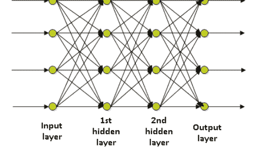

图 1. 具有 4 个输入、4 个输出和 2 个隐藏层的馈前神经网络 `FFNN`。

另一种常见的预测系统是 `ANFIS` [23]。`ANFIS` 基于模糊规则推理机制。它由五层组成，每层包含若干节点。节点由节点函数描述。设 `$O_i^j$` 为第 `$j$` 层中第 `$i$` 个节点的输出。在第 1 层，每个节点 I 都是一个自适应节点，其节点函数为：

$$O_i^1 = \mu A_i(x),\ i = 1,2 \tag{1}$$

或

$$O_i^1 = \mu B_{i-2}(y),\ i = 3,4 \tag{2}$$

其中 `$x$` 或 `$y$` 是第 `$i$` 个节点的输入，`$A_i$` 或 `$B_{i-2}$` 是与该节点关联的语言标签。因此，`$O_i^1$` 是模糊集合 `$A_1, A_2, B_1$` 或 `$B_2$` 的隶属度，它指定输入 `$x$` 或 `$y$` 满足量词 `$A$` 或 `$B$` 的程度。在第 1 层中，任何连续且分段可微函数都可以用作节点函数。在第 2 层，每个节点 `$\Pi$` 将输入相乘并输出乘积：

$$O_i^2 = w_i = \mu A_i(x)\mu B_i(y),\ i = 1,2 \tag{3}$$

在第 3 层，每个节点 `N` 计算比值

$$O_i^3 = \bar{w}_i = \frac{w_i}{w_1 + w_2},\ i = 1,2 \tag{4}$$

在第 4 层，每个节点计算第 `$i$` 条规则对总体输出的贡献：

$$O_i^4 = \bar{w}_i z_i = \bar{w}_i (a_i x + b_i y + c),\ i = 1,2 \tag{5}$$

其中 `$\bar{w}_i$` 是第 3 层的输出，`$a_i, b_i, c$` 是一组参数。

最后，在第 5 层，节点 `$\Sigma$` 将所有输入的和计算为最终输出：

$$O_i^5 = \sum_i \bar{w}_i z_i = \frac{\sum_i w_i z_i}{\sum_i w_i} \tag{6}$$

`ANFIS` 拓扑结构显示在图 2 中。

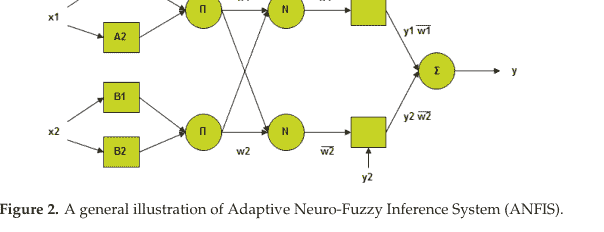

图 2. 自适应神经模糊推理系统 `ANFIS` 的一般示意图。

所提出的预测模型结合了 `FFNN` 和 `ANFIS` 的独立预测。混合模型的示意图显示在图 3 中。模型分别训练。训练集用于定义最优模型参数。例如，对于 `FFNN` 的情况，需要定义的参数包括隐藏层数、隐藏层中的神经元数以及隐藏层和输出层的激活函数类型。而对于 `ANFIS` 的情况，需要定义的参数包括推理机制类型、训练轮数、模糊规则数、隶属函数类型以及 `$a_i、b_i、c$` 的值。本文用于开发预测模型的真实监测环境数据是由监测系统测量的。监测系统放置在希腊 `Neos Marmaras` 的沿海地区。有关监测系统的详细信息（例如所用传感器和验证）可在 `Michailides et al. [26], 2013` 中找到。训练集和测试集分别覆盖 `01/04/2013–10/08/2013` 和 `01/09/2013–24/12/2013` 的时期。测试集用于模型的比较。未对不完整或缺失数据进行填充。此外，未对数据进行其他预处理。目标是构建一个应用于从真实测量系统获得的原始数据的模型。

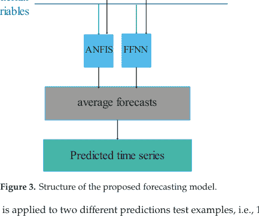

图 3. 所提预测模型的结构。

所提出的模型应用于两种不同的预测测试示例，即 1 分钟前和 10 分钟前。检验了五种具有不同输入类型的案例，即 `Case#1`、`Case#2`、`Case#3`、`Case#4` 和 `Case#5`。各案例中考虑的输入如下所述。

- `Case#1`: 风速
- `Case#2`: 风速和风向
- `Case#3`: 风速和温度
- `Case#4`: 风速、风向和温度
- `Case#5`: 风速的小波分量。

使用小波分量的所提模型的拓扑结构显示在图 4 中。

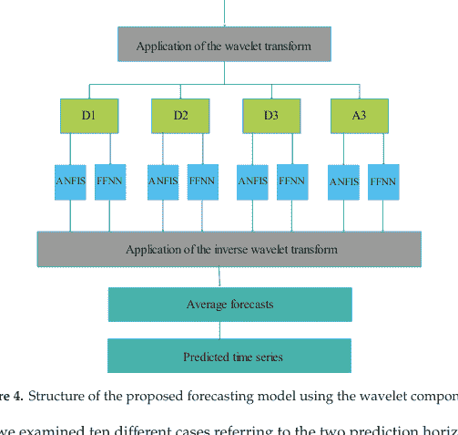

图 4. 使用小波分量的所提预测模型的结构。

因此，我们检验了与两个预测时域相关的十种不同情况。

### 2.2. 性能评估

性能评估包括一组衡量预测误差的数学准则。为了全面检验所提模型的性能，我们使用了不同的数学准则。设 `$p_m^a$` 和 `$p_m^f$` 分别为测试集中第 `$m$` 天的实际和预测风速值，`$m = 1, 2, \dots, M$`。评估中考虑的指标为绝对误差 `AE`、平均绝对误差 `MAE`、均方根误差 `RMSE` 和如公式 `10` 所定义的平均绝对范围归一化误差 `MARNE`。`AE` 定义为

$$AE = \sum_{m=1}^{M} |p_m^a - p_m^f| \tag{7}$$

`MAE` 对应于所有 `AE` 的和：

$$MAE = \frac{1}{M} \sum_{m=1}^{M} |p_m^a - p_m^f| \tag{8}$$

`RMSE` 的表达式为

```
RMSE = 1/M sqrt( sum_{m=1}^{M} (p_m^a - p_m^f)^2 )  (9)
```

`MARNE` 为实际风速与预测风速之间的绝对差值，归一化到最大风速：

$$MARNE = 1/M \sum_{m=1}^{M} |p_m^a - p_m^f| / max(p_m^a) \times 100 \tag{10}$$

作为所提模型的测试基准，采用了 `FFNN` 和 `ANFIS` 的单独应用。

## 3. 仿真结果

### 3.1. 风速预测

基于计算智能的系统在近年来在各种变量预测中，如电负荷，相对于传统时间序列模型而言是一种有利的方案。然而，仔细选择输入和适当的训练阶段对于模型的成功实现和利用至关重要。输入类型的选择对预测成功至关重要。在本研究中，检查了各种输入组合。目标是针对不完整数据的情况测试基于计算智能的模型。比较了三种模型，分别为 `FFNN`、`ANFIS` 和所提出的 `FFNN-ANFIS`。在确定输入类型后，即 `Case#1–Case#5`，下一步测试是定义输入数量。该数量指的是所用参数的历史值：风速、温度和风向。通过应用样本自相关函数 `SAF`，历史值是基于与当前值的相关性进行评估的。图 5 显示了与分钟提前风速集相似的 `SAF`。仅显示前 20 个值。结果显示，当滞后值变得时间上更遥远时，相关性逐渐下降。从 10 分钟提前集得出相同的结论。前五个值被选为模型的输入。此外，温度和风向的相应值按比例选择。

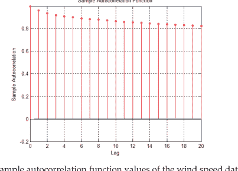

图 5. 风速数据集的样本自相关函数值。

采用分钟提前集和 `Case#1` 数据集，进行了一系列实验以确定最优 `FFNN` 和 `ANFIS` 结构。最优 `FFNN` 结构有一个隐藏层。正切 sigmoid 函数同时用于隐藏层和输出层。训练 `epoch` 数设置为 100。隐藏层中神经元的最佳数量也是通过一系列仿真确定的。它在各个案例中有所不同。因此，进行了一系列 `FFNN` 执行以追踪使 `RMSE` 指标最小化的隐藏层数量。

关于最优 `ANFIS` 拓扑，选择了 `Sugeno` 推理方法并结合高斯隶属函数。

预测模型在评估指标上的得分在表 1 和表 2 中呈现。表 1 指的是 1 分钟提前期，表 2 指的是 10 分钟提前期。表的行对应于不同的案例。根据表 1 的结果，所提模型在所有测试案例中均优于 `FFNN` 和 `ANFIS`，突出了使用组合预测的重要性。使用所提模型获得的预测精度提升在 `Case#3`、`Case#4` 和 `Case#5` 数据集中更为明显。使用 `MAE` 指标时，`FFNN` 在 `Case#2`、`Case#3` 和 `Case#5` 中比 `ANFIS` 产生更好的结果。此外，根据 `RMSE` 和 `MARNE` 指标，`FFNN` 在 `Case#1` 中产生更好的结果。然而，在 `Case#2` 中其 `MARNE` 得分为 `4.2353%`，该值高于 `ANFIS` 的相应值。虽然在大多数实验中 `FFNN` 似乎更稳健，但在分钟提前风速预测问题中可以建议其优于 `ANFIS`。

### 表 1. 考虑分钟提前期的预测模型比较。

|  | MAE |  |  | RMSE |  |  | MARNE (%) |  |  |
|---|---|---|---|---|---|---|---|---|---|
|  | FFNN | ANFIS | FFNN-ANFIS | FFNN | ANFIS | FFNN-ANFIS | FFNN | ANFIS | FFNN-ANFIS |
| Case#1 | 0.3683 | 0.3675 | 0.3673 | 0.5576 | 0.5578 | 0.5563 | 2.3365 | 2.3311 | 2.3298 |
| Case#2 | 0.3676 | 0.3682 | 0.3664 | 0.7510 | 0.5592 | 0.5551 | 2.5952 | 2.3356 | 2.3242 |
| Case#3 | 0.4123 | 0.4443 | 0.3887 | 0.7237 | 0.9163 | 0.6435 | 2.6153 | 2.8185 | 2.4658 |
| Case#4 | 0.4406 | 0.4210 | 0.4091 | 0.9206 | 0.8044 | 0.7511 | 2.7947 | 2.6703 | 2.5952 |
| Case#5 | 0.1021 | 0.1324 | 0.0812 | 0.1528 | 0.2052 | 0.1301 | 0.6477 | 0.8403 | 0.5601 |

### 表 2. 考虑 10 分钟提前期的预测模型比较。

|  | MAE |  |  | RMSE |  |  | MARNE (%) |  |  |
|---|---|---|---|---|---|---|---|---|---|
|  | FFNN | ANFIS | FFNN-ANFIS | FFNN | ANFIS | FFNN-ANFIS | FFNN | ANFIS | FFNN-ANFIS |
| Case#1 | 0.4316 | 0.4296 | 0.4287 | 0.6258 | 0.6265 | 0.6240 | 4.2280 | 4.2088 | 4.2008 |
| Case#2 | 0.4323 | 0.4295 | 0.4292 | 0.6253 | 0.6263 | 0.6239 | 4.2353 | 4.2077 | 4.2054 |
| Case#3 | 0.4706 | 0.4985 | 0.4605 | 0.7569 | 0.9373 | 0.6851 | 4.6104 | 4.8841 | 4.5115 |
| Case#4 | 0.4654 | 0.4936 | 0.4528 | 0.7155 | 0.8719 | 0.6689 | 4.5594 | 4.8363 | 4.4367 |
| Case#5 | 0.1227 | 0.1572 | 0.1101 | 0.1693 | 0.2226 | 0.1556 | 1.077 | 1.5409 | 0.9967 |

在数据输入类型中，`Case#5` 导致明显更低的误差，表明将波动的风数据转换到小波域的好处。这在所有指标中都很明显，尤其是在 `MARNE` 中。考虑到 `MAE` 指标，如果使用 `FFNN` 或混合模型，`Case#2` 会产生更好的预测。相反，`Case#1` 的数据，即仅使用风速值，更适合 `ANFIS`。使用风速、温度和风向作为输入时，预测的可信度较低。这再次适用于 `FFNN` 和所提模型。`ANFIS` 在 `Case#3` 数据上的 `MAE` 得分为 `0.4443`。上述结论在以 `RMSE` 或 `MARNE` 进行评估时相同。因此，通过结合风速和风向数据，预测过程得到加强。对于所研究的测试集，不建议使用温度。根据上述分析，在存在大量不完整数据条目的限制下，以小波域转换的风速数据为输入的 `FFNN` 和 `ANFIS` 组合是分钟提前预测的推荐模型。

根据表 2 中呈现的发现，10 分钟提前风速预测问题显然是一项更困难的任务。其可能的原因是分钟时间框架测量中当前值与过去值之间实现的下降。这意味着 10 分钟数据相关性较低，因为为了将一分钟数据转换到 10 分钟间隔中，分钟相关性因平均而降低。在所有类型的数据集中，所提 `FFNN-ANFIS` 模型比其他模型更准确。再次，10 分钟提前问题受益于小波变换的实现。`Case#5` 的数据无论使用何种模型都能提供更稳健的预测。

通过随时间的 `AE` 分布对模型进行进一步比较。`MAE` 指标为特定预测接收一个值，例如对于隐藏层中给定的神经元数量。必须检查聚焦期间的误差分布。使用 `AE` 指标，分析可以按分钟进行缩放。这一概念加强了从模型比较中得出的结论。图 6 展示了每个案例的 `AE` 分布。该图指的是 1 分钟提前预测期，而预测是使用所提 `FFNN-ANFIS` 模型实现的。离散峰值对应于较大的误差值，可被视为模型在特定分钟表现不佳的指标。`Case#1–Case#4` 的数据导致 `AE` 形状出现一些高峰值。这些主要出现在十二月的日子里。最低误差大多集中在九月的日子里。随着时间范围的推移，峰值变得更频繁。因此，极端天气条件会降低预测的可信度。在所研究的沿海站点，一些晚秋和冬季风速难以有效预测。`AE` 的平均值分别为 `Case#1` 为 `0.3673`、`Case#2` 为 `0.3664`、`Case#3` 为 `0.4123`、`Case#4` 为 `0.4210`、`Case#5` 为 `0.1021`。对于 10 分钟提前期，可以得出与上述结果平行的一些结论。相应的结果在图 7 中以图形方式呈现。在 10 分钟提前问题中，与分钟提前情况相比，小波变换的实现更具优势。`Case#5` 在很大程度上提高了准确性。`AE` 的平均值分别为 `Case#1` 为 `0.4288`、`Case#2` 为 `0.4293`、`Case#3` 为 `0.4706`、`Case#4` 为 `0.4654`、`Case#5` 为 `0.1227`。

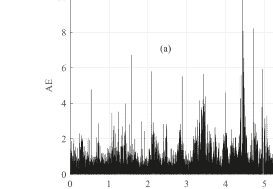
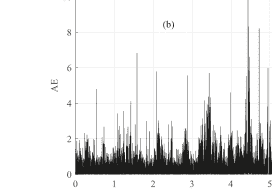
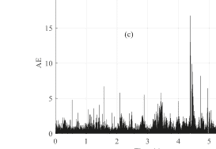
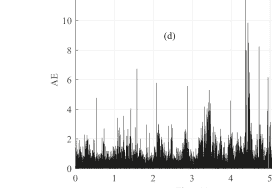
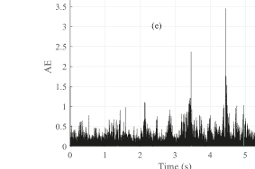

图 6. 所提模型在 1 分钟提前预测期中对应于 (a) `Case#1`、(b) `Case#2`、(c) `Case#3`、(d) `Case#4` 和 (e) `Case#5` 的绝对误差。

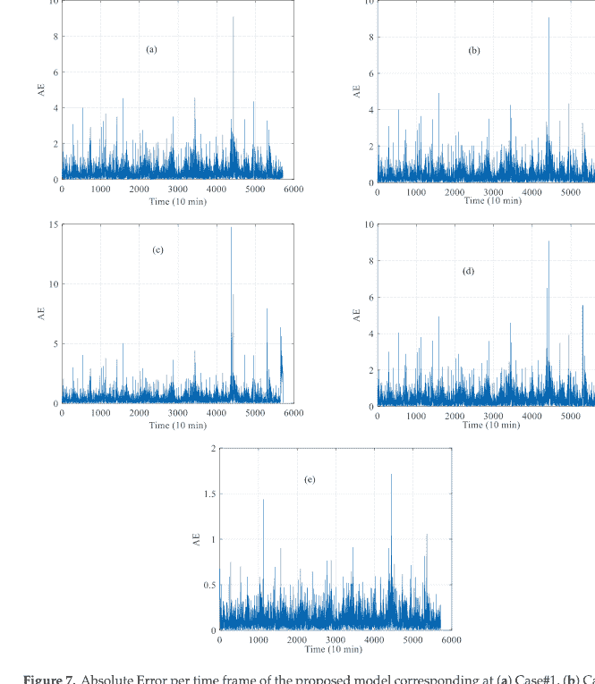

图7. 拟议模型在10分钟提前预测时域下对应于（a）案例#1、（b）案例#2、（c）案例#3、（d）案例#4、（e）案例#5的每时间帧绝对误差。

为了检验准确度与风向之间的关系，我们按方向度测量了`AE`。图8显示了1分钟提前预测中案例#2与案例#5之间的比较。案例#2指的是风速和风向的组合。预测指的是拟议模型。案例#5仅涉及转换后的风速数据。这里绘制它是为了比较。案例#2的最低`AE`为`5.97 × 10−6`，出现在`312.48°`。下一个最低`AE`度数分别为`200.73°`、`104.56°`、`151.90°`和`281.14°`。`AE`的较大值出现在`162.47°`、`42.17°`、`55.08°`和`222.70°`。根据这些发现，初步结论是风向与预测误差之间没有强相关性。例如，可以有力地支持垂直于监测系统的风（例如`90°`）与其他方向相比更难预测。这一说法也得到了案例#5数据的支持。最低误差对应于`134.67°`、`122.06°`、`73.07°`、`317.51°`和`46.48°`方向，而最高误差出现在`27.01°`、`35.56°`、`41.31°`、`57.65°`和`31.57°`。在此数据集中，风方向度低于`60°`时预测精度较低。

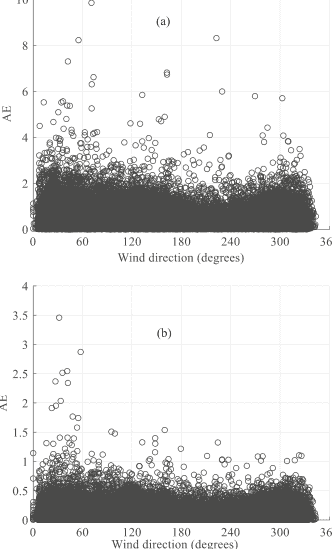

图8. 拟议模型在1分钟提前预测时域下对应于（a）案例#2和（b）案例#5的按风向绝对误差。

作为拟议模型行为的说明性示例，图9和图10分别展示了测试集在1分钟和10分钟提前时域下的实际与预测风速曲线。两幅图的预测风速序列在很大程度上成功地模拟了实际数据，这也是模型鲁棒性的另一个指标。

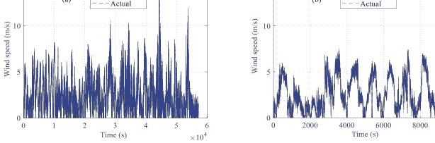

图9. 续

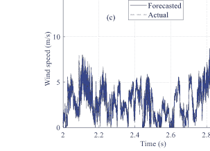
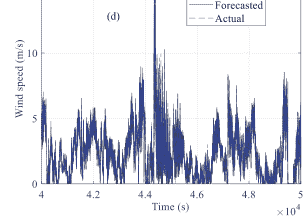


图9. 针对1分钟提前预测时域，测试集的预测与实际序列在整个检查时间段（a）、0至10,000 s之间（b）、20,000至30,000 s之间（c）以及40,000至50,000 s之间（d）。

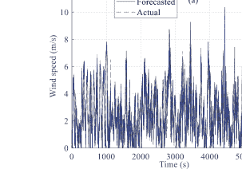

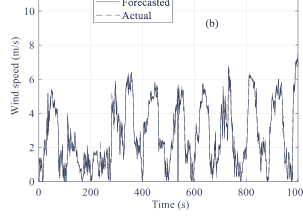

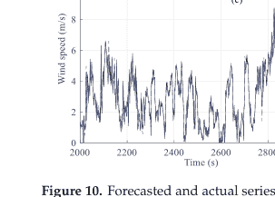

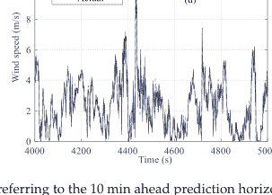

图10. 针对10分钟提前预测时域，测试集的预测与实际序列在整个检查时间段（a）、0至1000 s之间（b）、2000至3000 s之间（c）以及4000至5000 s之间（d）。

### 3.2. 与其他预测模型的比较

为了全面评估拟议模型，与以下模型进行了比较；数据处理群方法神经网络（`GMDHNN`）[27]、回归神经网络（`GRNN`）[28]、回归树（`RTs`）[29]、相关向量机（`RVM`）[30]和支持向量回归（`SVR`）[31]。表3和表4分别给出了1分钟提前预测的误差指标上`GMDHNN`、`GRNN`和`RTs`、`RVM`和`SVR`的得分。相应地，表5和表6分别给出了10分钟提前预测的误差指标`MAE`、`RMSE`和`MARNE`上`GMDHNN`、`GRNN`和`RTs`、`RVM`和`SVR`的得分。在这些模型中，`SVR`和`GMDHNN`显示出与混合模型相当的结果。后者优于所有其他模型。可以注意到`GRNN`和`RTs`导致较高的误差，因此对于所研究的问题不推荐。

表3. 针对1分钟提前时域的群方法数据处理（`GMDH`）、回归神经网络（`GRNN`）和回归树（`RTs`）评估。

|  | `MAE` |  |  | `RMSE` |  |  | `MARNE (%)` |  |  |
|---|---|---|---|---|---|---|---|---|---|
|  | `GMDHNN` | `GRNN` | `RTs` | `GMDHNN` | `GRNN` | `RTs` | `GMDHNN` | `GRNN` | `RTs` |
| Case#1 | 0.3688 | 0.3846 | 0.4432 | 0.5689 | 0.5721 | 0.6331 | 2.3411 | 2.3869 | 3.1256 |
| Case#2 | 0.3701 | 0.3910 | 0.4509 | 0.7051 | 0.7644 | 0.8109 | 2.4578 | 2.4771 | 3.2672 |
| Case#3 | 0.3698 | 0.4256 | 0.4781 | 0.7189 | 0.7367 | 0.7992 | 2.5871 | 2.6225 | 3.4155 |
| Case#4 | 0.3944 | 0.4201 | 0.4541 | 0.8902 | 0.9012 | 1.1091 | 2.7112 | 2.9904 | 3.6203 |
| Case#5 | 0.1094 | 0.1388 | 0.1692 | 0.1481 | 0.1556 | 0.2012 | 0.6289 | 0.6552 | 0.7154 |

表4. 针对1分钟提前时域的相关向量机（`RVM`）和支持向量回归（`SVR`）评估。

|  | `MAE` |  | `RMSE` |  | `MARNE (%)` |  |
|---|---|---|---|---|---|---|
|  | `RVM` | `SVR` | `RVM` | `SVR` | `RVM` | `SVR` |
| Case#1 | 0.3721 | 0.3704 | 0.5614 | 0.5377 | 2.3482 | 2.3345 |
| Case#2 | 0.3933 | 0.3865 | 0.7597 | 0.7029 | 2.4754 | 2.3419 |
| Case#3 | 0.3885 | 0.3893 | 0.7408 | 0.6911 | 2.6172 | 2.5678 |
| Case#4 | 0.3821 | 0.3783 | 0.8928 | 0.8709 | 2.9232 | 2.6213 |
| Case#5 | 0.1277 | 0.1178 | 0.1542 | 0.1421 | 0.6524 | 0.5772 |

表5. 针对10分钟提前时域的`GMDH`、`GRNN`和`RTs`评估。

|  | `MAE` |  |  | `RMSE` |  |  | `MARNE (%)` |  |  |
|---|---|---|---|---|---|---|---|---|---|
|  | `GMDHNN` | `GRNN` | `RTs` | `GMDHNN` | `GRNN` | `RTs` | `GMDHNN` | `GRNN` | `RTs` |
| Case#1 | 0.4292 | 0.4525 | 0.5898 | 0.6258 | 0.6553 | 0.8093 | 4.2051 | 4.4326 | 5.7812 |
| Case#2 | 0.4302 | 0.5597 | 0.5901 | 0.6272 | 0.6715 | 0.8095 | 4.2149 | 4.5031 | 5.7812 |
| Case#3 | 0.4704 | 0.6927 | 0.6157 | 0.6862 | 0.7342 | 0.8461 | 4.6334 | 4.7862 | 6.0319 |
| Case#4 | 0.4601 | 0.6056 | 0.6108 | 0.6715 | 0.6989 | 0.8012 | 4.5130 | 4.6902 | 5.7568 |
| Case#5 | 0.1238 | 0.1624 | 0.1799 | 0.1601 | 0.1833 | 0.2109 | 1.2671 | 1.4884 | 1.6117 |

表6. 针对10分钟提前时域的`RVM`和`SVR`评估。

|  | `MAE` |  | `RMSE` |  | `MARNE (%)` |  |
|---|---|---|---|---|---|---|
|  | `RVM` | `SVR` | `RVM` | `SVR` | `RVM` | `SVR` |
| Case#1 | 0.4342 | 0.4298 | 0.6359 | 0.6268 | 4.2541 | 4.2206 |
| Case#2 | 0.4351 | 0.4307 | 0.6440 | 0.6268 | 4.2630 | 4.2198 |
| Case#3 | 0.5370 | 0.4681 | 0.8649 | 0.7529 | 5.2605 | 4.5365 |
| Case#4 | 0.4988 | 0.4644 | 0.7898 | 0.7459 | 5.1133 | 4.5301 |
| Case#5 | 0.1424 | 0.1308 | 0.2037 | 0.1654 | 1.5893 | 1.1276 |

## 4. 讨论与结论性意见

海上风力涡轮机安装持续引起研究兴趣，因为它们被认为是覆盖各种孤立负荷电力需求的有效机制。本研究强调在风速序列不呈现时间一致性、即数据序列中存在中断的限制下，开发一种有效的超短期风速预测方法。使用了实际测量数据来训练所开发的方法。开发、测试并应用了一种集成数据驱动的短期风速预测模型。“集成”指的是并行运行两个不同预测器的组合，预测由导致最低误差的预测器获得。拟议模型利用小波变换，并与相关文献中提出的其他模型进行比较。本研究的主要结论：

- 拟议的预测模型可有效用于1分钟和10分钟提前时域的风速预测。
- 外生变量（即风向和气温）降低了预测精度。最佳结果是使用`DWT`获得的。
- 最高误差出现在冬季日，尤其是在风速较高的情况下。
- 预测误差与风向之间没有相关性。
- 混合模型（`FFNN`和`ANFIS`的组合）在所有检查的数据集案例中都导致更好的预测。
- 拟议模型优于相关文献中提出的其他预测模型的准确性。

本论文的研究将进一步扩展，通过检查在风电场布局优化（`WLFO`）问题中结合尾流效应实施预测问题，使用特定的数学或数值模型。预测风速时间序列可以用作该问题的输入。通过估计未来风速值，`WLFO`可以修改为情景化问题，其中不同的风速预测可导致不同的`WLFO`解决方案，从而评估未来风速变化对优化问题输出的影响程度。

作者贡献：`I.P.P.`执行了研究并撰写了论文初稿。`C.M.`和`D.C.A.`设定了研究目标，为研究提供指导并修改了论文。

资助：本研究未获得外部资助。

利益冲突：作者声明无利益冲突。

## 参考文献

1. WindEurope. 欧洲海上风电关键趋势与统计 2018。可在线获取：https://windeurope.org/wp-content/uploads/files/about-wind/statistics/WindEurope-Annual-Offshore-Statistics-2018.pdf（访问于2019年3月27日）。
2. Snyder, B.; Kaiser, M.J. 欧洲和美国海上风电发展的比较：发展模式与驱动因素。Appl. Energy 2009, 86, 1845–1856. [CrossRef]
3. Soman, S.S.; Zareipour, H.; Malik, O.; Mandal, P. 不同时间范围的风电和风速预测方法的综述。In Proceedings of the 2010 North American Power Symposium, Arlington, TX, USA, 26–28 September 2010; pp. 1–8.
4. Jung, J.; Broadwater, R.P. 风速和功率预测的现状与未来进展。Renew. Sustain. Energy Rev. 2014, 31, 762–777. [CrossRef]
5. Okumus, I.; Dinler, A. 风能预测的现状及一种用于小时预测的混合方法。Energy Convers. Manag. 2016, 123, 362–371. [CrossRef]
6. Lei, M.; Shiyan, L.; Chuanwen, J.; Hongling, L.; Ya, Z. 风速和发电功率预测综述。Renew. Sustain. Energy Rev. 2009, 13, 915–920. [CrossRef]
7. Chang, W.Y. 风力预测方法文献综述。J. Power Energy Eng. 2014, 2, 161–168. [CrossRef]
8. Foley, A.M.; Leahy, P.G.; Marvuglia, A.; McKeogh, E.J. 风电预测的当前方法与进展。Renew. Energy 2012, 37, 1–8. [CrossRef]
9. Bhaskar, M.; Jain, A.; Srinath, N.V. 风速预测：现状。In Proceedings of the 2010 International Conference on Power System Technology, Hangzhou, China, 24–28 October 2010; pp. 1–7.
10. Murthal, D. 风电预测：综述。Int. J. Eng. Res. Gen. Sci. 2016, 4, 802–806.
11. Tascikaraoglu, A.; Uzunoglu, M. 短期风速和功率预测的组合方法综述。Renew. Sustain. Energy Rev. 2014, 34, 234–254. [CrossRef]
12. Sfetsos, A. 用于平均小时风速时间序列预测的一种新方法。Renew. Energy 2002, 27, 163–174. [CrossRef]
13. Başaran, Ü.; Filik, T. 基于埃斯基谢希尔多地测量的人工神经网络风速预测。Energy Procedia 2017, 107, 264–269.
14. More, A.; Deo, M.C. 用神经网络预测风。Mar. Struct. 2003, 16, 35–49. [CrossRef]
15. Li, G.; Shi, J. 关于三种人工神经网络在风速预测中的比较。Appl. Energy 2010, 87, 2313–2320. [CrossRef]
16. Zeng, J.W.; Qiao, W. 基于支持向量机的短期风电功率预测。In Proceedings of the 2011 IEEE/PES Power Systems Conference and Exposition, Phoenix, AZ, USA, 20–23 March 2011; pp. 1–8.
17. Zhou, J.Y.; Shi, J.; Li, G. 短期风速预测的支持向量机微调。Energy Convers. Manag. 2011, 52, 1990–1998. [CrossRef]
18. Fazelpour, F.; Tarashkar, N.; Rosen, M.A. 使用人工神经网络对德黑兰进行短期风速预测。Iran. Int. J. Energy Environ. Eng. 2016, 7, 377–390. [CrossRef]
19. Fortuna, L.; Guariso, G.; Nunnari, S. 统计模型对风速等级的提前一天预测。Int. J. Renew. Energy Res. 2016, 6, 1137–1145.
20. Fortuna, L.; Nunnari, S.; Guariso, G. 风速时间序列中的分形阶证据。In Proceedings of the 2014 International Conference on Fractional Differentiation and Its Applications, Catania, Italy, 23–25 June 2014; pp. 1–6.
21. Mallat, S. 多分辨率信号分解理论——小波表示。IEEE Trans. Pattern Anal. Mach. Intell. 1989, 11, 674–693. [CrossRef]
22. Amjady, N.; Keynia, F. 小波变换与神经进化算法结合的电力系统短期负荷预测。Energy 2009, 34, 46–57. [CrossRef]
23. Jang, J.S.R. `ANFIS`：基于自适应网络的模糊推理系统。IEEE Trans. Syst. Man Cybern. 1993, 23, 665–685. [CrossRef]
24. Graupe, P. 人工神经网络原理，第二版；World Scientific: Singapore, 2007.
25. Levenberg, K. 最小二乘法中某些非线性问题求解的一种方法。Q. J. Appl. Math. 1944, 2, 164–168. [CrossRef]
26. Michalides, C.; Loukogeorgaki, E.; Angelides, D.C. 监测连接系泊浮体模块的响应。In Proceedings of the 27th International Offshore and Polar Engineering, Anchorage, AK, USA, 30 June–5 July 2013; pp. 869–876, ISBN 978-1-880653-99-9.
27. Abdel-Aal, R.E.; Elhadidy, M.A.; Shaahid, S.M. 使用基于`GMDH`的溯因网络对平均小时风速时间序列进行建模和预测。Renew. Energy 2009, 34, 1686–1699. [CrossRef]
28. Kumar, G.; Malik, H. 基于广义回归神经网络的印度西部地区风速预测模型。Procedia Comput. Sci. 2016, 93, 26–32. [CrossRef]
29. Troncoso, A.; Salcedo-Sanz, S.; Casanova-Mateo, C.; Riquelme, J.C.; Prieto, L. 基于局部模型的回归树用于超短期风速预测。Renew. Energy 2015, 81, 589–598. [CrossRef]
30. Sun, G.; Chen, Y.; Wei, Z.; Li, X.; Cheung, K.W. 使用相关向量机进行日前风速预测。J. Appl. Math. 2014, 2014, 1–6. [CrossRef]
31. Botha, N.; van der Walt, C.M. 使用支持向量回归和特征选择进行风速预测。In Proceedings of the 2017 Pattern Recognition Association of South Africa and Robotics and Mechatronics, Bloemfontein, South Africa, 29 November–1 December 2017; pp. 181–186.


© 2019 作者保留。许可方 MDPI，瑞士巴塞尔。本文是一篇开放获取文章，根据知识共享署名（CC BY）许可的条款和条件分发（http://creativecommons.org/licenses/by/4.0/）。

# 多元时间卷积网络：多元时间序列预测的深度神经网络方法

Renzhuo Wan 1, Shuping Mei 1, Jun Wang 1, Min Liu 2 and Fan Yang 1,*

1 纳米光学材料与存储器件研究中心，武汉纺织大学电子电气工程学院，武汉 430200，中国

2 粉末冶金国家重点实验室，中南大学物理与电子学院，长沙 410083，中国

* 通讯作者：yangfan@wtu.edu.cn

收稿：7 July 2019；接受：5 August 2019；发表：7 August 2019


**Abstract:** 多变量时间序列预测已在电力能源、空气学、气象学、金融、交通运输等领域得到广泛研究。传统建模方法模式复杂，且难以捕捉数据长期多元依赖关系以获得期望的预测精度。为解决这些问题，提出了基于循环神经网络（`RNN`）和卷积神经网络（`CNN`）方法的各种深度学习模型。为提高预测精度并最小化非周期数据多元时间序列数据的依赖性，本文采用一种新颖的多元时间卷积网络（`M-TCN`）模型对北京`PM2.5`和`ISO-NE`数据集进行分析。在该模型中，多变量时间序列预测被构建为非周期数据集的序列到序列场景。基于深度卷积神经网络提出了并行的多通道非对称结构残差块。结果与长短期记忆（`LSTM`）、卷积`LSTM`（`ConvLSTM`）、时间卷积网络（`TCN`）和多元注意力`LSTM-FCN`（`MALSTM-FCN`）等丰富的竞争算法进行了比较，表明我们的模型在预测精度、鲁棒性和泛化能力方面有显著提升。

**Keywords:** 深度学习；多元时间序列预测；多元时间卷积网络

### 1. 引言

随着物联网（`IoT`）应用和大数据的爆炸性增长，多元时间序列在许多领域变得无处不在，例如空气学 [1]、气象学 [2]、环境 [3]、多媒体 [4]、电力能源 [5]、金融 [6] 和交通运输 [7]。基于历史动态数据的精确趋势预测以及潜在危险事件预测是一个主要挑战，尤其对于非周期多元时间序列。一个关键原因是变量之间的非周期性和非线性，模型难以捕捉并自适应复杂的数据特征。传统方法如自回归（`AR`）[8]模型和高斯过程（`GP`）[9]可能失效。作为人工智能领域的重要组成部分，深度神经网络（`DNNs`）在许多任务上提供了最先进的精度 [10]，并在自然语言处理（`NLP`）、计算机视觉（`CV`）、时间序列分类和时间序列预测方面得到了深入发展。

受`NLP`中使用的算法（即序列到序列 [11,12] 和注意力机制）以及`CV`中使用的算法（即空洞卷积网络 [13] 和残差结构 [14]）启发，本文提出了`M-TCN`模型用于非周期多元时间序列预测，该模型将非周期数据构建为序列到序列并采用一种新颖的多通道和非对称残差块网络。该模型通过丰富的现有竞争模型对非周期时间序列数据集进行了交叉验证。本文其余部分组织如下：第2节回顾背景工作。第3节介绍所提模型的 methodology。第4节对实验进行分析和讨论。最后，第5节得出结论并展望。

### 2. 背景

多元时间序列预测的主要挑战之一是数据来源于短期和长期动态行为的非线性和非周期性。基于经典统计方法或机器学习算法建立了各种模型。

突出的经典单变量时间序列模型是具有经典统计算法的自回归（`AR`）及其后继。`AR`方法适用于平稳时间序列。改进的模型，如自回归积分滑动平均（`ARIMA`）[15]、自回归滑动平均（`ARMA`）[16] 和向量自回归（`VAR`）[17]，通过纳入灵活的指数平滑技术而发展。然而，对于长期时间模式，这些模型不可避免地容易过拟合且计算成本高，尤其对于高维输入。

另一种方法是将时间序列预测问题视为具有时变参数的一般回归问题，由机器学习模型应用，例如线性支持向量回归（`SVR`）[18]、随机森林 [19]、岭回归 [20] 和`LASSO` [21] 模型。这些模型由于机器学习社区中高质量的现成解决方案而在实践中更高效。尽管如此，基于机器学习的模型可能无法包含多元大数据集的复杂非线性依赖关系。

同时，卷积神经网络（`CNNs`）和循环神经网络（`RNNs`）构建的完善深度神经网络已被广泛应用于时间序列预测，这归功于开源深度学习框架，如`Keras`（`Keras`，可在网上获取：`https://keras.io`）、`TensorFlow`（`TensorFlow`，可在网上获取：`https://tensorflow.org`）和`PyTorch`（`PyTorch`，可在网上获取：`https://pytorch.org`），包括灵活而复杂的数学库。一些代表性模型是长短期记忆（`LSTM`）[22]及其继承者、卷积`LSTM`（`ConvLSTM`）[23]和多元注意力`LSTM-FCN`（`MALSTM-FCN`）[24]，它们克服了为混合长短期时域训练循环神经网络所涉及的挑战。然而，这些模型耗时且对非周期数据预测不稳健。

另一种用于时间序列预测的新方法是一种混合多尺度方法，如经验模态分解（`EMD`）[25]、集合`EMD`（`EEMD`）[26]、多级小波分解网络（`mWDN`）[27]和变分模态分解（`VMD`）[28]。这些方法用于将数据分解为不同频率分量以促进预测。然而，预设分解`K`值是训练模型输入的必要前提，这对于复杂的多元时间序列预测并不通用。

最近，提出了一种用于序列建模任务的预测序列模型的通用架构，即时间卷积网络（`TCN`）[29]，其由卷积和循环架构组成。`TCN`的突出特征是卷积架构设计和序列长度的因果性。此外，通过残差网络和扩展卷积的组合，很方便地构建非常深且宽的网络。在此背景下，我们的模型基于`TCN`设计，并对`PM2.5`和电力预测进行了测试。

为比较，表1对比了多元时间序列预测的一些常见方法的优势和挑战。

## 表 1. 时间序列预测方法的优势与挑战总结

| 方法 | 优势 | 挑战 |
|---|---|---|
| 自回归 [8] | 对于低阶模型简单高效 | 非线性、多变量和非平稳 |
| `SVR` [18] | 非线性和高维 | 自由参数选择，不适合大数据 |
| 混合 `VMD` 与 `ANN` [30] | 数学解释力强 | 预处理复杂，泛化能力差 |
| `LSTM` [22] | 兼具长短期记忆 | 计算资源需求巨大 |
| `TCN` [29] | 大规模并行计算可缓解梯度爆炸且模型结构更灵活 | 长期记忆 |

## 3. 方法论

在本节中，首先对时间序列预测问题进行建模。此外，随后介绍了基线模型 `ConvLSTM` 和多元 `LSTM FCN`，用于比较评估的方法。最后介绍了 `M-TCN` 模型。

### 3.1. 序列问题陈述

基于机器学习的本质，为了最小化期望误差，需要从历史数据集到当前状态获得理想的非线性映射，尤其是在灾害事件预测中。前提是采用足够的特征参数来表征各种现象，这使得当前状态严格依赖于历史数据集。本文将多变量时间序列预测问题定义为序列到序列问题。在定义网络结构之前，更正式地，给定输入序列时间序列信号 `X = (x1, x2, ..., xT)`，其中 `x1 ∈ R^n`，`n` 为变量维度，我们旨在在每个时间点预测对应的输出 `Y = (y1, y2, ..., yh)`。序列建模网络的目标是从当前状态获得到预测序列的非线性映射，如下：

`(y1, y2, ..., yh) = f (x1, x2, ..., xT). (1)`

### 3.2. 基线测试

为了建立基线测试基准，传统模型、朴素预测、平均方法预测和季节性持续预测模型被纳入交叉评估。

朴素预测模型：它取预测期之前最后一小时的值（例如 24 h），并将其用作预测期内每个小时的数据集值（例如 1 至 24 h）。使用朴素方法，预测值等于最后观测值。该模型定义为：

`ŷT+1 = yT, (2)`

其中 `yT` 为过去数据，`ŷT+1` 为下一个时间值。

平均方法预测模型：在该模型中，所有未来值的预测等于过去数据的均值。该方法可用于过去可用的任何类型数据，并定义为：

`ŷT+1 = ȳ = (y1 + ... + yT) / T, (3)`

其中 `(y1, y2, ..., yT)` 为过去数据，`ŷT+1` 为下一个时间预测值。

季节性持续预测模型：它将一年前同一时间段定义为预测值。该方法通过将每个预测值设为同一季节最后观测值来考虑季节性。该模型定义为：

`ŷT+1 = yT-Y, (4)`

其中 `yT-Y` 为过去数据，`ŷT+1` 为下一个时间预测值。

### 3.3. ConvLSTM 编码器-解码器模型

本工作中构建了一个卷积 `LSTM`（`ConvLSTM`）编码器-解码器网络，其同时重构输入序列并预测未来序列。`ConvLSTM` 输入层设计为 4D 张量 `[timestep, row, column, channel]`，其中 `timestep` 为子序列数量，`row` 为每个子序列的一维形状，`column` 为每个子序列中的小时数，`channel` 为作为输入使用的特征。编码 `ConvLSTM` 将整个输入序列压缩为隐藏状态张量，而解码 `LSTM` 则展开该隐藏状态以给出最终预测。`ConvLSTM` 的概述如图 1 所示。

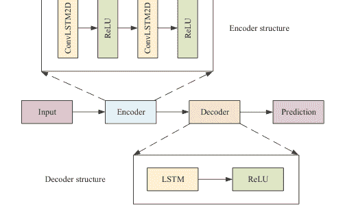

图 1. `ConvLSTM` 编码器-解码器网络（`ConvLSTM`）概述。

多变量注意力 `LSTM` 全卷积网络模型由时序卷积块和一个 `LSTM` 块组成，如图 2 所示。特征提取器由三个堆叠的时序卷积块组成。此外，前两个卷积块以 squeeze and excite 块结尾。

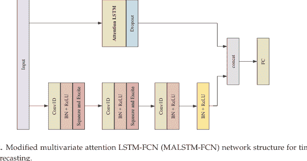

图 2. 用于时间序列预测的改进多变量注意力 `LSTM-FCN`（`MALSTM-FCN`）网络结构。

我们将该模型结构视为 `CNN`（时序卷积块）和 `RNN`（`LSTM` 块）的并行结构。为了研究回归问题，用于分类的最终 `softmax` 层被改为具有 24 个节点的全连接层。

### 3.4. M-TCN 模型

`CNN` 的主要特征是通过卷积滤波器提取局部特征。对于时间序列预测，局部相关性体现在小时间段内一段时间内持续变化。此外，诸如 `LSTM` 之类的 `RNN` 模型一直被认为是最好的标准方法来解决序列问题；然而，`RNN` 无法并行，导致与 `CNN` 相比耗时巨大。基于这些考虑，模型的整体框架基于 `CNN` 设计。我们的目标是将设计卷积网络的最佳实践提炼为灵活且稳定的框架，具有简单架构和高效率，用于多变量时间序列预测。`M-TCN` 的显著特征是：（1）网络的输入和输出长度可根据各种场景灵活确定；（2）`M-TCN` 使用 1D 卷积而非因果卷积；（3）`M-TCN` 增强了两种不同的非对称残差块；（4）`M-TCN` 为输入数据的每个特征构建子模型，预测由所有子模型的组合完成。我们称这种典型结构为多头模型。在本工作中，我们强调的是如何使用网络（增强了两种不同的残差块）和扩张卷积的组合来构建有效网络（即多头模型）的方法论。以下是网络结构的详细说明。

### 3.4.1. 1D 卷积

`TCN` 使用因果卷积，其中时间 `t` 的输出仅与前一层中时间 `t` 及更早的元素进行卷积。在图 3 中，因果卷积用于假设所有数据必须在时间顺序上具有一对一的因果关系。给定输入序列时间序列信号 `X = (x1, x2, x3, x4, x5)`，其中 `x_t ∈ R^n`，`n` 为变量维度，`x_t` 在时间顺序上没有严格的因果关系。虽然 `x1` 和 `x5` 可能存在直接的逻辑联系，但因果卷积会使 `x1` 和 `x5` 之间的关系受 `x2`、`x3`、`x4` 影响。该设计受限于时间序列的绝对顺序，且在相对时间点进行准确特征学习效率低下。因此，在我们的模型中，仅采用 1D 卷积网络以避免这种情况。

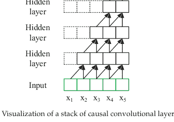

图 3. 因果卷积层堆叠的可视化。

### 3.4.2. 扩张卷积

扩张卷积算法 [13] 用于我们的模型。由于传统的卷积操作过程是对序列进行一次卷积然后池化，这同时减小了序列大小并扩大了感受野。其主要缺陷之一是池化过程中会丢失部分序列信息，而扩张卷积的优势在于无需池化过程，并通过一系列扩张卷积逐步增加感知域，从而使每次卷积的输出包含丰富的长期跟踪信息。因此，扩张卷积可很好地应用于序列长信息依赖问题，如语音和信号处理、环境预测等。扩张卷积定义为

`F(s) = (x *_d f)(s) = Σ_{i=0}^{k-1} f(i) · x_{s - d·i}   (5)`

其中 `d` 为扩张因子，`k` 为滤波器大小，`s − d · i` 表示过去的方向。滤波器 `f : {0, …, k − 1} → N`。图 4 展示了扩张因子为 1、2 和 4 的扩张 1D 卷积。

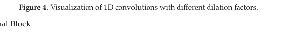

图 4. 不同扩张因子下 1D 卷积的可视化。

## 3.4.3. 残差块

一种新颖的结构由多层顺序残差网络和平行残差块设计而成。`ResNet` [14] 的核心是在前后层之间创建信息传播的捷径。`TCN` 网络中使用了基本的残差块；然而，`ResNet` 中的跳跃连接导致只有少数残差块学习到有用信息，因此基本残差块结构不适用于时间序列预测。另一种方法是增大卷积核尺寸以获得更好的预测；然而，计算负载会急剧增加。在 [31] 中，非对称块结构被引入到 `MobileNetV3-Large` 和 `MobileNetV3-Small` 中。通过这种方式，整个网络结构中会产生非对称因子，可能对深度学习模型产生积极影响。最优的非对称结构需要神经架构搜索 (`NAS`) [32,33]；然而，其计算成本很高。更直接的方法是并行构建两个非对称残差块。我们模型中的架构元素如图 5 所示。

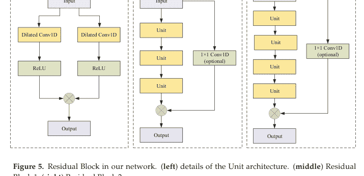

图 5. 我们网络中的残差块。(左) Unit 架构的细节。(中) 残差块 1；(右) 残差块 2。

我们模型的 `Unit` 如图 5 (左) 所示。`Unit` 有两个通道。每个通道都有扩张卷积和非线性，我们使用了修正线性单元 (`ReLU`) [34]。残差块 1 如图 5 (中) 所示。在一个残差块内，模型有三个单元。输出是两个通道操作结果的和。残差块 2 如图 5 (右) 所示，其基本结构与残差块 1 相同，但实现了一个额外的单元层。更精确地说，对于残差块都构建了具有不同扩张因子和滤波器尺寸 `k = 3` 的扩张卷积。此外，还引入了可选的 `1 × 1` 卷积来调整不同特征图的维度（见图 5 (中、右)）以便求和。

`Unit` 对同一输入使用两种不同的卷积，然后将结果相加。卷积层由多个不同尺寸的核组成。第 `k` 个滤波器在输入数据 `X` 上滑动，可表述为：

`ReLU(x) = max(0, x), (6)`

```
h₁ₖ = ReLU(Wₖ * X + bₖ),  (7)
h₂ₖ = ReLU(Wₖ * X + bₖ),  (8)
hₖ = h₁ₖ + h₂ₖ,  (9)
```

其中 `h₁ₖ` 是通道 1 的结果，`h₂ₖ` 是通道 2 的结果，`hₖ` 是单元的结果。`*` 表示卷积操作。

残差块包含一个通道，该通道经过一系列转换函数 `ℱ`，最后的输出与块的输入 `X` 相加：

```
o = (x + ℱ(x)).  (10)
```

### 3.4.4. 全连接层

全连接层可以用全局平均池化 (`GAP`) 替换，以提高图像识别任务的效率和准确性。然而，全连接层在预测任务中是必不可少的，并且可以轻松改变输出序列的长度。形式上，通过其空间维度 `H × W` 缩小 `X` 生成统计量 `z ∈ R^C`，使得输出 `z` 由以下公式计算：

```
z = GAP(x_c) = 1/(H × W) Σ_{i=1}^{H} Σ_{j=1}^{W} x_c(i,j).  (11)
```

通道上的整个空间特征被平均为全局特征。每个特征图被平均为一个值，因此整个特征值的局部信息丢失，这对预测问题产生负面影响。

全连接层如图 6 所示，它不仅建立了特征图之间的位置关系，还保留了同一特征图的内部特征信息。这将对预测问题产生有益影响。缺点是参数大幅增加。

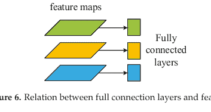

图 6. 全连接层与特征图之间的关系。

### 3.4.5. 多头模型

模型进一步扩展，使每个输入变量都有一个单独的子模型，称为多头模型。每个输入变量的子模型必须首先定义。每个子模型分别学习序列中不同特征的信息。此外，这些模型的输出随后串联组合形成一个很长的向量，在进行预测之前由一些全连接层进行解释。多头时序卷积网络 (`M-TCN`) 架构的概述如图 7 所示。为了提供更多细节，卷积的概述如图 8 所示。

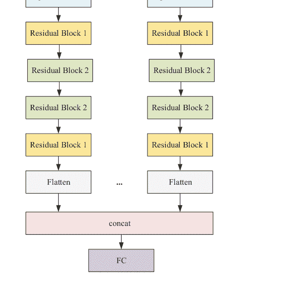

图 7. `M-TCN` 网络的概述。

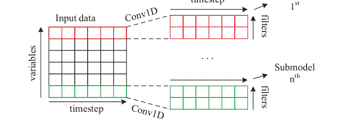

图 8. 卷积的概述。

### 3.5. 训练过程

训练过程可以描述为算法 1。

各参数的含义。`min_lr`：最小学习率；`initial_lr`：初始学习率；`factor`：学习率将被降低的因子；`wait`：在学习率将被降低之前没有改进的 epoch 数；`new_lr`：新的学习率；`epoch`：训练模型的 epoch 数；`best_score`：最小 `RMSE`。

## 算法 1：训练过程。

```
1: min_lr = 1e-4; epoch = 200; initial_lr = initial_lr
2: factor
3: for n < epoch do
4:   wait += 1
5:   if best_score > RMSE
6:     best_score = RMSE
7:     save model
8:   if wait >= 10
9:     if initial_lr > min_lr
10:      min_lr = initial_lr × factor
11:      new_lr = max(new_lr, min_lr)
12:      wait = 0
```

## 4. 实验

在本节中，我们首先描述用于实证研究的两个数据集。所有数据均可在网上获得。然后，我们在研究中介绍了模型的参数设置和评估指标。最后，将提出的 `M-TCN` 模型与不同的基线模型进行比较。

### 4.1. 数据集

使用了两个公开可用的基准数据集。表 2 总结了语料统计。

北京 `PM2.5` 数据集（可在网上获得：`https://archive.ics.uci.edu/ml/datasets/Beijing+PM2.5+Data`）：它包含中国北京的每小时 `PM2.5` 数据和相关的气象数据。外生时间序列包括露点、温度和大气压、综合风向、累积风速、降雪小时数和降雨小时数。总共我们有 43,824 个多变量序列。对于该数据集，每小时 `PM2.5` 数据用作预测值。

`ISO-NE` 数据集（可在网上获得：`https://www.iso-ne.com/isoexpress/web/reports/load-and-demand`）：数据集的时间范围在 2003 年 3 月至 2014 年 12 月之间。`ISO-NE` 数据集包括每小时需求、价格、天气数据和系统负载。数据集包含两个变量，即每小时电需求（`MW`）和干球温度（`°F`）。对于该数据集，每小时电力需求用作预测值。


# 表 2. 数据集统计。

| 数据集 | 时间序列长度 | 变量总数 | 采样率 |
|---|---|---|---|
| ISO-NE | 103,776 | 2 | 1 h |
| Beijing PM2.5 | 43,824 | 8 | 1 h |

在我们的实验中，`ISO-NE` 数据集已按时间顺序划分为训练集（2003 年 3 月 1 日至 2012 年 12 月 31 日）、验证集（2013 年全年）和测试集（2014 年全年）。此外，北京 PM2.5 数据集已按时间顺序划分为训练集（2010 年 1 月 2 日至 2012 年 12 月 31 日）、验证集（2013 年全年）和测试集（2014 年全年）。

## 4.2. 数据处理

根据每个数据集的特点，有必要对数据进行预处理。每个数据集都以均值为 0、标准差为 1 进行归一化。

对于北京 PM2.5 数据集，前 24 小时的 PM2.5 为 NA。因此，我们需要删除第一行数据。数据集中后面还有一些零散的“NA”值，我们使用零用于填补缺失值。风速特征采用标签编码（整数编码）。我们在后续实验中将新数据集应用于每种算法。

## 4.3. 评估标准

三种评估指标，即多元预测的均方根误差（`RMSE`）、均方相对误差（`RRSE`）和经验相关系数（`CORR`），被使用并定义如下：

`RMSE = sqrt( 1/N sum_{i=1}^{N} (y_i^t - \hat{y}_i^t)^2 ), (12)`

`RRSE = sqrt( sum_{(i,t) in Omega_Test} (Y_{it} - \hat{Y}_{it})^2 ) / sqrt( sum_{(i,t) in Omega_Test} (Y_{it} - mean(Y))^2 ), (13)`

`CORR = 1/n sum_{i=1}^{n} [ sum_t (Y_{it} - mean(Y_i))(\hat{Y}_{it} - mean(\hat{Y}_i)) / sqrt( sum_t (Y_{it} - mean(Y_i))^2 (\hat{Y}_{it} - mean(\hat{Y}_i))^2 ) ], (14)`

其中 `Y`, `\hat{Y} \in \mathbb{R}^{n \times T}` 分别为真实值和系统预测值，且 `\Omega_{Test}` 是用于测试的时间戳集合。对于 `RMSE` 和 `RRSE`，值越低越好，而对于 `CORR`，值越高评估越好。

## 4.4. 滚动前向验证

在测试集上采用 Walk-Forward Validation 方法，但模型不进行更新。在这种情况下，需要一个模型来预测一段时间，然后将当前时期的实际数据提供给模型，以便其可作为后续时期预测的基础。这不仅适用于模型在实践中的使用方式，而且也有利于模型使用最佳可用数据。

在实验中，输出长度设置为 24。对于多步预测问题，我们分别评估每个预测时间步。表 3 总结了实际值和预测值。模型可以按如下方式训练和评估。

- Step 1: 从测试集开始，训练集中最后一组观测值被用作模型的输入，以预测下一组数据（验证集中第一组真实值）。
- Step 2: 模型对下一个时间步进行预测。
- Step 3: 获取真实观测值并添加到历史记录中以预测下一次。
- Step 4: 预测被存储并与真实观测值进行评估。
- Step 5: 转到步骤 1。

表 3. 数据集统计，其中 h 为小时，d 为天。

| Input (Actual Value) | Output (Predicted Value) |
|---|---|
| Current 24 h | Next, 24 h |
| 1d 1 h-1 d 24 h | 2 d 1 h-2 d 24 h |
| 2d 1 h-1 d 24 h | 3 d 1 h-2 d 24 h |
| ... | ... |

## 4.5. 实验细节

更具体地说，大多数模型从 `{24,72,168}` 中选择输入长度，批大小设置为 100。均方误差是预测任务的默认损失函数。采用 `Adam` [35] 作为优化策略，初始学习率设置为 0.001。此外，如果验证分数在 10 个 epoch 内没有改善，则学习率会降低一个因子，直到达到最终学习率。

对于 `LSTM` 模型，定义了一个具有 `{50,100,200}` 个单元的单隐藏层。隐藏层中的单元数与输入序列中的时间步数无关。最后，一个输出层将直接预测一个具有 24 个元素的向量，每个输出序列中的小时对应一个元素。采用 `SGD` [36] 作为优化器。学习率设置为 0.05，降低率为 0.3 的因子。

在 `ConvLSTM` 编码器-解码器模型中，输入数据的形状为 `[timestep, row, column, channel]`。`Timestep` 从 `{1,3,7}` 中选择。`Row` 设置为 1。`Column` 从 `{24,72,168}` 中选择。`Channel` 从 `{2,8}` 中选择。采用 `SGD` 作为优化算法。学习率与 `LSTM` 中设置相同。对于该网络，1 层网络包含一个具有 64 个隐藏状态的 `ConvLSTM` 层，2 层网络包含一个具有 128 个隐藏状态的 `ConvLSTM` 层，3 层网络在 `LSTM` 层中有 200 个隐藏状态。所有输入到状态和状态到状态的核大小均为 1 × 3。

对于 `MALSTM-FCN` 网络，每个数据集的 `LSTM` 隐藏状态的最佳数量通过在 `{8,50,100,200}` 上进行网格搜索找到。`FCN` 块由三个 128-256-128 过滤器的块组成。模型使用批大小 128 进行训练。卷积核的初始化遵循 [24] 的工作。

对于 `TCN` 网络，每个数据集每层隐藏单元的最佳数量通过在 `{30,50,100}` 上进行网格搜索找到。卷积核大小为 1 × 3。

在我们的 `M-TCN` 模型中，采用 `Adam` 作为优化策略，初始学习率设置为 0.001（`ISO-NE` 数据集），而对于北京 PM2.5，采用 `SGD` 作为优化策略，初始学习率设置为 0.05。

`M-TCN` 的实现基于 `Keras` 库构建，并使用 `Tensorflow` 后端。我们在配备单块 NVIDIA 1080 GPU（美国加州圣克拉拉）的计算机上运行所有实验。

## 4.6. 实验结果

表 4 总结了在所有预测小时的多变量测试集上以 `RMSE`、`RRSE` 和 `CORR` 为指标的结果。输出序列长度设置为 24，这意味着对于北京 PM2.5 和 `ISO-NE` 电力数据的预测，预测范围从第 1 小时到第 24 小时。在时间序列预测中，更大的预测范围会使预测更困难。因此，我们的实验对该大范围内的结果进行了详细分析。每个数据和指标对的最佳结果以粗体突出显示。为了证明模型的有效性，结果与 Naive、Average 和 Seasonal persistent 模型的三种基线方法以及 `LSTM`、`ConvLSTM`、`TCN` 和 `MALSTM-FCN` 的四种竞争算法进行了比较。对于 `RMSE` 和 `RRSE`，值越低越好，而对于 `CORR`，值越高越好。基于神经网络的模型的整体性能优于传统方法。`M-TCN` 的性能与 `LSTM` 和 `MALSTM-FCN` 相当，并且在两个数据集上均比它们高出约 10%~20%。此外，`ConvLSTM` 模型具有较弱的泛化能力，其预测能力在不同数据集上差异很大。

图 9 展示了两个数据集在从第 1 小时到第 24 小时的更大预测范围内的 `RMSE` 结果。很明显 `M-TCN` 比其他方法更好，并且 `RRSE` 在长期预测期间保持稳定增长而没有明显波动。

## 表 4. 结果汇总（以 RMSE、RRSE 和 CORR 为单位）所有方法在两个数据集上的结果。

| Methods | Metrics | Beijing PM2.5 Dataset | ISO-NE Dataset |
|---|---|---|---|
|  |  | Length = 24 | Length = 24 |
| Naive | RMSE | 80.55 | 2823.35 |
|  | RRSE | 0.8608 | 1.0526 |
|  | CORR | 0.6736 | 0.5330 |
| Average | RMSE | 87.89 | 2363.07 |
|  | RRSE | 0.9393 | 0.8810 |
|  | CORR | 0.4972 | 0.4885 |
| Seasonal Persistent | RMSE | 123.45 | 1654.38 |
|  | RRSE | 1.3193 | 0.6168 |
|  | CORR | 0.1722 | 0.8314 |
| LSTM | RMSE | 68.07 | 783.90 |
|  | RRSE | 0.7275 | 0.2923 |
|  | CORR | 0.6877 | 0.9573 |
| ConvLSTM | RMSE | 82.32 | 687.17 |
|  | RRSE | 0.8798 | 0.2562 |
|  | CORR | 0.4873 | 0.9670 |
| TCN | RMSE | 112.35 | 720.12 |
|  | RRSE | 1.1453 | 0.2685 |
|  | CORR | 0.0075 | 0.9636 |
| MALSTM-FCN | RMSE | 71.54 | 680.95 |
|  | RRSE | 0.7646 | 0.2539 |
|  | CORR | 0.6463 | 0.9677 |
| M-TCN | RMSE | 65.35 | 648.48 |
|  | RRSE | 0.6984 | 0.2418 |
|  | CORR | 0.7163 | 0.9707 |

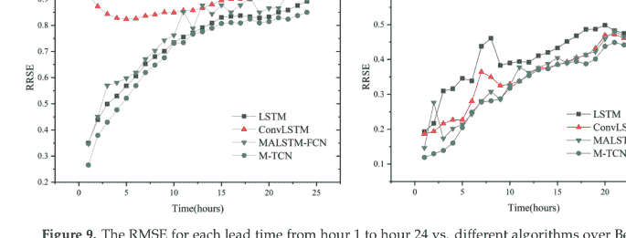

图 9. 从第 1 小时到第 24 小时每个领先时间相对于北京 PM2.5（左）和 ISO-NE 数据集（右）的不同算法的 RMSE。

## 4.7. 谱分析

为了进一步研究模型的性能，我们分析了测试集和预测数据的频谱。频谱是指时域信号在频域中的表示，可用于序列数据的离散傅里叶变换。k 点的离散傅里叶变换（DFT）计算如下：

```
X(k) = DFT[X(n)] = sum_{n=0}^{N-1} X(n) W^{nk}  (0 ≤ k ≤ N - 1),  (15)
W = e^{-i(2π/N)},  (16)
```

其中 `X(k)` 是时间序列。

更详细的计算包括：

```
X(kf1) = DFT [x(nTs)] = \sum_{n=0}^{N-1} X(nTs) e^{-j(2\pi/N)nk},  (17)
f1 = 1/T1',  (18)
Ts = T1/N',  (19)
```

其中 `T1` 是信号时间，`f1` 是频率间隔，`N` 是信号采样数，`Ts` 是信号采样间隔时间。

对这些数据集进行幅度谱分析，以便检查数据集中是否存在重复模式。测试集和预测的逐小时 PM2.5 和 ISO-NE 数据在频域中绘制，如图 10 和图 11 所示，其中 Freq 为频率，单位为 1/小时，Am 为 dB 单位的幅度。采样频率设置为 8760（与测试集时间变量长度相同）。采样频率设置为 8760（与测试中设置的时间变量长度相同），这确保了频率和时间在数值上相互对应。两个图都显示频域是不规则的连续波形，表明 PM2.5 和 ISO-NE 数据集是非周期的。可以清楚地看到，PM2.5 数据没有周期性，这给准确预测带来了巨大误差。由于 ISO-NE 数据从 1 到 1000 h 规律变化，预测效果最好。

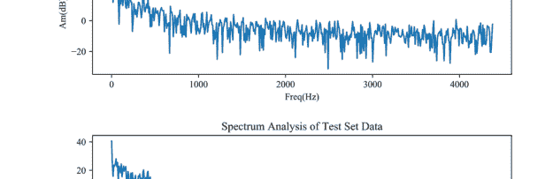

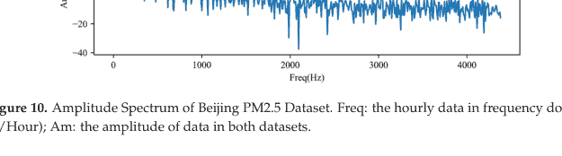

图 10. 北京 PM2.5 数据集的幅度谱。Freq：频域中的逐小时数据（1/小时）；Am：两个数据集中的数据幅度。

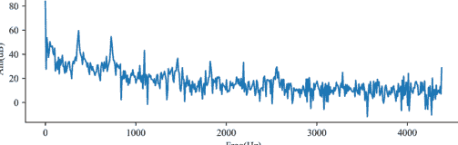

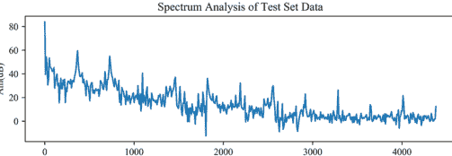

Figure 11. Amplitude Spectrum of ISO-NE Dataset. Freq: the hourly data in frequency domain (1/Hour); Am: the amplitude of data in both datasets.

图 11. ISO-NE 数据集的振幅谱。Freq：频率域中的每小时数据（1/小时）；Am：两个数据集数据的振幅。

## 4.8 Ablation Tests

## 4.8 消融测试

Furthermore, to demonstrate the efficiency of our model structure, a careful further study is performed. Specifically, we add each component one at a time in our framework. M-TCN with different components are defined as follows:

此外，为证明我们模型结构的效率，进行了仔细的进一步研究。具体而言，我们在框架中一次添加一个组件。具有不同组件的 `M-TCN` 定义如下：

Model/w/BN: The model adds a Batch Normalization (`BN`) [37] component. In this test, Batch Normalization was applied to the input of each nonlinearity, in a convolutional way, while keeping the rest of the architecture constant. Figure 12 (left) describes this model in detail.

Model/w/BN：该模型添加了批归一化（`BN`）[37] 组件。在此测试中，批归一化以卷积方式应用于每个非线性的输入，同时保持其余架构不变。图 12（左）详细描述了该模型。

Model/r/GAP: In the model, the full connection layer is replaced by the global average pooling. Figure 12 (right) describes this model in detail.

Model/r/GAP：在该模型中，全连接层被全局平均池化替换。图 12（右）详细描述了该模型。

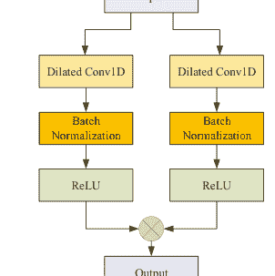

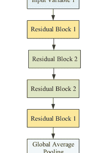

Figure 12. (left) Model/w/BN: detail architecture of the Unit. (right) Model/r/GAP: the full connection layer is replaced by the global average pooling.

图 12.（左）Model/w/BN：单元的详细架构。（右）Model/r/GAP：全连接层被全局平均池化替换。

The test results measured using RRSE are shown in Figure 13. Comparing the results, we see that, in both datasets, BN cannot help the network achieve higher accuracy. Adding the BN components in (Model/w/BN) caused big performance drops on both datasets. All of the components of the M-TCN model together lead to the robust performance of our approach on the Beijing PM2.5 dataset.

使用 `RRSE` 测量的测试结果如图 13 所示。比较结果可知，在两个数据集上，`BN` 无法帮助网络实现更高的准确率。在（Model/w/BN）中添加 `BN` 组件导致两个数据集上的性能大幅下降。`M-TCN` 模型的所有组件共同导致了我们在北京 PM2.5 数据集上方法的稳健性能。

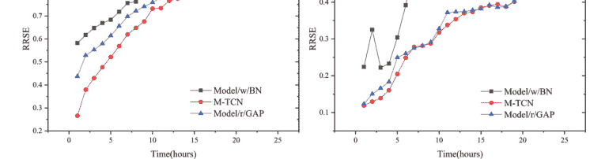

Figure 13. (left) RRSE of models over the Beijing PM2.5 dataset. (right) RRSE of models over the ISO-NE dataset.

图 13.（左）北京 PM2.5 数据集上模型的 RRSE。（右）ISO-NE 数据集上模型的 RRSE。

## 4.9 Model Efficiency

## 4.9 模型效率

s/epoch denotes the time required for each epoch (in seconds). Boldface indicates the best result. In Table 5, M-TCN proves to be quite competitive.

s/epoch 表示每个 epoch 所需的时间（以秒为单位）。粗体表示最佳结果。在表 5 中，`M-TCN` 证明具有相当强的竞争力。

### Table 5. Model training efficiency.

### 表 5. 模型训练效率。

| Methods | Beijing PM2.5 Dataset | ISO-NE Dataset |
| 方法 | 北京 PM2.5 数据集 | ISO-NE 数据集 |
|---|---|---|
| | s/epoch | s/epoch |
| | s/epoch | s/epoch |
| M-TCN | 29 | 39 |
| LSTM | 95 | 270 |


| ConvLSTM | 33 | 99 |

## 5. Conclusions

## 5. 结论

The multivariate time series forecasting is investigated by introducing a novel `M-TCN` model, in order to compare with traditional models and especially deep learning (generic recurrent architectures such as `LSTM`; generic convolutional architecture such as `TCN`; hybrid architectures such as `ConvLSTM` and `MALSTM-FCN`). In `M-TCN`, the dilated network is employed as a meta-network and asymmetric residual blocks are constructed. The proposed approach significantly improved the results in time series forecasting on benchmark datasets of Beijing `PM2.5` and `ISO-NE`. Our research focuses on the trade-off between implementation complexity and prediction accuracy. With in-depth analysis and empirical evidence, the results indicate a prominent efficiency of `M-TCN`.

通过引入新颖的 `M-TCN` 模型，研究了多元时间序列预测，以便与传统模型以及尤其是深度学习（通用循环架构如 `LSTM`；通用卷积架构如 `TCN`；混合架构如 `ConvLSTM` 和 `MALSTM-FCN`）进行比较。在 `M-TCN` 中，扩张网络被用作元网络并构建了非对称残差块。所提出的方法在北京 `PM2.5` 和 `ISO-NE` 的基准数据集上的时间序列预测结果显著改善。我们的研究重点是实现复杂性与预测准确性之间的权衡。通过深入分析和经验证据，结果表明 `M-TCN` 具有突出的效率。

For future research, we will focus on the extraction technology based on higher-order statistical features instead of fully connected layers, which can reduce the parameters of the model and training time.

对于未来研究，我们将重点关注基于高阶统计特征的提取技术，而不是全连接层，这可以减少模型的参数和训练时间。

Author Contributions: Conceptualization, R.W. and S.M.; methodology, R.W.; software, S.M.; validation, S.M. and J.W.; formal analysis, S.M.; investigation, R.W. and F.Y.; resources, M.L.; data curation, R.W. and F.Y.; writing—original draft preparation, S.M.; writing—review and editing, R.W. and F.Y.; visualization, S.M.; supervision, R.W.; project administration, F.Y.; funding acquisition, R.W. and M.L.

作者贡献：概念化，R.W. 和 S.M.；方法，R.W.；软件，S.M.；验证，S.M. 和 J.W.；形式分析，S.M.；调查，R.W. 和 F.Y.；资源，M.L.；数据整理，R.W. 和 F.Y.；写作—初稿准备，S.M.；写作—审阅和编辑，R.W. 和 F.Y.；可视化，S.M.；监督，R.W.；项目管理，F.Y.；资金获取，R.W. 和 M.L.

Funding: This work was supported by the National Natural Science Foundation of China (Grant No. 11505130 and 21872174), the Project of Innovation-Driven Plan in Central South University (2017CX003), State Key Laboratory of Powder Metallurgy, Shenzhen Science and Technology Innovation Project (JCYJ20180307151313532), Thousand Youth Talents Plan of China and Hundred Youth Talents Program of Hunan.

资助：本工作得到国家自然科学基金（项目号 11505130 和 21872174）、中南大学创新驱动计划项目（2017CX003）、粉末冶金国家重点实验室、深圳市科技创新项目（JCYJ20180307151313532）、中国千人青年人才计划和湖南省百人青年人才计划资助。

Conflicts of Interest: The authors declare no conflict of interest.

利益冲突： 作者声明无利益冲突。

## References

## 参考文献

1. Seyed, B.L.; Behrouz, M. Comparison between ANN and Decision Tree in Aerology Event Prediction. In Proceedings of the International Conference on Advanced Computer Theory & Engineering, Phuket, Thailand, 20–22 December 2008; pp. 533–537. [CrossRef]

1. Seyed, B.L.; Behrouz, M. ANN 与决策树在气学事件预测中的比较。载于先进计算机理论与工程国际会议论文集，普吉岛，泰国，2008 年 12 月 20–22 日；页码 533–537。 [CrossRef]

2. Simmonds, J.; Gómez, J.A.; Ledezma, A. Data Preprocessing to Enhance Flow Forecasting in a Tropical River Basin. In *Engineering Applications of Neural Networks*; Springer: Cham, Switzerland, 2017; pp. 429–440.

2. Simmonds, J.; Gómez, J.A.; Ledezma, A. 数据预处理以增强热带河流流域的流量预测。载于 *神经网络工程应用*；Springer：瑞士 Cham，2017；页码 429–440。

3. Mohamad, S. Artificial intelligence for the prediction of water quality index in groundwater systems. *Model. Earth Syst. Environ.* **2016**, 2, 8.

3. Mohamad, S. 地下水系统中水质指数预测的人工智能。 *Model. Earth Syst. Environ.* **2016**，2，8。

4. Amato, F.; Castiglione, A.; Moscato, V.; Picariello, A.; Sperlí, G. Multimedia summarization using social media content. *Multimed. Tools Appl.* **2018**, 77, 17803–17827. [CrossRef]

4. Amato, F.; Castiglione, A.; Moscato, V.; Picariello, A.; Sperlí, G. 使用社交媒体内容的多媒体摘要。 *Multimed. Tools Appl.* **2018**，77，17803–17827。 [CrossRef]

5. Kadir, K.; Halim, C.; Harun, K.O.; Olcay, E.C. Modeling and prediction of Turkey’s electricity consumption using Artificial Neural Networks. *Energy Convers. Manag.* **2009**, 50, 2719–2727.

5. Kadir, K.; Halim, C.; Harun, K.O.; Olcay, E.C. 使用人工神经网络对土耳其电力消费的建模与预测。 *Energy Convers. Manag.* **2009**，50，2719–2727。

6. Wu, Y.; José, M.H.; Ghahramani, Z. Dynamic Covariance Models for Multivariate Financial Time Series. *arXiv* **2013**, arXiv:1305.4268.

6. Wu, Y.; José, M.H.; Ghahramani, Z. 多元金融时间序列的动态协方差模型。 *arXiv* **2013**，arXiv:1305.4268。

7. Yu, R.; Li, Y.; Shahabi, C.; Demiryurek, U.; Liu, Y. Deep learning: A generic approach for extreme condition traffic forecasting. In Proceedings of the 2017 SIAM International Conference on Data Mining, Houston, TX, USA; 27–29 April 2017; pp. 777–785.

7. Yu, R.; Li, Y.; Shahabi, C.; Demiryurek, U.; Liu, Y. 深度学习：极端条件交通预测的通用方法。载于 2017 年 SIAM 国际数据挖掘会议论文集，休斯顿，美国德克萨斯州；2017 年 4 月 27–29 日；页码 777–785。

8. Akaike, H. Fitting autoregressive models for prediction. *Ann. Inst. Stat. Math.* **1969**, 21, 243–247. [CrossRef]

8. Akaike, H. 自回归模型的拟合用于预测。 *Ann. Inst. Stat. Math.* **1969**，21，243–247。 [CrossRef]

9. Frigola, R.; Rasmussen, C.E. Integrated pre-processing for bayesian nonlinear system identification with gaussian processes. In Proceedings of the IEEE Conference on Decision and Control, Florence, Italy, 10–13 December 2013; pp. 552–560.

9. Frigola, R.; Rasmussen, C.E. 使用高斯过程的贝叶斯非线性系统识别的集成预处理。载于 IEEE 决策与控制会议论文集，佛罗伦萨，意大利，2013 年 12 月 10–13 日；页码 552–560。

10. Alom, M.; Tha, T.; Yakopcic, C.; Westberg, S.; Sidike, P.; Nasrin, M.; Hasan, M.; Essen, B.; Awwal, A.; Asari, V. A State-of-the-Art Survey on Deep Learning Theory and Architectures. *Electronics* **2019**, 8, 292. [CrossRef]

10. Alom, M.; Tha, T.; Yakopcic, C.; Westberg, S.; Sidike, P.; Nasrin, M.; Hasan, M.; Essen, B.; Awwal, A.; Asari, V. 深度学习理论与架构的最新综述。 *Electronics* **2019**，8，292。 [CrossRef]

11. Liu, L.; Finch, A.M.; Utiyama, M.; Sumita, E. Agreement on Target-Bidirectional LSTMs for Sequence-to-Sequence Learning. In Proceedings of the Thirtieth Aaai Conference on Artificial Intelligence, Phoenix, AZ, USA, 12–17 February 2016; pp. 2630–2637.

11. Liu, L.; Finch, A.M.; Utiyama, M.; Sumita, E. 序列到序列学习的 双向 LSTM 协议。载于第三十届 AAAI 人工智能会议论文集，凤凰城，美国亚利桑那州，2016 年 2 月 12–17 日；页码 2630–2637。

12. Gehring, J.; Auli, M.; Grangier, D.; Yarats, D.; Dauphin, Y.N. Convolutional Sequence to Sequence Learning. *arXiv* **2017**, arXiv:1705.03122.

12. Gehring, J.; Auli, M.; Grangier, D.; Yarats, D.; Dauphin, Y.N. 卷积序列到序列学习。 *arXiv* **2017**，arXiv:1705.03122。

13. Yu, F.; Koltun, V.; Funkhouser, T. Dilated Residual Networks. In Proceedings of the IEEE Conference on Computer Vision and Pattern Recognition (CVPR), Honolulu, HI, USA, 21–26 July 2017; pp. 472–480. [CrossRef]

13. Yu, F.; Koltun, V.; Funkhouser, T. 扩张残差网络。载于 IEEE 计算机视觉与模式识别会议（CVPR）论文集，檀香山，美国夏威夷，2017 年 7 月 21–26 日；页码 472–480。 [CrossRef]

14. He, K.; Zhang, X.; Ren, S.; Sun, J. Deep Residual Learning for Image Recognition. In Proceedings of the IEEE Conference on Computer Vision and Pattern Recognition (CVPR), Las Vegas, NV, USA, 26 June–1 July 2016; pp. 770–778. [CrossRef]

14. He, K.; Zhang, X.; Ren, S.; Sun, J. 用于图像识别的深度残差学习。载于 IEEE 计算机视觉与模式识别会议（CVPR）论文集，拉斯维加斯，美国内华达州，2016 年 6 月 26 日–7 月 1 日；页码 770–778。 [CrossRef]

15. Ediger, V.; Akar, S. ARIMA forecasting of primary energy demand by fuel in Turkey. *Energy Policy* **2007**, 35, 1701–1708. [CrossRef]

15. Ediger, V.; Akar, S. 土耳其按燃料划分的初级能源需求 ARIMA 预测。 *Energy Policy* **2007**，35，1701–1708。 [CrossRef]

16. Rojas, I.; Valenzuela, O.; Rojas, F.; Guillen, A.; Herreraet, L.; Pomares, H.; Marquez, L.; Pasadas, M. Soft-computing techniques and ARMA model for time series prediction. *Neurocomputing* **2008**, 71, 519–537. [CrossRef]

16. Rojas, I.; Valenzuela, O.; Rojas, F.; Guillen, A.; Herreraet, L.; Pomares, H.; Marquez, L.; Pasadas, M. 用于时间序列预测的软计算技术与 ARMA 模型。 *Neurocomputing* **2008**，71，519–537。 [CrossRef]

17. Kilian, L. New introduction to multiple time series analysis. *Econ. Rec.* **2006**, 83, 109–110.

17. Kilian, L. 多时间序列分析新导论。 *Econ. Rec.* **2006**，83，109–110。


18. Sapankevych, N.; Sankar, R. Time Series Prediction Using Support Vector Machines: A Survey. *IEEE Comput. Intell. Mag.* **2009**, 4, 24–38. [CrossRef]

18. Sapankevych, N.; Sankar, R. 使用支持向量机的时序预测：综述。 *IEEE Comput. Intell. Mag.* **2009**，4，24–38。 [CrossRef]

19. Hamidi, O.; Tapak, L.; Abbasi, H.; Abbasi, H.; Maryanaji, Z. Application of random forest time series, support vector regression and multivariate adaptive regression splines models in prediction of snowfall (a case study of Alvand in the middle Zagros, Iran). *Theor. Appl. Climatol.* **2018**, 134, 769–776. [CrossRef]

19. Hamidi, O.; Tapak, L.; Abbasi, H.; Abbasi, H.; Maryanaji, Z. 随机森林时序、支持向量回归和多元自适应回归样条模型在降雪预测中的应用（伊朗扎格罗斯中部阿尔万案例研究）。 *Theor. Appl. Climatol.* **2018**，134，769–776。 [CrossRef]

20. Lima, C.; Lall, U. Climate informed monthly streamflow forecasts for the Brazilian hydropower network using a periodic ridge regression model. *J. Hydrol.* **2010**, 380, 438–449. [CrossRef]

20. Lima, C.; Lall, U. 使用周期性岭回归模型对巴西水电网络进行气候信息月径流预测。 *J. Hydrol.* **2010**，380，438–449。 [CrossRef]

21. Li, J.; Chen, W. Forecasting macroeconomic time series: LASSO-based approaches and their forecast combinations with dynamic factor models. Int. J. Forecast. 2014, 30, 996–1015. [CrossRef]

21. Li, J.; Chen, W. 宏观经济时间序列预测：基于 LASSO 的方法及其与动态因子模型的预测组合。 Int. J. Forecast. 2014, 30, 996–1015. [CrossRef]

22. Hochreiter, S.; Schmidhuber, J. Long Short-Term Memory. Neural Comput. 1997, 9, 1735–1780. [CrossRef]

22. Hochreiter, S.; Schmidhuber, J. 长短期记忆。 Neural Comput. 1997, 9, 1735–1780. [CrossRef]

23. Shi, X.; Chen, Z.; Wang, H.; Yeung, DY.; Wong, W.K.; Woo, W.C. Convolutional LSTM Network: A Machine Learning Approach for Precipitation Nowcasting. In Proceedings of the Neural Information Processing Systems Conference, Montreal, QC, Canada, 7–12 December 2015; pp. 802–810.

23. Shi, X.; Chen, Z.; Wang, H.; Yeung, DY.; Wong, W.K.; Woo, W.C. 卷积 LSTM 网络：降水即时预报的机器学习方法。载于神经信息处理系统会议论文集，蒙特利尔，加拿大魁北克，2015 年 12 月 7–12 日；页码 802–810。

24. Karim, F.; Majumdar, S.; Darabi, H.; Harford, S. Multivariate LSTM-FCNs for Time Series Classification. Neural Netw. 2019, 116, 237–245. [CrossRef]

24. Karim, F.; Majumdar, S.; Darabi, H.; Harford, S. 用于时间序列分类的多元 LSTM-FCN。 Neural Netw. 2019, 116, 237–245. [CrossRef]

25. Huang, N.E.; Zheng, S.; Long, S.R.; Wu, M.C.; Shih, H.H.; Zheng, Q.; Yen, N.-C.; Tung, C.C.; Liu, H.H. The empirical mode decomposition and the Hilbert spectrum for nonlinear and non-stationary time series analysis. Proc. Math. Phys. Eng. Sci. 1998, 454, 903–995. [CrossRef]

25. Huang, N.E.; Zheng, S.; Long, S.R.; Wu, M.C.; Shih, H.H.; Zheng, Q.; Yen, N.-C.; Tung, C.C.; Liu, H.H. 非线性与非平稳时间序列分析的经验模态分解与希尔伯特谱。 Proc. Math. Phys. Eng. Sci. 1998, 454, 903–995. [CrossRef]

26. Wu, Z.; Huang, N.E. Ensemble empirical mode decomposition: A noise-assisted data analysis method. Adv. Adapt. Data Anal. 2009 1, 1–41. [CrossRef]

26. Wu, Z.; Huang, N.E. 集合经验模态分解：一种噪声辅助数据分析方法。 Adv. Adapt. Data Anal. 2009 1, 1–41. [CrossRef]

27. Wang, J.; Wang, Z.; Li, J.; Wu, J. Multilevel Wavelet Decomposition Network for Interpretable Time Series Analysis. In Proceedings of the 24th ACM SIGKDD International Conference, London, UK, 19–23 August 2018; pp. 2437–2446. [CrossRef]

27. Wang, J.; Wang, Z.; Li, J.; Wu, J. 用于可解释时间序列分析的多级小波分解网络。载于第 24 届 ACM SIGKDD 国际会议论文集，伦敦，英国，2018 年 8 月 19–23 日；页码 2437–2446。 [CrossRef]

28. Dragomiretskiy, K.; Zosso, D. Variational Mode Decomposition. IEEE Trans. Signal Process. 2014, 62, 531–544. [CrossRef]

28. Dragomiretskiy, K.; Zosso, D. 变分模态分解。 IEEE Trans. Signal Process. 2014, 62, 531–544. [CrossRef]

29. Bai, S.; Kolter, J.Z.; Koltun, V. An Empirical Evaluation of Generic Convolutional and Recurrent Networks for Sequence Modeling. arXiv 2018, arXiv:1803.01271.

29. Bai, S.; Kolter, J.Z.; Koltun, V. 用于序列建模的通用卷积与循环网络的实证评估。 arXiv 2018, arXiv:1803.01271.

30. Dou, C.; Zheng, Y.; Yue, D.; Zhang, Z.; Ma, K. Hybrid model for renewable energy and loads prediction based on data mining and variational mode decomposition. IET Gener. Transm. Distrib. 2018, 12, 2642–2649. [CrossRef]

30. Dou, C.; Zheng, Y.; Yue, D.; Zhang, Z.; Ma, K. 基于数据挖掘和变分模态分解的可再生能源与负荷预测混合模型。 IET Gener. Transm. Distrib. 2018, 12, 2642–2649. [CrossRef]

31. Howard, A.; Sandler, M.; Chu, G.; Chen, L.-C.; Chen, B.; Tan, M.; Wang, W.; Zhu, Y.; Pang, R.; Vasudevan, V.; et al. Searching for MobileNetV3. arXiv 2018, arXiv:1905.02244.

31. Howard, A.; Sandler, M.; Chu, G.; Chen, L.-C.; Chen, B.; Tan, M.; Wang, W.; Zhu, Y.; Pang, R.; Vasudevan, V.; et al. 搜索 MobileNetV3。 arXiv 2018, arXiv:1905.02244.

32. Cai, H.; Zhu, L.; Han, S. ProxylessNAS: Direct Neural Architecture Search on Target Task and Hardware. arXiv 2018, arXiv:1812.00332.

32. Cai, H.; Zhu, L.; Han, S. ProxylessNAS：目标任务和硬件上的直接神经架构搜索。 arXiv 2018, arXiv:1812.00332.

33. Elsken, T.; Metzen, J.H.; Hutter, F. Neural Architecture Search: A Survey. arXiv 2018, arXiv:1808.05377.

33. Elsken, T.; Metzen, J.H.; Hutter, F. 神经架构搜索：综述。 arXiv 2018, arXiv:1808.05377.

34. Nair, V.; Hinton, G. Rectified linear units improve restricted Boltzmann machines. In Proceedings of the 27th International Conference on International Conference on Machine Learning, Haifa, Israel, 21–24 June 2010; pp. 807–814.

34. Nair, V.; Hinton, G. 矫正线性单元改善受限玻尔兹曼机。载于第 27 届国际机器学习会议论文集，海法，以色列，2010 年 6 月 21–24 日；页码 807–814。

35. Kingma, D.; Ba, J. Adam:A method for stochastic optimization. arXiv 2014, arXiv:1412.6980.

35. Kingma, D.; Ba, J. Adam：一种随机优化方法。 arXiv 2014, arXiv:1412.6980.

36. Sutskever, I.; Martens, J.; Dahl, G.E.; Hinton, G. On the importance of initialization and momentum in deep learning. In Proceedings of the 30th International Conference on International Conference on Machine Learning, Atlanta, GA, USA, 16–21 June 2013; pp. 1139–1147.

36. Sutskever, I.; Martens, J.; Dahl, G.E.; Hinton, G. 初始化和动量在深度学习中的重要性。载于第 30 届国际机器学习会议论文集，亚特兰大，美国佐治亚州，2013 年 6 月 16–21 日；页码 1139–1147。

37. Ioffe, S.; Szegedy, C. Batch normalization: Accelerating deep network training by reducing internal covariate. In Proceedings of the 32nd International Conference on Machine Learning, Lille, France, 6–11 July 2015; pp. 448–456.

37. Ioffe, S.; Szegedy, C. 批归一化：通过减少内部协变量加速深度网络训练。载于第 32 届国际机器学习会议论文集，里尔，法国，2015 年 7 月 6–11 日；页码 448–456。

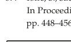

© 2019 by the authors. Licensee MDPI, Basel, Switzerland. This article is an open access article distributed under the terms and conditions of the Creative Commons Attribution (CC BY) license (http://creativecommons.org/licenses/by/4.0/).

© 2019 作者所有。许可方 MDPI，瑞士巴塞尔。本文是一篇开放获取文章，根据知识共享署名（CC BY）许可（http://creativecommons.org/licenses/by/4.0/）的条款和条件分发。

# 湿度传感器自适应温度补偿的建模与分析

Wei Xu, Xiaoyu Feng and Hongyan Xing *

江苏省气象观测与信息处理重点实验室，南京信息工程大学，南京 210044，中国； xw@nuist.edu.cn (W.X.)； 20162281511@nuist.edu.cn (X.F.)

* 通讯作者： xinghy@nuist.edu.cn

收到：2019年3月2日；接受：2019年4月8日；发表：2019年4月11日

**摘要：** 除了对湿度敏感外，具有湿敏元件的湿度传感器也对环境温度敏感。温度和湿度数据的融合是提高湿度传感器精度的一种有效方法。针对当前补偿算法自适应能力不足、通用性差的问题，本文提出采用多元线性回归对不同温度下的测量误差进行分段处理。采用最小二乘法和遗传模拟退火算法改进的反向传播（BP）神经网络（GSA-BP）对不同温度范围的实测湿度数据进行补偿。测试了GSA-BP算法的效率，建立了补偿函数模型。还将补偿精度与其他方法得到的精度进行了比较。实验结果表明，自适应分段补偿方法可以在宽温度范围内显著改善湿度传感器的测量误差。

**关键词：** 湿度传感器；数据融合；非线性优化；多元线性回归；GSA-BP

## 1. 引言

自动气象站实时监测气候环境的变化。气象传感器易受环境影响，其测量误差客观存在[1]。通常，自动气象站使用的湿度传感器为电压输出型聚合物薄膜湿敏电容传感器，其通过湿敏电容感知湿度，然后由转换电路将其转换为电压量[2]。湿敏电容主要由上电极、湿敏材料、下电极和玻璃基板组成。湿敏材料是一种高分子聚合物，其介电常数随外部环境相对湿度而变化。除了对环境湿度敏感外，湿敏材料还对温度敏感。温度系数不是常数而是变量。传感器测量数据通常需要非线性补偿[3,4]。

湿度传感器制造商和气象校准机构会对温度对测量结果的影响进行补偿，但在低温（−20 °C）或高温（+50 °C）条件下补偿效果不理想，且补偿算法在宽温度范围内不具通用性。研究高效自适应的补偿方法以提高校准效率非常重要。


近年来，许多学者采用硬件和软件相结合的方式对传感器进行补偿，并取得了一些显著成果。文献5和6提出使用调理芯片和同心惠斯通电桥电路进行补偿[5,6]，但该硬件补偿电路受电子元件温度漂移和工艺技术限制，导致成本高、补偿效果差。由于成本低、适用性强、补偿精度高，软件补偿已成为研究的热点。2014年，文献7提出硬件与软件相结合的方法。电路首先设计并由极限学习机（`ELM`）进行补偿[7]。硬件补偿电路本身会受环境温度影响，`ELM`算法容易产生过拟合问题，无法获得最佳效果。文献8提出使用主成分分析（`PCA`）改进反向传播（`BP`）神经网络进行非线性补偿[8]。`PCA`是最广泛使用的降维和误差校正方法。在实际应用中，当存在粗大误差时，`PCA`无法很好地把握数据的真实子空间结构，且算法缺乏通用性。2015年，文献9使用粒子群优化（`PSO`）算法优化`BP`神经网络的非线性补偿方法。`PSO`没有交叉和变异操作[9]，搜索速度快，但缺乏动态速度调节，容易陷入局部极值。对环境温度的适应能力不强。2016年，文献10提出使用最小二乘支持向量机（`LS-SVM`）进行补偿[10]。与人工神经网络相比，`LS-SVM`克服了训练时间长的不足，求解方程比`SVM`更快。解满足极值条件，但不能保证是全局最优解，仍存在易陷入局部极值的问题。所有这些补偿方法只是简单地将算法应用于传感器补偿，未考虑温度的影响，使得补偿方法自适应性较差，很难保证补偿算法在宽温度范围内的优越性。

近年来，我们对湿度传感器的非线性补偿进行了大量研究。2012年至2017年，我们提出了一种改进的`BP`神经网络非线性补偿方法，使用遗传算法（`GA`）优化权重和阈值[11,12]。该方法避免了`BP`神经网络陷入局部极值，但当湿度数据量较大时补偿速度较慢。此外，结合温度对湿度传感器的影响，提出了一种分段补偿方法，补偿速度快[13]，但分段节点是人工选择的。智能性和自适应能力不高。在以往研究的基础上，并受多信息方法的启发，本文提出了一种湿度传感器的自适应非线性补偿方法。根据温度对湿度传感器的影响规律，采用自适应分段对传感器进行补偿，并比较研究了各种补偿方法的效果。

## 2. 补偿原理

通过大量实验测试，已证明湿度传感器的测量误差在室温附近呈线性，在高温和低温下呈非线性。有些传感器在室温附近也呈非线性。在实验中，湿度传感器被放入温湿度试验箱，可同时调节温度和湿度。标准湿度值由精密露点仪、温度传感器和压力计的测量值计算得出。空气中的水蒸气变成露珠的温度称为露点温度。露点温度是表示空气湿度的一种方法。标准湿度值可通过实验测得的露点值、温度值和压力值计算得出。在本实验中，数据采集器的采集范围为0.1 µV~100 V，灵敏度为100 nV，误差为±0.002%。温度由二级标准`PT100`温度传感器测量，允许误差值为±0.15 °C。实验期间，所有设备和仪器均经验证具有高测量精度，能够获得准确、科学、合理的数据。湿度传感器的测量值由高精度数据采集单元。温湿度试验箱进行了调整，并对接近预设值的点进行了观察和记录。实验原理如图1所示。

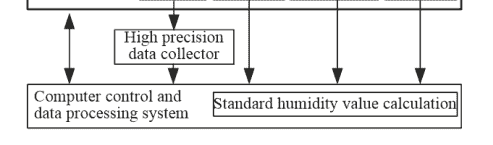

图1. 不同温度下湿度传感器的误差实验。

湿度敏感电容式传感器被放置在温湿度调节室中。湿度设定为10% RH，并改变温度。温度稳定后，读取湿度传感器的测量值。湿度设定为30% RH、50% RH、70% RH和90% RH，并重复上述步骤。得到了不同温度下湿度传感器的测量误差曲线，如图2所示。

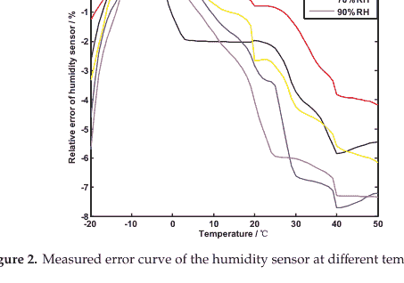

图2. 不同温度下湿度传感器的测量误差曲线。

从图2的误差曲线可以看出，湿度传感器的误差在低温和高溫区域明显增大且具有非线性特征。传感器的原始测量值根据不同的环境温度进行补偿，使得补偿值接近标准值。设环境温度为`T`，湿度传感器原始测量值`H_I`与补偿湿度值`H_C`之间的关系为式(1)。

$H_C = f(H_I, T)$

(1)

$H_C$和$T$都是$H_I$的单值函数，则逆函数$H_I = f^{-1}(H_C, T)$存在。因此引入影响参数`T`和测量值`H_I`作为待补偿数据，并通过二元线性回归函数进行回归分析。回归效果和分割点`T_1`、`T_2`的值是根据决定系数`R^2`的值确定的。采用最小二乘法和`GSA-BP`神经网络对不同温度区间进行补偿。分段补偿的函数与式(2)类似。

$$H_C = f(H_I, T) = \begin{cases} f_1(H_I, T), T \in [T_0, T_1] \\ f_2(H_I, T), T \in [T_1, T_2] \\ f_3(H_I, T), T \in [T_2, T_3] \end{cases} \tag{2}$$

其中`T_0 ≤ T_1 ≤ T_2 ≤ T_3`，`f_2(H_I, T)`是线性回归效果良好的温度范围的补偿函数。采用简单高效的最小二乘法进行线拟合。`f_1(H_I, T)`和`f_3(H_I, T)`分别为低温和高溫下的补偿函数，采用`GSA-BP`神经网络。温度`T`的影响被有效降低，测量数据逼近湿度标准值。最优补偿的整体思路如图3所示。

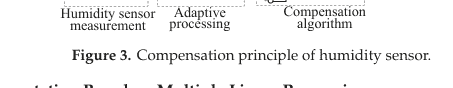

图3. 湿度传感器的补偿原理。

## 3. 基于多元线性回归的自适应分段

对于不同温度下的湿度测量误差，提高补偿精度的关键是判断是否需要分段补偿并找到最佳分割点。线性回归方法主要确定如何通过样本获得最佳拟合线。该过程是一种数学优化方法，通过最小化误差平方来寻找数据的最佳函数[14]。在回归分析中包含两个或多个自变量，这些自变量可以用直线近似。从图2可以看出，在湿度传感器的温度实验中，某些区间内湿度传感器的测量误差与温度值之间存在一定的线性关系。多元线性回归方法可用于分析并补偿线性区间内的误差[15]。建立了期望理想湿度值、测量值与温度之间的回归模型。计算决定系数并根据其值判断是否需要分段补偿。

建立了温度补偿的多元线性回归模型，如式(3)。

$$H_{Oi} = \beta_0 + \beta_1 H_{Ii} + \beta_2 T_i \tag{3}$$

其中`H_Oi`为回归的期望湿度值，`H_Ii`为湿度传感器的测量值，`T_i`为环境温度值，`i`表示第`i`组数据，`i = 1,2,3··· n`，共有`n`组数据，`β_0, β_1, β_2`为回归系数。实际回归模型可表示为式(4)。

$$\hat{H}_{Oi} = \hat{\beta}_0 + \hat{\beta}_1 H_{Ii} + \hat{\beta}_2 T_i \tag{4}$$

其中`β̂_0`、`β̂_1`和`β̂_2`分别为`β_0`、`β_1`和`β_2`的估计值。`Ĥ_Oi`为`H_Oi`的估计值，二者的残差为`ε_i`。根据最小二乘法可知，`β̂_0`、`β̂_1`和`β̂_2`应使残差`ε_i`的平方和最小。

$$Q = \sum \varepsilon_i^2 = \sum (H_{Oi} - \hat{H}_{Oi})^2 = \sum (H_{Oi} - \hat{\beta}_0 - \hat{\beta}_1 H_{Ii} - \hat{\beta}_2 T_i)^2 \tag{5}$$

根据多元函数的极值原理，当`Q`取得最小值时，`Q`对`β̂_0`、`β̂_1`和`β̂_2`的偏导数均等于零。则有式(6)。

$$\begin{cases}\frac{\partial Q}{\partial \hat{\beta}_0}=2\sum(H_{Oi}-\hat{\beta}_0-\hat{\beta}_1 H_{Ii}-\hat{\beta}_2 T_i)(-1)=0\\\frac{\partial Q}{\partial \hat{\beta}_1}=2\sum(H_{Oi}-\hat{\beta}_0-\hat{\beta}_1 H_{Ii}-\hat{\beta}_2 T_i)(-H_{Ii})=0\\\frac{\partial Q}{\partial \hat{\beta}_2}=2\sum(H_{Oi}-\hat{\beta}_0-\hat{\beta}_1 H_{Ii}-\hat{\beta}_2 T_i)(-T_i)=0\end{cases}\tag{6}$$

进而推导出式(7)。

$$\begin{cases}n\hat{\beta}_0+\hat{\beta}_1\sum H_{Ii}+\hat{\beta}_2\sum T_i=\sum H_{Oi}\\\hat{\beta}_0\sum H_{Ii}+\hat{\beta}_1\sum H_{Ii}^2+\hat{\beta}_2\sum T_i H_{Ii}=\sum H_{Ii}H_{Oi}\\\hat{\beta}_0\sum T_i+\hat{\beta}_1\sum T_i H_{Ii}+\hat{\beta}_2\sum T_i^2=\sum T_i H_{Oi}\end{cases}\tag{7}$$

其矩阵形式为

$$\begin{bmatrix}n & \sum H_{Ii} & \sum T_i\\\sum H_{Ii} & \sum H_{Ii}^2 & \sum T_i H_{Ii}\\\sum T_i & \sum T_i H_{Ii} & \sum T_i^2\end{bmatrix}\begin{bmatrix}\hat{\beta}_0\\\hat{\beta}_1\\\hat{\beta}_2\end{bmatrix}=\begin{bmatrix}\sum H_{Oi}\\\sum H_{Ii}H_{Oi}\\\sum T_i H_{Oi}\end{bmatrix}\tag{8}$$

在式(8)中，两个矩阵可写为

$$\begin{bmatrix}n & \sum H_{Ii} & \sum T_i\\\sum H_{Ii} & \sum H_{Ii}^2 & \sum T_i H_{Ii}\\\sum T_i & \sum T_i H_{Ii} & \sum T_i^2\end{bmatrix}=\begin{bmatrix}1 & 1 & \cdots & 1\\H_{I1} & H_{I2} & \cdots & H_{In}\\T_1 & T_2 & \cdots & T_n\end{bmatrix}\begin{bmatrix}1 & H_{I1} & T_1\\1 & H_{I2} & T_2\\\vdots & \vdots & \vdots\\1 & H_{In} & T_n\end{bmatrix}\tag{9}$$

$$\begin{bmatrix}\sum H_{Oi}\\\sum H_{Ii}H_{Oi}\\\sum T_i H_{Oi}\end{bmatrix}=\begin{bmatrix}1 & 1 & \cdots & 1\\H_{I1} & H_{I2} & \cdots & H_{In}\\T_1 & T_2 & \cdots & T_n\end{bmatrix}\begin{bmatrix}H_{O1}\\H_{O2}\\\vdots\\H_{On}\end{bmatrix}\tag{10}$$

假设

$$\begin{bmatrix}1 & H_{I1} & T_1\\1 & H_{I2} & T_2\\\vdots & \vdots & \vdots\\1 & H_{In} & T_n\end{bmatrix}=X\tag{11}$$

则式(9)和式(10)可改写为

$$\begin{bmatrix}n & \sum H_{Ii} & \sum T_i\\\sum H_{Ii} & \sum H_{Ii}^2 & \sum T_i H_{Ii}\\\sum T_i & \sum T_i H_{Ii} & \sum T_i^2\end{bmatrix}=X'X\tag{12}$$

$$\begin{bmatrix}\sum H_{Oi}\\\sum H_{Ii}H_{Oi}\\\sum T_i H_{Oi}\end{bmatrix}=X'H_O\tag{13}$$

将式(12)和式(13)代入式(8)

`X'X` ⎡ `β̂₀` ⎤ = `X' H_O`

      ⎢ `β̂₁` ⎥

      ⎣ `β̂₂` ⎦

(14)

因此，回归系数由式(15)得到

⎡ `β̂₀` ⎤   (`X'X`)⁻¹ `X' H_O`

⎢ `β̂₁` ⎥ =

⎣ `β̂₂` ⎦

(15)

将回归系数代入多元线性回归模型，可得到补偿函数。为了验证模型的合理性，采用决定系数`R²`来估计模型对测量数据的拟合程度。在多元回归分析中，决定系数是路径系数的平方，即

`R² = SSR / SST = Σᵢ (Ĥ_Oi − H̄_Oi)² / Σᵢ (H_Oi − H̄_Oi)²`

(16)

在式(16)中，`H̄_Oi`为`H_Oi`的平均期望湿度值。总离差平方和`SST`反映了所有期望湿度值`H̄_Oi`的离散状态。回归平方和`SSR`反映了回归后的差异。残差平方和为`SSE = Σᵢ εᵢ²`，因此`SST = SSR + SSE`。则式(16)可改写为式(17)

`R² = SSR / (SSR + SSE) = 1 − SSE / SST = 1 − Σᵢ εᵢ² / Σᵢ (H_Oi − H̄_Oi)²`

(17)

决定系数`R²`表示估计值`Ĥ_Oi`对理想值`H_Oi`的解释程度。`R²`越大，回归曲线越接近理想湿度值[16]。

因此，利用实际测量湿度值`H_i`、温度值`T_i`和期望理想湿度值`H_Oi`计算回归系数`β̂_0`、`β̂_1`、`β̂_2`和决定系数`R²`。决定系数`R²`用于判断是否分段及确定分割点。具体实施步骤如下。

- 1. 湿度传感器的误差曲线在室温下呈线性。因此初始温度值`T_x`确定为约25 °C。当湿度为10%–90% RH时，环境温度25 °C下湿度传感器的测量误差为−6%--1%。
- 2. 读取前一温度值`T_{x-1}`和下一温度值`T_{x+1}`及其各自的湿度值。
- 3. 每次读取一组温度及对应湿度数据时，进行回归以获得决定系数`R²`。
- 4. 若`R² ≥ 0.911`，则返回步骤2；若`R² < 0.911`，则得到分割点`T1`和`T2`。
- 5. 当线性区间的温度间隔大于5 °C，即`T1 − T2 > 5`时，根据图3进行分段补偿。若`T1 − T2 ≤ 5`，则整个过程由`GSA-BP`补偿。基于多元线性回归的自适应分段流程图如图4所示。

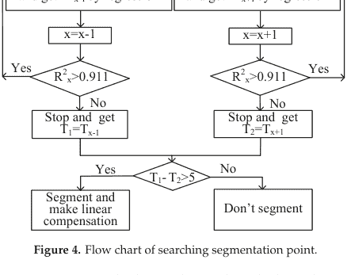

图4. 搜索分割点的流程图。

多元线性回归方法用于分析不同温度下的湿度测量误差。对于线性较好的区间，采用公式(4)建立的多元回归模型对误差进行补偿。

## 4. 非线性补偿模型

非线性区间采用具有强非线性映射能力的`BP`神经网络进行补偿。`BP`神经网络的输入为温度 `T` 和测量值 `H1`，输出为补偿后的湿度值 `HC`。建立了湿度传感器温度补偿模型，并利用多组数据对`BP`神经网络进行训练。为改善`BP`神经网络的局部最小问题，采用了遗传模拟退火算法。

遗传模拟退火算法是将遗传算法和模拟退火算法相结合的优化算法。遗传算法的局部搜索能力有限，但把握整体搜索过程的能力强。模拟退火算法具有较强的局部搜索能力，可以防止搜索过程陷入局部最优解。然而，对整个搜索空间的状态知之甚少。使搜索过程进入最优搜索区域并不方便，这使得模拟退火算法效率较低。然而，如果将遗传算法与模拟退火算法相结合，则可以开发出性能优异的全局搜索算法 [17,18]。

基于遗传模拟退火算法的`BP`神经网络(`GSA-BP`)主要分为`BP`网络结构确定和权重与阈值的选择。具体补偿步骤如下：

- 1. 确定`BP`神经网络的拓扑结构。`BP`神经网络设置为三层网络结构。温度 `T` 和湿度传感器 `H1` 的原始测量值是网络输入，输入节点数 `n1` 为 2。隐层节点数 `n2` 根据补偿效果设置为 7。网络输出为补偿后的湿度值 `HC`，输出节点数 `n3` 为 1。遗传模拟退火算法的优化参数个数确定如下：(`n1 + 1`)`n2` + (`n2 + 1`)`n3` = 29。
- 2. 初始化遗传模拟退火算法。权重和阈值的种群大小 `M` 为 60；最大迭代次数 `MAXGEN` 为 2000；交叉概率 `P_c` 为 0.6；变异概率 `P_m` 为 0.1；初始温度 `T_0` 为 100；终止温度 `T_c` 为 0.01；温度冷却系数 `α` 为 0.99。
- 3. 初始化`BP`神经网络的权重和阈值并计算适应度。遗传模拟退火算法的初始种群由`BP`神经网络初始化的初始权重和阈值与原始测量值 `H_i` 和温度 `T` 结合生成。遗传模拟退火算法中的每个个体代表一个网络的所有权重和阈值，然后算法通过适应度函数计算每个个体的适应度。本文的适应度函数采用适应度伸张方法，第 `i` 个个体改进后的适应度由公式(18)计算。

`fit(i) = e^{f_i/T} / sum_{i=1}^{M} e^{f_i/T}` (18)

其中，`f_i` 为改进前的第 `i` 个个体适应度，`f_i = 1 / |H_Oi - H_Ci|`。`T_0` 和 `T` 分别为模拟退火算法中的初始温度和当前温度，`T = T_0 (0.99^{gen-1})`。`gen` 为当前遗传进化代数，`M` 为种群大小。`H_Oi` 和 `H_Ci` 为第 `i` 个个体网络期望的标准湿度值和实际得到的湿度值。
- 4. 遗传模拟退火算法基于选择、交叉、变异和退火等一系列操作寻找适应度最优的个体。比较种群中每个个体的当前适应度和历史最佳适应度。如果当前值更好，则当前值即为历史最佳值，并将该个体保存为历史最佳值，否则最佳值不变。
- 5. 遗传模拟退火算法获得最优个体作为`BP`神经网络的初始权重和阈值。优化后的`BP`神经网络用于训练不同温度下的湿度数据。

图5 显示了湿度传感器补偿方法的流程。输入湿度传感器和环境温度的原始测量值后，`GSA` 对 `BP` 神经网络的权重和阈值进行优化。最后得到补偿后的湿度值。

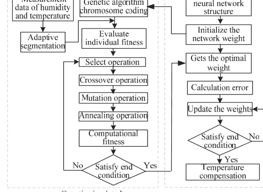


图5. 基于遗传模拟退火(`GSA-BP`)的补偿算法流程图。

## 5. 实验结果与分析

### 5.1. 优化补偿算法 `GSA-BP` 的性能分析

分段补偿函数的变量为湿度传感器的实际测量值和环境温度值。`GSA` 是一种随机搜索算法。迭代次数不确定。将代表性训练过程与未优化的`BP`神经网络进行了比较。

从图6可以看出，当`GSA-BP`神经网络进化到第70代时，其适应值达到最小，找到了`BP`神经网络的最优权重和阈值，终止迭代次数为77。在图7中，`BP`神经网络的迭代次数为229。可以看出，在相同条件下，经`GSA`优化的`BP`神经网络迭代次数少，训练速度快，这表明`BP`神经网络优化了运算效率。

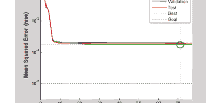

图6. `GSA-BP`神经网络的训练迭代次数。

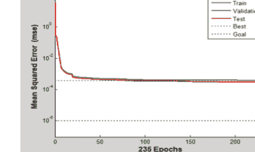

图7. 反向传播(`BP`)神经网络的训练迭代次数。

图8为`GSA-BP`神经网络的湿度补偿效果曲线。从图中可以看出，预测输出与期望输出之间的误差非常小，经`GSA`优化的`BP`神经网络具有良好的补偿效果。

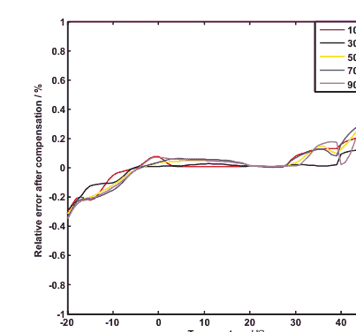

图8. `GSA-BP`神经网络的补偿曲线。

### 5.2. 分段优化补偿模型

通过上述理论分析和实验数据的验证，可以看出温度对湿度传感器的影响。重复实验在同一湿度传感器上获得的一百五十组数据用作训练样本，15组数据用作网络测试样本。建立湿度补偿模型的过程如下：

- 1. 读取测量数据集并进行插值。实验中设置的温度点具有一定的离散性。因此在离散数据的基础上加入连续函数，且连续曲线经过所有给定的离散数据点。插值数据将在以后进行补偿。
- 2. 从25 °C温度开始依次读取两组温度及对应湿度，使用二元线性回归函数对插值后的数据进行回归，并根据判定系数 `R²` 的值确定回归效果。当 `R² ≤ 0.911` 时，停止回归。实验数据停止回归时 `R²` 的值为0.8468。此时的温度值为温度分割点 `T₁`、`T₂`，分别为22.36和29.98。
- 3. 判断温度分割点的区间是否大于5。实验数据满足此条件；因此进行分段补偿。采用最小二乘法对温度范围[22.36, 29.98]进行线性拟合。以30% RH的直线拟合效果为例，拟合直线为：`ε = −0.2695T + 4.4723`，其中 `ε` 为补偿值，`T` 为温度值。当测量湿度值为30% RH时，输入温度值得到相应的湿度补偿值，然后将其加到测量值上得到补偿值。
- 4. 使用`GSA`优化`BP`神经网络的权重和阈值，训练神经网络，并对非线性区间的数据进行补偿。
- 5. 补偿函数模型如图9所示。补偿效果图如图10所示。从图10可以看出，补偿后的湿度值与标准湿度具有良好的线性关系，使得测量值更接近真实值。

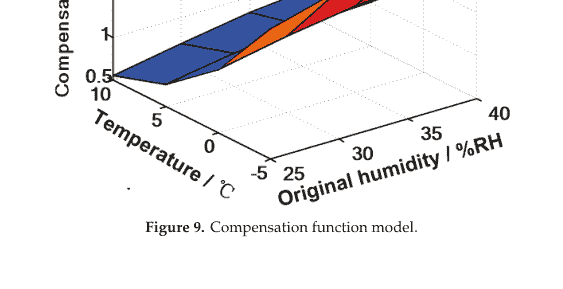

图9. 补偿函数模型。

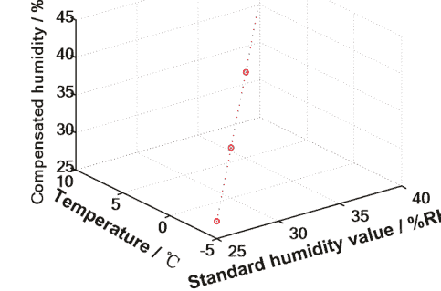

## 图 10. 补偿效果。

同一湿度传感器的原始测量数据通过参考文献 11、参考文献 13 以及本文提出的方法进行了补偿。参考文献 11 使用了无分段补偿的遗传算法（`GA`）改进 `BP` 神经网络，其中 `GA` 是一种基于种群的优化算法 [19]。参考文献 13 使用最小二乘和 `BP` 神经网络进行补偿。本文使用自适应选择改进并结合遗传模拟退火的 `BP` 神经网络进行补偿。为避免算法的随机性，对同一组数据多次运行，补偿效果相同；因此取多次运行后同一组数据的平均值。三种方法补偿数据如表 1 所示，对应的误差曲线如图 11 所示。

## 表 1. 三种方法的补偿后误差。

| 环境温度 (°C) | 相对湿度标准值 (%RH) | 参考文献 11 | 参考文献 13 | 本文 |
|---|---|---|---|---|
| -19.68 | 11.79 | -0.34553 | -0.3857 | -0.2912 |
| -14.98 | 11.56 | -0.25367 | -0.2678 | -0.2198 |
| -9.65 | 11.15 | -0.24591 | -0.1783 | -0.1423 |
| -4.78 | 9.26 | 0.0321 | -0.0026 | 0.0035 |
| 3.45 | 9.61 | 0.0056 | -0.0098 | 0.0102 |
| 20.01 | 23.55 | -0.1785 | 0.0728 | 0.0128 |
| 24.58 | 25.05 | -0.0148 | -0.0118 | 0.0021 |
| 29.98 | 25.95 | 0.04726 | 0.0248 | 0.0219 |
| 38.89 | 27.8 | 0.0147 | 0.0975 | 0.0175 |
| 51.21 | 29.25 | 0.0947 | 0.0752 | 0.0642 |

由表 1 和图 11 可见：

- 1. 三种方法补偿效果的整体趋势相同。参考文献 11 使用的补偿误差较大，且在分段节点处误差显著增加。本文方法的补偿效果相对稳定。特别是 0 到 40 °C 之间的曲线趋于平缓并接近零。
- 2. 自适应分段补偿方法结合了最小二乘法的简便高效性和 `GSA-BP` 神经网络的高精度。湿度测量误差在整个温度范围内显著改善。在自适应计算得到的分段点（22.36 °C，29.98 °C）附近，补偿效果尤为显著。

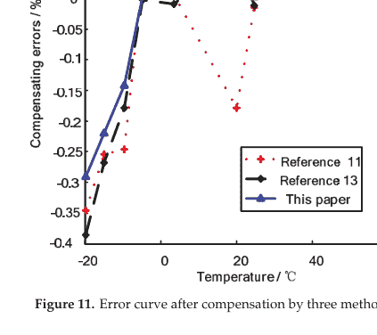

## 图 11. 三种方法补偿后的误差曲线。

## 6. 结论

我们使用该方法对不同温度范围和不同个体温度的湿度传感器进行补偿。根据不同环境温度下的误差曲线，使用多元线性回归分析确定分段点，并使用不同算法进行补偿。结果表明，该方法具有很强的通用性，对不同温度范围和个体测量均有效。

此外，将独立分量分析方法引入测量误差的重建中可能会进一步提高补偿效果 [20]。应补充的是，在该方法中确定分段点时的初始温度为 25 °C。该温度被采用是因为经过多次测量后，本实验所用传感器的湿度误差在约 25 °C 时相对线性。如果使用其他传感器，初始值将根据这些不同传感器的湿度曲线确定。然而，初始值不会非常严格，附近的值可以自适应地作为初始值处理。

作者贡献：概念化，W.X. 和 X.F.；方法学，W.X.；软件，X.F.；验证，X.F. 和 W.X.；数据整理，H.X.；写作-初稿准备，X.F. 和 W.X.；写作-审阅与编辑，W.X.；监督，W.X.；项目管理，H.X.；资金获取，W.X.

资助：本工作由中国国家重点研发计划（2018YFC1506102）和中国国家自然科学基金（项目号 41605121 和 61671248）资助。

利益冲突：作者声明无利益冲突。

## 参考文献

- 1. Weiwei, L.V.; Xiaohua, L.V.; Zuoyang, T.; Xiaohua, X.; Yong, X. DZZ 系列自动气象站的故障分析与维护. *Meteorol. Environ. Res.* **2018**, *9*, 35–37.
- 2. Hai, M.; Wen, F.; Wang, C.; Li, X.J. 生长在硅纳米多孔支柱阵列上的 CdS/ZnO 芝麻糖状结构的电容式湿度传感特性. *J. Alloys Compd.* **2017**, *11*, 94–98.
- 3. Lob, V.; Geisler, T.; Brischwein, M.; Uhl, R.; Wolf, B. 使用单分子晶体管的湿度传感器. *J. Appl. Phys.* **2015**, *118*, 135–171.
- 4. Wang, D.F.; Lou, X.; Bao, A.; Yang, X.; Zhao, J. 基于压电传感器的温度补偿方法. Appl. Phys. Lett. 2017, 111, 083502. [CrossRef]
- 5. Ruirong, D.; Hongwei, Z.; Nan, S.; Bo, D.; Dengyue, W. 高温高压井下压力传感器的补偿与校准. Chin. J. Sci. Instrum. 2016, 43, 737–743.
- 6. Hsieh, C.; Hung, C.; Li, Y. 使用两个同心惠斯通电桥电路的温度补偿压力传感器研究. Mod. Mech. Eng. 2013, 10, 104–113. [CrossRef]
- 7. Zhou, G.; Zhao, Y.; Guo, F. 一种智能高精度硅压阻压力传感器温度补偿系统. Sensors 2014, 4, 74–90. [CrossRef] [PubMed]
- 8. Li, T.; Liang, S.; Hong, Y.; Pan, L. 基于 PCA 和改进 BP 神经网络的压力传感器温度补偿仿真. Adv. Mater. Res. 2014, 846–847, 513–516. [CrossRef]
- 9. Li, Y.; Li, Y.; Li, F.; Zhao, B. 基于改进 PSO-BP 算法的热电堆传感器温度补偿研究. Math. Probl. Eng. 2015, 3, 1–6. [CrossRef]
- 10. Zhu, L.; Xie, B.; Xing, Y.; Chen, D.; Wang, J. 具有最小二乘支持向量机温度补偿的谐振压力传感器. Procedia Eng. 2016, 168, 1731–1734. [CrossRef]
- 11. Jiwei, P.; Wenhua, L.V.; Hongyan, X.; Xiangjuan, W. 基于改进 GA-BP 神经网络的湿度传感器温度补偿. Chin. J. Sci. Instrum. 2013, 34, 153–160.
- 12. Guo, M.; Xing, H.; Zhang, D.; Zhang, L. 基于 AFSA-BP 神经网络的湿度传感器温度补偿. Instrum. Tech. Sens. 2017, 8, 6–10.
- 13. Xing, H.Y.; Peng, J.W.; Lv, W.H. 湿度传感器温度补偿的融合算法. Chin. J. Sens. Actuators 2012, 25, 1711–1716.
- 14. Kutner, M.; Nachtsheim, C.; Neter, J. 应用线性回归模型; McGraw-Hill/Irwin Education: New York, NY, USA, 2004.
- 15. Dos Soares, T.S.; Mendes, D.; Rodrigues, T.R. 使用主成分估计南美降雨的人工神经网络和多元线性回归模型. Nonlinear Process. Geophys. 2016, 23, 1317–1337.
- 16. Xu, W.; Li, F.; Liu, F. 似无关线性回归模型一般最小二乘估计量的最优性与递归算法. In Proceedings of the 2010 International Conference on Computational Intelligence and Software Engineering, Wuhan, China, 10–12 December 2010.
- 17. Shidrokh, G.; Hassan, W.H.; Hossein, M.; Seyed, A.; Soleymani, A. 异构无线网络垂直切换的遗传算法与模拟退火 MDP 基网络选择方案. Wirel. Pers. Commun. 2017, 2, 399–436.
- 18. Örkcü, H.H. 多元线性回归模型中的子集选择：遗传算法与模拟退火算法的混合. Appl. Math. Comput. 2013, 5, 11018–11028.
- 19. Wang, K.; Luo, X.; Shen, H.; Zhang, H. `GSA-BP` 神经网络模型在围岩力学参数反分析中的应用. Rock Soil Mech. 2016, 37, 631–638.
- 20. Chen, X.; Ma, D. 利用色散补偿和四阶累积量独立分量分析的多模态超声 Lamb 波模式分离. Appl. Sci. 2019, 9, 555. [CrossRef]


© 2019 作者所有。许可方为 MDPI，瑞士巴塞尔。本文为开放获取文章，在知识共享署名（CC BY）许可条款和条件下分发（http://creativecommons.org/licenses/by/4.0/）。

# 基于残差网络和离散小波变换的地下矿山视频监控系统图像压缩方法

Fan Zhang 1,2,*, Zhichao Xu 1, Wei Chen 3,4, Zizhe Zhang 3, Hao Zhong 1, Jiaxing Luan 1 and Chuang Li 1

- 1. 中国矿业大学（北京）电气与信息工程学院，北京 100083，中国；generalxzc@hotmail.com (Z.X.)；anatole_hao@163.com (H.Z.)；sqtl1800407113@student.cumbt.edu.cn (J.L.)；zqtl1800407138g@student.cumbt.edu.cn (C.L.)
- 2. 中国矿业大学（北京）智能采矿与机器人研究所，北京 100083，中国
- 3. 中国矿业大学计算机科学与技术学院及教育部矿山数字化工程研究中心，徐州 221116，中国；chenwdavior@163.com (W.C.)；z23000@126.com (Z.Z.)
- 4. 北京大学地球与空间科学学院，北京 100871，中国

* 通讯作者：zf@cumbt.edu.cn

收到：28 November 2019；录用：13 December 2019；发表：17 December 2019

**摘要：** 视频监控系统在地下矿山中发挥着重要作用。提供清晰的监控图像是安全采矿和灾害报警的基础。由于地下无线信道仅允许较低的传输带宽，研究图像压缩方法具有重要意义。本文提出了一种基于残差网络和离散小波变换（`DWT`）的新型图像压缩方法来解决图像压缩问题。残差网络用于构成编解码网络。此外，我们提出了一种名为离散小波相似性（`DW-SSIM`）损失的新型损失函数来训练网络。由于图像的边缘信息通过 `DWT` 系数暴露出来，所提出的网络可以更好地学习保留边缘。实验表明，所提出的方法在峰值信噪比（`PSNR`）和结构相似性（`SSIM`）方面优于对比方法，特别是在低压缩比下。对含噪图像的测试也证明了所提出方法的抗噪鲁棒性。我们的主要贡献是，所提出的方法能够在相对较低的压缩比下压缩图像，同时仍保留清晰的边缘，这适合地下矿山恶劣的无线通信环境。

**关键词：** 地下矿山；智能监控；残差网络；压缩感知；图像压缩；图像恢复；离散小波变换

## 1. 引言

### 1.1. 地下矿山的图像压缩需求

煤是中国的主要资源之一。在可预见的未来，中国仍将是煤炭的最大消费国和生产国 [1]。因此，研究有助于智能矿山监控和安全采矿实践进步的技术具有重要意义。

智能矿山监控的关键组成部分之一是视频监控系统，因为视觉信息在人类感知世界的方式中起着关键作用。由于数字图像通常需要大量存储，自然会想到利用高带宽信道传输图像，例如电缆网络。虽然电缆网络可能提供足够的带宽，但它们缺乏灵活性，因为电缆网络是固定的，并且必须随着工作面的扩展而扩展。出于移动性的考虑，无线网络通常被选为矿山的信息通道。然而，由于地下矿山中相对有限的狭窄空间、恶劣环境的衍射、衰减和多径效应，带宽可能受到限制。当发生爆炸和坍塌等灾害时，问题可能变得尤其严重 [2]。因此，有必要研究图像压缩方法以节省传输带宽。

### 1.2. 从传统图像压缩到压缩感知

图像压缩领域已有大量研究。其中，`JPEG`（联合图像专家组）[3] 非常流行且影响深远。`JPEG` 主要采用离散余弦变换（`DCT`）和熵编码技术来压缩图像。虽然 `JPEG` 压缩方法获得了广泛的流行，但它确实引入了可见的伪影，包括模糊、振铃和分块 [4]。`JPEG2000` [5] 被提出以解决 `JPEG` 中的问题。`JPEG2000` 采用二维小波变换和算术编码来实现更高的压缩效率。

除了利用变换和熵编码技术外，还提出了一种名为压缩感知（`CS`）[6–8] 的理论框架，以克服信号必须以奈奎斯特采样率采样的限制 [9]。`CS` 理论为压缩和重建问题提供了启示。优化技术如全变分（`TV`）最小化 [10] 和近似消息传递（`AMP`）[11] 可在 `CS` 框架的重建阶段使用。用于图像去噪的 `TV` 最小化首次在 [12] 中引入。`TV` 最小化利用了其在特定压缩比下能更好地准确保留边缘或边界的优势。在 [13] 中，提出了“基于增广拉格朗日和交替方向算法的全变分最小化”（`TVAL3`）方法，并已广泛用于图像恢复问题。[14] 中的比较表明，只要重建参数足够以实现令人满意的重建，`TVAL3` 求解器就快速高效。同时，基于 `AMP` [11] 重建算法，提出了 `D-AMP` [15] 算法以增强 `CS` 重建。在 `D-AMP` 方案中，利用现有的信号去噪器丰富知识来设计求解器。[15] 中的测试表明 `D-AMP` 保持了较低的计算开销。基于压缩感知的技术已在矿山监控图像压缩 [16] 和滑坡监测系统 [17] 等现实场景中得到探索。非学习型压缩感知方法确实取得了一些成功，但在低压缩比下难以产生良好的重建结果。

### 1.3. 数据驱动方法

由于信息技术的进步，更多数据可供研究人员使用。数据驱动方法已进入包括信号处理 [18]、控制系统 [19–22] 乃至视觉任务 [23–27] 在内的各个领域。特别是，基于深度学习的方法在数据驱动方法中脱颖而出。本节探讨基于深度学习的图像压缩方法的最新发展。

### 1.3.1. 基于卷积神经网络的图像压缩

近年来，由于计算设备的改进，卷积神经网络（`CNNs`）获得了极大的关注。关于利用 `CNN` 进行图像压缩，通常涉及使用神经网络设计图像编解码器并构建适当的损失函数。


一种压缩方法将压缩感知的思想结合到 CNN 中。例如，[28] 中提出的 DeepInverse 网络使用全连接层模拟压缩过程并堆叠卷积层进行解压缩。反向传播用于训练网络。这一思想被 ReconNet [29] 进一步扩展，后者使用更多卷积层来解决解压缩问题。在 [30] 中，提出了一种深度残差重建网络以更准确地恢复图像。然而，根据其作者报告的结果，这一类方法在低压缩比下更容易在恢复图像中模糊边缘。

另一类基于 CNN 的压缩方法利用图像中的语义信息，因为保留语义信息会使恢复的图像更悦目。Ballé 等人在 [31] 中引入了一种端到端优化的 CNN 图像压缩网络。该方法基于非线性编码而非 JPEG 使用的线性编码。[31] 的一个重要贡献是，作者提出了一种在训练过程中模拟量化器的方法，以处理量化导致导数为零的问题。Li 等人指出，在 [4] 中，为图像中每个空间位置分配相同数量的代码是不合适的。他们提出重要性图来指导空间变化的比特分配。为了进一步压缩数据，他们引入了卷积熵编码器来压缩二进制代码和重要性图。在 [32] 中，作者也将基于深度学习的图像语义分析结合到图像压缩中。与更关注物体边缘的 [4] 不同，[32] 中的方法强调整个区域的语义分析。实验结果表明，在相同压缩开销下该方法可以提高视觉质量。然而，调整这一类方法的压缩比可能相当复杂。此外，这些方法很少应用于非常低的压缩比。

### 1.3.2. 基于循环神经网络的图像压缩

与前馈 CNN 不同，循环神经网络（RNN）具有状态感知能力。RNN 的输出不仅与当前输入相关，还与之前的输入相关。Lyu 等人在 [33] 中提出将块稀疏恢复的知识结合到 RNN 深度学习中。他们的方法获取了块稀疏信号非零元素之间的空间相关性。它不仅应用于图像，还应用于音频数据。然而，[33] 中提出的方法要求输入数据是稀疏的，这限制了其压缩能力。在 [34] 中，Toderici 等人将缩放加性编码框架结合到基于 RNN 的图像压缩方案中。[34] 中的亮点是，所提出的架构可以在部署期间在不重新训练网络的情况下提供可变的压缩率。在 [35] 中，Minnen 等人提出了一种具有质量敏感比特率自适应的空间自适应图像压缩框架。然而，尽管他们的方法优于 JPEG，但仍逊于 JPEG2000 [36]。

### 1.3.3. 基于生成对抗网络的图像压缩

生成对抗网络（GAN）是近年来发展的另一种有前景的深度学习方法。在 GAN 方案中，生成器网络和判别器网络同时优化。判别器网络训练以确定样本是否由生成器网络生成，而生成器网络需要欺骗判别器做出错误决策。关于利用 GAN 进行图像压缩，Ripple 和 Bourdev 在 [37] 中提出了一种具有金字塔分析、自适应编码模块以及期望码长正则化的自编码器架构。它产生的图像比 JPEG 和 JPEG2000 小 2.5 倍，同时使用 GPU 实现实时性能。Jia 等人在 [38] 中提出了一种由基于 GAN 的子孔径图像生成和级联分层编码结构驱动的光场图像压缩框架。他们的方法在平均 4.9% 的 BD-rate [39] 降低下优于最先进的基于学习的光场图像压缩方法。在 [40] 中，Agustsson 等人提出了一种针对极低比特率压缩的基于 GAN 的框架。他们的方法将比特率推低至 0.1 bpp 以下，同时仍实现悦目的结果。

### 1.4. 本文目标与组织结构

考虑到地下矿山在极低压缩比下对图像压缩的需求，本文提出了一种基于 CNN 的图像编解码网络和一种基于离散小波变换的新损失函数。新的损失函数致力于保留边缘

地下矿井的图像。本文其余部分组织如下：第 2 节通过讨论网络架构和损失函数的构建来阐述所提出的方法。第 3 节提供了展示所提方法性能和分析的实验。第 4 节在进一步讨论所提方法的同时总结了本文。

## 2. 所提出的图像压缩方法

### 2.1. 概述

在介绍网络架构之前，有必要了解所提压缩方法的工作流程。如图 1 所示，灰度图像或 RGB 彩色图像的一个通道被作为输入。我们将输入图像视为矩阵 `x`。为简单起见，我们假设输入图像是正方形的，这意味着 `x` 的行数和列数相同。图像矩阵 `x` 通过拼接矩阵的每一行“向量化”成一个向量 `x_v`。编码器模块将 `x_v` 压缩为特征向量 `y`。然后解码器模块使用特征向量 `y` 来逼近 `x`。`x` 的逼近记为 `x̂`。在训练期间，恢复的图像和原始图像都输入到损失函数中。反向传播会通过更新编码器和解码器模块中的权重来尝试最小化损失值。

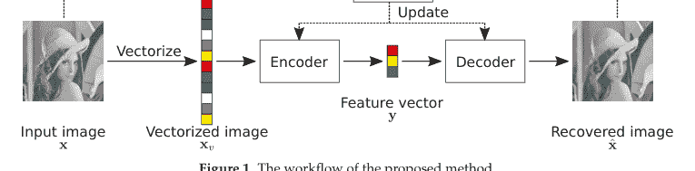

图 1. 所提方法的流程。

如果图像矩阵 `x` 中有 `N` 个数字，特征向量 `y` 中有 `M` 个数字，则我们将压缩比 `r` 定义为

`r = M/N.` (1)

简而言之，编码器模块负责压缩图像并确定压缩比，而解码器模块负责恢复过程。

### 2.2. 网络架构

#### 2.2.1. 编码器模块

大小为 `M × N` 的权重矩阵 `W` 与“向量化”图像 `x_v` 相乘。然后将乘积加上偏置向量 `b` 以得出特征向量 `y`：

`y = W x_v + b.` (2)

在式 (2) 中，权重矩阵 `W` 和偏置向量 `b` 都是在反向传播期间需要学习的参数。`W` 使用 He 初始化 [41] 进行初始化，而 `b` 使用零进行初始化。

#### 2.2.2. 解码器模块

解码器模块的网络架构如图 2 所示。特征向量 `y` 首先使用最近邻插值 [42] 上采样为 `y′`。`y′` 的长度由式 (3) 确定：

`length(y′) = ⌈√M⌉²,` (3)

其中 `M` 是向量 `y` 的长度。符号 `⌈z⌉` 表示将数字 `z` 向上舍入到大于或等于 `z` 的最近整数。向量 `y′` 然后根据式 (4) 重塑为初始特征图 `F`：

`F[i,j] = y′[(i − 1) × ⌈√M⌉ + j], 1 ≤ i,j ≤ ⌈√M⌉.` (4)

之后，初始特征图 `F` 与 96 个大小为 `3 × 3` 的滤波器进行卷积。我们在第一个卷积层后经验性地添加一个批归一化 [43] 层以加速训练。然后特征图经过若干个残差单元。一些残差单元随后进行如图 2 所示的最近邻上采样操作。最后，特征图与一个大小为 `1 × 1` 的滤波器进行卷积以得出恢复图像 `x̂`。

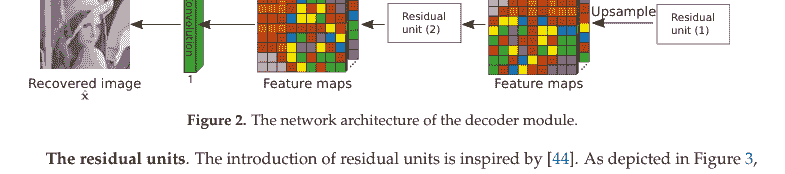

图 2. 解码器模块的网络架构。

##### 残差单元。

残差单元的引入受 [44] 的启发。如图 3 所示，使用了两种类型的残差单元。两种类型都遵循两分支连接模式。特征图经过两个分支并在输出求和器处相加。两种类型的上分支是相同的。下分支不同之处在于残差单元 (1) 使用一堆层连接输入和输出，而残差单元 (2) 直接连接输入和输出。图 3 中出现的每个卷积层均由 96 个大小为 `3 × 3` 的滤波器组成。每个卷积层之后都有一个批归一化层 [43]。每个批归一化层随后跟随一个 Leaky ReLU 激活层 [45]，如果该批归一化层未直接连接到输出求和器。

##### 最近邻上采样操作。

如果输入图像 `x` 的大小为 `n × n`，则图 2 中的第二、第三和第四个上采样操作将特征图分别调整为大小 `½ n × ½ n × 96`、`¾ n × ¾ n × 96` 和 `n × n × 96`。

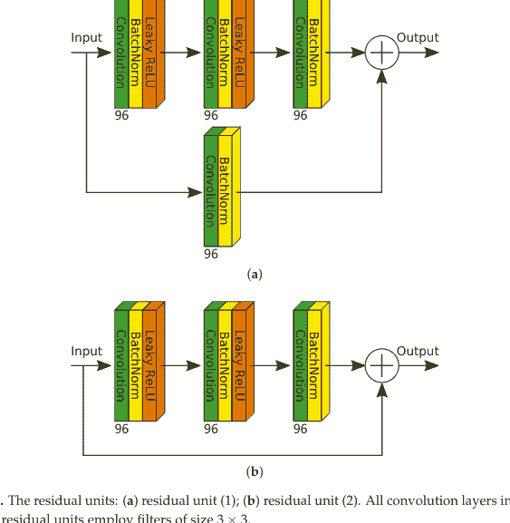

图 3. 残差单元：（a）残差单元 (1)；（b）残差单元 (2)。两种残差单元中的所有卷积层均采用大小为 `3 × 3` 的滤波器。

### 2.3. 所提出的损失函数

#### 2.3.1. 两种类型损失函数的组合

图像恢复问题通常被视为最小化恢复图像与原始图像之间 `l2` 损失的优化问题。然而，从图像恢复质量评估的角度来看，`l2` 指标并不能反映信号保真度的各个方面 [46]。因此，在构建损失函数时，有必要结合其他能够弥补 `l2` 损失中不足的指标。

在本节中，我们提出了一种称为离散小波结构相似性 (DW-SSIM) 的指标，该指标侧重于图像边缘的恢复。我们的损失函数是 DW-SSIM 损失和 `l2` 损失的加权和：

```
L(x,x̂)=∑_{x∈Ω}(β1 L_F(x,x̂)+β2 L_S(x,x̂))
β1+β2=1
0≤β1,β2≤1,
```
(5)

其中 `Ω` 表示训练图像集，`L_F(x,x̂)` 表示 `l2` 损失，`L_S(x,x̂)` 表示 DW-SSIM 损失，且 `β1=0.5` 和 `β2=0.5` 为权重。`L_F(x,x̂)` 和 `L_S(x,x̂)` 都被设置为落在范围 `[0,1)` 内。第 2.3.2 节将给出 `L_F(x,x̂)` 的表达式，而第 2.3.3 节将详细解释 `L_S(x,x̂)`。

#### 2.3.2. l2 损失

我们提出在 `L_F(x,x̂)` 中使用 Frobenius 范数来得出 `l2` 损失：

`L_F(x, x̂) = ‖x̂ - x‖_2^2 / ‖x‖_2^2.` (6)

值得注意的是，式 (6) 的分母不能为零。然而，由于 `x` 来自自然图像而不是人工生成的矩阵，因此 `x` 不可能为零矩阵。

#### 2.3.3. 离散小波相似度 (DW-SSIM) 与 DW-SSIM 损失

受结构相似性 (SSIM) [47] 和复小波结构相似性 (CW-SSIM) [48] 的启发，我们提出使用二维离散小波变换 (2D-DWT) [49] 来分析恢复图像与原始图像之间的相似性。该相似性称为 DW-SSIM，即离散小波相似性。

2D-DWT. 2D-DWT 能够将图像分解为不同级别的子带。第一级是对原始图像的分解。每个级别由四个子带图像组成，可称为低-低 (LL)、低-高 (LH)、高-低 (HL) 和高-高 (HH)。每个级别的 LL 图像可以进一步分解为下一级子带。LH 图像表示垂直方向的变化，HL 图像表示水平方向，HH 图像表示对角线方向 [49]。高频 LH、HL 和 HH 子带图像共同构成了原始图像的细节。随着分解级别的升高，子带图像变得更粗糙，因此可以分析不同尺度的细节。图 4 提供了图像的三级 2D-DWT 分解示例。


(a)


(b)

图 4. 二维离散小波变换 (DWT) 图像分解的说明。(a) 原始图像。(b) 图像的三级分解。为清晰起见，每个中间低-低 (LL) 图像都放在其位置上，但 DWT 仅保留最高级的 LL 图像。

DW-SSIM. 我们将原始图像与恢复图像之间 DW-SSIM 的计算分为两个阶段。第一阶段涉及确定局部 DW-SSIM，其中一个“窗口”在原始图像和恢复图像上滑动。对图像块进行 2D-DWT

在“window”内推导分解。我们定义图像块的局部低频 DW-SSIM `S_{L,t}` 和高频 DW-SSIM `S_{H,t}` 为

```
S_{L,t}(c^{(1)},c^{(2)}) = 2[∑_u ∑_v c_{LL}^{(1)}[u,v]c_{LL}^{(2)}[u,v] + K] / [∑_u ∑_v |c_{LL}^{(1)}[u,v]|^2 + ∑_u ∑_v |c_{LL}^{(2)}[u,v]|^2 + K],
```
(7)

```
S_{H,t}(c^{(1)},c^{(2)}) = 1/J ∑_{j=1}^{J} 2|∑_u ∑_v ∑_i c_i^{(1)}[u,v]c_i^{(2)}[u,v]| + K / [∑_i ∑_u ∑_v |c_i^{(1)}[u,v]|^2 + ∑_i ∑_u ∑_v |c_i^{(2)}[u,v]|^2 + K], i ∈ {LH_j, HL_j, HH_j}.
```
(8)

在公式（7）和（8）中，`K` 是一个用于算术鲁棒性的小正常数，且 `K` 设为 0.01。`c^{(1)}` 和 `c^{(2)}` 分别指原始图像块和经 2D-DWT 后恢复图像块对应的子带图像。我们使用的波函数是 Haar 小波。`t` 为图像块索引。`J = 3` 为最大分解层数，`c_{LH_j}, c_{HL_j}, c_{HH_j}` 为第 `j` 层的高频子带图像。

为了更好地理解公式（7），可以忽略 `K`，将 `c` “向量化”（如第 2.2.1 节所述）为 `c_v` 并重写为

```
S_{L,t}(c^{(1)},c^{(2)}) = S_{L,t}(c_v^{(1)},c_v^{(2)}) = 2| c_v^{(1)} · c_v^{(2)} | / (‖c_v^{(1)}‖_2^2 + ‖c_v^{(2)}‖_2^2)
= 2 ‖c_v^{(1)}‖_2 ‖c_v^{(2)}‖_2 / (‖c_v^{(1)}‖_2^2 + ‖c_v^{(2)}‖_2^2) * |c_v^{(1)} · c_v^{(2)}| / (‖c_v^{(1)}‖_2 ‖c_v^{(2)}‖_2)
= 2 (‖c_v^{(1)}‖_2 / ‖c_v^{(2)}‖_2 + ‖c_v^{(2)}‖_2 / ‖c_v^{(1)}‖_2)^{-1} |cos(θ)|.
```
(9)

在公式（9）中，第一项由子带图像的能量决定。只有当 `‖c_v^{(1)}‖_2 = ‖c_v^{(2)}‖_2` 时，它才会达到最大值 1。在第二项中，`cos(θ) = c_v^{(1)} · c_v^{(2)} / (‖c_v^{(1)}‖_2 ‖c_v^{(2)}‖_2)` 是余弦相似度 [50]。如果 `c_v^{(1)}` 和 `c_v^{(2)}` 大致指向同一方向，余弦相似度将接近 1。然而，余弦函数的值域为 `[-1,1]`。因此我们取绝对值使其落在 `[0,1]`。公式（8）的解释在很大程度上与公式（7）相同。公式（8）额外对各层子带的贡献进行平均，以应对地下矿井图像中的规律性噪声。这可通过第 3.3 节的讨论更好地理解。

在第二阶段，对 `S_{H,t}` 和 `S_{L,t}` 进行加权求和以形成最终的 DW-SSIM `S`：

```
S(x,x̂) = 1/T ∑_{t=1}^{T} (γ1 S_{L,t} + γ2 S_{H,t}),
```
(10)

其中 `T` 为图像块总数，`γ1` 和 `γ2` 为调整低频子带和高频子带权重的参数。由于我们希望强调图像中边缘和尖峰等高频细节，因此设 `γ1 = 0.2` 且 `γ2 = 0.8`。

DW-SSIM 的计算在算法 1 中进行了总结。所提方法中的窗口长度 `l` 设为 15。窗口在每次迭代中移动的步长 `s` 设为 8。

## 算法 1：计算离散小波相似度（DW-SSIM）的过程。

输入：原始图像 `img-ori` 和恢复图像 `img-rec`，高度 `H` 和宽度 `W` 相同（`H > 0, W > 0`）；分解层数 `J`；窗口在每次迭代中移动的步长 `s`；窗口长度 `l`；公式（10）中的权重 `γ1` 和 `γ2`

输出：`img-ori` 与 `img-rec` 之间的 DW-SSIM 相似度 `S`


```
S ← 0;
t ← 0;
up ← 0;
left ← 0;
while up < H do
  down ← up + l;
  while left < W do
    t ← t + 1;
    right ← left + l;
    Get image patch patch-ori within the window [up, down, left, right] from img-ori;
    Get image patch patch-rec within the window [up, down, left, right] from img-rec;
    Derive c^(1) by performing 2D-DWT on patch-ori;
    Derive c^(2) by performing 2D-DWT on patch-rec;
    Derive S_{L,t} from Equation (7);
    Derive S_{H,t} from Equation (8);
    S ← S + γ1 S_{L,t} + γ2 S_{H,t};
    left ← left + s;
  end
  up ← up + s;
end
S ← S / t;
return S;
```

DW-SSIM 损失。公式（10）定义的 DW-SSIM 的取值范围为 $(0,1]$。原始图像与恢复图像越匹配，DW-SSIM $S$ 越接近 1。然而，如果模型完美恢复，损失应接近 0。此外，损失应落在 $[0,1)$ 范围内。因此，我们将 DW-SSIM 损失定义为：

`L_S(x, x̂) = 1 − S(x, x̂).` (11)

## 2.4. 学习参数

编码模块和解码模块可使用所提网络架构和所提损失函数以端到端方式进行训练。采用小批量梯度下降训练模型，批量大小为 64。还使用了 `Adam` [51] 优化器。初始学习率设为 $5 \times 10^{-4}$。训练过程中若损失未下降，则学习率乘以 0.2。当学习率降至 $1 \times 10^{-6}$ 以下时停止训练。

## 3. 结果

### 3.1. 概述

为了推广恢复能力，所提方法的网络在我们收集的地下矿井视频图像以及 COCO 2014 数据集 [52] 的图像上进行训练。我们通过从图像中提取 $100 \times 100$ 中心裁剪块并将其转换为灰度图像来构建训练集。

模型训练完成后，将测试图像（如图 5 所示）输入模型进行压缩和恢复。我们在 Barbara、Fingerprint 和 Lena 等标准图像上测试我们的方法以验证其有效性。此外，我们还在来自真实地下矿井的采煤机和掘进机（TBM）图像上测试所提方法，以评估其在应用特定环境中的性能。

恢复质量通过峰值信噪比（PSNR）和结构相似度（SSIM） [46] 进行定量评估：

`PSNR(x, x̂) = 10 log₁₀ d² / (1/N Σᵢ₌₁ᴺ (x[i] - x̂[i])² ),` (12)

`SSIM(x, x̂) = (2 μₓ μₓ̂ + C₁)/(μₓ² + μₓ̂² + C₁) · (2 σₓ σₓ̂ + C₂)/(σₓ² + σₓ̂² + C₂) · (σₓₓ̂ + C₃)/(σₓ σₓ̂ + C₃).` (13)

在公式（12）中，`d` 为像素强度的动态范围，`N` 为图像中的像素数。在公式（13）中，`μₓ` 和 `μₓ̂` 为 `x` 和 `x̂` 的均值，`σₓ²` 和 `σₓ̂²` 为 `x` 和 `x̂` 的方差。`σₓₓ̂` 为 `x` 和 `x̂` 的互相关。小正常数 `C₁ = C₂ = C₃ = 0.01` 用于防止各项的数值不稳定。

为了验证所提方法的有效性，在压缩比为 0.25、0.20、0.15、0.10、0.04 和 0.01 时进行定量评估，压缩比定义见公式（1）。此外，所提方法在不同压缩比下与 `D-AMP` [15]、`ReconNet` [13] 和 `TVAL3` [29] 算法进行比较。为简化起见，我们未重新实现这些算法，而是使用作者网站提供的演示代码。

此外，在特定压缩比下还给出了恢复的视觉质量评估。最后，通过恢复受不同程度高斯噪声污染的图像来测试所提方法的鲁棒性。

所提方法使用 `Pytorch` [53] 和 `pytorch_wavelet` 包（`https://github.com/fbcotter/pytorch_wavelets`）实现。训练过程在 Ubuntu 18.04.2 上进行，使用 Nvidia Tesla K80 GPU 和 Intel Xeon CPU。有关实现的更多细节可在我们已在互联网上公开的代码中找到（`https://github.com/y0umu/ResCSNet`）。


图 5. 测试图像：（a）Barbara；（b）Fingerprint；（c）Lena；（d）采煤机；（e）掘进机（TBM）。

### 3.2. 定量评估

表 1 和表 2 给出了不同压缩比下所提方法和其他算法的定量测量结果。随着压缩比 `r` 的减小，所比较的所有算法的 PSNR 和 SSIM 均下降。从表 1 可看出，在压缩比 `r ≥ 0.20` 时，所提方法在标准测试图像和真实地下矿井图像上仅次于 `D-AMP`。然而，在压缩比 `r ≤ 0.15` 时，所提方法相比其他算法获得了最高的 PSNR。还应注意，在压缩比 `r ≤ 0.04` 时，采煤机和 TBM 图像的恢复结果中，所提方法比其他算法高出至少 1.8 dB，表明了所提方法在矿井应用特定使用方面的潜力。

表 1. 不同算法在测试图像上的峰值信噪比（PSNR）（单位 dB）比较。`r` 为压缩比。

| 图像 | 算法 | r = 0.25 | r = 0.20 | r = 0.15 | r = 0.10 | r = 0.04 | r = 0.01 |
|---|---|---|---|---|---|---|---|
| Barbara | D-AMP | 26.61 | 25.37 | 24.00 | 21.73 | 15.37 | 7.23 |
|  | ReconNet | 25.14 | 22.80 | 21.41 | 21.79 | 19.74 | 16.20 |
|  | TVAL3 | 22.40 | 21.28 | 19.76 | 18.87 | 16.19 | 15.15 |
|  | DR²-Net | 25.43 | 21.64 | 19.86 | 20.99 | 18.34 | 16.08 |
|  | Proposed | 27.23 | 27.62 | 26.50 | 24.15 | 21.76 | 17.86 |
| Fingerprint | D-AMP | 20.99 | 20.64 | 19.41 | 19.07 | 11.65 | 5.24 |
|  | ReconNet | 17.56 | 17.20 | 17.25 | 16.68 | 16.10 | 15.55 |
|  | TVAL3 | 18.25 | 17.45 | 17.04 | 15.57 | 14.08 | 9.68 |
|  | DR²-Net | 18.30 | 16.57 | 15.98 | 17.16 | 16.26 | 15.20 |
|  | Proposed | 19.76 | 19.80 | 19.70 | 19.39 | 19.17 | 18.68 |
| Lena | D-AMP | 30.28 | 28.40 | 26.57 | 24.38 | 11.71 | 6.57 |
|  | ReconNet | 23.83 | 22.65 | 21.58 | 20.32 | 18.50 | 15.90 |
|  | TVAL3 | 21.26 | 20.68 | 19.51 | 17.81 | 16.37 | 15.17 |
|  | DR²-Net | 26.37 | 21.93 | 20.02 | 21.82 | 19.07 | 15.77 |
|  | Proposed | 28.82 | 29.01 | 28.44 | 25.48 | 24.08 | 19.47 |
| Coal cutter | D-AMP | 21.81 | 21.86 | 20.90 | 19.10 | 14.36 | 8.14 |
|  | ReconNet | 18.78 | 18.35 | 17.67 | 17.24 | 16.26 | 14.52 |
|  | TVAL3 | 12.52 | 10.94 | 9.87 | 8.17 | 10.48 | 12.50 |
|  | DR²-Net | 20.22 | 17.71 | 16.65 | 17.76 | 16.19 | 14.78 |
|  | Proposed | 21.78 | 21.84 | 21.40 | 20.05 | 18.08 | 17.34 |
| TBM | D-AMP | 29.68 | 28.02 | 26.30 | 24.51 | 17.63 | 8.76 |
|  | ReconNet | 23.89 | 22.95 | 22.13 | 21.21 | 19.24 | 17.65 |
|  | TVAL3 | 17.27 | 16.17 | 14.88 | 14.35 | 13.16 | 13.71 |
|  | DR²-Net | 25.65 | 22.11 | 20.87 | 22.04 | 19.50 | 17.53 |
|  | Proposed | 27.67 | 27.27 | 27.12 | 24.95 | 22.46 | 20.03 |

表 2. 不同算法在测试图像上的结构相似性（SSIM）比较。`r` 为压缩比。

| 图像 | 算法 | r = 0.25 | r = 0.20 | r = 0.15 | r = 0.10 | r = 0.04 | r = 0.01 |
|---|---|---|---|---|---|---|---|
| Barbara | D-AMP | 0.8570 | 0.7781 | 0.7583 | 0.6189 | 0.0624 | 0.0129 |
|  | ReconNet | 0.7449 | 0.7037 | 0.6062 | 0.5506 | 0.3805 | 0.2226 |
|  | TVAL3 | 0.7391 | 0.6834 | 0.6154 | 0.4692 | 0.3134 | 0.2281 |
|  | DR²-Net | 0.8165 | 0.7396 | 0.6774 | 0.6137 | 0.3947 | 0.2283 |
|  | Proposed | 0.8823 | 0.8950 | 0.8648 | 0.7832 | 0.6087 | 0.2859 |
| Fingerprint | D-AMP | 0.5530 | 0.4063 | 0.2709 | 0.2288 | 0.1050 | 0.0029 |
|  | ReconNet | 0.2438 | 0.2245 | 0.1890 | 0.1871 | 0.1412 | 0.0970 |
|  | TVAL3 | 0.3448 | 0.2884 | 0.2496 | 0.1948 | 0.1339 | 0.0774 |
|  | DR²-Net | 0.3030 | 0.2291 | 0.2115 | 0.2044 | 0.1484 | 0.0976 |
|  | Proposed | 0.3464 | 0.3742 | 0.3307 | 0.2871 | 0.2103 | 0.1498 |
| Lena | D-AMP | 0.8867 | 0.8667 | 0.8174 | 0.7550 | 0.4343 | 0.0235 |
|  | ReconNet | 0.7412 | 0.7084 | 0.6436 | 0.5997 | 0.4558 | 0.3181 |
|  | TVAL3 | 0.7420 | 0.7145 | 0.6596 | 0.5370 | 0.3735 | 0.2869 |
|  | DR²-Net | 0.8200 | 0.7771 | 0.7052 | 0.6597 | 0.5119 | 0.3352 |
|  | Proposed | 0.8930 | 0.9040 | 0.8879 | 0.8301 | 0.7437 | 0.4440 |
| Coal cutter | D-AMP | 0.6854 | 0.6793 | 0.6376 | 0.5148 | 0.1735 | 0.0363 |
|  | ReconNet | 0.5470 | 0.4947 | 0.4377 | 0.4267 | 0.3371 | 0.2431 |
|  | TVAL3 | 0.3830 | 0.3146 | 0.2574 | 0.1838 | 0.2110 | 0.1608 |
|  | DR²-Net | 0.6358 | 0.5482 | 0.4672 | 0.4899 | 0.3467 | 0.2634 |
|  | Proposed | 0.7320 | 0.7476 | 0.7049 | 0.6303 | 0.4923 | 0.3498 |
| TBM | D-AMP | 0.8711 | 0.6993 | 0.8027 | 0.7187 | 0.2829 | 0.0634 |
|  | ReconNet | 0.7728 | 0.7319 | 0.6771 | 0.6522 | 0.5460 | 0.4318 |
|  | TVAL3 | 0.5445 | 0.4868 | 0.5069 | 0.4127 | 0.3794 | 0.3372 |
|  | DR²-Net | 0.8184 | 0.7523 | 0.7171 | 0.6755 | 0.5714 | 0.4456 |
|  | Proposed | 0.8793 | 0.8764 | 0.8639 | 0.8058 | 0.6921 | 0.5359 |

由表 2 可知，所提方法在除 Fingerprint 图像外的所有图像上，在每个压缩比下均实现了最高的 SSIM。由于 SSIM 指标描述了恢复图像与原始图像之间的结构相似性，可以得出结论，所提方法能更好地保留图像的特定特征。

### 3.3. 视觉质量评估

图 6 和图 7 展示了所提方法与对比算法的恢复图像。绿色框放大了红色框内的图像块，以便清晰查看细节。如大多数图片所示，与其他算法相比，所提方法恢复的边缘更清晰、模糊更少。在压缩比较低的图 7 中，所提方法的恢复图像中仍可辨别出边缘，而其他恢复结果则趋于更模糊。结合表 1 和表 2 可发现，所提方法所保留的特征是图像中的边缘。

图 6 和图 7 还展示了一个有趣的现象。在 Fingerprint 图像的恢复中，所提方法在压缩比 `r = 0.15` 或 `r = 0.04` 时均未能恢复细节。这是预期行为，实际上所提方法有意在恢复图像中“模糊”密集图案，以应对地下矿井图像中常见的噪声。为解释其背后的原因，假设我们从 Fingerprint 的恢复图像和原始图像中取同一位置大小为 15 × 15 的图像块。然后对两个块应用 3 级二维离散小波变换（2D-DWT），可以发现第 2 级或第 3 级子带图像几乎相同。子带的主要差异在于第 1 级分解。回想方程 (8) 中每个层级具有相同的重要性，恢复块与原始块在第 1 级分解中的差异实际上被“平均掉”了。因此，原密集图案块与恢复的模糊块的 DW-SSIM 损失会很小，导致所提网络学习模糊密集图案。

### 3.4. 抗噪声鲁棒性

由于前几节的测试表明所提方法在压缩比较低时具有优势，因此本节在压缩比 `r = 0.04` 时测试所提方法的抗噪声鲁棒性。如图 8 和图 9 所示，为模拟地下矿井中的粉尘环境，向 Lena 和 TBM 测试图像添加了高斯噪声。噪声为零均值。噪声的标准差 `σ` 设置为 5、10、15、20、25 和 30 以模拟不同噪声水平。带噪声的图像以压缩比 `r = 0.04` 进行压缩。然后使用 PSNR 和 SSIM 测量评估恢复图像与原始测试图像之间的相似度。


图 6. 压缩比 `r = 0.15` 时的恢复图像。

## 图 7. 压缩比 `r = 0.04` 时的恢复图像。


图 8. 存在噪声时 Lena 图像恢复结果的比较。`σ` 表示噪声的标准差。压缩比 `r` 为 0.04。

如图 8 和图 9 所示，在所有噪声水平下，所提方法的恢复图像中可见伪影更少且仍保留清晰边缘。此外，图 10 绘制了 PSNR 和 SSIM 随 `σ` 变化的曲线。所有算法的 PSNR 和 SSIM 均随 `σ` 增大而下降，但所提方法的 PSNR 和 SSIM 高于对比算法。随着 `σ` 从 5 增长到 30，所提方法的 PSNR 和 SSIM 下降幅度不超过 1.6 dB 和 0.11，是各算法中最小的。因此可以得出结论，所提方法在压缩比较低时具有抗噪声鲁棒性。

| σ | 带噪声的原始图像 | D-AMP | ReconNet | TVAL3 | DR²-Net | Proposed |
|---|---|---|---|---|---|---|
| σ = 5 |  |  |  |  |  |  |
| σ = 10 |  |  |  |  |  |  |
| σ = 15 |  |  |  |  |  |  |
| σ = 20 |  |  |  |  |  |  |
| σ = 25 |  |  |  |  |  |  |
| σ = 30 |  |  |  |  |  |  |

图 9. 存在噪声时 TBM 图像恢复结果的比较。`σ` 表示噪声的标准差。压缩比 `r` 为 0.04。


(a)

图 10. 续。


(b)


图 10. `PSNR` 和 `SSIM` 随 `σ` 变化的曲线，分别针对噪声污染的 (a) Lena 图像、(b) TBM 图像的恢复结果。`PSNR` 和 `SSIM` 是在原始测试图像（未添加噪声）与恢复图像之间进行检查的。压缩比 `r` 为 0.04。

## 4. 结论

本文提出了一种基于 `CNN` 的图像编解码网络，可作为图像压缩和恢复的基础。我们还提出了一种新颖的损失函数，结合离散小波变换的知识来解决恢复图像中边缘模糊的问题。该方法更适用于地下矿山图像的压缩和恢复，原因如下：

- 该方法能够恢复图像中的清晰边缘。对于地下矿山而言，图像中的边缘是区分前景和背景的关键要素。通过确定矿工和设备的边界，可以进行进一步的图像分析。
- 该方法具有抗噪性。通过模糊密集的图案，该方法可以滤除地下矿山中尤其常见的噪声。
- 与其他算法相比，该方法在低压缩比下表现出色。一般的图像压缩方法倾向于在压缩比和恢复质量之间取得平衡。由于可用的传输带宽相对较高，它们不必在极低的压缩比下工作。然而，该方法旨在在低压缩比下工作，以适应地下矿山恶劣的通信环境。

在未来的工作中，我们将把其他去噪技术结合到本文提出的工作中，以实现抗噪性而不模糊图案区域。当前 `DW-SSIM` 损失的设计并不完美，因为余弦相似度的优点并未得到充分保留。因此，进一步研究损失函数的设计是值得的。我们还将在其他数据集上训练模型，以扩展该方法的适用范围。

作者贡献：概念化，F.Z. 和 W.C.；数据整理，Z.X.；形式分析，F.Z. 和 Z.Z.；资金获取，F.Z. 和 W.C.；调查，Z.X.、H.Z. 和 J.L.；方法，Z.X. 和 Z.Z.；项目管理，F.Z. 和 W.C.；资源，F.Z.；软件，Z.X.、H.Z. 和 J.L.；监督，F.Z. 和 W.C.；验证，Z.X.、W.C. 和 C.L.；可视化，Z.X.；写作—初稿，Z.X.；写作—审阅和编辑，F.Z.、Z.X.、W.C. 和 C.L.

资助：本研究由国家重点研发计划基金资助，项目编号 2016YFC0801800，中国国家自然科学基金资助，项目编号 51874300，中国国家自然科学基金与山西省人民政府联合资助的中国煤炭基地和低碳联合基金项目，项目编号 U1510115，以及中国科学院上海微系统与信息技术研究所无线传感器网络与通信重点实验室开放研究基金资助，项目编号 20190902 和 20190913。

## 利益冲突

作者声明无利益冲突。资助方在研究设计、数据收集、分析和解释、稿件撰写或发表结果的决定中均未发挥作用。

## 参考文献

1. Dai, S.; Finkelman, R.B. 煤作为关键元素的有希望来源：进展与未来前景. Int. J. Coal Geol. 2018, 186, 155–164, doi:10.1016/j.coal.2017.06.005. [CrossRef]

2. Dohare, Y.S.; Maity, T.; Das, P.S.; Paul, P.S. 地下煤矿的无线通信与环境监测综述. IETE Tech. Rev. 2015, 32, 140–150, doi:10.1080/02564602.2014.995142. [CrossRef]

3. Wallace, G. JPEG 静止图像压缩标准. IEEE Trans. Consum. Electron. 1992, 38, xviii–xxxiv, doi:10.1109/30.125072. [CrossRef]

4. Li, M.; Zuo, W.; Gu, S.; Zhao, D.; Zhang, D. 用于内容加权图像压缩的卷积网络学习. In Proceedings of the 2018 IEEE/CVF Conference on Computer Vision and Pattern Recognition, Salt Lake City, UT, USA, 18–23 June 2018; pp. 3214–3223, doi:10.1109/CVPR.2018.00339. [CrossRef]

5. Marcellin, M.W.; Gormish, M.J.; Bilgin, A.; Boliek, M.P. JPEG-2000 概述. In Proceedings of the Data Compression Conference (DCC 2000), Snowbird, UT, USA, 28–30 March 2000; pp. 523–541, doi:10.1109/DCC.2000.838192. [CrossRef]

6. Candes, E.; Romberg, J.; Tao, T. 健壮的不确定性原理：从高度不完整的频率信息中精确重建信号. IEEE Trans. Inf. Theory 2006, 52, 489–509, doi:10.1109/TIT.2005.862083. [CrossRef]

7. Candès, E.J.; Romberg, J.K.; Tao, T. 从不完整且不准确的测量中稳定恢复信号. Commun. Pure Appl. Math. 2006, 59, 1207–1223, doi:10.1002/cpa.20124. [CrossRef]

8. Donoho, D.L.; Tanner, J. 通过 L1 最小化恢复稀疏解的阈值. In Proceedings of the IEEE 2006 40th Annual Conference on Information Sciences and Systems, Princeton, NJ, USA, 22–24 March 2006; pp. 202–206, doi:10.1109/CISS.2006.286462. [CrossRef]

9. Joshi, A.M.; Sahu, C.; Ravikumar, M.; Ansari, S. 图像压缩的压缩感知硬件实现. In Proceedings of the TENCON 2017—2017 IEEE Region 10 Conference, Penang, Malaysia, 5–8 November 2017; IEEE: Penang, Malaysia, 2017; Volume 2017-Decem, pp. 1309–1314, doi:10.1109/TENCON.2017.8228060. [CrossRef]

10. Chambolle, A. 全变分最小化算法及其应用. J. Math. Imaging Vis. 2004, 20, 89–97, doi:10.1023/B:JMIV.0000011321.19549.88. [CrossRef]

11. Donoho, D.L.; Maleki, A.; Montanari, A. 压缩感知的消息传递算法. Proc. Natl. Acad. Sci. USA 2009, 106, 18914–18919, doi:10.1073/pnas.0909892106. [CrossRef]

12. Rudin, L.I.; Osher, S.; Fatemi, E. 非线性全变分去噪算法. Phys. D Nonlinear Phenom. 1992, 60, 259–268, doi:10.1016/0167-2789(92)90242-F. [CrossRef]

13. Li, C.; Yin, W.; Jiang, H.; Zhang, Y. 一种高效的增广拉格朗日方法及其在全变分最小化中的应用. Comput. Optim. Appl. 2013, 56, 507–530, doi:10.1007/s10589-013-9576-1. [CrossRef]

14. Kong, Q.; Gong, R.; Liu, J.; Shao, X. 基于 TVAL3 正则化算法的频域光声成像重建研究. IEEE Photonics J. 2018, 10, 1–15, doi:10.1109/JPHOT.2018.2869815. [CrossRef]

15. Metzler, C.A.; Maleki, A.; Baraniuk, R.G. 从去噪到压缩感知. IEEE Trans. Inf. Theory 2016, 62, 5117–5144, doi:10.1109/TIT.2016.2556683. [CrossRef]

16. Zhao, X.; Shen, X.; Wang, K.; Li, W. 基于块分类的矿山视频监控图像 DCVS 重建算法. Preprints 2018, 2018070222, doi:10.20944/PREPRINTS201807.0222.V1. [CrossRef]

17. Wang, Y.; Liu, Z.; Wang, D.; Li, Y.; Yan, J. 基于异构传感器网络的滑坡监测异常检测与视觉感知. IEEE Sens. J. 2017, 17, 1, doi:10.1109/JSEN.2017.2704584. [CrossRef]

18. Qiao, X.; Yang, F.; Zheng, J. 基于半软阈值经验小波变换的地基探地雷达弱信号去噪. Ingénierie Des Systèmes d Information 2019, 24, 207–213, doi:10.18280/isi.240213. [CrossRef]

19. Xie, S.; Imani, M.; Dougherty, E.R.; Braga-Neto, U.M. 非平稳线性判别分析. In Proceedings of the IEEE 2017 51st Asilomar Conference on Signals, Systems, and Computers, Pacific Grove, CA, USA, 29 October–1 November 2017; pp. 161–165, doi:10.1109/ACSSC.2017.8335158. [CrossRef]

20. Imani, M.; Ghoreishi, S.F.; Braga-Neto, U.M. 数据匮乏环境下未知动态的大型 MDP 的贝叶斯控制. In Proceedings of the Advances in Neural Information Processing Systems (NIPS), Montréal, QC, Canada, 3–8 December 2018, pp. 8146–8156.

21. Imani, M.; Ghoreishi, S.F.; Allaire, D.; Braga-Neto, U.M. MFBO-SSM：状态空间模型快速推理的多保真贝叶斯优化. In Proceedings of the AAAI Conference on Artificial Intelligence, Hilton Hawaiian Village, Honolulu, HI, USA, 27 January–1 February 2019; Volume 33, pp. 7858–7865, doi:10.1609/aaai.v33i01.33017858. [CrossRef]

22. Imani, M.; Dougherty, E.R.; Braga-Neto, U. 模型不确定性下的布尔卡尔曼滤波器和平滑器. Automatica 2020, 111, 108609, doi:10.1016/j.automatica.2019.108609. [CrossRef]

23. Ren, S.; He, K.; Girshick, R.; Sun, J. Faster R-CNN：基于区域建议网络的实时目标检测. IEEE Trans. Pattern Anal. Mach. Intell. 2017, 39, 1137–1149, doi:10.1109/TPAMI.2016.2577031. [CrossRef]

24. Redmon, J.; Divvala, S.; Girshick, R.; Farhadi, A. 只看一次：统一的实时目标检测. In Proceedings of the 2016 IEEE Conference on Computer Vision and Pattern Recognition (CVPR), Las Vegas, NV, USA, 27–30 June 2016; Volume 2016-Decem, pp. 779–788, doi:10.1109/CVPR.2016.91. [CrossRef]

25. Liu, W.; Anguelov, D.; Erhan, D.; Szegedy, C.; Reed, S.; Fu, C.Y.; Berg, A.C. SSD：单次多框检测器. In Lecture Notes in Computer Science (Including Subseries Lecture Notes in Artificial Intelligence and Lecture Notes in Bioinformatics); Springer International Publishing: Cham, Switzerland, 2016; Volume 9905 LNCS, pp. 21–37, doi:10.1007/978-3-319-46448-0_2. [CrossRef]

26. Chen, Y.; Zhu, K.; Zhu, L.; He, X.; Ghamisi, P.; Benediktsson, J.A. 用于高光谱图像分类的卷积神经网络自动设计. IEEE Trans. Geosci. Remote Sens. 2019, 57, 7048–7066, doi:10.1109/TGRS.2019.2910603. [CrossRef]

27. Liu, Q.; Feng, C.; Song, Z.; Louis, J.; Zhou, J. 土方作业中基于视觉的满载/空载卡车分类的深度学习模型比较. Appl. Sci. 2019, 9, doi:10.3390/app9224871. [CrossRef]

28. Mousavi, A.; Baraniuk, R.G. 学习求逆：通过深度卷积网络进行信号恢复. In Proceedings of the 2017 IEEE International Conference on Acoustics, Speech and Signal Processing (ICASSP), New Orleans, LA, USA, 5–9 March 2017; pp. 2272–2276, doi:10.1109/ICASSP.2017.7952561. [CrossRef]

29. Kulkarni, K.; Lohit, S.; Turaga, P.; Kerviche, R.; Ashok, A. ReconNet：从压缩感知测量中非迭代重建图像. In Proceedings of the 2016 IEEE Conference on Computer Vision and Pattern Recognition (CVPR), Las Vegas, NV, USA, 27–30 June 2016; pp. 449–458, doi:10.1109/CVPR.2016.55. [CrossRef]

30. Yao, H.; Dai, F.; Zhang, S.; Zhang, Y.; Tian, Q.; Xu, C. DR2-Net：用于图像压缩感知的深度残差重建网络. Neurocomputing 2019, 359, 483–493, doi:10.1016/j.neucom.2019.05.006. [CrossRef]

31. Ballé, J.; Laparra, V.; Simoncelli, E.P. 端到端优化的图像压缩. In Proceedings of the 5th International Conference on Learning Representations, ICLR 2017, Conference Track Proceedings, Toulon, France, 24–26 April 2017.

32. Wang, C.; Han, Y.; Wang, W. 基于语义分析的端到端深度学习图像压缩框架. Appl. Sci. 2019, 9, 3580. [CrossRef]

33. Lyu, C.; Liu, Z.; Yu, L. 通过循环神经网络进行块稀疏恢复. Signal Process. 2019, 154, 129–135. doi:10.1016/j.sigpro.2018.08.014. [CrossRef]

34. Toderici, G.; Vincent, D.; Johnston, N.; Jin Hwang, S.; Minnen, D.; Shor, J.; Covell, M. 使用循环神经网络的全分辨率图像压缩. In Proceedings of the IEEE Conference on Computer Vision and Pattern Recognition (CVPR), Honolulu, HI, USA, 21–26 July 2017.

35. Minnen, D.; Toderici, G.; Covell, M.; Chinen, T.; Johnston, N.; Shor, J.; Hwang, S.J.; Vincent, D.; Singh, S. 使用分块深度网络的空间自适应图像压缩. In Proceedings of the 2017 IEEE International Conference on Image Processing (ICIP), Beijing, China, 17–20 September 2017; pp. 2796–2800, doi:10.1109/ICIP.2017.8296792. [CrossRef]


36. Ma, S.; Zhang, X.; Jia, C.; Zhao, Z.; Wang, S.; Wang, S. 基于神经网络的图像和视频压缩：综述. IEEE Trans. Circuits Syst. Video Technol. 2019, 8, 215, 1, doi:10.1109/TCSVT.2019.2910119. [CrossRef]

37. Rippel, O.; Bourdev, L. 实时自适应图像压缩. 在第34届国际机器学习会议论文集，ICML 2017，澳大利亚悉尼，2017年8月6–11日；第6卷，第4457–4473页。

38. Jia, C.; Zhang, X.; Wang, S.; Wang, S.; Ma, S. 基于生成对抗网络视图合成的光场图像压缩. IEEE J. Emerg. Sel. Top. Circuits Syst. 2019, 9, 177–189, doi:10.1109/JETCAS.2018.2886642. [CrossRef]

39. Bjontegaard, G. RD曲线间平均PSNR差异的计算. 在VCEG会议论文集（ITU-T SG16 Q.6），美国德克萨斯州奥斯汀，2001年4月2–4日，第2–4页。

40. Agustsson, E.; Tschannen, M.; Mentzer, F.; Timofte, R.; Gool, L.V. 用于极端学习图像压缩的生成对抗网络. 在IEEE国际计算机视觉会议论文集（ICCV），韩国首尔，2019年10月27日–11月2日。

41. He, K.; Zhang, X.; Ren, S.; Sun, J. 深入探究整流器：在ImageNet分类中超越人类水平性能. 在2015年IEEE国际计算机视觉会议论文集（ICCV），智利圣地亚哥，2015年12月7–13日；第1026–1034页，doi:10.1109/ICCV.2015.123. [CrossRef]

42. Miklós, P. 图像插值技术. 在第2届西伯利亚-匈牙利智能系统联合研讨会论文集，塞尔维亚和黑山苏博蒂察，2004年10月1–2日；第1–6页。

43. Ioffe, S.; Szegedy, C. 批归一化：通过减少内部协变量偏移加速深度网络训练. 在第32届国际机器学习会议论文集，ICML 2015，法国里尔，2015年7月6–11日；第1卷，第448–456页。

44. He, K.; Zhang, X.; Ren, S.; Sun, J. 用于图像识别的深度残差学习. 在2016年IEEE计算机视觉与模式识别会议论文集（CVPR），美国内华达州拉斯维加斯，2016年6月27–30日；第770–778页，doi:10.1109/CVPR.2016.90. [CrossRef]

45. Maas, A.L.; Hannun, A.Y.; Ng, A.Y. 整流非线性改进神经网络声学模型. 在ICML关于音频、语音和语言处理的深度学习研讨会论文集，美国佐治亚州亚特兰大，2013年6月16日。

46. Wang, Z.; Bovik, A.C. 均方误差：爱它或离开它？对信号保真度度量的新视角. IEEE Signal Process. Mag. 2009, 26, 98–117, doi:10.1109/MSP.2008.930649. [CrossRef]

47. Wang, Z.; Bovik, A.C.; Sheikh, H.R.; Simoncelli, E.P. 图像质量评估：从误差可见性到结构相似性. IEEE Trans. Image Process. 2004, 13, 600–612, doi:10.1109/TIP2003.819861. [CrossRef] [PubMed]

48. Sampat, M.P.; Wang, Z.; Gupta, S.; Bovik, A.C.; Markey, M.K. 复小波结构相似性：一种新的图像相似性指数. IEEE Trans. Image Process. 2009, 18, 2385–2401, doi:10.1109/TIP2009.2025923. [CrossRef]

49. Mallat, S.G. 多分辨率信号分解理论：小波表示. IEEE Trans. Pattern Anal. Mach. Intell. 1989, 11, 674–693, doi:10.1109/34.192463. [CrossRef]

50. Kotu, V.; Deshpande, B. 分类. In Data Science; Elsevier: Amsterdam, The Netherlands, 2019; pp. 65–163, doi:10.1016/B978-0-12-814761-0.00004-6. [CrossRef]

51. Kingma, D.P.; Ba, J.L. Adam：一种随机优化方法. 在第3届国际学习表征会议论文集，ICLR 2015 - 会议论文集，美国加利福尼亚州圣地亚哥，2015年5月7–9日。

52. Lin, T.Y.; Maire, M.; Belongie, S.; Bourdev, L.; Girshick, R.; Hays, J.; Perona, P.; Ramanan, D.; Zitnick, C.L.; Dollár, P. Microsoft COCO：上下文中的通用对象. In Computer Vision—ECCV 2014; Springer International Publishing: Cham, Switzerland, 2014; Volume 8693 LNCS, pp. 740–755 doi:10.1007/978-3-319-10602-1_48. [CrossRef]

53. Paszke, A.; Chintala, S.; Chanan, G.; Lin, Z.; Gross, S.; Yang, E.; Antiga, L.; Devito, Z.; Lerer, A.; Desmaison, A. PyTorch中的自动微分. 在第31届神经信息处理系统会议论文集，美国加利福尼亚州长滩，2017年12月4–9日。

# Article

# 基于系统定位精度约束的无人机轨迹规划算法

Hao Zhou 1,4, Hai-Ling Xiong 1,2,*, Yun Liu 3, Nong-Die Tan 1 and Lei Chen 1

- 1 西南大学计算机与信息科学学院，重庆 400715，中国；zhouhao19@email.swu.edu.cn (Z.H.)；tnd1201@email.swu.edu.cn (N.-D.T.)；chenlei0207@email.swu.edu.cn (L.C.)
- 2 西南大学商学院，重庆 402460，中国
- 3 西南大学人工智能学院，重庆 400715，中国；yunliu@swu.edu.cn
- 4 池州学院大数据与人工智能学院，池州 247000，中国
- * 通讯作者：xionghl@swu.edu.cn；电话：+86-023-46752718
- 收稿日期：2019年12月27日；接受日期：2020年1月29日；发表日期：2020年2月3日

**Abstract:** 本文描述了一种在系统定位精度约束下无人机的新型轨迹规划算法。由于系统结构的限制，无人机无法准确地定位自身。一旦定位误差累积到一定程度，任务可能会失败。该方法侧重于在无人机飞行过程中纠正误差。改进的遗传算法（`GA`）和`A*`算法用于轨迹规划，以确保无人机在多重约束下从起点到终点的轨迹长度最短且误差校正次数最少。

**Keywords:** 无人机；`UAV`；轨迹规划；`GA`；`A*`；多约束

## 1. 引言

无人机（`UAV`）是一种能够自主飞行完成任务的飞行器。无人机目前在视觉系统中的使用十分广泛，例如货物运输 [1]、目标检测 [2–4] 和视觉辅助导航 [5–7]。

科学家开发无人机的想法是使其自主飞行并完成特定任务。在现代战争中，防空系统不断完善，防空技术也越来越先进。因此，提高无人机的自主性是未来的重要发展趋势。轨迹规划是提高无人机自主性的关键技术，也是实施飞行任务的有效手段。它在理论和实际应用中都具有重要意义。飞机路径规划可以有效地确保无人机的作战性能，为无人机成功完成飞行任务、实现无人机自主控制和完成自主飞行提供技术支持。

轨迹规划是指在考虑燃料消耗、机动性、到达时间、飞行区域和威胁等级等因素的情况下，规划飞机在起点和终点之间的最优飞行路径。轨迹规划是无人机成功完成任务的重要保障，也是任务规划系统的关键技术之一。

规划的轨迹应在满足飞机性能约束的同时满足地形跟随、地形规避和威胁规避的要求。由于这些约束的复杂性和多样性，手动处理和完成如此复杂的任务是困难的。

为了实现不同规划环境下的自主轨迹规划，科学家对无人机的轨迹规划进行了深入研究，并提出了各种算法，例如Voronoi图方法 [8–11]、`A*`算法 [12–14]、粒子群优化（`PSO`）算法 [15–17]、遗传算法 [18–20]、神经网络算法 [21,22]、人工势场法 [23–25]、模拟退火算法 [26] 等等。

寻找最佳轨迹的过程包括约束的考虑。最优路径必须产生最优目标函数并满足多重约束。然而，传统方法一次只能处理一个目标函数，它们无法处理涉及两个或多个目标函数的优化问题。因此，通过数学聚合两个或多个独立的目标函数形成一个组合目标函数。加权值被引入到组合目标函数公式中以反映其相对重要性。在本工作中，我们提出了一种基于遗传算法和`A*`算法的多约束无人机轨迹路径规划算法，并满足了系统定位精度条件。

本文组织如下：第2节提供了必要的背景：问题陈述、模型假设和多重约束。第3节详细描述了基于定位精度约束的无人机轨迹规划问题1，并使用改进的遗传算法设计轨迹规划算法，最后得到轨迹规划结果。第4节详细描述了基于问题1的无人机轨迹规划问题2，并使用改进的`A*`算法设计轨迹规划算法，最后得到轨迹规划结果。第5节介绍了所提算法与传统群智能算法的性能比较。第6节总结了论文并给出了进一步的工作。

## 2. 背景

### 2.1. 问题陈述

在实际应用中，规划范围通常可达一百万平方公里，规划区域环境非常复杂。除了地形因素外，规划过程还需要考虑飞机机动性、渗透要求、飞行任务等各种约束。本研究是实际问题的简化版本，未考虑飞机的机动性、渗透要求、威胁等许多因素。然而存在多重约束。

在本研究中，我们主要考虑基于系统定位精度约束的无人机轨迹误差校正问题。由于系统结构限制，此类飞机的定位系统无法准确地定位自身。一旦定位误差累积到一定程度，任务可能会失败。因此，在飞行中校正定位误差是无人机轨迹规划中的重要任务。无人机轨迹规划问题是一个复杂的多约束优化问题。无人机轨迹规划是指考虑飞行过程中由于环境和天气等因素导致的飞行定位误差。因此，在飞行区域假设了一些安全位置（称为校正点）以进行安全校正。为了使无人机能够从起点到终点遵循原始轨迹规划，飞行区域需要多个校正点来校正无人机的轨迹误差。

在众多约束的前提下，选择正确的点来校正无人机的误差，并为无人机规划从起点到终点的最佳飞行路径，使得无人机在飞行过程中被校正点的校正次数尽可能少，且轨迹长度尽可能短。如何确保无人机满足各种约束和最优轨迹要求，并快速准确地获得真实飞行轨迹，是亟待解决的问题。在飞机轨迹规划问题中，标准规划问题通常是通过预设的代价函数建立具有最优代价函数值的飞行轨迹。

### 2.2. 模型假设与多重约束

本研究的目的是在无人机系统定位精度限制下寻找无人机的最佳最优轨迹规划，这是一个多约束组合优化问题。

假设无人机的飞行区域和安全位置如图1所示。起点为A，终点为B。其轨迹的约束如下：

(1) 无人机在飞行过程中需要实时定位，其定位误差包括垂直误差和水平误差。每飞行1m，垂直误差和水平误差将分别增加`δ`个指定单位。到达终点时，垂直误差和水平误差应小于`θ`个单位，为简化起见，假设当垂直误差和水平误差均小于`θ`个单位时，无人机仍可按计划轨迹飞行。

(2) 无人机在飞行过程中需要校正定位误差。飞行区域内存在一些安全位置（称为校正点）可用于误差校正。校正点的类型包括水平和垂直校正点。如果无人机到达校正点，则可根据校正点的类型对误差进行校正，假设飞行区域内的安全位置（即校正点的位置）在飞行轨迹规划前已确定。图1为某条轨迹的示意图。如果垂直误差和水平误差能及时校正，无人机即可按预定轨迹飞行，最终到达目的地。


图1. 无人机轨迹规划区域示意图。黄色点为水平误差校正点，蓝色点为垂直误差校正点，起点为A点，目的地为B点。黑色曲线表示一条轨迹。

(3) 在起点A，无人机的垂直误差和水平误差均为零。

(4) 经垂直误差校正点校正后，垂直误差将变为零，水平误差保持不变。

(5) 经水平误差校正点校正后，水平误差将变为零，垂直误差保持不变。

(6) 当飞机的垂直误差不大于`α₁`个单位且水平误差不大于`α₂`个单位时，可进行垂直误差校正。(7) 当飞机的垂直误差不大于`β₁`个单位且水平误差不大于`β₂`个单位时，可进行水平误差校正。(8) 无人机在转弯时受结构和控制系统限制，无法完成即时转弯（即无人机的方向不能骤然改变），若无人机的最小转弯半径为200 m [27]。

## 3. 问题1

为无人机从A点规划到B点的轨迹，针对上述条件(1)至(7)，并综合考虑以下优化目标：(A) 轨迹长度尽可能小；(B) 经过校正点的校正次数尽可能少。

若上述数据的参数为：`α₁` = 25，`α₂` = 15，`β₁` = 20，`β₂` = 25，`θ` = 30，`δ` = 0.001。

一个数据集包含校正点的位置和类型。表1显示了数据集的部分数据。坐标单位为米。数据集中共有613个点。编号0为起点，编号612为终点，其余为校正点。每个校正点的空间位置由x、y、z三坐标信息确定。对于校正点的类型，0表示水平误差校正点，1表示垂直误差校正点。

表1. 数据集的部分数据 [27].

| 校正点的编号 | X坐标 | Y坐标 | Z坐标 | 校正点的类型 |
|---|---|---|---|---|
| 0 | 0.00 | 50,000.00 | 5000.00 | 起点 |
| 1 | 33,070.83 | 2789.48 | 5163.52 | 0 |
| 2 | 54,832.89 | 49,179.22 | 1448.30 | 1 |
| 3 | 77,991.55 | 63,982.18 | 5945.82 | 0 |
| 4 | 16,937.18 | 84,714.34 | 5360.29 | 0 |
| 5 | 339.69 | 14,264.46 | 3857.85 | 1 |
| 6 | 3941.93 | 74,279.86 | 9702.92 | 1 |
| 7 | 45,474.01 | 26,849.48 | 6411.72 | 1 |
| 8 | 86,806.90 | 5351.31 | 4409.85 | 0 |
| 9 | 23,602.88 | 68,460.10 | 88.47 | 0 |
| ... | ... | ... | ... | ... |
| 610 | 14,870.60 | 95,939.17 | 8248.84 | 0 |
| 611 | 93,009.57 | 4549.33 | 7882.61 | 1 |
| 612 | 100,000.00 | 59,652.34 | 5022.00 | 终点 |

### 3.1. 多约束优化问题

本研究的重点是为无人机从起点规划到终点的轨迹，并寻找满足问题1中多约束的最优轨迹，因此我们建立该问题的数学模型。

### 3.1.1. 校正区域

无人机规划的轨迹是三维的，是一个包含多个校正点的空间。`(x, y, z)`定义为校正区域中校正点的坐标，其中x为水平方向的误差，y为垂直方向的误差，z表示高度。轨迹规划的物理空间可表示为集合：`S = {(x, y, z) | 0 ≤ x ≤ X_max, 0 ≤ y ≤ Y_max, 0 ≤ z ≤ Z_max}` (1)

其中`X_max`、`Y_max`和`Z_max`指对应坐标的最大值，可从数据集中获得。此外，从数据集中，我们可以在三维空间中绘制垂直误差校正点和水平误差校正点。图2是我们用MATLAB绘制的结果。


图2. 物理空间和校正点。蓝色点为垂直误差校正点，黄色点为水平误差校正点，红色五角星表示起点，绿色五角星表示终点。坐标轴范围来自数据集。

### 3.1.2. 目标函数

提出两个目标优化函数以最小化无人机的轨迹长度和无人机被校正的次数：

`F_1 = min(∑_{i=1}^{m} (η_i + λ_i + h_i))` (2)

`F_2 = min(∑_{i=1}^{m} (a_i + b_i))` (3)

其中`F_1`表示无人机从起点A到终点B的轨迹长度，`F_2`表示无人机经过校正区域被校正的次数，`m`表示无人机整个飞行过程中的校正总次数，`η_i`表示无人机第i次飞行的距离，`λ_i`表示第i次飞行到垂直误差校正点的校正距离，`h_i`表示第i次飞行到水平误差校正点的校正距离，`a_i`表示无人机第i次飞行到达垂直误差校正点，`b_i`表示无人机第i次飞行在水平误差校正点。

### 3.1.3. 多约束

无人机每次飞行一米时，垂直误差和水平误差将增加`δ`个单位。到达终点时，垂直误差和水平误差应小于`θ`个单位。因此，无人机整个飞行过程中垂直误差和水平误差的总值必须小于`θ`，且无人机每次飞行的距离`η_i`不会超过整个轨迹的位移`l_AB`：

`∑_{i=1}^m a_i η_i δ < θ` (4)

`∑_{i=1}^m b_i η_i δ < θ` (5)

`0 ≤ η_i ≤ l_AB` (6)

对于无人机第i次飞行到垂直误差校正点的校正距离`λ_i`米，当无人机到达垂直误差校正点时，假设无人机第i次飞行`η_i`米会使其垂直误差增加`δ η_i`个单位：

`λ_i = a_i η_i δ, i = 1, …, m` (7)

对于无人机第i次飞行到水平误差校正点的校正距离`h_i`米，当无人机到达水平误差校正点时，假设无人机第i次飞行`η_i`米会使其水平误差增加`δ η_i`个单位：


`h_i = b_i η_i δ, i = 1, …, m`  (8)

飞行过程中，无人机要么在到达垂直误差校正点后进行校正，要么在到达水平误差校正点后进行校正。为了根据校正点的误差校正类型更准确地进行误差校正，对第`i`次飞行引入二元变量`a_i`和`b_i`。当无人机的垂直误差不大于`α1`个单位且水平误差不大于`α2`个单位时，可进行垂直误差校正。当无人机的垂直误差不大于`β1`个单位且水平误差不大于`β2`个单位时，可进行水平误差校正。二元变量`a_i`和`b_i`可表示如下：

`a_i = { 1, 当无人机到达垂直误差校正点时, 0, 当无人机未到达垂直误差校正点时, }`  (9)

`b_i = { 1, 当无人机到达水平误差校正点时, 0, 当无人机未到达水平误差校正点时, }`  (10)

然后，目标函数还应满足以下约束，当无人机进行垂直误差校正时必须满足：

`λ_i ≤ α1, h_i ≤ α2`  (11)

进一步，当无人机进行水平误差校正时，目标函数必须满足：

`λ_i ≤ β1, h_i ≤ β2`  (12)

其中`λ_i`为无人机第`i`次飞行到垂直校正点的校正距离，`h_i`为无人机第`i`次飞行到水平校正点的校正距离，`α1`、`β1`为无人机的垂直误差，`α2`、`β2`为无人机的水平误差。

对于问题 1，目标函数是在轨迹长度尽可能小的同时，使通过校正区域的校正次数尽可能小。

总之，我们得到一个具有多个约束的双目标优化模型：

```
$$F_1 = \min\left(\sum_{i=1}^{m}(\eta_i + \lambda_i + h_i)\right)$$ $$F_2 = \min\left(\sum_{i=1}^{m}(a_i + b_i)\right)$$ s.t. $\begin{cases} \sum_{i=1}^{m} a_i \eta_i \delta < \theta \\ \sum_{i=1}^{m} b_i \eta_i \delta < \theta \\ 0 \le \eta_i \le l_{AB} \\ \lambda_i = a_i \eta_i \delta, \\ h_i = b_i \eta_i \delta, \quad i = 1,\dots,m \\ a_i, b_i = 0,1, \\ a_i + b_i = 1, \\ \lambda_i \le \alpha_1, h_i \le \alpha_2, \\ \lambda_i \le \beta_1, h_i \le \beta_2, \end{cases}$$(13)
```

## 3.2. 问题 1 的轨迹规划算法

为了解决双目标优化模型，应将其转化为单目标规划模型。为了权衡 `F1` 和 `F2` 的优化目标，我们可以选择同时兼顾两者的组合。两者被赋予权重 `α`（`α ≤ 1`），`α` 称为偏好系数。因此，目标函数 `F` 可表示为：

```
$$F = \min\left(\alpha \sum_{i=1}^{m}(\lambda_i + \eta_i + h_i) + (1 - \alpha) \sum_{i=1}^{m}(a_i + b_i)\right), \alpha \le 1$$ (14)
```

我们已成功建立了问题 1 的目标函数和约束条件，并将开始求解。轨迹规划问题是一个具有多个约束的非线性规划问题，需要考虑整体优化，在避免陷入局部最优的同时最小化计算量，我们的研究是寻找无人机从起点到目的地在三维空间中的最佳飞行路径。然后我们使用遗传算法。遗传算法的基本思想是模拟生物遗传的进化过程。基于“物竞天择”的原理，在选择、交叉和变异的帮助下，待解决的问题从初始解逐步逼近最优解。在轨迹规划中，遗传算法的每个染色体（个体）代表一架无人机的轨迹。基因的编码方法也是轨迹节点的编码方法。适应度函数由代价函数改变。

在本研究中，无人机轨迹规划问题结合了遗传算法的思想，并使用实数基因编码方法和特定的遗传算子，以满足各种约束参数的飞行路径轨迹，实现近似最优解。具体操作过程如下：

第一步：使用实数基因编码。使用图 3 所示的固定长度实数基因编码方法，将无人机在三维空间中的位置信息转换为染色体基因结构（如图 4 所示）。染色体的每个基因包含该基因的三维空间坐标（`x, y, z`）信息，记录空间基因的以下信息：一是基因是否可行，二是基因与其下一个基因之间的连线段是否可行。只有在上述条件可接受时，该基因序列才可行。


### 图 3. 固定长度实值基因。


### 图 4. 染色体结构。

如图 3 所示，使用固定长度实数基因编码将无人机在三维空间中的位置信息转换为染色体基因结构，固定长度实数基因编码方法的优点是：一是可以避免增加校正点的数量导致编码长度过长，二是在遗传过程中不需要高频的编码和解码操作，计算量减少，算法的搜索效率提高。

对于无人机轨迹规划问题，每个染色体代表无人机的一条完整的轨迹点序列，该点序列可能可行也可能不可行。因此，从图 4 的染色体结构图可以看出，每个染色体包含起点和终点位置的信息，加上不重复的基因组成 `H1`、`H2`、`H3`、……、`Hn`。

第二步：种群初始化。在将轨迹节点转换为遗传算法染色体期间，为了使生成的随机节点尽可能接近规划区域，生成的节点可以在规划空间中均匀有效地分布。在本研究中，我们使用一种特定的初始化方法来完成初始化工作。它主要以起点和终点为对称中心作为矩形区域，矩形的长度为起点和终点连线的长度，宽度为矩形的长度，矩形区域为规划区域。规划区域均匀划分为 `m` 个网格，并使用如图 5 所示的循环语句在规划区域内均匀生成轨迹节点：


### 图 5. 轨迹初始化原理。

图 5 显示了 `i = 0` 时轨迹节点的生成过程：起点 `A` 到终点 `B` 可以确定直线的斜率，然后求出区域四条边的函数方程，使用 `Random` 函数生成特定区域的随机数 `x`，然后在三种情况下再次使用 `Random` 函数结合四条边的函数生成 `y`，然后在特定范围内生成无人机的高度 `z`，从而得到轨迹的第一个基因，依次计算，并将得到。 对于轨迹的最后一个基因，我们逐一保存这些基因并形成轨迹的基因序列，然后基因序列就是一个染色体。在下一步工作中，使用该方法循环，从而完成整个轨迹初始化工作。

第三步：确定轨迹适应度函数。假设从 `A` 到 `B` 的轨迹由 `z₁` 表示，其代价函数由优化项 `f₁(z₁)` 和惩罚项 `f₂(z₁)` 组成，所以：

$$f(z_1) = f_1(z_1) + f_2(z_1) \tag{15}$$

其中，轨迹代价函数的优化项：

$$f_1(z_1) = \omega_1[g_1(z_1)] + \omega_2[g_2(z_1)] \tag{16}$$

其中 `g₁(z₁)` 表示轨迹 `A` 到 `B` 弧线上水平误差的代价函数值，`g₂(z₁)` 表示轨迹 `A` 到 `B` 弧线上垂直误差的代价函数值，`ω₁` 表示水平误差在水平误差和垂直误差总代价中的权重，`ω₂` 表示垂直误差在水平误差和垂直误差总代价中的权重，它们应满足 `ω₁ + ω₂ = 1` 且 `ω₁` 和 `ω₂` 的权重分布相似。

轨迹代价函数的惩罚：

$$f_2(z_1) = \omega_1[p_1(z_1)] + \omega_2[p_2(z_1)] \tag{17}$$

其中 `p₁(z₁)` 表示无人机飞行高度超过无人机最大飞行高度的轨迹，`p₂(z₁)` 表示无人机轨迹长度大于无人机最大航程的轨迹，`pᵢ` 表示第 `i` 项的惩罚函数，`ωᵢ` 表示第 `i` 项的惩罚因子，`i = 1, 2`。

取轨迹适应度函数：

$$fitness(z_1) = \frac{1}{f(z_1)} \tag{18}$$

其中 `f(z₁)` 表示轨迹染色体 `z₁` 的代价，也就是说，轨迹规划问题将在遗传进化中从代价最小化问题转化为轨迹适应度最大化问题。

第四步：求解适应度函数的公式的适应度值，如图 6 所示。

图 6 显示了解轨迹种群适应度值的过程。首先，依次提取种群中的每条轨迹，并对轨迹进行分段。每条轨迹被 10 个点等分，并计算轨迹段的实际长度和所有惩罚项。十个点分别求惩罚值并累积求平均。然后，计算轨迹段的长度、垂直误差和水平误差，并结合相邻轨迹节点确定的约束以满足每个段的要求。然后，计算轨迹段的代价函数和惩罚。值被累积。如果当前轨迹已计算，我们需要分别保存它们的值和惩罚值，然后依次计算每条轨迹，最后，当所有轨迹都计算完毕时，找到适应度，即适应度的最大值。给定的约束用于确定轨迹是否可行并保存它。


图 6. 轨迹适应度值的求解过程。

第五步：交叉概率和变异概率的确定。为防止遗传算法过早收敛，采用改进的自适应遗传算法求解最优飞行路径。改进的自适应遗传算法根据进化过程中适应度的变化调整相应的交叉概率 `P_r` 和变异概率 `P_m`。在改进的自适应遗传算法中，`P_r` 和 `P_m` 的自适应调整如下：

$P_r = \begin{cases} P_{r1} - \dfrac{(P_{r1} - P_{r2})(f^* - \bar{f})}{f_{\max} - \bar{f}}, f^* \ge \bar{f} \\ P_{r1}, f^* \le \bar{f} \end{cases}$ (19)

$P_m = \begin{cases} P_{m1} - \dfrac{(P_{m1} - P_{m2})(f - \bar{f})}{f_{\max} - \bar{f}}, f \ge \bar{f} \\ P_{m1}, f \le \bar{f} \end{cases}$ (20)

其中 `f_max` 表示种群适应度的最大值，`f̄` 表示当前种群适应度的平均值，`f*` 表示当前用于交叉的两个个体中适应度较大者的适应度值，`f` 表示需要进行变异操作的个体的适应度值。改进的自适应遗传算法主要使进化早期最优个体的 `P_r`、`P_m` 不为零，不易陷入局部最优解，如图 7 所示：


图 7. 改进的自适应交叉概率和变异概率。

由于自适应调整可能导致种群陷入局部最优解，我们采用改进方法提高 `P_r`、`P_m`，使进化早期最优个体的 `P_r`、`P_m` 不为零。具体改进过程是将种群的最大适应度值 `P_r` 提高到 `P_r1` 和 `P_m` 提高到 `P_m1`。如图 6 所示，这将使进化初始阶段适应度最大的个体处于恒定状态，并根据 `P_r1`、`P_m1` 的大小进行检验和变异。

上述五步为问题 1 的无人机轨迹规划算法过程。整体算法流程可表示为图 8。


图 8. 基于改进遗传算法的无人机轨迹规划算法流程图。

图 8 显示了遗传算法与轨迹规划的结合以及整个规划过程。在问题 1 中，我们采用实数编码方法将轨迹规划问题转化为遗传算法染色体问题。在多重约束下并以适应度函数驱动，通过遗传交叉、变异等操作完成每一代的进化操作，最终解码得到所需的航迹节点并完成轨迹规划的最优解求解。

## 3.3. 轨迹规划算法的仿真结果与分析

根据上述算法，利用数据集计算问题 1 的结果。对于数据集的参数，每飞行 1 m，垂直误差和水平误差将增加 `δ` 个专用单位；当无人机到达终点时，垂直误差和水平误差应小于 `θ` 个单位；进行垂直误差校正时，无人机的垂直误差不超过 `α1` 个单位，水平误差不超过 `α2` 个单位；进行水平误差校正时，无人机的垂直误差不超过 `β1` 个单位，水平误差不超过 `β2` 个单位。在这些参数下，我们计算给定约束条件下的轨迹最短路径，并计算无人机被校正区域校正的最小次数。数据集的轨迹规划路径图如图 9 所示。


图 9. 问题 1 的轨迹规划路径。

图 9 显示了数据集的轨迹规划路径。首先对数据集的数据进行筛选处理，导入 MATLAB 软件。根据无人机校正点的类型绘制这些三维空间的离散点图，通过给定多重约束建立数学模型并设计目标函数，然后利用遗传算法的思想分别分析离散点中水平误差校正点和垂直误差校正点的可行性。筛选后，通过适应度函数依次确定一些适应度值，由适应度函数值形成的轨迹即为最优轨迹长度。

在确定上述轨迹规划路径和无人机通过校正区域进行校正的次数之前，可以确定校正垂直和水平误差的位置，并获得误差校正点编号和校正前误差的路径规划。最优轨迹长度为 16,972.695304 m。结果如表 2 所示。

由表 2 可见，数据集的轨迹集的最短路径是根据上述算法的过程，即初始化一个基因，保存这些基因并形成轨迹的基因序列，然后基因序列即为染色体。采用这种方法循环往复，可以得到大量染色体，然后从确定的适应度函数中获得合适的函数值，并利用给定的约束条件判断染色体是否可行，从而得到最优轨迹长度。在此基础上，计算校正区域的校正次数为九次，并从起点获得误差校正点编号。

表 2. 问题 1 的校正结果。

| 校正点编号 | 校正点类型 |
|---|---|
| 0 | 起点 |
| 504 | 1 |
| 295 | 0 |
| 124 | 1 |
| 76 | 0 |
| 34 | 1 |
| 12 | 0 |
| 404 | 1 |
| 595 | 0 |
| 398 | 1 |
| 612 | 终点 |

## 4. 问题 2

除包含问题 1 的约束外，问题 2 还包括第 2 节中提到的条件 (8)。也就是说，无人机在转弯时受结构和控制系统限制无法完成瞬间转弯的条件。并且综合考虑以下优化目标：（A）轨迹长度尽可能小；（B）通过校正点的校正次数尽可能少。

若数据的上述参数为：

`α₁ = 25, α₂ = 15, β₁ = 20, β₂ = 25, θ = 30, δ = 0.001`.

### 4.1. 多约束优化问题

#### 4.1.1. 目标函数

本研究的重点是为无人机从起点到终点规划一条轨迹，并在问题 2 的多约束条件下找到最优轨迹，因此我们建立该问题的数学模型。

`F₁ = min( Σᵢ₌₁ᵐ (ηᵢ + λᵢ + hᵢ + Σ₁≤j≤i lⱼ) )`  (21)

`F₂ = min( Σᵢ₌₁ᵐ (aᵢ + bᵢ) )`  (22)

其中 `F₁` 表示无人机从起点 `A` 到终点 `B` 的轨迹长度，`F₂` 表示无人机通过校正区域校正的次数，`m` 表示无人机整个飞行过程中的总校正次数，`ηᵢ` 表示无人机第 `i` 次飞行的距离，`λᵢ` 表示第 `i` 次飞行到垂直误差校正点的校正距离，`hᵢ` 表示第 `i` 次飞行到水平误差校正点的校正距离，`lⱼ` 表示无人机在第 `j` 次飞行期间转弯的距离，`aᵢ` 表示无人机第 `i` 次飞行到达垂直误差校正点，`bᵢ` 表示无人机第 `i` 次飞行到达水平误差校正点。

#### 4.1.2. 多约束条件

上述目标函数应满足问题 1 的约束条件以及以下约束条件：

(1). 当无人机从位置 `H_i` 飞行到位置 `H_{i+1}` 时，由于无人机机动性的限制，它将在弧段 `H_i H_{i+1}` 上移动。此时，圆心位于位置 `H_i` 到位置 `H_{i+1}` 的距离的中垂线与 `H_i` 到 `H_{i+1}` 的理想轨迹的交点上，因此半径 `r_i` 可表示为：

$$r_i = \frac{\eta_i}{2} \cos \phi,\ i = 1,\dots,m \tag{23}$$

其中 `η_i` 表示无人机从位置 `H_i` 飞行到位置 `H_{i+1}` 的距离；`r_i` 表示无人机第 `i` 次飞行的转弯半径，`φ` 是无人机允许飞行的最大偏航角。在无人机飞行过程中，它会受到结构和控制系统的限制，无法完成瞬时转弯，因此无人机第 `j` 次飞行的转弯距离可通过以下公式得到：

$$l_j = \pi r_j - 2r_j,\ 1 \le j \le i \tag{24}$$

(2). 由于无人机自身机动性的限制，无人机只能在一定的偏航角范围内转弯，即其偏航角小于或等于允许的最大偏航角时才能飞往下一个轨迹点。偏航角限制即为最小转弯半径限制。转弯角度越小，无人机飞行越平稳。因此，假设第 `i` 个轨迹段的水平投影为 `γ_i = (x_i - x_{i-1}, y_i - y_{i-1})`，无人机飞行允许的最大偏航角为 `φ`，则约束条件可表示为：

$$\cos \phi \le \frac{\gamma_i^T \gamma_{i+1}}{\|\gamma_i\|\|\gamma_{i+1}\|},\ i = 1, 2, \dots, m \tag{25}$$

(3). 无人机在转弯时受结构和控制系统的限制，无法完成即时转弯。第 2.1 节中无人机的最小转弯半径为 200 m，则约束条件可表示为：

$$200 \le r_j \le \frac{\eta_j}{2} \frac{\gamma_j^T \gamma_{j+1}}{\|\gamma_j\|\|\gamma_{j+1}\|},\ j = 1,2,\dots,i \tag{26}$$

综上所述，问题 2 的模型可建立为：

`F_1 = min( sum_{i=1}^{m} (η_i + λ_i + h_i + sum_{1 ≤ j ≤ i} l_j) )`

`F_2 = min( sum_{i=1}^{m} (a_i + b_i) )`

s.t.`\begin{cases}
\sum_{i=1}^{m} a_i \eta_i \delta < \theta\\
\sum_{i=1}^{m} b_i \eta_i \delta < \theta\\
0 \le \eta_i \le l_{AB}\\
\lambda_i = a_i \eta_i \delta,\ i = 1,\dots,m\\
h_i = b_i \eta_i \delta,\ i = 1,\dots,m\\
a_i, b_i = 0,1,\ i = 1,\dots,m\\
a_i + b_i = 1,\ i = 1,\dots,m\\
\lambda_i \le \alpha_1, h_i \le \alpha_2,\ i = 1,\dots,m\\
\end{cases}`


\lambda_i \le \beta_1, h_i \le \beta_2,\ i = 1,\dots,m\\

l_j = \pi r_j - 2r_j\\

\cos \phi \le \frac{\gamma_j^T \gamma_{j+1}}{\|\gamma_j\|\|\gamma_{j+1}\|},\ i = 1,\dots,m\\

200 \le r_j \le \frac{\eta_j}{2} \frac{\gamma_j^T \gamma_{j+1}}{\|\gamma_j\|\|\gamma_{j+1}\|},\ j = 1,\dots,m

\end{cases}\tag{27}$$

## 4.2. 问题 2 的轨迹规划算法

问题 2 对最小转弯半径有约束。因此，我们采用改进的稀疏 A* 算法，这是一种有效避免空间中无用轨迹节点并减少搜索可行后继节点时间的方法。利用轨迹约束仅搜索有效空间，可减少搜索空间并加快搜索速度。因此，针对问题 2，我们提出基于改进稀疏 A* 算法的轨迹规划问题。首先，我们规划空间的划分。应注意尽可能减少划分单元的数量，从而减少计算量并提高算法的收敛速度，使算法能在最短时间内规划出无人机的可行轨迹。然后是代价函数的确定。

若 `$g(n)$` 表示无人机在空间中当前轨迹节点 `$n$` 的实际代价：

$$g(n) = q_1 R_n(P) + q_2 S_n(P) \tag{28}$$

其中 `$R,S$` 分别表示无人机的飞行代价、水平和垂直误差修正代价，`$q1,q2$` 各自表示 `$R,S$` 的权重系数。

$$R_n = \sum_{i=1}^{m} \eta_i \tag{29}$$

$$S_n = \sum_{i=1}^{m} (a_i + b_i) \eta_i \delta \tag{30}$$

其中 `$\eta_i$` 表示无人机第 `$i$` 次飞行的距离，`$a_i$` 表示无人机第 `$i$` 次飞行到垂直修正点，`$b_i$` 表示无人机第 `$i$` 次飞行到水平修正点，`$\delta$` 表示无人机飞行 1 米时水平误差和垂直误差每次增加 `$\delta$` 个单位。

设 `$h(n)$` 表示当前轨迹节点到目标轨迹节点 `$B(x_B, y_B, z_B)$` 的欧几里得距离，`$q3$` 表示 `$h(n)$` 的权重系数，则：

$$h(n) = \sqrt{(x_n - x_B)^2 + (y_n - y_B)^2 + (z_n - z_B)^2} \tag{31}$$

因此，改进的代价函数 `$f(n)$` 可确定为：

$$f(n) = q_1 R_n(P) + q_2 S_n(P) + q_3 h(n) \tag{32}$$

无人机的在线实时轨迹规划任务要求改进的稀疏算法在短时间内、小内存空间内完成轨迹规划。节点可通过改进的代价函数进行扩展，使用两个链表，其中开放表存储待扩展的节点，关闭表存储已扩展的节点。具体算法流程如下，可见于

- 1. 根据飞机对轨迹精度的要求划分搜索空间。
- 2. 将起点 A 放入开放表，关闭表初始为空。
- 3. 若开放表为空，则表示搜索失败，算法退出。
- 4. 从开放表中取出代价最小的轨迹节点作为当前轨迹节点，并将该点存入关闭表。
- 5. 若当前节点为目标点 B，则搜索结束，算法成功退出。从点 B 回溯到点 A，可得到从点 A 到点 B 的最优路径。否则，进入下一步。
- 6. 扩展代价最小的节点的后继节点。将后继节点的父指针指向代价最小的节点。

步骤 7：根据改进的代价函数公式计算后继节点的生成值，并根据生成值将后继节点插入开放表。

步骤 8：返回步骤 3。图 10：


图 10. 改进稀疏 A* 算法的流程图。

步骤 6 将代价最小的扩展点的后继节点分类如下：

第一类：如果后继节点已存在于开放表中，则丢弃该后继节点；将节点添加到代价最小的节点表中；然后计算并比较该点的实际代价 `$g$` 值，判断是否需要重新定位该点的父节点，如需则更新生成值；

第二类：如果后续节点在关闭表中，则调用步骤 7 计算路径代价。若其更小，则更新父节点的总生成值 `$f$` 和实际生成值 `$g$`。若在路径搜索中发现有更好的路径到达该点，则将此步骤扩展到该点的后续节点；

第三类：如果后继节点既不在开放表也不在关闭表中，则将该节点置于开放表。

## 4.3. 问题 2 轨迹规划算法的仿真结果与分析

根据上述算法，利用数据集计算问题 2 的结果。由于问题 2 基于问题 1，考虑到无人机在转弯时受结构和控制系统的限制，无法完成瞬时转弯。根据问题 2，飞机的最小转弯半径为 200 m。然后，使用改进的 A* 算法计算其最大偏航角，并使用 MATLAB 软件绘制数据集的路径规划图。图 11 显示了无人机的轨迹规划路径图。


图11. 问题2的轨迹规划路径。

图11显示水平误差校正点和垂直误差校正点在三维空间中均匀分布。本问题考虑当无人机从当前轨迹节点在水平方向转向下一个轨迹节点时，由于无人机自身性能的限制，只能在一定的偏航角范围内转弯。因此，通过上述算法依次搜索可行的校正点。将这些可行的校正点连接起来，即得到一条轨迹规划路径，反复使用该方法循环往复，构成图11中的最优轨迹长度。

在无人机在一定偏航角内转弯的约束条件下，可以在垂直和水平误差校正之前确定轨迹规划路径的位置以及无人机经过校正区域进行校正的次数，且无人机从起点出发。校正前的误差校正点编号及轨迹规划结果表如表3所示。

表3. 问题2的校正结果。

| 校正点编号 | 校正点类型 |
|---|---|
| 0 | 起点 |
| 346 | 1 |
| 200 | 0 |
| 294 | 0 |
| 136 | 1 |
| 108 | 1 |
| 74 | 0 |
| 462 | 1 |
| 543 | 0 |
| 369 | 1 |
| 457 | 0 |
| 388 | 1 |
| 436 | 0 |
| 612 | 终点 |

从起点到终点的最优轨迹长度为14957.842315 m。根据表可知，校正区域的校正次数为12次，并得到从起点出发经过的误差校正点编号。

## 5. 所提算法与传统群体智能算法的性能比较

### 5.1. 对于问题1

对于数据集，我们在轨迹规划中比较所提改进GA算法与传统GA算法。图12显示了传统GA算法的适应度变化：


图12. 问题1的传统GA算法适应度曲线。

图13显示了所提改进GA算法的适应度变化：


图13. 问题1的所提改进GA算法适应度曲线。

为了更清晰地比较两种算法的性能，将图12和图13的适应度曲线绘制到统一的坐标系中，如图14所示：


图14. 两种算法的适应度。

由图14可见：（1）所提改进GA算法比传统GA算法收敛速度明显更快，（2）所提改进GA算法在最优轨迹搜索中的总体成本更低，（3）在所提改进GA算法的搜索过程中，震荡较小。因此，本文所提改进GA算法明显优于传统GA算法。

### 5.2. 对于问题2

使用基本A*算法和改进A*算法进行了实验，通过比较轨迹规划的路径长度和经过的校正点数量验证了算法的优越性。使用数据集，分别设置公式(32)的权重系数`q1`、`q2`和`q3`，如表4所示。

表4. 改进代价函数 `f(n)` 的权重系数。

| 编号 | q1 | q2 | q3 |
|---|---|---|---|
| 1 | 0.3 | 0.2 | 0.5 |
| 2 | 0.3 | 0.5 | 0.2 |

在轨迹选择过程中，代价函数值越小，轨迹越好。表5比较了在相同环境下所提改进稀疏A*算法与基本A*算法的实验性能。

表5. A*算法与所提改进稀疏A*算法的性能比较。

| 编号 | 算法 | 经过的校正点数 | 轨迹长度 |
|---|---|---|---|
| 1 | 改进前 | 31 | 35,436.632176 |
| 1 | 改进后 | 12 | 14,957.842315 |
| 2 | 改进前 | 39 | 41,258.581392 |
| 2 | 改进后 | 15 | 19,513.452647 |

在表5中，改进前表示使用基本A*算法，改进后表示使用本文所提改进稀疏A*算法。编号1和2代表表4中编号1和2的权重系数。由表5可见，`q2`越大，经过的校正点越多，`q3`越大，轨迹长度越短。因此，这些加权因子的取值可以根据不同的需求进行调整。此外，可以看出改进稀疏A*算法的性能明显优于基本A*算法。

## 6. 结论

所提方法允许使用改进遗传算法(GA)和A*算法进行多约束最优轨迹规划。本研究工作的结论是：（1）实验的数值结果证明了改进遗传算法(GA)和A*算法适用于最优轨迹规划。（2）轨迹规划算法得到的所有解均满足无人机的校正和转弯半径等所有基本约束。

未来的工作应考虑更复杂和更现实的约束，例如地面或空中的威胁、避障以及无人机本身的其他约束（如自身电池寿命），改进算法优化模型和目标函数（如考虑飞行时间[28]），并确保无人机能够适应更复杂的环境。

作者贡献：优化问题软件开发，H.Z.；指导，H.-L.X.；数据整理，N.-D.T.和L.C.；资源，Y.L.；写作，H.Z. 所有作者均已阅读并同意已发表的手稿版本。

资助：本研究由中国安徽省高校自然科学研究重点项目（KJ2019A0864）资助，并由重庆市技术创新与应用开发项目（cstc2019jsx-ksbx0103）资助，并由中央高校基本科研业务费专项资金项目（SWU119904）资助。

利益冲突：作者声明无利益冲突。资助方在研究设计、数据收集、分析或解释、稿件撰写或发表结果的决定中均未发挥作用。

## 参考文献

1. Zhao, S.Y.; Hu, Z.Y.; Chen, B.M.; Lee, T.H. 一种无人直升机自主货物转移的鲁棒实时视觉系统。 IEEE Trans. Ind. Electron. 2015, 62, 1210–1218. [CrossRef]

2. Shen, Y.F.; Rahman, Z.; Krusienski, D.; Li, J. 一种基于视觉的自动安全着陆点检测系统。 IEEE Trans. Aerosp. Electron. Syst. 2013, 49, 294–311. [CrossRef]

3. Huh, S.; Cho, S.; Jung, Y.; Shim, D.H. 无人驾驶航空器的基于视觉的感知与规避框架。 IEEE Trans. Aerosp. Electron. Syst. 2015, 51, 3427–3439. [CrossRef]

4. ElMikatty, M.; Stathaki, T. 密集城市区域航拍图像中的车辆检测。 IEEE Trans. Aerosp. Electron. Syst. 2018, 54, 51–63. [CrossRef]

5. Zhao, L.; Wang, D.; Huang, B.; Xie, L. 基于分布式滤波的无人机自主导航系统。 Unmanned Syst. 2015, 3, 17–34. [CrossRef]

6. Carrillo, L.R.G.; Fantoni, I; Rondon, E.; Dzulk, A. 使用光流的四旋翼飞行器三维位置和速度调节。 IEEE Trans. Aerosp. Electron. Syst. 2015, 51, 358–371. [CrossRef]

7. Kaiser, M.K.; Gans, N.R.; Dixon, W.E. 用于空中飞行器制导、导航和控制的基于视觉的估计。 IEEE Trans. Aerosp. Electron. Syst. 2010, 46, 1064–1077.

8. Khatib, O. 机械臂和移动机器人的实时避障。 Int. J. Robot. Res. 1986, 5, 90–99. [CrossRef]

9. Chazelle, B.; Edelsbrunner, H. 构造k阶Voronoi图的改进算法。 IEEE Trans. Comput. 1987, 100, 1349–1354. [CrossRef]

10. Li, Q.Q.; Zhe, Z. 一种基于Voronoi的道路网络分层图模型用于路径规划。 载于第11届智能交通系统会议论文集，北京，中国，2008年10月12-15日；第599-604页。

11. Sugihara, K. 用普通 Voronoi 图近似广义 Voronoi 图. *Comput. Graph. Models Image Process.* **1993**, 55, 522–531. [交叉引用]

12. Meng, B.B.; Gao, X.G. 基于双向稀疏 A* 搜索算法的 UAV 路径规划. 收录于 2010 年国际智能计算技术与自动化会议 (ICICTA) 会议论文集, 中国长沙, 2010 年 5 月 11–12 日.

13. Szczerba, R.J.; Galkowski, P.; Glickstein, I.S.; Ternullo, N. 实时路线规划的鲁棒算法. *IEEE Trans. Aerosp. Electron. Syst.* **2000**, 36, 869–878. [交叉引用]

14. Chen, X.; Chen, X.M.; Zhang, J. 基于 A* 算法的 UAV 动态路径规划. *Appl. Mech. Mater.* **2014**, 494–495, 1094–1097. [交叉引用]

15. Wang, H.; Zhou, H.; Yao, H. 基于改进量子粒子群优化的自主水下航行器自主规划方法研究. 收录于 OCEANS 2016 MTS/IEEE 会议论文集, 美国加州蒙特雷, 2016 年 9 月 19–23 日.

16. Zhang, H.; Liu, Z. 基于量子行为粒子群优化算法的微型飞行器三维路径规划. *J. Cent. South Univ.* **2013**, 44, 58–62.

17. Tokgoz, M.; Li, R. 基于改进 QPSO 算法的路径规划参数估计方法. 收录于 人工智能：方法、系统与应用 国际会议论文集, 保加利亚瓦尔纳, 2014 年 9 月 11–13 日.

18. Shorakaei, H.; Vahdani, M.; Imani, B.; Gholami, A. 基于并行遗传算法的无人机协同路径规划优化. *Robotica* **2016**, 34, 823–836. [交叉引用]

19. Men, J.Z.; Qun, E.; Yao, K.M. 基于遗传算法的反潜舰载 UAV 路线规划研究. *Adv. Mater. Res.* **2012**, 433–440, 4823–4826. [交叉引用]

20. Zhang, D.Q.; Zhao, J.F.; Lei, G.; Wang, S.H.; Zheng, X.L. 基于自适应遗传算法的快速路径规划. *Appl. Mech. Mater.* **2014**, 446–447, 1292–1297. [交叉引用]

21. Shiri, H.; Park, J.; Bennis, M. *大规模自主 UAV 路径规划：基于神经网络的平均场博弈理论方法*; Cornell University: Ithaca, NY, USA, 2019.

22. Hao, Z.; Cao, C.; Xu, L.; Gulliver, T.A. 基于人工神经网络的 UAV 检测算法. *IEEE Access* **2018**, 6, 24720–24728.

23. Chen, Y.B.; Luo, G.C.; Mei, Y.S.; Yu, J.Q.; Su, X.L. 基于最优控制理论更新的人工势场法 UAV 路径规划. *Int. J. Syst. Sci.* **2016**, 47, 1407–1420. [交叉引用]

24. Xia, C.; Jing, Z. 基于改进人工势场的动态环境下 UAV 三维路径规划. 收录于 国际智能人机系统与信息学会议论文集, 中国杭州, 2013 年 8 月 26–27 日.

25. Liu, J.Y.; Guo, Z.Q.; Liu, S.Y. 基于人工势场法的 UAV 碰撞避免仿真. *Adv. Mater. Res.* **2012**, 591–593, 1400–1404. [交叉引用]

26. Meng, H.; Xin, G. 基于遗传模拟退火算法的 UAV 路线规划. 收录于 IEEE 机器人与自动化国际会议论文集, 中国西安, 2010 年 8 月 4–7 日; 第 788–793 页.

27. China Ministry of Education Degree and Graduate Education Development Center. 可在线获取： https://cipc.chinadegrees.cn/ (于 2019 年 9 月 19 日访问).

28. Kwasniewski, K.K.; Gosiewski, Z. 带避障功能的移动机器人路线规划遗传算法. *Acta Mech. Autom.* **2018**, 12, 151–159. [交叉引用]

# OTL-Classifier：面向未来无人架空输电线路维护的图像处理

Fan Zhang 1,2, Yalei Fan 2,3,*, Tao Cai 2,3, Wenda Liu 2,3, Zhongqiu Hu 2,3, Nengqing Wang 2,3 and Minghu Wu 1,2,*

1. 湖北省太阳能高效利用协同创新中心，湖北工业大学，武汉 430068，中国；zhangfan@mail.hbut.edu.cn


2. 湖北电网智能控制与装备工程技术研究中心，湖北工业大学，武汉 430068，中国；ct2437686482@163.com (T.C.)；darwinliu1994@gmail.com (W.L.)；huzhongqiu_hzq@163.com (Z.H.)；WangNengQing_WNQ@163.com (N.W.)

3. 湖北省太阳能高效利用与储能系统运行控制重点实验室，电气与电子工程学院，湖北工业大学，武汉 430068，中国

* 通讯作者：FanYalei_FYL@163.com (Y.F.)；wuxx1005@mail.hbut.edu.cn (M.W.)

收稿日期：2019 年 9 月 19 日；接受日期：2019 年 10 月 29 日；出版日期：2019 年 11 月 1 日

摘要：全球对电力的需求因工业发展和人们日常生活方式的变化而大幅增长。大量架空输电线路已安装以提供跨长距离的可靠电力。因此，研究架空输电线路巡检对于防止因异物悬挂在未绝缘的架空输电线路上而导致的突发大面积停电非常重要。本文提出了一种基于深度学习技术的架空输电线路分类器（`OTL-Classifier`），用于对未来无人维护无人机或机器人返回的图像进行分类。在所提出的模型中，基于 `Inception` 架构的二元分类器与基于 `ResNet` 和 `Faster-RCNN`（基于卷积神经网络特征的 Faster Regions）的辅助标记算法相结合。二元分类器将包含气球和风筝等异物的图像定义为异常类，而不考虑单张图像中异物的类型、大小和数量。辅助标记算法对异常图像中的异物进行标记，以便为快速定位隐藏的异物提供额外帮助。我们的 `OTL-Classifier` 模型在正常模式下实现了 95% 的召回率和 10.7% 的错误率，在警告-复核模式下实现了 100% 的召回率和 35.9% 的错误率。

关键词：智能电网；异物；二元分类；卷积网络

# 1. 引言

如今，人们的日常生活和工业设施高度依赖电力。因此，研究电力设施的巡检和维护对于确保稳定的电力供应非常重要。世界各地已安装大量架空输电线路以跨长距离分配能源。防止因异物悬挂在未绝缘的架空输电线路上而导致突发大面积停电具有重要意义。

目前，异物可通过人工巡检、有人驾驶直升机巡检、无人机巡检和输电线路机器人巡检来检测。人工巡检存在风险或无法通过高速公路、河流和山脉等复杂区域。直升机巡检成本高昂，且受飞行员短缺的限制。尽管无人机和专用机器人因路径规划、法律法规等各种限制尚未在实践中使用，但它们仍被电力领域高度重视，用于未来智能电网的维护。

使用无人机进行 `UAV`（无人驾驶飞行器）维护的主要挑战是自动驾驶、飞行时间和通信带宽。文献 [1] 中的作者旨在解决自动输电线路跟踪问题。文献 [2,3] 中的作者在 `UAV` 沿电力输电线路飞行时面临路径规划和路由挑战。文献 [4,5] 中的作者研究了用于增加无人机飞行时间的无线充电技术。文献 [6] 中的作者关注面向 5G 的 `UAV` 通信，该通信支持高速摄像数据传输。

配备摄像头的 `PTL`（电力输电线路，`PTL`）维护机器人可以沿输电线路行走进行巡检。未来有可能以低成本执行巡检和维护工作。最近，由于电力需求增加，输电线路采用了束状导线。然而，传统机器人只能在沿线行驶时巡检一条线路 [7]。因此，大多数研究集中于开发用于束状输电线路智能导航的新型机器人架构 [8–10]。

随着智能无人机和 `PTL` 维护机器人的硬件快速发展，输电线路巡检的自动数据处理需求将迅速增加。大量研究工作已开展以自动从航拍图像中提取输电线路、绝缘子和异物。文献 [11] 中的作者使用机器人 `LiDAR` 数据进行电缆巡检，[12] 基于马尔可夫随机场理论提取电力线路，异物检测采用形态学方法 [13] 和运动补偿方法 [14]，它们都使用传统算法。如 [15] 所综述，深度学习在电力线路巡检中的潜力是有希望的。例如，基于深度学习的绝缘子 [16]、输电塔 [17] 和输电线路 [18] 的自动巡检已经开展。基于 `Faster-RCNN` 和 `YOLO`（只看一次）的输电线路异物检测也在 [19,20] 中分别进行了研究。然而，用于实验的异物图像默认情况下都是带异物的图像，因此算法不具备分类功能。此外，他们用于实验的数据量非常小，我们的数据集中的图像数量是他们的十倍以上。也有一些用于绝缘子检测的检测算法。与形状规则的绝缘子相比，检测无固定形状的异物更具挑战性。

受基于深度学习的图像分类和目标检测架构启发（即 `VGG` [21]、`ResNet` [22]、`Inception` [23,24]、`Faster RCNN` [25] 和 `SSD`（单次多框检测器）[26]），提出了一种两阶段方法用于自动化图像处理，该方法检测并标记图像中的异物。该模型使用电力维护部门收集的图像进行训练、微调和测试。本文其余部分组织如下：第 1 节回顾相关工作。第 2 节介绍所提出模型的方法。第 3 节描述数据集的准备。第 4 节分析并讨论实验。最后，第 5 节总结结论和本文的贡献。

# 2. 方法

## 2.1. 问题陈述

检测架空输电线路上的异物是电力系统维护中非常重要的一项工作。架空输电线路是跨长距离传输高压电力的主要方法。输电线路的高能量需要非常厚的绝缘以防止绝缘材料本身着火。如果它们被绝缘，绝缘会使配电线路成本过高且非常沉重，从而不太可能架设在空中。因此，与低压电缆不同，架空输电线路没有绝缘，它们靠空气绝缘。在大风事件期间，诸如塑料温室、风筝和气球之类的异物被吹到

架空输电线路，因此容易发生短路或电火花，在潮湿季节导致停电，在干燥季节导致野火。

在本研究中，我们收集并整理出在输电线路异物人工清理过程中保留下来的图像，如图1所示。此外，在分类和标注时，无论是气球、风筝还是塑料大棚，我们都统一归类为一类异物。


(a)


(b)


(c)


(d)

Figure 1. 续。


Figure 1. 数据集中的示例图像。 (a) 悬挂在架空输电线路上的主要异物，即气球、风筝和农业塑料。 (b) 未包含异物的图像，已用作分类任务的负样本。这些负样本图像还包含高压塔和输电线路，以及巡检设备采集的日常图像。 (c) 不同尺寸的异物。一些微小的异物不易检测。 (d) 我们收集的数据不仅包括色彩鲜艳的气球和风筝，还包括半透明塑料和黑色农业大棚。 (e) 半透明塑料与天空的对比并不明显，黑色塑料棚容易与树木混淆。

## 2.2. 预警-复核策略

第一部分介绍了构成整个“异物图像分类-预警-人员复核”算法工作流程。我们还介绍了图像分类算法和目标检测算法所使用的框架。第二部分描述了实验中所用数据的准备和划分过程。

参考文献[19,20]中的所有测试图像均为含有异物的图像，这相当于在它们的异物检测算法检测之前人为地移除了无异物的干扰图像。

然而，当前智能巡检设备采集的图像包含大量无异物图像。为了更接近真实的巡检情况，本文用于训练和测试算法的图像由含有异物的图像和无异物的图像组成。整个过程如图1所示，这是本文研究工作与以往研究的最大区别。混合巡检图像经过第一阶段的分类算法后，含有异物的图像可能会被分类算法标记，从而提醒电网工作人员并提示工作人员复核报警图像。

在第一阶段，本文侧重于100%召回率算法，并对`SVM`（支持向量机）、`InceptionV3-retrain`、`InceptionV3-fine-tuning`和`InceptionV4-fine-tuning`进行了训练和测试。在第二阶段，被标记为存在异物的巡检图像会被发送到目标检测算法，并定位图像中异物存在的区域并用矩形框标记。此步骤的意义在于协助工作人员快速确定异物的类型并定位悬挂异物的位置。本文在本节中对`SSD`、`Faster-RCNN` 、`Faster-RCNN`、和 `Faster-RCNN`进行了训练和测试。所有算法结构集中在图2和图3中。请注意，网络结构中的矩形块仅具有指示性，并不代表实际网络中某一层的真实大小。


Figure 2. 预警-复核策略。

当我们测试算法时，测试集中全部753张图像首先输入第一阶段的分类器，然后根据设定的分类阈值，分类器将测试集中的部分图像标记为“含有异物的图像”。最后，只有被分类器标记的图像才会被发送到第二阶段的异物指示器进行异物检测。整个算法流程如图3所示。


Figure 3. 两阶段异物检测流程图。

## 2.3. 二分类模块

### 2.3.1. SVM

`SVM`算法流程可表示为图4的第一部分。`SVM`是一种广义线性分类器，根据监督学习方法对数据进行分类。其决策边界是求解学习样本的最大间隔超平面。`SVM`的目的在于找到一个超平面以最大间隔将样本分为两类。算法得到的`ω`代表算法需要找到的超平面的系数。从数学上讲，可以描述为`Label (1)`，

```
max 1/||ω||, s.t., y_i(ω^T x_i + b) ≥ 1, i = 1, …, n, (1)
```

其中 `y_i ∈ {−1,1}`。`y_i (ω^T x_i + b)`得到的分数越大，预测类别的概率越大。输入`SVM`的每个图像被压缩为`[1 × 3072]`的矩阵。电力线图像分类中有两个类别。因此，矩阵`ω`的大小为`[2 × 3072]`，矩阵`b`的大小为`[2 × 1]`。


Figure 4. 分类网络结构。

### 2.3.2. Inception Retrain

`InceptionV3-retrain`算法流程可表示为图4的第二部分。该方法使用`InceptionV3-retrain`作为电力线异物分类模型，主要利用基于`ImageNet`图像训练的`InceptionV3`模型派生的`PB`文件。模型的最后一个`softmax`层被更改为异物图像分类器，并使用预训练网络的`Bottleneck`特征作为新分类器的训练数据。当通过`retrain`方法训练新的二分类网络时，网络前部所有层的参数均固定。程序首先加载`InceptionV3`的预训练模型，然后存储训练数据集输入网络后生成的`Bottleneck`文件。然后，使用`Bottleneck`文件中存储的特征数据训练修改后的`softmax`层作为新任务的分类器。除最后一层外，其他层参数均固化，无法更新，因此训练速度更快，耗时更少。

### 2.3.3. Inception Fine-Tuning

`InceptionV3/V4-fine-tuning`算法流程可表示为图4的第三部分，并在Google提供的`InceptionV3`和`InceptionV4`模型下对异物分类模型进行微调。微调模式是使用一个`CKPT`（checkpoint）文件，该文件源自基于`ImageNet`图像训练的`InceptionV3`或`InceptionV4`模型。在训练过程中，整个网络的参数都可以相应修改，而不仅限于被替换的`softmax`层。对`InceptionV3/V4`的微调是通过加载预训练模型而不加载`Logits`层和`AuxLogits`层的参数，然后固定之前所有层的参数来完成的。异物训练数据集仅训练新创建的`Logits`层和`AuxLogits`层。

在对模型进行微调时，恢复`checkpoint`权重需要特别注意。特别是当新任务的输出标签数量与`ImageNet`检测任务不同时，最终的分类层无法恢复。因此，本文使用‘`checkpoint_exclude_scopes`’标志，防止某些变量被加载。例如，如果在`ImageNet`训练的模型上对异物分类数据集进行微调，预训练的`logits`层维度为`[2048 × 1001]`，而新的`logits`层维度为`[2048 × 2]`。因此，该标志指示`TF-Slim`避免从`checkpoint`加载这些权重。

## 2.4. 辅助标记模块

### 2.4.1. SSD with VGG16

`SSD`（with `VGG16`）算法流程可表示为图5的第一部分。在训练目标检测算法时，所使用的训练数据为人工标注的异物图像。`VGG-16`（Visual Geometry Group Network 16）模型有十六个卷积层和五个池化层和三个全连接层连接到一个`softmax`层。`Conv4`、`Conv7`、`Conv8`、`Conv9`、`Conv10`和`Conv11`在`SSD`中分别提取作为分类和框回归的特征层。在`SSD`模型实验中，每张图像被缩放至`300 × 300`大小，根据`Formula (2)`六个特征层的预测分类数（`ClassesNum`）为2，

```
ClassesNum = ObjectNum + 1, (2)
```

其中`ObjectNum`代表人工标注的类别数，1代表额外的背景分类。


Figure 5. 基于目标检测算法的异物指示。

### 2.4.2. Faster-RCNN with VGG16

`Faster-RCNN`（with `VGG16`）算法流程可表示为图5的第二部分。在`Faster-RCNN`算法的框架中，输入图像由卷积特征提取层的网络，以及指定卷积层输出的特征图用作 `RPN` 的输入。不同卷积结构下获得的特征图对输入图像具有不同的表征能力。在本实验中，首先测试了以 `VGG16` 作为特征提取网络的 `Faster-RCNN` 结构。本文将图像尺寸标准化为 `1000 × 600` 作为输入，与文献 [18] 中原始作者的参数设置一致。卷积层 `Conv5` 输出的特征图用作 `RPN` 的输入，并在每个锚点处按照规定生成九种不同尺寸的锚框。锚框中置信度高的所有边界框被选为区域建议，并通过 `ROI`（Region of Interest）池化送入全连接层，以获得检测图像的类别置信度和回归框。

## 2.4.3. ResNet

`Faster-RCNN`（with `ResNet50/ResNet101`）算法流程可表示为图 5 的第三部分。`Faster-RCNN`（with `ResNet50/ResNet101`）的整体算法流程与之前基本相同。特征提取层中的原始 `VGG16` 网络被 `ResNet` 网络所替代。同时，考虑到实验服务器的性能，输入图像被调整。输入算法的图像尺寸为 `500 × 300`，这使得实验服务器能够在相对较低的硬件配置下完全加载 `ResNet` 等大型网络。

# 3. 数据集准备

我们在划分数据集时，训练集中正负样本的比例约为 1:1.6。该划分属于平衡划分模式，有助于算法在学习阶段学习到分类的关键特征。然而，测试集上正负样本的比例约为 1:6，这是为了模拟外来物事故是低频高风险电气事故的实际情况。大多数实际巡检图像都是无外来物的图像。

如表 1 所示，在分类算法的训练中，使用 305 张有外来物的图像作为正样本，使用 500 张无外来物的图像作为负样本。因为我们基于 `cifar-10` 数据格式为 `SVM` 准备训练和测试数据，本文仅对 `SVM` 使用的数据量进行了修剪。`SVM` 训练集中有 300 张有外来物的图像和 500 张无外来物的图像；`SVM` 测试集中有 100 张有外来物的图像和 500 张无外来物的图像。本文按照规则将图像处理为 Python 可快速读取的字典格式，如图 6 所示。

表 1. 训练集和测试集的划分。

|  | 外来物 | 无外来物 |
|---|---|---|
| 训练集 | 305 | 500 |
| 测试集 | 101 | 652 |
| 总计 | 406 | 1152 |


图 6. `Cifar-10` 数据存储规则。存储在 `[32 × 32 × 3]` 矩阵中的数据是原始图像的压缩数据。`Labels` 存储图像标签，有外来物的图像为 1，无外来物的图像为 0。文件名存储在 `filenames` 中。`batch label` 存储图像被划分为训练或测试标签。

对于外来物指标中目标检测算法的训练，本文仅使用了 305 张外来物图像，并对图像进行了人工标注。这是因为目标检测算法使用锚框进行训练。训练期间的正样本由人工标注的 `ground truth IOU`（Intersection over Union）值最大或大于设定阈值的建议区域占据。负样本由与 `ground truth` 的 `IOU` 值小于设定阈值的建议区域假设。因此，训练期间不能有负样本输入。上述实验的实验环境为一台服务器，其具体参数如下：`Tensorflow` 实验框架为 Linux 和 `Windows10` 环境。软件环境为 `Python3.6`、`CUDA9.0`、`cuDNN7.0` 和 `Tensorflow1.8`；硬件环境为中国产的联想 `ZHENGJIUZHE REN7000` 台式电脑，配备 `Intel i7-8700 Core`、8 GB 内存和 `NVIDIA GeForce GTX 1060 GPU`。

# 4. 结果

## 4.1. 各类评价指标的计算

### 4.1.1. 分类器评价的计算公式


经过上述测试后，论文分析了第一阶段的分类结果，并绘制了 `SVM`、`InceptionV3-retrain`、`InceptionV3-fine-tuning` 和 `InceptionV4-fine-tuning` 模型的接收者操作特征（ROC）曲线，如图 7 所示。ROC 曲线的横坐标为假阳性率（`FPR`），纵坐标为真阳性率（`TPR`），曲线下面积（`AUC`）定义为 ROC 曲线下的面积。当随机选择一个正样本和一个负样本时，当前分类算法根据计算得分将正例排在负例之前的概率即为 `AUC` 值。因此，`AUC` 值越大，当前分类算法越可能将正样本排在负样本之前，从而实现更好的分类。上述值可分别使用公式（3）、（4）和（5）计算，

$$TPR = \frac{TP}{TP + FN},$$ (3)

$$FPR = \frac{FP}{FP + TN},$$ (4)

$$AUC = \int_{0}^{1} TPR\,dFPR,$$ (5)

其中 `TP` : 真阳性；`TN` : 真阴性；`FP` : 假阳性；`FN` : 假阴性。同时，根据 Youden 指数选择的点也在图 7 中绘制。ROC 曲线常被用作医学诊断的评价曲线。当需要对诊断结果进行综合评价时，在医学领域可对灵敏度和特异度赋予相同的权重。其特征在于研究对象的漏诊率和误诊率具有同等意义。Youden 指数越大，筛查能力越好。计算方法见（6）。ROC 曲线的 x 轴为（1 − 特异度），因此最终公式可简化为公式（7）：

$$Youden\ index = max(sensitivity + specificity - 1),$$ (6)

$$Youden\ index = max[sensitivity - (1 - specificity)] = max(TPR - FPR).$$ (7)

### 4.1.2. 外来物指标评价的计算公式

基于目标检测算法的外来物指标性能指标为召回率和准确率，其中 `TP + FN = 126`。平均精度（`AP`）是 PR 曲线的积分，即曲线下面积（8）–（10）：

$$Precision = \frac{TP}{TP + FP}\tag{8}$$ $$Recall = \frac{TP}{TP + FN}\tag{9}$$ $$Average\ Precision = \int_{0}^{1} Precision(Recall)\,dRecall.\tag{10}$$

### 4.2. 分类性能评估

在图 7 中，蓝色虚线被称为“随机猜测”，意味着样本被分类为正样本或负样本的概率是随机的。在 ROC 坐标系中，（0,0）点的分类阈值最大，（1,1）点的分类阈值最小。根据 ROC 曲线可以清楚地观察到，当分类召回率为 100%（对应纵坐标值为 1）时，`InceptionV3-retrain` 模型的错误率最低。同时，与 `InceptionV3-fine-tuning` 模型相比，`InceptionV3-retrain` 模型将 `AUC` 值降低了 0.4%，但将错误率降低了 8%。


图 7. 分类器的 ROC。（1）在 100% 召回率的情况下。分类器的阈值点用三角形标记，表示当图像按对应点的阈值进行分类时，所有有外来物的图像都可以被筛选出来。阈值点对应的横坐标值为误分类率，这意味着越靠近左侧的三角形标记对应的分类错误率越低，算法性能越好。（2）我们使用 Yoden 指数计算最优分类阈值。分类器的最优阈值点用五边形标记，这意味着当图像按标记点的阈值进行分类时，只能选择部分外来物图像，分类错误率也降低了。（3）`InceptionV3-fine-tuning` 的 `AUC = 0.977` 为最大值，`SVM` 的 `AUC = 0.843` 为最小值。

在异物图像检测任务中，论文应更侧重于找出图像中的所有异物。`InceptionV3-retrain` 作为第一阶段分类器，在 100% 召回的前提下，可在四种分类算法中保持最低的错误率。尽管 `InceptionV3-retrain` 在最优阈值分类点处的错误率降低了 25%，但该算法无法对所有异物图像进行分类，在输电线路异物检查场景中存在安全风险。

## 4.3. 自动标记性能评估

本文表 2 中，在召回率为 100% 时选择 `InceptionV3-retrain` 算法作为分类器，对应的分类阈值为 0.102。剩余的 233 张均为误分类图像，错误率为 36%。此外，334 张已分类图像被用作第二阶段目标检测算法的输入。目标检测算法 PR 曲线如图 8 所示。

### 表 2. 分类算法数据。

|  |  | `SVM` | `InceptionV3-Retrain` | `InceptionV3-Fine-Tuning` | `InceptionV4-Fine-Tuning` |
|---|---|---|---|---|---|

| 召回率 100% | 召回率 | 100% | 100% | 100% | 100% |
|  | 错误率 | 94% | 35.9% | 43.9% | 100% |
|  | 阈值 | 0.264 | 0.102 | 0.092 | 0.0 |
| 最优阈值 | 召回率 | 83% | 95% | 91% | 86% |
|  | 错误率 | 29% | 10.7% | 5.8% | 5% |
|  | Youden 指数 | 0.54 | 0.843 | 0.853 | 0.811 |
|  | 阈值 | 0.428 | 0.546 | 0.503 | 0.4 |


图 8. 目标检测算法 PR（Precision-Recall）曲线。（1）在图中，每个目标检测算法绘制了两条 PR 曲线。其中一条是直接以 753 张作为算法输入而不经过分类过程的 PR 曲线。另一条是以 334 张图像作为算法输入绘制的 PR 曲线。（2）使用两阶段框架后，每个算法的 `AP` 值都有不同程度的提升，这是因为第一阶段分类器过滤掉了 60% 的负样本。（3）`SSD` 的 `AP` 值最高为 0.7485，而 `Faster-RCNN`（使用 `VGG16`）的 `AP` 为所有实验中最低的 0.64。

当以 0.5 作为显示阈值时，只有置信度高于该阈值的边界框才会在测试图片上显示。具体数值如表 3 所示。总框数表示算法最终向电网工作人员呈现的边界框总数，`TP` 数量表示正确找到的目标数量。漏检目标表示算法遗漏的边界框数量。目标检测精度和目标检测召回率分别根据公式（8）和（9）计算。

### 表 3. 目标检测算法数据。

|  | 总框数 | `TP` 数量 | 漏检目标 | 目标检测精度 | 目标检测召回率 |
|---|---|---|---|---|---|
| `ResNet50` | 218 | 106 | 20 | 48.62% | 84.13% |
| `ResNet101` | 183 | 106 | 20 | 57.92% | **84.13%** |
| `VGG16` | 122 | 90 | 36 | 73.77% | 71.43% |
| `SSD` | 150 | 93 | 33 | 62.0% | 73.81% |

## 5. 结论

本文中，我们介绍了一种 `OTL-Classifier`，即带辅助自动标记模块的二分类器。与近期研究相比，我们的方法更具应用导向性。我们有三个主要区别：

- 我们的 **`OTL-Classifier` 模块可以对有无异物的图像进行分类。** 然而，近期研究仅处理带异物的图像；它们侧重于在异常图像中检测异物的类型和位置。然而，无人机和机器人巡检返回的航拍图像中正常图像远多于异常图像。手动搜索异常图像不仅耗时，而且由于人类的注意力特征，精度较差。因此，设计一个模块能够直接从无人车辆返回的原始图像中自动提取异常图像更为重要。

- 在评估阶段，我们在应用中将召回率视为比精度更重要。即使一个未被检测到的异物造成的突发大面积停电也会严重影响人们的生活和工业生产，并可能导致大量经济损失。因此，我们认为拥有 100% 的召回率非常重要，以便在分类过程中不会遗漏任何异常图像。

- 近期大多数研究评估了检测速度。例如，`RCNN4SPL` 模块每帧花费 230 ms，基于 `YOLOv3` 的模块平均为 46 ms，基于形态学的模块平均为 95.8 ms，而基于运动补偿的模块为 64 ms。我们没有测试执行时间，因为它高度依赖硬件。此外，在我们的应用中，我们没有像自动驾驶路径规划那样很高的时序要求。

在本文中，我们评估了 `SVM` 和三种 `Inception` 变体的分类性能，以及 `SSD`、带 `VGG` 的 `Faster-RCNN` 和 `ResNet` 的标记性能。实验表明，我们基于 `InceptionV3-retrain` 的模块和带 `ResNet101` 的 `Faster-RCNN` 在我们从电力维护部门收集的数据集上取得了最佳性能。

我们总结我们的贡献如下：

- 我们提出了一个 `OTL-Classifier` 模块；它可以对有无异物的图像进行分类。它可以在警告-审查模式或正常模式下工作。

- 在正常模式下，`OTL-Classifier` 的工作方式与大多数常见分类任务相同，模块使用平衡召回率和错误率的最优参数。它可以实现 95% 的召回率和 10.7% 的错误率。

- 在警告-审查模式下，`OTL-Classifier` 实现 100% 的召回率和 35.9% 的错误率。它具有两阶段工作流程。第一阶段，二分类器模块提供警告。第二阶段，自动标记模块帮助电力工人快速审查图像。该策略可以防止异物引起的停电并节省超过一半的图像检查时间。我们未来的工作将侧重于在保持 100% 召回率的同时降低错误率。

**作者贡献：** 概念化，F.Z. 和 Y.F.；方法，F.Z.；软件，Y.F.；验证，Y.F.、Z.H. 和 N.W.；形式分析，Y.F.；调查，F.Z.；资源，Y.F.；数据整理，Y.F.、T.C.、W.L.、Z.H. 和 N.W.；写作–初稿准备，Y.F.；写作–审阅与编辑，F.Z. 和 Y.F.；可视化，Y.F.；监督，F.Z.；项目管理，M.W.；资金获取，F.Z. 和 M.W.

**资助：** 本工作得到国家自然科学基金（项目号 11605051 和 A050508）、湖北省高等学校优秀青年中青年科技创新团队项目（T201805）、湖北省重大技术创新项目（No. 2018AAA028）资助

**致谢：** 作者感谢所有在我们工作评审过程中提供帮助的审稿人。此外特别感谢江苏电力工作人员为作者提供收集实验图像数据的机会。

**利益冲突：** 作者声明无利益冲突。

## 参考文献

1. Menéndez, O.; Pérez, M.; Auat Cheein, F. 基于视觉的架空输电线路空中维护平台定位. *Appl. Sci.* **2019**, 9, 165. [CrossRef]

2. Baik, H.; Valenzuela, J. 无人机系统用于目视检查电力输电塔的路径规划. *J. Intell. Robot. Syst.* **2019**, 95, 1097–1111. [CrossRef]

3. Campbell, J.F.; Corberán, Á.; Plana, I.; Sanchis, J.M. 无人机弧路由问题. *Networks* **2018**, 72, 543–559. [CrossRef]

4. Lu, M.; Bagheri, M.; James, A.P.; Phung, T. 无人机的无线充电技术：综述、重新概念化和扩展. *IEEE Access* **2018**, 6, 29865–29884. [CrossRef]

5. Citroni, R.; Di Paolo, F.; Livreri, P. 一种为小型无人机供电的新型能量收集器：性能分析、模型验证和飞行结果. *PubMed* **2019**, 19, 1771. [CrossRef] [PubMed]

6. Li, B.; Fei, Z.; Zhang, Y. 5G 及以后的无人机通信：最新进展和未来趋势. *IEEE Internet Things J.* **2019**, 6, 2241–2263. [CrossRef]

7. Richard, P.L.; Pouliot, N.; Morin, F.; Lepage, M.; Hamelin, P.; Lagac, M.; Sartor, A.; Lambert, G.; Montambault, S. LineRanger：一种用于高效评估束状高压输电线路的创新机器人的分析和现场测试. 载于 2019 年国际机器人与自动化会议 (ICRA) 会议论文集，蒙特利尔，加拿大魁北克，2019 年 5 月 20–24 日；第 9130–9136 页。

8. Zhang, Y.; Li, J.; Li, C.; Tao, Q.; Xiong, X. 架空输电线路异物清除机器人的研制. 载于第 2 届机械、电气和工业工程国际会议论文集，杭州，中国，2019 年 5 月 25–27 日。

9. Disyadej, T.; Promjan, J.; Poochinapan, K.; Mouktonglang, T.; Grzybowski, S.; Muneesawang, P. 使用智能机器人进行高压输电线路维护与检查. 载于 2019 年 IEEE 电力与能源学会创新智能电网技术会议 (ISGT) 会议论文集，华盛顿特区，美国，2019 年 2 月 18–21 日；doi:10.1109/isgt.2019.8791584. [CrossRef]

10. Seok, K.H.; Kim, Y.S. 输电线路维护机器人艺术研究. *J. Electr. Eng. Technol.* **2016**, 9, 1412–1422. [CrossRef]

11. Qin, X.; Wu, G.; Lei, J.; Fan, F.; Ye, X.; Mei, Q. 基于电缆巡检机器人 LiDAR 数据的输电线路自主巡检新方法. *Sensors* **2018**, 18, 596. [CrossRef] [PubMed]

12. Zhao, L.; Wang, X.; Yao, H.; Tian, M.; Jian, Z. 使用基于对象的各向异性加权惩罚马尔可夫随机场的航拍图像输电线路提取. *IEEE Access* **2019**, 7, 125333–125356. [CrossRef]

13. Cao, Z.; Ma, J.; Lin, P.; Peng, Z. 基于形态学的杆塔异物视觉检测. 载于 2018 年第 3 届 IEEE 图像、视觉与计算国际会议，ICIVC 2018，重庆，中国，2018 年 6 月 27–29 日；第 468–472 页。

14. Jiao, S.; Wang, H. 基于运动补偿的输电线路异物检测研究. 载于 2016 年第一届多媒体与图像处理国际会议 (ICMIP) 会议论文集，班达里斯里贝加湾，文莱，2016 年 6 月 1–3 日；第 10–14 页。

15. Nguyen, V.N.; Jenssen, R.; Roverso, D. 基于自动自主视觉的输电线路检测：现状综述及深度学习的潜在作用. Int. J. Electr. Power Energy Syst. 2018, 99, 107–120. [CrossRef]

16. Miao, X.; Liu, X.; Chen, J.; Zhuang, S.; Fan, J.; Jiang, H. 用于输电线路检测的基于单次多框检测器的航拍图像绝缘子检测. IEEE Access 2019, 7, 9945–9956. [CrossRef]

17. Michalski, P.; Ruszczak, B.; Lorente, P.J.N. 使用卫星影像检测输电塔的卷积神经网络实现. 在信息系统架构与技术第40周年国际会议论文集, Wrocław, Poland, 2019年9月15–17日; 第287–299页.

18. Dong, J.; Chen, W.; Xu, C. 使用深度卷积神经网络的输电线路检测. 在2019年IEEE第8届联合国际信息技术与人工智能会议论文集, Chongqing, China, 2019年5月24–26日; 第97–98页.

19. Xia, P.; Yin, J.; He, J. 电力系统中输电线路异物神经检测. J. Phys. Conf. Ser. 2019, 1267, 012043. [CrossRef]

20. Zhang, W.; Liu, X.; Yuan, J. 基于RCNN的保障输电线路安全的异物检测（RCNN4SPTL）. 在物联网识别、信息与知识国际会议（IIKI）论文集, Beijing, China, 2018年10月19–21日; 第331–337页.

21. Simonyan, K.; Zisserman, A. 用于大规模图像识别的非常深的卷积网络. arXiv 2015, arXiv:1409.1556v6.

22. He, K.; Zhang, X.; Ren, S.; Sun, J. 图像识别的深度残差学习. 在IEEE计算机视觉与模式识别会议（CVPR）论文集, Las Vegas, NV, USA, 2016年6月26日–7月1日; 第770–778页.

23. Szegedy, C.; Vanhoucke, V.; Ioffe, S. 重新思考计算机视觉的Inception架构. 在IEEE计算机视觉与模式识别会议（CVPR）论文集, Las Vegas, NV, USA, 2016年6月26日–7月1日; 第2818–2826页.

24. Szegedy, C.; Ioffe, S.; Vanhoucke, V. Inception-v4、Inception-Resnet及残差连接对学习的影响. 在第三十一届人工智能国际会议（AAAI-17）论文集, San Francisco, CA, USA, 2017年2月4–9日; 第4278–4284页.

25. Ren, S.; He, K.; Girshick, R.; Sun, J. Faster R-CNN：利用区域建议网络实现实时目标检测. 在神经信息处理系统进展（NIPS）论文集, Montreal, QC, Canada, 2015年12月7–12日; 第91–99页.


26. Liu, W.; Anguelov, D.; Erhan, D. SSD：单次多框检测器. 在欧洲计算机视觉会议（ECCV）论文集, Amsterdam, The Netherlands, 2016年10月8–16日; Springer: Cham, Switzerland, 2016; 第21–37页.


© 2019 作者保留。许可方为瑞士巴塞尔的MDPI。本文是一篇开放获取文章，根据知识共享署名（CC BY）许可条款和条件分发（http://creativecommons.org/licenses/by/4.0/）。

Review

# Model Update Strategies about Object Tracking: A State of the Art Review

Deyu Wang 1,2, Weidong Fang 3, Wei Chen 1,2,4,*, Tongfeng Sun 1,2 and Tingjie Chen 1,2

- 1 中国矿业大学计算机科学与技术学院，徐州 221000，中国；hnsdwdy@126.com (D.W.)；suntf@cumt.edu.cn (T.S.)；2390@cumt.edu.cn (T.C.)
- 2 教育部矿山数字化工程研究中心，中国矿业大学，徐州 221116，中国
- 3 中国科学院上海微系统与信息技术研究所无线传感器网络与通信重点实验室，上海 201800，中国；weidong.fang@mail.sim.ac.cn
- 4 北京大学地球与空间科学学院，北京 100871，中国
- * Correspondence: chenwdavior@163.com

Received: 24 September 2019; Accepted: 17 October 2019; Published: 23 October 2019

**Abstract:** 目标跟踪一直是计算机视觉领域中一个有趣且重要的研究课题，其模型更新机制是其中的重要工作，因此其鲁棒性已成为影响序列跟踪质量的关键因素。本综述分析了近期跟踪模型更新策略，首先讨论了目标模型更新时机，然后对基于主流跟踪框架的目标模型更新策略进行了详细讨论，随后讨论了背景更新框架。本综述列出了近期研究中跟踪器在特定序列上的实验性能，其中讨论了各自的优越性和一些失败案例，并据此得出结论。设计合适的背景模型及其更新策略是一个至关重要的点。基于各层对目标识别的贡献，对每个深度网络层对应的模板进行级联更新，也有助于更准确的目标定位，其中目标显著性信息可作为状态估计的工具。

**Keywords:** 视觉跟踪；更新时机；更新机制；背景模型；网络层贡献；显著性信息

## 1. Introduction

随着计算机视觉技术的进步，运动目标跟踪被越来越广泛地研究，已成为智能应用领域中的一个挑战性课题。随着计算机硬件设备的发展以及机器学习和深度学习技术的快速进步，运动目标跟踪各方面的研究都具有了极大的意义。目标跟踪与现代生活中的许多应用密切相关，例如球员识别、车辆监控、智能人机交互 [1]。跟踪运动目标的机制是目标与背景可区分，被分离出来并用边界框标记，这通常被视为一个分类问题，即目标样本和背景样本应属于不同类别。如今，许多图像分类器框架，例如支持向量机（SVM）[2]、极限学习机（ELM）[3]、集成循环结构核（ICSK）[4]等，已被广泛用于视觉跟踪研究。此外，深度学习越来越受到关注，由于神经科学的发展，使用该框架的跟踪器获得了更优异的性能。

在跟踪过程中通常会出现与目标相关的多样变化，例如由外部环境变化引起的变化，如视角、摄像机朝向、环境光照等，以及目标本身的固有变化，如自旋转、自变形和目标外观自变化；因此，必须设计出鲁棒性更强的跟踪器，其框架结构和样本学习策略至关重要，这保证了其实时性和准确性。因此，研究具有更高鲁棒性和效率的更新策略变得更加重要。

目标跟踪框架通常可分为两类：生成式框架和判别式框架，其中对于前者框架，例如粒子滤波、稀疏编码、线性预测 [5,6]、卡尔曼滤波等，目标和背景模型在开始时建立，并提取其特征以在后续帧图像中搜索相似的目标或背景特征，从而迭代定位目标；后者，例如深度神经网络、相关滤波、随机森林、特征装袋 [7]等，通过在区域内绘制候选目标补丁，然后选择与给定背景补丁区分开的一个来获取目标位置。随着机器学习和深度学习跟踪框架研究的进展，模型更新已成为近期研究中广泛关注的一部分。良好的更新机制是衡量跟踪器可靠性的关键方面。一方面，目标和背景的模板模型应不断更新以跟上其变化，这是模型适应的基本要求。另一方面，参数模型必须以与样本变化相同的步伐进行调整以满足实时要求。一般来说，何时以及如何更新构成了更新任务的主要部分。通常，较少频率的更新无法保证目标模型能够跟上目标外观的变化，导致跟踪失败，而过于频繁的更新使其对目标的新特征过度适应而忽视历史特征的影响，导致突然遮挡后出现背景漂移，从而引发致命错误。迄今为止，已设计出特定的更新方法来处理遮挡和背景杂乱等不规则情况下的跟踪。例如，部分遮挡发生时将更多关注背景分析。尽管视觉跟踪的模型更新技术正在迅速进步并已取得实质性突破，但与跟踪的其他工作相比，关于它的综述太少，因为大多数综述仍侧重于模型构建和数学算法。本综述将对近期提出的模型更新机制进行讨论，并谈论其优点和缺点。基于现有更新策略的优越性和剩余的具有挑战性的跟踪问题，在本文末尾提出了改进措施。本文其余部分组织如下：

在第2节中，讨论了近期研究中的目标更新时机，其中三种常见工具——遮挡检测、响应图和相似性判断——以及两种互补的更新时机——保守更新和长短期更新（LST）——分别进行了详细讨论。第3节说明了目标模型的更新策略，其中在四种常用框架——相关滤波（CF）、字典稀疏编码、词袋（BoW）和深度神经网络——下的近期策略分别进行了详细分析。背景更新机制随后在第4节中说明，其中简要介绍了名为跟踪与背景估计（TBE）的一种新的背景更新框架。第5节列出了近期跟踪器的跟踪实验性能，随后对每个典型跟踪器在若干挑战因素下的优越性能和一些失败案例进行了示例和分析。从测试统计数据中得出关于更新机制的具体结论，并在第6节中简要总结了模型更新的改进措施。

## 2. Review on Target Model Update Occasions

模型更新时机的确定是更新过程的关键部分。低频更新使得跟踪器难以适应目标外观的变化，而过于频繁更新可能会使目标模型引入过多最新的边界框信息，从而增加背景漂移的概率，同时数据计算负担增大，这降低了跟踪器的效率。一般而言，更新时机通常包含以下几种类型：

- (1) 逐帧更新；
- (2) 每隔一定数量帧更新一次；
- (3) 当目标响应高于阈值时更新；并且，
- (4) 当目标与背景区分度降低时更新。

一般来说，仅按固定周期更新的方法忽视了目标变化及其响应的差异，以及对错误更新的处理考虑，这使得当目标外观在相当长的时间内保持稳定时跟踪器更新过于频繁，或当目标外观不断变化时更新频率不足，从而导致误差累积，进而引起跟踪漂移。因此，采用这种更新方法的跟踪器鲁棒性较差。尽管逐帧更新，即相关滤波器，能够使模型很好地跟上目标的变化，但这种更新不可避免地带来计算负担，从而延长数据处理时间，在一定程度上造成不必要的麻烦。因此，为加快计算速度，近年来提出了快速傅里叶变换（FFT）和核化相关滤波器（KCF），它们通常与传统的图像处理相关滤波器方法相结合。为了构建能够跟上目标外观变化、避免因不当更新导致的误差累积并降低计算负担的更鲁棒跟踪器，近期研究中很少采用单纯的逐帧更新或固定时间间隔更新，因此提出了许多目标响应评估机制，例如响应图、前背景直方图、多类字典等。一旦某帧中跟踪的目标被认为可靠，则启用模型更新；否则跟踪对象可靠性较低，模型更新暂时停止。

### 2.1. 利用遮挡检测进行更新

遮挡是跟踪过程中最具挑战性的因素之一。如果采用单纯的逐帧或固定时间间隔更新，遮挡背景部分的信息不可避免地会被整合到目标模型中，这会导致跟踪器错误地将遮挡背景部分检测为目标，从而边界框停留在遮挡部分 [8]。因此，需要进行遮挡检测以判断目标是否被遮挡。遮挡包括部分遮挡和完全遮挡。在后一种情况下，视野中几乎所有像素都是背景，这意味着目标暂时消失。此时几乎无法观察到目标外观的变化，因此在完全遮挡发生时通常会停止目标模型更新。然而，当目标被部分遮挡时，只有部分可见，因此如果仍使用常规更新模式，部分伪目标信息可能会与目标模型中的目标信息混合。在部分遮挡的情况下应采用特殊的更新模式。

近年来，处理遮挡的研究越来越多。尽管跟踪器很容易识别目标处于完全遮挡、部分遮挡还是无遮挡状态，但在相当多的研究中，仅在无遮挡时才启用更新，而在部分遮挡时则禁用更新。例如，在 [9] 中，目标在某一帧定位后，会在边界框内及周围绘制若干小块补丁，并将补丁分为三类，其中类 #A 的补丁完全不与边界框重叠，而类 #B 的补丁与边界框重叠且目标响应较高，类 #C 的补丁目标响应较低。如果类 #C 补丁的数量达到阈值，则认为目标被遮挡，从而禁止目标模型更新。在 [10] 中采用了传统的相关滤波器模型更新方法，其中在无遮挡时使用固定学习率更新目标外观模型；否则外观模型保持不变。类似策略在 [11] 用于目标遮挡检测，其中在定位目标后计算每个补丁的遮挡系数。当系数之和超过给定阈值时，禁用更新。在 [12] 中用于跟踪的互补特征是方向梯度直方图（HoG）和色调、饱和度、值（HSV），其中分别建立了与 HoG 和 HSV 相关的模板。在遮挡存在时进行背景像素掩码，并在部分遮挡发生时进一步计算目标的准确位置和尺度。不过，两个特征模板的更新仅在目标未被遮挡时才启用。在 [13] 的研究中，候选滤波器与模板之间的巴氏距离已被用于识别遮挡。如果距离超过阈值，则发生遮挡，因此模板不更新。

尽管保守的更新策略——在目标部分遮挡时禁止目标模型更新——可以很好地防止背景补丁污染目标模板，但即使目标处于遮挡状态，每个帧中目标外观变化的概率也永远不等于零，因此如果在此阶段未对目标外观模型进行适当更新，跟踪器也可能无法跟上目标的变化，从而在目标完全消失前丢失跟踪。局部模式在一些工作中常被用来解决部分遮挡下目标模型更新的问题。在局部模式框架中，目标模型被划分为多个不重叠的补丁，每个补丁分别被跟踪以减轻伪目标的影响。为了在部分遮挡情况下利用目标的局部信息同时保持整体结构，[14] 中采用了整合整体补丁和局部补丁的局部跟踪方法，其中跟踪对象被划分为七个补丁，包括一个全局补丁。在某一帧中跟踪后，计算每个补丁的贡献分数；随后，选择分数较大的补丁进行模型重训练。为了利用未被遮挡部分的可用特征，在 [15] 中在部分遮挡状态下采用了与 [14] 思想相似的基于部件的跟踪。提取关键特征点以构建目标高斯图来获得补丁数量，从而定义每个补丁的相关滤波器。请注意，当目标未被遮挡时，仍使用单纯的全局模式。对于完全遮挡后的目标恢复，由于在完全遮挡期之前，ICSK 模型在 [4] 中保留了重要的目标信息，通常有必要使用完全遮挡前帧中的目标信息，毕竟这一时期属于部分遮挡。为了保留重要的目标信息，得益于 ICSK 确定尺度和位置的能力，在目标部分遮挡时仍会选择检测到的对象样本来更新分类器，同时 ICSK 参数也被保留。在完全遮挡期间，根据能量公式选择最优分类器的参数集以识别目标的重新出现。

跟踪到的目标无法被认定为完全可靠，因为边界框中或多或少会存在与前景像素一起的背景像素。尽管背景像素掩码过程 [15] 可以帮助减轻背景像素的干扰，但噪声的存在可能无法保证每个像素的正确掩码，因此去除背景后的前景模板可能不可信。迄今为止，许多框架，如字典学习（DL）和稀疏编码（SC），利用多类和局部表示结构，即分别对局部背景和前景字典进行建模，以检查背景信息在跟踪目标表示中所占的比例，从而正确跟踪目标的未遮挡部分并增强某些生成模型区分背景与前景的能力。由于部分遮挡期间图像信息的稀疏性，跟踪结果的可见部分被用于模板补丁的编码 [16]，其中相应的模板补丁较少表示被遮挡部分，而其他部分则定期更新。在 [17] 中构建了三种类型的字典，即 `D`、`D_o` 和 `D_b`，分别表示跟踪字典、目标字典和背景字典，以增强分离背景与前景的能力，从而获得更好的目标位置。跟踪结果被分为三类补丁，即稳定补丁、有效补丁和无效补丁，其中稳定补丁在某段时间内始终由模板同一区域的补丁表示，而有效补丁则是补丁由前景模板块表示的误差小于背景模板块，而无效的则更常由背景模板块表示。当有效块的数量不低于一定程度且有效块与稳定块的总数量也不低于某一阈值时，跟踪结果被视为可靠；因此 `D` 和 `D₀` 分别被更新，其中 `D₀` 在使用有效块时被更新。

### 2.2. Update Using Response Maps

为了判断被跟踪对象的可靠性，过去两年中，响应图在视觉跟踪领域被广泛使用。响应图显示每个像素属于目标的概率，当目标被正常跟踪时，其最大值点接近目标高斯图的中心，并且当其投影到三维坐标时，呈现出只有一个尖锐峰值，数值随距离该峰值越远而急剧下降。当出现遮挡或背景杂乱时，同一响应图中可能出现多个峰值，甚至只有一个峰值时，该峰值也不够高或不够尖锐。响应图的加工形式即 `PSR`、`PAR`、`APCE` 等，被一些研究广泛采用以识别遮挡或背景杂乱的存在，这些是衡量跟踪结果可靠性的派生参数。

只有当帧图像的三维（3-D）响应图只有一个尖锐峰值时，跟踪结果才被判定为可靠。`PAR` [18] 被定义为表示响应图的波动以反映被跟踪目标的可靠性，其公式为

$$PAR = \frac{R_{\max}^2}{\text{mean}\left(\sum_{w,h} R_{w,h}^2\right)}, \tag{1}$$

其中 `R_max` 表示最大响应值，`R_{w,h}` 是特定位置的值，均值函数计算图的平均值。较高的 `PAR` 表示更可靠的跟踪结果。当 `PAR` 和 `R_max` 都大于预定义阈值时，结果被判定为可靠，因此 [18] 中的相关滤波器模型被更新。类似地，`APCE` 在 [19] 中被定义为

$$APCE = \frac{(F_{\max} - F_{\min})^2}{\text{mean}\left(\sum_{w,h} (F_{w,h} - F_{\min})^2\right)}, \tag{2}$$

其中 `F_max` 和 `F_min` 分别表示响应图的最大值和最小值，该参数也反映了图的波动。当 `APCE` 和 `F_max` 都高于阈值时，[12] 中的上下文相关滤波器被更新。

参数 `PSR` 也是类似定义的，只是未考虑峰值的尖锐度，其计算方法为先减去均值再除以标准差，如 [20] 中的 (3)

$$PSR = \frac{R_{\max} - \mu}{\sigma}, \tag{3}$$

其中 `μ` 和 `σ` 分别表示响应图的均值和标准差。当 `PSR` 高于 10 [20] 时，跟踪结果被视为可靠，从而更新长期和短期滤波器记忆模型；否则，目标被遮挡，然后启动进一步的人脸识别。

然而，大多数研究仅考虑刚被跟踪帧中目标的响应图，换句话说，之前帧中图的影响被忽略。具体而言，参数如 `PAR` 和 `APCE` 等在不同时期随不同趋势变化——通常在目标逐渐被遮挡或在部分遮挡期间远离遮挡背景物体的时期，变化会更快。为了捕捉部分遮挡下响应图变化的过程，[21] 中提出了参数 `FDCS` 以学习所有过去帧中 APCE 的变化特征用于识别遮挡或背景漂移，其公式为 (4)

$$FDCS = \frac{\text{mean}(\text{max}_N(APCE[0 : n])) - APCE_t}{\text{mean}(\text{max}_N(APCE[0 : n]))}, \tag{4}$$

其中 `max_N(APCE[0 : n])` 是所有之前帧中 `APCE` 的最大 `N` 个值，`APCE_t` 是帧 `t` 中的值。当其 `FDCS`，即 `FDCS_cf`，达到阈值时，相关滤波器被认为不够可靠，从而停止滤波器跟踪器和颜色跟踪器的更新。否则，两个跟踪器根据其判别分数分别更新。

### 2.3. Update Using Similarity Measurement

生成模型通常采用多模板模型，即稀疏编码，其中模板集随着目标的外观变化而更新——通常情况下，当跟踪结果的外观与模板足够相似时，目标外观模型会被更新，而当相似度不是太低但相对低于正常值时则需要更新，这表明外观发生了明显变化。常用的相似性度量有余弦相似度、L1 范数、欧几里得距离等。

如果模板集与大多数候选之间的相似值足够高，则模板集可以很好地表示跟踪结果；因此为减少计算量无需更新，而当相似度低于某一程度时可能会发生漂移。余弦相似度 [22] 用于衡量跟踪结果与模板之间的相似度，其中当相似值在 0.65 和 0.85 之间时，相似度较低的模板会被跟踪对象替换，以避免背景像素过度混合。极端学习机 ELM 框架 [23] 中也使用了类似的更新机制；然而，由于 ELM 模型的半监督学习模式及其强大的判别能力保证了跟踪目标的质量，ELM 模型只有在相似度高于阈值时才不需要更新。软余弦相似度 [24] 被定义用于度量而非传统的余弦相似度，以应对同时发生的复合挑战因素，即在一段时间内同时出现离面旋转和明显尺度变化。在 [24] 中，跟踪结果被划分为若干部分，当其与对应模板之间的软余弦相似度不小于预定义值时，任一部分均不包含过多背景像素，因此该模板部分以线性插值方式更新，否则禁止更新。在多特征模式下，随着特定特征模板与被跟踪目标对应特征之间的相似度增大，绝对误差会变小。所有模板特征与跟踪结果的减法矩阵的 L1 范数的总和用于反映总差异，当某些特征发生明显变化时，该值大于某一阈值以衡量结果与模板之间的差异。然后权重最小的特征模板被更新以适应目标该特征的变化。

### 2.4. A Conservative Updating Strategy

通常，无论模型在常规情况下更新频率如何，都需要估计被跟踪对象的可靠性。然而，当与物体相似的周围补丁被错误识别为前景时，可能会发生漂移，如果错误未及时消除，后续帧会产生致命影响。在这种情况下，当被跟踪目标与模板之间的差异变大时，有时很难区分真实的外观变化和遮挡。

[25] 中提出了一种保守更新策略，其中不考虑被跟踪对象的可靠性，以减少背景干扰下的漂移影响。在跟踪过程中，整个序列被划分为若干较长时间段，每个时段进一步划分为更小的时段，并建立若干个而非一个跟踪器，其数量等于


每个大周期内的小时间段。每个跟踪器都分配有特定的更新策略，但在每个大周期的第一个小周期内，周期性更新必须逐帧执行，因此每个跟踪器在经过一定数量的小周期后停止更新然后重新开始。

下一个大周期的开始如图 1 所示。文献 [25] 中的跟踪框架名为 MT。


图 1. MT 的更新策略。

在一个大周期结束时，每个跟踪器可能会跟踪到与其它跟踪器不同的位置——有些跟踪器能够正确捕获目标，而有些则可能失败；因此，如何选择最优跟踪器需要进一步考虑。为了衡量跟踪器的性能，每个跟踪器都从终端位置开始向后跟踪物体，时长与正向跟踪相同，其更新策略也与正向跟踪阶段相同。整个过程结束后，每个跟踪器的正向和反向跟踪轨迹都会被记录。对于性能更好的跟踪器，两个不同方向轨迹之间的距离通常比其它跟踪器更小，因此在一个大周期中距离最小的跟踪器被选为最优。

由特定特征的跟踪器组成的名为 MTM 的跟踪器是在考虑不同特征也会对跟踪效果产生不同影响的情况下，基于名为 MTS 的单特征跟踪器模型设计的，因此跟踪器的总数等于特征数量与小周期数量的乘积。在一轮正向和反向跟踪过程后，从所有这些跟踪器中选择最优跟踪器。

## 2.5. 长短期更新的结合

对于许多研究中的跟踪器，除了在计划更新时间到期时，目标模型在出现突然的外观变化或遮挡时也会被更新，以抵抗由固定时间间隔更新带来的目标外观突变或部分遮挡引起的漂移。它被称为长短期结合更新（LST）。

为了抵抗尺度变化、形变以及其他突发因素的影响，文献 [26] 中引入了“语义分割”机制，其中目标基于“分割图”和位置基于“跟踪图”之间的 HoG 和 RGB 特征图的关联参数分别计算。只要目标状态突然变化，“分割图”与混合特征图之间的相关参数就会高于“跟踪图”与混合特征图之间的相关参数，因此“分割信号”比“跟踪信号”更可靠。在这种情况下，需要立即更新目标模型以满足实时变化。与传统的固定时间间隔更新不同，在该研究中，当跟踪结果被判断为可靠时，一帧被视为关键帧，因此当关键帧的数量达到一定数量时更新跟踪网络，而不是达到特定索引的帧。为了避免由遮挡或背景杂乱引起的错误更新，文献 [27] 中提出了一种漂移和遮挡检测方法，其中使用最新的最佳跟踪结果对目标模型和双网络模型进行短期更新；此外，长期更新是每十帧执行一次。为了充分利用早期目标信息，文献 [28] 中计算了被跟踪目标的分数，如果结果被认为可靠，则分数高于 0.5，因此帧号被添加到长期帧号队列（大多数情况下包含 100 帧）和短期帧号队列（大多数情况下包含 20 帧）中。当正分类分数小于 0.5 时检测到外观变化；因此，使用短期队列中帧的正样本进行网络更新，以满足跟上即时变化的需求。长期更新也每隔恒定的十帧执行一次，此时从富含先前目标信息的长期队列中选择正样本来更新网络。

## 2.6. 模块总结

本模块讨论了常用的模型更新时机。基本更新时机列在开头，接下来简要介绍了基于时间尺度的更新方法的局限性。然后详细说明了最近采用的更新时机确定方法，即三种用于衡量目标可靠性的工具——遮挡检测、响应图和相似度测量——以及两种新提出的混合更新时机——即具有保守更新机制的所谓 MT 与 LST 分别进行了说明。在跟踪之前对被跟踪对象进行可靠性检查可以很好地防止目标和跟踪器模型的错误更新。此外，长短期更新的混合融合了不同更新时机的优点，进一步增强了跟踪器的适应性。未来研究仍需进一步解决目标周围相似物体干扰的问题。针对这一问题，应利用周围背景区域的响应检查来识别真实目标——可以通过比较周围背景特征与周围模板特征的相似性或利用周围补丁的响应图来获得真实位置，这可能有助于缓解背景漂移。

## 3. 目标模型更新策略综述

模型更新策略的设计是目标跟踪工作中的一个难题。鲁棒跟踪器不仅需要强大的前景背景区分能力和在暂时消失后恢复目标的能力，较低的时间和内存消耗以及优秀的数据结构也是一个好的更新策略的基本要求。近年来，关于目标跟踪的研究越来越多地关注如何在跟踪器的鲁棒性和时间和内存空间的低开销之间取得平衡。下面分别说明了基于四种常用跟踪框架——相关滤波器（CF）、稀疏编码（SC）、词袋（BoW）和神经网络的更新策略。

### 3.1. 基于相关滤波器的更新策略

相关滤波器（CF）已成为移动目标跟踪中最常用的模型之一，尤其自 2015 年首次提出核相关滤波器（KCF）以来，如今大量研究人员关注设计速度更高的滤波器模型，这得益于其快速、精确以及时间和内存开销低的特点。近年来也提出了 CF 模型更新的改进措施，相较于传统的 CF 模型更新方法取得了重大突破。

传统的 CF 目标和参数模型更新是前一模型与当前帧样本训练的模型之间的线性插值，如（5）和（6）所示，它们分别表述目标模型和参数模型的更新

```
x_t^* = (1 - α) x_{t-1} + α x_t,  (5)
A_t^* = (1 - μ) A_{t-1} + μ A_t,  (6)
```

其中 `x_t` 和 `A_t` 分别表示当前帧的跟踪结果和跟踪器参数，`α` 和 `μ` 分别表示外观模型和参数模型的学习率。恒定学习率在早期模型 [15,29–33] 中被广泛使用；然而，由于目标变化的不确定性，固定学习率无法正确反映目标外观的真实变化。如果在目标被遮挡时学习率保持较高，一些背景特征不可避免地会混入外观模型；否则，如果保持较低值，目标模型将无法跟上目标更快的变化 [8,28]。最近的研究大多采用自适应学习率，根据目标外观变化程度和跟踪结果的可靠性进行调整，从而在很大程度上提高了跟踪器模型的鲁棒性，以避免恒定学习率的缺点。

在过去两年中，响应图被广泛用于衡量跟踪结果的可靠性，其中最简单的方法是使用最大值。文献 [34] 中定义了一个参数来根据被跟踪目标的响应调整学习率，该参数等于当前帧响应图的最大值与之前所有帧响应值最大值之比，以避免由背景漂移导致的目标外观剧烈变化带来的影响，如公式（7）所示

`μ = F(t) / max{F(i)}_{i=1}^{t-1}`   (7)

其中 `F(t)` 表示第 `t` 帧响应图的最大值；当发生不适当的背景漂移或严重遮挡时，`μ` 变小，以防止模板模型被当前帧的跟踪结果污染。目标外观模型按（8）更新，其中 `γ_init` 为初始学习率。

`x_t = μγ_init x_t + (1 - μγ_init) x_{t-1}`   (8)

由于目标外观以连续形式变化，在正常情况下变化随着时间推移保持稳定；因此序列中每一帧的响应图不是独立的，尤其相邻两帧之间相关性很强。文献 [35] 中定义了可靠性参数（记为（9）中的 `S_t`），它是相邻帧中目标中心距离的负指数与当前帧 PSR 值的乘积，以更有效地表示跟踪结果外观变化的稳定性。此外，为了考虑时间稳定性，还进一步整合了先前的运动信息，并引入递增序列 `W = {θ^0, θ^1, …, θ^{Δt-1}, (θ > 1)}` 为最新分数提供更多权重。当当前帧的值高于 `μ`（实验中设为 0.7）倍的最近 `Δt`（=5）帧的加权平均值时，学习率保持不变；否则，它衰减为当前帧的可靠性值与最近五帧的加权平均值的 i 倍之比，如（（9）、（10）和（13））所示

`S_t = exp(-1/σ^2 ||C(b^t) - C(b^{t-1})||^2) × PSR^t`   (9)

`S̄ = 1/Δt Σ_i ω^i S^i`   (10)

`A_t = (1 - η)A_{t-1} + η A_t^*`   (11)

`x_t = (1 - η)x_{t-1} + η x_t^*`   (12)

其中 `C(b^t)` 表示第 `t` 帧中被跟踪目标的中心 `PSR^t` 是第 2 节第二模块中引入的 PSR 值；`ω^i` 是第 `i` 帧的权重，其中索引 `i ∈ [t - Δt + 1, t]`，且 `ω^i = θ^i / (Σ_i θ^i)`，`θ^i` 是序列 `W` 中的第 `(i - t + Δt)` 个元素；`S̄` 是加权平均可靠性最后 `Δt` 帧的。(11) 和 (12) 分别是参数和目标外观模型更新的公式，`η` 是自适应学习率，可表示为 (13) 中的形式

```
$$\eta = \begin{cases} \eta_{init} & S^t > \mu \bar{S} \\ \eta_{init}[S^t / (\mu \bar{S})]^{\beta} & \text{other} \end{cases}, \tag{13}$$
```

其中 `μ` 是固定参数，等于 0.7，`β` 是衰减因子。该更新策略在部分遮挡过程中效果良好——当目标逐渐被遮挡时，其可见部分的尺寸逐渐变小。响应图的形状变得越来越不规则，目标响应值相应降低；因此可靠性值 `S_t` 也下降，学习率被调低以避免不当更新（即 (13) 中 `S^t ≤ μS̄` 时的下式）。对于另一种情况，当目标脱离遮挡背景时，可见部分的尺寸持续增大，响应图逐渐恢复到正常形状，因此可靠性值 `S^t` 增大。然而在此期间学习率保持不变，以抑制对新目标特征的过度融合，从而降低模型通用性的使用（即 (13) 中 `S^t > μS̄` 时的上式）。

响应参数的下降可能不仅仅与伪目标的干扰有关，目标外观的自身变化也可能导致当前及前几帧的暂时下降。此时目标模型急需即时更新，但如果将这种下降错误地视为不可靠变化的结果，则更新可能会被禁用。[36] 中的作者认为目标的变化与其瞬时速度成正比。因此，目标模型的动态更新除了要跟随其特征的变化外，还应与目标速度的变化相匹配。[36] 中的学习率由两个方面决定——目标运动速度及其特征变化。为克服部分遮挡导致更新困难的问题，并避免用距离描述进行速度测量的缺陷，人们认为目标速度变化与外观特征变化是互补的；因此，与之相关的学习率应分别定义，即 (14) 和 (15) 中的 `θ1` 和 `θ2`，它们分别随速度和模板与跟踪目标之间的相似度增加。最终的学习率如 (16) 所示

```
$$\theta_1 = \frac{1}{1 + \left(\frac{6}{1+v}\right)^5}, \tag{14}$$ $$\theta_2 = \frac{1}{2}\frac{e^{5c - \frac{5}{2}} - e^{\frac{5}{2} - 5c}}{e^{5c - \frac{5}{2}} + e^{\frac{5}{2} - 5c}}, \tag{15}$$ $$\theta = \alpha \theta_1 + \beta \theta_2, \tag{16}$$
```

其中 `v` 和 `c` 分别表示由相邻两帧目标中心之间的距离测得的速度以及跟踪结果与模板之间的相似度；`e` 为自然指数底；`α` 和 `β` 分别表示 `θ1` 和 `θ2` 的自适应系数。有关 `θ1` 和 `θ2` 推导的更多信息，请参阅 [36]。

线性插值更新计算使模型既保留旧的目标外观，又引入新的外观特征。尽管学习率可以根据目标响应实时调整，单一模板模型仍无法充分反映历史目标外观。为克服这一限制，一些相关滤波跟踪器，如 [8] 中，采用了在生成模型中更常见的多模板结构，以克服计算学习率的困难。在 [8] 中，分别针对第一次和第二次跟踪建立了两个模板集 `H_f^* = {H_i^*}_{i=1}^n` 和 `H_s^* = {H_i^*}_{i=1}^n`，前者由每帧的跟踪结果 `X_t` 更新，即 `H_f^* = H_f^* ∪ {H_t}`，`H_t = G / X_t`，其中 `G` 表示训练好的滤波器参数图像。与此同时，模板集中会移除与结果差异较大且置信度较低的模板。类似于稀疏编码的表示形式，跟踪结果由目标模板集 `F = {f_i}_{i=1}^n` 线性表示

`f_t ≈ F a = Σ_i f_i a_i`  (17)

其中系数向量 `a` 可通过稀疏编码求解，并用于下一帧第一次跟踪的候选区域生成。第二次跟踪模板由下一帧的第一次跟踪模板与原始模板组合得到，用于选择最优候选作为跟踪结果。第二次跟踪模板的公式如 (18) 所示

`H*_si = (1 - p) H*_t + p H*_fi'`  (18)

其中 `p` 为比例参数。

[37] 中采用了多滤波器模板结构，基于当前和前一帧的相关滤波器形成强相关滤波器分类器，以利用历史参数模型。为减少存储相邻帧相似相关滤波器带来的计算复杂度和内存消耗，对相关滤波器进行聚类。在跟踪第 `n` 帧的目标后，最后 `r` 帧（包括 #n）的相关滤波器首先加入相关滤波器集，而其他 `n-r` 帧的相关滤波器聚类为 `K` 类；随后，每一类中分类误差最低的相关滤波器被加入相关滤波器集。`K + r` 个相关滤波器以不同权重组合形成最终的强相关滤波器，可表示为 (19)，其中 `ρ_i^n` 为第 #n 帧第 `i` 个滤波器的权重，按 (20) 计算，`ε_i` 表示按 (21) 计算的滤波器训练误差，其中 `(x_t, y_t)` 为第 `t` 帧的新训练样本，其空间尺寸为 `M × N`，`x_t` 的每个样本 `x_t^(k)` 为 `d` 维向量 `[x_t^(k)(l)]_{l=1}^d`，`\hat{x}_t` 和 `\hat{f}_t` 分别是 `x_t` 和 `f_t` 的离散傅里叶变换（DFT），`w_k` 表示所有样本 `x_t^(k)` 的权重，按 (22) 定义。然而，相关滤波器集并非每帧更新，而是在一定帧数后更新，以降低计算负担并防止无用操作。

`f_n^{strong} = Σ_{i=1}^{K+r} ρ_n^i f_{n'}^i`  (19)

`ρ_n^i = 1/2 ln((1 - ε_i)/ε_i)`  (20)

`ε_i = Σ_{k=1}^{M×N} w_k ( F^{-1}{ Σ_{l=1}^d \hat{x}_n^{(k)(l)} • \hat{α}_n^{(k)(l)} } - y_n^{(k)} )^2`  (21)

`w_k = { Y_k / Σ_{m,n} exp(-σ((m - M/2)^2 + (n - N/2)^2)) at the beginning ; (w_k / Σ_k w_k) exp[ ρ_n^i ( F^{-1}{ Σ_{l=1}^d \hat{x}_n^{(k)(l)} • \hat{α}_n^{(k)(l)} } - y_t^{(k)} )^2 ] others }`  (22)

## 3.2. 基于字典学习和稀疏编码的更新策略

字典学习（DL）和稀疏编码（SC）是视觉跟踪中常见的生成框架。模板集通常由各帧的跟踪结果组成，而在跟踪初始阶段则由第一帧中提取的正负样本组成。生成字典的两种常见方法[38]，一种是通过学习方法，即主成分分析（PCA），字典通过对特定帧样本的迭代训练获得，另一种是直接将跟踪结果插入模板集然后选择子集。后一种方法在近年更受欢迎。

字典模型需要随着目标和背景的外观变化不断构建。考虑到相邻两帧图像存在细微差异，应从每帧中向样本集添加正负样本。然而，在常规字典学习框架中，至少有两个变量需要迭代求解——字典和稀疏系数，显然如果每帧都更新字典，计算负担会增加，不必要的更新可能消耗大量时间。为平衡跟踪精度与效率，在 [39] 中，每帧跟踪后保留前景和背景样本，但字典每 `T`（=15）帧更新一次，主要使用最近 15 帧的目标和背景样本进行训练，并在字典更新完成后清空。第一帧的目标样本以及由所有最佳跟踪结果的均值图像计算得到的样本也用于训练，并在更新后永不删除，以克服遮挡或背景漂移带来的不良正样本影响。[40] 中采用了类似的字典学习方法，但未使用背景样本进行字典训练，[40] 中的方法是对空间稀疏学习（SSL）的改进，后者过于关注最新帧中的正样本而忽略了远距离跟踪帧的贡献，这不可避免地使模板融合过多最新特征，导致跟踪器在完全遮挡或视野外后难以重新检测目标。

目前，后一种选择一组可靠跟踪结果作为字典的字典构建方法，即稀疏编码，已被更广泛使用，以减少字典训练带来的计算负担并缓解固定时间间隔更新产生的非规则样本分布影响。最简单的方法是直接使用当前帧的跟踪结果作为新模板插入集合，或用其替换集合中相似度最低的模板。然而，由于被跟踪物体的图像常受伪目标像素或不规则光照产生的噪声干扰，若直接将原始跟踪结果加入集合，目标模型可能会失真。为消除噪声影响，通常使用平凡模板[41,42]进行目标图像表示，如 (23) 所示

```
$$\min_{\mathbf{z}} \|\mathbf{g} - \mathbf{B}\mathbf{z}\|_2^2 + k\|\mathbf{z}\|_1,\ \text{s.t.}\ \mathbf{B} = [\mathbf{E},\mathbf{I}],\ \mathbf{z} = [\mathbf{a}',\mathbf{h}'],\tag{23}$$
```

其中 `g` 表示原始目标图像，`B` 是由去噪模板集 `E` 和平凡模板 `I` 组成的模板集，`a'` 和 `h'` 分别为其系数。去噪后的目标图像 `T = Ea'` 而非原始图像用于更新模板模型。为克服去噪模板因过度稀疏效应而贡献不足的缺陷，[42] 中仅对平凡模板集施加稀疏约束，其公式如 (24) 所示

```
$$\min_{\mathbf{q},\mathbf{e}} \| \mathbf{p} - \mathbf{U}\mathbf{q} - \mathbf{e} \|_2^2 + k\|\mathbf{e}\|_1,\tag{24}$$
```

其中 `p` 为原始跟踪结果的图像，`q` 和 `e` 分别为去噪模板集和平凡模板集的系数，`U` 为 `p` 的特征基。最终图像 `p = Uq` 被插入模板集。尽管模板集也每隔几帧（=5）更新一次，为使其更具代表性而不包含过多最新或过旧特征，建立了由 10 个模板组成的集合，其中第一帧的目标永久保存在第一个房间，其余九个房间按时间顺序存储跟踪结果。房间 2、5 和 8 中的模板被移除，并在末尾添加三个版本的去噪结果。

模板的全局更新使模型更简单，从而减轻计算负担。然而，每个目标部分的表示不应相同，因为目标图像的不同区域包含不同特征。此外，如果使用只能全局表示图像的模板集，稀疏约束效果不佳。考虑到各部分不同的变化形式和部分遮挡的影响，根据最新研究理论，目标字典不仅是模板集的子集，通常建立的是局部字典而非整体字典，即使用模板的特定区域进行构建


该目标区域的局部字典 `[16,17,41,42]`；因此，在不同的局部块上采用不同的更新策略。为了在物体的其他部分被遮挡时更稳健地表示可见的物体部分，物体在 `[16]` 中的表示形式与无遮挡的情况不同。在部分遮挡期间，利用跟踪结果计算每个模板块的贡献——被遮挡的块对表示的贡献要小得多，因此贡献值较高的模板块可以得到有效更新，而其他块的更新则暂时被禁止。为了消除目标图像中背景像素的影响并使跟踪器模型对形变和旋转更鲁棒，物体块被分为三类：稳定块、有效块和无效块，并在 `[17]` 中构建了三种字典，称为总字典、物体字典和背景字典，该内容已在模块 2 的第一小节中说明。目标字典 `D_o` 在使用有效块时进行更新。

## 3.3. 基于词袋的更新策略

跟踪序列中每一帧的物体只能分为两类——物体和背景。从动物的视觉机制来看，不同类型物体的分类通常是根据它们之间不同的特征进行的，这为视觉跟踪领域中的词袋 `BoW` 模型提供了灵感，因为一般来说前景中包含的特征与背景中的特征是不同的，因此应有大量符号特征来辅助物体分类。然而，与其他方法相比，迄今为止基于该框架的跟踪算法并不多，而且跟踪性能的鲁棒性较差，原因在于大多数方法忽略了目标和背景整体结构的考虑。

视觉“词”是指在跟踪帧中目标区域和背景区域的视觉特征，它们在判别框架中用作训练样本。例如，在 `[42]` 中，“词”是通过使用 `SVM` 以监督方式进行分类的。在更新过程中，新的视觉前景“词”和背景“词”分别从物体区域和随机背景块中提取。

然而，一帧中的背景和前景可能会共享一些具有相似特征的“词”，因此如果某个背景特征与目标特征袋中的某些特征过于相似，就可能被错误地分类为目标。因此，像这些这样的目标“词”不能用于区分。在 `[7]` 中，作者认为当边界框中存在与周围区域相似甚至相同的特征时，很可能会发生目标遮挡。如果这些特征的数量比平时多，就可以肯定发生了遮挡。在通常无遮挡的情况下，边界框中的前景和背景特征分别合并到目标特征集和背景特征集中；之后，从过去几帧的周围背景中搜索其他背景特征并合并到新的背景特征集中，这使得背景更具可区分性，从而降低了假目标被误识别为真目标的概率。在 `[43]` 中采用了类似的无监督方法，其中如果上下文袋 `M_t^B` 中的词 `v_i` 与上一帧袋中最近邻词 `v_n` 之间的距离小于阈值 `τ_B`，则将两个词组合成的新词 `v_new` 添加到当前帧的词袋中，如式 `(25)` 所示，其中 `C` 表示背景或物体的标志，`α` 为比例参数；否则，在更新背景词袋 `M_t^B` 时，`v_i` 直接合并到袋中：`M_t^B = M_t^B ∪ v_i`。如果需要更新物体词袋 `M_t^O`，则需要检查当前词 `v_i` 是否可靠，其衡量标准是它与新更新的背景词袋 `M_t^B` 中的邻居词 `v_m` 之间的距离，以及它与上一帧物体袋 `M_{t-1}^O` 中的邻居 `v_n` 之间的距离。该词被视为可靠如果后者距离 `d(v_i, v_n)` 小于前者 `d(v_i, v_m)`；从而，它被合并到当前帧的物体词袋中：`M_t^O = M_t^O ∪ v_i`；否则，不扩展任何袋。此外，当任意一个袋已满时，会从袋中随机移除一些词。

```
v_{new} = (1.0 - α) v_n + α v_i,
M_t^C = M_t^C ∪ v_{new},
(25)
```

## 3.4. 神经网络模型的更新策略

一系列神经网络框架因其强大的特征提取和图像分类能力而被广泛应用于视觉跟踪研究中，其中关于精度、速度以及结构布局改进的研究正迅速发展。大量标注图像用于迭代训练，在训练过程中提取描述训练样本不同方面的不同深度的特征，从而得益于其神经结构，最终确定了一组高有效性的参数，这大大减轻了传统机器学习模型中手工特征提取的繁琐过程。当前神经网络框架下视觉跟踪的巨大挑战在于训练样本的短缺以及对不规则样本分布和噪声样本的敏感性 `[44]`，样本分布和训练样本的质量在很大程度上决定了网络的能力。为了进一步提升跟踪网络的能力，深度神经网络下跟踪的热点最近已转向对训练样本的进一步处理，这也是深度学习研究进展的可靠标志。

在短时间内跟踪过程中，前景和背景的分布保持稳定。用于模型更新的样本应具备两个特征以使网络适应目标的外观变化：首先，正样本所选帧应尽可能接近当前帧以确保实时性要求；其次，它必须包含一个被正确跟踪且不受遮挡或漂移影响的物体。换句话说，它必须足够可靠。基于这两个特征，在 `[27]` 中，在随机（短期）更新期间挑选出可靠样本用于模型重训练。为了使目标模型不那么依赖最新外观，并在周期性（长期）更新期间临时目标丢失导致正样本不足时应对，来自第一帧的正样本也作为补充与来自最佳跟踪帧的样本一起用于更新。同样考虑第一帧样本的方法也在 `[45]` 中使用，其中每帧图像的高斯图也参与更新训练。

如果在更新时考虑从第一帧提取的目标样本，则网络模型中保留了初始外观，这有助于目标在暂时消失后重新出现时的再检测。在 `[46]` 中悲观地认为，从作者的观点来看，只有第一帧的正样本是完全可靠的，而其他帧在某种程度上必然存在污染和决策错误，这在 `[47]` 中也被认为是对的，即除第一帧外，每一帧都或多或少存在错误。然而，从乐观的角度来看，由于相邻两帧外观相近，可以在很短的时间内（不超过三帧）预见到变化趋势；因此，可以高度确信跟踪结果是否可靠。事实上，在数百帧跟踪后，目标外观可能已经发生了多次变化，仅通过第一帧的目标外观实现再检测是不够的；因为在通常情况下，目标在最后几帧中的真实外观与再检测帧中的外观要接近得多，这也假设满足上一段所述两个条件的目标样本应更重要。一些研究中使用目标可靠性检测以使用更可靠的样本，而最佳拟合的正样本被选用于重训练。在 `[46]` 中建立了一个读写内存结构，被跟踪的物体被插入其中，除非已满，否则置信度最低的样本将被移除。在更新期间，为来自内存的所选样本分配重要性分数以计算梯度下降参数。为了充分利用过去帧中的可靠样本，采用了 `[48]` 中的自步选择模型来控制正样本的选择，基于当前损失函数损失值最低的样本是

用于网络重训练的样本被选中，且在一帧中用于重训练的样本的选择标准基于前一帧中样本的整体可靠性。

## 3.5. 模块总结

在本模块中，讨论了四种主流跟踪框架下的更新策略——相关滤波、稀疏编码 `SC`（字典学习）、词袋 `BoW`（特征）和深度神经网络，并根据近期研究的具體实例说明了进展。关于现有更新策略中仍存在的挑战问题总结如下：（1）如何构建一个模板集结构，该结构包含关于目标更丰富的信息，但尽可能消耗最少的内存；（2）如何更有效地选择包含各种目标外观的训练样本，并控制用于深度神经网络更新的样本集的分布；（3）如何处理被遮挡目标的可视部分并充分利用它们进行更新，以增强网络对最新外观的适应能力；以及，（4）如何分别使用目标的不同特征并利用特征特定的更新方法，使跟踪器更稳健地适应每个特征的变化。更新的全局层面还应考虑每个特征或卷积层的贡献。

## 4. 背景模型更新

目标存在的环境即为背景。随着目标的移动，背景的外观也会发生变化，因此对目标周围背景的正确估计是正确定位目标的前提。包围目标的背景区域的特征对于防止漂移至背景中相似物体尤其重要，这些特征应与目标的特征区分开 `[49]`。与目标相比，背景在单帧视野中占据的面积大得多，其外观特征显得更为复杂，因此可用的负样本来源应十分充足，因此如何更可信地选择背景样本也是更新工作中的关键部分。下面讨论背景模型更新时机和策略。

### 4.1. 背景采样方法

背景样本的采样是更新工作的关键部分，原因在于背景块的数量远大于前景块的数量。随机选择在一些研究中被采用，例如在 `[31]` 中从目标区域外的随机区域提取背景“词”。然而，一个物体必须存在于特定的环境中——它必须在背景区域中占据确切的位置。基于这一事实，`[2]` 中的作者认为所有不重叠的背景块并不相等，且具有不同特征的背景区域对样本分类的影响明显不同。在该研究中，采样的背景块被聚类为多个组；随后，使用每组背景和目标样本训练特定的 `SVM`。为使前景样本更易区分，更新时抽取远离目标区域的负样本，该采样方法常用于极限学习机 `ELM` `[3,50]` 框架。一些基于 `SC` 的跟踪器也使用远离物体的背景块，即 `[41,51]`。

然而，并非所有背景特征都有价值可利用。基于动物的视觉跟踪机制，靠近运动物体区域的背景区域包含最有价值的信息，可帮助目标定位；因此它们应是整个背景中最有价值的部分，而远离目标位置的背景信息的影响则远不如重要。上一段中背景样本选择策略的示例忽略了目标与其上下文之间的关系，这违背了动物选择性注意的机制，尽管 `ELM` 框架足以应对样本外观的多样性。幸运的是，越来越多的研究人员意识到，靠近目标区域的背景特征应被赋予最高重要性这一机制。例如，在 `[52]` 中用于字典模型更新的背景样本是从靠近目标区域抽取的，这就是该文章中数据采样的空间约束，其中时间约束是用于训练的样本应来自最近几帧。这种距离约束也在 `[46]` 中通过网络模型的更新得到满足。在基于词袋 `BoW`（特征）的跟踪框架中，如 `[7]` 和 `[43]`，目标附近周围的词或特征用于更新上下文（背景）包，而前景包通常并行更新，这已在模块 3 的第三小节中详细说明。交并比 `IoU` 参数通常用于判断围绕目标选择的块是否为前景，当其高于较高阈值时该块被视为正样本，若低于较低阈值则为负样本。在 `[28]` 和 `[53]` 中，`IoU` 用于帮助抽取网络更新的正负样本。`IoU` 值介于两个阈值之间的样本也被挑选出来用于网络重训练，以提高目标位置的鲁棒性，并在部分遮挡发生时充分利用被跟踪目标的可视部分。

密集采样在采样密度方面常被使用，如某些基于粒子滤波的采样方法，即 `[51]`。密集采样意味着根据给定分布（如高斯分布）在一定半径范围内抽取正负样本，其中同一类别的任意两个样本之间存在大量重叠。这种采样方法的优势在于，它不仅充分利用目标周围的背景信息从而增强跟踪器的判别能力，而且有助于提供更充足的样本来源，从而提高深度网络的鲁棒性。

### 4.2. 一种背景统一估计方法：TBE

到目前为止，大多数跟踪算法都集中在目标模型的构建和更新上，而背景模型的构建和更新却很少被研究。由于背景的复杂性，目标周围区域特征的分布通常是不规则的。因此，准确的目标定位需求不能仅通过简单的目标匹配方法得到满足。当目标被遮挡时，其外观变得不完整，可用的目标特征减少，这使得其难以与背景区分。一种名为背景估计跟踪 `TBE` 的原创方法在 `[12]` 中被提出，该方法包括背景建模和更新策略，通过提取前景像素用于目标检测和定位，以实现更准确的目标定位，尤其是在部分遮挡状态下。

`TBE` 基于背景减除原理，通过该原理保留的前景像素区域用于目标检测和定位；随后学习目标的外观模型。假设整幅图像 `f_i` 由目标 `t_i` 和背景 `b_i` 组成，即 `f_i = {t_i, b_i}`，其中 `i` 为帧索引，且帧 `i` 中背景 `b_i` 的掩码被识别为 `m_i`。图像 `f_i` 的图像域中的所有像素组成集合 `P_i`。给定像素 `x ∈ P_i`，若 `x` 属于背景，则有 `b_i(x) = f_i(x)` 且 `m_i(x) = 1`；否则 `b_i(x) = 0` 且 `m_i(x) = 0`。为消除背景光照的影响，定义“均值背景”，假设 `\tilde{b}_i` 为帧 `i` 中的均值背景，其对应的掩码为 `\tilde{m}_i`。`\tilde{b}_i` 的图像域中的所有像素组成集合 `\tilde{P}_i`。

假设相机静止，相邻两帧的背景完全相同，因此 `t_i = f_i − b_{i−1}`，目标可通过帧图像的减法识别。然而，在几乎所有情况下，相机有时会移动，这会导致背景发生形变和尺度变化。基于此因素，帧 `i` 中的扭曲图像被识别为 `\hat{b}_i`，其由上一帧的均值背景转换而来，如式 `(26)` 所示

```
\hat{b}_i = H_i * \tilde{b}_{i−1}, (26)
```

其中 `*` 为变换算子，`H_i` 为计算得到的单应性矩阵。来自第 `i-1` 帧均值背景的经扭曲的 `\hat{b}_i` 与当前帧 `i` 的背景相符，使得背景减法适用。因此，第 `i` 帧的均值背景由 `\hat{b}_i` 和 `b_i` 的加权和计算得出，如式 `(27)` 所示

```
\tilde{b}_i(x) = w_i^T \bullet (\hat{b}_i(x), b_i(x)), s.t. x \in \tilde{P}_{i-1} \cup P_i,    (27)
```

前一帧中的某些背景区域在当前帧中不出现，而新的背景区域可能由于背景的移动而出现。此外，目标必须存在于背景区域的共享部分中，即 `x` 若 `x ∈ t_i`；因此，权重 `w_i` 如式 `(28)` 所定义

```
w_i = 
\begin{cases} 
(1,0)^T & x \in \tilde{P}_{i-1} \wedge x \notin P_i \\
(\tilde{m}_i(x), m_i(x))^T / (\tilde{m}_i(x) + m_i(x)) & x \in \tilde{P}_{i-1} \cap P_i \\
(0,1)^T & x \notin \tilde{P}_{i-1} \wedge x \in P_i 
\end{cases}    (28)
```

其中 `\tilde{m}_i` 为经扭曲的掩码。随后，`\tilde{m}_i` 如式 `(29)` 计算

```
\tilde{m}_i(x) = 
\begin{cases} 
\hat{m}_i(x), & x \in \tilde{P}_{i-1} \wedge x \notin P_i \\
\min[T, m_{i-1}(x) + \hat{m}_i(x)], & x \in \tilde{P}_{i-1} \cap P_i \\
m_i(x), & x \notin \tilde{P}_{i-1} \wedge x \in P_i 
\end{cases}    (29)
```

其中 `T` 是预定义的阈值，用于限制 `m_i(x)` 的最大值，确保最新帧的贡献，否则均值背景的权重可能会升高到很高的值，而输入帧的权重将变得可以忽略。

在每个帧中目标被跟踪后进行背景模型的更新，此时参数 `\hat{b}_i` 和 `\tilde{m}_i` 被获得，并在下一帧目标检测之前完成扭曲操作。之后，进行背景减法以检测和定位目标。

### 4.3. 背景更新时机

因为背景的变化主要依赖于其运动，尽管其某些特征可能随环境被动变化，但它必须存在于每一帧中，其可靠性不应给予过多考虑，因此关于背景更新时机的复杂讨论是不必要的。得益于背景补丁的多样性和随目标的移动，背景外观暂时稳定。通常，在基于 `SC` 和基于深度神经网络的模型中采用固定时间间隔的背景更新，而无监督模型，如 `BoW`（或 `BoF`），则逐帧随目标模型更新背景模型。用于模型再训练的负样本取自最新帧，这保证了跟踪器适应最新背景特征的要求。

### 4.4. 模块总结

本模块讨论了背景更新策略和时机，包括一种名为 `TBE` 的新的背景模型更新策略。虽然背景模型的更新似乎比目标模型的更新简单得多，但在许多方面仍需要改进。关于背景更新仍存在的问题如下。

- 如何利用对区分目标和周围环境有用的背景信息，以提取有助于目标定位的关键背景特征；
- 如何确定背景补丁采样的密度。包含更多有价值信息的背景区域应更密集地采样以提高跟踪器的效率；
- 如何构建背景的整体结构。

在未来的跟踪研究中，应更好地设计全局层面的背景更新算法，因为从背景中提取的补丁或视觉词在原始图像中是有序排列的。

## 5. 实验结果分析

视觉跟踪中的挑战因素包括遮挡、平面内和平面外旋转、光照变化、背景杂乱、快速运动、突变形以及尺度变化等。跟踪器的鲁棒性通过其在特定序列中这些情况下的表现来衡量。一次成功的跟踪意味着跟踪器能够在视频中存在任何这些因素的情况下，整个序列中不发生漂移地跟踪目标。跟踪器是否能在序列中成功跟踪目标在很大程度上取决于模型更新的质量。本节将讨论来自近期研究的跟踪实验，其中详细讨论了在这些挑战因素下的表现。相对于基准跟踪器的优势以及一些失败案例将被列出，并随后说明关于更新策略的优缺点分析。在分析中提出了改进措施。

### 5.1. 近期研究的更新策略

本小节列出了一些典型的跟踪器模型，以说明近期跟踪器的优缺点，如表 1 所示。表 2 列出了所列框架名称的缩写。

## 表 1. 近年来模型更新策略及其优缺点。

| 跟踪器 | 框架 | 更新策略 | 性能 |
|---|---|---|---|
| `L3SCM [34]` | `PF` | 当模板与其在目标图像中相同区域之间的相似度不低于阈值时，模板的局部区域会被更新。 | 目标无论发生任何挑战因素都能被正确跟踪。 |
| `MSRBTP [54]` | `PF` | 对于每个特征，当出现分类错误时，其权重通过乘以小于 `1.0` 的正值而降低。 | 当存在光照变化时，目标可以稳定跟踪。在 `Skating` 和 `MotoRolling` 序列中，在出现尺度变化、平面外旋转和视野外后，目标未能被检测到。 |
| `TBE [12]` | `Background Similarity` | 背景图像模型每帧更新一次。当没有完全遮挡时，目标在新背景模型的帮助下被重新定位，而当没有遮挡发生时，目标外观模型被更新。 | 遮挡情况可以被正确识别，跟踪器在长时间完全遮挡后可以检测到物体。即使目标外观不断变化，跟踪器仍然保持鲁棒，尤其是在背景杂乱或平面外旋转发生时。然而，它无法重新捕获小尺寸目标。 |
| `ALIEN [7]` | `BoF` | 当边界框中背景特征的数量较少时不会发生遮挡，因此框内的特征被转换然后合并到前景特征集中，而最后几帧背景区域中的背景特征被合并到背景特征集中。 | 目标在完全遮挡后可以在短时间内重新检测。跟踪器对周围相似物体不敏感，并且能够准确测量目标的大小。 |
| `ELMAE [3]` | `ELM` | 当当前帧模板与第一帧模板之间的距离低于阈值时，目标模板会被更新。第一帧中的负样本用于更新模板。 | 在典型序列上的表现包括前景混合挑战因素，序列表现远优于基准跟踪器，尤其能够处理 `Freeman1` 中的恒定旋转问题。 |
| `PML [50]` | `ELM` | 正样本从远离目标区域的背景中选取，负样本用于更新 `ELM` 模型，该操作每隔一定帧数执行一次。 | 跟踪器能够跟踪 12 个具有挑战性的序列。当存在平面外旋转或严重的平面内或恒定旋转时，它能够准确检测目标或尺度变化。 |
| `SPDCT [48]` | `DNN` | 在五帧中，选择损失值最低的正样本用于网络模型更新。 | 与基准相比，跟踪器可以处理诸如形变、遮挡和背景杂乱等严重问题。 |
| `DNCT [45]` | `DNN` | 当响应图的最高值高于阈值时，使用最近六帧的跟踪结果和响应图第一帧的正样本进行模型更新。 | 即使目标比正常尺寸小得多，目标在完全遮挡后仍可被重新检测。 |


| `HCF` [29] | `CNN+CF` | 在每个 `CNN` 层的滤波器更新期间采用常规线性插值方法。 | 在 `Girl2` 和 `Siger2` 序列的 `Hard` 中，由于更新学习的前景较暗，目标未能被跟踪。对于 `Distractor`，由于使用了多层组合信息，更亮的背景极难与目标区分。 |

| `DNT` [27] | `CNN` | 当发生遮挡或背景漂移时，使用最新帧中最佳跟踪结果进行短期更新，而长期更新则每隔一定帧数使用近期结果和第一帧中的目标样本进行。 | 即使在快速运动或背景干扰的情况下，目标的尺度和位置也能被准确确定。 |

## 表 1. 续

| 跟踪器 | 框架 | 更新策略 | 性能 |

|---|---|---|---|

| `WALSA` [22] | `SC` | 跟踪结果被添加到模板集中，并且当它们之间的相似度值在 0.65 到 0.85 范围内时，会随机移除一个旧模板。 | 目标在任何具有挑战性的情况下都能稳定跟踪。 |

| `TPS` [14] | `LR` | `SVM` 的训练方法应用于向量回归模型 `SVR`，并获取每个目标部分的贡献值以进行局部 `SVR` 更新。 | 在部分遮挡和形变的情况下表现出强鲁棒性。 |

| `ODLR` [35] | `DL` | 包含背景样本的字典每 15 帧更新一次，在此期间，第一帧的正样本和一组历史最佳跟踪目标被用作均值样本，构成对象的样本被清空。 | 目标在任何挑战因素出现时都能被正确定位。然而，对于 `Pedestrian2`，行人消失后出现错误重现。对于 `Skiing`，字典也未能构建对象字典。对于 `Size`，目标变得太小。 |

| `SALSC` [41] | `SC` | 使用去噪的跟踪结果进行更新。集合中的三个模板被结果的不同形式替换。 | 在各种混合的具有挑战性的情况下，如遮挡 + 尺度变化、背景杂乱 + 旋转 + 背景干扰、光照变化等，目标仍能稳定跟踪。 |

| `[4]` 中的方法 | `DL` | 字典每 15 帧使用最新的跟踪结果进行更新。 | 该跟踪器在处理新变化的外观方面表现优异。 |

| `CSRSCF` [55] | `CF+SD` | 相关滤波器和显著性图的权重图在每一帧中更新。 | 形状不规则的物体和严重形变的目标可以被正确跟踪。 |

| `LSHR` [33] | `CF+CNN` | 模型每帧更新。当目标的精确位置与估计位置之间的距离大于阈值时，使用浅层提取的特征重新计算目标。 | 更具挑战性的视频中的目标可以被很好地准确跟踪，尤其是 `Ironman` 序列，只有提出的跟踪器能够完整跟踪它。 |

| `DSARCF` [56] | `CF+SD` | 从第一帧到当前帧的目标特征图用于更新 `CF`。在下一帧中，`CF` 和空间权重图每隔两帧更新一次。 | 在外观剧烈变化中成功检测到，目标可能处于遮挡下或被检测到。在 `G2` 序列中，当女孩的脸在很长时间后重新出现，一个男人的脸，它可以被正确跟踪以遮挡男人。然而，显著性在快速运动情况下效果不佳。在 `Matrix` 和 `Dempsey` 序列中，当低分辨率或背景杂乱发生时，目标未能使用显著性图检测到。 |

| `CLIP` [34] | `CF+SVM` | 学习率根据最大响应值与前几帧之和的比率进行调整。当合成特征的最大值高于阈值时，使用 `SVM` 分类分数最高且最大响应值最高的图像块进行 `SVM` 更新。 | 与基准相比，无论出现任何具有挑战性的情况，跟踪器的鲁棒性都更强。 |

| `SRKCF` [35] | `KCF` | 可信度值由相邻帧跟踪结果之间的距离参数和 `PSR` 值计算得出。如果当前帧的可信度值高于过去几帧的平均值，则保持学习率不变，否则按比例 5 降低。 | 提出的跟踪器性能优于其他比较的 `KCF` 跟踪器。它在遮挡处理以及与背景杂乱和形变的分离方面确实优于其他跟踪器，如 `Basketball` 和 `Bolt2`，只有提出的跟踪器能够准确跟踪目标。 |

| `AECF` [37] | `multiple CF` | 最终的强 `CF` 每 5 帧更新一次。最后几个组的 `CF` 首先被保留，而其他 `CF` 被聚类成多个组，从而从每个聚类中挑选出一个 `CF`。这些 `CF` 被组合以生成强 `CF`。 | 对于目标重新出现的 `Skating`，它可以被重新跟踪。该跟踪器在处理 `Skating`、`Panda` 和 `Dragonbaby` 序列中的背景杂乱问题时也很鲁棒。 |

| `OSAMCF` [57] | `CF` | 位置模型和尺度模型从第一帧也用于更新前一个目标 `CF` 和尺度 `CF` 分别更新，而其中一个。 | 无论出现任何具有挑战性的问题，目标都能稳定检测到。 |

| `HDT` [58] | `CNN` | 每个帧的遗憾值即所有过去帧中损失值的累积值由距离和外观差异更新。网络进一步增量计算当前网络中每个样本的权重以更新目标特征。 | 在周围存在与被跟踪球员相似物体的 `Basketball` 序列中，漂移可以很好地避免。 |

| `MLLFF` [18] | `CNN` | 只有当响应图的最高值和 `PAR` 值都高于历史值的平均值时，模型才会被更新。 | 在大多数具有挑战性的情况下，提出的跟踪器性能优于 `FCNT`、`StapleFC` 和 `CF2`。 |

| `PMC` [59] | `KCF` | 基本（第一）分类器永远不更新。当第一和第二分类器都高于第三分类器且其分数不低于预定义阈值时，第一和第二分类器会被更新，而当第三分类器的分类分数高于其他两个分类器时，第三分类器会被更新。 | 在部分遮挡和旋转的混合挑战因素下，即 `Girl`，提出的跟踪器表现异常出色。 |

| `RDLT` [51] | `KCF+SC` | 除非 `HoG` 和颜色分数都高于平均值，否则 `CF` 模型会被更新，同时前景和背景的直方图以及用于重新检测的样本模板也会被更新。 | 目标在漂移丢失后可以被正确恢复。然而，对于 `Face-occ`，由于遮挡物与被跟踪物体的特征高度相似，目标恢复失败。此外在 `MotorRolling` 和 `Bike-c2` 中，存在处理快速运动的问题 |

| `LSA` [17] | `SC+PF` | 当有足够稳定的补丁时，总字典会被更新，背景字典使用有效补丁更新。而对象字典使用目标周围的背景补丁更新。 | 外平面旋转和光照变化问题可以得到很大处理，部分遮挡也可以处理。但提出的跟踪器无法应对严重的尺度变化。 |

| `NMC` [42] | `SC` | 背景模板被更新。当参与跟踪结果表示的背景补丁数量多于一个时，没有严重遮挡，因此目标模板集被更新。 | 提出的跟踪器在许多具有挑战性因素的序列上表现优异。 |

| `CBOD` [6] | `KCF` | 除非没有遮挡发生，否则核相关滤波器会定期更新。 | 提出的跟踪器在各种遮挡情况下表现优异，即 `Tiger1`、`Coke`、`Basketball`、`Football`、`FaceOCC1`、`CarScale` 序列。 |

## 表 2. 框架名称的缩写。

| 缩写 | 全称 |

|---|---|

| `PF` | 粒子滤波 |

| `DNN/CNN` | 深度/卷积神经网络 |

| `(K)CF` | (核)相关滤波器 |

| `SC` | 稀疏编码 |

| `DL` | 字典学习 |

| `BoW/BoF` | 词袋/特征袋 |

| `ELM` | 极限学习机 |

| `LR` | 线性回归 |

| `SD` | 显著性检测 |

## 5.2. 一些跟踪器在典型序列上性能的定性优势分析

为了评估跟踪器的质量，其在诸如遮挡、平面内或平面外旋转等具有挑战性情况下的表现通常是衡量标准，这本质上取决于模型更新策略的质量。本小节对具体案例进行分析，其中近期跟踪器在遮挡、背景干扰、旋转、尺度变化和形变等因素下的性能以及优势分析分别进行了说明。

### (1) 遮挡

遮挡是一个几乎出现在所有序列中的难题，在这种情况下的更新策略最大程度地衡量了跟踪器的鲁棒性。在 `Jogging-1` 和 `Subway` 序列中，行人分别被电话杆和其他行人遮挡，只有 `TPS` [14] 中的跟踪器以及 `TGP`、`SCM` 和 `KCF` 的基准能够稳定跟踪它们，这说明局部模式的更新有助于通过可见部分跟踪部分遮挡的物体。[54] 中采用了局部特征表示，其中全局特征模式与局部特征融合以表示被跟踪物体。在 `Walking` 序列中，当行走的女人被男人遮挡后重新出现时，[54] 中的跟踪器可以成功重新捕获女人，而比较的基准，如 `OAB`、`MIL` 和 `COM`，未能重新跟踪它。局部模式更新也由 `L3SCM` [24] 采用，其性能优于比较的基准。基于 `SC` 的 `LSA` [17] 在处理遮挡方面表现出强鲁棒性，得益于使用稳定补丁和有效补丁进行更新。在 `Jogging2` 序列中，行人被电话杆遮挡后，比较的 `KCF` 和 `DSST` 未能应对漂移问题。`NMC` [42] 使用不同的模板补丁来表示被跟踪物体，而前景和背景模板的分布用于遮挡检测，这显示了其在 `Suv` 和 `Jogging2` 中遮挡处理的优越性。

利用背景模型是正确目标定位的关键。目标在 `Uav` 的第 `#27` 到 `#36` 帧中完全被遮挡，得益于 `TBE` [12] 中背景模型的持续利用，目标的外观在完全遮挡开始前得以保留；因此它在重新出现后能够被重新跟踪，而其他比较的跟踪器未能重新检测到它。在 `Thuys` 序列中，周围物体的特征与目标相似，仍然只有提出的 `TBE` 能够正确跟踪它，而使用其他比较跟踪器时会发生向周围漂移。这些案例给了我们启示，背景模型在处理遮挡时通常至关重要。基于词袋特征的 `ALIEN` [7] 由于使用了背景特征，有效防止了 `FaceOCC1` 序列中的漂移问题。[40] 中跟踪边界框中的背景信息用于描述跟踪结果的可靠性，因此如果有太多背景信息，则会阻止目标模型更新，因此对于存在部分遮挡的序列，即 `Coke`、`Girl`、`Lemming` 和 `Tiger1`，跟踪器表现良好。

对正训练样本的有价值使用在处理目标重新检测方面起着至关重要的作用。在 `Girl2` 的第 `#131` 帧中，男人的头部移开，女孩的头部重新可见，`DSARCF` [56] 能够完美重新跟踪女孩的头部而其他跟踪器失败，这是由于用于空间权重更新的目标训练样本的可靠性检查；`PMC` [59] 也在该序列即使在被遮挡的过程中人脸略有旋转，这可归因于三个分类器的互补更新策略。对于 `Human3` 在目标完全被遮挡之后，`CLIP` [34] 能够恢复正确的跟踪，而使用对比跟踪器如 `MUSTer` 和 `LCT` 时会出现漂移，这得益于保留的长期目标外观信息，有助于在恢复后重新检测目标。由于使用第一帧的目标样本进行模型重训练，`ELMAE` [3] 在 `Jogging` 和 `Suv` 序列中表现出优异结果。`DNCT` [45] 也使用第一帧中的正样本进行网络更新，其能够重新捕获恢复的目标，即使它们比正常情况下小得多，即 `Skiing`。`Lemming` 和 `Jogging2` 中的目标同时旋转并改变外观，同时两者都处于遮挡状态。由于使用了用于遮挡检测的动态可靠性参数，`SRKCF` [35] 能更有效地处理这些更复杂的遮挡问题，其中心位置误差（`CLE`）相对低于其对比基准跟踪器。

### (2) 背景干扰

背景杂乱也是最具挑战性的因素之一，跟踪器在此情况下的性能是衡量其鲁棒性的关键点。对于 `Basketball` 和 `Bolt2`，其中周围存在与真实目标共享太多特征的物体，`SRKCF` [6,60] 能够跟踪真实目标，而其他对比跟踪器如 `SRDCF`、`LCT` 和 `SAMF` 则漂移到错误的目标上。这是因为 `SRKCF` 利用了对特征更新有用的前景和背景像素分布，该分布结合了目标位置距离参数和 `PAR`，以防止相似但无关的背景像素污染目标模板。`MLFF` [18] 采用多网络层提取的集成特征来区分真实物体，考虑到背景中的真实目标与错误目标并不完全相同，其在 `FaceOCC2`、`Football`、`Sylvester`、`CarDark` 和 `Singer2` 等具有挑战性的序列上表现良好。某些帧中的杂乱背景，如 `DavidOutdoor` 的第 `#51` 帧、`Bicycle` 的第 `#146` 帧、`Thusy` 的第 `#53` 帧和 `Gymnastics` 的第 `#105` 帧，可能会影响目标的特征提取，因此在使用某些基准跟踪器跟踪序列时可能出现漂移。得益于 `TBE` [12] 中采用的方法，该方法将目标与背景分离并将背景视为高斯模型，能够抵抗多种背景干扰，因此目标的外观信息可以被正确用于更简洁的目标定位。例如，对于 `Bicycle` 和 `Uav` 序列，由于背景噪声可能导致目标初始位置不正确，分离的目标外观模型可用于获得更准确的位置。对于基于字典学习的 `ODLR` [39] 框架，目标字典和背景字典在使用分别描述目标和背景的正负样本时独立构建，这有助于复杂背景的检测。该跟踪器在 `Deer` 序列上表现良好，而基准如 `ALSA`、`IVT`、`SCM` 和 `VTD` 则表现相对较差。由于背景中错误目标的干扰，相邻两帧中估计的目标位置距离可能大于正常值，基于此问题，`LSHR` [33] 中的重新定位机制很好地利用了不同层提取的目标特征，因此它能够完全准确地跟踪一些具有背景杂乱的视频，即 `Ironman`，而基准跟踪器无法完美处理这些问题。

### (3) 照明变化

目标的照明变化是一种被动的外观变化，即目标的照明受其所处环境的影响。例如，由异常环境照明引起的一些噪声，如过亮或过暗的斑点，可能出现在目标区域。由于 [40] 中用于目标字典更新的来自最近过去帧的样本，字典可以很好地编码目标的最新外观，尤其是在某些特征上存在剧烈变化时。在 `DavidIndoor` 的第 `#127` 帧中，当被跟踪的人遭受强烈照明变化时，[40] 中提出的跟踪器能够比 `SSL` 更完美地捕捉其即时外观变化。`LSA` [17] 在 `Sylvester` 和 `Shaking` 序列上表现出强劲性能，两者均存在紧张的照明变化，这可归因于稳定的补丁和有效补丁，它们对形变物体的表示非常有用。`MSRBT` [54] 更关注对目标和背景区分更明显的特征，同时抑制那些不太可用的特征。它利用这些可区分的特征来检测具有照明变化的帧中的目标，即 `Singer2` 的第 `#156` 帧、`Crowds` 的第 `#22` 帧和 `David` 的第 `#408` 帧，而对比基准 `SCM`、`L1APG` 和 `ALSA` 由于使用对照明敏感的灰度特征而表现更差。通过以适当比例融合颜色名称（`CN`）、颜色直方图（`CH`）和 `HoG` 的特征，`CLIP` [34] 能够从多方面编码目标的外观，其在 `Singer2` 上的表现明显优于 `HCF` 和 `SiamFC`，其中出现剧烈的照明变化，原因是基准过度使用了在该情况下不利于区分的语义特征。`TPS` [14] 强调了对照明不敏感的 `HoG` 特征，其在 `Sylvester` 的第 `#528`、`#615` 和 `#703` 帧上表现出强鲁棒性。使用消除照明变化影响的“均值背景”使 `TBE` [12] 更具鲁棒性，其在 `Bicycle` 的第 `#177` 帧和 `Woman` 的第 `#202` 帧上表现出优异结果。

### (4) 旋转

目标的旋转可被视为一种目标外观变化；然而，在目标旋转期间，其他具有挑战性的因素，如遮挡或尺度变化，可能同时发生，因此平面内和平面外旋转也是难以解决的难题。在 `Skating` 序列中，目标运动员交替进行平面内和平面外旋转，此外在第 `#304` 帧中，它遭受强烈的照明变化；`SALSC` [41] 仍能在第 `#304` 帧之后捕捉到运动员，而其对比基准已丢失目标。`SALSC` 在 `Car4` 上也表现出优异性能。这些良好性能得益于模板更新机制，该机制对新目标外观和旧外观给予同等重要性。考虑到旋转是目标外观变化，其局部部分在图像的目标区域内重新排列，`LSA` [17] 利用有效目标补丁来表示经历过平面内或平面外旋转的最新的目标外观。它跟踪 `Basketball` 和 `Bolt` 序列中的目标，其中平面外旋转的发生比 `L1APG` 和 `Struck` 更有利地正确，而后者不具备旋转处理能力。在 `LSHR` [33] 的网络中，中间层在应对旋转问题方面表现最佳，此外还采用了最浅层提取的特征，因此该网络能够处理低分辨率和旋转混合的具有挑战性的情况，而在 `David` 和 `FleetFace` 序列上实现了优异的跟踪结果。由于 `TBE` [12] 的背景减除机制，平面内旋转的目标可以自发地从周围环境中分离出来。虽然目标经历平面外旋转后可能出现新的特征，但由于 `TBE` 已获取丰富的背景信息，这对背景区分非常有价值，新出现的目标特征被正确检测为背景；因此 `TBE` 在此情况下也表现更好。在 `Polar bear` 的第 `#309` 和 `#353` 帧以及 `Lemming` 的第 `#101` 和 `#961` 帧上表现出鲁棒性能，而其他基准跟踪器几乎无法实现如此正确的跟踪。

### (5) 尺度变化和形变

由于目标和摄像机的移动，目标的尺度在帧中连续且不确定地变化，其形状也可能随初始尺度变化而变化。在 `Sylvester` 序列中，被跟踪的玩偶在第 `#676` 和 `#1078` 帧中严重变形；`DSARCF` [56] 可以很好地捕捉玩偶并精确估计其尺度和形状，而对比跟踪器在跟踪过程中丢失目标或错误计算大小。这归因于 `DSARCF` 在更新空间权重图时采用的显著性信息，毕竟目标的显著性图可以自然反映其大小和形状。对于 `Bolt` 序列中玩家变形身体的情况，`MSRBT` [54] 在跟踪他方面表现出色，这得益于局部多特征模式。在 `Singer1` 中，由于摄像机与他之间的距离频繁变化，目标歌手的尺寸不断变化。由于基于 `PF` 的状态搜索机制，`LSA` [17] 比基准更正确地跟踪歌手。然而，它缺乏处理更剧烈尺度变化的能力。

## 5.3. 失效案例分析

目标重检测是整个跟踪过程中必不可少的一部分，所有模型更新策略都必须考虑这一点。存在一些失败的跟踪案例，其中曾离开场景后重新出现的目标因跟踪器缺乏重检测机制或用于重检测的不当更新方法而无法重新跟踪。例如，在 `Pedestrian2` 中，行人长时间离开视野后重新出现在场景中。`ODLR` [39] 因在字典构建中使用了误报样本而未能再次捕获它。这归因于缺乏重检测过程，导致 `ODLR` 在背景剧烈漂移或目标丢失后重新定位目标的能力较差。此外，对于 `SUV`，在目标被遮挡后重新出现的情况，`MSRBT` [54] 在识别上表现不佳。`HCF` [29] 在 `Girl2` 和 `Lemming` 中未能重新捕获目标在它们重新可见时。

仍存在如何利用视觉跟踪中小目标有价值特征的问题。`ODLR` 在 `Skiing` 上的表现并不理想，原因在于目标尺寸过小，导致用于构建目标字典的目标信息不足，因此模型无法对目标进行恰当描述。对于注重背景的 `TBE` [12] 来说，当目标过小时，背景占据了几乎整幅图像，因此跟踪器难以学习目标的外观特征，从而在目标相对更小的序列片段中出现漂移问题。


也存在一些在快速运动、旋转、背景杂乱、光照分布不规则等情况存在的视频中的失败案例。尽管 `DSARCF` [56] 由于使用了显著性信息，可以完美处理尺度变化和形变问题，但它在利用快速移动目标的特征信息方面失败了，尤其是在背景随目标一起移动时，显著性图失去了其功能。例如，在 `Jump` 中，背景随着跳水运动员一起向上或向下移动，其中相邻帧的背景差异比正常情况更大，这禁止了前一帧的滤波器在当前帧中进行有效检测。显著性图在 `Matrix` 序列上也无法发挥良好作用，其中低分辨率和背景杂乱的影响带来了跟踪序列后半部分的目标丢失。对于 `Dragonbaby`，婴儿的脸消失而手臂变得明显，边界框永久漂移到了手臂区域。`CLIP` [34] 无法应对使用手工制作目标特征的旋转问题，导致在 `MotorRolling` 中目标同时快速旋转和平移时出现漂移，这也未能被同样使用仅具有有限鲁棒性的手工制作特征的 `MSRBT` 跟踪，因为目标旋转意味着其空间方向的变换。尽管 `PF` 可以很好地计算静止视频中目标的状态，但它在估计运动物体的状态方面效果不佳，因此在目标移动更剧烈的视频中表现更差。例如，`LSA` [17] 在 `CarScale` 中错误估计了目标的状态。此外，由于线性回归的机制，`LSA` 在区分负责的块和被遮挡的块方面能力较差，因此在具有混合挑战因素的序列上表现不佳，例如 `Ironman` 和 `MotorRolling`。由于网络的深层提取更多语义特征，`HCF` 无法区分黑暗的目标歌手和明亮的背景，因为第一层提取的特征足以完成分类。

## 5.4. 模块总结

在本模块中，列出了基于近年论文研究的模型构建方法和更新策略，并在第一小节中简要介绍了跟踪器的一些典型性能。在第二小节中，按顺序详细说明了近期跟踪器在遮挡、背景干扰、光照变化、旋转、尺度变化和形变等挑战因素下的优异性能。基于具体的跟踪案例说明了各跟踪器更新策略的优势，并对模型构建和更新机制进行了分析以解释这些优点。在第三小节中，列出了一些失败的跟踪案例并解释了所列跟踪器剩余的问题。

通过性能结果，我们可以得出结论：跟踪器的框架奠定了其基本质量的基础，而更新方法则反映了其鲁棒性和适应性。通过对多样化更新机制的分析得出了详细结论，如下所示。

- (1) 目标的局部表示使跟踪器更容易检测目标的局部部分。每个局部块的独立更新保证了跟踪模型能够很好地捕获目标局部部分更可靠的局部外观。基于动物的选择性注意机制，在跟踪目标时没有必要将注意力固定在整个物体上，而只需将目标的典型特征而非其他特征作为视觉检测的注意即可。此外，最好设计一个多跟踪器框架，使目标的每个部分都独立跟踪，以减少训练样本的复杂性和样本分布的不规则性。大量研究证明，与仅使用全局模式的框架相比，具有局部模式的框架在许多具有挑战性的情况下具有更强的鲁棒性，尤其是在部分遮挡状态下，尽管在该状态下目标模板的被遮挡部分无法更新，但剩余可见部分仍可用于检测和定位，并且其对应的模板部分可以动态更新以使模型适应最新的目标外观。`L3SCM` [24]、`TPS` [14]、`MSRBT` [54] 等的例子验证了部分遮挡下跟踪的鲁棒性。此外，旋转问题也可以通过局部模式来处理。当发生平面内旋转时，所有目标部分仍然可见，只是各部分位置顺序发生了重新排列，而在平面外旋转期间，部分目标部分仍然可见。在这些情况下，旧的可见部分包含有关目标部分位置的宝贵信息，因此每个目标部分的独立更新确保了具有代表性的目标部分为整个目标的定位提供最大帮助。一些研究也表明了局部模式在处理旋转方面的有效性，例如 `LSA` [17] 的实例，其中有效块在平面内和平面外旋转状态下对目标检测做出了大量贡献。

- (2) 利用多种特征使跟踪器在某些特殊情况下更擅长辨别目标。不同特征参数的独立更新可以使跟踪器避免环境变化的干扰，这也是分解初始训练样本复杂性的一种方法。由于不同特征从不同方面描述目标，因此每个特征在跟踪的不同阶段的贡献并非恒定 [58]；因此，最好采用特定于特征的更新方法。以光照变化为例，目标会随着环境光照变化而被动改变外观，在此期间某些特征发生了明显变化，例如灰度特征 [54]，而某些特征变化不大，例如 `HoG` [14]。在这种情况下，对光照不敏感的特征，如 `HoG`，更适合用于目标检测且应给予更大的权重，而对光照敏感的特征，如灰度特征，应给予较小的权重以减少噪声影响。

- (3) 深度神经网络中不同深度层提取的特征在跟踪上的表现也不同，且最高层的特征并不总是最高效的。在视觉跟踪过程中，唯一的工作是将目标与背景分离然后定位它，而不是获取目标及其周围的语义特征，因此有时由更深层提取的特征比较浅层的特征更不重要。`HCF` [29] 跟踪 `Singer2` 中演员的失败案例表明了由深层提取的高层特征的缺陷，而在这种情况下，第一层提取的特征反而表现最好。`LSHR` [33] 的例子也解释了每一层在判别上各有优势，其中第一层提取的特征最擅长处理低分辨率问题，而第三层的特征在处理旋转方面表现最佳，第五层（最深层）的特征在遮挡情况下表现最佳。更新策略 that 考虑每一层的贡献并充分发挥各层的优势，在很大程度上提高了跟踪网络的鲁棒性。

- (4) 目标重检测是跟踪中一个尤其关键的部分，用于更新的来自第一帧的正样本有助于目标的恢复。`MSRBT` [54]、`HCF` [29] 和 `ODLR` [39] 的跟踪失败解释了这一重要性。在 [51] 中，正样本和负样本用于字典构建，其中字典被用于目标重检测。得益于重检测机制和更新策略，`RDLT` 跟踪器在视野外和完全遮挡的情况下表现完美。由于目标在暂时离开场景或被完全遮挡的过程中外观也可能发生变化，仅使用其消失前一刻的最新外观模型是不够可靠的。如同目标检测中的训练方法，理论上应使用包括所有曾出现过的目标外观在内的目标图像作为重训练样本集。然而，尽管某些最佳跟踪帧的正样本也能帮助重检测，但第一帧的目标样本被认为是最可信的，并与恢复后的目标共享某些特征，即使由于噪声和其他环境干扰的影响，它们的外观可能并不那么接近，因此考虑第一帧正样本的更新方法在目标重检测上表现更好。`ELMAE` [29] 和 `DNT` [27] 的实例也验证了这一有效性。

- (5) 优秀的背景模型更新策略有助于更精确的目标定位。由于目标在背景中的运动具有连续性，相邻帧中目标周围位置非常接近；因此，目标周围的特征包含对下一帧目标定位有价值的信息。基于 `BoW`（`BoF`）的模型示例支持这一结论。由于背景外观更为多样，采用密集采样使每个周围区域更具代表性是很好的做法。

- (6) 目标的显著性特征为目标尺度和形状的估计提供了工具。由于目标应为显著物体的特性，显著性图中的目标尺度和形状高度反映了原始图像中的情况，因此显著性特征在处理尺度变化和形变方面表现良好。`DSARCF` [56] 对目标尺度和形状的精确估计展示了其功能。

## 6. 总结与展望

本综述详细分析了近年来视觉跟踪模型更新方法，其中按顺序阐述了目标模型更新时机和策略以及背景模型更新方法，随后举例说明了序列跟踪的具体性能。随后说明了近期研究中列出的跟踪器的优点和缺点，并简要总结了关于模型构建和更新方面性能的结论。鉴于最新跟踪性能中仍存在的问题对未来研究构成挑战，为使未来跟踪器框架更具适用性，视觉跟踪的模型更新训练应聚焦于以下方面。

- (1) 应进一步增强背景信息的使用，并设计动态背景外观模型更新算法。鉴于目标必须存在于特定环境中，围绕目标的背景信息为目标定位提供了充分信息，可很好地帮助区分真实目标和周围的相似物体。背景模型的编码和更新应分别从全局模式和局部模式的角度考虑，其中前者要求对各背景部分之间的关系进行编码以实现整体描述，这为目标的粗略定位提供了有用信息。当被跟踪的目标变得比第一帧中小得多时，跟踪周围背景的整体特征比目标本身更好，因此小目标的模型构建问题可以得到很大缓解。此外，快速移动背景的难题也能得到很好解决。因此，应更好地设计一种能够识别不同背景部分之间位置和距离关系的网络，这应是物体位置识别中的应用。后者即局部模式要求将包含目标定位最明显符号的周围区域的特征集合作为辅助特征搜索出来，这接近于动物选择性视觉注意的机制，即象征性背景区域应给予更多视觉注意，从而在这些背景辅助的帮助下可以很好地估计目标的移动速度。基于目标响应图工具，应利用背景区域的响应图来决定是需要更新整体模型还是局部模型。

- (2) 应将显著性信息作为重要特征采用。由于目标尺度和形状的随机变化也构成挑战因素，尽管一些目标状态估计模型，如 `PF`、`scale CF` 等，在计算目标大小和形状方面表现良好，但由于目标运动程度和数据复杂性的限制，它们并不总是可信的，而目标的显著性图自然地表示其在原始图像中的形状和大小；因此，它可以被视为目标状态估计的可靠特征，为部分遮挡下的目标检测提供指导，从而为该情况下的目标外观更新奠定基础。尽管显著性图在某些序列上表现不佳而出现失败，但最好是在目标原始检测之后用于进一步的状态估计，而不是在目标搜索前用作外观模板，并且应将其保留为状态模板，供下一帧目标状态计算参考。

- (3) 充分采用不同层提取的特征以实现更可靠的目标检测和定位，可使跟踪器更具鲁棒性，应利用基于多特征的模板模型。与手工特征类似，不同层提取的神经网络特征从不同方面表达目标和背景，对跟踪性能做出不同贡献，因此不同层的跟踪性能应被考虑用于更新。为了使深度神经网络框架在许多计算机视觉应用中发挥更充分的作用，利用任意深度的层用于特定用途是极好的想法。鉴于一个更深层提取的特征是基于前一个较浅层提取的特征进一步处理和提取的，特征信息的复杂性随层深度增加。然而，高层特征信息有时提供更多贡献，而在其他情况下低层特征反而贡献最大。受 [61] 中级联模板更新方法的启发，应考虑按深度顺序使用各层性能分数评估跟踪性能的级联采用不同深度层特征的方法。同时，应为每一层设置相应的模板。如果较浅层的性能分数高于预定义阈值，则对应于该层的模板需要更新，同时应暂时禁用对应于更深层模板的更新。目标匹配也应在级联模式下进行。如果某一层的模板以过高的置信度匹配到目标候选，则本轮中对应于更高层模板的匹配也应停止。所提出的级联方法能够禁止无关特征的干扰，从而减少特征选择带来的时间开销。

### 作者贡献

概念化，`D.W.` 和 `W.C.`；方法学，`W.C.` 和 `W.F.`；验证，`W.F.` 和 `T.S.`；形式分析，`D.W.` 和 `W.C.`；调查，`D.W.` 和 `T.C.`；资源，`W.C.`；撰写—初稿准备，`D.W.`；撰写—审阅与编辑，`D.W.` 和 `W.F.`；可视化，`D.W.`；监督，`W.C.`；项目管理，`W.C.`；资金获取，`W.C.`。

### 资助

本工作由国家自然科学基金资助，项目编号 `51874300`，国家自然科学基金与山西省人民政府联合资助的中国煤炭基地与低碳联合基金项目，项目编号 `U1510115`，以及中国科学院上海微系统与信息技术研究所无线传感器网络与通信重点实验室开放研究基金资助，项目编号 `20190902` 和 `20190913`。文章处理费由 `51874300`、`U1510115` 和 `20190902` 资助。

利益冲突：作者声明无利益冲突。

## 参考文献

- 1. Yang, X.; Meng, L. 目标跟踪算法综述. Acta Autom. Sin. 2019, 20, 1–15.

- 2. Zhu, G.; Porikli, F.; Li, H. 并非所有负样本都相等：利用多背景聚类进行跟踪. IEEE Trans. Circuits Syst. Video Technol. 2018, 28, 314–326. [CrossRef]

- 3. Han, Y.; Deng, C.; Zhao, B. 基于极限学习机框架的高性能视觉跟踪. IEEE Trans. Cybern. 2018, 1–12. [CrossRef] [PubMed]

- 4. Dong, X.; Shen, J.; Yu, D.; Wang, W.; Liu, J.; Huang, H. 遮挡感知的实时目标跟踪. IEEE Trans. Multimed. 2017, 19, 763–771. [CrossRef]

- 5. Ilic, S.; Holzer, S.; Navab, N.; Tan, D.; Pollefeys, M. 用于模板跟踪的线性预测器的高效学习. Int. J. Comput. Vis. 2015, 111, 12–28.

- 6. Ilic, S.; Holzer, S.; Navab, N. 用于实时跟踪的多层自适应线性预测器. IEEE Trans. Pattern Anal. Mach. Intell. 2013, 35, 105–117.

- 7. Del Bimbo, A.; Pernici, F. 通过过采样局部特征的目标跟踪. IEEE Trans. Pattern Anal. Mach. Intell. 2014, 36, 2538–2551.

- 8. Ren, Y.; Huang, R. 基于时空上下文模板集学习的视觉跟踪. 在2017年第9届IEEE通信软件与网络国际会议（ICCSN）论文集，广州，中国，2017年5月6-8日；第1496-1500页。

- 9. Qiao, Y.; Niu, X. 用于鲁棒视觉跟踪的基于上下文的遮挡检测. 在国际图像处理会议（ICIP）论文集，北京，中国，2017年9月17-20日；第3655-3658页。

- 10. Gu, Y.; Niu, X.; Qiao, Y. 通过自适应遮挡检测的鲁棒视觉跟踪. 在ICASSP 2019—2019 IEEE国际声学、语音和信号处理会议（ICASSP）论文集，布莱顿，英国，2019年5月12-17日；第2242-2246页。

- 11. Niu, X.; Fang, X.; Qiao, Y. 基于Staple算法的遮挡检测鲁棒视觉跟踪. 在2017年第11届亚洲控制会议（ASCC）论文集，黄金海岸，昆士兰，澳大利亚，2017年12月17-20日；第1051-1056页。

- 12. Zhang, S.; Zhao, S.; Zhang, L. 面向遮挡处理：基于背景估计的目标跟踪. IEEE Trans. Cybern. 2018, 48, 2086–2099.

- 13. Wang, H.; Zhang, X.; Yu, L.; Wang, X. 基于显著特征和模板更新的Mean Shift跟踪算法研究. 在2018 IEEE机电一体化与自动化国际会议（ICMA）论文集，长春，中国，2018年8月5-8日；第1199-1203页。

- 14. Huang, L.; Shao, L.; Ma, B.; Shen, J.; He, H.; Porikli, F. 基于部件空间采样的视觉跟踪. IEEE Trans. Image Process. 2017, 26, 5800–5810. [CrossRef]

- 15. Lauer, M.; Tian, W. 通过自适应部件滤波器建模跟踪严重遮挡的目标——在交通场景及更广泛领域中的应用. IEEE Intell. Trans. Syst. Mag. 2018, 10, 60–73.

- 16. Vipin Krishnam, C.V.; Ramya, K.V. 基于简单特征提升级联和粗细结构局部稀疏外观模型的目标跟踪. 在2018 IEEE通信与信号处理国际会议（ICCSP）论文集，金奈，印度，2018年4月3-5日；第693-697页。

- 17. Nai, K.; Li, Z.; Li, G.; Wang, S. 基于局部稀疏外观模型的鲁棒目标跟踪. IEEE Trans. Image Process. 2018, 27, 4958–4970. [CrossRef] [PubMed]

- 18. Kuai, Y.; Wen, G.; Li, D. 用于多层特征融合视觉跟踪的全卷积网络学习. IEEE Access 2019, 7, 25915–25923. [CrossRef]

- 19. Zou, Q.; Lin, S.; Du, Y. Staple跟踪器上的高置信度更新策略. 在2018 IEEE智能机器人与控制工程国际会议（IRCE）论文集，兰州，中国，2018年8月24-27日；第238-241页。

- 20. Soldic, M.; Marcetic, D.; Maracic, M.; Mihalic, D.; Ribaric, S. 长期完全遮挡下的实时人脸跟踪. 在第10届图像与信号处理和分析国际研讨会论文集，卢布尔雅那，斯洛文尼亚，2017年9月18-20日；第1卷，第147-152页。

- 21. Zhu, Y.; Wen, J.; Zhang, L.; Wang, Y. 动态模型更新与结果融合的视觉跟踪. 在2018年IEEE第25届国际图像处理会议（ICIP）论文集，雅典，希腊，2018年10月7-10日；第2685-2689页。

- 22. Li, Z.; Zhang, J.; Zhang, K.; Li, Z. 基于时空上下文学习的加权自适应局部稀疏外观模型视觉跟踪. IEEE Trans. Image Process. 2018, 27, 4478–4489. [CrossRef] [PubMed]

- 23. Qiu, S.; Zhang, J.; Qing, S.; Dong, J.; Guo, W. 基于半监督极限学习的物体跟踪方法. 在2018年信息系统与计算机辅助教育国际会议（ICISCAE）论文集，长春，中国，2018年7月6-8日；第308-312页。

- 24. Elharrouss, O.; Moujahid, D.; Tairi, H. 基于局部软余弦相似度的视觉目标跟踪. Pattern Recognit. Lett. 2018, 110, 79–85.

- 25. Gao, Y.; Hu, Z.; Yeung, H.W.F.; Chung, Y.Y.; Tian, X.; Lin, L. 用于视觉跟踪的统一时序上下文与多特征更新节奏框架. IEEE Trans. Circuits Syst. Video Technol. 2019. [CrossRef]

- 26. Ma, D.; Bu, W.; Xie, Y.; Cui, Y.; Wu, X. 基于先验图决策的分割引导跟踪. 在2018年国际模式识别会议（ICPR）第24届论文集，北京，中国，2018年8月20-24日；第2014-2019页。

- 27. Chi, Z.; Li, H.; Lu, H.; Yang, M.-H. 用于视觉跟踪的双深度网络. IEEE Trans. Image Process. 2017, 26, 2005–2015. [CrossRef] [PubMed]


## 参考文献

- 28. Han, B.; Nam, H. 用于视觉跟踪的多域卷积神经网络学习. 在2016年IEEE计算机视觉与模式识别会议论文集，西雅图，美国华盛顿州，2016年6月27-30日；第4293-4302页。
- 29. Ma, C.; Huang, J.-B.; Yang, X.; Yang, M.-H. 用于视觉跟踪的层次化卷积特征. 在2015年IEEE国际计算机视觉会议（ICCV）论文集，圣地亚哥，智利，2015年12月7-13日；第3074-3082页。
- 30. Alatan, A.A.; Gundogdu, E. 用于视觉跟踪的相关良好特征. IEEE Trans. Image Process. 2018, 27, 2526–2540.
- 31. Dai, K.; Wang, Y.; Yan, X.; Huo, Y. 用于鲁棒视觉跟踪的模板匹配与前景检测融合. 在2018年IEEE第25届国际图像处理会议（ICIP）论文集，雅典，希腊，2018年10月7-10日；第2720-2724页。
- 32. Luo, L.; Huang, D.; Chen, Z.; Wen, M.; Zhang, C. 将检测建议应用于视觉跟踪以实现尺度和宽高比自适应. Int. J. Comput. Vis. 2017, 122, 524–541.
- 33. Tang, F.; Lu, X.; Zhang, X.; Luo, L.; Hu, S.; Zhang, H. 基于历史回顾的视觉跟踪自适应卷积层选择. IET Comput. Vis. 2019, 13, 345–353. [CrossRef]
- 34. Hu, Q.; Liu, H.; Li, B.; Guo, Y. 基于实例特定建议的鲁棒长期跟踪. IEEE Trans. Instrum. Meas. 2018, 20, 1–13.
- 35. Hu, G.; Liu, Q.; Islam, M.M. 受学习空间可靠性图约束的空间正则化核相关滤波器鲁棒视觉跟踪. IEEE Access 2019, 7, 27339–27351.
- 36. Guo, J.; Liu, J.; Hu, S. 基于自适应学习率和位置细化的相关滤波跟踪. Opt. Prec. Eng. 2018, 26, 2100–2111.
- 37. Zhang, K.; Wang, W.; Lv, M. 基于相关滤波自适应提取与增强的鲁棒视觉跟踪. IEEE Access 2019, 7, 3534–3546.
- 38. Qin, X.; Yang, M.-H.; Wang, G.; Zhong, F.; Liu, Y.; Li, H.; Peng, Q. 基于稀疏和局部线性编码的视觉跟踪. IEEE Trans. Image Process. 2015, 24, 3796–3809.
- 39. Zhou, T.; Liu, F.; Bhaskar, H.; Yang, J. 基于在线判别和低秩字典学习的鲁棒视觉跟踪. IEEE Trans. Cybern. 2018, 48, 2643–2655. [CrossRef] [PubMed]
- 40. Lu, X.; Yi, S.; He, Z.; Wang, H.; Chen, W.-S. 视觉跟踪的一种新模板更新方案. 在2016年第7届云计算与大数据国际会议（CCBD）论文集，澳门，中国，2016年11月16-18日；第243-247页。
- 41. Qi, Y.; Qin, L.; Zhang, J.; Zhang, S.; Huang, Q.; Yang, M.-H. 用于视觉跟踪的结构感知局部稀疏编码. IEEE Trans. Image Process. 2018, 27, 3857–3869. [CrossRef]
- 42. Gong, C.; Liu, F.; Zhou, T.; Fu, K.; He, X.; Yang, J. 基于非负多重编码的视觉跟踪. IEEE Trans. Multimed. 2017, 19, 2680–2691.
- 43. Zeng, F.; Ji, Y.; Levine, M.D. 用于鲁棒视觉跟踪的上下文词袋. IEEE Trans. Image Process. 2018, 27, 1433–1447. [CrossRef]
44. Kristan, M.; Leonardis, A.; Matas, J.; Felsberg, M.; Pflugfelder, R.; Zajc, L.C.; Vojir, T.; Hager, G.; Lukezic, A.; Eldesokey, A.; 等. 可视对象跟踪 VOT2017 挑战赛结果。载于 2017 年 IEEE 国际计算机视觉研讨会论文集 (ICCVW)，意大利威尼斯，2017 年 10 月 22–29 日；页 1949–1972。
45. Huo, H.; Lu, X.; Fang, T.; Zhang, H. 用于目标跟踪的反卷积网络学习。IEEE Access 2018, 6, 18032–18041。
46. Wang, L.; Zhang, L.; Wang, J.; Yi, Z. 基于深度神经网络的判别式视觉跟踪算法的记忆机制。IEEE Trans. Cogn. Dev. Syst. 2019, 1. [CrossRef]
47. Zhang, S.; Lan, X.; Yao, H.; Zhou, H.; Tao, D.; Li, X. 用于鲁棒视觉跟踪的生物启发外观模型。IEEE Trans. Neural Networks Learn. Syst. 2017, 28, 2357–2370. [CrossRef] [PubMed]
48. Ge, D.; Song, J.; Qi, Y.; Wang, C.; Miao, Q. 用于视觉跟踪的自步密集连接学习。IEEE Access 2019, 7, 37181–37191. [CrossRef]
49. Zhang, K.; Liu, Q.; Wu, Y.; Yang, M.-H. 无需训练的卷积网络鲁棒视觉跟踪。IEEE Trans. Image Process. 2016, 25, 1. [CrossRef] [PubMed]
50. Deng, C.; Wang, B.; Lin, W.; Huang, G.-B.; Zhao, B. 基于成对度量学习的有效视觉跟踪。Neurocomputing 2017, 261, 266–275. [CrossRef]
51. Zhou, W.; Wang, N.; Li, H. 用于长期跟踪的可靠重检测。IEEE Trans. Circuits Syst. Video Technol. 2019, 29, 730–743。
52. Sui, Y.; Wang, G.; Zhang, L.; Yang, M.-H. 通过结构化字典学习利用跟踪的时空局部性。IEEE Trans. Image Process. 2018, 27, 1282–1296. [CrossRef]
53. Jin, X.; Zhang, J.; Sun, J.; Wang, J.; Li, K. 用于精确视觉跟踪的双模型学习结合多特征选择。IEEE Access 2017, 20, 1–9。
54. Zhang, S.; Lan, X.; Yuen, P.C.; Chellappa, R. 学习通用和特征特定模式：一种新颖的基于多稀疏表示的跟踪器。IEEE Trans. Image Process. 2018, 27, 2022–2037。
55. Han, R.; Guo, Q.; Feng, W. 用于视觉目标跟踪的内容相关空间正则化。载于 2018 年 IEEE 国际多媒体博览会论文集 (ICME)，美国加州圣迭戈，2018 年 7 月 23–27 日。
56. Feng, W.; Han, R.; Guo, Q.; Zhu, J.; Wang, S. 用于基于相关滤波器目标跟踪的动态显著性感知正则化。IEEE Trans. Image Process. 2019, 28, 3232–3245. [CrossRef]
57. Hou, Z.; Wang, X.; Yu, W.; Jin, Z.; Zha, Y.; Qin, X. 基于多层卷积特征的在线尺度自适应视觉跟踪。IEEE Trans. Cybern. 2019, 49, 146–157。
58. Zhang, S.; Qi, Y.; Qin, L.; Huang, Q.; Yao, H.; Lim, J.; Yang, M.-H. 用于视觉跟踪的深度特征对冲。IEEE Trans. Pattern Anal. Mach. Intell. 2019, 41, 1116–1129。
59. Feng, D.; Gao, E.; Wang, X.; Wang, G.; Dai, H. 用于视觉目标跟踪的级联迭代训练模型与并行多分类器。IEEE Access 2019, 7, 63099–63112. [CrossRef]
60. Wang, T.; Ling, H.; Lang, C.; Feng, S.; Jin, Y.; Li, Y. 用于平面目标跟踪的约束置信度匹配。载于 2018 年 IEEE 国际机器人与自动化会议论文集 (ICRA)，澳大利亚昆士兰布里斯班，2018 年 5 月 21–25 日；页 659–666。
61. Wang, Y.; Dai, K.; Yan, X. 基于孪生网络的长期目标跟踪。载于 2017 年 IEEE 国际图像处理会议论文集 (ICIP)，中国北京，2017 年 9 月 17–20 日；页 3640–3643。


© 2019 作者所有。许可方 MDPI，瑞士巴塞尔。本文为开放获取文章，根据知识共享署名 (CC BY) 许可条款和条件分发 (http://creativecommons.org/licenses/by/4.0/)。

# Article

# 使用共聚焦显微镜进行扩展形貌测量的几何误差表征与校正。第 I 部分：模型、算法开发与验证

Chen Wang 1, Emilio Gómez 1 and Yingjie Yu 2,*

1. 机械工程、化学与工业设计系，工程与工业设计高等技术学院，马德里理工大学，西班牙马德里 28012
2. 上海大学精密机械工程系。中国上海市南陈路 333 号，200444

* 通讯作者: yingjieyu@staff.shu.edu.cn

Received: 2 June 2019; Accepted: 26 June 2019; Published: 27 June 2019

**摘要：** 本文提出了一种表征和校正成像共聚焦显微镜 `CM` 在扩展形貌测量中横向工作台运动几何误差的方法。对于扩展形貌测量，规定数量的二维图像通过相关方法拼接而成。基于刚体运动学假设，描述了由于线性位移、垂直和水平直线度误差、角度误差和正交度误差引起的不准确性。根据系统运动学、`CM` 的轴链向量以及几何误差函数及其由勒让德多项式近似，推导了 `X` 和 `Y` 坐标尺度校准的数学模型。运动学建模的校正系数由点阵靶标标准物体的测量和认证数据确定。为了处理测量数据，开发并验证了数据分区、圆柱体中心拟合和系数确定的算法。在此过程中实施了诸如形貌去除、`K-means` 聚类、线性和非线性最小二乘等方法。校正系数的结果在第 II 部分中基于实验研究给出。横向工作台误差校正后，平均残差降低 29.6%。

**关键词：** 几何误差校正；运动学建模；横向工作台误差；成像共聚焦显微镜；`K-means` 聚类；数据分区；最小二乘法

## 1. 引言

测量机器的校准对于测试验收和误差补偿都很重要[1]。软件技术从一开始就被用于校正测量仪器的系统误差，因为机械精度昂贵而重复性成本低[2]。在过去几十年中，测量精度和误差补偿一直是深入研究的领域[3–5]。

`X` 和 `Y` 坐标的横向校准可作为 `X` 和 `Y` 轴尺度放大率的校准[6]。共聚焦显微镜 `CM` 的横向校准/校正主要可分为两组：成像系统校准和机器系统校准[7]。成像系统校准研究物镜折射系统的像差[8–10]、由点扩散函数或折射率不匹配引起的轴向畸变[11,12]等。机器系统校准研究探针运动产生的几何误差[2,13,14]。将运动学几何误差用于坐标测量误差补偿的首次研究可追溯至 G Zhang 等人的工作[15]。从那时起，运动学几何误差的表征和校正主要集中在坐标测量机 `CMM`[16,17]上，很少应用于光学测量仪器。

然而，共聚焦显微镜 `CM` 的面测量由成像系统和机器系统共同实现。`CM` 在横向和垂直方向上使用不同的物理机制扫描[18]。为了获得表面形貌，`CM` 通过沿 `Z` 轴台阶移动样品固定底座或物镜来捕获一系列二维图像[19]。对于单次形貌测量，二维图像在横向上要么由 `CCD` 阵列一次性获取（成像 `CM`），要么通过光栅扫描获取（激光扫描 `CM`）[20,21]。对于扩展形貌测量，规定数量的二维图像通过相关方法拼接而成。因此，仅校准成像系统对于 `CM` 来说是不够的，因为其测量由成像系统和机器系统共同实现。横向校准或机器系统校准是必要且重要的。值得一提的是，一些工作已对 ISO 25178-600 [22] 中定义的计量特性进行了表征，例如放大系数、线性度偏差、x-y 垂直度偏差等[23-26]。这些计量特性在一定程度上反映了整个仪器系统的特性。

在本工作中，我们提出了一种表征和校正 `CM` 横向工作台几何误差的方法，并采用点阵靶标标准物体。扩展形貌测量受被测件固定底座的运动学误差影响，该底座在 `X` 和 `Y` 方向上水平移动。本工作首先在第 2 节中介绍了在坐标测量机和机床误差补偿研究中普遍应用的 21 个刚体几何误差的理论和数学。然后，我们在同一节中基于运动学和几何误差理论开发了我们自己的 `CM` 横向工作台运动的运动学建模。第 3 节介绍了研究的方法论。第 4 节介绍了测量数据处理的数学模型和算法。第 5 节使用合成数据验证了我们开发的模型和算法。第 6 节得出结论。第 II 部分以同一期刊的另一篇论文形式发表了校准和不确定度评估的实验研究。

## 2. X 和 Y 尺度校准的数学模型

对于三个轴中的每一个，都存在三种平移偏差，即线性度偏差、直线度偏差和正交度偏差。直线度偏差定义为与运动轴正交的位移，每个正交方向有两个直线度偏差函数。工作台的旋转运动为滚转、偏航和俯仰，其中滚转表示类似螺钉的运动，而俯仰和偏航表示描述平面内运动的角度偏差函数[1,15,27]。机械系统的一些参数，如轴承间距和导轨几何误差，决定了机床轴的轴运动误差[28]。T. O. Ekinci 等人将机器误差分为三个层次，即几何误差、关节运动学误差和体积误差[29]。本工作澄清了术语并强调了机器误差建模方法的实用性。

使用三维成像 `CM` 测量试样时，工件放置在通常由花岗岩制成的支撑底座上方的 `X` 和 `Y` 工作台上。如图 1a 所示，为了将激光束聚焦到被测表面，需要进行两次运动，即沿 `X` 和 `Y` 轴的运动，由横向工作台控制，以及沿 `Z` 轴的运动，由垂直工作台控制。例如，要测量被测表面上的点 `P`，其位置相对于其坐标原点 `\vec{O}(0,0,0)` 可表示为 `\vec{P}(P_x, P_y, P_z)`。对于探针的聚焦和工件点，第一种运动包括 `X` 滑架的平移随后是 `Y` 滑架的平移；第二种运动是 `Z` 滑架的平移。可以认为向量 `\vec{X}`、`\vec{Y}` 和 `\vec{Z}` 表示 `X`、`Y` 和 `Z` 滑架的平移，旋转矩阵 `R(X)`、`R(Y)` 和 `R(Z)` 表示由 `X`、`Y` 和 `Z` 滑架平移引起的角度运动误差，向量 `\vec{T}` 表示探针相对于探针所在的滑架的 `X`、`Y` 和 `Z` 阿贝偏移

附上。对于我们的成像 `CM`，探头附着于 `Z` 轴台。因此，很明显 `X` 和 `Y` 滑台的平移（位置偏移为 `\vec{P}`）在与 `Z` 滑台平移并带有探头偏移 `\vec{T}` 所到达的同一点停止，该偏移可理解为探头与被测件的焦点。根据这一结论，绘制了三维成像显微镜的轴链矢量图，并示于图 1b。


图 1. 三维成像 `CM` 中矢量的表现：（a）三维视图；（b）轴链矢量图。

如图 1b 所示，从坐标原点 `O(0,0,0)` 到激光束焦点存在两条运动学路径，即 `\vec{Z} → \vec{T}` 和 `\vec{X} → \vec{Y} → \vec{P}`。在每条运动学路径中，该轴的实际运动受其前驱轴的旋转误差影响。`\vec{T}` 的运动受 `\vec{Z}` 运动的旋转误差影响。`\vec{Y}` 受 `\vec{X}` 的旋转误差影响。`\vec{P}` 受 `\vec{X}` 和 `\vec{Y}` 的旋转误差影响。因此，图 1b 中所示的从同一原点到达同一激光束焦点的两条运动学路径的链矢量可由式（1）表示。

```
\vec{Z} + \mathbf{R}^{-1}(Z)\vec{T} = \vec{X} + \mathbf{R}^{-1}(X)\vec{Y} + \mathbf{R}^{-1}(X)\mathbf{R}^{-1}(Y)\vec{P}
```

对上式重新整理后，矢量 `\vec{P}` 可由所有其他矢量和矩阵表示，与 G. Zhang 等人 [1] 提出的结果相同。

旋转可用无穷小旋转矩阵表示。矢量 `\vec{X}`、`\vec{Y}`、`\vec{Z}` 和 `\vec{T}` 可用其位置矩阵代替。这已被许多前人研究者广泛接受并实施 [1,15,27,30]。

在三维成像 `CM` 中，没有真正的 `X` 和 `Y` 滑台，被测件由安装在固定底座上的横向台承载 [13,27]，`Z` 轴台安装在另一个固定底座上。此外，束焦点被视为探头。由于焦点始终位于被测件表面，且信息正好在此点获取，因此在 x、y 和 z 上没有阿贝偏移，也没有角度项。这意味着 `\vec{T}=0` 且 `\mathbf{R}(Z)=0`。

在本工作中，仅研究沿 `X` 和 `Y` 方向的几何误差。剔除 `Z` 轴台变量后，`X` 轴台和 `Y` 轴台的几何误差函数为：

```
P_x = x + \delta_x(x) + \delta_x(y) - y \cdot \sigma_z(y)
```


$P_y = y + \delta_y(x) + x \cdot \sigma_z(x) + \delta_y(y) + x \cdot \sigma_z(y)$

(3)

式（2）和（3）中的这些误差是函数，可用勒让德多项式模拟。勒让德多项式的实现计算更简单，且相比使用切比雪夫多项式可提供约高 2% 的降幅 [31]。在用勒让德多项式的近似代替式（2）和（3）中的误差函数后，可获得带误差校正的束焦点 $\vec{P}(P_x, P_y, 0)$ 的最终数学模型：

$P_x = x + a_1 x + \frac{3}{2}a_2 x^2 + \frac{3}{2}a_3(5x^3 - 3x) +$

$+ b_1 y + \frac{3}{2}b_2 y^2 + \frac{3}{2}b_3(5y^3 - 3y) -$

$- y \cdot (c_1 y + \frac{3}{2}c_2 y^2 + \frac{3}{2}c_3(5y^3 - 3y))$

(4)

$P_y = y + d_1 x + \frac{3}{2}d_2 x^2 + \frac{3}{2}d_3(5x^3 - 3x) +$

$+ x \cdot (e_1 x + \frac{3}{2}e_2 x^2 + \frac{3}{2}e_3(5x^3 - 3x)) +$

$+ f_1 y + \frac{3}{2}f_2 y^2 + \frac{3}{2}f_3(5y^3 - 3y) +$

$+ x \cdot (c_1 y + \frac{3}{2}c_2 y^2 + \frac{3}{2}c_3(5y^3 - 3y))$

(5)

## 3. 方法学及实验设计简要介绍

为校准双核三维 CM 横向台的运动学几何误差，对玻璃上的点阵目标标准件进行测量，并开发了一系列用于原始测量数据处理的算法，其中包括圆柱体与平面分离、圆柱体中心拟合、系数确定等。图 2 示出了该标准件，由 Max Levy Autograph, Inc. 提供。这些点沉积在基底上，基底为厚度 1.5 mm 的玻璃。表 1 给出了点阵的尺寸、点间距、直径、精度等指示。


图 2. 点阵目标标准件的示意图。

表 1. 点阵目标标准件的详细信息。

| 宽度 [mm] | 点直径 [mm] | 点间距 [mm] | X 和 Y 轴精度 [mm] | 点阵 |  |  |
|---|---|---|---|---|---|---|
|  |  |  |  | X | Y | 总计 |
| 25 | 0.0625 | 0.125 | ±0.001 | 201 | 201 | 40401 |

本工作旨在通过计算并应用式（4）和（5）的系数来表征和校正横向台运动的运动学几何误差。为计算系数，对引入的点阵目标标准件进行测量，对测量数据进行处理以获得点中心的坐标值 $(x_i, y_i)$，将坐标值 $(x_i, y_i)$ 及其对应的认证值代入式（4）和（5），通过非线性最小二乘法求解方程得到系数。获得的系数和式（4）与（5）用于校正新的测量数据。对引入的点阵目标标准件的另一不同区域进行测量，并对测量数据进行校正。通过比较

校正前后的残差，可以观察到我们用于运动学几何误差校正的模型的显著性和实用性。

用于测量数据处理和系数计算的算法在第 4 节中介绍。这些算法的验证在第 5 节中介绍。实验程序、参数和分析的细节在第 II 部分中给出，该部分发表在同一期刊的另一篇论文中。

## 4. 测量数据处理的算法与流程

### 4.1. 平面与圆柱体分离的算法与流程

原始测量数据通常包含缺陷、异常值、未测量点等 [32]。测量表面通常会倾斜，因为不可能将被测表面完美地定位为与 Z 轴垂直。图 3 给出了点阵目标测量的一个示例，采用放大倍数 50×、数值孔径为 0.90 的物镜。测量区域的采集参数定义为形貌拼接测量，采用 8 × 8 个扩展形貌，覆盖面积为 1.78 × 1.33 mm²。重叠区域的参数为 25%，相关性采用 XYZ 选项。分辨率等级为 2，测量的扩展形貌包含 2673 × 2003 像素。


图 3. 具有原始测量数据的测量表面重建：（a）轮廓图；（b）曲面图。

由于 Z 范围参数设置，该测量在右上角存在许多未测量点。第一步是选择该原始表面的一个合适大小和位置的区域，目标是最小化缺陷的影响并通过选择具有网格均匀性损失的有效网格位置来去除异常值 [32]。图 4 显示了通过沿 X 和 Y 方向修剪原始数据 10% 边缘得到的表面重建。由于当 y > 800 μm 时测量缺陷太多，该部分也被放弃。


图 4. 修剪原始数据后的表面重建：（a）轮廓图；（b）面域图。

获得用于分析的合适区域后，有必要消除其形状。通过求解特征值问题确定测量点云数据点的主轴。数据通过主轴变换旋转，使其沿特征向量方向对齐。图 5 给出了旋转表面示例，该表面由图 4 所示表面旋转得到。图 5a 由 `Matlab®` 函数 `plot3` 绘制，而图 5b 由函数 `surf` 绘制。可以发现，旋转后 Z 轴范围明显变小，可观察到表面的许多细节。很明显，该表面由点云构成，形成一个平面和许多垂直于该平面的圆柱体。


图 5. 旋转表面重建：（a）点图；（b）以 Z 为颜色数据的曲面图。

该旋转表面现已准备好进行平面与圆柱体的分离。图 6 给出了表面高度分布的指示。图 7 和图 8 给出了图 5 所示旋转表面的分离示例。


图 6. 旋转表面 Z 值的直方图。


图 7. 旋转表面的分离平面：(a) 3D 视图；(b) 从上往下看的视图。


图 8. 旋转表面的分离圆柱：(a) 3D 视图；(b) 从上往下看的视图。

在将圆柱从平面分离出来之后，下一步是获取每个圆柱点云的三个坐标。图 9 给出了圆柱分离为单个簇的示例，用不同的颜色表征圆柱。在此采用平方欧几里得距离度量进行距离计算，如公式 (6) 所示。此外，每个点云的质心是各点坐标值的平均值。

$$d(\mathbf{x}, c) = (\mathbf{x} - c)(\mathbf{x} - c)^T \tag{6}$$

其中 x 为初始观测值，c 为质心。


图 9. 圆柱的个体分离。

根据之前的调查研究，存在几种有效的数据划分算法，例如 `K-means` 聚类算法 [33,34] 和 `Lloyd` 算法 [35]。这两种算法都是迭代数据划分算法，它们根据平方欧几里得距离度量和质心将初始观测值分配到 k 个簇中。簇的数量 k 在数据划分之前定义。在我们的工作中，`Lloyd` 算法用于寻找 k 个簇的质心，而 `K-means` 聚类算法用于根据相对于每个簇质心的平方欧几里得距离度量将初始观测值划分为 k 个簇。`K-means` 聚类算法要求输入为 N 维中 M 个点的矩阵以及 N 维中 K 个初始簇中心的矩阵。用 `NC(L)` 表示簇 L 中的点数，用 `D(I,L)` 表示点 I 与簇 L 之间的欧几里得距离，`K-means` 聚类算法的一般过程是通过将初始观测值从一个簇更改到另一个簇来找到具有局部最优簇内平方和的 K 分区簇 [33]，如公式 (7) 所示。

$$\min_{D^2} \sum_{i=1}^{K} \sum_{j=1}^{NC(L)} D^2(I, L) \tag{7}$$

算法将过滤后的圆柱划分为个体的过程如图 10 所示，共包含 6 个步骤。值得一提的是，在数据划分之前，数据会进行降维处理。这些圆柱是一个三维点云。降维的目的是为给定的高维数据集生成紧凑的低维编码 [36]。维度可以通过两种方式降低 [37]。第一种是仅保留原始数据集中最相关的变量，这称为特征选择。第二种方法是利用输入数据的冗余性并找到一组较小的新的变量，每个变量都是输入变量的组合，基本包含与输入变量相同的 information。在本工作中，数据的维度通过沿 Z 轴投影从 3D 降低到 2D。


图 10. 数据划分算法的流程图。

由于表征横向线性偏差的方程，公式 (4) 和 (5) 与垂直轴 z 无关，3D 点云的维度被简化为 x-y 平面的两个维度。

### 4.2. 系数确定算法

本节旨在确定公式 (4) 和 (5) 中定义的系数 `a1`、`a2`、`a3`、`b1` …、`f3`。目标是拟合 18 个系数，以获得校正后的 X 和 Y 坐标与标称位置之间的最小平方残差。即：

$$\sum_{i=1}^{n} \|P_{nom}^i(x,y) - P_{corr}^i(x,y)\|_2^2 = \min \tag{8}$$

其中，$P_{nom}^i(x,y)$ 表示由 X 和 Y 坐标定义的第 $i_{th}$ 标称位置，$P_{corr}^i(x,y)$ 表示由测量数据和公式 (4) 和 (5) 得到第 $i_{th}$ 校正位置。

因此，目标函数为

$$\min F(x,y)|_{a1...f3} = \min \sum_{i=1}^{n} \|P_{nom}^i(x,y) - P_{corr}^i(x,y)\|_2^2 = \min\big((x_{nom}^i - x_{corr}^i)^2 + (y_{nom}^i - y_{corr}^i)^2\big) \tag{9}$$

F 的最小值在梯度为零时达到 [38,39]，即：

$$\frac{\partial F}{\partial \beta_i} = 0 \tag{10}$$

其中 F 为目标函数，βi 表示待确定的系数参数。本工作部分共有 18 个系数，因此有 18 个偏导数：

```
$$\frac{\partial F}{\partial a_1} = \sum_{i=1}^{n} 2 \left( \begin{array}{c} x_{nom}^i - x_{meas}^i + a_1 x_{meas}^i + \frac{3}{2} a_2 (x_{meas}^i)^2 + \frac{3}{2} a_3 (5(x_{meas}^i)^3 - 3x_{meas}^i) + \\ + b_1 y_{meas}^i + \frac{3}{2} b_2 (y_{meas}^i)^2 + \frac{3}{2} b_3 (5(y_{meas}^i)^3 - 3y_{meas}^i) - \\ - y_{meas}^i \cdot (c_1 y_{meas}^i + \frac{3}{2} c_2 (y_{meas}^i)^2 + \frac{3}{2} c_3 (5(y_{meas}^i)^3 - 3y_{meas}^i)) \end{array} \right) \cdot x_{meas}^i = 0 \tag{11}$$
```

```
$$\frac{\partial F}{\partial a_2} = \sum_{i=1}^{n} 2 \left( \begin{array}{c} x_{nom}^i - x_{meas}^i + a_1 x_{meas}^i + \frac{3}{2} a_2 (x_{meas}^i)^2 + \frac{3}{2} a_3 (5(x_{meas}^i)^3 - 3x_{meas}^i) + \\ + b_1 y_{meas}^i + \frac{3}{2} b_2 (y_{meas}^i)^2 + \frac{3}{2} b_3 (5(y_{meas}^i)^3 - 3y_{meas}^i) - \\ - y_{meas}^i \cdot (c_1 y_{meas}^i + \frac{3}{2} c_2 (y_{meas}^i)^2 + \frac{3}{2} c_3 (5(y_{meas}^i)^3 - 3y_{meas}^i)) \end{array} \right) \cdot \frac{3}{2} (x_{meas}^i)^2 = 0 \tag{12}$$
```

```
$$\frac{\partial F}{\partial f_3} = \sum_{i=1}^{n} 2 \left( \begin{array}{c} y_{nom}^i - y_{meas}^i + d_1 x_{meas}^i + \frac{3}{2} d_2 (x_{meas}^i)^2 + \frac{3}{2} d_3 (5(x_{meas}^i)^3 - 3x_{meas}^i) + \\ + x_{meas}^i \cdot (e_1 x_{meas}^i + \frac{3}{2} e_2 (x_{meas}^i)^2 + \frac{3}{2} e_3 (5(x_{meas}^i)^3 - 3x_{meas}^i)) + \\ + f_1 y_{meas}^i + \frac{3}{2} f_2 (y_{meas}^i)^2 + \frac{3}{2} f_3 (5(y_{meas}^i)^3 - 3y_{meas}^i) + \\ + x_{meas}^i \cdot (c_1 y_{meas}^i + \frac{3}{2} c_2 (y_{meas}^i)^2 + \frac{3}{2} c_3 (5(y_{meas}^i)^3 - 3y_{meas}^i)) \end{array} \right) \cdot \frac{3}{2} (5(y_{meas}^i)^3 - 3y_{meas}^i) = 0 \tag{13}$$
```

这些方程首先可以通过求解初始解的方程来求解。初始解可能与正确解相差甚远，因为约束条件远多于未知系数。这些初始解可作为迭代寻找非线性最小二乘解的起点。非线性最小二乘算法已有多项深入研究 [40,41]。设数据拟合模型为 [41]：

```
$$E(y) = f(x_1, x_2, \dots, x_m; b_1, b_2, \dots, b_k) = f(\mathbf{x}, \mathbf{b}) \tag{14}$$
```

其中 x1、x2、…、xm 为自变量，b1、b2、…、bk 为待确定的 k 个系数参数，E(y) 为因变量 y 的期望值。记数据点为：(Yi, Xi1, Xi2, …, Xim)，其中 i = 1, 2, …, n。目标是计算使残差平方最小化的 k 个系数参数：

```
$$\min \sum_{i=1}^{n} (Y_i - \hat{Y}_i)^2 = \min \|\mathbf{Y} - \hat{\mathbf{Y}}\|^2 \tag{15}$$
```

该问题可写成目标函数，旨在优化每个函数 Yi − Ŷi 的系数，将待优化的参数向量记为 t，其中本工作中 t = [a1, a2, …, f3]。目标函数为：

```
$$\min F(\mathbf{t}) = \sum_{i=1}^{k} f_i^2(\mathbf{t}) \tag{16}$$
```

其中，fi(t) 为待优化向量 t 的函数。当 fi(t) 关于 t 为非线性函数时，该问题属于非线性优化。解决方法是使用泰勒展开将 fi(t) 转换为线性函数。由于泰勒级数中只有一阶是线性的，这里我们用一阶进行近似：

```
$$\begin{aligned} \varphi_i(\mathbf{t}) &= f_i(\mathbf{t}^{(k)}) + \nabla f_i(\mathbf{t}^{(k)})^T (\mathbf{t} - \mathbf{t}^{(k)}) \\ &= \nabla f_i(\mathbf{t}^{(k)})^T \mathbf{t} - \nabla f_i(\mathbf{t}^{(k)})^T \mathbf{t}^{(k)} + f_i(\mathbf{t}^{(k)}) \end{aligned} \tag{17}$$
```

其中 ∇f_i(t^(k)) 是 f_i(t^(k)) 对向量 t 的一阶导数值，在点 t^(k) 处求值。

用方程 (17) 所示的泰勒展开近似代替方程 (16) 中的 f_i(t)，F(t) 的近似为：

min φ(t) = Σ_{i=1}^k φ_i^2(t)

= Σ_{i=1}^k (∇f_i(t^(k))^T t - ∇f_i(t^(k))^T t^(k) + f_i(t^(k)))^2  (18)

简化上述方程，用 A_k 表示 ∇f_i(t^(k))^T，用 b 表示 ∇f_i(t^(k))^T t^(k) - f_i(t^(k))。方程 (18) 简化为：

min φ(t) = Σ_{i=1}^k (A_k t - b)^2  (19)

其中，

A_k = [∇f1(t^(k))^T; ...; ∇fm(t^(k))^T] = [∂f1(t^(k))/∂t1 ∂f1(t^(k))/∂t2 ... ∂f1(t^(k))/∂tn; ...; ∂fm(t^(k))/∂t1 ∂fm(t^(k))/∂t2 ... ∂fm(t^(k))/∂tn]  (20)

b = [∇f1(t^(k))^T t^(k) - f1(t^(k)); ...; ∇fm(t^(k))^T t^(k) - fm(t^(k))] = A_k t^(k) - f^(k)  (21)


`f^(k) = [f1(t^(k)); f2(t^(k)); ...; fm(t^(k))]`  (22)

因此可得：

`φ(t) = (A_k t - b)^T (A_k t - b)`  (23)

该方程的解为：

`t^(k+1) = t^(k) - (A_k^T A_k)^-1 A_k^T f^(k)`  (24)

该解可简化为：

`t^(k+1) = t^(k) - H_k^-1 ∇F(t^(k))`  (25)

其中，`H_k` 为 Hessian 矩阵：

`H_k = 2 A_k^T A_k`  (26)

`∇F(t^(k)) = 2 A_k^T f^(k)`  (27)

方程 (25) 可通过初始解迭代求解。

## 5. 合成数据下算法的验证

### 5.1. 点中心和距离测定算法的验证

为验证点中心测定算法，生成了具有已知圆柱中心和点云分布的合成数据。该生成数据包含 35 个点云圆柱，沿 X 轴和 Y 轴分布为 5 × 7，如图 11 所示。


图 11. 算法验证所创建数据的绘图：（a）点云的 3D 视图；（b）Z 轴视角。

对于每个点云，圆柱的半径为 31.25 μm，`r ~ U (−0.1, 0.1)` μm 均匀分布。每个点的 Z 坐标值服从标准正态分布 `z ~ N (0, 1)` μm。每个圆柱的中心，如图 11b 中红色星号所示，间隔为 125 μm。其 X 坐标为 `[0, 125, 250, 375, 500]` μm，Y 坐标为 `[0, 125, 250, 375, 500, 625, 750]` μm。生成的数据包含 X、Y 和 Z 坐标值。这些数据以后缀名为 `'.mat'` 的 `Matlab®` 文件保存以便处理。

使用我们开发的点中心测定算法处理生成的数据。第一步是将数据分离为单个点云。点云分离的结果如图 12 所示，每个个体由数字和不同颜色表示。在此步骤中，算法不仅将点云分离为个体，还给出了每个云的初始质心指示。


图 12. 圆柱分离为单个点云。

分离后，每个单独的点云由我们开发的算法处理以拟合圆心。计算得到的中心与生成的中心完全相同。图 13 绘制了为算法验证生成的合成数据的计算中心。


图 13. 生成数据的计算中心的绘图。

结果表明，本工作中开发的圆柱点云中心测定算法是有效的。

### 5.2. 系数测定算法的验证

这里，我们使用两种方法验证系数测定算法。

第一种方法是在以 125 μm 间隔的点作为认证位置的同时，对每个点施加少量位移。计算校正系数并使用第 4.2 节定义的算法校正具有位移的点。相对于认证点的位移点代表实验中的测量点。因此可以得到两个残差，即认证点与位移点之间的残差以及认证点与校正点之间的残差。比较这两个残差以检查校正是否有意义。

算法首先创建上述两个数据。然后将位移点旋转到认证点，目的是使轴平行。这源于本工作的研究方法，要求定位与轴平行的标准工件。由于手动实现不可能，坐标轴在数学上进行调整。之后，算法计算误差系数。利用这些系数，可以获得校正点的 X 和 Y 坐标值。图 14 显示了认证点、测量点和校正点位置的比较。认证点与测量点之间的误差轮廓显示在图 15 中。认证点与校正点之间的误差轮廓如图 16 所示。显然，校正后几乎所有误差都变小了。


图 14. 认证点、测量点和校正点位置的比较。


图 15. 认证点与测量点之间误差的轮廓。


图 16. 认证点与校正点之间误差的轮廓。

误差通过认证点与其对应位移点之间的欧几里得距离计算。认证点与校正点之间的误差也是如此。表 2 对比了校正前后的误差。差值按如下计算：

`Diff(i) = Err_c(i) - Err_m(i)`  (28)

其中，`Diff(i)` 为校正后误差与校正前误差之间的差值。当 `Diff(i)` 为负时，表示校正后误差更小。`Err_c(i)` 为认证点与校正点之间的欧几里得距离。`Err_m(i)` 为认证点与测量点之间的欧几里得距离。校正后的平均残差为 5.60 μm，而测量点与认证点之间的平均误差为 9.65 μm。全部 35 个校正点的平方残差为 1587.99 μm²，而校正前为 3684.85 μm²。可以发现有些点校正后畸变更严重。这是因为所使用的拟合方法是非线性最小二乘，其目标函数旨在寻找所有点残差平方和的最小值，但并不能保证每个残差在拟合后都更小。

# 表 2. 各单个点的误差值。

| 点编号 i | Err_c(i) [μm] | Err_m(i) [μm] | Diff(i) [μm] | 点编号 i | Err_c(i) [μm] | Err_m(i) [μm] | Diff(i) [μm] |
|---|---|---|---|---|---|---|---|
| 1 | 0 | 0 | 0 | 19 | 4.66 | 7.65 | -2.99 |
| 2 | 2.92 | 4.35 | -1.43 | 20 | 4.72 | 12.64 | -7.93 |
| 3 | 4.87 | 9.20 | -4.31 | 21 | 4.16 | 13.09 | -8.94 |
| 4 | 6.36 | 12.48 | -6.12 | 22 | 8.26 | 13.13 | -4.87 |
| 5 | 5.55 | 13.25 | -7.70 | 23 | 12.87 | 9.05 | 3.82 |
| 6 | 5.27 | 13.13 | -7.86 | 24 | 13.52 | 13.92 | -0.41 |
| 7 | 2.63 | 9.64 | -7.01 | 25 | 3.56 | 9.58 | -6.01 |
| 8 | 3.08 | 5.16 | -2.08 | 26 | 14.17 | 11.12 | 3.04 |
| 9 | 2.86 | 5.85 | -2.99 | 27 | 3.39 | 7.24 | -3.86 |
| 10 | 5.36 | 10.66 | -5.31 | 28 | 1.61 | 8.03 | -6.43 |
| 11 | 4.63 | 11.28 | -6.65 | 29 | 7.47 | 13.86 | -6.39 |
| 12 | 11.90 | 11.32 | 0.59 | 30 | 3.73 | 13.14 | -9.41 |
| 13 | 4.17 | 7.38 | -3.20 | 31 | 2.88 | 8.69 | -5.81 |
| 14 | 3.82 | 11.99 | -8.17 | 32 | 15.93 | 13.78 | 2.15 |
| 15 | 7.19 | 10.38 | -3.20 | 33 | 6.59 | 14.88 | -8.28 |
| 16 | 0.62 | 3.85 | -3.23 | 34 | 4.15 | 8.68 | -4.53 |
| 17 | 3.99 | 8.23 | -4.25 | 35 | 4.49 | 3.82 | 0.67 |
| 18 | 4.72 | 7.36 | -2.64 | - |  |  |  |
| 平均误差 [μm] | 5.60 | 9.65 |  |  |  |  |  |
| 平方误差之和 [μm²] | 1587.99 | 3684.85 |  |  |  |  |  |

第二种方法基于该数据，通过改变相对于认证位置的位移创建另外 10 个数据。在这 10 次仿真中，认证位置与上述引入的认证位置完全相同。测量点的位置被赋予位移，其值如表 3 所示。

# 表 3. 10 次仿真中测量点的进一步位移。

| 仿真 | 编号 1 | 编号 2 | 编号 3 | 编号 4 | 编号 5 | 编号 6 | 编号 7 | 编号 8 | 编号 9 | 编号 10 |
|---|---|---|---|---|---|---|---|---|---|---|
| X [μm] | -20 | -16 | -12 | -8 | -4 | 0 | 4 | 8 | 12 | 16 |
| Y [μm] | -15 | -12 | -9 | -6 | -3 | 0 | 3 | 6 | 9 | 12 |

这 10 个数据由该算法处理。比较和分析每次仿真的结果。图 17 指示了这 10 次仿真的认证点、测量点和校正点的位置。显然，几乎所有校正点都比测量点更接近认证点。


图 17. 10 次模拟的认证、测量和校正位置比较。

表 4 列出了两个平均残差和两个平方残差。其中一个平均残差源于测量点相对于认证点的位移，而另一个平均残差则来自校正点相对于认证点的位移。平均残差由式 (29) 和 (30) 计算：

`Res_{meas}^M = \frac{1}{n} \sum_{i=1}^{n} \|P_{cert}(i) - P_{meas}(i)\|_2`  (29)

`Res_{corr}^M = \frac{1}{n} \sum_{i=1}^{n} \|P_{cert}(i) - P_{corr}(i)\|_2`  (30)

其中，`Res_{meas}^M` 和 `Res_{corr}^M` 分别表示测量点的平均残差和校正点的平均残差，`P_{cert}(i)` 表示认证位置中第 i 个点的位置，`P_{corr}(i)` 表示校正位置中第 i 个点的位置。

表 4. 测量点和校正点相对于认证点的平均残差和平方残差。

| 模拟编号 | 平均残差 [µm] |  | 平方残差 [µm²] |  |
|---|---|---|---|---|
| | 测量值 | 校正后 | 测量值 | 校正后 |
| 1 | 17.94 | 8.11 | 12155.65 | 3287.68 |
| 2 | 13.13 | 8.45 | 6961.49 | 3269.41 |
| 3 | 8.56 | 8.13 | 3517.33 | 2986.80 |
| 4 | 5.81 | 5.23 | 1823.17 | 1206.33 |
| 5 | 6.42 | 5.96 | 1879.01 | 1288.29 |
| 6 | 9.65 | 5.60 | 3684.85 | 1587.99 |
| 7 | 13.93 | 6.40 | 7240.69 | 1903.75 |
| 8 | 18.53 | 8.20 | 12546.53 | 3101.98 |
| 9 | 23.31 | 9.66 | 19602.37 | 4179.53 |
| 10 | 28.18 | 11.06 | 28408.21 | 5389.67 |

两个平方残差包括测量点相对于认证点的平方残差和校正点相对于认证点的平方残差。平方残差由以下公式计算：

`Res_{meas}^S = \sum_{i=1}^{n} (\|P_{cert}(i) - P_{meas}(i)\|_2)^2`  (31)

`Res_{corr}^S = \sum_{i=1}^{N} (\|P_{cert}(i) - P_{corr}(i)\|_2)^2`  (32)

图 18 和图 19 绘制了 10 次模拟的平均残差和平方残差。可以观察到，测量点的平均残差曲线和平方残差曲线在中间凹陷、两侧凸出。校正点的两个残差要平滑得多。原始残差越大，校正实现的程度就越大。


图 18. 校正前后的平均残差比较。


图 19. 校正前后的平方残差比较。

显示了模拟 No. 10 的结果。图 20 比较了模拟 No. 10 的认证、测量和校正点的位置。图 21 和图 22 呈现了模拟 No. 10 的认证点与测量点之间平均残差和平方残差的等高线。图 23 显示了模拟 No. 10 的测量点与校正点之间的误差矢量。


图 20. 模拟 No. 10 的认证、测量和校正点的位置比较。


图 21. 模拟 No. 10 的认证点与测量点之间平均残差的等高线。


图 22. 模拟 No. 10 的认证点与校正点之间平均残差的等高线。


图 23. 模拟 No. 10 的测量点与校正点之间误差矢量的比较。

如上结果所示，几何误差校正后所有测量值均得到改善。可以得出结论，我们开发的用于确定校正系数的算法是有效的。

## 6. 结论

本文所述工作为整体工作的第一部分，描述了我们对横向工作台几何误差的表征和校正方法。基于刚体运动学假设实现 21 个参数误差来计算三轴机床的机床体积误差，建立了校正 CM 横向工作台偏差的数学模型。

根据 CM 的测量原理，绘制了轴链矢量图。式 (1) 根据链矢量的运动学路径建立。在对式 (1) 进行重排并通过舍弃 Z→ 和 T→ 进行简化后，该式因研究的规范和 CM 的特性而进一步简化。函数误差用勒让德多项式近似。最后获得了用于运动学几何误差校正的式 (4) 和式 (5)。随后介绍了式 (4) 和式 (5) 中定义的校正系数的计算和应用方法。点栅目标标准工件的实验将在同一期刊发表的第二部分中进行测量和研究。

用于测量数据处理的算法已提出并得到验证。这些算法应用了多种方法，包括形貌去除、`K-means` 聚类、线性与非线性最小二乘。它们的数学模型也已介绍。基于合成数据的验证结果表明，我们的数学模型和算法是可靠的。

作者贡献：概念化与方法学，C.W. 和 E.G.；算法、实验、数据、论文撰写，C.W.；资源、资金、监督，E.G. 和 Y.Y.；审阅与编辑，C.W.、E.G. 和 Y.Y.

资金：本工作由西班牙国家科研与技术卓越促进计划、知识生成国家子计划资助。项目 DPI2016-78476-P “Desarrollo Colaborativo de Patrones de Software y Estudios de Trazabilidad e Intercomparación en la Caracterización Metrológica de Superficies”，属于 2016 年研发项目征集。作者感谢中国国家留学基金委为第一作者博士学业提供资助。

利益冲突：作者声明无利益冲突。

## 缩写

|  |  |
|---|---|
| `CM` | 共聚焦显微镜 |
| `CCD` | 电荷耦合器件 |
| `CMM` | 坐标测量机 |

## 参考文献

1. Zhang, G.; Ouyang, R.; Lu, B.; Hocken, R.; Veale, R.; Donmez, A. 机器几何校准的位移方法. *CIRP Ann.* **1988**, 37, 515–518. [CrossRef]

2. Hermann, G. 坐标测量中的几何误差校正. *Acta Polytech. Hung.* **2007**, 4, 47–62.

3. Krolczyk, G.M.; Maruda, R.W.; Nieslony, P.; Wieczorowski, M. 利用功率谱密度对清洁生产中双相不锈钢(DSS)的表面形貌分析. *Measurement* **2016**, 94, 464–470. [CrossRef]

4. Krolczyk, G.M.; Krolczyk, J.B.; Maruda, R.W.; Legutko, S.; Tomaszewski, M. 制造过程中高强度钢表面形貌的计量变化. *Measurement* **2016**, 88, 176–185. [CrossRef]

5. Wang, C.; D'Amato, R.; Gómez, E. 用于异常值识别的置信距离矩阵：改进共聚焦显微镜测量表面表征的新方法. *Measurement* **2019**, 137, 484–500. [CrossRef]

6. Harding, K. (Ed.) *光学尺寸计量手册*; CRC Press, Taylor & Francis Group: Boca Raton, FL, USA, 2013.

7. Corle, T.R.; Kino, G.S. *共聚焦扫描光学显微镜及相关成像系统*; Academic Press: Cambridge, MA, USA, 1996.

8. Thomas, D.; Sugimoto, A. 用于RGB-D相机密集三维建模的基于凸起图像的参数化表面表示. *Int. J. Comput. Vis.* **2017**, 123, 206–225. [CrossRef]

9. Bailey, D.G. 镜头畸变校正的新方法. *Proc. Image Vis. Comput. N. Z.* **2002**, 2002, 59–64.

10. Wang, J.; Shi, F.; Zhang, J.; Liu, Y. 相机镜头畸变的新校准模型. *Pattern Recognit.* **2007**, 41, 607–615. [CrossRef]


11. Besseling, T.H.; Jose, J.; Van Blaaderen, A. 根据折射率校准和缩放共聚焦显微镜中轴向距离的方法. *J. Microsc.* **2015**, 257, 142–150. [CrossRef]

12. Cole, R.W.; Jinadasa, T.; Brown, C.M. 测量和解释点扩散函数以确定共聚焦显微镜分辨率并确保质量控制. *Nat. Protoc.* **2011**, 6, 1929–1941. [CrossRef]

13. Wang, C. 三维体积定位精度现状：测量、补偿和定义. *Proc. SPIE* **2008**, 7128. [CrossRef]

14. Barakat, N.A.; Elbestawi, M.A.; Spence, A.D. 坐标测量机的运动学和几何误差补偿. *Int. J. Mach. Tools Manuf.* **2000**, 40, 833–850. [CrossRef]

15. Zhang, G.; Veale, R.; Charlton, T.; Borchardt, B.; Hocken, R. 坐标测量机的误差补偿. *CLRP Ann.* **1985**, 34, 445–448. [CrossRef]

16. Schwenke, H.; Knapp, W.; Haitjema, H.; Weckenmann, A.; Schmitt, R.; Delbressine, F. 机器几何误差测量与补偿——更新. *CIRP Ann.* **2008**, 57, 660–675. [CrossRef]

17. Umetasu, K.; Furutanani, R.; Osawa, S.; Takatsuji, T.; Kurosawa, T. 使用激光跟踪系统对坐标测量机进行几何校准. *Meas. Sci. Technol.* **2005**, 16, 2466–2472. [CrossRef]

18. Semwogerere, D.; Weeks, E.R. *共聚焦显微镜*; Taylor & Francis: Abingdon, UK, 2005.

19. Jensen, K.E.; Weitz, D.A.; Spaepen, F. 摘要：共聚焦显微镜的三维校准装置. *Rev. Sci. Instrum.* **2013**, 84, 016108. [CrossRef] [PubMed]

20. Senin, N.; Leach, R. 信息丰富的表面计量学. *Procedia CIRP* **2018**, 75, 19–26. [CrossRef]

21. Claxton, N.S.; Fellers, T.J.; Davidson, M.W. *激光扫描共聚焦显微镜*; Technical Report; Department of Optical Microscopy and Digital Imaging, Florida State University: Tallahassee, FL, USA, 2006.

22. ISO 25178-600. 几何产品规范(GPS)—表面结构：面——第600部分：面形貌测量方法的计量特性; International Organization for Standardization: Geneva, Switzerland, 2019.

23. Leach, R.K.; Giusca, C.L.; Haitjema, H.; Evans, C.; Jiang, X. 面表面结构测量仪器的校准与验证. *CIRP Ann.* **2015**, 64, 797–813. [CrossRef]

24. Alburayt, A.; Syam, W.P.; Leach, R. 聚焦变异显微镜的侧向尺度校准. Meas. Sci. Technol. 2018, 29, 065012. [CrossRef]

25. Leach, R. 表面形貌的光学测量; Springer: Berlin, Germany, 2011.

26. Nouira, H.; El-Hayek, N.; Yuan, X.; Anwer, N.; Salgado, J. 光学共焦传感器测量的计量表征（20 和 350 行程范围）. J. Phys. Conf. Ser. 2015, 483, 012015. [CrossRef]

27. Tong, K.; Lehtihet, E.A.; Joshi, S. 快速成型的参数误差建模与软件误差补偿. Rapid Prototyp. J. 2003, 9, 301–313. [CrossRef]

28. Ekinci, T.O.; Mayer, J.R.R.; Cloutier, G.M. 气浮导轨精度的研究. Int. J. Mach. Tools Manuf. 2009, 49, 478–487. [CrossRef]

29. Ekinci, T.O.; Mayer, J.R.R. 机床中直线度与角度运动学误差之间的关系. Int. J. Mach. Tools Manuf. 2007, 47, 1997–2004. [CrossRef]

30. Yang, J.; Ren, Y.; Wang, C.; Liotto, G. 四种机床配置中四体对角线位移误差的理论推导. In Proceedings of the LAMDA MAP Conference, Cranfield, UK, 27–30 June 2005.

31. Aguado, S.; Samper, D.; Santolaria, J.; Aguilar, J.J. 机床体积误差补偿中有效识别策略的研究. Meas. Sci. Technol. 2012, 23, 065003. [CrossRef]

32. Wang, C.; Caja, J.; Gomez, E. 表面表征中异常值识别方法的比较. Measurement 2018, 117, 312–325. [CrossRef]

33. Hartigan, J.A.; Wong, M.A. K-means 聚类算法. J. R. Stat. Soc. 1979, 28, 100–108.

34. Jain, K. 数据聚类：K-means 之外的 50 年. Pattern Recognit. Lett. 2010, 31, 651–666. [CrossRef]

35. Lloyd, S.P. PCM 中的最小二乘量化. IEEE Trans. Inf. Theory 1982, 28, 129–137. [CrossRef]

36. Ghodsí, A. 降维——简短教程; Technical Report; University of Waterloo: Waterloo, ON, Canada, 2006.

37. Sorzano, S.; Vargas, J.; Montano, A.P. 降维技术综述, Technical Report. arXiv 2014, arXiv:1403.2877.

38. Miller, S.J. 最小二乘法; Brown University: Providence, RI, USA, 2006.

39. Weisstein, E.W. 最小二乘拟合, From MathWorld—A Wolfram Web Resource. Available online: http://mathworld.wolfram.com/LeastSquaresFitting.html (accessed on 1 October 2018).

40. Dennis, J.E.; Gay, D.M.; Welsch, R.E. 自适应非线性最小二乘算法. ACM Trans. Math. Softw. 1981, 7, 348–368. [CrossRef]

41. Marquardt, D.W. 非线性参数最小二乘估计的算法. J. Soc. Ind. Appl. Math. 1963, 11, 431–441. [CrossRef]


© 2019 作者所有。瑞士巴塞尔 MDPI 出版社许可。本文章是根据知识共享署名（CC BY）许可条款和条件发布的开放获取文章（http://creativecommons.org/licenses/by/4.0/）。

文章

# 使用共焦显微镜表征和校正扩展形貌测量的几何误差，第二部分：实验研究与不确定度评估

Chen Wang 1, Emilio Gómez 1 and Yingjie Yu 2,*

1 机械工程、化学与工业设计系，工程与工业设计高等技术学院，马德里理工大学，西班牙马德里 28012；chen.wang@alumnos.upm.es (C.W.)；emilio.gomez@upm.es (E.G.)

2 精密机械工程系，上海大学，中国上海市南陈路 333 号，200444

* Correspondence: yingjieyu@staff.shu.edu.cn

Received: 15 September 2019; Accepted: 15 October 2019; Published: 24 October 2019

收稿日期：2019 年 9 月 15 日；接受日期：2019 年 10 月 15 日；出版日期：2019 年 10 月 24 日

Abstract: 本文介绍了第一部分中开发的数学模型和算法的实验实现。进行了两项实验。第一项实验确定数学模型的校正系数。对点阵靶标进行测量，并使用第一部分中介绍的我们开发并验证的算法处理测量数据。系数值被标出并进行分析。不确定度采用蒙特卡洛方法进行评估。第二项实验测量点阵靶标的不同区域。根据第一项实验确定的系数对测量结果进行校正。校正后，测量点与其对应认证值之间的平均残差降低了 29.6%。平方误差之和降低了 47.7%。原始数据处理的方法和算法，如数据划分、点中心拟合、K-means 聚类等，在两次实验中相同。实验结果表明，我们用于校正共焦显微镜侧向工作台运动产生的误差的方法是有意义且可行的。

Keywords: 几何误差；刚体运动学；侧向工作台误差；成像共焦显微镜；蒙特卡洛不确定度评估；点阵靶标

## 1. 引言

由于纳米技术、超精密加工、微纳制造等快速发展 [1,2] 以及在增材制造 [3]、具有结构化表面的机械零件 [4] 等不同技术中对表面光洁度精度的要求不断提高，从计量学角度来看，需要使用日益复杂的测量系统和测量溯源。

校准提供了有关显微镜性能的广泛信息。对改善表面质量和更严格几何公差日益增长的需求导致了对制造技术研究的增强 [5]。使用光学显微镜的测量通常会受到共光路噪声、光源和环境照明干扰等影响，导致测量缺陷和异常值 [6,7]，并吸引了对噪声数据处理的调查 [8]。随着显微镜技术捕获三维（3D）信息范围的不断增加，对标准化的需求变得越来越大 [5,9]。对于光学共焦显微镜，纳米级的 Z 校准通常良好，而 X 和 Y 精度通常被忽略，仅提及光学分辨率极限 [10,11]。在侧向校准的研究中，许多研究集中在光学系统上 [12]。例如，H. Ni 等人提出了一种新方法，利用空间光调制器实现结构化检测，该调制器根据采集臂中的检测函数调制艾里斑振幅分布 [13]，B. Wang 等人提出了在相干成像过程中具有结构化检测的共焦显微镜，以实现具有相对较大针孔的更高分辨率 [14]，然而，通常会忽略会不利影响测量探头与被测件之间相对位置和取向的系统几何误差 [15,16]。B. Daemi 等人通过基于亚像素分辨率图像分析的高精度计量方法设计了全面的验证测试 [17]。共焦显微镜的校准通常依赖于可溯源的标准工件，这些工件通常由规则图案组成 [10]。

本文描述了基于第一部分 [18] 中开发的用于几何误差校正的运动学建模和算法的实验研究。第 2 节和第 3 节分别介绍了实验和不确定度评估的方法。第 4 节介绍了用于校正系数确定及其相应不确定度评估的点阵靶标实验。第 5 节实施了实验并使用确定的系数校正测量数据，比较校正前后相对于认证值的残差。第 6 节提出了结论。第 6 节之后包括致谢和参考文献。

## 2. 实验研究的方法

本实验研究的目的是，首先，确定误差校正系数，即在第一部分 [18] 中开发的运动学几何误差校正模型中定义，其次，应用确定的系数参数和校正数学模型对新的测量数据进行校准。点阵靶标标准工件被用作实验的被测件。通过比较测量点和校正点相对于认证值的残差，观察了我们开发的用于侧向工作台误差校准的模型和算法的实用性和重要性。

使用我们的成像共焦显微镜，即 Leica 共焦双核 3D 测量显微镜（Leica DCM-3D），在马德里理工大学的“Laboratorio de Investigación de Materiales de Interés Tecnológico”（LIMIT）进行了两项实验。第一项实验测量点阵靶标标准以确定校正系数。第二项实验测量点阵靶标标准的另一区域，使用与第一项实验中实施的相同开发和验证的算法处理测量数据。该实验的目的是观察校正后的数据是否与原始测量数据相比有所改善。由于第二项实验使用了相同的测量参数、数据处理算法和程序，并测量了同一点阵靶标的不同区域，因此这种比较很重要，因为可能影响结果的其他因素可以被主要排除，例如由圆柱体分离、中心拟合和侧向工作台移动范围等算法产生的的不确定性或不准确性等。

## 3. 不确定度估计的方法和程序

只有当测量陈述提供了所关注量的估计值以及对估计值可靠性的定量评估，即相关不确定度 [18] 时，测量陈述才算完整。特别是在结果属于可追溯到国家标准的测量链的一部分时，或在做出产品规格决策时，用定量陈述来说明测量结果的准确性非常重要 [19]。

国际计量局（BIPM）发布的《测量不确定度表示指南》（GUM）[20] 提供了测量不确定度评估和表达的方法和程序 [21]。该方法在补充 1 和补充 2 中被称为 GUM 不确定度框架（GUM-S1 和 GUM-S2 [22,23] 以及其他参考文献 [19,24]。GUM 不确定度框架有两个主要局限性 [2,25]。第一个局限性是获得包含被测量值在规定覆盖概率下的区间的程序缺乏普遍性 [25]。在 GUM 不确定度框架中，构造覆盖区间以包含被测量值在规定覆盖概率下的方式是近似的 [22]。第二个局限性是在多元情况下缺乏足够的指导，即存在一个以上的被测量，即一个以上的输出量 [22,25]。为了解决这些局限性，国际计量指南联合委员会（JCGM）的第 1 工作组制定了两个具体的指导文件，即 GUM-S1 和 GUM-S2 [23,24]，分别关于不确定度评定的蒙特卡罗方法（MCM）和扩展到任意数量的被测量（输出量）[22]。

MCM 提供了一种通用方法来获得 Y 的分布函数 GY(η) 的数值表示 G。该方法的核心是从输入变量 Xi 的概率密度函数（PDFs）（或 X 的联合 PDF）中进行重复抽样并评估输出量。输入变量 PDF 的分配取决于每个实验。输出量的评估同样适用。分布函数 GY(η) 编码了关于输出量 Y 的所有已知信息。Y 的性质可使用 GY(η) 进行近似。G 的质量取决于所做的抽样次数。符号 y 表示输出测量结果。它由输入测量结果 xi 决定：

y = f(x1, ..., xN) (1)

输出测量结果的 PDF 与输入测量结果之间的关系为：

gY(η) = ∫ gX1,...,XN(ξ1, ..., ξN) × δ[η − f(ξ1, ..., ξN)] dξ1 ... dξN (2)

其中 η 表示可分配给 Y 的可能值，δ[·] 表示狄拉克 delta 函数。

图 1 提供了输入量和输出量分布传播的示意图。输出量的期望值可通过其 PDF gY(η) 得到：

E(Yi) = ∫_{-∞}^{∞} ηi gYi(ηi) dηi (3)


图 1. 输入量分布传播及所得输出量的示意图 [19]。

输出量的方差可通过其 PDF gY(η) 得到：

V(Yi) = ∫_{-∞}^{∞} [ηi − E(Yi)]² gYi(ηi) dηi (4)

输出量的协方差可通过其 PDF gY(η) 得到：

Cov(Yi, Yj) = Cov(Yj, Yi) = ∫_{-∞}^{∞} ∫_{-∞}^{∞} [ηi - E(Yi)][ηj - E(Yj)] gYi,Yj(ηi,ηj) dηi dηj (5)

其中 gYi,Yj(ηi,ηj) 是两个随机变量 Yi, Yj 的联合 PDF。

输出量的相关性可通过其 PDF gY(η) 得到：

Corr(Yi, Yj) = Corr(Yj, Yi) = Cov(Yi, Yj) / sqrt(V(Yi)V(Yj)) (6)

## 4. 用于误差校正系数测定和不确定度评定的实验

第一个实验是对点阵靶标标准器具的测量。本实验的目的是获得运动刚体误差系数的参数。所获得校正系数的的不确定度也进行了评定。

### 4.1. 误差系数的确定

点阵靶标的标准器具在 [18] 的第一部分中介绍。该器具在受控温度为 20 ± 1 °C 的环境下，使用马德里理工大学计量实验室的 Leica DCM-3D 共聚焦显微镜进行测量。使用了 50 倍放大物镜，数值孔径为 0.9。测量区域的采集参数定义为地形拼接测量，采用 4 × 4 扩展地形，覆盖面积为 0.828 × 0.621 mm²。重叠区域参数为 25%，相关性采用 XYZ 选项。分辨率等级为 1，所测扩展地形包含 2496 × 1872 像素。


测量后，共聚焦系统生成了一个后缀名为 `".dat"` 的文件，包含三个向量，即 `X`、`Y` 和 `Z` 坐标的值。该文件的数据由我们开发的算法导入并分析。原始测量数据如图 2 所示，是一块带有一些异常值的倾斜表面。该表面使用我们在第一部分 [18] 中介绍的表面旋转方法进行对齐，使其与 `X` 和 `Y` 坐标平面平行。对齐后的表面如图 3 所示。旋转后表面 `X`、`Y` 和 `Z` 坐标值的分布如图 4 所示。


(a)

图 2. 续。


图 2. 原始测量数据的表面重建：（a）二维（2D）轮廓和（b）三维（3D）曲面。


图 3. 原始测量表面旋转后的表面重建：（a）2D 轮廓和（b）3D 曲面。


图 4. 对齐表面 `X`、`Y` 和 `Z` 坐标的直方图。

旋转后，数据被分离为表面平面和圆柱体。圆柱体数据的表面重建如图 5 所示。显然，该数据包含许多异常值。这些异常值由我们在先前工作 [8] 中介绍的方法检测并删除。`X` 和 `Y` 坐标测量值的分布以及异常值检测的阈值分别如图 6 和图 7 所示。去除异常值后的圆柱体数据的表面重建如图 8 所示。


图 5. 圆柱体数据的表面重建。


图 6. `X` 坐标值的分布及异常值检测阈值。


图 7. `Y` 坐标值的分布及异常值检测阈值。


图 8. 去除异常值后的圆柱体数据的表面重建。

分离后的圆柱体如图 9 所示。它们用不同的颜色和数字表示。


图 9. 圆柱体的分离。

这些单独的圆柱点云由我们介绍的算法处理。它们的中心被拟合并如图 10 所示，与相应的认证位置进行比较。


图 10. 圆柱体中心及其相应认证位置的图。

如图 10 所示，测量的圆柱体中心均在一个方向上失真。这可能是由被测量位置引起的，因为无法将测被测量与 `x` 轴平行定位。因此，这些测量中心首先被对齐以与 `x` 轴平行。然后，使用我们开发的数学模型和算法将它们校准到认证点。由此，可以获得数学模型中定义的系数结果，即第一部分 [18] 中的方程（4）和（5）。结果如表 1 所示。此外，还对圆柱体中心的校准值进行旋转以使其与测量值对齐，以验证旋转能力。

表 1. 侧向几何误差校正数学模型系数参数。

| 参数 | 值 | 参数 | 值 | 参数 | 值 |
|---|---|---|---|---|---|
| a₁ | 7.38 × 10⁻³ | c₁ | 4.36 × 10⁻⁶ | e₁ | 6.00 × 10⁻⁶ |
| a₂ | −1.46 × 10⁻⁶ | c₂ | 1.05 × 10⁻⁸ | e₂ | −6.24 × 10⁻⁹ |
| a₃ | 3.19 × 10⁻¹¹ | c₃ | −1.20 × 10⁻¹² | e₃ | 9.69 × 10⁻¹⁴ |
| b₁ | 1.05 × 10⁻³ | d₁ | −7.22 × 10⁻³ | f₁ | −2.01 × 10⁻² |
| b₂ | −1.11 × 10⁻⁵ | d₂ | 4.00 × 10⁻⁶ | f₂ | 1.25 × 10⁻⁵ |
| b₃ | −3.15 × 10⁻¹¹ | d₃ | −1.01 × 10⁻¹⁰ | f₃ | −3.10 × 10⁻⁹ |

利用所获得的系数参数，根据第一部分 [18] 中的方程（4）和（5）计算校正点。图 11 显示了认证点、测量点和校正点的相应位置。平均误差、最大误差、误差平方和以及误差的标准偏差结果如表 2 所示。


图 11. 认证点、测量点和校正点位置的比较。

表 2. 校正前和校正后相对于认证位置的误差。

| 数据类型 | 平均误差 [μm] | 最大误差 [μm] | 误差平方和 [μm²] | 误差的标准偏差 [μm] |
|---|---|---|---|---|
| 测量点 | 18.3 | 33.1 | 1.4 × 10⁴ | 7.0 |
| 校正点 | 3.8 | 8.9 | 628.1 | 1.9 |

每个点的欧几里得残差以轮廓图形式绘制，如图 12 和图 13 所示，即测量点和校正点相对于认证值的欧几里得残差轮廓。


图 12. 每个认证点与测量点之间欧几里得残差的轮廓。


图 13. 每个认证点与校正点之间欧几里得残差的轮廓。

可以得出结论，本次测量中确定的运动学几何误差校正系数工作得非常好。

## 4.2. 不确定度评定

几何误差系数的不确定度评定基于第 3 节介绍的算法。该方法的核心是从输入变量 `Xi` 的概率密度函数（PDF）或 `X` 的联合 PDF 中进行重复抽样，并对输出量进行评估。在此，我们定义重复抽样的次数，即模拟试验次数、输入变量的 PDF 以及输出量的评估。

根据 GUM-S2 [23]，不确定度评定的主要阶段包括公式化、传播和汇总，描述如下：

- 1. 公式化的第一阶段包括：
  (a) 定义输出量，即几何误差校正系数 `Cc = (a1, ... g3)`；
  (b) 确定 `Cc` 所依赖的输入量，即测量结果 `(x, y)` 及其对应的认证值 `(Px, Py)`；
  (c) 建立关联输入量和输出量的测量函数 `f` 或测量模型，即方程 (4) 和 (5)；
  (d) 在可获得知识的基础上，为输入量的分量分配 PDF。如第一部分 [18] 中的表 2 所示，认证值 `(Px, Py)` 服从矩形分布 `U(−1, 1)` μm。由于没有关于 `(Pₓ, Pᵧ)` 不确定度来源的更多信息，也没有关于 `X` 和 `Y` 坐标 `(x, y)` 测量值的相关信息，这里不对输入量分配更多不确定度，以避免引入不必要的不确定度。
- 2. 第二阶段，传播，包括：将输入量分量的 PDF 通过模型传播，以获得输出量的（联合）PDF。
- 3. 最后一步，汇总，包括：使用输出量的 PDF 获得输出量的期望值、与输出量期望值相关的不确定度矩阵，也称为协方差矩阵，以及包含输出量且具有指定概率 `p`（覆盖概率）的覆盖区域。

模拟重复进行 `1 × 10⁴` 次。平均值、扩展不确定度（k = 2）以及 95% 覆盖区间的下限和上限列于表 3 中。输出量的分布如图 14 所示，我们观察到得到的分布是非对称的且不能近似为正态分布。

## 表 3. 侧向几何误差校正数学模型系数的参数

| 参数 | 平均值 | 扩展不确定度 | 95% 覆盖区间下限 | 95% 覆盖区间上限 |
|---|---|---|---|---|
| a₁ | 7.50 × 10⁻³ | 4.74 × 10⁻³ | 5.07 × 10⁻³ | 1.61 × 10⁻² |
| a₂ | −2.13 × 10⁻⁶ | 5.41 × 10⁻⁶ | −1.28 × 10⁻⁵ | −6.12 × 10⁻⁸ |
| a₃ | 2.00 × 10⁻¹⁰ | 7.14 × 10⁻¹⁰ | −1.35 × 10⁻¹⁰ | 1.21 × 10⁻⁹ |
| b₁ | −5.91 × 10⁻⁶ | 8.85 × 10⁻³ | −1.62 × 10⁻² | 2.99 × 10⁻³ |
| b₂ | −9.91 × 10⁻⁶ | 9.19 × 10⁻⁶ | −1.50 × 10⁻⁵ | 2.08 × 10⁻⁶ |
| b₃ | −6.86 × 10⁻¹² | 2.36 × 10⁻⁹ | −8.94 × 10⁻¹⁰ | 2.67 × 10⁻⁹ |
| c₁ | 3.41 × 10⁻⁶ | 7.89 × 10⁻⁶ | −6.22 × 10⁻⁶ | 7.41 × 10⁻⁶ |
| c₂ | 1.26 × 10⁻⁸ | 1.86 × 10⁻⁸ | 2.21 × 10⁻¹⁰ | 3.86 × 10⁻⁸ |
| c₃ | −8.16 × 10⁻¹³ | 3.44 × 10⁻¹² | −5.74 × 10⁻¹² | 1.56 × 10⁻¹³ |
| d₁ | −6.57 × 10⁻³ | 4.97 × 10⁻³ | −8.53 × 10⁻³ | 3.52 × 10⁻³ |
| d₂ | 3.93 × 10⁻⁶ | 1.94 × 10⁻⁶ | 1.39 × 10⁻⁶ | 5.37 × 10⁻⁶ |
| d₃ | −5.88 × 10⁻¹¹ | 3.78 × 10⁻¹⁰ | −4.59 × 10⁻¹⁰ | 1.53 × 10⁻¹⁰ |
| e₁ | 5.89 × 10⁻⁶ | 2.95 × 10⁻⁶ | 2.00 × 10⁻⁶ | 8.04 × 10⁻⁶ |
| e₂ | −6.57 × 10⁻⁹ | 6.71 × 10⁻⁹ | −1.44 × 10⁻⁸ | −4.88 × 10⁻¹¹ |
| e₃ | −2.34 × 10⁻¹⁵ | 5.80 × 10⁻¹³ | −2.36 × 10⁻¹³ | 3.30 × 10⁻¹³ |
| f₁ | −2.21 × 10⁻² | 1.42 × 10⁻² | −5.15 × 10⁻² | −1.43 × 10⁻² |
| f₂ | 1.40 × 10⁻⁵ | 1.73 × 10⁻⁵ | 6.71 × 10⁻⁶ | 4.98 × 10⁻⁵ |
| f₃ | −2.94 × 10⁻⁹ | 2.92 × 10⁻⁹ | −5.37 × 10⁻⁹ | −1.14 × 10⁻¹¹ |


图 14. 续


图 14. 部分几何误差校正系数的不确定度分布。

## 5. 确定系数的应用实验研究

本节旨在验证所确定误差校正系数的适用性，并比较测量点和校正点相对于认证点的残差。

本实验测量第 4 节中使用的点阵靶标标准。该标准的测量区域与第 4 节中的不同。所有环境和操作参数均与第 4 节相同。测量数据使用相同的算法和流程进行处理，直到拟合的圆柱体中心近似平行于 `x` 轴。然后用确定的误差校正系数对拟合中心进行校正。通过比较测量点和校正点相对于认证位置的平均残差、所有残差平方和以及残差的标准差，可以观察到计算系数和我们模型的有效性。

测量数据使用我们开发和验证的算法进行处理。去除形貌后的原始测量数据如图 15 所示，采用成对出版物第一部分 [18] 第 4.1 节中介绍的形貌去除方法。圆柱体通过我们开发的算法从基体中分离，结果如图 16 所示。图 16a 显示初始分离的圆柱体，图 16b 显示去除离群值并对簇进行分类后的圆柱体，图 17 显示圆柱体三个坐标的直方图。


图 15. 去除形貌后的测量表面：(a) 3D 重建和 (b) 2D 重建。


图 16. 圆柱体的分离：(a) 从基体分离出的圆柱体和 (b) 将圆柱体分离为独立簇。


图 17. 分离圆柱体的三个坐标的直方图。

分离的簇对其中心进行拟合。拟合圆柱体中心的坐标值如表 4 所示。图 18 显示了拟合的圆柱体中心以及每个簇数据的质心。

## 表 4. 拟合圆柱体中心的原始坐标值

| 簇编号 | X 坐标 [µm] | Y 坐标 [µm] | 簇编号 | X 坐标 [µm] | Y 坐标 [µm] |
|---|---|---|---|---|---|
| 1 | 47.3 | 42.6 | 19 | 541.8 | 298.1 |
| 2 | 172.3 | 42.9 | 20 | 667.7 | 301.3 |
| 3 | 294.8 | 44.0 | 21 | 796.8 | 298.4 |
| 4 | 425.1 | 49.5 | 22 | 40.2 | 420.6 |
| 5 | 544.9 | 48.1 | 23 | 163.3 | 417.8 |
| 6 | 669.2 | 46.6 | 24 | 291.1 | 421.0 |
| 7 | 796.4 | 48.3 | 25 | 415.9 | 424.6 |
| 8 | 42.4 | 166.5 | 26 | 538.9 | 423.9 |
| 9 | 167.7 | 171.9 | 27 | 666.1 | 430.0 |
| 10 | 292.6 | 172.3 | 28 | 794.6 | 430.3 |
| 11 | 419.3 | 172.6 | 29 | 41.2 | 530.7 |
| 12 | 544.1 | 175.2 | 30 | 163.3 | 548.3 |
| 13 | 666.6 | 174.6 | 31 | 289.5 | 546.6 |
| 14 | 797.0 | 176.0 | 32 | 415.0 | 548.2 |
| 15 | 40.1 | 295.9 | 33 | 539.9 | 551.7 |
| 16 | 163.4 | 294.6 | 34 | 662.6 | 550.7 |
| 17 | 293.0 | 294.5 | 35 | 796.9 | 550.8 |
| 18 | 417.9 | 295.3 |  |  |  |


## 图 18. 拟合圆心与数据质心的比较

如图 18 所示，编号为 29 的簇具有太多离群值。在此，我们仅选择前 28 个簇进行运动学几何误差校正。校正采用数学模型方程 (4) 和 (5) 以及我们计算的误差系数。校正前，数据尽可能对齐以与 `X` 坐标平行。表 5 显示了对齐的测量数据和校正后的数据。

## 表 5. 对齐和校正后的测量数据

| 簇编号 | X 坐标 [µm]（旋转测量数据） | Y 坐标 [µm]（旋转测量数据） | X 坐标 [µm]（误差系数校正数据） | Y 坐标 [µm]（误差系数校正数据） |
|---|---|---|---|---|
| 1 | 47.2 | 42.8 | 47.5 | 41.6 |
| 2 | 172.2 | 43.4 | 173.4 | 41.7 |
| 3 | 294.7 | 44.8 | 296.7 | 42.7 |
| 4 | 425.1 | 50.6 | 427.7 | 48.2 |
| 5 | 544.8 | 49.5 | 548.2 | 46.8 |
| 6 | 669.0 | 48.3 | 673.1 | 45.2 |

### 表 5. 续

| 聚类号 | 旋转测量数据 |  | 误差系数校正数据 |  |
|---|---|---|---|---|
|  | X 坐标 [µm] | Y 坐标 [µm] | X 坐标 [µm] | Y 坐标 [µm] |
| 7 | 796.2 | 50.3 | 800.9 | 46.4 |
| 8 | 42.0 | 166.6 | 42.1 | 163.2 |
| 9 | 167.2 | 172.3 | 168.2 | 168.3 |
| 10 | 292.1 | 173.1 | 293.9 | 168.9 |
| 11 | 418.9 | 173.6 | 421.3 | 169.3 |
| 12 | 543.7 | 176.6 | 546.8 | 172.1 |
| 13 | 666.2 | 176.3 | 669.9 | 171.5 |
| 14 | 796.6 | 178.1 | 801.0 | 172.6 |
| 15 | 39.3 | 296.0 | 39.1 | 290.6 |
| 16 | 162.6 | 295.0 | 163.2 | 289.3 |
| 17 | 292.3 | 296.4 | 293.7 | 289.6 |
| 18 | 417.2 | 299.4 | 419.3 | 290.7 |
| 19 | 541.0 | 303.0 | 543.8 | 293.7 |
| 20 | 666.9 | 300.4 | 670.4 | 297.2 |
| 21 | 796.1 | 420.7 | 800.2 | 294.2 |


| 22 | 39.1 | 418.2 | 38.6 | 413.4 |

| 23 | 162.2 | 418.2 | 162.5 | 410.9 |

| 24 | 290.0 | 421.7 | 291.1 | 414.6 |

| 25 | 414.8 | 425.7 | 416.7 | 418.8 |

| 26 | 537.9 | 425.3 | 540.4 | 418.6 |

| 27 | 665.1 | 431.7 | 668.3 | 425.1 |

| 28 | 793.5 | 432.2 | 797.4 | 425.5 |

对齐和校正后的测量数据均调整至起点 (0,0)。表 6 中将测量位置和校正位置的结果与认证位置进行了比较。图 19 展示了测量、校正和认证位置。平均误差、最大误差、误差平方和以及误差的标准偏差在表 7 中给出。测量位置与认证位置之间的平均误差和残差为 8.1 µm，而校正位置与认证位置之间的平均误差和残差为 5.7 µm，改善了 29.6%。测量位置与认证位置之间的最大误差为 15.6 µm，而校正位置与认证位置之间的最大误差为 11.5 µm，降低了 26.3%。误差平方和从 2173.3 µm² 降低到 1136.2 µm²，降低了 47.7%。可以观察到，经误差系数校正后，四种误差均明显减小。

### 表 6. 认证位置、测量位置和校正位置的比较。

| 聚类号 | 认证位置 |  | 测量位置（对齐旋转） |  | 校正位置 |  |

|---|---|---|---|---|---|---|

|  | X 坐标 [µm] | Y 坐标 [µm] | X 坐标 [µm] | Y 坐标 [µm] | X 坐标 [µm] | Y 坐标 [µm] |

| 1 | 0.0 | 0.0 | 0.0 | 0.0 | 0.0 | 0.0 |

| 2 | 125.0 | 0.0 | 125.1 | 0.6 | 125.9 | 0.1 |

| 3 | 250.0 | 0.0 | 247.6 | 2.0 | 249.2 | 1.1 |

| 4 | 375.0 | 0.0 | 377.8 | 7.8 | 380.2 | 6.6 |

| 5 | 500.0 | 0.0 | 497.7 | 6.7 | 500.7 | 5.2 |

| 6 | 625.0 | 0.0 | 621.9 | 5.5 | 625.6 | 3.6 |

| 7 | 750.0 | 0.0 | 749.1 | 7.5 | 753.4 | 4.9 |

| 8 | 0.0 | 125.0 | -5.1 | 123.8 | -5.4 | 121.6 |

| 9 | 125.0 | 125.0 | 120.1 | 129.5 | 120.7 | 126.8 |

| 10 | 250.0 | 125.0 | 245.0 | 130.3 | 246.4 | 127.3 |

| 11 | 375.0 | 125.0 | 371.7 | 130.9 | 373.8 | 127.8 |

| 12 | 500.0 | 125.0 | 496.5 | 133.8 | 499.3 | 130.5 |

| 13 | 625.0 | 125.0 | 619.0 | 133.5 | 622.4 | 129.9 |

| 14 | 750.0 | 125.0 | 749.4 | 135.2 | 753.5 | 131.0 |

| 15 | 0.0 | 250.0 | -7.8 | 253.2 | -8.4 | 249.0 |

### 表 6. 续

| 聚类号 | 认证位置 X 坐标 [µm] | 认证位置 Y 坐标 [µm] | 测量位置（对齐旋转） X 坐标 [µm] | 测量位置（对齐旋转） Y 坐标 [µm] | 校正位置 X 坐标 [µm] | 校正位置 Y 坐标 [µm] |

|---|---|---|---|---|---|---|

| 16 | 125.0 | 250.0 | 115.5 | 252.2 | 115.7 | 247.8 |

| 17 | 250.0 | 250.0 | 245.1 | 252.5 | 246.2 | 248.0 |

| 18 | 375.0 | 250.0 | 370.1 | 253.6 | 371.8 | 249.1 |

| 19 | 500.0 | 250.0 | 493.9 | 256.6 | 496.3 | 252.2 |

| 20 | 625.0 | 250.0 | 619.8 | 260.2 | 622.9 | 255.6 |

| 21 | 750.0 | 250.0 | 748.9 | 257.7 | 752.7 | 252.6 |

| 22 | 0.0 | 375.0 | -8.0 | 377.9 | -8.9 | 371.8 |

| 23 | 125.0 | 375.0 | 115.1 | 375.4 | 115.1 | 369.3 |

| 24 | 250.0 | 375.0 | 242.9 | 378.9 | 243.7 | 373.0 |

| 25 | 375.0 | 375.0 | 367.7 | 382.9 | 369.2 | 377.2 |

| 26 | 500.0 | 375.0 | 490.7 | 382.5 | 492.9 | 377.0 |

| 27 | 625.0 | 375.0 | 617.9 | 388.9 | 620.8 | 383.5 |

| 28 | 750.0 | 375.0 | 746.4 | 389.5 | 749.9 | 383.9 |


图 19. 认证位置、测量位置和校正位置的比较。

### 表 7. 相对于认证位置校正前后的误差。

| 数据类型 | 平均误差 [µm] | 最大误差 [µm] | 误差平方和 [µm²] | 误差的标准偏差 [µm] |

|---|---|---|---|---|

| 测量点 | 8.1 | 15.6 | 2173.3 | 3.5 |

| 校正点 | 5.7 | 11.5 | 1136.2 | 2.8 |

图 20 和图 21 分别展示了测量数据和校正数据的平均误差轮廓。图 22 展示了从认证位置到测量位置的误差向量与从认证位置到校正位置的向量的比较。


图 20. 每个认证点与测量点之间欧几里得残差的轮廓。


图 21. 每个认证点与校正点之间欧几里得残差的轮廓。


图 22. 测量点与校正点之间误差向量的比较。

根据上述结果，我们发现校正位置与认证位置之间的误差和残差远小于测量位置与认证位置之间的误差和残差。这表明我们用于 X 和 Y 坐标校准和校正的方法是有效且有用的。

## 6. 结论与未来工作

本文实施了两个实验，用于说明和验证我们提出的校正共聚焦显微镜横向载物台运动产生的运动学几何误差的方法。实验结果表明，平均残差降低了 29.6%，最大误差降低了 26.3%，误差平方和降低了 47.7%。

第一个实验测量了具有扩展形貌的点阵目标。处理测量数据后，数学模型中定义的误差校正系数，即第一部分 [18] 中给出的方程 (4) 和 (5)，被确定。还使用蒙特卡洛方法评估了这些系数值的不确定度。模拟次数为 1 × 10⁴。每个系数的不确定度分布及其 95% 区间的下限和上限也被给出。

第二个实验测量了同一标准器具的不同区域。通过使用我们的数学模型和确定的系数对测量数据进行校正，得到了校正结果。将原始测量点与其对应认证值之间的残差与校正点与认证值之间的残差进行了比较。

数据处理算法和流程，如平面和圆柱的分离、数据分区、异常值剔除、K-means 聚类、圆柱中心拟合等，在两个实验研究中是相同的。两个实验数据处理之间的差异在于最终流程。第一个实验使用非线性最小二乘法拟合系数值。第二个方法将数学模型和确定的系数值应用于测量数据，以获得点的校正坐标值。

实验结果表明，我们提出的横向载物台运动学几何误差校正方法是高效且有用的。

改进该方法的下一步实际工作之一是关注光学元件的拼接算法 [26]，该算法高度需要对拼接结果进行校准和校正。

作者贡献：概念化和方法学，C.W. 和 E.G.；算法、实验、数据、论文撰写，C.W.；资源、资金、监督，E.G. 和 Y.Y.；审阅和编辑，C.W.、E.G. 和 Y.Y.

资助：本工作由西班牙国家科学研究和卓越技术促进计划资助，国家知识生成子项目。项目 DPI2016-78476-P “Desarrollo Colaborativo de Patrones de Software y Estudios de Trazabilidad e Intercomparación en la Caracterización Metrológica de Superficies”，属于 2016 年研发项目征集。作者感谢中国国家自然科学基金（NSFC）项目号 51775326 和中国国家重点研发计划（2016YFF0101905）的支持。

致谢：衷心感谢马德里超算与可视化中心（CeSViMa）提供的计算资源、技术专业知识和协助。作者感谢中国国家留学基金委（CSC）对第一作者博士研究的资助。

利益冲突：作者声明无利益冲突。

## 参考文献

- 1. Jassby, D.; Cath, T.Y.; Buisson, H. 纳米技术在工业水处理中的作用. Nat. Nanotechnol. 2018, 13, 670–672. [CrossRef]

2. Pfeifer, T.; Freudenberg, R.; Dussler, G.; Crocher, B. 微装配过程的质量控制和过程观测. Measurement 2001, 30, 1–18. [CrossRef]

3. Bose, S.; Vahabzadeh, S.; Bandyopadhyay, A. 使用 3D 打印的骨组织工程. Mater. Today 2013, 16, 496–504. [CrossRef]

4. Stout, K.J.; Blunt, L. 对表面分类辩论的贡献——随机、系统、无结构、结构化和工程化. Int. J. Mach. Tools Manuf. 2001, 41, 2039–2044. [CrossRef]

5. Krolczyk, G.M.; Krolczyk, J.B.; Maruda, R.W.; Legutko, S.; Tomaszewski, M. 制造过程中高强度钢表面形貌的计量学变化. Measurement 2016, 88, 176–185. [CrossRef]

6. Wang, C.; D’Amato, R.; Gómez, E. 用于异常值识别的置信距离矩阵：一种改进共聚焦显微镜测量表面表征的新方法. *Measurement* **2019**, *137*, 484–500. [CrossRef]

7. Wang, C.; Caja, J.; Gomez, E. 表面表征中异常值识别方法的比较. *Measurement* **2018**, *117*, 312–325. [CrossRef]

8. Sekiya, F.; Sugimoto, A. 对噪声数据的离散多项式曲线和曲面拟合. *Ann. Math. Artif. Intell.* **2015**, *75*, 135–162. [CrossRef]

9. Khac, B.C.T.; Chung, K.H. 原子力显微镜接触与非接触侧向力校准方法的定量评估. *Ultramicroscopy* **2016**, *161*, 41–50. [CrossRef]

10. Ekberg, P.; Mattsson, L. 用于相干扫描干涉测量的光学显微镜在单纳米级的可追溯 X,Y 自校准. *Meas. Sci. Technol.* **2018**, *29*, 035005. [CrossRef]

11. Wilson, T.; Carlini, A.R. 共聚焦成像系统中探测器的尺寸. *Opt. Lett.* **1987**, *12*, 227–229. [CrossRef] [PubMed]

12. Kim, T.; Gweon, D.; Lee, J. 利用结构光照明增强荧光共聚焦扫描显微镜横向分辨率. *Meas. Sci. Technol.* **2009**, *20*, 055501. [CrossRef]

13. Ni, H.; Zou, L.; Guo, Q.; Ding, X. 基于空间光调制器的结构化探测方法增强共聚焦显微镜横向分辨率. *Opt. Express* **2017**, *25*, 2872–2882. [CrossRef] [PubMed]

14. Wang, B.; Zou, L.; Zhang, S.; Tan, J. 具有结构化探测的超分辨率共聚焦显微镜. *Opt. Commun.* **2016**, *381*, 277–281. [CrossRef]

15. Lee, K.; Lee, J.C.; Yang, S.H. 测量直线轴几何误差的测量系统的优化设计. *Int. J. Adv. Manuf. Technol.* **2013**, *66*, 141–149. [CrossRef]

16. Ibaraki, S.; Kimura, Y.; Nagai, Y.; Nishikawa, S. 利用激光位移传感器对五轴机上扫描测量中机床几何误差影响的建模. *J. Manuf. Sci. Eng.* **2015**, *137*, 021013. [CrossRef]

17. Daemi, B.; Ekberg, P.; Mattsson, L. 通过高精度光学计量和图像分析对激光微加工横向性能的评估. *Precis. Eng.* **2017**, *50*, 8–19. [CrossRef]

18. Wang, C.; Gómez, E.; Yu, Y. 共聚焦显微镜用于扩展地形测量时的几何误差表征与校正。第一部分：模型、算法开发与验证. *Electronics* **2019**, *8*, 733. [CrossRef]

19. Cox, M.G.; Siebert, B.R.L. 采用蒙特卡罗方法评估不确定度和扩展不确定度的应用. *Metrologia* **2006**, *43*, S178–S188. [CrossRef]

20. JCGM 100:2008 *测量数据评定——测量不确定度表达指南（GUM）*; JCGM: Paris, France, 2008.

21. Harris, P.M.; Cox, M.G. 关于测量不确定度评定的蒙特卡罗方法及其实现. *Metrologia* **2014**, *51*, S176–S182. [CrossRef]

22. JCGM 101:2008 *测量数据评定——“测量不确定度表达指南”附录1——利用蒙特卡罗方法进行分布传播*; JCGM: Paris, France, 2008.

23. JCGM 102: 2011 *测量数据评定——“测量不确定度表达指南”附录2——扩展到任意数量的输出量*; JCGM: Paris, France, 2011.

24. Wubbeler, G.; Krystek, M.; Elster, C. 测量不确定度的评定及其通过蒙特卡罗方法的数值计算. *Meas. Sci. Technol.* **2008**, *19*, 084009. [CrossRef]

25. Bich, W.; Cox, M.G.; Dybkaer, R.; Elster, C.; Estler, W.T.; Hibbert, B.; Imai, H.; Kool, W.; Michotte, C.; Nielsen, L.; et al. “测量不确定度表达指南”的修订. *Metrologia* **2012**, *49*, 702–705. [CrossRef]

26. Chen, D.; Peng, J.; Valyukh, S.; Asundi, A.; Yu, Y. 采用迭代拼接算法测量高数值孔径圆柱面. *Appl. Sci.* **2018**, *8*, 2092. [CrossRef]

文章

# 基于信息测度和最优邻域降噪的深度迁移高光谱图像分类方法

Lianlei Lin, Cailu Chen, Jingli Yang * and Shanshan Zhang

测试与控制工程系，电子与信息工程学院，哈尔滨工业大学，哈尔滨 150001，中国；linlianlei@hit.edu.cn (L.L.)；chencailu_hit@163.com (C.C.)；zhangshanhit@163.com (S.Z.)

* 通讯作者：jinglidg@hit.edu.cn; Tel.: +86-0451-86413532

收稿：2019年8月5日；接受：2019年9月30日；发表：2019年10月2日

摘要：土地环境是虚拟测试中最常用且最重要的综合自然环境之一。为了识别虚拟土地环境构建的真实情况，本文提出了一种基于信息测度和最优邻域降噪的深度迁移高光谱图像（HSI）分类方法。首先，利用信息测度方法选择最有价值的光谱。具体而言，利用熵、颜色匹配函数和互信息的组合选择了三个代表性波段。基于所选波段，构建了包含空间-光谱信息的补丁，并将其用作卷积神经网络（CNN）网络的输入。然后，为了解决深度学习方法需要大量标记样本的问题，提出了基于深度迁移学习的HSI分类方法。在所提出的方法中，参数的迁移确保了在少量训练样本下的分类性能并降低了训练成本。此外，最优邻域降噪被用作后处理方法，以有效消除椒盐噪声并进一步提高分类性能。在两个数据集上的实验表明，本文提出的方法比类似方法具有更高的分类精度。

关键词：CNN；高光谱图像分类；信息测度；迁移学习；邻域降噪

## 1. 引言


近年来，高光谱图像（HSI）分析已广泛应用于各个领域 [1]，例如土地覆盖变化监测 [2,3] 和环境科学与矿物开发 [4]。作为一种先进的机器学习技术，深度学习已被广泛应用于图像分类，以从低级到高级学习深度神经网络的层次特征 [5]。基于卷积神经网络（CNN）的图像分类方法显示出检测高光谱输入数据的局部特征并以高精度和稳定性获得分类结果的能力。Rachmadi 等人提出了一种卷积神经网络（CNN）方案的改编，该方案用于分割具有显著质量效应的脑病变，以分割常规临床脑磁共振图像（MRI）中无或轻度血管病变的脑的特征性白质高信号（WMH） [6]。Krizhevsky 等人提出了一个大型深度卷积神经网络，将 ImageNet LSVRC-2010 竞赛中的 120 万张高分辨率图像分类为 1000 个不同类别 [7]。除了在通用图像分类中的应用外，近年来已开发出许多基于 CNN 的高光谱图像分类方法。Ma 等人提出了一种上下文深度学习算法用于学习特征，其比具有预定义特征的提取算法能更好地表征信息 [8]。Zhang 等人提出了一种基于区域的多样化 CNN，其能够语义编码上下文感知表示以获得有价值的特征并提高分类精度 [9]。Chen 等人首先提出了堆栈自动编码器（SAE）框架以结合具有特殊光谱信息的特征。首先，通过经典的光谱信息-based 分类方法验证了 SAE 的有效性。其次，提出了一种基于空间主成分信息的新分类方法 [10]。Slavkovikj 等人提出了一种用于高光谱图像分类的 CNN 框架，其中光谱特征从一个小邻域中提取 [11]。Makantasis 等人提出了一种 R-PCA CNN 分类方法 [12]，其中首先使用 PCA 提取空间信息，然后使用 CNN 编码光谱和空间信息。结合光谱和空间信息的 CNN 分类方法显示出更好的分类性能。

高光谱图像包含地面目标的所有光谱信息，具有典型的高维特征。然而，高冗余的光谱信息可能会干扰分类过程并降低分类精度。因此，在分类过程之前降低高光谱图像的光谱维数非常重要。已报道了两种典型的降维方法，即特征提取和波段选择方法。特征提取方法主要包括主成分分析（PCA） [13]、线性判别分析（LDA） [14] 和多维缩放 [15]。波段选择方法主要包括检查相关性 [16]、计算互信息 [17,18] 等。近年来，基于信息量的波段选择是一个非常热门的研究课题，其中香农熵或其变化，如互信息（MI），通常被用作图像信息测度的基础。Bajcsy 在分类精度和计算需求的约束下提出了一种波段选择方法，其中最佳波段数由熵的无监督方法确定 [19]。Adolfo 提出了一种基于多光谱图像中互信息的自动波段选择的聚类方法 [20]。Wang 提出了一种基于空间熵的波段选择的监督分类方法 [21]。Le Moan 等人提出了一种新的光谱图像可视化方法，通过一阶、二阶和三阶信息测度实现波段选择 [22]。Manel 提出了一种基于光谱层层次聚类的频带选择方法，并使用互信息测度来降低图像的维度。然后提出了一种新的 c-means 聚类算法来整合空间光谱信息 [23]。Hossain 等人提出了一种降维方法（PCA-nMI），该方法在两个约束条件下结合了主成分分析（PCA）和归一化互信息（nMI） [24]。所提出的方法最大化了总体相关性并最小化了所选子空间中的冗余。

在将深度神经网络应用于高光谱图像分类时，模型训练过程中存在一些困难，例如对训练样本的高需求和计算模型的时间复杂度。迁移学习可以在一定程度上解决上述困难。在迁移学习中，从源任务中学到的知识或经验被应用于目标任务。基于迁移学习，Li 等人提出了一种用于异常检测的 CNN 框架 [25] 以及使用源图像数据集生成的相邻像素之间的差异训练多层 CNN。实验性能表明，所提出的算法优于经典的 Reed-Xiaoli [26] 和最先进的基于表示的检测器，例如基于稀疏表示的检测器（SRD） [27] 和基于协作表示的检测器 [28]。Wang 提出了两种架构，用于从预训练的 CNN 中提取遥感场景分类的通用特征 [29]。Wang Liwei 等人通过在深度残差网络中应用迁移学习提出了一种高光谱图像分类方法 [30]，并共享了深度残差网络的浅层网络权重参数。同时，为了解决从大型源数据集向小型目标数据集迁移浅层网络参数过程中出现的过拟合问题，微调的策略

残差网络被提出，其中深度残差网络的深层在目标数据集中随机初始化并重新训练。

本文研究的方法是构建用于虚拟测试的虚拟陆地环境，这也是作者团队的研究领域之一。为了构建可作为其他自然环境建模和传感器感知基础的虚拟陆地环境，最重要的是准确获取地物真实信息。因此，我们提出了一种利用多源卫星地球观测数据构建虚拟陆地环境的方案。本文提出的方法是地物真实识别的关键步骤。本文研究了基于 CNN 的高光谱图像分类方法。此外，利用信息测度选择波段并降低高光谱图像的维度，从而减少冗余信息。同时，提取空间-光谱特征以提高高光谱图像的分类性能。此外，采用基于深度迁移学习和邻域降噪的分类方法，以实现对小样本的高分类精度并降低目标数据集的训练复杂度。

## 2. 相关工作

本文研究的方法是构建虚拟陆地环境，属于虚拟测试领域。虚拟测试技术是一种新型测试技术。由于其成本低、效率高且能够支持复杂环境下的测试，虚拟测试技术已被越来越广泛地应用，例如汽车测试 [31]、建筑设计 [32]、武器系统测试 [33] 等。虚拟测试离不开虚拟环境，因此为了满足复杂环境下虚拟测试的需求，研究各类复杂环境的建模理论和方法是一项重要的研究内容。由陆地、大气、海洋和空间环境组成的综合自然环境是各种人类活动的空间 [34]。虚拟陆地环境是虚拟自然环境的重要组成部分。目前常用于虚拟现实 [35] 和视觉仿真 [36] 的虚拟陆地环境主要关注可视化并注重沉浸感。然而，新的虚拟测试对虚拟陆地环境提出了更高的要求，如下所示。

- 为其他类型自然环境的构建提供支持。综合自然环境是一个相互关联、相互作用的有机整体，尤其是陆地环境与大气环境之间的相互作用。例如，MM5 大气模型需要六种类型的陆地环境数据，如地表类型、水体、植被组成等 [37]。
- 为虚拟传感器提供感知基础。例如，使用红外成像传感器探测地面时，需要支持具有地物真实、材质等信息的精细三维陆地环境。

基于以上分析，用于虚拟测试的虚拟陆地环境更重要的是作为其他自然环境的建模基础和各种传感器的感知基础。而且，它是一个包含地物真实、目标材质、颜色、纹理等各种信息的三维陆地环境。因此，如图 1 所示，我们提出了一种利用多源卫星地球观测数据构建虚拟陆地环境的方案，这是一种多传感器数据的联合应用 [38]。基于高光谱、多光谱、窄带等光学地球观测数据和雷达地球观测数据，如 InSAR，通过四个步骤完成虚拟陆地环境的构建：时空光谱融合（A）、地物真实识别（B）、高程提取（C）和合成（D）。其中，地物真实识别（B）是关键步骤，负责为虚拟陆地环境提供地物真实、材质等准确信息。本文提出的 HSI 分类方法属于此步骤，通过对 HSI 的分类获得地物真实信息。


图 1. 利用多源卫星地球观测数据构建虚拟陆地环境的过程。

在虚拟测试中，根据测试要求，通常会构建虚拟陆地环境的一个特定空间范围，这可能使用不同传感器获得的地球观测数据。同时，基于机器学习的地物真实分类方法需要大量标记数据作为训练样本。很难为不同传感器获得的不同场景的图像准备大量标记数据。因此，本文采用了迁移学习。在各种典型场景中训练分类网络后，我们可以迁移到特定场景并进行少量训练。

## 3. 基于信息测度的高光谱图像降维

### 3.1. 基于熵和颜色匹配函数（CMF）的光谱波段预处理

基于信息论，香农于 1948 年首次提出了熵的概念 [39]，其中衡量了不确定性的信息量，即离散随机事件发生的概率。信息量越大，冗余越小。基于香农通信理论的信息测度已被证明在识别高维数据集的冗余方面非常有效。

随机变量的熵定义为

$$H(X) = -\sum_{i=1}^{n} p_X(x_i) \log_b[p_X(x_i)], \tag{1},$$

其中 $x_i$ 是 X 的事件，$p_X(x_i)$ 是 X 的概率密度函数，b 是对数底。

假设 X 和 Y 是两个随机变量，其中 X 有 n 个取值，Y 有 m 个取值。那么它们的联合熵为

$$H(X, Y) = -\sum_{i=1}^{n} \sum_{j=1}^{m} p_{X,Y}(x_i, y_j) \log p_{X,Y}(x_i, y_j), \tag{2},$$

其中 $p_{X,Y}(x_i, y_j)$ 是 X 和 Y 的联合概率密度函数。

当这些测度应用于高光谱图像时，通常假设每个通道（光谱波段）等同于一个随机变量 X，而通道中的每个像素是一个事件 $x_i$。在高光谱图像光谱波段的预处理步骤中，基于香农熵消除信息较少的通道，描述如下：

首先，计算高光谱图像每个光谱波段的熵 `H(B_i)`。随机变量 `B_i` 是第 i 个光谱波段（i = 1, 2, ... n），`x_i` 是第 i 个光谱波段的像素，`p_{B_i}(x_i)` 是波段 `B_i` 的概率密度函数。

```
H(B_i) = - sum_{i=1}^{n} p_{B_i}(x_i) log_2 [p_{B_i}(x_i)] . (3)
```

其次，每个光谱波段的局部平均熵定义为式（4），其中 m 为窗口大小，表示邻域的大小。

```
overline{H_m(B_i)} = 1/m sum_{p=-m/2}^{m/2} H(B_{i+p}) . (4)
```

最后，保留满足以下条件的波段 `B_i`。

```
H(B_i) in [ overline{H_m(B_i)} x (1 - sigma), overline{H_m(B_i)} x (1 + sigma) ] . (5)
```

其中 `sigma` 是阈值因子。熵高于或低于局部平均熵 `overline{H_m(B_i)}` 的 `sigma` 范围的光谱波段被认为是不相关的。

图 2 中的蓝色线是熵曲线，其中横轴表示光谱维度，纵轴表示每个光谱波段的熵。熵曲线的平滑度决定了窗口大小 m 和阈值因子 sigma。如果熵曲线平滑，相邻光谱波段信息的改变，即波段信息的不确定性较小；因此，相关范围外的波段数量，即存在不相关波段的概率也较小。在这种情况下，光谱波段冗余较少，因此应选择较小的 sigma 和 m 值以提高排除冗余波段的能力。相反，如果熵曲线波动很大，相邻光谱波段信息的改变，即波段信息的不确定性较大；因此，相关范围外的波段数量，即存在不相关波段的概率也较大。在这种情况下，光谱波段冗余更多，因此应选择较大的 sigma 和 m 值以排除冗余波段并保留有效信息的波段。


图 2. 印度松数据集无关光谱波段的剔除。

CIE 1931 标准色度观察者 [40] 中的颜色匹配函数（CMF）描述了人眼视觉颜色特性。该函数被用于基于熵计算实现光谱波段的初步选择过程。在特定波长下，CMF 确定了必须按一定顺序混合的三种原色光（红、蓝和绿）的数量，以实现与对应单色光在

该波长。通过将 CIE 颜色匹配应用于可见光范围内的高光谱图像，高光谱图像可以用相应的颜色匹配表示 [41]。

如图 3 所示，第一个有效光谱波段的波长为 λ = 360 nm，最后一个有效光谱波段的波长为 λ = 830 nm。然后在第一个和最后一个有效光谱波段之间进行线性插值。


图 3. 360 nm 至 830 nm 之间的 CIE 1931 颜色匹配曲线。

为了获得波段选择集合，设置了三种原色 CMF 系数的阈值 t，即基于三种原色的光学通道设置了 `Set_R^t`、`Set_B^t` 和 `Set_G^t`。

图 4 中，针对红光 CMF 的系数变化曲线设置了两个光谱阈值（t = 0.1，t = 0.5）。当 CMF 系数高于阈值时，对应的光谱波段被保留。在没有特定应用的情况下，设置参数 t 的值具有挑战性。在本文中，采用了一种自动阈值方法来定义最优阈值 t，以最大化被丢弃的信息量。用 `S_discard^t` 表示通过 CMF 阈值处理被丢弃的通道集合，用 `S_selected^t` 表示 `S_discard^t` 的补集。最优阈值 `t_opt` 定义为

`t_opt = argmax(t), H(S_discard^t) < H(S_selected^t), (6)`

其中 `H(S_discard^t)` 是通过上述推导得到的被丢弃光谱波段的总熵，`H(S_selected^t)` 是被选光谱波段的总熵。利用上述描述的方法，可以获得初始选择的谱段。


图 4. 红光的颜色匹配函数 (CMF) 系数变化。

### 3.2. 基于互信息的波段选择

互信息 (MI) 是有用信息的度量，其定义为一个随机变量关于另一个随机变量所包含的信息量。两个随机变量 X 和 Y 之间的 MI 定义为

$$I(X,Y)=\sum_{i=1\dots n\atop j=1\dots m} p_{XY}(x_i,y_j)\log\frac{p_{XY}(x_i,y_j)}{p_X(x_i)p_Y(y_j)}

= H(X)+H(Y)-H(X,Y)$$ (7)

其中 $p_X(x_i)$ 是 X 的概率密度函数，$p_Y(y_i)$ 是 Y 的概率密度函数，$p_{X,Y}(x_i,y_j)$ 是 X 和 Y 的联合概率密度函数。$H(X)$ 是随机变量 X 的熵，$H(Y)$ 是随机变量 Y 的熵，其由公式 (1) 计算。$H(X,Y)$ 是两个随机变量 X 和 Y 的联合熵，可由公式 (2) 计算。

此外，Bell 提出了三个随机变量 X、Y 和 Z 的互信息，如下所示 [42]：

$$I(X,Y,Z)=H(X,Z)+H(Y,Z)-H(X,Y,Z)

=-H(Z)-I(X,Y)$$ (8)

其中 $H(X,Y,Z)$ 是三个随机变量 X、Y 和 Z 的三阶联合熵。

上述原理同样适用于高光谱图像。一个通道的信息可以增加其他两个通道之间的互信息。在这种情况下，两个通道之间的重叠信息越少，两个随机变量之间的相互依赖程度越低，所包含的信息量越大。在高光谱图像的降维中，需要同时考虑两个标准，即最大信息量和最小冗余量。

Pla 提出了标准化互信息的应用 [43]。在本文中，我们将波段 `S = {B_1,\cdots,B_k}` 的 `k` 阶归一化信息 (NI) 作为标准化互信息，其中 NI 定义为

$$NI_k(S)=\frac{k\times I(S)}{\sum_{i=1}^k H(B_i)}$$ (9)

其中 `I(S)` 是波段 `B_1` 到 `B_k` 的互信息，`H(B_i)` 是波段 `B_i` 的熵。

### 3.3. CNN 输入的两种策略

基于信息度量为高光谱图像降维选择了三个光谱波段 `x_R`、`y_B`、`z_G`，并获得了三个灰度图像。进入 CNN 网络有两种策略，如图 5 所示。在第一种策略中，直接使用三个光谱波段 `x_R`、`y_B`、`z_G` 提取像素周围的邻域并将像素分类为 `m x m x 3` 的补丁，放入 CNN 进行分类。该方法也称为信息度量分类方法（简称 IM），因为它直接使用了基于信息度量的降维结果。在第二种策略中，将像素的所有光谱信息叠加并在上述补丁上进行分类，形成 `m x m x 6` 的补丁。提取补丁中心像素的所有光谱信息，进行组合、截取和重塑。然后获得三层光谱信息，其形状和大小与 IM 方法提取的三维空间-光谱信息相同。然后，将 IM 方法生成的补丁和新的 `m x m x 6` 补丁叠加并输入 CNN 进行分类。本文提出的该方法称为信息度量-光谱（简称 IM-SPE）分类方法。


图 5. 基于信息度量与光谱信息融合的降维原理。

光谱信息处理如下：假设高光谱数据的大小为 `I1 x I2 x I3`。首先，将大小为 `1 x 1 x I3` 的中心像素的一维光谱信息叠加 n 次，得到 `1 x (n x I3)` 的一维光谱信息。然后截取等于 `m x m` 的一维光谱向量并重塑为 `m x m` 的二维光谱矩阵。然后通过叠加三层光谱信息并将叠加信息与 IM 方法提取的三个空间-光谱信息相结合，得到 `m x m x 6` 的空间-光谱补丁。

## 4. 基于深度迁移学习的高光谱图像分类方法

基于深度迁移学习的高光谱图像分类可更好地解决样本数据不足或相对较少的问题。具体分类原理如图 6 所示。


图 6. 基于深度迁移学习的高光谱图像分类原理。

在源数据集上进行训练以获得网络模型和参数。浅层结构和参数直接迁移到目标数据集，深层参数随机初始化。以图 6 的 CNN 网络结构为例（包括两个卷积和池化层，以及两个全连接层），如果源高光谱数据集与目标高光谱数据集高度相似，则深层参数的调整顺序应为：最后一个全连接层（`full-connected2`）、第一个全连接层（`full-connected1`）。如果源高光谱数据集与目标高光谱数据集不高度相似，则提取深层特征的卷积和池化层（`conv2` 和 `pooling2`）也可能需要权重参数的随机重新初始化。具体而言，本文提出的基于深度迁移学习的高光谱图像分类过程中主要考虑以下两种情况：

在第一种情况下，目标数据集样本数量少且与源数据集相似。在这种情况下，首先应移除预训练层的最后一个全连接层，然后添加一个与目标数据集特征类别数相匹配的全连接层。其他预训练层的权重参数保持不变，仅新添加层的权重随机初始化。当目标数据集样本量较小时，仅使用目标数据集训练新添加的全连接层以避免过拟合问题。具体而言，将 CNN 前层层的学习率设为 0，仅在目标数据集上训练最后一个全连接层。


在第二种情况下，目标数据集样本数量较多，但相对于源数据集样本数量较少，且相对数据集与源数据集相似。在这种情况下，首先应移除预训练网络层的最后一个全连接层，然后添加一个与目标数据集特征类别数相匹配的全连接层。仅新添加层的权重随机初始化，而其他预训练层的权重参数保持不变。由于目标数据集数据量大，不易过拟合，因此可以对整个网络进行重训练。同时，原卷积层提取的特征可用于加速目标数据集的训练。整个网络可通过将 CNN 前层层的学习率设为 `0.001` 的特定方法进行训练。

基于深度迁移学习的高光谱图像分类过程如图 7 所示。


图 7. 基于深度迁移学习的高光谱图像分类过程。

## 5. 最优邻域去噪方法

为了降低初始分类结果中的椒盐噪声，本文提出了一种基于八邻域模式标签的最优邻域去噪方法。利用最优邻域去噪方法对高光谱图像的初始分类结果进行再处理。在该方法中，以高光谱图像分类标签数据作为输入，将中心像素标签与其八邻域像素的标签进行比较。

若用 `L(i,j)` 表示高光谱图像中中心像素 `P(i,j)` 的分类结果标签，则中心像素 `P(i,j)` 及其八邻域像素的类别标签如图 8 所示。


图 8. 中心像素及其八邻域像素的类别标签。

如图 8 所示，基于对高光谱图像所有像素标签的遍历，将一个中心像素 `P_(i,j)` 的类别标签 `L_(i,j)` 与其八邻域像素的类别标签组合成一个 `3×3` 矩阵。将 `3×3` 矩阵转换为 `1×9` 一维向量。然后计算九个标签的众数 `M` 以及众数标签的数量 `m`。阈值设为 `N`（`0 ≤ N ≤ 9`），且不需要分类的高光谱图像像素标签设为 `0`。当满足以下条件时，中心像素被认为是有噪声的：中心像素的类别标签 `L_(i,j)` 不等于九个像素标签的众数，众数标签不为 `0`，且众数标签的数量 `m ≥ N`。由于标签 `0` 表示像素不需要分类，因此排除值为 `0` 的众数标签以避免边缘误判。如果中心像素 `P_(i,j)` 被确认有噪声，则用八邻域像素的众数标签替换它。阈值 `N` 的初始值通常设为 `5`。当中心像素标签 `L_(i,j)` 不等于九个像素的众数标签时，众数标签不为 `0`，且众数标签的数量 `m ≥ 5`，中心像素被认为是有噪声的。阈值 `N` 可根据实际情况进行修改。如果阈值过大，去噪效果可能不明显；如果阈值过小，实际信息可能被误判为噪声。

最优邻域去噪过程的伪代码如下所示：

```
Input: The classification result dataset X of the hyperspectral image, the label of 0 for the pixels that do not need to be classified, and the threshold N=5
Output: The noise-reduced classification result data set X of the hyperspectral image and classified image with noise reduction.
Load classification result dataset X
for i=1; i< X.shape[0]; i++
for j=1; j<X.shape[1]; j++
loop traversing each pixel label L_(i,j)
Transforming the 3×3 matrix composed of the central pixel label L_(i,j) and its eight neighborhood pixel labels into a 1×9 one-dimensional vector
Calculating the mode M and its number m of central pixel label and the eight neighborhood pixels labels.
if the class label L_(i,j) of the central pixel is not equal to the mode number M of the nine labels
if the mode label is not 0 and the number of the mode label is m≥N
The central pixel P_(i,j) is noise
Replace the central pixel label L_(i,j) with the mode label M to remove the noise
end if
end if
Update the hyperspectral image classification result label L_(i,j) of each pixel P_(i,j)
end loop L_(i,j)
end for
end for
```

## 6. 实验与分析

### 6.1. 数据集

为了验证本文提出的方法，实验在具有相似特征的数据集上进行。所选数据集包括 Indian Pines 数据集、Salinas 数据集、Pavia University 数据集和 Pavia Center 数据集。Indian Pines 数据集和 Salinas 数据集均由 AVIRIS 传感器获取。两个数据集校正后的光谱维度分别为 `200` 和 `204`，非常接近。真实地物划分为 `16` 类 [44]。Pavia University 数据集和 Pavia Center 数据集由 ROSIS 传感器采集。这两个数据集校正后的光谱维度分别为 `103` 和 `102`，真实地物划分为九类 [45]。数据集可从网站获取 (`http://www.ehu.eus/ccwintco/index.php?title=Hyperspectral_Remote_Sensing_Scenes`)。

Indian Pines 数据集与 Salinas 数据集相似，Pavia University 数据集与 Pavia Center 数据集相似。此外，前两个数据集的样本量小于后两个数据集。因此，在迁移学习方法中，Salinas 数据集和 Pavia Center 数据集用作源数据集，而 Indian Pines 数据集和 Pavia University 数据集用作相应的目标数据集。首先，从在 Salinas 数据集和 Pavia Center 数据集上的训练中获得并验证浅层网络的结构和参数。然后将获得的结构和参数迁移到样本量相对较小的 Indian Pines 数据集和 Pavia University 数据集。最后对网络的结构和参数进行微调。

Indian Pines 数据集与 Pavia University 数据集之间存在很大差异，可充分验证所提出的分类方法。Indian Pines 数据集样本量小，主要反映植被信息，包括种类丰富且多为规则块状分布，光谱信息丰富且空间分辨率低。Pavia University 数据集图像尺寸大，主要反映城市景观的景观信息。虽然种类较少，但目标形状不规则，空间分辨率高。

### 6.2. 实验与结果分析

#### 6.2.1. 降维方法实验

为了测试所提出方法在高光谱图像降维和去噪方面的有效性，对 IM、IM_SPE 方法以及叠加最优邻域去噪方法后的 IM_DN、IM_SPE_DN 方法的分类性能进行了测试，并与基于光谱信息的 CNN 分类方法 SPE [46]、基于空间信息的 CNN 分类方法 PCA1、PCA 第一主成分 [47]、基于光谱信息与空间信息第一主成分融合的 CNN 分类方法 PCA1_SPE 以及基于 PCA 光谱信息前三个主成分的 CNN 分类方法 PCA3 [48] 进行了比较。我们使用 OA、AA 和 Kappa 系数来评估不同方法的性能。

(1) Indian pines 数据集实验

Indian pines 数据集上的分类性能如表 1 所示。从表 1 可以看出，对于 Indian pines 数据集，PCA1_SPE、PCA3、IM 和 IM_SPE 分类方法提供了最佳的分类精度。此外，IM 和 IM_SPE 方法的 OA、AA 和 Kappa 系数优于 SPE、PCA1、PCA1_SPE 和 PCA3 方法，这表明基于信息测度的分类方法（IM 和 IM_SPE）比基于光谱信息的分类方法（SPE）和基于 PCA 的分类方法（PCA1、PCA1_SPE 和 PCA3）性能更好。在所有分类方法中，IM_DN 和 IM_SPE_DN 方法具有最佳的 OA、AA 和 Kappa 系数，这是由于基于降维的

关于信息测度与最优邻域降噪。已证明最优邻域降噪方法对分类结果的椒盐噪声处理具有显著效果，并能大幅提高分类精度。

表 1. 在 Indian pines 数据集上的分类结果 (%)。

| 类别 | SPE | PCA1 | PCA1_SPE | PCA3 | IM | IM_SPE | IM_DN | IM_SPE_DN |
|---|---|---|---|---|---|---|---|---|
| 1 | 92.30 | 79.33 | 99.97 | 97.80 | 92.38 | 98.91 | 93.48 | 98.91 |
| 2 | 89.10 | 94.05 | 91.85 | 97.18 | 97.78 | 98.20 | 98.76 | 98.71 |
| 3 | 87.43 | 94.02 | 94.90 | 98.34 | 96.17 | 96.91 | 96.90 | 97.46 |
| 4 | 88.39 | 94.98 | 90.80 | 98.27 | 97.51 | 95.44 | 97.74 | 96.56 |
| 5 | 96.59 | 95.96 | 97.13 | 97.01 | 95.54 | 99.36 | 96.17 | 99.58 |
| 6 | 97.81 | 98.47 | 98.35 | 98.20 | 96.84 | 99.01 | 97.41 | 99.08 |
| 7 | 91.07 | 98.18 | 98.19 | 98.21 | 99.95 | 98.18 | 99.96 | 98.18 |
| 8 | 98.06 | 99.76 | 99.95 | 99.77 | 99.89 | 99.78 | 100.00 | 99.89 |
| 9 | 79.98 | 77.49 | 100.00 | 74.97 | 79.95 | 72.48 | 82.46 | 72.48 |
| 10 | 90.28 | 96.37 | 95.01 | 96.73 | 98.17 | 95.97 | 98.96 | 96.62 |
| 11 | 91.08 | 94.67 | 95.61 | 97.09 | 98.50 | 98.35 | 99.00 | 99.23 |
| 12 | 87.61 | 94.18 | 96.24 | 95.87 | 97.78 | 98.62 | 98.35 | 99.16 |
| 13 | 99.23 | 97.52 | 99.24 | 98.70 | 99.45 | 99.50 | 99.71 | 99.76 |
| 14 | 95.81 | 98.24 | 98.90 | 99.45 | 99.47 | 99.45 | 99.59 | 99.65 |
| 15 | 78.79 | 94.08 | 97.09 | 98.12 | 99.69 | 99.30 | 99.71 | 99.84 |
| 16 | 96.76 | 96.74 | 93.54 | 98.30 | 91.92 | 98.36 | 93.01 | 99.45 |
| OA | 85.31 | 92.39 | 93.06 | 95.79 | 96.39 | 96.90 | 97.36 | 97.82 |
| AA | 91.28 | 94.01 | 96.67 | 96.50 | 96.31 | 96.74 | 96.95 | 97.16 |
| Kappa | 83.23 | 91.33 | 92.08 | 95.21 | 95.88 | 96.46 | 96.99 | 97.52 |

图 9a-i 显示了 SPE、PCA1、PCA1_SPE、PCA3、IM、IM_SPE、IM_DN 和 IM_SPE_DN 方法在 Indian pines 数据集上的分类结果。图 9i 显示了 Indian pines 数据集的真实标签。


图 9. 在 Indian Pines 数据集上的分类结果：(a) SPE；(b) PCA1；(c) PCA1_SPE；(d) PCA3；(e) IM；(f) IM_SPE；(g) IM_DN；(h) IM_SPE_DN；(i) 真实标签。

从图 9 可见，在 Indian pines 数据集上，IM 和 IM_SPE 方法的分类精度优于 SPE、PCA1、PCA1_SPE 和 PCA3 方法。此外，基于信息测度的降维方法在提高图像分类性能方面发挥了重要作用。IM_DN 和 IM_SPE_DN 方法显著降低了高光谱图像的椒盐噪声，表明最优邻域降噪方法可以提供更精确的分类效果。

## (2) 在 Pavia University 数据集上的实验

SPE、PCA1、PCA1_SPE、PCA3、IM、IM_SPE、IM_DN 和 IM_SPE_DN 方法在 Pavia University 数据集上的分类性能如表 2 所示。从表 2 可见，在 Pavia University 数据集上，IM 和 IM_SPE 方法的 OA 值分别比 SPE 方法高 `6.49%` 和 `7.04%`。与 PCA1 方法相比，IM 和 IM_SPE 方法的 OA 值分别提高了 `3.76%` 和 `4.31%`。与空间-光谱融合方法（PCA1_SPE 和 PCA3）相比，OA 值分别提高了 `0.2%~3.43%` 和 `0.75%~3.98%`。因此，基于信息测度的光谱选择方法可以显著提高分类精度。在所有分类方法中，结合基于信息测度的降维和最优邻域降噪的 IM_DN 和 IM_SPE_DN 方法具有最佳的 OA、AA、Kappa 系数。IM_SPE_DN 方法的 AA 高达 `99.20%`。因此，当样本量足够大时，最优邻域降噪方法可以大幅提高分类性能。

表 2. 在 Pavia University 数据集上的分类结果 (%)。

| 类别 | SPE | PCA1 | PCA1_SPE | PCA3 | IM | IM_SPE | IM_DN | IM_SPE_DN |
|---|---|---|---|---|---|---|---|---|
| 1 | 94.45 | 96.13 | 96.92 | 97.20 | 98.50 | 98.51 | 99.03 | 99.30 |
| 2 | 93.36 | 95.27 | 95.04 | 97.00 | 97.17 | 97.60 | 98.10 | 99.12 |
| 3 | 90.30 | 92.73 | 92.75 | 96.38 | 97.93 | 97.50 | 98.77 | 98.10 |
| 4 | 95.49 | 97.95 | 98.72 | 97.74 | 97.83 | 99.03 | 98.13 | 99.12 |
| 5 | 99.66 | 99.83 | 99.88 | 98.89 | 99.71 | 100.00 | 99.72 | 100.00 |
| 6 | 90.43 | 94.06 | 91.66 | 96.99 | 96.72 | 96.67 | 98.14 | 98.83 |
| 7 | 95.50 | 92.88 | 95.13 | 98.21 | 98.47 | 98.90 | 98.84 | 99.39 |
| 8 | 93.16 | 96.95 | 96.59 | 97.76 | 98.92 | 98.82 | 99.16 | 99.02 |
| 9 | 99.87 | 98.64 | 99.88 | 98.04 | 98.08 | 99.94 | 98.31 | 99.94 |
| OA | 89.76 | 92.49 | 92.82 | 96.05 | 96.25 | 96.80 | 97.44 | 98.56 |
| AA | 94.69 | 96.05 | 96.29 | 97.58 | 98.15 | 98.55 | 98.69 | 99.20 |
| Kappa | 86.55 | 90.18 | 90.55 | 95.11 | 95.05 | 95.77 | 96.63 | 98.10 |

图 10a-i 显示了 SPE、PCA1、PCA1_SPE、PCA3、IM、IM_SPE、IM_DN 和 IM_SPE_DN 方法在 Pavia University 数据集上的分类结果，图 10i 为 Pavia University 数据集的真实标签。

从图 10 可以看出，基于信息测度的 CNN 分类方法（IM 和 IM_SPE）在 Pavia University 数据集上可以获得更高的分类精度。此外，最优邻域降噪方法（IM_DN 和 IM_SPE_DN）可以有效降低椒盐噪声。


图 10. 在 Pavia University 数据集上的分类结果：(a) `SPE`；(b) `PCA1`；(c) `PCA1_SPE`；(d) `PCA3`；(e) `IM`；(f) `IM_SPE`；(g) `IM_DN`；(h) `IM_SPE_DN`；(i) 真实标签。

实验结果表明，基于信息测度的波段选择方法在 `Indian pines` 数据集和 `Pavia University` 数据集上优于基于 `PCA` 的特征提取方法。众所周知，除了 `PCA` 之外，还有一些常见的降维方法，例如 `Kernel-PCA`（`KPCA`）、独立成分分析（`ICA`）[49]、局部线性嵌入（`LLE`）[50] 等。研究表明，通过特征提取进行机器学习比不进行特征提取具有更好的泛化性能。这证明了降维可以提高泛化性能。一般来说，`KPCA` 和 `ICA` 的性能优于 `PCA`——这是因为 `KPCA` 和 `ICA` 可以比 `PCA` 探索原始输入的高阶信息。与 `PCA` 中使用的样本协方差矩阵（即二阶信息）不同，`ICA` 中的负熵可以考虑原始输入的高阶信息。通过使用核方法将 `PCA` 推广为非线性，`KPCA` 也隐式地考虑了原始输入的高阶信息。在 `KPCA` 中还可以提取更多的主成分，最终导致最佳的泛化性能。`LLE` 在处理所谓的流形降维方面远优于 `PCA`。`LLE` 将其输入映射到低维的单一全局坐标系中，其优化不涉及局部极小值。通过利用线性重构的局部对称性，`LLE` 能够学习非线性流形的全局结构，例如人脸图像或文本文档生成的流形。因此，在未来的研究中，我们可以尝试使用 `KPCA`、`ICA`、`LLE` 来替代基于信息测度的方法，或将本文的方法与基于这些降维方法的分类方法进行比较以进行进一步的实验测试。

此外，熵和互信息被用来选择高光谱图像中最具代表性的波段，以降低维度。从引言中可以看出，过去几年出现了一些基于 `RBMs` 或 `DBN` 的高光谱图像分类方法。众所周知，基于无监督学习的受限玻尔兹曼机（`RBMs`）可用于预处理数据，从根本上帮助“机器学习”过程变得更高效。Mousas 等人使用 `RBMs` 预处理角色手的运动特征以提高估计率[51]。Nam 等人使用稀疏 `RBM` 将预处理数据编码为音乐注释和检索领域中的高维特征向量[52]。基于 `RBMs` 或 `DBN` 的分类方法通常将每个像素的所有光谱信息作为网络的输入，仅根据光谱信息实现高光谱图像的分类。近年来，一些使用空间-光谱信息的分类方法取得了更好的分类结果。对于降维后图像的特征提取，我们使用 `CNN` 而不是 `RBMs` 或 `DBN` 的原因是我们希望利用空间-光谱信息对高光谱图像进行分类以提高分类精度。该方法的有效性也得到了实验的证明。

## 6.2.2. 深度迁移学习方法实验

### (1) 从 Salinas 到 Indian pines 的迁移实验

`Salinas` 被用作源数据集来预训练 `CNN`。然后将浅层权重参数迁移到目标数据集 `Indian Pines`。此外，还对网络中的参数进行微调并进行最优邻域降噪。在本实验中，随机选择 `Salinas` 数据集 5% 的样本来预训练 `CNN`，选择 `Indian Pines` 数据集 10% 作为训练集，其余数据集用作测试样本。

为了充分验证迁移学习方法的有效性，将基于高光谱图像全光谱数据的分类方法（即无降维，`NDR`）、`IM` 方法和 `IM_SPE` 方法与深度迁移学习方法（`MIG`）结合，分别得到 `NDR_MIG`、`IM_MIG` 和 `IM_SPE_MIG` 方法。然后将 `NDR_MIG`、`IM_MIG` 和 `IM_SPE_MIG` 方法与无迁移的分类方法（即 `NDR`、`IM`、`IM_SPE`）进行比较。同时，为了进一步验证所提出降噪方法的有效性，将 `NDR_MIG`、`IM_MIG`、`IM_SPE_MIG` 与最优邻域降噪方法（`DN`）结合，分别得到 `NDR_MIG_DN`、`IM_MIG_DN` 和 `IM_SPE_MIG_DN` 方法。各方法的分类结果如表 3 所示。

从表 3 可见，在 `Indian Pines` 数据集上，结合迁移学习的分类方法（`NDR_MIG`、`IM_MIG` 和 `IM_SPE_MIG`）的三个分类评价指标（`OA`、`AA` 和 `Kappa` 系数）均优于非迁移学习分类方法。尤其是 `NDR_MIG` 方法的分类精度比 `NDR` 方法高 1.77%。在所有分类方法中，结合迁移学习的分类方法（`IM_MIG`、`IM_SPE_MIG` 和 `NDR_MIG`）显示出最佳的 `OA`、`AA` 和 `Kappa` 系数。特别是 `NDR_MIG_DN` 方法的分类精度高于 `NDR` 方法提高了 2.73%。由于训练样本不足和严重噪声导致的低分类精度问题在一定程度上得到了解决。

表 3. `Indian pines` 的分类结果 (%)。

| 类 | `NDR` | `IM` | `IM_SPE` | `NDR_MIG` | `IM_MIG` | `IM_SPE_MIG` | `NDR_MIG_DN` | `IM_MIG_DN` | `IM_SPE_MIG_DN` |
|---|---|---|---|---|---|---|---|---|---|
| 1 | 93.47 | 92.58 | 98.91 | 93.48 | 93.46 | 95.65 | 93.48 | 94.55 | 95.65 |
| 2 | 95.08 | 97.78 | 98.20 | 96.65 | 96.99 | 97.22 | 97.21 | 97.62 | 98.00 |
| 3 | 97.06 | 96.17 | 96.91 | 98.92 | 98.98 | 98.47 | 99.21 | 99.32 | 99.03 |
| 4 | 95.95 | 97.51 | 95.44 | 99.72 | 99.99 | 99.53 | 99.95 | 99.99 | 99.75 |
| 5 | 98.09 | 95.54 | 99.36 | 98.00 | 98.43 | 98.70 | 98.66 | 98.67 | 99.23 |
| 6 | 98.35 | 96.84 | 99.01 | 98.78 | 98.78 | 98.95 | 99.20 | 99.20 | 99.17 |
| 7 | 99.95 | 99.95 | 98.18 | 98.18 | 98.20 | 99.98 | 98.19 | 98.21 | 99.99 |
| 8 | 99.87 | 99.89 | 99.78 | 99.47 | 99.69 | 99.79 | 99.68 | 99.69 | 99.79 |
| 9 | 99.98 | 79.95 | 72.48 | 97.48 | 99.97 | 97.48 | 99.98 | 99.98 | 97.48 |
| 10 | 96.70 | 98.17 | 95.97 | 97.34 | 97.38 | 97.28 | 97.90 | 98.02 | 97.97 |
| 11 | 97.35 | 98.50 | 98.35 | 98.27 | 98.71 | 98.79 | 99.05 | 99.20 | 99.19 |
| 12 | 94.22 | 97.78 | 98.62 | 95.88 | 96.07 | 96.48 | 96.99 | 97.36 | 97.82 |
| 13 | 99.48 | 99.45 | 99.50 | 99.51 | 99.48 | 99.74 | 99.76 | 99.49 | 99.74 |
| 14 | 98.55 | 99.47 | 99.45 | 99.40 | 99.64 | 99.43 | 99.69 | 99.77 | 99.63 |
| 15 | 96.74 | 99.69 | 99.30 | 98.51 | 97.51 | 98.23 | 98.80 | 97.78 | 98.76 |
| 16 | 92.40 | 91.92 | 98.36 | 95.09 | 98.79 | 96.72 | 95.10 | 98.81 | 97.81 |
| `OA` | 94.89 | 96.39 | 96.90 | 96.66 | 97.08 | 97.15 | 97.62 | 97.86 | 98.02 |
| `AA` | 97.08 | 96.31 | 96.74 | 97.79 | 98.25 | 98.28 | 98.30 | 98.60 | 98.69 |
| `Kappa` | 94.18 | 95.88 | 96.46 | 96.20 | 96.67 | 96.74 | 97.29 | 97.56 | 97.75 |

图 11a-i 是 `NDR`、`IM`、`IM_SPE`、`NDR_MIG`、`IM_MIG`、`IM_SPE_MIG`、`NDR_MIG_DN`、`IM_MIG_DN` 和 `IM_SPE_MIG_DN` 方法在 `Indian Pines` 数据集上的分类结果


图 11. `Indian Pines` 数据集上的分类结果：(a) `NDR`；(b) `IM`；(c) `IM_SPE`；(d) `NDR_MIG`；(e) `IM_MIG`；(f) `IM_SPE_MIG`；(g) `NDR_MIG_DN`；(h) `IM_MIG_DN`；(i) `IM_SPE_MIG_DN` 方法。

从图 11 可以明显看出，使用迁移学习分类方法在样本量小的 `Indian Pines` 数据集上的整体分类结果明显优于不使用迁移学习的分类方法。最优邻域降噪方法可用于去除高光谱图像的椒盐噪声。在所有方法中，基于深度迁移学习和最优邻域降噪的分类方法表现出最佳且最稳定的分类性能。

### (2) 从 Pavia Center 到 Pavia University 的迁移实验

`Pavia Center` 被用作源数据集来预训练 `CNN`。然后将浅层权重参数迁移到目标数据集 `Pavia University`。此外，还进行了网络微调和最优邻域降噪。`Pavia Center` 和 `Pavia University` 数据集分别用于表示样本量一般和充足的数据集。在实验中，随机选择源数据集 `Pavia Center` 的 9% 样本用于预训练 `CNN`，选择 `Pavia University` 的 9% 样本作为目标数据集的训练集，其余样本用作测试样本。

`NDR`、`IM`、`IM_SPE`、`IM_MIG`、`IM_SPE_MIG`、`NDR_MIG`、`IM_MIG_DN`、`IM_SPE_MIG_DN` 和 `NDR_MIG_DN` 方法在 `Pavia University` 数据集上的分类结果如表 4 所示。

表 4. `Pavia University` 的分类结果 (%)。

| 类 | `NDR` | `IM` | `IM_SPE` | `NDR_MIG` | `IM_MIG` | `IM_SPE_MIG` | `NDR_MIG_DN` | `IM_MIG_DN` | `IM_SPE_MIG_DN` |
|---|---|---|---|---|---|---|---|---|---|
| 1 | 96.95 | 98.50 | 98.51 | 98.42 | 98.60 | 98.98 | 98.74 | 99.00 | 99.17 |
| 2 | 96.96 | 97.17 | 97.60 | 99.27 | 99.77 | 99.84 | 99.60 | 99.89 | 99.93 |
| 3 | 97.95 | 97.93 | 97.50 | 98.26 | 99.13 | 99.02 | 98.92 | 99.34 | 99.39 |
| 4 | 99.53 | 97.83 | 99.03 | 99.57 | 99.69 | 99.70 | 99.60 | 99.69 | 99.73 |
| 5 | 99.66 | 99.71 | 100.00 | 99.85 | 99.74 | 99.85 | 99.85 | 99.78 | 99.85 |
| 6 | 98.27 | 96.72 | 96.67 | 99.26 | 99.75 | 99.84 | 99.79 | 99.92 | 99.93 |
| 7 | 99.17 | 98.47 | 98.90 | 98.68 | 99.53 | 98.12 | 99.33 | 99.83 | 98.83 |
| 8 | 98.36 | 98.92 | 98.82 | 99.28 | 99.37 | 99.35 | 99.54 | 99.52 | 99.56 |
| 9 | 99.56 | 98.08 | 99.94 | 99.67 | 99.72 | 99.77 | 99.67 | 99.78 | 99.77 |
| `OA` | 95.87 | 96.25 | 96.80 | 98.48 | 99.12 | 99.22 | 99.19 | 99.41 | 99.47 |
| `AA` | 98.49 | 98.15 | 98.55 | 99.14 | 99.48 | 99.39 | 99.47 | 99.64 | 99.57 |
| `Kappa` | 94.59 | 95.05 | 95.77 | 97.99 | 98.83 | 96.97 | 98.93 | 99.22 | 99.29 |

从表 4 可见，迁移学习和最优邻域降噪方法将 `Pavia University` 数据集上的总体分类精度 (`OA`) 提高到 99% 以上。特别是，与 `NDR` 方法相比，所提出的 `NDR_MIG` 和 `NDR_MIG_DN` 方法分别将 `OA` 提高了 2.61% 和 3.32%。此外，该方法的分类和降噪效果在样本量更大的数据集上更为突出。`NDR_MIG_DN` 方法的 `Kappa` 系数达到 98.93%，这表明基于一致性检验几乎所有样本都被正确分类。

图 12a-i 显示了 `NDR`、`IM`、`IM_SPE`、`NDR_MIG`、`IM_MIG`、`IM_SPE_MIG`、`NDR_MIG_DN`、`IM_MIG_DN` 和 `IM_SPE_MIG_DN` 方法在 `Pavia University` 数据集上的分类结果。

从图 12 可见，同时具有深度迁移学习和最优邻域降噪的分类方法在 `Pavia University` 数据集上表现出色。所提出的兼具深度迁移学习和最优邻域降噪的分类方法的分类性能明显优于非迁移学习方法 (`IM`、`IM_SPE`) 和 `NDR`。特别是，通过兼具深度迁移学习和最优邻域降噪的分类方法处理的高光谱图像 (`IM_MIG_DN`、`IM_SPE_MIG_DN` 和 `NDR_MIG_DN`) 几乎完全无噪声且被正确分类。

从上述两组实验，即迁移学习分类和邻域降噪实验来看，基于迁移学习和邻域降噪的分类方法在解决训练样本不足条件下分类精度低的问题上表现出显著优势，从而可以避免小 `CNN` 训练中的过拟合现象。通过在两个样本量大且相似的数据集之间进行迁移，可以降低计算复杂度，并获得准确且稳定的分类结果。同时，通过最优邻域降噪，最终分类结果几乎无噪声。结果表明，迁移学习分类方法和最优邻域降噪方法可以显著提高高光谱图像的分类性能。


图 12. `Pavia University` 数据集上的分类结果：(a) `NDR`；(b) `IM`；(c) `IM_SPE`；(d) `NDR_MIG`；(e) `IM_MIG`；(f) `IM_SPE_MIG`；(g) `NDR_MIG_DN`；(h) `IM_MIG_DN`；(i) `IM_SPE_MIG_DN` 方法。

## 7. 结论

在本文中，提出了一种基于信息测度和最优邻域降噪的深度迁移高光谱图像分类方法。在该方法中，利用信息测度对高光谱图像进行降维。然后实现了高光谱图像的关键光谱信息与空间信息的融合，并对冗余光谱信息进行了处理。在此基础上，提出了一种基于深度迁移学习和邻域降噪的分类方法。小样本获得的分类精度平均高于 98%。与非迁移学习方法相比，总分类精度至少提高了 3%。对于样本较多的 `Pavia University` 数据集，获得了超过 99% 的分类精度。所提出的方法既能在一定程度上降低计算复杂度，又能解决因训练样本不足和椒盐噪声导致的分类精度降低问题。

该方法适用于训练样本不足的高光谱图像分类。当这种情况发生时，我们可以使用相似场景中的标记样本对网络进行初步训练，然后通过迁移学习和少量标记样本调整网络，以实现对目标场景的准确分类。此外，该方法的另一个优点是，通过基于信息测度的降维，可以获得高光谱图像的伪彩色图像，并对高光谱图像进行可视化。值得注意的是，该方法的核心基于迁移学习，因此其局限性在于，首先需要在与目标场景相似的源场景上获得良好的训练，这需要在源场景中具有足够数量的训练样本。在构建虚拟陆地环境的应用中，有必要为通用传感器选择一些典型场景，标记这些典型场景中的样本，并训练初始网络。在虚拟测试中为特定区域构建虚拟陆地环境时，选择由合适场景训练的初始网络，然后即可利用所提出的方法获得任务区域的高精度真实地面数据。本文使用公开数据集进行验证。在未来的工作中，我们将根据实际任务需求获取相关卫星数据，并利用所提出的方法在虚拟陆地环境的构建中实现高精度的地物信息。

**作者贡献：** 概念化和方法学，`L.L.` 和 `C.C.`；验证和正式分析，`C.C.` 和 `S.Z.`；资源，`J.Y.` 和 `C.C.`；撰写—初稿准备，`C.C.`；撰写—审阅和编辑，`C.C.` 和 `J.Y.`；监督，`L.L.`

**资助：** 本工作得到国家自然科学基金资助（项目编号 `61671170`）和国家重点研发计划资助（项目编号 `2017YFB1302701`）。

**利益冲突：** 作者声明无利益冲突。

## 参考文献


# References

1. Fang, B.; Li, Y.; Zhang, H.; Chan, J.; Bei, F.; Ying, L.; Haokui, Z. Semi-Supervised Deep Learning Classification for Hyperspectral Image Based on Dual-Strategy Sample Selection. *Remote Sens.* **2018**, *10*, 574. [CrossRef]
2. Lacar, F.M.; Lewis, M.M.; Grierson, I.T. Use of hyperspectral imagery for mapping grape varieties in the Barossa Valley, South Australia. IGARSS 2001. Scanning the Present and Resolving the Future. In Proceedings of the IEEE 2001 International Geoscience and Remote Sensing Symposium (Cat. No.01CH37217), Sydney, Australia, 9–13 July 2001.
3. Mou, L.; Ghamisi, P.; Zhu, X.X. Unsupervised Spectral-Spatial Feature Learning via Deep Residual Conv-Deconv Network for Hyperspectral Image Classification. *IEEE Trans. Geosci. Remote Sens.* **2018**, *99*, 1–16. [CrossRef]
4. Wu, C.; Du, B.; Zhang, L. Slow Feature Analysis for Change Detection in Multispectral Imagery. *IEEE Trans. Geosci. Remote Sens.* **2014**, *52*, 2858–2874. [CrossRef]
5. Hao, W.; Saurabh, P. Convolutional Recurrent Neural Networks for Hyperspectral Data Classification. *Remote Sens.* **2017**, *9*, 298.
6. Nam, J.; Herrera, J.; Slaney, M.; Smith, J.O. Segmentation of white matter hyperintensities using convolutional neural networks with global spatial information in routine clinical brain MRI with none or mild vascular pathology. Comput. Med. Imaging Graph. 2018, 66, 28–43.
7. Krizhevsky, A.; Sutskever, I.; Hinton, G.E. Imagenet classification with deep convolutional neural networks. Adv. Neural Inf. Process. Syst. 2012, 1097–1105. [CrossRef]
8. Ma, X.; Geng, J.; Wang, H. Hyperspectral image classification via contextual deep learning. Eurasip. J. Image Video Process. 2015, 2015, 20. [CrossRef]
9. Zhong, Y.; Zhang, L. An Adaptive Artificial Immune Network for Supervised Classification of Multi-/Hyperspectral Remote Sensing Imagery. IEEE Trans. Geosci. Remote Sens. 2012, 50, 894–909. [CrossRef]
10. Chen, Y.; Lin, Z.; Zhao, X.; Wang, G.; Gu, Y. Deep Learning-Based Classification of Hyperspectral Data. IEEE J. Sel. Top. Appl. Earth Obs. Remote Sens. 2014, 7, 2094–2107. [CrossRef]
11. Slavkovikj, V.; Verstockt, S.; de Neve, W.; van Hoecke, S.; van de Walle, R. Hyperspectral image classification with convolutional neural networks. In Proceedings of the 23rd ACM international conference on Multimedia, Brisbane, Australia, 26–30 October 2015.
12. Makantasis, K.; Karantzalos, K.; Doulamis, A.; Doulamis, N. Deep supervised learning for hyperspectral data classification through convolutional neural networks. In Proceedings of the 2015 IEEE International Geoscience and Remote Sensing Symposium (IGARSS), Milan, Italy, 26–31 July 2015.
13. Jiang, J.; Ma, J.; Chen, C.; Wang, Z.; Cai, Z.; Wang, L. SuperPCA: A Superpixelwise PCA Approach for Unsupervised Feature Extraction of Hyperspectral Imagery. IEEE Trans. Geosci. Remote Sens. 2018, 1–13. [CrossRef]
14. Chu, H.S.; Kuo, B.C.; Li, C.H.; Lin, C.T. A semisupervised feature extraction method based on fuzzy-type linear discriminant analysis. In Proceedings of the IEEE International Conference on Fuzzy Systems, Taipei, Taiwan, 27–30 June 2011.
15. Binliang, J.; Chenglong, F.; Zhaohui, W. Multidimensional scaling used for image classification based on binary partition trees. Comput. Eng. Appl. 2015.
16. Zhou, X.; Xiang, B.; Zhang, M. Novel Spectral Interval Selection Method Based on Synchronous Two-Dimensional Correlation Spectroscopy. Anal. Lett. 2013, 46, 340–348. [CrossRef]
17. Jeng-Shyang, P.; Lingping, K.; Sung, P.; Sung, P.W.; Tsai, S.; Vaclav, S. Alpha-Fraction First Strategy for Architectural Wireless Sensor Networks. J. Internet Technol. 2018, 19, 1717–1726.
18. Guo, B.; Gunn, S.R.; Damper, R.I.; Nelson, J.D. Band Selection for Hyperspectral Image Classification Using Mutual Information. IEEE Geosci. Remote Sens. Lett. 2006, 3, 522–526. [CrossRef]
19. Groves, P.; Bajcsy, P. Methodology for hyperspectral band and classification model selection. In Proceedings of the IEEE Workshop on Advances in Techniques for Analysis of Remotely Sensed Data, Greenbelt, MD, USA, 27–28 October 2003.
20. Martinez-Usó, A.; Pla, F.; García-Sevilla, P.; Sotoca, J.M. Automatic Band Selection in Multispectral Images Using Mutual Information-Based Clustering. In Proceedings of the Iberoamerican Congress on Pattern Recognition, Cancun, Mexico, 14–17 November 2006; Springer: Berlin/Heidelberg, Germany, 2006.
21. Wang, B.; Wang, X.; Chen, Z. A hybrid framework for reservoir characterization using fuzzy ranking and an artificial neural network. Comput. Geosci. 2013, 57, 1–10. [CrossRef]
22. Le Moan, S.; Mansouri, A.; Voisin, Y.; Hardeberg, J.Y. A Constrained Band Selection Method Based on Information Measures for Spectral Image Color Visualization. IEEE Trans. Geosci. Remote Sens. 2011, 49, 5104–5115. [CrossRef]
23. Salem, M.B.; Ettabaa, K.S.; Bouhlel, M.S. Hyperspectral image feature selection for the fuzzy c-means spatial and spectral clustering. In Proceedings of the 2016 International Image Processing, Applications and Systems (IPAS), Hammamet, Tunisia, 5–7 November 2016.
24. Hossain, M.A.; Jia, X.; Pickering, M. Subspace Detection Using a Mutual Information Measure for Hyperspectral Image Classification. IEEE Geosci. Remote Sens. Lett. 2014, 2, 424–428. [CrossRef]
25. Li, W.; Wu, G.; Du, Q. Transferred Deep Learning for Anomaly Detection in Hyperspectral Imagery. IEEE Remote Sens. Lett. 2017, 14, 597–601. [CrossRef]
26. Mehmood, A.; Nasrabadi, N.M. Kernel wavelet-Reed-Xiaoli. An anomaly detection for forward-looking infrared imagery. Appl. Opt. 2011, 50, 2744–2751. [CrossRef]
27. Yokoya, N.; Iwasaki, A. Object Detection Based on Sparse Representation and Hough Voting for Optical Remote Sensing Imagery. IEEE J. Sel. Top. Appl. Earth Obs. Remote Sens. 2015, 8, 2053–2062. [CrossRef]
28. Zhang, W.; Teng, S.; Fu, X. 基于分布式协作模型的扫描攻击检测。载于 IEEE 国际计算机支持协同工作设计会议论文集，Xi’an, China, 2008 年 4 月 16–18 日。
29. Wang, J.; Luo, C.; Huang, H.; Zhao, H.; Wang, S. 基于线性 PCA 网络学习到的通用特征的预训练深度 CNN 在遥感场景分类中的迁移。Remote Sens. 2017, 9, 225. [CrossRef]
30. Wang, L.; Li, J.; Zhou, G.; Yang, D. 深度迁移学习在高光谱图像分类中的应用。Comput. Eng. Appl. 2019, 5, 181–186. [CrossRef]
31. You, S.; Joo, S.G. 虚拟测试与主轴耦合整车测试系统的相关性；SAE 技术论文；SAE International：美国加州 Thousand Oaks，2006 年。
32. Whyte, J.; Bouchlaghem, N.; Thorpe, A.; McCaffer, R. 从 CAD 到虚拟现实：建模方法、数据交换和交互式三维建筑设计工具。Autom. Constr. 2000, 10, 43–55. [CrossRef]
33. Bartoldus, K.; Hartung, D.; Eibl, H.; Boehm, J.; Grieb, M.; Pongratz, H. 用于生成和显示机上及飞行中虚拟场景的自主武器系统仿真系统。美国专利申请 10/413,569，2003 年 11 月 20 日。
34. Birkel, P.A. Fall. 合成自然环境（SNE）概念参考模型。载于秋季仿真互操作研讨会论文集，美国佛罗里达州奥兰多，1998 年 9 月 14–18 日。
35. Lyons, D.M. 用于允许通过基于摄像头的手势输入在虚拟现实环境中进行三维导航的系统和方法。美国专利 6,181,343，2001 年 1 月 30 日。
36. Arayici, Y. 利用三维地面激光扫描仪对建筑环境进行真实世界数据建模的方法。Autom. Constr. 2007, 16, 816–829. [CrossRef]
37. Chen, F.; Dudhia, J. 将先进的陆面-水文模型与宾夕法尼亚州立大学-国家大气研究中心 MM5 建模系统耦合。第一部分：模型实现与敏感性。Mon. Weather Rev. 2001, 129, 569–585. [CrossRef]
38. Thong-The, N.; Jeng-Shyang, P.; Thi-Kien, D. 用于优化无线传感器网络中节点布局的改进花授粉算法；数字对象标识符；IEEE Access：美国新泽西州皮斯卡塔韦，2019 年；第 7 卷。[CrossRef]
39. Shannon, C.E. 通信的数学理论。Bell Syst. Tech. J. 1948, 27.
40. Shaw, M.Q.; Fairchild, M.D. 评估 1931 年 CIE 颜色匹配函数。Res. Appl. 2002, 27, 316–329.
41. Jacobson, N.P.; Gupta, M.R. 高光谱图像显示的设计目标与解决方案。IEEE Trans. Geosci. Remote Sens. 2005, 43, 2684–2692. [CrossRef]
42. Bell, A.J. 共信息格。载于第 4 届独立分量分析和盲信号分离国际研讨会（ICA2003）论文集，日本奈良，2003 年 4 月 1–4 日。
43. Martínez-Usó, A.; Pla, F.; Sotoca, J.M.; García-Sevilla, P. 基于信息测度的聚类高光谱波段选择。IEEE Trans. Geosci. Remote Sens. 2008, 45, 4158–4171. [CrossRef]
44. Palmason, J.A.; Benediktsson, J.A.; Sveinsson, J.R.; Chanussot, J. 利用形态学预处理和独立分量分析对城市区域高光谱数据进行分类；IEEE：美国新泽西州皮斯卡塔韦，2005 年。
45. Shao, Y.; Sang, N.; Gao, C. 基于表示空间的判别图构建用于半监督高光谱图像分类。IEEE Signal Process. Lett. 2017, 25, 1.
46. Xinyi, S. 基于卷积神经网络的高光谱图像分类。硕士论文，哈尔滨工业大学，中国黑龙江哈尔滨，2016 年 7 月。
47. Chen, Y.; Jiang, H.; Li, C.; Jia, X.; Ghamisi, P. 基于卷积神经网络的高光谱图像深度特征提取与分类。IEEE Trans. Geosci. Remote Sens. 2016, 54, 6232–6251. [CrossRef]


48. Lishuan, H. 高光谱遥感图像分类的降维与空间-光谱方法研究。博士论文，中国地质大学，中国湖北武汉，2018 年 10 月。

49. Cao, L.J.; Chua, K.S.; Chong, W.K.; Lee, H.P.; Gu, Q.M. PCA、KPCA 和 ICA 在支持向量机降维中的比较。Neurocomputing 2003, 55, 321–336. [CrossRef]

50. Roweis, S.T.; Saul, L.K. 基于局部线性嵌入的非线性降维，*Science* **2000**，*290*，2323–2326。[CrossRef] [PubMed]

51. Mousas, C.; Anagnostopoulos, C.N. 用于基于示例的虚拟角色手指运动估计的运动特征学习。*3D Res.* **2017**，*8*，25。[CrossRef]

52. Nam, J.; Herrera, J.; Slaney, M.; Smith, J.O. 用于音乐标注和检索的稀疏特征表示学习。载于第 13 届国际音乐信息检索学会会议论文集，ISMIR 2012，葡萄牙波尔图，2012 年 10 月 8–12 日；第 565–570 页。


© 2019 作者保留。许可方 MDPI，瑞士巴塞尔。本文是一篇开放获取文章，根据知识共享署名（CC BY）许可的条款和条件分发（http://creativecommons.org/licenses/by/4.0/）。

Article

# Quality Assessment of Tire Shearography Images via Ensemble Hybrid Faster Region-Based ConvNets

通过集成混合 Faster Region-Based ConvNets 进行轮胎剪切干涉图像质量评估

Chuan-Yu Chang 1,*, Kathiravan Srinivasan 2, Wei-Chun Wang 1, Ganapathy Pattukandan Ganapathy 3, Durai Raj Vincent 2 and N Deepa 2

- 1 计算机科学与信息工程系，台湾国立云林科技大学，云林 64002；freesky1952@gmail.com
- 2 信息技术与工程学院，印度维洛尔理工学院（VIT），泰米尔纳德邦维洛尔 632014；kathiravan.srinivasan@vit.ac.in (K.S.)；pmvincent@vit.ac.in (D.R.V.)；deepa.rajesh@vit.ac.in (N.D.)
- 3 灾害缓解与管理中心，印度维洛尔理工学院（VIT），泰米尔纳德邦维洛尔 632 014；seismogans@yahoo.com
- * Correspondence: chuanyu@yuntech.edu.tw

Received: 18 November 2019; Accepted: 25 December 2019; Published: 28 December 2019

收稿日期：2019 年 11 月 18 日；接受日期：2019 年 12 月 25 日；出版日期：2019 年 12 月 28 日

**Abstract:** 近年来，将数字剪切干涉术等使能技术与深度学习方法相结合应用于轮胎智能质量评估，从而实现具有自动化缺陷检测的智能轮胎制造实践。数字剪切干涉术是一种突出的技术，可用于识别通常肉眼不可见的轮胎缺陷。在本研究中，轮胎剪切干涉图像中的气泡缺陷是利用卷积神经网络/ConvNets 与高性能 Faster Region-based 卷积神经网络的独特集成混合融合来检测的。可以注意到，区域提议生成与目标检测的常规操作是使用 ConvNets 完成的。首先，在所提出的模型中，主要利用基于滑动窗口的 ConvNets 将输入的剪切干涉图像划分为区域，以便识别气泡缺陷。随后，接着实施 Faster Region-based ConvNets 来识别轮胎剪切干涉图像中的气泡缺陷，并且进一步有助于将假阳性率（有时称为误报率）降至最低。此外，从实验结果可以明显看出，所提出的混合模型可实现轮胎剪切干涉图像中气泡缺陷的百分之百检测。而且，可以看到假阳性率已降至 18%。

**Keywords:** 智能轮胎制造；数字剪切干涉术；faster region-based CNN；轮胎气泡缺陷；轮胎质量评估

## 1. Introduction

工业 4.0 是面向工业的新型数字技术，该范式通过机器实现数据的通信、收集和分析，从而实现更快、更灵活、更高效的流程，以最低的支出生产出优质产品。此外，这种数字工业技术将有助于提高生产率，推动工业发展，并改造相关人员的职业概况，从而促进企业组织和国家能力的变革。此外，该范式将促进更高的效率，并将改变供应商、制造商和客户之间的传统生产关系，以及人类与机器之间的沟通。此外，由于技术的飞速发展和工业 4.0 的敏捷扩张，多个制造企业已采用自动化，从而取代了传统生产单元中的劳动密集型任务 [1]。此外，可以观察到实现智能轮胎制造已日益受到重视，以应对诸如轮胎缺陷自动检测等挑战。

一般而言，在当今的情境下，可以看到连接互联网的

layer，正样本坐标由边界框分类层获得，并被修改以恰当地适应真实边界框。

## 2.2. 图像增强

卷积神经网络的分类能力和性能很大程度上依赖于两个关键参数，即训练样本的质量和数量。然而，本研究的艰巨任务是识别包含气泡缺陷的散斑图案。为了解决这个问题，随机选择了包含气泡缺陷的散斑图案的块。此外，所选数据被水平和垂直旋转，然后所得数据集有助于获得训练过程所需的必要数据集。不完美的气泡块被物理分离。这样，本研究可实现约十倍的训练数据。因此，这种方法确保轮胎气泡缺陷的模式足以用于训练过程。


图 3. 所提出的两阶段集成混合模型的流程图。


图 4. Faster R-CNN 网络的架构模型。


图 5. 全卷积区域建议网络的架构模型。

## 2.3. 轮胎气泡缺陷的分类

可以从 [13] 中看出，建立了两种卷积神经网络架构用于诊断轮胎胎面和侧壁中存在的气泡缺陷。尽管该方法能准确分类轮胎气泡缺陷，但 FAR 似乎略高于 20%。因此，我们的工作通过引入 Faster-RCNN 网络来降低误报率，从而改进了 [13] 中的方法。修改后的混合 Faster Region-Based Convolutional Neural Networks 架构如图 6 所示。所提出混合模型的各个组成部分列于表 1。在 CNN 中，轮胎胎面的超参数设置如下：学习率 = 0.01，epoch = 30,000，批量大小 = 40，gamma = 0.001，power = 0.75，动量 = 0.9。轮胎侧壁的超参数设置如下：学习率 = 0.00001，epoch = 18,000，批量大小 = 18，gamma = 0.001，power = 0.75，动量 = 0.9。在 Faster-RCNN 中，学习率、步长和动量分别设置为 0.00001、50,000 和 0.9，适用于轮胎胎面和侧壁。


(a)


(b)

图 6. (a) 用于诊断胎面气泡缺陷的所提出混合 Faster Region-Based ConvNets 架构和 (b) 用于诊断轮胎侧壁气泡缺陷的所提出混合 Faster Region-Based ConvNets 架构。

表 1. 所提出混合模型的各个组成部分。

| 卷积神经网络 |
|---| 
| (a) 轮胎胎面 | (b) 轮胎侧壁 |
| ConvNet3-16 | ConvNet3-16 |
| ConvNet3-16 | ConvNet3-16 |
| 最大池化过程 | 最大池化过程 |
| ConvNet3-32 | ConvNet3-32 |
| ConvNet3-32 | ConvNet3-32 |
| 最大池化过程 | 最大池化过程 |
| ConvNet3-64 | ConvNet3-64 |
| ConvNet3-64 | ConvNet3-64 |
| ConvNet3-64 | ConvNet3-64 |
| 最大池化过程 | 最大池化过程 |
| ConvNet3-128 | ConvNet3-128 |
| ConvNet3-128 | ConvNet3-128 |
| ConvNet3-128 | ConvNet3-128 |

### 表 1. 续

最大池化过程

全连接-1000

全连接-1000

全连接-2

Softmax 函数

Faster Region-based 卷积神经网络

ConvNet3-64

ConvNet3-64

最大池化过程

ConvNet3-128

ConvNet3-128

最大池化过程

ConvNet3-256

ConvNet3-256

ConvNet3-256

最大池化过程

ConvNet3-256

ConvNet3-256

ConvNet3-256

ConvNet3-512

ConvNet3-512

ConvNet3-512

ConvNet3-512

重塑过程

Soft-max 函数

重塑过程

建议

ROI 池化层

全连接

Bbox_pred Softmax 函数

Cls_prob

## 2.4. 滑动窗口阶段

在本工作中，原始剪切干涉术图像大小为 1360 × 1024 像素。为了便于气泡缺陷检测，剪切干涉术轮胎图像通过滑动窗口阶段被分割成各种块。随后，很明显轮胎气泡缺陷的位置未知；使用 50% 重叠区域的连续滑动窗口来提取散斑图案，以避免分割气泡缺陷并导致错误结果。

重叠阈值已被选定以平衡处理所需的时间周期，同时实现气泡缺陷的高效检测。表示重叠的滑动窗口的抽象描述如图 7 所示。


图 7. 表示重叠的滑动窗口的抽象描述。

此外，本研究建立了一个分类器，用于执行轮胎胎面和侧壁气泡缺陷的检测过程，该过程在第 2.3 节中介绍。此外，第 2.4 节中描述的滑动窗口用于依次检查分割的块图像是否存在气泡缺陷。如果分类器将某块分类为包含气泡，则使用 Faster R-CNN 来确定结果是否为假阳性。如果结果图像不是假阳性，则在原始图像中圈出该块的相应位置。结果，该图像被传递给专业操作员以评估轮胎质量并移除有缺陷的部件。此外，与传统人工检查相比，这种半自动评估过程提供了成本领先优势，并提高了检查过程的可靠性。

## 3. 结果

在本工作中，将 [13] 中建立的轮胎气泡缺陷诊断与 Faster Region-based Convolutional Neural Networks 方法相结合，以获得 100% 的缺陷检测并有助于降低误报率。使用准确率、灵敏度和特异性等评估指标来评估所提出混合模型的性能。这些指标使用以下表达式计算：

```
Accuracy = (TP + TN) / (P + N) (1)
Sensitivity = TP / P (2)
Specificity = TN / N (3)
```

其中 TP 代表真阳性，表示实际具有气泡缺陷的诊断气泡图案的数量，FP 代表假阳性，表示错误诊断为气泡缺陷的非气泡图案的数量。真负性 TN 说明被诊断为非气泡缺陷的非气泡图案的数量。阳性 P 代表实际气泡缺陷，阴性 N 表示非气泡缺陷。在评估指标中，灵敏度是实现气泡缺陷完全检测的最必要的衡量标准。

此外，一家轮胎公司提供了本研究中使用的剪切干涉术图像。通常，轮胎气泡缺陷在经验丰富的专业人员的协助下进行物理描绘。训练图像和块的数量在表 2 中清楚地组织。此外，很明显，对于训练过程，轮胎制造商提供了 325 张具有气泡缺陷的轮胎剪切干涉术图像。随后，部署图像增强方法以从 223 张轮胎胎面图像和 102 张轮胎侧壁图像中模拟 8596 和 5052 个块，这些图像包含气泡缺陷。此外，表 3 指示测试数据集，它包括 541 张无气泡缺陷的轮胎剪切干涉术图像和 256 张具有气泡缺陷的轮胎剪切干涉术图像。

表 2. 训练数据集详情。

|  | 轮胎胎面 |  | 轮胎侧壁 | |
|---|---|---|---|---|
|  | 图像数量 | 块数量 | 图像数量 | 块数量 |
| 无气泡剪切干涉术 | 1409 | 8811 | 1545 | 10514 |
| 有气泡剪切干涉术 | 223 | 8596 | 102 | 5052 |

表 3. 测试数据集详情。

|  | 轮胎胎面 | 轮胎侧壁 |
|---|---|---|
|  | 图像数量 | 图像数量 |
| 无气泡剪切干涉术 | 262 | 279 |
| 有气泡剪切干涉术 | 136 | 120 |

含有气泡缺陷的区域预计小于 Faster R-CNN 默认锚点的面积。因此，在本工作中，锚点的长宽比和尺度根据气泡缺陷的面积进行调整。表 4 显示了锚点的长宽比和尺度调整。用于标记气泡的候选区域采用十二种锚点配置。

## 表 4. 锚点配置。

|  | 原始 | 提出的集成混合模型 |
|---|---|---|
| 长宽比 | [0.5,1,2] | [0.3,0.4,0.5,0.75] |
| 尺度 | [8,16,32] | [8,16,32] |

提出的混合模型已与多种分类器进行比较，包括支持向量机（SVM）[23]、随机森林模型[24]、Haar-like AdaBoost 方法[25]、Chang 方法[13]，以及由 SVM、随机森林模型、AdaBoost 方法组成的集成模型。此外，提出的模型还与这些方法进行比较以验证其性能。表 5 说明了在精度、灵敏度和特异性等评价指标方面，几种现有方法与提出的集成混合模型在轮胎剪切散斑图像胎面气泡缺陷诊断方面的对比。此外，表 6 描述了在精度、灵敏度和特异性等评估指标方面，众多现有方法与提出的集成混合模型在轮胎剪切散斑图像胎侧气泡缺陷诊断方面的对比。此外，从这些表中可以看出，文献[13]中的工作和所提出的集成混合方法均实现了 100% 的灵敏度，能够成功识别每一个气泡缺陷。还可观察到，所提出的集成混合方法在特异性方面超越了所有其他现有方法。然而，所提出的集成混合方法的处理时间约为 7 秒/张图像，而文献[13]中建立的方法的处理时间仅约为 6 秒/张图像。尽管如此，与其他现有方法相比，所提出的集成混合模型在其他方面以及特异性方面均更优越。

图 8a–d 说明了使用数字剪切散斑干涉术获得的剪切散斑图像或散斑图案，图 8e–h 描述了使用提出的混合 Faster Region-based 卷积神经网络模型对轮胎中气泡缺陷的检测。图 8e–h 表明所有轮胎中的气泡缺陷均已成功检测到。图 9a–d 描述了文献[13]中的假阳性或误报检查结果，其中剪切散斑图像没有气泡缺陷；然而，它们被错误地表示为具有气泡缺陷。图 9e–h 说明了使用相同输入图像集的混合 Faster Region-based 卷积神经网络模型的评估结果。可以从图 9e–h 中看出，剪切散斑图像没有气泡缺陷。此外，它揭示了所提出的混合 Faster Region-based 卷积神经网络模型有效地降低了假阳性率或误报率这一事实。

## 表 5. 轮胎剪切散斑图像胎面气泡缺陷诊断。

| 测量方法 | 精度 (%) | 灵敏度 (%) | 特异性 (%) |
|---|---|---|---|
| 支持向量机 [23] | 55.53 | 92.65 | 36.26 |
| 随机森林模型 [24] | 59.3 | 96.32 | 40.08 |
| Haar-like Ada-Boost 方法 [25] | 62.81 | 97.06 | 45.04 |
| 由支持向量机、随机森林模型、Ada-Boost 方法组成的集成模型 | 79.15 | 96.32 | 70.23 |
| Chang 方法 [13] | 87.94 | 100 | 81.68 |
| 提出的混合 Faster Region-based 卷积神经网络模型 | 89.16 | 100 | 83.09 |

## 表 6. 轮胎剪切散斑图像胎侧气泡缺陷诊断。

| 测量方法 | 精度 (%) | 灵敏度 (%) | 特异性 (%) |
|---|---|---|---|
| 支持向量机 [23] | 50.13 | 81.67 | 36.56 |
| 随机森林模型 [24] | 44.61 | 85.83 | 26.88 |
| Haar-like Ada-Boost 方法 [25] | 46.37 | 82.5 | 30.82 |
| 由支持向量机、随机森林模型、Ada-Boost 方法组成的集成模型 | 61.9 | 85 | 51.97 |


| Chang 方法 [13] | 85.46 | 100 | 79.21 |

| 提出的混合 Faster Region-based 卷积神经网络模型 | 86.87 | 100 | 80.15 |


图 8. (a–d) 使用数字剪切散斑干涉术获得的剪切散斑图像或散斑图案，(e–h) 使用提出的混合 Faster Region-based 卷积神经网络模型对轮胎中气泡缺陷的检测。


图 9. Chang 模型误分类结果 [13] 和提出的混合 Faster Region-based 卷积神经网络模型。(a–d) 使用 Chang 模型对轮胎气泡缺陷的诊断结果，(e–h) 提出的混合 Faster Region-based 卷积神经网络模型的气泡缺陷检测结果。

## 4. 结论

在轮胎制造过程中，对剪切散斑轮胎图像胎面和胎侧的气泡缺陷进行诊断是一项重要任务。因此，实现智能轮胎质量评估似乎是实现能够确保缺陷自动检测的智能轮胎制造实践的重要途径。此外，CNN 与高性能 Faster Region-based ConvNets 的集成混合组合用于对轮胎剪切散斑图像中存在的气泡缺陷进行分类和诊断。所提出的混合 Faster Region-based 卷积神经网络模型减少了由人为错误引起的误判，并在气泡缺陷检测质量方面实现了高度一致性。从结果中可以清楚地看出，除了彻底诊断轮胎中的气泡缺陷外，混合 Faster Region-based 卷积神经网络模型还将轮胎中非气泡缺陷的误报率从 20% 降低到 18%。此外，还应注意，该混合系统模型已部署在轮胎制造单元中，并在自动诊断轮胎胎面和胎侧的气泡缺陷方面取得了高效的结果。在未来的工作中，可以实施更先进的 CNN 驱动方法用于缺陷的自动检测[26–30]，从而确保并实现可持续的轮胎制造工艺。

**Author Contributions:** 概念化，C.-Y.C.、K.S. 和 W.-C.W.；方法学，C.-Y.C.、K.S. 和 W.-C.W.；软件，K.S. 和 W.-C.W.；验证，G.P.G.、D.R.V. 和 N.D.；形式分析，K.S. 和 W.-C.W.；调查，K.S. 和 W.-C.W.；资源，C.-Y.C. 和 K.S.；数据整理，G.P.G.、D.R.V. 和 N.D.；写作—初稿准备，K.S.；写作—审阅与编辑，C.-Y.C.、K.S.、W.-C.W.、G.P.G.、D.R.V. 和 N.D.；可视化，W.-C.W.；指导，C.-Y.C.；项目管理，C.-Y.C.；资金获取，C.-Y.C.。所有作者均已阅读并同意已发表的手稿版本。

**Funding:** 本研究部分由台湾教育部高等教育萌芽计划框架内的特色领域研究中心计划中的“智能识别产业服务研究中心”资助。拨款编号：N/A，文章处理费由上述项目资助。

**Conflicts of Interest:** 作者声明无利益冲突。

## 参考文献

- 1. Lelli, F. 工业4.0时代与物联网的互操作性。 *Future Internet* **2019**, 11, 36. [CrossRef]

- 2. Kathiravan, S.; Kanakaraj, J. 关于磁共振成像潜在问题和挑战的综述。 *Sci. World J.* **2013**, 2013, 783715. [CrossRef] [PubMed]

- 3. Zhao, Q.; Dan, X.; Sun, F.; Wang, Y.; Wu, S.; Yang, L. 用于无损检测的数字剪切散斑干涉术：相位测量技术及最新进展。 *Appl. Sci.* **2018**, 8, 2662. [CrossRef]

- 4. Lopato, P. 多层玻璃纤维增强聚合物的双面太赫兹成像。 *Appl. Sci.* **2017**, 7, 661. [CrossRef]

- 5. Steinchen, W.; Yang, L. *数字剪切散斑干涉术：数字散斑图案剪切干涉测量的理论与应用*；SPIE Press: Bellingham, WA, USA, 2003.

- 6. Sun, F.; Wang, Y.; Yan, P.; Zhao, Q.; Yang, L. SLM 在剪切散斑检测系统中的应用。 *Opt. Lasers Eng.* **2019**, 114, 90–94. [CrossRef]

- 7. Ye, Y.; Ma, K.; Zhou, H.; Arola, D.; Zhang, D. 用于圆柱表面检测的自动化剪切散斑系统。 *Measurement* **2019**, 135, 400–405. [CrossRef]

- 8. Wang, R.; Guo, Q.; Lu, S.; Zhang, C. 使用全卷积网络的轮胎缺陷检测。 *IEEE Access* **2019**, 7, 43502–43510. [CrossRef]

- 9. Fröhlich, H.B.; Fantin, A.V.; de Oliveira, B.C.F.; Willemann, D.P.; Iervolino, L.A.; Benedet, M.E.; Jnior, A.A.G. 使用卷积神经网络对剪切散斑图像进行缺陷分类。 在 2018 年国际神经网络联合会议 (IJCNN) 论文集，巴西里约热内卢，2018 年 7 月 8–13 日；第 1–7 页。

- 10. Cui, X.; Liu, Y.; Zhang, Y.; Wang, C. 使用多对比度卷积神经网络的轮胎缺陷分类。 *Int. J. Pattern Recognit. Artif. Intell.* **2018**, 32, 1850011. [CrossRef]

- 11. Srinivasan, K.; Sharma, V.; Jayakody, D.N.K.; Vincent, D.R. D-ConvNet：用于增强脑部磁共振图像的深度学习模型。 *Basic Clin. Pharmacol. Toxicol.* **2018**, 124, 3–4.

- 12. Srinivasan, K.; Ankur, A.; Sharma, A. 使用深度卷积神经网络对磁共振图像进行超分辨率重建。 在 2017 年 IEEE 国际消费电子大会—台湾 (ICCE-TW) 论文集，台湾台北，2017 年 6 月 12–14 日；第 41–42 页。 [CrossRef]

13. Chang, C.-Y.; Huang, J.-K. 基于卷积神经网络的轮胎缺陷检测。载于 2017 年可视化、图形与图像处理国际会议论文集 (CVGIP)，台湾南投，2017 年 8 月 21–23 日。

14. Chang, C.-Y.; Wang, W.-C. CNN 与 Faster R-CNN 集成用于轮胎气泡缺陷检测。载于第 13 届宽带与无线计算、通信与应用国际会议论文集 (BWCCA-2018)，台湾台中，2018 年 10 月 27–29 日。[CrossRef]

15. Girshick, R.; Donahue, J.; Darrell, T.; Malik, J. 用于精确目标检测和语义分割的丰富特征层次结构。载于 IEEE 计算机视觉与模式识别会议论文集，美国华盛顿特区，2014 年 6 月 23–28 日；第 580–587 页。

16. Girshick, R. Fast R-CNN。载于 2015 年 IEEE 国际计算机视觉会议论文集 (ICCV)，美国华盛顿特区，2015 年 12 月 7–13 日；第 1440–1448 页。[CrossRef]

17. Ren, S.; He, K.; Girshick, R.; Sun, J. Faster R-CNN：基于区域建议网络的实时目标检测。IEEE 模式分析与机器智能汇刊 2017, 39, 1137–1149。[CrossRef] [PubMed]

18. Uijlings, J.R.; van de Sande, K.E.; Gevers, T.; Smeulders, A.W. 选择性搜索用于目标识别。国际计算机视觉期刊 2013, 104, 154–171。[CrossRef]

19. Zeiler, M.D.; Fergus, R. 可视化与理解卷积神经网络。载于第 13 届欧洲计算机视觉与模式识别会议论文集，瑞士苏黎世，2014 年 9 月 6–12 日；第 818–833 页。

20. Everingham, M.; Van Gool, L.; Christopher, K.I.; Williams, J.W.; Zisserman, A. PASCAL 视觉目标分类 (VOC) 挑战赛。国际计算机视觉期刊 2010, 88, 303–338。[CrossRef]

21. Simonyan, K.; Zisserman, A. 用于大规模图像识别的非常深的卷积网络。载于国际学习表征会议论文集，美国加州圣迭戈，2015 年 5 月 7–9 日。

22. Long, J.; Shelhamer, E.; Darrell, T. 用于语义分割的全卷积网络。载于 IEEE 计算机视觉与模式识别会议论文集，美国马萨诸塞州波士顿，2015 年 6 月 7–12 日。

23. Cortes, C.; Vapnik, V. 支持向量网络。机器学习 1995, 20, 273–297。[CrossRef]

24. Breiman, L. 随机森林。机器学习 2001, 45, 5–32。[CrossRef]

25. Freund, Y.; Schapire, R.E. 在线学习的决策理论泛化及其在提升中的应用。计算机系统科学期刊 1997, 55, 119–139。[CrossRef]

26. Liu, B.; Zou, D.; Feng, L.; Feng, S.; Fu, P.; Li, J. 集成深度可分离卷积的基于 FPGA 的 CNN 加速器。电子 2019, 8, 281。[CrossRef]

27. Sinha, R.S.; Hwang, S.-H. RSSI 基于指纹室内定位的 CNN 应用比较。电子 2019, 8, 989。[CrossRef]

28. Rivera-Acosta, M.; Ortega-Cisneros, S.; Rivera, J. 用于快速生成 FPGA 定制卷积神经网络加速器的自动工具。电子 2019, 8, 641。[CrossRef]

29. Li, T.; Zhao, E.; Zhang, J.; Hu, C. 基于密集扩张卷积网络的野火烟雾图像检测。电子 2019, 8, 1131。[CrossRef]

30. Wang, D.; Shen, J.; Wen, M.; Zhang, C. FPGA 上统一架构下 2D 和 3D 稀疏反卷积神经网络的高效实现。电子 2019, 8, 803。[CrossRef]


© 2019 作者所有。许可方 MDPI，瑞士巴塞尔。本文是一篇开放获取文章，根据知识共享署名 (CC BY) 许可条款和条件分发 (http://creativecommons.org/licenses/by/4.0/)。

## 文章

# 基于多尺度神经网络的高分辨率图像修复

Tingzhu Sun 1,2, Weidong Fang 3, Wei Chen 1,2,4,*, Yanxin Yao 5, Fangming Bi 1,2 and Baolei Wu 1,2

- 1 中国矿业大学计算机科学与技术学院，江苏徐州 221000，中国；stz0526@163.com (T.S.)；bfm@cumt.edu.cn (F.B.)；blwu@cumt.edu.cn (B.W.)

- 2 教育部矿山数字化工程研究中心，中国矿业大学，江苏徐州 221116，中国

- 3 中国科学院上海微系统与信息技术研究所无线传感器网络与通信重点实验室，中国上海 201800；weidong.fang@mail.sim.ac.cn

- 4 北京大学地球与空间科学学院，中国北京 100871

- 5 北京信息科技大学通信与信息工程学院，中国北京 100101；yanxin_buaa@126.com

- * 通讯作者: chenwdavior@163.com; 电话: +86-1392-176-1978

收稿日期: 2019 年 10 月 10 日; 接受日期: 2019 年 11 月 15 日; 发布日期: 2019 年 11 月 19 日

**Abstract:** 尽管基于生成对抗网络 (`GAN`) 的图像修复在近年来在准确性和速度方面取得了巨大突破，但由于内存限制和训练难度，它们只能处理低分辨率图像。对于高分辨率图像，修复区域变得模糊且不愉快的边界变得可见。基于当前先进的图像生成网络，我们提出了一种基于多尺度神经网络的新型高分辨率图像修复方法。该方法是一个包含内容重建和纹理细节恢复的两阶段网络。在保持视觉上可信的模糊纹理后，我们进一步恢复更精细的细节，以产生更平滑、更清晰、更连贯的修复结果。然后我们提出图像修复的一个特殊应用场景，即删除图像中的冗余行人并确保背景修复的真实性。它涉及行人检测、识别冗余行人并用看似正确的内容填充它们。为了提高应用场景中图像修复的准确性，我们提出了一个新的掩码数据集，该数据集将 `COCO` 数据集中的人物作为掩码收集。最后，我们在 `COCO` 和 `VOC` 数据集上评估了我们的方法。实验结果表明，我们的方法可以产生更清晰、更连贯的修复结果，尤其对于高分辨率图像，并且所提出的掩码数据集可以在特殊应用场景中产生更好的修复结果。

**Keywords:** 图像修复; 内容重建; 实例分割

## 1. 引言

每天，约有 3 亿张图片在社交网络上被拍摄和分享，其中很大一部分是以人为中心的图片（包括自拍、街景照片、旅行照片等）。近年来，计算机视觉和机器学习中产生了许多与人类相关研究方向。其中，目标跟踪 [1]（包括行人检测 [2]、行人重识别 [3]、人体姿态估计 [4] 等）、人脸识别 [5] 和人脸图像修复（包括宠物眼修复 [6]、闭眼到睁眼 [7] 等）是研究的热点。许多研究人员致力于提高现有网络的性能。然而，整合现有研究并使它们能够解决生活中的常见问题也具有很高的实用意义。

在我们的社交网络中，我们经常可以看到如图 1 左侧所示的街景照片，但实际上，原图似乎如图 1 右侧所示。我们可以看到背景中冗余的行人破坏了图像的美感和意境。因此，我们研究的目的是删除图像中的冗余行人并确保背景修复的真实性。它涉及行人检测、识别冗余行人并用看似正确的内容填充它们。这是一个具有挑战性的问题，因为（1）结果在很大程度上取决于冗余行人检测的准确性；（2）冗余行人区域下背景信息的多样性难以恢复；（3）训练数据缺乏定义重建损失的真实输出样本。我们希望将我们的工作部署到现实世界作为一个工作应用，因此我们采用了交互式方法，在行人检测后通过手动选择不必要的行人区域来移除不必要的部分。在用户移除不必要部分后，我们的算法成功地用周围的背景信息填充了剩余的孔洞。


图 1. 本文特殊应用场景的街景照片。(a) 修复后的图，(b) 未修复的图。

为应对上述问题，我们结合了实例分割、图像修复的研究。首先，我们需要完成人类的实例分割，该分割检测存在人物的区域。然后我们需要识别目标人物并“保护”存在目标人物的区域。最后，我们使用图像修复算法修复其他区域。为了进一步提高任务的修复结果，我们构建了一个新的掩码数据集，该数据集收集 `COCO` 数据集中的人物作为掩码，表示各种姿势。新的掩码数据集可以在人物过滤任务上产生更好的修复结果。

近年来，深度网络在实例分割、图像修复等方面取得了高质量的结果。实例分割是目标检测和语义分割的结合。首先，它使用目标检测算法通过定位框定位图像中每个物体。然后它采用语义分割算法来标记不同定位框中的目标物体，以实现实例分割的目的。最新的实例分割是 `Mask-R-CNN` [8]，它基于 `Faster-R-CNN` [9] 为每个感兴趣区域添加一个预测分割的掩码分支。掩码分支只增加了少量计算开销，但支持快速系统和快速实验。

图像修复可以定义为输入不完整的图像并用语义和视觉上可信的内容填充不完整区域。自 Deepak [10] 等人采用编码器-解码器完成人脸图像修复以来，图像修复经历了两次转变，从处理

从固定形状区域到处理任意非中心且不规则区域 [11,12]，以及从失真到平滑清晰的修复结果 [13,14]。基于 `GAN` 网络的图像修复在近年取得了很大进展，但对于高分辨率图像，修复结果仍会出现模糊纹理以及与周围区域不一致的不愉快边界。我们发现 `SRGAN` [15] 在恢复更精细纹理细节方面具有优越性，因此我们提出了一种基于深度生成模型的新方法。该方法是一个由内容重建和纹理细节恢复组成的两阶段网络。我们在保持视觉上可信的模糊纹理后，受 `SRGAN` 架构启发进一步恢复更精细的纹理细节。它能有效解决结构失真和纹理模糊问题，从而提高图像修复质量。

本文提出了一种基于多尺度神经网络的高分辨率图像修复方法，并为特定应用场景构建了一个新的掩码数据集。本文的主要贡献如下：

- (1) 基于当前最先进的图像修复网络，我们受 `SRGAN` 启发构建了纹理细节恢复网络以恢复高分辨率图像的细节。实验结果表明，与其他方法相比，我们的方法可以生成更平滑、更清晰且更连贯的修复结果。

- (2) 为了从图像中移除不必要的行人，我们提出了一个新的掩码数据集，该数据集收集了各种姿势，并能在人物过滤任务中产生更好的修复结果。

为训练我们的网络，我们应用了新的掩码数据集来模拟真实行人。虽然我们只是构建掩码数据集来表示被移除的行人区域，但在真实世界数据上仍取得了良好结果。

其余部分安排如下。第二部分介绍国内外实例分割和图像修复的研究现状。第三部分描述了改进的图像修复网络，并描述了掩码数据集的构建和特殊应用场景。第四部分给出实验结果。第五部分给出结论。

## 2. 相关工作


过去十年中，计算机视觉在分类、目标检测、分割等图像处理任务中取得了巨大进展。深度网络在这些任务中的性能得到了极大提升，为图像处理的新研究难题奠定了基础，并为本文的图像修复提供了支持。我们简要回顾与本文相关的各个子领域的相关工作。

实例分割将计算机视觉中的图像分类、图像分割和目标检测集成在一起。最早基于区域的 CNN(`R-CNN`) [16] 以边界框检测物体，是对每个 ROI 上的若干候选物体区域进行独立处理。基于 `R-CNN` 的 `Faster-R-CNN` [9] 通过学习区域建议网络（`RPN`）的注意力机制得以改进。`Faster-R-CNN` 对许多后续改进 [17–19] 具有灵活性和鲁棒性，并引领了多个当前基准。`Li` [20] 等人结合两种类型的分数图 [21] 和目标检测 [22] 实现“全卷积实例分割”（`FCIS`）。与通常通过全卷积预测一组位置敏感通道的方法不同，该方法放弃了图像分割和图像分类共享子任务的全连接层，使网络更轻量。此外，集成分数图或结果中均不存在可训练参数，只有分类器存在。本文使用的 `Mask-R-CNN` [8] 在 `Faster-R-CNN` [9] 的基础上为每个感兴趣区域增加了一个预测分割的掩码分支。掩码分支仅增加少量计算开销，支持快速系统和快速实验。

基于扩散或补丁的传统修复方法通常使用变分算法或补丁相似性将信息从背景传播到孔洞，例如 [23,24]。目前最先进的图像修复方法之一是 `PatchMatch` [25]，它不使用深度学习，通过迭代搜索最合适的补丁，用可用图像的统计数据填充孔洞。虽然它能产生更平滑的结果，但它假设修复区域的纹理可以在图像其他地方找到。这一假设并不总是成立。因此，它擅长恢复有规律的区域，如背景重建，但在重建局部独特图案方面存在困难。

生成对抗网络使图像修复研究达到顶峰。原始 `GANs` [26] 在生成清晰图像方面表现良好，但由于训练不稳定，难以扩展到更高分辨率图像。已提出多种稳定训练过程的技术，包括 `DCGAN` [27]、能量型 `GAN` [28]、`Wasserstein GAN`（`WGAN`）[29,30]、`WGAN-GP` [31]、`BEGAN` [32] 和 `LSGAN` [33]。与图像修复更相关的一项任务是条件图像生成。例如，`Pix2Pix` [34]、`Pix2Pix HD` [35] 和 `CycleGAN` [36] 使用成对或非成对数据转换不同域的图像。

基于生成对抗网络的图像修复常用损失函数是对抗损失和 L2 损失的组合。L2 损失可以通过方差计算激发生成网络的输出，但无法捕捉高频细节并修复清晰的纹理结构。因此引入对抗损失可以有效解决该问题。

基于生成对抗网络的图像修复基本模型是 `Deepak` [10] 等人使用的编码器-解码器。为了改善人脸图像的修复结果，它将 L2 损失与对抗损失结合。基于深度学习的最新有效图像修复模型大多在此基础上发展。然而，修复区域的形状是固定的，因此在实际应用中具有很强的局限性。为解决此问题，`Liu` [12] 等人引入了部分卷积，可处理任意非中心、不规则区域。然而，该方法仍需基于深度神经网络建立掩码数据集，并在随机线条的不规则掩码上进行预训练。`Iizuka` [11] 使用扩张卷积增大感受野，尽可能在更大范围内获取图像信息而不丢失额外信息。该方法适用于解决非中心和不规则区域的修复问题，但在结构物体上的修复结果较差。近年来，`GAN` 在图像修复应用中取得了巨大突破。未来基于深度学习的图像修复将有更多研究进展。

`Yu` [14] 等人基于 `Iizuka` 的研究 [11] 改进了图像修复的生成网络，并提出了一种具有新型上下文注意层的统一前馈生成网络。该网络由两个阶段组成。第一阶段是在使用扩张卷积进行重建损失训练后粗略提取缺失内容。第二阶段是集成上下文注意。上下文注意的核心思想是使用已知补丁的特征作为卷积滤波器来生成补丁。两个生成网络类似于 `U-Net`。

受 [14] 启发，任务被分为两个子任务：（1）第一个子任务使用上下文编码器（`CE`）[10] 根据环境信息填充需要修复的大面积区域。（2）由于 `CE` 无法恢复高频细节，第二个子任务使用类似 `SRGAN` 的网络来捕捉高频细节。

## 3. 方法

### 3.1. 改进的图像修复网络

我们首先通过复制并改进最近最先进的修复 [14] 模型来构建我们的图像修复生成网络。该网络在自然图像中显示出良好的修复结果。

我们的改进图像修复网络如图 2 所示。我们在训练和推理中遵循与 [14] 相同的输入和输出配置。改进的生成网络以孔洞中填充白色像素的图像 `A` 和指示孔洞区域的二值掩码作为输入对，并输出最终修复图像。输入图像的大小为 256 × 256 且大小为

输出图像也是 256 × 256。我们在 `COCO` 和 `VOC` 数据集等两个数据集上训练了改进的图像修复网络，具体描述见第 4 节。


图 2. 改进的图像修复网络。

为了进一步提高高分辨率图像修复的视觉效果并减少与周围区域不一致的模糊纹理和不愉快的边界，我们引入的网络包含两个阶段：1) 内容重建网络，2) 纹理细节恢复网络。第一个网络是用于完成图像并获得粗略预测结果的补全网络，训练时采用重建损失。第二个网络是精炼网络。它以粗略预测结果作为输入，进一步恢复高分辨率图像的更精细纹理细节，而不改变粗略预测结果的语义信息，训练时采用重建损失和对抗损失。纹理细节恢复网络的目标是确保孔洞的图像纹理与周围区域“相似”。

#### 内容重建网络（补全网络）

与 [14] 不同，我们使用 `VGG` 网络作为编码器，可以更好地获得图像的详细特征。我们使用连续的 3 × 3 卷积核（对于给定的感受野，使用小卷积核优于使用大卷积核）进行卷积。此外，我们在中间卷积层交替使用四层空洞卷积（扩张率 16、8、4、2，对应特征图尺寸 128、64、32、8）。使用空洞卷积的目的是用更少的参数捕获更大的视野，从而使剩余孔洞下方的部分与其周围环境一致。然后我们将编码器的输出信息通过解码器。在我们的实现中，内容重建网络适应于上下文编码器网络。

如图 2 所示，五层编码器逐渐下采样，编码器的每一层均由卷积、ReLU、BN 和空洞卷积组成。空洞卷积的扩张率随着特征图尺寸的减小而减小。解码器逐渐将特征上采样到输入图像尺度。我们在解码器中使用转置卷积代替卷积。

#### 纹理细节恢复网络（精炼网络）

受 `SRGAN` 启发，我们在纹理细节恢复网络的中间层添加了多个残差块，并在输入与输出之间添加跳跃连接。每个残差块使用两个 3 x 3 卷积层、64 个特征图，并在每个卷积层后使用批归一化层（BN），并使用 ReLU 作为激活函数。纹理细节恢复网络使用两个子像素卷积层代替反卷积来放大特征尺寸。通过子像素卷积层减少无效信息可以使高分辨率图像更平滑，减少模糊纹理和与周围区域不一致的不愉快边界，获得更好的视觉结果。

### 3.2. 损失函数

受 `Iizuka` [11] 启发，本文使用 L1 损失，同时将 `WGAN-GP` [31] 的损失附加到第二阶段网络的全局和局部输出上，以增强全局和局部之间的一致性。原始 `WGAN` 使用 Wasserstein 距离 `W(P_r, P_g)` 来比较生成数据与实际数据之间的分布差异。Wasserstein 定义如下：

$W(P_r, P_g) = \inf_{Y \in \Pi(P_r, P_g)} E_{(x,y) \sim Y} [\|x - y\|]$ (1)

其中，$\Pi(P_r, P_g)$ 是由 $P_r$ 和 $P_g$ 组合而成的所有可能联合分布的集合。对于每个可能的联合分布 $Y$，我们可以从中采样 $(x, y) \sim Y$ 来获得真实样本 $x$ 和生成样本 $y$。然后我们计算样本之间的距离 $\|x - y\|$。最后，我们计算联合分布 $Y$ 中样本对距离的期望值 $E$。在此基础上，建立了基于 `WGAN` 的目标函数：

$\min_G \max_{D \in \mathcal{D}} E_{x \sim P_r}[D(x)] - E_{\tilde{x} \sim P_g}[D(\tilde{x})]$ (2)

其中，$\mathcal{D}$ 是一个 1-Lipschitz 函数集合，$P_g$ 是由 $\tilde{x} = G(z)$ 隐式定义的模型分布，$z$ 是生成器的输入。为了实现 Lipschitz 连续性条件，原始 `WGAN` 将判别器的更新参数裁剪到更小的区间 $[−c, c]$，因此参数聚集在 $−c$ 和 $c$ 两个点上，在一定程度上限制了拟合能力。

`WGAN-GP` 在 `WGAN` 的基础上进行了改进，用梯度惩罚代替权重裁剪：$\lambda E_{\tilde{x} \sim p_{\tilde{x}}}[ (\|\nabla_{\tilde{x}} D(\tilde{x})\|_2 - 1)^2 ]$。`WGAN-GP` 使用该惩罚限制梯度的值。

对于图像修复，我们只尝试预测需要修复的区域 `A`，因此梯度惩罚应仅应用于区域 `A` 中的像素。我们可以通过梯度相乘和掩码 `m` 实现。格式如下：

$\lambda E_{\tilde{x} \sim p_{\tilde{x}}}[ (\|\nabla_{\tilde{x}} D(\tilde{x}) \odot (1 - m)\|_2 - 1)^2 ]$ (3)

其中，掩码值对于缺失像素为 0，对于其他位置的像素为 1。$\lambda$ 在所有层均设为 10。

该改进还解决了训练梯度消失和梯度爆炸的问题。此外，与原始 `WGAN` 相比，其在深度学习中具有更快的收敛速度。它还可以生成更高质量的图像并减少训练过程中的参数调整时间。

### 3.3. 掩码数据集的生成

在微信或其他社交网络上，一些背景舒适干净的景点照片被游客分享。然而，背景中会出现更多冗余的行人破坏图像的美感和意境，尤其是在热门旅游景点。因此我们提出一种图像修复任务，即在保留图像中目标人物同时过滤掉背景中冗余的行人。为了完成上述图像修复任务，我们构建了相关的图像修复掩码数据集，该数据集必须包含各种姿势以在人物过滤任务上产生更好的修复结果。本文使用 `COCO` 数据集构建掩码数据集，该数据集是目标检测、分割和描述的大型丰富数据集。该数据集包含 91 种目标，其中包含超过 30,000 张人类的图像，主要来自复杂的日常场景以满足各种姿势的需求。

我们从 `COCO` 数据集中选择包含多名行人的图像来构建不规则掩码数据集。如图 3 所示，首先我们通过 `Mask-R-CNN` 网络对图片 `C` 进行处理以找到图像中的所有人。`Mask-R-CNN` 是一个通用的实例分割框架，不仅可以找到图像中的所有目标对象，还可以对其进行精确分割。找到所有人后我们可以对它们进行分割，实例分割结果表示为 `M`。因此掩码 `C_mask` 可以表示为：

`C_mask(x, y) = { 255   C(x, y) ∈ M`

`0   otherwise }` (4)


图 3. 不规则掩码数据集的构建。

通过该方法使用 `COCO` 数据集可以生成 34,980 个不规则掩码 `C_mask`。在 34,980 个不规则掩码中，我们随机选择了 23,500 个掩码用于训练，11,480 个掩码用于测试。为了确认我们的掩码数据集真实可靠，我们为图像修复任务设计了一个实验框架。如图整个网络所示，用于训练的输入是一张最多包含一个人物、名为 `IMAG` 的真实图像，输入图像大小为 256 × 256。图像 `IMAG` 首先通过 `Mask-R-CNN` 网络检测目标行人。然后我们从 23,500 个训练掩码中随机选择一个掩码 `C_mask` 应用于图像 `IMAG`。最后，图像 `IMAG` 和掩码 `C_mask` 可作为输入用于训练图像修复网络。

然而，在实际应用场景中，街拍的目标人物往往突出且不突兀。因此我们应尽力不破坏目标人物的结构，而仅在背景中进行操作。为了使训练更符合实际应用场景，我们在将二值掩码应用于目标图像 `IMAG` 时需要“保护”目标行人以模拟真实行人。保护机制可定义为：

`A(x, y) = { 255   A(x, y) ≠ P   and   C_mask(x, y) = 255`

`A(x, y)   otherwise }` (5)

其中，`A(x, y)` 表示需要修复区域的图像，`P` 为检测到的目标行人区域。

这样，用于测试我们不规则掩码数据集性能的实验方法就完整了。待训练的整个网络如图 4 所示。该网络整合了实例分割和图像修复的现有研究。它可以解决日常生活中图像背景中不必要的行人过多破坏图像美感和意境的常见问题。


图4. 行人移除的网络框架。

## 4. 结果

### 4.1. 改进的修复网络

我们在不使用标签或与这些图像相关的其他信息的情况下，在`VOC2017`和`COCO`数据集上评估我们提出的图像修复模型。`COCO`数据集包含118,288张训练图像和100张测试图像。`VOC`数据集包含17,126张训练图像和100张测试图像。这些测试图像随机选自验证数据集。

我们将实验结果与`PatchMatch` [25]和上下文注意力(`Yu J` [14])进行了比较。`PatchMatch` [25]是补丁合成中最先进的方法之一，而上下文注意力(`Yu J` [14])目前是基于深度学习的相对先进的图像修复网络。为了公平起见，我们使用所有方法在我们的数据集上进行训练。`Yu J` [14]训练模型处理固定孔洞。因此，我们在测试数据集上使用了固定孔洞，以便于将结果与`PatchMatch` [25]和上下文注意力(`Yu J` [14])进行比较。固定孔洞位于输入图像的中心，大小为128 × 128。所有结果均直接从导出的训练模型生成，未进行后处理。

首先，我们的结果与`PatchMatch` [25]、上下文注意力(`Yu J` [14])在高分辨率图像中的显示对比如图5所示。可以看出，与其他两种方法相比，我们模型的修复结果更逼真、更平滑，并且更接近周围区域的纹理。接下来，表1中的定量对比也显示了我们的方法与`PatchMatch` [25]、上下文注意力(`Yu J` [14])的比较结果。我们使用三个评价指标：峰值信噪比(`PSNR`)、结构相似性指数(`SSIM`)和平均误差(`L1 loss`)。`PSNR`的单位为dB，值越大，图像失真越小。`SSIM`的值范围为0到1，值越大，图像失真越小。`L1 loss`是输入与输出绝对差值的总和，值越小，图像失真越小。从表中可以看出，基于深度学习的方法在`PSNR`、`SSIM`和`L1 loss`三个指标上均优于基于补丁的传统方法。与上下文注意力(`Yu J` [14])相比，我们的模型在数据方面有所改进。并且图5中明显可见，我们的模型可以有效减少模糊纹理以及与周围区域不一致的不愉快边界。我们的结果优于上下文注意力，这证明了我们模型在图像修复中恢复纹理细节的有效性。


图5. 我们算法、`PatchMatch` [25]算法和`Yu J` [14]算法的结果对比图。

表1. 使用三种方法进行图像修复的结果。

| Method | PSNR | SSIM | L1 Loss (%) |
|---|---|---|---|
| PatchMatch [25] | 17.36 | 0.5908 | 8.78 |
| Yu J [14] | 19.14 | 0.7090 | 5.06 |
| Our method | 19.78 | 0.7205 | 5.52 |

我们的完整模型在`TensorFlow v1.3`、`CUDNN v7.0`、`CUDA v9.0`上实现，并在CPU Intel(R) Xeon(R) gold 5117 (2.00 GHz)和GPU GTX 1080 Ti硬件上运行。我们在纹理细节修复网络中引入了16个残差。然而，在训练中，这16个残差块消耗大量内存并减慢训练速度。在尝试将16个残差块减少到5个残差块后，我们发现我们的完整模型在GPU上每帧运行0.2秒，速度显著提升，而性能没有显著变化。

此外，所提出的修复框架还可以应用于条件图像生成、图像编辑和计算摄影任务，包括基于图像的渲染、图像超分辨率、照片编辑等。

### 4.2. 掩码实验

我们还对`VOC2017`和`COCO`数据集上的所提出的掩码数据集进行了评估。在上一节中，我们的模型被训练以处理固定孔洞以便于比较。

而[13]中的模型被训练以处理随机孔洞，并使用了`Liu` [12]提出的非规则掩码数据集，这可以满足我们的实验要求。因此，我们使用了[13]中提出的修复模型，以证明所提出的掩码数据集在移除图像背景中冗余行人的可靠性。

我们将我们的掩码数据集与`Liu` [12]提出的掩码数据集进行了比较，并使用修复模型[13]训练了混合掩码数据集。我们的掩码数据集包含23,500个用于训练的掩码和11,480个用于测试的掩码，这些掩码随机生成自`COCO`数据集。`Liu` [12]提出的掩码数据集包含55,115个用于训练的掩码。混合掩码数据集总共包含78,615个掩码（包括我们随机生成的23,500个训练掩码和`Liu` [12]中用于训练的55,115个掩码）。

我们的比较结果如表2所示，从中可以看出，我们在特殊应用场景的图像修复处理中改进了数据。通过使用我们随机生成的掩码，我们在过滤冗余行人的同时保留了目标人物。虽然使用我们的掩码数据集和混合掩码数据集的结果相似，但不使用我们的掩码数据集时性能较差。比较证明了我们的掩码数据集在从图像背景中移除冗余行人方面的可靠性。

表2. 使用不同掩码数据集进行图像修复的结果。

| COCO Dataset | PSNR | SSIM | L1 Loss (%) |
|---|---|---|---|
| Liu mask [12] | 26.59 | 0.9146 | 2.31 |
| Liu mask [12] + our mask | 27.55 | 0.9233 | 2.01 |
| our mask | 27.54 | 0.9230 | 2.02 |

图6显示了我们测试的中间结果，从上到下依次为原始图片、关于人物的实例分割结果、移除冗余行人的结果以及图像修复结果。可视化结果表明，我们的实验可以轻松筛选出背景中一个或多个冗余行人并将其移除。


图6. 使用我们提出的掩码数据集的结果。


但我们的实验仍存在一些局限性。(1)当目标人物“粘”在其他人物上时，如最左侧图所示，即使可以检测到冗余行人，结果也很差。(2)虽然实例分割可以分割背景中的冗余行人，但不够准确，会留下冗余行人的手或鞋子，影响视觉效果。这需要进一步研究实验。

最后，我们从互联网上随机下载了一些旅游照片进行测试。照片包含山景、建筑、街道、海岸等区域。如图7所示，论文中提出的方法在现实生活中也具有较高的视觉效果。未来，我们可以将其应用于手机应用，以检测个人旅游照片、婚纱照等照片背景中的行人。同时用户一键过滤不必要的行人并实时分享美丽的旅游照片。


图7. 续。


图7. 网络图像中的实际应用效果。

## 5. 结论

基于GAN的图像修复近年来取得了很大进展，但由于内存限制和训练难度，它们只能处理低分辨率图像。对于高分辨率图像，修复区域变得模糊，不愉快的边界变得可见。许多研究人员致力于改进现有的图像修复网络框架。我们提出了一种基于深度生成模型的新型高分辨率图像修复方法。它是一个两阶段网络，包括内容重建和纹理细节恢复。在获得视觉上可信的模糊纹理后，我们进一步恢复更精细的纹理细节以提高图像修复质量。同时，我们将实例分割和图像修复的现有研究相结合，删除背景中不必要的行人并确保背景恢复的真实性。为了提高特殊应用场景中图像修复的准确性，我们提出了一个新的掩码数据集，该数据集将COCO数据集中的人物作为掩码收集，并且可以为特殊应用场景产生更好的修复结果。

在未来的工作中，我们将基于论文实验卷积深度置信网络(CDBN) [37]和PCANET [38]。与CNN一样，CDBN可以提取图像的高频特征。根据最新研究，CDBN在大型图像分类任务中表现优于CNN，因此对于高分辨率图像，使用CDBN代替CNN可能更好。此外，PCANET可以在编码器中进行不同大小特征图的特征融合，这增强了输入与输出之间的相关性。然而，PCANET的更好结果可能以速度为代价。

作者贡献：概念化，T.S.和W.C.；方法，T.S.、W.C.和W.F.；验证，F.B.和B.W.；形式分析，T.S.和W.C.；调查，T.S.；资源，W.C.；撰写—初稿准备，T.S.；撰写—审阅和编辑，T.S.、W.C.和Y.Y.；可视化，T.S.；监督，W.C.；项目管理，W.C.；资金获取，W.C.

资助：本工作由中国国家自然科学基金资助，项目编号51874300，中国国家自然科学基金与山西省人民政府联合资助的中国煤炭基地和低碳联合基金项目，项目编号U1510115，以及中国科学院上海微系统与信息技术研究所无线传感器网络与通信重点实验室开放研究基金资助，项目编号20190902和20190913。文章处理费由51874300、U1510115、20190902和20190913资助。

利益冲突：作者声明无利益冲突。

## 参考文献

1. Danelljan, M.; Bhat, G.; Khan, F.S.; Felsberg, M. ECO：用于跟踪的高效卷积算子。收录于 2017 年 IEEE 计算机视觉与模式识别会议论文集（CVPR），美国夏威夷檀香山，2017 年 7 月 21–26 日；页码 6931–6939。
2. Mao, J.; Xiao, T.; Jiang, Y.; Cao, Z. 什么有助于行人检测。收录于 IEEE 计算机视觉与模式识别会议论文集，美国夏威夷檀香山，2017 年 7 月 21–26 日；页码 6034–6043。
3. Xiao, T.; Li, S.; Wang, B.; Lin, L.; Wang, X. 用于人员搜索的联合检测与识别特征学习。收录于 2017 年 IEEE 计算机视觉与模式识别会议论文集（CVPR），美国夏威夷檀香山，2017 年 7 月 21–26 日；页码 3376–3385。
4. Cao, Z.; Simon, T.; Wei, S.-E.; Sheikh, Y. 利用部分亲和力场进行实时多人 2D 姿态估计。收录于 2017 年 IEEE 计算机视觉与模式识别会议论文集（CVPR），美国夏威夷檀香山，2017 年 7 月 21–26 日；页码 1302–1310。
5. Schroff, F.; Kalenichenko, D.; Philbin, J. FaceNet：用于人脸识别和聚类的统一嵌入。收录于 2015 年 IEEE 计算机视觉与模式识别会议论文集（CVPR），美国马萨诸塞州波士顿，2015 年 6 月 7–12 日；页码 815–823。
6. Yoo, S.; Park, R.-H. 利用数字照片中的修复进行红眼检测与校正。IEEE 消费电子汇刊 2009, 55, 1006–1014. [CrossRef]
7. Dolhansky, B.; Ferrer, C.C. 基于示例生成对抗网络的眼部修复。收录于 2018 年 IEEE/CVF 计算机视觉与模式识别会议论文集，美国犹他州盐湖城，2018 年 6 月 18–23 日；页码 7902–7911。
8. He, K.; Gkioxari, G.; Dollar, P.; Girshick, R.B. Mask R-CNN。收录于 IEEE 国际计算机视觉会议论文集，意大利威尼斯，2017 年 10 月 22–29 日；页码 2980–2988。
9. Ren, S.; He, K.; Girshick, R.; Sun, J. Faster R-CNN：利用区域建议网络实现实时目标检测。收录于 第 28 届神经信息处理系统国际会议（NIPS），加拿大蒙特利尔，2015 年 12 月 7–12 日；MIT：美国马萨诸塞州剑桥，2015 年；页码 91–99。
10. Pathak, D.; Krahenbuhl, P.; Donahue, J.; Darrell, T.; Efros, A.A. 上下文编码器：通过修复进行特征学习。收录于 2016 年 IEEE 计算机视觉与模式识别会议论文集（CVPR），美国内华达州拉斯维加斯，2016 年 6 月 26 日–7 月 1 日；页码 2536–2544。
11. Iizuka, S.; Simo-Serra, E.; Ishikawa, H. 全局与局部一致的图像补全。ACM 图形学汇刊 2017, 36, 107. [CrossRef]
12. Liu, G.; Reda, F.A.; Shih, K.J.; Wang, T.-C.; Tao, A.; Catanzaro, B. 利用部分卷积进行不规则孔洞的图像修复。收录于 计算机视觉—ECCV 2018，德国慕尼黑，2018 年 9 月 8–14 日；页码 89–105。
13. Nazeri, K.; Ng, E.; Joseph, T.; Qureshi, F.; Ebrahimi, M. EdgeConnect：基于对抗边缘学习的生成式图像修复。arXiv 2019, arXiv:1901.00212。
14. Yu, J.; Lin, Z.; Yang, J.; Shen, X.; Lu, X.; Huang, T.S. 基于上下文注意力的生成式图像修复。收录于 2018 年 IEEE/CVF 计算机视觉与模式识别会议论文集，美国犹他州盐湖城，2018 年 6 月 18–23 日；页码 5505–5514。
15. Ledig, C.; Theis, L.; Huszár, F.; Caballero, J.; Aitken, A.; Tejani, A.; Totz, J.; Wang, Z.; Shi, W. 利用生成对抗网络进行照片级单图像超分辨率。收录于 IEEE 计算机视觉与模式识别会议论文集，美国内华达州拉斯维加斯，2016 年 6 月 26 日–7 月 1 日。
16. Girshick, R.; Donahue, J.; Darrell, T.; Malik, J. 用于精确目标检测和语义分割的丰富特征层次结构。收录于 2014 年 IEEE 计算机视觉与模式识别会议论文集，美国俄亥俄州哥伦布，2014 年 6 月 24–27 日；页码 580–587。
17. Lin, T.-Y.; Dollar, P.; Girshick, R.; He, K.; Hariharan, B.; Belongie, S. 用于目标检测的特征金字塔网络。收录于 2017 年 IEEE 计算机视觉与模式识别会议论文集（CVPR），美国夏威夷檀香山，2017 年 7 月 21–26 日；页码 936–944。
18. Huang, J.; Rathod, V.; Sun, C.; Zhu, M.; Korattikara, A.; Fathi, A.; Fischer, I.; Wojna, Z.; Song, Y.; Guadarrama, S.; et al. 现代卷积目标检测器的速度/精度权衡。收录于 2017 年 IEEE 计算机视觉与模式识别会议论文集（CVPR），美国夏威夷檀香山，2017 年 7 月 21–26 日；页码 3296–3297。
19. Shrivastava, A.; Gupta, A.; Girshick, R. 利用在线困难样本挖掘训练基于区域的目标检测器。收录于 2016 年 IEEE 计算机视觉与模式识别会议论文集（CVPR），美国内华达州拉斯维加斯，2016 年 6 月 26 日–7 月 1 日；页码 761–769。
20. Li, Y.; Qi, H.; Dai, J.; Ji, X.; Wei, Y. 全卷积实例感知语义分割。收录于 2017 年 IEEE 计算机视觉与模式识别会议论文集（CVPR），美国夏威夷檀香山，2017 年 7 月 21–26 日；页码 4438–4446。
21. Dai, J.; He, K.; Li, Y.; Ren, S.; Sun, J. 实例敏感全卷积网络。收录于 欧洲计算机视觉会议；Springer：瑞士沙夫豪森，2016 年；页码 534–549。
22. Dai, J.; Li, Y.; He, K.; Sun, J. R-FCN：基于区域全卷积网络的目标检测。收录于 进展神经信息处理系统论文集；西班牙巴塞罗那，2016 年 12 月 5–10 日；页码 379–387。
23. Fedorov, V.V.; Facciolo, G.; Arias, P. 非局部修复的变分框架。图像处理在线 2015, 5, 362–386. [CrossRef]
24. Newson, A.; Almansa, A.; Gousseau, Y.; Pérez, P. 基于非局部块的图像修复。图像处理在线 2017, 7, 373–385. [CrossRef]
25. Barnes, C.; Shechtman, E.; Finkelstein, A.; Dan, B.G. PatchMatch：用于结构化图像编辑的随机对应算法。ACM 图形学汇刊 2009, 28, 24. [CrossRef]
26. Goodfellow, I.J.; Pouget-Abadie, J.; Mirza, M.; Xu, B.; Warde-Farley, D.; Ozair, S.; Courville, A.C.; Bengio, Y. 生成对抗网络。收录于 神经信息处理系统会议论文集，加拿大魁北克蒙特利尔，2014 年 12 月 8–13 日；页码 2672–2680。
27. Radford, A.; Metz, L.; Chintala, S. 利用深度卷积生成对抗网络进行无监督表征学习。arXiv 2015, arXiv:1511.06434。
28. Zhao, J.; Mathieu, M.; LeCun, Y. 基于能量的生成对抗网络。ArXiv 2016, arXiv:1609.03126。
29. Salimans, T.; Goodfellow, I.; Zaremba, W.; Cheung, V.; Radford, A.; Chen, X. 训练 GAN 的改进技术。ArXiv 2016, arXiv:1606.03498。
30. Arjovsky, M.; Chintala, S.; Bottou, L. Wasserstein GAN。arXiv 2017, arXiv:1704.00028。
31. Gulrajani, I.; Ahmed, F.; Arjovsky, M.; Dumoulin, V.; Courville, A. Wasserstein GAN 的改进训练。ArXiv 2017, arXiv:1704.00028。
32. Berthelot, D.; Schumm, T.; Metz, L. BEGAN：边界平衡生成对抗网络。ArXiv 2017, arXiv:1703.10717。
33. Mao, X.; Li, Q.; Xie, H.; Lau, R.Y.; Wang, Z.; Smolley, S.P. 最小二乘生成对抗网络。收录于 2017 年 IEEE 国际计算机视觉会议（ICCV），意大利威尼斯，2017 年 10 月 22–29 日；页码 2813–2821。
34. Isola, P.; Zhu, J.; Zhou, T.; Efros, A.A. 利用条件对抗网络进行图像到图像的转换。arXiv 2016, arXiv:1611.07004。
35. Wang, T.-C.; Liu, M.-Y.; Zhu, J.-Y.; Tao, A.; Kautz, J.; Catanzaro, B. 利用条件 GAN 进行高分辨率图像合成与语义操作。ArXiv 2017, arXiv:1711.11585。
36. Zhu, J.-Y.; Park, T.; Isola, P.; Efros, A.A. 利用循环一致对抗网络进行无配对图像到图像转换。收录于 2017 年 IEEE 国际计算机视觉会议（ICCV），意大利威尼斯，2017 年 10 月 22–29 日；页码 2242–2251。
37. Lee, H.; Grosse, R.; Ranganath, R.; Ng, A.Y. 用于可扩展无监督层次表征学习的卷积深度信念网络。收录于 第 26 届国际年会论文集，加拿大魁北克蒙特利尔，2009 年 6 月 14–18 日；页码 609–616。
38. Chan, T.-H.; Jia, K.; Gao, S.; Lu, J.; Zeng, Z.; Ma, Y. PCANet：用于图像分类的简单深度学习基线？IEEE 图像处理汇刊 2015, 24, 5017–5032. [CrossRef] [PubMed]


© 2019 作者保留。许可方 MDPI，瑞士巴塞尔。本文为开放获取文章，根据知识共享署名（CC BY）许可条款和条件分发（http://creativecommons.org/licenses/by/4.0/）。

*文章*

# 基于眼动追踪设备数据处理的具有变化推荐位置和强度的推荐界面性能评估的深度学习增强框架

Piotr Sulikowski 1,* and Tomasz Zdziebko 2

1. 信息技术与计算机科学学院，西波美拉尼亚理工大学，Zolnierska 49街，71-210 Szczecin，波兰
2. 经济、金融与管理学院，什切青大学，Mickiewicza 64街，71-101 Szczecin，波兰；tomasz.zdziebko@usz.edu.pl

* 通讯作者：psulikowski@wi.zut.edu.pl

收稿：2020年1月7日；接受：2020年1月30日；发表：2020年2月5日

**摘要：** 电子商务网站中营销内容的日益增多导致用户注意力有限。对于推荐系统而言，推荐商品的呈现方式与产品选择的底层算法同等重要。为了提高内容呈现的有效性，营销专家会尝试网站元素的布局和其他视觉方面，以找到最合适的解决方案。本研究调查了推荐界面的这些方面。我们提出了一个推荐界面性能评估框架，该框架考虑了个体用户的特征和目标。所提解决方案的核心是一个深度神经网络，该网络经过训练可预测特定推荐在选定位置和所选强度下呈现的效率。所提出的推荐界面性能评估（PERI）框架可用于根据用户的特征和目标自动调整最佳推荐界面。研究的实验结果基于研究级测量电子设备 Gazepoint GP3 眼动仪数据，以及用于执行神经网络预评估训练的合成数据。

**关键词：** 推荐系统；人机交互；眼动追踪设备；深度学习

### 1. 引言

快速的电子商务发展促使人们越来越关注促销解决方案，尤其是旨在取代传统商店销售人员的推荐系统。网上购物提供了便利的好处，但另一方面缺乏销售人员的个人关怀，尤其是在客户必须从大量替代品中选择时。因此，用户体验的优化，包括个性化和推荐界面的实施，在电子商务网站设计中具有至关重要的作用。虽然在实体店中，销售人员可以直接推荐产品，但在网上购物环境中，推荐界面有助于推广可能引起客户兴趣的产品。推荐系统在激励购买决策方面发挥着至关重要的作用，通常被证明有助于提高销售额 [1]。

在推荐系统中，通常会创建用户模型，构成对用户的描述，以便促进用户与系统之间的交互 [2]。用户模型的数字表示是用户画像，反映了他们的偏好、交易、在线行为等 [3]。在线系统处理大量用户数据流 [4–7]，这些数据对于构建用户画像并推荐在契合度方面最优、从而带来销售的产品至关重要。人们投入了大量精力来分析该数据谱系并发现用户偏好和需求 [8,9]。早期的解决方案基于基于内容和协同过滤算法 [10]，随后扩展为使用上下文 [12] 和其他方法如社交媒体数据纳入 [13,14] 的解释界面 [11]。


然而，推荐系统的最终性能取决于超出推荐算法本身的因素 [15]。虽然在这些算法领域有大量研究，但在在线推荐流程后续阶段，如推荐项目呈现方面，研究则少得多。推荐界面的交互可以通过基于 `DOM` 事件的解决方案 [4] 或凝视追踪 [16–18] 进行分析。眼动追踪研究结果表明，凝视数据是推断用户兴趣的宝贵来源，对推荐界面组织视觉方面的检查可能有助于更好地将这些界面集成到电子商务平台中 [1,19,20]。为了优化界面，可以分析多个因素，如推荐数量、推荐项目图像、描述和布局 [21,22]。由于客户被信息淹没，尤其是营销内容，通常会出现习惯化效应，最终导致横幅盲视现象。因此，即使从算法角度来看是最佳的推荐，除非以明智的方式向用户展示，否则可能提供微不足道的成果 [23–25]：在网站的正确部分，在选择和购买过程的正确时刻，以正确的内容侵入程度 [26–28]，并考虑个人偏好 [29]。

本文是对会议论文 [30] 的实质性扩展，提出了一个经过验证的推荐界面性能评估框架，以考虑个体用户特征优化其效率。评估基于深度学习神经网络，该网络在关于推荐视觉强度和位置变化的眼动研究实验数据上训练，并通过隐式用户追踪数据和用于缺失测量的合成数据增强。该框架可以作为负责推荐界面调整的电子商务个性化引擎的一部分实现。

文章其余部分结构如下：第 2 节介绍概念框架。第 3 节提供实验结构和实证结果，第 4 节提出结论。

## 2. 概念框架

本文的主要目标是提出一个框架，用于评估网站推荐界面中推荐的定位以及推荐视觉强度变化对吸引客户兴趣的影响。为了评估该框架在用户体验和营销目标方面的可行性和有用性，进行了预评估研究。该评估基于深度神经网络模型，该模型基于使用研究级测量电子设备 `Gazepoint GP3` 眼动仪进行的研究数据以及用于神经网络预评估训练的合成数据构建。

我们提出的推荐界面性能评估 `PERI` 框架背后的主要假设是，不同的推荐界面变体对不同用户的影响不同，取决于他们的认知能力 [31,32]、他们与网站的交互方式以及他们访问电子商务网站的目标。这些假设已被多项研究证实 [22,33–35]。

为了确定用户兴趣，可以明确询问用户或隐式观察他们。虽然明确提问通常会破坏自然行为并给用户带来额外负担 [3,36,37]，但隐式测量不具侵入性，因此更适合研究目的。受试者可以专注于正常执行的任务，不会产生多余的认知负荷，也不需要额外的动机来提供明确的评分 [38–41]。

观察人机交互的技术。在研究范围内，基于凝视的数据在基本电子商务场景中进行分析和解释。眼动用于发现电子商务网站的哪些区域被最常注视，以及其中哪些与用户最相关，吸引用户最多的注意力。眼动仪设备收集的原始数据通过眼动软件和分析算法进行处理。

眼动可能本质上无序且无意识，但它们通常与认知过程紧密相连 [42]。因此，可以基于凝视数据推断用户注意力和兴趣。`Buscher` 等人的文献综述证实，凝视追踪设备的数据是关于屏幕上特定内容获得多少注意量的绝佳信息来源 [43]。

对于预评估研究，总注视持续时间是主要的眼动测量指标，与购买行为一起使用。总注视被多项研究用作吸引力指标 [35,44–47]。它被计算为网站某一部分上注视持续时间的总和，特别是推荐内容 `RC` 部分和具有编辑内容 `EC` 的主部分。在研究中，除了尝试网站上推荐界面的位置以及该界面内特定推荐项目 `RI` 的位置外，还考虑了视觉强度的变化。使用三种基本强度级别。改变项目的视觉强度是用于对抗习惯化并吸引更多注意的流行营销技术 [48]。眼动研究的数据已补充了基于这些数据生成的特征。

图 1 描述了利用特定推荐位置和强度的推荐界面性能评估框架的架构。其关键组件包括以下内容：

- *用户人口统计数据.* 关于用户的人口统计数据（即年龄、教育、兴趣），可用于识别用户认知能力。这些数据可通过注册问卷收集；
- *用户活动隐式和显式数据收集.* 该模块负责以不显眼的方式收集用户行为和偏好数据，通过隐式追踪其活动，并通过显式收集主要以评分星星形式表达的意见；
- *用户目标识别.* 该模块负责识别用户的目标。在电子商务网站的情况下，访客可能代表购买漏斗的不同阶段。用户可能在没有购买意图的情况下探索产品。用户目标可以根据在搜索引擎中输入的短语、重定向来源、用户访问的商品之间的关系、产品筛选工具的使用情况以及之前的访问历史来识别；
- *用户认知能力识别.* 该模块的作用是评估用户的认知能力并将其归类为若干选定级别之一。由于当前的认知能力会影响用户与网站的交互方式以及处理提供信息的处理方式，因此呈现方法应根据用户能力进行定制；
- *用户偏好推理.* 该模块的作用是推断用户对特定产品、产品特性和一般产品类别的个人偏好。这些偏好用于构建用户模型，该模型是推荐系统的输入；
- *个性化推荐引擎.* 该模块负责为个人生成最准确的个性化产品推荐，这些推荐符合其偏好并能实现网站目标；
- *推荐界面性能评估 `PERI`.* 该模块是所提框架的核心。它负责评估推荐可以以不同方式呈现的可能集合的性能。评估过程从个体用户的目标、认知能力和网站目标的角度进行。核心在于本模块是一个基于多层深度神经网络的预测模型，其初步训练基于眼动追踪数据。


图 1. 推荐界面性能评估的框架。

所提出的框架可用于任何电子商务网站，以自动将推荐界面调整为个人需求、偏好、目标等，并优化界面性能，最优地设置位置和视觉强度。预测模型基于深度神经网络，这是由于偏好评估任务的多维性，而该建模技术以最准确的方式处理此类复杂的回归问题。在实际解决方案中，`PERI` 可通过结合不同的用户目标来产生复杂的评估指标。例如，在用户仅浏览且没有购买意图的场景中，`RC` 的成功可定义为点击 `RC` 后探索产品页面，或仅通过查看产品描述。此外，仅仅吸引用户对 `RC` 的兴趣，用注视时间表示，也可能非常重要，因为用户依赖推荐系统来增强其购买决策的信心 [1]。

## 3. 实验结果

### 3.1. 眼动追踪实验结构与流程

本节描述了为收集用于训练负责推荐界面评估的神经网络的眼动追踪和行为数据而进行的实验。

任务。每个参与者被要求在线购物，以用六种类型的家具布置一个单间公寓。每个受试者被要求在产品类别之间移动，并根据个人偏好从每个类别中选择一件物品。

网站。实验由一个推荐界面组成，该界面位于使用 `Drupal CMS` 开发的专用电子商务网站内。网站提供波兰语版本，由标题、菜单、产品图片和简短描述文本组成。它涵盖了产品列表、购物车和推荐等功能。

编辑内容 `EC` 放置在屏幕中央区域，主菜单下方。它包含长约三屏的产品列表，每个产品类别有 10 个产品。每个产品有三个独特特征：名称、产品图片和价格。有六个产品类别 `PC`：衣柜、抽屉柜、床、床头柜、桌子和椅子。同一类别中的产品在视觉上相当相似且价格相近。此外，在家具描述下方有一个“加入购物车”按钮，可将客户选择存储在数据库中。选择产品后，其简短描述可在购物车预览和主购物车页面中查看。当然，可以从购物车中移除产品，以便用户对最终购买选择进行更改。

推荐界面。有两种替代的推荐界面布局，即水平和垂直推荐模式。这意味着推荐内容 `RC` 部分锚定在主菜单下方屏幕的两个专用区域之一：要么在页面左侧，紧邻通用产品列表（垂直模式），要么在页面顶部，位于通用产品列表上方（水平模式）。一次只有一个推荐布局可用，因此，当水平模式开启时，垂直模式将被停用，反之亦然。图 2 显示了推荐内容 `RC` 位置的变体。


图 2. 推荐界面的推荐布局：（a）垂直；（b）水平。

`RC` 部分由四个推荐项目组成——`RC1` 至 `RC4`——随机从类别中的所有产品中选择。在每个变体中，该部分在浏览产品类别中的产品时不会改变其在屏幕上的位置，无论用户是否滚动 `EC` 部分。事实上，只有通用产品列表被设为可滚动，以确保受试者对推荐界面的可靠暴露。

已确保产品特征，即名称、图片和价格，不会从类别中的其他产品中脱颖而出。假设特定 `RCi` 位置的可能区分仅通过视觉强度 `VI` 实现。使用了三种强度级别：标准（无任何高亮）——`VI1`，闪烁（每 1–2 秒缓慢消失并重新出现）——`VI2` 和红色背景——`VI3`。每个产品类别中最多有一个 `RCi` 处于 `VI2` 或 `VI3`。最后一种视觉强度 `VI3` 的示例如图 3 所示。

测量设备。使用了研究级 `Gazepoint GP3` 眼动追踪仪，更新率为 60 Hz 系统。该设备的标称精度为 0.5–1 度视角。它允许 ±15 cm 的深度移动范围并提供 5 点和 9 点校准。它由 USB 供电。

流程。实验按如下方式进行。首先，测试人员坐在测试台前，使其眼睛处于眼动追踪设备摄像头的最佳范围内。解释了眼球运动追踪设备的用途，然后使用 `Gazepoint Control` 软件和 9 点校准方法对眼动追踪仪进行校准。为了提高准确性，校准始终进行两次，第一次只是让受试者熟悉流程。采用双显示器设置，操作员屏幕对参与者不可见。凭借正确的校准，设备能够确定用户注视的位置坐标。

然后告知参与者其任务，但未告知研究的用途。介绍后，受试者需布置公寓。选择类别中的一件物品后，受试者点击“下一步”并自动移动到下一个类别。逐个类别，推荐项目的视觉强度每次都会改变。此外，对于前三个类别，`RC` 的布局为垂直，移动到第四个类别后更改为水平，并保持此状态用于后续类别。总的来说，每个参与者都会看到至少六个后续网页，每个网页具有不同的推荐选项。


图 3. 垂直推荐界面中视觉强度 `VI3`（红色背景）的示例。

每个会话均使用 `Gazepoint Analysis` 软件进行实时监控和记录。我们不断检查操作员的显示器，以确保受试者的眼睛相对于摄像头处于最佳位置等。参与者完成任务后，收集了年龄等基本数据，并询问受试者是否感觉自己受到了推荐的影响。最后，所有数据均由眼动追踪系统保存和存储以供进一步分析。一次实验运行通常持续约 12 分钟。

参与者。初始实验用户组由 52 名产生有效眼动追踪数据的受试者组成。其中大多数是本科生或研究生，亲自受邀或通过研究广告吸引，且均为波兰语母语者。他们的年龄在 14 至 54 岁之间（平均值 = 25.2，σ = 8.0）。

### 3.2. 推荐界面性能评估实验结构与流程

本节涉及下一阶段的实验，该阶段用于初步实现所提出的推荐界面性能评估 `PERI` 框架。根据研究的性质，所呈现的实现并不涵盖提案中描述的全部数据范围，涉及目标识别和偏好推理模块，而这些模块未使用，因为参与者仅被赋予一个特定任务。对于界面性能的最终衡量指标，本次实现中选择了加入购物车操作。如框架提案所述，其他性能指标也可替代使用，例如，推荐界面上的注视时间、通过推荐界面访问的产品页面停留时间等。

数据。使用眼动追踪设备收集的数据用于构建深度学习解决方案并执行我们的预评估研究。`Gazepoint Analysis` 软件收集的注视数据构成包含参与者执行的所有注视信息的行。总共生成了 15,922 条注视记录。

预处理。

数据经过预处理，以便提取每个产品类别 `PC_j` 和每位有效参与研究的用户的单个 `RC_i` 位置的相关注视点。结果生成了 593 行，每行包含以下特征：`RC` 布局（水平/垂直）—`rc_layout`，`RC_i` 位置（1-4）—`rc_location`，推荐位置强度等级（1-3）—`rc_location_intensity`，`RC` 布局的总注视时间—`fixation_time_layout`，`RC_i` 位置的总注视时间—`fixation_time_location`，产品类别页面花费的总时间—`fixation_time_category`，注视在 `RC` 布局内注册的时间相对于在类别页面花费的总时间的百分比—`share_time_layout_category`，注视在 `RC_i` 位置内注册的时间相对于在类别页面花费的总时间的百分比—`share_time_location_category`，注视在 `RC_i` 位置内注册的时间相对于在 `RC` 布局上花费的总时间的百分比—`share_time_location_layout`，用户年龄—`user_age`，用户认知能力水平—`user_cognitive_ability_level`，从 `RC` 添加产品到购物车的操作（及其购买）—`add_to_cart`。关于在 `RC` 上花费观看时间的特征被引入以衡量对推荐界面的兴趣。

除最后一个特征外的所有特征均用于预测添加到购物车的操作，在本研究中，该操作被选为最终效率衡量指标。该指标的选取是由于给参与者布置的购买任务。在另一种情况下，可以应用不同的效率衡量指标，例如，由推荐界面产生的兴趣水平，以在推荐产品页面上花费的时间来衡量。

神经网络。

预处理后的数据用于训练负责评估推荐界面的神经网络。选择了多层感知器深度神经网络架构，因为它最适合具有少量特征和训练记录的分类问题。它允许对不同推荐界面交互与其效率之间关系的深度学习，其中成功以添加到购物车的操作来衡量。`IBM SPSS Statistics` 用于构建深度学习网络。

## 4. 结果

### 4.1. 推荐界面效率的眼动追踪结果

完成任务后，33% 的参与者表示他们感觉自己的选择受到了网站 `RC` 区域的影响（6% 表示强烈感受），而其他人则持相反观点，其中 52% 强烈表示他们不在乎网站上的推荐。最后一组确实似乎对推荐表现出强烈的抵制——在测试后向这些参与者展示 `RC` 部分时，他们惊讶于自己可能完全忽视了其中大部分，将其视为与广告相当，这证实了习惯化效应的普遍性。

眼动数据的分析显示，任务平均耗时 2.3 分钟完成。在研究中，共选择了 312 件产品用于购买。推荐界面上的注视时间平均为每人 16.3 秒，占平均任务完成时间的 12%。受试者观察 `RC` 所花费的平均时间分别为垂直布局 8.2 秒和水平布局 8.1 秒。因此，从注视时间来看，推荐界面布局的两种呈现变体提供了相等的性能。

表 1 更详细地显示了所有推荐项目位置的这些时间的分布。发现无论布局如何，前三个位置 `RC_i` 都是最有利的。最不引人注目的位置排在第四位，位于网站底部栏旁边（垂直布局）或屏幕右侧边缘旁边（水平布局）。最受欢迎的是水平排列中的 `RC3` 位置（3.9 秒）。这可能受到该推荐项目直接放置在通用产品列表上方的事实影响。第二受欢迎的位置是垂直布局中的 `RC2`，第三是 `RC1`。`RC2` 在此排列中的明显受欢迎程度受到影响，因为在一个产品类别中，该项目以闪烁方式显示（`VI2`），而 `RC1` 的受欢迎程度尽管始终以标准视觉强度（`VI1`）显示，但可能受到许多人将列表上的第一个位置视为最佳位置的事实影响。需要注意的是，在垂直布局的情况下，该第一位置的表现仍优于 `RC3`，而 `RC3` 在一个产品类别中以耀眼的强度 `VI3` 呈现。垂直模式下的项目 `RC3` 的表现与水平布局中的项目 `RC2` 不相上下，后者在某个产品类别中得到了闪烁效果（`VI2`）的支持。

### 表 1. 各推荐位置的平均注视时间（秒）。

| 推荐位置 | 时间（秒） | |
|---|---|---|
| | 垂直 `RC` | 水平 `RC` |
| `RC₁` | 2.4 | 1.3 |
| `RC₂` | 3.1 | 2.1 |
| `RC₃` | 2.1 | 3.9 |
| `RC₄` | 0.6 | 0.8 |
| Total | 8.2 | 8.1 |

图 4 展示了所有参与者的聚合热力图。它说明了用户在网站区域的视线。获得最多关注的区域颜色较暖，而吸引力较弱的区域颜色较冷。该地图显示，推荐界面相对于完成任务所花费的总时间获得了部分关注，但少于主要产品列表。我们还可以注意到推荐项目在不同位置的吸引力存在差异，对两种布局选项的 `RC4` 不利。


### 图 4. 研究中所有参与者的聚合热力图。

从销售角度来看，所有购物车中 12% 的产品直接从推荐项目中选择。奇怪的是，这恰好与推荐界面注视时间与任务完成时间的比例相同，这表明关注推荐项目的重要性。垂直 `RC` 布局占产品选择的 62%，其余则归因于水平 `RC` 布局——垂直布局的效率几乎是另一布局的两倍。这可能与横幅盲视有关，历史上横幅经常放置在实验中水平推荐所在的同一网站区域。对于垂直布局，当所有 `RCi` 均处于标准强度等级（`VI1`）的 `RC` 时，推荐驱动购买 `RDP` 均匀分布在推荐产品中。在 `RC2` 处于闪烁强度等级（`VI2`）的情况下，该项目吸引了该产品类别中九个 `RDP` 中的四个；在 `RC3` 位于红色背景（`VI3`）上的情况下，该项目出人意料地仅吸引了该产品类别中八个 `RDP` 中的一个。总体而言，`RC2` 是最有效的，这意味着垂直列表中的第二个推荐带来了最多的销售额（垂直 `RC` 的 `RDP` 的 48%，所有 `RDP` 的 30%）。推荐驱动购买量在表 2 中有更详细的介绍。

### 表 2. 各推荐位置（`RCi`）和产品类别（`PCj`）的推荐驱动购买及视觉强度。

| 推荐位置 | 垂直 `RC` |  |  | 水平 `RC` |  |  |
|---|---|---|---|---|---|---|
| | `PC₁` | `PC₂` | `PC₃` | `PC₄` | `PC₅` | `PC₆` |
| `RC₁` | 1 (`VI1`) | 1 (`VI1`) | 0 (`VI1`) | 2 (`VI1`) | 0 (`VI1`) | 4 (`VI1`) |
| `RC₂` | 2 (`VI1`) | 4 (`VI2`) | 5 (`VI1`) | 0 (`VI1`) | 3 (`VI2`) | 0 (`VI1`) |
| `RC₃` | 1 (`VI1`) | 4 (`VI1`) | 1 (`VI3`) | 0 (`VI1`) | 1 (`VI1`) | 2 (`VI3`) |
| `RC₄` | 2 (`VI1`) | 0 (`VI1`) | 2 (`VI1`) | 0 (`VI1`) | 2 (`VI1`) | 0 (`VI1`) |
| Total | 6 | 9 | 8 | 2 | 6 | 6 |

需要指出的是，仅考虑了直接推荐驱动购买，即直接从 `RC` 发起的购买。无法可靠评估非直接 `RDP`，即受推荐项目启发但从通用产品列表中完成的购买数量。因此，本研究未分析非直接 `RDP`。然而，在视觉分析中注意到，少数受试者瞥了一眼推荐项目，并在稍后决定从通用产品列表中选择同一产品，因果关系未得到证实。

视觉分析后的另一个旁注与推荐项目的闪烁效果（`VI2`）似乎在切换到下一个产品类别后对注视产生持续影响这一事实有关。这意味着，尽管视觉强度变为标准，但该推荐位置仍继续吸引注意力。

### 4.2. 推荐界面性能评估框架 `PERI` 预评估研究结果


使用第 3.2 节描述的数据，深度神经网络被训练以预测推荐界面的性能。作为性能衡量指标，采用了从 `RCi` 位置添加产品到购物车的操作。总共 40 件产品直接从 `RCi` 位置选择。构建了一个用于添加到购物车二元分类的自定义多层感知器，包含两个隐藏层，神经元数量自动计算。结果神经网络由四层组成（一层输入、两层隐藏和一层输出）。神经网络的参数在表 3 中给出。变量 `rc_location` 和 `user_cognitive_ability_level` 被视为分类变量，因此进行了独热编码，导致每个变量值对应一个输入神经元。在两个隐藏层和输出层均使用 `sigmoid` 函数作为激活函数。训练神经网络时使用梯度下降算法，初始学习率为 0.4，动量为 0.9。每个隐藏层的神经元数量通过使用迭代估计算法（`IBM SPSS Statistics`）自动确定。所有输入变量在网络训练前均已标准化。

为验证神经网络的准确性，预留了 168 条记录（约 28.3%）作为测试样本。由于数据不平衡，随机选择了十个正样本。训练样本和测试样本的混淆矩阵如表 4 所示。训练集和测试集的整体分类准确率均较高，分别为 98.4% 和 98.2%。不购买操作的最好结果为训练集和测试集的准确率分别为 98.7% 和 99.4%。关于预测购买操作，准确率也相当高——分别为 92.9% 和 80.0%。精确率和召回率分别为 80% 和 89%，它们是评估模型准确性的最合适指标。

### 表 3. 多层感知器神经网络的参数。

|  |  |  |  |
|---|---|---|---|

| 网络信息 |  |  |  |
| 输入层 | 因子 | 1 | `rc_location` |
|  |  | 2 | `rc_layout` |
|  |  | 3 | `rc_location_intensity` |
|  | 协变量 | 1 | `fixation_time_category` |
|  |  | 2 | `fixation_time_layout` |
|  |  | 3 | `fixation_time_location` |
|  |  | 4 | `share_time_layout_category` |
|  |  | 5 | `share_time_location_category` |
|  |  | 6 | `share_time_location_layout` |
|  |  | 7 | `user_age` |
|  |  | 8 | `user_cognitive_ability_level` |
|  | 单元数 |  | 17 |
|  | 协变量的重新缩放方法 |  | 归一化 |
| 隐藏层 | 隐藏层数 |  | 2 |
|  | 隐藏层 1 的单元数 |  | 8 |
|  | 隐藏层 2 的单元数 |  | 6 |
|  | 激活函数 |  | `Sigmoid` |
| 输出层 | 因变量 | 1 | `add_to_cart` |
|  | 单元数 |  | 2 |
|  | 激活函数 |  | `Sigmoid` |
|  | 误差函数 |  | 平方和 |

### 表 4. 用于预测推荐界面效率的多层感知器的混淆矩阵。

| 分类 |  |  |  |  |
|---|---|---|---|---|
| 样本 | 观测值 | 预测 0 | 预测 1 | 正确百分比 |
| 训练 | 0 | 392 | 5 | 98.7% |
|  | 1 | 2 | 26 | 92.9% |
|  | 总体百分比 | 92.7% | 7.3% | 98.4% |
| 测试 | 0 | 157 | 1 | 99.4% |
|  | 1 | 2 | 8 | 80.0% |
|  | 总体百分比 | 94.6% | 5.4% | 98.2% |

其他指标显示所得网络整体准确性良好，`AUC` 为 0.991，适用于两种行为（购买和未购买），敏感性和特异性均较高（图 5）。

对深度神经网络最重要的变量是 `fixation_time_location`、`fixation_time_layout`、`share_time_location_layout`、`share_time_location_category` 和 `rc_location`（表 5）。每个预测因子的重要性是通过 `SLRM` 算法计算得出的，即依次从模型中移除每个预测变量并验证其对模型准确性的影响。


因变量：`add_to_cart`

### 图 5. 多层感知器的敏感性和特异性。

### 表 5. 预测因子的归一化重要性。

| 自变量 | 归一化重要性 |
|---|---|
| `fixation_time_location` | 100% |
| `fixation_time_layout` | 42% |
| `share_time_location_layout` | 12% |
| `share_time_location_category` | 8% |
| `rc_location` | 7% |
| `rc_layout` | 4% |
| `rc_location_intensity` | 4% |
| `user_cognitive_ability_level` | 2% |
| `fixation_time_category` | 1% |
| `user_age` | 1% |
| `share_time_layout_category` | 1% |

## 5. 结论

电子商务平台设计师与营销人员共同寻求吸引网络用户注意并促使他们完成购买的方式，特别是使用推荐界面。本研究展示了推荐界面的布局、推荐项目的放置位置以及应用于其上的不同视觉强度水平对简单结构购物网站中用户行为的影响。借助研究级测量电子设备 `Gazepoint GP3` 眼动仪，以及追踪参与者的购买决策，

分析了所选网站区域的吸引力。提出了推荐界面性能评估框架（`PERI`）。

有几个主要结论。在实验中，平均有 12% 的任务完成时间用于查看推荐界面，巧合的是，恰好相同比例的商品直接从推荐中购买。在比较垂直和水平推荐界面模式时，就注视时间而言，两者表现相当，但从购买承诺的角度来看，垂直布局的效率几乎是水平布局的两倍。推测水平布局的销售表现较差与横幅盲视有关，因为横幅通常占据屏幕顶部类似的矩形空间。在表现更好的垂直排列中，就注视时间而言最具吸引力的是列表中的位置，在该位置使用了缓慢闪烁的效果来增加视觉强度。另一方面，列表中第一项的高视觉吸引力，尽管没有任何视觉区分，可能归因于先入为主的观念，即第一项总是最好（类似于搜索引擎）。耀眼红色背景的吸引力水平相对较低，可能由于内容侵入性过高而适得其反。研究还发现，无论布局如何，推荐界面中的前三个位置最引人注目，而最不受欢迎的位置是最后几个，分别位于垂直和水平布局中网站底部或右侧边缘。该研究证明在设计推荐界面时应考虑垂直布局而非水平布局，并建议有必要寻找平衡而非激进的视觉强度解决方案，以抵消习惯化效应而不对买家产生不利影响。

基于用于实现推荐界面性能评估框架（`PERI`）的深度学习解决方案的结果显示，所获得的多层感知器具有非常好的整体预测准确性（精确率：80%，召回率：89%），可用于评估不同用户特征下的不同推荐界面的性能。将产品添加到篮子的动作的预测准确性略低但仍然很高，这可以理解，考虑到 `PERI` 实现的初步性质以及结果是基于相对较小的数据集和选定的特征数量得出的。尽管如此，我们证明了 `PERI` 框架可用于根据用户特征自动调整最佳推荐界面，包括调整推荐位置和视觉强度。我们计划对更复杂的电子商务商店网站及其用户子样本进行扩展研究，以获得更广泛的用户特征代表；用户还将被分配不同的任务，从搜索到购买，以便纳入目标识别和偏好推理模块，并进一步验证框架。我们还计划测试具有更多隐藏层和神经元的更多类型的深度学习网络，以及其他机器学习技术，以寻求该复杂且多维问题的最佳性能架构。

**Author Contributions:** 概念化，P.S.；方法，P.S.，T.Z.；软件，P.S.，T.Z.；监督，P.S.；验证，P.S.，T.Z.；形式分析，P.S.，T.Z.；调查，P.S.，T.Z.；资源，P.S.；数据整理，P.S.，T.Z.；写作—初稿准备，P.S.；写作—审阅和编辑，P.S.，T.Z.；可视化，P.S.，T.Z.；项目管理，P.S.；资金获取，P.S.，T.Z. 所有作者均阅读并同意已发表的手稿版本。

**Funding:** 本研究项目由波兰国家科学中心资助，项目编号 2017/27/B/HS4/01216，由 Prof. Jarosław Jankowski 协调。

**Acknowledgments:** 我们谨感谢信息系统工程教研室 Jarosław Jankowski（西波美拉尼亚理工大学）对项目资金获取、管理和协调的支持。我们还要感谢博士生 Kamil Bortko（西波美拉尼亚理工大学）对实验实验室设置的帮助，以及研究生 Łukasz Dobrowolski（西波美拉尼亚理工大学）提供的支持，其初始眼动数据发表在其硕士论文中，经第一作者许可并在其指导下完成。

**Conflicts of Interest:** 作者声明无利益冲突。

## 参考文献

- 1. Smith, B.; Linden, G. 亚马逊.com的推荐系统二十年. IEEE Internet Comput. 2017, 21, 12–18. [CrossRef]
- 2. Bagher, R.C.; Hassanpour, H.; Mashayekhi, H. 面向基于内容的推荐系统的用户趋势建模. Expert Syst. Appl. 2017, 87, 209–219. [CrossRef]
- 3. Jannach, D.; Lerche, L.; Zanker, M. 基于隐式反馈的推荐. 载于《社会信息访问》；Springer：瑞士Cham，2018；页 510–569。
- 4. Sulikowski, P.; Zdziebko, T.; Turzyński, D.; Kaniotch, E. 推荐系统中的人-网站交互监测. Procedia Comput. Sci. 2018, 126, 1587–1596. [CrossRef]
- 5. Sulikowski, P.; Zdziebko, T.; Turzyński, D. 面向推荐系统和人机工学研究的在线用户产品兴趣建模. Concurr. Comput. Pract. Exp. 2019, 31, e4301. [CrossRef]
- 6. Watrobski, J.; Jankowski, J.; Karczmarczyk, A.; Ziemba, P. 利用 eQual 和 TOPSIS 方法将基于眼动的研究整合到电子商务网站评估流程中. 载于 Information Systems: Research, Development, Applications, Education, 第10届 SIGSAND/PLAIS EuroSymposium 2017 会议论文集，波兰格但斯克，2017年9月22日；Lecture Notes in Business Information Processing；Wrycza, S., Maślankowski, J., 编；Springer：瑞士Cham，2017；卷 300，页 56–80。
- 7. Jankowski, J.; Ziemba, P.; Watrobski, J.; Kazienko, P. 利用眼动技术实现在线营销资源利用与用户体验之间的权衡. 载于 Intelligent Information and Database Systems, 第8届亚洲会议 ACIIDS 2016 会议论文集，越南岘港，2016年3月14-16日；Part I. Lecture Notes in Artificial Intelligence；Nguyen, N.T., Trawiński, B., Fujita, H., Hong, T.P., 编；Springer：德国柏林，2016；卷 9621，页 330–343。
- 8. Melville, P.; Sindhwani, V. 推荐系统. 载于 Encyclopedia of Machine Learning and Data Mining；Springer Publishing Company：美国纽约，2017；页 1056–1066。
- 9. Yi, B.; Shen, X.; Liu, H.; Zhang, Z.; Zhang, W.; Liu, S.; Xiong, N. 用于推荐系统的隐式反馈嵌入深度矩阵分解. IEEE Trans. Ind. Inf. 2019, 15, 4591–4601. [CrossRef]
- 10. Yang, X.; Guo, Y.; Liu, Y.; Steck, H. 基于协同过滤的社交推荐系统综述. Comput. Commun. 2014, 41, 1–10. [CrossRef]
- 11. Zhang, Y.; Chen, X. 可解释推荐：综述与新视角. arXiv 2018, arXiv:1804.11192。
- 12. Verbert, K.; Manouselis, N.; Ochoa, X.; Wolpers, M.; Drachsler, H.; Bosnic, I.; Duval, E. 面向学习的情境感知推荐系统：综述与未来挑战. IEEE Trans. Learn. Technol. 2012, 5, 318–335. [CrossRef]
- 13. Lu, J.; Wu, D.; Mao, M.; Wang, W.; Zhang, G. 推荐系统应用发展：综述. Decis. Support Syst. 2015, 74, 12–32. [CrossRef]
- 14. Seo, Y.D.; Kim, Y.G.; Lee, E.; Baik, D.K. 基于社交网络服务中友谊强度的个性化推荐系统. Expert Syst. Appl. 2017, 69, 135–148. [CrossRef]
- 15. Cremonesi, P.; Elahi, M.; Garzotto, F. 推荐增强型内容密集型多媒体应用中的用户界面模式. Multimed. Tools Appl. 2017, 76, 5275–5309. [CrossRef]
- 16. Li, Y.; Xu, P.; Lagun, D.; Navalpakam, V. 衡量和推断用户从注视中的兴趣. 载于第26届国际万维网大会附属会议论文集，澳大利亚珀斯，2017年4月3-7日；International World Wide Web Conferences Steering Committee：瑞士日内瓦，2017；页 525–533。
- 17. Zhao, Q.; Chang, S.; Harper, F.M.; Konstan, J.A. 推荐系统的注视预测. 载于第10届 ACM 推荐系统大会论文集，美国波士顿，2016年9月15-19日；页 131–138。
- 18. Chen, L.; Wang, F. 眼动研究：对推荐系统中隐式评论反馈获取的启示. 载于 2016 年用户建模自适应与个性化会议论文集，加拿大哈利法克斯，2016年7月13-16日；页 163–167。
- 19. Chen, L.; Wang, F.; Pu, P. 研究基于评论的推荐系统中用户的眼动行为. AI Commun. 2017, 30, 207–222. [CrossRef]
- 20. Jin, Y.; Tintarev, N.; Verbert, K. 个人特征对具有不同可控性水平的音乐推荐系统的影响. 载于第12届 ACM 推荐系统大会（RecSys’18）论文集，加拿大温哥华，2018年10月2-7日；页 13–21。
- 21. Bortko, K.; Bartków, P.; Jankowski, J.; Kuras, D.; Sulikowski, P. 面向习惯化减少和用户体验负面影响有限的推荐界面多准则评估. Procedia Comput. Sci. 2019, 159, 2240–2248. [CrossRef]
- 22. Hu, R.; Pu, P. 利用组织界面增强推荐多样性. 载于第16届智能用户界面国际会议论文集，美国帕洛阿尔托，2011年2月13-16日；页 347–350。
- 23. Portnoy, F.; Marchionini, G. 建模习惯化对横幅广告盲视的影响：重复和搜索类型的函数：未来工作的差距分析. 载于 CHI'10 人机交互系统人类因素扩展摘要论文集，美国亚特兰大，2010年4月10-15日；页 4297–4302。
- 24. Ha, L. 移动媒体时代的数字广告杂乱. 载于 Digital Advertising；Routledge：英国阿宾顿，2017；页 69–85。
- 25. Hussein, D.; Han, S.N.; Lee, G.M.; Crespi, N. 社会物联网中面向任务的推荐的社会云认知推理. IEEE Cloud Comput. 2015, 2, 10–19. [CrossRef]
- 26. Jankowski, J.; Hamari, J.; Watrobski, J. 在不损害具有高视觉强度网站元素体验的情况下最大化用户转化的渐进方法. Internet Res. 2019, 29, 194–217. [CrossRef]
- 27. Resnick, M.; Albert, W. 广告位置和用户任务对横幅广告盲视出现的影响：眼动研究. Int. J. Hum. Comput. Interact. 2014, 30, 206–219. [CrossRef]
- 28. Jankowski, J. 具有可调节用户影响力的推荐界面结构建模. 载于 Intelligent Information and Database Systems, 第5届亚洲会议 ACIIDS 2013 会议论文集，马来西亚吉隆坡，2013年3月18-20日；Lecture Notes in Computer Science 7803；Springer：德国柏林/海德堡，2013；页 429–438。


- 29. Cheng, S.; Liu, Y. 基于眼动的自适应用户界面：偏好指示的隐式人机交互. J. Multimodal User Interfaces 2012, 5, 77–84. [CrossRef]

- 30. Sulikowski, P. 评估推荐界面中推荐的可变视觉强度和位置，以减少习惯化并提高销售. 载于 Advances in E-Business Engineering for Ubiquitous Computing, 第16届电子商务工程国际会议 ICEBE 2019 会议论文集，中国上海，2019年10月11-13日；Lecture Notes on Data Engineering and Communications Technologies；Chao, K.M., Jiang, L., Hussain, O., Ma, S.P., Fei, X., 编；Springer：瑞士Cham，2020；卷 41，页 208–218。

- 31. Bigras, É.; Léger, P.M.; Sénécal, S. 推荐代理采用：推荐呈现如何影响员工的感知、行为和决策质量. Appl. Sci. 2019, 9, 4244. [CrossRef]

- 32. Khusro, S.; Ali, Z.; Ullah, I. 推荐系统：问题、挑战和研究机会. 载于 Information Science and Applications, 第7届信息科学与应用国际会议（ICISA）论文集，越南胡志明市，2016年2月15-18日；Springer：新加坡，2016；页 1179–1189。

- 33. Xu, S.; Jiang, H.; Lau, F. 通过商品眼动仪进行个性化在线文档、图像和视频推荐. 载于 2008 年 ACM 推荐系统大会论文集，瑞士洛桑，2008年10月23-25日；页 83–90。

- 34. Conati, C.; Carenini, G.; Toker, D.; Lallé, S. 面向用户自适应信息可视化. 载于第二十九届 AAAI 人工智能大会论文集，美国奥斯汀，2015年1月25-30日；页 4100–4106。

- 35. Steichen, B.; Carenini, G.; Conati, C. 自适应信息可视化——从眼动预测用户特征和任务情境. 载于国际用户建模会议 UMAP 研讨会论文集，加拿大蒙特利尔，2012年7月16-20日；卷 872。

- 36. Lerche, L. 用于推荐系统的隐式反馈：特征、应用和挑战. 博士论文，Technische Universität Dortmund，德国多特蒙德，2016年12月。

- 37. Zhao, Q.; Harper, F.M.; Adomavicius, G.; Konstan, J.A. 显式或隐式反馈？参与度还是满意度？基于机器学习的推荐系统的实地实验. 载于第33届 ACM 应用计算研讨会论文集，法国波城，2018年4月9-13日；ACM：美国纽约，2018；页 1331–1340。

- 38. Varga, E. 推荐系统. 载于 Practical Data Science with Python 3；Apress：美国伯克利，2019；页 317–339。

39. Zhou, M.; Ding, Z.; Tang, J.; Yin, D. 微行为：电子商务推荐系统中的新视角。 在第十一届ACM国际网络搜索与数据挖掘会议论文集，美国加州洛杉矶，2018年2月5–9日；页码727–735。

40. Zdziebko, T.; Sulikowski, P. 监控在线商店的人类网站交互。 在《信息系统与技术的新贡献》中；《智能系统与计算进展》；Springer：瑞士Cham，2015；第354卷，页码375–384。

41. Tian, G.; Wang, J.; He, K.; Sun, C.; Tian, Y. 整合隐式反馈用于时间感知的Web服务推荐。 Inf. Syst. Front. 2017, 19, 75–89. [交叉引用]

42. Liversedge, S.P.; Drieghe, D.; Li, X.; Yan, G.; Bai, X.; Hyönä, J. 眼动与阅读的普遍性：一种三语研究。 Cognition 2016, 147, 1–20. [交叉引用]

43. Buscher, G.; Dengel, A.; Biedert, R.; Van Elst, L. 注意文档：眼动追踪作为信息检索及以外的隐式反馈。 ACM Trans. Interact. Intell. Syst. 2012, 1, 1–30. [交叉引用]

44. Xu, S.; Jiang, H.; Lau, F.C. 通过基于视觉的眼动追踪进行以用户为导向的文档摘要。 在第13届国际智能用户界面会议论文集（IUI’09），美国佛罗里达州圣尼贝尔岛，2009年2月8–11日；ACM：美国纽约，2009；页码7–16。

45. Loyola, P.; Brunetti, E.; Martínez, G.; Velásquez, J.D.; Maldonado, P. 利用神经数据支持Web用户行为分析。 在《物联网智慧》；Zhong, N., Ma, J., Liu, J., Huang, R., Tao, X., 编；Web信息系统工程与互联网技术图书系列；Springer：瑞士Cham，2016；页码181–207。

46. Sheng, H.; Lockwood, N.S.; Dahal, S. 眼睛不会说谎：使用眼动追踪理解用户对网站的第一印象。 在《人机交互与信息管理。信息与交互设计》，第15届国际会议论文集，HCI International 2013，美国内华达州拉斯维加斯，2013年7月21–26日；《计算机科学讲义》；Yamamoto, S., 编；Springer：德国柏林/海德堡，2013；第8016卷，页8016。

47. Sharafi, Z.; Shaffer, T.; Sharif, B.; Guéhéneuc, Y.-G. 软件工程中的眼动追踪指标。 在2015年亚太软件工程会议论文集，印度新德里，2015年12月1–4日；IEEE Press：美国新泽西州皮斯卡塔韦，2015；页码96–103。

48. Lee, J.; Ahn, J.-H.; Park, B. 互联网横幅广告中重复的影响及动画的调节作用。 Comput. Hum. Behav. 2015, 46, 202–209. [交叉引用]


© 2020 作者所有。许可方为 MDPI，瑞士巴塞尔。本文为开放获取文章，根据知识共享署名（CC BY）许可条款和条件分发（http://creativecommons.org/licenses/by/4.0/）。

# 文章

# 基于生成对抗网络的神经音频字幕模型用于口语评估

Liu Zhang, Chao Shu, Jin Guo, Hanyi Zhang, Cheng Xie * and Qing Liu

云南大学软件学院，昆明 650504，中国；zhangliu@mail.ynu.edu.cn (L.Z.)；shuchao_shanty@126.com (C.S.)；jingguo@mail.ynu.edu.cn (J.G.)；miukkazhang@outlook.com (H.Z.)；liuqing@ynu.edu.cn (Q.L.)

* 通讯作者: xiecheng@ynu.edu.cn

收稿日期：2020年2月1日；接受日期：2020年3月2日；出版日期：2020年3月3日

## 摘要：

口语评估是儿童语言学习中最关键的过程之一。传统上，评分量规被广泛用于口语评估，通过评估测试者的单词准确性、音素准确性、流利度以及重音位置来提供排名分数。近年来，随着市场新兴需求的出现，口语评估不仅需要从发音提供单一分数，还需要基于内容、语境、逻辑和理解的深入、有意义的评论。然而，评分量规需要大量的人力工作（口语评估专家）来提供此类深入的评论。在当前市场中，这被认为是不经济且低效的。因此，本文提出了一种用于口语评估的自动化专家评论生成方法。该方法首先从儿童的音频中提取口语特征，并从相应的专家评论中提取文本特征。然后，应用门控循环单元（`GRU`）将口语特征编码到模型中。之后，应用长短期记忆（`LSTM`）模型来训练口语特征与文本特征之间的映射，并为新到来的口语音频生成专家评论。最后，结合生成对抗网络（`GAN`）以提高生成评论的质量。它生成伪评论来训练判别器以识别类人评论。所提出的方法在一个真实世界的音频数据集（由我们合作公司收集的儿童口语音频）上进行了评估。所提出的方法还集成到一个商业应用中，以为儿童口语评估生成专家评论。实验结果和来自真实世界应用的经验教训表明，所提出的方法对于为口语评估提供有意义的评论是有效的。

## 关键词：

口语评估；生成对抗网络；神经音频字幕；门控循环单元；长短期记忆

## 1. 引言

口语评估是一种语言测试过程，包括发音准确性、流利度、完整性、逻辑能力、理解能力等。其中，逻辑能力和理解能力的评估通常需要更有个性化的专家评论，而非单一分数。口语评估在语言学习过程中发挥着重要作用。现在市场上已有一些产品和标准可用于口语评估 [1–3]。然而，这些方法大多基于评分量规 [4]，仅关注发音特征而忽略了口语表达的语义特征，如语境、内容、逻辑或理解。这导致当前的口语评估只能提供单一的排名分数 [2]。它无法为口语评估提供有意义的评论。为了提高口语评估的质量，一些公司因此聘请大量专家手动为评估生成评论。然而，这既昂贵又低效，并非所有公司都能承受。因此，口语评估中的自动化评论生成成为市场追逐的新兴需求。新兴需求要求机器模仿专家为口语表达生成专家评论。这是一个综合性问题，结合了语音识别 [5]、自然语言生成 [6] 和深度学习 [7]。这一新的跨学科研究具有挑战性。它不仅要求机器从口语中识别音频特征，还要求机器理解音频特征与其对应评论之间的关系。目前市场上仍没有成熟的产品/方法能够自动为口语评估生成专家评论。

随着人工智能技术的快速发展 [8–10]，自动化口语评估的新解决方案逐渐出现。我们之前的工作曾尝试应用字幕生成模型为口语评估生成专家评论 [11]。在这项工作中，我们优化了之前的模型。具体而言，提出了一种神经音频字幕模型（`NACM`）以从口语音频生成专家评论。在`NACM`中，基于门控循环单元 [12]，设计了一个精细的编码器-解码器结构用于音频特征与文本特征之间的映射学习。之后，通过将生成对抗网络（`GAN`） [13] 与`NACM`结合设计了一个循环结构。新模型称为基于生成对抗网络的神经音频字幕模型（`GNACM`）。与之前的工作相比，`GNACM`可以为口语评估生成更准确、更完整的专家评论。图1显示了所提方法的整体框架。

如图所示，模型的输入是待评估的口语音频。第3.1节将介绍音频特征提取的细节。模型的输出是根据输入口语音频生成的评论。口语音频与评论之间的映射在`NACM`中训练。第3.2节将提供`NACM`的结构。生成的评论随后通过判别器进一步训练以提高评论质量。第3.3节将解释`GNACM`的细节。综上所述，本工作具有以下贡献：

- 我们提出了一种名为`NACM`的模型，可以为口语音频生成专家评论。
- 基于`NACM`，我们提出了一种改进的模型称为`GNACM`，可以为口语音频生成更准确、更完整的专家评论。
- 超越评分量规方法，该工作是为口语评估生成专家评论的早期尝试。


图1. 口语评估所提方法的概述。

## 2. 相关工作

在相关工作中，我们首先讨论典型的图像标题生成模型。图像标题生成的基本思想也应用于音频评论生成。然后，讨论了相关技术，包括音频特征提取和文本生成方法。

### 2.1. 标题生成模型

标题生成模型在视觉识别中被广泛用于图像描述生成 [14,15]。在典型的标题生成模型中，编码器-解码器架构通常用于为每个特征向量生成标题。在该架构中，编码器依赖于深度神经网络对图像、音频或视频进行编码以生成中间向量。然后，解码器接受中间向量作为输入，依次感知中间向量，一词一词地输出单词，最终生成标题 [16,17]。Vinyals O 等人 [18] 提出了一种基于卷积神经网络（`CNN`） [19] 和长短期记忆（`LSTM`） [20] 网络的编码器-解码器图像标题生成方法。该方法通过卷积神经网络提取图像特征。然后通过长短期记忆网络生成目标语言，其目标函数为最大似然估计目标。由于经典的神经图像标题（`NIC`）模型仅在 `LSTM` 模型的开始时接受图像作为输入。随着标题长度的增长，`LSTM` 将逐渐失去标题与图像特征之间的对应关系。Jia X 等人 [21] 使用语义信息引导 `LSTM` 在各个时刻生成描述。这里，描述表示图像标题。各个时刻是指 `LSTM` 生成单词的每个时刻。You Q 等人提出了一种新颖的语义注意力模型 [22]，它结合了自上而下和自下而上的机制。该模型使用分类 `CNN` 的中间滤波器的响应来构建全局视觉描述。此外，该模型运行一组属性检测器，以获得最有可能出现在图像中的视觉属性或概念的列表。这种语义注意力模型的优点是关注这些方面并使用全局和局部信息来生成更好的标题。用于生成图像标题的序列到序列学习模型已变得流行，但在语音领域生成音频标题的系统确实很少。因此，本文研究音频标题模型以解决音频标题生成问题。

### 2.2. 音频特征提取模型

音频特征信息的捕获与生成的标题密切相关。因此，特征提取是标题生成任务中的关键步骤。随着深度学习的不断发展，研究人员在语音识别中提出了大量基于深度神经网络的声学模型（`AM`）方法，通常分为混合声学模型和端到端声学模型。Hinton G 等人展示了将深度神经网络应用于语音识别任务的开创性工作，并取得了重大进展 [23]。Alex Graves 和 Navdeep Jaitly 描述了一个系统 [24]。该系统结合了深度双向 `LSTM` 网络结构和连接时序分类（`CTC`） [25] 目标函数。当网络与基线系统结合使用时，与实验中使用的训练数据集相比（华尔街日报语料库中的 LDC 语料库 LDC93S6B 和 LDC94S13B），词错误率降低到 6.7%。Yangyang Shi 等人提出了一种用更高阶投影层替代传统投影矩阵的方法 [26]。实验结果表明，与传统的 `LSTM-CTC` 端到端语音模型相比，更高阶的 `LSTM-CTC` 模型可带来相对词错误率 3–10% 的下降。可以看出，语音识别领域正在迅速发展。音频标题生成需要语音识别相关技术进行语音处理，从而完成音频特征提取任务。

### 2.3. 基于深度学习的文本生成模型

文本生成是自然语言处理的一个重要子任务。根据不同的输入，自动文本生成可以包括文本到文本生成、含义到文本生成、数据到文本生成和图像到文本生成。在图像到文本生成的过程中，生成的文本通常使用循环神经网络（`RNN`）或递归神经网络来模拟自然语言句子生成过程 [27]。Socher 等人 [28] 使用循环神经网络对句子进行建模，并使用句法解析树来突出动作（动词）的模型。该方法联合优化图像和文本端，以更好地表征对象与动作之间的关系。为了在同一个框架下统一两种不同模态的数据，Chen 和 Zitnick [29] 将文本信息和图像信息结合到同一个循环神经网络中，并实现了图像到文本和文本到图像的双向表示。为了提高生成文本的质量，Fedus W 等人采用了生成对抗网络（`GAN`）。与最大似然训练模型相比，该方法可以产生更逼真的条件和无条件文本样本以取得良好效果 [30]。本文研究的音频标题模型是自然语言文本生成的一个重要分支。生成文本的保真度决定了模型的质量。

## 3. 方法

本节描述了该方法的设计细节。音频和评论的预处理方法在第 3.1 节中设计。神经音频标题模型（`NACM`）在第 3.2 节中描述。考虑将生成对抗网络（`GAN`）添加到 `NACM` 结构中。基于 `GAN` 的生成模型（`GNACM`）在第 3.3 节中设计。

### 3.1. 数据预处理

数据预处理是模型研究中的关键步骤。该模型的输入是音频数据，输出是自然语言。本节将描述处理音频数据和评论数据的具体方法。

#### 3.1.1. 音频特征提取

音频特征提取基于梅尔频率倒谱系数（`MFCC`）特征 [31]。第一步是将原始音频在时间序列上分成帧，然后提取每一帧的 `MFCC` 特征。`MFCC` 在一定程度上模拟了人耳对语音的处理特性，并根据人耳听觉系统的知识设计。它是语音处理中特征提取的通用方法。`MFCC` 特征提取主要包括以下步骤：预加重、分帧、加窗、FFT、梅尔滤波器组、计算 DCT。经过上述音频处理后，每个音频可以表示为二维矩阵（`N_time` × `N_mfcc`），其中 `N_time` 表示每个音频中的帧数，`N_mfcc` 表示 `MFCC` 的特征维度。接下来，根据每个帧的前 N 帧和后 N 帧的 `MFCC` 特征，我们计算 delta 和 delta-delta 以获得有效保留动态信息的个性化特征 [32]。通过此步骤的方法增加了前一帧和后续帧之间的连接，从而改善了特征的表示。不同语音文件的长度导致特征提取后帧数 `N_time` 不同。为了适合批量计算，需要统一每个音频中的帧数。因此，我们设置超参数 `N_max` 来表示最大帧数。因此，对于帧数少于 `N_max` 的音频，我们对其特征矩阵进行零填充，直到长度达到 `N_max`。最后，经过源音频处理后得到 `MFCC` 特征序列 `A` = (`a_1`, `a_2`, ..., `a_n`)。其中 `a_x` 表示音频每一帧的 `MFCC` 特征向量。

#### 3.1.2. 文本预处理

文本预处理将自然语言转换为向量形式。训练集中的评论首先在文本处理过程中进行分词，分词结果被载入词表。训练集中出现的所有词语共同构成一个词表。在词表中，第一个词编码为 0，第二个词编码为 1，以此类推。词表保存了一系列词语与编码之间的对应关系。因此，每个音频对应的句子可以表示为 `S` = (`S_1`, `S_2`, ..., `S_n`)。其中 `S_x` 表示句子中第 `x`th 个词的编码。当模型执行自然语言到向量的转换时，可以通过直接访问词表检索对应的内容。

### 3.2. 神经音频描述模型


该模型基于神经音频描述方法。该模型的基本思想是：输入音频 `MFCC` 特征序列 $\mathbf{A} = (\vec{a}_1, \vec{a}_2, ..., \vec{a}_n)$ 并将其编码为固定长度的 $\vec{K}$，然后对固定长度向量进行解码并输出预测评估 $\mathbf{R} = (\vec{R}_1, \vec{R}_2, ..., \vec{R}_n)$。模型的编码器将 `MFCC` 特征编码为可学习特征向量。然后，这些特征向量用于学习与训练评论的对应关系。之后，模型的解码器将特征向量解码为评论。神经音频描述方法的完整结构如图 2 所示。该模型分为编码器部分和解码器部分。


图 2. 神经音频描述模型。模型的编码器将 `MFCC` 特征序列编码为学习表示。由于一个口语音频对应多个评论，音频信息编码后会添加一个服从高斯分布的随机向量。解码器模型获取输入的可学习音频特征和对应的评论向量，最终输出评论。

### 3.2.1. 编码器

图 2 中的特征编码器部分显示，`NACM` 模型的信息编码使用我们的 `Bi-GRU` 模型。`Bi-GRU` 模型由 `GRU` 单元组成。给定音频 `MFCC` 特征词元序列 $\mathbf{A} = (\vec{a}_1, \vec{a}_2, ..., \vec{a}_n)$，我们使用编码器对序列信息进行编码并生成单一表示 $\vec{K}$。`GRU` 单元以每个词元作为输入并输出由公式 (1)–(4) 计算的隐藏状态。然后，`GRU` 网络沿输入序列从左到右计算后生成一个隐藏状态序列。同时，另一个 `GRU` 单元反向计算得到对应的结果。通过拼接最后的隐藏状态向量并连接带激活的 fully connected 层，我们最终得到维度为 256 的编码音频特征 $\vec{K}$。这样，我们获得了序列的正向和反向整体信息。该过程可由公式 (5) 表示。

```
$$\vec{r}_t = \sigma(\mathbf{W}_r \cdot [\vec{h}_{t-1}, \vec{a}_t]) \tag{1}$$ $$\vec{z}_t = \sigma(\mathbf{W}_z \cdot [\vec{h}_{t-1}, \vec{a}_t]) \tag{2}$$ $$\vec{\tilde{h}}_t = tanh(\mathbf{W}_h \cdot [\vec{r}_t \circ \vec{h}_{t-1}, \vec{a}_t]) \tag{3}$$ $$\vec{h}_t = (1 - \vec{z}_t) \circ \vec{h}_{t-1} + \vec{z}_t \circ \vec{\tilde{h}}_t \tag{4}$$
```

`GRU` 前向传播的公式和输出如公式 (1)–(4) 所示。其中 $\vec{a}_t$ 表示时间 $t$ 的当前输入向量，$\vec{h}_{t-1}$ 和 $\vec{h}_t$ 分别表示时间 $t-1$ 和时间 $t$ 的隐藏层状态。在公式 (1)–(4) 中，$\mathbf{W}$ 项表示权重矩阵且权重矩阵在公式 (13) 中定义，$\sigma$ 表示 sigmoid 函数且 sigmoid 是神经网络中的非线性函数，$\vec{z}_t$ 和 $\vec{r}_t$ 分别表示更新门和重置门，$\vec{\tilde{h}}_t$ 是时间 $t$ 的候选隐藏状态。$\circ$ 表示逐元素乘法。

```
$$\vec{K} = tanh(\mathbf{W}_K \cdot \vec{h}_t + \vec{b}_K) \tag{5}$$
```

其中 $\mathbf{W}_K$ 为权重矩阵，$\vec{b}_K$ 为偏置向量。偏置向量初始化为 0。权重矩阵在公式 (13) 中定义。

### 3.2.2. 解码器

图 2 中设计的解码器部分由 `LSTM` 单元组成。实际上，同一音频会由不同专家进行评估。在我们的训练集中，一个音频对应多个评估。因此，我们将高斯分布的随机向量 $\vec{z}$ 与编码后的音频特征 $\vec{K}$ 拼接，并将其用作 `LSTM` 网络的初始隐藏状态。高斯向量使解码器能够使用相同的输入特征向量生成多个评论。在训练期间，高斯向量由标准正态分布初始化，我们使用来自训练数据集的期望输出的嵌入作为 `LSTM` 网络的输入。该过程可表述为公式 (6)–(11)。然后在 `LSTM` 单元完成循环计算后，我们可以得到隐藏状态序列 $\mathbf{h} = (\vec{h}_1, \vec{h}_2, ..., \vec{h}_n)$。最后，我们使用组合操作将维度更改为 $N_{voc}$，然后得到 $R_n$ 中词的概率分布。计算公式如公式 (12) 所示。

```
$$\vec{f}_t = \sigma(\mathbf{W}_f \cdot [\vec{h}_{t-1}, \vec{x}_t] + \vec{b}_f) \tag{6}$$ $$\vec{i}_t = \sigma(\mathbf{W}_i \cdot [\vec{h}_{t-1}, \vec{x}_t] + \vec{b}_i) \tag{7}$$ $$\vec{\tilde{c}}_t = tanh(\mathbf{W}_c \cdot [\vec{h}_{t-1}, \vec{x}_t] + \vec{b}_c) \tag{8}$$ $$\vec{c}_t = \vec{f}_t \circ \vec{c}_{t-1} + \vec{i}_t \circ \vec{\tilde{c}}_t \tag{9}$$ $$\vec{o}_t = \sigma(\mathbf{W}_o \cdot [\vec{h}_{t-1}, \vec{x}_t] + \vec{b}_o) \tag{10}$$ $$\vec{h}_t = \vec{o}_t \circ tanh(\vec{c}_t) \tag{11}$$ $$\vec{R}_n = softmax(\mathbf{W}_R \cdot \vec{h}_t + \vec{b}_R) \tag{12}$$
```

`LSTM` 前向传播的计算公式和输出如公式 (6)–(11) 所示。其中 $\sigma$ 为 sigmoid 函数，$\vec{h}_{t-1}$ 为时间 $t-1$ 的隐藏层输出，$\vec{x}_t$ 为时间 $t$ 的输入，$\vec{c}_{t-1}$ 为时间 $t-1$ 的细胞状态，$\vec{\tilde{c}}_t$ 为时间 $t$ 的细胞状态候选值，$\vec{f}_t$、$\vec{i}_t$ 和 $\vec{o}_t$ 分别为遗忘门、输入门和输出门。在公式 (12) 中，`W_R` 为权重矩阵，`b_R` 为偏置向量。偏置初始化为 0，权重按公式 (13) 初始化。

$W \sim U\left[-\frac{1}{\sqrt{n}},\frac{1}{\sqrt{n}}\right]$ (13)

其中 `U` 表示均匀分布，`n` 为上一层的大小。

根据输出词在 `R = (R1, R2, ..., Rn)` 中的概率分布以及实际样本的编码向量 `S~ = (S1, S2, ..., Sn)`，我们可以通过 `L` 公式 (14) 计算损失并更新该模型的参数。

$L = \frac{1}{n}\sum_{i=1}^{n} -log(R_i[S_i])$ (14)

其中向量 `S~ = (S1, S2, ..., Sn)` 表示专家的真实评论，每个词都有编号。`Si` 表示句子中索引为 `i` 的词的编码，`R_i[Si]` 是 `R_i` 中索引为 `Si` 的词的概率。

## 3.3. 基于生成对抗网络的神经音频描述模型

基于数据转换的神经音频描述方法可以生成可理解且合适的评估。为了使生成的评论更接近专家评论，结合了生成对抗网络 (`GAN`) [33,34]。

基于 `GAN` 的神经音频描述模型由两个神经网络组成，即生成神经网络和判别神经网络。它使用 `NACM` 作为其生成器，生成评论。同时，判别器对其真实性进行评估。生成器网络的目标是生成尽可能与训练集中样本相似的评论。判别器网络的输入是真实样本或生成器网络的输出。其目的是尽可能区分生成器网络的输出与训练数据。因此，`GAN` 建立了一种反馈循环，其中生成器帮助训练判别器，而判别器帮助训练生成器。它们共同变得更好。借助这种结构，生成的评论更接近真实评估。该模型的结构如图 3 所示。


图 3. 基于 `GAN` 的神经音频描述模型。该模型分为生成器和判别器。其中，生成器遵循神经音频描述模型。判别器使用嵌入层、深度 `LSTM` 层和全连接层。

### 3.3.1. 判别器

模型的判别器网络由嵌入层、`LSTM` 单元和全连接层组成。训练判别器的目标是最大化正确将给定输入分类为真实或伪造的概率。判别器的输入为生成的伪专家评论和真实评论。首先，假/真实评论由嵌入层嵌入为矩阵 `E = (e₁, e₂, ..., eₙ)`，然后 `LSTM` 单元将每个词的嵌入 `e⃗ₜ` 作为输入并输出由公式 (14)-(19) 计算的隐藏状态 `h⃗ₜ`。最后，我们将最后一个隐藏状态向量输入到具有 sigmoid 激活的全连接层，输出输入评论为真实的标量概率。

f⃗ₜ = σ(W_f · [h⃗_{t-1}, e⃗ₜ] + b⃗_f)  (15)

i⃗ₜ = σ(W_i · [h⃗_{t-1}, e⃗ₜ] + b⃗_i)  (16)

c̃⃗ₜ = tanh(W_c · [h⃗_{t-1}, e⃗ₜ] + b⃗_c)  (17)

c⃗ₜ = f⃗ₜ ⊙ c⃗_{t-1} + i⃗ₜ ⊙ c̃⃗ₜ  (18)

o⃗ₜ = σ(W_o · [h⃗_{t-1}, e⃗ₜ] + b⃗_o)  (19)

h⃗ₜ = o⃗ₜ ⊙ tanh(c⃗ₜ)  (20)

判别器的损失函数用于判断判别器的能力。损失函数定义为：

L^{D}_{real/fake} = - (E(log D_{real/fake}(T̃)) + E(1 - log(D_{real/fake}(G(A, z̃)))))  (21)

其中 `G(A, z̃)` 表示生成器生成的评论。`D_{real/fake}(x)` 是判别器，输出 `x` 来自真实样本而非生成器的标量概率，`T̃` 表示真实样本。

### 3.3.2. 生成器

模型的生成器继承自神经音频字幕模型的结构。生成器分为编码器和解码器。编码器将 `MFCC` 特征编码为可学习特征向量。然后，高斯分布的随机向量 `z̃` 与编码后的特征连接。解码器以编码后的特征作为输入然后生成评论。

真实样本与生成器生成的评论之间的相似度是衡量生成器合规性的主要标准。因此，生成器生成的评论必须与真实数据相似以欺骗判别器。生成器损失函数旨在评估生成器的这种能力。训练生成器的目标是最大化 `D(G(A, z̃))`。生成器的损失定义为：

L^{G}_{real/fake} = E(-log D_{real/fake}(G(A, z̃)))  (22)

其中 `G(A, z̃)` 表示生成器生成的评论，`D_{real/fake}(x)` 表示 `x` 来自真实样本而非生成器的标量概率。

仅使用判别器进行监督的结果是不确定的。因此，我们将学习问题转化为优化问题。定义一个损失函数来衡量结果与实际样本之间的分布差异以最小化损失。损失函数如下：

L^{G}_{dis} = α × (G(A, z̃) - T̃)²  (23)

其中 `α` 是平衡因子，`T̃` 表示真实样本。

最后，我们可以通过公式 (23) 计算损失并更新生成器网络的参数。

$L^G = L_{real/fake}^G + L_{dis}^G$ (24)

## 4. 案例研究

本节详细描述了神经音频字幕模型 (`NACM`) 和基于生成对抗网络的神经音频字幕模型 (`GNACM`) 在实际案例中的应用。在第 4.1 节中，我们描述了口语评估系统的应用场景。我们在第 4.2 节和第 4.3 节中解释了系统模型训练和性能测试所需的数据集。我们在第 4.4 节中介绍了系统在实体企业中的应用，这充分展示了口语评估系统的实际应用和意义价值。根据第 4.5 节中的实验结果，对模型的优缺点进行了全面分析。

### 4.1. 场景

目前，教育培训行业保持了近一万亿人民币的高增长率。据统计，中国培训市场规模在 2015 年约为 882.1 亿人民币。语言培训机构在培训市场中占很大比例，约为 17.3%。2016 年教育培训市场规模已超过一万亿人民币，年增长率保持在 13.1%。经调查，市场上语言培训机构的类型正在增加。语言培训机构主要包括四类：综合课程教育机构、口语机构、留学机构和小语种机构。根据对语言教育市场的调查，我们发现语言培训机构将在未来市场中成为一个长期的行业。

人工智能语言培训机构的发展前景十分光明 [35–37]。在线语言教育直接击中了行业的痛点。它解决了许多问题，例如耗时、劳动密集、昂贵和一对一教学。尽管在线语言培训系统克服了人工教育的缺点，但仍存在很多障碍。例如，目前大多数在线语言培训系统只能根据评分量规的原则对语音进行评分，或根据统一的评分量规标准给出单一评价。图 4 显示了传统语言评估系统的测试过程。


图 4. 传统语言评估系统的测试过程。语言标准测试界面显示语言测试的四个部分。用红色矩形标记的测试内容是基于量规制作的。测试结果界面显示“Read aloud”的音频测试结果。

随着科学技术的不断进步，人工智能产品已进入人类生活 [38–40]。为了解决在线教育系统的问题，我们将人工智能技术应用于在线语言评估系统。人工智能在线语言评估系统的开发将解决语言教育市场中的问题。本文中的神经音频字幕模型 (`NACM`) 和基于生成对抗网络的神经音频字幕模型 (`GNACM`) 可以为口语音频评估生成有意义的专家评论。基于 `NACM` 的系统和基于 `GNACM` 的系统满足了语言培训市场的需求。`NACM` 和 `GNACM` 应用于口语评估系统，将实现语言评估的自动化和智能化。

### 4.2. 数据集

智能口语评估系统开发的第一步是收集相关数据集，包括音频和对应的专家评论。数据集影响最终模型生成的评论的准确性和专业性。因此，训练集和测试集应包括不同人、不同年龄和不同环境下的客观音素。本文的数据集由儿童语言教育机构提供，不公开。在儿童监护人同意的情况下，手动收集了 5–6 岁儿童的口语音频。在收集过程中，孩子们观看卡通视频并说出自己的想法。音频收集完成后，邀请相关儿童语言专家进行相应评论。该数据集称为儿童口语音频数据集。

### 4.3. 性能测试

本文提出的 `NACM` 和 `GNACM` 将成为口语评估系统的核心模型。口语评估系统用于企业软件。应用软件具有特定的评估指标。因此，`NACM` 和 `GNACM` 使用应用评估指标进行测试。本文下面详细介绍了模型的评估指标和评估结果。

### 4.3.1. 评估指标

本文模型的评估指标包括三个方面。模型评估指标为模型生成评论的质量得分、平均响应时间和可扩展性。模型生成的报告的质量得分将由语言教育专家人工审核并评分。对于模型的性能，我们从响应时间和可扩展性对模型进行评估。

### 4.3.2. 评估结果

实验研究了两种模型 `NACM` 和 `GNACM`。使用的数据集为儿童口语音频数据集。实验过程如图 5 所示。5–6 岁的儿童观看卡通视频并回答问题。儿童的口语音频输入到两个模型中，模型自动生成评论。在实验过程中，我们使用第 4.3.1 节提出的模型评估指标对模型进行评估。

相关语言专家评估模型生成的评论质量得分，如图 6 所示。`Score` 表示由人工专家评定的生成评论的得分。图表中的 `Expert number` 表示专家编号。该图显示了基线模型 `NACM` 生成的评估质量得分与 `GNACM` 模型生成的评估质量得分之间的比较。两个系统通过输入不同的音频输出音频评论。多位专家对输出的多个音频的相应评论进行评分。所得平均分是每个专家对应的系统评估质量得分。收集专家评论的过程是：我们首先获得测试结果，然后将音频和生成的评论发送给匿名专家，然后专家将他们的评分结果发送给我们，最后整理出每个专家对生成评估质量的评分。其中，我们要求专家在 100 分制下对给出的音频和评论进行评分。如图 6 所示，我们可以发现 `GNACM` 生成的评论质量得分优于 `NACM`。


图 5. 儿童口语评估测试实验。参与者被要求观看一部卡通片。在卡通片中，有精心设计的口语问题。参与者口头回答相应的问题。然后，系统将自动为参与者生成专家评语。

## 手工评估生成的质量评分


图 6. 手工评估模型生成的评估质量评分。

模型的平均响应时间直观地反映了在应用环境中的性能，如表 1 所示。我们对 `NACM` 和 `GNACM` 的所有音频样本进行了测试，然后计算了平均响应时间。`NACM` 模型和 `GNACM` 模型在 `Windows10` 上运行并测试。软件环境为 `anaconda3`、`PyTorch V1.3.1`、`cuDNN V7.0` 和 `CUDA V10.1`。根据表 1 中的数据，模型可以满足实际生产的要求。

## 表 1. 所提模型的平均响应时间（ms）。

| NACM | GNACM |
|------|-------|
| 129.75 | 125.50 |

模型的扩展性描述了系统响应负载增长的能力，如图 7 所示。图表中的响应时间代表总时间消耗。图表中的样本数代表测试样本的数量。为了进行可扩展性评估，样本被逐步调用。该评估用于测试模型是否适合大规模部署。随着测试样本数量的增加，总响应时间呈线性上升。这意味着，在部署中，通过应用可接受的计算资源，每个音频样本的响应时间始终可以保持稳定。模型的扩展性完全可以满足在线语言教育系统的需求。


图 7. `NACM` 和 `GNACM` 的可扩展性评估。

## 4.4. 应用


人工智能口语评估系统致力于创建一种在线测试软件，以提高人类的语言能力。该软件方便、快速、全面且价格低廉。随着计算机技术的发展，在线教育已成为常态。因此，我们开发的智能口语评估系统满足了人类语言教育的需求，并降低了人力物力成本。在本节中，我们将把 `NACM` 和 `GNACM` 应用于市场上的口语评估系统。`NACM` 应用于儿童智能口语评估系统的基线系统。在应用软件中，`GNACM` 的示例与 `NACM` 进行了比较。

### 4.4.1. 基于 NACM 的基线系统

语言教育是儿童学习和生活发展的重要组成部分。儿童智能口语评估系统的设计将为每个孩子提供一个以语言为中心的、以流利语言技能为特色的教育平台。该人工智能产品的研发是将智能技术融入儿童教育领域的重要一步。智能口语评估系统的开发为儿童家庭教育和学前学校教育个性化服务提供了解决方案。每个孩子都可以根据自己的需求使用该软件。在父母和老师的指导下，他们可以测试语言技能的发展水平。系统还可以为儿童的语言技能发展提供建议。同时，父母和老师可以实时监控儿童语言技能的进展。

本文提出了一种自动生成专家评语的 `NACM`，并首先应用于儿童智能口语评估系统。我们将训练好的 `NACM` 应用于儿童智能口语评估系统的“口语练习”部分。模型的基本运行环境如下。软件环境为 `anaconda3`（基于 `Python 3.7`）、`PyTorch V1.3.1`、`cuDNN V7.0` 和 `CUDA V10.1`。硬件环境为 `Intel (R) Core (TM) i7-9700 CPU @ 3.00 GHz`（8 核）3.0 GHz、`NVIDIA GeForce RTX 2070 SUPER 8 GB`、`16 GB RAM`。系统模仿语言专家评估用户语言能力并给出个性化评语。通过实验研究，基于 `NACM` 生成的评语不完整。在下一节中，我们介绍使用 `GNACM` 模型解决该问题。

### 4.4.2. 儿童口语评估的 GNACM

智能口语评估系统目前在市场上配备了 `GNACM`。服务器硬件环境为 `E5-2680v2 CPU @ 20` 核 40 线程，主频 2.80 GHz，128 G 内存，四块 `GeForce RTX TM 2080 Ti GPU`。为简化调用方法，我们在服务器上部署了一个 Web 服务。由于跨平台和跨语言的优势，Web 服务可以快速为第三方提供数据传输服务。企业建立 Web 服务客户端并与我们的服务器建立连接，传输音频信息。然后 Web 服务程序调用我们的深度学习模块并将评估结果返回给客户端。我们为外部公司提供 Web 服务接口，他们可以调用相应的模型并将其应用于系统的相应功能模块。图 8 显示了一家语言教育公司通过调用模型的 Web API 访问我们的模型。企业使用我们提供的 API 调用模型。用户可以使用手机或 PC 等设备使用模型，输入口语音频并将数据传输到各层。服务器和模型给出评语，评语数据逐层传输并反馈给用户。最后，显示界面显示评语。`GNACM` 为儿童口语评估提供的音频评语更准确，类似于专家评语。


图 8. 第三方用户访问所提口语评估模型的方式。

## 4.5. 经验教训

研究发现人们关注语言教育的发展。市场上对语言评估智能系统的需求很大。因此，本文提出了 `NACM` 和 `GNACM` 两种模型并将其应用于智能口语评估系统。通过案例分析，我们可以发现智能口语评估系统具有许多优势。

- 智能口语评估系统的开发将解决市场上口语评估耗时的人工参与问题。与传统在线系统相比，模型生成的评语个性化且全面。
- 音频特征的提取和编码很困难。本文使用 `MFCC` 特征提取提取音频特征，并使用 `Bi-GRU` 模型对音频特征进行编码，以解决这两个问题。此外，在音频预处理过程中，我们使用设置最大帧和零填充的方法来解决音频特征序列长度不同的问题。
- 在 `NACM` 完成后，向 `NACM` 中添加了 `GAN` 方法，显著提高了评估的准确性。智能口语评估系统在商业模式中更具适用性。
- 模型的性能测试结果表明，所提出的方法可以为口语音频评估生成有意义的专家评语。它适用于语言学习和测试市场。通过调整参数和训练集，该方法也可应用于工业应用。
- 口语音频评估广泛应用于教育、安全、金融和工业等多个领域。所提出的方法可进一步通过分析许多工业环境中的口语问答应用于工人状态评估。

智能口语评估系统的开发解决了语言教育智能评估的痛点。然而，在模型研究过程中也发现了一些不足。

- 音频特征通过 `MFCC` 特征提取提取。在编码器中，音频特征编码的准确性需要进一步提高。模型的编码器未来仍可优化。在评语生成时，随着音频特征层的加深，音频特征逐渐减弱。这可能导致生成的评语在一定程度上偏离音频。
- 生成的评语与训练的专家评语相似度高，导致生成的评语缺乏灵活性。我们希望模型能为不同参与者生成更个性化的评语。基于 `GAN` 的模型很难生成超出训练集的多样性。基于模型的不足，我们将继续研究模型以提高生成评估的准确性。

## 5. 结论

本文提出了一种用于口语评估的生成模型。与传统方法相比，所提出的模型在口语评估中更有效、更高效。它可以根据口语音频生成有意义的评语而无需人工操作。所提出的方法由两部分组成。第一部分是神经音频字幕模型（`NACM`）。它应用门控循环单元（`GRU`）将音频特征编码到神经网络中。它还应用长短期记忆（`LSTM`）模型来发现音频特征与文本特征之间的映射。该方法的第二部分是基于生成对抗网络的神经音频字幕模型（`GNACM`）。它使用 `NACM` 的输出作为其输入以提高生成评语的质量。所提出的方法在真实世界数据集中进行了评估。它也应用于商业应用。评估结果和应用中获得的经验教训表明，所提出的方法在口语评估中是有效且高效的。未来，我们计划应用知识图谱来处理口语音频的内容和上下文。因此，模型将不仅考虑口语评估的音频分析，还将考虑语义分析。

作者贡献：概念化，C.X. 和 L.Z.；方法，C.S.、H.Z.；软件，C.S.、H.Z.；验证，C.X.、J.G. 和 Q.L.；形式分析，C.X.；数据整理，L.Z.；写作—初稿准备，L.Z.；写作—审阅和编辑，L.Z. 和 J.G.；可视化，L.Z.；监督，C.X. 和 Q.L.；项目管理，C.X. 和 Q.L.；资金获取，C.X. 所有作者均阅读并同意手稿的已出版版本。

资助：本工作由云南省教育厅科学研究基金资助。

致谢：作者感谢所有在我们工作评审过程中提供帮助的审稿人。此外，特别感谢国际电子商务工程会议（ICEBE 2019）推荐该论文。

利益冲突：作者声明无利益冲突。

## 缩写

本文中使用了以下缩写：

| 缩写 | 含义 |
|---|---|
| NACM | 神经音频字幕模型 |
| GNACM | 基于生成对抗网络的神经音频字幕模型 |
| MDPI | 多学科数字出版研究所 |
| GRU | 门控循环单元 |
| LSTM | 长短期记忆网络 |
| NIC | 神经图像字幕 |
| NAC | 神经音频字幕 |
| 缩写 | 含义 |
|---|---|
| CNN | 卷积神经网络 |
| AM | 声学模型 |
| CTC | 连接主义时间分类 |
| RNN | 循环神经网络 |
| GAN | 生成对抗网络 |
| MFCC | 梅尔频率倒谱系数 |
| BP | 误差反向传播 |
| APP | 应用 |
| AI | 人工智能 |

## References

- 1. 语音评估. 可在网上获取： http://global.xfyun.cn/products/ise (访问于 2019 年 9 月 22 日).
- 2. 智能口语评估-英语. 可在网上获取： https://cloud.tencent.com/product/soe-e (访问于 2019 年 9 月 22 日).
- 3. 计算机辅助发音训练. 可在网上获取： https://ai.youdao.com/product-assess.s (访问于 2019 年 9 月 22 日).
- 4. Moskal, B.M.; Leydens, J.A. 评分量规开发：效度和信度. Pract. Assess. Res. Eval. 2000, 7, 10.
- 5. Toshniwal, S.; Sainath, T.N.; Weiss, R.J.; Li, B.; Rao, K. 使用单一端到端模型的多语言语音识别. arXiv 2018, arXiv:1711.01694.
- 6. Gatt, A.; Krahmer, E. 自然语言生成最新技术综述：核心任务、应用与评估. Vestn. Oftalmol. 2018, 45, 75–170. [CrossRef]
- 7. Lecun, Y.; Bengio, Y.; Hinton, G. 深度学习. Nature 2015, 521, 436–444. [CrossRef] [PubMed]
- 8. Kennedy, J.; Séverin, L.; Montassier, C.; Lavalade, P.; Irfan, B.; Papadopoulos, F. 人机交互中的儿童语音识别：评估与建议. In Proceedings of the 2017 ACM/IEEE International Conference on Human-Robot Interaction, Vienna, Austria, 6–9 March 2017; pp. 82–90.
- 9. Wang, J.; Kothalkar, P.V.; Kim, M.; Bandini, A.; Green, J.R. 基于语音声学和发音样本的 ALS 患者可懂语速自动预测. Int. J. Speech Lang. Pathol. 2018, 20, 669–679. [CrossRef] [PubMed]
- 10. Ma, Z.; Yu, H.; Chen, W.; Guo, J. 基于时域修改和深度瓶颈特征的智能车辆短语音语言识别. IEEE Trans. Veh. Technol. 2018, 68, 121–128. [CrossRef]
- 11. Liu, Z.; Hanyi, Z.; Jin, G.; Detao, J.; Qing, L.; Cheng, X. 基于深度学习音频描述的语音评估. In Proceedings of the International Conference on e-Business Engineering, Bali, Indonesia, 21–23 December 2019; pp. 51–66.
- 12. Cho, K.; van Merriënboer, B.; Bahdanau, D.; Bengio, Y. 神经机器翻译的特性：编码器-解码器方法; Association for Computational Linguistics: Doha, Qatar, 2014; pp. 103–111.
- 13. Goodfellow, I.; Pouget-Abadie, J.; Mirza, M.; Xu, B.; Warde-Farley, D.; Ozair, S.; Courville, A.; Bengio, Y. 生成对抗网络. In Proceedings of the Advances in Neural Information Processing Systems, Montreal, QC, Canada, 8–13 December 2014; pp. 2672–2680.
- 14. Deshpande, A.; Aneja, J.; Wang, L.; Schwing, A.G.; Forsyth, D. 基于词性引导的快速、多样且准确的图像描述. In Proceedings of the IEEE Conference on Computer Vision and Pattern Recognition, Long Beach, CA, USA, 16–20 June 2019.
- 15. Yang, X.; Tang, K.; Zhang, H.; Cai, J. 用于图像描述的场景图自编码. In Proceedings of the IEEE Conference on Computer Vision and Pattern Recognition, Long Beach, CA, USA, 16–20 June 2019.
- 16. Sutskever, I.; Vinyals, O.; Le, Q.V. 基于神经网络的序列到序列学习. Adv. Neural Inf. Process. Syst. 2014, 2, 3104–3112.
- 17. Cho, K.; Van Merriënboer, B.; Gulcehre, C.; Bahdanau, D.; Bougares, F.; Schwenk, H.; Bengio, Y. 使用 RNN 编码器-解码器学习短语表示用于统计机器翻译. arXiv 2014, arXiv:1406.1078.
- 18. Vinyals, O.; Toshev, A.; Bengio, S.; Erhan, D. Show and tell: 神经图像描述生成器. In Proceedings of the IEEE Conference on Computer Vision and Pattern Recognition, Boston, MA, USA, 7–12 June 2015.
- 19. Kim, P. 卷积神经网络. In MATLAB Deep Learning; Apress: Berkeley, CA, USA, 2017.
- 20. Hochreiter, S.; Schmidhuber, J. 长短期记忆. Neural Comput. 1997, 9, 1735–1780. [CrossRef]
- 21. Jia, X.; Gavves, E.; Fernando, B.; Tuytelaars, T. 引导长短期记忆模型进行图像描述生成. In Proceedings of the IEEE International Conference on Computer Vision, Santiago, Chile, 7–13 December 2015.
- 22. You, Q.; Jin, H.; Wang, Z.; Fang, C.; Luo, J. 基于语义注意力的图像描述. In Proceedings of the IEEE International Conference on Computer Vision and Pattern Recognition, Las Vegas, NV, USA, 27–30 June 2016.
- 23. Hinton, G.; Deng, L.; Yu, D.; Dahl, G.E.; Mohamed, A.R.; Jaitly, N. 语音识别中声学建模的深度神经网络：四个研究组的共同观点. IEEE Signal Proc. Mag. 2012, 29, 82–97. [CrossRef]
- 24. Graves, A.; Jaitly, N. 利用循环神经网络实现端到端语音识别. In Proceedings of the International Conference on Machine Learning, Beijing, China, 21–26 June 2014; pp. 1764–1772.
- 25. Graves, A.; Fernández, S.; Gomez, F.; Schmidhuber, J. 连接主义时间分类：用循环神经网络标注未分段序列数据. In Proceedings of the 23rd International Conference on Machine Learning, Pittsburgh, PA, USA, 25–29 June 2006.
- 26. Shi, Y.; Hwang, M.Y.; Lei, X. 使用高秩 LSTM-CTC 模型进行端到端语音识别. In Proceedings of the IEEE International Conference on Acoustics, Speech and Signal Processing, Brighton, UK, 12–17 May 2019; pp. 7080–7084.
- 27. Karpathy, A.; Fei-Fei, L. 用于生成图像描述的深度视觉-语义对齐. IEEE Trans. Pattern Anal. Mach. Intell. 2014, 39, 664–676. [CrossRef] [PubMed]
- 28. Socher, R.; Karpathy, A.; Le, Q.V.; Manning, C.D.; Ng, A.Y. 用于用句子查找和描述图像的 grounded 组合语义. Trans. Assoc. Comput. Linguist. 2014, 2, 207–218. [CrossRef]
- 29. Chen, X.; Zitnick, C.L. 学习循环视觉表示用于图像描述生成. arXiv 2014, arXiv:1411.5654.
- 30. Fedus, W.; Goodfellow, I.; Dai, A.M. MaskGAN：通过填空实现更好的文本生成. arXiv 2018, arXiv:1801.07736.
- 31. Upadhya, S.; Cheeran, A.N.; Nirmal, J.H. 使用改进的 MFCC 滤波器组方法区分帕金森病患者与健康人. Int. J. Speech Technol. 2019, 19, 1021–1029. [CrossRef]
- 32. Chen, M.; He, X.; Yang, J.; Zhang, H. 用于语音情感识别的带注意力模型的 3D 卷积循环神经网络. IEEE Signal Process. Lett. 2018, 25, 1440–1444.
- 33. Liu, F.; Zheng, L.; Zheng, L.; Chen, C. 结合基于注意力的双向门控循环神经网络和二维卷积神经网络进行文档级情感分类. Neurocomputing 2019, 371, 39–54. [CrossRef]


- 34. Yan, S.; Xie, Y.; Wu, F.; Smith, J.S.; Lu, W.; Zhang, B. 基于分层注意力机制和策略梯度优化的图像描述. arXiv 2018, arXiv:1811.05253.
- 35. Dalim, C.; Samihah, C.; Sunar, M.S.; Dey, A.; Billinghurst, M. 使用语音输入的增强现实进行非母语儿童语言学习. Int. J. Hum. Comput. Stud. 2019, 134, 44–64. [CrossRef]
- 36. Schepens, J.; van Hout, R.; Jaeger, T.F. 大数据表明语言相似性对成人语言学习有强约束. Cognition 2019, 194, 104056. [CrossRef]
- 37. Cho, K.; van Merrienboer, B.; Bahdanau, D.; Bengio, Y. 神经机器翻译的特性：编码器-解码器方法. arXiv 2014, arXiv:1409.1259.
- 38. Chen, C.; Gao, L.; Xie, X.W.; Wang, Z. 立即欣赏最美的景色：一种求解双重时变弧路径问题的模因算法. Front. Comput. Sci. 2020, 14, 364–377. [CrossRef]
- 39. Manikandan, R.; Patan, R.; Gandomi, A.H.; Sivanesan, P.; Kalyanaraman, H. 使用物联网进行智能医疗保健调度的哈希多项式双因子决策树. Expert Syst. Appl. 2019, 141, 112924. [CrossRef]
- 40. Pan, J.S.; Xi, T.; Jiang, R. 智能芳香疗法家用设备的情感效应. In Proceedings of the International Conference on Applied Human Factors and Ergonomics, Washington, DC, USA, 24–28 July 2019; pp. 498–503.
