# 云安全的深度学习方法


## 前言

我是喜马偕尔邦齿卡拉大学的阿比舍克·库马尔博士，助理教授。我与本书作者合作研究已有8年多。本书旨在解决这些更直观的问题的方案。该解决方案是让计算机从经验中学习，并通过概念层次结构来理解世界，每个概念都通过其与更简单概念的关系来定义。

本书介绍了深度学习是计算机科学中发展最快的领域。深度学习算法和技术在自动机器翻译、自动手写生成、视觉识别、欺诈检测、儿童发育迟缓检测等不同领域被证明是有用的。然而，在这些领域成功应用深度学习技术或算法需要通力合作，促进数据科学到可视化等不同学科专家之间的一体化研究。本书提供了这些领域深度学习的最先进方法。它包括检测、预测、未来框架开发、构建服务系统以及分析方面等领域。在所有这些主题中，都使用了人工神经网络、模糊逻辑、遗传算法和混合机制等深度学习方法。本书旨在处理高效云安全系统的建模与性能预测，从而带来新的维度。

本书将有助于澄清实现此类系统所需技术的某些关键机制。它能够处理非常大的数据集，帮助进行精确全面的风险预测，并提供可改善消费者结果的建议行动。这是深度学习的一个新兴应用领域，对人类文明整体至关重要。这对专业人士和学生都有帮助，提供了信息保障前沿的最先进知识。这是朝着那个方向迈出的一步。

## 阿比舍克·库马尔博士

### 助理教授

阿比舍克·库马尔，助理教授，博士，IEEE高级会员
齿卡拉大学研究与创新网络（CURIN）
印度齿卡拉大学

## 前言

本书共分十五章。

第1章讨论了当前的生物特征模式、分类及其工作原理。接着讨论了面部生物特征识别中使用的各种方法，如特征选择、提取、面部标记和最近邻方法。

在第2章中，我们通过多租户框架（MWF）了解云计算概念。在多租户框架中，隐私和安全是必要条件，该概念是使用深度学习开发的。目标是在许多因素中找到隐私需求。基于多租户的系统使用深度学习概念。由于云计算的动态环境，基于多租户的系统的服务被聚合。三种一致性将使用深度学习来维护隐私策略。

在第3章中，基于面部表情识别的自动情绪检测如今已成为计算机科学、医学和心理学等多个领域的主要关注点。已开发出各种特征提取技术，用于对脑电图信号中的表情、静态图像中的面部表情以及实时视频中的表情进行分类。深度学习在这类任务中起着重要作用。本章回顾了面部表情识别和脑电图信号分类领域的研究工作。

在第4章中，拟工作的主要动机是利用太阳能电池板提高风力发电效率，并通过为风力发电机内部使用的电气部件（如旋转电机、电梯等）供电，有效利用太阳能电池产生的电能。本文回顾了各种文献，并突出了拟系统的显著特点。最后，使用深度学习进行数据分析，并以图形形式可视化所有结果。在分析中，可视化了拟系统与传统方法的发电量。

第5章讨论了图像拼接；这是一种将同一场景的多张重叠图像拼接成更大、更宽的场景图像的方法，从而解决上述问题。在实时监控中，一个主要问题是视野完全太小而无法捕捉目标，而更大的视野会导致分辨率降低。提出了一种处理上述所有问题的能力，包括数量和质量特征提取的管理。本文使用加速稳健特征（SURF）通过深度学习构建一个拼接的背景模型，用于前景分割。

在第6章中，慢性肾脏病会随时间推移出现肾功能缓慢且周期性的丧失，如果不治疗，会发展为永久性肾衰竭。拟工作旨在介绍使用深度学习来预测慢性肾脏病。训练使用了约400名患者的16个属性进行。三种深度学习技术，如随机森林、支持向量机和朴素贝叶斯分类器，有助于预测阶段。对这三种分类器进行了比较分析。

第7章深入探讨了使用深度学习的支持向量机算法来诊断神经系统疾病的实现。随着新兴技术的发展，诊断神经系统疾病的手段比过去复杂得多。程序和诊断测试是帮助医生识别神经系统疾病或其他医疗状况的工具。可以通过在人去世后进行尸检来精确识别神经系统病理。

在第8章中，我们定义了神经网络中所需的卷积以及池化在不同数据集上的应用。本章还阐述了如何使用CNN及其对数据集应用的操作类型。在本章中，CNN应用于图像资产，用于特征提取和降维。

在第9章中，我们讨论了深度学习的标准对抗问题，其中SVM等浅层模型深受维数灾难的影响。作为两阶段学习计划的一个模块，它包含众多非线性管理层，许多显著的强健特征点在逻辑上与证据脱节。现有的ESANN深度学习特别研讨会授予的教学实践，涵盖了前沿模型，并促成了对这种学习方法的当前理解，这为一些困难的分类活动提供了方向。因此，在本章中，我们将了解云计算和深度学习如何凭借其新的改进技术席卷全球，并了解它们在不同应用方面的应用、优势、劣势和相关性。

在第10章中，我们展示了一系列关于如何加速基于远程管理的分布式AI深度学习模型训练的研究。分布式深度学习已成为当前深度学习模型训练的标准方法。在基于大量同时并行的传统分布式深度学习中，集群中任何节点的临时瓶颈都会因协调障碍的连续发生而推迟对其他节点的估计，从而导致整体性能下降。本文提出了一种名为“自适应快速重分配”（AdaptQR）的负载调整方法。

在第11章中，我们讨论了深度学习和大数据是两种非常新兴的技术。组织收集的大量数据被用于许多目的，例如解决营销、医学、技术、国家情报等方面的问题。在当今世界，旧数据处理单元在处理、处理和分析方面效率不高，因为收集的数据是非结构化且非常复杂的。因此，如今正在使用那些在解决传统算法积压问题方面快速且高效的深度学习算法。生物特征识别使用数字图像处理的模式识别技术来识别人类的独特特征。最常应用或考虑的生物特征模式包括指纹印记、面部标志、虹膜解剖、语音识别、手写检测、手部几何识别、指静脉检测和签名识别。

在第12章中，我们讨论了安全性是云中一个重要问题，需要合适的算法；有了云，安全才是有保障的。该方法基于两种算法：一种基于机器学习，另一种基于神经系统。一种机器学习算法基于KNN算法，神经网络系统策略基于数据分片和哈希技术；这两种过程都应通过使用云数据加密到云服务器来优化云安全性。描述了七种用于深入研究的应用，即客户关系管理、图像识别、自然语言处理、推荐程序、自动语音识别、药物发现以及毒理学和生物信息学。

第13章通过算法解释了网络攻击的分类和预测。实时入侵检测系统使用不同的深度学习算法来查找网络攻击并计算 the


检测准确率、误报率，并实现更高精度和高效的网络攻击预测。

在第14章中，我们讨论了在当前情况下，为使客户能够利用分布式计算存储和处理其信息而启动的神秘结构。这些结构通常利用密码系统、分布式框架，以及有时两者的混合来开发。具体来说，同态密码系统、基于属性的加密（ABE）、面向服务架构（SOA）、安全多方计算（SMC）和秘密共享方案（SSS）是几乎所有当前应用所采用的重要安全系统。在利用这些方法进行云端大数据分析时遇到的主要问题是与所有处理任务相关的计算开销、来自其他云用户的违规行为、互联网渠道安全性不足以及资源可用性缺失。

**Pramod Singh Rathore** 阿琵尔玛尔阿利布哈塔工程与研究中心助理教授，MDSU阿琵尔玛尔计算机科学与工程系访问教师，印度

**Dr. Vishal Dutt** 印度阿琵尔玛尔阿利布哈塔学院助理教授，印度MDSU阿琵尔玛尔计算机科学系访问教师 vishaldutt53@gmail.com

**Professor Rashmi Agrawal** 印度法里达巴德人文研查国际研究学院教授

**Satya Murthy Sasubilli** 渔台国家银行解决方案架构师

**Srinivasa Rao Swarna** 塔塔咨询服务公司项目经理/高级数据架构师

## 1. 基于深度学习的高级云安全生物特征识别

Navani Siroya¹* 和 Manju Mandot²

¹印度MDSU阿琵尔玛尔大学
²印度乌代浦JRN拉贾斯坦维迪亚皮特大学计算机科学系

### 摘要

几十年前，生物特征识别还是电影中高级安保系统的标配技术，但如今它已无处不在。生物特征技术有望在全球范围内彻底变革身份验证方式。

本章讨论了主流的生物特征模式、其分类及其工作原理。接着介绍了面部生物特征识别中使用的各种方法，例如特征选择、提取、面部标记以及最近邻方法。

这里，我们提出了一种系统，将输入图像与数据库中的图像进行比较，以检测是否存在相似性。此外，我们使用基准点分析提取面部特征点，并利用数据挖掘将其与数据库进行比较，使用最近邻方法来识别相似图像。

本章最后探讨了生物特征技术的未来发展前景，以及为数据保护和隐私配备充足防护措施的必要性。

**关键词：** 生物特征，特征提取，面部识别，最近邻方法

*通信作者：siroyanavani@gmail.com

### 1.1 引言

生物特征认证是一种依赖于个人独特生物特征来确认其身份的安全流程。生物特征验证框架会将生物特征数据与已存储的原始数据集进行比对。生物特征特征的示例包括虹膜、掌纹、视网膜、指纹、面部和声音签名。近年来，基于深度学习的模型在机器视觉、音频识别和自然语言处理任务中取得了业界领先的结果。这些模型似乎非常适合处理日益增长的生物特征识别问题，从手机验证到机场安防系统。因此，将机器学习技术应用于生物特征安全方案已成为一种趋势 [1]。

生物特征数据分类：

- 行为生物特征：手势、语音识别、手写文本、步态模式等。
- 物理生物特征：指纹、虹膜、静脉、面部识别、DNA等。

数据科学顾问可以利用机器学习挖掘、检索和分析大型数据集的能力，以提升安全框架的性能与可靠性。

鉴于其卓越的身份识别能力，生物特征技术迅速成为防止欺诈的一种方式，并在当今主流技术中占有一席之地。因此，相比于图1.1所示的使用密码和文档进行验证的传统认证框架，它更加可靠。

指纹、声音、面部、静脉、虹膜、手形和舌纹等物理特征具有独特性，在网络安全领域提供了强大的进步 [2]。与姓名、身份证号、密码等相比，它们更为有用，因为它们独一无二、难以复制，并且与个人有更紧密、更真实的关联。

云计算 [3] 是一种面向IT行业机构提供按需服务（如信息存储、计算能力和基础设施）的计算模型。尽管云计算有诸多优势，但在安全性方面存在欠缺，这对大多数客户来说是个问题。由于面临迫在眉睫的安全威胁，云客户不愿上传机密信息。

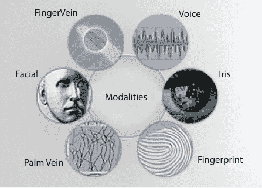

**图 1.1** 生物特征模式 [2]。

### 1.2 生物特征识别技术

#### 1.2.1 指纹识别

指纹识别是一种自动化技术，通过比对两个指纹来识别或确认个人身份。人类指纹不易被操纵，在一个人一生中几乎具有唯一性和持久性。它们独一无二、持久不变、易于获取，是一种被普遍接受的身份识别方式 [4]。

人类指纹难以控制，但在个体一生中保持稳定，因此适合作为人类身份的长期标记。

#### 不同类型指纹读卡器的工作原理

- 1. **光学读卡器**：传感器使用指纹的2D图像进行工作。算法可以用于发现图片中较亮和较暗区域内线条和边缘的新型模式。
- 2. **电容式读卡器**：使用电信号形成指纹图像。当手指放置在电容板上时，指纹脊与沟之间空气隙中的电荷会有所不同，从而导致指纹模式出现差异。
- 3. **超声波读卡器**：使用高频声波穿透皮肤外层，以捕捉指纹的3D图像。这涉及使用超声波发射器和接收器发射超声脉冲。
- 4. **热敏式读卡器**：接触时感应指纹谷与脊之间的温度差。较高的功耗以及性能依赖于周围温度是这些读卡器的局限性。

#### 1.2.2 虹膜识别

虹膜是眼睛中一种带颜色、薄而圆形的结构，通过调节瞳孔的直径和大小来控制进入视网膜的光线。除非受到外部因素损害，否则在个体的一生中其外观不会改变 [5]。基因完全相同的双胞胎也具有独特的虹膜图案。个人两只眼睛的虹膜也是独一无二的。**虹膜识别**是一种使用数字模式识别技术自动识别个体虹膜独特精细图案的自动化方法。

#### 虹膜读卡器的工作原理

- 1. 使用微弱的红外光照射个体的眼睛，以获取详细的虹膜图案。
- 2. 从图像的其余部分中分离出虹膜图案，进行分析并映射到坐标系统中。
- 3. 使用计算机化数据提取坐标，从而生成虹膜标记。

即使泄露，也无法恢复或复制此类加密的虹膜签名。现在用户只需面对红外摄像头进行验证即可。虹膜识别可实现更快的匹配，并且对误匹配具有极强的抵抗力。

#### 1.2.3 面部识别

面部识别是一种无需接触和人员配合即可捕捉生物特征的非侵入式技术，应用于识别框架中。每张脸都可以表示为人脸集合奇异向量的线性组合。因此，可以使用主成分分析（PCA）来实现该技术。PCA中的特征脸方法可以限制数据集的维度，从而提高计算效率 [6]。


#### 面部识别技术的工作原理

面部识别技术通过识别人脸上的多达 80 个因素来识别独特特征。这些因素是可测量一个人脸变量的端点，例如鼻子的长度或宽度、眼睛之间的距离、眼窝的深度以及嘴巴的形状和大小。为了测量如此详细的因素，会出现诸如面部老化等复杂情况。为了解决这个问题，计算机已经学会了仔细观察那些无论我们变得多大年龄都保持相对不变的特征。该框架通过捕捉计算机化的人脸图片上的节点信息，并将随后的信息存储为面部印记 [7] 来工作。面部印记就像指纹，但用于你的脸。它能准确识别即使是同卵双胞胎之间的微小差异。它会创建你脸部的 3D 模型，并从不同角度分析数据，克服面部识别技术相关的许多复杂性。然后，面部印记被用作与图片或视频中捕获的面部信息进行关联的依据。

#### 1.2.4 声音识别

声音识别是一种基于声音来识别或确认个人身份的机械化技术。声音生物识别为每个人创建一个声纹，这是说话人声道的数字表示 [8]。这是为了确保无论所说的语言、语音内容以及个人的身体状况如何，都能正确识别。

#### 声音识别的工作原理

- 1. 创建一个人语音的声纹或“模板”。
- 2. 只有当用户选择加入或登记自己时，才会创建模板，对其加密并存储，以备将来进行语音验证。
- 3. 通常，注册过程是被动的，这意味着模板可以在客户与应用程序或操作员的正常交互过程中在后台创建。

使用声音生物识别进行识别的应用正在日益普及，这归功于精度的提升，很大程度上受人工智能发展的推动，同时也受客户对快速便捷获取信息期望的提高 [9]。

### 1.3 方法

大量数据可能会降低数据挖掘的效率，且可能无法为模型提供重要输入。非必要属性会给数据增加噪声，扩大模型的规模。此外，模型构建和评分会耗费时间和系统资源，影响模型精度。

同样，大型数据集可能包含相互关联且可能量化相同隐藏组分的属性组，这可能会扭曲算法的逻辑。与算法处理相关的计算成本会随处理空间维度的提高而增加，给数据挖掘算法带来挑战。可以通过使用特征选择和特征提取进行维度降低，来最小化噪声、相关性和高维度的影响 [10]。

#### 1.3.1 特征选择

特征选择通过识别最相关的特征并消除冗余信息，来选取最相关的属性。使用小尺寸特征向量来降低计算复杂度，这对于在线个人识别至关重要。确定有效特征也有助于提高精度 [11]。传统上，可以使用主成分分析 (PCA) 和线性判别分析 (LDA) 来降低特征向量的维度。

特征集 S 对于类别 c 的重要性，表征为单个特征 f_i 与类别 c 之间所有共同数据值的平均估计值，如下所示：

```
D(S,c) = \frac{1}{|S|} \sum_{f_i \in S} I(f_i;c) .
```

集合 S 中所有特征的重复度，表征为特征 f_i 与特征 f_j 之间所有共同数据值的平均估计值：

```
R(S) = \frac{1}{|S|^2} \sum_{f_i f_j \in S} I(f_i;f_j)
```

#### 1.3.2 特征提取

特征提取从表示为特征向量的样本中提取独特特征。因此，属性的改变发生在此方法中，而在特征选择技术中，则使用预测重要性标准来对当前属性进行排名。改变后的特征或属性是原始属性的线性组合。由于数据由更少的有意义特征来描述，我们基于这些推导属性获得了更高质量的模型 [12]。

特征提取通过将复杂数据集减少到 2 或 3 个维度，帮助进行数据可视化。它可以提高监督学习的速度和效率。特征提取还可以用于增强监督学习的速度和有效性。它在数据压缩、数据分解和投影、潜在语义分析以及模式识别方面有应用。

信息被投影到最大特征向量上，以便降低维度。

设 V = 具有最大特征向量的列的矩阵，D = 具有不同观测列的原始数据。那么，投影数据 D' 可表示为 D' = V^t D。

在只保留 N 个特征向量且 e_1...e_N 表示相关特征值的情况下，将原始 d 维数据投影后剩余的方差量可确定为：

```
s = \frac{\sum_{i=0}^N e_i}{\sum_{j=0}^d e_j}
```

#### 1.3.3 面部标记

面部标志和面部特征检测是重要活动，会影响后续集中于面部的任务，例如凝视检测、编码、面部识别和表情，以及手势理解、面部跟踪等等。

面部标志，如鼻尖、眼角、眉毛曲线端点、下颌线、鼻孔角和耳朵投影，可以作为面部图表上的锚点。一些受表情影响较小、更可靠的标志可称为基准点。在成像系统中，基准点被视为故意放置在场景中的标记，用作参考点，如图 1.2 所示 [13]。

#### 面部标记的应用

- • **表情理解：** 可以通过地标的时空动态和空间排列来分析面部表情。

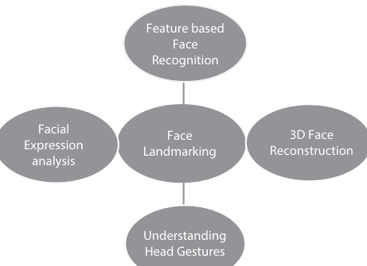

图 1.2 面部标记的应用 [4]。

- * **面部跟踪**：面部图模型上描绘了许多面部因素。通过让模型图表按照面部参数、面部段及其数学关系进行推进，来实现面部跟踪。
- * **面部识别**：定位眼部区域，并从聚焦于不同焦点的窗口中提取整体特征。

#### 1.3.4 最近邻方法

KNN 算法：一种基于从数据生成的模型结构的非参数回归和分类算法，本身不做任何假设。

KNN 用于在数据处理、模式识别和入侵检测的各个领域中，通过矢量表示和使用可接受的距离度量进行比较来测量相似性。KNN 被称为基于内存或惰性学习，因为它的学习方式仅仅是存储训练示例的表示。一个对象根据训练集中其邻居的多数票进行分类。新的模型项目将被归类为与其最相似的 K 个最近邻所在的类别。

对于面部识别，我们可以选择面部描述符，并使用 K-最近邻 (KNN) 计算来训练我们的分类器。

K-最近邻的欧氏距离函数可用于特征提取：

\(\sqrt{\sum_{i=1}^{k} (x_i - y_i)^2}\)

### 1.4 相关工作，综述

P M Rubesh Anand (2018) 及其他研究人员在其研究中，对云环境进行了全面分析，并总结了云中普遍存在的安全威胁、可能结果以及云管理中的缓解措施，重点放在访问监督、身份管理和服务上。他们的研究评估了各个方面及其常用的技术或机制。

A K Jain (2012) 在其研究中，揭示了生物识别系统的漏洞、任何两个生物识别之间相似性的内在限制及其对抗效应。与基于密码的传统认证系统不同，生物识别认证不能完全保证安全。

A Patil (2018) 在其论文中讨论了云计算的安全问题。由于云计算是一种提供实时服务的技术，它容易受到各种数据泄露的影响。他们讨论了通过加密进行端到端通信，这将保护被盗信息，因为内容会被加密并需要安全凭据 [14]。

为了最大限度地减少并最终战胜使用 PIN 和密码等传统认证方法所固有的危险，一种声称在控制云计算数据泄露方面更有效的生物识别验证框架。在他们的研究中，他们使用 AES (高级加密标准) 算法对注册时接收的用户数据进行加密，并制定了另一种算法，用于在认证期间将用户信息与信息数据库中的布局进行相关性分析。

C S Vorugunti (2014) 在其论文中提供了一个基于 SAAS 模型的简单且安全的认证系统。它将注册和验证作为认证的两个步骤。在注册过程中，生物识别数据被转换为二进制形式。特征提取器随后将二进制字符串转换为一组特征。在验证过程中，当用户登录云时，将处理相同的特征。然后，该过程对用户的生物识别数据进行加密和解密操作的验证。


S. Ziyad (2014) 在一项研究中提出了一种由生物特征与密码学融合所保障的认证方式。其系统结构包含三个阶段，即初始化阶段、注册阶段和验证阶段。在注册时，从用户处获取生物特征数据，对其加密并存储在智能卡中。每张智能卡包含一个认证号码，以及手掌静脉生物特征数据和其他相关信息。在验证阶段，智能卡中的数据与数据库中的模板数据进行验证，如果数据经过验证并匹配，则与服务器建立连接，用户即可访问系统 [15]。

传统系统以单一或多种模式应用认证过程。单点登录是一种策略，利用常规技术让用户在输入身份后只需一次即可访问系统，但可以在不同层级访问不同服务。S. Bawaskar (2016) 在其研究论文中提出了一种基于多因素概念的升级型 SSO 基础认证框架。作者建议利用更强大的管理方案，对定向证书提出连续位序列。因此，该框架完全安全，考虑到防范恶意活动的需求。

### 1.5 拟议工作

人脸识别是生物特征编程的一种分类，它以数学方式映射个人面部特征，并将信息存储为面部特征印。

在此，我们提出一种适用于刑事司法系统的模型。该模型建议具备在群体中持续或事后进行人脸识别的能力，用于城市社区、机场、边境或宗教集会等其他敏感地点的公共安全。它可以帮助执法机构更好地识别潜在嫌疑人。

首先，使用人脸检测技术来确认输入图像是否为人脸。一旦被检测为人脸，则使用基准点分析进行人脸标记。

我们将从云端访问数据库，个人识别将使用训练图像中的特征向量来训练或学习分类算法。数据挖掘算法将用于数据的进一步处理和评估。特征选择和特征提取技术可用于提高准确性，如图 1.3 所示。

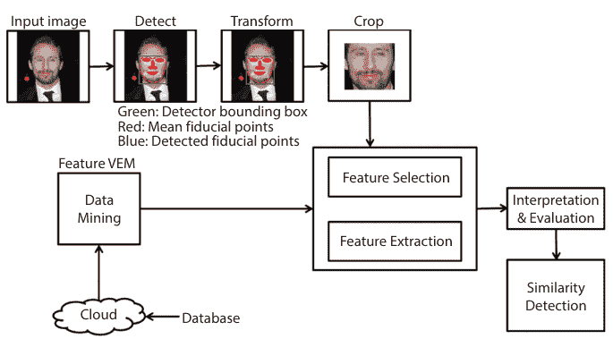

图 1.3 系统架构。

最后，通过使用最近邻方法实现相似度检测，其中分类器可以使用 K-最近邻等合适算法进行训练。

#### 步骤

- 1. 将捕获的图像用作输入。
- 2. 使用基准点检测图像。
- 3. 通过裁剪后续标记来转换图像。
- 4. 应用特征选择和特征提取以提高准确性。
- 5. 使用特征向量提取方法，该方法需要从云端犯罪数据库卸载的特征。
- 6. 通过比较两个数据集进行解释和评估。
- 7. 使用最近邻方法识别两个或多个图像之间的相似性。

人脸识别技术旨在远距离运行，且未经目标知晓，从而使得面部很难避免被捕获。由此，它允许一次又一次地对多个人进行定位。此外，它是一种非自愿且隐秘的侦察创新。所提模型一旦实现，可以通过将实时捕获或数字图像与存储的面部特征印进行比较来确认个人身份，从而充当有效的刑事识别工具。

### 1.6 未来展望

生物特征技术对个人权利和隐私构成威胁，因为人脸识别等技术允许在未经公民知晓的情况下识别他们。此外，当同意被纳入技术设计时，关于生物特征技术的隐私问题可以得到解决 [16]。

任何现代技术都充满潜在威胁，无论是软件制作者、销售者还是部署倡导者，都无法声称其绝对可靠。在刑事司法管理研究的背景下，这表明使用默认相机设置拍摄的图像更倾向于曝光较浅肤色而非较深肤色，从而影响不同种族群体的人脸识别技术结果。一种方法可能是利用技术中立的监管框架来识别损害程度。

### 1.7 结论

生物特征技术应用广泛。它们每天被越来越多地用于手机安全、银行等领域，各国政府也将这些技术视为验证交易的安全措施。重要的政府机构正在使用人脸识别技术，利用驾驶执照和护照详细信息建立数据库，以实现有效的行政管理、社会经济发展和执法。认为精良创新意味着更高熟练程度的观点应受到根本剖析。随着这些技术越来越深入地渗透到我们的日常生活中，了解并接受相关教育至关重要。一项兼备充分数据保护和隐私保障的合理策略是当务之急。

### 参考文献

- 1. A.K. Jain 和 K. Nandakumar，“生物特征认证：系统安全与用户隐私，”IEEE 计算机学会出版，0018-9162/12，2012 年 11 月。
- 2. Abhishek Kumar、Jyotir Moy Chatterjee 和 Pramod Singh Rathore，2020 年。“智能手机对抗式应用程序与安全问题，”《风险与应急管理国际期刊》(IJRCM)，IGI Global，第 9(2) 卷，第 1-18 页，4 月。
- 3. Bhargava, N., Bhargava, R., Rathore, P. S., & Kumar, A. (2020). 使用带回归挖掘算法的 Gabor 滤波器提取特征向量的纹理识别。《风险与应急管理国际期刊》(IJRCM)，9(3)，31-44。doi:10.4018/IJRCM.2020070103。
- 4. Chandra Shekhar Vorugunti，“云计算安全高效的生物特征即服务认证”，1 IEEE，2014 年 10 月 09-11 日。
- 5. G.R Metu 和 A. Patil，“云计算中数据泄露作为主要安全问题”，《纯粹与应用数学国际期刊》，119(14):19-27,2018。
- 6. Haryatibiinti Jaafar, Nordanibaninti, Mukahar, Dzati Athiarbinti Ramli，“最近邻方法：生物特征图像数据库的设计与比较”，IEEE 学生研究与开发会议，2016 年。
- 7. Indu, P.M Rubesh Anand 和 V.Bhaskar，“云环境中的身份与访问管理：机制与挑战”，Elsevier 工程科学与技术国际期刊 21 (2018) 574–588, 2018。
- 8. K Sarat Chand 和 Dr. B Kezia. Rani，“云计算中使用 SaaS 的生物特征认证”，《工程与技术国际研究期刊》(IRJET)，卷: 05 期: 02，2018 年 2 月。
- 9. Kumar, A., Chatterjee, J. M., & Diaz, V. G. (2020). 针对电子邮件钓鱼的 SVM 结合 NLP 和概率神经网络的新型混合方法。《电气与计算机工程国际期刊》，10(1)，486
- 10. N. Bhargava, S. Dayma, A. Kumar and P. Singh，“在 WEKA 中使用简单 CART 算法进行分类的方法”，2017 年第 11 届智能系统与控制国际会议 (ISCO)，科伊姆巴托尔，2017 年，第 212-216 页，doi: 10.1109/ISCO.2017.7855983。
- 11. Naveen Kumar, Prakrati Triwedi, Pramod Singh Rathore，“基于椭圆曲线密码学 (ECC) 的图像自适应水印的自适应方法”，《信息技术与知识管理首届国际会议》第 89–92 页，ISSN 2300-5963 ACSIS，第 14 卷，DOI: 10.15439/2018KM19。
- 12. Rathore, P.S., Chatterjee, J.M., Kumar, A. et al. 通过中继方法为 WSN 进行节能簇头选择。J Supercomput (2021). https://doi.org/10.1007/s11227-020-03593-4
- 13. S. Bawaskar 和 M. Verma，“基于 Web 安全的增强型 SSO 多因素认证”，《计算机科学与信息技术国际期刊》，第 7 (2) 卷，2016 年，960-966 页，2016 年。
- 14. S. Ziyad 和 A. Kannammal，“云端多因素生物特征认证”，Springer India，计算智能、网络安全与


Computational Models, Advances in Intelligent Systems and Computing 246, 2014.

- 15. Singh Rathore, P., Kumar, A., & Gracia-Diaz, V. (2020). 利用蜻蜓算法进行高级集群头选择以改进RFID网络寿命的整体方法论. International Journal Of Interactive Multimedia And Artificial Intelligence, 6 (Regular Issue), 8. http://doi.org/10.9781/ijimai.2020.05.003.

- 16. Thangapandiyan, M., Anand, P.M., & Sankaran, K. (2018). 云数据安全的量子密钥分发与密码学机制. 2018 International Conference on Communication and Signal Processing (ICCSP), 1031-1035.

- 17. Joshua C. Klontz, Brendan F. Klare, Scott Klum, Anil K. Jain, Mark J. Burge, "开源生物特征识别", Biometrics: Theory Applications and Systems (BTAS) 2013 IEEE Sixth International Conference on, pp. 1-8, 2012.

- 18. Patil, Archana and Patil, Dr. Rekha, 绿色云计算当前趋势与未来研究挑战分析报告 (March 19, 2019). Proceedings of International Conference on Sustainable Computing in Science, Technology and Management (SUSCOM), Amity University Rajasthan, Jaipur - India, February 26-28, 2019, Available at SSRN: https://ssrn.com/abstract=3355151 or http://dx.doi.org/10.2139/ssrn.3355151

- 19. Sarvabhatla, M., Giri, M., Vorugunti, C.S., 密码分析的密码分析与Yan等人TMIS生物特征认证方案的改进, CoRR, 2014.

- 20. Ziyad, S., & Rehman, S. 云计算中认证机制的关键性综述, (2014).

- 21. Shruti Bawaskar et al, (IJCSIT) International Journal of Computer Science and Information Technologies, Vol. 7 (2), 960-966, 2016.

## 2. 使用深度学习的多租户云中的隐私

Shweta Solanki* 和 Prafull Narooka²

¹阿杰默MDS大学, 阿杰默, 印度 ²阿格拉尔学院计算机科学系, 梅尔塔市, 拉贾斯坦

### 摘要

在云计算环境中，有责任维护数据的隐私和安全。在当今时代，由于基于多租户服务的系统频繁发展，对隐私的需求日益增加。随着系统增长的增加，对隐私的要求也随之增加。我们使用深度学习概念来提高隐私级别。在本章中，我们在多租户框架（MWF）内理解云计算概念。在多租户框架中，隐私和安全概念的要求是使用深度学习开发的。目标是使用深度学习概念，在基于多租户的系统中查找多种因素的隐私要求。由于云计算的动态环境，基于多租户的系统服务被聚集。将使用深度学习的隐私策略维护三种一致性。在多租户中，大量用户（租户）使用相同的服务来维护服务的持久性和一致性，这些服务是隐私和安全所必需的。

**关键词**: 多租户, 隐私, 框架, 隐私策略, 云计算, 单租户, 公共云, 私有云

### 2.1 引言

理解云计算环境中多租户的需求非常重要，因为当今所有工作都借助互联网交易模式完成。在此环境中，数据库及其模式会频繁更改或修改。数据存储在不同数据库的不同区域中 [1]。每个组织的云计算环境都不同。私有云或公共云等环境的实际需求取决于数据和租户需求、组织需求，或者取决于数据库的结构以及组织用于隐私策略的数据库模型。多租户结构的安全级别应维护应用程序的持久性，以保持系统的一致性，并避免租户常规工作的中断。多个数据库中的多租户概念要求租户之间在逻辑和物理上都有更多隐私，以适应每个工作区域对隐私和安全的更大需求。使用深度学习概念可以提高访问和管理数据库的复杂性。使用深度学习概念应减少访问并提高效率，防止数据泄露、黑客攻击或其他风险，因为这些风险可以轻易被发现，并提高多租户系统效率的质量。因此，在深度学习中，隐私概念得到了改进，多个租户之间的透明度增加，从而保持隐私。深度学习概念在实施方面非常强大且可扩展。在深度学习中，数据库得到高效管理。深度学习算法使其负担得起。深度学习概念有能力改进数据驱动的预测。它在多租户的数据库中发现隐私和安全模式。这可以为组织提供良好或更好的价值。在深度学习中，云计算中的二进制、分类和值预测工作得以完成。在本章中，我们讨论了多租户的基本概念、隐私要求以及与深度学习结合的云计算概念。

### 2.2 基本结构

理解云计算非常重要，因为它根据最终用户提供服务。无论是私有云还是公有云，取决于用户的需求，例如多租户或单租户。它也是一种按需服务，取决于租户需求、资源可用性、存储需求、活动管理以及分布式系统所需的拓扑。租户需要集中式或分布式框架。云计算中的安全性也取决于数据库的概念以及对规模和组织的需求。随着需求的产生，组织选择云计算的架构。

然后，他们创建模式并选择数据模型，并为工作选择单租户或多租户概念。复杂性和成本也取决于组织需求的要求。现有的云计算架构和多租户概念说明了多租户在云计算中的影响。云管理多租户概念，共享资源，并与许多租户一起管理服务。管理和公用事业服务由架构根据需求提供。本节讨论了云计算的基本结构以及如何与多租户结合工作 [2]。

#### 2.2.1 云计算的基本结构

云计算服务被每个服务领域使用，无论企业规模大小。

云设施根据业务需求提供。云使数据存储成为可能，无论数据量大小，并从任何位置和任何硬件或虚拟环境提供访问数据或存储数据的途径。

云计算提供面向服务和事件驱动架构的服务。

给定的图表示了云的各种服务。所有服务相互关联。涉及的三个主要方是云服务消费者、云服务提供商和云经纪人，如图 2.1 所示。

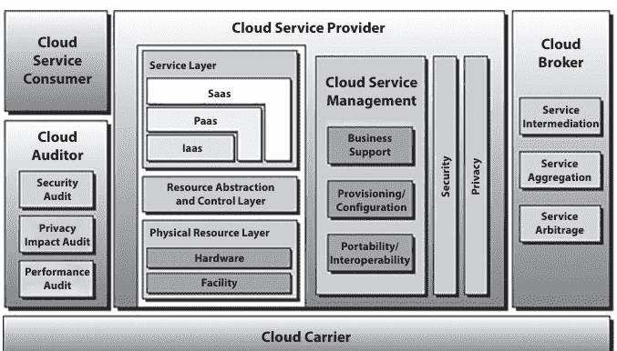

图 2.1 云计算服务 [3]。

在云服务中，如果消费者属于内部，则提供所有消费者服务；如果消费者属于外部，则取决于消费者要求。在消费者提出需求时，如图所示，服务提供云审计员的工作。

云服务提供商提供所有云服务。服务提供商提供的服务类型是商业性还是企业性，由服务提供商决定 [3]。

云服务提供商可以使用物理或虚拟资源提供所有云服务，并根据服务要求创建应用程序。所有团队作为服务编排协同工作。

#### 2.2.2 多租户概念

当许多租户一起使用互联网工作，且租户位于不同地点时可以使用数字服务传输数据，此时需要多租户的基本概念；该概念是从一个地点工作到另一个地点。该服务完全取决于组织的需求。租户的需求以及租户需要哪种类型或哪个地点取决于组织的需求 [4]。

基本上，在 SaaS 环境中有两种租户类型：单租户和多租户。图 2.2 简要讨论了多租户在实时应用中的应用。在单租户中，使用单一环境或平台，但在多租户中，在不同地点使用一个公共平台，或共享工作平台并为单个组织创建一个已知的工作场所。

单租户服务为一个租户使用单个系统（软件）来提供一项服务。单系统服务针对单个建筑物，但如果其需求在另一个建筑物，租户需要为新建筑再次购买相同的服务。在多租户中，客户是

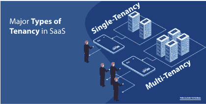

图 2.2 租户类型 [4].


无需多次购买单一服务，这意味着单一服务可以在单个组织的不同办公室中使用。

在多租户系统中，可以根据租户的要求轻松修改和更改。多租户系统结合了客户端和租户之间的工作场所，但概念或逻辑应相互分离。组织与用户和租户共享数据和配置以及管理服务 [5]。

多租户中基本有三个主要概念，如图 2.2 所示。

- **共享数据库** 用于管理多租户系统，这意味着该设施有助于提供数据访问，并管理存储区域的成本、灵活性和可扩展性。它降低了数据库管理的复杂性，并使数据能够轻松地为每个租户和工作区所用。

- **一个数据库和多个架构** 意味着所有租户以不同的方式使用同一数据库。每个租户使用其所需的数据，由于工作不同，每个租户的需求也不同。根据租户要求，向租户提供服务。复杂性和成本也将影响租户使用的结构。

- **多个数据库和架构** 意味着，在这种模型中，租户数据存储在不同数据库中不同位置的数据库里，或者租户可以根据需要创建不同的数据库。相应地，新数据库将导致成本和复杂性增加 [6]。

#### 2.2.3 云计算中的多租户概念

在云计算系统中，多租户概念非常重要，因为它通过云环境中的共享计算资源为所有租户提供服务。云环境有两种类型：公共云环境和私有云环境。租户选择其中一种云环境。所有租户数据均相互隔离且不可访问，如图 2.3 所示。

多租户云计算系统为每个租户创建隔离工作区，用于存储或项目数据以及登录隐私策略。租户仅使用其个人安全区域进行工作，并且仅访问已知的工作或数据。在其他数据需求的情况下，需要另一个租户的权限或访问密钥才能访问。

一种云计算类型是在私有云环境中，并使用属于单个公司的两个以上租户组。

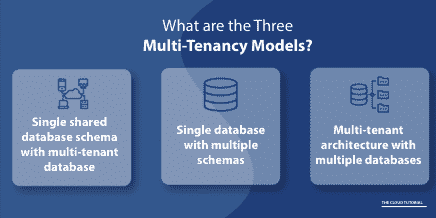

图 2.3 多租户模型 [5]。

它们处理相同的数据并通过云环境使用资源。另一种类型是公共云环境，许多公司可以在其中与不同租户共享其数据和服务。公共云环境的使用比私有云环境更广泛。

单租户云计算环境不提供所有功能。与多租户系统相比，它提供更多存储、访问功能以及安全和隐私策略。

它提供了一个易于工作的虚拟环境，维护工作和硬件的复杂性较低，且对设备或位置无限制 [7]。

#### 云计算中的多租户示例

让我们以一个非常常见的社区为例。在一个社区中有许多房屋；每个房屋有许多公寓，每个房屋都充当单个公司的一部分，每个公司有不同的部门，每个部门仅在其区域工作，并且每个部门共享公用事业服务（即水、电力、PNG 等）。图 2.4 所示的公司使用类似设施。

#### 多租户云的工作原理

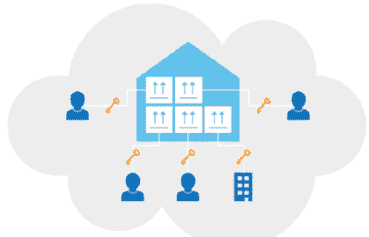

图 2.4 多租户云结构 [6]。

### 2.3 使用深度学习的云环境隐私

在基于多租户的云系统中，安全性使用深度学习方法来满足租户的所有要求，包括隐私策略和所需服务。使用深度学习方法开发云计算的隐私结构，可根据租户的要求提供更好的服务。相应地，根据租户的请求，资源和服务可用性满足请求，并开发和维护隐私和安全服务。在云计算环境中，有公共、私有、单租户和多租户结构可供根据租户要求使用。不同结构对隐私和安全服务有不同的需求。如果无法提供更好的服务，租户可能不使用该结构，因此，使用深度学习方法开发隐私和安全服务。这些服务根据组织的需求使用深度学习进行开发 [8]。

云计算中的隐私通过基于多租户应用程序的分布式系统概念来维护，该概念使用加密技术保护数据、同步工作，并根据租户是否获得授权来监管基础数据修改，因此需要检查和管理所有因素 [9]。隐私管理系统用于管理复杂数据访问的安全性。

存储在云环境中的信息会直接加密为租户有权访问的格式，数据只能安全地解密该数据 [10]。使用深度学习技术可提高隐私和安全级别。已经使用深度学习方法开发了一种新的保护算法，用于在云环境中安全地转换和使用数据库中的数据。在云计算环境中，已经开发了一种隐私服务系统，用于防止未经授权的访问并提高私有数据安全性的能力，最大限度地减少云环境中私有数据的被攻击风险，如图 2.5 和图 2.6 所示 [11]。

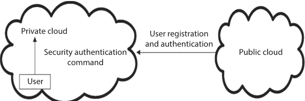

图 2.5 云安全概念 [7]。

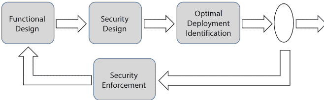

图 2.6 多云环境中的安全 [7]。

### 2.4 基于深度学习概念的多租户隐私

多租户系统中需要隐私，因为当租户在多租户应用程序上工作时，存在隐私策略薄弱和数据安全性差的风险。组织和租户无法自行保护所有数据 [12]。使用深度学习创建了一个保护数据的概念，为租户提供安全私密的环境，以便接受多租户应用程序并自由地在该系统上工作。这就是隐私和安全策略薄弱、数据丢失风险、数据被攻击风险以及信息被误用的原因，因此在开始在多租户系统上工作之前，有必要保护整个任务。为了安全或隐私，第一步是维护唯一 ID 的概念 [13]。在此模型中，所有租户都有用于登录的单独唯一 ID。如果组织非常大且管理所有 ID 复杂，则每个单独的部门将有一个用于登录的单一 ID。此概念也用于深度学习。第二步是为每个租户设置访问限制。每个租户的访问权限取决于组织或授权部门决定的访问限制。例如，一家租户在会计部门工作的公司只能访问会计部门数据，无法访问其他部门（管理、安全等）的数据。根据此概念，所有部门的访问标准均已决定或固定，并确定了部门租户访问限制，因此将检查授权，只有授权用户才能访问受限数据。第三步是按照部门将数据库隔离为表。然后根据租户访问权限和限制将数据库分离并隔离为表，将隔离的数据提供给租户。通过此方法，整个数据库不会提供给所有租户，而是使用深度学习概念仅提供隔离数据，如图 2.7 所示。

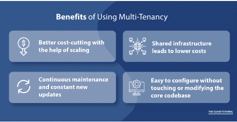

图 2.7 多租户服务 [8]。

第四步是在基于多租户的系统中进行加密。在基于多租户的系统中，数据库的一致性、完整性、持久性、准确性和及时性需求是强制性的。如果基于多租户的系统由于任何条款和条件未能满足要求，租户可能无法在组织中高效工作，因此使用基于深度学习概念的加密技术来保护数据库。一些加密技术包括数字、安全、密钥、签名、数字密钥、私钥和密码提供的加密 [14]。

授权用户访问复杂数据库并可以修改数据库。如果发生未经授权的访问，未经授权用户的复杂数据访问可以通过未经授权的活动被添加、删除和修改。在使用加密技术的多租户系统中，首先检查授权，找出租户是否获得授权，以及租户是否已作为具有所提供访问权限的用户获得授权。

### 2.5 相关工作

在本章中，我们将探讨与多租户隐私策略概念相关的工作。云环境中多租户的未来使用取决于对数据的复杂性和成本影响。


结构。在许多关于隐私和安全概念的章节基础上已有大量工作 [15]，其中涉及数据库黑客攻击和交易欺诈。使用深度学习消除了这类问题并减少了欺诈。本章数据有助于找出云计算系统相对于多租户系统的功能或非功能参数。这些细节源自安全和隐私概念等参数、关于云框架中多租户结构的详细描述、根据要求变化的多租户模块，以及讨论多租户云系统的安全性、隐私性、性能、成本和灵活性等因素。本章还讨论了在数据安全和隐私以及作为云计算系统架构的保护概念中应用深度学习概念的贡献。本章旨在利用深度学习概念，为基于多租户系统的数据库和租户工作场所提供最大化的保护和隐私与安全维护方案，并理解云计算结构及结合深度学习方法隐私概念的多租户深层结构。本文献用于理解并找出各种服务（如响应时间、网络负载和吞吐量管理服务开发）中资源、服务和隐私概念开发的需求，以及基于云的多租户系统和使用深度学习概念的隐私服务中对资源的需求和资源需求 [16]。

### 2.6 结论

### 2.6 结论

在具有多租户系统的云计算中，隐私和安全非常复杂且宝贵。这些概念很重要，因为为云计算和多租户系统的独特架构提供隐私和安全是一种责任。数据必须正确、持久且安全。每个租户都希望在安全的环境中工作；这有助于为工作场所创造良好而优雅的环境。每个租户都希望在云环境中维护数据库事务的安全性和隐私性。如果此要求未满足，租户将工作更长时间，工作能力将下降，因此隐私和安全是决定该结构未来的两个因素。利用深度学习概念，我们致力于多租户系统的隐私和安全领域，使其在物理和逻辑隔离方面更加安全，并提供一个出色的隐私平台，让用户无需担心安全问题。借助深度学习，多租户系统使事物更加安全，隐私策略更加稳定，并保障同一组织不同租户使用的数据库的未来安全。利用深度学习概念提供机制来构建隐私架构，以提高隐私策略的安全等级。前端和后端的数据都安全，因此两端的数据隔离都受到保护，租户未来使用也是安全的。为基于云的多租户系统的每个方面维护无数据丢失的隐私和安全，是系统持久性和安全性方面精妙且必要的。

### References

### 参考文献

- 1. Abhishek Kumar & Jyotir Moy Chatterjee & Pramod Singh Rathore, 2020. “智能手机对抗应用与安全问题，”《风险与应急管理国际期刊》(IJRCM)，IGI Global，第 9(2) 卷，第 1-18 页，4月。
- 2. Bhargava, N., Bhargava, R., Rathore, P. S., & Kumar, A. (2020). 基于回归挖掘算法使用 Gabor 滤波器提取特征向量的纹理识别。《风险与应急管理国际期刊》(IJRCM), 9(3), 31-44. doi:10.4018/IJRCM.2020070103
- 3. Judith Hurwitz 著 https://www.dummies.com/programming/cloud-computing/hybrid-cloud/multi-tenancy-and-its-benefits-in-a-saas-cloud-computing-environment/ Judith Hurwitz, Marcia Kaufman, Fern Halper, Daniel Kirsch 著
- 4. https://www.dummies.com/programming/cloud-computing/hybrid-cloud/multi-tenancy-and-its-benefits-in-a-saas-cloud-computing-environment/
- 5. 计算机术语 http://whatis.techtarget.com/definition/multi-tenancy Frederick Chong https://msdn.microsoft.com/en-us/library/aa479086.aspx
- 6. https://www.researchgate.net/publication/311922746
- 7. Kumar, A., Chatterjee, J. M., & Diaz, V. G. (2020). 针对电子邮件网络钓鱼结合 NLP 和概率神经网络的 SVM 新型混合方法。《电气与计算机工程国际期刊》, 10(1), 486
- 8. Margaret Rouse https://searchcloudcomputing.techtarget.com/definition/multi-tenant-cloud.
- 9. SaaS PaaS 中的多租户 http://multitenancy-in-saaspaas.wikispaces.asu.edu/
- 10. Naveen Kumar, Prakarti Triwedi, Pramod Singh Rathore, “基于椭圆曲线密码学 (ECC) 的图像自适应水印自适应方法，” 首届信息技术与知识管理国际会议，pp. 89–92，ISSN 2300-5963 ACSIS，Vol. 14 DOI: 10.15439/2018KM19。
- 11. Rathore, P.S., Chatterjee, J.M., Kumar, A. et al. 面向 WSN 的中继方式节能簇头选择。《超级计算机期刊》(2021). https://doi.org/10.1007/s11227-020-03593-4
- 12. SlideShare.net/www.slideshare.net/mmubashirkhan/saas-multitenant-database-architecture
- 13. Singh Rathore, P., Kumar, A., & Garcia-Diaz, V. (2020). 基于蜻蜓算法的先进簇头选择改进 RFID 网络寿命的整体方法。《交互多媒体与人工智能国际期刊》, 6 (常规期刊), http://doi.org/10.9781/ijimai.2020.05.003.
- 14. www.elsevier.com/locate/knoys
- 15. www.researchgate.net/publication/320185699
- 16. Thangapandiyan, M., Anand, P.M., & Sankaran, K. (2018). 云数据安全的量子密钥分发与密码学机制。2018 年通信与信号处理国际会议 (ICCSP), 1031-1035.

## 3. Emotional Classification Using EEG Signals and Facial Expression: A Survey

## 基于 EEG 信号和面部表情的情感分类：综述

S J Savitha*, Dr. M Paulraj and K Saranya

S J Savitha*，Dr. M Paulraj 和 K Saranya

Department of Computer Science and Engineering, Sri Ramakrishna Institute of Technology, Coimbatore, India

斯里拉马克里希纳理工学院计算机科学与工程系，印度科英巴托

### Abstract

### 摘要

基于脑电图 (EEG) 和面部表情的情感分类是情感计算领域中相对较新的一个领域，涉及情绪状态识别和特征提取方面的挑战性问题，旨在实现最佳分类性能。使用面部表情识别的自动情感检测现在是计算机科学、医学和心理学等各个领域的主要研究方向。已开发出各种特征提取技术，用于对来自大脑的脑电图信号以及静态图像和实时视频中的面部表情进行分类。深度学习在这类任务中发挥着重要作用。本章对面部表情识别和脑电图信号分类领域开展的研究工作进行了综述。

Keywords: Electroencephalogram (EEG), brain computer interface (BCI), emotion recognition, feature optimization, evolutionary algorithm

关键词：脑电图 (EEG)、脑机接口 (BCI)、情感识别、特征优化、进化算法

### 3.1 Introduction

### 3.1 引言

在多年间，建立人脑与计算机或机器人之间直接通信和控制通道的可能性一直是科学猜想甚至科幻小说的话题。在过去二十年中，这一想法通过众多研究和开发项目得以实现，并发展成为科学研究领域中增长最快的领域之一。这项被称为脑机接口 (BCI) 技术的技术，为大脑信号提供了一种新的输出通道，可在不使用周围神经和肌肉的正常输出路径的情况下，实现与外部设备的通信或控制。由于脑电图具有非侵入性、实现简便和成本效益高的优点，它已被广泛用于 BCI 应用。最近，干电极和无线脑电图系统也在各种实验环境中得到研究，进一步扩展了基于脑电图的 BCI 系统的应用范围。深度学习方法为完成这类任务提供了多种途径。由于脑电图频率分析是一个主要问题，已采用多种方法，例如带通滤波器组、自回归 (AR) 模型、傅里叶变换和小波变换。然而，所有这些方法都有一定局限性。带通滤波器的频率分辨率受滤波器阶数的限制。深度学习系数中的 AR 模型仅提供有限的频率信息，因为从 AR 系数重构的频谱包络受 AR 模型阶数的限制。离散小波变换被视为具有正交基的带通滤波器组，具有更好的频率和时间分辨率。然而，得到的小波系数通常是冗余的。此外，还需要后处理来稳定分类器的性能。用于 BCI 的脑电图信号通常是带限的。为了提高分类性能，针对更复杂的问题通常需要更多来自脑电图通道的数据。脑电图通道数量的增加带来两个挑战。首先，随着通道数量增加，直接识别受试者相关的反应频带变得不可行，需要自动识别过程。其次，由于特征向量包含所有通道的所有频率估计值，维度会急剧增加。深度学习在特征向量中提供高维性，这将影响分类器的性能 [1]。

A BCI allows a person to communicate with or control the external world without using conventional neuromuscular pathways. That is, messages and control commands are delivered not by muscular contractions, but rather by brain signals themselves. This BCI feature brings hope to individuals who are suffering from the most severe motor disabilities, including people with amyotrophic lateral sclerosis (ALS), spinal cord injury, stroke, and other serious neuromuscular diseases or injuries. BCI technology holds promise to be particularly helpful to people who are “locked-in” cognitively but without useful muscle function. Restoration of basic communication capabilities for these people would

脑机接口允许一个人在不使用传统神经肌肉通路的情况下与外部世界通信或控制它。也就是说，信息和控制指令不是通过肌肉收缩传递的，而是直接由大脑信号传递的。这一 BCI 特性为遭受最严重运动障碍的个体带来了希望，包括患有肌萎缩侧索硬化症 (ALS)、脊髓损伤、中风及其他严重神经肌肉疾病或损伤的人。BCI 技术有望对那些在认知上“被锁住”但没有有用肌肉功能的人特别有帮助。为这些人恢复基本通信能力将


显著提高患者及其照护者的生活质量，增强独立性，减少社会孤立，并有可能降低护理成本 [2]。

BCI研究近年来呈爆炸式增长。目前，全球有400多个团队正在使用多种脑信号、信号特征以及分析和转换算法开展广泛的研究与开发项目。在本综述中，我们讨论了BCI技术及其临床应用的现状与未来前景。我们将定义BCI，回顾人脑中与BCI相关的源信号，并描述BCI的功能组件。我们还将回顾BCI技术的当前临床应用，并确定深度学习的潜在用户和潜在应用。最后，我们将讨论BCI技术的当前局限性、阻碍其广泛临床应用的因素，以及在深度学习时代的未来展望。

### 3.2 相关工作

现有若干与人类情绪分析相关的研究。

#### 基于脑电情绪识别模型特征选择的进化计算深度学习算法

在该模型中，脑电特征从时域、频域和时频域三种方式提取。目前尚无公认的最适合情绪识别的标准特征集。这导致了脑电中所谓的高维性问题，因为并非所有这些特征都携带关于情绪的重要信息。无关且冗余的特征增加了特征空间，使得模式检测更加困难，并增加了过拟合的风险。因此，识别对每种情绪性能有显著影响的显著特征非常重要 [3]。

#### 深度学习中的自适应神经-模糊推理模型

所提ANFIS模型结合了神经网络的自适应能力和模糊逻辑定性方法，以提高诊断准确性。WT可以应用于提取离散时间信号的小波系数。该过程利用多速率信号处理技术。所提方案是一种子带编码或多分辨率信号分析。WT的多分辨率特性允许将信号分解为若干个尺度，每个尺度代表所研究信号的某一特定粗糙度 [4]。WT提供了非常通用的技术，可应用于信号处理中的许多任务。深度学习模型非常重要的一个应用是能够在压缩参数中计算和操作数据。

深度学习中的人工神经网络（ANNs）已被用作模式分类的计算工具，包括疾病诊断，因为人们认为它们比信号分析技术具有更强的预测能力。在本研究中，提出了一种基于ANFIS的新方法用于脑电信号分类。所提技术涉及训练五个ANFIS分类器，当用定义脑电信号行为的小波系数作为输入时，用于对五类脑电信号进行分类。ANFIS分类器通过反向传播进行训练。每个ANFIS分类器都经过训练，使其对某一类脑电信号比对其他类别更准确。五个ANFIS分类器的预测结果由第六个ANFIS分类器综合 [5]。研究了所提ANFIS模型的正确分类率和收敛率，深度学习中ANFIS模型的性能优于其他神经网络方法。

用于分析物理和生物时域信号的分形维方法具有高复杂性和不规则性。在本章中，他们使用了神经网络的分形维作为特征，而不是深度学习中的线性特征提取技术，例如功率谱计算。在本章中，他们使用频率维度来测量脑电信号的复杂性和不规则性，这也是检测脑电信号中快速暂变的一种合适方法 [6]。FD的计算直接从脑电时序进行，不需要在多维状态空间中重构吸引子。在深度学习中，文献中有许多可用的技术来计算FD。然而，Katz和Higuchi算法被广泛使用，并在脑电信号上产生更好的结果。

不同类型的情绪及其脑电特征用于使用WT和SVM等不同机器学习技术找出情绪的精确特征并识别情绪的准确性。在此，情绪基于是否宜人和令人不快进行分组。

快乐和悲伤等基本情绪用于提取其他情绪，因此可以使用LDA和KNN识别情绪。特征通过离散小波变换和SAM提取。它处理情绪的对称和不对称层级。可以通过信号分割并使用HOC和互相关方法提取特征来识别情绪。

深度学习中的SVM用于将情绪分类为不同组别，如负面情绪和正面情绪。使用这种方法，我们需要获得最佳的情绪准确性，并且也使用多维数据。情绪从不同的优化技术中分类，这些情绪与人机交互以及其他用于情感计算的活动相关。特征使用HOC从脑电中提取。它支持不同的特征提取技术并提供更好的准确性结果。情绪使用短期评估来识别，特定的时间相关情绪仅使用STFT和MI提取，并使用SVM和RVM分类 [7]。

所有这些技术和方法均使用MATLAB实现，并使用不同类型的人脑电图来分析情绪。脑电信号记录了没有任何精神病的健康人，如表3.1所示。

表3.1 特征提取技术 [8]。

| 序号 | 方法 | 贡献 | 问题 |
| :--- | :--- | :--- | :--- |
| 1. | 小波变换（Wavelet Transform） | 1. 使用可变窗口分析信号<br>2. 同时分析时域和频域数据 | 1. 缺乏特定方法<br>2. 在有限的海森堡不确定性下运行 |
| 2. | 主成分分析（Principal Component Analysis） | 分析在不丢失信息的情况下降低维度 | 1. 数据复杂<br>2. PCA无法处理此数据 |
| 3. | 非线性动态分析（Non-Linear Dynamic Analysis） | 1. 对大数据计算效率高<br>2. 将信号分解为时域数据 | 1. 需要更多计算<br>2. 不适用于确定性情况 |
| 4. | 短时傅里叶变换与互信息（Short Time Fourier Transformation & Mutual Information） | 固定滑动窗口长度 | 1. 不能去噪<br>2. 时频之间的权衡 |
| 5. | 高阶过零（Higher Order Crossing） | 1. 性能应较高<br>2. 提供优化结果 | 1. 难以选择随机数据 |

### 3.3 方法

深度学习提供了使用多种程序分析脑电数据的方法，包括信号预处理、特征提取、降维和分类方法，以识别情绪 [8]。

#### 3.3.1 脑电信号预处理

预处理和特征提取是脑电信号处理的两个主要步骤。预处理技术有助于从脑电信号中去除不必要的伪迹并提高信噪比。预处理模块通过将噪声与实际信号分离来帮助提高系统性能。在处理脑电图之前，必须使用频谱滤波和表面拉普拉斯变换去除噪声和不需要的细节。4到10Hz的频率用于提取与情绪相关的特征。使用以下深度学习特征提取技术。

#### 3.3.1.1 离散傅里叶变换（DFT）

在时域中，数字信号的表示描述了信号幅度与采样时刻或样本编号之间的关系。然而，在某些应用中，信号频率含量非常有用，而不仅仅是数字信号样本。需要在频域中开发数字信号的频率分量表示，即信号频谱 [9]。将时域信号样本转换为频域分量的算法称为离散傅里叶变换，或DFT。DFT还建立了时域表示和频域表示之间的关系。因此，我们可以应用DFT对时域序列进行频率分析。此外，DFT广泛用于包括频谱分析、声学、成像和视频、音频、仪器以及通信系统在内的许多其他领域。

#### 3.3.1.2 最小均方（LMS）算法

常规滤波无法应用于消除伪迹，因为脑电信号和伪迹具有重叠的频谱。创建了一种自适应过程，其中传递函数H(z)根据优化算法进行调整。自适应由主信号与滤波器输出之间的误差信号引导。最常用的优化


criterion is the Least Mean Square Algorithm. This algorithm of Deep Learning is an application scheme widely used in practice due to its simplicity [10].

#### 3.3.1.3 Discrete Cosine Transform (DCT)

The DCT is a transform that is very common when encoding video and audio tracks on computers. It has found applications in digital signal processing and particularly in transform coding systems for data compression and decompression. DCT takes correlated input data and concentrates its energy in just the first few transform coefficients [11].

#### 3.3.2 Feature Extraction Techniques

Feature extraction is the process of identifying the particular information from an EEG, which was measured by brain activity. This chapter focuses on several feature techniques, including:

- Discrete Wavelet Transformation
- Higher Order Crossing
- Principal Component Analysis
- Independent Component Analysis
- Short Time Fourier Transform and Mutual Information
- Time and Frequency Attribute

This table explains different feature extraction methods and their advantages and disadvantages, which is helpful for knowing how the feature is extracted from the EEG signal and analyzing emotion related features. By using this table, we can identify particular characteristics of the methods and the method that is extracting particular features with better results during the extraction process [12].

#### 3.3.3 Classification Techniques

After extracting the features, classification is used to group related emotions. The following methods of Deep Learning are used for classification:

- Neural Network
- K-Nearest Neighbor
- Support Vector Machine
- Linear Dynamic Analysis

| S. no. | Method | Contribution | Issues |
| :--- | :--- | :--- | :--- |
| 1. | Neural Network | 1. Easy to train 2. Accurate pattern classification | 1. Needs training to operate 2. Requires high processing time for large network |
| 2. | K-Nearest Neighbor | 1. Easy to understand 2. Easy to implement | 1. Poor runtime performance 2. Sensitive to irrelevant and redundant features |
| 3. | Support Vector Machine | 1. Good generalization 2. More performance | 1. Computational complexity is high |
| 4. | Linear Dynamic Analysis | 1. Extremely fast 2. Low requirements 3. Good results | 1. Fail to discriminate functions like variety of features 2. Complex structure |

This Table 3.2 explains the different feature classification methods and their advantages and disadvantages, which helps in knowing how the features are extracted from the EEG signal and analyzing emotion related classes [13].

### 3.4 BCI Applications

Individuals who are severely disabled by disorders such as ALS, cerebral palsy, brainstem stroke, spinal cord injuries, muscular dystrophies, or chronic peripheral neuropathies might benefit from BCIs. To help determine the value of BCIs for different individuals, potential BCI users are categorized by the extent, rather than the etiology, of their disability. Evaluated in this way, potential BCI users fall into three reasonably distinct groups: (1) people who have no detectable remaining useful neuromuscular control and are totally locked-in; (2) people who retain only a very limited capacity for neuromuscular control such as weak eye-movements or a slight muscle twitch; and (3) people who still retain substantial neuro-muscular control and can readily use conventional muscle-based assistive communication technology [14].

It is not yet clear to what extent BCIs can serve people in the first group, those who are totally locked-in (e.g., by late-stage ALS or severe cerebral palsy). Resolution of this issue requires extensive and prolonged evaluation of each individual in order to resolve basic issues of alertness, attention, visual or auditory capacities, and higher cortical function. While it has been hypothesized that the totally locked-in state constitutes a unique BCI-resistant condition, the issue remains unresolved at present. It is worth mentioning that researchers have speculated that individuals in this group might be able to retain the capacity for BCI use if they begin it before becoming totally locked-in.

At present, people in the second group constitute the primary prospective user population for current BCI systems. This group, which outnumbers the first group, includes people with late-stage ALS, patients who rely on artificial ventilation as their disease progresses, people with brainstem strokes, and people with severe cerebral palsy. Typically, they retain only very limited, easily fatigued, and/or unreliable eye movements or other minimal muscle function and, thus, cannot be adequately served by conventional muscle-based assistive communication technology. For people in this group, BCI systems may be able to provide basic communication and control that is more convenient and reliable than that provided by conventional technology in the Deep Learning domain [15].

The third and largest group of potential BCI users consists of people who retain substantial neuromuscular control [16]. For most in this group, present-day BCI systems, with their limited capacities, have little to offer. These individuals are usually much better served by conventional technology. Nevertheless, some in this group, such as those with high-cervical spinal cord injuries, may prefer a BCI over conventional assistive devices that coopt their remaining voluntary muscle control (e.g., systems that depend on gaze direction or EMG from facial muscles). In the future, as the capacities, reliability, and convenience of BCI systems continue to improve, more people in this group could find them of value and the number of people using BCIs could substantially increase [17].

The different conditions mentioned above impair the CNS in different ways and different BCIs depend on different aspects of brain activity. Thus, some people may be better served by one BCI than by another. For example, people who have sensorimotor cortex impairment due to severe cerebral palsy may not be able to use BCIs based on EEG or single-neuron activity from these cortical areas. In such people, BCI systems that use other EEG components or neuronal activity from other brain regions might be good alternatives [18].

#### 3.4.1 Possible BCI Uses

It is important to distinguish between a BCI and its applications. The term BCI refers to the system of deep learning that records, analyses, and translates the input (i.e., the user’s brain signals) into device commands. In contrast, the term application refers to the specific purposes or devices to which the output commands are applied. Recent focus on the real-world applications of BCI technology is speeding the transition of BCI research from the laboratory to clinical products useful in everyday life. Although BCI applications could conceivably be clinical or non-clinical (e.g., computer games), this review discusses clinical applications only [19].

The potential clinical uses of BCIs can be classified as: (1) direct control of assistive technologies; and (2) neurorehabilitation. Since the BCI serves as a replacement of normal neuromuscular pathways, the most obvious BCI applications are those that activate and control assistive technologies that are already in place to enable communication and control of the environment. These applications of BCIs to assistive technology encompass the areas of communication, movement control, environmental control, and locomotion. The possible uses of BCIs in neurorehabilitation have just begun to be explored.

#### 3.4.2 Communication

Communication for people who are “locked in” probably represents the most pressing area in need of intervention with BCI technology. Although other applications are under development, restoring communication has been the main focus of the BCI research community.

Distinguished from one another by the specific electrophysiological features measured, three types of EEG-based BCI systems have been tested in human subjects for the purpose of communication, specifically those based on: 1) slow cortical potentials (SCPs); 2) P300 event-related potentials; and 3) sensorimotor rhythms (SMRs). Both the SCP BCI and the SMR BCI require significant training of the users to gain sufficient control of their brain activity to produce signals that can be effectively applied to BCI use. In contrast, a P300 BCI measures the brain’s response to stimuli (visual or auditory) of special significance and requires minimal user training [20].

#### 3.4.3 Movement Control

Restoration of motor control in paralyzed patients is another key application of BCI and is the main goal of many researchers in the field. The research in


此临床应用尚属稀少，且主要采用基于SMR的系统。Wolpaw及其同事利用SMR系统演示了一维、二维乃至三维光标控制，并开展了SMR控制机械臂的初步实验[21]。这些实验表明，SMR BCI系统有望支持运动神经假体或矫形器械（如机械臂）运动的多维控制。Pfurtscheller及其同事针对瘫痪患者测试了一种基于SMR的BCI，用于恢复运动控制（综述见：一名四肢瘫痪患者接受了训练，通过记录传感运动皮层的EEG信号来控制电驱动手部矫形器[22]）。通过学习产生可分离的运动想象任务，该患者得以使用手部矫形器开合其瘫痪的手。

功能性电刺激（FES）也可用于恢复下运动神经元及周围神经功能完好的瘫痪患者的运动功能。为进一步增强瘫痪患者的运动恢复，Pfurtscheller及其同事将SMR BCI与FES系统相结合，并在两名高位脊髓损伤患者中对该组合系统进行了测试。

#### 3.4.4 环境控制

基于BCI的环境控制能够极大地改善严重残疾人士的生活质量。严重运动障碍人士常常足不出户。能够有效控制其环境（例如，调节室温、灯光、电动床、电视等）的手段将提升他们的幸福感和独立感。Cincotti等人最近的一项先导研究试图将BCI技术集成到家庭环境控制系统中。通过基于EEG的BCI技术实现统一控制，用户能够远程操作家用设备，例如霓虹灯和灯泡、电视和音响设备、电动床、声光报警器、前门开启器和电话，并可通过无线摄像头监控周围环境[23]。系统原型的临床验证在作业治疗部门的模拟家庭环境中进行。测试对象包括14名健康受试者和4名患有II型脊髓性肌萎缩症（SMA II）或杜氏肌营养不良症（DMD）的受试者。患者在过去的三次测试会话中（共8-12次会话）能够以平均60-75%的准确率控制系统。该研究的初步结果表明，通过BCI技术实现的家庭环境自我控制增强了患者的独立感。此外，照护者在一定程度上可免除必须持续在场的需求[24]。

#### 3.4.5 运动能力

恢复独立运动能力是瘫痪人士的另一重要问题。基于此，多个BCI研究团队试图开发BCI驱动的轮椅，以恢复某种形式的移动能力。Tanaka等人开发了一种由EEG控制的电动轮椅。方向指令通过EEG检测，然后应用于轮椅的直接控制。这种精确控制对用户来说可能要求很高[25]。Rebsamen等人报道了一种由P300-BCI系统控制的轮椅，用户只需从目的地菜单中选择一个目的地。虽然这种方法对用户要求较低，但轮椅的实时方向控制能力受到选择的限制，并且需要预先定义可能的路径。Millán及其团队研究了一种基于各种心理任务相关EEG活动和共享控制系统的BCI控制轮椅。它采用智能算法，在轮椅导航过程中协助用户获得对系统的持续控制。还需要进一步工作来验证BCI驱动轮椅在现实环境中的可用性。对于此应用，出于安全考虑，其准确性要求必须比许多其他BCI应用更严格。

### 3.5 基于云的EEG概述

云计算是指使用托管在互联网上的远程服务器网络来存储、管理和处理数据，而不是使用本地服务器或个人计算机。这简单意味着数据和软件存储在异地远程服务器上（即服务器场基础设施），并通过互联网访问。在传统计算中，EEG记录和解释技术会存储在本地计算机的硬盘上，网络服务器用于归档和数据备份。使用基于云的技术时，本地数据中心以及异地数据备份系统都可以消除[26]。

使用基于云的EEG技术时，执行研究所需的软件由另一家公司作为服务提供，称为软件即服务（SaaS）。患者的设置和vEEG记录方式与在数字EEG系统上相同，但数据不再被记录、访问和存储在本地系统中，而是通过互联网无缝访问用于运行研究的软件和数据存储服务器。服务器位于安全且通常不为人知的位置——即“云端”上的某处。一旦数据位于云服务器上，所有数据均保持加密并受到安全保护。使用SaaS时，软件许可证、更新和安全性由专门从事此类服务的IT专业人员提供、维护和完全管理，从而使EEG技术员和医院IT部门免除这一责任。最新版本的软件会推送给用户，用户则可以选择推送更新。服务可按需提供，并通常采用“按需付费”订阅方式提供。这意味着只要有良好的互联网连接，数据随时可用，无论用户身在何处。大多数云服务提供商在提供服务方面非常可靠，许多提供商的正常运行时间可达99.9%。

为了访问记录的EEG和视频数据以进行修剪或审查，客户端应用程序会安装到本地计算机上，并从服务器“请求”数据页面。SaaS打开文件，客户端仅允许查看数据。

数据永远不会下载到用户的计算机上，因此，电子受保护健康信息（ePHI）和患者数据留在任何计算机上（无论该计算机是开启、关闭、通电还是断电）的机会被完全消除。

基于云的计算系统比用于数据记录和存储的传统方法要灵活得多。服务器和基础设施需求在幕后进行监控和完全管理，并在需要更多空间时可无缝扩展。软件解决方案保持最新，不会随着技术变更而过时。

云解决方案可在高峰期预配，并在不再需要增加容量时取消预配。这允许一个根据业务需求调整的灵活结构；使用成本会随业务变化而波动和增长。

#### 3.5.1 数据备份与恢复

HIPAA要求使用最先进的方法保护数据。服务器位置的物理安全很重要，同时还需确保环境条件处于最佳状态。这包括完全自动的备份流程、连续数据保护以及对地理位置多样的地点进行频繁备份。应当进行24小时数据监控，配备具有严格环境控制的冗余电源，并验证数据在客户端和服务器之间是否正确传输。患者数据绝不能在没有适当备份的情况下存储。创建完整镜像备份的冗余磁盘驱动器是从损坏或数据丢失中恢复的关键流程的一部分。地理冗余确保数据存储在多个位置，因此在因自然灾害或其他灾难导致灾难性系统故障的情况下，数据仍然安全、可靠且可访问。应当随时随地在需要时访问数据，并且应提供导出功能，将EEG数据从系统下载到用户偏好的任何数字介质上，所有访问均会记录在审计日志中[26]。每家医院或用户组都必须制定灾难恢复计划，以备将来需要数据恢复时使用。这一文档化的程序和流程集合对于在灾难发生时保护和恢复IT基础设施至关重要。

### 3.6 结论

可以通过从信号中提取不同类型的特征来识别情绪。在预处理信号后，需要对其进行平滑处理，并针对特定特征进行优化，使用不同的深度学习优化技术，如GA、PSO等。获得优化结果后，将其应用于神经网络或SVM，它将在任何情况下提供高准确度的情绪识别。这些情绪将用于人机交互、情感计算、机器人技术等领域。

### 参考文献

- 1. A. Kumar, P.S. Rathore, V. Dutt “一种结合传统算法概念用于降低人脸识别分类误差的物联网方法”已发表于IJITEE，第8卷第11期，2019年9月 ISSN: 2278-3075
- 2. Abhishek Kumar & Jyotir Moy Chatterjee & Pramod Singh Rathore, 2020. “智能手机对抗应用及安全问题,” International Journal of Risk and Contingency Management (IJRCM), IGI Global, vol. 9(2), pages 1-18, April.
- 3. Asthana, S. Zaferiou, S. Cheng, and M. Pantic, “野外增量人脸对齐,” 在2013年IEEE计算机视觉与模式识别会议（CVPR）论文集中，2014.
- 4. Bahareh, 基于EEG的情绪识别特征选择进化计算算法. Elsevier 2017, pp. 143–155.


- 5. Bhargava, N., Bhargava, R., Rathore, P. S., & Kumar, A. (2020). 基于回归挖掘算法的加巴滤波器纹理识别与特征向量提取. 风险与应急管理国际期刊 (IJRCM), 9(3), 31–44. doi:10.4018/IJRCM.2020070103

- 6. Bozhkov, L., Koprinkova-Hristova, P., Georgieva, P., 2016. 基于回声状态网络的人类情绪解码学习. 神经网络, 第78卷, 第112–119页, 2016年6月.

- 7. Bozhkov, L., Koprinkova-Hristova, P., Georgieva, P., 基于EEG信号的情绪效价判别的蓄水池计算. 神经计算, 第231卷, 第2840页, 2017年3月.

- 8. C. Petrantonais, “基于高阶方法的EEG情绪识别” 第14卷 第390-396页, 2010 IEEE

- 9. D. V. Poltavski, “生物行为研究中单电极无线EEG的应用,” 分子生物学方法, 第1256卷, 第375-390页, 2015.

- 10. F. Silveira, B. Eriksson, A. Sheth, and A. Sheppard, “基于电动皮肤活动信号预测观众对电影内容的反应,” 在2013年ACM普适与无处不在计算国际联合会议论文集中, 2013, UbiComp ’13, 第707–716页.

- 11. J. Atkinson and D. Campos, “通过结合EEG特征选择和核分类器改进基于BCI的情绪识别,” 专家系统与应用, 第47卷, 第35–41页, 2016.

- 12. J. Hu, C.S. Wang, M. Wu, Y.X. Du, Y. He and J.H. She, 基于功能链神经网络与自适应神经模糊推理系统组合的EEG中EOG和EMG伪迹去除, 在神经计算中, 151.1(0):278–287, 2015

- 13. J. Katona, I. Farkas, T. Ujbanyi, P. Dukan and A. Kovari, “NeuroSky MindFlex EEG头戴设备脑电波数据评估,” 在应用机器智能与信息学(SAMI), 2014 IEEE第12届国际研讨会上, 斯洛伐克赫尔兰, 2014.

- 14. J. Preethi, M. Sreeshakthy, A.Dhilipan, “基于各种特征提取技术的EEG情绪分析综述”, 科学、工程与技术研究国际期刊 (IJSETR), 第3卷, 第11期, 2014年11月.

- 15. Kumar, A., Chatterjee, J. M., & Díaz, V. G. (2020). 基于SVM结合NLP和概率神经网络的电子邮件钓鱼新型混合方法. 电气与计算机工程国际期刊, 10(1), 486.

- 16. M. AlzeerAlhouseini, I. F. Al-Shaikhli, A. W. bin Abdul Rahman, and M. A. Dzulkipli, “基于生理信号EEG & ECG的情绪检测”, 临床神经生理学杂志, 第33卷, 第4期, 第308–311页, 2016

- 17. M. Soleymani, M. Larson, T. Pun, and A. Hanjalic, “情感视频索引的语料库开发”, IEEE多媒体交易, 第16卷, 第4期, 第1075–1089页, 2014.

- 18. M.K. Kim, M. Kim, E. Oh, and S.P. Kim, “基于人脑EEG的情感状态估计计算方法综述”, 医学计算与数学方法, 文章ID 573734, 2013.

- 19. Mehdi Hajinoroozi, Zijing Mao, Yuan-Pin Lin, and Yufei Huang, “基于EEG数据的图像快速串行视觉呈现事件的跨受试者和跨实验深度迁移学习预测”, 在增强认知国际会议中. Springer, 2017, 第45–55页.

- 20. N. Bhargava, S. Dayma, A. Kumar and P. Singh, “在WEKA中使用简单CART算法的分类方法”, 2017年第11届智能系统与控制国际会议 (ISCO), 科伊姆巴托尔, 2017, 第212–216页, doi: 10.1109/ISCO.2017.7855983.

- 21. Naveen Kumar, Prakarti Triwedi, Pramod Singh Rathore, “基于椭圆曲线密码学(ECC)的图像自适应水印自适应方法”, 第一届信息技术与知识管理国际会议, 第89–92页, ISSN 2300-5963 ACSIS, 第14卷 DOI: 10.15439/2018KM19

- 22. R. M. Mehmood and H. J. Lee, “脑传感器网络EEG信号中突出频率波的探索”, 分布式传感器网络国际期刊, 2015.

- 23. Rathore, P.S., Chatterjee, J.M., Kumar, A. et al. 基于中继方法的WSN节能簇头选择. 超级计算机期刊 (2021). https://doi.org/10.1007/s11227-020-03593-4

- 24. S.-K. Tai, C.-Y. Liao and R.-C. Chen, “多脑波系统主机设计探索”, ICIC快报, B部分: 应用, 第8卷, 第9期, 第1307–1314页, 2017.

- 25. Singh Rathore, P., Kumar, A., & Gracia-Diaz, V. (2020). 基于蜻蜓算法的先进簇头选择以改善RFID网络寿命的整体方法论. 交互多媒体与人工智能国际期刊, 6 (常规期), 8. http://doi.org/10.9781/ijimai.2020.05.003

- 26. Y. Lv, Y. Duan, W. Kang, Z. Li, F. Y. Wang, “基于大数据的交通流预测: 深度学习方法” IEEE智能交通系统交易, 第16卷, 第2期, 第865-873页, 2015.

## 4. 使用双面太阳能光伏系统的高效风力发电

R. Amirthra Katesa Sai Raj*, M. Arun Kumar, S. Dinesh, U. Harisudhan and Dr. R. Uthirasamy

科伊姆巴托尔KPR工程技术学院电气与电子工程系, 印度

### 摘要

电力是日常生活中最基本的需求之一。通常，电力是通过可再生和不可再生能源产生的。通过燃烧煤炭发电虽然有效，但也会造成污染并减少化石燃料的数量，从而导致自然资源退化。如今，可再生能源被广泛使用，因为它们绿色环保，且在不损害任何自然资源的情况下发电。太阳能和风能是两种最有效、最高效的可再生能源，但风力发电机只有在有足够风力时才能发电，太阳能光伏系统只有在有阳光时才能发电。这两个局限性降低了长时间发电的效率。本工作的主要动机是利用太阳能电池板提高风力发电效率，并有效利用太阳能电池产生的电力，为风力发电机内部使用的电气部件（如旋转电机、电梯等）供电。本章回顾了各种文献，并突出了所提系统的显著特征。最后，使用深度学习进行数据分析，并以图形形式可视化所有结果。在此分析中，可视化了所提系统与传统方法的发电量。

关键词: 太阳能电池板, 直流电机, 切入风速, 电池, 偏航电机

*通讯作者: sairaj2306@gmail.com

### 4.1 引言

在我们的世界中，我们正面临许多短缺危机，包括水、自然资源和电力需求。这些危机将使人类栖息地陷入危险境地。这是因为人口不断增长。日常生活的主要需求之一是电力。

我国电力需求急剧增加，泰米尔纳德邦的电力需求为50吉瓦。为了满足这一需求，必须高效、有效地利用可再生能源 [1]。

本工作的主要目标是利用太阳能电池板有效、高效地利用风能。人们提出了在风力发电机中安装太阳能电池板的各种概念和想法，但它们效率不高。所提系统意味着在风力发电机中安装太阳能电池板的一种有效、高效的设计。该概念还意味着使用由太阳能供电的直流电机联动齿轮装置，在较低的切入风速下运行转子叶片。

从图4.1可以清楚地看出，风力发电在许多地点有多么重要，因此主要思路是在风能转换系统中使用太阳能，以确保即使在没有风力时也能持续进行风力发电

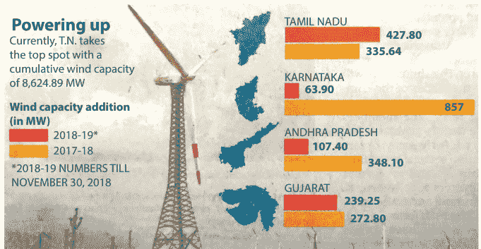

图4.1 WECS调查。


风。这种太阳能是使用 **双面太阳能电池板** 产生的，与传统的电池板相比，它以更高效的方式提供电力 [2]。

### 4.2 双面太阳能电池板研究

双面（即，Bi-facial）太阳能电池板如图 4.2 所示，是太阳能发电最有效和高效的来源之一。它们在电池板的正面和背面都有太阳能 PV 电池。这种 PV 布置结构可在小尺寸下产生有效的电力。

这些电池板的一个重要特点是，它们可以安装在小面积内，却能提供两倍于传统电池板的电力。

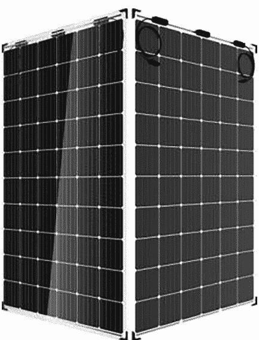

**图 4.2** 双面太阳能电池板。

相比之下，双面电池板的成本高于传统电池板。电池板以类似扰流板的结构安装在机舱顶部，并以等间距的圆形方式安装在塔筒上 [3]。

### 4.3 拟议系统

拟议系统通过使用双面太阳能电池板来改善风能转换系统的发电量。当需要向电池、偏航电机和直流电机供电时，太阳能电池板产生的电力会供给给它们，太阳能电池板产生的所有其他电力通过逆变器输送到电网。锂离子电池用于在白天存储电力，夜间将存储的电力供给给电气元件。与齿轮系统耦合的直流电机由太阳能供电，当风速略低于切入速度时，用于给转子叶片提供启动推力 [4]。

#### 4.3.1 框图

拟议系统的框图表示如图 4.3 所示。白天和夜间箭头标记代表不同时间段的发电和利用 [5]。该系统由太阳能电池板、充电控制器、电池组、偏航电机、直流电机、齿轮箱、转子叶片以及带控制单元的逆变器单元组成。拟议系统的典型工作原理如下：

- 太阳能电池板安装在机舱顶部以及塔筒上，以在白天发电并向 WECS 中的各种电气元件供电。
- 多余的电力通过逆变器送入电网，同时为电池组充电。
- 当风速的切入速度略低于其额定速度时，直流电机开始运行，因此即使在低速下，WECS 也能产生额定功率。
- 夜间，电池组充当电气元件的电源 [6]。

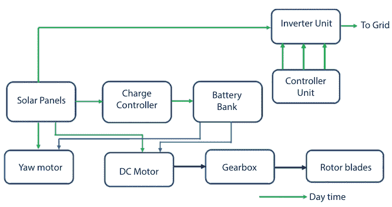

图 4.3 拟议系统的框图。

#### 4.3.2 直流电机机制

直流电机用作旋转元件，当风速的切入速度略低于额定速度时，用于旋转风力涡轮机的转子。由于涡轮机的传动比较大，需要高启动转矩来推动转子叶片以获得动力，因此使用直流串励电机 [7]。

电机安装在齿轮系统中，该系统驱动风力涡轮机的转子。齿轮装置安装在机舱内，电机与其耦合，如图 4.4 所示。

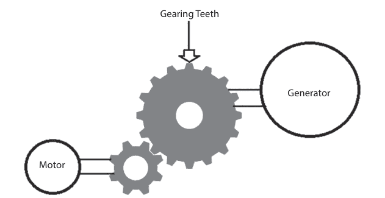

图 4.4 带齿轮装置的直流电机。

当没有足够的风力来产生电力时，涡轮机不旋转；风速的切入速度较低，太阳能电力供给给直流电机以旋转转子。直流电机为涡轮机提供启动推力，使其开始旋转，在较低速度下发电 [8]。

使用直流电机的主要优点是不需要逆变器电路，因此不需要使用交流电机。此外，与交流电机相比，直流串励电机具有高启动转矩。

也可以使用交流感应电机，但使用感应电机时，必须补偿无功功率，否则效率会降低。使用交流电机的另一个缺点是维护问题。

当有足够风力流动且太阳能产生的电力通过逆变器送入电网时，直流电机是理想的选择。在塔筒上使用电池板也能增加太阳能产生的电力。

直流电机的电力供应来自白天的太阳能电池板和夜间的电池组 [9]。

#### 4.3.3 电池组

当没有阳光时，锂离子电池用作备用电源。由于其自放电率较低，锂离子电池效率很高。取多块电池并连接起来形成电池堆。然后将电池组放置在机舱内 [10]。

#### 4.3.4 使用物联网进行系统管理

物联网（Internet of Things, IoT）一词通常指网络连接和计算能力扩展到对象、传感器以及通常不由计算机测量的日常物品的情况，使这些设备能够在最少人工干预的情况下生成、交换和消耗数据。然而，没有单一的通用定义。然而，几种技术市场趋势的近期融合正使物联网更接近于普及现实。这包括普遍连接、基于 IP 的网络广泛采用、计算经济性、微型化、数据分析进步以及云计算的兴起。

已建立基于物联网的网络，以增强拟议 WECS 中的以下功能：

- 1. 监控电池管理系统
- 2. 启动 WECS、电池组、太阳能电池板和电网系统之间的自动化流程
- 3. 监控风力涡轮机、太阳能电池板和电池管理系统中的故障发生

故障被定义为系统完成功能的能力丧失。当风力涡轮机内部发生故障（例如速度、温度、电压、电流或振动异常）时，需要一个独立系统进行后续处理。它记录故障的后果，并根据故障类型做出响应。为了避免安全隐患或主要系统故障，必须停机。通常，由于系统内部的噪声导致错误的故障检测，它们会被重新启动，因此这些故障不被视为关键问题。如果故障严重，必须进行说明性检查，可由操作人员或授权人员执行。最后，每当发生重大故障时，会记录一份报告。高速和低速轴故障是风力涡轮机中最常见的故障。大多数情况下，风力涡轮机的故障可以通过电流测量检测出来 [11]。

同样，物联网系统将监控安装在 WECS 机舱和塔筒上的太阳能电池板的性能。监控系统提供大量关于太阳能系统性能和运行的数据。传感器有助于监控外部条件，例如：

- 风速
- 太阳辐照度
- 温度
- 电池温度

它们还有助于测量周围元件的参数：

- 串电压
- 逆变器性能
- 能量生产
- 系统输出（交流电能）
- 电池电压水平以确定电池健康状况

电池的充放电速率受到监控，用户可以随时通过物联网跟踪该信息。电池的充电速率会发送给用户，以跟踪电池是否正在充电。电池的放电速率也受到监控，以便用户可以了解电池中剩余的电量。放电速率通过 WECS 中各种电气元件（即，直流电机、偏航电机）所消耗的电力进行监控。

同样，在白天电池由太阳能供电时，可以监控电池的充电速率。了解这些细节后，用户可以有效利用电池中可用的电量。这些信息可以通过短信发送给用户。

物联网通过适当的硬件接口将无线传感器连接到互联网，将大量数据传输给远程操作人员。因此，在考虑所有显示参数和条件后，可以通过互联网向微处理器商定一个适当的控制机制，以按照我们希望的方式管理所有设备 [12]。

物联网在并网 WECS 中发挥着重要作用。它通过启用传感器使 WECS 更智能。在拟议系统中，太阳能电池板产生的多余电力被输出到电网。该过程已由基于物联网的自动化系统进行监控和调节。

#### 4.3.5 拟议系统结构

- 1. 风叶
- 2. 机舱
- 3. 齿轮
- 4. 发电机
- 5. 扰流板设计
- 6. 双面太阳能电池板
- 7. 电池组
- 8. 偏航系统
- 9. 塔筒
- 10. 支撑件
- 11. 太阳能电池板
- 12. 旋转电机

图 4.5 表示拟议系统的图示结构。它由拟议系统中使用的组件组成。

拟议系统的工作原理是将太阳能和风能结合起来。太阳能电池板以类似扰流板的方式安装在机舱顶部


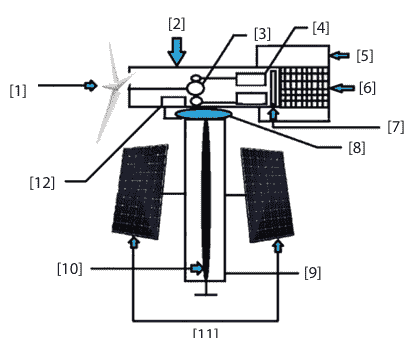

图 4.5 拟议系统的结构。

设计，并且也安装在风力涡轮机的塔架上。产生的太阳能通过逆变器并入电网，还用于为风力涡轮机中的直流电机和旋转电机供电 [13]。

#### 4.3.6 挡板设计

如图 4.6 所示，挡板结构用于减少落在安装于机舱顶部的面板上的气流。该结构布置于机舱内，以减轻落在机舱上的重量。该结构主要用于支撑空气动力学。

图 4.7 显示了安装在机舱顶部的挡板结构内部的太阳能板布置。当有足够的风流动使转子旋转时，太阳能被存储并通过逆变器直接送入电网。当没有风流动时，太阳能送至直流电机 [14]。直流电机安装在齿轮系统中并旋转风力涡轮机的转子。锂离子电池在夜间及太阳能不占主导时为直流电机供电。偏航系统的旋转电机也由太阳能供电，并根据风向旋转。通过此技术，风能发电量将增加，系统的整体效率将提高 [15]。

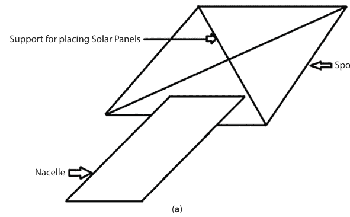


图 4.6 (a) 挡板结构示意图，(b) 挡板设计结构。

#### 4.3.7 拟议系统的工作原理

拟议系统的工作基于太阳能和风能的结合。双面太阳能板以类似挡板的设计安装在机舱顶部，并也安装在风力涡轮机的塔架上。

产生的太阳能通过逆变器送入电网，也用于为风力涡轮机中的直流电机和旋转电机供电 [16]。

当有足够的风流动使转子旋转时，太阳能被存储并通过逆变器直接送入电网；当风速低于正常水平时，太阳能送至直流电机。


图 4.7 挡板结构中双面太阳能板的快照。

偏航系统的旋转电机也由太阳能供电，并根据风向旋转。通过此技术，风能发电量将增加，系统的整体效率将提高。

#### 4.3.8 设计与分析

| 参数 | 额定值 |
|---|---|
| 太阳能板 | 60 Watts |
| 直流电机 | 12V, 9600rpm |
| 偏航电机 | 12V, 9600rpm |
| 电池 | 22V, 15600mAh |
| 发电机 | 20 Watts |

### 4.4 可再生能源中物联网的应用

互联网是一个巨大的跨洲际网络网络。现代节点是物联网（IoT）。该技术在许多行业中广泛应用，因为它可以从任何地方访问。用户可以远程享受这些事物的服务。主要优势是可以通过互联网远程控制。同样，物联网（IoT）在可再生能源管理中发挥着至关重要的作用。拟议系统的实验装置如图 4.8 所示。


图 4.8 拟议系统的实验装置。

#### 4.4.1 使用物联网的风力涡轮机可靠性

为了对风力发电场进行实时监控并无线收集数据，阵列中的每台涡轮机都可以配备自己的物联网设备。这些物联网平台将有助于确定风力涡轮机的功率输出模型，称为功率曲线。它还将有助于预测风力涡轮机中使用的电池的寿命。借助物联网，可以采用各种应用，例如定期确定偏航角和俯仰角。

风力涡轮机的可靠性支持如此重要的电源的可持续运行。这要求对风力涡轮机状况进行实时监控系统，以尽可能减少人工干预。物联网为提供风力涡轮机传感器和执行器的在线监控系统及操作控制提供了一个有前景的解决方案。

#### 4.4.2 使用物联网进行风能资源选址

物联网在选择安装风力涡轮机的最合适位置方面发挥着重要作用。气象传感器将响应实时天气条件，并旨在监测特定的环境参数，例如风速、风向和环境方向。

对风力涡轮机而言，最重要的是风速，它负责发电。因此，如图 4.10 和 4.11 所示，可以分别预测风速和月平均风速。

可以通过传感器监测风力涡轮机，以跟踪从风中提取的气流和机械功率。对于传感器，应考虑高度、位置、精度、持续时间、质量和数量等因素，如图 4.9 中物联网功能的形式所示。此外，更好的物联网性能取决于可信和识别的测量，包括数据采样、记录、处理、恢复、质量、数量和格式，所有这些都应予以考虑。我们已使用物联网执行这些步骤，以在计划内保持可靠性能。随着传感器技术的进步，它变得

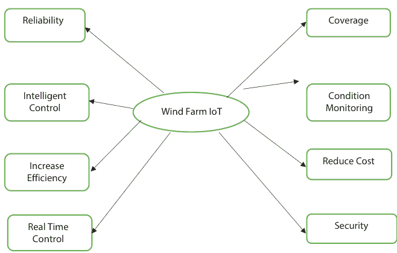

图 4.9 物联网功能。

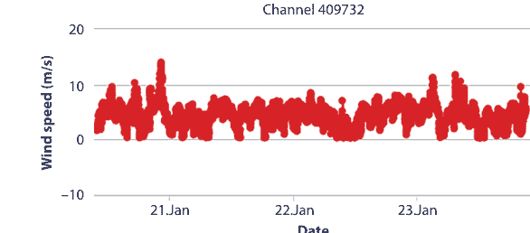

图 4.10 使用物联网的风速。

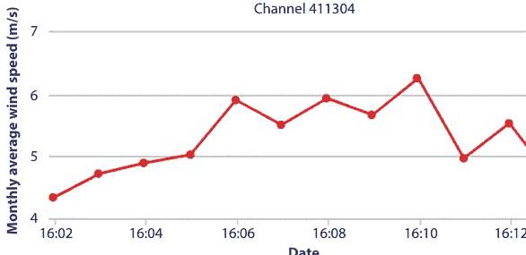

图 4.11 使用物联网的月平均风速。

成为可能，以监测风力发电场上的风力涡轮机，确保气流和机械功率最大化 [17]。

湍流强度（TI）指标是风力涡轮机选址的一个非常重要的因素。TI 用平均风速对风速标准差进行归一化。因此，强度在计算风速中起着主要作用。

#### 4.4.3 可再生能源在医疗行业的应用

研究表明，医院在建筑领域能源消耗中的占比约为 6%。医院和诊所拥有多种设施，为供暖、制冷和热水制备等提供所需能源。这体现了医院的能源平衡。降低医院能源消耗在实现绿色医院的目标中变得重要。各种解决方案，包括供暖、通风和

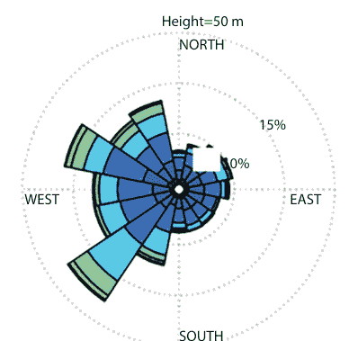

图 4.12 风玫瑰。

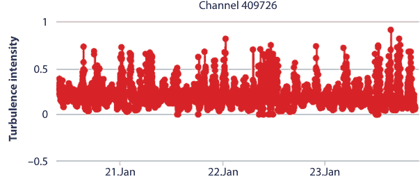

图 4.13 使用物联网的湍流强度。

空调（HVAC）系统的定期维护，使用隔热材料，应用含水层系统，以及改进空调系统等，都被采用以降低医院的能源消耗，并以如图 4.12 所示的风玫瑰和如图 4.13 所示的湍流强度形式呈现 [18]。

#### 4.4.4 使用深度学习进行数据分析

必须将上述拟议系统产生的电力与传统系统进行比较。这一过程对于理解拟议模型的重要性、其准确性及其优缺点是必要的。为了找出这些参数，我们使用深度学习技术，这些技术

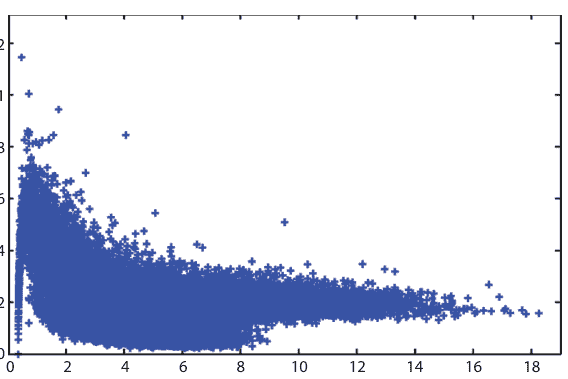

图 4.14 湍流强度与风速（m/s）对比。

提供了更轻松、更方便的数据收集方式。深度学习广泛应用于医疗和电气等各个领域来分析数据。电气设备可以发电或产生电力，但电网中的负载管理可以使用面向计算机的方法和技术来管理。深度学习神经网络在该领域发挥着至关重要的作用。得益于这项技术，可再生能源的概念得以实现 [19]。

为了分析数据，我们在深度学习神经网络中拥有各种计算方法，可以从生成的数据中学习并对未来进行预测。我们将比较两种深度学习技术，以获得更好的性能算法来预测结果。

如图 4.15 所示，将采用梯度提升和 XG Boost 技术来完成此任务。

- **步骤 1：数据预处理：** 此步骤包括从拟议模型收集数据。数据将以 1 小时为分段收集。数据可能包括风力、湍流强度（如图 4.14 所示）等。
- **步骤 2：交叉验证：** 收集数据后，深度学习算法将创建一个模型。构建模型后，我们需要从模型中选择最佳超参数值。在此方向上，我们将把第一个分段的数据分为三部分：训练集、验证集和测试集。
- **步骤 3：** 对每个分段应用步骤 1 和步骤 2。
- **步骤 4：子集选择：** 步骤 3 之后，我们需要从模型中选择最合适的子集。


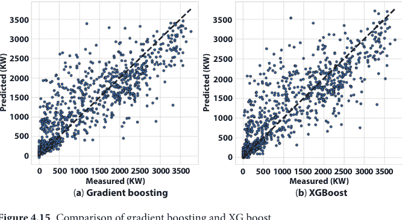

### 4.5 结论

风能与太阳能的结合将有效地产生能量并提高系统效率。这一概念能够实现持续发电，并有效利用可再生能源，确保绿色能源。该系统也适用于持续可靠的电力供应。所提系统的主要目标是提高 WECS 产生电力的完全利用率，并推广绿色能源的使用。在使用深度学习比较技术后，我们可以找出哪种方法最适合分析所提模型产生的电力。

### References

- 1. Abhishek Kumar & Jyotir Moy Chatterjee & Pramod Singh Rathore, 2020. “智能手机对抗性应用与安全问题，” 国际风险与应急管理杂志 (IJRCM)，IGI Global，vol. 9(2)，pages 1-18，4月。
- 2. Bhargava, N., Bhargava, R., Rathore, P. S., & Kumar, A. (2020). 使用回归挖掘算法利用加博滤波器提取特征向量的纹理识别。国际风险与应急管理杂志 (IJRCM)，9(3)，31-44。doi:10.4018/IJRCM.2020070103。
- 3. Binayak Bhandari (2016) ‘混合可再生能源电力系统优化’，国际精密工程及其应用期刊 Vol.17, No.6。
- 4. Gwani, Muzamil and Taheri (2014) ‘城市生态绿色能源混合风光太阳能光伏发电系统及其应用’，国际精密工程与制造期刊 Vol.16, No.5。
- 5. Hughelett and Mike (2019) ‘明尼苏达州风光混合项目或成为可再生能源新领域’，星论坛报，原始内容存档于 Vol.2, No.9。
- 6. Jossi and Frank (2019) ‘风光互补在削减设备成本的同时提升产出可再生能源网络’，能源新闻网。原始内容存档于 Vol.18, No.19。
- 7. Kumar, A., Chatterjee, J. M., & Díaz, V. G. (2020). 一种用于电子邮件网络钓鱼的 SVM 结合 NLP 和概率神经网络的新型混合方法。国际电气与计算机工程期刊，10(1)，486。
- 8. N. Bhargava, A. Kumar Sharma, A. Kumar and P. S. Rathoe, “一种边缘保持去噪的自适应方法，” 2017 第 2 届通信与电子系统国际会议 (ICCES)，科伊姆巴托尔，2017，pp. 600-604，doi: 10.1109/CESYS.2017.8321149。
- 9. N. Bhargava, S. Dayma, A. Kumar and P. Singh, “一种在 WEKA 中使用简单 CART 算法进行分类的方法，” 2017 第 11 届智能系统与控制国际会议 (ISCO)，科伊姆巴托尔，2017，pp. 212-216，doi: 10.1109/ISCO.2017.7855983。
- 10. Naveen Kumar, Prakarti Triwedi, Pramod Singh Rathore, “一种使用椭圆曲线密码学 (ECC) 进行图像自适应水印的自适应方法，” 第一届信息技术与知识管理国际会议 pp. 89–92，ISSN 2300-5963 ACSIS，Vol. 14 DOI: 10.15439/2018KM19。
- 11. Palash Jain (2016) ‘小型垂直轴风力涡轮机变幅度叶片变距的性能预测与基础理解’，可再生能源 Vol.9, No.7。
- 12. Perlin John (2017) ’来自地球：太阳能电力空间的故事’，在冒险技术研究国际期刊，Vol.5. No.5。
- 13. Rathore, P.S., Chatterjee, J.M., Kumar, A. et al. 基于中继方法的 WSN 节能簇头选择。超级计算机期刊 (2021)。https://doi.org/10.1007/s11227-020-03593-4。
- 14. Siavash Taghipour Broujeni (2013) ‘最大功率提取和输出电压调节的混合 PV/风力发电系统控制’，伊朗德黑兰阿米尔卡比尔科技大学 Vol.4, No.5。
- 15. Singh Rathore, P., Kumar, A., & Gracia-Diaz, V. (2020). 利用蜻蜓算法改进簇头选择的 RFID 网络寿命提升整体方法论。交互多媒体与人工智能国际期刊，6 (Regular Issue)，8。http://doi.org/10.9781/ijimai.2020.05.003。
- 16. Sunanda Sinha (2015) ‘基于太阳能光伏微风能混合电力系统的前景’，印度喜马偕尔邦西部喜马拉雅邦，能源转换与管理 Vol.3, No.3。
- 17. Vikas Khare, Nema, Savita and Baredar (2017) ‘双面太阳能-风能混合可再生能源系统’ 综述，冒险技术研究国际期刊，Vol.2, No.5。
- 18. Bhagwat, Ajay & Teli, S. & Gunaki, Pradeep & Majali, Vijay. (2015). 供暖、通风与空调 (HVAC) 节能技术综述论文。科学与工程研究国际期刊 6。
- 19. Shaikh, Mohd Rizwan & Shaikh, Sirajuddin & Waghmare, Santosh & Labade, Suvarna & Tekale, Anil. (2017). 太阳能发电综述论文。应用科学与工程技术研究国际期刊。887 f10.22214/ijraset.2017.9272。

## 5. 广域监控系统背景拼接模型

Dr. E. Komagal

电子与通信工程系，
拉塔·马塔万工程学院，阿拉加尔科维尔，马杜赖，印度

### 摘要

利用平移/俯仰/变焦 (PTZ) 摄像机可以扩大被监控区域的视野，但需要采用更高效的计算成本方法来检测运动。大多数基于特征的技术会导致显著的冗余，特征对应的帧间隔较大，且对应特征点稀缺。为克服特征问题，提出了一种基于深度学习 SURF 特征的拼贴背景模型。拼贴是将同一场景的多幅重叠图像组合成更大的宽幅场景图像的方法，从而克服上述问题。在实时监控中，一个主要问题是视野完全太小以无法捕捉目标，或者视野较大但分辨率低。提出了一种能够处理上述所有问题的方法，包括数量和质量特征提取的管理。在本文中，使用加速稳健特征 (SURF) 来构建用于深度学习鲁棒分割的拼贴背景模型。所提算法能够检测和表示前景对象，并且与基于尺度不变特征变换 (SIFT) 的拼贴前景分割相比，还能有效处理大变焦效果。

关键词: PTZ, 拼贴, SURF, 视频监控, 特征提取

### 5.1 引言

视频监控是一个非常活跃的计算机视觉研究领域，视频监控系统的主要任务包括运动检测、对象分类、跟踪、活动理解和行为分析 [1]。视觉场景的全景表示具有广泛的应用范围，包括虚拟现实 (VR)、交互式 2D/3D 视频、视频会议、基于内容的视频压缩与处理以及全景视频监控。广视野 (FOV) 镜头（例如鱼眼镜头）是获得全景视图的一种解决方案。然而，除了这些专门设计的图像传感器成本高昂之外，此类传感器获得的图像存在明显的畸变，并且将整个场景映射到标准视频摄像机的有限传感器目标上分辨率较低。通过拼接 PTZ (平移、俯仰和变焦) 摄像机捕获的图像序列来构建全景表示，满足了上述应用对高分辨率图像的要求。最近，传感器技术的发展导致一种特定类型的移动摄像机（如平移-俯仰-变焦 (PTZ) 摄像机）的使用日益广泛，这类摄像机可以通过平移、俯仰和变焦（即向左和向右、向上和向下、以及更近和更远）动态修改视野。然而，目前很少有算法和系统能够正确检测和表示前景对象，并有效处理大变焦效果。这一问题仍然存在，对于进一步分析视频非常重要。我们有多种深度学习方法可以进行分析并为我们找到合适且理想的结果。这激励了本文所述的工作。

本文的组织结构如下。下一节介绍相关工作。第 5.3 节解释了整体方法。第 5.4 节介绍了结果与讨论、结论以及未来工作。

### 5.2 相关工作

许多研究者已尝试扩展基于 PTZ 摄像机应用的静态背景建模方法。所提出的方法利用连续帧之间重叠区域的信息来生成背景。这种逐帧方法的局限性在于，它在长序列中可能会累积错误，并且无法放大以获得目标的高质量视图。其他一些方法使用全景或全景金字塔进行背景减法。然而，这种方法


无法为前景检测提供强健的背景，因为全景图包含移动物体，会导致误检测 [2]。

基于背景中心区域的及时替换算法和摄像机旋转控制策略，可实现动态背景下的目标检测与跟踪。待跟踪目标位于预先设定的视场内。目前，该方法仅能实现单目标的检测与跟踪，这是本文的主要缺点。多层对应传播方法可将观测帧注册到全景背景中并获取对应背景，即使PTZ摄像机的缩放值（scale）变化很大。利用对应背景，可检测前景物体。背景注册方法基于相关相位、块匹配、背景运动补偿等。尽管这些算法能够实现动态环境下的目标检测与跟踪，但由于需要跟踪大量计算且实时处理速度较慢，背景匹配算法更为复杂 [3]。

基于现有特征的方法通常对序列图像进行滤波以提取特征点，并尝试在一组点之间寻找匹配。随后，将获得图像的拼接。拼接的性能非常依赖相应校正 [4]。为提高相应校正率，特征点逐帧跟踪。另一方面，视频帧通常为每秒30帧，长序列包含大量冗余。因此，为满足整个系统的实时性约束，作为第一步，需要一些措施来识别关键帧，这些关键帧包含后续拼接所需的足够有效信息。为克服传统方法中存在的问题，提出了一种使用SURF特征的广域监控背景拼接模型。本文的目标是为基于PTZ摄像机的监控系统提出一个有效的背景模型，该模型构建拼接，并能在大缩放区域中正确检测和表示前景物体。所提方法在医疗保健和公共场所监控等工作场所表现良好。

### 5.3 方法论

本文的主要目标是为基于PTZ摄像机的监控系统提出一个有效的背景模型，该模型执行特征提取，随后进行拼接构建和前景分割。图5.1展示了方法论概览。

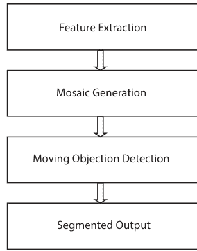

图5.1 提出的方法论。

输入视频被转换为一系列帧。随后，使用SURF（Speeded Up Robust Features）提取特征。第一帧作为参考帧，其特征点与紧随其后的下一帧中的点进行比较。如果两帧的特征点匹配，则将其与下一帧连续帧进行比较。逐帧跟踪这N个特征点，直至出现不匹配 [5]。然后，将当前帧作为关键帧。从参考帧到关键帧的帧将被拼接为一帧（更新后的参考帧），该帧包含中间所有帧（可选关键帧）的所有关键信息。因此，关键帧作为新的参考图像进行更新，并在其上选择N个特征点 [6]。最后，背景拼接构建模型用于前景分割。方法论详情如下。

#### 5.3.1 特征提取

深度学习拥有丰富的算法和技术库，可帮助进行特征提取。基于PTZ摄像机的视频用于运动分割。视频格式（如.avi文件）被转换为帧 [7]。这些帧作为输入提供给深度学习算法，然后所有转换后的帧作为输入数据用于特征提取。所有转换后的帧都用于SURF特征提取。SURF（Speeded-Up Robust Features）特征基于探测器-描述子方案。探测器基于海森矩阵，并使用一种与DoG非常相似的基本近似方法，后者是一种基于拉普拉斯的探测器。‘快速海森’探测器依赖积分图来减少计算时间。描述子还描述了感兴趣点邻域内Haar小波响应的分布 [8]。同样，利用积分图来提高速度。此外，仅使用64个维度，同时减少特征计算时间并提高鲁棒性。基于拉普拉斯符号的新索引步骤增强了描述子的强度。积分图的概念允许更快地实现盒式卷积滤波器 [9]。积分帧（I\(_\Sigma\) (x)）在特定位置（x = (x, y)）处的条目表示输入图像（I）中由点（x）和原点形成的矩形区域内所有像素的总和，如方程（5.1）所示，

```
I\(_\Sigma\)(X) = \(\sum_{i=0}^{i \le x} \sum_{j=0}^{j=y} I(i, j)\) (5.1)
```

计算I\(_\Sigma\)后，只需四次加法即可确定任何正立矩形区域（无论其大小）内强度之和。提取的特征用于构建拼接背景模型 [10]。

#### 5.3.2 基于拼接的背景深度学习模型

拼接包含四个步骤：

- 1. 首先，在视频的初始帧上检测N个特征点，并将此帧设为参考帧
- 2. 然后，使用SURF算法逐帧跟踪这N个特征点，直至条件1被打破，并将当前帧设为拼接的关键帧
- 3. 接下来，将参考图像、关键图像及其对应特征点发送到质量特征点管理模块，以根据条件2获得最准确的拼接 [11]
- 4. 最后，将关键帧更新为新的参考帧，并在其上重新选择N个特征点

本文的目标是提出一种基于拼接的背景模型，用于鲁棒特征点的数量管理。在此，监控系统的速度和性能将得到提升 [12]。

- 1. 在视频的初始帧（F1）上提取N个特征点。
- 2. 逐帧跟踪这N个特征点，直到匹配M个特征点且当前帧为F2。M是重新选择新特征点的阈值。
- 3. 一旦到达F2，确定F1和F2为关键帧，它们包含足够的信息，包括序列F1~F2。
- 4. 使用这两个关键帧F1和F2及其匹配特征点（M），可获得拼接构建的变换矩阵 [13]。

在本文中，特征点根据梯度值确定。同时，为确保构建的准确性，输入F1、F2及其特征点（M）将接受后文所述的质量管理。此外，考虑到如果视频中出现一些强特征点，并且在许多帧中几乎都匹配得很好，那么步骤2很难达到，因此F2和F1之间的间隔会非常大。为确保关键帧保留足够信息，为帧间隔设定一个上限（H）。如果两个关键帧之间的帧间隔大于H，则选择这两帧作为关键帧。在此，提出了一种在不同情况下识别上限（H）的一般思路 [14]。如果视频帧通常为每秒30帧，那么这个长序列包含大量冗余。如图5.2所示构建的拼接背景模型，已在MICC数据集（每秒50帧的视频帧）上实现。MICC数据集的拼接视图如图5.2所示。

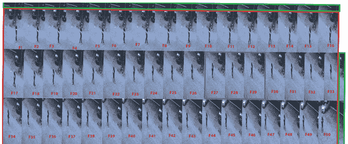

图5.2 MICC数据集背景拼接模型。

帧序列的每帧都有从SURF生成的特征点，当序列发生变化时，应自动


针对马赛克背景进行了更新。图 5.2 说明了如何为 50 帧生成马赛克，并指示红色为必要帧，绿色为丢失区域，蓝色为重叠区域 [15]。

两个关键帧之间的重叠区域应保留该场景的足够信息；同时，丢失的信息必须小于一个限制。方程 (5.2)、(5.3)、(5.4)、(5.5) 和 (5.6) 用于定义条件。

重叠区域 > \(P_{overlap}\) (5.2)

丢失区域 < \(P_{lost}\) (5.3)

重叠是用于确保两个关键帧的重叠区域足够大的阈值 [16]。该参数通常设置为 30%。同时，丢失的信息不应过大以显著影响最终马赛克。因此，另一个参数 Plots 也非常有用。该阈值 Plots 通常设置为 10%。其中 W 是像素总数 [17]，

重叠区域 = \(\frac{Area (A \cap C)}{Area (oneframe)}\) (5.4)

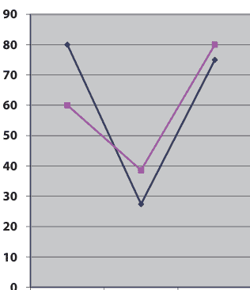

图 5.3 马赛克特征对比。

丢失区域 = \(\frac{Area (A \cup B_1 \cup B_n \cup C)-Area(A \cup C)}{Area (oneframe)}\) (5.5)

差异 (X, Y) = \(\frac{1}{W} \sum \|X - Y\|^2\) (5.6)

#### 5.3.3 前景分割

如图 5.3 所示构建的马赛克背景模型被输入到前景分割中。确定用于查找前景和背景的固定阈值。如果阈值高于关键帧，则为前景，否则为背景 [18]。

### 5.4 结果与讨论

对使用 PTZ 摄像机拍摄的图像序列进行前景分割的实验，使用 MATLAB® 2016 软件在数据集上，
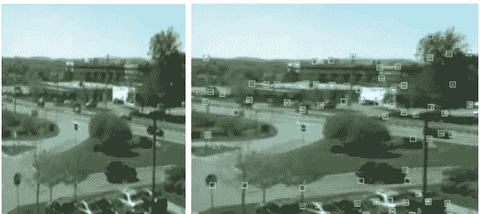
图 5.4 (a) VIP 数据集上的输入帧 220，(b) 提取的 SURF 特征，(c) 马赛克背景建模，(d) 前景分割。

例如 MICC 和 VIP 视频，通过应用深度学习技术。示例帧显示在图 5.4 (a-d) 和图 5.5 (a-d) 中。输入视频用于通过 SURF 进行特征提取，如图 5.4 (a-d) 和图 5.5 (a-d) 所示，并说明了强健的特征 [19]。将第一帧作为参考帧，并与每个连续帧进行比较。使用 SURF 算法逐帧跟踪这些 N 个特征点，直到特征点不匹配。然后，将当前帧设置为用于马赛克的关键帧，将关键帧更新为新的参考图像，并在其上选择 N 个特征点。最后，如图 5.4 和 5.5 所示，生成背景马赛克构建。此外，背景马赛克用于基于区域的分割，并取得了更准确的结果，如图 5.4 和 5.5 所示。与传统的 SIFT 特征等方法相比，SURF 将具有用于运动分割的快速和强健特征。针对数据集的性能测量证明，基于 SURF 的马赛克背景建模具有快速和准确的注册结果，如图 5.5 所示。


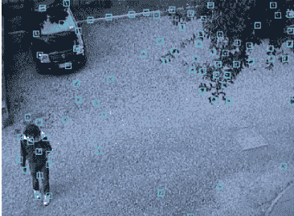

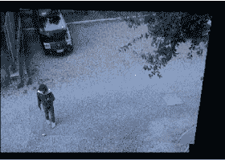

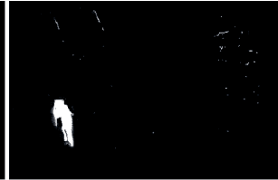

图 5.5 (a) MICC 数据集上的输入帧 220，(b) 提取的 SURF 特征，(c) 马赛克背景建模，(d) 前景分割。

### 5.5 结论

本文提出并解决了帧序列中移动物体检测的问题。使用 PTZ 摄像机时，对象分割是基于深度学习分割方法的背景马赛克模型完成的，然后使用前景提取技术。从提取的特征点来看，借助基于 SURF 特征的背景马赛克模型算法，提高了分割的准确性。该方法的优点众多，因此该方法被用于各种需要跟踪和分类的监控应用中。在未来的工作中，将测试条件更苛刻的复杂视频场景。尝试检测部分或完全遮挡的人并不容易，但使用像 SURF 这样快速且具有区分度的描述符可以解决该问题。

### 参考文献

- 1. Abhishek Kumar & Jyotir Moy Chatterjee & Pramod Singh Rathore, 2020. “智能手机对抗应用程序与安全问题，” International Journal of Risk and Contingency Management (IJRCM), IGI Global, vol. 9(2), pages 1–18, April.
- 2. Alessio Ferone 和 Lucia Maddalena，“Pan-Tilt-Zoom 摄像机的神经背景减法”，IEEE Transactions on Systems, Man, and Cybernetics: Systems。
- 3. Bhargava, N., Bhargava, R., Rathore, P. S., & Kumar, A. (2020). 使用回归挖掘算法通过 Gabor 滤波器提取特征向量的纹理识别。International Journal of Risk and Contingency Management (IJRCM), 9(3), 31-44. doi:10.4018/IJRCM.2020070103。
- 4. Christopher Broaddus, Changjiang Yang, Shunguang Wu, Tao Zhao 和 Manoj Aggarwal，“使用元数据和/或帧间对应关系进行 PTZ 摄像机的强健平移、倾斜和变焦估计”，Control, Automation, Robotics and Vision, 2006。
- 5. J. Lu, F. L. Li, M. Jiang，“使用移动摄像机检测和跟踪移动目标”，哈尔滨工程大学学报, 29(8), pp. 831-835, 2008 年 8 月。
- 6. Jing Li, Quan Pan, Stan. Z. Li, Tao Yang，“视频马赛克构建的自动特征点管理”，World Academy of Science, Engineering and Technology International Journal of Computer, Information, Systems and Control Engineering Vol:1 No:2, 2007。
- 7. Kang Xue, Gbolabo Ogunmakin, Yue Liu, Patricio A. Vela, Yongtian Wang，“基于 PTZ 摄像机的自适应全景和多层背景模型”，2011 年第 18 届 IEEE 国际图像处理会议。
- 8. Kumar, A., Chatterjee, J. M., & Diaz, V. G. (2020). 一种用于电子邮件钓鱼的结合 NLP 和概率神经网络的 SVM 新型混合方法。International Journal of Electrical and Computer Engineering, 10(1), 486。
- 9. Maddalena 和 A. Petrosino，“面向视觉监控应用的自组织背景减法方法”，IEEE Trans.Image Process., vol. 17, no. 7, pp. 1168–1177, 2008 年 7 月。
- 10. N. Bhargava, S. Dayma, A. Kumar 和 P. Singh，“在 WEKA 中使用简单 CART 算法的分类方法”，2017 年第 11 届智能系统与控制国际会议 (ISCO), Coimbatore, 2017, pp. 212-216, doi: 10.1109/ISCO.2017.7855983。
- 11. Naveen Kumar, Prakarti Triwedi, Pramod Singh Rathore，“使用椭圆曲线加密 (ECC) 进行图像自适应水印的自适应方法”，First International Conference on Information Technology and Knowledge Management pp. 89–92, ISSN 2300-5963 ACSIS, Vol. 14 DOI: 10.15439/2018KM19。
- 12. Rathore P S, Kumar A“边缘保留去噪的自适应方法”，International Conference on Communication and Electronics Systems, Institute of Electrical and Electronics Engineers and PPG Institute of Technology. (2017). Proceedings of the 2nd International Conference on Communication and Electronics Systems (ICCES 2017): 19-20, 2017 年 10 月。
- 13. Rathore, P.S., Chatterjee, J.M., Kumar, A. 等. 通过中继方式为 WSN 选择节能簇头。J Supercomput (2021). https://doi.org/10.1007/s11227-020-03593-4。
- 14. Singh Rathore, P., Kumar, A., & Gracia-Diaz, V. (2020). 使用蜻蜓算法进行高级簇头选择以改善 RFID 网络寿命的整体方法。International Journal Of Interactive Multimedia And Artificial Intelligence, 6 (Regular Issue), 8. http://doi.org/10.9781/ijimai.2020.05.003。
- 15. Sudipta N. Sinha 和 Marc Pollefeys，“Pan-tilt-zoom 摄像机标定和高分辨率马赛克生成”，Computer Vision and Image Understanding, vol. 103, pp. 170–183, 2006。
- 16. X. C. Zhou, D. W. Tu, Y. Chen, Q. J. Zhao, Y. C. Zhang，“基于相关相位和差分乘法的动态背景下移动物体检测”，Chinese Journal of Scientific Instrument, 31(5), pp. 980-983, 2010 年 5 月。
- 17. Xinghua Li, Qinglei Chen, Haiyang Chen，“基于 PTZ 摄像机的移动物体检测与跟踪”，2012 IEEE 第五届先进计算智能国际会议 (ICACI) 2012 年 10 月 18-20 日, 中国江苏南京。


- 18. Y. Xiong, K. Turkowski, 使用自校准鱼眼镜头创建基于图像的VR，IEEE计算机视觉与模式识别会议论文集，华盛顿，1997年6月，第237–243页。

- 19. Z. H. Yang, Y. C. Zeng, “背景移动补偿技术研究”，北京理工大学学报，20(3)，第333-337页，2000年6月.

## 6. 使用三种不同分类器预测CKD第1期

Thamizharasan, K.*, Yamini, P., Shimola, A. and Sudha, S.

生物医学工程系，拉贾拉克什米工程学院，钦奈，印度

### 摘要

慢性肾脏病在一段时间内表现为肾功能缓慢且周期性的丧失，如果不治疗，将发展为永久性肾衰竭。本文旨在展示使用深度学习预测慢性肾脏病的方法。训练使用了约400名患者的16个属性。三种深度学习技术（随机森林、支持向量机和朴素贝叶斯分类器）有助于预测疾病分期。对这三种分类器进行了比较分析。结果表明，随机森林分类器的准确率约为96.25%，错误率为0.03。第1期的预测通常具有挑战性，但随机森林分类器帮助以75%的准确率预测了该疾病的第1期，使其成为最有效的分类器。这种分类有助于疾病的早期预测，并避免患者未来的健康后果。因此，它将在降低患者死亡率方面发挥重要作用。

**关键词**：慢性肾脏病，深度学习，支持向量机，随机森林，朴素贝叶斯分类器

### 6.1 引言

慢性肾脏病（CKD）是一种在一段时间内逐渐丧失肾功能的状况。2019年，美国肾脏基金会将CKD列为第9大死亡原因[1]。人口增长和不健康的习惯性行为导致了肾脏疾病的发展。特别是在发展中国家，肾脏疾病病例数量预计的急剧上升将对社会经济状况产生深远影响。肾脏疾病被认为是21世纪的一项医学挑战。尽管存在大量流行性肾脏问题，CKD被广泛认为是这个时代日益严重的威胁。作为本世纪的长期疾病，CKD根据患者的肾小球滤过率（GFR）和血肌酐水平分为五个阶段。其中最危险的是CKD的第五阶段，此时患者的GFR值低于每1.73平方米15毫升/分钟[2]。

近期里程碑研究声称，CKD的第五阶段最终会发展为终末期肾病，导致最终的肾功能失衡。除非病情不可逆转，否则早期发现CKD分期是阻止病情发展的唯一方法。尽管许多研究人员致力于预测CKD的各阶段，但CKD第一阶段的预测仍然难以预料。由于这种慢性病第一阶段相关的GFR值为每1.73平方米90毫升/分钟，接近健康人的正常GFR值，因此该阶段的预测一直是一个艰巨的挑战[3]。

众多分析师和研究人员长期单调地工作以预测CKD分期。深度学习算法已被用于预测患者中CKD的存在。在这项工作中，他们使用了六种不同的深度学习算法：朴素贝叶斯、序列最小优化（SMO）、简单逻辑（SLG）、径向基函数（RBF）、多层感知器分类器（MLPC）和随机森林（RF）分类器。所得结果表明，RF分类器在ROC曲线下面积（AUC）、精确度和MCC方面优于其他分类器，值为1.0。

其他研究中提出的另一种方法是一种用于预测CKD导致肾衰竭概率的多用途神经模糊推理框架（ANFIS）。GFR值由Takagi-Sugeno型ANFIS模型预测。该模型以95%的准确率精确预测了GFR，但当关键属性更新时，结果会出现波动[4]。

使用深度学习算法开发了一个分类模型，本研究的主要目的是预测患者是否有CKD风险。使用了包含24个字段、具有数值和标称参数的数据集。数值字段包括年龄、血压、性别等参数。标称字段包括糖尿病、高血压等。该过程使用了六种分类算法，包括使用RBF内核的支持向量机、使用线性内核的支持向量机、自适应增强（AdaBoost）、随机森林分类器、决策树和逻辑回归。其中，使用线性内核的SVM效果最好，准确率为98%，并在对整个数据集进行聚类后获得了0.62的纯度得分。这项工作开发了一个准确预测患者中CKD存在的模型[5]。

尽管SVM分类器给出了98%的准确率，但进一步研究在CKD预测中证明了更好的结果。本研究使用UCI深度学习存储库的数据来验证深度学习算法的不同分类器。随后使用不同分类器对这些数据进行分析，包括支持向量机（SVM）、随机森林（RF）、k近邻（k-NN）、人工神经网络（ANN）和C4.5决策树。本工作中使用了开源WEKA（Waikato知识分析环境）环境。与所有其他分类器相比，RF给出了最高精度和F度量值为1以及100%的准确率，证明它是预测CKD存在的合适分类器[6]。

使用数据挖掘算法对CKD的进展进行预测分析。该研究使用了约24个预测参数和基于规则的分类器，构建了一个预测CKD和非CKD状况的框架。分析表明，基于规则的分类器决策表-朴素贝叶斯（DTNB）研究结果是最准确的ROC曲线下面积（AUC）为99.9%，最低假正率（FP）为1.1%。基于规则研究的这项相对检验的发现可以用于辅助CKD预测。

CKD进展的研究也使用了带有时间抽象（TA）技术的数据挖掘算法。时间抽象主要用于研究患者的重要参数[7]。他们使用了几种数据挖掘技术，包括支持向量机、自适应增强、C4.5以及分类和回归树（CART）。CART与AdaBoost模型的组合在分类器中产生了最精确的值，准确率为66.2%，灵敏度为62%，AUC为71.5%，特异度为70.4%。所有这些发现都使其模型在患者CKD的适当诊断中提供支持。深度学习算法被用于预测患者中CKD的存在。这项工作使用支持向量机和决策树分类器来处理数据。该项目使用了UCI存储库的数据集，并利用14个重要属性进行分析。结果相当精确。决策树算法产生了91.75%的准确率，支持向量机算法产生了96.75%的准确率。尽管SVM产生了更准确的结果，但决策树模型需要更短的时间段。该模型的局限性在于数据强度较弱且存在许多缺失属性[8]。

然而，对疾病预防性诊断的工作将迅速减少CKD治疗所需的发生率和成本。这是通过精确使用数据挖掘算法及其分类器和AI方法来实现的。测试结果表明，ANN、SVM和朴素贝叶斯达到了98.0%的准确率，而k-NN达到了93.9%的精确度[9]。

研究表明，早期检测CKD的预测将显著降低死亡率。使用支持向量机（SVM）、J48和多层感知器（MLP）等深度学习算法，这项工作主要集中在根据准确率和均方根等各种参数，利用2x2混淆矩阵寻找最佳分类算法。结果表明，MLP提供了99.75%的精确准确率。这项工作可以用于预测患者中CKD的存在，但无法帮助预测CKD的早期阶段[10]。

根据估计分析，全球超过两百万患者受到终末期肾病的影响，其特征是肾小球滤过率值低于每1.73平方米15毫升/分钟。CKD不仅是由于肾脏替代治疗（RRT）的需求，而且对人们的健康也是一种负担。在本文中，我们尝试借助深度学习算法预测CKD的早期阶段。由于CKD对全球健康的影响巨大，构建一个能够简化该疾病早期阶段预测的系统至关重要。在这项工作中，我们使用带有16个预测属性的深度学习算法预测了CKD的各阶段[11]。使用的分类器是随机森林分类器、支持向量机分类器和朴素贝叶斯分类器。每个分类器都使用预测值进行了训练和测试，以获得准确率百分比。在我们使用的三种分类器中，与支持向量机和朴素贝叶斯分类器预测的结果相比，随机森林分类器效果最好。借助混淆矩阵，我们成功使用随机森林分类器预测了CKD的各阶段。RF预测CKD各阶段的总体准确率为96.25%，测试错误率为0.03%。这项工作帮助我们根据CKD的各阶段对患者进行分类。我们相信，肾脏疾病各阶段的早期检测肯定将帮助患者避免陷入ESRD，并同样减少由肾脏疾病引起的死亡负担[12]。

### 6.2 材料与方法

慢性肾脏病的分期可以使用深度学习进行预测。一系列计算机用于学习的步骤，


最终，被称为深度学习（ML）。这些算法基于输入系统的数据构建模型；这种数据称为训练数据。根据输入系统的输入类型，深度学习方法大致可分为三类：监督学习、无监督学习和强化学习 [13]。

使用三种提出的分类器对CKD进行了分类，即：随机森林、朴素贝叶斯和支持向量机。图6.1展示了各阶段预测的拟议工作流。工作流中的步骤包括数据集获取、数据预处理以及获得数据的训练和测试。下文将进一步解释这些步骤。

#### A. 数据集获取

我们使用的数据集来自Kaggle深度学习存储库。该数据集包含400名患者的数据，共16个属性，即：年龄、血糖、血压、比重、白蛋白、尿素、肌酐、钠、钾、磷酸盐、血红蛋白、压积
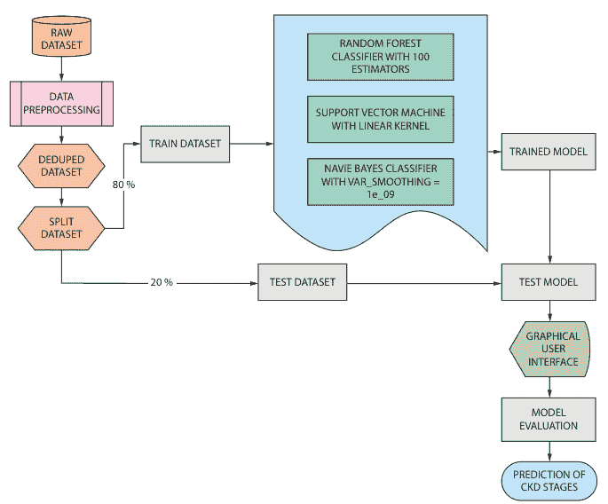
细胞容积、高血压、糖尿病、冠状动脉心脏病、水肿和肾小球滤过率。在这16个属性中，4个属性与其他属性相比显示出更高的相关性，即：高血压、尿素、糖尿病和肌酐。在400名患者中，250名被归类为慢性肾脏病患者，其余150名被归类为无慢性肾脏病的正常患者 [14]。

#### B. 数据预处理

数据集包含一些缺失值或空值，且某些属性（如高血压、冠状动脉疾病（CAD）、糖尿病、水肿和贫血）的值列为YES或NO。这些缺失值被整个属性的平均值替换，且值为YES的 [15]。

#### 数据集训练

使用三种不同的分类器对数据集中的数据进行训练。训练数据集取自清洗后的数据集；400名患者中的80%用于训练模型，即340名患者的数据。这些训练数据进一步拆分为因变量或特征列和预测类。

```
feature columns = ["glucose", "age", "bp", "gravity",
"albumin", "urea", "creatinine", "sod", "pot", "hemo", "pcv",
"htn", "D.mellitus", "cad", "edema", "anemia", "gfr"]
predicted_class = ["ckd_stage"]
```

该模型学习特征列值如何影响慢性肾脏病的阶段

```
X = feature columns, Train
Y = predicted_class, Train
```

#### C. 数据集测试

#### 随机森林分类器

该分类器是使用较为兼容且简便的算法之一。此外，该分类器无需进行适当的调优。它是所有其他算法中常用的算法之一 [16]。这可用于分类和回归。这种分类方法在训练阶段使用多个决策树来生成所需输出，并将其作为每棵树的众数或平均值。它们不受过拟合问题的影响。

#### 决策树

决策树是这种分类器的基本单元。它属于监督学习。通过决策树，可以更好地对值进行分类。每棵树都有一个代表属性的节点，每个叶节点代表一个类。在随机森林伪代码中，第一步包括将最佳拟合属性或特征放在根节点。第二步涉及将训练数据集分成数据子集，这些子集应包含特定特征的相同值。这两个步骤需要重复，直到每棵树的每个分支中都包含叶节点。始终将根的属性与记录的属性进行比较。基于此，我们选择带有相应值的分支并移动到另一个节点。此过程持续进行，直到找到带有预测值的叶节点 [17]。

始终需要保持样本数与特征数的正确比例。使用降维技术是必不可少的，这能提供更好的判别特征。将树可视化为导出函数也很重要。此外，还需要逐步增加树的深度以防止过拟合问题。每当样本量变化时，可使用浮点数作为百分比。对于类别较少的情况，叶值为1时可进行分类 [18]。

该分类器的算法简单地分为四个步骤。

- 步骤1：从获得的数据集中选择任意样本
- 步骤2：需要为每个样本构建决策树，并从每个决策树中获得每个预测结果
- 步骤3：需要对预测结果进行投票

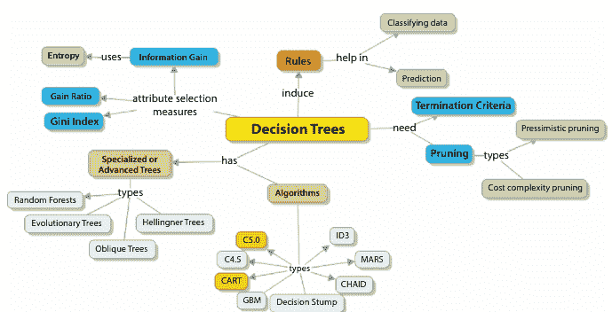

图6.2 决策树的工作原理。

- 步骤4：得票最多的预测结果被选为最终预测。这在图6.2所示的决策树中有所解释。图6.2解释了决策树的放大视图。

#### 1) 支持向量机分类器

支持向量机（SVM）属于监督学习。与随机森林分类器类似，它们可用于分类和回归（Singh, N., Singh, P. (2016)）。SVM分类器最好由空间中的坐标表示，这些坐标的绘制方式使得属于不同类别的示例被一条尽可能宽的线分开。较新的类别被放置在与之前相同的位置，并根据其所属的间隔侧进行预测 [19]。

支持向量机（SVM）通常在n维空间中绘制超平面，可用于分类或回归。在超平面上，选择与任何类别中最近点具有最大距离的点。然而，为两个类别的分隔使用线性平面始终更容易。此超平面不是手动插入的。在这种情况下，通常使用内核。SVM内核通常将低维空间转换为高维空间。该算法在完美分隔线下工作良好。它对高维空间也非常有效，且该分类器内存效率高 [20]。

SVM通常分为两种类型：线性或非线性。线性SVM用于线性可分数据，因为它通过单条直线对两个不同的类别进行分类，而非线性SVM可用于非线性可分数据，即无法通过直线区分的数据类型。通常，SVM假设输入为数值形式。靠近超平面并对其位置产生影响的点称为支持向量。为了求出超平面的系数，使用数值优化技术。另一种使用的方法是序列最小优化，它将问题分解为子问题，并可以通过单纯计算而非数值执行来解决 [21]。

#### 2) 朴素贝叶斯分类器

此分类基于贝叶斯定理，假设预测因子之间相互独立，且某个类中任一特征的存在与任何类中的任何其他特征无关。该分类器对大量数据集很有帮助。这也是一种使用的完美分类方法，因为它更简单 [22]。通常，数据集被分为特征矩阵和响应向量，其中特征矩阵包含所有向量，每个向量包含因变量特征的值，而响应向量包含特征矩阵每一行的类别变量值。

该分类器基于这样一个假设：每个特征独立且等量地对结果做出贡献。一些常用的朴素贝叶斯分类器包括多项式分类器和伯努利分类器。对于多项式分类器，频率由多项式分布生成的特征向量表示；而在伯努利分类器中，特征通常是独立的二元变量。朴素贝叶斯算法的输入通常经历以下步骤：

- 步骤1：将整个数据集转换为频率表。
- 步骤2：基于某些概率创建似然表。
- 步骤3：使用贝叶斯方程计算每个类的后验概率；后验概率最高的被视为预测结果。

朴素贝叶斯分类器通常只需要少量训练数据来找出所需参数，且运行速度极快。它们还消除了某些维度问题，较少量的训练数据足以进行更好的预测。当给出分类输入而非数值变量时，该方法运行良好。对于数值变量，通常使用钟形曲线 [23]。

#### D. 数据分类

首先，从sklearn模块导入分类器并分配特定的变量名称。然后，将所需参数输入分类器，以便与我们的机器模型协同设置。随后，将训练数据拟合到分类器中以训练模型。训练完成后，将测试数据输入机器模型以预测测试数据集。

#### E. 模型评估

使用sklearn的Metrics模块导入混淆矩阵、准确率得分、分类报告、Cohen Kappa得分和均方误差，收集预测值并将其与测试数据集中的原始值进行比较。混淆矩阵提供真实值与预测值之间的相关性。分类报告提供F1得分、精确率和召回率等参数 [24]。

- 1) 准确率表示测量的正确程度。它说明测量值与特定值有多接近。它显示结果与真实值之间的差异。


- 准确率 = (TP+TN)/(TP+TN+FP+FN)
- 2) 精确度告诉两个测量值之间的相关程度。精确度通常使用标准值作为参考值来计算。Precision = TP/(TP+FP)
- 3) 召回率通常用作相关性评估方法。它通常是成功获取的相关数据的比例。Recall = TP/(TP+FN)
- 4) F1 分数是确定准确性的方法之一。它计算为精确度和召回率的平均值。F1 分数计算公式为 F1 Score = 2*(Recall * Precision) / (Recall + Precision)
- 5) Cohen Kappa 分数是衡量深度学习分类器分类的实例与通常作为标准参考保留的数据匹配频率的指标。Kappa = (OA - AC) / (1-AC)，其中 OA – 观察一致性，AC - 变化一致性。
- 6) 均方根误差是均方误差的平方根。它被定义为估计值与参数值之差的平方。它是衡量模型预测值与实际观测值之间差异的常用指标 [25]。

### 6.3 结果与讨论

#### A. 图形用户界面

图形用户界面使操作对用户更直观、更容易。为了从应用程序角度查看此模型，已开发了一个用户界面。此用户界面帮助用户输入患者数据并找出患者所属的确切阶段。布局由 PyQt5 模块设计，以下步骤有助于访问开发的界面。

- 步骤 1：在命令提示符中运行 Python 文件
- 步骤 2：输入患者参数
- 步骤 3：将显示预测的 CKD 阶段

输入的值暂时存储在 CSV 文件中，并在输入下一组数据时被替换。

图 6.3 显示了在三个不同分类器中显示患者 CKD 阶段的图形用户界面。

训练和测试数据集中尿素和葡萄糖的均值和标准差已在图 6.4 和 6.5 中可视化。葡萄糖水平较高最终会导致糖尿病。由于糖尿病的相关系数为 0.57，因此它对疾病的发病有重大贡献。

训练和测试数据集中肌酸的均值和标准差已在图 6.6 中显示。肌酸的相关系数为 0.49，这表明它对疾病的进展
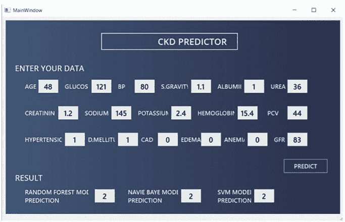
图 6.3 显示用户界面的主窗口。
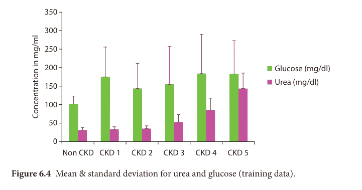
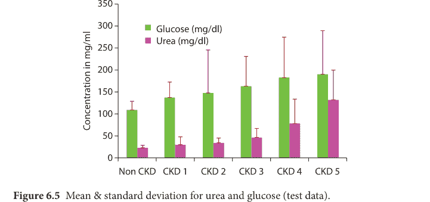
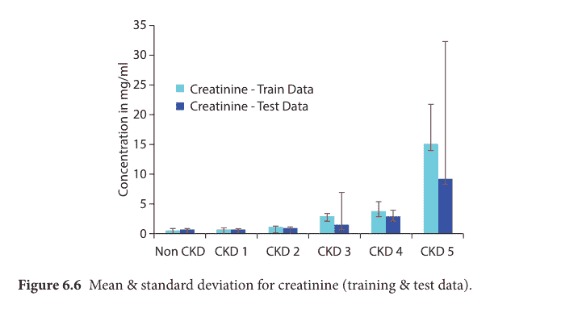
的疾病。肌酸水平较高的人可能属于疾病的较晚期阶段 [26]。

#### B. 测试数据分类

测试数据由三个分类器中的每一个按如下方式分类。表 6.1 [27] 中显示了准确率、F1 分数、精确度、召回率、Kappa 和均方根误差等某些参数。

图 6.7 所示的三个不同分类器的准确性和误差比较分析表明，随机森林分类器的准确性最高（96%），均方根误差最低为 0.03 [28]。可以看出，随机森林分类器的性能优于准确率为 88% 的 SVM 和准确率为 75% 的朴素贝叶斯分类器，如图 6.7 所示。

以下报告为测试数据集中存在的每个 CKD 阶段提供了包括准确率、F1 分数和精确度在内的评估参数。

表 6.1 分类器的分类结果。

| 参数 | 随机森林分类器 | SVM 分类器 | 朴素贝叶斯分类器 |
| :--- | :--- | :--- | :--- |
| 实例总数 | 80 | 80 | 80 |
| 分类正确的实例数 | 77 | 71 | 60 |
| 分类错误的实例数 | 3 | 9 | 20 |
| 准确率 (%) | 96 | 88 | 75 |
| F1 分数 | 0.96 | 0.89 | 0.74 |
| 精确度 | 0.97 | 0.90 | 0.77 |
| 召回率 | 0.96 | 0.89 | 0.75 |
| Kappa | 0.95 | 0.85 | 0.67 |
| 均方根误差 | 0.03 | 0.125 | 0.3 |

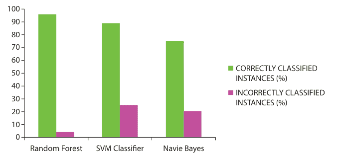

图 6.7 不同分类器分类报告的准确性与误差比较分析。

表 6.2 随机森林分类报告。

| 阶段 | 准确率 (%) | 精确度 | F1 分数 |
|---|---|---|---|
| 0 | 96 | 0.96 | 0.96 |
| 1 | 75 | 0.75 | 0.75 |
| 2 | 83 | 0.83 | 0.91 |
| 3 | 88 | 0.88 | 0.80 |
| 4 | 69 | 0.69 | 0.78 |
| 5 | 100 | 1.00 | 0.96 |

表 6.3 朴素贝叶斯分类报告。

| 阶段 | 准确率 (%) | 精确度 | F1 分数 |
|---|---|---|---|
| 0 | 100 | 0.82 | 0.90 |
| 1 | 0 | 0.00 | 0.00 |
| 2 | 40 | 0.67 | 0.50 |
| 3 | 68 | 0.93 | 0.79 |
| 4 | 90 | 0.50 | 0.64 |
| 5 | 57 | 0.89 | 0.70 |

表 6.4 支持向量机分类报告。

| 阶段 | 准确率 (%) | 精确度 | F1 分数 |
|---|---|---|---|
| 0 | 100 | 0.97 | 0.98 |
| 1 | 75 | 1.00 | 0.86 |
| 2 | 100 | 0.83 | 0.91 |
| 3 | 89 | 1.00 | 0.94 |
| 4 | 100 | 0.91 | 0.95 |
| 5 | 100 | 1.00 | 1.00 |

实验结果表明，对分类器来说，对第 1 阶段进行分类通常比较困难。随机森林和 SVM 分类器在第 1 阶段的准确率均为 75%，如图 6.7 [29] 所示。结果表明，与表 6.2 中所示的随机森林分类器相比，SVM 对其他阶段的准确率更好，而朴素贝叶斯分类器在表 6.3 和表 6.4 中所示的所有阶段的准确率最低 [30]。

### 6.4 结论与未来展望

在本研究中，我们采用了三种不同的深度学习方法来预测慢性肾脏病 [31]。从获得的结果来看，随机森林分类器显示的最高准确率为 96.25%，误差率为 0.03。与其他分类器相比，随机森林分类器对第 1 阶段的预测更精确，准确率为 75%。未来，可以设计一个更准确的系统来预测疾病的进展，使用相对较少的属性 [32]。

### 参考文献

- 1. Alassaf, Reem A. 等人 (2018) - “使用深度学习技术进行慢性肾脏病预防性诊断” - 信息技术创新国际会议 (IIT)，第 99-104 页。
- 2. Bhavani R. 等人 (2019) – “使用深度学习进行基于视觉的皮肤病识别” - 工程与先进技术国际期刊 (IJEAT)，第 8 卷，第 6 期，第 2249–8958 页。
- 3. Singh Rathore, P., Kumar, A., & Gracia-Diaz, V. (2020). 使用蜻蜓算法进行高级簇头选择以提高 RFID 网络寿命的综合方法。交互多媒体与人工智能国际期刊，6 (常规期刊), 8. http://doi.org/10.9781/ijimai.2020.05.003
- 4. Eyck, Jo Van 等人 (2016). “使用随机森林深度学习算法预测慢性肾脏病。” https://blog.transonic.com/hemodialysis/morbidity-and-mortality-in-patients-with-CKD
- 5. https://www.davita.com/education/kidney-disease/stages/stage-1-of-chronic-kidney-disease.
- 6. Naveen Kumar, Prakarti Triwedi, Pramod Singh Rathore, “使用椭圆曲线加密 (ECC) 进行图像自适应水印的自适应方法”，信息技术与知识管理第一届国际会议，第 89–92 页，ISSN 2300-5963 ACSIS，第 14 卷 DOI: 10.15439/2018KM19
- 7. Rathore, P.S., Chatterjee, J.M., Kumar, A. 等人. 通过中继方法为 WSN 进行节能簇头选择。超级计算机期刊 (2021). https://doi.org/10.1007/s11227-020-03593-4
- 8. https://www.kidney.org/news/newsroom/factsheets/KidneyDiseaseBasics
- 9. https://www.ncbi.nlm.nih.gov/pmc/articles/PMC6308749/
- 10. Abhishek Kumar & Jyotir Moy Chatterjee & Pramod Singh Rathore, 2020. “智能手机对抗应用及安全问题”，风险与应急管理国际期刊 (IJRCM), IGI Global, 第 9(2) 卷, 第 1-18 页, 四月.
- 11. https://www.ncbi.nlm.nih.gov/pmc/articles/PMC4089693/
- 12. Bhargava, N., Bhargava, R., Rathore, P. S., & Kumar, A. (2020). 使用回归挖掘算法通过 Gabor 滤波器进行纹理识别以提取特征向量。风险与应急管理国际期刊 (IJRCM), 9(3), 31-44. doi:10.4018/IJRCM.2020070103
- 13. Jadhav, Sayali & Chandran, Priya & Vijaykumar, Suhasini (2019). – “使用深度学习技术进行慢性肾脏病预测的比较研究。” - 计算机科学与工程国际期刊, 第 7 卷, 第 501-506 页.
- 14. N. Bhargava, S. Dayma, A. Kumar 和 P. Singh, “在 WEKA 中使用简单 CART 算法进行分类的方法”，2017 年第 11 届智能系统与控制国际会议 (ISCO), Coimbatore, 2017, 第 212-216 页, doi: 10.1109/ISCO.2017.7855983.
- 15. Jeni, László A 等人 (2013) - “面对不平衡数据：使用性能指标的建议。” - 情感计算与智能交互国际会议及研讨会：[论文集]。ACII (会议), 第 2013 卷, 第 245-251 页.


17. Jo, Taeho 等人 (2019)。– “使用神经影像数据进行阿尔茨海默病的深度学习：诊断分类和预后预测。” - 老年神经科学前沿，第 11 卷，第 220 期。

18. John Cho, Manoj Reddy. (2016) - “使用深度学习检测慢性肾脏病” - 哈马德·本·哈利法大学出版社，第 2016 卷第 1 期，页码 1-8。

19. Mantzaris D. 等人 (2007) – “基于人工神经网络分类的儿童腹痛估计” – CEUR 工作坊论文集，第 284 卷。

20. Mehtaj Banu H (2019) “使用机器学习算法预测肝脏疾病” - IJEAT, Vol. 8, no. 6, pp. 22.

21. Moore, P J 等人 (2019) - “基于时间序列数据成对选择的阿尔茨海默病随机森林预测”。PloS one, Vol. 14, no. 2.

22. Mythili T 等人 (2013) – “使用 SVM-决策树-逻辑回归 (SDL) 的心脏病预测模型” – 计算机应用国际期刊, Vol. 68, no. 16.

23. N. Bhargava, A. Kumar Sharma, A. Kumar 和 P. S. Rathoe, “一种用于边缘保留去噪的自适应方法,” 2017 第 2 届通信与电子系统国际会议 (ICCES), Coimbatore, 2017, pp. 600-604, doi: 10.1109/CESYS.2017.8321149.

24. N. Bhargava, S. Sharma, R. Purohit 和 P. S. Rathore, “使用 J48 算法预测癌症复发,” 2017 第 2 届通信与电子系统国际会议 (ICCES), Coimbatore, 2017, pp. 386-390, doi: 10.1109/CESYS.2017.8321306.

25. Norouzi, Jamshid 等人 (2016) - “使用集成智能模糊专家系统预测慢性肾脏病中肾衰竭进展。” - 计算机与医学数学方法, Vol. 2016.

26. Powers, D.M.W., (2011) – “评估：从精确率、召回率和 F 值到 ROC、知情度、显著性和相关性。” - 深度学习技术期刊, Vol. 2, no. 1, pp. 37-63.

27. Siddheswar Tekale, Pranjal Shingavi, Ankit Chatorikar (2018) – “使用深度学习算法预测慢性肾脏病” - 计算机与通信工程先进研究国际期刊 Vol. 7, Issue 10.

28. Kumar Sahwal, ...., Kishore, ..., Singh Rathore, ..., & Moy Chatterjee, .... (2018). 基于 ECC 承诺概念的图像加密循环技术的先进方法。信号与图像处理最新进展国际期刊, 2(1).

29. Singh N, Singh P. (2016). – “基于规则的慢性肾脏病预测方法：一项比较研究。” - 生物医药药理学杂志, Vol. 10, no. 2.

30. Subasi A., Alickovic E., Kevric J. (2017) – “使用随机森林诊断慢性肾脏病” 收录于: Badnjevic A. (编) CMBEBIH 2017. IFMBE 论文集, Vol. 6, pp. 589-594.

31. Vijayarani S 等人 (2015) - “使用 SVM 和 朴素贝叶斯算法预测肝脏疾病”。科学、工程与技术研究国际期刊 (IJSET R) Vol. 4, no. 4.

32. Kumar, A., Chatterjee, J. M., & Díaz, V. G. (2020). 一种用于电子邮件钓鱼的结合 NLP 和概率神经网络的 SVM 新型混合方法。电气与计算机工程国际期刊, 10(1), 486.

## 7. 使用 SVM 对 MRI 图像进行分类以辅助神经系统疾病诊断

Phavithra Selvaraj, Sruthi, M.S.*, Sridaran, M. 和 Dr. Jobin Christ M.C.

生物医学工程系, Rajalakshmi 工程学院, 金奈, 印度

### 摘要

本章深入探讨了利用深度学习支持向量机算法诊断神经系统疾病的实现。随着新兴技术的进步，诊断神经系统疾病的手段比以往复杂得多。程序和诊断测试是帮助医生识别神经系统疾病或其他医疗状况的工具。在病人去世后，通过尸检可以精确识别神经系统病理。本文是一种使用 MRI 图像对各种神经系统病理进行分类和诊断的 SVM 算法的新颖实现。

**关键词**: SVM, 神经系统疾病, MRI, 深度学习

### 7.1 引言

心理健康在个人健康中起着重要作用。随着近年来神经系统疾病数量的增加，患者的治疗差距不断扩大，因为现有的神经科医生数量远少于患者数量的增长。由于各种疾病中许多常见症状之间存在重复，评估神经系统损伤一直是一项复杂的任务。

医学成像技术在诊断神经系统疾病方面取得了多项开创性的进步。科学家们进行了大量研究以改进方法，从而提供灵活的诊断信息。脑部医学成像包含多种成像技术，用于诊断中风、血管畸形、肿瘤、创伤、脑生长异常和脑出血。磁共振成像使用由编程计算机生成的无线电波来生成人体组织的详细图像 [1]。

MRI 可用于诊断多种疾病，其中一些如下：

- 中风
- 创伤性脑损伤
- 脑和脊髓肿瘤
- 炎症
- 感染
- 血管不规则
- 多发性硬化症等疾病
- 癫痫相关的脑损伤
- 异常发育的脑区
- 某些神经退行性疾病

为找出识别病症的脑 MRI 图像分类的最佳方法，研究人员研究和分析了关于脑 MRI 图像分类的论文，以用于诊断多种神经系统疾病。研究人员还研究了关于深度学习算法评估的研究，并分析了基于用于神经系统疾病诊断的 MRI 结构特征的论文。其中一篇论文得出结论，在分类效率方面，选择合适的特征类型至关重要。对不同分类器的评估表明，当选择合适的特征类型时，大多数分类器产生的结果准确度或多或少相同。

还对不同病症进行了比较分析，并研究了 MRI 图像与其相关性，相关结论也经过仔细研究。其中一项研究包括通过脑 MRI 分析对自闭症进行分类，旨在开发一个自动化认知系统，以将 ASD 与健康对照分类，并预测 ASD 患者的神经递质模式，从而使他们能够轻松识别受自闭症影响的脑区。同样，研究了精神分裂症的 MRI 发现，描述了使用 MRI 对精神分裂症患者大脑结构变化的描述。报道了额叶进行性变化、基底节变化以及杏仁核海马体积减少 [2]。

基底节的变化与抗精神病药物的类型和疗程关系更为密切。同样，还研究了帕金森病中 MRI 的结构发现。

### 7.2 方法论

计算机化医学图像分析和计算机辅助诊断已取得迅速进步，促使许多成像技术在医学图像处理中得到应用。脑图像在用于神经系统病理诊断之前，应进行多种图像处理操作。脑 MRI 图像中病变区域的识别、分割和检测是繁琐的过程。磁共振成像技术能够清晰地显示大脑的神经结构 [3]。

MRI 包含多种成像模态，用于扫描和捕捉人脑的内部结构。本工作中使用的方法论流程图如图 7.1 所示。

#### 7.2.1 数据获取

本工作中使用的 MR 图像来自四个不同的数据库。自闭症 MR 图像从名为 LONI 图像与数据档案馆的在线存储库中获得，该存储库由南加州大学管理。IDA 是来自不同研究的数据集合。其中，自闭症脑成像数据交换 (ABIDE) 包含自闭症患者的 MR 图像。它包含尺寸为 176x256x256、体素大小为 1.05x1.05x1.05 的图像 [4]。

帕金森病 MR 图像和精神分裂症 MR 图像从 Open Neuro 和 Open fMRI 获得，这两个是在线数据库，包含来自不同研究的图像。帕金森病图像尺寸为 192x256x256，体素大小为 1x1x1。精神分裂症患者的 MR 图像尺寸为 160x192x192，体素大小为 1x1x1。健康个体（对照图像）的 MR 图像从上述两个数据库中获得。


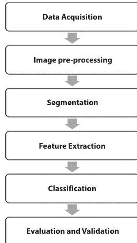

图 7.1 流程图

#### 7.2.2 图像预处理

任何基于图像的分析中最关键的步骤是预处理，它对图像执行操作以增强图像，从而确保图像在后续步骤中能够被正确解释且没有任何错误。MR 图像处理中需要执行的基本步骤包括滤波、对比度增强和颅骨剥离 [5]。

- a) 中值滤波

中值滤波是一种非线性滤波技术，用于通过平滑图像中除边缘以外的部分来从输入中去除噪声。中值滤波主要关注边缘的保留。图像中的每个像素都与其邻域像素进行比较。然后，像素被周围像素的中值所替换。中值滤波器以更高的效率去除椒盐噪声。由于 MR 图像容易受到椒盐噪声的影响，因此使用中值滤波技术来消除不需要的噪声参数 [6]。

- b) 对比度增强

自适应直方图均衡化（Adaptive Histogram Equalization，AHE）是一种增强图像对比度的过程。该方法为图像的不同部分计算多个直方图，并使用这些直方图在整个图像中分布亮度值，而普通直方图技术使用源自整个图像的直方图来转换图像中的所有像素。自适应直方图均衡化技术被广泛使用，因为它能够增强图像每个部分的局部对比度和边缘定义 [7]。普通直方图均衡化技术适用于图像中像素值在整个图像中没有大幅变化的情况。自适应直方图均衡化（AHE）有时会过度放大图像的同质区域，因为这些区域高度集中。为了防止这种情况，使用了一种称为对比度受限自适应直方图均衡化（Contrast Limited Adaptive Histogram Equalization，CLAHE）的变体技术。在 CLAHE 中，直方图剪切是在 CDF 计算之前在预定义值处完成的，从而限制了 CDF 和变换函数的斜率。发生直方图剪切的这个预定义值称为剪切限值，它取决于直方图归一化和邻域区域的大小。用于限制结果放大的常见值介于 3 和 4 之间。

- c) 颅骨剥离

磁共振成像是一种高分辨率成像技术，其中还包含头骨、皮肤、脂肪、肌肉、颈部和眼球等非脑组织。这些非脑组织在图像处理和分析程序（如自动分割）中被视为障碍。因此，在对 MRI 脑图像进行任何定量形态学研究之前，总是需要先进行一个初步过程，以将脑组织与颅外或非脑组织隔离开来。此过程称为颅骨剥离。

本工作中的颅骨剥离最初通过阈值将图像转换为二值图像，并消除少于特定数量的连接像素，从而为图像生成二值掩模。然后，使用此掩模隔离 MR 图像中存在主图像的中心区域。在此过程之后，掩模区域的边缘被腐蚀约 15 到 20 个像素，以获得颅骨剥离图像。这帮助我们以简单的方式消除 MR 图像中的非脑区域 [8]。

#### 7.2.3 分割

将数字图像分割或分区为多个部分或段的过程称为图像分割。该过程主要用于将感兴趣区域与图像的其余部分分开，并定位图像中的对象和边界。分割是图像分析中的关键步骤。图像分割中最成功的方法之一是大津法。大津法是一种基于区域分割的自动阈值选择方法 [9]。

大津法是一种类间方差方法，具有自动选择阈值的能力 [10]。该方法计算每个强度级别的概率，遍历每个可能的阈值，并对图像中的整个像素布局进行评估。所需的阈值对应于最大类内方差。大津分割的主要目标是在选择一个能够执行高效分割的合理阈值的同时，减少前景像素和背景像素之和的计算量。大津法以其极少的时间消耗而闻名，是阈值选择中最有效的方法之一。

Otsu 分割针对实时图像在一致性和形状度量方面产生了更好的阈值选择。然而，需要进行深入搜索以推导类内方差扩展的标准 [11]。此方法为我们提供了整个脑区域，忽略了 MR 图像中存在的其他不需要区域。

#### 7.2.4 特征提取

降低图像维度的过程称为特征提取。这将原始数据集减少为可管理的组以进行处理。从原始数据集中测量某些特征、参数、属性和特征，以区分一个输入模式与另一个。提取的特征作为分类器输入 [12]。

与正常脑图像相比，异常脑图像在特征上会显示出某些差异。特征的变化取决于脑病变的类型及其认知能力和残疾情况。这些特征存储在特征空间中。在数据集较小的情况下，每个图像中都会存在特定神经紊乱的少数异常实例。一旦分类器检测到人脑特定区域中存在异常的示例，它就会学习并生成一个模型，以根据给定的输入将图像分类为异常组织或相应的疾病。

特征提取中一个关键的步骤是特征选择。良好的纹理特征和邻域强度数据的邻域聚合提供更好的结果，而不是包含单个强度值 [13]。用于从 MR 图像中提取特征的技术有多种。一些常见的特征提取技术包括离散小波变换（Discrete Wavelet Transform，DWT）、Gabor 滤波器和灰度共生矩阵。本工作采用灰度共生矩阵技术。灰度共生矩阵（Gray Level Co-Occurrence Matrix，GLCM）在特征向量的维度方面优于其他技术，因此该技术被认为更适合 MRI 图像分类 [14]。GLCM 是一种从图像中提取纹理特征的统计技术。正常组织与异常组织相比，纹理差异很大。从 GLCM 提取的纹理特征包括对比度、相关性、能量和同质性。

选择一组良好的特征也能提高分类效率。还从该矩阵中提取了其他特征，即均值、标准差、熵、均方根、方差、峰度和慢度。除此之外，还估计了总脑区域并用于分类。当分类过程中使用超过两个特征时，可视化分类器性能非常困难。因此，将特征减少为两个突出变量，这些变量能够突出描述所有派生的特征。这是另一种降维过程，使用主成分分析技术来实现。该技术在最大限度地减少信息损失的同时提高可解释性。因此，可以通过 PCA 得到的这两个突出变量作为二维图进行可视化 [15]。

#### 7.2.5 分类

使用合适的分类器对给定输入进行分类的过程称为分类。分类的目标是将具有相似特征的项目分组到不同的部分。我们有多种分类器或算法可供选择，它们在评估特定测试数据的正确类别的方式上有所不同。必须考虑需求和数据集类型，从不同分类器中选择合适的算法。k-近邻分类器是一种简单的非参数算法，通过考虑其与其他点的欧氏距离将类别分配给测试数据 [16]。

当特征数量较少时，该算法效果较好；而在特征众多且仅有少数特征具有信息量的情况下，该算法的性能会变差。

朴素贝叶斯分类器是一类基于贝叶斯定理的分类器，其中被分类的每对特征被认为相互独立 [17]。朴素贝叶斯的扩展是高斯朴素贝叶斯分类器，其中使用高斯函数来估计数据的分布。高斯函数（或正态分布）是最容易处理的，因为仅需从训练数据中估计两个参数（均值和标准差）即可帮助决策。在句法歧义研究中，GNB 和


SVM 的性能优于 KNN 分类器。与线性回归和线性 SVM 分类器相比，GNB 分类器在 MRI 数据上的表现较差。

GNB 是一种适用于需要多次重复的流程的有用分类器。线性分类器更适合 MRI 分析，因为不存在过拟合问题。线性判别分析是一种降维技术。该技术可在不造成大量信息丢失的情况下降低图像的维度。LDA 需配合极端特征选择使用，否则通常没有足够的数据来可靠地估计协方差矩阵 [18]。

线性回归模型了观测数据中两个变量之间的线性方程拟合关系。LR 与 SVM 在性能上大致相当，只不过前者更自然地适用于类别数超过两类的情况。线性支持向量机分类器可以高效地对数据进行分类，因此该算法被用于本项目。

本工作采用支持向量机，因为它在 MRI 图像上的分类精度高于其他分类算法。支持向量机是一种监督学习技术，它以一组带标签的训练数据作为输入，并生成一个输入-输出映射函数作为输出。它是一种二类分类方法，以两个类别的特征作为输入，并输出一个模型文件，用于将新的未标记/标记数据分类到这两个类别中的一个。支持向量机最初是二类分类器，对学习线性或非线性类边界更为系统，因此颇具吸引力。本工作中使用的 SVM 分类器提供了选择合适核函数的可能性。基于许多研究中报告的 SVM 核函数的出色性能，RBF（径向基函数核）被选为核函数。本工作使用多类 SVM 分类器来对四个类别进行分类 [19]。

### 7.3 结果与讨论

#### 7.3.1 预处理

对各预处理阶段及分类过程所得结果进行了逐阶段分析，并如图 7.2 所示进行了分类验证。

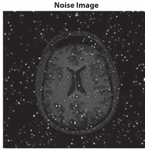

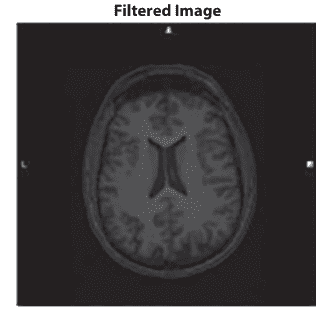

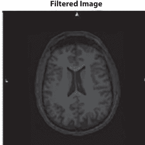

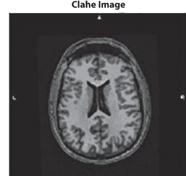

图 7.2 图像中执行的滤波和 CLAHE 处理。

通过应用合适的图像处理技术，从图像中提取了重要信息和数据。经过中值滤波后得到滤波 CLAHE 图像，随后使用一种特殊的自适应直方图均衡化方法进行对比度增强。在特征提取过程中还进行了颅骨剥离，以产生准确的特征值 [20]。

大津分割法在图像处理中用于执行基于直方图的图像阈值分割，或将灰度图像转换为二值图像。该模型假设图像包含双模直方图（例如，前景和背景像素），并评估最优阈值，将两个类别划分开，使其类内方差可忽略，如图 7.3 和图 7.4 所示 [21]。

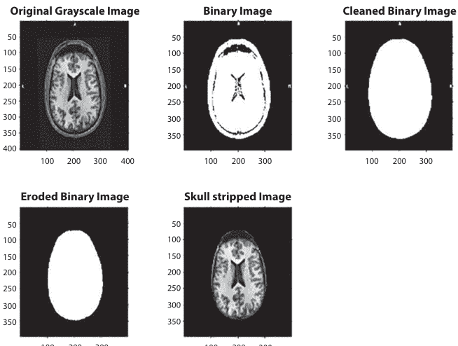

图 7.3 颅骨剥离。

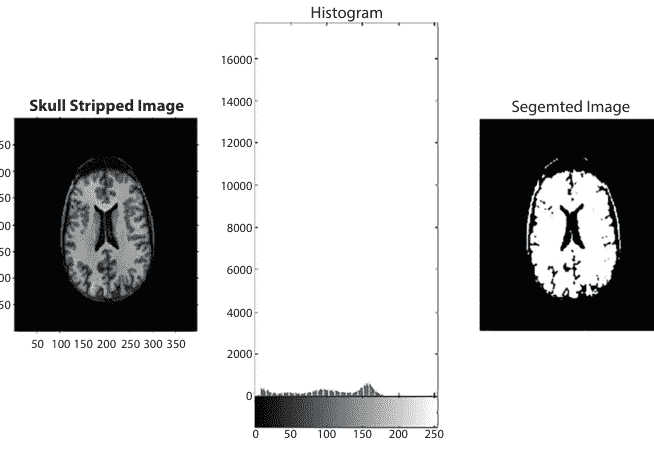

图 7.4 大津分割。

#### 7.3.2 分类

此处使用的支持向量机对学习线性或非线性类边界更为系统，因此颇具吸引力。这里，我们使用三种不同疾病（自闭症、帕金森病和精神分裂症）的 MR 图像和正常 MR 图像来训练分类器，并对输入图像在这四个类别中进行预测。因此，在此情况下使用多类支持向量机进行分类 [22]。

结果被可视化为主成分分析结果中变量 1 与变量 2 之间的二维图。图 7.5 和图 7.6 展示了针对四个类别所得超平面的二维可视化。各区域分别用黄色、青色、红色和绿色表示，分别对应正常、精神分裂症、自闭症和帕金森病类别 [23]。

在从训练集中提取特征和标签后，对支持向量机 (SVM) 分类器进行训练。分类器通过自身训练，从该训练数据集中获得分类未知数据的思路和智能。执行分类后，生成混淆矩阵或误差矩阵以评估分类器的性能 [24]。表 7.1 显示了从结果中得到的混淆矩阵。

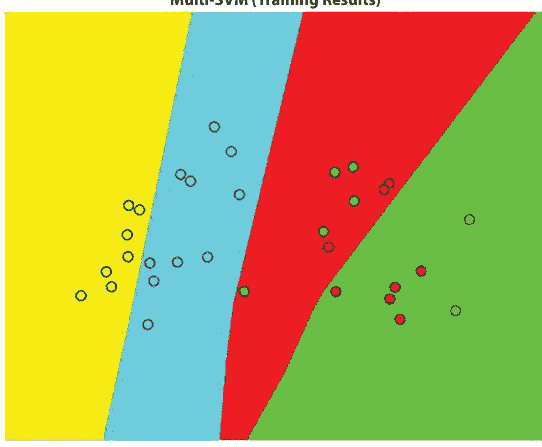

图 7.5 多类 SVM 训练结果。

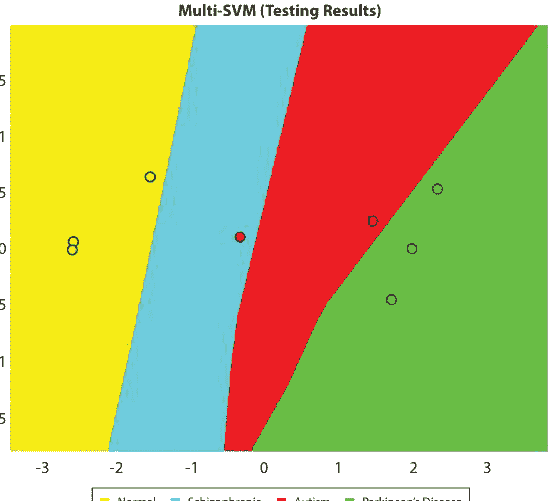

图 7.6 多类 SVM 测试结果。

#### 表 7.1 混淆矩阵 – 保留法。

| | | 预测类别 | | | |
|---|---|---|---|---|---|
| | | 自闭症 | 正常 | 帕金森病 | 精神分裂症 |
| 实际类别 | 自闭症 | 1 | 1 | 0 | 0 |
| | 正常 | 0 | 3 | 0 | 0 |
| | 帕金森病 | 0 | 0 | 3 | 0 |
| | 精神分裂症 | 0 | 0 | 0 | 0 |

#### 7.3.3 验证

通过构建混淆矩阵来测试其实现的分类效率，从而分析其验证效率。该混淆矩阵采用 K-折交叉验证构建，K 值设置为 5。在此过程中，数据集被随机分为五个不同的批次，并进行五次不同的分类实验以验证分类器。

每批数据在每次实验中都将用作测试数据，以便对分类器进行适当的评估。表 7.2 显示了通过执行 K-折交叉验证得到的混淆矩阵 [25]。

此外，还使用上述混淆矩阵评估了准确率、灵敏度、特异度、精确率和 F1 分数，以便对分类器进行适当评估。表 7.3 给出了分类器的评估变量 [26]。

从下表可以看出，该算法在正常类和精神分裂症类上表现良好，而从自闭症和帕金森病中提取的特征应得到改进，以便获得更高的准确率。该算法达到的总体准确率为 85%，获得的总体 F1 分数为 0.773 [27]。

#### 表 7.2 混淆矩阵 – K-折法。

| | | 预测类别 | | | |
|---|---|---|---|---|---|
| | | 自闭症 | 正常 | 帕金森病 | 精神分裂症 |
| 实际类别 | 自闭症 | 6 | 0 | 4 | 0 |
| | 正常 | 0 | 10 | 0 | 0 |
| | 帕金森病 | 8 | 0 | 2 | 0 |
| | 精神分裂症 | 0 | 0 | 0 | 10 |

#### 表 7.3 评估变量。

| | 自闭症 | 正常 | 帕金森病 | 精神分裂症 |
|---|---|---|---|---|
| 准确率 | 0.7 | 1 | 0.7 | 1 |
| 灵敏度 | 0.6 | 1 | 0.2 | 1 |
| 特异度 | 0.733 | 1 | 0.866 | 1 |
| 精确率 | 0.43 | 1 | 0.33 | 1 |
| F1 分数 | 0.57 | 1 | 0.52 | 1 |

### 7.4 结论

本文的重点是使用合适的深度学习算法开发一个高效系统，以诊断神经系统疾病。利用从不同受试者记录的训练数据集中获取的数据以及测试数据的结果来计算输出效率。估计的准确率为 85% [28]。

还观察到，与其他类别相比，自闭症和帕金森病的分类精度较低。这表明需要进一步改进从自闭症和帕金森病中提取的特征，以提高分类器的效率。该算法可用于更准确地执行深度学习并显示出更好的结果。自动化技术的提高可以减少医护人员的工作量 [29]。

### 参考文献

- 1. Abhishek Kumar & Jyotir Moy Chatterjee & Pramod Singh Rathore, 2020. “智能手机对抗性应用程序与安全问题，”《风险与应急管理国际期刊》(International Journal of Risk and Contingency Management, IJRCM)，IGI Global，第 9(2) 卷，第 1–18 页，4 月。
- 2. B.J. Bipin Nair, N. Shobha Rani, S. Saikrishna, C. Adith (2019), “通过脑 MRI 分析对自闭症进行分类的实验”，《近期技术与工程国际期刊》(International Journal of Recent Technology and Engineering, IJRTE)。
- 3. Bhargava, N., Bhargava, R., Rathore, P. S., & Kumar, A. (2020). 基于回归挖掘算法的加博滤波器纹理识别以提取特征向量。《风险与应急管理国际期刊》(International Journal of Risk and Contingency Management, IJRCM), 9(3), 31-44. doi:10.4018/IJRCM.2020070103。
- 4. C. Salvata, A. Cerasa, I. Castiglioni, F. Gallivanone, A. Augimeri, M. Lopez, G. Arabia, M. Morelli, M.C. Gilardi, A. Quattrone (2013) “用于帕金森病和进行性核上性麻痹鉴别诊断的脑 MRI 数据深度学习”，《神经科学方法杂志》(Journal of Neuroscience methods)。
- 5. Daljit Singh, Kamaljeet Kaur (2011), “使用 GLCM、PCA、SVM 对脑 MRI 图像中的异常进行分类”，《工程与先进技术国际期刊》(International Journal of Engineering and Advanced Technology)。
- 6. David J. Brooks (2012), “帕金森病：诊断”，《帕金森症及相关障碍》(Parkinsonism and Related Disorders) 第 18 卷，增刊 1，第 S31-S33 页。
- 7. Donald J. Norris (2020), “树莓派深度学习”，Springer Science and Business Media LLC。


- 8. Francisci Pereira, Tom Mitchell, Matthew Botvinick (2009), “深度学习分类器与 fMRI：教程概览”, NeuroImage 第45卷，第1期，增刊1，页码 S199-S209.

- 9. Hugo G. Schnack, Mireille Nieuwenhuis, Neeltje E.M. van Haren, Lucija Abramovic, Thomas W. Scheewe, Rachel M. Brouwer, Hilleke E. Hulshoff Pol, René S. Kahn (2013), “结构性MRI能否辅助临床分类？精神分裂症、双相情感障碍患者和健康受试者两个独立样本的深度学习研究”, Elsevier期刊.

- 10. Khushbu, Isha Vats (2017), “Otsu图像分割算法综述”, 计算机与通信工程创新研究国际期刊，第5卷第6期.

- 11. Kumar Sahwal, ...., Kishore, ...., Singh Rathore, ...., & Moy Chatterjee, .... (2018). 基于ECC交换概念的图像加密循环技术先进方法. 信号与图像处理最近进展国际期刊, 2(1).

- 12. Kumar, A., Chatterjee, J. M., & Díaz, V. G. (2020). 针对电子邮件钓鱼的SVM结合NLP和概率神经网络的新型混合方法. 电气与计算机工程国际期刊, 10(1), 486.

- 13. Madina Hamiane, Fatema Saeed (2017), “基于SVM的MRI脑图像分类用于计算机辅助诊断”, 电气与计算机工程国际期刊(IJECE).

- 14. Martha E. Shenton, Chandlee C. Dickey, Melissa Frumin and Robert W. McCarley (2010). “精神分裂症MRI发现综述”, 精神分裂症研究.

- 15. Masaya Misaki, Youn Kim, Peter A. Bandettini, Nikolaus Kriegeskorte (2010), “模式信息fMRI中多变量分类器与响应归一化的比较”, NeuroImage, 第53卷，第1期，页码103-118.

- 16. Mohd Fauzi Bin Othman, Noramalina Bt Abdullah, Nurul Fazrena Bt Kamal (2011) “基于支持向量机的MRI脑分类”, 2011年第四届建模、仿真与应用优化国际会议, IEEE.

- 17. N Varuna Shree, T N R Kumar (2018), “利用DWT和概率神经网络进行特征提取的脑肿瘤MRI图像识别与分类”, 脑信息学 5, 23-30.

- 18. N. Bhargava, A. Kumar Sharma, A. Kumar and P. S. Rathore, “一种边缘保持去噪的自适应方法,” 2017年第2届通信与电子系统国际会议(ICCES), 科伊姆巴托尔, 2017, pp. 600-604, doi: 10.1109/CESYS.2017.8321149.

- 19. N. Bhargava, S. Dayma, A. Kumar and P. Singh, “在WEKA中使用简单CART算法的分类方法,” 2017年第11届智能系统与控制国际会议(ISCO), 科伊姆巴托尔, 2017, pp. 12-216, doi: 10.1109/ISCO.2017.7855983.

- 20. N. Bhargava, S. Sharma, R. Purohit and P. S. Rathore, “使用J48算法预测癌症复发,” 2017年第2届通信与电子系统国际会议(ICCES), 科伊姆巴托尔, 2017, pp. 386-390, doi: 10.1109/CESYS.2017.8321306.

- 21. 美国国家神经系统疾病与中风研究所 https://ninds.nih.gov/.

- 22. Naveen Kumar, Prakarti Triwedi, Pramod Singh Rathore, “基于椭圆曲线加密(ECC)的图像自适应水印自适应方法,” 信息技术与知识管理首届国际会议, pp. 89–92, ISSN 2300-5963 ACSIS, Vol. 14 DOI: 10.15439/2018KM19.

- 23. P.G. Spetsieris, Y. Ma, V. Dhawan, J.R. Moeller, D. Eidelberg (2006), “利用功能脑成像进行神经系统疾病高度自动化计算机辅助诊断”, SPIE论文集 6144, 医学成像2006: 图像处理.

- 24. Paolo Brambilla, Antonio Hardan, Stefania Uccelli di Nemi, Jorge Perez, Jair C. Soares, Francesco Barale (2003), “自闭症中的脑解剖与发育：结构性MRI研究综述”, 脑研究通报 61 (2003) 557–569.

- 25. Rathore, P.S., Chatterjee, J.M., Kumar, A. et al. 能量高效的簇头选择.

- 26. Raymond Salvador, Joaquim Radua, Erick J Canales-Rodríguez, Aleix Solanes, Salvador Sarró, José M Goikolea, Alicia Valiente, Gemma C Monté, María Del Carmen Natividad, Amalia Guerrero-Pedraza, Noemí Moro, Paloma Fernández-Corcuera, Benedikt L Amann, Teresa Maristany, Eduard Vieta, Peter J McKenna, Edith Pomarol-Clotet (2017) “精神病中最佳MRI诊断预测的深度学习算法与结构特征评估”, Plos One期刊.

- 27. Rong Chen, Yun Jiao, Edward H Herskovits (2011), “自闭症谱系障碍中的结构性MRI”, Nature文章, 儿科研究期刊.

- 28. S. Bonavita, F. Di sale, G. Tedeschi (1999), “神经系统疾病中的质子MRS”, 欧洲放射学杂志.

- 29. Singh Rathore, P., Kumar, A., & Gracia-Diaz, V. (2020). 利用蜻蜓算法进行高级簇头选择的RFID网络寿命改进整体方法. 交互多媒体与人工智能国际期刊, 6 (常规期刊), 8. http://doi.org/10.9781/ijimai.2020.05.003.

## 8. 卷积网络

Simran Kaur* 和 Rashmi Agrawal

印度法里达巴德，马纳瓦·拉奇纳国际研究与研究学院

**摘要** 当具有网格状结构时，卷积网络被称为卷积神经网络。CNN的示例包括时间序列数据（被视为在固定时间间隔采样的一维网格）以及图像数据集（可被视为像素的二维网格）。CNN最初是为图像分析设计的深度神经网络。最近，发现CNN在后续数据分析（例如自然语言处理）中也具有出色的能力。CNN始终包含两种基本操作，即卷积和池化。使用多个滤波器的卷积操作能够从数据集中提取特征（特征图），从而保留相应的空间信息。池化操作（也称为子采样）用于降低卷积操作的特征图维度。最大池化和平均池化是CNN中最常用的池化操作。由于CNN的复杂性，ReLU是反向传播训练中传递梯度的常用激活函数。

本章定义了什么是卷积、其在神经网络中的需求以及在不同数据集上应用池化。本章还阐述了如何使用CNN及其对数据集应用的操作类型。在本章中，CNN应用于图像资产以进行特征提取和降维。

**关键词：** CNN, ReLU, 卷积, 池化, 像素

### 8.1 引言

随着深度学习在图像分类中取得惊人成就，科学家们开始研究如何利用深度学习提高目标检测性能。近年来，目标识别已变得依赖于深度学习，并同样取得了惊人的进步。

### 8.2 卷积操作

卷积操作以带有形状的张量作为输入，并输出带有特征及形状的结果 [1]。这些特征图用于对数据进行分类。卷积网络对输入进行卷积并将其传递到下一层。对数据执行以下操作：

- A. 池化：CNN可能包含局部或全局层来执行底层计算。它计算一簇神经元的最大值或平均值。
- B. 全连接：它是一个多层感知机，将一个神经元中的一层连接到其他神经元中的其他层。
- C. 感受野：神经元的输入区域称为感受野。随着网络架构的加深，感受野中原始输入图像的子区域不断增大。这是因为反复应用卷积，不仅考虑特定像素的值，还考虑周围一些像素的值。
- D. 权重：权重和偏置的向量称为滤波器，代表输入的特定特征（例如，特定形状）。CNN的一个显著特征是许多神经元可以共享同一个滤波器。这减少内存开销，因为在共享该滤波器的所有感受野中使用单个偏置和单个权重向量，而不是每个感受野都有自己的偏置和权重向量。

### 8.3 CNN

为了规避这一问题，受生物视觉皮层联结的启发，提出了卷积神经网络（CNN），以利用权重共享机制来挖掘出现的可比结构


在图片的各个区域。在整幅图片上局部共享卷积权重大大减少了需要学习的参数数量，并使得组织在信息解释方面具有可比性（即，权重数量不再依赖于所画信息的大小）[2]。图 8.1 中出现的 CNN 基本设计包含几个具有不同功能的独特层。

卷积层是 CNN 的基本构建块。在每个卷积层中，信息与 K 个可学习部分 W = {W1, W2, WK} 进行卷积，并加上偏置 b = {b1, b2,...,bK}。这些部分也称为感受野 [3]。此时，通过将卷积结果输入到逐元素非线性函数 σ(·) 中，生成另一个特征图 Xk。给定第 1 层的输出向量，第 k 个特征图由以下公式确定：

```
XL+1 = σ (WL *XL +bl)
```

函数 σ(.) 也称为激活函数，可以有多种形式，例如 Sigmoid 函数 σ(x) = (1 + e−x) −1、双曲正切 σ(x) = tanh(x) 或整流线性单元 σ(x) = max (0, x)。尽管每个卷积层中的这些部分具有较小的感受野，但它们可以通过信息体的全部深度进行扩展。沿深度维度堆叠所有通道的特征图，形成卷积层的完整输出体积 [4]。

通常，池化层跟随卷积层并执行非线性下采样。池化层有几种可执行下采样操作的非线性函数，其中最大池化是最常见的操作。它将特征图分割成一组不重叠的区域，并针对每个此类子区域输出最大值。除最大池化外，池化层还可以执行其他非线性任务，例如平均池化或 L2-范数池化。池化层用于在逻辑上减少 CNN 架构中中间表示的空间大小、参数数量和计算量，从而控制过拟合 [5]。此外，池化操作可以提供一种平移不变性。

### 8.4 实际应用

深度学习策略已广泛应用于计算机视觉和自然语言处理等众多领域，并正在成为这些领域的前沿方法。根据数据类型，深度学习的应用领域将按音频数据、图像数据和文本数据进行分类。围绕特定任务，引入了不同的深度学习方法，以极大地扩展深度学习的基本类型。更具体地说，这些深度学习应用涉及许多有趣的问题，例如语音识别、面部识别、目标检测、场景分类和机器翻译 [6]。

#### 8.4.1 音频数据

声音数据有多种形式，其中语音是最常见的。在以前的年份里，语音识别框架通常采用高斯混合模型（GMM）来描述每个建模单元的概率模型。由于其对大量数据的简单评估以及成熟的分离训练方法，该模型长期以来在语音识别应用中占据主导地位。但是，GMM 基本上是一个浅模型，无法完全描述状态空间分布的特征 [7]。此外，GMM 建模的特征维度通常为几十，这使得难以描述特征之间的关系。而且，GMM 模型基本上是一个概率似然模型。尽管分离训练可以模仿某些类别之间的差异，但这种能力目前仍然有限。

#### 8.4.2 图像数据

2012 年，CNN 首次用于 ImageNet 挑战赛中的图像分类，并取得了最佳性能。在随后的年份里，众多基于 CNN 的深度学习方法被引入竞赛并取得了最先进的结果。此外，多滑动窗口方法与 CNN 相结合，用于在测试中定位目标，并将具有更传统方法的更深层结构应用于此任务。从 2014 年起，竞赛中的所有团队都采用了深度学习策略相互竞争。与传统方法相比，深度学习方法在图像分类和目标检测任务中具有非凡的优势 [8]。

#### 8.4.3 文本数据

Colbert 等人在 2008 年将第一个深度学习系统应用于传统 NLP 问题。该系统对所有子任务使用了 1D 卷积网络，并取得了最先进的性能。此时，Cho 等人引入了一种基于 RNN 的结构，使用固定大小的向量表示进行机器翻译。在这个深度模型中，包含两个 RNN：一个 RNN 用于将一组源语言单词序列编码为一组固定大小的向量，另一个 RNN 将向量转换为目标语言的一组代表性序列 [9]。为了克服固定大小向量表示的缺点，开发了一种基于双向 RNN 的深度模型。

### 8.5 深度模型的挑战

与 SVM 等其他学习方法相比，深度学习方法在理论上难以解释。由于深度模型通常由多个层和大量单元组成，因此难以单独解释局部结构。有时，深度学习方法被视为黑箱。由于深度模型有大量参数，训练方法的收敛性无法轻易检查。特别是，一个重要的局限性是深度学习的参数初始化需要更精确的理论指导 [10]。

与浅模型相比，深度模型在表示非线性能力方面具有更强大的能力。通常，对于任意非线性函数，根据神经网络的通用近似定理，既可以找到浅层结构，也可以找到深层结构来获得良好的表示。但是，对于某些函数，深层结构只需要远少得多的参数。因此，我们需要理解样本复杂度，即学习一个良好深度模型所需的样本数量 [11]。基于非凸函数，在理论上对此进行研究极其困难。

另一方面，目前为特定任务设计深度模型很困难。似乎像卷积这样的共同处理单元存在于音频、图像和文本数据的深度模型中。有趣的是，可以为任何类型的数据构建一个统一的框架。此外，在特定任务中，将领域知识融入这些深度模型目前仍然是一个挑战 [12]。

此外，目前使用深度模型来表示结构化语义数据很困难。从进化角度来看，语言能力远远落后于视觉和听觉发展。因此，从这个角度看，处理语言的概念性问题很困难，有效解决这个问题有助于实现通用人工智能。

### 8.6 对象检测中的深度学习

随着深度学习在图像分类中取得的惊人成就，科学家开始探索如何利用深度学习提高目标检测性能。近年来，目标检测已依赖于深度学习，并同样取得了惊人的进步。目标检测在 PASCAL VOC2007 上的 mAP 从 58%（基于带 AlexNet 的 R-CNN）显著增加到 86%（基于带 ResNet 的 Faster R-CNN）。目前，目标检测的最先进方法依赖于深度卷积神经网络（CNN）。

这里，将介绍一些用于目标识别的常见 CNN 设计。行人检测作为目标检测的一个特例，将被明确地进行考察。

### 8.7 CNN 架构

两阶段方法将目标检测视为多阶段过程。给定输入图像后，最初提取潜在目标的若干区域建议。此后，这些建议进一步由训练好的分类器分类为特定目标类别。这些方法的优点可以概括如下：（1）它减少了送入后续分类器的大量建议，因此可以加快检测速度；（2）建议生成的过程可以被视为


一种自助采样方法。鉴于潜在文章的推荐，分类器可以在对准备阶段（或简单负样本）的基础几乎没有影响的情况下，专注于检测任务。因此，它可以提高检测精度。在这些两阶段策略中，RCNN（包括 RCNN [12]、SPPnet、Fast RCNN 和 Faster RCNN）等检测方法非常具有代表性 [13]。

在卷积神经网络（CNN）在图像分类方面取得了惊人成就的背景下，Girshick 等人最初尝试将深度 CNN 应用于目标检测，并提出了 RCNN。与传统的经过精心调整的 DPM 相比，RCNN 在 PASCAL VOC2010 上将平均平均精度（mAP）提高了 21%。图 8.2 展示了 RCNN 的架构。它可以分为三个阶段：
- 它最初提取候选对象建议框，其中对象建议是类无关的，并可以通过对象度方法（例如，选择性搜索、Edge Box 和 BING）获取；
- 对于任意尺度的每个对象建议，图像信息随后被调整为固定大小（例如，227×227），并输入到深度 CNN 网络（例如，Alex Net）中以计算 4096 维特征向量；
- 最后，基于 CNN 网络提取的特征向量，SVM 分类器预测每个建议的具体分类 [14]。

在准备阶段，对象建议应最初由 q 个特定请求生成，用于训练 CNN 网络和 SVM 分类器。CNN 网络（例如，Alex Net）最初在 ImageNet 上预训练，然后在明确的对象定位数据集（例如，PASCAL VOC）上进行微调。由于 ImageNet 和 PASCAL VOC 上的对象类别数量不同，在对 PASCAL VOC 进行微调时，CNN 网络最后一个完全连接层的输出应从 1000 更改为 21。21 代表 PASCAL VOC 的 20 个对象类和背景。在微调 CNN 网络时，如果建议框与真值边界框具有最大 IoU 重叠且重叠至少为 0.5，则该建议框被标记为匹配类的正样本。否则，该建议框被命名为背景类。基于从训练好的 CNN 网络中提取的 CNN 特征，各个类别的线性 SVM 分类器也分别单独训练 [15]。在为每个类别训练 SVM 分类器时，只有真值边界框被标记为正样本。否则，如果建议框与所有真值边界框的 IoU 重叠低于 0.3，则该建议框被命名为负样本。由于分离的 CNN 特征太大，无法考虑加载到内存中，采用自助采样策略在训练 SVM 分类器时挖掘困难负样本。

为了提高建议框的定位精度，还训练了线性回归模型，以基于训练好的 CNN 网络（即 Alex Net）的 pool5 特征预测更精确的边界框。假设建议框（即 P）的原始边界框由 PX、Py、Pw 和 Ph 表示，其中 Px 和 Py 是建议框 P 的中心坐标，Pw 和 Ph 是建议框 P 的宽度和高度，相关真值（即 G）的边界框由 Gx、Gy、Gw 和 Gh 表示。此时，给定 (P, G) 的回归目标可以表示为：

```
TX = (Gx –Px)/Pw, (8.2)
Ty = (Gy –Py)/Ph, (8.3)
Tw = log (Gw/Pw), (8.4)
Th = log (Gh/Ph). (8.5)
```

为了预测另一个建议框（即 P，xywh）的回归目标（即 (t^, t^, t^, t^)），使用表示为 φ(P) 的建议框的 pool5 特征。因此，t^ (P) = 5 * w*T φ5 (P)，其中 w* 是可学习参数，* 表示 x、y、w 和 h 中的一个。给定训练测试集 {(Pi, GI)}，其中 I = 1, 2, N。w* 可以通过正则化最小二乘目标进行优化，如下所示：

```
w = argmin (t^–w^T φ (P)) 2+λ||w^||2, (8.6)
```

其中 λ 是正则化因子，通常设置为 1000。在为每个类别训练回归模型时，使用与真值边界框的 IoU 重叠超过 0.6 的建议框。否则，忽略该建议框 [16]。基于学习到的 w*（即 wx、wy、ww、WH），建议框（P）的预期边界框可以如下确定：

```
PX=PwwxTφ5 (P) +PX, (8.7)
Py=PhwyTφ5 (P) +Py, (8.8)
Pw=Pwexp (wwTφ5 (P)), (8.9)
Ph = Ph exp (whT φ5 (P)). (8.10)
```

新的预期建议将具有更精确的定位精度。

尽管 RCNN 显著提高了对象发现性能，但对象建议应被扭曲为固定大小，然后分别输入到 CNN 网络中。由于各种建议的 CNN 特征计算不共享，RCNN 非常耗时。为了消除固定大小的限制并加快定位速度，图 8.2 分析了 RCNN 和 SPPnet。SPPnet 不是在处理 CNN 特征之前对所有建议的图像信息进行裁剪或扭曲，而是首先计算整个图像的所有卷积特征，然后利用空间金字塔池化提取每个建议的固定大小特征 [17]。图 8.3 给出了空间金字塔池化层（SPP）的示意图。

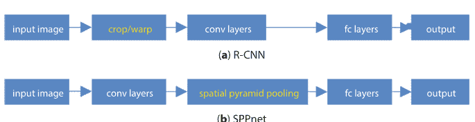

图 8.2 RCNN 与 SPPnet 的比较。

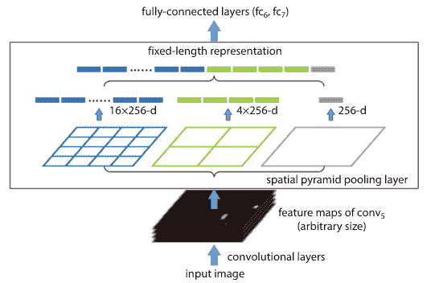

图 8.3 池化。

### 8.8 对象定位的挑战

尽管目标识别在过去几年中取得了惊人的进步，但在推进对象发现的发展时，它仍然面临许多困难。在接下来的章节中，将探讨三种常见且典型的对象发现难题，并介绍一些解决方案 [18]。

#### 8.8.1 尺度变化问题

由于物体到相机的距离可能不同，不同尺度的物体通常会出现在图像上。因此，尺度变化是对象定位的一个不可避免的问题。尺度变化的解决方案可以分为两大类：
- 基于图像金字塔的策略
- 基于特征金字塔的技术

一般来说，基于图像金字塔的策略最初将原始图像调整为各种规模，然后使用相同的检测器分别识别重新调整大小的图像。基于特征金字塔的技术最初根据输入图像生成多个不同目标的多个特征图，然后使用不同的特征图来识别不同尺度的物体 [19]。

从一开始，深度对象定位就采用图像金字塔来识别不同尺度的物体。RCNN、SPPnet、Fast RCNN 和 Faster RCNN 均采用图像金字塔进行对象识别。在准备阶段，CNN 检测器基于给定规模的图像进行训练。在测试阶段，图像金字塔用于多尺度对象识别。一方面，它通常会导致准备和测试推理之间的不一致。另一方面，图像金字塔中的每张图像都分别输入到 CNN 网络中。因此，这也非常耗时。

事实上，CNN 中不同目标的特征图可以被视为特征金字塔。如果使用不同目标的特征图来识别不同尺度的物体，可以避免调整输入图像的大小，从而加快识别速度。因此，基于特征金字塔的技术变得流行。研究人员在基于特征金字塔的策略方面进行了许多努力。面向行人定位的尺度感知 Fast RCNN（SAF RCNN）。基础网络分为两个子网络，分别用于大尺度步行者识别和小尺度路人发现。给定一个识别窗口，最终识别分数是两个子网络的加权和。在


当发现窗口通常很大时，大尺度网络具有中等较大的权重。在识别窗口中等较小时，小尺度网络具有通常巨大的权重。Yang 等人提出了尺度依赖型池化（SDP）用于多尺度对象发现，以处理尺度差异问题。它基于 Fast R-CNN 架构。建议框由特定搜索策略分离。根据建议框的高度，SDP 按建议框的高度从各种卷积层汇集建议框的特征。如果物体建议框的高度属于 [0, 64]，SDP 从第三个卷积块汇集特征图。如果物体建议框的高度属于 [18]，SDP 从第四个卷积块汇集特征图。如果物体建议框的高度属于 [128, +INF]，SDP 从第五个卷积块汇集特征图。由于 ROI 池化层的特征图从各种卷积层汇集而来，用于分组和查找建议框的三个不同子网被分别单独训练。

大体上，Faster R-CNN 需要通过在固定卷积层（例如 VGG16 的 conv5_3）上滑动 RPN 来生成建议框。由于卷积层的感受野中等固定，它无法很好地协调所有对象的跨度。前一卷积层的感受野通常较小，更好地协调小尺度对象，而最后一卷积层的感受野中等较大，更好地协调大尺度对象。为解决此问题，使用多尺度深度卷积神经网络（MS-CNN）来生成各种尺度的对象建议框。上图 8.2 展示了 MS-CNN 的设计。它从不同目标的各种卷积层中产生建议框。每个卷积层中的锚框若与真值边界框的 IOU 覆盖超过 0.5，则标记为正样本。每个卷积层中的锚框若与所有真值边界框的 IOU 覆盖低于 0.2，则标记为负样本。

#### 8.8.2 遮挡问题

物体遮挡非常常见。例如，发现街景中大部分行人（约 70%）在至少一帧中被遮挡。因此，检测被遮挡的物体对于计算机视觉应用至关重要。在过去十年中，科学家们已进行了大量努力来解决遮挡问题。

研究发现，如果行人的几个部分被遮挡，相关区域的块特征会持续对线性分类器的块分数产生响应。基于这一现象，他们提出利用每个块的分数来判断相关区域是否被遮挡。基于每个块的分数，遮挡概率图通过均值移位法进行分割。如果发生遮挡，则在未被遮挡的区域上应用部件标识符以生成最终定位结果。

为了提升被遮挡行人的发现性能，提出了学习一组遮挡专用行人查找器的方法。每个通用定位器针对特定类型的遮挡。遮挡可分为三种独特类型：来自底部的遮挡、来自右侧的遮挡和来自左侧的遮挡。对于每种类型，遮挡程度从 0% 到 50%。分别训练了八个剩余/右侧遮挡标识符和 16 个来自底部的遮挡定位器。获得这些分类器的一种朴素策略是单独训练所有遮挡级别的分类器。但是，这非常耗时。为减少训练时间，提出了 Franken-分类器。它们先训练全身单侧分类器并剔除弱分类器以生成主遮挡分类器。主遮挡分类器的额外弱分类器也在无偏差的情况下被学习。与主遮挡分类器类似，第二遮挡分类器被发现依赖于主遮挡分类器。基于 Franken-分类器，训练这组遮挡专用行人标识符只需要十分之一的计算成本。

#### 8.8.3 变形问题

物体变形可能由非刚性变形、类内部形状波动等引起。例如，个人可以跳跃或蹲下。因此，良好的物体定位策略应对物体的变形具有鲁棒性。在 CNN 出现之前，分析人士已进行了大量努力来处理变形。例如，DPM 利用多尺度可变形部件模型的组合（即一个低分辨率根模型和六个高分辨率部件模型）来处理变形。HSC 进一步将稀疏码直方图整合到可变形部件模型中。为了加快 DPM 的识别速度，还提出了 CDPM 和 FDPM。Park 等人提出通过可变形部件识别大尺度行人，并通过刚性格式来建模和识别小尺度行人。Regionlets 通过一组具有各种大小和视角比例的小子区域来表示区域。

### References

- 1. Abhishek Kumar & Jyotir Moy Chatterjee & Pramod Singh Rathore, 2020. “智能手机对抗性应用程序与安全问题,” International Journal of Risk and Contingency Management (IJRCM), IGI Global, vol. 9(2), pages 1-18, April.
- 2. Bhargava, N., Bhargava, R., Rathore, P. S., & Kumar, A. (2020). 利用 Gabor 滤波器和回归挖掘算法提取特征向量的纹理识别。International Journal of Risk and Contingency Management (IJRCM), 9(3), 31-44. doi:10.4018/ IJRCM. 2020070103.
- 3. Cai, Z. Fan, Q., Feris, R. S., and Vasconcelos, N.: 一种用于快速对象检测的统一多尺度深度卷积神经网络。in Proc. Eur. Conf. Comput. Vis. (2016).
- 4. Dollár, P., Wojek, C., Schiele, B., and Perona, P: 行人检测：对最新技术的评估。IEEE Trans. Pattern Analysis and Machine Intelligence 34(4), 743–761 (2012).
- 5. Felzenszwalb, P. F., Girshick, R., and McAllester, D.: 基于可变形部件模型的级联对象检测。in Proc. IEEE Conf. Computer Vision and Pattern Recognition (2010).
- 6. Felzenszwalb, P., Girshick, R., McAllester, D., and Ramanan, D.: 基于判别式训练部件模型的对象检测。IEEE Trans. Pattern Analysis and Machine Intelligence 32(9), 1627–1645 (2012).
- 7. Girshick, R., Donahue, J., Darrell, T., and Malik, J.: 用于精确对象检测和语义分割的丰富特征层次结构。in Proc. IEEE Conf. Computer Vision and Pattern Recognition, (2014).
- 8. Kumar Sahwal, ..., Kishore, ..., Singh Rathore, ..., & Moy Chatetrjee, .... (2018). 基于 ECC 交换概念的图像加密循环技术的先进方法。International Journal Of Recent Advances In Signal & Image Processing, 2(1).
- 9. Kumar, A., Chatterjee, J. M., & Diaz, V. G. (2020). 一种针对电子邮件钓鱼的新型 SVM 与 NLP 和概率神经网络混合方法。International Journal of Electrical and Computer Engineering, 10(1), 486.
- 10. Li, J., Liang, X., Shen, S., Xu, T., and Yan, S.: 针对行人检测的尺度感知 Fast R-CNN。CoRR abs/1510.08160 2015.
- 11. Mathias, M., Benenson, R., Timofte, R., and Van Gool, L.: 使用 Franken-分类器处理遮挡。in Proc. Int. Conf. Comput. Vis. (2013).
- 12. N. Bhargava, S. Dayma, A. Kumar and P. Singh, “在 WEKA 中使用简单 CART 算法进行分类的方法，” 2017 11th International Conference on Intelligent Systems and Control (ISCO), Coimbatore, 2017, pp. 212-216, doi: 10.1109/ISCO.2017.7855983.
- 13. Naveen Kumar, Prakarti Triwedi, Pramod Singh Rathore，“基于椭圆曲线密码学 (ECC) 的图像自适应水印的自适应方法”，First International Conference on Information Technology and


知识管理 第89–92页, ISSN 2300-5963 ACSIS, Vol. 14 DOI: 10.15439/2018KM19.

14. Park, D., Ramanan, D., and Fowlkes, C.: 目标检测的多分辨率模型. 载于 欧洲计算机视觉会议论文集 (2010).

15. Rathore, P.S., Chatterjee, J.M., Kumar, A. et al. 基于中继方法的WSN节点簇头节能选择. 超级计算机期刊 (2021). https://doi.org/10.1007/s11227-020-03593-4.

16. Ren, S., He, K., Girshick, R., and Sun, J.: 更快R-CNN: 基于区域建议网络的实时目标检测. 载于 神经信息处理系统进展论文集 (2015).

17. Ren, X., and Ramanan, D.: 用于目标检测的稀疏码直方图. 载于 IEEE计算机视觉与模式识别会议论文集 (2016).

18. Singh Rathore, P., Kumar, A., & Gracia-Diaz, V. (2020). 基于蜻蜓算法的先进簇头选择以改进RFID网络寿命的整体方法论. 交互多媒体与人工智能国际期刊, 6 (常规期刊), 8. http://doi.org/10.9781/ijimai.2020.05.003.

19. Wang, X., Han, T. X., and Yan, S.: 具有部分遮挡处理功能的HOG-LBP人体探测器. 载于 IEEE计算机视觉与模式识别会议论文集 (2008).

## 9. 云计算与深度学习的分类

迪沙·夏尔玛

印度阿杰默 MDS 大学

电子邮件: dishash...@gmail.com

### 摘要

云计算是一种利用网络和远程服务器来提取或存储数据和应用程序的技术。云计算以服务模型池的形式提供其服务和资源，即软件即服务(SaaS)、平台即服务(PaaS)和基础设施即服务(IaaS)，而深度学习标准面临的问题是，像SVM这样的浅层模型深受维度灾难的影响。作为两阶段学习计划的一个模块，该计划包含多个非线性管理层，许多显著的强健特征在逻辑上与证据分离。与尖端模型相比，深度学习中现有的授予ESANN的教学训练具有独特的咨询精妙之处，并导致了对这种学习方法的当前理解，这为某些困难的分类活动提供了方向。因此，在本章中，我们将了解云计算和深度学习如何凭借其新改进的技术席卷全球，并了解它们在不同应用方面的应用、优势、劣势和相关性。

**关键词:** 云计算, 深度学习, CNN, ANN, RNN, SVM, 等.

### 9.1 云计算简介

#### 9.1.1 云计算

云计算是计算机系统资源（尤其是信息存储（云存储）和计算能力）按需可用，且无需客户端进行直接的主动管理。这意味着云计算是通过互联网提供服务器、数据处理、软件、存储和智能等计算服务，以实现更快速的变化、灵活的资源和规模经济。

该术语常用于指代通过Web向众多客户端提供数据的数据中心。高性能云通常拥有从中心节点分布到多个区域的区域。如果与客户端的关系足够接近，则可以将其指定为边缘节点 [1]。

云计算依赖于资源的分布以实现一致性和高水准的规模经济。偏好公有云和混合云的人可以规避或降低前端成本。云服务提供商独特地采用“按量付费”模式，如果主管不熟悉云定价模型，这可能导致意外的运营支出。

高比例网络、低成本计算机和存储设备的可用性，以及硬件虚拟化、面向服务架构和自动化及实用计算的广泛认可，推动了云计算的大幅增长。

云计算背后的基本概念是，服务的位置以及许多属性（如正在执行操作的硬件或操作系统）对用户来说都是次要且不重要的基础。请记住，“云”的隐喻源自旧电信网络示意图，其中公共电话网（后来是互联网）常被表示为云，以表明它并不重要；它就像一团东西。这当然是一种过度简化；对许多客户来说，其服务和数据的位置仍然是一个主要问题 [2]。

#### 9.1.2 云计算：历史与演变

在IT新兴时代，客户端-服务器模型随工作站和胖客户端应用一同广受欢迎。当时在中央处理单元中存储数据成本非常高，工作站连接所有模型并通过窄通道向客户端提供其服务。随着大容量存储容量计划的推出，许多提供此类服务的公司因存储大量数据和信息序列而获得了巨大的声誉。

1990年，互联网概念已有足够数量的机器连接到其中，而这些机器的互联共同形成了一个单个组织或机构无法实现的巨大存储池。因此，引入了“网格”的新概念。“网格”术语被认为是云计算的一部分，因为这两种技术都是通过连接计算机网络形成单一链式连接而构建的。网格要求使用面向应用程序的程序，将单个任务系统分割成数千台更小的机器。网格计算面临的唯一缺点是，如果一个主要节点无法工作，所有其他节点可能也无法执行进程。因此，网格计算未能证明其非常高效 [3]。

当我们看问题的另一面时，云计算采用并建立在网格的主要理念之上；其中之一是仅在用户端提出需求时才提供资源和服务 [4]。

云计算技术的第一个里程碑是在1999年由salesforce.com实现的。它推出了一种通过网站传输创新应用程序的方法。他们涵盖了专业和传统的IT公司，以展示自身。

第二步是由Amazon Web Services在2002年中期迈出的，当时它们借助Amazon Mechanical Turk尝试公开云服务 [5]。此后，它们推出了Elastic Cloud Compute，它作为一种Web服务，为建立业务提供了平台，并可以轻松在其桌面上运行。面向所有人的首个云被推出并命名为EC2-S3。这几乎与Google推出Web 2.0的时间相同，Google以及许多其他公司开始在同一平台上协作提供基于浏览器的服务。

最后，微软的Azure问世，微软和Google都以深远的方式提供服务，使数据获取更加可靠和容易，将Web带到了新的高度。

#### 9.1.3 云的工作原理

云是一个用于存储可通过互联网共享的数据的空间池。云应用程序从根本上由两个层组成：一个是主机，另一个是托管组织。这些托管组织负责管理提供安全性、计算能力和存储容量的大型数据中心 [6]。

为了理解云系统如何工作，必须将其分为前端和后端两个部分。它们通过网络（通常是互联网）相互连接。前端是计算机用户或客户端的一侧。后端是系统的“云”部分 [7]。

所有层都发挥各自的作用，并作为一种层次结构的组合架构协同工作，这意味着一个层的输出被作为另一个层的输入。其统计数据与前端协同工作，例如


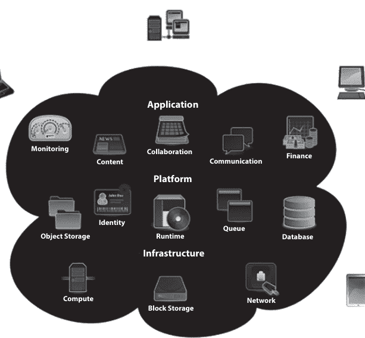

图 9.1 云计算。

客户端的桌面面板、网络或连接用户与云的用户界面等。架构的后端以多样化的方式扩展计算机、存储、服务器等，如图 9.1 所示。

如今，从数据处理到高带宽视频游戏，一切都依赖云端，每种类型或应用程序都拥有其自身兼容的服务器。尽管许多大型公司和品牌正在向云端迁移，但还有大量其他公司。公司可以将其权利出售给大型云企业，以便在其云端存储数据，例如，当您从任何网站下载一首歌曲时，它会自动出现在您的 iTunes 文件夹中 [8]。

通常，云计算遵循三种交付模型：

- 1. 公有云：公有模型是主要模型，具有巨大的贡献。以下生态系统面向客户展示，并可通过公共网络空间访问。客户无需担心任何组织所有权问题。

- 2. **私有云：** 私有云不同于语言基础信息局。员工和资源都必须获取数据中心和私有云。私有模型继承了与公有云相似的灵活性。但是，在私有云中，生态系统的设计旨在具有与公有云相似的资源共享和可扩展性，但安全性更好，因为只有所有者才能访问此特定空间。

- 3. **混合云：** 该交付模型包含公有云和私有云模型的功能和规范。在此模型中，两种云通过互联网相互互连，并根据客户需求交替提供资源；这意味着私有云未能完成或失效的那些职责，可以借助公有云来解决。此类技术在灾难恢复等情况下被证明非常重要。

#### 9.1.4 云计算的特点

- 1. **按需自助服务：** 云计算服务无需任何人工协助即可处理、评估、观察或管理计算资源，并可以根据自身需求轻松自行完成这些操作。

- 2. **广泛网络访问：** 由于广泛网络面板的可用性，许多用户可以同时访问资源和服务。

- 3. **快速弹性：** 经常经过计算算法处理的服务需要某些基于信息技术的资源，这些资源可以按需快速识别优缺点。当用户请求服务时激活，并在需求满足后尽快提供结果。

- 4. **资源池化：** 提供的 IT 资源横向公开到多个租户中，并以关联方式占用。多个客户从同一物理资源获得服务。

- 5. **计量服务：** 资源消耗模式针对每个租户和占用者进行计量，并为用户和资源提供者提供已使用内容的详细报告。这样做出于各种原因，例如监控、计费和高效利用资源。

#### 9.1.5 不同类型的云计算服务模型

云计算中的模型旨在为客户提供可随时使用的可配置资源池。这些资源可以是服务器、应用程序、网络服务、存储、配置工具等 [9]。这些服务可以尽可能快地提供，并可在最小管理努力下受限或公开。自云计算发明之日起便不断发展，并在其发展过程中分化为三大主要服务模型：

- 基础设施即服务 (IAAS)
- 平台即服务 (PAAS)
- 软件即服务 (SAAS)

让我们详细了解这些服务模型：

#### 9.1.5.1 基础设施即服务 (IAAS)

当我们参与项目时，需要许多资源在截止日期前完成任务，但开展任何工作的唯一资源是虚拟化计算资源，而这种突出资源由 IaaS 模型提供。IaaS 基本上是一种模型，其中客户空间中的第三方提供不同类型的便利设施，例如硬件、软件、基础设施组件等。根据这些要求，IaaS 提供商按照需求广播应用程序，并逐一解决任务，例如维护系统备份或规划灵活性 [10]。IaaS 提供商提供高度可扩展且可根据用户需求操作的资源。由于这些特性，许多用户将这些资源用于实验或临时目的。IaaS 的范围还包括自动化管理任务、桌面可视化和基于策略的服务。IaaS 市场目前还不算很大，其进一步发展需要持续的资金投入。在这方面，Open Stack 正在提供其最佳服务，以实现云组织可能期望达成的每个目标。

#### IAAS 网络

公有云向世界展示了两种主要网络服务提供商：负载均衡和域名系统。域名系统通过为计算机、游戏设备等提供唯一的分层标识系统来工作。DNS 使用 IP 地址来检测网络 [11]。负载均衡与 DNS 相反，为多个用户创建单个访问点。借助一些负载均衡算法实现，因此我们可以说，负载均衡器是一组网络设备，使用指定的负载均衡算法在多个服务器之间分配网络流量。

#### 9.1.5.2 平台即服务 (PAAS)

当我们在 IT 组织工作时，我们知道不时需要进行应用程序管理或升级是基本需求。PaaS 或平台即服务模型通过其自身基础设施，通过互联网向客户提供硬件和软件。这意味着 PaaS 授予其员工安装内部硬件和软件应用程序的权限，以便他们可以开发或执行新应用程序。

您的业务并非由 PaaS 提供商承担，但其主要依赖于其服务，例如托管相关应用程序或 Java 增强。为完成所有这些，PaaS 提供商首先通过网页登录启动流程。然后，他根据用户参与的时间周期向用户提供收费单，随后根据用户需求激活其服务 [12]。

PAAS 模型的重要特征可以是：

- 可扩展性
- 基本资源自动交付
- 安全性
- 冗余

#### 9.1.5.3 软件即服务 (SAAS)

顾名思义，SAAS 是一种主要用作软件分发系统的模型，其中应用程序由服务提供公司托管，并通过互联网向其客户开放。随着需求的增长，SaaS 已成为最突出的交付模型，类似于由基础技术支持的 SOA 和 Web 服务。一些基于相同根基的新技术也变得非常热门。一些新兴的服务模型或类似 ASP 的模型，其输出反映了 SaaS 的影子，如图 9.2 所示 [13]。

使用 SAAS 模型的重要要点如下：

- 轻松监督
- 自动更新和管理覆盖

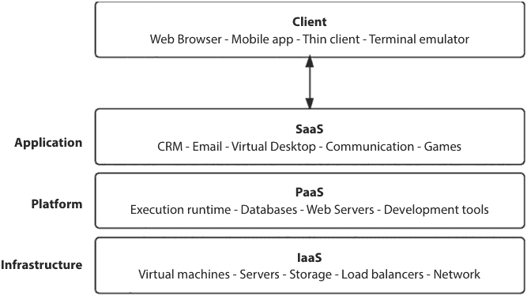

图 9.2 服务模型。

- 在兼容性方面，所有客户都拥有相同的更新版本软件
- 因相同目标而建立的紧密合作关系
- 全球可访问性

#### 9.1.6 云计算的优势与劣势

如今，云计算正在塑造我们的生活和工作。无论我们是否欣赏它，它都已成为我们生活中固有的一部分。各种备受瞩目的公司和行业正在将资金投入云计算。但是，正如我们所知道的，没有什么是 100% 完美的，云计算也不例外。尽管它优势显著，但包含一些不容忽视的关键风险和担忧。因此，让我们详细讨论云计算的优势与劣势。

#### 9.1.6.1 云计算的优势

云计算是一项新兴技术，几乎每家公司都在将其用作基础技术进行转换。让我们看看以下优势，了解为什么云优于其他基础技术，如图 9.3 所示。

- **成本效益：** 公司转移兴趣的主要原因是，无论是本地部署


技术，云计算的成本显著降低。因此，公司不再需要将信息存储在 CD 上；云提供了巨大的存储空间以及跨行星、可兑换的资金和资源。

- High Speed: 云计算使我们能够快速建立服务，且所需精力极少。这种快速部署允许在几秒钟内访问设备所需的资源。
- Excellent Accessibility: 在云的笼罩下，无论身处何地，我们都可以从任何地方访问数据，便携式机器也让技术访问变得更加容易。
- Back-up and Restore Data: 云计算提供强大的备份支持。与其他设备不同，一旦数据存储在云中，就可以轻松创建其备份，从而免受数据丢失的压力。
- Manageability: 在 SLA（服务等级协议）的标准规则下，云计算确保每位客户都能获得无缝、准时保证的服务交付，并负责管理和维护所有基于 IT 的应用和服务，从而使其对客户来说更加可靠。


图 9.3 云计算的优势。

- Sporadic Batch Processing: 我们可以根据需要在云环境中添加或减少任何资源。这意味着，如果我们不按固定时间段工作，就不需要为服务付费；我们可以轻松地针对该时间段扣除费用，并在需要时再次添加。

- Strategic Edge: 云计算提供一系列最新、面向时间且价格亲民的应用程序，帮助您在竞争对手中脱颖而出。它们试图激励客户组织，通过接管所有手动工作并让他们专注于竞争（通过提供访问最受关注应用程序的权限）来击败所有人。

#### 9.1.6.2 云计算的劣势

每种技术都有其高度重要的正反两面，应该在实施之前进行讨论。前面提到的要点总结了使用云服务的优势，而下面的讨论将概述云计算可能的劣势。

- Vulnerability to Attacks: 云是一种非常新的技术，如图 9.4 所示，攻击者即使在非常大的公司中也存在已久。因此，云计算也可能面临数据泄露，这显而易见。这是因为云完全位于互联网上，因此组织不应将重要文档放在云上。

- Network Connectivity Dependency: 在企业界，有很多天不得不在互联网中断相当长一段时间的情况下工作。由于云完全依赖互联网，缺乏互联网会导致公司损失，因为他们无法从云中访问重要数据。

- Downtime: 当大量人员尝试访问单个服务器时，可能会出现缓冲、断电、缺乏互联网连接、速度丢失等技术问题。这会导致服务停机。停机是云用户面临的主要故障之一。

- Vendor Lock-In: 当发生需要从一个云服务切换到另一个云服务的情况时，公司会面临一些重大问题。这是因为供应商平台可能无法提供您所需的适当控件，可能会造成支持和可靠性问题，可能会要求额外的支持工具费用，可能会出现配置复杂性，或者在最坏的情况下，公司的重要数据可能会丢失或无人看管，使其容易受到攻击者的入侵。


图 9.4 云计算的劣势。

- Limited Control: 通常在云的广阔笼罩下工作的公司面临无法获得云所有功能 100% 访问权限的问题。这是因为云服务提供位于偏远地区的云服务器，用户无法获得某些控制权限，这让客户感到控制权有限。

### 9.2 深度学习简介

深度学习是 ML 家族中一个更高级的分支，它在计算机中通过表征学习构建人工神经网络环境。从技术术语来看，我们可以将深度学习定义为一类机器学习算法，该算法使用多层来从原始输入数据中逐步提取更高级别的属性。例如，在图像处理中，较低的层可能会指出边缘，而较高的层可能会指出与人类相关的概念，例如数字、字母或面孔。

机器学习是数据科学的一个领域，致力于根据无需特定编程的统计公式从数据中获取算法。机器通过向另一台机器发送一组正确的输出来学习，这些输出被视为一组输入（即哪些特征很重要以及要控制什么），然后通过为机器提供大量的训练集来学习。随着时间的推移，机器在许多基于概率的模型中进行调整，并生成最适合数据的算法。现在，当向机器提供新数据时，机器会根据其所学到的所有内容进行预测。这是监督学习，我们告诉计算机它是否正确，但也存在非监督学习 [14]。

#### 9.2.1 深度学习的历史与革命

深度学习历史书中的前两个词是“Warren McCulloch 和 Walter Pitts”。正是这两个人赋予了梦想生命，即构建一款受真实人脑运作启发的基于计算机的神经网络。他们将数学方程与计算机算法相结合，为计算机创建了思考过程。此后，正如历史所表明的那样，深度学习的生命周期达到了新的高度。

下文介绍了其中一些杰出成就和成就者。

#### 9.2.1.1 深度学习算法的发展

1965 年，Grigoriev Litvinenko 和 Valentin Grigoriev Lapa 在深度学习发展的漫长旅程中迈出了第一步。他们使用了用于静态分析和解决问题的多项式函数。此后，由于缺乏资金，AI 的发展出现了中断，但团队的热情和好奇心并未减弱，他们在没有任何薪水的情况下继续在该领域进行研究。

当 Kunihiko Fukushima 提出一种具有不同类型池化和卷积分支的神经网络设计时，他的名字就在深度学习的历史上以金色墨水书写。他于 1979 年使用分层和多层设计开发了一种 ANN“Neocognitron”，通过该设计，计算机本身能够识别、检测或记忆视觉模式 [15]。

#### 9.2.1.2 反向传播的 FORTRAN 代码

20 世纪 70 年代，反向传播算法的演变发生了。这是一种用于为 DL 模型提供训练的算法类型。Seppo Linnainmaa 以其 FORTRAN 代码引入了 BPA，并引起了全世界的关注。尽管它在 20 世纪 70 年代扩展了分支，但直到 1985 年 Rumelhart 和 Hinton Williams 迈出一步后，它才被引入神经网络。这一步导致了许多有趣的分布式表示的大规模涌现 [16]。

1989 年，在贝尔实验室，Yann LeCun 阐述了反向传播的第一个实际应用。在该应用中，他结合了两大力量——常规神经网络和反向传播算法，以便可以轻松扫描和读取手写数字。

1985 年至 1990 年之间发生了一个大爆炸，当时 Vladimir Vapnik 和 Corinna Cortes 创建了一个用于分析和对应数据路线图的支持系统。1997 年，Juergen Schmidhuber 和 Sepp Hochreiter 引入了 LSTM 以实现 RNN。

此后，在 1999 年，当计算机掌握了高速 GPU 处理时，计算机的速度在 10 年的生命周期内提高了 1000 倍。这个时期宣告了神经网络与支持向量机之间的较量开始。

#### 9.2.1.3 2000 年代及以后的深度学习

新世纪初将深度学习推向了进步的新高度。在 2000 年代初期，官员们遇到了消失梯度问题。在这个问题中，架构的上层无法识别较低层的特征，原因是学习信号检测出现故障。该问题仅限于基于梯度的学习方法。由于这个问题，输入数据的范围显著增加，而输出范围减少，使其陷入混乱。第二次爆发发生在 META 组关于 3D 数据增长机遇与挑战的论文发表时。这项研究指出了大数据的敌意，并解释了数据速度和数量与数据源和类型成正比。此后，在 2009 年，在 Fei-Fei Li 的指导下，科学家和 AI 专业人员积累了一个独立性质的数据库，包含约一千四百万张按类别排序的图像。这些图像


作为输入引入系统，以向神经网络提供识别训练 [17]。随后，直至2011年，该部分通过在无需逐层预训练的情况下对网络进行训练来进行更新。在速度和效率方面，深度学习已确立了非常高的标准。

#### 9.2.1.4 猫实验

猫实验是深度学习领域的一项惊人进展，于2012年由“Google Brain”向世人介绍。这是一个非常基础却又创新的实验，探索并展示了我们在使用无监督学习时面临的问题。在此实验中，约1000台计算机作为神经网络相互连接，处理来自一千万张随机图像。从YouTube选取的图像被随机分组呈现。一组是猫，另一组是人脸，图像未提供任何关于描述或名称的适当信息。随后，这两组图像作为输入呈现给软件。软件通过分析这些数千张图像来训练自身，以确定猫的外观与人的外观之间的区别。它还提供了最接近的概率图片，以显示是猫还是人脸，如图9.5和图9.6所示。


图 9.5 实验。


图 9.6 猫实验。

### 9.2.2 神经网络

#### 9.2.2.1 人工神经网络

人工神经网络（Artificial Neural Networks，ANN）本质上是一种受人类大脑生物神经网络启发的神经系统，用于处理刺激数据。该系统通过适当规划来学习完成任务，无需面向任务的编程。让我们设想一个实验，系统通过检查包含海龟和其他动物的数千张图像来训练以识别海龟。在这种情况下，如果我们向机器提供一张图像，它可以通过扫描轻松识别该图像是否为海龟。这些应用通常用于用户难以正确向计算机算法表达自己的情况。随着时间的推移，随着用户需求的增加，ANN也通过将注意力集中在匹配特定心智能力上，引导偏离生物学（例如反向传播，即沿相反方向传递信息），并调整网络以反映该信息，从而对自身进行了更新。

ANN由小型人工神经元组成。每个神经元都包含一个彼此之间的桥梁，有助于将信号从一个神经元传递到另一个神经元。接收端的神经元提取信号的结果，然后再将其传递给较低层级的神经元。神经元可能包含0到1之间的某个值（作为实数计算），它还带有一个权重，用于确定信号的强度。

神经网络目前仍被用于完成许多复杂任务，即语音识别、社交网络站点中的过滤引入、棋盘和视频游戏以及医疗诊断。自2017年以来，ANN包含的桥梁数量从数千到数百万不等。尽管这些数字远少于人类大脑中存在的神经元数量，但它们执行复杂任务的速度远快于人类大脑所能达到的速度 [18]。

#### 9.2.2.2 深度神经网络

正如其名称所示，深度神经网络（Deep Neural Network，DNN）是对神经网络的深入研究，其中网络的输入层和输出层之间存在多个相互连接的层。DNN发现了许多经过验证的数学方程和操作，以便通过对线性或非线性输入数据应用这些方程和操作来获得增强的输出。当网络遍历每一层时，它会评估每一层的概率以确定输出。一个完美的例子是：DNN被训练用于识别蜘蛛物种；如果我们向系统提供一张蜘蛛图像以识别其物种，为了完成这项任务，它将首先扫描图像，然后尝试计算图像中的蜘蛛与数据库中存在的物种类型匹配的概率。获得结果后，用户可以设置机器必须显示的概率限制。

DNN被编程用于生成复杂的非线性相关性；这意味着它的系统创建模型，其中对象被表示为原始配置层。作为额外扇区添加的层会获取来自较低层的组件和属性，这些较低层可能正在使用在低级网络上执行的单元进行建模。深层架构中包含了许多具有基本方法的变量，每种架构在特定架构中都取得了成功。除非已对类似数据集进行了评估，否则尚未得出任何类型架构性能反转可能的结论。

基于DNN网络的数据流在输入层和输出层之间流动时不包含任何循环。DNN中表示数据流的步骤如下：首先，DNN生成虚拟神经元映射，然后，为它们之间共存的每个关系分配一个随机值 [19]。然后将这些值和输入相乘，返回0到1范围内的值。如果网络未能检测到数据提供的模式，算法会重新调整提供给向量之间关系的随机值。这种算法验证过程将持续进行，直到获得适当的结果。

### 9.2.3 深度学习的应用

#### 9.2.3.1 自动语音识别

在深度学习领域，最突出的应用是自动语音识别。它是大规模语音识别最具说服力且幸运的是最熟练的方法。为了识别分布在不同时间步中的多秒时区语音识别，我们使用基于LSTM的RNN。在此处，在LSTM中，单个步骤相当于10毫秒，并且是用于不支持某些特定任务传统语音识别方法的门。

该应用的识别起源于一个非常小规模的观点，该观点由TIMIT提出。在此处，该数据集用于涵盖约六百三十位说话者，他们掌握大约八种美国地区语言。在此处，对于每一次语音生成，一个人朗读十句话。由于其体积非常小，设备可以根据需要多次自行配置。此外，TIMIT专注于音素序列识别，而不是单词序列识别，以便使用较高RAM语言模型呈现较弱的音素。这导致传统语音识别方法的强度增加，并变得更容易被分析。在当今世界，所有主要语音识别模型都在商业级别上存在，例如Xbox、Apple Siri、Alexa等，都基于深度学习。

#### 9.2.3.2 肌电图（EMG）识别

识别用户执行特定任务的目的有点像是一个困难的类比。在一个人一生中，有许多情况下他需要完全依赖机器；在这种情况下，机器需要理解客户执行此命令的实际目的。通过肌电图（EMG）来完成识别用户以获取设备控制权的目的这一任务。智能轮椅、假体设备和外骨骼是依赖于此技术的某些示例。

起初，密集神经网络正在使用，但随后，研究人员借助频谱图将EMG信号进行映射，然后利用这些信息将其作为输入提供给深度卷积神经网络。最近，端到端深度学习正在被用于追踪信号，以便它可以直接识别用户的目的。

#### 9.2.3.3 图像识别

MNIST基本上是对图像进行测试以评估和表征其模式。它由大约六万个手写数字和大约一万个在其上进行测试的示例组成。在TIMIT的情况下，其小尺寸成为一个突出因素，允许用户对其执行多次测试。深度学习已证明自己在图像识别方面产生比人类本身更准确的结果。其中一个例子是面部畸形新颖分析。


#### 9.2.3.4 视觉艺术处理

深度学习应用的进步范围，通过将视觉图像处理技术引入世界，已达到顶峰。在此过程中，DNN 发挥了主要作用，为神经风格迁移提供了网关，以扫描所提供艺术的风格，并以面向视觉的方式将其应用于奇思妙想的图片或视频技术，确定有关艺术作品的事实信息，并参考随机选择的视觉输入字段，创造出引人注目的图像。

#### 9.2.3.5 自然语言处理

语言处理与实现一直是神经网络领域最伟大的成就。该研究始于 2000 年代初期，当时使用了 LSTM 来提升机器的解释能力和语言建模。

在这项操作中，存在一些关键能力可以引导我们完成语言解释任务。在深度学习架构中，词嵌入作为一种表示层，有助于重建原子词，并以与数据集中其他单词相关的结构形式对其进行表示。这些数据集在向量中的位置称为点。借助 RNN 或输入层，词嵌入用于解析短语和长句子。其背后的主要技术是高效构成性向量语法。在词嵌入之上，构建了自编码器以检测改写并获取句子中的相似性。以构成性向量形式出现的语法被视为 PCFG（概率上下文无关文法），由 RNN [20] 提出。

近年来有许多进展，为我们从词嵌入推广句子嵌入提供了更好的方法。谷歌翻译和谷歌神经机器翻译使用以下技术，使机器能够通过学习数百万个示例来独立阅读和解释单词，掌握数百种语言的知识，并编码句子的语义，取代短语对短语的记忆，实现全部翻译。

#### 9.2.3.6 药物发现与毒理学

大量竞争药物未能获得行政认可。这种失望源于疗效不足、连接持久性差或未启动的致命影响。研究人员考察了使用深度学习来预测生物分子靶点、脱靶以及补充剂、家居用品和药物中环境合成化合物的毒性影响。

AtomNet 是一种用于架构审慎药物图结构的深度学习框架。AtomNet 用于预测针对疾病靶点的原始候选生物分子，例如埃博拉出血热病毒。2019 年，生成式神经系统被用来向小鼠输送经过临时批准的粒子。

#### 9.2.3.7 客户关系管理

深度增强学习正在用于推测基于 RFM 因素的可能直接广告活动的价值。评估的价值函数似乎对客户终身价值具有直观的理解。

#### 9.2.3.8 推荐系统

提议框架利用深度学习来分离重要特征，以根据特定要求推荐更好的音乐、数据或期刊。为了从多个领域吸取客户偏好，应用了多视图深度学习。该模型利用多维协作、基于内容的方法，并改进各项任务中的推荐。

#### 9.2.3.9 生物信息学

为了预测基因本体论观察和基因-功能关联，我们在生物信息学中使用自编码器 ANN。

#### 9.2.3.10 医学图像分析

深度学习取得了显著成果，展示了其在基于医学的应用中的强大掌控力，其中包括病变检测、器官分割、癌细胞表征和图像增强。

#### 9.2.3.11 移动广告

为实现多样化推广目的而寻找合适的便携受众，在此领域仍需测试。一旦对所有信息的重点进行彻底分析，任何推广人员都可以创建并使用目标分组来投放广告。深度学习正在用于解读庞大的多维广告数据集。在请求 - 投放 - 点击网络广告循环中，已收集了大量数据点。所获数据构成了 AI 恢复广告决策的基础 [21]。

#### 9.2.3.12 图像修复

诸如去噪、高分辨率、修复和电影着色等问题，是深度学习正在应用于此类问题的逆序问题，以最大限度提高其效果。以下应用融入了理解技术“用于手术式图像翻新的收缩字段”，该技术在图像上进行训练。

#### 9.2.3.13 金融欺诈检测

深度学习充当检测金融欺诈和洗钱的有效平台。“深度反洗钱识别框架通过发现和感知信息中的关联和相似性，并学习如何识别特定事件发生中的异常，发挥着奇效”[17]。该方案同时使用受监督和非受监督学习技术。

#### 9.2.3.14 军事

许多国家的国防部门已开始应用深度学习方法，在国防领域产生新思路。

### 9.3 结论

阅读本章后，我们可以准确地得出结论：云计算和深度学习都是非常近期的技术扩展，具有对世界产生重大影响的能力。云计算具有许多优势，例如向用户和企业交付服务、为企业提供巨大帮助，以及通过减少保护和软件促销的支出来降低运营成本，从而更加注重业务本身。但是，尽管有匿名数量的优势，云计算也必须克服许多挑战。深度学习是机器学习家族的一部分，它为计算机提供训练，使其能够执行人类大脑中自动产生的任务。在深度学习中，计算机模型尝试通过扫描图像、文本或声音来自行完成分类任务。在免提音箱、电视、平板电脑和手机等客户端设备中输入语音控制器至关重要 [22]。深度学习模型可以达到最先进的精度，有时甚至超越人类水平表现。模型通过利用大量分类数据和包含匿名分支的 ANN 进行训练。深度学习近年来受到高度重视，且目的是有益的。这两种技术都各具优势，从根本上很有用。它们都有优点和缺点，并通过其众多应用为社会提供益处。

### 参考文献

- 1. 用于共享和分析网络威胁信息的基于云边缘的数据安全架构。
- 2. Abhishek Kumar & Jyotir Moy Chatterjee & Pramod Singh Rathore, 2020. “智能手机对抗应用及安全问题,” 国际风险与应急管理杂志 (IJRCM), IGI Global, vol. 9(2), pages 1–18, April.
- 3. Bhargava, N., Bhargava, R., Rathore, P. S., & Kumar, A. (2020). 使用 Gabor 滤波器通过回归挖掘算法提取特征向量的纹理识别。国际风险与应急管理杂志 (IJRCM), 9(3), 31–44. doi:10.4018/IJRCM.2020070103
- 4. Keith D. Foote 著：深度学习简史 https://www.dataversity.net/brief-history-deep-learning/
- 5. Cloud Flare https://www.cloudflare.com/learning/security/what-is-a-fire-wall/
- 6. Daniel S. Berman, Anna L. Buczak *, Jeffrey S. Chavis 和 Cherita L. Corbett 《网络安全深度学习方法综述》 Mohamed Amine Ferrag, Leandros Maglaras, Sotirios Moschoyiannis, Helge Janicke 《网络安全入侵检测的深度学习：方法、数据集和比较研究》
- 7. David W. Chadwick, Wenjun Fan, Gianpiero Costantino, Rogeriodde Lemos, Francesco Di Cerbo, Ian Herwono, Mirko Manea, Paolo Mori, Ali Sajjad, Xiao-Si Wang.
- 8. 新兴云计算架构中的深度学习架构：最新发展、挑战及下一步研究趋势
- 9. Dhirendra KR Shukla, Vijay KR Trivedi, Munesh C Trivedi 云计算中的加密算法。
- 10. Educba https://www.educba.com/firewall-uses/


- 11. Fatsuma Jauroac, Haruna Chiromab, Abdulsalam Y. Gitalc, Mubarak Almutairid, Shafi’i M. Abdul hamid, Jemal H. Abawajy
- 12. https://en.wikipedia.org/wiki/Deep_learning 云 WAF：概述和优势 https://www.globaldots.com/blog/cloud-waf-overview-benefits
- 13. John R. Vacca and Scott R. Ellis 防火墙：网络和系统管理员快速入门
- 14. Kumar Sahwal, ..., Kishore, ..., Singh Rathore, ..., & Moy Chatterjee, .... (2018). 基于ECC交换概念的图像加密循环技术先进方法. 信号与图像处理最近进展国际期刊, 2(1)
- 15. Kumar, A., Chatterjee, J. M., & Díaz, V. G. (2020). 用于电子邮件钓鱼的结合SVM与NLP和概率神经网络的新型混合方法. 电气与计算机工程国际期刊, 10(1), 486.
- 16. N. Bhargava, S. Dayma, A. Kumar and P. Singh, “在WEKA中使用简单CART算法的分类方法,” 2017年第11届智能系统与控制国际会议（ISCO）, 科伊姆巴托尔, 2017, pp. 212-216, doi: 10.1109/ISCO.2017.7855983.
- 17. NaLu, Ying Yang: 嵌入式网络防火墙性能优化中进化算法的应用.
- 18. Naveen Kumar, Prakarti Triwedi, Pramod Singh Rathore, “使用椭圆曲线密码学(ECC)的图像自适应水印自适应方法”, 信息技术与知识管理第一届国际会议 pp. 89–92, ISSN 2300-5963 ACSIS, Vol. 14 DOI: 10.15439/2018KM19
- 19. P. Ravi Kumar, P. Herbert Raj, P. Jelciana 探索云计算中的数据安全问题与解决方案.
- 20. Rathore, P.S., Chatterjee, J.M., Kumar, A. et al. 面向WSN的中继方式节能簇头选择. 超级计算期刊 (2021). https://doi.org/10.1007/s11227-020-03593-4
- 21. Saurabh Singh, Young-Sik Jeong, Jong Hyuk Park 云计算安全调查：问题、威胁与解决方案.
- 22. Singh Rathore, P., Kumar, A., & Gracia-Diaz, V. (2020). 使用蜻蜓算法的先进簇头选择改进RFID网络寿命的整体方法. 交互多媒体与人工智能国际期刊, 6 (常规期刊), http://doi.org/10.9781/ijimai.2020.05.003

## 10. 使用深度学习的云中智能负载均衡

**Astha Parihar*** **和 Shweta Sharma**

*MDS大学，阿杰默，印度*

### 摘要

分布式计算中的负载均衡是一项重要的管理与调度问题；因为在分布式计算环境中，每个客户端可能需要多个虚拟资源来运行每个任务。因此，为执行任务选择最佳资源是最大的挑战之一。已提出不同的负载均衡算法来应对这些问题；显然，这些算法除了有优点外，也存在一些弱点。移动辅助计算是另一种分布式计算模型，它通过移动互联网接入为移动智能终端用户提供各种云服务。服务质量是移动辅助计算解决的一个基本问题。本文展示了一系列研究，重点在于如何加速基于远程管理的分布式AI深度学习模型的训练。分布式深度学习已成为当前深度学习模型训练的标准方法。在基于批量同步并行的常规分布式深度学习中，集群中任何节点的临时瓶颈都会因同步屏障的连续出现而延迟其他节点的计算，从而导致整体性能下降。本文提出一种名为“自适应快速重新分配（AdaptQR）”的负载均衡方法。基于此，我们构建了一个名为“自适应强大同步并行（A-DIC）”的分布式并行计算模型。A-DIC利用逐渐放宽的同步微批来减少由并发操作引起的资源开销，同时保证模型的一致性。同时，A-DIC还实现了AdaptQR负载均衡方法，该方法旨在在保证模型精度的前提下解决由节点间性能差异引起的失衡问题。实验表明，A-DIC可以在保证模型精度的同时，有效提升分布式深度学习模型训练的速度。

*通讯作者：asthaparihar9@gmail.com*

**关键词：** 云计算（分布式计算），负载均衡，移动辅助处理，云管理分布式AI，自适应快速重新分配，A-DIC

### 10.1 引言

通过快速推进和改进互联网的普及与成就，这种创新安排促成了一种被称为计算分布（即分布式计算）的新型架构模式。

在这种计算中，CPU效率和高效设备等属性被视为消费者通过互联网以按需行为租赁和释放的服务。

在分布式计算中，环境和服务提供商的常规职责被分为两个部分：

- 1. 基础设施提供商：管理远程工作框架，并根据定价模型的使用情况租赁属性。
- 2. 服务提供商：从一个或多个基础设施提供商租赁资源以服务最终客户。

总的来说，分布式计算包括多个分布式服务器，在灵活可靠的系统中根据请求向客户端提供各种类型的服务。

分布式计算中的负载均衡问题是另一个始终需要适当方案的挑战。

因为在实际中，通常不可能也不经济地保持一个或多个服务提供商处于空闲状态以响应所需请求，因此，任务无法被分配（指派）到合适的服务器。

负载均衡是指将总负载重新分配到集群系统的优异节点上，以有效利用资源、改善响应时间，并消除部分节点过载而其他节点负载较低的状态。

负载均衡算法分为静态算法和动态算法。

静态算法大多适用于同构和稳定环境，并能在这些情况下产生非常理想的结果。

但是，它们通常不够灵活，无法在运行时适应特性的动态变化[1]。

另一方面，动态算法更加灵活，并考虑两种模式（即运行前和运行期间）中的各种特性。

负载均衡是一种通过这种方式在处理器之间重新分配负载来改善系统性能的过程，即云中的负载均衡。

系统性能是研究人员和分析师在研究运行中应用程序的资源和问题（不便）以及系统性能预订问题时面临的最重大挑战之一。

响应请求、管理和规划以便在最短时间内产生最理想的响应，需要准备、预订和故障管理。

此外，大量研究成果，包括遗传算法、蚁群、人工智能等，被用来解决负载均衡问题。

本文试图为系统负责人构建一个智能框架，可提供更改系统配置的建议，以便他们通过应用这些更改来升级系统并改善负载均衡。

### 10.2 负载均衡

负载均衡是一种相对较新的过程，通过提供最大吞吐量和最短响应时间来提升系统和属性。

通过在服务器之间拆分流量，详细信息能够即时发送和接收。

有不同的计算方法可帮助在可用从服务器之间分配流量。

负载均衡在日常生活中的一个基本实例是识别网站的能力。

如果没有负载均衡，客户可能会遇到延迟、中断以及可能的长时间系统响应。

负载均衡方案通常应用冗余服务器，以帮助更好地分配通信流量，从而确定网站的可用性。

有多种不同类型的负载均衡算法可用，可主要分为两类。

下一节将探讨这两类基本的负载均衡算法[2]。

分布式计算中的负载均衡问题是另一个挑战。持续需要一种分布式方案。因为在实际中，通常不可能也不经济地保持一个或多个服务提供商处于空闲状态以响应所需


请求，任务无法被指派（指定）到合适的服务器，在雾框架中为客户端进行强大的独立负载调整极其混乱，且各部分分布在广阔区域。负载调整包括将总负载重新分配到集合体系的显著节点的方法论，以有效利用资源、改善响应时间，并同时消除部分节点过载的细节，只要堆积较低。负载调整算法分为静态算法和动态算法。静态算法通常适用于均匀且稳定的环境，并能在该类环境中产生相当出色的结果；然而，它们通常较为僵化，无法在运行时随特征的动态变化进行调整。另一方面，动态算法更加灵活。此外，它们在运行时将系统中两种模式的多个适用任务纳入考量。用于增强处理器之间栈重新分配以提升系统性能的过程称为负载容纳 [3]。

#### 10.2.1 静态算法

静态算法按比例在服务器之间划分流量。通过此方法，服务器上的流量将被有效评级。用于划分流量的算术表示相应地报告为协作计算。然而，该计算中出现了大量问题。因此，定义了加权协作以改进与协作相关的基本困难。此表示表明每个从节点已被分配一个负载，并根据最大负载接收了许多组织。在此情况下，所有负载均等，每个从节点都将获得常规流量。

#### 10.2.2 动态（运行时）算法

动态计算在从节点上固定精确负载，并通过对整个系统的视图，将一个轻量服务器链接以调整流量。然而，选择合适的服务器需要持续与系统进行关联，这将在框架中引入额外流量。在这两种算法的比较中，尽管协作计算基于简单原则，但服务器上会考虑更多负载，从而导致流量不平衡 [4]。无论如何，动态计算假设可以频繁在服务器上进行查询，但偶尔，一次交通拥堵会阻碍这些查询的回答，相应地，系统可以识别出更多包含的开销。

### 10.3 分布式计算中的负载调整

分布式计算是即将到来的计算时代。分布式计算技术发展迅速，客户对更多服务和更好结果的需求也在快速增长。IT企业日益发展，随之而来的是对计算和存储资源的需求。大量信息和数据在安全或不安全的系统上创建和交换，这进一步要求更先进的处理资源。为了充分利用投资，组织正将其业务基础开放给新发现的虚拟化技术，如云处理。如今，人们可以轻松地在云上获得所需的一切。分布式计算按需为客户提供充足资源。所请求的资源可能是软件资源或硬件资源。分布式计算的模型均匀分布，并同时服务于各种客户的需求 [5]。

云工程中有不同的处理器。在分布式域中，客户会随机在系统的任何处理器上生成请求。其主要缺点与任务分配有关。将任务不一致地分配给处理器会导致不平衡；部分处理器负载过重，而部分处理器负载不足。负载调整的主要目标是将负载从过载进程移至负载不足的进程。负载平衡对于分布式环境中的高效运作至关重要。为了实现更好的性能、最短且最快的响应时间以及最高资源利用率，我们需要在云架构的各种节点之间移动任务 [6]。负载调整方法用于将任务从过载节点分发至负载不足或空闲节点。

云负载调整本质上是将剩余任务分配或分拆，并将处理资源分散到至少一台可用服务器的过程。这种传输保证了在最短响应时间内实现最大吞吐量。剩余负载被分布在至少两台服务器、硬盘、网络接口或其他多样化计算资源之间，这有助于实现更好的资源利用并改善系统响应时间。因此，对于流量率高的网站，有效利用云负载调整可以保障更好的业务连续性。使用负载均衡器的常规目标包括：

- 保持系统稳定性
- 改善系统性能
- 防止系统故障

云供应商，例如亚马逊网络服务（AWS）、Microsoft Azure和Google，提供云负载调整以便于简单地分发剩余任务。例如，亚马逊网络服务（AWS）提供灵活负载调整（FLA）技术以在灵活计算云（FCC）实例之间传输拥塞。亚马逊网络服务（AWS）的大多数托管应用都将灵活负载均衡器（FLA）作为关键构建组件引入。因此，Azure的流量管理器将其云服务器的流量分配到多个数据中心，如图10.1所示 [7]。


Figure 10.1 云负载平衡。

#### 10.3.1 负载平衡的工作原理

总的来说，负载不仅指网站流量，还包括每个服务器的CPU负载、负载分布和内存限制。负载调整程序始终确保连接到系统的每个系统在任何时刻都有相似的未完成任务量 [8]。这确保了它们既不会严重过载也不会使用不足。

栈平衡器可靠地传递数据，取决于每个工作节点或中心在特定时间有多繁忙。在栈平衡器之外，客户必须等待直到其设备准备就绪，这对客户来说可能过于累人且令人沮丧，并且并非每次都建议这样做。各种形式的数据，如排队中的任务、CPU的处理速率、操作出现率等，在栈转换过程中在处理器之间交换。对栈平衡器使用不当会引发重大问题，而统计数据丢失被认为是其中之一。

不同的组或系统使用许多负载均衡器和多种栈容纳计算，如静态和动态负载容纳。最常用的策略之一是轮询负载调整。

它将客户端请求提交到特定的相关从节点。其显著优势是实现简便。栈平衡器在定义的时间跨度内分析结构脉冲，以确保每个节点是否运行良好，如图10.2所示。


Figure 10.2 负载均衡器工作原理。

传统的负载调整方案完全取决于专有设备是否基本可用或部署在数据中心，以及是否需要一支高素质的IT团队来不断安装、调整和维护系统。拥有雄厚IT预算的大型组织可以体会到性能和可靠性改进的优势。在分布式计算时代，基于设备的方案有真正的缺点；它们无法支持云负载调整，因为云基础设施供应商通常不允许客户或专有设备在其工作场所内使用 [9]。

幸运的是，基于软件的负载均衡器可以以更好的价值提供基于系统的方案的表现和稳定性优势。由于它们在价格适中且易于获取的设备上运行，即使是小型组织也负担得起。基于软件的负载均衡器非常适合云负载调整，因为它们可以轻松打包。

### 10.4 云负载平衡标准（度量）

云负载调整方法中会考虑不同的边界，以显示各种类型的负载调整，如图10.3所示。

- **重要开销：** 执行平衡计算时，会最终确定附加开销的值；附加开销表示处理器和进程之间的增强错误及关联。
- **事务力：** 用于确定已结束的任务。这对于提升系统效率确实非常必要。
- **有效性：** 用于控制系统的性能。这一度量必须改善现实成本。例如，它应在将延迟保持在最佳水平的同时减少挑战时间。
- **资源滥用：** 用于控制资源的利用。这是一个需要为熟练负载调整而改进的领域。
- **可扩展性：** 是计算为拥有无限数量节点的系统执行负载平衡的能力。此模型需要改进。
- **响应时间：** 是指由所选负载调整计算在系统内分发的响应所考虑的时间。此边界应受到限制。


图 10.3 基于云计算的负载均衡系统。

**故障恢复：** 是指计算在发生连接失败时能够恰当执行负载调整的能力。负载调整应是一种良好的容错方法。

**迁移时间** 是任务或资源从一个节点迁移到另一个节点的时间。必须限制此时间以提高系统的生产力。

### 10.5 云计算中提出的负载均衡

在分布式计算中，在任何时刻，一个数字设备（虚拟机）都加载了多个任务，这些任务应当分发并调度到同一数据中心中负载较低的虚拟机上，且准备时间不应过长。在虚拟机阶段，负载均衡在数据中心内执行 [10]。

过去的负载均衡应用以编程模式和局部机器学习方式完成。在所提出的技术中，云计算的负载均衡以设备模式和全局深度学习方式完成。如前所述，在过去的策略中，负载均衡在服务器级别以编程模式完成。在所提出的框架中，负载均衡在两个层级执行：

- 1. 整个系统级别
- 2. 虚拟机或服务器级别。

在两个层级上，负载均衡的设定方式是：如果系统任何级别没有负载调整，那么负载较低的服务器或整个系统会在系统模式下被移动到系统负载过重的区域。在所提出的框架中，无论调度算法如何，对系统应用的变更都会导致负载调整；伴随着这些约束，所提出的负载均衡算法在分布式计算条件下的虚拟机上表现良好 [11]。

#### 10.5.1 整个系统中的负载均衡计算

#### 虚拟系统的限制

```
C_j = Pe_nj *Pe_mipsj +VM_bwj,                                     (10.1)
```

其中 Pe_nj 是虚拟机 VMj 中的处理器数量，Pe_mipsj 是 VMj 中所有处理器每秒百万指令数，VM_bwj 是 VMj 通信带宽的能力。

#### 所有虚拟机的容量

```
C = \sum_{i=1}^{m} C_j                                          (10.2)
```

数据中心的容量是所有虚拟机的总潜力。虚拟机上的负载是分配给虚拟机的作业总长度。

```
L_VMj_t=N (T, t)/S (VMj, t)                                      (10.3)
```

虚拟机的负载可以计算为时间 (t) 时 vmi 服务队列中的任务数量除以时间 (t) 时 vmi 的服务速率。数据中心中所有虚拟机的负载计算如下：

\( L = \sum_{i=1}^{m} L_{\text{VMj}} \) (10.4)

#### 负载标准差

\( \sigma = \sqrt{\frac{1}{m} \sum_{i=1}^{m} (PT_i - PT)^2} \) (10.5)

在找到最合适的任务和标准偏差后，系统需要决定是否需要执行负载均衡。为此，存在两个容量状态：(1) 检查系统是否平衡，以及 (2) 检查整个系统是否饱和（无论整个集合是否负载过重）。如果系统极度负载过重，则负载均衡是不合理的。

如果存在虚拟机集合，并且虚拟机负载的标准差 (\(\sigma\)) 不总是精确或等于条件的受限集合 (Ts) [1-0]，此时系统是平衡的，否则系统处于不安全状态。

如果存在负载过重的集群，最好的做法是迁移虚拟系统集群；如果集群超过集合的最佳限制，则该集群是负载过重的。

### 10.6 下一代云计算中的负载均衡

负载均衡可以通过更好的资源利用和提高系统整体性能来实现。下一代云动态包括多服务理念，其中每个服务器组专门处理独特的多媒体任务，每个客户端在特定时间要求独特的视听传输。为了实现高效的负载传输，使用负载均衡器，任务从不同区域检索，然后分发到数据中心。

云领域的发展旨在高效地开发传感器和设备，将人员、设备和相关计算更加贴近。物联网 (IoT) 是一项前沿技术，允许数十亿智能物体相互通信，同时人类正常活动，并且要方便得多。

物联网依赖于无线传感器网络 (WSN)，Zigbee 是最著名的 WSN 协议之一。然而，Zigbee 的 AODV 路由栈没有负载强度机制来管理流量突发 [12]。

带有负载均衡的信息处理包括使用嵌入到系统中的传感器，这些传感器集成了交通、通信、建筑、医疗保健和其他公用事业，以及客户端设备、可穿戴设备和家用硬件上的传感器，已导致下一代物联网 (IoT) [13]。带有物联网的负载均衡云提高了精度和生产力，并减少了人工干预，以有效获取信息。

全局负载均衡技术解决了一个区域以及不同群体之间选择性模型中的负载均衡问题。这些基本上是镜像服务器集群节点，具有相同的实体，并可以避免由网站高并发访问引起的拥塞。

分布式计算平台上负载均衡问题的主要目标是高效地调度虚拟机设置。受自然启发的动态负载均衡由于以下问题仍然是一个困难的全局深度学习问题：云的异构结构、计算资源以及应用程序的服务质量 (QoS) 要求。在云中理解负载均衡技术的主要驱动力如下，如图 10.4 所示：

- 为新兴技术下的分布式计算任务分配设计框架模型
- 开发受自然启发的动态负载均衡

#### 负载均衡算法对新兴技术的影响

| 物联网 | 大数据计算 | 自学习系统 |
| :--- | :--- | :--- |
| 传感器 执行器 | 加速容器 函数 | 机器学习 深度学习 认知计算 |

图 10.4 负载均衡的影响。

### 10.7 分布式计算服务中分散的人工智能负载调整方法

移动辅助计算是移动互联网和云计算的基本支撑技术，其发展为分布式计算增加了动态和智能能力。在移动云计算模式下，最初在智能移动终端上执行的大量数据处理和大规模数据存储被转移到“云端”，从而降低了智能移动终端的软件和硬件要求。然而，移动辅助计算面临一些新挑战，最重要的是确保云服务的可用性和可靠性。学术界和工业界都投入了巨大精力，研究如何稳定云服务质量、降低延迟并改善订阅者的体验质量，并取得了显著进展 [14]。

基于云的深度学习计算大多采用并行和分布式实现来保证 QoS 性能。迭代-合并计算是深度学习计算的一个基本子集。该计算最初会生成一个随机排列，并通过对数据的迭代训练直到收敛，将其持续改进以达到大适配度排列。迭代-合并计算通常先切割数据，然后使用 QIP 模型进行分布式模型训练。

QIP 模型的主要执行问题是落后者问题。落后者问题由于集群负载偏斜以及计算节点性能差导致整体运行速度降低而发生。同步模式的存在使得每次训练迭代的时间成本取决于性能最差的计算节点，从而阻碍了其他计算节点的进度。随着计算模型并行规模的增大，落后者问题变得越来越明显。由于计算节点每次训练周期的时间成本随计算节点质量提升而动态变化，每次迭代中集群负载不平衡的概率增加。因此，QIP 中模型训练的性能表现为下降。

云环境中的计算节点通常具有不同的性能，因此基于云服务的分布式深度学习中的落后者问题尤其基本。为了确保云服务的可用性和可靠性，需要一种更合适的计算模型来解决落后者问题 [15]。


#### 10.7.1 量子等时并行

对于分布式训练，深度学习通常采用 QIP 模型，即 Spark 和 Graph。计算过程包括一系列由同步屏障分隔的、持续时间为 (T) 的超步。超步利用两个同步屏障间隔内的一系列活动。在每个步骤中，所有计算节点同时执行迭代计算。在每个超步中，所有计算节点同时执行迭代计算。

完成当前迭代后，每个节点将更新后的本地参数传输到参数服务器，然后进入同步屏障并暂停。当所有计算节点完成计算并提交结果后，参数服务器会刷新全局模型参数并将其发送到所有计算节点；随后释放同步屏障，以便所有处理节点一起进入下一个超步。这种同步机制使 QIP 模型的并行深度学习计算能够串行化，确保参数更新的全局一致性和计算执行的正确性 [16]。

QIP 的时间成本分析由以下公式定义：

$T_{superstep} = \max \{w1/r1, w2/r2, wn/rn\} + \max\{x1, x2, xn\} * K + L$ (10.6)

$T_{superstep}$ 表示超步所需的时间，其中 $x_i$ 表示节点 i 当前迭代预期的 CPU 周期数，$r_i$ 描述 CPU 的处理速度，$a_i$ 描述进程发送或接收的消息大小，$K$ 表示带宽的倒数，$L$ 表示同步屏障的启动时间。

落后者时间是指高性能计算节点等待低性能计算节点所花费的时间。

每个节点的落后者时间为：

$\max(t_1, t_2, ..., t_n) - t_i$ (10.7)

QIP 为迭代计算的并行化提供了一个简单且有效的模型。图 10.5 显示了 QIP 的处理模型。然而，从公式 10.7 可以看出，QIP 存在严重的落后者问题。计算系统中每个超步都以最慢节点的速度执行，频繁使用同步屏障，这意味着


图 10.5 量子等时并行计算模型。

QIP 的高效执行对负载均衡有严格要求。由于集群负载不均，QIP 计算模型的性能可能会显著降低。例如，研究表明，当 LDA 主题模型在 QIP 下在 32 台机器上运行时，同步屏障的时间可能是计算周期的几倍。然而，研究表明，即使进行了集群负载均衡，训练过程中每个节点每次迭代所需执行时间的随机性也会导致其他节点的延迟 [17]。

计算过程以最慢节点的速度执行，频繁使用同步屏障，这是 QIP 高效性能对负载均衡提出的严格要求。由于集群负载不平衡，QIP 计算模型的性能将显著降低。然而，即使有集群负载均衡，训练过程中每个节点每次迭代消耗的执行时间的不规则性也会延迟其他节点 [18]。

#### 10.7.2 相位等时并行

为了解决 QIP 中的落后者问题，提出了一种相位等时并行处理模型。PIP 利用迭代计算的容错性，构建一种逐步更灵活的一致性同步方法。因此，有效缓解落后者问题通常用于基于 PIP 的深度学习系统中。

PIP 允许每个处理节点使用本地模型而不是全局模型执行多次训练迭代。但是，当另一个计算节点的周期数超过最慢节点周期数的 s 倍（其中 s 定义为过期阈值）时，同步屏障将强制处理节点等待最慢节点完成迭代。随后收集全局模型参数以更新本地模型参数。

同步屏障出现的频率降低，从而减少了训练 PIP 模型的时间成本。同时，通过设置过期阈值 (s)，我们可以确保本地模型副本 (M) 在周期时间 [0, C-s-1] 内包含所有其他节点的更新，并在迭代时间 [C-s, C-1] 内包含部分更新，其中 C 表示当前周期号，从而确保并行深度学习计算的收敛，如图 10.6 和图 10.7 所示 [19]。

该研究表明，PIP 可以有效缓解落后者问题，但仍存在以下问题：

- a. 在集群节点性能相似的测试环境中，由于同步机制，PIP 过于松散，这会延迟节点同步。因此，模型更新严重过时，模型的收敛速度和最终精度显著降低。
- b. 过期阈值 (s) 的不变性使 PIP 无法很好地适应模型训练过程中节点性能的实时变化。


图 10.6 相位等时并行模型。


图 10.7 动态等时协调策略。

#### 10.7.3 动态等时协调策略

为了解决上述两个问题，提出了一种动态同步并行模型。在 PIP 的基础上，DIC 进行了有针对性的改进。针对 PIP 不适用于相似节点性能的问题，DIC 提出了弱阈值 (w) 的概念，规定当最慢计算节点的周期数在每次迭代中达到 w 时，强制同步更新边界。

该机制有效控制了节点之间模型参数更新的过期程度，即使各节点性能非常接近，也能相对较快地达到同步条件。针对 PIP 中过期阈值 (s) 不变的问题，DIC 通过添加性能监控模块对每个计算节点进行实时性能监控，然后根据各计算节点的性能差异动态调整过期阈值 (ds)。这样一来，它可以有效适应模型训练过程中由于不受控因素（例如外部干扰）导致的节点性能实时变化。

### 10.8 自适应-动态同步协调策略

本节首先详细介绍了 DIC 在解决落后者问题时的局限性。随后，提出了 AdaptQR 负载均衡方法和 A-DIC 并行计算模型，并基于 Caffe 实现了一种采用 A-DIC 理念和参数服务器的分布式深度学习系统，有效解决了 DIC 中的问题。最后，如图 10.8 和图 10.9 所示，从理论上探讨了 A-DIC 的正确性。


图 10.8 DIC 模型中的弱阈值程序。


图 10.9 DIC 模型过期阈值动态调整程序。

#### 10.8.1 自适应快速重新分配 (AdaptQR)

为了有效解决分布式深度学习模型训练中集群负载高度不均导致的落后者问题，本文提出了一种基于剩余工作负载的动态重新分配负载均衡方法：AdaptQR。AdaptQR 可以根据集群中不同的计算性能，有效调整每个周期中每个节点的工作负载，从而减少节点之间的负载差异。

在基于迭代-合并计算的分布式深度学习模型训练中，每个计算节点在达到停止条件之前将反复进入下一次迭代训练。在分布式深度学习的传统训练中


每个计算节点每次迭代的模型信息集均为固定大小。AdaptQR 向慢节点分配较少的计算，同时通过在每个处理节点的每次迭代中快速重新分配计算量，向快节点分配更多的计算，从而间接调整集群的负载并改善模型训练的性能 [20]。

#### 10.8.2 A-DIC（自适应动态同步并行）

Caffe 是一种以快速训练和简单图定义著称的深度学习框架。然而，Caffe 的开源版本不支持分布式深度学习。本文基于 Caffe 利用 A-DIC 和参数服务器的思路，实现了一种分布式深度学习框架。该结构如图 10.10 所示。

参数服务器主要包含以下模块：全局参数、看板模块、集群执行检查模块、动态同步控制模块和剩余负载重分配模块。

全局参数是主控模块，用于维护全局模型参数。它通过维护 Pthreads 与计算节点通信，并管理计算节点的性能及每个计算过程的迭代次数。集群执行检查模块负责收集和处理所有计算节点上传的实时性能信息。在分析各计算节点的性能后，动态协调控制模块和剩余负载重分配模块会校正弱限制（w）、过时阈值（s）和重分配的未完成任务（m_i）。

计算节点和处理节点主要包含以下模块：信息存储模块、处理模块、过时同步模块和性能检查模块。

统计存储模块用于保存每个计算节点的训练子单元。根据分配的任务 m_i，处理节点从数据看板模块读取参考规模数据以进行训练。注册模块提供多种计算文档，可用于检查本地模型。过时同步模块将根据当前的弱限制（w）和过时部分（s）动态调整同步边界的需求状态。如果条件满足，注册模块在当前迭代后可能足以继续同时进行更新。否则，处理模块可被指示在本地刷新并进入下一周期。性能检查模块用于监控处理节点的当前执行指标，例如内存、CPU、I/O，并将其整理后发送到边界服务器进行检查。

MPICH 完成了处理节点与边界从节点之间的通信。处理模块的注册过程通过非并发传输提供更新的梯度，全局参数通过 Pthreads 发送到计算节点。这种通信模式可以有效降低通信阻塞的风险 [21]。


图 10.10 A-DIC 训练块图。

### 10.9 结论

为了彻底解决分布式深度学习实践中由不同节点执行版本引起的偏差问题，本文引入了一种片负载运行时重分配方式（适配器），该方式可根据集群中各种计算性能，通过改变每个节点每个周期手中的主要任务，有效减少节点间的负载差异。随后，基于 DIC，我们通过集成适配器实现了另一种相同的计算架构和 A-DIC。在上述章节中，我们展示了 A-DIC 可在适当条件下有效适应节点执行的运行时波动，并通过实验完全解决了偏差问题。尽管如此，A-DIC 的精度和收敛速度值得注意。

### 参考文献

- 1. Abhishek Kumar & Jyotir Moy Chatterjee & Pramod Singh Rathore, 2020. “智能手机对抗应用与安全问题，” International Journal of Risk and Contingency Management (IJRCM), IGI Global, vol. 9(2), pages 1–18, April.
- 2. Alam M, Khan ZA (2017) 云计算环境中负载均衡算法的问题与挑战. Indian J Sci Technol. https://doi.org/10.17485/ijst/2017/v10i25/105688
- 3. Arani M, Souri A, Rahmanian A (2019) 雾计算中的资源管理方法：全面综述. J Grid Computer. https://doi.org/10.1007/s10723-019-09491-1
- 4. Baek J, Kaddoum G, Garg S, Kaur K, Gravel V (2019) 基于强化学习负载均衡算法的雾网络管理. IEEE Wirel Commun Netw Conf. https://doi.org/10.1109/WCNC.2019. 8885745
- 5. Bhargava, N., Bhargava, R., Rathore, P. S., & Kumar, A. (2020). 基于 Gabor 滤波器和回归挖掘算法提取特征向量的纹理识别. International Journal of Risk and Contingency Management (IJRCM), 9(3), 31–44. doi:10.4018/IJRCM.2020070103
- 6. Chilimbi, T. M., Suzue, Y., Apacible, J., & Kalyanaraman, K. (2014) Project Adam：构建高效可扩展的深度学习训练系统. In OSDI (Vol. 14, pp. 571–582).
- 7. Cun, Y. L., Boser, B., Denker, J. S., Henderson, D., Howard, R. E., Hubbard, W., et al. (1990). 基于反向传播网络的手写数字识别. Advances in Neural Information Processing Systems, 2(2), 396–404.
- 8. Dai, W., Kumar, A., Wei, J., Ho, Q., Gibson, G., & Xing, E. P. (2014). 基于参数服务器一致性模型的大规模高性能分布式机器学习. In National conference on artificial intelligence (pp. 79–87).
- 9. Deng, L. (2012). 用于机器学习研究的手写数字图像 MNIST 数据库 [网络精选]. IEEE Signal Processing Magazine, 29(6), 141–142.
- 10. Jia, Y., Shelhamer, E., Donahue, J., Karayev, S., Long, J., Girshick, R., et al. (2014) Caffe：用于快速特征嵌入的卷积架构. In Proceedings of the 22nd ACM international conference on Multimedia (pp. 675–678). ACM.
- 11. Kumar, A., Chatterjee, J. M., & Díaz, V. G. (2020). 一种结合 NLP 和概率神经网络的 SVM 电子邮件钓鱼新型混合方法. International Journal of Electrical and Computer Engineering, 10(1), 486.
- 12. Li, M., Zhou, L., Yang, Z., Li, A., Xia, F., Andersen, D. G., et al. (2013) 分布式机器学习参数服务器. In Big learning NIPS workshop (Vol. 6, p. 2).
- 13. N. Bhargava, S. Dayma, A. Kumar and P. Singh, “基于 WEKA 中简单 CART 算法的分类方法，” 2017 年第 11 届智能系统与控制国际会议 (ISCO), Coimbatore, 2017, pp. 212-216, doi: 10.1109/ISCO.2017.7855983.
- 14. Naveen Kumar, Prakarti Triwedi, Pramod Singh Rathore, “基于椭圆曲线密码学 (ECC) 的图像自适应水印自适应方法，” 第一届信息技术与知识管理国际会议 pp. 89–92, ISSN 2300-5963 ACSIS, Vol. 14 DOI: 10.15439/2018KM19
- 15. Naveen Kumar, Prakarti Triwedi, Pramod Singh Rathore, “基于椭圆曲线密码学 (ECC) 的图像自适应水印自适应方法，” 第一届信息技术与知识管理国际会议 pp. 89–92, ISSN 2300-5963 ACSIS, Vol. 14 DOI: 10.15439/2018KM19
- 17. Rathore, P.S., Chatterjee, J.M., Kumar, A. et al. 基于中继方法的 WSN 能效簇头选择. J Supercomput (2021). https://doi.org/10.1007/s11227-020-03593-4
- 18. Singh Rathore, P, Kumar, A., & Gracia-Diaz, V. (2020). 基于蜻蜓算法的先进簇头选择 RFID 网络寿命改进整体方法. International Journal Of Interactive Multimedia And Artificial Intelligence, 6 (Regular Issue), 8. http://doi.org/10.9781/ijimai.2020.05.003
- 19. Xing, E., Ho, Q., Dai, W., Kim, J. K., Wei, J., Lee, S., et al. (2015). Petuum：面向大数据的分布式机器学习新平台. IEEE Transactions on Big Data, 1(2), 49–67.
- 20. Zhang, J., Sha, C., Wu, Y., Jian, W., Li, Z., Ren, Y., et al. (2016). 基于 GPU 集群核反应堆扩散方程的新型隐式 LU-SGS 并行迭代方法. Computer Physics Communications, 211, S0010465516301965.
- 21. Zhang, J., Xiao, J., Wan, J., Ren, Y., Si, H., et al. (2017). 基于异构集群的移动信息系统卷积神经网络并行策略. Mobile Information Systems, 2017, 3824765. https://doi.org/10.1155/2017/3824765


## 11. 面向高级云安全的生物识别

Yojna khandelwal*1 和 Kapil Chauhan^2

^1MDS 大学，阿杰梅尔，印度
^2阿利耶特工程学院，阿杰梅尔，拉贾斯坦邦，印度

*通讯作者：yojnakh22@gmail.com

### 摘要

生物识别发现近年来越来越流行。生物识别是一种受信任且高效的用户识别方式。针对生物数据丢失、滥用或盗窃防护的实际实现，需要一种高效的隐私保护方法。目前，识别和授权方法中仅使用基本原始密码算法，旧有技术容易受到多种安全威胁。随着云计算机制的启动和发展，数据库所有者有机会将大量生物数据和识别任务外包给云端，以避免存储和计算成本的高昂支出，但这反过来也开辟了各种数据安全渠道。然后，该生物数据集使用密码算法加密并部署到云服务器上。要识别生物数据，数据库所有者通过为用户生成凭据进行授权，然后将生物数据提交给云服务器。深度学习和大数据是两项非常新兴的技术。组织收集的大量数据用于许多目的，例如解决营销、医学、技术、国家情报等方面的问题。在当今世界，旧的内部数据处理单元处理、处理或分析收集的数据效率不高，因为收集的数据是非结构化且非常复杂的。因此，目前正在使用深度学习算法，它们在解决传统算法的积压问题方面又快又高效。生物识别使用数字图像处理的模式识别技术来识别人类的独特特征。最常用或考虑的生物识别模式包括指纹印记、面部标志、虹膜解剖、语音识别、笔迹检测、手部几何识别、手指静脉检测和签名识别。生物识别技术应用于各个领域，安全系统是其中之一。生物识别可以有效应用于消除云的安全问题之一——身份盗窃。已提出了云环境中大量生物认证系统协议和实现，特别是针对身份盗窃。

**关键词：** 生物识别，深度学习，密码学，安全系统，协议

### 11.1 简介

#### 11.1.1 生物识别

生物识别是捕捉与任何用户相关的生理或行为特征以建立其身份的过程。

生物识别允许根据一组与用户相关且特定于用户的可识别和可授权数据来识别或授权用户。

生物认证是比较人类生物特征数据并与记录的特征集进行匹配以提供身份验证的过程，如图 11.1 所示 [1]。

- 在参考模型中，第一种是将其存储在数据库或受保护的多功能组件（如智能卡）中。
- 然后，存储的信息将与个人的生物识别信息进行比较以进行验证。此处检查的是个人的身份。
- 生物识别包括人类的区分特征。
- 关键是从该个人处捕获生物识别信息。可以是他们的面部照片、声音记录或指纹图片。
- 然后，这些信息将与数据库中存储的几位不同人员的生物识别信息进行比较。
- 在这种模式下，输入通常是：“你是谁？”

生物识别技术最常用的用例：

- 1. 边境、旅行和流动控制
- 2. 执法与公共安全
- 3. 居民、占用者、选民或身份证明的民用 ID
- 4. 军事（敌友识别）


- 5. 医疗保健与拨款
- 6. 物理访问与逻辑访问
- 7. 基于客户或客户识别的商业应用

#### 11.1.2 生物特征

理想的生物识别数据应具备以下要求：

- 普遍性：每个人都应具有该特征
- 唯一性：不存在两个人匹配

#### 11.1.3 生物识别数据类型

#### 11.1.3.1 人脸识别

人脸识别可以通过多种方式进行。识别系统中的主要过程是捕捉可见光谱中的图像，并使用价格实惠的摄像头或使用用户面部热辐射的红外模式。人脸识别方法通常从光线中提取人脸的关键特征，并将其建模到给定算法中，以存储眼睛、鼻子、耳朵等数据。考虑到这些特征随时间变化不大，因此将其纳入考虑。主成分分析和局部特征分析是该技术中使用的一些传统方法，现在神经网络已经出现，使人脸识别变得飞快 [2]。

#### 11.1.3.2 手部静脉

手部静脉提供了一种使用个人识别标志来识别用户的简便方法。使用红外摄像机捕获手部静脉图像。人类手部静脉上的图案是独特的且很难改变，从而为提供安全性引入了一种良好的生物识别方法。该方法可实现可识别的识别精度，并且通常被人们所接受。但是，到目前为止，还没有一个基于手部静脉的生物识别系统在自动个人识别方面表现出显著的优越能力。在手部静脉系统（如手部几何系统）中达到最高安全级别非常困难，但它仍然是一种好的机制。

#### 11.1.3.3 签名验证

这种安全机制使用动态机制分析手写签名来对用户进行身份验证。该方法基于用户签名时的压力、速度和角度。这种安全机制用于许多领域，例如电子商务应用程序以及其他身份验证方法包含签名匹配机制的应用程序 [3]。

#### 11.1.3.4 虹膜识别

虹膜识别技术使用人眼的虹膜来提供身份验证。虹膜是瞳孔周围有色的区域，每个人都是独一无二的。使用基于视频的图像采集技术来捕捉人类的虹膜细节。该技术已使用多年，但如今其应用日益增加。该机制既用于人类身份识别，也用于身份验证。技术进步如此之大，即使戴着眼镜和隐形眼镜也能进行识别。该技术的主要优点是与扫描设备没有物理接触。该技术正在应用于所有人，不论其民族和国籍 [4]。

#### 11.1.3.5 语音识别

语音识别技术在过去几年中有了发展历史。语音的声学特征用于此识别技术，因为每个人的语音都不同。语音的声学特征包含进行识别所需的所有参数，例如喉咙的大小和形状、影响语音和语音音调的解剖特征以及说话风格，这些属于学习行为模式。算法学习这些模式的融合，然后使用它们开发声纹，进而用于识别。文本依赖、文本提示和文本独立是语音识别方法采用的三种口语样式。大多数语音识别方法部署文本依赖输入方法，因为该方法涉及一个或多个语音密码的注册和选择。文本提示输入用于冒充者的情况 [5]。

声纹处理和存储过程中考虑的各种技术包括矩阵表示、隐马尔可夫模型、神经网络、模式匹配算法和决策树。行为属性的变化会导致语音性能下降，以及从使用一个电话交换机进行注册到另一个电话进行验证。这里的主要问题是解决由年龄增长或其他短期喉咙问题引起的声音变化问题。许多公司开发和销售语音识别引擎，通常作为大型语音控制处理和交换系统的一部分。该技术的实现需要额外的硬件，使用现有的语音传输技术和麦克风，并允许通过普通电话（有线或无线）进行远距离识别 [6]。

#### 11.1.3.6 指纹

如今，最熟悉、最常用、最先进且最容易获得的识别技术是指纹匹配技术。任何人的指纹图案、摩擦脊和谷对该人来说都是独一无二的。它无法被复制。几十年来，许多国家的执法部门通过绘制指尖脊线终点的关键点来识别和确定用户身份。即使对于同卵双胞胎，指纹也不同。这项识别技术是世界上最商业化可用且最常用的生物识别技术之一。现在，台式机和笔记本电脑也广泛提供指纹识别设备。现在，用户无需输入密码；相反，只需轻触即可立即获得访问权限。该识别系统也可用于识别模式 [7]。手指尖上的独特图案被视为指纹，并被人们过度用于个人目的。指纹形成的生物特性已定义明确，并


指纹已用于身份识别目的数个世纪之久。从20世纪初起，世界各地许多法医部门广泛使用指纹来识别和辨认罪犯。基于指纹的生物特征系统提供高度准确的积极身份验证，用于读取指纹的微小固态传感器可以轻松放置在各种系统中，例如手机等。基于指纹的识别技术在许多常规和商业应用中变得非常流行，例如手机访问、福利发放和笔记本电脑登录。小型、微型、紧凑且廉价的固态扫描仪的可用性，以及强大的指纹匹配方法和算法，是使基于指纹的识别系统在全球流行的两个重要因素。在当今时代，高度使用的安全机制仅基于指纹 [8]。

### 11.2 文献综述

Pawle 和 Pawar [8] 提出了一种简单易行的人脸识别方法，该方法将用户名和人脸图像与存储的数据进行核对。除此之外，Siregar 等人分别提出了基于 Eigenface 和 REST 概念的人脸识别实现与应用。Kisku 和 R 展示了一种基于主成分分析（Principal Component Analysis）的人脸识别系统，其中 SIFT 的不变点被削减，如图 11.2 和图 11.3 所示，用于模态测量。


图 11.2 生物特征模态。

| 生物特征技术 | 准确度 | 成本 | 所需设备 | 社会可接受度 |
|---|---|---|---|---|
| DNA | 高 | 高 | 测试设备 | 低 |
| 虹膜识别 | 高 | 高 | 摄像头 | 中-低 |
| 视网膜扫描 | 高 | 高 | 摄像头 | 低 |
| 面部识别 | 中-低 | 中 | 摄像头 | 高 |
| 声音识别 | 中 | 中 | 麦克风、电话 | 高 |
| 手形几何 | 中-低 | 低 | 扫描仪 | 高 |
| 指纹 | 高 | 中 | 扫描仪 | 中 |
| 签名识别 | 低 | 中 | 光学笔、触摸面板 | 高 |

图 11.3 生物特征模态测量。

Rathi 和 Dubey [9] 提出了一种使用手轮廓匹配的系统，其中使用欧几里得距离来测量手部从特定点开始的各种距离。除了传统方法外，Yassin 等人 [20] 提出了一种具有安全密码可变性、相互认证、撤销和用户匿名性等优点的方法。

本文提出了一种基于量子身份的身份验证协议。该协议基于光学传输和面部特征识别。

Wong 等人引入了一种在加密数据库上进行安全 kNN 计算的方案。该方法使不太可信的服务器能够比较加密文本（即密文）中不同点之间的距离，该方法部分用于开发隐私保护的生物特征识别方法。

一个人的面部是一个非常复杂且动态的对象，其生物特征元素广泛用于个人识别。最近，由于用户识别与列出对象的匹配每日进行，生物特征系统在安全性方面已得到认可。为便于此过程，组织必须通过使用强大的计算工具来支持它们。一些研究使用主成分分析（PCA）方法进行基于云计算的人脸识别 Maryam M Najafabadi [10]。

在 Chen 和 Zhao 的研究中，分析了一种数据安全模型。大量人群正在云平台上搜索数据安全，因为技术的特性导致信任度降低，而赢得用户的信任和信心是最重要的事情 P. Failla 等人 [13]。

Phillips 等人 [14] 报告称，传统上，生物特征识别方法相比其他方法具有许多优势。

Xue-Wen 等人主要针对两个因素。首要关注点是确定深度学习如何具体协助解决大数据分析中的问题。第二个目标是找出如何改进深度学习的特定问题，以减少与大数据分析相关的一些问题。本文作者对深度学习进行了简要概述，还展示了大数据领域的最新研究工作、问题以及未来趋势。介绍了与大数据挖掘相关的问题和挑战。本文还讨论了 Hadoop MapReduce 和 HDFS 等大数据分析工具，并描述了一些与大数据相关的安全和隐私挑战。

Ratha 等人描述了生物特征大数据的“四 V”（Volume、Variety、Velocity 和 Veracity）挑战，以及使用不同多样且现实的生物特征应用来解决这些挑战的代表性技术。索引方法用于处理生物特征数据库的速度和容量。本文作者描述了两种索引方法：一种用于指纹，另一种用于虹膜。通过使用多种（多样性）生物特征，解决了与大数据库生物特征识别相关的风险和准确性问题。提出了四类深度学习（DL）架构，如自编码器模型、受限玻尔兹曼机模型、卷积神经网络和循环神经网络。还讨论了一些研究趋势和潜力。

### 11.3 云计算中的生物特征识别

云计算是最新的技术之一。用户可以通过互联网从任何地方访问云上的文件或数据。云计算的使用有其自身的优势，例如高可用性、低成本等。另一方面，该领域存在一些安全缺陷。其中之一是授权用户的云使用时间识别；必须为用户提供身份验证以访问云。身份验证是通过先前提供的信息验证和识别用户的过程 [9]。

在生物特征识别系统中，管理指纹数据库的数据库所有者有时希望将庞大的生物特征数据集外包到云服务器（例如 Amazon），以避免昂贵的计算和存储成本。但是，为了确保生物特征数据的安全，数据在外包之前应以密文格式并进行保护。然后，每当任何合作伙伴或其他实体（例如警察局）想要验证或匹配任何用户的身份时，他会向所有者提出请求，并仅通过使用个人的生物特征特征（例如面部图案、虹膜、声音模式、指纹等）生成识别查询。

数据库所有者在处理前先对查询进行加密处理，然后将其提交给云服务器以找到合适的匹配。这里的问题是如何制定和开发一种协议或方法论，以实现云计算中高效、简便且保护隐私的生物特征识别 [10]。

还引入了各种在生物特征识别中安全的隐私保护方法，但大多数方法侧重于保护数据集的隐私。

生物特征认证之所以如此成功，主要原因之一是它使用每个个体独有的人类特征。生物特征认证中使用了指纹和面部识别等特征，除此以外别无他法可让人访问云平台。虽然面部识别和指纹都用于生物特征解决方案，但后者使用更广泛。您应该知道，生物特征识别的概念最初始于指纹，后来随着技术的进步，面部识别也成为生物特征认证的一部分。指纹的脊纹和沟壑对每个人都是独一无二的

#### 生物特征识别

#### 注册

在这里，用户在扫描仪等输入设备的帮助下注册。示例：视网膜扫描仪

#### 提取

借助各种算法，从扫描仪等设备输入的用户数据转换为模板并存储在数据库中以供进一步验证

#### 验证

在这里，新模板与数据库中存储的所有模板进行匹配，从而完成验证。

图 11.4 生物特征识别流程图。


这正是它成为生物识别认证中首先采用的认证方式的原因，如图 11.4 所示 [11]。

#### 11.3.1 云平台上的生物识别认证应用方式

说到云平台，云服务提供商会将云用户注册到生物识别系统中以进行生物识别认证。在认证过程中，会注册多个生物识别指纹，并以模板形式保存在云服务提供商的区域中。为了访问云应用程序，用户需要提供其指纹，该指纹将与生物识别系统中云服务提供商存储的模板进行匹配。如果用户提供的指纹与云服务提供商在生物识别系统中存储的模板匹配，则将授予用户访问权限 [12]。

每当用户访问其云应用程序时，生物识别系统都会以这种方式启动。一旦认证成功并完成，就会发生重定向，将个人重定向到实际的云服务平台。可以看出，使用带有生物识别系统的云平台的用户，比使用图 11.5 所示传统认证流程的用户，遭受任何类型安全漏洞的机会更小。

- 生物识别数据加密
- 查询数据加密
- 相似度计算


图 11.5 云端生物识别系统的生物识别架构。

### 11.4 模型与设计目标

#### 11.4.1 模型

#### 11.4.1.1 系统模型

请考虑一个基于云的生物识别系统，它涉及三个实体：客户端、云服务器和数据库所有者。数据库所有者拥有收集的生物识别数据 (D)，其副本以加密文本格式 (C) 存储在云服务器上。为了使数据搜索更加容易和快速，数据库所有者使用索引方法，为 C 和 D 中的所有项目创建索引 (I)，其中每个数据项都有一个唯一的索引。候选人的生物识别数据将由客户端持有，客户端希望检查模式数据是否可以由数据库 D 匹配。为了进行身份匹配，客户端会将其生物识别模式数据发送给数据库所有者 [13]。然后，数据库所有者为接收到的生物识别数据创建认证详细信息或数据，并将凭据提交到云端。云服务器将使用给定的认证详细信息搜索与用户生物识别数据的适当匹配，然后将数据的相应索引返回给数据库所有者。随后，数据库所有者可以访问明文，使用其索引对项目进行匹配，将其与接收到的数据项进行匹配，再与先前模型定义的级别进行匹配，然后将最终认证响应发送回客户端。因此，我们可以看出，在这个系统模型中，外包到云端的数据匹配时间消耗被减少了。

#### 11.4.1.2 威胁模型

云服务器非常高效和快速，但由于其全天候网络可用性，同时也面临许多安全威胁。云平台协议已为更好的用户效率和较低消耗成本的存储方法定义明确 [14]，但同样存在需要解决的增加威胁。云端加密搜索就是其中一个问题。假设威胁或攻击者能够访问同样加密的云端数据库。现在，他将掌握用户的生物识别数据详细信息以及云服务器中间创建的所有结果。现在，为了更好地评估云服务器及其强度，让我们遵循并扩展将攻击者分为三个级别的攻击模型：

- **Level 1:** 此处，攻击者仅找到候选人生物识别数据的凭据和加密数据库 C
- **Level 2:** 除了加密数据外，数据库 D 的认证数据，仍然没有 C 中相应行的加密密钥
- **Level 3:** 除了用户生物识别数据详细信息和加密生物识别数据库外，攻击者还会找到数据库 D 中的一组行，并收集 C 中这些行的相应加密数据

在这些攻击级别中，更高级别的攻击是一种非常强大的攻击，在数据安全性方面表现良好。如果可以避免最后一级的方法，那么它自动表明先前级别的数据是安全的。除了 Wong et al. 之外，我们的模型允许多用户本身成为攻击者，他们甚至可以与云服务器串通以确保数据隐私。这可以通过允许攻击者选择明文来在 Level 3 攻击中扩展，因此，这种按照攻击模型中的选定消息进行的加密兴趣，在密码学中得到了提供。

#### 11.4.2 设计目标

为了在云平台上实现保护隐私和所需的生物识别，我们的云服务应同时满足所需的安全性和性能要求：

- 系统应允许云服务器执行大部分识别操作，并将计算和通信成本尽可能降低，以便于数据库所有者和使用该系统的用户
- 在整个识别过程中，生物识别数据的完整性和安全性也应受到保护，以使其他人的私有生物识别数据无法以任何形式被推导出 [15]
- 系统必须既高效又可扩展。特别是，每个候选人生物识别数据的通信成本和识别时间应与数据库大小无关。大量请求处理机制也应高效，以便为所有请求提供服务。

### 11.5 作为生物识别认证的人脸识别方法

在现代，使用计算机搜索系统进行人脸识别已被广泛应用。在网络环境中，使用不同的方法进行人类识别，从而实现了识别率的提高。这尤其取决于数据库的容量。需要注意的是，当各种数据库在网络中集成并存储大量模式时，识别过程会变得更加复杂。

人类语音和面部表情的生物识别特征可以主动用于解决侦查搜索问题。传统上，生物识别方法相对于不同方法具有许多优势：

- 生物识别特征很难被伪造
- 由于生物识别特征的唯一性，识别可靠性非常高
- 生物识别标识符不会像密码那样被遗忘，也不会像塑料卡那样丢失。

安全性很难定量衡量。恐怖主义威胁的增加以及改进安全系统的需求，导致生物识别设备市场最近销量增加并面临更多挑战。

生物识别系统的主要客户不仅包括商业企业，还包括政府机构。特别关注需要大规模监控系统的场所，例如机场、体育场馆及其他设施。任何人的面部元素都是个体生物识别特征。附在文件上的照片是最广泛用于识别的，相关标准在所有国家都被采用。基于照片的生物识别具有许多优势，如下：

- 人脸照片或视频不需要与该人直接接触，在识别过程中可以被视为机密
- 照片数据库比其他生物识别数据库更完善且更广泛
- 该技术的应用与国家立法的重大变更无关
- 人类遗传生物学参数的唯一性和相对稳定性。


人的面部是一个非常复杂且动态的对象，因为其特征被用作个体识别的生物识别要素。最近，生物识别系统在安全性方面得到了认可，因为用户识别及其与列出的数据匹配每天都在进行。为促进这一过程，组织必须通过使用强大的计算工具来支持它们。一些研究使用基于云计算的面部识别主成分分析（PCA）方法，该方法通过使用尺度不变特征变换（SIFT）来减少不变点的数量。

面部识别是确保安全性的最重要方面之一。目前，专家们主要关注该领域的监控。一些文章建议在云系统中执行文档面部识别监控 [16]。

它由用于面部识别的云计算模块的监控客户模块组成，并提出了双模板。该方法支持大量本地功能，降低了 Gabor 滤波器的难度，为纹理提供周期性稳定性，并实现更准确的信息检测和数据可视化。在此情况下，提出了将集中特征的 Gabor 定位和分割到双模板中。

由于网络、移动和传感设备的进步，数字数据呈指数级增长。根据国家安全局的数据，互联网每天处理的数据量为 1,826 PB。大数据是用于识别大规模且复杂数据集的术语。高级分析和可视化技术被应用于庞大的数据集，以发现其中的隐藏模式。

### 11.6 生物识别大数据的深度学习技术

由于构建现实世界生物识别所涉及的数据量和分析量很大，生物识别系统是大数据系统。此类系统处理使用公民身份证、选民 ID、社会福利以及安全在线和移动支付的应用程序。生物识别是认证管理的权威中心，并将成为下一代认知系统的枢纽。

深度学习技术目前最广泛用于识别图像中的对象和声音中的单词。深度学习在模式识别中的成功应用激励研究人员将这些技术用于困难场景，例如自动语言翻译、医疗诊断以及其他各种重要问题。

存在数亿种政府软件应用程序。生物识别系统不仅需要处理大量记录，还需要处理多种多模态数据类型，如文本、1D 信号、图像和视频。

在生物识别系统中，面临的挑战包括：如何管理几乎每个微秒都有条目进入的最动态数据集、快速访问所需信息、系统的各种安全机制，以及数据记录的机密性和完整性。

可信身份系统（无论是 1:1 还是 1:N）都是大数据系统的常见集合。大数据集与四个 V 相关联，即多样性（Variety）、数据量（Volume）、速度（Velocity）和真实性（Veracity）。这些维度也与生物识别数据相关联。在现代生物识别系统中，有大量注册和验证数据，系统设计旨在维护此类大规模数据操作。

各种软件采用大数据技术开发，用于犯罪嫌疑人识别、面部识别等目的。开发人员尝试实现一个可以搜索被识别为窃贼的用户的系统。

#### 11.6.1 问题与挑战

大数据系统的主要四个 V 是数据量、多样性、速度和真实性。这些维度也与生物识别数据相关联，如下所示：

#### 1. 数据量

生物识别机制涉及的数据量巨大，相关数据集包含数以千计的条目。面部认证和识别是一个重大问题，因为需要处理和搜索海量数据——数百万、数千万行数据。另一个主要挑战是在搜索和映射请求中解决 1:N 映射，而不是更好的 1:1 请求。

降维技术旨在高维数据中寻找和探索维度较低的数据结构，从而节省计算和存储成本。最流行且常用的降维系统是主成分分析（PCA）和线性判别分析（LDA）。

#### 2. 多样性

生物识别系统设计用于在大量数据类型上运行，例如图像数据、视频数据（人脸或步态）等。由于来自各种来源的数据类型不同，使用这种异构数据集进行学习始终是一项乏味且复杂的工作。

为解决不均匀数据集成问题，优先采用表征学习。在表征学习中，首先学习每个数据源的数据表示，然后集成不同层级的学习特征。来自不同异构来源的数据也可以使用深度学习方法进行非常有效的集成。

#### 3. 速度

在大数据术语中，数据处理速度被称为数据的速度。在银行和电子商务技术中，大数据的这一速度属性非常重要，因为它们的每日交易和每日认证条目达到数百万。当需要同时为同时使用系统的大量用户从同一个巨大数据集进行警报和分析时，这也成为另一项挑战。在实时情况下，任务必须在有限内存约束内于规定时间内完成，否则经过长时间处理后的结果将变得无用。在此场景中，深度学习可以派上用场，并可用于缩短操作的时间范围。

#### 4. 真实性

真实性方面很大程度上关注如何管理系统中的基本故障发生或故障率，尤其是假阳性和假阴性之间 [3]。可信度可以通过可信注册、可信验证和身份凭据管理来维护。在生物识别系统中，最大的必要性是输入信号必须实时来自用户。

如今，初始数据的准确性和可信度已成为一个问题，因为数据来自多个异构来源，且数据质量并非全部可验证。不确定性和不完整性也与数据质量相关。使用不完整数据，无法进行正确的数据解释和预测，因此为应对这些挑战，可以应用高级深度学习方法。

#### 11.6.2 生物识别的深度学习策略

机器学习是当前最新兴的技术。它实际上旨在让机器以人类在同一情况下会做的方式学习各自的任务。通过向机器学习算法输入大量预定义情况的数据集来实现这一点，使它们能够在每次有新条目到达时进行处理以学习。同样，相同的机制和数据模式也用于预测。同时，它还会学习之前未输入过的新数据模式，从而使系统不断进步。从一开始，机器学习就催生了神经网络和人工智能。它们的极端使用以及提供最快计算的目标，促使“深度学习”这一术语出现，该术语涵盖了机器学习、人工智能和神经网络 [17]。

下面解释了各种类型的机器学习：

- (i) 监督学习
- (ii) 无监督学习
- (iii) 强化学习
- (iv) 深度学习

#### (i) 监督学习

标记的数据集是监督学习的训练集。监督学习与特征集建立关联，为其打标签，并使用训练数据集预测测试实例的类标签。监督学习产生的数据通常用于预测和识别。

监督学习问题主要有两类，即回归和分类 [18]。可用于解决回归和分类问题的不同算法如下：

- 线性回归
- 支持向量机

对于大数据分析，需要高效且先进的适合并行和分布式学习的监督方法。分治 SVM、分布式决策树和神经网络是适合大数据的监督学习算法，其中 SVM 是最有效且常用的方法，如图 11.6 和图 11.7 所示。


图 11.6 (a) 数据集值的特征集。(b) 特征的类标签预测。


#### (ii) 无监督学习

在无监督学习中使用未标记的数据集，训练数据集没有定义的数据标记。各种聚类，例如 kNN、层次聚类等，均属于无监督学习类别 [19]。无监督学习算法：

- K-means 常用于解决聚类问题
- Apriori 算法适用于关联规则学习问题

#### (iii) 强化学习

强化学习是一种试图从反馈中学习的计算学习方法。

#### (iv) 深度学习

深度学习是机器智能的最高水平，是最先进的技术，需要大量计算以实现更快的数据处理。它涵盖了所有机器学习、人工智能和神经网络。它不依赖于特定的标记或结构化数据集。它使用无监督和监督学习策略。大数据处理在深度学习技术中得到应用。深度学习机制关注大数据的体量和多样性特征，因此深度学习更适合处理大量非结构化和异构数据。使用深度学习可以更准确地预测大数据。深度神经网络模型可以使用可扩展的并行算法高效地进行训练。

深度学习架构的布局包括输入层、隐藏层和输出层。输入数据提供给输入层，进而被分成多个样本用于数据抽象。多层特征的提取和预测由中间


图 11.8 深度学习架构布局。

层。中间层的输出转发到输出层以进行最终预测，如图 11.8 所示。

### 11.7 结论

许多研究和论文已分析了云上生物特征识别的机密性、完整性和可用性。本文将生物特征身份验证与多种加密技术相结合，以保障云架构中图像和面部识别等不同生物特征技术的安全性。生物特征技术作为身份验证技术越来越受欢迎，用于授权用户并修复许多权限检查，以防止其他未经授权的实例进入。如上文所述，如果授权过程本身强大且无误，则建议使用生物特征身份验证技术进行授权，以确保未来访问云的安全性。本文介绍了关于使用深度学习处理生物特征领域大数据的各种方法的简要调查。

### 参考文献

- 1. Abhishek Kumar & Jyotir Moy Chatterjee & Pramod Singh Rathore, 2020. “智能手机对抗应用及安全问题,” 国际风险与应急管理杂志 (IJRCM), IGI Global, vol. 9(2), 页码 1-18, 4月.
- 2. Barbara Hammer, Haibo He, and Thomas Martinetz, “大数据的学习与建模”, ESANN 2014 会议录, 人工神经网络、计算智能与机器学习欧洲研讨会. 比利时布鲁日, 2014 年 4 月 23-25 日, i6doc.com 出版, ISBN 978-287419095-7.
- 3. Bhargava, N., Bhargava, R., Rathore, P. S., & Kumar, A. (2020). 使用 Gabor 滤波器和回归挖掘算法提取特征向量的纹理识别. 国际风险与应急管理杂志 (IJRCM), 9(3), 31-44. doi:10.4018/IJRCM. 2020070103.
- 4. David Menotti, Giovani Chiachia, Allan Pinto, William Robson Schwartz, Helio Pedrini, Alexandre Xavier Falcão, and Anderson Rocha, “虹膜、面部和指纹伪造检测的深度表征”, IEEE.
- 5. George Chellin Chandran. J, Dr. Rajesh. R. S., “多模态生物特征系统身份验证性能分析”, IJCSNS 计算机科学与网络安全国际杂志, Vol.9 No.3, 2009 年 3 月.
- 6. J. de Mira, Jr., H. V. Neto, E. B. Neves, and F. K. Schneider, “基于数学的生物特征导向虹膜识别.”
- 7. Jaseena K U and Julie M David, “大数据挖掘的问题、挑战与解决方案”, NeTCoM, CSIT, 2014, pp. 131-140.
- 8. Pawle and Pawar, “面向用户身份验证的云计算人脸识别系统 (FRS)” 软计算与工程国际杂志 (IJSCE) ISSN: 2231-2307, 3, 4, 2013 年 9 月.
- 9. P. Rathi, S Dubey. Int J Adv Res Comput Eng Technol 2 (6), 2064-2067, 2013. 云计算环境中服务质量保证方法.
- 10. Maryam M Najafabadi, Flavio Villanustre, Taghi M Khoshgoftaar, Naeem Seliya, Randall Wald, and Edin Muharemagic, “大数据分析中的深度学习应用与挑战”, 大数据杂志, 美国, 2015, vol. 2, No. 1, pp. 1-21.
- 11. N. Bhargava, S. Dayma, A. Kumar and P. Singh, “在 WEKA 中使用简单 CART 算法进行分类的方法,” 2017 年第 11 届智能系统与控制国际会议 (ISCO), 科伊姆巴托尔, 2017, pp. 212-216, doi: 10.1109/ISCO.2017.7855983.
- 12. Naveen Kumar, Prakarti Triwedi, Pramod Singh Rathore, “使用椭圆曲线密码学 (ECC) 的图像自适应水印自适应方法,” 首届信息技术与知识管理国际会议 pp. 89–92, ISSN 2300-5963 ACSIS, Vol. 14 DOI: 10.15439/2018KM19.
- 13. P. Failla, D. Fiore, R. Lazzeretti, V. Piuri, F. Scotti, and A. Piva, “隐私保护的指纹码身份验证,” 在第 12 届 ACM 多媒体与安全研讨会论文集中, ser. MM&Sec’10. 纽约, 纽约, 美国: ACM, 2010, pp. 231–240.
- 14. Phillips 等, “生物特征系统评估简介, 生物特征指南”, IEEE 计算机, 2000 年 2 月, pp. 56–63. K. Jain, A. Ross, and S. Pankanti, “基于手几何的原型验证系统”, 第 2 届音频与视频生物特征人身认证国际会议, 华盛顿特区, pp. 166–171.
- 15. R. Allen, P. Sankar, and S. Prabhakar, “指纹识别技术”, 在生物特征系统中. 伦敦, 英国: Springer, 2005, pp. 22–61.
- 16. R. Bolle and S. Pankanti, 生物特征: 网络社会中的个人身份识别: 网络社会中的个人身份识别, A. K. Jain, Ed. 诺维尔, 马萨诸塞州, 美国: Kluwer Academic Publishers, 1998. M. Barni, T. Bianchi, D. Catalano, M. Di Raimondo, R. Donida Labati.
- 17. Salil Prabhakar, “使用滤波银行的指纹分类与匹配”, 博士论文, 密歇根州立大学, 2001.
- 18. Shafagat Mahmudova, “生物特征技术中的大数据挑战”, I.J. 教育与管理工程, 2016, 5, 15–23 于 2016 年 9 月在 MECS 在线发表 http://www.mecs-press.net
- 19. Shui Yu, “大隐私: 大数据时代隐私研究的挑战与机遇”, IEEE, Volume 4, 2016 年 6 月.
- 20. Yassin, M. & Alazba, Prof & Mattar, Mohamed. (2016). 超干旱条件下蒸散作用估计中基因表达编程与传统模型的比较. 水资源. 43. 412-427. 10.1134/S0097807816020172.

## 12. 云安全中的深度学习应用

Jaya Jain  
MDS 大学, 阿杰梅尔, 印度

### 摘要

多年来我们可以看到，深度学习已成为一种模式。深入研究有助于改进研究，并可学习大量无与伦比的信息。此外，数据保护程序将仅限于少数领域。因此，本文提供了一项深入研究调查以及未来研究中深入研究的新应用构想。另一方面，已提出了各种云计算数据保护方法。然而，此问题存在许多缺点。安全点改善了云外包中的云安全和数据效率，因为安全是云中的重要问题，并且需要合适的算法。有了云，安全就有保障。该方法基于两种算法，一种基于机器学习，另一种基于神经系统。机器学习算法基于 KNN 算法和神经系统策略。基于数据分片和哈希技术，这两个过程都应通过对云服务器进行云数据加密来优化云安全。所述深入研究中使用了七种应用，即客户关系管理、图像识别、自然语言处理、推荐程序、自动语音识别、药物发现和毒理学以及生物信息学。在此，我们将讨论研究结果并确定需要重新设计的领域。

关键词: 高级阅读, 应用, 访问控制, 授权, 云


### 12.1 简介

关于云安全的深入研究：深度学习（Deep Learning，DL），又称系统阅读或分层阅读，是一种基于一组试图模仿高输出数据的算法的机器学习（ML）分支。此类算法改进了阅读和数据表示的最优文本结构。这种构建学习的方法受到人工智能的启发，该人工智能模仿人类大脑重要新皮层区域的深度、系统性学习过程，从数据中去除下方（3,4,5）的结果和错误。基于（6,7），DL 算法在处理大量无人看管的数据方面很有帮助，并以一种自私且智能的方式自然地读取数据表示。近年来，已有多位研究人员使用 DL 算法和定义。

#### 定义 1

深入研究是机器学习中试图在许多步骤中进行学习的算法集合，对应于不同的提取步骤。它通常偏好人工神经系统。这些学习类型中的层级与不同的概念层级相一致，高级概念由低级会议定义，而相同高级别的概念可以帮助定义许多高级概念 [1]。

#### 定义 2

深度学习是机器学习的另一种形式，旨在使学习机器更接近其独特目的之一。深度学习涉及学习表示和消散的不同步骤，有助于理解细节，例如图片、声音和文本。

近年来，已有许多研究人员在各种领域使用 DL 技术，因此，本文的目的是回顾和讨论多年来使用 DL 算法和云安全的应用及云安全。

技术进步将计算提升到了一个全新的水平，而在这种背景下最新的进展之一是云计算的引入。它改变了分布式计算机的概念，并且得益于先进技术，高性能计算机变得更便宜、更易获得，而云计算意味着将包括硬件和软件在内的计算机在线分发给消费者。云计算可以分为两种方式：按云计算位置划分和按所提供的服务类型划分。

在云获取方面，云计算通常分为公共云（由云供应商托管计算机基础设施）、私有云（由特定组织提供计算机基础设施并可与其他组织共享）、混合云（同时使用私有云和公共云）和社区云（同一社区内组织之间共享 IT 基础设施）。

它仍然主要分为平台即服务（PaaS）、软件即服务（SaaS）或基础设施即服务（IaaS）等细分领域 [2]。尽管所选模型由交付的服务内容决定，但计算机资源按出口分发的主要背景保持不变。

### 12.2 文献综述

已进行研究以为云中海量数据的分析提供理由。深度学习中存储的数据可以被视为大数据，因为它包含大量照片、视频和音频集。相关论文已尝试澄清云平台在此方面的应用。

Zai, Chun-Wei 等人 [37] 撰写的论文重点是如何为高效数据分析开发高性能平台的问题。它还试图设计一种可从海量数据中获取有用信息的算法。

Salloumet 等人的论文研究了 Apache Spark 平台上的分析。一种全面的数据分析框架，具有其先进的内存形式、顶级机器学习库、图分析、流处理和结构化数据编辑 [3]。

Middelfart 和 Morten [27] 撰写的另一篇论文使用两种不同的方法（即专业分析和通信领域）进行云计算分析和商业智能分析。

Mohammad, Atif 等人 [28] 提出了大数据架构，考虑了其与分析、云计算和商业智能的关系。Fiore, Sandro 等人 [16] 提出了面向生物多样性变化的基于云的数据分析基础设施。

Hamdaqa, Mohammad 等人 [17] 提出了 Ad-hoc Cloud Map Computer 框架。提出了对云中新数据框架的分析。大型医疗保健数据分析是获取用于改善医疗服务的最大数据集数据的任务。

Farheen 讨论了针对海量数据的云计算方法。

此类海量数据给脚本的性能、残疾、对高效存储的需求以及该数据的合理运行带来了巨大压力。本土知识数据对此不够。因此，设计了重建大数据结构，包括应用程序集、存储组件，以实现读取、写入和刷新速度，以及数据增长。

该论文旨在将深度卷积神经网络（CNN）纳入云的更深层次方面 [4]。

已使用深度学习在云中预测 VM 工作负载，为深度学习建立有效的云系统，使用默认安装程序提取 3D 点数据特征，并设计深度模型以减少云中的昂贵操作。

一些研究表明，云中的硬件加速和更高收益有好处。

### 12.3 深度学习

#### 深度学习方法

#### A. 自动编码器

许多高级深度结构包括了解这两个内部神经网络各自的 RBM 层或自动编码器，这些网络寻找转换输入的方法 [5]。

它们的输入的 RBM 类型是概率分布，而自动编码器寻找复制的方法。RBM 是一种无方向神经系统，类似于可见层和隐藏层。各层之间没有连接，但连接似乎是隐藏的，并经过训练以最大化预期数据输入。输入是二进制向量，由伯努利分布在所有条目中读取 [6]。

激活函数的计算方式与普通神经网络相同，通常使用的标准顺序特征在 0-1 之间。结果被视为概率，当活动大于随机方差时所有神经元都会工作。隐藏神经元将可见单元作为输入 [7]。

可见神经元将多个输入信号作为第一个输入和特征提取的潜力。大多数更先进的现代工程涉及了解这两个内部神经系统各自的 RBM 层或自动编码器，这些系统检测输入模式。

它们输入的 RBM 版本是共享概率，而自动编码器寻找输入和输出模式，例如输出。

在训练阶段，已完成吉布斯采样（MCMC 过程），并将其与图 12.1 中所示的马尔可夫链蒙特卡洛方法的标准分布进行比较 [8]。


图 12.1 深度学习策略。

在步骤 1 中，从输入（v）计算概率的隐藏层（h），在步骤 2 中，这些数字返回到可见层并返回隐藏层以查找 v 和 h。

权重通过第一次和第二次传递之间隐藏层和可见层性能的外积差异来变化。趋向于正确模型需要大量传递，因此该方法提供了微妙性，但在实际操作中效果良好 [9]。训练后，隐藏的 RBM 性能可用作学习特征。

自动编码器是一个神经馈送供应社区，旨在探索数据的动态、分散图像。自动编码器是一个三维神经系统，具有重新排列其输入并将其用作结果的能力。

如果线性运算更好，也可用于减小尺寸，它们可以表现得类似于 PCA [10]。训练后，使用隐藏层，因为学习函数和上层可以被删除。

自动驱动编码器使用去噪、收缩和稀疏等技术进行训练。在自动编码器中，一些随机噪声被传输到输入。编码器在去噪过程中需要复制原始输入。

随机输入在训练中会比普通神经系统的正常运行表现更好。

在自动计算机中，将隐藏层中围栏的宽度设置为远低于输入节点数量，迫使公众进行尺寸减小。这防止访问标识函数，因为隐藏层中的存储空间不足 [11]。


稀疏自动编码器在权重更新工作中使用稀疏惩罚进行训练。放慢连接权重的总长度，出于许多重要原因使其具有较小的值 [12]。

RBM 或自动编码器可以基于层构建。在一层中学习到的技术被转移到下一部分，使得具有一个隐藏层的网络在第一步中训练，只有在完成此步骤后，才训练具有两个隐藏层的网络，以此类推。在每个步骤中，取具有一个隐藏层的单元网络，并赋予一个隐藏的 k-层，它作为预隐藏输入层进行训练。

#### B. 卷积神经网络 (CNN)

卷积神经网络 (CNN) 是一种受 MLP 启发的变体 [13]。标准卷积神经网络整合了各种层区域、其他特征表现层等，作为常见类型的神经网络。卷积层和下采样层是两种层类型。

这些层通过相同大小和相邻大小的多个滤波图的组合执行绑定操作，而较小样本的层通过中间像素在小区域中减少连续层的大小，如图 12.2 所示。


图 12.2 自动编码器。


图 12.3 数据深度特征图。

输入首先按排序顺序绑定。这些经过精炼的 2D 记录称为特征图。经过非线性变换后，下面的样本被再次添加以减小大小，并确认获取或下面的样本可以反复重复。该形成的级别越低，插入层越低。具有局部感受野时，上层神经元是最复杂的对象之一。整个识别层由使用不同滤波器的输入 (S) 形成的少数商业信号构成。换句话说，特征图上整个单元的重要性是依赖于前一帧和滤波器内部接收区域的结果。序列转换为如图 12.3 所示的单词。

CNN 算法通过局部感受野、共享权重和子采样等策略学习特征表示。

### 12.4 深度学习中各领域的应用

本节通过讨论该算法广泛使用的多个领域，解释了此综述的基础。

- A) 语音识别
- B) 生物信息学
- C) 客户关系管理
- D) 药物发现与中毒
- E) 图像识别
- F) 原生语言的表现
- G) 推荐程序

#### A) 语音识别 (SR)

谷歌宣布，谷歌语音搜索于 2012 年在采用深度神经网络 (DNN) 作为处理语音声音的技术方面迈出了新步伐 [8]。DNN 已取代了在行业中使用了 30 年的高斯混合模型。DNN 还被证明能够更好地衡量用户何时始终在创建，并借此展示了语音的视觉准确性。2013 年，DL 在 ASR 和 ML 两方面都获得了全面动力 [14]。DL 基本上与使用多层非线性转换来获取语音特征相关联，同时学习涉及使用示例式表达高质量语音的浅层，但不允许如图 12.4 所示的输入特征。


图 12.4 语音识别系统。

- 可以识别以下关键步骤：
  - 模拟-数字转换：语音通常以模拟格式录制和提供。典型的采样技术和设备可用于将模拟语音转换为数字样本大小和数量技术。数字语音通常是语音信号的单一度量，每个信号都是一个整数。
  - 数字语音通常是与语音样本大小相等的扬声器，每个都是一个数字。


- 语音预处理：录制的语音通常伴有背景声音和一长串静默。预语音调整包括识别和移除静音帧以及使用样本来减少和消除噪声的技术。初步考虑后，语音被分成每个 20 ms 的帧，以便采取进一步行动。
- 特征提取：将语音信号转换为计算机特征的过程，以确定正在说哪种语法和语言系统 [15]。

词语选择：基于语言模型和序列模型，字符主题的序列转换为如图 12.5 所示的单词。

#### B) 生物信息学

基因组数据的定义是生物学和生物信息学中的一项重大挑战。

已知遗传功能的现有数据不完整且容易出错，而改进该信息所需的生物分子测试缓慢且昂贵 [16]。尽管计算方法并非实验验证的场所。

算法可以通过自动纠正不准确之处来帮助改变基因注释，并可以预测先前未知的基因功能，加快基因功能的检测速度。

在这项工作中，开发了一种通过深度自动编码器网络同时实现这两个目标的算法。

对基因本体学项目中基因注释数据的考察表明，标准自动编码器网络优于其他传统机器学习方法，包括单值偏好设计。

#### C) 客户关系管理

首先，绘制了客户关系管理系统的自主管理系统结构 [17]。

其次，解释了如何在开放且连续的个人行动区域中获取直接营销行动，就其在公共领域中的位置而言。

营销活动是客户空间之上的估计价格，可以定义为客户的生命周期价值 (CLV)。引入基于竞争力工具和数据工具的测试结果，用于捐赠的电子邮件邮件页。

#### D) 药物发现与中毒

定量结构-活性/属性关系研究 (QSAR/QSPR) 试图构建与构建于其化学品中的元素的物理和化学性质相关的数学模型。

在 [18] 中，使用各种不同的神经模型将多学科学习纳入 QSAR。他们使用神经网络学习一项同时预测计算机打字任务的任务。

这种方法与其他方法相比，据报告高性能神经网络可以显著改善基于随机森林形成的基础的结果。

本文还展示了如何将环境元素和分层结构的概念应用于生物活性和化学相互作用的模式。AtomNet 在多个基准集上以很大优势优于先前的对接方法，在 DUDE 基准上降级分子中达到 0.9 以上的 AUC，覆盖 57.8%。

从各种角度看，治疗活动经常发生。诊断通常发生在治疗方法之一中，已经从手指医生到当地医生出现了海量方法，使用从以缓慢攻击形式发现的生物标志物中获得的复杂信息处理设备。大约一百年前，它被证明是普遍获得顺势疗法医学的情况，一项旨在获得先前存在的临床前实践和顺势疗法的行为。

除此之外，创造正常生活的新革新正在进入医疗保健。始于印度阿育吠陀的药物发现和解决方案目前正在经历一种特殊的人工智能 (AI) 策略，包括发现新化学实体和挖掘受健康保护的高速公路上的数据。确实，语言、神经生理学、化学、毒理学、生物统计学、医学和计算机等各学科已经聚集在一起，主要基于神经网络中信息传输来集成算法。


图 12.6 药物发现。


利用新颖的先前保护信息来复制药物应用的网络，并批准和工程化其部署，比必要的要高效得多，在历史阶段列出的所有疾病上进行此类列表和测试的漫画签名，以允许图 12.6 所示的篮球治疗策略。

本综述强调了药物诱导药物和细胞治疗的复发，以及在分子治疗的综合医学体系领域中的应用。细胞疗法用于先进的开发，在漫画分析、认知医学、大数据捕获和分析、深度学习以及 AI 的投入方面得到极大协助。

事实上，AI 辅助药物发现与预约以及药物辅助药物使用和患者管理的结合将改变医学领域。

#### E) 图像识别

接下来，最大池化卷积神经网络用于检测乳腺组织病学图像中的有丝分裂 [10]。有丝分裂的诊断非常困难。事实上，有丝分裂是一个复杂的过程，细胞核在此过程中会发生许多变化。这样一来，DNN 作为强大的像素分类器使用原始像素值工作，无需人工输入。因此，DNN 从训练数据中自动读取一组视觉元素。DNN 在公开可用的数据库上进行测试，在所有竞争策略中非常有效，且管理工作量可控；处理一张 400 万像素的图像在标准笔记本电脑上需要几分钟，如图 12.7 所示。


图 12.7 图像识别。

一个庞大而深层的神经信仰网络在 ImageNet LSVRC-2010 竞赛中被训练，以区分 1000 个不同类别中的 120 万张高分辨率图像 [19]。

对于测试数据，他们发现 top-1 和 top-5 错误率分别为 37.5% 和 17.0%，这比之前的状态好得多。在所有测试中，只需等待更快的 GPU 和更全面的数据可用，即可改进结果。

#### F) 土著语言的性能

最近，深度学习过程已成功应用于各种语言和信息应用。通过利用深度结构，深度学习策略能够从学习数据中推导出对任何任务都有用的不同拉力层级的隐藏结构和特征。2013 年，[20] 提出了一系列深度结构化语义模型（DSSM）用于 Web 搜索。具体来说，他们使用 DNN 来度量给定查询的文本。

首先，进行非线性投影，以在正常语义区域中查看问题与文档。之后，问题中给出的每个字母的值被计算为该语义空间中它们向量之间的余弦相似度。

神经网络模型使用点击率统计进行训练，因为基于文本的文本在问题中给出的机会增加了。

随后，使用真实世界数据集对 Web 文档设计工作中的新模型进行了分析。

结果表明，所提模型显著优于其他之前的语义模型，这些模型在该工作提出之前被认为是性能最先进的 [21]。

#### 什么是 NLP？

自然语言处理（NLP）的运作提供了构建关键分析组合，这些组合通常分析和表示人类语言。基于 NLP 的系统完全支持一系列包含 Google 强大搜索引擎以及最近名为 Alexa 的 Amazon 语音助手的软件包。NLP 还帮助教导机器执行复杂的语言约束义务，包括小工具翻译和语音时间。

例如，在考虑被翻译的语言细节的大小由稀疏表示（伟大技能）表示时，这是一个令人担忧的原因。然而，随着嵌入短语（小尺寸，分布式表示）的最新声誉和成就，基于层级的模式在语言相关活动中产生了比标准模式信息设备（如 SVM 或信号管理）更好的结果 [22]。

#### G) 推荐程序

自动音乐赞美已成为当前书籍中的一个相关问题，因为大量歌曲现在正在分发和数字输入。许多文学交付设施依赖协作过滤。2013 年，[23] 提出使用最新推荐模型，并在无可用数据的情况下从音轨中预测最新特征。

传统方法与使用语音钱包通过深度神经系统广播无线电信号进行比较，预测使用百万歌曲数据集的数量和准确性进行测试。

结果表明，DL 的最新进展完全转化为一种音乐赞美系统，与传统流程相比需要更深层的神经认证系统。

最新的互联网连接服务高度依赖个性化，以适应大量客户的活跃内容。

这需要一个即时评级系统来应对访问在线服务的新用户的流动。[24] 在 2015 年进行的工作首次提出，基于推荐系统的内容，以推荐质量和系统的残疾为依据。他们还提出使用丰富特征，根据用户的 Web 浏览历史和收到的问题来设置用户代表。

可扩展性分析表明，多视图 DNN 模型可以轻松衡量安装 [25, 26]。

### 12.5 结论

与本节结论中使用的一样，已确定七种深入研究的应用。这些应用是：

- a. 自动语音识别
- b. 生物信息学
- c. 客户关系管理
- d. 药物处置和中毒
- e. 图像识别
- f. 土著语言的性能
- g. 推荐程序

此外，本章讨论了与深入阅读相关的不同定义。在下一节中，我们描述了文献综述。之后，我们描述了伟大的阅读技术。在本节中，我们解释了如何纳入输出和输出函数，以及编码器和 CNN，以及这两种方法如何对深度学习有用。

在下一节中，我们讨论了本章中最重要的全部七项任务。

深度学习是一门快速且令人振奋的学科。很难在行业最新发展中建立良好的平衡和简要概述。因此，为未来的使用制定计划仍然非常困难。

### 参考文献

- 1. Abhishek Kumar & Jyotir Moy Chatterjee & Pramod Singh Rathore, 2020. “智能手机对抗性应用程序与安全问题,” International Journal of Risk and Contingency Management (IJRCM), IGI Global, vol. 9(2), 第 1-18 页，4月.

- 2. Arel, Mina, Rose, D. C., & Karnowski, T. P. (2010). 深度机器学习——人工智能研究中的新前沿[研究局限]. IEEE 智能杂志, 5 (4), 13-18.

- 3. Bengio, Y. (2009). 学习 AI 的深层结构. 机器学习基础与趋势®, 2 (1), 1-127.

- 4. Bengio, Y., & LeCun, Y. (2007). 评估 AI 中的学习技能. 大规模核心设备, 34 (5).

- 5. Bengio, Y., Courville, A., & Vincent, P. (2013). 读取表示：新的评论想法. IEEE 模式分析与机器理解出版物, 35 (8), 1798-1828.

- 6. Bengio, Y., Lamblin, P, Popovici, D., & Larochelle, H. (2007). 自私训练用于自私深度网络. 神经信息修复程序进展, 19, 153.

- 7. Bhargava, N., Bhargava, R., Rathore, P. S., & Kumar, A. (2020). 使用 Gabor 滤波器通过回归挖掘算法提取特征向量的纹理识别. International Journal of Risk and Contingency Management (IJRCM), 9(3), 31-44. doi:10.4018/IJRCM.2020070103.

- 8. Chaudhuri, Surajit. “接下来是什么？：大数据和云的十二个数据管理目标.” 31st ACM SIGMOD-SIGACT-SIGAI 数据处理程序系列演讲的延续. ACM, 2012.

- 9. Chicco, D., Sadowski, P., & Baldi, P. (2014, September). 用于基因本体论注释的自动编码器深度神经网络. 第 5 届 ACM 生物信息学、计算生物学和健康信息学会议论文集 (第 533-540 页). ACM.


10. Ciresan, D. C., Giusti, A., Gambardella, L. M., & Schmidhuber, J. (2013 年 9 月). 基于深度神经网络的乳腺癌组织学中丝裂分裂检测. 摄影治疗科学与计算机干预全球会议 (第 411-418 页). Springer Berlin Heidelberg.

11. Dahl, G. E., Jaitly, N., & Salakhutdinov, R. (2014). 用于多重 QSAR 活性预测的神经网络. arXiv 预印本 arXiv: 1406.1231.

12. Deng, L., & Li, X. (2013). 语音识别学习参数：总览. IEEE 音频、语音和语言处理汇刊, 21(5), 1060-1089.

13. Deng, Li, Geoffrey Hinton, and Brian Kingsbury. “面向语音识别及相关应用的深度神经网络学习新类型：概览.” 声学、语音和信号处理 (ICASSP), 2013 IEEE 国际会议. IEEE, 2013.

14. Elkahky, A. M., Song, Y., & He, X. (2015 年 5 月). 用于用户域模型退出推荐程序的标准阅读模式. 第 24 届国际万维网会议 (第 278-288 页). ACM.

15. Farheen Siddiqui “智能分布式处理数据应用” IOSR 计算机工程期刊 (IOSR-JCE) ISSN: 2278-0661, p-ISSN: 2278-8727, 第 18 卷, 第 6 期, 版. Mina (2016 年 11 月 - 12 月), 第 61-64 页 DOI: 10.9790/0661-1806016164.

16. Fiore, Sandro, 等. “EUBrazilCC 云基础设施中气候变化与基础设施变异的重大数据分析.” 第 12 届 ACM 计算前沿世界峰会延续. ACM, 2015.

17. Hamdaqa, Mohammad, 等. “Adoop: MapDovers 临时云计算.” 第 25 届年度国际计算机科学与软件工程会议延续. IBM Corp., 2015.

18. Hasim Sak, Andrew Senior, Kanishka Rao, Françoise Beaufays 和 Johan Schalkwyk (2015 年 9 月): Google 语音搜索：更快、更准确.

19. Hinton, G. E., Osindero, S., & Teh, Y. W. (2006). 深度置信网的快速学习算法. 神经计算, 18(7), 1527-1554.

20. Hinton, G. E., Osindero, S., and Teh, Y. W. (2006). 深度置信网的快速学习算法. 神经计算, 18(7), 1527-1554.

21. Huang, P. S., He, X., Gao, J., Deng, L., Acero, A., & Heck, L. (2013 年 10 月). 使用点击通过数据学习深度结构化 Web 搜索模型. 第 22 届 ACM 国际信息与知识管理会议论文集 (第 2333-2338 页). ACM.

22. Ian Goodfellow, Joshua Bengio, Aaron Courville, “深度阅读”, MIT Press, 2016.

23. Krizhevsky, A., Sutskever, Mina, and Hinton, G. E. (2012). 深度神经网络认证网络中的 Imagenet 分割. 神经信息处理系统进展 (第 1097-1105 页).

24. Kumar Sahwal, ..., Kishore, ..., Singh Rathore, ..., & Moy Chatterjee, .... (2018). 基于 ECC 交换概念的图像加密循环技术先进方法. 信号与图像处理最近进展国际期刊, 2(1).

25. Kumar, A., Chatterjee, J. M., & Díaz, V. G. (2020). 结合 NLP 和概率神经网络的 SVM 电子邮件钓鱼新型混合方法. 电气与计算机工程国际期刊, 10(1), 486.

26. Manish Kumar Pandey, Karthikeyan Subbiah, “云中医疗合作先进信息的新型保存计划结构”. IEEE 计算机与信息技术国际会议 (CIT) 年份: 2016 页码: 578 - 585, DOI: 10.1109/CIT.2016.86.

## 13. 基于云的实时入侵检测

### 摘要

随着信息技术、网络技术、计算机安全和网络安全的迅速发展，我们需要入侵检测技术来防御攻击。尽管有这一事实，众多新进展和安全升级都附着在技术上，渗透安全措施以实现相同的发展和改进。为了提高网络入侵检测的准确性并减少误报，设计了一种基于 KDD Cup 99 数据集的深度学习算法。这说明了通过算法对网络攻击进行分类和预测。实时入侵检测系统使用不同的深度学习算法来查找网络攻击，计算检测准确率和误报率，并生成更高精度和高效的网络攻击预测。

**关键词**: 云中入侵, IDS 类型, 深度学习模型, KDD 数据集

### 13.1 引言

数字安全包含许多框架和程序，以确保网络和计算机系统数据及程序免受未授权访问和有组织攻击的干扰。网络安全包含防火墙、防病毒软件和入侵检测系统（IDS）的配置。入侵检测是收集和分析系统中关键节点信息，以发现是否存在被滥用的安全实践或遭受攻击的迹象。入侵检测系统（IDS）是一个自主框架，为本地网络提供本地布局，以保证系统框架的安全。许多研究人员在学术界和工业界将 AI 策略应用于 IDS 以识别入侵。许多组织正在努力实现更好的安全，同时也在整合正在进行的攻击，而新攻击日益增多 [1].

在此语境中，对系统中逐步预测和防止网络中断攻击提出了新解释的不断增长的需求。

入侵检测系统分为 3 部分：基于异常的检测系统、基于签名的检测系统和基于混合的检测系统，后者是异常入侵和基于签名入侵的组合。该检测框架取决于在攻击发生后对边界和正文内容信息排列的知识。这种异常检测基于可识别结构，用于区分攻击载荷数据和其他数据，例如源、目标端口和 Web 协议，以开发异常模型 [2]. 当类似攻击再次进入框架时，将生成此模型。同样，这些模型根据过去的攻击准则进行组装。然而，新攻击在日益引人注目的自学习模型中出现，应予以执行，以便使系统能够预测和防止隐蔽攻击。

网络入侵检测框架有各种策略来预测 Web 上的入侵者攻击。NIDS 使用模式来预测攻击类型。NIDS 数据集使用实时攻击日志文件数据的信息来检测攻击类型。网络错误处理至关重要，因为它可能会给组织带来成本。入侵检测系统可以利用深度学习模型，根据网络日志文件数据集对网络攻击类型进行分类和预测。

云计算是客户中流行的技术，因为其在不同领域具有巨大的优势和应用。它允许客户在全球范围内配置、部署和管理服务，而无需投入 IT 基础设施。除了云模型带来的若干有利条件之外，由于黑客带来的威胁，客户担心将敏感数据交给云。因此，云服务提供商的首要责任是为数据提供最大安全性并维护客户信息的隐私。安全结构已采用类似


图 13.1 深度学习模型 [13].

防火墙、入侵防御系统 (IPS) 和入侵检测系统 (IDS) 等策略来克服图 13.1 [3] 中显示的云中普遍存在的安全问题。

本章通过利用深度学习算法，着重于实时网络入侵检测。创建了一个基于云的模型框架，以研究在实时环境中基于深度学习 AI 算法的网络入侵能力。

深度学习是 AI 的推论概念，其算法受人类神经元结构启发，称为人工神经网络。分层学习（深度结构化学习）算法对分类和预测问题很有价值，适合带有理解和推理的内容解释，并且还能够将学习模型得出的结果转移并应用到最新情况中。深度学习使用诸如前馈和反向传播等算法，为使用 AI 的应用程序描述最佳结果，并开发基于深度学习的神经网络入侵检测系统 [4].

### 13.2 文献综述

Anand T, Rahul M, S, Vasantha Kumari, M, Narendran G (2020). 基于深度学习算法的入侵检测. 工程与科学期刊. 本文中，神经系统模型基于实时网络入侵数据集预测攻击数据并指示攻击类型。该模型在预测攻击方面应更具时间效率，并且在攻击预测方面也应成功.


攻击类型。在未来，系统可以通过优化网络模型来进一步扩展，以缓解系统性攻击并提升网络安全。

Farah Barika Kata (2020), https://doi.org/10.1007/s42452-020-2414-z, 《基于深度学习的多代理入侵检测系统》。本文中，IDS 开发了多种算子，嵌入了三种算法：显式自编码器 (AE)、多层感知机 (MLP) 和 k 近邻 (K-NN)。自编码器有助于降低任务的特征维度，配合 MLP 和 K-NN 即可完成分类过程。所提模型采用 KDD 99 基准数据集进行评估。未来工作中，我们可以将该方案应用于真实网络流量（即在线 IDS），通过引入更多专用分类器来利用其他 AI 技术，提升入侵识别的准确性，并扩展我们的 IDS，使其普遍用于云计算、雾计算和物联网，以实现安全目的。

Prasanna Kottapalle (2020), 《面向高维数据的入侵检测系统 CNN-LSTM 模型》, 信息与计算科学期刊, ISSN: 1548-7741。本文将卷积神经网络算法与 LSTM 算法融合于系统中。实验表明，该模型将提升人为干扰识别的准确性，并增强人为入侵检测策略的产出。同样合理的是，预期表现借助 CNN-LSTM 模型优于 SVM、DBN 和 CNN [5]。

Khraisat 等人, 《网络安全》(2019), https://doi.org/10.1186/s42400-019-0038-7, 《入侵检测系统综述：技术、数据集与挑战》。本文介绍了 IDS 技术、类别和创新的概述。探讨了若干用于识别零日网络入侵的 AI 策略。尽管如此，此类方法可能存在在生成和更新新威胁信息以及输出误报频率或精度不足方面的问题。此外，该研究领域的一大挑战是开发能够应对规避方法的 IDS。

Yang Jia, Meng Wang, Yagang Wang (2018), 《基于深度神经网络的网络入侵检测算法》, ISSN 1751-8709, doi: 10.1049/iet-ifs.2018.5258, 工程与技术学会杂志。本文构建了基于 DNN 的 IDS，分析结果表明基于 DNN 的 IDS 的容量与性能优于依赖传统 AI 策略的方法。利用 DNN 网络模型进行入侵检测是可行的，尤其在该多特征数据集上。未来，数据集上的高检出率并不意味着实际检测中的同等性能。因此，还需进行更多网络仿真实验。

Santhosh Paramputtupadam (2018), 《基于深度学习的云实时网络入侵检测》。本文使用基准 NSL-KDD 数据集完成了评估研究，该数据集包含典型流量记录以及归类为四类的干扰：U2R、Probe、R2L 和 U2R。评估研究分析了使用 H2O 和 DeepLearning4J 库构建的深度学习模型，以及其他常用 AI 模型，例如 SVM、随机森林、朴素贝叶斯和逻辑回归。未来工作是利用其他实时网络入侵流量数据集，改进多类分类器的检测率估计及方向 [6]。

Kaushik Roy 和 Albert Esterline (2020), 《使用长短期记忆循环神经网络 (LSTM-RNN) 对网络攻击进行分类》, doi:10.3390/info11050243。本文中，NSL-KDD 数据集用于二分类和多类分类，采用了不同的分类器。他们考察了 SVM、随机森林和 LSTM-RNN 模型。本文中，所提模型在二分类中实现了更高的准确率。LSTM-RNN 在二分类中的精度高于 SVM。未来工作将扩展实验，将 LSTM-RNN 与 GA 的性能与其他深度学习方法（如 CNN-LSTM、STL 和深度置信网络 (DBN)）在最新数据集上进行对比。

Leila Mohammaddpour, Teck Chaw Ling (2018), 《用于网络入侵检测系统的卷积神经网络》, ISBN 978-4-9905448-8-1, APAN 论文集。本文讨论了 CNN 在 NIDS 领域检测网络异常的可行性。采用 NSL-KDD 方法检测网络异常。未来工作将评估实时数据集，以动态检测各种潜在攻击形式。

Jin Kim, Nara Shin, Seung Yeon Jo 和 Sang Hyun Kim (2017), 《基于深度神经网络的入侵检测方法》, 发表于 IEEE。本文研究并尝试了一种利用深度神经网络 (DNN) 的 AI 入侵检测系统，使用 KDD Cup 99 数据集进行测试，原因是系统攻击不断发展 [7]。

### 13.3 云中的入侵

对网络或系统的机密性、完整性或可用性进行破坏的行为被称为入侵 (intrusion)。在本节中，描述了经常影响云的主要入侵类别。随后介绍了针对云模型定义的不同云攻击。

#### 13.3.1 拒绝服务 (DoS) 攻击

攻击者利用僵尸网络（僵尸）向系统发送大量数据包，使可用资源不可用。因此，服务暂时无法在互联网上访问。据一些漏洞专家称，攻击者可以通过在云上发起 DoS 攻击来影响更多客户 [8]。

#### 13.3.2 内部攻击

内部攻击被定义为云服务提供商的现任员工或关联人员，他们拥有特权访问权和在云环境中进行更改的地位。内部攻击被单独列出，因为他们了解客户和提供商的信息。这非常危险，因为绝大多数攻击可以从内部实施，攻击者在没有适当控制的情况下可以轻易逃避检测。


图 13.2 云中的入侵。

如图 13.2 所示，内部人员对 Amazon Elastic Compute Cloud (EC2) 发起了 DoS 攻击，云客户的机密性在此次攻击中被攻破。

#### 13.3.3 用户到 root (U2R) 攻击

在此次攻击中，攻击者获取合法最终用户的凭证信息，随后利用系统问责权获取 root 权限。在云中，入侵者首先访问一个实例，并利用其弱点获取虚拟机或主机的 root 权限。通过此次攻击，云的完整性正在遭受滥用 [9]。

#### 13.3.4 端口扫描

入侵者利用端口扫描获取关于开放、关闭、过滤和未过滤端口的数据。随后，入侵者利用这些数据对开放端口发起攻击。采用多种策略进行端口扫描。此次攻击针对云的机密性和完整性。

### 13.4 入侵检测系统

中断可被定义为可能对信息系统造成破坏的未经授权的活动。这意味着任何可能对数据机密性、完整性和可用性（CIA）构成潜在威胁的攻击都将被视为干扰或中断。例如，会使系统组织对合法用户迟钝的行为被视为中断。IDS 是一种软件或硬件工具，用于识别计算机系统中的恶意活动以维持安全 [10]。入侵检测系统的目标是识别各种传统防火墙无法感知的恶意网络流量和计算机使用。创建更好的安全性以应对处理系统 CIA 的威胁至关重要。入侵检测系统框架大致分为三种类型：基于签名的入侵检测系统 (SIDS)、基于异常的入侵检测系统 (AIDS) 和基于深度学习的入侵检测系统。

#### 13.4.1 基于签名的入侵检测系统 (SIDS)

SIDS 的技术依赖于相似模式匹配策略来检测已知攻击。在 SIDS 中，模式匹配策略被用于


定位过去的中断。因此，入侵签名与标记数据库中当前起始的过去中断特征相匹配，并激活警报标志。对于 SIDS，会评估主机的日志以查找最近被视为恶意软件的请求或活动进展。SIDS 在组成中也同样被称为基于知识的检测。处理此问题的传统方法是管理 SIDS 审查网络数据包，并尝试与签名数据库进行协调。但是，程序无法识别网络数据包长度的攻击。由于当前恶意软件在当今更为普遍，从不同数据包中移除签名数据可能至关重要。这要求 IDS 审计先前数据包的内容。关于为 SIDS 制作签名，总的来说，有各种技术，其中签名被制作为状态机、形式语言字符串模式或语义条件。零日攻击的加快步伐使得 SIDS 策略不断演变，但效力减弱，因为此类攻击不存在早期签名 [11]。恶意软件的多态变种和日益增加的有针对性的攻击进一步凸显了这一传统范式。解决此问题的一个可能答案是使用 AIDS 程序，其通过分析什么是可接受的行为，而不是什么是异常，如下一节所述。

#### 13.4.2 基于异常的入侵检测系统 (AIDS)

基于异常的计算机系统利用 AI、深度学习和统计策略的概念，并提高 IDS 的整体性能。被分析的行为与模型之间的任何差异都被视为异常，可被解读为中断。这一策略集的假设是，恶意策略与正常客户行为有所不同。与标准做法不相似的奇怪客户活动被称为入侵。异常系统的改进涉及两个阶段：准备阶段和测试阶段。在准备阶段，使用大量流量配置文件来获取典型行为的示例性能力，随后，在测试阶段，使用另一组信息来建立框架有效总结难以察觉的干扰或入侵的能力。AIDS 可根据用于准备（训练）的策略划分为不同分类，例如基于统计、基于知识或基于 AI（机器学习）。AIDS 的主要优势是能够区分零日攻击，因为识别不规则客户端移动不依赖于


Figure 13.3 实时网络异常检测系统。

签名数据库。当分析的行为偏离标准行为时，AIDS 会触发危险信号。此外，AIDS 还有不同的优势。首先，它们能够发现内部恶意活动 [12]。如果入侵者在普通客户端行为中匿名地在被盗账户上开始进行交易，就会触发警报。此外，网络罪犯在未经训练的情况下很难查看正常客户端的行为，因为框架是基于图 13.3 所示的修改后配置文件构建的。

#### 13.4.3 使用深度学习的入侵检测系统

多位分析师已探索使用深度学习进行入侵检测，采用深度神经网络 (DNN) 和基本数据清洗，并利用重复消除特征对数据进行预处理，同时进行训练数据转换。由于 KDDCup99 数据集包含整数和浮点值，他们将所有数据转换为字符串类型以限制数据丢失。开发人员使用了 0.10% 的修改后信息来构建准备模型，并实现了 0.99% 的精度，误报率为 8% [13]。

Saxe 和 Berlin 使用了超过四十万个程序对来构建包含四层的深度学习模型。首层接收准备层，第二层根据标记数据和未标记数据安排信息，最后一层用于分类。分析师实现了 0.95% 的精度。未提及数据清洗，这一点很重要，因为 KDDCup99 数据集包含超过 0.70% 的重复记录。


Figure 13.4 基于深度学习的入侵检测系统。

KDDcup99 数据集包含实时网络攻击值，并向其中添加了五种不同网络攻击的信息。在本章的主要模块中，实时 KDDcup99 数据集经过预处理，利用归一化函数并将数据集值数值化，将其从原始集转换为清洁数据集。清洁数据集被送入特征选择和提取模块，该模块将数据集划分为准备/训练模型数据和测试模型数据。处理后的数据集在第二阶段被送入深度学习模型。在第二阶段，深度学习模型被配置为处理测试模型信息，如图 13.4 所示。

深度学习模块包含 CNN、RNN 和 MLP 网络模型，这些模型对信息进行过程化处理，每个模型对输入模型数据给出不同的精度。选择精度高的神经网络模型来预测 Flask 服务器上的威胁类型。Flask 服务器模型获取最佳系统模型，以指示来自客户端输入日志文件的给定日志记录中的攻击类型 [14]。

### 13.5 云中的 IDS 类型

#### 13.5.1 主机入侵检测系统

主机入侵检测系统 (HIDS) 充当特定服务器（主机），仅监控该系统的活动。HIDS 方法


关于云，大体上可分为三种基本的基于组织的分类。HIDS 可部署在用于监控的虚拟机内，可部署在主机操作系统或不同的访客操作系统中，如图 13.5 所示。

HIDS 从特定主机收集数据并检查以区分干扰事件。在此，研究依赖于主机绑定数据，例如操作系统、客户端和应用程序。

#### 13.5.2 基于网络的入侵检测系统

它被视为网络流量，并观察众多节点以识别入侵者。当识别到攻击时，会检测到意外行为，管理员将收到警报。NIDS 保留整个网络的流量，通过使用捕获的网络数据包的 IP 和传输层头部，调查潜在的中断，例如 DOS 攻击、端口扫描等。该系统利用基于异常和基于签名的检测方法来识别中断。许多主机部署在网络中，可根据合法 NIDS 的使用来防范入侵者。

#### 13.5.3 基于分布式的入侵检测系统

分布式入侵检测系统由拥有众多 IDS 的大型网络组成，每个 IDS 都可以相互通信或与集中式服务器通信。为了应对云中的 DoS 和 DDoS 攻击，我们提出并模拟了一种入侵检测系统。该 IDS 有四个部分，各承担特定职责。这保护了系统免受单点故障的影响。但是，它使用基于签名的发现方法，因为看不见（未知）的攻击无法被识别。

DIDS 是众多 IDS 的混合体，例如 HIDS 和 NIDS，用于观察来自较大网络的流量，并防止入侵者。DIDS 主要包含两个组件，例如 (a) 用于监控系统或子网的检测段，或 (b) 相关性管理器从不同 IDS 收集数据，并用于生成更高级别的警报以实现入侵者感知 [15]。

### 13.6 深度学习模型

CNN、RNN 和 MLP 的深度学习模型是选定的系统模型，用于处理预处理的信息，并将获得的模型进行对比以获得最佳预期模型。CNN、RNN 和 MLP 神经网络模型具有包含输入层、隐藏层和输出层的 3 层结构。这些系统模型在表格信息上表现更好。Keras 和 Tensor Flow 包分别用作深度学习模型的前端和后端系统。CNN、RNN 和 MLP 模型输出训练/准备模型的信息，这些信息可用于预测攻击信息，并能够指示该类攻击。

#### 13.6.1 卷积神经网络模型

卷积神经网络模型、CNN 模型或 ConvNet 模型包含一个 3 层结构，其中包括输入数据层、作为带有激活层的卷积池化层的隐藏层以及输出层。

CNN 是神经网络的一种，可能会学习输入数据的适当组件表示。CNN 与 MLP 有两个主要区别，包括权重共享和池化。CNN 的每个层可以由许多卷积块组成，这些卷积块用于生成不同的特征图。相邻神经元的每个区域都与下一层的神经元特征图相关联。此外，为了创建特征图，输入的所有空间区域都共享该部分。经过一些卷积层和池化层后，使用一个或多个完全连接层来进行分类。


CNN 神经网络结构作用于 CSV 信息，并在分类和预测问题上能提供更好的执行效果。CNN 模型以连续方式实现，包含将输入层与一维卷积层相连的过程，随后安装激活函数为 softmax 的密集层。CNN 模型由增强的 adam 类聚合并编译，损失计数为分类交叉熵。

#### 13.6.2 循环神经网络

循环神经网络（RNN 模型）具有与 CNN 模型类似的连续模型结构。循环神经网络（RNN）看似一个经典神经系统，是一种人工神经网络。在传统神经系统中，模型通过增加权重和激活函数的贡献来输出结果。在 RNN 中，数据可以双向传播，包括从深层到主层。在此方面，它们更接近感觉系统的真实运作方式，而感觉系统并非单向的。这些网络具有循环连接性，即它们会在内存中保留数据。原则上，RNN 应按计划传输数据。

RNN 模型包含一个三层结构，包括输入层、具有前向和后向传播功能的中间隐藏层，以及输出层。RNN 模型与表格数据更兼容，并在分类和预测问题以及回归预测问题上取得更好的结果。RNN 模型具有长短期记忆（LSTM）功能的内部结构，能够处理序列预测问题。

RNN 模型已以连续方式实现，包括将输入层与 LSTM 层相连的过程，随后协调隐藏层，其激活函数为 sigmoid。在延续安装过程的同时，将密集层添加至隐藏层。RNN 模型通过使用优化代理 adam 类进行聚合，损失计算为交叉熵。

#### 13.6.3 多层感知模型

多层感知模型（MLP 模型），也称为回归分类器，能够以非线性结构改变输入数据。这种非线性结构信息被输入到感知的紧邻隐藏层，并由此准备输出层。紧邻隐藏层使用非线性激活函数来执行回归预测和分类问题 [16]。MLP 模型被视为通用逼近器，因为其内部结构依赖于 XOR 函数。MLP 也称为前馈神经网络，利用一种称为反向传播的受监督（supervised）学习方法，用于连续函数并准备如图 13.6 所示的模型。

深度神经网络是一种前馈神经网络，是多层感知的超集。这种感知机方法依赖于反向传播算法，该算法采用预测误差传播技术。它包含两个阶段：前向传播阶段和后向传播阶段。


图 13.6 RNN 模型 [16]。

在第一步中，数据在网络上传播以最终得到输出，并将其与实际值进行对比以得到误差。随后，为了最小化误差，误差被反向传播到前一层，然后以类似方式平衡权重。此过程重复进行，直到误差低于预定阈值。

### 13.7 KDD 数据集

为了分析异常入侵检测系统的性能，我们使用 KDDcup99 数据集。该数据集最初于 1999 年在学术研究中引入，专门用于机器学习中的一种概念，即 IDS。KDD cup99 数据集通常用于分析 IDS 算法。它包含通过中立观察学习到的命名攻击测试。攻击可以是上述第 4 节中讨论的任何一种类型。攻击名称包括 DoS、U2R、R2L 和 probe。这些数据集被认为适用于预测攻击类型及其数据值。通常，算法分析取决于其属性。这些属性分为 5 个变量：
- 7.1 基本特征：在此，我们考虑建立的连接类型是 TCP/IP 或 UDP。
- 7.2 重复特征：在此，我们考虑持续时间、协议类型、标志、land、源字节、目标字节等。
- 7.3 内容特征：在此，我们考虑登录次数、失败登录次数、创建的文件数、访问的文件数、登录是作为主机还是访客等。
- 7.4 流量特征：在此，我们考虑源到目标之间传输的特征，如发送方错误率、接收方错误率、同一服务器速率、不同服务器速率、服务器计数等。
- 7.5 主机特征：在此，我们考虑与主机相关的特征，如目标主机计数、目标主机服务器计数、目标主机同一服务器速率等。

### 13.8 评估

我们进行一项实验来估计模型的表现。为了评估模型的表现，有多种方法来计算性能指标，例如，精确率、效率率、假正率（FPR）和真正率（TPR）、真正例（TP）、假负例（FN）、假正例（FP）和真负例（TN）。

- 真正率是实际发生攻击且入侵检测发出警报时的比率。
  \( TPR = \frac{TP}{(TP + FN)} \)

- 真负率是未发生攻击且入侵检测未发出警报时的比率。
  \( TNR = \frac{TN}{(TN + FP)} \)

- 假正率是未发生攻击但入侵检测发出警报时的比率。
  \( FPR = \frac{FP}{(FP + TN)} \)

FP : False Positive
TN : True Negative

- 假负率是实际发生攻击但入侵检测未发出警报时的比率。
  \( FNR = \frac{FN}{(FN + TP)} \)

- 效率率是实际入侵检测与总检测之间的比率。
  \( Efficiency - rate = \frac{(TP + TN)}{(TP + TN + FP + FN)} \)

- 精确率是真正异常数据包与被标记为入侵的总数据包之间的比率。
  \( Precision - rate = \frac{TP}{TP + FP} \)

- F-Score 是真正率和精确率的调和平均数。
  \( F - Score = \frac{2 * Precision - Rate * TPR}{TPR + Precision - Rate} \)

### 13.9 结论

我们任务工作的主要目标是利用深度学习模型来预测基于实时网络攻击数据集值的攻击类型，并且指示攻击数据，这有助于快速避免分类的网络攻击类型。该算法基于 3 个模型：CNN、RNN、MLP。借助这些模型，输入可以计算真正率、假正率、真负率、假负率、精确率、效率率和 F-score。基于这些输入，从这些方面，我们可以确定哪个模型更可靠。在本章中，我们正在回顾算法，但将来我们将借助编程语言实际解释该算法。

### 参考文献

- 1. Abhishek Kumar & Jyotir Moy Chatterjee & Pramod Singh Rathore, 2020. “智能手机对抗应用与安全问题，” International Journal of Risk and Contingency Management (IJRCM), IGI Global, vol. 9(2), pages 1–18, April.
- 2. Anand T, Rahul M, S. Vasantha Kumari, M, Narendran G (2020), 基于深度学习算法的入侵检测，engineering, science 期刊。
- 3. Bhargava, N., Bhargava, R., Rathore, P. S., & Kumar, A. (2020). 使用 Gabor 滤波器通过回归挖掘算法提取特征向量的纹理识别。International Journal of Risk and Contingency Management (IJRCM), 9(3), 31-44. doi:10.4018/IJRCM.2020070103.
- 4. Farah Barika Kta (2020), 基于深度学习的多代理入侵检测系统，https://doi.org/10.1007/s42452-020-2414-z.
- 5. Jin Kim, Nara Shin, Seung Yeon Jo and Sang Hyun Kim (2017), 使用深度神经网络的入侵检测方法，IEEE 出版。
- 6. Kaushik Roy and Albert Esterline (2020), 使用长短期记忆循环神经网络（LSTM-RNN）对网络攻击进行分类，doi:10.3390/info11050243.


- 7. Khraisat et al. 《网络安全》(2019)，入侵检测系统综述：技术、数据集与挑战，https://doi.org/10.1186/s42400-019-0038-7。

- 8. Kumar, A., Chatterjee, J. M., & Diaz, V. G. (2020). “在 WEKA 中使用简单 CART 算法进行分类的方法，”2017 年第 11 届智能系统与控制国际会议 (ISCO)，科伊姆巴托尔，2017 年，第 212-216 页，doi: 10.1109/ISCO.2017.7855983。

- 9. Leila Mohammadpour, Teck Chaw Ling (2018)，面向网络入侵检测系统的卷积神经网络，ISBN 978-4-9905448-8-1，APAN 会议论文集。

- 10. N. Bhargava, S. Dayma, A. Kumar 和 P. Singh，“在 WEKA 中使用简单 CART 算法进行分类的方法，”2017 年第 11 届智能系统与控制国际会议 (ISCO)，科伊姆巴托尔，2017 年，第 212-216 页，doi: 10.1109/ISCO.2017.7855983。

- 11. Naveen Kumar, Prakarti Triwedi, Pramod Singh Rathore，“基于椭圆曲线加密 (ECC) 的图像自适应水印自适应方法，”第一届信息技术与知识管理国际会议，第 89–92 页，ISSN 2300-5963 ACSIS，Vol. 14 DOI: 10.15439/2018KM19。

- 12. Prasanna Kottapalle (2020)，面向高维数据的入侵检测系统 CNN-LSTM 模型，《信息与计算科学期刊》，ISSN: 1548-7741。

- 13. Rathore, P.S., Chatterjee, J.M., Kumar, A. et al. 基于中继方式的 WSN 能效集群头选择。《超级计算机期刊》(2021)。https://doi.org/10.1007/s11227-020-03593-4。

- 14. Santhosh Parampottupadam (2018)，基于深度学习的云端实时网络入侵检测。

- 15. Singh Rathore, P., Kumar, A., & Gracia-Diaz, V. (2020). 利用蜻蜓算法进行高级集群头选择以改善 RFID 网络寿命的整体方法。《交互多媒体与人工智能国际期刊》，6（常规期刊），8。http://doi.org/10.9781/ijimai.2020.05.003。

- 16. Yang Jia, Meng Wang, Yagang Wang (2018)，基于深度神经网络的网络入侵检测算法，ISSN 1751-8709，doi: 10.1049/iet-ifs.2018.5258，《工程与技术学会期刊》。

## 14. 云安全中深度学习的应用

Disha Shrmali* 和 Shweta Sharma

MDS 大学，阿杰默，印度

### 摘要

图像处理、大量文件共享与存储、数据备份、大规模数据的测试与开发等，都需要一个根基稳固的框架，以便享受内存、空间和计算时间方面的优势。与此同时，这也要求我们采取负担得起的方案来取代传统系统。这些需求促使我们利用云计算来满足广泛的信息前提。与此同时，这种观点提供了对按需帮助的快速访问，具有高可访问性和适应性。因此，毫无疑问，使用云服务而非内部应用将渗透到众多商业、教育和医疗服务中，同样适用于基于安全的权威重新分配计算向任何外部实体，从而减少不希望的基于活动的成本。总而言之，针对不可信云和恶意客户端的稳健信息保护，需要防止未经授权的信息泄露。在当前情况下，已启动神秘结构，以使客户能够利用分布式计算存储和处理其信息。这些结构通常使用密码系统、分布式框架，有时是两者的结合来开发。具体来说，同态密码系统、基于属性的加密 (ABE)、面向服务架构 (SOA)、安全多方计算 (SMC) 和秘密共享方案 (SSS) 是目前最广泛使用的重要安全系统。在利用这些方法对云上的海量数据进行分析过程中，主要面临的问题包括与所有处理任务相关的计算开支、来自其他云用户的违规行为、互联网通道安全性不足以及资源可访问性缺失。在本章中，我们将了解云计算环境中用户面临的所有安全问题，以及利用深度方法保护云端数据处理的解决这些问题的新思路。我们还将探讨为验证我们的观点而开发的实际项目和应用，包括其运作方式、用于提升用户性能和成本效率的技术、它们在提升数据处理效率方面提供的优势，以及用户在使用过程中可能面临的进一步劣势。

*通讯作者：dishasharimali799@gmail.com

**关键词：**云计算，深度学习，防火墙，Web 应用程序防火墙 (WAF)

### 14.1 引言

#### 云计算安全与问题

遵循云安全联盟 (CSA) 的观察，说世界上超过 70% 的组织使用云服务来支持其机构运作，这并不令人意外。这是因为他们了解其主要特性，如较低的固定成本、更高的灵活性、自动软件更新、加强的协作以及随时随地工作的自由。但是，正如历史所示，没有完美的事物，在云的笼罩下运作的组织面临着一系列问题。在最近的事件中，一份关于云安全的报告指出，大约 60-70% 的公司面临改进公共云安全的压力。这种压力源于这样一个事实：世界上有许多攻击者，拥有大量策略来危及隐私。云服务可能已创造出许多新的恶意软件检测方法，但仍有许多公司不愿在没有适当路线图的情况下向云迈进。让我们来看看云环境中面临的一些安全问题 [1]。

#### 14.1.1 数据泄露

在计算机科学史上，云计算是一项非常近期的发展，但当我们谈论网络攻击时，我们知道人们已经实践这些行为多年。制造混乱的主要问题是：如果我们选择将数据保存在云上而非本地，云是否是唯一根本上不太安全的前提。Ponemon 研究所发布了一份报告，得出结论称，超过 50% 的专业安全观察者对当前组织使用的安全应用程序或硬件的有效性表示怀疑。为了验证该研究，他们创建了九个框架，每个

框架都通过审查其详细报告进行了评估，结论指出，采用云协助的企业比未采用的企业更有可能受到恶意活动影响，可能性高出三倍。可以清楚地看出，云计算遵循某些类型的歧义，使其环境容易受到漏洞的影响 [2]。

#### 14.1.2 账户劫持

云在许多组织中的存在激活了大量问题，尤其是在账户劫持方面。来自世界各地的攻击者可以轻松访问您和您员工的信息以访问您的账户，从而轻松且隐蔽地获取公司的基本凭证并将其用于错误目的。他们可以通过使用漏洞脚本或随机重复使用的密码来实现这一点 [3]。

2010 年 4 月，Amazon 遭遇了一种针对客户凭证伪造的跨站点脚本漏洞。网络钓鱼、键盘记录和缓冲区溢出是其他一些账户劫持窃取方式。在攻击过程中，攻击者可以访问员工或用户密钥。出于这一行为，云导向系统在更新和同步期间验证单个设备，而无需用户每次都登录到设备 [4]。

#### 14.1.3 内部威胁

当我们拥有一家公司时，我们会将其视为家人。在这种情况下，我们看不到攻击者住在内部，但这并不意味着他们不存在。您的员工很容易滥用其权限以及对公司文件和服务的访问权，并利用这些权限对公司构成威胁。有时，员工本身并无意要威胁组织，只是碰巧做了一些构成威胁的事情。Imperva 进行的一项调查表明，内部威胁不过是内部人有意或无意地获取组织云访问权并访问数据所造成的危害，这可能会给组织带来混乱。它建议组织可以采取一些措施来防止这种情况，例如内部威胁、经过验证的合作伙伴、访问控制、为保护云而采取的措施预先授权等 [5]。

#### 14.1.3.1 恶意软件注入

当黑客或攻击者试图在云中窃听时，他会在系统中注入一段代码脚本。这些代码一旦经过验证，就开始像软件


作为系统的一种服务（SAAS），并且看起来就像是系统的一部分。一旦这段代码被执行且云端对此产生依赖，攻击者就可以轻松获取数据并对公司或系统造成任何危害 [6]。这个过程被称为恶意软件注入。根据东卡罗来纳大学的一份报告，恶意软件注入攻击是云计算系统中最危险的攻击。

#### 14.1.3.2 云服务滥用

每天，每过一分钟，云计算行业都在生活的各个领域扩展其分支。这使得许多组织能够以更短的时间、以非常具成本效益的方式存储或传输大量数据。但出于同样的原因，许多攻击者和数据泄露事件也找到了托管恶意软件、非法软件等的方法。这既影响服务提供商，也影响其客户。

私密视频、图片、数据等外泄等风险可被视为某些因素，一旦发生可能会引发版权法相关的法律问题。根据损害程度，罚款金额可高达 250,000 美元。为了尽量降低风险，您必须记录员工使用的情况以及他们存储的数据类型。

#### 14.1.3.3 不安全的 API

对于那些喜欢根据自身需求定制云端的用户来说，他们能获得的最佳应用就是 API。应用程序编程接口是一种应用程序，为用户提供了一个平台，以便根据自身需求创建定制化云端。拥有 API 有很多自身优势，但也存在一些劣势。API 技术领域的发展与风险因素的增加成正比。API 为用户提供了多种工具，以便将其应用与其他软件整合。最佳示例是 YouTube。当在不同应用程序之间发生数据传输时，此类应用的安全风险会增加 [7]。

#### 14.1.3.4 拒绝服务攻击

存在多种攻击类型，入侵者可以通过任何方式损害您的数据。拒绝服务攻击与普通攻击略有不同，攻击者试图闯入系统并提取信息或损坏系统。它们阻止经过验证的用户直接访问网站或服务器。因此，用户认为网站没有响应其请求，这给企业主带来了客户流失。如果攻击者知识渊博，他还可以将 DoS 用作伪造镜像来突破安全应用程序，例如 Web 应用程序防火墙。

#### 14.1.3.5 尽职调查不足

当一个组织不够审慎且缺乏目标导向时，可能会在没有适当规划和调研，且未验证提供商身份的情况下做出某些决策。在这种情况下，公司可能会遭受巨大损失。当公司突然决定迁移到云端而未进行任何前期调研时，尽职调查就成为公司的一大风险。这并非技术错误，而只是适当决策过程中的一个失误。像 PCI、FERPA 等受一系列监管法律约束的公司，需要对此高度重视。

#### 14.1.3.6 共享漏洞

当谈到云安全时，我们指的是服务提供商与客户之间共享的一个开放网关。在这种情况下，客户方面采取一些非常严格的措施来保护其数据免受各种恶意活动的影响，显而易见。虽然谷歌、微软、亚马逊等许多主要云服务提供商拥有自己的安全系统来保护其数据免受泄露，但这完全取决于各个客户来保护自身数据。正如文章所建议的，必须遵循一些安全程序，例如应限制对数据的访问，存储数据时应遵循适当的身份验证和验证程序，必须使用适当的密钥加密密码，必须对文件和设施施加限制等 [8]。

#### 14.1.3.7 数据丢失

云环境中通常存在大量数据。众所周知，数据量越大，遭受恶意攻击、数据泄露或数据丢失的概率就越高。一旦关键信息泄露，您的业务将被拖向毁灭之路。数据丢失历史上的最佳案例发生在亚马逊。该组织遭遇了永久性的数据丢失，且未能恢复。名单上的下一个是谷歌。闪电四次击中了谷歌的电力网格。保护您的数据是一项非常重要的任务。在接受任何数据请求之前，您必须重新评估提供商的备份程序。

### 14.2 云网络安全的深度学习方法

在本章中，我们将学习云网络安全中使用的多种深度学习方法，并以每个程序中包含的重要战略示例为参考。

#### 14.2.1 深度置信网络

DBN 作为 DNN 的一种类别，由不同隐藏集的多个节点组成，节点之间存在相互关联，尽管层内单元之间也存在关联。DBN 在非验证环境中训练。通常，它们通过分别调整隐藏层的负载来重新生成输入。

#### 14.2.1.1 深度自编码器

自编码器本质上是一种无监督神经网络类别，输入以向量形式提供给网络，并尝试将接收到的输出与该向量相匹配。

为了使信息按顺序降维，必须获取输入、改变维度并重建信息。

此类神经系统具有难以想象的适应性特性，因为它们以未验证的形式学习了压缩数据的知识 [9]。

此外，它们可以逐层训练，从而在消耗较少能量的情况下制造出强大的模型。

在此过程中，当时机来临时


图 14.1 深度自编码器。

当输入层和输出层具有系统用于数据编码的更高维度时，自编码器旨在通过去除噪声来增强自身，即通过训练自编码器以带有噪声的输入形式重新创建输入，这被称为去噪自编码器。


图 14.2 去噪自编码器。


图 14.3 深度自编码器和去噪自编码器。

利用各种自编码器块来排列并逐步打包信息、增加格式，这被称为堆叠自编码器。下面给出的图基本上是完整的堆叠自编码器。它们通过创建自编码器（如图 14.2 所示）来构建。此时，图 14.3 中的自编码器是利用图 14.2 的输出构建的；这些输出被合并并添加了一个分类层。与普通自编码器一样，我们也可以堆叠去噪自编码器 [10]，如图 14.1、14.2 和 14.3 所示。

#### 14.2.1.2 受限玻尔兹曼机

受限玻尔兹曼机（RBM）是双层、二分、无方向的图形模型，数据可以在两个载体之间流动，从而为 DBN 提供架构形式。RBM 就像自编码器一样，可以逐层训练。第 1 层是输入层，随后是第 2 层，即隐藏层。层之间具有相似节点的互连被形成，但第 1 层中的每个节点都与隐藏层中的每个节点关联 [11]。

通常，这些层仅限于承载二进制单元。

网络受到限制，以限制模型中计算相似性的函数的能量消耗，并从数值机制中获得大部分算术。

训练模型的主要目的是确定一个函数以及绑定结构能量的隐藏位置。

此外，RBM 分配概率，而不是固定值。

无论如何，对于其他模型，输出可以用作突出特征。

模型的架构通过接受二进制输入数据并将其向前推送通过不同层来配置。同时，它将信息推送


图 14.4 受限玻尔兹曼机。


通过模型各层逆向传播以复现信息。此时，框架的活力被确定并用于刷新页面 [12]。此过程必须持续进行，直到模型收敛，如图 14.4 所示。

#### 14.2.1.3 与分类层耦合的 DBN、RBM 或深度自编码器

分组层与 RBM 和自编码器结合时，可以链接起来形成利用完全连接分支的架构。通过深度学习训练的分支被用作特征提取器，它们向借助反向传播训练的关联分支提供输入。与 RBM 或自编码器层相反，这些分支需要标签进行修正。此类方案在许多应用中均取得了特定成就，包括听觉展示和建模以及语音和图像识别。

#### 14.2.1.4 循环神经网络

循环神经网络（RNN）是对传统神经网络的改进，其中数据输入可以被接受为固定大小，以便它可以处理可变跨度的输入序列。RNN 接受并处理单个组件的输入，通过使用隐藏单元的输出作为添加输入传递给下一个组件。因此，RNN 可以处理语言、时间序列和语音问题。

通常，RNN 更难训练，因为梯度无疑会消失或爆炸。然而，训练和工程方面的进步已创造出许多更易训练的 RNN。因此，RNN 在句子预测、语音识别、语言改写、图像字幕以及其他与时间相关的预测任务中的词分析方面已取得成就。RNN 的隐藏单元能够维护一个状态向量，以队列形式存储过去的记忆。RNN 节点的类型决定记忆长度。如果记忆容量大，RNN 能够在更长期的条件下进行学习。RNN 借助 LSTM 单元处理需要更长生命周期记忆的问题。LSTM 单元由一种被视为存储单元的架构组成，用于分析数据并在下一步与该数据进行交互。存储单元会利用新信息和遗忘门扩展其估计单元，该遗忘门根据需求存储更多数据，如图 14.5 所示 [13]。


图 14.5 循环神经网络。

#### 14.2.1.5 卷积神经网络

CNN 是一种仅关注评估存储在数组中的输入的神经系统。模型提供的信息通常以阴影或灰度图像的形式出现，或者说是一个像素的 2D 矩阵。对于处理 2D 图像或声音的频谱图，CNN 经常被使用。同样，它们也使用三维数据。1D 数组的使用较少见，但非常重要。当存在纵向或时间顺序时，需要 CNN [14]。

卷积神经网络的架构包含三种类型的层：第一个卷积层、第二个池化层和第三个分类层。第一层位于架构的中心。权重表征与第一个输入相关的复杂性功能，称为感受野。过滤后的结果随后经历称为特征图的非线性，如图 14.6 所示。

第二层用于作为非线性下采样，通过涂抹一个比例能力的技巧，例如，由最不重叠子集组成的特征图。除非我们减小特征图的大小，否则该层所需的内存会显著减少边界数量，导致过拟合。在卷积层之间，这些层会偶尔被嵌入，随后作为输入呈现给预期的 DNN。

CNN 使用标准程序来减少过拟合。当我们在每次构建生命周期中使用退出（dropout）构建模型时，预定位置的节点及其即将进行和当前的活动将被终止。包括退出通常会增加架构的准确性和结论能力，因为它推进了候选节点 [15]。

#### 14.2.1.6 生成对抗网络

生成对抗网络（GAN）是一种用于非监督机器学习的架构。这两个神经网络松散地相互连接，每个网络都试图超越另一个。Goodfellow 等人发现了一种技术，其中一个网络扮演生成块的角色，另一个作为判别块。生成块接受输入信息并生成与实际输入不可区分的输出。另一方面，判别块接受实际数据和来自生成块的数据，并尝试识别提供的数据是真实的还是伪造的。当训练完成时，生成块已完全准备好生成与实际数据不可区分的最新信息，如图 14.7 所示。正如 GAN 所展示的，通过它适用于广泛的应用，尤其是图像。模型包括图像增强、字幕生成和视觉流近似。事实上，Facebook 有一个预先合格的、开源的基础 GAN，用于图像老化，称为深度卷积生成对抗网络（DCGAN）。


图 14.7 生成对抗网络。

#### 14.2.1.7 递归神经网络

一种通过递归输入大量流量负载以开发所提供数据的系统称为递归神经系统。在这些系统中，输出作为下一步的辅助输入。最初，将最初的两个数据源设置为模型的输入。然后，从该模型获得的输出被用作与后续阶段并行的输入。这种模型已被用于不同的常见语言处理任务和图像分割，如图 14.8 所示 [16]。


图 14.8 递归神经网络。

### 14.2.2 深度学习在网络安全中的应用

由于我们已经解决了网络安全团队面临的可能最广泛认可的危险和数字攻击，现在是阐明深度学习应用程序如何证明有帮助的理想时机。

#### 14.2.2.1 入侵检测和防御系统（IDS/IPS）

IDS/IPS 框架用于区分网络协议中的内容。它们还阻止入侵者获取配置并限制客户端。为了应对数据泄露等威胁，IDS/IPS 使用签名条件和它们擅长的特定类型的攻击。

通常，IDS/IPS 在深度学习算法的严格约束下工作。但是，这些计算导致框架产生一些假阳性，使安全团队工作量过大并造成不必要的疲劳。

DL、CNN 和 RNN 可用于构建更智能的入侵检测/防御系统框架，通过以最高频率的准确性探测流量，减少错误警告的数量，并帮助安全团队区分恶意和异常的网络事件 [17]。

#### 14.2.2.2 应对恶意软件

标准防火墙通过为常规恶意软件配置部署签名识别系统来识别恶意软件。为了为恶意软件检测开发数据库，组织必须定期刷新其数据库以融入最近引入的新威胁。虽然这些策略对已识别的危险有效，但难以应对采用新方法或黑客技术的威胁。

深度学习不依赖于记住已知签名和常见攻击模式；其计算能够识别不依赖于这些的更高级威胁。相反，它们可以通过框架提升自身技能，并感知可能表明恶意软件迫在眉睫的可疑活动。


#### 14.2.2.3 垃圾邮件和社会工程学检测

一种用于区分和管理垃圾邮件以及不同社交工程渠道的深度学习方法被称为自然语言处理（NLP）。自然语言处理观察通信和语言模式，并使用不同的基于事实的模型来区分和限制垃圾邮件。

两位科学家，即 Tzotzil 和 Likes，利用深度学习对垃圾信息、电子邮件等进行组织处理的实验。实验的目标是提取依赖于电子邮件正文的特征模式，并观察其中可能包含多少重复单词。为验证实验，使用了一个具有 3 个隐藏层的 DBN，这些隐藏层位于 RBM 单元之间。实验结果表明，DBN 的准确率高于 SVM，具体测量值如下：（DBN 正确率）99.45%、97.5% 和 97.43%；（SVM 精确率）99.24%、97.32% 和 96.92%。

#### 14.2.2.4 网络流量分析

为了分离 HTTPS 网络流量以获取恶意活动的结果，深度学习人工神经网络能够提供可靠的结果。它在管理众多数字危险方面具有极高价值，例如 SQL 注入和 DOS 攻击 [18]。

Wang 开展了一项实验，利用深度学习识别流量类型。他使用了带有 sigmoid 层的堆叠自动编码器桥接器来获取分类结果。Wang 使用内部系统的 TCP 流数据作为数据集，并使用每个分组的有效载荷字节。该数据集包含 58 种不同的协议类型，其中 HTTP 在该层级被排除，这些协议易于区分并占据数据的绝大部分 [19]。此过程之后，三层堆叠自动编码器对数据执行特征提取，然后输出特征被传递到 sigmoid 层，从而进行分类。

该分类系统的准确率在 91.74%-100% 之间，召回率在 90.9%-100% 之间，具体取决于协议类型。

#### 14.2.2.5 用户行为分析

任何每天需要常规处理数百名用户的组织，都迫切需要将跟踪和分析客户活动作为一项重要的安全保障实践。用户行为通常更多地依赖于假设检验，而非针对系统的常规恶意活动监测，因为它能绕过安全防护且不会触发任何警报。

例如，当发生内部威胁时，管理员会滥用其合法访问权限从事恶意目的。在这种情况下，系统入侵并非来自外部，因此许多数字屏障设备对此类攻击显得无效。

#### 14.2.2.6 内部威胁检测

个人信息窃取、系统破坏等被视为重大网络安全挑战，随着我们深入研究其发展，可以认为当今世界最危险的威胁是内部威胁。内部威胁的动机和模式难以预测，且彼此差异很大，尽管造成的损害相当可预测且一致。

为该理论提供经验证的观点，相关研究者在框架上使用了一个未经验证的深度学习网络，以接收通过普通信息过滤的数据。他尝试了两种方法：DNN 和 RNN。每天为每个客户创建一个包含框架数据集摘要的组件轨迹，并将其作为输入提供给 DNN/LSTM，分别为每个客户获得输出，该输出将被视为 DNN 和 RNN 的下一天特征向量。此时，当输出与今天的信息显著不同时，就会发生数据不一致。为每个客户使用独立设置表明，该设置无需展示整体的高度有利行为是相似的。

在 DNN 优于 LSTM 的情况下，模型通常在前段检查和隔离森林方面表现良好，这是一种与孤立森林发展相似的异常识别算法，并将危险事件设定在异常分数的 95 百分位以上 [20]。

#### 14.2.2.7 边界网关协议异常检测

对于自动化框架，边界网关协议（BGP）是一种负责交换路由信息并实现数据传输时效性和效率的网络协议。BGP 的功能对互联网的正常运作至关重要。BGP 的缺陷会导致 DDoS 攻击、嗅探、路径重定向、网络拓扑信息窃取等问题。因此，实时识别异常 BGP 事件以减轻任何可能的损害是至关重要的。

Cheng 等人从数据中提取了 33 个特征，并使用结合逻辑回归的 LSTM 以 99.5% 的准确率识别异常 BGP 流量，相比非深度学习方法有显著提升。

#### 14.2.2.8 验证按键是否由人类输入

按键动力学是一种利用生物识别设置收集每个候选者按键时序及所有相关信息的技术。Kobojek 和 Saeed 发现了一种验证此实验的思路。个人提交了每人 12-25 个样本的按键数据，并通过向人类生成的数据中累加噪声，诱导出了负数据。这些数据随后作为输入呈送给 RNN 单元，再传递给 sigmoid 单元以对数据进行表征。此过程中，GRU 和 LSTM 方法均被使用。

该试验存在多种限制，因为数据集规模较小，且没有明确的负数据，只有少数被操纵的样本。然而，研究人员在由两个 LSTM 和一个 sigmoid 分组层组成的架构中，在没有误报结果的情况下幸运地实现了 80% 的准确率，展示了进一步探索的潜力。

### 14.3 改进云计算安全性的框架

我们都清楚银行拥有多少物理安全防护。大多数实体银行都会配备监控摄像头和防弹玻璃等安全设施。安全人员和银行员工还帮助防止可能的窃贼，资金存放在极为安全的保险柜中。

不过，假设银行的资金不存放在一个地点，而是分散在全国各地由一家专门从事保险柜维护的组织运营的多个保险柜中。银行如何才能确保其资金安全，而无需在其分散的保险柜周围配备额外的安全资产？这就是云防火墙所做的事情，如图 14.9 所示。


图 14.9 云计算中的安全性。

云类似于拥有分散资产的银行，不过，云存储的是信息和计算能力，而非现金。经授权的客户端可以从任何地点、几乎在任何系统上与云进行交互。在云中运行的应用程序可以部署在任何地方，这同样适用于云平台和框架。

云防火墙拦截针对这些云资源的数字攻击。顾名思义，云防火墙是托管在云端的防火墙。基于云的防火墙在云平台、基础设施和应用程序周围构建虚拟边界，类似于传统防火墙作为组织内部系统周围屏障的架构。部署云防火墙类似于用一个全天候的全球安全中心取代银行的本地安全摄像头和实体安全人员，该中心拥有集中的人员和监控摄像头，覆盖银行资产存放的所有地点。

#### 14.3.1 防火墙简介

防火墙基本上是一种筛选和调节网络流量的安全框架。防火墙工作在受信任网络和恶意网络之间


图 14.10 防火墙。

如图 14.10 所示。例如，高校网络利用防火墙作为屏障，保护其系统免受工作危害。

防火墙指示是否真的需要允许流量通过它。它们可能与设备、编程源代码或两者的结合相关联。“防火墙”一词来源于观察用于在包含火灾的任何结构中间或中心开发建筑墙壁的做法 [21]。

#### 14.3.2 防火墙的重要性

在生活中引入防火墙的主要动机是对安全环境的需求。为确保敏感内容的安全，防火墙限制并阻止入站流量访问系统。

防火墙用于过滤内容。例如，高校可以部署防火墙，使学生远离其系统，防止其接触成人材料。此外，在某些国家，主管部门监控防火墙，可防止特定国家或州内的个人访问互联网的特定部分。

防火墙在完成许多任务方面被证明很有用。其中一些如下所述。

#### 14.3.2.1 防止不需要内容的传播

- 网络上没有限制可怕和不需要的内容。除非安装了坚固的防火墙，否则此类不需要的内容可以访问系统。防火墙的大多数操作系统组件能有效处理来自网络的不需要和有害物质。

- 当另一个系统被分配任何工作时，必须由客户端进行检查。如果万一该防火墙不存在，那么可以引入第三方防火墙。

#### 14.3.2.2 防止未经授权的远程访问

- 当今计算机网络世界中存在各种滥用程序员，他们不断尝试访问易受攻击的系统。一些不负责任的客户永远不够谨慎，意识不到谁可以访问他们的系统。坚固的防火墙防止潜在的滥用程序员获得对系统的便携式访问的机会。此类远程访问无疑是未经授权的，且可能被怀疑具有破坏性目的。

- 我们需要一个强大的防火墙设置来确保信息、交易等的安全。泄露私人信息和数据意味着巨大的损失和失望。关于理解防火墙在防止未经授权的远程访问方面的意义，银行协会和国家级安全组织的例子最为合适。

#### 14.3.2.3 限制不雅内容

- 互联网的蜘蛛网已使个人，尤其是我们的年轻人，暴露于恶意内容之中。这个网络正在以非常快的速度蔓延其爪牙。随着生活模式的剧烈变化，此类内容开始玩弄人们天真的头脑。分析这些情况对于照顾者来说是一项非常关键的工作，以确保此类物质在其计算机系统中被阻止。

- 接触此类物质（包括令人反感的物质）可能对年轻人的头脑造成危险，导致异常行为和不道德的行为。强大的防火墙通过防止不雅和令人反感物质的传播来确保计算机系统的安全，从而允许监护人保护他们的孩子。

#### 14.3.2.4 基于协议和 IP 地址保证安全性

- 网络地址转换 (NAT) 是一种防火墙，能成功保护系统免受网络范围外有害攻击者的攻击。因此，这些系统的 IP 地址只能在其网络中受到保护和可视化。

- 设备防火墙对于基于特定协议分析流量活动很有价值。每当连接建立时，由于起始点是界限所在，会预留一条执行路径，有助于保持系统安全。

#### 14.3.2.5 保护企业的无缝运营

- 在当今世界，许多大规模企业、系统和软件企业已为许多协会创造了依赖关系。分布式 DS（分布式系统）与任何地理邻近范围内任何地方的信息可用性相结合，使正式投资者能够使用信息并为成功的企业任务进行处理。

- 客户端可以使用网络范围内的凭证从任何来源登录其系统。为这样一个庞大的系统架构和海量数据建立强大的防火墙是非常基本的。防火墙是赋予这些各个方面安全性的最重要部分。如果不使用强大的防火墙，协会将极难开展如此一致的任务和活动，且活动将受到严重阻碍。

#### 14.3.2.6 保护对话和协调内容

- 第三方客户端交互是与服务行业以任何方式相关联的组织生命周期中最基本的部分。他们经常将相关内容与客户端和内部团队共享，作为各种重大和次要项目的基本部分，不仅是数据，他们还通过不同类型的虚拟平台与公司以及外部投资者进行交互。

- 这些协调活动中几乎所有内容都是机密的，必须得到有效保护，没有任何组织能承受如此重要内容泄露的代价。防火墙充分监控框架，并允许安全可靠的数据传输，使利益相关者充满信心。

#### 14.3.2.7 限制在线视频和游戏显示破坏性内容

- 在当今世界，观看视频和玩在线视频游戏已占据我们生活的大量空间。许多公司网站和应用程序为用户提供虚拟空间，以访问、观看和下载此类游戏和视频。除一些公司网站外，这些网站并不确保访问的避风港，而且经常存在大量负面内容，因为恶意软件和病毒试图访问客户端的数据。在这种情况下，系统中非常需要防火墙，因为它可以保护客户端系统免受通过在线游戏或视频的所有可能恶意软件攻击。

- 检测恶意软件攻击并不容易，尤其是通过提供在线游戏和视频访问的网站，因为客户端对他们打算在网上查看的电影和游戏兴致勃勃。然而，最好由专家检查系统，以便正确了解防火墙是硬件还是软件，这取决于系统的需求。因此，如果客户端有访问在线视频或游戏的冲动，他们应该熟悉不可或缺的防火墙设置，以便高效利用防火墙。

#### 14.3.3 防火墙类型

#### 14.3.3.1 基于代理的防火墙

基于代理的防火墙类似于建筑物或工作空间的守卫。此守卫在访客进入建筑物前将其拦截，以确保他们不是外来者、携带武器，或以其他方式对场所及其人员构成危险。守卫还确保熟悉的人有安全的回家方式，并且无意酒后驾车。

在建筑物配备守卫的缺点是，当许多人同时试图进入或离开建筑物时，会出现长队，一些人会延误。参照上述情况，基于代理的防火墙的一个显著缺点是它会导致停滞，尤其是在流量大的时候。

代理是一种个人计算机，充当大型系统和邻域类型安排（例如互联网）之间的门户。这些是充当墙壁并位于客户端和服务器之间的替代品。客户端连接到充当本地网络和更大网络（例如互联网）之间入口的计算机。这些是位于客户和员工之间的完美代理示例。客户端与防火墙交互，防火墙评估活跃的 bun 深度学习，然后与拟议的接收者（Web 工作者）建立关联。此外，当 Web 工作者向客户端发送响应时，防火墙捕获该请求，评估数据包，随后在客户端和防火墙之间的不同关联中传输该响应。基于代理的防火墙有效防止客户端和服务器之间的直接关联。

#### 14.3.3.2 有状态防火墙

在 SE 中，有状态应用程序存储过去事件和关联的数据。有状态防火墙存储有关打开关联的数据，并利用这些数据分析入站和出站流量，而不是审查 深度学习。这些防火墙比中介基于的防火墙更快，因为它们不检查每个数据包。它们需要适当的设置安排来做出决策。例如，如果防火墙记录了一个请求输出的出站数据包，则可能允许在该关联上接近 深度学习，前提是它们提供所需的输出类型。这些防火墙通过关闭所有端口（除非有接近 深度学习 请求访问特定端口的数据包）来保护端口。这个过程称为端口扫描，可以轻松缓解攻击。有状态防火墙的唯一缺点是，任何人都可以通过诱骗客户端请求特定类型的数据来控制系统。当客户端请求该响应时，攻击者随后可以发送与防火墙标准匹配的恶意数据包。


#### 14.3.3.3 下一代防火墙 (NGF)

NGF 是一种将常规防火墙功能相结合，并额外采用一系列附加技术来应对 OSI 模型不同层级威胁的防火墙类型。NGFW 的一些显著特性如下：

- 深度包检测 (DPI)：与常规防火墙不同，NGF 对数据包进行深入检查。这种详细分析可以揭示数据包负载以及正在生成流量的应用程序。这使防火墙能够应用更粗粒度的过滤规则。
- 应用感知：启用此功能可让防火墙了解运行哪些应用程序以及它们使用哪些端口。这可以防止旨在完成一系列进程并随后接管端口的特定类型恶意软件。
- 独特感知：这允许防火墙根据身份实施规则，例如哪个用户已登录、正在使用哪台计算机等。
- 沙箱：防火墙可以隔离可疑代码并在‘sandbox’环境中执行它，以确保其不会恶意运行。在决定是否允许数据包进入系统时，可以使用此沙箱测试结果作为标准。

#### 14.3.3.4 Web 应用程序防火墙 (WAF)

虽然传统防火墙有助于保护私有系统免受有害 Web 应用程序的影响，但 Web 应用程序防火墙有助于保护 Web 应用程序免受恶意行为者的侵害。Web 应用程序防火墙通过分析和检测 Web 应用程序与 Internet 之间的 HTTP 流量来保护 Web 应用程序。它通常保护 Web 应用程序免受跨站点脚本 (XSS)、SQL 注入、文件包含和跨站点请求伪造等攻击，如图 14.11、14.12 和 14.13 所示。

通过在 Web 应用程序前部署 Web 应用程序防火墙，在 Web 应用程序和 Internet 之间放置了一个保护屏障。虽然基于代理的防火墙通过充当中介来保护客户端计算机，但 Web 应用程序防火墙是一种反向代理，通过要求用户在到达服务器之前先经过 Web 应用程序防火墙来保护服务器免受暴露。


图 14.11 WAF.

Web 应用程序防火墙在一组通常称为策略的规则下运行。这些策略通过过滤恶意流量来创建针对潜在威胁的安全环境。WAF 的有效性在于实施策略更改的速度和便捷性，从而能够更快地响应新的攻击向量。在 DDoS 攻击期间，可以通过配置 WAF 规则立即强制执行速率限制。商业 WAF 产品（例如 Cloudflare WAF）每小时都在保护大量 Web 应用程序免受攻击。

#### 14.3.3.5 WAF 的工作原理

Cloudflare WAF 控制面板允许用户通过易于使用的界面创建强大的规则，并提供 Terraform 集成。对 WAF 的每个请求都会根据构建自超过两千五百万个网站的威胁情报和规则引擎进行检查。可根据需要阻止、质疑或记录可疑请求，而合法请求将直接继续到终端。分析和 Cloudflare 日志为用户提供安全指标的可见性。

#### 14.3.3.6 Web 应用程序防火墙 (WAF) 的工作原理

WAF 安全性保护 Web 应用程序免受恶意端点的影响，并基本上作为反向代理工作，保护设备免受恶意应用程序的侵害。Web 应用程序防火墙作为服务器端软件模块、硬件设备或 FWaaS 开发。


图 14.12 WAF 的工作原理。


图 14.13 Cloud WAF.

为确保安全，WAF 限制并检查所有 HTTP 请求。恶意流量会被阻止或通过旨在阻止机器人和恶意程序的 CAPTCHA 测试进行质疑。

WAF 的实施取决于基于最佳实践的安全方法论，这些方法论解决了 Open Web Application Security Project (OWASP) 记录的最关键 Web 应用程序安全漏洞。通常，这些策略非常全面，要求指定人员根据组织的安全策略配置 WAF。这些人员负责部署、配置、管理和监控 WAF，以确保最大安全性。

#### 14.3.3.7 Web 应用程序防火墙预防的攻击

Web 应用程序防火墙安全性可以防止许多攻击，包括：

- 跨站点脚本：攻击者将客户端脚本注入可被其他用户访问的网站中。
- SQL 注入：恶意代码被注入 Web 表单字段，使攻击者能够危及应用程序和后端数据库。
- Cookie 窃取：篡改 Cookie 以获取关于客户端的未经授权的数据，用于身份盗窃等目的。
- 数据无效化：攻击者修改 HTTP 请求（包括 URL 和表单字段）以绕过系统的安全机制。

#### 14.3.3.8 Cloud WAF

云 WAF（也称为基于云的 WAF）以比传统设备型 WAF 更低的成本提供现代 Web 应用程序安全性，同时提供多项关键优势。这种云 WAF 服务的定制化和灵活性使管理员无需手动配置安全软件或硬件，能够实现主动而非被动的威胁检测，支持持续应用安全洞察和可见性，并确保一致性，同时在多云、混合云或本地环境中统一应用程序安全。

基于云的 WAF 管理提供更灵活、适应性强且响应迅速的应用程序安全性，该安全性基于预定义策略，可以按应用程序或租户对威胁进行一致的扩展和响应。

### 14.4 WAF 部署

- 1. 反向代理
WAF 充当应用程序服务器的代理。这样一来，客户端流量会直接发送到 WAF。

- 2. 透明反向代理
透明反向代理是在透明模式下运行的反向代理。因此，WAF 会独立将流量转发到 Web 应用程序。因此，IP 标头隐藏了应用程序服务器的位置。如果未启用，这可能会导致流量处理期间出现问题。

- 3. 透明桥接
HTTP 流量直接从客户端流向 Web 应用程序。
这使 WAF 位于客户端和服务器之间。

#### 14.4.1 Web 应用程序防火墙 (WAF) 安全模型

Web 应用程序防火墙由正安全模型和负安全模型组成，有时也是两者的混合。正安全模型 WAF（“白名单”）会拒绝未经明确授权的每个操作，而负安全模型（“拒绝列表”）由一系列阻止的项目组成，允许不在该列表中的所有内容。

正负 WAF 安全模型在各种应用程序安全场景中都很有用。例如：

- 1. 正安全模型

在执行输入验证时，正 WAF 模型指定允许的输入，而不是过滤掉不良输入。其优势在于开发人员未预料到的新攻击会被阻止。

在执行输入验证时，正模型指导您接受允许的输入，而不是过滤不良输入源。正安全模型的好处是工程师未预见的新网络威胁会被提前阻止。

- 2. 负安全模型

负 WAF 模型更容易实施，但您永远无法确定所有方面都已覆盖。最终，您会得到一个长长的负面条目列表来阻止必须停止的内容。最初，负模型允许所有流量，尽管有许多全面的限制。通过这种方法，经常进行系统更改的组织可以争取时间，以便系统不会被阻止。

#### 14.4.2 防火墙即服务 (FWaaS)

防火墙即服务（FWaaS）是云防火墙的另一种称呼。与其他“即服务”模型（例如 SaaS 或 PaaS）一样，FWaaS 在云端运行，第三方供应商将其作为一项由其更新和维护的服务提供。


#### 14.4.3 云防火墙与下一代防火墙（NGFW）的基本区别

下一代防火墙（NGFW）是一种集成了此前防火墙产品中不具备的新技术的防火墙，例如：

- 入侵防御系统（IPS）：入侵防御系统可识别并阻止数字攻击。
- 深度包检测（DPI）：NGFW会检查数据包的报头和有效载荷，而不仅仅是报头。这有助于识别恶意软件和其他类型的恶意数据。
- 应用控制：NGFW可以控制单个应用程序可访问的内容，或直接阻止某些应用程序。

NGFW还可能具备其他高级功能。

“下一代防火墙”是一个广泛使用的术语，不过，NGFW不一定运行在云中。基于云的防火墙可能具备NGFW功能，而本地防火墙也可能是NGFW。

#### 14.4.4 防火墙网络参数对云计算的介绍及影响

安全访问服务边缘（SASE）是一种基于云的网络架构，它将网络功能（如软定义广域网）与一系列安全服务相结合，包括

与传统网络模型不同，传统模型中本地数据中心边缘必须使用本地防火墙进行保护，而SASE在网络边缘提供了广泛的安全性和访问控制。

在SASE网络模型中，基于云的防火墙与其他安全产品协同工作，以保护网络边界免受攻击、数据泄露和其他网络威胁。组织无需使用众多第三方供应商来交付和维护每项服务，而是可以委托单一供应商，该供应商将FWaaS、云访问安全代理（CASB）、安全网关（SWG）和零信任网络访问（ZTNA）与SD-WAN功能捆绑在一起。

### 14.5 结论

网络云攻击继续以快速步伐演进，已超出数字防御开发和部署新策略以应对这些高级攻击的能力。这一现状，加上机器学习算法开发的进步，为利用基于神经网络的深度学习方法处理云端网络防御应用（以识别新的恶意软件变体和零日攻击）提供了绝佳机会。在本章中，我们将深度学习策略的应用绘制到了多种针对数据、主机系统、应用软件和目标网络的云端攻击类型上。我们还对用于识别这些网络攻击的深度学习策略的文献用例进行了全面审计。我们探讨了深度学习架构，并了解了从循环神经网络到生成对抗网络等知名且不断发展的技术。当前方法论将各种攻击类型孤立地进行处理。未来工作应考虑攻击生命周期中恶意活动的攻击链（例如：渗透、滥用、命令与控制、数据外泄等）。我们还阐述了用于评估网络安全应用中深度学习性能的某些指标。然而，使用各种数据集进行训练和测试，无法对所有不同方法论进行合理的比较。因此，基准数据集对于推动网络安全领域的深度学习发展至关重要。我们确定了与增长已启动的数据集相关的未来观察机遇，以激发开发新的网络安全深度学习方法的工作，并确定应对对手（即他们如何将深度学习作为工具以破坏深度学习检测机制）所需构建的方法要求。本概述旨在提供一套重要资料的有用集合，以鼓励研究人员推进网络安全环境下的深度学习领域。

### 参考文献

- 1. Abhishek Kumar & Jyotir Moy Chatterjee & Pramod Singh Rathore, 2020. “智能手机对抗性应用与安全问题，”International Journal of Risk and Contingency Management (IJRCM), IGI Global, vol. 9(2), pages 1–18, April.

- 2. Bhargava, N., Bhargava, R., Rathore, P. S., & Kumar, A. (2020). 基于Gabor滤波器的纹理识别与回归挖掘算法特征向量提取，International Journal of Risk and Contingency Management (IJRCM), 9(3), 31-44. doi:10.4018/IJRCM.2020070103.

- 3. Keith D. Foote 著：深度学习简史 https://www.dataversity.net/brief-history-deep-learning/.

- 4. Cloudflare https://www.cloudflare.com/learning/security/what-is-a-firewall/.

- 5. Daniel S. Berman, Anna L. Buczak *, Jeffrey S. Chavis 和 Cherita L. Corbett 网络安全深度学习方法综述。

- 6. David W Chadwick, Wenjun Fan, Gianpiero Costantino, Rogerio de Lemos, Francesco Di Cerbo, Ian Herwono, Mirko Manea, Paolo Mori, Ali Sajjad, Xiao-Si Wa. 用于共享和分析网络威胁信息的云边缘数据安全架构。

- 7. Dhirendra KR Shukla, Vijay KR Trivedi, Munesh C Trivedi 云计算中的加密算法。

- 8. Educba https://www.educba.com/firewall-uses/

- 9. Fatsuma Jauroac, Haruna Chiromab, Abdulsalam Y. Gitalc, Mubarak Almutairid, Shafi’i M. Abdul hamid, Jemal H. Abawajy 新兴云计算架构中的深度学习架构：最新进展、挑战与下一个研究趋势.

- 10. John R. Vacca 和 Scott R. Ellis. 防火墙：网络与系统管理员快速入门.

- 11. Kumar Sahwal, ...., Kishore, ..., Singh Rathore, ..., & Moy Chatterjee, .... (2018). 基于ECC交换概念的图像加密循环技术改进方法. International Journal Of Recent Advances In Signal & Image Processing, 2(1)

- 12. Kumar, A., Chatterjee, J. M., & Díaz, V. G. (2020). 一种用于电子邮件钓鱼的新型SVM与NLP及概率神经网络混合方法. International Journal of Electrical and Computer Engineering, 10(1), 486.

- 13. Mohamed Amine Ferrag, Leandros Maglaras, Sotiris Moschoyiannis, Helge Janicke 网络安全入侵检测的深度学习：方法、数据集与比较研究.

- 14. N. Bhargava, S. Dayma, A. Kumar 和 P. Singh，“在WEKA中使用简单CART算法进行分类的方法，”2017年第11届智能系统与控制国际会议（ISCO），科伊姆巴托尔，2017年，第212-216页，doi: 10.1109/ISCO.2017.7855983.

- 15. NaLu, Ying Yang: 嵌入式网络防火墙性能优化中的进化算法应用.

- 16. Naveen Kumar, Prakarti Triwedi, Pramod Singh Rathore，“基于椭圆曲线密码学（ECC）的图像自适应水印自适应方法”，首届信息技术与知识管理国际会议，第89–92页，ISSN 2300-5963 ACSIS，Vol. 14 DOI: 10.15439/2018KM19

- 17. P. Ravi Kumar, P. Herbert Raj, P. Jelciana 探索云计算中的数据安全问题与解决方案

- 18. Rathore, P.S., Chatterjee, J.M., Kumar, A. et al. 面向WSN的中继方式节能簇头选择。J. Supercomputer (2021). https://doi.org/10.1007/s11227-020-03593-4

- 19. Saurabh Singh, Young-Sik Jeong, Jong Hyuk Park. 云计算安全综述：问题、威胁与解决方案

- 20. Singh Rathore, P., Kumar, A., & Gracia-Diaz, V. (2020). 一种使用蜻蜓算法进行高级簇头选择以改善RFID网络寿命的整体方法. International Journal Of Interactive Multimedia And Artificial Intelligence, 6 (Regular Issue), 8. http://doi.org/10.9781/ijimai.2020.05.003

- 21. Wikipedia https://en.wikipedia.org/wiki/Deep_learning

- 云WAF：概述与优势 https://www.globaldots.com/blog/cloud-waf-overview-benefits


## 关于编辑者


### 普拉莫德·辛格·拉托尔
助理教授
计算机科学与工程系
阿利耶特工程与研究中心学院，阿杰默
印度拉贾斯坦邦阿杰默 MDS 大学访问教师
pramodrathore88@gmail.com

普拉莫德·辛格·拉托尔正在从工程管理大学（UEM）攻读计算机科学博士学位，并已从拉贾斯坦技术大学、科塔政府工程学院获得计算机科学与工程硕士学位。他目前在印度拉贾斯坦邦阿杰默阿利耶特工程与研究中心学院计算机科学与工程系担任助理教授，同时也是 MDS 大学阿杰默分校的访问教师。他拥有超过 8 年的学术教学经验，在 Wiley、IGI Global、Taylor & Francis、Springer、Elsevier Science Direct、波兰《计算机科学年刊》和 IEEE 等权威期刊、书籍及会议上发表了 50 多篇经过同行评审的国内外论文。他曾与 Wiley、CRC Press（美国）等众多知名出版社合著及编辑多本书籍。他的研究领域包括 NS2、计算机网络、数据挖掘和 DBMS。


### 维沙尔·达特博士
助理教授
计算机科学系
阿利耶特学院，阿杰默，印度拉贾斯坦邦
印度拉贾斯坦邦阿杰默 MDS 大学访问教师
vishaldutt53@gmail.com

维沙尔·达特博士拥有印度金奈马德拉斯大学计算机科学博士学位，并获得印度拉贾斯坦邦阿杰默 MDS 大学计算机应用硕士（MCA，金牌获得者）学位。他目前在印度拉贾斯坦邦阿杰默阿利耶特学院担任计算机科学助理教授，同时也是阿杰默马希希·达亚南德·萨拉斯瓦蒂大学（州立大学）的访问教师。他拥有超过 4 年的学术教学经验。他在 Scopus 收录的权威国内外期刊、会议及图书章节中发表了 35 多篇经过同行评审的论文。他与 Eureka 出版社合编了 2 本书。他曾多次担任印度各类研讨会和网络研讨会的主题演讲嘉宾和资深专家。他曾担任 Elsevier、Springer 和 IEEE Explore 数字图书馆的审稿人。他曾担任 ICCIPS 2021 国际计算智能与新兴电力系统会议的项目委员会成员和审稿人。他最近在第六届计算与通信工程国际会议（ICACCE 2020，美国拉斯维加斯，6 月 22–24 日，IEEE Xplore 数字图书馆 [SCOPUS]）上发表了 2 篇论文，并在第三届智能通信技术与虚拟移动网络国际会议（ICICV，2021 年 2 月 4–6 日，IEEE Xplore 数字图书馆 [SCOPUS]）上发表了 2 篇论文。他的研究领域包括：数据科学、数据挖掘、机器学习和深度学习。他还拥有 RapidMiner、Tableau 和 WEKA 的数据分析经验。他在数据分析、Java 与汇编编程、桌面设计以及 Android 开发领域拥有超过 4 年的工作经验。


### 拉希米·阿格拉瓦尔博士
教授
印度法里达巴德马纳夫拉赫纳国际研究与学习学院
drrashmiagrawal78@gmail.com

拉希米·阿格拉瓦尔博士拥有博士学位和 UGC-NET 资格，拥有 18 年以上的教学与研究经验，目前在印度法里达巴德马纳夫拉赫纳国际研究与学习学院计算机应用系担任教授。她以不同身份与多个专业机构有关联，是印度计算机学会终身会员、IEEE 高级会员、ACM CSTA 成员以及科学与工程学院（SCIEI）高级会员。她是 CRC Press（Taylor and Francis 集团，美国）图书系列《大数据与机器学习创新》的编辑。她是《全球数据科学与物联网应用杂志》的副主编。她在经过同行评审的国内外期刊和会议上撰写或合著了许多研究论文。她还与 IGI Global、Apple Academic Press 和 CRC Press 等国内外出版社合编或撰写了多本书籍，并为由 Springer、IGI Global、Elsevier 和 CRC Press 编辑的图书贡献了章节。目前她正在指导博士生研究情感分析、教育数据挖掘、物联网、脑机接口、Web 服务架构和自然语言处理等方向。她还活跃于多个期刊的审稿人和编委会成员。


### 萨蒂亚·穆尔蒂·萨苏比利
解决方案架构师
汇国银行
satya.Murthy@huntington.com

萨蒂亚·穆尔蒂·萨苏比利于 2002 年获得印度马德拉斯大学计算机应用硕士（M.C.A）研究生学位。他于 1999 年获得安得拉大学计算机科学学士学位。他拥有超过 15 年的云技术经验，涉及大数据解决方案、云基础设施、数字分析交付、数据仓库、Workday、内存技术、跨渠道性能演进、环境趋势分析以及用于预算分配和响应预测的预测建模。萨蒂亚·穆尔蒂·萨苏比利目前在美国汇国银行担任解决方案架构师。他曾与众多世界 500 强组织合作，包括 Infosys、Capgemini、Mphasis（惠普子公司）、Hexaware。作为汇国银行的解决方案架构师，他协助多个项目成功实施了 Workday（云）。萨蒂亚定期为 IEEE、SCOPUS 和 SCIRP 等国内外研究平台投稿。他一直是 Springer、SCIRP 和 EasyChair 期刊的活跃审稿人。萨蒂亚学生时代曾获得国家成绩优异奖学金，并在 STEM 课程中始终表现出色。他还是板球全能选手，曾担任队长并赢得众多国内和地区级比赛。


### 斯里尼瓦萨·拉奥·斯瓦纳
项目经理/高级数据架构师
塔塔咨询服务公司
swarna.prince@gmail.com

斯里尼瓦萨·拉奥·斯瓦纳目前在美国塔塔咨询服务公司担任项目经理/高级数据架构师。他获得印度海得拉巴贾瓦哈拉尔·尼赫鲁理工大学化学工程 B.Tech 学位，并于 2004 年在德国沃尔夫斯堡大众汽车公司完成实习，使用 MATLAB 软件对废机油进行神经网络模拟。此后，他一直为众多世界 500 强组织提供咨询服务，涉及数据私有化、服务虚拟化、人工智能、机器学习、大数据和数据分析等领域，服务范围覆盖美国、挪威、德国和印度，拥有 16 年以上经验。斯里尼定期为 IEEE、SCOPUS 和 SCIRP 等国内外研究平台投稿。他一直是 Springer、SCIRP 和 EasyChair 期刊的活跃审稿人。斯里尼学生时代曾获得国家成绩优异奖学金，并在 STEM 课程中始终表现出色。他是体育爱好者，经常关注 NFL 匹兹堡钢人队、高尔夫球以及印度板球队。

## 索引

| 术语 | 页码 |
| :--- | :--- |
| 腹部的 | 113 |
| ABE | 20, 249 |
| ABIDE | 118 |
| 能力 | 121, 161, 181, 277 |
| 能力 | 4, 18, 37, 45, 51, 70, 84, 121, 166, 171, 178, 217, 225, 233, 238, 239, 259, 264 |
| 能够的 | 15, 43, 44, 56, 58, 67, 84–86, 132, 149, 159, 171, 194, 197, 220, 225, 270, 271 |
| 异常的 | 70, 121, 122 |
| 异常 | 117, 121, 129 |
| 异常 | 121, 263 |
| 异常地 | 117 |
| 关于 | 4, 14, 18, 19, 32, 45, 70, 87, 97, 99, 117, 120, 142, 143, 147, 150, 152, 161, 164, 169, 180, 186, 206, 209, 220, 231, 234, 236, 237, 249, 250, 253, 254, 267, 274, 278, 282 |
| 上方 | 18, 56, 78, 84, 118, 128, 142, 146, 156, 185, 189, 209, 222, 245, 250 |
| 前述的 | 270 |
| 阿布拉莫维奇 | 130 |
| 缺失 | 20, 65, 156, 249 |
| 绝对的 | 170, 246 |
| 绝对地 | 188 |
| 弃权 | 141 |
| 摘要 | 21, 34, 36, 48, 64, 84, 97, 116, 132, 147, 169, 191, 213, 231, 249 |
| 抽象 | 38, 99 |
| 抽象 | 208 |
| 滥用 | 12, 252, 278 |
| 被滥用的 | 231, 237 |
| 滥用 | 133 |
| 滥用的 | 267 |
| AC | 69, 70, 106 |
| 学术的 | 211, 245, 282–284 |
| 学院 | 93 |
| 加速度 | 180, 216 |
| 强调 | 29 |
| 接受 | 43, 271, 276 |
| 可接受性 | 197 |
| 可接受的 | 23, 28, 136, 158 |
| 接受 | 170, 219 |
| 已接受 | 98, 194, 257 |
| 接受中 | 253, 256 |
| 接受 | 257, 259 |
| 访问 | 13, 25, 29, 30, 33, 37, 40–44, 60, 61, 107, 151, 153, 155–157, 180, 193, 195, 196, 198–201, 205, 213, 217, 223, 231, 236, 237, 245, 249, 251–253, 263, 266, 267, 269, 270, 272, 277, 283 |
| 已访问 | 59, 60, 74, 201, 274 |
| 访问 | 40, 44, 155, 200 |
| 可访问性 | 20, 147, 155, 171, 181, 235, 249, 268 |
| 可访问的 | 61, 149, 153, 173, 176, 195, 236, 277 |
| 访问中 | 37, 38, 209, 251 |
| 容纳 | 37, 175 |
| 已容纳 | 153, 254 |
| 容纳 | 187 |
| 容纳中 | 161 |
| 住宿 | 172, 175 |


- 伴随, 137, 141
- 完成, 22, 49, 152, 161, 162, 165, 173, 179, 181, 237, 264, 266, 274
- 已完成的, 100, 133, 135–137, 141, 148, 149, 179, 203, 239
- 正在完成的, 152, 164
- 根据, 38–40, 42, 44, 45, 53, 60, 71, 73, 74, 88, 89, 151–153, 156, 165, 202, 252, 269
- 因此, 30, 37, 40, 42, 142, 143, 183, 278
- 账户, 30, 43, 76, 133, 183, 236, 251, 278
- 责任制, 237
- 账户, 12, 137, 251, 263, 270
- 积累, 85
- 累积的, 159
- 正在积累, 264
- 积累, 179
- 准确性, 4, 20, 30, 31, 44, 50–52, 58, 59, 61, 76, 78, 89, 93, 97–100, 105, 106, 109–111, 115, 117, 123, 128, 129, 138, 194, 196–198, 206, 220, 226, 231, 234, 235, 240, 259, 261, 262, 264
- 准确的, 51, 55, 88, 92, 99, 111, 124, 144, 163, 204, 228
- 准确地, 25, 99, 129, 208, 274
- 学士, 285
- 支持的, 32
- 后端, 242
- 积压工作, 19, 191
- 反向传播的, 245
- 反向传播, 189, 244
- 备份, 6, 60, 61, 69, 152, 155, 249, 253
- 备份, 59, 60, 155
- 备份, 60
- 向后的, 243
- 不良的, 276
- Badnjevic, 113
- Baek, 189
- Bafna, 11, 231
- Bahareh, 61

- 平衡, 77, 176, 181, 227
- 平衡的, 245
- 平衡器, 153, 175, 179
- 平衡器, 154, 174–176
- 平衡, 9, 10, 152, 153, 169–171, 173–180, 189
- Baldi, 227
- Cad, 102
- Caffe, 185, 187, 190
- 计算, 19, 129, 162, 231, 245, 247
- 已计算的, 88, 106, 178, 179, 216, 217, 225, 264
- 正在计算, 51, 77, 104, 105, 147
- 计算, 10, 28, 51, 135, 140, 143, 171, 172, 176–178, 181–183, 186, 188, 263, 278
- 校准, 94
- 加利福尼亚, 118
- 被称为, 28, 49, 75, 101, 118, 120–122, 132–134, 169, 172, 219, 233, 243, 244, 272
- 标注, 83, 212
- 到来, 149, 159, 215
- 基于摄像头的, 85–87, 94
- 摄像头, 58, 84, 85, 90, 93, 194, 264, 265
- Campos, 62
- 可以, 18, 22–28, 30, 31, 37, 39–42, 44, 50, 51, 53–61, 64, 66, 69–71, 74–76, 79, 80, 84–87, 93, 100, 104, 116–123, 128–130, 132–139, 141, 143, 148–153, 155–157, 161–164, 166, 167, 170–176, 179, 180, 183–186, 188, 189, 192–196, 198, 199, 201–203, 205, 206, 208, 213–215, 217–219, 221–223, 225, 226, 232, 234, 236–238, 241–243, 245, 247, 251–254, 256–258, 261, 263, 265–272, 274, 276–278
- 能力, 42, 49, 50, 178
- 能力, 194, 238
- 容量, 56, 134, 136, 277
- 电容的, 23

- 容量, 22, 30, 55, 56, 59, 60, 65, 132, 134–137, 148, 149, 164, 173, 176–179, 203, 234, 238, 259, 278, 284
- 队长职位, 285
- 标题, 146, 212
- 视频会议, 85
- Dan, 211
- Dana, 159
- 危险, 32, 188, 263, 269, 275
- 危险, 29, 261, 262, 266, 275, 277
- 黑暗的, 32
- Darrell, 144
- 数据, 4, 6–8, 10–12, 15, 17–22, 24–34, 36–47, 49, 51–54, 59–64, 69–71, 75, 76, 78, 79, 87, 93, 99–109, 112, 113, 118, 119, 121–124, 126–129, 132, 133, 135–137, 147–150, 155–159, 161, 162, 165–168, 173, 175, 180, 181, 187, 190–193, 196–202, 204–211, 213–217, 219, 222–228, 231–234, 236–245, 247–257, 259–264, 267–270, 274, 275, 278–280, 283–286
- 数据库, 21, 29–31, 33, 36, 37, 40–42, 44–47, 150, 162, 175, 189, 191, 192, 198–203, 238, 239, 261, 265
- 数据, 101, 106
- 数据集, 12, 89, 91, 92, 98, 99, 101–105, 107, 109, 121, 122, 132, 138, 163, 164, 191, 192, 198, 199, 205–208, 212, 226, 231, 232, 234, 235, 239, 240, 245, 247, 262, 264
- 数据集, 15, 22, 89, 90, 99, 101, 102, 104, 129, 132, 164, 166, 167, 204, 207, 208, 215, 232–235, 245, 248, 263, 278, 279
- 天, 32, 68, 152, 173, 204, 228, 232, 238, 252, 263, 265, 275
- 处理, 12, 22, 187, 198, 214, 261
- 去中心化的, 37
- 分解, 52
- 分解, 27, 50

- DEDU PED, 101
- 更深的, 133, 216, 226, 263
- 辩护, 274
- 已定义的, 70, 175, 182, 195, 201, 208, 214, 222, 231
- 退化, 64, 195
- 令人沮丧的, 175
- 否认, 11, 12, 236, 252
- 去噪, 255
- Ears, 193
- 地球, 81
- 更容易的, 78, 102, 104, 106, 149, 155, 163, 201
- 最容易的, 122
- 东, 78, 252
- 埃博拉, 165
- ECC, 33, 46, 63, 81, 94, 112, 113, 130, 131, 144, 168, 190, 210, 229, 248, 279
- 切除, 247
- 经济学, 69
- 生态系统, 150
- 边缘, 81, 94, 113, 120, 130, 135, 136, 138, 142, 148, 155, 156, 179, 184, 185, 187, 277
- 基于脑电图的, 57, 58
- 有效性, 27, 166, 176
- 努力, 15, 172, 225
- 八, 143, 163
- Ekta, 11, 231
- 电子的, 4, 60
- 元素, 70, 136, 197, 203, 204, 223, 224
- 被消除的, 59, 60
- 情绪, 17, 48, 50, 53–55, 61, 62
- 情绪, 50–54, 61, 62
- 编码器, 164, 165, 198, 217, 222, 223, 227, 254, 255
- 编码器, 217, 218
- 努力, 235
- 努力, 141–143
- 努力, 171
- 努力过的, 171

- 末期, 98, 100

- 强制执行, 30, 32, 43, 192, 195
- 确保的, 277
- 实体, 201, 209, 223
- 预见, 264
- 配备的, 75, 234, 256, 261

- 脸, 22, 24, 25, 156–158, 161, 181, 205
- 侧面, 29, 156
- 促进, 197, 204
- 设施, 41, 42, 77, 203, 226
- 失败的, 245
- 假阴性, 246
- 假阳性, 246
- 被伪造的, 203
- Farkas, 62
- 致命的, 148
- 疲劳的, 56
- 害怕的, 232
- 可行性, 235
- 反馈, 208, 221
- 感觉, 157
- Fiduciacally, 21, 27, 30, 31
- 字段, 11, 17, 48, 133, 134, 164, 166, 192, 213, 214, 219, 275
- 最终确定, 176
- 手指, 19, 23, 191, 195, 223
- 指纹码, 210
- 防火墙用途, 167, 279
- 安装, 50, 102, 103, 123, 172, 259
- 固定的, 28
- 波动, 143, 189
- 波动, 98
- 后跟, 86, 243, 253, 256
- 欺骗, 270
- 预见, 99, 138, 139, 165
- 预见的, 276
- 即将到来的, 267
- 加固, 165
- 化石, 64
- 培育, 15
- 基础, 97, 138, 154, 170, 265
- 框架化的, 256
- 帧, 85–87, 89, 90, 92, 222
- 自由, 250
- 自由地, 43
- 获得, 57, 68, 136, 143, 164, 197, 238, 267, 269
- 正在获得, 209, 223
- 步态, 205
- Gallivanone, 129
- 激励, 278
- 游戏, 269
- 游戏, 13, 57, 154, 161, 269
- 游戏, 152
- GAN, 260
- 神经节, 118
- GANs, 259, 260
- Gao, 228
- 差距, 23, 104, 116
- 给予, 99, 158, 206, 278
- Gbolabo, 94
- GDPU, 159
- 齿轮, 65, 67, 68, 73, 74
- 生成, 66, 162, 198
- 生成器, 68, 71, 74, 259
- 手势, 22, 27, 28
- Gibson, 189
- 巨大的, 20, 74, 148, 150, 155, 181, 249
- 吉瓦, 65
- GLCM, 122, 129
- Goner, 164
- GPU, 190
- 毕业生, 15
- 灰度, 125, 258
- 地面, 181, 191
- 增长, 36, 50, 116, 117, 159, 216
- 指南, 141, 142, 277
- 黑客, 251
- Hackerott, 4
- 黑客, 232
- 黑客行为, 37, 42, 43, 45
- 黑客攻击, 261
- 有, 99, 102, 117, 148, 179, 262, 264
- 没有, 148
- Hadoop, 198

- 处理, 18, 19, 84, 137, 151, 191, 204, 257
- 处理, 20, 76, 135, 144, 145, 181, 202, 209, 232, 249, 258, 261
- 双手, 186, 197
- 免提, 167
- 手写, 15, 191
- 发生, 44, 143, 156, 246, 263
- Haruna, 168, 279
- 提高的, 25
- Heisenberg, 52
- 重点, 245
- 直方图, 119, 120, 124, 125
- 居家的, 58
- 敌意, 159
- 热的, 77
- 小时, 201, 263
- 集线器, 19, 169, 170, 172, 173, 176, 180–189
- 巨大的, 22, 26, 136, 142, 148, 176, 182, 197, 198, 204–206, 215, 232
- 超, 104
- 超平面, 126
- 高血压, 98, 102
- 假设, 136
- 被假设的, 56
- 立即, 263
- 极大地, 148
- 沉浸的, 179
- 迫在眉睫的, 259, 271
- 影响, 38, 50, 104, 138, 166, 180
- 障碍, 137, 142, 143, 222
- 障碍, 24, 50, 143
- 必要的, 32, 61, 140
- 临时的, 19, 169
- 冒充, 135
- Imperva, 251
- 植入, 223
- 暗示的, 4
- 改进的, 18, 30, 31, 34, 37, 47, 63, 81, 93, 94, 112, 128, 131, 139, 145, 147, 168, 176, 190, 203, 223, 225, 226, 248, 274, 280
- 改进, 34, 238, 278

- 改进, 231
- 改进, 15, 122, 138, 140, 171, 180, 213, 238
- 不足, 274
- 就任, 278
- 中间的, 87, 254
- 包容的, 207
- 不一致, 263
- 不一致的, 173
- 错误地, 109, 110
- 增加的, 36, 58, 60, 73, 74, 88, 161, 225, 250
- 不雅的, 13, 267
- 赔偿, 278
- 个人, 49, 55, 56, 118, 143, 179, 197, 204, 264, 266, 267, 270
- 感应, 69, 141
- 连接的, 136, 159, 264, 278
- 关节, 62
- 跳跃, 138, 139, 142
- 启动, 168, 279
- K-最近, 28
- KDD, 12, 231, 234, 235, 245
- 按键, 264
- 按键, 13, 264
- 种类, 29, 61, 135, 154, 176, 254, 272
- K-means, 208
- k-最近, 28, 31, 54, 55, 99, 122, 234
- k-nn, 99, 100, 234
- 基于知识的, 238
- 已知的, 39, 50, 53, 59, 121, 132, 164, 170, 187, 214, 222, 235, 252, 255, 256, 259–262, 269, 270, 275
- 泄漏, 269
- 泄露的, 253
- 病变, 165
- 基于级别的, 226
- 许可证, 32
- 无生气, 270
- 相似之处, 166
- 基于行的, 217


- 文献, 17, 64
- 本地化, 204
- 本地, 134, 188
- 定位, 47, 120, 238
- 运动, 6, 57, 59
- 机车, 272
- 纵向, 258
- 长期的, 98
- 松动的, 169

- 媒体, 129, 179
- 中位数, 119, 124
- 医疗, 7, 9, 18, 19, 77, 79, 98, 116–118, 131, 161, 165, 191, 204
- 药物治疗, 165
- 中低, 197
- 合并的, 234
- 优点, 197
- 微处理器, 71
- 微秒, 205
- Misaki, 130
- 不幸, 239, 267
- 不匹配, 87, 92
- 移动, 9, 154, 165, 170, 190, 196, 204, 283
- 模式, 17, 19, 21–23, 118, 191, 196, 197
- 现代, 32, 74, 203, 205, 216
- 现代, 188
- 分子, 62, 224
- 摩尔, 113
- 电机, 6, 17, 49, 57, 58, 64, 65, 67–69, 71–74, 286
- 移动的, 178, 181
- 多类, 123, 126, 127, 235
- 多云, 43, 273
- 多模态, 205, 210
- 多项式, 105, 235
- 多分辨率, 145

- 朴素, 100, 110, 114, 122, 235
- 自然地, 123, 214
- 导航, 59

- 颈部, 120
- 忽视, 121
- 可忽略的, 124
- 神经计算, 62
- 神经学, 7, 18, 116, 117, 121, 131
- 神经科学, 113, 129
- 下一代, 13, 14, 271, 277
- Nomic, 222
- 名义, 98
- 非线性地, 104
- 非参数, 28, 122
- 空, 102
- 数值, 25, 98, 104, 105, 223, 256

- 义务, 149
- 义务, 178, 225
- 观测, 263, 278
- 观测, 27, 165, 250
- 观察者, 250
- 观察, 241, 262
- 观察, 185, 242, 245, 266, 274
- 障碍, 120, 159
- 获得的, 30, 49, 85, 86, 89, 99, 101, 103, 106, 111, 118, 122–124, 126, 128, 162, 166, 223, 242, 260
- 获取, 59, 85, 215, 256
- 遮挡, 93
- 一维, 58, 243
- 自身, 257, 269
- 单方面, 143
- 按需, 147, 249
- 操作, 31, 55, 58
- 操作, 8, 29, 70, 76, 106, 132, 133, 164, 215, 276
- 机会, 159, 211, 216
- 优化, 48, 61, 81, 98, 104, 130, 168, 279
- 优化的, 52, 61
- 通常, 25, 175
- 组织, 4, 85, 134, 135, 138–142, 148, 170, 183, 215, 241, 264, 269
- 器官, 165
- 定向, 18, 147

- 正交, 49
- 矫形器, 58
- 对, 239
- 掌心, 22, 23, 30, 196
- 面板, 6, 64, 66, 73, 149–151, 197, 272
- Pankanti, 211
- 瘫痪, 57–59
- 参数, 90, 106, 188–190
- 参数, 14, 28, 45, 51, 70, 71, 74, 76, 78, 98–100, 105, 107, 109, 119, 121, 122, 195, 203, 228, 277
- 参数, 185, 187
- Parampottupadam, 235, 248
- 改写, 164, 257
- 包裹, 270, 271, 277
- 包裹, 270, 271
- Parihar, 9, 169
- Park, 143, 145, 168, 280
- 分开, 141, 275
- 通道, 13, 266, 267, 274
- 通道, 148
- 被动, 25
- 密码, 22, 29, 195, 251
- 病理, 18, 116, 118
- 病理学, 121
- 路径, 59, 264
- 路径, 268
- 病人, 18, 56–58, 97–102, 116–118, 130
- 模式, 19, 24, 27, 28, 50, 51, 55, 61, 95, 117, 121, 144, 145, 151, 162, 191, 195, 201, 204, 206, 213, 227, 232, 237, 238
- 模式信息, 130
- 模式识别, 24
- PCA, 24, 26, 52, 122, 129, 197, 204, 205, 217
- 渗透, 32, 250
- 渗透, 231
- 感知, 238
- 百分位数, 263
- 感知, 12, 243, 444
- 感知器, 98, 100, 234, 244
- 完美, 104, 154, 162, 176, 250, 270
- 性能, 15, 24, 38, 45, 48–53, 55, 70, 76, 79, 81, 86, 88, 92, 112, 122, 123, 126, 148, 162, 168, 176, 182, 183, 186, 188, 195, 202, 210, 214, 215, 217, 220, 222, 225, 226, 235, 238, 245, 250, 279, 285
- 周期, 18, 97, 99, 153, 156, 159, 257, 263
- 周期性, 75
- 期刊, 18, 97, 204
- 周期, 67, 156
- 外围, 49, 55, 58
- 权限, 4, 40, 209, 266, 276
- 权限, 4
- 个人, 30, 40, 59, 194, 195, 211, 263, 270
- 个性化, 226
- 相关, 26, 268
- 普遍, 62
- 拉字节, 204
- 量化, 26
- 定量, 120
- 定量地, 203
- 数量, 18, 64, 76, 84, 88, 134, 135, 138, 181, 184, 187, 221, 226, 261
- 量子, 10, 34, 47, 182, 183, 197
- Quattrone, 129
- 查询, 83, 115, 146, 212
- 查询, 35, 96, 198–200, 225, 230, 281
- 队列, 150, 178, 257, 270
- 加速, 19, 137, 140, 143, 169
- 更快, 148, 270
- 最快, 173
- 相当, 59, 99, 135, 156, 263, 268
- 辐射基, 159
- 无线电, 117, 226
- 放射学, 131
- 随机, 18, 52, 97–102, 104, 109–113, 160, 162, 216, 217, 223, 235

- 范围, 15, 161, 262
- 翻译, 15
- 树莓, 129
- 比率, 53, 68, 103, 246
- 合理, 215
- RBMs, 12, 218, 256, 257
- RCNN, 137, 138, 140–142
- 达到, 89, 206, 252, 272
- 可达, 150
- 达到, 98, 206, 263
- 反应, 170–174, 176, 270
- 读取器, 193
- 准备好的, 175
- 容易地, 55
- 重新调整, 162
- 实现, 267
- 现实, 69, 85
- 实现, 31
- 重新分配, 172
- 真的, 176, 266, 277
- 实时, 18, 59, 75, 76, 84, 86, 145, 235, 240, 248
- 现实世界, 57, 59, 204, 225
- 重新排列, 217
- 合理地, 55, 171
- 推理, 171, 233
- 接收器, 177, 245
- 识别, 159, 171
- 可识别, 192–194, 232
- 推荐, 165
- 重建, 223
- 递归, 260
- 递归, 12, 260
- 可赎回, 155
- 重新设计, 213
- 重定向, 200
- 减少, 27, 61, 88, 97, 121, 204, 249
- 减少, 18, 26, 53, 77, 103, 118, 122, 123, 132, 205
- 冗余, 26, 49, 50, 55, 60, 61
- 指代, 57, 69
- 安全, 42, 46, 61, 173, 250, 264, 268, 269
- 保护, 29, 251, 271
- 安全保管, 262
- 安全, 46, 59, 70, 153, 203, 263–267, 274, 278
- Salesforce, 149
- 样本, 26, 53, 103, 130, 132, 208, 218, 221, 222
- 采样, 53, 76, 209, 216, 221, 259
- 沙盒, 271
- 沙盒, 271
- 满意地, 148
- 满意, 238
- 可扩展性, 40, 151, 153, 226
- 规模, 8, 50, 81, 86, 137, 138, 141, 142, 148, 162, 187, 189, 227, 275
- 感知规模, 144
- 尺度不变, 84
- 规模, 50, 141, 142
- 从属尺度, 142
- 缩放, 44
- 缩放不变, 204
- 扫描, 24, 118, 159, 162, 197
- 扫描仪, 194, 197, 199
- 散乱, 188, 217
- 场景, 18, 27, 84, 85, 90, 135
- 架构, 36, 37, 41
- 架构, 40, 41
- 原理图, 148
- 精神分裂症, 118, 126–128, 130
- 秘密, 20, 136, 249
- 安全, 19, 20, 29, 33, 40, 43–46, 60, 61, 174, 197, 199, 204, 213, 249, 253, 264, 266, 269, 270, 272, 277
- 分段, 125
- 分段, 7, 8, 18, 51, 84, 86, 87, 90–93, 118–121, 124, 125, 130, 144, 165, 204, 228
- 隔离, 218
- 自信, 136
- 自校准, 95
- 自我安全, 43
- 销售, 150
- 发送, 171, 176, 188, 201, 270, 278
- 发送方, 177, 245
- 感觉运动, 56–58

- 传感器, 23, 63, 69–71, 76, 85, 179, 180, 196
- 分开, 40, 70, 120, 142, 146, 165, 172, 212, 232, 261
- 分开, 44, 138, 142, 143, 173
- 分离, 45, 104, 135
- 序列, 53, 85–87, 89, 100, 163, 222, 230, 243
- 顺序, 98, 104
- 串行, 63
- 服务器, 19, 30, 59–61, 150, 156, 170, 172–180, 182, 185, 187–191, 198, 199, 201, 213, 240, 242, 245, 252, 272, 274, 277
- 服务器场, 59
- 面向服务, 20, 249
- 服务, 4, 12, 17, 20, 22, 29, 30, 36, 38–42, 44, 45, 60, 74, 147–149, 151–153, 155–157, 174, 214, 215, 226, 232, 236, 249–252, 286
- 会话, 58
- 七, 19, 213, 226, 227
- 遮阴, 24
- 遮阴, 258
- 阴影, 149, 153, 155, 250
- 浅层, 18, 135, 136, 147, 182, 220
- 厚颜无耻, 267
- 成形, 149
- 形状, 134, 166
- 屏蔽, 266, 271
- 更短, 99
- 短期, 235, 243, 247
- 展示, 149, 165, 198
- 展示, 196
- 表示, 264
- 表示, 148
- 符号, 203, 204
- 沉默, 222
- 静默, 222
- 有才华, 176
- 谈话, 257
- Tanh, 134
- 目标, 18, 31, 84–86, 139, 198, 247
- 针对性, 197, 278
- 定位, 31, 251
- 目标, 93, 165, 227
- 面向任务, 161
- 任务, 22, 50, 58, 59, 85, 134, 149, 152, 161, 163, 173–175, 191, 206, 223, 227, 257, 266, 268
- 冗长, 111, 118, 140, 141, 143, 205
- 牙齿, 68
- 电话, 58, 148, 195, 197
- 电话, 195
- 温度, 24, 58, 70
- 模板, 25, 30, 199, 204, 221
- 时间, 27, 49, 52, 99
- 暂时, 107
- 租户, 36–41, 43–46
- 租户的, 40
- 趋向, 138, 169, 192
- 张量, 133, 242
- 暂定, 165
- 终端, 22, 154, 169
- 条款, 53, 98, 122, 123, 154, 157, 160, 197, 202, 204, 222, 223, 247, 251, 257
- 可怕, 181, 261
- 领土, 135
- 恐怖主义, 203
- 四肢瘫痪, 58
- 盗窃, 157, 191, 192, 263, 274
- 定理, 104, 122
- 治疗, 223, 228
- 疗法, 58, 100, 224
- 威胁, 251
- 阈值, 90
- 喉咙, 195
- Timberlands, 263
- Timofte, 144
- 组织, 117, 120–122
- 断层扫描, 86
- 毒理学, 9, 19, 164, 213, 223
- 轨迹, 263
- 创伤性, 117
- 触发, 239
- 可信度, 206


- 真实性, 206
- 涡轮, 7, 68–70, 73–77, 81
- 湍流, 77–79
- 不可弯曲的, 170
- 不屈不挠的, 143
- 不确定性, 52, 206
- 不变的, 25
- 未结论的, 143
- 载荷不足的, 173
- 已着手的, 153
- 事业, 136, 170, 177, 261
- 不均匀性, 173, 181
- 未粘合的, 18, 147
- 不健康的, 97
- 统一的, 58, 144
- 难以想象地, 254
- 无意地, 251
- 唯一性, 193, 203
- 单元, 19, 134, 136, 162, 191, 216, 254, 256, 257
- 未标记的, 208, 239
- 非法的, 272
- 不必要的, 53
- 不易察觉的, 238
- 解析, 271
- 不合理地, 175
- 未解决的, 56
- 未经证实的, 263
- 无监督的, 101, 158, 160, 207, 208, 212
- 未处理的, 18, 97
- 未经验证的, 254
- 不需要的, 13, 53, 119, 121, 266
- 不动摇的, 176, 181
- 不屈不挠的, 172
- 已升级的, 30, 278
- 维护, 264
- 振奋人心的, 227
- 喧闹的, 255
- 有用性, 243
- 无用的, 206
- 用户参与的, 153
- 已使用的, 255, 264

- 使用, 165, 166
- 利用, 25, 67, 80, 165, 169, 174, 175, 182, 183, 278
- 品种, 238
- 多样性, 50, 55, 93, 137, 141, 142, 178, 198, 205, 208, 214, 218, 223, 225, 242
- 变化的, 170
- 血管的, 117
- 巨大的, 87, 262
- 向量, 18, 26, 28, 31, 49, 54, 55, 97–101, 104, 105, 111, 116, 123, 126, 130, 133, 134, 136, 138, 159, 164, 207, 254, 257, 263
- vEEG, 59
- 静脉, 22, 194, 225
- 真实性, 198, 205, 206
- 可验证的, 206
- 验证, 10, 13, 21, 22, 24, 25, 29, 30, 60, 194, 195, 198, 199, 205, 206, 211, 264
- 已验证的, 30, 162, 251, 252
- 版本, 60, 188
- 垂直的, 81
- 可行地, 170, 172, 185, 186, 189, 267
- 观点, 141, 143
- 违反, 20, 249
- 虚拟化, 286
- 可视化, 64
- 至关重要的, 75, 79, 99, 119, 142
- 活力, 256, 257
- 活力率, 256
- 声乐的, 22, 25
- 声音, 5, 10, 22, 23, 25, 167, 192, 194–197, 199, 220, 225, 226, 228
- 自愿的, 56
- 选民, 192, 204
- 脆弱性, 156, 157, 236
- 钱包, 226
- 墙壁, 266
- 仓储, 285
- 保修, 4
- 保修, 4
- 沃伦, 158
- 守望者, 269, 270
- 水印, 33, 46, 63, 81, 94, 112, 131, 144, 168, 190, 210, 248, 279
- 小波, 49–52, 54, 121
- 波, 23, 62, 117
- 弱点, 236
- 弱点, 136, 237
- 天气, 76
- 网络, 13, 33, 147–149, 153, 154, 166, 169, 170, 174, 175, 181, 189, 204, 225, 226, 228, 232, 236, 250, 253, 263, 264, 266, 267, 269–277, 284
- 网站, 4, 269, 272
- WECS, 65, 67, 69–71, 80
- 重量, 73, 133, 141, 142, 161, 218, 242–244
- 权重, 133, 217–219
- WEKA, 33, 63, 81, 94, 99, 112, 144, 168, 190, 210, 248, 279, 283
- 受欢迎的, 148
- 福利, 196
- 健康, 181
- 文君, 167, 279
- 西方的, 82
- 轮椅, 59
- 奇想的, 164
- 白名单, 276
- 更广泛的, 18
- 广泛的, 50, 69, 148, 203, 244
- 宽度, 25, 139, 217
- 有线的, 195
- 最坏情况, 157
- WSN, 33, 46, 63, 81, 94, 112, 145, 168, 180, 190, 248, 280
- Xbox, 163
- XG, 79, 80
- XGBoost, 80
- XOR, 244
- 偏航, 64, 67, 68, 71–75
- 黄色, 126
- 产出, 134, 143, 170, 172
- 产出, 134, 138, 142, 171, 256
- 年轻人, 267
- 青春, 267
- YouTube, 160, 252
- 零, 138, 277
- 零日, 234, 238, 278
- 僵尸, 236
- 区域, 23
- 缩放, 84–86, 93
- 缩放中, 85

## 另感兴趣

查看 Scrivener 出版社的其他相关书目

## 系列中的其他著作，“网络安全进展”

网络安全与数字取证：挑战与未来趋势，Mangesh M. Ghonge、Sabyasachi Pramanik、Ramchandra Mangrulkar 和 Dac-Nhuong Le 编辑，ISBN：9781119795636。本开创性新书由该领域世界知名专家团队撰写和编辑，涵盖关键技术主题，使读者全面了解网络安全和数字取证领域的最新研究成果。预计将于 2022 年初出版。

## 其他相关书目

行业 4.0 应用中的安全问题与隐私关切，Shibin David、R. S. Anand、V. Jeyakrishnan 和 M. Niranjanamurthy 编辑，ISBN：9781119775621。本由国际专家团队撰写和编辑，是围绕行业 4.0 应用的安全与隐私问题最全面、最新的覆盖内容，是任何图书馆必备之书。现已上市！

云安全机器学习技术与分析，Rajdeep Chakraborty、Anupam Ghosh 和 Jyotsna Kumar Mandal 编辑，ISBN：9781119762256。本书涵盖了几乎所有机器学习技术和云安全解决方案分析的新方法、调查、案例研究和政策。现已上市！

安全框架中的人工智能与数据挖掘，Neeraj Bhargava、Ritu Bhargava、Pramod Singh Rathore 和 Rashmi Agrawal 编辑，ISBN 9781119760405。本由该领域专家团队撰写和编辑，这本杰出的新书为安全问题提供了解决方案，概述了让计算机从经验中学习并以概念层次结构来理解世界的背后概念。现已上市！

云、物联网和社交网络的安全设计，Dac-Nhuong Le、Chintin Bhatt 和 Mani Madhukar 编辑，ISBN：9781119592266。本书提供了前沿研究，为处理云计算、物联网和社交网络中的安全问题提供了工具、机会、新策略、技术和挑战的见解。现已上市！

通信安全协议的设计与分析，Dinesh Goyal、S. Balamurugan、Sheng-Lung Peng 和 O.P. Verma 编辑，ISBN：9781119555643。本书结合了各种安全协议（如 HTTP、SMTP、RTP、RTCP、FTP、UDP）的分析与比较，适用于移动或多媒体流安全协议。现已上市！

## WILEY 最终用户许可协议

访问 www.wiley.com/go/eula 以获取 Wiley 的电子书 EULA。

覆盖当今社会最重要主题之一——云安全，本编辑团队深入探讨了源自不断发展的深度学习方法的解决方案，这些解决方案让计算机能够从经验中学习，并以概念层次结构来理解世界，每个概念都通过其与更简单概念的关系来定义。

深度学习是计算机科学中发展最快的领域。深度学习算法和技术在自动机器翻译、自动手写生成、视觉识别、欺诈检测以及儿童发育迟缓检测等不同领域都有应用。但是，要在这些领域成功应用深度学习技术或算法，需要通力合作，促进从数据科学到可视化等不同学科的专家之间开展整合性研究。本书提供了这些领域中深度学习的最新方法，包括检测和预测领域，以及未来框架开发、构建服务系统和分析方面。在所有这些主题中，都使用了人工神经网络、模糊逻辑、遗传算法和混合机制等深度学习方法。本书旨在处理高效云安全系统的建模与性能预测，从而为这个迅速发展的领域带来新的维度。

这本开创性的新书介绍了深度学习的这些主题和趋势，弥补了研究差距，并为工程师或科学家在该领域每天面临的挑战提供了解决方案。无论是资深工程师还是学生，这都是任何图书馆必备之书。

## 深度学习云安全方法：

- 是首本深入探讨通过深度学习方法在云安全方面最新趋势和创新的同类著作
- 涵盖了这些重要的新创新，例如人工智能、数据挖掘和其他与云安全相关的不断发展的计算技术
- 是该领域资深计算机科学家或工程师、刚进入该领域的工程师，或该领域学生的有用参考书
- 不仅讨论了这些技术的实际应用，还讨论了背后更广泛的概念和理论，即这些深度学习工具不仅对云安全，而且对整个社会都至关重要

受众：从事信息技术、设计、网络安全和制造的计算机科学家、科学家和工程师，计算机、电子以及电气和网络安全、集成领域以及数据分析的研究人员，以及这些领域的学生

Pramod Singh Rathore, PhD，是印度阿杰梅尔、拉贾斯坦邦阿耶波特工学院和研究中心计算机科学与工程系助理教授，同时也是阿杰梅尔 MDS 政府大学的客座教师。他拥有超过八年的教学经验，并在同行评审期刊、书籍和会议上发表了 45 多篇论文。他还与 Wiley-Scrivener 等各种全球出版商的品牌合著和编辑了大量书籍。

Vishal Dutt, PhD，获得马德拉斯大学计算机科学博士学位，是阿杰梅尔阿耶波特工学院计算机科学与工程系助理教授，同时也是马哈希·达亚纳南德·萨拉斯瓦蒂大学客座教师。他有四年的教学经验，并在同行评审科学和技术期刊上发表了 22 多篇论文。他还在数据分析、Java、汇编程序员、桌面设计师和 Android 开发者领域担任自由撰稿人超过六年。

Rashmi Agrawal, PhD，是印度法里达巴德人文拉奇纳国际研究与研究学院计算机应用系教授。她在教学和研究方面拥有超过 18 年的经验，并且是大数据与机器学习系列丛书的丛书编辑。她在同行评审科学和技术期刊及会议上撰写或合著了大量研究论文，还与 Wiley-Scrivener 等多家大型图书出版商合作编辑或撰写了书籍。她还是多家期刊的活跃评论员和编辑委员会成员。

Satya Murthy Sasubilli 是亨廷顿国家银行的解决方案架构师，拥有印度马德拉斯大学计算机应用硕士学位。他在基于云的技术（如大数据解决方案、云基础设施、数字分析交付、数据仓储等）方面拥有超过 15 年的经验。他曾为 Infosys、Capgemini 等许多财富 500 强组织工作，并是多家科学和技术期刊的活跃评论员。

Srinivasa Rao Swarna 是美国塔塔咨询服务公司的项目经理和高级数据架构师。他获得了印度海得拉巴贾瓦哈拉尔·尼赫鲁技术大学化学工程学士学位，并于 2004 年在德国沃尔夫斯堡大众公司完成实习。他在该领域拥有超过 16 年的经验，曾与许多财富 500 强公司合作，并且是多家科学和技术期刊的常客评论员。
