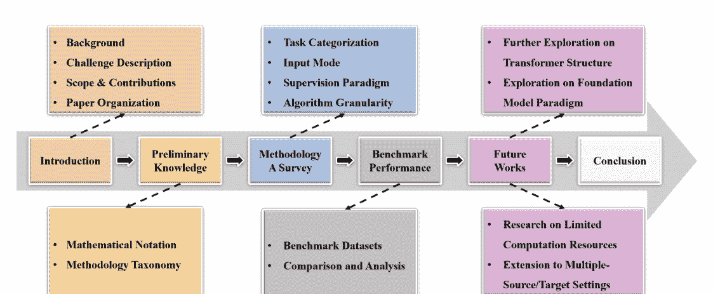
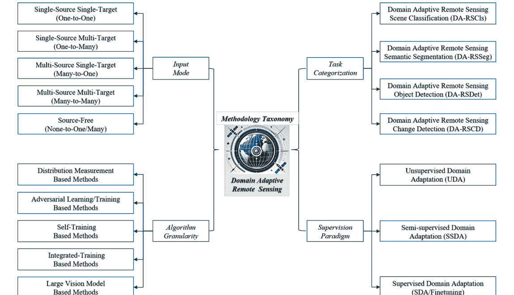
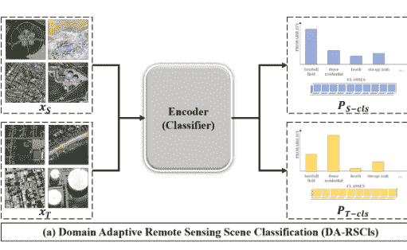
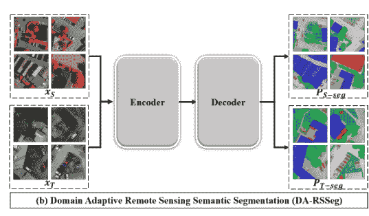
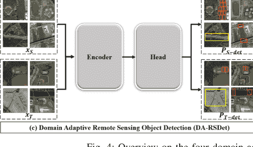
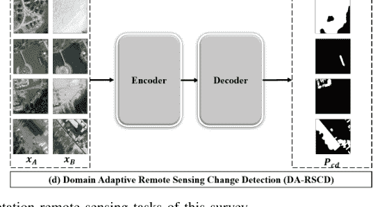
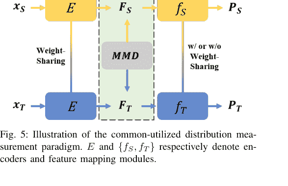
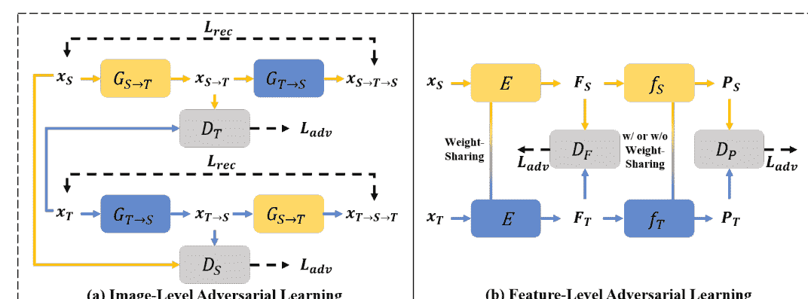

# 基于深度学习的遥感域自适应方法：一项综合调查

### I. 引言

遥感（RS）技术已广泛应用于各种实际应用中，包括遥感要素解译 [1]–[3]、生态环境监测 [4], [5]、城乡规划 [6]–[8] 等。在过去十年中，深度学习的发展，如深度卷积神经网络 [9]–[11]、Transformer [12], [13] 和 Mamba [14]–[16]，极大地加速了遥感应用的发展。然而，它们的有效性通常依赖于昂贵且劳动密集型的训练样本，这些样本的标注需要充分覆盖复杂的场景。在实际场景中，此类样本的稀缺往往无法充分解决训练（源）图像和测试（目标）图像之间的差异，导致性能显著下降。这种域偏移现象以及随后的源域和目标域之间的差距构成了重大挑战。为了缓解这一问题并有效弥合域差距，遥感域适应方法已成为一个关键的研究主题。这些方法致力于增强 RS 模型的泛化能力，使其能够在多样且未见过的域中稳健运行，从而克服由训练数据不足和偏差带来的限制。

基于深度学习的域适应方法旨在利用源数据集训练模型，然后迁移其能力以在目标数据集上生成准确的预测。在遥感科学领域，仍存在若干挑战，涵盖以下几个方面。(1) 由不同地面采样距离引起的严重变化。如图 1 (a) 所示，以不同地面采样距离拍摄的图像中的对象（如“汽车”）在特征上表现出明显的差异。(2) 由于使用不同的成像模式，源图像和目标图像中特定类别之间的差异。如图 1 (b) 所示，“树木”在 R-G-B 和 IR-R-G 图像中的颜色有所不同。(3) 不同地理景观下相同类别的差异。如图 1(c) 所示，农村和城市的“建筑物”呈现出不同的建筑模式。(4) 由于不同的环境因素（天气状况、光照、阴影等）导致的大规模域偏移。图 1 (d) 展示了有雾和无雾的“火车站”场景之间的对比。总体而言，这些挑战存在不同程度的数据分布差异，导致源域和目标域图像之间的域偏移问题。

图 2：本综述流程的图示。不同颜色代表特定部分。建议以彩色查看。

为了缓解遥感场景中源图像和目标图像之间的域偏移并弥合域差距，已提出了许多域适应方法。在深度学习时代之前，域适应方法主要关注传统方法 [17]，如不变特征选择 [18]–[21]、数据分布适应 [22]–[25] 等，旨在调整源域和目标域之间的分布差异。在过去十年中，深度学习 [26], [27]，特别是深度神经网络的快速发展，促进了遥感领域域适应方法的发展。最初，对抗学习成为主要技术 [28]–[35]，主要用于特征级或图像级对齐。作为另一项显著技术，自训练在遥感域适应任务领域引起了相当大的关注 [36]–[41]。这种非对抗范式通过为目标域图像生成可靠、一致且类别平衡的伪标签来增强适应能力。由于对抗学习和自训练从不同角度提高了域适应方法的效率，这两种技术的结合已成为一个新的研究焦点 [42]–[46]。模型（SAM）[47], [48] 的引入标志着计算机视觉领域的一个革命性时代。利用其在不同场景中的卓越泛化能力，遥感领域将从这些进步所驱动的域适应方法 [49]–[51] 中显著受益。尽管基于 LVM 的遥感域适应方法仍然相对未得到充分探索，但它仍然揭示了一个重要且充满前景的近期研究趋势。

鉴于近期遥感领域涌现了众多域适应方法，一些综述论文已被提出。值得注意的是，[52], [53] 深入探讨了专门为遥感分类任务定制的域适应方法。[54] 澄清并回顾了遥感领域非监督域适应的思想。由于最近的相关注仅概括了截至 2022 年的方法，因此在快速发展的领域需要提供更新的综述显得十分必要。与之前的综述论文相比，我们提供了对最新方法的更新概述。对于各种特定的遥感任务，我们审查并在不同的基准数据集上呈现了详细和全面的实验对比。考虑到大型视觉模型（LVMs）预计将成为未来几年的研究焦点，我们将专门探索基于 LVM 的域适应方法，并概述遥感领域的新兴趋势。

总而言之，本综述的主要贡献可以列举如下。

-   我们提供了对遥感域适应方法最新研究的系统概览。与先前的综述工作相比，我们的研究提供了更广泛的范围和更新的内容。
-   我们展示了当前遥感域适应方法的几个系统分类，从四个角度进行组织：任务分类、输入模式、监督范式和算法粒度。
-   我们突出了具有最先进性能的影响性工作。

> 本工作由“中央高校基本科研业务费”（资助号 501YC2025102002）支持。

Shuchang Lyu, Qi Zhao, Zheng Zhou, Meng Li 和 You Zhou 隶属于北京航空航天大学电子信息工程学院。Zhenwei Shi 隶属于北京航空航天大学航空学院图像处理中心。电子邮箱：l.yushucheng@buaa.edu.cn, zhaofy@buaa.edu.cn, zhengzhou@buaa.edu.cn, li@buaa.edu.cn, sy420322@buaa.edu.cn, shiwenqj@buaa.edu.cn。
Dingding Yao 隶属于中国科学院声学研究所。(dyao@ioa.ac.cn)。
Guangliang Cheng 隶属于利物浦大学计算机系。(Guangliang.Cheng@liverpool.ac.uk)。
Huiju Zhou 隶属于莱斯特大学计算与数学科学学院 (hz143@leicester.ac.uk)。
通讯作者：Qi Zhao

在多个关键基准测试中表现优异，为当前及未来的研究工作提供了富有洞察力的指导。

- 我们总结了该领域的现有方法，并提出了我们对未来趋势和值得进一步探索的主题的看法。

如图2所示，本文的结构安排如下。在第二节中，我们回顾了遥感领域自适应方法的基础知识，包括“基础知识”和“方法学分类与数学符号”。在第三节中，我们采用逐篇论文的方式对现有文献进行了全面综述，并从四个角度进行了分类。在第四节中，我们首先介绍了基准数据集。然后，我们在多种遥感任务的不同基准数据集上进行了详细的性能比较。在第五节中，我们讨论了未来的研究趋势和主题，以及我们的观点。最后，我们在第六节中结束了本综述。

## 二、 基础知识

如图2所示，我们首先介绍基础知识，包括一些基本的数学符号。随后，我们整理并呈现了该领域不同方法的方法学分类以及数学定义。

### A. 数学符号

如图2所示，我们提供了现有方法的详细分类，基于任务分类、输入模式、监督范式和算法粒度四个角度进行归类。具体的方法学分类如图3所示。

表I展示了初步的数学符号。对于本综述关注的四个任务（图3），现有方法总是构建一个模型，使用训练集 ($\mathcal{D}_{train}$) 对其进行优化，并在测试集 ($\mathcal{D}_{test}$) 上评估其性能。这些训练集和测试集分区来自一个综合数据集 ($\mathcal{D}$ = $\mathcal{D}_{train}$ $\cup$ $\mathcal{D}_{test}$)。因此，尽管训练集和测试集之间可能存在潜在的数据分布差异，我们仍然将它们视为来自同一领域的样本。当领域自适应被整合到上述四个任务中时，问题定义将发生显著变化。

对于领域自适应遥感 (DA-RS) 任务，它总是涉及源数据集 ($\mathcal{D}_{S}$) 和目标数据集 ($\mathcal{D}_{T}$)。如果源数据集和目标数据集的类别集分别表示为 $\mathcal{C}_{S}$, $\mathcal{C}_{T}$，通常这两个集合具有相同数量的类别 ($N_{\mathcal{C}_{S}}$ = $N_{\mathcal{C}_{T}}$)。

$$ \mathcal{D}_{S} = \{\mathcal{D}_{S}^{i}\}_{i=1}^{N_{S}}, \quad \mathcal{D}_{T} = \{\mathcal{D}_{T}^{i}\}_{i=1}^{N_{T}} \quad (1) $$

源数据集和目标数据集的第 $i$ 个子集分别包含 $K_{S}^{i}$ 和 $K_{T}^{i}$ 个样本，其中 $K_{S}^{i}$ $\ge$ 0 且 $K_{T}^{i}$ $\ge$ 0。这一过程可以通过公式2进行表述。

$$ \mathcal{D}_{S}^{i} = \{(\mathbf{x}_{S}^{i,j}, \mathbf{y}_{S}^{i,j})\}_{j=1}^{K_{S}^{i}}, \quad \mathcal{D}_{T}^{i} = \{(\mathbf{x}_{T}^{i,j}, \mathbf{y}_{T}^{i,j})\}_{j=1}^{K_{T}^{i}} \quad (2) $$

为了优化 DA-RS 任务的模型，$\mathcal{D}_{T}$ 被划分为训练子集和测试子集 ($\mathcal{D}_{T-train}$, $\mathcal{D}_{T-test}$)，其中 $\mathcal{D}_{T}$ = $\mathcal{D}_{T-train}$ $\cup$ $\mathcal{D}_{T-test}$。因此，对于一个给定的 DA-RS 任务，训练数据集包括源数据集 $\mathcal{D}_{S}$ 和目标数据集的训练子集 ($\mathcal{D}_{T-train}$)，而测试数据集 $\mathcal{D}_{test}$ 仅由 $\mathcal{D}_{T-test}$ 组成。这意味着 $\mathcal{D}_{S}$ 和 $\mathcal{D}_{T}$ 的一部分都将在训练阶段被利用。值得注意的是，训练阶段中 $\mathcal{D}_{T}$ 的比例可能为 0，这意味着在某些情况下，目标数据集将不用于训练目的。

如公式1和公式2所示，源数据集由 $N_{S}$ 个子集组成，而目标数据集包含 $N_{T}$ 个子集，约束条件为 $N_{S}$ $\ge$ 1 且 $N_{T}$ $\ge$ 1。这表明两个数据集各自至少包含一个子集。

### B. 方法学分类

#### 1) DA-RS 任务的问题定义

如图3所示，本综述主要回顾了四个 DA-RS 任务，分别是 DA-RSCls、DA-RSSeg、DA-RSdet 和 DA-RSCLD。具体说明如图4所示。

**DA-RSCls。**

如图4 (a)所示，分类器包含单一的编码器。在前向传播过程中，源图像和目标图像 ($\mathbf{x}_{S}$, $\mathbf{x}_{T} \in \mathbb{R}^{B \times C \times H \times W}$) 被输入到编码器 ($f_{cls}(\cdot)$) 中以生成预测结果，如公式3所示。在分类任务中，预测结果 ($\mathbf{P}_{S-cls}$, $\mathbf{P}_{T-cls} \in \mathbb{R}^{B \times N_{C}}$) 被表示为各类别上的后验概率。这里，$N_{C}$ 表示类别的数量。

$$ \mathbf{P}_{S-cls} = f_{cls}(\mathbf{x}_{S}), \quad \mathbf{P}_{T-cls} = f_{cls}(\mathbf{x}_{T}) \quad (3) $$

为了优化编码器，基本损失 $\mathcal{L}_{DA-cls}$ 如公式4所示，其中 $\mathcal{L}_{ce}$ 表示交叉熵损失。基于这种优化范式，现有方法整合了多种损失组件来构建组合损失，包括对抗损失、自训练损失等。

$$ \mathcal{L}_{DA-cls} = \frac{1}{B}\sum_{i=1}^{B} \mathcal{L}_{ce}(\mathbf{P}_{S-cls}^{i}, \mathbf{P}_{T-cls}^{i}; y_{S}^{i}, y_{T}^{i}) \quad (4) $$

**DA-RSSeg。**

如图4 (b)所示，分割器采用“编码器-解码器”架构 ($f_{seg}(\cdot)$)。$\mathbf{x}_{S}$ 和 $\mathbf{x}_{T}$ 分别通过分割器生成像素级预测结果 ($\mathbf{P}_{S-seg}$, $\mathbf{P}_{T-seg} \in \mathbb{R}^{B \times N_{C} \times H \times W}$)，如公式5所示。这些预测中的每个像素代表一个后验概率，从而允许将语义分割视为一种逐像素的分类任务。

$$ \mathbf{P}_{S-seg} = f_{seg}(\mathbf{x}_S), \quad \mathbf{P}_{T-seg} = f_{seg}(\mathbf{x}_T) \quad (5) $$

与 DA-RSCls 任务中采用的基本损失函数（公式5）类似，交叉熵损失也被用作优化分割器的基线损失 ($\mathcal{L}_{DA-seg}$)。该公式表示为公式6和公式7。

$$ \mathcal{L}_{DA-seg}^i = \frac{1}{HW} \sum_{h=1}^{H} \sum_{w=1}^{W} \boldsymbol{P}_{S-cd}^{i,h,w} \boldsymbol{P}_{T-cd}^{i,h,w} y_S^{i,h,w} y_T^{i,h,w} \quad (6) $$

$$ \mathcal{L}_{DA-seg} = -\frac{1}{B} \sum_{i=1}^{B} \mathcal{L}_{DA-seg}^i \quad (7) $$

**DA-RSDet。**

物体检测提出了重大挑战，因为它试图同时在图像中定位和分类物体。通过利用领域自适应，即使面对来自不同数据分布的样本，检测器也能实现精确检测。如图4 (c)所示，基本检测器由编码器和头部组成，这提供了“单阶段检测器”和“两阶段检测器”架构的概览。

与 DA-Cl s 和 DA-Seg 任务类似，源图像和目标图像都将传输到检测器 ($f_{det}(\cdot)$) 并生成最终预测结果 ($\mathcal{P}_{S-det}, \mathcal{P}_{T-det}$)。具体而言，在“单阶段检测器”中，这些预测结果结构化为一个单一的张量，整合了定位和分类结果。相反，在“两阶段检测器”中，预测结果是由专门用于定位和分类的不同分支生成的。无论不同检测器类型之间的变化如何，都需要使用边界框的回归损失 ($\mathcal{L}_{reg}$) 和实例后验概率的分类损失 ($\mathcal{L}_{cls}$)。总体而言，DA-Det 优化的基本损失函数 ($\mathcal{L}_{DA-det}^i$) 可以从公式8到公式10进行表述。

$$ \mathcal{P}_{S-det} = f_{det}(\boldsymbol{x}_S), \quad \mathcal{P}_{T-det} = f_{det}(\boldsymbol{x}_T) \quad (8) $$

$$ \mathcal{L}_{DA-det}^i = \mathcal{L}_{reg}(\boldsymbol{P}_{S-det}^i, \boldsymbol{P}_{T-det}^i; \boldsymbol{y}_S^{i-box}, \boldsymbol{y}_T^{i-box}) + \mathcal{L}_{cls}(\boldsymbol{P}_{S-det}^i, \boldsymbol{P}_{T-det}^i; \boldsymbol{y}_S^{i-cls}, \boldsymbol{y}_T^{i-cls}) \quad (9) $$

$$ \mathcal{L}_{DA-det} = -\frac{1}{B} \sum_{i=1}^{B} \mathcal{L}_{DA-det}^i \quad (10) $$

**DA-RSCD。**

变化检测是遥感中的一项基本任务，旨在检测和分析同一地理区域随时间发生的变化。如图4 (d)所示，变化检测模型通过接受图像对作为输入来运行。$\boldsymbol{x}_A$ 和 $\boldsymbol{x}_B$ 分别表示变化前（事件前）和变化后（事件后）的图像。在 RSCD 任务中，$\boldsymbol{x}_A$ 和 $\boldsymbol{x}_B$ 显示出极小的差异，表明领域偏移程度较低。在 DA-RSCD 任务中，$\boldsymbol{x}_A$ 和 $\boldsymbol{x}_B$ 表现出显著的领域偏移问题，这通常由使用不同的传感器或不同的成像条件引起。

**表 I: 初步数学符号**

| 数据级符号 | | 方法级符号 | |
| :--- | :--- | :--- | :--- |
| 符号 | 描述 | 符号 | 描述 |
| $\mathcal{D}$ | 数据集 | $\mathcal{L}(\cdot)$ | 损失 |
| $\mathcal{D}_{train}$, $\mathcal{D}_{test}$ | 训练集、测试集 | $\theta$ | 模型参数 |
| $\mathcal{D}_{S}$, $\mathcal{D}_{T}$ | 源数据集、目标数据集 | $f(\cdot)$, $h(\cdot)$, $g(\cdot)$ | 模块函数 |
| $\mathbf{x}$, $\mathbf{y}$ | 输入、目标、标签 | $\alpha$, $\beta$, $\gamma$, … | 超参数 |
| $\mathbf{X}$, $\mathbf{Y}$ | 输入集、标签集 | minimax | “最小-最大”准则 |
| $\mathcal{C}$ | 类别集 | argmax | “argmax”操作 |

图3: 本综述中领域自适应遥感任务的方法学分类概览。

图4: 本综述中四个领域自适应遥感任务的概览。

变化检测器 ($f_{cd}(\cdot)$) 的架构与分割器相似。$\boldsymbol{x}_A$ 和 $\boldsymbol{x}_B$ 被输入到一个“编码器-解码器”结构中，以生成二值预测结果 ($\boldsymbol{P}_{cd} \in \mathbb{R}^{N \times C \times H \times W}$)，其中 $N_C = 2$。这一过程表示为公式11。

$$ \boldsymbol{P}_{cd} = f_{cd}(\boldsymbol{x}_A, \boldsymbol{x}_B) \quad (11) $$

DA-RSCD 的优化可以被视为一个二值分割优化问题。基本损失函数 ($\mathcal{L}_{DA-cd}$) 的具体公式详述于公式12，其中 $\mathcal{L}_{bce}$ 表示二元交叉熵损失。

$$ \mathcal{L}_{DA-cd} = -\frac{1}{BHW} \sum_{i=1}^{B} \sum_{h=1}^{H} \sum_{w=1}^{W} \mathcal{L}_{bce}(\boldsymbol{p}_{cd}^{i,h,w}, y^{i,h,w}) \quad (12) $$

DA-RSCD 任务与上述三个 DA-RS 任务的区别在于，其领域偏移问题出现在图像对内部。相反，DA-RSCls、DA-RSSeg 和 DA-RSDet 面临的领域偏移挑战体现在源数据集和目标数据集之间。

#### 2) 不同输入模式的数学定义

在输入模式的分类中，主要有五种不同类型的 DA-RS 方法，根据源和目标子集的数量进行分类（图3）。具体定义见表II。

**表 II: 不同输入模式的数学定义。本表中的公式可参考公式1。**

| 输入模式 | 源输入: $\mathcal{D}_S = \{ \mathcal{D}_S^i \}_{i=1}^{N_S}$ | 目标输入: $\mathcal{D}_T = \{ \mathcal{D}_T^i \}_{i=1}^{N_T}$ |
| :--- | :--- | :--- |
| 一对一 | $N_S = 1$ | $N_T = 1$ |
| 一对多 | $N_S = 1$ | $N_T > 1$ |
| 多对多 | $N_S > 1$ | $N_T > 1$ |
| 零对一/多 | 不可用 | $N_T \geq 1$ |

- 单源单目标 (“一对一”)。当 $N_S$ 和 $N_T$ 设置为 1 时，这对应于不同任务上的标准领域自适应配置。在此模式下，模型被训练以适应从源域到目标域。
- 单源多目标 (“一对多”)。当 $N_S$ 为 1 而 $N_T$ 设置为大于 1 的值时，主要目标是开发能够在不同目标域上表现良好的模型。在此模式下的一种典型领域自适应任务被称为域泛化 (DG)。
- 多源单目标 (“多对一”)。当 $N_S$ 设置为大于 1 的值而 $N_T$ 设置为 1 时，目标是开发能够利用来自多个源域的集体知识来增强模型在未见过的目标域上的泛化能力的模型。此场景中的另一个关键挑战是减轻不同源子集之间领域偏移的不利影响。
- 多源多目标 (“多对多”)。当 $N_S$ 和 $N_T$ 都设置为大于 1 的值时，任务将变得更加复杂。模型需要有效地优化，以从多个源域泛化到多个目标域。
- 无源单目标 / 多目标 (“零对一/多”)。在此模式下，$N_T$ 设置为大于 1 的值，而由于在适应阶段源数据集不可用，$N_S$

数据隐私或传输困难。在上述四种模式中，注释的源数据均可访问。在无源域适应中，仅能获取在源数据上预训练的模型。

## 3) 不同监督范式的数学定义

如图 3 所示，DA-RS 方法主要包含三种监督范式。

### 遥感中的无监督域适应（“UDA-RS”）

无监督域适应（UDA）是遥感领域一个显著且应用广泛的范式。一般而言，UDA 表示目标图像的标签不可用，但这些目标图像仍可以被纳入训练阶段。在数学上，在公式 2 中，每个目标样本 $(\boldsymbol{y}_T^{i,j})$ 被标记为“None”，其形式化定义见公式 13。在此设定下，$\boldsymbol{y}_T$ 在公式 4、公式 6 和公式 9 中所示的每个任务的损失函数中被表示为空集。

$$
\boldsymbol{y}_T = \emptyset, \quad \forall i \in[1, N_T], j \in[1, K_T^{i, j}], y_T^{i, j} \rightarrow None \tag{13}
$$

狭义定义下，UDA-RS 指的是一种典型的单源单目标遥感任务，其中 $N_S=1, N_T=1$。显然，该范式中所利用的方法旨在解决标注的目标域样本可用性问题不足带来的限制，以及解决高昂的标注成本问题。

### 遥感中的半监督域适应（“SSDA-RS”）

半监督域适应（SSDA）是遥感领域的另一个热点话题，其目标是通过标注少量目标域样本来提高泛化性能。如公式 2 所示，目标数据集的每个子集 $(D_T^{i,j})$ 包含有标签和无标签样本，其中无标签样本的数量 $(K_{T-u}^{j})$ 远大于有标签样本的数量 $(K_{T-l}^{j})$。该范式可形式化为公式 14。

$$
\mathcal{D}_{T}^{j}=\left(\left\{\boldsymbol{x}_{T-l}^{i, l}\right\}_{l=1}^{K_{T-l}^{j}} \cup\left\{\left(\boldsymbol{x}_{T-u}^{i, j}, \boldsymbol{y}_T^{i, j}\right)\right\}_{u=1}^{K_{T-u}^{j}}\right) \tag{14}
$$

其中 $K_{T-l}^{j}+K_{T-u}^{j}=K_T^{j}$ 且 $K_{T-l}^{j} \ll K_{T-u}^{j}$。与 UDA-RS 类似，现有的 SSDA-RS 方法主要也采用单源单目标输入模式。与 UDA-RS 相比，SSDA-RS 强调在有限有标签样本中挖掘信息，同时最大限度地利用无标签样本。

### 遥感中的有监督域适应（“SDA(微调)-RS”）

有监督域适应（SDA）假设两个域都有可用的有标签样本。SDA 方法关注那些有标签的目标域样本数量少于源域可用样本的挑战性情况 [52]。在这种条件下，合理利用源域信息以及针对目标域的微调技术对于解决目标问题至关重要。在数学上，该范式可以表示为 $\sum_{i=1}^{N_T} K_T^{i} \ll \sum_{i=1}^{N_S} K_S^{i}$。

在遥感场景中，获取来自卫星和无人机等多种传感器的数据相对简单，导致来自不同域的数据供应丰富。然而，由于地理土地覆盖范围广阔，高昂的标注成本这一挑战变得更加突出。因此，UDA-RS 和 SSDA-RS 范式更符合实际需求。

## 4) 典型算法的数学定义

如图 3 所示，DA-RS 方法主要由五类典型算法组成。

### 基于分布测量的方法

基于分布测量的方法主要旨在匹配不同域隐藏特征之间的分布。如图 5 和公式 15 所示，常见的操作是将适应度量指标（例如，最大均值差异，MMD）嵌入到神经网络中。

$$
\mathcal{MMD}(D_S, D_T) = ||\frac{1}{N_S}\sum_{i=1}^{N_S} E(\boldsymbol{x}_S^{i}) - \frac{1}{N_T}\sum_{j=1}^{N_T} E(\boldsymbol{x}_T^{j})||_2 \tag{15}
$$

DAN [55] 是利用深度卷积神经网络在 UDA 任务中跨域学习可迁移隐藏特征的开创者。它嵌入了用于适应的 MMD 度量指标。继 DAN 之后，许多 DA-RS 任务采用 MMD 来测量属于不同域的图像中间特征图之间的分布。

### 基于对抗学习的方法

对抗学习在 DA-RS 方法中经常被使用，主要包含两种类型：图像级和特征级对抗学习方法。这两种典型对抗学习范式的示意图如图 6 所示。

图像级对抗学习方法利用图像泛化技术，如图像翻译 [56]、[57]，以同步源图像和目标图像之间的数据分布。这些方法首先应用图像级适应，随后使用跨域合成数据训练模型。如图 1 (a) 所示，$G_{S \rightarrow T}$ 和 $G_{T \rightarrow S}$ 分别负责将源域图像适应到目标域，反之亦然。同时，$D_S$ 和 $D_T$ 的作用是区分真实的源数据和生成器产生的虚假数据。为了优化，采用了对抗损失，其形式化定义见公式 16。

$$
\begin{cases}
\mathcal{L}_{adv}(G_{S \rightarrow T}, D_T) = \mathbb{E}_{x_T \sim X_T}[\log(D_T(\boldsymbol{x}_{T}))] + \mathbb{E}_{x_S \sim X_S}[\log(1-D_T(G_{S \rightarrow T}(\boldsymbol{x}_S)))] \\
\mathcal{L}_{adv}(G_{T \rightarrow S}, D_S) = \mathbb{E}_{x_S \sim X_S}[\log(D_S(\boldsymbol{x}_{S}))] + \mathbb{E}_{x_T \sim X_T}[\log(1-D_S(G_{T \rightarrow S}(\boldsymbol{x}_T)))]
\end{cases} \tag{16}
$$

图 6: 常用对抗学习范式的示意图。$\{G_{S \rightarrow T}, G_{T \rightarrow S}\}$ 和 $\{D_S, D_T, D_F, D_P\}$ 分别表示生成器和判别器。$E$ 和 $\{f_S, f_T\}$ 分别表示编码器和特征映射模块。

为了优化 $G_{S \rightarrow T}$ 和 $G_{T \rightarrow S}$，采用“极小极大”准则，其表达式见公式 17。

$$
\begin{cases}
\min_{G_{S \rightarrow T}} \max_{D_T} \mathcal{L}_{adv}(G_{S \rightarrow T}, D_T) \\
\min_{G_{T \rightarrow S}} \max_{D_S} \mathcal{L}_{adv}(G_{T \rightarrow S}, D_S)
\end{cases} \tag{17}
$$

在此范式中，重构损失（$\mathcal{L}_{rec}$）或循环一致性损失始终与对抗损失一起使用。其公式表述见公式 18。

$$
\begin{split}
\mathcal{L}_{rec}(G_{S \rightarrow T}, G_{T \rightarrow S}) = & \mathbb{E}_{x_T \sim X_T}[\|G_{S \rightarrow T} G_{T \rightarrow S}(\boldsymbol{x}_T) - \boldsymbol{x}_T\|_a] \\
& + \mathbb{E}_{x_S \sim X_S}[\|G_{T \rightarrow S} G_{S \rightarrow T}(\boldsymbol{x}_S) - \boldsymbol{x}_S\|_a]
\end{split} \tag{18}
$$

其中 $\|\cdot\|_a$ 表示 $L_a$ 范数，用作损失函数。在常用的范数中，$L1$ 范数和 $L2$ 范数尤为普遍。该损失函数旨在鼓励在风格迁移过程中保持结构特性。

特征级对抗学习方法深入挖掘源风格特征和目标风格特征之间共享的域不变特征。这些方法利用特征级对齐策略来解决域偏移问题。通常，判别器被集成到网络中，以确保在中间特征图或输出后验概率上的一致性对齐。

如图 6 (b) 所示，$E$ 用于特征提取，在大多数场景下它们共享权重。$f_S$ 和 $f_T$ 用于将提取的特征转换为预测值。这些模块的设计，以及它们是否共享权重，可能因具体的 DA-RS 任务而异。为了优化框架，特征级对抗损失可以用公式 19 和公式 20 表示。

$$
\mathcal{L}_{adv}(E, D_F) = \mathbb{E}_{x_S \sim X_S}[\log(D_F(E(\boldsymbol{x}_S)))] + \mathbb{E}_{x_T \sim X_T}[\log(1 - D_F(E(\boldsymbol{x}_T)))] \tag{19}
$$

$$
\begin{split}
\mathcal{L}_{adv}(E, f_S, f_T, D_P) = & \mathbb{E}_{x_S \sim X_S}[\log(D_P(f_S(E(\boldsymbol{x}_S))))] \\
& + \mathbb{E}_{x_T \sim X_T}[\log(1 - D_P(f_T(E(\boldsymbol{x}_T))))]
\end{split} \tag{20}
$$

类似于图像级对抗学习的优化过程（公式 17），“极小极大”准则也被用于优化损失函数，如公式 21 所示。

$$
\begin{cases}
\min_g \max_{D_K} \mathcal{L}_{adv}(E, D_F) \\
\min_{\{E, f_S, f_T\}} \max_p \mathcal{L}_{adv}(E, f_S, f_T, D_P)
\end{cases} \tag{21}
$$

### 基于自训练的方法

作为一种非对抗性的 UDA 范式，自训练在 DA-RS 任务中吸引了许多关注。该算法通过生成可靠、一致且类别平衡的伪标签来促进适应能力。通过利用源自目标域的高质量伪真值对模型进行监督，模型可以快速适应目标图像。

自训练机制主要包含两个过程。第一个过程涉及更新阶段，其中指数移动平均（EMA）技术通常应用于原始网络，称为学生网络。一旦完成 EMA 更新过程，生成的网络作为 EMA 教师发挥作用。具体而言，在每次训练步骤 $t$ 中，EMA 教师的权重通过 EMA 运算由学生网络的权重更新，其公式表达见公式 22。

$$
\phi_t = \alpha \phi_{t-1} + (1 - \alpha) \theta_t \tag{22}
$$

其中 $\alpha$ 代表 EMA 衰减因子，控制更新速率。$\phi_t$ 表示第 $t^{th}$ 步时 EMA 教师的权重。$\theta_t$ 表示同一 $t^{th}$ 步时学生网络的权重。

在更新教师网络的权重后，第二个过程涉及为目标图像生成伪标签并利用这些伪标签进行监督。对于具体的 DA-RS 任务，输入图像被馈送到教师

用于伪标签生成过程的网络，可参见公式 3、5、8、11。随后，这些伪标签被视为目标样本的真值（ground-truth），用于优化并增强学生网络的性能。

**基于联合训练的方法。** 为了提升应对域偏移问题的模型性能，许多域适应方法采用联合训练策略，该策略也被称为混合训练策略。除了用于优化的基础任务特定损失函数（参见公式 4、7、10、12）外，对抗学习在实现一致性对齐方面起着关键作用，而自训练机制主要旨在缓解源域训练网络的表示偏差。因此，这两种训练策略是兼容的，将它们与组合损失函数集成可以从不同角度增强模型。

**基于大型视觉模型的方法。** 在 DA-RS 领域，由于多种因素（图 1）的存在，域偏移问题尤为严重。本质上，由于泛化能力有限，单一模型通常无法在不同域中表现良好。大型视觉模型 [58] 可以有效缓解这一问题。它们通过在大量样本上进行广泛预训练而获得泛化表示能力，覆盖广泛的领域。

最近，基于大型视觉模型（LVM）在 DA-RS 任务上的方法仍相对未被充分探索。挑战在于如何有效地将 LVM 的泛化能力转移到特定的下游 DA-RS 任务中，以及如何为基于 LVM 的方法设计定制的优化范式。

## III. 方法论：综述

在本节中，我们将基于监督范式的分类法和基于算法粒度的分类法对方法论进行全面回顾。首先，我们将根据基于监督范式的分类法纳入与不同任务类别相关的方法。随后，我们将按照基于算法粒度的分类法，详细深入介绍这些方法。鉴于现有的大多数 DA-RS 方法使用“单源单目标”作为输入模式，我们还将深入探讨采用其他输入模式的方法。必须承认，在这三个分类法中的方法之间可能存在不可避免的重复。具体来说，某些方法可能属于多个分类法的范畴。

### A. 基于监督范式的分类法

#### 1) UDA-RS 方法：

在遥感领域，高昂的标注成本给遥感（RS）任务带来了重大挑战。因此，研究如何减少对大量标注样本依赖的方法已成为一个热门话题。如前所述，UDA-RS 试图使用源域图像训练模型，同时可以访问目标域图像，但没有其对应的标注。代表性的 UDA-RS 方法包含在表 III 中。

在深度学习时代之前，先驱性的传统方法定义了 UDA-RS 任务并引入了多种机器学习模型 [168]–[174]，这极大地推动了该领域的发展。进入深度学习时代后，深度学习技术显示出优于传统方法的性能。

**UDA-RSCls.** 无监督域适应高光谱图像（HSI）分类是 UDA-RSCls 任务中的一个关键话题。如表 III 所示，许多采用不同算法的方法 [30], [61], [62], [64], [67]–[69], [72], [74], [79], [81], [83], [88], [90], [92], [94] 已被提出以解决 UDA HSI 分类的挑战。无监督域适应航空图像分类是 UDA-RSCls 任务中的另一个引人入胜的研究话题。许多著名方法 [29], [42], [59], [60], [63], [65], [66], [70], [71], [76]–[78], [84], [87], [89], [95]–[99] 被提出以利用高分辨率航空和卫星图像中包含的丰富信息。鉴于 SAR 数据独特的成像特性和固有的域偏移，SAR 图像分类的无监督域适应在 UDA-RSCls 的更广泛范围内成为一个引人注目的方向。最近的几项研究 [75], [80], [82], [85], [86] 探索了策略以减轻不同 SAR 数据中显著的域差距，旨在增强跨域泛化能力。

**UDA-RSSeg.** 针对遥感语义分割的无监督域适应主要专注于适应高分辨率（HR）航空和卫星光学图像 [33], [44]–[46], [100]–[120] 中的模型，解决由地理或采集差异引起的域偏移。一些方法 [121]–[124] 还旨在弥合多光谱或 SAR 影像跨域分割中的模态差距，解决纹理、分辨率和光谱特性变化等挑战。

**UDA-RSDD.** 针对遥感目标检测的无监督域适应主要侧重于将知识从标记的光学航空和卫星图像转移到来自不同域的未标记图像 [41], [132]–[143]，其中显著的域差距源于根本不同的成像机制、物体纹理和背景杂乱。与光学到光学的适应不同，SAR 数据在特征表示和对齐方面引入了重大挑战，促使开发了专门的技术，如域不变特征学习、跨模态对齐和伪标签细化 [125]–[129]。

#### 2) SSDA-RS 方法

遥感中的半监督域适应旨在将知识从标记的源域转移到部分标记的目标域，在适应新的地理区域或传感器类型时减少标注成本。一些方法专注于分类任务 [20], [28], [146]–[156]，而其他方法则针对语义分割 [157]–[160] 或目标检测 [161]–[167]，在 SSDA 范式下解决不同的遥感任务。

#### 3) SDA/微调-RS 方法

SDA 假设可以访问两个域中的标记数据。因此，SDA 通常被视为一种实用的工程解决方案，而非基本的研究挑战。在许多实际应用中，一旦拥有中等数量的标记目标域数据，工程师通常选择直接在目标域上微调或重新训练特定模型，这无需复杂的域适应技术即可产生强大的性能。尽管如此，一些方法 [51], [75]–[78] 仍然值得注意，因为它们为利用目标域标签进行适应和泛化提供了有价值的见解。

**表 III：** 不同 DA-RS 任务中采用不同监督范式的代表性方法。

| 基于监督范式的分类法 | 方法 | DA-RScls | DA-RSseg | DA-RSdet |
| :--- | :--- | :--- | :--- | :--- |
| **UDA-RS** | DAN [59], DME [29], DAGNN [60], TCANet [61], DDa-Net [62], SSMT-RS [63], ADA-Net [64], BFSN [85], ECH-FAM [66], CDA [67], JGCNN [50], JDa-Net [70], CMC [69], AST [42], ADA-Net [68], DFDent [77], UDACA [72], CNN-MTDA [73], TAADA [74], PFDA [75], EHACA [76], SDG-MA [77], PFDA [78], SWADA [79], VSFA [80], TSTNet [81], UDA-SAR [82], FDDAN [83], PPLM-Net [84], AdAian [85], DST [86], HFFAN [87], MUDAN [88], $C^3$DA [89], S$^5$DL [90], S$^3$AMNet [91], SSM [92], SDace2 [93], DAN_MFAC [94], DATSNET [95], MRDAN [96], AMRAN [97], SRKT [98], DDCI [99] | UDA-GAN [100], Tri-ADA [101], DNT [102], DCA [103], ResiDualGAN [3], BiFAN [104], MBta-GAN [105], FQUDA [106], JDADF [107], CSLIG [108], MemoryAdapter [109], DL-GEN [110], ReadDA [44], RCD-AD [111], PFM-Joint [51], STADA [45], MIDanet [112], SFDA4SegNet [46], CPCFA [113], MERS [114], MS-CADa [115], CDA-Net [116], MiHDA [117], IterDent [118], MMDA-Net [119], DDFP [120], TDAIFI [121], HiGhDan [122], GeoMultiTaskNet [123], EUDA-FLR [124] | FRCNN-SAR [125], IHSANet [126], PF-SAR [127], IDA [128], CDF-DA [129], FACL [30], PCA-SAR [131], RIR-SI [32], FADA [133], RfA-Net [134], APA [135], DuaDa-Net [136], CORAL-ADA [37], DDCLA [138], ML-UDA [139], CDST [141], MgDAD [140], RST [144], RSD-DA [142], FE-Net [143], HDADE [144], ST-DA [145] |
| **SSDA-RS** | SS-MA [20], ADDA [28], TDDA [146], CADA4 [47], DACCN-Net [48], SDDAN [49], D-CFORAL [150], AL-LOC [151], BSCA [153], AGrDCT [153], CFAN [154], SSCA [155], SASS [156] | FusionDA [157], CDMP-E [158], TempCNN [159], EasySeg [160] | DA-FRCNN [161], FDDA [162], SAR-CDS5 [163], SRA-YOLO [164], DT [165], WeedTeacher [166], CDTL-YOLOVS [167] |

**分布对齐。** JCGNN [30] 通过将域级和类级 CORAL 嵌入到 GNN 框架中，增强了联合分布的测量和对齐。通过这种设计，它实现了更精确的特征匹配并提高了跨域的可区分性。ADA-DDA [70] 通过注意力机制引导边缘分布对齐并动态平衡边缘分布和条件分布的发生，增强了域适应。TSTNet [81] 引入了基于 CNN 的集成语义特征与基于 GCN 的拓扑结构建模。通过设计图最优传输以及 CNN 和 GCN 输出之间的一致性约束，该方法有效地对齐了域之间的分布和拓扑关系。SSM [92] 通过提出一种光谱偏移缓解策略，解决了跨场景 HSI 分类中的光谱偏移问题，该策略结合了幅度归一化和邻接效应校正。DAN_MFAC [94] 涉及多级特征对齐，显式约束全局和类别级分布，从而增强域不变特征学习并改善跨场景泛化。DATSNET [95] 引入任务特定分类器，并采用分类器差异的对抗极小极大法，以更好地对齐源域和目标域特征分布，同时细化任务特定决策边界。MRDAN [96] 采用特征融合适应模块构建更广泛的域不变空间，并使用动态对齐机制自动平衡局部和全局适应损失，从而增强跨域性能。AMRAN [97] 同时对齐边缘分布和条件分布，并利用注意力和多尺度策略增强特征鲁棒性和信息完整性。SRKT [98] 通过对抗和对比对齐学习传感器不变表示。它显式建模并对齐类别级关系分布。DDCI [99] 引入了集成适应扩散蒸馏模块和一致因果干预模块，以实现有效的跨域知识转移并消除虚假相关，从而

## B. 基于算法粒度的分类法

-   **基于分布测量的方法**：如表 III 所示，许多著名方法利用分布测量技术来对齐不同域之间的分布。DAN [59] 在预训练的卷积神经网络（CNN）顶部引入了一个由多个隐藏层组成的辅助网络。除标准的交叉熵误差外，该设计还纳入了图拉普拉斯和最大均值差异（MMD）正则化项。通过在对隐藏层进行适应时，DAN 能够对抗域偏移问题。DME [29] 学习流形嵌入，并通过训练源域和目标域图像的判别器来对齐判别分布。DACCNN [60] 框架将子空间对齐（SA）与 CNN 集成，以解决 RS 场景图像分类中的域适应挑战。该方法使 CNN 模型能够无缝适应对齐的特征子空间，从而有效缓解域分布差异。TCANet [61] 由几个基于卷积滤波器的阶段组成，这些滤波器作用于高光谱图像的块。利用迁移成分分析（TCA），通过最小化分布距离度量来学习不同域之间的转换矩阵。DDA-Net [62] 首先设计了一个域对齐模块，通过相似度测量在不相关任务的引导下最小化域差异。此外，它采用任务分配模块，在对齐的调节下在源域内进行分类。此外，它集成了域适应模块，将对齐能力和分类能力都转移到目标域。JCGNN [30] 通过将域级和类级 CORAL 嵌入到 GNN 框架中，增强了联合分布的测量和对齐。通过这种设计，它实现了更精确的特征匹配并提高了跨域的可区分性。

提高模型的泛化能力和鲁棒性。DCA [103] 显式地对齐类别特征以学习域不变表示，从而在失衡和不一致分布下增强类内紧凑性和类间可分性。为了解决船舶检测中标记SAR数据缺乏的问题，HSANet [126] 引入了一个分层域自适应框架，该框架利用了已标记的光学图像。它在全局（通过基于傅里叶的对齐进行结构级对齐）和局部（通过原型对齐进行实例级对齐）两个尺度上对齐SAR域和光学域，以增强跨模态检测性能。CORAL-ADA [137] 将相关性对齐和对抗域自适应集成到基于区域的检测器中，并通过重建损失进一步增强了性能，在目标域取得了显著的性能提升。

一些半监督域自适应方法围绕分布对齐或距离度量展开，因为少量标记目标数据可用性使得对域差异进行更可靠的估计成为可能，并更好地指导源域和目标域之间特征空间的对齐。TDDA [146] 提出了一种用于高光谱图像分类的两阶段深度域自适应方法，该方法结合了基于MMD的域对齐和一个具有成对损失的空间谱空间网络，利用少量标记的目标样本学习判别性嵌入空间。DJ-CORAL [150] 将异构特征投影到共享子空间中，并对齐边缘分布和条件分布。该方法有效利用未标记的目标数据来减少域偏移并提高分类性能。BsCA [152] 通过结合无监督最大均值差异对齐和有监督类别感知对齐，有效减少了域偏移，并利用源域和目标域中的标记和未标记数据。SSCA [155] 集成了一个旋转鲁棒卷积特征提取器（RCFE）来处理旋转变化，以及一个基于邻居的子类质心对齐（NSCA）模块来缓解跨域类内差异。CDMPc [158] 引入了矛盾结构学习机制和自监督学习策略，以增强域对齐并改善有限标记目标样本的利用。SAR-CDSS [163] 通过利用光学数据和少量标记的SAR样本，提出了一种用于SAR图像的半监督跨域目标检测框架。它通过图像混合和实例交换进行数据增强以及用于选择性特征对齐的自适应优化策略，在图像、实例和特征级别逐步减少域偏移。CDTL-YOLOV5 [167] 提出了一种基于YOLOv5的半监督SAR目标检测方法。通过引入少目标域自适应约束，该模型从标记的光学数据中迁移丰富知识，以在有限标注下改善SAR特征学习。

### 2) 基于对抗学习的方法

如前所述，对抗学习技术旨在获取特征级、像素级或两者兼有的信息，以减少不同域之间存在的差异。在表III所示的方法中，对抗学习在不同任务和不同监督范式下都发挥着重要作用。

### 基于特征级对抗学习的方法

特征级对抗学习旨在将源域和目标域的特征图对齐到统一的潜在空间，从而缓解特征级对抗学习过程中的偏差。在全局尺度上，特征对抗对齐鼓励模型学习域不变的类别级语义，从而提高跨域预测的一致性。SSMT-RS [63] 利用元学习来区分多个目标域，并使用对抗学习来混淆源域与混合多目标域之间的区别。元学习和对抗学习这两个过程迭代且动态地运行。ADA-Net [64] 开发了基于变分自编码器的生成器，旨在从两个域获取光谱和空间特征。通过引入两个对抗学习目标函数，将同时考虑全局和局部对齐。为了解决多源域数据集和单一目标数据集之间的域偏移问题，MSNRC [65] 最初设计了一个预训练的CNN来提取不同域中的图像特征。随后，通过一个由不同源特定判别器组成的跨域对齐模块对齐每个源域和目标域的特征。ECB-FAM [66] 将误差校正边界机制集成到特征级对抗学习框架中。这种集成使得能够同时构建域不变特征和语义有意义的特征。CDA [67] 集成了逐类对抗对齐和PMMD（概率MMD）策略，通过按类对齐域不变特征来实现无监督域自适应。为了解决高光谱分类中的跨域特征分布差异，JDA [68] 首先通过耦合VAE（变分自编码器）模块将数据映射到共享潜在空间，然后通过细粒度联合分布对齐模块优化逐类对齐。DFEnet [71] 结合了用于自适应提取全局和局部判别特征的背景感知特征细化（CAFR）模块和多级对抗丢弃（MAD）模块。该设计通过在特征和决策层面选择性抑制低质量信息来增强特征泛化能力。UDACA [72] 提出了一种新的UDAsHI方法，通过对抗框架联合减少类别级和风格感知级差异来执行内容级特征对齐。TAADA [74] 通过基于注意力的双分支特征提取和对抗学习提取光谱-空间联合信息，实现更有效的跨域分类性能。SSWDA [79] 解决了高光谱图像跨场景湿地制图面临的挑战。它引入了一种空间-光谱加权对抗域自适应框架，利用联合2D-3D卷积、实例加权判别和多分类器学习来增强域对齐和目标分类。FDAN [83] 设计了一种基于特征解耦的域自适应网络，用于跨场景沿海湿地分类，旨在通过显式分离域特定和类别不变成分来提取类别特定的域不变特征。通过Transformer-卷积融合编码器和对抗解耦策略，该方法增强了可迁移性和类别判别力。AdaIN [85] 结合了双层级特征对抗学习和基于自适应实例归一化的跨域特征模拟。DACNN [86] 实现了SAR域和光学域之间的物理合理适应。ADDA [28] 将对抗判别域自适应方法扩展到了遥感目标识别的半监督设置中，利用标记和未标记数据实现对新地理区域的有效适应。CDADA [147] 通过引入双土地覆盖分类器作为判别器，鼓励生成器产生跨域对齐且远离类别边界的可迁移特征。DACNN-MME [148] 使用标记数据的交叉熵损失和未标记目标数据的对抗最小-最大熵损失，共同促进域不变和类别判别特征学习。SSDAN [149] 联合优化标准交叉熵损失和对抗最小-最大熵损失，该方法利用标记和未标记目标数据有效学习域不变但具有判别力的特征。SASS [156] 通过引入共享-私有特征解耦机制和多级特征对齐，提出了一种用于高光谱和LiDAR数据分类的半监督学习方法。该方法有效利用标记和未标记数据，在有限标注下增强分类性能。

在像素级，特征级对抗学习主要旨在增强密集预测的一致性。MBATA-GAN [105] 提出了一种基于Transformer的框架，利用相互增强的注意力模块有效捕捉跨域语义依赖。通过结合全局注意力和增强的特征级对抗学习，它显著提高了特征的可迁移性。JDAF [107] 联合对齐边缘分布和条件分布，并引入不确定性自适应学习策略以提高伪标签的可靠性并减少域差距。CSLG [108] 基于块级适应难度，从局部语义到全局结构级别逐步对齐特征。通过这种设计，它有效解决了由多样化土地覆盖和传感器变化引起的局部分布偏移和全域差距。MemoryAdaptNet [109] 结合输出空间对抗学习和类别感知不变特征记忆模块来桥接域差距并增强特征一致性，在多个跨域任务中取得了卓越的性能。De-GLSNG [110] 通过利用多尺度高低频分解和全局-局部代表性对抗学习来增强遥感中的语义分割，以改善域不变表示学习和跨域泛化。RCA-DD [111] 提出了区域和类别自适应域泛化方法，其中包含基于熵的区域注意力模块和类别清晰模块。该方法专注于难以对齐的区域，并在训练过程中选择性地更新类别分布。MIDANet [112] 采用多任务学习和基于熵的对抗训练，利用语义分割和海拔估计来提取域不变特征并增强泛化能力，无需目标域标签。MMDANet [119] 通过通过多补丁分支和多任务解码器集成DSM数据，改善了基于UDA的高分辨率遥感图像语义分割，并进一步使用特征级对抗学习对齐源域和目标域，通过高度感知融合细化实现更丰富的表示和更好的分割。HighDan [122] 通过组合多分辨率融合和针对多模态遥感数据（高光谱、多光谱、SAR）的对抗学习，增强跨城市分割的可迁移性。

在实例级，特征级对抗学习主要促进特征对齐，以实现跨域更准确的目标定位和识别。IDA [128] 通过新设计的损失函数强制执行预测一致性来解决域偏移问题。通过对齐图像和实例两个层面的语义信息，它增强了特征判别力并降低了负迁移的风险，理论分析支持了其收敛特性。DFD-TCAT [129] 利用动态特征判别和中心感知校准来缓解由不同SAR传感器散射差异引起的边界框回归错误和特征错位。通过利用双向特征聚合和中心性引导对齐，该方法增强了跨域条件下的检测鲁棒性。FACL [130] 将对抗学习与专门的注意力和补偿模块相结合。对抗学习注意力（ALA）使用基于熵的加权实现精确的实例级和像素级对齐，而补偿损失模块（CLM）强制执行跨域原型特征一致性以提高检测精度。为了解决跨域特征不兼容性，PDSR [131] 通过逐块通道重计算捕捉域特定特征，并利用动态加权原型对齐（DWPA）以缓解早期训练中噪声伪标签的影响。RIRA [132] 框架通过关系感知图引入图像级和原型级特征对齐，以及旋转不变正则化器，有效提高了跨域检测鲁棒性。FADA [133] 通过基于对抗的前景对齐集成对抗训练（AT），并进一步通过基于原型的混淆特征对齐优化域泛化。RFA-Net [134] 引入了一个结合数据级增强、稀疏特征重建和伪标签生成的统一框架。该设计增强了实例级对齐，同时减少了无监督域自适应场景中背景噪声的影响。APA [135] 提出了一种对抗预测空间对齐方法，联合适应卫星图像车辆检测中的位置输出和类别置信度输出，带来改进并增强跨域检测性能。FIE-Net [143] 在一个前景增强对齐框架中解决了前景-背景不平衡问题。它通过集成前景关注多粒度对齐模块和渐进焦点过滤策略来强调显著实例特征。DA-FRCNN [161] 针对标记数据有限的SAR目标检测，提出了一种域自适应Faster R-CNN [179] 框架，通过从标记光学图像迁移知识来实现。它在提案后使用基于GAN的约束

生成，在小规模SAR数据集上实现了优越的检测性能。

**基于图像级对抗学习的方法。** 图像级对抗学习旨在通过将源图像转换为目标域风格（或反之）来减少域差异，同时保留语义内容。通过在像素级别对齐视觉外观，模型可以更一致地感知源图像和目标图像，从而促进在域偏移条件下的下游任务。VSFA [80] 整合了视觉特征和散射拓扑特征，以改善合成SAR图像与实测SAR图像之间的目标识别。通过利用图神经网络和按类对齐策略，该方法实现了卓越的性能。UDA-GAN [100] 是首个应用基于GAN的分割网络来解决UDA-RSseg（无监督域自适应遥感分割）任务的方法。它引入了一种图像级对抗学习方案，其中生成器将源图像转换为目标域风格，而判别器鼓励转换后的图像在视觉上难以与真实目标图像区分，从而在像素级别缩小域差距。ResiDualGAN [33] 引入了一种网络内的调整器以处理尺度差异，并使用残差连接以稳定实到实转换，在无监督域自适应设置下实现了语义分割准确率的显著提升。BiFDANet [104] 同时优化从源到目标和从目标到源的转换，以利用互补的域信息。通过整合双向语义一致性损失并在推理时结合双分类器，该方法在多个数据集上优于传统的单向方法。MHDAA [117] 为遥感分割引入了一种统一的多级无监督域自适应框架，特别强调通过循环一致性进行图像级对抗学习。通过结合实例级对齐、特征级对比学习和决策级任务一致性，它在无需目标域监督的情况下有效解决了复杂的域偏移问题。FDADA [162] 整合了基于重构的解码模块和域自适应模块，以同时利用未标记的SAR数据和标记的光学遥感（ORS）图像。通过联合优化检测、重构和域对齐损失，模型有效地从ORS向SAR迁移知识，并在有限标记SAR数据的情况下实现了改进的检测性能。

**基于特征级与图像级整合对抗学习的方法。** 整合对抗学习方法结合了图像级和特征级对齐，以全面减少域差异。图像级自适应对齐源图像和目标图像的视觉外观，以缓解低级分布差距，而特征级自适应确保高级语义表征被映射到共享的潜在空间。这种联合优化实现了更有效的表征。

PFDA [75] 提出了一种像素级和特征级的域自适应方法，结合图像转换和特征对齐，以解决异构SAR目标识别中分布差异的挑战。SDEnet [93] 采用带有空间-光谱随机化和监督对比学习的对抗域扩展，以增强域不变表征。DNT [102] 提出了一种双空间对齐框架，使用数字编号变压器（Digit Number Transformer）减少输入级差异，并通过多尺度特征聚合和细粒度判别增强特征级对齐。IterDANet [118] 引入了一种渐进式框架，首先细化跨域对齐，然后通过子域聚类和伪标签优化迭代增强域内一致性。DCLDA [138] 利用精选的支持集进行多级域对齐，并采用新颖的对比损失以缓解假阴性偏差并增强UDA-RSdet任务的跨域鲁棒性。ML-UDA [139] 为遥感图像的单阶段目标检测提出了一种多级无监督域自适应框架，以渐进方式整合像素级和特征级自适应。为了解决局部形变和尺度变化，该方法结合了语义区域感知转换和注意力引导的多尺度特征对齐。

### 3) 基于自训练的方法

基于自训练的域自适应方法通过为未标记数据迭代生成伪标签并重新训练模型来提高目标域性能。这些方法利用模型自身的预测来逐渐细化决策边界，从而在域偏移下实现更好的类判别。

UDA-SAR [82] 利用基于伪标签的对比学习，以增强光学源域和SAR目标域之间的按类对齐。通过整合一致性约束和跨域伪标签监督，该方法有效地缓解了源域偏差，并逐渐细化目标域表征以实现准确的SAR船舶分类。DST [86] 提出了一种用于异构UDA图像分类的新型无监督域自适应方法。它引入了一种嵌入特定域弱对齐模块的动态自训练框架，该模块自适应地区分已知类和未知类。MLUDA [88] 旨在利用基于伪标签的自训练和监督对比学习来增强类间可分性。CPCA [113] 解耦因果特征和偏差特征，并利用因果原型和反事实干预进行对比学习。除了这一设计，它还涉及一种自训练策略，利用从因果特征生成的可靠伪标签来指导目标域学习。MEBs [114] 为遥感图像分割提出了一种自监督的教师-学生UDA框架，通过两种关键技术解决类混淆和不平衡问题：掩码增强类混合稀有类采样（SRCs）以更好地表征小尺度类别。MS-CDATA [115] 构建专家特定分支，采用跨域混合、自适应伪标签化和多视图知识整合，以在类不对称多源设置中有效迁移不匹配类空间中的知识。EUDA-PLR [124] 设计了一种多因素引导的伪标签细化策略，以有效地将知识从历史SAR数据集迁移到标注有限的新油污事件。该方法可以改善各种传感器和海洋条件下的分割准确率。DualDA-Net [136] 设计了一种双头矫正框架，结合多级特征对齐与由粗到细的一致性以及协作式伪标签细化。它通过教师-学生协同训练方案渐进式增强目标监督并缓解标签偏差。RST [141] 引入了首个基于DETR的框架，通过自自适应伪标签助手增强跨域对齐，有效改善稀疏目标和有噪声背景场景下的检测。SFOD [142] 仅使用预训练的源模型进行无监督域自适应，无需访问源域数据。它嵌入多级扰动和教师-学生一致性策略以对齐目标和扰动域。EasySeg [160] 整合了交互式学习和主动学习。通过引入点级标记策略（SFAL）和交互式分割网络（ISS-Net），该方法高效地标注信息性像素并细化伪标签，以提高域自适应性能。SRA-YOLO [164] 使用结合知识蒸馏和自适应放大/缩小技术的教师-学生策略，以缓解空间分辨率差异。该方法有效地统一了标记和未标记数据，通过对齐不同航空影像中的地面采样距离（GSD）来解决域差异。DT [165] 将学习过程分为跨域和半监督子任务，每个任务由单独的教师-学生模型引导。这些模型通过生成和利用未标记SAR数据的伪标签来协作细化检测器。WeedTeacher [166] 设计了一种基于YOLOv8的用于杂草检测的半监督目标检测框架，集成基于EMA的自训练，以有效利用未标记数据。

### 4) 基于整合训练的方法

基于整合训练的方法统一了对抗学习和自训练，以共同促进域对齐和类级判别。对抗学习缩小域差距，而自训练逐渐细化目标预测，从而带来改进的自适应性能。

AST [42] 提出了一种对抗自训练框架，整合自训练和对抗学习，以同时细化决策边界并增强高分辨率航空场景分类的跨域特征对齐。PLM-Net [84] 通过三个关键组件解决域偏移和复杂背景：用于提取域不变特征的域对抗训练，用于增强全局上下文学习的局部块局部掩码，以及用于生成伪标签以提升目标域性能的教师-学生网络自训练策略。TriADA [101] 引入了一种基于三元组的对抗框架，通过域相似度判别器联合利用源和目标域信息，并结合类感知自训练策略以实现可靠的伪标签化。FGUDA [106] 提出了一种细粒度自适应框架，整合全局-局部对齐与类级自训练机制。通过关注难以对齐的区域并压缩分散的类别特征，它有效地缓解了负迁移并增强了目标域中的语义一致性。RoadDA [44] 为遥感道路分割引入了一种分阶段域自适应框架，结合图像级对抗对齐和对抗自训练。通过渐进式适应域间和域内特征，它有效地缓解了域偏移并增强了目标域中的分割性能。SFADA [45] 整合了对抗特征对齐和去噪伪标签上的自训练。它提高了模型对分布外目标域的适应性。ST-DASegNet [46] 解决由传感器、分辨率和地理差异引起的域偏移。它结合特征级对抗学习和基于EMA的自训练策略，以增强跨域泛化能力。CDA-Net [116] 结合了对抗学习、像素级对比损失和自训练策略，能够有效对齐跨域特征并增强小且密集分布建筑物的提取。DDF [120] 引入了一种混合训练策略，利用基于空间上下文的图像级风格转换和伪标签细化。TDAIF [121] 通过将图像级伪目标生成与特征级域判别器和自集成策略相结合，解决跨域云检测问题，有效缓解由辐射和尺度差异引起的分布差距。FCCNN-SAR [125] 是首个用于SAR目标检测的无监督域自适应框架，在不昂贵标注的情况下改善了未标记目标域的性能。它结合像素级自适应、多级特征对齐和迭代伪标签化，以解决由不同雷达参数和场景引起的域偏移。PT-SAR [127] 通过三个阶段将知识从光学图像迁移到SAR数据：通过基于GAN的转换进行像素级外观自适应，通过对抗学习进行特征级域对齐，以及通过鲁棒自训练进行预测级增强以缓解噪声伪标签。CDST [41] 采用基于GAN的域转移来减少域偏移，随后采用困难样本选择策略，通过置信度和关系评分机制提高伪标签质量。该框架增强了跨域遥感场景中目标检测的鲁棒性和准确性。

MGDAT [140] 通过向教师-学生架构中引入像素级、图像级和实例级特征对齐，增强域偏移下的遥感目标检测，实现更鲁棒和更细粒度的跨域表征学习。CFAN [154] 在类别级对齐源和目标域特征，同时通过结合双向原型对齐模块和对抗训练，增强伪标签质量以缓解噪声。

### 5) 基于LVM的方法

大型视觉模型（视觉基础模型）已经彻底改变了人工智能和深度学习，赋予了遥感在各种场景下更强的泛化能力。Lu等人 [58] 强调了LVM在遥感领域驱动的新兴趋势和关键进展。虽然大型视觉模型（LVMs）在DA-RS任务中的应用尚未得到充分探索，但几种值得注意的方法 [51], [178], [180] 已显示出令人前景诱人的潜力，值得进一步关注。PFN-Json [51] 通过整合Segment Anything Model (SAM) [47] 作为基础模型，解决超高分辨率（VHR）遥感影像中语义分割的UDA问题，以缓解特征不一致和域差距问题。通过混合训练策略-

## 表 IV：具有不同输入模式的代表性 DA-RS 方法。

| | | 方法 | DA-RS 方法 | |
|---|---|---|---|---|
| | | 一对一 | SSMT-RS [63], GNN-MTDA [75], EHACA [76], HFPAN [87], TSAN [181], DAL [182], CCDR [183] | |
| 分类 | 多对多 | | SSCA [155], DauGNet [184], MultiDAN [185], M³SPADA [186], MDGTnet [187], FDiNet [188], GreRa-Net [189] | 基于输入模式 |
| | 多对一 | | MSCN [190], SSDAN [149], MS-CDADA [115], AMDA [190], SWIM [191], Swin-DA [192], ALKA [193], MECKA [194], MSDDAnet [195] | |
| | 无源 | | HS-LSFDA [196], MSF-UDA [197], SFOD [142], MLDP-SFOD [198], SFUDA [199], APD-SFDA [200], LPLDA [201], SD-SFDA [202], S²AH [203], SMNA [204] | |

关于遥感中单源多目标域适应的研究，通过构建具有挑战性的混合多目标数据集并提出一种元对抗学习框架。GNN-MTDA [73] 提出了一种多目标适应框架，通过利用基于图的协同教学和顺序适应策略，在多个无标签目标域之间学习统一分类器，有效地聚合来自源域和多样化目标域的特征。基于改进多目标域适应（MTDA）的目标，EHACA [76] 提出了一种由易到难的框架，该框架在每个目标域内保留语义完整性，并通过层次化域内特征对齐和协作域间特征对齐，有效建模源-目标关系和域间关系。HFPAN [87] 将细粒度的全局-局部特征提取与层次化特征嵌入和渐进式对齐相结合。通过这种设计，该方法有效地解决了跨多个目标域的领域偏移问题。S²AMSnet [91] 通过谱-空间生成网络扩展源域分布，并通过对抗学习强制语义一致性，使其能够泛化到未知的单个或多个域。TSAN [181] 集成了用于全局域对齐的对抗学习和用于伪域标签生成的自监督学习，使得无需人工标注即可迭代优化多个目标域表示。DAL [182] 包含三个关键模块，即多域风格迁移（MST）、多域特征近似（MFA）和多域级联实例提取（MCIE）。三个模块协同桥接领域差异并增强跨多个目标域的提取精度。CCDR [183] 桥接领域偏移，无需复杂的流水线或外部数据即可实现卓越性能。它有效地增强了从单个源到多个未见过的目标域的泛化能力。

### 1) 一对一
为了解决遥感中单目标域适应的局限性，SSMT-RS [63] 开创性地

### 2) 多对多
SSCA [155] 是解决“多对多”半监督域适应任务的典型方法。它在涉及异构多数据源的遥感场景中特别有效，增强了模型在各种目标域中的鲁棒性和泛化能力。DauGNet [184] 增强了跨演变和异构领域的泛化能力，在适应新地理位置方面优于现有方法。MultiDAN [185] 提出了一种新颖的无监督多阶段、多源、多目标遥感图像分割域适应框架。通过集成多对抗学习、基于熵的子域聚类和动态伪标签策略，它有效地解决了跨多个目标域的域间和域内偏移。M³SPADA [186] 提出用于使用多传感器、多时相和多尺度遥感数据进行跨时间土地覆盖分类。它实现了同一地理区域内不同时间段之间有效的模型迁移，解决了由环境和传感器变化引起的分布偏移。MDGTnet [187] 捕获域特定和共享特征，从而实现在未知目标域上的鲁棒分类。FDiNet [188] 结合了用于公共特征提取的权重共享基线、基于模态的相似性估计以及一种结合了特征和预测层级的对抗学习和自训练的锐度感知特征区分（SAFD）策略，该框架实现了跨多样化城市场景的鲁棒适应。SLR [178] 探索了遥感中大型预训练基础变换器模型的高效适应策略。旨在克服预训练和下游任务之间的分布差距，同时避免全训练的高昂成本。CrossEarth [180] 首次提出针对遥感语义分割领域泛化的基础模型。

总体而言，遥感中的域适应已从传统的浅层方法演变为基于深度学习的框架，现在正朝着由基础模型驱动的方向发展。沿着这一轨迹，出现了一些代表性的范式。基于分布测量的方法通过对齐统计分布来缩小领域差距，为早期的域适应研究奠定了基础。基于对抗学习的方法利用领域判别器进行全局对齐，在处理具有粗糙领域偏移的分类任务中特别有效。基于自训练的方法利用伪标签进行渐进式适应，在密集预测任务（如分割和检测）中证明特别强大。集成训练方法结合对齐、自训练以及对比学习或风格迁移等辅助技术，以实现更鲁棒的语义一致性。最近，基于大型视觉模型的方法正在 gaining 势头，将预训练的基础模型适应到遥感任务，开启了具有可迁移性和开放词汇能力的新范式。

## C. 基于输入模式的分类

如图 3 所示，现有的 DA-RS 方法也可以根据不同的输入模式进行分类。上述方法主要关注广泛研究的“一对一”配置。在以下部分中，我们将回顾表 IV 中列出的其他输入模式的方法。

### 1) 一对一
为了解决遥感中单目标域适应的局限性，SSMT-RS [63] 开创性地

### 2) 多对多
SSCA [155] 是解决“多对多”半监督域适应任务的典型方法。它在涉及异构多数据源的遥感场景中特别有效，增强了模型在各种目标域中的鲁棒性和泛化能力。DauGNet [184] 增强了跨演变和异构领域的泛化能力，在适应新地理位置方面优于现有方法。MultiDAN [185] 提出了一种新颖的无监督多阶段、多源、多目标遥感图像分割域适应框架。通过集成多对抗学习、基于熵的子域聚类和动态伪标签策略，它有效地解决了跨多个目标域的域间和域内偏移。M³SPADA [186] 提出用于使用多传感器、多时相和多尺度遥感数据进行跨时间土地覆盖分类。它实现了同一地理区域内不同时间段之间有效的模型迁移，解决了由环境和传感器变化引起的分布偏移。MDGTnet [187] 捕获域特定和共享特征，从而实现在未知目标域上的鲁棒分类。FDiNet [188] 结合了用于公共特征提取的权重共享基线、基于模态的相似性估计以及一种锐度感知特征区分（SAFD）策略。GreRa-Net [189] 通过联合建模全局-局部特征和类间关系，增强了多源遥感数据的跨场景分类。定制的伪标签引导对齐策略进一步优化了域适应。

通过这种设计，FDINet 在不牺牲特征区分能力的情况下增强了泛化能力。

### 3) 多对一
MSCN [65] 是首篇处理遥感中多个源域数据集上无共享类别的 UDA 任务的文章。与假设类别对称的大多数 UDA 方法不同，MS-CADA [115] 解决了更具现实性但研究不足的遥感图像多源类别非对称适应问题。SSDAN [149] 提出了一种用于遥感场景分类的多源自监督域适应方法，该方法利用预训练的 EfficientNet-B3 [205] 提取判别性特征，并采用基于余弦距离的原型分类模块。AMDA [190] 高效地适应来自多个域的训练数据，并在局部气候区（LCZ）分类任务中取得了显著的性能提升。IMIS [191] 解决了具有不完整多个源域的跨域场景分类问题，其中目标类别可能对每个源部分未知。为了处理这一点，它提出了一种分离机制，在执行对齐之前区分目标域中的已知和未知类别。Swin-DA [192] 在不重复访问源数据的情况下对齐源域和目标域，在多个高分辨率遥感数据集上取得了卓越的性能和稳定性。ALKA [193] 提出了一种新颖的多源无监督域适应架构。为了减少领域差异，采用了 Minmax 熵优化策略，将目标特征与源分类器进行对抗对齐，以提高泛化能力。MECKA [194] 设计了用于遥感中多源单目标域适应的统一框架。它将信息平滑地传输到类别重叠不完全的目标域，增强了分类的鲁棒性。MSSDANet [195] 是一个新颖的无监督多源域适应框架。它结合了双阶段特征提取策略和新设计的判别语义传递（DST）和类相关（CC）损失，在不需要目标域标签的情况下增强了跨域语义对齐。

### 4) 无源
无源域适应是指将预训练的源模型适应到无标签目标域，而无需访问源数据，仅依赖目标数据和传输的模型参数。HSI-SFDA [196] 生成源光谱特征并通过对比学习将其与目标特征对齐，结合 logits 加权原型分类器进行迭代伪标签，该方法在无法访问标记源数据的情况下实现了有效的目标域适应。MSF-UDA [197] 结合了加权信息最大化和伪标签损失，以对齐多个源域中的源和目标特征分布。它增强了目标域分类精度，同时减少了适应期间对源数据的依赖。MLDP-SFOD [198] 由平均教师框架内的域扰动、多层对齐和基于原型的蒸馏组成。通过这种设计，它有效地提取域不变特征，将源预训练模型适应到目标域，而无需访问源数据。SFDUDA [199] 提出了一种用于跨区域和跨时间作物类型映射的无源无监督域适应（UDA）方法，有效地解决了传统 UDA 方法在适应期间需要源数据的局限性。该方法展示了在不同国家、传感器和时间段之间的强泛化能力。SFOD [142] 也解决了传统 UDA 方法在适应期间依赖源数据访问的局限性。它在不需要源图像的情况下有效提取域不变特征。APD-SFDA [200] 开创了遥感图像的无源域适应分割，消除了适应期间对源数据的需求。通过集成视觉基础模型、注意力引导的提示调整以及基于相似性的特征对齐策略，该方法有效地将预训练模型适应到各种目标图像。LPLDA [201] 蒸馏低置信度提案并引入实例一致性损失。这种方法增强了领域偏移下小目标表示的鲁棒性，使其对航拍场景中的细粒度目标特别有效。SD-SFDA [202] 提出了一种用于 SAR 图像中舰船检测的无源跨传感器适应方法，解决了异构领域（如光学到 SAR 迁移）中固定阈值伪标签的局限性。S$^3$LH [203] 在测试时训练期间仅使用无标签数据将 SDAH 训练的模型适应到目标域。它在平均教师框架下集成了滑动辅助超推理（SAHID）和实例级对比学习，以克服数据稀缺和领域偏移挑战。SMNA [204] 将模型统计引导的对齐策略与噪声适应模块相结合，使目标域特征能够与源分布对齐，同时减轻标签噪声的影响。

## D. 其他

### 1) 跨不同标签空间的域适应
虽然我们的重点仍然是在共享标签空间下的域适应，但现实世界的遥感场景通常涉及源域和目标域之间的类别配置不匹配。跨标签设置（如部分域适应、开放集域适应和通用域适应）提出了超越分布对齐的额外挑战。由于这些方法主要解决标签空间差异，我们在此简要提及而不深入讨论。

如图 7 所示，部分域适应（PDA）假设目标标签集被视为源标签集的子集。相比之下，开放集域适应（OS-DA）假设目标标签集包含源标签集中不存在的未知类别，这意味着源标签集被视为目标标签集的子集。通用域适应（UniDA）对源域和目标域的标签集没有任何先验知识。相反，它假设每个域都包含共享和私有（域特定）标签集的混合。在此基础上，无源通用域适应（SF-UniDA）进一步假设在适应期间无法访问源数据，只有训练好的源模型和无标签目标数据可用。在

## 图 7：跨不同标签空间的域适应范式示意图。

在遥感领域，针对 PDA [78]、[206]，OS-DA [86]、[207]–[215]，UniDA [89]、[216]–[219] 以及 SF-UniDA [77]、[220]、[221] 的挑战，近期取得了诸多进展。

**PDA 遥感方法。** PDA [78] 首次尝试解决遥感场景分类中的部分域适应问题，其中源标签空间包含目标标签空间。引入了渐进辅助域模块、多权重对抗学习和注意力熵正则化，以减轻负迁移并提高适应性能。PDANN [206] 设计了部分域对抗神经网络，以解决作物产量预测中的域偏移和标签空间不匹配问题，通过在域对齐期间降低异常源样本的权重来提高可转移性。

**OS-DA 遥感方法。** OSDANet [207] 通过利用特征生成器和分类器之间的对抗学习来解决遥感图像场景分类中的开集域适应问题，以区分共享类别并拒绝未知目标样本。ODA-SAR [208] 提出了一种适用于开集条件 SAR 图像分类的球面空间域适应网络，其中特征被映射到超球面上以增强类间可分离性。OSDA-ETD [209] 联合探索可转移性以减少域间和类内差异，同时通过判别性增强类间可分离性，从而有效解决遥感图像中未见类别和强类间相似性的挑战。SSOUDA [210] 通过结合对比自监督学习和一致性自训练，解决光学遥感中的开集无监督域适应问题，实现判别性目标特征和可靠未知类别样本的提取。

DST [86] 是一种旨在解决异构 SAR 图像分类中开集 UDA 挑战的新方法。所提出的框架能够自适应地区分未知目标类别和已知类别，从而实现更鲁棒的跨域识别。IAFAAN [211] 采用基于实例亲和力的机制来分离未知样本，并使用样本判别性损失来增强类间分离，同时一种新颖的 Mask-MMD 指标确保已知类别的精确对齐，而不会造成未知类别的负迁移。MAOSDAN [212] 增强了模型在具有部分重叠标签空间的复杂真实场景中的鲁棒性。它集成了注意力感知反向传播、辅助对抗学习和自适应熵抑制，以有效分离已知和未知目标类别，同时减轻负迁移。OSDA-ST [213] 引入了最大 Logit 分数阈值化和动态源选择来估计未知类别。PUMCL [214] 通过对齐特征和完善伪标签，有效处理未知类别并提高跨域泛化能力。DFEIN [215] 通过利用与已知类别的样本相似度来增强未见类别的检测，联合捕捉局部判别模式/global 语义相关性。

**UniDA 遥感方法。** C³DA [89] 提出了一种用于遥感场景识别的通用域适应方法，引入了一个新的 "C³" 标准，该标准集成了置信度、一致性和中心性，以有效识别未知类别。通过优化损失函数设计，它提高了训练效率并增强了在多样化 DA 场景中的适应性。HyUniDA [216]、[218] 消除对先验标签空间知识的依赖。它有效识别共享类别并估计目标域结构，从而实现在多样化 HSI 域之间的鲁棒知识迁移。SPOT [217] 利用非平衡最优传输和样本互补机制来有效区分共享类别和私有类别。通过增强类间可分离性和类内紧凑性，它在复杂域偏移下实现了更高的准确性和鲁棒性。DCMix [219] 集成了闭集和开集分类器以及特征混叠策略，增强了目标域泛化能力，并实现了更鲁棒的跨域迁移。

**SF-UniDA 遥感方法。** SDG-UniDA [220] 首先从预训练模型生成合成源数据，然后使用可转移权重机制进行适应，以区分共享类别和未知类别。SDG-MA [77] 提出了一种无需标签集先验知识的 UniDA 框架，用于遥感图像场景分类。通过从预训练模型合成源数据并引入可转移权重，该方法在目标域中有效识别共享类别并检测未知类别。OKRA [221] 采用邻域相似度进行知识蒸馏，并利用基于能量的不确定性建模来有效区分已知和未知目标样本，无需源数据或人工阈值设定。

## 2) DA-RSCD

如前所述，DA-RSCD 任务与 DA-RSCIs、DS-RSSEG 和 DA-RSEND 的不同之处在于，域偏移发生在成对图像内部，而非独立的域（源域和目标域）之间。

DA-RSCD 任务，也称为跨域变化检测（CCD），专注于检测从不同传感器获取或在不同成像条件下获取的遥感图像对中的变化。*Chen et al*. [222] 提供了 DA-RSCD 的首次系统性综述。该综述检查了这一研究方向的关键组成部分，包括图像预处理、特征表示和变化检测策略，同时识别了当前的挑战和未来的研究途径。*Cheng et al*. [223] 也调查了变化检测任务领域的域适应问题。

# IV. 基准性能

在本节中，我们首先介绍 DA-RS 领域中常用的主要数据集。然后，我们展示了在这些主要数据集上评估的最先进方法。值得注意的是，我们的重点是那些在对比分析中广泛采用的代表性算法。

## A. DA-RS 的基准数据集

如表 V、表 VI、表 VII 所示，我们将总结 DA-RS 研究中广泛使用的主要基准数据集。这些数据集旨在支持各种域适应任务，包括 DA-RSCIs、DA-RSSeg 和 DA-RSCD。对于每个数据集，我们强调其成像模式、特征以及评估适用性。

### 1) DA-RSCIs 的基准数据集

对于 DA-RSCIs，基准数据集（表 V）涵盖高光谱（HSI）、光学和 SAR 图像，反映了该任务的全局分类特征。这种多样性捕捉了不同的光谱、空间和模态特征，为评估域适应方法提供了全面的基础。

**休斯顿数据集（Houston2013 [224]，Houston2018 [225]）** 由 2013 年和 2018 年使用不同传感器在休斯顿大学区域采集的高光谱图像组成。经过光谱和空间对齐后，从 Houston2013 场景中提取了一个大小为 209 × 955、包含 48 个光谱波段和 7 个一致土地覆盖类别的共享区域，以对应 Houston2018 场景。

**帕维亚大学和帕维亚中心数据集（PU 和 PC）** 由 ROSIS 传感器在意大利北部帕维亚的飞行活动中获取。PC 的光谱波段数为 102，PU 为 103。两个数据集均包含 9 个类别，但它们的类别定义不完全相同。为了域适应实验，仅选择两个数据集之间共享的 7 个类别以确保标签一致性。

**博茨瓦纳数据集（5 月、6 月和 7 月）¹** 由 NASA EO-1 Hyperion 传感器在 2001 年 5 月、6 月和 7 月在博茨瓦纳的奥卡万戈三角洲拍摄的三幅多时相高光谱图像组成。每幅图像包含 9 个标注类别，具有 242 个光谱波段，覆盖 357–2576 nm 范围，光谱分辨率为 10 m，空间分辨率为 30 m。在移除未校准和有噪声波段后，保留 145 个波段用于实验。

**HyRANK 数据集² [226]** 由 HyPerion 传感器（EO-1, USGS）获取的卫星高光谱影像组成，包含 176 个光谱波段。数据集包括两个标注场景，Dionio 和 Loukia。两个场景共享 12 个一致的土地覆盖类别。

**KSC（肯尼迪航天中心）数据集³** 由 AVIRIS 传感器采集，具有 224 个光谱波段和 18 m 的空间分辨率。在移除有噪声和水吸收波段后，剩余 176 个波段供使用。它包含两个空间上不重叠的子集，共享 10 个共同类别。这两个子集通常用作域适应实验中的源域和目标域。

**Indian Pines 数据集 [228]** 由 NASA 的 AVIRIS 传感器收集。原始数据集由 224 个波段组成。经过预处理后，数据包含 200 个光谱波段，覆盖 3 平方公里区域，空间分辨率为 20 米。为了模拟域适应任务，每幅高光谱图像通过分组其光谱波段分为两部分。一个子集被指定为源域，另一个作为目标域，模拟从具有不同光谱覆盖范围的传感器获取的数据。

**Salines 数据集⁴** 由 AVIRIS 传感器获取。在移除 20 个水吸收波段后，数据集包含 204 个光谱波段，分辨率为 3.7 米，包含 16 个用于分类任务的标注土地覆盖类别。

**杭州-上海数据集 [227]** 由 2002 年的 EO-1 Hyperion 传感器获取，预处理后各保留 198 个光谱波段。两个数据集均覆盖城市和农村区域，包含 3 个标注土地覆盖类别。杭州-上海数据集由于具有相似的地理场景组成，常用于域适应。

**航空影像数据集（AID）[1]** 包含 30 个场景类别和总共 10,000 张大规模 RGB 图像，每张大小为 600 × 600 像素。每个类别的图像数量从 220 到 420 不等。空间分辨率在 0.5 到 8 米之间变化。

**NWP-UE-REISSC45 数据集 [2]** 包含 45 个场景类别中的 31,500 张 RGB 图像，大小为 256 × 256 像素。每个类别包含 700 个样本。空间分辨率跨度广泛，从 0.2 到 30 米。

**UC-Merced 数据集 [229]** 包含 2,100 张 RGB 图像，均匀分布在 21 个场景类别中，每个类别包含 100 张图像。所有图像的空间分辨率为 0.3 米，固定大小为 256 × 256 像素。

**WHU-RS19 数据集 [230]、[231]** 包括 1,005 张高分辨率场景图像，分为 19 个语义类别。每个类别由大约 50 到 70 个样本表示，所有图像大小统一为 600 × 600 像素。

**RSSCN7 数据集 [232]** 由 7 个类别中的 2,800 张图像组成。图像大小为 400 × 400 像素，来源于 Google Earth，具有不同的季节和光照条件。

**PattersonNet 数据集 [233]** 是一个为图像检索设计的大规模遥感数据集，包含 30,400 张图像

## 表 V：针对不同的 DA-RSCls 任务的代表性基准数据集及其详细信息。

| 数据集 | 图像尺寸 | 分辨率 | 位置/来源 | 成像模式 | 可用日期 | 类别数 |
| :--- | :--- | :--- | :--- | :--- | :--- | :--- |
| **高光谱光学图像 (HSI) 数据集** | | | | | | |
| Houston2013 [224] | 349 x 1905 | 2.5m | 美国休斯敦大学校园及其周边区域 | HSI, LiDAR | 2013 | 15 |
| Houston2018 [225] | 601 x 2384 | 0.5m ~ 1m | 美国休斯敦大学校园及其周边区域 | HSI, LiDAR | 2018 | 20 |
| Pavia University | 610 x 340 | 1.3m | 意大利北部帕维亚 | HSI | 2003 | 9 |
| Pavia Center | 1096 x 715 | 1.3m | 意大利北部帕维亚 | HSI | 2003 | 9 |
| Botswana May$^{2}$ | 1496 x 256 | 30m | 博茨瓦纳奥卡万戈三角洲 | HSI | 2001 | 9 |
| Botswana June$^{2}$ | 1496 x 256 | 30m | 博茨瓦纳奥卡万戈三角洲 | HSI | 2001 | 9 |
| Botswana July$^{2}$ | 1496 x 256 | 30m | 博茨瓦纳奥卡万戈三角洲 | HSI | 2001 | 9 |
| HyRank: Denil [226] | 1376 x 176 | 30m | 雅典 | HSI | 2018 | 14 |
| HyRank: Loukia [226] | 945 x 176 | 30m | 雅典 | HSI | 2018 | 14 |
| KSC$^{3}$ | 512 x 614 | 18m | 美国佛罗里达州肯尼迪航天中心 | HSI | 1996 | 13 |
| Hanzhou [227] | 500 x 230 | 30m | 中国杭州和上海 | HSI | 2002 | 3 |
| Shanghai [227] | 1600 x 230 | 30m | 中国杭州和上海 | HSI | 2002 | 3 |
| Indian Pines [228] | 145 x 145 | 20m | 美国印第安纳州西北部 | HSI | 1992 | 16 |
| Salinas$^{a}$ | 512 x 207 | 3.7m | 美国加利福尼亚州萨利纳斯谷 | HSI | 1998 | 16 |
| **航空和卫星光学图像数据集** | | | | | | |
| AID [1] | 600 x 600 | 0.5m ~ 8m | 来自谷歌地球 | R-G-B | 2017 | 30 |
| NWPU [2] | 256 x 256 | 0.2m ~ 30m | 来自谷歌地球 | R-G-B | 2016 | 45 |
| UC-Merced [229] | 256 x 256 | 0.3m | 美国国家城市区域 | R-G-B | 2010 | 21 |
| WHU-RS19 [230], [231] | 600 x 600 | 0.5m | 来自谷歌地球 | R-G-B | 2012 | 19 |
| RSSCN7 [232] | 400 x 400 | 0.5m | 来自谷歌地球 | R-G-B | 2015 | 7 |
| PatternNet [233] | 256 x 256 | 0.6m ~ 4.7m | 来自谷歌地球的美国城市 | R-G-B | 2018 | 38 |
| **SAR 数据集** | | | | | | |
| SAMPLE [234] | 128 x 128 | 0.3m | - | SAR | 2019 | 10 |
| FUSAR-Ship [235] | 512 x 512 | 最高 1m | 来自高分三号 (GF-3) | SAR | 2020 | 15 |
| OpenSARShip [236] | 30 x 30 ~ | 1m | 来自哨兵一号 | SAR | 2017 | 17 |
| OpenSARShip 2.0 [237] | 120 x 120 | ~ 10m | 来自哨兵一号 | SAR | 2017 | 16 |

涵盖 38 个类别。每个类别包含 800 个美国城市样本（256 \times 256 像素），这些样本采集自谷歌地球。

在域自适应实验中，使用了航空和卫星光学图像数据集，例如 AID [1]、NWPU-RESISC45 [2]、UC-Merced [229]、WHU-RS19 [230], [231]、RSSCN7 [232] 和 PatternNet [233]。通过选择共享类别，并将它们作为彼此的源域和目标域来使用。

**SAMPLE 数据集** [234] 包含 1,345 对合成和测量的 SAR 图像，涵盖 10 种车辆类型，这些图像是在匹配成像参数下从 MSTAR 数据集$^{1}$生成的。合成图像和测量图像分别使用 CAD 模型和实际 SAR 捕获数据制作。

**FUSAR-Ship 数据集** [235] 包含超过 5,000 个从 126 个 GF-3 场景中裁剪的高分辨率船舶切片。它引入了一个广泛的 SAR 船舶分类体系，包含 15 个类别和 98 个子类别，从而支持船舶识别算法的综合开发、评估和基准测试。

**OpenSARShip 数据集** [236] 是一个基于 Sentinel-1 图像构建的大规模 SAR 船舶检测基准。它包含来自 41 个 SAR 场景的 11,346 个船舶切片，覆盖 17 种由 AI 定义的船舶类型，并带有详细的子类型注释。该数据集对于检测、细粒度分类以及域自适应研究具有重要价值。

**OpenSARShip 2.0 数据集** [237] 在其前代基础上进行了扩展，提供了从 87 张 Sentinel-1 图像中提取的 34,528 个 SAR 船舶切片。它提供多种数据格式，包括原始、灰度、伪彩图和校准版本，支持对 SAR 图像中船舶目标的深入分析。

## 2) DA-RS2Seg 的基准数据集

对于 DA-RS2Seg，基准数据集（表 VI）主要由高分辨率航空和卫星光学影像组成，提供适合语义分割的细粒度空间细节。这些数据集具有多样的地理区域和采集条件，能够全面评估域自适应方法。

**ISPRS 数据集** [8] 在 6 个土地覆盖类别上提供像素级注释，并包含 Potsdam 和 Vaihingen 数据集。Potsdam 包含 38 张 VHR 正射影像（6000 x 6000 像素），模式包括 IR-R-G、R-G-B 和 R-G-B-IR；而 Vaihingen 包含 33 张正射影像（约 2000 x 2000 像素），模式为 IR-R-G。域自适应分割实验在 Potsdam 和 Vaihingen 数据集之间进行。

**LoveDA 数据集** [6] 提供来自南京、常州和武汉的 5,987 张 VHR 遥感图像（1024 x 1024），涵盖城市和农村环境。它跨越城市和农村域，以评估模型在多样化地理空间特征下的泛化能力。

**CITY-OSM 数据集** [7] 是一个专注于城市的数据集，为柏林、芝加哥、苏黎世、巴黎和东京等城市提供像素级注释。它突出了 3 个主要城市要素：“背景”、“道路”和“建筑”。

**WHU 数据集** [238] 为建筑提取提供广泛的像素级注释，包括航空和卫星影像。航空子集包含来自新西兰的 8,189 张 0.3 m 分辨率的 RGB 图像。卫星 II 子集包含来自东亚的 17,388 张 2.7 m 分辨率的 RGB 斑块。这两个子集都提供了多样的建筑类型，并可用于域自适应实验。

**BLU 数据集** [239] 由北京二号卫星采集，地面采样距离 (GSD) 为 0.8 m。它为北京多样化的城市和农村场景中的 6 个土地利用类别提供细粒度的像素级注释。该数据集由 4 个大型高分辨率瓦片组成（每个 15680 × 15680 像素），裁剪为 256 个子图像，并以非重叠分割的方式用于训练、验证和测试。

**OpenEarthMap 数据集** [240] 是一个综合性的全球数据集，旨在用于高分辨率土地覆盖制图，包含来自 44 个国家 97 个区域多样的航空和卫星影像。它提供 0.25\~0.5 m 分辨率的 8 类注释，支持具有强大跨区域泛化能力的模型开发。

**DeepGlobe 数据集** [241] 旨在支持精确的道路检测。它包含来自泰国、印度尼西亚和印度的 8,570 张高分辨率 RGB 图像（0.5 m/像素），涵盖城市和农村地区。

**Road Detection 数据集** [242] 包含 224 张 VHR Road Earth 图像（1.2 m/像素），带有手动注释的道路分割。每张图像的大小至少为 600 × 600 像素，道路宽度约为 12\~15 像素。复杂背景和频繁遮挡的存在使检测极具挑战性。

**C2Seg 数据集** [122] 是一个先驱性的大规模基准，专为跨视点多模态遥感语义分割设计，融合了高光谱、多光谱和 SAR 数据。它由两个场景组成：C2Seg-AB 源自 EnMAP、Sentinel-2 和 Sentinel-1；C2Seg-BW 集成了三种遥感模式，同时保持 10 m GSD，并覆盖 13 个类别。

**OpenEarthMap-SAR 数据集** [243] 是一个使用 SAR 图像进行全球高分辨率土地覆盖制图的大规模基准数据集，弥补了缺乏 SAR 专用基准的不足。它包含来自日本、法国和美国 35 个区域的 5033 张图像中的 150 万个片段，并标记为 8 个类别。作为官方“IEEE GRSS 数据融合竞赛赛道 I”数据集，它支持在具有挑战性的真实环境设置下进行语义分割研究。

## 3) DA-RSDet 的基准数据集

对于 DA-RSDet，基准数据集（表 VII）主要由高分辨率航空和卫星图像组成。也包含基于 SAR 的检测数据集。这些数据集强调在复杂地理空间场景中的精确物体定位和识别，这为评估 DA-RSDet 任务提供了基础。

**DOTA 数据集** [244] 是一个用于航空图像中目标检测的大规模基准，其图像来自多种传感器和平台。它包含具有不同尺度、方向和形状的多样物体，由专家使用任意四边形进行注释。该数据集包含 15 个类别、2,806 张图像和超过 188,000 个实例。该数据集已在多个版本中扩展 [257], [258]。

**xView 数据集** [245] 是一个基于 WorldView-3 图像构建的大规模俯视目标检测数据集，分辨率为 0.3 m，覆盖面积超过 1,400 平方公里。它包含 60 个类别中的超过 100 万个物体，并通过严格的多阶段质量控制过程进行注释。

**DIOR 数据集** [246] 是一个用于遥感目标检测的大规模基准，包含 23,463 张图像和 20 个类别中 192,472 个手动注释的实例。它以物体大小的广泛变化著称，涵盖不同的分辨率和类内及类间尺度。

**UCAS-AOD 数据集** [247] 构建自谷歌地球影像，专注于具有多种方向角度车辆和飞机。车辆数据集由 310 张图像组成，包含 2,819 个注释的车辆实例；而飞机数据集包含 600 张图像，其中有 3,210 个飞机实例。它平衡了方向分布和细粒度注释，用于遥感中的目标检测。

**CARPK 数据集** [248] 是第一个基于无人机的大型停车场车辆计数数据集。它包含 1,448 张图像和 89,774 个注释的车辆。每张图像的分辨率为 1280 × 720 像素。

**NWPU VHR-10 数据集** [249] 为多类别地理空间目标检测提供了多样且具挑战性的基准。它涵盖 10 个类别，包含 3,651 个手动注释的实例，并提供正样本和负样本以进行全面评估。

**UAVDT 数据集** [250] 为基于无人机的目标检测提供了大规模基准。它由 179 个视频组成，包含超过 80,000 帧。一个由 10,000 张图像组成的实验子集

表 VII：不同 DA-RSDet 任务的代表性基准数据集及其详细信息。

该数据集也可用，包含三个标注的目标类别。

**Visdronne 数据集** [251] 是一个大规模无人机基准数据集，包含从超过 6 小时的视频中收集的大量帧，共计 10,000 多帧。它专注于三种常见的目标类别，图像分辨率在 540p 到 1080p 之间。该数据集被划分为 6,883 张训练图像和 546 张测试图像。

**HRRSD 数据集** [252] 确保了在训练、验证和测试子集之间的平衡分布。它包含 13 个目标类别，拥有 26,722 张从 Google Earth 和百度地图上收集的图像，空间分辨率介于 0.15 m 和 1.2 m 之间。

**LEVIR 数据集** [253] 包含超过 22,000 张 800×600 像素的高分辨率 Google Earth 图像，空间分辨率为每像素 0.2~1.0 m。该数据集包含三个目标类别——飞机、船只和油罐，共有 11,000 个标注边界框。由于仅关注船只并排除无关类别，该数据集在域适应研究中得到广泛应用。

**SAR 船舶检测数据集 (SSDD) 数据集** [254] 包含 1160 张 SAR 图像和 2456 个船舶实例，覆盖不同的海况、分辨率和传感器。它通常与 HRRSD 数据集 [252] 配对使用，以评估从光学图像到 SAR 图像的跨模态域适应。

**SAR-Ship-Dataset** [255] 由中国科学院发布，主要基于 GF-3 SAR 影像构建，提供了 43,819 个具有多样背景的船舶切块。它作为基于 SAR 的船舶检测的大型基准数据集。

**minisAR 和 FARAAR 数据集** 是桑迪亚国家实验室分别在 2005 年和 2015 年获取的 SAR 图像集合。minisAR 数据集包含 9 张图像，其中 7 张用于训练，2 张用于测试。FARAAR 包含 106 张图像，分为 78 张训练图像和 28 张测试图像。这两个数据集表现出显著的域差异，使其成为评估跨域 SAR 图像分析方法的合适基准。

**AIR-SARship-1.0** [256] 包含 31 张大场景 SAR 图像，共有 879 艘船，捕获分辨率分别为 1 m 和 3 m。它常用于基于 SAR 的船舶检测实验中的域适应。

### B. 实验结果的比较与分析

在本节中，我们回顾 DA-RS 任务的最先进方法，特别关注表 V、表 VI 和表 VII 中总结的主流基准数据集。我们强调了在比较评估中广泛使用的代表性算法。由于不同的论文重新实现了其他方法以进行比较，表中的结果是根据原始论文报告的。

在本次综述中，我们重点关注广泛研究的 UDA 设置，这主要指单源单目标场景。我们还包括了那些已经进行了相对系统研究的其它设置。

#### 1) DA-RSCls 的基准性能：

在 DA-RSCls 任务中，常用的评估指标包括总体准确率 (OA)、平均准确率 (AA) 和 kappa 系数 ($\kappa$)。OA 衡量整个数据集中正确分类样本的比例，反映全局分类性能。AA 计算每类准确率的平均值，在类别分布不平衡时提供更公平的评估。$\kappa$ 考虑了预测与真值之间超出随机水平的吻合度，提供了对分类一致性更严格的评估。为了确保不同方法之间实验的一致性，本综述主要采用 OA 作为主要评估指标。

**HSI 数据集的基准性能。** 表 VIII 总结了表 V 中列出的 HSI 基准数据集上代表性 UDA-RSCls 方法的性能。

在 Houston 数据集中，Houston2013 和 Houston2018 分别作为源集合和目标集合。从 Houston2013 场景中提取了 7 个一致的 land cover 类别以对应 Houston2018 场景。列出的 2 个域适应任务如下：
- 将 Houston2013 适应到 Houston2018 (HS13 → HS18)。
- 将 Houston2018 适应到 Houston2013 (HS18 → HS13)。

在 HyRANK 数据集中，Dioní 和 Loukia 分别作为源集合和目标集合。提取了 Dioní 和 Loukia 之间 12 个一致的 land cover 类别。列出的 2 个域适应任务如下：
- 将 Dioní 适应到 Loukia (Dioní → Loukia)。
- 将 Loukia 适应到 Dioní (Loukia → Dioní)。

在 Hangzhou-Shanghai 数据集中，Hangzhou 和 Shanghai 分别作为源集合和目标集合。提取了 Hangzhou 和 Shanghai 之间 3 个一致的 land cover 类别。列出的 2 个域适应任务如下：
- 将 Hangzhou 适应到 Shanghai (HZ → SH)。
- 将 Shanghai 适应到 Hangzhou (SH → HZ)。

在 Pavia University 和 Pavia Center 数据集中，Pavia University 和 Pavia Center 分别作为源集合和目标集合。提取了 Pavia University 和 Pavia Center 之间 7 个一致的 land cover 类别。列出的 2 个域适应任务如下：
- 将 Pavia University 适应到 Pavia Center (PU → PC)。
- 将 Pavia Center 适应到 Pavia University (PC → PU)。

在 Botswana 数据集中，三个子集（May, June, July）被用作源和目标域，具有 9 个一致的 land cover 类别。每个子集都可以作为源，而其他两个作为目标，从而产生 6 个域适应任务。
- 将 May 适应到 June (May → June)。
- 将 June 适应到 May (June → May)。
- 将 May 适应到 July (May → July)。
- 将 July 适应到 May (July → May)。
- 将 June 适应到 July (June → July)。
- 将 July 适应到 June (July → June)。

表 VIII：UDA-RSCls 任务中 HSI 数据集上代表性方法的性能。性能最佳的方法以粗体标示。标记为 \*\* 的方法仅使用 5% 的源样本进行训练，而其他方法则利用完整的标注样本集。

| 方法 | 来源 | 任务 | OA (%) |
| :--- | :--- | :--- | :--- |
| **Houston 数据集** | | | |
| TSNet\* [81] | TNNLS 2021 | / | 75.34/88.38 |
| S^DL [90] | TNNLS 2025 | / | 72.10/ |
| DAN_MFAC\* [94] | KBS 2025 | HS13---HS18 | 79.88/81.50 |
| TAADA [74] | TGRS 2022 | / | 81.63/ |
| SDNet [93] | TGRS 2023 | HS18---HS13 | 79.96/ |
| MLUDA [88] | TGRS 2024 | / | 76.64/ |
| S^2AMNet [91] | TGRS 2024 | / | 82.70/ |
| **HyRANK 数据集** | | | |
| TSNet\* [81] | TNNLS 2021 | Dioní---Loukia | 63.31/ |
| S^DL [90] | TNNLS 2025 | / | 65.00/ |
| DAN_MFAC\* [94] | KRS 2025 | Loukia---Dioni | 64.24/68.55 |
| TAADA [74] | TGRS 2022 | / | 68.03/ |
| **Hangzhou-Shanghai 数据集** | | | |
| TSNet\* [81] | TNNLS 2021 | / | 90.36/ |
| S^DL [90] | TNNLS 2025 | HZ---SH | 92.40/ |
| TAADA [74] | TGRS 2022 | / | 94.17/ |
| MLUDA [88] | TGRS 2024 | SH---HZ | 92.15/ |
| S^2AMNet [91] | TGRS 2024 | / | 90.62/ |
| **Pavia University 和 Pavia Center 数据集** | | | |
| DAN_MFAC\* [94] | KRS 2025 | PU---PC | 75.56/69.78 |
| UCANNet [72] | TGRS 2020 | / | 88.25/ |
| JDA [68] | ISLARS 2021 | / | 83.55/ |
| TAADA [74] | GRSL 2022 | PC---PU | 92.57/78.04 |
| SDNet [93] | TGRS 2023 | / | 81.94/ |
| MLUDA [88] | TGRS 2024 | / | 91.26/ |
| S^2AMNet [91] | TGRS 2024 | / | 86.18/ |
| **Botswana 数据集** | | | |
| CDA [67] | TGRS 2020 | May---June/ June---May/ May---July/ June---July/ July---June | 92.62/87.85/91.27 79.70/85.05/93.14 94.11/92.91/91.11/ 83.54/95.35/46.70 91.41/85.25/91.70/ 83.29/85.78/93.96 89.69/81.39/90.30/ 80.63/90.81/91.82 |
| JCGNN [30] | ISLARS 2021 | | |
| CMC [69] | ISLARS 2021 | | |
| JDA [68] | ISLARS 2021 | | |

根据表 VIII 中的性能比较，我们从以下几个方面进行深入分析。(1) TSNet [81]、S^DL [90] 和 DAN_MFAC [94] 研究了仅使用 5% 源样本进行训练的具有挑战性的场景，并在“Houston”、“HyRANK”、“Hangzhou-Shanghai”和“Pavia University and Center”数据集上展示了具有竞争力的性能。相比之下，其他方法没有遵循这种受限设置，从而实现了在完全监督下的更直接比较。TAADA [74] 在 HyRANK 数据集的适应任务上取得了最高性能。在“HZ→SH”和“SH→HZ”任务中，TAADA [74] 和 MLUDA [88] 分别取得了最佳结果。UCANA [72] 代表了 Pavia University 和 Pavia Center 数据集的最先进水平。对于 Botswana 数据集，JCGNN [30] 表现出明显的优越性，在 6 个任务中的 5 个上取得了最佳结果。(2) 在 HSI 数据集上的 DA-RSCls 任务中，不同方法的实验配置存在显著差异。因此，我们建议在遵循这些方法时仔细检查每篇论文的实现细节。(3) 高光谱数据预处理阶段起着至关重要的作用。因此，方法的比较不仅仅是关于深度学习技术，而是构成了一个包含预处理、超参数设置和其他相关因素的综合评估。(4) 一些数据集仅在孤立的方法中被探索，系统性或连续性的探索相对有限。因此，表 VIII 中未展示所有 HSI 数据集的结果。

### 航空和卫星光学图像数据集的基准性能

表 IX 总结了表 V 中列出的航空和卫星光学基准数据集上代表性 UDA-RSCls 方法的性能。

如表 IX 所示，我们选择了 5 个广泛使用的数据集，即 AID (A) [1]、UC-Merced (U) [229]、WHU-RS19 (W) [230]、NWPV-RESISC45 (N) [2] 和 RSCNC7 (R) [232]，以构建以下 UDA-RSCls 任务。由于不同方法在实验中使用不同的数据集组合，共享类别的数量各不相同。因此，我们在表 IX 中提供了一个综合总结。
- UC-Merced 和 AID 之间的适应 (A → U & U → A)。
- UC-Merced 和 WHU-RS19 之间的适应 (U → W & W → U)。
- UC-Merced 和 NWPV-RESISC45 之间的适应 (U → N & N → U)。

## 表 IX：UDA-RSCls 任务中代表性方法在航拍和卫星光学数据集上的性能。“5/6/8-c” 表示从选定的数据集中提取了 5、6 或 8 个公共类别。采用 OA 作为评估指标。

| 任务 | 航拍与卫星光学图像数据集上的 UDA-RSCls 方法 | | | | | | | |
| :--- | :---: | :---: | :---: | :---: | :---: | :---: | :---: | :---: |
| | | **5-c** | | **6-c** | | | **8-c** |
| | **DFEINET** [71] | **DATSNET** [95] | **MLDAN** [96] | **AMRAN** [97] | **SRETT** [98] | **DDCI** [99] | **ADA-ODA** [70] |
| | TGRS 2022 | TGRS 2021 | TGRS 2022 | TGRS 2022 | TGRS 2023 | TGRS 2025 | TGRS 2022 |
| **U→A** | - | 76.3 | 90.8 | 94.0 | 95.3 | 98.6 | 77.8 |
| **A→U** | - | 82.6 | 89.1 | 88.2 | 84.8 | 89.3 | 87.5 |
| **U→W** | - | 92.1 | 96.1 | 89.6 | 94.0 | 96.5 | - |
| **W→U** | - | 83.1 | 89.1 | 85.2 | 88.3 | 96.5 | - |
| **A→W** | - | 99.4 | 99.8 | 99.7 | 98.7 | 99.0 | - |
| **W→A** | - | 95.8 | - | 94.8 | 97.0 | 98.3 | - |
| **U→N** | - | - | - | - | - | - | 74.8 |
| **N→U** | - | - | - | - | - | - | 89.6 |
| **A→N** | - | - | - | - | - | - | 90.7 |
| **N→A** | - | - | - | - | - | - | 92.0 |
| **U→R** | 85.1 | 60.6 | 78.6 | 69.0 | 74.5 | 75.3 | - |
| **R→U** | 88.5 | 88.7 | 90.9 | 87.6 | 89.2 | 91.3 | - |
| **A→R** | 90.7 | 77.0 | 85.1 | 81.0 | 85.3 | 82.0 | - |
| **R→A** | 94.1 | 90.5 | 96.9 | 94.5 | 98.4 | 97.7 | - |
| **N→R** | 92.6 | - | - | - | - | - | - |
| **R→N** | 95.0 | - | - | - | - | - | - |
| **W→R** | - | 76.0 | 87.0 | 79.5 | 85.6 | 79.2 | - |
| **R→W** | - | 95.9 | 97.4 | 94.6 | 96.8 | 98.4 | - |

*注：根据文本描述，文中的“MRDAN”可能对应表格中的“MLDAN” [96]，“SRKT”可能对应“SRETT” [98]。下表保留了原始 OCR 的参考文献编号。*

## 表 X：UDA-RSCls 任务中代表性方法在 SAR 数据集上的性能。表现最佳的模型以粗体表示。

| 方法 | 来源 | 任务 | OA (%) |
| :--- | :--- | :---: | :---: |
| | | **THE SAMPLE 数据集** | |
| PEDA [75] | GRSL 2022 | S→M | 97.81 |
| VSFA [80] | TGRS 2023 | S→M | **98.18** |
| | | **杭州-上海数据集** | |
| TSIC [208] | GRSL 2022 | F→O / O→F | 71.4/74.2 |
| DST [86] | GRSL 2024 | F→O / O→F | **75.6/77.5** |

## 任务配置
- AID 与 WHU-RS19 之间的适应
  - (A → W & W → A)。
- AID 与 NWPU-RESISC45 之间的适应
  - (A → N & N → A)。
- UC-Merced 与 RSSCN7 之间的适应
  - (U → R & R → U)。
- AID 与 RSSCN7 之间的适应
  - (A → R & R → A)。
- NWPU-RESISC45 与 RSSCN7 之间的适应
  - (N → R & R → N)。
- WHU-RS19 与 RSSCN7 之间的适应
  - (W → R & R → W)。

根据表 IX 中的性能对比，我们将对以下几点进行分析。(1) DATSNET [95]、MLDAN [96]、AMRAN [97]、SRETT [98] 和 DDCI [99] 采用了相似的任务配置和实现细节。其中，DDCI [99] 取得了最佳的整体性能。(2) 在 UDA-RSCls 任务中，通常采用对抗学习机制进行特征对齐，但对于此场景而言，这可能不够经济高效。由于分类依赖于全局语义特征而非细粒度的局部细节，对抗训练可能会引入不必要的复杂性和不稳定性。相比之下，更直接的分布度量算法可以以更简单且更稳定的方式缩小域差距，同时保持效率。

## SAR 数据集上的基准性能。尽管关于使用 SAR 数据集的 UDA-RSCls 的研究相对有限，我们仍在表 X 中总结了 SAR 基准数据集上的代表性 UDA-RSCls 方法。

在 SAMPLE [234] 数据集中，UDA-RSCls 任务在合成子集和测量子集之间进行，其中合成子集作为源域，测量子集作为目标域。
- 从合成适应到测量 (S → M)。
- 由于缺乏实际相关性，未考虑反向设置 (M → S)。

在 UDA SAR 船舶分类任务中，使用了 FUSAR-Ship [235] 和 OpenSARShip [236]。为确保一致性，选择了五个共享类别。任务通过跨这两个数据集的适应来构建。
- 从 FUSAR-Ship 适应到 OpenSARShip (F → O)。
- 从 OpenSARShip 适应到 FUSAR-Ship (O → F)。

如表 X 所示，PEDA [75]、VSFA [80]、TSIC [208] 和 DST [86] 为 SAR 图像分类的域适应提供了见解。其中，VSFA [80] 和 DST [86] 在各自的实验设置中取得了最佳性能。

### 2) DA-RSseg 的基准性能。在 DA-RSseg 任务中，模型性能使用 IoU/mIoU 和 F1/mF-score 进行评估。对于类别 $i$，$IoU_i = tp_i/(tp_i + fp_i + fn_i)$，其中 $tp_i$、$fp_i$ 和 $fn_i$ 分别表示真阳性、假阳性和假阴性。$mIoU$ 是所有类别的平均值。F1-score 定义为 $2 \times Precision \times Recall/(Precision + Recall)$，mF-score 是所有类别的平均值。为确保方法之间的公平且一致的比较，本综述主要报告使用 mIoU 作为主要评估指标的结果。

如前所述，大多数最新的 DA-RSseg 方法专注于高分辨率航拍和卫星光学图像。在本综述中，我们在两个著名的基准数据集 ISPRS [8] 和 LoveDA [6] 上系统地比较了它们的性能。结果汇总于表 XI。

ISPRS [8] 是 UDA-RS$^\text{Seg}$ 任务中应用最广泛的基准数据集。它为 DA 任务提供了全面覆盖，其中波茨坦（Potsdam）提供大规模多模态 VHR 图像（IR-R-G 和 R-G-B），而费辛根（Vaihingen）提供 IR-R-G 图像。现有方法通常遵循两种评估设置：一些方法考虑包括“杂项”（Clutter）在内的所有 6 个类别（含“Clutter”），而另一些方法采用排除它的 5 类设置（不含“Clutter”）。该数据集上的 DA 任务列举如下。
- 从波茨坦 IR-R-G 适应到费辛根 IR-R-G (P $\to$ V\textsection1)。
- 从费辛根 IR-R-G 适应到波茨坦 IR-R-G (V $\to$ P\textsection1)。
- 从波茨坦 R-G-B 适应到费辛根 IR-R-G (P $\to$ V\textsection2)。
- 从费辛根 IR-R-G 适应到波茨坦 R-G-B (V $\to$ P\textsection2)。

LoveDA [6] 是 DA-RS$^\text{Seg}$ 任务的另一个著名基准数据集。它支持两个跨域任务（列举如下），并且其测试集通过在线服务器评估[^2]。
- 从城市适应到农村 (U $\to$ R)。
- 从农村适应到城市 (R $\to$ U)。

如表 XI 所示，可以得出以下观察结果：(1) 在 ISPRS 数据集上，MEB5 [114] 在“含 Clutter”设置下取得了最佳性能，DeGL-GAN [110] 在“不含 Clutter”配置下优于所有其他方法。此外，DEGLAN 在 LoveDA 数据集的“R $\to$ U”任务上表现出强劲的结果，而 ST-DAsegNet [46] 在“U $\to$ R”任务上取得了最佳性能。(2) PFM-JOnet [51] 未能达到最先进（state-of-the-art）的性能，突显了基于基础模型的方法并不总是在特定下游任务上优于专用模型。(3) UDA-RS$^\text{Seg}$ 任务中按类别划分的 $IoU$ 结果提供了模型在不同类别上性能的更详细视图，可参考原始论文进行进一步分析。(4) 需要注意的是，LoveDA 排行榜包含许多方法，但并非所有方法都关联已发表的论文。

[^2]: https://github.com/June-Je/Wang/LoveDA

### 表 XI：UDA-RS$^\text{Seg}$ 任务中代表性方法的性能。采用 $mIoU$ (%) 作为指标。表现最佳的模型以粗体表示。

| 方法 | 来源 | ISPRS 数据集上的任务（含 "Clutter"） | | | | |
| :--- | :--- | :--- | :--- | :--- | :--- | :--- |
| | | **P $\to$ V\textsection1** | **V $\to$ P\textsection1** | **P $\to$ V\textsection2** | **V $\to$ P\textsection2** | |
| CS-Lg [108] | TIGRS 2021 | 52.03 | 47.87 | 48.06 | 43.17 | |
| IrgDA [118] | TIGRS 2021 | 54.10 | 50.14 | 52.20 | 40.80 | |
| DNf [102] | TIGRS 2024 | 54.19 | 43.74 | 52.63 | 41.45 | |
| STADA [45] | GRSL 2023 | 48.05 | 46.69 | - | - | |
| MDMden [119] | TIGRS 2023 | 51.68 | 47.59 | 45.93 | 41.20 | |
| FGUDA [109] | IJSTAR 2023 | 53.63 | 50.94 | 50.18 | 45.86 | |
| Restaban [15] | RS 2023 | 55.83 | - | 46.63 | - | |
| iJDAT [107] | TIGRS 2024 | 55.52 | 51.30 | 52.10 | 45.79 | |
| CPC-A [116] | TIGRS 2024 | 60.75 | 50.72 | 47.67 | - | |
| ST-DaSegNet [46] | JAG 2024 | 64.33 | 59.65 | 58.16 | 56.86 | |
| PFM-JOneT [51] | TIGRS 2024 | 66.86 | 61.21 | 56.61 | 57.60 | |
| DAF [120] | TIGRS 2024 | 66.69 | 63.93 | 66.81 | **60.18** | |
| MEB5 [114] | TIGRS 2024 | **72.28** | **67.06** | **69.77** | - | |

| 方法 | 来源 | ISPRS 数据集上的任务（不含 "Clutter"） | | | | |
| :--- | :--- | :--- | :--- | :--- | :--- | :--- |
| | | **P $\to$ V\textsection** | **V $\to$ P\textsection** | **P $\to$ V\textsection2** | **V $\to$ P\textsection2** | |
| MlDAan [112] | TIGRS 2022 | 62.25 | - | 59.82 | 59.01 | |
| MlEE-GAN [105] | TIGRS 2024 | 63.50 | - | 53.31 | 48.32 | |
| DEGLAN [110] | TIGRS 2024 | **68.09** | - | **63.09** | **62.17** | |

| 方法 | 来源 | LoveDA 数据集上的任务 | | |
| :--- | :--- | :--- | :--- | :--- |
| | | **U $\to$ R** | **R $\to$ U** | |
| DCA [103] | TIGRS 2022 | 45.17 | 46.36 | |
| iJDAT [107] | TIGRS 2022 | 47.31 | 47.12 | |
| ST-DAsegNet [46] | JAG 2024 | **50.08** | 50.28 | |
| DEGLan [110] | TIGRS 2024 | 38.58 | **55.50** | |

### DA-RS$^	ext{Det}$ 的基准性能。在 DA-RS$^	ext{Det}$ 任务中，模型性能通常使用 $AP_i/mAP$、$AR_i/mAR$ 和 $F_1/mF_1$-score 进行评估。对于每个类别 $i$，平均精度（Average Precision, $AP_i$）定义为精度-召回率曲线下的面积，而平均精度均值（Mean Average Precision, $mAP$）是所有类别 $AP_i$ 的平均值。平均召回率（Average Recall, $AR_i$）反映正确检测对象的比例，$mAR$ 是其在各类别上的均值。$F_1$-score 定义为 $2 	imes rac{Precision 	imes Recall}{Precision + Recall}$，$mF_1$-score 表示其在各类别上的均值。在本综述中，采用 $mAP@50$ ($mAP_{50}$) 作为主要评估指标，因为它被大多数现有方法所使用。

我们选择表 VII 中的数据集，系统地报告 UDA-RS$^\text{Det}$ 方法的性能，详细任务列举如下。
- xView 与 DOTA 之间的适应 (xView $\to$ DOTA-3)。
- DIOR 与 DOTA 之间的适应 (DIOR $\to$ DOTA-10)。
- NWPU VHR-10 与 DIOR 之间的适应 (NWPU VHR-10 $\to$ DIOR)。
- UCAS-AOD 与 CARPK 之间的适应 (UCAS-AOD $\to$ CARPK & CARPK $\to$ UCAS-AOD)。
- UCAS-AOD 与 ISPRS Potsdam 之间的适应 (UCAS-AOD $\to$ ISPRS Potsdam)。

### 表 XII：UDA-RS$^\text{Det}$ 任务中代表性方法的性能。采用 $mAP_{50}$ (%) 作为指标。

| 方法 | 来源 | xView 和 DOTA 数据集上的任务 | | | | | | | | | | | |
| :--- | :--- | :--- | :--- | :--- | :--- | :--- | :--- | :--- | :--- | :--- | :--- | :--- | :--- |
| | | **xView $\to$ DOTA-3** | | | | | | | | | | | |
| FADA [133] | TIGRS 2022 | | | | | | | | | | | 52.5 | |
| REST [141] | TIGRS 2024 | | | | | | | | | | | 65.3 | |
| ML-UDA [139] | IJSTAR 2024 | | | | | | | | | | | 66.2 | |
| CDTF [121] | TIGRS 2024 | | | | | | | | | | | 72.8 | |
| FiE-Net [143] | TIGRS 2025 | | | | | | | | | | | 55.1 | |

| 方法 | 来源 | DIOR 和 DOTA 数据集上的任务 | | | | | | | | | | | |
| :--- | :--- | :--- | :--- | :--- | :--- | :--- | :--- | :--- | :--- | :--- | :--- | :--- |
| | | **DIOR $\to$ DOTA-10** | | | | | | | | | | | |
| DeCLSA [138] | IJSTAR 2024 | | | | | | | | | | | 50.6 | |
| FiE-Net [143] | TIGRS 2025 | | | | | | | | | | | 57.3 | |

| 方法 | 来源 | NWPU VHR-10 和 DIOR 数据集上的任务 | | | | | | | | | | | |
| :--- | :--- | :--- | :--- | :--- | :--- | :--- | :--- | :--- | :--- | :--- | :--- | :--- |
| | | **NWPU VHR-10 $\to$ DIOR** | | | | | | | | | | | |
| RFA-Net [134] | TIGRS 2022 | | | | | | | | | | | 51.6 | |
| MGDAN [140] | RS 2025 | | | | | | | | | | | 55.1 | |

| 方法 | 来源 | UCAS-AOD 和 CARPK 数据集上的任务 | | | | | | | | | | | |
| :--- | :--- | :--- | :--- | :--- | :--- | :--- | :--- | :--- | :--- | :--- | :--- | :--- |
| | | **UCAS-AOD $\to$ CARPK** | **CARPK $\to$ UCAS-AOD** | | | | | | | | | | |
| RST [141] | TIGRS 2024 | 76.2 | | | | | | | | | | 75.6 | |
| FiE-Net [143] | TIGRS 2025 | 79.4 | | | | | | | | | | 78.9 | |

| 方法 | 来源 | UCAS-AOD 和 ISPRS Potsdam 数据集上的任务 | | | | | | | | | | | |
| :--- | :--- | :--- | :--- | :--- | :--- | :--- | :--- | :--- | :--- | :--- | :--- | :--- |
| | | **UCAS-AOD $\to$ ISPRS Potsdam** | | | | | | | | | | | |
| ML-UDA [139] | TIGRS 2024 | | | | | | | | | | | 91.8 | |
| CDTF [121] | TIGRS 2024 | | | | | | | | | | | 92.6 | |

| 方法 | 来源 | HRISD 和 SSTD 数据集上的任务 | | | | | | | | | | | |
| :--- | :--- | :--- | :--- | :--- | :--- | :--- | :--- | :--- | :--- | :--- | :--- | :--- |
| | | **HRISD $\to$ SSTD** | | | | | | | | | | | |
| HiSNet [128] | TIGRS 2021 | | | | | | | | | | | 58.1 | |
| REST [141] | TIGRS 2024 | | | | | | | | | | | 58.5 | |
| FiE-Net [143] | TIGRS 2025 | | | | | | | | | | | 58.5 | |

| 方法 | 来源 | LEVIR 和 SSTD 数据集上的任务 | | | | | | | | | | | |
| :--- | :--- | :--- | :--- | :--- | :--- | :--- | :--- | :--- | :--- | :--- | :--- | :--- |
| | | **LEVIR $\to$ SSTD** | | | | | | | | | | | |
| HiSNet [128] | TIGRS 2022 | | | | | | | | | | | 58.2 | |
| iDA [128] | TIGRS 2023 | | | | | | | | | | | 55.1 | |

- HRRSD 与 SSTD 之间的适应（HRRSD → SSTD），
- LEVIR 与 SSTD 之间的适应（LEVIR → SSTD）。

在 UDA-RS Det 任务中，“HRRSD → SDD” 任务代表了光学到 SAR 的场景，而 “LEVIR → SDD” 任务则对应典型的 SAR 到 SAR 设置。所有其余任务均属于光学到光学的类别。

结果总结于表 XII 中。在此，我们首先澄清，某些方法在同一数据集上采用不同的实验设置，例如不同的数据集划分和模型选择。因此，比较可能并非严格公平。本综述仅报告表 VII 中列出的原始论文的结果。更多详情请参阅原始论文。根据原始论文中提供的结果和详细信息，可以观察到，像 FIE-Net [143] 和 CDST [41] 等近期方法在多个跨域任务中 consistently 取得了领先的性能。

基于实验结果和先前综述，我们的分析如下。当前的 UDA-RS Det 方法大多使用混合策略，以自训练为核心，利用高质量伪标签逐渐适应目标域。对抗对齐作为辅助工具，常与类别级约束或对比学习相结合，以改善特征一致性。

## V. 未来工作

近年来，基于深度学习的 DA-RS 方法在分类、分割、检测和变化检测方面取得了显著进展。尽管取得了巨大进步，实际部署和进一步突破仍面临若干挑战。

**关于有限计算资源的研究。** 大多数 DA-RS 方法依赖于计算需求高的深度模型，这限制了它们在卫星、无人机和边缘设备等实际平台中的应用。未来的工作应侧重于轻量级架构、高效优化和模型压缩技术，以平衡性能与实际部署。

**扩展到多源/多目标设置。** 大多数 DA-RS 方法关注单源到单目标的设置，只有少数考虑多源或多目标问题。在实践中，应用总是面对具有不同条件的多样化领域。将 DA-RS 扩展到多源和多目标设置可以提高可扩展性和鲁棒性，这需要新的领域融合和自适应泛化策略。

**对 Transformer 结构的进一步探索。** Transformer 在视觉和多模态学习中取得了成功，但其在 DA-RS 中的潜力仍未充分探索。未来的方法应研究注意力和层次化表示如何捕捉跨域不变性、改善语义一致性并增强任务间的适应性。

**对基础模型范式的探索。** 大多数基础模型建立在 Transformer 架构之上，它们的出现为 DA-RS 带来了新的机遇。利用视觉或视觉-语言基础模型并将其适应于遥感任务可以带来新的优势。它们可能提供更强的跨域泛化能力，支持开放词汇识别，并实现任务可转移性。总体而言，这些进展指明了领域自适应研究的新范式。

本综述对近年来快速演进的基于深度学习的遥感领域自适应方法进行了全面综述。我们通过一个统一视角审查了现有的相关方法，该视角考虑了任务分类、输入模式、监督范式和算法粒度，从而提供了对该领域的系统理解。此外，我们总结了基准测试工作，包括广泛使用的数据集和最先进方法的性能评估。最后，对未来研究方向的讨论勾勒出了进一步探索的充满希望的途径。我们希望本综述有助于推进对遥感领域自适应的理解，并作为参考支持和指导未来的研究。

# 参考文献

- [1] G. Xia, J. Hu, F. Hu et al., “AID: A benchmark data set for performance evaluation of aerial scene classification,” IEEE Transactions on Geoscience and Remote Sensing (TGRS), vol. 55, no. 7, pp. 3965–3981, 2017.
- [2] G. Cheng, J. Han, and L. Lu, “Remote sensing image scene classification: Benchmark and state of the art,” Proceedings of the IEEE, vol. 105, no. 10, pp. 1865–1883, 2017.
- [3] Q. Zhao, S. Lyu, Y. Li et al., “MGML: Multigranularity multilead feature ensemble network for remote sensing scene classification,” IEEE Transactions on Neural Networks and Learning Systems (TNNLS), vol. 34, no. 5, pp. 2308–2322, 2023.
- [4] X. Tan, J. Jiao, Y. Zhao et al., “The CNRRIEEICOM: A communication-navigation-remote sensing-integrated ecological environment emergency monitoring chain for tailings areas,” International Journal of Applied Earth Observation and Geoinformation (IAG), vol. 108, p. 102710, 2022.
- [5] S. Steinbach, A. Rienow, M. W. Chege et al., “Low-cost sensors and multinational remote sensing for operational flood monitoring in an east african wetland environment,” IEEE Journal of Selected Topics in Applied Earth Observations and Remote Sensing (J-STARS), vol. 17, pp. 8490–8508, 2024.
- [6] J. Wang, Z. Zheng, A. Ma et al., “Loveda: A remote sensing land-cover dataset for domain adaptive semantic segmentation,” in Neural Information Processing Systems (NeurIPS), 2021.
- [7] P. Kaiser, J. D. Wegner, A. Lucchi et al., “Learning aerial image segmentation from online maps,” IEEE Transactions on Geoscience and Remote Sensing (TGRS), vol. 55, no. 11, pp. 6054–6068, 2017.
- [8] M. Gerke, “Use of the star vision library in the isprs 2d semantic labeling benchmark (valheim),” ITC: Univ. Twente, Enschede, The Netherlands, Tech. Rep. 2014, doi: 10.13140/R.1.5015.9683.
- [9] K. Simonyan and A. Zisserman, “Very deep convolutional networks for large-scale image recognition,” in International Conference on Learning Representations (ICLR), 2015.
- [10] K. He, X. Zhang, S. Ren et al., “Deep residual learning for image recognition,” in IEEE Conference on Computer Vision and Pattern Recognition (CVPR), 2016, pp. 770–778.
- [11] G. Huang, Z. Liu, L. van der Maaten et al., “Densely connected convolutional networks,” in IEEE Conference on Computer Vision and Pattern Recognition (CVPR), 2017, pp. 2261–2269.
- [12] A. Dosovitskiy, L. Beyer, A. Kolesnikov et al., “An image is worth 16x16 words: Transformers for image recognition at scale,” in International Conference on Learning Representations (ICLR), 2021.
- [13] Z. Liu, Y. Lin, Y. Cao et al., “Swin transformer: Hierarchical vision transformer using shifted windows”, in *IEEE International Conference on Computer Vision (ICCV)*, 2021, pp. 9992–10002.
- [14] A. Gu and T. Dao, “Mamba: Linear-time sequence modeling with selective state spaces”, *arXiv preprint arXiv:2312.00752*, 2023.
- [15] T. Dao and A. Gu, “Transformers are SSMS: Generalized models and efficient algorithms through structured state space duality”, in *International Conference on Machine Learning (ICML)*, 2024.
- [16] L. Zhu, B. Liao, Q. Zhang et al., “Vision mamba: Efficient visual representation learning with bidirectional state space model”, in *International Conference on Machine Learning (ICML)*, 2024.
- [17] L. Zhang, L. Zhang, and B. Du, “Deep learning for remote sensing data: A technical tutorial on the state of the art”, *IEEE Geoscience and Remote Sensing Magazine (GRSM)*, vol. 4, no. 2, pp. 22–40, 2016.
- [18] H. Jam, Y. Chen, M. M. Crawford, and J. Ghosh, “Investigation of the random forest framework for classification of hyperspectral data”, *IEEE Transactions on Geoscience and Remote Sensing (TGRS)*, vol. 43, no. 3, pp. 492–501, 2005.
- [19] A. Bruzzone and C. Persello, “A novel approach to the selection of spatially invariant features for the classification of hyperspectral images with improved generalization capability”, *IEEE Transactions on Geoscience and Remote Sensing (TGRS)*, vol. 47, no. 9, pp. 3180–3191, 2009.
- [20] D. Tiu, M. Volpi, M. Trolliet et al., “Semi-supervised manifold alignment of multimodal remote sensing images”, *IEEE Transactions on Geoscience and Remote Sensing (TGRS)*, vol. 52, no. 12, pp. 7708–7720, 2014.
- [21] C. Persello and L. Bruzzone, “Kernel-based domain-invariant feature selection in hyperspectral images for transfer learning”, *IEEE Transactions on Geoscience and Remote Sensing (TGRS)*, vol. 54, no. 5, pp. 2615–2626, 2015.
- [22] A. A. Nielsen, “The regularized iteratively reweighted lad method for change detection in multi-and hyperspectral data”, *IEEE Transactions on Image Processing (TIP)*, vol. 10, no. 2, pp. 463–478, 2007.
- [23] A. A. Nielsen and M. J. Canty, “Kernel principal components and maximum autocorrelation factor analyses for change detection”, in *Image and signal processing for remote sensing XV*, vol. 7477, 2009, pp. 266–271.
- [24] G. Matsakis, M. Volpi, R. Kanevski et al., “Semi-supervised transfer component analysis for domain adaptation in remote sensing image classification”, *IEEE Transactions on Geoscience and Remote Sensing (TGRS)*, vol. 53, no. 7, pp. 3550–3564, 2015.
- [25] M. Volpi, G. Camps-Valls, and D. Tiu, “Spectral alignment of multimodal cross-source images with automated spectral canonical correlation analysis”, *ISPRS Journal of photogrammetry and remote sensing (XPR)*, vol. 107, pp. 50–63, 2015.
- [26] X. S. Zhu, D. Tiu, A. Mou, Xia et al., “Deep learning in remote sensing: A comprehensive review and list of resources”, *IEEE Geoscience and remote sensing magazine (GRSM)*, vol. 5, no. 4, pp. 8–36, 2017.
- [27] L. Zhang, L. Zhang, and B. Du, “Deep learning for remote sensing data: A technical tutorial on the state of the art”, *IEEE Geoscience and remote sensing magazine (GRSM)*, vol. 4, no. 2, pp. 22–40, 2016.
- [28] R. Wang, L. M. Collins, K. Bradbury et al., “Semi-supervised adversarial discriminative domain adaptation, with application to remote sensing data”, in *IEEE International Geoscience and Remote Sensing Symposium (IGARSS)*, 2018, pp. 3611–3614.
- [29] Z. Wang, B. Du, Q. Shi et al., “Domain adaptation with discriminative distribution and manifold embedding for hyperspectral image classification”, *IEEE Geoscience and Remote Sensing Letters (GRSL)*, vol. 16, no. 7, pp. 1155–1159, 2019.
- [30] W. Wang, L. Ma, M. M. Chen et al., “Joint correlation alignment–graph neural network for domain adaptation of multimodal hyperspectral remote sensing data”, *IEEE Journal of Selected Topics in Applied Earth Observations and Remote Sensing (JSTARS)*, vol. 14, pp. 3170–3184, 2021.
- [31] Y. Li, T. Shi, Y. Zhang et al., “Learning deep semantic segmentation network under multiple weakly-supervised constraints for cross-domain remote sensing scene semantic segmentation”, *ISPRS Journal of Photogrammetry and Remote Sensing (IPRS)*, vol. 175, pp. 20–33, 2021.
- [32] L. Bai, S. Du, X. Zhang et al., “Domain adaptation for remote sensing image semantic segmentation: An integrated approach of contrastive learning and adversarial learning”, *IEEE Transactions on Geoscience and Remote Sensing (TGRS)*, vol. 60, pp. 1–13, 2022.
- [33] Y. Zhao, P. Guo, Z. Sun et al., “Residualgan: Residual-residual dual-gan for cross-domain remote sensing images semantic segmentation”, *Remote Sensing (RS)*, vol. 15, no. 5, p. 1428, 2023.
- [34] J. Liu, W. Xuan, Y. Gan et al., “An end-to-end supervised domain adaptation framework for cross-domain change detection”, *Pattern Recognition (PR)*, vol. 132, p. 108960, 2022.
- [35] Y. Huang and P. Zhang, “CSDSCD: Domain-adaptive scene change detection with mamba for cross-season remote sensing images”, *IEEE Geoscience and Remote Sensing Letters (GRSL)*, vol. 21, pp. 1–5, 2024.
- [36] C. Wang, F. Deng, S. Wang et al., “Diansem: Self-training with contrastive learning for unsupervised domain adaptation in remote sensing”, *arXiv preprint arXiv:2410.13471*, 2024.
- [37] J. Jin, W. Lu, H. Yu et al., “Dynamic and adaptive self-training for semi-supervised remote sensing image semantic segmentation”, *IEEE Transactions on Geoscience and Remote Sensing (TGRS)*, vol. 62, pp. 1–14, 2024.
- [38] Z. Yang, Z. Yan, W. Diao et al., “Active bidirectional self-training network for cross-domain segmentation in remote-sensing images”, *Remote Sensing (RS)*, vol. 14, no. 13, p. 2507, 2022.
- [39] L. Wang, M. Zhang, and W. Shi, “Scrpnet: A semi-supervised network based on self-training and consistency regularization for change detection in VHR Earth Sensing images”, *IEEE Journal of Selected Topics in Applied Earth Observations and Remote Sensing (JSTARS)*, vol. 17, pp. 2272–2282, 2024.
- [40] X. Du, W. Diao, Y. Feng et al., “Self-training-based semantic-balanced network for weakly supervised object detection in remote-sensing images”, *IEEE Transactions on Geoscience and Remote Sensing (TGRS)*, vol. 62, pp. 1–12, 2024.
- [41] S. Luo, L. Ma, X. Yang et al., “Self-training-based unsupervised domain adaptation for object detection in remote sensing imagery”, *IEEE Transactions on Geoscience and Remote Sensing (TGRS)*, vol. 62, pp. 1–21, 2024.
- [42] Y. Huang, T. Li, S. Liu et al., “Adversarial self-training unsupervised domain adaptation for remote sensing scene classification”, in *IEEE International Geoscience and Remote Sensing Symposium (IGARSS)*, 2022, pp. 1572–1575.
- [43] G. Kwak and N. Park, “Unsupervised domain adaptation with adversarial self-training for crop classification using remote sensing images”, *Remote Sensing (RS)*, vol. 14, no. 18, p. 4639, 2022.
- [44] L. Zhang, M. Lan, Z. Zhang et al., “Stagewise unsupervised domain adaptation with adversarial self-training for road segmentation of remote-sensing images”, *IEEE Transactions on Geoscience and Remote Sensing (TGRS)*, vol. 60, pp. 1–13, 2022.
- [45] C. Liang, B. Cheng, B. Xiao et al., “Unsupervised domain adaptation for remote sensing image segmentation based on adversarial learning and self-training”, *IEEE Geoscience and Remote Sensing Letters (GRSL)*, vol. 20, pp. 1–5, 2023.
- [46] Q. Zhao, S. Liu, H. Zhao et al., “Self-training guided disentangled adaptation for cross-domain remote sensing image semantic segmentation”, *International Journal of Applied Earth Observation and Geoinformation (JAG)*, vol. 127, pp. 103846, 2024.
- [47] A. Kirillov, E. Mintun, N. Ravi et al., “Segment anything”, in *IEEE International Conference on Computer Vision (ICCV)*, 2023, pp. 3992–4003.
- [48] N. Ravi, V. Gabor, Y.-T. Hu et al., “Sam 2: Segment anything in images and videos”, *arXiv preprint arXiv:2408.00714*, 2024.
- [49] Z. Wang, Y. Zhang, Z. Li, Z. Zhong et al., “Exploring semantic prompts in the segment anything model for domain adaptation”, *Remote Sensing (RS)*, vol. 16, no. 5, p. 758, 2024.
- [50] K. Chen, C. Liu, H. Chen et al., “Prompter: Learning to prompt for remote sensing instance segmentation based on visual foundation model”, *IEEE Transactions on Geoscience and Remote Sensing (TGRS)*, vol. 62, pp. 1–17, 2024.
- [51] S. Liu, Q. Zhao, Y. Sun et al., “Unsupervised domain adaptation for vhr urban scene segmentation via prompted foundation model-based hybrid training joint-optimized network”, *IEEE Transactions on Geoscience and Remote Sensing (TGRS)*, vol. 63, pp. 1–17, 2025.
- [52] D. Tiu, C. Persello, and L. Bruzzone, “Domain adaptation for the classification of remote sensing data: An overview of recent advances”, *IEEE Geoscience and Remote Sensing Magazine (GRSM)*, vol. 4, no. 2, pp. 41–57, 2016.
- [53] J. Peng, Y. Huang, W. Sun, N. Chen, Y. Ning, and Q. Du, “Domain adaptation in remote sensing image classification: A survey”, *IEEE Journal of Selected Topics in Applied Earth Observations and Remote Sensing (JSTARS)*, vol. 15, pp. 9842–9889, 2022.
- [54] X. Lu, M. Wu, K. Chen et al., “The eyes of the gods: A survey of unsupervised domain adaptation methods based on remote sensing data”, *Remote Sensing (RS)*, vol. 14, no. 17, p. 4380, 2022.

-   [55] M. Long, S. Cao, J. Wang 等，“使用深度自适应网络学习可迁移特征”，载于 *国际机器学习会议 (ICML)*，第37卷，2015年，第97–105页。
-   [56] J. Zhu, T. Park, P. Isola 等，“使用循环一致性对抗网络进行非配对图像到图像转换”，载于 *IEEE 国际计算机视觉会议 (ICCV)*，2017年，第2242–2251页。
-   [57] P. Isola, J. Zhu, T. Zhou 等，“使用条件对抗网络进行图像到图像转换”，载于 *IEEE 计算机视觉与模式识别会议 (CVPR)*，2017年，第5967–5976页。
-   [58] S. Liu, J. Guo, R. Zimmer-Dauphin 等，“遥感中的视觉基础模型：简要综述”，*IEEE 地球科学与遥感杂志 (GRSM)*，第2–27号，2025年。
-   [59] E. Othman, Y. Bazi, F. Melgani 等，“用于跨场景分类的域自适应网络”，*IEEE 地球科学与遥感汇刊 (TGRS)*，第55卷，第4号，第4441–4456页，2017年。
-   [60] S. Song, H. Yu, Z. Miao 等，“基于卷积神经网络的遥感场景分类域自适应”，*IEEE 地球科学与遥感快报 (GRSL)*，第16卷，第8号，第1324–1328页，2019年。
-   [61] A. S. Garrea, D. B. Heral, 和 F. Aguieloo，“用于高光谱图像域自适应的Cnet网络”，*遥感 (RS)*，第11卷，第19号，第2289页，2019年。
-   [62] X. Ma, X. Mou, J. Wang 等，“基于深度域自适应的跨数据集高光谱图像分类”，*IEEE 地球科学与遥感汇刊 (TGRS)*，第57卷，第12号，第10164–10174页，2019年。
-   [63] J. Zheng, W. Wu, H. Fu 等，“用于遥感图像分类的无监督混合多目标域自适应”，载于 *IEEE 国际地球科学与遥感研讨会 (IGARSS)*，2020年，第1381–1384页。
-   [64] X. Ma, X. Mou, J. Wang 等，“基于对抗域自适应的跨数据集高光谱图像分类”，*IEEE 地球科学与遥感汇刊 (TGRS)*，第59卷，第5号，第4179–4190页，2020年。
-   [65] X. Liu, T. Gong, 和 X. Zheng，“用于遥感跨域场景分类的多源补偿网络”，*IEEE 地球科学与遥感汇刊 (TGRS)*，第58卷，第4号，第2504–2515页，2020年。
-   [66] C. Ma, D. Sha, 和 X. Mu，“具有纠错边界和特征自适应度量的无监督对抗域自适应用于遥感场景分类”，*遥感 (RS)*，第13卷，第7号，第1270页，2021年。
-   [67] L. Liu, L. Ma, 和 Q. Du，“用于高光谱遥感图像无监督域自适应的类间分布适应”，*IEEE 地球科学与遥感汇刊 (TGRS)*，第59卷，第11号，第508–521页，2021年。
-   [68] J. Miao, B. Fang, 和 B. Wang，“用于跨域高光谱图像分类的从粗到细联合分布对齐”，*IEEE 应用地球观测与遥感精选主题期刊 (JSTARS)*，第14卷，第12415–12428页，2021年。
-   [69] H. Wei, L. Ma, Y. Liu 等，“结合多个分类器进行遥感高光谱图像分类的域自适应”，*IEEE 应用地球观测与遥感精选主题期刊 (JSTARS)*，第14卷，第1832–1847页，2021年。
-   [70] C. Yang, Y. Dong, B. Du 等，“用于遥感跨域场景分类的基于注意力的动态对齐和动态分布适应”，*IEEE 地球科学与遥感汇刊 (TGRS)*，第60卷，第1–13页，2022年。
-   [71] X. Zhang, X. Yao, X. Feng 等，“用于基于域自适应的遥感场景分类的Difnet网络”，*IEEE 地球科学与遥感汇刊 (TGRS)*，第60卷，第1–11页，2022年。
-   [72] C. Yu, C. Liu, M. Song 等，“用于高光谱图像分类的基于通道级对齐的无监督域自适应”，*IEEE 地球科学与遥感快报 (GRSL)*，第19卷，第1–5页，2022年。
-   [73] S. Saha, X. Zhao, 和 X. X. Zhu，“使用图神经网络进行遥感分类的多Grasp域自适应”，*IEEE 地球科学与遥感快报 (GRSL)*，第19卷，第1–5页，2022年。
-   [74] Y. Huang, J. Feng, W. Sun 等，“用于高光谱图像分类的双分支注意力对抗域自适应网络”，*IEEE 地球科学与遥感汇刊 (TGRS)*，第60卷，第1–13页，2022年。
-   [75] Z. Chen, L. Zhao, Q. He 等，“用于异构SAR目标识别的像素级和特征级域自适应”，*IEEE 地球科学与遥感快报 (GRSL)*，第19卷，第1–5页，2022年。
-   [76] B. H. Ngo, Y. J. Chae, J. H. Park 等，“多目标域自适应中用于遥感场景分类的从易到难结构”，*IEEE 地球科学与遥感汇刊 (TGRS)*，第61卷，第1–15页，2023年。
-   [77] Q. Xu, L. Shi, X. Yuan 等，“用于遥感图像场景分类的通用域自适应”，*IEEE 地球科学与遥感汇刊 (TGRS)*，第61卷，第1–15页，2023年。
-   [78] J. Zheng, Y. Zhao, W. Wu 等，“用于遥感影像场景分类的部分域自适应”，*IEEE 地球科学与遥感汇刊 (TGRS)*，第61卷，第1–17页，2023年。
-   [79] Y. Huang, J. Peng, N. Chen 等，“使用对抗域自适应从高光谱遥感图像进行跨场景湿地制图”，*ISPRS 摄影测量与遥感期刊 (ISPRS)*，第203卷，第37–54页，2023年。
-   [80] C. Zhang, X. Wang, R. Liu 等，“VSFA：用于SAR目标识别无监督域自适应的视觉和散射拓扑特征融合与对齐网络”，*IEEE 地球科学与遥感汇刊 (TGRS)*，第61卷，第1–15页，2023年。
-   [81] Y. Zhang, W. Li, M. Zhang 等，“用于半监督高光谱图像分类的拓扑结构和语义信息传输网络”，*IEEE 神经网络与学习系统汇刊 (TNNLS)*，第34卷，第6号，第2817–2830页，2023年。
-   [82] Y. Shi, L. Du, Y. Guo 等，“通过渐进特征对齐进行船舶分类的无监督域自适应：从光学图像到SAR图像”，*IEEE 地球科学与遥感汇刊 (TGRS)*，第62卷，第1–17页，2024年。
-   [83] Z. Xin, Z. Li, M. Xu 等，“基于特征解纠缠的域自适应网络用于跨沿海湿地高光谱图像分类”，*国际应用地球观测与地理信息杂志 (AJG)*，第129卷，第103850页，2024年。
-   [84] J. Leng, Z. Chen, H. Mu 等，“Pflm-net：用于遥感图像无监督域自适应分类的部分局部掩码网络”，*IEEE 应用地球观测与遥感精选主题期刊 (JSTARS)*，第17卷，第10438–10455页，2024年。
-   [85] H. Zhang, Y. Lv, J. Zhang 等，“受渲染启发的源-感应特征解纠缠用于基于域自适应的SAR船舶分类”，*IEEE 地球科学与遥感快报 (GRSL)*，第21卷，第1–5页，2024年。
-   [86] S. Zhao, Y. Zhang, Y. Luo 等，“用于异构SAR图像的动态自训练开集域自适应分类方法”，*IEEE 地球科学与遥感快报 (GRSL)*，第21卷，第1–5页，2024年。
-   [87] W. Miao, W. Han, J. Meng 等，“用于多目标域自适应中遥感图像场景分类的分层特征渐进对齐网络”，*IEEE 地球科学与遥感汇刊 (TGRS)*，第62卷，第1–13页，2024年。
-   [88] M. Cai, B. Xi, J. Li 等，“注意差距：用于跨场景高光谱图像分类的多视图无监督域自适应”，*IEEE 地球科学与遥感汇刊 (TGRS)*，第62卷，第1–14页，2024年。
-   [89] J. Guo, L. Lai, J. Zhang 等，“C3da：用于遥感影像场景分类的通用域自适应方法”，*IEEE 地球科学与遥感快报 (GRSL)*，第21卷，第1–5页，2024年。
-   [90] J. Feng, T. Zhang, J. Zhang 等，“5DIH：用于高光谱图像无监督域自适应的位移敏感空间域解纠缠学习”，*IEEE 神经网络与学习系统汇刊 (TNNLS)*，2025年。
-   [91] X. Chen, L. Gao, M. Zhang 等，“用于跨场景高光谱图像分类的光谱-空间对抗多模态合成网络”，*IEEE 地球科学与遥感汇刊 (TGRS)*，第62卷，第1–18页，2024年。
-   [92] H. Liu, W. Li, X. Xia 等，“跨场景高光谱图像分类的光谱偏移缓解”，*IEEE 应用地球观测与遥感精选主题期刊 (JSTARS)*，第14卷，第6624–6638页，2021年。
-   [93] Y. Zhang, W. Li, W. Sun 等，“用于跨场景高光谱图像分类的单源域扩展网络”，*IEEE 图像处理汇刊 (TIP)*，第32卷，第1498–1512页，2023年。
-   [94] H. Wu, C. Shi, S. Yue 等，“基于多级特征对齐约束的域自适应网络用于跨场景高光谱图像分类”，*基于知识的系统 (KBS)*，第325卷，第113172页，2025年。
-   [95] Z. Zheng, Y. Zheng, Y. Su 等，“通过特定任务分类器框架进行域自适应用于遥感跨场景分类”，*IEEE 地球科学与遥感汇刊 (TGRS)*，第60卷，第1–13页，2022年。
-   [96] H. Niu, Z. Pan, J. Wu 等，“用于遥感场景分类的多表示动态自适应网络”，*IEEE 地球科学与遥感汇刊 (TGRS)*，第60卷，第1–19页，2022年。

## IEEE 地球科学与遥感杂志

27

- [97] S. Zhu, B. Du, L. Zhang 等，“基于注意力的多尺度残差自适应网络用于跨场景分类,” IEEE 地球科学与遥感汇刊 (TGRS), 卷 60, 页 1–15, 2022.
- [98] Y. Zhao, S. Li, C. H. Li 等，“基于语义关系知识迁移的领域可迁移遥感场景识别,” IEEE 地球科学与遥感汇刊 (TGRS), 卷 61, 页 1–13, 2023.
- [99] J. Zhao, Y. Li, Y. Zhou 等，“DDCE：基于扩散因果蒸馏的遥感图像无监督域适应,” IEEE 地球科学与遥感汇刊 (TGRS), 卷 63, 页 1–12, 2025.
- [100] B. Bendjida, Y. Bazi, A. Koubaa 等，“使用生成对抗网络进行无监督域适应以用于航空图像语义分割,” 遥感 (RS), 卷 11, 期 11, 2019.
- [101] L. Yan, B. Fan, H. Liu 等，“用于 VHR 遥感图像像素级分类的三重对抗域适应,” IEEE 地球科学与遥感汇刊 (TGRS), 卷 58, 期 5, 页 3558–3573, 2020.
- [102] Z. Chen, B. Yang, A. Ma 等，“输入空间和特征空间中分布的联合对齐用于跨域航空图像语义分割,” 应用地球观测与地理信息国际期刊 (IJAO), 卷 118, 页 103674, 2022.
- [103] L. Wu, M. Liu, L. Lang, “用于领域可迁移遥感图像分割的深度应用地球,” IEEE 地球科学与遥感汇刊 (TGRS), 卷 60, 页 1–11, 2022.
- [104] Y. Cai, Y. Yang, Q. Zheng 等，“Bifanet：用于遥感图像语义分割的无监督双向域适应,” 遥感 (RS), 卷 12, 期 16, 页 3301, 2020.
- [105] X. Ma, Y. Zhang, Z. Wang 等，“通过相互增强的注意力进行 VHR 遥感图像无监督域适应以用于 VHR 遥感图像语义分割,” IEEE 地球科学与遥感汇刊 (TGRS), 卷 61, 页 1–15, 2023.
- [106] L. Wang, Y. Xiao, X. Zhang 等，“用于遥感图像跨域分割的细粒度无监督域适应框架,” IEEE 地球观测与遥感应用精选专题期刊 (JSTARS), 卷 16, 页 4109–4121, 2023.
- [107] H. Huang, B. Li, Y. Zhang 等，“用于高分辨率遥感图像跨域语义分割的联合分布自适应对齐,” IEEE 地球科学与遥感汇刊 (TGRS), 卷 62, 页 1–14, 2024.
- [108] B. Zhang, T. Chen, and B. Wang, “用于跨域遥感图像分割的本地到全局课程式适应,” IEEE 地球科学与遥感汇刊 (TGRS), 卷 60, 页 1–12, 2022.
- [109] J. Zhu, Y. Guo, G. Sun 等，“具有不变域级原型记忆的无监督域适应语义分割用于高分辨率遥感图像,” IEEE 地球科学与遥感汇刊 (TGRS), 卷 61, 页 1–18, 2023.
- [110] X. Ma, Y. Zhang, X. Ding 等，“基于分解的遥感语义分割无监督域适应,” IEEE 地球科学与遥感汇刊 (TGRS), 卷 62, 页 1–18, 2024.
- [111] X. Chen, S. Pan, and Y. Chong, “使用区域和类别自适应域判别器进行遥感图像语义分割的无监督域适应,” IEEE 地球科学与遥感汇刊 (TGRS), 卷 60, 页 1–15, 2022.
- [112] H. Chen, H. Zhang, G. Yang 等,“用于遥感语义分割的互信息域适应网络,” IEEE 地球科学与遥感汇刊 (TGRS), 卷 60, 页 1–16, 2022.
- [113] J. Zhu, Y. Guo, G. Sun 等,“受因果原型启发的对比适应用于高分辨率遥感图像的无监督域自适应语义分割,” IEEE 地球科学与遥感汇刊 (TGRS), 卷 62, 页 1–17, 2024.
- [114] X. Li, Y. Qiu, J. Liao 等,“具有掩码增强和平衡采样的遥感图像无监督域适应语义分割,” IEEE 地球科学与遥感汇刊 (TGRS), 卷 63, 页 1–14, 2025.
- [115] K. Gao, A. Yu, X. You 等,“集成多个知识源用于遥感图像类别分配域适应分割,” IEEE 地球科学与遥感汇刊 (TGRS), 卷 62, 页 1–18, 2024.
- [116] M. Yang, R. Yang, S. Tao 等,“通过边缘增强对比学习进行无监督域自适应建筑物语义分割网络,” 神经网络 (NN), 卷 179, 页 106811, 2024.
- [117] C. Liang, B. Cheng, B. Xiao 等,“用于遥感图像分割的多级异构域适应方法,” IEEE 地球科学与遥感汇刊 (TGRS), 卷 61, 页 1–16, 2023.
- [118] Y. Cai, Y. Yang, Y. Shang 等,“Terdanet: 用于遥感图像语义分割的迭代域内适应,” IEEE 地球科学与遥感汇刊 (TGRS), 卷 60, 页 1–17, 2022.
- [119] S. Zhou, Y. Feng, S. Li 等,“DSM 辅助的遥感图像语义分割无监督域适应网络,” IEEE 地球科学与遥感汇刊 (TGRS), 卷 61, 页 1–16, 2023.
- [120] L. Ran, L. Wang, L. Zhuo 等,“DDF: 用于遥感图像语义分割的新型双域图像融合策略，采用无监督域适应,” IEEE 地球科学与遥感汇刊 (TGRS), 卷 62, 页 1–13, 2024.
- [121] X. Gao, G. Zhang, Y. Yang 等,“基于图像和特征级的两阶段域适应用于跨 Sentinel-Potent 域的云检测,” IEEE 地球科学与遥感汇刊 (TGRS), 卷 62, 页 1–17, 2024.
- [122] D. Hong, B. Zhang, H. Li 等,“跨城市事务：一个用于使用高分辨率域适应网络进行跨城市语义分割的多模态遥感基准数据集,” 环境遥感 (RSE), 卷 299, 页 116856, 2023.
- [123] Y. Marsocci, B. Gonitier, A. Garreau 等,“Geomultiskat：使用地理坐标进行遥感无监督域适应,” 在 IEEE 计算机视觉与模式识别研讨会 (CVPR), 2023, 页 2075–2085.
- [124] G. Cui, J. Fan, Y. You 等,“通过迭代伪标签细化增强无监督域适应用于 SAR 图像中跨环境油污分割,” 应用地球观测与地理信息国际期刊 (IJAO), 卷 139, 页 104479, 2025.
- [125] Y. Shi, L. Du, and Y. Guo, “SAR 卫星检测的无监督域适应,” IEEE 地球观测与遥感应用精选专题期刊 (JSTARS), 卷 14, 页 6372–6385, 2021.
- [126] J. Zhang, S. Li, Y. Dong 等,“用于 SAR 图像域自适应船舶检测的层次相似性对齐,” IEEE 地球科学与遥感汇刊 (TGRS), 卷 60, 页 1–17, 2022.
- [127] Y. Shi, L. Du, Y. Guo 等,“基于渐进迁移的无监督域适应用于船舶检测：从光学到 SAR 图像,” IEEE 地球科学与遥感汇刊 (TGRS), 卷 60, 页 1–17, 2022.
- [128] B. Pan, Z. Xu, L. Shi 等,“一种用于船舶检测的失衡判别对齐方法,” IEEE 地球科学与遥感汇刊 (TGRS), 卷 61, 页 1–11, 2023.
- [129] X. Zhang, S. Zhang, E. Sun 等,“基于动态特征判别和中心感知校准的跨场景 SAR 图像目标检测,” IEEE 地球科学与遥感汇刊 (TGRS), 卷 63, 页 1–17, 2025.
- [130] S. Zhao, Z. Zhang, W. Guo 等,“一种自动船舶检测方法，通过特征对齐和补偿损失适应不同卫星的 SAR 图像,” IEEE 地球科学与遥感汇刊 (TGRS), 卷 60, 页 1–17, 2022.
- [131] W. Liu, J. Liu, and B. Luo, “使用域特定通道重新校准进行遥感车辆检测的无监督域适应,” IEEE 地球科学与遥感快报 (GRSL), 卷 20, 页 1–5, 2023.
- [132] Y. Chen, Q. Liu, T. Wang 等,“用于光学遥感图像的旋转不变且关系感知的跨域适应目标检测网络,” 遥感 (RS), 卷 13, 期 21, 页 4386, 2021.
- [133] T. Xu, C. Sun, W. Diao 等,“Fada：遥感图像中的特征对齐域自适应目标检测,” IEEE 地球科学与遥感汇刊 (TGRS), 卷 60, 页 1–16, 2022.
- [134] Y. Zhu, C. Sun, W. Diao 等,“R4net：用于遥感图像域适应目标检测的重建特征对齐网络,” IEEE 地球观测与遥感应用精选专题期刊 (JSTARS), 卷 15, 页 5689–5703, 2022.
- [135] Y. Koga, M. Miyazaki, R. Shibasaki, “通过对抗预测对齐将车辆检测器适应到目标域,” 在 IEEE 国际地球科学与遥感研讨会 (IGARSS), 2021, 页 2341–2344.
- [136] Y. Zhu, C. Sun, W. Diao 等,“Duald2-net：用于遥感跨域目标检测的双头校正,” IEEE 地球科学与遥感汇刊 (TGRS), 卷 61, 页 1–16, 2023.

- [137] Y. Koga, H. Miyazaki, and R. Shibasaki, “一种结合基于区域的检测器与无监督域适应的高分辨率卫星图像车辆检测方法,” *Remote Sensing (RS)*, vol. 12, no. 5, p. 575, 2020.

- [138] D. Biswas and J. Tesis, “用于遥感图像的无监督域适应：去偏对比学习与支持集引导的伪标签化,” *IEEE Journal of Selected Topics in Applied Earth Observations and Remote Sensing (JSTARS)*, vol. 17, pp. 3197–3210, 2024.

- [139] S. Luo, L. Ma, X. Yang et al., “用于遥感图像单图像目标检测的多视角无监督域适应,” *IEEE Journal of Selected Topics in Applied Earth Observations and Remote Sensing (JSTARS)*, vol. 17, pp. 19420–19435, 2024.

- [140] F. Fang, J. Kang, S. Li et al., “用于无监督遥感目标检测的多粒度域自适应教师模型,” *Remote Sensing (RS)*, vol. 13, pp. 2859, 2021.

- [141] J. Han, W. Yang, Y. Wang et al., “遥感教师：具备可学习频率增强特征对齐的遥感图像跨域检测Transformer,” *IEEE Transactions on Geoscience and Remote Sensing (TGRS)*, vol. 62, pp. 1–14, 2024.

- [142] W. Liu, J. Liu, S. Su et al., “遥感图像中的无源域自适应目标检测,” *arXiv preprint arXiv:2401.17916*, 2024.

- [143] J. Zhang, X. Zhang, S. Liu et al., “Fie-net：用于遥感图像域自适应目标检测的前景实例增强网络,” *IEEE Transactions on Geoscience and Remote Sensing (TGRS)*, vol. 63, pp. 1–14, 2025.

- [144] G. Zhang, Y. Jiang, S. Wei et al., “光学卫星立体像差异估计的层次化域适应框架：弥合时空与传感器异质性,” *IEEE Transactions on Geoscience and Remote Sensing (TGRS)*, vol. 63, pp. 1–16, 2025.

- [145] L. Jiao, B. Wei, and Q. Pan, “用于航拍遥感图像无监督红外目标检测的区域与样本级难域适应,” *IEEE Journal of Selected Topics in Applied Earth Observations and Remote Sensing (JSTARS)*, vol. 18, pp. 11289–11306, 2025.

- [146] Z. Li, K. Tang, W. Li et al., “用于高光谱图像分类的两阶段深度域适应方法,” *Remote Sensing (RS)*, vol. 12, no. 7, p. 1054, 2020.

- [147] W. Teng, N. Wang, H. Shi et al., “用于遥感图像跨域半监督分类的分类器约束深度对抗域适应,” *IEEE Geoscience and Remote Sensing Letters (GRSL)*, vol. 17, no. 5, pp. 789–793, 2020.

- [148] T. Lasloum, H. Alrichi, and Y. Bazi, “基于熵对抗优化的半监督域适应遥感图像分类,” in *NISS (International Conference on Networking, Information Systems & Security)*. NISS, 2021, pp. 30:1–30:8.

- [149] T. Lasloum, H. Alrichi, Y. Bazi et al., “SSDA：用于遥感场景分类的多源半监督域适应网络,” *Remote Sensing (RS)*, vol. 13, no. 19, p. 3682, 2021.

- [150] G. Yang and H. Lang, “通过动态联合相关性对齐网络进行半监督异构域适应以用于SAR图像中的船舶分类,” *IEEE Geoscience and Remote Sensing Letters (GRSL)*, vol. 19, pp. 1–5, 2022.

- [151] I. Kalra, A. R. N. S. Kumar, and M. Roy, “基于主动学习深度学习跨域域适应用于土地覆盖分类,” *IEEE Geoscience and Remote Sensing Letters (GRSL)*, vol. 19, pp. 1–5, 2022.

- [152] W. Huang, Y. Shi, Z. Xiong et al., “用于遥感跨域图像分类的半监督双向对齐,” *ISPRS Journal of Photogrammetry and Remote Sensing (ISPRS)*, vol. 195, pp. 192–209, 2023.

- [153] A. Yaghmor, S. Prasad, and M. M. Crawford, “注意力引导的半监督生成迁移学习用于高光谱图像分析,” *IEEE Journal of Selected Topics in Applied Earth Observations and Remote Sensing (JSTARS)*, vol. 17, pp. 19884–19899, 2024.

- [154] Y. Li, Z. Li, A. Su et al., “通过类别级特征对齐网络进行半监督跨域遥感场景分类,” *IEEE Transactions on Geoscience and Remote Sensing (TGRS)*, vol. 62, pp. 1–14, 2024.

- [155] B. Mo and R. Zhu, “基于半监督子类别质心对齐的高分辨率遥感图像场景分类,” *Remote Sensing (RS)*, vol. 16, no. 15, p. 2729, 2024.

- [156] J. Qu, L. Zhang, W. Dong et al., “用于HSI和激光雷达分类的基于位移的多级特征对齐半监督学习的共享-专有方法,” *IEEE Transactions on Geoscience and Remote Sensing (TGRS)*, vol. 62, pp. 1–14, 2024.

- [157] S. Hafner, Y. Ban, and A. Nascetti, “使用centipid-l-sar和sentinel-2-rssi数据进行全球城市提取的无监督域适应,” *Remote Sensing of Environment (RSE)*, vol. 280, p. 113192, 2022.

- [158] K. Gao, A. Yu, X. Xu et al., “具有矛盾结构学习的跨域多斑点效应用于遥感图像半监督域适应分割,” *Remote Sensing (RS)*, vol. 15, no. 13, p. 3398, 2023.

- [159] B. Lucas, C. Pelletier, F. D. Schmidt et al., “一种受贝叶斯启发的基于深度学习的半监督域适应技术用于土地覆盖制图,” *Machine Learning (ML)*, vol. 112, no. 6, pp. 1941–1973, 2023.

- [160] L. Yang, H. Chen, A. Yang et al., “EasySeg：通过交互式学习和主动学习实现遥感图像语义分割的错误感知域适应框架,” *IEEE Transactions on Geoscience and Remote Sensing (TGRS)*, vol. 62, pp. 1–18, 2024.

- [161] Y. Guo, L. Du, and G. Liu, “基于小训练数据量的域自适应Faster R-CNN的SAR目标检测,” *Remote Sensing (RS)*, vol. 13, no. 21, p. 4202, 2021.

- [162] L. Liao, L. Du, and Y. Guo, “基于改进Faster R-CNN的半监督SAR目标检测,” *Remote Sensing (RS)*, vol. 14, no. 1, p. 143, 2022.

- [163] C. Luo, Y. Zhang, J. Guo et al., “SAR-CDSR：从光学域到SAR域的半监督跨域目标检测,” *Remote Sensing (RS)*, vol. 16, no. 6, p. 983, 2024.

- [164] L. Huang, Y. Xue, Y. Li et al., “SRA-YOLO：用于半监督跨域航拍目标检测的空间分辨率自适应YOLO,” in *International Conference on Artificial Neural Networks (ICANN)*, vol. 15017. Springer, 2024, pp. 215–228.

- [165] X. Zheng, H. Gai, C. Xu et al., “双教师：用于跨域船舶检测的半监督跨域学习框架,” *IEEE Transactions on Geoscience and Remote Sensing (TGRS)*, vol. 61, pp. 1–12, 2023.

- [166] B. Deng and S. Lu, “蔬菜田中的半监督杂草检测：域内与跨域实验,” *arXiv preprint arXiv:2502.15672*, 2025.

- [167] L. Liao, “基于yolov5的跨域迁移学习半监督SAR目标检测,” in *IEEE International Geoscience and Remote Sensing Symposium (IGARSS)*, 2024, pp. 7401–7404.

- [168] Z. Sun, C. Wang, H. Wang et al., “学习多核SVM用于高光谱数据域适应,” *IEEE Geoscience and Remote Sensing Letters (GRSL)*, vol. 10, no. 5, pp. 1224–1228, 2013.

- [169] D. Tuia, F. Muñoz-Marí, L. Gómez-Chova et al., “用于适应的图匹配,” *IEEE Transactions on Pattern Recognition and Machine Intelligence*, 2009.

- [170] B. Banerjee, G. Bovolo, B. Bhattacharya et al., “用于遥感图像对分类的基于图论的新型域适应方法,” *IEEE Transactions on Geoscience and Remote Sensing (TGRS)*, vol. 53, no. 7, pp. 4045–4062, 2015.

- [171] E. Ohman, Y. Bazi, N. Alajlan et al., “用于多模态配对图像域适应的三层凸网络,” *IEEE Geoscience and Remote Sensing Letters (GRSL)*, vol. 13, no. 3, pp. 354–358, 2016.

- [172] H. Wang and M. M. Crawford, “保留流形几何的域偏移用于高光谱图像分类,” *IEEE Journal of Selected Topics in Applied Earth Observations and Remote Sensing (JSTARS)*, vol. 9, no. 2, pp. 543–555, 2016.

- [173] J. Peng, W. Sun, L. Ma et al., “用于高光谱图像分类域适应的判别性迁移网络匹配,” *IEEE Geoscience and Remote Sensing Letters (GRSL)*, vol. 16, no. 6, pp. 972–976, 2019.

- [174] L. Ma, M. M. Crawford, L. Zhu et al., “基于质心和协方差对齐的域适应用于遥感图像无监督分类,” *IEEE Transactions on Geoscience and Remote Sensing (TGRS)*, vol. 57, no. 4, pp. 2305–2323, 2019.

- [175] D. Tuia, E. Pasolli, and W. J. Emery, “使用主动学习适应遥感图像分类器,” *Remote Sensing of Environment (RSE)*, vol. 115, no. 9, pp. 2232–2242, 2011.

- [176] K. Bahlul, B. Bovolo, L. Bruzzone, and S. Chaudhuri, “用于更新土地覆盖图的具有源和目标域类别差异的新型域适应贝叶斯分类器,” *IEEE Transactions on Geoscience and Remote Sensing (TGRS)*, vol. 50, no. 7, pp. 2810–2826, 2012.

- [177] J. Aryal and B. Neupane, “用于城市建筑足迹提取的全卷积网络多尺度特征图聚合和监督域适应,” *Remote Sensing (RS)*, vol. 15, no. 2, p. 848, 2023.

...

[218] Q. Li, Y. Wen, J. Zheng 等, “Hyunida: 打破标签集约束以实现跨场景高光谱图像分类的通用域适应,” IEEE Transactions on Geoscience and Remote Sensing (TGRS), vol. 62, pp. 1–15, 2024.

[219] Q. Li, Y. Zhang, J. Zheng 等, “利用双分类器一致性判别和跨域特征混合增强遥感中的通用域适应,” IEEE Transactions on Geoscience and Remote Sensing (GRS), vol. 63, pp. 1–15, 2025.

[220] X. Yu, X. Shi, and X. Zhu, “无源数据遥感图像场景分类的通用域适应,” in IEEE International Geoscience and Remote Sensing Symposium (IGARSS), 2022, pp. 5341–5344.

[221] X. Zhao, S. Wang, and J. Lin, “面向遥感图像场景分类的开集黑盒域适应,” in IEEE Transactions on Geoscience and Remote Sensing Letters (GRSL), vol. 20, pp. 1–5, 2023.

[222] J. Chen, D. Heo, C. He 等, “跨域遥感图像的变迁检测: 系统性综述,” IEEE Journal of Selected Topics in Applied Earth Observations and Remote Sensing (JSTARS), vol. 17, pp. 11563–11582, 2024.

[223] G. Cheng, Y. Huang, X. Li 等, “过去十年遥感变迁检测方法: 全面综述,” Remote Sensing (RS), vol. 16, no. 13, p. 2355, 2024.

[224] C. Debes, R. Merentien, R. Hermans 等, “高光谱和激光雷达数据融合: 2013年GRSS地球数据融合挑战赛结果,” IEEE Journal of Selected Topics in Applied Earth Observations and Remote Sensing (JSTARS), vol. 7, no. 6, pp. 2562–2580, 2014.

[225] B. Le Saux, N. Goud, R. Hanshew 等, “2018 IEEE GRSS 数据融合挑战赛: 多模态土地利用分类 [技术委员会],” IEEE Geoscience and Remote Sensing Magazine (GRSM), vol. 6, no. 1, pp. 52–54, 2018.

[226] K. Karantzas, C. Karatzis, Z. Kandyala 等, “Hyran: 高光谱卫星数据集1 (版本001);” Zenodo, Tech. Rep., 2018, doi: 10.5281/zenodo.1222202.

[227] M. Ye, Y. Qian, J. Zhou 等, “基于字典学习的特征级域适应用于跨场景高光谱图像分类,” IEEE Transactions on Geoscience and Remote Sensing (TGRS), vol. 55, no. 3, pp. 1544–1567, 2017.

[228] M. F. Baumgardner, L. L. Biehl, and D. A. Landgrebe, “220 band aviris hyperspectral image data set: June 12, 1992 indian pine test site?,” 2001. [Online]. Available: https://purr.purdue.edu/publications/19471

[229] Y. Yang and S. D. Newsam, “基于视觉词袋和空间扩展的土地利用分类,” in SIGspatial International Symposium on Advances in Geographic Information Systems (SIGSPATIAL), 2010, pp. 270–279.

[230] G.-S. Xia, W. Yang, J. Delon 等, “结构高分辨率卫星图像索引,” in Auspotium; 100 years ISPRS - Advancing Remote Sensing Science, Vienna, Austria: 2010.

[231] D. Dai and W. Wang, “基于偏置采样表示的双层稀疏编码卫星图像分类,” IEEE Transactions on Geoscience and Remote Sensing (TGRS), vol. 8, no. 1, pp. 173–176, 2011.

[232] Q. Zou, L. Ni, T. Zhang 等, “基于深度学习的遥感场景分类特征选择,” IEEE Geoscience and Remote Sensing Letters (GRSL), vol. 12, no. 11, pp. 2331–2335, 2015.

[233] W. Zhou, S. Newsam, C. Li 等, “Patternnet: 遥感图像检索性能评估基准数据集,” ISPRS Journal of Photogrammetry and Remote Sensing (ISPRS), vol. 145, pp. 197–209, 2018.

[234] B. Lewis, T. Scaamati, E. Sudhakar 等, “用于自动目标识别开发的SAR数据集: 合成与实测配对带标签实验 (SAMPLE),” in Algorithms for Synthetic Aperture Radar Imagery XXVI, Ser. 10987. SPIE, 2019, pp. 39–54.

[235] X. Hou, W. Ao, Q. Song 等, “Fusar-ship: 构建高分辨率SAR-AIS匹配数据集用于GeoFEN-3的船舶检测和识别,” SCIENCE CHINA Information Sciences (SCIS), vol. 63, no. 4, 2020.

[236] L. Huang, R. Liu, B. Li 等, “OpenSARShip: 专门用于哨兵1号船舶解释的数据集,” IEEE Journal of Selected Topics in Applied Earth Observations and Remote Sensing (JSTARS), vol. 11, pp. 105–208, 2018.

[237] L. Li, B. Li, L. Huang 等, “OpenSARShip 2.0: 用于哨兵1号图像中船舶目标深度集成的大规模数据集,” in 2017 Big Data Era: Models, Methods and Applications (BIGDATAA), 2017, pp. 1–5.

[238] S. J. S. Wei, and M. Lu, “用于从开放航空和卫星影像数据集中多源建筑提取的全卷积网络,” IEEE Transactions on Geoscience and Remote Sensing (TGRS), vol. 57, no. 1, pp. 574–586, 2019.

[239] L. Ding, D. Lin, S. Lin 等, “向窗外看: 用于高分辨率遥感图像语义分割的宽上下文Transformer,” IEEE Transactions on Geoscience and Remote Sensing (TGRS), vol. 60, pp. 1–13, 2022.

[240] J. Xia, M. Yokoya, B. Radionov 等, “OpenMapping: 全球高分辨率土地覆盖制图基准数据集,” in IEEE/CVF Winter Conference on Applications of Computer Vision (WACV), 2023, pp. 6243–6253.

[241] I. Demir, K. Koperski, K. Lindenbaum 等, “DeepGlobe 2018: 通过卫星图像解析地球的挑战赛,” in IEEE Conference on Computer Vision and Pattern Recognition Workshops (CVPRW), 2018, pp. 172–181.

[242] G. Cheng, Y. Wang, S. Xu 等, “基于级联端到端卷积神经网络的自动道路检测和中心线提取,” IEEE Transactions on Geoscience and Remote Sensing (TGRS), vol. 55, no. 7, pp. 3322–3337, 2017.

[243] J. Xia, H. Chen, C. Brost-Berndt 等, “OpenEarthMap-SAR: 用于全球高分辨率土地覆盖制图的基准合成孔径雷达数据集,” arXiv preprint arXiv:2501.10891, 2025.

[244] G. Xia, X. Bai, J. Ding 等, “DOTA: 航空图像中目标检测的大规模数据集,” in IEEE Conference on Computer Vision and Pattern Recognition (CVPR), 2018, pp. 3974–3983.

[245] D. Lam, R. Kazama, K. McCre 等, “aView: 俯视影像中的上下文对象,” arXiv preprint arXiv:1802.07856, 2018.

[246] L. Li, G. Wan, Y. Cheng 等, “光学遥感图像中的目标基准: 综述与新基准,” ISPRS Journal of Photogrammetry and Remote Sensing (ISPRS), vol. 158, pp. 296–307, 2020.

[247] H. Zhu, X. Chen, W. Dai 等, “使用深度卷积神经网络进行航空图像中方向鲁棒的目标检测,” in IEEE International Conference on Image Processing (ICIP), 2015, pp. 3735–3739.

[248] M. Hisieh, Y. Lin, and W. Hsu, “Drones-Dataset: 通过空间正则化区域建议网络进行对象计数,” in IEEE International Conference on Computer Vision (ICCV), 2017, pp. 4165–4173.

[249] G. Cheng, J. Han, P. Zhou 等, “基于部件数据集收集的多类地理空间对象检测和地理图像分类,” ISPRS Journal of Photogrammetry and Remote Sensing (ISPRS), vol. 98, pp. 119–132, 2014.

[250] D. Du, Y. Qi, H. Yu 等, “无人机基准: 目标检测与跟踪,” in European Conference on Vision (ECV), pp. 11214, 2018, pp. 375–391.

[251] Y. Cao, Z. He, L. Wang 等, “VisDrone-Det2021: 视觉与无人机目标检测挑战赛结果,” in IEEE International Conference on Computer Vision Workshops (ICCVW), 2021, pp. 2842–2854.

[252] Y. Zhang, Y. Yuan, Y. Feng 等, “用于超高分辨率遥感目标检测的层次化鲁棒卷积神经网络,” IEEE Transactions on Geoscience and Remote Sensing (TGRS), vol. 57, no. 8, pp. 5535–5548, 2019.

[253] Z. Zou and Z. Shi, “随机访问存储器: 高分辨率航空遥感图像中目标检测的新范式,” IEEE Transactions on Image Processing (TIP), vol. 27, no. 3, pp. 1100–1111, 2018.

[254] J. Li, C. Qu, and J. Shao, “基于改进Faster R-CNN的SAR图像船舶检测,” in 2017 Big Data Era: Models, Methods and Applications (BIGDATAA), 2017, pp. 1–6.

[255] Y. Wang, C. Wang, H. Zhang 等, “复杂背景下用于深度学习的船舶检测SAR数据集,” Remote Sensing (RS), vol. 11, no. 7, p. 765, 2019.

[256] S. Xian, W. Zhirui, S. Yuanru 等, “Air-SARShip-1.0: 高分辨率船舶检测数据集,” Journal of Radars, vol. 8, no. 6, pp. 852–863, 2019.

[257] J. Ding, N. Xue, Y. Long 等, “学习用于航空图像定向目标检测的根Transformer,” in IEEE Conference on Computer Vision and Pattern Recognition (CVPR), 2019, pp. 2844–2853.

[258] J. Ding, N. Xue, G. Xia 等, “航空影像中的目标检测: 大规模基准与挑战,” IEEE Transactions on Pattern Analysis and Machine Intelligence (TPAMI), vol. 44, no. 11, pp. 7786–7796, 2022.
