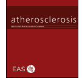
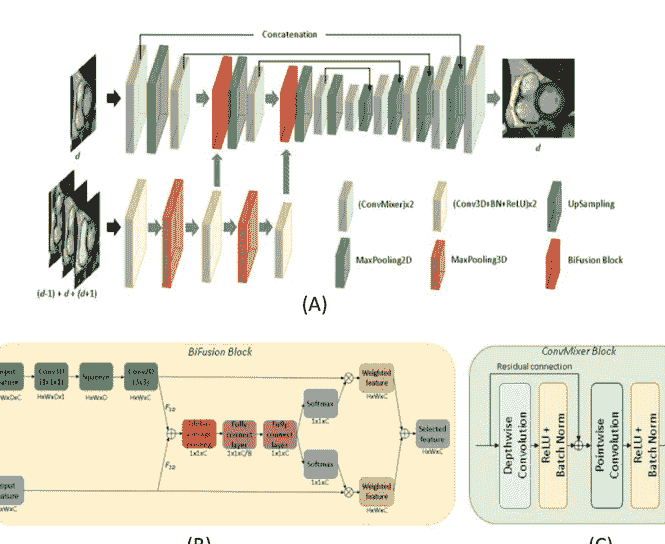
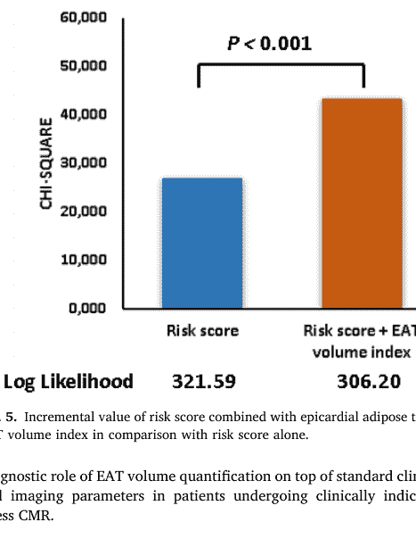
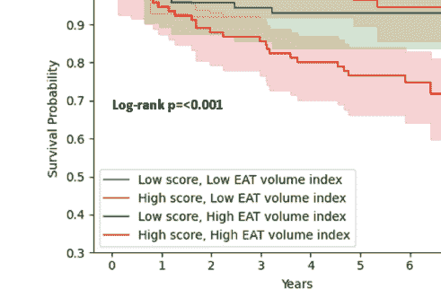

# 基于深度学习的心外脂肪脂肪量化预测压力心肌磁共振患者的心脑血管不良事件

## 基于深度学习的压力压力 CMR 患者中心外脂肪组织产物 MACE 的定量分析

Marco Guglielmo^{a,b}, Marco Penso^{c,d}, Maria Ludovica Careri^{d,e}, Carlo Maria Giacari^{c}, Alessandro Volpe^{g}, Laura Fusini^{g,h}, Andrea Baggaiano^{g,h}, Saima Mushtaq^{d}, Andrea Annoni^{d}, Francesca Cannata, Francesco Cila^{d}, Alberto Del Toro^{d}, Fabio Fazzi^{d}, Alberto Formenti^{d}, Antonio Frappamina^{d}, Paola Gripi^{d}, Daniel Junod^{d}, Elisabeth Mancini^{d}, Valentin Megazga^{d}, Ricardo Marquez^{d}, Francesca Marcheti^{d}, Giorgio Mastroiacove^{d}, Sergio Pirola, Luigi Tassetti^{d}, Alexia Rossi^{g}, Chiara Ravera^{d}, Andrea Iquori^{g}, Mark Rabat^{d}, Pim van der Hart, Mariana Fortana, Pietro Costantini, Ivo van der Bil, Enrico G. Calmeta, Maria Peti, Pontone^{d}

^a 心血管研究分部门，乌特勒支大学医学中心，荷兰
nb 心内科部门，海格教学医院，海格格，荷兰
c IRCCS 癌症研究所，圣拉菲，米兰，意大利
d 心血管放射学与介入影像科，IRCCS 心脏中心，米兰，意大利
e “G. Martini”大学医院生物科学与形态功能学部，梅西纳，意大利
f 心脏与结构心脏病部门，IRCCS 心脏中心，米兰，意大利
g 临床医学与分子保护部门，米兰，意大利
h 心内科部门，圣马特奥·雷贾亚诺医院，博洛尼亚，意大利
i 临床科学与心血管服务部门，米兰大学医学中心，米兰，意大利
j 实验医学与心脏病部门，巴里理工大学，意大利
l 芝加哥大学，伊利诺伊州，美国
m 内科部门，林肯，伊利诺伊州，美国
o 放射医学部门，苏黎世大学，瑞士
np 分子生物学中心，苏黎世大学，苏黎世，瑞士
q 放射科部门，玛利亚·慈善医院：大学医院，诺瓦拉，意大利
r 阿姆斯特丹大学，伦敦皇家医院基金，伦敦，英国
t 生物医学、外科与牙科，米兰，意大利

## 摘要

背景：本研究调查了压力 CMR（成像）患者中心外脂肪组织（EAT）体积对主要性不良心血管事件（MACE）的额外预后价值。

方法：我们研究了 730 名患者（平均年龄：63 ± 10 年；516 名男性），接受了冠状动脉评估的压力 CMR 队列（n = 365 ± 30）。MACE 定义为非致命性心肌梗死或心脏死亡。开发并训练了一个深度学习模型来从 CMR 定量 EAT 体积。EAT 体积根据心脏体积指数进行了调整。建立了基于 Cox 的成分风险评分来识别 MACE 的变量。

结果：在推导过程中，32 名患者（8.7%）在 2103 天的随访期间发生了 MACE。左心压力灌注左室射血功能（LVEF） = 59（± 4.8），HR (95% CI: 1.90–3.202; p<0.001），灌注缺血

# 待发表文章

测量了以下参数：左心舒张末容积（LVEDV）和收缩末容积（LVES），左心射血分数（LVEF）和右射血分数（RVEF）；左心室质量（LV）、LVEDV、LVEF、LV质量和RVEV根据体表面积（BSA）进行了测量。

所有灌注（perf）和延迟间期强化（LGE）的定性分析由两位专家独立完成（M.G. 和 A.B.，具有超过8年的心脏磁共共振经验，并获得欧洲心血管影像学会三级心脏学认证）。这些阅读者对临床史和影像发现设盲。两位阅读者之间的一致通过共识专家小组达成（G，具有超过10年的心脏磁共共振经验，并获得欧洲心脏学会三级心脏磁共共振认证），体积时间和分数的测量均由一位专家（M.G.）完成。为了评估观察者间的变异，由独立专家（A.B.，对主研究者的结果盲）对随机选择的25名患者子集重新评估了EAT体积和质量。

EAT轮廓在舒张末进行测量，从心膜开始并向此前定义的脂肪组织下缘移动 [2]。

EAT体积（ml/m²）被定义为EAT体积与患者体重的比值。

体重也未用于BSA或体重质量指数（BMI）的EAT体积指数化，以观察肥胖对腔室体积和质量的影响，因为这些参数与EAT密切相关 [14]。

应激灌注缺损通过视觉评估评估，并定义为对比剂首次通过期间强化的持续延迟：

- 1) 至少在一个心肌节段内
- 2) 在静息图像上不存在
- 3) 在左心室腔内最大信号强度下缺乏>3个阶段
- 4) 确认为冠脉分布
- 5) 与LGE位点无重叠

计算了LGE患者的绝对数量和百分比，以及LGE的绝对值和占心肌质量的百分比。

最初，手动追踪左心室内皮和心外膜边界，确保血池和心肌排除在感兴趣区域之外。随后自动计算LGE，并定义为信号强度比正常心肌信号强度增加超过5标准差（SD）的心肌节段。最后，排除了软件标记为LGE但在视觉分析期间被认为是伪影的任何区域 [13]。

## 2.4 深度学习

对于自动MRI图像，从输入图像实现了一个全卷积架构 [16]。网络结构基于UNet [17] 实现，该架构在多个数据集上取得了显著成功，包括具有低细粒度表面信息的心脏磁共共振高层分割。在图1中，网络架构包括二维（2D）和三维（3D）分支处理。对于详细架构、预处理和网络训练，利用补充的数据增强来改进模型生成，如补充材料所述。

整个患者队列使用专用网页链接（https://www.random.org/integers/%20mode%20==）随机分为推导队列和验证队列（分别为365名和365名患者）。

图 (1) 结合2D和3D卷积的主架构，用于从心血管共振环像图像进行心外膜脂肪组织分割。最后一层生成输入切片的最终分割图。(B) 使用其2D和3D分支的BiFusion块。(C) 用于从图像中提取特征的ConvMixer块

研究组的基线特征。

## 讨论

结果根据医学影像人工智能检查清单（CLAIM）[18] 和多变量预测模型个体诊断或预后透明报告（TRIPOD）[19] 进行呈现。

# 3. 结果

推导队列纳入了356名患者（年龄63岁）。中位随访时间为2103天（25-75百分位数：1822-2047）。9名患者失访。32名患者（8.7%）在随访期间发生了MACE（非致命性心肌梗死和死亡）。

报告了发生MACE与未发生MACE患者的基线特征。

偏离队列 MACE 的单变量预测因子。

CI: 置信区间; HR: 风险比例。BSA: 体表面积; CMR: 心磁共振; EAT: 异位脂肪组织; ED: 舒张容积; EF: 射血分数; ES: 收缩容积; LGE: 钄增强; LV: 左心; RV: 右心。

衍生队列的多变量分析。

### 3.2. EAT 与肥胖
肥胖的标准测量（BMI [kg/m²]）通过 Cox 回归预测 MACE。调整 BMI 后，EAT 体积指数 (ml/m²) 仍是未来 MACE 的显著风险因子 (1.095 [95 % CI, 1.053–1.139]) p<0.001（表 3）。

### 3.3. EAT 与性别
MACE 发生在 24 名 (75%) 男性和 8 名 (25%) 女性中。EAT 体积指数与男性的较高 MACE 风险相关 (HR 1.086 [95 % CI, 1.045–1.128]; p<0.001)，但女性没有 (HR 1.067 [95 % CI, 0.987–1.153]; p=0.103)。然而，实际上男女之间的 EAT 体积指数没有显著差异 (p=0.525)。

### 3.4. EAT 与密度
多变量分析中，调整密度后 EAT 体积指数是 MACE 的独立预测因子 (HR 1.079 [95 % CI, 1.040–1.120]; p<0.001)，如表 3 所示（模型 5）。EAT 体积指数在有密度的患者中与较高的 MACE 风险相关 (HR 1.106 [95 % CI, 1.033–1.187]; p=0.005)，在无密度的患者中也相关 (HR 1.066 [95 % CI, 1.021–1.118]; p=0.004)。

### 3.5. 验证队列分析
验证队列将 365 名患者的特征（表 6，补充表 2）与衍生队列进行了比较。中位随访时间为 2177 天（25-75位数：1848–2437）。与风险评分相比，EAT 体积指数显示出较低的 MACE 风险 (HR 0.638 [95 % CI, 0.524–0.792]; p<0.001) 和更高的 C 指数 (0.76 对 0.59; p<0.001)。Kaplan-Meier 曲线基于高 EAT 体积指数 (<24.6 ml/m) 和高风险评分显示。验证队列的多变量分析结果与衍生队列相当（补充表 3）。

研究的主要发现汇总在图摘要（图 8）中。

# 4. 讨论
本研究的目的是评估额外的

图 5. 风险评分数值值与风险评分相比的心外脂肪组织容积指数。

### 4.1. 结果总结
研究的主要发现是，在已知或怀疑患有压力下冠心病 (CAD) 的患者中：
- 1) EAT 体积指数是 MACE 的独立预测因子，在调整性别、糖尿病和肥胖后，比标准的 CMR 参数（如 SVF、心功能和 LGE）具有额外的风险降低作用。
- 2) 使用新的深度学习 (DL) 算法可以自动且准确地量化 EAT，其性能与专家评估相当。

图 4  队列主要不良事件 (MACE) 的 Kaplan-Meier 曲线，基于低 EAT 体积 <24.6 ml/m 和高 EAT 体积 ≥24.6 ml/m。

### 4.2. 该主题的现有研究
EAT 覆盖了心外和冠状动脉周围 80% 的心脏表面。越来越多的证据表明 EAT 可能导致动脉粥硬化各个阶段的发展，并释放促炎细胞因子。在体内量化 EAT 方面，最有效的非侵入性方法是使用改进的辛普森规则。受试者工作特征 (ROC) 曲线显示，风险评分 (854) 高于 EAT 体积指数 (739)。

验证队列与偏离队列的基线特征。

| 药物 | | | |

M. Guglielmo 等人

低评分，低 EAT 指数
高评分，低 EAT 指数
低评分，高 EAT 指数
高评分，高 EAT 指数

图 7. 基于风险和心外脂肪组织 (EAT) 值的主要不良心血管事件 (MACE) 的 Kaplan-Meier 曲线。低 EAT <24.6 mL/m，高 EAT ≥24.6 mL/m。

图 8. 图形摘要。
使用深度学习（DL）算法测量的标准心脏磁共振（CMR）心外脂肪体积，代表了已知或疑似冠心病（CAD）压力测试下患者 MACE 的稳健独立预测因子。

心脏映射。在一项针对 64 名左心室射血分数（LVEF）>40% 并接受心脏磁共振（CMR）的心衰患者进行的研究中，无需对比剂，EAT 体积与心房颤动（AF）的存在相关，并与炎症相关的生物标志物有关 [25]。此外，在 110 名发生心肌梗死的患者研究中，EAT 体积与较大的梗死面积、微血管阻塞和较大的 ST 段偏移相关 [27]。为了此目的，在心脏磁共振（CMR）中手动定量心外脂肪（EAT）所需的时间是限制性的 [28]。

与计算机断层扫描（CT）相关的因素 [29]，关于使用人工智能在心脏磁共振（CMR）中定量心外脂肪（EAT）的数据及其潜在预后作用。
Ding 等人证明了基于脂肪加权心脏磁共振造影的自动定量心外脂肪的算法 [30]。在本研究中，仅分析了十名患者。专家阅读者对心脏磁共振（CMR）图像进行了分割，算法被应用于剩余六名受试者。最近，提出了一种用于标准心脏磁共振（CMR）全自动定量心外脂肪（EAT）的深度学习（DL）算法 [31]。该算法随后被应用于心脏磁共振（CMR）测量的心外脂肪（EAT）与心室重构（更肥大的左心室）、左心室功能和较低的清除率之间的关联。心外脂肪（EAT）与糖尿病、血糖控制不佳、血脂和促炎标志物相关 [32]。性别之间的发病率、患病率和疾病结局的潜在差异。本研究忽略了女性的代表性不足。我们的发现表明，研究需要共同努力以确保心脏事件结局的更公平代表。

此外，心脏磁共振（CMR）平均比 CT 更难获取，需要更长的扫描时间，且缺乏 CT 的空间分辨率。然而，心脏磁共振（CMR）相对于 CT 的主要优势是不使用电离辐射。

## 4.4. 优势与局限性

我们的研究与以往工作相比具有新颖性。

首先，我们首次证明了心脏磁共振（CMR）衍生的 EAT 体积在大量已知或疑似冠心病（CAD）患者群体中，是 MACE 和标准临床及损伤参数的独立预测因子。特别是，我们测试了与心脏磁共振（CMR）灌注和延迟增强期成像（LGE）技术相比，EAT 测量的有效性。

其次，首次证明了可以通过全自动算法在图像上对 EAT 进行准确测量和分割，而无需人工进行扫描或分析。

我们研究的结果具有重要的临床意义。EAT 可能有助于识别未来事件风险较高的患者，促进启动风险的干预措施，包括抗炎治疗。

通过将这种深度学习（DL）算法整合到心脏磁共振（CMR）中，EAT 可以作为评估患者风险的稳健定量方法。它是使用短轴心磁共振层进行测量的，这些层在任何用于计算双室尺寸的 CMR 中都会常规记录，且不需要对比剂。此外，与耗时的 EAT 手动定量不同，我们提出的算法可以在几秒钟内完成心脂肪的定量。

标准心脏磁共振（CMR）中用深度学习（DL）算法测量的 EAT 体积代表了已知或疑似冠心病（CAD）压力测试下 MACE 的稳健独立预测因子。EAT 体积还比标准临床和影像参数提供了独立的预后价值。

本文涉及的基础数据将根据合理要求向通讯作者共享。

## 作者贡献声明

Marco Gigliotto：概念化、方法论、调查、草撰、数据分析。Visanco Porto：方法论、软件、可视化、数据整理、审稿。Marco Gigliotto：审稿、可视化。Alessandro Leone：草撰、调查、审稿。Andrea Baglio：数据整理、形式分析、草撰、监督。Antonio Serra：监督、验证。Francesco Canassa：可视化、方法论。Francesco Cali：软件、形式分析。Alberto Del Toro：数据获取采集、方法论、形式分析、可视化、审稿。Frampentina：方法论。Paola Grioli：可视化、初稿撰。文章。Daniele Junco：调查、方法论、医学分析。Elena Sabatini：可视化、审稿。Valentina Valenti：形式分析、审稿。Francesco Vallidance：形式分析。Francesco Marchetti：概念化、方法论、调查。Sergio Porola：调查、数据分析。Luigi Tassetti：监督、初稿撰。Valentina Vaurini：监督、方法论、审稿。Chiara Rovera：数据整理、形式分析、审稿。Pietro Costantini：数据整理、形式分析、审稿。Io van der Bilt：数据整理、形式分析、审稿。Enrico G. Gaiani：数据分析、审稿。Mariana Fontana：数据整理、形式分析、审稿。

策展、正式分析、写作与编辑，Gianluca Pone-
更新：心血管磁共共振 (CMR) 工作组，发表后任务。J. Cardiov. Magn. 35 (2022)
色调：数据策展、正式分析、写作与编辑。

# 利益冲突声明

Gianluca Pone 了与 G&E Healthcare（巴塞罗那）、Heartflow、勃ringer 的关系，包括资金资助和支出费用。其他所有人员均无须披露。

本文的补充数据可以在此处找到：https://doi.org/10.1016/j.atheros.2024.111749

- [11] F. Ricci, M.Y. Bhava, G. Bianchi, 等，已知或冠心病患者应激性心血管磁共共振成像的诊断与评估：系统评价和荟萃分析。JAMA Cardiol. 8 (2023) 662-673。
- [12] S. Kim, J. Lin, D. Dey, 等，心脏指数脂肪和冠心病指数的评估，Atherosclerosis 32 (2021) 30-38。
- [13] C. J. Watson, C. 等，心脏计算机层扫描在冠心病中的作用。Nat. Res Heart Cardiol. 19 (2022) 592-609。
- [14] G. Giacobello, F. Sassi, M. Ribeiro, 等，超声心动和 MRI 的评估：多模态研究。Eur Heart J. 44 (2023) 1015-1026。
- [15] C. Boon, M. Montan, C. De Greco, 等，预测冠状动脉疾病的新型心外脂肪组织标志物。Heart J. 10 (2024) e0852。
- [16] J.V. Sparman, M. Reker, U. Schoep, 等，冠状动脉疾病潜在脂肪指数的评估：文献综述。Radiology 35 (2021) 3372-3381。
- [17] A.R. van Rossem, L.J. Shaw, J.X. Xie, 等，使用动脉粥硬化风险评分进行风险分层。JACC Cardiology 12 (2019) 1987-1997。
- [18] M. Tchaar, H. Huang, M. Roberts, 等，MRI 评估冠心病患者的心外脂肪体组织。J. Res. Magn. 21 (2005) 445-462。
- [19] J. Rodriguez-Bance, G. S. M. Modelman, 等，基于人工智能的多模态：冠心病评估的新前沿。Front Cardiov Imaging. 86 (2022) 149-151。
- [20] A.J. Nelson, M. Worthby, J.P. Paulitis, 以及心血管磁共共振评估心外脂肪组织容积。J. Cardiov. Magn. 35 (2022) e0698。
- [21] R. Thygesen, J.S. Albert, A. Jaff, 等，心肌损伤的通用定义：欧洲心脏病学会共识声明。Heart 24 (2018) 17-25。
- [22] N. Nerleark, R.G. Muthaly, N. Wong, 等，冠心病和心脏疾病功能中容积性心外脂肪组织的评估，J. Am. Heart. 7 (2018) e00975。
- [23] J. Schulz-Menger, D.A. Boeumer, J. Freemerich, 等，心血管磁共共振的标准图像解读和后处理 - 2020
- [24] E. Shellhammer, J. Long, T. Darrell，用于语义心脏分割的全卷积网络，IEEE Trans. Pat. Anal. Magn. Med. 39 (2020) 649-651。
- [25] H. Kim, S. Lee, 等，使用深度卷积神经网络评估心脏磁共振图像中的心外脂肪组织腔室分割。Prog. Med. 2024 (20) e00029。
- [26] J. Long, M. Lee, J. Cho, 等，冠心病多变量预测风险模型 (TIPIGO) 的评估：TRIPIGO 数据库，JAMA 312 (2015) 2710-2718。
- [27] R. Groundy, 等，风险与肥胖。Heart. 8 (2003) 255-261。
- [28] Z. Zhou, Y. Chen, Y. Zhang, 等，阻塞性冠状动脉疾病相关的脂肪比例和心脏钙化。Atherosclerosis 34 (2021) 10522。
- [29] M. Tchaar, H. Huang, M. Roberts, 等，心外脂肪和公式：用于心房颤动。Front. Cardiol. Med. 9 (2022) 1745-1751。
- [30] F. Schuster, D. Hall, D. Winter, 等，心血管磁共振评估的心外脂肪，Obesity 15 (2027)
- [31] G. van Boer, T. Cramer, B. Westenhuis, 等，冠心病患者的心外脂肪和脂肪。Nat. Heart Fail. 12 (2020) 1518-1526。
- [32] C.W. Wong, H.S. Abel, M. Poole, 等，脂肪与心脏疾病结局相关。J. Cardiol. 80 (2022) 1115。
- [33] S. Kallig, D. Bell, 等，急性心肌梗死患者心外脂肪的影响。Clin. Res. Cardiol. 110 (2021) 1104。
- [34] R. Greco, S. Wang, W. Hex, 等，基于 CT 图像的脂肪分析和人工智能：文献综述。Quant. Imag. Med. Suppl. 43 (2020) S115-S20。
- [36] M. Artisanini, C. McCreadman, A. Burrell, 等，英国生物库受试者中脂肪与冠心疾病独立相关，Eur Heart J Cardiovascular Imaging 23 (2022) 1471-1481。
- [37] L. Byrne, T. Smith, D. Russell, K. Gayle，医学研究中的性别不平等：文献综述。Women Health Rep (Nevelle Roche) 3 (2022) 49-59。

