# 基于深度学习的空中图像车辆检测

## 摘要

空中平台例如配备相机传感器的无人机在民用安全和保障领域的大量应用中至关重要。其中，突出的应用包括监视和侦察、交通监控、搜索救援、灾难救援和环境监测。然而，仅由人工操作员分析航空图像数据通常不可行，因为视觉数据量大导致认知过载。在实践中，基于适当计算机视觉算法的自动化处理链被用于协助人工操作员评估航空图像数据。此类处理链的关键组成部分是在场景被分析和解释之前，对摄像机视场内所有相关对象的准确检测。源于相机与地面之间大距离的低空间分辨率使得航空图像中的目标检测成为一项具有挑战性的任务，且进一步受到运动模糊、遮挡或阴影的阻碍。尽管文献中存在许多针对航空图像中目标检测的传统方法，但所使用手工制作特征的有限表征能力往往由于对象尺度、方向、颜色和形状的高方差而阻碍了可靠的检测精度。

在本论文范围内，开发了一种新颖的基于深度学习的检测方法，其重点在于对俯视拍摄的航空图像中的车辆检测。为此，选择 Faster R-CNN 作为基础检测框架，因为其检测精度优于其他基于深度学习的检测器。对航空图像特定特征的系统性适应，尤其是小对象尺寸，已被系统地检查，并识别出与实际应用相关的由此产生的问题，即由类似车辆的结构引起的大量误检以及较差的推理时间。提出了两个新组件以通过增强所用特征表征的上下文内容来提高检测精度。第一个组件旨在通过结合浅层和深层特征来增加空间上下文信息，以兼顾精细和粗糙结构，而第二个组件利用语义标注——图像的逐像素分类——来引入更多语义上下文信息。实现了两种不同的将语义标注集成到检测框架中的变体：利用语义标注结果来过滤不太可能的预测，以及通过共享特征表征显式地将语义标注网络合并到检测框架中以引入场景知识。两个组件均明显减少了误检数量，从而显著提高了检测精度。为了减少计算量并因此缩短推理时间，本论文中开发了两种替代策略。第一种策略是用针对航空图像中车辆检测优化的轻量级 CNN 架构替换用于特征提取的默认 CNN 架构，而第二种策略则包括一个用于将搜索区域限制为感兴趣区域的新模块。所提出的策略为检测框架的每个组件带来了明显减少的推理时间。结合所提出的方法，与作为基线的标准 Faster R-CNN 检测器相比，检测性能显著提高。此外，与文献中引用的航空图像中车辆检测的现有方法相比，在不同的航空图像数据集上以定量和定性方式均被超越。泛化能力进一步通过对来自具有不同属性的新航空图像数据集的大量先前未见数据进行了演示。

## 关键词

配备成像传感器的空中平台的使用是民用安全领域许多应用的重要组成部分。已知的应用领域包括发现非法或犯罪活动、交通监控、搜索和救援、灾难援助和环境监测。由于待处理数据的数量庞大以及由此产生的认知过载，实践中仅由人工评估员分析航空图像数据是不适用的。因此，通常使用自动图像和视频处理算法来支持人工评估员。关键任务是在对给定场景进行解释之前，对摄像机视场内相关对象的可靠检测。由于相机与地面之间的距离很大导致地面分辨率较低，航空图像数据中的目标检测是一项具有挑战性的任务，且因运动模糊、遮挡和阴影而进一步复杂化。尽管文献中存在大量用于航空图像数据中目标检测的传统方法，但检测精度受所使用手工设计特征的表征能力的限制。

在本工作中提出了一种用于航空图像数据中目标检测的新型基于深度学习的方案。工作的重点是检测垂直自上而下拍摄的航空图像中的车辆。所开发方案的基础是 Faster R-CNN 检测器，与其他基于深度学习的检测方法相比具有更高的检测精度。由于 Faster R-CNN 以及其他基于深度学习的检测方法是在基准数据集上优化的，因此首先系统地研究了对航空图像特征的必要调整，例如待检测车辆的较小尺寸，并识别了由此产生的问题。就实际应用而言，这里尤其成问题的是由类似车辆的结构引起的大量错误检测以及明显增加的运行时间。为了减少错误检测，提出了两种新方法。两种方法都旨在通过额外的上下文信息改进所使用的特征表征。第一种方法通过结合底层 CNN 架构的早期和深层特征来细化空间上下文信息，从而更好地表征精细和粗糙结构。第二种方法利用语义分割来提高语义信息含量。为此，实现了两种将语义分割集成到检测方法中的不同变体：一方面使用语义分割结果来过滤不太可能的检测，另一方面通过融合用于检测和分割的 CNN 架构显式实现。通过细化空间上下文信息以及集成语义上下文信息，错误检测数量显著减少，从而提高了检测精度。特别是错误检测在不太可能的图像区域例如建筑物上的大幅下降，显示了所学习特征表征的提高的鲁棒性。为了减少运行时间，工作中采用了两种替代策略。第一种策略是用考虑航空图像数据特征的运行时间优化 CNN 架构替换用于特征提取的标准 CNN 架构，而第二种策略包括一个用于减少搜索空间的新模块。借助所提出的策略，整体运行时间以及检测方法每个组件的运行时间均显著降低。

通过组合所提出的方法，与Faster R-CNN基线相比，检测精度和运行时间均可得到显著改善。在不同数据集上，所提出的方法在定量和定性方面均超越了文献中具有代表性的航空图像车辆检测方法。此外，还展示了所设计方法在来自具有不同特性的其他航空图像数据集的未见图像上的泛化能力。

## 1 引言

### 1.1 研究动机

利用安装在卫星或空中平台（如直升机、无人机（UAV）等）上的传感器记录图像或视频，可以通过单个传感器覆盖大面积区域，并捕捉多个物体及其交互。因此，这克服了地面附近固定相机网络的一个核心局限性。由于成像系统和空中平台的技术日益进步以及随之而来的成本降低，使用航空图像（也称为遥感图像）的应用领域正在迅速增长[Res17]。2017年全球航空成像市场规模为15.6亿美元，预计到2026年将达到62.4亿美元[Res18]。其中，预期将出现显著市场增长的常见应用包括搜索与救援任务[Rud08, Goo09, Qi16]、灾害救援[Ada11, Eze14, Erd16]、交通监控[Ang03, Len08, Kan15]以及监视与侦察任务[Gir04, Hei10, Rei10]。图1.1给出了突出航空图像在此类应用中实用性的示例。

由于搜索区域广阔且通常难以进入（如山区或公海），配备专用相机传感器（如热红外（IR））的直升机或无人机通常用于协助寻找失踪或受伤人员，并协助搜捕和逮捕犯罪嫌疑人或逃犯。针对空中力量与地面搜索队在成功率和定位时间方面的有效性对比研究，证实了它们在搜索与救援任务中的益处[Ham17, Eye18]。研究表明，自动化算法对人类操作员的支持对于高成功率至关重要，因为动态且复杂的环境会妨碍对仅在很短时间内可见的人员进行定位[Goo09]。

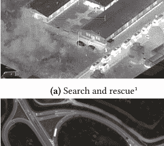

(a) 搜索与救援¹

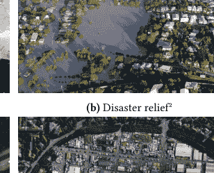

(b) 灾害救援²

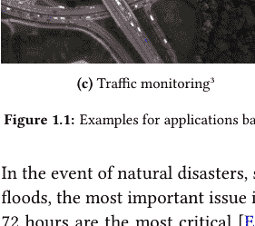

(c) 交通监控³

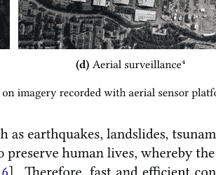

(d) 空中监视⁴

图1.1：基于空中传感器平台记录图像的应用示例。

1 https://www.thueringer-allgemeine.de/leben/recht-justiz/nach-razzia-in-gierstaedt-spezialeinheit-fahndet-nach-schleusern-und-hintermaennern-id223248397.html
2 https://ulcrobotics.com/services/gas-utility-unmanned-aerial-inspection/
3 由Fraunhofer IOSB在德国卡尔斯鲁厄上空拍摄的录像
4 https://verkehrsforschung.dlr.de/en/news/visual-contact-wiesn

在发生地震、山体滑坡、海啸或洪水等自然灾害时，最重要的问题是保护人类生命，其中最初的72小时最为关键[Erd16]。因此，快速高效地开展搜索与救援任务至关重要。尽管包括灾损调查车辆或无人地面车辆在内的传统评估方法在可达性和及时性方面存在固有局限，但空中平台获取的影像有助于实现态势感知，从而实时进行灾害管理[Ada11]。为了帮助承受认知过载的人类操作员，需要自动损毁评估系统[Erd16]。

不断增长的交通量催生了对自动化交通监控和管理的更大需求。除了安装在地面附近的固定相机、嵌入路面的感应线圈和横跨道路用于估算特定区域交通流量的气动管之外，空中平台获取的航空图像已被证明是一种理想的补充手段，能够覆盖大面积区域[Kan15]。随着自动驾驶的兴起，新的应用包括生成逼真数据（即从航空图像中提取的车辆轨迹），这些数据是仿真工具所需的输入，以及获取航空图像，为对整体场景视野相当有限的车载传感器提供参考[Kur18]。

空中监视任务的范围涵盖从边境巡逻到大型活动监控。近年来，即使在复杂地形中也能快速覆盖大片边境区域，这导致空中系统越来越多地被用于防止走私或人口贩运等不受欢迎的跨境活动，因为现有的地面解决方案往往繁琐、易出错、成本高昂且耗时[Ber16]。空中系统还便于对特定区域进行持续监控，例如节日和体育赛事等大型活动，所记录的航空图像可让组织者和地面安保团队在紧急情况或交通管理时快速获取所需的态势信息[Röm16]。

所有这些应用都需要一条自动化处理链来解析航空图像。在交通监控或空中监视等情况下，由人工操作员处理海量数据在时间和成本上都是不可行的；而在搜索与救援任务和灾害救援中，则需要为操作员提供辅助，以减轻动态和复杂环境造成的认知过载。此类处理链的关键组成部分是在分析解读场景之前，准确检测所有相关物体，例如相机视野内的车辆。本论文旨在开发一条高效的检测流水线，适用于航空图像中的车辆检测任务——车辆是众多应用关注的目标对象。本文重点研究俯视图（也称为天底视图）记录图像中的车辆检测，因为这种视角能够以均匀的细节覆盖大面积区域。为此，本文探索了在计算机视觉大多数领域均展现出良好效果的深度学习技术，以克服基于手工特征的传统车辆检测方法的不足。

### 1.2 挑战

从飞机、无人机或卫星等传感器平台获取的航空图像中的车辆检测是一项具有挑战性的任务。主要原因包括传感器与地面之间的高距离、拍摄条件以及因不同时间和地区而变化的多样的场景。图1.2详细展示了这些挑战，其可分类如下：

- 1. 图像采集产生的挑战：
- **图像噪声**是真实像素强度值的随机偏差。主要原因包括统计量子涨落、相机传感器的物理特性以及强度量化。
- **模糊**可能由不同的原因引起，例如物体失焦、物体运动以及相机运动或相机抖动。运动模糊尤其在光照较弱导致相机曝光时间较长时出现。模糊会导致对比度变弱、清晰度降低。
- **光照**强烈影响图像质量。黄昏等低光照条件需要更长的曝光时间，从而导致运动模糊或图像噪声增加。过强的光照会导致相机传感器饱和，进而……

除了上述因图像质量以及物体和场景变化带来的挑战外，实际应用还对检测算法提出了进一步的要求。这些实际要求包括：

- **通用性和可迁移性**：检测算法需要具备较高的鲁棒性以应对数据的变化。常见的检测算法利用机器学习方法从给定样本中学习车辆和非车辆的外观。由于这些给定样本通常有限，学习到的模型应能够在新颖的、未见过的数据中定位和分类车辆。

- **实时性要求**：必须满足实时性要求以确保许多应用所需的在线处理。与离线处理不同，一张图像的处理必须在下一张图像被采集之前完成。例如，如果帧率为 25 Hz，则大约有 40 ms 的时间来提取和处理当前图像信息。请注意，由于计算量的增加，满足实时性要求通常随着图像尺寸的增大而更具挑战性。

- **硬件限制**：由于机载平台的载荷有限，硬件限制会影响计算能力，进而影响处理时间。诸如 NVIDIA Jetson 平台¹ 之类的嵌入式系统除了强大的处理器外还包含高性能 GPU，能够为深度学习和计算机视觉应用提供低功耗的机载计算。然而，与可能包含多个 GPU 的服务器设置相比，GPU 内存（通常与 RAM 共享）和并行处理单元的数量明显较少，因此限制了深度学习模型的大小和复杂度。

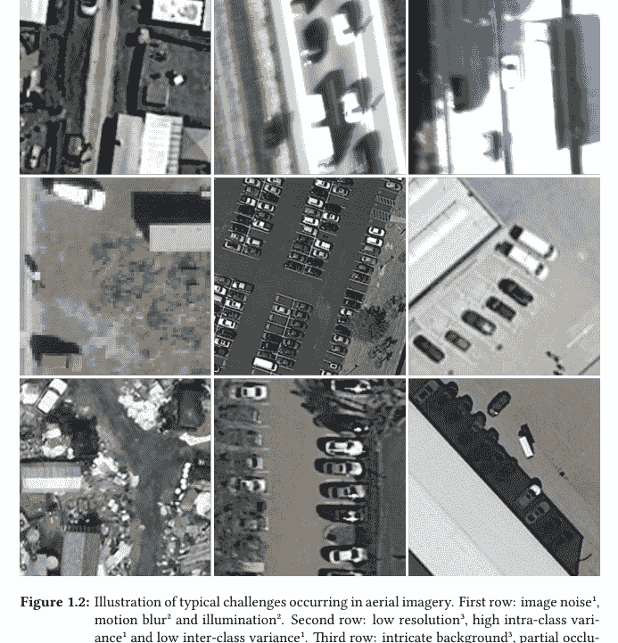

图 1.2：航空影像中典型挑战的示意图。第一行：图像噪声¹、运动模糊²和光照²。第二行：低分辨率³、高类内方差⁴和低类间方差⁴。第三行：复杂背景³、部分遮挡⁴和阴影⁴。

¹ 图像取自 [Xia18]  
² 图像来自 Fraunhofer IOSB  
³ 图像取自 [Raz16]

### 1.3 贡献

本论文的目标是设计一种基于深度学习的检测流程，用于低空间分辨率航空影像中的车辆检测，从而能够覆盖大面积区域。本论文所展示的工作对基于深度学习的车辆检测领域做出了以下贡献：

- 首次针对基于深度学习的检测框架在航空影像车辆检测任务中的应用进行了详尽的分析。通过流行的 Faster R-CNN 检测器 [Ren15]，系统性地研究了应对航空影像特征的相关改编，该检测器在检测精度和推理时间之间取得了良好的平衡。此外，还识别了实际应用中产生的问题，即由具有类似车辆结构的物体引起的误报以及耗时的检测组件 [Som17c, Som17b, Som18b]。

- 引入了两种通过增强检测框架上下文信息来提高检测精度的新方法。第一种方法旨在通过结合浅层和深层特征来增加空间上下文信息，以兼顾精细和粗粒度结构 [Som18c]；第二种方法利用语义标注——即图像的逐像素分类——来引入更多语义上下文信息。实现了两种将语义标注集成到检测框架中的不同变体：利用语义标注结果过滤掉不可靠的预测 [Som17a]，以及通过共享特征表示将语义标注网络显式合并到检测框架中来引入场景知识 [Nie18]。所提出的方法在公开的航空影像基准数据集上提高了检测精度，因为误报数量显著减少。

- 通过对 DLR 3K 数据集进行逐像素标注，生成了一个新颖的航空影像语义标注数据集，从而能够在航空影像车辆检测的背景下更好地集成和评估语义标注。与德国航空航天中心（DLR）合作，该数据集的精炼增强版本已公开提供给研究人员 [Azi19]。请注意，DLR 除其他外还提供了诸如车道标线等更细粒度的标注。

- 由于实时或近实时车辆检测通常是实际应用的前提，因此提出了两种降低计算量从而缩短推理时间的策略。第一种策略是将用于特征提取的默认 CNN 架构替换为针对航空影像车辆检测优化的轻量级 CNN 架构 [Rin19]。利用车辆通常只覆盖航空影像一小部分这一情况，第二种策略包含一个新模块，用于在检测模块之前限制搜索区域 [Som18a]。所提出的策略使得检测流程的每个组件的推理时间都明显减少。

- 在多个公开数据集上的广泛评估表明，与具有代表性的现有工作相比，本论文所提出的检测方法具有优越的检测性能。此外，还证明了为适应航空影像特征所进行的改编可以迁移到更新的基于深度学习的检测框架 [Som18d, Aca18]，并在具有不同图像内容和图像质量的未见数据上可视化了所提出检测方法的泛化能力。

### 1.4 论文结构

本论文的结构如下：第 2 章提供了深度学习的基础知识，这对本论文其余部分至关重要。此外，还全面回顾了基于深度学习的检测框架以及航空影像车辆检测的相关工作。第 3 章介绍了所提出的检测流程的概念，识别并讨论了与其他概念的异同。第 4 章介绍了本论文使用的评估协议和航空影像数据集。第 5 章介绍了所提出的检测流程的基础框架，审查了为适应航空影像特征而提出的改编，并识别了与实际应用相关的问题。第 6 章详细描述并评估了两个通过增强所使用特征的空间和语义内容来提高检测精度的新组件。第 7 章详细描述和评估了两种为缩短推理时间而提出的替代策略。第 8 章对所提出的检测流程进行了广泛评估，考察了组合所提出的组件和策略的不同可能性，并以定性和定量的方式将单独及组合的方法与文献中具有代表性的现有工作进行了比较。最后，第 9 章总结了结论和潜在的未来研究方向。

## 2 相关工作

本论文的目标是设计一种基于深度学习的检测流程，用于航空影像中的车辆检测。本章概述了涵盖所提出的检测流程相关模块的现有工作。首先，第 2.1 节介绍了深度学习的基础知识，特别是卷积神经网络，这些对本论文其余部分至关重要。第 2.2 节全面回顾了基于深度学习的检测框架及其最新进展。第 2.3 节总结了航空影像车辆检测的相关工作。所回顾的文献重点关注从飞机、无人机或配备俯视视觉相机的卫星上获取的航空影像。所考虑的文献可分为采用手工特征的传统方法和基于深度学习的方法。

### 2.1 深度学习

长期以来，神经网络一直被应用于计算机视觉及相关的搜索领域。自 1943 年 McCulloch 和 Pitts [McC43] 首次创建用于模拟人脑神经网络的数学模型以来，神经网络经历了若干演进阶段。它们最新的形态通常被称为*深度学习*，指的是大量的层，随着所需硬件的进步，这些层已成为可能 [Sch15]。应用于众多计算机视觉任务的最流行的神经网络变体是*卷积神经网络*（CNN）。2012 年，CNN 凭借 AlexNet [Kri12] 在 ImageNet 分类挑战赛 [Den09] 中的卓越成功，在计算机视觉领域取得了广泛突破，该挑战要求对图像进行分类

到 1000 个不同类别之一。AlexNet 作为第一个参加该挑战的 CNN，与之前的解决方案相比显著降低了错误率，这初步表明了 CNN 能够捕获大量且多样化的图像内容。

#### 2.1.1 多层感知机

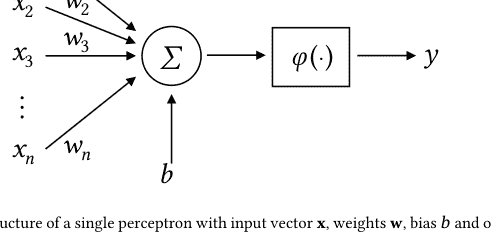

图 2.1：单个感知机的结构，包含输入向量 x、权重 w、偏置 b 和输出 y。

神经网络最常见的单元是 Frank Rosenblatt 于 1957 年引入的感知机 [Ros58]。其基本结构如图 2.1 所示。感知机接收 n 个标量输入，通常以 n 维向量 x ∈ ℝⁿ 的形式提供，并有一个标量输出 y。感知机的输出定义为其输入通过激活函数后的加权和：

y = φ(wᵀ x + b). (2.1)

权重向量 w ∈ ℝⁿ 和可选的偏置项 b 是神经网络在训练过程中学习到的自由参数。激活函数 φ(·) 是为了便于学习非线性决策函数而引入的非线性函数。常见的选择包括 sigmoid 函数、双曲正切函数和修正线性单元（ReLU）函数。ReLU——CNN 中最常使用的激活函数——将在 2.1.2 节中更详细地描述。

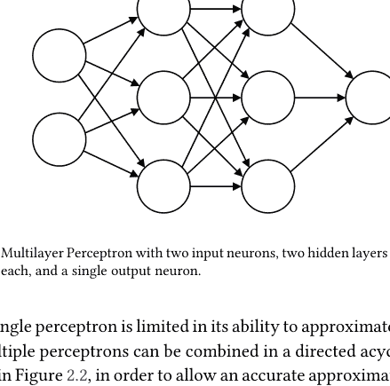

图 2.2：具有两个输入神经元、两个隐藏层（各三个神经元）和一个输出神经元的多层感知机。

虽然单个感知机逼近决策函数的能力有限，但多个感知机可以组合成一个有向无环图，如图 2.2 所示，从而能够精确逼近复杂的决策函数。在这个所谓的多层感知机（MLP）中，被记为神经元的感知机集合被排列为三种类型的层：一个输入层、一个或多个隐藏层以及一个输出层。特定层 i 的每个神经元都连接到前一层 i − 1 中所有神经元的输出。因此，这些层通常被称为全连接层。第 i 个全连接层的输出由下式给出：

h_i = φ(W_i h_{i-1} + b_i) (2.2)

其中 h₀ = x 是输入，例如图像或特征向量，h_n = y 是 n 层 MLP 的输出。W_i = [w_{i1},..., w_{im}]^T 是该层的权重矩阵，由该层 m 个神经元的权重向量组成；b_i = [b_{i1},..., b_{im}]^T 是该层的偏置向量。所有权重矩阵和偏置向量共同构成网络的可训练参数。请注意，由于相邻层神经元之间的成对连接，可训练参数的数量会随着网络中神经元数量的增加而显著增加。

#### 2.1.2 卷积神经网络

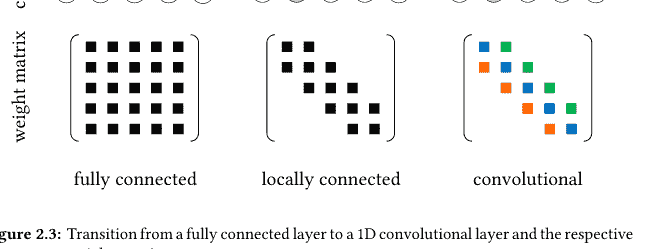

图 2.3：从全连接层到一维卷积层的过渡以及相应的权重矩阵。

一般来说，卷积层由一组可学习的滤波器组成，这些滤波器也称为通道，因为单个卷积滤波器无法从上一层捕获足够的信息。这组滤波器的特征由其卷积核大小定义，卷积核大小决定了相应的局部邻域，该局部邻域通常称为*感受野*。滤波器之间不共享权重，因此每个滤波器都可以自由学习不同的卷积运算。卷积层的输出通常称为*特征图*，因其具有空间特性。它跨越空间维度，并在每个位置包含一个特征向量，该特征向量的维度等于该层中滤波器数量 $C$。请注意，在多个输入通道 $D$ 的情况下，每个滤波器由 $D$ 个大小为 $k \times k$ 的卷积核组成。每个卷积核在相应的输入通道上滑动，所得输出通过逐元素相加汇总，为每个滤波器生成一个输出通道，如图 2.4 所示。特征图的大小受步长和填充的影响。步长参数指定了应用卷积核的两个空间位置之间的距离，而零填充可用于在输入边缘应用卷积核。

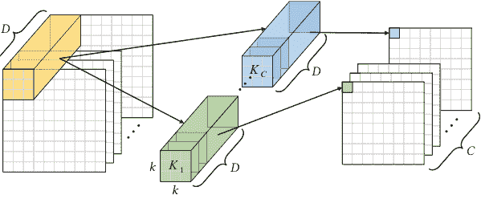

**图 2.4：** 使用 $C$ 个滤波器进行卷积的示意图，每个滤波器由 $D$ 个大小为 $3 \times 3$ 的卷积核组成。对于每个滤波器，每个卷积核在相应的输入通道上滑动，所得输出通过逐元素相加汇总，为每个滤波器生成一个输出通道。

为了逼近复杂的决策函数，对卷积层的输出逐元素应用激活函数，从而将非线性引入 CNN。在实践中，相对于 sigmoid 和双曲正切等 sigmoid 型函数，ReLU 通常更受青睐作为激活函数 [LeC15]，它在计算复杂度和梯度计算方面具有优势，同时在多个领域的多个任务上取得了更优的结果 [Kri12, Maa13, Glo11]。ReLU 函数定义如下：

φ(x) = max(0,x). (2.3)

它通过将特征图中的负值设置为零来去除这些负值，如图 2.5 所示。

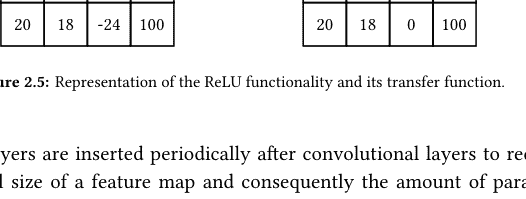

图 2.5：ReLU 功能及其传递函数示意图。

池化层周期性地插入在卷积层之后，以减小特征图的空间尺寸，从而减少参数数量。这提高了计算效率，同时增加了对输入小位移的不变性 [Sch10]。池化操作由滤波器大小、步长和池化函数定义。池化操作在每个输入通道上独立执行。常见的池化操作是最大池化，滤波器大小为 2 × 2 或 3 × 3，步长为 2。最大池化返回由滤波器大小定义的感受野内的最大值，如图 2.6 所示。较少使用的池化函数是平均池化和 ℓ₂ 范数池化，因为最大池化在实践中已被证明效果更好 [Sch10]。注意，使用大于 1 的步长进行卷积是减小特征表示空间尺寸的另一种策略 [Spr14]。

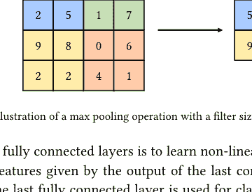

图 2.6：滤波器大小为 2 × 2、步长为 2 的最大池化操作示意图。

与 MLP 中一样，将每个神经元连接到前一层所有神经元的全连接层通常用作 CNN 的最后几层。全连接层的目标是学习由最后一个卷积层输出给出的高层特征的非线性组合。最后一个全连接层的输出用于分类、回归等，具体取决于特定的计算机视觉任务。

#### 2.1.3 CNN 训练

CNN 的训练通常以监督方式进行，通过反向传播并借助一个称为损失函数 L 的目标函数。为特定任务设计的损失函数将网络的预测值与真值（GT）进行比较，并计算误差度量。在目标检测的背景下，经常使用两种损失函数，即分类损失和回归损失，如 5.1 节中更详细描述的那样。分类损失函数的常用选择是 softmax 损失 [Dud12]，而 smooth L1 损失被广泛用作回归损失函数 [Gir15]。一种常见的优化方法是随机梯度下降（SGD），其中针对训练数据的一个小的随机子集（称为批次 B）计算梯度，然后通过网络的所有层反向传播 [Mon12]。在每次迭代 t 中，使用梯度按如下方式更新网络当前权重：

W^{t+1} = W^{t} + ΔW^{t} (2.4)

其中

$$\Delta \hat{\mathbf{W}}^t = \eta \sum_{x \in \mathcal{B}_t} \frac{\partial L_x}{\partial \mathbf{W}^t} \tag{2.5}$$

为当前批次 $\mathcal{B}_t$ 上的梯度。梯度由学习率 $\eta$ 加权，该学习率指定了梯度下降中的步长。为了实现更快的收敛，通常会将前一次权重更新 $\Delta \hat{\mathbf{W}}^{t-1}$ 的一部分 $\omega$ 添加到当前权重更新中：

$$\mathbf{W}^{t+1} = \mathbf{W}^t + \Delta \hat{\mathbf{W}}^t + \omega \Delta \hat{\mathbf{W}}^{t-1}. \tag{2.6}$$

因此，这种称为 *动量* 的方法可以克服损失函数中的平坦区域 [Dud12]。除了带动量的 SGD 外，还提出了几种动态调整学习率的替代优化方法，包括 AdaDelta [Zei12]、AdaGrad [Duc11]、RMSprop [Tie12] 和 Adam [Kin14]。特别是后一种优化方法，它是带动量的 SGD 与 RMSprop 的结合，在实践中通常只需少量超参数调优即可取得良好结果。因此，避免了使用 vanilla SGD 和各种学习率调度对多个网络进行耗时训练。

过拟合——对所用训练样本的过度适应——是训练 CNN 时的普遍问题，原因在于其参数数量庞大。解决此问题的一种常见正则化方法是 *权重衰减*，它在每次迭代中以一个很小的比例 $\delta$ 减小权重：

$$\mathbf{W}^{new} = (1 - \delta) \mathbf{W}^{old}. \tag{2.7}$$

这可以防止权重变得过大，否则它们会主导网络的输出。另一种流行的防止过拟合的正则化方法是 *丢弃* [Sri14]。在训练期间，丢弃会以给定的概率停用特定层的神经元，迫使网络学习冗余的表示。因此，避免了形成专门针对训练样本的网络关键路径。

为了避免因梯度消失或爆炸而导致的训练不稳定，网络权重的适当初始化很重要。随机初始化，例如 Xavier 初始化 [Glor10] 或 Kaiming 初始化 [He15]，常被用于解决此问题。虽然随机初始化允许网络架构设计更灵活，但它通常会导致次优结果，尤其是在参数众多且可用训练数据有限的深层网络中。因此，实践中通常使用在大规模数据集上预训练的模型的权重进行初始化，例如包含数百万张图像的 ImageNet 分类挑战数据集 [Deng09]。

随着网络深度的增加，梯度信号可能变得不稳定，因此提出了 *批归一化* 以使网络中的梯度传播更稳定 [Iof15]。一般而言，批归一化在激活函数之前立即应用，通过将网络激活 $\tilde{h}_i = W_i h_{i-1} + b_i$ 归一化为零均值和单位方差：

$$\hat{\tilde{h}}_i = \frac{\tilde{h}_i - \mu_{\mathcal{B}}\mathbf{e}}{\sqrt{\sigma_{\mathcal{B}}^2 + \epsilon}}$$  \tag{2.8}

其中 $\mu_{\mathcal{B}}$ 和 $\sigma_{\mathcal{B}}^2$ 是针对当前批次 $\mathcal{B}$ 计算的均值和方差，而 $\mathbf{e}$ 是与 $\tilde{h}_i$ 长度相同的全一向量。此外，还添加了一个很小的值 $\epsilon$ 以防止除零。为了恢复网络的表示能力，引入了一组可学习参数 $\gamma_i$ 和 $\beta_i$，它们对归一化输入进行缩放和平移：

$$\tilde{h}_i^{BN} = \gamma_i\hat{\tilde{h}}_i + \beta_i\mathbf{e}$$  \tag{2.9}

由于批归一化防止激活值变得过高或过低，它允许使用更高的学习率，从而加速训练过程。

#### 2.1.4 CNN Architectures

自 LeNet[LeC98] 和 AlexNet[Kri12] 等早期 CNN 架构的开发以来，已经提出了几种新颖的 CNN 架构，通过重新排列卷积层、池化层和全连接层的组合来提高性能并实现更高效的学习。最值得注意的、已应用于广泛计算机视觉任务的架构可分为 *VGG*、*残差* 和 *Inception* 网络。

与之前的最新网络类似，例如 AlexNet，VGG 网络（以牛津大学视觉几何组命名）由卷积层和池化层组成，随后是排列在单路径网络中的全连接层序列 [Sim14]。而之前的最新网络使用计算成本高昂的 9 × 9 或 11 × 11 滤波器来实现大感受野，VGG 网络则依赖于模拟更大感受野效果的 3 × 3 卷积层序列。使用小卷积层序列使得网络深度可增加至 19 层，从而提取更复杂的图像特征。其具有 16 层的变体称为 *VGG16*，已成为许多计算机视觉任务中作为特征提取器的热门选择。

Inception 网络依赖于一个称为 *Inception模块* 的基本单元（见图 2.7）[Sze15]。Inception 模块——首次应用于 GoogLeNet [Sze15]——由具有不同卷积层集合的并行分支组成，这些分支通过拼接聚合。由于每个分支具有不同的感受野，Inception 模块允许模型通过较小的卷积恢复局部特征，并通过较大的卷积获取更全局的特征。瓶颈层，即 1 × 1 卷积层，通常用于在进行较大卷积之前限制通道数。为了降低计算复杂度，近期变体不使用大于 3 × 3 的卷积。因此，大型 *k* × *k* 卷积要么被 3 × 3 卷积序列替代，要么被分解为 1 × *k* 和 *k* × 1 卷积的组合 [Sze16, Sze17]。

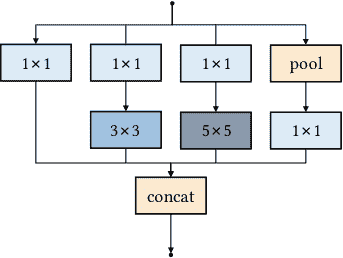

**图 2.7：** Inception 模块——Inception 网络的基本单元，由具有不同卷积层集合的并行分支组成，这些分支通过拼接聚合。

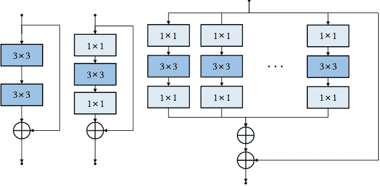

**图 2.8：** 残差块 (a)、带瓶颈层的残差块 (b) 以及 ResNeXt 网络的基本单元 (c)。

残差神经网络 [He16a]，简称为 *ResNets*，通过向网络添加恒等快捷连接来克服梯度消失问题，这些快捷连接有助于平滑地反向传播梯度信号（见图 2.8a）。这些快捷连接进一步促进了学习任务，因为中间层仅

由 *扩张系数* *d* 刻画，它定义了滤波器元素之间的间隔。在实践中，如图 2.9 所示，滤波器元素与输入的远距离元素匹配，从而产生更大的感受野。请注意，*d* = 1 的扩张卷积等价于标准卷积。

*分组卷积*，首次在 [Kri12] 中提到，已被提出以降低标准卷积的计算成本。与其使用具有输入图像完整通道深度的滤波器，即每个滤波器 *D* 个核，输入被按通道划分为组，并且滤波器对每个组独立应用（见图 2.10b）。设 *g* 表示组数，分组卷积滤波器仅考虑 *D/g* 个通道，而不是完整的通道深度 *D*。因此，与标准卷积相比，计算成本降低了 *g* 倍。

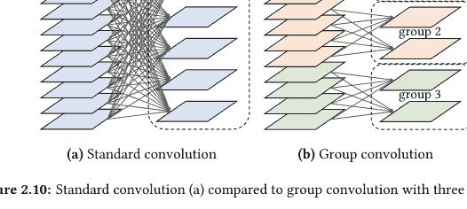

图 2.10：标准卷积 (a) 与具有三个组的分组卷积 (b) 的比较。

一种 *深度可分离卷积* (DSC) 在空间和通道域中独立执行卷积，以减少参数数量和计算成本 [Sif14]。它将标准卷积分解为 *深度卷积* 和 *逐点卷积*，如图 2.11 所示。深度卷积本质上是具有相同组数 *g* 和输入通道数 *D* 的分组卷积的特例。因此，

A spatial convolution is performed independently over each channel of the input, while the pointwise convolution, i.e., a 1 × 1 convolution, is applied across all the D intermediate channels.

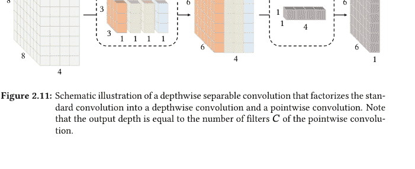

图 2.11：深度可分离卷积的示意图，将标准卷积分解为深度卷积和逐点卷积。注意输出深度等于逐点卷积的滤波器数量 C。

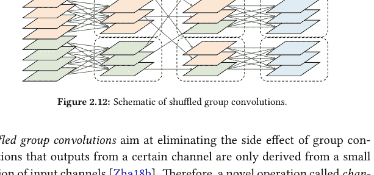

图 2.12：洗牌分组卷积的示意图。

*Shuffled group convolutions*旨在消除分组卷积的副作用，即某个通道的输出仅源自一小部分输入通道 [Zha18b]。因此，在两个堆叠的分组卷积之间引入了一种称为 *channel shuffle* 的新操作。第一组分组卷积中每个组的输出通道被划分为子组，如图 2.12 所示，这些子组被转置。然后转置后的通道被送入第二个分组卷积，从而允许信息在组间流动。注意通道洗牌操作是可微分的，因此可以直接集成到 CNN 架构中进行端到端训练。

*Deconvolution*已被提出用于在神经网络内执行上采样。注意，在 CNN 的上下文中，反卷积与信号处理中定义的反卷积不同，而是如图 2.13 所示的转置卷积。因此，它也被称为 *convolution with fractional strides* 或 *transposed convolution*。因子为 $f_u$ 的上采样可以被视为步长为 $1/f_u$ 的分数输入步长的卷积。实际上，反卷积通过交换卷积的前向和后向传递来实现。

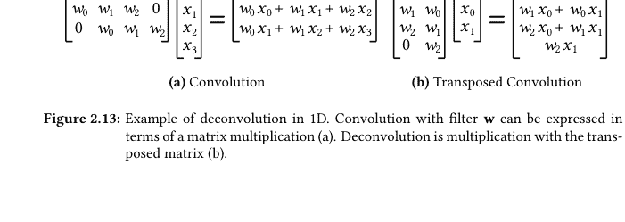

图 2.13：1D 反卷积示例。卷积与滤波器 w 可以用矩阵乘法表示（a）。反卷积是与转置矩阵的乘法（b）。

### 2.2 基于深度学习的目标检测

目标检测旨在从图像中定位和分类大量预定义类别中的对象实例，是计算机视觉中一项基础且具有挑战性的任务。随着基于深度学习的图像分类方法的显著成功，深度学习已被广泛应用于

该多阶段检测器的训练复杂且耗时，因为区域提议方法、用于特征提取的 CNN、SVM 分类器和边界框回归器需要分别训练和优化。然而，部署期间的主要瓶颈是特征提取，因为 CNN 特征是针对每个候选区域单独计算的 [Gir15]。

空间金字塔池化网络（SPPNet）[He14]通过一次性为整个输入图像计算卷积特征来克服这一瓶颈。为了满足全连接层所需的固定长度特征向量，最后一个池化层被所谓的 *spatial pyramid pooling layer* 所取代。空间金字塔池化从共享特征图中为每个候选区域提取固定长度的特征。为此，空间金字塔池化层将对应感兴趣区域的特征划分为多级固定数量的空间 bin。一次性对整个图像应用卷积层可在部署期间将运行时间降低数个数量级。SPPNet 的一个缺点是微调算法无法更新空间金字塔池化之前的卷积层，从而限制了非常深网络的精度 [Gir15]。

Fast R-CNN [Gir15]通过引入一个 *Region of Interest (RoI) pooling layer* 来解决 SPPNet 的缺点。与 SPPNet 类似，Fast R-CNN 在区域提议之间共享卷积的计算。然而，空间金字塔池化层被 RoI 池化层取代，这使得所有网络层都可以进行微调，从而促进了非常深网络的使用。通过进行最大池化，RoI 池化层将任何有效感兴趣区域内的特征转换为具有固定空间范围的特征图。具有固定空间范围的特征图被送入一系列全连接层，这些层分支为两个同级输出层。第一层输出对象类别的 softmax 概率，第二层输出用于提议细化的类别特定边界框回归偏移。与采用分阶段训练的 R-CNN 和 SPPNet 不同，Fast R-CNN 简化了训练过程，因为分类和边界框回归在网络内进行训练。尽管 Fast R-CNN 提高了检测精度并加快了检测过程，但使用外部区域提议方法仍然耗时 [Ren15]。

Faster R-CNN [Ren15]通过集成一个名为 Region Proposal Network (RPN) 的子网络扩展了 Fast R-CNN，该网络直接在网络内生成区域提议。RPN 和 Fast R-CNN 共享第一组卷积层，因此 RPN 的计算开销很小，生成区域提议的时间显著减少。RPN 应用于最后一个共享卷积层的输出，该输出被称为特征图。RPN 包括一个卷积层，后跟两个同级输出层：一个用于分类，一个用于边界框回归。以每个特征图位置为中心的锚框用作回归的边界框参考。为了考虑各种对象尺寸，采用具有不同尺度和长宽比的锚框。然后将可能包含对象的区域提议转发到分类阶段，其本质上是 Fast R-CNN 检测器。

R-FCN [Dai16]是基于 Faster R-CNN 的基于区域的全卷积网络，它使用替代的分类阶段来避免对每个候选区域分别应用 RoI 池化和全连接层。为此，标准的 RoI 池化层被位置敏感 RoI 池化层取代，该层应用于在整个图像上共享且不为每个候选区域单独计算的类别特定位置敏感分数图之上。位置敏感分数图由应用一组卷积层生成，编码对象的相对位置，例如左上角。位置敏感 RoI 池化层汇总从 RPN 转发来的每个候选区域的位置敏感分数图的响应。R-FCN 在基准数据集上实现了相当的检测结果，而运行时间明显低于 Faster R-CNN。

#### 2.2.2 单阶段方法

You only look once (YOLO) [Red16]将检测建模为回归问题。为此，YOLO 将输入图像划分为 S × S 网格并为每个网格单元预测 l 个边界框。每个边界框包括相对于单元的坐标、其尺寸以及关于框内是否存在对象的置信度。与采用局部区域特征的基于区域提议的方法不同，YOLO 使用整个图像的特征进行边界框预测。无论边界框的数量如何，每个网格单元都预测一组类别概率。在测试期间，类别概率和置信度分数相乘以生成每个框的类别特定置信度分数。一次性预测边界框和类别概率与其它深度学习框架相比实现了显著加速。然而，粗糙的网格划分以及每个单元仅预测两个框的限制使得 YOLO 容易遗漏附近的对象。

Single Shot MultiBox Detector (SSD) [Liu16]是一个全卷积网络，其功能原理与 Faster R-CNN 中的 RPN 相似。与类别不可知的原始 RPN 相比，SSD 为每个对象类别预测固定数量的边界框和置信度分数。以每个特征图位置为中心的锚框用作边界框回归的参考。除了采用具有不同尺度和长宽比的锚框外，还采用多个卷积层作为特征图以考虑不同的对象尺寸。具有精细空间分辨率的浅层卷积层被用作特征图来预测小对象，而具有粗糙空间分辨率的深层卷积层则用于预测大对象。SSD 与之前的单阶段方法相比实现了明显提高的检测精度。

YOLOv2 [Red17]是 YOLO 的高级版本，采用了与 SSD 和 Faster R-CNN 不同的策略。移除全连接层使网络完全卷积化，从而允许多尺度训练。与 Faster R-CNN 类似，采用锚框而不是直接预测宽度和高度。而不是手动选择锚框，

采用 k-means 聚类生成更合适的锚框。此外，网络中加入了一个所谓的*直通层*，将较浅层的特征转发到用作特征图的最后一个卷积层。在特征图中加入细粒度特征可以更好地定位小目标。YOLOv2 在基准数据集上表现出良好的检测精度，同时与先前基于深度学习的检测方法相比，推理时间显著减少。

#### 2.2.3 扩展

上述基于深度学习的检测框架通常被用作进一步发展的基础。为了提升检测性能，研究者提出了多种扩展方案，包括利用新型 CNN 架构、多层特征利用以及加入上下文信息。

通常，基于深度学习的检测框架采用为物体分类而开发的 CNN 架构作为特征提取器。所采用的 CNN 架构通常被称为*基础网络*或*骨干网络*。在 [Hel16a] 中，作者用残差网络替换 VGG16 作为 Faster R-CNN 的基础网络，提高了基准数据集上的检测精度。与常规残差网络 [Xie17] 相比，使用 ResNeXt 网络作为 Faster R-CNN 的基础网络，检测结果略有提升。采用 SENets [Hu18]（ImageNet2017 分类挑战赛¹的冠军）作为 Faster R-CNN 的基础网络，进一步提高了检测性能。SENets 包含所谓的*压缩与激励模块*，能够自适应地重新校准特征响应，从而强调信息量大的特征并抑制不太有用的特征。在 [Zoph18] 中，作者近期使用强化学习直接在目标数据集上学习优化后的网络架构。在 MS COCO 数据集 [Lin14] 上，使用这些所谓的 NASNet 作为 Faster R-CNN 的基础网络取得了顶尖性能。

¹ http://image-net.org/challenges/LSVRC/2017/results

目前已有多类通过利用多层特征来提高检测精度的方法。这些方法大致可分为多层特征组合 [Bel16, Kon16, Shr16c] 和在不同特征图上进行目标预测 [Cai16] 两类。组合多层特征通常用于增强语义和上下文信息。Bell 等人 [Bel16] 通过在多个层上应用 RoI 池化来扩展 Fast R-CNN。提取的 RoI 特征被拼接起来，用于对相应的区域提议进行分类。HyperNet [Kon16] 是 Faster R-CNN 的一种扩展，它将深层、中间层和浅层特征图拼接成所谓的*超特征图*，用于目标预测。为统一特征图分辨率，对浅层特征图采用最大池化进行下采样，对深层特征图采用反卷积进行上采样。Shrivastava 等人 [Shr16c] 引入自顶向下的调制网络来组合深层和浅层特征，从而扩展了 Faster R-CNN。深层特征通过反卷积上采样，然后与浅层特征拼接。[Liu16] 中提出的将多个层用作特征图的做法常被用来应对不同尺度的目标。在 [Cai16] 中，在多个层上生成区域提议，使感受野与不同尺度的目标相匹配。随后，在类似于 Faster R-CNN 的后续阶段中对生成的区域提议进行分类。一些方法同时利用了这两种扩展方案 [Fu17, Woo18, Lin17a, Red18]。反卷积 SSD（DSSD）[Fu17] 为 SSD 引入了反卷积模块。该模块包含反卷积层，用于对深层特征进行上采样，并通过逐元素相乘与浅层特征融合。Woo 等人 [Woo18] 提出了基于 SSD 的类似方法，称为 StairNet。Lin 等人 [Lin17a] 提出了 Faster R-CNN 的一种扩展，称为*特征金字塔网络（FPN）*，它利用自顶向下的路径组合不同层的特征。多个特征图用于不同尺度下的目标预测。YOLOv3 [Red18] 是 YOLOv2 的改进版本，采用与 [Lin17a] 类似的概念在不同尺度下进行目标预测。

添加上下文信息是提高检测精度的另一种方法。为了增加空间上下文信息，Cai 等人 [Cai16] 将每个候选区域放大 1.5 倍。Zhu 等人 [Zhu17] 通过增加一个分支来扩展 R-FCN，该分支从候选区域周围的多个区域提取特征。Bell 等人 [Bel16] 提出空间循环神经网络来探索整幅图像中的上下文信息。在 [Shr16a] 中，作者将 Faster R-CNN 与语义分割网络相结合。语义分割网络的输出被送入检测分支，以引入语义信息。StuffNet [Bra17] 是 Faster R-CNN 的一种扩展，利用额外的语义分割分支，通过目标的局部周围环境来识别目标。Mask R-CNN [He17] 将 Faster R-CNN 与语义分割相结合，在预测每个候选区域的类别和边界框偏移的同时，并行预测分割掩码。

最近的扩展工作还聚焦于新型训练策略、类别不平衡处理、级联检测和可变形神经网络。Peng 等人 [Pen18] 提出了一种新的跨 GPU 批归一化（CGBN）方案，允许使用更大的 mini-batch 进行训练。通过使用 CGBN 训练 FPN，作者在 MS COCO 2017¹ 检测挑战赛中排名第一。在 [Sin18] 中，作者提出了一种新的尺度归一化训练方案，以应对目标实例的宽尺度范围。通过忽略极端尺度目标产生的梯度，对目标实例的梯度进行选择性反向传播。为了解决类别不平衡问题，Lin 等人 [Lin17b] 提出了一种称为 focal loss 的新型损失函数，本质上是一种动态缩放的交叉熵损失。随着正确类别置信度的增加，缩放因子衰减至零，简单样本的权重降低，而训练则聚焦于困难样本。使用 focal loss 训练结合了 SSD 和 FPN 的 RetinaNet，在 MS COCO 数据集上取得了顶尖性能。Cascade R-CNN [Cai18] 广泛适用于各种检测框架，由一系列检测阶段组成，这些阶段使用递增的 IoU 阈值进行训练，从而依次更严格地抑制误检。RefineDet [Zha18a] 执行两步级联回归，以优化回归和类别预测。在 [Dai17] 中，作者引入了可变形卷积和可变形 RoI 池化模块。这两个模块通过学习网格采样位置的偏移来建模几何变换，并且可以轻松替换现有 CNN 中的普通对应模块。

¹ https://places-coco2017.github.io/#winners

### 2.3 航空影像中的车辆检测

在过去的几十年里，针对航空影像中的车辆检测任务，人们开发了各种各样的检测方法。在接下来的综述中，文献范围仅限于单幅航空影像中的车辆检测，而利用图像序列进行运动目标检测的方法，例如帧差分 [Kum01, Rei06, Xia10]、背景减除 [Rei10, Shi12, Lia12] 或基于光流的方法 [Yao08, Yu09, Sia12]，不予考虑，因为这些方法会漏掉静止物体（如停放的车辆）。通常，航空影像中的车辆检测要么通过基于手工特征的常规检测方法实现，要么通过基于深度学习的方法实现。

#### 2.3.1 常规车辆检测方法

在深度学习出现之前，单幅航空影像中的车辆检测通常采用提取手工特征，然后使用分类器或级联分类器的方式进行。因此，研究者探索了特征提取技术和分类器的各种组合。Ruskone 等人 [Rus96] 使用 MLP 分析像素邻域的强度值，用于航空影像中的车辆检测。Eikvil 等人 [Eik09] 研究了结合几何形状属性、灰度特征和 Hu 矩的方法来检测高分辨率卫星图像中的车辆。Moranduzzo 和 Melgani [Mor12, Mor13] 提出使用尺度不变特征变换（SIFT）提取关键点，并通过 SVM 分类器将这些关键点判别为属于车辆还是背景。在 [Mor14b] 中，作者利用方向梯度直方图（HOG）特征并结合 SVM 来检测无人机获取图像中的汽车。Tuermer 等人 [Tue13] 采用 HOG 特征和视差图，用于在

密集城区。在 [Lei10] 中，作者提出了自适应提升（AdaBoost）与 Haar-like 特征相结合的方法，用于在超高分辨率卫星图像中进行车辆检测。Liu 和 Mattyus [Liu15] 在软级联结构中采用了积分通道特征（Integral Channel Features, ICF）和 AdaBoost 分类器，以实现对航空图像中车辆的快速鲁棒检测。Kembhavi 等 [Kem10] 将颜色概率图、HOG 和像素对结合，随后使用偏最小二乘法将高维特征集投影到更低维的子空间，用于从 Google Earth 获取的卫星图像中的车辆检测。在 [Sha12] 中，作者探讨了多种视觉特征的使用，即局部二值模式（Local Binary Pattern, LBP）、HOG 和对手直方图，以及交集核 SVM，用于高分辨率航空图像中的车辆检测。Grabner 等 [Gra08] 提出了一种用于航空图像自动汽车检测的框架，该框架结合了 HOG、LBP 和 Haar-like 特征以及 AdaBoost 分类器。在 [Klu07] 中，作者通过将立体匹配器获得的 3D 信息纳入在线提升算法的训练中，对上述方法进行了扩展。Gleason 等 [Gle11] 研究了 HOG 和 Gabor 系数直方图的结合使用，并与以下分类技术配合：最近邻、随机森林和 SVM。Liang 等 [Lia12] 探讨了一种用于广域运动图像中车辆检测的分类方案，该方案将 HOG 和 Haar-like 特征与多核 SVM 相结合，通过构建包含多个基核的最优核来学习 HOG 与 Haar-like 特征之间的权衡。Xu 等 [Xu16] 提出了一种车辆检测的混合方法，该方法采用使用 Haar-like 特征的 AdaBoost 分类器和使用 HOG 特征的线性 SVM。

用于航空图像中车辆检测的替代方法利用显式模型来表示车辆形状。这些方法要么将模型与图像进行匹配，要么对提取的图像特征进行分组以构建与模型相似的结构。Burlina 等 [Bur97] 提出将边缘检测器获得的轮廓与图像的广义 Hough 变换获得的投票相结合，后者是根据样本车辆的形状和大小计算得出的。在 [Moo02] 中，作者探讨了一种基于用于检测二维形状算子的模板匹配算法，用于航空图像中的车辆检测。Zhao 和 Nevatia [Zha03] 提出从线框模型中提取特征子集，例如汽车边界、挡风玻璃和阴影区域，这些特征被传递给具有手动选择参数的贝叶斯网络以判断汽车是否存在。Hinz 和 Baumgartner [Hin01] 提出了一种基于分层 3D 车辆模型的车辆检测方法，该模型在不同细节层级上描述了显著的车辆特征。在 [Hin03] 中，作者通过将主要由几何特征和辐射特性组成的显式模型与图像进行匹配，在高分辨率航空图像中进行车辆检测。Kim 和 Malik [Kim03] 研究了 3D 模型在快速车辆检测中的使用，该检测基于通过定向边缘检测器提取的线特征，随后进行连通分量分析以进行线分组。在 [Cho09] 中，作者使用均值漂移聚类算法提取具有车辆相似几何和辐射特性的斑块来进行车辆检测。关于基于手工特征的遥感图像检测方法的更全面综述在 [Che16a] 中进行了总结。

#### 2.3.2 基于深度学习的车辆检测方法

近年来，由于手工特征的表征能力有限，用于航空图像中车辆检测的任务中，传统方法在很大程度上已被深度学习方法取代。用于航空图像中车辆检测的最初深度学习方法在滑动窗口算法中采用 CNN 作为特征提取器，部分作为分类器。Chen 等 [Che13] 探讨了一种小型 CNN，该网络由三个卷积层、随后的最大池化层以及一个全连接层组成，用于在滑动窗口算法中进行特征提取和分类。所提出的 CNN 在从 Google Earth 收集的卫星图像上取得了优于基于手工特征的传统方法（如 HOG+SVM 和 LBP+SVM）的结果。在 [Che14a] 中，作者通过将最后一层卷积层的输出划分为多个具有可变感受野的块来修改 [Che13] 中提出的 CNN 架构，从而允许提取不同尺度的特征，这进一步提高了在同一组从 Google Earth 收集的卫星图像上的检测精度。为了减少检测流程的计算量，多位作者采用了区域提议技术用于航空图像中的车辆检测，从而得到更小的待分类候选区域集。通过应用二值归一化梯度（Binary Normed Gradients, BING）[Che14c] 来提取区域提议，而不是在 [Che13, Che14a] 中采用的穷举滑动窗口范式，Qu 等 [Qu16] 在检测精度不下降的情况下实现了明显降低的推理时间。Zhu 等 [Zhu15] 采用了 R-CNN 检测流程用于航空图像中的车辆检测。选择性搜索（Selective Search）[Uij13]——一种基于分层分割的区域提议方法——被应用于生成一组候选区域。对于每个候选区域，使用 AlexNet 计算 CNN 特征，然后通过 SVM 进行分类。Cheng 等 [Che16b] 通过引入新的目标函数来训练用于特征提取的 AlexNet 模型，与 [Zhu15] 相比展示了改进的检测结果。为了实现对俯视图航空图像中物体不同方向的增强旋转不变性，新的目标函数通过正则化项强制训练样本在旋转前后共享相似的特征。在 [Jia15] 中，作者提出了高效的基于图的超像素分割方法 [Fel04] 与 CNN 的结合，前者用于生成候选区域，后者用于将每个候选分类为车辆或非车辆。Ammour 等 [Amm17] 在 UAV 图像中分三个阶段进行汽车检测：候选区域最初通过均值漂移算法生成，随后应用 CNN，即 VGG16，提取高度描述性特征，然后通过 SVM 进行分类。Long 等 [Lon17] 采用了两个 CNN 模型的集成，即 AlexNet 和 GoogleNet，对通过选择性搜索提取的候选区域进行分类，与单一模型相比提高了检测精度。此外，作者还提出了一种无监督的边界框回归算法，以提高遥感图像中物体的定位精度。在 [Qu17] 中，作者提出了 BING 用于生成候选区域集、基于空间金字塔池化的 CNN 用于特征提取，随后使用两阶段级联 SVM 进行分类的组合。通过将最后一层池化层替换为类似于 SPPNet 的空间池化层，基于空间金字塔池化的 CNN 能够在不进行输入变形或裁剪的情况下为每个候选区域提取固定长度的特征向量，与传统 CNN 相比提高了检测精度。Zhong 等 [Zho17] 使用了两个连续的 CNN 用于航空图像中鲁棒的车辆检测。第一个 CNN 生成一组类似车辆的区域，类似于 [Ren15] 中提出的 RPN，这些区域被输入到第二个 CNN 进行分类。Audebert 等 [Aud17] 提出了一种用于航空图像车辆检测的替代检测流程，该流程由两个独立的 CNN 组成。首先进行语义分割以提取车辆候选，随后在下一阶段将其分类为车辆类型和背景。

由于为每个候选区域单独计算 CNN 特征计算成本高昂，用于航空图像车辆检测任务的深度学习检测框架也采用了能够一次性为整幅图像提取 CNN 特征的方法。在 [Xu17a] 中，作者研究了 Faster R-CNN 在低空 UAV 获取的图像中进行车辆检测的适用性。由于地面采样距离（GSD，即地面上像素中心之间的距离）较低，无需针对航空图像特性进行调整即可优于基于手工特征的传统检测方法。Han 等 [Han17a] 通过使用默认设置的 Faster R-CNN，在高分辨率遥感图像上优于基于手工特征的目标检测方法。为了考虑航空图像中车辆尺寸较小的问题，Carlet 等 [Car17] 通过移除最后一个最大池化层及其相关的卷积层来调整 YOLOv2，以提高所用特征图的分辨率。在 [Sak17] 中，作者调整了 Faster R-CNN 用于多模态航空图像中的车辆检测，以考虑车辆尺寸较小的问题。通过修改 RPN 的锚点设置并利用更浅的层作为特征图，取得了最佳性能结果。不是提高所用特征图的分辨率，Li 等 [Li17] 通过提取放大了 factor 倍的候选区域的特征来扩展 Faster R-CNN 的分类阶段

将上下文信息增强至原来的 1.5 倍，从而提高了遥感图像中车辆检测的准确率。Xu 等人 [Xu17b] 通过引入可变形卷积 [Dai17] 改进了用于遥感图像目标检测的 R-FCN，可变形卷积通过向规则网格采样位置添加可学习的偏移量，增强了标准卷积的变换建模能力。然而，可变形卷积对 car 类别检测准确率的影响可以忽略不计。为了提高航拍图像中的检测性能，多位作者利用了针对基于深度学习的检测框架提出的最新扩展，这些框架在第 2.2.3 节中有所描述。Deng 等人 [Den17] 提出了一种改进的 Faster R-CNN 变体，用于航拍图像中的车辆检测。由于较浅的层更适合定位，较深的层更适合分类，作者将多个卷积层的特征组合作为 RPN 和分类阶段的输入，与基线 Faster R-CNN 相比明显提高了召回率。受 SSD 中采用的多尺度方案启发，Deng 等人 [Den18] 提出了一种基于 Faster R-CNN 的多尺度目标检测框架，用于遥感图像中的车辆检测。与 [Ren15] 不同，RPN 被应用于多个特征图，以适应不同的目标尺度。此外，多个卷积层的特征被组合作为分类阶段的输入，从而在遥感图像中对各种类别取得了良好的检测性能。Guo 等人 [Guo18] 采用了一种类似于 FPN 的检测框架，用于高分辨率卫星图像中的目标检测。他们使用具有横向连接的自顶向下架构生成多个高层语义特征图，以预测不同尺度的目标。在公开可用的西北工业大学甚高分辨率 10 类（NWPU VHR-10）基准数据集 [Che14b] 上取得了最佳结果。在 [Azi18] 中，作者提出了对 FPN 的若干扩展，以提高遥感图像中的检测准确率。为了从不同尺度提取强语义信息，作者提取了输入图像的多个尺度特征，并在所谓的图像级联网络（image cascade network）中进行组合。尽管检测准确率有所提高，但在实际应用中，使用多个图像尺度作为输入通常并不可行。Wang 等人 [Wan18a] 提出了一种类似于 DSSD 的单阶段检测框架，用于遥感图像中的目标检测。深层特征被上采样并与浅层特征结合，从而产生具有高层语义信息的特征图。作者报告称，在来自不同来源的航拍图像中，检测结果有所改善。Tayara 和 Chong [Tay18] 采用 RetinaNet 用于甚高分辨率航拍图像中的目标检测，该网络包含一个自顶向下路径以结合深层和浅层特征，并利用 focal loss。自顶向下路径产生具有高层语义信息的特征图，而 focal loss 降低简单样本对损失的贡献，从而使训练聚焦于难负样本。Yang 等人 [Yan18] 通过添加从浅层到深层的跳跃连接扩展了 Faster R-CNN，用于航拍图像中的车辆检测，以学习具有丰富细节信息的特征。作者进一步在 RPN 和分类阶段采用 focal loss 作为分类损失，以解决训练过程中简单正样本和难负样本的问题。所提出的检测方法在一个自建数据集上得到了验证，该数据集包含以天底视角和倾斜视角记录的图像。Ding 等人 [Din18] 对 Faster R-CNN 中使用的骨干网络进行了若干修改。为了适应小目标的尺寸，作者使用空洞卷积来增加特征图的分辨率。此外，通过结合不同层的特征来增强特征表示，并丢弃全连接层以加快推理时间。[Tan17, Kog18] 中研究了解决类别不平衡以及简单和困难样本问题的替代方法。Tang 等人 [Tan17] 探索了一种用于航拍图像车辆检测的检测框架，该框架由 [Den17] 中提出的改进 RPN 和级联提升分类器组成，以替换初始的 CNN 分类器，旨在通过负样本挖掘减少误检数量。Koga 等人 [Kog18] 探讨了在 CNN 训练过程中使用难样本挖掘，该 CNN 应用于一种简单的滑动窗口方法中，用于航拍图像中的车辆检测。航拍图像车辆检测领域的最新进展集中于有向边界框的预测 [Azi18, Xia18, Bao19, Din19]，以及在不同相机角度下从无人机（UAV）记录的图像和视频中的检测 [Zhu18, Chen19a, Wan19]，这些不在本论文的范围内。

## 3 概念

## 3 概念

本论文旨在设计一种基于深度学习的检测流程，用于低空间分辨率航拍图像中的车辆检测。虽然低空间分辨率能够覆盖大范围区域，但出现的车辆尺寸较小，使得检测更加困难。由于 Faster R-CNN 与其他基于深度学习的检测器相比具有更优的检测准确率，特别是在小目标实例方面，因此选择其作为基础检测框架。Faster R-CNN 由两个模块组成：一个称为 RPN 的初始模块，用于生成一组候选区域，然后将这些候选区域传递给后续的分类阶段。RPN 和分类阶段共享一系列用作特征提取器的卷积层，而最后一个卷积层的输出（称为特征图）作为两个模块的输入。请注意，现代基于深度学习的检测框架（如 Faster R-CNN）是为基准检测数据集设计的，这些数据集与航拍图像明显不同。因此，需要针对航拍图像的具体特征进行若干调整。尽管检测准确率有所提高，但这些必要的调整也带来了一些缺点，例如推理时间较长，以及所用特征的语义和空间内容较低。专门为解决这些缺点而设计的检测流程的整体概念如图 3.1 所示。基本保持不变的 RPN 和分类阶段用灰色框突出显示。为减少计算量进而缩短推理时间所进行的修改，即搜索区域限制和计算高效的特征提取，用蓝色框强调。绿色框表示用于增加所用特征的语义和空间上下文信息的新组件，从而提高检测准确率。请注意，所提出的组件并不局限于 Faster R-CNN，因此可以集成到其他基于深度学习的检测框架中。根据应用或目标数据的不同，这些组件可以独立应用，也可以与其他替代方案（例如不同的特征提取器）进行交换。

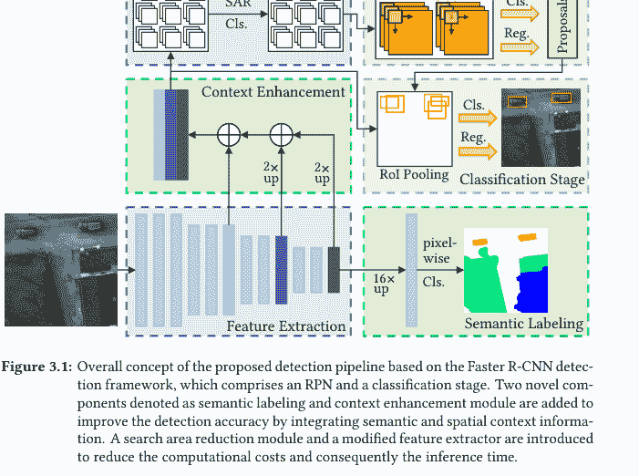

图 3.1：基于 Faster R-CNN 检测框架（包含 RPN 和分类阶段）的所提出检测流程的整体概念。添加了两个新组件，即语义标注（semantic labeling）模块和上下文增强模块（context enhancement module），以通过整合语义和空间上下文信息来提高检测准确率。引入了搜索区域缩减模块和改进的特征提取器，以降低计算成本，进而缩短推理时间。

### 3.1 检测框架调整

在本论文中，Faster R-CNN 被用作基础检测框架。与其他基于深度学习的检测框架相比，Faster R-CNN 实现了更优的检测准确率，尤其是在小目标实例方面，因此似乎是车辆检测任务中最有前景的方法。

在航空影像中，基于深度学习的检测框架（如 Faster R-CNN）通常是针对基准数据集开发和设计的，而这些数据集与航空影像明显不同，如图 3.2 和图 3.3 所示。常见的基准数据集，例如 PASCAL VOC [Eve10] 和 MS COCO [Lin14]，通常每幅图像包含一个或少数几个物体，这些物体往往居中并占据图像的大部分区域。因此，即使是相对较小的物体也表现出较高的细节水平，例如对于汽车类别，包括车轮、车牌和车灯。相比之下，像 DLR 3K [Liu15] 和 VEDAI [Raz16] 这样的航空影像数据集，通常由安装在高空飞行平台上的传感器获取，一般具有较低的空间分辨率，导致物体尺寸较小，即只有几个像素的范围。因此，场景中随机分布且朝向任意的物体往往缺乏细节，这极大地阻碍了检测任务。此外，航空影像中物体的数量差异很大，从农村地区仅有的几个物体到交通流量大或停车场密集的城市地区的数百个物体不等。由于这些差异，特别是物体尺寸方面的差异，基于深度学习的检测框架不能直接应用于航空影像中的车辆检测。为了应对这些具体特征，本论文系统性地研究了针对小物体尺寸的若干适应性改进 [Som17c, Som18b]。特别是，提高特征图分辨率显著改善了检测性能，因为初始分辨率不足以在航空影像中精确定位小型车辆实例。所提出的适应性改进对多个物体类别和其他检测框架的可迁移性分别在 [Som17b, Som18d] 中得到证明。尽管默认的 Faster R-CNN 和传统检测方法被明显超越，但这些适应性改进在推理时间以及所采用特征的语义和空间内容方面存在缺陷，这些问题将在下文中解决。

## 3 概念

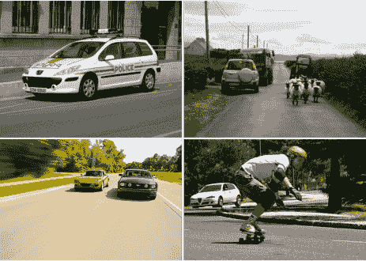

**图 3.2：** 来自基准目标检测数据集（即 PASCAL VOC（左）[Eve10] 和 MS COCO（右）[Lin14]）的示例图像，通常包含一个或少数几个物体，这些物体往往居中并占据图像的大部分区域。即使是较小的物体也呈现出高水平的细节，例如车轮、车牌和车灯。

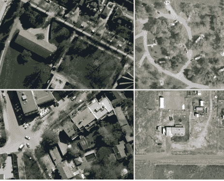

**图 3.3：** 来自航空影像数据集（即 DLR 3K（左）[Liu15] 和 VEDAI（左）[Raz16]）的示例图像，可能包含多个随机分布的物体，其大小只有几个像素。

### 3.2 上下文知识的整合

为了准确定位小物体而提高特征图分辨率，可以通过利用较浅的层作为特征图来实现。然而，与深层特征相比，浅层特征缺乏语义和空间内容，导致由具有车辆形状的物体（如建筑物上的窗户或太阳能电池板）引起的误报（见图 3.4）。为了克服语义和空间内容的缺乏，检测流程通过两个新颖的组件进行了扩展。

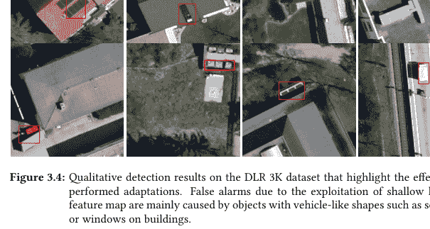

图 3.4：DLR 3K 数据集上的定性检测结果，突出了所执行适应性改进的效果。由于利用浅层作为特征图而导致的误报，主要由具有车辆形状的物体（如建筑物上的太阳能电池或窗户）引起。

将空间上下文信息纳入基于深度学习的检测器，已在航空影像中取得了改进的检测结果。虽然已有研究提出利用填充的 GT 框来自动学习航空影像中车辆的上下文 [Sak17]，但最近也通过膨胀卷积增大感受野来添加更多上下文信息，并将其应用于航空影像中的目标检测，例如建筑物检测 [Ham18] 和车辆检测 [Din18]。受语义标注网络的启发，该网络结合浅层和深层特征来处理精细和粗略结构，例如 FCN [Lon15]，本论文采用了一种替代方法 [Som18c]。因此，Faster R-CNN 扩展了一个名为上下文增强模块的新组件（见图 3.1）。为了整合深层语义和上下文信息，同时保持高特征图分辨率，深层特征通过反卷积进行上采样并与浅层特征结合，这与 [Lin17a, Woo18] 中的概念类似。将所提出的反卷积模块应用于其他检测框架，证实了从深层添加上下文信息对车辆检测的益处 [Aca18]。

为了处理由不太可能包含车辆的图像区域（如建筑物）引起的误报，传统检测流程中经常应用语义上下文信息。为此，一种常见做法是将检测限制在道路区域，假设车辆不会出现在道路之外 [Tue13, Mor14a]。然而，道路数据库的准确性往往有限，这会导致停放在建筑物附近的车辆被漏检 [Tue13]。为了解决这个问题，开发了一种用语义标注掩码替代道路数据库的新方法 [Som17a]。由于所提出的语义标注网络能够准确预测道路、车道和停车场，因此只有主要位于建筑物或低矮植被上的检测会被过滤掉。为了避免额外语义标注网络带来的大量计算开销，本论文引入了一种将语义标注整合到检测框架中的替代方法 [Nie18]。该方法不是过滤掉道路之外的检测，而是利用语义标注将场景知识引入检测框架中使用的特征图（见图 3.1）。为此，语义标注网络和检测网络通过共享一系列卷积层进行融合，这对最终的检测结果产生了隐含的影响。将语义标注分支的深层特征显式添加到检测分支，进一步提高了检测精度 [Nie18]。与流行的 Mask R-CNN [He17] 对每个区域提议应用语义标注网络不同，所提出的方法不局限于区域提议内的场景上下文，这在航空影像中的车辆检测情况下是有益的。所提出的原理与 StuffNet [Bra17] 最为相似，后者利用物体的局部周围环境来识别它，在 PASCAL VOC 上取得了更高的检测精度。此外，在本论文的工作中创建了一个新颖的语义标注数据集¹，以评估语义标注对航空影像中车辆检测的影响 [Azi19]。

### 3.3 运行时优化

尽管为适应航空影像特征而进行的适应性改进显著提高了检测精度，但由此产生的较差的推理时间阻碍了其在需要实时或近实时车辆检测的实际应用中的使用。为了加速检测流程，本论文采用了两种不同的策略。

由于特征提取是现代基于深度学习的检测框架（如 Faster R-CNN）中最耗时的部分之一，用计算效率更高的网络替换默认的 CNN 架构是减少推理时间的常见做法。采用最近为资源受限的移动平台开发的架构作为特征提取器，可以在检测精度不大幅下降的情况下显著减少推理时间 [Wan18b, Zha18b]。其共同原则是通过尽量减少使用昂贵的 3 × 3 卷积滤波器来减少参数数量和计算操作。虽然这些轻量级架构通常是为分类任务设计的，但不加谨慎地将这一原则应用于航空影像中的车辆检测可能会降低检测精度，因为特征提取仅限于浅层。在本论文中，以 SSD [Rin19] 为例检验了不同轻量级架构的适用性，SSD 允许直接更换 CNN 架构。结合其他运行时优化技术，推理时间显著减少，而检测精度几乎没有或很少损失。

¹ 与 DLR 合作公开提供了该数据集的精炼增强版本，DLR 提供更细粒度的标注：https://www.dlr.de/eoc/en/desktopdefault.aspx/tabid-12760

## 4 实验设置

本章介绍了为评估本论文所提出的检测方法而设计的实验设置。第4.1节概述了所使用的航空图像检测数据集及其主要统计信息。第4.2节介绍了评估协议和相应的指标。

### 4.1 数据集

表4.1给出了航空图像数据集中的车辆检测及其关键特征的概述。请注意，只列出了公开可用的数据集。实例数量仅限于车辆，因为其他类别（如建筑物、桥梁、港口等）不在本论文的范围内。选择DLR 3K慕尼黑车辆航空图像数据集[Liu15]作为基线数据集来检验所提出的检测流程及其组件。其标注车辆数量明显超过以前的数据集，这有利于基于学习的检测算法，正如本论文所探讨的。包含更多车辆的“带背景的车辆俯视图”（COWC）数据集[Mun16]被搁置，因为其标注仅以中心坐标的形式提供。为了证明所提出的检测流程的泛化能力，还在车辆检测航空图像（VEDAI）[Raz16]数据集（这是航空图像中车辆检测的常见基准数据集）以及最近发布的数据集，即DOTA [Xia18]、ITCVD [Yan18]和xView [Lam18]上进行了进一步实验。因此，考虑了不同的地面采样距离（GSD）、目标尺寸、目标类型、背景以及每帧目标数量的变化。请注意，对后几个数据集的实验以定性方式进行，以检验所提出的检测流程的可转移性。由于数据集可用时间较晚以及部分标注质量较差，没有进行定量实验。ISPRS 2D语义标注挑战波茨坦数据集[ISP]——一个用于航空图像语义标注的常见基准数据集——被选为主数据集，用于评估集成语义标注对检测性能的影响。

表4.1：按发布年份列出的航空图像数据集中的车辆检测。“中心”指仅提供实例中心坐标的标注，而“BB”是边界框的缩写，可以是轴对齐或旋转的。实例数量仅限于车辆，因为其他类别（如建筑物、桥梁、港口等）不在本论文的范围内。

| 数据集 | 标注 | 图像数量 | 图像宽度（像素） | 实例数量 | GSD（厘米） |
|---|---|---|---|---|---|
| TAS [Hei08] | 轴对齐边界框 | 30 | 792 | 1,319 | - |
| NWPU [Che14b] | 轴对齐边界框 | 800 | ~1,000 | 477 | 8-200 |
| UCAS-AOD [Zhu15] | 旋转边界框 | 910 | ~1,000 | 2,819 | - |
| DLR 3K [Liu15] | 旋转边界框 | 20 | 5,616 | 14,235 | ~13 |
| VEDAI [Raz16] | 旋转边界框 | 1,268 | 1,024 | 2,950 | 12.5 |
| COWC [Mun16] | 中心 | 53 | 2k-19k | 32,716 | 15 |
| DOTA [Xia18] | 旋转边界框 | 2,806 | 800-13k | ~180k | 10-100 |
| ITCVD [Yan18] | 轴对齐边界框 | 173 | 5,616 | 29,088 | 10 |
| xView [Lam18] | 轴对齐边界框 | 1,127 | 700-4k | ~250k | 30 |

### 4.1.1 DLR 3K 慕尼黑车辆航空图像数据集

DLR 3K慕尼黑车辆航空图像数据集（以下简称DLR 3K数据集）是在德国慕尼黑地面上方1000米的高度采集的，主要包含城市和住宅区，如图4.1所示。DLR 3K数据集包含20幅分辨率为5616×3744像素、地面采样距离约为13厘米的图像，其中以旋转边界框形式提供的不同车辆类型（如轿车、卡车和拖车）的GT标注仅适用于10幅图像。在本论文的实验中，具有可用GT标注的图像被分为8幅训练图像和2幅测试图像。每幅图像被划分为936×936像素的图块。由于本论文所采用的基于深度学习的检测框架要求每幅图像至少有一个目标，因此没有任何目标的图像从训练集中移除，得到140个用于训练的图块。由于大多数车辆类型的标注数量有限，仅考虑轿车和货车两类。按照[Liu15]，将这两个类别合并为一个车辆类别。此外，根据[Sak17, Som17c, Tan17]，所有旋转边界框都转换为轴对齐边界框。平均边界框尺寸为28.2±8.2×28.3±8.7像素。

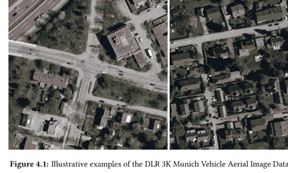

图4.1：DLR 3K慕尼黑车辆航空图像数据集[Liu15]的示例图。

### 4.1.2 车辆检测航空图像数据集

车辆检测航空图像（VEDAI）数据集包含犹他州AGRC¹的卫星图像，这些图像于2012年春季在美国犹他州上空采集。
¹ https://gis.utah.gov/
原始图像有四个未压缩通道（RGB和近红外），本论文仅使用RGB通道。如图4.2所示，这些图像包含不同的背景，如农业区、乡村和城市区域。VEDAI数据集总共包含1268幅尺寸为1024×1024像素、地面采样距离为12.5厘米的图像。此外，还提供了地面采样距离为25厘米的图像缩小版本。这两个版本分别被称为大尺寸彩色图像（LCI）和小尺寸彩色图像（SCI）。GT标注以旋转边界框的形式提供了九种车辆类型，其中轿车、皮卡和货车被归纳为小型陆地车辆。在后续实验中，采用前半部分图像作为训练数据，后半部分用于测试。与DLR 3K数据集上的实验一致，所有旋转边界框都转换为轴对齐边界框。由于大型车辆（如船只和飞机）的标注数量有限，与[Sak17]类似，仅考虑小型陆地车辆。VEDAI平均每幅图像包含2.0个目标，与DLR 3K相比明显更少。LCI和SCI的平均边界框尺寸分别为33.6±11.7×33.6±11.9像素和16.8±5.8×16.8±5.9像素。

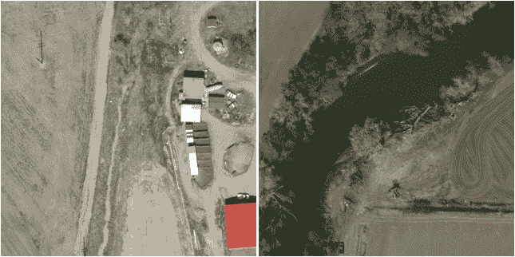

**图4.2：** 车辆检测航空图像数据集[Raz16]的示例图。

### 4.1.3 DOTA

DOTA数据集由2806幅图像组成，这些图像来自多个传感器和平台，即Google Earth、中国资源卫星数据与应用中心的JL-1卫星和GF-2卫星。图像尺寸从800×800到4000×4000像素不等，地面采样距离（每幅图像单独提供）在10到100厘米之间变化。如图4.3所示，该数据集包含不同场景的图像，并呈现出多种尺度和方向。针对1869幅图像，提供了15个类别的GT标注，形式包括旋转边界框和轴对齐边界框。请注意，较差的标注质量，尤其是“小型车辆”和“大型车辆”类别存在大量缺失标注，妨碍了有意义的定量评估[Aca18, Waq19]。

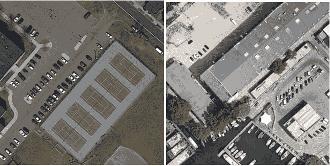

**图4.3：** DOTA数据集[Xia18]的示例图。

### 4.1.4 ITCVD

ITCVD数据集是在荷兰恩斯赫德地面上方330米的高度采集的。该数据集总共包含173幅分辨率为5616×3744像素的图像，其中46幅是以天底视角拍摄的，地面采样距离为10厘米。其余以45度倾斜角拍摄的图像不用于本论文的实验。与DLR 3K类似，该数据集主要包括城市和住宅区，如图4.4所示。请注意，由于采集高度较低，与其它数据集相比，这些图像表现出更强的视差效应。GT标注以轴对齐边界框的形式提供了所有车辆，并被合并为单一类别。

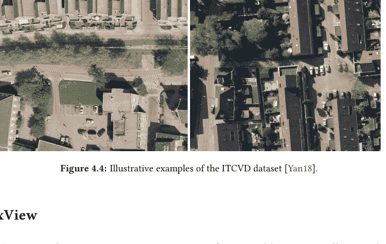

图4.4：ITCVD数据集[Yan18]的示例图。

### 4.1.5 xView

xView数据集包含来自WorldView-3卫星的1127幅图像，地面采样距离为30厘米。图像尺寸在700到4000像素之间。这些图像在不同的大陆上采集，包括澳大利亚、非洲、亚洲、欧洲、中美洲和南美洲，因此包含各种不同的场景和目标（见图4.5）。针对846幅图像，提供了60个类别（包括建筑物、车辆和迷你场景，如集装箱堆场）的GT标注，形式为轴对齐边界框。大多数GT标注属于“建筑物”类别或“小型汽车”类别，因为它们在人口密集地区普遍存在。

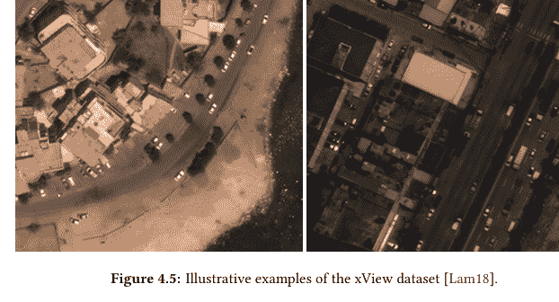

图 4.5：xView 数据集的说明性示例 [Lam18]。

#### 4.1.6 ISPRS 2D 语义标注挑战 Potsdam 数据集

在文献中，存在多个航空语义标注数据集，其中大多数公开可用的数据集仅为单个类别提供标注，例如道路或建筑物轮廓 [Mni13, Mag17, Van18, Dem18]。由于缺少对出现车辆的标注，这些数据集不适用于车辆检测任务。相比之下，2018 IEEE GRSS 数据融合挑战数据集 [GRS18]、ISPRS 2D 语义标注挑战 Vaihingen 数据集 [ISP] 以及 ISPRS 2D 语义标注挑战 Potsdam 数据集 [ISP] 为包括车辆在内的多个类别提供了标注。由于地面采样距离较低，即 50 cm，以及使用的传感器波段分别为红外、红色和绿色，因此 2018 IEEE GRSS 数据融合挑战数据集和 ISPRS 2D 语义标注挑战 Vaihingen 数据集未被考虑，而 ISPRS 2D 语义标注挑战 Potsdam 数据集被选为评估集成语义标注对检测性能影响的主要数据集。

ISPRS 2D 语义标注挑战 Potsdam 数据集，以下简称为 Potsdam 数据集，由 38 个分辨率为 6000 × 6000 像素、GSD 为 5 cm 的 patch 组成。Potsdam 数据集分为 24 个 patch 用于训练和 14 个 patch 用于测试。根据 [She16]，the

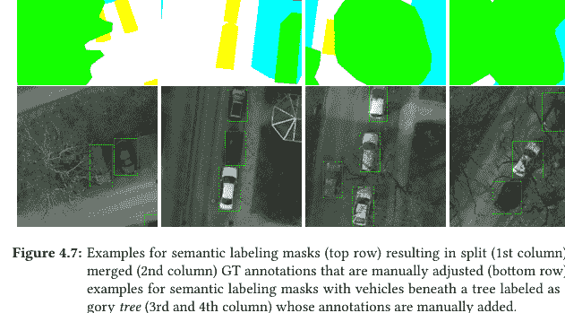

图 4.7：语义标注掩膜的示例（顶行），导致分割（第 1 列）和合并（第 2 列）的 GT 标注被手动调整（底行），以及车辆位于树下被标记为树类别的语义标注掩膜示例（第 3 和第 4 列），其标注被手动添加。

### 4.2 评估指标与协议

下面将介绍用于评估所提检测流程、区域提议生成，即 RPN，以及用于集成语义上下文信息的语义标注方法的常见指标。

### 4.2.1 目标检测

在本论文中，采用平均精度（AP）[Sal83] 作为衡量检测性能的常用指标，遵循 [Eve10] 中介绍的评估协议。计算 AP 时，将检测结果与 GT 进行比较。检测结果和 GT 以带关联类别标签的边界框形式提供。检测结果还为每个边界框包含分配类别的概率，称为置信度分数。

置信度分数和交并比（IoU），也称为 Jaccard 系数，被用作判断检测是否被视为正确检测，称为 *真阳性*（TP），或不的准则。IoU 定义为预测边界框与 GT 框的交集面积除以并集面积：

IoU = $\frac{A_{pred} \cap A_{GT}}{A_{pred} \cup A_{GT}}$ . (4.1)

如果检测满足两个条件，则被视为 TP：置信度分数高于给定阈值 τ 且 IoU 大于或等于 0.5，这被称为 *PASCAL 准则*¹。不满足这两个条件的检测称为 *假阳性*（FPs）。请注意，如果多个检测对应同一 GT 实例，只有置信度分数最高的那个计为 TP，其余检测被视为 FP。没有分配检测的 GT 实例称为 *假阴性*（FNs）。

精确度 *P* - 正确检测的百分比 - 定义为 TP 数除以 TP 和 FP 之和：

P = $\frac{|TP|}{|TP| + |FP|}$ . (4.2)

召回率 *R* 是检测率，定义为 TP 数除以 TP 和 FN 之和：

R = $\frac{|TP|}{|TP| + |FN|}$ . (4.3)

两者取值范围都在 0 到 1 之间。对于固定的置信度阈值 τ，精确度和召回率对称为操作点。τ 的较高值通常导致更高的精确度和更低的召回率，反之亦然。通过改变 τ，可以得到不同的操作点，从而得到如图 4.8 所示的精确度-召回率曲线（PRC）。

¹ 在多类别情况下，这在本论文中并非如此，预测类别还必须与对应 GT 的类别标签匹配。

## 一对悖论

本节确定了数据处理中出现的两种悖论。一般而言，悖论可以定义为自相矛盾或与预期相反的陈述。然而，数据处理悖论并不是逻辑错误的迹象，而更像是人类直觉拒绝接受某些数学关系不可避免的症状。如果要避免错误的结论，这类悖论必须得到解决。

### Simpson 悖论

第一个悖论是众所周知的 **Simpson 悖论**，当合并数据颠覆了单独数据所暗示的结论时就会出现。它描述如下。

> > 在数据分析中，当数据被聚合时结论被逆转的现象通常被称为 Simpson 悖论。

该悖论与 **混杂** 问题密切相关，对来自观察性研究的数据的解释具有重要意义。

### Lord 悖论

第二个悖论是 **Lord 悖论**，比第一个知名度低。该悖论在 Lord 的一篇著名文章中引用如下描述。

> > Lord's paradox 是一种统计悖论，当两种不同的分析方法对同一数据得出冲突的结论时就会出现。

该悖论的解决已成为大量争论的主题，但它强调了仔细指定模型和研究问题的重要性。

用作评估指标，遵循 2D 语义标注竞赛协议¹。两个指标均源自基于像素的混淆矩阵。为此，每个瓦片的混淆矩阵被累积。F1-score 是精确度和召回率的调和平均数，定义为

$F1\text{-score} = 2 \frac{P \cdot R}{P + R}$
(4.8)

为按类别计算精确度和召回率（见式 (4.2) 和式 (4.3)），TP 像素数来自混淆矩阵的主对角线元素，而 FP 像素数是每列的和，FN 像素数是每行的和，不包括主对角线元素。总体准确率通过归一化混淆矩阵的迹来计算。请注意，在评估期间，不同标签的 GT 区域之间三像素边界将被忽略，以减少由于标注过程导致的边界定义不确定性的影响。

## 推理时间

除了检测精度之外，推理时间也是判断检测性能的另一个关键因素。在本论文的背景下，使用了代表服务器和桌面设置的两种不同设备来测量推理时间。选择桌面设置是为了考虑到许多实际应用无法使用强大的服务器设置。每台设备的关键特征在表 4.2 中给出。所有推理时间测量均通过 Caffe 的 pycaffe Python 接口进行。如果未另行说明，推理时间以毫秒（ms）为单位报告，平均值取自相应数据集的完整测试集。请注意，所有时间测量均不包括预处理步骤，例如加载图像，因为这些步骤可以在等待 GPU 完成当前前向传递时异步进行。在每次计时之前，进行 10 次前向传递以预热 GPU 内核。

¹ http://www2.isprs.org/commissions/comm3/wg4/semantic-labeling.html

表4.2：用于运行时测量的设备概览。

|  | 服务器 | 台式机 |
|---|---|---|
| CPU | 48×Intel Xeon E5-2650 v4 @ 2.20GHz | 12×Intel Core i7-7800X CPU @ 3.50GHz |
| RAM | 256GB | 32GB |
| GPU | GTX TITAN X (Pascal), 12GB | GTX 1050 Ti (Pascal), 4GB |

## 5 基础框架

本章介绍所用基础框架（即 Faster R-CNN）的功能原理。为此，详细描述了主要的检测器组件和实现细节。此外，针对航空影像的特点提出了相应的调整，并系统地检验了这些调整以发现伴随的问题。

### 5.1 Faster R-CNN

选择 Faster R-CNN 作为本论文提出的检测流程的基础框架，是因为与其他基于深度学习的检测器相比，它具有更优的检测精度，尤其是在小目标实例方面。对于航空影像，精确检测小目标实例的能力更为关键，因为如第4.1节所述，低空间分辨率导致其中的目标通常只有几个像素大小。Faster R-CNN 的功能原理如图5.1所示，它主要包含两个模块。第一个模块称为 RPN，它生成一组候选区域，并将其传递给后续模块（称为分类阶段）。两个模块通过共享一组称为特征提取器的卷积层合并为单个网络。下面介绍两个模块的基本原理以及实现细节。

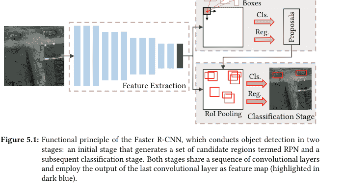

图5.1：Faster R-CNN 的功能原理，它以两个阶段进行目标检测：初始阶段生成一组候选区域（称为 RPN），以及后续的分类阶段。两个阶段共享一组卷积层，并将最后一个卷积层的输出作为特征图（以深蓝色突出显示）。

#### 5.1.1 区域提议网络

区域提议网络是一种基于深度学习的目标提议方法，其功能原理如图5.2所示。RPN 的目的是定位可能包含目标的候选区域。为此，RPN 包含一个小型网络，该网络以滑动窗口方式在最后一个共享卷积层的输出（用作特征图）上移动。该小型网络由一个 3×3 卷积层和两个并列的全连接层组成：一个用于边界框回归（reg 层），一个用于分类（cls 层）。实际上，这两个全连接层是通过两个并列的 1×1 卷积层实现的。

为了进行边界框回归，以每个滑动窗口位置（即特征图位置）为中心的锚框被用作参考框。为了适应不同的目标尺度，采用具有不同宽高比和尺寸的锚框，从而在每个滑动窗口位置产生 k 个锚框。因此，reg 层有 4k 个输出，编码每个锚框的偏移量，用于预测对应候选区域的坐标；而 cls 层输出 2k 个关于目标是否存在置信度分数。

边界框及关联的 GT 框。分类损失 $L_{cls}$ 是两类问题的对数损失，计算方式为：

$$L_{cls}(p_i,p_i^*) = -p_i^* \log p_i - (1 - p_i^*) \log(1 - p_i). \tag{5.2}$$

注意，为简单起见，分类损失实现为两类 softmax 层 [Ren15]。为确保回归损失仅对正锚框激活，将其乘以类别标签 $p_i^*$ 进行加权。回归损失为：

$$L_{reg}(t_i,t_i^*) = \sum_{j \in \{x,y,w,h\}} L_1^{smooth}(t_{ij} - t_{ij}^*), \tag{5.3}$$

其中应用了平滑 $L_1$ 损失 [Gir15]，与 $L_2$ 损失相比，它对离群值更稳健：

$$L_1^{smooth}(x) = \begin{cases} 0.5x^2, & \text{if } |x| < 1 \\ |x| - 0.5 & \text{otherwise.} \end{cases} \tag{5.4}$$

表示预测边界框和关联 GT 框的参数化坐标的向量定义如下：

$$
\begin{aligned}
t_x &= (x - x_a)/w_a, \quad t_y = (y - y_a)/h_a,\\
t_w &= \log(w/w_a), \quad t_h = \log(h/h_a),\\
t_x^* &= (x^* - x_a)/w_a, \quad t_y^* = (y^* - y_a)/h_a,\\
t_w^* &= \log(w^*/w_a), \quad t_h^* = \log(h^*/h_a).
\end{aligned} \tag{5.5}
$$

其中，$x$、$y$、$w$ 和 $h$ 分别是预测边界框的中心坐标、宽度和高度。对应的锚框和 GT 框的坐标与尺寸分别用下标 $a$ 和上标 $*$ 表示。

在部署期间，每个区域提议的实际边界框坐标在称为 *proposal layer*（提议层）的后续层中计算，方法是将预测的偏移量加到相应锚框的坐标上。为了生成最终的候选区域集合，根据预测的目标存在置信度分数对区域提议进行排序，并应用非极大值抑制（NMS）去除冗余的区域提议。

#### 5.1.2 分类阶段

分类阶段的功能原理如图5.3所示，其本质上是 Fast R-CNN 检测器 [Gir15]。分类阶段接收预定义数量的候选区域（即置信度分数最高的区域提议）作为输入。每个候选区域称为感兴趣区域（RoI），被投影到与 RPN 使用的相同的特征图上。通过执行最大池化，RoI 池化层将对应候选区域内的相关特征转换为具有固定空间范围的特征图。该特征图随后被送入一系列全连接层，这些全连接层分出两个并列的全连接层：一个用于分类，另一个用于边界框回归，类似于 RPN。$cls$ 层为 $c$ 个类别和背景类别输出 $c+1$ 个置信度分数，而 $reg$ 层为每个类别输出 $4c$ 个值，这些值编码了相对于相应候选区域的偏移量。所使用的子网络也称为分类头。

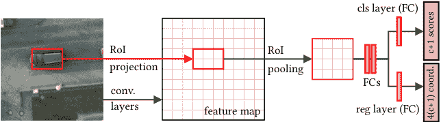

**图5.3：** 分类阶段的功能原理。每个感兴趣区域（即候选区域）被投影到特征图上。对应候选区域内的相关特征通过 RoI 池化转换为具有固定空间范围的特征图，并将其送入一系列全连接层（FC）。最后的两个并列全连接层输出置信度分数和每类回归偏移量。

训练分类阶段时，从 RPN 转发的候选区域集合中采样一组候选区域，也称为小批量 $\mathcal{B}_{CLS}$。与某个 GT 目标的 IoU 至少为 0.5 的候选区域被关联到相应的类别标签 $u_i>0$，否则被分配为背景 $u_i=0$。通过子采样背景区域，将与目标关联的候选区域和分配给背景的候选区域之间的比例设置为 1:3。应用类似于等式 (5.1) 的多任务损失来联合训练分类阶段的分类和边界框回归：

$$L_{CLS}=\sum_{i\in\mathcal{B}_{CLS}}L_{cls}(p_i,u_i)+\sum_{i\in\mathcal{B}_{CLS}}I(u_i)L_{reg}(t_i^u,v_i). \tag{5.6}$$

分类损失 $L_{cls}$ 是对数损失，其中 $p_i$ 是候选区域 $i$ 的概率分布，$u_i$ 是真实类别标签。回归损失 $L_{reg}$ 是平滑 $L_1$ 损失（见等式 (5.3)），其中 $t_i^u$ 和 $v_i$ 是表示与类别 $u_i$ 关联的预测边界框和当前 GT 框 $v_i$ 的参数化坐标的向量。注意，GT 框仅对真实类别给出。因此，回归损失用指示函数 $I(u_i)$ 加权，当 $u_i$ 为真实类别时其值为 1，对所有其他类别和背景为 0。

#### 5.1.3 实现细节

如前所述，一组卷积层被用作 Faster R-CNN 的特征提取器，其中最后一个卷积层的输出作为两个阶段的特征图。为此，默认使用 VGG16 [Sim14] 作为基础网络。表5.1 示意性地描述了 VGG16 的架构，该网络由 13 个卷积层组成，分别按 2 层和 3 层排列，后接 3 个全连接层。在每个卷积层和全连接层之后应用 ReLU 作为激活函数，而在第 2、4、7、10 和 13 个卷积层之后通过最大池化层执行空间池化。这 13 个卷积层作为特征提取器在两个阶段之间共享，最后一个卷积层的输出（记为 $conv5\_3$）用作特征图。全连接层为分类阶段进行了调整。为此，输出

RoI池化层为每个候选区域提取特征，其维度设置为7×7，以满足第一个全连接层的要求。最后一个全连接层包含1000个输出，即ImageNet分类基准数据集中每个类别对应一个输出，该层被替换为两个并列的全连接层。对于单个类别（即车辆），输出维度分别设置为2和8。

表5.1：默认用作Faster R-CNN特征提取器的VGG16结构示意图。d × d表示输入图像尺寸，在ImageNet的情况下为224 × 224。

| 层类型 | 卷积核大小 | 步长，填充 | 输出维度 |
|---|---|---|---|
| 卷积 | 3 × 3 × 64 | 1, 1 | d × d × 64 |
| 卷积 | 3 × 3 × 64 | 1, 1 | d × d × 64 |
| 最大池化 | 2 × 2 | 2, 0 | d/2 × d/2 × 64 |
| 卷积 | 3 × 3 × 128 | 1, 1 | d/2 × d/2 × 128 |
| 卷积 | 3 × 3 × 128 | 1, 1 | d/2 × d/2 × 128 |
| 最大池化 | 2 × 2 | 2, 0 | d/4 × d/4 × 128 |
| 卷积 | 3 × 3 × 256 | 1, 1 | d/4 × d/4 × 256 |
| 卷积 | 3 × 3 × 256 | 1, 1 | d/4 × d/4 × 256 |
| 卷积 | 3 × 3 × 256 | 1, 1 | d/4 × d/4 × 256 |
| 最大池化 | 2 × 2 | 2, 0 | d/8 × d/8 × 256 |
| 卷积 | 3 × 3 × 512 | 1, 1 | d/8 × d/8 × 512 |
| 卷积 | 3 × 3 × 512 | 1, 1 | d/8 × d/8 × 512 |
| 卷积 | 3 × 3 × 512 | 1, 1 | d/8 × d/8 × 512 |
| 最大池化 | 2 × 2 | 2, 0 | d/16 × d/16 × 512 |
| 卷积 | 3 × 3 × 512 | 1, 1 | d/16 × d/16 × 512 |
| 卷积 | 3 × 3 × 512 | 1, 1 | d/16 × d/16 × 512 |
| 卷积 | 3 × 3 × 512 | 1, 1 | d/16 × d/16 × 512 |
| 最大池化 | 2 × 2 | 2, 0 | d/32 × d/32 × 512 |
| 全连接 |  |  | 4096 |
| 全连接 |  |  | 4096 |
| 全连接 |  |  | 1000 |

本文所有实验均采用RPN和分类阶段的联合训练，在检测性能相近的情况下，其速度是交替优化的1.5倍。为此，$L_{RPN}$ 和 $L_{CLS}$ 被赋予相同的权重：

$L_{Faster\ R-CNN} = L_{RPN} + L_{CLS}.$

(5.7)

每个模型使用SGD训练60,000次迭代，初始学习率为0.001。学习率每20,000次迭代降低至原来的1/10。权重衰减和动量分别设置为0.0005和0.9。使用在ImageNet上预训练的权重来初始化卷积层和分类阶段的前两个全连接层。所有其他层根据[Ren15]使用高斯权重填充方法进行随机初始化。除非另有说明，RPN的锚点框使用3个尺度和3个宽高比。宽高比固定为1:1、1:2和2:1，以适应航空影像中车辆的不同朝向。接受生成的区域提议用于分类的最小尺寸设置为4像素。请注意，默认情况下，只有尺寸超过16像素的候选区域才会被考虑用于分类，这可能导致大量漏检，因为对应小物体、部分遮挡物体以及图像边缘物体的候选区域会被过滤掉。

在部署阶段，对置信度得分最高的10,000个区域提议应用NMS。用于NMS的重叠阈值设置为0.7。经过NMS后排名前2000的区域提议随后被送入分类阶段。这样，冗余的区域提议被移除，需要分类的区域提议数量以及相应的计算成本得以减少。为了去除重复检测，对最终检测结果应用重叠阈值为0.3的NMS。NMS的设置基于[Som18b]中报告的初步实验。

### 5.2 对航空影像的适应性调整

基于深度学习的检测框架（如Faster R-CNN）通常是为与航空影像差异很大的基准检测数据集而开发和设计的（见第3章）。由于这些差异，尤其是在物体尺寸方面，基于深度学习的检测框架不能直接应用于航空影像中的车辆检测。为了适应航空影像的特点，本文首次详细研究了几种修改方案[Som17b, Som18b]。接下来，分析了对Faster R-CNN进行的修改，即降低特征图分辨率和调整锚点框设置，并讨论随之而来的影响。

#### 5.2.1 特征图分辨率

通过使用原始VGG16作为Faster R-CNN的特征提取器，在PASCAL VOC上取得了顶级性能，表明其非常适合基准数据集[Ren15]。由于空间池化，用作特征图的最后一个卷积层输出的尺寸仅为输入图像的1/16（见表5.1），如图5.4所示，这足以在基准数据集中准确定位物体。为此，以PASCAL VOC为例，展示了所使用的特征图（即conv5_3）中三个滤波器的激活值以及相应的检测结果。请注意，所使用的Faster R-CNN模型采用为PASCAL VOC提出的设置进行训练。在推理过程中，输入图像被缩放，使较短边等于600像素，类似于[Ren15]。激活值被归一化到0到1之间，数值越高表示激活越强。由于物体尺寸较大，多个特征图像素与物体重叠。这三个滤波器分别响应不同的物体部件（如前挡风玻璃），其激活值表明特征图分辨率甚至足以勾勒出物体部件的轮廓，从而生成与物体精确对齐的边界框。

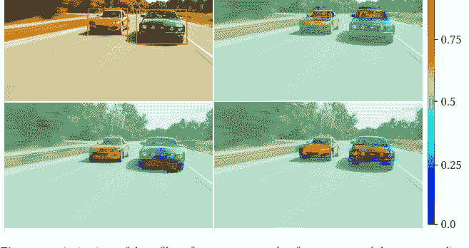

图5.4：来自conv5_3的三个滤波器激活值（用作特征图）及在PASCAL VOC上的相应检测结果表明，特征图分辨率足以准确定位物体。激活值已归一化到0到1之间。

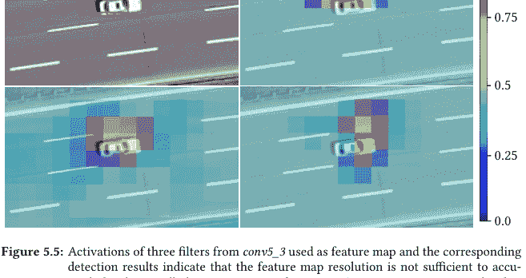

图5.5：来自conv5_3的三个滤波器激活值（用作特征图）及相应检测结果表明，对于DLR 3K中的小物体，特征图分辨率不足以准确定位。激活值已归一化到0到1之间。

使用 *conv3_3* 作为 Faster R-CNN 的特征图。此外，其他领域（如行人检测[Zha16]或标志检测[Egg17]）中检测精度的提高，证实了利用较浅层作为特征图对于小物体准确检测的重要性。

表5.2：DLR 3K上不同特征图分辨率的AP。相应的特征图分辨率相对于所使用的输入图像尺寸（即936 × 936像素）给出。

| 特征图 | 分辨率 | AP（%） |
|---|---|---|
| conv5_3 | 59 × 59 | 65.1 |
| conv4_3 | 117 × 117 | 90.3 |
| conv3_3 | 234 × 234 | **94.3** |
| conv2_2 | 468 × 468 | 92.7 |

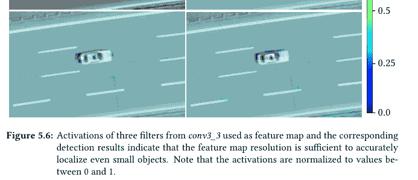

图5.6：来自conv3_3的三个滤波器激活值（用作特征图）及相应检测结果表明，特征图分辨率足以准确定位甚至很小的物体。请注意，激活值已归一化到0到1之间。

使用 *conv3_3* 作为特征图时，三个滤波器的激活值及其相应检测结果的可视化，定性地表明定位精度随着特征图分辨率的提高而改善（见图5.6）。由于特征图分辨率的提高，与图5.5中使用 *conv5_3* 相比，样本图像中与物体重叠的特征图像素明显更多。因此，即使是前挡风玻璃等精细物体部件也被多个特征图像素覆盖，从而有助于准确预测物体边界。

### 定位精度分析

接下来，对检测结果进行详细分析，以证实特征图分辨率的影响。首先，通过改变用于将GT对象视为已召回的IoU阈值，检查检测结果的定位精度。不同特征图分辨率和不同IoU阈值下的PRC曲线如图5.7所示。

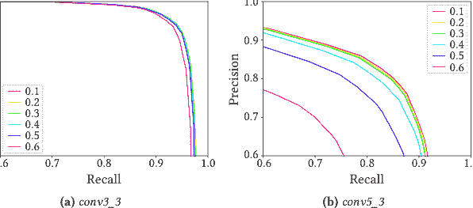

**图5.7：** 用于将GT对象视为已召回的不同IoU阈值下的精确率-召回率曲线。利用更高分辨率的特征图可获得更好的定位质量，因为随着阈值增加，性能下降明显更小。

较高的特征图分辨率在不同IoU阈值下表现出较小的检测性能变化。对于*conv3_3*，随着IoU阈值降低，检测性能仅略有改善，因为大多数检测

与 GT 注解具有较高的重叠。与之相比，*conv3_3* 的检测性能在采用较弱的 IoU 准则时明显得到改善。因此，采用更高的特征图分辨率可获得更优的定位精度。

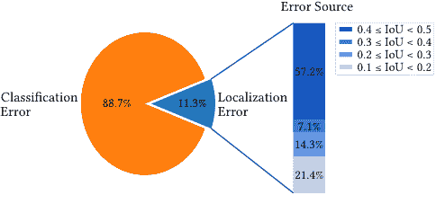

**图 5.8：** *conv3_3* 的误报检测错误分析。

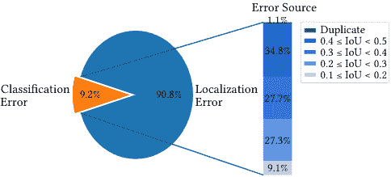

**图 5.9：** *conv5_3* 的误报检测错误分析。

图 [5.8](#) 和 [5.9](#) 中可视化的误报检测错误分析强调了在更高特征图情况下定位精度的提升。为此，所有置信度分数大于或等于 0.5 的 FP 均被区分定位错误和分类错误。遵循 [Hoi12]，定位错误为重复检测和边界框错位的检测，即与 GT 注解的 IoU 在 0.1 到 0.5 之间的检测。所有其他 FP 被归类为分类错误。对于 conv3_3，所有 FP 中只有约 10% 由于定位错误，其中大多数定位错误的 IoU 高于 0.4。相比之下，conv5_3 情况下超过 90% 的所有 FP 均由边界框错位或重复检测引起。总体而言，conv3_3 因定位错误导致的 FP 数量减少了 46 倍，这证实了增加特征图分辨率对于准确定位航空图像中诸如车辆等微小物体是必要的假设。

## 对 RPN 的影响

如第 5.1 节所述，相关物体的定位最初由 RPN 完成，因为会识别出最可能包含相关物体的区域建议。特征图分辨率与生成的区域建议之间的关系通过召回-IoU 曲线在图 5.10 中描述。因此，用于接受 GT 物体至少被一个区域建议覆盖的 IoU 阈值在 0 到 1.0 范围内以 0.05 的步长变化。为了计算召回，仅考虑 NMS 后排名前 2000 的区域建议，这些建议相当于前述实验中转发到分类阶段的区域建议。使用 conv3_3 的输出作为特征图可得到与 GT 注解整体重叠最佳的区域建议。虽然 conv2_2 情况下召回值仅略低，利用更高分辨率的特征图，即分别使用 conv4_3 和 conv5_3 的输出，会产生与 GT 注解重叠明显更差的候选区域。随着特征图分辨率的提高，召回下降变得更加明显，特别是 IoU 阈值高于 0.4 时。由于如第 5.1.2 节所述，只有重叠高于 0.5 的区域建议才被视为分类阶段训练的正样本，因此多个 GT 物体未被区域建议充分覆盖，无法以高置信度被分类为车辆。因此，漏检的概率加剧，进而检测性能下降。

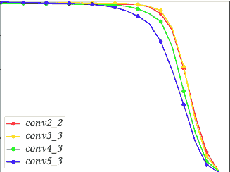

**图 5.10：** 不同特征图分辨率的召回-IoU 曲线。利用高分辨率特征图可生成与 GT 注解重叠更高的候选区域。

#### 5.2.2 锚框设置

检测精度受 RPN 预测的候选区域质量的强烈影响，因为只有指定数量的候选区域会被转发到分类阶段，而其他候选区域将被丢弃。除了所使用的特征图（参见第 [5.2.1](#) 节）之外，候选区域的质量还取决于配置的锚框设置，即用于边界框回归的锚框的尺寸和长宽比 [Ren15]。默认情况下，使用 3 种不同尺度和 3 种不同长宽比，从而在每个位置产生 9 个锚框。虽然默认锚框尺度，产生 128²、256² 和 512² 像素的框面积，在基准检测数据集¹中的物体范围内，但这些尺度明显超过了航空图像中平均车辆尺寸，例如 DLR 3K 情况下为 28.2 × 28.3 像素。使用默认锚框设置会导致 AP 明显低于 DLR 3K 中车辆范围内的锚框

¹ 例如，PASCAL VOC2007 中的物体平均尺寸为 143.2 × 148.3 像素。默认情况下，Faster R-CNN 将输入图像重缩放，使较短边等于 600 像素，这导致有效平均物体尺寸为 241.3 × 248.7 像素。

（见表 5.3）。请注意，由于第 5.2.1 节的发现，采用 *conv3_3* 的输出作为特征图。

**表 5.3：** 不同锚框尺度以及由此产生的不同锚框面积的 AP。与 DLR 3K 中车辆范围内的锚框相比，使用默认设置的结果明显改善。

| 锚框面积（像素） | AP（%） |
|---|---|
| 128², 256², 512² | 92.6 |
| 14², 28², 42² | **94.3** |

为了分析锚框尺寸对检测精度的影响，以下仅使用一个锚框尺度。锚框尺度被系统性地减小，产生的框面积范围在 256² 到 14² 像素之间。请注意，由于场景中车辆的不同方向，长宽比保持不变。如表 5.4 所示，最佳 AP 在锚框面积为 28² 时取得，这大致相当于 DLR 3K 数据集中平均车辆尺寸。虽然接近平均车辆尺寸的锚框 AP 仅略有下降，但锚框明显超过平均车辆尺寸时 AP 的下降明显增加。与基准数据集不同，DLR 3K 包含具有均匀 GSD 的图像，车辆尺寸仅有微小变化，因此使用多个锚框尺度以应对不同物体尺度的重要性较低。

**表 5.4：** 不同锚框尺度以及由此产生的不同锚框面积的 AP。与 DLR 3K 中车辆范围内的锚框相比，AP 最佳。

| 锚框面积（像素） | AP（%） |
|---|---|
| 256² | 88.1 |
| 112² | 92.8 |
| 56² | 93.8 |
| 42² | 94.1 |
| 28² | **94.3** |
| 14² | 94.2 |

关于图 5.12 中不同锚框尺度的 ABO。与上述观察一致，锚框面积在平均车辆尺寸范围内时可获得更好的定位质量，而锚框超过平均车辆尺寸时 ABO 变差。类似的发现证实锚点在现有物体范围内可获得更好的检测结果，已在 [Ash17] 中报道。

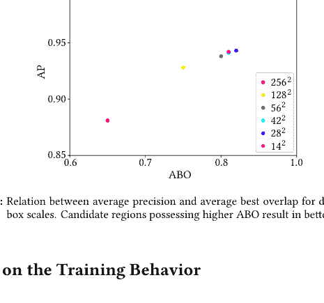

图 5.12：不同锚框尺度的平均精度与平均最佳重叠之间的关系。具有更高 ABO 的候选区域可带来更好的 AP。

## 对训练行为的影响

使用明显超过平均车辆尺寸的锚框尺寸会导致训练期间的收敛行为变差，如图 5.13 所示。为此，总体损失 $L_{Faster\ R-CNN}$（见式 (5.7)）以及 RPN 的损失，即 $L_{cls,RPN}$ 和 $L_{reg,RPN}$（见式 (5.2) 和式 (5.3)），在 100 次迭代上取平均。对于平均锚框面积为 $28^2$ 像素，$L_{Faster\ R-CNN}$ 收敛到 0.15，而对于平均锚框面积为 $256^2$ 像素，$L_{Faster\ R-CNN}$ 仅略有下降并收敛到 0.7。检查 RPN 的损失显示，在平均锚框面积为 $256^2$ 像素的情况下，$L_{cls,RPN}$ 和 $L_{reg,RPN}$ 均无收敛行为，而在平均锚框面积为 $28^2$ 像素时，两者损失均收敛到 0。其原因之一是采样

训练期间的正锚点和负锚点如第5.1.1节所述。为确保每个GT实例至少有一个正锚点，除了IoU高于0.7的锚点外，与GT框具有最高IoU的锚点也被分配为正锚点。然而，当平均锚框面积为256²像素时，所有锚点与最近的GT框之间的IoU都很小，如图5.14所示。因此，所有正锚点和负锚点的IoU相似，这阻碍了RPN的训练。

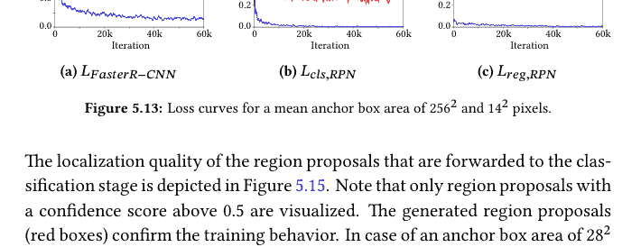

**图 5.13：** 平均锚框面积为256²和14²像素时的损失曲线。

转发到分类阶段的区域提议的定位质量如图5.15所示。注意，仅可视化了置信度高于0.5的区域提议。生成的区域提议（红色框）证实了训练行为。当锚框面积为28²像素（右图）时，区域提议位于矩形结构周围，且所有车辆（绿色框）都被覆盖，这强调了RPN能够正确识别可能包含物体的区域。相比之下，锚框面积为256²像素（左图）时，区域提议随机分布在路面上，因为RPN将此类区域分类为感兴趣区域。

在部署期间，未被充分覆盖的车辆很可能导致漏检。此外，定位不佳的区域提议会阻碍分类阶段的训练，因为只有与GT物体的IoU至少为0.5的区域提议才会被视为正样本（见第5.1.2节）。改用与现有物体尺寸范围相匹配的锚框尺度，反而会生成与GT物体具有高ABO的区域提议，这有助于分类阶段的训练，并带来更好的检测结果，如图5.12所示。

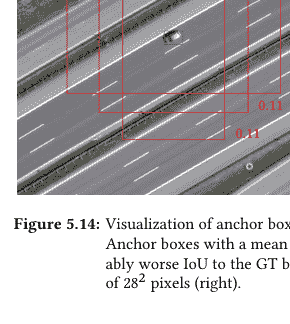

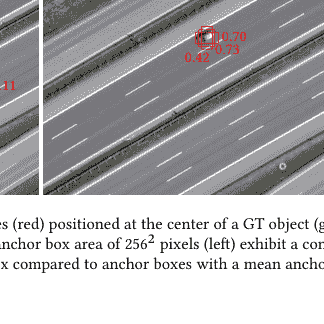

**图 5.14：** 位于GT物体（绿色）中心的锚框（红色）可视化。平均锚框面积为256²像素的锚框（左图）与GT框的IoU明显差于平均锚框面积为28²像素的锚框（右图）。

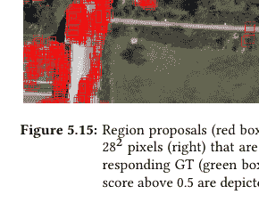

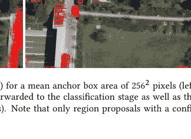

**图 5.15：** 平均锚框面积为256²像素（左图）和28²像素（右图）时转发到分类阶段的区域提议（红色框）以及对应的GT（绿色框）。注意，仅描绘了置信度高于0.5的区域提议。

#### 5.2.3 物体尺寸

接下来，通过改变GSD来研究所提出的自适应修改对航拍图像中物体尺寸的影响。由于DLR 3K数据集的GSD均匀，且车辆尺寸变化较小，将GSD为13 cm的原始图像分别按2/3和1/2的因子重新缩放用于训练和测试，得到19.5 cm和26 cm的GSD。因此，平均物体尺寸分别减小到18.8 × 18.9和14.1 × 14.2像素。图5.16显示了不同GSD下的物体尺寸分布。

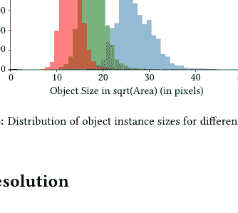

**图 5.16：** 不同GSD下物体实例尺寸的分布。

### 特征图分辨率

如上所述，增加特征图分辨率主要提高了检测精度，因为粗糙的特征图分辨率不适合定位小物体。接下来，我们针对物体尺寸研究特征图分辨率的影响。如表5.5所示，利用更高的特征图分辨率对所有GSD都提升了AP。注意，对于每个GSD，所使用的锚框面积等于平均物体尺寸（见表5.6）。使用*conv3_3*的输出作为特征图在所有GSD下均取得了最佳AP。由于物体尺寸更小，导致与物体实例重叠的特征图像素更少，因此对于所有特征图分辨率，AP都随着GSD的增大而下降。注意，随着GSD增大而AP降低的效应，还因用于判断GT物体是否被召回的IoU标准而进一步加剧；该标准变得更加严格，因为即使预测边界框坐标的微小变化，也可能导致与相应GT框的IoU明显变差。然而，在特征图分辨率较粗糙的情况下，AP的下降更为显著，这突出了高分辨率特征图对于检测小物体的必要性。特别是在高GSD下，当使用*conv5_3*作为特征图时，大多数物体仅被单个或少数几个特征图像素覆盖。因此，从特征图到输入图像的物体位置推断受到了阻碍。

**表 5.5：** 不同特征图分辨率相对于GSD的AP（%）。使用较浅层作为特征图，产生更高的特征图分辨率，整体上改善了AP。

| 特征图 | 13 | 19.5 | 26 |
|---|---|---|---|
| *conv5_3* | 65.1 | 38.4 | 21.9 |
| *conv4_3* | 90.3 | 76.5 | 59.7 |
| *conv3_3* | 94.3 | 89.4 | 83.2 |

**表 5.6：** 不同GSD下使用的锚框面积。

| GSD（厘米） | 锚框面积（像素） |
|---|---|
| 13 | 14², 28², 42² |
| 19.5 | 10², 18², 26² |
| 26 | 8², 14², 20² |

粗糙特征图分辨率下较差的定位精度由PRC（精确率-召回率曲线）证实（见图5.17）。为此，根据图5.7，针对不同的IoU阈值绘制了精确率相对于召回率的曲线。注意，*conv3_3*和*conv5_3*使用了不同的坐标轴刻度。对于两种GSD，较粗糙的特征图分辨率在IoU阈值变化时表现出更强的检测性能偏差。虽然*conv3_3*的检测性能随着IoU阈值降低仅略有提升，但*conv5_3*的检测性能显著提高，这与GSD为13 cm时报告的PRC一致（见图5.7）。因此，利用更高的特征图分辨率可以产生与GT标注总体上更高重叠的检测结果。

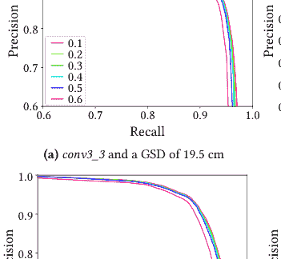

(a) *conv3_3*，GSD为19.5 cm

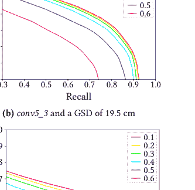

(b) *conv5_3*，GSD为19.5 cm

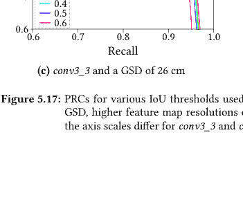

(c) *conv3_3*，GSD为26 cm

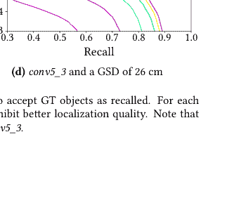

(d) *conv5_3*，GSD为26 cm

**图 5.17：** 用于判断GT物体是否被召回的各种IoU阈值下的PRC。对于每个GSD，更高的特征图分辨率表现出更好的定位质量。注意，*conv3_3*和*conv5_3*的坐标轴刻度不同。

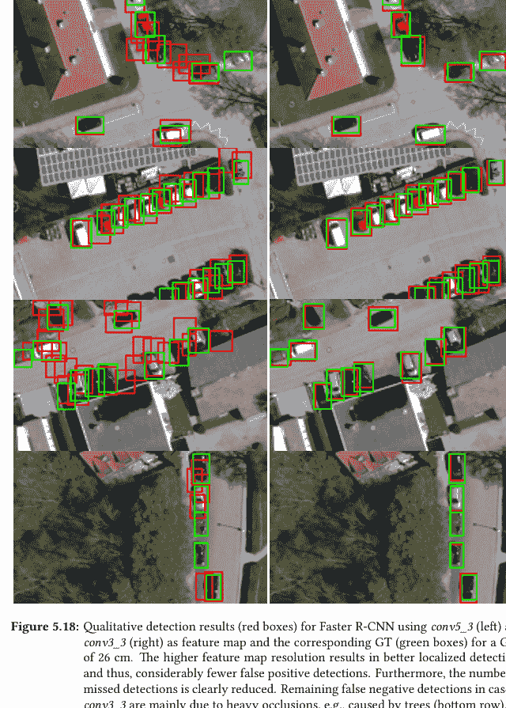

**图 5.18：** 使用*conv5_3*（左图）和*conv3_3*（右图）作为特征图的Faster R-CNN的定性检测结果（红色框）以及GSD为26 cm时对应的GT（绿色框）。更高的特征图分辨率带来了定位更准确的检测，从而显著减少了误检。此外，漏检数量也明显减少。*conv3_3*情况下剩余的漏检主要是由于严重遮挡，例如由树木造成的遮挡（底行）。

图5.18展示的GSD为26 cm的定性检测结果，显示了更高特征图分辨率下定位精度显著提高。使用*conv5_3*作为特征图会导致边界框预测位置不准确，并产生大量重复检测。相比之下，使用*conv3_3*时，几乎所有物体都被准确检测，即使在停车场等车辆密集的场景中也是如此。此外，更高的特征图分辨率明显减少了漏检数量。*conv3_3*情况下剩余的漏检主要是由于严重遮挡，例如由树木造成的遮挡。

### 锚框设置

调整锚框设置的影响如表5.7所示。为此，与第5.2.2节类似，仅使用一种锚框尺度。系统性地改变锚框尺度，使得到的锚框面积在256²到14²像素之间。注意，所有实验均使用*conv3_3*的输出作为特征图。对于每个GSD，使用与特定平均车辆尺寸范围相匹配的锚框面积时，AP最佳。虽然对于GSD为13 cm的情况，当锚框超过平均车辆尺寸时AP下降相对较小，但随着GSD的增大，AP的下降变得更加明显。因此，随着物体尺寸变小，调整锚框设置对检测性能的影响逐渐增大。

如前所述，检测精度受生成的区域提议定位质量的影响。生成的区域提议定位质量与检测精度之间的关系如图5.19所示。对于每个GSD，当锚框处于特定平均车辆尺寸范围内时，ABO最高，因而定位质量最好；而当锚框超过平均车辆尺寸时，GSD越高，ABO下降越快。因此，在物体尺寸较小的情况下，使用合适的锚框尺度更为重要。对于所有GSD，使用能产生更高ABO区域提议的锚框尺度可获得更好的检测结果。检测精度显著下降，对于

ABO 值接近 0.5，尤其是在 GSD 为 26 cm 时。这证实了与用于生成正负训练样本的 IoU 阈值的差距越大，检测效果越好，因为相应的候选区域可以以更高的置信度被分类为车辆或背景。

表 5.7：不同锚框尺度（以及由此产生的不同锚框面积）在不同 GSD 下的 AP（%）

| 锚框面积（像素） | GSD（厘米） |  |  |
|---|---|---|---|
|  | 13 | 19.5 | 26 |
| 256² | 88.1 | 73.2 | 52.9 |
| 112² | 92.8 | 85.4 | 71.4 |
| 56² | 93.8 | 88.3 | 81.1 |
| 42² | 94.1 | 89.0 | 82.9 |
| 28² | 94.3 | 89.5 | 83.1 |
| 14² | 94.2 | 89.4 | 83.2 |

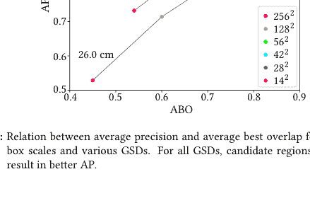

图 5.19：不同锚框尺度和不同 GSD 下平均精度与平均最佳重叠之间的关系。对于所有 GSD，ABO 较高的候选区域会产生更好的 AP。

#### 5.2.4 出现的挑战

尽管检测精度显著提高，尤其是在高 GSD 情况下，所进行的调整也带来了一些在实际应用中必须解决的缺陷。这些缺陷主要在于所使用特征的语义和空间上下文信息较弱，以及推理时间较长，下面将对此进行讨论。

### 语义与空间上下文

一般来说，CNN 中的每个卷积层都会学习复杂度递增的滤波器，因为前一层的特征会被聚合和重组。第一层学习基本的特征表示，例如边缘和角点；中间层学习响应对象的各个部分；而最后层学习更高层的表示，以识别具有不同形状和位置甚至整个场景的完整对象 [Zho15]。此外，影响网络中某个特定单元的输入空间区域（也称为 *感受野*）以及随之而来的空间上下文信息通常会随着网络层加深而增加 [Luo16]。因此，为了精确地定位微小物体而移除深层网络以增加特征图分辨率，会导致语义和空间上下文信息的减少。

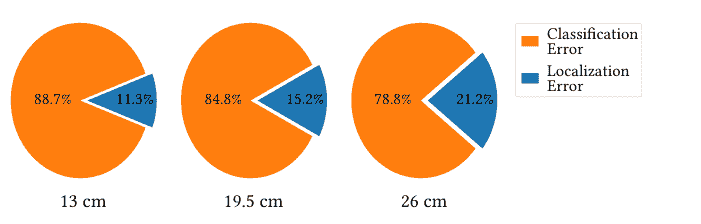

图 5.20：不同 GSD 下误检的错误分析。

对错误检测的分析表明，较弱的语义和上下文信息会导致大量误检。图 5.20 使用 conv3_3 的输出作为特征图，展示了误检在定位误差和分类误差中的分布。对于所有 GSD，误检主要源于分类误差，因为背景对象被分类为车辆。

为了突出相对较弱的语义和上下文信息对检测精度的影响，图 3.4 定性地可视化了 GSD 为 13 cm 时的误检。这些误检主要来自具有类似车辆形状的对象，例如建筑物上的矩形结构，如太阳能电池板或窗户。请注意，其中一些误检包含激活特定车辆部件（如挡风玻璃或车头灯）响应滤波器的小型组件。图 5.21 示例性地展示了四个滤波器的激活情况，这些滤波器既响应车辆部件，也响应类似结构。

图 5.21：来自 conv3_3 的四个滤波器的激活，它们对特定车辆部件以及类似结构都有响应。

然而，观察误检周围的区域可以发现，大多数误检位于不太可能包含车辆的区域内，例如建筑物或植被。尽管训练数据中不包含此类用于分类的正样本，但所学到的表示不足以区分相关和不相关的周围区域。因此，增加所用特征的空间或语义上下文信息，以更好地学习路面或停车场等相关周围区域的表示，可以减少误检数量。第 6 章将介绍旨在提高检测精度、丰富所用特征图空间和语义内容的方法。

### 推理时间

除了检测精度，推理时间也是大多数应用（如搜索与救援任务）中的另一个关键因素。表 5.8 从推理时间的角度考察了所进行调整的影响，尤其是特征图分辨率的增加（其在检测精度上带来了最大增益）的影响。按照第 4.2 节引入的时间测量协议，Faster R-CNN 检测器以及每个检测器组件的推理时间以毫秒（ms）为单位报告，并在包括 240 个 936 × 936 像素图像瓦片的完整测试集上取平均值。对于服务器和台式机两种设置，总体推理时间都会随着特征图分辨率的增加而变差。虽然分类阶段的推理时间保持不变，因为所有模型都处理相同数量的候选区域，但由于特征图分辨率更高，RPN 的推理时间显著增加。如第 5.1.1 节所述，RPN 由一个小型网络组成，在每个特征图位置上应用，并以相应特征图位置为中心的锚框用于边界框回归。使用 conv3_3 代替 conv4_3 或 conv5_3，需要处理的特征图位置分别增加 4 倍和 16 倍，因此需要计算边界框坐标并排序的候选区域数量也分别增加 4 倍和 16 倍。因此，计算开销明显增加。然而，推理时间的增加并不是线性的，因为 NMS 被应用于每个模型中置信度最高的 10,000 个候选区域。

比较不同的设备设置可以发现，在性能更强的设备（即服务器设置）上花费的推理时间明显更少。尤其体现在用于特征提取的基础网络和分类阶段的推理时间上，二者明显更差。尽管在使用 conv3_3 时会丢弃多个卷积层，但在服务器设置下，conv5_3 的推理时间仅略有增加；而在台式机设置下，特征提取的推理时间显著上升。注意，当使用 conv3_3 时，特征提取的推理时间包括用于满足全连接层所需输入通道数的辅助卷积层所花费的时间。为了在不同设备上加速检测器，需要对特征提取以及 RPN 和分类阶段进行优化。第 7 章将介绍解决这些问题的策略。

表 5.8：使用不同特征图的 Faster R-CNN 推理时间比较。由于 RPN，总体推理时间随特征图分辨率升高而变差。

| 特征图 | 组件 | 时间（毫秒） |  |
|---|---|---|---|
|  | 服务器 | 台式机 |  |
| *conv3_3* | 特征提取 | 58.9 | 177.4 |
|  | RPN | 139.8 | 212.8 |
|  | 分类阶段 | 87.5 | 273.3 |
|  | 总计 | 286.2 | 663.5 |
| *conv4_3* | 特征提取 | 59.1 | 230.2 |
|  | RPN | 40.1 | 58.7 |
|  | 分类阶段 | 86.9 | 275.2 |
|  | 总计 | 186.1 | 564.1 |
| *conv5_3* | 特征提取 | 62.0 | 255.6 |
|  | RPN | 20.3 | 23.6 |
|  | 分类阶段 | 86.8 | 273.7 |
|  | 总计 | 169.1 | 552.9 |

### 6.1 空间上下文

在 Faster R-CNN 中利用较浅层作为特征图，对于航空影像中的车辆检测至关重要，因为较深层的分辨率通常不足以精确定位微小物体。为了克服因缺乏语义和上下文内容而导致的误报，本论文提出了一种对原始 Faster R-CNN 架构的扩展，称为多特征反卷积（MFD）Faster R-CNN。MFD Faster R-CNN 的示意结构如图 6.1 所示。受旨在预测精细和粗略结构的语义标注网络的启发，来自不同层（以不同蓝色调表示）提供不同语义和上下文信息的特征被组合在一起。为此，引入了一个以绿色突出显示的上下文增强模块（CEM），以允许组合这些特征，同时保持足够高的特征图分辨率以定位微小物体。下面介绍 CEM 和实现细节，随后通过实验和对结果的讨论来突出增强的检测精度。

图 6.1：提出的多特征反卷积 Faster R-CNN 的示意结构。该结构通过 CEM 扩展了原始 Faster R-CNN，以结合浅层和深层特征，同时保持足够高的特征图分辨率以定位微小物体。

#### 6.1.1 上下文增强模块

上下文增强模块的主要目的是创建适用于微小目标定位的高分辨率特征图，该特征图包含来自深层的丰富语义特征。如第 5.2.1 节所示，使用 conv3_3 的输出作为特征图与 conv4_3 和 conv5_3 相比能获得更好的检测性能，尽管相应的特征具有较少的语义和上下文信息。其关键在于 conv4_3 和 conv5_3 的特征图分辨率较粗，即分别为输入图像尺寸的 1/8 和 1/16，这阻碍了对微小目标的精确定位。由于较深的层通常包含比较浅的层更丰富的语义和上下文内容 [Zho15, Luo16]，所提出的 CEM 对深层的低维特征图，即 conv4_3 和 conv5_3 进行上采样，然后将其与 conv3_3 的特征相结合。为此，引入了如图 6.2 所示的反卷积子模块。为了融合不同尺寸的特征图，使用核大小为 4 × 4 的反卷积层将低维特征图上采样 2 倍。不是采用 [Lin17a] 中提出的最近邻上采样，反卷积层的应用促进了非线性上采样的学习，在初步实验中经验上显示出更优的结果。然后将上采样后的特征与较浅层的特征通过拼接进行融合，这等价于 [Lin17a] 中提出的侧向连接，以确保上采样特征的更精确位置。为了有效融合拼接后的特征图信息，在拼接后应用 1 × 1 卷积层。请注意，每个特征图的通道数进一步调整为 256，这是所用特征图中的最小通道数，以允许组合特征图具有相似的影响程度。为此，在 conv4_3 和 conv5_3 的输出上应用 1 × 1 卷积。

如图 6.1 所示，反卷积子模块被迭代应用。首先，反卷积子模块对 conv5_3 的特征进行上采样，并将上采样后的特征与 conv4_3 的特征相结合。然后，将组合后的特征上采样并与 conv3_3 的输出合并。所得到的特征随后被用作 RPN 和分类阶段的特征图。因此，深层特征图的上下文内容被传播到特征图。

图 6.2：用于融合浅层和深层特征的反卷积子模块的示意图。对深层特征应用核大小为 4 × 4 且步长为 2 的反卷积层，将其上采样两倍，然后通过拼接与浅层特征进行组合。最后，附加一个 1 × 1 卷积层以有效融合拼接特征图的信息。

#### 6.1.2 分阶段训练方案

为了训练所提出的 MFD Faster R-CNN，受 [Lon15] 的启发，执行分阶段微调以改善权重初始化。为此，仅使用 conv3_3 作为特征图的 Faster R-CNN 最初以初始学习率为 0.001 端到端训练共 60,000 次迭代。使用在 ImageNet 上预训练的权重进行初始化。接下来，将 conv4_1 至 conv4_3 以及一个反卷积子模块添加到网络中，并将 conv3_3 与 conv4_3 的上采样特征的组合用作特征图。然后以学习率为 0.001 端到端训练模型 20,000 次迭代。为此，新增的层使用高斯权重填充方法进行初始化，而所有其他权重则由初始训练的 Faster R-CNN 初始化。在最后阶段，将 conv5_1 至 conv5_3 以及用于上采样 conv5_3 特征的反卷积子模块添加到网络中。将 conv3_3 与 conv4_3 和 conv5_3 的上采样特征的组合用作特征图。然后以学习率为 0.001 进一步端到端训练模型 20,000 次迭代。新增的层使用高斯权重填充方法进行初始化，而所有其他权重则由先前微调的 Faster R-CNN 初始化。

#### 6.1.3 消融实验

所提出的 MFD Faster R-CNN 旨在通过融合浅层和深层特征来增强所用特征图的语义和上下文信息，从而减少误报数量。在 DLR 3K 数据集上研究了通过添加深层特征来增强所用特征图对检测精度的影响。表 6.1 显示了 MFD Faster R-CNN 在三种不同 GSD 下的检测精度。为此，原图像按第 5.2.3 节所述进行训练和测试的重缩放，并相应地采用了使用的锚框尺度。

表 6.1：通过 AP（单位：%）比较所提出的 MFD Faster R-CNN（将 conv3_3、conv4_3 和 conv5_3 的输出组合作为特征图）与仅使用 conv3_3 作为特征图的基础 Faster R-CNN 在各种 GSD 下的性能。

| 特征图 | GSD（单位：cm） |  |  |
|---|---|---|---|
|  | 13 | 19.5 | 26 |
| conv3_3 | 94.3 | 89.4 | 83.2 |
| conv3_3 ⊕ conv4_3 | 95.0 | 90.8 | 84.6 |
| conv3_3 ⊕ conv4_3 ⊕ conv5_3 | 95.1 | 91.4 | 85.3 |

将 conv3_3 的特征与 conv4_3 的上采样特征相结合在所有 GSD 下均表现出优于仅使用 conv3_3 作为特征图的基础 Faster R-CNN 的结果。所提出的将 conv3_3 的特征与 conv4_3 和 conv5_3 的上采样特征相结合的 MFD Faster R-CNN 在所有 GSD 下总体上实现了最佳检测性能，这表明添加包含更多上下文信息的特征可带来更好的检测性能。检测性能提升的一个原因是分类精度提高，从而产生更少的假阳性检测。例如，对于 GSD 为 26 cm 的情况，与基础 Faster R-CNN 相比，假阳性检测数量减少了 27.8%，而假阴性检测数量几乎不受影响。为此，使用了 0.5 的分类阈值。如图 6.3 所示，DLR 3K 上 GSD 为 26 cm 的定性结果表明，由形状类似车辆的物体引起的假阳性检测数量明显减少。这表明融合具有更多语义信息的深层特征可提高分类精度，从而获得更好的检测性能。

图 6.3：使用 conv3_3 作为特征图的 Faster R-CNN（上行）和 MFD Faster R-CNN（下行）在 GSD 为 26 cm 时的定性检测（红色框）及其对应的 GT（绿色框）。通过整合来自深层的空间上下文信息，由于形状类似车辆的物体引起的 FP 数量减少。

训练方案的影响在表 6.2 中以 GSD 为 26 cm 为例展示。为了与所提出的包含三个阶段的训练程序进行比较，考虑了两种替代变体。第一种变体是在单阶段训练 MFD Faster R-CNN。为此，使用在 ImageNet 上预训练的权重初始化 VGG16 主干从 conv1_1 到 conv5_3 的所有层。附加层使用高斯权重填充方法进行初始化。MFD Faster R-CNN 以初始学习率为 0.001 端到端训练共 60,000 次迭代。后一种变体包含两个阶段。在第一阶段，仅使用 conv3_3 作为特征图的 Faster R-CNN 最初以初始学习率为 0.001 端到端训练 60,000 次迭代，类似于分阶段

训练程序。接下来，将用于整合深层特征的层附加到网络中，然后再训练 20,000 次迭代。为此，新增的层使用高斯权重填充方法进行初始化，而所有其他权重则由之前微调的 Faster R-CNN 初始化。两种替代训练方案与基线 Faster R-CNN 相比均表现出 AP 的提升，这证实了在采用更多语义和上下文信息的情况下检测性能得到改善。尽管如此，使用三阶段训练程序可获得明显更好的检测性能。由于网络在第一阶段学习到准确的定位，与单阶段训练相比，在后续阶段通过学习的上采样和组合对所用特征图进行深层特征增强变得更加容易。

表 6.2：训练程序对检测性能的影响。逐步添加深层特征可获得更好的 AP。

| Training scheme | AP (in %) |
|---|---|
| One-stage | 84.0 |
| Two-stage | 84.8 |
| Three-stage | **85.3** |

### 6.2 语义上下文

克服针对航空影像中车辆检测而适配的基于深度学习的检测器缺乏上下文信息的一种替代策略是利用语义标注网络。语义标注本质上是对输入图像进行逐像素分类。将语义标注集成到检测框架中可以引入语义上下文信息，即待检测对象的局部周围环境，因此有望减少误报检测的数量，这些误报通常由图像中不太可能包含车辆的区域（如建筑物）中的矩形结构引起。为此，提出了两种不同的将语义标注网络集成到检测管道中的方法。

本节其余部分组织如下。首先介绍了航空影像语义标注的有前景的架构。然后详细描述了两种提出的方法，并在 ISPRS 2D 语义标注挑战 Potsdam 数据集上提供了消融实验。最后，在基于 DLR 3K 的新语义标注数据集上进行了评估，以强调集成语义标注对检测性能的影响。

#### 6.2.1 语义标注方法

多个 CNN 架构已被提出用于语义标注任务。下面介绍了本论文中研究的四个有前景的架构。请注意，所有考虑的架构均基于 VGG16 架构，以便将语义标注网络与第 6.2.3 节中提出的 Faster R-CNN 检测网络融合。

### FCN-32s

图 6.4：FCN-32s 的示意结构。VGG16 的前两个全连接层分别被转换为核大小为 7 × 7 和核大小为 1 × 1 的卷积层，而最后一个全连接层则被 6 通道的 1 × 1 卷积层替换。为了将最后一个卷积层的输出上采样 32 倍，附加了一个核大小为 64 × 64、步长为 32 的反卷积层。

图 6.4 中所示的 FCN-32s [Lon15] 是一种为语义标注任务设计的全卷积网络（FCN）。为此，默认架构即 VGG16（见表 5.1）的全连接层被转换为卷积层。由于全连接层可以被视为覆盖整个输入维度的卷积 [Lon15]，输入维度为 7 × 7 × 512 的 fc6 被转换为核大小为 7 × 7 的卷积层，随后的全连接层 fc7 被转换为核大小为 1 × 1 的卷积层。原本用作分类层的最后一个全连接层被丢弃，并在 Potsdam 数据集的情况下附加一个 6 通道的 1 × 1 卷积层，以在每个粗特征图位置预测每个类别的分数。最后，通过单个反卷积层对粗预测进行上采样来实现输入图像的逐像素预测。语义标注网络使用逐像素 softmax 损失进行训练。

### FCN-16s

图 6.5：FCN-16s 的示意结构。与 FCN-32 相反，最后一个卷积层的输出通过核大小为 4 × 4、步长为 2 的反卷积上采样两倍，然后通过逐元素相加与第 4 个池化层的输出组合。注意，通道数通过额外的 1 × 1 卷积层进行调整。核大小为 32 × 32、步长为 16 的反卷积层用于将组合特征上采样 16 倍。

由于 FCN-32s 因粗预测层而输出边界模糊的语义标注结果，FCN-16s [Lon15] 通过将深层粗特征与浅层精细特征组合来扩展 FCN-32s，以克服这一缺点（见图 6.5）。Instead of up-sampling the output of information, the use of dilated convolutions increases the receptive field and thus, yielding more contextual information. 类似于 FCN-32s，附加了一个 6 通道的 1 × 1 卷积层以在每个粗特征图位置预测每个类别的分数，然后应用单个反卷积层来实现输入图像的逐像素预测。

### SegNet

图 6.7：SegNet 的示意结构，由编码器和解码器网络组成。编码器的拓扑与 VGG16 的卷积部分相同，而解码器的拓扑本质上是编码器的镜像。非线性上采样通过使用最大池化索引进行，该索引编码了将前一特征图的值映射到的位置，如图 6.8 所示。

Badrinarayanan 等人 [Bad17] 提出了一种用于语义标注的编码器-解码器架构 SegNet，该架构在基准数据集上显示出有希望的语义标注结果。如图 6.7 所示，SegNet 由编码器和解码器网络组成。编码器的架构在拓扑上与 VGG16 架构的卷积部分相同，而解码器的拓扑本质上是镜像的编码器。请注意，最后一个卷积层的通道数设置为 6，以便为每个类别提供逐像素预测。与使用反卷积层上采样低分辨率特征图不同，解码器使用最大池化索引执行非线性上采样。为此，每个最大池化步骤对应的编码器的池化索引都会存储，该索引指示池化大小定义区域内的最大值位置。然后通过将特定特征图的值映射到存储的位置来进行上采样，如图 6.8 所示，而剩余像素填充为零。以这种方式，消除了对学习上采样的需求。语义标注网络根据 FCN-32s 及其扩展使用逐像素 softmax 损失进行训练。

图 6.8：SegNet 中进行的非线性上采样的说明。每个最大池化步骤中池化大小定义区域内的最大值位置存储在池化索引中，用于将前一特征图的值映射到存储的位置。剩余像素填充为零。

### 消融实验

下面，对第 4.1 节中介绍的 Potsdam 数据集上的不同语义标注架构进行评估，以评估每个架构集成到 Faster R-CNN 检测框架中的潜力。训练时，将原始图像块裁剪为 256 × 256 像素的瓦片，重叠率为 50%。此外，通过应用垂直和水平翻转以及 90 度步长的旋转进行数据增强，使训练样本数量增加 8 倍。在测试时，使用 512 × 512 像素的图像瓦片，瓦片之间重叠 50%。对于每个瓦片，选择中央 384 × 384 像素作为最终语义标注掩码，与平均重叠区域相比，在初步实验中表现出略好的性能。所执行的拼接策略进一步减少了图像边界和拼接边界处的伪影，分别。各模型训练 100,000 次迭代

使用批量大小为6，采用Adam求解器，初始学习率为1e-8。按照[Lon15]中提出的分阶段训练方法对FCN-16s进行训练。因此，使用在Potsdam数据集上预训练的FCN-32s权重进行初始化。否则，使用在ImageNet上预训练的权重进行初始化。

不同架构的语义标注结果见表6.3。为此，按照2D语义标注竞赛协议（见4.2节），使用每类的F1分数和总体精度作为评估指标。所有架构的总体精度均达到约88%，明显高于[She16]中报告的仅基于RGB影像的基线结果。特别是，汽车类别的F1分数显著提高。SegNet、FCN-16s和FCN-D16甚至优于额外依赖红外和DSM信息的基线结果。除杂乱类别外，每个类别都取得了较高的F1分数。该类别精度迄今最低的一个原因是该类别中聚合的对象和概念差异很大，从水域到网球场，再到户外家具等小型结构。与不透水面和建筑类别相比，低植被和树类别的F1分数略低。这些较低的F1分数主要是由于这两个类别之间的混淆，因为即使两者之间的边界往往也不是明确的。虽然SegNet总体精度最高，略优于FCN-16s和FCN-D16，但FCN-32s的总体精度和各类别F1分数最低，尤其是车辆类别，其目标实例尺寸最小。这表明添加较浅层特征或通过应用扩张卷积保持更精细的特征图对于准确标注小型目标非常重要。

图6.9所示的定性示例突出了所研究架构的良好语义标注结果。特别是，车辆、不透水面和建筑类别的高精度值得注意，这对于在检测框架中的应用至关重要，该框架旨在抑制通常由建筑物上的类车辆结构引起的误报。另一方面，杂乱类别的精度相对较差是显而易见的。

图6.9：FCN-32s（第3行）、FCN-16s（第4行）、FCN-D16（第5行）和SegNet（第6行）以及对应GT（第2行）的定性语义标注结果。

(a) 区域提议的过滤

(b) 检测结果的过滤

图6.10：基于语义标注的过滤示意图。为此，使用由单独网络生成的语义标注掩码，来过滤掉主要位于不太可能包含车辆的区域上的区域提议(a)或检测结果(b)。

## 过滤方案

所提出的过滤方案简单明了，如图6.11所示。使用一个单独的CNN网络生成语义标注掩码，然后用该掩码计算每个区域提议或检测结果内的类别分布。最后利用类别分布的特征来接受或拒绝相应的区域提议或检测结果。请注意，简单地接受主要被标注为车辆类别的区域提议或检测结果会因标注不准确而降低检测精度，例如，树下的大量车辆被标注为树类别（见图4.7），这会影响语义标注网络的训练。因此，应用了一个旨在最大化检测精度的过滤准则。

**图6.11：** 基于语义标注的过滤方案示意图。针对每个初始区域提议或检测结果计算的类别直方图，用于根据过滤准则滤除区域提议或检测结果。

为此，在表6.4中分析了基于单一语义标注类别拒绝区域提议或检测结果对检测性能的影响。将像素分别被标注为至少50%的*不透水面*、*建筑*、*低植被*、*树*和*杂乱*的区域提议和检测结果移除。为此，利用了提供的语义标注GT。Faster R-CNN模型以端到端的方式训练60,000次迭代，初始学习率为0.001。为了适应Potsdam数据集的特点，特别是较低的地面采样距离（GSD）导致车辆尺寸更大，使用`conv4_3`的输出作为特征图。此外，锚点基础大小设置为4，锚点尺度设置为8、16和24。NMS后排名前100的区域提议被送入分类阶段。移除主要被标注为*建筑*或*杂乱*的区域提议或检测结果明显提高了检测精度，因为由形状类似车辆的物体（如屋顶上的太阳能电池）引起的误报数量被滤除。相反，移除主要被标注为*树*类别的区域提议或检测结果会导致AP下降，因为根据语义标注GT，大量车辆被漏检。由于大多数车辆被不透水面包围，移除至少50%被标注为*不透水面*的区域提议或检测结果也会导致AP变差，其中过滤检测结果时AP下降更为明显。另一方面，过滤掉

由于航空影像通常以较高的地面采样距离（GSD）记录，因此针对不同的GSD检验了基于语义标注的过滤对检测性能的影响。为此，将原始图像分别按因子2、3、4和5进行缩小。使用在原始图像分辨率下训练的FCN-D16生成语义标注掩码，而不是分别针对每个分辨率训练模型。在测试期间，将缩小的图像放大到原始图像分辨率。相应的语义标注结果见表6.6。随着GSD增大和地面分辨率降低，所有类别的F1分数均下降，其中对于10 cm的GSD，精度下降幅度很小。由于季节原因，树类别仅由细树枝表示，随着地面分辨率的降低，其下降最为明显，因为此类细结构在缩小过程中被消除，从而被分配到不正确的类别。车辆类别取得了最高的F1分数，即使在GSD为25 cm时，其F1分数也高于78%。不透水面、建筑和低植被类别显示出良好的F1分数，约在70%左右，这对于应用所提出的过滤准则是必不可少的。

表6.6：在Potsdam数据集上使用FCN-D16针对不同GSD的语义标注结果。提供了类别不透水面（IS）、建筑（B）、低植被（LV）、树（T）、车辆（Ca）和杂乱（Cl）的F1分数。

| GSD（厘米） | 不透水面 | 建筑 | 低植被 | 树 | 车辆 | 杂乱 | 总体精度 |
|---|---|---|---|---|---|---|---|
| 5 | 89.69 | 92.93 | 84.54 | 84.54 | 93.34 | 57.35 | 88.19 |
| 10 | 89.35 | 92.30 | 83.67 | 83.08 | 93.04 | 55.09 | 87.45 |
| 15 | 84.43 | 89.65 | 75.54 | 44.99 | 91.24 | 37.36 | 77.03 |
| 20 | 76.08 | 84.93 | 70.86 | 18.25 | 87.79 | 28.40 | 68.60 |
| 25 | 70.10 | 75.75 | 69.76 | 11.60 | 78.01 | 19.29 | 63.04 |

不同GSD的检测性能见表6.7。为此，针对每个GSD分别在缩小后的图像上训练Faster R-CNN模型。每个GSD的锚点框尺度都进行了相应调整，使得所使用的锚点框面积与平均目标尺寸相当。所有其他设置保持不变。为相应分辨率生成的语义标注掩码以及所提出的过滤准则（见

eq. (6.1) 被用于过滤区域提议。对于所有 GSD，检测性能均明显提升，其中 AP 的提升随着 GSD 的增大而增加，尽管语义标注精度在 GSD 较大时变得更差。这表明，随着 GSD 增大以及由此导致的目标尺寸变小，利用语义上下文信息的重要性也随之增加。

图 6.12：使用 FCN-D16 输出的语义标注掩膜对区域提议进行过滤之前（上排）和之后（下排）的定性检测示例，表明位于不太可能包含车辆的区域（例如建筑物窗户）上的误报被移除。

表 6.7：不同 GSD 下，在 Potsdam 数据集上使用 FCN-D16 进行基于语义标注过滤和不进行过滤的 Faster R-CNN 的平均精度（%）。

| 过滤标准 | GSD（厘米） 5 | GSD（厘米） 10 | GSD（厘米） 15 | GSD（厘米） 20 | GSD（厘米） 25 |
| --- | --- | --- | --- | --- | --- |
| - | 92.9 | 92.2 | 90.1 | 82.7 | 62.9 |
| eq. (6.1) | 93.9 | 93.3 | 91.7 | 85.8 | 70.7 |

#### 6.2.3 联合语义标注与检测

### 隐式多任务 Faster R-CNN

第一种变体在下文中称为隐式多任务（IMT）Faster R-CNN，如图 6.13 所示。所提出的架构包含两个分支：一个用于检测（上分支），一个用于语义标注（下分支）。检测分支包括 RPN 和分类阶段，而语义标注分支示例性地采用 FCN-D16。请注意，语义标注网络可以由第 6.2.1 节中描述的替代架构替换。两个分支通过共享前四个卷积层序列进行合并。其前提是两个分支都基于相同的基础架构，即 VGG16。这使得网络能够学习一个共享的全局特征图，即 conv4_3，语义标注分支通过该特征图隐式地影响检测分支。由于语义标注分支仅在训练时需要，因此可以在部署期间丢弃。

为了实现两个任务的端到端训练，提出了一个由五个损失组成的联合多任务损失 $L_{MT}$：

$$L_{MT} = \lambda_1L_{SL} + \lambda_2L_{RPN,cls} + \lambda_3L_{RPN,reg} + \lambda_4L_{CLS,cls} + \lambda_5L_{CLS,reg}. \tag{6.2}$$

为此，将语义标注分支的 *conv4_3* 输出用作分类阶段的辅助特征图。生成的区域提议集合也被投影到辅助特征图上，并通过额外的 RoI 池化层提取相应特征。该额外 RoI 池化层的输出与检测分支的 RoI 池化层输出具有相同的维度（即 7 × 7）和通道数（即 512）。两个 RoI 池化层的输出通过逐元素相加进行融合。融合后的特征随后被输入分类阶段的全连接层序列。语义标注分支更深卷积层的输出未被考虑用作特征图，因为其输出通道数超过了上述逐元素相加所要求的 512。EMT Faster R-CNN 使用 eq. (6.2) 中给出的联合多任务损失，以与 IMT Faster R-CNN 类似的方式进行训练。因此，语义上下文信息以两种方式引入：隐式地通过共享卷积层和联合学习，显式地通过将语义标注分支的特征用于分类阶段。

### 消融实验

接下来，我们评估了将场景知识引入检测框架的两种变体的影响。为此，每个模型以 0.001 的初始学习率进行端到端训练，共迭代 70,000 次。使用在 ImageNet 上预训练的 VGG16 来初始化共享卷积层以及两个分支的权重。请注意，通过垂直和水平翻转以及按 90 度步长旋转进行的数据增强会带来更好的语义标注结果 [She16]。为了适应 Potsdam 数据集的特点，采用了第 6.2.2 节中介绍的设置，即利用 *conv4_3* 作为特征图，将锚点基础设置为 4，锚点尺度设置为 8、16 和 24，并将 NMS 后排名前 100 的区域提议送入分类阶段。

图 6.14：所提出的显式多任务 Faster R-CNN 的示意图。除了共享的卷积层序列外，通过额外的 RoI 池化层和逐元素相加，将语义标注分支的特征显式添加到每个区域提议中。

表 6.8：在 Potsdam 数据集上，采用不同架构作为语义标注分支的 IMT Faster R-CNN 和 EMT Faster R-CNN 的检测结果。

| 语义标注架构 | IMT Faster R-CNN | EMT Faster R-CNN |
| --- | --- | --- |
| - | 95.7 | 95.7 |
| FCN-32s | 96.3 | 96.6 |
| FCN-16s | 95.7 | 96.4 |
| FCN-D16 | 96.1 | 96.8 |
| SegNet | 96.1 | 96.3 |

表 6.8 显示了在采用不同语义标注架构作为语义标注分支时 IMT Faster R-CNN 和 EMT Faster R-CNN 的检测精度。对于 IMT Faster R-CNN，使用 FCN-32s 作为语义标注架构取得了最佳检测精度，其略优于 FCN-D16 和 SegNet。与基线 Faster R-CNN 相比，除了使用 FCN-16s 作为语义标注架构外，IMT Faster R-CNN 的 AP 均有所提高，这表明通过共享特征隐式引入场景知识可以提高检测精度。请注意，基线 Faster R-CNN 也使用增强数据进行训练。因此，其获得的 AP 高于表 6.4 中报告的 AP。在 FCN-16s 情况下 AP 没有提升的一个原因可能是训练过程，因为没有执行 [Lon15] 中提出的分阶段训练。在 [Som17a] 中，在 Potsdam 数据集上一次性训练 FCN-16s 与 FCN-32s 相比取得了明显更差的语义标注结果。EMT Faster R-CNN 在所有语义标注架构下都比对应的 IMT Faster R-CNN 展现出更好的检测结果，并且与基线 Faster R-CNN 相比，检测结果明显改善。因此，显式添加语义标注分支的特征，从而获得更多的语义上下文信息，提升了检测精度。总体而言，FCN-D16 获得了最佳 AP，其 AP 比基线 Faster R-CNN 高出 1.1%。

表 6.9：以使用 FCN-D16 的 EMT Faster R-CNN 为例，改变语义标注损失权重因子 λ₁ 的影响。

| 权重因子 λ₁ | AP（%） |
| --- | --- |
| 1 | 96.5 |
| 2 | 96.5 |
| 3 | 96.7 |
| 4 | **96.8** |

语义标注损失与检测损失之间权重比例变化的影响见表 6.9，该表以使用 FCN-D16 作为语义标注分支的 EMT Faster R-CNN 为例。为此，将语义标注损失的权重因子 λ₁（见 eq. (6.2)）在 1 到 4 的范围内变化，而所有其他权重因子保持固定为 1。对所有损失进行同等加权（λ₁ = 1）时 AP 最低，而最佳 AP 是在

通过对包含四个损失的语义标注分支和检测分支进行等权重加权（λ₁ = 4）。这表明语义标注分支对共享特征的影响会随着权重因子的增大而增加。因此，相对于语义标注类别而言，所用特征图的增强适应性导致了主要标记为 *building* 或 *low vegetation* 的误报减少。注意，对 λ₁ 采用更高值的实验并未显示出进一步的改进。

图 6.15：基线 Faster R-CNN（上行）和带 FCN-D16 的 EMT Faster R-CNN（下行）的定性检测示例表明，不太可能包含车辆的区域上的误报减少了。

图 6.15 所示的定性检测示例说明，与基线 Faster R-CNN 相比，EMT Faster R-CNN 因类车辆结构而产生的 FP 更少。总体而言，在置信度为 0.5 时，FP 的数量减少了 58.8%，而 FN 的数量几乎保持不变。相应的语义标注掩膜仍显示出整体场景的良好结果，尽管训练设置是针对检测任务选择的，例如批量大小或迭代次数。良好的语义标注结果对于通过增强场景知识来提高检测性能至关重要，否则检测性能可能会因语义标注分支造成的干扰而下降。

分析剩余的 FP 强调几乎没有建筑物上的 FP。图 6.16 中给出的剩余 FP 的定性示例说明，大多数 FP 可以归因于位于道路附近或树下、如拖车或垃圾容器之类的类车辆结构。检查语义标注掩膜显示，FP 的相应像素主要也被标记为类别 car 或 tree。因此，语义标注结果与生成的检测结果非常一致。

图 6.16：EMT Faster R-CNN with FCN-D16 的剩余 FP 的定性示例。大多数 FP 可以归因于位于道路附近或树下的类车辆结构，而几乎没有建筑物上的 FP。

由于航空影像通常表现出更高的 GSD，因此对 IMT Faster R-CNN 和 EMT Faster R-CNN 的检测性能在各种 GSD 下进行了评估。因此，用于训练和测试的图像瓦片按因子 2、3、4 和 5 下采样，分别得到 10 cm、15 cm、20 cm 和 25 cm 的 GSD。对于每个 GSD，模型分别训练，其中语义标注分支采用 FCN-D16。锚框尺度针对每个 GSD 进行调整，使得相应的锚框面积等同于平均目标尺寸。如表 6.10 所示，EMT Faster R-CNN 在所有 GSD 下均实现了最佳 AP。与基线 Faster R-CNN 相比，AP 的增益随着 GSD 的增大而增加，这表明由于所提出架构带来的额外语义上下文信息，即使在高 GSD 情况下的小目标也能提升检测性能。IMT Faster R-CNN 在低 GSD 下优于 Faster R-CNN，而在高 GSD 下检测精度几乎相似。这表明通过添加额外的语义标注分支而隐式地适应检测分支特征的影响在高 GSD 下会减小。影响的减小并不令人意外，因为高 GSD 下的语义标注结果也会下降，这在这种情况下可能由为检测任务设计的训练设置所强化。注意，所使用的联合检测和语义标注架构是针对低 GSD 设计的，因为原始 GSD 为 5 cm。例如，采用第 5.2 节中展示的较粗糙特征图可以改善高 GSD 下的检测性能。

表 6.10：基线 Faster R-CNN、IMT Faster R-CNN 和 EMT Faster R-CNN 在 Potsdam 数据集上针对不同 GSD 的平均精度。

| 方法 | 5 cm | 10 cm | 15 cm | 20 cm | 25 cm |
|---|---|---|---|---|---|
| Faster R-CNN | 95.7 | 93.0 | 90.5 | 83.2 | 67.5 |
| IMT Faster R-CNN | 96.1 | 95.0 | 91.5 | 83.2 | 67.6 |
| EMT Faster R-CNN | **96.8** | **95.8** | **92.4** | **85.7** | **71.2** |

最后，所提出的 IMT Faster R-CNN 和 EMT Faster R-CNN 与第 6.2.2 节中引入的基于语义标注过滤的 Faster R-CNN 以及另外两个基线进行了比较。对于基于语义标注的过滤，使用 FCN-D16 生成语义标注掩膜并使用 eq. (6.1) 作为过滤准则。作为进一步的基线，考虑了带硬负样本挖掘的 Faster R-CNN 和一种称为 Multi-Feature Faster R-CNN 的 Faster R-CNN 扩展。用于硬负样本挖掘的在线硬样本挖掘 OHEM [Shr16b]，该方法在基准数据集上可获得改进的检测结果。因此，检查了影响所用特征图学习的一种替代策略。Multi-Feature Faster R-CNN 是一种增加语义上下文信息的直接替代方案。为此，使用 conv5_3 的输出作为分类阶段的额外特征图。对于每个区域建议，提取相应的特征并通过逐元素相加与 conv4_3 的特征融合，方式与 EMT Faster R-CNN 类似。注意，所有模型均在与 IMT 和 EMT Faster R-CNN 类似的增强数据上训练。对于另外两个基线，设置均采用自基线 Faster R-CNN。

最佳检测精度由 EMT Faster R-CNN 实现，其明显超过了基线方法和基于语义标注过滤的 Faster R-CNN 的 AP（见表 6.11）。Multi-Feature Faster R-CNN 实现的相对较差的 AP 显示，添加来自显式学习场景知识的语义标注分支的特征，优于简单地添加来自更深层的特征。IMT Faster R-CNN 略优于带 OHEM 的 Faster R-CNN，这表明通过添加辅助语义标注分支来引入语义上下文信息是影响用于检测的特征图学习的一种有效方法。尽管基于语义标注过滤的 Faster R-CNN 将基线 Faster R-CNN 的 AP 提高了 0.3%，显示出基于语义标注过滤的好处，但与将语义标注直接纳入检测框架相比，对检测精度的<|message|> 影响较小。

表 6.11：在 Potsdam 数据集上，IMT Faster R-CNN 和 EMT Faster R-CNN 与基线方法相比的平均精度和推理时间。

| 方法 | AP（%） | 时间（ms） |
|---|---|---|
| Faster R-CNN | 95.7 | **58** |
| Multi-Feature Faster R-CNN | 95.8 | 65 |
| Faster R-CNN + OHEM | 96.0 | **58** |
| Faster R-CNN + Semantic Filtering | 96.0 | 138 |
| IMT Faster R-CNN | 96.1 | **58** |
| EMT Faster R-CNN | **96.8** | 65 |

最后，通过对包含 700 个 600 × 600 像素图像瓦片的完整测试集进行平均来评估所有方法的推理时间（见表 6.11）。所有时间测量均在单块 GTX TITAN X GPU 上进行，使用第 5.2.4 节中介绍的服务器设置。基于语义标注过滤的 Faster R-CNN 显示出最差的推理时间，因为检测网络和语义标注网络是分开计算的。IMT Faster R-CNN 的推理时间与基线 Faster R-CNN 相同，因为 IMT Faster R-CNN 的额外语义标注分支在部署时可以禁用，因此不会产生计算开销。由于语义标注分支的特征用于分类阶段，EMT Faster R-CNN 在检测精度显著提高的同时导致了略微增加的运行时间。因此，所提出的联合语义标注和检测架构是在不明显恶化推理时间的情况下将语义标注集成到 Faster R-CNN 中的有效方法。

#### 6.2.4 对 DLR 3K 数据集的适应

如第 6.2.2 节和第 6.2.3 节所示，所提出的方法在 Potsdam 数据集上实现了良好的检测结果。然而，所包含的训练数据相对较差，因为使用了语义标注程序并且使用了正射校正的 RGB 图像，这可能会阻碍最优特征表示的学习。关于所使用语义标注程序的主要问题是，尽管车辆清晰可见，但仍将树下的车辆标记为类别 tree（见图 4.7），而所使用的 RGB 图像包含明显的伪影（见图 6.17）。为克服这些问题，在本论文的背景下为 DLR 3K 数据集生成了语义标注掩膜。数据集的精炼和增强版本已如前所述与 DLR 合作公开发布。如图 6.18 所示，采用了 Potsdam 数据集的六个类别。与 Potsdam 数据集不同，清晰可见的树下车辆被标记为类别 car。此外，由语义标注掩膜扩展的 DLR 3K 数据集允许将所提出的方法与其他车辆检测方法进行比较。注意，Potsdam 数据集最初为高分辨率航空影像的语义标注任务设计，没有边界框标注，因此在文献中很少被用于车辆检测任务。

Figure 6.17: 正射校正导致的波茨坦数据集 RGB 图像的伪影。

Figure 6.18: DLR 3K 数据集示例（左）及其对应的语义标注掩膜（右），包含六类逐像素语义标注：不透水面（白色）、建筑（蓝色）、低矮植被（青色）、树木（绿色）、汽车（黄色）和杂物（红色）。

The detection results of the proposed semantic labeling based filtering, the IMT Faster R-CNN and the EMT-Faster R-CNN are given in Table 6.12. To account for the smaller object dimensions in case of DLR 3K, the output of conv3_3 is used as feature map instead of conv4_3. Hence, the feature map resolution is increased as required for accurately localizing tiny objects. Furthermore, the anchor base is set to 2 and the anchor scales are set to 7, 14, and 21 analogous to Section 5.2.2. For the semantic labeling based filtering, FCN-D16 is used to generate semantic labeling masks and eq. (6.1) is used as filter criterion. For the EMT Faster R-CNN, the outputs of conv4_3 and conv5_3 of the semantic labeling branch are employed as auxiliary feature maps for the classification stage and RoI pooling layers are added to extract the corresponding features for each candidate region. The extracted features of the semantic labeling branch and conv3_3 are combined via element-wise addition. The further settings are adopted from Section 6.2.2 and Section 6.2.3, respectively. Image patches of size 936 × 936 are used for training and evaluation. Furthermore, data augmentation is conducted during training by applying vertical and horizontal flipping as well as rotation in steps of 90 degrees.

表 6.12：DLR 3K 上带和不带基于语义标注过滤的 Faster R-CNN、IMT Faster R-CNN 和 EMT Faster R-CNN 的平均精度。

| 方法 | AP（%） |
|---|---|
| Faster R-CNN | 95.0 |
| Faster R-CNN + Semantic Filtering | 95.2 |
| IMT Faster R-CNN | 95.8 |
| EMT Faster R-CNN | 96.2 |

The semantic labeling based filtering, the IMT Faster R-CNN and the EMT-Faster R-CNN outperform the baseline Faster R-CNN. Note that the AP of the baseline Faster R-CNN is higher compared to the AP reported in Table 5.2 due to the performed data augmentation. The gain in AP achieved for semantic labeling based filtering is only 0.2% though the employed FCN-D16, which is trained accordingly to Section 6.2.2, exhibits good semantic labeling results (see Table 6.13). While the overall accuracy and the F1-scores for categories impervious surface, building, low vegetation, and tree are in the range of the semantic labeling results achieved on the Potsdam dataset, the F1-score for category car is worse due to the high GSD. As depicted in Figure 6.19, predictions of fine structures such as vehicles comprise inaccurate boundaries, which indicates limitations of the applied semantic labeling architecture in case of tiny structures. Inducing semantic context information by adding an additional semantic labeling branch to the detection network exhibits an improvement of 0.8% in AP. Figure 6.20 illustrates that the employed feature maps are affected by the semantic labeling branch. For this, the detections and corresponding activations of four filters are exemplarily depicted for Faster R-CNN (top row) and IMT Faster R-CNN (bottom row). In case of Faster R-CNN, the filters respond to vehicle parts but also to similar structures such as solar cells. In contrast, the filters of IMT Faster R-CNN responding either to structures on buildings or to vehicle parts are more discriminative. EMT Faster R-CNN, which improves the baseline Faster R-CNN by 1.2% in AP, exhibits overall the best detection accuracy. For a confidence threshold of 0.5, the number of false positive detections is reduced by a factor of 32.3%, while the number of false negative detections decreases by 10.6%. Qualitative results given in Figure 6.21 indicate that the number of false positive detections caused by vehicle-like structures on buildings are reduced. Overall, the results achieved on DLR 3K are in good accordance with the results observed on Potsdam dataset. Integrating semantic labeling into the detection framework results in an improved detection accuracy, whereby the largest gain in AP is achieved by explicitly employing features from the semantic labeling branch for the detection task.

表 6.13：DLR 3K 上 FCN-D16 的语义标注结果。F1 分数针对类别不透水面（IS）、建筑（B）、低矮植被（LV）、树木（T）、汽车（Ca）和杂物（Cl）给出。

| 语义标注方法 | IS | B | LV. | T | Ca | Cl | 总体准确率 |
|---|---|---|---|---|---|---|---|
| FCN-D16 | 86.84 | 91.38 | 82.85 | 87.03 | 71.82 | 69.18 | 86.02 |

**Figure 6.19:** FCN-D16 在 DLR 3K 上的定性语义标注结果（左列）及其对应的 GT（中列）表明，所采用的语义标注架构在车辆等微小结构情况下存在局限，即边界不准确。

**Figure 6.20:** Faster R-CNN（上行）和 IMT Faster R-CNN（下行）中来自 `conv3_3` 的四个滤波器的检测结果和激活表明，引入语义标注结果会产生更具判别性的滤波器。

Finally, the detection performance of the proposed IMT Faster R-CNN and EMT Faster R-CNN are evaluated for various GSDs. For this, the original images with a GSD of 13 cm are rescaled for training and testing by factor 2/3 and 1/2 yielding GSDs of 19.5 cm and 26 cm, respectively. For each GSD, the employed anchor box areas are equivalent to the mean object dimensions (see Table 5.6). Both IMT Faster R-CNN and EMT Faster R-CNN exhibit an improved detection accuracy compared to the baseline Faster R-CNN for each GSD, whereby explicitly adding features from the semantic labeling branch results in stronger gain in AP. The improved AP in case of high GSDs shows that the proposed architectures affect the detection performance even for low spatial resolutions.

Figure 6.21: 基线 Faster R-CNN（上行）和带 FCN-D16 的 EMT Faster R-CNN（下行）的定性检测示例表明，位于不太可能包含车辆的区域例如建筑物上的误报减少了。

表 6.14：DLR 3K 上基线 Faster R-CNN、IMT Faster R-CNN 和 EMT Faster R-CNN 在不同 GSD 下的平均精度。

| 方法 | GSD（cm） |  |  |
|---|---|---|---|
|  | 13 | 19.5 | 26 |
| Faster R-CNN | 95.0 | 91.9 | 86.0 |
| IMT Faster R-CNN | 95.8 | 93.0 | 87.3 |
| EMT Faster R-CNN | 96.2 | 93.3 | 88.9 |

## 7 运行时优化

Detecting relevant objects in real-time or nearly in real-time is of great importance across a broad range of applications. In general, deep learning based object detectors, such as Faster R-CNN, are employed for most applications due to their superior detection accuracy compared to conventional counterparts. However, applying Faster R-CNN as object detector is not appropriate for a multitude of applications due to its poor inference time, which is in the context of this thesis further impaired by adapting Faster R-CNN to the characteristics of aerial imagery (see Section 5.2.4). Regarding the inference time for the feature extraction, region proposal generation, and classification stage separately exposes that each component notably contributes to the overall inference time and thus, is often not directly practicable within the detection pipeline. To allow the use of Faster R-CNN for different applications depending on vehicle detection in aerial imagery, acceleration of each component is required.

In the remainder of this chapter, two approaches addressing the optimization of the inference time are presented and discussed in detail. The first approach introduced in Section 7.1 aims at reducing the computational costs for the feature extraction by replacing the default CNN architecture with a more computational efficient CNN architecture. To minimize the computational effort of both the region proposal generation and classification stage, the second approach introduced in Section 7.2 restricts the detection area by a novel Search Area Reduction module. Hence, the number of feature map locations used for region proposal generation is reduced and fewer region proposals need to be classified. The presented approaches in this chapter are mainly based on two of the author’s publications [Rin19, Som18a].

### 7.1 轻量级特征提取

过去，对CNN架构的大部分研究主要集中在提高精度上，由此产生的更深、更复杂的网络架构往往因其模型大小和推理时间而不适用于实际应用。随着在资源有限的移动平台上进行在线处理的需求日益增长，近年来出现了旨在减少参数数量和计算操作的新型CNN架构。将这些计算高效的架构替换为用作基础网络的默认CNN架构，有可能减少基于深度学习的目标检测框架的推理时间，因为特征提取是这些框架中最耗时的部分之一。

在本论文中，以SSD为例检验了此类轻量级架构的适用性，SSD允许直接更换CNN架构。为此，将四种有前景的架构调整为基于航空影像的车辆检测任务的基础网络。接下来，介绍SSD的工作原理和所用CNN架构的结构。此外，描述了本论文中应用的运行时优化辅助技术，随后是实验和结果讨论。然后，将最有前景的架构用于Faster R-CNN。

#### 7.1.1 单次多框检测器

如第2.2节所述，SSD是一个全卷积网络，其工作原理类似于Faster R-CNN中的RPN（见图7.1）。与第5.1.1节中引入的与类别无关的RPN不同，SSD为每个目标类别预测固定数量的边界框和置信度分数。为此，在每个特征图位置应用(c + 4)k个卷积核大小为3×3的卷积滤波器（称为分类头），以预测相对于锚框（称为默认框）的四个边界框偏移和c个置信度分数，其中c是包括背景类在内的目标类别数，k是锚框数量。默认情况下，使用多个卷积层的输出作为特征图，以适应不同的目标尺度。

图7.1：SSD的结构示意图。

对于训练，目标损失等同于式(5.1)中给出的RPN的多任务损失。分类损失是多个类别置信度上的softmax损失，而回归损失使用平滑L1损失。请注意，在仅有一个类别的车辆检测情况下，分类损失等同于RPN的二类softmax。对锚框的回归与RPN类似，使用式(5.5)。

在本论文的背景下，仅利用单个特征图，因为所研究的航空影像数据集包含具有均匀地面采样距离（GSD）的图像，因此车辆尺寸仅呈现较小变化。如[Rin19]中观察到，使用多个层甚至可能导致更差的检测精度。此外，截断所利用特征图之后的所有层也减少了计算成本。为了进一步适应航空影像的特征，根据车辆尺寸分布调整锚框尺度，即锚框尺度设置为28像素，纵横比设置为1:1、1:2和2:1。

接下来，默认使用的VGG16被用作SSD检测器基线的基础网络。使用在ImageNet上预训练的VGG16初始化权重。基线模型使用SGD优化器训练20,000次迭代，批量大小为32，初始学习率为0.0001。所有其他超参数保持原始设置不变¹。部署时，考虑置信度分数最高的2500个预测用于NMS。NMS后的前200个预测用作最终检测结果。

¹ https://github.com/weiliu89/caffe/tree/ssd

#### 7.1.2 计算高效的CNN架构

近年来已经提出了几种计算高效的CNN架构，与传统CNN架构相比，这些架构在实现相当精度的同时，显著减少了推理时间。下面介绍本论文中研究的最具前景的架构，并描述它们作为基于深度学习的车辆检测器中基础网络的改适。

#### MobileNet

MobileNet [How17] 是最近提出的专为移动和嵌入式视觉应用开发的网络架构。它使用深度可分离卷积（见图2.11）作为主要构建块，而不是标准的3×3卷积。由于将标准3×3卷积分解为3×3深度卷积和随后的1×1逐点卷积，与标准3×3卷积相比，计算成本和参数数量显著减少。除了初始的3×3卷积和用于分类的最终全连接层外，MobileNet仅包含堆叠的DSC，如表7.1所示。使用步进卷积而非池化进行下采样，这提供了一种降低输入大小的廉价方式。所有卷积层之后都进行批归一化和ReLU非线性操作，以稳定并加速训练。

到一个更瘦、参数明显更少且计算成本降低的网络。通过对输入图像应用分辨率乘数ρ ∈ (0,1]，输入图像的宽度W和高度H以及每个后续层的宽度和高度分别减少到ρW和ρH。尽管减小输入图像和每层的内部表示可以使计算成本降低ρ²，但由于物体尺寸已经很小，这对于航空影像中的车辆检测任务并不实际。

对于在SSD检测器中使用MobileNet作为基础网络，仅利用第5个DSC层的输出作为特征图，因为更深的层会导致特征图分辨率更粗，不适用于精确定位小物体。因此，所有更深的层都被截断，从而显著减小模型大小。使用在ImageNet上预训练的MobileNet官方权重进行初始化¹。由于没有直接可用的Caffe预训练权重，因此将权重从TensorFlow格式转换为Caffe格式。根据初步实验的结果，每个模型使用Adam优化器训练45,000次迭代，批量大小为16，初始学习率为0.001。

#### ShuffleNet

ShuffleNet [Zha18b] 是专为计算能力非常有限的移动设备设计的，它采用DSC来减少计算成本。与MobileNet不同，它在每个DSC之前插入1×1卷积层。因此，3×3深度卷积的输入通道数量以及相应的计算操作都减少了。通过用更便宜的1×1分组卷积代替常规的1×1卷积，参数数量和计算成本进一步降低。根据分组数g，分组卷积滤波器仅考虑其各自分组的D/g个通道作为输入，而不是全部通道深度D。在辅助1×1分组卷积后应用通道混洗（见图2.12）

#### PeleeNet

表7.3：PeleeNet的结构示意图。初始Stem Block的卷积包含32个通道，除了第一个拥有16个通道的1×1卷积。对于每个Two-Way Dense Layer，给出了1×1卷积的卷积核大小、通道数、步长和填充，因为所有3×3卷积的通道数（即16）在网络中保持不变。注意，初始网络是为224×224像素的输入图像设计的。

| 层类型 | 卷积核大小 | 步长, 填充 | 输出维度 |
|---|---|---|---|
| Stem Block |  |  | 56 × 56 × 32 |
| 3×Dense Layer卷积 | 1 × 1 × 16 | 1, 1 | 56 × 56 × 128 |
| 卷积 | 1 × 1 × 128 | 1, 0 | 56 × 56 × 128 |
| 平均池化 | 2 × 2 | 2 | 28 × 28 × 128 |
| 4×Dense Layer卷积 | 1 × 1 × 32 | 1, 1 | 28 × 28 × 256 |
| 卷积 | 1 × 1 × 256 | 1, 0 | 28 × 28 × 256 |
| 平均池化 | 2 × 2 | 2 | 14 × 14 × 256 |
| 8×Dense Layer卷积 | 1 × 1 × 64 | 1, 1 | 14 × 14 × 512 |
| 卷积 | 1 × 1 × 512 | 1, 0 | 14 × 14 × 512 |
| 平均池化 | 2 × 2 | 2 | 7 × 7 × 512 |
| 6×Dense Layer卷积 | 1 × 1 × 64 | 1, 1 | 7 × 7 × 704 |
| 卷积 | 1 × 1 × 704 | 1, 0 | 7 × 7 × 704 |
| 平均池化 | 7 × 7 | - | 1 × 1 × 704 |
| 全连接 |  |  | 1000 |

对于在SSD检测器中使用PeleeNet作为基础网络，仅利用第2堆Two-Way Dense Layer之后的1×1卷积层的输出作为特征图。所有更深的层都从网络中截断。与其他计算高效的网络不同，使用在PASCAL VOC和MS COCO上预训练的权重进行初始化¹，因为当时没有公开可用的ImageNet预训练权重。每个模型使用Adam优化器训练30,000次迭代，批量大小为16，初始学习率为0.001。

¹ https://github.com/Robert-JunWang/Pelee

**表7.4：** SqueezeNet v1.0 的示意结构，主要由所谓的 *Fire* 模块组成（参见图7.4）。每个 *Fire 模块* 包含初始的 1 × 1 卷积，随后是并行的 1 × 1 和 3 × 3 卷积，并通过拼接加以组合。用于分类的原始网络是为 227 × 227 像素大小的输入图像设计的。

| 层类型 | 卷积核大小 | 步长，填充 | 输出维度 |
|---|---|---|---|
| 卷积 | 7 × 7 × 96 | 2, 3 | 114 × 114 × 96 |
| 最大池化 | 3 × 3 | 2 | 57 × 57 × 96 |
| 2 × 卷积 | 1 × 1 × 16 | 1, 0 | 57 × 57 × 16 |
| 卷积 | 1 × 1 × 64 \| 3 × 3 × 64 | 1, 0 \| 1, 1 | 57 × 57 × 128 |
| 卷积 | 1 × 1 × 32 | 1, 0 | 57 × 57 × 32 |
| 卷积 | 1 × 1 × 128 \| 3 × 3 × 128 | 1, 0 \| 1, 1 | 57 × 57 × 256 |
| 最大池化 | 3 × 3 | 2 | 28 × 28 × 256 |
| 卷积 | 1 × 1 × 32 | 1, 0 | 28 × 28 × 32 |
| 卷积 | 1 × 1 × 128 \| 3 × 3 × 128 | 1, 0 \| 1, 1 | 28 × 28 × 256 |
| 2 × 卷积 | 1 × 1 × 48 | 1, 0 | 28 × 28 × 48 |
| 卷积 | 1 × 1 × 192 \| 3 × 3 × 192 | 1, 0 \| 1, 1 | 28 × 28 × 384 |
| 卷积 | 1 × 1 × 64 | 1, 0 | 28 × 28 × 64 |
| 卷积 | 1 × 1 × 256 \| 3 × 3 × 256 | 1, 0 \| 1, 1 | 28 × 28 × 512 |
| 最大池化 | 3 × 3 | 2 | 14 × 14 × 512 |
| 卷积 | 1 × 1 × 64 | 1, 0 | 14 × 14 × 64 |
| 卷积 | 1 × 1 × 256 \| 3 × 3 × 256 | 1, 0 \| 1, 1 | 14 × 14 × 512 |
| 卷积 | 1 × 1 × 1000 | 1, 0 | 14 × 14 × 1000 |
| 平均池化 | 14 × 14 | - | 1 × 1 × 1000 |

与计算代价高昂的 7 × 7 卷积不同，基于 SqueezeNet v1.0 构建的 SqueezeNet v1.1（参见表7.5）采用了计算代价较低的 3 × 3 卷积来提高推理速度。通过在较早的层（即初始卷积层、第2个和第4个 Fire 模块）之后执行最大池化，部分卷积层的输入体积变小，计算代价进一步降低。在 SqueezeNet v1.1 的基础上，Gschwend [Gsc16] 提出了 ZynqNet（参见表7.6），提高了分类精度。

ZynqNet[^1]。每个模型使用 Adam 优化器训练 35,000 次迭代，批大小为 16，初始学习率为 0.001。

**表7.6：** ZynqNet 的示意结构，它在 Fire 模块中交替使用 3 × 3 和 1 × 1 卷积作为压缩层。这些 3 × 3 卷积的步长设为 2 以实现下采样，同时丢弃最大池化层。用于分类的原始网络是为 256 × 256 像素大小的输入图像设计的。

| 层类型 | 卷积核大小 | 步长，填充 | 输出维度 |
|---|---|---|---|
| 卷积 | 3 × 3 × 64 | 2, 1 | 128 × 128 × 64 |
| 卷积 | 3 × 3 × 16 | 2, 1 | 64 × 64 × 16 |
| 卷积 | 1 × 1 × 64 \| 3 × 3 × 64 | 1, 0 \| 1, 1 | 64 × 64 × 128 |
| 卷积 | 1 × 1 × 16 | 1, 0 | 64 × 64 × 16 |
| 卷积 | 1 × 1 × 64 \| 3 × 3 × 64 | 1, 0 \| 1, 1 | 64 × 64 × 128 |
| 卷积 | 3 × 3 × 32 | 2, 1 | 32 × 32 × 32 |
| 卷积 | 1 × 1 × 128 \| 3 × 3 × 128 | 1, 0 \| 1, 1 | 32 × 32 × 256 |
| 卷积 | 1 × 1 × 32 | 1, 0 | 32 × 32 × 32 |
| 卷积 | 1 × 1 × 128 \| 3 × 3 × 128 | 1, 0 \| 1, 1 | 32 × 32 × 256 |
| 卷积 | 3 × 3 × 64 | 2, 1 | 16 × 16 × 64 |
| 卷积 | 1 × 1 × 256 \| 3 × 3 × 256 | 1, 0 \| 1, 1 | 16 × 16 × 512 |
| 卷积 | 1 × 1 × 64 | 1, 0 | 16 × 16 × 64 |
| 卷积 | 1 × 1 × 192 \| 3 × 3 × 192 | 1, 0 \| 1, 1 | 16 × 16 × 384 |
| 卷积 | 3 × 3 × 112 | 2, 1 | 8 × 8 × 112 |
| 卷积 | 1 × 1 × 256 \| 3 × 3 × 256 | 1, 0 \| 1, 1 | 8 × 8 × 512 |
| 卷积 | 1 × 1 × 112 | 1, 0 | 8 × 8 × 112 |
| 卷积 | 1 × 1 × 368 \| 3 × 3 × 368 | 1, 0 \| 1, 1 | 8 × 8 × 736 |
| 卷积 | 1 × 1 × 512 \| 1 × 1 × 512 | 1, 0 | 8 × 8 × 1024 |
| 平均池化 | 8 × 8 | - | 1 × 1 × 1024 |

[^1]: https://github.com/dgschwend/zynqnet

#### 7.1.3 运行时优化的辅助技术

除了利用计算高效的 CNN 架构外，下文还介绍了本论文背景下为优化推理时间而采用的进一步技术。

### 滤波器剪枝

由于基础网络通常是在包含大量类别的基准数据集（例如包含 1000 个类别的 ImageNet）上为分类任务预训练的，因此这些网络对于只有少数类别的检测任务来说往往参数过多。文献中存在多种减少参数数量进而缩小模型规模的技术，例如 PCA 分解 [Wen17]、随机剪枝 [Li16, Ani17] 和一次性剪枝 [Li16]，其中后者被证明优于上述其他技术 [Ani17]。

在本论文中，采用 Li 等人 [Li16] 提出的一次性剪枝策略，去除那些对于航拍图像中车辆检测任务而言非必要且携带冗余信息的滤波器。在初始阶段，对已经训练好的网络应用一次性剪枝，通过计算卷积层中每个滤波器 f_i 的 ℓ1 范数 ||f_i||₁ 来衡量其相对重要性。||f_i||₁ 表示其卷积核权重的平均幅值，因此可以预期输出特征图的幅值大小，即较小的卷积核权重往往会产生激活较弱的输出特征图。对于卷积层中的每个滤波器 f_i，||f_i||₁ 按 ∑_{j=0}^{n_i} |f_{ij}| 计算，其中 f_{ij} 是滤波器 f_i 的第 j 个卷积核权重。随后，对每个卷积层中的滤波器按 ℓ1 范数排序，该范数被证明是判断特定滤波器有用性的良好标准 [Li16]。接下来，从特定卷积层中移除一定比例 ℓ1 范数最低的滤波器。最后，对精简后的网络进行重新训练，以恢复剪枝过程中损失的任何知识。

### 合并批归一化

如第 2.1.3 节所述，批归一化用于加速训练，并使网络中的梯度传播更加稳定。因此，网络激活值被归一化为零均值和单位方差，并通过学习参数 γ_i 和 β_i 进行变换，分别如公式 (2.8) 和 (2.9) 所定义，可重写为：

$$\tilde{\mathbf{h}}_i^{BN} = \gamma_i \frac{(\mathbf{W}_i \mathbf{h}_{i-1} + \mathbf{b}_i) - \mu_B \mathbf{e}}{\sqrt{\sigma_B^2 + \epsilon}} + \beta_i \mathbf{e}$$ (7.1)

由于 μ、σ²、γ_i 和 β_i 在推理期间为常数，因此可以将它们合并到前一个卷积层的权重和偏置中，如 [Fu17] 所提出的。注意，μ 和 σ² 是训练期间每批计算出的均值与方差的平均值。新的卷积层随后可写为公式 (7.4)，其中 Ŵ_i 和 b̂_i 分别是层 i 经过重新缩放的权重和偏置，在公式 (7.2) 和 (7.3) 中给出。

$$\hat{\mathbf{W}}_i = \gamma_i\left(\frac{\mathbf{W}_i}{\sqrt{\sigma^2 + \epsilon}}\right)$$ (7.2)

$$\hat{\mathbf{b}}_i = \gamma_i\left(\frac{\mathbf{b}_i - \mu \mathbf{e}}{\sqrt{\sigma^2 + \epsilon}}\right) + \beta_i \mathbf{e}$$ (7.3)

$$\tilde{\mathbf{h}}_i^{BN} = \hat{\mathbf{W}}_i \mathbf{h}_{i-1} + \hat{\mathbf{b}}_i$$ (7.4)

将批归一化的相关变量合并到前一个卷积层的权重和偏置中，可提升推理时间，因为消除了批归一化层的额外计算开销。

### 计算高效的分类头

如第 7.1.1 节所述，在每个特征图位置应用 (c + 4)k 个尺寸为 3 × 3 的卷积滤波器，以预测 c 个置信度分数和相对于锚框的四个边界框偏移。在本论文背景下，类别数 c 设为 2，即背景和车辆类别，锚框数设为 5，共产生 30 个卷积滤波器。受 [San18, Wan18b] 中提出的修改启发，可以通过用更轻量级的构建块替换昂贵的 3 × 3 卷积来减少参数数量和计算成本。在下文中，考虑了三种不同的构建块作为分类头，即深度可分离卷积（DSCs）、1 × 1 卷积和 1 × 1 分组卷积。

#### 7.1.4 实验与讨论

在 DLR 3K 数据集上评估了所采用基础网络对检测性能的影响。表 7.7 给出了以 AP 表示的检测精度，以及在第 5.2.4 节介绍的服务器和桌面平台上测试的推理时间。报告的推理速度以每秒帧数（FPS）为单位，是在 936 × 936 像素的图像上进行 500 次前向传播的平均值。对于 Faster R-CNN 的时间测量，所有时间测量均不包括预处理步骤，并执行 10 次前向传播以预热 GPU 内核。请注意，基准测试不包括 NMS 阶段，以便更好地判断架构更改的影响。

使用 VGG16 作为基础网络时，模型取得了最佳 AP，与 Faster R-CNN（参见第 5.2 节）大致相当。然而，推理时间，尤其是在桌面平台上，对于经常需要处理更大图像（例如全高清）的实际应用来说可能并不令人满意。用计算高效的 CNN 架构替换 VGG16 可以大幅提高推理速度。对于使用批归一化层训练的 MobileNet、ShuffleNet 和 PeleeNet，分别报告了包含和不包含这些层的推理时间。使用第 7.1.3 节所述的合并过程可显著改善推理时间，而带有批归一化层的推理时间相比 VGG16 仅略有改善。请注意，合并过程不会影响检测精度，因为它只是一个恒等变换。因此，所有后续结果均在合并批归一化层的情况下报告。

表 7.7：用于 SSD 检测器基网络的不同计算高效 CNN 架构的推理时间（以 FPS 为单位）的比较。部署期间包含批归一化层的模型用 BN 标记。

| 基网络 | AP（%） | 服务器 | 桌面 |
|---|---|---|---|
| VGG16 | **93.8** | 17.9 | 4.1 |
| MobileNet$^{BN}$ | 93.6 | 27.5 | 11.4 |
| MobileNet | 93.6 | 81.2 | 30.0 |
| ShuffleNet$^{BN}$ | 92.7 | 33.6 | 17.6 |
| ShuffleNet | 92.7 | 52.1 | 29.5 |
| PeleeNet$^{BN}$ | **93.8** | 23.2 | 11.4 |
| PeleeNet | **93.8** | 96.1 | 31.3 |
| SqueezeNet v1.0 | 93.7 | 88.8 | 28.1 |
| SqueezeNet v1.1 | 93.6 | 119.8 | 40.9 |
| ZynqNet | 93.7 | **121.2** | **41.6** |

ZynqNet 在整体上表现出最佳的推理时间，而检测精度没有大幅下降。与 VGG16 基线相比，服务器和桌面设置上的推理时间分别加快了 6.8 倍和 10.1 倍。在计算高效的 CNN 架构中，使用 PeleeNet 作为基网络可获得最佳检测精度，达到 VGG16 级别的 AP，同时在服务器设置上，推理时间比 MobileNet 和 ShuffleNet 分别快 14.9 和 44.0 FPS。ShuffleNet 由于其快速下采样策略以降低计算成本，整体表现出最差的检测精度。因此，ShuffleNet 不被考虑用于进一步的实验。

## 过滤器剪枝的影响

为了进一步加速推理时间，通过执行第 7.1.3 节中描述的过滤器剪枝策略来减少参数数量。为此，考虑了两种不同的剪枝阈值，移除具有最低 ℓ1-范数的 25% 或 50% 的滤波器。在 PeleeNet 的情况下，卷积层。对于 MobileNet，可以实现过滤器移除，因为与 PeleeNet 和 ZynqNet 不同，所有卷积层的通道数都会减少。在 PeleeNet 中移除滤波器仅略微改善推理时间，而检测精度几乎保持不变。推理时间的小幅提升是由于被剪枝的层数量有限。请注意，通常这些层的计算工作量已通过前面的 1 × 1 卷积层降低，从而最小化输入通道的数量。几乎恒定的检测精度表明，即使是计算高效的 CNN 架构，对于航空图像中的车辆检测任务也是过度参数化的，可以进一步压缩。这通过 MobileNet_ξ=0.75 和 ZynqNet_α=0.75 的 AP 仅略微下降得到证实。

## 计算高效分类头的影响

用更轻量的构建模块替换由 3 × 3 卷积组成的标准分类头的效果在表 7.9 中进行了评估。为此，使用 PeleeNet 和 ZynqNet 作为基网络，它们迄今分别具有最佳 AP 和最佳推理时间。对于涉及分组卷积的实验，组数设置为 2，以便输入和输出通道数均匀划分。评估了两种采用 DSC 的变体，因为用于分类和回归的卷积滤波器天然分为两个独立分支，即一个用于分类，一个用于回归。第一个变体遵循原生流程，并为每个分支采用单独的 DSC。第二个变体称为共享 DSC，共享两个分支的第一个 3 × 3 深度卷积，而随后的逐点卷积则为每个分支划分。

结果表明，每个构建模块都可以不损失精度地替换标准 3 × 3 卷积作为分类头，这与检测基准数据集上的观察结果一致 [San18, Wan18b]。就推理时间而言，利用 1 × 1 卷积或 1 × 1 分组卷积会导致 FPS 略有增加，而涉及深度可分离卷积的模型则会略微减少 FPS。推理速度小幅下降的一个原因是额外的内存导致参数数量大幅减少，特别是由于轻量级 CNN 架构的应用。过滤器剪枝和替换分类头进一步使 PeleeNet 和 ZynqNet 的参数数量分别减少了 47.1% 和 63.3%。明显改善的推理时间和显著更小的模型尺寸现在允许在资源有限的移动平台上使用。

表 7.10：所选 CNN 架构的参数数量和推理时间的比较。最终的 CNN 架构涉及上述实验中的架构修改，即使用 α=0.5 的一次性剪枝和 1 × 1 卷积作为分类头。

| 基网络 | 参数数量 | AP（%） | 服务器 | 桌面 |
|---|---|---|---|---|
| VGG16 | 7,774,046 | 93.8 | 17.9 | 4.1 |
| PeleeNet | 278,558 | 93.8 | 96.1 | 31.3 |
| PeleeNet$_{α=0.50; 1 × 1 conv.}$ | 147,422 | 93.6 | 108.3 | 36.1 |
| ZynqNet | 230,782 | 93.7 | 121.2 | 41.6 |
| ZynqNet$_{α=0.50; 1 × 1 conv.}$ | 84,734 | 93.0 | 187.1 | 63.5 |

#### 7.1.5 采用 Faster R-CNN

在下文中，ZynqNet 被采用为 Faster R-CNN 的基网络，因为它为 SSD 检测器提供了最大的加速。为此，选择第 4 个 Fire 模块的输出作为特征图，类似于 SSD 检测器。请注意，第 3 个 Fire 模块中初始 3 × 3 卷积层的步幅设置为 1。因此，所使用的特征图仅下采样四倍，如在高 GSD 情况下对小目标进行精确定位所需的（参见第 5.2.3 节）。与 SSD 相比，Faster R-CNN 包含一个额外的分类阶段，需要为新的基网络进行调整。如第 5.1.2 节所述，分类阶段由 RoI 池化层组成，该层将每个区域建议的相应特征转换为具有固定空间范围的特征图，然后是一系列全连接层，分支出两个全连接层：一个用于分类，一个用于边界框回归。请注意，默认情况下，全连接层的序列取自 VGG16 基网络。由于 ZynqNet 中没有全连接层，因此检查了不同层的组合作为所谓的分类头。第一个检查的分类头，以下称为 ZynqNet-Head，包括 ZynqNet 中第 5th Fire 模块之后到第 9th Fire 模块的所有层，然后是用于分类和回归的两个同胞全连接层，这些层在所有设置中保持不变。此外，还采用了称为 VGG-Head 的默认分类头，其中全连接层使用高斯权重填充方法随机初始化。为了保持较小的参数数量，检查了包含更少参数的 VGG-Head 分类头的两个变体。为此，将每个全连接层的输出数量分别减少 2 倍和 4 倍。

**表 7.11：** 在 DLR 3K 数据集上具有不同基网络的 Faster R-CNN 的检测精度和推理时间的比较。由于 ZynqNet 架构中没有全连接层，因此检查了不同层的组合作为分类头。

| 基网络 | 分类头 | AP（%） | 服务器时间（ms） | 桌面时间（ms） |
|---|---|---:|---:|---:|
| VGG16 | VGG-Head | **94.3** | 286.2 | 663.5 |
| ZynqNet | ZynqNet-Head | 93.8 | 164.9 | 227.8 |
| ZynqNet | VGG-Head | 94.1 | 188.0 | 313.2 |
| ZynqNet | VGG$_{0.5}$-Head | 94.1 | 166.7 | 227.0 |
| ZynqNet | VGG$_{0.25}$-Head | 93.3 | **156.9** | **196.1** |

用 Faster R-CNN 替换基架构对检测精度和推理时间的影响如图表 7.11 所示。为此，时间测量是根据第 5.2.4 节执行的。所有采用 ZynqNet 作为基网络的模型均使用第 5.1.3 节中介绍的训练设置训练 40,000 次迭代。使用在 ImageNet 上预训练的权重来初始化基网络。采用 ZynqNet 作为

基础网络可在两种设置下显著缩短推理时间。与VGG-Head相比，使用ZynqNet-Head作为分类头时AP略有下降，但推理时间明显减少，尤其是在桌面设置上。采用VGG0.5-Head（其全连接层仅含2048个输出，而非4096个）时，推理时间与ZynqNet-Head相近，而检测精度与VGG-Head相当。进一步减少输出数量以加快推理速度会导致AP变差。

表7.12：使用不同基础网络的Faster R-CNN各组件推理时间对比。

| 基础网络 | 组件 | 时间（毫秒）服务器 | 桌面 |
|---|---|---|---|
| VGG16 | 特征提取器 | 58.9 | 177.4 |
| VGG16 | RPN | 139.8 | 212.8 |
| VGG16 | 分类阶段 - VGG-Head | 87.5 | 273.3 |
| ZynqNet | 特征提取器 | 21.7 | 38.9 |
| ZynqNet | RPN | 122.4 | 119.8 |
| ZynqNet | 分类阶段 - ZynqNet-Head | 20.8 | 69.1 |
| ZynqNet | 分类阶段 - VGG-Head | 43.9 | 154.5 |
| ZynqNet | 分类阶段 - VGG0.5-Head | 22.6 | 68.3 |
| ZynqNet | 分类阶段 - VGG0.25-Head | 12.8 | 37.4 |

替换基础网络对各组件推理时间的影响见表7.12。使用比VGG16计算效率更高的ZynqNet，可大幅减少特征提取所花费的时间，在服务器上减少63%，在桌面设置上减少78%。除了特征提取时间显著减少外，RPN和分类阶段的推理时间也得到改善，因为所用的特征图包含更少的通道，两个阶段的输入通道数也因此减少。使用ZynqNet-Head替代VGG-Head，分类阶段的推理时间大约减半。通过将VGG-Head全连接层的输出数量减半，两种设置下可获得相似的推理时间。因此，后续采用VGG₀.₅-Head作为分类头。

表7.13给出了以ZynqNet作为基础网络的Faster R-CNN在不同GSD下的检测精度。与VGG16相比，使用ZynqNet作为基础网络仅导致AP略有下降，这表明所提出的计算高效CNN架构甚至适用于高GSD。

**表7.13：** 以VGG16和ZynqNet作为基础网络的Faster R-CNN在不同GSD下的AP（%）。在使用ZynqNet时，采用VGG₀.₅-Head作为分类头。

| 基础网络 | GSD（厘米） | | |
|---|---|---|---|
| | 13 | 19.5 | 26 |
| VGG16 | **94.3** | **89.4** | **83.2** |
| ZynqNet | 94.1 | 89.1 | 82.0 |

## 滤波器剪枝的影响

为了进一步减少推理时间，采用了7.1.3节描述的一次性剪枝策略。从基础网络中移除滤波器对检测精度和推理时间的影响见表7.14。为此，保留ℓ₁范数最高的75%或50%的滤波器。根据7.1.4节，由于squeeze层的通道数已经很少，因此不对其进行剪枝。每个压缩后的网络随后会重新训练，以恢复剪枝过程中丢失的知识。从基础网络中移除滤波器明显减少了推理时间，尤其是在桌面设置上。移除25%的滤波器，在两种设置下特征提取时间均减少约20%，而检测精度与未剪枝网络几乎持平。当移除50%的滤波器时，AP略有下降，而特征提取时间在服务器和桌面设置上分别减少36%和43%。由于输入通道数更少，RPN和分类阶段的推理时间也相应减少。

表7.14：使用剪枝基础网络的Faster R-CNN整体推理时间及各组件时间对比。其中，保留ℓ1范数最高的α%通道。

| 基础网络 | 组件 | AP（%） | 服务器 | 桌面 |
|---|---|---|---|---|
| ZynqNet$_{\alpha=1.00}$ | 特征提取器 | 94.1 | 21.7 | 38.9 |
|  | RPN |  | 122.4 | 119.8 |
|  | 分类阶段 |  | 22.6 | 68.3 |
|  | 总计 |  | 166.7 | 227.0 |
| ZynqNet$_{\alpha=0.75}$ | 特征提取器 | 94.0 | 17.5 | 30.4 |
|  | RPN |  | 120.9 | 113.6 |
|  | 分类阶段 |  | 15.7 | 50.3 |
|  | 总计 |  | 154.1 | 194.3 |
| ZynqNet$_{\alpha=0.50}$ | 特征提取器 | 93.7 | 13.8 | 22.3 |
|  | RPN |  | 117.9 | 109.4 |
|  | 分类阶段 |  | 12.4 | 34.9 |
|  | 总计 |  | 144.1 | 166.6 |

## 修改RPN的影响

到目前为止，仅修改了分类头（即分类阶段的层）以在不损失检测精度的情况下加快推理速度。修改RPN的预测层可进一步减少推理时间，如表7.15所示。为此，去除了最初包含512个通道的3 × 3卷积层，使RPN仅由两个并行的1 × 1卷积层组成。因此，RPN的结构与SSD检测器的预测层等价，而SSD本质上是一个类别特定的RPN。修改后的RPN减少了生成候选区域所花费的时间，进而减少了整体推理时间。在未剪枝网络的情况下，加速效果更明显，因为RPN的输入通道数更多。AP几乎保持不变，这证实了使用不同分类头的SSD所获得的结果，即1 × 1卷积足以作为航空图像中车辆检测的预测层。

表7.15：在RPN采用自适应预测层的情况下，整体推理时间与RPN所花费时间的对比。

| 基础网络 | 组件 | AP（%） | 时间（毫秒）服务器 | 时间（毫秒）桌面 |
|---|---|---|---|---|
| ZynqNet_α=1.00 | RPN | 94.1 | 117.8 | 109.2 |
|  | 总计 |  | 162.1 | 216.4 |
| ZynqNet_α=0.75 | RPN | 94.0 | 116.5 | 106.1 |
|  | 总计 |  | 149.7 | 186.9 |
| ZynqNet_α=0.50 | RPN | 93.5 | 114.7 | 103.5 |
|  | 总计 |  | 140.9 | 160.7 |

对基础网络和预测层进行的调整大幅降低了推理时间，尤其是在两种设置下，特征提取和分类阶段所花费的时间均明显减少。推理时间的瓶颈是RPN。虽然其预测层的推理时间相对较短，但RPN中最耗时的部分是将预测映射到图像坐标，以及随后通过NMS根据置信度分数对候选区域进行过滤。下一节将提出一种旨在减少RPN推理时间等的方法。

### 7.2 搜索区域缩减

将搜索区域限制在感兴趣区域（例如用于车辆检测的道路）是传统目标检测流程中常用的预处理步骤。尤其是在航空图像中的车辆检测中，提取特征描述符的计算成本、后续分类以及误检数量都会减少。基准检测数据集通常包含几乎充满图像的目标，而航空图像数据集中只有一小部分被目标（即车辆）占据，因为车辆的尺寸仅有几个像素。例如，PASCAL VOC 2007图像中被GT标注占据的比例超过50%，而DLR 3K图像中只有约1%被GT标注覆盖。因此，输入图像的大部分不是感兴趣区域，与预测目标无关（见图7.5）。在现实应用中，这种情况往往更加明显，因为被车辆覆盖的图像比例通常会进一步降低，尤其是在可能完全没有车辆的农村地区。

图7.5：DLR 3K中包含大面积无车辆区域的示例。

由于传统目标检测器通常为每个候选窗口单独计算特征，因此仅将搜索限制在感兴趣区域很容易实现，例如预先过滤掉不相关的候选窗口。在本论文中，提出了一种新颖的搜索区域缩减（SAR）模块，以在基于深度学习的检测框架（如Faster R-CNN）中缩减搜索区域。图7.6示意性地展示了通过所提出的SAR模块对Faster R-CNN的扩展。本质上，SAR模块将所用的特征图划分为与输入图像特定区域相对应的图块，并预测每个图块（以及相应的输入图像区域）包含至少一个目标的可能性的置信度分数。基于该置信度分数，将一组自适应的图块转发给检测模块的组件，即RPN和

分类阶段。通过滤除不包含任何车辆的瓦片，实际检测模块的推理时间得以减少。与以往方法不同，SAR 模块被直接集成到检测流程中。为此，SAR 模块与 Faster R-CNN 通过共享卷积特征在单个网络中实现。下文将详细介绍 SAR 模块及其实现细节，并进一步进行消融实验以验证所提出的 SAR 模块对推理时间的影响。

图 7.6：集成搜索区域缩减（SAR）模块的 Faster R-CNN 示意图，该模块用于自适应地缩减搜索区域。SAR 模块将输入图像划分为多个瓦片，并预测每个瓦片包含至少一个目标的置信度得分。由于只有可能包含至少一个目标的瓦片才会被转发到检测模块的各个组件，因此实际检测模块的推理时间得以减少。

#### 7.2.1 搜索区域缩减模块

所提出的搜索区域缩减方法的主要原理是将输入图像划分为小瓦片，然后将这些瓦片分类为包含至少一个目标或不包含目标的瓦片。为了在基于深度学习的检测框架中实现这一点，由三个组件组成的 SAR 模块通过堆叠裁剪后的特征形成一个批次，然后该批次由随后的 *SAR 分类器* 处理。

用于 SAR 分类的整个网络本质上就是默认的 VGG16 分类器，它由五组卷积层以及随后的三个全连接层和一个最终 softmax 层组成（见表 5.1）。原先为 1000 类 ImageNet 分类训练而设置的包含 1000 个输出的最后一个全连接层，被替换为具有 2 个输出的新全连接层，用于两个类别。随后的 softmax 层输出相应的概率分布。如上所述，所有卷积特征一次性针对整幅图像计算，并将最后一个卷积层的输出划分为多个瓦片。为了将每个瓦片分类为包含至少一个目标或不包含目标的瓦片，将全连接层序列以及称为 SAR 分类器的 softmax 层应用于相应的特征上。需要注意的是，全连接层需要固定的输入维度。因此，裁剪后的特征尺寸为 14 × 14 × 512（宽 × 高 × 通道），这与 VGG16 分类网络处理 224 × 224 像素输入图像时的维度一致。

为了限制搜索区域，即由检测器组件处理的区域，在用作 RPN 特征图的 *conv3_3*¹ 的输出上应用了一个新颖的 *细分 RPN 层*。*细分 RPN 层* 将 *conv3_3* 的输出划分为尺寸为 56 × 56 × 512 的瓦片。裁剪瓦片的偏移量设置方式使得 *细分 RPN 层* 和 *细分 SAR 层* 所对应的输入图像区域保持一致。除了 *conv3_3* 的输出外，*细分 RPN 层* 还将 SAR 分类器的分类结果作为额外输入。基于分类得分，可能包含至少一个目标的瓦片会被传递到 RPN，而所有其他瓦片则被滤除。需要注意的是，传递的瓦片会被堆叠成一个批次，以便 RPN 能够一次性为所有相关瓦片生成区域提议。

¹ 为了适配全连接层所需的通道数，在 *细分 RPN 层* 之前，对 *conv3_3* 的输出应用了一个 1 × 1 卷积层。

原始提议层通过将预测的偏移量加到相应的参考边界框上，来计算每个区域提议的实际坐标。由于参考边界框是以瓦片坐标给出的，因此对 RPN 的提议层进行了修改，以便将区域提议映射到它们在输入图像中的位置。为此，将以细分 RPN 层生成的位置向量作为额外输入。该位置向量对从细分 RPN 转发的每个瓦片相对于其在输入图像中的位置进行编码。然后，通过将相应瓦片的偏移量加到其在瓦片坐标中给出的位置上，来计算每个区域提议的实际坐标。所有映射后的区域提议随后被转发到分类阶段。

#### 7.2.2 实现细节

为了训练扩展后的 Faster R-CNN，采用了一种包含两个阶段的训练策略。需要注意的是，无法同时训练 Faster R-CNN 和 SAR 分类器，因为 Faster R-CNN 要求每张训练图像中至少有一个 GT 目标，而 SAR 分类器则需要包含和不包含 GT 目标的图像。在第一阶段，对 Faster R-CNN 进行 60,000 次迭代的端到端训练。为此，采用了第 5.1.3 节中描述的训练设置。然后，在第二阶段训练 SAR 分类器。为了适应作为基础架构的默认 VGG16 分类器的输入图像尺寸，将 DLR 3K 数据集的图像分割为 224 × 224 像素的子图像。相邻子图像之间有 46 像素的重叠。这些子图像被分为两类：第一类包含所有没有任何 GT 标注的子图像，第二类包含所有至少有一个 GT 标注的子图像。对于每个子图像，仅考虑与当前子图像重叠面积达到 10 像素或以上的 GT 标注。此外，对每个子图像执行数据增强，即水平和垂直翻转，共生成 19,200 张训练图像，其中 4,656 张图像属于至少包含一个目标的类别。训练集的示例图像如图 7.8 所示。

图 7.8：用于训练 DLR 3K SAR 分类器的训练集示例图像。顶行展示的是至少包含一个目标的类别示例，底行展示的是不包含目标的类别示例。

SAR 分类器以批次大小为 8 的设置训练 10,000 次迭代。初始学习率设置为 0.001，并在 5,000 次迭代后降低为原来的 1/10。需要注意的是，在第二个训练阶段，Faster R-CNN 的所有权重均保持固定。

在部署时，将细分 SAR 层、细分 RPN 层和修改后的提议层添加到框架中，以在单个网络中执行搜索区域缩减和检测，如图 7.7 所示。对于每个瓦片，NMS 应用于具有最高置信度得分的 400 个区域提议上。NMS 后排名前 80 的提议随后被转发到分类阶段。由于输入图像被划分为 25 个瓦片，NMS 之前和之后的最大提议数分别为 10,000 和 2,000，这与没有 SAR 模块的 Faster R-CNN 的数量一致（见第 5.1.3 节）。其他设置与没有 SAR 模块的 Faster R-CNN 所使用的设置类似。

#### 7.2.3 消融实验

为了考虑具有不同车辆分布的区域类别，在 DLR 3K 数据集和 VEDAI LCI 数据集上评估了所提出的 SAR 模块对推理时间的影响，因为推理时间的加速取决于被滤除的图像区域数量。在 DLR 3K 测试集中，36.4% 的图像瓦片包含至少一个目标，因为 DLR 3K 主要包含城市和居民区，交通流量较高。相比之下，VEDAI 包含更多的乡村和自然区域，交通流量较低，因此 VEDAI 测试集中只有 8.2% 的图像瓦片包含至少一个目标。

表 7.16：Faster R-CNN 在 DLR 3K 数据集上使用和不使用 SAR 的推理时间比较。通过应用 SAR 模块，整体推理时间，尤其是 RPN 和分类阶段的推理时间得以减少。

| 方法 | 组件 | 服务器时间（毫秒） | 台式机时间（毫秒） |
|---|---|---|---|
| Faster R-CNN | 特征提取器 | 58.9 | 177.4 |
|  | RPN | 139.8 | 212.8 |
|  | 分类阶段 | 87.5 | 273.3 |
|  | 总计 | 286.2 | 663.5 |
| Faster R-CNN + SAR | 特征提取器 | 78.6 | 284.2 |
|  | sub_SAR | 4.9 | 5.1 |
|  | SAR | 3.1 | 3.4 |
|  | sub_RPN | 32.3 | 28.5 |
|  | RPN | 92.2 | 159.8 |
|  | 分类阶段 | 15.2 | 75.1 |
|  | 总计 | 226.3 | 556.1 |

表 7.16 给出了 Faster R-CNN 在 DLR 3K 数据集上使用和不使用 SAR 模块的推理时间比较。为此，所有计时均按照第 5.2.4 节中的计时方式在两种不同设备上执行。SAR 模块旨在限制搜索区域，从而在不降低检测精度的情况下减少推理时间。初步实验表明，在用于接受瓦片进入 RPN 及后续分类阶段的置信度得分阈值为 0.5 时，运行时间与检测精度之间取得了最佳权衡。使用更高的阈值会导致漏检，因为被滤除的瓦片中可能存在车辆。因此，在后续实验中该阈值设置为 0.5。

由于用于预测候选区域的特征图位置数量显著减少，且后续建议层需要处理的区域提议数量也明显减少，RPN的推理时间在服务器和桌面配置上分别降低了约34%和25%。分类阶段的推理时间甚至分别减少了约83%和73%，因为需要分类的候选区域数量大幅削减。然而，由于SAR模块的辅助组件及其特征提取固有的计算成本，整体推理时间仅分别减少了21%和16%，其中特征提取约占整体推理时间的27%。额外成本主要来自子划分SAR层和子划分RPN层中的卷积特征裁剪与重组。需要注意的是，子划分RPN层的计算成本取决于检测所考虑的图块数量，因为只有相应的卷积特征会被重新排列。此外，提案层中的辅助计算操作也会产生取决于检测所考虑图块数量的额外成本。

表7.17：在VEDAI数据集上，使用与未使用SAR的Faster R-CNN推理时间对比。应用SAR模块后，整体推理时间，尤其是RPN和分类阶段的推理时间均有所减少。

| 方法 | 组件 | 服务器 | 桌面 |
|---|---|---|---|
| Faster R-CNN | 特征提取器 | 66.8 | 214.1 |
| Faster R-CNN | RPN | 155.1 | 255.6 |
| Faster R-CNN | 分类阶段 | 92.9 | 258.5 |
| Faster R-CNN | 总计 | 314.8 | 728.2 |
| Faster R-CNN + SAR | 特征提取器 | 93.1 | 331.5 |
| Faster R-CNN + SAR | sub-SAR | 5.4 | 5.5 |
| Faster R-CNN + SAR | SAR | 3.3 | 3.2 |
| Faster R-CNN + SAR | sub-RPN | 15.2 | 12.3 |
| Faster R-CNN + SAR | RPN | 29.3 | 50.2 |
| Faster R-CNN + SAR | 分类阶段 | 8.7 | 22.5 |
| Faster R-CNN + SAR | 总计 | 155.0 | 425.2 |

表7.17给出了SAR模块对VEDAI推理时间的影响。整体推理时间在服务器和桌面配置上分别减少了51%和42%，而AP仅从97.4%轻微下降至97.3%。由于输入图像尺寸更大，VEDAI的特征提取更加耗时，即1024×1024像素，而DLR 3K为936×936像素。与DLR 3K相比，速度提升更为明显，这是因为交通流量较低，因此RPN和分类阶段所考虑的图块数量相应减少。特别是，RPN的推理时间显著减少，分别减少了81%和80%。

图7.9：SAR模块在DLR 3K上的分类结果。高亮区域被分类为至少包含一个目标的区域，并被用于检测。标为蓝色的区域包含车辆，而标为红色的区域不包含车辆。

图7.9和图7.10展示了缩减搜索区域的定性可视化。高亮区域对至少存在一辆车的置信度得分高于0.5，并被用于检测。标为蓝色的区域被正确分类且至少包含一辆车，而标为红色的区域不包含车辆。在两个数据集上，SAR模块都能可靠地识别包含至少一个目标的图块，即使是在背景复杂的住宅区以及通常没有车辆的铺装道路之外的区域也是如此。被误分类的不含车辆图块通常包含与车辆形状相似的建筑物。

图7.10：SAR模块在VEDAI上的分类结果。高亮区域被分类为至少包含一个目标的区域，并被用于检测。标为蓝色的区域包含车辆，而标为红色的区域不包含车辆。

这些可视化结果也表明了所提出的SAR模块在减少推理时间方面的潜力与局限性。在乡村地区（见图7.10），大多数图块不包含车辆并被过滤掉，而DLR 3K包含整个场景中交通流量较大的图像，因此搜索区域仅被略微缩减（见图7.9底行）。由于RPN和分类阶段的计算成本以及随之而来的推理时间取决于被过滤掉的不含车辆的图块数量，因此随着用于检测的图块数量减少，加速效果会增加。图7.11以服务器配置下的DLR 3K为例，展示了与未使用SAR的Faster R-CNN相比的加速比与被过滤图块数量之间的关系。为此，每张图像中用于检测的图块数量是固定的，而非基于至少存在一辆车的置信度得分。计时按照第5.2.4节进行。由于SAR模块的辅助计算成本，要减少推理时间，被移除的搜索区域必须至少包含10个图块，即图像的40%。然而，对于仅包含少量至少含有一辆车的图块的图像，推理时间会显著减少，例如，如果仅将20%的图像区域用于检测，推理时间可减少超过125毫秒。请注意，通过使用CUDA实现这些层以在GPU上进行计算，辅助组件和提案层所花费的时间可以进一步减少。

**图7.11：** 使用与未使用SAR的Faster R-CNN在推理时间上的加速比与被过滤图块数量的关系。由于SAR模块的额外计算成本，必须至少过滤掉10个图块（即图像的40%）才能减少推理时间。

## 8 评估

在本章中，按照第4.2节给出的评估协议，对本论文提出的方法进行了广泛评估。首先，在第8.1节中考察了为提高检测精度而提出的方法（见第6章）和为运行时优化而提出的方法（见第7章）的不同组合。第8.2节将组合方法与文献中现有的代表性工作进行了检测精度和推理时间方面的比较。为了证明所提出方法的泛化能力，第8.3节在不同航空影像数据集上以定性方式进行了额外实验。最后，第8.4节给出总结。

### 8.1 用于改进检测与推理时间的组合方法

由于现实应用通常需要实时或近实时的高检测精度，本节将所提出的通过整合上下文知识来提高检测精度的方法与运行时优化方法相结合。为此，所有实验均在DLR 3K数据集上进行。注意，所有训练均通过应用垂直和水平翻转以及以90度为步长的旋转来进行数据增强。

#### 空间与语义上下文的联合整合

如第6.1节和第6.2节所示，整合空间和语义上下文信息可以提高检测精度。下面将考察整合空间或语义信息的方法的组合效果。为此，将MFD Faster R-CNN和EMT Faster R-CNN合并为单个网络，如图8.1所示。不是通过RoI池化为每个候选区域提取对应特征，从而将语义标注分支中conv4_3和conv5_3的输出用作分类阶段的辅助特征图，而是插入第6.1.1节引入的CEM来创建单个高分辨率特征图。首先，将conv5_3的特征上采样并与conv4_3的特征组合。然后，将组合后的特征上采样并与conv3_3的输出合并。这样，来自语义标注分支较深层语义增强的特征被传播到最终特征图中。注意，所提出的组合使得最终特征图能够同时用于RPN和分类阶段，因此候选区域生成不仅隐式地而且显式地受到语义标注分支的影响。使用公式(6.2)中给出的联合多任务损失L_MT对整个网络进行端到端训练。使用在ImageNet上预训练的权重进行初始化，其他所有设置均采用第6.2.3节中的配置。

图8.1：合并后的MFD Faster R-CNN和EMT Faster R-CNN示意图。注意，语义标注分支中conv4_3和conv5_3的输出被用作CEM的输入，以创建单个高分辨率特征图。

表 8.1：组合的 EMT-MFD Faster R-CNN 在不同 GSD 下的 AP（%）。与其单独的对应版本以及基线 Faster R-CNN 相比，所有 GSD 的检测精度均有所提高。

| 基础网络 | GSD 13 cm | GSD 19.5 cm | GSD 26 cm |
|---|---|---|---|
| Faster R-CNN | 95.0 | 91.9 | 86.0 |
| MFD Faster R-CNN | 95.9 | 93.2 | 88.5 |
| EMT Faster R-CNN | 96.2 | 93.3 | 88.9 |
| EMT-MFD Faster R-CNN | 96.3 | 94.1 | 90.4 |

表 8.1 报告了 MFD Faster R-CNN 与 EMT Faster R-CNN 合并后的检测精度。与其单独的对应版本以及 Faster R-CNN 相比，所有 GSD 的检测精度均有所提高。注意，由于执行了数据增强，MFD Faster R-CNN 的 AP 高于表 6.1 中报告的 AP。虽然对于 13 cm 的 GSD，AP 的提升很小，但随着 GSD 增大，提升变得更加显著。对于 26 cm 的 GSD，MFD Faster R-CNN 和 EMT Faster R-CNN 的 AP 分别比合并模型低 1.9% 和 1.5%。这表明，通过语义标注引入场景知识，如预期一样，在深层产生了更具区分性的特征表示。此外，它还表明，通过 CEM 组合来自不同层的特征，并将所得特征图用于两个阶段，有利于将深层特征通过 RoI 池化简单集成到分类阶段，正如 EMT Faster R-CNN 所做的那样。

## 语义上下文与轻量级特征提取的集成

通过将 EMT Faster R-CNN 的默认基础网络 VGG16 替换为计算高效的 ZynqNet 架构，考察了语义上下文集成与轻量级特征提取相结合的效果。将第 7 和第 9 个 Fire 模块的输出作为分类阶段的辅助特征图，以显式集成来自语义标注分支的特征。应用额外的 RoI 池化层为每个候选区域提取相应特征，并按照第 6.2.4 节所述，通过逐元素相加与检测分支 RoI 池化层的输出进行融合。采用 VGG0.5-Head 作为分类头，因为它在检测精度和推理时间之间表现出最佳权衡（见表 7.11）。训练采用联合多任务损失 L_MT（见公式 (6.2)）以及第 7.1.5 节中指定的设置。

表 8.2：不同基础网络下 EMT Faster R-CNN 的检测精度和推理时间比较。

| 基础网络 | AP（%） | 服务器时间（毫秒） | 桌面时间（毫秒） |
|---|---|---|---|
| VGG16 | **96.2** | 317.2 | 824.5 |
| ZynqNet$_{\alpha=1.00}$ | 96.0 | 172.5 | 264.2 |
| ZynqNet$_{\alpha=0.75}$ | 95.1 | 156.0 | 225.6 |
| ZynqNet$_{\alpha=0.50}$ | 94.1 | **149.8** | **187.6** |

表 8.2 给出了以 ZynqNet$_{\alpha=1.00}$ 为基础网络的 EMT Faster R-CNN 的 AP 和推理时间。与以 VGG16 为基础网络的 EMT Faster R-CNN 相比，服务器和桌面设置下的推理时间分别减少了 46% 和 68%，而检测精度仅略有下降。这表明，即使是轻量级架构也适合作为 EMT Faster R-CNN 的基础网络，因此，与原始 Faster R-CNN 相比，通过集成语义上下文，可以在推理时间明显缩短的同时提高检测精度。按照第 7.1.3 节引入的剪枝策略从基础网络中移除滤波器，可进一步加快推理速度。然而，随着每个卷积层的滤波器数量减少，检测精度明显下降。表 8.3 展示了 ZynqNet$_{\alpha=1.00}$ 的 EMT Faster R-CNN 在更高 GSD 下的适用性。虽然与使用 VGG16 作为基础网络的对应版本相比，AP 差距随着 GSD 的增大而增大，但在 GSD 为 26 cm 时，AP 仍然很高。

图 8.2：带有 SAR 的 EMT Faster R-CNN 示意图。通过额外的 RoI 池化层和逐元素相加，将语义标注分支的特征显式添加到每个区域提议中。

表 8.4：有无 SAR 时 EMT Faster R-CNN 推理时间的比较。通过应用 SAR 模块，整体推理时间，尤其是 RPN 和分类阶段的推理时间均得到减少。

| 模型 | 组件 | 服务器时间（毫秒） | 桌面时间（毫秒） |
|---|---|---|---|
| EMT Faster R-CNN | 特征提取器 | 80.4 | 286.1 |
| EMT Faster R-CNN | RPN | 135.0 | 209.7 |
| EMT Faster R-CNN | 分类阶段 | 101.8 | 328.7 |
| EMT Faster R-CNN | 总计 | 317.2 | 824.5 |
| EMT Faster R-CNN + SAR | 特征提取器 | 81.5 | 286.0 |
| EMT Faster R-CNN + SAR | sub_SAR | 5.0 | 4.8 |
| EMT Faster R-CNN + SAR | SAR | 3.2 | 3.8 |
| EMT Faster R-CNN + SAR | sub_RPN | 33.1 | 30.9 |
| EMT Faster R-CNN + SAR | RPN | 93.7 | 161.1 |
| EMT Faster R-CNN + SAR | 分类阶段 | 21.7 | 95.3 |
| EMT Faster R-CNN + SAR | 总计 | 238.2 | 581.9 |

## 空间上下文与轻量级特征提取的集成

为了将空间上下文集成与轻量级特征提取相结合，将 ZynqNet 用作 MFD Faster R-CNN 的基础网络。通过应用第 6.1.1 节引入的 CEM，以逐阶段的方式集成来自更深层的空间上下文。第 9 个 Fire 模块的输出被上采样并与第 7 个 Fire 模块的输出相结合。组合后的特征被上采样并与第 5 个 Fire 模块的输出相结合。最终得到的特征图包含更多上下文信息，随后用作 RPN 和分类阶段的输入。由于在以 ZynqNet 为基础网络的 Faster R-CNN 中，VGG0.5-Head 在检测精度和推理时间之间具有良好的权衡，因此采用其作为分类头。训练采用第 6.1.2 节提出的分阶段微调方案。

表 8.5：不同基础网络下 MFD Faster R-CNN 的检测精度和推理时间比较。

| 基础网络 | AP（%） | 服务器时间（毫秒） | 桌面时间（毫秒） |
|---|---|---|---|
| VGG16 | 95.9 | 316.3 | 815.2 |
| ZynqNet$_{\alpha=1.00}$ | 95.8 | 167.8 | 283.6 |
| ZynqNet$_{\alpha=0.75}$ | 95.3 | 162.5 | 233.3 |
| ZynqNet$_{\alpha=0.50}$ | 94.5 | 142.3 | 190.9 |

表 8.6：使用 VGG16 和 ZynqNet 作为基础网络的 MFD Faster R-CNN 在不同 GSD 下的 AP（%）。

| 基础网络 | GSD 13 cm | GSD 19.5 cm | GSD 26 cm |
|---|---|---|---|
| VGG16 | 95.9 | 93.2 | 88.5 |
| ZynqNet$_{\alpha=1.00}$ | 95.8 | 92.5 | 88.1 |

表 8.6 展示了 ZynqNet$_{\alpha=1.00}$ 的 MFD Faster R-CNN 在更高 GSD 下的适用性。与使用 VGG16 的 MFD Faster R-CNN 相比，在 GSD 为 19.5 cm 时 AP 下降 0.7%，而在 GSD 为 26 cm 时 AP 仅下降 0.4%。

## 空间上下文与搜索区域缩减的集成

图 8.3：带有 SAR 的 MFD Faster R-CNN 示意图。注意，组合特征图被划分为图块，并且仅对根据 SAR 分类可能包含至少一个对象的图块生成区域提议。

如图 8.3 所示，将 SAR 模块添加到 MFD Faster R-CNN 中。该模型采用分阶段方式进行训练。首先根据第 6.1.2 节对 MFD Faster R-CNN 进行训练。在第二阶段，按照第 7.2.2 节的规定训练 SAR 分类器，同时保持所有卷积层固定。部署时，将 SAR 模块的其余组件以及修改后的提议层添加到框架中，并采用第 7.2.2 节中所述的设置。

表 8.7：MFD Faster R-CNN 有无 SAR 时的推理时间比较。通过应用 SAR 模块，总体推理时间以及特别是 RPN 和分类阶段的推理时间均得到降低。

| 特征图 | 组件 | 服务器 | 桌面 |
|---|---|---|---|
| MFD Faster R-CNN | 特征提取器 | 91.3 | 332.3 |
|  | RPN | 134.6 | 213.6 |
|  | 分类阶段 | 90.4 | 269.3 |
|  | 总计 | 316.3 | 815.2 |
| MFD Faster R-CNN + SAR | 特征提取器 | 92.8 | 334.0 |
|  | sub_SAR | 5.7 | 5.5 |
|  | SAR | 3.2 | 3.4 |
|  | sub_RPN | 32.9 | 28.0 |
|  | RPN | 92.2 | 154.4 |
|  | 分类阶段 | 21.9 | 95.3 |
|  | 总计 | 248.7 | 620.6 |

SAR 模块对推理时间的影响在表 8.7 中报告。在服务器配置下，RPN 和分类阶段花费的时间分别减少了 32% 和 76%，总体下降 21%，而检测精度在 AP 上仅略微下降 0.1%，这与使用轻量级基础网络的 MFD Faster R-CNN 所取得的检测精度相当（见表 8.5）。

## 轻量级特征提取与搜索区域缩减

使用轻量级架构作为基础网络以及限制搜索区域可提高推理速度。为进一步加快推理时间，SAR 模块被插入到 Faster R-CNN 中，且默认基础网络被 ZynqNetα=1.00 替换。为此，将第 5 个 Fire 模块的输出作为 RPN 和分类阶段的特征图。辅助 Fire 模块，即第 6 至第 9 个 Fire 模块，随后接最大池化、全连接层序列和 softmax 层，被用作 SAR 分类器。为此，全连接层序列根据第 7.2.1 节采用。VGG0.5-Head 被用作分类头，其在推理时间和 AP 之间表现出最佳权衡。模型按第 7.2.2 节所述分两个阶段训练。检测部分首先使用第 7.1.5 节指定的设置进行训练，而 SAR 分类器按第 7.2.2 节所述进行训练。SAR 模块的进一步组件和修改后的提案层按图 7.7 所示插入以供部署。此外，还应用了第 7.2.2 节中提出的部署设置。

表 8.8 显示了 Faster R-CNN with SAR 和轻量级特征提取的总体推理时间以及各组件花费的时间。将 SAR 模块插入以 ZynqNet 为基础网络的 Faster R-CNN 中总体上实现了最佳推理时间。使用轻量级基础网络导致特征提取花费的时间明显减少。此外，由于分类头更轻量，分类花费的时间减少。将 SAR 模块插入以 ZynqNet 为基础网络的 Faster R-CNN 中导致生成区域提案和分类花费的时间明显少于无 SAR 的对应模型，而检测精度仅在 AP 上恶化 0.1%。与基线 Faster R-CNN 相比，服务器和桌面配置上的总体推理时间分别加快了 53% 和 75%，因为每个组件花费的时间明显减少，而检测精度仅下降 0.2% AP。请注意，所有计时均针对在增强数据上预训练的模型重复进行，因此报告的推理时间可能与前几章中给出的无增强数据对应模型略有不同。Faster R-CNN with SAR 和轻量级特征提取中最耗时的组件是 RPN。其原因之一是使用 Python 实现的提案层，它在 CPU 上计算最终坐标并按预测置信度对所有提案进行排序。

### 8.2 与相关工作的比较

随后将组合的 EMT-MFD Faster R-CNN with SAR 与航空图像目标检测领域具有代表性的现有工作进行比较。由于这些方法大多采用基于深度学习的检测框架用于航空图像中的车辆检测，因此在比较中还进一步考虑了最近提出的基于深度学习的检测框架。EMT-MFD Faster R-CNN with SAR 的检测性能以及文献中的检测方法在表 8.10 中给出。所考虑的车辆检测方法要么调整所用特征图的大小 [Car17, Aca18, Din18]，要么利用多个特征图 [Guo18, Tay18]，要么组合不同层的特征 [Den17, Din18, Yan18]，或使用自顶向下架构 [Aca18, Guo18, Tay18] 以适应航空图像的特性。请注意，为航空图像车辆检测提出的检测方法未作修改采用。除 Faster R-CNN with OHEM 外，所有额外使用的基于深度学习的检测框架均具有自顶向下架构并利用多个特征图。对于每个检测框架，最浅的特征图被选择使其尺寸为输入图像的 1/4，以便考虑小型车辆。此外，锚框尺度根据表 5.6 采用。为确保公平比较，每个模型均在相同训练数据上使用相同的数据增强设置进行训练。

在车辆检测方法中，DLR 3K 上最佳 AP 由 DYOLO 和 Adapted RetinaNet 实现，两者均包含与 MFD Faster R-CNN 相似的自顶向下架构，以获得富含更多上下文信息的特征图。Shallow YOLOv2、AVPN Faster R-CNN 和 DFL-CNN 与其他车辆检测方法相比表现出明显更差的 AP。尽管 Shallow YOLOv2 和 DFL-CNN 专门调整所用特征图的分辨率，但 resulting 分辨率即输入图像的 1/16，与 AVPN Faster R-CNN 相同，不足以准确检测 DLR 3K 中的小型车辆。总体而言，所检查的车辆检测方法均未达到与 EMT-MFD Faster R-CNN with SAR 相当的 AP。

其原因之一是不同方法中应用的更粗糙的特征图分辨率，即输入图像的 1/8 或 1/16，这可能导致定位不佳以及重复检测（见第 5.2.1 节）。然而，需要指出的是，其中一些方法专为包含较大目标实例的航空图像目标检测而设计，例如 NWPU。

表 8.10：EMT-MFD Faster R-CNN + SAR 在 VGG16 和 ZynqNet 下的平均精度和推理时间，与 DLR 3K 数据集上的代表性现有工作相比。

| 方法 | 基础网络 | AP（%） | 时间（FPS） |
|---|---|---|---|
| Shallow YOLOv2 [Car17]¹ | Darknet-19 | 73.4 | 6.4 |
| Adapted YOLOv2 [Aca18]¹ | Darknet-19 | 94.5 | 11.5 |
| DYOLO [Aca18]¹ | Darknet-19 | 94.9 | 5.8 |
| AVPN Faster R-CNN [Den17]² | ZF | 69.2 | 12.4 |
| Multi-Scale CNN [Guo18]² | VGG16 | 93.7 | 4.4 |
| Modified Faster R-CNN [Din18]² | VGG16 | 93.6 | 10.8 |
| DFL-CNN [Yan18]² | ResNet50 | 85.1 | 6.6 |
| Adapted RetinaNet [Tay18]³ | ResNet50 | 95.0 | 14.8 |
| Faster R-CNN + OHEM [Shr16b]² | VGG16 | 95.2 | 3.5 |
| FPN [Lin17a]³ | ResNet50 | 95.4 | 13.4 |
| FPN - DCNv1 [Dai17]³ | ResNet50 | 95.3 | 12.2 |
| FPN - DCNv2 [Zhu19]³ | ResNet50 | 95.4 | 12.2 |
| Cascade R-CNN [Cai18]³ | ResNet50 | 95.7 | 10.5 |
| Libra R-CNN [Pan19]³ | ResNet50 | 95.6 | 12.7 |
| YOLOv3 [Red18]¹ | Darknet-53 | 96.1 | 14.2 |
| DSSD [Fu17]² | ResNet101 | 94.7 | 2.9 |
| RefineDet [Zha18a]² | VGG16 | 96.1 | 6.7 |
| EMT-MFD Faster R-CNN + SAR | VGG16 | 96.3 | 4.0 |
| EMT-MFD Faster R-CNN + SAR | ZynqNet | 96.1 | 7.3 |

¹ 使用 Darknet 框架 (https://github.com/pjreddie/darknet)

² 使用 Caffe 框架

³ 使用基于 PyTorch 的 MMDetection [Che19b] 工具箱 (https://github.com/open-mmlab/mmdetection)

定性检测示例（红色框）及其对应的 GT（绿色框）在 GSD 为 26 cm 的 DLR 3K 上可视化于图 8.5 中。虽然所有检测方法均显示出良好的定位精度，但应用所提出的检测方法可减少由建筑物上类车辆结构引起的误报。然而，对于所有方法而言，剩余的误报主要由于位于沥青区域且具有类车辆形状的物体所致。

为证明本论文中提出的检测方法的迁移性，MFD Faster R-CNN with SAR 与文献中在 VEDAI LCI 和 VEDAI SCI 上的现有工作进行了比较（见表 8.12）。请注意，由于缺少语义标注注释，未进行语义信息的利用。每个模型均使用相同的数据增强设置进行训练，即垂直和水平翻转以及以 90 度为步长的旋转。所提出的以 VGG16 为基础网络的 MFD Faster R-CNN with SAR 在数据集的两个版本上均取得了最佳 AP。使用 ZynqNet 作为基础网络在 VEDAI LCI 上的检测精度相同，而在较高 GSD 的情况下检测精度略有下降，这与 DLR 3K 的观察结果一致。在改编的检测框架中，RefineDet 整体显示出最佳的检测精度。与 DLR 3K 类似，Adapted RetinaNet 由于特征图分辨率粗糙而表现出最差的检测精度。VEDAI SCI 上的定性检测示例（红色框）及其对应的 GT（绿色框）可视化于图 8.6 中。

表 8.12：与 VEDAI 数据集上具有代表性的现有工作相比，MFD Faster R-CNN + SAR 分别使用 VGG16 和 ZynqNet 时的 AP（%）。

| 方法 | 基础网络 | VEDAI LCI | VEDAI SCI |
|---|---|---|---|
| Adapted RetinaNet [Tay18] | ResNet50 | 95.5 | 89.6 |
| FPN [Lin17a] | ResNet50 | 97.1 | 93.2 |
| Cascade R-CNN [Cai18] | ResNet50 | 97.1 | 93.3 |
| YOLOv3 [Red18] | Darknet-53 | 96.7 | 92.7 |
| RefineDet [Zha18a] | VGG16 | 97.2 | 93.8 |
| MFD Faster R-CNN + SAR | VGG16 | **97.7** | **94.3** |
| MFD Faster R-CNN + SAR | ZynqNet | **97.7** | 94.0 |

图 8.5：DLR 3K 上 GSD 为 26 cm 时，EMT-MFD Faster R-CNN + SAR 分别使用 VGG16 和 ZynqNet 以及具有代表性的现有工作的定性检测结果（红色框）及其对应的 GT（绿色框）。

### 8.3 对未见航空影像的泛化

以下通过在三个近期发布的航空影像数据集，即 ITCVD、DOTA 和 xView 上的辅助实验来证明所提出检测方法的泛化能力（见第 4.1 节）。请注意，所有实验均采用在 DLR 3K 上预训练的模型。

### ITCVD

在上述三个数据集中，ITCVD 在图像质量和内容方面与 DLR 3K 最为相似。两个数据集均采集于西欧城市，因此主要包含具有可比结构和物体的城市和住宅区。图 8.7 显示了 EMT-MFD Faster R-CNN with VGG16 和 EMT-MFD Faster R-CNN with ZynqNet 在 ITCVD 测试集图像上的定性检测结果（红色框）及其对应的 GT（绿色框），其中倾斜角度为 45 度的斜视图图像未被考虑。在部署期间，测试图像按 1.3 的因子下采样，使得 GSD 与 DLR 3K 相似。所提出的方法即使在车辆与背景对比度较弱的情况下也能实现良好的分类和定位精度。请注意，即使在标注过程中被遗漏的多个车辆也被正确检测到，尤其是在后院和入口区域。因此，所提出的方法可很好地迁移到与所用训练数据，即 DLR 3K 数据集，具有相似特征的未见数据。如图 8.8 所示，与作为基线的 Faster R-CNN with VGG16 相比，EMT-MFD Faster R-CNN with VGG16 和 ZynqNet 分别因建筑物上类车辆结构引起的误报明显更少。尽管由于采集高度低，ITCVD 包含强烈的视差效应，所提出的方法对伴随的干扰结构引起的误报具有鲁棒性，而这些结构在训练数据中几乎不存在或不存在。然而，剩余的假阳性检测是由沥青区域上的类车辆结构引起的，而漏检主要是由于部分遮挡，例如被树木遮挡，或车辆位于阴影区域（见图 8.9），这与 DLR 3K 上的观察结果相似。

图 8.9：EMT-MFD Faster R-CNN with VGG16（上行）和 ZynqNet（下行）在 ITCVD 数据集上的漏检和误报的定性示例。漏检主要是由于部分被遮挡的物体，例如被树木遮挡，或位于阴影区域的物体，而误报大多由位于沥青区域的结构引起。

### DOTA

与 DLR 3K 相比，DOTA 数据集包含来自多个传感器平台的图像，因而表现出不同的图像质量、不同的场景和更丰富的物体外观。图 8.10 描绘了 EMT-MFD Faster R-CNN with VGG16 和 with ZynqNet 在 DOTA 验证集图像上的定性检测结果（红色框）及其对应的 GT（绿色框）。为此，仅可视化车辆类别的 GT 注释，即小型车辆和大型车辆，而棒球场、港口、桥梁等其他类别未被考虑。所有图像在部署期间均按比例缩放，以使其 GSD 与 DLR 3K 情况相似。EMT-MFD Faster R-CNN with VGG16 和 ZynqNet 均表现出良好的定位和分类精度，这表明在不同场景和较差图像质量情况下具有良好的迁移性。此外，还说明了提供的 GT 的问题，即边界框对齐不佳和注释缺失，这阻碍了定量分析的有效性。与 Faster R-CNN with VGG16 相比，应用所提出的方法可明显减少由建筑物上类车辆结构引起的误报（见图 8.11），这证实了 ITCVD 上的观察结果。

图 8.10：EMT-MFD Faster R-CNN with VGG16（上行）和 with ZynqNet（下行）在 DOTA 数据集上的定性检测结果（红色框）及其对应的 GT（绿色框）表明在不同传感器的未见图像中具有良好的检测精度。请注意，即使车辆注释缺失也被检测到。

图 8.11：Faster R-CNN with VGG16（左列）、EMT-MFD Faster R-CNN with VGG16（中列）和 EMT-MFD Faster R-CNN with ZynqNet（右列）在 DOTA 数据集上的定性检测结果（红色框）及其对应的 GT（绿色框）表明所提出的方法对未见数据中由类车辆结构引起的误报更具鲁棒性。

由于 GSD 约为 30 cm 较低，采用按 2 倍因子下采样的图像。EMT-MFD Faster R-CNN with VGG16 和 with ZynqNet 即使在背景复杂的场景中也几乎没有误报，而检测结果在出现的车辆周围准确对齐。然而，由于与训练数据存在相对较大的差异，特别是图像质量较差和出现物体的种类更多，多个车辆未被检测到。这表明在 GSD 较高从而物体尺寸较小的情况下，泛化能力变差。

图 8.13：EMT-MFD Faster R-CNN with VGG16（左列）和 with ZynqNet（右列）在 xView 数据集上的定性检测结果（红色框）及其对应的 GT（绿色框）。尽管空间分辨率较低，所提出的方法对未见数据中具有不同场景和背景的类车辆结构引起的误报具有鲁棒性。然而，由于与训练数据存在相对较大的差异，发生了多次漏检。

### 8.4 总结

最后，有必要从实际应用的角度讨论所提出组件及所研究组合的优缺点。为增强所用特征的空间上下文信息而引入的CEM可以直接集成到深度学习框架中，因为这本质上改变了特征提取方式。所进行的实验证明了其对特征表示的益处，具体表现为在不可能出现车辆的区域中，由类车辆结构引起的误报显著减少，从而提高了检测精度。另一方面，其辅助计算开销仅使推理时间略微增加，结合优化推理时间的技术，这对于大多数应用而言是可以接受的。与CEM类似的实现是最近在多个领域取得最先进成果的基于深度学习的检测器的重要组成部分，这进一步凸显了此类组件的重要性。

通过语义标注引入场景知识同样改善了特征表示。由于在不可能出现车辆的区域中由类车辆结构引起的误报数量减少，检测精度明显提高。然而，与CEM不同，该方法的训练需要语义标注，而生成这些标注非常耗时。因此，语义标注通常不可用，训练仅限于少数几个航空影像数据集。因此，基于语义标注的方法的适用性可能仅限于与这些数据集相似的图像。由于航空影像语义标注的架构通常针对较低的地面采样距离（GSD）开发，因此必须探索新的架构，以更好地处理GSD高于20厘米时的极精细结构。否则，语义内容信息的潜力可能无法得到充分利用。

使用计算高效的CNN架构显著减少了特征提取所花费的时间，而检测精度没有大幅下降，这对于必须实时或近实时运行的应用至关重要。由于使用此类CNN架构训练基于深度学习的检测框架不依赖于特定数据集，因此其适用性不受限制。然而，与重型CNN架构相比，检测精度的下降幅度随着GSD的增大而增加，因此，位于不太可能包含车辆的区域（如建筑物）中的类车辆结构会引起更多误报。

为了减少计算量并由此缩短推理时间，本文采用了两种不同的策略。第一种策略旨在通过使用轻量级CNN架构替换默认CNN架构来优化特征提取所花费的时间。结合进一步的运行时优化技术，即滤波器剪枝、合并批归一化以及利用计算高效的分类头，推理时间显著减少，而检测精度几乎不受影响。第二种策略通过识别并移除不太可能包含至少一辆车辆的区域，将搜索区域限制在感兴趣区域内。为此，通过共享卷积特征，将一个用于对图像区域进行分类的新模块明确集成到检测框架中。由于车辆通常只覆盖航空影像的一小部分，区域提议阶段和分类阶段的计算量以及由此产生的推理时间都明显减少。

为了确保实时或近实时的高检测精度，所提出的方法和策略被组合成一个统一的检测流程。作为基线的标准Faster R-CNN检测器在检测精度和推理时间方面均得到了显著改善。此外，所提出的方法在多个航空影像数据集上优于文献中具有代表性的现有方法。最后，通过对不同场景下未见数据的辅助实验，验证了所提出方法的泛化能力。

### 9.2 展望

尽管所提出的方法在航空影像车辆检测精度方面表现出良好的效果，但要满足实际应用的需求，通常还需要进一步的改进和扩展。

虽然为减少计算量而提出的组件与基线Faster R-CNN相比实现了大幅加速，但整个检测流程的推理时间对某些应用而言可能仍显不足。主要瓶颈在于区域提议生成效率低下，这可以通过将相应的处理步骤转移到GPU来解决，正如基于PyTorch的MMDetection工具箱[Che19b]等新型框架所实现的那样。将本文提出的组件集成到单阶段检测框架中，为克服区域提议生成方面的问题提供了一种替代方案。一种有前景的降低整体推理时间的方法是使用NVIDIA TensorRT[1]库，该库支持不同深度学习框架的高性能推理。通过合并层并优化内核选择以改善延迟、吞吐量、能效和内存消耗，TensorRT优化了给定预训练网络的推理时间。此外，TensorRT还提供开箱即用的INT8量化和FP16精度常见层实现，作为加速推理时间的进一步选项。

[1] https://developer.nvidia.com/tensorrt

到目前为止，由于标注训练数据的可用性较低，所提出的检测流程仅限于俯视视角拍摄的航空影像中的单一车辆类别。然而，区分车辆类别（例如轿车和卡车）对于交通监控与管理等应用高度相关，而在倾斜视角拍摄的图像中进行准确检测通常是灾害救援和搜索救援等应用的前提条件。由于深度学习在很大程度上是数据驱动的，在包括航空影像目标检测在内的不同计算机视觉领域中，数据集变得更大更广泛的趋势促进了更复杂任务的学习。例如，VisDrone数据集[Zhu18]包含超过260万个针对不同目标类别（如行人、轿车、卡车等）的标注，这些标注来自无人机以不同视角拍摄的图像。除了新的扩展可能性之外，还出现了必须应对的新挑战。尤其是不平衡数据可能产生偏向多数类别的规则，再加上目标尺度从几个像素到数百像素的巨大差异，这些都使检测任务更加复杂。此外，航空影像目标检测领域的最新进展聚焦于从轴对齐边界框向定向边界框的转变，这

- [Che14c] CHENG, Ming-Ming; ZHANG, Ziming; LIN, Wen-Yan and TORR, Philip: "BING：用于300fps目标性估计的二值化归一化梯度". In: Proceedings of the IEEE Conference on Computer Vision and Pattern Recognition (CVPR). 2014, pp. 3286–3293.
- [Che16a] CHENG, Gong and HAN, Junwei: "光学遥感图像目标检测综述". In: ISPRS Journal of Photogrammetry and Remote Sensing 117 (2016), pp. 11–28.
- [Che16b] CHENG, Gong; ZHOU, Peicheng and HAN, Junwei: "学习旋转不变卷积神经网络用于超高分辨率光学遥感图像中的目标检测". In: IEEE Transactions on Geoscience and Remote Sensing 54.12 (2016), pp. 7405–7415.
- [Che19a] CHEN, Changrui; ZHANG, Yu; LV, Qingxuan; WEI, Shuo; WANG, Xiaorui; SUN, Xin and DONG, Junyu: "RRNet：一种用于无人机拍摄图像中目标检测的混合检测器". In: Proceedings of the IEEE International Conference on Computer Vision Workshops (ICCVW). 2019.
- [Che19b] CHEN, Kai; WANG, Jiaqi; PANG, Jiangmiao; CAO, Yuhang; XIONG, Yu; LI, Xiaoxiao; SUN, Shuyang; FENG, Wansen; LIU, Ziwei; XU, Jiarui, et al.: "MMDetection：开放的MMLab检测工具箱与基准". In: arXiv preprint arXiv:1906.07155 (2019).
- [Cho09] CHOI, Jae-Young and YANG, Young-Kyu: "利用局部形状信息从航空图像中进行车辆检测". In: Pacific-Rim Symposium on Image and Video Technology. Springer. 2009, pp. 227–236.
- [Cho17] CHOLLET, François: "Xception：基于深度可分离卷积的深度学习". In: Proceedings of the IEEE Conference on Computer Vision and Pattern Recognition (CVPR). 2017, pp. 1251–1258.
- [Dai16] DAI, Jifeng; LI, Yi; HE, Kaiming and SUN, Jian: "R-FCN：基于区域的全卷积网络目标检测". In: Advances in Neural Information Processing Systems (NIPS). 2016, pp. 379–387.

[Dai17] 戴季峰、齐浩志、熊玉文、李毅、张国栋、胡涵和韦一辰：《可变形卷积网络》。载于：IEEE 国际计算机视觉大会论文集（ICCV）。2017年，第764–773页。

[Dem18] 伊尔克·德米尔、克日什托夫·科佩尔斯基、戴维·林登鲍姆、庞冠、黄静、赛卡特·巴苏、福雷斯特·休斯、德维斯·图亚和拉梅什·拉斯卡：《Deepglobe 2018：通过卫星图像解析地球的挑战》。载于：IEEE 计算机视觉与模式识别会议研讨会论文集（CVPRW）。2018年，第172–181页。

[Den09] 邓佳、董伟、理查德·索彻、李立佳、李凯和李飞飞：《ImageNet：大规模分层图像数据库》。载于：IEEE 计算机视觉与模式识别大会论文集（CVPR）。2009年，第248–255页。

[Den17] 邓志鹏、孙浩、周世林、赵娟萍和邹焕新：《基于耦合区域卷积神经网络的航空影像快速精确车辆检测》。载于：IEEE 应用地球观测与遥感专题期刊，第10卷第8期（2017年），第3652–3664页。

[Den18] 邓志鹏、孙浩、周世林、赵娟萍、雷琳和邹焕新：《基于卷积神经网络的遥感影像多尺度目标检测》。载于：ISPRS 摄影测量与遥感杂志，第145卷（2018年），第3–22页。

[Din18] 丁鹏、张烨、邓伟健、贾平和阿尔扬·凯珀：《一种用于光学遥感图像目标检测的轻量快速区域卷积神经网络》。载于：ISPRS 摄影测量与遥感杂志，第141卷（2018年），第208–218页。

[Din19] 丁建、薛楠、龙洋、夏桂松和陆启凯：《面向航空影像有向目标检测的RoI Transformer学习》。载于：IEEE 计算机视觉与模式识别大会论文集（CVPR）。2019年，第2849–2858页。

## 参考文献

[Gle11] 约书亚·格里森、阿拉·V·内菲安、泽维尔·布伊苏努斯、特里·方和乔治·贝比斯：《基于航空影像的车辆检测》。载于：*IEEE 国际机器人与自动化大会论文集*。2011年，第2065–2070页。

[Glo10] 泽维尔·格洛罗和约书亚·本吉奥：《理解训练深度前馈神经网络的困难》。载于：*第13届国际人工智能与统计会议论文集*。2010年，第249–256页。

[Glo11] 泽维尔·格洛罗、安托万·博尔德和约书亚·本吉奥：《深度稀疏整流神经网络》。载于：*第14届国际人工智能与统计会议论文集*。2011年，第315–323页。

[Goo09] 迈克尔·A·古德里奇、布莱恩·S·莫尔斯、卡梅伦·恩、约瑟夫·L·库珀和朱莉·A·亚当斯：《在野外搜救中使用无人机（UAV）：野外试验的经验教训》。载于：*互动研究*，第10卷第3期（2009年），第453–478页。

[Gra08] 赫尔穆特·格拉布纳、图伊·蒂·阮、芭芭拉·格鲁伯和霍斯特·比绍夫：《基于在线提升的航空图像车辆检测》。载于：*ISPRS 摄影测量与遥感杂志*，第63卷第3期（2008年），第382–396页。

[GRS18] GRSS：2018年IEEE GRSS数据融合挑战赛数据集。http://hyperspectral.ee.uh.edu/?page_id=1075. [在线；访问日期：2019年10月1日]。2018年。

[Gsc16] 戴维·格施文德：《Zynqnet：一种FPGA加速的嵌入式卷积神经网络》。载于：*苏黎世联邦理工学院硕士论文：瑞士苏黎世联邦理工学院*（2016年）。

[Guo18] 郭伟、杨文、张海健和华光：《基于多尺度卷积神经网络的高分辨率卫星图像地理空间目标检测》。载于：*遥感*，第10卷第1期（2018年）。

[Ham17] 卡尔·汉密尔顿、S·休斯、D·珀金斯和P·罗伯茨：《诺森伯兰演练研究报告》。载于：（2017年）。

[He16b] 何恺明、张翔宇、任少卿和孙剑：《深度残差网络中的恒等映射》。载于：欧洲计算机视觉大会论文集（ECCV）。施普林格出版社。2016年，第630–645页。

[He17] 何恺明、乔治娅·吉奥克萨里、彼得·多拉尔和罗斯·格什克：《Mask R-CNN》。载于：IEEE 国际计算机视觉大会论文集（ICCV）。2017年，第2980–2988页。

[Hei08] 杰里米·海茨和达芙妮·科勒：《学习空间上下文：利用场景信息寻找目标》。载于：欧洲计算机视觉大会论文集（ECCV）。施普林格出版社。2008年，第30–43页。

[Hei10] 诺伯特·海因策、马丁·埃斯韦因、沃尔夫冈·克鲁格和金特·绍尔：《用于无人机侦察与监视的图像开发算法》。载于：机载情报、监视与侦察（ISR）系统及应用VII。第7668卷。国际光学与光子学学会。2010年。

[Hin01] 斯特凡·欣茨和阿尔伯特·鲍姆加特纳：《利用通用特征、分组和上下文进行航空图像车辆检测》。载于：联合模式识别研讨会。施普林格出版社。2001年，第45–52页。

[Hin03] S·欣茨、C·施洛塞尔和J·赖特贝格尔：《基于自适应三维模型的城市场景高分辨率车辆自动检测》。载于：2003年第二届GRSS/ISPRS城市区域遥感与数据融合联合研讨会。IEEE。2003年，第167–171页。

[Hoi12] 德里克·霍伊姆、约萨瓦莱·乔德帕图姆万和戴启云：《诊断目标检测器的误差》。载于：欧洲计算机视觉大会论文集（ECCV）。施普林格出版社。2012年，第340–353页。

[Hos15] 扬·霍桑、罗德里戈·贝嫩森、彼得·多拉尔和伯恩特·席勒：《什么构成有效的检测建议？》。载于：IEEE 模式分析与机器智能汇刊，第38卷第4期（2015年），第814–830页。

[Kem10] 阿尼鲁达·肯巴维、戴维·哈伍德和拉里·S·戴维斯：《使用偏最小二乘法的车辆检测》。载于：IEEE 模式分析与机器智能汇刊，第33卷第6期（2010年），第1250–1265页。

[Kim03] 金柱焕和吉滕德拉·马利克：《基于概率特征分组的快速车辆检测及其在车辆跟踪中的应用》。载于：IEEE。2003年，第524页。

[Kin14] 迪德里克·P·金马和吉米·巴：《Adam：一种随机优化方法》。载于：arXiv预印本 arXiv:1412.6980（2014年）。

[Klu07] 斯特凡·克卢克纳、格奥尔格·帕赫尔、赫尔穆特·格拉布纳、霍斯特·比绍夫和约阿希姆·鲍尔：《航空图像车辆检测的3D教师模型》。载于：IEEE 国际计算机视觉大会论文集（ICCV）。2007年。

[Kog18] 古贺洋平、宫崎博之和柴崎亮介：《基于CNN并使用难例挖掘的航空图像车辆检测方法》。载于：遥感，第10卷第1期（2018年）。

[Kon16] 孔涛、姚安邦、陈玉荣和孙富春：《HyperNet：实现精确区域提议生成与联合目标检测》。载于：IEEE 计算机视觉与模式识别大会论文集（CVPR）。2016年，第845–853页。

[Kri12] 亚历克斯·克里热夫斯基、伊利亚·苏茨克维和杰弗里·E·辛顿：《基于深度卷积神经网络的ImageNet分类》。载于：神经信息处理系统进展（NIPS）。2012年，第1097–1105页。

[Kum01] 拉凯什·库马尔、哈普里特·索尼、苏蓬·萨马拉塞克拉、史蒂夫·徐、陶海、郭艳林、基思·汉纳、亚瑟·波普、理查德·怀尔兹、戴维·希尔沃宁等：《航空视频监视与开发》。载于：IEEE 会刊，第89卷第10期（2001年），第1518–1539页。

[Kur18] F·库尔茨、D·魏甘德、P·佩克祖-福奥皮、E·维格、C·亨利、N·默克尔、D·罗森鲍姆、V·格斯泰格、S·阿齐米、S·奥尔等：《DLRAD——自动驾驶新视觉与地图基准数据集初探》。载于：国际摄影测量、遥感与空间信息科学档案，第42卷（2018年）。

[Lam18] 达里乌斯·拉姆、理查德·库兹马、凯文·麦吉、塞缪尔·杜利、迈克尔·莱利、马修·克拉里奇、亚罗斯拉夫·布拉托夫和布伦丹·麦科德：《xView：俯拍图像中上下文中的目标》。载于：arXiv预印本 arXiv:1802.07856（2018年）。

[LeC15] 杨立昆、约书亚·本吉奥和杰弗里·辛顿：《深度学习》。载于：《自然》，第521卷第7553期（2015年），第436页。

[LeC98] 杨立昆、莱昂·布托、约书亚·本吉奥和帕特里克·哈夫纳：《基于梯度的学习在文档识别中的应用》。载于：IEEE 会刊，第86卷第11期（1998年），第2278–2324页。

[Lei10] 延斯·莱特尔霍夫、斯特凡·欣茨和乌韦·斯蒂拉：《城市区域甚高分辨率卫星图像中的车辆检测》。载于：IEEE 地球科学与遥感汇刊，第48卷第7期（2010年），第2795–2806页。

[Lei14] 延斯·莱特尔霍夫、多米尼克·罗森鲍姆、弗朗茨·库尔茨、奥利弗·迈恩贝格和彼得·赖纳茨：《用于从航空图像估算道路交通信息的业务化系统》。载于：遥感，第6卷第11期（2014年），第11315–11341页。

[Len08] 多米尼克·伦哈特、斯特凡·欣茨、延斯·莱特尔霍夫和乌韦·斯蒂拉：《基于航空图像序列的自动交通监测》。载于：模式识别与图像分析，第18卷第3期（2008年），第400–405页。

[Li16] 李浩、阿西姆·卡达夫、伊戈尔·杜尔达诺维奇、哈南·萨梅特和汉斯·彼得·格拉夫：《高效卷积神经网络的滤波器剪枝》。载于：arXiv预印本 arXiv:1608.08710（2016年）。

- [Ros58] ROSENBLATT, Frank: “感知器：大脑中信息存储和组织的概率模型。” 载于：心理评论 65.6 (1958), 第 386 页。
- [Rud08] RUDOL, Piotr and DOHERTY, Patrick: “用于无人机搜救任务的颜色和热成像人体检测与地理定位”。 载于：IEEE 航天会议论文集。2008 年。
- [Rus96] RUSKONÉ, Renaud; GUIGUES, Laurent; AIRAULT, Sylvain and JAMET, Olivier: “航空图像上的车辆检测：一种结构化方法”。 载于：IEEE 国际模式识别会议论文集（ICPR）。第 3 卷。1996 年，第 900–904 页。
- [Sak17] SAKLA, Wesam; KONJEVOD, Goran and MUNDHENK, T Nathan: “航空 ISR 图像中的深度多模态车辆检测”。 载于：IEEE 计算机视觉应用冬季会议论文集（WACV）。2017 年，第 916–923 页。
- [Sal83] SALTON, Gerard and McGILL, Michael J: 现代信息检索导论。McGraw-Hill, 1983 年。
- [San18] SANDLER, Mark; HOWARD, Andrew; ZHU, Menglong; ZHMOGINOV, Andrey and CHEN, Liang-Chieh: “MobileNetV2：倒残差与线性瓶颈”。 载于：IEEE 计算机视觉与模式识别会议论文集（CVPR）。2018 年，第 4510–4520 页。
- [Sch10] SCHERER, Dominik; MÜLLER, Andreas and BEHNKE, Sven: “用于目标识别的卷积架构中池化操作的评估”。 载于：人工神经网络–ICANN 2010。Springer, 2010 年，第 92–101 页。
- [Sch15] SCHMIDHUBER, Jürgen: “神经网络中的深度学习：概述”。 载于：神经网络 61 (2015), 第 85–117 页。
- [Sha12] SHAO, Wen; YANG, Wen; LIU, Gang and LIU, Jie: “利用多特征从高分辨率航空图像中检测汽车”。 载于：IEEE 国际地质与遥感研讨会论文集（IGARSS）。2012 年，第 4379–4382 页。
- [Som17a] SOMMER, Lars; NIE, Kun; SCHUMANN, Arne; SCHUCHERT, Tobias and BEYERER, Jürgen: “用于改进航空图像车辆检测的语义标注”。 载于：2017 年第 14 届 IEEE 先进视频与信号监控国际会议（AVSS）。2017 年。
- [Som17b] SOMMER, Lars W; SCHUCHERT, Tobias and BEYERER, Jürgen: “基于深度学习的航空图像多类别目标检测”。 载于：自动目标识别 XXVII。第 10202 卷。国际光学工程学会。2017 年，第 1020209 页。
- [Som17c] SOMMER, Lars Wilko; SCHUCHERT, Tobias and BEYERER, Jürgen: “航空图像中的快速深度车辆检测”。 载于：IEEE 计算机视觉应用冬季会议论文集（WACV）。2017 年，第 311–319 页。
- [Som18a] SOMMER, Lars; SCHMIDT, Nicole; SCHUMANN, Arne and BEYERER, Jürgen: “用于大型航空图像快速车辆检测的搜索区域缩减 Fast-RCNN”。 载于：IEEE 国际图像处理会议论文集（ICIP）。2018 年，第 3054–3058 页。
- [Som18b] SOMMER, Lars; SCHUCHERT, Tobias and BEYERER, Jürgen: “航空图像中基于深度学习的车辆检测综合分析”。 载于：IEEE 电路与系统视频技术汇刊 (2018)。
- [Som18c] SOMMER, Lars; SCHUMANN, Arne; SCHUCHERT, Tobias and BEYERER, Jürgen: “用于精确航空图像车辆检测的多特征反卷积 Faster R-CNN”。 载于：IEEE 计算机视觉应用冬季会议论文集（WACV）。2018 年，第 635–642 页。
- [Som18d] SOMMER, Lars; STEINMANN, Lucas; SCHUMANN, Arne and BEYERER, Jürgen: “航空图像深度学习检测框架的系统评估”。 载于：自动目标识别 XXVIII。第 10648 卷。国际光学工程学会。2018 年，第 1064803 页。
- [Spr14] SPRINGENBERG, Jost Tobias; DOSOVITSKIY, Alexey; BROX, Thomas and RIEDMILLER, Martin: “追求简洁：全卷积网络”。 载于：arXiv 预印本 arXiv:1412.6806 (2014)。
- [Sri14] SRIVASTAVA, Nitish; HINTON, Geoffrey; KRIZHEVSKY, Alex; SUTSKEVER, Ilya and SALAKHUTDINOV, Ruslan: “Dropout：防止神经网络过拟合的一种简单方法”。 载于：机器学习研究期刊 15.1 (2014), 第 1929–1958 页。
- [Sze15] SZEGEDY, Christian; LIU, Wei; JIA, Yangqing; SERMANET, Pierre; REED, Scott; ANGUELOV, Dragomir; ERHAN, Dumitru; VANHOUCKE, Vincent and RABINOVICH, Andrew: “用卷积更深”。 载于：IEEE 计算机视觉与模式识别会议论文集（CVPR）。2015 年，第 1–9 页。
- [Sze16] SZEGEDY, Christian; VANHOUCKE, Vincent; IOFFE, Sergey; SHLENS, Jon and WOJNA, Zbigniew: “重新思考计算机视觉的 Inception 架构”。 载于：IEEE 计算机视觉与模式识别会议论文集（CVPR）。2016 年，第 2818–2826 页。
- [Sze17] SZEGEDY, Christian; IOFFE, Sergey; VANHOUCKE, Vincent and ALEMI, Alexander A: “Inception-v4、Inception-ResNet 以及残差连接对学习的影响”。 载于：第三十一届 AAAI 人工智能会议。2017 年。
- [Tan17] TANG, Tian yu; ZHOU, Shilin; DENG, Zhipeng; ZOU, Huanxin and LEI, Lin: “基于区域卷积神经网络和困难负例挖掘的航空图像车辆检测”。 载于：传感器 17 (2017)。
- [Tay18] TAYARA, Hilal and CHONG, Kil: “使用单阶段密集连接特征金字塔网络在超高分辨率航空图像中进行目标检测”。 载于：传感器 18.10 (2018)。
- [Tie12] TIELEMAN, Tijmen and HINTON, Geoffrey: “Lecture 6.5-rmsprop, Coursera：机器学习中的神经网络”。 载于：多伦多大学，技术报告 (2012)。
- [Tue13] TUERMER, Sebastian; KURZ, Franz; REINARTZ, Peter and STILLA, Uwe: “利用 HOG 特征和视差图在密集城区进行机载车辆检测”。 载于：*IEEE 地球观测与遥感应用选定主题期刊* 6.6 (2013), 第 2327–2337 页。
- [Uij13] UIJLINGS, Jasper RR; VAN DE SANDE, Koen EA; GEVERS, Theo and SMEULDERS, Arnold WM: “用于目标识别的选择性搜索”。 载于：*国际计算机视觉期刊* 104.2 (2013), 第 154–171 页。
- [Van18] VAN ETTEN, Adam; LINDENBAUM, Dave and BACASTOW, Todd M: “Spacenet：遥感数据集与挑战系列”。 载于：*arXiv 预印本 arXiv:1807.01232* (2018)。
- [Wan18a] WANG, Chen; BAI, Xiao; WANG, Shuai; ZHOU, Jun and REN, Peng: “用于 VHR 遥感图像目标检测的多尺度视觉注意力网络”。 载于：*IEEE 地球科学与遥感快报* 16.2 (2018), 第 310–314 页。
- [Wan18b] WANG, Robert J; LI, Xiang and LING, Charles X: “Pelee：移动设备上的实时目标检测系统”。 载于：*神经信息处理系统进展（NIPS）*。2018 年，第 1963–1972 页。
- [Wan19] WANG, Haoran; WANG, Zexin; JIA, Meixia; LI, Aijin; FENG, Tuo; ZHANG, Wenhua and JIAO, Licheng: “用于目标检测的多尺度特征细化的空间注意力”。 载于：*IEEE 国际计算机视觉研讨会论文集（ICCVW）*。2019 年。
- [Waq19] WAQAS ZAMIR, Syed; ARORA, Aditya; GUPTA, Akshita; KHAN, Salman; SUN, Guolei; SHAHBAZ KHAN, Fahad; ZHU, Fan; SHAO, Ling; XIA, Gui-Song and BAI, Xiang: “iSAID：航空图像实例分割的大规模数据集”。 载于：*IEEE 计算机视觉与模式识别研讨会论文集（CVPRW）*。2019 年，第 28–37 页。
- [Wen17] WEN, Wei; XU, Cong; WU, Chunpeng; WANG, Yandan; CHEN, Yi-ran and LI, Hai: “用于更快的深度神经网络的协调滤波器”。 载于：*IEEE 国际计算机视觉会议论文集（ICCV）*。2017 年，第 658–666 页。
- [Woo18] Woo, Sanghyun; HWANG, Soonmin and KWEON, In So: “Stairnet：用于精确单次检测的自上而下语义聚合”。 载于：*IEEE 计算机视觉应用冬季会议论文集（WACV）*。2018 年。
- [Xia10] XIAO, Jiangjian; CHENG, Hui; SAWHNEY, Harpreet and HAN, Feng: “广视场航空视频中的车辆检测与跟踪”。 载于：*IEEE 计算机视觉与模式识别会议论文集（CVPR）*。2010 年，第 679–684 页。
- [Xia18] XIA, Gui-Song; BAI, Xiang; DING, Jian; ZHU, Zhen; BELONGIE, Serge; LUO, Jiebo; DATCU, Mihai; PELILLO, Marcello and ZHANG, Liangpei: “DOTA：航空图像目标检测的大规模数据集”。 载于：*IEEE 计算机视觉与模式识别会议论文集（CVPR）*。2018 年，第 3974–3983 页。
- [Xie17] XIE, Saining; GIRSHICK, Ross; DOLLÁR, Piotr; TU, Zhuowen and HE, Kaiming: “深度神经网络的聚合残差变换”。 载于：*IEEE 计算机视觉与模式识别会议论文集（CVPR）*。2017 年，第 5987–5995 页。
- [Xu16] XU, Yongzheng; YU, Guizhen; WANG, Yunpeng; WU, Xinkai and MA, Yalong: “基于 Viola-Jones 和 HOG+SVM 的无人机图像混合车辆检测方法”。 载于：*传感器* 16.8 (2016)。
- [Xu17a] XU, Yongzheng; YU, Guizhen; WANG, Yunpeng; WU, Xinkai and MA, Yalong: “利用 Faster R-CNN 从低空无人机图像中检测汽车”。 载于：*先进交通期刊* 2017 (2017)。
- [Xu17b] XU, Zhaozhuo; XU, Xin; WANG, Lei; YANG, Rui and PU, Fangling: “用于遥感图像目标检测的带长宽比约束 NMS 的可变形卷积网络”。 载于：*遥感* 9.12 (2017)。

[7] SOMMER, Lars; NIE, Kun; SCHUMANN, Arne; SCHUCHERT, Tobias and BEYERER, Jürgen: “用于改进航空图像车辆检测的语义标注”。载于：2017 年第 14 届 IEEE 高级视频与信号监控国际会议 (AVSS)。2017.

[8] SOMMER, Lars; SCHUMANN, Arne; MÜLLER, Thomas; SCHUCHERT, Tobias and BEYERER, Jürgen: “用于自动无人机识别的飞行物体检测”。载于：2017 年第 14 届 IEEE 高级视频与信号监控国际会议 (AVSS)。2017.

[9] SOMMER, Lars W; SCHUCHERT, Tobias and BEYERER, Jürgen: “基于深度学习的航空图像多类别目标检测”。载于：自动目标识别 XXVII。卷 10202。国际光学工程学会。2017, 页 1020209.

[10] SOMMER, Lars Wilko; SCHUCHERT, Tobias and BEYERER, Jürgen: “航空图像中快速深度车辆检测”。载于：《IEEE 计算机视觉应用冬季会议论文集 (WACV)》。2017, 页 311–319.

[11] ACATAY, Oliver; SOMMER, Lars; SCHUMANN, Arne and BEYERER, Jürgen: “航空图像车辆检测中基于深度学习的检测方法的全面评估”。载于：2018 年第 15 届 IEEE 高级视频与信号监控国际会议 (AVSS)。2018.

[12] LYU, Siwei; CHANG, Ming-Ching; DU, Dawei; LI, Wenbo; WEI, Yi; DEL Coco, Marco; CARCAGNÌ, Pierluigi; SCHUMANN, Arne; MUNJAL, Bharti; CHOI, Doo-Hyun, et al.: “UA-DETRAC 2018：AVSS2018 与 IWT4S 先进交通监控挑战赛报告”。载于：2018 年第 15 届 IEEE 高级视频与信号监控国际会议 (AVSS)。2018.

[13] NIE, Kun; SOMMER, Lars; SCHUMANN, Arne and BEYERER, Jurgen: “基于语义标注的航空图像车辆检测”。载于：《IEEE 计算机视觉应用冬季会议论文集 (WACV)》。2018, 页 626–634.

[14] SCHUMANN, Arne; SOMMER, Lars; MÜLLER, Thomas and VOTH, Sascha: “用于远距离无人机检测的图像处理流水线”。载于：*安全与防御 III 的新兴成像与传感技术；以及无人传感器、系统与反制措施*。卷 10799。国际光学工程学会。2018, 107990T.

[15] SCHUMANN, Arne; SOMMER, Lars; VOGLER, Max and BEYERER, Jurgen: “用于遥感语义图像检索改进泛化的基于本体掩码损失”。载于：*2018 年第 15 届 IEEE 高级视频与信号监控国际会议 (AVSS)*。2018.

[16] SOMMER, Lars; ACATAY, Oliver; SCHUMANN, Arne and BEYERER, Jürgen: “用于交通监控数据精确车辆检测的两阶段回归检测器集成”。载于：*2018 年第 15 届 IEEE 高级视频与信号监控国际会议 (AVSS)*。2018.

[17] SOMMER, Lars; SCHMIDT, Nicole; SCHUMANN, Arne and BEYERER, Jürgen: “用于大型航空图像快速车辆检测的搜索区域缩减 Fast-RCNN”。载于：*《IEEE 国际图像处理会议论文集 (ICIP)》*。2018, 页 3054–3058.

[18] SOMMER, Lars; SCHUCHERT, Tobias and BEYERER, Jürgen: “航空图像中基于深度学习的车辆检测综合分析”。载于：*IEEE 电路与系统视频技术汇刊* (2018).

[19] SOMMER, Lars; SCHUMANN, Arne; SCHUCHERT, Tobias and BEYERER, Jurgen: “用于航空图像精确车辆检测的多特征反卷积 Faster R-CNN”。载于：*《IEEE 计算机视觉应用冬季会议论文集 (WACV)》*。2018, 页 635–642.

[20] SOMMER, Lars; STEINMANN, Lucas; SCHUMANN, Arne and BEYERER, Jürgen: “航空图像基于深度学习的检测框架系统评估”。载于：*自动目标识别 XXVIII*。卷 10648。国际光学工程学会。2018, 页 1064803.

[21] VALEV, Krassimir; SCHUMANN, Arne; SOMMER, Lars and BEYERER, Jurgen: “近期深度学习架构用于细粒度车辆分类的系统评估”。载于：模式识别与跟踪 XXIX。卷 10649。国际光学工程学会。2018, 页 1064902.

[22] ZHU, Pengfei; WEN, Longyin; Du, Dawei; BIAN, Xiao; LING, Haibin; Hu, Qinghua; NIE, Qinqin; CHENG, Hao; LIU, Chenfeng; LIU, Xiaoyu, et al.: “VisDrone-DET2018：视觉遇见无人机图像目标检测挑战赛结果”。载于：《欧洲计算机视觉会议论文集 (ECCV)》。2018.

[23] ZHU, Pengfei; WEN, Longyin; Du, Dawei; BIAN, Xiao; LING, Haibin; Hu, Qinghua; Wu, Haotian; NIE, Qinqin; CHENG, Hao; LIU, Chenfeng, et al.: “VisDrone-VDT2018：视觉遇见无人机视频检测与跟踪挑战赛结果”。载于：《欧洲计算机视觉会议论文集 (ECCV)》。2018.

[24] AZIMI, Seyed Majid; HENRY, Corentin; SOMMER, Lars; SCHUMANN, Arne and VIG, Eleonora: “SkyScapes 航空场景细粒度语义理解”。载于：《IEEE 计算机视觉国际会议论文集 (ICCV)》。2019.

[25] COLUCCIA, Angelo; FASCISTA, Alessio; SCHUMANN, Arne; SOMMER, Lars; GHENESCU, Marian; PIATRIK, Tomas; DE CUBBER, Geert, et al.: “IEEE AVSS2019 无人机与鸟类检测挑战赛”。载于：2019 年第 16 届 IEEE 高级视频与信号监控国际会议 (AVSS)。2019.

[26] RINGWALD, Tobias; SOMMER, Lars; SCHUMANN, Arne; BEYERER, Jurgen and STIEFELHAGEN, Rainer: “UAV-Net：面向移动平台的快速航空车辆检测器”。载于：《IEEE 计算机视觉与模式识别会议研讨会论文集 (CVPRW)》。2019.

## 插图列表
- 8.11 与 DOTA 上基线 Faster R-CNN 的比较。 . . . . 192
- 8.12 DOTA 上的误报和漏检。 . . . . . . 193
- 8.13 xView 数据集上所提方法的示例。 . . . 194

## 表格列表
- 4.1 按发布年份划分的车辆检测数据集。 .......... 50
- 4.2 运行时间测量所用设备的概述。 .......... 62
- 5.1 VGG16 的示意结构。 .......... 69
- 5.2 不同特征图分辨率下的 AP。 .......... 74
- 5.3 不同锚框尺度下的 AP。 .......... 79
- 5.4 各种单一锚框尺度下的 AP。 .......... 79
- 5.5 相对于 GSD 的不同特征图分辨率下的 AP .......... 85
- 5.6 不同 GSD 所采用的锚框面积。 .......... 85
- 5.7 相对于 GSD 的不同锚框尺度下的 AP。 .......... 89
- 5.8 不同特征图分辨率下的推理时间。 .......... 93
- 6.1 MFD Faster-RCNN 在各种 GSD 下的 AP。 .......... 99
- 6.2 训练过程对 AP 的影响。 .......... 101
- 6.3 不同架构的语义标注结果。 .......... 108
- 6.4 不同过滤标准下的检测性能。 .......... 112
- 6.5 相对于所用语义标注架构的 AP。 .......... 113
- 6.6 使用 FCN-D16 的不同 GSD 的语义标注结果。 .......... 114
- 6.7 各种 GSD 下有无过滤时的 AP。 .......... 115
- 6.8 IMT Faster R-CNN 和 EMT Faster R-CNN 的 AP。 .......... 119
- 6.9 语义标注损失的不同加权。 .......... 120
- 6.10 各种 GSD 下 IMT 和 EMT Faster R-CNN 的 AP。 .......... 123
- 6.11 IMT 和 EMT Faster R-CNN 与基线的比较。 .......... 124
- 6.12 DLR 3K 上基于语义标注方法的 AP。 .......... 127
- 6.13 DLR 3K 上 FCN-D16 的语义标注结果。 .......... 128
- 6.14 各种 GSD 下 DLR 3K 上的 IMT 和 EMT Faster R-CNN .......... 130

## 表格列表
- 7.1 MobileNet 的示意结构。 . . . . . . . . . . . . 135
- 7.2 ShuffleNet 1×(g=3) 的示意结构。 . . . . . . . . 138
- 7.3 PeleeNet 的示意结构。 . . . . . . . . . . . . . 140
- 7.4 SqueezeNet v1.0 的示意结构。 . . . . . . . . . . 142
- 7.5 SqueezeNet v1.1 的示意结构。 . . . . . . . . . . 143
- 7.6 ZynqNet 的示意结构。 . . . . . . . . . . . . . 144
- 7.7 不同基础网络下 SSD 的推理时间。 . . . . 148
- 7.8 使用压缩基础网络的 SSD 的推理时间。 . . . . 149
- 7.9 不同分类头的推理时间。 . . . . . . 151
- 7.10 所选网络的参数数量和推理时间。 . . 152
- 7.11 使用不同基础网络的 Faster R-CNN。 . . . . . . . . 153
- 7.12 Faster R-CNN 各组件的推理时间。 . . . . 154
- 7.13 相对于各种 GSD 的使用 ZynqNet 的 Faster R-CNN 的 AP。 . . . 155
- 7.14 使用压缩网络的 Faster R-CNN 的推理时间。 . . 156
- 7.15 采用自适应 RPN 预测层时的推理时间。 . . . 157
- 7.16 SAR 对 DLR 3K 上推理时间的影响。 . . . . . . . 164
- 7.17 SAR 对 VEDAI 上推理时间的影响。 . . . . . . . 165
- 8.1 各种 GSD 下 EMT-MFD Faster R-CNN 的 AP。 . . . . . . . 171
- 8.2 使用不同基础网络的 EMT Faster R-CNN。 . . . . . . . 172
- 8.3 各种 GSD 下使用不同基础网络的 EMT Faster R-CNN。 . . . . . . . . . . . . . . . . . . . . . . . . . . . . 173
- 8.4 有无 SAR 的 EMT Faster R-CNN。 . . . . . . . . . . 174
- 8.5 使用不同基础网络的 MFD Faster R-CNN。 . . . . . . . 175
- 8.6 各种 GSD 下使用不同基础网络的 MFD Faster R-CNN。 . . . . . . . . . . . . . . . . . . . . . . . . . . . . 176
- 8.7 有无 SAR 的 MFD Faster R-CNN。 . . . . . . . . . . 177
- 8.8 使用 ZynqNet 作为基础网络的带 SAR 的 Faster R-CNN。 . . 179
- 8.9 最终模型的检测性能。 . . . . . . . . . . 180
- 8.10 与 DLR 3K 上现有工作的比较。 . . . . . . . . . . 183
- 8.11 各种 GSD 下与 DLR 3K 上现有工作的比较。 . . 185
- 8.12 与 VEDAI 上现有工作的比较。 . . . . . . . . . . . 186

## 缩写

| 缩写 | 定义 |
| --- | --- |
| **ABO** | 平均最佳重叠 |
| **AdaBoost** | 自适应提升 |
| **AGRC** | 自动地理参考中心 |
| **AP** | 平均精度 |
| **AVPN** | 精确车辆提议网络 |
| **B** | 建筑物 |
| **BB** | 边界框 |
| **BING** | 二值化归一化梯度 |
| **BN** | 批归一化 |
| **Ca** | 汽车 |
| **CEM** | 上下文增强模块 |
| **CGBN** | 跨GPU批归一化 |
| **Cl** | 杂波 |
| **CNN** | 卷积神经网络 |

## 符号表

### 花体符号

| 符号 | 描述 |
| --- | --- |
| $\mathcal{A}$ | 真实标注集合 |
| $\mathcal{B}$ | 批次 |
| $\mathcal{O}$ | 目标提议集合 |

### 希腊符号

| 符号 | 描述 |
| --- | --- |
| $\alpha$ | 裁剪后保留的滤波器百分比 |
| $\beta$ | 平移参数 |
| $\gamma$ | 尺度参数 |
| $\delta$ | 权重衰减 |
| $\epsilon$ | 小值 |
| $\eta$ | 学习率 |
| $\lambda$ | 加权因子 |
| $\mu$ | 均值 |
| $\mu_B$ | 批次均值 |
| $\xi$ | 宽度乘数 |
| $\rho$ | 分辨率乘数 |
| $\sigma^2$ | 方差 |
| $\sigma_B^2$ | 批次方差 |
| $\tau$ | 阈值 |
| $\omega$ | 动量 |

### 罗马符号

| 符号 | 描述 |
| --- | --- |
| a | 真实标注实例 |
| b | 偏置 |
| c | 类别数 |
| d | 膨胀系数 |
| d × d | 图像分辨率 |
| f | 卷积滤波器 |
| f_u | 上采样因子 |
| g | 组数 |
| k | 默认锚框数量 |
| k × k | 核大小 |
| l | 每个网格单元的边界框数量 |
| n_o | 用于分类考虑的目标提议数量 |
| o | 目标提议实例 |
| p | 预测目标概率 |
| p* | 类别标签 |
| u | 类别标签 |
| x,y,h,w | 边界框中心坐标、高度和宽度 |
| y | 感知器输出 |
| A_GT | 真实边界框面积 |
| A_pred | 预测边界框面积 |

| 符号 | 含义 |
| --- | --- |
| $B$ | 每个网格单元的边界框 |
| $C$ | 卷积层中的滤波器数量 |
| $D$ | 通道数 |
| $H, W$ | 图像宽度和高度 |
| $L$ | 损失 |
| $L_{cls}$ | 分类损失 |
| $L_{CLS}$ | 分类阶段损失 |
| $L_{Faster\ R-CNN}$ | Faster R-CNN 损失 |
| $L_{MT}$ | 联合多任务损失 |
| $L_{reg}$ | 回归损失 |
| $L_{RPN}$ | 区域提议网络损失 |
| $L_{SL}$ | 语义标注损失 |
| $N_{bg}$ | 分配给背景类别的像素数 |
| $N_{car}$ | 分配给汽车类别的像素数 |
| $N_{tree}$ | 分配给树木类别的像素数 |
| $N_{is}$ | 分配给不透水面类别的像素数 |
| $P$ | 精确率 |
| $\tilde{P}$ | 插值精确率 |
| $R$ | 召回率 |
| $S \times S$ | 网格大小 |
| **b** | 偏置向量 |
| $\hat{\mathbf{b}}$ | 重缩放偏置向量 |
| **e** | 全1向量 |
| **h** | 局部特征向量 |
| $\hat{\mathbf{h}}$ | 零均值单位方差的网络激活 |
| $\tilde{\mathbf{h}}$ | 网络激活 |

| 符号 | 描述 |
| --- | --- |
| ĥ^BN | 归一化网络激活 |
| t | 预测边界框的参数化坐标 |
| t* | 真实边界框的参数化坐标 |
| t^u | 与类别 u 关联的预测边界框的参数化坐标 |
| v | 真实边界框的参数化坐标 |
| w | 感知器权重向量 |
| x | 感知器输入向量 |
| W | 神经网络层权重矩阵 |
| Ŵ | 重缩放神经网络层权重矩阵 |

- **卷9** Thomas Bader **多显示环境中的多模态交互。** ISBN 3-86644-760-8
- **卷10** Christian Frese **认知汽车的协作驾驶机动规划。** ISBN 978-3-86644-798-1
- **卷11** Jürgen Beyerer, Alexey Pak (Hrsg.) **2011年Fraunhofer IOSB与人机智能研究所视觉与融合实验室联合研讨会论文集。** ISBN 978-3-86644-855-1
- **卷12** Miriam Schleipen **制造执行系统(MES)的适应性和互操作性。** ISBN 978-3-86644-955-8
- **卷13** Jürgen Beyerer, Alexey Pak (Hrsg.) **2012年Fraunhofer IOSB与人机智能研究所视觉与融合实验室联合研讨会论文集。** ISBN 978-3-86644-988-6
- **卷14** Hauke-Hendrik Vagts **智能监控中的隐私和数据保护：根据“隐私设计”原则设计的数据保护系统。** ISBN 978-3-7315-0041-4
- **卷15** Christian Kühnert **过程技术中基于数据的故障定位方法。 2013** ISBN 978-3-7315-0098-8
- **卷16** Alexander Bauer **航拍图像分析的概率场景模型。** ISBN 978-3-7315-0167-1
- **卷17** Jürgen Beyerer, Alexey Pak (Hrsg.) **2013年Fraunhofer IOSB与人机智能研究所视觉与融合实验室联合研讨会论文集。** ISBN 978-3-7315-0212-8
- **卷18** Michael Teutsch **远程空中视频监控中的运动目标检测与分割。** ISBN 978-3-7315-0320-0
- **卷19** Marco Huber **非线性高斯滤波：理论、算法与应用。** ISBN 978-3-7315-0338-5
- **卷20** Jürgen Beyerer, Alexey Pak (Hrsg.) **2014年Fraunhofer IOSB与人机智能研究所视觉与融合实验室联合研讨会论文集。** ISBN 978-3-7315-0401-6
- **卷21** Todor Dimitrov **包含用户交互的制造控制动态问题永久优化。** ISBN 978-3-7315-0426-9
- **卷22** Benjamin Kühn **基于兴趣的视听场景探索。** ISBN 978-3-7315-0457-3
- **卷23** Yvonne Fischer **基于知识的概率建模用于情境分析——以海上监控为例。** ISBN 978-3-7315-0460-3
- **卷24** Jürgen Beyerer, Alexey Pak (Hrsg.) **2015年Fraunhofer IOSB与人机智能研究所视觉与融合实验室联合研讨会论文集。** ISBN 978-3-7315-0519-8
- **卷25** Pascal Birnstill **基于使用控制执行的隐私保护智能视频监控。** ISBN 978-3-7315-0538-9
- **卷26** Philipp Woock **用于自主水下航行器的侧扫声呐数据环境地图估计。** ISBN 978-3-7315-0541-9
- **卷36** Christian Herrmann **低质量监控数据的视频到视频人脸识别。** ISBN 978-3-7315-0799-4
- **卷37** Chengchao Qu **通过拟合三维人脸模型进行人脸纹理超分辨率。** ISBN 978-3-7315-0828-1
- **卷38** Miriam Ruf **全自动驾驶轨迹优化的几何与拓扑。** ISBN 978-3-7315-0832-8
- **卷39** Angelika Zube **通过笛卡尔模型预测控制实现人机交互移动操作器的运动控制。** ISBN 978-3-7315-0855-7
- **卷40** Jürgen Beyerer and Miro Taphanel (Eds.) **2018年Fraunhofer IOSB与人机智能研究所视觉与融合实验室联合研讨会论文集。** ISBN 978-3-7315-0936-3
- **卷41** Marco Thomas Gewohn **对车辆装配生产质量混合控制的方法学贡献。** ISBN 978-3-7315-0893-9
- **卷42** Tianyi Guan **电动汽车预测节能运动轨迹优化。** ISBN 978-3-7315-0978-3
- **卷43** Jürgen Metzler **低分辨率视频数据中人员的鲁棒检测、跟踪与再识别。** ISBN 978-3-7315-0968-4
- **卷44** Sebastian Bullinger **使用实例感知多体运动结构进行动态对象的基于图像三维重建。** ISBN 978-3-7315-1012-3
- **卷45** Jürgen Beyerer, Tim Zander (Eds.) **2019年Fraunhofer IOSB与人机智能研究所视觉与融合实验室联合研讨会论文集。** ISBN 978-3-7315-1028-4
- **卷46** Stefan Becker **用于视觉跟踪的动态切换状态系统。** ISBN 978-3-7315-1038-3
- **卷47** Jennifer Sander **异构源信息贡献局部贝叶斯融合方法。** ISBN 978-3-7315-1062-8
- **卷48** Philipp Christoph Sebastian Bier **基于使用控制和数据溯源技术的数据保护法信息请求权的实施。** ISBN 978-3-7315-1082-6
- **卷49** Thomas Emter **用于移动机器人系统的同时定位与地图构建的集成多传感器融合。** ISBN 978-3-7315-1074-1
- **卷50** Patrick Dunau **人类及其状态的跟踪。** ISBN 978-3-7315-1086-4
- **卷51** Jürgen Beyerer, Tim Zander (Eds.) **2020年Fraunhofer IOSB与人机智能研究所视觉与融合实验室联合研讨会论文集。** ISBN 978-3-7315-1091-8
- **卷52** Lars Wilko Sommer **基于深度学习的航拍图像车辆检测。** ISBN 978-3-7315-1113-7

Lehrstuhl für Interaktive Echtzeitsysteme
Karlsruher Institut für Technologie

Fraunhofer-Institut für Optronik, Systemtechnik und Bildauswertung IOSB Karlsruhe

空中图像中的目标检测对于民用安全和保障领域的广泛应用至关重要。然而，由传感器与地面之间的大距离、采集条件以及由于不同时段和地区导致的变化场景所引起的低空间分辨率阻碍了检测任务。本书提出了一种新颖的基于深度学习的检测方法，专注于从俯视角度记录的空中图像中的车辆检测。基础检测框架通过两个新颖的组件进行了扩展，以通过增强所用特征表示的上下文和语义内容来提高检测精度，从而减少误检数量。为了降低计算成本并相应地减少推理时间，提出了一种针对空中图像中车辆检测优化的轻量级 CNN 架构作为基础架构，并引入了一种将搜索区域限制在感兴趣区域的新模块。广泛的评估证明了该方法在未见过的空中图像数据上具有最先进的性能和泛化能力。
