# 深度学习揭秘：神经网络入门指南


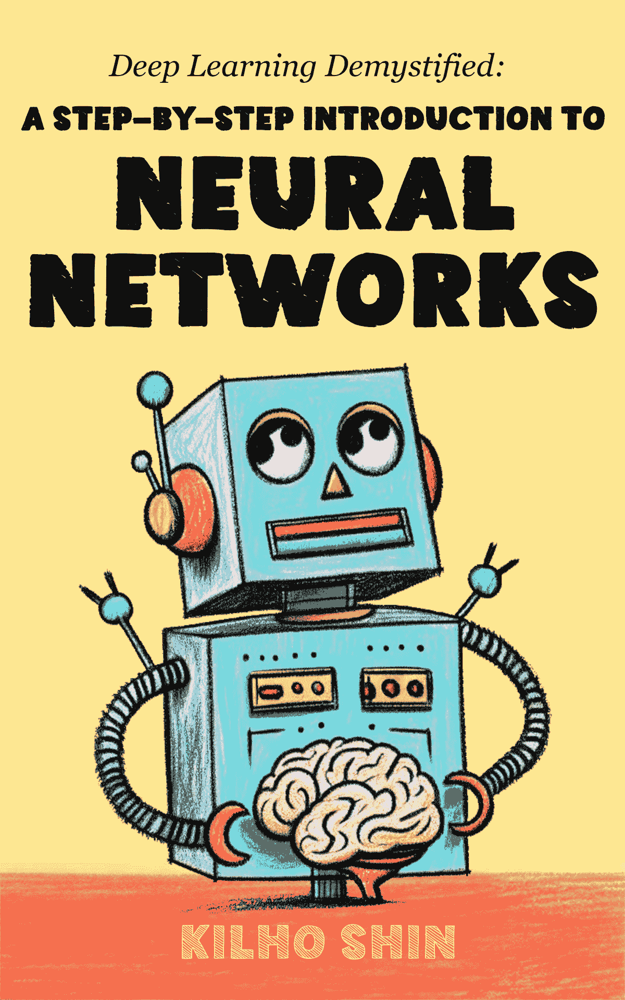


## 作者序言

亲爱的读者：

欢迎阅读《深度学习揭秘：神经网络逐步入门》。我是 Kilho Shin，非常高兴你能与我一起开启这段探索人工智能世界的精彩旅程。

作为一名多年致力于 AI 研究和工作的人，我深知掌握这些复杂概念有多大的挑战。我写这本书的目标是让学习神经网络对每个人都变得触容易、有趣且有回报，无论你的背景如何。

在全书中，我努力将复杂的思想分解为易于操作的步骤，提供实用的示例，并分享我自己的经验见解。无论你是学生、专业人士还是仅仅渴望学习的爱好者，我都希望这本书能为你提供帮助和启发。

请记住，掌握神经网络的关键在于好奇心、坚持和实践。不要害怕实验、提问和寻找额外的资源。AI 领域在不断演进，总有新东西需要学习。

感谢选择这本书作为你的指南。我很高兴能成为你学习旅程的一部分，并期待看到你利用新知识取得的惊成就。

祝学习愉快！

顺颂商祺，

Kilho Shin, 博士

## 本书适合人群

本书适用于任何想要理解神经网络和深度学习基础知识的人。无论你是学生、专业人士还是爱好者，本书都旨在帮助你掌握神经网络的基础概念。如果你对人工智能几乎一无所知，但又渴望学习，这本书将为你提供开启旅程所需的工具和理解。此外，如果你已经具有某些机器学习经验并希望深化对神经网络的了解，本书将提供宝贵的见解和实用知识。

## 关于本书

本书旨在提供对神经网络的逐步介绍，重点是让复杂话题易于理解。它涵盖了人工神经网络背后的基本概念和数学，包括梯度下降和反向传播，并以直观易懂的方式对其进行解释。无论你是 AI 领域的学者还是想要加深理解的人，本书都旨在引导你通过基础阶段，为进一步的学习建立坚实的基础。通过清晰的解释和实践示例，你将学习神经网络如何工作以及如何实现它们，让看似复杂的深度学习世界变得容易且有趣。


长期以来，人类一直梦想着创造能像人一样思考和交流的机器。这种人工智能的愿景几十年来一直是科幻小说的基石，激发了无数故事和想象。智能机器的概念可以追溯到古代神话和传说，但直到 20 世纪中期，人工智能（AI）领域才作为一门科学学科开始成型。

在技术快速进步和对人类大脑功能更深理解的推动下，人工智能梦想正在变为现实。人工智能涵盖了广泛的技术，包括自然语言处理、计算机视觉、机器人等。然而，从核心上看，人工智能极度依赖机器学习（ML）和深度学习。这些技术使计算机能够从数据中学习、识别模式并在人类干预最少的情况下做出决策。

机器学习是人工智能的一个子集，侧重于开发允许计算机从数据中学习并基于数据进行预测的算法。这种方法改变了我们与技术互动的方式，从流媒体服务上的个性化推荐到金融领域复杂的欺诈检测系统。然而，尽管机器学习非常强大，但是深度学习的出现真正将人工智能推了了高度。

深度学习是机器学习的一个专门子集，是一种从海量数据中学习复杂模式和结构的技术。它涉及到使用人工神经网络（ANNs），其旨在模拟人类大脑的结构和功能。这些网络由相互连接的节点（或神经元）层组成，以类似于生物神经元运作的方式处理信息。深度学习模型通过其多层结构，可以捕捉数据中复杂的模式和表示，使其在图像和语音识别、自然语言处理和自动驾驶等任务中异常强大。

深度学习对人工智能的影响是深远的。它在各个领域取得了重大突破，包括医疗保健（其中被用于分析医学图像和预测疾病结果）以及自主系统（其中它帮助导航和决策过程）。深度学习模型从非结构化数据（如图像、文本和音频）中学习的能力，为以前无法想象的人智能应用开启了新的可能性。

要理解深度学习，我们首先需要深入人工神经网络（ANNs）的概念。人工神经网络是深度学习的基础，受人类大脑中神经网络启发的计算机模型。正如人类大脑由数十亿个通过电和化学信号通信的神经元组成，人工神经网络由人工神经元组成，通过数学运算处理和传输信息。

ANN 中的每个神经元接收一个或多个输入，使用激活函数对其进行处理，并产生传递给后续层其他神经元的输出。神经元之间的连接是有权重的，这些权重在学习过程中会调整，以最小化误差并提高模型性能。这一过程被称为`training`（训练），涉及向网络输入大量数据并使用优化算法来精调权重。

ANN 的架构根据应用的不同而显著变化。具有单层神经元的简单网络被称为单层感知器，而具有多层的更复杂的网络被称为多层感知器或深度神经网络（DNNs）。后者能够学习数据的层次结构表示，其中每一层都捕捉越发抽象的特征。

理解 ANN 是理解深度学习的第一步，也是创建人工智能的重要起点。通过研究这些网络如何工作以及它们如何被训练以执行特定任务，我们获得了对驱动现代人工智能系统的运行机制的见解。这些知识允许我们创造人工智能。

## 1.2 人工神经网络的基本概念

人工神经网络（ANNs）是深度学习的基础，受人类大脑中神经网络启发的计算机模型。正如人类大脑由数十亿个通过电和化学信号通信的神经元组成，人工神经网络由人工神经元组成，处理并传输信息。基本单元是简单的，被称为`neuron`（神经元）。

ANN 中的每个神经元接收一个或多个输入，使用激活函数对其进行处理，并产生传递给其他神经元的输出。神经元由三个主要部分组成：`dendrite`（树突）、`soma`（胞体）和`axon`（轴突）。`dendrite`接收来自其他神经元的输入。`soma`处理这些信息，如果信号强度超过阈值，就会触发脉冲。`axon`随后将此脉冲传输给下一个神经元。神经元在名为`synapse`（突触）的连接处相互通信。

人工神经元旨在模拟这些功能。它们接收输入信号，进行计算并产生输出信号。多个人工神经元形成人工网络，可以处理各种输入。

神经网络的基本结构包括`input layer`（输入层）、`hidden layers`（隐藏层）和`output layer`（输出层）。`input layer`接收外界的数据。`hidden layers`处理这些数据，提取重要特征并转换为中间结果。`output layer`将这些中间结果转换为最终输出。

神经元之间的连接由`weights`（权重）表示，学习过程中会调整。学习涉及到使用数据集进行预测，并使用`loss function`（损失函数）衡量预测值与实际值之间的差异。其目标是通过调整`weights`来最小化这种`loss`，通常使用梯度下降等优化算法。通过重复这一过程，神经网络变得越来越准确。

激活函数也是神经网络的关键要素。它们决定了神经元的输出并引入了非线性，使网络能够学习复杂的模式。常见的激活函数包括`sigmoid function`、`hyperbolic tangent function (tanh)`和`ReLU`。每种函数都有其独特的特性，对于特定任务而言，选择正确的函数至关重要。

神经网络应用于多个领域，提供了创新的解决方案。它们被用于图像识别、语音识别、自然语言处理、自动驾驶和医学诊断。例如，在医学领域，神经网络分析 X 射线图像以早期癌症，或通过分析患者历史数据预测疾病进展，辅助医疗专业人员进行诊断和治疗计划。

总之，人工神经网络是模拟人类大脑解决复杂问题的强大工具。理解神经元的结构和功能以及如何设计和训练神经网络是掌握深度学习的基础。神经网络的发展扩展了人工智能的可能性，导致了持续的创新和进步。

第二章


# 神经元与人工神经元

## 2.1 神经元的结构与功能

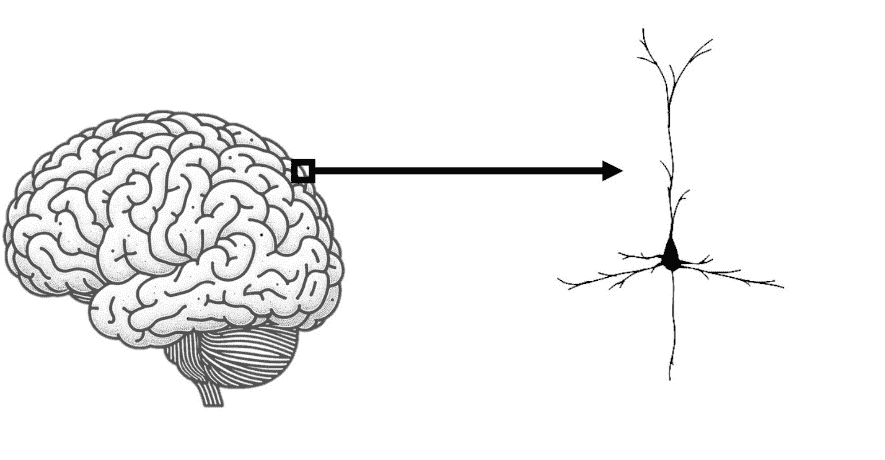

人类大脑由约 1000 亿神经元组成。尽管大脑的结构和功能极其复杂，但构成这个复杂系统的基本单元相对简单。这个基本单元被称为神经元。神经元在接收输入、处理信息和传输输出方面起着至关重要的作用。

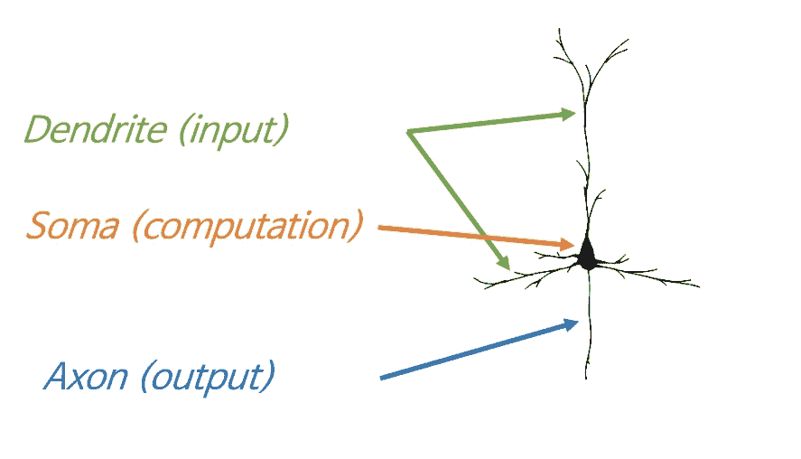

神经元可以分为三个部分：

1.  **树突 (Dendrite)**：树突是神经元的输入部分。它们接收来自其他神经元的信号。树突像树枝一样分支，允许它们与其他许多神经元连接并接收大量信号。
2.  **细胞体 (Soma/Cell Body)**：细胞体是神经元的中心。它处理树突接收到的信号。细胞体整合传入的信号，如果组合信号强度超过特定阈值，就会触发电脉冲。这一过程被称为发放。
3.  **轴突 (Axon)**：轴突是神经元的输出部分。它将处理过的信号从细胞体传输到其他神经元。轴突从细胞体延伸出来，可能很长，到达身体的不同部位。在末端，轴突分支形成与其他神经元树突的连接，这种结构被称为突触。

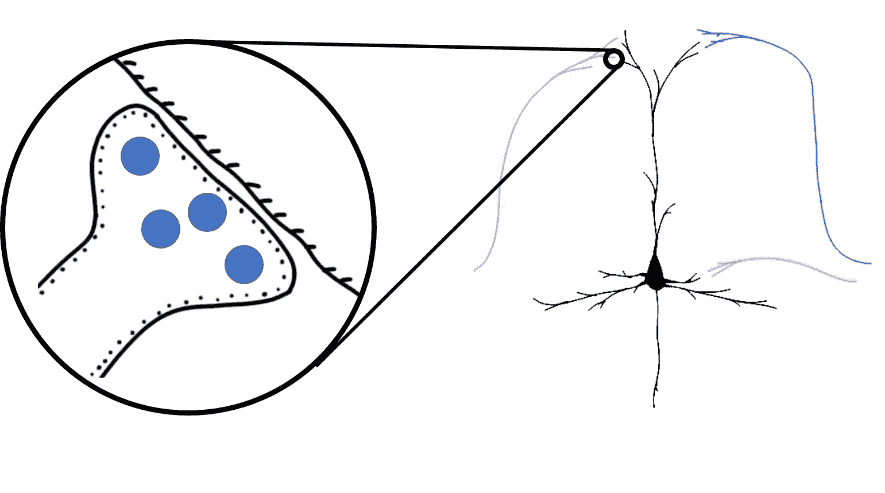

神经元之间的信号传递发生在突触处。突触是一个神经元的轴突末端与另一个神经元的树突相遇的地方。当电脉冲到达轴突末端时，它会触发神经递质的释放，这些化学信使跨越突触间隙与接收神经元树突上的受体结合。这种结合将化学信号转换回接收神经元中的电脉冲，允许信号继续传输。

这种信号传输过程极其快速且精确，使大脑能够处理海量信息并执行广泛的功能。例如，当你触摸热表面时，皮肤中的感觉神经元会将信号发送到大脑，大脑处理这些信息并迅速通过运动神经元将信号发送到肌肉，让你缩手。整个过程几乎瞬间完成，展示了神经元通信卓越的效率和速度。

神经元还能形成复杂的网络。通过学习和经验，神经元之间的连接可以增强或削弱，这种性质被称为突触可塑性。这种改变和适应的能力是学习、记忆和整体大脑功能的基础。它允许大脑存储信息、学习新技能并适应新情况。

总之，神经元尽管结构简单，却是大脑功能中高效且至关重要的组件。它的结构由树突、细胞体和轴突组成，使其能够快速地接收、处理和传输信息。突触在神经元之间的通信中起着关键作用，确保信号在神经网络中准确、快速地传输。这种复杂的神经元协作系统使大脑能够执行复杂的任务，从基础反射到思考、学习和记忆等高级认知功能。

## 2.2 人工神经元的结构与功能

人工神经元是模仿生物神经元信息处理的计算机模型。人工神经元接收输入，基于这些输入进行计算并生成输出。当多个人工神经元结合时，它们就形成了人工神经网络（ANN），它可以处理各种输入数据并从中学习。

为了理解人工神经元如何工作，让我们来看一个简单的例子。人工神经元接收输入并根据权重计算输出。当输出与实际值不符时，会调整权重以最小化误差。重复这一过程，直到网络对给输入产生正确的输出。

## 2.3 感知器

感知器是基于 1943 年 McCulloch 和 Pitts 的工作的神经网络模型。它由 Rosenblatt 于 1958 年实现。感知器是人工神经元的一种简单形式，通过对加权输入求和并将结果通过激活函数来计算输出。

## 2.4 总结

神经元是人类大脑的基本单元，由树突、细胞体和轴突组成。神经元通过突触进行通信，这种信息处理机制被人工神经元模仿。人工神经元根据输入和权重生成输出。感知器是深度学习的基础。

# 第 3 章：感知器学习算法

## 3.1 人工神经网络的学习过程

感知器学习算法虽然相对简单，但它是深度学习模型中学习算法的基础。

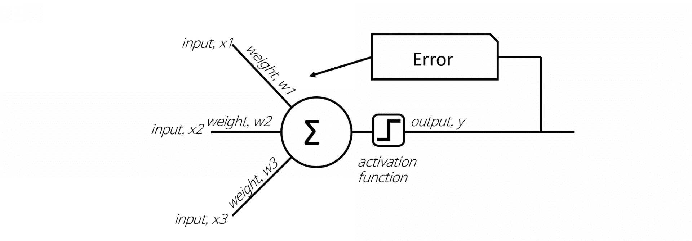

学习涉及调整权重以产生所需的输出。当神经网络的输出与实际值不符时，这种差异被称为误差。为了最小化误差，会相应地调整权重。感知器的学习过程包括以下步骤：

1.  **初始化**：用随机值初始化权重。
2.  **输出计算**：使用输入值和初始权重计算输出。
3.  **误差计算**：通过寻找输出与实际值（真实标签）之间的差异来计算误差。
4.  **权重更新**：使用以下公式调整权重以最小化误差：

```
weight = weight + learning_rate * error * input
```


5. 重复：重复上述步骤，直到误差足够小且权重得到优化。

通过遵循这些步骤，感知机会调整其权重以对给输入产生正确的输出，从而从数据中学习。

## 3.2 学习算法示例

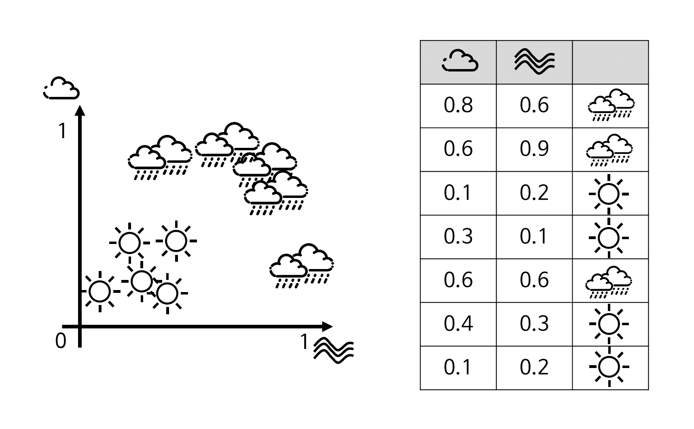

让我们通过一个天气预测问题来探索感知机学习算法。假设如果早上没有云且风力很弱，那天就是晴天。相反，如果云层多且风力大，就会下雨。我们将云量和风力表示在 0 到 1 之间的范围内。我们将使用一个记录了每天风力、云量和天气状况的数据集。我们的任务是创建一个感知机，根据风力和云量来预测是晴天还是下雨。

考虑一个具有两个输入的感知机：云量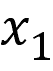和风力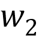。

假设输入为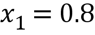云量和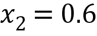风力，初始权重为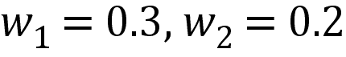。感知机的输出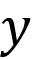计算如下：

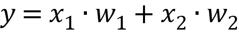(image_rsrc30Z.jpg)(image_rsrc310.jpg)

输出为 `0.3`，没有超过 `0.5` 的阈值，因此输出为 `0`（表示晴天）。但如果实际天气标签为 `1`（表示下雨天），误差计算如下：

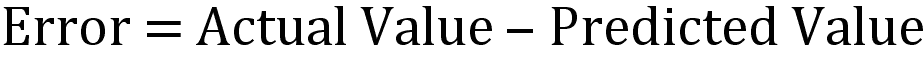(image_rsrc313.jpg)(image_rsrc314.jpg)

根据此误差更新权重。假设学习率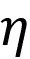为 `0.01`，权重更新如下：

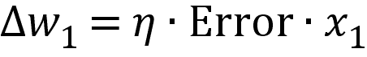(image_rsrc316.jpg)(image_rsrc317.jpg)(image_rsrc318.jpg)(image_rsrc31A.jpg)

同样，我们更新[](image_rsrc31B.jpg)(image_rsrc31C.jpg)(image_rsrc31D.jpg)(image_rsrc31E.jpg)(image_rsrc31F.jpg)(image_rsrc31G.jpg)

重复此过程直到误差足够小且权重得到优化。

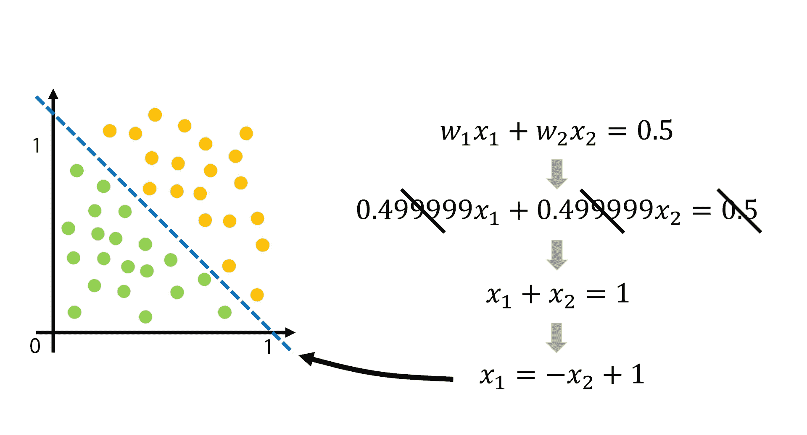

对所有数据重复此学习过程，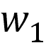将接近 `0.5`，也会接近 `0.5`。通过这种方式，感知机通过训练过程对给定输入产生正确的输出。

## 3.3 带注释的 Python 简单感知机示例

```python
import numpy as np
import matplotlib.pyplot as plt
from matplotlib.animation import FuncAnimation

### 二分类的阶跃函数
def step_function(x, threshold):
    return 1 if x >= threshold else 0

### 生成训练数据
def gen_training_data(data_points):
    x1 = np.random.random(data_points)
    x2 = np.random.random(data_points)
    y = ((x1 + x2) > 1).astype(int)  # x1 + x2 = 1 以上的点标记为 1，其余为 0
    return [((x1[i], x2[i]), y[i]) for i in range(len(x1))]

### 带动画的感知机训练函数
def perceptron_animation(data_points=100, epochs=10, learning_rate=0.1, threshold=0.5):
    global w
    w = np.array([0.3, 0.9])  # 初始权重
    training_set = gen_training_data(data_points)
    fig, ax = plt.subplots()
    plt.ylim((-0.1, 1.1))
    plt.xlim((-0.1, 1.1))
    ax.set_aspect('equal', adjustable='box')
    xx = np.linspace(0, 1, 50)
    # 绘制训练数据点
    for x, y in training_set:
        if y == 1:
            ax.plot(x[0], x[1], 'bo')  # 类 1
        else:
            ax.plot(x[0], x[1], 'go')  # 类 0

    def update(epoch):
        global w
        for x, y in training_set:
            u = np.dot(w, x)
            output = step_function(u, threshold)
            error = y - output
            w += learning_rate * error * x
        ax.clear()
        for x, y in training_set:
            if y == 1:
                ax.plot(x[0], x[1], 'bo')
            else:
                ax.plot(x[0], x[1], 'go')
        
        line_data = np.array([xx, (1 - w[0] * xx) / w[1]])
        ax.plot(line_data[0], line_data[1], 'r-')
        ax.ylim(-0.1, 1.1)
        ax.xlim(-0.1, 1.1)

    ani = FuncAnimation(fig, update, frames=epochs, interval=500)
    plt.show()

### 主函数
if __name__ == '__main__':
    perceptron_animation()
```

## 3.4 总结

感知机学习算法解释了如何调整神经网络中的权重（连接强度）以获得期望输出。该过程包括权重初始化、输出计算、误差计算和权重更新，这些步骤是重复的。感知机是深度学习的基础，并在解决复杂问题中起着重要作用。

# 4 感知机的局限性与神经网络

在之前的讨论中，我们探索了感知机的结构和功能。虽然感知机在预测天气方面表现良好，但也存在明显的局限性。在本章中，我们将探讨这些局限性并。

## 4.1 作为线性分类器的感知机

感知机是一种线性分类器，意味着它对于直线（高维空间中的平面）分割的数据有效。这对于可以线性分为两类的数据非常有用。

在第 3 章中，我们学习了根据绘制在二维平面上的云量和风力来分类晴天或下雨的感知机。


即使感知器的维度增加，推导结果的方法也保持不变。它对加权输入进行求和并产生一个输出。这个过程可以用数学公式表示如下：

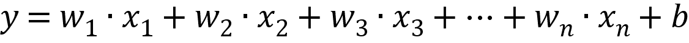

在这里，`image_rsrc31R.jpg` 是每个输入 `image_rsrc31S.jpg` 的权重，`image_rsrc31T.jpg` 是偏置（尽管为了简单，我们在之前的示例中省略了偏置，但在实际神经网络中是包含了它的）。输出 `image_rsrc30D.jpg` 在通过激活函数后确定，感知机通常使用阶跃函数。阶跃函数在输入值超过某个阈值时输出 1，否则输出 0。

## 4.2 多层神经网络的兴起

尽管具有这些特性，感知机仍然有明显的局限性。它无法解决数据线性不可分的问题，例如 XOR（异或）问题。XOR 问题是一个经典例子，当输入不同时输出为 1，相同时输出为 0，单层感知机无法解决这类问题。

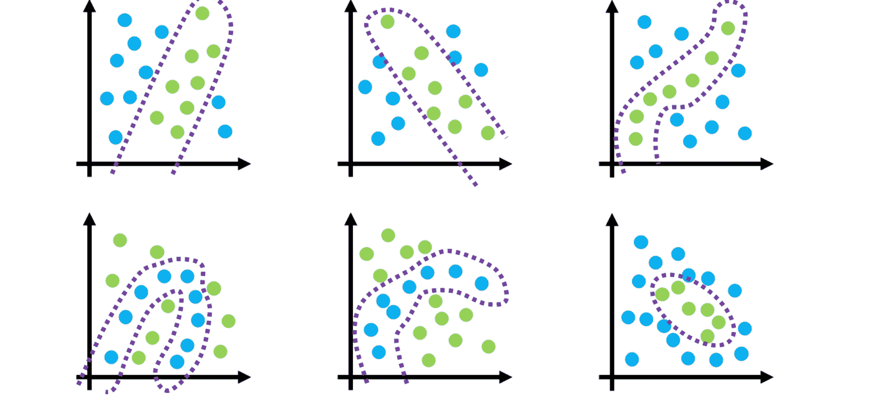

感知机的局限性不仅于此。它只能处理线性可分的数据，但许多现实世界的问题涉及非线性数据模式。因此，仅凭感知机不足以解决复杂问题。

1969 年，心理学家马文·明斯基（Marvin Minsky）和西摩尔·帕珀特（Seymour Papert）在他们的《感知机》一书中通过数学证明，虽然感知机可以解决 AND、OR 和 NOR 门，但无法解决 XOR 门。这导致神经网络研究在 20 世纪 70 年代衰落。

然而，一些研究人员相信神经网络的潜力并继续他们的工作。著名人物包括大卫·鲁梅哈特（David Rumelhart）、杰弗里·辛顿（Geoffrey Hinton）和罗纳德·威廉姆斯（Ronald Williams）。他们的研究导致了多层神经网络的发展，标志着神经网络研究的转折点。

## 4.3 多层神经网络的结构

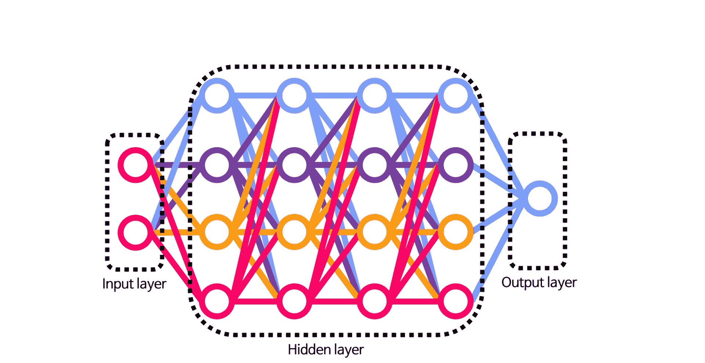

多层神经网络由输入层、一个或多个隐藏层和一个输出层组成。隐藏层越多，网络能够处理的数据就越复杂。多层网络可以解决无法线性分离的问题，这是深度学习的基本概念。更多的层使得网络更深，因此被称为“深度学习”。

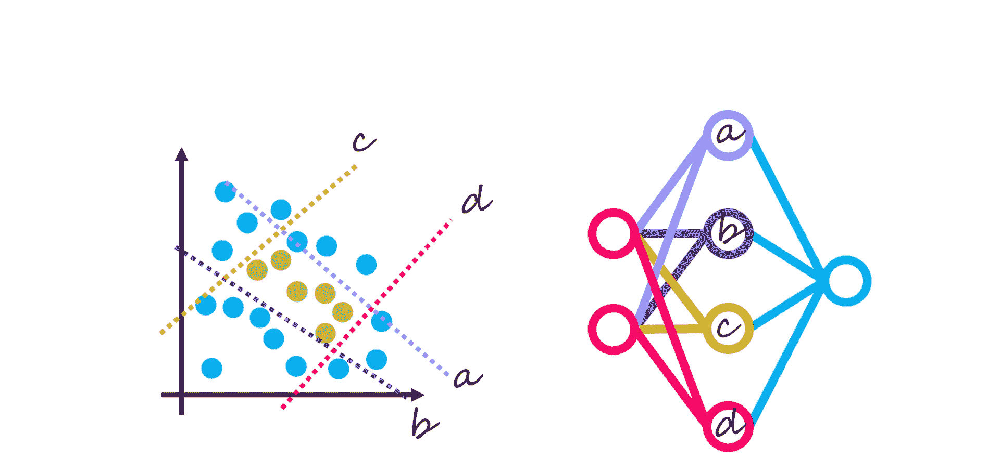

直观地说，虽然一条线不能对某些数据集进行分类，但多条线可以。通过连接多个感知器并添加更多层，多层神经网络可以处理非线性问题。每一层从输入数据中提取不同的特征，这些特征组合在一起形成最终输出。

因此，多层神经网络的核心思想是使用多个层逐渐变换输入数据，并通过隐藏层引入非线性，从而允许网络学习复杂模式。每个隐藏层从输入数据中提取特定特征，这些特征组合起来产生最终输出。

例如，在识别手写数字时，第一隐藏层可能会提取基础的线条和曲线，第二层可能会将这些组合形成形状，最后层识别数字。多层神经网络通过反向传播进行学习，通过调整权重来最小化预测输出与实际输出之间的误差，从而能够解决复杂问题。

## 4.4 总结

感知机作为线性分类器非常有用，但在处理 XOR 问题等非线性问题时存在局限性。为了克服这些局限性，开发了多层神经网络，它由输入层、隐藏层和输出层组成。这些网络通过多层变换输入数据，引入非线性以学习复杂模式。例如，在手写数字识别中，不同的层提取不同层次的特征，从而实现准确的数字识别。多层神经网络的学习通过反向传播实现，通过调整权重来最小化预测误差，使其能够解决复杂问题。

# 第 5 章

## 激活函数

## 5.1 阶跃函数的局限性

在上一章中，我们引入了阶跃函数作为激活函数。阶跃函数在输入低于某个阈值时输出 0，在超过该阈值时输出 1，使其成为非线性函数。然而，这个函数有一个致命的缺点：它没有提供衡量误差程度的方法。

感知器通过接收输入值工作，如果这些值超过某个阈值，感知器就会触发。阶跃函数通过在输入和超过 0.5 时输出 1，否则输出 0，提供了一种简单的非线性形式。虽然这种简单有助于理解感知机的基本概念，但在学习过程中会产生几个问题。

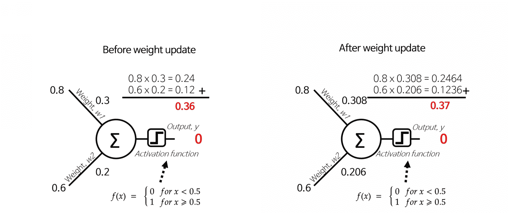

让我们讨论一下章中的一个例子。当一个内部值为 0.36 的感知器使用阶跃函数时，输出为 0。在更新权重并使用相同的输入值后，内部值变为 0.37，更接近 0.5 的阈值了。然而，由于阶跃函数的特性，所有低于阈值的值都会产生输出 0。因此，无论内部值是 0.36 还是 0.37，输出仍然是 0。

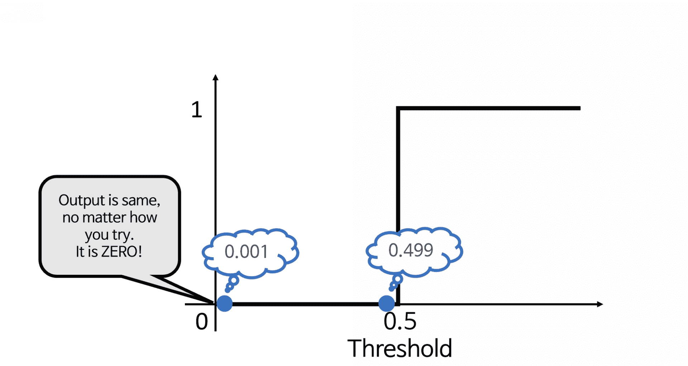

在更极端的情况下，像 0.001 或 0.4999 这样的内部值仍导致输出为 0。显然，0.4999 比 0.001 是一个更好的预测值，但这种差异被忽略了，两者都被视为等同的错误，误差为 1。

## 5.2 Sigmoid 函数

让我们先看看 Sigmoid 函数。

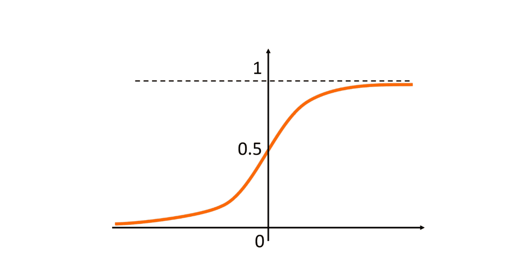

Sigmoid 函数具有 S 形曲线，比阶跃函数更平滑。Sigmoid 函数的数学公式为：

```
image_rsrc320.jpg
```

Sigmoid 函数的一个主要优势是它可以表示内部值的差异，而阶跃函数则不能。Sigmoid 根据输入值输出 0 到 1 之间的值。与阶跃函数的二值输出相比，这种范围允许更精细的误差计算。

Sigmoid 函数还可以将神经网络的内部值转换为概率。例如，如果输出值为 0.8，可以解释为网络预测某一类的概率为 80%。此外，Sigmoid 函数归一化了输入值，确保每个节点的输出落在 0 到 1 之间。这有助于稳定神经网络并在学习过程中辅助收敛。

### 梯度消失问题

Sigmoid 函数确实比阶跃函数有所改进，但它也有一些明显的缺点。最主要的问题是函数曲线两端的梯度（斜率）趋于 0。这是 Sigmoid 激活函数的主要缺点之一。但为什么在极端情况下梯度接近零会有问题呢？

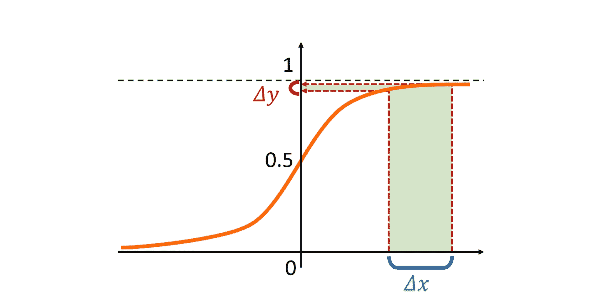

原因是正如这里所示，即使输入值发生了巨大变化，输出值之间的差异也微乎其微。这与阶跃函数出现的问题类似。对于阶跃函数，无论输入是 0.499 还是 0.001，输出都是 0。换句话说，阶跃函数的问题在于输入值的差异没有有效地反映在输出中。不幸的是，Sigmoid 函数在它的极端也表现出这种问题。

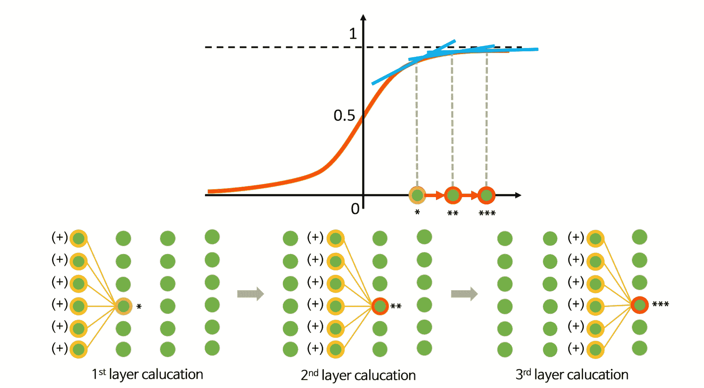


这个问题很容易出现在使用 `sigmoid` 函数作为激活函数的深度学习模型中。如图所示，神经网络的上层是下层的加权之和。由于 `sigmoid` 的输出始终为正数，如果神经网络中的权重是正数，那么上层节点的输入值自然将是正数（正数之和为正数）。在这种情况下，随着层数的增加，输入值倾向于变得越大。人们可能会认为，通过适当平衡正负权重使其平均值为零就可以解决这个问题，但即使权重的平均值为零，节点输出的加权之和也不一定为零。即使结果为零，`sigmoid` 函数也会将输出推回 `0.5`。因此，随着层数的增加，神经元的输出值倾向于变得越大。神经元的输出值越大，`sigmoid` 函数的导数就越接近零。正如反向传播章节中将详细介绍的，当 `sigmoid` 函数的梯度接近零时，反向传播学习的效果就会趋于零。当这种情况发生时，神经网络的学习将变得失效，随着网络的加深和模型的增长，会出现一种模型性能反而下降的讽刺现象。这被称为梯度消失问题。

### 非零中心化问题

第二个问题是 `sigmoid` 的输出始终为正（+）。这被称为非零中心化问题。为什么 `sigmoid` 的输出始终为正是一个问题呢？让我们来看感知器的学习规则。

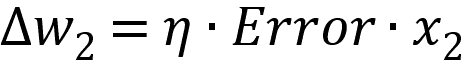

在这里，如果我们假设输入值 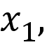 和 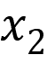 是上一层的输出值，那么这两个值的符号都是正数。因此，如果误差为正，权重 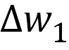 和 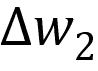 的变化都将为正；如果误差为负，权重  和  的变化都将为负。

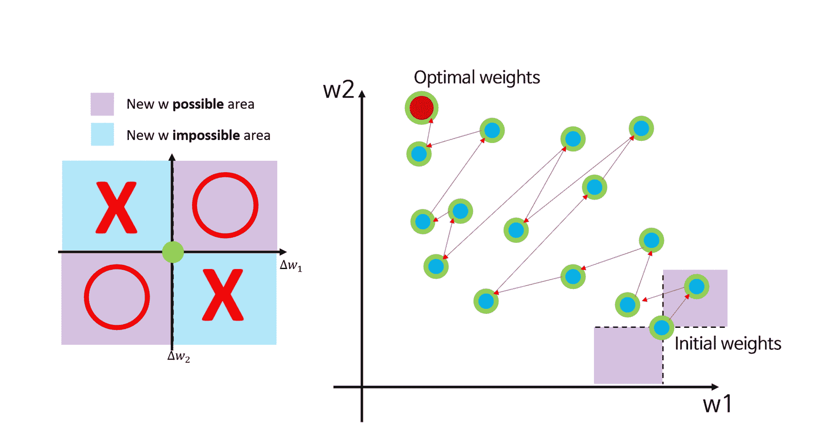

在这种情况下，新的  和  只能在第一或第三象限内移动。这意味着权重学习图将呈现出锯字形模式。如果通过学习需要实现的最优连接权重位于如下所示的左上方，那么  和  的值逐渐向左上移动是最理想的。然而，由于在学习过程中  和  只能在第一或第三象限内移动，连接权重的学习过程呈现出如下的锯字形。锯字形意味着学习过程是无效的。换句话之，使用 `sigmoid` 函数学习有时具有这种低效的特征。

因此，随着神经网络学习理论的发展，开发出了其他几种激活函数来克服上述 `sigmoid` 激活函数的缺点。

## 5.3 双曲正切函数 (tanh 函数)

双曲正切函数（`tanh` 函数）是一种保留了 `sigmoid` 函数优点同时克服了其缺点的激活函数。该函数也具有类似于 `sigmoid` 函数的 S 形，但它返回的是 -1 到 1 之间的值。

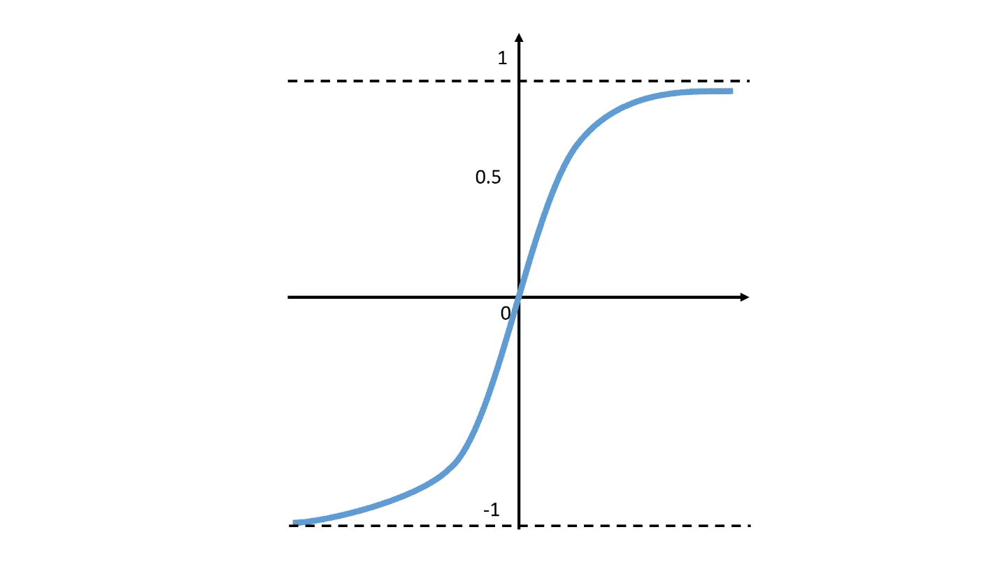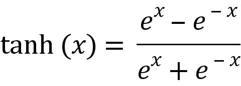

`tanh` 函数与 `sigmoid` 函数不同，它的输出值在 -1 到 1 之间，解决了非零中心化问题。该函数在保持 `sigmoid` 函数优点的同时，在学习过程中提供了更稳定的输出。此外，由于输出值之间的差异较大，`tanh` 函数提供了更快、更准确的学习效率。

然而，`tanh` 函数在深度神经网络中仍然可能遇到梯度消失问题，因为梯度在极值处仍然可能接近零。

## 5.4 ReLU 激活函数

显著解决梯度消失问题的激活函数是 `ReLU`（修正线性线性单元）激活函数。`ReLU` 函数在输入值大于 0 时输出该输入值，对于任何小于或等于 0 的输入值则返回 0。

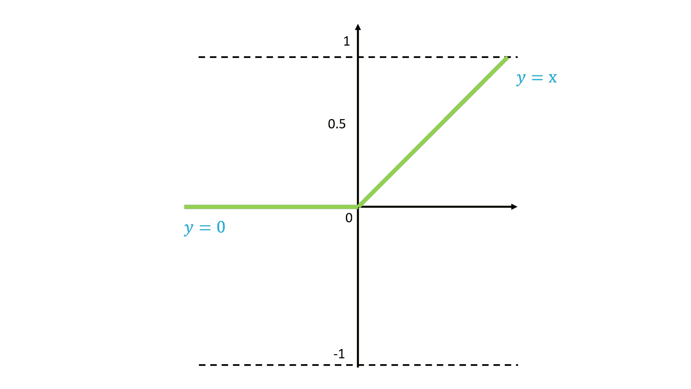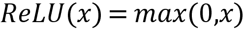

`ReLU` 函数解决了梯度消失问题，因此被广泛用作现代深度学习模型的默认激活函数。在正数区域，它的梯度始终为 1，防止了梯度消失，并允许反向传播有效通过网络的深层。

### Dying ReLU 问题

然而，`ReLU` 函数也有它的缺点。当输入为负数时，梯度变为 0，导致“死亡 ReLU”（Dying ReLU）问题，即神经元完全停止学习。为了缓解这一问题，开发了多种 `ReLU` 的变体。

## 5.5 Leaky ReLU (带修正线性单元)

`Leaky ReLU` 是 `ReLU` 函数的一种变体，它为负输入值分配一个小的梯度，允许网络即使在负数区域也能学习。这有助于缓解“死亡 ReLU”问题。

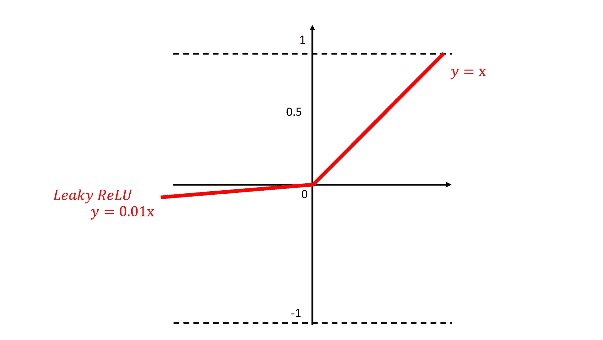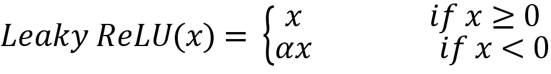

在这里 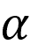 是一个小的常数，通常设置为 0.01 或 0.02。这为负输入提供了极小的梯度，防止了梯度的完全消失。

### 工作原理

`Leaky ReLU` 的工作原理如下：

*   当输入  大于或等于 0 时，它输出输入值。
*   当输入  小于 0 时，它输出该输入值。

### 优点

*   **缓解死亡 ReLU 问题**：`ReLU` 函数在输入为负时输出 0，导致学习停止。`Leaky ReLU` 在负区域提供小的梯度，缓解了这一问题。
*   **保持非线性**：与 `ReLU` 一样，`Leaky ReLU` 保持了非线性，使网络能够学习。
*   **简单**：`Leaky ReLU` 实现简单且计算开销小。

### 缺点

*   **α 值的选择**：虽然  通常设置为 0.01 或 0.02，但根据数据集寻找最优值可能需要实验。
*   **梯度爆炸问题**：`Leaky ReLU` 并没有完全解决梯度爆炸问题，这种问题仍然发生，特别是在深度神经网络中。


## 5.6 PReLU

- **自适应斜率**：与 `Leaky ReLU` 不同，`PReLU` 在训练过程中优化负区域的斜率 ，使其对不同的数据集更有适应性。
- **更好的性能**：`PReLU` 通常表现出更好的性能，因为它根据数据调整斜率，而不是使用固定斜率。

### 缺点

- **增加复杂度**：与 `Leaky ReLU` 相比，`PReLU`增加了模型的复杂度，因为它需要学习额外的参数 。
- **额外的计算开销**：与 `Leaky ReLU` 相比，引入可学习参数会略微增加开销。

## 5.7 ELU (指数线性单元)

`ELU` (Exponential Linear Unit) 是 `ReLU` 的另一种变体。它使用指数函数处理负输入值，以促进更快速、更准确的学习。`ELU` 使用指数函数在负区域计算输出值 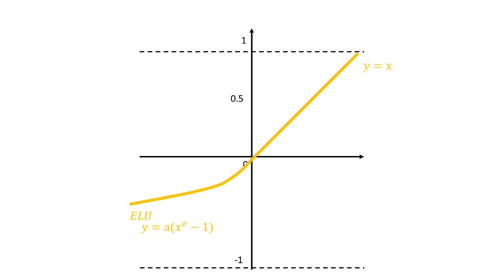。

`ELU` 的公式如下：

```
image_rsrc32M.jpg
```

在这里，`α`  是正常数，通常设为 1。

### 工作原理

`ELU` 的工作如下：
- 如果输入 `image_rsrc32T.jpg` 大于或等于 0，则输出 `image_rsrc32T.jpg`。
- 如果输入 `image_rsrc32T.jpg` 小于 0，则输出 `image_rsrc32N.jpg`。

在这里，`α`  调整负值的曲线斜率。

### 优点

- **缓解 Dying ReLU**：`ELU` 为负值提供了较小的梯度，有助于缓解“Dying ReLU”问题。
- **保持平均输出接近 0**：`ELU` 保持平均输出接近 0，提高了神经网络的学习速度。
- **速度与准确性**：指数函数的使用实现了更快速、更准确的学习。

### 缺点

- **额外的计算开销**：`ELU` 使用指数函数，与 `ReLU` 或 `Leaky ReLU` 相比，其计算成本更高。
- **超参数调整**：`α` 的值  会影响模型性能，并可能需要调整以适应数据集。

## 5.8 总结

激活函数对于神经网络的效率和性能至关重要。`sigmoid`、`tanh` 和 `ReLU` 各有优劣，在特定情况下选择合适的激活函数是非常重要的。`sigmoid` 提供了简单的非线性，但面临梯度消失和非零中心化问题。`tanh` 解决了非零中心问题，但仍遇到消失问题。`ReLU` 解决了梯度消失问题，但存在 Dying ReLU 问题。为了解决这些问题，开发了如 `Leaky ReLU`、`PReLU` 和 `ELU` 等变体。

总之，激活函数有很多，每种都是为了解决特定问题而设计的。没有完美的激活函数，因此理解每种特性并将其适当应用于给定的上下文至关重要。随着新激活函数的不断出现，我们可以提高神经网络的性能。

# 6 梯度下降

## 6.1 梯度下降的定义

梯度下降是机器学习和深度学习中的优化算法，用于在给定损失函数的情况下寻找模型参数的最优值。

```
image_rsrc32R.jpg
```

损失函数是神经网络学习过程中的一个关键概念。它衡量了模型预测值与真实值之间的差异。损失函数的概念很简单；例如，它类似于之前视频中讨论的误差。神经网络的学习过程涉及通过反复调整所有参数来减少误差，以找到最小误差。

## 6.2 MSE (均方误差)

一种代表性的损失函数是均方误差 (`MSE`)。公式如下：

```
image_rsrc32S.jpg
```

在这里，`image_rsrc32T.jpg` 是真实值，`image_rsrc32U.jpg` 是预测值，`image_rsrc32M.jpg` 是数据点的数量。`MSE` 计算每个数据点预测值与真实值之间差平方的平均值。

### 示例数据

真实值 `image_rsrc30D.jpg`: `[3, -0.5, 2, 7]`
预测值 `image_rsrc32V.jpg`: `[2.5, 0.0, 2, 8]`

### MSE 计算步骤

1. 计算每个真实值与预测值之间的差。
2. 平方每个差。
3. 将所有差平方求和。
4. 将总和除以数据点的数量以得到平均值。

### 逐步计算

1. 计算差：`image_rsrc32W.jpg`，`image_rsrc32X.jpg`，`image_rsrc32Y.jpg`，`image_rsrc32Z.jpg`。
2. 平方差：`image_rsrc330.jpg`，`image_rsrc331.jpg`，`image_rsrc332.jpg`，`image_rsrc333.jpg`。
3. 平方和：`image_rsrc334.jpg`。
4. 计算平均值：`image_rsrc335.jpg`，`image_rsrc336.jpg`。

因此，给定示例数据的 `MSE` 为 0.75。

### MAE (平均绝对误差)

除了 `MSE` 之外，还有平均绝对误差 (`MAE`)。`MAE` 使用绝对值而不是平方来处理误差。公式如下：

```
image_rsrc33.
```

使用绝对值的原因是平方会扭曲误差。

### 示例数据

真实值 `image_rsrc30D.jpg`: `[3, -0.5, 2, 7]`
预测值 `image_rsrc32V.jpg`: `[2.5, 0.0, 2, 8]`

### MAE 计算步骤

1. 计算每个真实值与预测值之间的绝对差。
2. 将所有绝对差求和。
3. 将总和除以数据点的数量以得到平均值。

### 逐步计算

1. 计算绝对差：`image_rsrc338.jpg`，`image_rsrc339.jpg`，`image_rsrc33A.jpg`，`image_rsrc33B.jpg`。
2. 绝对差和：`image_rsrc33C.jpg`。
3. 计算平均值：`image_rsrc335.jpg`，`image_rsrc33D.jpg`。

因此，给定示例数据的 `MAE` 为 0.5。

### 交叉熵 (Cross Entropy)

另一种重要的损失函数是交叉熵。公式如下：

```
image_rsrc33E.jpg
```

交叉熵是深度学习中常用的损失函数，以其快速学习的优势可用。

### 示例数据

真实值 `image_rsrc30D.jpg`: `[1, 0, 1, 0]`
预测值 `image_rsrc32V.jpg`: `[0.9, 0.1, 0.8, 0.4]`

### MAE 计算步骤

1. 对每对真实值和预测值应用交叉熵公式。
2. 将所有的单独熵求和。
3. 将总和除以数据点的数量以得到平均值。

### 逐步计算

1. 计算每对的交叉熵：`image_rsrc33F.jpg`，`image_rsrc33G.jpg`，`image_rsrc33H.jpg`，`image_rsrc33J.jpg`，`image_rsrc33K.jpg`，`image_rsrc33M.jpg`，`image_rsrc33N.jpg`，`image_rsrc33P.jpg`。
2. 熵和：`image_rsrc33R.jpg`。
3. 计算平均值：`image_rsrc335.jpg`，`image_rsrc33S.jpg`。

因此，给定示例数据的交叉熵损失为 0.2362。


然后，损失函数变成了一个熟悉的二次函数公式。此外，误差最小的点可以一眼识别出来。虽然肉眼可以瞬间发现误差最小的点，遗憾的是，机器无法做到这一点。然而，有一个关键事实需要注意：误差最小的点始终是切线斜率为零的地方。

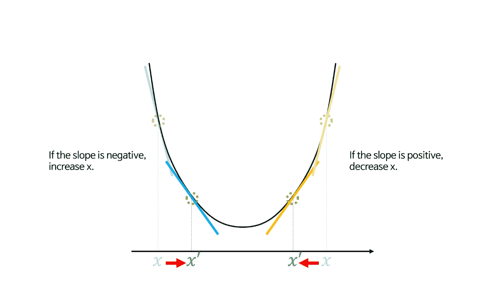

因此，梯度下降通过计算某点 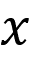 处的梯度来工作，如果梯度为负，则增加 ，如果梯度为正，则减小 。梯度越大，变化越大；梯度越接近 0，变化越小。这种方法逐渐找到梯度趋于 0 的点。当  达到该点时，误差达到最小。

### 数学表达式

根据泰勒展开（Taylor approximation）:

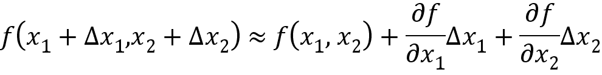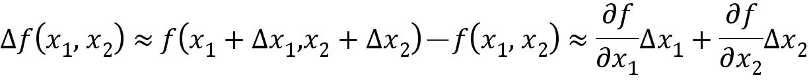

因此，对于损失函数 (C) 和权重 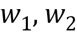:

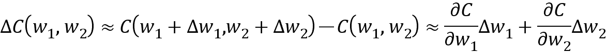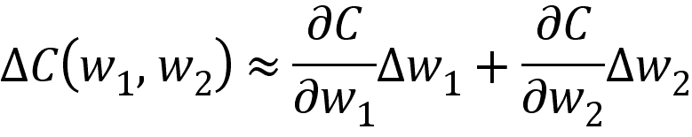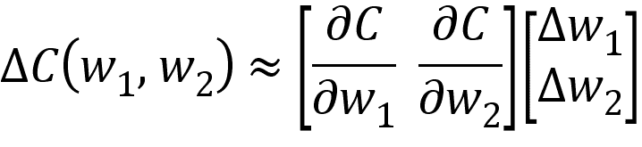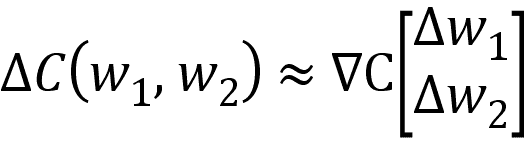

为了最大化 ，即最大化损失的变化，或者换句话说，尽可能快地下降到最小点，


权重的变化必须等于梯度。因此，梯度下降的数学表达式如下：


其中  代表权重， 是学习率， 是损失函数的梯度。image_rsrc349.jpg) 代表给定点处的梯度，image_rsrc34A.jpg) 的计算方式为 ，意味着它的量级与梯度相同但方向相反。

因此，通过权重相对于损失函数的变化来重写梯度下降，我们可以用熟悉的梯度下降公式将其表示如下：


我们将在下一章结合反向传播算法探索梯度下降的具体示例。

## 6.4 总结

梯度下降是机器学习和深度学习中常用的一种优化算法，通过最小化损失函数来寻找模型的优化参数。损失函数衡量模型预测值与真实值之间的差异，常见的示例有 MSE、MAE 和交叉熵。梯度下降的工作是计算损失函数的梯度并迭代更新参数，以向梯度为 0 点（即最小值）移动。在数学上，这涉及到在梯度为负时增加参数，在梯度为正时减少参数。此过程不断重复直到损失函数最小化，从而增强深度学习模型的性能。

# 第 7 章：反向传播算法

## 7.1 反向传播算法背景

从 20 世纪 60 年代到 80 年初，神经网络的研究集中在单层感知机等浅层网络。然而，在反向传播算法开发之前，训练深度网络（如多层感知机）是一项挑战性问题。1986 年，研究人员 David E. Rumelhart、Geoffrey E. Hinton 和 Ronald J. Williams 介绍了反向传播算法。这一突破使得深度网络的训练成为可能，并且仍然是深度学习中最广泛使用的算法之一。

## 7.2 反向传播算法的必要性

为了理解反向传播算法的必要性，让我们考虑 MNIST 数据集。MNIST 由 70,000 张手写数字图像组成，每张 28x28 像素，导致每张图像有 784 个数据点。假设我们想构建如下结构的神经网络来识别这些数字：


* 输入层：784 个神经元
* 隐藏层：100 个神经元
* 输出层：10 个神经元

在这种情况下，连接权重的数量将为 79,400，偏置的数量为 110（隐藏层 100 个 + 输出层 10 个）。为了计算一张图像的损失，我们需要对权重进行 79,400 次操作。更新一个参数需要 7,640,000 次操作，由于我们需要单独更新每个参数，总操作次数将达到 80 万亿次。假设 CPU 的处理速度为每秒 8.5 亿次操作（基于 i7），更新一次 3 层神经网络的权重需要 23 小时。鉴于寻找优化权重需要数百或数千次迭代，显然，如果没有反向传播算法，现代深度学习和人工智能时代永远不会可能。

## 7.3 反向传播

让我们深入研究反向传播算法。为了掌握核心概念，让我们考虑一个简单的多层神经网络。假设我们有如下结构的神经网络：


让我们考虑如下结构的简单多层神经网络：

* 输入层：2 个神经元
* 隐藏层：2 个神经元
* 输出层：1 个神经元
* 输入值： 和 
* 隐藏层权重：第一个神经元使用 , ，第二个神经元使用 , 
* 输出层权重：, 

我们将使用 `sigmoid` 函数作为激活函数，使用均方误差（`MSE`）作为损失函数。我们将随机初始化所有权重并将学习率设置为 `0.1`。现在我们准备好开始了。

使用反向传播训练神经网络可以分为三个主要步骤。重复步骤 1 到 3 以找到优化参数的过程被称为训练或优化过程。

### 反向传播的步骤

### 步骤 1：前向传播 (Forward Pass)


前向传播非常直观。给定输入值，过程如下：


将输入值乘以连接权重  和  并求和，得到隐藏层节点 。


同样，将输入值乘以连接权重  和  并求和，得到隐藏层节点 。


接下来，隐藏层节点通过激活函数。


接下来，连接权重  和  的乘积求和并传递给输出层神经元 。


最后对输出层应用 `sigmoid` 函数计算最终输出。这完成了前向传播。

### 步骤 2：损失计算

为了计算损失，我们使用 `MSE` 公式：


由于我们只有一个输出神经元，通过将  设置为 1 来简化公式。


我们代入预测值  和真实值  来计算误差 。


得到的误差  为 0.125。

### 步骤 3：反向传播

首先，使用反向传播更新权重 。在上一章中，我们查看了梯度下降的权重更新公式。对于 ，如下：


因此，为了更新 ，我们需要计算导数 。然而，由于无法直接找到 ，我们使用名为链式法则（Chain Rule）的技巧。


链式法则是反向传播算法的关键。当我们我们需要找到两个变量之间的导数但不知道它们之间的直接关系时，我们可以通过已知的导数逐步扩展。通过解决每个部分，我们最终可以解决整个问题。


因为通过顺序消除每个变量，我们留下了我们需要寻找的关系。链式法则的数学证明可能相当挑战性，但理解链式法则的概念并不困难。

例如，让我们考虑以下问题：

“猎豹的速度是狮子的两倍，狮子的速度是熊的两倍，而熊的速度是人类的 1.5 倍。猎豹的速度比人类快几倍？”

[](image_rsrc352.jpg)[](image_rsrc353.jpg)[](image_rsrc354.jpg)[](image_rsrc355.jpg)[](image_rsrc356.jpg)

然后我们可以得出结论：猎豹的速度是人类的 6 倍。

这说明了链式法则的概念。利用链式法则的这一属性，我们可以将权重的变化  和损失的变化分解成部分并进行计算。这是反向传播算法的核心思想。

让我们逐步计算每个部分。首先，我们将找到 / 。


对该方程关于 \= -0.71。

[](image_rsrc35E.jpg)

现在，下一步是计算 。在正向传播过程中，我们使用了以下 sigmoid 函数。sigmoid 函数的数学公式如下。


在我们的情况下，我们可以使用  和  来表示它。通过这样替换变量并跳过复杂的求导过程，sigmoid 函数对 [](image_rsrc35M.jpg)

然后，由于 

接下来，让我们计算第三项 


接下来，第三项 ，对 。

[](image_rsrc35W.jpg)

由于 。

[](image_rsrc35X.jpg)

然后，根据梯度下降算法的权重更新公式，


我们将 -0.1 代入梯度，0.55 代入当前权重，并将学习率设置为 0.1，如下所示：

[](image_rsrc360.jpg)

那么 

然而，部分 

第三项同样使用以下公式计算：

[](image_rsrc35U.jpg)[](image_rsrc365.jpg)

我们发现 。代入所有值，我们可以计算：


\= -0.095。

因此，根据梯度下降的权重更新公式，


鉴于梯度为 -0.095，当前权重为 0.45，学习率为 0.1，我们可以代入这些值：

[](image_rsrc36B.jpg)

因此，新权重 


由于 。

而项 [](image_rsrc35U.jpg)[](image_rsrc36H.jpg)

然后 

由于 [](image_rsrc36P.jpg)[](image_rsrc36R.jpg)

最后，使用 。

[](image_rsrc36U.jpg)

如果我们这些这些值并计算，会发现 [](image_rsrc36W.jpg)

因此，剩下的任务是更新。通过应用权重更新公式，我们计算出 [](image_rsrc36Y.jpg)[](image_rsrc36Z.jpg)

以相同的方式，我们可以计算 , 。

### [](image_rsrc374.jpg)[](image_rsrc375.jpg)[](image_rsrc376.jpg)[](image_rsrc377.jpg)[](image_rsrc378.jpg)[](image_rsrc379.jpg)[](image_rsrc37A.jpg)[](image_rsrc37B.jpg)[](image_rsrc37C.jpg)[](image_rsrc37D.jpg)[](image_rsrc37E.jpg)

### [](image_rsrc37G.jpg)[](image_rsrc37H.jpg)[](image_rsrc376.jpg)[](image_rsrc37J.jpg)[](image_rsrc37K.jpg)[](image_rsrc37M.jpg)[](image_rsrc37N.jpg)[](image_rsrc37P.jpg)[](image_rsrc37R.jpg)[](image_rsrc37S.jpg)[](image_rsrc37T.jpg)

### [](image_rsrc37V.jpg)[](image_rsrc37W.jpg)[](image_rsrc376.jpg)[](image_rsrc37X.jpg)[](image_rsrc378.jpg)[](image_rsrc37Y.jpg)[](image_rsrc37A.jpg)[](image_rsrc37Z.jpg)[](image_rsrc380.jpg)[](image_rsrc381.jpg)[](image_rsrc382.jpg)

通过这种方式，我们可以相应地更新每个权重。


然后，让我们通过反向传播算法验证神经网络的误差是否减少。我们将再次输入相同的值并查看结果。

[](image_rsrc36T.jpg)[](image_rsrc385.jpg)[](image_rsrc386.jpg)[](image_rsrc387.jpg)[](image_rsrc388.jpg)[](image_rsrc389.jpg)

然后，sigmoid 值 [](image_rsrc38C.jpg)[](image_rsrc38D.jpg)

然后，[](image_rsrc38E.jpg)[](image_rsrc38F.jpg)

然后，最终输出值 

然后，损失函数值 

这个误差值小于之前的 0.1250，表明误差已经减少。从现在开始，我们重复以下步骤：1) 前向传播，2) 损失计算， 3) 反向传播，直到误差达到最小。此时，可以停止训练。

## 7.4 反向传播示例代码

```python
import numpy as np

### Sigmoid 激活函数

def sigmoid(x):
    return 1 / (1 + np.exp(-x))

### sigmoid 函数的导数
def sigmoid_derivative(x):
```


```python
return x * (1 - x)
```

### 均方误差损失函数

```python
def mse_loss(y_true, y_pred):
    return np.mean((y_true - y_pred) ** 2)
```

### 生成训练数据

```python
def gen_training_data(data_points):
    x1 = np.random.random(data_points)
    x2 = np.random.random(data_points)
    y = ((x1 + x2) > 1).astype(int) # 线 x1 + x2 = 1 之上的点标记为 1，其他为 0
    X = np.column_stack((x1, x2))
    return X, y
```

### 初始化参数

```python
np.random.seed(42)
input_nodes = 2
hidden_nodes = 2
output_nodes = 1
learning_rate = 0.1
epochs = 10000
```

### 权重和偏置初始化

```python
w_ih = np.random.rand(input_nodes, hidden_nodes)
w_ho = np.random.rand(hidden_nodes, output_nodes)
b_h = np.random.rand(hidden_nodes)
b_o = np.random.rand(output_nodes)
```

### 训练数据

```python
X, y = gen_training_data(100)
y = y.reshape(-1, 1)
```

### 训练 MLP

```python
for epoch in range(epochs):
    # 前向传播
    hidden_input = np.dot(X, w_ih) + b_h
    hidden_output = sigmoid(hidden_input)
    final_input = np.dot(hidden_output, w_ho) + b_o
    final_output = sigmoid(final_input)
    # 计算损失
    loss = mse_loss(y, final_output)
    # 反向传播
    error = y - final_output
    d_final_output = error * sigmoid_derivative(final_output)
    error_hidden_layer = d_final_output.dot(w_ho.T)
    d_hidden_output = error_hidden_layer * sigmoid_derivative(hidden_output)
    # 更新权重和偏置
    w_ho += hidden_output.T.dot(d_final_output) * learning_rate
    b_o += np.sum(d_final_output, axis=0) * learning_rate
    w_ih += X.T.dot(d_hidden_output) * learning_rate
    b_h += np.sum(d_hidden_output, axis=0) * learning_rate
    if epoch % 1000 == 0:
        print(f"Epoch {epoch}, Loss: {loss}")
```

### 测试 MLP

```python
test_data, test_labels = gen_training_data(10)
test_labels = test_labels.reshape(-1, 1)
hidden_input = np.dot(test_data, w_ih) + b_h
hidden_output = sigmoid(hidden_input)
final_input = np.dot(hidden_output, w_ho) + b_o
final_output = sigmoid(final_input)
print("测试预测:")
print(final_output)
print("测试标签:")
print(test_labels)
```

### 代码解释：

1. **Sigmoid 函数及其导数**：
   - `sigmoid(x)`：Sigmoid 激活函数。
   - `sigmoid_derivative(x)`：Sigmoid 函数的导数，反向传播过程所必需的。
2. **损失函数**：
   - `mse_loss(y_true, y_pred)`：均方误差（MSE）损失函数。
3. **生成训练数据**：
   - `gen_training_data(data_points)`：生成输入数据和标签。
4. **初始化参数**：
   - 定义输入节点、隐藏节点、输出节点、学习率和迭代轮数（epochs）。
   - 初始化权重 `w_ih`、`w_ho` 和偏置 `b_h`、`b_o`。
5. **训练过程**：
   - 对每个 epoch 执行前向传播和反向传播。
   - **前向传播**：使用输入数据计算隐藏层和输出层的输出。
   - **计算损失**：计算输出值与真实值之间的误差。
   - **反向传播**：计算输出层和隐藏层的误差，然后更新权重和偏置。
6. **MLP 测试**：
   - 生成新的测试数据并输出 MLP 的预测结果。

这段代码有助于理解多层感知器（MLP）的训练过程和反向传播步骤。通过打印每个 epoch 的损失值，你可以跟踪训练过程的进度。

## 7.5 总结

反向传播算法由 David E. Rumelhart、Geoffrey E. Hinton 和 Ronald J. Williams 于 1986 年开发，是一项关键技术，使深层神经网络（如多层感知机）的训练成为可能。反向传播计算神经网络输出与真实值之间的误差，然后利用链式法则通过该误差调整每一层的权重。在像 MNIST 等大型数据集上进行训练时，反向传播算法是关重要的。该算法涉及通过前向传播计算输出，使用损失函数计算误差，然后通过反向传播更新权重。通过重复这一过程，算法逐渐减少误差并找到权重。如果没有反向传播算法，我们今天看到的深度学习和人工智能进展将是不可能的。

# 第 8 章：神经网络的应用

神经网络广泛应用于各个领域，其应用不断扩大。在这里，我们将通过实例来介绍神经网络的典型用途及其有效性。

## 8.1 神经网络在各领域的应用示例

### 图像识别

- **医学图像分析**：神经网络用于诊断图像中的疾病。例如，使用卷积神经网络（CNN）分析 MRI 或 X 光图像检测癌症和其他疾病。CNN 在学习图像空间结构方面非常有效，使图像分析具有高准确性。
- **自动驾驶**：自动驾驶车辆使用 CNN 识别标志、行人和其他车辆。这有助于规划路线并防止碰撞。例如，特斯拉的自动驾驶系统分析道路状况并控制车辆。

### 语音识别

- **虚拟助手**：语音识别在 Siri、Google Assistant 和 Alexa 等虚拟助手中起着关键作用。利用神经网络，它可以将用户的语音转换为文本并执行命令。这项技术极大提高了用户的便利性，允许通过语音命令完成各种任务。
- **医疗记录**：当医生口头记录病情时，神经网络可以将其转换为文本存储在电子记录系统中。这提高了医疗人员的效率，并有助于准确记录病情。

### 自然语言处理（NLP）

- **聊天机器人**：聊天机器人常用于客户服务，通过神经网络处理自然对话。例如，它们能为用户问题提供合适的答案并检索必要信息。它们广泛应用于银行和电子商务等行业，提供了 24 小时支持。
- **翻译**：基于 NLP 的神经网络进行各种语言之间的翻译。例如，谷歌翻译使用神经网络理解句子含义并准确地翻译成其他语言。这促进了顺畅的国际交流并有助于打破语言障碍。

## 8.2 案例

### AlphaGo

Google DeepMind 的 AlphaGo 是一种下围棋的人工智能，它结合了神经网络和强化学习算法，击败了人类顶级。AlphaGo 的成功证明了神经网络在复杂策略游戏中的卓越性能。通过从数百万局棋记录中学习，AlphaGo 提升了独立下棋的能力。

### Facebook 人脸识别

Facebook 使用神经网络识别并标记用户照片中的脸部，增强了用户体验并提供了自动照片整理功能。Facebook 的 DeepFace 算法实现了 97% 的脸识别准确率，接近人类的识别能力。


谷歌翻译通过引入基于神经网络的翻译系统，显著提升了翻译质量。该系统能够理解上下文并提供更自然的翻译。基于神经网络的翻译模型会考虑句子的流向和上下文，在句子层面进行翻译，而不是逐词翻译。

## 8.3 结论与未来挑战

神经网络在各种应用领域展现了卓越性能，使我们的生活变得更加便利。然而，仍然存在需要解决的挑战。未来的研究将侧重于进一步提高神经网络的性能并探索新的应用领域。神经网络的潜力是巨大的，利用它们的创新技术将不断涌现。

我希望这本书能够帮助你理解和利用神经网络，并祝你在未来的研究和学习事业中取得巨大成功。

## 致谢

许多人的帮助使这本书成为可能。首先，我想对我的家人表示深切谢意。他们一如既的支持和鼓励让我完成了这本书。我还要感谢我的研究机构和同事们。他们的专业建议和反馈让这本书更加完善。最后，我感谢所有通过这本书探索人工智能和神经网络新知识的读者。我希望这本书能为你的学习旅程提供点微的帮助。

## 资源

除了书中涵盖的内容外，这里是一些供进一步探索的宝贵资源：

- **书籍**：Ian Goodfellow 的《Deep Learning》，Aurélien Géron 的《Hands-On Machine Learning with Scikit-Learn, Keras, and TensorFlow》
- **网站**：Coursera, Kaggle, TensorFlow
- **在线课程**：吴达在 Coursera 上的《Deep Learning Specialization》，斯坦福大学在 Coursera 上的《Machine Learning》

这些资源将增强你的学习体验，并在你深入探索神经网络和深度学习的世界时提供额外的支持。

## 读者反馈

你的反馈对我来说非常宝贵。我鼓励你通过以下渠道分享你的想法、建议和经验：

- **电子邮件**：直接将你的反馈发送至 `fusionlab.ai@gmail.com`
- **Youtube 频道**：访问我的官方 Youtube 频道：`https://www.youtube.com/@EZlearnAI23`

通过分享你的反馈，你帮助我让这本书变得更好，对未来的读者更有用。我期待收到你的消息，并一起继续这段学习旅程。

## 关于作者

Kilho Shin，博士


Kilho Shin 是一位充满热情的 AI 工程师，热于让复杂的概念变得通俗易懂且有趣。他在南加州大学获得了博士学位，在那里他深入研究了人工智能这一迷人的领域。现在，Kilho 以 AI 工程师的身份将他的专业知识付诸实践，致力于创新项目并推向技术的边界。

Kilho 喜欢用简单且引入胜的方式教授困难且晦集的课题。当他不在钻研神经网络或教机器学习时，你可能会发现 Kilho 正在探索新的科技产品、玩桌游游戏，或者在他流行的 YouTube 频道上分享他最新的 AI 发现。Kilho 对让 AI 变得易接触且令人兴奋的投入体现在他的文字中，使得即使是最挑战性的主题也读起来很有。加入他，进入神经网络和深度学习的神奇世界吧！
