# 深度学习增强外源病原体 HLA I 类提递的 CD8+ T 细胞表位预测

文章

# 深度学习增强外源病原体 HLA I 类提呈的 CD8+ T 细胞表位预测

Jeremy Wolenden¹2,6, Anusha Nathan¹3,4, Nitan Shalan¹2, Charles R. Crain³,
Roda Tano-Menka², Benjamin Goldberg³, Emma Richards³,³ 
Gaurav D. Gaiha⁴,5 & Regina Barzilay¹,2

+ - 检查更新

准确的计算机辅助 CD8+ T 细胞表位检测将极大地促进基于细胞的疫苗开发，但目前的预测模型成功率并不可靠。在此，受近期利用机器学习解码复杂生物学取得成功的启发，我们整理了一个包含 61,237 个唯一白细胞抗原 I 类（HLA-1）配体的数据，并开发了 `MUNIS`，这是一种识别由 HLA-1 配体提呈的肽的深度学习模型。`MUNIS` 在预测肽提呈和 CD8+ T 表位免疫优势分层方面的表现均优于现有模型。此外，将 `MUNIS` 应用于来自埃斯坦病毒（Epstein–Barr virus）的蛋白，成功识别了已知和新型的 HLA-1 表位，这些表位已通过体外 HLA-肽稳定性和 T 免疫原性分析进行了实验验证。`MUNIS` 在免疫预测中的表现与实验检测相当，表明深度学习可以减轻实验负担，并加速 CD8+ T 细胞表位的检测，以快速开发疫苗。

尽管存在许多方法来预测 CD8+ T 细胞表位，但它们的准确性在不同的 HLA-I 等位基因之间异。此外，为了理解这些模型是否能够识别免疫原性表位，缺乏无偏数据集是一个主要瓶颈。经常被预测的肽亲和力不确定或属于被选定的结合者⁶⁷。随后几种工具可以表征免疫原性肽的特征⁸⁹¹⁰，考虑到深度学习在提高模型泛化能力方面的巨大成功，它们是……

¹马萨诸塞理工学院工程与计算机科学系，马萨诸塞州，剑桥，美国¹⁶马萨诸塞理工学院，马萨诸塞州，剑桥³ MIT 与哈佛大学质量研究所，马萨诸塞州，剑桥³⁹ 哈佛医学院与马萨诸塞理工学院健康与技术项目，马诸顿州，波士顿¹⁰ 这些由 Jeremy Wolenden, Anusha Nathan 共同收集。电子邮箱：`gpaiha@mgh.harvard.edu` `regina@csail.mit.edu`

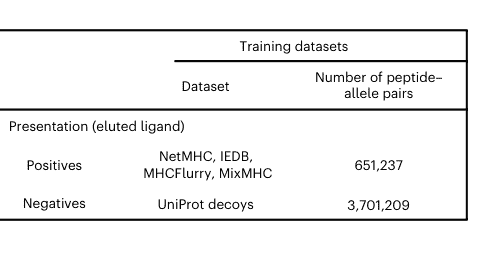
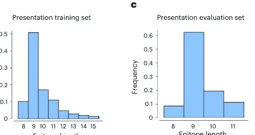
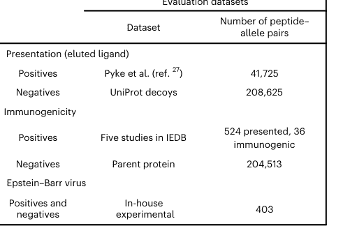
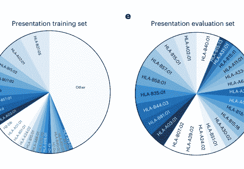
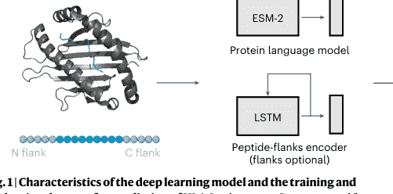
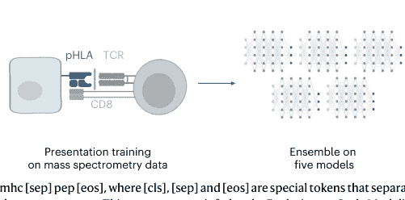
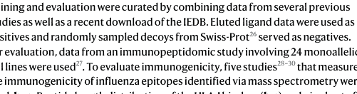

图. 1：用于 HLA-肽预测的深度学习模型特征以及训练和评估数据集。训练和评估是通过结合来自多个数据集的数据以及对 `IEDB` 的最新回顾创建的。使用选出的配体数据作为正样本，源自 `SwProt*` 的随机样本作为负样本。对于评估，我们使用了在 MHC 表达的不死细胞系中识别的肽。为了评估免疫原性，使用了测量通过质谱法识别的流感病毒表位免疫原性的肽$^{24}$。记录了 HLA 结合者（A、 B 和 C）的表位长度以及肽的每个部分。数据集中所有频率 < 1% 的肽被定义为“其他”。结合基序作为主要组织相容性复合体肽的输入氨基酸序列，形式为：`[cmHC]`

我们开发了 `MUNIS`：一种 HLA-肽深度学习模型，它利用 `Transformer` 架构，通过跨越205 个 HLA 等位基因的 63,257 个唯一配体的已评估训练集，通过利用 HLA-肽结合和抗原预测来识别结合情况。我们使用免疫遗传学数据在计算机中验证了 `MUNIS`，并实现了优于以往方法的性能。`MUNIS` 在免疫预测中的表现与实验检测相当，表明深度学习可以减轻实验负担，并加速 CD8+ T 细胞表位的检测，以快速开发疫苗。

尽管预测 CD8+ T 细胞表位存在许多方法，但它们的准确性在不同的 HLA-I 等位基因之间异。此外，为了理解这些模型是否能够识别免疫原性表位，缺乏无偏数据集是一个主要瓶颈。经常被预测的肽亲和力不确定或属于被选定的结合者⁶⁷。随后几种工具可以表征免疫原性肽的特征⁸⁹¹⁰，考虑到深度学习在提高模型泛化能力方面的巨大成功，它们是……

## 用于 CD8+ T 细胞表位的深度学习模型

为了开发一个稳健的 CD8+ T 细胞表位模型，我们使用了包含 37,215 个 HLA-B 肽和 2065 个随机采样非结合肽的测试集。与 `IEDB` (`ied.org`) 的免疫组学数据相比，我们使用了这些 HLA-B 肽来验证 `MUNIS`。在训练集中存在重叠 HLA-B 肽的情况下，……

`MUNIS` 的架构由两个模块组成（图 2）。第一个模块学习结合亲和力，第二个模块聚合特征以产生预测。

以前的工作强调了受试者特征曲线下面积 (`AUC-ROC`) 和精确率评估性能。然而，准确性的缺点是对于给定的阈值，正样本比例较低。我们使用精确率-召回曲线下的面积来评估性能。该分范围从 0 到 1，越高越好。

### MHC 预测表位身份和免疫优势

只有 HLA 提呈的肽才是 CD8+ T 细胞表位，我们测量了 MHC 预测免疫原性身份的能力。为了避免使用肽集进行预测产生偏差，我们选择了来自 A 和 B 病毒的免疫组学数据作为测试集，结合 `HLA-B-A02:01`、`HLA-A11:01` 和 `HLA-A*24:02`。我们从头构建了一份通过质谱法识别的 HLA-B 提呈肽列表，随后通过 `ELISpot` 实验对其免疫优势进行了评估。

### 平均精度的比较

### ROC-AUC 的比较

### 平均精度

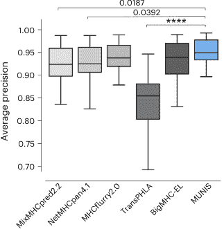
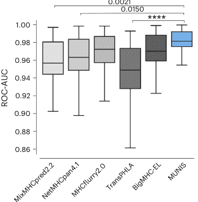
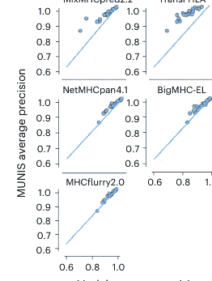

测试/表位重叠率 (%):
71 72 75 67 77.5

## 8-聚聚基 (8-mers)

### 9-聚基 (9-mers)

### 10-聚基 (10-mers)

### 11-聚基 (11-mers)

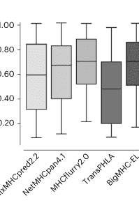
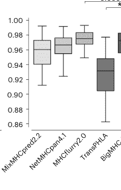
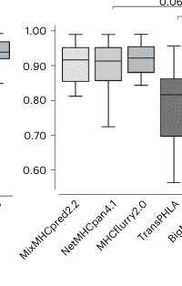
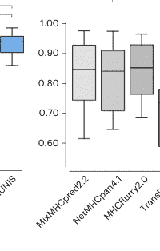

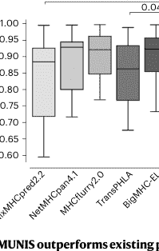
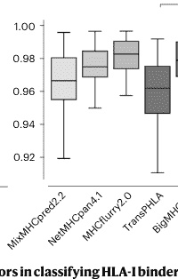
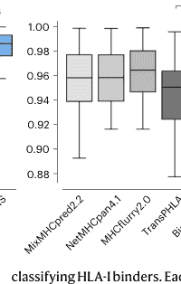
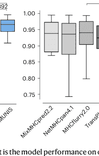

图 2 | `MUNIS` 在 8–11 聚基的 HLA-A 结合蛋白中表现优于现有预测器。a. 所有预测器在如 `MHCflpred-2.2`、`NetMHCpan4.1`、`MHCFlurry-2.0`、`TranPhLA` 和 `BigMHC` 等当前先进工具上预测来自鼠肽结合蛋白的配体（片段）的平均精度 (`AP`) 和 ROC-AUC (`AUC`)，n=24 HLA-1 等位基因。b. 所有基准演示中每个工具与训练数据的重叠百分比显示了可能实现的性能。c. `MUNIS` 与其他预测器之间的平均两对比较

每个点代表一个等位基因的性能。d. 所有预测器在不同表位长度的非结合蛋白上的平均精度 (`AP`) 和 ROC-AUC (`AUC`)，n=24 HLA+1 等位基因。`MUNIS` 与 Mann 检验之间两对比较的 P 值（***P<10）。箱线图以中位数、25 百分位数和75 百分位数作为上下四分位数，并 5 倍四分位距作为四分位数（不显示离群值）。

235

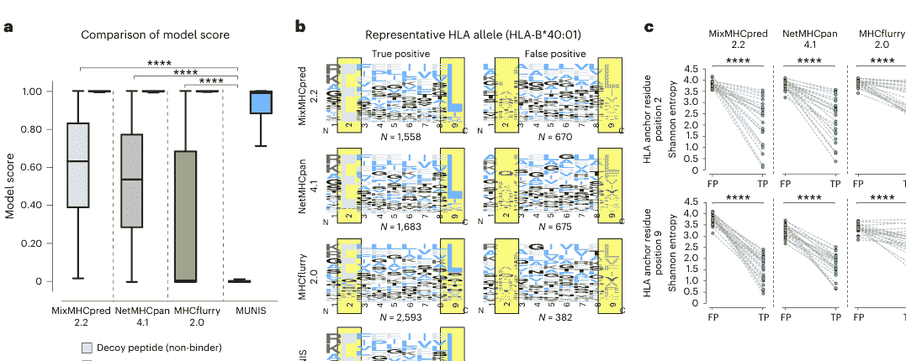

**图 3 | 分类错误结合蛋白的基序分析揭示了现有模型在标准 HLA-1 结合基序上不一致的现实。** 诱导配体（来自质谱实验）和非结合多肽（来自 724、208 和 609 结合蛋白）的基序。箱线图以中位数线、25 百分位数和75 百分位数作为上下四分位数，四分位数间的四分位距作为须线（不显示离群值）。

**b.** 每个代表模型所有分类结合蛋白（真阳性）和分类错误结合蛋白（假阳性）的 9-聚基结合情况。

allele `HLA-B*40:01` 残基用黄色突出显示。`MUNIS` 阳性基序是假阳性，因为有 25 个错误诱导的配体被识别为结合。模型-S000 同时用于正例和负例。Shannon HLA 锚点残基（两个和九聚聚基中的位置）（真阳性/假阳性）HLA-I 结合蛋白由每个点突出。锚点残基处的 Shannon 熵提供了某个 HLA 等位基因被误预测的真阳性多肽。比较的 P 值使用 Wilcoxon 秩和检验计算（p < 10⁻³）。

以及 `BigMHC`。`PRIME2` 在免疫学测试集上根据等位基因-多肽对标识性进行基准测试，使用“等位基因排名”作为性能输出。我们发现，在 5 个数据集的给出的周期内，`MUNIS` 均优于所有其他算法，平均性能中值为 0.289，与次优模型（`MHCflurry2`）相比性能提升了 6%。我们还评估了不同模型在不同 HLA 等位基因上的性能，用于预测每个等位基因的免疫原性表位（见图 4）。事实上，平均精度得分高于 `MUNIS` 的模型是那些在评估集和训练集之间存在严重不平衡的模型，以及那些只有非免疫原性 HLA-I 结合蛋白的模型（见扩展数据图2a）。我们在多次实验中发现平均精度的增加，表明模型倾向于预测免疫原性表位，而忽略了增加的表位之间的关系，这揭示了模型在预测免疫原性表位时忽略了增加的表位之间关系的趋势。

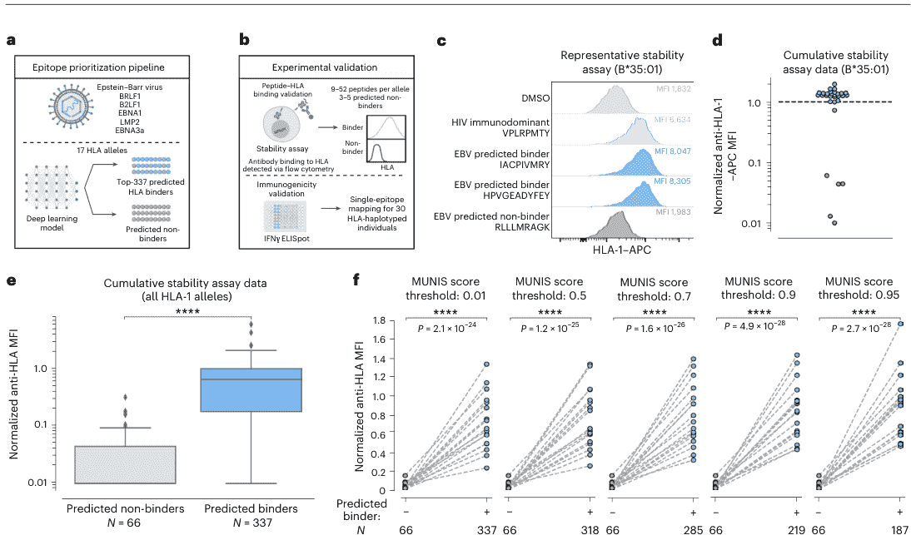

a 表位修剪 
b 实验验证 
c 代表性稳定性 (`HLA-A B35:01`)

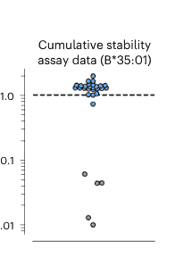

e 累积稳定性数据 (所有 HLA-A 1)


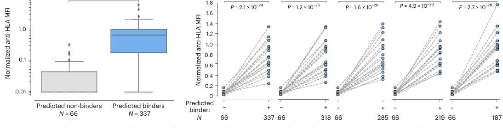

图 2. 实验性 HLA-A 肽研究证实了 MUNIS 对 HLA-A 内结合肽和非结合肽的亲和力。表位修剪程序的示意图。从来自 17 种不同 HLA-A 等位的 EBRLF1、EBRLF2、EBNA1、EBNA2 和 EBNA3a 蛋白中筛选前 257 个肽用于下游分析。B) 使用 TAP 缺陷的 HLA-M1 细胞对预测肽进行稳定性评估，以识别被 HLA 分子呈现并结合的肽。如果对每个结合 HLA 分子的肽进行 IFN Elpot 稳定性实验，数据以浅灰色显示。C) HLA-A B35:01 预测肽的代表性数据。DMSO对照组为浅灰色，B35-01 免疫优势肽为浅蓝色，来自 EBV 蛋白的预测肽为蓝色，MUNIS 阈值：0.1，MUNIS 阈值：0.5，MUNIS 阈值：0.7，MUNIS 阈值：0.9。

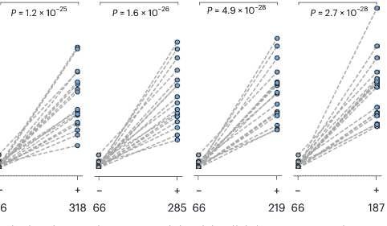

得分越高，给定肽的亲和力越大。D) 所有预测肽和非结合肽的汇总数据，已对 HLA-A B35:01 免疫优势肽归一化。HLA-A 等位基因由虚线表示。圆形代表预测肽，正方形代表非结合肽。E) 所有 HLA-A 17 等位基因预测肽的汇总数据。箱线图显示中位数、四分位距以及第 5 百位数和第 95 百分数的范围（离群值未以圆圈表示）。f) 对 MUNIS 分数大于或等于阈值的预测肽进行归一化的抗-HLA-M1。水平线代表所有结合或不结合特定 HLA-A 等位基因肽的抗-HLA-M1 平均值 (n = 17)。预测肽和非结合肽之间的 P 值使用 Wilcoxon 秩检验计算。图 a 和 b 使用 graphillob.com 生成。

结果发现两种方法在 HLA 急性和慢性免疫优势结构域中表现相似。最后，我们观察到来自 Swiss-Prot 的采样与来自 HLA-M1 细胞系的采样相等。

# MUNIS 识别的表位和 T 细胞结合 ELISpot

为了评估 EBV 蛋白中 HLA-A 1 等位基因肽的结合和免疫原性的实用性（考虑到它们与免疫复合物的相关性），识别了多种序列 (>90%)。我们通过从 EBV 蛋白提取肽制作 EBV 诱饵来运行 MUNIS 测试。我们筛选了来自 5 种 EBV 蛋白（EBRLF1、EBRLF2、EBNA1、EBNA2 和 EBNA3a）的所有 8-15 氨基酸链，以及与 HLA-A 17 等位基因结合的预测预测肽，并使用了早期的 MUNIS 版本。这些肽在 (f) 中表现优异。非结合肽被用作另一个 EBV 等位基因的非结合肽。

图 6. MIS 识别的表位和 T 细胞结合 ELISpot。**a.** 表达这些 HLA 等位基因的个体外周血单细胞 (PBMC) 的 HLA-A*0201 和 HLA-A*0301 限制性表位的代表性 ELISpot。DMSO 用作负对照，CD38 抗体用于对照。NTTC 用于计数。所有识别的肽均以双池进行测试。**b.** 通过 MIS 和 ELISpot 识别的 HLA-A*0201 和 HLA-A*0301 的 21 个免疫原性表位列表。**c.** 代表性构象稳定性。**d.** ELISpot 实验免疫表位（未在 ELISpot 中）。**e.** HLA-A*0201 和 HLA-A*0301 的平均准确率。**f.** HLA-A*0201 和 HLA-A*0301 排名最高的表位。**g.** 显示 3 个个体在使用免疫原性 HLA-A*0201 表位 5 天后的 T 细胞极化。所有肽均经过了技术重复测试。**h.** MANS 和计数的代表性衡量标准。

# 文章

该肽在其蛋白质来源中的起始情况。为了让网络能够确定哪些氨基酸属于肽而哪些不属于，我们包含了每个氨基酸的特征向量。LSTM 的输出是一个向量序列，我们通过平均序列长度将其展平成序列的单个向量。最后，我们将此特征向量与结合基序（binding motif）拼接，并输入到双层前馈网络中产生序列预测。

（Life Technologies）和 HLA-ABC 抗体（克隆 W6/32, BioLegend, 1:100）通过流式细胞术测量 HLA-I 的表达。

# 模型训练

我们在 N A600 GPU 集群上使用 PyTorch 框架训练模型，运行 75 个 epoch，总 batch size 大为 26（训练时间 2 小时）。结合模型使用预训练的 ESM-2B 模型参数初始化，并对所有权重进行微调。训练在开始时随机初始化。我们的模型使用 Adam 优化器通过混合精度（fp16）进行训练，学习率在整个过程中保持为 1e-4。

### 熵的计算

使用以下公式计算每个 HLA 锚点残基位置的香农熵（即序列保守性）：

```
$S = -\sum_{i} p(x_i) \log p(x_i)$
```

其中，n 是任何给定位置上唯一氨基酸的数量，$x_i$ 是唯一的氨基酸，$p(x_i)$ 是概率，计算方法是将该给定位置具有氨基酸 $x_i$ 的肽的数量除以数据集中肽的总数。

### 研究参与者

研究参与者招募自波士顿地区的门诊部和波士顿以外。马萨诸塞总医院的机构审查委员会批准使用源自人类血液的细胞。选择了 HLA-A*02:01 或非 HLA-A2 阳性供体的健康个体外周血单核细胞（PBMCs）。使用葡萄糖或蔗糖颗粒通过 Ficoll 密度梯度法收集 PBMCs。将其进行离心并储存在液氮中备用。如前所述$^{28}$ 对所有患者进行了 HLA-I 分型。

### 肽合成

在自动肽合成仪上，在 2-氯三基树脂上通过 Fmoc 化学$^{2}$ 合成肽。使用 DMF 中保护的氨基酸去除末端氨基酸。使用 DCM 和 DCM (95:5 v/v) 从块树脂中去除未保护位点。对全长进行氨基酸偶联（使用优化的肽生成所需的循环次数）。在每个偶联循环后，使用 DMF 中 20% 的哌啶去除保护基。

### 肽的合成与分析

在 DMF 中用 HATU 和 DIPEA 激活氨基酸。组装肽后，用 DMF 和 DCM 分别洗涤树脂三次。肽从载体上切除，并使用二乙醚-冷-冷-鸡尾水（TFA/异丙醇/水 (94:2.5:0.5) v/v）进行干燥。

### HLA-A1 结合实验

按照之前的描述$^{29}$ 进行 HLA-A1 结合实验。将 10 个转运体相关抗原呈递（TAP 缺陷）MC211-x721.221 细胞与 100 ng 肽和 5 $\mu$g $\beta$-微球蛋白（Si Bioologic）在 1640 培养基中，于 37°C/5% CO$_2$ 下培养 24 小时。作为对照，平行培养不含 MHC 类肽的细胞。

### 体外 IFN ELISpot 实验

根据制造商说明（Matches）进行 IFNY ELISpot 实验。将 PBMCs 以 $5 \times 10^6$ cells/ml 的浓度与来自 EBV 的单个肽培养 16 至 18 小时。随后，用抗 CD3 抗（克隆 OK03T3, BioLegend, 0.5 $\mu$g/ml）和抗 CD28 抗（克隆 CD28.2, BioLegend, 0.5 $\mu$g/ml）刺激细胞。形成最高值的细胞 数量

### 体外增殖实验

将 PBMCs 以 $1 \times 10^6$ cells/ml 的密度种在 TCell Raf 培养基（Thermo Fisher）中，并在 37°C 下培养 20 分钟。培养期间细胞避光并每 5 分钟测量一次。10 天后，收获细胞，在 1500 rpm 下离心 3 分钟后悬浮于培养基中。将细胞接种到含有 200 $\mu$l 细胞培养的 96 孔板中，并与单个单个 EBV 肽培养

# 报告摘要

有关研究设计的更多信息请见本文链接的研究组合摘要。

241

# 数据可用性

训练和评估模型 HLA-I-肽稳定性和激发所需的所有数据均可在 Mendeley Data 仓库中获得。从 IMGT 识别的主要组织相容性复合体序列也可以在发布的代码找到。包括登录代码在内的完整蛋白质序列也位于 Mendeley Data 仓库。

# 代码可用性

# 参考文献

- 1. Kaseke, C., Tanaka-Meka, R., Senjobe, F., & Gai, G. D. HIV 细胞 CTL 表位特异性的编码区。J. Infect. 225, S32–S37 (2021).
- 2. Collins, D. R., Gao, G. D., & Walker, B. D. 人肺癌中的 CD8+ T 细胞。Rev. Nat. Immunol. 20, 471–482 (2020).
- 3. Chen, G., et al. 新冠病毒肺炎 2019 严重患者的临床和免疫特征。J. Clin. Invest. 130, 2628–2629 (2020).
- 5. Soreina, A. Y., et al. 冠状病毒变异引起 COVID-19 患者中病毒细胞相关凝集蛋白动力学。Pediatr Allergy. 161, 558–569 (2020).
- 6. Zonotti, R. et al. B 细胞密度中对 SARS-CoV-2 的 T 细胞识别和激活并降低严重 COVID-19 的风险。Trans. Med. 58, e4029 (2023).
- 7. Bhattacharya, S., Karim, R., Goldberg, B., & Gai, D. HIV 感染患者的 MHC 特异性功能分析。J. HIV AIDS 18, 257–263 (2023).
- 8. Clemens, E., van Saarden, J., Wong, S., Song, L., & Valkenbaum, A. 通用疫苗中 T 细胞的力量。Science 6, 1115–1120 (2022).
- 9. Liu, J., et al. 对 SARS-CoV-2 产生保护的 T 细胞。Science 7, e7847 (2022).
- 10. Weiss, W. & Furiahi, R. 病原体、免疫和疫苗设计。Nat. Rev. Microbiol. 5, 555–555 (2017).
- 11. Yewdell, J., Reinisson, B., Peels, B., & Neels, M. 通过蛋白酶体处理和转运的 HLA-I 类。Ann. Rev. Immunol. 17, 51–88 (1999).
- 12. Strazer, M. et al. HLA-I 免疫组分析和深度学习特征识别抗原。Immunity 56, 1681–1698 (2023).
- 13. Rife, A. et al. 预测蛋白质蛋白相互作用的生物学和结构分析。Proc. Natl. Acad. Sci. 118, e2016381 (2021).
- 14. Rachel, J. et al. 机器学习的 MHC 类结合结合模式。Immunity 56, 10351 (2023).
- 15. Hundal, J. et al. 识别 SARS-CoV-2 变异的卷积工具。Cells 58, e408–420 (2022).

# 致谢

本工作得到了 Mark and Lisa Swartz AI/ML 计划的资助，来自 Wellcome Trust、医学科学和麻省理工学院（MIT）的奖励 T320GO0763 和 T320GA4273。MGH 和哈佛大学 Ragon 学院（G.D.G.）提供了额外支持。G.D.G. 还受到比尔和梅琳达·基金会、医学科学家 Burroughs 职业奖以及霍华·霍格斯学金的支持。内容的完整性由作者负责，不一定代表国家通用科学或或国立卫生研究院的观点。

# 作者贡献

概念化：J.W.N., A.N.S., G.D.G., 和 R.B.；软件；形式分析：J.W.N. 和 A.N.S.。调查：A.N.S., C.C.T., R.-M., 和 E.G.。初稿撰写：J.W.N., A.N.S., N.C.T., R.-M., E.G., 和 R.B.；修订与草案撰写：G.D.G. 和 R.B.。；资助：J.W.N., A.N.S., 和 R.B.。

# 利益冲突

作者声明没有竞争利益。

# 额外信息

# 补充信息

联系和材料请求请致 Gaurav D. G. 或 Regina Bazar。

同行评审信息 Nature Intelligence 感谢 Yi X. Xiong 以及其他审稿人对本工作评审的贡献。

出版商在编辑决策和出版管辖权方面保持中立。开放访问：本文根据知识共享署名 4.0 国际许可许可，允许在任何媒介或格式中使用、改编、分发和重新分发，只要您对作者和来源注明出处，提供许可链接，并指示是否进行了更改。本文中的图像或其他第三方材料包含在文章的知识共享许可中，除非文中另有说明。如果未包含材料，您可能需要直接从持有者处获得许可。查看此许可的副本请访问 http://creativecommons.org/licenses/by/4.0。

38. Nielsen, L. M., Kersten, M. J., Pals, S. T., Benjamin, F. J. and Bergen, I. J. 器官移植后 EB 病毒相关淋巴细胞增生性疾病：发病机制、表现和诊断。Transplant, 24.
39. Bjørneve, K. 等. 纵向分析揭示了与多发性硬化相关的 EB 病毒高频率。Science, 375, 296–306 (2022).
40. Bjørneve, K., Moss, C., Cohen, J. I. and A. Scher. 爱普斯坦病毒作为诱发多发性硬化的原因。Nature Med., 19, 160–171 (2023).
41. Smart, M. K. 等. EB 病毒血清学和 VCA IgG 的影响：健康人群中的高滴度。Nature J., 81, 201 (2021).
42. Bashiro, A. A. 等. HLA 呈递抑制肽受体和 T 细胞控制。Nat. Acad. Sci. USA. 117, 28532–28534 (2020).
43. Thindborg, E. 等. Tapasin 塑造了 MHC-肽复合物 I 类分子的免疫调节作用和结合特异性。Eur J. Immunol. 38, 364–369 (2018).
44. Montenegro, A. E. 等. TCR-NEB2 通过 TCR 和 T 细胞阻阻实现 TCR-肽结合的有效控制。Science 368, eade3044 (2020).
45. Gagev, D. V. 等. VDB2019 数据库：扩展网络分析和 T 细胞受体基序预测。Nucleic Acids Res. 48, D10572 (2020).
46. Narahashi, Y. E 等. 大多数个体中对 SARS-CoV-2 Omicron 变异的 T 细胞反应得以保留。Cell 180, 105 (2022).
47. White, J. J., Phillips, J., Wang, J., and Friedman, N. MCAS-TCR: 使用精选肽-T 细胞受体目录的 T 细胞反应。Biology 33, 2924–2939 (2019).
48. Bruno, P. M. 等. 使用功能遗传筛选策略进行高通量靶向 MHC 细胞免疫优势性研究。Nature Communications, 11, 5643 (2020).
Hauser, M., Steiner, G., & Söding, J. 用于大型蛋白质序列聚类和搜索的 MMseqs 。 Bioinformatics, 38, 1232–1236 (2020).
Hof, I. 等. MHCpan，用于人类之外的 MHC I 类结合预测。Immunology, 61, 1–13 (2003).
Lin, Z. 等. T 细胞受体蛋白结构和功能的进化尺度预测。Science, 379, 11559–11563 (2023).
Sochardt, S. & Söding, J. 长期记忆检索。Nature, 975, 1765–1770 (2019).
Bennett, R., White, P. & Adams, F. 用于小肽结合预测的 Flocs 方法。PLoS One, 12, e0247 (2017).
Barlas, K., Chatterjee, O., Gatos, D. & Zparlov, G. 氯残基。关于 MHC-氨基酸结合和肽切割的研究。Int. J. Pep. Rep., 37, 513–532 (2021).

# 文章

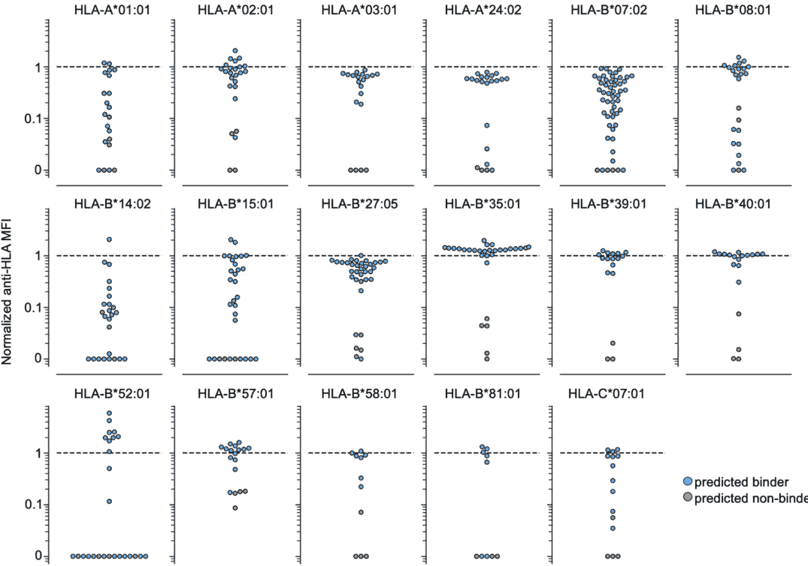

扩展数据图 4 | 每种等位基因预测的结合肽和非结合肽的 HLA 类 I 分子肽稳定性分析数据。MFI 已根据该等位基因已知 HIV 免疫优势位肽（虚线）的 MFI 进行归一化。蓝色圆圈表示预测的结合肽，灰色圆圈表示预测的非结合肽。

# 文章

# a

# b

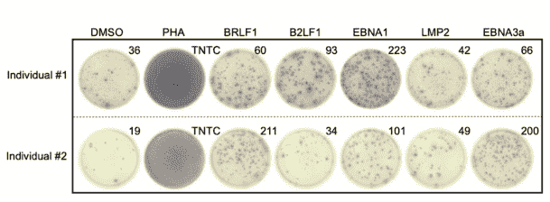

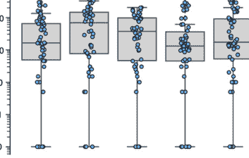

**扩展图 5 | 队列个体对来自婴儿斯坦病毒 (EBV) 蛋白重叠肽池的反应。** (a) 队列中代表性 HLA 等位基因个体针对 EBV 蛋白 BRLF1、B2LF1、EBNAL、LMP2 和 EBNA3a 重叠肽池的代表性 IFNγ ELISpot 实验。使用 DMSO 作为阴性对照，使用植物血凝素 L (PHA) 作为阳性对照。TNTC：计数过多。(b) 队列中所有个体的 ELISpot 汇总数据（每个蛋白 50 个肽）。箱线图以中位数作为中心线，第 25 分位数和第 75 分位数作为上下四分位数，并以四分位数的 3 倍四分位距作为须线（不显示离群值）。

## 扩展数据表 1 | MUNIS 与竞争预测模型的特征

| 模型 | 正性结果 | 诱饵 (Decoys) | 深度学习 | 侧翼残基 | 蛋白质语言模型 |
| :--- | :--- | :--- | :--- | :--- | :--- |
| MixMHCpred 2.2 | 质谱 | 人类 | 否 | 否 | 否 |


| NetMHCpan 4.1 | 质谱 + 结合亲力 | Uniprot | 否 | 否 | 否 |

| MHCflurry 2.0 | 质谱 + 结合亲力 | 母体蛋白 | 否 | 可选 | 否 |

| TransPHLA | 质谱 + 结合亲力 | 母体蛋白 | 是 | 否 | 否 |

| BigMHC - EL | 质谱 | 随机 | 是 | 否 | 否 |

| BigMHC - IM | 免疫原表位 | 人类 | 是 | 否 | 否 |

| Prime 2.0 | 免疫原表位 | 人类 | 否 | 否 | 否 |

| MUNIS | 质谱 | SwissProt | 是 | 可选 | 是 |

该表显示了 `MUNIS` 与其他模型之间的差异。文献中的模型差异取决于多个因素，包括负样本采样、模型架构以及侧翼残基的使用。

## 扩展数据表 2 | MUNIS 的消融实验解释了与竞争模型相比，增强 HLA-I-肽结合肽和免疫原表位预测的贡献特征

| pHLA 呈现 | 免疫原性 | 免疫优势 |

| :--- | :--- | :--- |

| 测试集 | 免疫原表位 vs. 所有表位 | 免疫原表位 vs. 结合肽 | HIV - 急性 | HIV - 慢性 |

| --- | --- | --- | --- | --- | --- |

| MUNIS (预训练大小: 8M, SwissProt 负样本, 模型评分) | 95.3 | 22.8 | 34.5 | 32.5 | 29.3 |

| ESM-2 蛋白质语言模型 | | | | | | |

| 未预训练 (大小: 8M) | 94.6 | 27.7 | 40.1 | 34.9 | 31.7 |

| 预训练 (大小: 35M) | 95.9 | 27.3 | 38.5 | 32.6 | 29.1 |

| 侧翼残基 | | | | | | |

| 无侧翼残基 | 94.7 | 23.5 | 35.6 | 34.1 | 31.7 |

| 负采样 | | | | | | |

| 人类诱饵 | 95.6 | 23.8 | 36.2 | 31.3 | 31.5 |

| 等位基因偏倚 | | | | | | |

| Munis %Rank | n/a | n/a | n/a | 31.9 | 30.7 |

| NetMHC %Rank | n/a | n/a | n/a | 29.3 | 26.6 |

| NetMHC Score | n/a | n/a | n/a | 29.7 | 27.6 |

消融分析显示了 `MUNIS` 在各种修改功能下的性能。所有数字均按等位基因分层的中位数平均精确度提供，HIV 免疫优势则以斯尔曼系数的形式给出。所有消融模型均作为五个模型的集成进行训练，以匹配原始的 `MUNIS` 训练方案。

## 扩展数据表 3 | 用于 EBV 免疫原性的患者队列特征

| 患者 ID | 年龄 | 性别 | 种族 | HLA-A 等位基因 | HLA-B 等位基因 | HLA-C 等位基因 |

| :--- | :--- | :--- | :--- | :--- | :--- | :--- |

| 135137 | 62 | 女性 | 白人 | 0201, 0201 | 4402, 4427 | 0501, 0704 |

| 185075 | 61 | 男性 | 白人 | 0101, 0201 | 4402, 5701 | 0102, 0602 |

| 186089 | 60 | 男性 | 白人 | 0101, 0201 | 4001, 5201 | 0304, 1202 |

| 225942 | 52 | 男性 | 黑人 | 0202, 0301 | 5702, 8101 | 1801, 0801 |

| 237983 | 77 | 女性 | 白人 | 0201, 3201 | 2705, 4402 | 0102, 0501 |

| 238936 | 60 | 男性 | 白人 | 0201, 0201 | 4001, 5701 | 0304, 0602 |

| 244489 | 58 | 男性 | 白人 | 0201, 2301 | 4901, 5701 | 0602, 0701 |

| 245487 | 72 | 男性 | 白人 | 0206, 2501 | 2705, 3701 | 0303, 0602 |

| 246734 | 70 | 男性 | 白人 | 0301, 3101 | 2705, 0701 | 0127, 0602 |

| 247792 | 64 | 男性 | 白人 | 0101, 0681 | 2705, 0721 | 0102, 0602 |

| 254378 | 61 | 男性 | 白人 | 0301, 0402 | 2705, 2401 | 0102, 0701 |

| 265823 | 59 | 男性 | 白人 | 0301, 0301 | 1401, 3501 | 0401, 0802 |

| 269198 | 57 | 男性 | 白人 | 0101, 2402 | 3801, 5701 | 0602, 1203 |

| 409640 | 67 | 女性 | 白人 | 2402, 2402 | 1402, 5701 | 0602, 0802 |

| 443552 | 67 | 男性 | 黑人 | 0201, 0201 | 4901, 5301 | 0401, 0701 |

| 447160 | 72 | 男性 | 黑人 | 0201, 0301 | 0702, 1402 | 0702, 0882 |

| 481241 | 89 | 男性 | 白人 | 0201, 3201 | 4002, 5701 | 0202, 0602 |

| 516980 | 64 | 男性 | 黑人 | 0101, 0201 | 5101, 5201 | 1202, 1601 |

| 534694 | 69 | 男性 | 白人 | 0201, 0201 | 2705, 5701 | 0102, 0602 |

| 540772 | 61 | 男性 | 白人 | 0101, 6801 | 5501, 5701 | 0303, 0602 |

| 575509 | 80 | 男性 | 白人 | 0201, 3601 | 4002, 5701 | 0304, 0602 |

| 622054 | 56 | 女性 | 白人 | 0201, 0201 | 0702, 4402 | 0501, 0702 |

| 667335 | 43 | 男性 | 白人 | 0201, 2902 | 4403 | |

统计摘要 (Reporting Summary)

Nature 出刊希望通过以下内容提高工作的可重复性。

# 统计

对于所有统计分析，请确认以下项目出现在图注、表注、正文或方法部分中：

- 实验的精确样本量 (`n`) 以及测量单位
- 说明是否对同一样本进行了重复测量
- 使用的统计检验（常用测试仅描述名称；复杂的技巧应在方法部分描述）
- 协变量描述，包括中心性（如均值）或其他基础估计（如标准差）
- 零假设检验的检验方法（如 `E`, `f`, `t`），并带上置信区间、效应量、自由度和尽可能给出具体的 `P` 值
- 对于贝斯分析，提供有关先验的信息和马尔可夫蒙特卡洛结果
- 对于分层设计，识别适当的水平并完整报告结果
- 效应量（如 `Cohen's d`, `Pearson's r`），并说明计算方法

我们的 Nature 统计集合包含了上述许多要点。

# 软件与代码

## 代码可用性政策

| 项目 | 说明 |

| :--- | :--- |

| 数据收集 | 未使用软件进行数据收集。 |

| 数据分析 | 使用标准 Python 包 (`pandas`, `matplotlib`) 进行数据分析。模型训练使用机器学习框架 (`pytorch`, `pytorch-lightning`)。 |

对于研究核心但未在发表文献中描述的自定义算法，必须向编辑和审稿人开放。我们鼓励将代码提交至社区仓库（`GitHub`）。请查看 Nature 关于代码与软件的指南获取更多信息。

# 数据

## 数据可用性政策

所有文章必须包含数据可用性声明。该声明应在适用时提供以下信息：

- 公用数据集的访问代码、唯一标识符或网络链接
- 对数据可用性的限制说明
- 对于临床数据集或第三方数据，请确保声明符合我们的政策

训练和评估模型所需的所有数据以及共享的 Elipot 数据已在 Mendeley Data 仓库，`DOI` 为：`10.1673/sw2gz5jn271.1`。用于训练的数据提取自来自 `NetMHCpan-1` (`https://doi.org/10.1093/gkaa379`)、`MHCflurry2.0` (`https://doi.org/10.1016/j.cell.2020.06.010`) 和 `MxMHCpred2` (`https://doi.org/10.1016/j.cell.2022.12.002`)。

### 人类研究参与者

关于人类研究参与者研究以及研究中的性别与性别的政策信息。

- 性别报告：我们已在手稿的扩展表 3 中报告了性别和种族。
- 人口特征：人口特征在手稿的扩展表 3 中报告。
- 招募：研究参与者由马萨诸质量学院（Raison Institute of Mass）、`MIT` 和 `哈佛大学` 招募，所有参与者均进行了 `HLA` 分型检测。参与者的性别和性别基于自我报告。
- 伦理监督：所有研究参与者均提供了知情同意。该研究已获得马萨总医院布里根审查委员会（Mass General Brigham Institutional Review Board）的批准。

请注意，手稿中必须包含有关研究方案批准的完整信息。

请根据您的研究情况选择以下最合适的一项。如果您不确定，请在选择前阅读相关章节。

- 寿命科学
- 行为与社会科学
- 生态、进化与环境科学

有关包含所有章节的文档参考副本，请参见 `nature.com/documents/nr-reporting-summary-flat.pdf`。

### 寿命科学研究设计

所有研究即使在披露结果为负时也必须说明这些要点。

| 样本量 | 总共选择了 30 名经过 HLA 分型的参与者进行分析。已获得所有参与者的书面知情同意。由于人类种群中 HLA 多态性极高，因此未计算样本量。因此，我们选择了 HLA I 类等位基因与我们的 HLA I 类-肽评估及计算预测中出现的基因相匹配的个体。 |

| 数据排除 | 未排除任何数据。 |

| 重复 | 所有实验均以技术重复进行，且所有重复尝试均成功。 |

| 随机化 | 未进行随机化，因为参与者根据其 HLA 单倍体型被分配到表位免疫原性评估中。 |

| 盲法 | 未进行盲法，样本名称根据其去标识 ID、样本采集日期和时间点进行标记。未进行盲法以避免交叉污染。 |

### 特定材料、系统和方法的报告

我们要求作者提供有关本研究中使用的某些材料、实验系统和方法的信息。请在此标明是否列出报告每种材料、系统或方法。如果您在使用的项目列表中未列出某项，请在回答前阅读相关章节。

## 材料与实验系统

| n/a | 参与研究 | n/a | 参与研究 |

| --- | --- | --- | --- |

| | 抗体 | | ChIP-seq |

| | 真核细胞系 | | 流式细胞术 |

| | 古生物学与考古 | | 基于 MRI 的神经成像 |

| | 动物和其他生物 | | |

| | 临床数据 | | |

| | 受关注的双重用途 | | |

### 抗体

**使用的抗体**

抗人 `CD3` (`Clone OKT3`, `BioLegend`, `# 31702`, `Lot B35B930`), 抗人 `CD28` (`Clone CD28.2`, `BioLegend`, `# 30280`, `Lot B394362`), 抗人 `CD3-BUV395` (`Clone UCHT1`, `BD Biosciences`, `Cat #653546`, `Lot 307268`), 抗人 `CD4-PE-Cy7` (`Clone OKT4`, `BioLegend`, `# 31714`, `Lot B375837`), 抗人 `CD8-BVV605` (`Clone SK1`, `BioLegend`, `Cat #344742`, `Lot B370756L`), 泛-`HLA-ABC` 抗肽 (`Clone W6/32`, `BioLegend`, `Cat #311410`, `Lot B373456`)。

**验证**

抗体已通过制造商验证并在目标群体中确认。

### 真核细胞系

**关于细胞系的政策**

所有使用的细胞系均源自人类 B 细胞系 `722.221` (`https://doi.org/10.4049/human142.9.93320`)，`HLA` 单基因 `TAEP` 缺失细胞系是使用 `CRISPR-Cas9` 基因编辑开发的 (`https://doi.org/10.1016/j.celrep.2021.109378`)。

**鉴定**

每种单基因 `TAP` 缺失细胞系均通过 `HLA` 表达的表面染色进行了鉴定，并通过 `CRISPR` 测序确认了 `TAP1` 基因编辑 (`https://doi.org/10.1016/j.celrep.2021.109378`)。

**已鉴定鉴定细胞系**（见 `ICLAC` 注册）

细胞系常规进行支原体污染检测。

### 流式细胞术

**图表**

确认：

- 轴标签标明了所使用的标记物和荧光染（例如 `CD4-FITC`）。
- 所有轴均为带有离群值的等高线图或伪彩色图。
- 刻度清晰可见。仅在组左下角的图表中沿轴包含数字（“组”是对相同标记物的分析）。
- 提供了细胞数量或百分比（带统计数据）的数值。

## 方法

**样本准备**

详见“方法”部分。使用 `Ficoll` 密度梯度从全血中提取患者 `PB`。

**仪器**

`BD LSR II` (`H4720037`)

**软件**

使用 `BD FACSiva` 软件收集数据，使用 `FlowJo` 分析数据。

**细胞群丰度**

本文未进行细胞分选。

**门门策略**

`HLA` I 类-肽稳定性实验的门策略：`FSC-A/SSC-A` -> `SSC-H/SSC-W` -> `Live/Dead Violet/SSC-A` -> `HLA-C` 直方图。增殖实验的门策略：`FSC-A/SSC-A` -> `SSC-H/SSC-W` -> `CD3-BUV395/Live/Dead Violet` -> `CD8-BV605/CD4-PECy7` -> `CellTrace Fab Red (CTFR)/CD8-BV605`。

- 勾选此框以确认补充信息中提供了门策略的示例图。
