# PyTorch and fastai 深度学习示例：开发者秘籍


本书的所有章节均以 *工作簿风格* 为重点设计。你应该获得代码以及几行散文文本来描述每个示例的变量。本书不会描述所实现算法的理论，而只是尽可能提供代码。你应该尝试复制示例并根据需要进行调整。如果你对一些背景知识更感兴趣，你将获得论文或教程的参考以供进一步阅读。

编写本书的目的是让你了解如何将这些示例调整以适应你的个人需求！

### 1.1 先决条件

本书是关于将深度学习应用于现实世界问题的实用示例集合。因此，你应该具备一定的 Python 编程经验，并熟悉 PyTorch 深度学习的基础概念。

所有代码示例均使用 Jupyter notebook 开发。如果你不熟悉 Jupyter，只需查看文档：https://jupyter.org/。

如果你想在本地机器上运行代码示例，请确保安装了至少 8 GB 显存的 NVIDIA GPU。也请确保已安装 Jupyter 服务器以运行 Jupyter notebook。

你也可以使用 Google Colab 在线免费运行示例。（当然 Google 会追踪你所有的活动……但谁在乎呢？至少在学习时不在乎。）尽管如此，对于真实世界的生产项目，你始终应考虑数据隐私。

### 1.2 资源

在使用 fastai 的过程中，我一直通过官方论坛：forums.fast.ai 以及官方文档：docs.fast.ai 获得很好的建议。

还有一个 Discord 服务器，你可以在上面参加与 Jeremy Howard（fastai 的创始人）的现场编码课程。只需使用此链接开始：https://discord.com/invite/xnpeRdgV。

### 1.3 fastai 简介

Fastai 是一个用于轻松开发深度神经网络的库，有助于使最先进的模型架构更易于访问。你可以深入基础并根据需要调整框架中的元素。该框架是开源的，可通过 GitHub 获取。

fastai 直接支持四种主要类型的模型：

- 计算机视觉 (fastai2.vision)
- 表格数据 (fastai2.tabular)
- 文本 (fastai2.text)
- 协同过滤 (fastai2.collab)

这意味着你可以在这些类别上使用默认模型快速开始。这些在 fastai 架构模型中被称为应用程序。然而，如果你需要更精细的修改，也可以深入挖掘。

**Fastai 的架构由三层组成：**

- **高级应用：** 使用高级应用，你可以用不到十行代码构建最先进的深度学习模型。大多数初学者将从这里开始。
- **中层 API：** 在设计深度学习应用时提供更多灵活性。此层级在你需要对数据预处理和数据加载器进行修改，或计划使用自己的学习器和模型架构时特别有用。使用中层 API，你还可以用 TensorBoard 监控训练进度。你可以为训练安排超参数的不同值，或尝试不同的正则化变体。
- **基础层：** 如果你需要处理张量或想直接在 GPU 上管理操作，此层级提供所有基础功能。


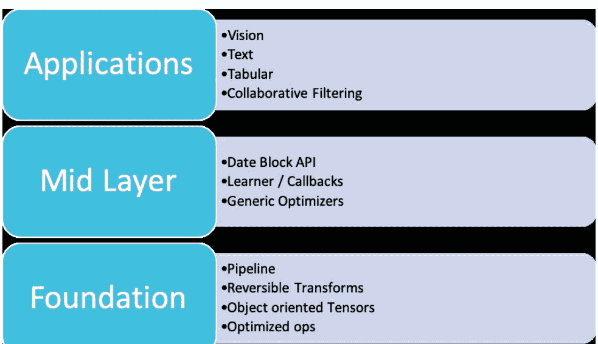

Fastai 还集成了回调的概念。这有助于你对非常不同的深度学习应用使用相同的训练循环。例如，你可以自定义训练循环来构建 GAN 网络。fastai 中的回调是双向回调。它们可以读取任何内容，如数据、参数等，也可以写入。这意味着你甚至可以用相同的训练循环来训练 GAN。

Some examples on how to use Callbacks are:
- 学习率调度器
- 实现提前停止
- 进行并行训练
- 梯度裁剪

另一个体现 fastai 强大灵活性的概念是通用优化器。你只需插入统计量、步进器和优化器即可创建自己的优化器。

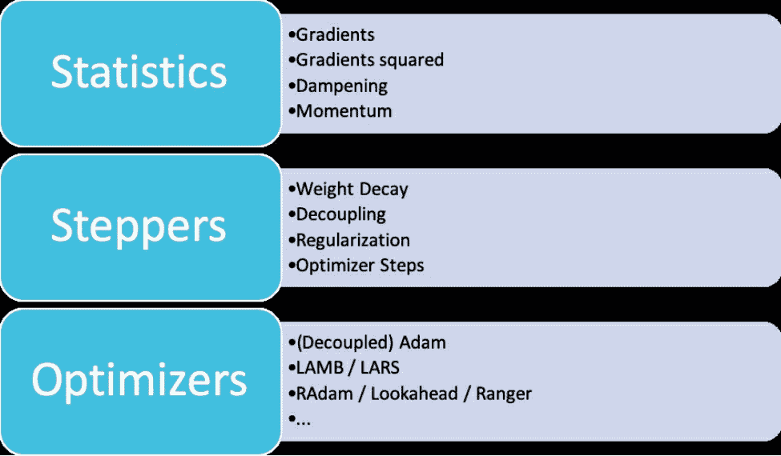

这些架构让你能够轻松自行实现任何新的最先进优化器。统计模块包含你在训练过程中想要测量的任何数据。步进器使用这些统计数据来改变网络的权重。如果你现在将这两个模块（stats 和 steppers）结合起来，你就能实现任何优化器。

With the data block api, you are able to get your data into any model. For using the data block api you need to know the following:
- 你有什么类型的数据？
- 你如何获取数据？
- 你如何将数据拆分为训练集和验证集？
- 你如何将数据放入数据批次中？


例如，在进行手写数字分类时，你可以使用以下代码：

```
mnist = DataBlock(type=(PILImageBW, Category),
get_items=get_image_files,
splitter=GrandparentSplitter(), get_y=parent_label)

databunch = mnist.databunch(untar_data(URLs.MNIST_TINY))
databunch.show_batch(max_n=9, figsize=(4,4))
```

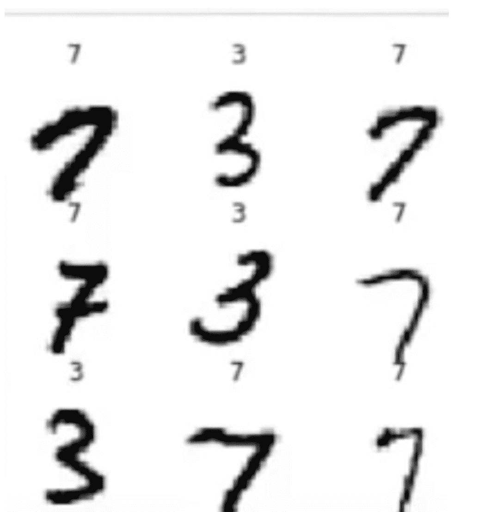

通过此示例我们说：好的，我们的输入是黑白 PILImages，输出是 Category。我们通过文件列表获取数据。让我们使用文件的祖父路径将数据拆分为训练集和验证集。我们通过使用父路径来获取 y 标签。

这足以使用我们的模型使用 mnist 数据集。我们可以通过使用 show_batch 方法来查看我们的数据。当然，data block api 适用于深度学习的所有应用，如图像分割、目标检测、关键点分析、文本等。

根据 fastai 的基础层，新增了一种对象类型：面向对象的张量。使用 oo 张量，你可以直接在张量对象上调用方法。例如，如果你有一个包含图像的张量对象，现在你可以调用 tensor.flip_lr 来翻转图像，或 .show 来显示图像。现在可以为不同类型的张量对象定义任何转换。

为了预处理数据，你可以使用 transforms pipeline 轻松创建数据转换管道。

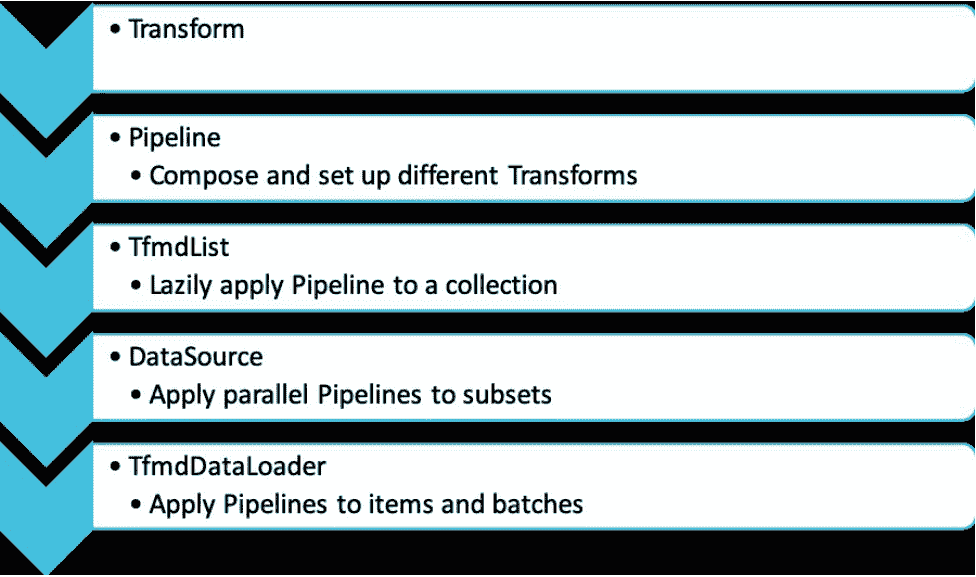

最低层是可调用转换。管道对转换进行函数组合。它知道如何在管道中设置转换。这有点棘手，因为你必须确保在设置下一步之前，所有之前的步骤都已应用于管道。

接下来，你可以将这些放入一个名为 transformed list 的易于索引的集合中，并并行应用你的转换。最后，你使用一个并行应用这些转换的数据加载器。

总的来说，fast.ai 库的所有开发都高度利用了 GPU 上的并行计算。例如，fastai 中包含的大多数计算机视觉管道都是在 GPU 上并行完成的，从而最大限度地减少计算时间。

如果你对 fast.ai 架构设计决策背后的事实感兴趣，你应该观看 Jeremy Howard 在 Youtube 上的这个视频：
https://youtu.be/bHVqO5YyNbU

### 1.4 使用 Google 的 Colab 工具

如果你想运行本书中的示例而自己没有 GPU，你有几个选择。

你可以在 Amazon AWS（或任何其他计算平台）上启动一个 EC2 实例。这会在实例运行期间向你收费。确保你选择了带有 GPU 的实例级别。不过也有一些利弊。如果你正在从事生产级项目，你应该考虑一个安全可靠的基础设施栈。那么在云平台上运行 GPU 服务器将是一个不错的解决方案。

对于学习或处理示例/原型等，还有另一个方便的选择。

Google 提供了一个名为 Colab 的工具，它（某种程度上）是一个托管的 Jupyter Notebook 实例，完全免费，但当然有一些限制：
- Google 不保证 GPU 访问，但几乎没有无法访问 GPU 的情况。
- 大多数情况下，你的会话会配对到旧的、速度较慢的 Tesla K80 GPU。
- 你的会话在最长运行时间 12 小时后会被重置。这意味着如果不将数据上传到其他存储，12 小时后你所有的數據都将丢失

## Lesson 1.ipynb

文件 · 编辑 · 查看 · 插入 · 运行时 · 工具 · 帮助 · 自 9:24 PM 起未保存的更改

- **文件**
- 在 GitHub 上查看
- 新建 Python 3 笔记本
- 新建 Python 2 笔记本
- 打开笔记本... — Ctrl+O
- 上传笔记本...
- 重命名...
- 移至回收站
- 在 Drive 中保存副本...
- 保存为 GitHub Gist 副本...
- 在 GitHub 中保存副本...
- 保存 — Ctrl+S
- 保存并固定修订版 — Ctrl+Alt+S
- 修订历史
- 下载 .ipynb
- 下载 .py
- 更新 Drive 预览
- 打印 — Ctrl+P

现在你可以从以下位置选择加载文件。你应该会看到：
- **示例**（来自 colab 的一些示例）
- **最近**（你的最新笔记本）
- **Google Drive**（挂载你的 gdrive 以直接访问笔记本）
- **GitHub**（你可以从任何公开可用的仓库打开笔记本）
- **上传**（将本地笔记本文件上传到你的 colab 运行时）

#### 1.4.2 如何更改运行时以使用 GPU

对于大多数深度学习的使用，我们希望使用 GPU，因为在 GPU 上计算比在 CPU 上花费的时间少得多。要更改运行时的处理类型，请按照以下步骤操作：
1. 点击运行时
2. 更改运行时类型
3. 将运行时类型设置为 Python 3
4. 使用硬件加速器 -> GPU

在首次打开来自公共仓库的笔记本时，你可能会收到类似以下的警告：

### 警告：此笔记本并非由 Google 创建。

此笔记本正在从 [GitHub](https://github.com) 加载。它可能会请求访问你存储在 Google 的数据，或读取来自其他会话的数据和凭据。请在执行此笔记本之前查看源代码。为了防止此笔记本从其他会话读取状态，你可以重置所有运行时。

☑ 运行前重置所有运行时

如果你认为仓库是安全的，可以安全地忽略此警告并点击无论如何运行按钮。

#### 1.4.3 保存你的工作

如果你正在使用来自 github 的笔记本，你可以打开并运行笔记本，但无法保存你的工作。如果你想保留你的工作，你可以：— 将副本保存到你的 google drive — 下载你的笔记本并在本地运行（或稍后再次上传）

要将笔记本存储到 gdrive，只需点击 File->Download .ipynb 或 File->Save a copy in Drive

## 欢迎使用 Colaboratory

文件 编辑 查看 插入 运行时 工具 帮助

- 新建笔记本
- 打开笔记本... ⌘/Ctrl+O
- 上传笔记本...
- 重命名...
- 移至回收站
- 在 Drive 中保存副本...
- 保存为 GitHub Gist 副本...
- 在 GitHub 中保存副本...
- 保存 ⌘/Ctrl+S
- 保存并固定修订版 ⌘/Ctrl+M S
- 修订历史
- 下载 .ipynb
- 下载 .py
- 更新 Drive 预览
- 打印 ⌘/Ctrl+P

有许多数据集，你可以使用 fastai 库非常轻松地下载。其中一个包含不同品种的狗和猫的图像（12 种猫和 25 种狗）。为了展示深度学习的巨大改进，请考虑 2015 年约 59% 的最先进准确率。我们当然会尝试超越它。

如果你想更深入地了解不同函数的实现，你只需输入 help(untar_data)。这会显示任何 python 函数的帮助文本。

或输入 ??untar_data 直接显示函数 help(untar_data) 的源代码
关于模块 fastai.data.external 中函数 untar_data 的帮助：

```
untar_data(url, fname=None, dest=None, c_key='data',
    force_download=False, extract_func=<function file_extract at 0x7f1baf730560>)
```

将 `url` 下载到 `fname`，如果 `dest` 不存在，则解压 tgz 或 unzip 到文件夹 `dest`。
??untar_data

#### 1.6.1 获取数据

让我们下载数据集并查看一些图像。我们将直接使用 Path 库来设置对我们数据文件夹的引用。URLs 类包含 fastai 库随附的所有不同数据集的常量值。

我们将使用的数据集称为 Oxford-IIIT Pet Dataset。你可以查看主页以更好地了解数据：(https://www.robots.ox.ac.uk/~vgg/data/pets/)

有专门针对头部 的图像，因为在 2015 年，区分品种的最佳模型是一个组合模型，其不同层在整张图像上训练，并在识别图像的特定部分（如头部等）上训练。


我们将使用整张图像进行训练。
path = untar_data(URLs.PETS)

如果我们想要能够复现相同的结果，我们应该设置一个随机种子值：
np.random.seed(2)
下载所有图像后，我们看到 path 包含指向所有图像的 POSIX-Path 对象列表：
path.ls()[:2]

(#2) [Path('/home/bmayr/.fastai/data/oxford-iiit-pet/crappy'),Path('/home/bmayr/.fastai/data/oxford-iiit-pet/images')]

让我们分析一下我们的数据集包含多少个图像文件夹：
len(path.ls())
5
path.ls()

(#5) [Path('/home/bmayr/.fastai/data/oxford-iiit-pet/crappy'),Path('/home/bmayr/.fastai/data/oxford-iiit-pet/images'),Path('/home/bmayr/.fastai/data/oxford-iiit-pet/models'),Path('/home/bmayr/.fastai/data/oxford-iiit-pet/image_gen'),Path('/home/bmayr/.fastai/data/oxford-iiit-pet/annotations')]

fastai 库不仅仅是 PyTorch 之上的一个附加组件。Fastai 提供了更多功能，并实现了深度学习科学中的最先进技术，目标是提供一个非常智能的抽象层，用四到五行代码构建功能丰富、高性能的模型。

但你也可以深入基础，使用 fastai 构建自己的更复杂的模型。因此，fastai 采用了我们上面已经讨论过的三层架构。

快速提醒一下：
最上层有四个不同的应用（Vision、Text、Tabular、Colab）。

这一层允许用几行代码构建最先进的模型。


在这些层之下，有一种“中层”，允许在构建模型时有更多控制，特别是在处理数据和数据处理方面。中层包含 Data Block API、Learner 和 Callbacks 以及通用优化器。我们将在后面的示例中使用这一层。

在中层之下是基础 API。这允许对模型和数据流进行完全控制。

让我们回到我们的入门模型。首先，我们需要获取图像的所有文件名以构建我们的 DataLoaders。我们使用 fastai 中的辅助函数 get_image_files()，它返回给定目录中的所有文件名列表。

```
file_names = get_image_files(path/'images/')
file_names[:2]
```

(#2) [Path('/home/bmayr/.fastai/data/oxford-iiit-pet/images/Birman_105.jpg'),Path('/home/bmayr/.fastai/data/oxford-iiit-pet/images/Siamese_175.jpg')]

如果我们查看文件名，会发现名称包含我们稍后想要预测的标签。例如 /home/bmayr/.fastai/data/oxford-iiit-pet/images/Birman_105.jpg —— 这是一张缅因猫的图像。

在 fastai 中，我们有不同的获取训练数据标签的选项。我们可以从父文件夹路径、csv 文件或数据框中提取标签，或者使用正则表达式从路径中提取标签。

所以让我们抓取最后一个 / 到 _ 之后的所有字符： '(.*)_\d+.jpg$'

如果你不熟悉正则表达式——不要害怕，你并不孤单。网络上有大量优秀的教程，你可以在 Stack Overflow 上找到几乎所有可能应用的示例。要测试你的 regEx，你可以使用众多在线编辑器之一，它们会显示字符串中匹配正则表达式的部分。例如 regex101.com: (https://regex101.com/)

```
pat = r'(.*)_\d+.jpg$'
```

接下来我们想要添加一些基本变换。Batch-transforms 会应用于训练数据中的每个批次，而 item_transforms 会在将项目添加到不同批次之前应用于你的任何项目。

变换是增强训练数据的一种极佳方式。例如，你可以稍微放大或缩小、翻转图像、扭曲等，以生成更多训练示例。Fastai 通过在 GPU 上并行进行图像数据增强，以非常快的方式实现数据增强。

在本示例中，我们希望将图像调整为 224x224 像素并在 imagenet_stats 上进行归一化，因为我们将使用 ResNet34 作为迁移学习的基模型。

每个图像在添加到批次之前将被随机裁剪。

批次大小将为 64 —— 你可以根据 GPU 内存调整该值。批次大小越大，GPU 使用的内存越多。

```
batch_tfms = [*aug_transforms(size=224, max_warp=0),
Normalize.from_stats(*imagenet_stats)]
item_tfms = RandomResizedCrop(460, min_scale=0.75,
    ratio=(1,1))
bs=64
```

ImageDataLoader 是与 fastai 配合使用的最高级 API。我们可以直接使用 from_name_re 方法，该方法允许我们使用正则表达式从路径名生成数据标签。我们使用上面定义的 regEx 模式。

```
data = ImageDataLoaders.from_name_re(path,
file_names,
pat,
batch_tfms=batch_tfms, item_tfms=item_tfms, bs=bs)
```

现在我们用 Data-Block-API 重建这个 DataLoader。Data Block API 总是需要相同的步骤：1. define data blocks 2. get the data items 3. define a splitter to split into training and validation set 4. get the labels 5. set item transforms 6. set batch transforms

我们将 datablock 设置为 ImageBlock，因为我们有一个视觉任务，并且 Category Block 因为我们想要预测恰好 *one* 个类别。稍后我们将开发一个如何预测多类标签的示例。

## *为什么我们要将数据拆分为训练和验证数据？*

我们在训练数据集上训练模型。然而，如果我们使用所有可用数据进行训练，模型很容易过拟合，意味着它只是记忆图像。例如，它学习第三张图像是一只猫，但它没有学习什么具体指定了一只猫。因此，我们在每个训练 epoch 后在模型训练期间未见过的数据集上重新检查。这数据集称为验证数据集。

```
pets = DataBlock(blocks=(ImageBlock, CategoryBlock),
get_items=get_image_files,
splitter=RandomSplitter(),
get_y=RegexLabeller(pat = r'/([^/]+)_\d+.*'),
item_tfms=item_tfms,
batch_tfms=batch_tfms)
```

现在手握 DataBlock 对象，我们可以从图像文件名创建我们的数据加载器。将 path_img 设置为 images 文件夹并创建数据加载器。

```
path_img = path/'images/'
dls = pets.dataloaders(path_img, bs=bs)
```

到目前为止，我们已经完成了定义训练和验证数据所需的所有步骤。在任何训练之前查看数据总是一个好主意。因此我们可以检查训练示例的有效性。

我们可以使用 `show_batch` 打印我们的数据加载器中的一个随机批次。这是数据完整性的一次快速检查。

```
dls.show_batch(max_n=9, figsize=(6,7))
```

让我们看看训练数据中有多少个类别。在 fastai 中，这被称为我们数据加载器的 vocab (*vocabulary*)。

```
dls.vocab
```

```
(#37) ['Abyssinian','Bengal','Birman','Bombay',
'British_Shorthair','Egyptian_Mau','Maine_Coon',
'Persian','Ragdoll','Russian_Blue'...]
```

总共有 37 个不同的类别。

Fastai 使用类 L 来表示列表。L 是为 fastai 开发的，以改进 Python 中列表的功能。内部所有类别都转换为整数，但由于 L，我们可以直接看到类别名称。如果我们想查看整数，可以调用 `dls.vocab.o2i`。o2i 表示从 *objects* 到 *integer values* 的转换。

```
dls.vocab.o2i
```

## saint_bernard


## beagle

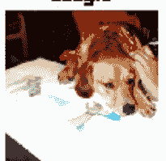

## boxer


## Bengal

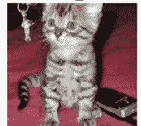

## saint_bernard

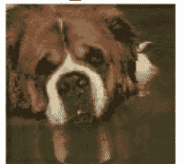

## chihuahua


## Egyptian_Mau

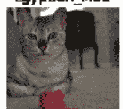

## Sphynx

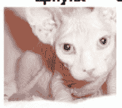

## english_cocker_spaniel

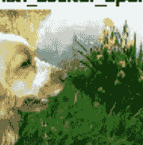

```
{'Abyssinian': 0,
'Bengal': 1,
'Birman': 2,
'Bombay': 3,
'British_Shorthair': 4,
'Egyptian_Mau': 5,
'Maine_Coon': 6,
'Persian': 7,
'Ragdoll': 8,
'Russian_Blue': 9,
'Siamese': 10,
'Sphynx': 11,
'american_bulldog': 12,
'american_pit_bull_terrier': 13,
'basset_hound': 14,
```


``` 
'beagle': 15,
'boxer': 16,
'chihuahua': 17,
'english_cocker_spaniel': 18, 'english_setter': 19,
'german_shorthaired': 20,
'great_pyrenees': 21,
'havanese': 22,
'japanese_chin': 23,
'keeshond': 24,
'leonberger': 25,
'miniature_pinscher': 26,
'newfoundland': 27,
'pomeranian': 28,
'pug': 29,
'saint_bernard': 30,
'samoyed': 31,
'scottish_terrier': 32,
'shiba_inu': 33,
'staffordshire_bull_terrier': 34, 'wheaten_terrier': 35,
'yorkshire_terrier': 36}
```

#### 1.6.2 训练模型

对于我们的视觉任务，我们将使用一个卷积神经网络骨干网络（Resnet34）。

这项技术被称为*迁移学习*。我们使用一个在 ImageNet 数据集上预训练的模型 *ResNet*。它不匹配我们的预测类别，因此我们只需砍掉最后一层，并根据数据集的类别添加一个全连接层。

迁移学习的思想是利用深度模型的能力，只针对我们的具体任务重新训练最后一层。这大大减少了训练时间，同时能快速产生出色的结果。

首先，我们创建一个 Learner 对象。Fastai 为不同的任务提供了不同的学习器。我们的任务是视觉任务，所以让我们使用一个 cnn_learner。

每个学习器都需要：
- 用于管理训练和验证数据的 DataLoaders
- 定义架构的模型
- 评估指标
- 损失函数以及
- 优化器

我们还会添加混合精度（fp16），因为这可以减少训练期间的内存占用。

```
learn = cnn_learner(dls,
resnet34,
pretrained=True,
metrics=error_rate).to_fp16()
```

对于单个分类任务，我们使用 CrossEntropyFlat 作为损失函数。如果我们不显式指定优化器，fastai 默认使用 Adam。那么让我们训练几个周期——我们将使用一些参数的默认值，如学习率、动量、权重衰减等。

```
learn.fit_one_cycle(4)
```

```
epoch train_loss

0 1.885583
1 0.656676
2 0.343732
3 0.253843
valid_loss error_rate time

0.388003 0.121786 00:22
0.308593 0.098106 00:23
0.272366 0.083897 00:22
0.281068 0.083897 00:22
```

我们可以通过调用 learner 对象的 save 方法保存权重，以便日后随时重新加载。我们还可以选择任意喜欢的名称来存储。

```
learn.save('stage_1') Path('models/stage_1.pth')
```

#### 1.6.3 分析结果

嗯，0.083 的错误率对于我们的第一次深度学习尝试来说还不错。让我们深入模型，分析分类过程中出现的问题。

借助 fastai，我们有机会通过获取分类解释来查看模型的结果。这可以显示最不匹配的示例，并绘制混淆矩阵。

```
```python
interp = ClassificationInterpretation.from_learner(learn) losses, idxs =
interp.top_losses()
assert len(dls.valid_ds)==len(losses)==len(idxs)
```
```

这会显示最大的损失，包括预测和实际类别标签、损失值以及概率。

```
```python
interp.plot_top_losses(9, figsize=(15,10))
```
```

现在我们打印混淆矩阵。一个“完美”的模型只会在对角线上有值，因为这意味着模型始终预测了正确的标签。

对角线下方或上方的值是错误分类的值。
`interp.plot_confusion_matrix(figsize=(12,12), dpi=75)` 仅仅经过 4 轮训练就能达到这个效果，还不算太差。

### 预测/实际/损失/概率

american_bulldog/boxer / 9.76 / 1.00


japanese_chin/saint_bernard / 9.69 / 0.67


staffordshire_bull_terrier/american_bulldog / 7.67 / 0.93

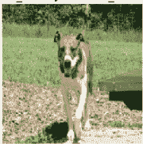

Ragdoll/Maine_Coon / 7.55 / 0.99


american_bulldog/american_pit_bull_terrier / 7.08 / 0.99

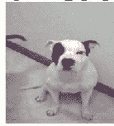

pomeranian/chihuahua / 6.70 / 0.89

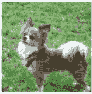

Birman/Ragdoll / 6.48 / 0.99


american_pit_bull_terrier/basset_hound / 6.38 / 0.52

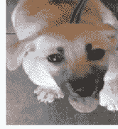

scottish_terrier/havanese / 6.07 / 0.68

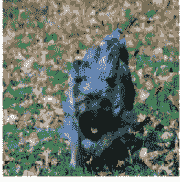

我们使用的训练数据包含许多类别。因此，混淆矩阵看起来有点让人不知所措，很难判断模型更经常混淆哪些类别。

让我们看看最容易被混淆的类别：
interp.most_confused(min_val=4)

```
[('Egyptian_Mau', 'Bengal', 7), ('staffordshire_bull_terrier', 'american_pit_bull_terrier', 7), ('Russian_Blue', 'British_Shorthair', 6), ('american_pit_bull_terrier', 'staffordshire_bull_terrier', 5), ('beagle', 'basset_hound', 5), ('Maine_Coon', 'Ragdoll', 4), ('Ragdoll', 'Birman', 4), ('Siamese', 'Birman', 4), ('english_cocker_spaniel', 'english_setter', 4)]
```

这些是至少被混淆了 4 次的类别。好吧，我并不是犬种专家，但经过对这些品种的一些研究后，我不得不承认，它们确实很难区分。

#### 1.6.4 解冻整个模型并重新训练

现在，我们可以解冻预训练 ResNet 模型的所有层，并在一些周期内重新训练整个模型，以获得更好的结果。

我们可以从上一个训练周期重新加载权重。

```
learn.load('stage_1');
```

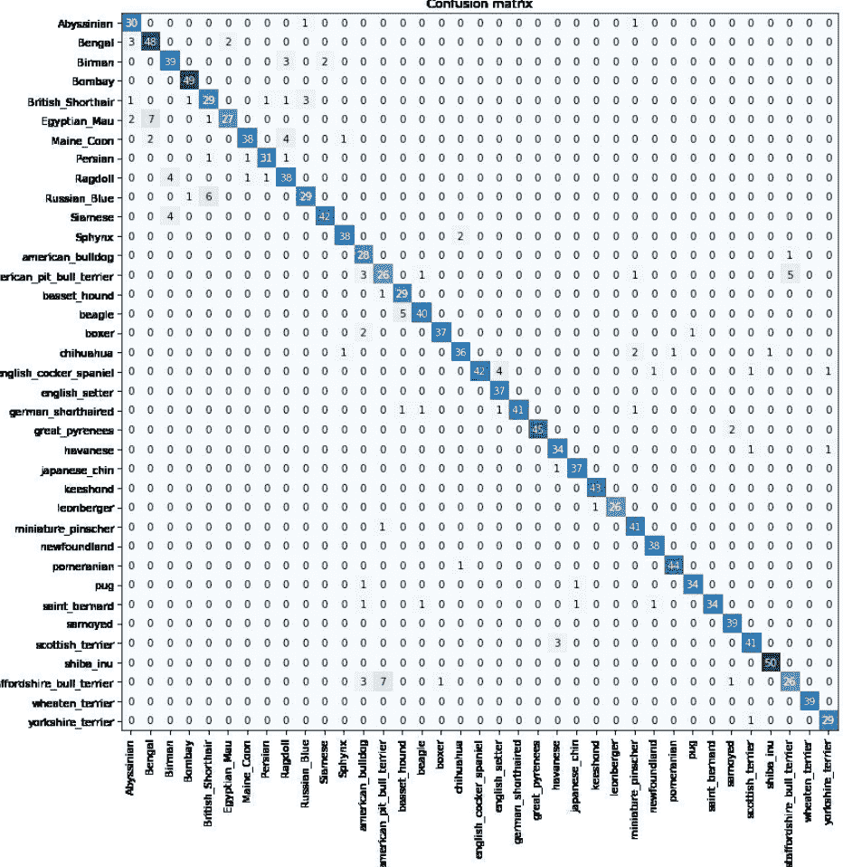

```
learn.unfreeze()
```

```
learn.fit_one_cycle(4)
```

| 轮次 | 训练损失 | 验证损失 | 错误率 | 时间 |
|---|---|---|---|---|
| 0 | 1.119134 | 2.879944 | 0.575778 | 00:29 |
| 1 | 1.005705 | 1.229593 | 0.342355 | 00:29 |
| 2 | 0.594478 | 0.549008 | 0.167794 | 00:29 |
| 3 | 0.307384 | 0.419407 | 0.117727 | 00:29 |

所以我们的错误率变差了。第一轮训练后我们的错误率约为 0.08，但现在却达到了 0.11！

这里发生了什么？这是因为这一次我们在运行训练循环之前解冻了模型的所有层，而训练这样一个大模型比只重新训练给定模型的最后一层要困难得多。因此，我们必须仔细决定训练参数。

Fastai 提供了一个名为 lr_find() 的方法，帮助我们找到一个好的学习率。

让我们重新加载权重，并事先调用 lr_find()。

```
learn.load('stage_1');
learn.lr_find()
SuggestedLRs(lr_min=6.309573450380412e-08,
lr_steep=1.0964781722577754e-06)
```

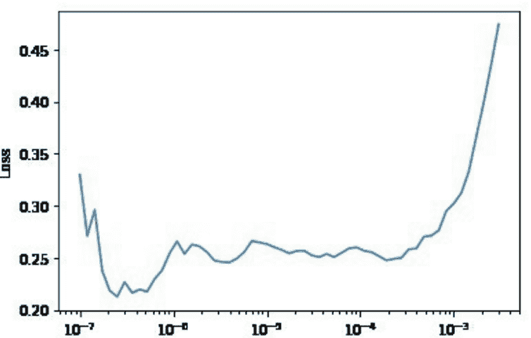

我们希望在损失率飙升之前在图表上选择一个范围。在这种情况下，1e-6 到 1e-4 之间的范围将是不错的选择。然而，你可能需要尝试不同的值来改善结果。

在训练整个模型时，我们选择一个范围而不是单个值，因为我们希望以比最后一层更低的学习率来训练前面的层。这被称为学习率退火。这是斯坦福 CS231 中提出的一个概念：(http://cs231n.github.io/neural-networks-3/#anneal)

```
learn.unfreeze();
learn.fit_one_cycle(4, lr_max=slice(1e-6, 1e-4))
epoch train_loss valid_loss error_rate time
```

0 0.240683 0.272126 0.081867 00:29
1 0.207130 0.268688 0.078484 00:29
2 0.186820 0.258128 0.074425 00:29
3 0.165958 0.257685 0.075101 00:29

```

我们可以看到，选择一个更好的学习率大大提高了我们模型的性能。现在我们得到了 0.067659 的错误率——比只训练最后一层后的效果（0.07）更好。现在我们可以再次保存训练好的权重。

*如果你使用的是 Google Colab，你应该考虑将权重复制到你的 Google Drive 或任何其他持久的云存储中。*

```
```python
learn.save('stage_2')
Path('models/stage_2.pth')
```
```

#### 1.6.5 使用 ResNet50 重新训练

我们已经看到，我们的架构有效并返回了良好的结果。我们可以尝试使用更大的模型进行迁移学习，并重新使用 ResNet50。

更大的模型在训练时总是需要更多资源，但未必能提供更好的结果！一个好主意是先用少量训练数据在小型模型上开始。然后你可以快速进行原型设计，而不必在模型训练时浪费时间。如果你认为已经获得了不错的结果，再在完整训练数据上训练你的模型，并且/或者尝试更大的模型架构。

```
```python
pets = DataBlock(blocks=(ImageBlock, CategoryBlock),
get_items=get_image_files,
splitter=RandomSplitter(),
get_y=RegexLabeller(pat = r'([^/]+)_\d+.*'), item_tfms=item_tfms,
batch_tfms=batch_tfms)
```
```

```
```python
dls = pets.dataloaders(untar_data(URLs.PETS)/"images", bs=32)
```
```

```
```python
# create the learner
learn = cnn_learner(data,
resnet50,
pretrained=True,
metrics=error_rate)
```
```

```
```text
Downloading: “https://download.pytorch.org/models/resnet50-19c8e357.pth” to /home/bmayr/.cache/torch/hub/checkpoints/resnet50-19c8e357.pth
```
```

```
```python
HBox(children=(IntProgress(value=0, max=102502400), HTML(value='')))
# find learning rate
learn.lr_find()
```


SuggestedLRs(lr_min=0.00831763744354248, lr_steep=0.0012022644514217973)

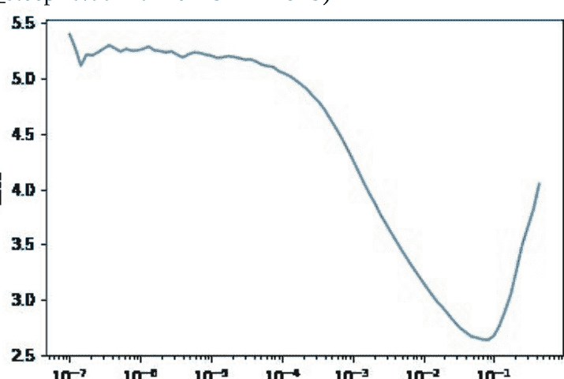

## 选择一个具有高负斜率的学习率

```python
learn.fit_one_cycle(5, lr_max=(1e-3))
```

| epoch | train_loss | valid_loss | error_rate | time |
|---|---|---|---|---|
| 0 | 1.197415 | 0.257222 | 0.089986 | 00:48 |
| 1 | 0.480817 | 0.243021 | 0.084574 | 00:47 |
| 2 | 0.285627 | 0.192219 | 0.062246 | 00:47 |
| 3 | 0.159144 | 0.184564 | 0.053451 | 00:47 |
| 4 | 0.123560 | 0.187495 | 0.057510 | 00:47 |

因此，使用更大的模型架构，我们得到了更低的错误率 0.05。现在我们可以进行解冻和/或训练更多的轮次。

```python
learn.save('resnet50')
```

```text
Path('/home/bmayr/.fastai/data/oxford-iiit-pet/models/resnet50.pth')
```

同样，我们可以运行 `unfreeze()` 并重新训练整个模型

```python
learn.load('resnet50')
learn.unfreeze()
learn.fit_one_cycle(2, lr_max=4e-4)
```

| epoch | train_loss | valid_loss | error_rate | time |
|---|---|---|---|---|
| 0 | 0.800914 | 0.891309 | 0.264547 | 01:01 |
| 1 | 0.403630 | 0.329750 | 0.096752 | 01:00 |

```python
learn.save('resnet50-stage_2')
```

```text
Path('/home/bmayr/.fastai/data/oxford-iiit-pet/models/resnet50-stage_2.pth')
```

好吧，在这个大模型上只运行两个轮次的训练循环显然是不够的。如果我们想在生产环境中使用这个模型，我们需要训练更多的轮次。

不过，为了演示目的，该模型用最少的代码行数就能返回可接受的结果。

## 第 2 章：从零开始构建图像分类器

本章将指导你从零开始创建一个用于分类任务的深度学习模型。我们将构建自己的深度学习模型来识别手写数字。为了训练我们的分类器，我们将使用 MNIST 训练数据集。该数据集由手写数字的灰度图像组成。

你可以在维基百科上找到关于这个数据集的更多信息：[https://en.wikipedia.org/wiki/MNIST_database](https://en.wikipedia.org/wiki/MNIST_database)。我们将使用 fastai 中的 `URLs` 类来轻松下载所有 MNIST 数据。

现在从 fastai 导入视觉库并下载 MNIST 数据集。这次我们将使用 fastai 中最底层的 API 来访问数据。

```python
from fastai.basics import *
from fastai.vision.all import *
from fastai.callback.all import *

path = untar_data(URLs.MNIST)
```

我们只需将相应文件夹的名称分配给我们的 `GrandparentSplitter`。

创建拆分器后，我们可以使用这个拆分器对象将文件名划分为训练数据和验证数据。我们将得到一个包含两个列表的列表，一个包含训练数据文件夹的索引，另一个包含验证数据文件夹的索引。

```python
splitter = GrandparentSplitter(train_name='training',
                               valid_name='testing')
```

让我们重新检查一下！我们看到 `splits` 包含两个对象（训练集和验证集）。我们可以索引到列表中，并显示训练和验证的前三个元素。我们的拆分器使用索引 <60000 作为训练数据，>=60000 作为验证数据！

```python
splits = splitter(items)
print(len(splits))
print(splits[0][:3])
print(splits[1][:3])
```

```text
2
[0, 1, 2]
[60000, 60001, 60002]
```

下一步是创建一个 `DataSource` 对象。数据源需要以下值：

- 文件名
- 一些变换
- 训练和验证的拆分

### 我们所说的**变换**是什么意思？

在这个阶段，变换并不是指旋转、裁剪、缩放等图像变换。这些变换定义了我们的数据如何被加载到数据源中，以及如何获取我们的 y 值。因此，这个参数是一个包含两个项目的列表。这两个项目中的每一个都是一个列表，分别包含 x 和 y 值的变换。

对于我们的数据，我们想要：

- 获取 x 值并创建一个 `PILImage`（就像我们之前手动做的那样）
- 对于 y 值，从父文件夹获取标签并对所有标签进行分类

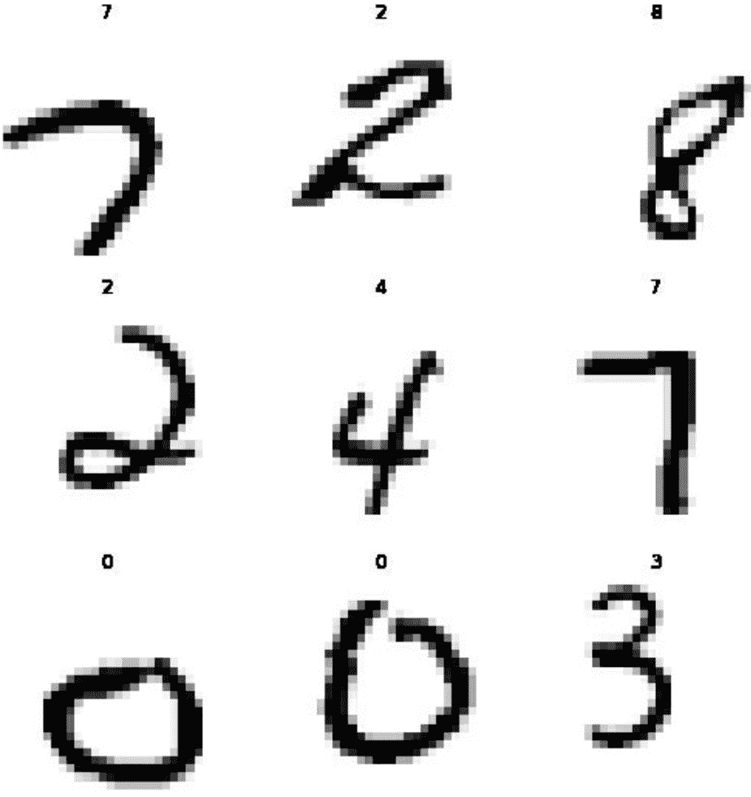

现在，我们想知道我们的模型期望什么样的输入尺寸。让我们获取一个批次并查看我们的 xs 和 ys 的形状。

```python
x_batch, y_batch = dataloaders.one_batch()
x_batch.shape, y_batch.shape, dataloaders.c
```

```text
(torch.Size([128, 1, 28, 28]), torch.Size([128]), 10)
```

这意味着我们的模型期望一个形状为 1x28x28 的张量输入。

这正好代表我们的黑白图像（记住，每个颜色一个通道——所以对于黑白图像只有 1 个通道），其**分辨率为 28x28 像素。** 之前我们定义了**批次大小为 128。**

一个批次的输出大小是 **128**，因为批次中的每张图像都有一个标签——每个批次总共有 128 个标签。

我们有多少个不同的 y 值？这由 `dataloaders.c`（c 代表类别）显示。那么我们有多少个不同的*类别*呢？是的，我们有 10 个不同的类别——每个数字一个。

### 2.2 创建模型

一个（深度）学习模型由不同的层组成。每一层只是一个矩阵乘法。经过若干层之后，我们应该得到给定的 y 标签。对于 MNIST 图像数据，我们将创建一个类似于引言章节中使用的 `cnn_learner` 对象的模型。

现在我们将使用这些类型的层：

- 卷积层，
- 批归一化层，
- 激活函数（ReLU）和
- 一个展平层作为顶层

#### 2.2.1 卷积层

卷积层在处理图像时表现出了良好的结果。你甚至可以将不同的数据转换为图像，并使用卷积层进行处理。例如，你为音乐文件创建频谱图，然后将这些频谱图当作图像来使用。

*Adit Deshpande* 对卷积层内部发生的事情做了很好的记录（参见：[卷积神经网络理解入门指南](https://adeshpande3.github.io/A-Beginner%27s-Guide-To-Understanding-Convolutional-Neural-Networks/)）。

卷积层的一个类比是手电筒，它只照亮黑暗房间中的一个点。手电筒从左到右、从上到下移动，扫描整个房间。然而，你一次只能看到一个点。

就卷积层而言，我们称这个手电筒为**滤波器**或**卷积核**。我们看到的被照亮的点称为**感受野**。

滤波器本身由一个浮点数数组组成——称为**权重**（有时也称为参数）。

请记住，滤波器的深度必须与输入的深度相同。在我们的示例中，我们使用一个颜色通道——所以深度为 1。

下一步是开始在图像的像素数组上移动滤波器。我们将这种移动定义为在图像上进行**卷积**。

在卷积过程中，滤波器将滤波器内的值与所照亮的感受野内的原始值相乘。在此过程中，滤波器进行逐元素乘法。

然后将所有这些乘法的结果相加。滤波器对图像中的所有像素重复此过程，最终得到一个**激活图**或**特征图**。

在我们的例子中（28x28 像素图像），这个特征图将有 784 个不同的位置，变成一个 28x28 的像素数组。

```python
def conv(number_input: int, number_filter: int) -> nn.Conv2d:
    return nn.Conv2d(number_input,
                     number_filter,
                     kernel_size=3,
                     stride=2,
                     padding=1)
```

#### 2.2.2 批归一化层

当张量通过模型传递时，我们希望它们被归一化。这将提高训练速度，并允许每一层独立学习，因为每一层都会根据其输出进行重新归一化。

```python
def batch_norm(number_filters: int) -> nn.BatchNorm2d:
    return nn.BatchNorm2d(number_filters)
```

#### 2.2.3 激活函数

激活函数用于为我们的模型提供非线性。激活函数在称为**反向传播**的步骤中与*权重*和*偏置*一起工作（我们将在后面的章节中介绍）。

这些函数负责我们模型的学习能力。激活函数可以激活（*返回正值*）或停用（*返回小于零的值*）我们层内的节点。

ReLU（或修正线性单元）简单地在输入值大于零时返回输入值，而对于所有小于或等于零的输入值返回零：[ReLU 和 Softmax 激活函数 – 修正线性单元](https://github.com/Kulbear/deep-learning-nano-foundation/wiki/ReLU-and-Softmax-Activation-Functions#rectified-linear-units)

```python
def relu() -> nn.ReLU:
    return nn.ReLU(inplace=False)
```

#### 2.2.4 展平层

最后一层将是展平层。为此，我们将简单地使用 `Flatten`。请记住，我们只需使用双问号即可显示任何函数的源代码：`??Flatten`。

```
??Flatten
```

#### 2.2.5 创建模型架构

我们将创建一个包含五个卷积层的模型——每个卷积层由一个卷积层、一个批归一化层和一个 ReLU 激活组成（最后一层除外）。

我们可以使用 `nn.Sequential` 来构建一个由我们预定义层组成的简单顺序模型。只需添加所有层。第一个卷积层有一个输入滤波器，输出大小为 8。因此，第二层必须具有


```
learner.summary()
epoch train_loss valid_loss accuracy time 0 None None 00:00

Sequential (Input shape: ['128 x 1 x 28 x 28'])
================================================
Layer (type) Output Shape Param # Trainable
================================================
Conv2d 128 x 8 x 14 x 14 80 True
BatchNorm2d 128 x 8 x 14 x 14 16 True
ReLU 128 x 8 x 14 x 14 0 False
Conv2d 128 x 16 x 7 x 7 1,168 True
BatchNorm2d 128 x 16 x 7 x 7 32 True
ReLU 128 x 16 x 7 x 7 0 False
Conv2d 128 x 32 x 4 x 4 4,640 True
BatchNorm2d 128 x 32 x 4 x 4 64 True
ReLU 128 x 32 x 4 x 4 0 False
Conv2d 128 x 16 x 2 x 2 4,624 True
BatchNorm2d 128 x 16 x 2 x 2 32 True
ReLU 128 x 16 x 2 x 2 0 False
Conv2d 128 x 10 x 1 x 1 1,450 True
BatchNorm2d 128 x 10 x 1 x 1 20 True
Flatten 128 x 10 0 False
```

总参数：12,126
总可训练参数：12,126 总不可训练参数：0

使用的优化器：<function Adam at 0x7f729d9be5f0> 损失函数：
FlattenedLoss of CrossEntropyLoss()

回调：
- TrainEvalCallback
- Recorder
- ProgressCallback

使用 lr_find() 检查最佳学习率。请记住，我们寻找的是具有非常陡峭负斜率的值。
这次我们将使用约 1e-2 的值进行训练。在选择了有效的学习率后，我们可以对模型进行若干轮训练。

```
learner.lr_find()
SuggestedLRs(lr_min=0.33113112449646,
lr_steep=0.3019951581954956)
learner.fit_one_cycle(3, lr_max=1e-2)
```

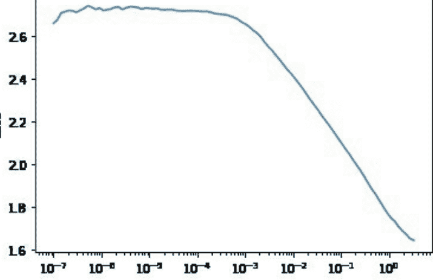

| 轮次 | 训练损失 | 验证损失 | 精度 | 时间 |
|---|---|---|---|---|
| 0 | 0.217761 | 0.122905 | 0.964300 | 00:14 |
| 1 | 0.114047 | 0.064353 | 0.980400 | 00:14 |
| 2 | 0.077312 | 0.045065 | 0.987000 | 00:14 |

该独立模型完全使用 pytorch 开发。到目前为止，我们还没有使用任何 fastai 的代码。

#### 2.2.6 简化模型

我们可以通过使用 ConvLayer 而不是使用三种层类型来简化模型。fastai 库中的 ConvLayer 包含这三个层：Conv2d、BatchNorm2d 和 ReLU。你可以再次使用双问号 ??ConvLayer，或者定义一个简单的 conv2 层并查看输出：

```
ConvLayer(1, 8)
```

```
ConvLayer( (0): Conv2d(1, 8, padding=(1, 1), bias=False) (1): momentum=0.1, affine=True, track_running_stats=True) (2): ReLU() )
```

def conv2(number_in: int, number_filter: int) -> ConvLayer: return ConvLayer(number_in, number_filter, stride=2) 这与我们第一个模型中的完全相同。让我们使用它并简化我们的模型：

```
model = nn.Sequential(
conv2(1, 8),
conv2(8, 16),
conv2(16, 32),
conv2(32, 16),
conv2(16, 10),
kernel_size=(3, 3), stride=(1, 1), BatchNorm2d(8, eps=1e-05, momentum
Flatten()
)
```

现在重复之前相同的步骤。创建学习器，找到最佳学习率并进行一些训练。

```
learner = Learner(dataloaders,
model,
loss_func=CrossEntropyLossFlat(),
```
```
metrics=accuracy)

learner.lr_find()
SuggestedLRs(lr_min=0.33113112449646,
lr_steep=0.3019951581954956)
```

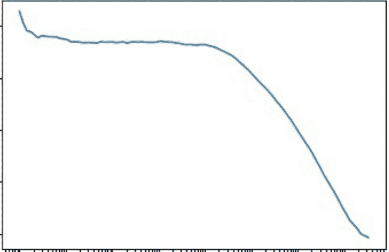

```
learner.fit_one_cycle(3, lr_max=1e-1)
```

| 轮次 | 训练损失 | 验证损失 | 精度 | 时间 |
|---:|---:|---:|---:|---:|
| 0 | 0.217267 | 0.193750 | 0.941200 | 00:13 |
| 1 | 0.126608 | 0.071124 | 0.977700 | 00:13 |
| 2 | 0.068815 | 0.040613 | 0.986600 | 00:13 |

所以我们可以看到，我们得到的结果与第一个模型几乎相同，但架构看起来更直接。

#### 2.2.7 创建 ResNet 模型架构

所有 ResNet 变体（ResNet34、ResNet50 等）都是由一个名为 **ResBlock** 的层构建的。残差块的思想是将两个卷积层连接起来并加上原始层。

这张图片借鉴自一篇关于残差网络架构的优秀教程：[https://towardsdatascience.com/residual-blocks-building-blocks-of-re](https://towardsdatascience.com/residual-blocks-building-blocks-of-re)

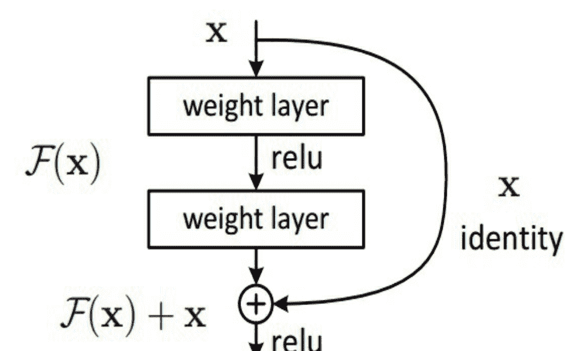

snet-fd90ca15d6ec

你可以在 fastai 中查看 ResBlock 的源代码：??ResBlock。

但现在我们想要自己构建一个 ResBlock。我们定义一个继承自 fastai Module 的类 ResBlock。这就是为什么我们只需要重写构造函数（__init__）和 forward 方法。

所以如果我们想要查看 Module 的实现，再次我们只需调用 ?? Module。

```
class ResBlock(Module):
def __init__(self, number_filters: int):
    self.conv1 = ConvLayer(number_filters, number_filters)
    self.conv2 = ConvLayer(number_filters, number_filters)

def forward(self, x):
    return x + self.conv2(self.conv1(x))
```

我们使用这个 ResBlock 并将其添加到上一个模型中的 conv2 层之间。这提供了一个相当复杂的模型架构。

```
model = nn.Sequential(
```
```
conv2(1, 8),
ResBlock(8),
conv2(8, 16),
ResBlock(16),
conv2(16, 32),
ResBlock(32),
conv2(32, 16),
ResBlock(16),
conv2(16, 10),
Flatten()
)
model
Sequential( (0): ConvLayer( (0): Conv2d(1, 8, kernel_size=(3, 3), stride=(2, 2), padding=(1, 1), bias=False) (1): BatchNorm2d(8, eps=1e-05, momentum=0.1, affine=True, track_running_stats=True) (2): ReLU() ) (1): ResBlock( (conv1): ConvLayer( (0): Conv2d(8, 8, kernel_size=(3, 3), stride=(1, 1), padding=(1, 1), bias=False) (1): BatchNorm2d(8, eps=1e-05, momentum=0.1, affine=True, track_running_stats=True) (2): ReLU() ) (conv2): ConvLayer( (0): Conv2d(8, 8, kernel_size=(3, 3), stride=(1, 1), padding=(1, 1), bias=False) (1): BatchNorm2d(8, eps=1e-05, momentum=0.1, affine=True, track_running_stats=True) (2): ReLU() ) ) (2): ConvLayer( (0): Conv2d(8, 16, kernel_size=(3, 3), stride=(2, 2), padding=(1, 1), bias=False) (1): BatchNorm2d(16, eps=1e-05, momentum=0.1, affine=True, track_running_stats=True) (2): ReLU() ) (3): ResBlock( (conv1): ConvLayer( (0): Conv2d(16, 16, kernel_size=(3, 3), stride=(1, 1), padding=(1, 1), bias=False) (1): BatchNorm2d(16, eps=1e-05, momentum=0.1, affine=True, track_running_stats=True) (2): ReLU() ) (conv2): ConvLayer( (0): Conv2d(16, 16, kernel_size=(3, 3), stride=(1, 1), padding=(1, 1), bias=False) (1): BatchNorm2d(16, eps=1e-05, momentum=0.1, affine=True, track_running_stats=True) (2): ReLU() ) ) (4): ConvLayer( (0): Conv2d(16, 32, kernel_size=(3, 3), stride=(2, 2), padding=(1, 1), bias=False) (1): BatchNorm2d(32, eps=1e-05, momentum=0.1, affine=True, track_running_stats=True) (2): ReLU() ) (5): ResBlock( (conv1): ConvLayer(
(0): Conv2d(32, 32, kernel_size=(3, 3), stride=(1, 1), padding=(1, 1),
bias=False) (1): BatchNorm2d(32, eps=1e-05, momentum=0.1, affine=True,
track_running_stats=True) (2): ReLU() ) (conv2): ConvLayer( (0):
Conv2d(32, 32, kernel_size=(3, 3), stride=(1, 1), padding=(1, 1), bias=False)
(1): BatchNorm2d(32, eps=1e-05, momentum=0.1, affine=True,
track_running_stats=True) (2): ReLU() ) (6): ConvLayer( (0): Conv2d(32,
16, kernel_size=(3, 3), stride=(2, 2), padding=(1, 1), bias=False) (1):
BatchNorm2d(16, eps=1e-05, momentum=0.1, affine=True,
track_running_stats=True) (2): ReLU() ) (7): ResBlock( (conv1): ConvLayer(
(0): Conv2d(16, 16, kernel_size=(3, 3), stride=(1, 1), padding=(1, 1),
bias=False) (1): BatchNorm2d(16, eps=1e-05, momentum=0.1, affine=True,
track_running_stats=True) (2): ReLU() ) (conv2): ConvLayer( (0):
Conv2d(16, 16, kernel_size=(3, 3), stride=(1, 1), padding=(1, 1), bias=False)
(1): BatchNorm2d(16, eps=1e-05, momentum=0.1, affine=True,
track_running_stats=True) (2): ReLU() ) ) (8): ConvLayer( (0): Conv2d(16,
10, kernel_size=(3, 3), stride=(2, 2), padding=(1, 1), bias=False) (1):
BatchNorm2d(10, eps=1e-05, momentum=0.1, affine=True,
track_running_stats=True) (2): ReLU() ) (9): Flatten(full=False) )

再次像之前一样，我们在构建模型时做了很多重复调用。我们想要构建一个 conv_and_res 块，将 conv2 与 ResBlock 结合起来。

```
def conv_and_res(number_in: int, number_filters: int): return
nn.Sequential(conv2(number_in, number_filters),
```
```
ResBlock(number_filters)) model = nn.Sequential(
conv_and_res(1,8),
conv_and_res(8,16),
conv_and_res(16,32),
conv_and_res(32,16),
conv2(16,10),
Flatten()
)
```

现在我们有了一种“迷你 ResNet”架构。

接下来我们使用这个模型构建学习器，找到最佳学习率并训练若干轮。你可以看到，过程始终是相同的.....我们可以


由于我们的模型架构更复杂，预计会达到更高的准确率。

```python
learner = Learner(dataloaders,
                  model,
                  loss_func=CrossEntropyLossFlat(),
                  metrics=accuracy)
```

```python
learner.lr_find()
SuggestedLRs(lr_min=0.33113112449646,
             lr_steep=0.25118863582611084)
```

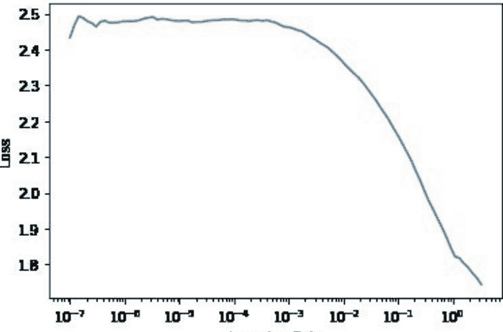

```python
learner.fit_one_cycle(3, lr_max=1e-1)
```

| 轮次 | 训练损失 | 验证损失 | 准确率 | 时间 |
|---|---|---|---|---|
| 0 | 0.162144 | 0.217495 | 0.931700 | 00:14 |
| 1 | 0.080546 | 0.071929 | 0.976100 | 00:14 |
| 2 | 0.040013 | 0.025664 | 0.991300 | 00:14 |

太棒了！我们的模型仅运行了 4 个训练轮次后，准确率就达到了约 0.99。不过，对于 ResNet 来说，MNIST 数据确实是一个非常简单的任务。

### 2.3 深入探究源代码

在第一章中，我们使用了 `cnn_learner` 函数。但这个函数具体做了什么呢？在 Jupyter Notebook 中，有一个非常方便的功能：只需在任何类或方法名称前面加上双问号，就可以直接进入源代码。根据你所运行的环境，notebook 的帮助信息会以浮动窗口的形式打开，或显示在 notebook 底部。

```python
??cnn_learner
```

有时这可能有点难读——尤其是对于较长的类。不过我们可以看到几个部分：

- **签名：** 这里显示了构造函数的所有参数和默认值
- **源码：** 显示实现
- **文件：** 显示包含源代码的文件路径
- **类型：** 显示实现的类型

我们可以直接进入 fastai 仓库，打开 vision 包中的 `learner.py` 文件。这是链接（*这个链接将来可能会改变*）：https://github.com/fastai/fastai/blob/master/fastai/vision/learner.py

如果我们分析源代码，就会看到幕后发生的事情：

- 1. 函数获取一些模型架构：`meta = model_meta.get(arch, _default_meta)`
- 2. 它构建模型：`model = create_cnn_model(arch, n_out, ifnone(cut, meta['cut']), pretrained, n_in=n_in, y_range=y_range, **config)`
- 3. 它从基础 `Learner` 类创建一个实例：`learn = Learner(dls, model, loss_func=loss_func, splitter=ifnone(splitter, meta['split']), **kwargs)`

现在，如果我们想进一步研究，可以查看 `Learner` 做了什么。

由于 fastai 是使用名为 `nbdev` 的库开发的，因此每个类都有一个对应的 notebook，其中包含源代码、文档以及一些测试用例，你可以打开该 notebook 运行这些用例。

只需进入仓库的 `nbs` 文件夹，然后打开 `21_vision.learner.ipynb` 文件即可。

我会从那里复制一些源代码，但请记住，每次 fastai 库更新时，这个 notebook 都会被修改，所以我复制的源代码可能与仓库中的最新版本有所不同。

我们再来看另一个例子。我们已经使用过 `PILImageBW` 类。现在，让我们使用 `??PILImageBW` 命令来研究这个类。我们可以看到这个类是在一个名为 `...vision/core.py` 的文件中实现的。让我们打开相应的 notebook 文件：`... nbs/07_vision.core.ipynb`。

```python
??PILImageBW
```

```
Init signature: PILImageBW(self)
Docstring:
This class represents an image object. To create
:py:class:`PIL.Image.Image` objects, use the appropriate factory
functions. There's hardly ever any reason to call the Image constructor
directly.

* :py:func:`PIL.Image.open`
* :py:func:`PIL.Image.new`
* :py:func:`PIL.Image.frombytes`
Source: class PILImageBW(PILImage): _show_args, _open_args = {'cmap':'Greys'}, {'mode':'L'}
File: ~/anaconda3/envs/fastai2/lib/python3.7/site-packages/fastai2/vision/core.py
Type: BypassNewMeta
Subclasses:
```

我们看到 `PILImageBW` 建立在 `PILImage` 类之上，而 `PILImage` 又建立在 `PILBase` 类之上：

```python
class PILImage(PILBase): pass

class PILImageBW(PILImage):
    _show_args, _open_args = {'cmap':'Greys'}, {'mode': 'L'}

class PILBase(Image.Image, metaclass=BypassNewMeta):
    _bypass_type = Image.Image
    _show_args = {'cmap':'viridis'}
    _open_args = {'mode': 'RGB'}

    @classmethod
    def create(cls, fn:(Path,str,Tensor,ndarray,bytes), **kwargs)->None:
        "Open an `Image` from path `fn`"
        if isinstance(fn, TensorImage): fn = fn.permute(1,2,0).type(torch.uint8)
        if isinstance(fn, Tensor): fn = fn.numpy()
        if isinstance(fn, ndarray): return cls(Image.fromarray(fn))
        if isinstance(fn, bytes): fn = io.BytesIO(fn)
        return cls(load_image(fn, **merge(cls._open_args, kwargs)))

    def show(self, ctx=None, **kwargs):
        "Show image using `merge(self._show_args, kwargs)`"
        return show_image(self, ctx=ctx, **merge(self._show_args, kwargs))

    def __repr__(self):
        return f'{self.__class__.__name__} mode={self.mode} size={"x".join([str(d) for d in self.size])}'
```

fastai 框架中所有可用的类型都遵循这种模式。我们可以为类型使用一个基类，该基类提供 `create` 和 `show` 方法。

`create` 方法负责完成所有准备工作，并将数据转换为张量。然后，它将张量数据转换为可供 matplotlib 库查看或可视化的形式。

如果我们查看基类型 `TensorPoint` 类，也会看到同样的模式：

```python
class TensorPoint(TensorBase):
    "Basic type for points in an image"
    _show_args = dict(s=10, marker='.', c='r')

    @classmethod
    def create(cls, t, img_size=None)->None:
        "Convert an array or a list of points `t` to a `Tensor`"
        return cls(tensor(t).view(-1, 2).float(), img_size=img_size)

    def show(self, ctx=None, **kwargs):
        if 'figsize' in kwargs: del kwargs['figsize']
        x = self.view(-1,2)
        ctx.scatter(x[:, 0], x[:, 1], **{**self._show_args, **kwargs})
        return ctx
```

我们有一个 `create` 方法，它接受一个点列表和一个可选的图像大小，并返回形状为 (-1, 2) 的张量。`show` 方法只是创建这些点的散点图，并将该图返回给调用者。

## 第3章：SGD – 随机梯度下降

本章将讨论 SGD（即随机梯度下降，stochastic gradient descent）。深度模型就是这样学习拟合给定数据的。我们将通过线性回归把一堆点拟合成一条直线，来学习这个优化器。

```python
from fastai.basics import *
```

现在让我们创建 100 个数据点，稍后将其拟合成一条直线。

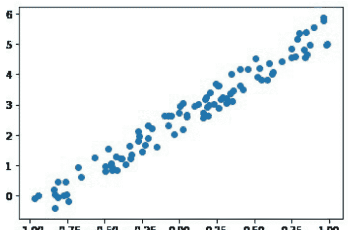

现在我们想要拟合一条直线。这意味着我们的模型应该最小化均方误差。让我们定义损失函数：均方误差。

```python
def mse(y_hat, y):
    return ((y_hat-y)**2).mean()
```

我们可以运行模型并进行预测，比如说 `a = tensor(.5, .75)`（这是我们对权重的初始化）。我们的模型将进行预测并计算误差。

```python
a = tensor(0.5, .75)
y_pred = x@a
error = mse(y_pred, y)
error
```

```text
tensor(5.4162)
```

那么这意味着什么呢？我们的模型产生了约 5.41 的误差。为了清楚地展示模型做了什么，我们可以绘制 y 点和预测的 y 值，以便更好地理解。

```python
plt.scatter(x[:,0], y)
plt.scatter(x[:,0], y_pred)
```

<matplotlib.collections.PathCollection at 0x7f28b0578d10>

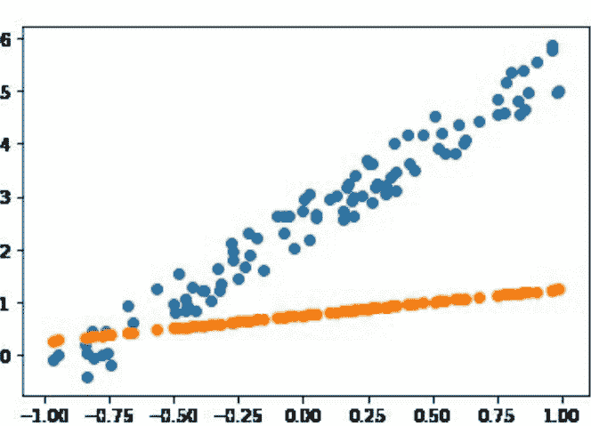

所以模型拟合得并不好，这当然是因为我们用随机的参数值初始化了权重。我们需要迭代并调整权重（训练我们的模型）。

### 3.1 模型优化器

在优化过程中，我们的目标是最小化误差（由损失函数 mse 计算）。优化器从一些随机参数开始，计算梯度，并对参数进行一些调整。接下来，我们重复这一步骤，直到误差小于某个值 epsilon 或达到固定的轮次数。（https://en.wikipedia.org/wiki/Stochastic_gradient_descent）

首先，让我们创建这个参数：

```python
a = nn.Parameter(a); a
```

```text
Parameter containing:
tensor([0.5000, 0.7500], requires_grad=True)
```

现在我们必须实现我们的更新函数，该函数检查参数 a 的当前值是否能改善训练结果。如果能，就朝这个方向移动。

```python
def update():
    y_hat = x@a
    loss = mse(y, y_hat)
```


```python
if i % 10 == 0: print("training loss: "+str(loss)) loss.backward()
with torch.no_grad():

a.sub_(lr * a.grad)
a.grad.zero_()
```

在PyTorch中，函数名中带有下划线的所有函数都会直接修改调用对象上的值。

`torch.no_grad()` 会将我们的梯度切换为评估模式。不会进行任何计算。`a.sub_` 从我们的参数中减去梯度 * 学习率，而方法 `a.grad.zero_()` 则用于将梯度归零。

现在我们将运行更新函数100个周期（记住我们每10次迭代打印一次损失）：

```python
lr = 1e-1
for i in range(100): update()
```

training loss: tensor(5.4162, grad_fn=) training loss: tensor(0.5981, grad_fn=)
training loss: tensor(0.2427, grad_fn=) training loss: tensor(0.1421, grad_fn=)
training loss: tensor(0.1099, grad_fn=) training loss: tensor(0.0996, grad_fn=)
training loss: tensor(0.0963, grad_fn=) training loss: tensor(0.0953, grad_fn=)
training loss: tensor(0.0950, grad_fn=) training loss: tensor(0.0948, grad_fn=)

现在我们可以绘制新直线，并将其与运行梯度下降优化器之前的直线进行比较。橙色的是新的优化直线——更好地拟合了我们的数据点。

```python
plt.scatter(x[:,0],y)
plt.scatter(x[:,0], (x@a).detach()) # detach() 移除所有梯度
plt.scatter(x[:,0],y_pred)
<matplotlib.collections.PathCollection at 0x7f28b054d7d0>
```

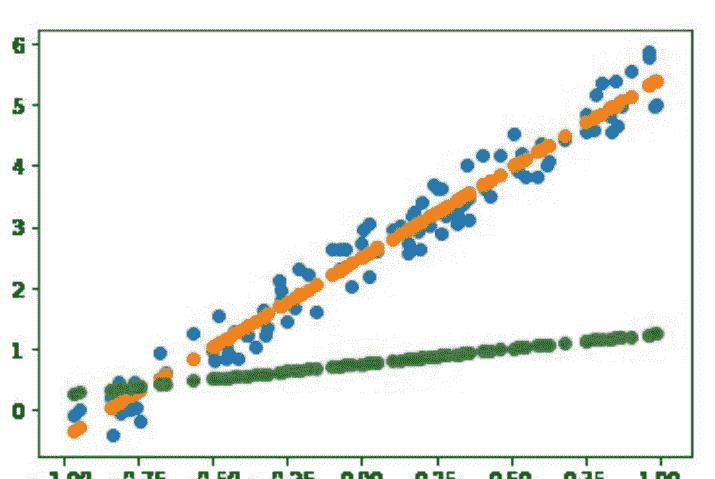

### 3.2 动画

如果你正在使用Jupyter notebook，你可以使用动画来展示模型拟合的演变过程。

```python
from matplotlib import animation, rc
rc('animation', html='jshtml')
a = nn.Parameter(tensor(0.5, 0.75)); a
```

Parameter containing: tensor([0.5000, 0.7500], requires_grad=True)

```python
def animate(i):
update()
line.set_ydata((x@a).detach())
return line,
```

现在我们创建基础图形并让动画动起来。

```python
fig = plt.figure()
plt.scatter(x[:,0], y, c='orange')
line, = plt.plot(x[:,0], (x@a).detach())
plt.close()
```

```
```python
→ pref=f'{planet_source}/train/',
suff='.jpg'),
splitter=RandomSplitter(),
get_y=ColReader(1,

label_delim=''),
batch_tfms=batch_tfms)
```
```

下一步：将数据框传入数据加载器并显示一个示例批次：

```
```python
dataloaders = planet.dataloaders(df)
dataloaders.show_batch(max_n=4, figsize=(9, 12))
```
```

clear;primary;road;water

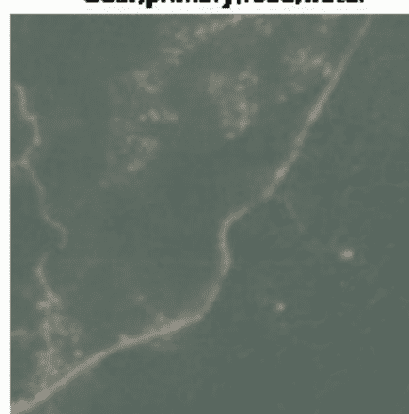

clear;primary

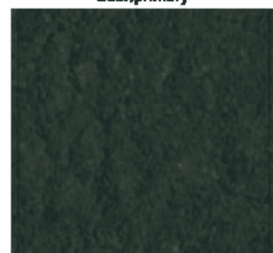

clear;primary

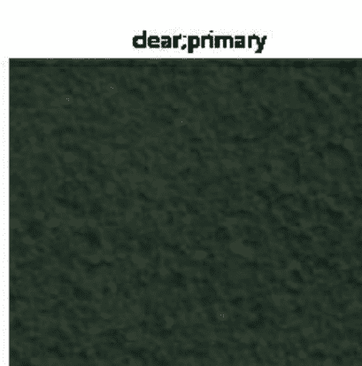

haze;primary;water

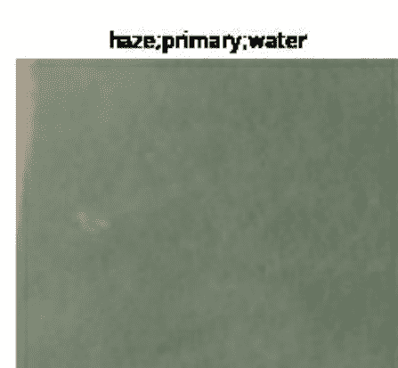

### 4.2 使用不同方法——利用 lambda 表达式

现在我们要将 DataBlock 转换为使用 lambda 表达式替代 ColumnReader。

```python
blocks = (ImageBlock, MultiCategoryBlock)
```

### 我们如何获取 x 值？

我们需要一个 lambda 函数，它返回一个指向单个图像的路径对象。

让我们使用新的 Python 字符串 API：

```python
f'{x[0]}.jpg'
```

注意，这里的 x 是实际传递给数据加载器的对象。我们已经看到，我们数据中的一项包含图像的路径和一个包含所有关联标签（以空格分隔）的字符串。让我们验证一下：

```python
get_x = lambda x:planet_source/'train'/f'{x[0]}.jpg' val = df.values[0]; val array(['train_21983', 'partly_cloudy primary'], dtype=object)
```

这里我们使用图像 train_21983，它应当关联标签 partly_cloudy 和 primary。如果我们从这个数据项中提取 x 值，我们期望得到这样一个路径：

```python
.../train/train_21983.jpg
```

get_x(val)
Path('/home/bmayr/.fastai/data/planet_sample/train/train_21983.jpg') ...
正是我们预期的结果。
为了获取 y 值，我们只需将字符串按空格分割。

```python
get_y = lambda x:x[1].split()
```

```python
get_y(val)
['partly_cloudy', 'primary']
```

使用 lambda，我们可以提供一种干净且更*Pythonic*的方式，通过 DataBlock API 读取数据。让我们完成 DataBlock 的构建，将其放入数据加载器并查看一个示例批次。

```python
planet = DataBlock(blocks=blocks,
get_x=get_x,
```

```
```python
splitter=RandomSplitter(),
get_y=get_y,
batch_tfms=batch_tfms)

dataloaders = planet.dataloaders(df)
dataloaders.show_batch(max_n=4, figsize=(9, 12))
```
```

### 4.3 第三种方法——使用自定义 get_items 函数

如果我们已经改善了代码风格，我们总是会问，*我们能做得更好吗？*

现在，我们想要借助自定义的 get_items 函数将 lambda 表达式转换为单行代码，该函数将我们的 get_x 和 get_y 函数整合在一起。

clear;primary


agriculture;clear;primary

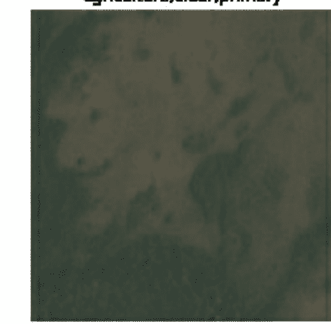

clear;primary


agriculture;partly_cloudy;primary

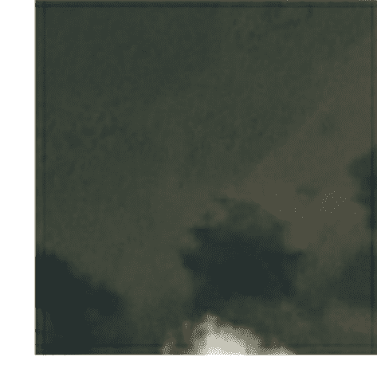

函数名中的下划线前缀是PyTorch风格，表示这些函数都进行就地修改，而不仅仅是返回新值！

函数 `_planet_custom_items(x)` 返回一个元组，其中包含图像文件的路径对象和属于该特定图像的字符串标签列表。

```
```python
def _planet_custom_items(x): return (
    f'{planet_source}/train/'+x.image_name+'.jpg',
    x.tags.str.split()

)
```
```

现在让我们重新定义我们的数据块。请注意，我们传入的是自定义项函数作为函数，而不是函数类。

```
```python
planet = DataBlock.from_columns(blocks=blocks,
    get_items=_planet_custom_items, splitter=RandomSplitter(),
    batch_tfms=batch_tfms)
```
```

创建数据加载器，并通过验证一个随机批次来确保一切正常。

```
```python
dataloaders = planet.dataloaders(df)
dataloaders.show_batch(max_n=4, figsize=(12, 12))
```
```

agriculture;clear;cultivation;habitation;primary;road;water

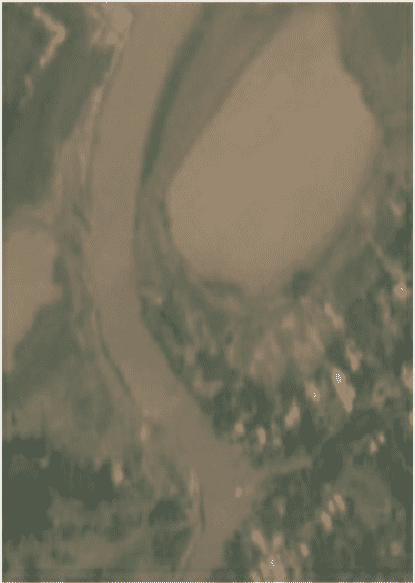

agriculture;clear;primary;water

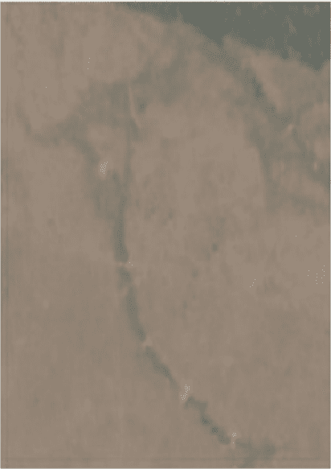

clear;primary

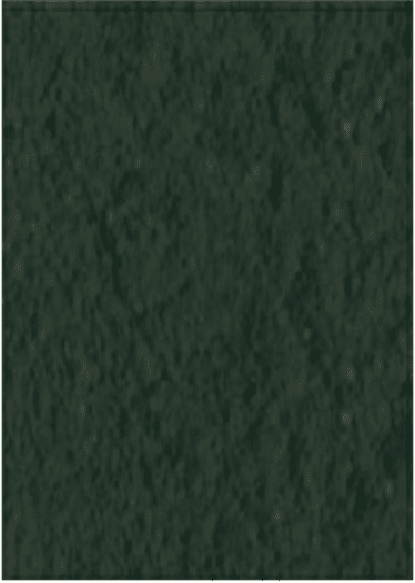

partly_cloudy;primary

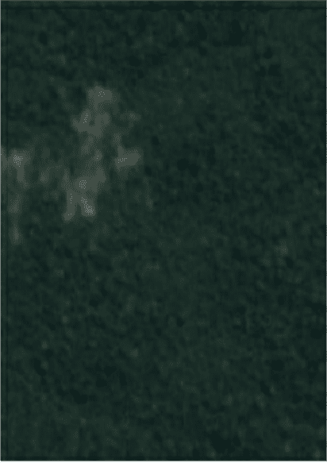

... 按预期工作

### 4.4 创建并训练模型

对于模型创建，我们使用预训练的 ResNet34 架构。由于我们的模型应该进行多标签分类，我们希望在训练期间使用 accuracy_multi 作为度量函数。

所有其他步骤将与单标签分类相同：

- 1. 创建数据加载器（将我们的模型架构和 accuracy_multi 度量函数传递给它）
- 2. 使用 lr_find() 找到一个好的学习率
- 3. 通过调用 fit_on_cycle() 训练几个周期

```python
from torchvision.models import resnet34
from fastai.metrics import accuracy_multi
```

```python
learner = cnn_learner(dataloaders,
resnet34,
pretrained=True,
metrics=[accuracy_multi])
```

当检测多个标签时，我们的模型不会使用 softmax 来确定概率最高的标签，而是需要一个阈值，来返回任何概率高于该阈值的标签。

我们还改进了损失函数，并使用 BCEWithLogitsLossFlat()。这类似于 CrossEntropyLoss，但会展平输入和目标。BCEWithLogitsLoss 建立在 Sigmoid 之上，而 Sigmoid 在数值上是不稳定的。因此，我们需要添加类似的损失模块来解决这个数值不稳定的问题。

参见：https://dev.fast.ai/layers.html#BCEWithLogitsLossFlat class
BCEWithLogitsLossFlat(BaseLoss):
"与 `nn.CrossEntropyLoss` 相同，但会展平输入和
→ 目标。"
def __init__(self, *args, axis=1, floatify=True,

```
```python
→ thresh=0.5, **kwargs):
super().__init__(nn.BCEWithLogitsLoss,
*args,
axis=axis,
floatify=floatify,
is_2d=False,
**kwargs)
self.thresh = thresh

def decodes(self, x): return x>self.thresh
def activation(self, x): return torch.sigmoid(x)
```
```

上面的代码展示了损失函数的实现。我们首先计算 sigmoid 激活：return torch.sigmoid(x)，然后检查值是否高于阈值。这样，我们就能够为我们的数据检测多个标签。

```
```python
learner.loss_func = BCEWithLogitsLossFlat()
learner.lr_find()
```
```

如果我们将模型切换为*混合精度*，我们的模型训练速度会稍快一些。

```
```python
lr = 1e-2
learner = learner.to_fp16()
learner.fit_one_cycle(5, slice(lr))
```
```

| epoch | train_loss | valid_loss | accuracy_multi | time |
|---:|---:|---:|---:|---:|
| 0 | 0.950392 | 0.850503 | 0.554118 | 00:04 |
| 1 | 0.720215 | 0.239568 | 0.929118 | 00:03 |
| 2 | 0.508768 | 0.169727 | 0.942647 | 00:03 |
| 3 | 0.389080 | 0.154983 | 0.945000 | 00:03 |
| 4 | 0.316210 | 0.152061 | 0.945588 | 00:03 |

```
```python
learner.save('stage-1')
```
```

现在我们解冻模型并再训练几个周期。

```
```python
learner.unfreeze()
learner.lr_find()
(0.00010000000474974513, 5.248074330665986e-07)
```


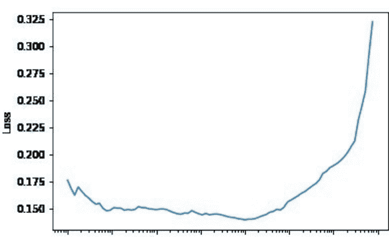

哇！我们应该选择哪个学习率？这看起来不像 lr_find() 的典型图。我会选择 1e-5 作为起点，因为在这个点上函数持续稳定下降。对于第二个值，我选择前一个学习率除以 5 ——作为经验法则。

当然你也可以尝试不同的值并检查模型是否训练得更快。找到合适的学习率往往有点像艺术...

```
learner.fit_one_cycle(5, slice(1e-5, lr/5))
```

| epoch | train_loss | valid_loss | accuracy_multi | time |
| 0 | 0.151312 | 0.145205 | 0.947647 | 00:04 |
| 1 | 0.139855 | 0.148743 | 0.946471 | 00:04 |
| 2 | 0.133714 | 0.146716 | 0.949412 | 00:04 |
| 3 | 0.124596 | 0.142307 | 0.948529 | 00:04 |
| 4 | 0.114884 | 0.139296 | 0.949412 | 00:04 |

现在我们想看看模型产生的一些结果：

```
learner.show_results(figsize=(15, 15))
```

deer;primary
deer;primary

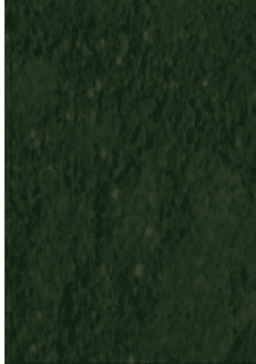

clear;primary;water
deer;primary;water

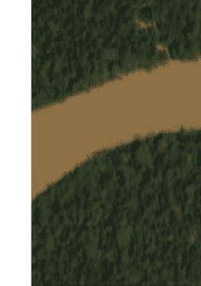

agriculture;clear;cultivation;primary
agriculture;clear;cultivation;primary

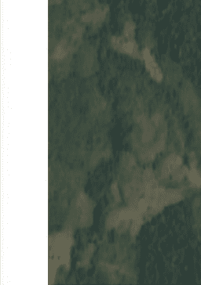

bare_ground;partly_cloudy;primary
partly_cloudy

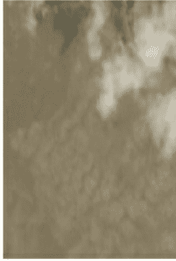

cloudy
cloudy

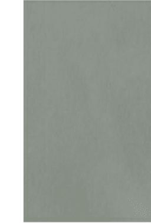

deer;primary
deer;primary

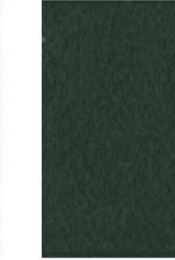

agriculture;cultivation;partly_cloudy;primary;water
agriculture;clear;cultivation;primary

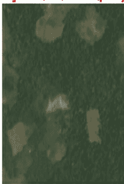

deer;primary
deer;primary

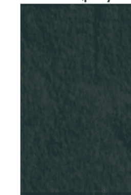

deer;primary
deer;primary

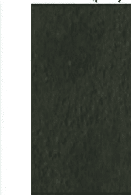

## 第 5 章
### 使用多分类改进我们的宠物分类器

早期的宠物分类器工作得不错，但有一个很大的缺点：它总是将图像预测/分类为狗或猫 ——即使是象。

我们可以通过使用带阈值的多分类分类器来解决这个问题。因为如果任何标签的阈值未超过设定值，我们的模型将不做预测。

让我们重构我们的狗/猫品种分类器！
首先解压数据集：

```
path = untar_data(URLs.PETS)/'images'
```

但现在我们的分类器期望训练图像的标签是一个列表。因此，我们必须在输入批次之前将 y 值转换为列表，并将此转换传递到 DataBlock 的 get_y 函数中。

```
def multi_l(l): return [l]

pets = DataBlock(blocks=blocks,
    get_items=get_image_files,
    splitter=RandomSplitter(),
    get_y=[RegexLabeller(pat=r'([^/]+)_\d+.jpg$'),
        multi_l],
    item_tfms=RandomResizedCrop(460,
        min_scale=0.75),
```

```
batch_tfms=[*aug_transforms(size=224,
max_warp=0.),
Normalize.from_stats(*imagenet_stats)])

dataloaders = pets.dataloaders(path, bs=32)
dataloaders.show_batch(max_n=9, figsize=(9,6))
```

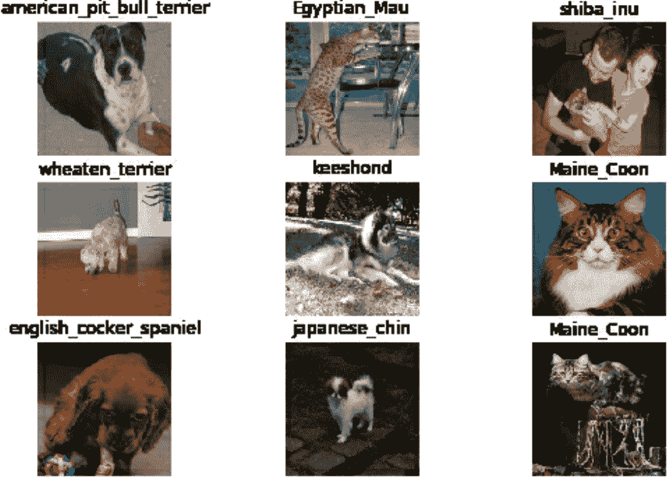

```
learner = cnn_learner(dataloaders, resnet34, pretrained=True, metrics=
[partial(accuracy_multi, thresh=0.1)],
loss_func=BCEWithLogitsLossFlat())
```

请注意，在创建学习器时我们必须定义一个阈值：metrics=[partial(accuracy_multi, thresh=0.1)]。这意味着我们的分类器必须对某个类别的预测概率超过 90%。

```
learner.fit_one_cycle(4)
epoch train_loss
```

```
0 0.728382
```

1 0.106489
2 0.045471
3 0.037853
valid_loss accuracy_multi time

0.344100 0.096240 00:25
0.035650 0.978459 00:25
0.023137 0.986395 00:25
0.021772 0.987346 00:25

learner.show_results(figsize=(15, 15)) CHAPTER 5. IMPROVE OUR PET CLASSIFIER WITH MULTI-CLASSIFICATION

现在我们可以尝试另一张图像 ——比如大象。只需抓取你喜欢的任何图像并通过 learner.predict('pathToImage')[0] 传递给分类器。你的学习器应该返回一个空列表，因为它没有在大象图像上训练过！

## 第 6 章
### 交叉验证

交叉折叠验证是一种将数据拆分为 n 个部分进行每次训练的技术。在每一轮中，你只需使用 n-1 个部分进行训练，一个部分用于验证。这确保你永远不会使用相同的数据进行训练和验证，并且你可以使用所有训练数据进行训练，因为你不必永久拆分为训练和验证数据。

这意味着同一个示例在某一轮中可能在训练集，而在另一轮中在验证集。
为了展示这一点，我们将使用 Imagewoof 训练数据。当我们构建自己的模型架构时，我们将更深入地研究 imagewoof

```
from fastai.basics import *
from fastai.vision.all import *
from fastai.callback.all import *
```

我们使用方便的 untar_data 数据函数来下载训练数据。

```
path = untar_data(URLs.IMAGEWOOF)
path.ls()
(#2) [Path('/home/bmayr/.fastai/data/imagewoof2/val'),
Path('/home/bmayr/.fastai/data/imagewoof2/train')]
```

现在我们创建 batch_transforms 和 item_transforms：

```
batch_tfms = [IntToFloatTensor(),
*aug_transforms(size=224, max_warp=0.),
Normalize.from_stats(*imagenet_stats)]
```

```
item_tfms = [ToTensor(),
RandomResizedCrop(460, min_scale=0.75,
ratio=(1.,1.))]
bs = 64
```

对于此模型，我们将使用 IndexSplitter：让我们查看 IndexSplitter 的帮助文本：??IndexSplitter.

```
??IndexSplitter
```

```
Signature: `IndexSplitter(valid_idx)`

Source:
```python
def IndexSplitter(valid_idx):
    "Split items so that valid_idx are in the validation set and the others in the training set"
    def _inner(o):
        train_idx = np.setdiff1d(np.array(range_of(o)), np.array(valid_idx))
        return train_idx, valid_idx
    return _inner
```

File: `/home/.../fastai/vision/.../data/transforms.py`

Type: `function`
```

接下来我们将数据放入训练集和测试集（用于最终模型）。我们可以使用 fastai 的 get_image_files 方法，并按文件夹名称拆分为训练集和验证集。这稍后将成为我们的测试集。

```
train_images = get_image_files(path/'train')
test_images = get_image_files(path/'val')
```

现在对训练集中的图像进行洗牌。

```
random.shuffle(train_images)
```

我们希望使用 80% 的训练数据进行训练，20% 

用于验证。

```
val_pct = .2
start_val = len(train_images) - int(len(train_images)*val_pct)
```

现在我们创建一个包含训练集和验证集中所有图像索引的列表，并将其用于我们的 IndexSplitter。

```
idxs = list(range(start_val, len(train_images)))
splits = IndexSplitter(idxs)
split = splits(train_images)
```

在 fastai 中，你可以使用数据加载器管理无限数量的数据集，而不仅仅是训练、验证和测试集。首先，我们想将拆分转换为列表，并添加索引高于训练图像的图像。这些将是我们的测试图像。

```
split_list = [split[0], split[1]]
split_list.append(L(range(len(train_images), len(train_images)+len(test_images))))
split_list
```

```
[(#7220) [0,1,2,3,4,5,6,7,8,9...], (#1805)
[7220,7221,7222,7223,7224,7225,7226,7227,7228,7229...],
(#3929)
[9025,9026,9027,9028,9029,9030,9031,9032,9033,9034...]]
```

```
len(split_list[0])+len(split_list[1])

9025
```

到目前为止，我们已有超过 7000 张图像用于训练，近 2000 张用于验证，还有近 4000 张用于测试我们的模型。现在我们可以创建我们的数据集。使用 fastai 数据集，我们只需将 train_images 和 test_images 相加并将总和传递到数据集中。

我们必须对图像应用一些转换。首先运行 PILImage.create 从文件名创建图像，然后通过 parent_label 应用标签并进行分类。

如果我们调用 show_at 方法，我们可以检查数据集中任何值。


```python
datasource = Datasets(train_images + test_images,
                      tfms=[[PILImage.create],
                            [parent_label, Categorize]],
                      splits=split_list)
show_at(datasource.train, 1)
```

<matplotlib.axes._subplots.AxesSubplot at 0x7f7ca41468d0>

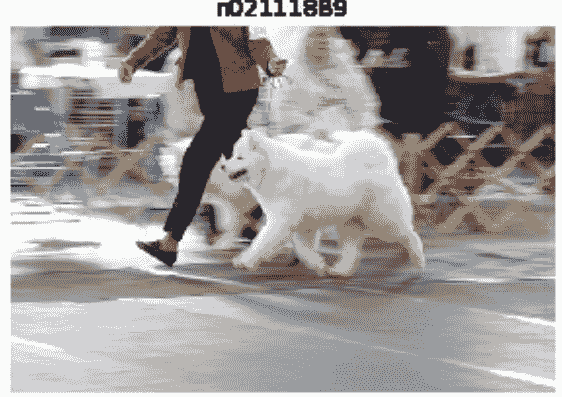

```python
datasource.n_subsets
```
```
3
```

现在我们可以创建 dataloaders。

```python
dataloaders = datasource.dataloaders(bs=bs,
                                     after_item=item_tfms,
                                     after_batch=batch_tfms)
```

```python
dataloaders.show_batch(figsize=(8,8))
```

```python
pretrained=False,
metrics=accuracy).to_fp16()
learner.fit_one_cycle(1)
```

| 周期 | 训练损失 | 验证损失 | 准确率 | 时间 |
|-------|------------|------------|----------|------|
| 0 | 2.812563 | 2.161600 | 0.219945 | 00:36 |

现在我们可以调用 validate 来检查模型在 datasource 的测试数据上的结果——这里是 datasource 对象的索引 2。

```python
learner.validate(ds_idx =2)
```

```
(#2) [2.1629929542541504, 0.2260117083787918]
```

嗯，这确实不是一个好模型。但它应该仅仅作为一个基线。我们将尝试使用交叉验证模型来做得更好。

### 6.2 构建交叉验证模型

```python
from sklearn.model_selection import StratifiedKFold
```

我们使用 sklearn 模块中的 KFold 来进行图像数据的切分。首先，我们必须创建一个 K-Fold 对象。我们告诉 K-Fold 我们需要 10 个切分（或 10 个模型）。

但在切分之前，我们必须创建数据中所有标签的列表。由于我们将使用训练数据和测试数据进行训练，因此需要运行两次循环。一次针对训练数据的标签，另一次针对 datasource 中验证数据的标签。

```python
train_labels = L()
for i in range(len(datasource.train)):
    train_labels.append(datasource.train[i][1])

for i in range(len(datasource.valid)):
    train_labels.append(datasource.valid[i][1])

train_labels
```

```
(#9025) [TensorCategory(0), TensorCategory(8), TensorCategory(2),
         TensorCategory(9), TensorCategory(8), TensorCategory(4),
         TensorCategory(6), TensorCategory(0), TensorCategory(7),
         TensorCategory(2)...]
```

断言训练图像列表和标签列表中的元素数量相等。

```python
assert (len(datasource.train) + len(datasource.valid)) == len(train_images)
assert len(train_images) == len(train_labels)
```

我们想要进行分层切分，以确保所有子模型都与原始模型相似。在切分之前，我们对列表中的元素进行打乱。在 sklearn 中有 StratifiedKFold 和 StratifiedShuffleSplit。

如果我们使用 KFold，通常不希望任何测试集重叠，即使在打乱之后也是如此。因此，我们对数据进行一次打乱，然后使用 KFold 将其切分成多个模型。测试数据始终位于其中一个切分中，其余数据属于训练数据集。

如果我们使用 ShuffleSplit，每次切分时数据会再次打乱。这可能导致测试数据集在切分之间重叠。

```python
import random
random.shuffle(train_images)
k_folds_strat = StratifiedKFold(n_splits=5, shuffle=True)
```

现在我们可以创建训练循环。我们对每个 KFold 切分训练模型 1 个 epoch。

首先，我们在之前创建的验证索引上创建一个 IndexSplitter。我们使用这个分割器再次切分训练图像。和之前一样，我们将训练和验证数据合并到一个列表中，并追加测试数据的索引。

接下来，我们创建数据集，并通过 splits 参数将我们的切分传入数据集。然后我们从 datasource 创建 dataloaders，创建 cnn_learner，并训练一个 epoch。这次我们为所有 KFold 切分进行训练，因此我们希望跟踪测试数据集上原始预测的验证准确率。我们可以通过索引 datasource 将测试数据传递给 get_pred(ds_idx=2) 方法——记住这一点。当然，对于像 Kaggle 这样的任何竞赛，你的结果都可能从这项技术中获益良多。

## 第 7 章：FastAI —— 内部 API 概览

本章重点介绍 fastai API 的内部结构。我们将通过一个示例了解如何在完整处理管道中使用最基础的 fastai API。我们将使用 Points 对象来完成这一演示，因为这是一个非常简单的对象。

```python
from fastai.vision.all import *
```

首先，我们检查 PILImage 类，并将从头开始重建它。我们可以使用 download_url 方法轻松下载图像，只需提供图像的 url 即可。

我们使用一张来自 Wikimedia 的狗的图像。

```python
img_url = 'https://upload.wikimedia.org/wikipedia/commons/d/d6/Thai-Ridgeback.jpg'
img_path = Path('images/dog.jpg')
download_url(img_url, img_path)
```

### 7.1 PILImage 类

现在回到 PILImage 类。这个类包含什么？让我们打开代码：??PILImage。

```python
??PILImage
class PILImage(PILBase): pass
```

哇，这个类内部的代码不多。实际上，PILImage 只是 PILBase 上的一个包装类。让我们深入探讨一下：

```python
class PILBase(Image.Image, metaclass=BypassNewMeta):
    _bypass_type = Image.Image
    _show_args = {'cmap': 'viridis'}
    _open_args = {'mode': 'RGB'}

    @classmethod
    def create(cls, fn: (Path, str, Tensor, ndarray, bytes), **kwargs) -> None:
        "Open an `Image` from path `fn`"
        if isinstance(fn, TensorImage):
            fn = fn.permute(1, 2, 0).type(torch.uint8)
        elif isinstance(fn, Tensor):
            fn = fn.numpy()
        if isinstance(fn, ndarray):
            return cls(Image.fromarray(fn))
        if isinstance(fn, bytes):
            fn = io.BytesIO(fn)
        return cls(load_image(fn, **merge(cls._open_args, kwargs)))

    def show(self, ctx=None, **kwargs):
        "Show image using `merge(self._show_args, kwargs)`"
        return show_image(self, ctx=ctx, **merge(self._show_args, kwargs))
```

嗯，这个看起来更好。但这意味着什么呢？

我们希望与处理管道一起使用的所有基本对象类型都应该是这样的。它们都实现了 create 和 show 方法。create 函数负责准备要转换为张量的输入，而 show 仅负责显示输入。

让我们详细地深入了解这个类。首先是这个参数值：Image.Image。这只是 Pillow 类中的一个 Image。因此，我们认为该类具有某种 Pillow 属性。

现在，我们可以看一下 PILImage 的 create 和 show 函数对之前下载的图像会产生什么结果。因此，我们先在图像路径上调用 create，然后调用 show。

```python
img = PILImage.create(img_path)
img.show()
```

<matplotlib.axes._subplots.AxesSubplot at 0x7fcf40bc1690>

太棒了！我们像之前一样看到了狗的图像。

### 7.2 ImageBlock 函数

接下来是我们在示例中使用过的 ImageBlock 函数。这个类与 ImageBlock 函数中的 create 和 show 方法是如何关联的？

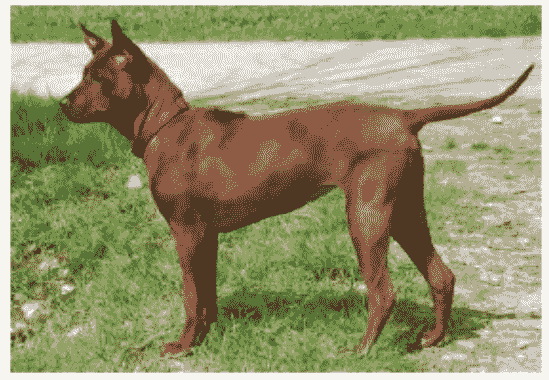

我们使用 ??ImageBlock 来更好地理解。

```python
def ImageBlock(cls=PILImage):
    return TransformBlock(type_tfms=cls.create,
                          batch_tfms=IntToFloatTensor)
```

该函数期望 PILImage 类型的对象。然后，该函数在此对象上调用 create 函数，并将结果连同批量变换（将该图像转换为浮点张量）一起传递给 TransformBlock 对象。

这个管道可以被转换为遵循 create/show 模式的类型——不仅仅是 PIL 图像。我们可以使用继承自 TransformBlock 的 DataBlock：

```python
block = TransformBlock(type_tfms=PILImage.create,
                       batch_tfms=IntToFloatTensor)
```

我们将通过 Points 来了解如何在非 Image 类型上使用该管道。

### 7.3 Points 类

首先要做的是查看源代码：??PointBlock。

```python
PointBlock = TransformBlock(type_tfms=TensorPoint.create,
                            item_tfms=PointScaler)
```

这看起来非常熟悉！PointBlock 使用了 TransformBlock。这个类使用 TensorPoint 类的 create 方法，并附加一个 PointScaler 来转换条目。

现在我们可以做进一步分析，看看 PointBlock 和 PointScaler。

**TensorPoint 类**应该将任何点列表转换为张量，无需变换，并且应该从原始数据输入生成我们可以使用的输入值。太棒了！借助到目前为止从分析中获得的专业知识，我们可以自己构建一个 TensorPoint 类。

我们的 MyTensorPoint 类应该继承自 TensorBase，这限制了我们的类返回张量对象。

```python
# we can omit the create method if we do not need the show_batch method
class MyTensorPoint(TensorBase):
    @classmethod
    def create(cls, t):
        return cls(Tensor(t).view(-1, 2).float())
```

我们的 create 函数接受一个包含点列表的参数 t。它会创建一个张量，重塑该张量并将其转换为 float 类型。我们需要 float 类型，以确保点在……时保持正确的位置。


图像已被调整大小。

*`Tensor.view(..)` 是做什么的？* 这个函数用于将任意张量重塑为指定格式。例如，如果你想将一个张量转换为 2x2 的矩阵，你可以调用 `view(2, 2)`。但如果你知道列数而不知道行数呢？这时我们使用 -1。我们调用 `view(-1, 2)` 表示：创建一个具有 2 列和所需行数的张量。

我们可以添加一个输入来跟踪图像大小：

```python
class MyTensorPoint(TensorBase):
    @classmethod
    def create(cls, t, img_size=None)->None:
        return cls(Tensor(t).view(-1, 2).float(),
                   img_size=img_size)
```

让我们用我们的狗图像来试试这个类：

```python
img.shape
(414, 601)
```

我们的图像分辨率为 414x601 像素。现在我们可以使用我们的类创建一些张量点。

```python
points = [[200, 150], [200, 200], [275, 301]]
tensor_points = MyTensorPoint(points)
tensor_points
MyTensorPoint([[200, 150], [200, 200], [275, 301]])
```

我们的类可以正常工作。我们可以看到一个有 2 列 3 行的张量（因为我们传入了一个包含 3 个项目的列表）。如果我们想显示我们的点，我们必须在我们的类中实现一个显示函数。我们将使用散点图来绘制这些点。我们假设我们向显示函数传入一个图像，并在这张图像上叠加这些点。

```python
class MyTensorPoint(TensorBase):
    _show_args = dict(s=10, marker='.', c='r')
    @classmethod
```

```python
def create(cls, t, img_size=None)->None:
    return cls(Tensor(t).view(-1,2).float(),
               img_size=img_size)

def show(self, ctx=None, **kwargs):
    if 'figsize' in kwargs: del kwargs['figsize']
    x = self.view(-1,2)
    ctx.scatter(x[:,0],
                x[:,1],
                **{**self._show_args, **kwargs})
    return ctx
```

首先，我们确保参数 `figsize` 不在参数列表中。如果它在，我们想使用这个值而不是默认值。

接下来，我们获取张量并将它们转换为具有 2 列的视图，用于存储像素值。我们使用参数 `self`，它与正在调用显示函数的对象相关联。

注意：我们不在 `create` 函数中使用 `self`，因为我们已将该函数注解为类方法。

然后我们绘制散点图并将绘图返回给调用者。让我们试一下这个函数！

```python
tensor_points = MyTensorPoint.create(points)
tensor_points.show()
```

AttributeError Traceback (most recent call last)
in 1 tensor_points = MyTensorPoint.create(points) —> 2
tensor_points.show()

```
in show(self, ctx, kwargs) 9 if 'figsize' in kwargs: del kwargs['figsize'] 10 x = self.view(-1,2) —> 11 ctx.scatter(x[:,0], 12 x[:,1], 13 **{**self._show_args, **kwargs})
```

AttributeError: 'NoneType' object has no attribute 'scatter'
**砰！** 我们遇到了一个错误：
AttributeError: 'NoneType' object has no attribute 'scatter'

但是哪里出错了呢？哦，是的——我们需要一个图像来叠加这些点。这就是 `show` 函数中的上下文参数 `ctx`。让我们这样做，并传入我们的图像作为绘制散点图的上下文。
tensor_points.show(ctx=img.show())
<matplotlib.axes._subplots.AxesSubplot at 0x7fcf40b04fd0>

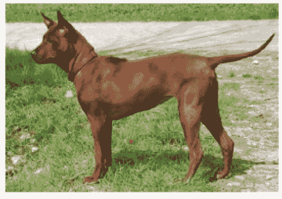

现在一切正常，我们可以看到代表张量点的红点。
**还有最后一件事**要做。我们必须为学习器添加损失函数，使其能与我们的点协同工作。
我们将变换函数包装在我们的 `Tensorpoint.create` 周围，并为其添加损失函数 `MSELossFlat`。
myTensorPointCreate = Transform(MyTensorPoint.create)
myTensorPointCreate.loss_func = MSELossFlat()
接下来，我们想用新的 `myTensorPointCreate`（我们已经将损失函数传递给它）替换原始的 `create` 函数。
MyTensorPoint.create = myTensorPointCreate
因此，我们已经冲过终点线了。现在，我们想将我们*从零开始*的解决方案与 fastai 库中的原始源代码进行比较。这是 fastai 的 TensorPoint 类：

```python
class TensorPoint(TensorBase):
"Basic type for points in an image" _show_args = dict(s=10, marker='.', c='r')

@classmethod
def create(cls, t, img_size=None)->None:
"Convert an array or a list of points `t` to a `Tensor`"
return cls(Tensor(t).view(-1, 2).float(),
img_size=img_size)
```

```python
order = 1  # Want this to occur first!
def __init__(self, do_scale=True, y_first=False):

self.do_scale, self.y_first = do_scale, y_first
```

接下来我们进行设置。我们使用 `numel` 方法来计算我们拥有的元素数量（*数量-元素*）。在我们的例子中，我们有 6 个元素（*每个点包含一个 x 坐标和一个 y 坐标*）。

```python
tensor_points.numel()
6
```

我们使用数据加载器并查找第一个项目（索引 0），然后将 `.c` 设置为对每个 `TensorPoint` 类型的元素调用 `.numel()` 的返回值。

```python
class MyPointScaler(Transform):
    order = 1  # Want this to occur first!
    def __init__(self, do_scale=True, y_first=False):

        self.do_scale, self.y_first = do_scale, y_first

    def setups(self, dl):
        its = dl.do_item(0)
        for t in its:

            if isinstance(t, TensorPoint): self.c = t.numel()
```

从这里开始，我们必须处理编码器和解码器。两者都基于这样的假设：*如果我们得到特定的类型，我们想在其上运行变换。*

我们使用一个名为 `_grab_sz` 的辅助函数来确保对象是 `Tensor` 类型（如果不是，则直接调用 `x.size`）。

```python
class MyPointScaler(Transform):
    order = 1  # Want this to occur first!
    def __init__(self, do_scale=True, y_first=False):

        self.do_scale, self.y_first = do_scale, y_first
```

```python
def setups(self, dl):
its = dl.do_item(0)
for t in its:

if isinstance(t, TensorPoint): self.c = t.numel()
def _grab_sz(self, x):
self.sz = [x.shape[-1], x.shape[-2]] if isinstance(x, Tensor) else x.size
```

现在我们只剩下一件事要完成。我们必须实现 `encode` / `decode` 函数。这两个方法（编码和解码）都接受 `PILBase` 类型的对象，`PILBase` 是 `PILImage` 的父类，因为 `PILImage` 扩展了 `PILBase`。我们通过调用 `_grab_sz(x)` 获取 `x` 的大小，然后直接返回这些值。

```python
class MyPointScaler(Transform):
order = 1 # Want this to occur first!
def __init__(self, do_scale=True, y_first=False):

self.do_scale, self.y_first = do_scale, y_first

def setups(self, dl):
its = dl.do_item(0)
for t in its:

if isinstance(t, TensorPoint): self.c = t.numel()
def _grab_sz(self, x):
self.sz = [x.shape[-1], x.shape[-2]] if isinstance(x, Tensor) else x.size

def encodes(self, x:(PILBase, TensorImageBase)): return self._grab_sz(x)
def decodes(self, x:(PILBase, TensorImageBase)): return self._grab_sz(x)
```

下一步是按照给定的图像大小缩放点。

```python
def _myScale_pnts(y, sz, do_scale=True, y_first=False): 
if y_first: y = y.flip(1)
res = y * 2/tensor(sz).float() -1 if do_scale else y 
return TensorPoint(res, img_sz=sz)
```

让我们尝试一下，将我们的图像点缩放到例如 224（imagenet 的规模）。

```python
_myScale_pnts(tensor_points, 224)
```

TensorPoint([[0.7857, 0.3393], [0.7857, 0.7857], [1.4554, 1.6875]])

结果符合我们的预期！我们的张量已缩放到图像大小 224。

让我们再做另一个例子。我们创建一个新的张量点列表，这些点恰好是我们图像的四个角点。然后我们缩放图像，看看我们的张量点的坐标是否同样被缩小了。

```python
img.shape
```

(414, 601)

```python
corner_points = [[0,0], [0,414], [601,0], [601,414]] 
corner_tps = TensorPoint.create(corner_points)
ax = img.show()
for p in corner_tps: p.show(ctx=ax)
```


现在，如果我们调整图像大小，我们的点应该与我们标记四个角之前看到的模式相匹配。

```python
scaled_tps = [_myScale_pnts(tp, 224) for tp in corner_tps]
```

scaled_tps
[TensorPoint([-1., -1.]), TensorPoint([-1.0000, 2.6964]), TensorPoint([4.3661, -1.0000]), TensorPoint([4.3661, 2.6964])]


我们在标记图像角落的点上看到了完全相同的模式——重新缩放后。接下来，我们沿着编码器/解码器结构将坐标缩放回去。

```python
def _myUnscale_pnts(y, sz):
    return TensorPoint((y+1)*tensor(sz).float()/2,
                       img_size=sz)
```

如果我们对这些点进行解码，就应该得到初始坐标！

```python
unscaled_tps = [_myUnscale_pnts(tp, 224) for tp in scaled_tps]
unscaled_tps
[TensorPoint([0., 0.]), TensorPoint([0., 414.]), TensorPoint([601., 0.]), TensorPoint([601., 414.])]
```

看起来很简单！很好！现在我们可以在新图像上变换我们的点，对其进行裁剪、缩放、旋转等操作。

这与 fastai 库中的原始代码基本相同：

```python
def _scale_pnts(y, sz, do_scale=True, y_first=False):
    if y_first:
        y = y.flip(1)
    res = y * 2/tensor(sz).float() if do_scale else y
    return TensorPoint(res, img_size=sz)
```

```python
def _unscale_pnts(y, sz):
    return TensorPoint((y+1) * tensor(sz).float()/2, img_size=sz)
```

```python
class PointScaler(Transform):
    "Scale a tensor representing points"
    order = 1

    def __init__(self, do_scale=True, y_first=False):
        self.do_scale, self.y_first = do_scale, y_first

    def _grab_sz(self, x):
        self.sz = [x.shape[-1], x.shape[-2]] if isinstance(x, Tensor) else x.size
        return x

    def _get_sz(self, x):
        sz = x.get_meta('img_size')
        assert sz is not None or self.sz is not None, \
            "Size could not be inferred, pass it in the init of your TensorPoint with `img_size=...`"
        return self.sz if sz is None else sz
```

```python
def setup(self, dl):
    its = dl.do_item(0)
    for t in its:
        if isinstance(t, TensorPoint): self.c = t.numel()

def encodes(self, x:(PILBase,TensorImageBase)): return self._grab_sz(x)
def decodes(self, x:(PILBase,TensorImageBase)): return self._grab_sz(x)

def encodes(self, x:TensorPoint):
    return _scale_pnts(x, self._get_sz(x), self.do_scale, self.y_first)
def decodes(self, x:TensorPoint):
    return _unscale_pnts(x.view(-1, 2), self._get_sz(x))
```

现在我们可以用已实现的代码创建一个 DataBlock。我们遵循通常的模式：首先调用 create，第二步进行缩放。

my_point_block = TransformBlock(type_tfms=myTensorPointCreate,
item_tfms=myPointScaler) 如果我们使用 @patch 装饰器，就可以在张量点上使用任何变换。

```python
def _neg_axis(x, axis):
    x[..., axis] = -x[..., axis]
    return x
```

```python
@patch
def flip_lr(x: TensorPoint): return TensorPoint(_neg_axis(x.clone(), 0))
```

我们看到了如何探索 fastai 的内部结构。你可以用任何框架做到这一点。尝试复制这个实现。这样你就能很好地了解框架是如何构建的。

## 第8章
### 图像分割

图像分割会对图像的区域进行掩码并分类。例如，你可能希望使用图像分割来标记医学影像数据（如 X 光片、CT 或 MRI 图像）中的特殊区域。
这里有一幅大脑图像，其中一些区域已被标注：

在本章中，我们将使用包含交通图像的 CAMVID 数据集。如果你想实现自动驾驶，你的算法必须对交通中的不同物体进行分类。然后我们创建一个所谓的 *掩码* 来标记属于某个类别的像素。

左图显示了一架飞机，右图显示了叠加在其上的掩码。
*图片来源：*
- https://public.md.ai/hub/projects/public
- https://www.researchgate.net/profile/Anna_Boers/publication/235885350/figure/fig2/AS:299772243136518@1448482680597/Example-of-incorrect-automated-segmentation-due-to-hemorrhage-and-erroneous-midline.png
- https://d2908q01vomqb2.cloudfront.net/f1f836cb4ea6efb2a0b1b99f41ad8b103eff4b59/2018/11/26/semantic-segmentation-1.jpg

### 8.1 获取 CAMVID 数据集

CAMVID 训练数据集对图像中近 40 个不同类别进行了分类。它也可以从 fastai 库的 URLs 类中获得。该数据集中的图像由汽车行车记录仪拍摄。


首先，我们必须下载该数据集。我们看到，验证用的文件名列在一个名为 valid.txt 的文件中（每行一个文件名）。

```python
from fastai.basics import *
from fastai.vision.all import *
from fastai.callback.all import *

path = untar_data(URLs.CAMVID)
valid_filenames = (path/"valid.txt").read().split('\n')
```


现在获取 images 和 labels 文件夹的路径。

```python
path_imgs = path/'images'
path_lbls = path/'labels'
```

现在我们可以查看一张图像，以检查一切是否正常。我们的变量中包含了图像和标签的路径，因此可以使用 get_image_files 方法直接读取图像。

```python
fnames = get_image_files(path_imgs)
labels = get_image_files(path_lbls)
```

我们也对标签运行 get_image_files 方法。标签本身只是表格，每个像素包含一个数字，用于声明该像素所属的类别。这些表格随后通常保存为 png 或 jpg 图像，以便利用这些文件类型的压缩特性。

现在，我们可以从图像文件列表中获取一个文件名。用它创建一个 PILImage，然后对该图像调用 show 方法。

```python
img_file_name = fnames[1]
img = PILImage.create(img_file_name)
img.show()
```

```
<matplotlib.axes._subplots.AxesSubplot at 0x7efbffb67c10>
```

现在，我们想要用 CAMVID 数据集分割这幅图像。我们的算法应该对每个像素进行分类。之后我们就可以说，*这是一个行人，这是一辆汽车，……等等。*

我们还可以在 CAMVID 训练数据上显示训练图像的掩码。

我们必须查看 labels 文件夹，搜索与我们的图像文件名相同但文件名中带有 _P 后缀的文件。因此，让我们构建一个 lambda 函数来完成这项工作。我们使用 Python 的 pathlib 库中的 stem 和 suffix 函数（https://docs.python.org/3/library/pathlib.html）。

stem 函数返回点号（.）之前的所有字符，suffix 函数返回点号之后的所有字符。


```python
get_mask = lambda i: path/'labels/'f'{i.stem}_P{i.suffix}'
```

掩码的类型是 PILMask。当我们显示掩码时，可以设置 alpha 的值。我们使用 1，因为目前我们不想叠加在现有图像上。

这个掩码文件包含什么？掩码只包含每个像素所属类别的值。例如，我们有一张 4x4 的图像。掩码文件如下所示：

```
0000
0100
0110
0000
```

这个掩码只包含一种类别，该类别用 1 标记，而 0 仅代表背景。这可以是任何你想要分割的对象类型。

如果我们现在对这个掩码文件调用 .show，fastai 库会自动生成一个适合我们类别的配色方案。

```python
mask = PILMask.create(get_mask(img_file_name))
mask.show(figsize=(5,5), alpha=1)
<matplotlib.axes._subplots.AxesSubplot at 0x7efbffaba4d0>
```

上图展示了这个像素图。它和我们的


简单 4x4 图像是同一个东西——只是更大，包含更多类别。我们甚至可以查看掩码的原始数据。如果我们把掩码打印为张量，就可以识别不同类别的值。例如，代码 4 代表一座房子（在图像的左上角），代码 26 代表树木（在图像的右上角），等等。

tensor(mask)

```
tensor([[ 4, 4, 4, ..., 26, 26, 26], [ 4, 4, 4, ..., 26, 26, 26], [ 4, 4, 4, ..., 26, 26, 26], ..., [17, 17, 17, ..., 17, 17, 17], [17, 17, 17, ..., 17, 17, 17], [17, 17, 17, ..., 17, 17, 17]], dtype=torch.uint8)
```

通过 CAMVID 数据集，我们会得到一个名为 codes.txt 的文件，其中包含掩码中使用的所有代码的标签。

```python
codes = np.loadtxt(path/'codes.txt', dtype=str)
```

codes

```
array(['Animal', 'Archway', 'Bicyclist', 'Bridge', 'Building', 'Car', 'CartLuggagePram', 'Child', 'Column_Pole', 'Fence', 'LaneMkgsDriv', 'LaneMkgsNonDriv', 'Misc_Text', 'MotorcycleScooter', 'OtherMoving', 'ParkingBlock', 'Pedestrian', 'Road', 'RoadShoulder', 'Sidewalk', 'SignSymbol', 'Sky', 'SUVPickupTruck', 'TrafficCone', 'TrafficLight', 'Train', 'Tree', 'Truck_Bus', 'Tunnel', 'VegetationMisc', 'Void', 'Wall'],
```

dtype='<U17')

创建数据源和数据加载器时，我们需要创建一个文件分割函数。
我们使用 FileSplitter 函数来检查路径中的所有图像文件。
如果文件名包含在验证文件中并且文件是有效的图像文件，则将其放入训练或验证源中。

```
def FileSplitter(fname):
    "Split `items` depending on the value of `mask`."
    valid = Path(fname).read().split('\n')
    def _func(x): return x.name in valid
    def _inner(o, **kwargs): return FuncSplitter(_func)(o)
    return _inner
```

### 8.2 训练

现在数据集已经准备好，我们可以开始训练。我们希望通过在不同大小的数据集之间迁移模型来改进训练过程。

这意味着我们先用小图像开始训练，然后在迁移模型的预训练权重时，用越来越大的图像重新训练。
这样训练可以比在更多轮次中使用全分辨率图像开始训练更快地获得更高的准确率。

我们从原始图像一半大小的图像开始。
size = mask.shape; size
(720, 960)
half_size = tuple(int(x/2) for x in size); half_size (360, 480)

接下来我们创建 DataBlock，它由 ImageBlock 和 MaskBlock 组成。与之前 DataBlock 的其他步骤相同：

- 使用 get_image_file 获取图像
- 根据 valid.txt 文件使用 FileSplitter 进行分割。
- 使用 get_mask 函数获取 y 值（即获取训练图像的掩码）
- 执行批量转换：将图像尺寸缩小到原始分辨率的一半，并根据 ImageNet 统计数据进行归一化。

```
camvid = DataBlock(blocks=(ImageBlock, MaskBlock(codes)),
get_items=get_image_files,
splitter=FileSplitter(path/"valid.txt"), get_y=get_mask,
batch_tfms=[*aug_transforms(size=half_size),
Normalize.from_stats(*imagenet_stats)] )
```

创建数据加载器

```
dataloaders = camvid.dataloaders(path/"images/", bs=2)
```

现在我们可以查看一个批次。我们可以看到分割掩码是原始图像的叠加层。

```
dataloaders.show_batch(max_n=4, figsize=(14,10))
```


使用 CAMVID 训练数据，我们会得到一种 void 颜色，表示“noclass”。我们必须调整损失函数以处理这个 void 类。dataloaders.vocab = codes

我们使用字典推导式创建一个字典，以便可以在词汇表中查找类别索引并返回对应的标签。（enumerate 函数遍历值列表并返回每个值及其索引。）

```
name2id = {v:k for k,v in enumerate(codes)}
```

name2id

```python
{'Animal': 0, 'Archway': 1, 'Bicyclist': 2, 'Bridge': 3, 'Building': 4, 'Car': 5, 'CartLuggagePram': 6, 'Child': 7, 'Column_Pole': 8, 'Fence': 9, 'LaneMkgsDriv': 10, 'LaneMkgsNonDriv': 11, 'Misc_Text': 12, 'MotorcycleScooter': 13, 'OtherMoving': 14, 'ParkingBlock': 15, 'Pedestrian': 16, 'Road': 17, 'RoadShoulder': 18, 'Sidewalk': 19, 'SignSymbol': 20, 'Sky': 21, 'SUVPickupTruck': 22, 'TrafficCone': 23, 'TrafficLight': 24, 'Train': 25, 'Tree': 26, 'Truck_Bus': 27, 'Tunnel': 28, 'VegetationMisc': 29, 'Void': 30, 'Wall': 31}
```

```python
void_code = name2id['Void']; void_code
30
```

看起来很棒！现在我们可以创建我们自己的损失函数来处理 void。对于分割，我们希望压缩所有输出值，使其成为分割掩码的数字矩阵。从那里，我们希望将它们的 argmax 与每个像素的目标掩码匹配并取平均值。

```python
def accuracy_camvid(inp, target):
    target = target.squeeze(1)
    mask = target != void_code
    return (inp.argmax(dim=1)[mask] == target[mask]).float().mean()
```

#### 8.2.1 创建和训练模型

在图像分割工作中，我们使用一种称为 UNET 的模型架构。

### 网络架构

收缩路径

扩展路径

输入图像块

输出分割图

- conv 3x3, ReLU
- 复制并裁剪
- max pool 2x2
- up-conv 2x2
- Conv 1x1

图像来源：[http://deeplearning.net/tutorial/_images/unet.jpg](http://deeplearning.net/tutorial/_images/unet.jpg)

UNET 这个术语源于模型的 U 形。模型首先缩小图像大小，使其可以查看图像的逐像素表示，然后再将图像放大为高分辨率图像。模型的第一部分（*downsizing*）称为编码器，第二部分（*upsizing*）称为解码器。

fastai 库自带 unet_learner，并接受一个配置（unet_config）来修改学习器的行为。
我们可以自定义：

- Blur/blur final：避免棋盘格 artifacts
- Self attention：一个自注意力层
- y_range：最后的激活通过 sigmoid 进行重缩放
- Last cross – 与直接模型输入的交叉连接
- Bottle – 该交叉上是否有瓶颈
- 激活函数
- 归一化类型

现在创建学习器。我们将使用 self_attention 和 Mish 作为激活函数。我们希望使用 Ranger 作为优化器函数。我们将 accuracy_camvid 设置为学习器的损失函数。

```
config = unet_config(self_attention=True, act_cls=Mish) optimizer = ranger

learner = unet_learner(dataloaders,
resnet34,
metrics=accuracy_camvid,
config=config,
opt_func=optimizer)
```

创建学习器后，我们可以使用以下命令查看模型架构

```
learner.summary()
learner.summary()
epoch train_loss valid_loss accuracy_camvid time 0 None None 00:00

DynamicUnet (Input shape: ['2 x 3 x 360 x 480'])
=================================================================
```

层（类型） 输出形状 参数数 可训练
================================================

| 层（类型） | 输出形状 | 参数数 | 可训练 |
|---|---|---|---|
| Conv2d | 2 x 64 x 180 x 240 | 9,408 | False |
| BatchNorm2d | 2 x 64 x 180 x 240 | 128 | True |
| ReLU | 2 x 64 x 180 x 240 | 0 | False |
| MaxPool2d | 2 x 64 x 90 x 120 | 0 | False |
| Conv2d | 2 x 64 x 90 x 120 | 36,864 | False |
| BatchNorm2d | 2 x 64 x 90 x 120 | 128 | True |
| ReLU | 2 x 64 x 90 x 120 | 0 | False |
| Conv2d | 2 x 64 x 90 x 120 | 36,864 | False |
| BatchNorm2d | 2 x 64 x 90 x 120 | 128 | True |
| Conv2d | 2 x 64 x 90 x 120 | 36,864 | False |
| BatchNorm2d | 2 x 64 x 90 x 120 | 128 | True |
| ReLU | 2 x 64 x 90 x 120 | 0 | False |
| Conv2d | 2 x 64 x 90 x 120 | 36,864 | False |
| BatchNorm2d | 2 x 64 x 90 x 120 | 128 | True |
| Conv2d | 2 x 64 x 90 x 120 | 36,864 | False |
| BatchNorm2d | 2 x 64 x 90 x 120 | 128 | True |
| ReLU | 2 x 64 x 90 x 120 | 0 | False |
| Conv2d | 2 x 64 x 90 x 120 | 36,864 | False |
| BatchNorm2d | 2 x 64 x 90 x 120 | 128 | True |
| Conv2d | 2 x 128 x 45 x 60 | 73,728 | False |
| BatchNorm2d | 2 x 128 x 45 x 60 | 256 | True |
| ReLU | 2 x 128 x 45 x 60 | 0 | False |
| Conv2d | 2 x 128 x 45 x 60 | 147,456 | False |
| BatchNorm2d | 2 x 128 x 45 x 60 | 256 | True |
| Conv2d | 2 x 128 x 45 x 60 | 8,192 | False |
| BatchNorm2d | 2 x 128 x 45 x 60 | 256 | True |
| Conv2d | 2 x 128 x 45 x 60 | 147,456 | False |
| BatchNorm2d | 2 x 128 x 45 x 60 | 256 | True |
| ReLU | 2 x 128 x 45 x 60 | 0 | False |
| Conv2d | 2 x 128 x 45 x 60 | 147,456 | False |
| BatchNorm2d | 2 x 128 x 45 x 60 | 256 | True |
| Conv2d | 2 x 128 x 45 x 60 | 147,456 | False |
| BatchNorm2d | 2 x 128 x 45 x 60 | 256 | True |
| ReLU | 2 x 128 x 45 x 60 | 0 | False |
| Conv2d | 2 x 128 x 45 x 60 | 147,456 | False |
| BatchNorm2d | 2 x 128 x 45 x 60 | 256 | True |
| Conv2d | 2 x 128 x 45 x 60 | 147,456 | False |
| BatchNorm2d | 2 x 128 x 45 x 60 | 256 | True |
| ReLU | 2 x 128 x 45 x 60 | 0 | False |
| Conv2d | 2 x 128 x 45 x 60 | 147,456 | False |
| BatchNorm2d | 2 x 128 x 45 x 60 | 256 | True |
| Conv2d | 2 x 256 x 23 x 30 | 294,912 | False |
| BatchNorm2d | 2 x 256 x 23 x 30 | 512 | True |
| ReLU | 2 x 256 x 23 x 30 | 0 | False |
| Conv2d | 2 x 256 x 23 x 30 | 589,824 | False |
| BatchNorm2d | 2 x 256 x 23 x 30 | 512 | True |
| Conv2d | 2 x 256 x 23 x 30 | 32,768 | False |
| BatchNorm2d | 2 x 256 x 23 x 30 | 512 | True |
| Conv2d | 2 x 256 x 23 x 30 | 589,824 | False |
| BatchNorm2d | 2 x 256 x 23 x 30 | 512 | True |
| ReLU | 2 x 256 x 23 x 30 | 0 | False |
| Conv2d | 2 x 256 x 23 x 30 | 589,824 | False |
| BatchNorm2d | 2 x 256 x 23 x 30 | 512 | True |
| Conv2d | 2 x 256 x 23 x 30 | 589,824 | False |
| BatchNorm2d | 2 x 256 x 23 x 30 | 512 | True |


ReLU 2 x 256 x 23 x 30 0 False

Conv2d 2 x 256 x 23 x 30 589,824 False

BatchNorm2d 2 x 256 x 23 x 30 512 True
Conv2d 2 x 256 x 23 x 30 589,824 False

BatchNorm2d 2 x 256 x 23 x 30 512 True

ReLU 2 x 256 x 23 x 30 0 False

Conv2d 2 x 256 x 23 x 30 589,824 False

BatchNorm2d 2 x 256 x 23 x 30 512 True

Conv2d 2 x 256 x 23 x 30 589,824 False

BatchNorm2d 2 x 256 x 23 x 30 512 True

ReLU 2 x 256 x 23 x 30 0 False

Conv2d 2 x 256 x 23 x 30 589,824 False

BatchNorm2d 2 x 256 x 23 x 30 512 True

Conv2d 2 x 256 x 23 x 30 589,824 False

BatchNorm2d 2 x 256 x 23 x 30 512 True

ReLU 2 x 256 x 23 x 30 0 False

Conv2d 2 x 256 x 23 x 30 589,824 False

BatchNorm2d 2 x 256 x 23 x 30 512 True

Conv2d 2 x 512 x 12 x 15 1,179,648 False

| 层 | 输出形状 | 参数 | 可训练 |
|---|---|---:|---|
| BatchNorm2d | 2 x 512 x 12 x 15 | 1,024 | True |
| ReLU | 2 x 512 x 12 x 15 | 0 | False |
| Conv2d | 2 x 512 x 12 x 15 | 2,359,296 | False |
| BatchNorm2d | 2 x 512 x 12 x 15 | 1,024 | True |
| Conv2d | 2 x 512 x 12 x 15 | 131,072 | False |
| BatchNorm2d | 2 x 512 x 12 x 15 | 1,024 | True |
| Conv2d | 2 x 512 x 12 x 15 | 2,359,296 | False |
| BatchNorm2d | 2 x 512 x 12 x 15 | 1,024 | True |
| ReLU | 2 x 512 x 12 x 15 | 0 | False |
| Conv2d | 2 x 512 x 12 x 15 | 2,359,296 | False |
| BatchNorm2d | 2 x 512 x 12 x 15 | 1,024 | True |
| Conv2d | 2 x 512 x 12 x 15 | 2,359,296 | False |
| BatchNorm2d | 2 x 512 x 12 x 15 | 1,024 | True |
| ReLU | 2 x 512 x 12 x 15 | 0 | False |
| Conv2d | 2 x 512 x 12 x 15 | 2,359,296 | False |
| BatchNorm2d | 2 x 512 x 12 x 15 | 1,024 | True |
| BatchNorm2d | 2 x 512 x 12 x 15 | 1,024 | True |
| ReLU | 2 x 512 x 12 x 15 | 0 | False |
| Conv2d | 2 x 1024 x 12 x 15 | 4,719,616 | True |

| 层信息 |
|---|
| Mish 2 x 1024 x 12 x 15 0 False |
| Conv2d 2 x 512 x 12 x 15 4,719,104 True |
| Mish 2 x 512 x 12 x 15 0 False |
| Conv2d 2 x 1024 x 12 x 15 525,312 True |
| Mish 2 x 1024 x 12 x 15 0 False |
| PixelShuffle 2 x 256 x 24 x 30 0 False |
| BatchNorm2d 2 x 256 x 23 x 30 512 True |
| Conv2d 2 x 512 x 23 x 30 2,359,808 True |
| Mish 2 x 512 x 23 x 30 0 False |
| Conv2d 2 x 512 x 23 x 30 2,359,808 True Mish 2 x 512 x 23 x 30 0 False |
| Mish 2 x 512 x 23 x 30 0 False |
| Conv2d 2 x 1024 x 23 x 30 525,312 True |
| Mish 2 x 1024 x 23 x 30 0 False |
| PixelShuffle 2 x 256 x 46 x 60 0 False |
| BatchNorm2d 2 x 128 x 45 x 60 256 True |
| Conv2d 2 x 384 x 45 x 60 1,327,488 True |
| Mish 2 x 384 x 45 x 60 0 False |
| Conv2d 2 x 384 x 45 x 60 1,327,488 True |

| 内容 |
|---|
| Mish 2 x 384 x 45 x 60 0 False |
| Conv1d 2 x 48 x 2700 18,432 True |
| Conv1d 2 x 48 x 2700 18,432 True |
| Conv1d 2 x 384 x 2700 147,456 True |
| Mish 2 x 384 x 45 x 60 0 False |
| Conv2d 2 x 768 x 45 x 60 295,680 True |
| Mish 2 x 768 x 45 x 60 0 False |
| PixelShuffle 2 x 192 x 90 x 120 0 False |
| BatchNorm2d 2 x 64 x 90 x 120 128 True |
| Conv2d 2 x 256 x 90 x 120 590,080 True |
| Mish 2 x 256 x 90 x 120 0 False |
| Conv2d 2 x 256 x 90 x 120 590,080 True |
| Mish 2 x 256 x 90 x 120 0 False |
| Mish 2 x 256 x 90 x 120 0 False |
| Conv2d 2 x 512 x 90 x 120 131,584 True |
| Mish 2 x 512 x 90 x 120 0 False |
| PixelShuffle 2 x 128 x 180 x 240 0 False |
| BatchNorm2d 2 x 64 x 180 x 240 128 True |
| Conv2d 2 x 96 x 180 x 240 165,984 True |

Mish 2 x 96 x 180 x 240 0 False

Conv2d 2 x 96 x 180 x 240 83,040 True

Mish 2 x 96 x 180 x 240 0 False

Mish 2 x 192 x 180 x 240 0 False

Conv2d 2 x 384 x 180 x 240 37,248 True

Mish 2 x 384 x 180 x 240 0 False

PixelShuffle 2 x 96 x 360 x 480 0 False

ResizeToOrig 2 x 96 x 360 x 480 0 False

MergeLayer 2 x 99 x 360 x 480 0 False

Conv2d 2 x 99 x 360 x 480 88,308 True

Mish 2 x 99 x 360 x 480 0 False

Conv2d 2 x 99 x 360 x 480 88,308 True

Sequential 2 x 99 x 360 x 480 0 False

Mish 2 x 99 x 360 x 480 0 False

Conv2d 2 x 32 x 360 x 480 3,200 True

总参数：41,408,488
总可训练参数：20,140,840 总不可训练参数：21,267,648
优化器使用：<function ranger at 0x7efbdd174830> 损失函数：
FlattenedLoss of CrossEntropyLoss()

模型冻结至参数组 #2

- 回调：
- - TrainEvalCallback
- - Recorder
- - ProgressCallback

我们可以看到具有下采样和上采样的 UNet 架构！

调用 lr_find() 并训练若干轮。但这次我们必须使用 fit_flat_cos 而不是 fit_one_cycle，因为我们使用的是 Ranger 优化器。

```
learner.lr_find()
SuggestedLRs(lr_min=0.001096478197723627,
lr_steep=0.0020892962347716093)
```


通常 1e-3 对于 Ranger 来说是一个相当不错的学习率，但当然你也可以尝试不同的值并比较模型的学习能力。lr = 1e-3

```
learner.fit_flat_cos(5, lr=slice(lr))
```

| 轮次 | 训练损失 | 验证损失 | accuracy_camvid | 时间 |
|---|---|---|---|---|
| 0 | 0.706159 | 0.533765 | 0.853920 | 01:30 |
| 1 | 0.565067 | 0.437152 | 0.878026 | 01:30 |

```
```text
2 0.482379 0.359907 0.898292 01:31
3 0.444970 0.332607 0.904825 01:31
4 0.341876 0.304116 0.915506 01:31
```
```

我们可以看到没有过拟合，因为验证错误持续下降。对于 UNet 模型，第一轮训练比后续轮次花费的时间稍长。

与往常一样，我们保存模型以便以后回来使用。

```
```python
learner.save('stage-1')
Path('models/stage-1.pth')
learner.load('stage-1')
```
```

现在看看我们的学习器在分割任务上的表现如何。左侧是目标（y）值，右侧是学习器生成的图像

```
```python
learner.show_results(max_n=4, figsize=(12,6))
```
```


接下来我们可以解冻模型并继续训练。通常作为经验法则，你需要将批次大小减少 4 倍。
lrs = slice(lr/400, lr/4)
lr, lrs

(0.001, slice(2.5e-06, 0.00025, None))
learner.unfreeze()
learner.fit_flat_cos(10, lrs)
轮次 训练损失 验证损失 accuracy_camvid 时间

0 0.251439 0.257383 0.925951 01:27
1 0.247127 0.262943 0.924927 01:27
2 0.228392 0.267356 0.922106 01:27
3 0.224721 0.260357 0.923752 01:27
4 0.223315 0.262076 0.926315 01:27
5 0.215576 0.275028 0.922816 01:27
6 0.207576 0.267593 0.923767 01:27
7 0.209479 0.265424 0.922994 01:27
8 0.191705 0.269412 0.924042 01:27
9 0.183081 0.265978 0.925333 01:27

learner.save('stage-2')
learner.load('stage-2')
<fastai.learner.Learner at 0x7efbdc3249d0>
现在我们再次检查结果，希望能够提高结果
learner.show_results(max_n=4, figsize=(12,6))

## 目标/预测


#### 8.2.2 在测试数据集上测试我们的模型

现在我们可以检查模型在测试数据集上的表现。首先展示测试数据集中的前四张图像。我们可以从学习器的 dataloaders 中获取这些图像：

```
dl = learner.dls.test_dl(fnames[:4])
dl.show_batch()
```

使用测试数据加载器，我们可以对一组图像进行预测，而不仅仅是对单个输入预测目标值。


我们将数据加载器 dl 作为 get_preds 函数的 dataloader 参数传递。如果你部署模型并希望服务器进行批量预测，也会这样做。

```
```python
predictions = learner.get_preds(dl=dl)
predictions[0].shape
torch.Size([4, 32, 360, 480])
```
```

好的。我们已将 4 张图像放入测试数据加载器中。每张图像都包含 32 个不同类别的预测，分辨率为 360x480。

现在我们可以断言所有预测都包含所有类别。**assert**
len(codes) == predictions[0].shape[1]
现在我们想分析第一张图像。

```
```python
prediction_1 = predictions[0][0]
prediction_1.shape
torch.Size([32, 360, 480])
```
```

如果我们想绘制预测的图像掩码，我们必须使用 argmax 来获取每个像素的预测类别。

```
```python
prediction_argmax = prediction_1.argmax(dim=0)
plt.imshow(prediction_argmax)
<matplotlib.image.AxesImage at 0x7efbba287f50>
```
```

现在我们可以将预测保存为图像。我们可以使用 numpy 或将其保存为张量。我们还希望将图像重新缩放到 255。

```
```python
prediction_argmax_np = prediction_argmax.numpy()
rescaled = (255. / prediction_argmax_np.max() * \\

(prediction_argmax_np - prediction_argmax_np.min())).astype(np.uint8)
```


要保存此图像，我们可以运行：`prediction_image.save('prediction.png')`

现在我们可以实现一个函数，从测试数据加载器中保存所有预测的图像掩膜：

```
for i, prediction in enumerate(predictions[0]):
    pred_arg = prediction.argmax(dim=0).numpy()
    rescaled = (255.0 / pred_arg.max() *
                (pred_arg - pred_arg.min())).astype(np.uint8)
    img = Image.fromarray(rescaled)
    img.save(f'image_{i}.png')
```

如果我们想保存原始张量数据，可以通过 torch.save 实现：
`torch.save(predictions[0][0], 'image_1.pt')`
`plt.imshow(pred_1.argmax(dim=0))`

#### 8.2.3 将模型迁移到全尺寸图像

现在我们想把学习到的权重迁移到另一个可以处理全分辨率图像的模型上。我们需要执行与之前相同的步骤：设置训练数据路径，为数据集创建一个分割器，然后实现我们自定义的损失函数。如果你之前用半尺寸训练过模型，你可能需要重启内核以释放 GPU 内存。

```
path = untar_data(URLs.CAMVID)
valid_fnames = (path/'valid.txt').read().split('\n')
get_msk = lambda o: path/'labels'/f'{o.stem}_{o.suffix}'
codes = np.loadtxt(path/'codes.txt', dtype=str); codes
```

```
def ListSplitter(items):
    def _inner(it):
        val_mask = tensor([o.name in items for o in it])
        return [~val_mask, val_mask]
    return _inner

name2id = {v:k for k,v in enumerate(codes)}
void_code = name2id['Void']

def acc_camvid(inp, targ):
    targ = targ.squeeze(1)
    mask = targ != void_code
    return (inp.argmax(dim=1)[mask]==targ[mask]).float().mean()
```

唯一改变的是我们图像的分辨率。因此，我们必须重新构建数据加载器，并使用全尺寸进行训练。

```
camvid = DataBlock(blocks=(ImageBlock, MaskBlock(codes)),
                   get_items=get_image_files,
                   splitter=ListSplitter(valid_fnames), get_y=get_msk,
                   batch_tfms=[*aug_transforms(size=(720, 960)),
                               Normalize.from_stats(*imagenet_stats)]
)
```

因为图像变大了，我们希望减小数据加载器的批大小。

```
dataloaders = camvid.dataloaders(path/'images', bs=1)
```

现在我们可以分配词汇表，创建学习器，并从半尺寸模型加载权重。

```
config = unet_config(self_attention=True, act_cls=Mish)
opt = ranger
dataloaders.vocab = codes
learner = unet_learner(dataloaders,
                       resnet34,
                       metrics=acc_camvid,
                       config=config,
                       opt_func=opt)
```

```
learner.load('stage-2')
<fastai2.learner.Learner at 0x7f7660710950>
```

接下来，像往常一样，找到一个合适的学习率，训练几个周期，保存模型，然后解冻并继续训练更多周期。

```
learner.lr_find()
(0.00010000000474974513, 4.3651581904669e-07)
```


```
lr = 1e-4
```

```
learner.fit_flat_cos(10, slice(lr))
```

| 周期 | 训练损失 | 验证损失 | acc_camvid | 时间 |
| --- | --- | --- | --- | --- |
| 0 | 0.325508 | 0.289412 | 0.916115 | 06:44 |
| 1 | 0.297808 | 0.281555 | 0.919279 | 06:46 |
| 2 | 0.288150 | 0.276814 | 0.920042 | 06:46 |
| 3 | 0.254908 | 0.265356 | 0.925079 | 06:46 |
| 4 | 0.244735 | 0.246666 | 0.930661 | 06:46 |
| 5 | 0.225975 | 0.267461 | 0.924313 | 06:46 |
| 6 | 0.206655 | 0.247543 | 0.930736 | 06:46 |
| 7 | 0.222128 | 0.254455 | 0.928560 | 06:46 |
| 8 | 0.191350 | 0.233727 | 0.932917 | 06:46 |
| 9 | 0.187344 | 0.236577 | 0.933743 | 06:46 |

```
learner.show_results(max_n=4, figsize=(18,8))
```

### 目标/预测


现在我们看到，我们的模型甚至能很好地分割出街道上的标记。

## 第9章 ImageWoof 数据集

本章我们使用 ImageWoof 数据集。你可以在这里找到该数据集：https://github.com/fastai/imagenette

这个数据集是 ImageNet 的一个简化版本，只有 10 个不同的类别，旨在用较少的周期训练一个新的模型架构，以便你可以检查你的模型架构是否运行良好。

还有几个其他数据集可用：

- **ImageNette:** 比 ImageWoof 略简单，包含来自 ImageNet 的10个易于分类的类别（tench，English springer，cassette player，chain saw，church，French horn，garbage truck，gas pump，golf ball，parachute）
- **ImageWoof:** 10个不同的犬种（Australian terrier, Border terrier, Samoyed, Beagle, Shih-Tzu, English foxhound, Rhodesian ridgeback, Dingo, Golden retriever, Old English sheepdog）
- （发音为 **Imagewang**，中文的“网”）：同时包含 ImageNette 和 Woof，但：
  
  - 验证集与 Imagewoof 相同（即 Imagewoof 图像的30%）；验证集中没有 Imagenette 图像（它们都在训练集中）
  - 只有 10% 的 Imagewoof 图像在训练集中！
  - 其余的在 unsup（“无监督”）目录中，你不能在训练中使用它们的标签！

我们想对这个数据集使用 fastai 中最基础的 API，并且不使用预训练模型。那么让我们获取数据集。

```
from fastai.vision.all import *
path = untar_data(URLs.IMAGEWOOF)
```

使用基础 API 时，首先要实现我们的变换：条目变换和批变换。我们参加的是 5 个周期的 128x128 分辨率挑战赛。因此，我们必须适当地调整图像大小。

```
tfms = [[PILImage.create], [parent_label, Categorize()]]
item_tfms = [ToTensor(), Resize(128)]
batch_tfms = [FlipItem(),
              RandomResizedCrop(128, min_scale=0.35), IntToFloatTensor(),
              Normalize.from_stats(*imagenet_stats)]
```

接下来，我们需要决定数据的分割。让我们看一下数据结构：

```
path.ls()
```

```
(#2) [Path('/home/bmayr/.fastai/data/imagewoof2/val'),
Path('/home/bmayr/.fastai/data/imagewoof2/train')]
```

数据集中的图像位于两个不同的文件夹中。一个用于训练，一个用于验证。现在让我们使用 get_image_files 函数获取条目，然后进行分割。

```
items = get_image_files(path)
```

```
split_idx = GrandparentSplitter(valid_name='val')(items)
```

现在我们可以构建数据集和相应的数据加载器。

```
bs = 64
dataset = Datasets(items,
                   tfms,
                   splits=split_idx)
dataloaders = dataset.dataloaders(after_item=item_tfms,
                                  after_batch=batch_tfms, bs=bs)
```

所有数据加载完毕后，我们可以检查一个批次。

```
dataloaders.show_batch(max_n=4, figsize=(12,6))
```

看起来相当不错，但标签只是代码，而不是具体的犬种名称。不过，我们可以通过低级 API 解决这个问题：在我们的 y 值变换中添加一个包含犬种名称的字典。使用新的 API，并不是所有变换都是增强！例如，y 值可以很容易地变换成任何新值。

我们创建字典：

```
lbl_dict = dict(
n02086240= 'Shih-Tzu',
n02087394= 'Rhodesian ridgeback',
```

```
dataloaders = dataset.dataloaders(after_item=item_tfms,
                                  after_batch=batch_tfms,
                                  bs=bs)
```

```
dataloaders.show_batch(max_n=4, figsize=(12,6))
```

现在批次看起来不错。


### 9.1 架构与新的实现

在模型架构方面已经有很多新的发现，我想讨论其中的一些：

- **XResNet** – 基于 *Bag of Tricks for ResNet* (https://arxiv.org/abs/1812.01187) 论文。*XResNet* 是我们要使用的新模型架构。
- **Mish** (https://arxiv.org/abs/1908.08681v1) – 一种新的激活函数，已展现出极佳的结果。*Mish* 激活函数与 *Ranger* 优化器结合使用，有望显著提升训练效果。


```text
model_arch[0]

ConvLayer(
  (0): Conv2d(3, 32, kernel_size=(3, 3), stride=(1, 1), padding=(1, 1), bias=False)
  (1): BatchNorm2d(32, eps=1e-05, momentum=0.1, affine=True, track_running_stats=True)
  (2): Mish()
)
```

**MaxBlurPool:** 我们已从 https://discuss.pytorch.org/t/how-can-i-replace-an-intermediate-layer-in-a-pre-trained-network/3586/7. 改编了此函数。

该函数遍历所有池化层，并将任何最大池化转换为最大模糊池化层。

```python
# Adopted from
# https://discuss.pytorch.org/t/how-can-i-replace-an-intermediate-layer-in-a-pre-trained-network/3586/7
import kornia

def convert_MP_to_blurMP(model, layer_type_old):
    conversion_count = 0
    for name, module in reversed(model._modules.items()):
        if len(list(module.children())) > 0:
            # recurse
            model._modules[name] = convert_MP_to_blurMP(module, layer_type_old)
        if type(module) == layer_type_old:
            layer_old = module
            layer_new = kornia.contrib.MaxBlurPool2d(3, True)
            model._modules[name] = layer_new

    return model

model_arch = convert_MP_to_blurMP(model_arch, nn.MaxPool2d)
```

### 9.2 训练和优化

Lookahead 概念可以与任何你想要的优化器结合使用，而不仅仅是 Ranger。

```python
optimizer = ranger

# This is the same:

def optimizer_fun(ps, lr=defaults.lr):
    return Lookahead(RAdam(ps, lr=lr))
```

我们希望将 LabelSmoothing 用作损失函数，并将 top_k_accuracy 添加到我们的准确率函数中：

```python
learner = Learner(dataloaders,
                  model=model_arch,
                  loss_func=LabelSmoothingCrossEntropy(),
                  metrics=[top_k_accuracy, accuracy],
                  opt_func=optimizer_fun)
```

像往常一样，我们使用 lr_find 来为我们的学习器获取一个可能的良好学习率。

```python
learner.lr_find()
```

```text
/home/bmayr/anaconda3/lib/python3.7/site-packages/torch/nn/functional.py:3000: UserWarning: The default behavior for interpolate/upsample with float scale_factor changed in 1.6.0 to align with other frameworks/libraries, and uses scale_factor directly, instead of relying on the computed output size. If you wish to keep the old behavior, please set recompute_scale_factor=True. See the documentation of nn.Upsample for details.
  warnings.warn("The default behavior for interpolate/upsample with float scale_factor changed in 1.6.0 to align with other frameworks/libraries, and uses scale_factor directly, instead of relying on the computed output size. If you wish to keep the old behavior, please set recompute_scale_factor=True. See the documentation of nn.Upsample for details.")
```

```text
SuggestedLRs(lr_min=0.025118863582611083, lr_steep=0.007585775572806597)
```

我们将在训练中使用 1e-3 或 1e-4。


### 9.3 One_Cycle_Fit 与 Fit_Flat_Cosine

你还记得神经网络的一个大问题吗：*梯度可能爆炸或消失*。
使用 Ranger 优化和 fit_one_cycle 训练时，你会注意到梯度会爆炸，你的模型将无法学习。
但我们如何测试不同的训练方法呢？

在 fastai 中，你可以使用一个名为 synth_learner 的工具。这是一个*即用型学习器*。你不需要向它传递任何数据或参数。你可以只创建一个真实的学习器并进行实验。

我们可以通过调用 fit 函数，像训练其他学习器一样训练这个学习器。

```python
from fastai.test_utils import synth_learner
synth = synth_learner()
synth.fit_one_cycle(1)
synth.recorder.plot_sched()
```

| epoch | train_loss | valid_loss | time |
|---:|---:|---:|---:|
| 0 | 20.115931 | 21.590172 | 00:00 |

当我们绘制学习率调度器时，我们会得到两张图。一张是学习率，另一张是动量。

我们看到，对于合成学习器的八个批次，学习率在第四个批次之前不断增加，之后开始下降。这正是我们从 fit_one_cycle 函数中期望看到的。

现在我们将这些曲线与 fit_flat_cos 函数的结果进行比较。


```python
synth.fit_flat_cos(1, pct_start=0.72)
```

| epoch | train_loss | valid_loss | time |
|---:|---:|---:|---:|
| 0 | 16.291758 | 14.536566 | 00:00 |

```python
synth.recorder.plot_sched()
```


这看起来完全不同！而不是先增加后减少，学习率保持高值直到第七个批次，然后下降。

#### 9.3.1 使用 Fit_Flat_Cos 训练我们的模型

```python
learner.fit_one_cycle(5, 4e-3)
```

| epoch | train_loss | valid_loss | top_k_accuracy | accuracy | time |
|---:|---:|---:|---:|---:|---:|
| 0 | 3.359474 | 2.929452 | 0.762280 | 0.263426 | 00:50 |
| 1 | 2.642830 | 2.424026 | 0.895648 | 0.459659 | 00:49 |
| 2 | 2.292201 | 2.438097 | 0.913719 | 0.455841 | 00:49 |
| 3 | 2.025522 | 1.969057 | 0.951896 | 0.638839 | 00:49 |
| 4 | 1.837738 | 1.895136 | 0.956986 | 0.672945 | 00:49 |

```python
learner.fit_flat_cos(5, 4e-3)
```

| epoch | train_loss | valid_loss | top_k_accuracy | accuracy | time |
|---:|---:|---:|---:|---:|---:|
| 0 | 2.082300 | 1.964879 | 0.954441 | 0.638839 | 00:49 |
| 1 | 1.964757 | 2.475012 | 0.933062 | 0.507508 | 00:49 |
| 2 | 1.841643 | 1.848926 | 0.955714 | 0.702214 | 00:49 |
| 3 | 1.768243 | 1.979752 | 0.956477 | 0.651311 | 00:49 |
| 4 | 1.546648 | 1.669974 | 0.969203 | 0.765080 | 00:49 |

## 第10章

### 专注于 DataBlock API

在本章中，除了上一章的内容外，我们还想重点关注 DataBlock API。我们开始像上一章那样设置我们的 ImageWoof 数据。

- 第二个管道指的是 y 值。它获取 parent_label，对标签字典运行自定义的 `__getitem__` 并进行分类。
- 在下一步中，它尝试在图像上构建一个样本。我们看到管道从创建图像开始，获取 y 标签，在字典中查找（English foxhound）并应用分类。

```python
pets.summary(path)
```

```text
Setting-up type transforms pipelines
Collecting items from /home/bmayr/.fastai/data/imagewoof2
Found 12954 items
2 datasets of sizes 10364,2590
Setting up Pipeline: PILBase.create
Setting up Pipeline: parent_label -> dict.__getitem__ -> Categorize -- {'vocab': None, 'add_na': False}

Building one sample
Pipeline: PILBase.create
starting from /home/bmayr/.fastai/data/imagewoof2/train/n02111889/n02111889_16663.JPEG
applying PILBase.create gives PILImage mode=RGB size=333x500
Pipeline: parent_label -> dict.__getitem__ -> Categorize -- {'vocab': (#10) ['Australian terrier', 'Beagle', 'Border terrier', 'Dingo', 'English foxhound', 'Golden retriever', 'Old English sheepdog', 'Rhodesian ridgeback', 'Samoyed', 'Shih-Tzu'], 'add_na': False}
starting from /home/bmayr/.fastai/data/imagewoof2/train/n02111889/n02111889_16663.JPEG
applying n02111889
applying dict.__getitem__ gives English foxhound
applying Categorize gives TensorCategory(8)

Final sample: (PILImage mode=RGB size=333x500, TensorCategory(8))

Setting up after_item: Pipeline: Resize -- {'size': (128, 128), 'method': 'crop', 'pad_mode': 'reflection'} -> ToTensor
Setting up before_batch: Pipeline:
Setting up after_batch: Pipeline: IntToFloatTensor -- {'div': 255.0, 'div_mask': 1} -> Flip -- {'p': 0.5, 'size': 224, 'mode': 'bilinear', 'pad_mode': 'reflection', 'mode_mask': 'nearest', 'align_corners': True} -> Brightness -- {'p': 1.0, 'max_lighting': 0.2} -> Normalize -- {'mean': tensor([[[[0.4850]], [[0.4560]], [[0.4060]]]]), 'std': tensor([[[[0.2290]], [[0.2240]], [[0.2250]]]]), 'axes': (0, 2, 3)}
Could not do one pass in your dataloader, there is something wrong in it
Building one batch
Applying item_tfms to the first sample:
Pipeline: Resize -- {'size': (128, 128), 'method': 'crop', 'pad_mode': 'reflection'} -> ToTensor
starting from (PILImage mode=RGB size=333x500, TensorCategory(8))
applying Resize -- {'size': (128, 128), 'method': 'crop', 'pad_mode': 'reflection'} gives (PILImage mode=RGB size=128x128, TensorCategory(8))
applying ToTensor gives (TensorImage of size 3x128x128, TensorCategory(8))
Adding the next 3 samples
No before_batch transform to apply
Collating items in a batch
Applying batch_tfms to the batch built
Pipeline: IntToFloatTensor -- {'div': 255.0, 'div_mask': 1} -> Flip -- {'p': 0.5, 'size': 224, 'mode': 'bilinear', 'pad_mode': 'reflection', 'mode_mask': 'nearest', 'align_corners': True} -> Brightness -- {'p': 1.0, 'max_lighting': 0.2} -> Normalize -- {'mean': tensor([[[[0.4850]], [[0.4560]], [[0.4060]]]], device='cuda:0'), 'std': tensor([[[[0.2290]], [[0.2240]], [[0.2250]]]], device='cuda:0'), 'axes': (0, 2, 3)} starting from
```


{',' .join([str(len(s)) for s in splits])}", verbose) -> 110 return Datasets(items, tfms=self._combine_type_tfms(), splits=splits, dl_type=self.dl_type, n_inp=self.n_inp, verbose=verbose) 111 112 def dataloaders(self, source, path='.', verbose=False, **kwargs):

~/anaconda3/lib/python3.7/site-packages/fastai/data/core.py in init(self, items, tfms, tls, n_inp, dl_type, kwargs) 287 def init(self, items=None, tfms=None, tls=None, n_inp=None, dl_type=None, kwargs): 288 super().__init__(dl_type=dl_type) -> 289 self.tls = L(tls if tls else [TfmdLists(items, t, **kwargs) for t in L(ifnone(tfms,[None]))]) 290 self.n_inp = ifnone(n_inp, max(1, len(self.tls)-1)) 291

~/anaconda3/lib/python3.7/site-packages/fastai/data/core.py in (.0) 287 def init(self, items=None, tfms=None, tls=None, n_inp=None, dl_type=None, **kwargs): 288 super().__init__(dl_type=dl_type) -> 289 self.tls = L(tls if tls else [TfmdLists(items, t, **kwargs) for t in L(ifnone(tfms,[None]))]) 290 self.n_inp = ifnone(n_inp, max(1, len(self.tls)-1)) 291

~/anaconda3/lib/python3.7/site-packages/fastcore/foundation.py in call(cls, x, *args, **kwargs) 45 return x 46 -> 47 res = super().__call__(*((x,) + args), **kwargs) 48 res._newchk = 0 49 return res

~/anaconda3/lib/python3.7/site-packages/fastai/data/core.py in init(self, items, tfms, use_list, do_setup, split_idx, train_setup, splits, types, verbose, dl_type) 224 if do_setup: 225 pv(f"Setting up {self.tfms}", verbose) -> 226 self.setup(train_setup=train_setup) 227 228 def _new(self, items, split_idx=None, **kwargs):

~/anaconda3/lib/python3.7/site-packages/fastai/data/core.py in setup(self, train_setup) 240 241 def setup(self, train_setup=True): -> 242 self.tfms.setup(self, train_setup) 243 if len(self) != 0: 244 x = super().__getitem__(0) if self.splits is None else super().__getitem__(self.splits[0])[0]

~/anaconda3/lib/python3.7/site-packages/fastcore/transform.py in setup(self, items, train_setup) 195 tfms = self.fs[:] 196 self.fs.clear() -> 197 for t in tfms: self.add(t,items, train_setup) 198 199 def add(self,t, items=None, train_setup=False):

~/anaconda3/lib/python3.7/site-packages/fastcore/transform.py in add(self, t, items, train_setup) 198 199 def add(self,t, items=None, train_setup=False):
-> 200 t.setup(items, train_setup) 201 self.fs.append(t) 202

~/anaconda3/lib/python3.7/site-packages/fastcore/transform.py in setup(self, items, train_setup) 76 def setup(self, items=None, train_setup=False): 77
train_setup = train_setup if self.train_setup is None else self.train_setup ->
78 return self.setups(getattr(items, 'train', items) if train_setup else items) 79
80 def _call(self, fn, x, split_idx=None, **kwargs):

~/anaconda3/lib/python3.7/site-packages/fastcore/dispatch.py in call(self, *args, **kwargs) 97 if not f: return args[0] 98 if self.inst is not None: f =
MethodType(f, self.inst) -> 99 return f(*args, **kwargs) 100 101 def
get(self, inst, owner):

~/anaconda3/lib/python3.7/site-packages/fastai/data/transforms.py in setups(self, dsets) 236 237 def setups(self, dsets): -> 238 if self.vocab is
None and dsets is not None: self.vocab = CategoryMap(dsets, sort=self.sort,
add_na=self.add_na) 239 self.c = len(self.vocab) 240

~/anaconda3/lib/python3.7/site-packages/fastai/data/transforms.py in init(self, col, sort, add_na, strict) 212 if not hasattr(col, 'unique'): col = L(col,
use_list=True) 213 # o==o is the generalized definition of non-NaN used by
Pandas -> 214 items = L(o for o in col.unique() if o==o) 215 if sort: items =
items.sorted() 216 self.items = '#na#' + items if add_na else items
~/anaconda3/lib/python3.7/site-packages/fastcore/foundation.py in unique(self) 393 return self._new(i for i,o in enumerate(self) if f(o)) 394
-> 395 def unique(self): return L(dict.fromkeys(self).keys()) 396 def
enumerate(self): return L(enumerate(self)) 397 def val2idx(self): return {v:k
for k,v in self.enumerate()}

~/anaconda3/lib/python3.7/site-packages/fastai/data/core.py in (.) 232 def _after_item(self, o): return self.tfms(o) 233 def repr(self): return
f"{self.class.name}: {self.items}\ntfms - {self.tfms.fs}" -> 234 def
iter(self): return (self[i] for i in range(len(self))) 235 def show(self, o,
kwargs): return self.tfms.show(o, kwargs) 236 def decode(self, o, kwargs):
return self.tfms.decode(o, kwargs)

```python
x, ret) 89 res = tuple(self._do_call(tf, x, **kwargs) for x_ in x) 90 return
retain_type(res, x)
```

```text
~/anaconda3/lib/python3.7/site-packages/fastcore/dispatch.py in call(self,
*args, **kwargs) 97 if not f: return args[0] 98 if self.inst is not None: f =
MethodType(f, self.inst) -> 99 return f(*args, **kwargs) 100 101 def
get(self, inst, owner):
```

```text
KeyError: 'n02115641'
```

我们得到一个 KeyError，因为标签 'n02115641' 在自定义字典中找不到。我们清楚地看到错误发生的位置：Setting up Pipeline: parent_label -> dict.__getitem__ -> Categorize

### 10.1 使用数据加载器

现在我们可以用前一章相同的 DataLoaders 设置来检查这一点。

```python
tfms = [[PILImage.create], [parent_label, Categorize(0)]]
item_tfms = [ToTensor(), Resize(128)]
batch_tfms = [FlipItem(),

RandomResizedCrop(128, min_scale=0.35), IntToFloatTensor(),
Normalize.from_stats(*imagenet_stats, cuda=False)]
```

```python
items = get_image_files(path)
split_idx = GrandparentSplitter(valid_name='val')(items)
dsets = Datasets(items, tfms, splits=split_idx)
dls = dsets.dataloaders(after_item=item_tfms,

after_batch=batch_tfms,
bs=64)
```

无法在你的数据加载器中完成一次遍历，其中存在问题。为了分析，我们获取第一个项目。

```python
x = dsets.train[0]
```

```
X
(PILImage mode=RGB size=500x440, TensorCategory(4))
```

我们看到它是一个 PILImage。我们将其传递给 after_item 或 after_batch 转换。我们可以通过以下方式列出其中任何一个：

```
dls.train.after_batch
Pipeline: FlipItem – {'p': 0.5} -> RandomResizedCrop – {'size': (128, 128),
'min_scale': 0.35, 'ratio': (0.75, 1.3333333333333333), 'val_xtra': 0.14} ->
IntToFloatTensor – {'div': 255.0, 'div_mask': 1} -> Normalize – {'mean':
tensor([[[[0.4850]],

[[0.4560]],
[[0.4060]]]), device='cuda:0'), 'std': tensor([[[[0.2290]],
[[0.2240]],
[[0.2250]]]), device='cuda:0'), 'axes': (0, 2, 3)}
```

.. 这正是我们的管道。我们将第一个示例传递到此管道中——首先是 after_item 管道，其次是 after_batch 管道。

```
for f in dls.train.after_item:
    name = f.name
    x = f(x)
    print(name, x[0])
```

```
Resize – {'size': (128, 128), 'method': 'crop', 'pad_mode': 'reflection'}
PILImage mode=RGB size=128x128 ToTensor TensorImage([[[ 58, 48, 39, ..., 153, 155, 149], [ 53, 45, 37, ..., 149, 148, 123], [ 56, 46, 35, ..., 125, 121, 119], ..., [ 98, 103, 102, ..., 154, 155, 153], [ 97, 102, 104, ..., 153, 152, 148], [100, 103, 110, ..., 147, 147, 150]],

[[ 64, 58, 48, ..., 160, 162, 152],
 [ 63, 55, 46, ..., 155, 151, 128],
 [ 64, 56, 48, ..., 132, 126, 125],
 ...,
 [111, 115, 114, ..., 163, 163, 161],
 [111, 115, 115, ..., 161, 159, 155],
 [112, 114, 122, ..., 155, 156, 158]],

[[ 70, 62, 54, ..., 154, 155, 148],
```

```
[ 70, 58, 52, ..., 149, 146, 122],
[ 69, 60, 52, ..., 127, 124, 119],
...,
[122, 122, 120, ..., 163, 165, 164],
[119, 122, 122, ..., 162, 161, 158],
[118, 122, 129, ..., 157, 157, 160]]], dtype=torch.uint8)
```

```
for f in dls.train.after_batch:
name = f.name
x = f(x)
print(name, x[0])
```

```
FlipItem – {'p': 0.5} TensorImage([[ 58, 48, 39, ..., 153, 155, 149], [ 53, 45,
37, ..., 149, 148, 123], [ 56, 46, 35, ..., 125, 121, 119], ..., [ 98, 103, 102, ...,
154, 155, 153], [ 97, 102, 104, ..., 153, 152, 148], [100, 103, 110, ..., 147,
147, 150]],

[[ 64, 58, 48, ..., 160, 162, 152], [ 63, 55, 46, ..., 155, 151, 128], [ 64, 56, 48,
..., 132, 126, 125], ...,
[111, 115, 114, ..., 163, 163, 161], [111, 115, 115, ..., 161, 159, 155], [112,
114, 122, ..., 155, 156, 158]],

[[ 70, 62, 54, ..., 154, 155, 148],
[ 70, 58, 52, ..., 149, 146, 122],
[ 69, 60, 52, ..., 127, 124, 119],
...,
[122, 122, 120, ..., 163, 165, 164],
[119, 122, 122, ..., 162, 161, 158],
[118, 122, 129, ..., 157, 157, 160]], dtype=torch.uint8)
```

```
RandomResizedCrop -- {'size': (128, 128), 'min_scale': 0.35, -> 'ratio':
(0.75, 1.3333333333333333), 'val_xtra': 0.14} -> TensorImage([[ 58, 48,
39, ..., 153, 155, 149], [ 53, 45, 37, ..., 149, 148, 123],
[ 56, 46, 35, ..., 125, 121, 119],
...,
[ 98, 103, 102, ..., 154, 155, 153],
[ 97, 102, 104, ..., 153, 152, 148],


```text
[100, 103, 110, ..., 147, 147, 150]],

[[ 64, 58, 48, ..., 160, 162, 152], [ 63, 55, 46, ..., 155, 151, 128], [ 64, 56, 48,
..., 132, 126, 125], ...,
[111, 115, 114, ..., 163, 163, 161], [111, 115, 115, ..., 161, 159, 155], [112,
114, 122, ..., 155, 156, 158]],

[[ 70, 62, 54, ..., 154, 155, 148],
[ 70, 58, 52, ..., 149, 146, 122],
[ 69, 60, 52, ..., 127, 124, 119],
...,
[122, 122, 120, ..., 163, 165, 164],
[119, 122, 122, ..., 162, 161, 158],
[118, 122, 129, ..., 157, 157, 160]]], dtype=torch.uint8)

IntToFloatTensor -- {'div': 255.0, 'div_mask': 1} └
→ TensorImage([[[0.2275, 0.1882, 0.1529, ..., 0.6000, 0.6078, 0.5843],
[0.2078, 0.1765, 0.1451, ..., 0.5843, 0.5804, 0.4824], [0.2196, 0.1804,
0.1373, ..., 0.4902, 0.4745, 0.4667], ...,
[0.3843, 0.4039, 0.4000, ..., 0.6039, 0.6078, 0.6000], [0.3804, 0.4000,
0.4078, ..., 0.6000, 0.5961, 0.5804], [0.3922, 0.4039, 0.4314, ..., 0.5765,
0.5765, 0.5882]],

[[0.2510, 0.2275, 0.1882, ..., 0.6275, 0.6353, 0.5961], [0.2471, 0.2157,
0.1804, ..., 0.6078, 0.5922, 0.5020], [0.2510, 0.2196, 0.1882, ..., 0.5176,
0.4941, 0.4902], ...,
[0.4353, 0.4510, 0.4471, ..., 0.6392, 0.6392, 0.6314], [0.4353, 0.4510,
0.4510, ..., 0.6314, 0.6235, 0.6078], [0.4392, 0.4471, 0.4784, ..., 0.6078,
0.6118, 0.6196]],

[[0.2745, 0.2431, 0.2118, ..., 0.6039, 0.6078, 0.5804], [0.2745, 0.2275,
0.2039, ..., 0.5843, 0.5725, 0.4784], [0.2706, 0.2353, 0.2039, ..., 0.4980,
0.4863, 0.4667], ...,
[0.4784, 0.4784, 0.4706, ..., 0.6392, 0.6471, 0.6431], [0.4667, 0.4784,
0.4784, ..., 0.6353, 0.6314, 0.6196], [0.4627, 0.4784, 0.5059, ..., 0.6157,
0.6157, 0.6275]]])

--------------------------------
```

```text
RuntimeError Traceback (most recent call last)

<ipython-input-15-a348e7a2f615> in <module>
1 for f in dls.train.after_batch:
2 name = f.name
----> 3 x = f(x)
4 print(name, x[0])

~/anaconda3/lib/python3.7/site-packages/fastcore/transform.py in __call__(self, x, **kwargs)
70 @property
71 def name(self): return getattr(self, '__name__', __get_name(self))
----> 72 def __call__(self, x, **kwargs): return self.__call__('encodes', x, **kwargs)
73 def decode(self, x, **kwargs): return self.__call__('decodes', x, **kwargs)
74 def __repr__(self): return f'{self.name}:\nencodes: {self.encodes}\ndecodes: {self.decodes}'

~/anaconda3/lib/python3.7/site-packages/fastcore/transform.py in __call__(self, fn, x, split_idx, **kwargs)
80 def __call__(self, fn, x, split_idx=None, **kwargs):
81 if split_idx != self.split_idx and self.split_idx is not None: return x
----> 82 return self._do_call(getattr(self, fn), x, **kwargs)
83
84 def _do_call(self, f, x, **kwargs):

~/anaconda3/lib/python3.7/site-packages/fastcore/transform.py in _do_call(self, f, x, **kwargs)
87 ret = f.returns_none(x) if hasattr(f, 'returns_none') else None
88 return retain_type(f(x, **kwargs), x, ret)

---> 89 res = tuple(self._do_call(f, x_, **kwargs) for x_ in x)
90 return retain_type(res, x)
91

~/anaconda3/lib/python3.7/site-packages/fastcore/transform.py in <genexpr>(.0)
87 ret = f.returns_none(x) if hasattr(f, 'returns_none') else None
88 return retain_type(f(x, **kwargs), x, ret)
---> 89 res = tuple(self._do_call(f, x_, **kwargs) for x_ in x)
90 return retain_type(res, x)
91

~/anaconda3/lib/python3.7/site-packages/fastcore/transform.py in _do_call(self, f, x, **kwargs)
86 if f is None: return x
87 ret = f.returns_none(x) if hasattr(f, 'returns_none') else None
---> 88 return retain_type(f(x, **kwargs), x, ret)

89 res = tuple(self._do_call(f, x_, **kwargs) for x_ in x)
90 return retain_type(res, x)

~/anaconda3/lib/python3.7/site-packages/fastcore/dispatch.py in __call__(self, *args, **kwargs)
97 if not f: return args[0]
98 if self.inst is not None: f = MethodType(f, self.inst)
---> 99 return f(*args, **kwargs)
100
101 def __get__(self, inst, owner):

~/anaconda3/lib/python3.7/site-packages/fastai/data/transforms.py in encodes(self, x)
352 self.mean, self.std = x.mean(self.axes, keepdim=True), x.std(self.axes, keepdim=True) + 1e-7
353
--> 354 def encodes(self, x: TensorImage): return (x - self.mean) / self.std
355 def decodes(self, x: TensorImage):
356 f = to_cpu if x.device.type == 'cpu' else noop

~/anaconda3/lib/python3.7/site-packages/fastai/torch_core.py in _f(self, *args, **kwargs)
296 def _f(self, *args, **kwargs):
297 cls = self.__class__
--> 298 res = getattr(super(TensorBase, self), fn)(*args, **kwargs)
299 return retain_type(res, self, copy_meta=True)
300 return _f

RuntimeError: Expected all tensors to be on the same device, but found at least two devices, cuda:0 and cpu!
```

我们可以清楚地看到管道做了什么，并且可以在我们的管道上将其用于调试目的。

## 第11章 风格迁移

本章将介绍风格迁移的概念，这意味着我们取一张图像的风格并将其（仅风格）应用到另一张图像上。

Notebook Dev 是 fastai 团队开发的概念，允许使用 Jupyter notebook 构建健壮的 Python 库。你可以在 nbdev 仓库中了解更多细节：https://github.com/fastai/nbdev。

Notebook dev 让你在不离开 Jupyter notebook 的情况下构建库并附带文档。Notebook dev 用于开发整个 fastai 库。所以如果你在笔记本的一些单元格中发现 *奇怪* 的注释，不要介意。

它允许你用特殊注释来标注代码单元格：

- #default_exp
- #hide
- #export

你可以使用 #default_exp 来设置生成的 .py 库文件名。对于本章，我们将导出名称设置为 09-style-transfer。当然你可以选择任何你喜欢的名称。

任何标记为 #hide 的内容都不会被导出。因此你库的后续使用者将看不到它。

现在 #export 将用于包含应集成到你的库中的代码的任何单元格。
每次你想使用 notebook dev 时，你必须从 showdoc 导入任何内容——不过，你可以隐藏此单元格。

```python
from nbdev.showdoc import *
#default_exp style_transfer
```

现在让我们转向 **风格迁移** 主题。

对于风格迁移，我们使用一个称为 *特征损失* 或有时称为 *感知损失* 的概念。这个概念的核心思想是关注模型的输入和输出特征，并比较哪些相同、哪些不同。为了将一种图像的风格迁移到另一张图像，你只需调整不同的输入/输出特征。


图 2. 系统概述。我们训练一个图像转换网络来将输入图像转换为输出图像。我们使用一个预训练于图像分类的损失网络来定义感知损失函数，以衡量图像之间在内容和风格上的感知差异。训练过程中损失网络保持固定。

```python
features_net, layers = _get_layers(architecture.lower(), pretrained)
hooks = hook_outputs(layers, detach=False)
def _inner(x):
    features_net(x)
    return hooks.stored
return _inner
```

```python
features = get_features('vgg19')
```

### 11.2 创建损失函数

我们首先想要下载任何将为我们的迁移模型提供风格基础的图像。请尊重图像的版权。我使用的是来自 Picasso 的《自画像》(*Self-Portrait*)，来自 [www.clker.com](http://www.clker.com)。

接下来我们将分析管道以及如何仅使用一个项目来操作它以用于我们的工作。我们需要此图像的原始张量值。之后它必须被归一化以满足我们模型的需求。

```bash
#export
url = 'http://www.clker.com/cliparts/0/8/2/e/13307230771203911842picasso5-hi.png'

# all simpsons characters
url = 'https://tstoaddicts.files.wordpress.com/2013/11/characters1.jpg'
!wget {url} -O 'style.png'
```

```text
--2020-09-03 08:22:58-- https://tstoaddicts.files.wordpress.com/2013/11/characters1.jpg
Auflösen des Hostnamens tstoaddicts.files.wordpress.com (tstoaddicts.files.wordpress.com) ... 192.0.72.19, 192.0.72.18
Verbindungsaufbau zu tstoaddicts.files.wordpress.com (tstoaddicts.files.wordpress.com)|192.0.72.19|:443 ... verbunden.
HTTP-Anforderung gesendet, auf Antwort wird gewartet ... 200 OK Länge: 1623279 (1,5M) [image/jpeg]
Wird in »style.png« gespeichert.

style.png 100%[===================>] 1,55M 1,17MB/s in 1,3s
2020-09-03 08:23:00 (1,17 MB/s) - »style.png« gespeichert [1623279/1623279]
```


```
file_name = 'style.png'
```

我们现在可以构建管道，将我们的图像转换为 Tensor，后续可在损失函数中使用。让我们构建 DataSet：

```python
bs = 1
dataset = Datasets(file_name, tfms=[PILImage.create])
dataloaders = dataset.dataloaders(
    after_item=[ToTensor()],
    after_batch=[IntToFloatTensor(), Normalize.from_stats(*imagenet_stats)],
    bs=bs
)
dataloaders.show_batch()
```


我们的风格图像的文件名被传入 dataloader。dataloader 对图像应用 PILImage.create 转换。

使用 dataloader，我们在创建批次前添加 ToTensor 转换，并在批次创建时添加 IntToFloatTensor 以及 Normalize 转换。

看起来不错。我们已创建数据集，初始化了 dataloaders，并且批次包含我们之前下载的图像。

现在我们需要图像的原始值。我们在 dataloader 上运行 one_batch，因为我们只有一个项目，并且我们获取 x 值。

```python
style_img = dataloaders.one_batch()[0]
style_img.shape
```

```python
torch.Size([1, 3, 1464, 3112])
```

一切顺利。我们得到了一个 Tensor，包含 3 个通道（用于彩色图像），批次大小为 1，因为批次中只有一个图像。

由于我们想要构建一个风格迁移库，我们可以将工作凝练成一个函数，用于从任意给定的图像 URL 中提取原始值。

```python
#export
def get_style(url: str, filename: str ='style.png'):
    download_url(url, filename)
    dataset = Datasets(filename, tfms=[PILImage.create])
    dataloaders = dataset.dataloaders(
        after_item=[ToTensor()],
        after_batch=[IntToFloatTensor(), Normalize.from_stats(*imagenet_stats)],
        bs=bs
    )
    return dataloaders.one_batch()[0]
```

现在我们想要从图像中提取特征。我们可以使用之前构建的函数。

```python
img_features = features(style_img)
```

接下来我们可以将特征转换到通道基。

```python
#export
def gram(x:Tensor):
    """Transpose a tensor based on c,w,h"""
    n, c, h, w = x.shape
    x = x.view(n, c, -1)
    return (x @ x.transpose(1, 2))/(c*w*h)
```

```python
img_grams = [gram(f) for f in img_features]
```

让我们比较大小以明确我们迄今为止所做的工作。

首先显示提取的图像特征的大小：

```python
for f in img_features:
    print(f.shape)
```

```python
torch.Size([1, 64, 1464, 3112])
torch.Size([1, 128, 732, 1556])
torch.Size([1, 256, 366, 778])
torch.Size([1, 512, 183, 389])
torch.Size([1, 512, 91, 194])
torch.Size([1, 512, 183, 389])
```

... 现在将它们与图像的 Gram 值进行比较：

```python
for f in img_grams:
    print(f.shape)
```

```python
torch.Size([1, 64, 64])
torch.Size([1, 128, 128])
torch.Size([1, 256, 256])
torch.Size([1, 512, 512])
torch.Size([1, 512, 512])
torch.Size([1, 512, 512])
```

我们可以看到，现在我们仅依赖于不同层的通道大小，而不关心图像分辨率。

现在我们想要获取除第一层之外的所有内容。

```python
#export
def get_styles_features(fs): return fs[:-1]
```

到目前为止，我们可以总结为什么要执行所有这些步骤。我们正在实现损失函数。我们的损失函数将考虑三项不同的内容：

- 从编码器提取的特征，
- 风格损失，以及
- 激活损失。

对于 **风格损失**，我们拥有输入和输出值，并为所有值计算 *均方误差*。可以说，我们比较生成的输出与原始风格图像的相似程度。

```python
#export
def style_loss(inp:Tensor, out_feat:Tensor):
    """Calculate style loss, assumes we have `im_grams`"""
    # Get batch size
    bs = inp[0].shape[0]
    loss = []
    # For every item in our inputs
    for y, f in zip(*map(get_styles_features, [img_grams, inp])):
        # Calculate MSE
        loss.append(F.mse_loss(y.repeat(bs, 1, 1), gram(f)))
    # Multiply their sum by 30000
    return 3e5 * sum(loss)
```

现在我们必须以 fastai 库接受的方式实现我们的单个损失函数。

```python
#export
class FeatureLoss(Module):
    """Combines two losses and features into a useable loss function"""
    def __init__(self, feats, style_loss, act_loss):
        store_attr(self, 'feats, style_loss, act_loss')
        self.reset_metrics()

    def forward(self, pred, targ):
        # First get the features of our prediction and target
        pred_feat, targ_feat = self.feats(pred), self.feats(targ)
        # Calculate style and activation loss
        style_loss = self.style_loss(pred_feat, targ_feat)
        act_loss = self.act_loss(pred_feat, targ_feat)
        # Store the loss
        self._add_loss(style_loss, act_loss)
        # Return the sum
        return style_loss + act_loss

    def reset_metrics(self):
        # Generates a blank metric
        self.metrics = dict(style = [], content = [])

    def _add_loss(self, style_loss, act_loss):
        # Add to our metrics
        self.metrics['style'].append(style_loss)
        self.metrics['content'].append(act_loss)
```

每当有新图像进入我们的模型时，我们 不 希望更新编码器的权重，因为我们不想为损失函数训练模型，而是为风格迁移训练模型。

forward 函数与我们模型中的 forward 函数完全相同：每次调用时它都会遍历模型。我们从特征提取器获取预测。然后计算损失并保存。

reset_metrics 只是重置风格和内容损失的值。

```python
#export
def act_loss(inp:Tensor, targ:Tensor):
    """Calculate the MSE loss of the activation layers"""
    return F.mse_loss(inp[-1], targ[-1])
```

我们的激活损失只是返回自身上的均方误差损失。现在我们可以构建我们的损失函数（因为我们的损失函数本身就是一个模型，所以每次运行它时都必须进行前向传递）。

```python
loss_fun = FeatureLoss(features, style_loss, act_loss)
```

### 11.3 创建模型架构

为了构建模型架构，我们需要一些模块。首先我们需要一个 ReflectionLayer 模块。它只是对输入进行反射填充，然后调用 Conv2d 创建 2D 卷积。

```python
#export
class ReflectionLayer(Module):
    """A series of Reflection Padding followed by a ConvLayer"""
    def __init__(self, in_channels, out_channels, ks=3, stride=2):
        reflection_padding = ks // 2
        self.reflection_pad = nn.ReflectionPad2d(reflection_padding)
        self.conv2d = nn.Conv2d(in_channels, out_channels, ks, stride)

    def forward(self, x):
        out = self.reflection_pad(x)
        out = self.conv2d(out)
        return out
```

我们创建一个 ReflectionLayer 对象来检查包含的层：

```python
ReflectionLayer(3, 3)
```

```python
ReflectionLayer(
  (reflection_pad): ReflectionPad2d((1, 1, 1, 1))
  (conv2d): Conv2d(3, 3, kernel_size=(3, 3), stride=(2, 2))
)
```

接下来我们需要一个 ResidualBlock。残差块包含两个 ReflectionLayers。像其他任何残差块一样，它通过前向传递层创建结果，然后将其加到输入本身。

```python
#export
class ResidualBlock(Module):
    """Two reflection layers and an added activation function with residual"""
    def __init__(self, channels):
        self.conv1 = ReflectionLayer(channels, channels, ks=3, stride=1)
        self.in1 = nn.InstanceNorm2d(channels, affine=True)
        self.conv2 = ReflectionLayer(channels, channels, ks=3, stride=1)
        self.in2 = nn.InstanceNorm2d(channels, affine=True)
        self.relu = nn.ReLU()

    def forward(self, x):
        residual = x
        out = self.relu(self.in1(self.conv1(x)))
        out = self.in2(self.conv2(out))
        out = out + residual
        return out
```

```python
ResidualBlock(3)
```

```python
ResidualBlock(
  (conv1): ReflectionLayer(
    (reflection_pad): ReflectionPad2d((1, 1, 1, 1))
    (conv2d): Conv2d(3, 3, kernel_size=(3, 3), stride=(1, 1))
  )
  (in1): InstanceNorm2d(3, eps=1e-05, momentum=0.1, affine=True, track_running_stats=False)
  (conv2): ReflectionLayer(
    (reflection_pad): ReflectionPad2d((1, 1, 1, 1))
    (conv2d): Conv2d(3, 3, kernel_size=(3, 3), stride=(1, 1))
  )
  (in2): InstanceNorm2d(3, eps=1e-05, momentum=0.1, affine=True, track_running_stats=False)
  (relu): ReLU()
)
```

然后我们创建一个 UpsampleConvolutionLayer。这又是另一个反射层，但它也执行一些上采样。

```python
#export
class UpsampleConvolutionLayer(Module):
    """Upsample with a ReflectionLayer"""
    def __init__(self, in_channels, out_channels, ks=3, stride=1, upsample=None):
        self.upsample = upsample
```


```python
self.res5 = ResidualBlock(128)
# Upsampling Layers
self.deconv1 = UpsampleConvolutionLayer(128, 64, ks=3, stride=1, upsample=2)
self.in4 = nn.InstanceNorm2d(64, affine=True)
self.deconv2 = UpsampleConvolutionLayer(64, 32, ks=3, stride=1, upsample=2)
self.in5 = nn.InstanceNorm2d(32, affine=True)
self.deconv3 = ReflectionLayer(32, 3, ks=9, stride=1)
# Non-linearities
self.relu = nn.ReLU()

def forward(self, X):
    y = self.relu(self.in1(self.conv1(X)))
    y = self.relu(self.in2(self.conv2(y)))
    y = self.relu(self.in3(self.conv3(y)))
    y = self.res1(y)
    y = self.res2(y)
    y = self.res3(y)
    y = self.res4(y)
    y = self.res5(y)
    y = self.relu(self.in4(self.deconv1(y)))
    y = self.relu(self.in5(self.deconv2(y)))
    y = self.deconv3(y)
    return y

net = TransformerNet()
```

### 11.4 数据加载器与学习器

为了测试我们的模型架构，我们将使用 COCO_SAMPLE 数据集。首先看看我们使用的数据块。我们传入一个 ImageBlock，并得到一个 ImageBlock。我们应用的唯一变换是调整大小为 224x224，并归一化到 imagenet 统计量。

我们不传入任何 y 值，因为我们的 X 同时也是 y 值。如果我们不传入任何 y 值，fastai 库会假定我们的 X 应该被用作 y 值。

```python
path = untar_data(URLs.COCO_SAMPLE)
datablock = DataBlock(blocks=(ImageBlock, ImageBlock),
                      get_items=get_image_files,
                      splitter=RandomSplitter(0.1, seed=123456),
                      item_tfms=[Resize(224)],
                      batch_tfms=[Normalize.from_stats(*imagenet_stats)])
```

下一步一如既往是创建 Dataloaders。我们可以使用批大小为 22，因为我们处理的是相对较小的图像。请记住，如果增加图像的分辨率，要降低批大小。

```python
dataloaders = datablock.dataloaders(path, bs=11)
```

让我们看一下数据集，确保变换工作正常。实际上唯一的变换就是调整大小。

```python
dataloaders.show_batch()
```


现在我们可以创建自定义的 Learner。我们传递所有元素（我们的数据加载器、我们的模型架构和我们的损失函数）。

现在我们可以检查模型的概要，并确认所有层显示了正确的维度。概要还显示了可训练参数的数量。这可以作为模型之间行为比较的一个指标。

```python
learner = Learner(dataloaders, net, loss_func=loss_fun)
```

创建 learner 后，我们寻找一个合适的学习率，并只训练一个 epoch。

*为什么只训练一个 epoch？* 因为每次我们训练一个批次时，图像中的风格会被提取，权重被存储，模型得到更新。

```python
learner.lr_find()
```

```
SuggestedLRs(lr_min=0.0015848932787775993, lr_steep=6.30957365501672e-05)
```


```python
learner.fit_one_cycle(1, 1e-4)
```

| epoch | train_loss | valid_loss | time |
|---|---|---|---|
| 0 | 13.960471 | 13.946198 | 12:12 |

现在我们可以查看一些结果。

```python
learner.show_results()
learner.save('09-stage-1')
learner.load('09-stage-1')
```

### 输入/目标/预测


`<fastai2.learner.Learner at 0x7fc2299ff910>`

### 11.5 在单张图像上进行风格迁移

随便选一张你喜欢的图像并保存下来。我将使用一张狗的图片。

```python
prediction = learner.predict('./images/dog.jpg')
prediction[0].show()
```

`<matplotlib.axes._subplots.AxesSubplot at 0x7f83f06c5190>`

嗯，风格成功迁移了，但似乎我们丢失了很多特征，因为模型在预测时也执行了相同的训练变换，就像训练时一样。让我们改进这一点。首先，我们从图像创建一个原始张量并保存它——就像之前处理风格图像一样。

```python
learner.load('09-stage-1')
```

`<fastai2.learner.Learner at 0x7fc2299ff910>`

```python
dataset = Datasets('./images/dog.jpg', tfms=[PILImage.create])
dataloader = dataset.dataloaders(after_item=[ToTensor()],
                                 after_batch=[IntToFloatTensor(), Normalize.from_stats(*imagenet_stats)],
                                 bs=1)
```


现在批次中的第一个项包含了我们狗狗图像的张量。

```python
img_tensor = dataloader.one_batch()[0]
```

我们使用这个张量并将其输入模型。我们开启 no_grad 选项，因为我们不希望模型在传递图像时进行学习。

```python
with torch.no_grad():
    res = learner.model(img_tensor)
```

现在我们进行另一次预测。

```python
TensorImage(res[0]).show()
```

```
Clipping input data to the valid range for imshow with RGB data ([0..1] for floats or [0..255] for integers).
```

`<matplotlib.axes._subplots.AxesSubplot at 0x7f83f065c450>`


这张图像看起来好多了！

```python
learner.save('09-224-stage1')
learner.load('09-224-stage1')
```

`<fastai2.learner.Learner at 0x7fc2299ff910>`

### 11.6 放大模型

现在我们可以将图像大小增加到例如 512x512 像素，并重新运行我们的模型。

```python
datablock = DataBlock(blocks=(ImageBlock, ImageBlock),
                      get_items=get_image_files,
                      splitter=RandomSplitter(0.1, seed=42),
                      item_tfms=[Resize(448)],
                      batch_tfms=[Normalize.from_stats(*imagenet_stats)])
dataloaders = datablock.dataloaders(path, bs=4)
learner = Learner(dataloaders, net, loss_func=loss_fun).load('09-224-stage1')
learner.fit_one_cycle(1, 1e-3)
learner.show_results()
learner.save('09-512-stage1')
```

### 11.7 导出模型

如果我们想要导出模型，必须处理损失函数。如果我们直接运行 `learner.export`，会得到一个错误：`Can't pickle local object "get_features.<local>._inner"`。

这是因为我们在 notebook 中声明了函数 `get_features`，而 pytorch 不知道如何序列化这个对象。

我们可以让函数不被序列化，但这比较困难。因此，我们将函数转换成可序列化的东西。我们只需将模型的损失函数设置为 fastai 库自带的任何一个损失函数，因为这些函数是可序列化的。

例如，我们可以使用 `CrossEntropyLossFlat()`。由于我们反正已经保存了原始损失函数，我们可以之后再恢复它，但当我们想要使用模型进行服务时，我们并不关心损失函数。

之后，我们只需在 learner 上运行导出函数来导出模型。

```python
learner.loss_func = CrossEntropyLossFlat()
learner.export('09-style-transfer-model')
```

### 11.8 导出我们的风格迁移库

现在我们可以导出我们创建的库。快速复查一下：每个标记为 `#export` 的单元格都将包含在我们的最终库中。

创建导出时需要写一个配置文件，其中包含：

- 库的名称
- GitHub 用户名
- 用于导出库的源 notebook 路径
- config ini 文件的名称

```python
#hide
from nbdev.imports import *
from nbdev.export import reset_nbdev_module, notebook2script

create_config('myLib',
              user='we-make-ai',
              path='.',
              cfg_name='settings.ini')
```


```python
cfg = Config(cfg_name='settings.ini')
```

现在我们可以将配置重置为我们刚刚创建的新文件。

```python
reset_nbdev_module()
```

.. 现在运行 notebook2script 来生成新的库。

```python
#hide
from nbdev.export import notebook2script
notebook2script('09-Style-Transfer.ipynb')
```

Converted 09-Style-Transfer.ipynb.

你应该能在库的文件夹内看到生成的 Python 文件。

```python
#default_exp deployment
```

## 第 12 章
### 服务器部署

在本章中，我们将了解如何将深度学习模型部署到服务器上进行生产使用。我们将使用风格迁移章节中的模型。

如果你想运行这个示例，请确保你的库位于正确的文件夹中，以便可以轻松导入它。

```python
#hide
from nbdev.showdoc import *
```

```python
#export
from fastai.vision.all import *
from fastai.basics import *
```

```python
#export
#from style_transfer import *
from style_transfer import *
```

```python
from style_transfer.style_transfer import *
```

现在我们可以加载我们的学习器。这里我们需要注意是使用 CPU 还是

def save_img(imgs:list, path):
    "Save a n*c*w*h `Tensor` into seperate images"
    [save_image(im, f'{path}/{i}.png') for i, im in
     enumerate(imgs)]

现在我们可以将所有部分组合在一起：
- 获取保存结果的路径
- 检查预测的文件名是否多于一个
- 如果是：创建多个数据加载器并存储它们
- 如果不是，我们只创建一个数据加载器
- 使用我们的函数 save_img 来存储输出

第 12 章 服务器部署

```python
#export
def inference(pkl_name, fnames:list, path:Path, cpu:bool=True):
    "Grab inference on a model, filenames, and a path to save it to"
    path = path/'results'
    path.mkdir(parents=True, exist_ok=True)
    learn = get_learner(pkl_name, cpu)
    if len(fnames) > 1:
        dls = []
        for fname in fnames:
            dls.append(make_datasets(learn, fnames, 1))
    else:
        dls = [make_datasets(learn, fnames, 1)]
    res = []
    for b in dls:
        t_img = b.one_batch()[0]
        with torch.no_grad():
            out = learn.model(t_img)
            res.append(out)
    save_img(res, path)
```

让我们试一试：

```python
fnames = ['./images/dog.jpg'] * 5
inference('style-transfer-model',
fnames,
```

```python
path=Path('style_transfer_predictions')
```

现在我们可以查看 results 文件夹，里面存储了所有转换后的猫图像。
我们甚至可以再次使用 notebook-dev 来导出这些预测函数，以便与我们的部署服务器一起使用：

```python
#hide
from nbdev.imports import *
from nbdev.export import reset_nbdev_module, notebook2script
```

```python
create_config('myLib',
user='we-make-ai',
path='.',
cfg_name='settings.ini')
```

```python
cfg = Config(cfg_name='settings.ini') #hide
reset_nbdev_module()
#hide
from nbdev.export import notebook2script
notebook2script('10-Deploy-A-Model-to-a-Server.ipynb')
Converted 10-Deploy-A-Model-to-a-Server.ipynb.
```

## 第 13 章
从任意模型架构构建你自己的 Learner

本章将展示如何利用几乎任何模型架构，并在此基础上构建你自己的学习器。

from fastai.vision.all import *
和往常一样，我们这样创建数据加载器：

```python
path = untar_data(URLs.PETS)/"images"
fnames = get_image_files(path)
```

```python
pat = r'/([^/]+)_\d+.*'

batch_tfms = [*aug_transforms(size=224, max_warp=0),
Normalize.from_stats(*imagenet_stats)]
item_tfms = RandomResizedCrop(460, min_scale=0.75,
    ratio=(1.,1.))
bs=32

pets = DataBlock(blocks=(ImageBlock, CategoryBlock),
get_items=get_image_files,
splitter=RandomSplitter(),
get_y=RegexLabeller(pat = r'/([^/]+)_\d+.*'), item_tfms=item_tfms,
batch_tfms=batch_tfms)

dls = pets.dataloaders(path, bs=bs)
dls.show_batch(max_n=9, figsize=(6,7))
```


在本章中，我们想使用 EfficientNet 模型。我们将使用 Ross Wightman 的仓库（https://github.com/rwightman/pytorch-image-models）中的架构。他在将 Tensorflow 模型转换为适用于 pytorch 方面做了出色的工作。他的所有模型都使用 224x224 分辨率的图像进行训练和验证。

另一个很棒的 PyTorch 模型资源是 hugging-face：https://huggingface.co/

让我们安装它。

```python
!pip install timm
from timm import create_model
```

这是我们的第一种方法。我们只使用 create_model 函数来创建模型架构。我们所要做的就是在函数调用中传入一个模型名称。

```python
net = create_model('efficientnet_b3a', pretrained=True)
```

Downloading: " https://github.com/rwightman/pytorch-image-models/releases/download/v0.1-weights/efficientnet_b3_ra2-cf984f9c.pth" to /home/bmayr/.cache/torch/hub/checkpoints/efficientnet_b3_ra2-cf984f9c.pth

如果我们创建一个 cnn_learner，我们可以看到它的自定义头部：

```python
learner = cnn_learner(dls, resnet18)
learner.model[-1]
```

Downloading: " https://download.pytorch.org/models/resnet18-5c106cde.pth" to /home/bmayr/.cache/torch/hub/checkpoints/resnet18-5c106cde.pth

HBox(children=(IntProgress(value=0, max=46827520), HTML(value="")))

Sequential( (0): AdaptiveConcatPool2d( ( ap):
AdaptiveAvgPool2d(output_size=1) (mp):
AdaptiveMaxPool2d(output_size=1) ) (1): Flatten(full=False) (2):
BatchNorm1d(1024, eps=1e-05, momentum=0.1, affine=True,

track_running_stats=True) (3): Dropout(p=0.25, inplace=False) (4):
Linear(in_features=1024, out_features=512, bias=False) (5):
ReLU(inplace=True) (6): BatchNorm1d(512, eps=1e-05, momentum=0.1,
affine=True, track_running_stats=True) (7): Dropout(p=0.5, inplace=False)
(8): Linear(in_features=512, out_features=37, bias=False))

但是当我们查看 efficient net 时，我们看不到头部。它还不存在。
因此我们会得到一个错误。

```python
net[-1]
```

```
TypeError Traceback (most recent call last)
in --> 1 net[-1]
TypeError: 'EfficientNet' object is not subscriptable
```

在为我们的学习器模型制作新头部时，我们创建了两个不同的组。一个包含头部，另一个是整个编码器。
EfficientNet 没有这些。让我们看看如何为我们的 efficientnet 架构实现这一点。

如果我们查看模型的架构，可以看到一个全局池化层和一个分类器作为最后两层：

```
(global_pool): SelectAdaptivePool2d (output_size=1, pool_type=avg)
(classifier): Linear(in_features=1536, out_features=1000, bias=True)
我们可以尝试借助函数 create_body 为模型创建一个主体。
```

```python
body = create_body(net, pretrained=False, cut=-1)
```

```
TypeError Traceback (most recent call last)
in --> 1 body = create_body(net, pretrained=False, cut=-1)

~/anaconda3/lib/python3.7/site-packages/fastai/vision/learner.py in
create_body(arch, n_in, pretrained, cut) 63 def create_body(arch, n_in=3,
pretrained=True, cut=None): 64 "Cut off the body of a typically pretrained
arch as determined by cut" --> 65 model = arch(pretrained) 66
_update_first_layer(model, n_in, pretrained) 67 #cut = ifnone(cut,
cnn_config(arch)['cut'])
```

```
has_pool_type(o))
if isinstance(cut, int):
return nn.Sequential(*list(model.children())[:cut])

elif callable(cut):
return cut(model)
else:
raise NamedError("cut must be either integer or function")
```

我们只需要先调用 create_model 来让我们的函数正常工作。现在我们可以尝试看看它是否适用于 efficientNet：
body = create_timm_body("efficientnet_b3a", pretrained=True) len(body)
7

我们已经创建了两个组，并移除了模型的最后一层。我们需要为模型附加一个头部。我们知道输入应该是 3072（我们可以查看原始模型的最后一个线性层）。

我们需要两次，因为 AdaptiveConcatPooling 包含两层：

```
(0): AdaptiveConcatPool2d(
(ap): AdaptiveAvgPool2d(output_size=1)
(mp): AdaptiveMaxPool2d(output_size=1)
)
```

输出的数量应该是我们数据加载器期望的类别数量。

```
number_features =
num_features_model(nn.Sequential(*body.children())) * (2);
number_features
```

3072
现在创建头部：
head = create_head(number_features, dls.c)
... 然后将所有部分组合在一起并初始化头部。

```python
model = nn.Sequential(body, head)
```


```python
apply_init(model[1], nn.init.kaiming_normal_)
```

我们可以检查模型是否包含两部分。

```python
len(model)
2
```

现在我们已经完成了模型，可以创建学习器了。但为了能够冻结我们的模型，我们必须使用一个默认分割器（default-splitter）将模型分成两组。第一组将被学习器冻结，只有在我们调用 unfreeze 后才会被训练。

```python
learner = Learner(dls, model,
    → loss_func=LabelSmoothingCrossEntropy(),
splitter=default_split,
metrics=error_rate)
```

```python
learner.freeze()
```

如果我们现在调用 learner.summary()，会看到编码器已被冻结，而头部是可训练的。这会得到一定数量的可训练和不可训练参数：

```text
Total params: 12,295,208
Total trainable params: 1,686,272
Total non-trainable params: 10,608,936
```

现在我们可以寻找一个学习率并训练模型。

```python
learner.lr_find()
```

```text
SuggestedLRs(lr_min=0.00831763744354248,
lr_steep=0.0020892962347716093)
```


```python
learner.fit_one_cycle(5, slice(3e-2))
```

| 轮次 | 训练损失 | 验证损失 | 错误率 | 时间 |
|---|---|---|---|---|
| 0 | 2.159734 | 2.660265 | 0.214479 | 00:57 |
| 1 | 1.338896 | 1.042187 | 0.103518 | 00:57 |
| 2 | 1.162674 | 1.107470 | 0.103518 | 00:57 |
| 3 | 1.021449 | 0.929794 | 0.080514 | 00:57 |
| 4 | 0.922285 | 0.905211 | 0.067659 | 00:57 |

## 模型架构

```python
learner.save('11-stage-1')
Path('models/11-stage-1.pth')
```

训练 EfficientNet 模型最困难的部分之一，就是弄清楚如何找到一个不会破坏一切的正确学习率，因此要谨慎选择，并且始终比你在解冻后想要使用的学习率略低一些。

我们勉强落后于 Resnet34。这意味着我们的 efficientNet 无法超越 ResNet，但我们现在使用的模型只有 Resnet34 模型大小的 57%——所以其实还不错！

### 13.1 预训练 PKL 文件

但如果我们没有这样功能丰富的库，只有 pkl 文件，我们该如何进行同样的权重迁移呢？

例如，你想进行两次迁移学习。你已经训练了一个能够识别不同犬种的模型。基于这个模型，你想创建一个能进行二分类的模型，用来判断一张狗的图像是否显示的是比特犬。

我们想使用犬种分类器的权重，因为它在二分类上也会表现得更好。

现在我们以预训练模型开始，尝试在其上运行 ImageWoof 数据集。

让我们首先获取 ImageWoof 数据：

```python
path = untar_data(URLs.IMAGEWOOF)
tfms = [[PILImage.create],
[parent_label, Categorize()]]
item_tfms = [ToTensor(), Resize(128)]
batch_tfms = [FlipItem(),
RandomResizedCrop(128, min_scale=0.35), IntToFloatTensor(),
Normalize.from_stats(*imagenet_stats)]

items = get_image_files(path)
split_idx = GrandparentSplitter(valid_name='val')(items)
datasets = Datasets(items, tfms, splits=split_idx)
dls = datasets.dataloaders(after_item=item_tfms,
after_batch=batch_tfms,
bs=64)
dls.show_batch()
```

我们开始的方式与之前完全相同：
- 创建模型的主体
- 创建模型的头部
- 拼接主体和头部
- 应用初始化值
- 创建学习器

## n02093754

## n02096294

## n02115641

## n02093754

## n02115641

## n02088364

## n02089973

## n02093754

## n02105641


```python
body = create_timm_body('efficientnet_b3a', pretrained=False)
head = create_head(3072, dls.c)
model = nn.Sequential(body, head)
apply_init(model[1], nn.init.kaiming_normal_)

learner = Learner(dls, model,
loss_func=LabelSmoothingCrossEntropy(), splitter=default_split,
metrics=accuracy)
```

现在我们的权重只包含随机权重。

*严格来说，并不仅限于随机值，而是来自统计分布的值（想了解 Kaiming 初始化的原理，请查看这个链接：https://towardsdatascience.com/understand-kaiming-initialization-and-implementation-detail-in-pytorch-f7aa967e9138。*

但我们想加载之前模型的权重。如果我们只通过调用 load 来加载它们，就会遇到大小不匹配错误。

## 模型架构

模型的所有权重都存储在模型的 state_dict 中。我们使用一个 transfer_learn 函数，传入学习器、预训练模型权重的名称，以及我们想要使用的设备。

对于 fastai 模型，我们通常也会存储优化器。因此我们可能需要索引到模型中：

```python
new_state_dict = torch.load(model_path,
→ map_location=device)['model']
```

接下来，我们将检查所有层，看这些层是否匹配。如果匹配，我们就把当前状态字典中的所有权重复制到新模型的状态字典中。

最后要做的是将迁移后的状态字典加载到我们的新模型中：learn.model.load_state_dict(learn_state_dict)

```python
def transfer_learn(learn:Learner, name:Path,
→ device:torch.device=None):
"Load model `name` from `self.model_dir` using `device`, \ defaulting to `self.dls.device`."
if device is None: device = learn.dls.device
learn.model_dir = Path(learn.model_dir)
if (learn.model_dir/name).with_suffix('.pth').exists():

model_path = (learn.model_dir/name).with_suffix('.pth')
else:
model_path = name
new_state_dict = torch.load(model_path,
→ map_location=device)['model']
learn_state_dict = learn.model.state_dict()
for name, param in learn_state_dict.items():
```

```python
learner = Learner(dls,

model,
loss_func=LabelSmoothingCrossEntropy(), splitter=default_split,
metrics=accuracy)
```

```python
learner.freeze()
learner.fit_one_cycle(5, 3e-3)
```

| 轮次 | 训练损失 | 验证损失 | 准确率 | 时间 |
|---|---|---|---|---|
| 0 | 2.863151 | 2.840038 | 0.124459 | 00:31 |
| 1 | 2.707900 | 3.295326 | 0.106643 | 00:31 |
| 2 | 2.569036 | 2.880788 | 0.125986 | 00:31 |
| 3 | 2.471119 | 2.462975 | 0.141257 | 00:31 |
| 4 | 2.438831 | 2.446061 | 0.146602 | 00:31 |

**哇！这个学习器只有大约 15% 的准确率，而迁移学习器却有大约 90%！** 这是迁移学习的巨大成功！

## 第14章

### 关键点检测

关键点和姿态检测（Keypoint and Pose Detection）试图在人物图像上找到特定位置。我们使用回归来完成这个任务。因此，如果我们想要检测 n 个关键点，就必须使用具有 n 个输出的 CNN。

```python
import os
!pip install q feather-format kornia pyarrow wandb nbdev → fastprogress fastai2 fastcore -upgrade
!pip install Pillow==6.2.1 -upgrade
```

Collecting Pillow==6.2.1 manylinux1_x86_64.whl (2.1 Attempting uninstall: Pillow Uninstalling Pillow-7.0.0: Successfully uninstalled Pillow-7.0.0 Successfully installed Pillow-6.2.1

```python
from fastai.basics import *
from fastai.vision.all import *
from fastai.callback.all import *
```

Using cached MB) Installing

Found existing

Pillow-6.2.1-cp37-cp37mcollected packages: Pillow installation: Pillow 7.0.0

### 14.1 数据集

和往常一样，我们首先看一下要使用的数据集。我们使用的是来自 Kaggle 的猫数据集，你可以在以下网址找到：https://www.kaggle.com/crawford/cat-dataset

> 该数据集“包含超过 9,000 张猫图像。每张图像都有猫头部的注解，包含九个点：两个用于眼睛，一个用于嘴，六个用于耳朵。”

这个数据集包含了猫脸上不同关键点的位置：

> 注释数据存储在一个文件中，文件名为对应图像的名称加上末尾的“.cat”。每张猫图像对应一个注释文件。对于每个注释文件，注释数据按以下顺序存储：

- 点的数量（默认是 9）
- 左眼
- 右眼
- 嘴
- 左耳-1
- 左耳-2
- 左耳-3
- 右耳-1
- 右耳-2
- 右耳-3


*图片来源：kaggle.com*  
*(https://www.kaggle.com/crawford/cat-dataset)*

首先，我们必须将数据集下载到本地机器上。我们可以使用 kaggle 命令行工具，或者直接通过 kaggle 网站下载数据。有关如何安装 kaggle-cli 的信息，请参阅此链接：https://github.com/Kaggle/kaggle-api

```bash
! mkdir cats-dataset
! cd cats-dataset
! kaggle datasets download crawford/cat-dataset
```

下载数据集后，我们可以使用 Python 的 zipfile 库解压文件：

```python
from zipfile import ZipFile
with ZipFile('cat-dataset.zip', 'r') as zip_file:

zip_file.extractall()
```

> *注意：解压数据集后，你会看到重复的文件夹。有一个名为 cats 的文件夹，其中包含名为 CAT_00 到 CAT_06 的子文件夹。这些 CAT 文件夹也会存在于主目录中。你可以安全地删除主文件夹中的那些重复文件夹。*

我已将所有猫图像文件从 6 个 CAT_0x 子文件夹移动到一个名为 cat-dataset 的新父文件夹中：

```python
from pathlib import Path
for i in range(7):
paths = Path(f'cat-dataset/CAT_0{i}').iterdir()
for path in paths:
p = Path(path).absolute()
par = p.parents[1]
p.rename(par/p.name)
```

我们可以使用 pathlib 库来遍历目录。

```python
from pathlib import Path
cat_folder = Path(f'cat-dataset')
files = [file for file in cat_folder.iterdir()]
files[:10]
```

[Path('cat-dataset/00000975_025.jpg'),
Path('cat-dataset/00001208_017.jpg.cat'), Path('cat-dataset/00001144_020.jpg.cat'), Path('cat-dataset/00000388_019.jpg.cat'),
Path('cat-dataset/00001149_001.jpg.cat'), Path('cat-dataset/00000102_004.jpg'), Path('cat-dataset/00000346_029.jpg.cat'),
Path('cat-dataset/00000638_006.jpg.cat'), Path('cat-dataset/00001468_016.jpg'), Path('cat-dataset/00000891_025.jpg')]

我们需要清理数据集，以便轻松处理它。

首先，让我们分析数据集。如果我们打开数据集文件夹，可以看到每张猫图像对应两个文件。一个文件扩展名为 .jpg，另一个扩展名为 .cat。第一个包含图像，第二个包含关键点的坐标。

现在我们可以将这些文件放入我们的文件列表和对应的标签中。

```python
labels = get_files(cat_folder, extensions='.cat')
images = get_image_files(cat_folder)
```

我们应该拥有相同数量的图像文件和标签文件：`assert len(labels)==len(images)`

### 14.2 可视化部分图像

首先，我们要创建一个函数，用于获取与图像文件名对应的关键点文件名。

```python
def image_to_keypoints(f): return f'{str(f)}.cat'
```

```python
fname = images[0]
image = PILImage.create(fname)
image.show()
```

<matplotlib.axes._subplots.AxesSubplot at 0x7fc22e753250>


现在我们有了图像，就可以获取关键点的坐标。我们使用 numpy 库中的 genfromtxt 函数从文本文件生成 numpy 数组。

```python
keypoints = np.genfromtxt(image_to_keypoints(fname))
keypoints
array([ 9., 240., 169., 305., 138., 293., 212., 173., 154., 134., 93., 202., 97., 272., 66., 309., 10., 338., 80.])
```

那么，这些数字是什么意思？
我们必须查看 kaggle 上的数据集描述，其中写道：

> “对于每个标注文件，标注数据按以下顺序存储：”

- 点的数量（默认为 9）
- 左眼
- 右眼
- 嘴巴
- 左耳-1
- 左耳-2
- 左耳-3
- 右耳-1
- 右耳-2
- 右耳-3

这就是为什么第一个数字是 9——表示该图像有 9 个关键点。

下一步是从这些列表中创建点对。为此，我们实现了一个名为 seperate_points 的函数。

```python
def seperate_points(coords: array) -> Tensor:
    """Seperate a set of points to groups"""
    key_pts = []
    for i in range(1, int(coords[0]*2), 2):
        key_pts.append([coords[i], coords[i+1]])
    return tensor(key_pts)
point_pairs = seperate_points(keypoints)
point_pairs
tensor([[240., 169.], [305., 138.], [293., 212.], [173., 154.], [134., 93.], [202., 97.], [272., 66.], [309., 10.], [338., 80.]])
```

为了在 fastai 中使用这些关键点，我们必须将它们加载到 TensorPoints 中。

我们可以整合目前完成的所有步骤。

为了获得真实关键点，我们为数据集创建了一个 get_y 函数。

```python
def get_y(f: Path):
    """Get keypoints for image with path `f`"""
    keypoints = np.genfromtxt(image_to_keypoints(f))
    return seperate_points(keypoints)
```

到目前为止，我们可以确定所有图像都能与正确的关键点对相关联。
还有其他需要检查的吗？

嗯，可能存在图像的关键点超出图像区域的情况。这意味着什么？有些图像可能被标注了超出图像边界的关键点坐标。但我们如何检查呢？

我们将生成一个包含所有具有错误关键点坐标的图像的列表。对于数据集中的每张图像，我们将执行以下步骤：

- 确保我们可以打开图像
- 如果图像关联的任何点位于图像边界之外，则从数据集中移除该图像
- 如果存在任何负值点，我们也会从数据集中移除该图像

```python
bad_images = []
for img in images:
    image = PILImage.create(img)
    y = get_y(img)
    for coord_pair in y:
        # coordinate width in range 0 < x < image.width
        # coordinate height in range 0 < y < image.height
        if coord_pair[0] > image.size[0] or coord_pair[0] < 0 or \
        coord_pair[1] > image.size[1] or coord_pair[1] < 0:
            bad_images.append(img)
```

现在让我们检查找到了多少个错误的图像坐标。

```python
len(bad_images)
```

但这些文件名是唯一的吗？让我们通过将列表转换为集合来创建一个唯一列表。

```python
bad_images = set(bad_images)
len(bad_images)
```

因此，当我们第一次运行此脚本时，数据集中会出现大约 350 个重复名称。我们有多种处理这些图像的选项。我们可以：

- 将它们全部从训练/验证数据中移除
- 将这些点变换为 (-1,-1)
- 不做任何处理，直接保留它们

每个选项都有一些好处，这很大程度上取决于你的目标。我们想要进行回归并计算真实坐标。因此，我们想从数据集中移除这些图像。我们可以使用 Pathlib 库中的 unlink 函数来删除文件。

```python
for file in list(bad_images):
    file.unlink()
```

现在，我们使用清理后的文件名列表重建所有数据集合。

```python
images = get_image_files(cat_folder)
file_name = images[0]
image = PILImage.create(file_name)
```

```
len(images)
8936
```

我们可以为一张图像创建 TensorPoints 对象，以便检查关键点的坐标，并将其作为叠加层可视化在原始图像上。

我们输入一张图像和一个关键点数组，并返回一个 TensorPoint 数组。该 TensorPoint 数组的大小将与图像大小一致。

```python
def get_ip(image: PILImage, points: array):
    return TensorPoint(points, sz=image.size)
ip = get_y(fname); ip
tensor([[240., 169.], [305., 138.], [293., 212.], [173., 154.], [134., 93.], [202., 97.], [272., 66.], [309., 10.], [338., 80.]])
```

```python
tp = get_ip(image, ip)
ax = image.show(figsize=(12,12))
tp.show(ctx=ax)
```

```
<matplotlib.axes._subplots.AxesSubplot at 0x7fe19f39ab50>
```

我们可以看到猫的眼睛、耳朵和嘴巴上有小红点。现在我们可以创建数据块。使用此示例代码，我们只想进行调整大小变换。

### 14.3 创建数据块并训练模型

在构建数据块时，我们还使用了*钳位*。这是什么意思？

考虑这个用例：在执行变换时，关键点可能会被移动到图像范围之外（例如 RandomResizeCrop——该变换会裁剪图像）。在裁剪过程中，我们的关键点坐标可能会被移动到裁剪后的图像之外。

我们可以用不同的方式处理这种情况：
- 我们应该保留该点并让模型猜测新的关键点坐标，还是
- 我们希望模型移除该点

我们将构建一个自定义的 ClampBatch 变换。稍后我们必须使用该块，因为我们的模型将在调整大小变换时使用填充或挤压。


有关 clamp 的更多信息请参阅 pytorch 文档：https://pytorch.org/docs/stable/torch.html

编码函数是我们创建项目时应用的东西。

```python
class ClampBatch(Transform):
    """Clamp points to a minimum and maximum in a batch""" order = 4
def __init__(self, min=-1, max=1, **kwargs):
```

```
(#8936) [Path('cat-dataset/00000975_025.jpg'),Path('catdataset/00000102_004.jpg'),Path('cat-dataset/00001468_016.jpg'),Path('cat-dataset/00000891_025.jpg'),Path('cat-dataset/00000167_010.jpg'),Path('catdataset/00001087_025.jpg'),Path('cat-dataset/00000132_029.jpg'),Path('catdataset/00001021_008.jpg'),Path('cat-dataset/00000586_014.jpg'),Path('catdataset/00000127_021.jpg')...]
```

由于我们的 get_y 实现方式，我们传入一个基础路径为 ”。现在让我们查看 datablock.summary() 的输出，看看我们的 Pipeline 中发生了什么。

这有助于我们了解数据增强的效果。
datablock.summary(")

设置类型转换管道 正在收集项目 找到 8936 个项目 2 个数据集大小为 7149、1787 设置 Pipeline：PILBase.create 设置 Pipeline：get_y -> TensorPoint.create

构建一个样本 Pipeline：dataset/00001111_004.jpg 应用

PILBase.create 从 cat-dataset/00001111_004.jpg 开始 应用 PILBase.create 得到 PILImage mode=RGB size=500x451 Pipeline：get_y -> TensorPoint.create 从 cat-dataset/00001111_004.jpg 开始 应用 get_y 得到 Tensor of size 9x2 应用 TensorPoint.create 得到 TensorPoint of size 9x2

最终样本：(PILImage mode=RGB size=500x451, TensorPoint([[164., 96.], [203., 100.], [173., 134.], [153., 79.], [147., 18.], [185., 48.], [215., 52.], [242., 23.], [236., 89.]]))

设置 after_item：Pipeline：PointScaler -> Resize -> ToTensor 设置 before_batch：Pipeline： 设置 after_batch：Pipeline：ClampBatch -> IntToFloatTensor -> AffineCoordTfm

构建一个批次 对第一个样本应用 item_tfms：Pipeline：PointScaler -> Resize -> ToTensor 从 (PILImage mode=RGB size=500x451, TensorPoint of size 9x2) 开始 应用 PointScaler 得到 (PILImage mode=RGB size=500x451, TensorPoint of size 9x2) 应用 Resize 得到 (PILImage mode=RGB size=448x448, TensorPoint of size 9x2) 应用 ToTensor 得到 (TensorImage of size 3x448x448, TensorPoint of

size 9x2)

添加接下来的 3 个样本
没有 before_batch 转换需要应用
在批次中合并项目

对构建的批次应用 batch_tfms Pipeline：ClampBatch -> IntToFloatTensor -> AffineCoordTfm 从 (TensorImage of size 4x3x448x448, TensorPoint of size 4x9x2) 开始 应用 ClampBatch 得到 (TensorImage of size 4x3x448x448, TensorPoint of size 4x9x2) 应用 IntToFloatTensor 得到 (TensorImage of size 4x3x448x448, TensorPoint of size 4x9x2) 应用 AffineCoordTfm 得到 (TensorImage of size 4x3x448x448, TensorPoint of size 4x9x2)

此摘要准确显示了模型内部正在发生的事情。当应用转换时出现任何问题，我们可以逐步调试模型以调整转换。

到目前为止我们可以确定管道有效（至少对于一个演示示例）：构建一个样本
Pipeline：PILBase.create
从
cat-dataset/00000169_028.jpg
开始
应用 PILBase.create 得到
PILImage mode=RGB size=333x500
Pipeline：get_y -> TensorPoint.create
从
cat-dataset/00000169_028.jpg
开始
应用 get_y 得到
Tensor of size 9x2
应用 TensorPoint.create 得到

TensorPoint of size 9x2
因此我们可以创建我们的数据加载器并查看一个样本批次。

```python
dataloaders = datablock.dataloaders('.', path='', bs=bs)
dataloaders.show_batch()
```


样本批次看起来不错。
现在我们设置数据加载器的 c（classes）属性，以便更轻松地创建模型的输出。

```python
dataloaders.c = dataloaders.train.after_item.c
dataloaders.c
18
```

这意味着我们的模型生成 18 个类别——记住我们想要回归 9 个不同的关键点。这意味着我们必须生成 9 对关键点坐标（或 18 个单独的值）。

现在我们可以构建我们的模型。我们想要使用自定义模型和用于回归的头部。

如果我们知道输出和输入，我们就可以使用 create_body 和 create_head 函数。create_body 函数会切掉预训练模型的顶层。create_head 函数会创建一个自定义的 fastai 头层。

- 我们模型的输入/输出层需要哪些：
  - output-layer：18（正如前面所述，9 个坐标元组）
  - input-layer：1024 filter（ResNet18 模型最后一层维度的 2 倍，因为我们的自定义 fastai 头层包含两个并行层。

```python
body = create_body(resnet18, pretrained=True)
head = create_head(nf=1024, n_out=18)
```

现在我们可以分析头部以及主体。

```python
body[-1][-1]
```

```
BasicBlock( (conv1):
1), padding=(1, 1),
05, momentum=0.1, ReLU(inplace=True) stride=(1, 1), padding=(1, 1),
bias=False) eps=1e-05, momentum=0.1, affine=True,
track_running_stats=True) ) Conv2d(512, bias=False) affine=True, (conv2):
Conv2d(512, 512, kernel_size=(3, 3), stride=(1, (bn1): BatchNorm2d(512,
eps=1etrack_running_stats=True) (relu): 512, kernel_size=(3, 3), (bn2):
BatchNorm2d(512,
```

head

```
Sequential( (0): AdaptiveConcatPool2d( (ap):
AdaptiveAvgPool2d(output_size=1) (mp):
AdaptiveMaxPool2d(output_size=1) ) (1): Flatten(full=False) (2):
BatchNorm1d(1024, eps=1e-05, momentum=0.1, affine=True,
track_running_stats=True) (3): Dropout(p=0.25, inplace=False) (4):
Linear(in_features=1024, out_features=512, bias=False) (5):
ReLU(inplace=True) (6): BatchNorm1d(512, eps=1e-05, momentum=0.1,
affine=True, track_running_stats=True) (7): Dropout(p=0.5, inplace=False)
```

```python
(8): Linear(in_features=512, out_features=18, bias=False)
```

这里我们看到 fastai 头部的第一层包含两个并行的池化层。这意味着模型的输出会同时进入两者。如果我们查看最后一个 Linear 层，我们可以看到它有 512 个输入。因此我们必须将其加倍，并且需要一个具有 1024 个输入节点的头部。

现在我们将主体和头部连接起来。

```python
model_arch = nn.Sequential(body, head)
```

为了拆分此模型，我们这次使用 pytorch 的默认拆分方法。我们必须确保真的可以拆分模型，因此我们必须对其进行索引。因为我们已将整个模型包装到 Sequential 模型中，所以我们有两个索引。第一个索引取 0 或 1 表示主体或头部，第二个索引用于寻址整个模型该部分内的特定层。

```python
def _resnet_split(m):
    return L(m[0][:6], m[0][6:], m[1:]).map(params)
model_arch[1:]

Sequential (1): Sequential (0): AdaptiveConcatPool2d( (ap):
AdaptiveAvgPool2d(output_size=1) (mp):
AdaptiveMaxPool2d(output_size=1) ) (1): Flatten(full=False) (2):
BatchNorm1d(1024, eps=1e-05, momentum=0.1, affine=True,
track_running_stats=True) (3): Dropout(p=0.25, inplace=False) (4):
Linear(in_features=1024, out_features=512, bias=False) (5):
ReLU(inplace=True) (6): BatchNorm1d(512, eps=1e-05, momentum=0.1,
affine=True, track_running_stats=True) (7): Dropout(p=0.5, inplace=False)
(8): Linear(in_features=512, out_features=18, bias=False) ) )
```

切片索引 [1:] 获取模型的头部。现在我们可以冻结主体以进行训练。我们希望使用 kaiming_normal 初始化我们的模型（https://pytorch.org/docs/stable/nn.init.html）。

我们将使用 MSELossFlat 作为我们的损失函数、ranger 和优化器并开始训练。

```python
dataloaders.train.dataset[:10]
```


```
[(PILImage mode=RGB size=500x345, TensorPoint([[356., 131.], [394., 130.], [377., 166.], [325., 105.], [314., 68.], [360., 95.], [392., 95.], [431., 61.], [425., 104.]]), (PILImage mode=RGB size=375x500, TensorPoint([[166., 224.], [199., 226.], [181., 249.], [148., 206.], [144., 173.], [168., 190.], [199., 191.], [222., 177.], [216., 210.]]), (PILImage mode=RGB size=911x1024, TensorPoint([[557., 487.], [692., 453.], [658., 584.], [416., 374.], [351., 235.], [499., 312.], [633., 287.], [729., 182.], [716., 313.]]), (PILImage mode=RGB size=388x500, TensorPoint([[120., 198.], [216., 230.], [140., 269.], [ 67., 147.], [ 91., 24.], [151., 98.], [255., 132.], [358., 96.], [306., 231.]]), (PILImage mode=RGB size=1024x761, TensorPoint([[732., 256.], [801., 217.], [800., 288.], [639., 252.], [594., 158.], [691., 176.], [757., 142.], [803., 48.], [840., 152.]]), (PILImage mode=RGB size=500x410, TensorPoint([[310., 229.], [365., 219.], [351., 266.], [264., 216.], [250., 158.], [298., 182.], [352., 173.], [387., 127.], [386., 194.]]), (PILImage mode=RGB size=1024x768, TensorPoint([[739., 292.], [793., 301.], [761., 325.], [716., 268.], [720., 217.], [752., 251.], [794., 257.], [833., 226.], [826., 286.]]), (PILImage mode=RGB size=1024x768, TensorPoint([[615., 230.], [703., 301.], [607., 341.], [588., 141.], [673., 29.], [687., 150.], [755., 209.], [877., 203.], [780., 301.]]), (PILImage mode=RGB size=1024x683, TensorPoint([[390., 246.], [549., 225.], [493., 326.], [271., 242.], [221., 81.], [365., 137.], [540., 110.], [662., 12.], [670., 190.]]), (PILImage mode=RGB size=500x375, TensorPoint([[226., 140.], [302., 148.], [264., 192.], [177., 115.], [179., 42.], [222., 84.], [308., 94.], [362., 65.], [342., 134.]])]
apply_init(model_arch[1], nn.init.kaiming_normal_)
learner = Learner(dataloaders, model_arch,
→ loss_func=MSELossFlat(), splitter = _resnet_split, → opt_func=ranger)
learner.freeze()
learner.lr_find()

(0.03019951581954956, 0.14454397559165955)
```


```
learner.fit_flat_cos(5, 1e-2)
```

| 轮次 | 训练损失 | 验证损失 | 时间 |
|---|---|---|---|
| 0 | 0.155895 | 0.077540 | 01:05 |
| 1 | 0.113454 | 0.058677 | 01:05 |
| 2 | 0.057732 | 0.032691 | 01:05 |
| 3 | 0.029703 | 0.015800 | 01:05 |
| 4 | 0.018796 | 0.011400 | 01:05 |

```
learner.show_results()
learner.save('12-keypoints-stage1')
learner.unfreeze()
learner.lr_find()
(2.5118865210060903e-08, 5.248074330665986e-07)
learner.fit_flat_cos(5, 1e-5)
```

## 目标预测


| 轮次 | 训练损失 | 验证损失 | 时间 |
|---:|---:|---:|---|
| 0 | 0.016501 | 0.010372 | 01:23 |
| 1 | 0.016295 | 0.009086 | 01:24 |
| 2 | 0.015399 | 0.008417 | 01:24 |
| 3 | 0.014312 | 0.008209 | 01:24 |
| 4 | 0.014386 | 0.007936 | 01:24 |

```python
learner.show_results()
```

## 目标预测


```python
learner.save('12-keypoints-stage2')
```

我们的模型效果相当不错。即使只训练少量 epoch，它也能返回对耳朵、眼睛和嘴巴的关键点相当好的估计。

## 第 15 章
混合模型

在本章中，我们将 UNET 架构适配用于多种其他用途：

- 关键点回归
- 多标签分类
- 分类

这应该能帮助你针对特定的深度学习任务，使用任何架构进行实验。

```
from fastai.vision.all import *
```

### 15.1 关键点回归

对于关键点回归任务，我们使用上一章的猫图像数据集。cat-dataset 已在上一章实现。

```
from pathlib import Path
cat_folder = Path(f'cat-dataset')
labels = get_files(cat_folder, extensions='.cat')
images = get_image_files(cat_folder)
```

```
len(labels), len(images)
(9993, 8936)
```

```
def image_to_keypoints(f): return f'{str(f)}.cat'
```

我们已将所有图像和关键点存储在目录中。对于数据准备，我们使用我们的大部分代码

```
def seperate_points(coords: array) -> Tensor:
    """Separate a set of points to groups"""
    key_pts = []
    for i in range(1, int(coords[0]*2), 2):
        key_pts.append([coords[i], coords[i+1]])
    return tensor(key_pts)

def get_y(f: Path):
```

```
'''Get keypoints for image with path `f`'''
keypoints = np.genfromtxt(image_to_keypoints(f))
return seperate_points(keypoints)

bad_images = []
for img in images:
    image = PILImage.create(img)
    y = get_y(img)
    for coord_pair in y:
        # coordinate width in range 0 < x < image.width
        # coordinate height in range 0 < x < image.height
        if coord_pair[0] > image.size[0] or coord_pair[0] < 0 or \
           coord_pair[1] > image.size[1] or coord_pair[1] < 0:
            bad_images.append(img)

for file in list(set(bad_images)):
    file.unlink()
```

#### 15.1.1 准备 DataBunch

我们以上一章相同的方式准备数据

```
item_tfms = [Resize(224, method='squish')]
batch_tfms = [Flip(), Rotate(), Zoom(), Warp()]

def get_cat_image_files(path):
    return get_image_files(cat_folder, True, None)

datablock = DataBlock(blocks=(ImageBlock, PointBlock),
                      get_items=get_cat_image_files, splitter=RandomSplitter(), get_y=get_y,
                      item_tfms=item_tfms,
                      batch_tfms=batch_tfms)

bs = 16
dataloaders = datablock.dataloaders(cat_folder, path=..., bs=bs)
dataloaders.show_batch()
```

#### 15.1.2 现在让我们创建模型

首先我们分析 unet_learner 的源代码。


```python
def unet_learner(dls, arch, loss_func=None, pretrained=True,
    cut=None, splitter=None,
    config=None, n_in=3, n_out=None,
    normalize=True, **kwargs):
    "Build a unet learner from `dls` and `arch`"
    if config is None: config = unet_config()
    meta = model_meta.get(arch, _default_meta)
    body = create_body(arch, n_in, pretrained, ifnone(cut,
```

```
→ meta['cut'])
size = dls.one_batch()[0].shape[-2:]
if n_out is None: n_out = get_c(dls)
assert n_out, "`n_out` is not defined, and could not be inferred from data, set `dls.c` or pass `n_out`"
if normalize: _add_norm(dls, meta, pretrained)
model = models.unet.DynamicUnet(body, n_out, size, **config)
→ # HERE
learn = Learner(dls, model, loss_func=loss_func,
→ splitter=ifnone(splitter, meta['split']), **kwargs)
if pretrained:
    learn.freeze()
return learn
```

那么我们要在顶部构建自定义头部时需要在哪里调整？让我们看看。
有一个 body 被创建：

```
body = create_body(arch, n_in, pretrained, ifnone(cut, → meta['cut']))
```

但这个 body 将被用在何处？这里这个 body 被传递到 DynamicUnet 中。这行代码实际上生成了模型的头部以及其余的 unet 模型。

model = models.unet.DynamicUnet(body, n_out, size, **config)
现在我们想要修改这一行，使其更像一个自定义 unet。首先，我们必须导入 UNET-Learner 所需的一些辅助函数。

```
from fastai.vision.models.unet import _get_sz_change_idxs, → UnetBlock,
ResizeToOrig
from fastai.vision.learner import _default_meta, _add_norm
```

对于我们的自定义 UNET 学习器，我们想要用我们特定的头部替换最后一个 ConvLayer，因为这一层包含了类别数：

```
layers += [ConvLayer(ni,
n_classes,
ks=1,
act_cls=None,
norm_type=norm_type,
```

```python
**kwargs)]
```

其他一切保持不变。我们可以使用 create_head 函数来实现这一点。要获取输入特征，我们需要查看最后一层的大小。

我们使用 nf = num_features_model(nn.Sequential(layers[-1])) * (2) 并传入恰好一层。这样我们就能得到该层的输出大小。此函数适用于任何类型的层（例如线性层或卷积层），并且也会考虑通道数。对于我们的 CustomUnet，我们想要最后一层（索引 -1），并且需要 2 个，因为我们在头部中有两个池化层。

然后我们创建一个新的头部层并将其添加到现有层列表中：layers += create_head(nf, n_classes)。我们通过调用 apply_init(nn.Sequential(layers[3], layers[-2]), init) 来初始化层。现在我们就可以开始使用我们的模型进行关键点回归了。

这可能不是其最初的意图，但我们可以尝试并检查是否有效。

```python
class CustomUnet(SequentialEx):
    """Create a U-Net from a given architecture."""
    def __init__(self, encoder, n_classes, img_size, blur=False, blur_final=True,
                 self_attention=True, y_range=None,
                 last_cross=True, bottle=False, act_cls=defaults.activation,
                 init=nn.init.kaiming_normal_, norm_type=None, **kwargs):
        imsize = img_size
        sizes = model_sizes(encoder, size=imsize)
        sz_chg_idxs = list(reversed(_get_sz_change_idxs(sizes)))
        self.sfs = hook_outputs([encoder[i] for i in sz_chg_idxs], detach=False)
        x = dummy_eval(encoder, imsize).detach()
        ni = sizes[-1][1]

        middle_conv = nn.Sequential(ConvLayer(ni, ni*2, act_cls=act_cls,
                                              norm_type=norm_type, **kwargs),
                                    ConvLayer(ni*2, ni, act_cls=act_cls,
                                              norm_type=norm_type, **kwargs)).eval()
        x = middle_conv(x)
        layers = [encoder, BatchNorm(ni), nn.ReLU(), middle_conv]

        for i, idx in enumerate(sz_chg_idxs):
            not_final = i != len(sz_chg_idxs)-1
            up_in_c, x_in_c = int(x.shape[1]), int(sizes[idx][1])
            do_blur = blur and (not_final or blur_final)
            sa = self_attention and (i == len(sz_chg_idxs)-3)
            unet_block = UnetBlock(up_in_c, x_in_c, self.sfs[i], final_div=not_final,
                                   blur=do_blur, self_attention=sa, act_cls=act_cls,
                                   init=init, norm_type=norm_type, **kwargs).eval()
            layers.append(unet_block)
            x = unet_block(x)

        ni = x.shape[1]
        if imsize != sizes[0][-2:]:
            layers.append(PixelShuffle_ICNR(ni, act_cls=act_cls, norm_type=norm_type))
        layers.append(ResizeToOrig())
        if last_cross:
            layers.append(MergeLayer(dense=True))
            ni += in_channels(encoder)
```

```python
model,
loss_func=loss_func,
splitter=ifnone(splitter, meta['split']), **kwargs)

if pretrained: learner.freeze()
return learner
```

现在我们可以使用 custom_unet 函数来创建一个学习器，就像我们之前所做的那样。我们传入数据加载器、模型架构和损失函数。

```python
learner = custom_unet(dataloaders, resnet34, loss_func=MSELossFlat())
```

我们可以使用 learner.summary() 来检查一切是否正常，因为 .summary() 会将一个批次通过模型传递并检查是否可行。如果模型架构中存在任何损坏，我们会看到一个重采样错误。我们会在分配所有内存并加载所有批次之前看到这一点。

我们看到模型的最后一层是一个 LinearLayer，具有 18 个输出节点（代表 18 个坐标值）。

```python
learner.summary()
```

CustomUnet (输入形状: ['16 x 3 x 224 x 224'])

| 层 (类型) | 输出形状 | 参数数 | 可训练 |
|:---|---:|---:|---:|
| Conv2d | 16 x 64 x 112 x 112 | 9,408 | False |
| BatchNorm2d | 16 x 64 x 112 x 112 | 128 | True |
| ReLU | 16 x 64 x 112 x 112 | 0 | False |
| MaxPool2d | 16 x 64 x 56 x 56 | 0 | False |
| Conv2d | 16 x 64 x 56 x 56 | 36,864 | False |
| BatchNorm2d | 16 x 64 x 56 x 56 | 128 | True |
| ReLU | 16 x 64 x 56 x 56 | 0 | False |
| Conv2d | 16 x 64 x 56 x 56 | 36,864 | False |
| BatchNorm2d | 16 x 64 x 56 x 56 | 128 | True |
| Conv2d | 16 x 64 x 56 x 56 | 36,864 | False |
| BatchNorm2d | 16 x 64 x 56 x 56 | 128 | True |
| ReLU | 16 x 64 x 56 x 56 | 0 | False |
| Conv2d | 16 x 64 x 56 x 56 | 36,864 | False |
| BatchNorm2d | 16 x 64 x 56 x 56 | 128 | True |
| Conv2d | 16 x 64 x 56 x 56 | 36,864 | False |
| BatchNorm2d | 16 x 64 x 56 x 56 | 128 | True |
| ReLU | 16 x 64 x 56 x 56 | 0 | False |
| Conv2d | 16 x 64 x 56 x 56 | 36,864 | False |
| BatchNorm2d | 16 x 64 x 56 x 56 | 128 | True |
| Conv2d | 16 x 128 x 28 x 28 | 73,728 | False |
| BatchNorm2d | 16 x 128 x 28 x 28 | 256 | True |
| ReLU | 16 x 128 x 28 x 28 | 0 | False |
| Conv2d | 16 x 128 x 28 x 28 | 147,456 | False |
| BatchNorm2d | 16 x 128 x 28 x 28 | 256 | True |
| Conv2d | 16 x 128 x 28 x 28 | 8,192 | False |
| BatchNorm2d | 16 x 128 x 28 x 28 | 256 | True |
| Conv2d | 16 x 128 x 28 x 28 | 147,456 | False |
| BatchNorm2d | 16 x 128 x 28 x 28 | 256 | True |
| ReLU | 16 x 128 x 28 x 28 | 0 | False |
| Conv2d | 16 x 128 x 28 x 28 | 147,456 | False |
| BatchNorm2d | 16 x 128 x 28 x 28 | 256 | True |
| Conv2d | 16 x 128 x 28 x 28 | 147,456 | False |
| BatchNorm2d | 16 x 128 x 28 x 28 | 256 | True |
| ReLU | 16 x 128 x 28 x 28 | 0 | False |
| Conv2d | 16 x 128 x 28 x 28 | 147,456 | False |
| BatchNorm2d | 16 x 128 x 28 x 28 | 256 | True |
| Conv2d | 16 x 128 x 28 x 28 | 147,456 | False |
| BatchNorm2d | 16 x 128 x 28 x 28 | 256 | True |
| ReLU | 16 x 128 x 28 x 28 | 0 | False |
| Conv2d | 16 x 128 x 28 x 28 | 147,456 | False |
| BatchNorm2d | 16 x 128 x 28 x 28 | 256 | True |
| Conv2d | 16 x 256 x 14 x 14 | 294,912 | False |
| BatchNorm2d | 16 x 256 x 14 x 14 | 512 | True |
| ReLU | 16 x 256 x 14 x 14 | 0 | False |
| Conv2d | 16 x 256 x 14 x 14 | 589,824 | False |
| BatchNorm2d | 16 x 256 x 14 x 14 | 512 | True |
| Conv2d | 16 x 256 x 14 x 14 | 32,768 | False |
| BatchNorm2d | 16 x 256 x 14 x 14 | 512 | True |
| Conv2d | 16 x 256 x 14 x 14 | 589,824 | False |
| BatchNorm2d | 16 x 256 x 14 x 14 | 512 | True |
| ReLU | 16 x 256 x 14 x 14 | 0 | False |
| Conv2d | 16 x 256 x 14 x 14 | 589,824 | False |
| BatchNorm2d | 16 x 256 x 14 x 14 | 512 | True |
| Conv2d | 16 x 256 x 14 x 14 | 589,824 | False |
| ReLU | 16 x 256 x 14 x 14 | 0 | False |
| Conv2d | 16 x 256 x 14 x 14 | 589,824 | False |
| BatchNorm2d | 16 x 256 x 14 x 14 | 512 | True |
| Conv2d | 16 x 256 x 14 x 14 | 589,824 | False |
| BatchNorm2d | 16 x 256 x 14 x 14 | 512 | True |
| ReLU | 16 x 256 x 14 x 14 | 0 | False |
| Conv2d | 16 x 256 x 14 x 14 | 589,824 | False |
| BatchNorm2d | 16 x 256 x 14 x 14 | 512 | True |
| Conv2d | 16 x 256 x 14 x 14 | 589,824 | False |
| BatchNorm2d | 16 x 256 x 14 x 14 | 512 | True |
| ReLU | 16 x 256 x 14 x 14 | 0 | False |
| Conv2d | 16 x 256 x 14 x 14 | 589,824 | False |
| BatchNorm2d | 16 x 256 x 14 x 14 | 512 | True |
| Conv2d | 16 x 256 x 14 x 14 | 589,824 | False |
| BatchNorm2d | 16 x 256 x 14 x 14 | 512 | True |
| ReLU | 16 x 256 x 14 x 14 | 0 | False |
| Conv2d | 16 x 256 x 14 x 14 | 589,824 | False |
| BatchNorm2d | 16 x 256 x 14 x 14 | 512 | True |
| Conv2d | 16 x 512 x 7 x 7 | 1,179,648 | False |
| BatchNorm2d | 16 x 512 x 7 x 7 | 1,024 | True |
| ReLU | 16 x 512 x 7 x 7 | 0 | False |
| Conv2d | 16 x 512 x 7 x 7 | 2,359,296 | False |
| BatchNorm2d | 16 x 512 x 7 x 7 | 1,024 | True |
| Conv2d | 16 x 512 x 7 x 7 | 131,072 | False |
| BatchNorm2d | 16 x 512 x 7 x 7 | 1,024 | True |
| Conv2d | 16 x 512 x 7 x 7 | 2,359,296 | False |
| BatchNorm2d | 16 x 512 x 7 x 7 | 1,024 | True |
| ReLU | 16 x 512 x 7 x 7 | 0 | False |
| Conv2d | 16 x 512 x 7 x 7 | 2,359,296 | False |
| BatchNorm2d | 16 x 512 x 7 x 7 | 1,024 | True |
| Conv2d | 16 x 512 x 7 x 7 | 2,359,296 | False |
| BatchNorm2d | 16 x 512 x 7 x 7 | 1,024 | True |
| ReLU | 16 x 512 x 7 x 7 | 0 | False |
| Conv2d | 16 x 512 x 7 x 7 | 2,359,296 | False |
| BatchNorm2d | 16 x 512 x 7 x 7 | 1,024 | True |
| BatchNorm2d | 16 x 512 x 7 x 7 | 1,024 | True |
| ReLU | 16 x 512 x 7 x 7 | 0 | False |
| Conv2d | 16 x 1024 x 7 x 7 | 4,719,616 | True |
| ReLU | 16 x 1024 x 7 x 7 | 0 | False |
| Conv2d | 16 x 512 x 7 x 7 | 4,719,104 | True |
| ReLU | 16 x 512 x 7 x 7 | 0 | False |
| Conv2d | 16 x 1024 x 7 x 7 | 525,312 | True |
| ReLU | 16 x 1024 x 7 x 7 | 0 | False |
| PixelShuffle | 16 x 256 x 14 x 14 | 0 | False |


Conv2d 16 x 512 x 14 x 14 2,359,808 True

ReLU 16 x 512 x 14 x 14 0 False

Conv2d 16 x 512 x 14 x 14 2,359,808 True

ReLU 16 x 512 x 14 x 14 0 False

ReLU 16 x 512 x 14 x 14 0 False

Conv2d 16 x 1024 x 14 x 14 525,312 True

ReLU 16 x 1024 x 14 x 14 0 False

PixelShuffle 16 x 256 x 28 x 28 0 False

BatchNorm2d 16 x 128 x 28 x 28 256 True

Conv2d 16 x 384 x 28 x 28 1,327,488 True

ReLU 16 x 384 x 28 x 28 0 False

Conv2d 16 x 384 x 28 x 28 1,327,488 True

ReLU 16 x 384 x 28 x 28 0 False

Conv1d 16 x 48 x 784 18,432 True

Conv1d 16 x 48 x 784 18,432 True

Conv1d 16 x 384 x 784 147,456 True

ReLU 16 x 384 x 28 x 28 0 False

Conv2d 16 x 768 x 28 x 28 295,680 True

ReLU 16 x 768 x 28 x 28 0 False

PixelShuffle 16 x 192 x 56 x 56 0 False

BatchNorm2d 16 x 64 x 56 x 56 128 True

Conv2d 16 x 256 x 56 x 56 590,080 True

ReLU 16 x 256 x 56 x 56 0 False

Conv2d 16 x 256 x 56 x 56 590,080 True

ReLU 16 x 256 x 56 x 56 0 False

ReLU 16 x 256 x 56 x 56 0 False

Conv2d 16 x 512 x 56 x 56 131,584 True

ReLU 16 x 512 x 56 x 56 0 False

PixelShuffle 16 x 128 x 112 x 112 0 False

BatchNorm2d 16 x 64 x 112 x 112 128 True

Conv2d 16 x 96 x 112 x 112 165,984 True

ReLU 16 x 96 x 112 x 112 0 False

Conv2d 16 x 96 x 112 x 112 83,040 True

ReLU 16 x 96 x 112 x 112 0 False

ReLU 16 x 192 x 112 x 112 0 False

Conv2d 16 x 384 x 112 x 112 37,248 True

ReLU 16 x 384 x 112 x 112 0 False

PixelShuffle 16 x 96 x 224 x 224 0 False

| 层 | 输出形状 | 参数 | 可训练 |
|---|---|---:|---|
| ResizeToOrig | 16 x 96 x 224 x 224 | 0 | False |
| MergeLayer | 16 x 99 x 224 x 224 | 0 | False |
| Conv2d | 16 x 99 x 224 x 224 | 88,308 | True |
| ReLU | 16 x 99 x 224 x 224 | 0 | False |
| Conv2d | 16 x 99 x 224 x 224 | 88,308 | True |
| Sequential | 16 x 99 x 224 x 224 | 0 | False |
| ReLU | 16 x 99 x 224 x 224 | 0 | False |
| AdaptiveAvgPool2d | 16 x 99 x 1 x 1 | 0 | False |
| AdaptiveMaxPool2d | 16 x 99 x 1 x 1 | 0 | False |
| Flatten | 16 x 198 | 0 | False |
| BatchNorm1d | 16 x 198 | 396 | True |
| Dropout | 16 x 198 | 0 | False |
| Linear | 16 x 512 | 101,376 | True |
| ReLU | 16 x 512 | 0 | False |
| BatchNorm1d | 16 x 512 | 1,024 | True |
| Dropout | 16 x 512 | 0 | False |
| Linear | 16 x 18 | 9,216 | True |

总参数：41,517,300

总可训练参数：20,249,652 总不可训练参数：21,267,648

使用的优化器：<function Adam at 0x7f78fd19a9e0> 损失函数：
FlattenedLoss of MSELoss()
模型冻结至参数组编号 2

回调：

- TrainEvalCallback
- Recorder
- ProgressCallback

一切顺利，所以我们可以寻找学习率，训练模型一段时间并检查结果。

```
learner.lr_find()
```

(0.002754228748381138, 0.002511886414140463)


| 轮次 | 训练损失 | 验证损失 | 时间 |
|---|---|---|---|
| 0 | 0.190670 | 0.078637 | 03:56 |
| 1 | 0.052299 | 0.034823 | 03:55 |
| 2 | 0.038273 | 0.019964 | 03:54 |
| 3 | 0.026404 | 0.014385 | 03:54 |
| 4 | 0.023856 | 0.011502 | 03:54 |

learner.show_results()
一点也不差。
learner.save('13-hybridizing-stage1')

### 15.2 使用我们的 CustomUNET 与 PETS 数据集

如前所述，我们想用不同的数据集尝试我们的自定义 unet。第一个是 PETS 数据集。让我们下载数据集并创建学习器

```
path = untar_data(URLs.PETS)
filenames = get_image_files(path/'images')
pattern = r'(.)_\d+.jpg$'
batch_tfms = [*aug_transforms(size=224, max_warp=0),
```

```
Normalize.from_stats(*imagenet_stats)] item_tfms = RandomResizedCrop(460, min_scale=0.75, → ratio=(1,1.))
bs=18
```

```
data = ImageDataLoaders.from_name_re(path,
```

## 目标/预测


filenames,
pattern,
batch_tfms=batch_tfms, item_tfms=item_tfms, bs=bs)

现在我们可以创建学习器，找到一个合适的学习率并训练若干轮次！

```
learner = custom_unet(data, resnet34,
  loss_func=CrossEntropyLossFlat(), metrics=accuracy)
learner.lr_find()
```

(0.0015848932787775993, 1.3182567499825382e-06)


| 轮次 | 训练损失 | 验证损失 | 精度 | 时间 |
|---|---|---|---|---|
| 0 | 2.477314 | 2.650463 | 0.169824 | 03:21 |
| 1 | 1.556437 | 2.455155 | 0.245602 | 03:20 |
| 2 | 1.149825 | 1.163182 | 0.598106 | 03:19 |
| 3 | 0.823039 | 0.563424 | 0.821380 | 03:19 |
| 4 | 0.746500 | 0.480957 | 0.855210 | 03:20 |

```
learner.show_results()
```

Birman
Birman


Siamese
Siamese


basset_hound
basset_hound


Russian_Blue
Bombay


Birman
Birman


pomeranian
pomeranian


beagle
beagle


leonberger
boxer


leonberger
leonberger


```
learner.save('13-Pets-stage1')
```

### 15.3 使用我们的 Custom UNET-Learner 与 Planets 数据集

planets 数据集包含一组具有不同标签的卫星图像。我们在构建多标签分类器时已经使用过该数据集。现在我们想换入我们的 CustomUNET Learner 来创建一个多标签分类器。

```
planet_source = untar_data(URLs.PLANET_SAMPLE)
df = pd.read_csv(planet_source/"labels.csv")
batch_tfms = aug_transforms(flip_vert=True,

max_lighting =0.1,
max_zoom=1.05,
max_warp=0.)

planet = DataBlock(blocks=(ImageBlock, MultiCategoryBlock),
get_x=ColReader(0,

→ pref=f'{planet_source}/train/',
suff='.jpg'),
splitter=RandomSplitter(),
get_y=ColReader(1, label_delim=' '), batch_tfms = batch_tfms)

dataloaders = planet.dataloaders(df, bs=12)
dataloaders.show_batch(max_n=9, figsize=(12,9))
learner = custom_unet(dataloaders,

resnet34,
loss_func=BCEWithLogitsLossFlat(), metrics=[accuracy_multi])

learner.lr_find()
(0.010000000149011612, 0.04786301031708717)
```


```
learner.fit_one_cycle(5, slice(1e-2))
```

| 轮次 | 训练损失 | 验证损失 | 精度 | multi | 时间 |
|---:|---:|---:|---:|---:|---:|
| 0 | 0.550500 | 1.460057 | 0.668530 |  | 00:36 |
| 1 | 0.338241 | 0.258508 | 0.919412 |  | 00:34 |
| 2 | 0.309970 | 0.230138 | 0.914118 |  | 00:34 |
| 3 | 0.279830 | 0.210159 | 0.915882 |  | 00:34 |
| 4 | 0.254539 | 0.204521 | 0.923529 |  | 00:34 |

```
learner.show_results()
learner.save('13-planet-satellite-stage1')
```

我们看到我们也可以使用我们的自定义 UNET 模型来构建一个真正有效的多标签分类器。太好了。

## 第 16 章

### 目标检测

目标检测意味着我们训练一个神经网络在场景中寻找不同的物体并在周围绘制边界框。

*Image source: wikipedia*
(https://en.wikipedia.org/wiki/Object_detection#/media/File: Detected-with-YOLO--Schreibtisch-mit-Objekten.jpg)

### 16.1 数据集 PASCAL_2007

用于演示目标检测的大多数数据样式与 CoCo 数据集相似。您可以在此处找到有关 CoCo 数据集的更多信息：https://deepai.org/machine-learning-glossary-and-terms/CoCo%20Dataset

```
from fastai.vision.all import *
path = untar_data(URLs.PASCAL_2007)
path.ls()
```

```
(#8) [Path('/home/bmayr/.fastai/data/pascal_2007/test.json'),
Path('/home/bmayr/.fastai/data/pascal_2007/train.json'),
Path('/home/bmayr/.fastai/data/pascal_2007/test.csv'),
Path('/home/bmayr/.fastai/data/pascal_2007/train.csv'),
Path('/home/bmayr/.fastai/data/pascal_2007/test'),
Path('/home/bmayr/.fastai/data/pascal_2007/segmentation'),
Path('/home/bmayr/.fastai/data/pascal_2007/valid.json'),
Path('/home/bmayr/.fastai/data/pascal_2007/train')]
```

数据集的注释附带一个 JSON 文件。fastai 库附带了一个方便的函数 get_annotations，可以轻松地从 json 文件中读取注释。我们获取边界框的提取坐标和相应的标签名称。

images, label_boxes = get_annotations(path/'train.json') 让我们看一下第一张图像和相应的标签。 images[0], label_boxes[0] ('000012.jpg', ([[155, 96, 351, 270]], ['car']))

因此对于每个图像，我们都会得到一个包含每个边界框坐标的子列表的列表和一个标签列表。我们为两个坐标获取 4 个值（左下和右上）。

接下来我们想要构建一个 image_to_bbox 字典，其中包含所有图像作为


键和边界框作为值。

```python
image_to_bbox = dict(zip(images, label_boxes))
```

要检查一切是否正常，我们可以从字典中获取第一项。

```python
first = {k: image_to_bbox[k] for k in list(image_to_bbox)[:1]}
first
```

```text
{'000012.jpg': ([[155, 96, 351, 270]], ['car'])}
```

这里我们希望对图像 000012.jpg 得到与上面看到的相同的结果。

现在我们必须为 x 和 y 值创建我们的 getter。我们的模型有两个输出。第一个是边界框本身，第二个是标签。换句话说，我们的模型返回分类以及关键点回归。

我们需要三个 getter。第一个是一个 lambda 函数，用于获取给定文件：`lambda o: path/'train'/o` - 另外两个用于查找边界框以及关联的标签：`lambda o: image_to_bbox[o][0]`、`lambda o: image_to_bbox[o][1]`。

```python
getters = [lambda o: path/'train'/o,
           lambda o: image_to_bbox[o][0],
           lambda o: image_to_bbox[o][1]]
```

对于项目和批处理转换，我们可以使用与我们之前用于关键点回归示例完全相同的设置。

```python
item_tfms = [Resize(224)]
batch_tfms = [Rotate(),
              Flip(),
              Dihedral(),
              Normalize.from_stats(*imagenet_stats)]
```

现在我们必须获取我们的项目。我们声明一个 noop 函数，表示无操作。使用 noop，函数会忽略任何输入值并始终返回相同的值。因此，对于任何输入，函数都返回我们的图像列表。

```python
def get_train_images(noop): return images
```

现在我们可以构建我们的 PASCAL datablock 并创建 dataloaders。我们有一个 `ImageBlock` 输入和一个 `BBoxBlock` 以及一个 `BBoxLblBlock` 作为输出。我们使用一个 `RandomSplitter` 将项目拆分为训练集和验证集。我们使用我们的函数 `get_train_images` 作为自定义 `get_items` 函数并传入我们的 getter 列表。

最后，我们需要定义我们想要的输入数量 (`n_inp`)。我们将 `n_inp` 设置为 1。这意味着我们在 getter 列表中的第一个 getter `lambda o: path/'train'/o` 获取 x 值，而另外两个是 y getter。

```python
datablock = DataBlock(blocks=(ImageBlock, BBoxBlock, BBoxLblBlock),
                      splitter=RandomSplitter(), get_items=get_train_images, getters=getters,
                      item_tfms=item_tfms,
                      batch_tfms=batch_tfms,
                      n_inp=1)
```

```python
dataloaders = datablock.dataloaders(path/'train', bs=16)
dataloaders.c = 20
dataloaders.show_batch()
```

### 16.2 RetinaNet 模型

对于模型架构，我们将使用 RetinaNet 架构。我们通过创建编码器（我们模型的身体）以及最后一层卷积层的偏差来使用迁移学习（这就是我们初始化模型的方式）。Jeremy 建议使用 -4，所以我们就使用这个。

```python
get_c(dataloaders)
```

```text
20
```

```python
from torch import nn
import torch.nn.functional as F
from fastai.vision.models.unet import _get_sz_change_idxs, hook_outputs
from fastai.layers import init_default, ConvLayer
from fastai.callback.hook import model_sizes

def conv2d(ni:int, nf:int, ks:int=3, stride:int=1,
           padding:int=None, bias=False, init=nn.init.kaiming_normal_):
    """Create and initialize `nn.Conv2d` layer."""
    if padding is None: padding = ks // 2
    return init_default(nn.Conv2d(ni, nf, kernel_size=ks, stride=stride,
                                  padding=padding, bias=bias), init)

class LateralUpsampleMerge(nn.Module):
    "Merge the features coming from the downsample path (in `hook`) with the upsample path."
    def __init__(self, ch, ch_lat, hook):
        super().__init__()
        self.hook = hook
        self.conv_lat = conv2d(ch_lat, ch, ks=1, bias=True)

    def forward(self, x):
        return self.conv_lat(self.hook.stored) + F.interpolate(
            x, self.hook.stored.shape[-2:], mode='nearest')

class RetinaNet(nn.Module):
    """Implements RetinaNet from https://arxiv.org/abs/1708.02002"""
    def __init__(self, encoder: nn.Module, n_classes, final_bias=0.,
                 chs=256, n_anchors=9, flatten=True):
        super().__init__()
        self.n_classes, self.flatten = n_classes, flatten
        imsize = (256, 256)
        sfs_szs = model_sizes(encoder, size=imsize)
        sfs_idxs = list(reversed(_get_sz_change_idxs(sfs_szs)))
        self.sfs = hook_outputs([encoder[i] for i in sfs_idxs])
        self.encoder = encoder
        self.c5top5 = conv2d(sfs_szs[-1][1], chs, ks=1, bias=True)
        self.c5top6 = conv2d(sfs_szs[-1][1], chs, stride=2, bias=True)
        self.p6top7 = nn.Sequential(nn.ReLU(), conv2d(chs, chs, stride=2, bias=True))
        self.merges = nn.ModuleList([
            LateralUpsampleMerge(chs, sfs_szs[idx][1], hook)
            for idx, hook in zip(sfs_idxs[-2:-4:-1], self.sfs[-2:-4:-1])])
        self.smoothers = nn.ModuleList([conv2d(chs, chs, 3, bias=True) for _ in range(3)])
        self.classifier = self._head_subnet(n_classes, n_anchors, final_bias, chs=chs)
        self.box_regressor = self._head_subnet(4, n_anchors, 0., chs=chs)

    def _head_subnet(self, n_classes, n_anchors, final_bias=0, n_conv=4, chs=256):
        "Helper function to create one of the subnet for regression/classification."
        layers = [ConvLayer(chs, chs, bias=True, norm_type=None) for _ in range(n_conv)]
        layers += [conv2d(chs, n_classes * n_anchors, bias=True)]
        layers[-1].bias.data.zero_().add_(final_bias)
        layers[-1].weight.data.fill_(0)
        return nn.Sequential(*layers)

    def _apply_transpose(self, func, p_states, n_classes):
        if not self.flatten:
            sizes = [[p.size(0), p.size(2), p.size(3)] for p in p_states]
            return [func(p).permute(0, 2, 3, 1).view(*sz, -1, n_classes)
                    for p, sz in zip(p_states, sizes)]
        else:
            return torch.cat([func(p).permute(0, 2, 3, 1).contiguous().view(p.size(0), -1, n_classes)
                              for p in p_states], 1)

    def forward(self, x):
        c5 = self.encoder(x)
        p_states = [self.c5top5(c5.clone()), self.c5top6(c5)]
        p_states.append(self.p6top7(p_states[-1]))
        for merge in self.merges:
            p_states = [merge(p_states[0])] + p_states
        for i, smooth in enumerate(self.smoothers[:3]):
            p_states[i] = smooth(p_states[i])
        return [self._apply_transpose(self.classifier, p_states, self.n_classes),
                self._apply_transpose(self.box_regressor, p_states, 4),
                [[p.size(2), p.size(3)] for p in p_states]]

    def __del__(self):
        if hasattr(self, "sfs"):
            self.sfs.remove()

architecture = RetinaNet(encoder, get_c(dataloaders), final_bias=-4)
```

这个模型与我们之前使用过的模型具有不同的 head。如果我们使用 create_head 函数创建一个 head，我们会看到两个池化层。

```python
create_head(124, 4)
```

```text
Sequential(
  (0): AdaptiveConcatPool2d(
    (ap): AdaptiveAvgPool2d(output_size=1)
    (mp): AdaptiveMaxPool2d(output_size=1)
  )
  (1): Flatten(full=False)
  (2): BatchNorm1d(124, eps=1e-05, momentum=0.1, affine=True, track_running_stats=True)
  (3): Dropout(p=0.25, inplace=False)
  (4): Linear(in_features=124, out_features=512, bias=False)
  (5): ReLU(inplace=True)
  (6): BatchNorm1d(512, eps=1e-05, momentum=0.1, affine=True, track_running_stats=True)
  (7): Dropout(p=0.5, inplace=False)
  (8): Linear(in_features=512, out_features=4, bias=False)
)
```

但现在我们的模型有三个：
- 一个平滑器，
- 一个分类器和
- 一个框回归器

```python
architecture.smoothers
```

```text
ModuleList(
  (0): Conv2d(256, 256, kernel_size=(3, 3), stride=(1, 1), padding=(1, 1))
  (1): Conv2d(256, 256, kernel_size=(3, 3), stride=(1, 1), padding=(1, 1))
  (2): Conv2d(256, 256, kernel_size=(3, 3), stride=(1, 1), padding=(1, 1))
)
```

```python
architecture.classifier
```

```text
Sequential(
  (0): ConvLayer(
    (0): Conv2d(256, 256, kernel_size=(3, 3), stride=(1, 1), padding=(1, 1))
    (1): ReLU()
  )
  (1): ConvLayer(
    (0): Conv2d(256, 256, kernel_size=(3, 3), stride=(1, 1), padding=(1, 1))
    (1): ReLU()
  )
  (2): ConvLayer(
    (0): Conv2d(256, 256, kernel_size=(3, 3), stride=(1, 1), padding=(1, 1))
    (1): ReLU()
  )
  (3): ConvLayer(
    (0): Conv2d(256, 256, kernel_size=(3, 3), stride=(1, 1), padding=(1, 1))
    (1): ReLU()
  )
  (4): Conv2d(256, 180, kernel_size=(3, 3), stride=(1, 1), padding=(1, 1))
)
```

```python
architecture.box_regressor
```

```text
Sequential(
  (0): ConvLayer(
    (0): Conv2d(256, 256, kernel_size=(3, 3), stride=(1, 1), padding=(1, 1))
    (1): ReLU()
  )
  (1): ConvLayer(
    (0): Conv2d(256, 256, kernel_size=(3, 3), stride=(1, 1), padding=(1, 1))
    (1): ReLU()
  )
  (2): ConvLayer(
    (0): Conv2d(256, 256, kernel_size=(3, 3), stride=(1, 1), padding=(1, 1))
    (1): ReLU()
  )
  (3): ConvLayer(
    (0): Conv2d(256, 256, kernel_size=(3, 3), stride=(1, 1), padding=(1, 1))
    (1): ReLU()
  )
  (4): Conv2d(256, 36, kernel_size=(3, 3), stride=(1, 1), padding=(1, 1))
)
```

它们都包含卷积层。因为关键点和标签的提取全部发生在我们模型的 forward 函数中，所以不再有线性层：

```python
def forward(self, x):
    c5 = self.encoder(x)
    p_states = [self.c5top5(c5.clone()), self.c5top6(c5)]
    p_states.append(self.p6top7(p_states[-1]))
    for merge in self.merges:
        p_states = [merge(p_states[0])] + p_states
    for i, smooth in enumerate(self.smoothers[:3]):
        p_states[i] = smooth(p_states[i])
    return [self._apply_transpose(self.classifier, p_states, self.n_classes),
            self._apply_transpose(self.box_regressor, p_states, 4),
            [[p.size(2), p.size(3)] for p in p_states]]
```

我们看到我们 RetinaNet 的 forward 函数返回一个数组。

### 16.3 损失函数


接下来要定义我们的损失函数。我们必须定义图像的纵横比和尺度应该是什么。RetinaNet 论文使用了这些值 [1, 2^(1/3), 2^(2/3)]。

但他们使用的图像更大，分辨率为 600 像素。因此最大的特征图（边界框）给出的锚框覆盖范围小于图像。而使用我们的图像时，这会超出边界。因此，我们可以安全地改用 -1/3 和 -2/3。稍后推理时我们还需要用到这些值。

```python
ratios = [1/2, 1, 2]
scales = [1, 2**(-1/3), 2**(-2/3)]
```

现在我们可以构建损失函数：RetinaNetFocalLoss。

```python
class RetinaNetFocalLoss(nn.Module):
    def __init__(self, gamma: float = 2., alpha: float = 0.25, pad_idx: int = 0,
                 scales=None, ratios=None, reg_loss=F.smooth_l1_loss):
        super().__init__()
        self.gamma, self.alpha, self.pad_idx, self.reg_loss = gamma, alpha, pad_idx, reg_loss
        self.scales = ifnone(scales, [1, 2**(-1/3), 2**(-2/3)])
        self.ratios = ifnone(ratios, [1/2, 1, 2])

    def _change_anchors(self, sizes) -> bool:
        if not hasattr(self, 'sizes'): return True
        for sz1, sz2 in zip(self.sizes, sizes):
            if sz1[0] != sz2[0] or sz1[1] != sz2[1]:
                return True
        return False

    def _create_anchors(self, sizes, device: torch.device):
        self.sizes = sizes
        self.anchors = create_anchors(sizes, self.ratios, self.scales).to(device)

    def _unpad(self, bbox_tgt, clas_tgt):
        i = torch.min(torch.nonzero(clas_tgt - self.pad_idx))
        return tlbr2ctwh(bbox_tgt[i:])
```

```python
return bb_loss + self._focal_loss(clas_pred, clas_tgt) / torch.clamp(bbox_mask.sum(), min=1.)

def forward(self, output, bbox_tgts, clas_tgts):
    clas_preds, bbox_preds, sizes = output
    if self._change_anchors(sizes):
        self._create_anchors(sizes, clas_preds.device)
    n_classes = clas_preds.size(2)
    return sum([self._one_loss(cp, bp, ct, bt)
                for (cp, bp, ct, bt) in zip(clas_preds, bbox_preds, clas_tgts, bbox_tgts)]) / clas_tgts.size(0)

critic = RetinaNetFocalLoss(scales=scales, ratios=ratios)

# Some helper functions for training our RetinaNet
def create_anchors(sizes, ratios, scales, flatten=True):
    "Create anchor of `sizes`, `ratios` and `scales`."
    aspects = [[[s * math.sqrt(r), s * math.sqrt(1 / r)] for s in scales] for r in ratios]
    aspects = torch.tensor(aspects).view(-1, 2)
    anchors = []
    for h, w in sizes:
        # 4 here to have the anchors overlap.
        sized_aspects = 4 * (aspects * torch.tensor([2/h, 2/w])).unsqueeze(0)
        base_grid = create_grid((h, w)).unsqueeze(1)
        n, a = base_grid.size(0), aspects.size(0)
        ancs = torch.cat([base_grid.expand(n, a, 2), sized_aspects.expand(n, a, 2)], 2)
        anchors.append(ancs.view(h, w, a, 4))
    return torch.cat([anc.view(-1, 4) for anc in anchors], 0) if flatten else anchors

def create_grid(size):
    """Create a grid of a given `size`."""
    H, W = size
    grid = FloatTensor(H, W, 2)
    linear_points = torch.linspace(-1+1/W, 1-1/W, W) if W > 1 else torch.tensor([0.])
    grid[:, :, 1] = torch.ger(torch.ones(H), linear_points).expand_as(grid[:, :, 0])
    linear_points = torch.linspace(-1+1/H, 1-1/H, H) if H > 1 else torch.tensor([0.])
    grid[:, :, 0] = torch.ger(linear_points, torch.ones(W)).expand_as(grid[:, :, 1])
    return grid.view(-1, 2)

def tlbr2cthw(boxes):
    """Convert top/left bottom/right format `boxes` to center/size corners."""
    center = (boxes[:, :2] + boxes[:, 2:]) / 2
    sizes = boxes[:, 2:] - boxes[:, :2]
    return torch.cat([center, sizes], 1)

def match_anchors(anchors, targets, match_thr=0.5, bkg_thr=-0.4):
    """Match `anchors` to targets. -1 is match to background, -2 is ignore."""
    matches = anchors.new(anchors.size(0)).zero_().long() - 2
    if targets.numel() == 0: return matches
    ious = IoU_values(anchors, targets)
    vals, idxs = torch.max(ious, 1)
    matches[vals < bkg_thr] = -1
    matches[vals > match_thr] = idxs[vals > match_thr]
    return matches

def activ_to_bbox(acts, anchors, flatten=True):
    "Extrapolate bounding boxes on anchors from the model activations."
    if flatten:
        acts.mul_(acts.new_tensor([[0.1, 0.1, 0.2, 0.2]]))
        centers = anchors[..., 2:] * acts[..., :2] + anchors[..., :2]
        sizes = anchors[..., 2:] * torch.exp(acts[..., 2:])
        return torch.cat([centers, sizes], -1)
    else:
        return [activ_to_bbox(act, anc) for act, anc in zip(acts, anchors)]

def bbox_to_activ(bboxes, anchors, flatten=True):
    "Return the target of the model on `anchors` for the `bboxes`."
    if flatten:
        t_centers = (bboxes[..., :2] - anchors[..., :2]) / anchors[..., 2:]
        t_sizes = torch.log(bboxes[..., 2:] / anchors[..., 2:] + 1e-8)
        return torch.cat([t_centers, t_sizes], -1).div_(bboxes.new_tensor([[0.1, 0.1, 0.2, 0.2]]))
    else:
        return [bbox_to_activ(act, anc) for act, anc in zip(acts, anchors)]

def encode_class(idxs, n_classes):
    target = idxs.new_zeros(len(idxs), n_classes).float()
    mask = idxs != 0
    i1s = LongTensor(list(range(len(idxs))))
    target[i1s[mask], idxs[mask] - 1] = 1
    return target
```

现在我们可以创建学习器了。一开始我们先冻结编码器，并保持其他部分不冻结。为此，我们需要将模型拆分为编码器和其余部分。由于无法直接索引我们的模型，我们通过名称来调用它们：c5top6、p6top7 等。

```python
def _retinanet_split(m):
    return L(m.encoder,
             m.Sequential(m.c5top6,
                          m.p6top7,
                          m.merges,
                          m.smoothers,
                          m.classifier,
                          m.box_regressor)
            ).map(params)

learner = Learner(dataloaders,
                  architecture,
                  loss_func=critic,
                  splitter=_retinanet_split)

learner.freeze()
learner.summary()
learner.lr_find()
(8.317637839354575e-05, 3.6307804407442745e-07)
```


```python
learner.fit_one_cycle(10, slice(1e-5, 1e-4))
```

| 轮次 | 训练损失 | 验证损失 | 时间 |
|---|---|---|---|
| 0 | 2.742173 | 2.386507 | 00:52 |
| 1 | 2.311720 | 2.083312 | 00:52 |
| 2 | 2.133518 | 1.993164 | 00:52 |
| 3 | 1.934233 | 1.754938 | 00:52 |
| 4 | 1.842021 | 1.832386 | 00:52 |
| 5 | 1.763060 | 1.643825 | 00:52 |
| 6 | 1.634970 | 1.666761 | 00:52 |
| 7 | 1.597834 | 1.580472 | 00:52 |
| 8 | 1.548340 | 1.621579 | 00:52 |
| 9 | 1.523274 | 1.583583 | 00:52 |

/home/bmayr/anaconda3/envs/fastai2/lib/python3.7/site-packages/torch/nn/functional.py: UserWarning: Default grid_sample and affine_grid behavior has changed to align_corners=False since 1.3.0. Please specify align_corners=True if the old behavior is desired. See the documentation of grid_sample for details.
warnings.warn("Default grid_sample and affine_grid behavior has changed")

```python
learner.save('14-object-detection-stage1')
learner.load('14-object-detection-stage1')
<fastai2.learner.Learner at 0x7f11755f2e10>
```

### 16.4 使用模型进行推理

现在我们可以使用该模型进行推理。

```python
from matplotlib import patches, patheffects
import torch
import matplotlib.pyplot as plt
from torch import FloatTensor, LongTensor, tensor
from fastai2.basics import range_of
```

首先我们需要一些辅助函数。

```python
def _draw_outline(o, lw: int):
    'Outline bounding box onto image `Patch`.'
    o.set_path_effects([patheffects.Stroke(
        linewidth=lw, foreground='black'), patheffects.Normal()])

def draw_rect(ax: plt.Axes, b, color: str = 'white', text=None, text_size=14):
    'Draw bounding box on `ax`.'
    patch = ax.add_patch(patches.Rectangle(b[:2], *b[-2:],
                                           fill=False,
                                           edgecolor=color,
                                           lw=2))
    _draw_outline(patch, 4)
    if text is not None:
        patch = ax.text(*b[:2], text, verticalalignment='top',
                        color=color, fontsize=text_size, weight='bold')
        _draw_outline(patch, 1)

def nms(boxes, scores, thresh=0.5):
    idx_sort = scores.argsort(descending=True)
    boxes, scores = boxes[idx_sort], scores[idx_sort]
    to_keep, indexes = [], torch.LongTensor(range_of(scores))
    while len(scores) > 0:
        # pdb.set_trace()
        to_keep.append(idx_sort[indexes[0]])
        iou_vals = IoU_values(boxes, boxes[:1]).squeeze()
        mask_keep = iou_vals <= thresh
        if len(mask_keep.nonzero()) == 0: break
        idx_first = mask_keep.nonzero().min().item()
        boxes, scores, indexes = boxes[mask_keep], scores[mask_keep], indexes[mask_keep]
    return LongTensor(to_keep)

def process_output(output, i, scales, ratios, detect_thresh=0.25):
    clas_pred, bbox_pred, sizes = output[0][i], output[1][i], output[2]
    anchors = create_anchors(sizes, ratios, scales).to(clas_pred.device)
    bbox_pred = activ_to_bbox(bbox_pred, anchors)
    clas_pred = torch.sigmoid(clas_pred)
    detect_mask = clas_pred.max(1)[0] > detect_thresh
    bbox_pred, clas_pred = bbox_pred[detect_mask], clas_pred[detect_mask]
    bbox_pred = tlbr2cthw(torch.clamp(cthw2tlbr(bbox_pred), min=1, max=1))
    scores, preds = clas_pred.max(1)
    return bbox_pred, scores, preds

def show_preds(img, output, idx, scales, ratios,
```


```
detect_thresh=0.25, classes=None):
bbox_pred, scores, preds = process_output(output, idx,
scales, ratios, detect_thresh)
to_keep = nms(bbox_pred, scores)
bbox_pred, preds, scores = bbox_pred[to_keep].cpu(),
preds[to_keep].cpu(),scores[to_keep].cpu()
t_sz = torch.Tensor([*img.size])[None].float() bbox_pred[:, :2] =
bbox_pred[:, :2] bbox_pred[:, :2]/2 bbox_pred[:, :2] = (bbox_pred[:, :2] + 1) *
t_sz/2 bbox_pred[:, :2] = bbox_pred[:, :2] * t_sz
bbox_pred = bbox_pred.long()
_, ax = plt.subplots(1,1)
for bbox, c, scr in zip(bbox_pred, preds, scores): img.show(ax=ax)
txt = str(c.item()) if classes is None else
classes[c.item()+1]
draw_rect(ax, [bbox[1],bbox[0],bbox[3],bbox[2]],
text=f'{txt} {scr:.2f}')
```

```
def get_predictions(output, idx, detect_thresh=0.05): bbox_pred, scores,
preds = process_output(output, idx,
detect_thresh)
to_keep = nms(bbox_pred, scores)
return bbox_pred[to_keep], preds[to_keep], scores[to_keep]
```

```
img = Path('./images/street_scene.jpg')
img = Path('images/street_scene.jpg')
learner.predict(img)
```

## 第17章
使用Kaggle的Bengali.ai数据集进行多模态学习

在本章中，我们将介绍另一个Kaggle竞赛的数据集：https://www.kaggle.com/c/bengaliai-cv19 ，该数据集用于对手写符号进行分类。你可以通过网站或kaggle命令行工具下载这些数据。

```
!kaggle competitions download -c bengaliai-cv19
```

### 17.1 数据预处理

这个数据集没有图像文件，所有数据都存储在csv文件中。因此我们需要自行生成图像。

我们将采用一位Kaggle用户处理这些文件的方法。你可以在以下链接找到原始代码：https://www.kaggle.com/iafoss/image-preprocessing-128x128

```
from zipfile import ZipFile
with ZipFile('bengaliai-cv19.zip', 'r') as zip_ref:
zip_ref.extractall('bengaliai')
```

```
height = 137
width = 236
size = 128
```

首先，我们需要将所有parquet文件读入Pandas.DataFrame。我们将构建边界框，并进行一些裁剪和大小调整。

```
tn = 'train_image_data_'
suf = '.parquet'
train = [tn+str(i)+suf for i in range(4)]

out_train = 'train.zip'
import cv2
import pandas as pd
```

```
# 此代码来源于：
https://www.kaggle.com/iafoss/image-preprocessing-128x128
def bbox(img):
rows = np.any(img, axis=1)
cols = np.any(img, axis=0)
rmin, rmax = np.where(rows)[0][[0, -1]]
```

```
cmin, cmax = np.where(cols)[0][[0, -1]]
return rmin, rmax, cmin, cmax

def crop_resize(img0, size=size, pad=16):
    # 在像素值大于阈值的区域周围裁剪一个框 # 某些图像在边缘包含线条
    ymin,ymax,xmin,xmax = bbox(img0[5:-5,5:-5] > 80) # 裁剪可能过多，需要将其加回
    xmin = xmin - 13 if (xmin > 13) else 0
    ymin = ymin - 10 if (ymin > 10) else 0
    xmax = xmax + 13 if (xmax < width - 13) else width
    ymax = ymax + 10 if (ymax < height - 10) else height
    img = img0[ymin:ymax,xmin:xmax]
    # 移除低强度像素作为噪声
    img[img < 28] = 0
    lx, ly = xmax-xmin,ymax-ymin
    l = max(lx,ly) + pad
    # 确保在缩放时保持宽高比
    img = np.pad(img, [((l-ly)//2), ((l-lx)//2)],
        mode='constant')
    return cv2.resize(img,(size,size))
```

df = pd.read_parquet('bengaliai/' + train[0])
df.head()
KAGGLE数据集
image_id 0 1 2 3 4 5 6 7 8

0 Train_0 254 253 252 253 251 252 253 251 251
1 Train_1 251 244 238 245 248 246 246 247 251
2 Train_2 251 250 249 250 249 245 247 252 252
3 Train_3 247 247 249 253 253 252 251 251 250
4 Train_4 249 248 246 246 248 244 242 242 229

... 32322 32323 32324 32325 32326 32327 32328 32329 32330 32331

... 253 253 253 253 253 253 253 253 253 251
... 255 255 255 255 255 255 255 255 255 254
... 254 253 252 252 253 253 253 253 251 249
... 254 254 254 254 254 253 253 252 251 252
... 255 255 255 255 255 255 255 255 255 255

```
5 行 × 32333 列
import matplotlib.pyplot as plt
import numpy as np
n_imgs = 8
fig, axs = plt.subplots(n_imgs, 2, figsize=(10, 5*n_imgs))

for idx in range(n_imgs):
# 原始输入似乎被反转了
img0 = 255 - df.iloc[idx, 1:].values.reshape(height,
    width).astype(np.uint8)
# 将每个图像除以其最大值进行归一化
img = (img0*(255.0/img0.max())).astype(np.uint8)
img = crop_resize(img)

axs[idx, 0].imshow(img0)
axs[idx,0].set_title('原始图像')
axs[idx,0].axis('off')
axs[idx,1].imshow(img)
axs[idx,1].set_title('裁剪并调整大小')
axs[idx,1].axis('off')

plt.show()
现在我们可以遍历所有图像，并将它们保存到zip文件中。
from tqdm import tqdm

x_tot,x2_tot = [],[]
with ZipFile(out_train, 'w') as img_out:
for fname in train:
df = pd.read_parquet('bengaliai/'+fname) # 输入被反转了
```

```
# 原始图像


# 裁剪并调整大小


# 原始图像


# 裁剪并调整大小


# 原始图像


# 裁剪并调整大小


# 原始图像


# 裁剪并调整大小


# 原始图像


# 裁剪并调整大小


# 原始图像


# 裁剪并调整大小


# 原始图像


# 裁剪并调整大小


# 原始图像


# 裁剪并调整大小


```
```python
data = 255 - df.iloc[:, 1:].values.reshape(-1, height, width).astype(np.uint8)
for idx in tqdm(range(len(df))):
    name = df.iloc[idx,0]
    # 将每个图像除以其最大值进行归一化
    img = (data[idx]*(255.0/data[idx].max())).astype(np.uint8)
    img = crop_resize(img)

    x_tot.append((img /255.0).mean())
    x2_tot.append(((img/255.0)**2).mean())
    img = cv2.imencode('.png',img)[1]
    img_out.writestr(name + '.png', img)
```
```

```
```text
100%|| 50210/50210 [00:28<00:00, 1766.01it/s] 100%|| 50210/50210 [00:28<00:00, 1756.51it/s] 100%|| 50210/50210 [00:28<00:00, 1757.49it/s]
100%|| 50210/50210 [00:28<00:00, 1743.71it/s]
```
```

我们将所有数据按照我们自己的均值和标准差进行归一化。

```
```python
mean = np.array(x_tot).mean()
std = np.sqrt(np.array(x2_tot).mean() - mean**2)
print(f'均值: {mean}, 标准差: {std}')
KAGGLE数据集

均值: 0.06922848809290576, 标准差: 0.20515700083327537
```
```

### 17.2 构建fastai DataBlock

我们将使用fastdot库来实现模型的可视化。
使用`ZipFile('train.zip', 'r') as zip_ref: zip_ref.extractall('images')`解压文件

*或许你需要安装scikit-learn和fastdot库*

```
```python
!pip install scikit-learn fastdot
from fastai.vision.all import *
```
```

```
```python
train = pd.read_csv('bengali.ai/train.csv')
test = pd.read_csv('bengali.ai/test.csv')
class_map =
```

```
pd.read_csv('bengaliai/class_map.csv')
```

train.head()
image_id grapheme_root vowel_diacritic consonant_diacritic grapheme

0 Train_0 15 9 5 ৎ।
1 Train_1 159 0 0 হ
2 Train_2 22 3 5 ো
3 Train_3 53 2 2 ো রুট
4 Train_4 71 9 5 ৎ।

我们只需要下面这几列：

- grapheme_root
- vowel_diacritic
- consonant_diacritic

现在，我们需要知道我们可能需要预测多少种不同的输出类别。我们可以使用数据框中的`.unique`函数来找出这些类别。

```
graph_vocab = train['grapheme_root'].unique()
vowel_vocab = train['vowel_diacritic'].unique()
const_vocab = train['consonant_diacritic'].unique()
```

接下来，让我们生成数据块（datablock）和 getter 函数。我们总共有四个块（Block）。第一个是输入部分，即一张黑白图像；另外有三个类别（Category）块作为输出。因此，我们需要设置输入数量为1。

```
blocks = (ImageBlock(cls=PILImageBW),
CategoryBlock(vocab=graph_vocab),
CategoryBlock(vocab=vowel_vocab),
CategoryBlock(vocab=const_vocab))
getters = [
```

```
ColReader('image_id', pref='images/', suff='.png'),
ColReader('grapheme_root'),
ColReader('vowel_diacritic'),
ColReader('consonant_diacritic')
```


We also need some transforms. We will use the mean and standard deviation from above.

```
batch_tfms = [*aug_transforms(do_flip=False, size=128),
Normalize.from_stats(mean=0.0692, std=0.2051)]
```

```
bengel = DataBlock(blocks=blocks,
getters = getters,
splitter=RandomSplitter(),
batch_tfms=batch_tfms,
n_inp=1)
```

```
bs=128
```

为了提高训练速度，我们将只使用 1000 个样本的子集来训练模型。

```
dls = bengel.dataloaders(train.sample(1000), bs=bs)
dls.show_batch(max_n=1, figsize=(3,3))
```


为了确保一切顺利，我们可以打印一个样本批次。我们可以看到图像和我们的三个标签。

### 17.3 自定义头部

我们希望一个模型同时完成三项任务。因此我们必须创建自定义头部。

数据集来自 Kaggle

```
n = train[['grapheme_root', 'vowel_diacritic',
    'consonant_diacritic']].nunique();
print(n)
```

grapheme_root 168 vowel_diacritic 11 consonant_diacritic 7 dtype: int64
dls.c (#3) [168,11,7]

对于我们的模型主体，我们将使用标准的 resnet34。我们需要修改第一个 ConvLayer 使其接受 1D 图像。有几种方法可以实现这一点。我选择了这种特定方法，但 ResNet 是为三通道图像训练的。因此，我们必须更新主体中的第一层以接受一维图像。

```
body = create_body(resnet34, pretrained=True)
l = nn.Conv2d(1, 64, kernel_size=(7,7), stride=(2,2), padding=(3,3),
bias=False)
l.weight = nn.Parameter(l.weight.sum(dim=1, keepdim=True))
body[0] = l
```

#### 17.3.1 用于可视化的辅助函数

如上所述，我们将使用 fastdot 库来可视化我们的模型架构。我们需要一些辅助函数来完成这项工作。

```
from fastdot import *
def _fillcolor(o:str):
    if 'Lin' in o:
        return 'lightblue'
    elif 'ReLU' in o:
        return 'gray'
    elif 'Flatten' in o:
        return 'white'
    elif 'Pooling' in o:
        return 'pink'
    elif 'Conv' in o:
        return 'white'
    else:
        return 'gold'
```

```
node_defaults['fillcolor'] = _fillcolor
graph = ['2DPooling', 'Flatten', 'Lin (1024, 512)', 'ReLU', 'Lin (512, 168)']
vow = ['2DPooling', 'Flatten', 'Lin (1024, 512)', 'ReLU', 'Lin (512, 11)']
const = ['2DPooling', 'Flatten', 'Lin (1024, 512)', 'ReLU', 'Lin (512, 7)']
body1 = ['Conv2d (3, 512, 512)']
out = ['G (bs, 168)\n V (bs, 11)\n C (bs, 7)']
block1, block2, block3, block4, block5 = ['ResNet Body',
'Grapheme Head',
'Vowel Head',
'Consonant Head',
'Model Output']
conns = ((block1, block2), (block1, block3), (block1, block4), (block4,
block5), (block3, block5), (block2, block5), (graph[-3], graph[4]), (vow[-3],
vow[4]), (const[-3], const[4]))

visual = graph_items(seq_cluster(body1, block1),
seq_cluster(graph, block2),
seq_cluster(vow, block3),
seq_cluster(const, block4),
seq_cluster(out, block5))

visual.add_items(*object_connections(conns))

(#9) [<pydot.Edge object at 0x7fa7041ed510>,<pydot.Edge object at 0x7fa70418c5d0>,<pydot.Edge object at 0x7fa7041b9310>,<pydot.Edge object at 0x7fa704769c10>,<pydot.Edge object at 0x7fa704242a90>,
<pydot.Edge object at 0x7fa7041beb50>,<pydot.Edge object at
0x7fa7041e9e90>,<pydot.Edge object at 0x7fa7041e99d0>,<pydot.Edge
object at 0x7fa704258ad0>]
```

#### 17.3.2 可视化模型

现在我们可以‘绘制’我们的模型。它显示了我们正在构建的头部，以及三个池化层和所有三层模型的输出。所以让我们称之为‘Multi-Model’。

```
from fastai.vision.all import *
class MultiModel(Module):
```

> """"A three-headed model given a `body` and `n` output -> features""""

```
def __init__(self, body:nn.Sequential, n:L):
nf = num_features_model(nn.Sequential(*body.children())) * 2
self.body = body
self.grapheme = create_head(nf, n[0])
```

数据集来自 Kaggle


```
self.vowel = create_head(nf, n[1])
```

```
self.consonant = create_head(nf, n[2])

def forward(self, x):
    y = self.body(x)
    graph = self.grapheme(y)
    vowel = self.vowel(y)
    const = self.consonant(y)
    return [graph, vowel, const]
```

net = MultiModel(body, dls.c)
该模型将输入传递到三个池化层并返回输出。

### 17.4 训练模型

用于训练我们借用了 Miguel Pinto 的一些代码：https://www.kaggle.com/mnpinto/bengali-ai-fastai2-starter-lb0-9598

我们需要一个 CombinationLoss，它基本上是 Cross-Entropy-Loss，但与之关联了一些权重。我们还使用一个 RecallMetric，它会查看最后几次预测。

```
from sklearn.metrics import recall_score
class CombinationLoss(Module):
"Cross Entropy Loss on multiple targets"
def __init__(self, func=F.cross_entropy, weights=[2, 1, 1]):
    self.func, self.w = func, weights

def forward(self, xs, *ys, reduction='mean'):
    for i, w, x, y in zip(range(len(xs)), self.w, xs, ys):
        if i == 0:
            loss = w*self.func(x, y, reduction=reduction)
        else:
            loss += w*self.func(x, y, reduction=reduction)
    return loss
class RecallPartial(Metric):
"Stores predictions and targets on CPU in accumulate to
```

```
perform final \
calculations with `func`."
def __init__(self, a=0, **kwargs):
    self.func = partial(recall_score, average='macro', zero_division=0)
    self.a = a

def reset(self):
    self.targs,self.preds = [],[]

def accumulate(self, learn):
    pred = learn.pred[self.a].argmax(dim=1)
    targ = learn.y[self.a]
    pred,targ = to_detach(pred),to_detach(targ)
    pred,targ = flatten_check(pred,targ)
    self.preds.append(pred)
    self.targs.append(targ)

@property
def value(self):
    if len(self.preds) == 0:
        return
    preds,targs = torch.cat(self.preds),torch.cat(self.targs)
    return self.func(targs, preds)

@property
def name(self):
    return train.columns[self.a+1]

class RecallCombine(Metric):
    def accumulate(self, learn):
        scores = [learn.metrics[i].value for i in range(3)]
        self.combine = np.average(scores, weights=[2,1,1])

@property
def value(self):
    return self.combine
现在我们可以创建我们的学习器。此时我们不拆分模型，但我们可以做类似于上一章中拆分的操作。
learner = Learner(dls,
数据集来自 Kaggle
net,
```

```
loss_func=CombinationLoss(), metrics=[RecallPartial(a=i) for i in
    range(len(dls.c))] \
+ [RecallCombine()],
)
... and train the model:
learner.fit_one_cycle(10, 1e-3)
```

```
epoch train_loss valid_loss
0 15.777656 14.744959
1 15.169406 14.594985
2 14.352883 13.162166
3 13.453758 14.435661
4 12.505505 12.613345
5 11.613203 11.570460
6 10.770716 10.718884
7 9.977283 10.464853
8 9.300730 10.384670
9 8.738723 10.263054
grapheme_root vowel_diacritic consonant_diacritic recall_combine time 0.005051 0.113209 0.140405 0.065929 00:03 0.019608 0.177375 0.248652 0.116311 00:02 0.022013 0.397259 0.201798 0.160770 00:02 0.021701 0.566503 0.273883 0.220947 00:02 0.037954 0.542896 0.435496 0.263575 00:02 0.083333 0.592006 0.532134 0.322702 00:02 0.089524 0.660756 0.587485 0.356822 00:02 0.110948 0.654359 0.574578 0.362708 00:02 0.120667 0.634602 0.623795 0.374933 00:02 0.117822 0.659861 0.625321 0.380206 00:02
```

## 第18章

## 超分辨率 GAN

缩写 GAN 代表 *生成对抗网络*。这意味着我们有两个网络相互对抗。一个试图欺骗另一个，双方都在努力变得更好。

在本章中我们将进行超分辨率。这意味着我们将构建两个模型。一个试图使图像更清晰，另一个试图区分真实图像和假图像。

```
from fastai.vision.all import *
from fastai.vision.gan import *
```

### 18.1 构建劣化数据

我们的 crapifier 将接受两个参数：

- 低分辨率的路径
- 高分辨率图像的路径

crapifier 将在图像上绘制一个随机数并将其存储。 from PIL import ImageDraw, ImageFont

```
def resize_img_to(img, target_size, use_min=False):
    width, height = img.size
    min_size = (min if use_min else max)(width, height)
    ratio = target_size / min_size
    return int(width*ratio), int(height*ratio)
```

```
class Crappifier():
    """Quickly draw texts and numbers on an image"""
    def __init__(self, path_lr, path_hr):
        self.path_lr = path_lr
        self.path_hr = path_hr
```

```
def __call__(self, fn):
    dest = self.path_lr / fn.relative_to(self.path_hr)
    dest.parent.mkdir(parents=True, exist_ok=True)
    img = Image.open(fn)
    targ_sz = resize_img_to(img, 96, use_min=True)
    img = img.resize(targ_sz, resample=Image.BILINEAR).convert('RGB')
    width, height = img.size
    q = random.randint(10,70)
    ImageDraw.Draw(img).text((random.randint(0,width//2), random.randint(0,height//2)), str(q), fill=(255,255,255))
    img.save(dest, quality=q)
```

现在我们可以将此 crapifier 应用于我们的 PETS 数据集。我们使用两个文件夹分别存放原始高分辨率图像和劣化图像。


```
path = untar_data(URLs.PETS)
path_hr = path/'image_gen'
path_lr = path/'crappy_gan'
```

我们使用 fastai 包中的 parallel 函数来加速劣化处理。如果我们运行 ??parallel，就会看到这个函数定义在 torch_core.py 文件中。文档说明此函数“使用 n_workers 将 func 并行应用于 items”。

```
def parallel(f, items, *args, n_workers=defaults.cpus, total=None, progress=True, **kwargs):
    "Applies `func` in parallel to `items`, using `n_workers`"
    with ProcessPoolExecutor(n_workers) as ex:
        r = ex.map(f, items, *args, **kwargs)
        if progress:
            if total is None: total = len(items)
            r = progress_bar(r, total=total, leave=False)
    return L(r)
```

确实，如果查看源码，我们会发现它启动了一个带有指定 worker 数量（默认为 8）的 ProcessPoolExecutor，并返回一个带有进度条的列表，用于显示每个已启动 worker 的状态。

```
items = get_image_files(path_hr)
parallel(Crappifier(path_lr, path_hr), items);
```

现在我们可以查看一张随机图像，并检查两个版本（原始版本和劣化版本）。我们会看到劣化后的图像有点模糊，分辨率更低，并且图像上印有一个数字。我们希望用超分辨率 GAN 将那些劣化后的图像恢复到原始质量。

```
bad_img = get_image_files(path_lr)
img1 = PILImage.create(items[0])
img2 = PILImage.create(bad_img[0])
img1.show(); img2.show(figsize=(4,4))
```

<matplotlib.axes._subplots.AxesSubplot at 0x7fe949b8c9d0>


### 18.2 构建 DataBlock

现在我们有了训练数据集，可以继续构建 DataBlock 了。

我们使用从 ImageBlock 到 ImageBlock 的数据块。X 值是低分辨率图像，y 值是对应的原始高分辨率图像。

```
dblock = DataBlock(blocks=(ImageBlock, ImageBlock),
get_items=get_image_files,
get_y = lambda x: path_hr/x.name,
splitter=RandomSplitter(),
item_tfms=Resize(224),
batch_tfms=[*aug_transforms(max_zoom=2.),
→ Normalize.from_stats(*imagenet_stats)])
```


我们将通道数指定为 3，因为我们处理的是彩色图像（*请记住，每种颜色都需要一个通道！*）。处理灰度图像时，我们会使用 1 个通道。处理分类问题时，我们需要与类别数一样多的通道数。

```
def get_dls(bs:int, size:int):
    """Generates two `GAN` DataLoaders"""
    dblock = DataBlock(blocks=(ImageBlock, ImageBlock),
                       get_items=get_image_files,
                       get_y=lambda x: path_hr/x.name,
                       splitter=RandomSplitter(),
                       item_tfms=Resize(size),
                       batch_tfms=[*aug_transforms(max_zoom=2.),
                                   Normalize.from_stats(*imagenet_stats)])
    dls = dblock.dataloaders(path_lr, bs=bs)
    dls.c = 3  # For 3 channel image
    return dls
```

### 18.3 预训练生成器

这个模型的目标是生成“超分辨率”图像（或者说让图像看起来更好）。

首先要获取 dataloader——现在我们可以通过 get_dls 函数指定 batch-size 和 image-size。

如果展示一个样本批次，我们会看到劣化后的图像以及对应的 y 值，它们确实是高分辨率图像。

```
dls_gen = get_dls(32, 128)
dls_gen.show_batch(max_n=4, figsize=(12, 8))
```


现在我们为模型定义一些超参数。我们为 weight-decay、y-range 和损失函数选择一些默认值。

生成器本身将是一个基于 RESNET34 预训练架构的 UNet 模型。

我们只训练几个 epoch，因为生成器一开始就应该是完美的。生成器只是这个模型的一部分。

```
wd, y_range, loss_gen = 1e-3, (-3., 3.), MSELossFlat()
bbone = resnet34
cfg = unet_config(blur=True, norm_type=NormType.Weight,
                  self_attention=True,
                  y_range=y_range)

def create_gen_learner(dls, backbone, loss_func, config):
    return unet_learner(dls, backbone, loss_func=loss_func, config=config)
```

```
loss_func=loss_func,
config=config)

learn_gen = create_gen_learner(dls_gen, bbone, loss_gen, cfg)
learn_gen.fit_one_cycle(2, pct_start=0.8, wd=wd)
```

| 轮次 | 训练损失 | 验证损失 | 时间 |
|------|----------|----------|------|
| 0 | 0.056139 | 0.036853 | 01:05 |
| 1 | 0.016925 | 0.015305 | 01:02 |

learn_gen.unfreeze()
learn_gen.fit_one_cycle(3, slice(1e-6,1e-3), wd=wd)

| 轮次 | 训练损失 | 验证损失 | 时间 |
|------|----------|----------|------|
| 0 | 0.015125 | 0.014412 | 01:07 |
| 1 | 0.011957 | 0.012065 | 01:07 |
| 2 | 0.010941 | 0.011944 | 01:07 |

learn_gen.show_results(max_n=4, figsize=(12,12))

### 18.4 构建判别器

现在我们要构建第二部分。判别器将判断收到的图像是假图像还是真实图像。首先我们需要预测结果：将图像放入 dataloader，进行预测，然后保存下来。

```
name_gen = 'image_gen'
path_gen = path/name_gen
path_gen.mkdir(exist_ok=True)

def save_preds(dl, learn):
    "Save away predictions"
    names = dl.dataset.items
    preds,_ = learn.get_preds(dl=dl)
    for i,pred in enumerate(preds):
        dec = dl.after_batch.decode((TensorImage(pred[None],))[0][0]
```

### 输入/目标/预测


```
arr = dec.numpy().transpose(1,2,0).astype(np.uint8)
Image.fromarray(arr).save(path_gen/names[i].name)
```

现在我们要去掉训练 dataloader 的数据增强。

我们对 dataloader 的训练数据使用这个新函数。它会将当前训练数据替换为不打乱顺序的数据，并应用一些 after-batch 变换。

```
dl = dls_gen.train.new(shuffle=False,
                       drop_last=False,
                       after_batch=[IntToFloatTensor,
                                    Normalize.from_stats(*imagenet_stats)])
```

接下来，我们将这个 dataloader 放入 learner 中，并获取一些预测结果。

```
preds, _ = learn_gen.get_preds(dl=dl)
```

如果查看一张预测图像，我们会看到它是一个 3 通道图像：

```
preds[0].shape torch.Size([3, 128, 128])
```

如果我们想用上面的预测结果得到一张图像，可以对任意一个变换调用 decode。然后把它转换为 numpy 数组，并用 transpose 获取不同的通道。

```
dec = dl.after_batch.decode((TensorImage(preds[0][None]),))[0][0]
arr = dec.numpy().transpose(1,2,0)
```

```
plt.imshow(arr.astype(np.uint8)) <matplotlib.image.AxesImage at 0x7fe927ff1510>
```


现在我们把它们保存下来：

```
save_preds(dl, learn_gen)
```

### 18.5 训练判别器

现在我们可以构建并训练我们的判别器模型架构了。

```
path_gen; name_gen
'image_gen'

# We have to do this because of a bug for right now
path_g = get_image_files(path/name_gen)
path_i = get_image_files(path/"images_gan")
fnames = path_g + path_i
```

我们是在数据集层面操作。我们从路径中获取图像，并用 RandomSplitter 进行训练集/验证集划分。我们的判别器是一个二分类器——区分真实图像或伪造（生成）图像。在此基础上，我们构建 dataloader。

```
def get_crit_dls(fnames, bs:int, size:int):
    """Generate two `Critic` DataLoaders"""
    splits = RandomSplitter(0.1)(fnames)
    datasource = Datasets(fnames,
                          tfms=[[PILImage.create],
                                [parent_label, Categorize]],
                          splits=splits)
    tfms = [ToTensor(),
            Resize(size)]
    gpu_tfms = [IntToFloatTensor(),
                Normalize.from_stats(*imagenet_stats)]
    return datasource.dataloaders(bs=bs,
                                  after_item=tfms,
                                  after_batch=gpu_tfms)
```

dataloaders_critic = get_crit_dls(fnames, bs=32, size=128)
让我们检查一个随机批次：
dataloaders_critic.show_batch()
我们使用 BCEWithLogitsLoss 损失函数来训练模型。

现在该创建 learner 对象了。这将是一个 gan_critic 模型。


– 这是 fastai 框架中的一个特殊类。我们也将对这类模型训练若干轮。

```
loss_crit = AdaptiveLoss(nn.BCEWithLogitsLoss())
```

```
def create_crit_learner(dls, metrics):
return Learner(dls, gan_critic(),
metrics=metrics,
loss_func=loss_crit)
```


```
learn_crit = create_crit_learner(dataloaders_critic,
    accuracy_thresh_expand)
learn_crit.fit_one_cycle(6, 1e-3, wd=wd)
```

| epoch | train_loss | valid_loss | accuracy_thresh_expand | time |
|---|---|---|---|---|
| 0 | 0.000640 | 0.000000 | 1.000000 | 01:26 |
| 1 | 0.000011 | 0.000000 | 1.000000 | 01:24 |
| 2 | 0.000000 | 0.000000 | 1.000000 | 01:24 |
| 3 | 0.000000 | 0.000000 | 1.000000 | 01:24 |
| 4 | 0.000000 | 0.000000 | 1.000000 | 01:24 |
| 5 | 0.000000 | 0.000000 | 1.000000 | 01:24 |

到目前为止，我们有了两个模型。一个生成器，能在一定程度上修复劣化（crappified）的图像；还有一个判别器，能够区分原始图像和生成图像。然而，这两个模型完全是彼此独立训练的。

如果你想深入了解 GAN 的工作原理，可以查阅以下教程：
- https://developers.google.com/machine-learning/gan/
- http://edwardlib.org/tutorials/gan
- https://towardsdatascience.com/generative-adversarial-network-gan-for-dummies-a-step-by-step-tutorial-fdefff170391

## 第 19 章
### 孪生网络

什么是“孪生网络”问题？就是判断两张图像是否属于同一类别。
什么时候使用孪生网络？例如，想象以下场景：

- 人员识别
- 扩充非常小的训练数据

假设一个训练集中有 3 个不同类别，每个类别有 5 张不同的图像。通常你会认为这样的训练数据量对于神经网络来说远远不够。

但是：如果我们把两张照片配对，然后判断配对中的图像是否属于同一类别，我们会得到 120 个不同的图像对。
如果你不知道这个数量是如何计算出来的，这里有个提示：

我们有 3 个不同类别，每类 5 张图像，总共 15 张图像。我们能组成多少个不同的 2 图像对（如果允许在同一对中重复使用同一张图像）？

这在数学上被称为有重复的组合问题。
二项式系数的公式（即从总共 n 个元素中取出大小为 m 的元素组成对）：
(n) n! (19.1)m= (n −m)! ·m!
现在我们使用重复时，必须调整我们的 m 和 n 为：

## True

## False

(n + m - 1)
m (19.2)
经过计算，我们得到：
(16) 16! 2! = 120(19.3)2 = (16 - 2)! ·

我们想再次使用 PETS 数据集来进行我们的孪生网络数据实验。

```
from fastai.vision.all import *
src = untar_data(URLs.PETS)/'images'
We grab all the file names.
items = get_image_files(src)
```

下一步是准备数据集。这次我们只使用 fastai 的低级 API。第一部分是构建变换（transforms）。我们想要从给定的文件名打开图像并调整其大小。

```
def resized_image(fn:Path, sz=128):
"""Opens an image from `fn` and resizes it to `sz`"""
x = Image.open(fn).convert('RGB').resize((sz,sz))
return tensor(array(x)).permute(2,0,1).float()/255.
```

现在让我们随机获取两张图像（我们知道它们是不同的）。

```
img1 = resized_image(items[0], 448)
img2 = resized_image(items[1], 448)
```

对于这类问题，我们没有现成的自定义图像类型。因此，我们创建一个名为 TitledImage 的新类，它使用 fastai 库中的 show_titled_image 函数来显示图像，并附带一个给定标题。

```
class TitledImage(fastuple):
def show(self, ctx=None, **kwargs):
show_titled_image(self, ctx=ctx, **kwargs)
TitledImage(img1, 'Test-Title').show()
```

现在我们继续把这个想法应用到我们的孪生网络问题上。我们创建一个 SiamesePair 类，它把两张图像拼接在一起，并为新图像添加一个标题。

```
class SiameseImage(fastuple):
def show(self, ctx=None, **kwargs):
im1, im2, is_same = self
return show_image(torch.cat([im1,im2], dim=2),
title =is_same,
ctx=ctx,
**kwargs)
```

```
SiameseImage(img1, img1, True).show(figsize=(7,7));
```

现在当我们构建数据时，我们不想考虑 dataloader、dataset 之类的细节。我们想退一步思考。我们拥有数据——我们知道所有图像以及这些图像所有可能的标签。这正是我们的变换所期望的。

在 SiamesePair 中，我们创建一个类别映射。当我们创建数据集时，我们根据两个输入创建两张孪生图像。我们从所有可用图像中随机选择一张作为另一张图像 x 的配对图像。因此，它随机地可能成为相同图像或不同图像。

## Test-Title


## True


encode 方法简单地返回两张图像以及一个布尔值，表示这两张图像是否相同。
我们已经将这些图像转换为张量值，因此它们可以直接输入模型。

之后，我们创建一个基于正则表达式的标注器，用它把所有的标签映射到图像上。在此基础上，我们创建孪生对数据集。

```
class SiamesePair(Transform):
"""A transform to generate Siamese data"""
def __init__(self, items, labels):
self.items, self.labels, self.assoc = items,labels,self
sortlbl = sorted(enumerate(labels), key=itemgetter(1))
self.clsmap = {k:L(v).itemgetter(0) \
for k,v \
in itertools.groupby(sortlbl, key=itemgetter(1))}
self.idxs = range_of(self.items)
def encodes(self,i):
"""x: tuple of `i`th image and a random image from same or different class;\
y: True if same class"""
othercls = self.clsmap[self.labels[i]] if
random.random()>0.5 else self.idxs
otherit = random.choice(othercls)
same = tensor([self.labels[otherit]==self.labels[i]]).int()
return SiameseImage(self.items[i], self.items[otherit], same)
labeller = RegexLabeller(pat = r'/([^/]+)_\d+.jpg$')
labels = items.map(labeller)
```

这个类别映射是做什么的？它基本上指出了哪些索引属于哪个类别。
sp = SiamesePair(items, labels)
sp.clsmap

{‘Abyssinian’: (#200) [48,98,121,162,163,170,214,259,272,287…],
‘Bengal’: (#200) [10,20,73,89,218,268,269,270,315,320…], ‘Birman’: (#200) [0,17,35,40,74,132,157,174,318,339…], ‘Bombay’: (#200) [7,30,82,87,118,137,201,260,274,378…], ‘British_Shorthair’: (#200) [18,56,68,114,122,150,158,161,165,167…], ‘Egyptian_Mau’: (#200) [25,229,256,258,323,332,351,397,546,564…], ‘Maine_Coon’: (#200) [36,52,57,64,183,207,245,334,348,362…], ‘Persian’: (#200)
[16,39,71,81,126,205,335,338,370,376...], ‘Ragdoll’: (#200)
[42,95,131,144,152,153,192,199,219,266...], ‘Russian_Blue’: (#200)
[27,38,55,240,312,322,383,405,433,445...], ‘Siamese’: (#200)
[1,33,51,96,103,168,254,295,297,313...], ‘Sphynx’: (#200)
[37,84,138,164,181,185,265,343,414,432...], ‘american_bulldog’: (#200)
[90,177,252,282,286,299,355,364,386,408...], ‘american_pit_bull_terrier’: (#200) [23,111,159,171,198,222,223,230,262,288...], ‘basset_hound’: (#200)
[65,251,285,314,331,354,415,434,436,451...], ‘beagle’: (#200)
[45,130,133,136,146,173,308,328,349,495...], ‘boxer’: (#200)
[75,193,194,215,263,279,319,337,344,382...], ‘chihuahua’: (#200)
[60,78,88,93,106,117,120,127,145,148...], ‘english_cocker_spaniel’: (#200)
[124,160,166,276,278,290,291,303,316,326...], ‘english_setter’: (#200)
[15,24,44,47,85,91,156,180,186,238...], ‘german_shorthaired’: (#200)
[11,94,134,140,141,175,202,212,232,236...], ‘great_pyrenees’: (#200)
[12,22,147,151,184,237,242,283,389,402...], ‘havanese’: (#200)
[14,58,83,109,210,233,248,277,304,330...], ‘japanese_chin’: (#200)
[29,49,67,79,102,129,204,216,267,293...], ‘keeshond’: (#200)
[54,113,172,190,226,298,336,368,421,454...], ‘leonberger’: (#200)
[4,13,46,200,244,280,289,305,366,452...], ‘miniature_pinscher’: (#200)
[3,50,53,62,63,142,176,203,211,227...], ‘newfoundland’: (#200)
[9,19,66,70,86,97,101,119,125,179...], ‘pomeranian’: (#200)
[31,72,100,139,178,182,195,197,273,398...], ‘pug’: (#200)
[8,32,69,105,108,154,196,231,261,306...], ‘saint_bernard’: (#200)
[5,41,116,191,234,239,317,324,367,372...], ‘samoyed’: (#200)
[59,76,110,135,143,169,228,346,413,442...], ‘scottish_terrier’: (#199)
[26,28,112,149,213,217,247,253,264,271...], ‘shiba_inu’: (#200)
[80,416,497,539,583,629,671,793,827,978...], ‘staffordshire_bull_terrier’: (#191) [2,21,77,155,189,296,347,357,406,489...], ‘wheaten_terrier’: (#200)
[6,92,99,104,107,123,224,225,235,281...], ‘yorkshire_terrier’: (#200)
[34,43,61,115,128,187,220,243,257,329...]}

现在我们有了我们的流程（pipeline），可以将它转换为 dataloader 了。

### 19.1 创建 Dataloader

我们要做的第一件事是把我们的调整大小函数（resized_image）转换为一个变换。我们只需要让它能够


*编码.* 我们可以只将函数包装成一个 Transform（我们可以将任何函数包装成一个 transform）：

```python
OpenAndResize = Transform(resized_image)
```

现在让我们构建管道：

```python
pipe = Pipeline([sp, OpenAndResize])
```

让我们看看管道中的第一个项目：

```python
x,y,z = pipe(0)
x.shape, y.shape, z
(torch.Size([3, 128, 128]), torch.Size([3, 128, 128]), tensor([1],
dtype=torch.int32))
```

但如何将所有这些从管道传输到 dataloader 中呢？首先我们需要一个 TransformedList。我们只需要传入一个索引列表和要运行的管道即可。

```python
tls = TfmdLists(range_of(items), pipe)
```

现在我们可以轻松创建我们的数据加载器并添加任何喜欢的批处理转换。在这种情况下，我们希望规范化我们的数据。

```python
dls = tls.dataloaders(bs=16,
after_batch=[Normalize.from_stats(*imagenet_stats)])
batch = dls.one_batch()
```

现在我们已经为孪生网络问题准备好了一个数据加载器。我们可以通过 PILImage 的帮助来查看它

```python
from torchvision import transforms
im1 = transforms.ToPILImage()(Tensor.cpu(batch[0][0])).convert("RGB")
im2 = transforms.ToPILImage()(Tensor.cpu(batch[1][0])).convert("RGB")
```

```python
display(im1, im2)
```


我们的数据加载器现在可以使用了。我们需要以某种方式将其拆分，然后我们可以添加一些增强。（对于孪生网络，这意味着增强第一个或第二个图像）。

dls.valid_ds
TfmdLists: [] tfms – (#2) [SiamesePair: encodes: (object,object) -> encodes decodes: ,resized_image: encodes: (Path,object) -> resized_imagedecodes: ]

## 第20章
### 音频

fastai 音频库已由 fastai 论坛的不同成员开发了相当长一段时间。非常感谢：

- **rbracco**: [rbracco](rbracco)
- **kevinbird15**: [kevinbird15](kevinbird15)
- **mogwai**: [mogwai](mogwai)
- **Hiromis**: [Hiromis](Hiromis)
- **scart97**: [scart97](scart97)
- **hoftherose**: [hoftherose](hoftherose)
- **madhavajay**: [madhavajay](madhavajay)
- **Jo**: [Jo](Jo)

### 20.1 为什么音频与图像不同？

当然，我们可以通过将其放入 1D 张量来在原始音频数据上训练我们的模型。最近，许多研究人员已将音频数据转换为

频谱图并使用这些频谱图像进行工作。

到目前为止，没有我们可以直接导入的包，但我们可以使用 pip 直接从 github 仓库安装音频模块。我们还需要 torchaudio。

```python
!pip install git+https://github.com/rbracco/fastai_audio.git
```

Collecting git+https://github.com/rbracco/fastai_audio.git
Cloning https://github.com/rbracco/fastai_audio.git to /tmp/pip-req-build-21aqvo91
Running command git clone -q https://github.com/rbracco/fastai_audio.git /tmp/pip-req-build-21aqvo91
Username for ‘https://github.com’: ^C


### 20.2 音频数据集

我们将使用一个免费的音频数据集，其中包含来自 4 位不同说话人的约 2000 条录音，每位说话人说每个数字 5 次。首先我们需要下载数据并构建自定义提取函数。

你可以从此 url 下载数据集：https://public-datasets.fra1.cdn.digitaloceanspaces.com/recordings.tar.gz

```python
from fastai.vision.all import *
from fastai_audio.core.all import *
from fastai_audio.augment.all import *

def tar_extract_at_filename(fname, dest):
    "Extract `fname` to `dest`/`fname`.name folder using `tarfile`"
    dest = Path(dest)/Path(fname).with_suffix("").name
    tarfile.open(fname, 'r:gz').extractall(dest)

url = 'https://public-datasets.fra1.cdn.digitaloceanspaces.com/recordings.tar.gz'
path_dig = untar_data(url, extract_func=tar_extract_at_filename)/'recordings'
```

现在我们可以只选择文件的音频扩展名：
```python
audio_extensions[:5]
```
('.au', '.snd', '.mp3', '.mp2', '.aif')

```python
fnames = get_files(path_dig, extensions=audio_extensions)
```

我们将每个文件转换为 audiotensor。

```python
at = AudioTensor.create(fnames[0])
at, at.shape
```
(AudioTensor([[-0.0234, -0.0234, -0.0156, ..., -0.0078, -0.0156, -0.0078]]), torch.Size([1, 2778]))

```python
at.show()
```
您的浏览器不支持音频元素。


### 20.3 准备数据集

使用 fastai2audio 我们可以进行不同的配置。目前它有：

- BasicMelSpectrogram
- BasicMFCC
- BasicSpectrogram
- Voice

我们今天将使用 Voice 模块，因为该数据集仅包含人类声音。通过配置我们可以例如设置频率范围。

```python
cfg = AudioConfig.Voice()
cfg.f_max, cfg.sample_rate
```
(8000.0, 16000)

```python
aud2spec = AudioToSpec.from_cfg(cfg)
```

现在我们可以使用此配置从音频数据构建频谱图。

现在我们将原始音频文件裁剪为 1000ms，因为我们所有的训练数据都应该是相同的大小。

```python
crop1s = CropSignal(1000)
```

现在我们可以构建一个管道。首先要做的是 aud2spec 将音频张量数据转换为频谱图。

```python
pipe = Pipeline([AudioTensor.create, crop1s, aud2spec])
```

如果我们浏览一些文件，我们会看到每个文件都有不同的频谱图。

```python
for fn in fnames[:3]:
    audio = AudioTensor.create(fn)
    audio.show()
    pipe(fn).show()
```

您的浏览器不支持音频元素。


Channel 0 Image 0: 128 X 63px


您的浏览器不支持音频元素。


Channel 0 Image 0: 128 X 63px


您的浏览器不支持音频元素。

### 20.4 将各部分组合在一起 – 使用 Datablock API

我们需要适当的 getter 方法和标记器，以便将它们与我们之前构建的转换和管道一起使用。

对于转换，我们使用 CropSignal 和 aud2spec。

```python
item_tfms = [CropSignal(1000), aud2spec]
```

我们需要一个 get_y 函数从文件名中提取标签。在此数据集中，_ 左边的第一部分是我们的标签。


Channel 0 Image 0: 128 X 63px


```python
get_y = lambda x: x.name[0]
```

现在我们可以使用音频模块构建一个 DataBlock。

```python
aud_digit = DataBlock(blocks=(AudioBlock, CategoryBlock),
                      get_items=get_audio_files,
                      splitter=RandomSplitter(),
                      item_tfms=item_tfms,
                      get_y=get_y)
```

与往常一样，创建 DataBlock 后我们可以轻松获取我们的数据加载器。

```python
dls = aud_digit.dataloaders(path_dig, bs=64)
```

让我们看一个随机批次！我们可以看到频谱图以及标签。

```python
dls.show_batch(max_n=2)
```


### 20.5 训练

现在我们已经协调了所有部分，可以开始训练我们的模型了。在创建学习器时，我们必须注意输入。由于我们使用的是单通道图像，因此需要调整学习器（类似于我们在 Bengali.AI 数据集中所做的）。

```python
def alter_learner(learn, n_channels=1):
    "Adjust a `Learner`'s model to accept `1` channel"
    layer = learn.model[0][0]
    layer.in_channels=n_channels
    layer.weight = nn.Parameter(layer.weight[:,1:,:,:].unsqueeze(1))
    learn.model[0][0] = layer
```

```python
learn = Learner(dls, xresnet18(), CrossEntropyLossFlat(), metrics=accuracy)
```

获取我们拥有的输入通道并将其传递到我们的 alter_learner 函数中。

```python
n_c = dls.one_batch()[0].shape[1]; n_c
```
1

```python
alter_learner(learn, n_c)
```

接下来我们可以找到学习率并训练学习器几个 epoch。

```python
learn.lr_find()
```
(0.09120108485221863, 0.002511886414140463)


```python
learn.fit_one_cycle(5, 1e-2)
```

epoch train_loss valid_loss accuracy time
0 3.396893 14.593536 0.112500 00:02
1 2.292424 4.496072 0.210000 00:01
2 1.515628 1.821663 0.462500 00:01
3 0.946508 0.224032 0.940000 00:01
4 0.593967 0.152533 0.955000 00:01

因此，我们在没有任何增强的情况下已经获得了 0.955 的准确率。

### 20.6 添加数据增强

让我们看看一些可用的增强方法。
第一个是 SpectrogramTransformer 类。

```python
DBMelSpec = SpectrogramTransformer(mel=True, to_db=True)
```

如果我们现在查看 aud2spec.settings，我们会看到可以用音频数据调整的所有不同选项。

```python
aud2spec.settings
```

{'mel': 'True', 'to_db': 'False', 'sample_rate': 16000, 'n_fft': 1024, 'win_length': 1024, 'hop_length': 128, 'f_min': 50.0, 'f_max': 8000.0, 'pad':


0, ‘n_mels’: 128, ‘window_fn’: <function _VariableFunctions.hann_window>, ‘wkwargs’: None, ‘stype’: ‘power’, ‘top_db’: None, ‘sr’: 8000, ‘nchannels’: 1}

现在我们想进一步缩窄它们的范围。

```
aud2spec = DBMelSpec(n_mels=128,
    f_max=10000,
    n_fft=1024,
    hop_length=128,
    top_db=100)
```

对于我们的变换，我们将使用：

- **RemoveSilence**
  - 在静音长度超过 2 * pad_ms（默认值是 20）的位置分割信号
- **CropSignal**
  - 按时长裁剪信号，并在需要时添加填充
- **aud2spec**
  - 我们的 SpectrogramTransformer，带有参数
- **MaskTime**
  - 对 MaskFreq 的封装，它执行 einsum 运算
- **MaskFreq**
  - SpecAugment 时间掩蔽（https://arxiv.org/abs/1904.08779）

我们再仔细看看 CropSignal 使用的填充方式：

共有三种不同类型：

- **AudioPadType.Zeros：** 默认方式，在前后随机补零
- **AudioPadType.Repeat：** 重复信号直到达到合适的长度（非常适合声学场景分类和语音识别，但对语音识别来说很糟糕）
- **AudioPadType.ZerosAfter：** 这是许多其他库的默认方式，只用零填充到指定长度。现在让我们重新构建 DataBlock：

```
item_tfms = [RemoveSilence(),
CropSignal(1000),
aud2spec,
MaskTime(size=4),
MaskFreq(size=10)]
```

```
aud_digit = DataBlock(blocks=(AudioBlock, CategoryBlock),
get_items=get_audio_files,
splitter=RandomSplitter(),
item_tfms = item_tfms,
get_y=get_y)
```

```
dls = aud_digit.dataloaders(path_dig, bs=128)
```

如果现在我们查看 dataloaders，会看到一个完全不同的图像。我们的声谱图显示了这些时间分段。

```
dls.show_batch(max_n=2)
```


现在，我们可以使用增强后的数据重新训练模型。我们构建了一个 audio_learner 函数，只需传入 dataloaders、架构、损失函数和评估指标，就能更快地构建我们的 learner。这个函数只有在传入单通道图像时才会修改 learner。

```
def audio_learner(dls, arch, loss_func, metrics):
"Prepares a `Learner` for audio processing"
```


```
learn = audio_learner(dls,
 xresnet18(),
 CrossEntropyLossFlat(), accuracy)

learn.lr_find()
(0.10964782238006592, 0.0030199517495930195)
```


```
learn.fit_one_cycle(10, 3e-3)
```

| 轮次 | 训练损失 | 验证损失 | 准确率 | 时间 |
|---|---|---|---|---|
| 0 | 6.643846 | 5.578056 | 0.102500 | 00:02 |
| 1 | 4.678609 | 3.434466 | 0.142500 | 00:02 |
| 2 | 3.457336 | 4.610990 | 0.220000 | 00:02 |
| 3 | 2.746760 | 3.941507 | 0.247500 | 00:02 |
| 4 | 2.230091 | 1.606534 | 0.445000 | 00:02 |
| 5 | 1.816660 | 1.344395 | 0.525000 | 00:02 |
| 6 | 1.475092 | 0.606622 | 0.827500 | 00:02 |
| 7 | 1.199739 | 0.578236 | 0.840000 | 00:02 |
| 8 | 0.978478 | 0.376330 | 0.915000 | 00:02 |
| 9 | 0.809246 | 0.402364 | 0.900000 | 00:02 |

### 20.7 梅尔频率倒谱系数（MFCC）

MFCC 本质上是在频率的非线性梅尔标度上，对对数功率谱进行线性余弦变换。也就是说，我们取一组谱线（波形），并尝试拟合某种线性表示。


让我们试一试。我们从 AudioToMFCC 开始，并设置一些默认值。然后调整我们的 item transforms。

```
aud2mfcc = AudioToMFCC(n_mfcc=40, melkwargs={'n_fft':2048, 'hop_length':256, 'n_mels':128})
```

```
item_tfms = [CropSignal(1000), aud2mfcc]
```

我们不需要每次都重建数据块，只需覆盖数据集中的 item-transforms，然后重新构建 dataloaders 即可。

```
aud_digit.item_tfms
(#6) [ToTensor: (PILMask,object) -> encodes (PILBase,object) -> encodes ,<function RemoveSilence.._inner at 0x7f7804c7b9e0>,<function CropSignal.._inner at 0x7f7804c7bd40>,AudioToSpec: (AudioTensor,object) -> encodes ,<function MaskTime.._inner at 0x7f7804c7bf80>,<function MaskFreq.._inner at 0x7f7804c7bb00>]
```

```
aud_digit.item_tfms = item_tfms
dls = aud_digit.dataloaders(path_dig, bs=128)
```

如果现在我们查看一个批次，一切看起来都大不相同。

```
dls.show_batch(max_n=2)
```

# 通道 0 图像 0：40 X 32px


# 通道 0 图像 0：40 X 32px


现在我们训练模型 5 个轮次，训练后准确率达到 0.96。这里我们明白了做正确的数据增强对于提升模型性能有多么重要。

```
learn = audio_learner(dls, xresnet18(), CrossEntropyLossFlat(), accuracy)
learn.lr_find()
```

(0.06309573650360108, 0.0030199517495930195)


```
learn.fit_one_cycle(5, 1e-2)
```

| 轮次 | 训练损失 | 验证损失 | 准确率 | 时间 |
|---|---|---|---|---|
| 0 | 3.944870 | 2.120851 | 0.300000 | 00:01 |
| 1 | 2.000032 | 4.179723 | 0.307500 | 00:01 |
| 2 | 1.246085 | 0.557256 | 0.835000 | 00:01 |
| 3 | 0.844206 | 0.506152 | 0.847500 | 00:01 |
| 4 | 0.599616 | 0.128170 | 0.960000 | 00:01 |

### 20.8 MFCC + Delta

我们关注的另一个变换是 Delta 变换。Delta 定义为输入数据沿所选轴导数的局部估计。

这意味着我们可以从单一信号生成多个通道。通过批次数据，我们可以看到不同的通道（通道图像 0、通道图像 1 等等）。

现在，我们模型的输入再次变成三通道图像。这就是为什么我们对上面的 audio_learner 函数做了修改，让它在输入只有单通道时才进行修改。

```
item_tfms = [CropSignal(1000), aud2mfcc, Delta()]
aud_digit.item_tfms = item_tfms
```

```
dls = aud_digit.dataloaders(path_dig, bs=128)
dls.show_batch(max_n=2)
```


我们再次寻找一个合适的学习率，并对我们的 learner 进行一些训练。

```
learn = audio_learner(dls,
xresnet18(),
CrossEntropyLossFlat(),
accuracy)
```

```
learn.lr_find()
```

(0.012022644281387329, 0.002511886414140463)


```
learn.fit_one_cycle(5, 1e-2)
```

| 轮次 | 训练损失 | 验证损失 | 准确率 | 时间 |
|---|---|---|---|---|
| 0 | 3.853784 | 5.124284 | 0.085000 | 00:01 |
| 1 | 1.951959 | 2.674761 | 0.525000 | 00:01 |
| 2 | 1.199445 | 0.654258 | 0.810000 | 00:01 |
| 3 | 0.804199 | 0.207820 | 0.930000 | 00:01 |
| 4 | 0.567783 | 0.096261 | 0.977500 | 00:01 |

这一次，我们的准确率几乎达到了 98%——这是一个巨大的提升。在本章中，我们展示了如何利用 fastai 库，通过深度学习模型来分析音频流。我们实际上没有直接使用音频流本身，而是使用了不同的声谱图图像，并应用了来自计算机视觉的深度学习技术。

你会看到，只需对输入数据进行变换，就可以使用不同的技术。

## 第21章

### 表格数据简介——如何使用 Pandas DataFrame

在开始处理表格数据之前，我们需要更深入地了解表格数据是如何表示的。Python 中表格数据的基本表示方式依赖于 Pandas 库。

Pandas 是一个让表格数据处理变得非常简单的库。因此，我们现在快速浏览一下 pandas 库，尤其是 pandas DataFrame 类。

我们可以从不同的数据源创建 pandas DataFrame。以下是一些数据源：

- **read_csv**
- **read_excel**
- **read_feather**
- **read_html**
- **read_json**
- **read_pickle**
- **read_sql**
- **read_table**

我们将重点介绍用于创建 DataFrame 的 read_csv 函数。通常，你可以从任何能够以某种表格结构存储数据的来源读取数据。在本入门介绍中，我们将使用来自 Kaggle 的 *泰坦尼克号* 数据集。

*泰坦尼克号* 数据集包含泰坦尼克号乘客的信息，以及他们是否幸存。在这个 pandas 入门介绍中，我们只会用到最少量的 fastai 库。

```
!pip install pandas==0.25
#!pip install fastai --upgrade
```


```python
import pandas as pd
from fastai.basics import Path
```

```python
! git clone https://github.com/pcsanwald/kaggle-titanic.git
path = Path()/'kaggle-titanic'
list(path.ls())
```

```
[Path('kaggle-titanic/.git'), Path('kaggle-titanic/src'), Path('kaggle-titanic/doc'),
 Path('kaggle-titanic/test.csv'), Path('kaggle-titanic/README.md'),
 Path('kaggle-titanic/.gitignore'), Path('kaggle-titanic/train.csv'),
 Path('kaggle-titanic/project.clj'), Path('kaggle-titanic/test')]
```

我们可以看到我们的数据集包含一个 `train.csv` 和一个 `test.csv`。本章我们将只使用训练数据。

现在我们可以将 `train.csv` 传递给 `read_csv` 函数并从我们的 csv 文件创建一个 DataFrame。

```python
df = pd.read_csv(path/'train.csv')
```

### 21.1 DataFrame 的常见功能

我们现在想要查看 DataFrame 的一些常见功能。

#### 21.1.1 Head and Tail

`head` 和 `tail` 函数等同于 unix 的 `head` 和 `tail` 函数。它们分别显示数据框的前几行和后几行。你可以传递一个值 `n` 来显示 `n` 行——`n` 的默认值是 5。因此 `head` 和 `tail` 都是在开始处理数据之前快速浏览数据的便捷函数。

```python
df.head(n=4)
```

|   | survived | pclass | name | sex | age | sibsp | parch | ticket | fare | cabin | embarked |
|---|---------|--------|------|-----|-----|-------|-------|--------|------|-------|----------|
| 0 | 0 | 3 | Braund, Mr. Owen Harris | male | 22.0 | 1 | 0 | A/5 21171 | 7.2500 | NaN | S |
| 1 | 1 | 1 | Cumings, Mrs. John Bradley (Florence Briggs Thayer) | female | 38.0 | 1 | 0 | PC 17599 | 71.2833 | C85 | C |
| 2 | 1 | 3 | Heikkinen, Miss. Laina | female | 26.0 | 0 | 0 | STON/O2. 3101282 | 7.9250 | NaN | S |
| 3 | 1 | 1 | Futrelle, Mrs. Jacques Heath (Lily May Peel) | female | 35.0 | 1 | 0 | 113803 | 53.1000 | C123 | S |

```python
df.tail(n=3)
```

|   | survived | pclass | name | sex | age | sibsp | parch | ticket | fare | cabin | embarked |
|---|---------|--------|------|-----|-----|-------|-------|--------|------|-------|----------|
| 888 | 0 | 3 | Johnston, Miss. Catherine Helen “Carrie” | female | NaN | 1 | 2 | W./C. 6607 | 23.45 | NaN | S |
| 889 | 1 | 1 | Behr, Mr. Karl Howell | male | 26.0 | 0 | 0 | 111369 | 30.00 | C148 | C |
| 890 | 0 | 3 | Dooley, Mr. Patrick | male | 32.0 | 0 | 0 | 370376 | 7.75 | NaN | Q |

#### 21.1.2 选择行和列

有多种方法可以为你的数据框选择行和列。对于行，你有两个不同的行选择器：`loc` 和 `iloc`。

它们的工作方式略有不同。`loc` 函数使用索引作为标签。这意味着如果你执行 `df.loc[:3]`，你将获得索引匹配给定区间 0 到 3 的所有行。 对于我们的数据框，我们总共得到 4 行！

```python
df.loc[:3]
```

|   | survived | pclass | name | sex | age | sibsp | parch | ticket | fare | cabin | embarked |
|---|---------|--------|------|-----|-----|-------|-------|--------|------|-------|----------|
| 0 | 0 | 3 | Braund, Mr. Owen Harris | male | 22.0 | 1 | 0 | A/5 21171 | 7.2500 | NaN | S |
| 1 | 1 | 1 | Cumings, Mrs. John Bradley (Florence Briggs Thayer) | female | 38.0 | 1 | 0 | PC 17599 | 71.2833 | C85 | C |
| 2 | 1 | 3 | Heikkinen, Miss. Laina | female | 26.0 | 0 | 0 | STON/O2. 3101282 | 7.9250 | NaN | S |
| 3 | 1 | 1 | Futrelle, Mrs. Jacques Heath (Lily May Peel) | female | 35.0 | 1 | 0 | 113803 | 53.1000 | C123 | S |

对于那些期望得到前 3 行的人来说——这就是 `df.iloc` 所做的。`iloc` 函数按索引进行并返回索引值在区间 0:3（排除边界！）内的所有行。

```python
df.iloc[:3]
```

|   | survived | pclass | name | sex | age | sibsp | parch | ticket | fare | cabin | embarked |
|---|---------|--------|------|-----|-----|-------|-------|--------|------|-------|----------|
| 0 | 0 | 3 | Braund, Mr. Owen Harris | male | 22.0 | 1 | 0 | A/5 21171 | 7.2500 | NaN | S |
| 1 | 1 | 1 | Cumings, Mrs. John Bradley (Florence Briggs Thayer) | female | 38.0 | 1 | 0 | PC 17599 | 71.2833 | C85 | C |
| 2 | 1 | 3 | Heikkinen, Miss. Laina | female | 26.0 | 0 | 0 | STON/O2. 3101282 | 7.9250 | NaN | S |

对于我们的数据，使用索引作为索引或作为标签并没有太大区别。但你可以将 DataFrame 的索引设置为数据框的任何列（和数据类型）。索引也可以是一个日期。然后你可以使用 `loc` 来查找匹配给定日期（范围）的行。

如果我们想要**选择不同的列**，我们只需传入一个或多个列（或列的索引）。

```python
df['survived'].head()
```

```
0    0
1    1
2    1
3    1
4    0
Name: survived, dtype: int64
```

```python
df[['sex', 'age', 'survived']].head()
```

|   | sex | age | survived |
|---|-----|-----|----------|
| 0 | male | 22.0 | 0 |
| 1 | female | 38.0 | 1 |
| 2 | female | 26.0 | 1 |
| 3 | female | 35.0 | 1 |
| 4 | male | 35.0 | 0 |

要同时传递索引和列，请先传递行选择器，然后传递列索引。

```python
df.iloc[:,0:3]
```

|   | survived | pclass | name |
|---|---------|--------|------|
| 0 | 0 | 3 | Braund, Mr. Owen Harris |
| 1 | 1 | 1 | Cumings, Mrs. John Bradley (Florence Briggs Thayer) |
| 2 | 1 | 3 | Heikkinen, Miss. Laina |
| 3 | 1 | 1 | Futrelle, Mrs. Jacques Heath (Lily May Peel) |
| 4 | 0 | 3 | Allen, Mr. William Henry |
| ... | ... | ... | ... |
| 886 | 0 | 2 | Montvila, Rev. Juozas |
| 887 | 1 | 1 | Graham, Miss. Margaret Edith |
| 888 | 0 | 3 | Johnston, Miss. Catherine Helen “Carrie” |
| 889 | 1 | 1 | Behr, Mr. Karl Howell |
| 890 | 0 | 3 | Dooley, Mr. Patrick |

891 rows × 3 columns

#### 21.1.3 基于值的选择

我们也可以通过传入某种条件来选择行：`df.loc[df['column_name'] == some_value]`。例如，让我们获取所有 *女性* 乘客的列表：

```python
df.loc[df['sex'] == 'female'].head(2)
```

|   | survived | pclass | name | sex | age | sibsp | parch | ticket | fare | cabin | embarked |
|---|---------|--------|------|-----|-----|-------|-------|--------|------|-------|----------|
| 1 | 1 | 1 | Cumings, Mrs. John Bradley (Florence Briggs Thayer) | female | 38.0 | 1 | 0 | PC 17599 | 71.2833 | C85 | C |
| 2 | 1 | 3 | Heikkinen, Miss. Laina | female | 26.0 | 0 | 0 | STON/O2. 3101282 | 7.9250 | NaN | S |

我们还可以连接一些条件（例如获取所有未幸存的女性乘客）：

```python
df.loc[(df['sex'] == 'female') & (df['survived'] == 0)].head(2)
```

|   | survived | pclass | name | sex | age | sibsp | parch | ticket | fare | cabin | embarked |
|---|---------|--------|------|-----|-----|-------|-------|--------|------|-------|----------|
| 14 | 0 | 3 | Vestrom, Miss. Hulda Amanda Adolfina | female | 14.0 | 0 | 0 | 350406 | 7.8542 | NaN | S |
| 18 | 0 | 3 | Vander Planke, Mrs. Julius (Emelia Maria Vandemoortele) | female | 31.0 | 1 | 0 | 345763 | 18.0000 | NaN | S |

#### 21.1.4 从 DataFrame 绘制数据

对于人类来说，绘制数据可能非常重要，因为你可能比使用表格数据更快、更容易地发现偏差。

我们可以对任何想要的数据框调用 `plot` 函数。`plot` 函数基于 matplotlib。因此我们也可以传入任何可以用 matplotlib 使用的参数。

例如，如果我们想要绘制乘客等级，我们传入一个标题并将绘图类型设置为 bar。

```python
df['pclass'].iloc[:5].plot(kind='bar', title='pclass')
```

```
<matplotlib.axes._subplots.AxesSubplot at 0x7f5d00e84ad0>
```


让我们绘制乘客支付的不同票价。

```python
df['fare'].plot(title='fare')
```

```
<matplotlib.axes._subplots.AxesSubplot at 0x7f5d01340890>
```

如果我们想要找到数据之间的某种关系，我们可以同时绘制多个列。例如，乘客等级和幸存机会之间是否存在相关性？

```python
df[['survived', 'pclass']][:20].plot(kind='bar')
```

```
<matplotlib.axes._subplots.AxesSubplot at 0x7f5cefe2e990>
```


### 21.2 使用多个 DataFrame

通常在处理表格数据时，我们必须做某种特征工程。大多数时候在处理来自不同数据框的数据时，我们需要一个工具来合并这些数据框。

在本演示中，我们将原始数据框拆分为两个，共享一个名为 `name` 的公共列。

```python
df1 = df[['sibsp', 'parch', 'ticket', 'fare', 'cabin',
          'embarked', 'name']].iloc[:50]
df2 = df[df.columns[:6]].iloc[:50]
```

```python
df1.head()
```

|   | sibsp | parch | ticket | fare | cabin | embarked | name |
|---|-------|-------|--------|------|-------|----------|------|
| 0 | 1 | 0 | A/5 21171 | 7.2500 | NaN | S | Braund, Mr. Owen Harris |
| 1 | 1 | 0 | PC 17599 | 71.2833 | C85 | C | Cumings, Mrs. John Bradley (Florence Briggs Thayer) |
| 2 | 0 | 0 | STON/O2. 3101282 | 7.9250 | NaN | S | Heikkinen, Miss. Laina |
| 3 | 1 | 0 | 113803 | 53.1000 | C123 | S | Futrelle, Mrs. Jacques Heath (Lily May Peel) |
| 4 | 0 | 0 | 373450 | 8.0500 | NaN | S | Allen, Mr. William Henry |

```python
df2.head()
```

|   | survived | pclass | name | sex | age | sibsp |
|---|----------|--------|------|-----|-----|-------|
| 0 | 0 | 3 | Braund, Mr. Owen Harris | male | 22.0 | 1 |
| 1 | 1 | 1 | Cumings, Mrs. John Bradley (Florence Briggs Thayer) | female | 38.0 | 1 |
| 2 | 1 | 3 | Heikkinen, Miss. Laina | female | 26.0 | 0 |
| 3 | 1 | 1 | Futrelle, Mrs. Jacques Heath (Lily May Peel) | female | 35.0 | 1 |
| 4 | 0 | 3 | Allen, Mr. William Henry | male | 35.0 | 0 |

#### 21.2.1 合并

如果你有一些 SQL 操作经验，你会觉得 `merge` 非常舒适。合并两个 DataFrame 对象类似于从 SQL 数据库中连接两个表。

```python
pd.merge(left, right, how='inner', on=None, left_on=None,
         right_on=None, left_index=False, right_index=False,
         sort=True, suffixes=('_x', '_y'), copy=True,
         indicator=False, validate=None)
```

- 对于 `left` 和 `right` 你可以使用 DataFrame 对象或 Series 对象。你可以

将 Series 对象视为数据框的一列。

- **on**：用于连接的列或索引名称，且必须同时出现在两个数据框中。
- **left_index and right_index**：使用各自输入的索引作为键。
- **how**：可以是 left、right、outer 或 inner。

让我们尝试在 name 列上合并两个子数据框。选择 on 列时要小心。

```
merge = pd.merge(df1, df2, on='name')
merge.head()
```

sibsp_x parch ticket fare cabin embarked name survived pclass sex age sibsp_y
0 1 0 A/5 21171 7.2500 NaN S Braund, Mr. Owen Harris 0 3 male 22.0 1
1 1 0 PC 17599 71.2833 C85 C Cumings, Mrs. John Bradley (Florence Briggs Thayer) 1 1 female 38.0 1
2 0 0 STON/O2. 3101282 7.9250 NaN S Heikkinen, Miss. Laina 1 3 female 26.0 0
3 1 0 113803 53.1000 C123 S Futrelle, Mrs. Jacques Heath (Lily May Peel) 1 1 female 35.0 1
4 0 0 373450 8.0500 NaN S Allen, Mr. William Henry 0 3 male 35.0 0

#### 21.2.2 追加 DataFrame

只要数据框包含相同顺序的相同列，你就可以将一个数据框追加到另一个数据框。这个示例先获取数据框的前五行，再获取接下来的五行，然后将它们重新拼接在一起。

```
df_top = df.iloc[:5]
df_bottom = df.iloc[5:10]
len(df_top), len(df_bottom)
(5, 5)
df_top.append(df_bottom)
```

survived pclass name
0 0 3 Braund, Mr. Owen Harris
1 1 1 Cumings, Mrs. John Bradley (Florence Briggs Thayer)
2 1 3 Heikkinen, Miss. Laina
3 1 1 Futrelle, Mrs. Jacques Heath (Lily May Peel)
4 0 3 Allen, Mr. William Henry
5 0 3 Moran, Mr. James
6 0 1 McCarthy, Mr. Timothy J
7 0 3 Palsson, Master. Gosta Leonard
8 1 3 Johnson, Mrs. Oscar W (Elisabeth Vilhelmina Berg)
9 1 2 Nasser, Mrs. Nicholas (Adele Achem)

sex age sibsp parch ticket fare cabin embarked

male 22.0 1 0 A/5 21171 7.2500 NaN S female 38.0 1 0 PC 17599 71.2833 C85 C
female 26.0 0 0 STON/O2. 3101282 7.9250 NaN S female 35.0 1 0 113803 53.1000 C123 S

male 35.0 0 0 373450 8.0500 NaN S male NaN 0 0 330877 8.4583 NaN Q male 54.0 0 0 17463
51.8625 E46 S male 2.0 3 1 349909 21.0750 NaN S

female 27.0 0 2 347742 11.1333 NaN S female 14.0 1 0 237736 30.0708 NaN C

### 21.3 删除列

你可以通过将列名或列索引传递给 drop 函数来删除特定列。默认情况下，pandas 会返回删除后的表。如果选择 inplace，则会直接修改数据框。你还可以传入 axis 参数。默认值为 1，表示删除行；0 表示删除列。

```
# drop the first row
df_top.drop(0)
```

PANDAS DATAFRAME
survived pclass name

1 1 1 Cumings, Mrs. John Bradley (Florence Briggs Thayer)
2 1 3 Heikkinen, Miss. Laina
3 1 1 Futrelle, Mrs. Jacques Heath (Lily May Peel)
4 0 3 Allen, Mr. William Henry

```
# drop a column
df_top.drop('survived', axis=1)
```

sex age sibsp parch ticket fare cabin embarked female 38.0 1 0 PC 17599 71.2833 C85 C
female 26.0 0 0 STON/O2. 3101282 7.9250 NaN S female 35.0 1 0 113803 53.1000 C123 S
male 35.0 0 0 373450 8.0500 NaN S
pclass name sex age sibsp parch ticket fare cabin embarked

0 3 Braund, Mr. Owen Harris male 22.0 1 0 A/5 21171 7.2500 NaN S
1 1 Cumings, Mrs. John Bradley (Florence Briggs Thayer) female 38.0 1 0 PC 17599 71.2833 C85 C
2 3 Heikkinen, Miss. Laina female 26.0 0 0 STON/O2. 3101282 7.9250 NaN S
3 1 Futrelle, Mrs. Jacques Heath (Lily May Peel) female 35.0 1 0 113803 53.1000 C123 S
4 3 Allen, Mr. William Henry male 35.0 0 0 373450 8.0500 NaN S

```
# the original dataframe was not modified
df_top.head()
```

survived pclass name

0 0 3 Braund, Mr. Owen Harris
1 1 1 Cumings, Mrs. John Bradley (Florence Briggs Thayer)
2 1 3 Heikkinen, Miss. Laina
3 1 1 Futrelle, Mrs. Jacques Heath (Lily May Peel)
4 0 3 Allen, Mr. William Henry sex age sibsp parch ticket fare cabin embarked
male 22.0 1 0 A/5 21171 7.2500 NaN S female 38.0 1 0 PC 17599 71.2833 C85 C
female 26.0 0 0 STON/O2. 3101282 7.9250 NaN S female 35.0 1 0 113803 53.1000 C123 S male 35.0
0 0 3 373450 8.0500 NaN S

### 21.4 分组 (GroupBy)

如果你有一些 SQL 经验，应该对 groupby 感到熟悉。实际上，该函数的作用类似于 SQL 中的 GROUP BY 子句。使用 groupby，我们可以将数据拆分为多个组，并对各组执行聚合函数（*如平均值、总和等*）。

```
df_top.groupby(by=None, axis=0, level=None, as_index: bool=True, sort: bool=True, group_keys: bool=True, squeeze: bool=False, observed: bool=False)
```

参数：
- **by**：映射、函数、字符串或某个可迭代对象
- **axis**：默认为 0
- **level**：如果轴是分层的，则按层级或某个特定层级分组
- **group_keys**：向索引添加组键以标识各部分

例如，让我们按 survived 列分组：

```
surv = df.groupby('survived')
```

groupby 函数**不会**返回 DataFrame 对象，而是返回 GroupBy 对象。因此，我们必须以不同的方式处理该对象。让我们看一下第一个元素。我们会看到每个组（存活 vs. 未存活）的第一个元素。

```
surv.first()
```

pclass name sex age sibsp parch ticket fare cabin embarked
0 3 Braund, Mr. Owen Harris male 22.0 1 0 A/5 21171 7.2500 E46 S
1 1 Cumings, Mrs. John Bradley female 38.0 1 0 PC 17599 71.2833 C85 C (Florence Briggs Thayer)

如果我们想访问整个组的数据，只需调用 get_group(n)：

```
surv.get_group(1)
```

pclass name sex age sibsp parch ticket fare cabin embarked
1 1 Cumings, Mrs. John Bradley female 38.0 1 0 PC 17599 71.2833 C85 C
(Florence Briggs Thayer)
2 3 Heikkinen, Miss. Laina female 26.0 0 0 STON/O2. 3101282 7.9250 NaN S
3 1 Futrelle, Mrs. Jacques Heath female 35.0 1 0 113803 53.1000 C123 S (Lily May Peel)
8 3 Johnson, Mrs. Oscar W female 27.0 0 2 347742 11.1333 NaN S (Elisabeth Vilhelmina Berg)
9 2 Nasser, Mrs. Nicholas (Adele female 14.0 1 0 237736 30.0708 NaN C Achem)
.... .... .... .... .... .... .... 875 3 Najib, Miss. Adele Kiamie female 15.0 0 0 2667 7.2250 NaN C “Jane”
879 1 Potter, Mrs. Thomas Jr (Lily female 56.0 0 1 11767 83.1583 C50 C Alexenia Wilson)
880 2 Shelley, Mrs. William female 25.0 0 1 230433 26.0000 NaN S (Imanita Parrish Hall)
887 1 Graham, Miss. Margaret female 19.0 0 0 112053 30.0000 B42 S Edith
889 1 Behr, Mr. Karl Howell male 26.0 0 0 111369 30.0000 C148 C

342 rows × 10 columns

我们还可以按多个列分组，例如，按性别和是否存活分组：

```
surs = df.groupby(['survived', 'sex'])
```

```
surs.first()
```

sex pclass name age sibsp parch ticket fare cabin embarked
0 female 3 Vestrom, Miss. Hulda 14.0 0 0 350406 7.8542 C49 S Amanda Adolfina
male 3 Braund, Mr. Owen Harris 22.0 1 0 A/5 21171 7.2500 E46 S
1 female 1 Cumings, Mrs. John Bradley 38.0 1 0 PC 17599 71.2833 C85 C (Florence Briggs Thayer)
male 2 Williams, Mr. Charles Eugene 34.0 0 0 244373 13.0000 D56 S

### 21.5 映射函数

map 函数可用于映射两个不同 Series（列）中共享同一列的值。基本上我们可以重复调整值，例如，如果我们查看 survived 列，该列包含 0 和 1。现在，如果我们映射一个字典，将 0 替换为 dead，将 1 替换为 survived，就可以使这一列更具可读性。

```
df['survived'].head()
```

0 0
1 1
2 1
3 1
4 0
Name: survived, dtype: int64

```
df['survived'].map({0:'dead', 1:'survived'}).head()
```

0 dead
1 survived
2 survived
3 survived
4 dead
Name: survived, dtype: object

### 21.6 应用函数

使用 apply 函数，我们可以对 Series 对象中的每个值运行特定函数。（请记住，我们曾提到 Series 对象本质上是 DataFrame 对象的一列。

我们可以根据 map 示例重建示例，并对 survived 列中的每个值应用一个函数。

```python
def lived(num):
if num == 0: return "Died"
else: return "Survived"
```

```python
new = df['survived'].apply(lived)
new.head()
```

0 Died
1 Survived
2 Survived
3 Survived
4 Died
Name: survived, dtype: object

我们还可以使用 lambda 表达式直接应用该函数：

```python
new = df['survived'].apply(lambda x: "Died" if x == 0 else "Survived")
new.head()
```

0 Died
1 Survived
2 Survived
3 Survived
4 Died
Name: survived, dtype: object

## 第 22 章

### 使用 FastAI 处理表格数据

现在我们希望将 fastai 用于表格数据。在此示例中，我们需要导入所有表格模块：

```
! pip install fastai
from fastai.tabular.all import *
```

在本笔记本中，我们将使用 ADULTS 数据集。该数据集预测一个人年收入是否会超过或低于 50.000 美元。

```python
path = untar_data(URLs.ADULT_SAMPLE)
list(path.ls())
```


```
[Path('/home/bmayr/.fastai/data/adult_sample/models'),
Path('/home/bmayr/.fastai/data/adult_sample/export.pkl'),
Path('/home/bmayr/.fastai/data/adult_sample/adult.csv')]
```

我们想要使用的数据位于 adults.csv 文件中。让我们获取这些数据并将其传递到一个 DataFrame 对象中，然后查看一下。 df = pd.read_csv(path/'adult.csv')
df.head()

年龄 工作类别
0 49 私营企业
1 44 私营企业
2 38 私营企业
3 38 自雇(公司)
4 42 自雇(非公司) fnlwgt 教育程度 101320 大学副学士(转学) 236746 硕士 96185 高中毕业 112847
专业学校 82297 7-8年级 教育年限 婚姻状况 12.0 已婚(配偶在旁) 14.0 离异 缺失
离异 15.0 已婚(配偶在旁) 缺失 已婚(配偶在旁) 职业 家庭角色 种族 性别 资本收益 资本损失 每周工作小时数 国籍 薪水 缺失 妻子 白人 女性 0 1902
执行管理层 非家庭成员 白人 男性 10520 0
未婚 黑人 女性 0 0
丈夫 亚裔太平洋岛民 男性 0 0
妻子 黑人 女性 0 0
40 美国 >=50k 45 美国 >=50k 缺失
专业领域
其他服务
32 美国 <50k 40 美国 >=50k 50 美国 <50k

### 22.1 Tabular Pandas

fastai 库提供了一种处理表格数据的新方式。你可以使用 TabularPandas 对象。这使得 fastai 在表格数据上的使用更加便捷。
它需要一些数据帧、进程（procs）、分类变量名、连续变量名、目标变量名、目标变量块以及一些数据划分。我们将逐一介绍它们。

首先，我们需要获取分类变量和连续变量，以及我们想要如何处理数据的方式。

```python
cat_names = ['workclass', 'education', 'marital-status', 'occupation',
'relationship', 'race']
cont_names = ['age', 'fnlwgt', 'education-num']
```

这个 #na# 类别也包含在不同的列中，例如职业列。这个 #na# 基本上填补了数据中特定值缺失的位置。

```python
to.show(max_n=3)
```

```text
工作类别
0 私营企业
1 私营企业
2 私营企业 教育程度 婚姻状况 职业 家庭角色 种族

大学副学士(转学) 已婚(配偶在旁) #na# 妻子 白人 硕士
高中毕业
离异 执行管理层 非家庭成员 白人 离异 #na# 未婚
黑人
```

如果我们调用 cats ，我们可以看到所有嵌入的分类数据。 to.cats.head()

```text
工作类别 教育程度 婚姻状况 职业 家庭角色 种族
0 5 8 3 0 6 5
1 5 13 1 5 2 5
2 5 12 1 0 5 3
3 6 15 3 11 1 2
4 7 6 3 9 6 3
```

### 22.2 数据归一化

为了正确处理数值列，我们需要展示出它们之间可以帮助模型理解的关系。这通常通过归一化来完成，我们将数据缩放到 -1 和 1 之间，并计算 z 分数。

```python
norm = Normalize()
cont_names
['age', 'fnlwgt', 'education-num']
to = TabularPandas(df, norm, cont_names=cont_names)
norms = to.procs.normalize
```

数据 — 但这样看起来有点奇怪）：

```
to.conts.head()
```

```
年龄 fnlwgt 教育年限
0 49 101320 12.0
1 44 236746 14.0
2 38 96185 10.0
3 38 112847 15.0
4 42 82297 10.0
```

如果我们现在查看分类变量名称，我们会发现多了一个额外的列教育年限_na。这是我们之前提到的由 FillMissing 生成的额外布尔列。

```
to.cat_names
```

```
(#1) ['education-num_na'] to.cats.head()
```

```
教育年限_na
0 False
1 False
2 True
3 False
4 True
```

### 22.4 数据加载器（DataLoaders）

现在我们可以定义我们的数据加载器了。我们需要分割数据并声明我们的目标变量名称。我们使用 DataFrame 中的 range_of 函数。这个函数返回数据帧中的所有索引列表，我们可以将其传入我们的 RandomSplitter。

```
splits = RandomSplitter()(range_of(df))
splits
((#26049) [2306,19921,9386,24488,10147,12102,4127,148,21552,554...],
(#6512) [26356,28927,6605,14197,15965,23886,6892,28781,10153,4823...])
```

我们获取分类变量和连续变量以及我们的预处理器。我们声明 Categorify、FillMissing 和 Normalize。这些按照给定的顺序实现。

我们还需要目标值（我们要预测的变量）的名称，在我们的案例中是薪水列。对于目标值，我们定义一个类别块。

```
cat_names = ['workclass', 'education', 'marital-status', 'occupation', 'relationship', 'race']
cont_names = ['age', 'fnlwgt', 'education-num']
procs = [Categorify, FillMissing, Normalize]
y_names = 'salary'
y_block = CategoryBlock()
```

声明了所有这些值后，我们可以创建 TabularPandas：

```
to = TabularPandas(df, procs=procs, cat_names=cat_names, cont_names=cont_names, y_names=y_names, y_block=y_block, splits=splits)
```

现在我们一切就绪，可以构建数据加载器了。我们可以用两种方式构建数据加载器。要么使用完整数据，要么使用两个数据加载器分别用于训练和验证数据。

### 首次尝试：只使用一个数据加载器：

我们只需调用 dataloaders 并查看一个随机批次。 dls = to.dataloaders() dls.show_batch()

工作类别
0 私营企业
1 私营企业
2 私营企业
3 私营企业
4 私营企业
5 私营企业
6 私营企业
7 私营企业
8 ?
9 联邦政府 教育程度 学士 10年级
高中毕业 大学在读 大学在读 已婚(配偶在旁) 大学在读 高中毕业 高中毕业 学士
高中毕业 婚姻状况 已婚(配偶在旁) 分居
未婚 分居
未婚 未婚 已婚(配偶在旁) 已婚(配偶在旁) 未婚 职业

执行管理层 行政文员 手工艺修理
机器操作检查 技术支持 手工艺修理
手工艺修理
运输搬运 ?
其他服务 家庭角色 种族 教育年限_na 年龄 fnlwgt 教育年限 薪水 丈夫 白人
False 34.000000 158419.999201 13.0 <50k 未婚 白人 False 38.000000 150601.000243 6.0
<50k 非家庭成员 白人 False 56.000000 261232.001670 9.0 <50k 非家庭成员 黑人 False
44.000000 721160.993845 10.0 <50k 丈夫 黑人 False 52.000000 321958.996919 10.0 >=50k
其他亲属 白人 False 30.000000 158002.000589 10.0 <50k 非家庭成员 白人 False 24.000001
162282.000054 9.0 <50k 丈夫 黑人 False 24.000001 291407.000489 9.0 <50k 丈夫 白人
False 63.000001 83042.997601 13.0 <50k 亲生子女 黑人 False 32.000000 249409.001923 9.0 <50k

### 第二次尝试：创建两个数据加载器用于训练和验证：

我们也可以创建两个 DataLoaders（一个用于训练，一个用于验证）。

我们更喜欢这种实现方式的一个很重要的原因是**我们可以为每个 TabDataLoader 传入不同的批次大小**，同时可以更改诸如 shuffle 和 drop_last 等选项（在底部我会展示为什么这非常酷）。

那么如何使用它呢？

我们的训练和验证数据目前存在于 to.train 和 to.valid 中。所以我们指定这些以及我们的选项。当你制作训练 DataLoader 时，你希望 shuffle 为 True，drop_last 为 True。这样最后一个不完整的批次将被丢弃。

对于验证数据加载器，我们使用 to.valid 中的所有数据，并使用更大的批次大小 128（因为我们的数据较少，可以更快地遍历）。我们不进行随机打乱，并保留最后较小的批次。

然后我们只需调用 DataLoaders 并传入我们的两个数据加载器。

```
trn_dl = TabDataLoader(to.train, bs=64,
shuffle=True, drop_last=True)
val_dl = TabDataLoader(to.valid, bs=128)
```

```
dls = DataLoaders(trn_dl, val_dl)
dls.show_batch()
```

工作类别 教育程度 婚姻状况 职业 家庭角色 种族 教育年限_na 年龄 fnlwgt 教育年限 薪水

0 私营企业
1 私营企业
2 私营企业
3 私营企业
4 私营企业
5 私营企业
6 私营企业
7 自雇(公司)
8 联邦政府
9 地方政府 11年级
高中毕业
学士 学士 学士 大学在读 学士 学士 高中毕业
高中毕业
已婚(配偶在旁) 已婚(配偶在旁) 分居
已婚(配偶在旁) 离异
分居
未婚 已婚(配偶在旁) 未婚 已婚(配偶在旁) 其他服务 手工艺修理 销售
销售
保护性服务 销售
销售
执行管理层 机器操作检查 保护性服务 丈夫 美洲印第安/爱斯基摩人 False 47.000000
157900.998506 7.0 <50k 丈夫 白人 False 47.000000 198901.000079 9.0 <50k 未婚 白人
False 41.000000 173369.999937 13.0 <50k 丈夫 白人 False 39.000000 129596.997458 13.0 <50k
非家庭成员 黑人 False 32.000000 155232.000523 13.0 >=50k 未婚 白人 False 21.999999
203181.999300 10.0 <50k 非家庭成员 白人 False 33.000000 284530.999371 13.0 <50k 丈夫
白人 False 59.000000 223214.998492 13.0 >=50k 未婚 白人 False 31.000000 113687.998068
9.0 <50k 丈夫 白人 False 60.999999 321116.998013 9.0 <50k

我们现在已经对我们原始 Pandas 对象调用了 .Dataloaders。这之所以有效，是因为 TabularPandas 实际上就是 TabDataLoaders。

我们可以通过调用 ._dbunch_type 来检查这一点：

```
to._dbunch_type
fastai.tabular.data.TabularDataLoaders dls._dbunch_type
fastai.tabular.data.TabularDataLoaders
```

### 22.5 创建 TabularLearner

现在我们准备构建我们的模型！

在处理分类数据时，我们创建了一个所谓的**嵌入矩阵**。这允许在不同分类基数之间的关系上增加维度。

找到最佳的尺寸比例是由杰里米·霍华德通过实验完成的


```
(0): Linear(in_features=100, out_features=2, bias=True) ) ) )
```

```
learn = tabular_learner(dls, [200,100], metrics=accuracy) learn.lr_find()
```

```
SuggestedLRs(lr_min=0.002290867641568184,
lr_steep=0.005248074419796467)
```


```
learn.fit(3, 1e-3)
```

| 轮次 | 训练损失 | 验证损失 | 精度 | 时间 |
|---|---|---|---|---|
| 0 | 0.353219 | 0.347798 | 0.837838 | 00:02 |
| 1 | 0.352190 | 0.345984 | 0.837684 | 00:02 |
| 2 | 0.356604 | 0.348368 | 0.839373 | 00:02 |

所以我们的模型相当快（每个 epoch 约 3 秒），但对于其他模型，训练时间可能相当长。我们能加快速度吗？当然可以。但我们必须注意平衡。我们可以先将 batch-size 增加到 1024（是数据加载器中 batch size 的 16 倍）。始终尝试使用 2 的幂次值——这有助于 CUDA 核心完成其工作！

```
dls = to.dataloaders(bs=1024)
```

```
learn = tabular_learner(dls, [200,100], metrics=accuracy) learn.lr_find()
```

```
SuggestedLRs(lr_min=0.00831763744354248,
lr_steep=0.002511886414140463)
```

```
learn.fit_one_cycle(3, 1e-2)
```

| 轮次 | 训练损失 | 验证损失 | 精度 | 时间 |
|---|---|---|---|---|
| 0 | 0.513761 | 0.550660 | 0.783937 | 00:00 |
| 1 | 0.440030 | 0.467075 | 0.786394 | 00:00 |
| 2 | 0.409985 | 0.437190 | 0.782709 | 00:00 |


在 batch size 这么高的情况下，我们的模型并没有改善——事实上准确率下降到了 0.78。对于此示例而言，理想的 batchsize 为 1024。

### 22.6 从我们的 TabularLearner 进行推理

我们可以从几乎任何数据源构建测试数据加载器。因此我们导出模型，删除原始学习器并重新加载，以确保原始学习器中没有数据残留。

```
learn.export('21-tabular-model.pkl')
del learn
learn = load_learner('21-tabular-model.pkl')
```

现在我们构建新的测试数据加载器。此数据加载器可以包含也可以不包含 y 值。我们只需传入 y 值即可获得带标签的数据加载器。

```
dl = learn.dls.test_dl(df.iloc[:100])
dl.show_batch()
```

workclass education marital-status occupation relationship race education-num _na age fnlwgt education-num salary

0 Private
1 Private
2 Private
3 Self-emp-inc
4 Self-emp-not-inc
5 Private
6 Private
7 Private
8 Private
9 Self-emp-inc Assoc-acdm Masters HS-grad Prof-school 7th-8th
HS-grad Some-college 11th
HS-grad HS-grad Married-civ-spouse Divorced
Divorced
Married-civ-spouse Married-civ-spouse Never-married Divorced
Married-civ-spouse Married-civ-spouse Married-civ-spouse #na#
Exec-managerial #na#
Prof-specialty Other-service Handlers-cleaners #na#
#na#
Craft-repair #na#
Wife White False 49.0 101319.997683 12.0 >=50k Not-in-family White False 44.0 236745.999632 14.0 >=50k Unmarried Black True 38.0 96185.000914 10.0 <50k Husband Asian-Pac-Islander False 38.0 112847.000492 15.0 >=50k Wife Black True 42.0 82297.000425 10.0 <50k Own-child White False 20.0 63209.999914 9.0 <50k Other-relative White False 49.0 44434.003696 10.0 <50k Husband White False 37.0 138939.998692 7.0 <50k Husband White False 46.0 328215.999739 9.0 >=50k Husband White True 36.0 216711.000929 10.0 >=50k

我们也可以丢弃 salary 列并仍然构建数据加载器。这次加载器未带标签。

```
df2 = df.iloc[:100].drop('salary', axis=1)
df2.head()
```

age workclass fnlwgt education education-num marital-status
0 49 Private 101320 Assoc-acdm 12.0 Married-civ-spouse
1 44 Private 236746 Masters 14.0 Divorced
2 38 Private 96185 HS-grad NaN Divorced
3 38 Self-emp-inc 112847 Prof-school 15.0 Married-civ-spouse
4 42 Self-emp-not-inc 82297 7th-8th NaN Married-civ-spouse occupation NaN
relationship race sex capital-gain capital-loss hours-per-week native-country Wife White Female 0
1902 Exec-managerial Not-in-family White Male 10520 0 NaN
Prof-specialty
Other-service
Unmarried Black Female 0 0 Husband Asian-Pac-Islander Male 0 0 Wife Black Female 0 0

```
dl = learn.dls.test_dl(df2) dl.show_batch()
```

workclass
0 Private
1 Private
2 Private
3 Self-emp-inc
4 Self-emp-not-inc
5 Private
6 Private
7 Private
8 Private
9 Self-emp-inc education Assoc-acdm Masters HS-grad Prof-school 7th-8th HS-grad Some-college
11th
HS-grad HS-grad marital-status Married-civ-spouse Divorced
Divorced
Married-civ-spouse Married-civ-spouse Never-married Divorced
Married-civ-spouse Married-civ-spouse Married-civ-spouse Exec-managerial #na#
Prof-specialty Other-service Handlers-cleaners #na#
#na#
Craft-repair #na#
relationship race education-num_na age

40 United-States
45 United-States
32 United-States
40 United-States
50 United-States

occupation #na#
fnlwgt education-num

Wife White False 49.0 101319.997683 12.0
Not-in-family White False 44.0 236745.999632 14.0
Unmarried Black True 38.0 96185.000914 10.0
Husband Asian-Pac-Islander False 38.0 112847.000492 15.0
Wife Black True 42.0 82297.000425 10.0
Own-child White False 20.0 63209.999914 9.0
Other-relative White False 49.0 44434.003696 10.0
Husband White False 37.0 138939.998692 7.0
Husband White False 46.0 328215.999739 9.0
Husband White True 36.0 216711.000929 10.0

在下载按钮上右键单击 * 点击复制链接位置 * 切回你的笔记本 * 在代码单元中运行此代码：!wget {urlYouCopiedBefore}

```
train_data_url = 
→ "https://www.kaggleusercontent.com/kf/10297001\
yJhbGciOiJkaXIiLCJlbmMiOiJBMTI4Q0JDLUhTMjU2In0..-\
7NVY09Rwu4FCbxm6vmlnQ.oz9MKptd_61_Wh9VO9m6B9h0PPO9dyNm.\
pGgZug6CdSeEW4WzjoovnYDaRpWYmY3G2nfTrPMba88VAa-\
M7MhJD-QO_\
VFyafhhlD4Ab53nUoHSmtPyO8oF1on50XzUJt_xCwcxupy3pkRneztqkP8\
bXz6iTaUw2qO9gC1hi887X_Dc78gikjBsmEFle1zmjWzy1DcRnMgC36nZr\
CI7Pt335Zsugb2SZ7ezpEMowLVcFqf1Kx3Ws6BPRhCcp oNCjK0r-wZT-\
jlwZMY\ ctL4L8pje7hjixJTT81yUPFLhIJ-v6CkQuSzoeRgKtZQb-\
tfRWmJzwQVtO-\
aeikn27BK1InPGqRskQWUQZvjDBiHARyt1sHbSA_Gnkas8qHp3A-\
fZlmj8mvP0hj \
PICbLswoUCpWSIC7YDvJFYFTJxaoPuLYSnSVdLaxBJ_d3ezZ76XqzruzL\
_\
Xo_InR_Q6bbum4R6DmxVMzIYMeQmjuLg9MTWAMVQ06AWw3EiW8\
rk\
gIES6Y8GPOAjnB5iWJ9ACYBKU IYAL6Cg7THL2HzpFArNGOIZwwJLgJ\
hqs\
l1GHMpvN6FYuQ2F50kh04aNszQTM6BL4oDILV7dZ3T5FTmvID5fGher4\
pcZu\
OM_9UHdSfJ28gxwXw_AC-08.FNVfB283TVNhisgEPtijiw/train_clean"
test_data_url = "https://www.kaggleusercontent.com/kf/10297001\
eyJhbGciOiJkaXIiLCJlbmMiOiJBMTI4Q0JDLUhTMjU2In0..ld-\
Qe4r3EYb6Lx2oWOrPRQ.qwxuAn_MrcaXAHrPfcSmVOsf3TWNf0taHysP\
DNJ-\
buCPFJut7UbfBultKr-\
izWk6uFH3LEGAxPo9yVfPpzAUZhRzTIEkFFyvs0RYU88U 5Q5Pq\
tdNXT7wzcgfLLgki3oRfHPgNC0zfC2DnV8o2R1EjGYh2UuqpgSu0EMI YF\
mFIDq\
DBjdeXBQAAH_VTCb0D1Lqhf5TueOUuWEyWmsWyDR4ogm-\
Et3HkX6TkdDDP6tIjGp voafEv\
2J7if37wBgN3dcWTInB0BAaQf49FmGn6AZd2bTa3wO7erb6eWE3xLRc3v
ypHRCRF\
bri3rZ9K5P97KV_KyLrgbfehQFrlD6547ALhM0-
mrb9NHjLYijEeEdg20hTQHCU3 dXggSnA\
AL24t8gGoScynSWngbxmeOKptRzJqneoBe_5XXFXDrf4NcVpftq5163B3q\
3mRWFvAv\
sqvVqNMcBDy8VIfZ5AHBXIdVUHmODqPTAn34xPb0CH9Wq7yovCOId\
Y6fbErfr\
yIYgoyLvU2GjtZz3RK2O7cJDw87r91RpRr5e_ja1kmi692QpguNYTOJlnRfj
HkQQLmHG\
q96rgFpylE4kxQZ04LxMrJTpZ9DGUwBJjOEk4vgLF1cpXLlfkVAK89bzE\
WX6u0.\
YWUqqYd8EYDpDRSIrUhqHA/test_clean"
```

```
!wget {train_data_url} -q
!wget {test_data_url} -q
```

确保已安装并导入所有必要的库！

```
import pandas as pd
from fastai.tabular.all import *
```

### 23.1 导入数据

我们刚刚下载的数据文件以 pickle 文件形式存储。因此我们使用 pandas 库中的 read_pickle 方法直接从序列化 pickle 文件创建 DataFrame。

```
train_df = pd.read_pickle('train_clean')
test_df = pd.read_pickle('test_clean')
train_df.head().T
```

0 1 2 3 4
index 0 1 2 3 4
Store 1 2 3 4 5
DayOfWeek 5 5 5 5 5
Date 2015-07-31 00:00:00 2015-07-31 00:00:00 2015-07-31 00:00:00 2015-07-31 00:00:00 2015-07-31 00:00:00 Sales 5263 Customers 555 Open 1 Promo 1 StateHoliday False SchoolHoliday 1 Year 2015 Month 7 Week 31 Day 31 Dayofweek 4 Dayofyear 212 Is_month_end True Is_month_start False Is_quarter_end False Is_quarter_start False Is_year_end False Is_year_start False Elapsed 1438300800 StoreType c Assortment a CompetitionDistance 1270 CompetitionOpenSinceMonth 9 CompetitionOpenSinceYear 2008 Promo2 0 Promo2SinceWeek 1 ... ... Min_Sea_Level_PressurehPa 1015 Max_VisibilityKm 31 Mean_VisibilityKm 15 Min_VisibilitykM 10 Max_Wind_SpeedKm_h 24


```text
Mean_Wind_SpeedKm_h 11 Max_Gust_SpeedKm_h NaN Precipitationmm 0 CloudCover 1 Events
Fog WindDirDegrees 13 StateName Hessen CompetitionOpenSince 2008-09-15 00:00:00 2007-11-15
00:00:00 2006-12-15 00:00:00 2009-09-15 00:00:00 2015-04-15 00:00:00 CompetitionDaysOpen 2510
2815 3150 2145 107 CompetitionMonthsOpen 24 24 24 24 3
Promo2Since 1900-01-01 00:00:00 2010-03-29 00:00:00 2011-04-04 00:00:00 1900-01-01 00:00:00
1900-01-01 00:00:00 Promo2Days 0 1950 1579 0 0
Promo2Weeks 0 25 25 0 0
AfterSchoolHoliday 0 0 0 0 0
BeforeSchoolHoliday 0 0 0 0 0
AfterStateHoliday 57 67 57 67 57
BeforeStateHoliday 0 0 0 0 0
AfterPromo 0 0 0 0 0
BeforePromo 0 0 0 0 0
SchoolHoliday_bw 5 5 5 5 5
StateHoliday_bw 0 0 0 0 0
Promo_bw 5 5 5 5 5
SchoolHoliday_fw 7 1 5 1 1
StateHoliday_fw 0 0 0 0 0
Promo_fw 5 1 5 1 1
6064 8314 13995 4822 625 821 1498 559 1 1 1 1
1 1 1 1
False False False False 1 1 1 1
2015 2015 2015 2015 7 7 7 7
31 31 31 31
31 31 31 31
4 4 4 4
212 212 212 212 True True True True False False False False False False False False False False False
False False False False False False False False False False 1438300800 1438300800 1438300800
1438300800 a a c a a a c a 570 14130 620 29910 11 12 9 4
2007 2006 2009 2015 1 1 0 0
13 14 1 1
. . . . . . 1017 1017 1014 1016 10 31 10 10
10 14 10 10
10 10 10 10
14 14 23 14
11 5 16 11
NaN NaN NaN NaN 0 0 0 0
4 2 6 4
Fog Fog NaN NaN 309 354 282 290 Thueringen NordrheinWestfalen Berlin Sachsen
```

93 行 × 5 列

如果你对 .T 有疑问：这意味着 *转置*。我们翻转数据框的轴。因此我们可以看出，我们的数据框有 93 个不同的列，它们都绑定到时间序列数据。

我们现在可以定义 *分类*、*连续* 和 *因变量*。已经有一些 *特征工程* 的分类列，如 *SchoolHoliday*，我们可以用我们的嵌入来使用。

```
cat_vars = ['Store', 'DayOfWeek', 'Year', 'Month', 'Day', 'StateHoliday',
'CompetitionMonthsOpen', 'Promo2Weeks', 'StoreType', 'Assortment',
'PromoInterval', 'CompetitionOpenSinceYear',
'Promo2SinceYear',
'State', 'Week', 'Events', 'Promo_fw', 'Promo_bw',
'StateHoliday_fw',
'StateHoliday_bw', 'SchoolHoliday_fw',
'SchoolHoliday_bw', 'Promo',
'SchoolHoliday']
```

```
cont_vars = ['CompetitionDistance', 'Max_TemperatureC',
'Mean_TemperatureC',
'Min_TemperatureC', 'Max_Humidity', 'Mean_Humidity', 'Min_Humidity',
'Max_Wind_SpeedKm_h', 'Mean_Wind_SpeedKm_h', 'CloudCover',
'trend',
'trend_DE', 'AfterStateHoliday',
'BeforeStateHoliday']
```

```
dep_var = 'Sales'
```

如果我们查看因变量，可以看到这些值是销售数字。大部分都是以千美元计。因此，当我们在表格数据中处理大数值时，我们希望计算这些值的对数。我们可以使用 np.log 来计算来自训练数据的因变量值的对数值：

```
train_df[dep_var] = np.log(train_df[dep_var])
train_df[dep_var].head(3)
0 8.568456 1 8.710125 2 9.025696 Name: Sales, dtype: float64
```

现在我们可以像往常一样定义处理步骤：1. 填充缺失值 2. 归一化数据 3. 构建所有类别
procs = [FillMissing, Normalize, Categorify]
所以我们正在处理时间序列数据。这意味着所有训练和验证数据项在时间上都有特定顺序。查看日期值：

- 对于训练数据，时间戳从 **2013-01-01** 到 **2015-07-31**。然而，测试数据从 **2015-08-01** 开始，到 **2015-09-17** 结束。因此测试数据正好在训练数据 **之后** 开始。
- 当然我们希望用未来数据来测试模型，因为我们正在构建销售预测模型。模型必须预测未来的销售，而不是预测过去，例如去年的销售。
- 为了训练一个有效的模型，在进行训练-验证拆分时必须小心。我们不能使用随机拆分，而应该使用每个批次的最后几项进行验证，以在每个训练周期内模拟训练-测试拆分。

```
test_df['Date'].min(), test_df['Date'].max()
(Timestamp('2015-08-01 00:00:00'), Timestamp('2015-09-17 00:00:00'))
train_df['Date'].min(), train_df['Date'].max()
(Timestamp('2013-01-01 00:00:00'), Timestamp('2015-07-31 00:00:00'))
```

所以让我们找到训练数据中最后一个月内的索引。这将是我们训练-验证数据的拆分索引。

```
idx = train_df['Date'][(train_df['Date'] == \
train_df['Date'][len(test_df)])\
].index.max()
idx
41395
splits = (L(range(idx, len(train_df))),L(range(idx)))
```

现在我们可以创建 TabularPandas 对象。我们将介绍一些减少数据结构内存消耗的技术。
我们可以启用 inplace 选项并将 reduce_memory 设置为 True（这也是默认值）。

为了能够使用 inplace，我们必须设置 pd.options.mode.chained_assignment=None。如果我们在 inplace 上设置选项，
fastai 框架不会复制现有数据框，而是在原始数据框对象上就地执行所有操作。

这确保我们的数据框将被转换为一种稍微更节省内存的数据结构。例如，所有连续列都将被转换为 Float32。

为了表示我们使用表格模型进行回归，我们将 RegressionBlock 对象传递给 y_block 参数。

```
pd.options.mode.chained_assignment =None
to = TabularPandas(train_df, procs, cat_vars, cont_vars, dep_var,
y_block=RegressionBlock(), splits=splits, inplace=True,
reduce_memory=True)
```

现在我们可以从 TabularPandas 对象构建数据加载器。

```
dls = to.dataloaders(bs=512)
dls.show_batch()
```

Store DayOfWeek Year Month Day StateHoliday CompetitionMonthsOpen Promo2Weeks StoreType Assortment PromoInterval CompetitionOpenSinceYear Promo2SinceYear State Week Events Promo_fw Promo_bw StateHoliday_fw StateHoliday_bw SchoolHoliday_fw SchoolHoliday_bw Promo SchoolHoliday CompetitionDistance_na CloudCover_na CompetitionDistance Max_TemperatureC Mean_TemperatureC Min_TemperatureC Max_Humidity Mean_Humidity Min_Humidity Max_Wind_SpeedKm_h Mean_Wind_SpeedKm_h CloudCover trend trend_DE AfterStateHoliday BeforeStateHoliday Sales
0 188 4 2014 9 11 False 0 25 d a Feb,May,Aug,Nov 1900 2011 RP 37 Rain 3 1 0 0 1 0 0 False False 850.000042 19.0 13.0 8.0 94.0 74.0 42.000000 19.000000 10.0 6.0 49.0 70.0 84.000002 -21.999999 8.102283
1 309 1 2013 2 18 False 0 25 d a Feb,May,Aug,Nov 1900 2009 NW 8 Fog 5 1 0 0 0 1 0 False False 8740.000040 6.0 1.0 -4.0 100.0 80.0 45.000000 18.000000 6.0 4.0 51.0 51.0 48.000000 -39.000000 9.287209
...

### 23.2 构建模型

对于任何回归问题，我们都希望定义 y 值的范围以提高模型的学习能力。这样模型在训练时就有一个“目标区域”可以放大。因此我们必须决定这个最大值可能是什么。

在我们的例子中，我们将只使用销售数据的最大值并乘以因子 1.2，以留出一些波动的空间。

```
max_log_y = np.max(train_df['Sales'])*1.2
max_log_y

12.7616122408592
```

现在我们可以从 0 到这个最大值构建一个范围张量：

```
y_range = torch.tensor([0, max_log_y])
y_range
tensor([ 0.0000, 12.7616])
```

现在我们可以开始训练学习器了！我们的学习器架构中到底传递了什么？

- 我们传递了两个全连接层，分别有 1000 和 500 个神经元。
- ps 表示“*dropout*”。我们传递了两个参数——（注意，我们必须为每层传递一个值！）
- 我们传递的 embed_p 参数处理嵌入层的 dropout
- y_range 是我们目标预测的区间
- 我们使用 exp_rmspe 作为指标，并且
- 使用 MSELossFlat 作为损失函数，因为我们正在进行回归

如果我们省略损失函数，tabular-learner 会尝试弄清楚发生了什么并自行选择损失函数。然而对于回归我们必须声明损失函数，否则会出错。

```
learn = tabular_learner(dls, layers=[1000,500], ps=[0.001,
0.01],
embed_p=0.04, y_range=y_range,
metrics=exp_rmspe,
loss_func=MSELossFlat())
```

和往常一样，我们希望分析我们的模型。我们可以看到有一堆嵌入层后面跟着 dropout。接下来是我们的两个全连接线性层。最后一层是输出为 1 的线性层。

下一步是找到一个好的学习率并训练一些轮次。

```
learn.lr_find()
```

SuggestedLRs(lr_min=0.0013182567432522773, lr_steep=0.0003311311302240938)


```
learn.fit_one_cycle(5, 3e-3, wd=0.2)
```

| 轮次 | train_loss | valid_loss | _exp_rmspe | 时间 |
|---|---|---|---|---|
| 0 | 0.024056 | 0.025110 | 0.171022 | 00:20 |
| 1 | 0.014039 | 0.015743 | 0.124499 | 00:20 |
| 2 | 0.010543 | 0.012795 | 0.116498 | 00:20 |
| 3 | 0.007879 | 0.011518 | 0.110359 | 00:20 |
| 4 | 0.006567 | 0.010783 | 0.106788 | 00:20 |

```
learn.export('22-tabular-regression')
```

如果你在自己的机器上运行这段代码，你应该能得到大约 10.7 或 10.8 的分数。在这个 Kaggle 竞赛进行期间，你凭借这个分数就能进入前十名！

### 23.3 现在让我们对测试数据进行推理！

与所有 Kaggle 竞赛一样，我们有一个测试数据集。利用这个测试数据集，我们可以检查模型在未见数据上的表现。

我们从 test_df 数据帧生成测试数据加载器：del learn

```
learn = load_learner('22-tabular-regression')
```

```
dl = learn.dls.test_dl(test_df)
```

现在我们可以让学习器从测试数据加载器中返回预测结果。

```
raw_test_preds = learn.get_preds(dl=dl)
```

如果我们查看返回的数据，会看到一个包含预测值和 None 的 2x1 数组。这个 None 就是我们的真实值。因为没有测试数据加载器的真实值，所以我们得到这个 None。我们还能注意到，这些预测值是具体数值的对数，因为我们对训练数据的目标变量计算了对数。要得到真实值，我们必须撤销这一步。

```
raw_test_preds
(tensor([[ 8.3973], [ 8.8718], [ 9.1772], ..., [ 8.6769], [10.0459], [ 8.8722]]),
None) np.exp(raw_test_preds[0])
```

```
tensor([[ 4434.9902], [ 7128.1777], [ 9674.0586], ..., [ 5866.0742],
[23061.6875], [ 7130.9248]])
```

现在我们得到了“真实”的预测值。如果我们想要一个一维数组而不是列向量，就必须借助 .T 函数进行转置。

```
test_preds = np.exp(raw_test_preds[0]).numpy().T[0]
```

### 23.4 置换重要性

该技术的主要目标是深入理解哪些列对模型的准确性更重要或更不重要。我们可以通过打乱数据帧中的每一列，并分析改变某一列如何影响 y 值来实现这一点。当我们进行这种打乱时，会失去该列与模型之间的所有关系，从而了解该变量如何影响模型的结果。

我们可以对训练数据或测试数据进行这些置换测试。
这两者会给出不同的答案。
基于验证集的那一个告诉你：

> “模型在训练时，它在看什么？”

而基于训练数据的那一个则告诉你：

```
self.dl.items[col] = orig
return metric
```

这里我们正是在进行置换！使用 TabularPandas，我们可以将所有内容保留为 DataFrame。如果我们修改 TabularPandas 中的一个元素，它会自动更新所有数据加载器和批次。在这个函数中，我们复制原始数据并进行一次置换。将所有置换后的值直接重新赋值给数据加载器，运行验证，再用原始数据替换置换后的值。

对每一列应用此操作后，我们计算基准误差减去原始值，再除以基准误差进行归一化。其余代码只是用于绘制图表的辅助函数等。请看这段代码：

```
def ord_dic_to_df(self, dict:OrderedDict):
return pd.DataFrame([(k, v) for k, v in dict.items()], columns=['feature',
'importance'])

def plot_importance(self, df:pd.DataFrame, limit=20,
asc=False, **kwargs):

"Plot importance with an optional limit to how many variables shown"
df_copy = df.copy()
df_copy['feature'] = df_copy['feature'].str.slice(0,25)
df_copy = df_copy.sort_values(by='importance',
    ascending=asc)[:limit]\
.sort_values(by='importance',
    ascending=not(asc))
ax = df_copy.plot.barh(x='feature',
y='importance',
sort_columns=True,
**kwargs)
for p in ax.patches:
ax.annotate(f'{p.get_width():.4f}',
((p.get_width() * 1.005),
p.get_y() * 1.005))

# full code at once
class PermutationImportance():
```

```
"Calculate and plot the permutation importance"
def __init__(self, learn:Learner, df=None, bs=None): "Initialize with a test
dataframe, a learner, and a → metric"
self.learn = learn
self.df = df
bs = bs if bs is not None else learn.dls.bs
if self.df is not None:
    self.dl = learn.dls.test_dl(self.df, bs=bs) else:
    self.dl = learn.dls[1]
self.x_names = learn.dls.x_names.filter(lambda x: '_na' not in x)
self.na = learn.dls.x_names.filter(lambda x: '_na' in x) self.y = learn.dls.y_names
self.results = self.calc_feat_importance()
self.plot_importance(self.ord_dic_to_df(self.results))

def measure_col(self, name:str):
    'Measures change after column shuffle'
    col = [name]
    if f'{name}_na' in self.na: col.append(name) orig = self.dl.items[col].values
    perm = np.random.permutation(len(orig))
    self.dl.items[col] = self.dl.items[col].values[perm]
    metric = learn.validate(dl=self.dl)[1]
    self.dl.items[col] = orig
    return metric

def calc_feat_importance(self):
    'Calculates permutation importance by shuffling a \ column on a percentage
    scale'
    print('Getting base error')
    base_error = self.learn.validate(dl=self.dl)[1]
    self.importance = {}
    pbar = progress_bar(self.x_names)
    print('Calculating Permutation Importance')
    for col in pbar:

        self.importance[col] = self.measure_col(col)
    for key, value in self.importance.items():
        #this can be adjusted
        self.importance[key] = (base_error-value)/base_error
```

```
return OrderedDict(sorted(self.importance.items(), key=lambda kv: kv[1], reverse=True))

def ord_dic_to_df(self, dict:OrderedDict):
return pd.DataFrame([[k, v] for k, v in dict.items()], columns=['feature', 'importance'])
def plot_importance(self, df:pd.DataFrame, limit=20, asc=False, **kwargs):
"Plot importance with an optional limit to how many variables shown"
df_copy = df.copy()
df_copy['feature'] = df_copy['feature'].str.slice(0,25)
df_copy = df_copy.sort_values(by='importance', ascending=asc)[:limit]\
.sort_values(by='importance', ascending=not(asc))
ax = df_copy.plot.barh(x='feature',
y='importance',
sort_columns=True,
**kwargs)
for p in ax.patches:
ax.annotate(f'{p.get_width():.4f}',
((p.get_width() * 1.005),
p.get_y() * 1.005))
```

现在我们可以直接使用我们的 PermutationImportance 类来计算学习器的置换重要性。我们将在前 1000 个条目上运行它：

```
res = PermutationImportance(learn, train_df.iloc[:1000], bs=64)
```

获取基准误差
正在计算置换重要性

```
<style>
/* Turns off some styling */
progress {

/* gets rid of default border in Firefox and Opera. */ border: none;
/* Needs to be in here for Safari polyfill so
```

```
→ background images work as expected. */
background-size: auto;
}
.progress-bar-interrupted, .progress-bar-interrupted::
→-webkit-progress-bar {
background: #F44336;
}
</style>
```

100.00% [38/38 00:03<00:00]

## 让我们比较这两者：

对于前 1000 行，我们的模型主要依赖以下特征：

- Max_Humidity，
- Events，
- Mean_TemperatureC，
- Max_Wind_speedKm_h 以及
- Mean_Humidity。

沿着这个列表往后看，每个特征对预测的影响越来越小。如果重要性为负，则意味着打乱这一特定


列反而有利于模型的准确性。

一般来说，**置换重要性**用于减少模型的特征数量。在我们的例子中，这意味着我们可以将数据缩减为上述特征。

现在我们在接下来的 500 个条目上运行它：

```
res = PermutationImportance(learn,
train_df.iloc[1000:1500], bs=64)
```

获取基准误差
正在计算置换重要性

```
<style>
/* Turns off some styling */
progress {

/* gets rid of default border in Firefox and Opera. */ border: none;
/* Needs to be in here for Safari polyfill so _
→ background images work as expected. */
background-size: auto;
}
.progress-bar-interrupted, .progress-bar-interrupted::

→-webkit-progress-bar {
background: #F44336;
}
</style>
```

100.00% [38/38 00:02<00:00]

然而这张图看起来不一样了！现在 Promo2SinceYear 成了最重要的特征，而它在上一张图中甚至没有出现。所以我们必须看看


查看所有项目以决定我们想要从数据中移除哪些特征。如果我们想将排列重要性作为字典查看，可以使用 res.importance.

```
res.importance
```

```
{'Store': -4.065074594827493, 'DayOfWeek': -0.10932222665372011, 'Year': 0.0, 'Month': 0.0, 'Day': -0.18828857214578945, 'StateHoliday': 0.0, 'CompetitionMonthsOpen': -0.13269877006417108, 'Promo2Weeks': -0.5063361846312809, 'StoreType': -0.047139436232300685, 'Assortment': -0.18077243980894084, 'PromoInterval': -0.060943168715034586, 'CompetitionOpenSinceYear': -0.007107216149312337, 'Promo2SinceYear': -0.089874241017667, 'State': -0.11404186237787284, 'Week': 0.0, 'Events': -0.020015412099964148, 'Promo_fw': -0.02983645756519375, 'Promo_bw': -0.01131448524136718, 'StateHoliday_fw': 0.0, 'StateHoliday_bw': 0.0, 'SchoolHoliday_fw': -0.06925627273011384, 'SchoolHoliday_bw': -0.06132331420172201, 'Promo': 0.0, 'SchoolHoliday': 0.008138773730690576, 'CompetitionDistance': -0.06434741730226522, 'Max_TemperatureC': -0.003639765079084918, 'Mean_TemperatureC': -9.546289149576081e-05, 'Min_TemperatureC': -0.001995880128697316, 'Max_Humidity': -0.008284178216112631, 'Mean_Humidity': -0.06065422092160387, 'Min_Humidity': -0.008765370126536024, 'Max_Wind_SpeedKm_h': -
```

```
```python
to = TabularPandas(df, procs=procs, cat_names=cat_names,
cont_names=cont_names, y_names=y_names, y_block=y_block,
splits=splits)
```
```

### 24.1 梯度提升

现在我们将使用数据进行梯度提升。对于梯度提升，我们需要原始的 x 和 y 值。我们可以直接从 TabularPandas 对象中获取它们。这些值已经预处理并设置好，符合 XGBoost 的预期。因此，构建 XGBoost 模型将非常直接，我们只需在其上运行 fit 方法即可。

```
```python
import xgboost as xgb
```
```

```
```python
X_train, y_train = to.train.xs, to.train.ys.values.ravel()
X_test, y_test = to.valid.xs, to.valid.ys.values.ravel()
model = xgb.XGBClassifier(n_estimators = 100,
max_depth=8, learning_rate=0.1, subsample=0.5)
xgb_model = model.fit(X_train, y_train)
```
```

现在我们从测试数据中获取原始概率并检查准确率。

```
```python
xgb_preds = xgb_model.predict_proba(X_test)
```
```

```
```text
array([[0.89472574, 0.10527425], [0.28020686, 0.71979314], [0.9960258 ,
0.00397422], ..., [0.9736094 , 0.02639058], [0.80944943, 0.19055057],
[0.9969641 , 0.00303592]], dtype=float32)
```
```

```
```python
accuracy(tensor(xgb_preds), tensor(y_test))
tensor(0.8343)
```
```

使用 XGBoost，我们也可以通过 plot_importance 方法直接分析特征重要性。

```
```python
from xgboost import plot_importance
plot_importance(xgb_model)
<matplotlib.axes._subplots.AxesSubplot at 0x7f0b80064ad0>
```
```

### 24.2 引入 fastai 库

现在我们像之前一样使用 fastai 库构建一个表格学习器。

```
dls = to.dataloaders()
learn = tabular_learner(dls, layers=[200,100], metrics=accuracy)
learn.fit(5, 1e-2)
```


| 轮次 | 训练损失 | 验证损失 | 精度 | 时间 |
|---|---|---|---|---|
| 0 | 0.373916 | 0.371471 | 0.827396 | 00:03 |
| 1 | 0.360987 | 0.366066 | 0.833845 | 00:03 |
| 2 | 0.364489 | 0.351507 | 0.835074 | 00:03 |
| 3 | 0.362466 | 0.357175 | 0.832617 | 00:03 |
| 4 | 0.351987 | 0.357188 | 0.831388 | 00:03 |

我们的神经网络表现略优于梯度提升模型。让我们比较这两个不同模型的重要特征，因为我们以后想对这两个模型进行集成。如果每个模型关注不同的特征，我们期望集成带来的准确率高于任何单个模型。因此，我们也在 fastai 表格学习器上进行特征重要性分析。

获取预测结果：

```
nn_preds = learn.get_preds()[0]
nn_preds
```

```
```python
tensor([[0.7012, 0.2988], [0.6413, 0.3587], [0.9925, 0.0075], ..., [0.9707,
0.0293], [0.9022, 0.0978], [0.9950, 0.0050]])

class PermutationImportance():
    "Calculate and plot the permutation importance"
    def __init__(self, learn:Learner, df=None, bs=None):
        "Initialize with a test dataframe, a learner, and a metric"
        self.learn = learn
        self.df = df
        bs = bs if bs is not None else learn.dls.bs

        if self.df is not None:
            self.dl = learn.dls.test_dl(self.df, bs=bs)
        else:
            self.dl = learn.dls[1]
        self.x_names = learn.dls.x_names.filter(lambda x: '_na' not in x)
        self.na = learn.dls.x_names.filter(lambda x: '_na' in x)
        self.y = dls.y_names
        self.results = self.calc_feat_importance()
        self.plot_importance(self.ord_dic_to_df(self.results))

    def measure_col(self, name:str):
        "Measures change after column shuffle"
        col = [name]
        if f'{name}_na' in self.na: col.append(name)
        orig = self.dl.items[col].values
        perm = np.random.permutation(len(orig))
        self.dl.items[col] = self.dl.items[col].values[perm]
        metric = learn.validate(dl=self.dl)[1]
        self.dl.items[col] = orig
        return metric

    def calc_feat_importance(self):
        "Calculates permutation importance by shuffling a column
        on a percentage scale"
        print('Getting base error')
```

```
base_error = self.learn.validate(dl=self.dl)[1]
self.importance = {}
pbar = progress_bar(self.x_names)
print('Calculating Permutation Importance')
for col in pbar:
    self.importance[col] = self.measure_col(col)
for key, value in self.importance.items():
    #this can be adjusted
    self.importance[key] = (base_error-value)/base_error

return OrderedDict(sorted(self.importance.items(), key=lambda kv: kv[1],
reverse=True))

def ord_dic_to_df(self, dict:OrderedDict):
    return pd.DataFrame([[k, v] for k, v in dict.items()], columns=['feature',
'importance'])
def plot_importance(self, df:pd.DataFrame, limit=20, asc=False, **kwargs):
    "Plot importance with an optional limit to how many variables shown"
    df_copy = df.copy()
    df_copy['feature'] = df_copy['feature'].str.slice(0,25)
    df_copy = df_copy.sort_values(by='importance', ascending=asc)[:limit]\
    .sort_values(by='importance', ascending=not(asc))
    ax = df_copy.plot.barh(x='feature',
    y='importance',
    sort_columns=True,
    **kwargs)
    for p in ax.patches:
        ax.annotate(f'{p.get_width():.4f}',
        ((p.get_width() * 1.005),
        p.get_y() * 1.005))

imp = PermutationImportance(learn)
Getting base error
Calculating Permutation Importance
```

```
<style>
/* Turns off some styling */
progress {
 /* gets rid of default border in Firefox and Opera. */
 border: none;
 /* Needs to be in here for Safari polyfill so _
 background images work as expected. */
 background-size: auto;
}
.progress-bar-interrupted, .progress-bar-interrupted::-webkit-progress-bar {
background: #F44336;
}
</style>
100.00% [9/9 00:03<00:00]
```

而且是的！我们的神经网络模型与梯度提升树模型对数据的看法不同。这意味着集成这两个模型很可能提高我们模型的预测效果。


### 24.3 集成

集成就像一个专家小组。每个人都带来不同的专业知识。最终我们只是对各个预测结果取平均值。因此，我们引入神经网络和梯度提升树模型的预测结果并取平均值。最后我们取 argmax。

```
avgs = (nn_preds + xgb_preds) / 2
argmax = avgs.argmax(dim=1)
```

现在我们可以比较不同的准确率值。

```
# neural net
accuracy(tensor(nn_preds), tensor(y_test))
# xgb model
accuracy(tensor(xgb_preds), tensor(y_test))
# ensembled model
accuracy(tensor(avgs), tensor(y_test))
```

tensor(0.8355)
**而且是的！我们提高了准确率！**

### 24.4 随机森林模型

我们也可以引入随机森林模型。但这次我们不会使用默认的特征重要性。如果您好奇为什么不使用默认方法，请阅读此链接：https://explained.ai/rf-importance/。相反，我们将使用 rfpimp 包。

```
from sklearn.ensemble import RandomForestClassifier
tree = RandomForestClassifier(n_estimators=100)
tree.fit(X_train, y_train);
```

```
! pip install rfpimp
from rfpimp import *
```

```
imp = importances(tree, X_test, to.valid.ys)
plot_importances(imp)
```


现在获取随机森林模型的预测结果。

```
forest_preds = tree.predict_proba(X_test)
```

并将预测结果导入我们的模型集成中。

```
avgs = (nn_preds + xgb_preds + forest_preds) / 3
```

```
accuracy(tensor(avgs), tensor(y_test))
```

```
tensor(0.8348)
```

我们可以看到，随机森林模型可能不是此问题的最佳模型，因为将其添加到我们的集成中降低了准确率！

## 第 25 章
贝叶斯优化

贝叶斯优化的概念是超参数调优的概念。我们定义一个搜索网格，并在该搜索网格区域内伪随机尝试值，以分析哪些值似乎效果较好。

对于此示例，我们再次使用 ADULTS 数据集。

```python
from fastai.tabular.all import *

path = untar_data(URLs.ADULT_SAMPLE)
df = pd.read_csv(path/'adult.csv')
!pip install bayesian-optimization
from bayes_opt import BayesianOptimization
```

如果我们想使用贝叶斯优化，我们必须实现一个 fit_with 函数，它接受调优参数值并执行我们要求的操作。

```python
def fit_with(lr:float, wd:float, dp:float):
# create a Learner
learn = tabular_learner(data,

layers =[200,100], metrics=accuracy, emb_drop=dp,
wd=wd)

# Train for x epochs with learn.no_bar(): learn.fit_one_cycle(3, lr)

# Save, print, and return the overall accuracy
acc = float(learn.validate()[1])
return acc
```

在此函数内部，我们可以尝试优化任何我们想要的内容。最后，函数需要知道如何对修改进行评分：

`acc = float(learn.validate()[1])`

这就是函数应该返回的内容。该概念与重要性排列相似，但结构更严谨。
让我们进一步调整，以展示如何调整学习率、嵌入权重衰减、dropout 和层大小：

```python
def fit_with(lr:float, wd:float, dp:float, n_layers:float, layer_1:float,
layer_2:float, layer_3:float):
    print(lr, wd, dp)
    if int(n_layers) == 2:
        layers = [int(layer_1), int(layer_2)]
```

```
elif int(n_layers) == 3:
layers = [int(layer_1), int(layer_2), int(layer_3)]
else:
layers = [int(layer_1)]
learn = tabular_learner(dls,
layers=layers,
metrics=accuracy,
embed_p=float(dp),
wd=float(wd))
with learn.no_bar() and learn.no_logging():
learn.fit(5, lr=float(lr))
acc = float(learn.validate()[1])
return acc
```

现在我们可以检查一下！

```
cat_names = ['workclass', 'education', 'marital-status',
'occupation', 'relationship', 'race']
cont_names = ['age', 'fnlwgt', 'education-num']
procs = [Categorify, FillMissing, Normalize]
y_names = 'salary'
y_block = CategoryBlock()
splits = RandomSplitter()(range_of(df))
```

```
to = TabularPandas(df, procs=procs, cat_names=cat_names,
cont_names=cont_names, y_names=y_names, y_block=y_block,
splits=splits)
```

```
dls = to.dataloaders(bs=512)
```

我们需要声明超参数。我们为每个参数传入最小值和最大值。

```
hps = {'lr': (1e-05, 1e-01),
'wd': (4e-4, 0.4),
'dp': (0.01, 0.5),

'n_layers': (1,3),
'layer_1': (50, 200),
'layer_2': (100, 1000),
'layer_3': (200, 2000)}
```

现在我们可以构建优化器并运行它！

```
optim = BayesianOptimization(
 f = fit_with, # our fit function
 pbounds = hps, # our hyper parameters to tune
 verbose = 2, # 1 prints out when a maximum is observed, 0
  -> for silent
 random_state=1
)
%time optim.maximize(n_iter=10)
```

```
| iter | target | dp | layer_1 | layer_2 | ↘ → layer_3 | lr | n_layers | wd |
---------------------------------------------------------------
0.014684121522803134 0.07482958046651729 0.21434078230426126

| [0m 1 [0m | [0m 0.8366 [0m | [0m 0.2143 [0m | [0m 158. → 0 [0m | [0m
100.1 [0m | [0m 744.2 [0m | [0m 0.01468 [0m ↘ → | [0m 1.185 [0m | [0m
0.07483 [0m |

0.06852509784467198 0.3512957275818218 0.1793247562510934

| [0m 2 [0m | [0m 0.8223 [0m | [0m 0.1793 [0m | [0m 109. → 5 [0m | [0m
584.9 [0m | [0m 954.6 [0m | [0m 0.06853 [0m ↘ → | [0m 1.409 [0m | [0m
0.3513 [0m |
0.01404728990137426 0.32037752964274446 0.02341992066698382

| [95m 3 [0m | [95m 0.8381 [0m | [95m 0.02342 [0m | [95m ↘ → 150.6 [0m |
[95m 475.6 [0m | [95m 1.206e+0[0m | [95m 0. → 01405 [0m | [95m 1.396
[0m | [95m 0.3204 [0m |

0.0894617202837497 0.016006291379859792 0.4844481721025048

| [0m 4 [0m | [0m 0.8338 [0m | [0m 0.4844 [0m | [0m 97. → 01 [0m | [0m
723.1 [0m | [0m 1.778e+0[0m | [0m 0.08946 ↘ → [0m | [0m 1.17 [0m | [0m
0.01601 [0m |
```

0.0957893741197487 0.27687409473460917 0.09321690558663875

| [0m 5 [0m | [0m 0.8159 [0m | [0m 0.09322 [0m | [0m 181. → 7 [0m | [0m
188.5 [0m | [0m 958.0 [0m | [0m 0.09579 [0m┌ →| [0m 2.066 [0m | [0m
0.2769 [0m |

0.010278165724320144 0.09525641811550664 0.039180893394315415

| [0m 6 [0m | [0m 0.8366 [0m | [0m 0.03918 [0m | [0m 169. → 8 [0m | [0m
995.0 [0m | [0m 206.4 [0m | [0m 0.01028 [0m┌ →| [0m 1.351 [0m | [0m
0.09526 [0m |

0.072169727771627 0.035039066808375346 0.1710613610736308

| [0m 7 [0m | [0m 0.8355 [0m | [0m 0.1711 [0m | [0m 57. → 63 [0m | [0m
100.2 [0m | [0m 1.93e+03[0m | [0m 0.07217 ┌ →[0m | [0m 2.868 [0m | [0m
0.03504 [0m |

0.013570829135142702 0.031451918940067894 0.2730913244726432

| [0m 8 [0m | [0m 0.8318 [0m | [0m 0.2731 [0m | [0m 91. → 85 [0m | [0m
721.2 [0m | [0m 1.776e+0[0m | [0m 0.01357 ┌ →| [0m 2.68 [0m | [0m
0.03145 [0m |

0.05453843492810724 0.30190468577026874 0.39944160084921443

| [0m 9 [0m | [0m 0.8311 [0m | [0m 0.3994 [0m | [0m 195. → 8 [0m | [0m
135.7 [0m | [0m 218.7 [0m | [0m 0.05454 [0m┌ →| [0m 2.424 [0m | [0m
0.3019 [0m |

0.061613299507949554 0.05174472685269531 0.085706981737216

| [0m 10 [0m | [0m 0.8249 [0m | [0m 0.08571 [0m | [0m 195. → 5 [0m | [0m
994.7 [0m | [0m 1.25e+03[0m | [0m 0.06161 [0m┌ →| [0m 2.452 [0m | [0m
0.05174 [0m |

0.05537157580234801 0.2905569552495946 0.4663821732597001

| [0m 11 [0m | [0m 0.8271 [0m | [0m 0.4664 [0m | [0m 54. → 71 [0m | [0m
110.6 [0m | [0m 237.7 [0m | [0m 0.05537 ↙ _ [0m | [0m 1.148 [0m | [0m
0.2906 [0m |
0.061688937033612945 0.16814808642307333 0.302605595448633

| [0m 12 [0m | [0m 0.8291 [0m | [0m 0.3026 [0m | [0m 190. → 2 [0m | [0m
357.1 [0m | [0m 1.99e+03[0m | [0m 0.06169 [0m↙ →| [0m 1.245 [0m | [0m
0.1681 [0m |

0.08706685388671734 0.2815475542319707 0.0263005243239511

| [0m 13 [0m | [0m 0.8257 [0m | [0m 0.0263 [0m | [0m 199. → 1 [0m | [0m
990.5 [0m | [0m 1.991e+0[0m | [0m 0.08707 [0m↙ →| [0m 2.941 [0m | [0m
0.2815 [0m |

0.09659606295207694 0.3605505901264276 0.1096990839327761

| [0m 14 [0m | [0m 0.8269 [0m | [0m 0.1097 [0m | [0m 53. → 56 [0m | [0m
107.6 [0m | [0m 1.453e+0[0m | [0m 0.0966 ↙ →[0m | [0m 2.126 [0m | [0m
0.3606 [0m |

0.09731696484910228 0.09079549937527154 0.34595395028767806

| [0m 15 [0m | [0m 0.8303 [0m | [0m 0.346 [0m | [0m 197. → 6 [0m | [0m
643.4 [0m | [0m 207.3 [0m | [0m 0.09732 [0m↙ →| [0m 1.222 [0m | [0m
0.0908 [0m |

============================================================
CPU times: user 39.6 s, sys: 2.84 s, total: 42.5 s
Wall time: 36 s

```
print(optim.max)
```

**瞧！我们得到了结果** 我们可以清楚地看到，最佳层数为 2。第一层的大小为 57，第二层的大小为 100。

## 第 26 章
### 使用 SHAP 库分析神经网络

SHAP 库专为分析和解释神经网络而构建。我们今天使用它来分析表格数据。对于本章，我们使用 FastSHAP，它是由 Zachary Mueller 将 shap 库移植到 fastai 的版本（https://github.com/muellerzr/fastinference）——请注意，FastSHAP 库最近已集成到 fast inference 框架中，并且仅适用于 TabularData。

首先让我们安装它：

```
!pip install fastinference
```

因为我们想要对神经网络进行一些解释，所以我们必须事先构建一个神经网络。让我们再次使用 ADULTS 数据集。此模型将是我们分析神经网络的基线。

```
from fastai.tabular.all import *
path = untar_data(URLs.ADULT_SAMPLE)
df = pd.read_csv(path/'adult.csv')
dep_var = 'salary'
cat_names = ['workclass', 'education', 'marital-status',
             'occupation', 'relationship', 'race']
cont_names = ['age', 'fnlwgt', 'education-num']
procs = [Categorify, FillMissing, Normalize]

splits = IndexSplitter(list(range(800,1000)))(range_of(df))
to = TabularPandas(df, procs, cat_names, cont_names, y_names="salary",
                   splits=splits)

dls = to.dataloaders()
learn = tabular_learner(dls, layers=[200,100], metrics=accuracy)
learn.fit(1,
```


### 26.1 使用 fastshap 库

读者注意：fastshap 库不寻找模型中的真实因果关系。它提供的是在给定特定输入时模型行为的洞察。

首先我们必须导入库：

```
from fastinference.tabular import *
```

现在我们可以创建一个 ShapInterpretation 对象。它需要你的 Learner 以及一些用于分析的测试数据，以及 SHAP 可以使用的任何关键字。如果你不传入任何内容，它将使用验证数据的一个子集进行分析。

```
exp = ShapInterpretation(learn, df.iloc[:100])
```

#### 26.1.1 决策图

决策图通过查看特定行的“SHAP”值来可视化模型的决策。你可以将“SHAP”值视为类似于排列重要性模型中的特征重要性。如果你一次绘制太多样本，可能会使图表难以辨认。

我们只关注数据框的第 10 行：

```
df.iloc[10]
```

正如我们所见，我们的 y 值是 '&lt;50k'。让我们看看模型的表现如何，以及哪些因素可能对结果产生负面影响。换句话说，我们正在分析每个特征如何影响模型的决策。

```
exp.decision_plot(class_id=0, row_idx=10)
```

我们可以看到，如果我们传入 class_id 为 0 和一个 row_idx，模型会判断我们使用的是分类模型，并且它在寻找类别 '&lt;50k' 的得分。如果我们想使用不同的类别，只需要更改 class_id 参数。

模型使用从*蓝色*到*红色*的渐变颜色方案。越蓝，特征重要性越低。越红，特征重要性越高。

现在我们可以对相反的类别（>50k）重新进行此分析。

```
exp.decision_plot(class_id=1, row_idx=10)
```

使用我们的 learner，我们总是可以打印预测得分：

```
learn.predict(df.iloc[10])
```

从 predict 方法中，我们得到经过 softmax 函数压缩后的最终概率。但是我们可以用 SHAP 做的是分析哪些特征影响了模型在两个方面（&lt;50k 或 >50k）的决策。我们可以直观地看到哪些变量对模型影响最大。（注意：它显示的是预处理后的数据点）

#### 26.1.2 依赖图

依赖图在 x 轴上使用相同的变量，y 轴为“SHAP”值。我们可以传入一个变量名和一个特定的类别 ID，它将显示我们传入的所有测试数据的依赖图。这使我们能够识别这些变量同时出现时的关系。例如，当我的关系状态高且年龄高时：这对我的数据有何影响？（你可以将其视为一种聚类分析。）

如果我们现在将 age 传入依赖图，图形会显示与之最相关的变量。在这种情况下，marital-status 是最相关的变量。所以如果我们的年龄值下降，这如何受到婚姻状态变量的影响？

```
exp.dependence_plot('age', class_id=0)
```

如果我们为类别参数 class_id 传入 1，我们应该看到与上图相反的情况。

```
exp.dependence_plot('age', class_id=1)
```

#### 26.1.3 力场图

力场图允许我们检查每个变量在特定值下如何影响模型。我们可以看到每个变量在某个值下如何影响其落入 A 类或 B 类。在下面的模型示例中，我们可以检查年龄如何影响教育。

```
exp.force_plot(class_id=1)
```

#### 26.1.4 汇总图

汇总图看起来应该非常熟悉。它看起来像特征重要性图。

除了相对重要性之外，我们还可以看到每个变量对因变量的权重。例如，marital-status 在所有变量中影响最大，但它对 &lt;50k 的影响大于对 >=50k 的影响。

```
exp.summary_plot()
```

#### 26.1.5 瀑布图

瀑布图解释单行预测以及不同变量如何影响该特定预测。瀑布图在某种程度上类似于决策图，因为它提供相似的信息。

```
exp.waterfall_plot(row_idx=10, class_id='<50k')
```

在本章中，我们已经看到了对表格数据模型的几种分析。始终重要的是深入理解你的数据，以及每个特征在你的 learner 输出上的缩放方式。

## 第 27 章：将 TabNet 库与 fastai 结合使用

TabNet 是今年早些时候更新的一篇论文：*TabNet：注意力可解释表格学习*：https://arxiv.org/pdf/1908.07442.pdf

TabNet 与 fastai 使用的全连接模型之间的主要区别在于 TabNet 中**注意力机制的使用**。因此，通过这种架构，我们可以了解训练过程中模型中发生的事情。

在本章中，我们将使用 *Michael Grankin* 的 fast_tabnet 封装来使用该模型。

所以首先让我们安装 fast_tabnet 库：

```
!pip install fast_tabnet -q
```

为了可视化，我们使用 fastdot 库：

```
!pip install fastdot -q
```

我们再次从 ADULT 数据集开始，并构建一个快速模型。

```
from fastai.tabular.all import *

path = untar_data(URLs.ADULT_SAMPLE)
df = pd.read_csv(path/'adult.csv')
```

这应该看起来非常熟悉。我们定义分类变量和连续变量，构建 TabularPandas 对象并创建数据加载器。

```
cat_names = ['workclass', 'education', 'marital-status', 'occupation',
             'relationship', 'race']
cont_names = ['age', 'fnlwgt', 'education-num']
procs = [Categorify, FillMissing, Normalize]
splits = RandomSplitter()(range_of(df))
to = TabularPandas(df, procs, cat_names, cont_names,
                   y_names="salary", splits=splits)
dls = to.dataloaders(bs=1)
```

现在我们查看一个批次，以更深入地了解数据如何进入模型。请记住，我们在数据加载器上将批大小设置为 1。

```
dls.one_batch()
```

```
(tensor([[5, 9, 3, 0, 6, 2, 2]], device='cuda:0'), tensor([[-0.7753, -0.2432, 0.0307]], device='cuda:0'), tensor([[0]], device='cuda:0', dtype=torch.int8))
```

我们首先看到的是我们的分类变量，第二是连续变量，第三是我们的 y。考虑到这一点，让我们创建一个层大小为 200 和 100 的 TabularModel：

```
learn = tabular_learner(dls, layers=[200,100], metrics=accuracy)
```

现在我们可以使用 fastdot 库来为我们的模型进行可视化。

### 用于可视化 fastai 表格模型的代码

```
from fastdot import *

layers_cat = ['Embedding Matrix', 'Dropout']
inp = ['Input']
cont_bn = ['BatchNorm1d']
lin_bn_drop = ['BatchNorm1d', 'Dropout', 'Linear', 'ReLU']
full_lin = ['LinBnDrop\n(ni, 200)', 'LinBnDrop\n(200,100)',
            'LinBnDrop\n(100,2)']

block1, block2, block3, block4, block5 = ['Preprocessed Input',
'Categorical\nEmbeddings',
'Continuous\nBatch Normalization',
'Fully\nConnected Layers',
'LinBnDrop']

conns = ((block1, block2), (block1, block3), (block2, block4), (block3, block4))

def color(o):
    if o == 'Embedding Matrix': return 'white'
    if o == 'Input': return 'gray'
    if 'Dropout' in o: return 'gold'
    if 'BatchNorm' in o: return 'pink'
    if 'Lin' in o:
        return 'lightblue'
    if 'ReLU' in o: return 'gray'

node_defaults['fillcolor'] = color

model = [seq_cluster(inp, block1), seq_cluster(layers_cat, block2),
         seq_cluster(cont_bn, block3), seq_cluster(full_lin, block4)]
fcc = seq_cluster(lin_bn_drop, block5)
g = graph_items(*model)
g.add_items(fcc)
g.add_items(*object_connections(conns))
```

现在我们可以通过调用 `g` 来打印模型的可视化结果。

我们看到我们的输入首先经过预处理，然后传递到嵌入矩阵（用于分类数据）或用于连续数据的 BatchNorm 层。之后，它经过 3 个全连接线性层。

这就是 fastai 表格模型的基本样子。这是一个非常精简的模型（与 fast_tab 模型相比）。让我们分析并比较 TabNet 模型！


模型的头部与 fastai 模型相同。我们首先进行预处理，并将数据传递到分类嵌入或批量归一化。之后，输出被拼接并馈送到 TabNet。TabNet 模型由一个注意力变换器、一个特征变换器和一个映射（线性）层组成。我们得到 4 个输出：Output、Mask_Loss、Mask_Explain 和 Masks。TabNet 通过将掩码应用到值上来运作。这允许模型检查哪些值影响了输出。

让我们先看看特征变换器：


Feature Transformer 包含 2 个线性层后跟一个 GLU Block。 这个 GLU Block 允许我们获取注意力反馈并将其输入到我们的最后一个线性层以生成输出。

现在我们可以检查 Attention Transformer：


这里我们从一个线性层开始，然后进入被称为 GhostBatchNorm 的部分 *（在完全不同的论文中介绍过）*。 当我们将所有内容发送到模型时，我们保留之前的输入。 这就是注意力发挥作用的地方。 我们将输入 x 与之前的输入相乘。 然后我们使用 Sparsemax 激活函数。

现在我们可以制作我们的模型。

### 27.1 创建 TabNet 模型

我在实验中发现 TabNet 并没有 fastai 的表格模型那么好，但由于注意力可能很重要并且是热门话题，我们在这里使用它。 这种模型的另一个缺点是需要很多轮次才能获得不错的准确率，正如我们将看到的：

```python
from fast_tabnet.core import *
from fast_tabnet.core import TabNetNoEmbeddings
```

我们可以用此模型调整许多超参数。
现在我们可以使用我们的模型！ 我们可以传入许多不同的值，这里是一个简要总结：

- n_d: 预测层的维度（通常在 4 到 64 之间）。
- n_a: 注意力层的维度（与 n_d 类似）。
- n_steps: 我们网络中的连续步数（通常为 3 到 10）。
- gamma: 用于更新注意力的缩放因子（通常在 1.0 到 2.0 之间）。
- momentum: 所有批量归一化层中的动量。
- n_independent: 每个块中独立 GLU 层的数量（默认为 2）。
- n_shared: 每个块中共享 GLU 层的数量（默认为 2）。
- epsilon: 应保持非常低（避免 log(0)）。

首先我们决定嵌入大小：
emb_szs = get_emb_sz(to); emb_szs
[(10, 6), (17, 8), (8, 5), (16, 8), (7, 5), (6, 4), (3, 3)]

让我们构建一个与上面插图中所示模型相似的模型。为此我们将预测层的维度设置为 8，注意力层维度数设置为 32，我们的步数设置为 4：

```python
class TabNetModel(Module):
    "Attention model for tabular data."
    def __init__(self, emb_szs, n_cont, out_sz, embed_p=0., y_range=None,
                 n_d=8, n_a=8, n_steps=3, gamma=1.3,
                 n_independent=2, n_shared=2, epsilon=1e-15, virtual_batch_size=128,
                 momentum=0.02):

        self.embeds = nn.ModuleList([Embedding(ni, nf) for ni,nf in emb_szs])
        self.emb_drop = nn.Dropout(embed_p)
        self.bn_cont = nn.BatchNorm1d(n_cont)
        n_emb = sum(e.embedding_dim for e in self.embeds)
        self.n_emb, self.n_cont, self.y_range = n_emb, n_cont, y_range
        self.tab_net = TabNetNoEmbeddings(n_emb + n_cont, out_sz, n_d, n_a, n_steps,
                                          gamma, n_independent, n_shared, epsilon, virtual_batch_size, momentum)

    def forward(self, x_cat, x_cont, att=False):
        if self.n_emb != 0:
            x = [e(x_cat[:,i]) for i,e in enumerate(self.embeds)]
            x = torch.cat(x, 1)
            x = self.emb_drop(x)

        if self.n_cont != 0:
            x_cont = self.bn_cont(x_cont)
            x = torch.cat([x, x_cont], 1) if self.n_emb != 0 else x_cont
        x, m_loss, m_explain, masks = self.tab_net(x)
        if self.y_range is not None:
            x = (self.y_range[1]-self.y_range[0]) * torch.sigmoid(x) + self.y_range[0]
        if att:
            return x, m_loss, m_explain, masks
        else:
            return x
```

你还记得，我们之前将 batch-size 设置为 1 吗？ 因此我们必须为 dataloaders 重置 batch-size。

```python
dls = to.dataloaders(bs=1024)
```

现在我们可以构建 tabnet 模型，创建学习器并训练 5 个 epoch。

```python
net = TabNetModel(emb_szs, len(to.cont_names), dls.c, n_d=8, n_a=32, n_steps=1)
learn = Learner(dls, net, CrossEntropyLossFlat(), metrics=accuracy, opt_func=ranger)
learn.fit_flat_cos(5, 1e-1)
```

| epoch | train_loss | valid_loss | accuracy | time |
|---:|---:|---:|---:|---:|
| 0 | 0.530212 | 0.402862 | 0.819410 | 00:02 |
| 1 | 0.433628 | 0.363029 | 0.831388 | 00:00 |
| 2 | 0.397048 | 0.364400 | 0.833538 | 00:00 |
| 3 | 0.378478 | 0.358177 | 0.832310 | 00:00 |
| 4 | 0.366250 | 0.352684 | 0.831849 | 00:00 |

## Chapter 28: Introduction to Natural Language Processing

现在我们开始使用 fastai 深入挖掘 NLP（自然语言处理）主题。首先我们给出一些 NLU 可以做什么的例子：

- **词性标注：** 识别每个词是名词、动词、形容词等）
- **命名实体识别 (NER)：** 识别人名、组织、地点、医疗代码、时间表达、数量、货币价值等
- **问答**
- **语音识别**
- **文本转语音和语音转文本**
- **主题建模**
- **情感分类**
- **语言建模**
- **翻译**

使用文本数据时请记住：

- 模型训练可能需要更长时间（对于真实数据集至少预期 1-2 小时）
- fastai 做了一些改进来加速，但 NLU 仍然是一个难以学习的任务
- 大约 20-30 分钟每个 epoch

### 28.1 我们将从计算电影评论的情感开始

文本的情感定义了（例如评论）是 intended 为积极、消极还是中性的。

为了使用 fastai 处理文本，我们导入 text 模块：

```python
from fastai.text.all import *
```

为了加快训练，我们不使用完整的 IMDB 数据集而只使用其子样本。此数据集包含一个 csv 文件，我们将其加载到 dataframe 中。

```python
path = untar_data(URLs.IMDB_SAMPLE)
path.ls()
```

```
(#1) [Path('/home/bmayr/.fastai/data/imdb_sample/texts.csv')]
df = pd.read_csv(f'{path}/texts.csv')
df.head()
label 0 negative
1 positive
2 negative
3 positive
```

4 negative text is_valid

不可置信！梅格·瑞恩在这部电影里甚至都不像她平常 False 俏皮可爱的样子，这通常会让我原谅她肤浅的刻板表演风格。难以置信她是这部烂片的制片人。再加上凯文·克莱恩：他的事业到底经历了怎样的自杀式旅程？呼……万岁！！！最后这部片子竟然是拍《寒冬》那家伙导的？必须得是好莱坞风格的琼斯镇重演。呜噢！

这是一部制作精良的电影。表演、剧本和 False 摄影都是一流的。音乐也不错，不过主要集中在电影早期，当时事情还相对愉快。演员阵容里没有真正的超级巨星，尽管有几张面孔会很熟悉。整个演员阵容都出色地演绎了剧本。但很难观看，因为像所呈现的那种情况并没有好的结局。现在流行指责英国人让印度教徒和穆斯林互相敌对，然后残酷地把他们分离成两个国家。有一点……

每隔很久就会有一部电影出现，False 如此糟糕以至于我觉得有必要警告大家。如果我劳作一生，只救下一个人不看这部电影，我的喜悦会有多大。从何谈起我的痛苦之谈。首先，每五分钟就有一个音乐蒙太奇。没有角色发展。每个角色都是刻板印象。我们有咒骂的家伙、吃甜甜圈的胖子、傻乎乎的外国人等等。剧本感觉像是电影拍摄时才在写。制作价值低得令人难以置信，感觉像……

名字就说明了一切。我 False 在它上映时和我爸爸一起看过这部电影，他曾在韩国服役，对那个人非常钦佩。这部电影令人失望的地方在于它只集中在那个人生命中的短暂时期——有趣的是，那个人的整个人生本可以拍成一部史诗般的传记片，想象制作成本就令人震惊。一些海报暗示了那个人性格上的缺陷，这都是廉价的攻击。电影的主题“职责、荣誉、国家”不仅仅是高声官僚脱口而出的空话……

这部电影成功地成为你见过最独特的电影之一 False。然而这源于你根本理不清这团乱麻。它几乎看起来像是一系列挑战，旨在判断你是否愿意走出电影院放弃刚付的钱。如果你不想感到受辱，你会硬坐完这部可怕的电影，并对其中演员产生真正的同情。他们都经历过更好的日子，但随后你意识到他们实际上为此拿了不少钱，你就会像你已经……一样对他们失去同情。

### PROCESSING

如果我们查看数据，可以看到它包含 3 列：

- 一个标签
- 文本本身和
- 一个布尔列，指示该项目属于训练集还是验证集

```python
df['text'][1]
```

> ‘这是一部制作精良的电影。表演、剧本和摄影都是一流的。音乐也不错，不过主要集中在电影早期，当时事情还相对愉快。演员阵容里没有真正的超级巨星，


虽然有几张面孔会让人感到熟悉。全体演员对剧本的处理都很出色。但观看起来很困难，因为像所呈现的那种情况并没有好的结局。现在很时髦地指责英国人挑拨印度教徒和穆斯林互相敌对，然后残酷地将他们分离成两个国家。这种观点有一定的道理，但也很真实的是，在分治时期左右，没有人强迫该地区的印度教徒和穆斯林像他们那样互相虐待。更有可能的是，英国人只是看到了宗教之间的紧张关系，并且足够聪明地利用它们为自己谋利。结果是情况中充满了残酷和非人道，这让人非常不愉快地回忆起来，也在银幕上看到。但它从来没有被描绘成非黑即白的案例。双方都有卑劣和崇高之处，同时年轻一代也怀有改变的希望。最后有某种救赎，当普罗必须在毁了她生活但也真正爱过她的男人，与抛弃了她后来又来寻找她的家人之间做出艰难选择时。但到那时，她没有任何选择是不伴随巨大痛苦的。这部电影传达的信息是，穆斯林和印度教徒都有严重的过错，同时两者都可以是体面而富有同情心的人。分治的现实使这一认识更加令人心碎，因为印巴边境之间永远不可能实现真正的和解。在这方面，它与“Mr & Mrs Iyer”相似。最后，尽管结局令人心碎，我们很高兴看到了这部电影。如果英国和美国能以这种坦率的方式处理他们自己的种族主义历史，他们肯定会好得多。’

#### 28.1.1 Data Pipeline

在像 BERT 这样的模型出现之前，fastai 已经实现了 NLU 的迁移学习。文本迁移学习的主要思想是首先为给定语言训练一个语言模型，使其或多或少地理解该语言。你可以用这个语言模型来预测给定几个词之后的下一个词。但我们将此模型用作分类模型的编码器。这个概念被称为 ULM-FiT。

所以我们想构建的第一件事就是这个语言模型。我们的训练数据包含文本和标签（正面/负面）。但在创建语言模型时我们并不关心标签。我们只需要文本。因此我们用数据加载器抓取文本列。

对于这个级别我们不需要 datablock API，因为我们可以直接使用 from_csv 方法。使用 TextDataLoaders 我们可以传入一个参数 is_lm 来指示是否要创建语言模型。那么我们的 y 值将只是下一个词（即下一个标记）。

```
data_lm = TextDataLoaders.from_csv(path, 'texts.csv',  text_col='text',
is_lm=True)
```

### What is this thing called Tokenization?

好吧，即使对于文本，我们也必须将一切分解为数字才能与神经网络一起工作。分词帮助我们完成这项任务。

分词将我们所有的文本拆分为这些标记。标记可以是一个词、一组词等，对我们具有某种意义。分词通常会处理标点符号、缩写、HTML 标签等。fastai 的默认分词器是 spacy，但你也可以使用 sentence piece 分词器。

以下是 spacy 在分词时所做的一些示例：

- ‘s’ 被归为一组
- 缩写被拆分为类似 “did”、“n’t” 的形式
- 任何 HTML 符号都已被清理
- 一切都转换为小写
- 有几个特殊标记（所有以 xx 开头的标记），用于替换未知标记（见下文）或引入不同的文本字段

下一步是将所有内容转换为数字。这个过程称为 **数值化**。这意味着我们为每个标记创建一个具有数值值的字典。

如果我们想使用另一个分词器，我们必须使用 datablock api 创建数据加载器。

首先我们安装 sentencepiece 并加载分词器。

```
!pip install sentencepiece
```

```
```python
tokenizer = SentencePieceTokenizer
```
```

现在我们可以创建我们的 datablock 并传入自定义分词器：

```
```python
sp_lm = DataBlock(blocks=TextBlock.from_df('text',
is_lm=True, tok_func=tokenizer),
```
```

```
```python
get_x=ColReader('text'),
splitter=RandomSplitter(0.1)
dls = sp_lm.dataloaders(df, bs=64, seq_len=72)
```
```

处理中

#### 28.1.2 Training our Language Model

理想情况下我们会用完整数据集训练模型，但为了加快速度我们保留小子集。我们使用的预训练模型是 wikitext-103。这是一个在英语维基百科文章上训练的模型。

```
```python
dls = sp_lm.dataloaders(df, bs=64, seq_len=72)
learn = language_model_learner(dls, AWD_LSTM, drop_mult=0.3)
```
```

现在让我们看看我们正在使用的模型的架构：


我们从嵌入开始，然后是三个 RNN，最后通过解码器得到输出。

对于训练过程，我们可以切换到混合精度来加快训练时间。为此，我们需要所有内容都是 8 的倍数，因此我们的 BS 为 8。这有助于最大限度地利用 CUDA 核心（张量核心）。

```
```python
learn = learn.to_fp16()
learn.lr_find()
```
```

SuggestedLRs(lr_min=0.19054607152938843,
lr_steep=0.04786301031708717)


learn.fit_one_cycle(1, 1e-2)
epoch train_loss valid_loss time
0 6.790908 6.128580 00:11

对于我们的语言模型，我们需要大约 30-40% 的准确率。我们不需要将模型训练到更高的准确率，因为我们不会用它来预测句子的下一个词，而是用于迁移学习。

所以现在我们可以解冻并训练更多：
learn.unfreeze()
learn.fit_one_cycle(5, 1e-3)
epoch train_loss valid_loss time

0 5.972351 5.723276 00:14
1 5.709247 5.377630 00:14
2 5.475660 5.233379 00:14
3 5.308859 5.180630 00:14
4 5.217210 5.166652 00:14

learn.save('27-language-model-fine_tuned')
记住我们能用这个模型做的唯一事情就是预测句子的下一个词

我们试试这个：

```
text = 'I liked this movie because'
n_words = 20
n_sentences=3
print('\n'.join(learn.predict(text, n_words) for _ in
→ range(n_sentences)))
```

我们必须保存编码器以供以后与分类器一起使用！

```
learn.save_encoder('27-fine-tuned-encoder')
```

让我们看看我们正在使用的模型的架构。

#### 28.1.3 Create the Classifier

现在我们已经训练好语言模型，我们可以开始构建分类器。这是用迁移学习构建分类器的过程如下：


处理中

我们从预训练的语言模型开始，并在我们的语料文本上进行训练。下一步是基于此微调的语言模型创建分类器。

我们构建我们的 datablock，并且我们要确保它具有相同的序列长度，因为我们使用一个模型用于另一个。

```
blocks = (TextBlock.from_df('text',
seq_len=dls.seq_len,
vocab=dls.vocab),
```

```
CategoryBlock()
```

```
imdb_clas = DataBlock(blocks=blocks,
 get_x=ColReader('text'),
 get_y=ColReader('label'),
 splitter=ColSplitter())
```

```
dls = imdb_clas.dataloaders(df, bs=64)
```

现在我们可以训练我们的最终模型。ULMfit 的主干架构是 AWD_LSTM。为了使用我们的预训练权重，我们将重新加载此编码器。

```
learn = text_classifier_learner(dls,
 AWD_LSTM,
 drop_mult=0.5,
 metrics=accuracy).to_fp16()
```

```
learn.load_encoder('27-fine-tuned-encoder');
learn.fine_tune(5)
epoch train_loss
```

0 0.849227 valid_loss 0.687484 accuracy time 0.550000 00:03

epoch train_loss

0 0.750340
1 0.706977
2 0.676277
3 0.649858
4 0.626770
valid_loss

0.662187
0.631181
0.586847
0.570621
0.569212


#### 28.1.4 在完整代码上训练

这里是代码，如果你想在完整的 IMDB 电影评论数据集上训练你的模型。你应该能达到约 94% 的准确率。请注意，在这个庞大的数据集上训练将花费 3-4 小时（取决于你使用的硬件！）。

```
path = untar_data(URLs.IMDB)
dls_lm = TextDataLoaders.from_folder(path, is_lm=True,
    valid_pct=0.1)
learn = language_model_learner(dls_lm, AWD_LSTM,
    drop_mult=0.3).to_fp16()
learn.fine_tune(10)
learn.save_encoder('fine_tuned_enc')
dls_clas = TextDataLoaders.from_folder(untar_data(URLs.IMDB),
valid='test', text_vocab=dls_lm.vocab) learn =
text_classifier_learner(dls_clas,
AWD_LSTM,
drop_mult=0.5,
metrics=accuracy)
learn.load_encoder('fine_tuned_enc')
learn.fit_one_cycle(1, 2e-2)
learn.freeze_to(-2)
learn.fit_one_cycle(1, slice(1e-2/(2.6**4),1e-2))
learn.freeze_to(-3)
learn.fit_one_cycle(1, slice(5e-3/(2.6**4),5e-3))
learn.unfreeze()
learn.fit_one_cycle(2, slice(1e-3/(2.6**4),1e-3))
```

| 准确率 | 时间 |
|----------|------|
| 0.675000 | 00:08 |
| 0.660000 | 00:07 |
| 0.685000 | 00:06 |
| 0.675000 | 00:07 |
| 0.680000 | 00:08 |

## 第 29 章
资源

如果你有兴趣更深入地了解 fastai 库，你应该观看 [www.fast.ai](http://www.fast.ai) 上的在线课程。另一个很棒的资源（也是本书的资料来源之一）是 Mueller Z 的笔记本。这些笔记本在 github 上免费提供：[https://github.com/muellerzr/Practical-Deep-Learning-for-Coders-2.0/](https://github.com/muellerzr/Practical-Deep-Learning-for-Coders-2.0/)。本书中的许多示例都受到了他精彩讲座的启发。
