# SAS 计算机视觉深度学习


## 

## 关于本书
深度学习是一个无处不在的机器学习领域。本书介绍了使用 SAS 进行深度学习的基础知识。

### 本书内容
SAS 拥有丰富的深度学习功能。本书涵盖了：
- 深度学习
- 计算机视觉
- 情感分析
- 目标检测
- 时间序列
- 分类
- 神经网络

### 书中使用的软件
SAS 软件可能提供某些第三方软件，包括但不限于开源软件，其受相应的第三方软件许可协议约束。有关 SAS 软件的第三方软件信息，请参考 `support.sas.com/thirdparty`。

### 示例与代码
本书包含以下工具的实战示例：
- SAS Viya
- SAS Studio
- `GitHub`

### 我们想听听您的声音
欢迎对 SAS Press 的书籍提供反馈。您可以：
- 注册评论
- 推荐主题
- 请求书籍信息
- 对书籍提供反馈

### 关于本书的问题
如果您对本书有疑问，请通过 `saspress@sas.com` 联系作者或访问 `support.sas.com/feedback`。

### 关于作者

Robert Blanchard 是 SAS 的高级数据科学家，负责构建端到端人工智能应用程序。他还从事深度学习领域的研究、咨询和教学。在加入 SAS 之前，Robert 在北卡来纳州立大学的教务长下工作，构建了与学生成功、教师发展和资源管理的模型。在北卡来纳州立大学工作期间，Robert 还创立了一家专注于房屋销售预测的私人分析公司。在进入学术界之前，Robert 曾在 Travelers 保险的劳动力优化团队研发小组工作。Robert 毕业于康涅狄格大学，获得商业分析与项目管理硕士学位，并获得东卡罗来纳大学应用经济学硕士学位。


## 神经网络简介
### 生物神经元
### 数学神经元
### 深度学习
#### 批量梯度下降
### 随机梯度下降
## ADAM 优化简介
### 初始化
## 正则化
### 批量归一化
### 小批量批量归一化
### 传统神经网络与深度学习
### 深度学习动作
### 构建深度神经网络
### 训练深度学习 CAS 模型


## 神经网络引论

人工神经网络模拟了大脑的关键特征，特别是大脑从经验中学习的能力。为了理解人工神经网络，我们首先必须理解生物神经网络的一些关键概念，换句话说，就是我们自己的生物学大脑。

生物大脑具有许多在人工系统中非常理想的特征，例如能够学习或轻松适应新环境的能力。例如，想象你到达一个你从未访问过的国家的城市。你不了解那里的文化或语言。只要时间足够，你就会学会当地文化并熟悉当地语言。你将知道街道、餐厅和博物馆的位置。

大脑具有高度的并行性，因此速度非常快。它并不等同于一个处理器，而是等同于数以百万计的、所有并行运行的处理器。生物大脑还能处理模糊、概率性、噪声或不一致的信息，同时保持稳健性、容错性且较小的体积。尽管很大程度上受到认知科学（特别是神经生理学）的启发，但神经网络的方法主要源于统计物理学（Hertz et al. 1991）。神经网络算法有几十种甚至数百种。

### 生物神经元

为了在人工系统中模仿神经元，首先需要理解它们的机制。虽然仍有许多需要学习，但神经元的关键功能层面，甚至是神经元的小系统（网络），已经已知。

神经元是认知的基本单元，负责将信息从大脑传递到身体的其他部分。神经元由三个部分组成：细胞体、树突和轴突。输入到达树突（短分支结构），并通过轴突（长细纤维）传输到链中的下一个神经元。神经元之间实际上并不相互接触，而是通过神经递质跨越间隙（称为突触间隙）进行通信。这些化学物质要么激发接收神经元，使其更容易“放电”，要么抑制神经元，使其激活的可能性降低。跨越间隙释放的神经递质数量决定了每个树突与接收神经元连接的相对强度。本质上，每个突触都会对其到达输入的相对强度进行“加权”。加权后的输入求和。如果总和超过一个可调节的阈值（或偏置）值，神经元就会沿着其轴突向网络中连接的其他神经元发送脉冲。

现代神经生理学的一个关键发现是，突触连接是适应性的；它们会随着经验而改变。突触越活跃，连接就越强。相反，活动很少或没有活动的突触会逐渐消失，并最终死亡（萎缩）。这被认为是学习的基础。例如，威斯康星大学 2015 年的一的一项研究显示，人们可以用舌头“看”。电网上连接着一个固定在受试者额头上的摄像头。受试者被蒙住了眼睛。然而，在 30 分钟内，随着他们神经元的适应性，受试者开始用舌头“看”。太惊奇了！

尽管有一些神经网络研究分支试图详细地模拟底层的生物过程，但大多数神经网络并没有试图追求生物学上的真实性。

### 数学神经元

在一篇标题为相当低调的“神经活动中蕴含思想的逻辑演算”的开创性论文中，McCulloch 和 Pitts (1943) 诞生了人工神经网络领域。McCulloch-Pitts 网络的基本元素，不所当然地被称为 McCulloch-Pitts 神经元。正如真实神经元一样，每个输入 (`xi`) 首先被加权 (`wi`)，然后进行求和。为了模拟神经元的阈值功能，在加权和上加上一个偏置值 (`w0`)，使得神经元倾向于产生正或负输出值。其结果是已知的。

现代神经生理学的一个关键发现是，突触连接是适应性的；它们会随着经验而改变。突触越活跃，连接就越强。相反，活动很少或没有活动的突触会逐渐消失，并最终死亡（萎缩）。这被认为是学习的基础。例如，威斯康星大学 2015 年的一项研究显示，人们可以用舌头“看”。电网上连接着一个固定在受试者额头上的摄像头。受试者被蒙住了眼睛。然而，在 30 分钟内，随着他们神经元的适应性，受试者开始用舌头“看”。太惊奇了！

 

在一篇标题为相当低调的“神经活动中蕴含思想的逻辑演算”的开创性论文中，McCulloch 和 Pitts (1943) 诞生了人工神经网络领域。McCulloch-Pitts 网络的基本元素，不所当然地被称为 McCulloch-Pitts 神经元。正如真实神经元一样，每个输入 (`xi`) 首先被加权 (`wi`)，然后进行求和。为了模拟神经元的阈值功能，在加权和上加上一个偏置值 (`w0`)，使得神经元倾向于产生正或负输出值。其结果是已知的。


注意，这是经典的回归方程，其中偏置项是截距，与每个输入的关联是斜率。

原始 McCulloch-Pitts 神经元的最终输出通过将其网络输入通过一个阶跃函数来决定（0 或 1）。

感知元（MLP）具有三层：

1. 包含每个输入的输入层。输入层没有可调参数（权重）。它们只是将正或负输入传递到下一层。
2. 隐藏层（数学神经元），对加权和输入进行非线性变换。
3. 结合隐藏层值的输出层。

现代神经元将不连续的阶跃函数替换为连续函数。


连续性允许使用导数。基础感知元（MLP）神经网络有三层：

1. 包含每个输入的输入层。输入层没有可调参数（权重）。它们只是将正或负输入传递到下一层。
2. 隐藏层（数学神经元），对加权和输入进行非线性变换。
3. 结合隐藏层值的输出层。

单隐藏层感知元构建了一个由小值包围的大值“凸起”（Principe et al. 2000）。例如，由三个单元组成的隐藏层的交叉形成了一个三角形。

隐藏层和输出层不能通过严格线性函数连接以作为独立的层。否则，多层网络将塌变为线性感知元。更正式地说，如果矩阵 `A`是将输入 `X` 转换为隐藏层输出的权重集，矩阵 `B`是将隐藏单元输出转换为最终估计 `Y` 的权重集，那么线性连接的多层网络可以表示 `Y=B[A(X)]`。然而，如果创建一个单层权重矩阵 `C=BA`，则可以从单层网络获得相同的输出——即 `Y=C(X)`。

在一个具有 `k` 个输入、第一隐藏层有 `h1` 个隐藏单元、第二隐藏层有 `h2` 个隐藏单元的二层感知元中，要学习的参数数量为：(image/HiddenEq..jpg)。

数字 1 代表每个神经元组合函数中的偏置权重 `W0`。


注意：书中的“参数数量”方程假设输入是等距或比例的。每个分类或序数输入都会使 `k` 增加变量的类别数减 1。

深度学习

深度学习一词指的是神经网络中使用的许多隐藏层。然而，深度学习的真正精髓是能够从多个隐藏层的神经网络中提取更多信息的方法。如果没有支持高效提取信息的深度学习方法，在神经网络中添加更多隐藏层的益处甚微。例如，SAS 软件几十年来一直能够使用 `NEURAL` 过程构建具有许多隐藏层的神经网络。然而，有一种理由认为 SAS 一直没有深度学习，因为在存在许多隐藏层的情况下，能够保持学习持续的关键要素尚未被发现。这些要素包括使用以下内容：


* 比传统激活函数更具抗饱和性的激活函数
* 快速基于梯度的优化算法，如 `Stochastic Gradient Descent`（随机梯度下降）和 `ADAM`
* 考虑输入信息量的权重初始化
* 新的正则化技术，如 `dropout` 和 `batch normalization`（批量归一化）
* 分布式计算的创新

上述元素包含在今天的 SAS 软件中，并在下方进行了描述。无需赘言，深度学习在解决以前被认为无法解决的问题方面展现了令人印象目的前景。

深度学习的过程是通过对输入空间进行工程化的新观察来制定结果，然后用下一个隐藏层对这些工程化后的投影进行重新工程。此过程对每个隐藏层重复，直到到达输出层。输出层协调传入的隐藏单元单元层信息，以产生一组输出。这一过程的经典示例是人脸识别。第一个隐藏层捕捉图像的阴调。下一个隐藏层将这些阴调组合以形成边缘。下一个隐藏层将这些边缘组合，创建出耳朵、嘴巴、鼻子以及定义人脸的其他不同特征的投影。下一层结合这些不同的特征方案，创建出更完整的人脸投影。以此类推。传统神经网络与深度学习的简要比较见表 1.1。

### 表 1.1：传统神经网络与深度学习

| 维度 | 传统 | 深度学习 |
| --- | --- | --- |
| 隐藏激活函数 | 双曲正切 (`tanh`) | 修正线性单元 (`ReLU`) 及其他变体 |
| 基于梯度的学习 | `Batch GD` 和 `BFGS` | `Stochastic GD`、`Adam` 和 `LBFGS` |
| 权重初始化 | 常数方差 | 归一化方差 |
| 正则化 | 早停、`L1` 和 `L2` | 早停、`L1`、`L2`、`Dropout` 和 `Batch Normalization` |
| 处理器 | CPU | CPU 或 GPU |

### 激活函数与梯度

深度学习包含了比传统激活函数更抗神经元饱和的激活函数。传统神经网络的经典特征之一是在隐藏单元中使用臭名昭著的 sigmoid 变换。sigmoid 变换对于基于梯度的学习是有问题的，因为 sigmoid 有两个可以饱和的渐近区域（即输出的梯度接近于零）。红色或更深阴影的外围区域代表饱和区域。见图 1.2。

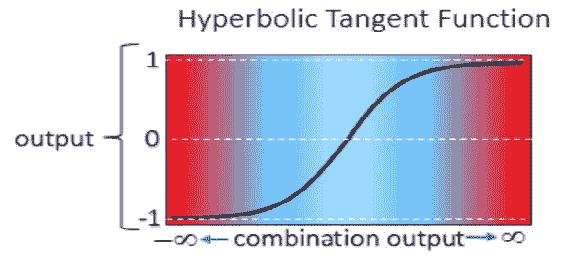

另一方面，恒等变换等线性变换对基于梯度的学习几乎没有问题，因为梯度是一个常数。然而，使用线性变换抵消了非线性变换带来的优势（即近似非线性关系）。

修正线性变换（或 `ReLU`）由分段线性变换组成，这些变换组合在一起可以近似非线性函数。（见图 1.3。）

#### 图 1.3：修正线性函数

在 `ReLU` 的情况下，变换输出的活跃区域的导数为 1，不活跃区域为 0。`ReLU` 变换的不活跃区域可以被视为该变换的弱点，因为它抑制了单元对基于梯度的学习的贡献。

`ReLU` 的饱和可以通过巧妙初始化权重以避免负输出值在某种程度上缓解。例如，考虑建模图像数据的业务场景。每个未标准化的输入像素值范围在 0 到 255 之间。在这种情况下，可以将权重初始化并限制为严格正，以避免负输出值，从而避免 `ReLU` 的非活跃输出区域。

其他修正线性变换的变体也允许当组合函数解析为负值时继续进行学习。其中最著名的是指数线性激活变换 (`ELU`)，如图 1.4 所示。

#### 图 1.4：指数线性函数

SAS 研究人员观察到某些情况下卷积神经网络中使用 `ELU` 代替 `ReLU` 性能更好。SAS 还包含了此处未显示的其他流行激活函数，如 `softplus` 和 `leaky`。此外，您可以使用 SAS 函数编译器（或 `FCMP`）在 SAS 中创建自己的激活函数。

> **注意：** 卷积神经网络 (`CNNs`) 是一种人工神经网络。`CNNs` 广泛用于图像识别和分类。与普通神经网络一样，`CNN` 由多个层和许多神经元组成。`CNNs` 非常适用于图像数据，但也可以用于自然语言处理等其他问题。第 2 章将详细介绍 `CNNs`。

### 误差函数与优化

误差函数定义了参数空间中的一个表面。如果它是通过最小二乘法拟合的线性模型，则误差表面是凸的，具有唯一的最小值。然而，在非线性模型中，该误差表面通常是一个复杂的地形，由许多山谷、陡峭的悬崖和长高原组成。为了在该地形高效搜索误差最小值，必须使用优化。具体而言，与给定误差最小值相关的参数通过以下程序确定：

1. 初始化权重向量为小的随机值，`w(0)`。
2. 使用优化方法确定更新向量，`δ(t)`。
3. 将更新向量添加到上一次迭代的权重值以生成新估计：
```
(equation)
```
4. 如果没有达到收敛标准，返回第 2 步。

收敛的条件如下：

1. 指定的误差函数停止改进
2. 梯度没有斜率（意味着已达到最小值）
3. 参数幅度停止变化

#### 批量梯度下降

反向传播 (`backprop`) 经过多次重新，最初仅使用梯度下降来确定合适的权重。梯度  是误差函数对权的偏导向量。它指向向上最陡的方向。（见图 1.5。）


通过否定步长（即学习率）参数 `η`，向局部向下的方向迈出一步：
```
(equation)
```

与给定误差最小值相关的参数通过以下程序确定：

1. 初始化权重向量为小的随机值，`w(0)`。
2. 使用优化方法确定更新向量，`δ(t)`。
3. 将更新向量添加到上一次迭代的权重值以生成新估计：
```
(equation)
```
4. 如果没有达到收敛标准，返回第 2 步。

随机梯度下降


在梯度下降算法的批量变体中，权重更新向量的生成是通过使用训练集中所有的样本来决定的。也就是说，计算的是精确梯度，确保了能够平滑地向误差最小值移动。

然而，当训练数据集很大时，计算精确梯度的计算开销非常大。在沿梯度下降的每一步中，必须评估整个训练数据集。此外，如果数据是冗余的，数据后半部分的误差梯度与前半部分的梯度几乎相同。在这种情况下，计算整个数据集的梯度将浪费时间。较好的做法是计算权重子集的梯度，更新权重，然后在新的子集上重复此过程。在这种种情况下，每次权重更新都是基于对真实梯度的近似。但只要它指向与精确梯度大致相同的方向，近似梯度就是一种计算精确梯度的有效备用替代方案（Hinton 2007）。

推向极端，近似梯度的计算可以基于单个训练样本。然后更新权重，并在下一个样本上计算梯度。这被称为**随机梯度下降**（stochastic gradient descent，也称为在线学习）。（见图 1.6。）


随机梯度下降非常有效，特别是当与动量项 `δ(t-1)` 结合时：


由于随机梯度下降在计算每个下降步的梯度时不需要考虑整个训练数据集，它通常比批量梯度下降更快。然而，由于每次迭代都试图更好地拟合单个观测值，某些梯度实际上可能会远离最小值。这意味着，尽管随机梯度下降通常向误差最小值的方向移动参数，但每次迭代并不一定这样做。结果是产生了一条更加迂折的路径。事实上，随机梯度下降并不会以批量梯度下降相同的方式收敛。相反，它在靠近最小值的某些区域内持续徘徊（Ng, 2013）。

## ADAM 优化简介

ADAM 方法通过根据之前观察到的小批量（mini-batch）梯度近似目标函数的二阶信息，以自适应的方式对每个单独的模型参数的学习梯度进行调整。算法运动的“自适应移动”特性正是 ADAM 名称的来源（Kingma and Ba, 2014）。


当近似的信噪比较小时，步长接近于零。这是一个很好的特性，因为较低的信噪比意味着不确定性更高。因此，在参数空间中应该采取更谨慎的步骤（Kingma and Ba 2014）。

要使用 ADAM，请在 `OPTIMIZER` 参数的 `ALGORITHM=` 子选项中指定 `ADAM`。还需要指定 `β1` 和 `β2` 的子选项，以及 `α` 等选项。在下方的示例代码中，`β1 = .9`，`β2 = .999` 且 `α = .001`。

```
optimizer={algorithm={method=’ADAM’,
```

```
                                   beta1=0.9,
```

```
                                   beta2=0.999,
```

```
                                   learningrate=.001,
```

```
                                   lrpolicy=’Step’,
```

```
                                   gamma=0.5},
```

```
                                   minibatchsize=100,
```

```
                                   maxepochs=200}
```

注意：ADAM 的作者推荐 `β1` 值为 `.9`，`β2` 值为 `.999`，`α`（学习率）为 `.001`。

## 权重初始化

深度学习使用的权重初始化方法与传统的神经网络不同。在神经网络中，隐藏单元权重随机初始化，以确保每个隐藏单元都在近似输入与输出之间关系的不同区域。否则，如果隐藏单元之间的权重相同甚至对称，那么每个隐藏单元将近似相同的关系变化。隐藏单元权重通常被随机初始化为某些指定的分布，通常是高斯分布或均匀分布。

传统的神经网络对随机初始化的隐藏单元权重使用标准方差。当有大量输入信息（即大量的输入连接）时，这可能会出现问题，因为随着输入连接数量的增加，隐藏单元的方差可能会增加。这意味着组合函数的输出可能更加极端，导致隐藏单元饱和（Daniely et al. 2017）。

深度学习方法使用归一化初始化，其中隐藏权重的方差是输入信息和输出信息的函数。SAS 提供了几种减少隐藏权重方差的方法。Xavier 初始化（交叉初始化）是深度学习中最常用的权重初始化方法之一。该初始化方法是随机均匀分布，方差为


其中 `m` 是输入连接数（入扇 fan-in），`n` 是输出连接数（出扇 fan-out）。

Xavier 初始化的一个潜在缺陷是该初始化方法假设了线性激活函数，这在隐藏单元中通常并非如此。MSRA 是考虑到 ReLU 激活函数设计的，因为 MSRA 假设激活输出具有零均值（He et al. 2015）。MSRA 初始化方法是随机高斯分布，标准差为


SAS 包含了 MSRA 的第二个变体，称为 MSRA2。与 MSRA 初始化类似，MSRA2 方法是随机高斯分布，标准差为


并且对输出（出扇 fan-out）信息进行惩罚。

注意：如果使用了批量归一化，权重初始化对模型性能的影响较小，因为批量归一化标准化了隐藏层之间传递的信息。批量归一化将在本章后半部分讨论。


## 正则化

正则化是一个引入或移除信息以稳定算法对数据理解的过程。多年来，早停（early stopping）、`L1` 和 `L2` 等正则化技术在神经网络中被广泛应用。这些正则化方法在深度学习中仍然被广泛使用。然而，正则化领域已经取得了进展，这些进展在与多隐藏层神经网络结合时效果特别好。其中两种进展 `dropout` 和 `batch normalization`（批归一化）在深度学习模型中展现了巨大的潜力。让我们先讨论 `dropout`，然后检查 `batch normalization`。

`Dropout` 在学习过程中添加噪声，使得模型更具泛化能力。训练一个每个包含数十万个参数的深度神经网络集成模型可能是不可行的。如图 1.9 所示，`dropout` 在学习过程中添加噪声，使得模型更具泛化能力。

图 1.9：正则化技术


`dropout` 的目标是通过一个扰动学习的过程来近似许多可能的模型结构的集成，试图防止权重产生协同适应。例如，假设我们正在训练一个识别人脸的神经网络，模型中使用的一个隐藏单元充分捕捉了嘴部。此时，所有其他隐藏单元至少在某些程度上依赖于这个隐藏单元，通过嘴部的存在来帮助识别脸。移除捕捉嘴部的隐藏单元会迫使剩余隐藏单元进行调整和补偿。这个过程使每个隐藏单元更多地成为“通才”而非“专家”，因为每个隐藏单元必须减少对模型中其他隐藏单元的依赖。

在 `dropout` 过程中，隐藏单元或输入（或两者）会在权重更新期间被随机从训练中移除。从模型中移除隐藏单元只需将该单元的输出乘以零。被移除的单元权重并没有丢失，而是被冻结了。每次移除单元时，生成的网络被称为稀疏网络。在几次权重更新后，所有隐藏和输入单元都会返回网络。之后，再次随机选择并移除一个新的隐藏或输入单元（或两者）进行几次权重更新。重复此过程直到达到最大训练迭代或优化过程收敛。

在 SAS Viya 中，你可以在 `ADDLAYER` 语句中指定 `DROPOUT=` 来实现 `dropout`。`DROPOUT=ratio` 指定该层的丢弃率。

以下是在 `ADDLAYER` 语句中实现 `dropout` 的示例。

```
AddLayer/model=’DLNN’ name=”HLayer1” layer={type=’FULLCONNECT’ n=30
         act=’ELU’ init=’xavier’ dropout=.05} srcLayers={“data”};
```

注意：`ADDLAYER` 语法将在稍后描述并在全书中进一步扩展。

## 批归一化

`batch normalization`（Ioffe and Szegedy, 2015）操作通过对每份输入数据进行标准化计算，归一化每个批次中在隐藏层之间传递的信息。标准化计算减去数据的平均值，然后除以标准差。随后通过将数据乘以一个学习常数的值并加上另一个学习常数的值来后续计算。

因此，归一化公式为


其中 `gamma`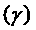 和 `beta`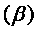 是可学习参数。

一些深度学习实践者放弃了在隐藏单元中使用 sigmoid 激活函数。然而，随着 `batch normalization` 的发现，他们的放弃可能为时过早。如果没有 `batch normalization`，当神经网络中存在多个隐藏层时，每个隐藏层本质上都在从不断变化的信息中学习。也就是说，权重更新依赖于二阶、三阶（依此类推）效应（其他层的权重）。这种现象被称为内部协方偏移（`ICS`）。

关于为什么 `batch normalization` 能改进学习，有两种观点。第一种来自 Ioffe 和 Szegedy，他们认为 `batch normalization` 减少了 `ICS`。第二种来自 Santurkar, Ilyas 和 Madry，他们认为 `batch normalization` 并没有真正减少 `ICS`，而是平滑了误差平面。无论哪种观点占优，`batch normalization` 在经验上证明可以改进学习。在 SAS 深度学习操作中，`batch normalization` 作为一个单独层，可以放在输入后的任何位置。注意：对于卷积网络，`batch normalization` 通常插入在卷积层之后。

#### 小批次的批归一化

在 `batch normalization` 层的源层包含特征图的情况下，`batch normalization` 层根据每个小批次中所有观测值的每个特征图的所有像素来计算统计数据。例如，假设你的网络配置的小批次大小为 3，输入包含两个 5x5 的特征图。在这种情况下，批归一化层计算两个平均值和两个标准差。第一个平均值是第一个观测的第一个特征图、第二个观测的第一个特征图以及第三个观测的第一个特征图中所有像素的平均值。第二个平均值是第一个观测的第二个特征图、第二个观测的第二个特征图以及第三个观测的第二个特征图中所有像素的平均值，依此类推。数值上，每个平均值是 3 个值的平均值。

在 `batch normalization` 层的源层不包含特征图的情况下（例如全连接层），`batch normalization` 层为输入中的每个神经元计算统计数据，而不是每个特征图。例如，假设你的网络小批次大小为 3，批归一化层的输入包含 50 个神经元。在这种情况下，批归一化层将计算 50 个平均值和 50 个标准差。第一个平均值是第一个观测的第一个神经元、第二个观测的第一个神经元以及第三个观测的第一个神经元的平均值。第二个平均值是第一个观测的第二个神经元、第二个观测的第二个神经元以及第三个观测的第二个神经元的平均值，依此类推。数值上，每个平均值是三个值的平均值。NVIDIA 根据激活模式对此计算此类计算。

为了使批归一化计算符合 Sergey Ioffe 和 Christian Szegedy 的批归一化研究（Ioffe and Szegedy, 2015）中的描述，源层应设置 `ACT=IDENTITY` 和 `INCLUDEBIAS=FALSE`。通常应在源层中指定的激活函数，现在应指定在批归一化层上。


然而，在使用多个 GPU 时，小批次（mini-batch）中的观测值分布在各个 GPU 上。为每个批归一化层同步每个 GPU 的批归一化计算将非常低效。相反，每个 GPU 使用可用观测值的子集计算所需的统计数据，并使用这些统计数据对这些观测值进行变换。

研究社区仍在讨论小批次或大批次大小哪个产生更好的性能。然而，当观测值的小批次分布在多个 GPU 上，且模型包含批归一化层时，SAS 深度学习团队建议您在每个 GPU 上使用足够大的小批次，以确保统计数据是稳定的。

除了在每个小批次上计算特征图统计数据外，批归一化算法在保存训练权重之前还需要计算整个训练数据集的统计数据。这些统计数据被用于评分（而小批次统计数据用于训练）。与其在训练结束时额外执行一个 epoch（迭代），不如在最后一个训练 epoch 期间对每个小批次的统计数据取平均值，以创建 epoch 数据。

通过这种方式计算的统计数据与更复杂的计算方法非常接近，即在 epoch 的每个小批次之后使用固定权重额外执行一个 epoch（只要最后一个 epoch 中的权重没有发生很大变化）（这通常是最后一个训练 epoch 的情况）。在使用多个 GPU 时，此计算方法与使用单个 GPU 完全相同。也就是说，每个 GPU 上每个小批次的统计数据在每个小批次后取平均值，以计算用于评分的最终 epoch 统计数据。

### 传统神经网络与深度学习

传统神经网络与深度学习之间的区别如 1.2 所示。传统神经网络利用单个中央处理器（CPU）的计算来训练模型。然而，图形处理器（GPU）的设计天然地适合神经网络的结构和学习过程。在将 CPU 分组使用方面已取得了前景的进展，它们使用定点架构而非浮点架构（Vanhoucke et al. 2011）。计算分布的细节是一个非常复杂的话题，超出了本书的范围，尽管表 1.2 提供了 CPU 与 GPU 的简要对比。


| 中央处理器 (CPU) | 图形处理器 (GPU) |
| --- | --- |
| 更快的时钟频率 | 较慢的时钟频率 |
| 较少的处理单元 | 更多的处理单元 |
| 更多的分支逻辑 | 较少的分支逻辑 |
| 较小的内存带宽 | 更大的内存带宽 |

用于调整神经网络权重的优化技术是迭代过程。然而，在每次迭代中，权重是同时更新的。因此，对应于权重更新的计算可以分布在处理单元之间。GPU 设计用于执行并行操作，这与神经网络使用的权重更新过程完美契合。

GPU 的使用应保留给较大的神经网络，因为在参数较少的神经网络中，CPU 和 GPU 之间的性能差异微乎其微。

### 深度学习操作

作为 SAS 平台的集成部分，SAS Viya 是一种云启的内存分析引擎，可提供快速、准确且可靠的分析洞察。SAS Viya 提供了丰富的数据挖掘和机器学习能力，运行在健壮的内存分布式计算基础之上，该基础提供了一个统一、开放、强大且云就绪的环境。

SAS Cloud Analytic Services（CAS）操作可以通过 SAS Viya 的多个接口呈现，包括 SAS Studio 和 Jupyter notebook。

本书重点介绍了 SAS Cloud Analytic Services (CAS) 中的三种深度学习操作：

* 深度前馈神经网络 (DNN)
* 卷积神经网络 (CNN)
* 循环神经网络 (RNN)

`DNN` 操作用于解决更传统的分类问题，如欺诈检测。`CNN` 操作通常用于计算机视觉。`RNN` 操作用于序列数据。

（注：原文包含大量重复句子，已清理冗余并保持了专业流畅度。）


| RECURRENT | 循环层 | `layer={type=’recurrent’ n=50 act=’sigmoid’ rnnType=’gru’}` |
| TRANSCONVO | 转置卷积层 | `layer={type=’transconvon’ Filters=32 width=5 height=5 stride=2 act=’tanh’ }` |

注意：书中未描述许多其他层，包括：`DETECTION`、`PROJECTION`、`FCMP`、`CLOSS`、`NASLAYER`、`SPLIT`、`CHANNELSHUFFLE`、`CLUSTER`、`FASTRCNN`、`GROUPCONVO`、`LAYERNORM`、`MASKRCNN`、`MHATTENTION`、`REGIONPROPOSAL`、`ROIALIGN`、`ROIPOOLING`、`SCALE`、以及等。`DETECTION` 层用于目标检测，`FCMP` 层用于实现用户定义的激活函数和误差函数。`CLUSTER` 层用于 `DeepCluster` 并应连接到全连接层。其他层在 SAS 文档中有详细说明。


`dlTrain` 可用于训练深度学习模型。`dlTrain` 的参数可以在 SAS 文档中通过搜索“Deep Learning Action Set: Syntax”找到。以下带有参数的示例代码：

```
PROC CAS;
   dlTrain /
      table=’ CAS-libref.data-table ‘
      modeltable= ‘ model name, specified in buildmodel action ‘
      bestweights={name= ‘Name of output table containing best model weights’ }
      inputs={‘ List of ALL input variables ‘}
      nominals={‘ List of nominal input variables ‘}
      validtable={name= ‘ Name of validation data table’ }
      target={‘ list of target variables’};
Quit;
```

注意：在训练模型时，可以使用 `OPTIMIZER` 参数来指定优化算法设置、优化模式以及其他设置（如种子、最大迭代次数等）。


以下演示说明了如何使用传统的神经网络建模方法对数据进行建模。该神经网络将拥有七隐藏层，但无法充分区分数据中的目标事件和非事件。本演示使用了开发数据（develop data）。这些数据已根据目标变量通过分层随机抽样分为三个数据集（训练集、验证集和测试集），描述如下。

某银行开展了一项目标营销活动，旨在识别可能对变额养老（一种保险产品）营销活动做出反应的客户群体。每个数据集包含银行客户和描述每个客户的 47 个输入。这 47 个输入变量代表三个月内的其他产品使用情况和人口统计数据。其中两个输入变量是名义标度的，其他是间隔或二分类的。二分类目标变量 `Ins` 表示客户是否购买了变额养老产品。开发数据集中的变量列如下。

| 变量 | 描述 | 角色 | 级别 |
| --- | --- | --- | --- |
| ATM | 使用过 ATM 服务 (1=是，0=否) | 输入 | 二分类 |
| ATMAmt | ATM 取款金额 | 输入 | 间隔型 |
| AcctAge | 最旧账户的年龄（年） | 输入 | 间隔型 |
| Age | 客户年龄（年） | 输入 | 间隔型 |
| Branch | 银行分支机构 (B1 – B19) | 拒绝 | 名义 |
| CC | 有信用卡账户 (1=是，0=否) | 输入 | 二分类 |
| CCBal | 信用卡余额 | 输入 | 间隔型 |
| CCPurc | 信用卡购买次数 | 输入 | 间隔型 |
| CD | 有定存 (1=是，0=否) | 输入 | 二分类 |
| CDBal | 定存余额 | 输入 | 间隔型 |
| CRScore | 信用评分 | 输入 | 间隔型 |
| CashBk | 客户收到现金回扣次数 | 输入 | 间隔型 |
| Checks | 支票数量 | 输入 | 间隔型 |
| DDA | 支票账户 (1=是，0=否) | 输入 | 二分类 |
| DDABal | 支票账户余额 | 输入 | 间隔型 |
| Dep | 存款次数 | 输入 | 间隔型 |
| DepAmt | 存款金额 | 输入 | 间隔型 |
| DirDep | 直接转存款 | 输入 | 间隔型 |
| HMOwn | 拥有房屋 | 输入 | 二分类 |
| HMVal | 房屋价值 | 输入 | 间隔型 |
| ILS | 分期贷款 | 输入 | 二分类 |
| IRABal | 退休账户 | 输入 | 间隔型 |
| InArea | 区域分类 | 输入 | 二分类 |
| Inv | 投资账户 | 输入 | 二分类 |
| LOC | 信用额度 | 输入 | 二分类 |
| LOCBal | 信用额度余额 | 输入 | 间隔型 |
| MMBal | 货币市场基金 | 输入 | 间隔型 |
| MMCred | 货币贷 | 输入 | 间隔型 |
| MTGBal | 贷款余额 | 输入 | 间隔型 |
| NSF | 资金不足发生 | 输入 | 二分类 |
| NSFAmt | 资金不足金额 | 输入 | 间隔型 |
| POS | 销售交易次数 | 输入 | 间隔型 |
| POSAmt | 销售交易金额 | 输入 | 间隔型 |
| Phone | 电话银行次数 | 输入 | 间隔型 |
| Res | 区域分类 | 拒绝 | 名义 |
| SDB | 安全箱 | 输入 | 二分类 |
| Sav | 储蓄账户 | 输入 | 二分类 |
| Teller | 柜员服务次数 | 输入 | 间隔型 |


1. 打开浏览器窗口，导航到 SAS Studio 并登录。
2. 展开服务器文件和文件夹。
3. 打开名为 `DLUS1D01a.sas` 的程序。程序将在编辑器中打开。首先，创建一个名为 `mycas` 的 caslib：
```
libname mycas cas;
```
```
libname local ‘home/student/LWUS’;
```
然后，使用三个 DATA 步骤创建并在内存中保存数据集：
```
data mycas.train_develop;
   set local.train_develop;
run;

data mycas.valid_develop;
   set local.valid_develop;
run;

data mycas.test_develop;
   set local.test_develop;
run;
```
4. 运行程序。
5. 打开名为 `DLUS1D01b.sas` 的程序。首先，使用 FREQ 过程探索开发数据验证部分的二分类结果分布：
proc freq data=mycas.Valid_develop;
   table ins;
run;
```
接下来，使用 NNET 过程创建一个七隐藏层前馈神经网络。使用有限内存 BFGS (L-BFGS) 算法调整网络参数：
proc nnet data=MYCAS.Train_DEVELOP standardize=std;
   target Ins / level=nominal;
   input AcctAge DDABal CashBk 
         Checks NSFAmt Phone 
         Teller SavBal ATMAmt 
         POS POSAmt CDBal 
         IRABal LOCBal ILSBal 
         MMBal MMCred MTGBal;


        CCBal CCPurc Income 

     LORes HMVal Age 

        CRScore Dep DepAmt InvBal / level=interval;

```
   input DDA DirDep NSF 

       Sav ATM CD 

       IRA LOC ILS 

       MM MTG CC 

       SDB HMOwn Moved 

       InArea Inv / level=nominal;

   hidden 30;

   hidden 20;

   hidden 10;

   hidden 5;

   hidden 10;

   hidden 20;

   hidden 30;

   train outmodel=mycas._Nnet_model_ 
         validation=mycas.valid_develop numtries=1 seed=12345 

    optimization algorithm=LBFGS regL1=0.003 regL2=0.002
                seed=12345 maxiter=50;

run;

6. 运行程序并检查结果。

`PROC FREQ` 的结果显示，34.63% 的客户对营销活动做出了响应。


接下来，显示了 `NNET` 过程的结果。结果从模型信息的摘要开始，随后是迭代历史（Iteration History）表。

**图 1.11：`NNET` 过程的结果


看起来，最后几次迭代中的验证误差（误分类率）等同于数据中观察到的经验先验！这表明我们的模型表现并不优于“抛硬币”预测。

其余的结果确认了误分类率、读取的观测值数量以及神经网络使用的观测值数量。输出中的注释指出，由于在验证评估准则上没有改进，模型在第 10 次迭代时终止了学习过程。


本演示展示了如何构建和训练两个深度学习神经网络。这两个模型包含的隐藏层数和隐藏单元数将与上一个演示中创建的神经网络相同。然而，这两个新模型将应用深度学习技术。

本演示使用 CASL 代码来实现深度学习模型。使用 `PROC CAS` 来方便 CASL 代码的使用。

1. 打开名为 `DLUS01D02a.sas` 的程序，并在代码编辑器窗口检查程序内容。

首先，加载 `DeepLearn` 动作集（action set）。该动作集包含了 SAS 深度学习的大部分功能，包括深度前馈 (`DNN`)、卷积 (`CNN`) 和循环 (`RNN`) 神经网络。

注意：在使用 SAS 深度学习动作之前，必须加载 `DeepLearn`。该动作集只需要加载一次。

proc cas;
   loadaction ‘DeepLearn’;
run;
```

接下来，创建一个空的深度学习模型。模型的引用名称为 `DLNN`，并指定了深度前馈模型类型。

proc cas;
   BuildModel / model={name=’DLNN’, replace=1} type = “DNN”;
run;

然后使用 `AddLayer` 动作向模型中添加九层，其中第一个是输入层，如 `TYPE='INPUT'` 选项所示。使用 `DROPOUT=` 选项对输入层应用丢弃（Dropout）。

proc cas;
   AddLayer / model=’DLNN’ name=’data’ layer={type=’input’ dropout=.05};

添加七层全连接隐藏层。每个隐藏层在 `NAME=` 选项中都被赋予了一个唯一的名称。这些层中使用的激活函数都是修正线性 (`ReLU`) 激活函数，但第一个隐藏层除外。第一个隐藏层采用了指数线性 (`ELU`) 激活函数，因为当 `ReLU` 与输入层连接时容易饱和（与 Lewis 通信，SAS 2017）。`MSRA` 初始化与 `ReLU` 激活函数结合，并包含了 5% 的丢弃率。除了中间隐藏层外，每个隐藏层都应用了丢弃。注意，`SRCLERS=` 选项表示与输入连接相关的层。

AddLayer / model=’DLNN’ name=’HLayer1’ layer={type=’FULLCONNECT’ n=30 act=’ELU’ init=’xavier’ dropout=.05} srcLayers={‘data’};

AddLayer / model=’DLNN’ name=’HLayer2’ layer={type=’FULLCONNECT’ n=20 act=’ReLU’ init=’MSRA’ dropout=.05} srcLayers={‘HLayer1’};

AddLayer / model=’DLNN’ name=’HLayer3’ layer={type=’FULLCONNECT’ n=10 act=’ReLU’ init=’MSRA’ dropout=.05} srcLayers={‘HLayer2’};

AddLayer / model=’DLNN’ name=’HLayer4’ layer={type=’FULLCONNECT’ n=5 act=’ReLU’ init=’MSRA’} srcLayers={‘HLayer3’};

AddLayer / model=’DLNN’ name=’HLayer5’ layer={type=’FULLCONNECT’ n=10 act=’ReLU’ init=’MSRA’ dropout=.05} srcLayers={‘HLayer4’};

AddLayer / model=’DLNN’ name=’HLayer6’ layer={type=’FULLCONNECT’ n=20 act=’ReLU’ init=’MSRA’ dropout=.05} srcLayers={‘HLayer5’};

AddLayer / model=’DLNN’ name=’HLayer7’ layer={type=’FULLCONNECT’ n=30 act=’ReLU’ init=’MSRA’ dropout=.05} srcLayers={‘HLayer6’};

最后，添加一个输出层。由于目标是二分类，因此使用了 `softmax` 激活函数。

AddLayer / model=’DLNN’ name=”outlayer” layer={type=’output’ act=’softmax’} srcLayers={“Layer7”};
run;

图 1.13 是上述 CASL 代码构建的模型架构简图。

图 1.13：模型架构


现在模型已经构建完成。但我们还没有在数据上训练模型。使用 `dlTrain` 动作来训练模型。

`TABLE=` 选项填充加载到 CAS 中的数据集名称。在 `MODEL=` 选项中插入构建的模型名称。

`BESTWEIGHTS=` 选项创建一个包含模型最佳权重的数据集。如果包含了验证数据，则根据模型在验证数据上的表现选择最佳权重。否则，使用训练数据。

proc cas;
   dlTrain / table='Train_Develop’ model='DLNN’ 
             bestweights={name='bestdeepweights’, replace=1}

输入列表在 `INPUTS=` 选项中指定。

inputs={‘AcctAge’,
              ‘DDABal’,
              ‘CashBk’,
              ‘Checks’,
              ‘NSFAmt’,
              ‘Phone’,
              ‘Teller’,
              ‘SavBal’,
              ‘ATMAmt’,
              ‘POS’,
              ‘POSAmt’,
              ‘CDBal’,
              ‘IRABal’,
              ‘LOCBal’,
              ‘ILSBal’,
              ‘MMBal’,
              ‘MMCred’,
              ‘MTGBal’,
              ‘CCBal’,
              ‘CCPurc’,
              ‘Income’,
              ‘LORes’,
              ‘HMVal’,
              ‘Age’}


              ‘Sav’,
              ‘ATM’,
              ‘CD’,
              ‘IRA’,
              ‘LOC’,
              ‘ILS’,
              ‘MM’,
              ‘MTG’,
              ‘CC’,
              ‘SDB’,
              ‘HMOwn’,
              ‘Moved’,
              ‘InArea’, 
              ‘Inv’
              }

注意：名分类变量必须在 `INPUT=` 和 `NOMINAL=` 选项中均指定。此外，目标是二元的，因此必须在名分类列表中指定。

验证数据表名通过 `VALIDTABLE=` 选项指定，`INS` 目标包含在 `TARGET=` 选项中。

ValidTable=’Valid_Develop’
target=”INS”

最后，包含了优化器选项。使用了 `ADAM` 方法，小批量大小为 60，学习率值为 `.001`。`LRPOLICY=` 选项指定了学习率策略——即在整个训练过程中降低学习率的策略。`STEP` 策略根据 `STEPSIZE=` 选项指定的间隔周期性地将 `GAMMA=` 值乘以当前学习率。如果没有指定步长，则每 10 个 epoch 减少一次学习率。

optimizer=   {minibatchsize=60, 
         algorithm={method=’ADAM’,
                           lrpolicy=’Step’,
                           gamma=0.5,
                             stepsize=10,
                             beta1=0.9,beta2=0.999,
                             learningrate=.001}
                             regL1=003, 
                             regL2=002,  
                             maxepochs=50
seed=12345
run;

注意：`MINIBATCHSIZE=` 选项指定每个工作节点的批量大小。书中的示例是为了在使用 16 个 CPU 的机器上运行而编写的。因此，每个总批量实际上乘以 16 CPUs。有时会形成长尾（后期迭代中使用的观测值较少），应尽可能减轻这种情况。包含优化属性的 `LOGLEVEL=3` 选项可以在日志中打印详细的优化信息。

运行程序并查看结果。第一组表格包含与模型外壳和模型中层相关的描述性信息。


下一表包含模型信息。


该模型包含 3,747 个参数和九层（七个隐藏层、一个输入和一个输出层）。优化历史表显示了学习率、训练损失（误差值）、验证损失、验证误差（误分类率）和训练误差。


传统方法无法区分数据中的事件。然而，深度学习方法的引入提高了模型的区分能力。误分类率从约 34.5% 下降到 26%。模型的最佳性能出现在第 28 个 epoch。也许模型可以通过批量归一化得到进一步改进。

打开名为 `DL02b.sas` 的程序，并在代码编辑器中检查程序内容。下一个模型使用了与上一个模型相同的结构，但有两个例外。所有隐藏层（除第一个隐藏层外）都使用了批量归一化来代替 dropout，并且 `ReLU` 隐藏层激活函数被替换为双曲正切 (`tanh`) 激活函数。权重初始化也从 `MSRA` 更改为 `Xavier`。

注意：为了使批量归一化计算符合 [Sergey Ioffe 和 Christian Szegedy 的 Batch Normalization](https://arxiv.org/abs/1502.0316) 中的描述，源层应具有 `ACT=identity` 和 `INCLUDEBIAS=False` 设置。通常在源层中指定的激活函数应改为在批量归一化层上指定。第一个隐藏层不使用批量归一化，因为输入层已经使用 z-score 标准化进行了归一化。

注意：SAS 中的 DNN 类型架构不包含批量归一化层。然而，`CNN` 类型架构可以批量归一化，并将用于替代 `DNN`。

proc cas;
   BuildModel / modeltable={name=’BatchDLNN’, replace=1} 
                type = ‘CNN’;

   /*          输入层             */
   AddLayer / model=’BatchDLNN’ name=’data’ layer={type=’input’ 
              STD=’STD’ dropout=.05}; 
   /*          第一个隐藏层          */
           layer={type=’FULLCONNECT’ n=30 act=’ELU’ init=’xavier’ 
           } srcLayers={‘data’};
```

注意，第一个隐藏层之后的每个隐藏层现在由两个 `AddLayer` 语句组成。第二个隐藏层中的第一个 `ADDLAYER` 语句指定了权重初始化方法和隐藏单元的数量。该层不使用偏置，激活函数设置为 identity。在第二个 `ADDLAYER` 语句中，`TYPE=` 选项被设置为 `BATCHNORM`。此外，注意非线性变换是在第二个 `ADDLAYER` 语句中应用的。
```
/*          第二个隐藏层       */
AddLayer / model=’BatchDLNN’ name=’HLayer2’ layer={type=’FULLCONNECT’ n=20 act='identity’ init='xavier’ includeBias=False} srcLayers={‘HLayer1’};
AddLayer / model=’BatchDLNN’ name=’BatchLayer2’ layer={type=’BATCHNORM’ act=’TANH’} srcLayers={‘HLayer2’};

/*          第三个隐藏层          */
AddLayer / model=’BatchDLNN’ name=’HLayer3’ layer={type=’FULLCONNECT’ n=10 act='identity’ init='xavier’ includeBias=False } srcLayers={‘BatchLayer2’};  
AddLayer / model=’BatchDLNN’ name=’BatchLayer3’ layer={type=’BATCHNORM’ act=’TANH’} srcLayers={‘HLayer3’};

/*          第四个隐藏层       */
AddLayer / model=’BatchDLNN’ name=’HLayer4’ layer={type=’FULLCONNECT’ n=5 act='identity’ init='xavier’ includeBias=False } srcLayers={‘BatchLayer3’};  
AddLayer / model=’BatchDLNN’ name=’BatchLayer4’ layer={type=’BATCHNORM’ act=’TANH’} srcLayers={‘HLayer4’};

/*          第五个隐藏层          */
AddLayer / model=’BatchDLNN’ name=’HLayer5’ layer={type=’FULLCONNECT’ n=10 act='identity’ init='xavier’ includeBias=False } srcLayers={‘BatchLayer4’};  

/*          第六个隐藏层          */
AddLayer / model=’BatchDLNN’ name=’HLayer6’ layer={type=’FULLCONNECT’ n=20 act='identity’ init='xavier’ includeBias=False} srcLayers={‘HLayer5’};
AddLayer / model=’BatchDLNN’ name=”BatchLayer6” layer={type=’BATCHNORM’ act=’TANH’} srcLayers={‘HLayer6’};

/*          第七个隐藏层       */
AddLayer / model=’BatchDLNN’ name=’HLayer7’ layer={type=’FULLCONNECT’ n=30 act='identity’ init='xavier’ includeBias=False } srcLayers={‘BatchLayer6’};     
AddLayer / model=’BatchDLNN’ name=”BatchLayer7” layer={type=’BATCHNORM’ act=’TANH’} srcLayers={‘HLayer7’};

/*          输出层             */
AddLayer / model=’BatchDLNN’ name=’outlayer’ 
layer={type=’output’ act=’LOGISTIC’} srcLayers={‘BatchLayer7’};

run;

`dlTrain` 代码与之前相同，但有一个例外。`MODEL=` 选项现在将操作指向上面创建的新模型结构 `BatchDLNN`。

proc cas;
dlTrain / table=’Train_Develop’ model=’BatchDLNN’
…
optimizer=      {minibatchsize=60, 


           algorithm=   {method=’ADAM’,
                          lrpolicy=’Step’,
                          gamma=0.5,
                          stepsize=10,
                       beta1=0.9,
                                beta2=0.999,
                learningrate=.001}  
              regL1=0.003, 
             regL2=0.002, 
        maxepochs=50  
            }
seed=54321
;
run;

4. 运行程序并检查结果。

5. 在结果窗口中向下滚动到模型信息详情表。

由于添加了批归一化（batch normalization），模型参数的总数增加了，因为我们增加了一个带有可学习参数的操作。


优化历史表显示，内存成本是值得的，因为模型改进了验证误分类率，将该率进一步降低至约 25.9%（在第 15 次 `pepoch` 中观察到）。


- 卷积神经网络介绍
- 输入层
- 卷积层
- 使用过滤器
- 填充
- 特征图维度
- 池化层
- 传统层
- 全连接层
- 输出层
- 跳跃层连接类型
- 演示 1：加载和准备图像数据
- 演示 2：构建和训练卷积神经网络
- 检查图像数据并指定模型
- 拟合和评估模型
- 使用拟合模型评分


卷积神经网络（CNN）是一种被认为在计算和统计上都是高效的神经网络（Goodfellow, Bengio, and Courville 2017）。CNN 通过在图像分类、目标检测和语义分割方面的许多成功普及了计算机视觉领域。CNN 还可以用于自然语言处理或其他信息具有空间相关性的任务。典型的 CNN 由五类层组成：输入层、卷积层、池化层、全连接层和输出层。然而，在更复杂的结构中通常还会包含其他类型的层，包括转置卷积、感兴趣区域池化（ROI pooling）、分割等。每种层都有其特定的属性和功能。

计算效率通过使用卷积层和池化层来实现。全连接层中的神经元为每个输入列分配一个唯一的参数。相反，卷积层所需的参数比全连接层少，因为参数在列之间是共享的。池化层本身不包含参数，而是将列组合为输出摘要。添加卷积和池化层还增强了模型捕捉输入分布中重要点的能力，提高了模型的统计效率。本章将贯穿卷积层和池化层的细节。

卷积神经网络普及了图像分类和目标检测。然而，CNN 也应用于自然语言处理和预测等其他领域。自动驾驶汽车、故障检测、聊天机器人和其他应用中的许多成功在很大程度上建立在卷积神经网络的基础之上。


卷积神经网络（CNN）是人工神经网络的一类。与普通神经网络一样，CNN 从输入层开始，由多层组成，并包含数量的神经元，如图 2.1 所示。

图 2.1: 卷积神经网络


输入层可能由待分类图像的原始像素值，而如图 2.2 所示，灰度图像只有一个通道。

图 2.2: 灰度图像通道

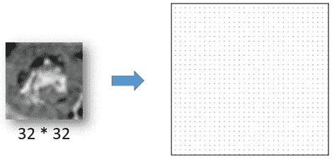

相反，如图 2.3 所示，彩色图像有蓝、绿、红三个颜色通道。

图 2.3: 彩色图像通道

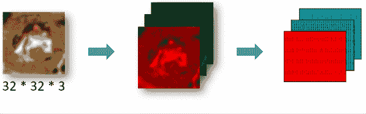

例如，CIFAR-10 数据集中每张图像的高度为 32，宽度为 32，并有蓝、绿、红三个颜色通道。每个颜色通道由一个表示相应通道像素亮度的数值矩阵表示。像素值通常在 0 到 255 之间。在传递给卷积神经网络之前，有时会对图像进行平坦化（flattened）。然而，平坦化并不是必须的，在使用 `ASTORE` 评分时可能会产生问题（`ASTORE` 是模型的迁移形式）。尽管如此，每个像素变成了数据集中相应列中的一个值。例如，标准彩色图像每个通道有 33 万个像素。平坦化后，生成的表将包含 9900 万列。

SAS 中的 CNN 还可以包含用于处理表格数据的输入层。因此，可以使用多个输入层。在解决更动态的问题时，经常会使用这些层。

## 卷积层

卷积层最常用在输入层之后。卷积层通过连接到输入局部区域的过滤器内核（filter kernels）推导出输出（即特征图）。该操作正式名称为互相关（cross-correlation），但有时被称为无内核翻转的卷积。单通道无内核翻转卷积的示例在图 2.4 所示。

图 2.4: 无内核翻转的单通道卷积

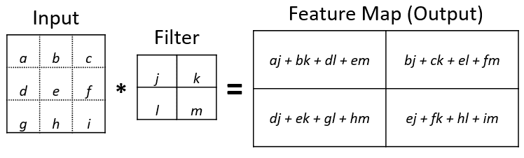

典型的卷积层由许多过滤器组成。过滤器并行在输入表面滑动，捕捉有意义的特征。因此，每个过滤器的参数被数据的多个列共享。参数共享减少了转换输入空间所需的参数数量。每个过滤器创建输入的等变表示，这意味着输入空间的变化反映输出中。

添加卷积层为神经网络引入了新的超参数。这些超参数包括宽度、高度和步长。以下是使用 SAS 云分析语言（CASL）创建的具有 32 个滤波器的卷积层示例：

```
AddLayer   /    model=’ConVNet’ 
          name=’ConVLayer1’ 
          layer={type=’CONVO’
                 nFilters=32
                 width=3 
                 height=3 
                 stride=1
                } 
          srcLayers={‘data’};
```

## 使用过滤器


随着网络深度的增加，增加滤波器的数量是非常常见的。例如，第一层卷积层可能包含 32 个滤波器，下一层卷积层有 64 个，下一层有 128 个，依此类推。增加卷积滤波器的数量是为了抵消在使用较大步长值（即步长大于 1 的值）时发生的信息减少。

接下来的图将详细介绍一个示例卷积层的细节。

在卷积的前向传播过程中，如图 2.5 所示，滤波器被放置在输入空间的起始位置。

图 2.5：滤波器的起始位置

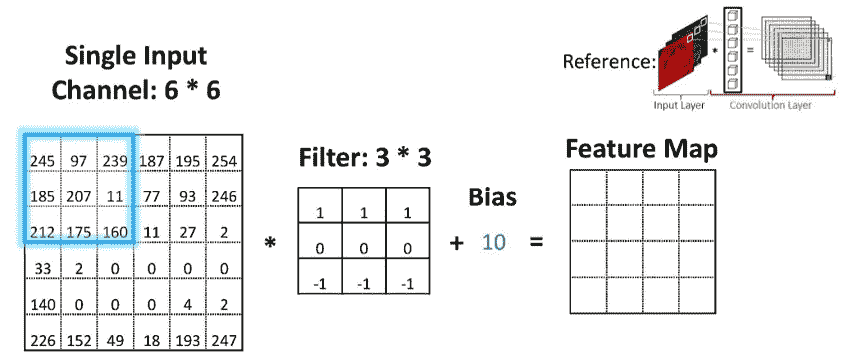

如图 2.6 所示，计算滤波器条目与该位置输入之间的点积。对于此示例，我们用 `1*245 + 1*97 + 1*239 + 0*185 + 0*207 + 0*11 + -1*212 + -1*175 + -1*160` 加上我们的偏置 `10`，从而在特征图中得到 `44` 的输出。

图 2.6：滤波器与输入条目之间的乘积

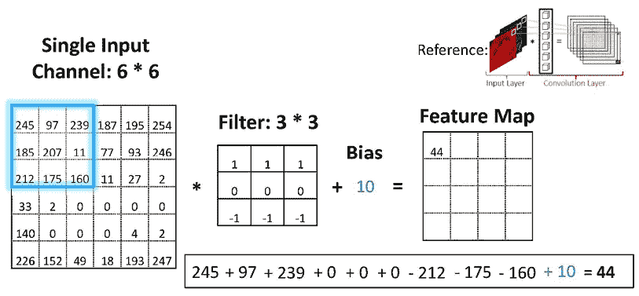

因此，滤波器与局部输入空间之间的点积得到的值变为第一个输出值。然后，算法在输入空间滑动每个滤波器。移动范围由 `STRIDE` 超参数决定，如图 2.7 所示。步长值控制跨越输入空间宽度的移动，以及高度。

图 2.7：由 `STRIDE` 超参数引起的移动范围

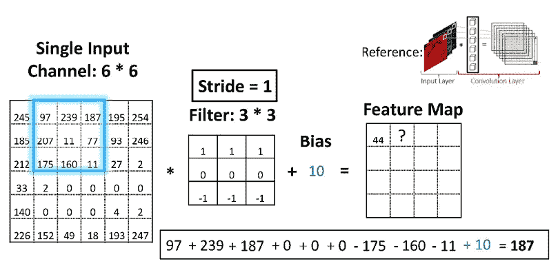

滤波器移动后，继续执行相关操作，计算下一个输出值。重复此过程，随着滤波器在输入卷的宽度高度上移动，我们产生一个二维特征图，给出该滤波器在每个空间位置的响应，如图 2.8 所示。

图 2.8：每个空间位置具有滤波器响应的特征图

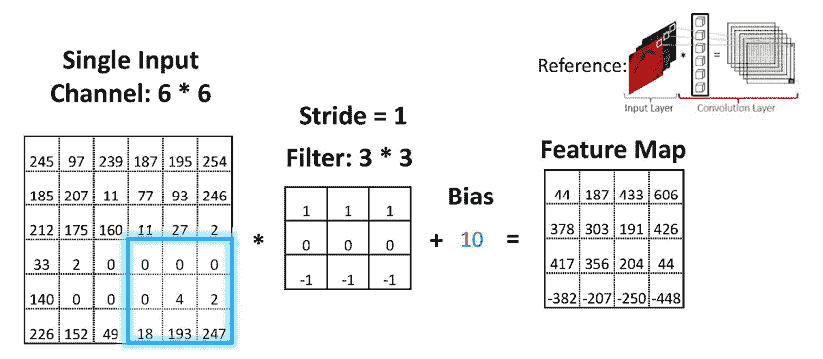

滤波器值是卷积层的可学习参数（即层的权重），偏置等于 `β`。

每个滤波器的通道数将与输入信息相同。然而，无论通道数多少，输出始终是一个二维网格。图 2.9 所示的示例中，单个滤波器与三个通道的信息相结合。每个通道可以被认为是信息的“一部分”。这个单一的 3x3 滤波器有 `28` 个权重。也就是说，每部分信息被分配了九个权重，总共 `27` 个权重。然后我们有偏置，它给了我们第 `28` 个权重。非线性激活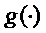，例如指数线性、双曲正切、修正线性或其他变换，可以应用于特征图的输出值，如图 2.9 所示。

图 2.9：滤波器权重和非线性变换

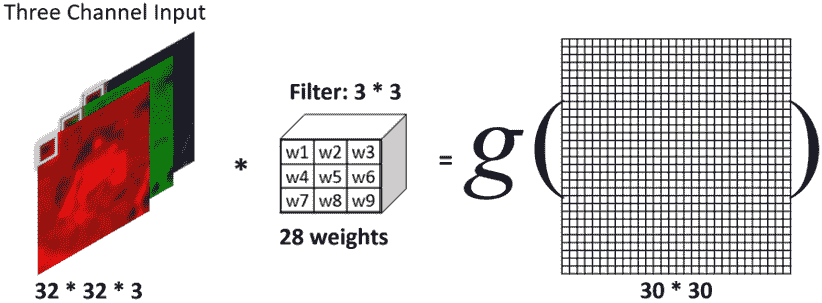

### 填充 (Padding)

卷积和池化都会增加欠拟合的压力，这在很大程度上是因为添加更多此类层会导致信息减少。填充可以抵消或减轻信息的丢失。填充增加了图像边缘现有像素的相关性。

填充的目的是根据原始输入图像尺寸和滤波器尺寸产生尺寸“合理”的输出图像。关键问题在于输入图像维度是偶数还是奇数、滤波器维度是偶数还是奇数，以及用户指定的步长值。

以下是一些“合理”规则：

*   水平填充和垂直填充尺寸是相互独立的。改变图像或滤波器的水平维度不会影响垂直填充尺寸。
*   如果步长为 `1`，则输出图像尺寸与输入图像尺寸相同。在讨论卷积时，这有时被称为相同填充 (same padding)。
*   如果步长为 `2`，则输出图像尺寸大约为输入图像尺寸的一半。
*   首先添加到图像的右侧，然后是左侧。因此，如果填充不均，右侧的填充比左侧多。
*   图像用零进行填充。

如果没有填充，取决于滤波器的尺寸和步长，特征图可能远小于输入，如图 2.10 所示。

卷积层引起的收缩可以通过使用填充来缓解。如果步长为 `1`，输出图尺寸与输入图尺寸完全相同，因为 `SAS DEEPLEARN` 动作集中的默认行为是自动填充通道或特征图。如果步长为 `2`，输出图的面积将减少约 4 倍（`2*2`）。

图 2.10：没有填充的特征图

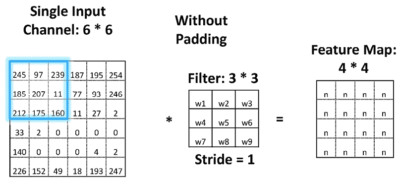

卷积层引起的收缩可以通过使用填充来缓解，如图 2.11 所示。

图 2.11：带有填充的特征图

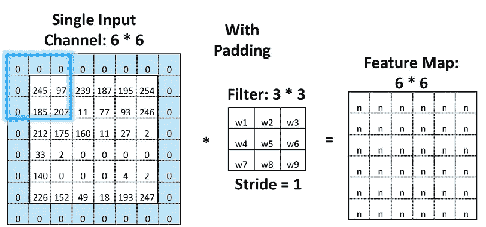

要在 SAS 中配合 GPU 使用填充，必须在 `dlTrain` 动作中将 `FORCEEQUALPADDING` 选项设置为 `True`。这意味着特征图的所有侧都应用相等填充。如果指定了 `GPU=TRUE` 选项，SAS 默认 `FORCEEQUALPADDING=TRUE`：

```
ForceEqualPadding=True
```

如果没有填充，特征图会缩小，如图 2.12 所示。

图 2.12：无填充


特征图的维度并不是 SAS 默认产生的，接下来的图 2.13 所示。

图 2.13：SAS 的自动填充

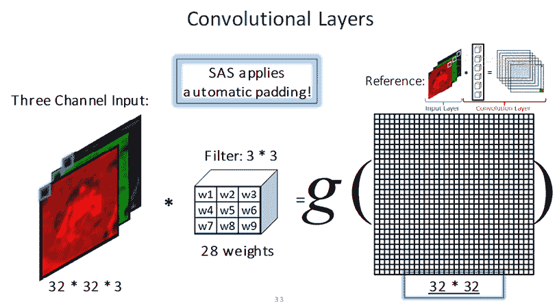

SAS 在假设步值为 1 时自动填充以抵消特征图尺寸的自然减少。当步长大于 1 时，SAS 仍应用填充，但当步长大于 1 时，特征图将比输入小。这意味着使用大于 1 的步长会减少输出特征图的大小。此外，如果生成的卷积特征图是非整数矩阵，SAS 会自动应用额外的填充。例如，考虑输入信息为 12x12 矩阵的情况。使用 3x3 滤波器和步长二将产生 `6.5`（一个非整数值），如图 2.14 所示。

图 2.14：SAS 自动调整非整数特征图

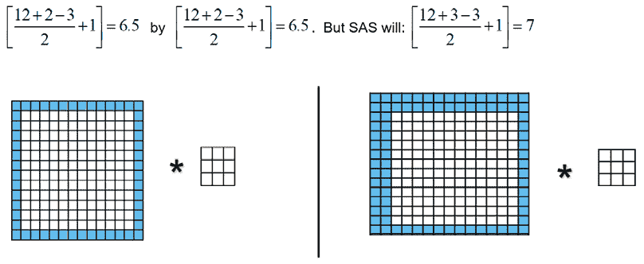

### 特征图维度

输出的维度由输入、滤波器和填充结合步长尺寸决定，如图 2.15 所示。

图 2.15：特征图维度

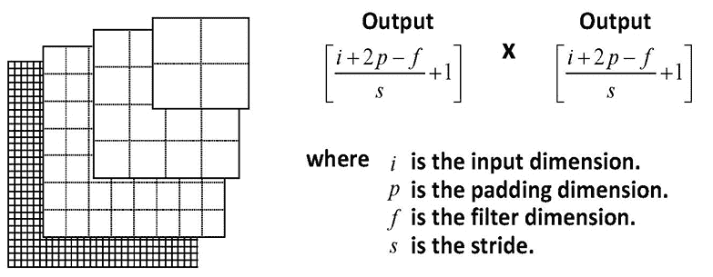

特征图维度可以通过以下公式计算：

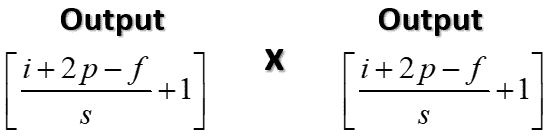

`image/Image999.png` 代表输入维度，`image/Image1007.png` 代表填充值（稍将讨论），`image/Image1016.png` 代表滤波器尺寸，`image/Image1027.png` 代表步长尺寸。

## 池化层 (Pooling Layers)


## 池化层 (Pooling Layers)

池化函数提供了输入信息某些局部区域的摘要。SAS 提供三种摘要选项：最大值（Maximum）、平均值（Average）和最小值（Minimum）。与卷积层类似，池化层也使用过滤器，但这些过滤器用于确定要总结的区域，不包含可学习的权重。与池化过滤器相关的超参数包括 `width`（宽度）、`height`（高度）和 `stride`（步长）。不需要指定池化过滤器的数量，因为数量由输入的二维网格数量决定。在 CNN 架构中，在连续的卷积层之间定期插入池化层是常见的。尽管 Springenberg 等人证明了用卷积层替换池化层取得了巨大成功，并利用较大的步长对信息进行下采样（Springenberg et al., 2015）。例如，使用过滤器大小为 2 x 2 步长为 2 的池化层或卷积层会将输入信息减少 75%。因此，`stride` 会激进地缩小网络。

生成每个局部区域的摘要还有一个额外好处，使得输出对输入中的微小偏差具有近似不变性。也就是说，当建模者更关注对象是否存在而非其精确位置时，池化函数是非常有用的。相反，如果空间差异非常重要，则应该谨慎使用池化，甚至不使用（Goodfellow, Bengio, and Courville 2017）。

使用较大的 `stride` 值进行池化也可以适用于输入信息大小可能变化的情况。考虑一种场景：你正在分类两种尺寸图像：128 x 128 和 192 x 192。每种图像尺寸将拥有其自己的输入层，较大的图像可以使用 `stride` 大于 1 的池化层进行下采样，以匹配较小的输入尺寸。对较大的信息进行下采样很重要，因为输出层要求信息的大小相同。

超参数 `Width` 和 `Height` 设置了邻域的大小，如图 2.16 所示。

### 图 2.16：池化层

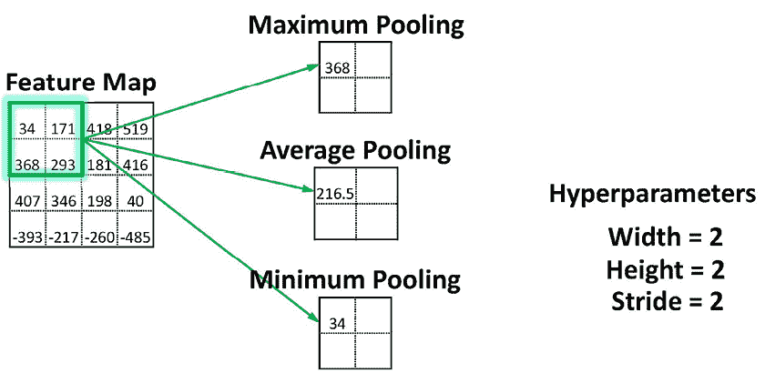

每个池化函数都总结所检查的邻域。`POOL=` 用于指定池化层使用的摘要类型。这是一个示例：

```
layer={type=’POOL’ width=2 height=2 stride=2 pool=”max”
```

与卷积层一样，`stride` 参数控制邻域的移动尺寸。邻域持续跨越输入空间，直到整个空间都被总结，如图 2.17 和 2.18 所示。

### 图 2.17：步长 = 2 的特征图

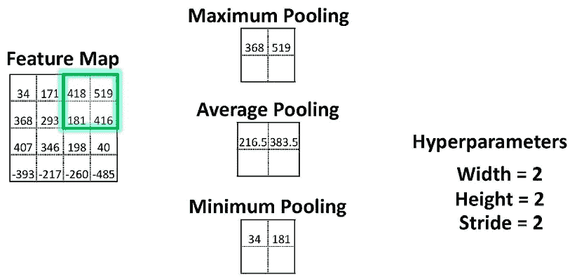

### 图 2.18：完成的特征图

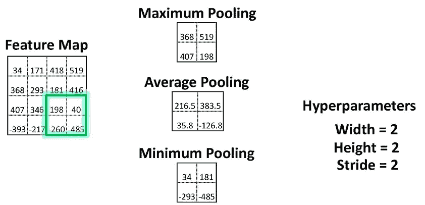

## 传统层 (Traditional Layers)

## 全连接层 (Fully Connected Layer)

全连接层中的神经元与上一层中的所有激活值都有全连接，如普通的神经网络所示。因此，它们的激活值可以通过矩阵乘法后接偏置偏移来计算。全连接层包含了大量的参数，因此训练成本很高。

## 输出层 (Output Layer)

输出层本质上是一个与特定误差函数相关的全连接层。在二分类目标这种情况下，交叉熵误差函数

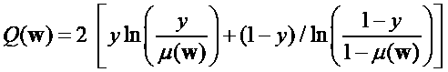

简化为等效的伯努利误差函数：

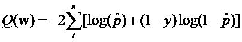

如果目标结果有超过两个级别，则误差函数解析为

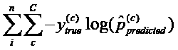

其中 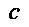 是观测值的类别标签 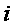。

如果目标是二分类，则使用 logistic 激活函数：

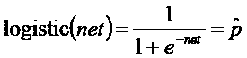，其中 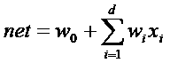

logistic 激活函数将其输出限制在 0:1 的范围内，使其成为生成概率估计 (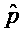) 的理想选择。统计学中，logistic 函数广为人知的 logit-link 函数：

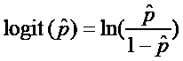= ln(odds)

如果你正在拟合多项分类目标，则 softmax 激活函数（见下文）是合适的。它是广义 logit-link 函数的反函数。

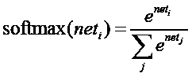

由于 softmax 将每个神经元的输出激活值除以所有参与神经元的输出之和，它确保了估计值之和为 1。这产生了一种分布效应。

## 跳跃层连接类型 (Types of Skip-Layer Connections)

用于图像分类的深度卷积神经网络利用增加堆叠层数来丰富特征的能力。然而，添加更多层有时会导致网络早期学习的信息由于梯度消失而被遗忘。归一化技术（如批标准化）成功地抑制了剧烈的梯度波动，在很大程度上解决了收敛问题。此外，添加跳跃层连接可以帮助神经网络记住结构早期学习的潜在特征。跳跃层连接的可视化如图 2.19 所示。

### 图 2.19：跳跃层连接

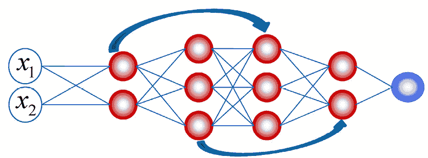

拼接层（Concatenation）和残差层（Residual）可以用于创建跳跃层连接。拼接层可用于跳跃层连接（见图 2.20），但拼接操作会导致“胖”网络，处理成本很高。

```
AddLayer / model=’ModelName’ name=’LayerName’ layer={type=’concat’}  
           srcLayers={‘A’,’B’,’C’,’D’};
```

### 图 2.20：拼接层


残差层由 Kaiming 等引入，作为一种结合跳跃层连接的方法，如图 2.21 所示。残差层通过相加而非拼接来“瘦身”网络。使用 `TYPE=RESIDUAL` 添加残差层。

```
AddLayer / model=’ModelName’ name=’LayerName’  
           srcLayers={‘A’,’B’,’C’,’D’};
```

### 图 2.21：残差层


## 演示：加载和准备数据

此演示说明如何使用 action set 加载和准备数据。

1. 打开程序 `DL2D01.sas` 查看代码编辑器中的程序内容。首先加载 Image action set，并创建描述图像的元数据表。`loadImages` action 将图像和相关的元数据读入内存。`loadImages` action 可以从各种来源上传信息，包括

- 摄影图像
- 医学图像文件（包括 DICOM 格式）
- ZIP 文件
- 包含图像或 ZIP 文件的目录
- 包含一系列摄影或医学图像的目录
- 包含上述任何项目的目录树
- URL
- 包含上述项目组合的列表

输出包含 CAS 表格形式的编码或解码格式图像，取决于输入参数 `decode` 的值。当此参数设置为 False（默认值）时，输出表具有以下列

- `_id_`: 每个图像唯一的整数
- `_path_`: 图像的完整路径
- `_image_`: 包含整个文件的二进制大型对象
- `_size_`: `_image` 列中二进制大型对象的字节长度
- `_type_`: 指定图像格式的三字符字符串（例如，JPG 图像为 `jpg`）

当 `decode` 参数设置为 True 时，`_image` 列包含解压缩后的图像数据，输出表具有这些额外列

- `_dimension_`: 图像的维度（例如，二维图像为 2，三维图像为 3）


- `resolution` – 图像在每个维度上的尺寸（例如，对于一个宽 100 像素、高 200 像素的二维图像数组，使用 {100, 200}）。
- `imageFormat` – 表示 `image` 列中数据组织形式的整数。最常见的值有 0、16、2 和 18，分别对应 8 位灰度图、8 位 RGB 图像、16 位灰度图和 16 位 RGB 图像。

位于 `Image Data` 文件夹中的 `LargetrainData` 和 `SmalltrainData` 文件夹都包含 10 个子文件夹。这 10 个子文件夹中的每一个都包含特定类的图像。例如，`truck` 文件夹只包含卡车的图像。`RECURSE=TRUE` 选项指定从这 10 个目录读取所有图像的操作。`LABELLEVELS=1` 选项告诉操作根据存储图像的文件夹名称分配标签。例如，`truck` 文件夹中的所有图像将被分配标签 `truck`。

```
proc cas;
```

```
   loadactionset ‘image’;
```

```
   loadactionset ‘table’;
```

```
   table.addCaslib / name=’imagelib’   
```

```
      path=’/home/student/LWDLUS/Image Data’
```

```
      subdirectories=true;
```

```
    image.loadimages / caslib=’imagelib’ path=’LargetrainData’
```

```
         decode=true recurse=true labellevels=1
```

```
         addcolumns={‘CHANNELCOUNT’}   
```

```
             casout={name=’LargetrainData’, replace=true};
```

```
  image.loadimages / caslib=’imagelib’ path=’SmalltrainData’
```

```
         decode=true recurse=true labellevels=1
```

```
         addcolumns={‘CHANNELCOUNT’}   
```

```
             casout={name=’SmalltrainData’, replace=true};
```

```
run;
```

```
quit;
```

接下来，使用 SAS 组件语言（SCL）将宽度和高度调整为 120，并查看来自多个文件夹的图像。

```
/***************/
```

```
/* View Images */
```

```
/***************/
```

```
data _NULL_;
```

```
/*AIRPLANES*/
```

```
  dcl odsout obj1();
```

```
  obj1.image(file:’/home/student/LWDLUS/Image Data/SmalltrainData/airplane/img3.png’,
```

```
                width: “120”,
```

```
                height: “120”);
```

```
  obj1.image(file:’/home/student/LWDLUS/Image Data/SmalltrainData/airplane/img10.png’,
```

```
                width: “120”,
```

```
                height: “120”);
```

```
  obj1.image(file:’/home/student/LWDLUS/Image Data/SmalltrainData/airplane/img21.png’,
```

```
                width: “120”,
```

```
                height: “120”);
```

```
 /*AUTOMOBILES*/
```

```
 dcl odsout obj2();
```

```
  obj2.image(file:’/home/student/LWDLUS/Image Data/SmalltrainData/automobile/img6.png’,
```

```
               width: “120”,
```

```
                height: “120”);
```

```
  obj2.image(file:’/home/student/LWDLUS/Image Data/SmalltrainData/automobile/img9.png’,
```

```
                width: “120”,
```

```
                height: “120”);
```

```
  obj2.image(file:’/home/student/LWDLUS/Image Data/SmalltrainData/automobile/img37.png’,
```

```
                width: “120”,
```

```
                height: “120”);
```

```
 /*BIRDS*/
```

```
  dcl odsout obj3();
```

```
  obj3.image(file:’/home/student/LWDLUS/Image Data/SmalltrainData/bird/img25.png’,
```

```
               width: “120”,
```

```
                height: “120”);
```

```
  obj3.image(file:’/home/student/LWDLUS/Image Data/SmalltrainData/bird/img35.png’,
```

```
                width: “120”,
```

```
                height: “120”);
```

```
  obj3.image(file:’/home/student/LWDLUS/Image Data/SmalltrainData/bird/img65.png’,
```

```
                width: “120”,
```

```
                height: “120”);
```

```
 /*CATS*/
```

```
  dcl odsout obj4();
```

```
  obj4.image(file:’/home/student/LWDLUS/Image Data/SmalltrainData/cat/img0.png’,
```

```
               width: “120”,
```

```
                height: “120”);
```

```
  obj4.image(file:’/home/student/LWDLUS/Image Data/SmalltrainData/cat/img8.png’,
```

```
                width: “120”,
```

```
                height: “120”);
```

```
  obj4.image(file:’/home/student/LWDLUS/Image Data/SmalltrainData/cat/img46.png’,
```

```
                width: “120”,
```

```
                height: “120”);
```

```
run;
```

## 演示 2：构建和训练网络

在本演示中，构建并训练了一个卷积神经网络来分类 10 类图像。使用了著名的 CIFAR-10 数据。数据由 32x32 的彩色图像组成。打开名为 `DL02Da.sas` 的程序并检查代码窗口中的内容。

### 查看图像数据并指定模型

首先，对图像进行汇总。汇总提供了蓝色、绿色和红色的平均强度。

```
proc cas;
   image.summarizeimages / table=’LargeImageData’, where=’Part_1’};
run;
```

使用 `OFFSETS=` 选项从每个输入通道减去汇总值。其次，指定 `BuildModel` 操作，并创建一个空的深度学习卷积模型。

```
proc cas;
 BuildModel / model={name=’ConVNN’, replace=1} type = ‘CNN’;
```

a. 添加的第一层是输入层。在 `CHANNELS=` 选项中将通道数设置为 3。输入层还指定了图像的宽度和高度。同时也应用了偏移量。

```
AddLayer / model=’ConVNN’ name=’data’ layer={type=’input’
  channels=3 width=32 height=32 offsets={113.85228,123.021097,125.29477}};
```

b. 接下来数据添加卷积层。卷积层包含六个不同尺寸的过滤器（1x1、3x3、5x5、7x7、4x4 和 6x6）。奇值大小的过滤器使用步长 1，4x4 大小的过滤器使用步长 2，6x6 大小的过滤器使用步长 4。4x4 和 6x6 组包含了额外的过滤器。此外，对 4x4 和 6x6 过滤器组都应用了丢弃（dropout）。

```
AddLayer / model=’ConVNN’ name=’ConVLayer1a’ layer={type=’CONVO’ 
           nFilters=8  width=1 stride=1}
           srcLayers={‘data’};
```

```
AddLayer / model=’ConVNN’ name=’ConVLayer1b’ layer={type=’CONVO’
           nFilters=8  width=3 stride=1}
           srcLayers={‘data’};
```

```
AddLayer / model=’ConVNN’ name=’ConVLayer1c’ layer={type=’CONVO’
           nFilters=8  width=5 height=5 stride=1}
           srcLayers={‘data’};
```

```
AddLayer / model=’ConVNN’ name=’ConVLayer1d’ layer={type=’CONVO’
           nFilters=8  width=7 height=7 stride=1}
           srcLayers={‘data’};
```

```
AddLayer / model=’ConVNN’ name=’ConVLayer1e’ layer={type=’CONVO’
           nFilters=10  width=4 height=4 stride=2 dropout=.2}
           srcLayers={‘data’};
```

```
AddLayer / model=’ConVNN’ name=’ConVLayer1f’ layer={type=’CONVO’
           nFilters=10  width=6 height=6 stride=4 dropout=.2}
           srcLayers={‘data’};
```

c. 使用连接层将四个路径合并为单一路径，为下一层做准备。具体而言，使用步长 1 的卷积被合并并连接到下一层。其他卷积将连接到后续层。

```
AddLayer / model=’ConVNN’ name=’concatlayer1a’
           layer={type=’concat’}
           srcLayers={‘ConVLayer1a’,’ConVLayer1b’,’ConVLayer1c’,
                      ‘ConVLayer1d’};
```

d. 连接层连接到一个池化层，该池化层设置为从每个邻域提取最大值。池化层创建一个 2x2 的邻域，以步长 2 跨列移动。

```
AddLayer / model=’ConVNN’ name=’PoolLayer1max’ layer={type=’POOL’ 
           width=2 height=2 stride=2 pool=’max’}
           srcLayers={‘concatlayer1a’};
```

e. 使用连接层将池化层与连接到输入层并使用 4x4 过滤器的卷积层合并。


注意：拼接层（Concatenation layers）要求输入的特征图尺寸相同。在合并不同尺寸的特征图时，通常会使用池化层对较大的特征图进行下采样。

```
AddLayer / model=’ConVNN’ name=’concatlayer2’
           layer={type=’concat’} 
           srcLayers={‘PoolLayer1max’,’ConVLayer1e’};
```

f. 随后将拼接层连接到另一个步长为 2 的 2 x 2 池化层（最大池化层）。

```
AddLayer / model=’ConVNN’ name=’PoolLayer2max’ layer={type=’POOL’ 
           width=2 height=2 stride=2 pool=’max’}
           srcLayers={‘concatlayer2’};
```

g. 使用拼接层将池化层与连接到输入层并使用 6 x 6 器的卷积层结合。

```
AddLayer / model=’ConVNN’ name=’concatlayer3’
           layer={type=’concat’}
           srcLayers={‘PoolLayer2max’,’ConVLayer1f’};
```

h. 随后将拼接层连接到另一个步长为 2 的 2 x 2 池化层（最大池化层）。

```
AddLayer / model=’ConVNN’ name=’PoolLayer3max’ layer={type=’POOL’ 
           width=2 height=2 stride=2 pool=’max’}
           srcLayers={‘concatlayer3’};
```

i. 随后将池化层连接到具有 64 个滤波器的卷积层。该卷积层包含 3 x 3 过滤器，以步长 1 跨越输入列。使用 `MSRA2` 初始化权重。卷积层还应用了 20% 的丢弃率（dropout rate）。通常会移除隐藏偏置，并在应用批归一化（batch normalization）之前将激活函数设置为 `Identity`。然而，为了展示 SAS 的灵活性，我们决定不遵循传统方法。

```
AddLayer / model=’ConVNN’ name=’ConVLayer1g’ layer={type=’CONVO’
           nFilters=64 width=3 height=3 stride=1 init=’msra2’
           dropout=.2} srcLayers={‘concatlayer3’};
```

```
AddLayer / model=’ConVNN’ name=’BatchLayer1’
           layer={type=’BATCHNORM’ act=’ELU’}
           srcLayers={‘ConVLayer1g’};
```

j. 随后将归一化值传递到另一个具有 128 个滤波器的卷积层。该卷积层包含 3 x 3 过滤器，以步长 2 跨越输入列。`MSRA2`、批归一化和丢弃率也用于此卷积层。

```
AddLayer / model=’ConVNN’ name=’ConVLayer1h’ layer={type=’CONVO’
           nFilters=128 width=3 height=3 stride=2 init=’msra2’
           dropout=.2} srcLayers={‘BatchLayer1’}; 
```

```
AddLayer / model=’ConVNN’ name=’BatchLayer2’
           layer={type=’BATCHNORM’ act=’ELU’}
           srcLayers={‘ConVLayer1h’};
```

k. 随后使用拼接层将卷积层与最后一个池化层连接。

```
AddLayer / model=’ConVNN’ name=’concatlayer4’
           layer={type=’concat’}
           srcLayers={‘PoolLayer3max’,’BatchLayer2’};
```

l. 随后添加一个具有 240 个神经元的全连接层。全连接层应用批归一化和 65% 的丢弃率。

```
AddLayer / model=’ConVNN’ name=’FCLayer2’
           layer={type=’FULLCONNECT’ n=240 act=’Identity’
           init=’msra2’ dropout=.65 includeBias=False} 
           srcLayers={‘concatlayer4’};
```

```
AddLayer / model=’ConVNN’ name=’BatchLayer3’
           layer={type=’BATCHNORM’ act=’ELU’}
           srcLayers={‘FCLayer2’};
```

m. 最后，将归一化值传递到上一个全连接层的 `outlayer`。

```
AddLayer / model=’ConVNN’ name=’outlayer’
           layer={type=’output’
           act=’SOFTMAX’} srcLayers={‘BatchLayer3’};
```

```
run;
```

注意：上述代码生成的模型类似于下方的图 22。

图 22：由代码生成的模型
(image/Image184.png)

### 拟合与评估模型

1. 调用 `dlTrain` 来训练模型。最佳权重存储在数据集 `ConVbestweights` 中。由于权重数量巨大，模型将使用 GPU 而非 CPU 进行训练。此外，包含模型每个 epoch 性能的表格被保存在 `ObjectModeliter` 表中。该表用于创建迭代图。

```
ods output IterHistory=ObjectModeliter;
```

```
proc cas;
```


```
              casout={name=’ScoredData’, replace=1}
```

```
              copyVars=’_Label_’
```

```
;
```

```
run;
```

```
proc print data=mycas.ScoredData (obs=20);
```

```
run;
```

注意：当指定选项 `ENCODENAME=TRUE` 时，`dlScore` 会将 SAS Enterprise Miner 命名规范应用于预测变量。

SAS 会检测目标变量是否存在，并在评分信息表（Score Information）中提供误差统计数据（如图 2.26 所示）。

图 2.26：评分信息表

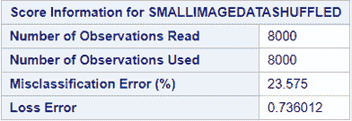

该模型在留存数据上的分类率似乎为 23.58%。

2. 运行程序中的剩余代码并查看结果。

程序将输出由 `dlScore` 操作创建的评分数据的前 20 条观测值。`_label_` 列包含实际标签，而 `I__label_` 列包含预测分类。使用 `PROC SGPLOT` 创建直方图，显示每个类别误分类图像的数量。（参见图 2.27。）

图 2.27：误分类图像直方图

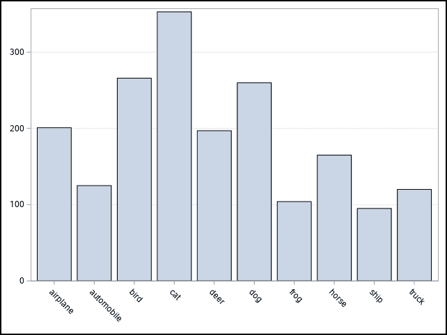

代码生成的输出示例位于图 2.28。

图 2.28：代码输出

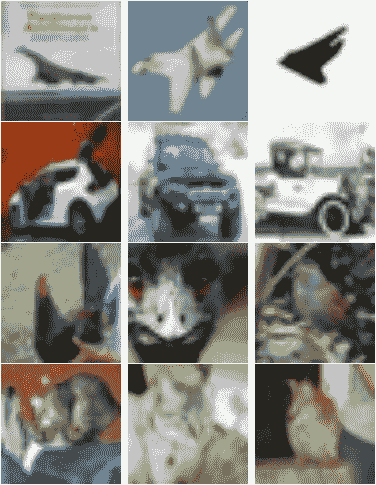

`PARTITION` 过程用于在 SAS Viya 中对数据进行采样。它可以执行简单随机采样、分层采样、过采样或 `k`-折分区，以生成一个包含观测值子集的表或一个包含分区观测值的表。`BY` 语句用于指定分层变量。在本示例中，目标被用作层。

`SAMPPCT=80` 选项要求将 80% 的输入数据包含在训练分区中，`SAMPPCT2=20` 选项要求将 20% 的输入数据包含在验证分区中。`PARTIND` 选项要求输出数据表 `mycas.smalltraindata` 包含一个指示器，显示每个观测值是否被选择到分区（1 表示训练，2 表示验证）。

第二次运行 `PARTITION` 过程将以上述相同的方式对较大的图像样本进行分区。

```
proc partition data=mycas.SmalltrainData samppct=80    
```

```
     samppct2=20 seed=12345 partind;
```

```
     by _label_;
```

```
   output out=mycas.smallImageData;
```

```
run;
```

```
proc partition data=mycas.LargetrainData samppct=80    
```

```
        samppct2=20 seed=12345 partind;
```

```
     by _label_;
```

```
     output out=mycas.LargeImageData;
```

```
run;
```

小样本见图 2.29。

图 2.29：小样本

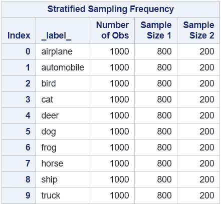

大样本见图 2.30。

图 2.30：大样本

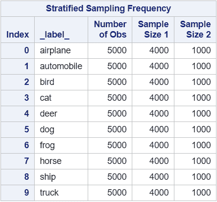

如果你希望更快速地运行此示例而不是使用大样本，可以使用小样本进行练习。

数据目前是按目标值排序的。例如，数据可能从只有青蛙的照片开始，然后是猫的照片，以此此类推。按目标排序可能会导致随机梯度下降（SGD、动量和 ADAM）的变体出现问题。问题的产生是因为按结果排序可能会导致模型陷入某组对单个类别过度预测的参数集合中。也就是说，它无法区分所有结果类别。建议对数据进行随机洗牌。事实上，在为图像分类器融合（通过预测的加权平均进行集成）模型时，更改观测值顺序是非常常见的。

注意：随机洗牌的替代方案是课程学习。课程学习按最易学习的观测值对数据进行排序。要实现课程学习，从业人员将训练模型，根据预测与实际值对数据进行排序，然后重新训练模型。

以下代码使用 `shuffle` 操作随机排序观测值。创建了一个名为 `ImageDataShuffled` 的新数据集。

```
proc cas;
```

```
 table.shuffle / table=’smallImageData’ 
```

```
            casout={name=’SmallImageDatashuffled’, replace=1};
```

```
run;
```

```
proc cas;
```

```
 table.shuffle / table=’LargeImageData’ 
```

```
            casout={name=’LargeImageDatashuffled’, replace=1};
```

```
run;
```

卷积神经网络在某些情况下可能需要训练几天、数周甚至几个月。此示例使用有限的数据构建了一个简单的卷积网络以节省时间。

3. 打开名为 `DLMS02D02a.sas` 的程序并运行它。

# 第 3 章：提高准确性

- 简介
- 架构设计策略
- 空间探索
- 创建块
- 比较结构深度与基数
- 图像预处理与数据增强
- 数据增强技术
- 处理图像
- 高斯滤波
- 锐化
- 像素反转
- 金字塔下采样
- 旋转
- 翻转
- 迁移学习介绍
- 领域与子域
- 任务
- 迁移学习类型
- 异质迁移学习与领域适应
- 迁移学习偏差
- 频率偏差
- 迁移学习策略
- 监督预训练
- 无监督预训练
- 使用 FCMP 进行自定义
- 调优深度模型
- 选择超参数
- 采样超参数空间
- 超参数选择
- Hyperband 属性

## 简介

大多数传统数据（如交易或调查数据）并不包含“真相”。例如，知道一个人的真实的道德品质可以大大提高欺诈模型的准确性，尽管某些类型的数据包含真相。图像数据就是其中一个例子，因为定义对象的元素存在图像中，尽管是以二维形式存在的。因此，一个训练良好的神经网络在图像分类和其他视觉任务上优于外行并不意外。

## 架构设计策略

本章的重点是介绍用于改进计算机视觉模型的简单技术。

`1x1` 卷积通常用于更改流信息的维度深度。`1x1` 内核跨所有列和所有通道共享单个权重，产生一个摘要的主题。（参见图 3.1。）

图 3.1：1 x 1 卷积

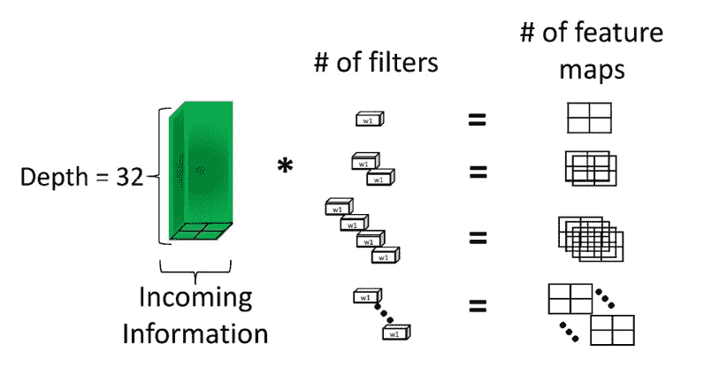

GoogLeNet 在应用内核滤波器之前使用 `1x1` 卷积减少维度深度，这种技术被称为瓶颈（Szegedy et al. 2014）。瓶颈可以减少训练相关的计算成本，从而将资源分配到其他领域，例如增加基数或构建更深、更宽的网络结构。（参见图 3.2。）

图 3.2：特征提取前的维度深度还原

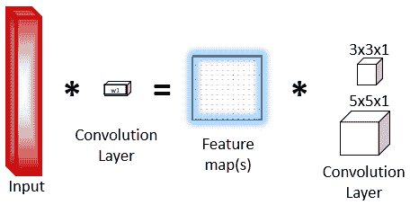


你也可以使用 1 x 1 卷积来扩展维度深度，它们有时被用来代替全连接层以节省计算成本，如图 3.3 所示。

图 3.3：使用 1 x 1 卷积扩展维度深度

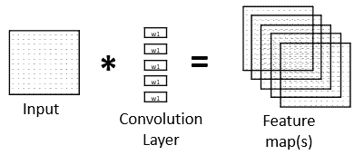

## 空间探索

过滤器提取空间相关的信息，并将这些信息转换到输出特征图中。空间探索技术（如使用不同尺寸的过滤器）使模型能够捕捉不同粒度的细节，从而对过滤器所在的区域提供更完整的理解。在不同尺度上捕获的信息可以在随后的层中组合，以形成对信息更详细的解释。

此外，增加步长（stride）会影响每个滤波器的探索方案，并缩小输出特征图的大小。较大的步长值会缩小输出特征图的宽度和高度。

## 创建块（Blocks）

GoogLeNet 将 1 x 1 过滤器与空间探索相结合了块（Szegedy 等人 2014）。块是特征提取的一个阶段，通常由多个卷积层组成，这些层通常被堆叠，然后通过“分割-转换-合并”策略与拼接层或残差层相结合。（见图 3.4。）

图 3.4：一个块

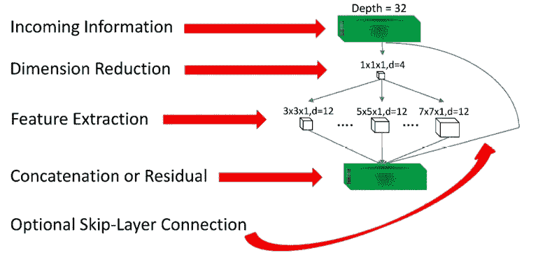

块与隐藏层不同，因为块可以包含多个隐藏层，这些隐藏层结合时会产生更相关的输出。有时块内部会使用池化层，GoogLeNet 就是如此。块通常像隐藏层一样被堆叠。

ResNet 引入了残差层，作为将之前学习的信息与当前特征状态相结合的方法，以构建一个能够有效支持增加深度的模型（He 等人 2015）。ResNet 在所谓的残差块中利用了残差层。

图 3.5：ResNet 类型残差块

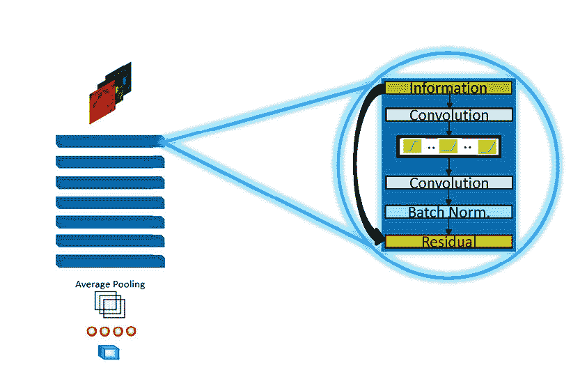

残差块始于一个应用于输入信息的卷积层。第一个卷积的输出在进入下一个卷积层之前通过一个非线性激活函数。使用批归一化（Batch normalization）来防止梯度爆炸，并在涉及另一个非线性激活之前对信息进行归一化。残差块以跳层残差连接（skip-layer residual connection）结束，它将原始信息与新学习的特征相结合。残差块缓解了与网络深度增加相关的梯度消失/爆炸问题。

基数（Cardinality）是指块内变换集合的数量。基数首次在 2017 年的 ResNeXt 模型中引入，作为深度探索的替代方案以获得更高的准确率（Saining 等人 2017）。其训练成本可能很高，但如果使用了跳层，则建议使用残差连接以降低训练成本。

图 3.6：基数

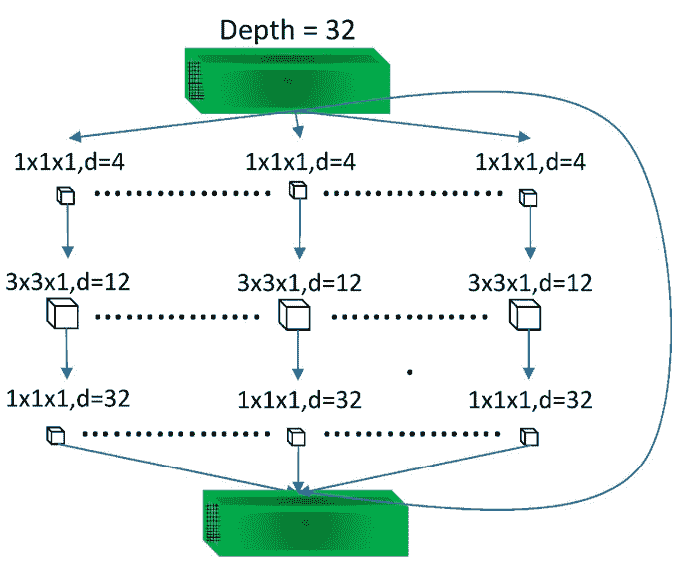

每个变换集由一条独立的信息轨迹组成，它们共同训练而非独立训练。例如，下面的图 3.7 显示了块内的五个变换集。

图 3.7：块内的变换集

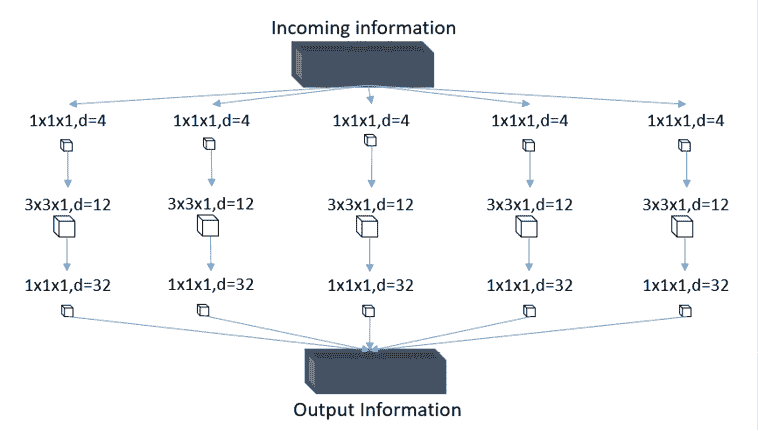

ResNeXt 表明基数可以作为深度探索的替代方案。具体来说，ResNeXt 的作者证明了与具有相似参数量的 ResNet 相比，其分类错误率更。ResNeXt 中使用的每个变换集始于 1 x 1 卷积以减少维度深度，随后是用于特征提取的 3 x 3 卷积。最后，在残差层总结并合并所有变换集之前，使用 1 x 1 卷积来扩展维度深度。

图 3.8：带有平均池化的 ResNet 类型

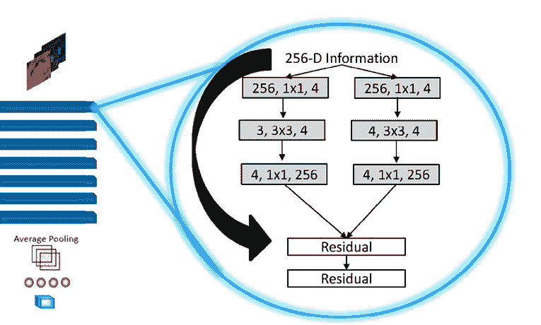

有趣的是，作者观察到基数的行为非常类似于一种结构正则性。这意味着对于一个似乎过拟合训练数据的模型，基数将是一个非常有用的补充。

## 比较结构深度与基数

考虑以下案例研究，它检查了 ResNet 类型模型和 ResNeXt 类型模型在 CIFAR-10 数据上的性能。具体而言，检查了基数与网络深度的影响。表 3.1 突出了 ResNet 类型和 ResNext 类型模型之间的一些差异。

表 3.1：ResNet 与 ResNext 架构

| 特性 | ResNet 类型 | ResNext 类型 |
| --- | --- | --- |
| 块数量 | 10 | 3 |
| 基数 | 1 | 6 |
| 跳层连接 | 残差 | 残差 |
| 参数数量 | 803,230 | 349,842 |

实验中检查的 ResNet 类型和 ResNeXt 类型模型在起始和结束模型结构上几乎完全相同。ResNet 起于一个包含 12 个滤波器的卷积层，随后是一个 2 x 2 最大池化层，并以 3 x 3 平均池化层结束，随后是一个带有 660 个神经元的全连接层。ResNeXt 起于一个包含 8 个滤波器的卷积层，随后是一个 2 x 2 最大池化层，并以 3 x 3 平均池化层结束，随后是一个带有 660 个神经元的全连接层。

两种架构之间的主要区别在于起始和结束层之间使用的块数量和基数。ResNet 类型模型使用 10 个具有单一独立路径的块，这意味着基数为 1。ResNeXt 类型是一个浅得多的模型，仅使用三个具有六条分离轨迹的块，这意味着基数为 6。

基数具有额外的意外计算成本。因此，尽管模型参数上存在差异，但 ResNeXt 类型模型的训练时间比 ResNet 类型模型稍长，尽管参数更少。

首先，两个模型都在 10000 个观测值上训练了 60 个轮次（epochs）。ResNet 表现更好，分类错误率为 44.2%，而 ResNeXt 为 48.5%。有趣的是，ResNeXt 的方差比 ResNet 小。见图 3.9 和表 3.2。

图 3.9：ResNet 与 ResNext，10000 个观测值，60 个轮次

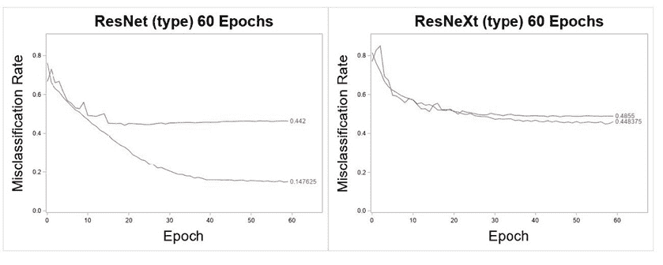

表 3.2：ResNet 与 ResNext，10000 个观测值，60 个轮次

| 验证分类 | ResNet | ResNext |
| --- | --- | --- |
| 60 轮次 | 44.2 | 48.55 |

然后轮次从 60 增加到 1500，两个模型都重新训练了。两个性能都得到了提高，之间的差异缩小了，尽管 ResNet 模型仍然优于 ResNeXt 模型。考虑到数据只有 10000 个观测值，训练 1500 个轮次似乎有些极端。见图 3.10 和表 3.3。

图 3.10：ResNet 与 ResNext，10000 个观测值，1500 个轮次

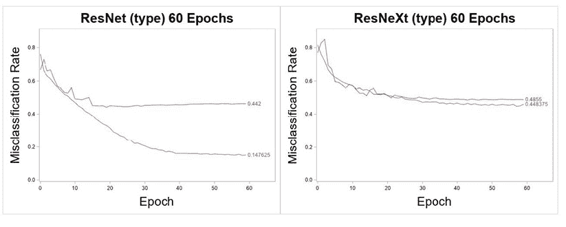

表 3.3：ResNet 与 ResNext，10000 个观测值，1500 个轮次

| 验证分类 | ResNet | ResNext |
| --- | --- | --- |
| 60 轮次 | 44.2 | 48.55 |
| 1500 轮次 | 43.1 | 44.1 |

两个模型的第一个卷积层都添加了 10% 的丢弃率，并重新训练了模型。两个模型都得到了进一步提高，模型之间的性能差异微乎其微。见图 3.11 和表 3.4。

图 3.11：ResNet 与 ResNext，10000 个观测值，1500 个轮次，第一个卷积层添加 10% 丢弃率

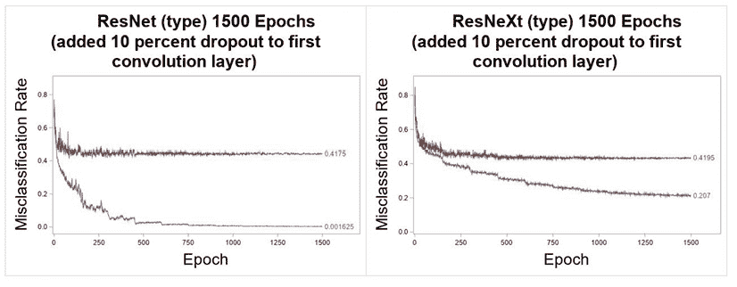

表 3.4：ResNet 与 ResNext，10000 个观测值，1500 个轮次，第一个卷积层添加 10% 丢弃率

| 验证分类 | ResNet | ResNext |
| --- | --- | --- |
| 60 轮次 | 44.2 | 48.55 |
| 1500 轮次 | 43.1 | 44.1 |
| 1500 轮次，添加 10% 丢弃率 | 41.75 | 41.95 |


数据量从 10,000 个观测增加到 50,000 个观测。两个模型的方差均有所下降，在留出数据上的性能大幅提升。学习率的降低现在现在迭代图中清晰可见。请参阅图 3.12 和表 3.5。

### 图 3.12：ResNet 与 ResNext，50,000 次观测，1,500 次迭代

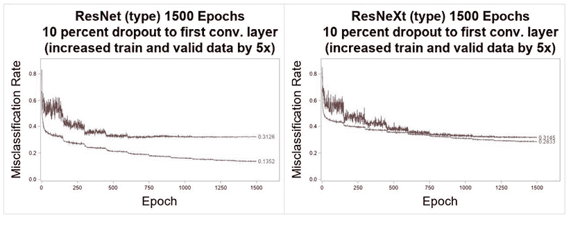

### 表 3.5：ResNet 与 ResNext，50,000 次观测，1,500 次迭代

| 验证杂项 | ResNet | ResNext |
| --- | --- | --- |
| 10k 观测, 60 次迭代 | 44.2 | 48.55 |
| 10k 观测, 1,500 次迭代 | 43.1 | 44.1 |
| 10k 观测, 1,500 次迭代, 增加 100% dropout | 41.75 | 41.95 |
| 50k 观测, 1,500 次迭代 | 31.26 | 31.45 |

## 图像预处理与数据增强

如果训练数据和验证数据分区之间的性能存在显著差异，那么可能是你的模型遭受了高方差。收集或生成更多数据并应用正则化可以减轻方差误差。从当前数据生成图像时，会对新的排列添加平移和微小失真。然而，平移应该是随机的以避免引入偏差。当训练数据有限且训练与验证误差差异巨大时，应考虑增强图像数据。这种增强可以用于平衡极端的目标分布。

合成案例创建（Synthetic case creation）是一种在无法获取更多数据时，通过设计案例来丰富训练数据的做法。这些人工观测值应该代表总体中可能存在但在实际训练样本中可能无法观察到的可能性。这里的关键是创建代表“可能”而非“不可能”的案例。例如，假设我们正在分析人们从火车离开进入站台的图像。我们可能想要添加合理的颜色失真，以模拟光照的变化。然而，我们不会垂直翻转图片，因为环境中存在重力影响。

有时，添加噪声可以提高模型的泛化能力。考虑为新应用对人类语音建模。添加白噪声来模拟用户尝试使用语音应用程序的不可预测环境可能是有益的。即使是添加随机补丁（random patches）也可以被视为生成更多图像数据的有效方法。

## 数据增强技术

数据增强技术通常分为四大类之一：几何、光学、领域和生成式。

- 几何变换涉及像素方向或位置的改变，用于使模型对空间差异更具鲁棒性。这意味着模型对图像中元素的位置偏移更具不变性。属于此类别的常见变换包括旋转、翻转、缩放和裁剪。
- 光学形态和变换通过改变像素强度，其目的是使模型对颜色变化更具鲁棒性（或不变性）。常见的增强技术包括像素反转、变亮/变暗、色彩偏移、色彩抖动、侵蚀等许多其他。
- 领域变换整合了由建模者对数据的知识所驱动的数据更改。
- 生成式变换通常依赖生成式模型来创建新数据。

### 图 3.13：图像变换示例


`processImage` 和 `augmentImage` 动作经常用于高级增强。在建模过程之前增强数据会额外成本，因为数据量增加了，从而降低了整体速度。SAS 深度学习提供了“即时”基础增强，这缓解了速度下降的问题。

## 过程操作

`processImages` 动作对输入图像执行单个或多个图像处理函数。该动作的输入是一个 CAS 表，包含图像和一组函数（带有特定参数），如下代码所示。

```
PROC CAS;
 ProcessImages /
       table={name="< image table name>"}
       casOut={name="< output image table name>"}
       imageFunctions={
              {functionOptions={functionType="< first transformation type>"}
              < function type-specific-parameters>}},
              {functionOptions={functionType="< second transformation type>"}
              < function type-specific-parameters>}};
RUN;
```

输出是一个 CAS 表，包含应用指定函数后的结果图像。你可以定义以下函数：

- `RESIZE`：根据宽度和高度参数缩放输入图像。
- `GET_PATCH`：根据输入图像中的矩形区域（使用 `x`、`y`、`width` 和 `height` 参数）创建一个补丁。


- `CANNY_EDGE`: 使用 Canny 边缘检测算法检测输入图像中的边缘。此函数接受三个参数：`lowThreshold`、`highThreshold` 和 `kernelSize`。

- `LAPLACIAN`: 对输入图像应用拉普拉斯算子。拉普拉斯算子是 `n` 维欧几里得空间中的二阶微分算子。当 `kernelSize` 参数的值为 1 时，结果通过内核与输入图像的卷积来近似。
- 否则，该值通过累加 `x` 和 `y` 的二阶导数来近似，这些导数是通过 `Sobel` 算子计算的。
- `SOBEL`: 使用 `Sobel` 算子计算一阶、二阶、三阶或混合图像导数。导数通过图像与卷积卷积计算。内核必须是正方形。尺寸只能是以下数字之一：1、3、5 和 7。当内核大小为 1 时，使用一个 `kernel` 计算 `x` 的一阶或二阶导数，使用另一个 `kernel` 计算 `y` 的一阶或二阶导数。对于其他内核尺寸，`Sobel` 算子会将高斯平滑和微分结合（处理噪声）。
- `NORMALIZE`: 归一化图像的值范围。你可以在 `type` 参数中指定以下归一化函数：`INF`、`L1`、`L2`、`L2SQR`、`HAMMING`、`HAMMING2`、`RELATIVE` 和 `MINMAX`。`MINMAX` 函数通常用于将图像归一化在 `alpha` 和 `beta` 值之间。
- `THRESHOLD`: 对图像中的每个像素应用阈值。你可以指定以下阈值类型：`BINARY`、`BINARY_INVERSE`、`TRUNCATE`、`TO_ZERO`、`TO_ZERO_INVERSE`、`OTSU` 和 `TRIANGLE`。
- `CONVERT_COLOR`: 转换图像的色彩空间。目前可用的转换为 `COLOR2GRAY`、`GRAY2COLOR`、`BGR2RGB` 和 `RGB2BGR`。图像的默认色彩空间为 `BGR`。`COLOR2GRAY` 意味着 `BGR2GRAY`。
- `RESCALEALE`: 更改图像的深度。你可以指定以下类型的重缩放：
    - `TO_8U`：深度改为 8 位，其中像素由无符号整数表示。
    - `TO_32F`：深度改为 32 位，其中像素由浮点数表示。
    - `TO_64F`：深度改为 64 位，其中像素由双精度数字表示。
    你可以根据 `alpha` 和 `beta` 参数对值进行缩放。
- `MORPHOLOGY`: 对图像进行形态学变换。你可以指定以下变换类型：`ERODE`、`DILATE`、`OPEN`、`CLOSE`、`GRADIENT`、`TOPHAT`、`BLACKHAT` 和 `HITMISS`。这些操作中的每一个都可以采用 `RECT`（矩形）、`CROSS`（交叉）和 `ELLIPSE`（椭圆）形状。
- `BOX_FILTER`: 使用归一化均值滤波器模糊图像。`kernelWidth` 和 `kernelHeight` 参数决定了滤波器的形状。假设锚点位于内核中心。
- `GAUSSIAN_FILTER`: 使用高斯滤波器模糊图像。根据 `kernelWidth` 和 `kernelHeight` 参数创建卷积内核，这些参数必须为正数且奇数。
- `BILATERAL_FILTER`: 使用高斯滤波器模糊图像。根据 `kernelWidth` 和 `kernelHeight` 参数创建卷积内核，这些参数必须为正数且奇数。
- `MEDIAN_FILTER`: 使用中值滤波器模糊图像。根据 `kernelWidth` 和 `kernelHeight` 参数创建卷积内核，这些参数必须为正数且奇数。
- `BUILD_PYRAMID`: 创建图像金字塔。你可以使用 `PYRAMID_DOWN` 或 `PYRAMID_UP` 方法。
- `CONTOURS`: 图像中的轮廓。
- `CUSTOM_FILTER`: 创建自定义滤波器。
- `ADD_CONSTANT`: 为图像增加或减去常数值。
- `HIST_EQUALIZATION`: 旨在拉伸强度范围。支持两种版本：全局和自适应。
- `LINEAR_TRANSFORMATION`: 根据 `method` 以以下方式之一执行线性变换：
    - `STANDARDIATION`：创建均值为零、方差为一的图像。
    - `WHITENING_PCA`：使用主成分分析创建协方差矩阵为单位的图像。
    - `WHITENING_ZCA`：使用 ZCA 变换（也称为马哈拉诺变换）创建协方差矩阵为单位的图像。
    - `LOCAL_CONTRAST_NORM`：与 `STANDARDIATION` 相似，但局部的。
- `MUTATIONS`: 使用不同的技术变变图像：垂直翻转、水平翻转、通过金字塔缩放、改变对比度（变暗或变亮）、锐化以及左右旋转。


例如，你可以在输入图像上使用滑动窗口方法并单独对输入图像进行翻转。输出的 `CAS` 表包含生成的图像。此外，`writeRandomly` 参数允许你对输入图像随机应用数据增强。这对于基于深度神经网络的机器学习方法非常重要。

将 `sweepImage` 和 `useWholeImage` 参数都设置为 `True` 是相互矛盾的。因此，`useWholeImage` 参数会覆盖 `sweepImage` 参数。

下面的代码演示了如何使用 `AugmentImage` 操作对一个 32 x 32 像素的图像应用两种变换。

```
PROC CAS;
AugmentImages / table={name= “MyInputTable” casOut={name= “MyOutputTable"} writeRandomly= true cropList={mutations= { colorjittering= true rotateright= true } width= 32 heigth= 32 useWholeImage= true}};
RUN;
```

## 高斯滤波器

高斯滤波器用于平滑图像内部的剧烈变化。

图 3.14：高斯滤波器

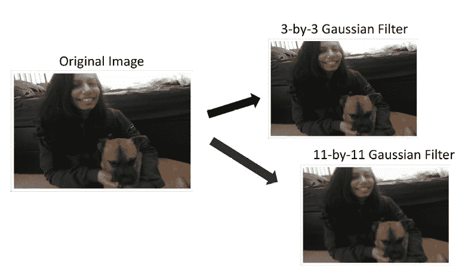

这种光度变换通过混合像素来创建图像的模糊版本。如图 3.14 所示，较大的卷积核会增加变换的模糊效果。高斯滤波器对核的中心赋予更大的权重，使得感兴趣区域与周围像素轻微混合。一个高斯核滤波器的示例可能如下所示。

图 3.15：高斯核滤波器


用户只需要提供高斯核的高度和宽度。SAS 会创建一个有效的核，使得二维核下方的体积积等于 1。`processImages` 操作被用于创建经高斯滤波器变换的图像。以下是一些示例代码：

```
PROC CAS;
image.processImages / imageFunctions= {{functionOptions= {functionType= “GAUSSIAN_FILTER” KernelWidth= 5 KernelHeight= 5}} table={name=’inputTable'} casout={name=’outputTable’};
RUN;
```

## 锐化

对图像进行锐化处理被认为是一种光度变换，如图 3.16 所示。

图 3.16：锐化


为了锐化图像，SAS 将红、绿、蓝（RGB）彩色图像编码为 `Y′CbCr`，其中 `Y’` 是亮度分，`Cb` 代表蓝差分量，`Cr` 代表红差分量。然后对编码图像应用高通滤波器以检测边缘。图 3.17 是高通滤波器的示例。

图 3.17：高通滤波器


然后将图像转换回 RGB 彩色空间。以下是锐化图像的示例代码：

```
PROC CAS;
image.processImages / imagefunctions= {{functionOptions= {functionType=”MUTATIONS” type=”SHARPEN”}}} table={name=’inputTable'} casout={name=’outputTable’};
RUN;
```

## 像素反转

像素反转是一种光度变换，它反转颜色密度，使得亮变暗，暗变亮，如图 3.18 所示。

图 3.18：像素反转


这可以简单地将每个 RGB 像素值替换为 `(255 – pixel value)`。以下是演示如何使用 SAS 反转像素的示例代码：

```
PROC CAS;
image.processImages / imagefunctions= {{functionOptions= {functionType=”MUTATIONS” type=”INVERT_PIXELS”}}} table={name=’inputTable'} casout={name=’outputTable’};
RUN;
```

## 金字塔下采样

金字塔下采样变换对图像进行下采样然后进行模糊。示例如图 3.19 所示。

图 3.19：金字塔下采样与裁剪变换


图 3.19 的示例中也使用了裁剪。经验证据，裁剪作为一种几何增强，可以显著提高卷积神经网络模型的泛化性能（Taylor and Nitschke 2017）。`augmentImages` 操作用于在同次处理中同时裁剪并应用金字塔下采样变换。

在下面的代码中，注意 `useWholeImage=` 被设置为 `false`，这表示可能会执行裁剪。

```
proc cas;
image.augmentImages / cropList= {{mutations= {pyramidDown=TRUE} x=60 y=60 }} useWholeImage=false; table={name=’inputTable'} casout={name=’outputTable’};
run;
```

## 旋转

图像旋转是最流行的几何变换之一，因为对象的角度在应用中可能会变化。图 3.20 显示了图像向左或向右旋转的方法，SAS 会自动用零填充填充外部边缘。然而，将零填充替换为噪声有助于模型的泛化能力。或者，你可以先旋转然后裁剪图像以移除零填充。以下是 `processImages` 操作将图像向右旋转的代码：

```
PROC CAS;
image.processImages / imagefunctions= {{functionOptions= {functionType=”MUTATIONS” type=”ROTATE_RIGHT”}}} table={name=’inputTable’};
RUN;
```

## 翻转

图像翻转是另一种广泛的几何变换，但应该谨慎使用，因为它有时会创建标记错误的图像或代表不太可能的情况。图 3.21 显示了图像翻转的示例。

下面的代码使用 `processImages` 操作垂直翻转图像。

```
PROC CAS;
image.processImages / imagefunctions= {{functionOptions= {functionType=”MUTATIONS” type=”VERTICAL_FLIP”}}} table={name=’inputTable'} casout={name=’outputTable’};
RUN;
```

## 迁移学习引言

传统的机器学习方法从一个数据源提取信息并用于另一个数据源，前提是分布是相同的，或者是非常相似的，如图 3.23 所示。


预测建模是一个经典案例，其利用从历史或当前数据中提取的信息，来预测与尚未观测到的数据相关的结果。预测模型假设特征分布从训练到评分阶段保持不变。

迁移学习是机器学习的一个领域，如图 3.24 所示，它利用从一组分布中提取的信息，并将其应用于另一组不同的分布中。

### 图 3.24：不相似的分布


也就是说，迁移学习指的是从一个设置（通常称为源域）中提取的信息被利用在另一个设置（通常称为目标域）中，以提高学习者的性能。这意味着所提取信息的特征空间与目标学习器（模型）关联的特征空间是不同的。迁移学习指的是从一个设置中提取的信息被利用在另一个设置，目标是提高学习者的性能。更正式地说，源域（`s`）和目标域（`t`）不匹配（`Ds ≠ Dt`），或者源任务和目标任务不匹配（`Ts ≠ Tt`）（Weiss, Khoshgoftaar, and Wang 2016）。

## 域与子域

域是由一组特征描述的环境或设置。（参见图 3.25。）域是子域的先驱，域和子域的结构描述了相关信息的层级关系。域以及扩展的子域，由特征空间（`X`）和边缘概率分布（`P (X)`）定义。例如，英语、中文和冰兰语的翻译各是自然语言处理域的子域（Weiss, Khoshgoftaar, and Wang 2016）。

### 图 3.25：域与子域的示例


注意：通常，在考虑源域和目标域是否相等时，出于实用考虑，最近的子域被视为“域”。即回答问题 `XS=XT` 且 `P(XS)=P(XT)` 是否？

## 任务

域只考虑输入变量，而任务考虑结果。任务由输出空间（`Y`）和条件概率分布（`P(Y|X)`）定义。例如，图 3.26 显示，预测分类结果（例如根据狗的图像预测其品种）是计算机视觉域内的一个任务（Weiss, Khoshgoftaar, and Wang 2016）。

### 图 3.26：域与任务


因此，我们可以正式地定义迁移学习为：“给定一个具有相应任务 `Ts` 的源域 `Ds` 和一个具有相应任务 `Tt` 的目标域 `Ts`，迁移学习是利用 `Ds` 和 `Dt` 的相关信息来改进目标函数 `ft(x)`!(image/Image3262.png)，其中 `Ds≠Dt` 或 `Ts≠Tt`（Weiss, Khoshgoftaar, and Wang 2016）。”

## 迁移学习的类型

迁移学习有两种类型：同质迁移（`Xs=Xt`）和异质迁移（`Xs≠Xt`）。图 3.24 展示了同质迁移的示例。

### 图 3.27：同质迁移学习


注意：`Xs=Xt`。

## 异质迁移学习与领域自适应

如上所述，异质学习指的是 `Xs≠Xt`。图 3.28 展示了异质学习的示例。

### 图 3.28：带有表格数据的异质迁移学习


领域自适应与 `Ds≠Dt` 密切相关。例如，考虑生成文本的任务。域是相同的，但语言不同。通常的做法是保持权重冻结状态，并从源数据迁移到目标域。领域自适应会改变（或调整）源域。Glorot 等人 (2011) 证明了堆叠去噪自动编码器可领域自适应。文献中关于领域的定义存在许多不一致之处。Goodfellow 等人 2016。

## 迁移学习偏差

迁移学习可能是困难的，因为本质上迁移学习存在差异。这些差异会导致偏差，并引起模型性能下降。偏差是负面学习的主要原因。两种最常见的迁移学习偏差是频率偏差和上下文偏差。

### 频率偏差

当特征不独立于域且迁移学习策略部署在不同域时，就会发生频率偏差。例如，考虑跨域（医疗域和商业域）的情感分析任务。“人们”、“帮助”和“工作”等词与域无关，可能以相似的频率出现。然而，“心脏”、“病人”和“药物”等词在医疗域中可能更频繁，而“利润”、“客户”和“销售”在商业域可能更频繁。因此，image/Image3285.png)，意味着特征的边缘概率分布不匹配。

### 上文偏差

当特征与输出之间的底层关系从源数据变为目标数据变化时，就会发生上下文偏差。考虑我们之前关于医疗域和商业域的示例。商业域中的“阳性”一词通常具有积极的情感。然而，同一个词在医疗域中可能具有负面的情感。例如，“检测结果呈阳性”，这里的“阳性”是指疾病的存在。因此，上下文偏差指的是这种情况 image/Image3294.png)，意味着条件概率分布从源数据到目标数据不同。


选择冻结哪些层取决于当前面临的问题。如果任务从源数据到目标数据是相同的，那么共享更靠近输出层的层是合理的。在这种情况下，可适应的层是那些靠近输入层的层。相反，如果相关信息主要存在于输入中，则应该冻结更靠近输入层的层，并让靠近输出层的层保持可适应状态。

### 无监督预训练

`Autoencoders`（自动编码器）是一种无监督模型，已在无监督预训练中取得了某种成功。无监督方法的一个优点是源数据不需要标签。无监督预训练策略通常从结合源数据和目标数据的特征开始。随后在全量数据上训练 `autoencoder`，以期捕获跨领域存在的信息。当源数据丰富而目标数据有限时，这种方法非常有用。然后，使用训练好的 `autoencoder` 对目标数据进行评分（推理），并提取编码投影。这些编码器将连同原始目标特征一起作为输入提供给目标学习器。Glorot 等人 (2011) 已经证明了使用堆叠去噪自动编码器进行无监督迁移学习是有效的。

去噪自动编码器由 Vincent 等人 (2010) 引入，是一种在损坏（扰动）的输入上训练的自动编码器。对输入进行损坏只需简单对输入层应用 `dropout`。去噪自动编码器的一种流行变体 `stacked denoising autoencoder`（堆叠去噪自动编码器）。

`stacked denoising autoencoder` 是通过逐层贪婪地训练的。这意味着第一层在扰动输入上经过彻底训练，然后被冻结。随后将扰动输入替换为未扰动的输入，并对下一层进行彻底训练。该层冻结后，重复此过程直到输出层训练完成。

自动编码器的另一种变体 `sparse autoencoders`（稀疏自动编码器）。`Sparse autoencoders` 在目标函数中引入了约束。可以使用 `L1` 和 `L2` 正化作为约束机制来生成稀疏自动编码器。

### 使用 FCMP 进行自定义

有时，数据科学家希望为模型创建自定义函数，以更好地适应可用默认函数无法提供的特定深度学习需求。SAS 中的深度学习工具允许您使用 `SAS Function Compiler`（`FCMP`）来创建和修改用于深度神经网络激活函数和误差函数的自定义定义。`FCMP` 是一种编程工具，您可以结合 SAS 中的深度学习操作使用它，以生成自己的自定义深度学习实体：

* 激活函数
* 误差函数
* 模型层变为*学习率策略

自定义的 `FCMP` 网络层、函数和学习率策略是执行不同深度学习任务的独立实体。它们的共同点是，所有自定义层、自定义激活函数和误差函数以及自定义学习率策略都是为了通过 `FCMP` 用于 SAS 深度学习而创建的。

`FCMP` 操作的参数可以在文档中找到。

### 调整深度学习模型

#### 选择超参数

机器学习算法创建的预测模型的质量取决于控制训练过程和模型结构的各种属性值。代表这些属性的参数称为`hyperparameters`。对于遗传算法或贝叶斯优化方法，搜索深度神经网络的超参数空间可能极其昂贵，因为这些方法需要对每种超参数组合进行训练，直到算法收敛。另一种，`Hyperband` 方法（Li 等人，2017）是密集模型结构的一种良好方法，因为资源会自适应地分配给最有前景的候选方案。

#### 采样超参数空间

`dlTune` 操作实现了 `Hyperband` 方法，并开始使用 `Latin hypercube sampling`（拉丁超立方采样）选择超参数。相比 `simple random`（简单随机），`Latin hypercube sample` 更为优，因为它确保了空间中的点大致等距。

为了避免过拟合，使用留存样本来评估超参数。`dlTune` 操作使用 `Hyperband` 方法按比例分配资源。根据 `TUNERETENTION` 属性剔除性能较差的集合。


注意：对于单机服务器上的 SGD 或分布式服务器上使用单个 worker 的会话，当操作通过一次数据时，即达到一个 epoch。对于使用多个 worker 的会话，当所有 worker 均与控制器交换一次权重时，即达到一个 epoch。`syncFreq` 参数指定了每个 worker 在与控制器交换权重之前通过数据的次数。

`TUNEITER` 属性指定了运行调优算法的迭代次数。调优算法的每次迭代使用指定的 `maxEpochs` 对所有激活的超参数集进行模型训练。具有最佳验证拟合误差的超参数在未来的调优迭代中将保持激活状态。

`NUMTRIALS` 属性指定了在调优过程开始时尝试的超参数集数量。例如，将该属性指定为 100 将将开始训练 100 个具有不同超参数值的模型。

`TUNERETENTION` 属性决定了每次调优迭代后保留的超参数配置比例。

`TUNERESTART` 指定了重启参数调优过程的次数，使用之前搜索中提供的可用权重以及新选择的参数集。

为 `maxepochs`、`tuneiter`、`numtrials`、`tuneretention` 和 `tunerestart` 选择一组合适的调优值并非易事。一种常见的方法是将 `maxepochs` 设置为一个较小的值，以便为超参数组合（`numtrials`）分配较大的值。这种方法似乎意味着，对于超参数搜索方法，模型参数估计（权重）的重要性可能低于模型的特征。无论这是否真实，在某些情况下需要采用替代方法。例如，假设你模型当前的迭代图类似于图 3.35。

图 3.35：当前迭代图


此时，逻辑上的做法是搜索 `L1` 和 `L2` 正则化值，以降低模型的方差。将 `maxepochs` 值设置为较小的数（如四），可能会导致过程在性能低下的峰值处评估每个超参数组合的性能，如图 3.36 所示。

图 3.36：将 Maxepochs 设置为小值


在训练过程的此点评估模型可能会倾向于选择较大的 `L1` 和 `L2` 值，因为较大的值会限制权重的增长，这可能导致模型对数据中信息的响应能力降低。这意味着，较大的 `L1` 和 `L2` 值在第四 epoch 似乎具有更优的性能，因为在过程早期观察到的退化会被抑制。但大 `L1` 和 `L2` 权重值从长期来看真的是模型“最佳”的吗？人们推测答案是“否”，因为模型将难以捕捉数据中可能存在的不那么明显的单一特征。因此，在这个例中，将 `maxepochs` 设置为较大的值可能是最好的，以避免在训练早期观察到的低性能峰值处评估超参数组合，如图 3.37 所示。

图 3.37：将 Maxepochs 设置为较大值


在设置调优参数时，必须考虑业务问题以及模型与数据的交互。

# 第 4 章：目标检测

### 引言

### 目标检测算法类型

## 数据准备与预测概述

### 非归一化数据
### 归一化位置
### 多损失误差函数
### 误差函数标量
### 锚框 (Anchor Boxes)
### 最终卷积层

## 演示：使用 DLPy 访问 SAS 深度学习技术：部分 1
## 演示：使用 DLPy 访问 SAS 深度学习技术：部分 2

### 引言

图像分类本身是一个检查通常构图良好的图像的任务，并以描述图像的分类概率作为响应。目标检测比图像分类更高级，因为目标检测分析复杂的图像，这些图像包含位于不同距离和位置、处于变化的且通常带有视觉噪声背景中的多种物体。物体可以出现在视觉帧内的任何位置，远近不等，并且相互重叠。（参见图 4.1。）目标检测定位并分类物体，并确定这些物体的边界以及与其他物体的关系。

图 4.1：物体分类


目标检测是一项挑战性任务，也是计算机视觉中最基础的任务之一。我们使用卷积神经网络（`CNNs`）来执行包括目标识别、目标定位和边界以及目标分类在内的任务。最近，类似的基于 CNN 的深度学习算法成功解决了与目标检测任务相关的问题：

*   只看一次 (YOLO)
*   单次多框检测器 (SSD)
*   区域建议网络 (R-CNN)
*   快速区域建议网络 (Faster R-CNN)
*   目标检测骨干特征提取器 (DETNet)

### 目标检测算法类型

目标检测算法可以分为以下几类。第一类目标检测算法通过预定义尺寸和预定义位置锚框一步寻找物体。这些位置和固定尺寸是经过策略选择的，以覆盖尽可能多的场景。算法通常将原始图像分为固定大小的网格区域。对于每个区域，这些算法尝试使用特定的形状和大小预测固定数量的物体。这一类的算法被称为单阶段方法（single-stage methods）。单阶段算法示例包括 `YOLO`、`SSD` 和 `RetinaNet`。此类算法通常运行速度更快，但准确性可能较低。这类算法通常用于需要实时检测的应用。

第二类目标检测算法是涉及两个步骤的区域建议（region proposals）。在区域建议阶段，使用传统的计算机视觉技术（如选择搜索）或基于深度学习的区域建议网络（`RPN`）选择极有可能包含物体的区域。在收集一组候选窗口后，可以使用特定数量的回归模型和分类模型来解决目标检测问题。这一类包括 `Faster R-CNN`、`R-FCN` 和 `FPN-FRCN` 等算法。此类算法通常被称为双阶段方法（two-stage methods）。它们通常更准确，但往往比单阶段方法慢。

SAS 中的深度学习工具支持两种代表性的目标检测算法：`YOLO` 和 `Faster R-CNN`。`YOLO` 是一种单阶段固定尺寸的目标检测算法。`Faster R-CNN` 是一种双阶段、基于区域建议的目标检测算法。

单阶段目标检测器如 `YOLO` 单次分析图像，并输出多个物体位置和分类预测。因此，与 `R-CNNs` 等多阶段算法相比，`YOLO` 网络更快。`YOLO` 架构在训练期间还能利用更大的上下文进行图像推理。


YOLO 将单个 CNN 应用于整幅图像，然后将图像划分为区域（通常是 13 x 13 的网格单元）。然后，对于每个区域，YOLO 预测固定数量的边界框和相关的物体分类概率。每个区域的锚点框（Anchor boxes）为预测的物体尺寸提供了预设值，而实际预测则会对锚点框进行修正。锚点框通常使用 k-means 聚类针对给定数据集获取。最终检测结果通过对预测概率应用阈值操作和非极大值抑制（non-maximum suppression）获得。

## 数据准备与预测概述

模型现在学习的数据已经扩展，包含了描述一个或多个物体空间动态特征的信息。根据所使用的格式，描述物体位置的预测可以通过以下三种方式呈现：

1. `RECT`：使用 `RECT` 格式表示像素单位的坐标 `[xleft, ytop, width, height]`。
2. `YOLO`：使用 `YOLO` 格式表示归一化图像尺寸的坐标 `[xMiddle, yMiddle, width, height]`（通过坐标除以图像尺寸获得）。
3. `COCO`：使用 `COCO` 格式表示像素单位的坐标 `[xmin, ymin, xmax, ymax]`。

除了描述物体位置的输出变量外，还包含一个描述物体数量的输出变量。本章专注于 `YOLO` 格式，它包含了四个描述物体位置的归一化变量。值的归一化确保在使用缩放变换时对目标位置的精度损失最小。

* `_Objectn_x` 对应物体的归一化水平位置。
* `_Objectn_y` 对应物体的归一化垂直位置。
* `_Objectn_width` 对应边界框的归一化宽度。
* `_Objectn_height` 对应边界框的归一化高度。

### 非归一化数据

在某些情况下，提供的数据不是归一化的。例如，考虑 `xmin`、`xmax`、`ymin` 和 `ymax` 代表 500x400 图像中未归一化的像素值的情况。归一化值通过将每个 `x` 和 `y` 坐标除以相应平面的最大值计算（即 `xmin/500`、`xmax/500`、`ymin/400` 和 `ymax/400`）。

以下方程将归一化的 `xmin`、`xmax`、`ymin` 和 `ymax` 值转换为 YOLO 格式的值值：

```
_objectn_x=.5(x min + x max)
_objectn_y=.5(y min + y max)
_objectn_width=(x max - x min)
_objectn_height=(y max - y min)
```

其中 `n` 代表物体编号。

### 归一化位置

考虑下面的示例，图 4.2 中感兴趣的物体是一个正在钓鱼的人。二维图像中的像素代表 X 轴和 Y 轴网格上的坐标。网格本身可以被视为图像的归一化表示，其中左上角的像素坐标为 (0,0)，右下角的像素坐标为 (1,1)。变量 `_objectn_x` 和 `_objectn_y` 提供了物体的归一化原点。例如，该渔民位于 X 轴末端值方向约 70.5% 处。

图 4.2：归一化位置，`objectn_x` 和 `objectn_y`


这意味着渔民的原点位于图像右侧的 70.5% 处。同样，渔民位于 Y 轴末端值方向的 73% 处（即从上到下的距离的 73%）。`_objectn_x` 和 `_objectn_y` 的组合提供了渔民的归一化原点。

变量 `_objectn_width` 和 `_objectn_height` 提供了物体各自的归一化宽度和高度，如图 4.3 所示。物体的原点（在本例中为渔民的原点）位于框的中心。这意味着宽度和高度从渔民的原点向等距离距离延伸。

图 4.3：归一化位置，`objectn_width` 和 `objectn_height`


注意，框的宽度大约是图像宽度的 10%，边界框的高度约为图片高度的四分之一，即 23%。

### 多损失误差函数

YOLOv2 的多损失函数结合了多个误差函数，并尝试平衡模型在分类和定位预测任务之间的关注点。预测任务关注以下四个领域：

* 边界框误差 
* `+ 真置信度误差` 
* `+ 假置信度误差` 
* `+ 分类误差` 

如图 4.4 所示，图像被分为 S x S 的单元格矩阵。在每个单元格中，都会预测多个边界框 。每个预测都包含边界框的中心位置、边界框误差的宽度和高度、预测为物体的概率（真置信和假置信误差的来源）以及分类概率（分类误差的来源）。预测的边界框数量由锚点框的数量决定。锚点框将在后文中讨论。 如果预测  正确，则值为 1。

图 4.4：YOLOv2 多损失误差函数


如果单元格不包含感兴趣的物体，则 ，多损失函数变为简单的平方误差函数：，其中  代表单元格内预测  为物体的概率。如果单元格包含感兴趣的物体，则 ，多损失函数下降  并简化为：，其中  代表相对于锚点框的坐标偏移，而  代表该预测所负责的标注物体边界框的坐标偏移。


标量（Scalars）用于通过强调特定预测而非其他预测来微调预测。例如，《You Only Look Once: Unified, Real-Time Object Detection》的作者发现，置信度预测得分被向零压缩，因为不包含对象的网格数量远大于包含对象的网格数量。因此，作者使用了较低的标量（即 0.5）来抵消大多数网格单元缺乏对象的问题。作者进一步通过较高的标量（即 5）来调整预测，以增加边界框预测的权重（Redmon et al. 2016）。

在多损失误差函数中更改标量会强制模型在各种预测任务之间进行权衡。例如，增加 `COORDSCALE` 会导致优化过程强调边界框的预测，而以削弱置信度和分类预测为代价。该标量通过最后一个 `ADDLAYER` 语句创建的目标检测层中的 `COORDSCALE=` 选项进行调整。

以下是 `COORDSCALE=` 在 `ADDLAYER` 语句中的实现示例：

```
AddLayer / model=’ObjectDetection’
```
```
           name=’output_object_dectect’ layer={type=’detection’
```
```
           coordScale = 5
```
```
 /***剩余代码未显示，但将在章节后介绍主题时显示 ***/
```
```
run;
```

增加 `COORDSCALE` 会提高模型对对象的感知能力，但代价是误检率的增加。该标量通过最后一个 `ADDLAYER` 语句创建的目标检测层中的 `OBJECTSCALE=` 选项进行调整。

以下是 `OBJECTSCALE=` 在 `ADDLAYER` 语句中的实现示例：

```
AddLayer / model=’ObjectDetection’
```
```
           name=’output_object_dectect’ layer={type=’detection’
```
```
           coordScale = 5
```
```
           objectScale = 1
```
```
 /***剩余代码未显示，但将在章节后介绍主题时显示 ***/
```
```
run;
```

增加 `PREDICTIONNOTAOBJECTSCALE` 会使模型在检测对象时更加谨慎。如果给标量分配较大的值，图片中存在的对象可能会被遗漏。

该标量通过最后一个 `ADDLAYER` 语句创建的目标检测层中的 `PREDICTIONNOTAOBJECTSCALE=` 选项进行调整。

以下是 `PREDICTIONNOTAOBJECTSCALE=` 在 `ADDLAYER` 语句中的实现示例：

```
AddLayer / model=’ObjectDetection’
```
```
           name=’output_object_dectect’ layer={type=’detection’
```
```
           coordScale = 5
```
```
           objectScale = 1
```
```
           predictionNotAObjectScale = .25
```
```
 /***剩余代码未显示，但将在章节后介绍主题时显示 ***/
```
```
run;
```

增加 `CLASSSCALE` 会鼓励模型更多关注正确预测对象，而不是对象在图像中的位置。该标量通过最后一个 `ADDLAYER` 语句创建的目标检测层中的 `CLASSSCALE=` 选项进行调整。

以下是 `CLASSSCALE=` 在 `ADDLAYER` 语句中的实现示例：

```
AddLayer / model=’ObjectDetection’
```
```
           name=’output_object_dectect’ layer={type=’detection’
```
```
           coordScale = 5
```
```
           objectScale = 1
```
```
           predictionNotAObjectScale = .25
```
```
           classScale = 1
```
```
 /***剩余代码未显示，但将在章节后介绍主题时显示 ***/
```
```
run;
```

注意：如果业务需求是检测单个对象，则应将 `CLASSSCALE=` 设置为零。这意味着没有对象在竞争模型的注意力。

### 锚点框 (Anchor Boxes)

锚点框为边界框预测提供了一组候选起点。包含多个不同尺寸的锚点框可以减少优化过程调整边界框坐标的需求，因为产生与对象紧密匹配的起始框的概率会增加。这意味着显著波动和起始误差的减少。

每个锚点框本身都是一个候选预测。候选预测（锚点框）必须满足两个标准才能成为实际预测。首先，预测为对象的概率应大于或等于由 `DETECTIONTHRESHOLD=` 属性设置的阈值值。

以下是 `DETECTIONTHRESHOLD=` 在 `ADDLAYER` 语句中的实现示例：

```
AddLayer / model=’ObjectDetection’
```
```
           name=’output_object_dectect’ layer={type=’detection’
```
```
           coordScale = 5
```
```
           objectScale = 1
```
```
           predictionNotAObjectScale = .25
```
```
           classScale = 1
```
```
           detectionThreshold = 0.15
```
```
 /***剩余代码未显示，但将在章节后介绍主题时显示 ***/
```
```
run;
```

上述代码中将概率阈值设置为 15%。这意味着候选预测（锚点框）至少应具有 15% 的概率才会被考虑。

达到或超过阈值的预测将通过候选预测与实际边界框之间的交并比（IOU）进行评估。达到或超过 `IOUTRESHOLD=` 属性设置的 IOU 阈值的预测将成为预测。

以下是 `IOUTRESHOLD=` 在 `ADDLAYER` 语句中的实现示例：

```
AddLayer / model=’ObjectDetection’
```
```
           name=’output_object_dectect’ layer={type=’detection’
```
```
           coordScale = 5
```
```
           objectScale = 1
```
```
           predictionNotAObjectScale = .25
```
```
           classScale = 1
```
```
           detectionThreshold = 0.15
```
```
           iouThreshold = 0.1
```
```
 /***剩余代码未显示，但将在章节后介绍主题时显示 ***/
```
```
run;
```

上述代码中将 IOU 阈值设置为 10%。这意味着候选预测（锚点框）至少应具有 10% 的 IOU 值才能成为预测。

锚点框的合适数量大小最好通过实验方法确定。应用于训练数据的聚类算法可以引导用户确定合适的锚点框数量和尺寸。先尺寸可以通过对边界框的像素宽度和高度进行聚类来实验确定。每个类的平均宽度和高度应对应原始图像进行等效下采样。例如，从 416x416 图像变为 13x13 的张量意味着数据被下采样了 32 倍。

SAS 软件包含了丰富的聚类算法用于根据框的高度和宽度进行分组。每组的平均高度和宽度应以模型缩小图像的相同比例除除。例如，416x416 的图像缩小到 13x13 缩小了 32 倍。`ANCHORS=` 属性指定了锚点框的数量和尺寸。每个锚点框需要两个数值。第一个值代表锚点框的宽度，第二个值代表同一框的高度。

以下是 `ANCHORS=` 在 `ADDLAYER` 语句中的实现示例：

```
AddLayer / model=’ObjectDetection’
```


```
name=’output_object_dectect’ layer={type=’detection’}
```

```
coordScale = 5
```

```
objectScale = 1
```

```
predictionNotAObjectScale = .25
```

```
classScale = 1
```

```
detectionThreshold = 0.15
```

```
iouThreshold = 0.1
```

```
anchors ={10.71475, 10.43283,
```

```
5.139861, 11.92218}
```

上面的代码示例创建了两个分别是方形和矩形形状的锚框。

 最后的卷积层

对 CNN 最后一层的输出以及目标检测层参数有一些要求。

在最后一个卷积层中，输出的宽度和高度都应该等于 `gridNumber` 的值。输出的深度应该为通过 `predictionsPerGrid * (classNumber + coordNumber + 1)` 计算的值。

`gridNumber`、`predictionsPerGrid`、`classNumber` 和 `coordNumber` 都是检测层中的参数。检测层是目标检测模型的输出层。

可以使用许多不同类型的代码编辑器访问 SAS 深度学习技术。SAS Studio 是 SAS 用户喜爱的代码编辑器。SAS 用户还可以在 Jupyter Notebook 中使用 SAS 内核在 SAS 语言中编写代码。R 和 Python 程序员也可以通过 Jupyter Notebook 接口访问 SAS 深度学习技术。DLPy 是一个为 SAS Viya 中的深度学习技术创建的 Python API 高级包。DLPy 提供了许多预构建模型，包括 VGG 和 ResNet。这些模型还提供了使用 ImageNet 数据的预训练权重。这可以让你通过迁移学习在你喜爱的任务上获得一个“热启动”。

### 演示：使用 DLPy 访问 SAS 深度学习技术：第一部分

本演示使用 DLPy 创建并处理训练图像数据集，用于基于 CNN 的目标检测模型。学习目标是理解如何仅需几行代码就能使用 DLPy 创建你自己的目标检测训练数据集。你还应该学习如何视觉上检查目标检测数据集以发现潜在问题。

1. 从 Windows 菜单，展开 Anaconda3 (64-bit) 文件夹。

2. 选择 Jupyter Notebook 打开代码编辑器界面，如图 4.6 所示。

图 4.6: Jupyter Notebook


3. 选择 Documents（图 4.7）。

图 4.7: Documents


4. 选择 `SimpleObjectDetection.ipynb`（图 4.8）。

图 4.8: jpynb Selection


5. 选择 Cell -> Run All。

图 4.9: Run All


### 演示：使用 DLPy 访问 SAS 深度学习技术：第二部分

本演示检查了在上一个演示中运行的目标检测模型的结果。

示例从配置计算环境开始。之后，准备训练数据，然后使用预训练权重训练模型以进行热启动。

在训练模型后，将针对训练好的模型运行若干备留图像，并对结果进行可视化处理。然后生成几个指标（例如精确率）来评估模型性能。

1. 导航到 Jupyter Notebook 查看代码和结果。

2. 从导入 `SWAT` 开始。`SWAT` 是 SAS 云分析服务的 Python 接口。关于如何使用 `SWAT` 包启动 CAS 会话的更多信息，请参阅 [`sassoftware.github.io/python-swat/getting-started.html`](https://sassoftware.github.io/python-swat/getting-started.html)。

3. 导入 DLPy 以及 utils、applications 和模型类的函数。

```
import swat
```

```
import dlpy
```

```
from dlpy.utils import *
```

```
from dlpy.applications import *
```

```
from dlpy.model import *
```

```
import warnings
```

```
warnings.simplefilter(action=’ignore’, category=FutureWarning)
```

4. 配置环境并加载所需的库和函数后，连接到你的 CAS 服务器。此步骤需要主机名和端口号。

```python
## CAS(host name,port,username,password)
```

```python
s = swat.CAS("http://sasviya01.demo.sas.com/cas-shared-default-http/”, 8777, “student”, “Metadata0”, protocol=”http”)
```

```python
s.table.addcaslib(activeonadd=False,
```

```
                  datasource={‘srctype’:’path’},
```

```
                  name=’dnfs’,
```

```
                  path=’/home/student/LWDLUS/Image Data/ObjectDetectionData’,
```

```
                  subdirectories=False)
```

结果显示 caslib 已成功定义，如图 4.10 所示。

图 4.10: Successfully Defined caslib


5. 准备训练数据。此步骤访问一个保存为 SASHDAT 文件的大型已训练目标检测数据集，创建一个较小的训练数据子集，然后保存并加载该子集后的训练数据作为 CAS 表。以下代码通过仅选择包含分类为‘Cat’‘Dog’或‘Bird’的单物体图像观测来过滤源数据。

```python
s.loadtable(‘train_3classes_1object_animals_cleaned.sashdat’,
```

```python
            caslib=’dnfs’,
```

```python
            casout=dict(name=’trainset’, replace=1),
```

```python
            where=”_nObjects_ eq 1”)
```

代码单元格的输出在图 4.11 中所示。

图 4.11: Output of Code Cell


6. 检查每个类别对应的图像数量。

```python
s.simple.freq(table=dict(name=’trainset’, where=’_istrain_ eq 1’), inputs='_object0_’)
```

代码单元格的输出如图 4.12 所示。

图 4.12: Output of Code Cell


检查数据特征显示目标变量格式正确（图 4.13）。

```python
s.columnInfo(table=’trainset’)
```

图 4.13: Target Variables


7. 现在查看子集训练数据的各种锚形状。

```python
yolo_anchors = get_anchors(s, data=s.CASTable(name=’trainset’, where=’_Train_ eq 1’), n_anchors=5, coord_type=’yolo’)
```

```python
yolo_anchors
```

图 4.14: Sampling of Anchor Shapes


8. 使用 DLPy 创建名为 `yolo_model` 的 Tiny YOLOv2 目标检测模型。模型具有三个输出类别，并配置为每个网格生成五个预测。每个图像最多有两个框（和标签），`yolo_anchors` 表包含锚形状。见图 4.15。

```python
yolo_model = Tiny_YoloV2(s,
```

```python
                         n_classes=3,
```

```python
                         predictions_per_grid=5,
```

```python
                         anchors = yolo_anchors,
```

```python
                         max_boxes=2,
```

```python
                         coord_type=’yolo’,
```

```python
                         max_label_per_image=1,
```

```python
                         class_scale=1.0,
```

```python
                         coord_scale=1.0,
```

```python
                         prediction_not_a_object_scale=1,
```

```python
                         object_scale=5,
```

```python
                         detection_threshold=0.2,
```

```python
                         iou_threshold=0.2
```

图 4.15: Log


9. 使用 print\_summary 查看描述我们刚刚创建的模型表。

```python
yolo_model.print_summary()
```

图 4.16: Print\_summary Results


训练一个准确的目标检测模型可能非常耗时且计算昂贵。从已经训练的 YOLOv2 模型导入权重可以节省时间并产生合理的结果。

```python
s.table.loadtable(casout={‘name’:’tinyyolov2_40epoch_trainless100’,’replace’:True},
```

```python
                  caslib=’dnfs’,
```

```python
                  path=”tinyyolov2_40epoch_trainless100.sashdat”)
```

图 4.17: Log


10. 创建名为 `targets` 的表和名为 `inputVars` 的表。`targets` 表包含一个对象列表及其对应的边界框位置。模型超参数在下一个代码单元格中指定，然后对模型进行一个 epoch 的训练。

```
solver = MomentumSolver(learning_rate=0.0005, clip_grad_max = 100,
```

```
        clip_grad_min = -100)
```

```
        optimizer = Optimizer(algorithm=solver, mini_batch_size=64,
```

```
        log_level=3, max_epochs=1, reg_l2=0.005)
```

```
        data_specs = [DataSpec(type_=’IMAGE’, layer=’Input1’,
```

```
        data=inputVars),
```

```
        DataSpec(type_=’OBJECTDETECTION’, layer=’Detection1’,
```

```
                 data=targets)]
```

```
        gpu = Gpu(devices=[0])
```

```
        yolo_model.set_weights(‘tinyyolov2_40epoch_trainless100’)
```

图 4.18：日志


11. 最后，使用训练后的模型对保留图像进行评分，并打印带有模型预测的图像。见图 4.19。

```
yolo_model.predict(data=s.CASTable(name=’trainset’,
```

```
    where=’_istrain_ eq 0’), gpu = Gpu(devices=[0]))
```

```
    display_object_detections(conn=s,
```

```
                              coord_type=’yolo’,
```

```
                              max_objects=1,
```

```
                table=dict(name=yolo_model.valid_res_tbl.name,
```

```
                     where=’_nobjects_ eq 1’)
```

```
                     #,num_plot=10,
```

```
                     #n_col=3
```

```
                     )
```

图 4.19：结果。


# 第 5 章：计算机视觉案例研究

本章详细介绍了使用 SAS 编程语言进行的一个计算机视觉案例研究。

全球最领先的医学研究中心之一寻求构建一个计算机视觉模型，用于从描述结构的图像中提取并总结对代谢通路的理解。也就是说，理解由化学化合物和箭头形成的几何序列。这些图像是从研究论文或期刊解析出的。

本案例研究详细说明了一种涉及创建两阶段计算机视觉模型的解决方案。第一阶段依赖于目标定位（检测）模型。第二阶段使用图像分类器对提取出的箭头的方向进行分类。然而，本案例研究仅描述了第一阶段。

训练数据包含 871 张标记图像，其中大约一半的图像是从论文中提取的，另一半是手动合成的。合成图像具有以随机方向放置的箭头变体，并结合随机选择的化合物。每张合成图像都包含噪声以提高泛化能力（文本、形状、随机噪声块等）。此外，合成图像的设计使得每个箭头都可以被“框选”而不会捕获其他边缘，如图 5.1 所示。

图 5.1：合成图像


标记图像的示例见图 5.2。

图 5.2：标记图像


数据位于一个名为 `Train_metabolic_pathways` 的 SAS 数据文件中。

1. 打开名为 `CASESTUD_1a` 的程序。该程序从一个定义数据和程序位置的宏变量开始。`%let datalocation=*specify the location of programs here;` 然后建立 cas 库。

```
libname mycas;
```

```
proc cas;
```

```
   table.addlib name=’images’ path=”&datalocation”
```

```
               subdirectories=true;
```

```
quit;
```

2. 接下来创建一个宏，用于创建一个输出变量列表，对应训练数据中图像中最大对象数量。在这种情况下，图像中对象的最大数量为 41。输出变量列表包括图像中的对象数量（`nobjects_`）以及一组定义每个实体空间位置的变量（`Object#_x`、`Object#_y`、`Object#_width` 和 `Object#_height`）。变量名列表存储在宏变量 `ObjectTargets` 中。

```
%macro makevars;
```

```
data mycas.createvars;
```

```
_nObjects_.;
```

```
%do i=0 %to 40;
```

```
length _Object&i._ varchar(8);
```

```
length _Object&i._x _Object&i._y _Object&i._width _Object&i._height 8;
```

```
_Object&i._=’;
```

```
_Object&i._x=.;
```

```
_Object&i._y=.;
```

```
_Object&i._width=.;
```

```
_Object&i._height=.;
```

```
%end;
```

```
run;
```

```
%mend makevars;
```

```
%makevars;
```

```
data mycas.createvars;
```

```
_nObjects_.;
```

```
transpose=_vars;
```

```
run;
```

```
proc sql;
```

```
select *
```

```
from work.createvars
```

```
where _nobjects_ is not null
```

```
into ObjectTargets;
```

```
quit;
```

3. 接下来，程序上传 `Train_metabolic_pathways` 数据。

```
proc cas;
```

```
load file=”&datalocation/Train_metabolic_pathways.sdat”
```

```
casout=”ChemArrows”
```

```
/*TrainFull*/
```

```
quit;
```

训练数据中的图像已调整为 416x416 并转换为灰度图。数据还包含一个分区指示器 `_partind_`。

4. 接下来，程序加载一个名为 `TinyYolov2` 的预训练模型。SAS 从以下 URL 获取了大量的预训练模型：`https://support.sas.com/documentation/prod-p/vdmml/index.html`。

```
proc cas;
```

```
load file=”&datalocation/Tiny-Yolov2.sdat”
```

```
casout=”TinyYolov2”
```

```
importoptions=(filetype=”hdat”)
```

```
replace;
```

```
quit;
```

```
proc cas;
```

```
load file=”/data/roban/Pretrained/Tiny_Yolo/Tiny-olov2_weights.sdat”
```

```
casout=”TinyYolov2_weights”
```

```
importoptions=(filetype=”hdat”)
```

```
replace;
```

```
quit;
```

5. 使用 `fetch` 操作显示模型表。还加载了几个动作集。

```
  proc cas;
```

```
    table.fetch /
```

```
     table=”TinyYolov2”
```

```
    to=500;
```

```
   loadactionset ‘deeplearn’;
```

```
   loadactionset ‘image’;
```

```
   loadactionset ‘table’;
```

```
quit;
```

图 5.3 显示了结果。

图 5.3：模型表


模型表定义模型的架构，可以通过更改来改变或增强预训练模型的行为。例如，SAS 提供的预训练 `Tiny-Yolov2` 不对输入图像进行任何内存翻转。这种行为在后续代码中进行了修改，允许模型翻转传入图像。坐标会自动调整以修正几何变变。

从 `Tiny-Yolov2` 模型中删除了输出层（`detections1`）。

```
proc cas;
```

```
removelayer / model=’TinyYolov2’ name='detection1’;
```

```
quit;
```

添加了几个适配层以及一个新的输出层。

```
proc cas;
```

```
 
```

```
AddLayer / model=’Tiny-Yolov2’ name=’ConVL1’ layer={type=’CONVO’ nFilters=1000 /*588*/  width=1 height=1 stride=1 act=’identity’ includeBias=FALSE} srcLayers={‘convo.9’};
```


```
AddLayer / model=’Tiny-Yolov2’ name=’PoolL1’ layer={type=’POOL’  width=2 height=2 stride=1 pool=’max’} srcLayers={‘BatchL2’}; 
```

```
AddLayer / model=’Tiny-Yolov2’ name=’ConVL3a’ layer={type=’CONVO’ nFilters=250 /*45*/  width=1 height=1 stride=1 act=’identity’ includeBias=FALSE} srcLayers={‘PoolL1’};
```

```
AddLayer / model=’Tiny-Yolov2’ name=’BatchL3a’ layer={type=’BATCHNORM’ act=’ELU’} srcLayers={‘ConVL3a’};
```

```
AddLayer / model=’Tiny-Yolov2’ name=’ConVL3’ layer={type=’CONVO’ nFilters=250 /*2000*/  width=1 height=1 stride=1 act=’identity’ includeBias=FALSE} srcLayers={‘PoolL1’};
```

```
AddLayer / model=’Tiny-Yolov2’ name=’BatchL3’ layer={type=’BATCHNORM’ act=’ELU’} srcLayers={‘ConVL3’};
```

```
AddLayer / model=’Tiny-Yolov2’ name=’ConVL4’ layer={type=’CONVO’ nFilters=250 /*2000*/  width=3 height=3 stride=1 act=’identity’ includeBias=FALSE} srcLayers={‘BatchL3’};
```

```
AddLayer / model=’Tiny-Yolov2’ name=’BatchL4’ layer={type=’BATCHNORM’ act=’ELU’} srcLayers={‘ConVL4’};
```

```
AddLayer / model=’Tiny-Yolov2’ name=’ConVL5a’ layer={type=’CONVO’ nFilters=25 /*250*/  width=1 height=1 stride=1 act=’identity’ includeBias=FALSE} srcLayers={‘BatchL4’};
```

```
AddLayer / model=’Tiny-Yolov2’ name=’BatchL5a’ layer={type=’BATCHNORM’ act=’ELU’} srcLayers={‘ConVL5a’};
```

```
AddLayer / model=’Tiny-Yolov2’ name=’ConVL5’ layer={type=’CONVO’ nFilters=25 /*250*/  width=3 height=3 stride=1 act=’identity’ includeBias=FALSE} srcLayers={‘BatchL5a’};
```

```
AddLayer / model=’Tiny-Yolov2’ name=’BatchL5’ layer={type=’BATCHNORM’ act=’ELU’} srcLayers={‘ConVL5’};
```

```
AddLayer / model=’Tiny-Yolov2’ name=’concatl1’ layer={type=’concat’} srcLayers={‘BatchL5’,’BatchL3a’};
```

```
AddLayer / model=’Tiny-Yolov2’ name=’ConVL7’ layer={type=’CONVO’ nFilters=49  width=1 height=1 stride=1 act=’identity’ includeBias=FALSE} srcLayers={‘concatl1’};
```

```
AddLayer / model=’Tiny-Yolov2’
name=’detection1’ layer={type=’detection’
detectionModelType = “YOLOV2”
classNumber = 2
gridNumber = 13
coordNumber = 4
predictionsPerGrid = 7
anchors ={
0.459726,
1.103842,
4.418608,
2.111627,
1.453295,
2.195889,
1.318375,
0.840207,
1.912652,
5.398259,
0.485043,
0.356428,
2.295685,
1.433674
}
softMaxForClassProb = True
objectScale = 1.01
predictionNotAObjectScale =1
classScale = 1.0
coordScale = 3
coordType = “YOLO”
detectionThreshold = 0.4
iouThreshold = 0.1
trainIouThreshold=.3
}
srcLayers={‘ConVL7’}; quit;
```

6. 预训练模型架构通过 `update` 表操作使用以下特征进行了进一步修改：

- 图像被随机选择并进行水平翻转
- 图像被随机选择并进行垂直翻转
- 除了输入层和第一个卷积层外，所有层都应用了 `0.01766666749` 的丢弃率（dropout）

将输入层的 `DLNumVal` 变量值改为“4”，告诉 SAS 对选取图像进行垂直和水平翻转。随机裁剪和 dropout 等其他修改也被应用于模型中。

```
proc cas;
/* 应用水平和垂直翻转变异 */
mytbl.name=”Tiny-Yolov2”; 
mytbl.where = “input1’ = _DLKey0_ and ‘No flipping’ = _DLChrVal_”;
table.update /
table=mytbl
set = {var=_DLNumVal_, value=”4”}};

/* 应用随机裁剪变异 */
mytbl.name=”Tiny-Yolov2”; 
mytbl.where = “input1’ = _DLKey0_ and ‘No cropping’ = _DLChrVal_”;
table.update /
table=mytbl
set = {var=_DLNumVal_, value=”2”};

/* 对模型中的所有层应用 0.0176666749 的 dropout 率 */
mytbl.name=”Tiny-Yolov2”; 
mytbl.where = “dropout’ = _DLChrVal_”;
table.update /
table=mytbl
set = {var=_DLNumVal_, value=”0.0176666749}};

/* 将第一个卷积层的 dropout 率重置为零 */
mytbl.name=”Tiny-Yolov2”; 
mytbl.where = “convo.1’ = _DLKey0_ and ‘dropout’ = _DLChrVal_”;
table.update /
table=mytbl
set = {var=_DLNumVal_, value=”0”}};

/* 将输入层的 dropout 率重置为零 */
mytbl.name=”Tiny-Yolov2”; 
mytbl.where = “input1’ = _DLKey0_ and ‘dropout’ = _DLChrVal_”;
table.update /
table=mytbl
set = {var=_DLNumVal_, value=”0.00003”}}; quit;
```

Tiny-Yolov2 模型之前使用 `DLTRA` 训练了 250 个轮次（epochs），如图 5.4 所示。

图 5.4: Tiny-Yolov2 模型，DLTRA 250 轮次损失曲线


7. 我们继续训练模型一个额外的轮次。

```
proc cas;
  dlTrain / table={name=’Train_metabolic_pathways’, where=’_PartInd_=1’} model=’Tiny-Yolov2’
        modelWeights={name=’ConVTrained_d’, replace=1}
        bestweights={name=’MinyYolo’, replace=1}
        initWeights=’tinyYolo_pathways’
        dataSpecs={{data={&ObjectTargets},
                              layer=’detection1’,
                              type=’OBJECTDETECTION’}
                       {data={‘_image_’},
                              layer=’input1’,
                              type=’IMAGE’}
                       }         GPU=True
forceEqualPadding = True
 ValidTable={name=’Train_metabolic_pathways’, where=’_PartInd_=2’}
        optimizer={minibatchsize=4, ignoreTrainingError=true,
                algorithm={method=’LARS’, lrpolicy=’Step’, gamma=0.901, stepsize=1,
                learningrate=6.047E-7, scalefactor=.009,warmup=0,momentum=0.9395666667, clipgradmin=-100, clipgradmax=100},loglevel=3, regL1=0.0022902367, regL2=0.0025301567,maxepochs=1}
seed=12345
;
quit;
```

该模型包含 23,511,562 个参数！性能比扩展训练期间的结果略差。

8. 使用训练好的模型预测（评分或推理）数据中化合物和箭头的位置。

```
 /* 对全数据进行评分以生成提取结果 */;
proc cas;
                dlScore / table={name=’Train_metabolic_pathways’} model=’Tiny-Yolov2’
                                 initWeights=’tinyYolo’
                                 casout={name=’PathwaysScored’, replace=1}
                                 copyVars={‘_image_’}
                                 gpu=true;
Quit;
```


## 9. `DLSCORE` 的预测结果被传递给 `extractDetectedObjects` 动作。`extractDetectedObjects` 动作将预测的边界框应用于数据 `PathwaysScored` 中的图像。

```sas
proc cas;
image.extractDetectedObjects /
casOut={name=’ObjectsExtracted’, replace=true}
coordType=’YOLO’
maxObjects=50
extractType=’highlight’ 
Table={name=’PathwaysScored’};
quit;
```

## 10. `PathwaysScored` 中的图像被保存并查看。

```sas
proc cas;
   saveImages / caslib=”Scoreimageslib”
   subdirectory=’Predicted Locations’
   images = {table={name=’ObjectsExtracted’} image=’_image_’}
   overwrite=TRUE   type=”JPG”;
   image.loadimages / caslib='Scoreimageslib’ path=’Predicted Locations’
                                      recurse=true casout={name=’Imagesforviewing’, replace=true};
quit;
```

```sas
/ */
/* 查看图像 */
/ */
data _null_;
 set mycas.Imagesforviewing(where=(
 _id_<=6) 
         keep=_path_ _id_ ) end=eof;
 if _n_=1 then
         do;
                dcl odsout obj();
                obj.layout_gridded(columns:1);
         end;
obj.region();
obj.format_text(just: “c”, style_attr: ‘font_size=8pt’);
obj.image(file: _path_, width: “416”, height: “416”);
 if eof then
         do;
                obj.layout_end();
         end;
run;
```

图 6.5 和 6.6 显示了结果。

### 图 5.5：结果


### 图 5.6：结果


## 参考文献

Bengio, Y., J. Louradour, R. Collobert, and J. Weston. 2009. “Curriculum Learning.” Proceedings of the 26th International Conference on Machine Learning. Montreal, Canada. pp. 41–48.

Daniely, A., R. Frostig, and Y. Singerz. 2017. “Toward Deeper Understanding of Neural Networks: The Power of Initialization and a Dual View on Expressivity.” arXiv:1602.05897v2 [cs.LG]. Cornell University Library. New York. Available at: [https://arxiv.org/pdf/1602.05897v1.pdf].

Glorot, X., A. Bordes, and B. Bengio. 2011. “Domain Adaption for Large-Scale Sentiment Classification: A Deep Learning Approach.” Available at: [http://www.icml-2011.org/papers/342_icmlpaper.pdf].

Goodfellow, I., Y. Bengio, and A. Courville. 2017. Deep Learning. Cambridge. MA: The MIT Press.

He, K., et al. 2015. “Deep Residual Learning for Image Recognition.” ArXiv:1512.03385 [cs.CV] Cornell University Library. New York. Available at: [https://arxiv.org/pdf/1512.03385.pdf].

Hertz, J., A. Krogh, and R. G. Palmer. 1991. Introduction to the Theory of Neural Computation. Redwood City, CA: Addison-Wesley Publishing Co.

Hinton, G. E., S. Osindero, and Y. W. Teh. 2006. “A Fast Learning Algorithm for Deep Belief Networks.” Neural Computation 18:1.

Ioffe, S., and C. Szegedy. 2015. “Batch Normalization: Accelerating Deep Network Training by Reducing Covariate Shift.” arXiv:1502.0317.

Kingma, D., and J. Ba. 2014. “ADAM: A Method for Stochastic Optimization.”

McCulloch, W., and W. Pitts. 1943. A Logical Calculus of the Ideas Immanent in Nervous Activity.

Ng, A. 2013. “Stochastic Gradient Descent” Video from Coursera - Stanford University.

Redmon, J., et al. 2016. “You Only Look Once: Unified, Real-Time Detection.”

Saining, X., et al. 2017. “Aggregated Residual Transformations for Deep Networks.”

Springenberg, J., et al. 2014. “Striving for Simplicity: The All Convolutional Net.”

Szegedy, C., et al. 2014. “Going Deeper with Convolutions.”

Santurkar, S., et al. 2018. “How Does Batch Normalization Help Optimization? (No, It Is Not About Internalariate Shift).”

Vanhoucke, V., Senior, A., and Mao, M. Z. 2011. Improving the speed of neural networks on CPUs.

Vincent, P., et al. 2008. “Extracting and Composing Robust Features with Denoising Autoencoders.”

Vincent, P., et al. 2010. “Stacked Denoising Autoencoders: Learning Useful Representations in a Deep Network with a Logical Denoising Criterion.”

Weiss, K., T. Khoshgoftaar, and D. Wang. 2016. “A Survey of Transfer Learning.”

