# 深度学习初学者指南

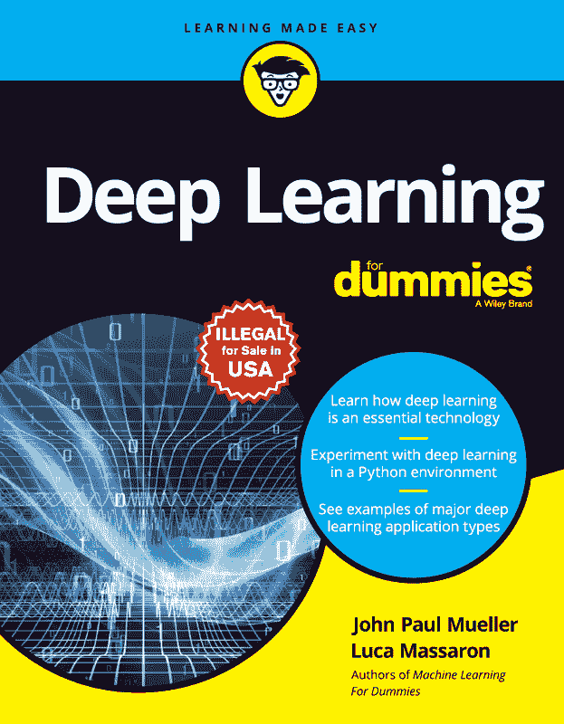


## 如需查看本书的快速上手表，请访问 [www.dummies.com](http://www.dummies.com)get 搜索框中搜索“Deep Learning For Dummies Cheat Sheet”。

## 预测自然灾害

作者简介

广告页

封底

插图列表

* `FIGURE 3-3`：指定安装位置

* `FIGURE 7-5`：前馈过程的细节

# 引言

当你谈到深度学习时，有些人认为那是某种深奥的神秘，但深度学习其实并不是什么神秘——每当你使用智能手机时，你都在使用它。事实上，你被深度学习所包围，而你甚至没有意识到，这使得学习深度变得至关重要，因为你可以做的比你想象的要得多。

其他人对深度学习还有另一种观点，这种观点毫无根据。他们认为深度学习将会导致某种末日，但以目前的技术水平来说是不可能的。更有可能的情况是有人利用深度学习制造虚假人物来犯罪或诈骗政府。然而，杀人机器人绝不是未来。

## 本书介绍

在使用《深度学习傻瓜》时，你将获得许多可以在 Mac、Linux 或 Windows 系统上运行的示例代码。你也可以使用 `Google Colab` 等工具在线运行代码。（我们提供了如何获取这些信息的提示。）特殊设备（如 `GPU`）会让这些示例运行得更快。但是，本书的观点是，无论你使用什么机器，你都可以创建深度学习代码，只要你愿意等待程序运行完成。

本书的第一部分将为你提供基础信息，让你在开始时不会完全迷失。你将学习如何安装各种产品，并对一些基础数学建立理解。开头的示例更倾向于标准的回归和机器学习，但你需要这些基础知识才能充分理解深度学习的价值。

在你掌握了这些基础信息后，你将开始做一些非常惊不起的事情。例如，你将发现如何生成自己的艺术品，并执行其他你可能认为需要大量编码和特殊硬件才能完成的任务。读完这本书后，你将为你自己能做到的事情感到惊讶，即使你没有高级机器学习或深度学习的学位。

为了让吸收这些概念变得更加容易，本书使用了以下约定：

* 你只需要按照书中显示的内容进行输入的文本将以**加粗**形式显示。例外情况是你正在执行一个步骤列表时：因为每个步骤都是加粗的，所以要输入的文本不是加粗的。

* 当你在输入序列中看到*斜体*单词时，你需要将该值替换为适合你自己的实际内容。例如，如果你看到“输入 `Your Name` 并按回车”，你需要将 `Your Name` 替换为你的真实姓名。

* 网络地址和编程代码以`等宽字体`（`monofont`）形式显示。如果你在连接到互联网的设备上阅读本书的电子版，可以点击或触摸网址来访问该网站，例如：[`http://www.dummies.com`](http://www.dummies.com/)。

* 当你需要输入命令序列时，你会看到它们由特殊的箭头隔开，例如：File ⇒ New File。在这个例中，你首先进入“File”（文件）菜单，然后选择该菜单上的“New File”（新建文件）选项。

## 愚蠢的假设

你可能很难相信我们对你做出了任何假设——毕竟，我们甚至还没有见过你！虽然大多数假设确实是愚蠢的，但我们做出这些假设是为了为本书提供一个起点。

你需要熟悉你想要使用的平台，因为本书在这方面没有提供任何指导。（不过，第 3 章提供了 Anaconda 的安装说明，而第 4 章帮助你安装书中使用的 TensorFlow 和 Keras 框架。）为了让你获得关于 Python 如何应用于深度学习的最丰富信息，本书不讨论任何特定于平台的问题。在开始学习这本书之前，你确实需要知道如何安装应用程序、使用应用程序以及如何与你选择的平台交互。

你必须学会如何使用 Python。你可以在网上找到丰富的教程（例如 [`https://www.w3schools.com/python/`](https://www.w3schools.com/python/) 和 [`https://www.tutorialspoint.com/python/`](https://www.tutorialspoint.com/python/)）。

这本书并不是一本数学入门书。是的，你会看到许多复杂数学的示例，但重点在于帮助你使用 Python 执行深度学习任务，而不是教授数学理论。我们包含了一些示例，也讨论了机器学习在深度学习中的应用。第 1 章和第 2 章将让你更好地理解成功使用这本书所确切需要知道的知识。

本书还假设你可以访问互联网上的内容。书中穿插了许多对在线材料的引用，这将增强你的学习体验。然而，这些额外的资源只有在你真正找到并使用它们时才有用。

## 本书中使用的图标

当你阅读本书时，你会在页边栏看到图标，它们表示感兴趣（或不感兴趣）的内容。本节简要描述了书中的每个图标。


提示（Tips）非常有用，因为它们可以帮你节省时间或在不需要大量额外工作的情况下完成某些任务。书中的提示是节省时间的技巧或你应该尝试的资源建议，以便你能够从 Python 或执行深度学习相关任务中获得最大的收益。


我们不想听起来像愤怒的父母或某种偏执狂，但你应该避免执行任何标记有警告（Warning）图标的操作。否则，你可能会发现你的应用程序未能按预期运行，从看似无懈击的算法中得到错误的答案，或者（在最坏的情况下）丢失数据。


每当你看到这个图标时，请考虑这是高级提示或技术。你可能会觉得这些有用信息片段太无聊了，不以言表，或者它们可能包含了你运行程序所需的解决方案。你可以随心所跳过这些信息。


如果你没有从某个章节或小节中获得任何其他收获，请记住由此图标标记的内容。这些文字通常包含一个核心流程，或者你为了成功使用 Python 或执行深度学习相关任务必须知道的信息。

## 本书之外

这本书并不是你 Python 或深度学习学习之旅的终点——它真的只是开始。我们提供了在线内容，使本书更加灵活，并更好地满足你的需求。这样，当我们收到你的邮件时，就可以回答问题，并告诉 Python 或其相关插件的更新如何影响书籍内容。事实上，你还可以访问所有这些酷的补充：

* `Cheat sheet`（速查表）：你记得在学校里用小抄在考试中获得更好的成绩，对吧？记得吧？很好，速查表就像那样。它为你提供了一些关于使用 Python、机器学习和数据科学执行任务的特殊笔记，这些内容并不是每个人都知道。你可以访问 [`www.dummies.com`](http://www.dummies.com)，搜索书名，并向下滚动页面来找到速查表。速查表包含了在使用 Python 时常见的错误等有用信息。

* `Updates`（更新）：有时会发生变化。例如，在我们写本书时，水晶球可能没有预见到即将来的变化。在过去，这种可能性意味着书籍变得过时且不再有用，但你现在可以通过 [`www.dummies.com`](http://www.dummies.com) 搜索书名来获取更新。

  除了这些更新，还可以在 [`http://blog.muellerbooks.com/`](http://blog.muellerbooks.com/) 查看读者问题的解答以及相关书籍技术的演示。

* `Companion files`（配套文件）：嘿！谁真的想手动输入书中所有的代码并重建所有的神经网络呢？大多数读者更倾向于花时间实际操作 Python、执行机器学习或深度学习任务，并看到他们能做的事情。幸运的是，书中的示例可以下载，因此你只需要阅读书籍来学习深度深度学习的使用技巧。你可以在 [`www.dummies.com`](http://www.dummies.com) 找到这些文件。搜索书名，在出现的页面滚动到封面图片并点击。然后点击“About This Book”（关于本书）按钮，在打开的页面中进入“Downloads”（下载）标签页。

## 接下来

是时候开始你的 Python 深度学习之旅了！如果你对 Python 及其在深度学习任务中的应用完全陌生，你应该从第 1 章开始，并按照尽可能吸收材料的速度阅读本书。

如果你是一个想要尽可能快上手 Python 深度学习的初学者，你可以跳到第 3 章，但要理解你之后可能会对某些主题感到有些困惑。如果你已经安装了 Anaconda（书中使用的编程产品），可以跳到第 4 章，但请确保至少阅读第 3 章，以便了解我们在编写本书时做出了哪些假设。

本书依赖结合 `TensorFlow` 和 `Keras` 来执行深度学习任务。即使你是进阶读者，也需要前往第 4 章了解如何配置本书所使用的环境。如果不按照指令配置环境，在尝试运行代码时几乎肯定会导致失败。

# 第一部分

## 探索深度学习

在本部分中……

* 了解深层学习如何影响我们周围的世界。

* 思考深度学习与机器学习之间的关系。

* 创建一个你自己的 Python 环境。

* 定义深度学习对框架的的需求。

# 第 1 章

## 深度学习简介

在本章中

 **理解深度学习**

 **使用深度学习**

 **开发深度学习应用**

 **思考深度学习的局限性**

你可能已经听过很多关于深度学习的内容。这个词随处可见，似乎适用于一切。事实上，深度学习是机器学习的一个子集，而机器学习又是人工智能（AI）的子集。本章的首要目标是帮助你理解深度学习到底是什么，以及它如何应用于当今世界。你可能会惊讶地发现深度学习并不是唯一的选择；存在其他分析数据的方法。事实上，在数据分析方面，深度学习满足了特定的需求，因此你可能正在使用其他方法而自己不知道。

深度学习只是 AI 的一个子集，但它是一个重要的子集。你会看到深度学习技术被用于许多任务，但并非所有任务。事实上，有些人将深度学习与它无法胜任的任务联系在一起。探索深度学习的下一步是理解它能为你做什么以及不能为你做什么。

作为本书中深度学习进行工作的一部分，你将编写依赖深度学习来处理数据并产生所需输出的应用程序。当然，在做很多事情之前，你需要了解一点编程环境。尽管第 3 章讨论了如何安装和配置本书用于演示深度学习的语言 `Python`，但你首先需要更多了解可用选项。

本章最后讨论了为什么深度学习不应该是你工具箱中唯一的数据处理技术。是的，使用得当时，深度学习可以完成惊人的任务，但当应用于它并不支持的问题时，也可能导致严重的问题。有时你需要寻求其他技术来完成给定任务，或者弄清楚使用哪些技术结合深度学习，以为特定问题提供更高效、更优雅的解决方案。

### 定义深度学习的含义

对深度学习的理解始于对术语的精确定义。否则，很难将媒体炒作与深度学习实际能提供的现实区分开。如图 1-1 所示，深度学习既属于人工智能也属于机器学习。要理解深度学习，你必须从外部开始——即从 AI 开始，经过机器学习，最后定义深度学习。以下章节将帮助你完成这一过程。


### 人工智能开始

说 AI 是人工的并不能告诉你任何信息，这就是为什么关于这个术语会有这么多讨论。是的，你可以争论发生的是人工的，而非来自自然源。人们以许多方式定义智能。然而，你可以说智能至少包含由以下活动组成：

* `学习`：具有获取和处理新信息的能力。

* `推理`：能够处理数据。

* `理解`：考虑信息的结果。

* `掌握真理`：确定有效性。

* `视觉`：推断数据如何相互作用。

* `思考意义`：将真理应用于特定情景。

* `区分事实与信念`：确定数据是否得到了充分支持。

智能遵循一个计算机可以执行的过程：

1. 根据需求或愿望设定目标。

2. 评估支持目标的当前已知信息的价值。

3. 收集可能支持目标的额外信息。

4. 操纵数据以实现目标。

5. 定义现有信息与新信息之间的关系和真值。

6. 确定目标是否达成。

7. 根据新数据及其成功的概率修改目标。

8. 根据需要重复步骤 2 到 7，直到目标达成（真）或实现目标的可能性已耗尽（假）。


尽管你可以在计算机内部创建算法并为其提供数据访问权限以支持这一过程，但计算机实现智能的能力是严重限制的。例如，计算机无法理解任何东西，因为它依赖于以严格的机械方式使用纯数学来操纵数据。同样，计算机无法轻易区分真与虚假。事实上，没有任何计算机可以完全实现上述描述的任何心理活动。

在思考 AI 时，你必须考虑开发 AI 的人的目标。目标是模仿人类智能，而不是复制它。计算机并不真正思考，但它表现出思考的样子。然而，计算机实际上在逻辑/数学形式的智能中提供这种表现。计算机在模拟视觉空间和身体运动智能方面取得了中等成功。计算机在人际和语言智能方面具有较低但尚可的能力。然而，与人类不同，计算机没有办法模仿内在智能或创造力。

### 考虑 AI 的角色

正如上一节所述，需要理解的首要概念是 AI 与人类智能并没有真正的联系。是的，某些 AI 建模是为了模拟人类智能，但那仅仅是如此：一种模拟。

* **像人类一样行动：** 当计算机像人类一样行动时，它最好地反映了图灵测试。在这一测试中，如果无法区分计算机和人类，计算机就成功了（详情请参见 [`http://www.turing.org.uk/scrapbook/test.html`](http://www.turing.org.uk/scrapbook/test.html)）。这一类别也反映了媒体让你认为的 AI 的本质。你会看到它被自然语言处理、知识表示、自动推理和机器学习等技术（这四项必须全部具备才能通过测试）。

  最初的图灵测试不包含任何物理接触。较新的“全图灵测试”包含了感知能力问答形式的物理接触，这意味着计算机必须同时利用计算机视觉和机器人技术才能成功。现代技术包括了实现目标而非完全模仿人类的想法。例如，莱特兄弟并没有通过精确复制鸟类的飞行来成功创造出飞机；相反，鸟类提供了引导空气动力学的思路，而这最终导致了人类的飞行。目标是飞行。鸟和人类都实现了这一目标，但他们使用的方法不同。

* **像人类一样思考：** 当计算机像人类一样思考时，它执行的是需要人类智能（与机械化程序相比）才能完成的任务，例如开车。要判断一个程序是否像人类一样思考，你必须有某种方法来确定人类是如何思考的，认知建模方法定义了这种方法。该模型依赖于三种技术：

  * **内省：** 通过监控自己的思维过程，检测并记录用于实现目标所采用的技术。

  * **心理测试：** 观察人的行为，并将其加入数据库，与其他人在处于类似的情境、目标、资源和环境条件（以及其他因素）下产生的相似行为进行对比。

  * **脑成像：** 通过各种机械手段直接监测脑活动，例如计算机轴断层扫描（CAT）、正电子发射层扫描（PET）、磁共振成像（MRI）和磁脑图（MEG）。

  在创建模型后，你可以编写一个模拟该模型的程序。考虑到人类思维过程的巨大变异性以及将这些思维过程准确表示为程序部分的困难，其结果充其量是实验性的。这种“像人类一样思考”的类别通常用于心理学和其他领域，在这些领域中，对人类思维过程进行建模以创建真实的仿真是至关重要的。

* **像理智一样思考：** 使用某些标准来研究人类如何思考，可以创建描述典型人类行为的准则。当一个人在一定的偏差范围内遵循这些行为时，就被认为是理性的。像理智一样思考的计算机依赖于记录的行为，根据手头的数据创建一个关于如何与环境交互的指南。这种方法的目标是尽可能地通过逻辑来解决问题。在许多情况下，这种方法能够创建一个用于解决问题的基准技术，然后对其进行修改以实际解决问题。换句话说，原则上的问题解决方式通常与实践中的解决方式不同，但你仍然需要一个起点。

* **像理智一样行动：** 研究人类在特定约束的给定情况下如何行动，可以让你确定哪些技术既高效又有效。理智行动的计算机依赖于记录的动作，根据条件、环境因素和现有数据与环境进行交互。与理性思考一样，理性行动取决于一个原则上的解决方案，而该方案在实践中可能被证明没有用。然而，理性行动提供了一个基准，计算机可以据此开始协商目标的成功完成。

你现在可以在许多应用中发现 AI。唯一的问题是这项技术工作得太好了，以至于你甚至不知道它的存在。事实上，你可能会惊讶地发现你家中的许多设备已经在使用这项技术。AI 的用途数以百万计——即使在本质上非常剧烈，它们也安全地处于视线之外。以下是你可能看到 AI 被运用的几种方式：

* **欺诈检测：** 你会接到信用卡公司的电话，询问你是否进行了某项特定购买。信用卡公司的 AI 检测到了不熟悉的消费模式并提醒了你，可能有人在使用你的卡（进行欺诈）。

* **资源调度：** 许多组织需要高效地调度资源。AI 根据患者的需求、专家可用性以及时间来调度资源。例如，医院可能需要 AI 来决定如何安置患者。

* **复杂分析：** 人类经常需要帮助进行复杂分析，因为需要考虑的因素太多。例如，一组症状可能指示多个问题。医生或其他专家可能需要帮助以及时做出诊断并挽救生命。

* **自动化：** 任何形式的自动化都能受益于引入 AI 来处理意外情况。目前某些类型自动化的问题是，意外事件（例如物体位置错误）会导致自动化停止。引入 AI 可以让自动化处理意外事件，并像无其事地继续运行。

* **客户服务：** 你拨打的客户服务热线现在可能根本没有人工。自动化已经足够遵循脚本并利用各种资源来处理绝大多数问题。有了良好的语调（也由 AI 提供），你可能无法判断自己正在与计算机对话。

* **安全系统：** 如今许多各种机器的安全系统依赖于 AI 在危机时刻接管车辆。例如，许多自动制动系统根据车辆可以提供的所有输入（如侧滑方向）来停止车辆。

机器学习能够做的是执行预测分析，其速度远超任何人类。因此，机器学习可以帮助人类工作得更高效。那么，人工智能（AI）的现状是进行分析，但人类仍然必须考虑这些分析的影响：即做出必要的道德和伦理决策。问题的本质在于，机器学习仅提供了 AI 中的“学习”部分，而这部分远未准备好就能创造出你在电影中看到的那种 AI。


学习与智能之间主要的困惑点在于，人们认为仅仅因为机器在工作上变得越来越好（它会学习），它就具有了意识（拥有智能）。没有任何观点支持这种对机器学习的看法。当人们认为计算机在故意为他们制造麻烦时，也会发生同样的现象。计算机无法分配情感，因此只根据提供的输入以及应用程序中处理该输入的指令来行动。当计算机最终能够模拟大界使用的精妙组合时，真正的 AI 将会出现：

- `遗传`：从一代到下一代的缓慢学习
- `教学`：从组织资源中快速学习
- `探索`：通过媒体和与人的互动进行自发学习

为了让机器学习概念与机器的实际能力保持一致，你需要考虑特定的机器学习用途。将机器学习的使用视为许多人认为的 AI 领域之外的范围是很有用的。以下是一些你可能不会与 AI 联系起来的机器学习用途：

- `访问控制`：在许多情况下，访问控制是一个“是”或“否”的命题。员工的智能卡授予资源的访问权限，与几个世纪以来人们使用钥匙相似。某些锁确实提供了设置允许访问的时间和日期的功能，但这种粗粒度的控制并不能真正满足所有需求。通过机器学习，你可以根据角色和需求判断员工是否应该获得资源的访问。例如，当培训反映了员工的角色时，员工可以获得培训室的访问。
- `动物保护`：海洋似乎足够大，允许动物和船无问题的共存。不幸的是，每年有许多动物被船撞击。机器学习算法可以通过学习动物和船的声音及特征，让船避开动物。（船将依靠水下听音设备通过声音跟踪动物，你实际上可以在离船很远听到这些声音。）
- `预测等待时间`：大多数人不喜欢在不知道要等多久的情况下等待。机器学习允许应用程序根据人员配置、人员负载、员工试图解决的问题的复杂性、资源的可用性等来确定等待时间。

## 从机器学习转向深度学习

如前所述，深度学习是机器学习的一个子集。在这两种情况下，算法似乎都是通过分析大量数据来学习（尽管在某些情况下，即使是极小的数据集也可以学习）。然而，深度学习不同在于分析深度及其提供的自动化类型。你可以这样总结差异：

- `完全不同的范式`：机器学习是一系列不同的技术，使计算机能够从数据中学习，并利用学到的知识提供答案（通常以预测的形式）。机器学习依赖于不同的范式，例如使用统计分析、在数据中寻找类比、使用逻辑以及处理符号。将机器学习使用的无数种技术与深度学习使用的单一技术进行对比，后者模仿了人类的大脑功能。它使用名为`神经元`的计算单元处理数据，这些单元被排列成有序的部分，称为`层`。深度学习的基础技术是`神经网络`。
- `灵活的架构`：机器学习解决方案提供了许多被称为`超参数`的调节按钮，你通过调整它们来优化算法对数据的学习。深度学习解决方案也使用超参数，但它们还使用多个用户配置的层（用户指定数量和类型）。事实上，取决于生成的神经网络，层数可能非常多，并形成能够进行专门学习的独特神经网络：某些可以学习识别图像，而另一些可以检测和解析语音。
- `自主特征定义`：机器学习解决方案需要人工干预。为了正确处理数据，分析师和科学家使用了大量的专业知识来开发有效的算法。例如，在一个依靠包含不同房间尺寸的数据来确定房屋价值的机器学习解决方案中，除非分析师预先指定计算方法，否则机器学习算法无法计算面积。为机器学习创建正确的信息被称为`特征创建`，这是一项耗时的活动。深度学习不需要人类执行任何特征创建活动，因为得益于许多层，它可以自己定义最佳特征。这也就是为什么深度学习在其他非常困难的任务中优于机器学习，例如识别语音和图像、理解文本以及在围棋（这种棋类的数字形式）中击败人类冠军。

你需要理解关于深度学习解决方案的许多问题，其中最重要的问题是计算机仍然并不理解任何东西，并且它提供的解决方案没有意识。它只是提供了一种反馈循环和自动化的结合，以比人类手动操作机器学习解决方案产生相同结果更快的时间产生理想输出。

第二个问题是某些愚蠢的人坚持深度学习层是隐藏的且无法分析的。事实并非如此。计算机可以构建的任何东西最终都可以由人类追溯。事实上，通用数据保护条例（`GDPR`）要求人类执行此类分析（详情见文章）。执行此类分析的要求是有争议的，但目前的法律规定必须有人这样做。

第三个问题是自调节是有局限性的。深度学习并不总是能确保可靠或正确的结果。事实上，深度学习解决方案可能会出现严重的错误（详情请参阅 [`https://www.theverge.com/2016/3/24/11297050/tay-microsoft-chatbot-racist`](https://www.theverge.com/2016/3/24/11297050/tay-microsoft-chatbot-racist) 的文章）。即使应用程序代码没有出错，支持深度学习的设备也可能出错（详情请参阅 [`https://www.pcmag.com/commentary/361918/learning-from-alexas-mistakes?source=SectionArticles`](https://www.pcmag.com/commentary/361918/learning-from-alexas-mistakes?source=SectionArticles) 的文章）。尽管如此，考虑到这些问题，你仍然可以看到深度学习被用于许多极其受欢迎的应用程序，正如 [`https://medium.com/@vratulmittal/top-15-deep-learning-applications-that-will-rule-the-world-in-2018-and-beyond-7c6130c43b01`](https://medium.com/@vratulmittal/top-15-deep-learning-applications-that-will-rule-the-world-in-2018-and-beyond-7c6130c43b01) 中描述的那样。

## 在现实世界中使用深度学习

不要误解：人们在现实世界确实在使用深度学习来执行广泛的任务。例如，现在的许多汽车都使用了语音接口。语音接口从一开始就可以执行基础任务。然而，你与它交流得越多，语音接口的表现就越好。界面会在你交谈时进行学习——不仅学习你说话的方式，还有你的个人偏好。以下章节将为你提供关于深度学习在现实世界中如何运作的信息。

### 理解学习的概念

人类学习时，依赖的不仅仅是数据。人类拥有直觉，以及对什么有效、什么不可行有着敏锐的把握。这种与生知识的一部分是本能，通过 DNA 代代相传。人类与输入的交互方式也与计算机的操作不同。在处理计算机时，学习涉及到构建一个数据库，该数据库由内置权重和偏置的神经网络组成，以确保正确的数据处理。神经网络随后处理数据，但其方式与人类的行为完全没有相似。

### 执行深度学习任务

人类和计算机擅长不同的任务。人类最擅长推理、思考伦理解决方案以及情感化。而计算机的初衷是快速处理数据——海量的数据。你通常使用深度学习来解决需要从海量数据中寻找模式的问题——这些问题的解决方案是非直觉的，且无法立即被察觉的。[`http://www.yaronhadad.com/deep-learning-most-amazing-applications/`](http://www.yaronhadad.com/deep-learning-most-amazing-applications/) 的文章告诉了人们目前使用深度学习执行任务的 30 种不同方法。在几乎每一种，你都可以将问题及其解决方案总结为：快速处理海量数据，寻找模式，然后依靠这些模式来发现新事物或创建特定类型的输出。

### 在应用中使用深度学习

深度学习可以作为一种独立的解决方案（如本书所示），但它通常作为更大部分解决方案的一部分并与其他技术混合。例如，将深度学习与专家系统结合并不常见。[`https://www.sciencedirect.com/science/article/pii/0167923694900213`](https://www.sciencedirect.com/science/article/pii/0167923694900213) 的文章在某种程度上描述了这种混合。然而，现实应用不仅仅是来自某些模糊来源的数字。在现实世界中工作时，你还必须考虑各种数据源并理解这些数据源是如何工作的。摄像头可能需要不同类型的深度学习解决方案来从中获取信息，而温度计或接近检测器可能输出简单的数字（或需要经过某种处理才能使用的模拟数据）。现实世界的解决方案是复杂的，因此你需要在工具箱中准备好多一种解决问题的方案以备之。

## 考虑深度学习编程环境

你可能会自动认为，你必须经历一系列极其困难的过程并学习深奥的编程技能才能深入深度学习。确实，通过使用适用于深度学习需求的编程语言之一编写应用程序，你可以获得灵活性。然而，Deep Learning Studio（详情请参阅 [`https://towardsdatascience.com/is-deep-learning-without-programming-possible-be1312df9b4a`](https://towardsdatascience.com/is-deep-learning-without-programming-possible-be1312df9b4a) 的文章）以及其他产品正让人们无需编程即可创建深度学习解决方案。基本上，此类解决方案涉及通过图形化定义模型来描述你想要的输出。这类解决方案对于他人已经解决过的简单问题效果良好，但它们缺乏执行完全不同的内容的灵活性——这种任务需要比简单分析更多的东西。

云端深度学习解决方案，例如 Amazon Web Services (AWS) 提供的 ([`aws.amazon.com/deep-learning/`](https://aws.amazon.com/deep-learning/)) 可以为你提供额外的灵活性。这些环境还通过提供你所需的各种支持来简化开发。事实上，AWS 提供了各种无服务器计算支持 ([`aws.amazon.com/serverless/`](https://aws.amazon.com/serverless/))，你无需担心任何基础设施。然而，这些解决方案可能会非常贵。尽管它们比预制解决方案更具灵活性，但仍然不如实际开发环境。

你还有其他非编程解决方案可以考虑。例如，如果你想要力量和灵活性，但不想为此编程，你可以依靠诸如 MATLAB ([`www.mathworks.com/help/deeplearning/ug/deep-learning-in-matlab`](https://www.mathworks.com/help/deeplearning/ug/deep-learning-in-matlab)) 的产品，它提供了深度学习工具箱。MATLAB 和某些其他环境确实关注你想使用的算法，但为了获得完整功能，你至少需要编写脚本，这意味着你在某种程度上接触了编程。这些环境的问题在于性能不足，因此某些解决方案运行可能比你预期的要长。

在某些时候，无论你尝试多少其他解决方案，严重的深度学习问题都需要编程。在网上筛选时，你经常看到 AI、机器学习和深度学习混为一谈。然而，正如这三种技术的工作层次不同一样，你所需的编程语言也是如此。一个好的深度学习解决方案将要求使用多进程处理，最好使用具有许多核心的图形处理器 (GPU)。你选择的语言还必须通过兼容的库或包支持 GPU。因此，仅仅选择一种语言通常是不够的；你还需要进一步调查以确保该语言能够满足你的需求。考虑到这些因素，以下是目前用于深度学习的热门语言（按流行程度排序，定义自 [`https://www.datasciencecentral.com/profiles/blogs/which-programming-language-is-considered-to-be-best-for-machine`](https://www.datasciencecentral.com/profiles/blogs/which-programming-language-is-considered-to-be-best-for-machine)）：

*   Python
*   R
*   MATLAB（脚本语言，而非产品）
*   Octave

这个列表唯一的问题是，其他开发者有不同的意见。`Python` 和 `R` 通常出现在每个人列表的前端，但在那之后你可以找到各种观点。[`https://www.geeksforgeeks.org/top-5-best-programming-languages-for-artificial-intelligence-field/`](https://www.geeksforgeeks.org/top-5-best-programming-languages-for-artificial-intelligence-field/) 这篇文章为你提供了一些其他可选的思路。在选择语言时，你通常需要考虑以下问题：

*   **学习曲线：** 你的经验可以充分说明你觉得什么语言最容易学习。对于有多年经验的人来说，`Python` 可能是最好的选择，但对于已经接触过函数式编程的人来说，`R` 可能是更好的选择。`MATLAB` 或 `Octave` 可能最适合数学专业人士。
*   **速度：** 任何深度学习解决方案都需要大量的计算能力。许多人说，因为 `R` 是一门统计语言，它在统计支持方面提供了更多功能，并且通常能提供更快的结果。实际上，当你拥有所需的硬件时，`Python` 对强大的并行编程的支持可能会抵消这一优势。
*   **社区支持：** 存在许多形式的社区支持，但对深度学习而言最重要的两个是：定义解决方案的帮助以及获取丰富的预制编程辅助工具。在这四种语言中，`Octave` 提供的社区支持可能最少；而 `Python` 最多。
*   **成本：** 一种语言的成本取决于你选择的解决方案类型以及运行位置。例如，`MATLAB` 是一种需要购买的专有产品，因此在使用 `MATLAB` 时你会立即投入。然而，尽管其他语言最初是免费的，但你可以发现隐藏成本，例如在云端运行代码以获得 `GPU` 支持。
*   **DNN 框架支持：** 框架可以让你使用该语言变得容易得多。然而，你必须有一个与你解决方案所有其他部分配合良好的框架。最流行的两个框架是 `TensorFlow` 和 `PyTorch`。奇怪的是，`Python` 是唯一同时支持这两者的语言，因此它为你提供了最大的灵活性。你在 `MATLAB` 中使用 `Caffe`，在 `R` 中使用 `TensorFlow`。
*   **生产就绪：** 一种语言必须支持你的项目所需的输出类型。在这方面，`Python` 脱颖而出，因为它是一门通用语言。你可以用它创建任何类型的应用程序。然而，其他语言提供的更具特定性的环境对某些项目非常有帮助，因此你需要考虑所有这些语言。

## 克服深度学习的热潮

本章的几个部分讨论了关于深度学习感知的某些问题，例如一些人认为它无处不在且无所不能。深度学习的问题在于，它一直是其自身媒体宣传的受害者。深度学习解决的是特定类型的问题。以下章节将帮助你避免与深度学习相关的炒作。

### 发现创业生态系统

使用深度学习解决方案与自己创建一个深度学习解决方案大不相同。[`https://www.analyticsvidhya.com/blog/2018/08/infographic-complete-deep-learning-path/`](https://www.analyticsvidhya.com/blog/2018/08/infographic-complete-deep-learning-path/) 这张信息图为你提供了一些其他可选的思路。

本章的第三部分将利用你在前两部分中的发现，并帮助你应用它们。无论你如何构建数据并对其进行分析，在某些情况下，机器学习都是错误的方法，并且永远无法为你提供有用的输出。如果你希望获得有助于你完成有趣任务的持续输出，了解机器学习的正确用法至关重要。机器学习的全部目的是从数据中学习一些有趣的东西，然后利用这些数据做一些有趣的事情。

## 定义机器学习

这里是机器学习的简短定义：它是人工智能的一项应用，可以从经验中自动学习并改进，而无需显式地编程进行这样做。学习是由于分析不断增加的数据而产生的，因此基础算法不会改变，但用于选择特定答案的代码内部权重和偏置会发生变化。当然，事情并没有那么简单。接下来的章节将讨论更多关于机器学习的内容，以便你理解它在人工智能世界中的地位，以及深度学习从中获取了什么。


数据科学家通常将用于实现机器学习的技术称为算法。算法是一系列分步执行的操作（通常是计算），能够在有限步内解决定义的问题。在机器学习中，算法使用一系列有限步骤通过从数据中学习来解决问题。

### 理解机器学习是如何工作的

机器学习算法会学习，但通常很难为`learning`一词找到一个精确的含义，因为取决于机器学习算法的构建方式，从数据中提取信息的方法。通常，学习过程需要海量的数据，在给定特定输入的情况下预期的响应。每个输入/响应对代表一个示例，更多的示例使算法更容易学习。这是因为每个输入/响应对都拟合在直线、聚类或其他定义问题领域的统计表示中。学习是优化模型的过程，模型是数据本身的数学化、总结性表示，使其即使在接收到以前没过的输入时，也能预测或确定适当的响应。模型越准确地给出正确响应，说明该模型从提供的数据输入中学习得越好。算法将模型拟合到数据上，这个`拟合过程`就是训练。

图 2-1 显示了一个极其简单的图，模拟了机器学习中发生的情况。在这种情况下，从输入值 1, 4, 5, 8 和 10 开始，并将它们与其相应的输出 7, 13, 15, 21 和 25 配对，机器学习算法确定表示输入和输出之间关系最佳方式是公式 `2x + 5`。该公式定义了用于处理输入数据（即使是新的、未见过的数据）以计算相应输出值的模型。趋势线（即模型）显示了由该算法形成的模式，因此新输入 3 将产生 11 的预测输出。尽管大多数机器学习场景比这复杂得多（而且算法无法创建能够准确地将每个输入映射到精确输出的规则），但这个示例为你提供了一个关于发生了什么的基本概念。模型不需要为输入 3 逐个编写一个响应，而是可以根据它已学习的输入/响应对来计算正确响应。

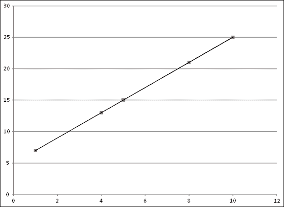

图 2-1： 可视化基础机器学习场景。

### 理解它是纯数学的


机器学习背后的核心思想是，你可以使用数学函数来表示现实，算法预先不知道这个函数，但在看到一些数据（始终以成对输入和输出的形式）后它可以对其进行猜测。你可以用未知的数学函数来表达现实及其所有挑战性的复杂性，机器学习算法会找到这些函数，并将其作为内部数学函数的修改提供出来。也就是说，每个机器学习算法都是围绕着一个可修改的数学函数构建的。该函数可以被修改是因为它具有此类目的的内部参数或权重。因此，算法可以根据从数据中获取的特定信息定制函数。这个概念是所有机器学习算法的核心思想。

机器学习中的学习是纯数学的，它结束于将某些输入与某些输出相关联。这与理解算法学习了什么无关。（当人类分析数据时，我们在某种程度上建立了对数据的理解。）学习过程通常被描述为训练，因为算法被训练以将正确答案（输出）匹配到提供的每个问题（输入）上。（由 John Paul Mueller 和 Luca Massaron 编写的《机器学习入门》，[Wiley] 出版，书中详细描述了这一过程是如何运作的。）

尽管缺乏刻意的理解并且是一个数学过程，机器学习在许多任务中也可以被证明是有用的。当通过使用正确的数据进行学习时，它为许多人工智能应用提供了在特定上下文中模拟理性思维的能力。

## 通过不同的策略学习

机器学习提供了多种从数据中学习的不同方法。根据你预期的输出和你提供的输入类型，你可以按学习风格对算法分类。你选择的风格取决于你拥有的数据类型和你期望的结果。用于创建算法的四种学习风格是：

- 监督
- 无监督
- 自监督
- 强化

接下来的章节将讨论学习风格。

### 监督学习

在使用监督算法进行工作时，输入数据是有标记的，并且有一个特定的预期结果。你使用训练来创建一个算法拟合到数据上的模型。随着训练的进行，预测或分类变得更加准确。以下是监督学习算法的示例：

- 线性回归或逻辑回归
- 支持向量机 (SVMs)
- 朴叶贝斯
- K 近邻算法 (KNN)

你需要区分回归问题（目标是数值）和分类问题（目标是定性变量，如类别或标签）。回归任务可以确定波士顿地区房屋的平均价格，而分类任务的一个示例是根据花瓣和花片的大小区分不同种鸢花。以下是监督学习的一些示例：

| 数据输入 (X) | 数据输出 (y) | 现实应用 |
| :--- | :--- | :--- |
| 客户购买历史 | 客户从未购买过的产品列表 | 推荐系统 |
| 图像 | 带有对象名称的框 | 图像检测和识别 |
| 问题形式的英语文本 | 回答形式的英语文本 | 聊天机器人，可以对话的软件程序 |
| 英语文本 | 德语文本 | 机器翻译 |
| 音频 | 文本传输 | 语音识别 |
| 图像、传感器数据 | 转向、刹车或加速 | 自动驾驶的行为规划 |

### 无监督学习

在使用无监督算法进行工作时，输入数据是没有标记的，结果是未知的。在这种情况下，对数据结构的分析产生所需的模型。结构分析可以有多个目标，例如减少冗余或对相似数据进行分组。无监督学习的示例是：

- 聚类
- 异常检测
- 神经网络

## 自监督学习

你会在网上看到各种类型的学习方法，但自监督学习属于一个独占的类别。有些人将其描述为自主监督学习，它能让你获得监督学习的处处，但无需标注数据的所有工作。


从理论上讲，自监督可以解决你目前可能使用的其他类型学习的问题。以下列表将自监督学习与其他人们常用的学习类型进行了对比。

- **监督学习：** 与自监督学习最相似的学习形式是监督学习，因为这两种学习都依赖于输入和标记输出的对。此外，这两种形式的学习都与回归和分类有关。然而，区别在于，自监督学习不需要人工标记输出。相反，它依赖于输入数据中的相关性、嵌入元数据或领域知识，来从语境中发现输出标签。
- **无监督学习：** 与无监督学习一样，自监督学习不需要数据标注。然而，无监督学习关注数据结构——即数据内部的模式。因此，你不会将自监督学习用于聚类、分组、降维、推荐引擎或类似的任务。
- **半监督学习：** 半监督学习解决方案的工作原理与无监督学习解决方案类似，都在寻找数据模式。然而，半监督学习依赖于标记和未标记数据的混合，以便比严格使用未标记数据更快地完成任务。自监督学习永远不需要标签，并利用语境来执行任务，因此即使提供了标签，它实际上也会忽略它们。

## 强化学习

你可以将强化学习看作自监督学习的扩展，因为这两种形式使用相同的方法对未标记数据进行学习以实现类似的目标。然而，强化学习在其中加入了反馈回路。当强化学习解决方案正确执行任务时，它会获得正反馈，这强化了模型与输出的连接。

## 训练、验证与测试

机器学习是一个过程，正如计算机世界的万物都是过程一样。为了构建成功的机器学习解决方案，你需要根据需要执行以下任务：

- **训练：** 机器学习开始于使用特定算法对特定数据进行训练。训练数据与任何其他数据分离，但它必须具有代表性。如果训练数据不能真实代表问题领域，生成的模型将无法提供结果。在训练过程中，你会观察模型对训练数据的响应，并根据需要对使用的算法以及在输入算法之前处理数据的方式进行修改。
- **验证：** 许多数据集足够分为训练部分和测试部分。你首先使用训练数据训练模型，然后使用测试数据对其验证。当然，测试数据必须再次准确代表问题领域。它在统计上也必须与训练数据兼容。否则，你看到的将无法反映真实情况。
- **测试：** 在模型经过训练和验证后，你仍需要使用真实数据对其进行测试。

训练为机器学习算法提供了所有的示例。这种函数的输出通常是概率。为了直观理解训练发生了什么，想象一个孩子正在学习区分树和物体。在孩子做到之前，老师会向孩子展示事实。这些事实可能是材料（木头）、部位（树干、树枝、叶子、根）和位置（土壤）。孩子通过对比特征建立对树的理解。机器学习分类器的原理相同。分类器算法提供类别作为输出。例如，它可以告诉你你提供的输入照片属于树类。为了这一点，它通过创建一个可以区分不同类别的数学公式来建立其能力。

最后一项要求是最重要的，因为没有什么硬性规定规定某种特定算法可以在所有可能的情况下适用于每种数据。如果确实如此，那么许多算法将无用武之地。为了找到最佳算法，数据科学家通常会尝试对多种算法进行实验并比较结果。

## 了解偏见的局限性

你的计算机没有偏见。它没有统治世界的目标，也没有让你的生活变得困难的目标。事实上，计算机没有任何类型的目标。计算机唯一提供的基于输入和处理技术的输出。然而，偏见仍然会以多种方式进入计算机并污染其提供的结果：

- **数据：** 数据本身可能包含虚假信息或简单的错误陈述。例如，如果某个特定值在数据中出现的频率是现实世界的两倍，那么机器学习解决方案的输出就是被污染的，即使数据本身是正确的。
- **算法：** 使用错误的算法会导致机器学习解决方案错误地将模型拟合到数据上。
- **训练：** 训练过多或过少都会改变模型拟合数据的方式，从而影响结果。
- **人类解读：** 即使机器学习解决方案输出了正确的结果，使用该输出的人类也可能产生误解。这种结果与机器学习解决方案未能按预期运行一样糟糕，甚至更糟。`https://thenextweb.com/artificial-intelligence/2018/04/10/bias-huge-problem-ai-heres-going-fix/` 上的文章对此提供了一些见解。无论你创建什么种学习解决方案，都需要考虑偏见的影响。了解偏见对你的解决方案产生了哪些限制，以及该解决方案是否足够可靠以提供有用输出是非常重要的。

## 考虑到复杂性

对于机器学习来说，简单总是好的。许多不同的算法可能为你的学习解决方案提供有用输出，但最佳算法应当是最易于理解且提供最直接结果的那个。奥卡姆剃刀（`http://math.ucr.edu/home/baez/physics/General/occam.html`）通常被认为是可以遵循的最佳策略。基本上，奥卡姆剃刀告诉你要使用解决特定问题的最简单解决方案。随着复杂性的增加，错误的可能性也会之增加。

## 考虑学习的不同路径

学习中的“学习”部分使其具有动态性——也就是说在接收到额外数据时能够改变自身。学习的能力使得学习不同于知识图谱和专家系统等其他类型的人工智能。当然，量化学习的问题在于人类和计算机看待学习的方式不同。此外，计算机使用的学习技术与人类不同，某些人类可能完全没有看到学习的部分。以下章节将讨论机器学习算法用于学习的方法，以便你更好地理解。

## 理解没有免费的午餐

你可能听过一种常见的神话，即不需要对导出解决方案投入太多精力就能从计算机输出中获得一切。遗憾的是，任何问题都没有绝对的解决方案，更好的答案通常是昂贵的。在处理算法时，你会很快发现某些算法在解决问题方面表现优于其他算法，但没有一种算法适用于所有问题。这是由于算法背后的数学原理。某些数学函数擅长表示某些问题，但在其他问题上可能会遇到障碍。每个算法都有其专长。

## 发现五种主要方法

算法有多种形式并执行各种任务。分类算法的一种方法是根据学派——一群志同道合者认为可以解决特定类型问题的方法。当然，还有其他分类算法的方法，但这种方法的优势在于帮助你更好地理解。以下章节提供了五种主要算法技术的概述。

### 符号推理

一个被称为“符号学家”（symbologists）的群体依赖于使用符号推理的算法来寻找问题的解决方案。逆演绎（inverse deduction）术语出现在`induction`中。在符号推理中，`deduction`演绎）扩展了人类知识领域，而`induction`归纳）提升了人类知识的水平。`induction`通常开启新的探索领域，而`deduction`探索这些领域。然而，最重要的考虑是`induction`是这种推理的科学部分，而`deduction`是工程部分。两种策略协同工作，通过首先开启潜在探索领域然后探索该领域来解决问题。

作为这种策略的示例，`deduction`会说：如果树是绿色的，且绿树是活着的，那么这棵树一定是活着的。在思考`induction`时，你会说树是绿色的，树也是活着的；因此，绿树是活着的。`induction`提供了给定已知输入输出的情况下缺失知识的答案。

### 神经网络

神经网络是一个被称为“连接主义者”（connectionists）群体的结晶。这组算法试图利用硅而不是神经元来模拟大脑的功能。本质上，每个神经元（作为模拟现实世界对应物的算法创建）解决问题的一个小部分，通过并行使用许多神经元来解决整个问题。

神经网络可以为错误数据提供纠正方法，这些方法中最流行的是`backpropagation`（反向传播）。`http://www.breloff.com/no-backprop/` 和 `http://www.breloff.com/no-backprop-part2/` 的文章讨论了反向传播的替代方案。使用`backpropagation`旨在通过改变网络的`weights`（特定输入对结果的影响程度）和`biases`（选择了哪些特征）来确定在何种条件下从模拟人类神经元的网络中消除错误。目标是不断更改`weights`和`biases`，直到实际输出匹配目标输出。

此时，人工神经元触发并将解决方案传递给下一个神经元。每个神经元创建的解决方案只是整个解决方案的一部分。每个神经元继续向下一个神经元传递信息，直到神经元组创建最终输出。

### 进化算法

一个被称为“进化论”（evolutionaries）的群体依赖进化原理来解决问题。这种策略基于优胜劣，移除不符合预期输出的解决方案。`fitness function`（适应度函数）决定了每个函数在解决问题时的可行性。

使用树结构，该解决方案方法根据函数输出寻找最佳解决方案。每一层演化的获胜者将构建下一层的函数。下一层将更接近于解决问题，但可能无法完全解决，这意味着还需要另一层。这种特定的算法类型高度依赖递归（关于递归的解释请参阅 [`https://www.cs.cmu.edu/~adamchik/15-121/lectures/Recursions/recursions.html`](https://www.cs.cmu.edu/~adamchik/15-121/lectures/Recursions/recursions.html)）以及强支持递归的语言来解决问题。这种策略的一个有趣输出是能够自我演化的算法：某代算法实际上构建了下一代算法。

## 贝斯推断

贝叶斯派使用各种统计方法来解决问题。鉴于统计方法可以产生多个表面上正确的解决方案，函数的选择就变成了确定哪个函数具有最高的成功概率。例如，在使用这些技术时，你可能接受一组症状作为输入。算法将计算特定疾病由这些症状导致的概率作为输出。由于多种疾病具有相同的症状，因此概率非常重要，因为用户会看到某些情况，较低概率的输出实际上是给定情况下的正确输出。

最终，贝叶斯算法依赖于这样观点：在没有看到用于得出假设的证据（某人给你的结果）之前，永远不要完全信任任何假设（另一人得出该假设时使用的输入）。分析证据可以证明或反驳它所支持的假设。因此，在测试所有症状之前，你无法确定某人有哪种疾病。这组算法中最广为人知的输出之一是垃圾过滤器。

## 通过类比学习的系统

类比器使用核机来识别数据中的模式。通过识别一组输入的模式并将其与已知输出的模式进行比较，你可以创建一个解决方案。其目标是利用相似性来确定问题的最佳解决方案。这种推理方式决定了在过去的某个特定情况下使用某个特定解决方案是有效的；因此，在类似的情况下使用该解决方案也应该是可行的。这组算法中最广为人知的输出之一是推荐系统。例如，当你进入亚马逊并购买某种产品时，推荐系统会提供其他你可能也想购买的相关的产品。

## 深入探讨一些不同的方法

对算法有几种视角是有帮助的，这可以让你理解它们做什么以及为什么要这么做。前一节根据创建它们的群组来观察算法。然而，你还有其他方法可以对算法进行分类。以下列表按相似性对一些流行算法进行了分类：

- **人工神经网络：** 为生物神经网络的结构或功能建模（有时两者兼顾）。其目标是针对回归和分类问题执行模式匹配。然而，该技术模仿了生物体的方法，而不是严格依赖于基于数学的方法。以下是人工神经网络算法的示例：
  - `Perceptron`
  - `Feed-forward Neural Network`
  - `Hopfield Network`
  - `Radial Basis Function Network (RBFN)`
  - `Self-Organizing Map (SOM)`
- **关联规则：** 提取有助于解释数据中变量之间关系的规则。你可以使用这些规则在巨大的数据集中发现通常容易被忽略的有用关联。以下是更流行的关联规则算法：
  - `Apriori algorithm`
  - `Eclat algorithm`
- **贝叶斯：** 将贝叶斯定理应用于概率问题。这种形式的算法用于分类和回归问题。以下是贝叶斯算法的示例：
  - `Naïve Bayes`
  - `Gaussian Naïve Bayes`
  - `Multinomial Naïve Bayes`
  - `Bayesian Belief Network (BBN)`
  - `Bayesian Network (BN)`
- **聚类：** 使用质类或其他标准对数据进行组织以描述模型，结果通常是层次级的。这种方法观察数据如何相互影响。以下列表包含了聚类算法的示例：
  - `K-means`
  - `K-medians`
  - `Expectation Maximisation (EM)`
  - `Hierarchical Clustering`
- **决策树：** 根据数据的实际数值构建决策模型。这种树结构允许你快速对新数据和现有数据进行比较。这种算法通常用于分类问题。以下列表显示了一些决策树算法：
  - `Classification and Regression Tree (CART)`
  - `Iterative Dichotomiser 3 (ID3)`
  - `C4.5` 和 `C5.0`（不同版本）
  - `Chi-squared Automatic Detection (CHAID)`
- **深度学习：** 为依赖多层的人工神经网络提供更新，以利用更大的数据集。这类特定的算法适用于标记数据较少的半监督学习问题。以下是一些深度学习算法：
  - `Deep Boltzmann Machine (DBM)`
  - `Deep Belief Networks (DBN)`
  - `Convolutional Neural Network (CNN)`
  - `Recurrent Neural Network (RNN)`
  - `Stacked Auto-Encoders`
- **降维：** 以类似于聚类算法的方法通过无监督的方法，其目的是使用较少的信息来总结或描述数据，使数据集更小更容易管理。在某些情况下，人们将这些算法用于分类或回归问题。降维算法如下：
  - `Principal Component Analysis (PCA)`
  - `Factor Analysis (FA)`
  - `Multidimensional Scaling (MDS)`
  - `t-Distributed Stochastic Neighbor Embedding (t-SNE)`
- **集成：** 将多个弱模型组合成一个整体，并将个体预测以某种方式结合以定义整体预测。使用集成可以更快、更高效或以更小的误差解决某些问题。以下是一些常见的集成算法：
  - `Boosting`
  - `Bootstrapped Aggregation (Bagging)`
  - `AdaBoost`
  - `Random Forest`
  - `Gradient Boosting Machines (GBM)`


# 基于实例

为决策问题定义模型，训练数据由稍后用于比较的示例组成。相似性量有助于判断新示例是否优于数据库中的现有示例。根据工作方式，有些人将这些算法称为优者获胜或记忆学习。以下列表提供了与该分类相关的算法：

- `K-Nearest Neighbors (KNN)`
- `Learning Vector Quantization (LVQ)`

# 回归

对变量之间的关系建模。这种关系使用误差量进行迭代精炼。该类别在统计机器学习中被广泛使用。以下列表显示了与此类算法相关的算法：

- `Ordinary Least Squares Regression (OLSR)`
- `Logistic Regression`

# 正则化（Regularization）

通过惩罚复杂解并偏向更简单的方案来调节其他算法。这类算法通常用于回归方法。其目标是确保解决方案不会迷失自身的复杂性中，并在给定的时间范围内使用最少的资源提供解决方案。以下是正则化算法的示例：

- 岭回归 (Ridge Regression)
- 最小绝对收缩和选择算 (LASSO)
- 弹性网 (Elastic Net)
- 最小角回归 (LARS)

# 支持向量机（SVM）

一种监督学习算法，通过使用函数从其余数据中分离出少数数据样本（称为 `supports`，因此该算法由此得名）来解决分类和回归问题。在分离出这些支持向量后，预测变得更加容易。分析的形式取决于函数类型（称为 `kernel`）：线性、多项式或径向基。以下是 SVM 算法的示例：

- 线性支持向量机
- 径向基支持向量机
- 一类支持向量机（用于无监督学习）

# 其他

你有许多其他算法可以选择。此列表包含了主要的算法类别。此列表中未找到某些类别属于用于特征选择、算法准确性、性能衡量以及机器学习特殊子领域的类别。例如，有整类算法专门致力于计算机视觉（CV）和自然语言处理（NLP）主题。当你阅读完这本书时，你会发现许多其他类别的算法，并可能开始好奇数据科学家如何做出选择，更不用说做出正确的选择了。

## 等待下一次突破

突破需要耐心，因为计算机本质上是基于的。当你使用像 `Python` 这样高级的语言时，你可能并不会认为是如此，但底层运行的一切切都需要对数学及其处理的数据有极深刻的理解。因此，随着科学家不断发现处理数据、创建算法以及使用这些算法来定义数据模型的新方法，你可以期待机器学习和深度学习在未来会有新的用途。

遗憾的是，仅凭现有的工具不足以创造未来的应用（尽管电影可能让你认为事实是的那样）。在未来，你可以期待硬件的进步使得今天不可行的应用程序在未来变得完全可行。这不仅仅是额外的计算能力或更大内存的问题。未来的计算机将拥有今天无法使用的传感器；拥有执行今天处理器无法完成任务的处理器；以及尚未构想过的观察计算机思考的方法。世界现在最需要的是经验，而经验总是需要时间来积累。

## 思考机器学习的真实用途

在 AI 方面你有许多选择，这意味着机器学习并不是你为了解决任何给定问题而唯一应该考虑的技术。机器学习在帮助你解决特定类别的问题方面确实表现出色。要确定机器学习效果最好的地方，你必须开始考虑算法是如何学习的，然后将这些知识应用于你需要解决的问题类。记住，机器学习是关于泛化的的，因此它在以下场景中表现并不特别好：

- 结果必须提供精确的答案，例如计算前往火星的行程。
- 你可以使用泛化解决问题，但其他技术更简单，例如编写软件来计算数字的阶乘。
- 你对问题没有良好的泛化，因为问题被误解了、输入和结果之间不存在特定关系，或者问题领域过于复杂。

接下来的章节将从学习的角度讨论机器学习的真实用途，并针对特定的问题领域定义机器学习的优势。

### 理解机器学习的益处

你如何从机器学习中受益部分取决于你的环境，部分取决于你对它的期望。例如，如果你花时间在亚马逊上购买产品，你可能期望机器学习在某时候根据过去的购买记录提供实用的建议。这些建议是针对你可能并不知道的产品的。推荐你已经使用或不需要的产品并不特别有用，这正是机器学习发挥用场的地方。随着亚马逊建立起更多关于你购买习惯的数据，建议将变得更有用，尽管是最好的机器学习算法也永远无法每次都准确猜中你的需求。

当然，机器学习在许多其他方面也带给你益处。开发者可以使用机器学习为应用程序添加 `NLP` 能力。研究人员可以使用它来帮助寻找下一种癌症治疗方法。你可能已经在用它进行电子邮件垃圾邮件过滤，或者在你进入车内作为语音界面的一部分时依赖它。考虑到这一点，以下益处可能更符合从业务角度有效使用机器学习的视角，但请记住还存在许多其他方法：

- **简化产品营销：** 任何组织面临的问题之一都是根据客户偏好决定卖什么以及什么时候卖。销售活动是昂贵的，因此某次活动的失败通常不是一个备选项。此外，组织可能会发现一些奇怪的信息：客户可能喜欢红色的产品但不喜欢绿色的。了解客户想要什么是非常困难的，除非你能分析海量的购买数据，而这正是机器学习擅长的。

- **准确预测未来销售：** 经商似乎有点像赌博，因为你无法完全确定赌注会有回报。机器学习解决方案可以每分钟跟踪销售情况，并在趋势变得显而易见之前进行跟踪。这种这种跟踪的能力意味着你可以更准确地调整销售渠道以交付最佳结果，并确保商店有足够的正确产品待售。这并不等同于看水晶，但很接近。

- **预测医疗和其他员工停工时间：** 奇怪的是，有些组织最终会出现问题，因为员工选择了最糟糕的时间缺勤。在某些情况下，这些缺勤似乎是不可预测的，例如医疗需求；而在另一些情况下你可以预测它们，例如突然需要个人时间。通过从易于获取的数据源跟踪各种趋势，你可以跟踪整个行业、整个地区以及你所在组织的医疗类和个人类缺勤，以确保你在任何时候都有足够的人完成工作。

- **减少数据录入错误：** 通过正确使用表单功能或在应用程序中加入拼写检查器，某些数据录入错误相对容易避免。此外添加某些模式匹配有助于减少大小写错误或错误的电话号码。机器学习可以通过正确识别其他技术会错过的复杂模式，将错误减少提升到另一个水平。例如，一个客户订单可能需要一个 A 部分和两个 B 部分来组成一个完整单元。这类销售的模式匹配可能是难以捉摸，但机器学习可以使其成为可能，从而减少那些特别难以发现和消除的错误。

- **提高财务规则和建模的精度：** 在任何规模的组织中，保持财务状况清晰都可能是困难的。机器学习让你能够以更高的精度执行如投资组合管理、算法交易、贷款承保和欺诈检测等任务。你无法消除人类在这些情况中的参与，但人机协作可以成为一种极其高效的组合，不会让许多错误被察漏。

- **预见维护需求：** 任何包含物理组件的系统都可能需要各种类型的维护。例如，机器学习可以根据历史性能和环境监控帮助预测系统何时需要清洁。你还可以根据过去的维修记录和设备统计数据，计划某些设备的更换或维修。机器学习解决方案甚至可以帮助你判断更换还是维修是更好的选择。

- **增强客户互动并提高满意度：** 客户喜欢感觉自己很特别；事实上，每个人都如此。然而，尝试手动为每个客户创建定制计划被证明是不可能的。你可以通过在线渠道获取大量关于客户的信息，包括从最近购买记录到持续购买习惯的一切信息。通过将所有这些数据与良好的机器学习解决方案以及具有敏锐眼光的客户支持人员相结合，你似乎为为每个客户亲自创建了一个特殊的解决方案，尽管这样做所需的时间极少。

### 发现机器学习的局限性

技术的局限性往往难以完全量化，因为这些局限性通常是技术创造者或消费者缺乏想象力的结果。然而，机器学习确实有一些独特的局限性，在你在使用这项技术执行任何给定任务之前需要考虑。以下列表并不是详尽的。事实上，你可能并不完全认同它，但它确实提供了一个很好的起点。

- **需要大量的训练数据：** 与过去的程序化解决方案不同，机器学习解决方案依赖海量数据进行训练。随着问题复杂性的增加，建模特定问题所需的数据点数量随之增加，使得需要更多数据。尽管人类在特定问题领域产生的数据量日益增加，处理这些数据所需的计算能力每天都在增长，但某些问题领域仍然缺乏足够的数据或足够的处理能力来使机器学习发挥作用。

- **数据标注既枯燥又易错：** 使用监督学习技术时（详参见本章节前面的“通过不同策略学习””部分），必须有人对数据进行标注以提供输出值。海量数据的标注过程既枯燥又耗时，使得机器学习有时变得困难。问题在于，人类可以观察任何数量的停止牌之类的示例并知道它们都是停止牌，但计算机必须对每一个停止牌进行单独标注。

 **机器无法解释自己：** 随着机器学习解决方案变得越来越灵活和强大，其隐藏功能量也随之增加。事实上，在处理深度学习解决方案时，你会发现解决方案包含一个或通常多个隐藏层，这些层是由解决方案创建的，但人类尚未花时间去探索。因此，机器学习（在某种程度上）和深度学习（在更大程度上）都遇到了对透明度有要求的问题，且这种透明度与某些法律相悖，例如《通用数据保护条例》或 `GDPR`（[`https://eugdpr.org/`](https://eugdpr.org/)）。因为过程变得不透明，人类现在必须分析一个应该是自动执行的过程。该问题的潜在解决方案可能以新策略的形式出现，例如`局部可解释模型无关解释`（`LIME`）（详见 [`https://homes.cs.washington.edu/~marcotcr/blog/lime/`](https://homes.cs.washington.edu/~marcotcr/blog/lime/)）。

- **偏见导致结果可用性降低：** 算法无法判断数据何时包含各种虚假信息（John Paul Mueller 和 Luca Massaron 著的《*人工智能傻瓜指南*》，[Wiley]，在书中详细解释了这一问题）。因此，它认为所有数据都是无偏见且完全真实的。结果是使用此类数据训练的算法所执行的任何分析都是可疑的。当算法本身存在偏见时，问题会变得更大。你可以在网上找到无数示例，显示算法误识别了如停止牌等常见物体，这是由于包含虚假信息的数据和偏见算法共同导致的。

- **机器学习解决方案无法协作：** 人类最重要的优势之一是与他人协作的能力。当潜在解决方案的每个参与方都提交其知识以创建一个远大于各部分之和的整体时，知识潜力会呈指数级增长。单一机器学习解决方案仍然是单一的，因为它无法泛化知识，从而无法为包含多个协作方的综合解决方案做出贡献。

# 第 3 章 获取和使用 Python

本章内容

 **获取 Python 副本**

 **与 Jupyter Notebook 交互**

 **创建基础 Python 代码**

 **在云端工作**

深度学习需要使用代码，你有许多语言可选。然而，本书依赖 `Python`，因为它可以在许多不同的平台上运行，并并在开发者社区中获得大量的支持。事实上，根据编写时可用的 Tiobe 指数（[`https://www.tiobe.com/tiobe-index/`](https://www.tiobe.com/tiobe-index/)），`Python` 是世界第四语言，根据多个来源，它是最适用于深度学习的语言（详见 [`https://www.analyticsindiamag.com/top-10-programming-languages-data-scientists-learn-2018/`](https://www.analyticsindiamag.com/top-10-programming-languages-data-scientists-learn-2018/)）。

在你能用 `Python` 做很多事情或用它解决深度问题之前，你需要一个可用的安装环境。你还需要访问本书使用的数据集和代码。下载示例代码并将其安装在你的系统中是从书中获得良好学习体验的最佳方式。本章将帮助你设置系统，以便你可以轻松跟进书中其余部分的示例。它还探索了潜在的替代方案，例如 `Google Colaboratory`（[`https://colab.research.google.com/notebooks/welcome.ipynb`](https://colab.research.google.com/notebooks/welcome.ipynb)），也简单称为 `Colab`，以防你想在备用设备（如平板电脑）上工作。


使用可下载的源代码并不会阻止你自己输入示例、使用调试器跟踪它们、扩展它们或以各种方式与代码交互。提供可下载的源代码是为了帮助你的深度学习和 `Python` 学习体验有一个良好的开始。当你看到代码在被正确输入和配置后是如何运行之后，你可以尝试自己创建这些示例。如果你犯了错误，可以将你输入的内容与下载的源代码进行对比，并精确发现错误所在。你可以在 `DL4D_03_Sample.ipynb`、`DL4D_03_Dataset_Load.ipynb`、`DL4D_03_Indentation.ipynb` 和 `DL4D_03_Comments.ipynb` 文件中找到本章节的源代码。（引言部分将告诉你在哪里下载本书的源代码。）

## 在本书中使用 Python

Python 环境在不断变化。随着 Python 社区的持续改进，该语言会经历 `breaking changes`（破坏性变更）——即在减少向后兼容性的同时产生新行为的更改。这些更改可能不大，但它们会成为干扰因素，降低你发现深度学习编程技术的能力。显然，你希望以尽可能少的干扰来探索深度学习，因此拥有正确的环境至关重要。以下是使用本书中的 Python 所需要的配置：

- Jupyter Notebook 版本 5.5.0
- Anaconda 3 环境版本 5.2.0
- Python 版本 3.6.7


如果你没有完成这些设置，你可能会发现示例无法按预期运行。截图很可能会不同，且操作步骤可能无法按计划进行。


在阅读本书的过程中，你需要安装各种 Python 包以使代码运行。就像你在本章中配置的 Python 环境一样，这些包都有特定的版本号。如果你使用了不同版本的包，示例可能无法执行。此外，你可能会在尝试处理与书籍代码无关的错误信息时感到沮丧，这些错误是由使用了错误的版本号导致的。在安装 Anaconda、Jupyter Notebook、Python 以及所有让你的深度学习体验尽可能顺畅的包时，请务必小心。

## 获取你的 Anaconda 副本

在继续之前，你需要获取并安装 Anaconda。是的，你可以单独获取 Jupyter Notebook，但这样你就缺少 Anaconda 随带的其他各种应用程序，例如在书中各处出现的 Anaconda Prompt。最好的想法是按照后续章节中针对你特定平台（Linux、MacOS 或 Windows）的说明来安装 Anaconda。

### 获取 Continuum Analytics Anaconda

基础 Anaconda 包可以从 `https://repo.anaconda.com/archive/` 免费下载，以获取本书使用的 5.2.0 版本。只需点击 Python 3.6 版本的链接之一即可获取该免费产品。你需要的文件以 `Anaconda3-5.2.0-` 开头，随后是平台以及 32 位或 64 位版本，例如针对该平台的 `Anaconda3-5.2.0-Windows-x86_64.exe`。

- Windows 32 位或 64 位
- Linux 32 位或 64 位
- MacOS 32 位或 64 位

### 在 Linux 上安装 Anaconda

在阅读本书的过程中，你需要安装各种 Python 包以使代码运行。就像你在本章中配置的 Python 环境一样，这些包都有特定的版本号。如果你使用了不同版本的包，示例可能无法执行。此外，你可能会在尝试处理与书籍代码无关的错误信息时感到沮丧，这些错误是由使用了错误的版本号导致的。在安装 Anaconda、Jupyter Notebook、Python 以及所有让你的深度学习体验尽可能顺畅的包时，请务必小心。

1. **打开终端。**

2. **切换目录到下载的 Anaconda 副本。**

该文件的名称各异，但通常 32 位显示为 `Anaconda3-5.2.0-Linux-x86.sh`，64 位显示为 `Anaconda3-5.2.0-Linux-x86_64.sh`。

3. **输入** `bash Anaconda3-5.2.0-Linux-x86.sh`（32 位）或 `bash Anaconda3-5.2.0-Linux-x86_64.sh`（64 位）并按回车。

4. **阅读许可协议并接受条款。**

5. **提供安装位置（如有必要）并按回车。**

6. **将安装路径添加到你的 `PATH` 语句中。**

### 在 MacOS 上安装 Anaconda

Mac OS X 的安装只有一种形式：64 位。

1. **双击安装文件。**

2. **点击继续。**

3. **点击继续。**

4. **如果你同意许可协议，请点击我同意。**

你可能会看到一条错误信息，提示你无法在系统上安装 Anaconda。该错误是因为安装程序中的一个漏洞，与你的系统无关。要消除此错误信息，请选择 `Install Only for Me`（仅限我）选项。在 Mac 系统上，你无法为组用户安装 Anaconda。

6. **点击 Continue（继续）。**


安装程序显示一个包含更改安装类型选项的对话框。如果你想修改 Anaconda 在系统上的安装位置，请点击 `Change Install Location（更改安装位置）`。（本书假设你使用默认路径 `~/anaconda`。）如果你想修改安装程序的工作方式，请点击 `Customize（自定义）`。例如，你可以选择不将 Anaconda 添加到你的 `PATH` 变量中。然而，本书假设你选择了默认安装选项，除非你在其他地方安装了另一个版本的 `Python`，否则你没有充分的理由更改它们。

7. **点击 `Install（安装）`。**

你看到安装开始。进度条会告知你安装过程的进度。当安装完成后，你会看到一个完成对话框。

8. **点击 `Continue（继续）`。**

你已准备好开始使用 Anaconda 了。

## 在 Windows 上安装 Anaconda

Anaconda 为 Windows 带有一个图形化安装应用程序，因此获得良好的安装就像对任何其他程序使用安装向导一样。当然，在开始之前你需要一个安装文件副本，你可以在本章较早的 `获取 Continuum Analytics Anaconda` 章节找到所需的下载信息。以下步骤在任何 Windows 系统上都应该正常工作，无论你使用的是 32 位还是 64 位的 Anaconda 版本：

1. **在你的系统上找到下载的 Anaconda 副本。**

该文件的名称各异，但通常对于 32 位系统显示为 `Anaconda3-5.2.0-Windows-x86.exe`，对于 64 位系统显示为 `Anaconda3-5.2.0-Windows-x86_64.exe`。版本号作为文件名的一部分嵌入其中。在这种情况下，文件名指的是 `5.2.0` 版本，这是本书所使用的版本。如果你使用其他版本，你可能会在源代码上遇到问题，并在处理它时需要进行调整。

2. **双击安装文件。**

（你可能会看到一个询问是否要运行此文件的 `Open File – Security Warning（打开文件 – 安全警告）`对话框。如果弹出此对话框，请点击 `Run（运行）`。）你会看到一个与 `图 3-1`所示类似的 `Anaconda 5.2.0 Setup`对话框。你看到的准确对话框取决于你下载哪个版本的 Anaconda 安装程序。如果你使用的是 64 位操作系统，最好使用 64 位的 Anaconda，以获得最佳性能。这个第一个对话框会告诉你你拥有的是 64 位版本的产品。

3. **点击 `Next（下一步）`。**

向导显示了许可协议。务必仔细阅读许可协议，以便了解使用条款。

4. **如果你同意，请点击 `I Agree（我同意）`。**

向导向你显示安装类型，你可以选择 `Just Me（仅限我）` 或 `All Users（所有用户）`，如 `图 3-2`所示。本书假设你想为自己安装。

5. **选择其中一个并点击 `Next（下一步）`。**

向导询问将 Anaconda 安装在哪里。本书假设你使用默认位置 `C:\Users\<Name>\Anaconda3`。如果你选择了其他位置，稍后可能需要更改。

6. **选择必要的选项并点击 `Next（下一步）`。**

向导向你显示 `图 3-3`所示的 `Advanced Options（高级选项）`。`Add Anaconda to PATH（将 Anaconda 添加到 PATH）`选项默认未勾选，除非你需要它。

7. **更改必要的选项并点击 `Install（安装）`。**

你看到进度条。安装过程可能需要几分钟，所以给自己泡杯咖啡吧。

8. **点击 `Next（下一步）`。**

向导告诉你安装已完成。

9. **点击 `Next（下一步）`。**

Anaconda 提供集成 `Visual Studio` 支持的机会。除非你绝对需要此支持，否则你想保持环境纯净。

10. **点击 `Skip（跳过）`。**

你看到一个完成界面。此屏幕包含发现更多 Anaconda 以及启动第一个项目的选项。选择这些选项取决于你下一步的操作。

11. **选择任何选项。点击 `Finish（完成）`。**

你已准备好开始使用 Anaconda 了。

## 下载数据集和示例代码

本书是关于使用 Python 执行深度学习任务的。当然，你可以花费所有时间从头创建示例代码、对其进行调试，然后才发现它们与深度学习的关系；或者你可以采取更简单的方法，下载预先写的代码以便直接开始工作。同样，创建用于深度学习目的的数据集将花费很长时间。后续章节将帮助你下载和使用示例代码以及数据集，从而节省时间并直接处理数据科学特定任务。

### 使用 Jupyter Notebook

为了让处理书中相对复杂的代码变得更容易，你使用 Jupyter Notebook。此界面让你能够轻松创建 Python 笔记本文件，其中可以包含任意数量的示例，每个示例都可以单独运行。程序在你的浏览器中运行，因此你使用什么开发平台并不重要；只要有浏览器，就没有问题。

## 启动 Jupyter Notebook

大多数平台都提供一个访问 Jupyter Notebook 的图标。你只需要打开此图标即可进入 Jupyter Notebook。例如，在 Windows 系统上，你选择“开始 > 所有程序 > Anaconda3 > Jupyter Notebook”。图 3-5 显示了在 Firefox 浏览器中查看时的界面外观。它在你系统上的具体外观取决于你使用的浏览器以及安装的平台类型。

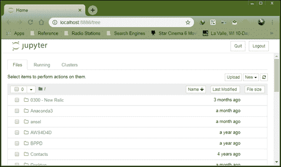

图 3-5： Jupyter Notebook 提供了一种创建数据科学示例的简单方法。

如果你使用的平台没有通过图标提供快速访问，可以使用以下步骤访问 Jupyter Notebook：

1. **在你的系统上打开 Anaconda Prompt、命令提示符或终端窗口。**

   窗口打开后你可以在其中输入命令。

2. **将目录切换到机器上的 `\Anaconda3\Scripts` 目录。**

   大多数系统允许你使用 `CD` 命令完成此任务。

3. **输入 `..\python Jupyter-script.py notebook` 并按回车键。**

   Jupyter Notebook 页面将在浏览器中打开。

## 停止 Jupyter Notebook 服务器

无论你如何启动 Jupyter Notebook（或者如书后部分所示直接称为 Notebook），系统通常都会打开一个命令提示符或终端窗口来托管 Notebook。该窗口包含一个让应用程序运行的服务器。在会话结束关闭浏览器窗口后，请选择服务器窗口并按 `Ctrl+C` 或 `Ctrl+Break` 停止服务器。

## 定义代码仓库

你在书中创建并使用的代码将保存在硬盘上的仓库（repository）中。将*仓库*（repository）想象成一种存放代码的归档柜。Notebook 打开一个抽屉，取出文件夹，并向你展示代码。你可以修改它，运行文件夹中的单个示例，添加新示例，并以自然的方式与代码进行交互。后续章节将带你上手 Notebook，让你看到整个仓库概念是如何运作的。

### 定义书籍文件夹

你使用文件夹来存放特定项目的代码文件。书中的项目是 DL4D（代表 *Deep Learning For Dummies*，即傻瓜深度学习）。以下步骤帮助你为本书创建一个新文件夹：

1. **选择“新建文件夹”（New Folder）。**

   Notebook 为你创建一个文件夹。文件夹名称可能不同，但对于 Windows 用户，它简单地列为 Untitled Folder（未命名文件夹）。你可能需要向下滚动文件夹列表以找到所需的文件夹。

2. **勾选 Untitled Folder 旁的复选框。**

3. **点击页面顶部的“重命名”（Rename）。**

   你会看到重命名目录对话框，如图 3-6 所示。

图 3-6： 创建一个文件夹用于存放书籍代码。

### 创建新笔记本

每个新笔记本就像一个文件文件夹。你可以将单个示例放在文件文件夹中，就像把纸张放入物理文件夹中一样。每个示例显示在单元格（cell）中。你也可以在文件夹中放置其他内容，但随着书籍的推进，你会看到这些内容是如何工作的。使用以下步骤创建新笔记本：

1. **点击主页上的 DL4D 条目。**

   你会看到本书的项目文件夹内容，如果你是从零开始此练习，该文件夹将是空的。

2. **选择“新建 Python 3”（New Python 3）。**

   浏览器中打开一个带有新笔记本的新标签页，如图 3-7 示例文件：Sample.ipynb。使用这种命名规范将方便你将这些文件与仓库中的其他文件区分开。


图 3-7： 笔记本包含你用于存放代码的单元格。

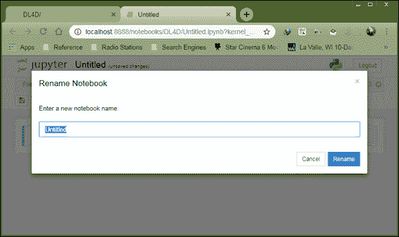

图 3-8： 提供命名。

### 导出笔记本

创建笔记本并一直留给自己并无趣。在某些情况下，你想将它们分享给其他人。为了执行此任务，你必须从仓库导出笔记本。通过点击 `DL4D_03_Sample` 打开此笔记本。要导出此代码，选择“文件（File）> 另存为（Download As）> Notebook (.ipynb)”。你看到的内容取决于浏览器，但通常会看到一个保存笔记本的对话框。

### 保存笔记本

你最终需要保存笔记本以便以后查看。Notebook 会定期自动保存笔记本。但是，要手动保存，请选择“文件（File）> 保存并检查点（Save and Checkpoint）”。

### 关闭笔记本

你不应该直接关闭笔记本，这可能会导致数据丢失。你必须有序关闭，包括停止后台运行代码的内核。保存笔记本后，你可以通过“文件（File）> 关闭并停止（Close and Halt）”关闭它。你会在笔记本出现在项目列表中，如图 3-9 所示。

图 3-9： 你的笔记本出现在列表中。

### 移除笔记本

有时的笔记本会过时，或者你不再需要处理它们了。为了不让你的仓库堆满不需要的文件，你可以从列表中移除这些不需要的笔记本。使用以下步骤移除文件：

1. **选择 `DL4D_03_Sample.ipynb` 条目旁的复选框。**

2. **点击删除（垃圾桶）图标。**

   会弹出删除笔记本的警告信息，如图 3-10 所示。

图 3-10： Notebook 警告你从仓库移除任何文件。

#### 导入笔记本

要使用本书中的源代码，你必须将下载的文件导入到你的存储库中。源代码以压缩包的形式提供，你需要将其解压到硬盘上的某个位置。压缩包包含了一个 `.ipynb`（IPython Notebook）文件列表，其中包含了本书的源代码（下载源代码的详情请参见引言）。以下步骤说明了如何将这些文件导入到你的存储库：

1. **点击 Notebook DL4D 页面上的 `Upload`。**

   你看到的内容取决于你的浏览器。大多数情况下，你会看到某种类型的文件上传对话框，它可以让你访问硬盘上的文件。

2. **导航到包含你想导入到 Notebook 的文件的目录。**

3. **高亮一个或多个要导入的文件，然后点击 `Open`（或其他类似的）按钮开始上传过程。**

   你会看到文件被添加到了上传列表中，如图 3-11 所示。该文件尚未属于存储库的一部分——你只是选择了它进行上传。

4. **点击 `Upload`。**

   Notebook 会将文件存于存储库中，以便你开始使用它。

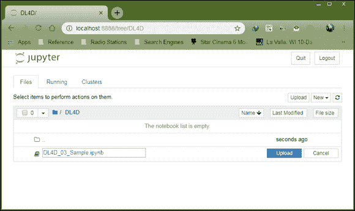

FIGURE 3-11: 你想要添加到存储库的文件作为上传列表的一部分。

### 获取和使用数据集

本书使用了许多数据集，其中一些直接从网上下载，另一些则出现在 Scikit-learn 库等 Python 包中。这些数据集演示了与数据交互的各种方式，你在示例中使用它们来执行各种任务。以下列表提供了用于从 Scikit-learn 将数据集导入到你的 Python 代码中的函数快速概述：

* `load_boston()`：使用波士顿房价数据集进行回归分析

* `load_iris()`：使用鸢尾尾花数据集进行分类

* `load_digits([n_class])`：使用数字数据集进行分类

* `fetch_20newsgroups(subset='train')`：来自 20 个新闻组的数据

加载这些每个数据集的技术在各个示例中是相同的。下面的示例展示了如何加载波士顿房价数据集。你可以在 `DL4D_03_Dataset_Load.ipynb` 笔记本中找到该代码。

```python
from sklearn.datasets import load_boston
Boston = load_boston()
print(Boston.data.shape)
```

要查看代码如何工作，点击 `Run Cell`。`print`调用的输出为 `(506, 13)`。你可以看到在图 3-12 所示所示输出。（请耐心；数据集加载可能需要几秒钟才能完成。）

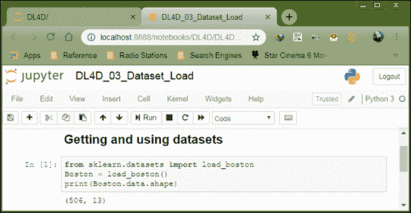

FIGURE 3-12: Boston 对象包含了加载的数据集。

## 创建应用程序

“创建一个新笔记本”章节展示了如何创建一个空笔记本，这很不错但并没有帮助。你希望使用笔记本来承载一个应用程序，你可以通过它来发现深度学习的内部机制。接下来的章节展示了如何操作笔记本，以便你为所需的任何目的创建一个简单的应用程序。然而，在开始之前，请确保你已打开 `DL4D_03_Sample.ipynb` 文件备用，因为你需要它来探索 Notebook。

### 理解单元

如果 Notebook 是一个标准的 IDE，你就没有单元。你拥有的将是一个包含连续语句序列的文档。为了分离不同的代码元素，你需要单独的文件。单元之所以不同，是因为每个单元都是独立的。是的，你在之前的单元中执行的操作的结果是重要的，但如果一个单元旨在独立工作，你只需进入该单元并运行它。要亲身体验它是如何工作的，请输入以下代码：

```python
from sklearn.datasets import load_boston
Boston = load_boston()
print(Boston.data.shape)
```

要查看代码如何工作，点击 `Run Cell`。`print`调用的输出为 `(506, 13)`。你可以看到在图 3-12 所示所示输出。（请耐心；数据集加载可能需要几秒钟才能完成。）


FIGURE 3-12: Boston 对象包含了加载的数据集。

### 理解单元

本书使用了许多数据集，其中一些直接从网上下载，另一些则出现在 Scikit-learn 库等 Python 包中。这些数据集演示了与数据交互的各种方式，你在示例中使用它们来执行各种任务。以下列表提供了用于从 Scikit-learn 将数据集导入到你的 Python 代码中的函数快速概述：

* `load_boston()`：使用波士顿房价数据集进行回归分析

* `load_iris()`：使用鸢尾尾花数据集进行分类

* `load_digits([n_class])`：使用数字数据集进行分类

* `fetch_20newsgroups(subset='train')`：来自 20 个新闻组的数据

加载这些每个数据集的技术在各个示例中是相同的。下面的示例展示了如何加载波士顿房价数据集。你可以在 `DL4D_03_Dataset_Load.ipynb` 笔记本中找到该代码。

```python
from sklearn.datasets import load_boston
Boston = load_boston()
print(Boston.data.shape)
```

要查看代码如何工作，点击 `Run Cell`。`print`调用的输出为 `(506, 13)`。你可以看到在图 3-12 所示所示输出。（请耐心；数据集加载可能需要几秒钟才能完成。）


FIGURE 3-12: Boston 对象包含了加载的数据集。

### 理解单元

如果 Notebook 是一个标准的 IDE，你就没有单元。你拥有的将是一个包含连续语句序列的文档。为了分离不同的代码元素，你需要单独的文件。单元之所以不同，是因为每个单元都是独立的。是的，你在之前的单元中执行的操作的结果是重要的，但如果一个单元旨在独立工作，你只需进入该单元并运行它。要亲身体验它是如何工作的，请输入以下代码：

```python
from sklearn.datasets import load_boston
Boston = load_boston()
print(Boston.data.shape)
```

随着你学习书中的示例，你将越来越熟悉缩进的各种用法。然而，在开始时你就应该知道为什么要使用缩进以及它是如何实现的。为此，是时候来看另一个例子了。以下步骤将帮助你创建一个新示例，通过使用缩进让应用程序元素之间的关系变得更加清晰，并在日后更容易理解。

1. **选择 New ⇒ Python3。**

   Jupyter Notebook 会为你创建一个新的笔记本。下载的源码使用文件名 `DL4D_03_Indentation.ipynb`，但你可以使用任何喜欢的名称。

2. **输入** `print(“This is a really long line of text that will ” +`**`.)`**

   你会看到屏幕上正常显示了该文本，正如你预期的那样。加号（`+`）告诉 Python 还有额外的文本要显示。将多行文本合并成一段长文本被称为 `concatenation`（字符串拼接）。你将在书的后续部分学习更多关于此特性的知识，所以现在不需要担心它。


3. **按回车键。**

   插入点并没有像你预期的那样回到行开头。相反，它直接停在了第一个双引号下方。这种功能被称为自动缩进，是区分普通文本编辑器与为编写代码编辑器的特性之一。

4. **输入** “appear on multiple lines in the source code file.”) **并按回车键。**

   注意插入点回到了行开头。当 Notebook 感应到你已到达代码末尾时，它会自动将文本取消缩进回到原始位置。

5. **点击 Run。**

   你会看到在图 3-16 中显示的输出。尽管文本在源代码文件中跨多行，但在输出中它只显示了一行。由于窗口大小的原因，行确实发生了换行，但它实际上只有一行。


图 3-16： 字符串拼接让多行代码文本显示在单行输出中。

## 添加注释

人们经常为自己做笔记。当你需要买杂货时，你会检查橱柜，确定需要什么，并写在清单上或通过手机 App 记录。当你到达商店时，你会查看清单以记住自己需要什么。使用笔记对于各种需求都非常方便，例如追踪业务伙伴之间的对话进程，或记住讲座的核心要点。人类需要笔记来唤醒记忆。源代码中的注释只是另一种形式的笔记。你将它们添加到代码中，以便以后记住这段代码执行了什么任务。以下章节将更详细地描述注释。你可以在下载源码的`DL4D_03_Comments.ipynb`文件中找到这些示例。

### 理解注释

计算机需要某种特殊方式来判断你编写的文本是注释而非代码。

* **TutorialsPoint:** `https://www.tutorialspoint.com/python/`

* **W3Schools:** `https://www.w3schools.com/python/`

* **learnpython.org:** `https://www.learnpython.org/`

* **Codecademy:** `https://www.codecademy.com/learn/learn-python`


重点在于，本书假设你已经学习了如何使用 Python 进行编程。本章将为你提供一些工具相关的辅助内容，以便你从过去使用过的任何工具过渡到本书中使用的工具。

# 在云端工作

尽管本章介绍了一种本地处理方法，但你可能会发现需要与云资源交互以执行某些任务。接下来的章节讨论了在你在使用本书时可能执行的两个云相关活动。第一个是为了各种需求访问云资源；第二个是使用 Google Colaboratory 在你的平板电脑而非桌面系统上处理示例示例。

### 使用 Kaggle 数据集和内核 (kernels)

Kaggle (`https://www.kaggle.com/`) 是由数据科学家和其他人士组成的庞大社区，他们需要处理大型数据集以获取满足各种目标的信息。你可以在 Kaggle 上创建新项目，查看其他人在已项目上完成的工作，或参与其正在进行的竞赛之一。然而，Kaggle 不仅仅是一个喜欢玩数据的聪明机智的人的社区；它还是一个你可以获取学习深度学习知识所需资源并创建自己项目的地方。


了解 Kaggle 如何帮助你发现更多关于深度学习知识的最佳地点是`https://www.kaggle.com/m2skills/datasets-and-tutorial-kernels-for-beginners`。该网站列出了 Kaggle 提供的各种数据集和教程内核。`dataset` (数据集) 简单来说是一种用于对应用程序代码进行标准化测试的某种信息数据库。`tutorial kernel` (教程内核) 是一种你用来学习如何以各种方式分析数据的项目。例如，你可以在`https://www.kaggle.com/uciml/mushroom-classification`找到一个关于蘑菇分类的教程内核。

### 使用 Google Colaboratory

Colaboratory (`https://colab.research.google.com/notebooks/welcome.ipynb`)，简称`Colab`，是一种基于 Google 云的服务，它在云端复制了 Jupyter Notebook。这是一个自定义的实现，因此你可能会发现`Colab`和`Notebook`不同步的情况——其中一个中的功能并不总能在另一个中正常工作。你不需要在系统上安装任何东西即可使用它。在大多数方面，你使用`Colab`就像使用桌面安装版的 Jupyter Notebook 一样。学习更多`Colab`的主要原因是如果你想使用标准桌面设置以外的设备来完成书中的示例。如果你想获得关于`Colab`的更完整的教程，可以在 John Paul Mueller 和 Luca Massaron 编写（Wiley 出版）的 *Python For Data Science For Dummies* 第二版的第 4 章中找到。目前，本节将提供使用现有文件的基础知识。`图 3-18` 显示了打开`Colab`的界面。


`图 3-18`：Colab 让在平板电脑上使用你的 Python 项目变得简单。

你可以打开位于本地存储、Google Drive 或 GitHub 上的现有笔记本。你还可以打开任何`Colab`示例，或从你可以访问的源（例如网络驱动器）上传文件。

为了提供最好的学习环境，本书的示例依赖于`TensorFlow`框架。对于本章所介绍的情况，TensorFlow 比之前介绍的其他解决方案效果更好，本章将解释其原因。它还会确切地告诉你，为什么 TensorFlow 是许多深度学习场景的良好通用解决方案。

你不需要手动输入本章的源代码。事实上，使用可下载的源代码要简单得多。本章的源代码出现在`DL4D_03_Comments.ipynb`、`DL4D_03_Dataset_Load.ipynb`、`DL4D_03_Indentation.ipynb`和`DL4D_03_Sample.ipynb`源代码文件中（请参引言了解如何查找这些源文件的详情）。

## 介绍框架

如引言所述，你的代码运行在框架之中。在框架环境中，你的代码向框架提出请求，然后由框架为你完成这些请求。因此，框架为应用程序开发提供了一种结构。由于这种结构，框架具有领域特定性，解决了特定类型的应用程序开发需求。接下来的章节将从概述视角以及作为深度学习解决方案的更详细视角来讨论框架。重要的是记住，这些章节并没有为你提供框架的完整信息，但它们能帮助你充分理解深度学习框架，以便对它们做出良好的决策。

### 定义差异

框架的问题领域特定特定性使得根据你的需求寻找合适的框架变得很有必要。（`问题领域` 是对解决问题所需的专业知识和资源的描述。例如，你不会去医生那里解决水路问题——你应该去找水管工。）仅仅要求一个通用框架对你没太大帮助。以下是一些框架类型的示例，它们都具有特定的特性，以满足其问题领域的需求：

*   应用程序框架（用于创建用户应用程序的类型）

*   艺术类（绘画、音乐和其他创意形式）

*   Cactus 框架（高性能科学计算）

*   决策支持系统

*   地球系统建模

*   金融建模

*   Web 框架（包括针对 AJAX 和 JavaScript 等语言的特定语言框架）

软件框架的多样性是惊人的，你可能永远不需要所有它们。它们确实有两个重要的共同点。在每情况下，框架都定义了一系列“冻结点”（frozen spots），这些点定义了应用程序的特征且开发者无法更改。此外，框架还定义了“热点”（hot spots），开发者会使用它们来定义目标软件的细节。例如，Web 应用程序中的一个冻结点可能定义用户依赖以发送请求的接口，而一个热点可能定义如何完成该请求。设计书籍搜索应用程序的人将专注于书籍搜索的细节，而忽略状态管理和请求处理的要求。

### 解释框架的流行性

在思考软件时，你可以很容易地看到用于创建软件的工具的演进。曾几何时，开发者必须使用打孔卡输入代码，这极度耗时且容易出错。编辑器让工作变得更容易，因为现在你可以直接输入你想要实现的操作。接下是集成开发环境（IDE）。使用 IDE 允许在单一环境中对代码进行建模、编译和测试，以及其他操作。库的使用使你能够快速创建大型、复杂的应用程序。因此，框架——一个开发者只需要考虑特定应用程序的细节的环境——仅仅是使让开发者生产率更高，同时让应用程序更健壮、更不容易出错的下一步。这正是框架之所以在开发者中如此流行的原因。

然而，框架不仅仅是更快速、更省力、更少错误的创建代码的方法。框架让你创建一个标准化的环境，其中所有人使用相同的库、工具、应用程序编程接口（API）和其他程序。框架让你在一个标准化的环境中工作，其中大家都使用相同的库。这种标准化环境允许你在系统之间迁移代码而不必担心不一致性。此外，这种环境使得开发问题减少。

由于框架处理了所有底层细节，你还必须考虑团队的组成。在过去，团队可能需要精通与硬件交互的人才。由于框架已经完成了这些任务，所以团队通常是由能够有效沟通的领域专家组成的。

框架现在如此流行的最重要的原因与当今编码的方式有关。曾几何时，开发者需要在极低水平上与硬件和软件交互。今天，框架在以下环境中使得编码变得简单：

*   大多数应用程序由连接在一起的 API 调用组成以实现特定目的。

*   人们需要理解 API 的性能，而不是它们的功能或实现。开发者需要考虑 API 接受什么的数据结构以及它在压力下处理数据的如何。

*   现有软件的巨大安装量意味着保持这些代码并找到快速高效的方法与之交互。

*   重点是架构而非细节。由于大多数新应用程序严重依赖现有代码，开发者不再花费大量时间学习语言的特性；最好发现哪些代码可以完成工作而无需编写任何代码。

*   确保算法正确是最重要的。

*   工具已变得非常智能，经常纠正编码错误并正确解释开发者代码中的歧义，因此重点是落实想法而不是编写完美的代码。

*   视觉语言（你在图形环境中拖放对象）正变得越来越常见。在未来，代码实际上可能会消失（至少对于大多数应用程序开发者而言）。

*   了解单一平台是不够的。今天大多数应用程序必须在 Windows、Linux、OS X、Android、大多数智能手机以及无数其他平台上完美运行，因为用户想要他们理解的形式软件。

### 定义深度学习框架

在考虑深度学习框架时，你实际上是在考虑框架如何管理冻结点和热点。在大多数情况下，深度学习框架在这些领域提供了冻结点和热点：

*   硬件访问（例如轻松使用 GPU）

*   标准神经网络层访问

*   深度学习算子访问

*   计算图管理

*   模型训练

*   模型部署

*   模型测试

*   图构建与展示

*   推理（前向传播）

*   自动微分（反向传播）

框架还解决其他问题，对特定问题的关注程度决定了特定框架对于特定目的的可行性。与许多形式的开发辅助工具一样，你需要仔细选择你所使用的框架。

### 选择特定的框架

本章之前的几个章节讨论了通用框架的吸引力，并追踪了框架如何为开发者创造显著更好的工作环境。此外还涵盖了让深度学习框架脱颖而出的特性。当然，框架所提供的自动化程度以及它支持的典型功能数量，是寻找满足你需求的框架的起点。你还需要考虑诸如关于框架易用性等方面的学习曲线等问题。

选择框架时，重要的考虑因素之一是记住框架是领域特定的（domain specific），这意味着如果你需要创建一个跨领域的应用程序（例如包含 Web 界面的深度学习应用），你就需要多个框架。获取能够良好协同工作的框架可能至关重要。如果你还会在云端托管你的应用程序，你还需要考虑哪些框架与云服务商的产品兼容。例如，如果你选择使用`TensorFlow`作为你的框架，你也可以依靠`Amazon Web Services (AWS)`来托管你的应用程序（详细信息请参阅 [`https://aws.amazon.com/tensorflow/`](https://aws.amazon.com/tensorflow/)）。

作为使用`TensorFlow`的另一种选择，你可以直接使用`Google Cloud`（详细信息请参阅 [`https://cloud.google.com/tpu/`](https://cloud.google.com/tpu/)），在那里你可以使用 GPU 或张量处理单元（TPUs）训练你的深度学习解决方案。`TPUs` 是 Google 专门为神经网络机器学习使用`TensorFlow`而开发的。`TPUs` 是针对特定用途优化的专用集成电路（ASICs）。在这种情况下，它们用于使用`TensorFlow`的神经网络处理。

应用程序的大小和复杂度在深度学习框架的选择中也起着作用，因为你通常需要高级的框架来与大型应用程序正确交互。处理各种应用程序的需求被通常的成本和可用性问题所抵消。本章中的许多低端深度学习框架尝试成本免费，并且可以提供启动所需的一切。

## 使用低端框架

低端深度学习框架通常带有内置的权衡。你必须在成本和使用复杂性，以及在挑战性环境中支持大型应用的需求之间进行选择。你愿意忍受的权衡通常反映了你可以用什么来完成项目。考虑到这一点，接下来的章节将讨论许多非常有用且适用于中小型项目的低端框架，但它们也带有需要你考虑的权衡。

### Caffe2

`Caffe2` ([`caffe2.ai/`](https://caffe2.ai/)) 部分基于`Caffe`，后者最初在加州大学伯克利分校开发。它用`C++`编写并带有`Python`接口。人们真正喜欢`Caffe2`的原因之一是你可以在不需要实际编写任何代码的情况下训练并部署模型。相反，你选择一个预写的模型并将其添加到配置文件中（它看起来非常像`JSON`代码）。事实上，大量的预训练模型作为`Model Zoo` [`https://github.com/BVLC/caffe/wiki/Model-Zoo`](https://github.com/BVLC/caffe/wiki/Model-Zoo)) 的一部分出现，你可以依靠它来满足许多需求。

原始的`Caffe`有许多问题，导致它对数据科学家来说没有`Caffe2`那么有吸引。`Caffe`当前版本仍然流行，但你真的无法用它处理任何复杂任务。`Caffe2`在以下方面改进了`Caffe`：

* 对大规模分布式训练有更好的支持

* 移动端开发

* 增加了对`CPU`的支持以及通过`CUDA`对`GPU`的支持

你可以在`Caffe`的新版本中找到其他新增。`Caffe2`流行的另一个原因是它可以非常快速地处理图像，且没有显著的扩展性问题。它的设计是轻量级且快速的。注意，`Caffe2`和`PyTorch`设置在未来的某个时刻合并为一个产品（详细信息请参阅 [`https://caffe2.ai/blog/2018/05/02/Caffe2_PyTorch_1_0.html`](https://caffe2.ai/blog/2018/05/02/Caffe2_PyTorch_1_0.html)）。

### Chainer

`Chainer` ([`chainer.org/`](https://chainer.org/)) 是一个纯`Python`编写的库，依赖于`NumPy` [`http://www.numpy.org/`](http://www.numpy.org/)) 和`CuPy` [`https://cupy.chainer.org/`](https://cupy.chainer.org/)) 库。`Preferred Networks` [`https://www.preferred-networks.jp/en/`](https://www.preferred-networks.jp/en/)) 引导了该库的开发，但`IBM`、`Intel`、`Microsoft`也参与了其中。该库的主要优势是它仅需几行代码就能利用`CUDA`能力。换句话说，该库在处理大型数据集时提供了一种简单的方法。

如今许多深度学习库如`Theano`（见于 第 19 节使用 Theano）和`TensorFlow`（后文讨论）使用静态计算图方法，即你先定义操作，然后根据这些操作进行训练。与`Theano`和`TensorFlow`不同，`Chainer`使用动态执行（define-by-run）方法，在训练时定义操作。这种方法有两个主要优势：

* **直观且灵活**：动态执行方法可以依靠语言原生功能，而不需要你创建特殊操作。

* **调试**：因为动态执行方法在训练时定义操作，你可以依靠内部调试功能来定位错误源。

`TensorFlow 2.0`也可以依靠`Chainer`提供即时执行。

### PyTorch

`PyTorch` ([`pytorch.org/`](https://pytorch.org/)) 是`Torch` [`http://torch.ch/`](http://torch.ch/)) 的继者，后者是用`Lua`语言编写的。`Torch`的核心库之一（`PyTorch autograd`库）是从`Chainer`分支出来的。Facebook 最初开发了`PyTorch`，但许多其他机构在使用它，包括`Twitter`、`Salesforce`和牛津大学。以下是让`PyTorch`特出的特性：

* 非常友好

* 内存使用高效

* 相对快速

* 常用于研究


一些人喜欢`PyTorch`是因为它像`Keras`一样易读，但科学家并没有失去使用复杂神经网络的能力。此外，`PyTorch`直接支持动态计算图（关于此问题的更多细节，请参见后文的第 4 节理解 TensorFlow 为何如此优秀），这使得它比`TensorFlow`更灵活，无需添加`TensorFlow Fold`。

### MXNet

使用`MXNet`的最大原因是速度。可能很难判断`MXNet`（[`https://mxnet.apache.org/`](https://mxnet.apache.org/)）还是`CNTK`（[`https://www.microsoft.com/en-us/cognitive-toolkit/`](https://www.microsoft.com/en-us/cognitive-toolkit/)）更快，但这两个产品都很快，并且经常被用作某些在使用`TensorFlow`时感到缓慢的对比。（白皮书 [`https://arxiv.org/pdf/1608.07249v7.pdf`](https://arxiv.org/pdf/1608.07249v7.pdf) 提供了有关深度学习代码基准测试的一些细节。）

`MXNet`是一个 Apache 产品，支持包括 Python、Julia、C++、R 和 JavaScript 在内的多种语言。许多大型组织都在使用它，包括微软、英特尔和亚马逊 Web Services。以下是让`MXNet`特别之处：

- 具有先进的 GPU 支持
- 可以在任何设备上运行
- 提供高性能的命令式 API
- 提供便捷的模型部署
- 提供高可扩展性

这听起来可能是一个能够满足你需求的完美产品，但`MXNet`确实存在至少一个严重的缺陷——它缺乏`TensorFlow`所提供的社区支持水平。此外，大多数研究人员对`MXNet`的态度并不乐观，因为它可能会变得复杂，而且大多数情况下，研究人员处理的并不是一个稳定的模型。

## 微软认知工具包/CNTK

如上一节所述，速度是使用微软认知工具包（`CNTK`）的原因之一。微软使用`CNTK`处理大型数据集——真正巨大的数据集。作为一种产品，它支持 Python、C++、C# 和 Java 编程语言。因此，如果你是一个依赖 R 语言的研究人员，那么这个产品并不适合你。微软在 Skype、Xbox 和 Cortana 中使用了该产品。该产品的特殊功能是：

- 卓越的性能
- 高可扩展性
- 高度优化的组件
- 支持 Apache Spark
- 支持 Azure 云

与`MXNet`一样，`CNTK`在缺乏足够的社区支持方面存在明显的问题。此外，它倾向于不提供大量的第三方支持，因此，如果包不包含你所需的功能，你可能完全无法获得它们。

## 理解 TensorFlow

目前，`TensorFlow`在深度学习框架领域处于领先地位（详情请参见 [`https://towardsdatascience.com/deep-learning-framework-power-scores-2018-23607ddf297a`](https://towardsdatascience.com/deep-learning-framework-power-scores-2018-23607ddf297a) 中的图）。`TensorFlow`的成功源于许多原因，但主要由于它在一个相对易于使用的包中提供了一个健壮的环境。以下章节将帮助你理解为什么这本书使用`TensorFlow`。你将发现为什么`TensorFlow`如此令人兴奋，以及插件如何让它变得更容易使用。

### 理解 TensorFlow 为什么如此优秀

当人们有很多选择时，一个产品必须在功能性、易用性和可靠性方面提供足够的内容才能在市场上产生重大影响。`TensorFlow`成功的原因之一是它支持许多最流行的语言：Python、Java、Go 和 JavaScript。此外，它具有很强的扩展性。每个扩展都是一个`op`（即操作），你可以在 [`https://www.tensorflow.org/guide/extend/op`](https://www.tensorflow.org/guide/extend/op) 中阅读相关信息。这一点在于，当一个产品对多种语言有很好的支持并允许大幅的扩展性时，该产品就会流行，因为人们可以用最适合他们的方式来执行任务，而不是供应商认为用户需要的方式。

`TensorFlow`评估和执行代码的方式同样重要。原生情况下，`TensorFlow`只支持静态计算图。然而，`TensorFlow Fold`扩展（[`https://github.com/tensorflow/fold`](https://github.com/tensorflow/fold)）也支持动态图。动态图是指计算图的结构随输入数据结构的变化而变化并在应用程序运行时动态变化的图。通过动态批处理（dynamic batching），`TensorFlow Fold`可以从动态图创建静态图，然后将其馈送给`TensorFlow`。这个静态图代表了对一个或多个建模不确定数据的动态图的转换。当然，你可能甚至不需要构建计算图，因为`TensorFlow`还支持快速模式执行（立即评估操作而不构建计算图），以便它可以立即评估 Python 代码（称为动态执行）。这种动态功能的加入使得`TensorFlow`在其能够处理的数据方面变得极其灵活。


除了各种动态支持外，`TensorFlow`还允许你使用 GPU 加速计算。你实际上可以使用多个 GPU，并将计算模型扩展到集群中的几台机器上。这种为解决问题带来如此强大计算能力使得`TensorFlow`比许多竞争对手都要快。速度很重要，因为对问题的答案通常寿命很短；对于你今天的问题，明天才得到答案在很多场景下是不可行的。例如，一个依赖 AI 服务在手术期间提供替代方案的医生需要立即获得答案，否则可能会失去生命。

计算功能只能帮助你获得问题的解决方案。`TensorFlow`还可以帮助你使用`TensorBoard`扩展（[`https://www.tensorflow.org/guide/summaries_and_tensorboard`](https://www.tensorflow.org/guide/summaries_and_tensorboard)）以多种方式可视化解决方案。该扩展帮助你：

- 可视化计算图
- 绘制图执行指标
- 根据需要显示额外数据

与许多包含大量功能的产品一样，`TensorFlow`具有陡峭的学习曲线。然而，它也享受到大量的社区支持，提供了丰富的实践教程，对在线课程有很好的第三方支持，并提供了许多其他有助于降低学习曲线的工具。你可能想从 [`https://www.tensorflow.org/tutorials/`](https://www.tensorflow.org/tutorials/) 中的教程开始，并查阅 [`https://www.tensorflow.org/guide/`](https://www.tensorflow.org/guide/) 中的功能指南。

### 使用 TFLearn 让 TensorFlow 变得更简单

人们对直接使用`TensorFlow`的主要抱怨之一是编码既低级有时又困难。你与`TensorFlow`做的权衡是，通过编写更多代码来获得额外的灵活性和控制力。然而，并不是所有人都需要`TensorFlow`能提供的那种深度，这就是为什么像`TFLearn`（[`http://tflearn.org`](http://tflearn.org/)）（代表 TensorFlow Learn）这样的包是如此重要。（你可以在市场上找到许多尝试降低复杂度的包；`TFLearn`只是其中之一。）


`TFLearn`确实让使用`TensorFlow`的工作变得更容易，但通过特定的方式：

- 高级应用程序编程接口（API）帮助你用更少的代码产生结果。
- 高级`API`减少了你写的标准（样板）代码量。
- 原型设计更快，类似于 Caffe2（在本章早些时候描述）的功能。
- 与`TensorFlow`的透明性意味着你可以看到函数是如何工作的，并直接使用它们而无需依赖`TFLearn`。
- 使用辅助函数自动了许多你通常需要执行的任务。
- 使用出色的视觉化工具帮助你更轻松地查看应用程序的各个方面，包括计算模型。

你可以获得所有这些功能以及更多，而无需放弃让`TensorFlow`成为如此优秀产品的特性。例如，你仍然可以完全访问`TensorFlow`使用 CPU、GPU 甚至多个系统的能力，以为解决任何问题带来更强大的计算能力。

### 使用 Keras 作为最佳简化器

`Keras`与其说是一个框架，不如说它是一个`API`（一组可以与多个框架作为后端使用的接口规范）。尽管如此，它通常被归类为深度学习框架，因为这是人们使用它的方式。要使用`Keras`，你必须拥有一个深度学习框架，例如`TensorFlow`、`Theano`、`MXNet`或`CNTK`。`Keras`实际上是与`TensorFlow`捆绑的，这使其成为降低`TensorFlow`复杂性的简单解决方案。

本书假设你将在`TensorFlow`中使用`Keras`，但了解你可以在其他深度学习框架中使用`Keras`也是一项优势。这就是为什么本书没有使用集成在`TensorFlow`内的`Keras`版本，而是单独安装它（详情请参阅 [`https://medium.com/tensorflow/standardizing-on-keras-guidance-on-high-level-apis-in-tensorflow-2-0-bad2b04c819a`](https://medium.com/tensorflow/standardizing-on-keras-guidance-on-high-level-apis-in-tensorflow-2-0-bad2b04c819a)）。你可以在多个框架中使用相同的接口，这让你能够根据需要使用框架，而无需处理又一个学习曲线。`Keras`最大的卖点在于它将使用深度学习框架创建应用程序的过程放在了一种大多数人都能良好理解的范式中。

你无法开发出既易用又能处理真正复杂情况且保持灵活性的任何应用程序。因此，`Keras`并不一定能很好地处理所有情况。例如，当你的需求简单时，它是一个好产品，但如果你计划开发一种新型神经网络，它就不是一个好的选择。

`Keras`的优势在于它让你能够以极小的麻烦进行快速原型设计。`API`不会阻碍你的思路，尽管它尝试提供你在当前项目中可能并不需要的灵活性。此外，由于`Keras`简化了你执行任务的方式，你无法像使用其他产品那样扩展它，这限制了你向现有环境添加功能的能力。

不少人抱怨过`Keras`有时提供的错误报告存在模棱两可。然而，`Keras`通过提供强大的社区支持部分抵消了这个问题。此外，许多对错误消息表示不满的人显然也正在尝试做一些复杂的事情。记住`Keras`快速原型设计的特性，可以避免你尝试那些可能超出该产品处理范围的项目。

## 获取你的 TensorFlow 和 Keras 副本

随`Anaconda`附带的`Python`版本不包含`TensorFlow`或`Keras`副本；你必须单独安装这些产品。为了避免在将`TensorFlow`与`Anaconda`工具集成时出现问题，请不要按照 [`https://www.tensorflow.org/install/pip`](https://www.tensorflow.org/install/pip) 中通过`pip`安装产品的说明。同样，请避免使用 [`https://keras.io/#installation`](https://keras.io/#installation) 中的`Keras`安装说明。为了确保你的`TensorFlow`和`Keras`副本可以在`Notebook`中可用，你必须打开 Anaconda 提示符，而不是标准的命令提示符或终端窗口。否则，你无法确保已设置了适当的路径。以下步骤将帮助你开始安装。

1. **在 Anaconda 提示符中，输入** `python --version` **并按回车。**

   你会看到当前安装的`Python`版本，对于本书来说，该版本应该是`3.6.5`，如图 4-1 所示。你在窗口中看到的路径取决于你的操作系统（在本例中是 Windows），但在使用 Anaconda 提示符时，可能会看到不同的路径。

下一步是创建一个环境来执行依赖`TensorFlow`和`Keras`的代码。使用环境的优势在于你可以为以后与其他库配合保留一个纯净的环境。你使用`conda`而不是其他环境产品（如`virtualenv`），以确保软件与`Anaconda`工具集成。如果你使用如`virtualenv`等产品，生成的安装可以工作，但你必须执行许多其他步骤才能访问它，而这些步骤没有出现在书中。本书的环境名称为`DL4Denv`。

2. **输入** `conda create -n DL4Denv python=3 anaconda=5.3.0 tensorflow=1.11.0 keras=2.2.4 nb_conda` **并按回车。**

   你可能会看到一条关于可用新版本`conda`的警告消息。忽略此消息是安全的（或者如果需要，你可以稍后通过警告显示的命令更新`conda`）。如有必要，输入`Y`并按回车以清除消息，以便创建过程继续。

   这一步可能需要一些时间执行，因为你的系统必须从在线源下载`TensorFlow 1.11.0`和`Keras 2.2.4`。下载完成后，设置程序需要为你创建一个完整的安装。在完成所有必要的步骤后，你会看到 Anaconda 提示符返回。在此期间，阅读一篇很好的技术文章或喝杯咖啡可以帮助消磨时间。

3. **输入** `conda activate DL4Denv` **并按回车。**

   提示符变为显示`DL4Denv`环境，而不是 base 或 root 环境。你现在执行的任何任务都将影响`DL4Denv`环境而不是原始的 base 环境。

4. **输入** `python -m pip install --upgrade pip` **并按回车。**

   这一步将需要一点时间，但没有创建环境那么长。此步的目的是确保你安装了最新版本的`pip`，以免书中的某些命令失败。

5. **输入** `conda deactivate` **并按回车。**

   取消激活将返回 base 环境。执行此步骤是为了结束 base 环境会话。

6. **关闭 Anaconda Prompt。**

   你的`TensorFlow`和`Keras`安装现在已就绪。

## 修复 Windows 中的 C++ 构建工具错误

许多`Python`功能需要`C++`构建工具进行编译，因为开发者使用`C++`而不是`Python`来编写代码，以获得最佳性能。幸运的是，`Linux`和`OS X`都预装了`C++`构建工具。因此，你不需要为`Python`执行任何特殊操作。

然而，Windows 用户如果没有安装，则需要安装`C++ 14`或更高版本的构建工具。事实上，`Notebook`环境非常挑剔——你需要`Visual C++ 14`或更高版本，而不是任何版本的`C++`（例如`GCC`（[`https://www.gnu.org/software/gcc/`](https://www.gnu.org/software/gcc/)））。如果你最近安装了 Visual Studio 或其他微软开发产品，可能已经有了构建工具。

本书使用的是编写时最新的可用工具，即`C++ 17`。获取这些构建工具不需要支付任何费用。以下步骤展示了在尚未安装工具的情况下，获取所需构建工具的简便方法：

1. **从 [`https://aka.ms/vs/15/release/vs_buildtools.exe`](https://aka.ms/vs/15/release/vs_buildtools.exe) 下载离线构建工具安装程序。**

   你的下载应用程序将下载`vs_buildtools.exe`。尝试使用在线构建工具通常会有过多的选项，而且微软自然地希望你购买他们的产品。

2. **在硬盘上找到下载的文件并双击** `vs_buildtools.exe`**。**

   你会看到 Visual Studio 安装程序对话框。在安装构建工具之前，你需要告诉安装程序你想安装什么。

3. **点击继续。**

Visual Studio 安装程序下载并安装一些额外的支持文件。安装完成后，它会询问安装哪些工作负载（Workload），如图 4-2 所示。

图 4-2：选择 Visual C++ 生成工具负载以支持你的 Python 设置。

### 在 Notebook 中访问新环境

当你打开 Notebook 时，它会自动选择基础环境或根环境——这是 Anaconda 工具的默认环境。然而，你需要访问`DL4Denv`环境来处理书中的代码。要实现这一点，请打开 Anaconda Navigator，而不是通常那样打开 Jupyter Notebook。在结果窗口（如图 4-3 所示）中，选择要使用的环境。

图 4-3：在 Anaconda Navigator 中选择使用的环境。

# 第 2 部分

## 深度学习基础思考

在本部分中……

- 执行基本的矩阵数学任务。
- 使用线性回归进行工作。
- 考虑神经网络的核心要素。
- 转向深度学习基础。
- 使用 CNN（卷积神经网络）和 RNN（循环神经网络）。

# 第 5 章

## 复习矩阵数学与优化

在本章中

-  为简单的深度学习定义数学需求
-  执行标量、向量和矩阵数学任务


-  将学习与优化等同化

本书的第 1 章向你介绍了深度学习的基础以及它在当今为什么如此重要。在第 2 章中，你更深入地探讨了通过机器学习从数据学习的过程。这两章的一个关键点是：你的计算机什么都不理解，但你可以为它提供数据，反过来，它可以帮助你从这些数据中理解新事物。例如，你可以向它描述一种数学操作，帮助你以其他无法的方式获得洞察或理解你的数据。计算机成为了执行真正高级数学的工具，其速度远快于你手动操作的速度。这些数学操作的基础是使用特定的数据结构，包括矩阵。

你需要理解标量、向量和矩阵操作，这是发现深度学习如何从根本上改变你对描述世界的数据的看法的一部分。将位于特定结构中的数据与为处理这些结构而设计的算法相结合，是深度学习的基本元素。本章帮助你理解数据、包含数据的数据结构，以及你利用这些结构执行简单任务的方法。

到目前为止，你还没有真正看到任何看起来像“学习”的内容。仅仅拥有数据结构和与之交互的适当操作并不足以将该过程视为学习。本章的最后一节帮助你建立起执行这些操作与通过优化快速执行这些操作之间的联系。对数据上执行的操作进行优化的行为构成了学习：计算机正在学习避免在执行完成任务所需的分析时出现不必要的延迟。

 你不需要手动输入本章的源代码。使用下载的源码要简单得多。本章的源代码出现在`DL4D_05_Reviewing_Matrix_Math_and_Optimization.ipynb`源代码文件中（详见引言关于如何查找该源码）。

## 揭示你真正需要的数学

世界是一个极其复杂的地方，尝试用数据和数学来表示它使得这一事实非常清晰。*数据*通过数值或其他值作为量化抽象的手段，将真实世界表达为一种抽象。例如，蓝色可能变成值`1`。*数学*是你操纵这些值的手段，以便更好地理解它们，并识别可能其他不清晰的模式。例如，你可能会发现居住在特定地区的人中很大比例的人喜欢蓝色而非其他颜色。接下来的章节将帮助你从 AI 的角度理解数据和数学，这允许你以自动的方式与世界交互（例如，通过机器人清洁地毯或让你的汽车导航系统提供前往你从未去过的地方的路线）。

### 处理数据

没有数据，无法以计算机可以帮助你理解和管理的形式表示真实世界的实体。计算机并不理解数据；它只是存储数据并允许你使用数学来操作数据。计算机也不理解输出。操作的结果需要人类的解释才有意义。因此，数据的开始和结束都是人类对以抽象呈现的真实世界的解释。

在创建数据时，你必须提供某种对抽象的一致衡量标准，否则通信将无法进行。例如，如果一个数据集将蓝色表示为整数`1`，另一个数据集将蓝色表示为实数`2.0`，第三个数据集将蓝色表示为字符串`blue`，除非你创建一个包含每个蓝色条目相同值的另一个数据集，否则你无法合并这些信息。由于人类是不一致的，数据也可以是不一致的（假设数据本身是正确的）。数据集之间值的转换并不会改变解释它的人类仍然看到在数据这一抽象中编码的蓝色的这一事实。

当你收集了足够的数据后，你就可以以某种方式操纵它，让计算机向你展示你可能以前见过的模式。一如既往，计算机对数据或其解释没有任何理解，甚至不知道它为你创建了一个模式。由极其聪明的科学家定义的数学通过数学表达式将数据处理成模式。

那么，从深度学习的角度来看，你拥有的是人类解释者提供的真实对象的数据抽象，计算机对这些数据执行一次或多次操作，而输出再次需要人类解释才能具有意义。对于本章而言，*深度学习*仅仅是自动化数据处理过程的行为，使用与人类可能相同的技术，并匹配计算机可以提供的速度。学习的行为意味着发现如何成功执行操作，以便有用的模式作为输出的一部分出现。


如果没有控制，自动化将毫无用处，而深度学习通过矩阵计算提供了这种控制。`matrix computation`是一系列有序数字集合的乘法和加法。你需要理解深度学习在数学上是如何工作的，这样你就可以：

* 消除任何认为深度学习运行方式与人类大脑相同的幻象

* 定义之后创建深度神经网络示例所需的工具

## 创建和使用矩阵操作

确保用于特定真实世界对象的所有抽象（abstraction）是一致的，这对于创建一个有意义的模型来说是不够的。简单地决定整数值`1`代表蓝色并不能提供进行数学操作所需的结构，除非这种操作是针对单个值（标量`scalar`）的。一组相关值可以出现在列表（向量`vector`）中，但前提是每个值都代表同一种类型的对象。例如，你可以创建一个颜色列表，每种颜色都有一个特定的值。为了变得真正有用，数据必须以某种形式出现，将相似的条目分组，以增强自动化处理。通常情况下，首选的形式是表格（矩阵`matrix`），其中列具有特定的对象值类型，行包含单个条目。

你在书中经常看到矩阵，是因为它们提供了一种方便的手段，可以将复杂的条目作为一个单元进行移动。波属性矩阵可能包含各种相关信息，例如每栋房屋的价格、房间数和环境特征。事实上，你可以在此处找到这样的`dataset`（包含展示真实世界条目所需数据的文件）描述：[`https://www.cs.toronto.edu/~delve/data/boston/bostonDetail.html`](https://www.cs.toronto.edu/~delve/data/boston/bostonDetail.html)。尽管你以另一种形式获得数据，但将其转换为矩阵的导入过程是使用该数据集应用深度学习以观察有用模式的第一步。


你所需的数学知识可以归纳为以下几点：

* 将所有数据元素转换为相同形式的过程（包括数学方法）

* 将数据元素放入结构（如矩阵）中的过程（包括数学方法），以帮助自动处理数据

* 操作矩阵以出现有用模式所需的数学知识

* 提供输出以供人类解释模式的方法论（包括数学方法）

## 理解标量、向量和矩阵操作

为了在 Python 中开展有用的工作，你通常需要处理以特定形式出现的大量数据。这些形式的名字听起来很奇怪，但名称非常重要。本章你需要了解的三个术语如下：

* **Scalar (标量)**：单个基础数据项。例如单独显示的数字`2`就是一个标量。

* **Vector (向量)**：数据项的一维数组（本质上是一个列表）。例如，一个包含数字`2`、`3`、`4`和`5`的数组就是一个向量。你使用从零开始的`index`（指向想要项的指针）访问向量中的项。索引`0`处的项是向量中的第一个项，在本例中为`2`。

* **Matrix (矩阵)**：两个或多个维度的数据项数组（本质上是一个表格）。例如，第一行包含数字`2`、`3`、`4`和`5`，第二行包含`6`、`7`、`8`和`9`的数组就是一个矩阵。你使用从零开始行列索引访问矩阵中的项。行`0`列`0`处的项是矩阵中的第一个项，在本例中为`2`。


深度学习依赖矩阵。你使用的数据源具有行列格式，用于描述特定数据元素的属性。例如，为了描述一个人，矩阵可能包含属性。尽管你以另一种形式获得数据，但将其转换为矩阵的导入过程是使用该数据集应用深度学习以观察有用模式的第一步。

（注：此处原文原文原文原文重复，，，，，，翻译，原文，，，，后续后续后续内容

）

同样，调用`ones`三维维会创建一个数组：

```python
matrix = np.ones((4, 4), dtype=bool)
```

这会包含布尔值。还有用于创建全零矩阵、单位矩阵以及满足其他需求的函数。你可以在此处找到完整的向量和矩阵创建函数列表：[`https://docs.scipy.org/doc/numpy/reference/routines.array_creation.html`](https://docs.scipy.org/doc/numpy/reference/routines.array_creation.html)。

### 创建矩阵

在进行任何操作之前，你必须创建一个矩阵。最简单的方法是使用 NumPy。例如：

```python
import numpy as np
matrix = np.array([[1, 2, 3], [4, 5, 6], [7, 8, 9]])
```

在这种情况下，你需要提供行和列来访问特定元素：

```python
matrix[0, 1]
```

这返回值`2`。如果你需要一个三维矩阵，你可以使用：

```python
matrix = np.array([[[1, 2, 3], [4, 5, 6]], [[7, 8, 9], [10, 11, 12]]])
```

在某些情况下，你需要创建一个特定值的矩阵。例如，如果你需要全 1 矩阵，可以使用`ones`函数。

```python
matrix = np.ones((4, 4), dtype=int32)
```

这产生一个填充了`int32`值的矩阵：

```python
array([[1, 1, 1, 1],
       [1, 1, 1, 1],
       [1, 1, 1, 1],
       [1, 1, 1, 1]])
```

NumPy 还支持一个真正的`matrix`类。`matrix`类支持一些让执行矩阵任务变得更简单的特性。你将在本章后面的部分发现这些特性。现在，你只需要知道如何创建一个`matrix`类型的矩阵。最简单的方法是调用类似于你用于`array`函数的调用，但使用`mat`函数，例如：

```python
myMatrix = np.mat([[1, 2, 3], [4, 5, 6], [7, 8, 9]])
```

这产生了以下矩阵：

```python
matrix([[1, 2, 3],
        [4, 5, 6],
        [7, 8, 9]])
```

你也可以使用`asmatrix`函数将现有数组转换为矩阵。使用`asarray`函数将`matrix`对象转换回`array`形式。

`matrix`类的唯一问题是它只作用于二维矩阵。如果你尝试将三维矩阵转换为`matrix`类，你会看到一条错误消息，提示形状太大，无法作为矩阵。

### 执行矩阵乘法

矩阵乘法的两种常用方法是逐元素相乘和点积。逐元素相乘的方法非常直观。以下代码生成两个矩阵的逐元素相乘：

```python
a = np.array([[1,2,3],[4,5,6]])
b = np.array([[1,2,3],[4,5,6]])
print(a*b)
```

你得到的是如下所示的数组：

```
[[ 1 4 9]
 [16 25 36]]
```

注意`a`和`b`的形状相同：两行三列。要执行逐元素相乘，两个矩阵必须具有相同的形状。否则，你会看到一条错误信息，提示形状错误。与向量一样，`multiply`函数也会产生逐元素相乘的结果。

遗憾的是，在处理算法时，逐元素相乘可能会产生错误的结果。在很多情况下，你真正的是`点积`，它是两个数值序列乘积之和。`https://www.mathsisfun.com/algebra/vectors-dot-product.html`上的讨论将介绍点积，并帮助你理解它们如何应用于算法。你可以在`https://docs.scipy.org/doc/numpy/reference/routines.linalg.html`学习关于`numpy`的线性代数操作函数。

在执行矩阵点积时，矩阵`a`的列数必须与矩阵`b`的行数匹配。然而，矩阵`a`的行数可以是任意数字，只要你创建`a`与`b`的点积，`b`的列数也可以任意数字。例如，以下代码生成了正确的点积：

```python
a = np.array([[1,2,3],[4,5,6]])
b = np.array([[1,2,3],[3,4,5],[5,6,7]])
print(a.dot(b))
```

在这种情况下，你收到的输出如下：

```
[[22 28 34]
 [49 64 79]]
```

注意输出包含了矩阵`a`中的行数和矩阵`b`中的列数。这一切是如何工作的呢？为了获得输出数组中索引`[0,0]`处的值 22，你需要将`a[0,0]*b[0,0]`（值为 1）、`a[0,1]*b[1,0]`（值为 6）和`a[0,2]*b[2,0]`（值为 15）的值相加，得到 22。其他条目的原理完全相同。

使用`numpy`的`matrix`类的优势是某些任务变得更加直观。例如，乘法完全按照你预期的方式工作。以下代码使用`matrix`类生成点积：

```python
a = np.mat([[1,2,3],[4,5,6]])
b = np.mat([[1,2,3],[3,4,5],[5,6,7]])
print(a*b)
```

使用`*`运算符的输出与对`array`使用`dot`函数相同。然而，尽管输出看起来与使用`dot`函数时一样，但它们并不完全相同。上一个代码的输出是一个`array`，而这段代码的输出是一个`matrix`。这个示例还提醒你，在执行乘两个矩阵等任务时，必须知道你正在使用的是`array`对象还是`matrix`对象。

要使用两个`matrix`对象执行逐元素相乘，你必须使用`numpy`的`multiply`函数。

### 执行高级矩阵操作

本书将带你了解各种有趣的矩阵操作，但你经常会用到其中一些，这就是为什么它们出现在这一章中。在处理数组时，你有时获得的数据形状与算法不匹配。幸运的是，`numpy`自带一个特殊的`reshape`函数，让你可以将数据放入任何需要的形状。事实上，你可以用它将向量重塑为矩阵，如下面的代码所示：

```python
changeIt = np.array([1,2,3,4,5,6,7,8])
print(changeIt)
print(changeIt.reshape(2,4))
print(changeIt.reshape(2,2,2))
```

这段代码产生了以下输出，显示了`reshape`函数产生的变化过程：

```
[1 2 3 4 5 6 7 8]

[[1 2 3 4]
 [5 6 7 8]]

[[[1 2]
 [3 4]]

 [[5 6]
 [7 8]]]
```

注意，单位矩阵的对角线上全是 1。寻找标量的逆非常容易（标量数字 n 的逆是 n⁻¹，即 1/n）。对于矩阵来说则是另一回事。矩阵求逆涉及大量的计算。矩阵 A 的逆表示为 A⁻¹。在使用`numpy`时，你使用`linalg.inv`函数来创建逆。以下示例展示了如何创建逆、使用它获取点积，然后通过`allclose`函数将该点积与单位矩阵对比：

```python
a = np.array([[1,2], [3,4]])
b = np.linalg.inv(a)
print(np.allclose(np.dot(a,b), np.identity(2)))
```

该代码的输出是

`True`

### 将分析扩展到张量

观察张量（tensors）的一种简单方法是，它们是具有任意维度的广义矩阵。它们可以是 0-D（标量）、1-D（向量）或 2-D（矩阵）。事实上，张量的维度可以超出想象。张量拥有所需的维度来通过数据传达某些对象背后的含义。尽管大多数人将数据视为 2-D 矩阵，其中行包含单个对象，列包含定义这些对象的单个数据元素，但在许多情况下，2-D 矩阵是不够的。例如，你可能需要处理具有时间元素的数据，为每个观测到的时刻创建一个 2-D 矩阵。所有这些 2-D 矩阵序列都需要一个 3-D 结构来存储，因为第三维度是时间。

![images/remember.png)

然而，张量不仅仅是某种花哨的矩阵。它们代表了存在于充满其他数学实体结构中的数学实体。所有这些实体相互相互作用，使得整体实体的转换意味着单个张量必须遵循特定的转换规则。张量的动态性质使它们区别于标准矩阵。结构中的每一个张量都会对转换过程中发生的其他张量的变化做出响应。

为了思考张量在深度学习方面的工作原理，考虑一个算法可能需要三个输入才能运行，如此向量所示：

```
inputs = np.array([5, 10, 15])
```

这些是基于单个事件的单值。它们可能代表了对亚马逊上哪种清洁剂最好的查询。然而，在你将这些值馈入算法之前，你必须根据对模型执行的训练对这些值进行加权。换句话之，给定大量人购买的清洁剂，矩阵代表了在特定输入下哪一种实际上是最好的。并不是这种清洁剂在任何情况下都是最好的，而是它在给定输入下代表了最佳选择。

对值进行加权的操作有助于反映深度学习应用通过分析海量数据集中学到的东西。为了方便论证，你可以将后续矩阵中的权重视为学习值：

```
weights = np.array([[.5,.2,-1], [.3,.4,.1], [-.2,.1,.3]])
```

现在输入已经有了权重，你就可以根据算法过去执行的学习来转换输入：

```
result = np.dot(inputs, weights)
```

输出

```
[2.5 6.5 0.5]
```

转换了原始输入，使其现在反映了学习的结果。向量`inputs`是神经网络中的一个隐藏层，输出`result`是同一个神经网络中的下一个隐藏层。在每层发生的转换或其他操作决定了每个隐藏层如何对整个神经网络做出贡献（在本例中，贡献就是加权）。后面的章节将帮助你理解神经网络中层、加权和其他活动的概念。现在，只需考虑每个张量都根据其他每个张量的活动与结构进行相互作用。

### 有效地使用向量化


`Vectorization`（向量化）是一个应用程序同时处理多个标量值的过程，而不是一个一个处理。使用向量化的主要原因是为了节省时间。在许多情况下，处理器将包含与向量化相关的特殊指令，例如 x86 系统中的`SSE`指令（[`https://docs.oracle.com/cd/E26502_01/html/E28388/eojde.html`](https://docs.oracle.com/cd/E26502_01/html/E28388/eojde.html)）。与其在循环中执行单条指令，不如向量化方法将它们作为一个组执行，使过程大大加快。

在处理海量数据时，向量化变得非常重要，因为你会多次执行相同的操作。任何你可以让过程跳出循环的操作，都会让整个代码执行得更快。这里有一个简单的向量化示例：

```
def doAdd(a, b):
 return a + b

vectAdd = np.vectorize(doAdd)
print(vectAdd([1, 2, 3, 4], [1, 2, 3, 4]))
```

当你执行这段代码时，你会得到以下输出：

```
[2 4 6 8]
```

`vectAdd`函数在一次调用中同时处理了所有值。因此，原本只允许两个标量输入的`doAdd`函数被扩展为允许一次处理四个输入。通常情况下，向量化提供了这些优势：

- 代码简洁且易于阅读
- 因为代码行数减少而缩短了调试时间
- 提供了一种代码中更贴近表示数学表达式的方法
- 减少了低效循环的数量

### 将学习理解为优化

到为止，本章讨论了作为抽象的数据、将数据转换为有用形式、将数据存储在矩阵中以及一旦构建后操作该矩阵的基础。所有这些事情都指向了自动化数据处理的能力，以便你可以发现有用的模式。例如，一组像素（图像中最小的元素）只是矩阵中的一系列数字。在该图像中定位特定的脸部需要对这些数字进行操作，以找到等于脸部的特定序列。

![images/remember.png)

很快，你会发现发现模式并正确解释它需要时间，即使对于计算机，要达到任何准确性也是如此。当然，时间始终是一个因素。发现罪犯在事实发生一小时后进入机场是没用的——发现必须尽快发生。为了实现这一点，数据处理和模式识别必须尽可能快，这意味着优化过程。`Optimization`（优化）简单意味着找到在不损失太多或任何准确性的情况下更快执行任务的方法。

从计算机的角度来看，`Learning`（学习）发生在应用程序找到成功执行优化的方法时。你必须记住，计算机学习与人类学习不同，之处在于在学习发生时，计算机并没有真正理解任何新东西。计算机只是以更快的速度和更高的准确性操作数据以定位感兴趣的模式。本书的其余部分将详细探讨优化的概念，但接下来的章节将让你快速概述优化操作意味着什么。

### 探索代价函数

人类非常理解成本（cost）的概念。你去一家商店发现某产品花费某个金额。然而，你知道另一家商店以更低的价格出售相同的产品。在两种情况下，产品都是相同的，所以你从价格便宜的商店购买该物品。同样的成本原则也适用于计算机学习。计算机可以提供多种方法来寻找你想要的模式，但只有其中一种方法能够在要求的时间范围内产生所需准确度的输出。表现最好的方法（即你最终使用的方法）具有最低的`cost`。

例如，你可能需要预测一个数字或一个类别来解决问题。可以将这些问题每一个转换为深度学习算法可用于判断其预测是否正确的代价。这项任务是通过使用`cost function`（代价函数，也称为损失函数）完成的，它衡量正确答案与深度学习算法提供的答案之间的差异。代价函数的输出是正确值与预测值之间的数值差异。代价函数是真正驱动深度学习成功的关键，因为它决定了算法学习的内容。你必须明智地为你的问题选择正确的代价函数。以下是你经常在深度学习中使用的代价函数：

- **均方误差（Mean squared error）：** 取正确值与算法预测值之间差异的平方。当差异很大时，平方值会更大，从而凸显算法的误差。
- **交叉熵或对数损失（Cross entropy or log loss）：** 使用对数评估预测误差。深度学习算法使用概率来提供答案。（它们并不直接输出概率，但输出结果具有特定的概率。）概率基于其正确性，并被转换为表示误差的数值度量。

了解深度学习算法在猜测输出时产生的代价（cost）只是过程的一部分。就像人类在意识到错误时会从错误中学习一样，深度学习也通过代价函数的输出进行学习。代价意味着找到一种以优化方式执行任务的方法。`optimum`（最优）一词特意用得不那么精确，因为在一种情况下看似最优的，在另一种情况下可能并非最优。`optimal solution`（最优解）是指能够在大量数据项上，以指定的准确率在最短时间内持续定位所需模式的方案。仅仅创建一个适用于你已知数据的方法并不能带来划算的。你需要的是一种处理你今天未知数据的最优方法。

### 误差曲线的下降

当人类犯错并被人看到时，另一个人会提供反馈，帮助第一个人理解错误的本质以及正确的解决方法。单次反馈会议可能不足以帮助某人纠正错误；因此，重复反馈可能是必要的，以帮助其逐渐纠正错误。同样，深度学习提供的自动化也需要后续的修正来纠正。

在检测到误差后，自动化会为执行处理的算法提供纠正。这种反馈循环随着时间的推移改进了深度学习解决方案给出的响应，使得解决方案在寻找正确模式时更加准确。随着这一过程持续，通过代价函数衡量的误差水平会降低，从而形成一条`descending curve`（下降曲线）。代价函数驱动了上述过程，但它需要其他算法（如优化和误差纠正）来实现实际的变化。只有当深度学习模型输出预测时，代价函数才会报告误差水平。

 就本书而言，不同的算法实现了不同类型的优化。`Gradient Descent`（梯度下降）、`Stochastic Gradient Descent`（随机梯度下降）、`Momentum`（动量）、`Adagrad`、`RMSProp`、`Adadelta`和`Adam`都是同一个优化概念的变体，本书将在后文中探讨这些概念。误差纠正依赖于名为`backpropagation`（反向传播）的另一种算法。误差函数以权重的形式通过神经网络发送反馈，影响解决方案转换数据输入的方式以确保正确的输出。

### 学习正确的方向

`Gradient descent`（梯度下降）是一种广泛使用的方法，用于确定在给定误差的情况下，为了让深度学习模型表现更好需要哪些纠正。它总是从初始的深度学习网络配置开始，将代价函数的反馈转换为通用的修正，分配到深度学习网络节点中。这个过程需要多次迭代才能完成——直到代价函数的输出处于期望范围内。

比喻地，你可以将`gradient descent`看作一艘船的船长，他必须航行水道以避开岩石或冰山等众多障碍。当船长看到危险（代价函数报告的误差）时，它会为舵提供一个纠正以避免碰撞。自然地，船长将纠正传给船员。船员利用这些信息来控制船的发动机和舵，这部分故事由`backpropagation`算法负责（参见第 7 章），该章节还详细介绍了深度学习网络的内部结构）。

 基于代价函数，网络还需要优化来最小化误差。然而，优化仅发生在训练数据上。遗憾的是，完美的训练数据优化可能会导致过拟合（overfitting）。识别出`overfitting`（过拟合）等问题是深度学习艺术性所在；你必须使用训练数据进行优化，但不能完全优化（过拟合），以确保生成的模型在测试数据上也能良好运行。这种平衡行动是：针对你今天未掌握的数据找到一种优化方法。根据代价函数限制迭代并停止优化（这种方法称为`early stopping`）是常见的策略。

深度神经网络学习的最佳方式是尝试同时最小化所有示例的误差。这一目标并不总是可以实现的，因为数据量可能太大而无法放入内存。在许多情况下，批量更新（Batch updates）是最可能的策略，其批量大小应尽可能接近你使用的硬件的限制。

第 6 章

## 奠定线性回归的基础

本章内容

`使用变量执行各种任务`

`处理概率`

`考虑使用哪些特征`

`通过使用随机梯度下降 (SGD) 进行学习`

`linear regression`（线性回归）这个术语似乎很复杂，但正如你在本章看到的，它其实不然。`linear regression`本质上是穿过一系列 x/y 坐标的直线，它确定了`data point`（数据点）的位置。数据点并不总是直接落在线上，但这条线展示了在完美的线性坐标世界中，数据点将落在哪里。通过这条线，你可以根据`x`值（`predictor`预测变量）预测`y`值（`criterion`标准变量）。当你只有一个预测变量时，你就拥有一个`simple linear regression`（简单线性回归）。相比之下，当你有许多预测变量时，你就拥有`multiple linear regression`（多元线性回归），它不依赖于直线，而是依赖于跨越多个维度的平面。深度学习使用数据输入以比线性回归更复杂的方式预测通过一组数据点中心的非线性平面。它与线性回归共享一些关键特征，这也是本章的主题：为你介绍线性回归，并为你提供以后可以迁移到深度学习的有用思想。本章的第一部分讨论了变量以及你如何处理它们来创建线性回归。

接下来，假设你创建了一个线性回归模型，但这条线将两个类别隔离开。线的一侧的数据点是一类，线的另一侧的数据点是另一类。神经网络可以使用线性回归来确定数据点落在线的一侧或另一侧的概率。通过知道你正在处理的是哪种`object`（由数据点表示），你可以对对象进行`categorize`（分类），即确定它属于哪一组对象。

执行所有这些工作的本质是开发问题的解决方案。例如，你可能有一整组数据点，并需要知道每个数据点属于哪一组，如果没有某种自动化方法，这将是一项艰巨的任务。然而，要为任何给定问题创建有效的解决方案，你必须拥有正确的数据，这意味着要确定使用的正确输入或`features`（特征）。本章的第三部分讨论了如何选择最能回答你必须考虑的问题的特征。

最后，本章将利用你迄为止发现的知识通过随机梯度下降（SGD）解决一个简单的问题。将一切结合在一起将使使用线性回归解决问题的方法变得清晰。

## 结合变量

回归在不同领域有着悠久的历史：统计学、经济学、心理学、社会科学和政治科学。除了能够涉及数值、二分类和多分类、概率和计数数据的大范围预测外，线性回归仍然是一个强大的工具。

### 使用简单线性回归

最简单的形式涉及单个预测变量。你可以将其表示为：

```
y = bx + a
```

在这个表达式中，`y`是响应值，`x`是特征，`b`是系数，`a`是偏置。

### 迈向多元线性回归

当你有多个特征时，公式就会变得更加复杂。例如，如果你有四个特征，回归公式为：

```
y = x1b1 + x2b2 + x3b3 + x4b4 + a
```

在回归中使用希腊字母 alpha 和 beta 是非常普遍的：

```
y = βX + α
```

```python
sales = advertising*badv + shops*bshop + price*bprice + a
```

在该公式中，`sales`是广告支出、销售该产品的商店数量以及产品价格的总和。你可以通过解释它的组件来快速揭示线性回归的神秘面。首先，你有一个偏置（bias），即常数`a`，它作为一个起点。然后你有三个特征值，每个值都以不同的尺度表示（`advertising`是一大笔钱，`price`是某个负担得起的价格，而`shops`是一个正数），每个值都通过各自的`beta`系数进行缩放。

每个`beta`都呈现了一个描述与响应（response）之间关系强度的数值。它还有一个符号，用于显示特征变化产生的影响。当`beta`系数接近 0 时，特征对响应的影响很弱；但如果它的值远离 0（无论是正还是负），则这种影响是显著的，该特征对回归模型也非常重要。

 为了获得目标值的估计值，你将每个`beta`缩放到特征的度量上。高`beta`对响应产生较多或较少的影响取决于特征的尺度。一个良好的习惯是对特征进行标准化（通过减去平均值并除以标准差），以避免被小尺度特征上的高`beta`值所误导，并比较不同的`beta`系数。得到的`beta`值具有可可比性，允许你确定哪些系数对响应的影响最大（即绝对值最大的那些）。

如果`beta`是正数，增加特征将增加响应，而减少特征将减少响应。相反，如果`beta`是负数，响应的趋势将与特征相反：当一个在增加时，另一个在减小。回归中的每个`beta`都代表一种影响。

### 引入梯度下降

使用本章稍后讨论的梯度下降算法，线性回归可以找到一组最优`beta`系数（和偏置），以最小化代价函数，该函数由预测值与真实值之间的平方差给出：

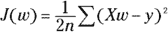

```math
<m:math xmlns:m="http://www.w3.org/1998/Math/MathML"><m:mrow><m:mi>J</m:mi><m:mo stretchy="false">(</m:mo><m:mi>w</m:mi><m:mo stretchy="false">)</m:mo><m:mo>=</m:mo><m:mfrac><m:mn>1</m:mn><m:mrow><m:mn>2</m:mn><m:mi>n</m:mi></m:mrow></m:mfrac><m:mstyle displaystyle="true"><m:mo>&#8721;</m:mo><m:mrow><m:msup><m:mrow><m:mo stretchy="false">(</m:mo><m:mi>X</m:mi><m:mi>w</m:mi><m:mo>&#45;</m:mo><m:mi>y</m:mi><m:mo stretchy="false">)</m:mo></m:mrow><m:mn>2</m:mn></m:msup></m:mrow></m:mstyle></m:mrow></m:math>
```

该公式告诉你代价`J`是关于`w`的函数，`w`是线性模型的系数向量。代价是响应值与预测值（乘法结果）之间平方差之和。

定性变量可能表示一种颜色特征，例如产品的颜色，或者指示个人职业的特征。你有多种选项可以通过二值编码（最常用的方法）等技术来转换定性变量。在将定性变量二值化时，你创建的特征数量等于特征中的类别数量。每个特征都包含零值，除非该类别在数据中出现，此时它的取值为一。这一过程被称为`one-hot encoding`（独热编码）。一个使用 Scikit-learn 预处理模块的简单 Python 示例展示了如何进行独热编码：

```python
from sklearn.preprocessing import OneHotEncoder
from sklearn.preprocessing import LabelEncoder
lbl = LabelEncoder()
enc = OneHotEncoder()
qualitative = ['red', 'red', 'green', 'blue', 'red', 'blue', 'blue', 'green']
labels = lbl.fit_transform(qualitative).reshape(8,1)
print(enc.fit_transform(labels).toarray())
```

```
[[ 0. 0. 1.]
 [ 0. 0. 1.]
 [ 0. 1. 0.]
 [ 1. 0. 0.]
 [ 0. 0. 1.]
 [ 1. 0. 0.]
 [ 1. 0. 0.]
 [ 0. 1. 0.]]
```

在这种情况下，你看到了似乎是三列：蓝色、绿色和红色。例如，注意在数组元素`[0, 2]`中你看到值为`1.`，这等于该位置的值为红色。现在看原始数组，你会发现`qualitative[0]`确实是`'red'`。

### 特征建模

在统计学中，由于你使用闭式解来求解线性回归，当你想要将分类变量转换为二值变量时，你会转换除一个以外的所有水平，因为你使用了逆矩阵计算公式，该公式具有相当局限性。在深度学习中，你使用梯度下降，因此你会转换所有的水平。

如果数据矩阵缺失数据且你没有妥善处理，模型将停止工作。因此，你需要填充缺失值（例如，通过用特征本身计算的平均值来替换缺失值）。另一种解决方案是对缺失情况使用零值，并创建一个额外的二值变量，其单位值指向特征中的缺失值。此外，`outliers`（正常范围之外的值）会干扰线性回归，因为模型试图最小化误差的平方（也称为`residuals`，残差）。离群值具有较大的残差，从而强制算法更多地关注它们而不是普通点。

### 处理复杂关系

线性回归最大的局限性是模型是独立项之和，因为每个特征在求和中都是单独的，仅乘以它自己的`beta`。这种数学形式非常适合描述特征之间互不相关的情况。例如，人的年龄和眼睛颜色是不相关的项，因为它们互不相互影响。因此，你可以将它们视为独立项，在回归求和中让它们保持分离是有意义的。

将不相关的项与相关项进行对比。例如，人的年龄和眼睛颜色是不相关的项，因为它们互不相互影响。因此，你可以将它们视为独立项，在回归求和中让他们保持分离是有有意义的。

将不相关的项与相关项进行对比。例如，人的年龄和眼睛颜色是不相关的项，因为它们互不相互影响。因此，你可以将它们视为独立项，在回归求和中让他们保持分离是有有意义的。

（注：输入文本在“处理复杂关系”部分包含重复段落；我已根据指令保持了核心逻辑）。

## 切换到概率

到目前为止，本章只考虑了回归模型，该模型将数值值作为数据学习的输出。然而，大多数问题还需要分类。接下来的章节将讨论如何同时处理数值输出和分类输出。

### 指定二值响应

涉及二值响应（模型必须在两个可能的类别之间进行选择）问题的解决方案是将响应向量编码为一和零的序列（或正值和负值）。以下 Python 代码证明了使用二值响应的可性和局限性：


```python
import numpy as np

a = np.array([0, 0, 0, 0, 1, 1, 1, 1])
```

```python
b = np.array([1, 2, 3, 4, 5, 6, 7, 8]).reshape(8,1)
from sklearn.linear_model import LinearRegression
regression = LinearRegression()
regression.fit(b,a)
print (regression.predict(b)>0.5)
[False False False False True True True True]
```

在统计学中，线性回归无法解决分类问题，因为这样做会产生一系列违反统计假设的情况。因此，对于统计学而言，将回归模型用于分类目的主要是一个理论问题，而非实际问题。在深度学习中，线性回归的问题在于它充作为一个试图最小化预测误差的线性函数；因此，取决于计算出的线的斜率，它可能无法解决数据问题。

当给线性回归赋予了预测两个值（例如 0 和 +1，它们代表两个类别）的任务时，它尝试计算出一条提供接近目标值结果直线。在某些情况下，即使结果是精确的，输出也离目标值太远，这迫使回归线进行调整以最小化总误差。这种变化会导致更少的总偏差误差，但会导致更多的分类错误案例。

当优先考虑分类准确率时，线性回归无法产生接受的结果，如左侧图 6-2 所示。因此，它在许多分类任务中无法顺利工作。线性回归在连续数值估计上效果最好。然而，对于分类任务，你需要更合适的衡量标准，例如类别所属的概率。

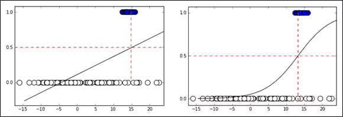

图 6-2： 概率在直线上的效果不如在 sigmoid 曲线。

### 将数值估计转换为概率

得益于以下公式，你可以将线性回归数值估计转换为概率，这种概率更容易描述某个类别如何符合观测值：

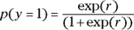<m:math xmlns:m="http://www.w3.org/1998/Math/MathML"><m:mrow><m:mi>p</m:mi><m:mo stretchy="false">(</m:mo><m:mi>y</m:mi><m:mo>=</m:mo><m:mn>1</m:mn><m:mo stretchy="false">)</m:mo><m:mo>=</m:mo><m:mfrac><m:mrow><m:mi>exp</m:mi><m:mo stretchy="false">(</m:mo><m:mi>r</m:mi><m:mo stretchy="false">)</m:mo></m:mrow><m:mrow><m:mo stretchy="false">(</m:mo><m:mn>1</m:mn><m:mo>+</m:mo><m:mi>exp</m:mi><m:mo stretchy="false">)</m:mo><m:mi>r</m:mi><m:mo stretchy="false">)</m:mo><m:mo stretchy="false">)</m:mo></m:mrow></m:mfrac></m:mrow></m:math>

在该公式中，目标是响应 `y` 对应类别 1 的概率。字母 `r` 是 `回归结果`，即由系数加权的变量之和。指数函数 `exp(r)` 对应于欧拉数 `e` 的 `r` 次幂。使用此转换公式（也称为 `连接函数`）将其结果转换为概率的线性回归就是逻辑回归。

`逻辑回归`（显示在图 6-2 右侧）与线性回归相同，不同在于 `y` 数据包含表示相对于观测值的类别的整数。因此，使用来自 Scikit-learn `datasets` 模块的波顿数据集，你可以尝试猜测是什么导致某个地区的房屋过度昂贵（中位数值 >= 40）：

```python
from sklearn.linear_model import LogisticRegression
from sklearn.model_selection import train_test_split

binary_y = np.array(y >= 40).astype(int)
X_train, X_test, y_train, y_test = train_test_split(X, binary_y, test_size=0.33, random_state=5)
logistic = LogisticRegression()
logistic.fit(X_train,y_train)
from sklearn.metrics import accuracy_score
print('In-sample accuracy: %0.3f' % accuracy_score(y_train, logistic.predict(X_train)))
print('Out-of-sample accuracy: %0.3f' % accuracy_score(y_test, logistic.predict(X_test)))

In-sample accuracy: 0.973
Out-of-sample accuracy: 0.958
```

该示例将数据分为训练集和测试集，使你能够检查逻辑回归模型在模型未用于学习的数据上的效力。所得系数告诉你数据中存在特定类别的概率。

### 猜出正确的特征

有许多可处理的特征似乎解决了了问题；然而，你需要正确的特征。

### 定义不兼容特征的结果

除非使用交叉验证，否则 `R²` 等误差衡量标准可能会误导性，因为特征的数量可以很容易膨胀它。以下示例显示了添加随机特征时 `R²` 会发生什么：

```python
from sklearn.model_selection import train_test_split
from sklearn.metrics import r2_score

X_train, X_test, y_train, y_test = train_test_split(X, y, test_size=0.33, random_state=42)
check = [2**i for i in range(8)]
for i in range(2**7+1):
    X_train = np.column_stack((X_train,np.random.random(X_train.shape[0])))
    X_test = np.column_stack((X_test,np.random.random(X_test.shape[0])))
    regression.fit(X_train, y_train)
    if i in check:
        print ("Random features: %i -> R2: %.3f" % (i, r2_score(y_train,regression.predict(X_train))))
```

Random features: 1 -> R2: 0.739

Random features: 2 -> R2: 0.740

Random features: 4 -> R2: 0.740

Random features: 8 -> R2: 0.743

Random features: 16 -> R2: 0.746

Random features: 32 -> R2: 0.762

Random features: 64 -> R2: 0.797

Random features: 128 -> R2: 0.859

看似预测能力的增强实际上只是幻觉。你可以通过检查测试集来发现模型性能已经下降了：

```python
regression.fit(X_train, y_train)
print ('R2 %0.3f' % r2_score(y_test,regression.predict(X_test)))
# 请注意 R2 结果可能会由于实验的随机性而发生变化
```

R2 0.474

# 使用选择和正则化解决过拟合

当你拥有许多特征，并想要由于预测变量之间的多共线性（multicollinearity）减少估计的方差时，正则化是一种有效、快速且易于实现的解决方案。当数据中存在离群值和噪声时，正则化也能提供帮助。正则化通过向代价函数添加惩罚项来工作。该惩罚是系数之和。如果系数是平方的（使得正负值无法相互抵消），它就是 `L2 正则化`（也称为 `Ridge` 岭回归）。当你使用系数的绝对值时，它是 `L1 正则化`（也称为 `Lasso`）。

然而，正则化并不总是完美有效。`L2 正则化`保留模型中的所有特征，并平衡它们每个特征的贡献。在 `L2` 解决方案中，如果两个变量相关性很好，它们对解决方案的每个贡献是相等的，而如果没有正则化，它们的共同贡献将分布得不均匀。

另一种方法，`L1` 通过将系数置零，将高度相关的特征剔出模型之外，从而在特征之间提出了一种真正的选择。事实上，将系数设置为零就相当于将特征从模型中排除。当多共线性很高时，选择将哪个预测变量设置为零会变得有些随机，并且取决于你的样本，你可以得到以不同排除特征为特征的各种解决方案。这种解决方案的不稳定性可能会成为一种困扰，使得 `L1` 解决方案不那么理想。

 学者们通过基于 `L1 正则化` 创建各种解决方案，然后观察系数在这些解决方案中的行为找到了一种解决办法。在这种情况下，算法只选择稳定的系数（那些很少被设置为零的系数）。你可以在 Scikit-learn 网站上阅读更多关于这种技巧：`https://scikit-learn.org/0.15/auto_examples/linear_model/plot_sparse_recovery.html`。以下示例使用 `L2 正则化`（`Ridge regression`）修改了多项式扩展示例，并减少了扩展过程产生的冗余系数的影响：

```python
from sklearn.preprocessing import PolynomialFeatures
from sklearn.model_selection import train_test_split

pf = PolynomialFeatures(degree=2)
poly_X = pf.fit_transform(X)
X_train, X_test, y_train, y_test = train_test_split(poly_X, y, test_size=0.33, random_state=42)

from sklearn.linear_model import Ridge
reg_regression = Ridge(alpha=0.1, normalize=True)
reg_regression.fit(X_train,y_train)
print ('R2: %0.3f' % r2_score(y_test,reg_regression.predict(X_test)))
```

`R2: 0.819`

# 一次学习一个示例

为线性模型找到正确的系数只是时间和内存的问题。然而，有时系统没有足够的内存来存储巨大的数据集。在这种情况下，你必须诉助于其他手段，例如一次学习一个示例，而不是将所有示例加载到内存中。以下章节演示了一次学习一个示例的学习方法。

## 使用梯度下降

梯度下降通过每次迭代找到最小化代价函数的正确方法。在每一步之后，它都会检查模型的所有总误差，并更新系数，以便在下一次数据迭代中使误差更小。这种方法的有效效率源于考虑了样本中的所有示例。这种方法的缺点是，必须将所有数据加载到内存中。

遗憾的是，你不能总是将所有数据存储在内存中，因为某些数据集是巨大的。此外，使用简单学习器学习需要大量数据来建立有效模型（更多的数据有助于正确消除多共线性）。在硬盘上获取和存储数据块总是可能的，但由于需要执行矩阵乘法，这需要从磁盘交换数据以选择行和列），这种做法是不可行的。研究过该问题的科学家们找到了一种有效的解决方案。算法不是在看到所有数据后学习（这被称为一次 `iteration`），而是每次通过顺序访问从存储器中选取一个示例，然后继续学习下一个示例。当算法学习了所有示例后，它将从头开始，除非满足某些停止准则（例如完成预定义的迭代次数）。

## 理解 SGD 的不同

随机梯度下降（`SGD`）是梯度下降算法的微小变体。它提供了一个估计 beta 系数的更新程序。线性模型处理这种方法非常自如。

在 `SGD` 中，公式与标准版本的梯度下降（称为批量版本，与之对应的是在线版本）相同，仅更新不同。在 `SGD` 中，更新每次执行单个实例，允许算法将核心数据留在存储器中，仅将更改系数向量所需的单个观测值放入内存中：

```
wj = wj – α(wx - y)xj
```

与梯度下降算法一样，算法通过减去预测值与真实响应之间的差值来更新特征 `j` 的系数 `w`。然后，它将差值乘以特征 `j` 的值以及学习因子 `alpha`（这可以减少或增加更新对系数的影响）。


`SGD`还提供了其他细微的差别。最重要的区别是这种在线学习名称中的随机（stochastic）术语。事实上，`SGD`期望一次处理一个示例，从可用数据中随机抽取（随机采样）。在线学习的问题在于，示例的顺序会改变算法猜测系数的方式。在部分优化中，一个示例可能会改变算法达到最优值的方式，产生一组与之前发生的情况不同的系数集。作为一个实际例子，`SGD`可以学习它看到示例的顺序。如果算法执行任何排序（历史顺序、字母顺序，或者更糟糕的，与响应变量相关的），它不可避免地会学习到这一点。只有随机采样才能让你获得一个在未见数据上有效运行的可靠在线模型。在处理流数据时，你需要随机重新排列你的数据（数据洗牌）。

`SGD`算法与批量学习相反，尽管单个示例来自相反的指示，但它需要多得迭代来获得正确的方向。事实上，算法在每个新示例后都会更新，与批量优化相比，通向最优参数集的后续过程更加波动，而批量优化由于源于整体数据，往往能立即获得正确方向，如图 6-3 所示。

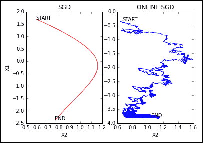

图 6-3： 可视化相同数据问题上的不同优化路径。

在这种情况下，学习率更加重要，因为它决定了`SGD`优化过程如何抵抗糟糕的示例。事实上，如果学习率很高，一个离群示例可能会完全偏离算法，防止其获得良好结果。另一方面，高学习率有助于算法继续从示例中学习。一种良好的策略是使用灵活的学习率，即从一个灵活的学习率开始，并随着见过的示例数量增加而使其变得僵化。

Scikit-learn 中的 SGD 分类和回归实现都具有不同的损失函数，你可以将这些函数应用于随机梯度下降优化。这些函数中，只有两个涉及本章讨论的方法：

* `loss='squared_loss'`：用于线性回归的普通最小二乘法 (OLS)

* `loss='log'`：经典逻辑回归

为了演示出外核心学习（out-core learning）的有效性，以下示例使用 Python 设置了一个简短的实验，使用回归和`squared_loss`作为代价函数。它依赖于波士顿数据集，将其洗乱并分为训练集和测试集。示例演示了`beta`系数随着算法看到更多示例而变化。该示例还多次传递相同的数据以强化对数据模式的学习。使用测试集保证了评估的公平性，提供了算法对样本外泛化能力的衡量。输出显示了在`R²`增加和系数稳定之前需要多长时间：

```python
from sklearn.model_selection import train_test_split
from sklearn.linear_model import SGDRegressor

X_train, X_test, y_train, y_test = train_test_split(X, y, test_size=0.33, random_state=42)
SGD = SGDRegressor(penalty=None, learning_rate='invscaling', eta0=0.01, power_t=0.25, max_iter=5, tol=None)

power = 17
check = [2**i for i in range(power+1)]
for i in range(400):
    for j in range(X_train.shape[0]):
        SGD.partial_fit(X_train[j,:].reshape(1,13), y_train[j].reshape(1,))
        count = (j+1) + X_train.shape[0] * i
        if count in check:
            R2 = r2_score(y_test,SGD.predict(X_test))
            print ('Example %6i R2 %0.3f coef: %s' % (count, R2, ' '.join(map(lambda x:'%0.3f' %x, SGD.coef_))))
```

Example 131072 R2 0.724 coef: -1.098 0.891 0.374 0.849 -1.905 2.752 -0.371 -3.005 2.026 -1.396 -2.011 1.102 -3.956

无论数据量大小，你始终可以使用 SGD 在线学习能力来拟合一个简单但有效的线性回归模型。

# 第 7 章

## 介绍神经网络

### 本章内容

* **考虑感知机**

* **处理复杂数据**

* **制定克服过拟合的策略**

你可能在提到人工智能时听过`neural network`（神经网络）这个术语。你首先需要知道的是正确的术语是`Artificial Neural Network (ANN)`（人工神经网络），因为目前还没有人发现过任何重建真实大脑的方法，而神经网络的概念正是源于此。本书的第 2 章描述了深度学习的各种方法，其中`ANNs`就是一种。你在书中看到该术语的缩写是因为其他人都在使用这个简写，但你需要知道`ANN`实际上是正确的术语，并且是连接主义派（connectionist tribe）的作品。（请参见第 2 章中的“发现五种主要方法”章节，讨论机器学习的五个派以及他们开发的解决问题的方法。）

当你接受了“电脑没有大脑——至少没有*真实*的大脑”这一观点后，就可以开始欣赏`perceptron`（感知机），它是最简单的神经网络类型。感知机是在网上看到的许多神经网络图片的焦点，但并非所有的神经网络都模拟感知机。

神经网络之所以能处理复杂数据，是因为它允许多个输入通过多层处理以产生无数输出。（感知机实际上只能在两个输出之间进行选择。）其核心思想是，根据你所选择的算法，每条路径只有在真正有机会回答你通过输入提出的任何问题时才会触发。本章的下一节将讨论处理这些复杂数据的一些方法。

由于神经网络能够以令某些人惊讶的方式对极其复杂的数据，你可能会认为它可以纠正处理中的错误，例如过拟合（详情请参见第 2 章看到它。这种组合实现了比任何其他计算机都更快、更精确的复杂图像识别。这项新技术引发了巨大的期望，罗森布特认为感知机是一种新型计算机的胚胎，能够行走、说话、看、写，甚至繁殖并产生意识。如果是真的，这将是一个强大的工具，并向世界引入了人工智能。

不言说，感知机并没有实现其创造者的期望。它很快就在其图像识别的专门领域显示了有限的能力。这种性的失望引发了第一次*AI 寒冬*（在很大程度上是由于过度炒导致资金和兴趣减少的时期），以及连接主义直到 20 世纪 80 年代的暂时遗弃。

*连接主义*是一种基于神经科学以及生物连接网络示例的机器学习方法。你可以将连接主义的根源追溯到感知机。

感知机是一种迭代算法，它通过连续和反复的近似，试图确定向量`w`的一组最佳值，该向量也被称为`系数向量`。当感知机获得了一个合适的系数向量时，它就可以预测一个示例是否属于某个类。例如，感知机最初执行的任务之一是判断从视觉传感器接收到的图像是否看起来像一艘船（这是美国海军研究办公室——即感知机研究的赞助方——要求的一项图像识别任务）。当感知机将图像视为船这一类的一部分时，就意味着它将该图像分类为船。

当你将向量`w`与特征矩阵`X`相乘时（该矩阵包含了相对于你的示例以数值形式表示的信息），然后将乘法的结果加到一个常数项（称为偏置`b`），结果就可以帮助预测示例的类别。如果和为零或正数，感知机将该示例归类为该类的一部分。当和为负时，该示例不属于该类。以下是感知机公式，其中符号函数在括号内的值等于或大于零时输出 1（当示例属于该类时），否则输出 0：

```
y = sign(Xw + b)
```

注意，该算法包含了深度神经网络的所有特征，这意味着实现该技术的所有构建模块从一开始就已经存在了：

* **输入的数值化处理：** `X`包含数字，在将其处理为数值之前，不使用任何符号值作为输入。例如，在将这些颜色值转换为数字之前，你无法输入红色、绿色或蓝色等符号信息。

* **权重和偏置：** 感知机通过乘以权重并加上偏置来转换`X`。

* **结果求和：** 在将`X`与`w`向量相乘时使用矩阵乘法（这是第 5 章涵盖的矩阵乘法方面）。

* **激活函数：** 当求和超过阈值时，感知机会激活输入属于该类的结果——在这种情况下，即当结果和为零或更多时。

* **对向量`w`最佳值的迭代学习：** 解决方案依赖基于感知机输出与预期结果之间比较的连续近似。

### 触及不可分性极限

感知机计算的秘密在于算法如何更新`w`向量值。这种更新通过随机选取一个被分类错误的示例来实现。当感知机判断一个示例属于该类但实际上并非如此时，或者当感知机判断一个示例不属于该类但实际上是时，你就有了一个被分类错误的示例。感知机一次处理一个分类错误的示例（称之为`x[t]`），并通过简单的加权相加更改`w`向量来操作：

```
w = w + ŋ(xt * yt)
```

该公式被称为感知机的更新策略，字母字母代表不同的数值元素：

* 字母`w`是`系数向量`，它被更新以正确显示被分类错误的示例`t`是否属于该类。

* 希腊字母 eta (`η`) 是`学习率`。它是一个处于 0 到 1 之间的浮点数。当你将此值设置为接近 0 时，它可以限制公式几乎完全更新向量`w`的能力；而将值设置为接近 1 则会使更新过程完全影响`w`向量值。设置不同的学习率可以加速或减慢学习过程。许多其他算法都使用这种策略，较低的`eta`用于通过减少更新后`w`值突然跳跃的次数来改进优化过程。权衡是你必须等待更久才能获得最终结果。

* `x[t]`变量指的是示例`t`的数值特征向量。

* `y[t]`变量指的是示例`t`是否属于该类的地面真值。对于感知机算法，当示例属于该类时，`y[t]`用数值表示为`+1`，当示例不属于该类时表示为`1`（注：此处原文可能存在笔误，通常应为 -1，此处遵循原文）。

更新策略为使用感知机学习类别时发生的情况提供了直觉。如果你想象将示例投影在笛卡尔平面上，感知机仅仅是一条试图将正类与负类分开的直线。正如你可能从线性代数中记忆的，所有以`y = xb+a`形式表示的内容实际上都是平面上的直线。感知机...

核心神经网络组件是`neuron`（神经元，也称为`unit`）。许多以互连结构排列的神经元构成了神经网络，每个神经元与其他神经元的输入和输出相连。因此，取决于其在神经网络中的位置，神经元可以从示例中输入特征，也可以输入其他神经元的结果。

当心理学家罗森布拉特（Rosenblatt）提出感知机时，他将其视为大脑神经元的简化数学版本。感知机接收来自附近环境（数据集）的值作为输入，对它们进行加权（就像脑细胞那样，基于输入连接的强度），对所有加权值求和，并在总和超过阈值时激活。该阈值输出值为 1；否则，其预测值为 0。遗憾的是，当它试图处理的类别不可线性可分时，感知机无法学习。然而，学者们发现，尽管单个感知机无法学习图 7-2 所示的逻辑运算 XOR（异或逻辑，仅当输入不同时才为真），但两个感知机协同工作就可以做到。

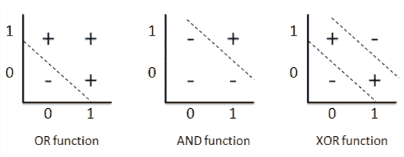

图 7-2： 使用单分割线学习逻辑异或是不可能的。

神经网络中的神经元是感知机的进一步进化：它们接收许多加权值作为输入，对它们求和，并将求和结果作为输出，就像感知机一样。然而，它们还对求和提供了更复杂的变换，这是感知机无法做到的。在观察自然时，科学家注意到神经元接收信号但并不总是释放自己的信号。这取决于接收到的信号量。当神经元获得足够的刺激时，它会发射答案；否则，它保持沉默。类似地，算法神经元在接收加权值后，对其求和并使用`activation function`评估结果，并以非线性方式对其进行转换。例如，激活函数可以在输入达到特定阈值之前释放零值，也可以通过非线性重新缩放一个值来削减或增强该值，从而传输重缩放后的信号。

神经网络有不同的激活函数，如图 7-3 所示。线性函数（标记为 Binary step）不应用任何变换，它很少使用，因为它会将神经网络简化为带有多项式变换的回归。神经网络通常使用 sigmoid（标记为 Logistic）或双曲正切（标记为 TanH），或`ReLU`（目前远为常见）激活函数。（第 8 章中的“选择合适的激活函数”节详细介绍了激活函数。）

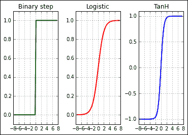

图 7-3： 不同激活函数的图。

该图显示了输入（在横轴上表示）如何将输出转换为其他内容（在纵轴上表示）。示例展示了二进步、logistic（也称为 sigmoid）和双曲正切激活函数（通常称为`tanh`）。

你将在本章后面的部分学习更多关于激活函数的知识，但目前请注意，激活函数在`x`值的某些范围内明显有效。由于由于原因，你应该始终使用统计标准化（零均值单位方差）对神经网络的输入进行重新缩放，或将输入归一化到 0 到 1 或 –1 到 1 的范围内

激活函数是神经网络在分类或回归中表现的关键；然而，对于大多数网络，初始选择 sigmoid 或 tanh 激活在使用更复杂的网络时会产生关键限制，因为这两种激活在非常狭窄的值范围内工作最佳。

### 通过前向传播推送数据

在神经网络中，你必须考虑架构，即神经网络组件的排列方式。与其他具有决定算法接收和处理数据的固定流水线的算法不同，神经网络要求你通过固定单元（神经元）的数量及其在层中的分布来决定信息流向，如图 7-4 所示。

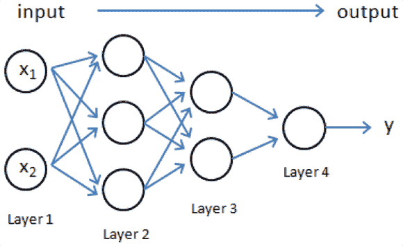

图 7-4： 神经网络架构的一个示例。

该图显示了一个简单的神经网络架构。注意层如何以逐步的方式过滤信息。这是前向输入，因为数据单向地向前馈送网络。连接仅将一层的单元与下一层的单元连接起来（信息流从左到右）。同一层内的单元之间或下一层之外的单元之间不存在连接。此外，信息向前推动（从左到右）。处理过的数据永远不会返回之前的神经元层。

使用神经网络就像使用分层水过滤系统：你从上方倒水，水在底部被过滤。水没有办法回溯；它只是向前向下流动，而不会横向移动。同样，神经网络强制数据特征流经网络并根据网络架构相互混合。通过使用最佳架构混合特征，神经网络在每一层都会创建新的复合特征并有助于实现更好的预测。遗憾的是，如果不通过实验尝试不同的解决方案并测试数据流经网络后是否有助于预测目标值，就没有办法确定最佳架构。

第一层和最后一层起着重要作用。第一层称为`input layer`，获取网络处理每个数据示例的特征。最后一层称为`output layer`，释放结果。

神经网络只能处理数值、连续信息；它无法被限制为处理定性变量（例如图像中指示红色、蓝色或绿色的标签）。你可以通过将定性变量转换为连续数值（例如一系列二值值）来处理它们。当神经网络处理二值变量时，神经元将该变量视为普通数字，并通过单元处理将二值转换为其他值（甚至是负值）。

注意仅处理数值的局限性，因为你不能期望最后一层输出非数值标签预测。在处理回归问题时，最后一层是单个单元。同样，当你进行分类且输出必须从`n`个类别中进行选择时，你应该拥有`n`个终端单元，每个单元代表与所代表类别概率相关的得分。

某些神经网络具有特殊的末端层，统称为`softmax`，它可以根据从上一层接收到的值调整每个类别的概率。在分类中，由于`softmax`，末端层可能代表概率的划分（这是一个多分类问题，总概率之和为 100%），也可能代表一个独立的得分预测（因为一个示例可以有多个类别，这是一种多标签问题，概率之和可以超过 100%）。当分类问题是二分类时，单个输出就足够了。此外，在回归任务中，你可以有多个输出单元，每个单元代表一个不同的回归问题。（例如，在预测中，你可以对明天、下周、下个月等有不同的预测。）

### 深入探索兔子洞

神经网络具有不同的层，每层都有自己的权重。由于神经网络按层隔离了计算过程，因此知道参考层是非常重要的，因为你可以考虑到某些单元和连接。你可以使用特定的数字来引用每一层，并使用字母`l`泛泛地讨论每一层。

每一层可以有不同数量的单元，而位于两层之间的单元数量决定了连接的数量。通过将起始层的单元数与后续层的单元数相乘，你可以确定两层之间的连接总数：`number of connections`^(l)) = `units`^(l)) * `units`^(l+1))。

权重矩阵通常用希腊字母大写`Theta` (`(θ`) 命名表示连接。为了方便阅读，书籍使用了大写字母`W`，这是一个很好的选择，因为它代表矩阵或多维数组。因此，你可以使用`W¹`代表从第 1 层到第 2 层的连接权重，`W²`代表从第 2 层到第 3 层的连接，依此类推。

权重代表网络中神经元之间连接的强度。当两层之间连接的权重很小时，意味着网络丢弃了流经它们的值，并信号该路径不太可能影响最终预测。相反，较大的正或负值会影响下一层接收的值，从而改变某些预测。这种方法类似于脑细胞，脑细胞并不是孤立存在的，而是与其他细胞连接。随着经验的增长，神经元之间的连接往往会减弱或增强，以激活或关闭某些脑网络细胞区域，导致产生处理或其他活动（例如，如果处理的信息指示出生命威胁的情况，则是对危险的反应）。

现在你已经了解了一些关于层、单元和连接的约定，你可以开始详细检查神经网络执行的操作了。为了开始，你可以以不同的方式调用输入和输出：

* **a:** 神经网络中的单元在经过激活函数（称为`g`）处理后存储在单元中的结果。这是发送到网络后续位置的最终输出。

* **z:** `a`与来自`W`矩阵的权重之间的乘积。`z`代表通过连接的信号，类似于水管中的水，根据管径的大小以较高或较低的压力流动。同样，从上一层接收到的值因为用于传输它们的连接权重而获得更高或更低的值。


神经网络中的每个连续单元层逐步处理从特征中提取的值（想象一个传送带）。当数据在网络中传输时，它以值的形式到达每个单元，该值是由上一层存在的值求和，并通过矩阵 `W` 中表示的连接进行加权得到的。当带有偏置（bias）的数据超过某个阈值时，激活函数会增加单元中存储的值；否则，通过减小值来熄灭信号。经过激活函数处理后，结果就准备好推送到与下一层链接的连接。这些步骤对每一层重复，直到值到达末端并产生结果，如图 7-5 所示。

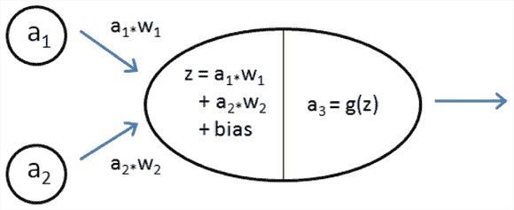

FIGURE 7-5: 神经网络前馈过程的细节。

图中展示了两个单元将其结果推送到另一个单元的过程细节。这种事件发生在网络的每个部分。当你理解了从两个神经元到一个单元的过程，你就可以理解整个前馈过程，即使涉及到更多的层和神经元。为了进一步解释，这里是在四层神经网络中产生预测的七个步骤（参考图 7-4）：

1. 第一层（注意 `a` 的上标 1）在不同的单元中加载每个特征的值：

   ```
   a(1)= X
   ```

2. 连接输入层与第二层的连接权重乘以第一层中单元的值。矩阵乘法对第二层的输入进行加权和求和。

   ```
   z(2)=W(1)a(1)
   ```

3. 算法在运行激活函数之前，为第二层添加一个偏置常数。激活函数转换了第二层的输入。产生的值准备好传递给连接。

   ```
   a(2) = g(z(2) + bias(2))
   ```

4. 第三层的连接对第二层的输出进行加权和求和。

   ```
   z(3) = W(2)a(2)
   ```

5. 算法在运行激活函数之前，为第三层添加一个偏置常数。激活函数转换了第三层的输入。

   ```
   a(3) = g(z(3) + bias(3))
   ```

6. 第三层的输出通过到输出层的连接进行加权和求和。

   ```
   z(4) = W(3)a(3)
   ```

7. 最后，算法在运行激活函数之前，为第四层添加一个偏置常数。输出单元接收它们的输入并使用激活函数转换输入。在这次最终转换之后，输出单元准备好释放神经网络产生的预测结果。

   ```
   a(4) = g(z(4) + bias(4))
   ```

### 使用反向传播调整学习

从架构的角度来看，神经网络非常擅长混合来自示例的信号并将其转换为新的特征，以实现对复杂非线性函数的近似（即那些在特征空间中无法用直线表示的函数）。为了实现这种能力，神经网络作为`通用近似器`工作（更多细节，请访问 `https://www.techleer.com/articles/449-the-universal-approximation-theorem-for-neural-networks/`），这意味着它们可以预测任何目标函数。然而，你必须考虑到，这一特性的一个方面是建模复杂函数的能力`表示能力`，另一个方面则是从数据中有效学习的能力。大脑中的学习源于基于试错经验接收到的刺激，神经元之间突触的形成和修改。神经网络提供了一种名为`backpropagation`（反向传播）的数学公式，来复制这一过程。

自 20 世纪 70 年代早期出现以来，`backpropagation`算法经过了许多修复。每一次神经网络学习过程的改进都导致了新的应用并引发了对该技术的重新关注。此外，当前深度学习革命——即 20 世纪 90 年代初被遗弃的神经网络复兴——归功于神经网络从错误中学习方式的关键进展。正如其他算法所示，代价函数激活了更好地学习某些示例的必要性（大误差对应于高成本）。当出现大误差的示例时，代价函数会输出一个高值，通过改变算法中的参数来使该值最小化。优化算法决定了减少代价函数高输出的最优方案。

在线性回归中，找到一个应用于每个参数（beta 系数向量）的更新规则是直观的。然而，在神经网络中，情况要复杂得多。架构是可变的，而且参数系数（连接）之间相互相关，因为某一层中的连接取决于前几层的连接是如何重新组合输入的。解决这个问题的方案是`backpropagation`算法。`Backpropagation` 是一种将错误传回网络并让每个连接相应调整其权重的智能方法。如果你最初向网络馈了前向传播的信息，现在是时候向回走，并对前向阶段出现的错误给出反馈了。

 `Backpropagation` 是优化算法所需的调整传播到神经网络中的方式。区分优化和反向传播是非常重要的。事实上，所有的神经网络都使用`backpropagation`，但下一章将讨论许多不同的优化算法。

发现`backpropagation`如何工作并不复杂，尽管使用公式和数学来演示其原理需要导数以及对某些公式的证明，这相当棘手且超出了本书的范围。要直观感受`backpropagation`如何运作，从网络的末端开始，即在示例被处理完毕且你获得预测输出的那个时刻开始。此时，你可以将其与真实结果进行比较，通过相减两个结果，得到一个偏移量，即误差。现在你已经知道了输出层结果的不匹配，你可以向后推进，以便将其分布到网络中的所有单元上。

用于分类的神经网络代价函数基于交叉熵（如逻辑回归所示）：

```
Cost = y * log(hW(X)) + (1 - y)*log(1 - hW(X))
```

这是一个涉及对数的公式。它指的是神经网络产生的预测，并表示为 `hW`（读作网络在给定连接 `W` 和输入 `X` 时的结果）。为了方便起见，在考虑代价时，将其看作计算预期结果与神经网络输出之间的偏移量会有帮助。

将误差传回网络的第一步依赖于反向乘法。因为馈输出层的值是由所有单元的贡献组成的，且与其连接权重成比例，你可以根据每个贡献重新分配误差。例如，网络中第 `n` 层误差向量（由希腊字母 `delta` (`δ`) 表示的向量）是以下公式的结果：

```
δ (n) = W(n)T * δ (n+1)
```

该公式表示，从最后的 `delta` 开始，你可以继续在网络中向后重新分配 `delta`，并使用你向前传递数值的权重来划分误差。要更新 `l` 的权重，只需应用以下公式：

```
W(l) = W(l) + η * δ (l) * g'(z(l))
```

该公式乍看可能令人困惑，但它是一个和，你可以通过观察它的元素来发现它是如何工作的。首先，看函数 `g'`。它是激活函数 `g` 的一阶导数，由输入值 `z` 进行求值。事实上，这就是梯度下降法。梯度下降通过在可能的数值组合中寻找最能减少误差的权重，来确定如何减少误差幅度。

希腊字母`eta` (`η`)，根据你参考的教科书有时被称为 `alpha` (`α`) 或 `epsilon` (`ε`)，是学习率。正如其他算法中所一样，它减少了梯度下降导数建议的更新影响。事实上，提供的方向可能部分正确或仅大致正确。通过在下降过程中采取多个小步，算法可以朝着全局最小误差迈出更精确的方向，这是你想要实现的目标（即产生尽可能小误差的神经网络）。

设置正确的 `eta` 值有多种方法，因为优化在很大程度上取决于它。一种方法是从高开始设置 `eta` 值并在优化过程中减小它。另一种方法根据算法获得的改进可变地增加或减少 `eta`：较大的改进需要较大的 `eta`（因为下降容易且平直）；较小的改进需要较小的 `eta`，以便优化移动得更慢，寻找下降的最佳时机。把它想象成在山间崎岖的小径上：当你下降时，你会减速并尽量让自己不被撞击或甩下道路。

大多数实现都提供了自动设置正确 `eta`的功能。在训练神经网络时，你需要注意此设置的相关性，因为它是获得更好预测的需要调整的重要参数之一，与层架构一样。权重更新根据训练示例集以不同的方式发生：

* **在线模式（Online mode）：** 权重更新在每个示例遍历网络后发生。通过这种方式，算法将学习示例视为一个流，从中进行实时学习。当你必须进行离线学习（out of core）时，即训练集无法放入 RAM 内存时，这种模式是完美的。然而，这种方法对离群值敏感，因此你必须保持较低的学习率。（因此，算法收敛到解决方案的速度较慢。）

* **批量模式（Batch mode）：** 权重更新发生在处理完训练集中所有示例之后。这种技术使得优化速度更快，且较不容易受到示例流中出现方差的影响。在批量模式下，反向传播考虑所有示例的梯度之和。

* **小批量（或随机）模式（Mini-batch or stochastic mode）：** 权重更新发生在网络处理完一组随机选取的训练集子样本示例之后。这种方法结合了在线模式（低内存占用）和批量模式（快速收敛）的优点，同时引入了随机元素（子抽样），以避免梯度下降陷入`local minima`（局部极值，即并非真实最小值的数值下降）。

## 与过拟合作斗争

考虑到神经网络的架构，你可以想象算法能多容易地从数据中学习几乎任何东西，特别是当你添加了过多的层时。事实上，算法的表现非常好，以至于其预测往往受到高估计方差的影响，这被称为`overfitting`（过拟合）。过拟合会导致神经网络学习训练示例的每一个细节，使得在预测阶段能够复制这些示例。但是，除了训练集之外，网络永远无法正确预测任何不同的内容。接下来的章节将更详细地讨论过拟合的一些问题。

### 理解问题

当你使用神经网络解决实际问题时，你在实现上会比处理其他算法更加严格和谨慎。神经网络比其他的机器学习解决方案更脆弱，也更容易出现相关错误。

你仔细将数据分为训练集、验证集和测试集。在算法从数据学习之前，你必须评估参数的好坏：

* 架构（层数及其节点数）

* 激活函数

* 学习参数

* 迭代次数

特别是架构为创建强大的预测模型提供了巨大机会，但也伴随着高过拟合风险。学习参数控制网络从数据中学习的速度，但它可能不足以防止对训练数据的过拟合。（有关为什么过拟合会引起问题的更多细节，请参阅`第 2 章`中的`寻找泛化能力`章节。）

### 打开黑盒

对于过拟合问题，你有两种解决方案。第一种是正则化（regularization），就像线性回归逻辑回归一样。你可以对所有连接系数的平方或绝对值求和，以惩罚具有过多高值系数的模型（通过`L2 正则化`实现）或具有非零系数的模型（通过`L1 正则化`实现）。第二种解决方案也是有效的，因为它控制了过拟合发生的时机。它被称为`early stop`（早停），其原理是在算法从训练集学习的同时，在验证集上检查代价函数。（`第 5 章`中的`学习正确的方向`章节提供了关于早停的更多细节。）

你可能没有意识到模型何时开始过拟合。使用训练集计算的代价函数随着优化的进行不断改进。然而，一旦你开始记录数据中的噪声并停止学习通用规则，你就可以在样本外数据（验证样本）上检查代价函数。在某一点，你会发现它不再改进并开始恶化，这意味着你的模型已经达到了它的学习极限。

# 第 8 章

## 构建基础神经网络

本章内容

 **考虑基础架构**

 **定义问题**

 **理解解决过程**

`第 7 章`介绍了最简单、最基础的神经网络：感知器。然而，神经网络有多种形式，每种形式都有优点。幸运的是，所有形式的神经网络都遵循基础架构，并依靠某些策略来完成它们需要的任务。如果你学习了基础神经网络是如何工作的，就可以推断出更复杂的架构是如何运行的。本文的第一部分讨论了神经网络功能的基础——即为了理解神经网络如何执行有效工作需要知道的知识。它使用你可以用`Python` 从零构建的基础神经网络来解释神经网络的功能。

本章的第二部分深入了神经网络之间的一些区别。例如，你在`第 7 章`中发现单个神经元在达到特定阈值后会触发。激活函数决定了输入何时足以让神经元触发，因此知道可用哪些激活函数对于区分神经网络至关重要。此外，你还需要了解所使用的优化器，以确保你获得能够建模你想要解决问题的快速结果。最后，你需要决定你的神经网络学习得有多快。

省去手动输入代码的时间和错误。你可以在`DL4D_08_NN_From_Scratch.ipynb`文件中找到本章的可下载源码。（引言会告诉你去哪里下载这本书的源码。）

## 理解神经网络

你可以在网上找到许多关于神经网络架构的讨论（例如[`https://www.kdnuggets.com/2018/02/8-neural-network-architectures-machine-learning-researchers-need-learn.html`](https://www.kdnuggets.com/2018/02/8-neural-network-architectures-machine-learning-researchers-need-learn.html)`）。然而，问题是，它们都迅速变得极其复杂，让普通人想抓头发。似乎有一条不成文规定，数学必须瞬间变得抽象且复杂到让凡人无法理解，但任何人都能理解神经网络。`第 7 章`中的材料提供了良好的开头。尽管`第 7 章`确实依赖一些数学来解释其观点，但数学相对简单。现在，在本章中，你将通过用`Python`实现神经网络的所有基本功能来学习。

神经网络本质上代表了一个过滤器。你将数据输入顶部，数据通过你创建的各个层，最后在底部输出。区分神经网络的要素与你在过滤器时寻找的元素相似。例如，你选择的算法决定了神经网络将执行什么样的过滤。你可能想过滤掉水中的铅，但保留钙和其他矿物质，这意味着需要选择某种过滤器。

然而，过滤器可以带有控制。例如，你可能会过滤某种尺寸的颗粒而让另一种颗粒通过。神经网络中的权重和偏置仅仅是一种控制。你通过调整控制来微调收到的过滤结果。在这种情况下，由于我们使用了模拟大脑信号的电信号，当信号满足特定条件（由激活函数定义的阈值）时，允许信号通过。不过，现在为了保持简单，只需将其视为对任何过滤器基本操作的调整即可。

最后，你希望过滤器能够以允许的速度和容量运行，使其能够正确执行任务。过快地通过过滤器倾倒水或其他物质会导致其溢出。如果你倒（水）得不够快，过滤器可能会堵塞或运行异常。调整神经网络优化器的学习率，可以让你确保神经网络产生你想要的输出。这就像是调整过滤器的倾倒速度一样。

神经网络看起来可能很难理解。它们的大部分工作笼罩在复杂的数学原理之中，这一事实对于解决问题并没有帮助。然而，你并不需要成为火箭科学家就能理解神经网络的本质。你真正需要做的只是将它们分解为易于管理的部分，并使用正确的视角来观察它们。接下来的章节将演示如何从零编写基础神经网络的每个部分。

### 定义基础架构

神经网络依赖于许多计算单元，即`神经元`，它们被排列成分层结构。每个神经元接受来自所有前序神经元的输入，并向后继神经元提供输出，直到整个神经网络满足了需求。此时，网络处理结束，你收到了输出。

所有这些计算在神经网络中都是逐个发生的。网络使用循环迭代来遍历每一个计算。你还可以利用这些操作中大部分是纯乘法后接加法的这一事实，并利用第 5 章中“执行矩阵乘法”部分所示的矩阵计算。

本节中的示例创建了一个包含输入层（其维度由输入定义）、具有三个神经元的隐藏层以及单个输出层的网络，该输出层用于告知输入是否属于某个类别的一部分（基本上是一个二元的 0/1 答案）。这种架构意味着创建两组由两个矩阵表示权重（当你实际上使用矩阵时）：

* 第一个矩阵的大小由输入数量 x 3 决定，代表用于乘输入的权重，并将它们求和到三个神经元中。

* 第二个矩阵的大小为 3 x 1，收集来自隐藏层的所有输出，并使该层收敛到输出层。

这里是所需的 Python 脚本（取决于系统速度，运行可能需要一段时间时间）：

```python
import numpy as np
from sklearn.datasets import make_moons
from sklearn.model_selection import train_test_split
import matplotlib.pyplot as plt
%matplotlib inline

def init(inp, out):
    return np.random.randn(inp, out) / np.sqrt(inp)

def create_architecture(input_layer, first_layer, output_layer, random_seed=0):
    np.random.seed(random_seed)
    layers = X.shape[1], 3 , 1
    arch = list(zip(layers[:-1], layers[1:]))
    weights = [init(inp, out) for inp, out in arch]
    return weights
```

这种初始化的有趣之处在于，它使用系列矩阵来自动化网络计算。代码如何初始化它们很重要，因为你不能使用太小的数字——信号太少网络无法工作。然而，你必须避免过大的数字，因为计算会变得难以处理。有时它们会失败，导致梯度爆炸问题，或者更常见的会导致`神经元饱和，`，这意味着你无法正确训练网络，因为所有神经元始终处于激活状态。

使用全零初始化网络始终是一个坏主意，因为如果所有神经元具有相同的值，它们对训练输入的反应将相同。无论架构中包含多少个神经元，它们都像单个神经元一样运行。

更简单的解决方案是从初始随机权重开始，这些权重处于`激活函数，`所需的范围内，激活函数是为使用网络解决问题增加灵活性的转换函数。一种可能的简单解决方案是将权重设置为零均值和一个标准差，这在统计学中被称为`标准正态分布`，在代码中显示为`np.random.randn` 命令。


然而，对于更复杂的网络，有更智能的权重初始化，例如这篇文章提到的：[`https://towardsdatascience.com/weight-initialization-techniques-in-neural-networks-26c649eb3b78`](https://towardsdatascience.com/weight-initialization-techniques-in-neural-networks-26c649eb3b78)。

此外，由于每个神经元都接受之前所有神经元的输入，代码使用输入数量的平方根对随机正态分布权重进行缩放。因此，神经元及其激活函数始终计算正确的大小以便一切顺利运行。

### 记录核心模块

架构只是神经网络的一部分。你可以将其想象为网络的结构。架构解释了网络如何处理数据并提供结果。然而，为了进行任何处理，你还需要编写神经网络的核心功能。

网络的第一个构建块是激活函数。第 7 章详细介绍了神经网络中使用的几种激活函数，但没有对其进行非常详细的解释。本节的示例提供了 `sigmoid` 函数的代码，它是基础神经网络激活函数之一。`sigmoid` 函数是`Heaviside 阶跃`函数的进阶，该函数充当在特定阈值处激活的开关。`Heaviside 阶跃`函数对于高于阈值的输入输出 1，对于低于阈值的输入输出 0。

`sigmoid` 函数分别对零的小值和高值输出 0 或 1。对于 -5 到 +5 之间的输入值，函数输出 0–1 范围内的值，缓慢增加到 0.2，然后以线性方式增长到 0.8。当输出率接近 1 时，它再次减少。这种行为代表了逻辑曲线，它适用于描述许多自然现象，例如种群增长在达到资源限制（如可用空间或食物）之前的发展。

在神经网络中，`sigmoid` 函数对于类似于概率的输入特别有用，而且它是`可微的`，这一数学特性有助于反转其影响，并推导出第 7 章中“深入探索兔子洞”部分提到的反向传播阶段。

```python
def sigmoid(z):
    return 1/(1 + np.exp(-z))

def sigmoid_prime(s):
    return s * (1 -s)
```

一旦有了激活函数，就可以创建一个`前传播过程，`即每层输入与其权重之间的矩阵乘法。完成乘法后，将激活函数应用于结果以进行非线性转换。以下代码将 `sigmoid` 函数嵌入网络的前传播代码中。当然，如果需要，可以使用任何其他激活函数。

```python
def feed_forward(X, weights):
    a = X.copy()
    out = list()
    for W in weights:
        z = np.dot(a, W)
        a = sigmoid(z)
        out.append(a)
    return out
```

通过对整个网络进行前传播，你最终得到了输出层的结果。现在你可以将输出与网络希望获得的真实值进行比较。准确率函数通过比较正确猜测的数量与总预测次数，来确定神经网络的预测是否良好。

```python
def accuracy(true_label, predicted):
    correct_preds = np.ravel(predicted)==true_label
    return np.sum(correct_preds) / len(true_label)
```

接下来是反向传播函数，因为此时网络正在运行，但部分或全部预测都是错误的。在训练期间纠正预测，可以让你创建一个能够处理新示例并提供良好预测的神经网络。训练过程会被整合到它的连接权重中，这些权重表现为数据中存在的模式，可以帮助正确地预测结果。

要执行反向传播，你首先计算每一层末尾的误差（该架构有两个层）。使用该误差，将其乘以激活函数的导数。其结果将为你提供一个梯度，即为了更准确地计算预测所需的权重变化。代码首先将输出与正确答案进行比较（`l2_error`），然后计算梯度，即必要的权重修正值（`l2_delta`）。接着，代码将梯度与必须修正的权重相。该操作将误差从输出层传播到中间层（`l1_error`）。新的梯度计算（`l1_delta`）也提供了应用到输入层的权重修正，从而完成了一个包含输入层、隐藏层和输出层的网络处理。

```python
def backpropagation(l1, l2, weights, y):
    l2_error = y.reshape(-1, 1) - l2
    l2_delta = l2_error * sigmoid_prime(l2)
    l1_error = l2_delta.dot(weights[1].T)
    l1_delta = l1_error * sigmoid_prime(l1)
    return l2_error, l1_delta, l2_delta
```

这是第 7 章中公式的简化版 Python 代码翻译。代价函数是网络输出与正确答案之间的差异。示例在正向传播阶段没有添加偏置，这降低了反向传播过程的复杂性，使其更容易理解。

在反向传播为每个连接分配了应应用于整个网络的修正部分后，你调整初始权重以表示更新后的神经网络。这一做法是通过向每层的权重中加上该层的输入乘积以及整个层的 `delta` 修正来实现。这是梯度下降法的一步，通过在正确的方向上多次采取小步来接近解决方案，因此你可能需要调整解决问题时步长。`alpha` 参数有助于实现步长的变化。使用值 1 不会影响之前权重修正的影响，但小于 1 的值会有效减少它。

```python
def update_weights(X, l1, l1_delta, l2_delta, weights, alpha=1.0):
    weights[1] = weights[1] + (alpha * l1.T.dot(l2_delta))
    weights[0] = weights[0] + (alpha * X.T.dot(l1_delta))
    return weights
```

如果一个神经网络只能从数据中学习而不能预测，那么它是不完整的。最后一个 `predict` 函数通过正向传播推送新数据，读取最后一个输出层，并将其值转换为问题的预测。因为 `sigmoid` 激活函数非常擅长建模概率，代码使用 0 和 1 之间的中间值（即 0.5）作为正输出或负输出的阈值。如果数据集有三个或更多类型的结果需要分类，这种二元输出有助于分类两个类别，或将单个类别与其他所有类别进行区分。

```python
def predict(X, weights):
    _, l2 = feed_forward(X, weights)
    preds = np.ravel((l2 > 0.5).astype(int))
    return preds
```

到此时，示例已经包含了使神经网络工作的所有部分。你只需要一个能展示神经网络如何工作的实例。

### 解决一个简单的问题

在本节中，你通过要求代码解决一个简单但并不平凡的数据问题来测试你编写的神经网络代码。代码使用了 Scikit-learn 包的 `make_moons` 函数来创建两个形状像两个半月的交错圆点集。分离这两个圆需要一种能够定义非线性分离函数的算法，该函数可以泛化到同类型的新情况。神经网络，如本章早些介绍的，可以轻松应对这一挑战。

```python
np.random.seed(0)

coord, cl = make_moons(300, noise=0.05)
X, Xt, y, yt = train_test_split(coord, cl, test_size=0.30, random_state=0)

plt.scatter(X[:,0], X[:,1], s=25, c=y, cmap=plt.cm.Set1)
plt.show()
```

代码首先设置随机种子，以确保你随时运行示例时都能得到相同的结果。下一步是产生 300 个数据示例并将它们分为训练集和测试集。（测试集占总量的 30%）。数据由两个代表笛卡尔图上点 `x` 和 `y` 坐标的变量组成。图 8-1 显示了此过程的输出。

```python
weights = create_architecture(3, 1)

for j in range(30001):
    # 首先，通过隐藏层正向传播
    l1, l2 = feed_forward(X, weights)

    # 然后，从输出到输入的误差反向传播
    l2_error, l1_delta, l2_delta = backpropagation(l1, l2, weights, y)

    # 最后，更新网络的权重
    weights = update_weights(X, l1, l1_delta, l2_delta, weights, alpha=0.05)

    # 有时报告结果
    if (j % 5000) == 0:
        train_error = np.mean(np.abs(l2_error))
        print('Epoch {:5}'.format(j), end=' - ')
        print('error: {:0.4f}'.format(train_error), end=' - ')
        train_accuracy = accuracy(true_label=y, predicted=(l2 > 0.5))
        test_preds = predict(Xt, weights)
        test_accuracy = accuracy(true_label=yt, predicted=test_preds)
        print('acc: train {:0.3f}'.format(train_accuracy), end=' | ')
        print('test {:0.3f}'.format(test_accuracy))
```

在你了解了神经网络的基本工作原理后，你需要更深入地理解它们之间的区别。除了不同的架构之外，激活函数的选择、优化器以及神经网络的学习率也会产生巨大影响。仅仅知道基础操作是不够的，因为你可能无法获得想要的结果。深入底层原理有助于你理解如何调整神经网络解决方案以对特定问题进行建模。此外，理解用于创建神经网络的各种算法将帮助你以更少的努力和更短的时间获得更好的结果。接下来的章节将重点关注神经网络差异的三个领域。

## 选择合适的激活函数

激活函数简单来说定义了神经元何时触发。可以将其视为一种转折点：某个特定值的输入不会导致神经元触发，因为输入不足；但只要稍微增加一点输入*就可以*导致神经元触发。神经元的简单定义如下：

```
y = ∑ (weight * input) + bias own
```

输出值 `y` 可以是正无穷到负无穷大之间的任何值。因此，问题在于决定 `y` 的什么值是触发值，这正是激活函数发挥作用的地方。激活函数决定了哪个值高或低到足以反映神经网络中特定神经元或组神经元的决策点。

与神经网络中的其他一切一样，你并不只有一种激活函数。你使用的是在特定场景下效果最好的激活函数。考虑到这一点，你可以将激活函数分为以下几类：

*   **Step (阶跃)**：阶跃函数（也称为二值函数）依赖于特定的阈值来决定是否激活。使用阶跃函数意味着你知道哪个特定值会导致激活。然而，阶跃函数的局限性在于它们要么完全激活要么完全不激活——没有灰色地带。因此，在尝试根据给定输入判断哪类最可能正确时，阶跃函数无效。

*   **Linear (线性)**：线性函数（`A = cx`）根据输入提供直线激活判定。使用线性函数有助于你根据哪个输出最正确（通过权重表示）来确定激活哪个输出。然而，线性函数仅适用于单层。如果你堆叠多个线性函数层，输出将与使用单层相同，这违背了使用神经网络的意义。因此，线性函数可能以单层出现，但绝不会作为多层。

*   **Sigmoid**：`sigmoid` 函数（`A = 1 / 1 + e^(-x)` ）产生像 C 或 S 字母形状的曲线，是非线性的。它开始看起来像阶跃函数，区别在于两点之间的值实际上存在于曲线上，这意味着你可以堆叠 `sigmoid` 函数来执行多输出分类。`sigmoid` 函数的范围在 0 到 1 之间，而不是像线性函数那样的负无穷到正无穷，因此激活值被限制在特定范围内。然而，`sigmoid` 函数面临着“梯度消失”的问题，这意味着函数在达到某一点后会拒绝学习，因为传播的误差在接近远端层时会缩小为零。

*   **Tanh**：`tanh` 函数（`A = (2 / 1 + e^(-2x)) – 1`））实际上是经过缩放的 `sigmoid` 函数。它的范围是 -1 到 1，比 `sigmoid` 好，因为它以零为中心。然而，它仍然受到梯度消失问题的影响。

*   **ReLU**：`ReLU` 函数（`A(x) = max(0, x)`）是目前最常用的激活函数。它计算简单，且不受梯度消失问题的影响，但可能会遭受“死去的 `ReLU`”问题，即神经元陷入锁定并始终输出零。

*   **ELU**：指数线性单元（`ELU`）允许负值的存在，这有助于将平均激活值推向零，从而加速收敛。

*   **PReLU**：参数 `ReLU`（`PReLU`）允许在训练期间学习负部分的斜率。

*   **LeakyReLU**：`ReLU` 的变体，在输入为负值时允许较小的非零梯度，从而防止死去的 `ReLU` 问题。

## 依赖智能优化器

优化器的作用是通过修改权重和偏置，确保你的网络运行良好并正确建模你想要解决的任何问题。事实证明算法可以执行此任务，但你必须选择正确的算法。有多种类型供选择（参见 `https://keras.io/optimizers/`）：

*   随机梯度下降 (`SGD`)

*   `RMSProp`

*   `AdaGrad`

*   `AdaDelta`

*   `Adam`

*   `Adamax`

*   `Nadam`

优化器的工作原理是最小化或最大化目标函数（也称为误差函数）的输出，表示为 `E(x)`。该函数依赖于用于从预测变量 `X` 计算目标值 `Y` 的模型内部参数。两个内部参数是权重 `W` 和偏置 `b`。不同的算法具有处理目标函数的不同方法。

你可以根据处理导数 (`dy/dx`) 的方式对优化器函数进行分类。以下是导数处理两个级别：

*   **一阶**：这些算法使用关于参数的梯度值来最小化或最大化目标函数。

*   **二阶**：这些算法使用关于参数的二阶导数值来最小化或最大化目标函数。二阶导数可以提供关于一阶导数增加还是减少的提示，这提供了线条曲率的信息。

你通常使用一阶优化技术（例如梯度下降），因为它们需要的计算较少，并且在处理大型数据集时往往能较快收敛到良好的解决方案。

## 设置合适的学习率

每个优化器都有完全不同的参数需要调优。一个常量是固定学习率，它代表代码更新网络权重的速率（例如本章示例使用的 `alpha` 参数）。学习率会同时影响神经网络学习良好解决方案的时间（epoch 数）和结果。事实上，如果学习率太低，你的网络将花费很长时间来学习。将值设置得太高会导致更新权重时不稳定，网络永远无法收敛到良好的解决方案。

选择一个有效的学习率是一项挑战性工作，因为你实际上可以尝试从 0.000001 到 100 范围内的数值。最佳值随优化器的不同而异。你选择的值取决于你拥有什么类型的数据。在这里，理论可能帮助不大；在找到能够成功训练神经网络的最合适学习率之前，你必须测试不同的组合。

 尽管周围有这么多复杂的数学理论，但调整神经网络并使其处于最佳状态在很大程度上取决于经验性的努力，即尝试不同的架构和参数组合。

# 第 9 章：迈向深度学习

### 本章内容

-  **理解数据的来源和用途**

-  **更快地处理数据**

-  **考虑深度学习的差异**

-  **定义更智能的深度学习解决方案**

第 7 章和第 8 章从机器学习的角度探讨了 AI，并增加了一些深度学习的信息。本章专门关注深度学习，因为你实际上需要深度学习解决方案来以智能的方式处理当今过剩的数据。尽管机器学习为 AI 武器库增加了学习能力，但从一开始就必须意识到，计算机是有局限性的——它们实际上并不理解人类在做什么。算法是各种数据解释过程的数学表示，它们控制着一切。因此，本章的第一部分从深度学习的角度来看数据，因为你需要海量的数据来有效地执行模式匹配。

随着从 AI 转向机器学习再到深度学习，计算需求会不断增加。事实上，过去 AI 寒冬的主要原因之一是处理能力的缺乏。今天，你可以使用 GPU，例如 NVIDIA Titan V ([`https://www.nvidia.com/en-us/titan/titan-v/`](https://www.nvidia.com/en-us/titan/titan-v/))，它拥有 5,120 个计算统一设备架构 (`CUDA`) 核心，以几年前无法实现的方式处理数据。因此，本章的第二部分讨论了你如何通过投入更多硬件或使用数据科学家目前采用的其他策略（在许多策略之中）来改进你的深度学习体验。

本章的第三部分重点关注深度学习与机器学习究竟有何不同——这种差异是许多人问题的持续源头。要找到一个所有人都能认同的精确定义几乎是不可能的，所以如果你已经是一个深度学习专家，你可能并不完全同意本章所说的所有内容。尽管如此，本书仍依赖于这个定义来介绍深度学习原理和示例，因此你需要了解本书看待深度学习的特殊方式。

最后，本章的第四部分提取了在前三部分中发现的所有精要内容，并对其进行了改进。你开始意识到深度学习有许多形式，而某些形式特别适合解决特定问题。目前，还没有单一的解决方案可以解决所有问题（即使是不够充分的），因此，知道解决特定问题的正确解决方案集可以节省大量时间并减少挫败感。

## 处处可见的数据


*大数据*不仅仅是供应商用来提出新数据存储和分析方式的术语。大数据革命是随处可见的现实，也是我们这个时代的驱动力。你可能在许多专业的科学和商业出版物中听到大数据，并好奇这个词的真实含义是什么。从技术角度来看，*大数据*指的是海量且复杂的计算机数据，其规模之大、复杂程度之高，以至于应用程序无法通过增加存储或提高计算机能力来处理这些数据。以下章节将帮助你理解为什么数据今天成为了一种通用资源。

## 考虑结构的影响

大数据意味着数据存储和处理的革命。它影响了你通过数据可以实现的更多定性成就（这意味着除了做得更多事情之外，你还能很好地完成任务）。计算机从人类角度来看以不同的格式存储大数据，但计算机将数据视为 0 和 1 的流（计算机的核心语言）。根据你产生和消费数据，你可以将数据视为两种类型之一：

- **结构化：** 你确切知道它包含什么以及在哪里可以找到每条数据。结构化数据的典型示例是数据库表，其中信息排列成列，每列包含特定类型的信息。数据通常是设计成结构化的。你选择性地收集它并记录在正确的位置。例如，你可能想在特定数据库的特定表的特定列中记录购买某产品的人数。就像图书馆一样，如果你知道需要什么数据，就可以立即找到。

- **非结构化：** 你对它包含的内容大致了解，但并不清楚它是如何排列的。非结构化数据的典型示例是图像、视频和录音。你可能对文本使用非结构化形式，以便对其标记特征，如大小、日期或内容类型。通常，你不知道数据出现在非结构化数据集中的具体位置，因为数据是以 0 和 1 的序列出现的，应用程序必须对其进行解释或可视化。

 将非结构化数据转换为结构化形式可能花费大量的时间和精力，并涉及许多人的工作。大数据革命的大部分数据是非结构化的，并按原样存储，除非有人将其渲染为结构化形式。

这种丰富且复杂的数据存储并非一夜之间出现的。存储如此数量的数据的技术需要时间发展。推广生成和交付数据的技术（即计算机、传感器、智能手机、互联网及其万维网服务）也需要时间。

## 理解摩尔定律的含义

1965 年，英特尔和仙童半导体的联合创始人格尔登·摩尔在一篇名为“向集成电路中挤入更多组件”的文章（[`https://ieeexplore.ieee.org/document/478560/`](https://ieeexplore.ieee.org/document/478560/)）中写道，集成电路中组件的数量每年将翻一倍。那时，晶体管主导电子领域。能够在集成电路（`IC`）中放入更多晶体管意味着可以让电子设备更强大、更有用。这个过程被称为*集成*，意味着电子设备的微型化（使相同的电路变得小得多）。今天的计算机与十年前的计算机并没有小多少，但它们明显强大得多。手机也是如此。尽管它们与前代一样大，但它们能够执行更多任务。

摩尔在那篇文章中所说的在许多年来一直是真实的。半导体行业将其称为摩尔定律（详情见 [`http://www.mooreslaw.org/`](http://www.mooreslaw.org/)）。翻倍确实如预期的那样在十年中发生了。1975 年，摩尔修正了他的说法，预测每两年翻一倍。图 9-1 显示了这种翻倍的影响。这种翻倍率仍然有效，但现在普遍的观点认为在本十年结束之前（大约 2020 年）它不会持续下去。

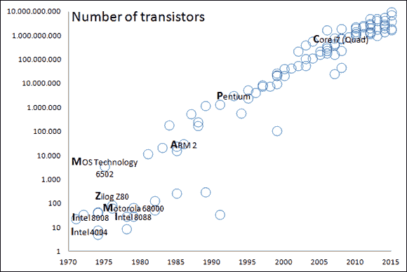

FIGURE 9-1: 向 CPU 中不断嵌入更多的晶体管。

由于目前的硅组件限制，在集成电路（`IC`）上集成更多电路存在物理障碍，因为尺寸的缩小是有极限的。然而，创新仍在持续，正如[`https://www.nature.com/news/the-chips-are-down-for-moores-law-1.19338`](https://www.nature.com/news/the-chips-are-down-for-moores-law-1.19338) 中描述的那样。未来，摩尔定律可能不再适用。这种情况发生是因为行业将转向一种新技术，例如使用光学激光而非晶体管来制造组件（关于光计算的细节，请参阅[`https://www.extremetech.com/extreme/187746-by-2020-you-could-have-an-exascale-speed-of-light-optical-computeron-your-desk`](https://www.extremetech.com/extreme/187746-by-2020-you-could-have-an-exascale-speed-of-light-optical-computeron-your-desk)中的文章）。最终，人们将忽视摩尔定律，因为行业无法像过去那样跟上发展的速度（参阅《麻省理工评论》在[`https://www.technologyreview.com/s/601441/mooreslaw-is-dead-now-what/`](https://www.technologyreview.com/s/601441/mooreslaw-is-dead-now-what/)上的报道）。

## 思考摩尔定律带来的变化

对于数据科学家和其他对深度学习感兴趣的人来说，自 1965 年以来，组件每两年翻倍带来了数字电子领域的巨大进步，这对数据的获取、存储、处理和管理产生了深远的影响。

摩尔定律对数据有直接影响。它始于更智能的设备。设备越智能，人们就越依赖它以新的方式与数据交互（正如如今电子产品无处不在所证明的）。计算能力的扩散程度越高，价格就越低，从而形成一个无尽的循环，驱动各地对强大计算机和小型传感器的使用。随着大量计算机内存的可用和更大的数据存储磁盘，结果就是数据可用性的扩展，例如网站、交易记录、测量值、数字图像和其他各类数据。没有这些进步，如今的互联网将无法实现，因为其数据流依赖于这些更智能的设备。

得益于计算机、移动设备和传感器的联网，互联网现在产生并分发大量新数据。一些来源估计，目前每天的数据产量约为 250 万亿（一个带有 18 个零的数字）字节，其中大部分是视频和音频等非结构化数据（细节请参阅[`https://www.forbes.com/sites/bernardmarr/2018/05/21/how-much-data-do-we-create-every-day-the-mind-blowing-stats-everyone-should-read/`](https://www.forbes.com/sites/bernardmarr/2018/05/21/how-much-data-do-we-create-every-day-the-mind-blowing-stats-everyone-should-read/)）。这些数据大部分与人类的共同活动、情感、经历和关系有关，与之伴随的是联网机器运行的数据比例在不断增加，这些机器涵盖了从复杂的工业机械到简单的智能家居灯（你可以通过互联网远程控制的灯具）。

## 发现额外数据的益处

随着数字设备上数据可用性的爆炸式增长，数据在其最初的指令（训练）和知识传输（数据传输）范围之外，展现了价值和用途的新内涵。当数据视为数据分析的一部分时，丰富的数据获得了区别于纯信息性数据的新功能：

*   数据通过呈现各种事实，并通过为每个事实提供细微差别来更好地描述世界。它已变得如此丰富，甚至涵盖了现实的每一个方面。你可以利用它来揭示即使看似无关的事物和事实实际上是如何关联的。

*   数据展示了事实如何与事件相关。在给定前提下，你可以推导出通用规则并学习世界将如何变化或转型。当人们以某种方式行动时，数据也提供了一定的预测能力。

后续章节将讨论为什么拥有更多数据通常会更好。通过拥有更多数据来工作，你的深度学习项目可以变得更准确、更可靠，在某些情况下变得可行。

## 定义数据的影响

在某些方面，数据赋予了我们超级能力。《连线杂志》（*Wired*）的前任主编克里斯·安德森（Chris Anderson）讨论了海量数据如何帮助科学方法之外的发现（参阅[`https://www.wired.com/2008/06/pb-theory`](https://www.wired.com/2008/06/pb-theory)中的文章）。Google 的成功并非通过使用特定模型，而是通过应用算法从数据中学习。

正如广告一样，科学数据（如物理或生物学）也可以支持创新。伽利略·伽利莱依靠科学方法创建了现代天文学的基础（参阅[`https://www.biography.com/people/galileo-930520`](https://www.biography.com/people/galileo-930520/)）。

在过去，科学家获取大量的观察结果并做出许多推论来描述宇宙。数据分析通过将观察结果作为输入和输出，允许你在无需手动干预的情况下确定事物运作的方式。现在过程变得更快、更自动化。

## 考虑数据时效性和质量

数据不仅驱动了深度学习，更让深度学习成为可能。一些人认为深度学习是复杂数学算法的输出，这确实如此。视觉和语言理解等活动需要难以用外行解释的算法，并需要大量的计算才能运行。（硬件在这里也起了作用。）

然而，深度学习不仅仅是算法。美国研究科学家、企业家、哈佛应用计算科学学院的亚历山大·维斯纳罗斯（Alexander Wissner-Gross）在最近接受 Edge（[`https://www.edge.org/response-detail/26587`](https://www.edge.org/response-detail/26587/)）采访时分享了他对深度学习的见解。

例如，当你考虑到近期深度学习的成就时，`GoogleLeNet` 网络在正确将图像分类为类别方面接近人类的性能依赖于一种运行在最新数据上的旧算法。它使用了 `Convolutional Neural Networks for Visual Recognition`，这是一种在 1989 年开发的算法，只有在使用包含超过 150 万张图像、跨越 1000 个类别的 `ImageNet` 语库（[`www.image-net.org/`](http://www.image-net.org/)）进行训练后，才能显示其真实的有效性（`ImageNet` 语库于 2010 年可用）。

另一个值得关注的成就是 `Google DeepMind` 团队的结果。该团队部署了一种深度神经网络，在玩 29 种不同的 Atari 游戏中达到了人类的水平。他们依赖于 1992 年的算法 `Q-Learning`，直到 2013 年卷积神经网络变得更加常见，并且一个包含 50 款 Atari 2600 游戏的完整数据集 `Arcade Learning Environment`（[`https://github.com/mgbellemare/Arcade-Learning-Environment`](https://github.com/mgbellemare/Arcade-Learning-Environment)）可用后，他们才能将其应用于 Atari 游戏。

Wissner-Gross 提供了其他同类深度学习成就的例子，例如 `IBM Deep Blue` 击败了加里·卡斯波夫，以及 `IBM Watson` 成为世界 `Jeopardy!` 冠军。在所有这些情况下，Wissner-Gross 得出结论：平均而言算法通常比数据老 15 年。他指出数据正在推动深度学习成就的发展，并让读者思考，如果从质量和数量上为现有的算法提供更好的数据，将会发生什么。

# 提高处理速度

当你深入观察深度学习时，你可能会惊讶地发现有很多旧技术，但令人惊奇的是，一切的运行方式都是以前所未有的状态。因为研究人员终于找到了让一些简单、老旧解决方案协同工作的方法，大数据可以自动地过滤、处理和转换数据。例如，像 `ReLU` 等新的激活函数并不完全新；它们自感知机（可追溯到 1957 年；参见第 7 章）以来就为人知。

最初让深度学习如此受欢迎的图像识别能力也不新。最初，深度学习得益于 `Convolutional Neural Networks (CNN)` 获得了巨大的动力。这种网络由法国科学家 Yann LeCun 在 1980 年代发现（他的个人主页位于 [`http://yann.lecun.com/`](http://yann.lecun.com/)），由于此类网络现在由于它们使用了许多神经层和大量数据而带来了令人惊讶的结果。

让机器理解人类语言或在不同语言之间进行翻译的技术也是如此。在每种情况下，解决方案都依赖于几十年前的技术，研究人员重新审视这些技术并在新的深度学习范式中使其运行。唯一的问题是所有这些数据处理都需要大量的处理周期，因此接下来的章节将讨论如何提高处理速度，以便你能够在合理的时间内看到数据分析的结果。

## 利用强大的硬件

如今，海量数据的使用是算法性能差异的关键。为了处理如此大量的数据，各种类型的科学家依赖于 `GPUs` 使用量的增加和计算机网络来获取数据。结合并行计算（将更多计算机放入集群并并行运行），`GPUs` 允许你创建更大的网络，并在更多数据上成功地训练它们。事实上，一个 `GPU` 执行某些操作的速度比任何 `CPU` 都快 70 倍，允许神经网络的训练时间从几周缩短到几天甚至几小时。（[`https://www.quora.com/Why-are-CPUs-still-being-made-when-GPUs-are-so-much-faster`](https://www.quora.com/Why-are-CPUs-still-being-made-when-GPUs-are-so-much-faster) 文章告诉了你为什么既需要 `CPUs` 和 `GPUs` 来创建一个有效的深度学习系统。）

`GPUs` 是反向传播必需的强大矩阵和向量计算单元。这些技术使得在更短的时间内训练神经网络变得成为可能，并让更多人能够触及。研究还开启了一个新的应用世界。神经网络可以从海量数据中学习并利用大数据（图像、文本、交易和社交媒体数据），创建持续改进的模型，这取决于你提供给它们的数据流。

 有关一个 `GPU` 如何通过使用神经网络为机器学习赋能的更多信息，请阅读这篇关于主题的技术论文：[`https://icml.cc/2009/papers/218.pdf`](https://icml.cc/2009/papers/218.pdf)。

## 进行其他投资

`Google`、`Facebook`、`Microsoft` 和 `IBM` 等大巨头察觉到了新趋势，并从 2012 年开始收购公司并聘用深度学习新领域的专家。这些专家中的两位是 Geoffrey Hinton，他因将反向传播算法应用于多层神经网络的工作而最广为人知，现在在 `Google` 工作；以及 Yann LeCun，他是 `Convolutional Neural Networks` 的创建者，现在领导着 Facebook 的 AI 研究。

今天，每个人都可以访问网络，人们也可以访问帮助创建深度学习网络的工具。这种访问不仅限于阅读解释深度学习如何工作的公开科学论文；它还包括用于网络编程的工具。

在深度学习的早期，科学家们使用 `C++` 等语言从零开始构建网络。遗憾的是，在这样的低级语言中开发应用程序限制了数据访问的少数经过训练的专家。如今的脚本能力（例如使用 `Python`；访问 [`https://www.python.org`](https://www.python.org)）因为大量的开源深度学习框架而变得更好，例如 Google 的 `TensorFlow`（[`https://www.tensorflow.org/`](https://www.tensorflow.org/)）或 Facebook 的 `PyTorch`（[`https://pytorch.org/`](https://pytorch.org/)）。这些框架允许使用简单的命令复制深度学习的最新进展。

# 解释深度学习与其他人工智能形式的区别

鉴于人工智能整体拥有丰富资源，例如大量数据、每个人都可以使用的新型强大计算硬件以及大量的私人和公共投资，你可能会对深度学习背后的技术产生怀疑，深度学习由比过去具有更多神经元和隐藏层的神经网络组成。深度网络与过去更简单、更浅的网络形成对比，后者最多只有一两个隐藏层。

 深度学习并不是对旧技术——感知机的重新命名，感知机是 Frank Rosenblatt 在 1957 年在康奈尔大学航空实验室发现的（关于感知机的更多细节请参见第 7 章）。深度学习之所以效果更好，是因为通过充分利用强大的计算机和更优质（而不只是更多）的数据增加了额外的复杂性。接下来的章节将描述深度学习是如何完成其任务的。

## 增加更多层

你可能觉得奇怪，为什么在深度学习的基础技术很久以前就已经存在的情况下，深度学习直到现在才蓬勃发展。正如本章早期提到的，如今的计算机功能更加强大，而且深度学习可以访问海量数据。然而，这些答案仅仅指向了深度学习在过去面临的重要问题，而计算能力的不足和数据量的匮乏并不是唯一的不可逾越的障碍。直到最近，深度学习还一直受到一个关键技术问题的困扰，该问题使得神经网络无法拥有足够的层数来执行真正复杂的任务。

由于深度学习可以使用许多层，因此它可以解决机器学习无法触及的问题，例如图像识别、机器翻译和语音识别。当只拟合几层时，神经网络是一个完美的 `universal function approximator`（通用函数近似器），它是一个可以重建任何可能的数学函数的系统。当拟合更多层数时，神经网络就能够在其内部的矩阵乘法链中创建一个复杂的表示系统，以解决复杂问题。要理解图像识别等复杂任务是如何工作的，请考虑以下过程：

1. 训练用于识别图像的深度学习系统（例如能够区分狗照片和猫照片的网络）定义了内部权重，这些权重具有识别图片主题的能力。

2. 在检测到图像中的每一个轮廓和角点后，深度学习网络将所有此类基础特征组合成复合性特征。

3. 网络将此类特征与理想表示进行匹配，从而提供答案。

换句话说，深度学习网络可以使用其内部权重来定义狗和猫理想情况下应该像什么样，从而区分狗和猫。然后它使用这些内部权重来匹配你提供的任何新图像。


深度学习让大众意识到其潜力的早期成就之一是“cat neuron”（猫神经元）。当时由吴恩达（Andrew Ng）和杰恩（Jeff Dean）领导的 Google Brain 团队聚集了 16,000 台计算机计算出一个拥有超过十亿权重的深度学习网络，从而实现了对 YouTube 视频的无监督学习。该计算机网络甚至可以在没有任何人工干预的情况下，自己判断什么是猫，Google 的科学家还成功从网络中挖掘出网络本身预期猫应该是什么样的表示（参见 `Wired` 上的文章 `https://www.wired.com/2012/06/google-x-neural-network/`）。

在由于计算机硬件限制，科学家无法向神经网络中堆叠更多层期间，这项技术的潜力一直被埋没，科学家们忽视了神经网络。成功的缺失加剧了上一次 AI 寒冬期间围绕该技术产生的深层怀疑。然而，真正阻止科学家创建更复杂设备的问题是梯度消失问题。

当你尝试通过神经网络传输信号时，如果信号迅速衰减到接近零的值；它无法通过激活函数，就会发生 `vanishing gradient`（梯度消失）。这种现象的发生是因为神经网络是链式乘法。每个结果小于 0 的乘法都会迅速减小输入值，而激活函数需要足够大的值来让信号通过。神经元层距离输出越远，它们被排除在更新之外的可能性就越高，因为信号太小了，激活函数会阻止它们。因此，你的网络作为一个整体停止了学习，或者以极其缓慢的速度学习。

每一次组合和测试复杂网络的尝试都以失败告终，因为 `backpropagation`（反向传播）算法无法更新靠近输入的层，这使得从复杂数据中进行任何学习几乎不可能，即使在当时已经拥有这些数据。今天，深度网络的实现得益于来自加拿大多伦多大学学者的研究，例如杰弗里·辛顿（Geoffrey Hinton，`https://www.utoronto.ca/news/artificial-intelligence-u-t`），即使在神经网络看起来最像一种过时的机器学习方法时，他也坚持研究神经网络。

辛顿教授是神经网络领域的资深专家（他为定义 `backpropagation` 算法做出了贡献），他以及多伦多的团队设计了几方法来规避梯度消失问题。他向重新思考新解决方案开放了领域，使神经网络再次成为机器学习和人工智能中的关键工具。


辛顿教授和他的团队同样令人记忆深刻，是因为他们是首批测试使用 GPU 来加速深度神经网络训练的人之一。2012 年，他们在一项由制药公司默克（Merck）和 Kaggle（后者是一个数据科学竞赛网站）组织的公开竞赛中，利用他们最新的深度学习发现获胜。这一事件为他们的工作引起了巨大关注。你可以从这篇杰弗里·辛顿的采访中阅读辛顿团队神经网络层革命性成就的所有细节：`http://blog.kaggle.com/2012/11/01/deep-learning-how-i-did-it-merck-1st-place-interview/`。

### 激活函数的改变

Geoffrey Hinton 的团队（见前一节）能够向神经网络架构中添加更多层，是因为有两种防止了 `backpropagation` 出现问题的解决方案：

* 他们通过使用更智能的网络初始化防止了 `exploding gradients`（梯度爆炸）问题。`exploding gradient` 与梯度消失不同，因为当爆炸梯度变得大到无法处理时，会导致网络崩溃。

    

    除非你正确初始化网络以防止其计算巨大的权重值，否则你的网络可能会爆炸。然后你就解决了梯度消失问题。

* 团队在检查了 sigmoid 激活的工作原理后发现，通过各种激活层传递信号往往会抑制反向传播信号，直到它微弱到无法再次通过。他们使用了一种新的激活函数作为该问题的解决方案。使用何种算法的选择取决于一种旧的激活类型 ReLU，代表整流线性单元（更多关于 `ReLU` 的信息请见第 7 章）。`ReLU` 激活函数在接收到的信号小于零时会停止，确保了神经网络的非线性特征，并在信号大于零时允许信号通过。（使用这种类型的激活函数是将旧但仍然有效的技术与当前技术相结合的例子。）图 9-2 显示了这一过程是如何工作的。


[FIGURE 9-2:] ReLU 激活函数如何工作并释放信号。

`ReLU` 的效果非常好，让反向传播信号到达了初始深度网络层。当信号为正时，其导数为 1。你也可以通过查看图 9-2 找到 `ReLU` 导数的证明。注意，当输入信号为正时，变化率是恒定的且等于单位（而当信号为负时，导数为 0，从而阻止了信号通过）。


你可以使用 `f(x)=max(0,x)` 来计算 ReLU 函数。该算法的使用极大提升了训练速度，允许快速训练更深层的网络，而不会产生任何死神经元。`dead neuron`是指由于信号太微弱导致网络无法激活的神经元。

## 通过 Dropout 添加正则化

Hinton 团队提出的另一种深度学习介绍（参见本章前面的章节）旨在完善最初的深度学习解决方案，对网络进行正则化。`regularized network` 限制网络权重，这使得网络不会记忆输入数据，而是对观察到的数据模式进行泛化。

本章之前的讨论提到，某些神经元会记住特定信息，并强制其他神经元依赖这个更强的神经元，导致弱神经元放弃了学习任何有用的东西（这种现象被称为共适应）。为了防止共适应，代码会临时关闭网络中随机部分神经元的激活。

如你在图 9-3 左侧所示，权重通常通过将输入相乘得到输出来实现激活。为了关闭激活，代码将结果与由随机的零一混合组成的掩码相乘。如果神经元乘以 1，网络就会传递其信号。当神经元乘以 0 时，网络会停止其信号，强制其他神经元在该过程中不依赖它。

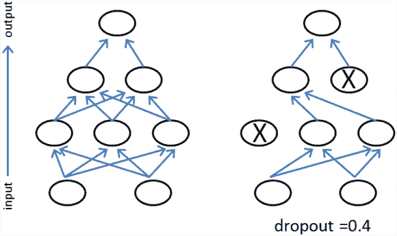

FIGURE 9-3: Dropout 暂时从训练中排除 40% 的神经元。


Dropout 仅在训练期间运行，不会触及任何权重。它只是掩码并隐藏网络的一部分，强制未掩码的部分在学习数据模式中承担更主动的角色。在预测期间，Dropout 不工作，并对权重进行数值上的重缩放，以考虑到它们在训练期间并非协同工作的事实。

## 寻找更智能的解决方案

深度学习影响了 AI 在图像识别、机器翻译和语音识别领域解决问题的有效性。这些问题最初由经典 AI 和机器学习处理。此外，深度学习在以下领域提供了新的且有利的解决方案：

* 使用在线学习进行持续学习

* 使用迁移学习使用可重用的解决方案

* 使用端到端学习使用简单直接的解决方案

后续章节将帮助你理解在线学习、迁移学习和端到端学习的含义。

### 使用在线学习

神经网络比其他机器学习算法更灵活，它们可以在生成预测和分类的同时继续训练。这种能力源于允许神经网络学习的优化算法，这些算法可以反复在小样本示例上（称为批处理学习）或甚至在单个示例上（称为在线学习）进行工作。深度学习网络可以一步步构建其知识，并对可能出现的新信息保持开放性（就像婴儿的大脑，对新刺激和学习经验始终是开放的）。

例如，社交媒体网站上的深度学习应用可以在猫的图片上进行训练。当人们发布猫的照片时，应用程序会识别它们并为它们贴上合适的标签。当人们开始在社交网络上发布狗的照片时，神经网络不需要重新启动；它可以通过学习狗的照片来继续进行。这种能力对于应对互联网数据的变异性特别有用。深度学习网络可以对新奇事物保持开放，并调整其权重来处理它。

### 迁移学习

即使在网络完成训练后，活性也是用的，但你必须将其用于不同初始学习的目的。区分物体并正确分类它们的网络需要很长时间和大量的计算能力来学习如何操作。将网络的能力扩展到新类型的图像意味着将知识迁移到新问题上（迁移学习）。

例如，你可以将一个能够区分猫和狗的网络迁移到涉及识别通心面的任务中。你保持网络的大部分层不变（你冻结它们），然后对最后的输出层进行处理（微调）。在短时间内，通过更少的示例，网络会将它在区分猫狗时中学到的知识应用到通心面上。它的表现甚至会比仅为识别通心面训练的神经网络更好。

迁移学习对于大多数机器学习算法来说是一个新事物，并为从一个应用到另一个应用、从一家公司到另一个公司的迁移开启了可能的市场。Google 已经在这样做，通过公开其在其构建的庞大数据库（见这篇文章：`https://techcrunch.com/2017/06/16/object-detection-api/`）。这是民主化深度学习的一步，让每个人都能接触其潜力。

### 端到端学习

最后，深度学习允许端到端学习，这意味着它比以前的深度学习解决方案以更简单更直接的方式解决问题。这种灵活性在解决问题时产生更大的影响。

你可能想解决一个困难的问题，例如让 AI 识别已知人脸或驾驶。使用经典 AI 方法时，你必须将问题拆分为更易管理的子问题，以便在可行的时间获得可接受的结果。例如，如果你想识别照片中的人脸，以前的 AI 系统会将问题分为几个部分，如下：

1. 在照片中找到人脸。

2. 从照片中裁剪人脸。

3. 处理裁剪的人脸，使其姿态与身份证照片相似。

4. 将处理后的裁剪人脸作为学习示例输入神经网络。

今天，你可以将照片输入深度学习架构，引导它学习识别图像中的人脸，然后使用该深度学习架构对其进行分类。你可以将同样的方法用于语言翻译、语音识别，甚至自动驾驶。

近年来，得益于能够卷积神经网络（CNN，也称为 ConvNets）将某些属性编码到架构中的能力，深度学习取得了巨大的进展。法国科学家杨·勒昆（Yann LeCun）和其他其他著名科学家在 20 世纪 80 年代末提出了 CNN 的想法，并在 90 年代期间充分开发了这项技术。但直到现在（大约 25 年后），这类网络才开始展现出令人惊人的成果，甚至在某些识别任务上的表现超过了人类。这种变化之所以发生，是因为可以将此类网络配置成复杂的架构，从大量有用数据中不断完善学习。

CNN 强有力地推动了近期的深度学习的复兴。接下来的章节将讨论 CNN 如何帮助检测图像边缘和形状，用于识别手写文本、精确确定图像中特定物体或分离复杂图像场景的不同部分等任务。


为了节省手动输入本章示例代码的时间并避免错误，你可以在 `DL4D_10_LeNet5.ipynb` 文件中找到本章的可下载源码。（引言部分会告诉你从哪里下载本书的源码。）

## 从字符识别开始 CNN 之之旅

CNN 并不是新概念。它们出现在 20 世纪 80 年代末作为字符识别问题的解决方案出现。杨·勒昆在 AT&T 实验室工作期间，与 Yoshua Bengio、Leon Bottou 和 Patrick Haffner 等其他科学家一起设计了名为 `LeNet5` 的网络。在深入研究这些专门的神经网络技术之前，本章将花费一些时间理解图像识别问题。

由于数字相机、网络摄像头和带有摄像头的手机无处不在，数字图像如今无处可见。由于捕捉图像已变得如此容易，图像提供了海量的新数据流。处理图像的能力为机器人、自动驾驶、医学、安全和监控等领域的新应用开启了大门。

### 了解图像基础

为供计算机处理图像会将其转换为数据。计算机将图像作为由像素组成的数据流发送到显示器，因此计算机图像最的表示方式是像素值的矩阵，矩阵中的每个位置对应于图像中的一个点。

现代计算机图像使用一系列 32 位表示颜色（红、蓝、绿和透明度——即 alpha 通道各占 8 位）。然而，你只需要 24 位即可创建真彩色图像。`http://www.rit-mcsl.org/fairchild/WhyIsColor/Questions/4-5.html` 的文章详细解释了这一过程。计算机图像使用三个重叠的矩阵表示颜色，每个矩阵提供相对于三种颜色之一的信息：红、绿或蓝（也称为 RGB）。混合这三种颜色的不同比例使你能够表示任何标准的人眼可见颜色，但无法表示具有非凡感知力的人看到的颜色。（大多数人最多可以看到 1,000,000 种颜色，这远低于 24 位色提供的 16,777,216 种颜色的范围。四色视觉者可以看到 100,000,000 种颜色，因此你无法使用计算机来分析他们看到的内容。`http://nymag.com/scienceofus/2015/02/what-like-see-a-hundred-million-colors.html` 文章将告诉你更多关于四色视觉者的信息。）

因此，图像由计算机处理为一个由高度、宽度和通道数组成的三维矩阵——对于 RGB 图像，通道数为三，但对于黑白图像可能只有一个。（灰度图是一种特殊的 RGB 图像，其三个通道的数值均相同；参见 `https://introcomputing.org/image-6-grayscale.html` 关于关于颜色与灰度之间转换的讨论。）对于灰度图像，单个矩阵就足够，用一个数字代表 256 种灰度颜色，如图 10-1 中的示例所示。在该图中，数字图像的每个像素通过其矩阵值进行量化。

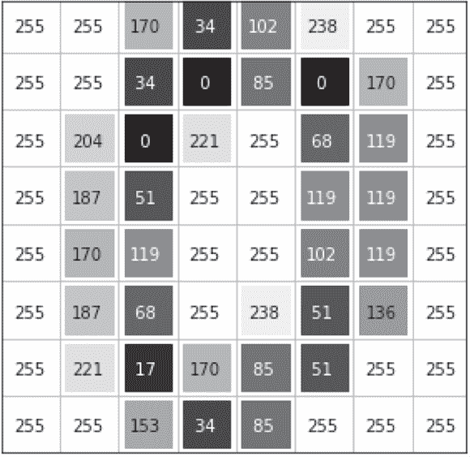

图 10-1： 每个像素被计算机读取为矩阵中的一个数字。

考虑到图像是像素（用数值输入表示），神经网络从业人员最初通过将图像直接连接到神经网络取得了良好效果。每个图像像素都连接到网络中的输入节点。然后，由一个或多个后续的隐藏层完成网络，最后产生输出层。这种方法对于小型图像和解决小问题是可以接受的，随后演变为解决图像识别的不同方法。作为替代，研究人员使用了其他机器学习算法，或应用密集的特征工程将图像转换为新处理过的数据，以帮助算法更好地识别图像。图像特征创建的一个示例是方向梯度直方图（HOG），这是一种检测图像模式并将其转换为数值矩阵的计算方法。（你可以通过查看 Skimage 的教程来探索 HOG 如何工作：`http://scikit-image.org/docs/dev/auto_examples/features_detection/plot_hog.html`。）

神经网络从业人员发现特征工程非常耗时且往往不切实际。将图像像素连接到神经元是困难的，因为需要计算极其大量的参数，而且网络无法实现平移不变性——平移不变性是在不同的尺寸、畸变或位置条件下识别所表示物体的能力，如图 10-2

## 解释卷积的工作原理

卷积轻松地解决了平移不变性问题，因为它们在神经网络内部提供了一种不同的图像处理方法。这种想法从生物学角度出发，观察了人类视觉皮层中发生了什么。

诺贝尔奖获得者大卫·亨特·休贝尔 el 和 Torsten Wiesel 在 1962 年的一项实验表明，当眼睛看到特定的模式（如水平、垂直或对角线边缘）时，大脑中只有特定的神经元会被激活。此外，这两位科学家发现神经元以分层的方式垂直组织，这表明视觉感知依赖于许多单一专门神经元的组织化贡献。（你可以通过阅读 `https://knowingneurons.com/2014/10/29/hubel-and-wiesel-the-neural-basis-of-visual-perception/` 的文章来了解更多关于该实验的信息。）卷积只是简单地利用了这一思想，并通过数学方法将其应用于图像处理，以增强神经网络准确识别不同图像的能力。

## 理解卷积

要理解卷积是如何工作的，你得从输入开始。输入是由一个或多个像素层（称为通道，channels）组成的图像，图像使用的值范围从 0 到 255，其中 0 表示单个像素完全关闭，255 表示单个像素完全开启。（通常，这些值存储为整数以节省内存。）正如本章前一节提到的，RGB 图像具有红、绿、蓝色的独立通道。混合这些通道就会生成你在屏幕上看到的调色板。

卷积的工作原理是同时对所有图像通道上的小图像块进行操作。（想象切开层蛋糕，每一块都显示出所有的层）。图像块仅仅是一个移动的图像窗口：卷积窗口可以是正方形或矩形，它从图像的左上角开始，从左到右、从上到移动。窗口在图像上的完整遍历被称为 `filter`（过滤器），并意味着对图像的完整转换。同样重要的是，当窗口框定一个新的块时，窗口会平移一定数量的像素；这种滑动幅度被称为 `stride`（步长）。`stride` 为 1 意味着窗口向右或向下移动像素；`stride` 为 2 意味着移动两个像素；依此类推。

每当卷积窗口移动到一个新位置，就会发生一个过滤过程，创建出上一段提到的过滤器的一部分。在这个过程中，卷积窗口中的值与 `kernel`（卷积核，一种用于模糊、锐化、浮雕、边缘检测等的小矩阵——你可以根据任务选择所需的 `kernel`）中的值相乘。（访问 `http://setosa.io/ev/image-kernels/` 文章可以了解更多关于各种内核类型的信息。）`kernel` 的大小与卷积窗口相同。将图像的每个部分与 `kernel` 相乘会为每个像素创建一个新值，这在某种意义上是图像的一个新处理后的特征。卷积输出像素值，当滑动窗口完成对整个图像的遍历时，你就对图像进行了 `filtered`（过滤）。作为卷积的结果，你会发现一张具有以下特征的新图像：

* 如果你使用单一过滤过程，结果是单通道的转换后图像。

* 如果你使用多个内核，新图像的通道数等于过滤器的数量，每个通道都包含经过特殊处理的新特征值。过滤器的数量就是卷积的 `filter depth`（过滤器深度）。

* 如果你使用步长为 1，你得到的图像与原始图像具有相同的维度。

* 如果你使用大于 1 的 `strides`，生成的卷积图像比原始图像小（步长为 2 意味着图像尺寸减半）。


结果图像可能取决于`kernel size`（内核大小）而更小，因为`kernel`必须在图像边界开始并结束它的遍历。在处理图像时，`kernel`会消耗掉其大小减一的像素。例如，一个 3x3 像素的`kernel`处理 7x7 像素的图像会从图像的高度和宽度消耗 2 个像素，卷积结果是 5x5 像素的输出。你可以选择在边界处填充零（本质上是在图像上加上黑色边框），这样卷积过程就不会缩小最终输出尺寸。这种策略被称为`same padding`（相同填充）。如果你直接让`kernel`减小起始图像尺寸，则被称为`valid padding`（有效填充）。

图像处理长期以来一直依赖卷积过程。卷积过滤器可以检测边缘或增强图像的某些特征。图 10-3 提供了一些卷积转换图像的示例。

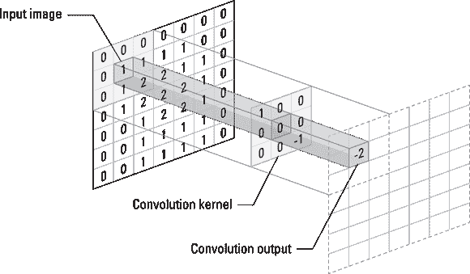

图 10-3： 卷积通过矩阵乘法处理图像的一个块。

使用卷积的问题在于它们是人为设计的，需要花费精力来确定。而改用神经网络卷积时，你只需要设置以下内容：

- 过滤器的数量（在图像上操作的内核数量，即输出通道数）
- `kernel size`（内核大小；正方形设置一个边；矩形设置宽度和高度）
- `strides`（通常为 1 或 2 像素步长）
- 是否希望图像有边界（选择`valid padding`或`same padding`）

在确定图像处理参数后，优化过程会确定用于处理图像的内核值，以便对最终输出进行最佳分类。因此，每个内核矩阵元素都是一个神经元。该过程的另一个有趣之处是，每个内核都专门寻找图像的某些方面。例如，专门过滤猫特征的内核无论猫出现在图像的什么位置都能找到它，如果你使用足够的内核，就能检测到图像的所有变体（缩放、旋转、平移），使你的神经网络成为强大的分类工具。

应用 3x3 像素内核后很容易检测图像边界。这个内核专门寻找边缘，但另一个内核可以发现不同的特征。通过神经网络在反向传播期间更改`kernel`中的值，网络会找到处理图像以实现回归或分类目的的最佳方式。

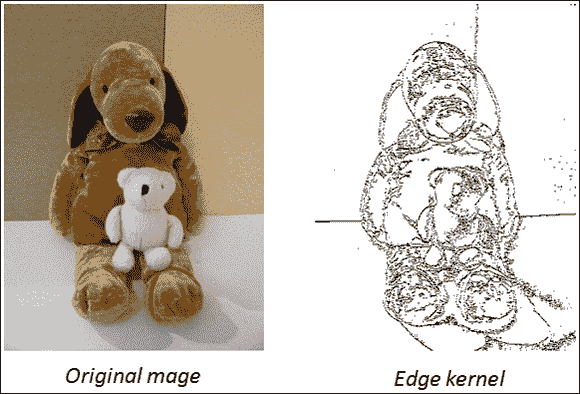

图 10-4: 应用 3x3 像素内核后检测到图像边界。

Keras 提供了一个即用的卷积层`Conv2D`。这个 Keras 层既可以直接从图像获取输入（在元组中，你必须设置`input_shape`即宽度、高度和通道数），也可以从另一个层获取（例如另一个卷积）。你还可以设置`filters`、`kernel_size`、`strides`和`padding`，这些都是任何卷积层的基本参数，正如本章前面所述。

在设置`Conv2D`层时，你可能还会设置许多其他参数，但这些参数实际上有些过于技术，对于你首次进行 CNN 实验来说可能并非必要。你现在可能发现有用的参数是`activation`（它可以添加你选择的激活函数）和`name`（它为该层设置一个名称）。

### 简化池化的使用

卷积层使用各种种的过滤器来变换原始图像。每一层都会在图像中寻找特定的模式（使图像可识别的特定形状和颜色组合）。随着这个过程的持续，神经网络的复杂度会增加，因为随着网络获得更多的滤波器，参数的数量也会随之增长。为了保持复杂度在可范围内，你需要加速过滤过程并减少操作次数。

池化层可以简化来自卷积层的输出，从而减少后续连续操作的数量，并使用更少的卷积操作来执行过滤。池化层的工作方式与卷积类似（使用窗口大小作为过滤器并使用步长进行滑动），它们对接收到的输入分块（patches）进行操作，并将一个分块还原为一个数字，从而有效地减小流过神经网络的数据规模。

图 10-5 表示了池化层的操作，其输入是由左侧 4-x-4 矩阵表示的过滤数据：使用大小为 2 像素的窗口对其操作，并以 2 像素的步长移动。结果是，池化层产生了右侧输出：一个 2-x-2 的矩阵。网络对矩阵由四个不同颜色部分代表四个分块应用池化操作。对于每个分块，池化层计算最大值并将其保存为输出。

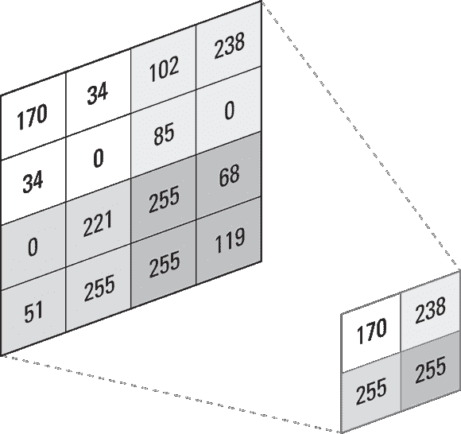

图 10-5： 在缩小后的图像分块上操作的最大池化层。

当前的示例依赖于最大池化层，因为它在其滑动窗口上使用了最大变换。你实际上可以访问四种主要的池化层：

- 最大池化 (Max pooling)
- 平均池化 (Average pooling)
- 全局最大池化 (Global max pooling)
- 全局平均池化 (Global average pooling)

此外，这四种池化层具有不同的版本，取决于它们可以处理的输入维度：

- `1-D pooling`：作用于向量。因此，1-D 池化适用于序列数据，例如时间数据（代表事件的数据）。
- `2-D pooling`：作用于图像。
- `3-D pooling`：作用于体素数据（volumes）。

该网络将在相关量的数据上进行训练（Keras 提供的数字数据集，包含超过 60,000 个示例）。因此，如果你在 Colab 上运行它（如 第 3 章 所示），或者在具有可用 GPU 的本地机器上运行，将获得优势。打开一个新的笔记本后，首先使用以下代码从 Keras 导入必要的包和函数：

```python
import keras
import numpy as np
from keras.datasets import mnist
from keras.models import Sequential
from keras.layers import Conv2D, AveragePooling2D
from keras.layers import Dense, Flatten
from keras.losses import categorical_crossentropy
```

导入必要的工具后，你需要收集数据：

```python
(X_train, y_train), (X_test, y_test) = mnist.load_data()
```

第一次执行此命令时，`mnist`命令将从互联网下载所有数据，这可能需要一些时间。下载的数据由单通道 28x28 像素图像组成，代表从零到九的手写数字。作为第一步，你需要将响应变量（训练阶段的`y_train`和模型完成后测试阶段的`y_test`）转换为神经网络可以理解并处理的内容：

```python
num_classes = len(np.unique(y_train))
print(y_train[0], end=' => ')
y_train = keras.utils.to_categorical(y_train, 10)
y_test = keras.utils.to_categorical(y_test, 10)
print(y_train[0])
```

这段代码段将响应从数字转换为数字向量，其中网络将猜测的数字对应位置的值为 1，其他位置为 0。代码还将输出训练集中第一个图像示例的转换结果：

```text
5 => [0. 0. 0. 0. 0. 1. 0. 0. 0. 0.]
```

 注意输出是基于 0 的，且 1 出现在与数字 5 对应的位置。使用这种设置是因为神经网络需要一个响应层，这是一组神经元（因此是向量），如果提供的答案正确，这些神经元应该被激活。在这种情况下，你看到了十个神经元，在训练阶段，代码会激活正确答案（正确位置的值被设置为 1）并关闭其他神经元（其值为 0）。在测试阶段，神经网络使用其示例数据库来开启正确的神经元，或者至少开启比正确神经元更多的。在随后的代码中，代码准备了训练和测试数据：

```python
X_train = X_train.astype(np.float32) / 255
X_test = X_test.astype(np.float32) / 255
img_rows, img_cols = X_train.shape[1:]
X_train = X_train.reshape(len(X_train), img_rows, img_cols, 1)
X_test = X_test.reshape(len(X_test), img_rows, img_cols, 1)
input_shape = (img_rows, img_cols, 1)
```

范围从 0 到 255 的像素值被转换为 0 到 1 之间的小数值。前两行代码优化了网络，能够正确处理可能导致问题的大数字。随后的行对图像进行重塑，使其具有高度、宽度和通道。下一行代码定义了 LeNet5 架构。你首先调用`sequential`函数提供一个空模型：

```python
lenet = Sequential()
```

添加的第一层是卷积层，命名为“C1”：

```python
lenet.add(Conv2D(6, kernel_size=(5, 5), activation='tanh', input_shape=input_shape, padding='same', name='C1'))
```

卷积使用大小为 6 的过滤器进行。网络除最后一层外所有层的激活函数都是`tanh`（双曲正切函数），这是在 Yann 创建 LetNet5 时最先进的非线性函数。该函数已经过时了，但示例使用它是为了构建一个类似于原始 LeNet5 架构的网络。若要在你的项目中使用此类网络，你应该将其替换为现代的 ReLU（详情请参见 [`www.kaggle.com/rectified-linear-units-relu-deep-learning`](https://www.kaggle.com/rectified-linear-units-relu-deep-learning)）。示例添加了一个名为 S2 的池化层，它使用了 2x2 像素的卷积核：

```python
lenet.add(AveragePooling2D(pool_size=(2, 2), strides=(2, 2), padding='valid'))
```

此时，代码继续序列，始终通过卷积和池化层执行，但这次使用了更多的过滤器：

```python
lenet.add(Conv2D(16, kernel_size=(5, 5), strides=(1, 1), activation='tanh', padding='valid'))
lenet.add(AveragePooling2D(pool_size=(2, 2), strides=(2, 2), padding='valid'))
```

LeNet5 逐进使用带有 120 个过滤器的卷积进行关闭。该卷积没有池化层，而是一个展平层，它将神经元作为全连接层投影到最后一个卷积层：

```python
lenet.add(Conv2D(120, kernel_size=(5, 5), activation='tanh', name='C5'))
lenet.add(Flatten())
```

网络的结束是两个全连接层的序列，使用`tanh`和`softmax`激活函数处理卷积的输出。这两个层提供了最终的输出层，神经元激活输出以指示预测的答案。softmax 层实际上是由`name='OUTPUT'`指定的输出层：

```python
lenet.add(Dense(84, activation='tanh', name='FC6'))
lenet.add(Dense(10, activation='softmax', name='OUTPUT'))
```

 当网络准备就绪后，你需要 Keras 来编译它（所有 Python 代码背后都是一些 C 语言代码）。Keras 根据 SGD 优化器对其编译：

```python
lenet.compile(loss=categorical_crossentropy, optimizer='SGD', metrics=['accuracy'])
lenet.summary()
```

此时，你可以运行网络并等待它处理图像：

```python
batch_size = 64
epochs = 50
history = lenet.fit(X_train, y_train, batch_size=batch_size, epochs=epochs, validation_data=(X_test, y_test))
```

完成运行需要 50 个 epoch，每个 epoch 分批处理 64 幅图像。（`epoch`是整个数据集通过神经网络一次的过程，而`batch`是数据集的一部分，在本例中是将数据集分成 64 块。）在每个 epoch（如果使用 Colab 大约持续 8 秒）期间，你可以监控进度条显示完成该 epoch 需要的时间。你还可以查看训练集（对模型优坏的乐观估计，详情请参见 [`towardsdatascience.com/measuring-model-goodness-part-1-a244d62f71`](https://towardsdatascience.com/measuring-model-goodness-part-1-a244d62f71)）和测试集（更真实的视角）的准确率。在最后一个 epoch，你应该看到 LeNet5 达到了 0.989 的准确率，这意味着在尝试识别的 100 个手写数字中，网络应该正确预测 99 个。

## 从图像中检测边缘和形状

卷积自动处理图像并性能优于全连接层，因为它们在局部学习图像模式，并可以在图像的任何部分重现这些模式（这种特性称为平移不变性）。相比之下，传统的全连接神经网络层以僵硬的方式确定图像的整体特征，缺乏平移不变性的优势。这就像通过记忆有意义的块来学习一本书与逐字背诵之间的区别。按块学习的学生（卷积层）能更好地抽象书籍内容，并准备好将这些知识应用于类似案例中。逐字学习的学生（全连接层）则很难提取出有用的信息。

CNN 并不是魔法，也不是黑盒。你可以通过图像处理来理解它们，并利用其功能将其能力扩展到新问题上。这一特性有助于解决一系列数据科学家认为使用旧策略太难攻克的计算机视觉问题。

### 可视化卷积

CNN 使用不同的层以层级化的方式执行特定任务。Yann LeCun（参见本章开头的“从字符识别开始开启 CNN 之之旅”部分）注意到 LeNetNet 如何首先处理边缘和轮廓，然后是模式，接着类别，最后是物体。最近的研究进一步揭示了卷积是如何运作的：

- **初始层：** 发现图像边缘
- **中间层：** 检测复杂的形状（由边缘创建）
- **最终层：** 揭示你想要网络分类的图像类型所特有的独特特征（例如，狗的鼻子或猫的耳朵）

这种由卷积发现的模式分级结构也解释了为什么深度卷积网络的性能优于浅层网络：堆叠的卷积越多，网络就能学习到越来越多复杂且实用的模式，从而实现成功的图像识别。图 10-7 提供了工作原理的思路。狗的图像通过卷积进行处理，第一层捕捉模式。第二层接收这些模式并将其组装成一只猫。如果第一层处理的模式看起来太通用而没有用处，那么第二层揭示的模式就会重建出更具特征的狗特征，这为神经网络识别狗提供了优势。

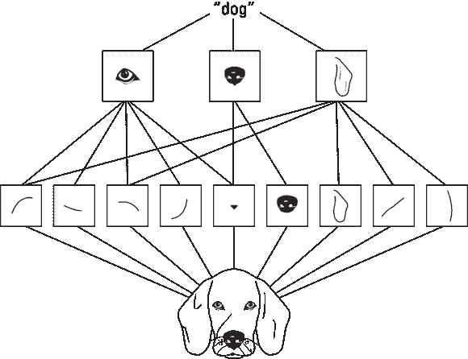

图 10-7： 使用卷积处理狗图像。

确定卷积如何工作的困难之处在于，理解卷积核（数字矩阵）是如何创建卷积的，以及它们是如何在图像块上工作的。当你有许多卷积接一个地工作时，通过直接分析来确定结果是困难的。然而，一种用于理解此类网络的技术可以构建出激活最多卷积的图像。当一张图像强烈激活了某层时，你就能知道该层最感知的是什么。

分析卷积有助于你理解工作原理，既为了避免预测偏差，也为了设计新的图像处理方法。例如，你可能会发现你的 CNN 是通过激活图像背景来区分狗和猫的，因为你用于训练的图像代表了室外的狗和室内的猫。

来自 Google Research 和 Google Brain 团队的 Chris Olah、Alexander Mordvintsev 和 Ludwig Schubert 写的一篇 2017 年名为“特征可视化”的论文详细解释了这一过程（[`https://distill.pub/2017/feature-visualization/`](https://distill.pub/2017/feature-visualization/) ）。你甚至可以通过点击并指向`GoogleLeNet`的层来亲自检查图像，`GoogleLeNet`是 Google 在 [`https://distill.pub/2017/feature-visualization/appendix/`](https://distill.pub/2017/feature-visualization/appendix/) 中构建的 CNN。如果你曾在 *deepdream* 在网络上风靡时看过一些图像，那么来自特征可视化的图像可能会让你想起这些 *deepdream* 图像（阅读原始 deepdream 论文并查看 [`https://ai.googleblog.com/2015/06/inceptionism-going-deeper-into-neural.html`](https://ai.googleblog.com/2015/06/inceptionism-going-deeper-into-neural.html) 中的一些图像）。这是同样的技术，但不是寻找最能激活某层的图像，而是选择一个卷积层并让它变换图像。


你还可以使用一种基于卷积变换现有图像的类似技术，复制过去伟大艺术家（如毕加索或梵高）的作品风格，这一过程被称为*艺术风格迁移*（artistic style transfer）。生成的图片看起来是现代的，但风格却不是。你可以从 Leon Gatys、Alexander Ecker 和 Matthias Bethge 的原始论文“艺术风格的神经算法”中获得一些有趣的艺术风格迁移示例：[`https://arxiv.org/pdf/1508.06576.pdf`](https://arxiv.org/pdf/1508.06576.pdf) 。

在图 10-7 中，狗的图像通过卷积进行处理，第一层捕捉模式。第二层接收这些模式并将其组装成一只猫。如果第一层处理的模式看起来太通用而没有用处，那么第二层揭示的模式就会重建出更具特征的狗特征，这为神经网络识别狗提供了优势。​


确定卷积如何工作的困难之处在于，理解卷积核（数字矩阵）是如何创建卷积的，以及它们是如何在图像块上工作的。当你有许多卷积接一个地工作时，通过直接分析来确定结果是困难的。然而，一种用于理解此类网络的技术可以构建出激活最多卷积的图像。当一张图像强烈激活了某层时，你就能知道该层最感知的是什么。

### 揭成功的架构

近年来，数据科学家由于深度网络取得了巨大进展。以下是一些为竞赛设计的著名 CNN 架构：

*   **AlexNet (2012)：** 由多伦多大学的 Alex Krizhevsky 创建。它使用了带有 11x11 像素滤波器的 CNN，赢得了比赛，并引入了使用 GPU 训练神经网络以及使用 ReLU 激活函数来控制过拟合。

*   **VGGNet (2014)：** 有两个版本，16 层和 19 层。它由牛津大学的视觉几何小组创建，并为 CNN 定义了新的 3x3 尺寸标准。

*   **ResNet (2015)：** 由微软创建。这种 CNN 不仅扩展了不同版本网络（50、101、152）的概念，还引入了*跳跃层*（skip layers），这是一种将深层与浅层连接的方法，以防止梯度消失问题（关于此问题的更多信息请参见第 8 章和第 9 章），并允许更深的网络，从而更有能力地识别图像中的模式。

你可以利用 ImageNet 竞赛中引入的所有创新，甚至可以使用其中的每种神经网络。这种易用性使得你能够复制竞赛中看到的网络性能，并成功地将其扩展到无数其他问题上。

### 讨论迁移学习

识别物体并正确分类它们的网络需要大量的图像、很长的处理时间以及巨大的计算能力来学习如何操作。将网络能力适应到初始训练中未包含的新图像类型，意味着将现有知识迁移到新问题。这种适应网络能力的过程被称为 `transfer learning`（迁移学习），而你正在适应的网络通常被称为 `pretrained`（预训练）网络。你无法将迁移学习应用于其他的机器学习算法；只有深度学习具有将从一个问题中学到的知识转移到另一个问题的能力。

迁移学习对于大多数机器学习算法来说是一个新概念，它为从一个应用到另一个应用、从一家公司到另一家公司的知识迁移开启了可能的市场。Google 已经在这样做；它通过公开在 `TF Hub` ([`https://www.tensorflow.org/hub`](https://www.tensorflow.org/hub)) 上构建的网络，共享其庞大的数据库。

例如，你可以迁移一个能够区分猫和狗的网络，来执行涉及识别奶酪通心面的任务。从技术角度来看，你通过不同的方式实现此任务，取决于新图像问题与之前问题的相似程度，以及你有多少张新的训练图像。（较小的图像数据集只有几千张图像，有时甚至更少。）

如果新图像问题与旧问题相似，你的网络可能已经拥有所有必要的卷积（边缘、形状和高层特征层）来识别相似图像并对其进行分类。在这种情况下，你不需要在训练中放入太多图像，增加太多的计算能力，或过深地调整你的预训练网络。这种迁移是迁移学习最常见的应用，你通常通过利用在 ImageNet 竞赛期间训练的网络来应用（因为这些网络是在大量图像上训练的，所以你可能拥有了将知识迁移到其他任务所需卷积）。

假设你想要扩展的任务不仅涉及识别图像中的狗，还要确定狗的品种。你直接原样使用 ImageNet 网络的大部分层，如 `VGG16`，而不进行进一步的调整。在迁移学习中，你冻结预训练卷积系数的值，以便它们不受任何进一步训练的影响，如果你的数据太少，网络就不会对数据产生过拟合。

有了新图像，你随后会针对新问题训练输出层（这一过程被称为微调）。在短时间内，仅通过几个示例，网络就会将其在区分猫狗中中学的知识应用于狗的品种上。它的表现会比仅训练识别狗品种的神经网络更好，因为在微调中，它利用了网络之前从数百万图像中学到的知识。

神经网络只会识别它被训练过识别的物体。因此，如果你训练一个 `CNN` 来识别主要的犬种，如拉布拉（Labrador Retriever）或哈士（Husky），`CNN` 将无法识别这两个品种的杂交品种，例如 `Labsky`。相反，`CNN` 将根据它在训练过程中开发的内部权重输出最接近的匹配。

如果你需要迁移到现有神经网络的任务与它被训练的任务不同（例如，从一个用于识别猫狗的网络开始，执行识别奶酪通心面的任务），你有一些选择：

*   如果你的数据很少，可以冻结预训练网络的第一层和中间层，并丢弃末层，因为它们包含了可能对你的问题没有用的高层特征。与其使用最后的卷积层，不如随后添加一个适合你问题的响应层。在有可用预训练卷积层的情况下，微调将为响应层计算出最佳系数。

*   如果你有大量数据，你向预训练网络中添加合适的响应层，但你不冻结卷积层。你将预训练权重作为起点，让网络以最佳方式拟合你的问题，因为你可以在大量数据上进行训练。

`Keras` 包提供了几个可以用于迁移学习的预训练模型。你可以在 [`https://keras.io/applications/`](https://keras.io/applications/) 上阅读所有可用模型及其架构的内容。模型描述还提到了本章之前提到的某些获奖网络：`VGG16`、`VGG19` 和 `ResNet50`。第 12 章 演示了如何在实践中使用这些网络，以及如何将从 ImageNet 竞赛中学到的系数迁移到其他问题。

第 11 章

# 介绍递归神经网络

### 本章内容

*    **理解按顺序学习数据的重要性**

*    **使用深度学习创建图像描述和翻译语言**

*    **发现长短期记忆 (LSTM) 技术**

*    **了解 LSTM 的可能替代方案**

本章探索了深度学习如何处理流动的信息。现实并非仅仅是变化的，而是以一种渐进的方式发生变化，这种变化通过观察过去变得可预测。如果说一张照片是时间某一刻的静态快照，那么由一系列相关图像组成的视频就是流动的信息，而电影可以告诉你的比单张照片或系列照片多的信息。这同样适用于短长文本数据（从推文到整个文档或书籍）以及所有随时间线发生的数值序列（例如，关于产品销售或城市每日空气质量的序列）。

本章解释了一系列新层，即递归网络及其所有的改进，例如 `LSTM` 和 `GRU` 层。这些技术是你今天可以尝试的最令人惊叹的深度学习应用背后的。。你可以在手机或家里看到这些应用。例如，当你与 `Siri`、`Google Home` 或 `Alexa` 等智能音箱聊天时，就会使用这种应用。另一个应用是使用 `Google Translate` 将你的对话翻译成另一种语言。

每种技术背后都有独特的神经网络架构和用于训练的特定数据——有些是公开的，有些是私有的。尽管这些数据源和技术存在差异，但使这一切可能的层正是你从 `TensorFlow` 和 `Keras`（第 4 章 介绍了这两个深度学习框架）中导入并在编写应用程序时使用的相同层。

神经网络将你的输入转换为所需的输出。即使在深度学习中，这一过程也是相同的，尽管转换过程变得更加复杂。与由少数几层组成的简单神经网络相比，深度学习依赖于更多的层数来执行复杂的转换。来自数据源的输出连接到神经网络的输入层，由输入层开始处理数据。隐藏层映射模式并将其与特定的输出（可能是一个值或概率）联系起来。这一过程对于任何类型的输入都完美适用，而且正如第 10 章所示，它在处理图像时表现尤为出色。

每一层处理完其数据后，它会将转换后的数据输出到下一层。下一层在处理数据时与前几层完全独立。这种策略的使用意味着，如果你向神经网络输入视频，网络将一个一个接一个地单独处理每幅图像，即使你打乱了提供的图像顺序，结果也不会发生任何变化。以这种方式运行网络并使用本书之前章节描述的架构时，你将无法从信息处理的顺序中获得任何优势。

然而，经验也告诉我们，为了理解一个过程，有时必须按顺序观察事件。当你利用从上一步获得的经验来探索新一步时，你可以缩短学习曲线，并减少理解每一步所需的时间和精力。

### 使用内存建模序列

到目前为止看到的神经架构不允许你使用单个输入同时处理元素序列。例如，当你有一系列每月产品销售额时，你使用十二个输入（每个月一个）来容纳销售数字，并让神经网络一次性分析它们。由此得出，当你有更长的序列时，你需要使用更多的输入来容纳它们，而且由于每个输入都应该与每个其他输入连接，你的网络会变得非常巨大。你最终将拥有一个具有大量连接（这意味着许多权重）特征的神经网络。

循环神经网络（RNN）是之前章节解决方案的替代方案，例如第 7 章中的感知器和第 10 章中的卷积神经网络（CNN）。它们最早出现于 20 世纪 80 年代，各种研究人员一直致力于改进它们，直到最近由于深度学习和计算能力的发展而变得流行。RNN 背后的想法非常简单：它们检查序列中的每个元素一次，并保留对其的记忆，以便在检查序列中的下一个元素时可以重用它。这类似于人类大脑阅读文本时的工作方式：一个人逐字母地阅读文本，但通过记住单词中的每个字母来理解单词。类似，RNN 可以通过记住它收到的字母序列来将单词与结果关联起来。这种技术的扩展使得要求 RNN 判断一个短语是正面还是负面成为可能——这是一种广泛使用的分析称为`情感分析`。网络将正面或负面的答案与其在训练示例中看到的某些单词序列连接起来。

你可以在图中将 RNN 表示为一个神经单元（也称为`cell`），它将输入连接到输出，但也连接到自身，如图 11-1 所示。这种自连接代表了`递归`的概念。

### 识别和翻译语音

随着经济日益全球化，识别和翻译语言的能力每天都变得更加重要。语言翻译是 AI 比人类具有明确优势的领域——以至于`https://www.digitalistmag.com/digital-economy/2018/07/06/artificial-intelligence-is-changing-translation-industry-but-will-it-work-0617861` 和 `https://www.forbes.com/sites/bernardmarr/2018/08/24/will-machine-learning-ai-make-human-translators-an-endangered-species/#535ec970390` 开始质疑人类翻译员还能存在多久。

当你使用多个 RNN 时，有几种可能的情况，如图 11-2

图 11-2： 不同 RNN 输入/输出配置。

`Machine translation` 是机器正确且有意义地将一种人类语言翻译成另一种语言的能力。这种能力是科学家们一直努力实现的目标，特别是为了军事目的。你可以从 Vasily Zubarev 的文章[`http://vas3k.com/blog/machine_translation/`](http://vas3k.com/blog/machine_translation/) 中读到关于美国和俄罗斯科学家进行机器翻译的所有尝试的迷人故事。真正的突破是在 Google 推出其 `Google Neural Machine Translation (GNMT)` 之后发生的，你可以在 Google AI 博客上阅读更多相关信息：[`https://ai.googleblog.com/2016/09/a-neural-network-for-machine.html`](https://ai.googleblog.com/2016/09/a-neural-network-for-machine.html)。GNMT 依赖于一系列 RNN（使用多对多范式）来读取你想要翻译的语言中的词序列（称为 `encoder layer`），并将结果返回另一个 RNN 层（`decoder layer`），将其转换为翻译后的输出。

神经机器翻译需要两个层，因为一种语言的语法和句法可能与另一种语言不同。单个 RNN 无法同时掌握两种语言系统，因此需要编码器-解码器对来处理两种语言。该系统并不完美，但与 Vasily Zubarev 文章中描述的解决方案相比，这是一个巨大的飞跃，大大减少了词序错误、词汇错误（所选翻译词）和语法错误（单词的使用）。

此外，性能取决于训练集、涉及语言之间的差异以及它们的特定特征。例如，由于语言构建的方式，日本政府现在投资在奥运会期间使用[`https://www.japimes.co.jp/2015/03/reference-tech-olympic-push`](https://www.japimes.co.jp/2015/03/reference-tech-olympic-push/) 进行实时翻译。

 RNN 是你的语音助手能够回答你的原因

`RNNs` 中短期记忆的使用似乎能够解决所有可能的深度学习问题。然而，`RNNs` 并非完美无缺。`RNNs` 的问题源于其核心特征，即相同信息随时间推移的递归。当相同的信息多次通过相同的单元格时，如果单元格权重太小，这些信息可能会逐渐衰减直至消失。这就是所谓的**梯度消失问题**，即反向传播的误差纠正信号在通过神经网络时消失了。由于梯度消失问题，你无法堆叠过多的 `RNNs` 层，否则更新它们将变得非常困难。

`RNNs` 面临的问题甚至更加棘手。在反向传播中，梯度（一种修正值）处理网络在预测时产生的误差纠正。预测之前的层将梯度分配到输入层，并提供正确的权重更新。接收到微小梯度更新的层实际上停止了学习。

事实上，`RNNs` 内部反向传播的信号在几次递归后往往会消失，因此神经网络更新和学习得较好的序列是最近的序列。网络会遗忘早期的信号，并且无法将之前看到的信号与更近的输入联系起来。因此，`RNN` 很容易变得过于短视，你无法将其成功应用于需要更长记忆的问题。

`RNN` 层的反向传播既通过层与其他层之间进行，也在每个 `RNN` 单元内部进行以调整内存。遗憾的是，无论信号多强，一段时间后梯度都会衰减并消失。

短记忆和梯度消失使得 `RNNs` 难以学习较长的序列。像图像描述或机器翻译这样的应用需要序列的所有部分都有敏锐的记忆。因此，大多数应用需要替代方案，基础的 `RNNs` 已经被不同的循环单元所取代。

### 定义记忆差异

两位科学家研究了 `RNNs` 中的梯度消失问题，并在 1997 年发表了一篇里程碑式的论文，为 `RNNs` 提出了解决方案。Sepp Hochreiter 是一位对机器学习、深度学习和生物信息学领域做出许多贡献的计算机科学家，而 Jürgen Schmidhuber 是人工智能领域的先驱，他们在 MIT Press 出版的期刊 `Neural Computation.` 上发表了《长短期记忆》（[`www.bioinf.at/publications/older/2604.pdf`](http://www.bioinf.at/publications/older/2604.pdf)）。这篇文章引入了一种新的循环单元概念，该概念现在是所有使用序列的各种深度学习应用的基础。文章提出的新单元概念最初因为太具有创新（领先时代）而被拒绝，它命名为 `LSTM`（long short-term memory 的缩写）。根据 Schmidhuber 的个人主页（[`people.idsia.ch/~juergen/`](http://people.idsia.ch/~juergen/)），它现在每天执行超过 40 亿次神经操作。`LSTM` 被认为是机器翻译和聊天机器的标准。

Google、Apple、Facebook、Microsoft 和 Amazon 都围绕 Hochreiter 和 Schmidhuber 发明的 `LSTM` 技术开发了产品。如果没有发明 `LSTM`，像智能语音助手和机器翻译器等产品的工作方式将完全不同。

`LSTM` 的核心思想是让 `RNN` 区分短期和长期状态。状态是单元格的记忆，`LSTM` 分为不同的通道：

*   **短期：** 输入数据直接与来自序列的数据混合

*   **长期：** 仅从短期记忆中提取需要保留较长时间的元素

此外，长期记忆通道需要调优的参数较少。长期记忆对来自短期记忆的元素进行一些加法和乘法，不再进行其他操作，使其几乎成为一条直接的信息公路。（梯度消失无法阻止信息的流动。）

### 逐步理解 LSTM 架构

`STMs` 围绕门（gates）排列，门是内部机制，使用求和、乘法激活函数来调节 `LSTM` 单元内部信息的流动。通过调节流动，门可以保持、增强或丢弃从序列到达短期和长期记忆的信息。这种流动类似于电路。图 11-3 展示了 `LSTM` 的内部结构。

 FIGURE 11-3: LSTM 的内部结构，包含记忆流和门。 不同的根节点和门初看起来可能有点复杂，但以下步骤可以帮助你理解：

1.  来自上一个状态的短期记忆与新输入的内容相遇。

2.  未通过遗忘门的短期记忆被再次复制并进入另一个分支；即，一部分进入输出门，另一部分面对输入门。


3. 遗忘门决定应该丢弃哪些短期信息。（从技术上讲，信号被复制了。）

4. 携带来自之前状态信息的长期记忆。

5. 长期记忆的值和来自遗忘门的输出相乘。

6. 在输入门处，短期记忆数据分别通过 sigmoid 函数和 tanh 函数。这两个函数的输出首先相乘，然后加到长期记忆中。对长期记忆的影响取决于 sigmoid，它的作用是根据信号的重要性来决定遗忘还是记住。

7. 在与来自输入门的输出相加后，长期记忆不会发生变化。由于是由短期记忆中选定的输入组成的，长期记忆可以携带更久的信息。

8. 它也被发送到输出门，短期记忆也在此汇合。最后一个门使用 tanh 激活函数归一化来自长期记忆的数据，并使用 sigmoid 函数过滤短期记忆。这两个结果相乘，然后发送到下一个状态。

`LSTMs` 在门中同时使用了 sigmoid 和 tanh 激活。需要记住的原则是：tanh 函数将输入归一化为 -1 到 1 之间，而 sigmoid 函数将其缩小为 0 到 1 之间。因此，虽然 tanh 激活函数将输入保持在一个工作的数值范围内，但 sigmoid 函数可以关闭输入，因为它会将较弱的信号推向零，从而消除它们。换句话说，sigmoid 函数有助于记忆（增强信号）和遗忘（衰减信号）。

### 发现有趣的变体

LSTM 有一些变体，其名称中都带有额外的数字或字母，例如 `LSTM4`、`LSTM4a`、`LSTM5`、`LSTM5a` 和 `LSMT6`，表示它们的架构经过修改，尽管解决方案的核心概念保持不变。在这些变体中，你会发现一种流行且相关的修改是使用 `peephole connections`（门孔连接），这简单来说是允许所有或部分门控层查看长期记忆（在 RNN 术语中，即单元状态）的数据流水线。通过允许“窥视”长期记忆，RNN 可以根据运行过程中巩固的既有模式来做出短期决策。在 Keras 中，你可以使用 `keras.layers.LSTM` 命令找到常规 LSTM 实现（`keras.layers.CuDNNLST` 是 GPU 版本），这对于大多数应用来说足够了。如果你需要测试门孔连接变体，可以探索 TensorFlow 的实现（参见 [`https://www.tensorflow.org/api_docs/python/tf/nn/rnn_cell/LSTMCell`](https://www.tensorflow.org/api_docs/python/tf/nn/rnn_cell/LSTMCell)），它在 LSTM 单元的架构层面提供了更多选项。

另一种变体更为激进。门控循环单元（也称为 GRU）首次出现在名为“Learning Phrase Representations using RNN Encoder-Decoder for Statistical Machine Translation”的论文中，该地址为 [`https://arxiv.org/pdf/1406.1078.pdf`](https://arxiv.org/pdf/1406.1078.pdf)。GRU 可以是 LSTM 架构的简化。事实上，它们使用信息门运行，其参数的训练方式与 LSTM 相同。总的来说，GRU 单元中的信息流沿用的是一条线性路径，因为 GRU 只使用工作记忆（等同于 LSTM 术语中的长期记忆）。这种工作记忆通过 `update gate`（更新门）利用网络提供的当前信息进行刷新。然后，更新后的信息会在结合两者的门中与原始工作记忆再次相加，这个门被称为 `reset gate`（重置门），因为它选择了工作记忆信息，以有效地保留向释放到下一个序列步骤的数据的记忆。你可以在图 11-4 中看到该流程的简单示意。

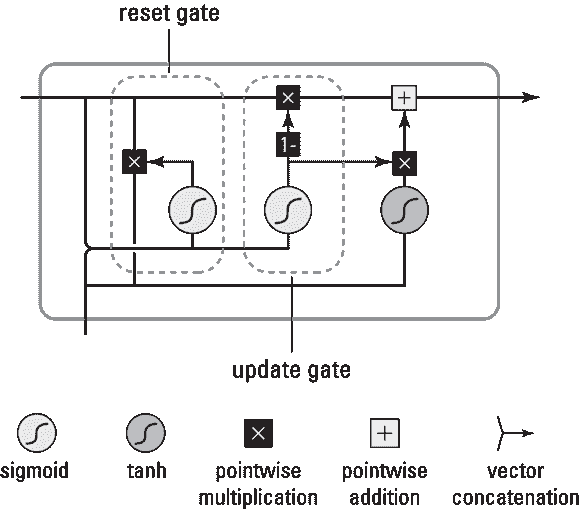

FIGURE 11-4: GRU 的内部结构，具有单一记忆流和两个门控。

与 LSTM 相，GRU 使用重置门来停止应该被遗忘的信息。GRU 还使用更新门来维持有用信号。GRU 拥有独特的记忆，不区分长期和短期记忆。

你可以在网络中同时使用 GRU 层和 LSTM 层，而不需要过多修改代码。使用 `keras.layers.GRU` 导入层（对于依赖 NVIDIA CuDNN 库的仅 GPU 版本，使用 `keras.layers.CuDNNGRU`；详情请参见 [`https://developer.nvidia.com/cudnn`](https://developer.nvidia.com/cudnn)），并像使用 LSTM 层一样与其交互。你通过定义单层所需的 GRU 单元数量来指定参数 `units`。从 LSTM 切换到 GRU 提供了这些优势，以及一些权衡：

* GRU 像 LSTM 一样处理信号并可能避免梯度消失问题，但它们不区分长期和短期记忆，因为它们依赖于单一的工作记忆——通过 GRU 单元反复处理的单元状态。

* GRU 比 LSTM 简单，但记忆过去信号的能力也较低，因此在处理更长序列时 LSTM 具有优势。

* GRU 的训练速度比 LSTM 快（需要调整的参数更少）。

* 当训练数据较少时，GRU 的表现比 LSTM 好，因为它们不太可能过拟接收到的信息。

### 获取必要的关注

在阅读关于应用于语言问题的 LSTM 和 GRU 层时，你经常发现 `attention mechanism`（注意力机制）被视为解决复杂问题的有效方法，例如：

* 让神经网络回答问题

* 短语分类

* 翻译短语

`attention mechanism` 被认为是解决这些复杂问题的尖端解决方案。事实上，在现有的包中找到它并不困难。

你可以通过查看 Philippe Rémy 在 [`https://github.com/philliemy/attention-mechanism`](https://github.com/philliemy/attention-mechanism) 开发的开源实现，开始创建你自己的注意力机制。注意力层是权重向量，表示神经网络处理的集合中某个元素的重要性。

在神经网络中，注意力层通常放置在 LSTM 或 GRU 等循环层之后。2017 年，Google 的研究人员创建了一种独立的注意力机制，它可以在不依赖之前的循环层的情况下工作，并且性能远优于之前的解决方案。他们将这种架构称为 `Transformer`。

## 第三部分：与深度学习交互

在本部分中：

* 学习图像分类。

* 使用 CNN。

* 发现语言处理的基础知识。

* 生成视觉艺术和音乐。

* 深入研究深度强化学习。

## 第 12 章：执行图像分类

在本章中：

* 识别图像识别挑战的关键贡献

* 发现数据增强的重要性

* 使用德国交通标志基准数据集 (GTSR)

* 创建你自己的能够分类交通标志的 CNN

理解卷积层如何工作（如 `第 10 章` 所示），这只是一个起点。理论可以解释事物是如何运作的，但不能充分解释深度神经网络解决方案在图像识别领域的成功。

在本章中，你将深入探讨对象分类与检测挑战这一主题，以发现它们在当今深度学习复兴基础中的贡献。诸如基于 `ImageNet` 数据集的竞赛，不仅为训练不同用途的可重用网络提供了正确的数据（得益于之前在第 10 章中讨论过的迁移学习），还推动研究人员寻找更智能的新型解决方案，以增强神经网络理解图像的能力。局部响应归一化（Local response normalization）和起始模块（inception modules）是过于复杂而无法在书中详细讨论的技术解决方案，但你应该意识到它们是革命性的。所有这些技术都是由赢得 ImageNet 竞赛的神经网络引入的：`AlexNet`（2012 年）、`GoogleLeNet`（2014 年）和 `ResNet`（2015 年）。

得益于由德国鲁尔波霍姆大学（Ruhr-Universität Bochum）神经信息研究所提供的德国交通标志基准（German Traffic Sign Benchmark）数据集，本章以如何使用图像数据集的示例结束。通过使用该数据集，你将构建自己的 `CNN` 来识别交通标志，并使用图像增强和加权来平衡示例中不同类别的频率。

你不需要手动输入本章的源代码。事实上，使用下载的源码要容易得多。本章的源代码出现在 `DL4D_12_German_Traffic_Sign_Benchmark.ipynb` 源代码文件中（详见引言中关于如何找到该源文件的说明）。

## 使用图像分类挑战

用于图像识别的 `CNN` 层最早由 Yann LeCun 及其研究团队构想出来。AT&T 实际上将 `LeNet5`（第 10 章中描述的用于手写数字的神经网络）实现在 ATM 支票阅读器中。然而，这项发明并没有阻止 20 世纪 90 年代开始的另一个 AI 寒冬，许多研究人员和投资者再次失去信心，认为计算机在与人类进行有意义的对话、跨语言翻译、理解图像以及像人类一样推理方面无法取得任何进展。

事实上，专家系统已经损害了公众的信任。专家系统是人类设定的一系列自动规则，允许计算机执行某些操作。尽管如此，新的 AI 寒冬阻止了神经网络的发展，取而代之的是各种机器学习算法。当时，计算机缺乏计算能力并存在某些局限性，例如梯度消失问题（第 9 章讨论了梯度消失以及其他阻碍深度神经网络架构的局限性）。当时的数据也缺乏复杂性，因此，像 `LeNet5` 这样复杂且革命性的 `CNN` 尽管已经能够适应当时的技术和局限性，但几乎没有展示它的真实实力。

只有少数研究人员，如 Geoffrey Hinton、Yann LeCun、Jürgen Schmidhuber 和 Yoshua Bengio，坚持继续开发神经网络技术，努力寻求能够结束 AI 寒冬的突破。与此同时，2006 年，伊利诺伊大学厄巴纳-香槟分校的计算机科学教授李飞飞（Fei-Fei Li，现斯坦福大学副教授，也是斯坦福人工智能实验室和斯坦福视觉实验室主任）致力于提供更多真实世界数据集以更好地测试算法。她开始收集海量的图像，代表了大量的物体类别。你可以在第 10 章的“揭示成功的架构”部分读到关于这一努力。建议的类别涵盖了不同类型的物体，既有自然界（例如 120 种狗），也有人造（如交通工具）。你可以在 `http://image-net.org/challenges/LSVRC/2014/browse-synsets` 探索所有类别。通过使用这个巨大的图像数据集进行训练，研究人员注意到他们的算法开始运行得更好（当时还没有像 ImageNet 这样的东西），然后他们开始测试新的想法和改进的神经网络架构。

### 深入研究 ImageNet 和 MS COCO

`ImageNet` 竞赛（也称为 ImageNet 大规模视觉识别挑战，或 `ILSVRC`；[`http://image-net.org/challenges/LSVRC/`](http://image-net.org/challenges/LSVRC/))）对图像识别深度学习解决方案的影响和重要性可以总结为三个关键点：

* **帮助建立深度神经网络的复兴：** `AlexNet` `CNN` 架构（由 Alex Krizhevsky、Ilya Sutskever 和 Geoffrey Hinton 开发）以远超其他解决方案赢得了 2012 年 `ILSVRC` 挑战。

* **推动多个研究团队开发更复杂的解决方案：** `ILSVRC` 提升了 `CNNs` 的性能。`VGG16`、`VGG19`、`ResNet50`、`Inception V3`、`Xception` 和 `NASNet` 都是 ImageNet 图像上测试过的神经网络，你可以在 `Keras` 包中找到（[`keras.io/applications/`](https://keras.io/applications/））。每种架构都代表了对以往的改进。

* **使迁移学习成为可能：** ImageNet 竞赛创建了可用的权重。120 万张 ImageNet 训练图像分布在 1000 个类别中，有助于解决非 ImageNet 问题。

最近，一些研究人员怀疑新的架构正在过拟合 ImageNet。毕竟，同一个测试集多年来一直用于选择这些网络，Benjamin Recht、Rebecca Roelofs、Ludwig Schmidt 和 Vaishaal Shankar 在 [https://arxiv.org/pdf/1806.0451](https://arxiv.org/pdf/1806.0451) 中推测。

来自 Google Brain 团队的其他研究人员（Simon Kornblith、Jonathon Shlens 和 Quoc V.Le）发现 ImageNet 上的精度与相同网络在其他数据集上的迁移学习性能之间存在相关性。他们的发现发表在论文《Do Better ImageNet Models Transfer Better》（[`arxiv.org/pdf/1805.08974`](https://arxiv.org/pdf/1805.08974)）中。有趣的是，他们还指出如果在 ImageNet 上过度调优，可能会出现泛化能力问题。因此，基于 ImageNet 上最新的最好的网络进行迁移测试是一种良好的做法，但不要仅限于此。

- **SUN** [`https://groups.csail.mit.edu/vision/SUN/`]: 由马诸塞理工学院（MIT）创建，该数据集提供了基准，帮助你确定你的 `CNN` 性能。它不与任何竞赛相关。

- **MS COCO** [`http://cocodataset.org/`]: 由微软公司准备，该数据集提供了一系列活动竞赛。

特别是，微软上下文常见对象数据集（因此名为 MS COCO）为你的模型提供的训练图像比你在 ImageNet 中找到的少，但每张图像都包含多个对象。此外，所有对象都出现在真实的位置（非刻意摆拍）和场景中（通常在户外以及如道路和街道等公共场所）。为了区分对象，该数据集同时提供了像素坐标中的轮廓和基于 PASCAL VOC XML 标准的标记，每个对象不仅定义了一个类别，还定义了它在图像中的坐标（显示其位置的图片矩形）。这个矩形被称为 `bounding box`（边界框），它使用四个像素简单地定义，与之相反，通过轮廓定义对象则需要许多像素。

ImageNet 数据集最近开始在至少一百万张图像中提供多个待检测对象及其边界框。

### 学习数据增强的魔力

即使你为深度学习模型获取了大量数据（例如 ImageNet 和 MS COCO 数据集），由于大多数复杂神经网络架构中存在大量参数，这些可能仍然不够。事实上，即使使用诸如 `dropout` 等技术（参见第 9 章中的“通过 dropout 添加正则化”节），过拟合仍然可能发生。`Overfitting` 发生在网络记住输入数据而没有学习到任何通用数据模式时。除了 `dropout` 之外，其他可以帮助网络对抗过拟合的技术还有 `LASSO`、`Ridge` 和 `ElasticNet`。然而，没有什么比在训练计划中添加更多示例对增强神经网络的预测能力更有效了。

最初，`LASSO`、`Ridge` 和 `ElasticNet` 是限制线性回归模型权重的方法，线性回归是一种用于计算回归估计的统计算法。在神经网络中，它们以类似的方式工作，通过迫使网络中权重的总和达到最低，同时不损害预测的正确性。`LASSO` 力于将许多权重降为零，从而实现最优权重选择。相比之下，`Ridge` 倾向于抑制所有权重，避免产生过拟合的高权重。最后，`ElasticNet` 是 `LASSO` 和 `Ridge` 方法的混合，相当于在选择策略和抑制策略之间的权衡。

图像增强为缺少输入神经网络示例的问题提供了一个解决方案，即从现有图像人工创建新图像。`Image augmentation` 由不同的图像处理操作组成，这些操作单独或共同执行，以产生与原始不同的图像。结果有助于神经网络更好地学习其识别任务。

例如，如果你的训练图像太亮或太模糊，图像处理会将现有图像修改为更暗和更清晰的版本。这些新版本示例了神经网络必须关注的特征，而不是提供关注图像质量的示例。此外，旋转、裁剪或弯曲图像（如图 12-1

FIGURE 12-1: 一些常见的图像增强。

最常见的图像增强程序如图 12-1 所示：

- **Flip（翻转）：** 沿轴翻转图像可以测试算法无论视角如何都能找到它的能力。即使翻转后，图像的整体感觉也应该保持。某些算法在倒置甚至镜像时无法找到对象，特别是当原始图像包含文字或其他特定标记时。

- **Rotation（旋转）：** 旋转图像允许在特定角度进行算法测试；模拟不同的视角或校准不精确的视觉效果。

- **Random crop（随机裁剪）：** 裁剪图像迫使算法关注图像的一个组件。裁剪一个区域并将其扩展到标准图像相同的大小，让你能够测试对部分遮挡图像特征的识别。

- **Color shift（色彩偏移）：** 改变图像颜色的细微差别，使你的示例泛化化，因为颜色在现实世界中可能会变化或有不同的记录。

- **Noise addition（添加噪声）：** 添加随机噪声测试算法即使在对象质量不完美的情况下检测对象的能力。

- **Information loss（信息丢失）：** 随机移除图像部分模拟视觉遮挡。它还有助于神经网络依赖通用图像特征，而不是细节（细节可能会被随机消除）。

- **Contrast change（对比度变化）：** 改变亮度会让神经网络对光照条件（例如日光或人工光）不那么敏感。


你不需要精通图像处理来利用这种强大的图像增强技术。`Keras` 提供了一种简单方法，使用 `ImageDataGenerator` 函数轻松地将增强整合到任何训练中（[`faroit.github.io/keras-docs/1.2.2/preprocessing/image/`](https://faroit.github.io/keras-docs/1.2.2/preprocessing/image/)）。

`ImageDataGenerator` 的主要目的是生成批次输入以馈你的神经网络。这意味着你可以使用 `.flow` 方法从 NumPy 数组分块获取数据。此外，你不需要在内存中拥有所有训练数据，因为 `.flow_from_directory` 方法可以从磁盘为你获取数据。当 `ImageDataGenerator` 提取批次图像时，可以使用 `rescaling`（缩放，图像由整数组成，范围从 0 到 255，但神经网络对 0 到 1 的浮点工作效果最好）或应用某些变换进行转换：

- **Standardization（标准化）：** 通过将均值设置为零、标准差设置为一，将所有数据置于同一尺度（类似于统计标准化），基于整个数据集的均值和标准差（*按特征*）或针对每张图像单独计算（*按样本*）。

- **ZCA whitening（ZCA 白化）：** 在保持原始图像相似的同时移除图像中的任何冗余信息。

- **Random rotation, random shifts, and random flips（随机旋转、随机偏移和随机翻转）：** 对图像进行定向、偏移和翻转，使对象的姿态与原始不同。

- **Reordering dimensions（重新排序维度）：** 匹配图像之间的数据维度。例如，将 BGR 图像（以前相机制造商流行的彩色图像格式）转换为标准 RGB。

当你使用 `ImageDataGenerator` 处理批次图像时，你不再受系统内存大小的限制，而是受你的存储大小（例如硬盘大小）及其传输速度的限制。如果连接足够快，你甚至可以从互联网上实时获取所需的数据。

你可以使用如 `albumentations`（[`github.com/albu/albumentations`](https://github.com/albu/albumentations)）这样的包获取更强大的图像增强。Alexander Buslaev、Alex Parinov、Vladimir I. Iglovikov 和 Evegene Khvedchenya 根据他们在许多图像检测挑战中的经验创建了它。该包根据要完成的任务和使用的神经网络提供了极其可能的图像处理工具。

## 区分交通标志

在讨论了 CNN 的理论基础和特征之后，你可以尝试构建一个。`TensorFlow` 和 `Keras` 可以为特定的界定问题构建图像分类器。特定的问题并不意味着需要学习大量的图像特征才能成功完成任务。因此，你可以轻松地使用简单的架构解决它们，例如 `LeNet5`（彻底改变神经网络图像识别的 CNN，已在第 10 章中讨论过）或类似的模型。此示例使用了德国交通标志识别基准（GTSRB），在波鸿鲁尔大学（Ruhr-Universität Bochum）的 Institut für Neuroinformatik 页面可以找到它：[`http://benchmark.ini.rub.de/?section=gtsrb`](http://benchmark.ini.rub.de/?section=gtsrb)。

识别交通标志是一项挑战性任务，因为现实环境中的视觉外观存在差异。GTSRB 提供了一个基准来评估应用于该任务的不同机器学习算法。你可以在 J. Stallkamp 等人的论文中阅读有关该数据库构建的内容，题目为“人与计算机：用于交通标志识别的机器学习算法基准”，地址为[`https://www.ini.rub.de/upload/file/1470692859_c57fac98ca9d02ac701c/stallkampetal_gtsrb_nn_si2012.pdf`](https://www.ini.rub.de/upload/file/1470692859_c57fac98ca9d02ac701c/stallkampetal_gtsrb_nn_si2012.pdf)。

GTSRB 数据集包含 50,000 张图像，分为 42 类（交通标志），这允许你创建一个多类分类问题。在多类分类问题中，你输出图像属于某一类的概率，并取最高概率作为正确答案。例如，“注意：施工现场”标志将导致分类算法对所有注意标志生成高概率。（最高概率应与其类别匹配。）模糊性、图像分辨率、不同的光照条件和透视条件使得这项任务对计算机（有时对人类也是如此）具有挑战性，正如你从数据集中提取的图 12-2 中的示例中看到的那样。


图 12-2： 德国交通标志识别基准的一些示例。

### 准备图像数据

示例从配置模型、设置优化器、预处理图像以及创建卷积层、池化层和全连接层开始，如下代码所示。（请参见第 4 章以了解如何使用 `TensorFlow` 和 `Keras`。）

```python
import numpy as np
import zipfile
import pprint
from skimage.transform import resize
from skimage.io import imread
import matplotlib.pyplot as plt
% matplotlib inline

import warnings
warnings.filterwarnings("ignore")

from keras.models import Sequential
from keras.optimizers import Adam
from keras.preprocessing.image import ImageDataGenerator
from keras.utils import to_categorical
from keras.layers import Conv2D, MaxPooling2D
from keras.layers import (Flatten, Dense, Dropout)
```

该数据集包含超过 50,000 张图像，相关的神经网络在识别交通标志方面可以达到接近人类水平的准确率。此类应用需要大量的计算机计算，取决于你的计算机类型，在你的电脑上运行此代码可能需要很长时间。同样，Colab 的运行时间取决于 Google 为你提供的资源，包括你是否实际上可以访问 GPU（如第 4 章中提到的）。在你的设置上对此初始应用进行计时，将帮助你了解本地机器还是 Colab 是运行更大数据集的最快环境。然而，最好的环境是产生最一致且可靠结果的环境。你可能没有稳定的互联网连接，这使得 Colab 成为较差的选择。

此时，示例从互联网上的位置检索 GTSRB 数据集（即前述波鸿鲁尔大学的 INI Benchmark 网站）。以下代码段将其下载到与 Python 代码相同的目录。注意，下载过程可能需要一些时间才能完成，所以现在可能是补充茶水的好时机。

```python
import urllib.request
url = "http://benchmark.ini.rub.de/Dataset/GTSRB_Final_Training_Images.zip"
filename = "./GTSRB_Final_Training_Images.zip"
urllib.request.urlretrieve(url, filename)

IMG_SIZE = 32
TEST_SIZE = 0.2
X, Xt, y, yt = list(), list(), list(), list()

archive = zipfile.ZipFile(filename, 'r')
file_paths = [file for file in archive.namelist() if '.ppm' in file]

for filename in file_paths:
    img = imread(archive.open(filename))
    img = resize(img, output_shape=(IMG_SIZE, IMG_SIZE), mode='reflect')
    img_class = int(filename.split('/')[-2])
    if (hash(filename) % 1000) / 1000 > TEST_SIZE:
        X.append(img)
        y.append(img_class)
    else:
        Xt.append(img)
        yt.append(img_class)
archive.close()

test_ratio = len(Xt) / len(file_paths)
print("Train size:{} test size:{} ({:03f})".format(len(X), len(Xt), test_ratio))

classes, dist = np.unique(y+yt, return_counts=True)
NUM_CLASSES = len(classes)
print ("No classes:{}".format(NUM_CLASSES))

plt.bar(classes, dist, align='center', alpha=0.5)
plt.show()
```

你的结果可能与所示结果不同。例如，示例的另一次运行产生了 31415 的训练大小和 7794 的测试大小。当类别在数值上相似时，神经网络可以更好地学习多类问题，否则它们倾向于集中注意力只学习数量较多的类别。以下代码检查了类别分布：

作为解决方案，代码计算了一个 `weight`，该权重基于类别的频率比例，神经网络利用它来增加从稀有样本中接收到的信号，并丢弃更频繁的样本：

```python
class_weight = {c:dist[c]/np.sum(dist) for c in classes}
```

### 运行分类任务

设置权重后，代码定义了图像生成器。该部分负责分批获取（预定义大小的样本）用于训练和验证的图像，对其值进行归一化，并应用数据增强（通过轻微移动和旋转）来防止过拟合。注意，以下代码仅对训练图像生成器应用了增强，而不是验证生成器，因为有必要测试原始图像。

```python
batch_size = 256
tgen=ImageDataGenerator(rescale=1./255,
 rotation_range=5,
 width_shift_range=0.10,
 height_shift_range=0.10)

train_gen = tgen.flow(np.array(X),
 to_categorical(y),
 batch_size=batch_size)

vgen=ImageDataGenerator(rescale=1./255)

val_gen = vgen.flow(np.array(Xt),
 to_categorical(yt),
 batch_size=batch_size)
```

代码最后构建了卷积神经网络：

```python
def small_cnn():
 model = Sequential()
 model.add(Conv2D(32, (5, 5), padding='same',
 input_shape=(IMG_SIZE, IMG_SIZE, 3),
 activation='relu'))
 model.add(Conv2D(64, (5, 5), activation='relu'))
 model.add(Flatten())
 model.add(Dense(768, activation='relu'))
 model.add(Dropout(0.4))
 model.add(Dense(NUM_CLASSES, activation='softmax'))
 return model

model = small_cnn()
model.compile(loss='categorical_crossentropy',
 optimizer=Adam(),
 metrics=['accuracy'])
```

该神经网络包含两个卷积层，一个有 32 个通道，另一个有 64 个通道，两者都使用大小为 `(5,5)` 的卷积核。卷积层之后是一个具有 768 个节点的密集连接层。`Dropout`（丢弃 40%的节点）对该最后一层进行正则化，并由 `softmax` 函数激活它（因此所有类别的输出概率之和将为 100%）。

在优化方面，需要最小化的损失函数是分类交叉熵。代码通过 `accuracy` 衡量成功率，即算法提供的正确答案的百分比。（预测概率最高的交通标志类别即为答案。）

```python
history = model.fit_generator(train_gen,
 steps_per_epoch=len(X) // batch_size,
 validation_data=val_gen,
 validation_steps=len(Xt) // batch_size,
 class_weight=class_weight,
 epochs=100,
 verbose=2)
```

通过在 `model` 上使用 `fit_generator`，图像批开始在训练阶段被随机提取、归一化并增强。在提取所有训练图像后，代码会经历一个 `epoch`（使用完整数据集进行一次遍历的训练迭代），并在验证图像上计算验证分数。读取 100 个 `epoch` 后，训练和模型构建完成。

如果你不使用任何增强，只需大约 30 个 `epoch` 即可训练模型，并使其性能几乎与驾驶员识别不同类型交通标志的技能相当（准确率约为 98.8%）。你使用的增强越激进，模型达到其最高潜力所需的 `epoch` 就越多，尽管准确率表现也会更高。此时，代码会绘制一张图，描述训练期间训练准确率和验证准确率的行为：

```python
print("Best validation accuracy: {:0.3f}"
 .format(np.max(history.history['val_acc'])))

plt.plot(history.history['acc'])
plt.plot(history.history['val_acc'])
plt.ylabel('accuracy'); plt.xlabel('epochs')
plt.legend(['train', 'test'], loc='lower right')
plt.show()
```

代码将向你报告记录的最佳验证准确率，并绘制学习轮数增加期间在训练和验证数据上实现的准确率曲线，如图 12-4 所示。注意训练和验证准确率在训练结束时几乎相似，尽管验证结果总是优于训练。这很容易解释，因为验证图像实际上比训练图像“更容易”猜测，因为没有对它们应用任何数据增强。

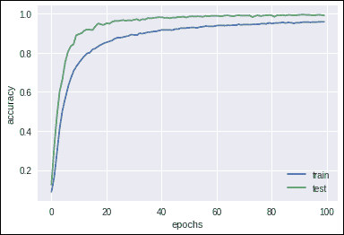

FIGURE 12-4: 训练与验证误差对比。

鉴于代码可以用不同的方式初始化神经网络，你可能会看到不同的最佳结果。

## 区分分类任务

CNN 是基于深度学习的图像识别的基石，但它们仅解决基础的分类需求：给定一张图片，它们可以确定其内容是否与通过示例学习的特定图像类别相关。因此，当你训练一个深度神经网络来识别狗和猫时，你可以给它输入一张照片，并获得输出，告诉你该照片是否包含狗或猫。如果网络的最后一层是 `softmax` 层，网络将输出照片包含狗或猫（你训练它识别的两个类别）的概率，且输出结果之和为 100%。当最后一层是使用 `sigmoid` 激活的层时，你将获得得分，可以将这些得分独立地解释为内容属于每个类别的概率。这些得分并不一定总和为 100%。在这两种情况下，当发生以下情况时，分类可能会失败：

- 主体不是你训练网络识别的物体，例如向示例神经网络展示一张浣熊的照片。在这种情况下，网络将输出错误的答案（如狗或猫）。

- 主体被部分遮挡。例如，你的猫在展示给网络的照片中玩捉迷藏，网络无法发现它。

- 照片中包含许多不同的待检测物体，可能包括猫狗以外的动物。在这种情况下，网络的输出将建议单个类别，而不是包含所有物体。

图 13-1 显示了来自 MS Coco 数据集的图像 47780（[`http://cocodataset.org/#explore?id=47780`](http://cocodataset.org/#explore?id=47780)），该数据集作为开源知识产权署名 4.0 许可的一部分发布。这一系列三个输出展示了 CNN 如何检测、定位和分割图像中出现的物体（一只小猫和一只站在草地上的狗）。一个普通的 CNN 无法复制图 13-1 中的示例，因为它的架构会将整个图像输出为某一类别。为了克服这一局限性，研究人员扩展了基本 CNN 的功能，使其能够实现以下：

- **检测 (Detection)：** 判断图像中是否存在某个物体。检测不同于分类，因为它涉及图像的一部分，这意味着网络可以检测多个相同或不同类型的物体。在部分图像中识别物体的能力称为 `instance spotting`。

- **定位 (Localization)：** 精确定义被检测物体出现在图像中的位置。你可以拥有不同类型的定位。根据粒度的不同，它们区分了包含被检测物体的图像部分。

- **分割 (Segmentation)：** 像素级的物体分类。分割将定位推向了极端。这种神经网络模型将图像的每个像素分配给一个类别，甚至一个实体。例如，网络标记照片中所有相对于狗的像素，并使用不同的标签区分每一个像素（称为 `instance segmentation`）。


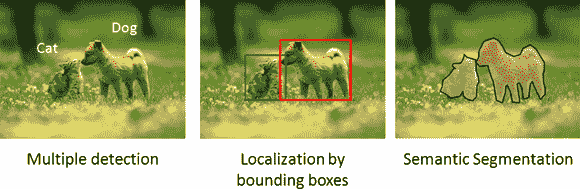

图 13-1：来自 Coco 数据集的检测、定位和分割示例。

### 执行定位

定位也许是你能从普通 CNN 中获得的最容易的扩展。它要求你在训练深度学习分类模型的同时，训练一个回归模型。`regressor` 是一个猜测数字的模型。使用角点像素坐标可以在图像中定义物体位置是可能的，这意味着你可以训练神经网络来输出关键测量值，从而可以使用边界框（bounding box）轻松确定分类物体出现在图片中的位置。通常，边界框使用左下角的 `x` 和 `y` 坐标，以及包含物体的区域的 `width` 和 `height`。

### 分类多个物体

CNN 只能在图像中检测（预测类别）和定位（通过提供坐标）单个物体。如果你在图像中有多个物体，你仍然可以使用 CNN 并通过两种旧的图像处理解决方案定位照片中存在的每个物体：

- **滑动窗口（Sliding window）：** 一次仅分析图像的一部分（称为 `region of interest`，即感兴趣区域）。当感兴趣区域足够小时，它很可能只包含单个物体。较小的感兴趣区域允许 CNN 正确地分类该物体。这种技术被称为 `sliding window`，是因为软件使用图像窗口来限制特定区域的可见性（就像房子里的窗户一样），并在图像上缓慢移动此窗口。该技术是有效的，但可能会多次检测同一图像，或者你可能会根据你决定用于分析图像的窗口大小发现某些物体未被检测到。

- **图像金字塔（Image pyramids）：** 解决了使用固定大小窗口的问题，因为它生成了分辨率越来越小的图像。因此，你可以应用较小的滑动窗口。通过这种方式，你转换了图像中的物体，其中一种还原结果可能恰好适合所使用的滑动窗口。

这些技术是计算密集型的。要应用它们，你必须多次对图像进行缩放，然后将其分成分块。然后你使用分类 CNN 处理每个分块。这些活动的操作数量如此巨大，以至于无法实时渲染输出。

滑动窗口和图像金字塔启发了深度学习研究人员，他们发现了一些在概念上相似但计算密集性较低的方法。第一种方法是 `one-stage detection`（单阶段检测）。它通过将图像划分为网格来工作，神经网络对每个网格单元进行预测，预测其内部物体的类别。这种预测相当粗糙，取决于网格分辨率（分辨率越高，深度学习网络越复杂、越慢）。单阶段检测非常快，几乎与简单 CNN 分类的速度相当。结果必须经过处理以将代表同一物体的单元格聚集在一起，这可能会导致进一步的不准确。基于这种方法的神经网络架构包括单次检测器（`SSD`）、你只一次（`YOLO`）和 `RetinaNet`。

第二种方法是 `two-stage detection`（两阶段检测）。这种方法使用第二个神经网络来优化第一个网络的预测。第一阶段是提议网络，它在网格上输出预测。第二阶段精调这些提议并输出物体的最终检测和定位。`R-CNN`、`Fast R-CNN` 和 `Faster R-CNN` 都是两阶段检测模型，它们比单阶段模型慢得多，但预测更精确。

### 在图像中标注多个物体

为了训练深度学习模型检测多个物体，你需要提供比简单分类更多的信息。对于每个物体，你使用标注过程在图像中提供分类和坐标，这与简单图像分类使用的标签形成对比。

即使在简单的分类任务中，对数据集进行图像标记也是一项艰巨的任务。给定一张图片，网络必须在训练和测试阶段提供正确的分类结果。在标记过程中，由网络来为每张图片决定正确的标签，而并不是所有人对所描图像的感知都是相同的。创建 `ImageNet` 数据集的人员利用了来自 `Amazon Mechanical Turk` 众包平台的多个用户提供的分类结果（ImageNet 对 Amazon 服务的依赖程度之高，以至于在 2012 年，它成为了亚马逊最重要的学术客户）。

同样地，当你使用边界框（bounding boxes）对图像进行标注时，你也依赖于多个人的工作。标注不仅要求为图片中的每个对象标记标签，还必须确定包围每个对象的最佳框。这两项任务使得标注比标记更加复杂，并且更容易产生错误结果。正确地执行标注需要更多人的参与，以便对标注的准确性达成共识。

 一些开源软件可以帮助图像检测的标注（以及在下一节中讨论的图像分割）。其中有两个工具特别有效：

* `LabelImg`，由 TzuTa Lin 创建（[`https://github.com/tzutalin/labelImg`](https://github.com/tzutalin/labelImg)），并附有 [`https://www.youtube.com/watch?v=p0nR2YsCY_U`](https://www.youtube.com/watch?v=p0nR2YsCY_U) 教程。

* `LabelMe`（[`https://github.com/wkentaro/labelme`](https://github.com/wkentaro/labelme)）是一个强大的图像分割工具，提供在线服务。

* `FastAnnotationTool`，基于计算机视觉库 `OpenCV`（[`https://github.com/christopher5106/FastAnnotationTool`](https://github.com/christopher5106/FastAnnotationTool)）。该包的维护频率较低，但仍然可用。

### 图像分割

语义分割（Semantic segmentation）为图像中的每个像素预测一个类别，这与标记或标注是不同的视角。一些人也将这项任务称为 `密集预测`（dense prediction），因为它对图像中的每个像素都做出预测。该任务在预测中并没有特定地区分不同的对象。例如，语义分割可以显示所有属于 `cat` 类的像素，但它不会提供关于图片中的猫（或几只猫）在做什么的任何信息。你可以通过 `后处理`（post-processing）轻松地获取分割图像中的所有对象，因为在执行预测后，你可以获得对象的像素区域，并在同一类别预测下存在多个分离区域时，区分出它们不同的实例。

不同的深度学习架构可以实现图像分割。全卷积网络（`FCNs`）和 `U-NETs` 是最有效的工具。`FCNs` 为第一部分（称为 `encoder` 编码器）构建，这与 `CNNs` 相同。在初始系列卷积层之后，`FCNs` 以另一系列 `CNNs` 结束，这些层以与编码器相反的方式运行（成为 `decoder` 解码器）。`decoder` 的构建目的是重建原始输入图像的大小，并将图像中每个像素的分类作为像素输出。通过这种方式，`FCN` 实现了图像的语义分割。`FCN` 对于大多数实时应用来说计算量太大了。此外，它们需要大量的训练集来很好地学习任务；否则，它们的分割结果往往很粗糙。

 寻找在 `ImageNet` 上预训练的 `FCN` 编码器部分是常见的，这可以加速训练并提高学习性能。

`U-NETs` 是 `FCN` 的演进，由 Olaf Ronneberger、Philipp Fischer 和 Thomas Brox 在 2015 年为医疗目的设计（见 [`https://lmb.informatik.uni-freiburg.de/people/ronneber/u-net/`](https://lmb.informatik.uni-freiburg.de/people/ronneber/u-net/)）。与 `FCNs` 相比，`U-NETs` 有优势。编码（也称为 `contraction` 收缩）和解码部分（也称为 `expansion` 扩张）是对称的。此外，`U-NETs` 在编码层和解码层之间使用了捷径连接。这些捷径允许对象的细节轻松地从 `U-NET` 的编码部分传递到解码部分，生成的分割是精确且精细的。

 从零开始构建分割模型是一个艰巨的任务，但你不需要这样做。你可以使用一些预训练的 `U-NET` 架构，并通过利用分割 `model zoo`（一个术语，用于描述许多框架提供的预训练模型集合；详情见 [`https://modelzoo.co/`](https://modelzoo.co/)）提供的 `segmentation_models`（由 Pavel Yakubovskiy 提供的一个包）来立即开始使用这种神经网络。你可以在 [`https://github.com/qubvel/segmentation_models`](https://github.com/qubvel/segmentation_models) 找到安装说明、源代码和大量的用法示例。该包的命令与 `Keras` 无缝集成。

## 感知周围环境中的物体

将视觉能力集成到自动驾驶汽车的传感系统中，可以增强其驾驶的置信和安全性。分割算法可以帮助汽车区分车道和人行道，以及汽车应该注意的其他障碍物。汽车甚至可以配备完整的端到端系统，例如 `NVIDIA` 的系统，根据其视觉输入以响应方式控制转向、加速和制动。（NVIDIA 是深度学习领域的主要参与者，书中在第 4 章](#c04.xhtml)、第 9 章](#c09.xhtml) 和第 11 章](#c11.xhtml) 中也提到了它。你可以在 [`https://www.nvidia.com/en-us/self-driving-cars/`](https://www.nvidia.com/en-us/self-driving-cars/) 了解更多。）视觉系统可以识别道路上的物体，例如交通标志和交通灯。它可以视觉上跟踪其他车辆的轨迹。在所有情况下，深度学习网络都可以提供解决方案。

“区分任务”讨论了 `CNNs` 如何改进单物体分类。该部分还阐明了两种方法的架构和当前模型：单阶段检测和双阶段检测。

从零开始编写这样的检测系统是一个艰巨的任务，需要专门的一整本书来完成。幸运的是，你可以采用 GitHub 上的开源项目，如 `Keras-RetinaNet`（[`https://github.com/fizyr/keras-retinanet`](https://github.com/fizyr/keras-retinanet)）。

### 发现 RetinaNet 的工作原理

RetinaNet 是一个精密且有趣的目标检测模型，它在保持与其他单阶段检测模型一样快速的同时，还能达到像 `Faster R-CNN`（性能最好的模型）等两阶段检测系统的边界框预测准确率。得益于其架构，RetinaNet 使用了与语义分割讨论的 `U-NET` 架构类似的技术实现了这些目标。RetinaNet 是一组名为特征金字塔网络（FPN）模型组成的一部分。

RetinaNet 的性能归功于它的作者 Tsung-Yi Lin、Priya Goyal、Ross Girshick、何恺明和 Piotr Dollár，他们指出，单阶段检测模型并不总是能精确地检测物体，因为它们受到训练图像中大量存在的干扰元素的影响。他们的论文《密集目标检测的焦点损失》（[Focal Loss for Dense Object Detection](https://arxiv.org/pdf/1708.02002.pdf)）提供了 RetinaNet 使用技术的详细信息。问题在于，图像中呈现的待检测感兴趣物体很少。事实上，单阶段检测网络被训练用于预测由固定网格划分的图像每个单元格的类别，而大多数单元格都是没有任何感兴趣物体的空白。


在语义分割中，分类的目标是单个像素。在单阶段检测中，目标是连续像素的集合，执行的是与语义分割类似的任务，但粒度级别不同。

当你在图像中拥有如此多的负样本（null examples），并且使用一种检查所有可用单元格作为示例的训练方法时，就会发生这种情况。网络更有可能预测处理后的图像单元格中没有任何内容，而不是提供预测准确的类别。神经网络总是采取最高效率的路径进行学习，在这种情况下，预测背景比预测任何其他东西都容易。在这种被称为 `不平衡学习`（unbalanced learning）的情况下，许多物体无法被使用单次击中目标检测方法的神经网络检测到。

在机器学习中，当你想要预测两个数值上不同的类别（一个是多数类，另一个是少数类）时，你就面临着一个不平衡分类问题。当类别不平衡时，大多数算法都无法正常运行，因为它们倾向于偏好多数类。针对这个问题有几种解决方案：

* **采样（Sampling）**：选择某些示例并丢弃其他示例。

* **下采样（Downsample）**：通过选择仅使用多数类的一部分来减少多数类的影响，从而平衡多数和少数类的预测。在许多情况下，这是最简单的方法。

* **上采样（Upsample）**：通过多次复制少数类的示例来增加少数类的影响，直到少数类的示例数量与多数类相同。

RetinaNet 的创建者采取了不同的路线，正如他们在本节之前提到的论文《密集目标检测的焦点损失》中所述的那样。他们忽略了容易分类的多数类示例，而是专注于难以分类的单元格。结果是网络的代价函数更多地关注调整其权重以识别背景物体。这就是 `焦点损失`（focal loss）解决方案，代表了一种让单阶段检测运行更准确且更快速的智能方法，这是实时应用的需求，例如自动驾驶汽车中的障碍物或物体检测，或者在视频监控中处理大量图像。

## 使用 Keras-RetinaNet 代码

Keras-RetinaNet 以开源 Apache License 2.0 许可发布，是由荷兰机器人公司 Fitz 赞助的项目，并由许多贡献者实现的（主要贡献者是 Hans Gaiser 和 Maarten de Vries）。它是使用 Python 和 Keras（[`github.com/fizyr/keras-retinanet/`](https://github.com/fizyr/keras-retinanet/)）编写的 RetinaNet 神经网络实现。你会发现许多项目成功使用了 Keras-RetinaNet —— 其中最著名且令人印象的是 NATO 创新挑战冠军模型，该竞赛的任务是检测航空图像中的汽车。（你可以在此博客文章阅读获奖团队的叙述：[`medium.com/data-from-the-trenches/object-detection-with-deep-learning-on-aerial-imagery-2465078db8a9`](https://medium.com/data-from-the-trenches/object-detection-with-deep-learning-on-aerial-imagery-2465078db8a9)。）

目标检测网络代码太复杂，无法在几页内解释，而且你可以使用现有网络来建立深度学习解决方案，因此本节演示了如何在你的计算机上下载和使用 Keras-RetinaNet。在尝试此过程之前，确保你已按照第 4 章中的描述配置了你的计算机，并考虑在使用第 12 章中“考虑现实性输出的成本”侧边栏描述的各种执行选项时涉及权衡。

第一步，上传必要的包并开始下载 GitHub 仓库的压缩版本。此示例使用了 Keras-RetinaNet 的 0.5.0 版本，这是编写时提供的最新版本。

```python
import os
import zipfile
import urllib.request
import warnings
warnings.filterwarnings("ignore")
url = "https://github.com/fizyr/keras-retinanet/archive/0.5.0.zip"
urllib.request.urlretrieve(url, './'+url.split('/')[-1])
```

下载压缩代码后，示例将使用这些命令自动解压：

```python
zip_ref = zipfile.ZipFile('./0.5.0.zip', 'r')
for name in zip_ref.namelist():
    zip_ref.extract(name, './')
zip_ref.close()
```

执行后创建一个名为 `keras-retinanet-0.5.0` 的新目录，其中包含了用于设置网络的代码。然后代码使用 `pip` 命令执行编译和安装：

```bash
os.chdir('./keras-retinanet-0.5.0')
!python setup.py build_ext --inplace
!pip install .
```

所有命令刚刚检索了构建网络架构的代码。示例现在需要预训练权重，并依赖于 MS Coco 数据集上训练的 Res50 CNN，这是微软用于赢得 ImageNet 竞赛的神经网络。

```python
os.chdir('../')
url = "https://github.com/fizyr/keras-retinanet/releases/download/0.5.0/resnet50_coco_best_v2.1.0.h5"
urllib.request.urlretrieve(url, './'+url.split('/')[-1])
```

下载所有权重需要一些时间，现在是补充咖啡的好时机。此步骤之后，示例准备好导入所有必要的命令并使用网络上的预训练权重初始化 RetinaNet 模型。这一步还设置了一个字典，将网络结果转换为可理解的类别。类别的选择对于任何需要理解道路或交叉路图像的解决方案是非常有用的。


```python
import os
import numpy as np
from collections import defaultdict
import keras
from keras_retinanet import models
from keras_retinanet.utils.image import (read_image_bgr, preprocess_image, resize_image)
from keras_retinanet.utils.visualization import (draw_box, draw_caption)
from keras_retinanet.utils.colors import label_color
import matplotlib.pyplot as plt
%matplotlib inline

model_path = os.path.join('.', 'resnet50_coco_best_v2.1.0.h5')
model = models.load_model(model_path, backbone_name='resnet50')

labels_to_names = defaultdict(lambda: 'object', {0: 'person', 1: 'bicycle', 2: 'car', 3: 'motorcycle', 4: 'airplane', 5: 'bus', 6: 'train', 7: 'truck', 8: 'boat', 9: 'traffic light', 10: 'fire hydrant', 11: 'stop sign', 12: 'parking meter', 25: 'umbrella'})
```

为了为了使示例具有实用性，你需要一张样本图像来测试`RetinaNet`模型。该示例依赖于来自 Wikimedia 的免费图片，图片展示了一个包含等待过马路的人、停止的车辆、红绿灯和交通标志的路口。

```python
url = "https://upload.wikimedia.org/wikipedia/commons/thumb/f/f8/Woman_with_blue_parasol_at_intersection.png/640px-Woman_with_blue_parasol_at_intersection.png"
```

```python
urllib.request.urlretrieve(url, './'+url.split('/')[-1])
```

完成图像下载后，是时候测试神经网络了。在接下来的说明代码段中，代码将从磁盘读取图像，然后交换蓝色和红色图像通道（因为图像是以`BGR`格式上传的，但`RetinaNet`使用的是`RGB`图像）。最后，代码对图像进行预处理并调整大小。所有这些步骤都通过提供的函数完成，不需要特殊设置。

模型将输出检测到的边界框、置信度水平（网络真实检测到某些东西的概率评分）以及一个可以使用之前定义的标签字典转换为文本的代码标签。循环会过滤示例在图像上打印的框。代码使用了`0.5`的置信阈值，这意味着示例将保留任何置信度至少为 50% 的检测结果。使用较低的置信阈值会导致更多的检测结果，特别是那些在图像中很小的物体，但也会增加误检（例如，某些阴影可能会被检测为物体）。

 根据你使用`RetinaNet`的目标，你可能会认为使用较低的置信阈值是可以的。你会发现，随着置信度的降低，最终准确猜测（置信度接近 100% 的猜测）的比例会减少。这种比例被称为检测的*精确率*（precision），通过决定你可以接受的精确率，你可以为你的需求设置最佳的置信度。

```python
image = read_image_bgr('640px-Woman_with_blue_parasol_at_intersection.png')

draw = image.copy()

draw[:,:,0], draw[:,:,2] = image[:,:,2], image[:,:,0]

image = preprocess_image(image)

image, scale = resize_image(image)

boxes, scores, labels = model.predict_on_batch(np.expand_dims(image, axis=0))

boxes /= scale

for box, score, label in zip(boxes[0], scores[0], labels[0]):

    if score > 0.5:

        color = label_color(label)

        b = box.astype(int)

        draw_box(draw, b, color=color)

        caption = "{} {:.3f}".format(labels_to_names[label], score)

        draw_caption(draw, b, caption.upper())

plt.figure(figsize=(12, 6))

plt.axis('off')

plt.imshow(draw)

plt.show()
```

在所有这些方法的基础上，核心思想是：将称为`perturbation`（扰动）的某些数值信息与图像混合，可以导致神经网络的行为偏离预期，尽管这种行为是受控的。当你创建一个`adversarial example`（对抗性示例）时，你会向现有图像添加一些特殊设计的噪声（看起来像随机数），这就足以欺骗大多数`CNNs`（卷积神经网络）了（因为当用相同的数据进行训练时，同样的技巧通常对不同的架构都有效）。通常，你可以通过访问模型（其架构和权重）来发现此类扰动。然后你利用其`backpropagation`（反向传播）算法，系统地发现添加到图像中的最佳数值信息集，从而将一个预测类别变变为另一个类别。

你可以通过更改图像中的单个像素来创建扰动效果。研究人员已经通过这种方法获得了完美的对抗性示例，正如九州大学的研究人员发现的并在他们的论文《欺骗深度神经网络的像素攻击》中所描述的那样（[`https://arxiv.org/pdf/1710.08864.pdf`](https://arxiv.org/pdf/1710.08864.pdf)）。

### 使用贴纸和其他伪制品进行破解

大多数对抗性示例都是关于视觉鲁棒性的实验室实验，这些示例由于是在训练阶段通过直接修改数据输入和测试图像而产生的，因此它们可以展示其所有的能力。然而，许多基于深度学习的应用运行在现实世界中，实验室技术的使用并不能防止攻击。此类攻击不需要访问底层神经模型即可生效。某些示例可能以贴纸或神经网络不知道如何处理的不可听声音的形式出现。

名为《物理世界中的对抗性示例》的论文（位于 [`https://arxiv.org/pdf/1607.02533.pdf`](https://arxiv.org/pdf/1607.02533.pdf)）证明了在非实验室环境中也存在各种攻击。你只需要打印出对抗性示例并将它们展示给馈送神经网络的摄像头（例如，使用手机上的摄像头）。这种方法证明，对抗性示例的效力并非严格源于输入神经网络的数值输入。图像中存在的形状、颜色和对比度的组合实现了这种欺骗，而你不需要直接访问神经网络就能找出哪种组合效果最好。你可以直接从作者制作的这段视频中看到网络如何将洗衣机的图像误认为保险箱或扬声器，这些作者欺骗了 TensorFlow 摄像头演示，这是一个执行实时图像分类的移动设备应用：[`https://www.youtube.com/watch?v=zQ_uMenoBCk`](https://www.youtube.com/watch?v=zQ_uMenoBCk)。

卡内基梅隆大学的其他研究人员发现了一种通过制造眼镜框来欺骗人脸检测的方法，这种眼镜框可以影响深度神经网络识别实例的方式。随着自动化安全系统的普及，利用眼镜等简单配件欺骗系统可能会变成严重的安全威胁。名为《犯罪的装扮：对先进人脸识别的真实和隐蔽攻击》的论文（[`https://www.cs.cmu.edu/~sbhagava/papers/`](https://www.cs.cmu.edu/~sbhagava/papers/)）。

为了简单起见，你可以将语言视为由字母组成的单词序列（以及标点符号、符号、表情符号等）。深度学习通过使用多层`RNNs`（如`LSTM`或`GRU`）来更好地处理语言（参见第 11 章）。然而，知道如何使用`RNNs`并不告诉你如何将序列作为输入；你需要确定序列的类型。事实上，深度学习网络只接受数值输入。计算机根据协议将你理解的字母序列编码为数字，例如 Unicode 传输格式-8 字节 (UTF-8)。UTF-8 是最广泛使用的编码。（你可以在关于编码的入门中查看：[`https://www.alexreisner.com/code/character-encoding`](https://www.alexreisner.com/code/character-encoding)。）

 深度学习也可以通过卷积神经网络 (CNNs) 而不是`RNNs`来处理文本数据，将序列表示为矩阵（类似于图像处理）。Keras 支持`CNN`层，例如`Conv1D`（[`https://keras.io/layers/convolutional/`](https://keras.io/layers/convolutional/) ），它可以在时间上的顺序特征上操作——即单词或其他信号的序列。1D 卷积输出通常紧跟一个`MaxPooling1D`层来对输出进行总结。应用于序列的`CNNs`在其对序列全局顺序的不敏感性方面存在局限性。（它们倾向于发现局部模式。）因此，它们在序列处理中最好与`RNNs`结合使用，而不是作为它们的替代品。

自然语言处理 (NLP) 由一系列程序组成，这些程序改进了单词和短语的处理，以用于统计分析、机器学习算法和深度学习。NLP 源于计算语言学，计算语言学驱动了基于规则的 AI 系统（例如专家系统），这些系统根据对人类知识、经验和思维方式的计算机翻译做出决策。NLP 将非结构化的文本信息转化为更有结构化的数据，以便专家系统能够轻松地操作和评估它们。今天深度学习已占据主导地位，而专家系统局限于对解释性和决策过程控制至关重要的特定应用（例如，医学应用和某些自动驾驶汽车的驾驶行为决策系统）。然而，NLP 流水线对于许多深度学习应用仍然非常重要。

### 将理解定义为分词

在 NLP 流水线，第一步是获取原始文本。通常你将其存储在内存中或从磁盘访问它。当数据太大无法放入内存时，你在磁盘上对其维持一个指向它的指针（例如目录名和文件名）。在下面的示例中，你使用了存储在列表三个文档（由字符串变量表示，文档容器在计算语言学中称为*语料库*）：

```python
import numpy as np

texts = ["My dog gets along with cats",

 "That cat is vicious",

 "My dog is happy when it is lunch"]
```

获取文本后，你对其进行处理。当你处理每个短语时，你从文本中提取相关特征（你通常会创建一个*词袋模型*矩阵）并将所有内容传递给学习模型，例如深度学习算法。在文本处理期间，你可以使用不同的变换来处理文本（分词是唯一的强制性变换）：

*   **归一化：** 去除大小写。
*   **清洗：** 移除非文本元素，如标点符号和数字。
*   **分词：** 将句子分成单个单词。
*   **停用词移除：** 移除常见的、对句子没有额外意义的词，例如冠词 *the* 和 *a*。如果你想猜测情感，移除像 *not* 这样的否定词可能是有害的。
*   **词干：** 将单词还原为其词根（这是添加词变化词缀之前的单词形式，你可以在这里阅读：[`https://www.thoughtco.com/stem-word-forms-1692141`](https://www.thoughtco.com/stem-word-forms-1692141) ）。一种名为`stemmer`的算法可以根据一系列规则执行此操作。
*   **词还原：** 将单词转换为其字典形式（原型）。它是词干的替代方案，但更复杂，因为你没有使用算法。相反，你使用字典将每个单词转换为其词元。
*   **词性标注：** 为短语中的每个单词标记其在句子中的语法角色（例如将单词标记为动词或名词）。
*   **N-grams：** 将每个单词与后续的一数量数量（n-gram 中的 *n*）关联起来，并将它们视为一个唯一的集合。通常，*双词型*（两个相邻元素或标记的序列）和*三词型*（三个相邻元素或标记的序列）对于分析目的效果最好。

为了实现这些变换，你可能需要专门的 Python 包，例如`NLTK`（[`www.nltk.org/api/nltk.html`](http://www.nltk.org/api/nltk.html)）或`Scikit-learn`（参见 [`https://scikit-learn.org/stable/tutorial/text_analytics/working_with_text_data.html`](https://scikit-learn.org/stable/tutorial/text_analytics/working_with_text_data.html) 处的教程）。在处理深度学习和大量示例时，你只需要基本的变换：归一化、清洗和分词。深度学习层可以确定提取和处理哪些信息。当示例较少时，你确实需要这样做。

Keras 提供了一个函数`keras.preprocessing.text.Tokenizer`，它可以进行归一化（将`lower`参数设置为 True）、清洗（`filters`参数包含一个要移除的字符字符串，通常是这些：'!"#$%&()*+,-./;<=>?@[\]^_{|}~ '）并分词。

### 所有文档放入袋中

处理文本后，你必须提取相关特征，这意味着将文本转换为神经网络的数值信息。这通常使用词袋方法完成，通过对文本进行频率编码或二进制编码获得。下面的示例显示了如何实现这一过程以及它的含义。示例使用了实例化的`texts`列表。作为第一步，你使用几个 Python 命令准备了基本的归一化和分词，以确定词汇表的大小：

```python
unique_words = set(word.lower() for phrase in texts for word in phrase.split(" "))

print(f"There are {len(unique_words)} unique words")
```

代码报告了 14 个单词。你现在从 Keras 加载`Tokenizer`函数并通过提供预期的词汇大小来处理文本：

```python
from keras.preprocessing.text import Tokenizer

vocabulary_size = len(unique_words) + 1

tokenizer = Tokenizer(num_words=vocabulary_size)
```

使用太小的`vocabulary_size`可能会排除学习过程中的重要单词。太大的可能会浪费地消耗计算机内存。你需要为`Tokenizer`提供文本列表中包含的不同单词数量的正确估计值。你总是给`vocabulary_size`加 1，为短语开头提供一个额外的单词。此时，`Tokenizer`将文本中存在的单词映射到索引，即代表文本单词的数值：

```python
tokenizer.fit_on_texts(texts)

print(tokenizer.index_word)
```

生成的索引如下：

```python
{1: 'is', 2: 'my', 3: 'dog', 4: 'gets', 5: 'along',

 6: 'with', 7: 'cats', 8: 'that', 9: 'cat', 10: 'vicious',

 11: 'happy', 12: 'when', 13: 'it', 14: 'lunch'}
```

索引代表存储词汇信息的列数：

```python
print(tokenizer.texts_to_matrix(texts))
```

以下是生成的矩阵：

```python
[[0. 0. 1. 1. 1. 1. 1. 1. 0. 0. 0. 0. 0. 0. 0.]

 [0. 1. 0. 0. 0. 0. 0. 0. 1. 1. 1. 0. 0. 0. 0.]

 [0. 1. 1. 1. 0. 0. 0. 0. 0. 0. 0. 1. 1. 1. 1.]]
```


该矩阵由 15 列（14 个单词加上一个短语起始指针）和三行组成，代表三句处理过的文本。这是用于浅层神经网络处理的文本矩阵（RNN 需要不同的格式，稍后会讨论），其尺寸始终为 `vocabulary_size` 乘以文本数量。

矩阵内部的数字代表单词在短语中出现的次数。这并不是唯一的表示方法。以下是其他方法：

- **频率编码 (Frequency encoding)：** 统计短语中单词出现的次数。
- **独热编码或二值编码 (one-hot encoding or binary encoding)：** 记录单词是否出现在短语中，无论它出现了多少次。
- **词频-逆文档频率 (TF-IDF) 分数：** 编码单词在文档中出现次数相对于矩阵中总单词数的衡量标准。（得分高的单词越具区分性；得分越低的单词信息量越少。）

你可以直接使用 Keras 中的 TF-IDF 转换。`Tokenizer` 提供了一个方法 `texts_to_matrix`，它默认对你的文本进行编码并将其转换为矩阵，其中列是你的单词，行是你的文本，值是文本内部的单词词频。如果你通过指定 `mode='tfidf'` 应用转换，转换将使用 TF-IDF 而不是词频来填充矩阵值：

```
print(np.round(tokenizer.texts_to_matrix(texts, mode='tfidf'), 1))
```

注意，使用矩阵表示法意味着无论你使用二值、频率还是更复杂的 TF-IDF，你都丢失了短语中存在的任何词序信息。在处理过程中，单词分散在不同的列中，神经网络无法猜测短语中的单词顺序。正是这种顺序的缺失了你称之为“词袋模型”（bag-of-words）方法的原因。词袋模型被用于许多机器学习算法，结果通常从良好到中等不等，你可以使用密集层架构（dense architecture layers）将其应用于神经网络。将单词编码为 `n_grams`（在上一段中已作为 NLP 处理转换讨论过）可以提供更多信息，但再次强调，你无法建立单词之间的联系。

RNN 跟踪序列，因此它们仍然使用独热编码，但它们并不对整个短语进行编码，而是逐个编码每个标记（这可以是单词、字符，甚至是一组字符）。由于这个原因，它们期望接收一个代表短语的索引序列：

```
print(tokenizer.texts_to_sequences(texts))
```

当每个短语作为索引数字序列传递给神经网络输入时，该数字会被转换为独热编码向量。然后，这些独热编码向量被逐个输入 RNN 的层，使其于学习。例如，这里是矩阵中第一个短语的转换：

```
[[0. 0. 1. 0. 0. 0. 0. 0. 0. 0. 0. 0. 0. 0. 0.]
 [0. 0. 0. 1. 0. 0. 0. 0. 0. 0. 0. 0. 0. 0. 0.]
 [0. 0. 0. 0. 1. 0. 0. 0. 0. 0. 0. 0. 0. 0. 0.]
 [0. 0. 0. 0. 0. 1. 0. 0. 0. 0. 0. 0. 0. 0. 0.]
 [0. 0. 0. 0. 0. 0. 1. 0. 0. 0. 0. 0. 0. 0. 0.]
 [0. 0. 0. 0. 0. 0. 0. 1. 0. 0. 0. 0. 0. 0. 0.]]
```

在这种表示法中，每一段文本都对应一个独特的矩阵。每个矩阵使用列将单独文本视为不同的单词，但现在行代表单词的出现顺序。（第一行是第一个单词，第二行是第二个单词，依此类推。）

## 记忆重要的序列

使用 TF-IDF 和 n-grams（无论是字母还是单词）允许你使用极少数示例创建语言模型。将短语编码为单单词独热编码序列可以帮助你有效使用 RNN。然而，以更快速度处理文本数据的更好方法（一种创建强大的深度学习模型的方法）是使用嵌入（embeddings）。

将短语编码为单单词独热编码序列有助于你有效使用 RNN。但嵌入有悠久的历史。嵌入的概念在统计学中以多变量分析之名出现。自 70 年代以来，让-保罗·本塞里（Jean-Paul Benzécri）等许多法国统计学家和语言学家就研究了如何将数据映射到低维空间。

### 通过嵌入理解语义

神经网络非常擅长处理数据并找到正确的权重，从 CNN 到 RNN 的所有深度层都是如此。神经网络的有效性取决于它们所处理的数据，例如对数据进行归一化以便网络正常工作。


网络内部通过使用 `tanh` 等激活函数（[`tex.stackexchange.com/questions/176101-the-graph-of-hyperbolic-tang`](https://tex.stackexchange.com/questions/176101-the-graph-of-hyperbolic-tang)）将数值压缩在 -1 到 +1 之间，或者通过使用 `BatchNormalization`（[`keras.io/layers/normalization/`](https://keras.io/layers/normalization/)）对层之间传输的值进行统计转换。

另一种神经网络难以处理的问题数据类型是稀疏数据。当你的数据大部分由零组成时，这正是你使用频率或二值编码处理文本数据时发生的情况。在处理稀疏数据时，神经网络不仅难以找到良好的解决方案（正如这些 Quora 回答中的技术解释所言：[`www.quora.com/Why-are-deep-neural-networks-so-bad-with-sparse-data`](https://www.quora.com/Why-are-deep-neural-networks-so-bad-with-sparse-data)），你还需要为输入层准备大量的权重，因为稀疏矩阵非常宽（列很多）。

词嵌入（Word embeddings）并不是让深度学习解决方案在非结构化文本中脱颖而出的唯一高级技术。最近出现了一系列预训练网络，使得语言问题的建模变得更加容易。例如，最有前景的方法之一是 Google 的 Transformer 双向编码器表示（BERT）。这里有一个 Google AI 博客文章描述该技术的链接：[`https://ai.googleblog.com/2018/11/open-sourcing-bert-state-of-art-pre.html`](https://ai.googleblog.com/2018/11/open-sourcing-bert-state-of-art-pre.html)。

另一个例子是，你可以拥有一个嵌入，将不同食物的名称转换为数值列，这是一个嵌入词的矩阵。在该矩阵上，表示水果的单词在特定列上可能具有相似的分数。在同一列上，蔬菜可能会得到不同的值，但与水果的值不会太远。最后，肉类菜名称在值上可能与水果蔬菜相差甚。嵌入通过将单词转换为矩阵中的值来执行这项工作。当单词是同义词或指代相似的概念时，这些值是相似的。（这被称为 `semantic similarity`（语义相似性），其中 `semantic` 指单词的含义。）

由于相同的语义含义可以跨语言，你可以使用精心构建的嵌入来帮助你从一种语言翻译到另一种语言：一种语言中的单词将与另一种语言中的相同单词具有相同的嵌入分数。Facebook AI 研究（FAIR）实验室的研究人员已经发现了一种同步不同嵌入的方法，并利用它们提供基于深度学习的多语言应用（详情请访问 [`https://code.fb.com/ml-applications/under-the-hood-multilingual-embeddings/`](https://code.fb.com/ml-applications/under-the-hood-multilingual-embeddings/)）。

在处理词嵌入时，需要记住的一个重要方面是，它们是数据的产物，因此反映了创建它们所使用的数据。由于词嵌入需要大量的文本示例才能正确生成，训练期间馈入嵌入的文本内容通常是从网上自动检索的，没有经过完全审查。使用未经验证的输入可能会导致词嵌入偏见。例如，你可能会惊讶发现词嵌入在单词之间创建了不当的关联。你应该意识到这种风险并仔细测试你的应用程序，因为后果是向你创建的深度学习应用添加相同的不公平偏见。

目前，用于深度学习应用的最常用的词嵌入有：

*   **Word2vec:** 由 Google 一个由 Tomáš Mikolov 领导的研究人员团队创建（你可以在此处阅读关于这种专利方法的原始论文：[`https://arxiv.org/pdf/1301.3781.pdf`](https://arxiv.org/pdf/1301.3781.pdf)）。它依赖于两个浅层神经网络层，这两个层尝试通过了解其前后的后的单词来学习预测单词。Word2vec 有两个版本：一种基于类似于词袋的模型（称为连续词袋模型，或 CBOW），它对单词顺序不敏感；另一种基于 n-grams 的（称为连续跳字模型，或 continuous skip-gram），它对顺序更敏感。Word2vec 使用 `distributional hypothesis`（分布假设）根据给定的语境学习预测单词，这意味着相似的单词出现在相似的单词语境中。通过学习在不同语境下应该出现哪些单词，Word2vec 内部化了语境。两个版本适用于大多数应用，但 skip-gram 版本实际上在表示低频单词方面更好。

*   **GloVe (Global Vectors):** 作为斯坦福大学的一个开源项目开发（[`https://nlp.stanford.edu/projects/glove/`](https://nlp.stanford.edu/projects/glove/)），GloVe 方法类似于统计语言学方法。它从语料库中提取词-词共现统计，并使用 `matrix factorization`（矩阵分解）将生成的稀疏矩阵还原为密集矩阵，这是多变量统计中广泛使用的代数方法。

*   **fastText:** 由 Facebook AI 研究（FAIR）实验室创建，fastText ([`fasttext.cc/`](https://fasttext.cc/))是一种词嵌入，支持多种语言，并处理单词子序列而不是单个单词。它将单词拆分为许多字母块并对其嵌入。这种技术具有有趣的意义，因为 fastText 为稀有词（这些词通常由不稀有的子序列组成）提供了更好的表示，并决定了如何投影拼写错误的单词。处理拼写和错误的能力允许对来自社交网络、电子邮件和其他人们通常不会使用拼写检查器的来源的文本有效使用嵌入。

## 使用 AI 进行情感分析

情感分析是从书面文本中根据作者对文本主题的态度（积极、消极或中性）通过计算得出的。这种分析对于从事市场营销和传播工作的人来说被证明是有用的，因为可以帮助他们理解客户和消费者对产品或服务的看法，从而采取适当行动（例如，试图挽回不满的客户，或决定使用不同的销售策略）。每个人都会进行情感分析。例如，在阅读文本时，人们自然地尝试确定写文字的人所产生的情感。然而，当需要阅读和理解的文本数量巨大且文本不断累积时（如在社交媒体和客户电子邮件中），自动化这项任务是重要的。

接下来的示例是使用 Keras 和 TensorFlow 对 RNN 的测试运行，它构建了一个能够分类电影评论中表达的态的情感分析算法。数据是 IMDb 数据集的样本，包含 50,000 条评论，并附带了情感标签（0=消极，1=积极）。IMDb ([`www.imdb.com/`](https://www.imdb.com/)) 是包含电影、电视剧和视频游戏的大在线数据库。最初由粉丝维护，现在由亚马逊子公司运营。在 IMDb 上，人们可以找到他们需要关于节目的信息，也可以发表评论或撰写供他人阅读的内容。

Keras 提供了 IMDb 数据的下载器。你准备、洗牌并将这些数据分成训练和测试集。该数据集出现在 [`keras.io/datasets/`](https://keras.io/datasets/) 的其他有用数据集中。特别是 Keras 提供的 IMDb 文本数据经过了清洗、转换为小写并转换为数值。每个单词被编码为其频率排名。高频单词数字较小；低频单词数字较大。

作为起点，代码从 Keras 导入 `imdb` 函数并使用它从网上检索数据（约 17.5MB）。示例使用的参数包含前 10000 个单词，并且 Keras 应该使用特定的随机种子进行洗牌。（知道种子使得根据需要重现洗牌）。该函数返回两个训练和测试集，都由文本序列和情感结果组成。

```
from keras.datasets import imdb

top_words = 10000

((x_train, y_train),
 (x_test, y_test)) = imdb.load_data(num_words=top_words,
 seed=21)
```

在之前的代码完成后，你可以使用以下代码检查示例数量：

```python
print("Training examples: %i" % len(x_train))
print("Test examples: %i" % len(x_test))
```

在查询神经网络训练和测试阶段可用的案例数量后，代码输出每个阶段有 25,000 个示例。（对于语言问题来说，这个数据集相对较小；显然，该数据集主要用于演示之目的。）此外，代码还确定了数据集是否平衡，这意味着正性和负性情感示例的数量几乎相等。

```python
import numpy as np

print(np.unique(y_train, return_counts=True))
```

结果 `array([12500, 12500])` 证实了数据集在正向和负向结果之间被均匀划分。响应类别之间的这种平衡完全是因为该数据集的演示性质。在现实世界中，你很少找到平衡的数据集。下一步是创建一些 Python 字典，它们可以在数据集使用的代码和真实单词之间进行转换。事实上，此示例中使用的数据集经过了预处理，提供的是代表单词的数字序列，而不是单词本身。（你在 Keras 中找到的 `LSTM` 和 `GRU` 算法期望数字序列。）

```python
word_to_id = {w:i+3 for w,i in imdb.get_word_index().items()}
id_to_word = {0:'<PAD>', 1:'<START>', 2:'<UNK>'}
id_to_word.update({i+3:w for w,i in imdb.get_word_index().items()})

def convert_to_text(sequence):
    return ' '.join([id_to_word[s] for s in sequence if s>=3])

print(convert_to_text(x_train[8]))
```

之前的代码段定义了两个转换字典（从单词到数字代码以及反之）以及一个将数据集示例翻译为可读文本的函数。例如，代码打印了第九个示例：“这部电影就像一场糟糕的火车失事，可怕得……”。从这段摘中，你可以很容易地预判这部电影的情感不是正面的。`bad`、`wreck` 和 `horrible` 等词传达了强烈的负面情绪，这使得猜测正确的情感变得容易。


在这个示例中，你接收数字序列并将它们转回单词，但相反的情况更为常见。通常，你会得到由单词组成的短语，并将其转换为整数序列，以输入到 RNN 层。Keras 提供了一个专门函数 `Tokenizer`（参见 [`https://keras.io/preprocessing/text/#tokenizer`](https://keras.io/preprocessing/text/#tokenizer)），它可以为你完成工作。它使用 `fit_on_text` 方法从训练数据学习如何将单词映射到整数，并使用 `texts_to_matrix` 将文本转换为序列。

然而，在其他短语中，你可能找不到此类揭示性的词。情感是以更微妙或间接的方式表达的，在文本早期理解情感是不可能的，因为揭示性的短语和单词可能在论述中出现得得多。因此，你还需要决定想要分析短语的多少部分。通常，你取文本的开头并将其作为整个评论的代表。有时你只需要几个初始单词——例如前 50 个单词——就能掌握感觉；有时你需要更多。特别是长文本不会尽早揭示它们的倾向。因此，取决于你理解你正在处理的文本类型，并决定使用深度学习分析多少单词。此示例仅考虑了前 200 个单词，这足够了。


你已经注意到代码开始为数字 3 开头的单词分配代码，因此留下了 0 到 2 的代码。较低的数字用于特殊标记，例如指示短语的开始、填充空隙以使序列固定在特定长度，以及标记因频率不够而被排除的单词。此示例仅选取了频率最高的 10,000 个单词。使用标签标出开始、结束和显著情况是一种在 RNN 中有效的技巧，特别是对于机器翻译。

```python
from keras.preprocessing.sequence import pad_sequences

max_pad = 200

x_train = pad_sequences(x_train, maxlen=max_pad)
x_test = pad_sequences(x_test, maxlen=max_pad)

print(x_train[0])
```

通过使用 Keras 的 `pad_sequences` 函数并将 `max_pad` 设置为 200，代码获取了每条评论的前两二百个单词。如果评论包含少于两百个单词，则会在序列前添加数量所需的零值以达到所需的序列元素数量。将序列裁剪到特定长度并用零值填充空白被称为 `input padding`（输入填充），这是使用像 RNN 这样的深度学习算法时的重要处理活动。现在代码设计架构：

```python
from keras.models import Sequential
from keras.layers import Bidirectional, Dense, Dropout
from keras.layers import GlobalMaxPool1D, LSTM
```


```python
from keras.layers.embeddings import Embedding

embedding_vector_length = 32

model = Sequential()

model.add(Embedding(top_words, embedding_vector_length, input_length=max_pad))

model.add(Bidirectional(LSTM(64, return_sequences=True)))

model.add(GlobalMaxPool1D())

model.add(Dense(16, activation="relu"))

model.add(Dense(1, activation="sigmoid"))

model.compile(loss='binary_crossentropy', optimizer='adam', metrics=['accuracy'])

print(model.summary())
```

之前的代码段定义了深度学习模型的形状，其中对自然语言使用了几层。该示例还需要查看模型的摘要（`model.summary()`）来确定架构正在发生什么。

你有一个`Embedding`层，它将数字序列转换为密集矩阵。


如果你使用 Keras 提供的`Embedding`层，你必须记住该函数仅提供大小为词汇量乘以嵌入维的权重矩阵。它将单词映射到矩阵的列，然后根据提供的示例调整矩阵权重。这种解决方案对于非标准语言问题是实用的，但与之前讨论的词嵌入不同，后者是以不同的方式并在数百万个示例上训练的。

双向 LSTM 设置为返回序列（`return_sequences=True`）；也就是说，对于每个单元，它都会返回在查看序列中的每个元素后提供的结果。对于每个序列，结果是一个 200 x 128 的输出矩阵，其中 200 是序列元素的数量，128 是该层中使用的 LSTM 单元数量。这种技术防止了 RNN 仅获取每个 LSTM 单元的最后一个结果。关于文本情感的提示实际上可能出现在嵌入词序列的任何位置。

简而言之，重要的是不要取每个单元的最后一个结果，而是取其最佳结果。因此，代码依赖于后续层`GlobalMaxPool1D`来检查每个 LSTM 单元提供的每个结果序列，并仅保留最大结果。这应该确保示例能够从每个 LSTM 单元中提取出最强的信号，而这些单元通过训练已经专门化为提取某些有意义的信号。

在过滤神经信号后，示例包含一个具有 128 个输出的层，每个输出对应一个 LSTM 单元。代码使用一个具有 16 个神经元和 ReLU 激活函数的连续密集层对信号进行归约和混合（这使得只有正信号通过；详情请参阅第 8 章中的“选择合适的激活函数”部分）。架构以使用 sigmoid 激活函数的最终节点结束，这会将结果压缩到 0–1 范围内并使它们看起来像概率。定义架构后，你现在可以训练网络了。三个 epoch（数据通过网络三次以使其学习模式）就足够了。代码每次使用 256 条评论的批次，这允许网络在通过反向传播更新权重之前，每次都能看到足够多样的单词和情感。最后，代码关注由验证数据提供的结果（验证数据不是训练数据的一部分）。从验证数据获得良好的结果意味着神经网络正在正确处理输入。代码在每个 epoch 结束后都会报告验证数据的情况。

```python
history = model.fit(x_train, y_train, validation_data=(x_test, y_test), epochs=3, batch_size=256)
```

获取结果需要一段时间，但如果你正在使用 GPU，它将在你喝杯咖啡的时间内完成。此时，你可以再次使用验证数据评估结果。（结果不应该与训练期间代码报告的内容有任何意外或差异。）

```python
loss, metric = model.evaluate(x_test, y_test, verbose=0)

print("Test accuracy: %0.3f" % metric)
```


最终准确率（即深度神经网络正确答案的百分比）将是 85–86% 左右的值。由于构建神经网络时的随机性，每次运行实验时结果都会发生轻微变化。考虑到你所处理的数据量较小，这是完全正常的。如果你从正确的幸运权重开始，那么在如此短的训练课程中学习将变得更容易。

最后，你的网络是一个情感分析器，可以以约 85% 的概率正确猜测电影评论中表达的情感。通过更多的训练数据和更复杂的神经网络架构，你可以获得令人深刻的结果。

你可能已经见过有趣的 AI 艺术视觉效果，例如[`https://news.artnet.com/art-world/ai-art-comes-to-market-is-it-worth-the-hype-1352011`](https://news.artnet.com/art-world/ai-art-comes-to-market-is-it-worth-the-hype-1352011) 文章中提到的那些。这些艺术品无疑具有审美吸引力。事实上，文章提到，世界上最著名的拍卖行之一的佳士比（Christie’s）最初预计以 7,000 到 10,000 美元的价格出售这件艺术品，但它实际上以 432,000 美元售出，据 `Guardian` ([`https://www.theguardian.com/artanddesign/shortcuts/2018/oct/26/call-that-art-can-a-computer-be-a-painter`](https://www.theguardian.com/artanddesign/shortcuts/2018/oct/26/call-that-art-can-a-computer-be-a-painter)) 和 `New York Times` ([`https://www.nytimes.com/2018/10/25/arts/design/ai-art-sold-christies.html`](https://www.nytimes.com/2018/10/25/arts/design/ai-art-sold-christies.html)) 报道。因此，这种艺术类型不仅具有吸引力，还能产生大量财富。然而，在你读到的每一篇无偏报道中，问题仍然在于：AI 艺术是否真的是艺术？接下来的章节将帮助你理解，计算机生成并不等同于创意——它转化为利用最新统计学的惊人算法。

## 迁移艺术风格

艺术的特征之一是艺术风格。即使有人拍摄照片并将其作为艺术品展示([`www.wallartprints.com.au/blog/artistic-photography/`](http://www.wallartprints.com.au/blog/artistic-photography/))，照片拍摄、处理以及可选后期后期的方法都定义了一种特定的风格。在许多情况下，取决于艺术家的技巧，由于其艺术元素，你甚至无法看出你正在看一张照片([`www.pinterest.com/lorimcneeartist/artistic-photography/?lp=true`](https://www.pinterest.com/lorimcneeartist/artistic-photography/?lp=true))。

一些艺术家因其特定的风格而闻名，导致其他人花时间深入研究以提高自己的技巧。例如，[`www.artble.com/artists/vincent_van_gogh/more_information/style_and_technique`](https://www.artble.com/artists/vincent_van_gogh/more_information/style_and_technique) 文森特·梵高的独特风格经常被模仿。梵高的风格——他对色彩的使用、方法、媒介、主题以及大量其他考量——需要人类进行深入研究才能复制。人类会即兴，因此形容词后缀 `esque` 经常作为个人风格的描述符。评论家可能会说某个特定艺术家使用了“梵高式”（van Goghesque）的方法论。

 为了创作艺术，计算机依靠特定的艺术风格来修改源图片的外。与人类不同，只要有足够的一致示例，计算机就可以完美地复制特定风格。当然，你可以通过使用艺术家一生不同阶段的示例来创建某种混合风格。重点是，计算机并没有在创造新风格，也不是在即兴创作。源图像也不是新的。当你使用计算机时，你看到的是完美复制的风格和完美复制的源图像，你将风格迁移到源图像上，创建一个看起来像两者的东西。

将风格迁移到源图片并产生输出的过程是复杂的，并引发了许多讨论。例如，考虑源代码何时结束以及训练等元素何时开始是非常重要的[`https://www.theverge.com/2018/10/23/18013190/ai-art-portrait-auction-christies-belamy-obvious-robbie-barrat-gans`](https://www.theverge.com/2018/10/23/18013190/ai-art-portrait-auction-christies-belamy-obvious-robbie-barrat-gans) 文章。

## 理解深度学习并不创造

对于深度学习创建的艺术，图像是借用的，计算机完全不理解它们，计算机依靠算法来执行修改图像的任务。深度学习甚至不选择学习图像的方法——那是人类完成的。简而言之，深度学习是一种有趣的方法，利用另一个人创建的风格来处理他人创建的图像。

深度学习可以帮助你模仿特定的艺术家。你可以模仿任何喜欢的艺术家，因为计算机对风格或绘画一无所知。深度学习算法将根据你提供的输入忠实地重现某种风格。因此，正如后续章节所述，模仿是产生特定输出的一种灵活方式。

## 基于单一艺术家定义新作品

`Convolutional Neural Networks` (`CNNs`) 出现于深度学习应用的许多场景中。例如，它们被用于自动驾驶汽车和人脸识别系统。第 10 章 提供了一些关于 `CNNs` 如何工作的工作的额外示例，但关键点在于，在训练充分的情况下，`CNN` 能够很好地执行识别任务。

有趣的是，`CNNs` 在识别艺术风格方面表现出色。因此，你可以将两件艺术品合并成一件作品。然而，这两件作品为 `CNN` 提供了两种不同的输入：

* **内容：** 定义期望输出的图像。例如，如果你提供一张猫的内容图像，输出看起来就会像一只猫。它不会是你开始时的那只猫完全一样，但内容从人类视觉的角度定义了期望的输出结果。
* **风格：** 定义期望修改的图像。例如，如果你提供一张梵高的画作示例，输出将反映这种风格。

 通常情况下，你会看到 `CNNs` 依赖于单一的内容图像和单一风格图像。像这样只使用这两张图像让你看到内容和风格如何协同工作以产生特定的输出。[`https://medium.com/mlreview/making-ai-art-with-style-transfer-using-keras-8bb5fa44b216`](https://medium.com/mlreview/making-ai-art-with-style-transfer-using-keras-8bb5fa44b216) 中的示例提供了一种以此方式组合两个图像的方法。

当然，你需要决定如何组合这些图像。事实上，这正是深度学习统计学发挥作用的地方。为了执行这项任务，你使用 `neural style transfer`（神经风格迁移），正如 Leon A. Gatys、Alexander. Ecker 和 Matthias Bethge 的论文《A Neural Algorithm of Artistic Style》中所概述（[`arxiv.org/pdf/1508.06576.pdf`](https://arxiv.org/pdf/1508.06576.pdf) 或 [`https://www.robots.ox.ac.uk/~vgg/rg/papers/1508.06576v2.pdf`](https://www.robots.ox.ac.uk/~vgg/rg/papers/1508.06576v2.pdf)）。

该算法适用于此类图像：一个 `content image`，描绘你想要表示的对象；一个 `style image`，提供你想要模仿的艺术风格；以及一个 `input image`，即待转换的图像。输入图像通常是随机或与内容图像相同的图像。迁移风格意味着保留内容（也就是说，如果你从一张狗的照片开始，结果将仍然描绘一只狗）。然而，转换后的输入图像在呈现上更接近风格图像。你使用的算法将定义两种损失：

* **内容损失 (Content loss)：** 决定输出与内容图像之间的差异。
* **风格损失 (Style loss)：** 决定输出与风格图像之间的差异。

## 可视化神经网络如何做梦

使用 `CNN` 本质上在选择损失函数方面是一个手动过程。`CNN` 的成功与否取决于人类设置各种数值。`GAN` 采取了不同的方法。它依赖于两个交互网络来自动调整数值以提供更好的输出。你可以看到这两个网络具有以下名称：

* **生成器 (Generator)：** 根据你提供的输入创建图像。该图像需要保留原始内容，但具有适当的风格水平，以产生难以与原作区分的拟作品。
* **判别器 (Discriminator)：** 确定生成器的输出是否足够真实并可以作为原作通过。如果不是，判别器会提供反馈，告诉生成器仿作的错误之处。

为了让这种设置正常工作，你实际上训练了两个模型：一个用于生成器，另一个用于判别器。两者协同工作，生成器创建新样本，判别器告诉生成器每个样本的问题。该过程在生成器和判别器之间往复进行，直到仿品达到特定的完美程度。

## 使用网络创作音乐

本章主要关注视觉艺术，因为你可以很容易地判断出其上发生的细微变化。然而，同样的技巧也适用于音乐。你可以使用 `CNNs` 和 `GANs` 根据特定风格创作音乐。计算机无法看到视觉艺术，也听不到音乐。音乐音调变成了计算机处理的数字，就像它处理与像素相关的数字一样。计算机完全察觉不到任何区别。

然而，深度学习确实检测到了差异。是的，你对音乐使用的算法与对视觉艺术使用的相同，但你使用的设置是不同的，训练过程也是独特的。此外，一些来源称，音乐的训练比艺术的训练要困难得多（详情请参阅 [`https://motherboard.vice.com/en_us/article/qvq54v/why-is-ai-generated-music-still-so-bad`](https://motherboard.vice.com/en_us/article/qvq54v/why-is-ai-generated-music-still-so-bad)）。当然，困难性的部分源于聆听音乐的人类之间的差异。作为一个群体，人类似乎很难定义什么是美感音乐，即使是喜欢某种特定风格或特定艺术家的人，也很少喜欢这些艺术家产出的所有作品。

在某些方面，使用 AI 创作音乐的工具比用于视觉艺术的工具更正式且成熟。这并不意味着音乐创作工具总是产生卓越的结果，但这意味着你可以轻松购买一个软件包来执行音乐创作任务。以下是今天最流行的两种产品：

* `Amper`: [`https://www.ampermusic.com/`](https://www.ampermusic.com/)
* `Jukedeck`: [`https://www.jukedeck.com/`](https://www.jukedeck.com/)

根据 [`https://www.theverge.com/2018/8/31/17777008/artificial-intelligence-taryn-southern-amper-music`](https://www.theverge.com/2018/8/31/17777008/artificial-intelligence-taryn-southern-amper-music)上的文章，AI 音乐创作与视觉艺术生成不同，因为音乐工具存在的时间更长。已故的作曲家兼表演家大卫·鲍伊斯曾在 1995 年使用一个名为 `Verbasizer` 的旧应用程序 [`https://motherboard.vice.com/en_us/article/xygxpn/the-verbasizer-was-david-bowies-1995-lyric-writing-mac-app`](https://motherboard.vice.com/en_us/article/xygxpn/the-verbasizer-was-david-bowies-1995-lyric-writing-mac-app)) 来辅助他的工作。这里的核心思想是，这个工具是辅助工作而非生成工作。人类是创意性人才；AI 则作为生产更好音乐的创意工具。因此，音乐呈现出一种协作的感觉，而不是让 AI 占据中心舞台。

# 第 16 章 构建对抗网络

### 本章内容

 介绍神经网络如何创建可信的数据

 创建一个可以生成手写数字的 GAN

 展示 GAN 发挥作用的图像和音乐应用

深度学习已成为一项热门技术，新的研究不断产生越来越令人印象深刻的发现。在神经信息处理系统（NeurIPS）会议 [`https://neurips.cc/`](https://neurips.cc/)）期间，发现出现的频率往往更快，该会议是所有与深度学习相关内容的舞台。该会议每年在世界不同地点举行（最近一次是在本书出版之前，加拿大的蒙特利尔）。

会议总是让人们看到新技术，但有少数领域获得了所有的关注。在最近在会上介绍的与深度学习相关的各种令人印象深刻的应用和新技术中，以下这些是最值得关注的：自然语言处理（特别是针对 第 14 章 中讨论的 `BERT` 等预训练嵌入）；强化学习（下一章的主题）；以及生成对抗网络（`GANs`）。`GANs` 是一个跳出固有框架的想法。现任 Facebook AI 主监扬·勒昆（Yann LeCun）将其定义为“过去十年机器学习最有趣的想法”。

本章描述了 `GANs` 是什么，并演示了它们如何能够从现有数据中生成新数据（特别是图像）。本章通过使用 `Keras` 和 `TensorFlow` 构建网络来完成对 `GANs` 的概述。在看到 `GAN` 运行后，本章将继续讨论 `GANs` 最有趣的进展和成就。

省去你自己手动输入代码的时间和错误吧。你可以在 `DL4D_16_MNIST_GAN.ipynb` 文件中找到本章的可下载源码。（引言部分告诉你在哪里下载本书的源码。）

## 让网络竞争

2014 年，在蒙特利尔大学的计算机科学与运筹学系，伊恩·古德费洛（Ian Goodfellow）和其他研究人员（其中包括约舒亚·本西奥 Yoshua Bengio，他是加拿大从事人工神经网络和深度学习领域最负有盛名的科学家之一）发表了第一篇关于 `GANs` 的论文。你可以在 [`https://arxiv.org/pdf/1406.2661v.pdf`](https://arxiv.org/pdf/1406.2661v.pdf) 上阅读该作品，或者 [`https://papers.nips.cc/paper/5423-generative-adversarial-nets.pdf`](https://papers.nips.cc/paper/5423-generative-adversarial-nets.pdf)。这里的核心思想是，这个工具是辅助工作而非生成工作。人类是创意性人才；AI 则作为生产更好音乐的创意工具。（注：此处原文逻辑略有重复，已按原意翻译）

*注：此处原文段落似乎与前文有重叠，已按要求完整翻译。* 重新审视原文，该处确实存在重复逻辑：伊恩·古德费洛……发表了第一篇关于 `GANs` 的论文……在随后的几个月里，由于其在神经网络架构方面的易用性，该想法得到了广泛普及：你可以使用训练 GAN。（如果你投入大量的计算能力，效果效果更好）。

与其他分类图像或序列的深度学习神经网络不同，`GANs` 的特殊之处在于它们从训练数据中提取灵生成生成新数据。这种能力在处理图像数据时变得尤为深刻，因为训练良好的 `GANs` 可以生成在拍卖会上出售的艺术品（如 第 15 章 中提到的 [`https://www.dezeen.com/2018/10/29/christies-ai-artwork-obvious-portrait-edmond-de-belamy-design`](https://www.dezeen.com/2018/10/29/christies-ai-artwork-obvious-portrait-edmond-de-belamy-design/)）。这一成就更加令人难以信，因为以前使用其他数学和统计技术获得的结果远远不可信。

## 在竞争中寻找关键

GAN 的名称包含了“对抗”一词，因为 `GANs` 的核心思想是两个网络之间的竞争，它们之间相互对抗。`GANs` 原始论文的主要作者伊恩·古德费洛使用了一个简单的比喻来描述运作方式。古德费洛将这一过程描述为伪造者与侦探之间无止的挑战：伪造者必须通过复制艺术品来创作伪品，因此他开始绘画。在伪造者完成画作后，侦探会对其进行检查并判断伪造者创作的是真正的艺术品还是仅仅伪品。如果侦探看到了伪品，伪造者就会收到作品有问题的通知（但不知道问题在哪里）。当伪造者尽管面对侦探的负面反馈仍展示出艺术品真实的时，侦探就会收到错误通知并改变检测技术以避免下次尝试失败。随着伪造者继续尝试欺骗侦探，伪造者和侦探在各自的领域都变得越来越精通。

图 16-1 以简单的模式图展示了 GAN 的故事，其中输入和神经架构在相互反馈的闭环路中共同作用。生成器网络扮演伪造者的角色，而判别器网络扮演侦探的角色。GAN 使用 `discriminator`（判别器）这一术语是因为其目的与电子电路相似，后者根据信号特征接受或拒绝信号。GAN 中的判别器会接受（错误地）或拒绝（正确地）生成器创建的作品。该架构引人入胜之处在于，生成器从未见过任何单一的训练样本。只有判别器在训练过程中访问此类数据。生成器接收随机输入（噪声）以为每次运行提供一个随机起点，这迫使它产生不同的结果。

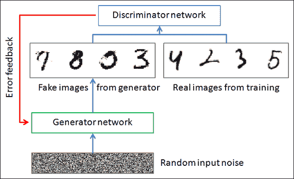

图 16-1： GAN 的工作原理。

生成器似乎占据了所有的光环（毕竟是它生成数据产品）。然而，该架构真正的核心是判别器。判别器计算误差并将其反向传播到自己的网络中，以学习如何最好区分真实数据和伪数据。误差也会传播到生成器，生成器通过优化自己来导致判别器在下一轮中失败。

GAN 似乎具有创造力。然而，更准确的术语应该是它们是生成性的：它们从示例学习数据如何变化，并可以生成新的样本，就像这些样本取自相同的数据一样。GAN 学习模拟以前存在的数据分布；它无法创造新东西。正如其他章节中所提到的，深度学习并不具有创造力。

## 实现更写实的结果

即使 GAN 的概念很清晰，但它的架构最初看起来可能很复杂。使用带有 TensorFlow 的 Keras 创建基础的 GAN 示例已经变得非常容易，而且通过实践中学习是解释技术细节的好方法，否则这些细节将停留在理论。这个过程有一些棘手的部分，但最后一切与之前段落中使用 Ian Goodfellow 比喻的描述完全一致。

在接下来的页面中，你将构建一个简单的 GAN，它在从 MNIST 数据集学习后，学习如何重建从零到九的手写数字。MNIST 数据集是一组数字化的、归一化的、28x28 像素的手写样本（由高中生和美国人口普查局的员工编写），通常用于训练图像系统。你可以在 Yann LeCun 的网站上找到数据集：[`http://yann.lecun.com/exdb/mnist/`](http://yann.lecun.com/exdb/mnist/)。

示例从导入必要的函数和类开始。该任务不需要任何复杂的东西，你已经处理过甚至测试了代码导入的所有内容：

```python
```


```python
import numpy as np
from keras.datasets import mnist
from keras.models import Sequential, Model
from keras.layers import Input, Dense, Dropout
from keras.layers import BatchNormalization
from keras.layers.advanced_activations import LeakyReLU
from keras.optimizers import Adam
import matplotlib.pyplot as plt
%matplotlib inline
```

注意，代码使用 Keras 的 `mnist` 函数下载 MNIST 数据集。这些独特的 28x28 像素图像数组表示从 0 到 255 的像素值。代码通过以下步骤对其进行处理，使其对深度学习网络有用：

1. 通过重塑数据将其转换为向量（即值列表）。
2. 使用适用于 GPU 的 32 位精度将这些值转换为浮点类型，因为 64 位版本仅适用于 CPU 处理。
3. 将这些值缩放到 0–1 的范围内。

**归一化**是在深度学习处理之前转换图像数据的过程。你可以使用不同类型的归一化，例如将范围从 0 到 1 缩放到到 -1 到 1，或者通过减去均值并除以标准差来应用统计归一化。通常，将所有值缩放到 0 到 1 的范围是一个良好的解决方案。

```python
def normalize(X):
    X = X.reshape(len(X), 784)
    X = X.astype('float32')/255
    return X

(X_train, Y_train), (X_test, Y_test) = mnist.load_data()
X_train = normalize(X_train)
```

在为神经网络准备好学习数据集后，你可以开始准备 GAN 架构。你从定义几个参数开始，例如提供给 GAN 生成图像的数据输入类型。对于此项目，一个很好的选择是使用随机数列表。将这些随机数想象为提供 GAN 的指令，以决定代表什么。你对 GAN 如何处理这些数字几乎没有控制权，但在其他模型中，你可以有效使用输入并获得所需的输出。

你还设置了优化器（在这种情况下为 Adam 优化器）并定义了架构的第一部分：生成器。生成器接收随机输入并将其通过连续四个全连接层。此过程中唯一值得注意的方面是，除了最后一层外，`LeakyReLU` 驱动了所有层，这是一种抑制负输入的激活函数。`BatchNormalization` 通过对输出应用统计归一化来控制输出分布。

```python
input_dim = 100
np.random.seed(42)
optimizer = Adam(lr=0.0002, beta_1=0.5)

gen = Sequential()
gen.add(Dense(256, input_dim=input_dim))
gen.add(LeakyReLU(alpha=0.2))
gen.add(BatchNormalization())
gen.add(Dense(512))
gen.add(LeakyReLU(alpha=0.2))
gen.add(BatchNormalization())
gen.add(Dense(1024))
gen.add(LeakyReLU(alpha=0.2))
gen.add(BatchNormalization())
gen.add(Dense(784, activation='sigmoid'))
gen.compile(loss='binary_crossentropy', optimizer=optimizer)
```

架构的第二部分判别器在构造上与生成器相似。它同样具有四个全连接层，除最后一层外均由 `LeakyReLU` 激活函数驱动。判别器没有使用 `BatchNormalization`，但使用了 `Dropout` 来避免过拟合，因为这部分执行的是监督分类任务。事实上，输出是一个输出 0 到 1 概率值的节点。神经网络这部分的目的是区分生成器部分产生的伪图像与真实图像。

```python
dsc = Sequential()
dsc.add(Dense(1024, input_dim=784))
dsc.add(LeakyReLU(alpha=0.2))
dsc.add(Dropout(0.3))
dsc.add(Dense(512))
dsc.add(LeakyReLU(alpha=0.2))
dsc.add(Dropout(0.3))
dsc.add(Dense(256))
dsc.add(LeakyReLU(alpha=0.2))
dsc.add(Dropout(0.3))
dsc.add(Dense(1, activation='sigmoid'))
dsc.compile(loss='binary_crossentropy', optimizer=optimizer)
```

至此，你已经完成了最困难的部分，将网络的前部分和后部分结合在一起，并确保它们能够协同工作。使用 `Keras` 函数型 API（详情请参见 [`https://keras.io/getting-started/functional-api-guide/`](https://keras.io/getting-started/functional-api-guide/)），你设置了比本节之前使用的序列更复杂的架构。总之，生成器部分处理输入并将结果输出给判别器部分。判别器就像是一个应用于其他函数的函数——也就是说，它是一个函数判别器（函数生成 [input]）。通过这种方式，你还可以控制网络优化，因为你可以使用 `make_trainable` 函数 `def make_trainable(dnn, flag)` 来冻结一部分。（事实上，你确实在训练生成器和判别器以最大不同的目标。）

```python
dnn.trainable = flag
for l in dnn.layers:
    l.trainable = flag

make_trainable(dsc, False)
inputs = Input(shape=(input_dim, ))
hidden = gen(inputs)
output = dsc(hidden)
gan = Model(inputs, output)
gan.compile(loss='binary_crossentropy', optimizer=optimizer)
```

现在你可以测试这套设置了。你准备了两个实用的方便函数，用于生成输入噪声和绘制生成器的结果：

```python
def create_noise(n, z):
    return np.random.normal(0, 1, size=(n, z))

def plot_sample(n, z):
    samples = gen.predict(create_noise(n, z))
    plt.figure(figsize=(15,3))
    for i in range(n):
        plt.subplot(1, n, (i+1))
        plt.imshow(samples[i].reshape(28, 28), cmap='gray_r')
        plt.axis('off')
    plt.show()
```

实际测试从配置代码进行 100 个轮次（epochs）的训练并将训练批次设置为 128 张图像开始。代码开始迭代所需的轮次和批次，以便将所有训练图像传递给 GAN。与书中其他示例一样，这个示例运行需要一段时间。如果你可以访问 GPU，最好在 Google Colab 或带有 GPU 显卡的电脑上运行。当你获得 GPU 访问后，计划在 Google Colab 上等待半小时运行。（你本地的 GPU 设置可能会更好。）在 CPU 系统上，完成该示例可能需要花费几个小时。

```python
epochs = 100
batch_size = 128
batch_no = int(len(X_train) / batch_size)
gen_errors, dsc_errors = (list(), list())

for i in range(0, epochs):
    for j in range(batch_no):
        # 从训练集中抽取随机样本
        rand_sample = np.random.randint(0, len(X_train), size=batch_size)
        image_batch = X_train[rand_sample]

        # 为生成器创建噪声输入
        input_noise = create_noise(batch_size, input_dim)

        # 从噪声输入生成伪假图像
        generated_images = gen.predict(input_noise)
        X = np.concatenate((image_batch, generated_images))

        # 创建某种噪声标签
        y = np.concatenate([[0.9]*batch_size, [0.0]*batch_size])

        # 训练判别器以区分真假
        make_trainable(dsc, True)
        dsc_loss = dsc.train_on_batch(X, y)
        make_trainable(dsc, False)

        # 训练生成假图像
        input_noise = create_noise(batch_size, input_dim)
        fakes = np.ones(batch_size)
        for _ in range(4):
            gen_loss = gan.train_on_batch(input_noise, fakes)

        # 记录损失
        gen_errors.append(gen_loss)
        dsc_errors.append(dsc_loss)

        # 显示中间结果
        if i % 10 == 0:
            print("Epoch %i" % i)
            plot_sample(10, input_dim)
```


当代码完成大量计算运行后，它可以修正其所采取的步骤：

1. 单独调用生成器函数生成一批伪假图像。由于这是一个简单的预测，不涉及学习，生成器输出的图像在开始将是完全随机的。
2. 将伪假图像与一批真实图像拼接。
3. 将图像输入判别器，以确定判别器是否能够将伪假图像与真实图像分开。这是一个训练活动，判别器学习将生成器的最先进图像与真实源图像分开。
4. 在判别器完成学习后冻结它，以便代码可以将其与生成器一起运行，但是。

在完成了基础实现（类似于刚刚完成的那个）之后，研究人员已经将 GAN 的概念扩展为许多变体，能够完成比简单创建新图像更复杂的任务。GAN 的列表及其应用每天都在增长，跟上进度非常困难。Avinash Hindupur 通过跟踪所有变体建立了一个“GAN 园”（GAN Zoo），而这项任务正变得越来越困难。（你可以在 [`https://github.com/hindupuravinash/the-gan-zoo`](https://github.com/hindupuravinash/the-gan-zoo) 查看最新的更新。）郑龙（Zheng Liu）则倾向于使用历史方法，你可以在他维护的 GAN 时间线 [`https://github.com/dongb5/GAN-timeline`](https://github.com/dongb5/GAN-timeline) 中查看。无论你通过何种方法研究 GAN，观察每一个新想法是如何从前一个想法中萌生的，都是一次非常有用的练习。

### 发明真实的名人照片

GAN 的主要应用是创建图像。从 Goodfellow 等人的原始论文演化出的第一个 GAN 网络是 `DCGAN`，它基于卷积层。本章中的示例确实能生成可靠的简单图像，但它依赖于使用全连接层而非 CNN，而 CNN 在处理图像数据时表现更好。

`DCGAN` 极大地提升了原始 GAN 的生成能力，当它们通过从名人照片中提取示例创建虚拟脸时，很快惊艳了所有人。当然，并不是所有 `DCGAN` 创建的脸都是真实的，但这种努力仅仅是创建更真实图像热潮的起点。`EBGAN-PT`、`BEGAN` 和 `Progressive GAN` 都是实现更高程度真实性的改进。你可以阅读 NVIDIA 准备的关于 Progressive GAN 的论文，以更精确地了解此类尖端技术所达到的质量：[`https://research.nvidia.com/publication/2017-10_Progressive-Growing-of`](https://research.nvidia.com/publication/2017-10_Progressive-Growing-of)。

GAN 的另一个重大增强是条件生成对抗网络（`CGAN`）。虽然让网络生成所有种类的真实图像很有趣，但如果你无法以某种方式控制收到的输出类型，它的用处就很小。`CGANs` 通过操纵输入和网络来建议 GAN 应该生成什么。现在，例如，你有网络可以根据你对头发、眼睛和其他细节外观的偏好，生成不存在的人脸图像，如 NVIDIA 的这段演示视频所示：[`https://www.youtube.com/watch?v=kSLJriaOumA`](https://www.youtube.com/watch?v=kSLJriaOumA)。

### 增强细节和图像翻译

生成更高质量的图像并可能控制生成的输出为更多应用开辟了道路。本章没有空间讨论所有的应用，但以下列表提供了你可以找到的内容概览：

* `Cycle GAN`：应用于神经风格迁移（如在第 10 章中讨论过）。例如，你可以将一匹马变成斑马，或将一幅莫奈的画变成看起来看起来出自梵高的作品。通过探索 [`https://github.com/junyanz/CycleGAN`](https://github.com/junyanz/CycleGAN) 中的项目，你可以看到它是如何工作的，并考虑它可以应用于图像的各种转换。
* `超分辨率对抗网络 (SRGAN)`：通过将模糊的低分辨率图像转换为清晰、高分辨率图像来转换图像。该技术在摄影和电影中的应用非常有趣，因为它几乎可以在不增加成本的情况下改进低质量图像。你可以在这里找到描述该技术结果的论文：[`https://arxiv.org/pdf/1609.04802.pdf`](https://arxiv.org/pdf/1609.04802.pdf)。
* `姿态引导的人物图像生成`：控制创建图像中人物的姿态。[`https://arxiv.org/pdf/1705.09368.pdf`](https://arxiv.org/pdf/1705.09368.pdf) 中的论文描述了时尚行业中的实际用途，用于生成模型的更多姿态，但你可能会惊讶地发现同样的方法可以创建一个人跳得和另一个人完全相同的视频：[`https://www.youtube.com/watch?v=PCBTZh41Ris`](https://www.youtube.com/watch?v=PCBTZh41Ris)。
* `Pix2Pix`：将草图和地图翻译成真实图像，反之亦然。你可以使用此应用将建筑草图转换为真实建筑的照片，或将卫星照片转换为绘制的地图。[`https://arxiv.org/pdf/1611.07004.pdf`](https://arxiv.org/pdf/1611.07004.pdf) 中的论文讨论了 `Pix2Pix` 网络提供的更多可能性。
* `图像修复`：通过确定缺失、取消或被遮挡的内容来修复或修改现有图像：[`https://github.com/pathak22/context-encoder`](https://github.com/pathak22/context-encoder)。
* `脸部衰老`：决定脸将如何变老。你可以在 [`https://arxiv.org/pdf/1702.01983.pdf`](https://arxiv.org/pdf/1702.01983.pdf) 阅读相关内容。
* `Midi Net`：创建你喜欢的风格的音乐，如 [`https://arxiv.org/pdf/1703.10847.pdf`](https://arxiv.org/pdf/1703.10847.pdf) 中描述的那样。

# 第 17 章：玩转深度强化学习

### 本章内容

* 介绍强化学习
* 使用 OpenAI Gym 进行实验
* 确定深度 Q 网络 (DQN) 的工作原理
* 学习 AlphaGo、AlphaGo Zero 和 Alpha Zero 的使用

除了 GAN 的示例外，你可能倾向于将深度学习等同于监督学习预测。然而，你也将深度学习用于无监督学习和强化学习（`RL`）。无监督学习支持许多既有技术，例如自动编码器和自组织映射（`SOMs`），但本书未涵盖这些内容。无监督技术可以帮助你将数据划分为同类组，或检测变量中的异常。

`RL` 技术在从业者中比无监督学习技术更流行。最近 `RL` 成为密集研究的热点，它为停车等问题提供了更智能的解决方案，例如在短短二十分钟内学会驾驶（正如该论文所示：[`https://arxiv.org/abs/1807.00412`](https://arxiv.org/abs/1807.00412)）、控制工业机器人等。（由 Yuxi Li 编写的这篇文章提供了完整的应用列表：[`https://medium.com/@yuxili/rl-applications-73ef685c7eb`](https://medium.com/@yuxili/rl-applications-73ef685c7eb)。）本章将介绍其中一些技术，包括名为 AlphaGo 的技术，它在围棋（一种中国古代棋）击败职业棋手后登上了新闻。

你还将通过操作一些示例获得实践经验，这些示例介绍了 `OpenAI Gym`（[`https://gym.openai.com/`](https://gym.openai.com/)）——一个用于深度学习实验的完整工具包，以及 `keras-rl`（[`https://github.com/keras-rl/keras-rl`](https://github.com/keras-rl/keras-rl)）——先进 `RL` 算法的现成实现，如 Google 的深度 Q 网络（`DQN`）。`DQN` 是用于玩雅达 2600 经典游戏达到人类专家水平并获胜的算法（`DQN` 只是该技术的可能应用之一，Google DeepMind 已对其申请专利）。

**记住：** 节省你手动输入代码的时间并避免错误。你可以在 `DL4D_17_Reinforcement_Learning.ipynb` 文件中找到本章的可下载源代码。（引言告诉了你如何下载本书的源代码。）

## 使用神经网络玩游戏

在孩童时期，你可能喜欢探索周围的世界，并在父母的严密关注下通过冒险来测试自己的能力。直到后来，你才用从他人那里获得的知识取代建立在直接经验上的知识。正如监督式机器学习算法类似于学生通过书中描述的他人的经验来学习世界（在这个比喻中，经验就是数据）一样，强化学习（RL）算法更像是一个幼儿——一块干净的白板，通过尝试某些事物并测试这些知识是否能提供奖励或惩罚来积累知识。强化学习提供了一种简洁的学习方式，不需要收集海量数据，但它也涉及与外部世界的复杂交互。由于强化学习在没有任何数据的情况下开始，因此与外部世界的交互以及接收反馈定义了用于获取其所需数据的方法。你可以将这种方法用于在物理世界中移动的机器人，也可以用于在数字世界中徘徊的机器人程序。特别是对于那些无法仅通过静态（提供的）数据就轻易解决的问题，强化学习似乎极具吸引力。这类问题的例子包括教计算机自己学会玩游戏，或者在不确定的情况下找到最佳结果，例如在线广告优化。广告是最好的例子之一，因为应用必须向正确的受众投放正确的广告活动，但由于所有活动都是新的，缺乏之前的经验（静态或现有数据）。

### 介绍强化学习

在强化学习中，你有一个`agent`（可以是现实世界中的机器人或数字世界中的机器人程序）与环境交互，该环境可能包含一个具有自身规则的虚拟或其他世界。智能体可以从环境中接收信息（称为`state`）并对其采取行动，有时会改变它。更重要的是，智能体可以根据其一系列动作或不作为，从环境中接收一个正面或负面的输入。即使是负面的，该输入也是一个`reward`。强化学习的目的是让智能体学习如何行为，以使其在环境内部体验期间获得的奖励总和最大。

你可以从图 17-1 中确定智能体与环境之间的关系。注意时间下标。如果你将现在时刻视为 `t`，那么上一个时刻就是 `t–1`。在 `t–1` 时刻，智能体执行动作，然后从环境中接收状态和奖励。根据`t` 时刻的动作、`t–1` 时刻的状态以及 `t` 时刻的奖励的相对值集合，强化学习算法可以学习获取特定环境状态的动作。

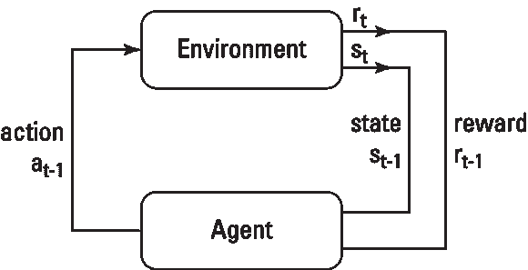

FIGURE 17-1: 强化学习中智能体与环境的关系图。

GAN 创建背后的 AI 研究科学家 Ian Goodfellow 认为，强化学习与深度学习之间的更好集成是深度学习进一步进展的首要任务之一。更好的集成将带来更智能的机器人（详情请阅 [`https://www.forbes.com/sites/quora/2017/07/21/whats-next-for-deep-learning/#36131b871002`](https://www.forbes.com/sites/quora/2017/07/21/whats-next-for-deep-learning/#36131b871002)）。集成现在是一个热点，但直到最近，强化学习与统计学和算法的联系通常比神经网络更紧密。一些人曾尝试让两者共同工作。在 20 世纪 90 年代，IBM 研究中心的 Gerald Tesauro 发明了一种让计算机学习玩双跳棋（已知最古老的棋类之一：[`http://www.bkgm.com/rules.html`](http://www.bkgm.com/rules.html)）并击败世界（人类）冠军的方法。通过编写一个名为 `TD-Gammon` 的计算机程序，成功地使用神经网络驱动强化学习算法。`TD-Gammon` 引起了人们对神经网络在强化学习问题中应用的广泛兴趣，许多人都尝试了它。

### 模拟游戏环境

即使你在处理强化学习时不需要处理预处理的数据集（这意味着你不需要收集和标记数据），你必须考虑算法与外部世界之间的交互，这是一个不同的挑战。例如，如果你想构建一个可以在国际象棋上击败你的强化学习算法，你首先必须创建一个包含所有游戏规则的国际象棋游戏。算法将这组规则作为其输入。为了让更多研究人员和从业者能够在这一前提下取得进展，非营利 AI 研究公司 OpenAI（[`openai.com/`](https://openai.com/)）开发了开源的 `gym` 包。（你可以在 [`https://github.com/openai/gym`](https://github.com/openai/gym) 找到代码，并在 [`https://arxiv.org/pdf/1606.01540.pdf`](https://arxiv.org/pdf/1606.01540.pdf) 找到描述解决方案的论文。）`gym` 是一个完整的工具包，通过提供即用的环境，帮助所有人开发应用于基础和挑战性问题的强化学习算法。

与其他书籍中的示例相比，本章的示例由于技术原因无法在 Google Colab 上运行——这些流程过于复杂。你需要在本地计算机上运行代码。

使用 `Gym`，你再也不需要担心环境问题了。它提供了不同的环境供选择，有些提供算法任务（例如学习复制序列），有些基于文本，有些与机器人相关（例如控制机器人手臂），还有许多基于旧版 Atari 街机游戏的游戏，如《太空侵略者》或《打砖大灭》。你可以在 `https://gym.openai.com/envs/` 查看所有可用环境。你可以从强化学习科学文献中描述的经典环境开始，也可以探索该包提供的其他可能性。

学习如何使用强化学习（RL）解决游戏也有助于你为现实世界的问题制定更好的解决方案。在交通网络公司 Uber，工程师们研究 RL 算法，思考 RL 的运行机制，并通过逆向工程分析 RL 如何决策，以建立对 AI 的信任和信心，正如你可以在 Uber 的工程博客 `https://eng.uber.com/atari-zoo-deep-reinforcement-learning/` 中读到的。

Gym 围绕 RL 的核心原理构建，因此你可以找到描述智能体（agent）和环境的函数和方法。你还可以让智能体在环境中执行动作或不动作。环境将通过两种形式提供反馈：新状态（可以用它来总结环境中的新情况）以及奖励（一个显示成功或失败的得分）。你唯一需要编码的是 RL 部分，可以使用几行 Python 代码开始一个基础示例。

RL 实验的环境是 `CartPole`（小车立杆）问题（详情 `https://gym.openai.com/envs/CartPole-v1/`）。一根杆子自由地连接在沿轨道移动的小车上（你不需要考虑摩擦力）。摆子从直立的不稳定平衡状态开始，环境的目标是防止它倒下（这需要偏离垂直方向的角度大于 15 度）。对于动作，你决定是在一个方向上增加还是减少小车的速度。

图 17-2 显示了 OpenAI Gym 包提供的环境表示。你也可以看到克里特岛技术教育学院工程系在这一现实实验中如何平衡 `CartPole` 的示例：`https://www.youtube.com/watch?v=XWhGjxdug0o`。

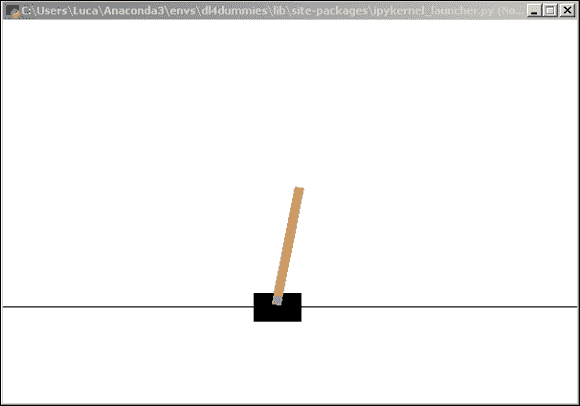

图 17-2： OpenAI Gym 中的 CartPole 环境。

CartPole 环境通过报告这些状态的观测来运行：

*   小车位置
*   小车速度
*   杆的角度
*   杆顶端的速度

你可以通过这些状态来操纵环境：

*   向左推小车
*   向右推小车

以下代码创建了环境并对其测试了一些随机命令：

```python
import numpy as np
import gym

env = gym.make('CartPole-v0')
np.random.seed(42), env.seed(42)

nb_actions = env.action_space.n
input_shape = (1, env.observation_space.shape[0])
```

你使用单个 `make` 命令创建环境，该命令返回一个 Python 类，用于获取环境的通用信息（例如关于使用 `env.action_space` 可以执行的动作）、控制时间流或在环境中执行某些特定动作。

接下来的几行重置了刚创建的环境。一切都在初始位置重新（某些环境方面是随机决定的）。代码使用一个 200 次迭代的循环，从可能的可用动作范围内采样执行各种随机动作（施加在车上的力，范围从 -1 到 +1）。当迭代完成时，游戏以失败结束（当杆偏离垂直方向超过 15 度，或者小车离开中心超过 2.4 个单位），`done` 变量变为 `true`，实验结束（步数会变化，因为这是一个随机选择的过程）。

```python
observation = env.reset()
for t in range(200):
    env.render()
    act = env.action_space.sample()
    obs, rwrd, done, info = env.step(act)
    if done:
        print("Episode concluded after %i timesteps" % (t+1))
        break
env.close()
```


### 介绍 Q-learning

构建基于深度学习的 RL 解决方案需要大量的编码工作，但你可以利用现有的包 `keras-rl`（`https://github.com/keras-rl/keras-rl`），它包含了最先进的 RL 算法。该包由 OpenAI 的研究科学家 Matthias Plappert 开发，可以与使用 Keras 构建的神经网络以及 OpenAI 环境无缝集成。你可以在 shell 中通过执行此命令安装该包：

```bash
pip install keras-rl
```

安装 `keras-rl` 后，你从 Keras 导入必要的函数（你使用神经网络作为 RL 解决方案），以及用于创建 RL 智能体的 `keras-rl` 专用函数。（关于它们如何工作的细节将在章节后部分出现。）

```python
from keras.models import Sequential
from keras.layers import Dense, Activation
from keras.layers import Flatten, Dropout
from keras.optimizers import Adam
from rl.agents.dqn import DQNAgent
from rl.policy import EpsGreedyQPolicy
from rl.memory import SequentialMemory
```

第一步是构建一个能够根据特定环境状态确定奖励结果的网络。这是一种*基于价值的学习*方法，也是深度 Q 网络（DQN）和深度 Q 学习（DQL）的核心思想：在给定状态下近似确定采取动作后的奖励。这种技术并不直接考虑过去的动作和相关状态，或者智能体应该执行的完整动作序列，但它通过指出最佳单一动作有效地解决了许多问题。

```python
model = Sequential()
model.add(Flatten(input_shape=input_shape))
model.add(Dense(12))
model.add(Activation('relu'))
model.add(Dense(nb_actions))
model.add(Activation('linear'))
print(model.summary())
```

代码创建的网络非常简单，由神经元数量减少的三层组成。所有层都由 ReLU 函数激活，但最后一层使用线性激活以获得输出值，该值将作为机器人采取的动作。

DQN 算法并不环境是如何工作的。从人类的角度来看，算法仅仅是将状态和动作与预期奖励相关联，这是通过数学函数实现的。因此，算法无法理解自己正在玩什么特定的游戏；它对环境的理解仅限于从采取的动作中获得的状态的知识。

这个神经网络与 DQN 算法相结合，并结合策略（策略是选择动作序列的函数）以及之前动作和状态的内存。内存对于允许示例训练神经网络是必要的。它记录了智能体与环境之前的经验，代码可以从中采样提取给定状态的一系列动作。神经网络使用内存来估计在状态下采取动作后可能的奖励。

对于策略，Eps Greedy Q 策略执行以下操作之一：

*   以概率 epsilon 采取随机动作
*   以 (1 – epsilon) 的概率采取当前最佳动作

这两个策略展示了探索与利用（exploration/exploitation）的平衡。当 `EpsGreedyQPolicy` 策略函数随机选择执行一个随机动作时，算法正在进行探索，因为它可能会决定一个意料之外的动作，而该动作可能会导致有趣的结果。例如，在《街机突破》（Atari Breakthrough）游戏中，在墙上挖一个洞让球乱跑并从上方破坏墙壁，这显然是一个通过探索随机产生的策略，RL 算法记录并学习到它是极其有用的。

```python
policy = EpsGreedyQPolicy(eps=0.3)
memory = SequentialMemory(limit=50000, window_length=1)
dqn = DQNAgent(model=model, nb_actions=nb_actions, memory=memory, nb_steps_warmup=50, target_model_update=0.01, policy=policy)
dqn.compile(Adam(lr=0.001))
training = dqn.fit(env, nb_steps=30000, visualize=False, verbose=1)
```

该系统使用与其他深度学习网络相同的方法进行自我训练。在完成对 30,000 个示例的学习后，它准备好进行测试：

```python
env = gym.make('CartPole-v0')
mon = gym.wrappers.Monitor(env, "./gym-results", force=True)
mon.reset()
dqn.test(mon, nb_episodes=1, visualize=True)
mon.close()
env.close()
```

测试最终应该产生高奖励（预期结果约为 200，但可能会有所不同，因为测试包含随机训练元素）。你可以通过测试期间录制的视频中的 DQN 指令来查看小车的行为：

```python
import io
import base64
from IPython.display import HTML
template = './gym-results/openaigym.video.%s.video00001.mp4'
video = io.open(template % mon.file_infix, 'r+b').read()
encoded = base64.b64encode(video)
HTML(data='''
<video width="520" height="auto" alt="test" controls>
<source src="data:video/mp4;base64,{0}"
 type="video/mp4"/>
</video>'''.format(encoded.decode('ascii')))
```


## 解释 Alpha-Go

象棋和围棋都是流行的棋盘游戏，它们具有共同特征，例如都由两个玩家轮替走棋，且缺乏随机元素（不像双陆棋那样要掷骰子）。除此之外，它们的游戏规则和复杂性也不同。在象棋中，每位玩家有`16`个棋子根据类型在棋盘上移动，当王子被将死（将军）——无法进一步移动时，游戏结束。专家计算，大约有 $10^{(123)}$ 种不同的象棋对局，考虑到科学家估计已知宇宙中的原子数量约为 $10^{(80)}$，这是一个巨大的数字。然而，计算机可以通过预测足够远的未来可能走法来获得相对于任何人类对手的优势，从而精通单局象棋。1997 年，为下象棋设计的 IBM 超级计算机深蓝号击败了世界象棋冠军加里·卡斯帕罗夫（Garry Kasparov）。


计算机无法通过暴力破解（计算从游戏开始到结束所有可能的走法）来预演完整的象棋游戏。它使用了一些启发式方法以及观察未来若干步走法的能力。深蓝号是一台高性能计算机，能够预判比以往任何计算机更多的未来走法。

在围棋中，你有一个`19-x-19`的线条网格，包含`361`个点，每个玩家在轮到自己的回合时放置一个子（通常为黑色或白色）。游戏的目的是用石头围住比对手更大的棋盘区域。考虑到这一点，平均每回合玩家有`250`种可能的走法，一局游戏包含大约`150`步，计算机需要足够的内存来存储 $150^{(250)}$ 局游戏，这相当于 $10^{(360)}$ 个棋盘。从资源的角度来看，围棋比象棋更复杂，专家曾认为在未来十年内，使用与深蓝相同的方法，没有任何计算机软件能够击败人类围棋大师。然而，AlphaGo 使用强化学习（RL）技术实现了这一目标。

DeepMind 是位于伦敦的一家谷歌的研究中心，它在 2016 年开发了一个名为 AlphaGo 的计算机系统，其围棋技巧是任何硬件和软件解决方案从未有过的。在建立系统后，DeepMind 让 AlphaGo 对阵欧洲最强的围棋冠军范棋（Fan Gui）测试，范棋曾三次获得欧洲围棋冠军。DeepMind 在闭门赛中向他发起挑战，AlphaGo 赢得了所有比赛，让范棋对计算机展示的棋风感到震惊。

随后，在范棋帮助完善 AlphaGo 技能后，由执行官 Demis Hassabis 和首席科学家 David Silver 领导的 DeepMind 团队挑战了李世石（Lee Sedol），李世石是一位排名九段的韩国职业围棋手，这是大师的最高水平。

AlphaGo 背后的故事如此迷人，以至于有人把它拍成了部电影。非常值得一看：[`https://www.imdb.com/title/tt700846/`](https://www.imdb.com/title/tt700846/)

### 判定你是否会赢

在象棋中，通过正确的计算机，你可以探索未来的走法并走得很远。棋子的数量、有限的移动以及棋盘状态都让判定变得更容易。在围棋中，由于走法数量在几步之后就会爆炸式增长，由于围棋的基础策略与象棋不同，围棋计算机程序使用另一种方法来决定走法。这种方法是蒙特卡洛树搜索（MCTS）。在 MCTS 中，计算机从当前状态模拟许多完整游戏，首先使用随机走法，然后使用在随机过程中发现的最优走法。这与强化学习中的探索/利用方法没有太大区别。通过这种方法，计算机可以通过模拟足够的游戏来获得可靠答案，判定围棋走法的优坏。

AlphaGo 使用 MCTS，但通过神经网络来支持算法的处理。该系统由两个部分组成：

- **未来走法观察系统**：一种类似于深蓝号使用的方法。它是一个树搜索系统，因为它对游戏进行分支并依赖 MCTS。
- **某些 CNN**：为树搜索系统提供指导。

通过同时使用提供游戏局势直觉的价值网络和帮助计算机预判未来走法的策略网络，AlphaGo 可以在游戏过程中提供最佳策略和走法。

鉴于这种架构涉及许多不同的系统，它并不是真正的端到端架构，DeepMind 的工程师首先通过高水平业余选手的对局来训练 AlphaGo，以启动神经网络。（他们使用了从在线围棋社区收集的 160,000 局业余比赛。）最后，他们让 AlphaGo 进行自我对弈，以学习如何改进和完善其棋艺。在这里，强化学习（RL）技术起了关键作用：通过让 AlphaGo 进行数百万次自我挑战，教会了计算机玩西洋棋、象棋、扑克、拼字游戏以及最后的围棋，这是在人类无法处理的快速且剧烈的体验构建环境中完成。

AlphaGo 项目首席研究员 David Silver 宣布，自学习在构建智能系统方面非常有效，因为这些系统面对的对手水平始终恰恰当——既不会太低也不会太高。让系统通过自我对弈来学习在 1992 年的 TD-Gammon 中可见，在 1983 年电影《游戏大战》（*WarGames*）中的 WOPR 计算机也是如此。（从这个意义上说，WOPR 计算机就像 HAL9000 之于《2001 太空漫游》一样代表人工智能。）

### 大规模应用自学习

创建 AlphaGo 的 DeepMind 团队在方案成功后并没有停止；他们停用了 AlphaGo 并创建了更令人惊的系统。首先，团队构建了 AlphaGo Zero，它是通过自我对弈训练的 AlphaGo。然后，他们创建了 Alpha Zero，这是一个可以自己学习玩象棋和日本棋（象棋）的通用程序。

如果说 AlphaGo 展示了如何解决被认为计算机无法完成的问题，那么 AlphaGo Zero 则证明了计算机可以通过自学习（本质上是强化学习）获得超能力。最终，它的结果甚至比从人类经验开始的结果更好：AlphaGo Zero 挑战 AlphaGo 并赢得了 100 局且未尝一败。

发表在《自然》杂志上的论文（可以在 DeepMind 网站访问 [`https://deepmind.com/research/publications/mastering-game-go-without-human-knowledge/`](https://deepmind.com/research/publications/mastering-game-go-without-human-knowledge/)）上解释了 AlphaGo Zero 是从随机下棋开始学习的。这种活动与代码示例中强化算法`DQN`学习平衡小车的方式相似。在约 2900 万局自我对弈中，AlphaGo Zero 达到了超过之前的 AlphaGo 系统的水平。此外，AlphaGo Zero 在深度学习模型和硬件需求方面都更简单。它只需要一台计算机和四块 Google 自制的 TPU 芯片，而原始的 AlphaGo 需要几台机器和 48 个 TPU。

AlphaGo、AlphaGo Zero 和 Alpha Zero 代表了强化学习的新前沿，以及对未来应用的希望。事实上，除了下围棋、象棋和日本棋之外，这些系统无法胜任其他任务。就像深蓝系统一样，这些系统专注于它们可以以超人类水平执行的单一任务。DeepMind 的研究人员设想了更多目前对人类来说困难且具有挑战性的可能应用，例如蛋白质折叠、优化网络能耗或在化学领域发现新材料。

# 第 4 部分

# 十项

在本部分中……

- 考虑使用深度学习的现实应用。
- 寻找一些用于深度学习任务的最佳工具。
- 发现一种依赖深度学习的职业。

# 第 18 章

## 需要深度学习的十项应用

在本章中

**与人直接交互**

**确定绿色技术的有效性**

**利用概率预测未来**

**模拟创造性过程**

这一章太短了。它甚至无法开始描述深度学习在未来将如何影响你。可以将这一章看作提供了一个引人入胜的小贴士——一个能激发你进一步探索深度学习世界胃口的开菜。你在本章中列出的应用在某些情况下已经很常见了。你今天可能已经使用了其中至少一个，而且很不止一个。读完这一章后，你可能想花时间考虑深度学习目前影响你生活的所有方式。尽管这项技术已经开始被广泛使用，但这只是开始。我们正处于某事物的起点，而 AI 在此实际上还非常不。

这一章没有讨论杀手机器人、反乌托邦的未来、AI 失控或任何可能在电影中看到的耸动性场景。这一章是关于真实生活的，讨论了你现在就可以交互的现有 AI 应用。

## 为黑白视频和照片恢复色彩

你可能有一些家人或特殊事件的黑白视频或照片，你希望看到它们是彩色的。颜色由三个元素组成：色相（实际颜色）、亮度（颜色的明暗）和饱和度（颜色的强度）。你可以在 [`http://learn.leighcotnoir.com/artspeak/elements-color/hue-value-saturation/`](http://learn.leighcotnoir.com/artspeak/elements-color/hue-value-saturation/) 阅读更多关于这些元素。奇怪的是，许多艺术家是色盲，并在创作中大量利用亮度（阅读 [`https://www.nytimes.com/2017/12/23/art/colorblind-artist-illustrator-childrens.html`](https://www.nytimes.com/2017/12/23/art/colorblind-artist-illustrator-childrens.html) 作为许多示例之一）。所以，缺少色相（黑白艺术缺乏的元素）并不是世界末日。相反，一些艺术家将其视为一种优势（详见 [`https://www.artsy.net/article/the-advantages-of-being-colorblind-artist`](https://www.artsy.net/article/the-advantages-of-being-colorblind-artist)）。

当用黑白观察某物时，你看到的是亮饱和度，但看不到色相。`Colorization`（上色）是将色相加回去的过程。艺术家通常通过精细选择单个颜色来执行这一过程，正如 [`https://fstoppers.com/video/how-amazing-colorization-black-and-white-photos-are-done-5384`](https://fstoppers.com/video/how-amazing-colorization-black-and-white-photos-are-done-5384) 和 [`https://www.diyphotography.net/know-colors-add-colorizing-black-white-photos/`](https://www.diyphotography.net/know-colors-add-colorizing-black-white-photos/) 中描述的那样。然而，AI 使用卷积神经网络（CNN）实现了这一过程的自动化，正如 [`https://emerj.com/ai-future-outlook/ai-is-colorizing-and-beautifying-the-world/`](https://emerj.com/ai-future-outlook/ai-is-colorizing-and-beautifying-the-world/) 中描述的那样。

使用 CNN 上色的简单方法是找到一个帮助你的库。Algorithmia 网站 [`https://demos.algorithmia.com/colorize-photos/`](https://demos.algorithmia.com/colorize-photos/) 提供了这样的库并展示了一些示例代码。你可以在提供的字段中粘贴 URL 来尝试该应用程序。文章 [`https://petapixel.com/2016/07/14/app-magically-turns-bw-photos-color-ones/`](https://petapixel.com/2016/07/14/app-magically-turns-bw-photos-color-ones/) 描述了该应用程序的效果有多好。简直太神奇了！

## 实时估计人体姿态

人体姿态（Person poses）并不能告诉你视频流中是谁，而是告诉你视频流中包含了人的哪些元素。例如，使用人体姿态识别可以告诉你人的手肘是否出现在视频中，以及出现在哪里。位于[`https://medium.com/tensorflow/real-time-human-pose-estimation-in-the-browser-with-tensorflow-js-7dd0bc881cd5`](https://medium.com/tensorflow/real-time-human-pose-estimation-in-the-browser-with-tensorflow-js-7dd0bc881cd5)上的文章将更详细地介绍这种整个可视化技术是如何运作的。事实上，你可以通过第一个案例中一个人和第二个案例中三个人的简短动画，看到系统是如何运行的。

人体姿态可以有各种各种用途。例如，你可以利用人体姿态来帮助人们改进各种运动的动作——从高尔夫到保龄球都有。人体姿态还可以让新类型的视频游戏成为可能。想象一下，不需要那些通常笨重的设备就能为游戏追踪人的位置。在理论上，你可以使用人体姿态进行犯罪现场分析，或者确定一个人实施犯罪的可能性。

姿态检测的另一个有趣应用是医疗和康复用途。由深度学习驱动的软件可以告诉你练习练习得是否正确，并跟踪你的进步。此类应用可以支持专业康复师的工作，在你不在医疗机构时提供护理（这种活动被称为远程康复；详情见[`https://matrc.org/telerehabilitation-telepractice`](https://matrc.org/telerehabilitation-telepractice)）。

幸运的是，你今天就可以使用`tfjs-models` (`PoseNet`) 库开始尝试人体姿态识别了，该库位于[`https://github.com/tensorflow/tfjs-models/tree/master/posenet`](https://github.com/tensorflow/tfjs-models/tree/master/posenet)。你可以通过网络摄像头看到它的运行效果，并附带源代码，地址位于[`https://ml5js.org/docs/posenet-webcam`](https://ml5js.org/docs/posenet-webcam)。该示例加载需要一些时间，所以你需要耐心等待。

## 执行实时行为分析

行为分析比前一节描述的人体姿态分析更进了一步。当你执行行为分析时，问题仍然不是“是谁”，而是“如何做”。这一特定的 AI 应用影响了供应商设计产品和网站的方式。类似[`https://amplitude.com/blog/2016/06/14/10-steps-behavioral-analytics`](https://amplitude.com/blog/2016/06/14/10-steps-behavioral-analytics)那样的文章，详尽地定义并刻画了行为分析的使用。在大多数情况下，行为分析帮助你发现产品设计师预期的你遵循的过程与你实际使用的过程是不匹配的。

行为分析在生活的其他领域也起着作用。例如，它可以帮助医疗专业人员识别患有特定医疗状况（如自闭症）患者的潜在问题，并帮助患者克服这些问题（详情见[`https://www.autismspeaks.org/applied-behavior-analysis-aba-0`](https://www.autismspeaks.org/applied-behavior-analysis-aba-0)）。行为分析可能还会帮助体育教师向学生展示如何磨练技能。你可能看到它被用于法律行业以帮助确定动机。（罪责是显而易见的，但一个人为什么做某事对于公正纠正不想要的行为至关重要。）

幸运的是，你已经可以使用 Python 开始执行行为分析了。例如，[`https://rrighart.github.io/GA/`](https://rrighart.github.io/GA/) 网站讨论了关于网页分析的技术（并提供了相应的源代码）。

## 语言翻译

互联网创造了一个环境，让你可能不知道你真正是在和谁说话，那个人在哪里，有时甚至不知道那个人什么时候在对你说。然而，有一点没有改变：当双方没有共同语言时，需要将一种语言翻译成另一种语言。在某些情况下，假设双方都有幽默感，误译可能是搞笑的。然而，误译也导致了各种后果，包括战争（见[`https://unbabel.com/blog/translation-errors-war-iraq-hiroshima-vietnam/`](https://unbabel.com/blog/translation-errors-war-iraq-hiroshima-vietnam/)）。因此，尽管互联网上的翻译软件非常容易获得，仔细选择使用哪个产品非常重要。这些应用中最受欢迎的之一是 Google 翻译（[`translate.google.com/`](https://translate.google.com/)），但还有许多其他应用可用，例如 DeepL（[`www.deepl.com/en/translator`](https://www.deepl.com/en/translator)）。根据福布斯介绍，机器翻译是 AI 擅长的领域之一（见[`https://www.forbes.com/sites/bernardmarr/2018/08/24/will-machine-learning-ai-make-human-translators-an-endangered-species/#114274573902`](https://www.forbes.com/sites/bernardmarr/2018/08/24/will-machine-learning-ai-make-human-translators-an-endangered-species/#114274573902)）。

翻译应用通常依赖于双向循环神经网络（`BRNNs`），正如[`https://blog.statsbot.co/translation-960ed8f19e`](https://blog.statsbot.co/translation-960ed8f19e) 中描述的那样。你不需要创建自己的`BRNN`，因为你有许多现有 API 可供选择。例如，你可以使用[`https://pypi.org/project/googletrans/`](https://pypi.org/project/googletrans/) 上的库通过 Python 访问 Google 翻译 API。

要确定太阳能在在你的所在地是否真的有效是困难的，除非有许多其他人也在使用。此外，要知道可能会获得何种程度的节省更加困难。当然，如果太阳能不能满足你的使用目标，你就不想安装，而这些目标可能并不包括长期成本节约（尽管通常包含）。一些深度强化学习项目现在可以帮助你消除太阳能的猜测，包括位于[`https://www.google.com/get/sunroof`](https://www.google.com/get/sunroof)的 Projectroof。幸运的是，你也可以在 Python 应用中获取此类预测的支持，地址为[`https://github.com/ColasGael/Machine-Learning-for-Solar-Energy-Prediction`](https://github.com/ColasGael/Machine-Learning-for-Solar-Energy-Prediction)。

## 击败电脑游戏中的对手

人机大战持续持续吸引着人们的关注。从赢得象棋到赢得围棋，AI 似乎已经变得不可战胜——至少在某一项游戏中是不可战胜的。与人类不同，AI 是专精的，一个能赢得围棋的 AI 不可能在国际象棋上表现良好。尽管如此，2017 年通常被认为是人类在游戏中战胜 AI 时代终结的开始，正如[`https://newatlas.com/ai-2017-beating-humans-games/52741/`](https://newatlas.com/ai-2017-beating-humans-games/52741/) 中描述的那样。当然，竞争已经持续了一段时间，你很可能找到 AI 在 2017 年之前就赢得了比赛。事实上，某些来源（[`https://en.wikipedia.org/wiki/AlphaGo`](https://en.wikipedia.org/wiki/AlphaGo)）将围棋胜利的时间追溯到 2015 年 10 月。[`https://interestingengineering.com/11-times-ai-beat-humans-at-games-art-law-and-everything-in-between`](https://interestingengineering.com/11-times-ai-beat-humans-at-games-art-law-and-everything-in-between) 中的文章描述了 AI 获胜的其他 11 次情况。

问题在于如何定制创建一个能够赢得特定游戏的 AI，并意识到在专精于某项游戏时，该 AI 可能在其他游戏中表现不佳。仅为某一项游戏构建 AI 的过程看起来可能很困难。[`https://medium.freecodecamp.org/simple-chess-ai-step-by-step-d55a9266977`](https://medium.freecodecamp.org/simple-chess-ai-step-by-step-d55a9266977) 中的文章描述了如何构建一个简单的国际象棋 AI，它实际上无法击败象棋大师，但对中级选手可以表现得良好。


然而，现在说人类已经出局其实还为时过早。在未来，人们可能会通过多项游戏与 AI 竞争。这类竞争的例子已经比不胜数，例如参加“游戏三项铁赛”的人，这种比赛由三项体育赛事组成，而不是一项。那么竞争将变成一种灵活性的竞争：AI 不能仅仅简单地埋头只学一项游戏，因此人类将拥有灵活性上的优势。这种 AI 使用方式表明，人类和 AI 在未来可能必须合作，AI 专负责特定任务，而人类提供执行所有必要任务所需的灵活性。

## 生成语音

你的汽车可能已经在对你说话了；现在很多汽车经常与人交流。奇奇的是，语音生成的质量通常非常好，以至于很难区分生成的语音和真人声音。诸如[`https://qz.com/1165775/googles-voice-generating-ai-is-now-indistinguishable-from-humans/`](https://qz.com/1165775/googles-voice-generating-ai-is-now-indistinguishable-from-humans/) 等文章讨论了寻找听起来非常真实的计算机语音的体验如何变得越来越普遍。这个问题引起了足够的关注，以至于许多呼叫中心会告诉你，你正在与电脑而不是人说话。


尽管呼叫输出依赖于脚本回复，使其能够以极高的置信度生成回复，但语音识别执行起来稍微困难（尽管已经很大提高了）。要成功使用语音识别，你通常需要将输入限制在特定的关键词上。通过使用语音识别旨在理解的关键词，你可以避免用户重复请求。这种对特定术语的需求暴露了你正在与电脑对话——只需要求意料之外的东西，电脑就不知道该如何处理。

实现自己的语音系统的简单方法是依靠现有的 API，例如 Cloud Speech to Text（[`https://cloud.google.com/speech-to-text/`](https://cloud.google.com/speech-to-text/)）。当然，你可能需要可以自定义的东西。在这种情况下，使用 API 将证明非常有帮助。[`https://medium.com/@sundarstyles89/create-your-own-google-assistant-voice-based-assistant-using-python-94b577d724f9`](https://medium.com/@sundarstyles89/create-your-own-google-assistant-voice-based-assistant-using-python-94b577d724f9)的文章告诉了如何使用 Python 构建你自己的语音应用程序。

## 预测人口统计数据

人口统计数据，即根据某些特征对人进行分类的重要或社会统计数据，既是艺术也是科学。你可以找到大量关于让你的计算机为客户（或潜在客户）生成人口统计数据的文章。人口统计的应用非常广泛，你会看到它们被用于预测特定群体将购买哪种产品（相对于竞争对手）。人口统计是人类进行分类并根据其群体关联预测其某些行为的重要手段。以下是经常看到 AI 在收集人口统计数据时被引用的方法：

*   **历史：** 根据先前的行为，AI 概括你未来可能执行的操作。
*   **当前活动：** 根据你现在执行的动作以及可能的其他特征（如性别），计算机预测你的下一个动作。
*   **特征：** 根据定义你的属性（如性别、年龄），计算机预测你可能做出的选择。

 中的文章说 AI 现在仅根据名称就能预测人口统计数据。文章中的公司 Demografy（[`https://demografy.com/`](https://demografy.com/)）声称提供性别、年龄和文化亲和力。尽管该网站声称准确率为 90% 到 95%（详情见[`https://demografy.com/faq`](https://demografy.com/faq) 中的 Demografy 回答），这种统计是不可能的，因为某些名称具有性别模糊性，而某些名称在某些国家属于另一种性别。事实上事实上，Demografy 网站上的回答似乎承认了这一点，表示结果“很大程度上取决于你的列表，可能与这些平均值有很大不同”。是的，人口预测可以可行，但在相信这些网站的话之前要谨慎。

如果你想尝试人口预测，可以在网上找到许多 API。例如，DeepAI API（[`https://deepai.org/machine-learning-model/demographic-recognition`](https://deepai.org/machine-learning-model/demographic-recognition)）承诺根据人在视频中的外观帮助预测年龄、性别和文化背景。每个在线 API 都有其专长，因此你需要根据你可以提供的输入数据类型选择 API。

## 从真实世界照片创建艺术

第 15 章（#c15.xhtml）为你提供了一些主意，关于深度学习如何利用真实世界照片的内容和现有大师的风格来创造者的结合。事实上，一些使用这种方法生成的艺术品在拍卖场上拍出了高价。你可以找到各种关于这种类型艺术生成的文章，例如 *Wired* 的文章[`https://www.wired.com/story/we-made-artificial-intelligence-art-so-can-you/`](https://www.wired.com/story/we-made-artificial-intelligence-art-so-can-you/)。

然而，尽管挂在墙上的图片很漂亮，但你可能想创作其他类型的艺术。例如，你可以使用`Smoothie 3-D`等产品创建你图片的 3D 版本。[`https://styly.cc/tips/smoothie-3d/`](https://styly.cc/tips/smoothie-3d/) 和 [`https://3dprint.com/38467/smoothie-3d-software/`](https://3dprint.com/38467/smoothie-3d-software/) 上的文章介绍了该软件的工作原理。这与创作雕塑不同；而是你使用 3D 打印机来构建你图片的 3D 版本。[`https://thenextweb.com/artificial-intelligence/2018/03/08/try-this-ai-experiment-that-converts-2d-images-to-3d/`](https://thenextweb.com/artificial-intelligence/2018/03/08/try-this-ai-experiment-that-converts-2d-images-to-3d/) 上的文章提供了一个你可以进行的实验，以观察该过程是如何工作的。


AI 的输出也不一定由视觉内容组成。例如，深度学习允许你根据图片的内容创作音乐，正如[`https://www.cnet.com/news/baidu-ai-creates-original-music-by-looking-at-pictures-china-google/`](https://www.cnet.com/news/baidu-ai-creates-original-music-by-looking-at-pictures-china-google/) 所描述的。这种艺术形式让 AI 使用的方法更加清晰。AI 将它不的内容从一种形式转换为另一种形式。作为人类，我们看到并理解这种转换，但计算机看到的只是通过其他人类创建的巧妙算法处理的数字。

## 预测自然灾害

只要有人类和自然灾害，人类就一直试图预测它们。没有人希望卷入地震、龙卷风、火山爆发或其他任何自然灾害。鉴于人类还无法很好地控制环境以防止任何自然灾害，在这种情况下，能够逃离是首要考虑因素。

根据[`http://www.digitaljournal.com/tech-and-science/technology/google-to-use-ai-to-predict-natural-disasters/article/533026`](http://www.digitaljournal.com/tech-and-science/technology/google-to-use-ai-to-predict-natural-disasters/article/533026) 上关于 Google 解决方案的文章，深度学习提供了寻找人类无法想象的极其微妙模式的方法。这些模式可以帮助预测自然灾害。软件能够预测任何灾害，简直令人惊叹。然而[`http://theconversation.com/ai-could-help-us-manage-natural-disasters-but-only-to-an-extent-90777`](http://theconversation.com/ai-could-help-us-manage-natural-disasters-but-only-to-an-extent-90777) 上的文章警告说，完全依赖此类软件将是一个错误。对技术的过度依赖是本书始终的主题，所以即使深度学习在预测自然灾害方面也不完美，也不要意外。

# 第 19 章

## 十个必备的深度学习工具

### 本章内容

-  **增强你的开发环境**
-  **创建特殊环境**
-  **执行业务任务**
-  **访问专用硬件**

深度学习是一项复杂的任务，如果你尝试编写你需要的每一行代码，你将永远没有时间进行任何分析，而分析本身就需要花费大量时间。因此，你需要能够帮助你更轻松地完成工作的工具。在整本书中，你已经看到了许多描述和使用的工具。然而，除了`TensorFlow`和`Keras`之外，之前描述的工具通常是很好的起点，或者是可以缓解学习曲线的考虑因素。本章中的工具是特殊的。它们帮助你以专业的成果完成各种任务。

## 使用 Theano 编译数学表达式

Theano [`http://deeplearning.net/software/theano/`](http://deeplearning.net/software/theano/) 是一个 Python 库，让你能够更快速地处理各种数学表达式。需要时，你可以将第 4 章中“获取你的 TensorFlow 和 Keras 副本”部分安装的`TensorFlow`副本替换为`Theano`。使用哪一个选择可能非常复杂，[`https://www.analyticsindiamag.com/tensorflow-vs-theano-researchers-prefer-artificial-intelligence-framework/`](https://www.analyticsindiamag.com/tensorflow-vs-theano-researchers-prefer-artificial-intelligence-framework/) 和 [`https://www.reddit.com/r/MachineLearning/comments/4ekywt/tensorflow_vs_theano_which_to_learn/`](https://www.reddit.com/r/MachineLearning/comments/4ekywt/tensorflow_vs_theano_which_to_learn/) 上的讨论所示了这一点。

软件能够预测任何灾害，简直令人惊叹。（注：提供的原始文本在此部分似乎是不完整/重复的）。

奇奇的是，你也可以在你的 Microsoft Cognitive Toolkit (CNTK) 安装版本上使用 Keras。Keras 通过后端支持这三者，正如在 [`https://keras.io/backend/`](https://keras.io/backend/) 中描述的那样。你只需要使用不同的底层工具包并更改配置文件即可。因此，你可以尝试哪种工具包最符合你的需求，而你的 Keras 代码将保持不变。然而，有一点注意：你必须使用抽象的 Keras 后端 API 编写代码，才能兼容多个底层工具包。本书没有教你如何使用抽象的 Keras 后端 API，因此这项技术需要你花费额外的学习时间。

## 使用 Chainer 动态计算图

曾几何时，你可能使用过如`Pylearn2`的库（基于`TensorFlow`构建；详情请见 [`http://deeplearning.net/software/pylearn2/`](http://deeplearning.net/software/pylearn2/)）来弥合算法与深度学习之间的差距。然而，由于等原因，诸如`Chainer` ([`https://chainer.org/`](https://chainer.org/)) 等新产品已登台，这些原因可以在 [`https://www.quora.com/Which-is-better-for-deep-learning-TensorFlow-or-Chainer`](https://www.quora.com/Which-is-better-for-deep-learning-TensorFlow-or-Chainer) 中讨论。其重点在于更容易访问当今大多数系统可以提供或通过在线主机访问的功能。因此，你可以依靠`Chainer`提供这些特性：

* 支持 GPU 访问的 CUDA
* 仅需少量努力即可支持多个 GPU
* 支持多种网络，包括前馈网络、CNN、循环网络和递归网络
* 每批（Per-batch）架构支持
* 在正向计算中控制流语句且不丢失反向传播
* 强大的调试功能，使错误查找变得更容易

## 使用 Torch 创建类 MATLAB 环境

为了从深度学习解决方案中获得最佳性能，你需要 GPU 支持，这就是`Torch` ([`http://torch.ch/`](http://torch.ch/)) 发挥用场的地方。它在开发解决方案时优先考虑 GPU，这允许你获得 GPU 提供的额外核心和优化处理功能。为了提供最高速度，Torch 依赖`LuaJIT`编译器 ([`http://luajit.org/`](http://luajit.org/)) 来编译你的应用程序，而不是解释它。（解释器会让应用程序运行得更慢。）它还有底层的 C 语言和`CUDA` ([`www.geforce.com/hardware/technology/cuda`](https://www.geforce.com/hardware/technology/cuda)) 实现，可以将你的高层代码转换为低级语言以尽可能快速运行。

`Torch`带有一些与`NumPy`类似的特性，但侧重于深度学习。（你可以在 [`http://torch.ch/docs/package-docs.html`](http://torch.ch/docs/package-docs.html) 包文档。）例如，你会发现：

* N 维数组
* 矩阵操作功能
* 线性代数例程

除了这些特性，你还会发现一些专门针对 AI 的需求，包括深度学习：

* 神经网络模型
* 能量模型
* 数值优化例程
* 快速可靠的 GPU 支持

## 使用 PyTorch 动态执行任务

`PyTorch` ([`pytorch.org/`](https://pytorch.org/)) 是`TensorFlow`的有力竞争对手。主页上可能会引起你注意的一点是，你可以点击各种选项，根据你真正想使用的技术显示你平台所需的安装指令。事实上，在你在网上找到的所有产品中，这可能是最容易安装的。安装的便利性也扩展到该产品的其他方面，例如调试，正如 [`https://medium.com/@NirantK/the-silent-rise-of-pytorch-ecosystem-693e74b33f1e`](https://medium.com/@NirantK/the-silent-rise-of-pytorch-ecosystem-693e74b33f1e) 中描述的那样。注意，这篇文章也描述了一些缺失元素以及如何修复它们。

你使用`PyTorch`的就像使用`TensorFlow`和`Keras`，但你需要了解一些差异。

## 使用 CUDA 加速深度学习

你可以在各种语言的各种形式中找到`CUDA` ([developer.nvidia.com/how-to-python`](https://developer.nvidia.com/how-to-python))。例如，C/C++ 版本出现在 [`developer.nvidia.com/cuda-library`](https://developer.nvidia.com/cuda-library) 中。本节关注 Python 版本，但也存在其他版本，它们的功能与本节不同。无论它以什么形式存在，CUDA 都关乎使用 GPU，特别是 Titan V ([`www.nvidia.com/titan-v/`](https://www.nvidia.com/titan-v/))。

你实际上并不需要在系统中拥有 GPU 就可以使用 CUDA。相反，你可以访问许多托管网站上的 GPU，包括 Amazon AWS、Microsoft Azure 和 IBM SoftLayer。事实上，你的安装程序附带了 AWS 上由 NVIDIA 维护的 CUDA 镜像 (AMI)，所以你甚至不需要费太大精力就能访问它。

CUDA 在使用各种 GPU 来源方面提供了极大的灵活性。在大多数情况下，灵活性是以更高的学习曲线和额外的编码为代价的，因为你无法对包的使用做出许多假设。因此，在在你安装此包之前，请务必阅读 [`devblogs.nvidia.com/numba-python-cuda-acceleration`](https://devblogs.nvidia.com/numba-python-cuda-acceleration/) 上的博客文章，它会更多地告诉你如何使用 CUDA 执行现实世界的任务。然而，在你度过学习曲线后，你会发现你可以执行一系列在其他情况下可能无法完成惊的任务。

在与 CUDA 工作时，许多开发者将其与 CUDA 深度神经网络 (cuDNN) 库 [`developer.nvidia.com/cudnn`](https://developer.nvidia.com/cudnn) 结合。这是一个特殊的优化例程库，支持深度学习的 CUDA。

## 使用 Deeplearning4j 满足业务需求

企业可以被认为是无聊的，因为在数据方面，它们使用不同的参数执行相同的重复任务。然而，使用神经网络来处理业务数据需求是比较棘手的，因为各种任务差异太大，单个神经网络模型无法适应所有情况。`Deeplearning4J` ([`deeplearning4j.org/`](https://deeplearning4j.org/)) 让你能够组合各种浅层网络（层），创建一个深度神经网络。这种方法大大缩短了训练深度神经网络的时间，而时间通常是企业极其稀缺的。

此特定解决方案用 Java 编写，并适用于任何兼容 JVM 的语言，包括 Scala、Clojure 或 Kotlin。底层计算是用`C`和`CUDA`编写的，因此只要你只想访问底层计算，也可以在这些语言中运行该解决方案。要在 Python 中使用该解决方案，你需要在 Keras 上运行它。[`https://www.javacodegeeks.com/2018/11/deep-learning-apache-kafka-keras.html`](https://www.javacodegeeks.com/2018/11/deep-learning-apache-kafka-keras.html) 中的示例演示了在该环境中创建解决方案的涉及内容。在着手之前，请确保花些时间回顾它。

## 使用 Neural Designer 进行数据挖掘

本章列出的许多产品感觉并不完全完成；它们带有研究人员和实验人员喜爱的粗糙感。然而，有些人仅仅只需要一个实用的解决方案。Neural Designer ([`https://www.neuraldesigner.com/`](https://www.neuraldesigner.com/)) 就是这样一个解决方案，它可以执行多种任务，包括：

*   发现复杂的关系
*   识别未知模式
*   预测趋势
*   从数据中识别关联

与你找到许多其他解决方案不同，Neural Designer 还特别强调某些特定行业。你可以找到以下领域的特定信息：

*   银行与保险 ([`www.neuraldesigner.com/solutions/solutions-banking-insurance`](https://www.neuraldesigner.com/solutions/solutions-banking-insurance))
*   工程与制造 ([`www.neuraldesigner.com/solutions/solutions-engineering-manufacturing`](https://www.neuraldesigner.com/solutions/solutions-engineering-manufacturing))
*   零售与消费 ([`www.neuraldesigner.com/solutions/solutions-retail`](https://www.neuraldesigner.com/solutions/solutions-retail))
*   医疗保健 ([`www.neuraldesigner.com/solutions/solutions-health`](https://www.neuraldesigner.com/solutions/solutions-health))

## 使用 Microsoft Cognitive Toolkit (CNTK) 训练算法

Microsoft Cognitive Toolkit (CNTK) ([`www.microsoft.com/en-us/cognitive-toolkit/`](https://www.microsoft.com/en-us/cognitive-toolkit/)) 是另一个用于深度学习的后端框架，类似于 TensorFlow 和 Theano。你可以在这三个中的任何一个上运行 Keras。因此，人们不断比较这三者以查看哪个性能最好，例如 [`https://minimaxir.com/2017/06/keras-cntk/`](https://minimaxir.com/2017/06/keras-cntk/) 中 CNTK 和 TensorFlow 的比较。你可以在 [`http://kaggler.com/keras-backend-benchmark-theano-vs-tensorflow-vs-cntk/`](http://kaggler.com/keras-backend-benchmark-theano-vs-tensorflow-vs-cntk/) 快速概览所有三个后端。

除了比较这三个框架的速度和其他性能问题外，你还需要考虑功能。显然，所有三者都可以运行 Keras —— 通常需要进行一些修改（参见`Augmenting TensorFlow Using Keras`）。

## 使用 MXNet 挖掘 GPU 能力

MXNet ([`www.apache.org/`](https://www.apache.org/)) 有一些你可以使用的有趣功能，但它仍处于测试阶段。要使用 MXNet，你需要阅读 [`beta.mxnet.io/guide/crash-course.html`](https://beta.mxnet.io/guide/crash-course.html)（注意这是测试版）。在学习快速上手课程时，你首先注意到 Gluon 可能还没有准备好。要使用 Gluon，你需要在 Keras 上运行它。

Gluon 的优点之一是，你可以在 Medium 上找到额外的资源 [`https://www.neuraldesigner.com/solutions/solutions-banking-insurance`](https://www.neuraldesigner.com/solutions/solutions-banking-insurance)，因为它支持多种语言。

最令人印象深刻的是该产品已经支持的海量模型。此外，你还可以找到大量的示例来降低学习曲线 [`https://github.com/apache/incubator-mxnet/tree/master/example`](https://github.com/apache/incubator-mxnet/tree/master/example) 以及教程 [`https://mxnet.apache.org/versions/master/index.html`](https://mxnet.apache.org/versions/master/index.html)。总的来说，这是一个由于巨大潜力值得关注的产品。

电影剧情的一部分涉及在到处安装摄像头——甚至在卧室里。主角每天早上醒来都会向每个看着她的人打招呼。

# 第 20 章：使用深度学习的十种职业

本章内容

*   与人打交道
*   开发新技术
*   分析数据
*   进行研究

本书涵盖了深度学习的许多不同用途 —— 从你数字助的语音激活功能到自动驾驶汽车。使用深度学习来改善你的日常生活当然是很好的，但大多数人需要其他理由来接受某项技术，例如获得工作。幸运的是，深度学习不仅影响你更快定位信息的能力，还提供了一些有趣的就业机会，并带有只有深度学习才能提供的“惊艳”因素。本章为你概述了当今在某种程度上依赖深度学习的十种有趣职业。尽管如此，这些材料只是冰山一角；比这本书能容纳的职业已经在使用深度学习，而且每天都有新的职业加入。

## 管理人员

名为《圆环》（*The Circle* ([`www.amazon.com/exec/obidos/ASIN/B071GB3P5N/datacservip0f-20/`](https://www.amazon.com/exec/obidos/ASIN/B071GB3P5N/datacservip0f-20/))）的恐怖电影会让你相信，现代技术比乔治·奥威尔书籍《1984》中的“老大哥”更具侵略性。

然而，深度学习在大部分情况下并不是为了监控和判断人员。它更像是甲骨文的全球人力资源云（[`cloud.oracle.com/en_US/global-human-resources-cloud`](https://cloud.oracle.com/en_US/global-human-resources-cloud)）。这项技术一点也不可怕，它能让你看起来非常聪明，并且对全天的活动了如指，正如[`https://www.youtube.com/watch?v=NMm_cIHeEZ0&list=PL2Gxt-CBX-Ep2n5ytNGkl3bRUnUKAMI1Z`](https://www.youtube.com/watch?v=NMm_cIHeEZ0&list=PL2Gxt-CBX-Ep2n5ytNGkl3bRUnUKAMI1Z)中的视频所示。视频略显夸张，但它能让你直观地感受到深度学习目前如何让你的工作变得更容易。


这项技术背后的理念是让人们更容易成功。如果你查看甲骨文的视频及相关材料，你会发现这项技术有助于管理层为员工提供实现组织目标的潜在路径。在某些情况下，员工对现状满意，但软件仍然可以提供让工作更具吸引力和趣味的方法。软件防止员工迷失在系统中，并帮助以定制化水平管理员工，使每位员工都能获得个性化的建议。

## 改进医学

深度学习正以许多方式影响着医学实践，当你去看医生或在医院逗留时就能感受到。深度学习有助于诊断疾病（[`www.cio.com/article/3305951/health-care-industry/the-promise-of-artificial-intelligence-in-diagnosing-illness.html`](https://www.cio.com/article/3305951/health-care-industry/the-promise-of-artificial-intelligence-in-diagnosing-illness.html)）并寻找正确的治疗方法（`emerj.com/ai-sector-overviews/machine-learning-medical-diagnostics-4-current-applications/https://emerj.com/ai-sector-overviews/machine-learning-medical-diagnostics-4-current-applications/`）。然而，深度学习在医学中最重要的用途之一是研究。

寻找用于研究的合适患者这一看似简单的行为其实并不那么简单。患者必须符合严格的标准，否则任何测试结果可能无效。研究人员现在依靠深度学习来执行任务，如寻找合适的患者（[`emerj.com/ai-sector-overviews/ai-machine-learning-clinical-trials-examining-x-current-applications/https://emerj.com/ai-sector-overviews/ai-machine-learning-clinical-trials-examining-x-current-applications/`](https://emerj.com/ai-sector-overviews/ai-machine-learning-clinical-trials-examining-x-current-applications/)）、设计试验标准以及优化结果。显然，医学需要大量既接受过医学培训又熟悉医学深度学习技术应用的人（[`https://healthitanalytics.com/features/what-is-deep-learning-and-how-will-it-change-healthcare`](https://healthitanalytics.com/features/what-is-deep-learning-and-how-will-it-change-healthcare)），才能按照目前的速度继续取得进展。

## 开发新设备

计算机技术某些领域（例如现已成为通用品的基础系统）的创新在多年来有所放缓。然而，在近期才变得可行的领域，创新却大大增加了。今天的发明者拥有的新设备可能比以往任何时候都多。这些新领域之一就是执行深度学习任务的手段（[`www.oreilly.com/ideas/specialized-hardware-for-deep-learning-will-unleash-innovation`](https://www.oreilly.com/ideas/specialized-hardware-for-deep-learning-will-unleash-innovation)）。

观察一系列网站和其他数据源，你会发现一件事：它们呈现数据的方式各不相同。计算机并不理解呈现方式的差异，也不会被某种视觉效果所打动。它实际上并不真正理解数据；它寻找的是模式。深度学习正在让应用程序能够自主收集更多数据，因为它确保应用程序能够看到合适的模式，即使这些模式与应用程序之前见过的模式不同（详情请参见 [`https://www.kdnuggets.com/2018/09/data-capture-deep-learning-way.html`](https://www.kdnuggets.com/2018/09/data-capture-deep-learning-way.html)）。然而，尽管深度学习将增强并加速数据收集，但人类仍然需要解释数据。事实上，人类仍然需要确保应用程序收集到良好的数据，因为应用程序对数据本身一无所知。

以新视角审视数据的另一种方法是进行数据增强（[`medium.com/nanonets/how-to-use-deep-learning-when-you-have-limited-data-part-2-data-augmentation-c26971dc8ced`](https://medium.com/nanonets/how-to-use-deep-learning-when-you-have-limited-data-part-2-data-augmentation-c26971dc8ced)）。同样，由应用程序完成苦力工作，但需要人类来决定提供什么类型的增强。换句话说，人类负责创造性、有趣的部分，而应用程序只需按部就班地确保运行正常。


这前两种深度学习的应用很有趣，它们将继续创造就业机会，但深度学习最有趣的应用是那些尚未存在的活动。富有创意的人类可以观察他人使用深度学习的方式，并想出新点。本文描述了一些刚刚开始实用的人工智能、机器学习和深度学习的有趣用途：[`https://www.wordstream.com/blog/ws/2017/07/28/machine-learning-applications`](https://www.wordstream.com/blog/ws/2017/07/28/machine-learning-applications)。

## 更快地进行分析

当大多数人谈论分析时，他们想的是研究人员、某种科学家或专家。然而，深度学习正在根根于一些有趣的领域，这些领域需要人类参与才能充分发挥作用，例如预测交通事故：[`https://www.hindawi.com/journals/jat/2018/3869106/`](https://www.hindawi.com/journals/jat/2018/3869106/)。

想象一下，警察部门根据交通流模式分配资源，以便警官已经在预期的事故发生地等候。警中尉需要知道如何使用此类应用程序。当然，这种特定的用途尚未发生，但它很有可能实现，因为使用现有技术已经非常可行。因此，进行分析将不再是那些名字前面有“博士”头的人的工作；它将是每个人的工作。

分析本身并不有用。只有将分析与特定环境下的特定需求相结合时，它才变得有用。你如何利用分析定义了该分析对你以及你周围的人的影响。人类可以理解带有目的分析概念；而深度学习解决方案只能执行分析并提供输出。

## 创建更好的工作环境

本书讨论了深度学习是如何运作的，但其真正意义是，如果你恰好拥有与 AI 成功交互的技能，深度学习将让你的生活更好，让你的工作更愉快。[`https://www.siliconrepublic.com/careers/future-ai-workplace-office`](https://www.siliconrepublic.com/careers/future-ai-workplace-office)的文章描述了 AI 未来将如何改变工作场所。这项讨论的一个重要元素是让工作更具吸引力。

在人类历史某个时期，工作对大多数人来说实际上是很快的。并不是说他们整天唱歌大笑，但许多人确实期待开启每一天。后来，在工业革命期间，其他人将枯燥带入了工作中，使得离开工作的日子成为某些人 le 享的唯一乐趣。问题已变得如此严重，以至于你可以找到关于它的流行歌曲，如《为了周末而工作》（[`www.youtube.com/watch?v=ahvSgFHzJIc`](https://www.youtube.com/watch?v=ahvSgFHzJIc)）。通过消除工作场所的枯燥，深度学习具有让工作再次有趣的潜力。


深度学习将从许多方面强烈影响工作环境，而不仅仅是实际的工作表现。例如，基于深度学习的技术具有提高你的健康（[`www.entrepreneur.com/article/317047`](https://www.entrepreneur.com/article/317047)）并因此提高生产力的潜力。这对每个人都是赢，因为你会更享受生活和工作，而你的老板能从你的努力中获得更多隐藏的潜力。

你不经常提到的这一点之一是发达国家出生率下降对生产力的影响。[`https://www.mckinsey.com/featured-insights/future-of-work/ai-automation-the-future-of-work-ten-things-to-solve-for`](https://www.mckinsey.com/featured-insights/future-of-work/ai-automation-the-future-of-work-ten-things-to-solve-for)的文章在某种程度上探讨了这个问题，并提供了一张显示深度学习对各行业潜在影响的图表。如果目前的趋势持续，工人减少意味着工作场所需要进行增强。

然而，如果你担心自己可能无法适应新现实，可能会担心自己的未来。问题在于，你可能并并不知道自己是否安全。在 John Paul Mueller 和 Luca Massaron Wiley 编写的《人工智能入门》（Artificial Intelligence For Dummies）中，你可以看到关于 AI 安全职业和 AI 将创造的新职业的讨论。你甚至可以发现自己将来可能会在太空工作。遗憾的是，并不是每个人都想做出那种转变，就像卢德人在工业革命期间并不这样做（详情请参阅 `https://www.history.com/news/industrial-revolution-luddites-workers`）。无疑，AI 所承诺的将产生比工业革命更大的后果（通过 `https://www.britishmuseum.org/research/publications/online_research_catalogues/paper_money/paper_money_of_england__wales/the_industrial_revolution` 了解工业革命的影响）。

计算机非常擅长做一件事——模式匹配（而且远胜于人类）。如果你曾感觉自己漂浮在信息海洋中，而没有任何信息与你当前的需求有关，那么你并不孤单。信息过载多年来一直是一个问题，并且每年都在恶化。你可以在很多地方找到关于处理信息过载的建议，例如 `https://www.interaction-design.org/literature/article/information-overload-why-it-matters-and-how-to-combat-it` 网站。问题在于，你仍然淹没在信息中。深度学习让你能够在在大海中捞针，而且是在合理的时间内。在大多数情况下，一个良好的深度学习解决方案可以在几小时内找到你所需的信息，而不是耗费几个月。

然而，仅仅知道信息存在通常是不够的。你需要足够详细的信息来完全回答你的问题，这通常意味着要定位多个来源并整合这些信息。同样，深度学习解决方案可以为你寻找模式并合并数据，这样你就不需要手动组合来自多个源的输入。

在 AI 找到数据并将多个来源合并为一份统一的报告（你希望是这样）之后，它已经为你尽了所能。仍然需要人类来理解这些信息并决定成功使用它们的方法。计算机不会消除任务中的创意部分；它消除了为了执行任务中创意部分所需资源的枯燥工作。随着信息的不断增加，预计专门从事定位详细或晦涩信息的人数将会增加。

信息经纪人正成为社会不可或缺的一部分，并代表了一条许多人甚至听说过的有趣职业路径。`https://www1.cfnc.org/Plan/For_A_Career/Career_Profile/Career_Profile.aspx?id=edMrqnSJebpXYIKXsDcurwXAP3DPAXXAP3DPAX` 文章对信息经纪人的工作提供了很好的总结。

## 设计建筑

大多数人将建筑视为一种创造性行业。想象设计下一座帝国大厦或其他能够经得起时间考验的建筑。在过去，设计这样的建筑需要多年时间。奇怪的是，承包商实际上只用了一多一点就建成了帝国大厦（详情请见 `http://www.designbookmag.com/empirestatebuilding.htm`），但情况通常并非如此。深度学习和计算机技术可以通过允许虚拟漫游（`https://pdf.wondershare.com/real-estate/virtual-tour-software-for-real-estate.html`）来大大减少设计和建造建筑的时间。事实上，正如 `https://www.autodesk.com/redshift/machine-learning-in-architecture/` 所述，深度学习正在以显著的方式改善建筑师的生活。

然而，将设计转化为虚拟游览并不是深度学习在该领域最令人印象深刻的成就。使用深度学习使设计师能够在设计离开图纸之前定位潜在的工程问题、进行压力测试并以其他方式确保安全。这些能力尽可能地减少了建筑投入后出现的问题，建筑师可以享受成功的荣誉，而不是失败的责备和潜在的悲剧。

## 安全

事故会发生！然而，深度学习可以帮助防止事故发生——至少在大部分情况下。通过实时分析复杂模式，深度学习可以协助参与安全保障各个方面的人。例如，通过跟踪各种交通模式并尽早预测事故的可能性，深度学习解决方案可以为安全专家提供建议，从根本上防止事故。由于变量太多，人类无法进行此类分析。但深度学习解决方案可以进行分析，然后提供输出给人类进行可能的实施。

与其他任何涉及深度学习的职业一样，人类充当解决方案的理解部分。各种事故将挑战任何深度学习解决方案每次都提供精确方案的能力。人类是不可预测的，但在获得正确信息的情况下，其他人类可以降低可怕事情发生的概率。深度学习解决方案提供了这些正确信息，但它需要人类的远见和直觉来正确解读信息。

# 索引

## A

*   横坐标 (abscissa), 113
*   访问控制 (access control), 16
*   准确率, 神经网络, 154, 157–158, 193, 230, 266
*   激活函数 (activation functions):
    *   反向传播 (backpropagation), 174
    *   选择正确的 (choosing correct), 149, 158–160
    *   编码 (coding), 153
    *   定义 (defined), 152
    *   在前向传播中 (in feed-forward), 141, 142
    *   在 LSTM 中 (in LSTMs), 210
    *   神经元 (neurons), 137–138
    *   梯度消失 (vanishing gradients), 173, 174
    *   对抗示例 (adversarial examples), 245–249
    *   对抗训练 (adversarial training), 246. 参见 生成对抗网络 (Generative Adversarial Networks)
    *   代理 (agent), 在 RL 中, 294–295
    *   AI. 参见 人工智能 (artificial intelligence); 类型
*   数据增强 (augmentations), 223
*   AlexNet, 197
*   算法, 310
*   算法 (algorithms):
    *   类比 (analog), 36
    *   关联规则 (association-rule), 37
    *   贝叶斯 (Bayesian), 35, 36–37
    *   偏差 (bias), 44
    *   根据相似性分类 (categorized by similarity), 36–40
    *   分类器 (classifier), 31
    *   聚类 (clustering), 37
    *   决策树 (decision-tree), 37–38
    *   深度学习 (deep learning), 38
    *   定义 (defined), 26
    *   降维 (dimensionality reduction), 38
    *   集成 (ensemble), 38
    *   进化算法 (evolutionary), 35
    *   基于实例 (instance-based), 39
    *   对于深度学习不足 (as insufficient for deep learning), 168–169
    *   引入偏差 (introducing bias), 33
    *   学习过程 (learning process), 26–28
    *   用于学习风格 (learning styles used to create), 28–30
    *   主要方法 (main approaches to), 34
    *   神经网络 (neural networks), 35, 36–37
    *   优化 (optimization), 105–109
    *   优化器 (optimizers), 160–161
    *   回归 (regression), 39
    *   正则化 (regularization), 39
    *   强化 (reinforcement), 30
    *   强化学习 (reinforcement learning), 296
    *   在计算机生成艺术中的作用 (role in computer generated art), 272–273

* 自监督, 29–30
* 监督学习, 28–29
* 支持向量机, 39
* 符号推理, 34
* 训练过程, 30, 31
* 无监督的, 29
* `allclose` 函数, 102
* Alpha Zero, 305
* AlphaGo, 293, 294, 302–304
* AlphaGo Zero, 305–306
* Amazon
    * Mechanical Turk 众包平台, 196, 237
    * 推荐系统, 41
    * Rekognition, 322
* 亚马逊服务 (AWS), 20
* Anaconda 3 环境
    * 附加产品, 47
    * 安装, 47–53
    * 文学化编程, 55
    * 获取, 46–47
    * 书中的截图, 53
    * TensorFlow 和 Keras 安装, 86–88
* Anaconda Navigator, 89–90
* 类比器, 36
* 分析
    * 卷积分析, 195
    * 深度学习中的, 331
* Anderson, Chris, 168
* 动物保护, 16
* 多目标检测标注, 237
* ANNs (人工神经网络). *参见* 神经网络
* 应用程序接口 (APIs), 76. *另参见* Keras; *特定 API*
* 应用. *另参见特定应用*
    * 对抗性示例, 245–249
    * 注释, 66–69
    * 创建, 62–64
    * 在深度学习中使用, 19
    * 框架，选择, 78
    * 缩进, 65–66
    * 需要深度学习, 309
* Arcade Learning 环境, 169
* 深度学习架构, 333–334
* 艺术，生成
    * 风格迁移, 271, 276
    * 艺术家模仿, 274–278
    * 与创作对比, 274
    * 示例, 272
    * 概述, 270, 315
    * 统计学, 272–273
* 人工智能 (AI). *另参见 AI 类型*
    * AI 寒, 133, 163, 189, 218
* 与深度学习的关系, 10
    * 与其他形式对比, 163, 171
    * 伦理, 322
    * 失败, 23
* 人工神经网络. *参见* 神经网络
* 风格迁移, 195–196, 271, 276
* `asarray` 函数, 98
* `asmatrix` 函数, 98
* 关联规则算法, 37
* AT&T, 188, 189
* 注意机制, LSTM, 212–213
* 增强
    * 数据, 330
    * 图像, 221–223, 230
* 自动缩进, Jupyter Notebook, 65
* AI 自动化, 14
* 汽车语音接口, 18
* 自主监督学习, 29–30
* 自动驾驶汽车, 22, 239–245
* AWS (亚马逊服务), 20

## B
* 后端 API, Keras, 318–319
* 双陆陆棋, 295
* 反向传播
    * 使用其调整学习, 143–145
    * 梯度爆炸问题, 174
    * 概述, 35, 107
    * 执行, 154–155
    * ReLU 激活函数, 174–175
    * 在 RNN 中, 208
    * 梯度消失, 173
* 词袋方法, 254–256, 259
* 批量学习, 176
* 批量更新, 109, 145
* 批次, 193
* 贝叶斯算法, 35,37
* 行为分析, 311–312
* 偏置, 113, 114, 115
    * 线性回归, 112
    * 在机器学习中, 32, 44
    * 在神经网络中, 35
    * 在词嵌入中, 259
* 双双向编码器, Google, 258
* 双向 LSTM, 265
* 双向循环网络 (BRNNs), 312
* 大数据, 164
* N-gram, 254
* 二进制编码, 254
* 二进制线性回归, 121
* 二进制阶跃函数, 137
* 黑白照片上色, 310

## C
* C++ 构建工具, 88
* Caffe 框架, 79
* Caffe2 框架, 79
* 标准姿态, 247
* 幕描述生成, 206–207
* CartPole 环境, OpenAI Gym, 297–299
* 猫神经元, 172
* 目标分类, 111–112
* CBOW (连续词袋模型), 259
* 名人的 GAN 生成, 289–290
    * 单元
    * Jupyter Notebook, 62–64
    * RNN, 203
* CGANs (条件 GAN), 290
* CGI (计算机生成图像), 272
* Chainer 框架, 80, 319
* 通道,图像, 183
* 字符编码, 252
* 字符识别, 180
* 聊天机器人, 205, 329–330

- 分类问题，28–29, 121–124。另请参见图像识别
- 分类器算法，31
- 文本清洗，253, 254
- 云托管，框架兼容性，78
- 云资源，70–72。另请参见特定的云资源
- 云解决方案，深度学习，20。另请参见特定的云解决方案
- 聚类算法，37
- CNNs。参见卷积神经网络；图像识别
- 协同适应，175
- 代码仓库，定义，56–61。另请参见 Jupyter Notebook；Python
- 决定系数 (R²)，116, 124–125
- 权重向量（w 向量），感知机，133, 134
- 认知建模方法，13
- 认知工具包 (CNTK)，微软，81, 82, 324
- Colaboratory (Colab)，Google
    - GAN，构建，286
    - 概述，45
    - 真实输出的成本，229
    - 书中的截图，53
    - TensorFlow TensorFlow 支持，83
    - 交通标志，区分，225
    - 使用，70–72
- 彩色图像，180–181, 183
- 色偏图像增强，222
- 上色化，310
- 注释掉，69
- Python 代码中的注释，66–69
- 编程语言的社区支持，21
- GAN 中的网络间竞争，280–282
- AI 中的复杂分析，14
- 线性回归中的复杂关系，119–121
- 机器学习中的复杂度，33
- 音乐组合，277–278
- 计算图，TensorFlow 支持，83
- 计算机生成艺术，270–274
- 计算机生成图像 (CGI)，272
- 拼接，65, 66
- conda 环境产品，86–87
- 条件 GAN (CGANs)，290
- RetinaNet 目标检测中的信度阈值，243–244
- 连接主义，133
- 神经网络中的连接，140, 142
- 内容图像，275
- 神经风格迁移中的内容损失，275
- 连续词袋 (CBOW)，259
- 连续跳词 (continuous skip-gram)，259
- Continuum Analytics。另请参见 Anaconda 3
- U-NET 中的收缩，238
- 对比图像增强，222
- Keras 中的 `Conv2D` 层，186
- 卷积神经网络 (CNNs 或 ConvNets)。另请参见图像识别
    - 对抗样本，245
    - 架构更新，196
    - 艺术生成，273, 274
    - 上色化，310
    - 卷积理解，183
    - 卷积可视化，194
    - 从图像检测边缘和形状，193–199
    - 语言处理，252
    - LeNet5 架构，188–193
    - 概述，170, 179
    - 池化层，187–188
    - 迁移学习，197–199
- 用于视觉识别的卷积神经网络，169
- 编程语言的代价，21
- 代价函数（损失函数），105–107, 144, 147
- 深度学习中的创造力，269–270, 274, 282
- 线性回归中的判定变量，111
- 交叉熵，106
- CUDA，321
- 客户服务，15, 43, 329–330
- Cycle GAN，290
- 数据。另请参见数学；矩阵
    - 增强，330
    - 额外的收益，167–169
    - 大数据，164
    - 神经网络中的复杂数据，131–132, 136–145
    - 从深度学习视角的数据，163, 164–169
    - 定义，94
    - 减少输入错误，42
    - 形式，96
    - 引入偏差，32–33
    - 摩尔定律，165–167
    - 非线性可分离，135–136
    - 以新方式看待，330–331
    - 结构化与非结构化，164–165
    - 及时性和质量，168–169
    - 使用数据，94
- 线性回归中的数据点，111
- 随机梯度下降 (SGD)，128
- 数据集。另请参见特定数据集
    - 用于标题的数据，206–207
    - 定义，96
    - 获取和使用，54, 61
    - Kaggle，70
- DCGAN，290
- 死亡神经元，175
- 调试，80
- 决策树算法，37
- 解码器，分割，238
- 符号推理中的演绎，34
- Deep Blue，302
- 深度卷积层，193–195
- 深度学习。另请参见神经网络；深度学习特定应用；特定深度工具
    - 对抗样本，245
    - 深度学习的算法，38
    - 人工智能，10–15
    - 突破，40
    - 深度学习中的创造力，269–270, 274, 282
    - 从深度学习视角的数据，163, 164–169
    - 定义，95
    - 端到端学习，177–178
    - 伦理，322
    - 避免与之相关的炒作，22–23
    - 与其的问题，17–18
    - 层，172–173
    - 机器学习，15–18
    - 深度学习所需的数学，94–96
    - 在线学习，176–177

-   与其他形式的 AI 对比，163–164, 171–178
-   概览，1–5, 9–10, 163–164
-   处理速度，提升，163, 169–171
-   编程环境，19–21
-   在现实世界中，18–19
-   通过 dropout 进行正则化，175–176
-   `ReLU` 激活函数，174–175
-   启动生态系统，22
-   迁移学习，177
-   何时不使用，22–23
-   Deep Learning Studio，19–20
-   Deep Q-Learning，296, 300–302
-   Deep Q-Network (DQN)，294, 300–302
-   DeepAI API，315
-   deepdream 图像，195
-   Deeplearning4j，323
-   DeepMind, Google，169, 296, 303–306
-   定义并运行方法，80
-   通过定义即运行（define-by-run）方法，80
-   退化（单数）矩阵，102
-   删除笔记本，59–60
-   人口统计学（Demografy），315
-   人口统计学，预测，314–315
-   稠密卷积层，193–195
-   稠密预测，237–238
-   导数处理，优化器，160–161
-   多目标检测，233, 234–237, 239–245
-   设备开发，329
-   可微激活函数，153
-   数字数据集，Keras，190
-   降维算法，38
-   维度
    -   矩阵，97–98
    -   张量，102–103
-   判别器，GAN，277, 281, 284–285, 287–289
-   蒸馏，249
-   分布性假设，Word2vec，259
-   DL4Denv
    -   访问，89–90
    -   创建，86–87
-   DNN 框架，编程语言，21
-   `doAdd` 函数，104
-   文档单元，Jupyter Notebook，63–64
-   Dollár, Piotr，240
-   点积，99–100
-   下采样，240
-   DQN (Deep Q-Network)，294, 300–302
-   Drive, Google，71, 72
-   dropout，175–176
-   死亡神经元 `ReLU`，159
-   动态执行，83
-   动态图，83
## E
-   急性执行，83
-   早停法，107, 147
-   图像边缘检测，193–199
-   ElasticNet，221
-   逐元素矩阵乘法，99, 100
-   ELU (指数线性单元) 激活函数，160
-   `Embedding` 层，265
-   词嵌入，251, 257, 265
-   员工停机时间预测，42
-   编码器，分割，238
-   字符编码，252
-   端到端学习，177–178
-   集成算法，38
-   企业框架，77
-   环境
    -   DL4Denv，访问，89–90
    -   DL4Denv，创建，86–87
    -   在强化学习（RL）中，294–295, 296–299
-   训练轮（epochs），156, 193, 229, 230
-   Eps Greedy Q 策略，301
-   误差纠正，106–107。参见反向传播
-   伦理，322
-   进化算法，35
-   异或 (XOR)，136–137
-   在 U-NETs 中扩展，238
-   专家系统，19, 22, 218, 252–253
-   梯度爆炸问题，152, 174
-   导出笔记本，58
-   TensorFlow 扩展性，82
## F
-   脸部老化，291
-   人脸识别，178, 249
-   Facebook 伦理，322
-   Facebook AI (FAIR)，258
-   伪造图像生成，282, 287
-   FastAnnotation，237
-   fastText，259
-   FCNs (全卷积网络)，238
-   特征
    -   处理复杂关系，119
    -   定义结果，124
    -   线性回归，118
    -   多元线性回归，114
    -   选择正确的，112, 124
-   强化学习中的反馈循环，30。参见反向传播
-   电影评论，情感分析，261
-   过滤器深度，184
-   卷积滤波器，183, 184, 185
-   金融规则与建模精度，提升，42
-   微调，198
-   一阶优化，161
-   Flickr 30K 数据集，206–207
-   翻转增强，221, 222
-   Focal Loss 解决方案，240–241
-   TensorFlow 文件夹扩展，83
-   创建新文件夹，56, 57
-   LSTM 中的遗忘门，210
-   前向过程，153–154
-   分形，272
-   框架。*参见特定框架*
    -   选择，78
    -   缺点，77
    -   关注特定问题，77–78
    -   与 Keras 使用，85–86
    -   低端，79–82
    -   开源，171
    -   概览，73–74

* 编程语言支持，21
* 类型，74–75
* 欺诈检测，14
* 文本的频率编码，254–255
* 框架中的冻结点，75, 77–78
* 全卷积网络 (FCNs)，238
* 函数。*参见特定函数*
    * 用于导入数据集，61
    * 向量和矩阵数组创建，98

## G

* 游戏，深度学习的应用，295–299, 313
* 门控循环单元 (GRUs)，211–212
* 门
    * 在 GRUs 中，211
    * 在 LSTMs 中，209–210
* 通用数据条例 (GDPR)，18, 44
* 一般化，31–32, 41, 107
* 生成艺术，270–274
* 生成对抗网络 (GANs)
    * 艺术，生成，273, 276
    * 构建，282–289
    * 网络之间的竞争，280–282
    * 伪图像，282, 287
    * 概述，246, 279–280
    * 变体，289–291
* 生成器，GAN，277, 281, 284, 285, 287–289
* 回归的几何意义，112–114
* 德国交通标志识别基准 (GTSRB)，218, 224, 225
* Girshick, Ross，240
* GitHub，71
* Oracle 全球人力资源云，328
* 全局最小值，108, 145
* GloVe (全局向量),259
* 围棋，302–305
* Goodfellow, Ian，280, 295
* Google。*参见* Colaboratory, Google
    * 注意力机制，213
    * BERT，258
    * Deep Q-Network，294, 300–302
    * 自然灾害，预测，316
    * 神经图像描述 (Neural Image Caption)，207
    * 迁移学习，177, 197
* Google Brain 团队，172, 219
* Google Cloud，78
* Google DeepMind，169, 296, 303–306
* Google Drive，71, 72
* Google 神经机器翻译 (GNMT),206
* Google Translate，312
* GoogleLeNet，169, 195
* Goyal, Priya，240
* 梯度下降，107–109, 115, 127, 144
* 图形处理器 (GPUs)
    * Colab 支持，83
    * 使用 CUDA，321
    * 构建 GAN，286
    * 使用其加速速度，170
    * 真实输出的成本，229
    * TensorFlow 支持，84
* 动态图，83
* 灰度图像，181
* GRUs (门控循环单元)，211–212
* GUI。*参见* Jupyter Notebook
* Gui, Fan，303
* OpenAI Gym 包，293–294, 296

## H

* 黑客，245–249
* 硬件，使用其加速速度，170
* He, Kaiming，240
* 标题，64, 66
* Heaviside 阶跃函数，153
* Python 帮助资源，69
* 隐藏功能，43–44
* 隐藏层，140
* Hinton, Geoffrey，170–171, 173–175
* 方向梯度直方图 (HOG)，182
* Hochreiter, Sepp，208
* 框架中的热点，75, 77–78
* Hubel, David Hunter，183
* 人类过程
    * AI 模拟人类，11–13
    * 与深度学习相比，18–19
    * 引入偏差，33
    * 与理性过程相比，14
* 双曲正切 (tanh) 激活函数，137–138, 159, 192, 210
* 超参数，17
* 超平面，113

## I

* 集成电路 (Is)，155
* 恒等函数，102
* 恒等矩阵，102
* 集成开发 (Es)，55
* 图像增强，221–223
* 图像生成器，228
* 图像金字塔，236
* 图像识别。*参见* 卷积网络
    * 进阶，233
    * 对抗性示例，245
    * 歧义的图像，247
    * 标注过程，237
    * 架构更新，196
    * 基础，180
    * 分类任务，234
    * 竞赛的角色，217, 218–223
    * 卷积，理解，183–186
    * 卷积，可视化，194
    * 从图像检测边缘和形状，193–199
    * GoogleLeNet，169
    * 图像增强，221–223
    * LeNet5 架构，188–193
    * 定位，235
    * 多目标检测，234–237
    * 概述，172, 217–218
    * 池化卷积层，187–188
    * 分割，237–238
    * 测试 RetinaNet 目标检测，239–245
    * 交通标志，区分，218, 223–231
    * 迁移学习，197–199
* `ImageDataGenerator` 函数，222–223
* ImageNet，169, 196–197, 218–220, 237
* 图像。*参见* 图像识别
    * 用于生成描述的，206–207

* 成为单一艺术品, 274–276
* 修复, 291
* 影像，大脑, 13
* IMDb 数据集, 261–262
* `imdb` 函数, 262
* Python 代码中的缩进, 65–66
* 归纳（逆向演绎）, 34
* 工业革命, 332
* 信息经纪人, 333
* 信息损失数据增强, 222
* 信息过载, 333
* 数据支持的创新, 168
* LSTM 中的输入门, 210
* 神经风格迁移中的输入图像, 275
* 神经网络中的输入层, 139
* 输入填充, 264
* 实例分割, 235
* 实例检测, 235
* 基于实例的算法, 39
* 集成电路 (ICs), 165–166
* 集成开发环境 (IDEs), 55, 75. *另参见* Anaconda 3 环境
* 智能. *另参见* 人工智能
    * 定义, 11–12
    * 与学习对比, 15–16
* 认知建模中的内省, 13
* 逆向演绎（归纳）, 34
* 矩阵逆, 101–102
* Iris 数据集, 139
* 迭代, 127, 128

## J
* Jupyter Notebook
    * 在新环境中访问, 89–90
    * 创建应用, 62–64
    * C++ 构建工具, 88
    * 单元格, 62–64
    * 关闭笔记本, 59
    * 定义代码库, 56–61
    * 注释, 66–69
    * 创建笔记本, 56–58
    * 导出笔记本, 58
    * 文件夹创建, 56, 57
    * Google Colaboratory 的使用, 70–72
    * 笔记本, 60–61
    * 缩进, 65–66
    * 文学编程, 55
    * 概述, 54
    * 删除笔记本, 59–60
    * 保存笔记本, 59
    * 书中的截图, 53
    * 开始, 54–55
    * 停止, 56

## K
* Kaggle 数据集和内核, 70
* 卡斯帕罗夫 (Garry Kasparov), 302
* Keras
    * 使用其增强 TensorFlow, 318–319
    * 使用其构建 LeNet5 架构, 189–193
    * `Conv2D` 层, 186
    * 构建 GAN, 282–289
    * 图像增强, 222–223
    * 语言处理, 252
    * LSTM, 211
    * 获取, 86
    * 概述, 85
    * 情感分析, 261–267
    * 交通标志识别, 223–231
    * 迁移学习, 199
    * 文本处理, 254
    * Keras-RetinaNet, 239, 241
    * keras-rl, 294, 299
    * 内核
        * 卷积, 184, 185
        * Kaggle, 70
    * 西蒙斯 (Simon Kornblith), 219–220

## L
* L1 正化 (Lasso), 126, 221
* L2 正化 (Ridge), 126, 221
* LabelImg 工具, 237
* 标注
    * 图像分类, 237
    * 机器学习中, 43
* LabelMe 工具, 237
* 语言处理
    * 词袋方法, 254–256
    * 概述, 251–253
    * 情感分析, 261–267
    * 文本处理, 253–254
    * 词嵌入, 251, 257
* 语言翻译, 204–206, 258, 312
* 编程语言, 20–21. *另参见特定*
* Lasso (L1 正化), 126, 221
* 层
    * 注意力, 213
    * 卷积, 186–188, 193–195
    * 深度学习中, 17, 172–173
    * 神经网络, 138, 139, 140
    * 池化, 187–188
    * 跳跃, 197
    * 张量, 103–104
* 梁恩达 (Quoc V. Le), 219–220
* LeakyReLU 激活函数, 160
* 学习. *另参见* 深度学习; 机器学习; 强化学习
    * 各种方法, 33–40
    * 人类对比计算机, 18
    * 与智能对比, 15–16
    * 逐例学习方法, 127–130
    * 作为优化, 93–94, 105
    * 编程语言, 21
    * 用于创建算法的风格, 28–30
    * 无监督, 293
* 学习率
    * 反向传播, 145
    * 神经网络设置, 150, 161
    * 感知机更新策略, 134
*  same 库恩 (Yann LeCun), 170, 171, 179, 188, 194, 279
* 词形还原, 253
* LeNet5 架构, 188, 193
* 李飞飞 (Fei-Fei Li), 196, 218
* 林逸逸 (Tsung-Yi Lin), 240
* `linalg.inv` 函数, 102
* 线性（阶跃）激活函数, 137, 159
* 线性代数操作函数, 99
* 线性模型, 132. *另参见* 感知机

* 多个，111, 113–114, 115
* 一次一个示例的方法，127–130
* 概述，111–112
* 概率，121–124
* 响应，建模，117–118
* 简单，111, 112–113, 115
* 随机梯度下降，127–130
* 链接函数，122
* Linux，在上面安装 Anaconda，47–48
* 文学化编程，55。另另 Jupyter Notebook
* 局部可解释模型无关解释 (LIME)，44
* 局部极值，108, 145
* 定位化，233–234, 234–235
* 对数损失，106
* 逻辑（sigmoid）激活函数，137–138, 153, 159, 210–211
* 逻辑回归，122–124
* 长短期记忆 (LSTM)
    * 架构，209–211
    * 注意力机制，212–213
    * 概述，207–209
    * 情感分析，265–266
    * 变体，211–212
* 损失函数（代价函数），105–107, 144, 147
* 损失衡量，神经风格迁移，275
* 低端框架，79–82

## M
* 机器效率，15
* 机器学习。另另 深度学习;特定的机器学习应用
    * 优势，41–43
    * 偏差，32–33
    * 领域的突破，40
    * 复杂度，33
    * 与深度学习的关系，15–18
    * 与深度学习的对比，163–164, 171–176
    * 定义，26
    * 一般化，31–32, 41
    * 学习方法，33–40
    * 用于创建算法的学习风格，28–30
    * 局限性，43–44
    * 数学数学，27–28
    * 概述，25–26
    * 过程，26–27
    * 强化学习，30
    * 自监督学习，29–30
    * 简单性，33
    * 监督学习，28–29
    * 训练、验证和测试数据，30–31
    * 用途，40–44
    * 无监督学习，29
    * 机器翻译，205–206, 312
    * 在 MacOS 上安装，48–49
    * 维护需求，42
    * `make_moons` 函数，155–156
    * 深度学习中的管理，327–328
    * 多对多配置，205–206
    * 多对一配置，205
    * 机器学习中的营销，41
    * `mat` 函数，98
    * 数学。另另 神经网络
    * 数据处理，94–95
    * 数据的形式，96
    * 定义，94
    * 在机器学习中，27–28
    * 矩阵运算，95–102
    * 深度学习所需的，94
    * 优化，105–109
    * 概述，93–94
    * 张量，102–104
    * 向量化，104
    * MATLAB 语言，20–21
    * MATLAB 产品，20
    * `matrix` 类，98, 100
    * 矩阵计算，95
    * 矩阵分解，259
    * 矩阵
        * 高级运算，100–102
        * 词袋方法，254–256
        * 创建，97–98
        * 定义，96
        * 恒等性，102
        * 逆，101–102
        * 线性回归，115
        * 乘法，99–100
        * 神经网络架构定义，151–152
        * 运算，97–102
        * 概述，95–96
        * 将向量重塑为，100–101
        * 奇异，102
        * 张量，102–104
        * 转置，101
        * 词嵌入，258
* 蒙特卡洛树搜索 (MCTS)，303
* 均方误差，106
* Amazon 的 Mechanical Turk，196, 237
* 医疗中的深度学习，328
* 记忆。另另 长期记忆
    * 使用序列进行建模，202
    * 在强化学习中，300
    * 短期记忆，204
    * 长期记忆，210
* Microsoft Cognitive Toolkit (CNTK)，81, 82, 324
* Microsoft Common Objects in the Context (COCO)，207, 220
* Microsoft ResNet，197
* Microsoft Windows
    * C++ 工具，88
    * 在上面安装 Anaconda，49
* Midi，291
* 极小批量（随机）更新，109, 145
* 感知器处理的误分类示例，134
* `mnist` 命令，190
* MNIST 数据集，282–283
* 模型库，79, 238
* 蒙特卡洛树搜索 (MCTS)，303–304
* 摩尔定律，165–167
* Mordvintsev, Alexander，195
* 电影评论的情感分析，261–267
* 多分类问题，224–231
* 多行注释，67–68, 69
* 多语言应用，258
* 多重线性回归，111, 113–114, 115
* 多个 RNN，204–205
* 多目标检测
    * 概述，233, 234–237
    * RetinaNet 测试，239–245
* 矩阵乘法，99–100
* `multiply` 函数，99, 100
* 音乐，从图片生成，316

* 音乐作曲，277–278
* MXNet 框架，81, 325

## N

* NATO 创新挑战，241
* 自然灾害，预测，316
* 自然语言处理 (NLP),251, 252–253。参见语言处理
* 神经设计师，323–324
* 神经图像描述 (NIC), Google, 207
* 神经信息处理系统 (NeurIPS) 会议，279
* 神经网络。参见卷积神经网络;深度学习;递归神经网络;特定的神经网络应用；神经网络的权重
    * 激活函数，选择，149, 158–160
    * 架构，138–139, 151–152
    * 反向传播，143–145
    * GANs 中的竞争，280–282
    * 连接，140, 142
    * 核心功能，编码，153–155
    * 前馈过程，138–140, 141–142, 153–154
    * 与人类学习对比，18
    * 图像特征创建，182–183
    * 图像，直接连接到，181
    * 层，140, 172–173
    * 学习率，设置，150–151, 161
    * LeNet5 架构，190–193
    * 神经元，35, 136–138
    * 优化器，150–151, 160
    * 过拟合，146–147
    * 概述，17, 35, 36, 131, 149
    * 感知器，132–136
    * 张量，103–104
    * 测试，155–158
    * 理解，150–151
    * 更新，109
    * 神经风格迁移，195–196, 275–276, 290
    * 神经元
        * 激活函数，137–138, 158
        * 死亡，175
        * 在深度学习中，17
        * 定义，151
        * 人类视觉感知，183
        * 在神经网络中，35, 136–138
        * 通过 dropout 进行正则化，175–176
        * 饱和，152
    * n-grams，254, 259
    * 图像数据增强，222
    * 非线性可分数据，135–136
    * 深度学习的非编程解决方案，19–20
    * 标准归化，253, 254, 257, 283
    * Notebook。参见 Jupyter Notebook
    * 数值估计转换为概率，122–124
    * 神经网络中的数值，139
    * NumPy 库
        * 高级矩阵操作，100–102
        * 矩阵创建，97–98
        * 矩阵乘法，99–100
        * 概述，97
        * 张量，102–104
        * 向量化，104
    * NVIDIA，239

## O

* 目标分类，111–112
* 目标识别。参见图像识别
* 奥卡姆剃，33
* 使用深度学习的职业
    * 分析，331
    * 架构，333–334
    * 客户支持，329–330
    * 数据，以新方式看待，330–331
    * 设备开发，329
    * 信息经纪人，333
    * 管理，327–328
    * 医学，328–329
    * 概述，327
    * 安全性，增强，334
    * 工作环境，改进，331–332
    * Octave 语言，20
    * Olah, Chris，195
    * 一对多 RNN 配置，205
    * 一对一 RNN 配置，205
    * 1-D 池化，188
    * one-hot 编码，18, 255, 256
    * `ones` 函数，98
    * 单阶段检测，236, 239
    * 在线学习，176–177
    * 在线模式，权重更新，145
    * OpenAI Gym，293, 296
    * 操作，数学，97–102
    * 优化
        * 与反向传播，143
        * 损失函数，105–106
        * 误差纠正，106–107
        * 梯度下降，93, 105
        * 学习作为，94, 105
    * Oracle 资源，328
    * 输出，113
    * 核心学习，145
    * 离群值，119
    * 在 LSTM 中的输出门，211
    * 输出层，神经网络，139
    * 过拟合
        * 化，31, 107
        * 图像增强，221–223
        * ImageNet 数据集，219
        * 概述，132
        * 正则化，125–126
        * 解决，146–147

## P

* Python 程序包，46
* `pad_sequences` 函数，264
* 填充
    * 卷积图像，184, 185
    * 输入，264
* 范式，17
* 并行性，170
* Pascal 句子集，206–207
* PASCAL VOC (视觉对象类别)数据集，220
* 路径，276
* PATH 环境变量，51–52
* 模式识别，36
* 在 LSTM 变体中的窥连接 (peephole connections)，211
* 感知器
    * 功能，132–134
    * 神经元作为演化，136–137
    * 非线性可分数据，135–136
    * 概述，131, 132, 171
    * 更新策略的，134–136

* 人体姿态, 310–311
* 扰动, 248
* Pix2Pix, 291
* 特定于平台的问题, 3
* 策略，在 RL 中, 300, 301
* 策略网络，AlphaGo, 304
* 多项式展开, 120–121
* 池化卷积层, 187–188
* 姿态引导的人图像生成, 290
* PoseNet 库, 311
* 文本词标记, 253
* 后处理, 238
* 精确率，RetinaNet 物检测, 244
* `predict` 函数, 155
* 预测器，在线性回归中, 111, 113
* PReLU（参数化线性流单元）激活函数, 160
* 预训练网络
    * 用于语言处理, 258
    * 神经风格迁移, 275–276
    * 分割, 238
    * 迁移学习, 197–199
* 隐私，与 AI, 322
* 概率
    * 在线性回归中, 121–124
    * 神经网络中的 softmax, 139–140
* 问题领域, 74–75
* 处理速度，提升的, 163, 169–171
* 产品营销, 41
* 编程，文学化编程, 55. 另另 Jupyter Notebook
* 编程环境, 19–21
* 编程语言, 20–21. 参见特定语言
* 心理测试, 13
* Python. 另请 Anaconda 3
    * 应用, 62–64
    * 破坏性变更, 46
    * C++ 构建工具, 88
    * 云端活动, 70–72
    * 代码仓库，定义, 56–61
    * 注释, 66–69
    * 数据集，获取与使用, 61–62
    * 帮助资源, 69
    * 避免深度学习炒热, 22
    * 缩进, 65–66
    * Jupyter Notebook, 54–61
    * 所需知识, 3
    * 线性回归示例, 116–117
    * 文学化编程, 55
    * 矩阵运算, 97–102
    * 神经网络架构中的, 151–152
    * 神经网络核心中的, 153–155
    * 神经网络测试, 155–158
    * 与深度学习的其他语言, 20–21
    * 概述, 45–46
    * 软件包, 46
    * 使用, 46
    * PyTorch 框架, 80–81, 320–321
## Q
* Q-learning, 169, 296, 299–302
* 定性变量, 117–118, 139
## R
* R 语言, 20–21
* R²（决定系数）, 116, 124–125
* 随机裁剪图像增强, 222
* 随机采样，SGD, 128
* AI 中的理性过程, 13, 14
* 真实输出的代价, 229
* 图像识别。参见 图像识别
* 推荐系统, 36, 41
* 循环神经网络 (RNNs)
    * 标题生成, 206–207
    * 语言处理, 252, 256
    * 长短期记忆, 207–213
    * 使用记忆对建模, 202–204
    * 多倍的, 204–205
    * 概述, 201–204
    * 识别与翻译, 204–206
    * 情感分析, 261–267
    * 递归, 35, 203
    * 感兴趣区域, 236
    * 线性回归。参见 线性回归
    * 回归算法, 39
    * 回归 beta, 113
    * 回归线, 115
    * 回归问题, 28–29
    * 回归结果, 122
    * 回归器模型, 235
    * 正则化, 39, 125–126, 146–147, 175–176, 179, 192
* 强化学习 (RL)
    * 算法, 30
    * AlphaGo, 293, 294, 302
    * 基础, 294
    * keras-rl, 299–302
    * 概述, 293–294
    * 模拟环境, 296–299
    * Amazon Rekognition, 322
    * ReLU（修正线性流单元）激活函数, 137, 159–160, 174–175, 179, 192
    * Remember 图标，解释, 4
    * 提醒，使用注释, 68
    * 重新排序图像维度, 223
    * 代码仓库，定义, 56–61
    * 表征能力, 143
    * 缩放图像, 223
    * 重置门，GRUs, 211
    * `reshape` 函数, 100–101
    * 残差, 119
    * 的 ResNet, 197
    * 资源调度, 14
    * 使用线性回归建模, 117–118
    * RetinaNet 物检测, 239–245
    * RL 中的奖励, 295
    * RGB 图像, 181, 183
    * Ridge（L2 正则化）, 126, 221
    * Rosenblatt, Frank, 132–133, 136
    * 旋转图像增强, 222
## S
* 鞍点, 108
* 安全系统, 15, 334
* 销售预测, 42
* 相同填充, 184
* 解决不平衡分类的采样, 240
* 神经元饱和, 152
* 保存笔记本, 59
* 标量, 95, 96
* Schmidhuber, Jürgen, 208
* Schubert, Ludwig, 195
* 科学创新，数据支持, 168
* Scikit-learn 库, 61–62, 116–117, 118
* 书中的截图, 53
* 二阶优化, 161

* Sedol, Lee, 303
* 分割 (segmentation), 233–235, 237–238, 240
* 分割模型包 (segmentation models package), 238
* 自驾驶汽车, 22, 239–245
* 自学习 (self-learning), 304–306. 另另 强化学习
* 自监督学习算法 (self-supervised learning algorithms), 29–30
* 语义分割 (semantic segmentation), 233–235, 237–238, 240
* 语义相似性 (semantic similarity), 258
* 语义，通过词嵌入理解 (semantics, understanding by word embeddings), 257–261
* 半监督学习 (semi-supervised learning), 30
* 情感分析 (sentiment analysis), 203, 261–267
* 序列标注 (sequence labeling), 205
* 序列处理 (sequences, processing), 202–204. 另另 循环神经网络
* SGD (随机梯度下降), 127–130
* 形状，从图像中检测 (shapes, detecting from images), 193–199
* 共享笔记本 (sharing notebooks), 58
* Shlens, Jonathon, 219–220
* RNN 中的短期记忆 (short-term memory, in RNNs), 204, 207–209, 210
* Show and Tell 网络, Google, 207
* sigmoid (logistic) 激活函数, 137–138, 153, 159, 210–211
* Silver, David, 304
* 简单线性回归 (simple linear regression), 111, 112–113, 115
* 机器学习中的简单性 (simplicity, in machine learning), 33
* 模拟游戏环境 (simulating game environments), 296–299
* 单行注释 (single-line comments), 67, 69
* 单目标分类 (single-object classification). 参见 图像识别
* 奇异（退化）矩阵 (singular (degenerate) matrixes), 102
* 跳跃层 (skip layers), 197
* skip-gram 版本, Word2vec, 259
* 滑动窗口技术 (sliding window technique), 236
* Smoothie 3-D, 315
* 神经网络中的 softmax (softmax, neural networks), 139–140
* 太阳能节省估计 (solar savings, estimating), 312–313
* 深度学习解决方案 (solutions, deep learning), 19–20, 22
* 解析法求解 (solving by closed form), 115
* 稀疏数据问题 (sparse data problems), 257–258
* 语音识别 (speech recognition), 204–206
* 标准正态分布 (standard normal distribution), 152
* 图像标准化 (standardization, image), 223
* 深度学习启动生态系统 (start-up ecosystem, deep learning), 22
    * 在 RL 中, 295
    * RNNs, 204, 209
* 静态图 (static graphs), 83
* 统计在计算机生成艺术中的作用 (statistics, role in computer generated art), 272–273. 另另 线性回归
* 文本词干 (stemming, text), 253
* 对对抗样本形式的标签 (stickers, adversarial examples of), 249
* 随机（小批量）更新 (stochastic (mini-batch) updates), 109, 145
* 随机梯度下降 (SGD), 127–130
* 文本停用词 (stop word, text), 253
* 卷积步长 (stride, convolution), 184, 185
* 结构化数据 (structured data), 164
* 风格图像 (style images), 275
* 风格迁移中的风格损失 (style loss, neural transfer), 275
* 艺术风格迁移 (style transfer, artistic), 195–196, 271, 276
* SUN 数据集 (SUN dataset), 220
* 超分辨率 GAN (Super Resolution GAN (SRGAN)), 290
* 监督学习算法 (supervised learning algorithms), 28–30
* 支持向量机 (Support Vector Machines (SVM)), 39
* 符号推理 (symbolic reasoning), 34
## T
* 双曲正切 (tanh) 激活函数 (tangent hyperbolic (tanh) activation function), 137–138, 159, 192, 210–211
* TD-Gammon, 295
* Technical Stuff 图 (Technical Stuff icon), 4
* 张量处理单元 (Tensor Processing Units (TPUs)), 78
* TensorFlow 中的 TensorBoard 扩展 (TensorBoard extension, TensorFlow), 84
* TensorFlow 框架
    * 在 Notebook 中访问环境 (accessing new environment in Notebook), 89–90
    * 使用 Keras 增强 (augmenting with Keras), 318–319
    * 使用的好处 (benefits of using), 82–84
    * C++ 构建工具 (C++ build tools), 88–89
    * 云端选项 (cloud options), 78
    * Colab 支持 (Colab support), 83
    * 定义并运行 (define and run), 80
    * 定义运行的方法 (define-by-run approach), 80
    * Fold 扩展 (Fold extension), 83
    * 构建 GAN (GAN, building), 282–299
    * Keras, 85–86
    * LSTM, 211
    * 获取 (obtaining), 86–88
    * 概览 (overview), 74, 82
    * 情感分析 (sentiment analysis), 261–267
    * TensorBoard 扩展 (TensorBoard extension), 84
    * TFLearn, 84–85
    * 区分交通标志 (traffic signs, distinguishing), 223–231
* 张量 (tensors), 102–104
* 词频-逆文档频率 (TF-IDF) 分数 (Term Frequency-Inverse Document Frequency (TF-IDF) score), 255–256
* Tesauro, Gerald, 295
* 测试 (testing)
    * 机器学习中的数据 (data, in machine learning), 30–31
    * 神经网络 (neural networks), 155–158
    * RetinaNet 目标检测 (RetinaNet object detection), 239–245
* 四色视觉 (tetrachromats), 181
* 文本。另另 语言处理
    * 情感分析 (sentiment analysis of), 261–267
    * 操作转换 (transformations to manipulate), 253
    * 文本矩阵方法 (texts_to_matrix method), 256
* TFLearn 包 (TFLearn package), 84–85
* 思考 (thinking)
    * AI 中的人类 (human, in AI), 12–13
    * AI 中的理性 (rational, in AI), 13
    * 生成 3D 艺术 (3-D art, generating), 315
    * 3D 池化 (3-D pooling), 188
* 三维矩阵 (three-dimensional matrixes), 97
* Technical Stuff 图 (Technical Stuff icon), 4
* 分词 (tokenization), 253, 254
* 分词器函数 (Tokenizer function), 254–255, 256, 263
* Torch, 319–320
* 图灵测试 (Total Turing Test), 12
* 张量处理单元 (TPUs (Tensor Processing Units)), 78
* 预测交通事故 (traffic accidents, predicting), 331
* 区分交通标志 (traffic signs, distinguishing)
    * 运行分类任务 (classification task, running), 228–231
    * 概览 (overview), 218, 223
    * 准备图像数据 (preparing image data), 224–227
* 训练数据 (training data)
    * 泛化 (generalization), 31–32
    * 图像识别 (image recognition), 228–231
    * 引入偏置 (introducing bias), 33
    * 在机器学习中 (in machine learning), 26, 28, 30–31, 43

    * 优化 (optimization), 107

- 用于处理文本的变换，253–254
- Transformer 注意力机制，Google，213
- 翻译，语言，204–206, 258, 312
- 翻译不变性，182, 193
- `transpose` 函数，101
- 矩阵转置，101
- 三元语法，254
- 三引号字符串，67
- 图灵测试，12
- Kaggle 教程内核，70
- 2-D 池化，188
- 二维矩阵，97
- 两阶段检测，236

## U
- Uber，297
- 不平衡学习，240
- 欠拟合模型，31
- U-NETs，238
- 通用近似器，神经网络作为，143, 172
- 多伦多大学，173–175
- 非结构化数据，164–165
- 无监督学习，29, 30, 293
- 更新门，GRUs，211
- 更新
    - 本书更新，4
    - CNN 架构，196–197
    - 感感知机的策略，134–136
    - 神经网络中的权重，109, 145, 155
- 上采样，240

## V
- 有效填充，184
- 验证数据，30–31, 228–231
- 值网络，AlphaGo，304
- 基于价值的学习，300
- 梯度消失，159, 173, 174, 208
- 线性回归中的变量
    - 合并，112–117
    - 混合类型，117–121
- `vectAdd` 函数，104
- 向量化，104
- 向量
    - 定义，96
    - 概述，95
    - 重塑为矩阵，100–101
    - 词，260–261
    - Python 版本号，46
    - VGG 预训练网络，275–276
    - VGGNet 架构，197
    - virtualenv，86
    - 视觉艺术，见 `art`，91
    - 视觉感知，183
    - 视觉识别，见 `image`，52
    - 视觉关系，245
    - Visual Studio C++ 工具，88–89
    - 可视化卷积，194–196
    - 语言词汇大小，254–255
    - 语音生成，314
    - 汽车语音接口，18
    - 语音识别，314

## W
- w 向量（系数），感知机，133, 134
- 等待时间，16
- 警告图标，解释，4
- 加权回归，114
- 张量加权，103–104
- 神经网络中的权重
    - 基础架构，151–152
    - 神经元之间的连接，140
    - 约束，221
    - 定义，35
    - 前馈过程，142
    - 图像识别，227
    - 更新，109, 145, 155
- Wiesel, Torsten，183
- Windows，Microsoft
    - C++ 构建工具，88–89
    - 在...安装 Anaconda，49–53
    - AI 的冬季，133, 163, 189, 218
- Wissner-Gross, Alexander，168–169
- 词嵌入，251, 257–261, 265
- 词向量，260–261
- Word2vec，259, 260–261
- 工作环境改进，331–332

## X
- XOR（异或），136–137

## Y
- Yao, Mariya，247

## Z
- ZCA 白化化，223
- Zubarev, Vasily，206
- Zuckerberg, Mark，322

## 关于作者

**John Mueller** 是一位自由作家和技术编辑。他血液里流淌着写作基因，迄已出版 112 本书和 600 多篇文章。主题涵盖从网络到人工智能，从数据库管理到底层编程。他目前的书籍包括关于数据科学、机器学习和算法的讨论。他的技术编辑技能帮助了 70 多位作者完善手稿内容。John 为各种杂志提供技术编辑服务，进行各种咨询。

**Luca Massaron** 是一位数据科学家和市场研究总监，专注于多元统计分析、机器学习和客户洞察，拥有十年解决现实问题和为利益相关者创造价值的经验。从意大利网络分析的先驱到成为 `kaggle.com` 上前十名的 Kagler，他一直对数据和分析的一切充满热情，并向专家和非专家展示数据驱动的知识发现的潜力。他青简单胜于不复杂，相信通过理解和实践数据科学的本质，可以在该领域取得巨大成就。Luca 还是机器学习领域的 Google 开发者专家 (GDE)。

## John 的献词
本书献给我极其友善的邻居 Donnie 和 Shannon Thompson。他们以许多方式重新定义了我对“邻居”一词的理解，我已经数不清。

## Luca 的献词
我想将这本书献给我的家人 Yukiko 和 Amelia，给我的父母 Renzo 和 Licia，以及 Yukiko 的家人 Yoshiki、Takayo 和 Makiko。

## John 的致谢
感谢我的妻子 Rebecca。尽管她现在已经离开，但她的灵魂存在于我所写的每一书中，存在于页面上的每一个字中。在没有人相信我时，她相信我。

感谢 Russ Mullen 对本书的技术编辑。他极大地增强了这里看到的材料的准确性和深度。Russ 在本书的研究工作中付出了巨大努力，通过寻找难以找到的 URL 并提供了许多建议。

我的经纪人 Matt Wagner 应该受到赞誉，他从一开始就帮助我获得了合同，并处理了大多数作者并不会真正考虑的所有细节。我一直感谢他的帮助。知道有人愿意提供帮助真是真好。

许多人阅读了这本书的全部或部分，以帮助我完善方法、测试脚本，并总体提供了所有读者都希望能够获得的建议。这些无偿志愿者在许多方面提供了帮助，多到无法在此处一言不尽。我特别感谢 Eva Beattie、Glenn A. Russell、Osvaldo Téllez Almirall 先生以及 Simone Scardapane 的努力，他们提供了通用建议，阅读了整本书，并无私地投身于这个项目。

最后，我想感谢 Katie Mohr、Susan Christophersen 以及其他的编辑和制作人员。

## Luca 的致谢

我最深的感谢来自我的家人 Yukiko 和 Amelia，感谢她们的支持和充满耐心。我也想感谢 Simone Scardapane，他是罗马罗马佩雅大学的一位助理教授，也是我的 Google 开发者专家同行，他在本书写作期间提供了极其宝贵的反馈。

## 出版方致谢

- **副主编：** Katie Mohr
- **项目经理兼文案编辑：** Susan Christophersen
- **技术编辑：** Russ Mullen
- **高级编辑助理：** Cherie Case
- **制作编辑：** Mohammed Zafar Ali
- **封面图片：** © agsandrew/Shutterstock

 

无论去到哪里，都带上 Dummies 吧！


访问我们的[网站](http://www.dummies.com)


在 Facebook 上关注我们


在 Twitter 上关注我们


在[YouTube 上观看我们的视频](http://www.youtube.com/user/fordummies)


在 LinkedIn 上加入我们


在 Pinterest 上收藏我们


订阅我们的[时事通讯](http://www.dummies.com/go/newsletter)


创建你自己的 Dummies 书书


# WILEY 终端用户许可协议

访问 [www.wiley.com/go/eula](http://www.wiley.com/go/eula) 获取 Wiley 的电子书 EULA。

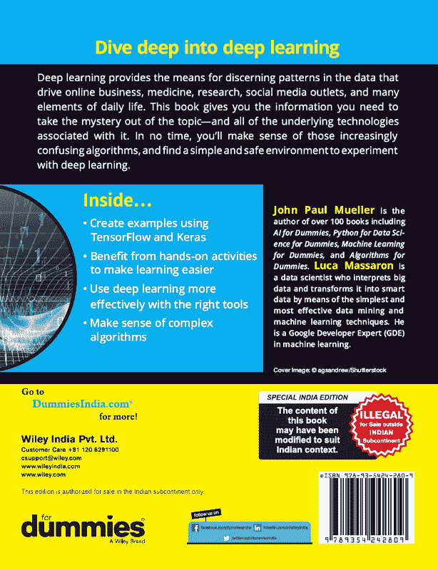

