# 基于 EEG 的脑机接口深度学习：表示、算法与应用

张翔

美国哈佛大学

姚莉（Lina Yao）

澳大利亚新威尔士大学

## 前言

脑信号的研究引人入胜；它就像是用你的思想控制世界。阻碍这种“超能力”的一个大挑战是脑信号解码的低效和不准确。幸运的是，近年来，强大的深度学习算法通过卓越的高级表征学习，在广泛的研究领域取得了巨大成功。在书中，我们展示了深度学习技术如何增强脑机接口（`BCI`）研究。

首先，本书根据采集方法提出了 `BCI` 信号范式的新分类法，并系统性地介绍了深度学习模型的基础知识。此外，还从信号类别、深度学习模型和应用等方面为 `BCI` 系统的研究和设计提供了若干条指南。

我们特别关注了算法方面基于脑电的 `BCI` 研究中深度学习的前沿研究。具体而言，本书介绍了许多先进的深度学习算法和框架，旨在解决 `BCI` 的几个主要问题，包括稳健的脑信号表征学习、跨场景分类和半监督分类。

此外，还提出了几种基于深度学习的 `BCI` 系统的新型原型，这些为身份验证、视觉重建、语言解释和神经系统疾病诊断等现实应用提供了启示。此类应用将使现实生活中健康个体和残障人士受益匪浅。

张翔，姚莉

2020 年 6 月

# 第 1 部分：背景

## 第 1 章：引言

### 1.1 脑机接口背景

`BCI`¹¹ 系统将人类脑模式转换为信息或指令，并传输到外部世界 (Lotte et al., 2018)。`BCI` 支撑了许多日常生活中重要的新颖应用，特别是对于心理/身体障碍或残疾的人来说。一方面，`BCI` 可以帮助残障人士、老年人和运动能力受限的人（例如肌肉疾病患者）控制轮椅、家电和机器人。例如，患者的脑信号可以通过 `BCI` 系统控制家用电器。另一方面，当涉及到脑电波技术时，普通人也可以享受增强的娱乐和安全体验 (Zhang et al., 2018)。通常，`BCI` 系统实现了人脑与计算机之间的双向通信。然而，正如 Abdulkader 等人 (2015) 和 Roy 等人 (2019) 所指出的，基于脑信号分析的系统（如精神疾病诊断、情绪计算、睡眠评分等）也可以被视为广义的 `BCI`。本书研究了广义的 `BCI` 系统，旨在对 `BCI` 系统提供更全面的理解和范围。

图 1.1 显示了 `BCI` 系统的通用范式，由五个关键部分组成：脑信号采集、预处理、特征工程和智能设备。首先，从人类采集脑信号并发送到预处理部分进行去噪。接下来，从处理后的信号中提取判别特征并发送到分类器。分类器将解码后的脑信号转换为数字指令，以控制智能设备。

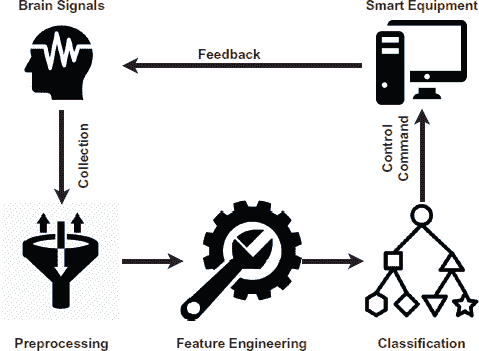

图 1.1：脑机接口系统的通用工作流。

采集方法取决于信号类型。例如，`EEG` 信号的采集测量大脑神经元内部离子流引起的电压波动，需要在头皮上放置一系列电极来记录电活动。由于大脑内部产生的离子流在头皮处测量，中间介质（例如颅骨）会极大地降低信号质量。因此，脑信号在特征工程之前通常需要进行预处理以提高信噪比 (`SNR`）。预处理部分包含多个步骤，如信号清洗（例如平滑噪声信号或解决不一致性）、信号归一化（例如沿时间轴对信号每个通道进行归一化）、信号增强（例如去除直流）和信号削减（提供信号的压缩表示）。

特征工程是指利用领域知识从输入信号中提取判别特征的过程。传统特征从时域（例如：方差、均值、峰度）、频域（例如快速傅里叶变换）以及时频域（例如离散小波变换）中提取，并进行分析以丰富关于用户意图的可区分信息。特征工程高度依赖于领域知识。例如，从指示癫痫发作的脑信号中提取特征需要生物医学知识。此外，手动特征提取也非常耗时且可能不准确。最近，通过深度学习自动提取判别特征已成为一种更具吸引力的选择。

分类组件是指机器学习算法，它将提取的特征分类为外部设备可识别的逻辑控制信号。最近的研究表明，深度学习算法比传统分类器更强大。

### 1.2 为什么选择深度学习？

尽管脑机接口（`BCI`）系统在过去几十年取得了巨大的进展（Abdulkader *et al.*, 2015; Bashashati *et al.*, 2007），但研究仍然面临巨大挑战。

首先，脑信号很容易受到各种生物伪迹（例如：眼眨、肌电干扰、疲劳和注意力水平）和环境伪迹（例如：噪声）的干扰（Abdulkader *et al.*, 2015）。因此，采集到的脑信号面临低信噪比（`SNR`）的挑战（Samek *et al.*, 2012）。由于所需的时间以及伴随的信息丢失风险，传统方法无法解决低信噪比问题（Zhang *et al.*, 2018h）。因此，从损坏的脑信号中提取包含信息的表示至关重要。

其次，手动特征工程高度依赖相关领域的人类专家。例如，通过 `EEG` 信号有效研究睡眠状态需要基础生物学知识。一般的生活经验在某些方面可能有帮助，但整体仍然不足。由于专家研究人员的可用性较低，手动分析也面临时间限制问题。因此，一种能够从输入数据中自动提取最具代表性特征的新颖方法是非常理想的。

第三，大多数现有的机器学习研究集中在静态数据上，因此无法准确分类快速变化的脑信号。例如，多分类运动想象 `EEG` 的最先进分类率通常低于 80%（Lotte *et al.*, 2007）。处理 `BCI` 系统中的动态数据流需要新颖的学习方法。

此外，在实践中，标注的脑信号样本并不容易获得，因为标记需要大量具有专业知识的认证标注员。因此，在某些情况下，`BCI` 系统的设计者只能访问一小组良好标记的脑信号，而其余的是未标记样本。同时，通过包含未标记数据中包含的信息来提高 `BCI` 系统的性能至关重要。

本书考虑了通过深度学习解决上述挑战的方案。深度学习作为机器学习的一个分支，通过构建分层网络从输入数据中学习包含信息的表示（Goodfellow *et al.*, 2016）。深度学习可以通过结合多个较简单的表示来学习高级且复杂的表示，而每个简单表示则提取与复杂表示相关的部分信息。近年来，深度学习算法已广泛应用于脑信号领域，并取得了巨大成功（Cecotti *et al.*, 2014; Mahmud *et al.*, 2018）。与传统的机器学习方法相比，深度学习具有几个优势。首先，它直接作用于原始脑信号，从而避免了传统 `BCI` 系统中耗时的预处理和特征工程。因此，它消除了大量的人工工作，并减轻了对专业知识的依赖。此外，在反传播算法的支持下，深度学习模型能够从脑信号中学习“正确”的信息。换句话说，即使输入是损坏且有噪声的，深度学习也能学习高质量表示。此外，深度神经网络可以通过深层结构同时捕捉具有代表性的高级特征和潜在依赖。深度学习模型的更多细节将在第 3 章中介绍。

### 1.3 为什么写这本书？

本书认为对广泛领域的研究人员和学生有用：计算机科学、人工智能、神经科学等。我们审视并总结了大多数采用深度学习算法来解决 `BCI` 问题的现有工作。然后，我们提取并展示了关键规则和典型算法/框架，以便有效地从脑信号中学习高级表示。在本书中，我们既介绍了 `BCI` 系统的基础知识和深度学习算法、先进深度学习模型的概述以及 `BCI` 应用。

书的其余部分组织如下：我们首先在`第 2 章`中根据脑信号的类别提出了 `BCI` 系统的新分类法，随后在`第 3 章`中介绍了深度学习的基础，包括概念、架构和简要的数学理论。我们在`第 4 章`中提供了深度学习前沿的高级概述，并在`第 5 章`中介绍了应用。此外，我们介绍了一系列针对所面临 `BCI` 挑战的先进深度学习算法和框架，包括鲁棒表示、跨场景分类和半监督学习。此外，我们提供了若干新型 `BCI` 应用的案例研究，如身份验证、视觉重建、语言理解、辅助生活和神经疾病诊断。最后，`第 14 章`指出了方向。

在实践资源方面，我们提供了一个详细的教程，介绍了基于深度学习的 `BCI` 的每个步骤，以及可实现的代码

```
https://github.com/xiangzhang1015/Deep-Learning-for-BCI
```

即使是 `BCI` 或深度学习初学者也能理解并操作。书中使用的所有代码和数据集已开源供复现，请参考上述链接。此外，我们在`第 5.9 节`中提供了 31 个可重用的脑信号数据集，涵盖了大多数脑信号类别。此外，我们还向感兴趣的读者推荐了一些用于典型 `EEG` 的公开深度学习代码以及名为 neuro-imaging 的工具箱。

[¹除了 `BCI`，还有许多类似的术语用于定义人类脑信号直接控制的系统，如脑机接口 (`BMI`)、脑接口 (`BI`)、直接脑接口 (`DBI`)、自适应脑接口 (`ABI`) 等。

[²https://github.com/NeuroTechX/dl-eeg-playground](https://github.com/NeuroTechX/dl-eeg-playground). 访问 2019 年 1 月 7 日。

[³https://github.com/QTIM-Lab/DeepNeuro](https://github.com/QTIM-Lab/DeepNeuro). 访问 2019 年 6 月 24 日。

# 第 2 章：脑信号采集

本章对脑机接口（`BCI`）系统中使用的脑信号进行了全面且系统的介绍。图 2.1 展示了基于信号采集方法的脑信号新分类法，包括侵入性和非侵入性信号。侵入性信号从皮层表面或皮层表面下方采集（第 2.1 节）；非侵入性信号通过外部传感器采集（第 2.2 节）。脑电图（`EEG`）在非侵入性信号中占据主导地位。因此，第 2.3 节中介绍了 `EEG` 信号及其特定的子类别。各种脑信号的基本特征总结在表 2.1 中。

## 2.1 侵入方法

此处我们仅简要介绍侵入性方法的基础知识，因为本书主要关注非侵入性方法。侵入性记录通过部署在头皮下的电极获取信号。图 2.2 (Leuthardt *et al.*, 2009) 展示了从皮层采集的“皮层内信号”以及从皮层表面（硬膜和蛛网膜）采集的“皮层电图（`ECoG`）”^(1)。

侵入性技术可以提供高质量的脑信号，因为电极直接从靠近脑神经元的位置采集信号。采集的信号具有高时间、空间分辨率^(2)和高信噪比（`SNR`）。然而，侵入性方法面临两个挑战。首先，电极植入需要手术程序，由于潜在的医疗并发症（如移植反应），既昂贵又具有风险。其次，植入电极是固定的，因此只能测量相同位置的脑信号。由于这些原因，侵入性脑信号技术主要用于动物（例如猴子和大鼠）以及严重残障患者（例如肌萎缩侧索硬化症（`ALS`）患者）（Abdulkader *et al.*, 2015）。

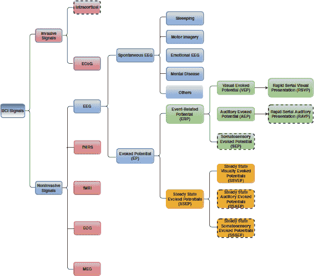

图 2.1：脑信号采集方法。虚线四边形（皮层内、`RAVP`、`SEP`、`SSAEP` 和 `SSSEP`）未包含在本章中，因为目前没有涉及这些领域的深度学习算法工作。`P300` 是在呈现刺激出现约 300 ms 后记录的正电位，它未列在该信号树中，因为它被包含在 `ERP`（指呈现刺激后的所有电位）中。在此分类中，除 `EEG` 之外的其他脑信号（例如 `MEG` 和 `fNIRS`）理论上也可以包含视觉/听觉任务，但我们省略了它们，因为目前没有在这些任务上采用深度学习的工作。

表 2.1：脑信号特征总结。

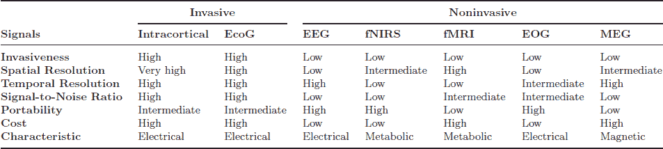

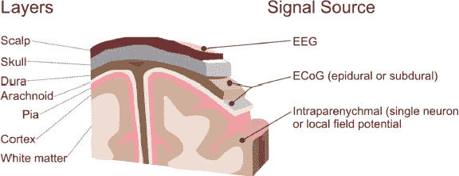

图 2.2：脑部中的信号源位置（Leuthardt *et al.*, 2009）。

### 2.1.1 皮层内

皮层内记录涉及将电极插入皮层中（图 2.2）。通常，皮层内电极提供高分辨率的运动控制（如运动）。皮层内信号对神经元群敏感，可用于训练 `BCI` 系统。频率范围为 0–500Hz，由于头骨的低通滤波，这比 `EEG`（40Hz）要宽得多。\alander \alander \alander \alander \alander. \alander \alander \alander \alander \alander (2013)。

### 2.1.2 皮层电图

`ECoG` 是一种在硬膜上方（硬膜外）或下方（硬膜下）记录的侵入性方法（图 2.2)(Leuthardt *et al.*, 2009)。与非侵入性方法相比，`ECoG` 具有更高的 `SNR`。`ECoG` 信号如图图 2.3 所示（Bandt *et al.*, 2017）。例如，`ECoG` 幅值较高（50µV），而 `EEG` 幅值较低（20µV）。`ECoG` 在医学领域具有更好的前景。然而，`ECoG` 等侵入性方法的缺点（如手术风险和永久附着设备的不便）自然限制了其广泛应用。

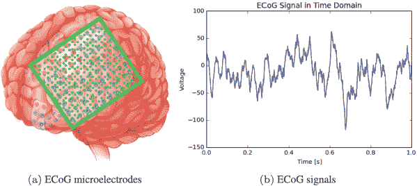

图 2.3：皮层表面的 `ECoG` 网格和 `ECoG` 信号（Bandt *et al.*, 2017）。

## 2.2 非侵入方法

非侵入性记录在不插入电极的情况下采集用户的脑信息。信号可以使用电、磁或代谢方法采集。非侵入性信号主要包括 `EEG`、功能性近红外光谱（`fNIRS`）、功能磁共振成像（`fMRI`）、眼电图（`EOG`）和磁脑图（`MEG`）。`EEG` 相关研究占非侵入性信号的绝大部分，并有许多子类。我们将在第 2.3 节中介绍更多 `EEG` 的细节和子类别。

### 2.2.1 脑电图

`EEG` 是测量脑活动最常用的非侵入技术。`EEG` 监测人体神经元内电流产生的电压波动。放置在头皮上的电极测量 `EEG` 信号的幅值。由于电极数量有限，`EEG` 信号的空间分辨率较低。`EEG` 电极位置通常遵循国际 10–20 系统或中间 10%电极位置（Malmivuo and Plonsey, 1995）。国际 10–20 系统将头皮分为 10%和 20%的间隔，总共包含 21 个电极位置（图 2.4）。中间 10%电极位置由美国脑电图协会标准化，以 10%的间隔划分头皮，包含 75 个电极。现有的 `EEG` 采集系统通常少于 75 个电极，具体而言：64 个电极（`BCI2000` 系统）、32 个电极（`openBCI` 头机）、14 个电极（`Emotiv EPOC+` 头机）、5 个电极（`Emotiv insight` 头机）和 1 个电极（`Mindware` 头机）。

`EEG` 信号的时间分辨率远高于空间分辨率。离子电流的变化非常快，提供的时间分辨率高于 1000Hz。由于客观和主观因素，`EEG` 的信噪比（`SNR`）通常非常低。客观因素包括环境噪声、颅骨以及皮层与头皮之间组织的阻隔，以及各种刺激。主观因素包含受试者的心理状态、疲劳状态以及不同受试者之间的差异。

`EEG` 记录设备可以安装在类似帽子的头戴设备中。如图 2.5 所示（Zhang *等.*，2018h），`EEG` 头戴设备可以佩戴在用户的头部以采集信号。与用于测量脑信号的其他设备相比，`EEG` 头戴设备具有便携性，且适用于大多数应用程序。

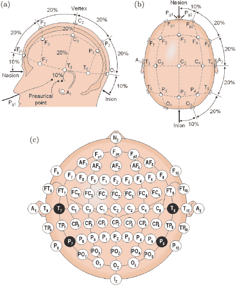

图 2.4：(a) 和 (b) 是国际 10–20 系统的左视图和俯视图；(c) 展示了中间 10% 电极位置（Sazgar and Young, 2019）。

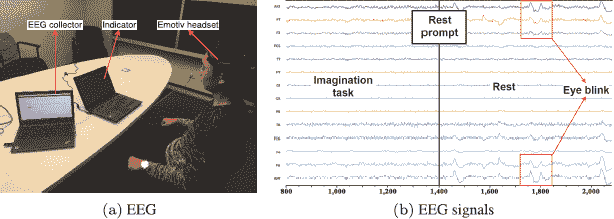

图 2.5：`EEG` 采集场景和采集的信号。受试者正在进行想象任务。

表 2.2：`EEG` 模式及相应的特征。意识程度表示对外部世界的感知程度。意识代表受试者清醒的正常状态。

从任何典型 `EEG` 硬件采集的 `EEG` 信号具有几个不重叠的频带（Delta、Theta、Alpha、Beta 和 Gamma），它们与特定的行为状态具有很强的带内相关性（Zhang *等.*，2018h）。每个 `EEG` 模式包含与特定脑信息相关的信号。表 2.2 显示了 `EEG` 频率模式及相应的特征。意识程度是指个体在面对外部刺激时的感知。它主要定义在生理学而非心理学中。每个频带代表一种脑状态以及对意识的定性评估：

- Delta 模式（0.5–4Hz）对应于受试者意识较低时的深睡眠。
- Theta 模式（4–8Hz）对应于低意识范围内的轻睡眠。
- Alpha 模式（8–12Hz）主要发生在闭眼和深度放松状态，对应于中等意识。
- Beta 模式（12–30Hz）是受试者睁眼时的主导节奏，与高意识相关。Beta 模式捕捉了我们日常的大部分活动（如进、行走和说话）。
- Gamma 模式（30–100Hz）代表了多个脑区域协同工作以执行特定的运动和认知功能。

### 2.2.2 功能近红外光谱

`fNIRS` 是一种利用近红外（`NIR`）光的非侵入性功能神经成像技术（Naseer *等.*，2016）。具体而言，`fNIRS` 利用近红外光测量氧红蛋白 (`Hb`) 和脱氧血红蛋白 (`deoxy-Hb`) 的聚集程度，因为 `Hb` 和 `deoxy-Hb` 的光吸收率高于颅骨和头皮等其他头部部位。`fNIRS` 依赖血氧水平依赖（`BOLD`）响应或血流动力学响应来形成功能神经图像。`BOLD` 响应可以检测脑血中氧合或脱氧血水平。相对水平反映了血流和神经激活，血流增加意味着活跃神经元导致更高的代谢需求。例如，当用户专注于某项心理任务时，前额叶皮层神经元会被激活，前额叶区域的 `BOLD` 响应会更强（Hennrich *等.*，2015）。

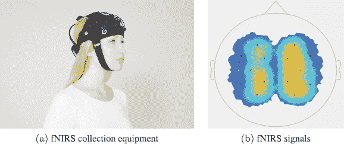

图 2.6：`fNIRS` 采集设备和采集的信号.^(3)

图 2.6 显示了 `fNIRS` 采集硬件和采集的信号。单对或多个发射器-探测器对测量 `Hb` 和 `deoxy-Hb`：发射器通过血管将近红外光传输到探测器。大多数现有研究使用 `fNIRS` 技术测量前额叶和运动皮层的状态。前者是对心理任务的响应，而后者是对运动相关任务（例如运动想象）的响应。受监测的 `Hb` 和 `deoxy-Hb` 变化缓慢，因为与电信号相比，血速的变化相对缓慢。因此，与电或磁信号相比，`fNIRS` 信号的时间分辨率较低^(4)。空间分辨率取决于发射器-探测器对的数量。在目前的研究中，三个发射器和八个探测器就足以充分获取前额叶皮层信号；六个发射器和六个探测器即可覆盖运动皮层区域（Naseer and Hong, 2015）。`fNIRS` 的缺点是由于光发射功率和空间分辨率的限制，无法测量发生在大脑深于 4 cm 的皮层活动。

### 2.2.3 功能磁共振成像

`fMRI` 通过检测与脑区血流相关的变化来监测脑活动（Wen *等.*，2018）。与 `fNIRS` 类似，`fMRI` 依赖 `BOLD` 响应。`fNIRS` 和 `fMRI` 之间的主要区别如下（Liu *等.*，2018a）。首先，顾名思，`fMRI` 通过磁性而非光学方法测量 `BOLD` 响应。血红蛋白对磁场响应的方式不同，取决于它是否结合了氧分子。磁场对 `deoxy-Hb` 比 `Hb` 分子更敏感，且更容易被其所失真。其次，磁场的穿透能力高于近红外光，这使得 `fMRI` 比 `fNIRS` 具有获取大脑深部信息的能力。第三，`fMRI` 的空间分辨率高于 `fNIRS`，因为后者的空间分辨率受发射器-探测器对的限制。然而，`fMRI` 和 `fNIRS` 的时间分辨率处于同一水平，因为它们都受限于血速。


与 fNIRS 相比，fMRI 有几个缺点：(1) fMRI 需要昂贵的扫描仪来产生磁场；(2) 扫描仪沉重且便携性差。图 2.7 显示了 fMRI 获取设备和生成的脑图像。语音感知和手指运动的 fMRI 图像差异显著，表明信噪比高。

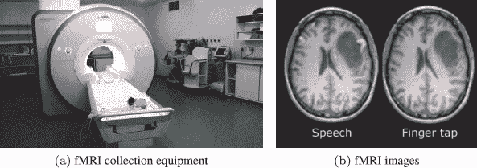

图 2.7：受试者说话和手指运动时的 fMRI 采集设备和采集的 fMRI 信号.^(5)

### 2.2.4 眼电图

EOG（眼电图）是一种用于测量人眼前后部之间角膜-视网膜驻立电位的技术。大多数失去自主运动能力的患者（例如闭锁综合征患者）仍然对眼睛保持着部分控制能力（Yang *et al.*, 1989）。可以通过 EOG 信号检测眼动，并与外部设备进行交互。因此，我们在本书中将 EOG 信号视为一类脑信号。EOG 可以作为连接用户与外部世界的桥梁，因为不同的眼动会导致不同的电位。通常将成对电极放置在眼睛上方/下方或左/右以测量 EOG 信号。EOG 采集设备（Aungsakun *et al.*, 2011）和采集的信号（Rusydi *et al.*, 2014）可以在图 2.8 显示了 EOG 电极的布置，其中电极 `Ch.V+` 和 `Ch.V–` 测量垂直运动，`Ch.H+` 和 `Ch.H–` 测量水平运动。代表地线的 `G` 电极作为参考点。图 2.8(b)显示了在六种场景下（向上看、向下看、单闪、双眼、向左看和向右看）的时域垂直 EOG。我们可以观察到 EOG 信号在不同场景之间存在较大的差异，表明它们具有较高的信噪，并且容易被机器学习算法识别。与其他脑信号相比，EOG 的空间分辨率较低，因为我们只能检测垂直和水平电位。EOG 的时间分辨率高于神经成像技术，因为电位的变化比代谢特征（例如血流）更快。

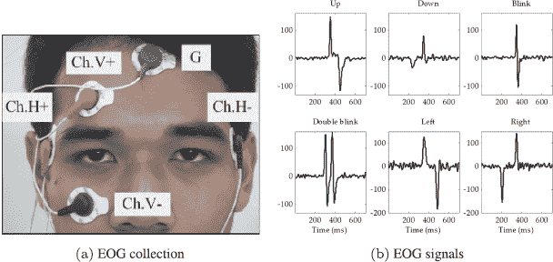

图 2.8：EOG 采集设备（Aungsakun *et al.*, 2011）以及受试者在不同方向看和眨眼时采集的垂直信号（Rusydi *et al.*, 2014）。

### 2.2.5 脑磁图

MEG（脑磁图）是一种通过测量脑内电流产生的磁场来绘制脑活动图的技术。这些磁场极其微弱，使用称为 SQUIDs（超导量子干涉器件）的高灵敏传感器进行测量。MEG 提供了与 EEG 相当的高时间分辨率，但具有更好的空间分辨率，因为磁场不会受到颅骨和头皮的显著畸变。

### 2.3 范式

与其他神经成像技术（例如 fMRI、fIRS）相比，EEG 具有以下几个优势：

1. 高便携性。
2. 高时间分辨率（毫秒级）。
3. 对运动的容忍度较高。
4. 较低的成本和硬件要求。

### 2.3.1 自发 EEG

通常，当我们谈到“EEG”这一术语时，指的是在没有外部刺激的情况下发生的自发 EEG。例如，自发 EEG 包括用户在睡眠、执行心理任务、患病等期间的信号。由于信噪较低且受试者差异较大，基于自发 EEG 的 BCI 系统训练起来具有挑战性。

### 2.3.2 诱发电位

EP（发电位）或诱发响应是指由事件诱发而非自发产生的 EEG 信号。EP 与外部刺激时间锁定的，而上述自发 EEG 是非时间锁定的。根据刺激方法，EP 分两类：ERP 和 SSEP。

### 2.3.2.1 事件相关电位

VEP（视觉发电位）是由视觉刺激（例如计算机屏幕上的交替棋盘格图案）引起的 ERP 的一特定类别。VEP 信号隐藏在正常的自发 EEG 中。为了将 VEP 信号从背景 EEG 读中分离出来，通常采用重复刺激和时间锁定信号平均技术。

快速序列视觉呈现 (`RSVP`)（Lees *et al.*, 2018）可以被视为一种 VEP。RSVP 图通常用于检查注意的时间特性。受试者需要盯着屏幕，屏幕上会逐个呈现一系列项目（例如，图像）。其中有一个特定的项目（称为**目标项**）与其他其他项目（称为**干扰项**）区分开来。受试者在 RSVP 实验之前知道哪一个是目标项。通常，干扰项可以是颜色变化，或是数字中的字母。RSVP 包含静态模式（项目出现在屏幕上，然后消失且不移动）和移动模式（项目出现在屏幕上，移动到另一个地方，最后消失）。如今，脑信号研究主要集中在静态模式 RSVP 上。通常，RSVP 的频率为 `10Hz`，这意味着每个项目将在屏幕上停留 `0.1 s`。

(2) `AEP`。AEPs 是 ERP 的一个特定子类，记录了对听觉（声音）刺激的反应。AEP 主要从头皮上记录，但起源于脑干或皮层。最常见的 AEP 测量是听觉脑干反应，它常用于测试新生儿和婴儿的听力。在 BCI 中，AEP 主要用于临床测试，因为它在检测单侧听力损失方面准确且可靠（Chiappa, 1997）。与 RSVP 类似，快速序列听觉呈现 (`RSAP`) 指快速序列呈现声音刺激的实验。受试者的任务是在干扰项中识别目标音频。

(3) `SEP`。SEP 是另一个常用的 ERP 子类类，是由外周神经的电刺激激发的。SEP 信号包括一系列幅度波动，几乎任何感官刺激都可以激发这种波动。

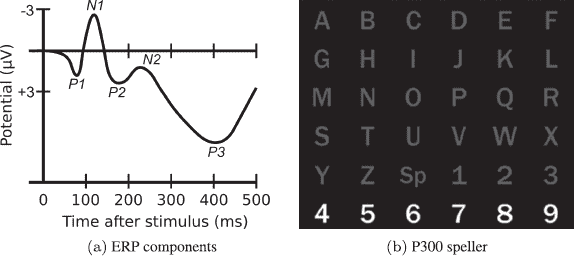

图 2.10: P300 波和基于视觉的 P300 拼写器 (Farwell and Donchin, 1988)。

### 2.3.2.2 `P300`

P300（也称为 `P3`）是 ERP 中的重要成分（Guger *et al.*, 2009）。在这里我们单独介绍 P300 信号，因为它被广泛用于 BCI 系统。[图 2.10(a)] 显示了刺激出现后 `500 ms` 内 ERP 信号波动。波形主要包含五个成分：`P1`、`N1`、`P2`、`N2` 和 `P3`。大字母 `P/N` 代表正/负电位。后面的数字指的是特定电位的出现时间。因此，P300 表示在呈现刺激后大约 `300 ms` 时 ERP 波形的正电位。与其他成分相比，P300 的幅度最大且最容易检测。因此，大量的脑信号研究侧重于 P300 分析。P300 更像是一个信息特征，而不是一种脑信号类型（例如 VEP）。因此，我们没有在[图 2.1]中列出 P300。P300 可以在大多数 ERP 信号中分析，例如 VEP、AEP、SEP。

实践中，P300 可以通过“离球”范式中稀有的、与任务相关的事件激发（例如，P300 扬声器）。在离球范式中，受试者接收一系列刺激，其中低概率目标项与高概率非目标项混合在一起。视觉和听觉刺激是离球范式中最常用的。[图 2.10(b)] 显示了一个基于视觉的 P300 拼写器示例，它使受试者能够通过脑信号直接拼字母/数字（Farwell and Donchin, 1988）。字母表的 26 个字母和阿拉伯数字显示在作为键盘的计算机上。受试者连续将注意力集中在他们想要拼写的字符上。计算机实时检测所选字符。这种检测通过反复闪烁矩阵的行和列来实现。当包含所选字符的元素闪烁时，就会激发 P300 波动。在 `6 × 6` 矩阵屏幕上，行和列以混合随机顺序闪烁。闪烁时间和相邻闪烁之间的间隔通常设置为 `100 ms`（Belitski *et al.*, 2011）。列和行分别闪烁。首先，列闪烁六次，每列闪烁一次。其次，行闪烁六次。之后，该范式重复几次（例如 `N` 次）。对总共 `12N` 次闪烁的 P300 信号进行分析，以输出单个结果（即一个字母/数字）。

### 2.3.2.3 `稳态诱发电位`

SSEPs 是 EP 的另一个子类，是由某些具有恒定频率重复刺激激发的周期性皮层反应。已经证明，脑震荡通常随时间保持稳定水平，而电位是由稳态刺激（例如固定频率的闪烁光）激发的。从技术上讲，SSEP 定义为对重复感官刺激的一种响应，其中响应的频率分量在幅度和相位上保持不变（Regan, 1977）。根据刺激类型，SSEP 可分为三个子类。

### 2.3.2.4 `常用视觉相关电位`

VEPs 是最常用的电位。因此，区分三种 VEP 范式：VEP、RSVP 和 SSVEP 是关重要的。在这里，我们从理论上介绍各自的特征。

在本章中，我们将正式介绍深度学习模型的基础，包括脑电信号领域常用的概念、架构和技术。深度学习是机器学习技术的一类，它在分层架构中利用许多层级的信息处理阶段来用于模式分类和特征/表示学习（Deng, 2014）。由于部分来自非计算机背景（例如生物医学）的潜在读者可能对深度学习并不熟悉，因此将对各种深度学习模型进行较为详细的介绍。

根据技术目标，深度学习算法可分为几个子类（如图 3.1 所示）：

• **判别式深度学习模型**，根据自适应学习的判别性特征将输入数据归类为预定义的标签。判别算法能够通过非线性变换学习区分性特征，并通过概率预测进行分类。^(1) 因此，这些算法可以同时担当特征工程和分类的角色（对应图 1.1）。判别架构主要包括多层感知器（`MLP`）、循环神经网络（`RNN`）、卷积神经网络（`CNN`）及其变体。

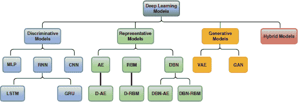

图 3.1：深度学习模型。根据算法功能，可以分为判别式、表示型、生成性和混合模型。`D-AE`表示堆叠自动编码器（Stacked-Autoencoder），指具有多个隐藏层的自动编码器（`AE`）。深度信念网络（`DBN`）可以由`AE`或受限玻尔兹曼机（`RBM`）组成，因此我们将 `DBN` 分为 `DBN-AE`（堆叠 AE）和 `DBN-RBM`（堆叠 RBM）。

• **表示型深度学习模型**，从输入数据中学习纯粹且代表性的特征。这些算法仅具有特征工程的功能（对应图 1.1）但无法分类。常用于表示的深度学习算法有自动编码器（`AE`）、受限玻尔兹曼机（`RBM`）、深度信念网络（`DBN`）及其变体。

• **生成式深度学习模型**，学习输入数据与目标标签的联合概率分布。在脑电信号范围内，生成式算法主要用于重建或生成一批脑电样本以增强训练集。常用于脑电信号的生成式模型包括变分自动编码器（`VAE`），^(2)、生成对抗网络（`GANs`）等。

• **混合深度学习模型**，结合了两种以上的深度学习模型。例如，典型的混合深度学习模型采用表示算法进行特征提取，采用判别算法进行分类。

各深度学习子类的特征总结在表 3.1 中。神经网络中几乎所有的分类功能都是通过 `softmax` 层实现的，它不被视为一种算法组件。例如，结合了 `DBN` 和 `softmax` 层的模型仍然被视为表示型模型而非混合模型。

表 3.1：深度学习模型类型总结。

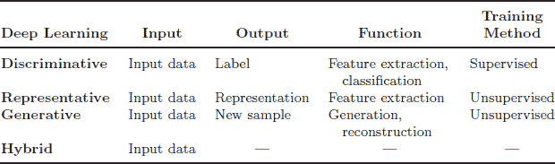

### 3.1 判别式深度学习模型

由于脑电信号研究的主要任务是脑电信号识别，因此判别式深度学习模型是最流行且强大的算法。假设我们有一个脑电样本数据集 {, }，其中 `images/x.jpg` 表示脑电信号观测集，`images/y.jpg` 表示样本真值集（即标签）。假设一个特定的样本-标签对由 `images/pg29.jpg`给出，其中 `N` 和 `M` 分别表示观测维度和样本类别数量。判别式深度学习模型的目标是学习一个映射函数：`x → y`。判别式深度学习模型接收输入数据并输出相应的类别。本节介绍的判别式模型属于监督学习。

### 3.1.1 多层感知器

`MLP` 是神经网络中最简单、最基础的深度学习模型之一，如图 3.2(a)所示，它包含输入层、一个隐藏层和输出层。`MLP` 与标准神经网络的区别在于，`MLP` 的相邻层节点之间是全连接的，`MLP` 具有多个隐藏层。如图 3.2(b)所示，我们以具有两个隐藏层的 `MLP` 为例，描述更深层的结构。判别式深度学习模型的目标是学习观测值 `x` 到真值 `y` 的映射。

### 3.1.2 循环神经网络

RNN 是一种特定的判别深度学习模型子类，旨在捕捉输入数据之间的时间依赖关系。图 3.3(a) 描述了特定 RNN 节点在时间域内的活动。在每个时间片 `t`，`t` ∈ `[1, t + 1]`，该节点接收一个输入 `I[t]`^(3) 和来自上一个时刻的隐藏状态 `c`（第一次除外）。例如，在时间 `t`，它不仅接收输入 `I[t]`，还接收上一个节点的隐藏状态 `c[t−1]`。隐藏状态可以被视为节点的“记忆”，它可以帮助 RNN “记住”历史输入。

接下来，我们将介绍两种备受关注并取得巨大成功的典型 RNN 架构：LSTM 和 GRU。它们都遵循 RNN 的基本原理，我们将关注每个节点中复杂的内部结构。由于该结构比普通神经节点复杂得多，我们称之为“单元（cell）”。RNN 中的单元等同于 MLP 中的节点。

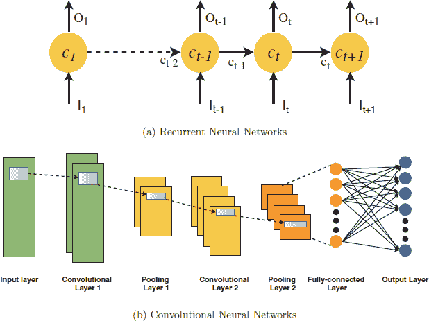

图 3.3：RNN 和 CNN 模型的图。(a) RNN 模型的递归过程。该过程描述了在时间范围 `[1, t + 1]` 内特定节点的递归过程。时间 `t` 处的节点接收两个输入变量（`I[t]` 表示时间 `t` 的输入，`c[t−1]` 表示时间 `t − 1` 的隐藏状态）并输出两个变量（时间 `t` 的输出 `O[t]` 和隐藏状态 `c[t]`）。(b) CNN 模型的范式，包括两个卷积层、两个池化层和一个全连接层。

### 3.1.2.1 长短期记忆网络

图 3.4(a) 显示了时间 `t` 处单个 LSTM 单元的结构。LSTM 单元有三个输入（`I[t]`、`O[t−1]` 和 `c[t−1]`）和两个输出（`c[t]` 和 `O[t]`）。其操作如下：

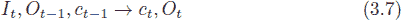

`I[t]` 表示时间 `t` 的输入值，`O[t−1]` 表示上一个时刻的输出（即时间 `t − 1`），`c[t−1]` 表示上一个时刻的隐藏状态。`c[t]` 和 `O[t]` 分别表示时间 `t` 的隐藏状态和输出。因此，我们可以观察到时间 `t` 处的输出 `O[t]` 不仅取决于输入 `I[t]`，还取决于之前时刻的信息。这样，LSTM 能够记住时间域中的重要信息。此外，LSTM 的核心思想是控制特定信息的记忆。为了这一目标，LSTM 单元采用了四个门：输入门、遗忘门、输出门和输入调制门。每个门都是一个权重，用于控制有多少信息可以通过该门。例如，如果遗忘门的权重为零，LSTM 单元将什么都不记住；如果权重为一，它将记住所有信息。相应的详细流程如下：

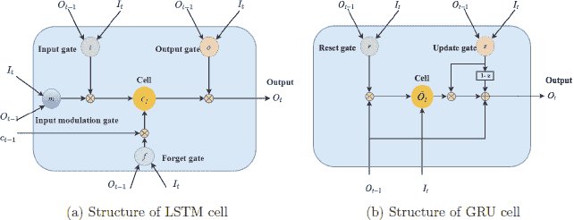

图 3.4：RNN 和 CNN 模型的图。(a) RNN 模型的递归过程。该过程描述了在时间范围 `[1, t + 1]` 内特定节点的递归过程。时间 `t` 处的节点接收两个输入变量（`I[t]` 表示时间 `t` 的输入，`c[t−1]` 表示时间 `t − 1` 的隐藏状态）并输出两个变量（时间 `t` 的输出 `O[t]` 和隐藏状态 `c[t]`）。(b) CNN 模型的范式，包括两个卷积层、两个池化层和一个全连接层。

### 3.1.2.2 门控循环单元

另一种广泛使用的架构是 GRU。与 LSTM 类似，GRU 试图利用过去的信息。然而，它只有两个门：重置门和更新门。前者决定保留多少过去的信息，后者决定更新多少信息。LSTM 和 GRU 的简要对比如下：首先，根据文献研究，LSTM 和 GRU 性能相当。其次，GRU 是轻量级的，因为它只有两个门。因此，GRU 花的时间更少，所需的数据也少。相比之下，如果训练数据足够大，LSTM 通常效果更好。

### 3.1.3 卷积神经网络

CNN 是专门处理空间信息的流行深度学习模型之一。我们将简要介绍 CNN 的工作机制。CNN 由于具有正则化结构、良好的空间局部性和平移不变性等显著特征，能够在图像识别、泛在和物体搜索等应用中发现潜在的空间信息。在脑信号研究中，CNN 被认为可以捕捉与不同脑信号相关的模式之间的独特依赖关系。

我们展示了一个标准的 CNN 架构，如图[图 3.3](#fig3_3）所示。CNN 包含一个输入层、两个卷积层（每个后面跟着一个池化层）、一个全连接层和一个输出层。每层中的方块显示了特定批量输入值的处理进度。CNN 的关键是将输入数据还原为更容易识别的形式，同时尽可能减少信息损失。CNN 有三个堆叠层：卷积层、池化层和全连接层。

卷积层是 CNN 的核心区块，它包含一组滤波器用于对输入数据进行卷积，随后进行非线性变换以提取空间特征。在深度学习实现中，卷积层中需要设置几个关键的超参数，如滤波器的数量、每个滤波器的大小等。池化层通常紧随卷积层。池化层旨在逐步减少特征的空间尺寸。这样，它可以帮助减少参数数量（例如权重和基）以及计算负担。池化操作有三种：最大池化、最小池化、平均池化。以最大池化为例，池化操作输出池化区域的最大值作为结果。

代表性深度学习模型的核心模块是 AE 和 RBM。DBN 由 AE 或 RBM 组成。包括 AE、RBM 和 DBN 在内的代表性模型均属于无监督学习方法。因此，它们仅需输入观测值 `x` 即可学习代表性特征，而无需地面真值 。简而言之，代表性模型接收输入数据并输出数据的稠密表示。不同的研究对若干种模型（如 DBN、Deep-RBM 和 Deep-AE）有多种定义，本节选择了最易理解的定义并在后续进行详细介绍。

### 3.2.1 自动编码器 (Autoencoder)

如图 3.5(a) 所示，AE 是一种具有三层的神经网络：输入层、隐藏层和输出层。它与标准神经网络的不同之处在于，AE 的训练是为了重构其输入，这迫使隐藏层学习输入的良好表示。

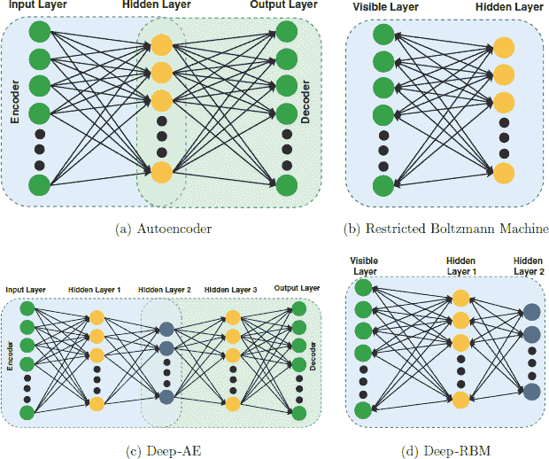

图 3.5：若干种标准代表性深度学习模型的插图。(a) 基础 AE 包含三层，其中输入层和输出层预期具有相同的值。(b) 在 RBM 中，编码器和解码器共享相同的变换权重，输入层和输出层合并。(c) 堆叠 AE 具有一个以上的隐藏层。通常情况下，隐藏层数为奇数，中间层是学习到的特征。(d) Deep-RBM 有一个可见层和多个隐藏层，最后一层是编码后的表示。

AE 的结构包含两个区块。第一个区块是编码器，它将观测值嵌入到潜表示（在某些文献中也称为“code”）：


其中 `x^h` 表示隐藏层。第二个区块是解码器，它将表示解码回原始空间：


其中 `y′` 表示输出。AE 强制 `y′` 等于输入 `x` 并根据它们之间的距离计算误差。因此，AE 仅通过 `x` 在没有地面真值的情况下计算损失函数 


与公式 (3.6) 相比，该方程不涉及变量 ，因为它将 `x` 作为地面真值。这就是 AE 能够执行无监督学习的原因。


自然，AE 的一种变体是 Deep-AE (D-AE)，它具有一个以上的隐藏层。我们在图 3.5(c) 中展示了具有三层的 D-AE 结构。从图中可以看出，编码器和解码器都多了一个隐藏层。对称结构确保了编码和解码过程的流畅。因此，D-AE 通常具有奇数的隐藏层（例如 `2n+1`），其中前 `n` 层属于编码器，`(n+1)` 层作为同时属于编码器和解码器的 code，最后 `n` 层属于解码器。D-AE 的数据流（图 3.5(c)）可以表示为：

```

```

```

```

其中 `x^(h2)` 表示中间隐藏层（code）。然后，通过解码隐藏层，我们可以得到：

```

```

```

```

它与 AE 几乎相同，只是 D-AE 具有更多的隐藏层。除了 D-AE 之外，AE 还有许多变体，如去噪 AE、稀疏 AE、收缩 AE 等。这里仅介绍 D-AE，因为它容易与基于 AE 的 DBN 混淆。它们之间的关键区别将在第 3.2.3 节 提供。

AE 及其变体的核心思想简单是将输入数据 `x` 压缩为 code `x^h`（通常 code 层维度较低），然后根据 code 重构数据。如果重构的 `y′` 可以近似输入数据 `x`，则说明压缩后的 `x^h` 携带了关于 `x` 的足够信息；因此，`x^h` 可以作为未来操作（例如分类）的输入表示。

### 3.2.2 受限玻尔兹曼机 (Restricted Boltzmann Machine)

RBM 是一种随机人工神经网络（ANN），可以学习其输入集的概率分布。它包含两层：一个可见层（输入层）和一个隐藏层，如图 3.5(b) 所示。从图中可以看出，两层之间的连接线是双向的。RBM 是玻尔兹曼机的变体，其更强的限制是没有层内连接。与 AE 类似，RBM 的过程也包括两个步骤。第一步将输入数据从原始空间压缩到潜空间的隐藏层。之后，用相同的方式使用隐藏层重建输入数据。与 AE 相比，RBM 有更强的约束，即编码权重和解码权重应该相等。我们有：

```

```

```

```

在上述两个方程中，`(·*)` 的权重是相同的。然后，训练误差可以通过以下计算：

```

```

从图 3.5(d) 可以观察到 Deep-RBM (D-RBM) 是具有多个隐藏层的 RBM。来自可见层的输入数据首先流到第一个隐藏层，然后流到第二个隐藏层。然后，code 将反流回可见层进行重构。

### 3.2.3 深度信仰网络 (Deep Belief Networks)

DBN 是简单网络的堆叠，例如 AE 或 RBM (Glauner, 2015)。因此，DBN 分为 DBN-AE（也称为堆叠 AE，由 AE 组成）以及 DBN-RBM（也称为 RBM，由 RBM 组成）。

如图 3.6(a) 所示，DBN-AE 包含两个 AE 结构，其中第一个 AE 的隐藏层作为第二个 AE 的输入层。该图有两个阶段。在第一阶段，输入数据馈入第一个 AE，该 AE 遵循第 3.2.1 节 引入的规则。计算误差并反向传播以调整相应的权重。这种迭代一直持续到 AE 收敛。我们得到了映射：`x¹` → `x^(h1)`。

然后，在第二阶段，隐藏层学习到的代表性 code `x^(h1)` 将作为第二个 AE 的输入层，即：

```

```

```
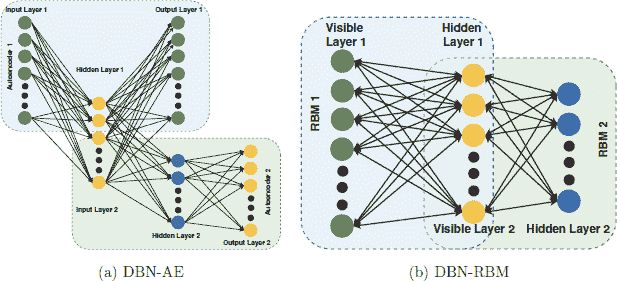
```

图 3.6：DBN 的插图。(a) 由 AE 组成的 DBN。DBN-AE 包含多个 AE 组件（在本例中为两个 AE），前一个 AE 的隐藏层作为下一个 AE 的输入层。最后一个 AE 的隐藏层是学习到的表示。(b) 由 RBM 组成的 DBN。第一个 RBM 的隐藏层作为第二个 RBM 的可见层。最后一个隐藏层是编码后的表示。虽然 DBN-RBM 和 D-RBM（图 3.5(d)）架构相似，但前者采用贪婪训练，而后者采用联合训练。

并且在第二个 AE 收敛后，我们得到：

```

```

其中 `x^(h2)` 表示第二个 AE 的隐藏层，同时，它是 DBN-AE 的最终结果。

`AE` 的核心思想是学习一个维度较低但包含输入数据大部分信息的表示性代码。`DBN-AE` 的背后的思想是学习更具代表性且更纯净的代码。同样，`DBN-RBM` 由若干个单个 `RBM` 结构组成。图 3.6(b) 显示了一个包含两个 `RBM` 的 `DBN`，其中第一个 `RBM` 的隐藏层被用作第二个 `RBM` 的可见层。

对比 `DBN-RBM` (图 3.6(b)) 和 `D-RBM` (图 3.5(d))。它们的架构几乎相同。此外，`DBN-AE` (图 3.6(a)) 和 `D-AE` (图 3.5(c)) 也具有相似的架构。`DBN` 与深层 `AE/RBM` 之间最重要的区别在于，前者是贪婪训练的，而后者是联合训练的。特别是对于 `DBN`，首先训练第一个 `AE/RBM`，在其收敛后，再训练第二个 `AE/RBM`（Hinton and Salakhutdinov, 2006）。对于深层 `AE/RBM`，联合训练意味着无论有多少层，整个结构都是一起训练的。

### 3.3 生成深度学习模型

生成深度学习模型主要用于生成训练样本或数据增强。换句话说，生成深度学习模型在脑信号领域起着支持作用，以增强训练数据的质量和数量。在数据增强之后，将采用判别模型进行分类。这一程序的目的是提高所训练深度学习网络的鲁健性和有效性，特别是在训练数据有限的情况下。简而言，生成模型接收输入数据并输出一组相似的数据。在本节中，将介绍两种典型的生成深度学习模型：`VAE` 和 `GAN`。

### 3.3.1 变分自动编码器

`VAE` 于 2013 年提出（Kingma and Welling, 2013），是 `AE` 的一种重要变体，也是最强大的生成算法之一。标准的 `AE` 及其其他变体可用于表示，但在生成方面会失败，原因是学习到的代码（或表示）可能是不连续的。因此，无法生成与输入样本相似的随机样本。换句话说，标准的 `AE` 不允许插值。因此，可以复制输入样本，但无法生成相似的样本。`VAE` 有一个从根本上区别于其他 `AEs` 的独特属性，正是这一属性使得 `VAE` 在生成建模中非常有用：潜空间被设计为连续的，允许于进行随机采样和插值。接下来将解释 `VAE` 的工作原理。

与标准 `AE` 类似，`VAE` 可以被分为编码器和解码器，前者将输入数据嵌入到潜空间，后者将数据从潜空间传输到原始空间。然而，潜空间中学习到的表示被强制近似于先验分布``，该先验通常被设定为标准高斯分布。基于重参数化技巧（Kingma and Welling, 2013），`VAE` 的第一个隐藏层被设计为两个部分，其中一个表示期望 `μ`，另一个表示标准差 `σ`，因此我们有：

```
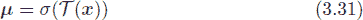
```

```
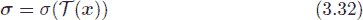
```

然后，隐藏层中的潜代码不是直接计算的，而是从高斯分布 `(μ, σ²)` 中采样的。统计代码

```
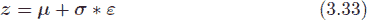
```

其中 `` 表示 `z` 被强制符合先验分布，且距离误差 [`KL`] 通过 Kullback–Leibler 散度衡量，

```
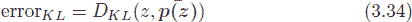
```

其中 `` 表示先验分布。在解码器中，`z` 被解码为输出 `y′`，

```
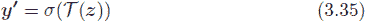
```

重构误差为：

```
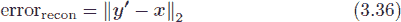
```

`VAE` 的总误差由 DL 散度和重构误差合并：

```
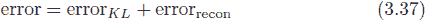
```

`VAE` 的关键点在于，所有的潜表示 `z` 都被强制服从正态分布。因此，可以从先验分布中随机采样表示 `z′`，然后基于 `z′` 重构样本。这就是为什么 `VAE` 在生成方面如此强大的原因。

### 3.3.2 生成对抗网络

`GAN` (Goodfellow *et al.*, 2014) 于 2014 年提出，并在广泛的研究领域取得了巨大成功（例如，计算机视觉和自然语言处理）。`GAN` 由两个同时训练的神经网络组成，即一个生成器和一个判别器。生成器捕获输入数据的分布，判别器用于估计样本来自训练数据的概率。生成器的目标是生成伪样本，而判别器的目标是区分样本是否为真实。生成器和判别器的功能是相反的；这就是为什么 `GAN` 被称为“对抗”。在生成器和判别器收敛后，判别器应该无法识别生成的样本。因此，预训练的生成器可以创建一组样本并用于分类。

图 3.7(b) 显示了标准 `GAN` 的过程。生成器接收从高斯分布随机采样的噪声信号 `s` 并输出伪脑信号 `xF`。判别器接收真实脑信号 `xR` 和生成的样本 `xF`，然后预测真伪。生成器和判别器的内部架构取决于数据类型和场景。例如，我们可以在 fMRI 图像通过卷积层构建 `GAN`，因为 `CNN` 具有出色的特征提取能力。判别器和生成器联合训练。收敛后，生成器可以创建大量的脑信号 `xG`。因此，训练集扩大到 `{xR, xG}` 以训练更有效且鲁健的分类器。

```
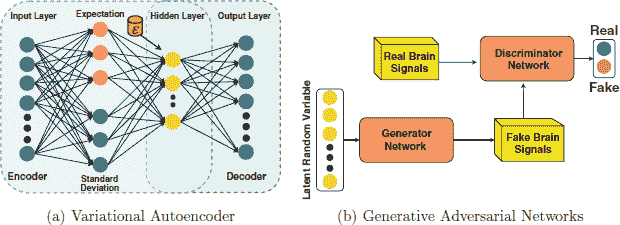
```

图 3.7：生成深度学习模型示意。(a) `VAE` 两个隐藏层。第一个隐藏层由两个部分组成：期望和标准差，它们从输入层独立学习。第二个隐藏层表示编码信息，而 `*ϵ*` 表示标准正态分布。(b) `GAN` 主要包含两个关键组件：生成器和判别器网络。前者接收随机变量以生成伪脑信号，后者接收真实和生成的脑信号并试图判断其是否为生成。

### 3.4 混合模型

“混合深度学习模型”指的是由至少两个基础深度学习模型组成模型，其中基础模型是判别性的、表示性的或生成的深度学习模型。混合模型根据其目标分为两个子类：分类为向型（CA）混合模型和非分类为向型（NCA）混合模型。

脑研究中大多数与深度学习相关的研究集中在第一类。根据现有文献，表征模型和生成式模型被用于增强判别模型。表征模型可以为判别提供更丰富且低维的特征，而生成式模型有助于增强训练数据的质量和数量，从而为分类提供更多信息。CA 混合模型可以进一步细分为^(7):(1) 多个判别模型结合以提取更具区分性且鲁棒的特征（例如，`CNN+RNN`）；(2) 表征模型后接判别模型（例如，`DBN+MLP`）；(3) 生成式模型结合表征模型再后接判别模型；以及(4) 生成式模型结合表征模型再后接非深度学习分类器。

少数 NCA 混合模型旨在脑信号重建。例如，St-Yves 和 Naselaris (2018) 尝试根据用户的 fMRI 图像恢复完整的图像。它采用 `GAN` 架构来学习以脑活动测量为条件的的图像生成模型，这可以增加训练数据量，还能使模型对噪声具有鲁棒性。

¹分类函数通过 `softmax` 层和 one-hot 标签编码的组合。one-hot 标签编码是指通过独热编码对标签进行编码，这是一组位，其中唯一有效的值组合是只有一个高位（1）而其余位均为低位（0）的组合。例如，一组标签 0, 1, 2, 3 可以被编码为 (1, 0, 0, 0), (0, 1, 0, 0), (0, 0, 1, 0), (0, 0, 0, 1)。

²`VAE` 是 `AE` 的变体，但作用于不同的方面。因此，将分别介绍 `AE` 和 `VAE`。

³下标代表特定的时间。

⁴`AE` 和 `RBM` 通常被视为深度学习的一种类型，尽管它们分别只有三层和两层。

⁵我们将 `AE` 和 `RBM` 视为表征方法，因为大多数脑信号研究人员采用它们进行特征表示。

⁶在一般的 `Boltzmann machine` 中，同一隐藏层中的节点将连接。

⁷表征模型后接非深度学习分类器被视为一种表征深度学习模型。

# 第二部分

# 基于深度学习的 BCI 及其应用

# 第四章

## 基于深度学习的 BCI

在本章中，我们将系统地总结 BCI 研究中现先进深度学习技术。还将涵盖一些结合深度学习与传统机器学习的研究。

### 4.1 皮层内和 ECoG

在本节中，我们简要介绍基于深度学习的侵入性脑信号分析的总体。目前，皮层内信号主要由医学和生物研究人员研究（Anumanchipalli *et al.*, 2019; Bashivan *et al.*, 2019）。*Antoniades et al.* (2016) 采用具有两个卷积层的 `CNN` 从癫痫皮层内数据中提取特征，用于检测间歇性癫痫放电 (IED)。他们将输入数据切成 80 ms 段，窗口重叠为 40 ms，并实现了约 87.51% 的准确率。他们后的工作（Antoniades *et al.*, 2018）使用深度神经网络架构将头电信号映射到伪皮层内脑信号。

大多数与 ECoG 相关的研究关注医疗健康，特别是癫痫发作。例如，*Hosseini et al.* (2017a) 使用带通滤波（0.1–30 Hz）的 EEG 和 ECoG 信号进行发作诊断和定位。作者使用主成分分析 (`PCA`)、独立成分分析 (`ICA`) 和差异搜索算法 (`DSA`) 手动提取特征，然后将特征输入两种不同的深度学习结构（`CNN` 和 `DBN-AE`），并报告 `CNN` 实现了更高的精度（Hosseini *et al.*, 2017a）。

Kiral-Kornek *et al.* (2018) 为癫痫发作预测系统提出了一种 `MLP` 算法，该系统可作为具有低功耗要求的设备穿戴，并实现了 69% 的敏感性。除了关注发作诊断的研究外，Xie *et al.* (2018) 关注来自 ECoG 信号的手指轨迹，并开发了一种基于卷积层和 `LSTM` 单元的混合深度神经网络。这项工作的贡献在于它不仅将 `CNN` 用于空间卷积，还用于时间卷积。卷积操作生成了固定长度的向量表示，并将其发送到 `LSTM` 单元进行轨迹追踪。每个 ECoG 段持续 1 秒，重叠为 40 ms。因此，模型接收到 ECoG 流，并能够从中形成完整的手指轨迹。

### 4.2 EEG 电位

近期发表的论文中半以上将 EEG 信号作为输入，因为其采集系统是非侵入性的、高便携性且低价格的。在本节中，我们总结了 EEG 信号的两个方面：EEG 振荡和诱发电位，前者是自发的，后者需要刺激。

### 4.2.1 自发 EEG 电位

根据应用场景，自发 EEG 的深度学习模型如下：

### 4.2.1.1 睡眠 EEG

睡眠 EEG 主要用于识别睡眠阶段和诊断睡眠障碍（Chambon *et al.*, 2018; Zhang *et al.*, 2016）。根据 Rechtschaffen 和 Kales (R&K) 规则，睡眠阶段可以分类为非快速眼动（REM）1、非 REM 2、非 REM 3、非 REM 4 和 REM。美国睡眠医学会 (AASM) 偏于五阶段模型：清醒、非 REM 1、非 REM 2、慢波睡眠 (SWS) 和 REM。他们将非 REM 3 和非 REM 4 合并为 SWS，因为两者之间无法做出区分（Zhang *et al.*, 2016）。通常，在睡眠阶段分析中，EEG 信号通过滤波器预处理，滤波器在 50 Hz 处陷波。EEG 信号通常被分割为 30 秒窗口。

**(i) 判别模型。** `CNN` 常用于单通道 EEG 的睡眠阶段分类（Sors *et al.*, 2018; Tsinalis *et al.*, 2016）。例如，*Vilamala et al.* (2017) 手动提取时频特征，实现了 86% 的分类率。从 `Fpz - Cz` 和 `Pz - Oz` 通道采集的 EEG 信号流被切成 30 秒段。所采用 `CNN` 在五分类中实现了 86% 的准确率。Shahin *et al.* (2017) 从频域手动提取 57 个特征并输入 `MLP` 进行分类，在失眠检测中获得了 90% 的准确率。Fernández-Varela *et al.* (2018) 采用 `CNN` 分析包括 EEG、EOG 和 EMG 在内的生理信号。模型在 Sleep Heart Health Scoring 数据集上评估，实现了 91% 的精确率、90% 的召回率和 90% 的 F1 分。

**(ii) 表征模型。** Tan *et al.* (2015a) 采用 `DBN-RBM` 算法根据从睡眠 EEG 信号中提取的 PSD 特征检测睡眠纺，并在数据集上实现了 92.78% 的 F1 分。Zhang *et al.* (2016a) 进一步将 `DBN-RBM` 与三个 `RBM` 结合用于睡眠特征提取。

**(iii) 混合模型.** Manzano 等人 (2017) 提出了一种多视图算法，通过结合 `CNN` 和 `MLP` 来预测睡眠阶段。`CNN` 用于接收原始时域 EEG 震荡，而 `MLP` 则接收通过短时傅里叶变换 (`STFT`) 的 0.5–32 Hz 频谱信号。Fraiwan 和 Lweesy (2017) 将 `DBN` 与 `MLP` 用于婴儿睡眠状态识别。Supratak 等人 (2017) 提出了一种结合多视图 `CNN` 和 `LSTM` 的模型用于自动睡眠分期，其中前者用于发现时间不变的依赖关系，而后者（双向 `LSTM`）用于识别睡眠纺波的时间特征。Dong 等人 (2018) 提出了一种用于时间睡眠阶段分类的混合深度学习模型，该模型采用 `MLP` 检测层次特征，并使用 `LSTM` 进行序列信息学习。

### 4.2.1.2 运动想象 EEG

深度学习模型在 EEG 和真实运动 EEG 的分类中显示出优越性（Hartmann 等人，2018；Nurse 等人，2016）。


### 4.2.1.3 情感 EEG

个体环境状态可以从三个方面进行评估：效价（valence）、唤醒（arousal）和支配（dominance）。这三个方面结合产生了恐惧、悲伤和愤怒等人类情感，并可以在情感 EEG 信号中读出。

#### (i) 判别性模型

`MLP` 传统上被使用（Frydenlund 和 Rudzicz，2015；Yepes 等人，2017），而 `CNN` 和 `RNN` 在基于 EEG 的情绪预测中日益流行（Li 等人，2016a；Liu 等人，2017b）。该类别中典型的基于 `CNN` 的工作包括分层 `CNN` 建模（Li 等人，2016a，2017a）以及 `CNN` 的训练集增强（Wang 等人，2018）。Li 等人 (2016a) 首次通过将多通道 EEG 信号转换为 2D 矩阵来捕捉通道间的空间依赖。Talathi (2017) 使用了由 `GRU` 单元组成的判别性深度学习模型。Zhang 等人 (2018b) 提出了一种空间时间 RNN，利用多向 `RNN` 层发现长期上下文线索，利用双向 `RNN` 层捕捉之前空间 RNN 生成序列的时间特征。

#### (ii) 代表性模型

`DBN`，尤其是 `DBN-RBM` 被广泛用于情绪识别的无监督表示学习（Gao 等人，2015b；Li 等人，2013，2015b）。例如，Xu 和 Plataniotis (2016a,b) 提出了一种包含三个 `RBM` 和一个 `RBM-AE` 的 `DBN-RBM` 算法来预测情感状态；赵 和 He (2014) 以及 Zheng 等人 (2014) 分别将 `DBN-RBM` 与支持向量机 (`SVM`) 和隐马尔可夫模型 (`HMM`) 结合以解决同一个问题。Zheng 和 Lu (2015) 以及 Zheng 等人 (2015) 引入了具有五个隐藏 `RBM` 层的 `D-RBM` 以搜索情感识别中重要的频率模式和信息通道；Jia 等人 (2014) 首先消除误差通道，然后根据剩余通道的代表性特征使用 `D-RBM` 进行情感状态识别。

情绪可能会受到许多主观和环境因素（例如性别和疲劳）的影响。Liu *et al.* (2016) 使用一种名为双峰深度自动编码器（`BDAE`）的新型模型研究了男女情绪信号的差异模式，该模型接收 EEG 和眼动特征，并在融合层中共享信息，该融合层连接到 `SVM` 分类器。结果显示，女性在恐惧情绪下具有更高的 EEG 信号多样性，而男性在悲伤情绪上的波动更大。此外，对于女性来说，恐惧的个体间差异比其他情绪更显著（Liu *et al.*, 2016）。为了克服从不同受试者或不同实验期间采集的样本之间分布不匹配的问题，Chai *et al.* (2016) 提出了一种子空间对齐自动编码器（`SAAE`）的无监督域适应技术，结合了 `AE` 和子空间对齐方案。该方法在独立个体的情况下获得了 77.88% 的平均准确率。

#### (iii) 混合模型

一种常用的混合模型是 `RNN` 和 `MLP` 的组合。例如，Alhagry *et al.* (2017) 采用 `LSTM` 架构从情绪 EEG 信号中提取特征，并将学习到的特征传递到 `MLP` 进行分类。此外，Yin *et al.* (2017) 提出了一种多视图集成分类器，利用多模态生理信号识别个体情绪。该集成分类器包含几个 `D-AEs`、三个隐藏层和一个融合结构。每个 `D-AE` 接收一种生理信号（如 `EEG`、`EOG`、`EMG`）并将其输出到由另一个 `D-AE` 组成的融合结构。最后，采用 `MLP` 分类器对混合特征进行分类。Kawde and Verma (2017) 通过结合用于特征提取的 `DBN-RBM` 和用于分类的 `MLP` 实现了一种情感识别系统。

### 4.2.1.4 精神疾病 EEG

许多研究人员使用 `EEG` 信号来诊断神经系统疾病，特别是癫痫大发作（Yuan *et al.*, 2018）。

#### (i) 判别性模型

`CNN` 模型广泛用于癫痫大发作的自动检测（Acharya *et al.*, 2018a; Schirrmeister *et al.*, 2017; Ullah *et al.*, 2018; Wang *et al.*, 2016b）。例如，Johansen *et al.* (2016) 采用 `CNN` 处理高通滤波（1 Hz）的癫痫波 `EEG` 信号，实现了 94.7% 的 `AUC`。Acharya *et al.* (2018b) 采用具有 13 层的 `CNN` 模型筛查抑郁症，在包含 30 名受试者的本地数据集上进行了评估，并根据左右脑 `EEG` 信号分别实现了 93.5% 和 96.0% 的准确率。使用 `CNN` 结构，Morabito *et al.* (2016) 尝试提取多通道 `EEG` 信号的合适特征，以区分阿尔茨海默症患者与轻度认知障碍患者以及年龄匹配的健康对照组。`EEG` 信号经过带通滤波（0.1–30 Hz），在三分类中实现了约 82% 的准确率。快速眼动运动障碍（RBD）可以预测并可能导致许多精神障碍/疾病，如帕金森病（PD）。Ruffini *et al.* (2016) 描述了一种回声网络（`ESN`），一类特殊的 `RNN`，用于区分 RBD 患者与健康个体。在某些研究中，判别模型仅用于特征提取。Ansari *et al.* (2018) 使用 `CNN` 提取潜在特征，然后将其输入随机森林分类器用于新生婴儿癫痫检测。Chu *et al.* (2017) 结合 `CNN` 和传统分类器用于精神分裂症识别。

#### (ii) 代表性模型

对于疾病检测，一种广泛使用的方法是采用代表性模型（例如 `DBN`），随后通过 `softmax` 层进行诊断（Turner *et al.*, 2014）。Page *et al.* (2014) 采用 `DBN-AE` 提取信息丰富的特征，并将其输入传统的逻辑回归分类器进行癫痫检测。Al-kaysi *et al.* (2015) 提出了多视图 `DBN` 来分析抑郁症患者的信号。该方法包含由两个 `RBM` 组成的输入路径，这些路径汇聚到一个共享的 `EEG` 结构中。一些模型使用降维方法（如 `PCA`）对 `EEG` 进行预处理（H, 2017），而另一些则直接将原始信号输入模型（Lin *et al.*, 2016）。Lin *et al.* (2016) 提出了具有三个隐藏层的稀疏 `D-AE` 来提取 `EEG` 信号；Hosseini *et al.* (2017) 则采用了仅有两个隐藏层的稀疏 `D-AE`。

#### (iii) 混合模型

一种常用的混合模型是 `RNN` 和 `CNN` 的组合。Shah *et al.* (2017) 测试了 `CNN-LSTM` 在通道选择后癫痫检测中的性能；敏感性在 33% 到 37% 之间，误报率在 38% 到 50% 之间。Golmohammadi *et al.* (2017) 提出了一种整合时空信息的混合架构。2D 和 1D `CNN` 捕捉空间特征，而 `LSTM` 网络捕捉时间特征。作者在著名的 TUH EEG 数据库上声称敏感性为 30.83%，特异性为 96.86%。在克雅氏病（SJD）检测中，Morabito *et al.* (2017) 结合了 `D-AE` 和 `MLP`。SJD 患者的 `EEG` 信号首先经过带通滤波（0.5–70 Hz），然后输入具有两个隐藏层的 `D-AE`。Wen 和 Zhang (2018) 应用了卷积编码器，将标准 `AE` 中的全连接层替换为卷积和反卷积层，以无监督的方式提取癫痫特征。

该领域的研究人员已经探索了许多令人兴奋的话题。其中第一个是 `EEG` 如何受到听/视觉刺激的影响。在这种现象中，刺激是连续的，因此它们以稳定状态存在，而不是闪电位。Stober *et al.* (2014a,b) 声称节奏引发的 `EEG` 信号包含足够区分节奏刺激的信息。作者进行了一项实验，让 13 名参与者接受了 23 种节奏刺激的刺激，包括 12 种东非刺激和 12 种西方刺激。对于 24 类分类，所提出的 `CNN` 实现了 24.4% 的平均准确率。之后，作者利用卷积 `AE` 进行表示学习，并利用 `CNN` 进行识别，在 12 类分类中实现了 27% 的准确率（Stober *et al.*, 2015）。Sternin *et al.* (2015) 采用 `CNN` 从 `EEG` 振荡中提取判别性特征，以区分受试者是在听音乐还是在想象音乐。同样，Sarkar *et al.* (2016) 设计了两个深度学习模型来识别由音频或视觉刺激激发的 `EEG` 信号。对于这项二分类任务，所提出的 `CNN` 和带有三个 `RBMs` 的 `DBN-RBM` 分别实现了 91.63% 和 91.75% 的准确率。此外，自发 `EEG` 可用于区分用户的心理状态（逻辑与情感）（Bashivan *et al.*, 2016a）。

其他研究人员关注了认知负荷（Shang *et al.*, 2017）和物理负荷对 `EEG` 的影响（Gordienko *et al.*, 2017）。Bashivan *et al.* (2015) 首先通过基于熵的小波变换和特定频段功率提取了信息特征，并将这些特征馈入 `DBN-RBM` 进行进一步精炼，然后输入 `MLP` 进行认知负荷水平识别。在其他工作中，作者（Bashivan *et al.*, 2016b）还声称发现在不同心理负荷下、受试者间/受试者内场景保持不变的通用特征。Yin 和 Zhang (2017) 收集了不同心理工作负载水平（例如，高和低）的 `EEG` 信号进行二分类。`EEG` 信号通过低通滤波器滤波，转换到频域并计算功率谱密度（`PSD`）。提取的 `PSD` 特征被输入去噪 `D-AE` 结构中进一步精炼，得到了 95.48% 的准确率。Li *et al.* (2016b) 研究了精神疲劳水平的识别，包括警觉、轻疲和重疲。

此外，基于 `EEG` 的驾驶疲劳检测是另一个很有前景的研究领域（Chai *et al.*, 2017; Du *et al.*, 2017; Hajinoroozi *et al.*, 2015b）。Hung *et al.* (2017) 设计了一个 3D `CNN` 来预测睡眠驾驶的反应时间，这对于减少交通事故可能具有工具性。Hajinoroozi *et al.* (2015a) 采用 `DBN-RBM` 处理经 `ICA` 处理的 `EEG` 信号。他们在二分类（“嗜睡”或“警觉”）中实现了约 85% 的准确率。这项工作的优势在于，他们在三个水平上评估了 `DBN-RBM`：时间样本、通道分段和窗口样本。实验表明，通道分段水平优于另外两个水平。San *et al.* (2016) 将深度学习模型与传统分类器相结合来检测驾驶疲劳。该模型包含一个 `DBN-RBM` 结构后跟一个 `SVM` 分类器，实现了 73.29% 的检测准确率。Almogbel *et al.* (2018) 研究了不同低工作负载水平下的驾驶员心理状态。作者声称他们提出的 `CNN` 能够直接从原始 `EEG` 信号检测驾驶工作负荷。

眼状态检测已被证明极其准确。Narejo *et al.* (2016) 探索了基于 `EEG` 的眼状态（闭眼或睁眼）检测。Reddy 和 Behera (2016) 尝试了一种更简单的结构 `MLP`，得到了 97.5% 的略低准确率。

还有一些被忽视但充满前景的领域。Baltatzis *et al.* (2017) 采用 `CNN` 通过观看视频时产生的 `EEG` 信号检测校园欺凌事件。他们分别实现了 93.7% 和 88.5% 的准确率。Khurana *et al.* (2016) 提出的深度学习优于多种深度学习方法。Völker *et al.* (2018) 评估了 `CNN` 在侧抑制任务中的应用，受试者内的平均准确率为 84.1%。Zhang *et al.* (2018) 结合了 `CNN` 和图神经网络来发现 `EEG` 信号中存在的潜在信息。Miranda-Correa 和 Patras (2018) 提出了一种结合 `RNN` 和 `CNN` 的级联框架，以预测个人的情感水平和个人因素（大五人格、情绪和社交背景）。Putten *et al.* (2018) 进行的一项实验尝试根据 `EEG` 信号识别用户的性别。他们使用了标准的 `CNN`，并在本地数据集上实现了 81% 的二分类准确率。

驾驶员紧急制动意图的检测有助于减少反应时间。Hernández *et al.* (2018) 证明了驾驶员的 `EEG` 信号可以传递制动意图和正常驾驶状态。他们结合 `CNN` 算法在二分类中实现了 71.8% 的准确率。Behncke *et al.* (2018) 在机器人辅助设备背景下应用学习 `CNN` 模型。他们尝试在受试者观察机器人抓取和执行倾倒任务的同时，使用 `CNN` 提高从 `EEG` 解码机器人错误的准确率。

Teo *et al.* (2017) 尝试将脑信号与推荐系统相结合，通过解释 `EEG` 信号来预测用户的偏好。16 名参与者参加了实验，在受试者面对 60 个手镯状物体作为旋转视觉刺激（三维物体）时收集 `EEG` 信号。然后采用 `MLP` 算法对用户对物体的喜恶进行分类。这项探索的预测准确率为 63.99%。少数研究人员尝试建立一个适用于多种 BCI 范式的通用框架。Lawhern *et al.* (2018) 引入了基于紧凑 `CNN` 的 `EEGNet`，并评估了其在各种脑信号背景下的稳健性。

### 4.2.2 诱发电位

#### 4.2.2.1 ERP


通常 `ERP` 信号是在 P300 现象背景下分析的。同时，几乎所有关于 P300 的研究都基于 `ERP`。因此，在本节中，大多数 P300 相关文献将在相应场景的 VEP/AEP 子节中介绍。

### (i) VEP

VEP 是 ERP 中最常见的子类别之一（Haider and Fazel-Rezai, 2017; Spampinato *et al.*, 2017; Yin *et al.*, 2015）。Min *et al.* (2017) 通过深度学习提取代表性特征研究了运动启动 VEP (mVEP)，并采用遗传算法结合多级阈值结构来压缩原始信号。压缩后的信号通过 `DBN-RBM` 算法传输，以捕捉更抽象的高层特征。Maddula *et al.* (2017) 使用带通滤波器（2–35 Hz）对视觉刺激产生的 P300 信号进行滤波，然后将结果输入到提出的混合深度学习模型中进行进一步分析。该模型包含一个 `2D CNN` 结构来捕捉空间特征，随后是一个 `LSTM` 层用于时间特征提取。Liu *et al.* (2017a) 将 `DBN-RBM` 代表模型与 `SVM` 分类器结合用于隐蔽信息测试，在本地数据集上实现了 97.3% 的高精度。Gao *et al.* (2015a) 采用 `AE` 模型进行特征提取，随后通过 `SVM` 分类器处理。在实验中，每个段包含 150 个点，分为五个时间步，每步 30 个点。该模型在本地数据集上实现了 88.1% 的准确率。大量的 P300 打字机研究基于 P300 打字机（Shanbhag *et al.*, 2017），它允许用户输入字符。Cecotti (2017) 尝试提高 P300 的检测精度以实现更精确的拼写。提出了一种基于 `CNN` 的新模型，包含五个具有不同特征集的底层 `CNN` 分类器，最终的高层结果由低层分类器投票产生。在第三届 BCI 竞赛的数据集 II 上，最高精度达到了 95.5%。Liu *et al.* (2018b) 提出了一种批归一化神经网络 (`BN3`)，这是基于 P300 打字机的 `CNN` 变体，由六层组成，并对每个批次进行批归一化。Kawasaki *et al.* (2015) 采用 `MLP` 模型从非 P300 片段中检测 P300 片段，实现了 90.8% 的准确率。

### (ii) AEP

少数工作关注 AEP 的识别。例如，Carabez *et al.* (2017) 提出并测试了 18 种 `CNN` 结构用于分类单次 AEP 信号。实验中，志愿者需要佩戴耳机，根据离群范式产生听觉刺激模式。实验分析表明，这些 `CNN` 框架无论卷积层数多少，在提取时间和空间特征方面都是有效的，并产生了具有竞争力的结果。AEP 信号经过 0.1–8 Hz 滤波并从 256 Hz 采样到 25 Hz。实验结果显示采样后的数据效果更好。Ravanelli 和 Bengio (2018) 的 `SincNet` 通常用于音频处理，它更关注低高截止频率，而不是标准 `CNN` 中的所有频带。特别是，它通过在第一层卷积层添加一些约束，发现了一些有意义的滤波器。Zeng *et al.* (2019) 通过包含 EEG 通道间的空间依赖性并改进 `SincNet` 第一层的滤波器设计修改了 `SincNet` 模型，并将其情感 EEG 信号分析。实验结果显示，改进后的模型具有竞争性的分类精度和更好的算法鲁棒性。

### (iii) RSVP

在各种 VEP 图表中，RSVP 受了广泛关注（Gordon *et al.*, 2017）。在 RSVP 分析中，许多判别深度学习模型（例如 `CNN` (Cecotti, 2017; Lin *et al.*, 2017; Solon *et al.*, 2017) 和 `MLP` (Mao *et al.*, 2014)）已取得成功。频率滤波是 RSVP 信号常用的预处理方法。通带范围通常在 0.1 到 50 Hz（Manor and Geva, 2015; Shamwell *et al.*, 2016）。Cecotti *et al.* (2014) 研究了 RSVP 场景下的 ERP 信号分类，并提出了一种用于检测 RSVP 中特定目标的 `CNN` 算法。实验中，人脸和汽车图像分别视为目标或非目标。图像呈现频率为 2 Hz。在每个阶段中，目标概率为 10%。该模型提供的 AUC 为 86.1%。Hajinoroozi *et al.* (2017) 采用了针对 RSVP 跨被试和跨任务检测的 `CNN` 模型。实验结果显示 `CNN` 在跨任务表现良好，但在跨被试场景下表现不佳。Mao (2016) 比较了在预测受试者是否见过目标时的三种不同的深度神经网络算法。`MLP`、`CNN` 和 `DBN` 模型分别获得了 81.7%、79.6% 和 81.6% 的 AUC。作者还应用了 `CNN` 模型分析 RSVP 信号进行身份识别（Mao *et al.*, 2017）。Joshi *et al.* (2018) 实现了一种新型卷积长短期记忆模型用于单次 P300 分类，以便同时捕捉时间和空间信息。

代表性的深度学习模型也应用于 RSVP。Vařeka 和 Mautner (2017) 测试了深度学习在单次 P300 分类中的表现。他们进行了一项 RSVP 实验，要求受试者区分目标、非目标和干扰项。然后实现了一个 `DBN-AE` 与某些非深度学习算法进行比较。`DBN-AE` 由五个 `AE` 组成，最后一个 `AE` 的隐藏层只有两个节点，能够使用 `softmax` 函数进行分类。该模型实现了 69.2% 的准确率。Manor *et al.* (2016) 应用两个深度神经网络在低通滤波（0–51 Hz）后处理 RSVP 信号。判别性 `CNN` 实现了 85.06% 的准确率。同时，代表性的卷积 `D-AE` 实现了 80.68% 的准确率。

## 4.2.2.2 SSEP

SSEP 大部分基于深度学习的研究集中在 SSVEP。SSVEP 指由闪烁视觉刺激激发的脑波，通常产生于顶叶和枕叶区域（Waytowich *et al.*, 2018）。Attia *et al.* (2018) 旨在寻找 SSVEP 的中间表示。他们使用 `CNN` 和 `RNN` 的混合方法直接从时域捕捉有效特征，实现了 93.59% 的准确率。Waytowich *et al.* (2018) 应用了一个紧凑的 `CNN` 模型，在没有任何手工特征的情况下直接处理原始 SSVEP 信号。报告的跨被试平均准确率约为 80%。Thomas *et al.* (2017) 首先通过带通滤波器（5–48 Hz）对原始 SSVEP 信号进行滤波，然后对连续的 512 个点应用离散 `FFT`。处理后的数据分别由 `CNN` (69.03%) 和 `LSTM` (66.89%) 独立进行分类。

Pérez-Benítez *et al.* (2018) 采用了一种代表性模型——稀疏 `AE`，从多频率视觉刺激中提取稳态视觉电位（SSVEP）的独特特征。该模型使用 `softmax` 层进行最终分类，实现了 97.78% 的准确率。Kulasingham *et al.* (2016) 在罪犯知识测试背景下对 SSVEP 信号进行了分类。作者分别应用了 `DBN-RBM` 和 `DBN-AE`，实现了 86.9% 和 86.01% 的准确率。HACHEM *et al.* (2014) 在轮椅导航期间通过 `MLP` 模型研究了疲劳对 SSVEP 的影响。该研究的目标是寻找手动、半自动和自动轮椅控制之间切换的关键参数。Aznan *et al.* (2018) 探索了通过干电极收集信号的 SSVEP 分类准确率。由于信噪比较低，干电极信号比标准 EEG 信号更具挑战性。该研究应用了 `CNN` 判别模型，在本地数据集上实现的最高准确率为 96%。Nguyen and Chung (2018) 采用一维 `CNN` 模型来检测单通道 SSVEP 频率，并在在线和离线情况下均实现了极高的性能。Ravi *et al.* (2020) 手动提取了 SSVEP 特征（幅度谱特征和复谱特征），然后将其输入 `CNN` 分类器，尽管所使用的 `CNN` 模型相当简单（两个卷积层后接一个全连接层），其在人相关和人无关的场景下均取得了具有竞争力的结果。

## 4.3 fNIRS

迄为止，只有少数研究人员对基于深度学习的 fNIRS 感兴趣。Naseer *et al.* (2016) 基于 fNIRS 信号分析了两种状态（心算和休息）之间的差异。作者从前额叶层 fNIRS 中手动提取了六个特征，并用它们来比较了六种分类器的性能。结果显示，`MLP` 分类器的准确率为 96.3%，优于所有传统分类器，包括 `SVM`、`KNN`、`naive Bayes` 等。Huve *et al.* (2017) 使用 `MLP` 模型对受试者在三种状态（减法、单词生成和休息）下收集的 fNIRS 信号进行分类，基于手工特征（例如 `OxyHb/DeoxyHb` 的浓度）实现了 66.48% 的准确率。在随后的论文中，作者研究了通过 fNIRS 信号控制机器人，获得了 82%（离线）和 66%（在线）的二分类准确率（Huve *et al.*, 2018）。Chiarelli *et al.* (2018) 将 fNIRS 和 EEG 用于左右 MI EEG 分类。从 fNIRS 信号中提取的十六个特征（八个来自 `OxyHb`，八个来自 `DeoxyHb`）被输入具有四个隐藏层的 `MLP` 分类器。

专注于另一个领域，Hiroyasu *et al.* (2014) 尝试通过分析 fNIRS 信号检测受试者的性别。作者采用具有三个隐藏层的去噪 `D-AE` 来提取独特特征，然后将其输入 `MLP` 分类器进行性别检测。该模型在本地数据集上进行了评估，平均准确率为 81%。作者还指出，与 PET 和 fMRI 相比，fNIRS 具有更高的时间分辨率且价格更廉（Hiroyasu *et al.*, 2014）。

## 4.4 fMRI

最近，几种深度学习方法已应用于 fMRI 分析，特别是在认知障碍诊断方面（Vieira *et al.*, 2017; Wen *et al.*, 2018）。

### (i) 判别模型

在判别模型中，`CNN` 在分析 fMRI 方面看起来前景（Shreyas and Pankajakshan, 2017）。例如，Havaei *et al.* 构建了一种基于 fMRI 的脑肿瘤分割方法，采用新新的 `CNN` 算法，能够同时捕捉全局和局部特征（Havaei *et al.*, 2017）。卷积滤波的大小不同，因此，小尺寸和大尺寸的滤波器可以独立地利用局部和全局特征。Sarraf *et al.* (2016) 以及 Sarraf and Tofighi (2016) 应用深度 `CNN` 来识别阿尔茨海默病。Moreno (2017) 使用 `CNN` 对三类肿瘤进行分类。Hosseini *et al.* (2017) 利用 `CNN` 进行特征提取。Li *et al.* (2014) 之前使用过 `CNN` 进行补全。Koyamada *et al.* (2015) 证明了前者效果更好。模型在 `Human Connectome Project (HCP)` 上进行了评估。

### (ii) 代表模型

大量的文献证明了代表模型的有效性（Suhaimi *et al.*, 2015）。*Hu et al.* (2016) 证明了深度学习优于其他机器学习方法。Plis *et al.* (2014) 采用带有三个 `RBM` 组件的 `DBN-RBM` 来提取独特特征。Suk *et al.* (2015) 对 AD 检测对比了 `DBN-RBM` 和 `DBN-AE` 的效果，实验结果显示前者获得了 95.4% 的准确率，略低于后者的 97.9%。Suk *et al.* (2016) 应用了 `D-AE` 模型提取潜在特征。Ortiz *et al.* (2016) 提出了一种多视图 `DBN-RBM` 以同时接收 MRI 和 PET 数据。

### (iii) 生成模型

自然图像的重建（例如 fMRI）引起了广泛关注（Shen *et al.*, 2019; Han *et al.*, 2018; Zhang *et al.* 2018b）。Seeliger *et al.* (2018) 提出了一种深度卷积 `GAN` 用于从 fMRI 重建视觉刺激。生成器需要四个卷积层将输入的 fMRI 转换为自然图像。*Han et al.* (2018) 关注使用 `GAN` 生成多序列 fMRI。在实际研究中，作者应用了现有的深度卷积 GAN (`DCGAN`）（Radford *et al.*, 2016）和 Wasserstein GAN (`WGAN`）（Arjovsky *et al.*, 2017），并发现前者的效果更好。

## 4.5 EOG

在大多数情况下，EOG 信号被视为需要从采集的 EEG 中去除的伪迹。然而，它们也可以作为信息信号部署在基于 EOG 的 BCI 系统中。尽管有一些研究人员考虑过 EOG 分析，但只有少数论文使用了深度学习。例如，Xia *et al.* (2015) 尝试仅使用 EOG 信号识别受试者的睡眠阶段。他们采用 `DBN-RBM` 进行特征表示，并使用 `HMM` 进行分类。另一方面，EOG 已被广泛用于补充其他信号（如 EEG），涵盖了多个研究主题，如：情绪检测（Kawde and Verma, 2017; Liu *et al.*, 2016; Wang *et al.*, 2016b）、睡眠阶段识别（Fernández-Varela *et al.*, 2018; Supratak *et al.*, 2017）以及驾驶疲劳检测（Du *et al.*, 2017）。

## 4.6 MEG

Garg *et al.* (2017) 致力于通过首先去除眼动和心脏活动等伪迹来完善 MEG 信号。MEG 信号通过 `ICA` 进行分解，然后通过 `1D CNN` 模型进行分类。所提出的方法在本地数据集上实现了 85% 的灵敏性和 97% 的特异性。Hasasneh *et al.* (2018) 也关注了伪迹检测（心脏和眼伪迹）。他们提出的方法使用 `CNN` 捕捉时间特征，并使用 `MLP` 提取空间信息。Shu and Fyshe (2013) 在单字解码任务中采用 `sparse AE` 来学习 MEG 信号的潜在依赖。结果表明，该方法对某些受试者是有利的，尽管它并没有提高整体解码准确率。Cichy *et al.* (2016) 应用 `CNN` 模型基于 MEG 和 fMRI 信号识别视觉对象。

## 4.7 讨论

接下来，我们尝试根据对最先进研究的分析，为基于深度学习的 BCI 系统设计提供一些指南。首先，我们确定了哪种深度学习模型最适合每种脑信号。接着，我们总结了当前脑信号研究中最流行的深度学习模型。我们希望这些指南能帮助读者在处理脑信号时选择最有效且高效的方法。表 4.1 总结了最先进论文中的脑信号采集方法和对应的深度学习模型。混合模型类别包括三类：组合 RNN/CNN、代表性/判别性组合（标记为“Repre + Discri”）以及其他。图 4.1 展示了关键脑信号和深度学习模型的出版比例。

表 4.1：基于深度学习模型的脑信号研究总结。

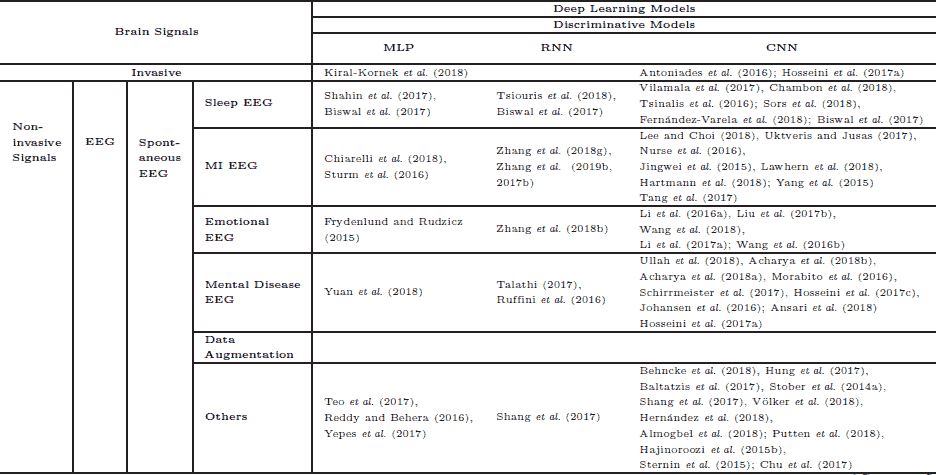

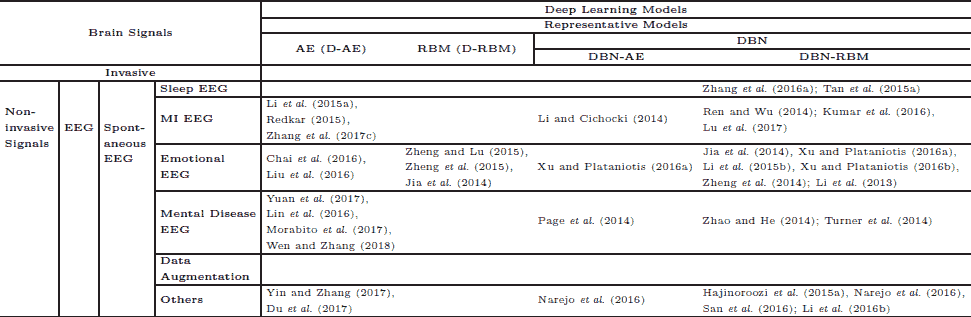

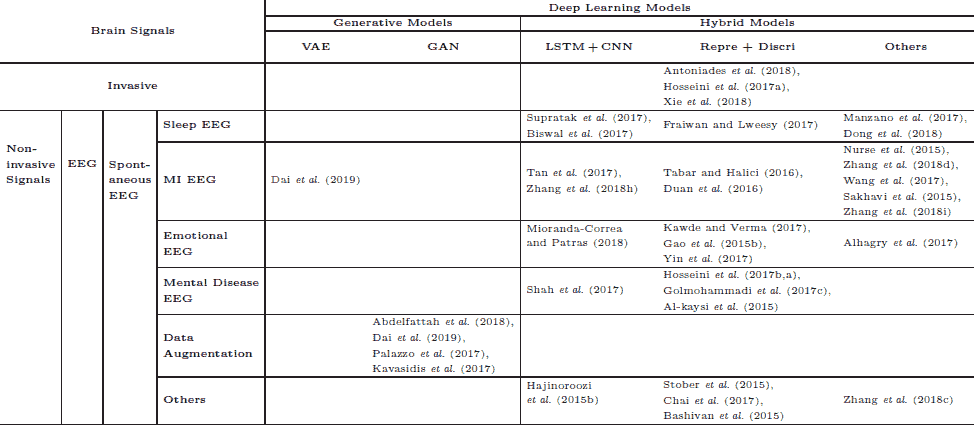

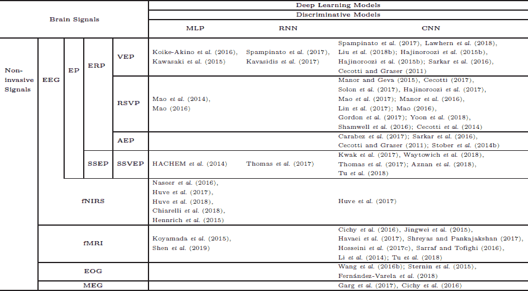

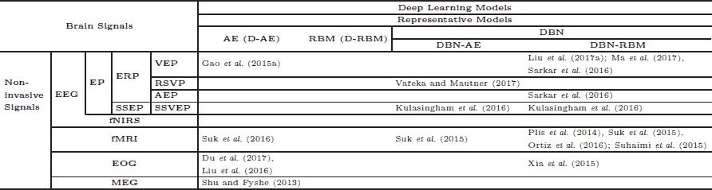

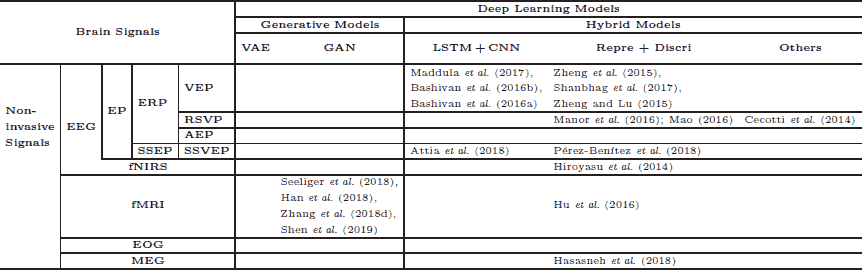

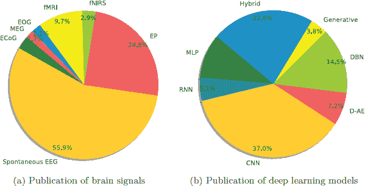

图 4.1：关键脑信号和深度学习模型的出版比例插图。

### 4.7.1 脑信号的讨论

我们上述的研究揭示了对非侵入性信号的研究占据了脑信号研究的主。在调查的 238 篇论文中，只有七篇关注侵入性脑信号研究，且其中大多数工作针对 `ECoG` 而非皮层内信号。一个重要原因是，侵入性脑研究对硬件和实验环境有更高要求。例如，`ECoG` 信号的采集需要志愿者和能够执行开颅术的医生，这使得大多数研究人员无法参与。此外，侵入性脑信号的公共数据集很少；因此，大多数人根本无法获取侵入性数据。在侵入性信号的分类方面，`CNN`-相关算法通常显示出更高的皮层神经元脉冲识别能力。

在非侵入性信号的研究中，仅关注 `EEG` 的数量远大于所有其他脑信号范式（fNIRS、fMRI、EOG 和 MEG）的总和。其中，约 70% 的 `EEG` 论文考虑了自发 `EEG`（133 篇论文）。为了增加理解，我们将自发 `EEG` 研究分为几类：睡眠、运动意象、情绪、精神疾病、数据增强和其他。首先，睡眠 `EEG` 的分类主要取决于判别模型和混合模型。在 19 项关于睡眠阶段分类的研究中，有六项独立使用了 `CNN` 和改进后的 `CNN` 模型，而两篇论文采用了 `RNN` 模型。三个混合模型是 `CNN` 和 `RNN` 的组合。

在 `MI EEG` 研究（30 篇论文）方面，独立的 `CNN` 和基于 `CNN` 的混合模型被广泛使用。在代表性模型方面，`DBN-RBM` 常用于捕捉 `MI EEG` 信号的潜在特征。二十五篇论文与自发情绪 `EEG` 相关。超过一半的研究采用了代表性模型（如 `D-AE`、`D-RBM`，特别是 `DBN-RBM`）进行无监督特征学习。大多数情感识别工作将用户的情绪识别为积极、中性或消极。一些研究人员更进一步，对效价和唤醒程度进行分类，这更为复杂且具有挑战性。

精神疾病诊断很有前景且吸引人。这项研究的大部分关注癫痫发作和阿尔茨海默症。由于检测是一个二分类问题，许多研究达到了 90% 以上的准确率。标准 `CNN` 模型和 `D-AE` 在该领域非常流行，可能的原因是 `CNN` 和 `AE` 是分类和降维最为人知且有效的深度学习模型。几篇论文实现了基于 `GAN` 的数据增强。大约 30 项研究调查了其他的自发 `EEG`，如驾驶疲劳、听视觉刺激影响、认知/心理负荷以及眼态检测。这些研究广泛应用了 `CNN` 模型及其变体。


除了自发 `EEG`，诱发电位也引起了广泛关注。一方面，在 `ERP` 中，使用 `VEP` 及其子类 `RSVP` 的研究很常见，因为与其他刺激相比，视觉刺激更容易进行且更具现实应用价值（例如 `300` 打字机可用于脑打字）。而对于 `VEP`（21 篇论文），有 11 项研究采用了判别模型，六项工作采用了混合模型；对于 `RSVP`，单一 `CNN` 模型主导了算法。除了这些之外，有五项研究关注 `AEP` 信号的分析。

此外，除了 `EEG` 图的多样化用途外，还有大量的研究针对 `fNIRS` 和 `fMRI`。然而，`fNIRS` 图像很少使用深度学习进行研究，该领域的主要研究采用的是简单的 `MLP` 模型。我们认为 `fNIRS` 具有高可携性和低成本的特点，值得进一步研究。对于 `fMRI`，有 23 篇论文提出了用于分类的深度学习模型。`CNN` 模型因其在图像特征学习方面的卓越性能而被广泛使用。此外还有一些基于 `fMRI` 信号的图像重建研究。`fMRI` 如此火热的原因之一是，尽管 `fMRI` 设备昂贵，但网上有多个公开的数据集可用。如今，`EOG` 主要被视为噪声而非有用信号。然而，它可以通过记录眼动来让无法移动的个体与外界世界进行通信。`MEG` 信号主要用于临床领域；因此，我们发现相关的研究很少。稀疏的 `AE` 和 `CNN` 算法对 `MEG` 的特征精炼和分类做出了积极贡献。

### 4.7.2 深度学习模型讨论

我们的分析显示，在总结的文献中，判别模型出现的频率最高——从宏观上来说，这是合理的，因为大部分脑信号问题可以被视为分类问题。另一个观察是，`CNN` 占判别模型的 70% 以上，我们提供的原因如下。

首先，`CNN` 的设计足够强大，可以从 `EEG` 信号中提取潜在判别特征和空间依赖以进行分类。因此，一些研究采用 `CNN` 结构用于分类，另一些研究则将其用于特征工程。其次，`CNN` 在某些研究领域（例如计算机视觉）取得了巨大成功，这使其既广为人知又可行（有公开代码）。因此，脑信号研究人员更有可能理解 `CNN` 并能够将其应用于工作中。第三，某些脑图（例如 `fMRI`）自然形成利于 `CNN` 处理的 2D 图像，而其他 1D 信号（例如 `EEG`）可以很容易转换为 2D 图像以供 `CNN` 进一步分析。在这里，我们提供了几种将多通道的 1D `EEG` 信号转换为 2D 矩阵的方法：(1) 将每个时间点转换为 2D 图像；(2) 将一段转换为 2D 矩阵。对于第一种情况，假设我们有 32 个通道，我们每个时间点收集 32 个元素（每个元素对应一个通道）。如 `Li et al. (2016a)` 所述，收集到的 32 个元素可以根据它们的空间组织转换为 2D 图像。对于第二种情况，假设我们有 32 个通道，片段包含 100 个时间点。收集的数据可以排列为形状为 `(32, 100)` 的矩阵，其中每一行和每一列分别代表特定的通道和点。

第四，有很多 `CNN` 的变体适用于广泛的脑信号场景。例如，单通道 `EEG` 信号可以通过 `1D CNN` 处理。在 `RNN` 方面，它仅被约 20% 的基于判别模型的论文采用，远少于我们的预期，因为 `RNN` 已证明在时间特征学习方面非常强大。可能的原因之一是使用 `RNN` 处理长序列是非常耗时的。

表 5.1：基于深度学习的 BCI 应用摘要。“本地”数据集是指私有或不可用的的数据集；公共数据集（带有链接）将在第 5.9 节

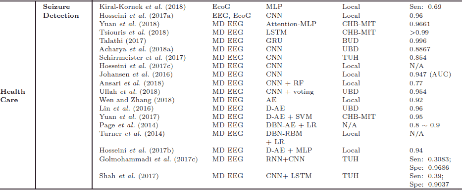

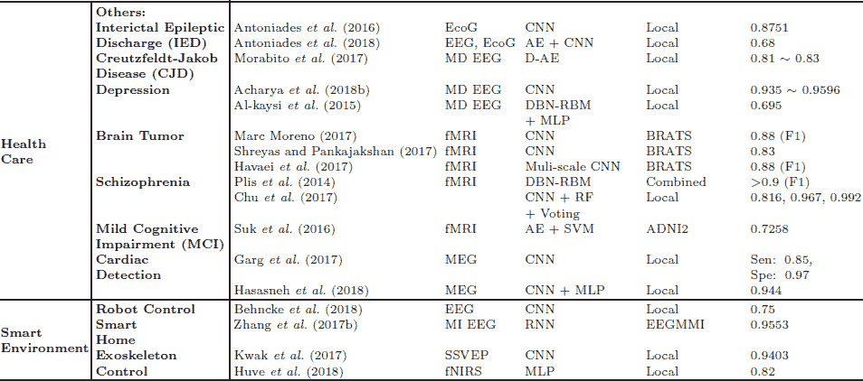

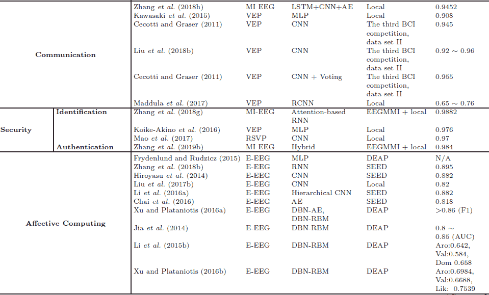

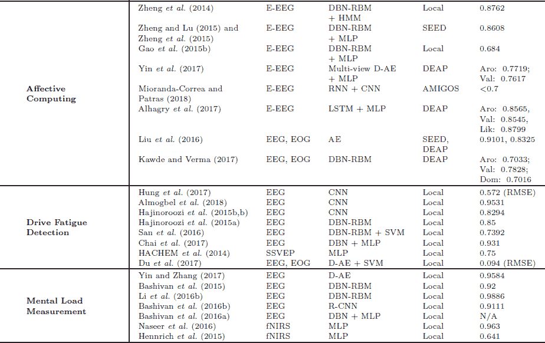

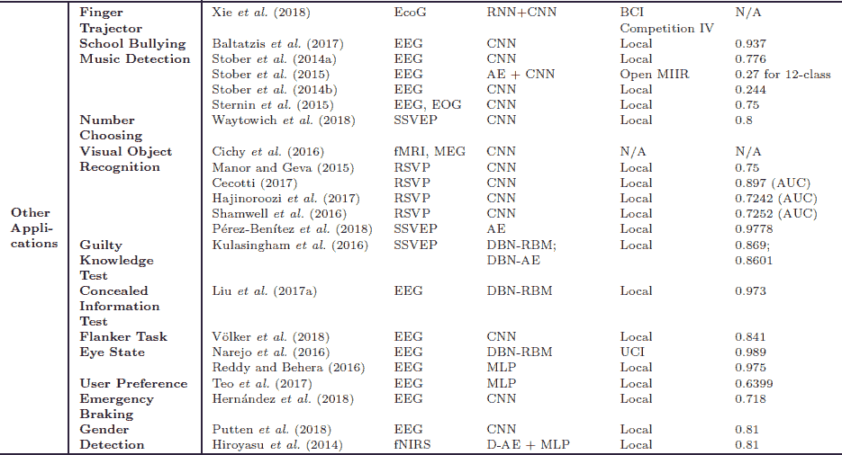

fMRI 广泛应用于阿尔茨海默症的诊断；其特征的高空间分辨率使其在多项研究中的诊断准确率达到 90% 以上。导致其竞争性性能的另一个因素是诊断是一个二分类任务。此外，一些出版物根据自发 EEG 诊断 AD（Morabito *et al.*, 2016; Zhao and He, 2014）。癫痫性发作的诊断也引起了关注。发作检测主要基于自发 EEG 和少量 ECoG 信号。该场景下流行的深度学习模型包含独立的 CNN 和 RNN，以及结合 RNN 和 CNN 的混合模型。某些模型整合了深度学习模型进行特征提取，并使用传统分类器进行检测（Page *et al.*, 2014; Turner *et al.*, 2014）。例如，Yuan *et al.* (2017) 在特征工程中应用 D-AE，随后使用 SVM 进行发作诊断。Ullah *et al.* (2018) 采用了投票法进行后处理，其中提出了多个 CNN 分类器，最终预测结果为多数结果。

使用 BCI 系统可以识别许多其他健康问题。MEG 中的心脏伪迹可以通过深度学习模型进行自动检测（Garg *et al.*, 2017; Hasasneh *et al.*, 2018）。研究人员提出了几种改进的 CNN 结构，基于公共 BRATS 数据集的 fMRI 检测脑肿瘤（Havaei *et al.*, 2017; Shreyas and Pankajakshan, 2017）。研究人员已经证明了深度学习模型在检测各种精神疾病方面的有效性，例如抑郁症（Acharya *et al.*, 2018b）、发作间痫性放电（IED）（Antoniades *et al.*, 2016）、分裂症（Plis *et al.*, 2014）、克鲁茨 feldt 特-雅博病（CJD）（Morabito *et al.*, 2017）和轻度认知障碍（MCI）（Suk *et al.*, 2016）。

### 5.2 智能环境

智能环境是脑信号应用的一个前景场景。随着物联网（IoT）的发展，越来越多的智能环境可以连接到脑信号系统。例如，智能家居中使用的辅助机器人（Zhang *et al.*, 2017b, 2018i）可以通过居民的脑信号控制。Behncke *et al.* (2018) 和 Huve *et al.* (2018) 研究了基于视觉刺激自发 EEG 和 fNIRS 信号的机器人控制问题。脑控外骨骼可以辅助下肢运动神经元受损的人进行步行和日常活动（Kwak *et al.*, 2017）。未来，对脑控电器的研究可能使智能家居和智能医院中的老年人和残障人士受益。

### 5.3 通信

与其他人机接口技术相比，脑信号研究最大的益处之一是，脑信号让失去大部分运动能力且无法言说的患者能够继续进行口头交流。深度学习技术提高了基于脑信号通信的效率。一种流行的图示（能够让个人在不涉及任何运动系统的情况下进行打字）是 P300 拼写器，它可以将用户的意图转换为文本（Kawasaki *et al.*, 2015）。强大的深度学习模型使 BCI 系统能够将包含脑语音信号的 P300 片段从非 P300 片段分离离开（Cecotti and Graser, 2011）。在更高级别的层面上，代表性的深度学习模型可以在用户的焦点遍历一系列字符时快速检测每个字符，并将其按顺序打印在屏幕上，允许他们与他人聊天（Cecotti and Graser, 2011; Liu *et al.*, 2018b; Maddula *et al.*, 2017）。此外，Zhang *et al.*, 2018h) 提出了一种结合 RNN、CNN 和 AE 的混合模型，该模型从运动想象（MI）EEG 中提取信息丰富的特征，以识别用户想要说的每个字母。

### 5.4 安全

脑信号也可用于处理安全问题，如身份识别（或识别）和身份认证（或验证）。对于前者，通过多分类来确定一个人的身份（Zhang *et al.*, 2018g）。后者则采用二分类来测试授权（Zhang *et al.*, 2019b）。

大多数现有的生物识别识别/认证系统依赖于个人的内在生理特征，如面部结构、虹膜、视网膜、声音和指纹（Zhang *et al.*, 2018g）。它们容易受到各种攻击手段的影响，包括防监控假面具、隐形眼镜、声码器和指纹膜。鉴于冒充者几乎不可能伪造，基于 EEG 的生物识别是一种极具前景的替代方案。Koike-Akino *et al.* (2016) 已经采用深度神经网络根据 RSVP 识别身份；Mao *et al.* (2017) 应用 CNN 模型进行身份识别；Zhang *et al.* (2018g) 提出了一种基于注意力的 LSTM 模型，并在数据集上进行了评估。EEG 信号还与步态信息结合，通过混合深度学习模型构建双重认证系统（Zhang *et al.*, 2019b）。

### 5.5 情感计算

用户的情感状态为许多应用提供了关键信息，例如个性化信息的检索（如多媒体内容）或智能人机界面设计（Xu and Platinumotis 2016）。近期研究表明深度学习模型可以提升情感计算的性能。最常用的模型假设情绪分布在两个维度：唤醒和效价。唤醒是指情绪刺激的强度或情绪的力量；效价是指体验情绪的人对刺激的评价。在其他模型中，支配力和喜好也被采用。

一些研究人员（Li *et al.*, 2016a; Liu *et al.*, 2017b; Wang *et al.*, 2018）尝试使用 CNN 及其变体等深度学习算法根据 EEG 信号将用户的情感状态分为两类（积极/消极）或三类（积极、中性和消极）。DBN-RBM 是发现情感自发 EEG 中隐藏特征的最具代表性的深度学习模型（Xu and Platinumotis, 2016a; Zheng and Lu, 2015）。Xu and Platinumotis (2016a) 应用 DBN-RBM 作为特征提取方法根据 EEG 对情感状态进行分类。

此外，许多其他人员旨在识别每个特定情感维度的积极/消极状态。例如，Yin *et al.* (2017) 采用了 AE 的集成分类器来识别用户的喜好。每个 AE 使用三个隐藏层来过滤噪声并派生稳定的生理特征表示。所提模型在基准 DEAP 数据集上进行了评估，唤醒和效价的分类准确率分别达到了 77.19% 和 76.17%。

### 5.6 驾驶疲劳检测

驾驶员保持警觉和维持最佳状态将极大影响交通安全（Almogbel *et al.*, 2018）。脑电图（EEG）信号已被证明在评估不同语境下人类的认知状态有用。通常，如果驾驶员的反应时间小于 0.7 秒，则被认为处于警觉状态；如果超过 2.1 秒，则处于疲劳状态。Hajinoroozi *et al.* (2015a) 提出，通过发现 EEG 信号中独特的对应特征，可以检测出驾驶员疲劳。他们探索了一种基于 `DBN` 的降维方法。

检测驾驶员疲劳对于防止因驾驶嗜睡引起的事故至关重要，且在实践中是可行的。EEG 采集设备的硬件廉价且现成，并足够便携，可在车载中使用。从技术角度来看，深度学习模型极大提升了疲劳检测的性能。正如我们总结，可以通过 EEG 信号以高准确率（82–95%）识别嗜睡。

驾驶员疲劳检测的未来在于自动驾驶场景。在大多数自动驾驶情况下（例如，3 级自动化¹），人类驾驶员需要对干预请求做出适当反应，这意味着驾驶员应保持警觉。因此，我们认为基于脑信号的驾驶员疲劳检测将有利于自动汽车的发展。

### 5.7 心理负荷测量

EEG 振荡可用于测量心理工作负载水平，这反过来可以在人机交互背景下维持决策制定和策略开发（Yin and Zhang, 2017）。例如，人类操作者过重的心理负荷可能导致性能下降并引发灾难性事故（Parasuraman and Jiang, 2012）。

研究人员已对这一主题进行了探索，并利用了功能近红外光谱（fNIRS）信号和自发 EEG。Naseer *et al.* 采用 `MLP` 算法进行基于 fNIRS 的二分类心理任务水平分类（心算和休息），其性能优于传统的分类器 `SVM`、`ANN`、`k-NN`，并达到了 96.3% 的最高准确率。Bashivan *et al.* (2015) 提出了一种利用 `DBN` 模型的统计方法，用于单次 EEG 识别认知负载水平。在应用 `DBN` 之前，作者手动提取了三个频段（theta、alpha 和 beta）的小波熵和特定频段功率。总体而言，这些实验展示了 92% 的整体准确率。

### 5.8 其他应用

除了上述内容，还有许多有趣的场景可以应用基于深度学习的脑信号系统，例如推荐系统（Teo *et al.*, 2017）和紧急制动（Hernández *et al.*, 2018）。一个似乎特别有吸引力的潜在课题是视觉物体识别，它可以同时用于罪恶知识测试（Kulasingham *et al.*, 2016）和隐藏信息测试（Liu *et al.*, 2017a）。当参与者突然看到与问题物体类似的物体时，其神经元会产生脉冲。根据该理论，视觉目标识别主要使用 RSVP 信号。Cecotti (2017) 旨在建立一个通用的目标识别模型，适用于多个受试者而非特定特定的受试者。

研究人员还调查了通过 fNIRS（Hiroyasu *et al.*, 2014）和自发 EEG（Putten *et al.*, 2018）区分受试者性别的可能性。Hiroyasu *et al.* (2014) 采用深度学习根据脑流量识别受试者的性别。实验结果表明，男女之间的区域脑流量率存在差异。Putten *et al.* (2018) 尝试通过训练 `CNN` 模型来检测脑律的性别特定差异，通过比较 EEG 记录，快 beta 波活动（20–25 Hz）是最显著的特征之一。

### 5.9 基准数据集

脑信号的采集在资金和时间上都是昂贵的，原因有许多：首先，招募大量志愿者非常困难，特别是当目标是特定群体时（例如精神疾病患者）。其次，此类研究可能需要跨越长时间的跟踪。例如，睡眠障碍通常持续数月。第三，某些医疗监测设备（如 fMRI 设备）昂贵且难以获得。

在本节中，我们广泛探讨了适用于深度学习脑信号研究的基准数据集。表 5.2](#chapter5.xhtml#tab5_2）提供了 31 个带有下载链接的公共数据集，涵盖了大多数脑信号类型。BCI 竞赛 IV（BCI-C IV）通过同一链接包含五个数据集。为了清晰起见，我们包含了受试者数量、类别数量、采样率以及每个数据集的通道数。在 `# Channel` 列中，默认信号为 EEG。（某些数据集包含额外的生物信号，例如 ECG，但对于我们的目的，这里仅列出了脑信号相关的通道。）

表 5.2：BCI 系统公共数据集摘要。`# Sub`、`# Cla` 和 `S-Rate` 分别受试者数量、类别数量和采样率。`FM` 代表手指运动，BCI-C` 代表 BCI 竞赛。同一届 BCI 竞赛的数据集共享相同的下载链接。

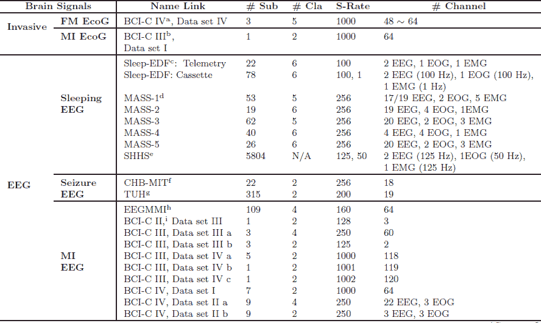


为了更深入地评估近期基于深度学习的脑信号分析的进展，有必要从性能角度对信号采集方法和深度学习算法进行分析。在某些情况下，针对同一数据集的研究采用了相同的深度学习架构，但结果却不相同，这可能是由于使用了不同的预处理方法和超参数设置。

首先，最吸引人且最热门的领域是脑信号分析在医疗保健中的应用。对于睡眠质量评估，使用的主要脑信号是患者在睡眠时记录的自发 `EEG` 现象。在某些研究中，`EOG` 信号被视为辅助信息，以提高眼动阶段检测的准确性。单一 `RNN` 和 `CNN` 模型似乎具有强大的判别特征学习能力，能够提供出色的性能。通常，大多数深度学习算法在多阶段背景下的准确率均达到 85% 以上，在此基础上，组合混合模型（例如 `CNN` `LSTM`）只能带来细微的改进。

检测阿尔茨海默症的关键方法之一是通过测量特定脑区域的功能对脑信号进行分析。具体而言，可以使用自发 `EEG` 信号或 `fMRI` 图像进行诊断。对于 `MD EEG` `DBN` 被认为优于 `CNN`，因为 `EEG` 信号包含的时间信息多于空间信息。对于 `fMRI` 图像，`CNN` 在网格化空间信息学习方面具有巨大优势，提供了非常全面的分类准确率（90%以上）。对于癫痫发作，诊断通常基于 `EEG` 信号。单一 `RNN` 分类器（例如 `LSTM` 或 `GRU`）由于其卓越的时间依赖建模能力，似乎比其对应模型效果更好。然而在这里，复杂的混合模型确实优于单一组件。例如，Golmohammadi *et al.* (2017c) 由于结合了 `RNN`，在同一数据集上实现了比 (Schirrmeister *et al.*, 2017) 的结果。大多数癫痫发作检测模型声称具有很高的分类准确率（95%以上）。这的一个可能原因是它们使用了二分类场景，这比多分类要容易得多。

关于脑信号控制的智能环境的较较少，且使用的脑信号采集方法非常多样。这是一个日益增长且充满前景的领域，因为它很容易与智能家居和智能医院相结合，从而造福健康人士和身体残障者。脑信号研究的另一个好处是它通过通信技术连接了人的内心和外在世界。在这个领域，许多研究关注于 `VEP` 信号，因为视觉诱发电非常明显且易于检测；一个重要的数据源来自第三届 BCI 竞赛。此外，脑信号分析将代表安全系统的重大进步，因为脑信号是不可见的且极难模仿。它们的抗欺骗性使其成为关注机密性的场景下识别/认证领域的一颗星。基于脑信号的安全系统的主要缺点是设备既昂贵又不方便（例如，受试者必须佩戴 `EEG` 头设备以允许监测脑波）。

情感计算近年来受到了广泛关注。`EEG` 信号具有高时间分辨率，能够捕捉快速变化的情绪。因此，几乎所有研究都关注受试者观看旨在引起特定情绪的视频时记录的自发 `EEG` 信号。在某些情况下，还会捕捉眼动的 `EOG` 信号。

---

# 第三部分：基于 EEG 的 BCI 深度学习近期进展

## 第六章：健壮的脑信号表示

### 6.1 概述

即使在相同的目标下，不同的受试者也产生不同的脑信号模式；这被称为受试者间变异（Saha and Baumert, 2019），是由许多个人因素（如年龄、性别、健康状况）引起的。为了构建通用的 BCI 系统，提取可以跨受试者的健壮表示仍然非常重要（Atum *et al.*, 2019）。根据基于受试者的泛化，BCI 系统可以分为三类：

- **依赖受试者 (Subject-Dependent)**：训练集和测试集来自同一受试者。也就是说，训练良好的 BCI 系统在一个特定受试者身上运行良好，但在其他人身上可能完全无效。

- **跨受试者 (Cross-Subject)**：训练集和测试集从同一组受试者中。因此，BCI 系统可以为该组的任何受试者服务，但在应用于组之外的个体时，其性能可能会大幅下降。


- **受试者无关 (Subject-Independent)**：训练集从多个受试者中收集，而测试集从一个未参与训练集的未知人员中收集。这种类型的 BCI 系统能够从训练集中学习健壮且通用的表示，从而构建一个在任何受试者身上都能表现良好的预测器。

显然，一个良好的 BCI 系统应该能够处理受试者无关的场景，以便部署到现实应用中。然而，由于受试者间的噪声，构建这样一个健壮系统非常困难。因此，研究人员必须增加约束并在特定的参数（例如依赖受试者和跨受试者）内进行研究，以启发受试者无关的发展。本章介绍了这类系统的细节以及相应的典型深度学习技术。

**脑信号分解。** 采集的脑信号可分为三个部分：模式相关成分（例如受试者的动作/状态）、客观因素引发的成分（例如环境噪声）以及主观因素引发的成分（例如性别、身高、年龄、健康）。以 `EEG` 信号为例，采集的原始数据 `E` 公式如下：

```
E = E_pattern + E_objective + E_subjective
```

其中 `E[p]`、`E[o]` 和 `E[s]` 分别代表上述三个成分，其中 `E[p]` 是 BCI 系统中感兴趣的信号，`E[o]` 是由个体内变异引起的噪声，而 `E[s]` 是由个体间变异引起的噪声。

## 脑信号表征的分类法

通常，脑信号中包含的信息有三个方面：沿着时间轴的临时信息、沿着通道分布的空间信息，以及由脑连接网络指示的图结构化信息。如第 4.7 节所示，`RNN` 及其变体能够提取时间特征；`CNN` 及其变体可以探索潜在的空间空间特征；而图神经网络（`GNNs`）则根据脑区之间的连接发现图结构化特征。

上述三类深度神经网络不仅可以独立工作，还可以相互整合。单独来说，它们充当了三种类型的表征学习算法：`RNNs`、`CNNs` 和 `GNNs`。通过结合其中两种，我们可以创建：`RNNs+CNNs` 来建模时空依赖关系，`RNNs+GNNs` 来同时考虑时间和图结构化信息，以及 `CNNs+GNNs` 来发现空间特征和脑区连接。最后，也可能将三者结合（`RNNs+CNNs+GNNs`），从整体上分析信息。

在应用上述七种类型的鲁棒表征学习框架时，值得注意的是：(1) `RNNs` 和 `CNNs` 自 2016 年以来已被广泛用于处理脑信号，而 `GNNs` 直到 2018 年才流行起来；因此只有少数研究采用 `GNNs` 进行脑信号分析（这就是为什么 `GNNs` 未包含在第 3 章中）。`GNNs` 的独立使用以及 `GNNs` 与其他深度学习模型的整合为未来研究展现了广阔前景。(2) 此外，我们无法确定地说明哪种方法最有效，或者组合模型是否优于单模型方法。算法的性能高度取决于信号类型、场景、分辨率等。但我们有理由相信，具有较高时间分辨率的信号（例如 `EEG` 和 `fNIRS`）可以为时间分析模型提供更多信息，而具有较高空间分辨率的信号（例如 `fMRI`）更适合 `CNNs`。(3) 当结合多个深度学习组件时，框架必须正确设计，以避免它们之间的冲突。例如，如果 `CNN` 会破坏图结构化信息，那么组合的 `CNN+GNN` 模型性能可能比单单的 `CNN` 差。(4) 除了上述讨论的基础模型外，代表性的深度学习模型（例如 `AE` 和 `RBM`）可以对任何特征集进行去噪和降维，而 `MLP` 结构可用于在任何场景下学习表征并进行预测。在本节中，我们关注基础深度学习框架；代表性模型和 `MLPs` 将在后面进一步介绍。

## 术语

在进入更详细的信息之前，我们在此简要介绍一些描述脑信号的常用术语。`EEG` 记录是长且连续的，不能直接馈送下游阶段。因此，我们将这些长记录切割成短的 `segments`（段），每一段称为一个 `sample`（样本）。这种操作被称为 `segmentation`（分段）。在机器学习中，我们在段级别上研究数据的特征，并尝试寻找同一类别中多个样本的特征特征。因此，如果我们发现一个未见的样本包含特定特征，我们就可以推断该未见样本属于特定类别。

分段中有两个关键参数：`time window`（时间窗口）和 `the overlap`（重叠部分）。`time window` 是段的长度，而 `overlap` 指两个相邻段重合的间隔。例如，假设我们有一个持续 10 秒的 `EEG` 记录，并在 1 秒的 `time window` 和 50% 的 `overlap` 下进行分段。因此，我们可以收获 `19 = (10/1) * (1/50%) − 1` 个段，每个段持续 1 秒。第一段从 0 到 1 秒切分，第二段从 0.5 秒到 1.5 秒切分，以此此类推。最小的尺度是 `time point`（时间点），也称为 `time slice`（时间片），指单次 `sampling operation`（采样操作）采集的信号。例如，假设我们有一台采样频率为 100 Hz 且关联 64 通道/电极的设备。这意味着设备每秒采集 100 个样本，每次采样将产生 64 个值（每个电极一个值）。包含这 64 个元素的向量被称为 `time point`。显然，每个段将包含 100 个 `time points`，这可以表示为 100 行 64 列的矩阵，其中，每行对应一个 `time point`，每列对应一个 `EEG channel`（EEG 通道）。更进一步，我们可以将水平（行）视为时间轴，垂直（列）视为空间轴。

## 6.2 个体相关 (Subject-Dependent)

大多数现有的 BCI 相关研究集中在个体相关的场景，这允许研究人员跳过个体间变异的挑战，而完全专注于表征学习。相对而言，个体相关的 BCI 系统因此是主要的系统。

如公式 (6.1) 所示，在个体相关的情况下，`E[s]` 趋于零，因为所有信号都是从同一个受试者处采集的。深度学习模型只需要学习来自 `E` 的感兴趣成分（即 `E[p]`）的潜在特征。表 4.1 中提出的大多数方法都是为个体 BCI 系统的表征学习和分类开发的。接下来，我们将介绍几种基于深度学习的鲁棒表征学习算法。

### 6.2.1 时间表征学习

为了描述脑模式，发现潜在的时间表征是关键的。简单来说，`RNN` 及其变体提供了探索随时间变化的脑信号表征的机会。

images/fig6_1.jpg

图 6.1：利用时间表征学习的癫痫发作预测系统示意（Tsiouris 等人，2018）。`LSTM` 单元的细节见图 3.4(a)。

图 6.1 展示了一个结合传统特征工程与高级深度循环神经网络以预测癫痫发作的流程图（Tsiouris 等人，2018）。所提系统包含四个阶段：EEG 信号采集、信号分段、特征提取和基于 LSTM 的预测。在第一阶段，通过特定设备采集连续的 EEG 流。然后，原始 EEG 信号被馈入分段阶段，设置 `time window` 为 5 秒，`overlap` 为 0。`time window` 和 `overlap` 是根据经验确定的，取决于实验场景、信号质量甚至设备的采样频率。通常，睡眠 EEG 的 `time window` 设置为 30 秒，运动 EEG 为 0.1–3 秒，情绪和精神疾病 EEG 为 2–10 秒。`overlap` 通常范围在 0 到 50% 之间。分段的结果是我们在每个通道（即 C1）中拥有若干段。请注意，这些段之间仍然存在时间关系，因为它们是沿着时间轴切分的。

接下来，分段被输入第三阶段，即特征工程。该工作流展示了如何手动提取特征，包括互相关特征、时域特征、频域特征和图论指标。互相关特征通过衡量每对 EEG 通道之间的相关性来量化任意两个 EEG 信号之间的相似性，并考虑了两个空间上较远信号之间潜在的时间延迟。在时域中，脑信号分析中常用的特征包括若干阶统计量（均值、方差、偏度、峰度）、显示符号变化次数的零交叉点数；峰峰电压，表示分段内最高/最低振幅之间的差异；以及信号总面积，用于测量信号下方的绝对面积。此外，还考虑了 EEG 信号的频谱信息，因为还提取了各种频域特征，包括总能量谱和跨基本节律带（例如 Delta、Theta、Alpha、Beta 和 Gamma 波）的能量百分比。最后，该框架还考虑了图论指标，它们反映了 EEG 通道之间的功能性连接。然而，从通道连接中提取的特征相当浅层，因此这项工作`不`被视为图形信息学习。

随后，提取的特征流向基于 LSTM 的分类器，以预测癫痫发作状态（即发作前或间期）。根据初步实验，我们选择了如下 LSTM 分类器设计。该分类器由六层组成：第一层 LSTM 包含 643 个单元，每个单元接收来自上一阶段提取的一个特征。接着，采用丢弃比为 0.5 的 Dropout 层以防止过拟合。该 Dropout 层随机将 50% 的单元输出设置为零，以强制 LSTM 学习更具泛化性的表示。第三层是另一个包含 128 个单元的 LSTM 层，随后跟一个丢弃率为 0.2 的 Dropout 层。第二个 Dropout 层的输出被馈到具有 30 个节点的全连接层，最后通过一个仅有两个节点的输出层。该层的输出是癫痫发作状态预测。如果第一个元素较大，则意味着输入的 EEG 分段属于发作前；否则，该 EEG 分段属于间期。

请注意，第三阶段的人工特征提取在传统的 BCI 系统中至关重要，但在基于深度学习的 BCI 中可以省略，因为深度学习可以从原始 EEG 信号中自动学习特征。Tsiouris *et al.* (2018) 对比了两种场景下 LSTM 分类器的性能。在第一情况下，LSTM 分类器接收原始 EEG 信号并在没有特征学习的情况下直接识别癫痫发作阶段。在第二情况下，LSTM 分类器将手动提取的特征作为预测基础。实验结果显示，第二个分类器优于第一个约 10%。这表明将传统特征与先进的深度学习模型相结合是提升 BCI 系统性能的良好方法。

### 6.2.2 空间表示学习

由于计算机视觉研究的兴起，开发了大量模型来从图像中提取空间特征。许多模型，例如 `ResNet` (Pereira *et al*., 2018) 和 `SincNet` (Zeng *et al*., 2019; Ravanelli and Bengio, 2018)，可以被采用并修改以学习脑信号的空间表示。在本节中，我们介绍几个已用于 BCI 领域的典型空间特征学习框架。

让我们继续以癫痫发作检测作为应用场景，`CNN` 已用于从 EEG 信号的时域和频域捕捉空间特征。如图 6.2 所示，该工作流说明了 `CNN` 如何从原始 EEG 数据中捕捉潜在表示并用它们预测发作状态 (Zhou *et al*., 2018)。

空间表示学习框架包含五个阶段：输入时域和频域的 EEG 数据、卷积操作、平均池化、全连接和最终输出层。可以清楚看到，该系统需要两组输入，一组来自时域，另一组来自频域。频域分段通过快速傅里叶变换 (`FFT`) 从时域转换而来。输入数据被绘制为 3D，具有时间/频率维度、通道维度和样本维度，而实际上，如果我们仔细观察单个样本，证明它们只包含两个维度。

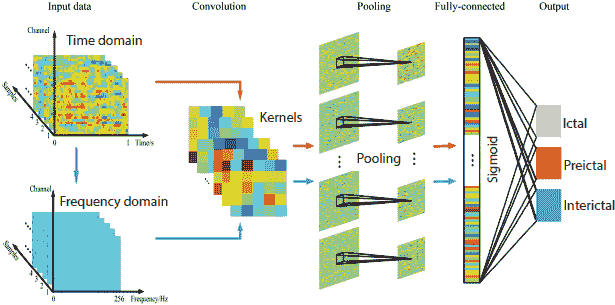

图 6.2：基于 CNN 的脑信号处理模型框架 (Zhou *et al*., 2018)。

卷积、池化和全连接层在第 3.1.3 节中介绍；让我们简单回顾一下它们的关键特征。`CNN` 结构主要包括卷积层、池化层和全连接层。卷积层对输入应用卷积操作，将结果传递到下一层。卷积模拟了单个神经元对刺激的反应。卷积网络可能包括局部或全局池化层，将一层神经元簇的输出合并到下一层的单个神经元中。平均池化使用上一层神经元簇的平均值。全连接层将一层中的每个神经元连接到下一层的每个神经元。最后一个全连接层指示预测结果，被称为输出层。

图 6.2 展示了基于时域或频域信号的多通道时间序列直接输入 `CNN` 作为输入层。结构上，`CNN` 由卷积层、插的池化层以及全连接层组成。我们使用的 `CNN` 模型由三个主要层组成：卷积层通过 5 × 5 卷积核与输入层连接，由在 EEG 信号上滑动的卷积核组成；第二层包含一个 2 × 2 平均池化层，主要用于提取关键特征并降低网络的计算复杂度；最后的全连接层使用 sigmoid 激活函数输出分类结果（即发作期、发作前或间期）。

与传统的 `CNN` 相比，该框架的亮点在于它的双输入。具体而言，不仅考虑了通常的时域空间信息；还捕捉了频域的表示。虽然频域特征在传统的 BCI 系统中总是被考虑，但在少数基于深度学习的系统中才被考虑。

在图 6.2 所示的原理图中，时域和频域的特征通过拼接整合到卷积层中。此外，还有两种整合多源信息的进一步选项，总共为我们提供了三种潜在的集成方法：早期集成、中期集成和后期集成（Zitnik *et al*., 2019）。在早期集成中，信息在输入层进行组合。例如，我们有一个形状为 `[100, 64]` 的时域样本，通过执行 FFT，在频域中获得形状同样为 `[100, 64]` 的结果。接下来，它们被融合为一个形状为 `[100, 128]` 的矩阵，然后使用 CNN 来分析新形成的矩阵。中期集成方法如图 6.2 所示，它在隐藏层中组合特征。在后期集成方法中，对每种输入数据都独立地进行分析，并结合模型结果以做出最终预测。例如，我们可以构建两个相同的 CNN 分类器，其中一个接收时域样本，另一个接收频域样本，然后将两个分类器输出层的平均值作为最终预测输出。

EEGNET (Lawhern *et al*., 2018) 是一种流行的网络，可以从原始 EEG 信号中显式学习空间关系。该模型包含多个分支，用于并行学习输入 EEG 信号的不同方面，最后组合学习到的表示进行最终分类。具体而言，每个分支中都有一个可训练的内核，将原始 EEG 数据转换为对应于特定 EEG 频带的新空间。这种策略类似于传统 EEG 特征提取中的滤波器组。之后，使用深度卷积层来学习空间滤波器。然后设计了可分离卷积，通过优化合并输出来解耦跨特征图之间的关系。

### 6.2.3 图形表示学习

深度学习模型通常将 EEG 通道视为 2D 栅格输入，而忽略了 EEG 通道之间复杂的连接（Li *et al*., 2019）。相比之下，图形信息是指脑区域之间连接所携带的信息。图形表示分析基于图论，根据该理论，每个脑区域（例如 EEG 电极）被表示为一个顶点，而区域之间的连接被表示为一条边。图 6.3 展示了全连接图（即完全图），其中每个顶点都与其他所有顶点连接。图 6.3（左侧）展示了人类大脑额叶（F）和颞叶（T）五个通道之间的图形连接。脑区域之间的确切连接生物学和神经科学研究人员尚未完全理解；因此，这些连接性在合理范围内可能会有所不同。有一些研究尝试学习图结构（即顶点之间的连接性）；Li *et al.* 特别提出了一种基于图卷积机制中数据聚合的迭代方法，以揭示潜在的图结构（Li *et al*., 2019）。

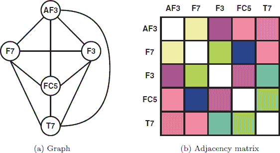

图 6.3：人类大脑额叶（F）和颞叶（T）五个通道的示例。右侧展示了五个通道之间的图形连接。左侧展示了全连接图（即完全图），其中每个顶点都与其他所有顶点连接。脑区域之间的确切连接生物学和神经科学研究人员尚未完全理解；因此，这些连接性在合理范围内可能会有所不同。有一些研究尝试学习图结构（即顶点之间的连接性）；Li *et al.* 特别提出了一种基于图卷积机制中数据聚合的迭代方法，以揭示潜在的图结构（Li *et al*., 2019）。

为了便于理解，我们展示了一个更详细的流程，说明了如何将图神经网络（GNN）作为核心算法来构建一个实用系统。如图 6.6

图 6.6：基于 GNN 的 fMRI 分析流程（Li and Duncan, 2020）。

### 6.2.4 时空表示学习

由于 RNN 和 CNN 在该领域都取得了巨大的成功，将 RNN 和 CNN 结合以捕捉脑电信号的时空表示是直观的。大量文献利用时空特征在多个应用中分析脑电信号，例如人员身份识别（Wilaiprasitporn *et al*., 2019）和运动想象识别（Zhang *et al*., 2018a）。

为了防止单个 EEG 样本内时间特征和空间特征之间的冲突，研究人员开发了一种有效方法将 1D EEG 时间点转换为 2D 矩阵。如图 6.7

图 6.7：将 1D EEG 时间点转换为 2D 矩阵（Wilaiprasitporn *et al*., 2019）。

我们在这里介绍了两种分别以级联和并行方式结合 RNN 和 CNN 的典型框架。前者顺序地学习时间和空间表示，而后者则并行学习时间和空间表示并将它们结合起来进行预测。

级联 R-CNN 模型（图 6.8）由四个阶段组成：数据输入、空间表示学习、时间表示学习和预测结果的计算。该模型接收单个 EEG 样本（形状为 `[10, 9, 9]`），该样本同时包含空间和时间信息，并进行五分类，将输入样本与特定的运动想象动作相关联（闭上双眼、移动双脚或双拳，或移动左/右手）。在第一阶段，EEG 样本被分为 10 个时间点，每个时间点都是一个形状为 `[9, 9]` 的矩阵。在第二阶段，采用标准的 CNN 结构从每个 EEG 样本中学习潜在的空间相关性。在这个示例中，采用了 10 个 2D CNN，每个 CNN 接收一个时间点并提取空间特征向量。注意，所有 CNN 特征提取器共享相同的参数。在随后的阶段中，学习到的空间表示被输入到两个 LSTM 层组成的时间特征提取器中。LSTM 层接收在不同时间点获取的空间信息，并产生时空表示。最后，时空表示流入全连接层，然后通过 softmax 层进行预测。

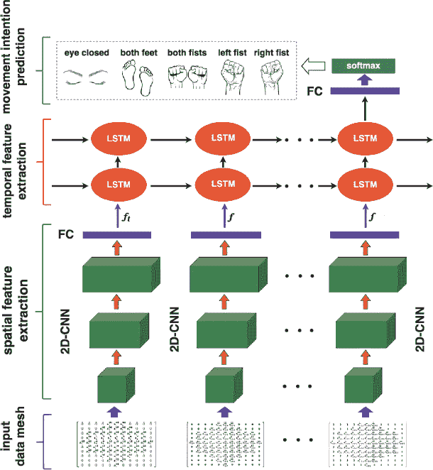

图 6.8：级联 EEG 信号时空表示学习的框架（Zhang *et al*., 2018a）。

另一方面，图 6.9 中的并行 R-CNN 由输入数据、并行的空间和时间特征提取，以及随后的融合和意图预测阶段组成。与级联模型相比，该框架同时提取空间时间和表示，并进行中间整合以融合特征以做出最终预测。

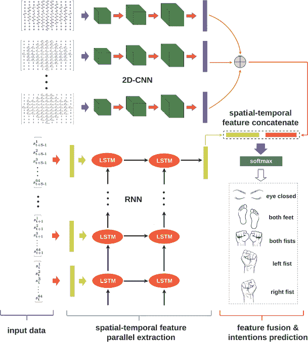

图 6.9：并行 EEG 信号时空表示学习的框架（Zhang *et al*., 2018a）。

### 6.2.5 讨论

原则上，除了上述的四种方法外，表示学习还有三种进一步的潜在方法：时间图、空间图和时空图。为了完整起见，我们在这里列出了它们，尽管在该领域仍许多需要填充的空白。（这也是为什么我们没有在第 3 章中包含 GNN。）我们已经对这些主题进行了初步探索。在书中，我们提出了一种 BCI 系统，捕捉想象对象的表示（参见第 10.1 节）。

## 6.3 跨被试

### 6.3.1 概述


本节介绍了如何在跨被试的情况下学习表示。基本上，跨被试 BCI 系统与依赖系统的相似，后者只是将范围从一个特定被试扩大到一组被试。然而，回想公式 (6.1)，在跨被试的情况下，模型还必须处理被试差异引起的干扰。原则上，上一节介绍的深度学习模型也可以用于跨被试任务，但由于被试差异，它们的表现可能不会理想。解决这一问题有两个主要策略。第一种非常简单：增加数据量以强制机器学习学习潜在模式。这种策略不仅在数据上成本很高（因为需要大量的脑信号样本），而且在理论上无法保证良好的预测精度。第二种策略是设计一种能够提取纯化表示的深度学习框架（消除由被试差异引起的噪声）。

接下来，我们介绍一种用于跨被试有效学习 EEG 特征的深度学习框架——这意味着训练和测试样本都是从一组被试中随机选择的。特别是，我们提出了一种新的意图识别方法用于分类跨被试多分类 EEG 数据。首先分析 EEG 信号的相似性，并计算类间和跨被试条件的相关系数矩阵。接下来，通过应用自动编码器提取 EEG 特征。然后将这些特征输入 XGBoost 分类器，以识别 EEG 数据类别，每个类别对应一个特定的意图。

### 6.3.2 EEG 特性分析

为了进一步的 EEG 分类准备对 EEG 数据特性的了解，我们通过计算皮尔逊相关系数来量化 EEG 样本之间的相似性，如下：

```
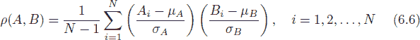
```

其中 `A` 和 `B` 表示两个 EEG 样本，每个包含 `N` 个元素；`μ[A]` 和 `σ[A]` 分别表示 `A` 的均值和标准差，`μ[B]` 和 `σ[B]` 分别表示 `B` 的均值和标准差。皮尔逊相关系数与相似性正相关，且均处于 [0, 1] 范围内。

我们在这里介绍了测量中使用的两种相似性概念：自相似性（self-similarity）和交叉相似性（cross-similarity）。自相似性定义为同一 EEG 类别内信号的相似性，而交叉相似性定义为来自两个不同 EEG 类别信号之间的相似性。自相似性和交叉相似性在两种条件下进行测量：类内和跨被。

#### 类内测量

在类内情况下，我们测量每个特定受试者的相关系数矩阵，并通过计算整个矩阵的平均值来计算平均矩阵。例如，对于某个特定受试者的五类，我们计算一个 5 * 5 的相关系数矩阵。在该矩阵中，`` 表示来自类别 `` 样本与来自类别 `` 样本之间的相关系数。自相似性表示同类两个不同样本之间的相似性。交叉相似性表示属于一个特定受试者的所有可能的类别对样本的平均相似性。

#### 跨被测量

在跨被情况下，我们测量每个特定类的相关系数矩阵，然后计算平均矩阵。自相似性表示同一受试者同一类中两个不同样本之间的相似性。交叉相似性表示属于特定类的所有可能的受试者对样本的平均相似性。

表 6.1 显示了类内相关系数矩阵以及相应的自相似性统计。最后一列（PD）提供了自相似性和交叉相似性的百分比差异。我们可以从结果中观察到，对于所有类别，自相似性始终高于交叉相似性，这意味着样本的类内凝聚力强于其类间凝聚力。百分比差异显示出明显的波动，表明不同类对之间的类内凝聚力存在差异。

表 6.1：类内相关系数矩阵。相关系数矩阵（左上部分）是来自 20 个独立受试者的 20 个相关系数的平均值。Self-S、Cross-S 和 PD 分别代表自相似性、交叉相似性和百分比差异。

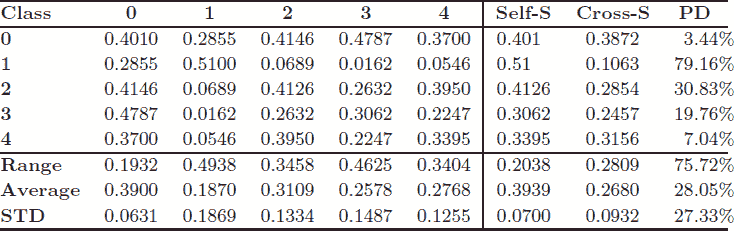

同样，表 6.2 提供了跨被相关系数矩阵，并给出了结果的另一种可视化。我们再次发现，对于每个类别，自相似性都高于交叉相似性，且百分比差异不同。五类交叉相似性的标准差是相似的。这表明数据集在受试者和类别之间的分布是稳定且均匀的。

上述分析结果符合我们对跨被分类的以下假设：(1) 在类内和跨被条件下，自相似性始终高于交叉相似性；(2) 类内百分比差异越高，分类结果越好；以及(3) 受试者的平均百分比差异和标准差越低，跨被条件下的分类性能越好。

### 6.3.3 表征学习框架

在本节中，我们回顾了所提的意图识别算法，首先对输入 EEG 数据进行归一化，然后自动探索归一化数据的特征表征。然后，我们采用 XGBoost 分类器对训练后的特征进行分类。方法流程图如图 6.10。

### 6.3.3.1 归一化

在处理不同单位和尺度的参数时，归一化在知识发现过程中起着至关重要的作用。例如，假设一个输入特征范围从 0 到 1，而另一个从 0 到 100，如果不进行调整，分析结果将被后者特征主导。通常有三种广泛使用的归一化方法：最小极大归一化、单位归一化和 z-score 缩放（也称为标准化）。

#### 最小极大归一化

最小极大归一化将向量中的所有元素投影到 [0, 1] 范围内。该方法将特征映射到相同的范围，而不考虑它们的原始均值和标准差。最小极大归一化的公式如下所示：

表 6.2：跨被相关系数矩阵。STD 表示标准差，SS 表示自相似性，CS 表示交叉相似性，PD 表示百分比差异。

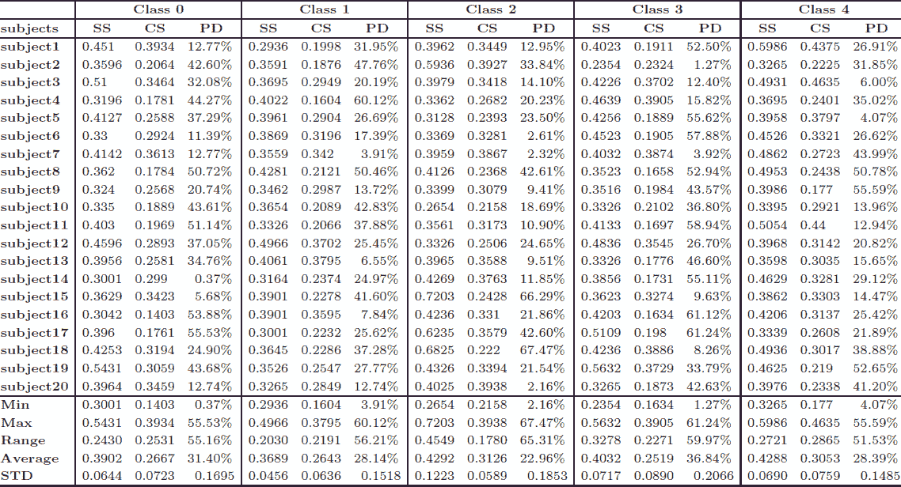

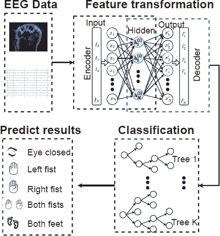

图 6.10：方法流程图。采集的 EEG 数据流入特征表征组件，该组件寻求合适的表征和解释。`I[i]` 和 `` 分别表示输入输出 EEG 数据。`X[i]`、`h[i]` 和 `` 分别表示输入层、隐藏层和输出层的神经元。学习到的特征表征 `h` 将送到具有 `K` 树的 XGBoost 分类器。分类器产生的预测结果对应用户的意图，指示用户的运动意图（闭眼或移动左右手）。

```
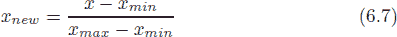
```

其中 `x[min]` 和 `x[max]` 分别表示特征 `x` 的极值。

#### 单位归一化

单位归一化通过每个元素的百分比或权重重新缩放特征。它计算所有元素的和，然后将每个元素除以该和。归一化方程如下：

```
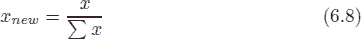
```

其中 `Σ x` 表示特征 `x` 的和。与最小极大归一化类似，该方法的结果属于 [0, 1] 范围。

#### Z-score 缩放

Z-score 缩放强制特征符合正态高斯分布（零均值单位方差）：

```
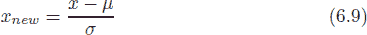
```

其中 `μ` 和 `σ` 分别表示输入特征 `x` 的期望和标准差。

实验结果——详细信息请参阅 Zhang 等 (2017c)——显示 z-score 缩放归一化获得了最好的分类性能，而单位归一化的性能差。在不进行详细解释的情况下，书中剩余实验均使用 z-score 缩放方法。

为了利用脑电图（EEG）信号之间的深度相关性，我们采用了自编码器来学习更准确的 EEG 表征。自编码器（Nguyen *et al.*, 2015）是一种无监督机器学习算法，旨在探索高维输入数据的低维表征以实现降维。从结构上来说，自编码器多层反向传播神经网络，包含三类层：输入层、隐藏层和输出层。在隐藏层中将输入数据处理为压缩表示的层称为编码器，而从隐藏层到输出层重构压缩表示的过程称为解码器。编码器和解码器都会产生一组权重 `W` 和偏置 `b`。当只有一个隐藏层时，自编码器被称为基础自编码器（basic autoencoder），而当有多个隐藏层时，称为堆叠自编码器（stacked autoencoder）。根据我们先前的经验，在处理 EEG 信号时，基础自编码器的效果优于堆叠自编码器；因此，我们在这里采用了基础自编码器结构。

令 `Let ` 为整个训练数据（无标签），其中 `X[i]` 表示第 `i` 个样本，`N` 表示训练样本的数量，`d` 表示每个样本中的元素个数。`The ` 表示第 `i` 个样本在隐藏层中学习到的特征，其中 `M` 表示当前层中神经元的数量（`h[i]` 中的元素个数）。为了简单起见，我们分别用 `x` 和 `h` 表示输入数据和隐藏层数据。首先，编码器通过编码器权重 `W[en]` 和编码器偏置 `b[en]` 将输入数据 `x` 转换为对应的表示 `h`：


然后，解码器通过解码器权重 `W[de]` 和解码器偏置 `b[de]` 将隐藏层数据 `h` 转换为输出层数据 `x′`：


解码器的功能是重构编码特征 `h`，并使重构数据 `x′` 尽可能接近输入数据 `x`。`x` 和 `x′` 之间的差异通过 MSE（均方误差）代价函数计算，该函数由 `RMSPropOptimizer` 进行优化。

总而言之，训练自编码器的过程是优化参数以实现输入 `x` 与重构数据 `x′` 之间代价最小的任务。隐藏层数据 `h` 包含了精炼信息。此类信息可以被视为输入数据的表征，这也是自编码器的最终结果。在上述公式中，输入数据 `x` 和精炼特征（隐藏层数据 `h`）的维度分别为 `d` 和 `M`。如果 `d > M`，自编码器涉及降维；如果 `d < M`，则涉及升维。

### 6.3.3.3 意图识别

为了识别表征特征反映的意图，在本节中，我们采用了 XGBoost 分类器（Chen and Guestrin, 2016）。XGBoost，即极端梯度提升（Extreme Gradient Boosting），是一种源自梯度提升机（Friedman, 2001）概念的有监督扩展树提升算法。与梯度提升算法相比，XGBoost 提出了一种更正则化的模型形式化以防止过拟合，其工程目标是推向提升树算法计算资源的极限以获得更好的性能。考虑 `n` 个样本对 ``，其中 `` 表示一个 `m` 维样本，`` 表示对应的标签。XGBoost 旨在预测每个给定样本 `` 的标签 ``。

XGBoost 模型是一组分类回归树（CART）的集成，每棵树都有自己的叶节点和相应的的分。这种树集集的最终结果是所有单独树之和。对于包含 `K′` 棵树的树集成模型，预测输出为：


其中 `F` 是所有树的空间，`` 表示单棵树。

XGBoost 的目标函数包含损失函数和正则化。损失函数评估了每个真实值标签 `` 与预测结果 `` 之间的差异。它可以根据各种条件选择，如交叉熵、逻辑回归和均方误差。正则化函数是 XGBoost 最显著的贡献。它计算模型的复杂度，并对更复杂的结构施加更大的惩罚。

目标函数定义为：


其中 `` 是损失函数，`` 是正则化项。单棵树的复杂度计算为：


其中 `T` 是树中叶节点的数量，`‖ω‖²` 表示树中权重的 L2 范数的平方，`γ` 和 `λ` 是系数。正则化的目标函数有助于提供简单的结构模型和预测功能。更具体地说，第一项 `Ω` 惩罚树的复杂结构（叶节点越少 `Ω` 越小），而第二项惩罚单棵树的过度加权。此外，第二项有助于平滑权重并避免过拟合。

# 第 7 章

## 跨场景分类

### 7.1 概述

BCI 系统可以广泛应用于各种场景，从精神疾病诊断到情感识别再到运动意图预测。然而，大多数现有研究都是特定场景的。这意味着设计的 BCI 系统——特别是核心分类算法——只能在特定场景下工作而在而在任务中失败。例如，分类模型在神经系统疾病诊断中可以获得优异性能，但在情感识别中可能会失败。因此，有必要开发能够学习与每个特定场景相关的、信息丰富的表示算法。

跨场景分类要求算法无论场景如何，都能自动从输入数据中捕捉独特特征（即学习判别模式）。在本章中，“跨场景”的含义具有双重性。首先，算法应跨信号源之间实现具有竞争力的性能。例如，模型在一个场景中输入 EEG 和 fNIRS 信号的组合，而在另一个场景中输入 EEG 和智能手机信号的组合。其次，算法应跨应用表现良好。换句话说，模型在神经数据集上训练时旨在处理疾病诊断任务；同样，在情感数据集上训练时，它可以预测用户的情感。

在本章中，我们介绍了处理跨场景分类的两种流派：注意力机制和迁移学习。（迁移学习的背景请参阅第 6.4.1 节。）在这里，我们简要介绍注意力机制的基础。

**注意力机制。** 使用注意力机制使算法能够对输入数据的不同组件投入不同程度的注意力（即赋予以不同的权重）（Vaswani *et al.*, 2017）。例如，EEG 信号中的不同通道对预测任务的贡献是不相等的。通过采用注意力机制，算法可以通过给相关通道分配较高权重、给无关通道分配较低权重来提高分类准确性。

注意力机制最早提出于自然语言处理，现在广泛应用于许多研究课题。采用注意力机制的关键在于知道如何计算注意力权重/系数。注意力权重可以通过反向传播自动学习，也可以根据输入样本内部的相似性进行线性测量。更多细节请参阅 Vaswani *et al.* (2017)。

在 BCI 系统中，在注意力机制的引导下，深度学习模型可以在表示学习中关注重要的通道或感兴趣区域。结果是模型在不同场景之间将具有很高的适应性。例如，额叶负责运动功能；因此，相应的通道（例如 F1 和 F7）在预测运动想象意图方面更为重要。相比之下，枕叶对某些视觉刺激更敏感，因此在分析 SSVEP 信号时，位于该区域的电极（例如 O1 和 O2）应该被重视。良好的深度学习框架结合注意力机制只要在相应数据集上经过良好训练就可以处理不同的任务。

### 7.2 基于注意力的跨信号源分类

#### 7.2.1 概述

在某些情况下，通过结合多种脑信号（例如 EEG、fNIRS 和 EMG）甚至其他传感器信号（如指示用户活动、情感和位置信息的信号），可以提高 BCI 系统的性能。现在可以在各种可穿戴设备中找到各种类型的传感器（大多数脑信号可以被视为特定的感觉信号）。此类设备现在广泛应用于多个领域，例如物联网（Kamburugamuve *et al.*, 2015; Zhang *et al.*, 2018h）。在本节中，我们介绍了一种利用深度学习和强化学习优势的框架，用于学习跨模态的信息丰富表示。


与图像和视频相比，感应数据自然形成为 1D 信号，每个元素相应代表一个传感器通道。此类传感器数据分类面临着若干挑战。首先，大多数现有的分类方法使用领域特定知识，因此在收集多模态数据的复杂情况下，可能会失效甚至无法运行（Bigdely-Shamlo *et al.*, 2015）。例如，一种在 fNIRS 信号上表现良好的方法可能无法处理 EEG 信号。因此，对于此类复杂情况，一种有效且通用的传感器数据分类方法是迫切需要的。任何此类框架都应该在一系列传感器信号上展示出高效性和鲁棒性。

其次，可穿戴传感器数据携带的信息远少于文本和图像。例如，64 通道 EEG 设备采集的样本信号仅包含 64 个数值元素；因此，需要更有效的分类器来从这些有限的原始数据中提取判别性信息。同时，最大化稀缺可用数据的利用需要谨慎的预处理和丰富的领域知识储备。

受注意力机制（Cavanagh *et al.*, 1992）的启发，我们建议关注信号的注意力区域，以自动学习针对不同传感器组合的信息型注意力模式。在这里，注意力区域是具有特定长度的信号选择块，在特征维度上滑动。注意，强化学习已被证明能够学习各种任务的人类控制能力（Mnih *et al.*., 2015）。利用强化学习来发现注意力区域。考虑到不同类别的信号可能具有不同的维度间依赖关系（Markham and Townshend, 1981），我们建议使用长短期记忆（LSTM）模型（Long Short-Term Memory (Gers *et al.*, 1999; Zhang *et al.*, 2018a)）来利用信号维度之间的潜在相关。我们提出了一种加权平均空间 LSTM（WAS-LSTM）分类器来探索传感器数据中的依赖关系。

## 7.2.2 强化选择性注意力模型

假设输入传感器数据可以表示为 , ，其中 (`x[i], y[i]`) 表示 1D 传感器信号，称为一个*样本*（sample），*I* 表示样本数量。在每个样本中，特征 包含*K* 个元素，对应的真实值 `y[i]` 是一个表示样本类别的整数。`x[i]` 可以描述为一个具有 *K* 个元素的向量，`x[i] = {x[ik], k = 1, 2, …, K*}`。

所提算法如图图 7.1 所示。算法的主要重点是利用不同信号维度之间的潜在依赖。为此，所提方法包含几个组件：（1）复制与洗牌；（2）选择性注意力学习；以及（3）基于 LSTM 的序列分类。

### 7.2.2.1 动机

学习利用传感器信号维度之间的潜在关系是所提方法的核心。假设属于不同类别的信号具有不同的维度间依赖关系，这些关系包含了丰富且判别性的信息。这些信息对于改进独特信号模式的发现至关重要。

在实践中，传感器信号通常被排列为 1D 向量，对于元素的有限且固定排列，这种方式的信息量较少。每个信号向量中元素的顺序和数量会影响它们的依赖关系。在许多现实场景中，多模态传感器数据与实际放置位置相关。例如，EEG 数据是按照生物医学 EEG 通道的分布拼接的。遗憾的是，实际的传感器序列具有固定的顺序和数量，可能不适用于维度间依赖分析。同时，最优维度序列（Tan *et al.*, 2015b）随传感器的类型和组合而变化。因此，我们提出了以下三种技术来解决这些缺点。

首先，我们从维度上对输入传感器信号向量进行复制和洗牌，以便在特征维度之间提供尽可能多的潜在依赖关系（第 7.2.2.2 节）。

其次，我们引入注意力区域作为选择性注意力机制，其中每个样本的最佳维度间依赖关系仅取决于一小部分特征。在这里，注意力区域通过深度强化学习进行优化，强化学习已被证明在策略学习中稳定且性能良好的（第 7.2.2.3 节）。

第三，我们提出了 WAS-LSTM 分类器来提取独特的维度间依赖（第 7.2.2.4 节）。


图 7.1：跨模态表示学习工作流。注意力区域  是 的一个选取片段，被输入状态转移模型和奖励模型。在每个步骤 *t* 中，状态转移选择一个动作并根据智能体的反馈更新 `s[t]`。奖励模型评估注意力区域的质量并给出奖励 `r[t]`。采用双斗 DQN 来寻找最优注意力区域 ，它将被输入基于 LSTM 的分类器，以探索维度间依赖并预测样本标签 。*FCL* 表示全连接层。状态转移包含四个动作：左移、右移、扩展和压缩。

### 7.2.2.2 数据复制与洗牌

为了提供尽可能的信息，我们设计了一种方法来利用 EEG 信号之间的空间关系。假设不同脑活动的信号具有空间依赖关系。我们从维度上对输入 EEG 信号进行复制和洗牌。使用这种方法，所有可能的维度排列都是相等的。

假设原始 EEG 数据表示为 `X = {(x[i], y[i]), i = 1, 2, …, I}`，其中 (`x[i], y[i]`) 表示单个样本，I* 表示样本数量。在每个样本中，特征 `x[i] = {x[ik], k = 1, 2, …, K}`，`x[i]` ∈ 包含对应 *K* 个 EEG 通道的元素，`y[i]` ∈ 表示对应的标签。`x[ik]` 表示第 i 个样本中的第 k 个维度值。

在现实世界的采集场景中，EEG 数据通常按照生物医学通道的分布拼接。然而，生物医学维度顺序可能并非最佳的空间依赖。穷举法产生所有可能的维度排列计算成本太高。例如，64 通道 EEG 样本有 组合，这是一个天文数字。

为了提供更多可能的维度组合，我们提出了一种名为复制与洗牌（RS）的方法。RS 是一种两步映射方法，将 `x[i]` 映射到高维空间 ，具有完整的元素组合：。

在第一步（复制）中，`x[i]` 被复制 `h = K'/K+1` 次。然后我们得到一个长度为 *h * K* 且大于 *K'* 的新向量；在第二步（洗牌）中，我们对第一步复制的向量进行随机洗牌，并拦截前 *K'* 个元素生成 。与 `x[i]` 相比，理论上  包含更多多样化的维度组合。这种 RS 操作针对特定的输入数据集仅执行一次，以为强化学习的遵循提供稳定的环境。

### 7.2.2.3 选择性注意力机制

受最优空间关系仅取决于特征维度子集的这一的启发，我们引入了注意力区域，它将关注这些维度中的片段。在这里，注意力区域通过深度强化学习进行优化，这种方法已被证明在策略学习中是稳定且表现良好的。

具体而言，我们的目标是确定最优维度组合，这包含了 EEG 信号中最具区分性的空间依赖。由于 `K′`（`` 的长度）太大且计算开销高，我们引入了注意力机制（Cavanagh *et al.*, 1992）来平衡长度与信息内容，其有效性已经在语音识别等近期研究领域（Chorowski *et al.*, 2015）得到证实。我们尝试强调 `` 中的信息丰富型片段，并让 `` 表示该片段，它被称为“注意力区域”。令 `` 和 `` 表示所提算法自动学习的注意力区域长度。我们采用深度强化学习来发现最优注意力区域（Mnih *et al.*, 2015）。

如图 7.1 所示，最优注意力区域的检测包含两个关键组件：环境（包括状态转换和奖励模型）和智能体。三个元素（状态 `s`、动作 `a` 和奖励 `r`）在环境与智能体的交互中交换。在本研究中，所有三个元素都是根据上下文定制的。接下来，我们详细介绍深度强化学习结构中的关键组件：

- **状态** `` 描述注意力区域的位置，其中 `t` 表示时间戳。由于注意力区域是 1 维 ``上的移动片段，我们设计了两个参数来定义状态：``，其中 `` 和 `` 分别表示注意力区域的起始索引和结束索引¹。训练训练，`s[0]` 初始化为：

```

```

- **动作** `` 描述了智能体可以通过哪些动作来作用于环境。在时间戳 `t` 处，状态转换根据智能体的策略 `π` 选择一个动作来执行：

```


```

图 7.2：状态转换中的四种动作：左移、右移、扩展和收缩。虚线表示动作之前的注意力区域，而实线表示动作后的区域。

在我们的案例中，我们为注意力区域定义了四类动作（图 7.2）：左移、右移、扩展和收缩。对于每个动作，注意力区域移动随机距离 ``，其中 `d^u` 是上边界。对于左移和右移动作，注意力区域以步长 `d` 向左或向右移动；对于扩展和收缩动作，`` 和 `` 均移动 `d`。最后，如果状态起始索引或结束索引超出边界，则进行剪切操作。例如，如果 `` 低于下边界 0，我们将起始索引裁剪为 ``。

- **奖励** `` 由奖励模型计算，该模型稍后描述。奖励模型 `Φ`：

```

```

接收当前状态并返回评估作为奖励。

**奖励模型**。接下来，我们详细介绍奖励模型的设计。奖励模型的目的是评估当前状态如何影响分类性能。直观上说，导致更好分类性能的状态应该具有更高的奖励：``。我们将奖励模型 `` 设置为卷积映射和分类的组合(第 7.3.2.1 节)）。在实际优化方法中，准确率越高，进一步提高就越困难。例如，在较高水平上提高准确率（例如从 90% 到 100%）比在较低水平上（例如从 50% 到 60%）要困难得多。为了鼓励高水平的准确率提高，我们设计了一个非线性奖励函数：

```

```

其中 `acc` 表示分类准确率。该函数包含两部分；第一部分是指数为 `acc \in [0, 1]` 的归一化指数函数，它鼓励强化学习算法搜索导致更高 `acc` 的最优 `s[t]`。指数函数的动机是：*奖励增长率*随着准确率的增加而增加。² 第二部分是针对注意力区域的惩罚因子，`β` 是惩罚系数。总结来说，强化学习的目标是学习到最大奖励 ``，它迭代 `n[e]` 次，其中 `n[s]` 表示回合和步数。`ε`-greedy 方法（Tokic, 2010）被用于状态转换，以 `1 - ε` 的概率选择动作，或根据最优 Q 函数 `` 选择。即：

```

```

其中 `ε′ \in [0, 1]` 随机生成。为了更好的收敛和更快的训练，`ε` 逐渐增加：

```

```

**代理策略与优化**。双 Q 网络（DQNs）（Wang *et al.*, 2015）被用作优化策略 `π(s[t], a[t])`，这使得状态值函数高效。我们使用 DQN 的原因是它可以更新所有的 Q 值，而其他策略每次更新一个 Q 值。Q 函数衡量采取该动作并在随后遵循策略的预期奖励和。特别是，对于特定步骤 `t`，我们有：

```

```

其中 `γ \in [0, 1]` 是权衡当前与未来奖励重要性的衰减参数，`n` 表示后续步数。值函数 `V(s[t])` 估计处于状态 s 时的预期奖励。Q 函数与对 `(s[t], a[t])` 相关，而值函数仅与 `s[t]` 关联。

双 Q DQN 通过值函数 `V(s[t])` 和优势函数 `A(s[t], a[t])` 学习 Q 函数，然后按如下方式合并：

```

```

其中 `θ, θ′ \in Θ` 是双 DQN 网络中的参数并自动优化。公式 (7.8) 是不可识别的，这一点可以通过无法从给定的 `Q(s[t], a[t])` 恢复 `V(s[t])` 和 `A(s[t], a[t])` 来为了解决这个问题，我们可以强制优势函数在选定动作上等于零。即，让网络实现正向映射：

```

```

因此，对于特定动作 `a∗`，如果

```

```

我们有：

```

```

因此，如图 7.3 所示（代理部分的倒数第二层），流 `V` (`s[t]`) 被强制学习价值函数的估计，而另一个流则产生优势函数的估计。

为了评估 Q 函数，我们在第 `i` 次迭代中优化以下代价函数：


其中


梯度更新方法为：


#### 7.2.2.4 加权平均空间 LSTM 分类器

在本节中，我们提出的 WAS LSTM 分类出于两个目的。第一个是尝试捕捉优化注意力区域中特征维度之间的交叉关系。基于 LSTM 的分类器因其卓越的序列信息提取能力而被广泛使用，这在自然语言处理（Gers and Schmidhuber, 2001; Sundermeyer *et al.*, 2012）等多个领域得到了认可。与其他常用的空间特征提取方法（如 CNN）相比，LSTM 对超参数设置的依赖程度较低。然而，传统的 LSTM 专注于样本之间的时间依赖关系。从技术上讲，传统 LSTM 的输入数据是形状为  的 3D 张量，其中 `n[b]` 和 `n[s]` 分别表示批大小和时间样本数。WAS-LSTM 旨在捕捉一个时间点上不同维度之间的依赖；因此，我们将 `n[t]` 设置为 1 并转置输入数据为：!(images/pg133_3.jpg)。

WAS-LSTM 的另一个优势是可以通过移动平均法稳定 LSTM 的性能（Lipton *et al.*, 2015）。具体而言，我们通过对过去两个输出取平均值而非仅最后一个输出来计算 LSTM 输出 `O`[i]`（图 7.1）：


预测标签通过  表示 LSTM 算法。采用 `ℓ`[2]-范数（参数为 `λ`）作为正则化以防止过拟合。隐藏层使用 sigmoid 激活函数。损失函数为交叉熵，并由 Adam 优化算法进行优化（Kingma and Ba, 2014）。基于注意力的多模态信号分类工作流如图算法 1 所示。

**算法 1** 基于注意力分类

**输入：** 传感器数据 `X`

**输出：** 分类结果 

|  1: || 初始化 `s`[0] |
| --- | --- |
|  2: ||  |
|  3: || **学习注意力模式**: |
|  4: || **if** `t` < `N` **then** |
|  5: ||      `a[t]` = `Q`(`s[t], a[t]`) |
|  6: ||      `s`[`t`+1] = `π`(`s[t], a[t]`) |
|  7: ||       |
|  8: ||       |
|  9: || **return ** |
|  10: || **end if** |
|  11: || **基于 LSTM 的分类**: |
|  12: || **if** `iteration` < `M` **then** |
|  13: ||       |
|  14: || **return**  |
|  15: || **end if** |
|  16: || **return**  |

#### 7.2.3 讨论

首先，所提的方法在高维特征空间上效果更好，因为维度间依赖关系的信息更丰富。

此外，我们引入了一种新颖的想法，采用替代奖励模型来估计并替换原始奖励模型。通过这种方式可以消除原始模型的缺点（例如计算开销大）。关键是保持新模型产生的奖励与原始奖励高度相关。相关系数越高越好。这启发了深度学习分类器与强化学习的可能结合。

尽管如此，该框架的一个缺点是强化学习策略仅在模型训练的特定环境中运行良好。维度索引在训练和测试阶段应保持一致。应该根据不同的传感器组合训练不同的策略。

此外，所提出的 WAS-LSTM 直接关注传感器维度之间的依赖关系，并能为每个点产生预测标签，为快速反应在线检测和其他需要瞬时检测的应用提供了基础。然而，该模型依赖于足够的信号维度来携带足够的信息以确保准确识别。

### 7.3 跨应用的基于注意力分类

在上一节中，我们提出了一种基于注意力的学习框架，它在不同信号源之间运行良好。接下来，我们尝试精炼任务，专注于能够处理各种类型脑信号的通用模型，以脑电图（EEG）为例。

### 7.3.1 概述


EEG 分类的准确性和鲁棒性使得能够在运动意图识别、身份识别、神经诊断领域进行高信度的认知识别。认知识别系统（Vallabhaneni *et al.*, 2005）为内部认知世界和外部物理世界提供了桥梁。它们近期被广泛应用于辅助生活（Zhang *et al.*, 2018h）、智能家居（Zhang *et al.*, 2017）以及娱乐业（Russonello *et al.*, 2009）；基于 EEG 的身份识别技术为银行或海关的安全系统提供了支持（Schetinin *et al.*, 2017; Zhang *et al.*, 2018g）；基于 EEG 信号的神经诊断可检测脑损伤和癫痫发作等异常神经活动（Veeriah *et al.*, 2015; Acar *et al.*, 2007）。

除了特征工程耗时等已知缺点外，认知活动分类还面临另一个重大挑战：EEG 信号信噪比低，且比穿戴传感器采集的信号更混乱。因此，基于滑动窗口（Fraschini *et al.*, 2015）的段分类可能不适用于认知活动。单个 EEG 样本（称为 EEG 实例）采集于特定的时间点。因此，与样本分类相比，基于段的方法有两个缺点。首先，在包含许多样本的段中，样本多样性可能会被干扰样本抵消，因为 EEG 信号变化迅速（Zhang *et al.*, 2019d）。其次，基于段的方法需要更多的训练数据和更长的采集时间。例如，假设每个段有 10 个无重叠样本；对于相同的训练批大小，基于段的分类需要 10 倍的数据和采集时间。结果是基于段的分类无法利用变化的意图，因此在实际部署中精度较低。因此，基于样本的分类更具吸引力。

针对上述问题，我们首先提出了一种新框架，该框架通过开发深度卷积映射组件，从原始 EEG 信号中自动学习判别性特征。此外，为了自适应地获取不同 EEG 应用场景的特征信息，我们设计了一种强化选择注意力组件，该组件结合了注意力机制（Zhang *et al.*，2018e）与深度强化学习的优势。此外，我们通过处理 EEG 样本而非片段，规避了由无序信息带来的挑战。单个 EEG 样本仅包含空间信息，而不含空间线索。

## 7.3.2 强化注意力 CNN

我们提出了强化注意力 CNN，以准确且高效地分类原始 EEG 信号。如图 7.3 所示，复制与洗牌组件以及强化选择注意力组件与第 7.2.2.2 节和第 7.2.2.3 节非常相似。在这里，我们主要介绍卷积映射。

### 7.3.2.1 卷积映射

对于每个注意力区域，我们进一步利用了所选特征的潜在空间依赖。由于我们关注的是单个样本，EEG 样本仅包含信息极其有限的数值向量，且容易受到噪声干扰。为了解决这一缺陷，我们尝试通过 CNN 结构将 EEG 单样本从原始空间映射到稀疏空间。


图 7.3：所提方法的流程图。输入的原始 EEG 样本 `x[i]`（K 表示第 `K` 个元素）经过复制和洗牌，以提供特征维度的更多潜在空间组合。然后选择一个注意力区域，它是 `x'[i]` 中的一个片段，带有状态 `s[t]`。选定的注意力区域被输入状态转移模型和奖励模型。在每个步长 `t` 中，通过状态转移选择一个动作，根据智能体的反馈更新 `s[t]`。奖励模型通过奖励分数 `r[t]` 评估注意力区域的质量。采用双 DQN 来识别最佳注意力区域，该区域将被输入卷积映射过程以提取空间依赖表示。提取的特征将用于分类。`FCL` 表示全连接层。奖励模型是卷积映射和分类器的组合。

为了提取尽可能多的潜在空间依赖，我们使用具有许多滤波器的卷积层（Krizhevsky *et al.*，2012）来扫描学习到的注意力区域。卷积映射结构包含五层（如图 7.3 所示）：接收学习到的注意力区域的输入层、卷积层（其后是一个全连接层）以及输出层。将独热真值与输出层进行比较以计算训练损失。

ReLU 非线性激活函数应用于卷积输出。我们对卷积层描述如下：

```

```

其中 `c[i]` 表示卷积层的结果，而 `L` 和 `W[c]` 分别表示滤波器的长度和滤波器权重。池化层旨在减少卷积输出中的冗余信息以降低计算成本。在我们的情况下，我们尝试尽可能保留信息；因此，我们的方法没有使用池化层。然后，在全连接层和输出层中：

```

```

```

```

其中 `W^f, W^o, b^f, b^o` 分别表示相应的权重和偏置，`y'` 表示标签。代价函数通过交叉熵衡量，并采用 `ℓ[2]` 范数（参数为 `λ`）作为正则项以防止过拟合：

```

```

Adam 优化器算法优化代价函数。全连接层提取表示特征并将其馈入轻量级最近邻分类器中。卷积映射更新 `N'` 次迭代。带有强化注意力卷积神经网络的认知活动识别框架如算法 2 所示。

## 7.3.3 跨应用评估

接下来，我们在三个 BCI 应用中评估了所提方法。

### 7.3.3.1 应用场景

**运动意图识别 (MIR)。** EEG 信号测量人类大脑活动。直观上，不同的人类意图会产生多样的 EEG 模式（Zhang *et al.*，2018h）。意图识别在智能家居、辅助生活（Zhang *et al.*，2017b）、脑打字（Zhang *et al.*，2018h）和娱乐等此类实际场景中起着重要作用。对于残障人士和老年人，意图识别可以帮助他们通过实时 BCI 系统与轮椅或辅助机器人等外部智能设备交互。对于无法说话的人，某些意图识别技术（例如脑打字）的帮助下可以为他们提供表达想法的机会。即使对于健康人类，意图识别也可以用于视频游戏和日常生活中的其他应用。

**算法 2** 认知活动识别

**输入：** 原始 EEG 信号 `X`

**输出：** 预测标签 `y'`

| 1: || 初始化 `s[0]` |
| --- | --- | --- |
| 2: || `x'[i] = Shuffle(Replicate(x[i]))` |
| 3: || 强化选择注意力： |
| 4: || **if** `t` < `N` **then** |
| 5: || `a[t] = π(s[t])` |
| 6: || `s[t+1] = π(s[t], a[t])` |
| 7: || `r[t] = R(x'[i], a[t])` |
| 8: || `ε[t+1] = ε[t] + ε[0]*N` |
| 9: || 更新双 DQN |
| 10: || **end if** |
| 11: || 卷积映射和分类器： |
| 12: || **if** `iteration` < `N'` **then** |
| 13: || `y' = Classifier(ConvMap(x'[i][a[t]]))` |
| 14: || **end if** |
| 15: || **return** `y'` |

**身份识别 (PI)。** 基于 EEG 的生物识别识别（Schetinin *et al.*，2017）是一种新型的抗攻击识别方法。它具有独特优势，可以避免或减轻其他识别技术面临的欺骗威胁。该技术可以部署在银行安全系统和海关检查等身份识别场景中。

**神经系统诊断 (ND)。** 从患病个体采集的 EEG 信号与从健康个体采集的信号在神经元触发频率和模式方面存在显著差异（Adeli *et al.*，2007）。因此，EEG 信号已用于神经系统诊断数十年（Zhang *et al.*，2019e）。例如，癫痫是一种影响约 1% 人口的常见脑疾病，对患者进行 EEG 分析可以检测出其状态。

### 7.3.3.2 数据集

为了评估所提方法在上述应用场景中的性能，我们选择了使用了不同采集设备、采样率和数据源的多个 EEG 数据集。我们利用了公共数据集 EEG 运动/意象数据库 (`EEGMMIDB`) 用于意图识别，使用 `EEG-S` 数据集进行身份识别，并使用 `TUH` 数据集进行神经系统诊断。

#### EEGMMIDB

我们使用了来自 PhysioNet `EEGMMIDB`（*EEG 运动/想象数据库*）数据库的 EEG 数据，这是一个由 BCI 2000 仪器系统广泛使用的 EEG 数据库（Goldberger *et al.* 2000; Schalk *et al.* 2004），用于评估所提方法。特别是，由 BCI 2000 系统采集的数据具有 64 通道，EEG 数据采样率为 160 Hz。在采集该数据库的期间，受试者坐在屏幕前，当目标出现在屏幕的不同边缘时，执行相应的动作。根据任务的不同，标注了不同的标签，并可以从 PhysioBank ATM 下载。不同任务中的动作如下：

| 任务 | 描述 |
| :--- | :--- |
| 任务 1 | 受试者闭上眼睛并保持放松。 |
| 任务 2 | 目标出现在屏幕左侧，受试者关注 `left hand`（左手），并想象自己在张开和握紧 `left hand`，直到目标消失。 |
| 任务 3 | 目标出现在屏幕右侧，受试者关注 `right hand`（右手），并想象自己在张开和握紧 `right hand`，直到目标消失。 |
| 任务 4 | 目标出现在屏幕顶部，受试者关注 `both hands`（双手），并想象自己在张开和握紧双手，直到目标消失。 |
| 任务 5 | 目标出现在屏幕底部，受试者关注 `both feet`（双脚），并想象自己在移动双脚，直到目标消失。 |

具体而言，我们从 20 名受试者中选择了 560,000 个 EEG 样本（每个受试者 28,000 个样本）。每个样本是一个包含 64 个元素的向量，对应 64 个通道。每个样本对应一个意图（标签 1 到 5 分别为：闭眼、左手、右手、双手和双脚）。

#### EEG-S

`EEG-S` 是 `EEGMMIDB` 的子集，其数据是在受试者闭眼并保持放松状态时采集的。共有 8 名受试者参与，每位受试者生成了 7,000 个样本。标签为受试者的 ID，范围从 0 到 7。

#### TUH

`TUH`（Golmohammadi *et al.* 2017a）是一个神经系统癫痫数据集，包含与 10/20 配置的 22 个通道相关的临床 EEG 记录。采样率设置为 250 Hz。我们从 18 名受试者中的每人处选择了 12,000 个样本。一半样本被标记为癫痫发作状态（标签为 1），其余样本标记为正常状态（标签为 0）。实验和参数设置与活动识别应用相同。

### 评估指标

对于分类问题，有许多广泛使用的标准来评估分类结果的性能，例如准确率、精确率、召回率、F1 分数、精确率-召回率曲线（PRC）、ROC（接收者工作特征）曲线和 AUC（曲线下面积）。在引入标准之前，与分类问题相关的基本定义包括：

- 真阳性 (`TP`)：真实值为正且预测为正；
- 假阴性 (`FN`)：真实值为正但预测为负；
- 真阴性 (`TN`)：真实值为负且预测为负；
- 假阳性 (`FP`)：真实值为负但预测为正。

基于这些概念，我们定义了评估分类结果性能的标准如下：

**准确率 (Accuracy):** 所有被预测正确的样本的比例。准确率是衡量模型优坏的指标。


*测试误差*（test error）指的是预测错误的样本比例，等于 1 减去准确率。

**精确率 (Precision):** 所有正性预测中被正确预测的比例。


**召回率 (Recall):** 所有真实正性观测中被正确预测的比例。


**F1 分数 (F1 Score):** 精确率和召回率的“加权平均”。F1 分数越高，分类性能越好。


**ROC:** `ROC`（接收者工作特征）曲线描述了 `TPR`（真阳性率）与 `FPR`（假阳性率）之间的关系。

**AUC:** `AUC`（曲线下面积）代表 `ROC` 曲线下方的面积。

### 总体比较

为了衡量所提方法的准确性，我们与一组基准方法进行了比较，包括五个非深度学习方法和三个深度学习基准方法。表 7.1 展示了我们的方法与知名基准方法（包括非 DL 和 DL 基准）之间的分类指标对比，其中 `DL`、`AdaB` 和 `LDA` 分别代表深度学习、自适应提升和线性判别分析。结果显示，我们的方法在所有数据集上达到了最高的准确率。具体而言，所提方法在 `EEGMMIDB`、`EEG-S` 和 `TUH` 数据集上分别达到了 0.9632、0.9984 和 0.9975 的准确率。此外，我们通过将我们的方法（主要结合了注意力机制和 `CNN`）与单一 `CNN` 进行比较进行了消融实验。结果证明我们的方法优于 `CNN`，证明了所提注意力机制改进了判别特征的学习。每个数据集的混淆矩阵和 ROC 曲线（包括 `AUC` 分）见图 7.4。

我们观察到，我们提出的框架在三个不同的数据集上均优于一组广泛使用的基准方法和竞争对手。这些数据集使用各种 EEG 硬件收集，范围从高精度设备到不同通道的 EEG 头戴。在癫痫诊断方面，通过将正常状态设置为冒充者，癫痫状态设置为真实，我们的方法实现了误接受率（FAR）为 0.0033，拒绝率（FRR）为 0.0017，大幅优于现有方法（*et al.*, 2007; Goodwin 和 *2017*; Harati *et al.*, 2015)。

表 7.1：与基准方法的对比。


图 7.4：每个数据集的 AUC 分数、混淆矩阵和 ROC 曲线。CM 表示混淆矩阵。

表 7.2：与先进方法的对比。


### 7.3 讨论

本节提出了一种通用且有效的原始 EEG 信号分类框架，用于多种脑信号应用。该框架直接在原始 EEG 数据上工作，不需要任何预处理或特征工程。此外，它可以自动为不同的 EEG 样本选择维度，从而实现高可用性。

### 7.4 迁移学习

我们可以利用迁移学习的力量构建跨场景的 BCI 系统。迁移方法从源场景获取通用知识并将其应用于新的目标场景。通过这种方式，设计良好的 BCI 系统可以处理多种应用。

据我们所知，尚未有将深度学习和迁移学习结合用于 BCI 领域的研究。然而，在本节中，我们通过介绍基于传统机器学习模型（例如 `SVM`）的跨场景迁移模型来阐明这一主题（Bruzzone 等人，2009）。Bruzzone *et al.* 探索了源场景样本有标签而目标场景样本无标签的问题；前者用于训练阶段，而后者用于测试阶段。迁移学习背后的见解是源场景的样本分布可以改进目标场景的性能，因为这两个场景是相关的。在训练阶段，源场景的样本仅用于初始化预测函数。随后依次移除样本，使得最终超平面基于目标场景样本定义。换句话说，所提出的模型仔细地逐个消除源场景实例。判别函数随之适应到目标场景样本，可以恢复区分信息并妥善解决场景分类问题。

设 `E[s]` 和 `E[t]` 表示源场景（关联标签 `Y[s]`）和目标场景（无标签）的数据集。跨场景算法包含三个阶段：初始化、迭代适应和收敛。在第一阶段，我们通过 `E[s]` 使用标准 `SVM` 计算分离超平面。之后，我们使用上述超平面对 `E[t]` 进行分类并分配标签 `Y[t]`。显然，初始超平面的表现不稳定。为了改进分离超平面，我们迭代地选择 `E[t]` 的子集（命名为 `E'[t]`），其到超平面的距离最大。该子集的大小是一个用户定义的超参数。同时，我们还从 `E[s]` 中选择一个子集（命名为 `E'[s]`），其到超平面的距离最小。然后，我们通过 `E'[t]` 和 `E'[s]` 的并集更新分离超平面。重复前两个阶段，直到满足停止触发条件（见最后一个阶段）。在最后一个阶段，当当前迭代边界带内的误标记样本和剩余未标记样本数量均小于或等于定义的阈值时，算法停止迭代。

该算法基于 `SVM` 分类器，并很容易扩展到深度学习。在这样的跨场景中，利用源场景的有标签样本构建初始分类器。然后利用目标场景的未标记样本来调整决策边界。

# 第 8 章：半监督分类

在大多数现实场景中，对采集的脑信号进行准确标注是非常耗时的。因此，在本章中，我们研究 BCI 系统中的半监督分类，标记数据的分布可以通过未标记观测值的分布来增强。

半监督学习在概念上处于监督和无监督学习之间，是机器学习领域的基础挑战之一；它涉及当只有部分观测值具有类别标签时出现的困难（Ghasedi Dizaji *et al.*, 2018）。这一问题在广泛的应用场景中具有巨大的实用价值，例如异常活动检测（Yao *et al.*, 2016）、神经系统诊断（Peng *et al.*, 2016）和计算机视觉（Gong *et al.*, 2016）。在这些场景中，很容易获取大量的观测值，但获取相应的类别标签成本很高。

根据如何从未标记样本中学习信息，半监督分类方法分为三类：生成方法、包装方法和无监督表示学习（Van Engelen 和 Hoos, 2020）。接下来，我们将介绍这些方法的背景并提供相应算法的见解。

## 8.1 生成方法

### 8.1.1 概述

生成方法能够根据未标记样本的分布生成一批新样本。通过这种方式，模型可以通过扩展训练数据集来帮助解决半监督分类。在现有的生成方法中，变分自动编码器（VAEs）（Kingma *et al.*, 2014; Sønderby *et al.*, 2016）最近在半监督学习中取得了最先进的性能。


# VAE 模型为学习潜表示提供了一个通用框架

该模型由一个关于数据和潜随机变量的联合概率分布来指定，并通过考虑给定特定数据下潜变量的后验分布来找到潜表示（Narayanaswamy *et al.*, 2017）。学习到的表示不仅可以用于生成，还可以用于分类。例如，VAE 提供了输入观测的潜特征表示；随后可以使用这些相同的表示训练一个独立的分类器。潜表示的高质量使得即使在标签有限的情况下也能实现准确的分类。许多研究已将 VAE 应用于视觉领域的半监督分类（Kingma *et al.*, 2014; Makhzani *et al.*, 2015; Narayanaswamy *et al.*, 2017）。

## 为什么我们提出 VAE++

基于 VAE 的半监督方法面临的一个主要挑战是，潜表示是从先验分布中随机采样的，而不是直接从显式观测渲染的。特别是，如图 8.1(a)所示，学习到的潜表示 `z[s]` 是从多元高斯分布中随机采样的（公式 (8.1)）。因此，为了提供特定的样本，相应的潜表示不是排他的（即该表示在不同的运行中不可重复的），这使得它不适用于分类。为了解决这个问题，我们在潜空间中提出了一个新变量 `z[I]`（图 8.1(b)），它是直接从输入数据学习的。排他的潜代码 `z[I]` 保证在不同运行中对于特定的输入 `x` 保持不变。改进后的 VAE 被称为 VAE++。


图 8.1：标准 VAE 与提出的 VAE++ 的对比。`x` 和 `x′` 表示输入和重建数据；`μ` 和 `σ` 表示学习到的期望和标准差；`z[s]` 表示随机采样的潜表示，它由 `μ`、`σ` 和 `ε` 组成，其中 `ε` 是从 `N(0,1)` 中随机采样的。在标准 VAE 中，`z[s]` 被视为学习到的表示，而在 VAE++ 中，`z[I]` 表示提出的排他潜表示，它可以被用于分类。

此外，学习到的期望 `μ` 仅包含输入观测的部分信息，尽管 `μ` 是排他的，但它不足以表示分类任务中的观测值。¹ `z[I]`、`z[s]` 和 `μ` 之间的性能比较将在第 8.1.3 节中给出。

## 为什么 VAE++ 需要半监督 GAN

在提出的 VAE++ 中，有必要减少潜表示 `z[I]` 和 `z[s]` 之间的信息损失，以保证学习到的 `z[I]` 具有代表性。两个分布之间常用的约束条件（例如 Kullback–Leibler 散度）只能利用观测的信息，而未能充分利用标签的信息。在本章中，我们采用了一种新方法，通过联合训练 VAE++ 和半监督 GAN，使我们能够利用未标记数据和标记数据的优势。

## 为什么半监督 GAN 需要 VAE++

基于 GAN 的方法（Odena, 2016; Salimans *et al.*, 2016）在半监督学习中显示出了良好的前景。半监督 GAN 训练一个属于 `K` 类之一的输入的生成器和判别器。与普通 GAN 不同，半监督 GAN 要求判别器进行 `K + 1` 类预测，额外增加的一个类别对应于生成的伪样本。通过这种方式，观测的属性可以用于改进决策边界，并允许比仅使用标记数据获得更准确的分类。然而，生成的样本取自于预定义的分布（例如，高斯噪声）（Cao *et al.*, 2018）。此类预定义的先验分布通常与输入数据分布独立，并阻碍了收敛，因此无法保证生成数据的分布。这一缺陷可以通过结合 VAE++ 来解决，VAE++ 可以提供一个表示输入数据分布的有意义的先验分布。

我们引入了一种半监督学习的配方——一种鲁健的对抗变分嵌入（AVAE）框架，它通过结合 VAE 和半监督 GAN 来学习排他的潜表示。为了利用 GAN 的生成能力和 VAE 的分布近似能力，所提出的方法采用 GAN 来鼓励 VAE，旨在学习更鲁棒且包含更多信息的潜代码。我们在 VAE 的背景下展示了该框架，在潜空间中添加了一个直接从数据空间渲染的新型排他代码。VAE++ 中的生成器也充当 GAN 的生成器——将排他代码（标记为真）和生成的表示（标记为假）都输入到判别器，以强制它们产生相似的分布（Mirza and Osindero, 2014）。

### 8.1.2 对抗变分嵌入算法

假设输入数据集有两个子集，其中一个包含标记样本，而另一个包含未标记样本。在前一个子集中，观测值以成对的形式出现  ，第 `i` 个观测值  以及对应的独热标签 ，其中 `K` 表示类别数，`N[L]` 表示标记观测的数量，`M` 表示观测维度。在后一个子集中，只有观测值  可用，且 `N[U]` 表示未标记观测的数量 。总数据量 `N` 等于 `NL` 和 `NU` 之和。在有效分类方面，我们尝试学习具有区分性的潜表示。然后将学习到的表示输入分类器。在本章中，我们主要关注潜代码的学习。

在半监督学习中，由于缺乏标记观测，有必要根据观测学习潜变量分布。² 因此，必须构建编码器以提供允许准确分类的嵌入或特征表示。

#### 8.1.2.1 VAE++

VAE 已证明为半监督学习提供潜特征表示（Kingma *et al.*, 2014; Narayanaswamy *et al.*, 2017），而不是线性嵌入方法或普通自动编码器。VAE 将输入观测 `x` 映射到压缩代码 `z[s]`，然后解码以重建观测。潜表示通过重参数化技巧（Kingma and Welling, 2013）计算：

```

```

配合  来将潜代码的后验分布施加于 。`μ[x]` 和 `σ[x]` 表示 `z[s]` 后验分布的期望和标准差，它们是从 `x` 中学习的。为了高效生成和重建，VAE 将代码 `z[s]` 施于先验高斯分布：

```

```

通过最小化 `x` 和 `x′` 之间的重建误差并限制 `z[s]` 的分布近似先验分布 ，VAE 期望学习到代表性的潜代码 `z[s]`，它可以用于分类和生成。

由于其强大的特征表示能力，VAE 已用于特征提取和半监督学习（Narayanaswamy *et al.*, 2017; Walker *et al.*, 2016）。然而，标准 VAE 的局限性之一是学习到的潜代码 `z[s] = g(μ[x], σ[x], ε)`（如公式 (8.1) 所示）是不互有的。换句话说，对于特定的观测值 `x` 和固定的嵌入模型 `p(z[s]|x)`，对应的潜代码 `z[s]` 并不是唯一的，因为它包含一个随机变量 `ε`，该变量是自先验分布  中随机采样的。例如，在预训练的固定 VAE 编码器中，特定的输入 `x` 在不同的运行中会导致产生多种 `z[s]`。从高层次来看，潜代码 `z[s]` 由两个因素决定：观测的先验分布 （通过学习到的 `μ[x]` 和 `σ[x]` 影响 `z[s]`）以及随机采样的数据 `ε`。然而，随机采样的潜代码是不稳定的，会破坏用于分类的特征。此外，`z[s]` 的后验分布被强制近似手动设置的先验分布——通常是正态高斯分布——不可避免地导致了信息丢失。

为了完全避免上述问题，我们提出了一种新的 VAE++ 模型来学习一种互有的潜代码 `z[I]`。VAE++ 包含三个关键组件：编码器、生成器和解码器（见图 8.2）。编码器将观测值转换为潜代码


图 8.2：一个 AVAE 由 VAE++ 和半监督 GAN 组成。生成的 `z[s]`（标记为假）和互有的代码 `z[I]`（标记为真）被输入到判别器。判别器可以利用已标记和未标记的观测值。VAE++ 中的生成器也充当 GAN 的生成器。

 它直接由输入 `x` 决定。`D` 表示 `z[I]` 的维度。我们学习：

```

```

其中 `f` 表示非线性变换，而 `θ[en]` 表示编码器参数。非线性变换 `f` 通常被选择为深度神经网络，因为它具有卓越的非线性近似能力。然后，在生成器中，我们从潜代码 `z[I]` 测量期望 `μ(z[I])` 和标准差 `σ(z[I])`，并更新公式 (8.1)。生成的变量 `z[s]` 可以通过以下方式计算：

```

```

最后，利用解码器重构样本：

```

```

其中 `f'` 表示另一个称为解码器的非线性渲染，参数为 `θ[de]`，`x'` 表示重构的观测值。

VAE++ 的损失可以通过以下方式计算：

```

```

第一部分是重建损失，它等于观测值的期望负对数似然。该项鼓励解码器根据处于高斯分布下的采样代码 `z[s]` 重构观测值 `x`。重建越低表明编码器学习了更好的潜表示。第二部分是 Kullback–Leibler 散度，它衡量了潜代码先验分布  与后验分布 `p(z[s]|x)` 之间的距离。这种散度反映了当我们使用 `p(z[s]|x)` 来表示  时的信息丢失。

在新型 VAE++ 的潜空间中，有两个压缩的信息代码 `z[I]` 和 `z[s]`。前者代表直接编码的 `x`，而后者是从后验中随机采样的。

#### 8.1.2.2 半监督 GAN

半监督 GAN 由生成器和判别器组成。生成器接收潜代码 `z[I]` 作为输入，并生成 `z[s]`。判别器接收 `z[GAN]` 作为输入，并通过 `CNN` 过滤器提取依赖关系。卷积层之后跟了两个全连接层用于降维。最后，采用 softmax 层对低维特征进行处理，以估计类别概率分布的对数归一化，其输出为 ``。

所提 `AVAE`（如 `Algorithm 3` 所示）的总目标是训练一种稳健且有效的半监督嵌入方法。通过 `Adam` 优化器同时训练 `VAE` 损失 `` 和 `GAN` 损失 ``。收敛后，压缩的表示代码 `z[I]` 被送入非参数最近邻分类器进行识别。

### 8.1.3 评估

接下来，我们展示所提方法在神经系统疾病诊断中的有效性和验证。

从不健康状态个体收集的 `EEG` 信号与从正常状态个体收集的信号有显著差异（Adeli *et al.*, 2007）。癫痫是一种影响影响约 1% 人口的常见脑病，其发作状态可以通过 `EEG` 分析检测出来。在该应用中，我们使用原始 `EEG` 数据评估我们的框架，以诊断癫痫发作。

**Algorithm 3** 对抗变分嵌入

**输入:** 有标签观测值 (`X^L`, `Y^L`) 和无标签观测值 `X^U`

**输出:** 表示 `z[I]`

| 步骤 | 操作 |
| :--- | :--- |
| 1 | 初始化网络参数 `θ[en]`, `θ[de]`, `q[ϕ]` |
| 2 | **for** `` **do** |
| 3 | `z[I]` ← `x` |
| 4 | `μ`, `σ` ← `z[I]` |
| 5 | 从 `` 采样 `ε` |
| 6 | `z[s] = μ(z[I]) + σ(z[I]) * ε` |
| 7 | `x'″` ← `z[s]` |
| 8 | `` |
| 9 | **for** `` **do** |
| 10 | `` |
| 11 | `` |
| 12 | **end for** |
| 13 | `` |
| 14 | **end for** |
| 15 | **return** `z[I]` |

该方法在基准数据集 `TUH` (Obeid and Picone, 2016) 上评估，如 Section 7.3.3.2 所示。

#### 8.1.3.1 结果与讨论

从 Table 8.1 可以看出，我们的方法在 `TUH` 数据集上优于所有竞争性基线。例如，在 60% 的监督水平下，所提方法达到了 95.21% 的最高准确率，比其他方法改进了约 4%。相应的混淆矩阵 (Figure 8.3) 推断出正常状态的准确率高于发作状态。一个可能原因是癫痫发作的开始和结束阶段与正常状态具有相似特征，这可能导致误分类。

#### 8.1.3.2 进一步分析

**监督率。** 我们进行了大量的实验来研究监督率 `λ` 的影响。监督率范围从 20% 到 100%，间隔为 20%，每个设置至少运行三次并记录平均准确率。从 Table 8.1 可以看出，所提模型在每个监督水平下都达到了具有竞争力的性能。

表 8.1: 神经诊断中半监督分类准确率 (%) 的总体比较。

``

*注*：如果比较的方法无法处理无标签样本，它将仅在有标签样本上训练。

``

图 8.3: `TUH` 的混淆矩阵。

``

图 8.4: 原始数据与半监督学习特征的对比可视化。

**可视化。** Figure 8.4 可视化了原始数据和半监督学习特征。

#### 8.1.4 讨论

首先，`AVAE` 需要足够的有标签样本。通过监督率分析结果，所提方法需要足够的比例。获得较低的监督率应该是未来的主要目标之一。

此外，`AVAE` 部分取决于超参数设置。在我们的实验中，我们为活动识别选择了一个设置，为 `EEG` 信号选择了另一个。对于参数调优，建议使用正交数组法（Zhang *et al.*, 2017）。一个对数据类型不敏感的通用框架将是未来的一个方向。

此外，`GAN` 中判别器的分类准确率并不理想，尽管整个框架取得了竞争性的性能。在判别器中，无标签分类（伪造或真实）几乎达到了 100%。然而，对于有标签观测值，分类准确率（K+1 类）较低。我们认为，如果判别器达到理想性能，就可以建立一个端到端的半监督框架。

### 8.2 包装方法

包装方法是指无标签样本转换为伪标签样本的半监督学习过程。具体而言，包装模型的假设是通过在原始有标签样本上训练分类器为无标签样本分配标签（伪标签），并通过考虑伪标签样本来更新决策边界。

接下来，我们将简要介绍如何将自训练策略与流行的深度学习分类器（例如第 6 章中的表示学习方法）相结合。例如，我们构建了一个 `CNN` 分类器来从 EEG 信号中提取空间特征，用于二分类情感识别（正面与负面）。假设我们有 1000 个有标签的 EEG 段 `E[l]`、9000 个未标签的 EEG 段 `E[u]` 以及 1000 个测试样本。假设训练集是平衡的，让我们来看看如何对半监督情感分类进行自训练。

首先，我们构建一个 `CNN` 分类器 `f` 并在 `E[l]` 上对其训练。在分类器训练过程中，我们从 `E[l]` 中选取 80% 的样本作为训练集，剩余作为验证集。验证集将用于计算分类误差以进行反向传播。在 `f` 的训练过程中，`CNN` 根据早停准则收敛。


我们使用训练好的 `f` 来预测 `E[u]` 的伪标签。将 `CNN` 输出层的最高预测概率定义为预测置信度，然后计算 `E[u]` 的预测置信度并按升序排列，从 `E[u]` 中选择预测置信度最高的 500 个样本。为此，原始的 `E[u]` 被分为一个包含 500 个样本的子集（称为 `E1ul`）和另一个包含剩余 8500 个伪样本的子集（称为 `E1uu`）。

第三，通过结合 `E[l]` 和 `E1ul` 将有标签数据集更新为 `E1l`。请注意，此时有 1500 个有标签样本 `E1l`，我们对这些标签的正确性有高置信度。我们有 8500 个伪样本 `E1uu`，我们并不完全信任这些伪标签。

让我们进入第二次迭代。与第一轮类似，我们在 `E1l` 上训练分类器 `f¹`。在这里，我们假设 `f¹` 比 `f` 更强大且泛化性更好，因为它考虑了从 `E1ul` 中提取的信息。第二，通过 `f¹` 推断 `E1uu` 的样本，选择最好的 500 个样本 `E2ul`，并留下剩余 8000 个样本 (`E2uu`)。接下来，我们引入“优胜劣汰”原则，从 `E2l` 中移除一些不合适的样本——具体来说，我们使用 `f¹` 预测 `E1l` 的标签，并移除预测置信度最低的 100 个样本。数据集的部分称为 `Ebar1l`，与 `E2ul` 形成新的有标签数据集 `E2l`。注意 `E2l` 有 1900 = 1000 + 500 - 100 个。

重复上述操作直到有标签数据集的大小大于 `N`，其中 `E2l` 是迭代次数。最后，我们使用重新训练的分类器 `f` 来预测测试样本。

#### 8.2.2 协同训练

无监督表示技术与监督分类器的结合并不严格导致半监督学习，因为它们无法利用未标签样本携带的信息。然而，在许多文献中，它被列为一种半监督方法（Jia *et al.*, 2014; Van Engelen and Hoos, 2020; Wulsin *et al.*, 2010）。根据同行评审的工作，我们将包含无监督和监督组件的深度学习框架视为半监督学习。部分无监督特征提取技术被应用于脑信号处理。在本节中，我们将简要介绍 BCI 场景下的这种半监督学习。

#### 8.2.3 提升法 (Boosting)

通过结合多个基分类器可以提升封装方法的性能。对于自训练策略，我们可以独立地在输入上训练多个分类器。在预测测试样本时，通过聚合（例如投票或加权平均）考虑所有独立分类器的预测结果。同样，对于协同训练，多个基分类器通过交换伪样本进行依赖性训练。将预测结果结合起来以做出最终决策。

### 8.3 无监督表示学习

正如第 3.2 节所介绍的，许多无监督代表性深度学习算法（例如 `AE`、`RBM` 和 `DBN`）能够纯化原始脑信号，它们在近年来取得了巨大成功。代表性的深度神经网络被用于从高维原始数据空间中学习潜在表示，以支持下游任务（通常是预测器）。

Wulsin *et al.* (2010) 显示 `DBN` 能够有效为 EEG 信号的异常检测学习表示学习。Jia *et al.* (2014) 提出了一种半监督深度学习框架，该框架首先采用一个双级通道选择组件，在标记和未标记数据上同时进行表示学习，然后使用基于 `RBM` 的模型进行分类，其中训练过程通过监督和无监督信息进行正则化。

我们在这里想要指出，无监督表示学习在降维和潜在特征发现方面非常强大；然而，它也可能与其他深度学习模型（如 `RNN` 分类器）冲突。例如，嵌入空间中的无监督学习表示可能会丢失原始的时间依赖关系，从而导致 BCI 性能低下。因此，研究人员在设计 BCI 系统的深度学习框架时，应该仔细地采用或安排无监督表示网络的位置。

¹出于同样的原因，`σ` 不能作为唯一的代码。

²为了简化起，我们省略了索引并直接使用变量 `x` 表示观测值。

# 第 4 部分

# 基于 EEG 的 BCI 应用的典型深度学习

# 第 9 章

## 认证

在本章中，我们分别介绍用于身份识别和认证的基于深度学习的 BCI 应用。身份识别是指 BCI 系统识别用户的身份，而认证是指一种二分类，即用户被通过认证或被拒绝。

## 9.1 基于 EEG 的身份识别

### 9.1.1 挑战

最有前景的 BCI 应用之一是基于 EEG 的用户识别，它利用了 EEG 信号的特性（例如抗欺骗性）。

在过去的十年里，生物识别信息广泛应用于识别，并由于其可靠性和适应性获得了认可。现有的生物识别系统主要基于个人独特的内在生理特征（例如面部结构（Givens *et al.*, 2013）、虹膜（Latman and Herb, 2013）、视网膜（Sadikoglu and Uzelaltinbulat, 2016）、声音（Ormerod, 2017）和指纹（Unar *et al.*, 2014））。然而，即使是先进的识别系统也被证明是脆弱的。例如，防监控假肢面具可以阻止人脸识别，接触镜可以欺骗虹膜扫描仪，声码器可以破坏语音识别，而指纹膜可以欺骗指纹传感器。在这种环境下，基于 EEG 的生物识别系统由于其对攻击的高抵抗性正成为一种很有前景的替代方案（Kerem and Geva, 2017; Sohankar *et al.*, 2015）。基于 EEG 的识别系统通过 EEG 信号形式测量个人对多种刺激的反应，记录了电磁和不可见的电神经震荡。个人的 EEG 信号冒装者几乎无法模仿，使得这种方法高度抵抗其他识别技术易受的类型欺骗攻击。[¹]

与其他生物识别技术相比，EEG 信号具有以下显著的内在优势（Sohankar *et al.*, 2015）：

- **抗攻击性。** EEG 数据不可见且不可触摸，因此无法被克隆或复制。因此，基于 EEG 的识别系统对伪造身份具有鲁棒性。

- **通用性。** EEG 信号通常与一个特定受体永久关联；因此可以在任何地方、任何时间实施安全。

- **唯一性。** 每个人的 EEG 信号都是独特的（Gui *et al.*, 2014）。这可能允许极高的准确性。

- **可获取性。** 近年来，我们看到致力于开发低成本和易穿戴的 EEG 耳机的努力增加。例如，耳后 EEG 采集设备（Kidmose *et al.*, 2013）可以佩戴在耳朵上（类似于耳机）。

表 9.1 推断 EEG 信号受到恐慌、持续疼痛和性兴奋的影响。然而，后者可能会降低信号质量，但在现实世界中更常见。例如，识别系统可能在用户心情好时可靠地识别用户，但在用户不开心时可能无法做到。因此，必须克服轻微变化带来的负面影响。

表 9.1：各种生物识别技术的比较。EEG 显示出很强的抗攻击性，这是识别系统最重要的特征之一。`↑` 表示越高越好，而 `↓` 表示越低越好。


为了解决上述问题，我们提出了 `MindID`，一种基于注意力机制 RNN 的增量波模式 EEG 身份识别算法。首先，为了消除环境噪声和受试者生理心理状态变化带来的细微偏移干扰，我们尝试通过分解 EEG 模式来学习稳健且可靠的表示。为此，我们将全频谱 EEG 数据分解为特定的模式（delta、theta、alpha、beta 和 gamma）。在一些工作中，分解后的 EEG 模式（例如 theta、alpha、beta 和 gamma）已被用于 EEG 信号分类（例如运动任务分类（Müller-Gerking *et al.*, 1999））。然而，现有研究中很少有关注 delta（西波/δ波）模式的。通过我们在第 9.1.2 节 中的分析，我们确定 delta 模式是最具判别性且高效的模式。此外，我们引入了基于注意力机制的 RNN（循环神经网络）（Bahdanau *et al.*, 2016），它可以自动从输入的 EEG 数据中检测出最具特征性的信息。最重要的是，注意力机制会自动重新分配权重，以提取对环境因素变化具有韧性的最判别特征[²]。因此，提出的方法在不同的采集环境中具有稳健性，并且对 EEG 采集硬件、采样率和通道数的变化具有韧性。此外，基于注意力的 RNN 框架的效率已经在某些研究领域得到验证——例如计算机视觉（Luong *et al.*, 2015）。

### 9.1.2 EEG 模式分析

在本节中，我们首先介绍 EEG 模式的一些背景知识，随后对真实世界的 EEG 数据进行拓扑分析，以发现哪些特定的成分模式捕捉了最具特征的信息，从而使我们确定受试者的身份。接下来，我们将从定性和定量两个方面分析为什么 delta 模式效果最好。

从任何典型 EEG 硬件采集的 EEG 信号可以分为几个不重叠的频带——delta、theta、alpha、beta 和 gamma，这是基于每种类型与特定行为状态之间的强带内相关性（第 2.2.1 节）。每个分解的 EEG 模式包含与特定大脑信息相关的信号。EEG 频率模式及其对应的特征列在表 2.2 中。

为了研究哪种 EEG 模式对于用户识别最为本质且包含丰富的特征信息，我们研究了不同频率模式的 EEG 拓扑结构，该数据集由我们小组本地收集。图 9.1 显示了不同受试者在全频段上的 EEG 拓扑图——分别对应 delta、theta、alpha、beta 和 gamma 模式——说明 delta 模式在所有模式中个体间相似性最低，因此可能为身份识别提供最具区分性的特征。下面，我们提出了两个论点来解释为什么 delta 模式最适用于用户识别。先前的研究表明，delta 震荡的功能意义尚未被完全理解（Knyazev, 2012）；我们下面的论点基于对这些模式的现有知识。

一方面，从定性上看，delta 模式是通用且稳定的。一种广泛接受的观点是，delta 模式仅出现在深度睡眠状态，这也是大多数研究在用户识别中忽略 delta 频率的重要原因。然而，神经生理学最近的研究表明，delta 节律在齿类动物和非人灵长类的“安静”清醒状态下经常可见（Sachdev *et al.*, 2015）。这表明 delta 模式可能主导个体醒个体某些新皮层回路的背景活动。此外，已观察到 delta 模式与认知处理有关（Harmony, 2013）。很容易推断出 delta 模式在受试者清醒时（处理认知任务时）发生。与基线（无 delta 波的状态）相比，delta 波与许多大脑区域活动的增加有关，这表明 delta 模式与静止状态无关，而是与活跃状态有关，在此状态下，大脑活动在大脑特定区域同步于慢波（Dang-Vu *et al.*, 2008）。此外，有证据表明 delta 模式主要产生于下丘脑（McGinty *et al.*, 1994），这与一系列维持生命的身体功能有关，如自主调节（例如血压、心率、体温调节）和神经内分泌控制（Yoshida *et al.*, 2009）。支持 delta 波与自主及代谢过程之间关联的大量表明，大脑活动与稳态过程的整合可能是 delta 波的功能之一（Knyazev, 2012）。由于维持生命的功能始终运行，我们可以认为，无论个体的状态如何，delta 震荡将始终产生。


图 9.1：不同频率模式下各种受试者的 EEG 拓扑图。在每种模式下计算了个体间的 EEG 余弦相似度，结果分别为 0.1313（全模式）、0.0722 (delta)、0.1672 (theta)、0.2819 (alpha)、0.0888 (beta) 和 0.082 (gamma)。这说明与其他模式相比，delta 模式的个体间相似性最低，因此可能为身份识别提供最独特的特征。

表 9.2：个体间相关系数。“S”表示受试者。“Full”表示未分解的全频段数据。系数越低表示受试者的 EEG 数据越容易区分。


接下来，我们给出了一些定性论点来证明 delta 模式包含最独特的信息。我们分析了分解 EEG 模式的个体间相关性，它衡量属于不同受试者的样本之间的相似性。例如，受试者 1 的个体间相关性通过以下步骤计算：(1) 从受试者 1 中随机选择 10 个样本；(2) 从其他每个受试者（受试者 2-8）中每个随机选择 10 个样本以获得 70 个样本；(3) 计算前 10 个样本与后 70 个样本之间的两对相似性，获得 700 个相似性；(4) 对这 700 个相似性取平均值，产生受试者 1 的最终个体间相关系数。我们测量了所有频率模式的个体间相关性，以发现最有效的模式。相关系数分析结果所示表 9.2。

图 9.2 概述了所提 `MindID` 系统的具体步骤。当用户闭眼处于放松状态时，通过便携式 EEG 获取设备采集脑波（我们的初步实验结果表明，δ 波在放松状态下占主导，尽管它在所有状态下都存在）。每个 EEG 样本是一个 N 维数值特征向量，对应于可穿戴 EEG 耳机的通道数。首先对 EEG 样本进行预处理以去除直流（DC）偏移，然后进行归一化（第 9.1.3.2 节）。接下来，我们采用 EEG 模式分解来分离 δ 波，它们包含了识别主体最具特征的信息（如第 9.1.2 节所示）。δ 波被输入到基于注意的编码器-解码器 RNN，它可以识别出最具特征的通道并相应调整权重。该模型学习 δ 模式之间的深度相关性，然后将其输入到统计提升分类器（第 9.1.3.5 节）中以识别个人用户。


图 9.2：身份识别系统流程。在识别开始，从用户处收集原始 EEG 数据 `E` 并输入预处理阶段。预处理后的数据 `E′` 被分解为 δ 模式 `δ`，作为基于注意的 RNN 的输入。编码器将输入序列 `X¹` 压缩为中间代码 `C`，同时产生权重 `W1`。注意力模块接受来自 LSTM 层 `X^(*i′)` 的 `C` 和 `W2`，通过 softmax 层对 `W2` 进行处理，并计算基于注意的代码 `C[att]`。最后，采用统计提升分类器来识别用户。

### 9.1.3.2 预处理

对原始 EEG 样本进行预处理以去除直流偏移并归一化信号。消除直流偏移是必要的，因为 EEG 耳机不可避免地会在记录的信号中引入恒定噪声分量。在预处理阶段，首先从原始信号 `E` 中减去该恒定直流偏移。我们的实验（为了简洁未显示）表明，`z-score scaling` 最适用于 EEG 数据。预处理后的数据 `E′` 可以通过以下公式计算：


其中 `DC` 表示 4200 muV 的直流,³ `μ` 表示 `E-DC` 的平均值，`σ` 表示标准差。

### 9.1.3.3 EEG 模式分解

在第 9.1.2 节中，我们使用实验 EEG 数据证明，EEG 信号中属于 δ 频带（0.5–3.5 Hz）的部分特别适用于准确且稳健的用户识别。为了分离 δ 带带内的信号，我们使用了频率范围为 0.5–3.5 Hz 的 3 阶巴特沃斯带通滤波器。设计的滤波器规格如下：阶数为三，低截止频率为 0.5 Hz，高截止频率设为 3.5 Hz。预处理后的信号 `Et` 作为输入输入该滤波器，产生分解后的 δ 模式 `δ` 作为输出。

### 9.1.3.4 基于注意的 RNN

接下来，将 δ 模式 `δ` 输入到基于注意的 RNN 结构（Wang 等人，2016c），其目的是学习用于用户识别的最代表性特征。通用的编码器-解码器 RNN 框架假设输入序列的所有特征维度同等重要，并赋予它们相等的权重。在 EEG 数据背景下，每个维度指代 EEG 设备的不同电极。例如，第一个维度（第一个通道）从 `AF3`⁴ 电极收集 EEG 数据，该电极位于头部的额叶，而第七维度是从位于枕叶的 `O1` 电极采集的。

由于不同的 EEG 通道记录了脑信号的不同方面，其中某些方面可能更具个人代表性，因此假设所有维度均相等的方法可能并非最优。换句话说，各种 EEG 通道对身份识别任务的贡献是不等的，应该相应地分配权重。基于注意的 RNN 的有效已经在多个领域得到证实，包括基于可穿戴传感器的活动识别（Chen 等人，2018；Zhang 等人，2018f）、自然语言处理（Ba 等人，2014；Li 等人，2017b；Wang 等人，2016a）、计算机视觉（Luong 等人，2015）和语音识别（Bahdanau 等人，2016；Chan 等人，2017）。受这种广泛成功的启发，我们将注意力机制引入编码器-解码器 RNN 模型，以为 EEG 数据的特定维度分配不同的权重。所提出的基于注意的编码器-解码器 RNN 由三个部分组成（如图 9.2 所示）：编码器、注意力模块和解码器。编码器设计用于压缩输入，注意力模块为 EEG 数据的特定维度分配不同的权重。模型学习的 δ 模式之间的深度相关性被输入到统计提升分类器来识别个人用户（见第 9.1.3.5 节）。

```
if (condVar > someVal) {console.log("xxx")}
```

Softmax 函数用于将注意力权重归一化到 [0, 1] 范围内。因此，这些权重可以解释为代码 `C` 与输出结果相关的概率。在注意力机制下，代码 `C` 被加权为 `C[att]`。


注意，`C` 和 `W[att]` 是瞬时训练的。解码器接收基于注意力的代码 `C[att]` 并对其进行解码，以预测用户的身份 `Y′`。⁶ 由于 `Y′` 是基于注意力的 RNN 模型的输出层预测的（`Y′ = X^I`），我们有


最后，我们采用交叉熵函数计算预测 ID `Y′` 与真实值 `Y` 之间的预测代价。选择 `ℓ`-范数（参数为 `λ`）来防止过拟合。通过 Adam 优化算法（Kingma and Ba, 2014）优化代价。基于注意力的 RNN 的迭代次数阈设置为 `n[iter]`。加权代码 `C[att]` 与输出层及预测结果之间存在线性关系。如果模型训练良好，则加权代码 `C[att]` 可以被视为用户身份的高质量表示。我们将学习到的深度特征 `X[D]` 设置等于 `C[att]`，即 `X[D] = C[att]`，并将其用于识别阶段的用户。

### 9.1.3.5 识别

在本节中，我们采用极端梯度提升分类器（XGBoost）（Chen and Guestrin, 2016）对学习到的深度特征 `X[D]` 进行分类，以实现用户识别。XGBoost 分类器融合了一组分类和回归树（CART），并从输入特征 `X[D]` 中尽可能利用信息。它构建了多棵树，每棵树都有自己的叶子节点和相应的评分。此外，它提出了一种正则模型形式以防止过拟合，并因其准确的预测能力而被广泛使用。

学习到的深度特征 `X[D]` 用于训练若干 CART（共有 `M` 棵树）并预测一组用户 ID。假设 `x[d] ∈ X[D]` 是深度特征的一个单个样本。输入 `x[d]` 的最终识别结果计算如下：


其中 `f` 表示单棵树的分类函数， 表示第 `m` 棵树的预测 ID，`F` 表示从单棵树预测空间到最终预测空间的映射。`I[D]` 是最终识别出的用户 ID。识别的整体流程在算法 4 中总结。（如需更多细节——例如实验、延迟、带宽比较——请参阅 Zhang *et al.* (2018g)。）

**算法 4** 用户识别算法

**输入:** EEG 原始数据 `E`

**输出:** 识别结果 `I[D]`

| 1: || 初始化 |
| --- | --- |
| 2: || 预处理：`E′ ← E` |
| 3: || EEG 模式分解：`δ ← E′` |
| 4: || **if** `iteration < n[iter]` **then** |
| 5: || || **for** `i` = 1, 2, …, `I` **do** |
| 6: || || `X¹ = δ` |
| 7: || ||  |
| 8: || ||  |
| 9: || ||  |
| 10: || `X[D] = C[att]` |
| 11: || **end for** |
| 12: || **else** |
| 13: || Return `X[D]` |
| 14: || **end if** |
| 15: || **for** `X[D]` **do** |
| 16: || `ID ← X[D]` |
| 17: || **end for** |
| 18: || **return** `I[D]` |

### 9.1.4 讨论

在此，我们讨论了基于 EEG 的身份识别系统面临的挑战。

首先，与现有的生物识别识别系统相比，基于 EEG 的识别较不容易受到攻击。为了评估 MindID 的抗攻击能力，我们测试了我们的方法处理来自几类攻击未授权受试者威胁的能力（Pasqualetti *et al.*, 2013）。我们从 EEG-S-L 数据集中随机选择了 10 个受试者作为授权用户，其余用户定义为未授权。在测试期间，给定未授权用户的 EEG 信号，MindID 计算每个样本属于授权受试者的概率。如果预测概率低于阈值，则认为特定用户是未授权的。我们的实验结果表明，在设置适当阈值的情况下，MindID 能够以 99% 的准确率精确检测授权用户。这表明我们的方法也具有区分来自未授权受试者攻击的能力。

已知 EEG 信号对各种因素（如情绪或药物）敏感。Knyazev (2012) 推断 EEG 信号受到固有因素的影响。Dubbelink *et al.* (2008) 对肥胖和瘦青少年进行了实验并记录了脑信号。与对照组相比，肥胖青少年在 delta 和 beta 波段的同步性增加。Reid *et al.* (2006) 声称在使用古柯因后几分钟内 delta 功率的增加与渴望有关。在服用合法精神活性药物（如酒精（Sanz-Martin *et al.*, 2011）、烟草（Knott *et al.*, 2008）和咖啡因（Hammond, 2003））后观察到奖励相关的 delta 活动减少。我们未来的工作范围之一是研究识别系统受上述因素的影响，以增强当前方法的适应性。

由于 EEG 数据已知随着环境因素的变化而变化，模型需要不断更新。例如，已知 delta 模式随年龄增长而减少（Emek-Savaş *et al.*, 2016）。这表明当检测到此类变化时，应该更新 MindID 使用的预训练模型。

人口规模对性能的影响需要进一步研究。但在本节中，我们的结果证明 MindID 可以用于只有少数人访问的环境。

个人 EEG 数据已知随着年龄、心理状态和生活方式等因素逐渐变化。虽然我们在第 9.1.2 节中解释了为什么 delta 模式可能对用户识别最有信息量，但其底层机制仍不清楚。有必要进行进一步研究。

## 9.2 身份认证

基于上一节介绍的基于 EEG 的识别系统，我们在此提出了一种通过脑波和步态信号的双重认证系统，以获得更高的可靠性。身份识别任务仅在用户个人资料预存储在数据集中时确认其身份，而身份认证则试图检测用户是否通过认证（即请求者的个人资料与数据集中预存储的资料是否匹配）。

### 9.2.1 动机

基于 EEG 的系统的优势在最后一节中介绍。另一方面，基于步态的认证多年来一直活跃的话题（Qian *et al.*, 2018; Yao *et al.*, 2018）。步态数据更具通用性，并且容易从流行的惯性传感器中采集。步态数据也是独特的，因为它们取决于内在因素（例如性别、身高和肢体长度）、时间因素（Callisaya *et al.*, 2009）（例如步长、步行速度和周期时间）以及运动学因素（例如髋、膝和踝关节的关节旋转、髋/膝/踝关节的平均关节角以及大腿/躯干/足部角度）。此外，人的步态行为是长期形成且固有的，因此难以伪造。Hoang 和 Choi (2014) 提出了一种基于步态的生物识别认证系统，用于分析通过移动设备采集的步态数据，采用纠错码来处理步态测量中的变化，最终实现了 3.92% 的误接受率（FAR）和 11.76% 的误拒绝率（FRR）。Cola *et al.* (2016) 收集了手部信号并训练了步态模式以检测无效主体（未认证的人员）；他们提出的方法实现了 2.9% 的等错误率（EER）。

尽管付出了巨大努力，单一基于 EEG/步态的认证系统仍面临各种挑战：(1) 单一基于 EEG 的认证系统具有很强的抗伪造能力且认证性能出色，但容易受到环境因素（如噪声）、主观因素（如心理状态）和嘈杂脑信号（如不集中）的影响；(2) 单一基于步态认证系统在不同场景下更稳定，但性能较低；(3) 单一 EEG/步态认证系统获得的 FAR（这在高度机密的认证场景中至关重要）单一认证系统可能会在攻击下崩溃，但它没有提供备份方案。

在本节中，我们提出了 `DeepKey`，一种新型的生物识别认证系统，它利用基于步态和基于 EEG 的系统的优势实现了双认证。与基于步态或基于 EEG 的认证系统相比，双认证系统提供了更可靠、更精确的识别。`DeepKey` 由三个主要部分组成：消除无效主体的无效 ID 过滤器模型、识别 EEG ID 的 EEG 识别模型以及识别步态 ID 的步态识别模型。只有在个人通过所有认证组件后，才会被授予访问权限。据我们所知，将 EEG 和步态结合用于身份认证是一个非常先进的想法。利用 EEG 和步态信号的优势，这种组合有望显著提高认证的可靠性。我们强调了与 `MindID` (第 9.1 节)相比的几点不同：(1) 该模型包含无效 ID 过滤器，而 `MindID` 只关注识别；(2) 该模型采用了 EEG 和步态两种生物识别技术，而 `MindID` 只使用 EEG 信号；(3) 该模型进行了大量的真实世界实验来收集步态信号。

我们还展示了不同生物识别认证系统的层级比较（表 9.3）。在认证系统中，FAR 的优先级应高于其他指标（即准确性和 FRR），因为即使微小的误判（假阳性）也可能导致灾难性的后果。

## 9.2.2 方法论

### 9.2.2.1 概述

`DeepKey` 系统旨在监控对机密地点（例如银行金库）、军事基地和政府机密住宅的访问。如图 9.3 所示，`DeepKey` 认证系统的整体工作流由以下四个步骤组成：

(1) 步骤 1：EEG 数据采集。请求认证的主试者需要佩戴 EEG 头设备并保持放松。EEG 数据的采集（）通常需要两秒钟。

(2) 步骤 2：步态数据采集。主试者取下头设备并戴上三个惯性测量单元（IMU），然后走过过道，以便 IMU 采集步态数据 。

(3) 步骤 3：DeepKey 认证。采集的 EEG 和步态数据被扁平化并与输入数据  =  关联，以馈入 `DeepKey` 认证算法。

(4) 步骤 4：决策。批准或拒绝的决策取决于 `DeepKey` 的认证结果。

表 9.3：`DeepKey` 与其他生物识别认证系统的系统级比较。


图 9.3：`DeepKey` 认证系统工作流。EEG 和步态数据的采集是分级的。

第三步是最关键的，`DeepKey` 认证系统接收关联的输入数据  并完成两个目标：认证和识别。在认证方面，我们的目的是根据 EEG 信号寻找用户的身份，因为 EEG 信号具有很强的抗伪造性。EEG 信号是不可见且独特的，难以复制或被破解。对于后一个目标，我们采用深度学习模型提取特征并将其馈入分类器。总之，`DeepKey` 认证算法包含几个阶段，即*无效 ID 过滤器*、*基于步态的识别*、*基于 EEG 的识别*以及*决策*。整体认证包含以下阶段（图 9.4）；数据流见算法 5：

(1) 根据 EEG 数据，无效 ID 过滤器将其分类为真实或无效。如果主试者被分类为无效，请求将被拒绝。

(2) 如果个人确定为真实，EEG/步态识别模型将确认个人的 EEG/步态 ID。该模型使用基于注意力的 LSTM 模型进行离线训练（第 9.2.3 节）。输出是与个人详细信息相关的编号。

(3) 最后阶段是检查 EEG ID 和步态 ID 的一致性。如果它们相同，系统将授予批准；否则，主试者将被拒绝访问并采取相应的安全措施。


图 9.4：认证工作流。如果输入数据无法通过无效 ID 过滤器，立即视为无效并拒绝访问。

### 9.2.2.2 无效 ID 过滤器

通过初步实验，我们发现与原始步态数据相比，原始 EEG 信号在防止无效 ID 方面具有更好的特性，因为 EEG 数据具有高抗伪造性，且 EEG 信号特征丰富。因此，在本节中，我们仅使用 EEG 数据进行无效 ID 过滤。

认证系统中的主体分为两类：`authorized`（授权）和 `unauthorized`（未授权）。由于训练阶段没有未授权的数据，因此需要无监督学习算法来识别无效 ID。在本节中，我们应用一类 SVM 来筛选未授权的主体。给定一组授权主体 `S = {S[i], i = 1, 2, …, L°}`，`S[i] ∈ R^(n[s])`，其中 `L°` 表示授权主体的数量，`n[s]` 表示输入数据的维度。输入数据包括 EEG 数据  = {E[i], i = 1, 2,…, L°}`, `E[i] ∈ R^(n[e])` 以及步态数据  = {G[i], i = 1, 2, …, L°}`, `G[i] ∈ R^(n[g])`。`n[g]` 和 `n[e]` 分别表示步态数据和 EEG 数据的维度，`n[s] = n[g] + n[e]`。

### 算法 5 DeepKey 系统

**输入：** EEG 数据  和 步态数据 

**输出：** 认证决策：通过/拒绝

```
| 1: || #无效 ID 过滤: |
| --- | --- |
| 2: || **for** ,  **do** |
| 3: ||   真人/冒充者 ←  |
| 4: || **if** Impostor **then** |
| 5: ||     **return** Deny |
| 6: || **else if** Genuine **then** |
| 7: ||     #EEG 识别模型: |
| 8: ||     **while**  **do** |
| 9: ||        |
| 10: ||        |
| 11: ||        |
| 12: ||        |
| 13: ||        |
| 14: ||     **end while** |
| 15: ||     #步态 识别模型: |
| 16: ||     **while**  **do** |
| 17: ||        |
| 18: ||     **end while** |
| 19: ||     **if** E[ID] = G[ID] **then** |
| 20: ||     **return** Approve |
| 21: ||     **else** |
| 22: ||     **return** Deny |
| 23: ||     **end if** |
| 24: ||   **end if** |
| 25: || **end for** |
```

对于每次认证，采集的 EEG 数据 `E[i]` 包含若干样本。每个样本都是形状为 (1, 14) 的向量，其中 `14` 表示 Emotiv 头带中的节点数。为了平衡认证效率（采集和等待时间），根据实验经验，我们将 200 个样本 (200, 14) 馈入无效过滤器。在 1.5 秒内采集的 200 个 EEG 样本表明信号采集延迟是可以接受的。最终过滤结果是所有样本结果的平均值。

#### EEG 识别模型

与步态数据相比，EEG 数据包含更多噪声，因此处理起来挑战更大。鉴于 EEG 信号的复杂性，数据预处理是必要的。在实际 EEG 分析中，组合后的 EEG 信号可以根据其与特定状态的强带内相关性划分为几种频率模式（delta, theta, beta 和 gamma）。EEG 频率模式及相应的特征如表 2 所示（Zhang 等，2018）。前章已通过定性分析和实验结果证明，与其他 EEG 模式相比，delta 模式包含信息最多，且在不同环境中是最稳定的模式。因此，我们采用低通巴特沃斯滤波器（0.5 Hz 到 3.5 Hz）来提取 delta 波用于进一步认证。为了简单起见，我们将滤波后的 EEG 数据表示为 。

此计算过程与第 9.1.3 节中的基于注意力的 RNN 非常相似。我们直接跳转到识别模型的输出。将学习到的特征 `X[D]` 设置为 `C[att]`，`X[D] = C[att]`，并将其馈入轻量级相邻分类器。标记为 `E[ID]` 的 EEG ID 可以由分类器直接预测。

步态识别模型的工作原理与 EEG 识别模型类似，除了频带滤波。基于注意力 RNN 的迭代阈值设置为 。步态识别模型从输入数据  接收主体的步态数据 ，并映射到用户的步态 ID `G[ID]`。EEG 和步态识别模型中的所有模型结构、超参数和其他设置保持不变，以保留较低的复杂度。

#### 数据采集

在现实世界中，我们设计了实验来采集 EEG 数据和步态数据。实验对象为 7 名健康受试者（4 名男性，3 名女性），年龄 26 岁±2 岁。第一步，受试者静立并闭眼。通过 EPOC+ 头带采集 EEG，使用了 14 个电极，采样率为 128 Hz。第二步，受试者行走以生成步态数据。三个 IMU 分别安装在左手腕、背部中间和左脚踝，采样率为 80 Hz 以获取步态特征。


图 9.5：数据采集。每个 IMU 包含了三轴加速度计、三轴陀螺仪和三轴磁力计。

在本章中，我们将研究如何利用深度学习算法通过解码用户的脑信号来重建视觉刺激。

## 10.1 Brain2Object: 打印你的思想

在本节中，我们提出了一种统一方法来学习稳健的结构化 EEG 特征表示，以识别个体所观察的物体想象。我们首先设计了一种多类共同空间模式（`CSP`）来提炼紧凑表示。`CSP` 已证明可以通过基于不同类别之间方差比例的特征分解成功提取特征（Elisha *et al.*, 2017）。接下来，我们提出了 EEG 信号的动态图表示（`DGR`），通过学习动态邻接矩阵，自适应地嵌入通道（每个通道代表一个 EEG 电极）与其邻居节点之间的空间关系。最后，采用 `CNN` 来聚合来自变换后的图表示的高层级空间变化。


在上述计算框架的基础上，我们展示了一个具有集成图形界面的脑控端到端系统，命名为 `Brain2Object`。它使个体能够通过实时解释视觉 EEG 信号，打印其正在观察的物体副本。为了实现端到端的工作流，所提系统通过 EEG 采集设备收集用户的脑活动，并将收集的 EEG 数据转发到预训练模型，该模型会自动识别用户正在观察的物体。想象一下，一个孩子观察一个玩具，例如属于她朋友的碧甜（源自《小马宝莉》），她非常喜欢它并希望自己也能拥有一个。`Brain2Object` 可以将她的脑信号转换为 3D 打印机的指令，使这个愿望变为现实。打印任何观察物体的副本的能力对许多专业人士都具有巨大的价值，包括工程师、艺术家、建筑工人、学生、教师、执法人员、城市规划师等。通过自动化该过程，`Brain2Object` 将读取人类大脑的奥秘从专家领域带了出来，并为对大众有用的脑信号应用开辟了可能性。

总结来说，我们展示了一个端到端数字制造系统 `Brain2Object`，加上对人类脑信号的精确解码，这使得个体能够瞬间创建视野内任何物体的真实世界副本（或模型）。此外，原型实现也证明了 `Brain2Object` 的实用性。

### 10.1.1 Brain2Object 系统

`Brain2Object` 的总体目标是通过分析用户的视觉诱发脑信号并相应驱动 3D 打印机，自动识别用户想要制造的物体。如图 10.1 所示，脑信号识别模型采用多类 `CSP` 将多变量信号分离为具有最大差异的加性子组件。处理后的数据之间的空间依赖通过 `DGR` 提取，然后转发到 `CNN` 进行识别。`CSP` 广泛用于脑科学，以寻找可以最大化类别间方差的空间滤波器，并实现了具有竞争力的性能（Meisheri *et al.*, 2018）。在本节中，我们采用“一对多”策略进行多类 `CSP` 分析。

#### 10.1.1.1 系统概述

该 `Brain2Object` 系统旨在根据用户的心理活动生成物理副本。如图 10.1 所示，该系统由离线和在线部分组成。

离线部分旨在建立一个稳健且有效的统一分类模型，能够通过分析在此过程中诱发的相应脑信号，识别用户观察的特定物体。为此，我们首先记录个体在观察广泛物体时的 EEG 信号（细节将在 10.1.2 节介绍）。

在运行时，用户佩戴 EEG 信号采集设备，同时专注于一个物体，实时收集她的脑信号。收集的信号被转发到预训练模型，该模型尝试识别该物体。例如，如图 10.1 所示，用户特别关注“碧甜”而非其他小马，预训练模型被训练用于识别该物体并向 3D 打印机发送相应指令，加载 3D 物理模型并制造副本。

#### 10.1.1.2 多类共同空间滤波

`CSP` 广泛应用于 BCI 领域，以寻找最大化条件类别间方差的空间滤波器（Meisheri *et al.*, 2018）。它已成功用于运动相关 EEG 的识别（Ramoser *et al.*, 2000）。`CSP` 最初用于分类问题，后来扩展到多类场景（Ang *et al.*, 2012）。在本节中，我们采用“一对多”策略进行多类 `CSP` 分析。假设收集的 EEG 数据可以表示为 `E = {E[i], i ∈ 1, 2, …, N}`，其中 `N` 表示样本数量，每个样本由 `images/in194_1.jpg` 表示，其中 `M` 表示 EEG 通道数量，`L` 表示时间片数量。例如，假设 EEG 采集设备包含 64 个通道且采样频率为 260 Hz，则收集 1 秒的数据可以用一个二维矩阵 `images/in194_2.jpg` 表示，其中每行代表一个通道，每列代表一个时间片。对于每个特定样本，我们首先计算协方差矩阵（Meisheri *et al.*, 2018）。

```

```

其中 `^T` 表示转置操作，`trace()` 表示 `E[i]` 中对角线元素之和。协方差矩阵 `C[i]` 展示了 `E[i]` 中不同列（采样点）之间的相关性。换句话说，`C[i]` 捕捉了 EEG 样本中的时间依赖性。假设共有 `K` ∈  类，对应于采集 EEG 数据的物体总数。对于每个类别，平均协方差矩阵的计算如下：

```

```

其中 `N[k]` 表示第 `k` 类不同样本的数量。复合协方差矩阵定义各类别协方差矩阵之和：

```

```

 的特征值 `λ` 和特征向量 `U` 可以推导出为：

```

```

为了使协方差矩阵去相关，我们对按特征值降序排序的特征向量应用白化变换。白化矩阵的计算公式为：

```

```

其中 `S` 具有单位对角协方差，`P` 可以表示为：

```

```

根据公式 (10.3)，我们有：

```

```

结合公式 (10.4)，我们得到：

```

```

其中 `B = PU` 可以视为公共特征向量。由于 `S` 具有单位对角协方差，我们有：

```

```

其中 `I` 表示单位矩阵。

CSP 的主要目的是极大变换空间中不同类别之间的距离——换句话说，优化方程（Parra *et al.*, 2005）：

```

```

其中 `S[j]` (`j ≠ i`) 表示除类别 `i` 之外的所有其他类别（一对多模式）。公式 (10.10) 具有瑞利商的形式，其解可以通过广义特征值分解计算：

```

```

上述方程的特征向量是所需的变换权重。所有 EEG 样本共享相同的权重 `s`。在信息丢失的情况下，我们采用全特征向量。通常，EEG 序列的样本多于通道数，即 `L > M`。因此，变换权重的形状为 `[M, M]`，处理后的样本  通过  测量。

### 10.1.1.3 动态图表示

我们提出了动态图表示（`DGR`）来将 `CSP` 处理后的信号转换到新空间，因为图表示已被证明有助于精炼和捕捉空间信息（Song *et al.*, 2018）。在经过 `CSP` 处理的 EEG 数据  中，每个通道（行）仅单独提供特定电极的电压幅值，而不是聚合的空间信息。信号在空间域上是离散且不连续的。因此，传统的空间特征表示方法（如 `CNN`）并不适用于进一步处理（Song *et al.*, 2018）。相反，我们利用脑神经元连接的知识将  映射到一个新空间，在该空间中每个元素不仅代表特定通道幅值，还代表与其相邻通道的空间关系。

为了这一目的，我们将脑网络视为一个具有 `M` 个顶点的完全权无向图，其中每个顶点表示一个通道。“完全”意味着图中的每个顶点都与图中其他所有顶点连接。图可以定义为 ，其中  表示数量为  的顶点集， 表示连接顶点的边集。假设  表示邻接矩阵，特别是 。邻接矩阵的第 `i` 行和第 `j` 列衡量第 `i` 个和第 `j` 个顶点之间的权重。该图是动态的，这意味着邻接矩阵的元素在模型演化过程中自适应地更新，因此被称为动态图表示（`DGR`）。回想图 6.3，它展示了一个完全权无向图的示例。对角线元素为零，因为每个顶点不自连接。为了包含此信息，我们引入了一个单位矩阵。得到的表示为 

其中形状为 `[M, L]` 的 `E` 可以动态学习不同类别之间的内在依赖关系。

### 10.1.1.4 物体识别

EEG 信号的 `DGR` 表示（形状为 `[M, L]`）作为指定 `CNN` 的输入，用于特征精炼和分类。`CNN` 可以捕捉模式之间的独特依赖关系。设计的 `CNN` 包含一个卷积层，后接三个全连接层（如图 10.1 所示）。有关卷积层的细节，请参阅 3.1.3 节。激活函数使用 softmax。对于每个 EEG 样本，相应的标签信息通过独热  表示。预测与真实值之间的误差通过交叉熵损失评估：

```

```

其中 `p[k]` 表示观测属于类别 `k` 的预测概率。误差通过 Adam 优化器进行优化。在第一个全连接层后添加了 Dropout 层，丢弃率为 0.5，以防止过拟合。

#### 10.1.2 数据采集

我们的目标是收集反映用户在视觉刺激下脑电压波动的局部 EEG 数据集。在理想环境下，系统预期识别响应随机图像产生的 EEG 模式。然而，由于这是该想法的首次探索，我们将研究限制在四种物体：汽车、船、碧甜小马和马力（来自视频游戏）。

我们招募了八名健康受试者（五男三女，年龄 22-27 岁）参与本研究。实验已获得我们伦理委员会的批准（HC190315）。数据采集在安静的房间内进行。

每个实验持续 15 秒，分为三个阶段，每个阶段持续 5 秒。在第一阶段，显示器显示空白灯片，要求受试者放松。在第二阶段，屏幕中心呈现一个随机物体，要求受试者关注该图像。最后一个阶段与第一阶段相同。自然地，我们的数据集仅使用了第二阶段采集的 EEG 信号。在第二阶段，从上述四个图像中等概率选择。为了保持数据集平衡，每个受试者的最终数据由 40 次实验组成，每个物体出现 10 次。


图 10.2：数据采集实验。受试者佩戴带有 14 通道的 Emotiv+ 头戴设备坐在显示 Pinkie Pie 前。对于每个受试者，共有 40 次实验，每次持续 5 秒。因此，每个受试者贡献了 200 秒的记录。由于采样率为 128 Hz，每个受试者贡献了 `128 * 200 = 25600` 个采样点，这意味着数据集总共有 `25600 * 800` 个采样点。

### 10.1.3 在线系统

在本节中，我们总结了开发 `Brain2Object` 原型的经验。图 10.3 显示了工作中的原型。图形界面见图 10.4。界面顶部显示打印机端口和波特率。存储预训练模型并进行物体决策的服务器 IP 地址。界面主体显示了实验中四个物体的模型，即 Mario、车、船和 Pinkie Pie。


图 10.3：在线测试场景。受试者的 EEG 信号通过 Emotiv 头戴设备采集用于识别。相应的物体将由 3D 打印机打印。


图 10.4：设计的 Brain2Object 系统界面。界面顶部显示打印机端口、波特率和服务器 IP 地址（连接端口）。界面主体显示包括 Mario、车、船和 Pinkie Pony 在内的四个物体模型。

图 10.5 展示了 `Brain2Object` 演示器的工作流程。当用户关注目标物体（例如 Pinkie Pie）时，通过佩戴良好的 Emotiv 头戴设备采集相应的脑信号并通过蓝牙传输到客户端 1。客户端 1 通过 TCP 连接向服务器发送 EEG 信号。服务器加载预训练的 EEG 识别模型并将 EEG 信号分为四类之一。分类结果通过客户端 2 转发到界面。界面通过改变其他三个物体的颜色来突出选定的物体（选定的物体保持蓝色）。同时，选定的物体被发送到打印机驱动程序，生成机械 3D 打印机可识别的 G-code。最后，G-code 被发送到 3D 打印机，使物体变为现实。

我们使用了 Tronxy X1 桌面 3D 打印机，规格如下：打印机尺寸：220 × 220 × 250 mm，打印区域：150 × 150 × 150 mm，MK10 挤出机直径：1.75 mm，喷嘴直径：0.4 mm，雕精度：0.1 mm，丝材材料：1.75 mm 聚乳酸 (PLA)。物理 3D 模型可以从计算机传输到打印机，或直接存储在打印机上的微 SD 卡中。


图 10.5：Brain2Object 的在线工作流。受试者的 EEG 信号通过客户端 1 采集并发送到服务器。服务器加载预训练模型识别目标物体，并扩展到显示用户反馈的界面和用于打印的 3D 打印机。实线表示信号传输，斜线表示反馈。

Emotiv 头戴设备的采样频率为 128 Hz，这意味着它每秒可以采集 128 个采样点。预训练识别模型要求每个样本有 14 个采样点，每个采样点对应一个分类输出。为了稳定可靠，服务器将维护一个最后 10 个分类输出的窗口，并统计每个类别出现的次数。当特定目标在窗口内出现超过 6 次时，服务器会将目标发送到客户端 2。在这种情况下，分类准确率高于 90%，尽管延迟增加了约 2 秒，这包含了数据采集时间（1 s）、识别时间（0.47 s）等。

### 10.1.4 讨论

首先，本节的物体库是有限的。理想的 `Brain2Object` 实例化应该识别用户观察的任何物体。然而，在本节中，物体库仅包含四个项目。物体库的可扩展性受到学习算法扩展性的限制，即多分类算法区分大量类别的能力。分类准确率随类别数量的增加而大幅下降。在我们的实验中（由于原因未在本节展示），在离线测试中，该方法使用 Emotiv 头戴设备进行二分类达到了约 90% 的准确率；然而，三个物体时下降到接近 80%，四个物体时下降到约 70%。一个非常有前景的研究方向是改进多分类性能。

此外，理想的打印系统可以自动检测受试者“思考”的物体（无视觉刺激），以及任何“观察”到的物体（有视觉刺激）。然而，无视觉刺激时的 EEG 信号信噪比（SNR）远低于有视觉刺激时的信号。为了增强信号质量并帮助受试者关注目标物体，我们在实验中采用了视觉刺激；因此，在在线演示阶段，相应的物体图像显示在显示器上。

自从神经科学出现以来，许多研究一直尝试根据信息丰富的人类脑活动来恢复感知的视觉刺激（Seeliger *et al.*, 2018; Zhang *et al.*, 2019c）。混沌脑信号解码技术被认为可以揭示脑神经元的功能机制，并可能实现诸如读心之类的宏伟目标（Zhang *et al.*, 2018h）。现有大部分工作集中于利用 fMRI 通过检测与各区域血流相关的变化来监测脑活动。然而，基于 fMRI 的图像重建面临几项主要挑战（Nishimoto *et al.*, 2011; Seeliger *et al.*, 2018）。fMRI 的时间分辨率较低，受限于血流速度；fMRI 的获取需要极其昂贵的扫描仪；且扫描仪设备沉重，便携性差（Zhang *et al.*, 2019c）。


图 10.6：基于几何形状激发的 EEG 信号生成的样本。我们看到通过传统方法（例如 GAN 和 CGAN）合成的样本是模糊的，缺乏真实的细节。

因此，EEG 因其高时间分辨率、低成本和高便携性近期引起了广泛关注。研究人员尝试通过 GAN 利用 EEG 信号重建视觉刺激（Kavasidis *et al.*, 2017; Palazzo *et al.*, 2017）。目前基于 EEG 的合成方法可以大致呈现视觉刺激，但无法捕捉必要的细节。例如，如图 10.6 所示，向个体呈现清晰的几何形状，并根据收集到的 EEG 数据重建形状。结果表明，传统 GAN 和 CGAN 生成的几何形状是模糊的，缺乏真实的细节。

为了解决上述问题，我们进行了实验，测量各种几何形状激发的个体 EEG 振荡；在本节中，我们提出了一种新框架，以便准确解码 EEG 信号并精确合成几何形状。

### 10.2.1 EEG 信号采集

我们与八位健康参与者（五男三女，年龄 25 *±* 3 岁）进行了本地实验，该实验已获得新南威尔士大学（UNSW）海外伦理委员会的批准（HC190315）。在整个实验过程中，参与者被坐在电脑显示器前的舒适扶手椅上。每个受试者都被呈现了五种常见的几何形状（圆形、星形、三角形、菱形和矩形）。实验包括两个阶段；每个阶段有五个试验。在每次试验中，五种几何形状以随机顺序呈现，每个形状显示 5 秒，相邻形状之间有 5 秒的休息时间。试验和阶段之间的休息时间分别为 10 秒和 30 秒。EEG 信号通过带有 14 个电极的便携式 Emotiv EPOC+ 头采集，采样频率为 128 Hz。每个 EEG 段包含 10 个连续实例，重叠度为 50%。数据集被随机分为训练集（80%）和测试集（20%）。

### 10.2.2 方法论

接下来，我们首先将非侵入性 EEG 信号解码为隐式表示（10.2.2.1 节），然后提出了一种改进的 GAN 框架来生成激发 EEG 信号的真实形状（10.2.2.2 节）。

#### 10.2.2.1 EEG 特征学习

在 EEG 特征学习过程中，我们采用了 `CNN` 结构从采集的 EEG 信号中捕捉潜在的可区分特征。先前的研究证明，`CNN` 能够从噪声 EEG 数据中学习信息特征（Acharya *et al.*, 2018a; Zhang and Wu, 2019）。假设 EEG 样本对可以用  表示，其中  和  代表 EEG 观测值和对应的独热编码标签，我们关注对应于五个想象对象的 EEG 模式解码；因此，标签数量为五个。*H* 表示 EEG 段的数量，*M, N* 表示每个段的时间空间分辨率。

图 10.7 显示了判别性表示学习的工作流。倒数第二层全连接层被视为学习到的表示，表示为 ，具有 `d` 个节点，并包含重建视觉形状所需的信息。


图 10.7：判别性 EEG 表示学习的演示。带有判别信息的层 （倒数第二层被选为学习到的表示。每个卷积阶段包含一个卷积层和一个随后的池化层。仅展示了基本的超参数。


图 10.8：所提视觉刺激重建框架的工作流。除了真假分类器外，我们还采用了语义分类器，以利用 EEG 样本包含的语义信息。此外，利用了语义正则约束来最小化生成的视觉刺激与真实刺激之间的差异。

#### 10.2.2.2 多任务生成模型

**概述**。如图 10.8 所示，所提出的几何形状生成框架包含两个组件：生成器和判别器。

生成器接收学习到的判别性 EEG 表示 `` 以及一个随机采样的高斯噪声 ``，并产生生成的形状。我们使用 EEG 表示来提高生成形状的质量，而采用高斯噪声是为了保持多样性。另一方面，判别器接收真实形状和生成的伪形状。受 `ACGAN` (Odena *et al.*, 2017) 的启发，我们设计了一个包含两个分支的多任务判别器，第一个分支像标准 `GAN` 一样识别伪形状，第二个分支是一个辅助任务特定分类器，尝试对每个形状进行分类。第一个分支称为真假分类器，而第二个分支称为任务特定分类器。通过添加任务特定分类器，判别器的意图不仅能够区分形状的真假，还能对其进行分类。因此，判别器驱动合成形状的分布不仅接近整体真实形状的分布，而且接近特定类别的分布。此外，学习到的 EEG 表示也会被输入判别器，正如 Mirza 和 Osindero (2014) 所提出的。

**架构**。生成器接收拼接了 `` 和 `z` 的输入向量（由 `` 表示），并尝试将其映射到有的形状。生成器由一个全连接层和两个反卷积层组成，每个层后面跟着一个上采样层。`h*[0]` 首先被输入具有 `64(*M* + *N*)` 个节点的全连接层：

```

```

其中 `w`、`b` 和 `σ` 分别表示权重、偏置向量和 sigmoid 函数。然后将 `h`[1] 重塑为 `(M, N, 64)`，其中 64 表示深度。为此，`h`[1] 具有相似的形式但深度更深，带有原始 EEG 片段 `E[h]`，该片段本应包含重建用户想象形状所需的信息。随后，`h`[1] 被发送到第一个反卷积层，该层具有 32 个滤波器、卷积大小为 `(5, 5)`、步长为 `(2, 2)` 并采用“SAME”填充方法。上采样操作是池化的逆操作，并共享相同的参数。第二个反卷积层有一个滤波器和一个紧随其后的上采样层。我们选择 `Tanh` 作为激活函数，因为它将信号转换到 `[-1, 1]` 范围内，这与真实形状所在的范围相同。合成的形状 `F` 尺寸为 `(4M, 4N)`。根据我们的经验，我们将形状尺寸在宽度和高度上都设置为 EEG 原始片段的四倍，以获得更好的生成质量。真实的几何形状 `R` 为灰度格式的 `[4M, 4N]`。所有像素都通过最大-最小归一化归一到 `[0, 1]` 范围，然后通过以下公式转换为 `[-1, 1]`：

```

```

如图 10.8 所示，`` 和 `F` 都被输入判别器，判别器的结构和超参数与判别表示学习模型（第 10.2.2.1 节）几乎相同。输入形状被展平为向量，然后与学习到的表示 `` 拼接。全连接层有 100 个节点。该判别器设计有两个对应两个输出分支。真伪分类器的输出层只有一个节点，代表伪造概率。对于任务特定分类器，输出层有五个节点，对应五种不同的几何形状。

### 损失函数

我们给出了所提框架中的损失函数。对于生成器，由于我们添加了任务特定分类器，损失函数包含两个部分：一个强制判别器识别生成的形状，而另一个促使判别器识别该形状属于哪个类别。因此，生成器的对数似然损失函数可以定义为 (Odena *et al.*, 2017)：

```

```

其中

```

```

描述生成器 `G`，且

```

```

分别描述判别器 `D` 的真伪分类器和任务特定分类器。对于判别器，损失函数也包含分别来自两个分类器的两个部分。判别器应该过滤出生成了什么形状，并将形状分配到正确的类别。判别器的对数似然函数 `` 为：

```

```

在上述公式中，`` 代表类别标签；`C, S` 表示预测的类别和来源，它们是多任务生成器的分类结果；`X` 表示输入判别器的形状；`P (S|X)` 表示关于来源 `S` 的概率分布；`P (C|X)` 表示关于类别标签 `` 的概率分布。

#### 10.2.2.3 语义对齐

为此，几何形状重建模型能够生成一组具有足够多样性但缺乏判别性的样本。为了增加生成样本的判别性并使样本更加真实，我们提出了语义对齐方法。特别是，我们在生成器损失函数上添加了额外的约束，旨在缩小真实几何形状与生成形状之间的距离，以使合成形状更真实、更清晰。

语义距离可以通过 `S[r]` 测量：

```

```

其中 `` 代表几何样本中的像素数，且 `` = 4M × 4N `` 和 `F[i,j]` 分别表示真实和生成样本中的像素。为了提高生成器的性能，`S[r]` 被视为生成器损失的正则化项。因此，我们更新公式 (10.16) 为：

```

```

其中 `λ` 是加权语义正则化的常数系数。如果对齐约束太强，生成的形状多样性可能会降低。在本节中，我们设置 `λ = 0.01` 以在生成样本的多样性和判别性之间取得平衡。

在训练过程中，``

图 10.9：定性比较演示。我们的模型可以正确重建形状，仅有细微的缺陷。

`GAN` 在许多领域取得了理想的结果，特别是在形状领域 (Goodfellow *et al.*, 2014)。在基础 `GAN` 之上，提出了 `CGAN` (Mirza and Osindero, 2014) 以引入条件信息作为约束，这被 Kavasidis 等人（2017）采用。此外，`ACGAN` 尝试深度利用信息丰富的样本标签来增强 `D` 的判别性 (Odena *et al.*, 2017)。我们的工作与 `ACGAN` 相比提出了一种语义对齐方法，通过约束合成形状与几何形状之间的距离来更好地反映现实。

#### 10.2.3.2 定量比较

我们采用起始分数 (inception score) 和起始准确率 (inception accuracy) (Kavasidis *et al.*, 2017) 进行定量比较。我们使用生成的形状作为输入构建了一个起始网络，以计算起始分数，该分数衡量生成形状的真实性。此外，我们的工作旨在将特定的 EEG 信号转换为对应特定标签的几何形状。因此，我们将输入数据为 `F` 时任务特定分类器的性能采纳起始准确率，以衡量我们的模型生成形状的精确度。

我们对基线模型和提出的模型进行了定量分析。结果如表 10.1 所示，这清楚地表明，我们的模型实现了最高的起始分数（inception score）和起始准确率（inception accuracy），分别为 2.178 和 0.83。

## 10.2.4 讨论

一个主要的未来挑战是恢复*未见*的几何形状；例如，当重建模型从未针对星形进行过训练时，如何解码由星形诱发的 EEG 信号。一种可能的解决方案是在一大类基本几何形状（例如圆、椭圆、直线、三角形、矩形和菱形）上训练一个通用生成模型，以学习每个不同形状的潜在特征，然后根据学习到的特征来近似未见的形状（如星形）。

其次，作为一项初步研究，我们在本节中仅关注简单的几何形状。因此，未来的范围可以是更复杂的几何形状。另一个潜在的研究方向是增加几何类别的数量，因为本节只评估了五个基本类别。

# 第 11 章：语言解释

`BCI` 系统在人脑与外部世界之间建立了有价值的连接（Nguyen *et al.*, 2015），允许人们通过脑信号与轮椅或服务机器人等外部设备进行通信或交互。在不同类型的脑信号中，`MI-EEG`（运动想象脑电）特别流行，并在区分不同的脑活动方面展现了巨大的潜力。

基于 `EEG` 的 `BCI` 系统最有前景且讨论广泛的应用之一是允许通过脑控打字（Akram *et al.*, 2015）。在本章中，我们展示了通过深度学习方法增强 `EEG` 信号的解码准确率，来构建脑控打字系统的尝试。我们设想这种系统的现实实现能够解释用户的想法并实时推断打字命令。运动障碍者将从这种系统中大获益，因为它允许他们表达想法并与他人互动。

我们提出了一种新型混合深度神经网络，它结合了 `CNN`（Sak *et al.*, 2014）和 `RNN`（Mikolov *et al.*, 2010）的优点，用于有效的 `EEG` 信号解码。该网络能够对原始 `EEG` 信号中隐藏的高级、稳健且显著的特征表示，并通过在分层架构中堆叠多个信息处理模块来捕捉数据内部复杂的关系。我们展示了一个基于所提模型的脑控打字系统操作原型，证明了该系统的有效性和实用性。还有该系统的视频演示。¹

## 11.1 方法论

### 11.1.1 概述

`CNN` 和 `RNN` 都被证明对 `EEG` 数据解码是有效的。直觉上，我们尝试结合它们的优点；然而，我们的实验表明，时间和空间特征的简单拼接无法优于单独使用的任何一种。因此，我们设计了一种特征适应方法，将堆叠的特征映射到新空间，并能够融合从时时间和空间特征中获得的独特信息。图 11.1 展示了涉及的步骤。我们方法的核心目标是设计一种深度学习模型，根据 `EEG` 数据精确分类用户的连续意图。总之，我们提出了一种包含三个组件的混合方法：深度特征学习、特征适应和意图识别。

### 11.1.2 深度特征学习

旨在学习用户打字意图信号的表示。首先，我们将单个输入 `EEG` 信号标记为 `images/pg212.jpg`，其中 `K` 是原始 `EEG` 信号的维度。接下来，我们将 `images/eibar.jpg` 分别输入 `RNN` 结构和 `CNN` 结构，以并行进行时间和空间特征学习。最后，将学习到的时间特征 `X[t]` 和空间特征 `X[s]` 结合在堆叠特征 `X′` 中进行特征适应（Section 11.1.3）。

#### 11.1.2.1 RNN 学习

我们设计了一个由三个组件组成的 `RNN` 模型：一个输入层、五个隐藏层和一个输出层。隐藏层的数量通过正交数组方法进行优化。通过实验，隐藏层被设计为三个全连接层。

输入与馈入 `RNN` 的 `EEG` 数据相同。输入 `EEG` 单样本 `` 的形状为 `[1, 64]`。假设第 `i` 层（`i` = 1, 2, …, 8）中的数据用 `` 表示，其中 `` 和 `d[i]` 分别表示第 `i` 层的维度层数和深度。第一层的数据深度仅为 1，且如 ``。我们为第一次卷积选择尺寸为 `[1, 1]` 的卷积滤波器和步长为 `[1, 1]` 的步长。步长表示滤波器每次滑动时在 x 和 y 方向上的增量移动。填充方法选择为“SAME”零填充，这使得卷积计算中的样本形状保持不变。`EEG` 样本的深度通过第一个卷积层变为 2，因此 `` 的形状为 `[1, 64, 2]`。我们在模型中包含了一个设计用于处理卷积结果的 `ReLU` 激活函数。

池化层是一种非线性下采样变换。有多种池化选项，其中最大池化是最流行的（Nagi et al., 2011）。最大池化层带有设计步长的滑动窗口沿输入进行扫描。然后它输出窗口扫描的每个子区域中的最大值。池化层减小了输入特征的空间尺寸并防止了过拟合。在第一个池化层（`CNN` 的第三层）中，我们选择 `[1, 2]` 窗口和 `[1, 2]` 步长。每个 `[1, 2]` 窗口的最大值将输出到下一层。池化不改变深度，`` 的形状为 `[32, 2]`。同样，第二个卷积层选择 `[1, 2]` 滤波器和 `[1]` 步长，结果为 `[32, 4]`。结果通过 `ReLU` 单元变为非线性。第二个池化层选择 `[1, 2]` 窗口和 `[1, 2]` 步长，获得形状 `[16, 4]`。

在全连接层中，由先前的卷积和池化层提取的高级特征被展开为展平化向量。例如，第二个池化层的数据 `` 形状为 `[16, 4]`，被展平为形状为 `64` 的向量 ``。然后可以通过以下神经网络操作计算输出数据：

```
images/eq11_2.jpg
```

```
images/eq11_3.jpg
```

最后，我们得到了形状为 `[1, 5]` 的 `CNN` 结果 ``，并采用交叉熵作为代价函数。误差通过 `Adam` 优化器进行优化 `` 与输出层和预测结果之间直接线性关系。因此，我们将 `X[s]` 视为 `CNN` 提取的空间特征。建议的方法可以自动从 1D `EEG` 信号中学习可区分的特征。通道的顺序并不重要，因为训练数据集和测试集的顺序相同。不需要将 1D 数据转换为 2D 以进行空间特征学习。总而言之，时间特征 `X[t]` 和空间特征 `X[s]` 是通过并行的 `RNN` 和 `CNN` 结构学习的。它们与 `EEG` 样本标签都有直接线性关系，这意味着如果 `RNN` 和 `CNN` 都具有很高的分类精度，它们就代表了输入 `EEG` 样本的时间空间特征。接下来，我们将两个特征向量合并为一个展平的堆叠向量 ``。

### 11.1.3 特征适应

为了获得更好的潜时空表示学习，我们设计了一种特征适应方法，将堆叠特征映射到相关的新的特征空间，该空间可以将时间和空间特征融合在一起，并突出它们的有用信息。为此，我们引入了 `autoencoder` 层（Nguyen et al., 2015）来进一步解释 `EEG` 信号，这是一种学习有效特征的无监督方法。`autoencoder` 被训练用于为堆叠的 `EEG` 特征 `X'` 学习压缩且分布的表示。`autoencoder` 的输入是堆叠的时间空间特征 `X'`。假设 `h` `` 分别表示隐藏层和输出层数据。数据转换过程描述如下：

```
images/eq11_4.jpg
```

代价函数通过均方误差 (`MSE`) 测量 `X'` 与 `` 之间的差异，并反向传播到算法以调整权重和偏置。误差通过 `RMSPropOptimizer` 进行优化（Hinton et al., 2012）。隐藏层 `h` 是输出到分类器的传输特征。最后，采用 `XGBoost`（Chen and Guestrin, 2016）来分类 `EEG` 流。它融合了一组分类和回归树（即 `CART`）并从输入数据中提取详细信息。它构建了多棵树。

### 11.2 脑控输入系统

基于建议方法的高分类精度，在本节中，我们开发了一个在线脑控输入系统（见图 11.2 所示。

```
images/fig11_2.jpg
```

图 11.2：脑控输入系统概述。用户的打字意图由头戴设备采集并通过客户端 1 发送到服务器。服务器使用预训练的深度学习模型识别意图，并通过客户端 2 控制打字界面。服务器和客户端通过 `TCP` 连接。

表 11.1：脑控输入系统中的运动想象任务和标签以及相应的打字命令。

```
images/tab11_1.jpg
```

建议的系统包含五个组件：`EEG` 头戴设备、客户端 1（数据采集器）、服务器、客户端 2（打字命令接收器）和打字界面。用户佩戴 Emotiv EPOC+ 头戴设备，数据连接数据发送到客户端 信号。原始 `EEG` 信号通过 `TCP` 连接传输到服务器。服务器将输入的 `EEG` 信号交给预训练的深度学习模型。模型产生分类决策并转换为相应的打字命令，通过 `TCP` 连接发送到客户端 2。打字界面接收命令并执行相应的打字动作。

```
images/fig11_3.jpg
```

图 11.3：打字字符“I”的脑控打字过程。首先，在*初始界面*中选择左侧字符块（包含字符“ABCDEFGHI”），确认选择以进入相应的*子界面*；然后在在*子界面*中选择右侧字符块（仅包含“GHI”），并确认跳转到*底部界面*；最后，选择右侧字符块（仅包含“I”），确认后字符“I”将出现在显示块中。


具体而言，输入接口（图 11.3）可分为三个层次：初始界面、子界面和底部界面。这些接口都具有相似的结构：三个`character blocks`（分布在左、上、下方向）、一个`display block`以及一个`cancel button`。`display block` 显示输入的输出，而 `cancel button` 用于取消上一次操作。输入系统总共包含`27 = 3∗9`个字符（26 个英文字母字母和空格键），在初始界面中被分为三个字符块（每个块包含 9 个字符）。详细来说，有三种可能的选择，每种选择都会进入一个包含 9 个字符的特定子界面。同样，`9 = 3 ∗ 3`个字符被分为三个字符块，每个块都连接到一个底部界面。在底部界面中，每个块仅代表一个字符。例如，图 11.3 显示了输入字符“I”的过程。

在脑控输入系统中，有五个控制接口的命令：“左”、“上”、“右”、“取消”和“确认”。每个命令对应于特定的运动想象 EEG 类别（表 11.1）。输入每个单个字符，接口必须接收六个命令。以输入字母“I”为例（图 11.3）。输入的命令序列如下：“左”、“确认”、“右”、“确认”、“右”、“确认”。在我们的实际部署中，Emotiv EPOC+ 头显的采样率设置为`128 Hz`，这意味着服务器每秒可以接收`128` 次 EEG 记录。由于脑电信号变化迅速且容易受到噪声影响，EEG 数据流每半秒发送到服务器一次，这意味着服务器每次接收`64` 个 EEG 样本。这`64` 个 EEG 样本由深度学习框架进行分类，并生成`64` 类意图。我们计算`64` 个意图的众数，并将众数视为最终意图决策。此外，为了实现稳定性和可靠性，只有当`连续三次决策保持一致`时，服务器才会向客户端 `2` 发送命令。命令发送后，命令列表将重置，系统将等待下一次三次一致的决策。因此，客户端 `2` 接收命令必须至少等待`1.5 s`，输入每个字符的整个过程至少需要`9 (6∗1.5) s`。换句话说，从理论上讲，所提出的脑控输入系统可以达到每分钟`6.67 = 60/9` 个字符的最大输入速度。

### 11.3 讨论

在线模式下的准确率低于离线设置（超过 95%），这可能归于多种原因。首先，用户的心理状态和情绪波动可能会影响 EEG 信号的质量。例如，用于训练深度学习模型的离线数据集是在用户处于兴奋情绪时收集的，但在在线设置中应用时用户正处于不悦状态，这预见地会导致准确率较低。

然而，大多数现有超参数调优方法都存在某些缺点。特别是网格搜索，它遍历了所有可能的超参数组合，这是一个耗时且随机的过程（Bergstra *et al.*, 2011）。随机搜索基于网格搜索开发，它建立了一个超参数值的网格并随机选择组合来训练算法（Bergstra *et al.*, 2011）；这种方法克服了网格搜索耗时等某些缺点，但也引入了自身的主要缺点，即无法收敛到全局最优（Andradóttir, 2015）。随机选择的超参数组合无法保证可靠且具有竞争力的结果。除了手动调优方法外，自动调优方法近年来变得越来越流行（Snoek *et al.*, 2012）。贝叶斯优化是最广泛使用的的自动超参数调优方法，试图在最少的步骤内找到全局最优。然而，这种方法的结果对代理模型的参数敏感，且其性能高度依赖于学习模型的质量（Calandra *et al.*, 2014）。

因此，我们采用了 OATM，它在调优时间与竞争性性能之间取得了平衡。据我们所知，这是首批采用正交数组进行深度学习参数调优的工作。

### 12.2.2 OATM 工作流

OATM 是一种系统性的统计方法，其原理是比较独立变量组合产生的因变量。它仅选择某些具有代表性的组合进行测试，而不是所有的组合。在这种方法中，独立变量被称为“因素”（factor），因素的不同值被称为“水平”（level）。例如，如果程序有三个因素，每个因素有三个水平，并用一个具有 27 个节点的立方体表示（每个节点代表一种超参数组合），则 OATM 只选择九组具有代表性的参数进行优化选择。如图 12.2 所示。

- **步骤 2:** 构建正交数组调优表。构建的表应遵守通常的基本组成原理。（参见下方链接获取某些常用表。²）。正交数组调优表标记为 `L[M] (h^k)`，具有 `k` 个因素、`h` 个水平，总共 `M` 行。

- **步骤 3:** 通过查询正交数组调优表获取超参数运行实验。

- **步骤 4:** 范围分析。这是关键步骤。根据上一步的实验结果，采用范围分析方法分析结果，确定每个因素的最优水平和重要性。因素重要性取决于其对实验结果的影响。注意，范围分析优化了每个因素并组合了最优水平，这意味着优化后的超参数组合并不限于现有正交数组表中给出的值。

- **步骤 5:** 使用最优超参数运行实验并报告最终结果。


图 12.2：OATM 选择。

表 12.1：案例研究中的意图及对应的标签和功能。


### 12.3 部署

接下来，我们通过两个辅助生活应用展示基于 EEG 的意图识别系统的效率。两个场景下使用的意图和命令如表 12.1 所示。

# 挑战

挑战。首先，大多数现有癫痫发作检测方法关注依赖于患者的场景（Altaf *et al.*, 2015; Detti *et al.*, 2018），很少考虑独立于患者的方案。¹前者指的是通过学习患者自身的历史记录来检测其癫痫发作，而后者则是通过学习其他患者的记录进行学习。依赖患者的方法可以实现高准确率，因为训练和测试样本采集自同一源且具有相似的分布。在过去的十年中，由于依赖患者的算法对记录患者表现良好，它们得到了广泛研究；然而，对于新患者，它们的性能表现不足，因为来自未知患者的数据分布必然要多样得多。相比之下，独立于患者的方法在警示潜在患者方面取得了进展，但容易受到患者间噪声（例如性别、年龄和癫痫类型）的干扰。现有大多数研究未能消除此类噪声，据我们所知，很少有研究尝试通过对训练样本进行特征建模来消除患者间的干扰。因此，在本章中，我们提供了一种稳健的方法，能够在学习共同发作模式的同时，减轻患者间因素的影响。

其次，非侵入性 EEG 信号具有低信比（SNR），并且容易受到主观因素（例如情绪和疲劳）和环境因素（例如噪声）的影响（Goh *et al.*, 2018; Li *et al.*, 2015a）。现有大多数研究未能消除此类噪声，独立于患者的方法取得了进展等。为了发现潜在表示，大多数传统方法对原始信号进行特征工程，这既耗时又高度依赖专业知识（Zhang and Ouel, 2016）。最近，深度学习由于其学习能力在许多领域（例如计算机视觉、自然语言处理）显示了巨大成功（Thodor *et al.*, 2016）。因此，深度学习在独立于患者的检测方面具有巨大。

动机。本章的目的是利用独立于患者（例如状态）开发一种学习发作模式的稳健方法。如上所述，独立于患者的挑战在于检测容易受到年龄、性别和状态等个人因素的影响。简而言之，我们提供了一种稳健的方法，能够在学习共同发作模式的同时，减轻患者间因素的影响。

为了消除此类噪声，我们将 EEG 信号（例如状态）分解为两部分：与发作相关的组件（包含发作状态）和与患者相关的组件（包含个人信息）。应满足以下约束：第一，发作相关组件和患者相关组件应等于输入信号。第二，发作相关组件和患者相关组件应分别包含具有信息量的特征。

贡献。我们提出了一种对抗学习框架来消除由患者间噪声引起的干扰。该框架同时利用生成模型和判别模型来捕捉发作表示。现有大多数发作检测方法关注依赖于患者的场景，这意味着训练和测试样本来自同一患者。虽然极少数的研究（Orosco *et al.*, 2016）关注独立于患者的表示，但处理年龄、性别和状态等个人因素的诊断要困难得多。

## 13.2 方法论

### 13.2.1 概述

独立于患者的发作检测方法包含三个部分（图 13.1）：EEG 分解、发作诊断和患者检测。为了满足第一个约束，将 EEG 信号映射到潜在空间，并分解为发作表示和患者表示，分别对应发作状态和个人信息。接下来，使用这两个潜在表示来重建原始 EEG 信号。如果重建的信号等于输入信号，则学习到的发作表示和患者表示被视为分解 EEG 数据的有效特征。


EEG 分解部分更关注于分解后分量的重构性能，而不是分量的纯度；相反，癫痫诊断部分和患者分类器部分考虑的是两个分量的纯度，而不是特征表示的有效性。从整体而言，这两个方面在相反的方向上进行优化，结合在一起便构成了一种对抗训练局面。需要注意的是，患者分类器仅被用于完成对抗模型并提高信号分解性能。

此外，我们在癫痫诊断部分引入了注意力机制，以便更多地关注 EEG 电极。注意力机制的有效性已经在自然语言处理（Zhou *et al.*, 2016）等许多研究课题中得到证实。采用改进的基于注意力的模型是为了发现哪些电极对癫痫识别数据的贡献最大。

### 13.2.2 EEG 分解

假设采集到的 EEG 信号表示为 ，每个 EEG 样本 `E[i]` 有 `M` 个时间序列和 `N` 个通道。我们假设 EEG 信号可以分解为与癫痫相关的分量和与患者相关的分量，描述如下²


然而，和无法使用传统方法直接计算。为了克服这一挑战，我们提出了一种基于深度神经网络的新型分解模型。具体而言，`E` 通过卷积操作后接最大池化层转换到潜空间：


其中表示潜的癫痫和患者表示，`J`和 `K` 分别表示学习到的表示的行和列，`H` 表示卷积滤波的数量。表示卷积操作，`w[s]`、`b[s]`、`w[p]`、`b[p]` 代表相应的权重和偏置。在每个卷积层中，激活函数为 ReLU，填充方法为“SAME”。

然后，为了确保表示包含足够的判别信息，我们尝试通过反卷积操作重构 EEG 信号：


其中 `S` 和 `P` 代表分解出的癫痫和患者相关分量，它们的形状与输入 EEG 信号 `E` 相同。重构信号通过结合两个分解信号计算得出：


其中`w[1]` 和 `w[2]` 是权重。

为了保证分解性能并在分离有用癫痫相关信息的同时消除患者内部的干扰，我们强制重构信号 `E′` 通过最小化它们之间的均方误差（MSE，也称为 `ℓ[2]`）损失来逼近原始信号 `E`。由于其简单性和高效性，MSE 距离已广泛应用于设计重构损失函数（Amaral *et al.*, 2013）。在我们的初步实验中，MSE 损失的性能确实优于交叉熵和积分概率指标——例如 Wasserstein 损失（Arjovsky *et al.*, 2017）。MSE 损失函数可以计算为：


学习到的潜癫痫和患者表示与分解分量 `S` 和 `P` 相比，维度更低且代表高层特征。因此，学习到的表示被用于后续过程中相应的癫痫诊断和患者检测。

### 13.2.3 基于注意力的癫痫诊断

不同 EEG 电极的权重是不同的。注意力机制的有效性已经在自然语言处理（Zhou *et al.*, 2016）等许多研究课题中得到证实。采用改进的基于注意力的模型是为了发现哪些电极对癫痫识别数据的贡献最大。


然后，为了确保表示包含足够的判别信息，我们尝试通过反卷积操作重构 EEG 信号：


其中 `S` 和 `P` 代表分解出的癫痫和患者相关分量，它们的形状与输入 EEG 信号 `E` 相同。重构信号  通过结合两个分解信号计算得出：


其中 `w[1]` 和 `w[2]` 是权重。

为了保证分解性能并在分离有用癫痫相关信息的同时消除患者内部的干扰，我们强制重构信号 `E′` 通过最小化它们之间的均方误差（MSE，也称为 `ℓ[2]`）损失来逼近原始信号 `E`。由于其简单性和高效性，MSE 距离已广泛应用于设计重构损失函数（Amaral *et al.*, 2013）。在我们的初步实验中，MSE 损失的性能确实优于交叉熵和积分概率指标——例如 Wasserstein 损失（Arjovsky *et al.*, 2017）。MSE 损失函数可以计算为：


学习到的潜癫痫  和患者表示  与分解分量 `S` 和 `P` 相比，维度更低且代表高层特征。因此，学习到的表示被用于后续过程中相应的癫痫诊断和患者检测。

## 基于注意力的癫痫诊断

不同 EEG 电极的权重是不同的。注意力机制的有效性已经在自然语言处理（Zhou *et al.*, 2016）等许多研究课题中得到证实。采用改进的基于注意力的模型是为了发现哪些电极对癫痫识别数据的贡献最大。

假设采集到的 EEG 信号表示为 ，每个 EEG 样本 `E[i]` 有 `M` 个时间序列和 `N` 个通道。我们假设 EEG 信号可以分解为与癫痫相关的分量  和与患者相关的分量 ，描述如下²


然而， 和  无法使用传统方法直接计算。为了克服这一挑战，我们提出了一种基于深度神经网络的新型分解模型。具体而言，`E` 通过卷积操作后接最大池化层转换到潜空间：


其中  表示潜的癫痫和患者表示，`J` 和 `K` 分别表示学习到的表示的行和列，`H` 表示卷积滤波的数量。 表示卷积操作，`w[s]`、`b[s]`、`w[p]`、`b[p]` 代表相应的权重和偏置。在每个卷积层中，激活函数为 ReLU，填充方法为“SAME”。

然后，为了确保表示包含足够的判别信息，我们尝试通过反卷积操作重构 EEG 信号：


其中 `S` 和 `P` 代表分解出的癫痫和患者相关分量，它们的形状与输入 EEG 信号 `E` 相同。重构信号  通过结合两个分解信号计算得出：


其中 `w[1]` 和 `w[2]` 是权重。

为了保证分解性能并在分离有用癫痫相关信息的同时消除患者内部的干扰，我们强制重构信号 `E′` 通过最小化它们之间的均方误差（MSE，也称为 `ℓ[2]`）损失来逼近原始信号 `E`。由于其简单性和高效性，MSE 距离已广泛应用于设计重构损失函数（Amaral *et al.*, 2013）。在我们的初步实验中，MSE 损失的性能确实优于交叉熵和积分概率指标——例如 Wasserstein 损失（Arjovsky *et al.*, 2017）。MSE 损失函数可以计算为：


学习到的潜癫痫  和患者表示  与分解分量 `S` 和 `P` 相比，维度更低且代表高层特征。因此，学习到的表示被用于后续过程中相应的癫痫诊断和患者检测。

## 基于注意力的癫痫诊断

不同 EEG 电极的权重是不同的。注意力机制的有效性已经在自然语言处理（Zhou *et al.*, 2016）等许多研究课题中得到证实。采用改进的基于注意力的模型是为了发现哪些电极对癫痫识别数据的贡献最大。

假设采集到的 EEG 信号表示为 ，每个 EEG 样本 `E[i]` 有 `M` 个时间序列和 `N` 个通道。我们假设 EEG 信号可以分解为与癫痫相关的分量  和与患者相关的分量 ，描述如下²


然而， 和  无法使用传统方法直接计算。为了克服这一挑战，我们提出了一种基于深度神经网络的新型分解模型。具体而言，`E` 通过卷积操作后接最大池化层转换到潜空间：


其中  表示潜的癫痫和患者表示，`J` 和 `K` 分别表示学习到的表示的行和列，`H` 表示卷积滤波的数量。 表示卷积操作，`w[s]`、`b[s]`、`w[p]`、`b[p]` 代表相应的权重和偏置。在每个卷积层中，激活函数为 ReLU，填充方法为“SAME”。

然后，为了确保表示包含足够的判别信息，我们尝试通过反卷积操作重构 EEG 信号：


其中 `S` 和 `P` 代表分解出的癫痫和患者相关分量，它们的形状与输入 EEG 信号 `E` 相同。重构信号  通过结合两个分解信号计算得出：


其中 `w[1]` 和 `w[2]` 是权重。

为了保证分解性能并在分离有用癫痫相关信息的同时消除患者内部的干扰，我们强制重构信号 `E′` 通过最小化它们之间的均方误差（MSE，也称为 `ℓ[2]`）损失来逼近原始信号 `E`。由于其简单性和高效性，MSE 距离已广泛应用于设计重构损失函数（Amaral *et al.*, 2013）。在我们的初步实验中，MSE 损失的性能确实优于交叉熵和积分概率指标——例如 Wasserstein 损失（Arjovsky *et al.*, 2017）。MSE 损失函数可以计算为：


学习到的潜癫痫  和患者表示  与分解分量 `S` 和 `P` 相比，维度更低且代表高层特征。因此，学习到的表示被用于后续过程中相应的癫痫诊断和患者检测。

## 基于注意力的癫痫诊断

不同 EEG 电极的权重是不同的。注意力机制的有效性已经在自然语言处理（Zhou *et al.*, 2016）等许多研究课题中得到证实。采用改进的基于注意力的模型是为了发现哪些电极对癫痫识别数据的贡献最大。

（注：由于原文文本中存在大量重复段落，已按要求进行去重输出，确保翻译逻辑清晰。）

这确保了所有损失同时在梯度上起作用，并收敛到一个平衡了重建性能与分解信号纯度的折中位置。`ℓ[2]` 代表系数为 `0.0001` 的 `ℓ[2]` 范数，以防止过拟合。然后，由于癫痫诊断是该方法中最关键的组件，我们再次训练了  以提高其优先级。总之，在每个训练轮次（epoch）， 和  轮流优化。我们对两个损失函数都使用了学习率为 `e^(-4)` 的 `Adam` 优化器。算法训练了 `250` 个 epoch。此外，在两个分类器的展平层中都添加了保留率为 `0.8` 的 `dropout` 层以防止过拟合。

### 13.3 讨论

在本章中，我们提出了一种基于深度学习的新型神经系统疾病检测系统，旨在患者无关的癫痫发作诊断，该系统被证明具有竞争性的性能和良好的可解释性。此外，它还通过信号分解阐明了受试者无关的脑信号表示学习。

所提出的系统还能保护患者隐私。通过在 EEG 分解阶段提取发作表征，学习到的  包含了与人员相关的信息，使得很难从  推断出患者身份。在现实部署中，患者的隐私因此得到了保护。

接下来，我们将讨论初步的挑战和未来工作的潜在方向。所提出的对抗框架实现了约 `80%` 的平均患者无关诊断准确率，虽然这优于最先进的基模型，但对于临床部署来说还不够可靠。一种可行的解决方案是采用集成策略，如投票、自助采样或聚合。以投票策略为例，我们可以选择多个 EEG 段并独立地预测发作状态。然后，通过所有预测结果的多数投票获得最终决定。这种策略可能会增加延迟，但也能提高预测准确性。从时间效率的角度来看，如果我们有五个 EEG 段，每个段耗时 `1 s`，则数据采集延迟将为 `5 s`，这在现实场景中是可以接受的。从预测性能的角度来看，假设原始分类正确的概率 `p` 为 `0.8`；那么在对所有 EEG 段（例如五个段）进行投票后，概率变为 ，这在大多数应用场景中都是满意的。因此，我们可以选择适当的段数以确保模型在现实案例中保持效率的同时实现更好的检测准确率。

此外，所提出的方法包含大量的超参数（如卷积滤波器的尺寸），这可能导致沉重的参数调优工作量。一种可能的方法是采用超参数优化算法——例如 `OATM` (Zhang *et al.*, 2019a)—来高效地学习最优超参数设置。

[¹] 在某些文献中，患者相关/无关的方法被称为患者特异/非特异。

[²] 为了简单起见，我们省略了下标。

# 第 14 章

## 未来方向与结论

### 14.1 未来方向

尽管深度学习提升了性能，但技术和可用性挑战仍然存在。在本节中，我们将介绍这些挑战并分享一些想法。

#### 14.1.1 通用框架

在本书中，我们介绍了几类信号（例如 EEG、fMRI 等）。基于深度学习的研究的一个极具前景的方向是开发一种能够处理各种通道、样本维度（例如 `1D` 或 `2D`）或刺激类型（例如 [此处原文缺失]）的通用框架。一个通用框架需要两个关键能力：注意力机制和捕捉潜在特征的能力，前者保证框架能够关注最有价值的部分，后者使框架能够捕获策略搜索 (Zhang *et al.*, 2018)。未来，CNN 可以作为基础特征工具，与适当的注意力机制相结合，形成一个通用框架。

#### 14.1.2 受试者无关的分类

到为止，大多数脑信号分类任务都集中在受试者相关的场景，其中训练集和测试集来自同一个个体。另一个未来方向是侧重于实现受试者无关的分类，使得测试数据永远不会出现在训练集中。

实现这一目标的一种可能方法是使用迁移学习构建个性化模型。一个有效的个性化模型可以采用直推参数传输方法来构建个体分类器，并学习一个映射数据分布与分类器参数之间关系的回归函数 (Zheng and Lu, 2016)。另一个潜在解决方案是从输入数据中挖掘受试者无关的成分。输入数据可以分解为两部分：一个取决于受试者的受试者相关成分，和一个所有受试者共受试者无关成分。混合多任务模型可以同时处理两个任务，例如人员识别和类别识别。一个训练良好、收敛的模型应当在类别识别任务中提取出受试者无关的特征。

#### 14.1.3 半监督和无监督分类

深度学习模型的性能高度依赖于训练数据集的大小；在广泛的场景（如睡眠 EEG）中，需要昂且耗时的人工标注来提供丰富的类别标签。监督学习在训练阶段需要观测值和标签，而无监督学习只需要没有标签的观测值，半监督学习需要观测值和部分标签 (Jia *et al.*, 2014)。因此，后两种方法更适用于真值数据较少的问题。

两种方法可以增强无监督学习：一种是利用众包对未标记观测值进行标注；另一种是利用无监督领域适应学习，通过线性变换对齐源信号与目标信号的分布。

#### 14.1.4 硬件移植性

硬件可移植性的限制限制了脑机接口（BCI）系统在现实世界的广泛应用。在大多数情况下，用户更倾向于使用小型、舒适甚至可穿戴的脑信号硬件来收集脑信号，并控制电器和辅助机器人。

目前有三种 EEG 采集设备：非便携式设备、便携式耳机和耳 EEG 传感器。非便携式设备（例如 `Neuroscan`、`Biosemi`）具有高采样频率、多通道和高信号质量，但价格昂贵，主要适用于医院进行的体检。便携式耳机（例如 `Neurosky`、`Emotiv EPOC`）具有 1–14 通道和 128–256 率，但长时间使用可能会导致不适。耳 EEG 传感器固定在耳外，近期引起了越来越多的关注，但大多数仍局限于实验室环境（Pacharra *et al.*, 2017）。耳 EEG 平台由一组放置在每个耳道内的电极，以及每个耳廓窝内的额外电极组成（Mikkelsen *et al.*, 2015）。据我们所知，`cEEGrids` 是唯一的商业耳 EEG 设备。它由通过粘胶贴在耳朵周围的多通道传感器阵列组成，而且更加昂贵。¹ 一个很有前景的发展方向是通过开发更廉价（即低于 200 美元）且更舒适（例如可以佩戴超过 3 小时而不不适）的无线耳 EEG 设备来提高易用性。

### 14.2 结论

最后，我们想分享对基于深度学习的 BCI 领域的见解。该领域在学术界和工业界都有光光的前景。作为连接人类与外部世界的桥梁，脑信号可以在现实场景（例如医疗保健、公共安全和娱乐）中广泛有用，不仅适用于残障人士，也适用于健康个体。事实上，深度学习技术已经并将继续在脑信号解码中发挥核心作用，而解码是 BCI 系统的核心组成部分。通过本书，我们希望帮助读者掌握 BCI 系统和深度学习的基础知识，以及先进的深度学习算法及其在现实世界的 BCI 应用。

¹ [`uol.de/psychologie/abteilungen/ceegrid`](https://uol.de/psychologie/abteilungen/ceegrid)。访问于 2021 年 9 月 2 日。

## 参考文献

Abdelfattah, S. M., Abdelrahman, G. M., and Wang, M. (2018). 使用对抗网络增强 EEG 数据集的大小，*2018 International Joint Conference on Neural Networks (IJCNN)* (IEEE), pp. 1–6.

Abdulkader, S. N., Atia, A., and Mostafa, M.-S. (2015). 脑机接口：应用与挑战，*Egyptian Journal* **16**, 2, pp. 213–230.

Acar, E., Bingol, C. A., Bingol, H., Bro, R., and Yener, B. (2007). 癫痫特征张量识别，*EMBS* (IEEE), pp. 4273–4276.

Acharya, U. R., Oh, S. L., Hagiwara, Y., Tan, J. H., and Adeli, H. (2018a). 用于 EEG 信号自动检测和诊断的深度卷积神经网络，*Computers in Biology and Medicine* **100**, pp. 270–278.


Acharya, U. R., Oh, S. L., Hagiwara, Y., Tan, J. H., Adeli, H., and Subha, D. P. (2018b). 使用深度卷积神经网络基于 EEG 的抑郁症筛选，*Computer Methods and Programs in Biomedicine* **161**, pp. 103–113.

Adeli, H., Ghosh-Dastidar, S., and Dadmehr, N. (2007). 分析 EEG 和 EEG 子带以检测癫痫的波波混沌方法，*IEEE Transactions on Biomedical Engineering* **54**, 2, pp. 205–211.

Akram, F., Han, S. M., and Kim, T.-S. (2015). 使用改进的 t9 接口和随机森林分类器的高效打字 p300-BCI 系统，*Computers in Biology and Medicine* **56**, pp. 30–36.

Al-kaysi, A. M., Al-Ani, A., and Boonstra, T. W. (2015). EEG 数据分类的多通道深度信念网络，*International Conference on Neural Processing* (Springer), pp. 38–45.

Al-Naffakh, N., Clarke, N., Li, F., and Haskell-Dowland, P. (2017). 使用智能表的步态识别，*2017 International Conference of the Biometrics Interest Group (BIOSIG)* (IEEE), pp. 1–5.

Alhagry, S., Fahmy, A., and El-Khoribi, R. A. (2017). 基于 LSTM 循环神经网络的情绪识别，*Emotion* **8**, 10.

Almogbel, M. A., Dang, A. H., and Kameyama, W. (2018). 使用深度学习的驾驶员工作负荷检测，*Advanced Communication Technology (ICACT), 2018 20th International Conference on* (IEEE), pp. 256–259.

Atum, Y., Pacheco, M., Acevedo, R., Tabernig, C., and Manresa, J. B. (2019). 用于单次 p300 脑机接口的依赖个体与不依赖个体通道选择策略对比，*Medical & Biological Engineering & Computing* **57**, 12, pp. 2705–2715.

Aungsakun, S., Phinyomark, A., Phukpattaranont, P., and Limsakul, C. (2011). 使用 eog 信号的人机交互的鲁棒眼动识别，发表于 *International Conference on Software Engineering and Computer Systems* (Springer), pp. 714–723.

Aznan, N. K. N., Bonner, S., Connolly, J. D., Moubayed, N. A., and Breckon, T. P. (2018). 基于卷积神经网络的 ssvep 电电信号分类，*arXiv preprint arXiv:1805.04157*.

Ba, J., Mnih, V., and Kavukcuoglu, K. (2014). 带有视觉注意的多目标识别，*arXiv preprint arXiv:1412.7755*.

Bahdanau, D., Chorowski, J., Serdyuk, D., Brakel, P., and Bengio, Y. (2016). 端到端基于注意力的大词汇语音识别，发表于 *Acoustics, Speech and Signal Processing (ICASSP), 2016 IEEE International Conference on* (IEEE), pp. 4945–4949.

Baltatzis, V., Bintsi, K.-M., Apostolidis, G. K., and Hadjileontiadis, L. J. (2017). 使用基于 hd eeg 分析的沉浸式环境中的欺凌事件识别：一种群聚分解与深度学习方法，*Scientific Reports* **7**, 1, p. 17292.

Bandt, S. K., Roland, J. L., Pahwa, M., Hacker, C. D., Bundy, D. T., Breshears, J. D., Sharma, M., Shimony, J. S., and Leuthardt, E. C. (2017). 高级胶质性瘤对人类皮层电生理学的影响，*PloS One* **12**, 3, p. e0173448.

Bashar, M. K., Chiaki, I., and Yoshida, H. (2016). 使用高级机器学习方法 eeg 生物识别从脑 eeg 信号进行人体身份识别，发表于 *Biomedical Engineering and Sciences (IECBES), 2016 IEEE EMBS Conference on* (IEEE), pp. 475–479.

Bashashati, A., Fatourechi, M., Ward, R. K., and Birch, G. E. (2007). 基于脑电信号的脑机接口信号处理算法综述，*Journal of Neural Engineering* **4**, 2, p. R32.

Bashivan, P., Kar, K., and DiCarlo, J. J. (2019). 通过深度图像合成进行神经群体控制，*Science* **364**, 6439, p. eaav9436.

Bashivan, P., Rish, I., and Heisig, S. (2016a). 通过可穿戴 eeg 进行心理状态识别，*arXiv preprint arXiv:1602.00985*.

Bashivan, P., Rish, I., Yeasin, M., and Codella, N. (2016b). 使用深度递归卷积神经网络从 eeg 中学习表示，*ICLR*.

Bashivan, P., Yeasin, M., and Bidelman, G. M. (2015). 通过 eeg 特征融合对正常和过度认知负荷进行单次预测，发表于 *Signal Processing in Medicine and Biology Symposium (SPMB), 2015 IEEE* (IEEE), pp. 1–5.

Behncke, J., Schirrmeister, R. T., Burgard, W., and Ball, T. (2018). 人类观察者 eeg 信号中机器人动作成功的特征：使用深度卷积神经网络进行解码与可视化，发表于 *Brain-Computer Interface (BCI), 2018 6th International Conference on* (IEEE), pp. 1–6.

Belitski, A., Farquhar, J., and Desain, P. (2011). P300 视听拼字器，*Journal of Neural Engineering* **8**, 2, p. 025022.

Bergstra, J. S., Bardenet, R., Bengio, Y., and Kégl, B. (2011). 超参数优化的算法，发表于 *NeurIPS 24*, pp. 2546–2554.

Bigdely-Shamlo, N., Mullen, T., Kothe, C., Su, K.-M., and Robbins, K. A. (2015). prep 流水线：大规模 eeg 分析的标准化预处理，*Frontiers in Neuroinformatics* **9**, p. 16.

Biswal, S., Kulas, J., Sun, H., Goparaju, B., Westover, M. B., Bianchi, M. T., and Sun, J. (2017). Sleepnet: 自动睡眠识别，*Sleepnet: 自动睡眠识别*.

- Chin, Z. Y., Ang, K. K., Wang, C., Guan, C., and Zhang, H. (2009). 用于四分类运动想象脑机接口的多分类滤波器共空间模式，发表 *2009 Annual International Conference of the IEEE Engineering in Medicine and Biology Society* (IEEE), pp. 571–574.

- Chorowski, J. K., Bahdanau, D., Serdyuk, D., Cho, K., and Bengio, Y. (2015). 基于注意力的语音识别模型，发表 *NeurIPS*, pp. 577–585.

- Chu, L., Qiu, R., Liu, H., Ling, Z., Zhang, T., and Wang, J. (2017). 使用随机森林和投票分类器的深度学习方法进行精神分裂个体识别：来自静息脑电流的启示，*arXiv preprint arXiv:1707.03467*.

- Chuang, J., Nguyen, H., Wang, C., and Johnson, B. (2013). 我思故我在：使用脑波进行身份验证的可用性和安全性，发表 *International Conference on Financial Cryptography and Data Security* (Springer), pp. 1–16.

- Cichy, R. M., Khosla, A., Pantazis, D., and Oliva, A. (2017). 磁脑图和深度神经网络揭示人脑中场景表征动力学，*Neuroimage* **153**, pp. 346–358.

- Cichy, R. M., Khosla, A., Pantazis, D., Torralba, A., and Oliva, A. (2016). 深度神经网络与人类视觉物体识别的时空皮层动力学比较显示了层次对应，*Scientific Reports* **6**, p. 27755.

- Ciresan, D. C., Meier, U., Gambardella, L. M., and Schmidhuber, J. (2011). 用于手写字符分类的卷积神经网络委员会，发表 *Document Analysis and Recognition (ICDAR), 2011 International Conference on* (IEEE), pp. 1135–1139.

- Cola, G., Avvenuti, M., Musso, F., and Vecchio, A. (2016). 使用腕戴设备基于步态的身份验证，发表 *Proceedings of the 13th International Conference on Mobile and Ubiquitous Systems: Computing, Networking and Services* (ACM), pp. 208–217.

- Dai, M., Zheng, D., Na, R., Wang, S., and Zhang, S. (2019). 使用新型深度学习框架的运动想象脑电分类，*Sensors* **19**, 3, p. 551.

- Dang-Vu, T. T., Schabus, M., Desseilles, M., Albouy, G., Boly, M., Darsaud, A., Gais, S., Rauchs, G., Sterpenich, V., Vandewalle, G. 等. (2008). 人类慢波睡眠期间的自发神经活动，*Proceedings of the National Academy of Sciences* **105**, 39, pp. 15160–15165.

- Deng, L. (2014). 深度学习架构、算法和应用综述，*APSIPA Transactions on Signal and Information Processing* **3**.

- Derawi, M. and Voitenko, I. (2014). 步态和心电融合用于生物识别用户身份验证，发表 *Biometrics Special Interest Group (BIOSIG), 2014 International Conference of the* (IEEE), pp. 1–4.

- Detti, P., de Lara, G. Z. M., Bruni, R., Pranzo, M., Sarnari, F., and Vatti, G. (2018). 通过分析脑电同步进行特定患者短期癫痫发作预测的方法，*IEEE Transactions on Biomedical Engineering* **66**, 6, pp. 1494–1504.

- Dong, H., Supratak, A., Pan, W., Wu, C., Matthews, P. M., and Guo, Y. (2018). 用于时间睡眠阶段分类的混合神经网络方法，*IEEE Transactions on Neural Systems and Rehabilitation Engineering* **26**.

- Du, L., Liu, H., Wang, J., and Zhang, T. (2017). 使用深度学习检测疲劳，发表 *17th IEEE Multimedia & Expo Workshops (MEW)*, pp. 74–77.

- Duan, L., Bao, M., Miao, J., and Xu, Y. (2016). 使用极值学习机的运动想象任务分类，*Procedia Computer Science* **88**, pp. 176–184.

- Dubbelink, K., Felius, A., Wagner, J., and Van Waal, H. (2018). 磁脑图期间的自发神经活动，*PLoS One* **3**, e2827.

- Emek, D., Güntekin, G., and Başar, A. (2017). 肥胖者的 delta 响应减少，*Journal of Psychophysiology* **103**.

- Farwell, J. K., De Luca, M., and Zhou, Y. (2015). 基于脑电的系统，*Signal Processing* **22**, pp. 666–670.

- Friedman, J. (2001). 贪婪函数近似，*Annals of Statistics*.

- Frydenlund, A. and Rudzicz, F. (2015). 使用视频进行情感估计，*Canadian Conference on Artificial Intelligence*, pp. 273–280.

- Garg, P., Davenport, E., Murugesan, G., Wagner, B., Whitlow, C., Maldjian, J., and Montillo, A. (2017). 基于 1d 卷积神经网络的伪迹检测，发表 *Pattern Recognition in Neuroimaging (PRNI), 2017 International Workshop on* (IEEE), pp. 1–4.

- Gers, F. A. and Schmidhuber, E. (2001). Lstm 循环网络学习简单的上下文无关和上下文语言，*IEEE Transactions on Neural Networks* **12**, 6, pp. 1333–1340.

- Gers, F. A., Schmidhuber, J., and Cummins, F. (1999). 学习遗忘：基于 lstm 的持续预测。

- Ghasedi Dizaji, K., Wang, X., and Huang, H. (2018). 用于基因表达推理的半监督生成对抗网络，发表 *The 24th ACM SIGKDD International Conference on Knowledge Discovery & Data Mining* (ACM).

- Givens, G. H., Beveridge, J. R., Lui, Y. M., Bolme, D. S., Draper, B. A., and Phillips, P. J. (2013). 生物脸识别：从经典统计到未来挑战，*Wiley Interdisciplinary Reviews: Computational Statistics* **5**, 4, pp. 288–308.

- Glauner, P. O. (2015). 深度神经网络训练方法的比较，*arXiv preprint arXiv:1504.06825*.

- Goh, S. K., Abbas, H. A., Tan, K. C., Al-Mamun, A., Thakor, N., Bezerianos, A., and Li, J. (2018). 用于脑电步态分类的时空频谱表示学习，*IEEE Transactions on Neural Systems and Rehabilitation Engineering* **26**, 9, pp. 1858–1867.


- Goldberger, A. L., Amaral, L. A., Glass, L., Hausdorff, J. M., Ivanov, P. C., Mark, R. G., Mietus, J. E., Moody, G. B., Peng, C.-K., and Stanley, H. E. (2000). Physiobank, physiotoolkit, and physionet: 复杂生理信号新资源组件，*Circulation* **101**, 23, pp. e215– e220.

- Golmohammadi, M., Shah, V., Lopez, S., Ziyabari, S., Yang, S., Camaratta, J., Obeid, I., and Picone, J. (2017a). tuh EEG 癫痫数据集，发表于 *ACNS Annual Meeting*，p. 1。

- Golmohammadi, M., Torbati, A. H. H. N., de Diego, S. L., Obeid, I., and Picone, J. (2017b). 使用大数据和混合深度学习架构对 EEG 进行自动分析，*arXiv preprint arXiv:1712.09771*。

- Golmohammadi, M., Ziyabari, S., Shah, V., de Diego, S. L., Obeid, I., and Picone, J. (2017c). 用于头皮 EEG 自动癫痫检测的深度架构，*arXiv preprint arXiv:1712.09776*。

- Gong, C., Tao, D., Maybank, S. J., Liu, W., Kang, G., and Yang, J. (2016). 半监督图像分类的多态课程学习，*IEEE Transactions on Image Processing* **25**, 7.

- Goodfellow, I., Bengio, Y., and Courville, A. (2016). *深度学习*（麻省理工出版社）。

- Goodfellow, I., Pouget-Abadie, J., Mirza, M., Xu, B., Warde-Farley, D., Ozair, S., Courville, A., and Bengio, Y. (2014). 生成对抗网络，发表于 *Advances in Neural Information Processing Systems*，pp. 2672–2680。

- Goodwin, T. R. and Harabagiu, S. M. (2017). 基于 EEG 报告推断缺失信息的深度学习，*AMIA Summits on Translational Science Proceedings* **2017**，pp. 112–121。

- Gordienko, Y., Stirenko, S., Kochura, Y., Alienin, O., Novotarskiy, M., and Gordienko, N. (2017). 基于多模态人交互的疲劳估计深度学习，*arXiv preprint arXiv:1801.06048*。

- Gordon, S. M., Jaswa, M., Solon, A. J., and Lawhern, V. J. (2017). 现实 BCI：跨域学习与实际应用，发表于 *Proceedings of the 2017 ACM Workshop on an Application-Oriented Approach to BCI Out of the Laboratory* (ACM)，pp. 25–28。

- Ger, C., Daban, S., Sellers, E., Holzner, C., Krausz, G., Carabalona, R., Gramatica, F., and Edlinger, G. (2009). 有多少人能控制基于 P300 的脑机接口 (BCI)？*Neuroscience Letters* **462**, 1, pp. 94–98.

- Gui, Q., Jin, Z., and Xu, W. (2014). 探索用于用户识别和认证的 EEG 生物识别，发表于 *Signal Processing in Medicine and Biology Symposium (SPMB), 2014 IEEE* (IEEE)，pp. 1–6。

- Hachem, A., Khelifa, M. M. B., Alimi, A. M., Gorce, P., Arasu, S. V., Baulkani, S., Bisoy, S. K., Pattnaik, P. K., Ravindran, S., Palanisamy, N. *等* (2014). 虚拟轮椅导航期间疲劳对 SSVEP 的影响，*Journal of Theoretical and Applied Information Technology* **65**, 1.

- Haider, A. and Fazel-Rezai, R. (2017). 脑机接口中 P300 事件电位的应用，发表于 *Event-Related Potentials and Evoked Potentials* (InTech)。

- Hajinoroozi, M., Jung, T.-P., Lin, C.-T., and Huang, Y. (2015a). 利用深度置信网络从 EEG 数据预测驾驶员认知状态的特征提取，发表于 *Signal and Information Processing (ChinaSIP), 2015 IEEE China Summit and International Conference on*。

- Hajinoroozi, M., Mao, Z., and Huang, Y. (2015b). 基于深度学习的驾驶员预测疲劳和警觉状态，发表于 *Computational Advances (CAMS), 2015 IEEE 6th International*，pp. 493–496.

- Hajinoroozi, M., Mao, Z., Lin, Y.-P., and Huang, Y. (2017). 用于跨被试实验的深度迁移学习，发表于 *International Conference on Cognition*。

- Hammond, D. C. (2003). 咖啡因对大脑的影响，*Neurotherapy* **7**, pp. 79–89.

- Han, C., Hayashi, H., Rundo, L., Araki, R., Shimoda, S., Furukawa, Y., and Nakayama, H. (2018). 基于 GAN 的图像生成，发表于 *2018 IEEE 15th International Symposium on Biomedical Imaging and Medical Informatics (ISBBI)*。

- Harati, A., Golmohammadi, M., Lopez, S., Obeid, I., and Picone, J. (2015). 使用深度学习改进的 EEG 分类，发表于 *Signal Processing in Medicine and Biology (SPMB)*。

- Harmony, T. (2017). 深度学习波的功能意义，*Frontiers in Integrative Neuroscience*。

- Hartmann, K., Schirrmeister, R., and Schultz, T. (2018). 基于卷积神经网络的 EEG 特征表示，发表于 *Brain-Computer Interface*。

- Hasneh, A., Kampel, N., Sripad, P., and Dammers, J. (2018). 深度学习方法分类 EEG 类，发表于 *Journal of Engineering*。

- Havaei, M., Davy, A., Warde-Farley, D., Bengio, Y., and Jodoin, P. (2017). 深度学习脑肿瘤分割，发表于 *Medical Image Analysis* **35**.

- Hennrich, J., Herff, C., and Schultz, T. (2015). 基于 fNIRS 的，发表于 *EMBC*。

- Hinton, G., Srivastava, N., and Swersky, K. (2012). 通过运行平均值缩小梯度，*Neural Learning, Coursera Lecture 6*。

- Hinton, G. and Salakhdinov, R. (2006). 使用神经网络减少数据降维，*Science* **313**, pp. 504–507.

- Hiroyasu, T., Hanawa, K., and Yamamoto, U. (2014). 基于深度学习的脑血流变化性别分类，发表于 *2014 IEEE Computational Intelligence and Data Mining (CIDM)*，pp. 229–233.

- Hoang, T. and Choi, D. (2014). 智能手机安全隐私增强步态认证，*The Scientific World Journal* **2014**.

- Homer, M. L., Nurmikko, A., Donoghue, J. P., and Hochberg, L. R. (2013). 皮层脑机接口传感器，*Annual Review of Biomedical Engineering* **15**, pp. 383–405.

- Hosseini, M.-P., Pompili, D., Elisevich, K., and Soltanian-Zadeh, H. (2017a). 通过物联网优化的深度学习 EEG 大数据癫痫预测 BCI，*IEEE Transactions on Big Data* **3**, 4, pp. 392–404.

- Hosseini, M.-P., Soltanian-Zadeh, H., Elisevich, K., and Pompili, D. (2017b). 基于云的大数据 EEG 深度学习癫痫预测，*arXiv preprint arXiv:1702.05192*.

- Hosseini, M.-P., Tran, T. X., Pompili, D., Elisevich, K., and Soltanian-Zadeh, H. (2017c). 利用边缘计算和多模态 rs-fMRI 及 EEG 大数据的癫痫灶定位深度学习，发表于 *2017 IEEE International Conference on Autonomic Computing (ICAC)*，pp. 83–92.

- Hu, C., Ju, R., Shen, Y., Zhou, P., and Li, Q. (2016). 基于深度学习和脑网络用于阿尔茨海默病临床决策支持，发表于 *2016 IEEE International Conference on Communications (ICC)*，pp. 1–6.

- Huang, D., Qian, K., Fei, D.-Y., Jia, W., Chen, X., and Bai, O. (2012). 基于脑电图 (EEG) 的脑机接口 (BCI)：基于事件相关去同步/同步和状态控制的 2D 虚拟轮椅控制，*IEEE Transactions on Neural Systems and Rehabilitation Engineering* **20**, 3, pp. 379–388.

- Hung, Y.-C., Wang, Y.-K., Prasad, M., and Lin, C.-T. (2017). 基于 3D 卷积神经网络的大脑动态状态分析，发表于*系统、人与控制论 (SMC), 2017 IEEE IEEE 国际会议* (IEEE), pp. 222–227.

- Huve, G., Takahashi, K., and Hashimoto, M. (2017). 使用神经网络通过可穿戴式 fnIRS 进行脑活动识别，发表于*机电与自动化 (ICMA), 2017 IEEE IEEE 国际会议* (IEEE), pp. 1573–1578.

- Huve, G., Takahashi, K., and Hashimoto, M. (2018). 使用深度神经网络的脑机接口及其在机器人控制中的应用，发表于*高级运动控制 (AMC), 2018 IEEE 第 15 届国际研讨会 (IEEE), pp. 169–174.

- Jayarathne, I., Cohen, M., and Amarakeerthi, S. (2016). Brainid: 基于 EEG 的生物识别身份系统的开发，发表于*信息技术、电子与移动通信会议 (IEMCON), 2016 IEEE IEEE 第 7 届年度会议* (IEEE), pp. 1–6.

- Jia, X., Li, K., Li, X., and Zhang, A. (2014). 一种用于 EEG 信号情感状态识别的新型半监督深度学习框架，发表于*生物信息学与生物工程 (BIBE), 2014 IEEE IEEE 国际会议* (IEEE), pp. 30–37.

- Jingwei, L., Yin, C., and Weidong, Z. (2015). 用于脑机接口的深度学习 EEG 响应表征，发表于*控制会议 (CCC), 2015 年第 34 届中国控制会议* (IEEE), pp. 3518–3523.

- Johansen, A. R., Jin, J., Maszczyk, T., Dauwels, J., Cash, S. S., and Westover, M. B. (2016). 通过卷积神经网络检测癫痫样放电，发表于*声学、语音与信号处理 (ICASSP), 2016 IEEE IEEE 国际会议* (IEEE), pp. 754–758.

- Joshi, R., Goel, P., Sur, M., and Murthy, H. A. (2018). 使用卷积 LSTM 和深度学习集成方法进行单次 P300 分类，发表于*智能人机交互国际会议* (Springer), pp. 3–15.

- Kamburugamuve, S., Christiansen, L., and Fox, G. (2015). 云端传感器数据实时处理框架，*传感器期刊 (Journal of Sensors)* 2015.

- Kang, H. and Choi, S. (2014). 用于多被试 EEG 分类的贝叶斯共空间模式，*神经网络 (Neural Networks)* 57, pp. 39–50.

- Kanoga, S., Hoshino, T., and Asoh, H. (2020). 基于独立低秩矩阵分析的自动还原技术应用于三种 BCI 范式，发表于*人类神经科学前沿 (Frontiers in Human Neuroscience)*.

- Kavasidis, I., Palazzo, S., Spampinato, C., Giordano, D., and Shah, M. (2017). Brain2image: 将脑信号转换为图像，发表于*第 25 届 ACM 多媒体国际会议* (ACM), pp. 1809–1817.

- Kawasaki, K., Yoshikawa, T., and Furuhashi, T. (2015). P300 判别任务中深度学习提取特征可视化，发表于*软计算与模式识别 (SoCPaR), 2015 年第 7 届 IEEE 国际会议* (IEEE), pp. 149–154.

- Kawde, P. and Verma, G. K. (2017). 基于深度置信网络的生理信号情感识别，发表于*电气、计算机与电子 (UPCON), 2017 年第 4 届 IEEE 北方邦拉什邦区国际会议* (IEEE), pp. 587–592.

- Kerem, D. H. and Geva, A. B. (2017). 使用无监督模糊聚类 EEG 时间模式进行急性病变的脑状态识别与预测，发表于*医学中的模糊与神经模糊系统 (Fuzzy and Neuro-Fuzzy Systems in Medicine)* (CRC Press), pp. 19–68.

- Keshishzadeh, S., Fallah, A., and Rashidi, S. (2016). 大数据集上改进的基于 EEG 的人类认证系统，发表于*电气工程 (ICEE), 2016 年第 24 届伊朗国际会议* (IEEE), pp. 1165–1169.

- Khurana, P., Majumdar, A., and Ward, R. (2016). 用于 EEG 分类的类级深度字典，发表于*神经网络 (IJCNN), 2016 年 IEEE 国际联合会议* (IEEE), pp. 3556–3563.

- Kidmose, P., Looney, D., Ungstrup, M., Rank, M. L., and Mandic, D. P. (2013). 耳源 EEG 诱发电位的研究，发表于*IEEE 生物医学工程期刊 (IEEE Transactions on Biomedical Engineering)* 60, 10, pp. 2824–2830.


- Kim, Y., Ryu, J., Kim, K., Took, C., Mandic, D. P., and Park, C. (2016). 使用 Mu 和 Beta 波的运动意象分类，发表于*计算智能 (Computational Intelligence)*.

- Kingma, D. and Ba, J. (2014). Adam: 一种随机优化方法，*arXiv:1412.6980*.

- Kingma, D., Mohamed, S., Rezende, D., and Welling, M. (2013). 使用深度生成模型进行半监督学习，发表于*神经信息处理进展 (Advances in Neural Processing Systems)*.

- Kipf, T. N. and Welling, M. (2017). 基于图卷积神经网络的半监督学习，*ICLR*.

- Kulasingham, J., Roy, S., Nurse, E., Mashford, B., Carroll, T., Payne, D., Baldassano, S., et al. (2018). 卷积神经网络用于脑态癫痫预测，发表于*BioMedicine* 27.

- Konno, S., Nakamura, Y., Shirachi, Y., and Ishii, S. (2015). 基于 Delta 波振荡的 EEG 运动意象分类，发表于*神经科学与行为 (Neuroscience & Behaviors)* 36, 1, pp. 677–695.

- Kwak, N.-S., Müller, K.-R., and Lee, S.-W. (2017). 用于移动环境的稳态视觉电位卷积神经网络，发表于*PLoS One* 12, 2, p. e0172578.

- Latman, N. S. and Herb, E. (2013). 生物虹膜识别系统的准确性和可靠性实地研究，发表于*科学与司法 (Science & Justice)* 53, 2, pp. 98–102.

- Lawhern, V., Solon, A., Waytowich, N., Gordon, S. M., Hung, C., and Lance, B. J. (2018). EEGNet: 一种用于 EEG 脑机接口的紧凑卷积神经网络，发表于*神经工程期刊 (Journal of Neural Engineering)*.

- Lee, H. K. and Choi, Y.-S. (2018). 基于小波时频图像的运动意象 EEG 分类卷积神经网络方案，发表于*信息网络 (ICOIN), 2018 IEEE* (IEEE), pp. 906–909.

- Lees, S., Dayan, N., Cecotti, H., McCullagh, P., Maguire, L., Lotte, F., and Coyle, D. (2018). 基于快速视觉呈现的脑机接口综述，*神经工程期刊 (Journal of Neural Engineering)* 15, 2, p. 021001.

- Leuthardt, E. C., Schalk, G., Roland, J., Rouse, A., and Moran, D. W. (2009). 脑机接口的演变：超越经典的运动生理学，发表于*神经外科焦点 (Neurosurgical Focus)* 27, 1, p. E4.

- Li, J. way Cichocki, A. (2014). 运动想象诱发脑电（eeg）的多分形属性深度学习，发表于*神经信息处理国际会议* (Springer)，第 503–510 页。

- Li, J., Struzik, Z., Zhang, L., 和 Cichocki, A. (2015a). 基于去噪自编码器从不完整的脑电信号中学习特征，发表于*神经计算* `165`，第 23–31 页。

- Li, J., Zhang, Z., 和 He, H. (2016a). 基于分层卷积神经网络的脑电情感系统的实现，发表于*脑启发认知系统国际会议* (Springer)，第 22–33 页。

- Li, J., Zhang, Z., 和 He, H. (2017a). 用于基于脑电的情感识别的分层卷积神经网络，发表于*认知计算*，第 1–13 页。

- Li, K., Li, X., Zhang, Y., 和 Zhang, A. (2013). 利用深度信念网络从脑电进行情感状态识别，发表于*2013 IEEE 生物信息学与医学国际会议* (IEEE)，第 305–310 页。

- Li, P., Jiang, W., 和 Su, F. (2016b). 基于深度信念网络的单通道脑电精神疲劳检测，发表于*医学与生物工程学会 (EMBC), 2016 IEEE 第 38 届年度国际会议*(IEEE)，第 367–370 页。

- Li, P., Peng, L., Cai, J., Ding, X., 和 Ge, S. (2017b). 用于文档图像质量评估的注意力 RNN 模型，发表于*文档分析与识别 (ICDAR), 2017 第 14 届 IAPR 国际会议*，第 1 卷 (IEEE)，第 819–825 页。

- Li, R., Zhang, W., Suk, H.-I., Wang, L., Li, J., Shen, D., 和 Ji, S. (2014). 用于改进脑疾病诊断的深度学习影像数据完成，发表于*医学影像与计算机辅助辅助国际会议* (Springer)，第 305–312 页。

- Li, X. 和 Duncan, J. (2020). Braingnn: 用于 fmri 分析的可解释脑图神经网络，发表于*bioRxiv*。

- Li, X., Qian, B., Wei, J., Li, A., Liu, X., 和 Zheng, Q. (2019). 利用时空图卷积神经网络对脑电分类并揭示潜在图结构，发表于*2019 IEEE 数据挖掘国际会议 (ICDM)* (IEEE)，第 389–398 页。

- Li, X., Zhang, P., Song, D., Yu, G., Hou, Y., 和 Hu, B. (2015b). 基于无监督深度特征学习的脑电情感识别。

- Li, Y., Guan, C., Li, H., 和 Chin, Z. (2008). 一种自训练半监督 SVM 算法及其在基于脑电的脑机接口写字系统的应用，发表于*模式识别字母* `29`, 9，第 1285–1294 页。

- Lin, Q., Ye, S.-q., Huang, X.-m., Li, S.-y., Zhang, M.-z., Xue, Y., 和 Chen, W.-S. (2016). 基于深度学习堆叠稀疏自编码器的癫痫脑电信号分类，发表于*智能计算国际会议* (Springer)，第 802–810 页。

- Lin, Z., Zeng, Y., Tong, L., Zhang, H., Zhang, C., 和 Yan, B. (2017). 通过引入快速视觉呈现任务中的图像信息来增强单次 p300 检测的方法，*PloS* `12`, 12。

- Lipton, Z. C., Kale, D. C., Elkan, C., 和 Wetzel, R. (2015). 利用 LSTM 循环神经网络进行诊断，*arXiv preprint arXiv:1511.03677*。

- Liu, J., Pan, Y., Li, M. (2015). 利用 LSTM 循环神经网络进行诊断，*arXiv preprint arXiv:1511.03677*。

（注：原文中后续重复条目已按要求去重处理）

- Markham, B. and Townshend, J. (1981). 土地覆盖分类准确率作为传感器空间分辨率函数。

- McGinty, D., Szymusiak, R., and Thomson, D. (1994). 视前区/前丘脑加热增加了非快速眼动睡眠期间的 EEG delta 频率活动，*Brain Research* **667**, 2, pp. 273–277。

- Meisheri, H., Ramrao, N., and Mitra, S. (2018). 用于自适应学习分类器的基于 EEG 的脑机接口多分类共同空间模式，*arXiv preprint arXiv:1802.09046*.

- Mikkelsen, K. B., Kappel, S. L., Mandic, D. P., and Kidmose, P. (2015). 从耳朵记录的 EEG：耳 EEG 方法的表征，*Frontiers in Neuroscience* **9**, p. 438.

- Mikolov, T., Karafiát, M., Burget, L., Cernockỳ, J., and Khudanpur, S. (2010). 基于循环神经网络的语言模型。*Interspeech*, Vol. 2, p. 3.

- Min, S., Lee, B., and Yoon, S. (2017). 生物信息学中的深度学习，*Briefings in Bioinformatics* **18**, 5, pp. 851–869.

- Mioranda-Correa, J. A. and Patras, I. (2018). 使用 EEG 信号预测情感、个性、情绪和社交背景的多任务级联网络，在*Automatic Face & Gesture Recognition (FG 2018), 2018 13th IEEE International Conference on* (IEEE), pp. 373–380.

- Mirza, M. and Osindero, S. (2014). 条件生成对抗网络，*arXiv preprint arXiv:1411.1784*.

- Mnih, V., Kavukcuoglu, K., Silver, D., Rusu, A. A., Veness, J., Bellemare, M. G., Graves, A., Riedmiller, M., Fidjeland, A. K., Ostrovski, G. *et al.* (2015). 通过深度强化学习实现人类级控制，*Nature* **518**, 7540, p. 529.

- Morabito, F. C., Campolo, M., Ieracitano, C., Ebadi, J. M., Bonanno, L., Bramanti, A., Desalvo, S., Mammone, N., and Bramanti, P. (2016). 用于头皮 EEG 记录分类轻度认知障碍和阿尔茨海默症患者的深度卷积神经网络，在*Research and Technologies for Society and Industry Leveraging a Better Tomorrow (RTSI), 2016 IEEE 2nd International Forum on* (IEEE), pp. 1–6.

- Morabito, F. C., Campolo, M., Mammone, N., Versaci, M., Franceschetti, S., Tagliavini, F., Sofia, V., Fatuzzo, D., Gambardella, A., Labate, A. *et al.* (2017). 早期克鲁茨菲尔特雅各布病脑电图的深度学习表示与快速进展性痴呆的区分特征，*International Journal of Neural Systems* **27**, 02, p. 1650039.

- Müller-Gerking, J., Pfurtscheller, G., and Flyvbjerg, H. (1999). 为运动任务中的单次 EEG 分类设计最优空间滤波器，*Clinical Neurophysiology* **110**, 5, pp. 787–798.

- Muramatsu, D., Shiraishi, A., Makihara, Y., Uddin, M. Z., and Yagi, Y. (2015). 使用任意视图变换模型的步态行人识别，*IEEE Transactions on Image Processing* **24**, 1, pp. 140–154.

- Nagi, J., Ducatelle, F., Di Caro, G. A., Cireşan, D., Meier, U., Giusti, A., Nagi, F., Schmidhuber, J., and Gambardella, L. M. (2011). 用于视觉手势识别的最大池化卷积神经网络，在*Signal and Image Processing Applications (ICSIPA)* (IEEE), pp. 342–347.

- Narayanaswamy, S., Paige, T. B., Van de Meent, J.-W., Desmaison, A., Goodman, N., Kohli, P., Wood, F., and Torr, P. (2017). 使用半监督深度生成模型学习解耦表征，在*NIPS*.

- Narejo, S., Pasero, E., and Kulsoom, F. (2016). 使用深度信念网络和堆叠自动编码器基于 EEG 的眼状态分类，*International Journal of Electrical and Computer Engineering (IJECE)* **6**, 6, pp. 3131–3141.

- Naseer, N. and Hong, K.-S. (2015). 基于 fnIRS 的脑机接口：综述，*Frontiers in Human Neuroscience* **9**, p. 3.

- Naseer, N., Qureshi, N. K., Noori, F. M., and Hong, K.-S. (2016). 双分类近红外光谱脑机接口分析，*Computational Intelligence and Neuroscience* **20**.

- Nguyen, T., Nahavandi, S., Khosravi, A., Creighton, D., and Hetti, I. (2015). 使用模糊系统的脑机接口 EEG 信号分析，*Neural Networks (IJCNN)*, pp. 1–6.

- Nguyen, T.-H and Chung, W.-Y. (2018). 使用深度学习的单通道 SSVEP 脑机接口，*IEEE Access **7**, pp. 1752–1763.

- Ning, R., Wang, C., Li, J., and Wu, H. (2018). 深度神经网络中的磁场移动应用，*2018 IEEE International Conference on Pervasive Computing and Communications (PerCom)* (IEEE), pp. 1–10.

- Nishimoto, S., Vu, A., Naselaris, T., Yu, B., and Gallant, J. (2011). 电影激发的脑活动重建视觉体验，*Current Biology* **21**, 19, pp. 1641–1646.

- Norcia, A., Appelbaum, L. G., Cottereau, B. R., and Ross, B. (2015). 视觉研究中的稳态视觉电位：综述，*Journal of Vision* **15**, 6, pp. 1–4.

- Nurse, E., Mashford, S., Yepes, A., and Freestone, D. (2016). 使用深度学习解码 EEG 和 LFP 信号，*Proceedings of the ACM International Conference on Computing Frontiers* (ACM), pp. 259–266.

- Nurse, E., Karoly, P. J., Grayden, D., and Freestone, D. (2015). 使用机器学习发现发现的通用脑机接口 (BCI)，*PLoS One* **10**, 6, p. e18554.

- Obeid, I. and Picone, J. (2016). 医院 EEG 数据，*Frontiers in Neuroscience* **10**.

- Odena, A. (2016). 生成对抗网络的半监督学习，*arXiv preprint arXiv:1606.01583*.

- Odena, A., Olah, C., and Shlens, J. (2017). 辅助分类器 GAN 条件图像合成，*Proceedings of the 34th International Conference on Machine Learning* (JMLR.org), pp. 2642–2651.

- Rashid, M. M. and Ahmad, M. (2016). 基于 EEG 统计特征的 Levenberg-Marquardt 算法运动想象分类，*ICEEICT* (IEEE), pp. 1–6.

- Ormerod, D. (2017). 专家语音识别，*Expert Evidence and Scientific Proof in Criminal Trials*.

- Orosc, L., Correa, A. G., Diez, P., and Laciar, E. (2016). 头皮 EEG 癫痫检测患者算法，*Computers in Biology and Medicine* **71**, pp. 128–134.

- Ortiz, A., Munilla, J., Gorriz, J. M., and Ramirez, J. (2016). 用于阿尔茨海默症早期诊断的深度学习架构集成，*International Journal of Neural Systems* **26**, 07, p. 1650025.


Pacharra, M., Debener, S., and Wascher, E. (2017). 隐藏耳周围 EEG 捕捉视觉 Simon 任务中的认知处理，*Frontiers in Human Neuroscience* **11**, p. 290.

Page, A., Turner, J., Mohsenin, T., and Oates, T. (2014). 深度学习方法的癫痫检测原始数据与特征提取对比。*FLAIRS Conference*.

Palazzo, S., Spampinato, C., Kavasidis, I., Giordano, D., and Shah, M. (2017). 脑信号条件生成对抗网络，在*Proceedings of the IEEE International Conference on Computer Vision*, pp. 3410–3418.

Pandarinath, C., Nuyujukian, P., Blabe, C. H., Sorice, B. L., Saab, J., Willett, F. R., Hochberg, L. R., Shenoy, K. V., and Henderson, J. M. (2017). 瘫痪患者使用皮层脑机接口的高性能通信，*Elife* **6**, p. e18554.

Parasuraman, R. and Jiang, Y. (2012). 认知、情感和表现的个体差异：行为、神经影像和分子遗传学方法，*Neuroimage* **59**, 1, pp. 70–82.

Parra, L. C., Spence, C. D., Gerson, A. D., and Sajda, P. (2005). EEG 线性分析配方，*Neuroimage* **28**, 2, pp. 326–341.

Pasqualetti, F., Dörfler, F., and Bullo, F. (2013). 物理信息系统中的攻击检测与识别，《IEEE Transactions on Automatic Control* **58**, 11, pp. 2715–2729.

Peng, L., Chen, W., Zhou, W., Li, F., Yang, J., and Zhang, J. (2016). 一种用于乳腺癌诊断的免疫启发半监督算法，《Computer Methods and Programs in Biomedicine* **134**.

Pereira, A., Padden, D., Jantz, J., Lin, K., and Alcaide-Aguirre, R. (2018). 用于残差网络的脑机接口跨被试脑电相关电位分类。

Pérez-Benítez, J., Pérez-Benítez, J., and Espina-Hernández, J. (2018). 使用多频率视觉刺激和深度神经网络开发脑机接口，收于 *Electronics, Communications and Computers (CONIELECOMP), 2018 International Conference on* (IEEE), pp. 18–24.

Pfurtscheller, G. and Da Silva, F. L. (1999). 事件相关脑电/磁脑同步与去同步：基本原理，《Clinical Neurophysiology* **110**, 11, pp. 1842–1857.

Pfurtscheller, G. and Neuper, C. (2001). 运动想象与直接脑机通信，《Proceedings of the IEEE* **89**, 7, pp. 1123–1134.

Pinheiro, O. R., Alves, L. R., Romero, M., and de Souza, J. R. (2016). 用于严重残障人士的轮椅模拟游戏，收于 *Technology and Innovation in Sports, Health and Wellbeing (TISHW), International Conference on* (IEEE).

Plis, S. M., Hjelm, D. R., Salakhutdinov, R., Allen, E. A., Bockholt, H. J., Long, J. D., Johnson, H. J., Paulsen, J. S., Turner, J. A., and Calhoun, V. D. (2014). 深度学习用于神经影像：验证研究，《Frontiers in Neuroscience* **8**, p. 229.

Putten, M. J., Olbrich, S., and Arns, M. (2018). 用深度学习从脑节律预测性别，《Scientific Reports* **8**, 1, p. 3069.

Qian, K., Wu, C., Yang, Z., Zhou, Z., Wang, X., and Liu, Y. (2018). 移动 WiFi 设备的相位阵列信号处理，《IEEE Transactions on Mobile Computing* **17**, 8, pp. 1820–1833.

Radford, A., Metz, L., and Chintala, S. (2016). 基于深度卷积生成对抗网络的无监督表示学习，《International Conference on Learning Representations (ICLR)*。

Ramoser, H., Muller-Gerking, J., and Pfurtscheller, G. (2000). 想象手部运动单次脑电的最优空间滤波，《IEEE Transactions on Rehabilitation Engineering* **8**, 4, pp. 441–446.

Ravanelli, M. and Bengio, Y. (2018). 基于 sincnet 的原始波形说话人识别，收于 *2018 IEEE Spoken Language Technology Workshop (SLT)* (IEEE), pp. 1021–1028.

Ravi, A., Beni, N. H., Manuel, J., and Jiang, N. (2020). 用于 SSVEP-BCI 的 CNN 用户依赖与用户无关训练对比，《Journal of Neural Engineering* **17**, 2, p. 026028.

Reddy, T. K. and Behera, L. (2016). 使用深度架构从脑电数据的在线眼态识别，收于 *Systems, Man, and Cybernetics (SMC), 2016 IEEE International Conference on* (IEEE), pp. 000712–000717.

Redkar, S. (2015). 通过脑电图使用深度学习实现人机接口，《IAES International Journal of Robotics and Automation* **4**, 4.

Regan, D. (1977). 稳态诱发电位，《JOSA* **67**, 11, pp. 1475–1489.

Reid, M. S., Flammino, F., Howard, B., Nilsen, D., and Prichep, L. S. (2006). 人类自吸吸柯因反应的定量脑电地形成像，《Neuropsychopharmacology* **31**, 4, p. 872.

Ren, S., He, K., Girshick, R., and Sun, J. (2017). Faster rcnn：基于区域建议网络的实时检测，《IEEE Transactions on Pattern Analysis & Machine Intelligence*, 6, pp. 1137–1149.

Ren, Y. and Wu, Y. (2014). 用于脑电信号提取的卷积深度信念网络，收于 *Neural Networks (IJCNN), 2014 International Joint Conference on* (IEEE), pp. 2850–2853.

Rodrigues, D., Silva, G. F., Papa, J. P., Marana, A. N., and Yang, X.-S. (2016). 通过二值花粉算法进行基于脑电的人识别，《Expert Systems with Applications* **62**, pp. 81–90.

Roy, Y., Banville, H., Albuquerque, I., Gramfort, A., Falk, T. H., and Faubert, J. (2019). 基于深度学习的脑电图分析：综述，《Journal of Neural Engineering* **16**, 5, p. 051001.

Ruffini, G., Ibañez, D., Castellano, M., Dunne, S., and Soria-Frisch, A. (2016). 脑电驱动 RNN 用于高风险患者神经退行性的预后，收于 *International Conference on Artificial Neural Networks* (Springer), pp. 306–313.

- Schetinin, V., Jakaite, L., Nyah, N., Novakovic, D., and Krzanowski, W. (2017). 基于 EEG 的身份识别的 GMDH 型神经网络特征提取，*IJNS*，p. 1750064。

- Schirrmeister, R., Gemein, L., Eggensperger, K., Hutter, F., and Ball, T. (2017). 用于 EEG 病理解码与可视化的卷积神经网络深度学习方法，发表于 *Signal Processing in Medicine and Biology Symposium (SPMB), 2017 IEEE* (IEEE)，pp. 1–7。

- Seeliger, K., Güçlü, U., Ambrogioni, L., Güçlütürk, Y., and Van Gerven, M. (2018). 用于从脑活动重建自然图像的生成对抗网络，*NeuroImage* **181**，pp. 775–785。

- Shah, V., Golmohammadi, M., Ziyabari, S., Von Weltin, E., Obeid, I., and Picone, J. (2017). 用于癫痫检测的通道选择优化，发表于 *Signal Processing in Medicine and Biology Symposium (SPMB), 2017 IEEE* (IEEE)，pp. 1–5。

- Shahin, M., Ahmed, B., Hamida, S. T.-B., Mulaffer, F. L., Glos, M., and Penzel, T. (2017). 深度学习与失眠：辅助临床医生诊断，*IEEE Journal of Biomedical and Health Informatics* **21**, 6, pp. 1546–1553。

- Shamwell, J., Lee, H., Kwon, H., Marathe, A. R., Lawhern, V., and Nothwang, W. (2016). 使用卷积神经网络的单次 EEG RSVP 分类，发表于 *Micro-and Nanotechnology Sensors, Systems, and Applications VIII*，第 9836 卷（国际光学与光学会），p. 983622。

- Shanbhag, A., Kholkar, A. P., Sawant, S., Vicente, A., Martires, S., and Patil, S. (2017). 使用深度神经网络进行 P300 分析，发表于 *2017 国际能量、通信、数据分析与软计算国际会议 (ICECDS)* (IEEE)，pp. 3142–3147。

- Shang, J., Zhang, W., Xiong, J., and Liu, Q. (2017). 使用多通道复网络方法的认知负载识别，发表于 *国际神经网络研讨会* (Springer)，pp. 466–474。

- Shen, G., Horikawa, T., Majima, K., and Kamitani, Y. (2019). 基于人类脑活动的深度图像重建，*PLoS Computational Biology* **15**, 1, p. e1006633。

- Shenoy, H. V., Vinod, A. P., and Guan, C. (2015). 用于 EEG 运动想象分类的收缩估计器正则化，发表于 *2015 第 10 届国际信息、通信与信号处理国际会议 (ICICS)* (IEEE)，pp. 1–5。

- Shreyas, V. and Pankajakshan, V. (2017). 用于 MRI 图像中脑肿瘤分割的深度学习架构，发表于 *多媒体信号处理 (MMSP)，2017 IEEE 第 19 届国际研讨会* (IEEE)，pp. 1–6。

- Shu, M. and Fyshe, A. (2013). 用于从磁脑图中解码单词的稀疏自动编码器，发表于 *第三届 NIPS 机器学习与神经影像解释研讨会 (MLINI) 论文集*。

- Sita, J. and Nair, G. (2013). 用于大脑运动区域的 EEG 信号特征提取与分类，发表于 *ICCC* (IEEE)，pp. 463–468。

- Snoek, J., Larochelle, H., and Adams, R. P. (2012). 机器学习算法的实用贝叶斯优化，发表于 *NeurIPS 25* (Curran Associates, Inc.)，pp. 2951–2959。

- Sohankar, J., Sadeghi, K., Banerjee, A., and Gupta, S. K. (2015). E-bias：一种常见的基于 EEG 的识别与认证系统，发表于 *第 11 次 ACM 无线与移动网络 QoS 与安全研讨会* (ACM)，pp. 165–172。

- Solon, A. J., Gordon, S. M., Lance, B., and Lawhern, V. (2017). 用于图像分诊中 P300 分类的深度学习方法：在指甲任务中的应用，发表于 *第 13 次 NTCIR 信息访问技术评估会议，NTCIR-13，日本东京*，pp. 5–8。

- Sønderby, C. K., Raiko, T., Maaløe, L., Sønderby, S. K., and Winther, O. (2016). 阶梯变分自动编码器，发表于 *神经信息处理系统进展 (NIPS)*。

- Song, T., Zheng, W., Song, P., and Cui, Z. (2018). 使用动态图卷积神经网络的 EEG 情感识别，*IEEE Transactions on Affective Computing*。

- Tabar, Y. R. and Halici, U. (2016). 用于 EEG 运动想象信号分类的新型深度学习方法，*Journal of Neural Engineering* **14**, 1, p. 016003。

- Taguchi, G. (1987). *实验设计系统：优化质量和降低成本的工程方法* (UNIPUB/Kraus International Publications)。

Talathi, S. S. (2017). 用于癫痫检测和早期癫痫检测系统的深度递归神经网络，*arXiv preprint arXiv:1706.03283*。

Tan, C., Sun, F., and Zhang, W. (2018). 基于脑电的脑机接口深度迁移学习，发表于*2018 IEEE 声学、语音和信号处理国际会议 (ICASSP)* (IEEE), pp. 916–920。

Tan, C., Sun, F., Zhang, W., Chen, J., and Liu, C. (2017). 用于脑电图的深度卷积神经网络多模态分类，发表于*神经信息处理国际会议* (Springer), pp. 767–776。

Tan, D., Zhao, R., Sun, J., and Qin, W. (2015a). 使用深度学习进行睡眠纺波检测：基于众包的验证研究，发表于*医学与生物工程学会 (EMBC), 2015 IEEE 第 37 届年度国际会议* (IEEE), pp. 2828–2831。

Tan, M., Santos, C. d., Xiang, B., and Zhou, B. (2015b). 用于非事实性选择的基于 LSTM 的深度学习模型，*arXiv preprint arXiv:1511.04108*。

Tang, Z., Li, C., and Sun, S. (2017). 使用深度卷积神经网络进行运动想象单次脑电分类，*Optik-光学与电子光学国际期刊* `130`, pp. 11–18。

Temko, A., Lightbody, G., Thomas, E. M., Boylan, G. B., and Marnane, W. (2011). 用于改进患者适应新生儿癫痫检测的脑电通道重要性瞬时测量，*IEEE 生物医学工程汇* `59`, 3, pp. 717–727。

Teo, J., Hou, C. L., and Mountstephens, J. (2017). 基于脑电的偏好分类深度学习，发表于*AIP 会议论文*, Vol. 1891 (AIP Publishing), p. 020141.


Thodoroff, P., Pineau, J., and Lim, A. (2016). 使用深度学习学习鲁棒特征用于自动癫痫检测，发表于*医疗健康机器学习会议*, pp. 178–190。

Thomas, J., Maszczyk, T., Sinha, N., Kluge, T., and Dauwels, J. (2017). 基于深度学习的脑机接口分类，发表于*系统、人机与控制 (SMC), 2017 IEEE 国际会议* (IEEE), pp. 234–239。

Thomas, K. P. and Vinod, A. (2017). 静息状态下伽马波段功率基于脑电的生物识别身份认证，*电路、系统与信号处理*, pp. 1–13。

Thomas, K. P. and Vinod, A. P. (2016a). 使用静息状态下脑电样本熵特征进行人员的识别识别，发表于 `SMC` (IEEE)。

Thomas, K. P. and Vinod, A. P. (2016b). 在基于脑电的生物识别中利用个体 alpha 频率和 delta 波段功率，发表于 `系统、人机与控制 (SMC), 2016 IEEE 国际会议上` (IEEE), pp. 00487–00492。

Tokic, M. (2010). 基于值差异的强化学习中自适应 `ε`-greedy 探索，发表于*人工智能年度会议*, pp. 203–210。

Trejo, L., Kubitz, K., Rosipal, R., and Montgomery, L. (2015). 基于脑电的疲劳估计与分类，*心理学* `6`, 05, p. 572.

Tsinalis, O., Matthews, P. M., Guo, Y., and Zafeiriou, S. (2016). 使用卷积神经网络进行单通道脑电自动评分，*arXiv preprint arXiv:1610.01683*。

Tsiouris, K. M., Pezoulas, V. C., Konitsiotis, S., Koutsouris, D., and Fotiadis, D. (2018). 使用脑电信号预测癫痫的长期记忆深度学习网络，*计算机与医学* `99`, pp. 24–37。

Tu, T., Koss, J., and Sajda, P. (2018). 将深度表示与感知决策任务中的脑电-MRI 时空动态联系起来，发表于*IEEE 视觉与模式识别会议*, pp. 1985–1991。

Tu, W. and Sun, S. (2012). 用于脑电分类的主体框架，*神经计算* `82`, pp. 109–116。

Turner, J., Page, A., Mohsen, T., and Oates, T. (2014). 使用深度信念网络处理高分辨率脑电图数据，发表于*2014 AAAI*。

Ukil, A. (2006). 使用小波变换对数据进行实用去噪，发表于*信息处理国际会议* (Springer), pp. 578–585。

Uktveris, T. and Jusas, V. (2017). 卷积神经网络应用于四分类运动问题，*信息技术与控制* `46`, 2, pp. 260–273。

Ullah, I., Hussain, M., Aboalsamh, H., et al. (2018). 基于深度学习方法的癫痫自动检测系统，*专家系统应用* `107`, pp. 61–71。

Unar, J., Seng, W. C., and Abbasi, A. (2014). 生物识别技术现状与展望，*模式识别* `47`, 8, pp. 2673–2688。

Vallabhaneni, A., Wang, T., and He, B. (2005). 脑机接口，发表于*神经工程* (Springer), pp. 85–121。

Van Engelen, J. E. and Hoos, H. H. (2020). 半监督学习综述，*机器学习* `109`, 2, pp. 373–440.

Vařeka, L. and Mautner, P. (2017). 堆叠式自动编码器用于 p300 成分检测，*神经科学前沿* `11`, p. 302.

Vaswani, A., Shazeer, N., Parmar, N., Uszkoreit, J., Jones, L., Gomez, A. N., Kaiser, L., and Polosukhin, I. (2017). 注意力即一切，发表于*神经信息处理系统进展*, pp. 5998–6008。

Veeriah, V., Durvasula, R., and Qi, G.-J. (2015). 用于脑连接组预测的动态规划层深度学习架构，发表于*SIGKDD* (ACM), pp. 1205–1214。

Vieira, S., Pinaya, W. H., and Mechelli, A. (2017). 使用深度学习研究精神和神经系统疾病的神经影像相关性：方法与应用，*神经科学与生物行为综述* `74`, pp. 58–75。

Vilamala, A., Madsen, K. H., and Hansen, L. K. (2017). 用于脑电睡眠评分可解释分析的神经网络，发表于*2017 信号处理机器学习国际会议*。

Völker, M., Schirrmeister, R. T., Fiederer, L. D., Burgard, W., and Ball, T. (2018). 用于非侵入性脑电误差解码的深度迁移学习，发表于*脑机接口 (BCI), 2018 第 6 届国际会议* (IEEE), pp. 1–6。

Walker, J., Doersch, C., Gupta, A., and Hebert, M. (2016). 不确定的未来：使用变分自动编码器从静态图像预测，*欧洲计算机视觉会议*。

Wang, B., Liu, K., and Zhao, J. (2016a). 基于内部注意力的递归神经网络用于答案选择，发表于*计算语言学会第 54 年会议论文（卷 1：长论文）*, Vol. 1, pp. 1288–1297。

Wang, F., Zhong, S.-h., Peng, J., Jiang, J., and Liu, Y. (2018). 用于深度卷积神经网络基于脑电的情绪识别的数据增强，发表于*多媒体建模国际会议* (Springer), pp. 82–93。

Wang, H., Zhang, C., Shi, T., Wang, F., and Ma, S. (2015a). 用于事故预测的实时脑电疲劳驾驶检测，*神经系统国际期刊* `25`, 2, p. 1550002。

Wang, K., Zhao, Y., Xiong, Q., Fan, M., Sun, G., Ma, L., and Liu, T. (2016b). 基于多序列生理信号的深度学习健康异常检测研究，*科学编程* `2016`。

Wang, Q., Hu, Y., and Chen, H. (2017). 基于快速卷积特征提取的多通道脑电分类，发表于*神经网络国际研讨会* (Springer), pp. 533–540。

Wang, X., Gong, G., Li, N., and Ma, Y. (2016c). 脑机接口及其应用前景综述，发表于*复杂系统建模与仿真理论、方法、工具与应用* (Springer), pp. 102–111。

Wang, Y., Gao, S., and Gao, X. (2006). 基于运动想象脑机接口通道选择的常用空间模式方法，于 *Engineering in Medicine and Biology Society, 2005. IEEE-EMBS 2005. 27th Annual International Conference of the* (IEEE), pp. 5392–5395。

Wang, Z., Schaul, T., Hessel, M., Van Hasselt, H., Lanctot, M., and De Freitas, N. (2015b). 用于深度强化学习的双路网络架构，*arXiv preprint arXiv:1511.06581*.

Waytowich, N. R., Lawhern, V., Garcia, J. O., Cummings, J., Faller, J., Sajda, P., and Vettel, J. M. (2018). 用于异步稳态视觉诱发电位分类的紧凑卷积神经网络，*arXiv preprint arXiv:1803.04566*.

Wen, D., Wei, Z., Zhou, Y., Li, G., Zhang, X., and Han, W. (2018). 处理 fmri 数据的深度学习方法及其在认知障碍诊断中的应用：简述与我们的观点，*Frontiers in Neuroinformatics* **12**, p. 23.

Wen, T. and Zhang, Z. (2018). 基于深度卷积神经网络和自动编码器的 EEG 信号无监督特征学习，*IEEE Access* **6**, pp. 25399–25410.

West, J., Ventura, D., and Warnick, S. (2007). 春季研究报告：归纳迁移的理论基础，*Brigham Young University, College of Physical and Mathematical Sciences* **1**, 08.

Wilaiprasitporn, T., Ditthapron, A., Matchaparn, K., Tongbuasirilai, T., Banluesombatkul, N., and Chuangsuwanich, E. (2019). 基于深度学习方法的情感 EEG 身份识别，*IEEE Transactions on Cognitive and Developmental Systems*.

Wu, Z., Pan, S., Chen, F., Long, G., Zhang, C., and Philip, S. Y. (2020). 图神经网络的全面综述，*IEEE Transactions on Neural Networks and Learning Systems*.

Wulsin, D., Blanco, J., Mani, R., and Litt, B. (2010). 使用深度置信网络的 EEG 波形半监督异常检测，于 *2010 Ninth International Conference on Machine Learning and Applications* (IEEE), pp. 436–441.

Xia, B., Li, Q., Jia, J., Wang, J., Chaudhary, U., Ramos-Murguialday, A., and Birbaumer, N. (2015). 使用深度置信网络的眼电图睡眠阶段分类，于 *Neural Networks (IJCNN), 2015 International Joint Conference on* (IEEE), pp. 1–5.

Xie, Z., Schwartz, O., and Prasad, A. (2018). 利用深度学习从 ecog 中解码手指轨迹，*Journal of Neural Engineering* **15**, 3609.

Xu, H. and Plataniotis, K. N. (2016a). 使用 EEG 和半监督深度学习进行情感状态分类，于 *Multimedia Signal Processing (MMSP), 2016 18th International Workshop on* (IEEE), pp. 1–6.

Xu, H. and Plataniotis, K. N. (2016b). 基于深度置信网络的 EEG 情感状态，于 *Digital Media & Academic Forum (DMIAF)* (IEEE), pp. 148–153.

Yang, C., Lieberman, J., and Hong, C. (1989). 早期眼动：闭锁综合征患者的迹象，*Archives of Physical Medicine and Rehabilitation* **70**, 3, pp. 230–232.

Yang, H., Sakhavi, S., Ang, K., and Guan, C. (2015). 使用卷积神经网络和 `csp` 进行多类 EEG 运动想象，于 *Engineering in Medicine and Biology Society (EMBC), 2015 37th Annual International Conference* (IEEE), pp. 2620–2623.

Yang, S. and Deravi, F. (2014). 用于生物识别的新型 `hht` 特征，于 *ICPR* (IEEE), pp. 1922–1927.

Yano, V., Zimmer, A., and Ling, L. (2012). 基于虹膜模式和瞳孔反射的多模态生物识别认证，于 *Pattern Recognition (ICPR), 2012 21st International Conference* (IEEE), pp. 2857–2860.

Yao, L., Nie, F., Sheng, Q. Z., Gu, T., Li, X., and Wang, S. (2016). 从中学学习：通过共享结构进行半监督活动识别，于 *UbiComp* (ACM).

Yao, L., Sheng, Q. Z., Li, X., Tan, M., Wang, X., and Ruan, W. (2018). 用于无设备活动识别的 `rfid` 信号压缩表示，*IEEE Transactions on Mobile Computing* **17**, 2, pp. 293–306.

Yepes, A. J., Tang, J., and Mashford, B. (2017). 脉冲形态芯片前馈神经网络分类准确性的改进，*arXiv preprint arXiv:1705.07755*.

Yin, E., Zeyl, T., Saab, R., Chau, T., Hu, D., and Zhou, Z. (2015). 基于 `p300` 和 `ssvep` 融合的混合脑机接口，*IEEE Transactions on Neural Systems and Rehabilitation Engineering* **23**, 4, pp. 693–701.

Yin, Z. and Zhang, J. (2017). 使用 EEG 和自适应深度学习模型进行跨时工作负载分类，*Biomedical Signal Processing and Control* **33**, pp. 30–47.

Yin, Z., Zhao, M., Wang, Y., Yang, J., and Zhang, J. (2017). 使用多模态生理信号和深度学习模型识别情感，*Computer Methods and Programs in Biomedicine* **140**, pp. 93–110.

Yoon, J., Lee, J., and Whang, M. (2018). 通过卷积神经网络提取的 `erp` 打字系统的空间和时域特征，*Computational Intelligence and Neuroscience* **2018**.

Yoshida, K., Li, X., Cano, G., Lazarus, M., and Saper, C. B. (2009). 用于体温调节的旁前脑通路，*Journal of Neuroscience* **29**, 38, pp. 11954–11964.

Yuan, Y., Xun, G., Jia, K., and Zhang, A. (2017). 基于多上下文学习的新型 EEG 癫痫检测模型，于 *Bioinformatics and Biomedicine (BIBM), 2017 IEEE International Conference on* (IEEE), pp. 694–699.

Yuan, Y., Xun, G., Ma, F., Suo, Q., Xue, H., Jia, K., and Zhang, A. (2018). 通过多视图深度学习进行多通道 EEG 痫检测的新型通道感知框架，于 *Biomedical & Health Informatics (BHI), 2018 IEEE EMBS International Conference on* (IEEE), pp. 206–209.

Zaremba, W., Sutskever, I., and Vinyals, O. (2014). 循环神经网络正则化，*arXiv preprint arXiv:1409.2329*.

Zeng, H., Wu, Z., Zhang, J., Yang, C., Zhang, H., Dai, G., and Kong, W. (2019). 使用改进的基于 `sincnet` 的深度学习模型进行 EEG 情感分类，*Brain Sciences* **9**, 11, p. 326.

Zhang, D., Yao, L., Zhang, X., Wang, S., Chen, W., and R. (2018a). 通过级联和并行卷积神经网络从时空表示进行 EEG 意图识别，*第 32 届 AAAI 人工智能会议 (AAAI 2018)*。

Zhang, J., Wu, Y., Bai, J., and Chen, F. (2016a). 基于稀疏深度置信网络和多分类器组合的自动睡眠阶段分类，*Transactions of the Institute of Measurement and Control* **38**, 4, pp. 435–451.


# 参考文献

Zhang, K., Zuo, W, Gu, S., and Zhang, L. (2017a). 用于图像修复的深度 `cnn` 去噪器先验，*CVPR*, pp. 3929–3938.

Zhang, T., Zheng, W., Cui, Z., Zong, Y., and Li, Y. (2018b). 用于情感识别的时空循环神经网络，*IEEE Transactions on Cybernetics*, 99, pp. 1–9.

Zhang, X., Chen, X., Yao, L., Ge, C., and Dong, M. (2019a). 使用正交阵调优深度神经网络超参数优化，*第 26 届国际神经信息处理会议 (ICONIP 2019)*。

Zhang, X. and Wu, D. (2019). 基于 EEG 的脑机接口 `cnn` 分类器的脆弱性，*IEEE Transactions on Neural Systems and Rehabilitation Engineering* **27**, 5, pp. 814–825.

Zhang, X., Yao, L., Huang, C., Gu, T., Yang, Z., and Liu, Y. (2019b). Deepkey：通过深度解码步态和脑波进行多模态生物识别认证系统，*ACM Transaction on Intelligent Systems and Technology (TIST)*.

- Zhang, X., Yao, L., Huang, C., Sheng, Q. Z., and Wang, X. (2017b). Intent recognition in smart living through deep recurrent neural networks, in *International Conference on Neural Information Processing (ICONIP 2017)* (Springer), pp. 748–758.

- Zhang, X., Yao, L., Huang, C., Wang, S., Tan, M., Long, G., and Wang, C. (2018d). Multi-modality sensor data classification with selective attention, in *Proceedings of the 27th International Joint Conference on Artificial Intelligence (IJCAI 2018)*.

- Zhang, X., Yao, L., Huang, C., Wang, S., Tan, M., Long, G, and Wang, C. (2018e). Multi-modality sensor data classification with selective attention, in *IJCAI-18*, pp. 3111–3117.

- Zhang, X., Yao, L., Huang, C., Wang, S., Tan, M., Long, G., and Wang, C. (2018f). Multi-modality sensor data classification with selective attention, in *The 27th International Joint Conference on Artificial Intelligence, IJCAI-18*, pp. 3111–3117.

- Zhang, X., Yao, L., Kanhere, S. S., Liu, Y., Gu, T., and Chen, K. (2018g). MindID: Person identification from brain waves through attention-based recurrent neural network, *the ACM International Conference on Pervasive and Ubiquitous Computing (UbiComp 2018)* **2**, 3, p. 149.

- Zhang, X., Yao, L., Sheng, Q. Z., Kanhere, S. S., Gu, T., and Zhang, D. (2018h). Converting your thoughts to texts: Enabling brain typing via deep feature learning of eeg signals, in *2018 IEEE International Conference on Pervasive Computing and Communications (PerCom 2018)* (IEEE), pp. 1–10.

- Zhang, X., Yao, L., Wang, X., Monaghan, J., Mcalpine, D., and Zhang, Y. (2019c). A survey on deep learning based brain computer interface: Recent advances and new frontiers, *arXiv preprint arXiv:1905.04149*.

- Zhang, X., Yao, L., Wang, X., Zhang, W., Zhang, S., and Liu, Y. (2019d). Know your mind: Adaptive brain signal classification with reinforced attentive convolutional neural networks, in *The 2019 IEEE International Conference on Data Mining (ICDM 2019)*.

- Zhang, X., Yao, L., and Yuan, F. (2019e). Adversarial variational embedding for robust semi-supervised learning, *The 25th ACM SIGKDD Conference on Knowledge Discovery and Data Mining (KDD 2019)*.

- Zhang, X., Yao, L., Zhang, D., Wang, X., Sheng, Q. Z., and Gu, T. (2017c). Multi-person brain activity recognition via comprehensive eeg signal analysis, in *Proceedings of the 14th EAI International Conference on Mobile and Ubiquitous Systems: Computing, Networking and Services (MobiQuitous 2017)* (ACM), pp. 28–37.

- Zhang, X., Yao, L., Zhang, S., Kanhere, S., Sheng, M., and Liu, Y. (2018i). Internet of things meets brain–computer interface: A unified deep learning framework for enabling human-thing cognitive interactivity, *IEEE Internet of Things Journal* **6**, 2, pp. 2084–2092.

- Zhang, Y., Roller, S., and Wallace, B. (2016b). Mgnc-cnn: A simple approach to exploiting multiple word embeddings for sentence classification, *arXiv preprint arXiv:1603.00968*.

- Zhang, Y., Yang, S., Liu, Y., Zhang, Y., Han, B., and Zhou, F. (2018j). Integration of 24 feature types to accurately detect and predict seizures using scalp eeg signals, *Sensors (Basel, Switzerland)* **18**, 5.

- Zhao, Y. and He, L. (2014). Deep learning in the eeg diagnosis of alzheimer’s disease, in *Asian Conference on Computer Vision Vision (Springer), pp. 340–353.

- Zheng, W.-L., Guo, H.-T., and Lu, B.-L. (2015). Revealing critical channels and frequency bands for emotion recognition from eeg with deep belief network, in *Neural Engineering (NER), 2015 7th International IEEE/EMBS Conference on* (IEEE), pp. 154–157.

- Zheng, W.-L. and Lu, B.-L. (2015). Investigating critical frequency bands and channels for eeg-based emotion recognition with deep neural networks, *IEEE Transactions on Autonomous Mental Development* **7**, 3, pp. 162–175.

- Zheng, W.-L. and Lu, B.-L. (2016). Personalizing eeg-based affective models with transfer learning, in *Proceedings of the Twenty-Fifth International Joint Conference on Artificial Intelligence* (AAAI Press), pp. 2732–2738.

- Zheng, W.-L., Zhu, J.-Y., Peng, Y., and Lu, B.-L. (2014). Eeg-based emotion classification using deep belief networks, in *Multimedia and Expo (ICME), 2014 IEEE Conference on* (IEEE), pp. 1–6.

- Zhou, M., Tian, C., Cao, R., Wang, B., Niu, Y., Guo, H., and Xiang, J. (2018). Epileptic detection based on eeg signals and cnn, *Frontiers in Neuroinformatics* **12**, p. 95.

- Zhou, P., Shi, W., Tian, J., Li, B., Hao, H., and Xu, B. (2016). Attention-based long-term memory networks for relation, in *ACL (Volume 2: Short Papers)*, pp. 207–212.

- Zitnik, M., Nguyen, F., Wang, B., Goldenberg, A., and Hoffman, M. (2019). Machine learning for integrating data in biology and medicine: Principles, practice, and opportunities, *Information Fusion* **50**, pp. 71–91.

- Zari, S., Shah, V., Golmoadi, M., Obeid, I., and Picone, J. (2017). Objective metrics for automatic classification of eeg events, *arXiv preprint arXiv:1712.1007*.

# 方法论

方法论，184–189, 186–187*f*

动机，183–184, 185*t*

# 自动编码器 (AE)

28, 36–38, 36*f*

AVAE 框架。*参见* 对抗性变分嵌入框架

# B

BCI 系统。*参见* 脑机接口系统

基准数据集，88–91, 89–90*t*

Beta 模式 (12–30Hz)，16

血氧水平依赖 (BOLD) 响应，17–18

BOLD 响应。*参见* 血氧水平依赖响应

# 脑机接口 (BCI) 系统

背景，3–5

分类，97

通用工作流，3–4, 4*f*

脑控打字系统，216–219, 217–218*f*, 217*t*

## 脑信号

分解，98

讨论，71–73

出版比例，71*f*

表示，，分类法，98–99

术语，99–100

## 脑信号采集方法

9–26, 10*f*, 11*t*

EEG 范式，21–26

诱发电位，21–26

自发的，21, 22

侵入性方法，9–10, 12–13, 12*f*

皮层电图，13*f*

皮层内记录技术，12*f*

非侵入性方法，14–21

脑电图，14–17, 15*f*

脑电图，14, 19–20*f*

功能性磁共振成像，14, 18, 19*f*

功能近红外光谱，14, 17–18*f*

磁脑图，14, 20, 21*f*

# C

CA 混合模型。*参见* 分类型模型

级联 R-CNN 模型，110, 111*f*

CGAN，203, 208

分类型 (CA) 混合模型，43–44

分类组件，在 BCI 工作流中，5

CNN。*参见* 卷积神经网络

收集方法，在 BCI 工作流中，4

共同空间模式 (CSP)，191–195

通信，基于深度学习的 BCI 系统中，85

隐藏信息测试，基于深度学习的 BCI 系统中，88

卷积神经网络 (CNN)，28, 32, 34–35, 98–99, 103–105, 103*f*, 109–110, 121, 162–163, 192, 196–197, 204

# 跨场景分类

基于注意力的跨应用分类，135–147

跨应用评估，138–147, 144, 145*f*, 146*t*

注意力型 CNN，136–137*f*

基于注意力的跨源分类，124–135

数据复制与洗牌，128

动机，126

强化注意力模型，125, 126*f*

选择性注意力机制，127–133*f*

迁移学习方法，147

跨被分类，14

跨被脑机接口系统，97

EEG 特征分析，13–16

特征表示，118

意图识别，19

概览，13

归一化，15, 17–18

跨被相关矩阵，15, 16*t*

# D

数据采集实验，198*f*

数据增强，55

数据转换程序，216

DBN。*参见* 深度信念网络

DCGAN。*参见* 深度卷积生成网络

深度信念网络 (DBN),28, 39–40, 39*f*, 165

深度卷积生成网络 (DCGAN)，63

深度特征学习，语言解释，212–215

CNN 特征学习，214–215

RNN 特征学习，212–214, 213*f*

基于深度学习的 BCI 系统，47–75

应用，77–93, 78–83*t*

情感计算，86, 92

- 通信，85

- 讨论，91–93

- 驾驶员疲劳检测，86–87, 93

- 医疗保健，77, 84

- 心理负载测量，87

- 安全，85–86, 92

- 智能环境，84

- 讨论，64–75, 65–70`t`, 71`f`

- 关于脑信号，71–73

- 关于深度学习模型，73–75

- ECoG 脑信号，47–48

- EEG 波位，48–61

- 诱发电，58–61

- 自发的，48–57

- EOG，63–64

- fMRI，62–63

- fNIRS，61

- 未来方向，237–240

- 通用框架，237–238

- 硬件可携性，239

- 半监督分类，238–239

- 主被无关分类，238

- 无监督分类，238–239

- 皮层内脑信号，47–48

- MEG，64

- ...的总结，65–70`t`

- 深度学习模型，5–6, 27–44, 28`f`

- 判别性的，27–35

- 卷积神经网络，28, 32`f`, 34–35

- 多层感知器，28–31

- 循环神经网络，28, 31–34, 32`f`

- 关于的讨论，73–75

- 生成性的，28, 40–42, 43`f`

- 生成对抗网络，28, 42, 43`f`

- 变分自编码器，28, 40–42, 43`f`

- 混合的，28, 43–44

- ...的比例，71`f`

- 性的性的，28, 35–40

- 自编码器，28, 36–38, 36`f`

- 深度信念网络，28, 39–40, 39`f`

- 限制玻尔兹曼机，28, 36`f`, 38–39

- 类型，27–28, 29`t`

- 深度 Q 网络 (DQNs)，131

- 深度 Key，183–184, 186, 189

- Delta 模式 (0–4Hz)，16

- DGR. 见动态图表示

- 判别性深度学习模型，27–35


- 卷积神经网络，32`f`, 34–35
- 多层感知器，29–31
- 循环神经网络，31–34, 32`f`
- 情绪 EEG 信号，52
- fMRI 中的，62
- 心理疾病 EEG 信号，53–54
- MI EEG 信号，50
- 睡眠 EEG 信号，49
- DQNs. 见深度 Q 网络
- 驾驶疲劳检测，基于深度学习的 BCI 系统，86–87, 93
- 动态图表示 (DGR)，191, 196–197
- ECoG. 见脑电电图
- ECoG 脑信号，47–48
- EEG. 见脑电图
- EEG 特性分析，113–116, 114`t`
- 跨被试情况，114
- 类别间情况，114
- EEG 运动/想象数据库 (EEGMMIDB)，140–141
- EEG 波位，48–61
- 诱发电，58–61
- ERP，58–60
- SSEP，60–61
- 自发的，48–57
- 数据增强，55
- 情绪，51–53
- 心理疾病，53–54
- 运动想象，50–51
- 其他模型，55–57
- 睡眠，49
- EEG-S，141
- EEGMMIDB. 见 EEG 运动/想象数据库
- EEGNET，105
- EER. 见极端能量比例
- 脑电电图 (ECoG)，13, 13`f`
- 脑电图 (EEG)，14–17, 15`f`, 16`t`
- 范式，21–26
- 诱发电，21–26
- 自发的，21–22
- 眼电电图 (EOG)，14, 19–20, 20`f`, 63–64
- 情绪 EEG，51–53
- Emotiv 耳机，188–189, 200–201
- 编码解码器 RNN，177–178

# 事件相关去同步/同步化 (ERD/ERS), 51

事件相关电位 (ERPs), 21, 22–23, 58–60

听觉诱发电位, 23

躯体诱发电位, 23

视觉诱发电位, 23

AEP, 58–59

RSVP, 59–60

VEP, 58

诱发电位 (EPs), 21–26, 58–61

事件相关电位, 22–23

P300, 24–25

稳态诱发电位, 25

视觉相关电位, 25–26

ERP, 58–60

AEP, 58–59

RSVP, 59–60

VEP, 58

SSEP, 60–61

能量比 (EER), 122

极端梯度提升. *参见* `XGBoost` 模型

## F

F1 Score, 142

特征工程, 5

特征表示, 118–119

fMRI. *参见* 功能性磁共振成像

fNIRS. *参见* 功能性红外光谱

功能性磁共振成像 (fMRI), 14, 18, 19`f`, 62–63, 109`f`, 203

功能性红外光谱 (fNIRS), 14, 17–18, 17`f`, 61

## G

Gamma 波模式 (30–100Hz), 17

GANs. *参见* 生成对抗网络

门控循环单元 (GRU), 33`f`, 34

GCN. *参见* 卷积神经网络

性别检测, 基于深度学习的 BCI 系统, 88

生成对抗网络 (GANs), 28, 42, 43`f`, 151–152, 154`f`, 156, 161, 203–204, 206, 208–209

生成式深度学习模型, 28, 40, 43`f`

生成对抗网络, 28, 42, 43`f`

变分自编码器, 28, 40, 43`f`

fMRI 应用, 63

GNNs. *参见* 图神经网络

卷积神经网络 (GCN), 106–107, 108`f`

图神经网络 (GNNs), 98–99, 106

GRU. *参见* 门控循环单元

罪情检测, 基于深度学习的 BCI 系统, 88

## H

医疗保健, 基于深度学习的 BCI 系统, 77, 84

混合深度学习模型, 28, 43–44

情绪 EEG 信号, 53

精神疾病 EEG 信号, 54

运动意图 (MI) EEG 信号, 50–51

睡眠 EEG 信号, 49

## I

意图识别, 119–120, 221–226

部署, 225–226, 225`t`

脑控制设备, 226

脑控制机器人, 225, 226`f`

正交阵调调方法, 222–223

工作流, 223–224, 224`f`

系统概览, 221–222, 222`f`

类间相关系数矩阵, 114, 114`t`

跨迁移学习, 221–222

个体间变异性, 97

皮层脑信号, 47–48

侵入性方法, 信号采集, 9–10, 12–13`f`

脑电电图, 13, 13`f`

皮层记录技术, 12, 12`f`

## K

Kullback–Leibler 散度, 155

## L

语言解释, 211–219

脑控制打字, 216–219, 217`t`

讨论, 219

方法论, 212–216

深度特征学习, 212–215

特征适应, 215–216

概览, 212

长短期记忆 (LSTM), 32–33, 33`f`, 101–102, 110, 126, 133, 178–179

损失函数, 207

LSTM. *参见* 长短期记忆

## M

磁脑图 (MEG), 14, 20–21, 21`f`, 64

MCI. *参见* 轻度认知障碍

MEG. *参见* 磁脑图

精神疾病 EEG 信号, 53–54

心理负荷测量, 基于深度学习的 BCI 系统, 87

轻度认知障碍 (MCI), 63

`MindID`, 181–182, 184

`MIR`. *参见* 运动意图识别

`MLP`. *参见* 多层感知器

运动想象脑电图, 50–51

运动意图识别 (MIR), 138–139

多层感知器 (MLP), 28–31

vs. 标准神经网络, 29–30, 30`f`

# N

NCA 混合模型。*参见* 非分类为目的混合模型

ND. *参见* 神经学诊断

神经学诊断 (ND), 140

非分类为目的 (NCA) 混合模型, 44

非侵入方法，用于脑信号采集, 14–21

脑电图, 14–17, 15`f`, 16`t`

眼电图, 14, 19–20, 20`f`

功能性磁共振成像, 14, 18, 19`f`

功能性近红外光谱, 14, 17–18, 17`f`

磁脑图, 14, 20–21, 21`f`

非侵入性 脑电图信号, 228

# O

OATM. *参见* 正交表调优方法

枕叶叶, 124

正交表调优方法 (OATM)

概述, 222–223

工作流, 223–224, 224`f`

重叠, 99–100

# P

P300 (P3), 24–25

并行化 R-CNN 模型, 111, 112`f`

患者独立的癫痫诊断, 229, 230`f`, 231

患者独立的神经系统疾病, 227–236

讨论, 235–236

引言, 227–229

挑战, 227–228

贡献, 229

动机, 228–229

方法论, 229–235

基于注意力的癫痫诊断, 233–234

脑电图分解, 231–233

概述, 229, 230`f`, 231

患者检测, 234

训练细节, 235

身份识别 (PI), 139

PET. *参见* 电子发射层扫描

PI. *参见* 身份识别

Pinkie Pie, 194

池化层, 214–215

电子发射层扫描 (PET), 62

精度, 142

提出的方法, 137`f`, 172–173

# R

快速序列视觉呈现 (RSVP), 23, 59–60

RBM. *参见* 受限玻尔兹曼机

召回, 142

受试者工作特征 (ROC), 142–143, 145`f`

循环神经网络 (RNN), 28, 31–34, 32`f`, 109–110, 172–173, 189

门控循环单元, 33`f`, 34

长短期记忆, 32–33, 33`f`

强化学习, 238

表示框架, 115, 117–120, 117`f`

归一化, 115, 117–118

min-max, 115, 117

单位性, 117–118

z-score 缩放, 118

深度学习模型, 28, 35–40

自动编码器, 28, 36–40

深度玻尔兹曼网络, 28, 36–40, 39`f`

受限玻尔兹曼机, 28, 36`f`, 38–39

ResNet, [103]

情绪脑电图信号, 52–53

fMRI 在, 62–63

精神疾病信号, 54

MI 脑电图信号, 50

睡眠脑电图信号, 49

奖励模型, 130–131

协同训练 (co-training), 163–164

自训练 (self-training), 162–163

半监督生成对抗网络 (Semi-supervised GAN), 239

SEP. *参见* 躯体感觉电位 (Somatosensory evoked potentials)

SGD. *参见* 随机梯度下降 (Stochastic gradient descent)

BCI 工作流中的信号预处理, 4

信噪比 (SNR), 9–10

SincNet, 103

睡眠脑电图 (Sleep EEG), 48–49

基于深度学习的智能环境 BCI 系统, 84

SNR. *参见* 信噪比 (Signal-to-noise ratio)

Softmax 函数, 197

躯体感觉电位 (SEP), 23

脉冲 (Spike), 12

自发脑电图 (Spontaneous EEG), 21–22, 48–57

数据增强 (data augmentation), 55

情绪的 (emotional), 51–53

精神疾病 (mental disease), 53–54

运动想象 (motor-imagery), 50–51

其他模型 (other models), 55–57

睡眠 (sleep), 48–49

SSAEP. *参见* 稳态听觉诱发电位 (Steady-state auditory evoked potentials)

SSEP. *参见* 稳态诱发电位 (Steady-state evoked potentials)

SSSEP. *参见* 稳态躯体感觉诱发电位 (Steady-state somatosensory evoked potentials)

SSVEP. *参见* 稳态视觉诱发电位 (Steady-state visually evoked potentials)

标准神经网络 vs. 多层感知机, 29–30, 30`f`

标准化 (Standardization). *参见* `Z`-score 放

稳态听觉诱发电位 (SSAEP), 25

稳态诱发电位 (SSEP), 21, 25, 60–61

稳态躯体感觉诱发电位 (SSSEP), 25

稳态视觉诱发电位 (SSVEP), 25, 60–61

随机梯度下降 (SGD), 31

个体被依赖的 BCI 系统 (Subject-dependent BCI system), 97, 100–112

讨论 (discussion), 112

图形表示学习 (graphical representation learning), 105–109, 106`f`, 108–109`f`

空间表示学习 (spatial representation learning), 103–105, 103`f`

时空表示学习 (spatiotemporal representation learning), 109–111, 110`f`, 112`f`

时间表示学习 (temporal representation learning), 100–103, 101`f`

个体不依赖的 BCI 系统 (Subject-independent BCI system), 97, 120–122

跨被迁移学习 (intersubject transfer learning), 121–122

迁移学习 (transfer learning), 121

监督率 (Supervision rate), 158–160

时间表示学习 (Temporal representation learning), 100–103, 101`f`

Theta 波波形 (4–8Hz), 16

时间点 (Time point), 100

时间窗 (Time window), 99–100

迁移学习 (Transfer learning), 121

TU, 141–142, 158, 160`f`

单位性归一化 (Unity normalization), 117–118

VAE. *参见* 变分编码器 (Variational autoencoder)

VAE++ 模型, 150–155, 150`f`, 154`f`, 156, 239

变分自编码器 (VAE), 28, 40–42, 43`f`, 150–156, 150`f`

VEP. *参见* 视觉诱发电位 (Visual evoked potential)

视觉诱发电位 (VEP), 58, 23, 25–26

基于深度学习的 BCI 系统中的视觉物体识别, 88

视觉重建 (Visual reconstruction)

Brain2Object, 191–202, 193`f`

数据采集 (data acquisition), 198–199, 198`f`

在线系统 (online system), 199–201, 199–201`f`

几何形状重建 (geometrical shape reconstruction), 202, 203`f`

脑电图信号采集 (EEG signal acquisition), 203–204

评估 (evaluations), 208–210, 209`f`, 210`t`

方法论 (methodology), 204–208, 205`f`

可视化 (Visualization), 160

Wasserstein 生成对抗网络 (WGAN), 63

WGAN. *参见* Wasserstein GAN

XGBoost 模型, 113, 115, 119–120, 180, 216
