# 医疗决策的深度学习

# 前言

当今医疗保健领域因供应商锁定的医疗系统、数据持有者间缺乏信任关系以及对数据共享的安全/隐私担忧导致的互操作性缺失，而遭受着数据孤岛化、碎片化、临床沟通延迟和工作流工具分散等问题。当代时代和场景是健康信息产业在增长和进步方面大跨步前进的时刻。本书旨在揭示海量健康信息和技术的隐藏潜力。通过本书，我们试图结合众多引人注目的观点、指南和框架，通过深度学习框架的成功应用，实现个性化医疗服务选项。随着医疗部门通过应用合适的人工智能、深度网络框架和模式，从随时间变化的数据关联中学习，其进步将是渐进的。医疗保健面临的主要挑战是通过精确算法对非结构化临床数据进行有效且准确的学习。错误的输入数据导致带有假阳性的错误输出在医疗保健中是不可容忍的，因为患者的生命正处于危险之中。本书旨在通过高效有效的深度学习算法，揭示实现个性化医疗服务所涉及的利害关系和可能性。

本书的具体重点将在于深度学习在医疗保健任何领域的应用，包括临床试验、远程医疗、健康记录管理等。对于本书，我们征集关注深度学习、医疗保健和计算机工程方法交叉领域的文章。本书分为五个部分：第 1 部分是医疗保健中的深度学习；第 1 章和第 2 章属于此类。第 2 部分是诊断和图像分析中的深度学习；第 3 章–第 5 章属于此部分。第 3 部分是医疗和健康记录中的深度学习；第 6 章–第 8 章属于此部分。第 4 部分是 COVID 中的深度学习应用；第 10 章和第 11 章属于此类别。第 5 部分是医疗网络安全和区块链中的深度学习；第 11-13 章属于此部分。

第 1 章涵盖了与预测分析、医疗统计相关的深度学习基础，以及将深度学习应用于医疗保健的目标。

第 2 章简要回顾了深度学习、其各种架构和卷积神经网络。作者还解释了这些深度学习技术如何帮助医疗领域取得进步。

第 3 章回顾了利用人工智能在医疗应用中提供更好和远程解决方案的论文。此外，作者专注于在医疗领域面临何种类型的问题时，可以使用哪种类型的人工智能技术。

第 4 章旨在解决癌症患者胶质瘤 MRI 图像自动分割的需求。利用卷积神经网络的 `DenseNet` 架构变体构建了一个高精度的 3D 分割工具。

第 5 章研究了计算资源与分割质量之间的权衡。实验在肝脏肿瘤分割挑战赛数据库上进行。

第 6 章考察了现有深度学习方法的最新技术水平、研究空白，并提出了改进 EHR 研究中深度学习部署的建议。

第 7 章演示了一个基于通用分组无线业务 (GPRS) 的多通道 m-Health 系统，具有蓝牙连接。作者创建了一个系统，利用商用 GPRS 网络上的智能手机将患者的生物信号即时发送到医院。

第 8 章讨论了人工智能在大流行管理中的应用，包括 COVID-19 大流行期间的预防、诊断、治疗和关键政策决策。

第 9 章旨在对利用区块链技术的智能医疗应用相关研究出版物进行详尽的系统性综述。通过系统方法选定的研究工作的彻底回顾和研究，本章旨在回答一组研究问题，重点关注区块链平台、共识方法、智能合约、系统评估方法及其缺点。

第 10 章旨在详细描述区块链与机器学习技术之间的关系，以赋能基于物联网的医疗系统。本章还讨论了通过协同机器学习和区块链技术实施基于物联网的智能医疗系统时面临的主要问题和挑战。

我们感谢所有直接或间接为本书做出贡献的人。我们感谢出版团队为我们提供的机会。

Vishal Jain（维沙尔·贾因），India（印度）

Jyotir Moy Chatterjee（焦蒂尔·莫伊·查特吉），Nepal（尼泊尔）

Ishaani Priyadarshini（伊沙尼·普里亚达希尼），United States of America（美利坚合众国）

Fadi Al-Tmjman（法迪·阿尔-特姆吉曼），Turkey（土耳其）

# 致谢


# 致谢

我要感谢我生命中最重要的人，即我的祖父已故的戈帕尔·查特吉先生，祖母已故的苏班科里·查特吉女士，我的父亲阿洛克·莫伊·查特吉先生，我已故的母亲诺米塔·查特吉女士，以及我的叔叔莫斯·莫伊·查特吉先生。这本书是我长久以来的梦想，如果没有这些了不起的人的支持和爱，它就无法变为现实。尽管我未能给予他们应有的时间和关注，他们仍持续鼓励着我。我还要感谢我的朋友们，他们以无条件的爱和耐心鼓励和祝福了这项工作。

**约蒂尔·莫伊·查特吉**

信息技术系

佛陀教育基金会

尼泊尔 加德满都 44600

# 贡献者名单

- **阿比，普拉尚特**，*印度 RV 工程学院*
- **阿南德，马扬克**，*阿联酋大学，阿联酋*
- **阿罗拉，库希**，*印度 RV 工程学院*
- **班萨尔，桑迪亚**，*印度 大仙马哈里希·马尔坎德什瓦尔工程学院 计算机科学与工程系，大仙马哈里希·马尔坎德什瓦尔视同大学*
- **达塔纳，维沙尔**，*阿曼苏丹国 中东学院 计算机工程系*
- **达特瓦尔，贾格吉特·辛格**，*印度 PDM 大学 计算机应用系*
- **埃尔·卡法利，赛义德**，*摩洛哥 塞塔特哈桑一世大学 科学与技术学院 计算机、网络、建模与移动实验室 (IR2M)*
- **埃尔·米尔，伊曼**，*摩洛哥 塞塔特哈桑一世大学 体育科学学院 计算机、网络、建模与移动实验室 (IR2M)*
- **纳纳桑卡兰，N.**，*印度 蒂亚加拉贾尔学院 计算机科学系 助理教授*
- **古普塔，普拉文·库马尔**，*印度 RV 工程学院 生物技术系*
- **伊鲁达亚·拉杰，E. 芬廷**，*印度 西万蒂·阿迪塔纳尔工程学院 助理教授*
- **贾加特斯瓦里，S.**，*印度 维洛尔理工学院 高级助理教授*
- **贾贡，扎伊纳布·托因**，*马来西亚 马来西亚理工大学 建筑环境与测量学院 哲学博士（房地产）*
- **卡斯万，库尔迪普·辛格**，*印度 加尔戈蒂亚斯大学 计算科学与工程学院*
- **考尔，阿普尼克**，*印度 大仙马哈里希·马尔坎德什瓦尔工程学院 计算机科学与工程系，大仙马哈里希·马尔坎德什瓦尔视同大学*
- **库马尔，纳雷什**，*印度 加尔戈蒂亚斯大学 计算科学与工程学院*
- **马尼马拉，K.**，*印度 西万蒂·阿迪塔纳尔工程学院 教授*
- **马诺卡兰，苏马特拉**，*印度 RV 工程学院 生物技术系*
- **米塔尔，普贾**，*印度 罗塔克 大仙达亚南德大学 计算机科学与应用系 助理教授*
- **纳维塔**，*印度 罗塔克 大仙达亚南德大学 计算机科学与应用系 博士研究生*
- **纳亚克，阿努帕马·M.**，*印度 RV 工程学院 生物技术系*
- **佩德里尼，埃利奥**，*巴西 坎皮纳斯大学 计算学院，坎皮纳斯-SP 13083-852*
- **普拉萨纳·库马尔，S. C.**，*印度 RV 工程学院 电子与仪表技术系*
- **拉查纳，R.**，*印度 RV 工程学院 生物技术系*
- **拉金德兰，辛杜**，*印度 RV 工程学院*
- **拉马文卡特斯瓦兰，N.**，*印度 RV 工程学院*
- **雷迪，曼朱纳塔**，*印度 RV 工程学院 生物技术系*
- **苏巴希尼，B.**，*印度 蒂亚加拉贾尔学院 计算机科学系 助理教授*
- **桑达拉瓦迪瓦扎甘，B.**，*阿曼苏丹国 阿尔-穆桑纳应用科技大学 信息技术系 教授*
- **特莱斯，吉列尔梅·P.**，*巴西 坎皮纳斯大学 计算学院，坎皮纳斯-SP 13083-852*
- **图斯图米，威廉**，*巴西 坎皮纳斯大学 计算学院，坎皮纳斯-SP 13083-852*
- **乌尼萨，萨尔瓦斯**，*印度 基督大学（视同大学） 计算机科学系 研究学者*
- **维贾亚拉克什米，A.**，*印度 基督大学（视同大学） 计算机科学系 副教授*
- **维沙赫，M. M.**，*印度 RV 工程学院 电子与仪表技术系*

# 1 深度学习在医疗系统中的融合

**N. Gnanasankaran**

Email: Sankarn.iisc@gmail.com  
Email: mrityunjayarasu@gmail.com  
Email: bsundaravadivazhagan@gmail.com

## 缩略语

| 缩略语 | 全称 |
|---------|-----------|
| ASSD | 平均对称表面距离 |
| AUC | 曲线下面积 |
| BAN | 人体区域传感器网络 |
| BASN | M-body 健康区域传感器网络 |
| BCT | 区块链技术 |
| BSN | 人体传感器网络 |
| BWSN | 人体无线传感器网络 |
| CAGR | 复合年增长率 |
| CCD | 护理连续性文档 |
| CDM | 通用数据模型 |
| CDRN | 临床数据研究网络 |
| CGM | 约束目标模型 |
| CLE | 共聚焦激光内窥镜显微镜 |
| CNN | 卷积神经网络 |
| CPT | 现行操作术语 |
| CT | 计算机断层扫描 |
| CXR | 胸部 X 光 |
| DA | 判别分析 |
| DBM | 深度玻尔兹曼机 |
| DBN | 深度置信网络 |
| DL | 深度学习 |
| DNN | 深度神经网络 |
| DPKPS | 确定性成对密钥预分发方案 |
| DSCSA | 药品供应链安全法案 |
| DST-ASPP | 深度可分离时空空洞空间金字塔池化 |
| DSTS | 深度可分离时空分离 |
| DT | 决策树 |
| DT | 决策树 |
| DTL | 分布式账本技术 |
| DUO | 数据使用本体 |
| DWI | 扩散加权成像 |
| DWT | 离散小波变换 |
| EA | 实体认证 |
| ECG | 心电图 |
| EHR | 电子健康记录 |
| EI | 实体识别 |
| EKA | 基于心电图的密钥协商 |
| EKG | 心电图 |
| EMR | 电子病历 |
| ET | 增强肿瘤 |
| FCNN | 全卷积神经网络 |
| FLAIR | 液体衰减反转恢复 |
| FLOP | 浮点运算 |
| GAN | 生成对抗网络 |
| GDP | 国内生产总值 |
| GDPR | 通用数据保护条例 |
| GMM | 高斯混合模型 |
| GPRS | 通用分组无线业务 |
| GSM | 全球移动通信系统 |
| HCC | 肝细胞癌 |
| HCI&A | 医疗信息学系统与分析 |
| HCN | 混合卷积网络 |
| HGG | 高级别胶质瘤 |
| HR | 心率 |
| HTER | 面向人工翻译的翻译错误率 |
| HU | 豪斯菲尔德单位 |
| ICD | 国际疾病分类 |
| ICT | 信息与通信技术 |
| US | 改进的儒勒-苏丹 |
| IMSI | 国际移动用户识别码 |
| IoMT | 医疗物联网 |
| IoT | 物联网 |
| IP | 网际协议 |
| IPI | 脉间间隔/极间接口 |
| ISDN | 综合业务数字网 |
| K-NN | K 近邻 |
| LAN | 局域网 |
| LBP | 局部二值模式 |
| LGG | 低级别胶质瘤 |
| LiTS | 肝脏肿瘤分割挑战赛 |
| LOING | 逻辑观察标识符名称和代码 |
| LR | 逻辑回归 |
| LSTM | 长短期记忆 |
| LSTM | 长短期记忆网络 |
| LW | 低权重 |
| MCSM | 医学概念相似度度量 |
| ML | 机器学习 |
| MR | 磁共振 |
| MRI | 磁共振成像 |
| MRM | 医学相关性度量 |
| MSSD | 最大对称表面距离 |
| MLP | 多层感知机 |
| NB | 朴素贝叶斯 |
| NIIIA | 国家医疗保险管理局 |
| NIBP | 无创血压 |
| NIM | 神经影像信息学技术倡议 |
| NLP | 自然语言处理 |
| NMR | 国家医疗转诊 |
| NN | 神经网络 |
| NTN | 非三阴性 |
| NuSVM | Nu 支持向量机 |
| OCT | 光学相干断层扫描 |
| OCT | 光学相干断层扫描 |
| OVFKA | 基于有序生理特征的密钥协商 |
| P2P | 对等网络 |
| PACS | 影像归档与通信系统 |
| PCA | 主成分分析 |
| PDA | 掌上电脑 |
| PET | 正电子发射断层扫描 |
| PFKA | 基于生理特征的密钥协商 |
| PoW | 工作量证明 |
| PPG | 光电容积脉搏波 |
| PPV | 阳性预测值 |
| PSKA | 基于生理信号的密钥协商 |
| PSTN | 公用交换电话网 |
| PVS | 生理安全值 |
| Raas | 中继链即服务 |
| RAS | 机器人辅助手术 |
| RBM | 受限玻尔兹曼机 |
| R-CNN | 基于区域的卷积神经网络 |
| ReLU | 线性修正单元 |
| ResNet | 残差网络 |
| RF | 射频 |
| RFT | 随机森林树 |
| RNN | 循环神经网络 |
| ROI | 感兴趣区域 |
| ROI | 感兴趣区域 |
| RPM | 远程患者监护 |
| 'ZINN | 递归神经网络 |
| SAE | 堆叠自编码器 |
| SARS | 严重急性呼吸综合征 |
| SBFT | 简化拜占庭容错 |
| SR | 系统评价 |
| SSL | 安全套接层 |
| SVM | 支持向量机 |
| TN | 三阴性 |
| t-SNE | t-随机邻域嵌入 |
| UCI | 加州大学欧文分校 |
| VD | 血管性痴呆 |
| VOE | 体积重叠误差 |
| WBAN | 无线人体区域网络 |
| WCE | 加权交叉熵 |
| WHO | 世界卫生组织 |

## 摘要

深度学习的强大能力正在改变医疗保健。近年来，人工智能和机器学习越来越受欢迎并被广泛接受。当 COVID-19 疫情爆发时，局势变得更加复杂。在危机期间，我们见证了各行业快速的数字化转型和颠覆性技术的采用。医疗保健是受益于部署颠覆性技术的潜在领域之一。人工智能、机器学习和深度学习已成为业务中最关键的机制。深度学习在医疗保健领域产生了重大影响，使该行业能够改进患者监测和诊断。药物研发、医学影像与诊断、个性化治疗和患者监测改善了健康记录管理、健康保险和欺诈检测。这些都是深度学习在医疗保健领域最具开创性的应用。

深度学习和机器学习模型可以处理和分析各种结构化和非结构化的医疗及健康数据。文档分类和维护最新的健康记录可能在人工操作上变得困难。因此，利用机器学习及其子领域深度学习，可以良好地维护智能健康记录。随着远程医疗、可穿戴设备和远程患者监测的出现，现在拥有大量实时健康数据，深度学习有助于敏锐地监测患者并预测风险。

深度学习可以高效地检测保险欺诈并预测未来风险。如果健康保险受益人使用深度学习，也将受益，因为模型可以预测未来趋势和行为，向客户推荐智能保险政策。

自然语言处理（NLP）驱动深度学习算法进行分类和识别。这两项技术可用于识别和分类健康数据，也可用于开发聊天机器人和语音机器人。在当前的远程医疗场景中，聊天机器人发挥着关键作用。它构建了与患者的交互界面。

本章详细总结了人工智能、机器学习和深度学习在推动医疗保健技术改进中的作用。它还简要介绍了各种深度学习模型，指出了深度学习算法的一些重要放射学应用，最后解释了深度学习在医疗保健中的各种应用。

## 1.1 深度学习简介

深度学习是机器学习方法的一个更广泛家族的一部分，基于具有表征学习的人工神经网络。人工神经网络仅用于深度学习，后者是机器学习的一个领域。这些技术主要用于图像、音频和文本的分类。

人工智能是机器学习的一个较小群体，而机器学习是深度学习的一部分。以下是离散定义：


# 第 1 章：医疗保健中的深度学习与人工智能

## 1.1 深度学习概述

*   一种策略是使用算法从数据中提取见解，这被称为机器学习。
*   另一种做法是使用一种称为深度学习概念的专用算法。

请以同心圆结构的形式考虑这种关联。

深度学习是一种算法形式，旨在极擅长预测事件。深度学习与神经网络的原理紧密相关。

大脑皮层启发了神经网络。在其最原始的形式中，感知机是生物神经元的数学模型。类似于大脑皮层，可以有许多层相互依赖的感知机。输入值和原始数据通过这个“网络”隐藏层传递，直到到达输出层。预测层由一个或多个节点组成，具体取决于模型仅输出一个数值，还是处理多类分类问题。

我们的原始数据或输入值，通过相同的隐藏层“网络”流动，直到到达输出层。根据模型仅输出数值还是处理多类分类问题，预测层可能包含一个或多个节点。

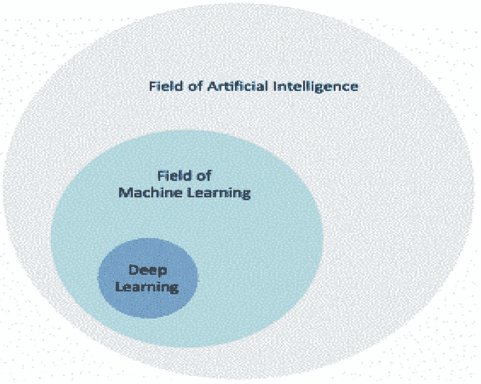

图 1.1 DL、NIL 与 AI 之间的联系。

神经网络的隐藏单元对数据进行转换，以弄清其与目标变量的关系。每个节点都有一个权重，该权重乘以其输入的值。当在多层上执行此操作时，网络能够将数据转化为某种有用的形式。

“深度学习”这一术语的提出，旨在让我们的神经网络拥有更多的隐藏单元。同样，可用的不同类型神经网络的数量也在增长。循环神经网络、卷积神经网络和长短期记忆网络只是几个流行的模型。

深度学习至关重要，原因之一是：它使我们能够在现实场景中获得实质性的、实用的精度。机器学习也已用于分类文本和图像数十年，但它最终突破了障碍——即算法必须满足特定准确度水平才能在商业场景中运行这一要求。

DL 使企业应用更可行的任务的一个好范例是计算机视觉。DL 在对照片进行分类和标记方面不仅优于任何其他传统方法；它也开始超越实际的人类。

## 1.2 深度学习在医疗保健中的应用

医疗保健行业现在可以以极快的速度检查数据，同时保持精确的准确性。深度学习在医疗保健领域有许多优势，包括快速、高效和精准。在发现新药物组合方面，深度学习至关重要。在疫情爆发期间，人工智能及其子集深度学习等颠覆性技术被用于支持疫苗和药物的开发。由于药物开发是一项艰巨的任务，深度学习可以帮助使其更高效、更具成本效益、更简单。深度学习算法可以预测药物特性、预测药物-靶点相互作用，并生成具有理想特性的分子。深度学习算法可以快速处理基因组、临床和人群数据，并可使用多种工具包来发现趋势。研究人员现在可以利用深度学习和机器学习进行更快的分子建模和预测分析，以确定蛋白质结构 [1]。

X 光、MRI 扫描和 CT 扫描等医学图像可用于训练深度学习模型。在医学图像中，算法可以检测风险并标记异常。深度学习常用于癌症检测。得益于图像识别，通过 MRI 成像和 X 光进行的癌症检测已超越人类准确度标准。其他常见的医疗相关应用包括药物发现、临床试验匹配和基因组学 [12]。

临床试验耗时且昂贵。利用深度学习和机器学习的预测分析可用于寻找潜在的临床试验志愿者，并允许科学家从多个数据点和来源汇总人员。深度学习还将允许在最少人工干预和错误的情况下进行持续的试验监测。

利用深度学习模型，更容易调查患者的健康数据、病史、生命体征、医学检查结果和其他信息。因此，医疗服务提供者能够更好地诊断每位患者并为其提供个性化治疗。机器学习模型可以利用深度神经网络预测未来的健康问题或风险，并利用从连接设备收集的实时统计数据提供适当的药物或治疗 [11]。

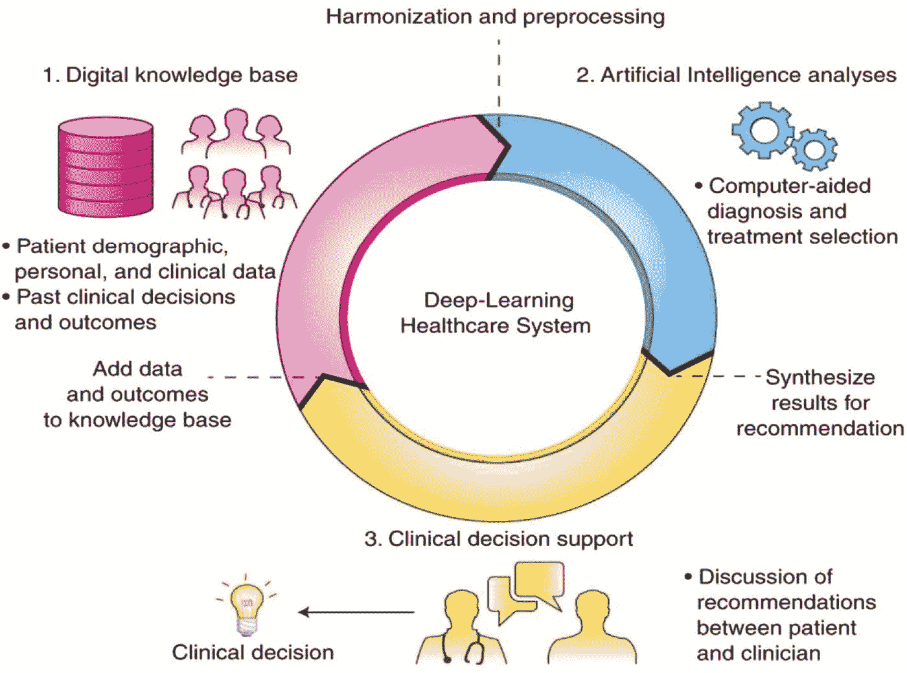

图 1.2 医疗保健中的深度学习。

机器学习和深度学习推动了计算机视觉的重大进步。通过医学影像进行更早的诊断，使治疗疾病变得更简单。

过去几年来，人工智能（AI）、语义计算和机器学习逐渐渗透进医疗行业。这些技术知识相互关联，为行业带来了新事物，并改变了医疗专家执行任务和提供患者护理的方式。它们有能力通过增加新层来影响医疗技术解决方案。

## 1.3 医疗保健系统中的人工智能

随着数据量的增长，人工智能（AI）在医疗保健系统中被广泛使用。这包括诊断和药物推荐、患者参与和行政事务。在许多环境中，AI 可以比人类更好地执行各类职责，但实施其功能可能需要更多时间。

人工智能（AI）及相关技术在商业和社会中变得非常普遍，并成功进入医疗保健领域。这些技术有能力在患者护理以及许多其他医疗机构中产生巨大变化和影响 [2]。

在分析恶性癌症和咨询方面，研究人员能够检测临床试验中的早期迹象；算法此前已超越放射科医生。

例如，在放射学领域，Aidoc 开发了算法以加速患者诊断和治疗。颅内出血、肺栓塞和颈椎骨折算法允许系统对需要医疗关注的个体进行优先排序。这种 AI 和深度学习的应用通过揭示潜在问题，协助繁忙的放射科医生，使医疗从业者能够更好地管理和引导患者。通过与工作流集成，它还扩大了对关键患者数据的访问，同时减少了文书工作。

## 1.4 机器学习在医疗保健中的应用


## 1.4 医疗保健中的机器学习

机器学习是人工智能的一个子集，在许多与健康相关的领域发挥着至关重要的作用，包括新医疗程序的开发、患者数据和记录的处理以及慢性病的治疗。在医疗保健领域，机器学习的应用更为广泛，它在许多方面帮助患者和医务人员。在医疗保健行业，机器学习最自然的用途是实现医疗账单自动化和临床决策支持。在医疗行业，机器学习和医疗保健方法以多种方式被使用。放射学中的深度学习通过自动检测难以识别的模式，帮助放射科医生在评估常规 X 光摄影、CT、MRI、PET 扫描和放射学描述等影像时做出更精准的判断。

基于机器学习的自动检测和诊断技术已显示出其表现堪比专家放射科医生。用于观察乳腺癌的医疗机器学习程序达到了 89%的准确率，这与放射科医生相当，甚至更优。这只是机器学习在医疗保健中众多应用方式的一小部分 [1]。

医疗保健中的机器学习涵盖了基于患者特征预测哪种治疗技术最适合患者。这需要监督学习，监督学习要求使用具有预定目标变量的训练数据集。

机器学习的进一步进展是神经网络。它已被用于预测患者是否会患上特定疾病。使用具有无数特征层级的深度学习或神经网络模型预测结果的最先进方法是医学界的现代趋势。最新模型中可能存在更多的隐藏元素，这些元素可通过当今图形处理单元和云架构更强大的处理能力轻松识别。深度学习在医疗保健中最常见的应用是检测恶性细胞。

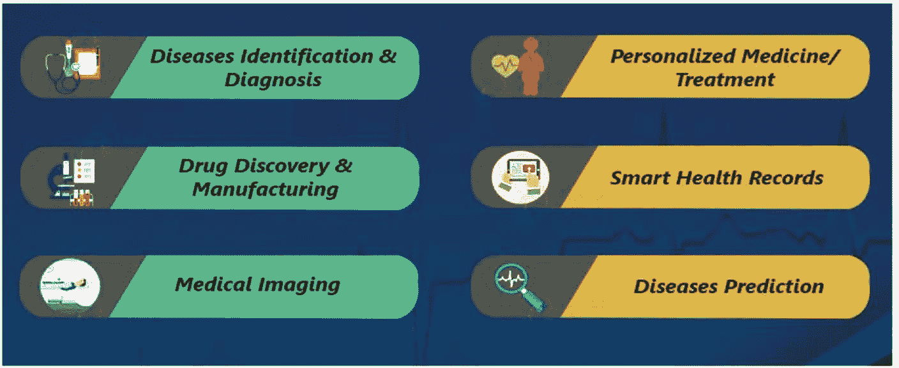

图 1.3 医疗保健中的机器学习。

结合深度学习的机器学习，能够定制具有多个特征阶段的神经网络模型以预测结果，这是至关重要的需求。深度学习常用于医疗保健中识别潜在的癌细胞。机器学习专注于制药公司的药物发现和药物开发等大型领域。

在放射照片中识别有害肿瘤是深度学习在医疗保健中的常见应用之一。放射组学中的深度学习用于捕捉医学影像中肉眼难以察觉的临床模式。在以肿瘤学为中心的图像分析中，深度学习和放射组学可被广泛应用 [16]。

Quotient Health、Kensi、Ciox Health 等公司在医疗保健系统中使用机器学习。

## 1.5 医疗保健中的自然语言处理（NLP）

自然语言处理（NLP）是指计算机理解人类最新语音词汇和文本的能力。在当前流行的技术中，它基本上用于垃圾邮件隐私保护、个人语音助手和语言翻译应用。

自然语言处理（NLP）系统在医疗保健中常与机器学习结合使用。大多数基于 NLP 的医疗保健深度学习应用需要医疗机器学习的实践。统计自然语言处理（NLP）建立在机器学习基础上，最近促进了识别准确率的提高。

自然语言处理是一种深刻的技术，具有搜索、分析和理解海量患者数据的能力。在医疗保健中使用机器学习，在 NLP 的支持下，可以从数据中提取有意义的见解和概念，这些数据过去被认为埋藏在使用非传统医疗算法的文本形式中。在最新的医疗创新中，NLP 能够精准地驾驭世间海量的非结构化数据，为理解质量、改进技术和改善患者预后提供极大洞见。

医疗保健中最普遍的应用是医疗文档的创建、理解和分类，以及已发布的研究。该系统可以分析无结构的患者医疗信息，生成记录患者对话的报告，并参与对话式 AI [18]。

医疗保健中最流行的 NLP 技术包括光学字符识别、情感分析、命名实体识别、文本分类和主题建模。

## 1.6 深度学习模型

深度学习是一个新兴领域，其应用跨越多个用例。了解和理解深度学习中各个领域使用的不同模型类型非常重要。深度学习此前已在医疗保健领域产生了影响。Google 投入大量精力研究深度学习模型如何对住院患者和结果监测进行预测。博客文章“电子健康记录的深度学习”举例说明了如何在增强患者护理洞察的同时减轻行政负担。深度学习在医疗保健中效果最好，因为它降低了行政成本，同时让医生专注于他们最擅长的事情：治疗患者 [15]、[16]。

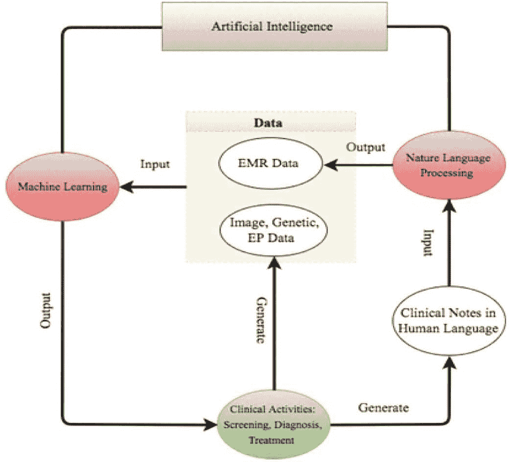

图 1.4 从临床数据生成，通过 NLP 数据丰富和 ML 数据分析的路线图。

深度学习联盟正在革新患者保障；它在健康计划的临床实践中发挥着关键作用。最流行的应用是计算机视觉、自然语言处理和强化学习。

*   深度学习算法可以生成精确的自动诊断建议：
*   降低护理成本
*   避免报告危急病例的延误
*   通过减少行政工作量，为医疗专业人员腾出时间，专注于更复杂的诊断或患者护理。
*   审核处方和诊断结果以减少诊断错误。
*   更快速的诊断。

随着全球疫情爆发，深度学习模型的使用变得更加必要。研究人员目前正在研究深度学习应用。

**新冠肺炎（COVID-19）的早期诊断：**

*   分析胸部 CT 图像和胸部 X 光片 (CXR)
*   可预测是否需要入住重症监护室
*   协助识别潜在的 COVID-19 患者
*   计算所需的机械通气量

用于与患者沟通的深度学习技术（如语音和文本识别）在未来将持续增长。因此，医疗保健中的深度学习应用滋生了对数据隐私和法律的担忧 [11]。

### 1.6.1 医学图像中深度学习模型的解读

深度学习模型的计算能力实现了快速、准确和高效的医疗保健操作。

以下是最广泛使用的深度学习算法。

*   卷积神经网络 (CNN)
*   循环神经网络 (RNNs)
*   深度玻尔兹曼机 (DBM)
*   深度神经网络 (DNN)
*   长短期记忆网络 (LSTMs)
*   深度置信网络 (DBN)
*   栈式自编码器


# 深度学习在医疗影像中的应用

通过整合组织大小、体积和形态等方面，深度学习算法可以高效评估影像数据。利用这些模型可以强调图像中的重要区段。深度学习算法被用于诊断糖尿病视网膜病变、阿尔茨海默病早期检测，以及通过超声进行乳腺结节识别。

深度学习模型能以极快的速度和最高的准确度，评估电子健康记录（`EHR`）中的结构化和非结构化数据，如临床笔记、实验室检测结果、诊断和处方。

深度学习算法可以将处方与患者健康信息进行比对，以发现并修复潜在的诊断或处方错误。

深度学习模型利用高级预测分析，协助保险企业向消费者提供产品。

随着近期技术进步，深度学习模型在药物发现和相互作用预测中变得愈发重要。

未来，大多数放射科和病理科照片将由算法审阅。医学影像系统（如计算机断层扫描 `CT` 和磁共振 `MR`）利用图像识别和目标检测进行图像分割、预测和疾病识别 [[7]](#ch1.xhtml#ref1_7)。

#### 1.6.1.1 卷积神经网络（`CNN`）

`CNN` 是首个被提出并用于高维图像分析的方法。它由将 2D 转换为 3D 的卷积滤波器组成。

深度学习算法使复杂数据处理变得更容易，让不规则性能以更高精度被识别和优先处理。卷积神经网络（`CNN`）提供的信息有助于医生更快、更准确地诊断患者健康问题。

`CNN` 作为一种深度学习，特别适合分析 `MRI` 数据和 `X` 光片等图像。`CNN` 旨在处理图像，因此能更快激活并处理更大的图像。

深度神经网络（`DNN`），主要是卷积神经网络（`CNN`），常用于频繁变化的图像分类任务，且已被证明有效。

随着众多基于 `CNN` 的深度神经网络构建完成，`ImageNet` 挑战赛——图像分析领域主要分割和图像分类任务的终极挑战——被证明已攻克。在医学分类中，基于 `CNN` 的深度神经系统常被使用。因为 `CNN` 是优秀的特征提取器，用它识别医学图像可节省特征工程的时间和成本。此外，其他研究发现，基于 `CNN` 的系统可从大型胸部 `X` 光（`CXR`）胶片数据集中训练得出，并在其数据集上达到最先进的高准确度和灵敏度结果，如拥有 40 万张以上 `CXR` 的斯坦福正常放射诊断数据集，以及拥有 108,948 张正位 `CXR` 的新 `CXR` 数据库（`ChestX-ray8`）。

`CNN` 是使用卷积滤波器转换输入的多层计算机。与其他深度学习架构不同，`CNN` 从输入图像的小部分（称为感受野）中提取统计量。每层将输入数据与一系列滤波器卷积，每个滤波器产生新的特征数据。

池化层用于在保留图像重要特征的同时压缩特征尺寸。池化层的最终输出被作为全连接层的输入。这意味着一组非线性函数。在此，神经元通过线性变换方法将权重应用于输入向量。

#### 1.6.1.2 循环神经网络（`RNN`）

循环神经网络（`RNN`）：一种在隐藏状态之间具有循环连接的神经网络设计，能学习序列并模拟时间依赖性。循环连接用于感知跨时间的关联以及输入之间的关联。

它们是利用上下文记忆识别序列数据模式的神经网络类型。许多类型的序列信息已用于循环神经网络，包括文本、音频、电影、音乐、基因序列，甚至临床事件。

另一方面，`RNN` 目前更常用于与语言相关的放射学领域。放射科医生用于撰写和转录报告的语音识别软件系统，目前是其在许多放射科办公室最流行的用途。`RNN` 还展示了使文本报告补充异常检测方法的能力，并加快了从电子健康记录放射学报告中进行疾病标注的过程 [[2]](#ch1.xhtml#ref1_2)，[[5]](#ch1.xhtml#ref1_5)。

建议采用基于深度学习的方法，从 `MRI` 数据任务中解码支撑无数智力功能的大脑状态。`LSTM` `RNN` 技术用于自适应捕捉功能数据内的时间依赖性，以及学习到的功能表征与大脑功能状态之间的关系。

#### 1.6.1.3 受限玻尔兹曼机（`RBM`）和深度置信网络（`DBN`）

这是神经网络中一种独特的算法，用于机器学习概念。主要用于降维、回归等。这种神经网络是双层概念，通过全二部图关联。

`DBN` 是堆叠 `RBM` 的神经网络，其中每层存储单元间的代数需求。该概念使用前一层的激活作为该架构的输入。学习方法包含两个协同工作的阶段，以提高训练数据的似然度：单层无监督训练和由线性分类器进行的最终微调。

#### 1.6.1.4 深度神经网络（`DNN`）

这涉及位于输入层和输出层之间的多个层。我们可以根据领域使用不同类型的神经网络，但它总是实现神经元、突触、权重、偏置和函数。

#### 1.6.1.5 生成对抗网络（`GAN`）

这种设计是一类机器学习框架，由称为生成器和判别器的网络组成。`GAN` 的核心思想基于通过判别器进行的“间接”训练，判别器是另一个能判断输入有多“真实”的神经网络，它自身也在动态更新。这基本意味着生成器不是被训练以最小化到特定图像的距离，而是为了欺骗判别器。这使模型能以无监督方式学习。

## 1.7 基于深度学习的放射学应用

以下章节涉及图像分类、图像变换、目标识别、图像分割、图像生成和目标检测等不同的放射学表现，有助于深入了解深度学习在医疗保健中的应用。

### 1.7.1 图像分类

放射科医生的任务是准确判断每位患者的医学表现，以分析各类癌症。`CNN` 模型用于可靠地扩展困难的疾病分类，因为医学图像包含各种量级和类别的复杂疾病模式。整合更复杂主题增量训练的程序学习实践可能应对这些艰巨挑战。

深度学习需要海量数据生成合适的医学图像。通过从隐藏层组装大量深度特征，当前放射组学模型可结合 `CNN` 方法。深度特征利用特征工程为医学图像生成合适的分析模式。

### 1.7.2 目标检测


### 1.7.3 图像分割与配准

由于医学图像包含海量数据，多种深度学习方法已被研究并预测用于图像分割的临床应用中。这在各种应用中已取得丰硕成果。

在传统的图像分割方法中，会使用边缘检测屏和众多科学算法。为了改进分割性能，可采用依赖阈值和闭合轮廓算法等技术。另一种探索方案是将配准作为一种良好的分割技术。但这些方法非常复杂且难以实现。DNN 和 CNN 正迅速应用于医学图像以提高分割性能。各器官、细胞和膜中的肿瘤及其他结构均已尝试单独分割。在这些研究中，应用了基于补丁的二维 CNN 算法和后处理，类似于传统 ML。

为提升医学成像分割性能，近期提出了深度学习网络。为生成更精确的分割结果，分割、分类、回归和配准等多任务协同工作。由于医学标注成本高昂，基于未标注数据的半监督/无监督学习方法被提出。由于这些研究尚未超越监督学习的分割性能，因此被视为一种有前景的策略，以解决医学成像中的大量不平衡问题。

### 1.7.4 图像生成

在医疗行业中使用 CNN 获取高质量医学图像始终颇具挑战，此外，采集医学图像和标注图像耗时极长，且因诸多限制而难以利用。为解决上述问题，可有效利用 GAN 生成逼真的合成图像，这对 CT 扫描和 X 光片非常有用。

GAN 结合两个神经网络以生成精确的人工图像。X 光、计算机断层扫描、磁共振、正电子发射断层扫描、组织病理图像、视网膜图像和手术视频等众多医学图像均由 GAN 创建，以进行多次试验并为训练分类或分割神经网络生成更稳定的数据集。

GAN 的另一重要用途是医学成像中的异常检测，通过该方法模型可尝试识别从正常照片中获得的异常。深度卷积生成对抗网络模型用于无监督不一致性检测，以识别 OCT 图像中的指导指标。一项研究表明，GAN 可用于在无需监督的情况下识别医学照片中的异常。

### 1.7.5 图像变换

图像变换研究可能非常复杂，可分为两大类：使用 GAN 的和不使用 GAN 的。

#### 1.7.5.1 不使用生成对抗网络也可实现图像到图像的转换

风格迁移与图像到图像转换的出现密不可分。此过程中采用 CNN 来传达艺术风格。尽管这些算法在传达风格方面有效，但因特征过度抽象而变得不切实际。小波变换和多层风格化可用于解决此问题。随着小波池化层的加入，该研究推向了新高度，实现了视觉上逼真的风格迁移。

CNN 可主动用于去除图像失真，自编码器 (AE) 也可用于去噪。J 不变性、去噪 AE 和分层去噪 AE 等技术被用于提出 Noise2Self 概念。它可以是一种单图像级去噪方法；请记住这一点。CNN 网络同样可用于传输其他类型传输的信息 [3]。

#### 1.7.5.2 用于图像到图像转换的 GAN

利用 GAN，可通过条件 GAN 实现具有像素级相关性的图像到图像转换。Pix2pix 网络即此概念的名称。为解决要求像素级相关性的限制，设计了不涉及像素级连接的 Cycle GAN 架构。尽管 Cycle GAN 可用于匹配不匹配的图像，但三个以上域之间的风格迁移需要大量生成器——通常为域数量平方的一半。他们利用名为 Star GAN 的单一通用生成器解决了这一挑战。流水线去噪可用 GAN 完成。估计噪声分布通过 GAN 计算，再利用另一种 CNN 架构从原始图像中减去估计噪声分布。利用条件 GAN 将厚层 CT 转为薄层 CT 是极佳思路之一。为使 CT 层变薄，应用了三维补丁。利用 Cycle GAN 概念从 MRI 生成 CT。然而，没有一致性或数据表明使用 GAN 比不使用 GAN 产生更好的结果。

另一方面，深度学习预计将通过提供对疑似病灶的数值分析和缩短临床流程时间，帮助放射科医生做出更精确的发现。

在识别和计算机视觉应用中，DL 已展现出与人类相当的表现。得益于这些技术进步，临床实践有望发生重大变革。深度学习已在识别和计算机视觉应用中证明了类人性能。因此，合理预期治疗实践将发生重大变化。我们预计，医学成像中的 AI 不会取代医生，而将作为协作平台，减轻各种重复枯燥工作带来的压力和分心。放射学中的深度学习和 AI 应用仍处于起步阶段。还有许多其他问题需解决和克服，包括伦理、监管和法律考量，在开发用于利用临床图像数据的 AI 时，应仔细考量所有这些因素 [7], [19]。

## 1.8 基于深度学习和机器学习的预测分析


# 简介

健康数据的预测分析作为一项颠覆性技术正日益流行，它可能带来更多预防性和防患性的治疗选择。预测分析通过采用统计学、数据挖掘、机器学习、建模和人工智能等多种方法来分析近期数据并生成预测，从而协助医疗生命科学和提供者。它通过降低成本、准确检测疾病、改善患者护理、最大化资源利用和改善临床结果，协助医疗机构为医疗服务做准备。

利用临床或非临床模式预测未来健康相关结果是医疗预测分析的目标。近年来药物试验中的深度学习应用取得了进展，并通过分析患者在药物发现中的历史、根据患者的症状和检查提供适当药物，在解决许多挑战方面显示出前景。医疗预测分析研究的结果，如医院再入院、医疗问题、患者死亡和治疗反应，通常具有巨大的实际价值。

包括 CT 扫描、MRI 扫描和心电图在内的医学影像程序用于诊断心脏病、癌症和脑肿瘤等危及生命的疾病。医生可以更好地分析病情，为患者提供最佳治疗。它还被用于调查医疗保险欺诈索赔。当与预测分析结合使用时，它可以预测未来的欺诈索赔。它帮助保险业务为目标患者提供减免和优惠。该技术被用于在早期阶段诊断阿尔茨海默病。深度学习是一种理解基因组并协助患者确定可能影响他们的疾病的技术，前景广阔 1, 7。

## 1.9 利用深度学习进行临床试验

深度学习技术被更频繁地用于改善临床实践，应用实例与日俱增。

深度学习用于 PET-MRI 衰减校正、放射治疗、放射组学和神经外科影像学以实现诊疗一体化目的，将共聚焦激光内窥镜显微镜与深度学习模型相结合，用于术中 CLE 图像的实时检测。

高级可变形图像配准是另一个关键应用领域，允许跨多种物理成像模态和不同时间点进行定量分析。临床放射科医生，包括放射组学和影像基因组学（放射基因组学）、神经影像学和神经放射学中的深度学习；脑分割；卒中影像学；神经精神疾病；乳腺癌；胸部影像学；肿瘤影像学；医学超声等，都能从深度学习中受益 11。

## 1.10 深度学习在医疗系统中的应用

深度学习利用神经网络分析大量数据，如医疗报告、患者记录和保险记录。

医疗领域的深度学习应用包括医学影像、聊天机器人和模式识别解决方案。深度学习为医疗专业人员提供直觉洞察，使他们能更早发现问题，从而提供更加个性化和重要的患者护理。

在医疗领域，这项技术使临床医生能够准确分析任何病情并有效治疗患者，从而改善医疗判断 11。

### 1.10.1 药物发现

医疗领域的深度学习有助于新疗法的发现和开发。该技术检查患者的病史并推荐最合适的治疗方案。此外，该技术从患者症状和检测中提取信息 6。

### 1.10.2 医学影像

心脏病、癌症和脑肿瘤通过各种扫描和心电图程序利用医学图像进行诊断。因此，深度学习协助医生更好地分析疾病，为患者提供最佳治疗 7。

### 1.10.3 保险欺诈

深度学习系统还可以通过检查来自多种来源的欺诈行为和健康数据（如索赔历史、医院相关数据和患者特征）来发现医疗保险欺诈。

### 1.10.4 阿尔茨海默病

医疗领域面临的主要困难在于阿尔茨海默病。利用深度学习技术可早期检测阿尔茨海默病。

### 1.10.5 基因组学

在遗传学和保险领域，深度学习前景广阔。据 Entilic 称，深度学习技术用于使医生诊断更快、更精准。在智能或数字设备的帮助下，深度学习技术将对父母实时监测孩子健康非常有用，减少定期看医生的次数。医疗领域的深度学习能为医生和患者提供惊人的应用，使医生能做出更好的医疗决策。

### 1.10.6 医疗数据分析

深度学习模型能以闪电般的速度和最高的准确度分析电子健康记录（EHR）中的结构化和非结构化数据，如临床笔记、实验室检查结果、诊断和处方。

数字手机和可穿戴设备提供重要的生活方式数据。它们将能够通过利用移动应用监测医疗风险变量，为深度学习模型转换数据 6 7。

### 1.10.7 心理健康聊天机器人

Happify、Moodkit、Woebot 和 Wysa 等基于 AI 的心理健康应用（包括聊天机器人）正变得越来越流行。为了与患者进行更真实的对话，用户可以结合深度学习模型使用聊天机器人。

### 1.10.8 个性化医疗

通过评估患者的病史、症状和检查，深度学习系统使医疗公司能够提供个性化的患者护理。自然语言处理从医疗数据中提取适合健康治疗的信息。

### 1.10.9 处方审核

深度学习算法将治疗方案与患者健康信息进行比对，以发现、修复潜在的诊断或处方错误。

### 1.10.10 响应患者咨询

基于深度学习的聊天机器人协助医疗专业人员识别患者症状的趋势。

## 结论

深度学习是医学图像分析最强大的技术之一。我们涵盖了与预测分析、医疗统计及深度学习在医疗中的应用目标相关的深度学习基础。通过观察深度学习的当前进展，发现它是一个关键领域，对医学影像尤为重要。深度学习技术也有望应用于医疗行业的各个领域。深度学习常用于医学图像处理，包括眼科、神经影像学、超声学等领域。随着技术进步，深度学习将用于越来越多的医疗领域，未来的深度学习不仅将关注神经影像学，还将关注生物信息学和遗传学的其他方面。


# 深度神经网络架构及其在医疗保健中的应用

**Sarwath Unnisa**

邮箱：Sarwath.unnisa@res.christuniversity.in

邮箱：vijayalakshmi.nair@christuniversity.in

## 摘要

获取与医疗数据相关的见解一直是一个挑战，因为有限的技术会延误治疗。从医疗领域收集各种类型的数据，例如传感器数据，这些数据本质上是异构的。所有这些数据维护得都很差，需要更多的结构化处理。因此，深度学习在这个领域变得越来越流行。由于数据不足和不相关，存在许多挑战。领域知识不足也增加了挑战。现代深度学习模型有助于理解数据集。本章概述了深度学习、其各种架构以及卷积神经网络。还强调了深度学习技术如何帮助推动医疗保健的发展。

## 2.1 引言

机器学习是人工智能的一个子集，可以从数据中学习任意相关性。机器学习的主要目的是推导出一个模型。模型的表示基于模型拟合和评估的效果。几十年来，机器学习一直被用于转换原始数据以识别模式。深度学习不同于机器学习，但它是机器学习的一部分。由于机器学习中的特征选择不是自动化的，深度学习因其能自动学习特征而成为趋势。因此，学习和训练可以一步完成 [[1]](#ch2.xhtml#ref2_1)，[[2]](#ch2.xhtml#ref2_2)。

随着生物医学数据发挥重要作用，医疗保健正在不断发展。例如，正确的数据应导致对患者的正确治疗。因此，提供治疗的许多责任方面被凸显出来。另一方面，大量的生物医学数据带来了许多挑战。因此，调查这些挑战之间的各种关系非常重要。其中一个挑战是开发医疗领域的可靠工具，这些工具可以是数据驱动的并提供正确的预测 [[3]](#ch2.xhtml#ref2_3)。为此，医学中的深度学习可以被谨慎使用。这些方法可应用于基因组学、可穿戴医疗设备和临床影像系统 [[3]](#ch2.xhtml#ref2_3)。

有两类深度学习网络，称为 `recursive neural network (RvNN)` 和 `recurrent neural network (RNN)`。`recurrent neural network` 通常用于序列处理，如语言模型；例如隐马尔可夫模型和 n-gram 模型等技术。建议使用 `recurrent neural network`，以便利用无约束的历史数据来获取隐藏状态，从而使网络能运行更长时间。该网络将包含三层，如隐藏层、输入层和输出层 [[4]](#ch2.xhtml#ref2_4)。

`Recursive neural networks` 以层次化形式实现预测，这些网络用于图和树等对象。该网络通常使用反向传播技术进行训练 [[4]](#ch2.xhtml#ref2_4)，[[5]](#ch2.xhtml#ref2_5)。有许多深度学习网络，其中之一是 `convolutional neural network (CNN)`。

## 参考文献

1.  Anandhavalli Muniasamy, 用于医疗保健预测分析的深度学习，先进机器学习技术与应用国际会议，2019，第 32-42 页。

2.  Changwan Lee, Yeesuk Kim, Young-Soo Kim and Jongseong Jang，“利用循环神经网络实现的人工智能从放射学报告中自动标注疾病”，《美国罗琴射线学杂志》，2019，第 212 卷(4)。

3.  Hongming Li, Yong Fan，利用长短期记忆循环神经网络从功能性 MRI 进行大脑解码，计算机视觉与模式识别，2018。

4.  Lipton, Z.C., Kale, D.C., Elkan, C., Wetzel, R.: 利用 LSTM 循环神经网络学习诊断。载于：学习表征国际会议，2016。

5.  Dr.N. Gnanasankaran and Dr.E. Ramaraj，“基于 5G 赋能的 Faster RCNN 的生成对抗网络模型用于人脸草图合成的物联网传感器网络”见“物联网传感器网络中的人工智能技术”，Taylor and Francis, CRC Press, 2021, 135-149。

6.  B. Subashini and B. Sundaravadivazhagan，“物联网综述：安全挑战、问题及对策方法”，《心理学与教育杂志》58(2), 6544-6560。

7.  Hongming, C., Engkvist, O., Wang, Y., Olivecrona, M., Blaschke, T.：深度学习在药物发现中的崛起。《药物发现今日》23(6), 1241-1250, 2018。

8.  Gibson, E., 等：NiftyNet：一个用于医学成像的深度学习平台。《计算机方法与生物医学编程》158, 113-122, 2018。

9.  Goodfellow, I., Bengio, Y., Courville, A.：《深度学习》，第 1 版。MIT Press, Cambridge, 2016。

10.  Ajronline (n.d.)。检索自 [`www.ajronline.org/doi/10.2214/AJR.18.19869`](https://www.ajronline.org/doi/10.2214/AJR.18.19869)

11.  Research.aimultiple (n.d.)。检索自 [`research.aimultiple.com/deep-learning-in-healthcare`](https://research.aimultiple.com/deep-learning-in-healthcare)

12.  Allerin (n.d.)。检索自 [`www.allerin.com/blog/top-5-applications-of-deep-learning-in-healthcare`](https://www.allerin.com/blog/top-5-applications-of-deep-learning-in-healthcare)

13.  data-flair. training (n.d.)。检索自 [`data-flair.training/blogs/machine-learning-in-healthcare`](https://data-flair.training/blogs/machine-learning-in-healthcare)

14.  Hinton 等，深度信念网络的快速学习算法，《神经计算》，2006。

15.  Mingyukim, jihye hun 等，医学成像中的深度学习，《Neurospine》2019

16.  Hongming chin, Ola Engkvist 等，深度学习在药物发现中的崛起，《药物发现今日》，2018。

17.  Andre Esteva, Alexandre Robicquet, Bharath Ramsundar 等，医疗保健深度学习指南，《自然医学》第 25 卷，第 24-29 页 (2019)

18.  LeCun, Y., Bengio, Y. & Hinton, G. 深度学习。《自然》521, 436-444 (2015)

19.  Hirschberg, J. & Manning, C. D. 自然语言处理的进展。《科学》349, 261-266 (2015)。

20.  Litjens, G. 等。医学图像分析中深度学习的综述。《医学图像分析》42, 60-88 (2017)。

21.  Murphy K.R. 《机器学习：概率视角》。Cambridge (MA): MIT Press; 2012。


## 2.1 CNN 网络

`CNN` 网络的主要目标是从函数中提取重要数据并减少提取所需的时间。为此，`CNNs` 使用局部感受野、权重共享以及时间和空间子采样。`CNN` 的主要优势在于它可以从训练数据中单独学习。它还利用子采样特性来避免时间复杂度并提供鲁棒性 [6]。

`CNN` 有两种主要方法：`convolution` 和 `sampling`。`convolution` 过程具有一个可训练的滤波器，可用于对输入图像进行反卷积并执行特征映射以检索特征。然后添加偏置，最终创建 `convolution layer`。第二个过程是 `sampling` 过程。这涉及执行 `pooling` 步骤、添加权重，并将它们转换为像素。它还添加偏置以最终生成 `activation function`，从而导致特征从特征图中增长 [6]。

在本章中，讨论了深度学习在医疗保健中的重要性、深度学习神经网络算法、深度学习在医疗保健中的各种应用，以及深度学习如何在肺炎检测中实现预测。

## 2.2 深度神经网络

深度学习被认为是机器学习的一部分。机器学习包括许多步骤，如预处理、特征提取、数据集选择和分类；然而，在机器学习中，所有这些并非自动化的。这就是深度学习发挥作用的地方。另一方面，深度学习实现了训练和学习的自动化，使整个过程变得简单可靠 [1]，[2]。

人工智能包括深度学习和机器学习。人工智能是一个能够推理、识别并适应新变化的平台。机器学习和深度学习的主要区别在于，前者在接触长期数据时性能会提高，而后者使用多层神经网络从大量数据中学习。深度学习可以在无人工帮助的情况下使用 [7]，[8]。深度学习是一种通用学习方法，因为它可用于所有领域。它具有鲁棒性，因为你可以通过计算机化的方式观察功能。深度学习具有可扩展性，因为其架构可用于超算规模。你也可以对不同数据类型使用相同的技术。这也被称为迁移学习，非常常见 [9]。

### 2.2.1 深度学习类别

深度学习分为四类：监督学习、半监督学习、无监督学习和强化学习。深度监督学习是使用标记数据的深度学习子集。许多网络，如循环神经网络（`RNNs`）、卷积神经网络（`CNNs`）和深度神经网络（`DNNs`），都使用这种学习技术。其主要优势是信息获取较早。缺点是与其他技术相比，该技术较为简单 [6]。深度半监督技术使用半标记数据集。生成对抗网络（`GANs`）使用这种学习方法。其主要优势是将标记数据的使用降至最低。缺点是有时无关数据可能产生错误结果 [6]。深度无监督学习可以在有限标记数据下执行。生成网络、降维和聚类等技术使用这种技术。缺点是结果往往倾向于不可靠 [10]。深度强化学习依赖于与环境的交互而非采样数据。它由 Google DeepMind 开发。与传统监督学习相比，这种学习要复杂得多 [11]。

### 2.2.2 CNN 架构细节

常用的深度学习技术之一是 `CNN`。`CNN` 类似于多层感知机（`MLP`）。`MLP` 中有神经元，每个神经元将包含一个 `activation function`。`CNN` 使用一种排列方式的 `MLP`，该方式支持旋转和平移。

`CNN` 有三个基本层，分别是 `convolutional layer`、`pooling layer` 和 `fully connected layer`* [12]。这是由 Hubel 和 Wiesel 于 1960 年开发的。`CNN` 是一种结构良好的识别算法，可用于识别模式和图像处理技术 [13]。典型的 `CNN` 架构是一个全连接网络，具有 `activation layer`、输入和权重 [14]。`Convolution layer` 是基础且重要的层。该层的主要工作是获取图像的像素矩阵。然后获得图像的 `activation map`。`activation map` 的主要功能是保存特征并减少需要处理的信息量。第二层是 `pooling layer*`，通常用于降低映射的维度。这表明，在所有产生的特征中，只会选择重要特征以减少不变性。`Pooling` 可分为几类，如 `max pooling*`、`average pooling`、`stochastic pooling` 和 `spatial pyramid pooling`。最好的是 `max pooling`，它将从每个矩阵中取最大值并生成单独的矩阵。这将有助于减少图像的显著特征。最后一层是 `fully connected layer`，它被馈送到神经网络。通常，在发送到神经元之前，矩阵会被压缩。由于存在许多隐藏层，在此点之后检查数据具有挑战性 [15]。

### 2.2.3 CNN 架构对比

深度学习有许多架构，其中最好的几个已列在下面，包含年份、开发者详情、层数和独特特性。

**表 2.1 架构及其详情**

| 序号 | 架构 | 年份 | 开发者 | 层数 | 独特特性 |
| --- | --- | --- | --- | --- | --- |
| 1 | `LeNet` [16] | 1998 | Yann LeCun, Leon Bottou, Yoshua Bengio, and Patrick | 仅有两个卷积层和三个全连接层 | 60,000 参数；该架构与其他架构的主要区别在于，它充当一个标准模板，拥有激活函数、池化层，并在末尾有全连接层 |
| 2 | `AlexNet` [17] | 2012 | Alex Krizhevsky, Ilya Sutskever, and Geoffrey Hinton | 八层 | 6000 万参数；`ReLU` 激活函数；Dropout 特性 |
| 3 | `VGG16` [18] | 2014 | Karen Simonyan and Andrew Zisserman | 16 层，包含 13 个卷积层和 3 个全连接层 | 1.38 亿参数；该设计独特，意味着它比 AlexNet 深一倍，这是通过堆叠统一卷积实现的；这些也沿用了来自 AlexNet 的 `ReLU` 技术。但这些使用小尺寸滤波器，即 2×2 和 3×3 矩阵 |
| 4 | `Inception V1` [19] | 2015 | Christian Szegedy, Wei Liu, and Yangqing Jia | 22 层深度架构 | 网络套网络的概念，称为 Inception；使用并行塔进行拼接。消除计算瓶颈 |
| 5 | `Inception V3` [20] | 2016 | Christian Szegedy, Vmcent Vanhoucke, Sergey Joffe, JonathonShlens, and Zbigniew Wojna | 48 层 | Inception V1 的继任者；2400 万参数；`Batch normalization` 技术；比 Inception V1 进一步减少瓶颈问题。 |
| 6 | `ResNet50` [21] | 2015 | Kaiming He, Xiangyu Zhang, and Shaoqing Ren | 50 层 | (源中未提供完整详情) |


## 2.2 深度学习架构对比

| # | 模型 | 年份 | 作者 | 层数 | 参数量 | 关键特性 |
|---|-------|------|---------|--------|------------|--------------|
| 7 | Xception [[22]](#ch2.xhtml#ref2_22) | 2017 | François Chollet | 71 | 26M / 23M | 批量归一化；用于设计更深的网络；源自 Inception；Inception 模块被深度可分离卷积取代 |
| 8 | Inception V4 [[23]](#ch2.xhtml#ref2_23) | 2014 | Christian Szegedy, Sergey Ioffe, Vincent Vanhoucke, Alex Alemi | 22 | 43M | Inception V3 的改进；Stem 模块（Inception 模块的统一块） |
| 9 | Inception-ResNet-V2 [[23]](#ch2.xhtml#ref2_23) | 2014 | Christian Szegedy, Sergey Ioffe, Vincent Vanhoucke, Alex Alemi | 164 | 56M | Inception V3 的改进版；Inception 模块转换为残差 Inception 块 |
| 10 | ResNeXt50 [[24]](#ch2.xhtml#ref2_24) | 2017 | Saining Xie, Ross Girshick, Piotr Dollar | 50 | 25M | 模块间增加并行塔；32 个额外的塔 |

在决定深度学习模型的最佳架构时，最好彻底探索该架构的优势。从本研究中得出以下结论：卷积数量越多、层越密集，结果越好。此外，Dropout 功能和批量归一化技术能提升网络性能。更可靠的方法包括 AlexNet、ResNet、VGG Net 和 Inception Net，其错误率分别为 15.3%、3.6%、7.3% 和 6.6% [[17]](#ch2.xhtml#ref2_17)，[[18]](#ch2.xhtml#ref2_18)，[[21]](#ch2.xhtml#ref2_21)，[[23]](#ch2.xhtml#ref2_23)。

## 2.3 深度学习架构在医疗领域的应用

### 2.3.1 阿尔茨海默症

阿尔茨海默症是一种不可逆的神经退行性疾病。该疾病有不同的治疗方法可以控制病情严重程度，但无法根除。因此，早期诊断至关重要，这可以通过深度学习实现。为此，许多研究致力于早期诊断分析。研究还表明，个体的基因构成决定了阿尔茨海默症的特征，因此基因评估至关重要。CNN 通过识别仅在这些患者中出现的大脑模式，使早期检测阿尔茨海默症成为可能 [[25]](#ch2.xhtml#ref2_25)。

### 2.3.2 脑部 MRI

深度学习算法被用于训练 3D 医学图像，可利用相关参数检测人脑的各种疾病 [[3]](#ch2.xhtml#ref2_3)。

### 2.3.3 骨关节炎

像 CNN 这样的深度学习算法可以将膝关节胫骨软骨的分割 MRI 图像分类为骨关节炎和非骨关节炎，这有助于医生快速分析和进一步治疗 [[26]](#ch2.xhtml#ref2_26)。

### 2.3.4 乳腺癌

深度学习被用于精准诊断癌症和非癌症图像，避免了因处理结果不正确而可能发生的错误。其他用于检测乳腺癌的技术通常模糊且鲁棒性较差。深度学习中实现了许多技术和架构，例如自动编码器架构，它具有抗噪能力 [[27]](#ch2.xhtml#ref2_27)。

### 2.3.5 糖尿病视网膜病变

深度学习被用于开发一种算法，利用视网膜底部图像检测患者的糖尿病视网膜病变和糖尿病黄斑水肿。为此，具有图像分类技能的神经网络经过训练，能比受过训练的眼科医生更高效、更精准地对糖尿病视网膜病变进行分类 [[28]](#ch2.xhtml#ref2_28)。

### 2.3.6 基于患者病史预测药物类型

深度学习被用于为有既往病史的患者提供个性化用药，因为医疗领域存在大量依赖和观察，这些有时通过手写笔记记录，且有时不规律。利用深度学习通过病史预测患者所需药物类型将更有效、更快捷 [[29]](#ch2.xhtml#ref2_29)。

### 2.3.7 基于患者临床状态预测疾病

深度学习有望推动临床研究并实现更好的临床决策。通过这种方式，深度学习有望推导出患者的疾病，从而在极其严重的疾病情况下实现更好、更快速的决策。该决策将基于电子健康记录。许多需要快速治疗的疾病，如糖尿病和精神分裂症，也可能被检测出来 [[30]](#ch2.xhtml#ref2_30)。

### 2.3.8 预测自杀

医疗行业普遍存在且快速发展。因此，需要采取快速行动。借助深度学习和电子病历，可以考虑许多快速行动。此类活动预测患有严重精神疾病的患者是否会自杀身亡。这是通过自杀风险评估完成的。然后对患者进行分组，推导出的表征将显示该分组是否包含风险。一旦生成此评分系统，它会将风险分类为中度或重度。它比临床医生评估的风险更有效 [[31]](#ch2.xhtml#ref2_31)。

### 2.3.9 预测患者出院后的再入院情况

深度学习在医疗领域已取得长足发展，能够从患者的常规临床就诊中检测患者是否有再入院的可能性。为此，使用就诊详情 [[32]](#ch2.xhtml#ref2_32)。

### 2.3.10 从实验室检测预测疾病

深度学习通过纵向分析实验室检测来预测疾病。通过使用长短期记忆循环神经网络和 CNN 网络，可以生成一个预测模型，仅通过分析既往健康记录中的实验室报告，就能判断患者患有何种疾病 [[33]](#ch2.xhtml#ref2_33)。

### 2.3.11 通过清醒期活动预测睡眠质量

睡眠对健康至关重要。睡眠不足会导致生活压力，引发严重的健康并发症。因此，我们白天进行的清醒活动将强烈影响睡眠的持续时间和质量。因此，深度学习被用于通过清醒期活动确定睡眠质量。为此，使用手持医疗设备。开发这些预测模型是为了确定睡眠质量 [[34]](#ch2.xhtml#ref2_34)。

## 2.4 基于 X 光图像的深度学习肺炎检测

### 2.4.1 概述

肺炎是一种影响肺部的细菌感染。它可影响单肺或双肺。它被公认为一种可致命的疾病 [[35]](#ch2.xhtml#ref2_35)。它仍然是全球范围内的死亡原因之一 [[36]](#ch2.xhtml#ref2_36)。然而，如果能借助抗生素和抗病毒药物及时治疗，该疾病很容易应对 [[37]](#ch2.xhtml#ref2_37)。治疗肺炎的最佳方法之一是早期检测，这可以通过胸部 X 光片完成 [[35]](#ch2.xhtml#ref2_35)。肺炎被认为是一种常见疾病，经常发生，尤其是在有心血管病史或肺部疾病的患者中 [[36]](#ch2.xhtml#ref2_36)。


然而，仅通过观察 X 光片来检测肺炎可能是一项非常令人困惑的任务，即使对某些专业人士也是如此。X 光图像可能被误认为是另一种良性疾病，这可能导致误诊，让专业人士感到困惑。因此，需要一种更系统、更计算化的方法来帮助医生从放射学图像中诊断肺炎[38]。图像分类是一种能够更系统、更准确地对图像进行分类的技术。`CNN`（卷积神经网络）是用于图像识别和分类的深度学习神经网络的一个分支。`CNNs`可以从图像中提取用于分类的特征。`CNN`在图像分类领域做出了重要贡献，并且还能在计算机视觉中实现定位[39]。

只有少数研究集中于肺炎及其检测技术。本研究旨在理解并识别健康人和肺炎患者放射学图像之间的差异。此外，识别应尽快完成，以便进行诊断并治疗患者。肺炎是一种常见感染，由细菌、病毒或真菌侵袭肺部引起。“肺炎”一词源自希腊语“pneumon”，意为肺。因此，当肺实质发生炎症时，即与肺炎相关。它也可能由接触某些化学物质或食物误吸引起[40]。

基于不同观点，肺炎的定义也有所不同。世界卫生组织将肺炎定义为“急性下呼吸道疾病”[41]。当液体充满肺泡，减少血液与肺部之间二氧化碳和氧气的交换时，就会发生肺炎。这减少了进入肺部的空气量，导致呼吸困难。其他症状包括呼吸短促、发烧、咳嗽和胸痛[42]。

65 岁以上的老年人风险增加。5 岁以下儿童以及患有其他呼吸系统和心脏疾病的患者也面临极高风险[40]，[42]。与肺炎相关的风险因素包括有酗酒史、肺部疾病、心脏病、支气管哮喘的患者，以及接受免疫抑制治疗的患者[36]。印度是全球因肺炎死亡儿童数量最多的国家，2016 年约有 30 万儿童死亡[43]。

有多种方法用于诊断肺炎[44]。利用 X 光识别肺炎的其他替代方法包括脉搏血氧测定、痰液和血气分析、支气管镜检查和全血细胞计数。肺炎有三种类型：细菌感染、病毒感染[45]和真菌感染。因为肺炎是基于致病菌的，所以细菌性肺炎用抗生素治愈，病毒性肺炎用抗病毒药物治愈，真菌性肺炎用抗病毒药物治愈。

胸部 X 光检查是诊断肺炎的重要工具，所有后续决策均基于这一放射学发现。与人们可获得的其他方法相比，它也非常便宜。当查看疑似肺炎患者的胸部 X 光片时，负责人会寻找肺部称为浸润影的白点，这些白点对污染/病变进行分类。这些在结核病和支气管炎患者中也能发现[43]。早期发现肺炎总是有益的，因为延迟治疗可能导致各种后果[46]。

深度学习可用于此目的。深度学习是机器学习的一个子领域，属于人工智能的一部分。许多生物医学健康问题，如癌症，可以使用基于人工智能的模型来检测。这些模型可能能够轻松识别专业人士不易看到的隐藏特征。卷积神经网络是机器学习和深度学习领域的优秀工具。该工具最近在医疗保健领域得到最广泛的应用，用于提取许多新特征并区分良性和恶性癌症、感染或健康肿瘤等类别[47]。

`ResNet50`是一种包含约 50 层的卷积神经网络架构。层数代表这些网络的深度。`ResNet`的全称称为残差网络。这是一种经典的神经网络，是许多计算任务的支柱。该架构生成一个预训练版本，该版本已通过数百万张照片测试；因此任何元素都可以相当快速地分类。这些提供了可靠的优势组合，也允许更快的训练[48]。因此，这被认为是最高效的架构。该网络的主要思想是仅从上一层获取重要特征，称为残差特征。该网络允许您在没有问题的情况下训练深得多的神经网络[49]。

### 2.4.2 方法论

如前所述，深度残差特征从最后一个输出层提取。`ResNet`架构有五个堆叠在一起的卷积块。这些堆叠不同于传统的卷积神经网络。这使得网络能够以更快、更具成本效益的方式进行训练[50]。

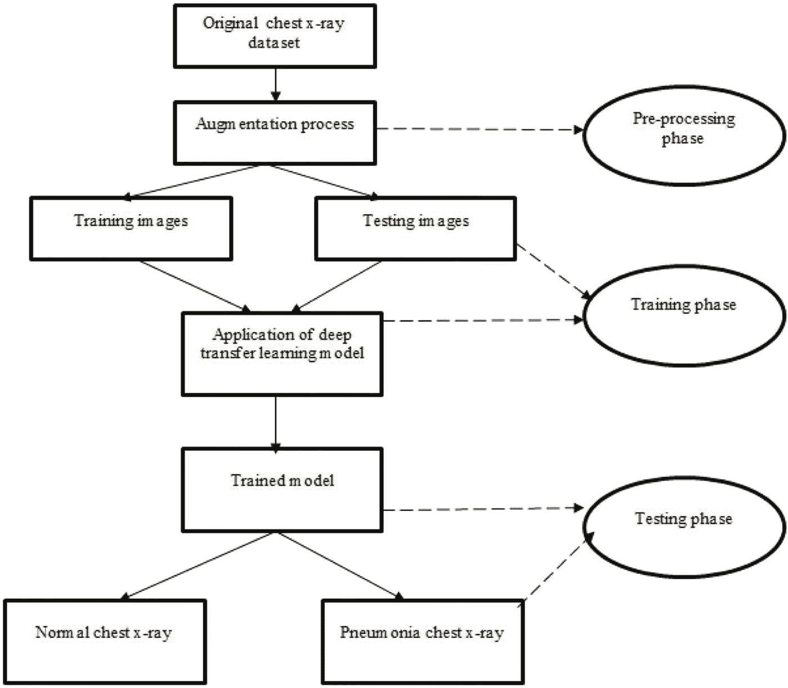

图 2.1 方法论的抽象视图.

#### 2.4.2.1 可视化图像

首先，数据集被上传到 MATLAB，如上所示，然后加载的数据集被可视化，如图 2.2 所示。这将显示上传的测试数据被正确分类。可视化图像有助于您更好地理解每个类别与其他类别的区别。它还将确定要使用的`CNN`架构类型。这里使用了`ResNet50`架构。

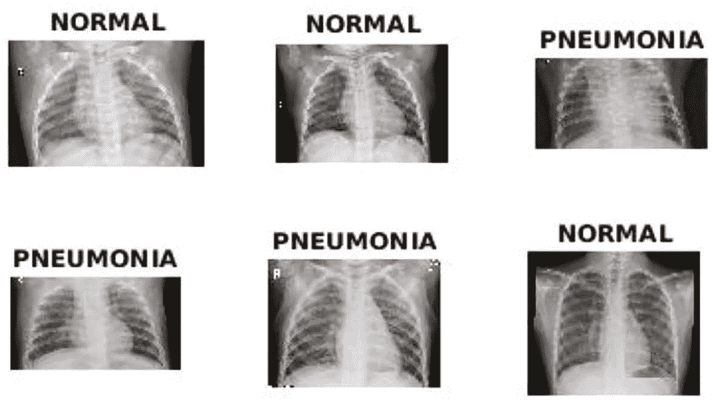

图 2.2 可视化加载的数据集.

#### 2.4.2.2 调整大小

此功能有助于根据`ResNet50`调整用于训练的图像大小，因为训练需要相同的矩阵维度。`ResNet`将图像大小设置为`[224 224]`；因此所有图像将按代码所示进行转换。

```matlab
% Resizing all training images to [224 224] for ResNet architecture
Auimds=augmentedImageDatastore([224 224],imdsTrain,'Data Augmentation' ,augmenter);
% Data Augumentation
augmennter = imageDataAugmenter(
'RandRotation',[-6 6],'RandXReflection',1,...
'RandYReflection',1,'RandXShear',[-0.06 0.06],'RandYShear',[-0.06 0.06]);
```

### 2.4.3 结果

#### 2.4.3.1 ROC 曲线


数据被分成 10 折用于分析。这种验证类型将有助于提供更好的性能估计。采用 `ResNet50` 架构，因为它被认为对医学成像非常有效。图 2.3 显示了 `ROC` 曲线，这将有助于确定 `AUC`。此处，`AUC`（曲线下面积）约为 95.9%。

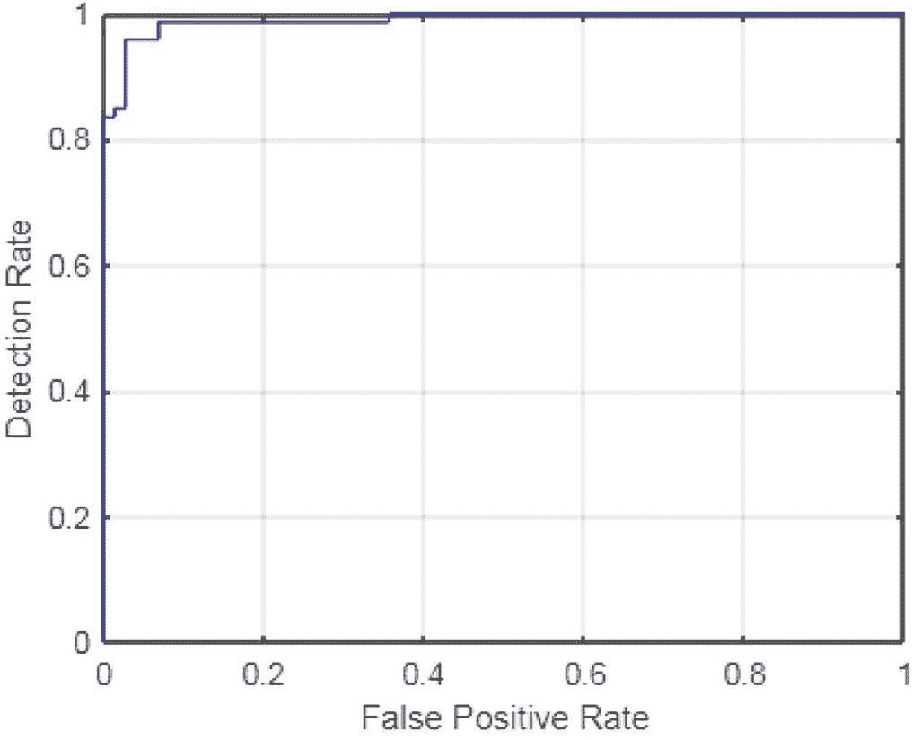

图 2.3 ROC 曲线。

#### 2.4.3.2 混淆矩阵

图 2.4 显示了特定数据集的混淆矩阵。混淆矩阵说明了正确分类和错误分类的图像。约 47.9% 的数据被正确分类为无肺炎的健康人，2.1% 被错误分类为患有肺炎的健康人，2.1% 尽管患有肺炎却被错误分类为健康人，47.9% 被正确分类为患有肺炎。因此，`ResNet50` 架构实现了 95.9% 的总体准确率。

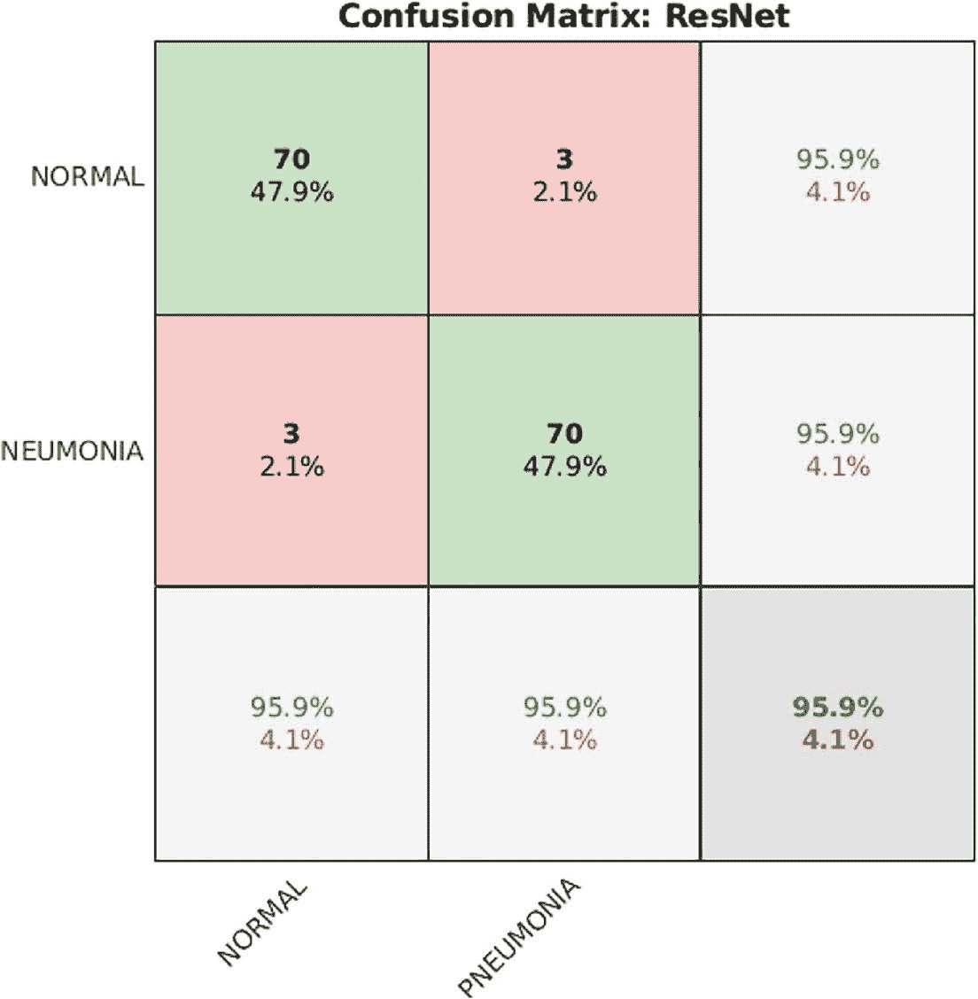

图 2.4 混淆矩阵。

## 结论

技术创新极大地促进了医疗行业的发展，支持了人类轻松舒适的生活方式。深度学习中的各种算法有助于轻松、快速且准确地分析医疗数据。本章详细讨论了各种深度学习算法及其架构。还列出了深度学习在各个医疗领域的应用，这有助于理解深度学习在健康数据分析中的重要性。此外，`ResNet` 算法用于从 X 射线图像中分类肺炎。结果显示，在对患有肺炎的 X 射线进行分类时，准确率达到了 95.9%。

## 参考文献

1.  Y. Lecun, Y. Bengio, and G. Hinton，“Deep learning，” Nature，卷 521，期 7553，页 436-444，2015，doi: [`10.1038/nature14539`](http://doi.org/10.1038/nature14539)。

2.  Z. Zhang, P. Cui, and W. Zhu，“Deep Learning on Graphs: A Survey，” IEEE Trans. KnowL Data Eng.，卷 14，期 8，页 1-1，2020，doi: [`10.1109/tkde.2020.2981333`](http://doi.org/10.1109/tkde.2020.2981333)。

3.  T. Brosch and R. Tam，“Manifold learning of brain MRIs by deep learning，” Lect. Notes Comput. Sci. (including Subser. Lect. Notes Artif. Intell. Lect. Notes Bioinformatics)，卷 8150 LNCS，期 PART 2，页 633-640，2013，doi: [`10.1007/978-3-642-40763-5_78`](http://doi.org/10.1007/978-3-642-40763-5_78)。

4.  S. Liu, N. Yang, M. Li, and M. Zhou，“A recursive recurrent neural network for statistical machine translation，” 52nd Annu. Meet. Assoc. Comput. Linguist. ACL 2014 - Proc. Conf，卷 1，页 1491-1500，2014，doi: [`10.3115/v1/p14-1140`](http://doi.org/10.3115/v1/p14-1140)。

5.  C. Goller and A. Kuechler，“Learning task-dependent distributed representations by backpropagation through structure，” IEEE Int. Conf Neural Networks - Conf Proc.，卷 1，页 347-352，1996，doi: [`10.1109/icnn.1996.548916`](http://doi.org/10.1109/icnn.1996.548916)。

6.  K. O’Shea and R. Nash，“An Introduction to Convolutional Neural Networks，” 页 1-11，2015，\[在线\]。可获取于: [`http://arxiv.org/abs/1511.08458`](http://arxiv.org/abs/1511.08458)。

7.  J. De Fauw et al.，Clinically applicable deep learning for diagnosis and referral in retinal disease，卷 24，期 9，2018。

8.  Topol E.J.，“High-performance medicine: the convergence of human and artificial intelligence，” Nat Med.，卷 25(1)，页 44-56，2019。

9.  B. Van Essen, H. Kim, R. Pearce, K. Boakye, and B. Chen，“Lbann，” 页 1-6，2015，doi: [`10.1145/2834892.2834897`](http://doi.org/10.1145/2834892.2834897)。

10.  J. Karhunen, T. Raiko, and K. H. Cho，“Unsupervised deep learning: A short review，” Adv. Indep. Compon. Anal. Learn. Mach.，页 125-142，2015，doi: [`10.1016/B978-0-12-802806-3.00007-5`](http://doi.org/10.1016/B978-0-12-802806-3.00007-5)。

11.  K. Arulkumaran, M. P. Deisenroth, M. Brundage, and A. A. Bharath，“Deep reinforcement learning: A brief survey，” IEEE Signal Process. Mag.，卷 34，期 6，页 26-38，2017，doi: [`10.1109/MSP.2017.2743240`](http://doi.org/10.1109/MSP.2017.2743240)。

12.  U. R. Acharya et al.，“A deep convolutional neural network model to classify heartbeats，” Comput. Biol. Med.，卷 89，期 September，页 389-396，2017，doi: [`10.1016/j.compbiomed.2017.08.022`](http://doi.org/10.1016/j.compbiomed.2017.08.022)。

13.  T. Liu, S. Fang, Y. Zhao, P. Wang, and J. Zhang，“Implementation of Training Convolutional Neural Networks，” 2015，\[在线\]。可获取于: [`http://arxiv.org/abs/1506.01195`](http://arxiv.org/abs/1506.01195)。

14.  T. N. Sainath, A. R. Mohamed, B. Kingsbury, and B. Ramabhadran，“Deep convolutional neural networks for LVCSR，” ICASSP, IEEE Int. Conf. Acoust. Speech Signal Process. - Proc.，页 8614-8618，2013，doi: [`10.1109/ICASSP.2013.6639347`](http://doi.org/10.1109/ICASSP.2013.6639347)。

15.  A. Ajit, K. Acharya, and A. Samanta，“A Review of Convolutional Neural Networks，” Int. Conf. Emerg. Trends Inf. Technol. Eng. ic-ETITE 2020，期 October，2020，doi: [`10.1109/ic-ETITE47903.2020.049`](http://doi.org/10.1109/ic-ETITE47903.2020.049)。

16.  Y. Lecun, L. Bottou, Y. Bengio, and R. Ha，“LeNet，” Proc. IEEE，期 November，页 1-46，1998。

17.  A. Krizhevsky and G. Hinton，“ImageNet Classification with Deep Convolutional Neural Networks，” ImageNet Large Scale Vis. Recognit. Chall. 2012，页 27，2012，\[在线\]。可获取于: [`http://www.image-net.org/challenges/LSVRC/2012/supervision.pdf`](http://www.image-net.org/challenges/LSVRC/2012/supervision.pdf)。

18.  K. Simony, and A. Zisserman，“Very deep convolutional networks for large-scale image recognition，” 3rd Int. Conf. Learn. Represent. ICLR 2015- Conf. Track Proc.，页 1-14，2015。

19.  C. Szegedy et al.，“Going deeper with convolutions，” Proc. IEEE Comput. Soc. Conf. Comput. Vis. Pattern Recognit.，卷 07-12-June，期 October，页 1-9，2015，doi: [`10.1109/CVPR.2015.7298594`](http://doi.org/10.1109/CVPR.2015.7298594)。

20.  C. Szegedy, V. Vanhoucke, S. Ioffe, J. Shlens, and Z. Wojna，“Rethinking the Inception Architecture for Computer Vision，” Proc. IEEE Comput. Soc. Conf. Comput. Vis. Pattern Recognit.，卷 2016-Decem，页 2818-2826，2016，doi: [`10.1109/CVPR.2016.308`](http://doi.org/10.1109/CVPR.2016.308)。

21.  K. He, X. Zhang, S. Ren, and J. Sun，“Deep residual learning for image recognition，” Proc. IEEE Comput. Soc. Conf Comput. Vis. Pattern Recognit.，卷 2016-Decem，页 770-778，2016，doi: [`10.1109/CVPR.2016.90`](http://doi.org/10.1109/CVPR.2016.90)。

22.  F. Chollet，“Xception: Deep learning with depthwise separable convolutions，” Proc. - 30th IEEE Conf Comput. Vis. Pattern Recognition, CVPR 2017，卷 2017-Janua，页 1800-1807，2017，doi: [`10.1109/CVPR.2017.195`](http://doi.org/10.1109/CVPR.2017.195)。

23.  C. Szegedy, S. Ioffe, V. Vanhoucke, and A. A. Alemi，“Inception-v4, inception-ResNet and the impact of residual connections on learning，” 31st AAAI Conf. Artif. Intell. AAAI 2017，页 4278-4284，2017。

24.  S. Xie, R. Girshick, and R. Doll，“Aggregated Residual Transformations for Deep Neural Networks，” Cvpr，页 1492-1500，2017。

25.  D. Pan, Y. Huang, A. Zeng, L. Jia, and X. Song，Early Diagnosis of Alzheimer’s Disease Based on Deep Learning and GWAS，卷 1072，期 2020 年 5 月。Springer Singapore，2019。


# 3 利用人工智能进行医疗疾病识别与诊断的研究现状

## 参考文献

26. A. Prasoon, K. Petersen, C. Igel, F. Lauze, E. Dam, and M. Nielsen, “使用三平面卷积神经网络进行膝软骨分割的深度特征学习,” *Lect. Notes Comput. Sci.* (包括子系列 *Lect. Notes Artif. Intell. Lect. Notes Bioinformatics*), 卷 8150 LNCS, 期 PART 2, 页 246–253, 2013, doi: [10.1007/978-3-642-40763-5_31](http://doi.org/10.1007/978-3-642-40763-5_31).

27. Cheng, J.Z., Ni, D., Chou, Y.H., Qin, J., Tiu, C.M., Chang, Y.C., Huang, C.S., Shen, D. & Chen, C.M. 2016, ‘基于深度学习架构的计算机辅助诊断：应用于超声图像中的乳腺病变和 CT 扫描中的肺结节’, *Scientific reports*, 卷.

28. V. Gulshan 等, “用于视网膜眼底照片中糖尿病视网膜病变检测的深度学习算法的开发与验证,” *JAMA - J. Am. Med. Assoc.*, 卷 316, 期 22, 页 2402–2410, 2016, doi: [10.1001/jama.2016.17216](http://doi.org/10.1001/jama.2016.17216).

29. T. Pham, T. Tran, D. Phung, and S. Venkatesh, “DeepCare：一种用于预测医学的深度动态记忆模型,” *Lect. Notes Comput. Sci.* (包括子系列 *Lect. Notes Artif. Intell. Lect. Notes Bioinformatics*), 卷 9652 LNAI, 期 i, 页 30–41, 2016, doi: [10.1007/978-3-319-31750-23](http://doi.org/10.1007/978-3-319-31750-23).

30. R. Miotto, L. Li, B. A. Kidd, and J. T. Dudley, “Deep Patient：一种从电子健康记录预测患者未来的无监督表征,” *Sci. Rep.*, 卷 6, 期 1 月, 页 1–10, 2016, doi: [10.1038/srep26094](http://doi.org/10.1038/srep26094).

31. T. Tran, T. D. Nguyen, D. Phung, and S. Venkatesh, “通过 EMR 驱动的非负受限玻尔兹曼机(eNRBM)学习医学对象的向量表征,” *J. Biomed. Inform.*, 卷 54, 页 96–105, 2015, doi: [10.1016/j.jbi.2015.01.012](http://doi.org/10.1016/j.jbi.2015.01.012).

32. P. Nguyen, T. Tran, N. Wickramasinghe, and S. Venkatesh, “Deepr：面向医疗记录的卷积网络,” *IEEE J. Biomed. Heal. Informatics*, 卷 21, 期 1, 页 22–30, 2017, doi: [10.1109/JBHI.2016.2633963](http://doi.org/10.1109/JBHI.2016.2633963).

33. N. Razavian, J. Marcus, and D. Sontag, “基于纵向实验室检查的疾病发病多任务预测,” 卷 56, 2016, \[在线\]. 获取途径: [`arxiv.org/abs/1608.00647`](http://arxiv.org).

34. A. Sathyanarayana 等, “利用深度学习从可穿戴设备数据预测睡眠质量,” *JMIR mHealth uHealth*, 卷 4, 期 4, 页 1–13, 2016, doi: [10.2196/mhealth.6562](http://doi.org/10.2196/mhealth.6562).

35. P. Rajpurkar 等, “CheXNet：利用深度学习在胸部 X 光片上达到放射科医生水平的肺炎检测,” *arXiv*, 页 1–22, 2017.

36. I. Koivula, M. Sten, and P. H. Makela, “老年人肺炎的危险因素,” *Am. J. Med.*, 卷 96, 期 4, 页 313–320, 1994, doi: [10.1016/0002-9343(94)90060-4](http://doi.org/10.1016/0002-9343(94)90060-4).

37. E. Ayan and H. M. Ünver, “利用深度学习从胸部 X 光图像诊断肺炎,” *2019 Sci. Meet. Electr. Biomed. Eng. Comput. Sci. EBBT 2019*, 页 0–4, 2019, doi: [10.1109/EBBT.2019.8741582](http://doi.org/10.1109/EBBT.2019.8741582).

38. K. El Asnaoui, Y. Chawki, and A. Idri, “基于 X 射线图像利用深度学习进行肺炎检测和分类的自动化方法,” *arXiv*, 2020.

39. J. Merkow, “胸部 X 光片中的肺炎检测,” *arXiv*, 2018.

40. M. Ozsoz, “COVID-19 时代利用人工智能进行病毒性和细菌性肺炎检测,” 页 1–20.

41. N. America, N. America, and K. McIntosh, “儿童社区获得性肺炎,” *N. Engl. J. Med.*, 卷 346, 期 6, 页 429–437, 2002, \[在线\]. 获取途径: [`www.ncbi.nlm.nih.gov/pubmed/11832532`](http://www.ncbi.nlm.nih.gov).

42. S. Shah, H. Mehta, and P. Sonawane, *使用卷积神经网络进行肺炎检测*, 期 四月. Springer Singapore, 2020.

43. A. Sharma, D. Raju, and S. Ranjan, “使用图像处理方法检测胸部 X 光中的肺炎阴影,” *2017 Nirma Univ. Int. Conf. Eng. NUiCONE 2017*, 卷 2018-Janua, 页 1–4, 2018, doi: [10.1109/NUICONE.2017.8325607](http://doi.org/10.1109/NUICONE.2017.8325607).

44. J. Chastre and J. Fagon, “呼吸机相关性肺炎的研究现状,” *Am J Respir Crit Care Med*, 卷 165, 期 23, 页 867–903, 2002, doi: [10.1164/rccm.2105078](http://doi.org/10.1164/rccm.2105078).

45. O. Ruuskanen, E. Lahti, L. C. Jennings, and D. R. Murdoch, “病毒性肺炎,” *Lancet*, 卷 377, 期 9773, 页 1264–1275, 2011, doi: [10.1016/S0140-6736(10)61459-6](http://doi.org/10.1016/S0140-6736(10)61459-6).

46. D. Varshni, K. Thakral, L. Agarwal, R. Nijhawan, and A. Mittal, “基于 CNN 特征提取的肺炎检测,” *Proc. 2019 3rd IEEE Int. Conf. Electr. Comput. Commun. Technol. ICECCT 2019*, 页 1–7, 2019, doi: [10.1109/ICECCT.2019.8869364](http://doi.org/10.1109/ICECCT.2019.8869364).

47. M. F. Hashmi, S. Katiyar, A. G. Keskar, N. D. Bokde, and Z. W. Geem, “利用深度迁移学习在胸部 X 光图像中高效检测肺炎,” *Diagnostics*, 卷 10, 期 6, 页 1–23, 2020, doi: [10.3390/diagnostics10060417](http://doi.org/10.3390/diagnostics10060417).

48. M. Farooq and A. Hafeez, “COVID-ResNet：一种用于从 X 光片筛查 COVID-19 的深度学习框架,” 2020, \[在线\]. 获取途径: [`arxiv.org/abs/2003.14395`](http://arxiv.org).

49. M. M. Eid and Y. H. Elawady, “基于 ResNet 的 SVM 用于胸部 X 光摄影的高效肺炎检测,” *Eur. J. Electr. Eng. Comput. Sci.*, 卷 5, 期 1, 页 1–8, 2021, doi: [10.24018/ejece.2021.5.1.268](http://doi.org/10.24018/ejece.2021.5.1.268).

50. A. Mahmood 等, “利用深度残差特征对海带进行自动分层分类,” *Sensors (Switzerland)*, 卷 20, 期 2, 页 1–20, 2020, doi: [10.3390/s20020447](http://doi.org/10.3390/s20020447).

## 作者信息

**Iman El Mir**  
邮箱: iman.elmir@uhp.ac.ma  
邮箱: said.elkafhali@uhp.ac.ma

## 摘要


## 摘要

医疗保健是一个多学科术语，指的是一个涉及开发卫生服务以满足人们医疗需求的系统。多年来，医疗保健分析利用人工智能处理了各种类型的疾病，包括糖尿病视网膜病变、癌症、阿尔茨海默病、心血管疾病、血管性痴呆、慢性病、骨质疏松、心脏病、中风和癫痫，仅举几例。如今，人工智能在营销与利润分析、金融服务、医疗保健等多个领域提出了各种解决方案。通过在医疗保健中应用人工智能，机器可以成为救命稻草。在医疗保健领域，机器在疾病识别和诊断中发挥着至关重要的作用。人工智能利用深度学习、人工神经网络和机器学习技术为医疗保健提供了许多解决方案。在本章中，我们回顾了利用人工智能进行医疗保健应用以提供更好解决方案的论文。此外，我们重点关注可以针对医疗保健领域人们通常面临的哪类问题使用哪类人工智能技术。读者和研究人员可以通过理解人工智能在医疗保健服务中的应用、作用、挑战和未来展望（特别是疾病预测和诊断方面）从本章中获益。

## 3.1 引言

随着医疗保健系统的快速发展，新技术和基于互联网的健康服务被发明并改进。医疗保健系统的进步，以及其他领域的进步，都离不开信息科学和通信技术的发展。准确安全的信息已成为当今社会组织甚至健康公司之间的沟通手段。确保不同健康信息传输和处理的安全性至关重要。今天，我们需要寻找新的方式来确保我们卫生系统的健康服务。医疗保健最近取得了重要进展，被视为另一项革命性且重大的科学进步。医疗保健是快速发展的领域之一，如今正处于彻底变革和演进的核心。从现在起，医生和医务人员将不得不利用新方法，如机器学习 [[1]](#ch3.xhtml#ref3_1)、[[2]](#ch3.xhtml#ref3_2)、[[3]](#ch3.xhtml#ref3_3)、[[4]](#ch3.xhtml#ref3_4)、[[5]](#ch3.xhtml#ref3_5)、[[6]](#ch3.xhtml#ref3_6)、[[7]](#ch3.xhtml#ref3_7)、[[8]](#ch3.xhtml#ref3_8)、[[9]](#ch3.xhtml#ref3_9)、人工智能 [[10]](#ch3.xhtml#ref3_10)、大数据 [[11]](#ch3.xhtml#ref3_11)、数据挖掘 [[12]](#ch3.xhtml#ref3_12)、云计算和物联网 [[13]](#ch3.xhtml#ref3_13)，来执行所有患者护理工作，包括疾病诊断、疾病早期检测以及疾病进展预测。

人工智能可追溯至 20 世纪 50 年代作为一个新的研究领域；如今，它逐渐成为一个智能系统，彻底改变了各个领域的工业 [[14]](#ch3.xhtml#ref3_14)。人工智能的目的是构建一种新算法，使机器能在无人干预的情况下智能运行。人工智能的主要基础是机器学习，它通过不断分析机器对现实世界的反应来提升其性能和技能。人工智能均指机器能够模拟和复现人类在学习和分析方面的智能，从而能够解决复杂问题（如 NP 完全问题）[[15]](#ch3.xhtml#ref3_15) 的情况。

随着人工智能的进步，机器学习已成为在多个领域表示和处理数据的关键技术。对于医疗保健服务，主要问题是如何从长期积累的大量异构数据中高效分析和检索独立的患者数据。机器学习是计算机技术中人工智能的一项进步，它使机器能够在没有为该目标进行显式编程的情况下进行学习。大数据是机器学习的引擎，也是计算机学习、分析和训练的一种非常重要的方式。在需要从大规模、多样化且不断变化的数据集（如健康数据）中发现信息的情境下，机器学习非常有效。分析此类数据在精度和速度方面比传统技术高效得多。例如，基于对应疾病的信息（如预测和诊断），可以在毫秒级内完成。因此，它比传统方法对不同的健康服务更有帮助。然而，人工智能通常指具有某种程度自主性、能从原始数据中学习的机器（或计算机），正如无监督机器学习、有监督机器学习、深度学习和强化学习中所发生的那样，如 图 3.1 所示 [[16]](#ch3.xhtml#ref3_16)。

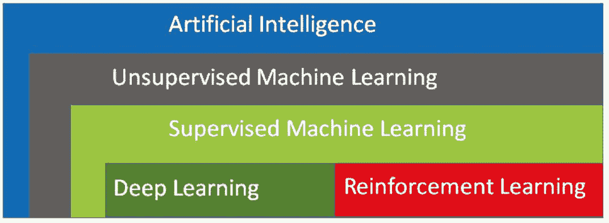

图 3.1 人工智能技术摘要。

在无监督机器学习中，计算机利用该领域人类专家构想的自制提取器，学习在输入数据和规定的输出类别之间建立映射。另一方面，在有监督机器学习中，计算机根据输入数据的分布和结构生成其输出数据。在深度学习的情况下，计算机通过神经元的分层网络调整权重来构成数据。最后，在强化学习中，计算机选择产生特定结果最高概率的动作。

此外，如今研究人员更关注为医疗保健开发、测试、实施和验证机器学习算法，以提高个人护理的效率和质量 [[17]](#ch3.xhtml#ref3_17)。机器学习模型 [[2]](#ch3.xhtml#ref3_2) 是一种从数据中学习以执行任务或做出决策并具有显式编程行为的算法。机器学习方法可以与雾/边缘计算 [[18]](#ch3.xhtml#ref3_18)、物联网和云计算等其他技术结合使用，以提供更好的解决方案，并在医疗保健中发挥救命作用 [[19]](#ch3.xhtml#ref3_19)、[[20]](#ch3.xhtml#ref3_20)。

随着计算能力的快速提升和大数据的易获取性，深度学习已成为涉及其中的默认人工智能方法，因为它比经典机器学习方法能学到更多东西。这项新技术极大地简化了工程特征的过程，并基于人工神经网络的构建直接应用于原始数据。因此，这使得更多研究人员能在医疗保健领域更快、更容易地运作新想法。然而，本章重点关注如何开发和应用人工智能方法于医疗保健。本章的主要贡献如下。

*   我们首先回顾人工智能和机器学习在医疗保健中的一些应用，特别是疾病预测和诊断方面。
*   我们介绍开发医疗保健机器学习模型的步骤，并简要概述在医疗保健行业部署这些模型时面临的挑战。
*   我们阐述开发医疗保健人工智能模型面临的一些挑战。
*   我们最后从不同临床需求的方向出发，提供关于如何应对这些模型的某些解决方案。


本章其余部分安排如下。第 3.2 节 Section 3.2 简要回顾了医疗保健领域机器学习和人工智能的文献。第 3.3 节 Section 3.3 提供了开发用于医疗保健的机器学习算法的步骤。第 3.4 节 Section 3.4 展示了一些利用人工智能进行的疾病预测和诊断。第 3.5 节 Section 3.5 提供了开发用于医疗保健的人工智能模型面临的一些挑战。最后，第 3.6 节 Section 3.6 给出了结束语。

## 3.2 医疗保健领域机器学习与人工智能文献综述

### 3.2.1 机器学习在医疗保健中的应用

机器学习技术在医疗保健领域发挥着重要作用。目前，它正被开发和实施，用于各种针对性的健康应用，如患者监测、医学诊断、卫生系统学习和临床决策支持 [21]。这些应用涵盖了一系列方法，包括监督学习、认知学习、无监督学习、深度学习和基于强化学习的算法等不同概念，这些方法可用于分析和解释复杂的医疗数据，而在该类情况下，经典统计算法可能无法胜任。机器学习算法在医疗保健领域充满希望的方向是开发自动化风险预测方法，以指导临床护理。预测模型的目的取决于数据的异质性、数据的深度、数据的广度、建模任务、机器学习算法的选择以及特征选择技术 [22]。即使机器学习算法常用于医疗保健，但更多的司法管辖区不允许这些算法成为最终的决策者；它们主要被用作检测方法或诊断辅助工具。

机器学习用于医疗服务并非新鲜事物，且已在公共和私营医疗部门均实现了不断扩展。医疗保健领域最重要的机器学习服务如图 3.2 Figure 3.2 所示。首先是识别与诊断，涉及识别患者疾病、监测其病情并建议必要的预防措施。还有药物发现与制造，包括自动化识别新药或先导分子，以最小化错误并提高药物开发和发现的效率。得益于深度学习和计算机视觉，医学影像也是医疗保健中一项非常重要的应用，它有助于检测微观异常；因此，医生可以提出适当的诊断。另一项应用是患者治疗与监测，涵盖基于海量数据集和电子健康记录规划和管理具体行动，以使患者恢复健康。允许患者直接共享其数据的智能健康记录是另一项应用，机器学习在此被用于节省精力、时间和成本。最后，许多机器学习模型（如人工神经网络）被用于疾病预测，这不仅有助于预测轻微疾病，还能基于从社交媒体平台、卫星、网站等获取的大量数据预测严重的传染性疾病。

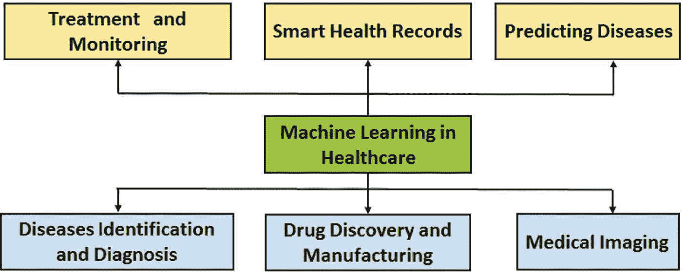

图 3.2 医疗保健领域的机器学习服务。

目前，机器学习算法正被用于全球最严重的前所未有的公共卫生危机之一——新型冠状病毒疫情（SARS-00V-2 或 COVID-19）。它帮助科学家对 COVID-19 基因组进行分类 [23]、识别针对 COVID-19 的潜在药物候选者 [24]、预测用于疫苗配方的 COVID-19 相关蛋白质结构 [25]，以及用于 COVID-19 病毒的其他有用应用 [26]。文献 [23] 的作者识别出一种内在的 SARS-CoV-2 基因组特征，并将其与一种结合多种技术的机器学习算法配合使用，实现了对整个 SARS-CoV-2 病毒基因组的极高精度分类。所提出的算法允许对 SARS-CoV-2 病毒序列进行 100% 准确的分类，并在几分钟内找到 5000 多个病毒基因组之间最合适的关系。然而，该算法可以为分类学分类提供良好的实时可能性。Ge 等人 [24] 提出了一个框架，应用统计分析和机器学习技术来整合和利用大规模知识图谱、文献和转录组数据，以寻找针对 COVID-19 病毒的潜在药物候选者。他们利用过去的 MERS-CoV 和 SARS-CoV 数据证明，所提出的框架可以预测针对特定冠状病毒的有益药物候选者。Khan 等人 [27] 建议了一种名为 `CoroNet` 的深度学习模型，基于深度卷积神经网络利用 X 射线摄影图像识别 COVID-19 感染病例。所提出的模型在所用数据集上进行了测试，结果显示该模型总体准确率达到 89.6%。

图 3.3 Figure 3.3 展示了在医疗保健领域，可以针对哪类问题使用哪类机器学习技术。

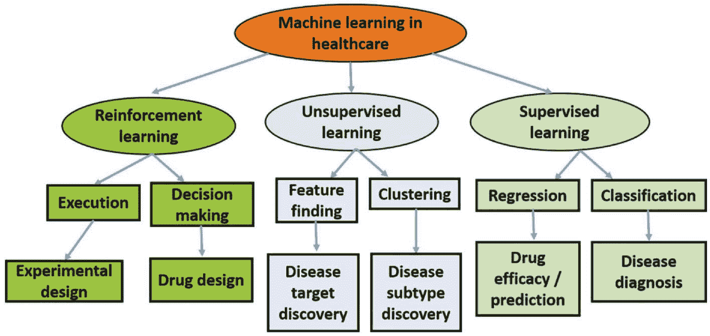

图 3.3 医疗保健领域的机器学习服务。

### 3.2.2 人工智能在医疗保健中的应用

人工智能引入了大量可用于工业 4.0 的智能算法。其中大多数算法对医疗保健领域有重要影响。人工智能技术在医疗保健中的性能取决于其关键参数和健康数据的质量。人工智能在医疗保健中应用的典型架构极有可能在保持医疗质量的同时降低医疗成本，即将仅由专业人员提供的护理转变为具有共同责任和自我赋能的个性化患者护理（图 3.4 Figure 3.4）。治疗决策由人工智能直接面向患者做出，或由护理人员根据治疗建议的复杂程度做出 [28]。

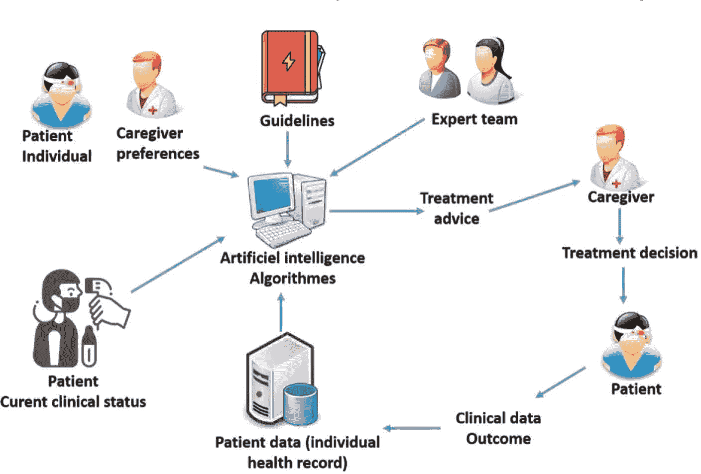

图 3.4 人工智能在医疗保健中应用的典型架构。

人工智能被证明是放射学、病理学以及最近眼科学中图像识别的潜在工具 [29]。它已被广泛用于监测疲劳，并已被证明有效 [30]。例如，人工神经网络、鼠标交互和键盘模式的数据分析以及心率数据检查已被研究用于识别有助于疲劳识别的原因和特征。针对 COVID-19 的检测，Salman 等人 [31] 提出了一种基于深度学习和 X 射线成像的新模型，这将极大地提高放射科医生的效率，从而有助于控制疫情。


## 3.3 如何为医疗保健开发机器学习方法

机器学习方法的快速发展使得改善医疗决策支持成为可能。然而，为医疗保健开发机器学习方法涉及特殊考量，以改善患者护理。在本节中，我们将介绍如何为医疗保健开发机器学习方法。重要的是，我们将重点关注用于诊断的机器学习模型，这涉及基于健康数据输入进行标签预测。文献 [1] 概述了为医疗保健开发和实施机器学习方法的流程，并以五个步骤的形式呈现：选择合适的问题并定义预测任务、构建数据、开发模型、评估模型性能以及评估潜在的临床影响。

### 3.3.1 医疗保健问题选择

对于医疗保健机器学习模型（或方法）的开发，第一步是选择合适的问题并定义预测任务。有效的机器学习模型应通过提供可操作的知识和信息，在患者护理中发挥重要作用。模型应包含相当数量的参数，以获得更好的预测性能。

**表 3.1** 医疗保健中人工智能技术应用相关文献摘要

| 文献 | 目的 | 领域 | 技术 | 最佳性能 | 局限性 |
|-------|---------|--------|-----------|------------------|-------------|
| 吴等 [32] | 本文利用机器学习方法分析乳腺超声图像，为三阴性乳腺癌提供高水平诊断。 | 放射学 | 逻辑回归 | 特异性 = 82.91%<br>敏感性 = 86.96% | 将患者年龄纳入分析并未改善三阴性（TN）乳腺癌与非三阴性（NTN）乳腺癌的区分度。 |
| 李等 [33] | 本文采用反向传播神经网络和概率神经网络建模糖尿病诊断，为医生的诊断和治疗提供高精度支持。 | 眼科学 | 神经网络 | 准确率 = 97.9% | 单纯增加反向传播神经网络的隐藏层数量会增加网络的计算复杂度，且可能无法达到预期的诊断效果。 |
| 阿卜德拉耶姆等 [34] | 本文提出了一种基于心电图的生物特征模型用于人体识别。利用广义莫尔斯小波和提取的心电图片段的短时傅里叶变换丰富提取的特征，以获取心电图信号模型的附加信息。 | 心脏病学 | 深度卷积神经网络 | 准确率 = 97.85% | 一些未被考虑的因素可能影响心电图系统，例如包括健康和年龄状况在内的长期因素，而短期因素包括精神和情绪状态。 |
| 施里瓦斯塔瓦等 [35] | 本文展示了二进制蝙蝠算法识别帕金森病（PD）的潜力，并将其与经典方法进行比较。 | 神经病学 | 神经网络 | 准确率 = 93.60% | 该研究无法将帕金森病与其他帕金森综合征（如静止性震颤、运动不能、肌强直和姿势不稳）区分开来。因此，医生的干预仍然是泛泛的，而非针对每种类型的帕金森病的特异性干预。 |
| 帕特罗等 [36] | 本文提出了一种生物特征识别方法，用于选择适合特征分类的特征。将特征输入传统分类算法以评估所提方法的性能。 | 生物特征人体识别 | 最小绝对收缩、人工神经网络、支持向量机和 *K*-近邻。 | 准确率 = 99.1379% | 提取临床特征的步骤可能对生物特征系统的性能产生重大影响。 |
| 阿加瓦尔等 [37] | 本文实现了心率变异性参数，并研究了支持向量机和人工神经网络，以开发用于糖尿病的在线自动化实时预测模型。 | 眼科学 | 支持向量机和人工神经网络 | 准确率 = 86.3% | 所提出的糖尿病在线自动化实时预测模型仅可用于预后技术。因此，该系统无法取代专家临床医生的临床决策和意见。 |

### 3.3.2 数据集构建

第二步是构建数据集。然而，总是存在一些需要解决的挑战，例如缺乏可靠的训练数据和数据格式的矛盾。然而，最近一个新的活跃研究课题集中于优化从人类学习到机器学习模型的迁移。随着当今医疗保健的发展，研究人员正专注于用于预测的各类健康数据 [38]。许多研究论文关注临床数据 [39]、[40]、[41]、[42]，但其他论文，包括传感器数据 [43]、[44]、[45] 和组学数据 [46]、[47]、[48]、[49]、[50]、[51]、[52]、[53]，也使用其他数据类型。数据训练和准备极其重要，在机器学习技术中发挥着宝贵的作用。它有助于在使用任何学习算法之前拥有合适的数据集。此外，要在临床数据分析中应用机器学习算法，我们应选择合适的数据集、适宜的模型选择方法、特征选择和特征提取。用于疾病预测和诊断的医疗数据类型总结见 图 3.5。

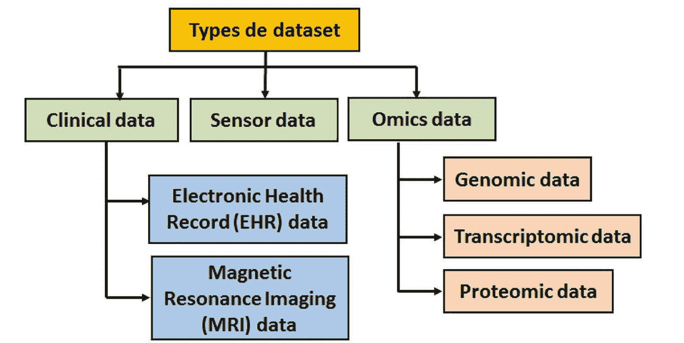

图 3.5 医疗数据类型。

### 3.3.3 模型开发


医疗保健机器学习模型的开发及其成功部署并非显而易见，需要审慎评估因不同需求而可能产生的问题 [54]。因此，更好的医疗保健机器学习模型必须满足某些重要标准，例如诊断知识的透明度、模型优化可靠诊断所需测试数量的能力、处理缺失数据的能力、提供良好性能的能力，以及阐明和解释所做决策的能力。由于健康数据更为敏感，且任何错误都可能影响一个人的生命，开发的机器学习模型必须自动预测效果以挽救生命。例如，关于模型输入和输出数据的选择，在确定机器学习模型在预测和患者特征方面的实用价值时非常不可或缺。机器学习开发者必须确保机器学习模型仅接收患者护理的特征，并且模型使用这些特征。

### 3.3.4 模型性能评估

对于这些模型的评估，许多指标至关重要，特别是那些使用阈值测量区分度、使用概率测量校准度的指标。特别是在需要做出临床决策的关键用例中，由于所需成本高昂，部署机器学习模型存在一定的犹豫。

### 3.3.5 临床影响评估

该过程的最后一步涉及评估潜在的临床影响，并在真实场景中验证机器学习模型的准确性。然而，它应该使用可解释的机器学习模型，这允许在做出任何决策之前评估此类模型。医疗保健机器学习模型缺乏可解释性在许多情况下可能会导致危及生命的后果。可解释性是模型的保真度和解释，此类模型应更多地解释为什么做出预测、做出决策或给出建议。对于被利用的机器学习模型，它应该让医疗用户理解，并针对目标用例具有适用性。

## 3.4 利用人工智能进行疾病预测和诊断

### 3.4.1 利用机器学习进行疾病预测和诊断

文献中许多研究集中于利用机器学习模型进行疾病预测和诊断。[2] 中的作者强调了机器学习模型的重要性，将其作为完全计算机引导的健康数据分析和解释技术。动态临床决策能建立更好的医患关系并降低医疗成本 [5]、[55]。此外，机器学习在多个健康领域被高度应用于疾病的早期检测和诊断，例如癌症 [6]、糖尿病视网膜病变 [3]、[9]、[13]、慢性病 [11]、心血管疾病 [8]、血管性痴呆 [56]、骨质疏松、心脏病 [12]、[53]、阿尔茨海默病和癫痫。机器学习应用在放射学和急诊医学等研究领域取得了很大成功 [4]，但心血管系统因缺乏完整的验证过程而未获得很高的成功率。

[11] 中的作者讨论并提出了一种新型的多模态疾病风险预测机器学习模型，适用于非结构化和结构化数据。他们工作中获得的结果记录了比其他现有方法更高质量的性能。此外，Zhao *等人* [40] 利用机器学习构建了一种预测机器人辅助手术（`RAS`）病例时长的方法。他们通过使用不同的传统机器学习模型，以 `root mean square error` 的降低来预测 `RAS` 病例的时长，从而结束了他们的研究。[4] 的作者提出了三种捕捉数据中隐藏模式的学习技术。第一种技术涉及一种无监督方法，可用于发现驱动数据样本间差异的关键特征。它包括 `K-means`、谱聚类、模糊聚类和高斯混合模型等方法。第二种技术是监督方法，这是一种模型构建技术，用于确定特征规则集，可用于区分不同类别的样本。它包括 `k-nearest neighbor`、决策树、支持向量机和贝叶斯模型方法。最后一种技术涉及进化方法，称为遗传算法，基于自然选择的进化思想和生物体的遗传过程。

[57] 的作者在医疗保健中使用可解释和可理解的机器学习模型，来刻画为给定医疗问题选择合适的可解释机器学习模型的标准。他们展示了跨越患者护理的许多用例，以解决在再入院风险、急诊入院、疾病进展和疾病诊断等问题中，平衡算法优化和可解释性所需的多样化细微差别。此外，Kumar *等人* [13] 在一个由三个阶段组成、专注于糖尿病的框架中结合了云计算和物联网技术。它包括从物联网设备收集数据、将医疗记录安全地存储在云数据库中，然后预测疾病及其严重程度并进行诊断。他们提出了一种新的分类方法，称为 `fuzzy rule-based neural classifier`，用于诊断糖尿病及其严重程度。所提出的框架在疾病预测方面优于现有模型。

表 3.2 总结了在医疗保健疾病预测和诊断中表现最佳的机器学习模型相关研究论文。

表 3.2 医疗保健疾病预测和诊断现有重要机器学习模型汇总

| 作者 | 范围 | 提出的模型 | 性能 | 数据集 |
| --- | --- | --- | --- | --- |
| Ksia_zek *等人* [58] | 检测成人肝细胞癌（`HCC`）。 | 一个使用十种知名机器学习算法利用 165 名患者数据检测 `HCC` 的模型。 | 准确率 = 0.8849 `F1` 分数 = 0.8762 | `HCC` 数据集由科英布拉大学医院和中心收集 [59]。 |
| Abdar *等人* [60] | 分类并自动化疣病治疗反应。 | 一种基于改进自适应粒子群优化算法和人工免疫识别系统相结合的机器学习模型。 | 精确率 = 0.8908 召回率 = 0.8943 F 值 = 0.8916 准确率 = 90% | 数据集包含 180 名患者，取自马什哈德 Ghaem 医院的免疫疗法和冷冻疗法 [61]。 |
| Acharya *等人* [62] | 使用 `ECG` 信号分类正常和冠状动脉疾病状况。 | 基于 `k-nearest neighbors classifier` 的模型。 | 准确率 = 98.17% 特异性 = 99.34% 灵敏度 = 94.57% | `ECG-ID` 数据库 [63]。 |


| 参考文献 |  | 目的 | 方法 | 结果 | 数据集 |
| --- | --- | --- | --- | --- | --- |
| Abdar *et al.* [[64]](#ch3.xhtml#ref3_64) |  | 从伊朗患者中检测冠状动脉疾病。 | N2Genetic-NuSVM 算法基于两级混合遗传算法和 NuSVM。 | 准确率 = 93.08%<br>F1 分数 = 91.51% | Z-Alizadeh Sani 心脏病数据集 [[65]](#ch3.xhtml#ref3_65)。 |
| Patro *et al.* [[66]](#ch3.xhtml#ref3_66) |  | 为 ECG 数据的分类和识别选择合适的特征。 | 最小绝对收缩和选择算子统计学习模型。 | 准确率 = 99.1379% | ECG-ID 数据库 [[63]](#ch3.xhtml#ref3_63)。 |
| Ahmed *et al.* [[67]](#ch3.xhtml#ref3_67) |  | 预测心脏病。 | 基于随机森林分类器的最优实时模型。 | 准确率 = 94.9% | Cleveland 心脏病数据集 [[68]](#ch3.xhtml#ref3_68)。 |
| Luo *et al.* [[69]](#ch3.xhtml#ref3_69) |  | 预测儿童哮喘疾病， | 一种预测儿童哮喘以提供实时决策支持的模型。 | 准确率 = 71.8%<br>敏感性 = 73.8%<br>特异性 = 71.4% | 数据集在 210 名儿童身上收集了两年。 |

### 3.4.2 用于临床诊断的人工智能技术

人工诊断疾病通常耗时费力，且出错几率会大幅增加。人工智能算法是协助医生进行诊断、预后以及治疗前后过程的宝贵手段。一项关键任务是自动判断疾病的存在与否。这种分类的重点是通过检测与每一类别对应的模式，对某种疾病或多种疾病类别做出临床决策。有各种类型的人工智能方法被用于自动诊断多种不同的疾病，例如逻辑回归、决策树 (DT)、支持向量机 (SVM)、神经网络 (NN)、人工神经网络 (ANN) 等。这些人工智能方法大多采用基于计算机的预测分析方法，对来自不同健康来源的大型数据集进行分类、筛选、组织，并尝试寻找模式。它们主要被用作检测手段或诊断辅助工具，使医务人员能够快速做出决策。例如，卷积神经网络使得创建用于诊断肺部和脑部疾病的图像分类模型成为可能。统计方法和随机森林预测器允许构建心脏病的风险模型和生存估计器，以确定患者的预后。自然语言处理允许从放射科报告中提取信息。

尽管人工智能技术对患者和医生极具价值且有益，且适用于不同疾病的诊断，但遗憾的是，它们也存在许多导致临床诊断缺陷的问题。某些疾病的精准诊断基于从数百万经历过相似症状的患者那里收集的多项健康数据。为了获得更好的准确性，人工智能方法使用的数据集必须包含关于患者的足够信息。因此，如果在特定情境下缺乏患者信息，人工智能可能会提供不准确的诊断。结果，如果医生没有足够的经验来识别问题，很可能会给患者错误的治疗，甚至导致患者死亡。然而，为了更好地在疾病诊断中实际应用人工智能，仍需解决主要问题。

表 3.3 用于临床诊断的人工智能技术。

| 贡献 | 技术 | 疾病 | 临床诊断 | 局限性 |
| --- | --- | --- | --- | --- |
| Wang *et al.* | 支持向量机 | 乳腺癌 | * 提高乳腺癌诊断的准确性。<br>* 降低乳腺癌诊断准确性的方差。 | SVM 技术的结构和配置参数会影响诊断性能。 |
| Reddy *et al.* [[71]](#ch3.xhtml#ref3_71) | 遗传算法和模糊逻辑 | 心脏 | * 降低患者死亡风险和治疗成本。<br>* 帮助医生在早期诊断患者心脏病。 | 所用环境是静态的，健康数据不是流式的。 |
| Jeyaranjani *et al.* [[72]](#ch3.xhtml#ref3_72) | 人工神经网络 | 冠心病 | * 对医生预测冠心病分期很高效。<br>* 诊断分类错误的冠心病患者记录。<br>* 显示患者的血管造影疾病状态。<br>* 降低延迟诊断的风险，从而挽救生命。 | 需要更多执行时间以生成更好的结果。 |
| Thammastitkul *et al.* [[73]](#ch3.xhtml#ref3_73) | 朴素贝叶斯 | 糖尿病视网膜病变 | * 早期检测糖尿病视网膜病变中的微动脉瘤，以减少失明的发生。 | 未在大型数据集上测试。 |
| Castellazzi *et al.* [[74]](#ch3.xhtml#ref3_74) | 结合磁共振成像的机器学习 | 阿尔茨海默病 (AD) 和血管性痴呆 (VD) | * 识别大脑特定区域，如海马体、前扣带回和丘脑，并具有明确定义的痴呆类型。<br>* 为表现出混合痴呆临床症状的患者提供疾病类型 (AD 或 VD) 的早期预测。<br>* 支持和协助临床医生提高诊断和预后准确性，以及治疗和患者管理。 | 单模态特征数据集性能低。 |
| Yamamoto *et al.* [[75]](#ch3.xhtml#ref3_75) | 深度学习 | 骨质疏松症 | * 从髋部 X 光片高准确度诊断骨质疏松症。<br>* 利用患者记录中的临床协变量提高诊断性能。 | 计算复杂度高。 |
| Yu *et al.* [[76]](#ch3.xhtml#ref3_76) | 随机森林和长短期记忆网络 | 中风 | * 利用实时生物信号提供中风的实时检测，以允许对患者中风治疗目的的生理状态初始变化进行监测。<br>* 警告医务人员和医生预 emptively 响应老年人的医疗保健需求。 | 该模型未考虑日常生活中驾驶、睡眠或行走时收集实时生物信号的情况。 |
| Jin *et al.* [[77]](#ch3.xhtml#ref3_77) | 面部表情识别 | 帕金森病 | * 帮助患者获得更充分的治疗。<br>* 帮助医生了解帕金森病的实时动态。 | 所用数据集不足。 |
| Abiyev *et al.* [[78]](#ch3.xhtml#ref3_78) | 卷积神经网络 | 癫痫 | * 将 EEG 信号分类为癫痫发作类和正常类，以研究大脑活动特征。 | 计算复杂度高。 |

## 3.5 在医疗保健中使用人工智能算法的挑战

机器学习提供了许多方法和技术，有助于解决医疗保健中面临的诊断和预后挑战。尽管用于医疗保健的机器学习模型在疾病预测和诊断方面具有许多优势，但遗憾的是，它们并非通用且标准完美的模型。当我们想要开发用于医疗保健疾病预测和诊断的机器学习模型时，遇到的问题总结为以下参数 [[79]](#ch3.xhtml#ref3_79)，[[80]](#ch3.xhtml#ref3_80)：


## 挑战

- 与数据供给相关的重大挑战不容忽视，这应影响任何与在 `医疗保健` 中实施 `机器学习模型` 相关的决策。大多数 `健康数据` 属于 `非结构化数据`，并以各种类型的形式出现，例如出院小结图像、报告、音频或视频记录。因此，对这类数据进行分类和量化非常困难 `[#ch3.xhtml#ref3_51]`。

- 患者生成的数据量呈指数级增长，且在临床所需的时间范围内变得越来越难以管理。

- 不同的 `机器学习模型` 适用于特定 `医疗数据集` 的特定问题，且无法在其他数据集上良好工作。因此，为特定数据集选择合适且优秀的 `机器学习解决方案` 是 `医疗保健` 领域的一大挑战。

- `医疗保健` 领域的 `机器学习模型` 需要海量、高质量和大规模的数据集进行训练。然而，收集这些数据集需要更多时间。`数据可用性` 被认为是开发和评估 `医疗保健` 领域 `机器学习算法` 的最大挑战之一。

- `医疗保健` 领域的 `机器学习模型` 需要时间、大量资源和计算机设备来生成高置信度结果。很难证明这些模型做出的预测在实时应用的所有可能场景中都能正确工作。一切皆取决于信息技术资源和所用设备。

- `健康数据集` 的质量并不总是良好，因此我们不得不花费大量时间清洗数据并研究新技术以高效利用 `健康数据`。这有时会导致决策耗时更长，而在对延迟极其敏感的医疗领域，这并不利于决策。

- 很难对 `机器学习模型` 生成的结果提供适当的解释和正确的分析。

## 结论

人工智能在医疗保健领域的发展仍处于新兴阶段。近年来，针对不同疾病的相关研究层出不穷。尽管取得了成功的结果和益处，但它也存在一些缺点和局限性。然而，开发人工智能技术以挽救更多生命的努力仍在继续。此外，在本章中，我们重点关注了医疗保健应用中某些人工智能的利用，以提供更好和远程的解决方案，特别是在疾病识别和诊断方面。此外，我们还集中探讨了在医疗领域，针对患者当前面临的何种疾病，可以使用哪种类型的人工智能技术。之后，我们介绍了开发医疗保健机器学习模型的步骤，并简要概述了在医疗行业部署这些模型时遇到的挑战。最后，我们列举了一些开发医疗疾病诊断模型所面临的挑战。

## 参考文献

1.  `Chen, P. H. C., Liu, Y., & Peng, L.` (2019). 如何开发用于医疗保健的机器学习模型。 `Nature materials`, `18`(5), 410–414.
2.  `Beam, A. L., & Kohane, I. S.` (2018). 医疗保健中的大数据与机器学习。 `Jama`, `319`(13), 1317–1318.
3.  `Gulshan, V., Peng, L., Coram, M., Stumpe, M. C., Wu, D., Narayanaswamy, A., ... & Webster, D. R.` (2016). 用于视网膜眼底照片糖尿病视网膜病变检测的深度学习算法的开发与验证。 `Jama`, `316`(22), 2402–2410.
4.  `Mansi, T., Mihalef, V., Sharma, P., Georgescu, B., Zheng, X., Rapaka, S., ... & Comaniciu, D.` (2012, May). 心脏解剖、力学和血流动力学的数据驱动计算模型：一个集成框架。在 2012 年第 9 届 IEEE 国际生物医学成像研讨会 (ISBI) 上 (pp. 1434–1434). IEEE.
5.  `Ngiam, K. Y., & Khor, W.` (2019). 用于医疗保健服务的大数据和机器学习算法。 `The Lancet Oncology`, `20`(5), e262–e273.
6.  `Belle, A., Kon, M. A., & Najarian, K.` (2013). 用于计算机辅助决策支持系统的生物医学信息学：综述。 `The Scientific World Journal`, `2013`.
7.  `Caceres, C. A., & Rikli, A. E.` (1961). 数字计算机作为心血管疾病诊断的辅助工具。 `Transactions of the New York Academy of Sciences`, `23*(3 Series II), 240–245.
8.  `Martis, R. J., Chakraborty, C., & Ray, A. K.` (2014). 用于 ECG 信号分析的基于小波的机器学习技术。在医疗保健信息学中的机器学习 (pp. 25–45). Springer, Berlin, Heidelberg.
9.  `Gulshan, V., Peng, L., Coram, M., Stumpe, M. C., Wu, D., Narayanaswamy, A., ... & Webster, D. R.` (2016). 用于视网膜眼底照片糖尿病视网膜病变检测的深度学习算法的开发与验证。 `Jama`, `316`(22), 2402–2410.
10. `Hamet, P., & Tremblay, J.` (2017). 医学中的人工智能。 `Metabolism`, `69`, S36–S40.
11. `Chen, M., Hao, Y., Hwang, K., Wang, L., & Wang, L.` (2017). 基于医疗社区大数据的机器学习疾病预测。 `Ieee Access`, `5`, 8869–8879.
12. `Wu, C. S. M., Badshah, M., & Bhagwat, V.` (2019, July). 使用数据挖掘技术进行心脏病预测。在 2019 年第 2 届数据科学与信息技术国际会议论文集上 (pp. 7–11).
13. `Kumar, P. M., Lokesh, S., Varatharajan, R., Babu, G. C., & Parthasarathy, P.` (2018). 基于模糊神经分类器的云和物联网疾病预测与诊断系统用于医疗保健。 `Future Generation Computer Systems`, `86`, 527–534.
14. `Garbuio, M., & Lin, N.` (2019). 人工智能作为医疗保健初创企业的增长引擎：新兴商业模式。 `California Management Review`, `61*(2), 59–83.
15. `Rong, G., Mendez, A., Assi, E. B., Zhao, B., & Sawan, M.` (2020). 医疗保健中的人工智能：综述与预测案例研究。 `Engineering`, `6*(3), 291–301.
16. `Panch, T., Szolovits, P., & Atun, R.` (2018). 人工智能、机器学习与卫生系统。 `Journal of global health`, `8*(2).
17. `Shen, D., Wee, C. Y., Zhang, D., Zhou, L., & Yap, P. T.` (2014). 用于 AD/MCI 诊断和预后的机器学习技术。在医疗保健信息学中的机器学习 (pp. 147–179). Springer, Berlin, Heidelberg.
18. `El Kafhali, S., & Salah, K.` (2017). 物联网设备雾节点的高效动态扩展。 `The Journal of Supercomputing`, `73*(12), 5261–5284.
19. `El Kafhali, S., Salah, K., & Ben Alla, S.` (2018, November). 用于医疗服务的物联网-雾-云部署性能评估。在 2018 年第 4 届云计算技术与应用国际会议 (Cloudtech) 上 (pp. 1–6). IEEE.
20. `El Kafhali, S., & Salah, K.` (2019). 物联网医疗监测系统的性能建模与分析。 `IET Networks`, `8*(1), 48–58.
21. `Reddy, S., Allan, S., Coghlan, S., & Cooper, P.` (2020). 医疗保健中 AI 应用的治理模型。 `Journal of the American Medical Informatics Association`, `27*(3), 491–497.
22. `Shameer, K., Johnson, K. W., Glicksberg, B. S., Dudley, J. T., & Sengupta, P. P.` (2018). 心血管医学中的机器学习：我们到达了吗？. `Heart`, `104*(14), 1156–1164.


## 参考文献

23. Randhawa, G. S., Soltysiak, M. P., El Roz, H., de Souza, C. P., Hill, K. A., & Kari, L. (2020). 利用内在基因组特征进行机器学习以快速分类新型病原体：COVID-19 案例研究。*Plos one*，*15*(4)，e0232391。

24. Ge, Y., Tian, T., Huang, S., Wan, F., Li, J., Li, S.，... & Zeng, J. (2020). 一种数据驱动的药物重定位框架发现了一种针对 COVID-19 的潜在治疗药物。*BioRxiv*。

25. Senior, A. W., Evans, R., Jumper, J., Kirkpatrick, J., Sifre, L., Green, T.，... & Hassabis, D. (2020). 利用深度学习势能改进蛋白质结构预测。*Nature*，*577*(7792)，706–710。

26. Alimadadi, A., Aryal, S., Manandhar, I., Munroe, P. B., Joe, B., & Cheng, X. (2020). 利用人工智能和机器学习对抗 COVID-19。*Physiological genomics*，*52*(4)，200–202。

27. Khan, A. I., Shah, J. L., & Bhat, M. M. (2020). CoroNet：一种用于从胸部 X 射线图像检测和诊断 COVID-19 的深度神经网络。*Computer Methods and Programs in Biomedicine*，*196*，105581。

28. El Kafhali, S., & Lazaar, M. (2021). 医疗保健的人工智能：角色、挑战与应用。载 *Intelligent Systems in Big Data, Semantic Web and Machine Learning*（第 141–156 页）。Springer, Cham。

29. Kuht, H., Wang, S., Nishad, G., George, S., Maconachie, G., Sheth, V.，... & Thomas, M. G. (2020). 利用人工智能（AI）对视网膜发育障碍进行分类。*Investigative Ophthalmology & Visual Science*，*61*(7)，4030–4030。

30. Parekh, V., Shah, D., & Shah, M. (2020). 基于人工智能框架的疲劳检测。*Augmented Human Research*，*5*(1)，1–17。

31. Salman, F. M., Abu-Naser, S. S., Alajrami, E., Abu-Nasser, B. S., & Alashqar, B. A. (2020). 利用人工智能进行 Covid-19 检测，*4*，18–25。

32. Wu, T., Sultan, L. R., Tian, J., Cary, T. W., & Sehgal, C. M. (2019). 用于三阴性乳腺癌诊断性超声的机器学习。*Breast cancer research and treatment*，*173*(2)，365–373。

33. Li, X. (2021). 基于智能诊断的人工智能神经网络。*Journal of Ambient Intelligence and Humanized Computing*，*12*，923–931。

34. Abdeldayem, S. S., & Bourlai, T. (2018, December). 基于高层频谱时域信号特征的基于 ECG 的人体认证。载 *2018 IEEE international conference on big data (big data)*（第 4984-4993 页）。IEEE。

35. Shrivastava, P., Shukla, A., Vepakomma, P., Bhansali, N., & Verma, K. (2017). 用于识别帕金森病的特征选择自然启发算法综述。*Computer methods and programs in biomedicine*，*139*，171–179。

36. Patro, K. K., Reddi, S. P. R., Khalelulla, S. E., Kumar, P. R., & Shankar, K. (2020). 用于生物特征人体识别的 ECG 数据优化，采用统计分布式机器学习算法。*The Journal of Supercomputing*，*76*(2)，858–875。

37. Aggarwal, Y., Das, J., Mazumder, P. M., Kumar, R., & Sinha, R. K. (2020). 利用人工神经网络和支持向量机，基于非线性心脏动力学的心率变异性特征识别糖尿病。*Biocybernetics and Biomedical Engineering*，*40*(3)，1002–1009。

38. Dhillon, A., & Singh, A. (2019). 医疗数据分析中的机器学习：综述。*Journal of Biology and Today’s World*，*8*(6)，1–10。

39. Zheng, T., Xie, W., Xu, L., He, X., Zhang, Y., You, M.，... & Chen, Y. (2017). 一种基于机器学习的框架，通过电子健康记录识别 2 型糖尿病。*International journal of medical informatics*，*97*，120–127。

40. Corey, K. M., Kashyap, S., Lorenzi, E., Lagoo-Deenadayalan, S. A., Heller, K., Whalen, K.，... & Sendak, M. (2018). 开发和验证机器学习模型，利用自动整理的电子健康记录数据（Pythia）识别高风险手术患者：一项回顾性单中心研究。*PLoS medicine*，*15*(11)，e1002701。

41. Rahimian, F., Salimi-Khorshidi, G., Payberah, A. H., Tran, J., Ayala Solares, R., Raimondi, F.，... & Rahimi, K. (2018). 利用机器学习预测急诊入院风险：使用关联电子健康记录进行开发和验证。*PLoS medicine*，*15*(11)，e1002695。

42. Panahiazar, M., Taslimitehrani, V., Pereira, N., & Pathak, J. (2015). 利用 EHR 和机器学习进行心力衰竭生存分析。*Studies in health technology and informatics*，*216*，40。

43. Kaur, P., & Malhotra, S. (2019). 用于压力检测的改进 SLReduct 框架，利用无线传感器网络中的手机感知机制。载 *Progress in Advanced Computing and Intelligent Engineering*（第 499–507 页）。Springer, Singapore。

44. Kanjo, E., Younis, E. M., & Ang, C. S. (2019). 用于情绪检测的移动生理、环境和位置传感器数据的深度学习分析。*Information Fusion*，*49*，46–56。

45. Hassan, M. M., Huda, S., Uddin, M. Z., Almogren, A., & Alrubaian, M. (2018). 利用深度学习从身体传感器数据中识别人体活动。*Journal of medical systems*，*42*(6)，1–8。

46. Njage, P. M. K., Leekitcharoenphon, P., & Hald, T. (2019). 利用新一代测序数据和机器学习改进微生物风险评估中的危害表征：预测志贺毒素大肠杆菌的临床结局。*International journal of food microbiology*，*292*，72–82。

47. Gurovich, Y., Hanani, Y., Bar, O., Nadav, G., Fleischer, N., Gelbman, D.，... & Gripp, K. W. (2019). 利用深度学习识别遗传疾病的面部表型。*Nature medicine*，*25*(1)，60–64。

48. Bobak, C. A., Titus, A. J., & Hill, J. E. (2019). 利用整合数据集的转录生物标志物对结核病进行分类的常见机器学习模型比较。*Applied Soft Computing*，*74*，264–273。

49. Alakwaa, F. M., Chaudhary, K., & Garmire, L. X. (2018). 深度学习准确预测乳腺癌代谢组学数据中的雌激素受体状态。*Journal of proteome research*，*17*(1)，337–347。

50. Mamoshina, P., Volosnikova, M., Ozerov, I. V., Putin, E., Skibina, E., Cortese, F., & Zhavoronkov, A. (2018). 基于人类肌肉转录组数据的机器学习用于生物标志物发现和组织特异性药物靶点识别。*Frontiers in genetics*，*9*，242。

51. Liang, C. A., Chen, L., Wahed, A., & Nguyen, A. N. (2019). 利用深度学习神经网络对急性髓系白血病中 FLT3-ITD 突变的蛋白质组学分析。*Annals of Clinical & Laboratory Science*，*49*(1)，119–126。

52. Panda, B., & Majhi, B. (2021). 一种利用深度循环神经网络预测蛋白质结构类别的新改进方法。*Evolutionary Intelligence*，*14*(2)，253–260。

53. Srinivasan, S., Leshchyk, A., Johnson, N. T., & Korkin, D. (2020). 一种用于稳健细胞类型谱分析的混合深度聚类方法，利用单细胞 RNA-seq 数据。*Rna*，*26*(10)，1303–1319。

54. Jackson, S., Yaqub, M., & Li, C. X. (2019). 机器学习模型在医疗保健中的敏捷部署。*Frontiers in big Data*，*1*，7。


# 4 基于卷积神经网络的胶质瘤 MRI 图像分割

Anupama M. Nayak^()

## 摘要

生物医学科学领域对准确且直观的诊断工具的需求，促使许多研究人员专注于整合深度学习提供的各种模型以适应治疗应用。特别是神经网络，已被广泛研究用于辅助图像分割和分类操作。该项目旨在解决癌症患者胶质瘤 MRI 图像自动分割的需求。利用卷积神经网络的 DenseNet 架构变体构建了一个高精度的 3D 分割工具。我们的程序还能对肿瘤进行初步分类，分为高级别肿瘤和低级别肿瘤，为医学界提供关于胶质瘤严重程度的初步见解。我们利用开源 Python 库函数构建了我们的架构。该架构的训练和测试是在基准 MICCAI BRaTS 数据集上进行的。我们的模型显示出高分割精度，准确率接近 100%（经增强后约为 99.94%）。灵敏度和阳性预测值（PPV）也获得了相同的数值。这种分割精度水平可被认为是实际医疗应用的理想选择。

## 4.1 引言


## 4.1 简介

胶质瘤是一类源于胶质细胞异常分裂的脑和脊髓肿瘤 [1]。它们已知会浸润周围组织，这使得这些肿瘤的手术切除和治疗变得非常困难，导致患有这些肿瘤的患者具有较高的伤亡率。这些肿瘤可以是恶性的或良性的。`WHO`（世界卫生组织）有一个分离系统，采用 `I—IV` 分级系统对这些肿瘤进行分类，其中 `IV` 代表最具侵袭性的形式 [2]。胶质瘤根据受影响的特定脑细胞类型进行分类。随着计算机断层扫描（`CT`）和磁共振成像（`MRI`）技术的引入，脑肿瘤的发病率相对稳定。

尽管胶质瘤研究取得了诸多进展，但患者的预后依然很差。疾病的更具侵袭性形式被视为高级别，需要立即治疗。它们的中位生存率不足两年。低级别变体生长缓慢，*即，* 低级别星形细胞瘤或少突胶质细胞瘤，具有相对较高的预期寿命，这允许推迟过度激进的治疗方法，因为这些方法可能导致严重的组织损伤。确诊后 5 年内，不足 3% 的胶质母细胞瘤患者仍然存活 [3]。脑肿瘤的早期检测至关重要，一直是大量研究的核心。

神经影像学是任何脑肿瘤诊断、治疗规划和治疗后评估的重要工具之一。放射学在这一过程中发挥了不可或缺的作用，该领域取得了大量进展，旨在实现准确、无创的诊断并评估治疗反应 [4]。脑肿瘤分割有助于将肿瘤与正常脑细胞分离开来，这将为诊断提供信息，并可强调治疗规划。

磁共振成像（`MRI`）技术因其对结构的优越表征能力及捕捉各种细胞和代谢功能的能力，一直被常规用于现代神经影像学 [5]、[6]、[7]。标准化神经影像学协议包括：三维（`3D`）`Ti`、轴向液体衰减反转恢复（`FLAIR`）、轴向扩散加权成像（`DWI`）、轴向钆增强 `T2` 以及 `3D` 钆增强 `Ti`。`MRI` 提供基于更高对比度的图像，从而实现更好的可视化和分割，这也是这些图像被大多数分割算法采用的原因。准确的分割对胶质瘤的研究和诊断至关重要。手动分割是一种劳动密集型方法，容易产生误读和差异性。深度学习系统已被医生利用，以辅助提供第二意见并在图像中标记感兴趣区域（`ROIs`）[8]。使用 `3D CNN`（卷积神经网络）的自动分割在从图像中捕捉多尺度上下文信息方面表现出了高效率 [9]。该过程涉及整个肿瘤结构、核心区域和增强肿瘤结构的分层分割。

卷积神经网络（`CNNs`）是设计用于处理自然空间不变性数据的深度学习算法。在 `CNN` 中，节点的感受野是指在前向传播中，直到该节点为止涉及多层卷积的输入信号区域 [10]、[11]。典型分割架构的组成如下：

1.  **下采样路径**，负责提取粗略语义特征
2.  **上采样路径**，经过训练以在模型输出处恢复输入图像分辨率，以及可选的
3.  **后处理模块**，用于细化模型预测。

稠密连接卷积网络或 `DenseNets` 在用于图像分类任务时产生了出色的输出 [12]。`DenseNets` 基于以前馈方式直接连接每一层到其他层，以使网络更准确并增加网络训练的便利性。它们使用池化操作和稠密块构建，其中每个块都是前序特征图的迭代拼接之一。这种架构是残差网络（`ResNets`）的延伸，并为以下额外用途而设计：

1.  **参数效率**：`DenseNets` 更高效地使用参数
2.  **深度监督**：`DenseNets` 利用架构中的短路径执行深度监督
3.  **特征复用**：当前研究层利用带有计算特征图的前序层信息。这些属性使它们非常适合语义分割。

在标准 `CNN` 中，第 "`l`" 层的输出 `x[1]` 是通过将非线性变换 `H` 应用于前一层的输出和 `x[l-1]` 来计算的。`H` 定义为卷积后跟线性修正单元（`ReLU`）和 Dropout。输出计算为 `x = H1`。

`DenseNets` 以前馈方式整合了一种与所有特征输出连接更紧密的模式。在这种情况下，第 "`l`" 层的输出由 `x[1] = H1` 给出，其中表示拼接操作。在此，将发生特征复用，且架构的所有层都接收监督信号。对于每一层，输出维度具有 `k` 个特征图，其中 `k` 是增长率参数，`k` 通常设置为较小的值。因此，`DenseNets` 中的特征图数量随深度线性增长。

这使得 `DenseNet` 架构适合在保留关键边缘细节的同时，高效准确地分割图像。根据执行的分割，神经网络将图像分离为低级别胶质瘤。这根据胶质瘤的 `WHO` 分类给出了胶质瘤严重程度的度量。

## 4.2 目的

本研究旨在利用 `DenseNet` 架构，解决在对低级别和高级别胶质瘤成像时产生的大量 `MRI` 数据分割自动化问题。我们致力于在诊断层面协助胶质瘤治疗，解决胶质瘤肿瘤准确高效分割与分级这一关键任务。源自 `MRI` 图像的更精确的脑肿瘤分割揭示了诊断和肿瘤治疗规划中至关重要且极具挑战性的任务。由于不规则性，沿肿瘤边界进行分割仍然是一项极具挑战性的任务。该研究领域的进展在于卷积神经网络（`CNNs`）的应用。我们承担了在使用极少训练数据的同时，通过提取更高效特征来提高分类准确性这一基本任务。仍有大量空间进行额外研究，以实施各种机器学习技术并对其进行修改，专门解决肿瘤诊断的要求。这些技术还应满足通用应用的标准，以便在医疗领域具有实用性，并满足医患使用的一般要求。

## 4.3 目标

*   为 `MRI` 图像分割构建 `DenseNet` 架构
*   针对脑肿瘤分割进行神经网络训练
*   测试训练好的神经网络以获取分割图像
*   将肿瘤分类为高级别（`HGG`）或低级别胶质瘤（`LGG`）

## 4.4 方法论

*   使用 `BRaTS` 数据集获得的 `MRI` 图像经过预处理，并用于神经网络的训练和测试。


*   使用 `ReLU` 激活函数来线性化输入文件。
*   然后在线性化的图像文件上使用卷积函数以获取特征图。
*   这些特征图被输入到 `DenseNet` 中。
*   在 `DenseNet` 中，它们首先通过密集块，在那里应用了一组激活和卷积函数。
*   连接每个密集块的是一个过渡层，它有自己的一组线性化和卷积函数。
*   此过程重复进行以实现两阶段网络。
*   这些输出经过 `Softmax` 函数处理以获得最终的感兴趣区域 (ROI)。

这给出了一个训练好的 `DenseNet` 架构来分割胶质瘤图像。图 4.1 显示了上述训练步骤。

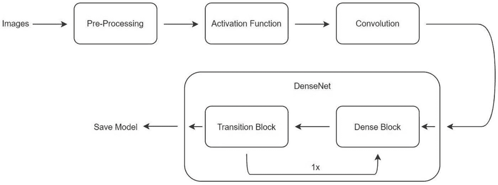

图 4.1 训练框图。

*   然后让来自 BRaTS 数据集的训练图像集经历相同的预处理步骤。
*   它们被输入训练好的神经网络以获得准确率分数。
*   获取的真值图像使用图像编辑程序进行处理。
*   图像的后处理涉及为胶质瘤组织标注 RGB 值。
*   然后将图像分类为 LGG 和 HGG。

结果图像帧随后被保存并使用图像可视化软件进行可视化。图 4.2 显示了上述测试步骤。


图 4.2 测试框图。

## 4.5 实现

整个项目使用 `Python` 编程语言实现。使用了许多开源库，其中最重要的一个是 `TensorFlow`。

项目分三个独立步骤执行，后期集成。创建密集神经网络以分割胶质瘤 MRI 图像的四个阶段如下。

### 4.5.1 初始图像处理

用于数据训练和测试的 MRI 胶质瘤图像数据集源自 MICCAI BRaTS 2018 数据集。从数据集中提取的单个图像以 `40 × 40 × 40` 的补丁大小进行预处理。进行了直方图均衡化，以进一步提取具有更好对比度特征的局部区域，从而产生更高的边缘分辨率。然后利用激活函数在将输入值送入网络之前对其进行线性化。激活函数的选择对于确定模型的训练效率及其收敛能力和速度至关重要，并实现了 `ReLU` (线性修正单元) 激活函数。它们在 `CNNs` 中应用最广泛，通过数学函数 `y = max(0, x)` 对变量进行线性化。最后，执行了一个卷积步骤，发现在 18 层时输出最高效且最准确。进行 3D 卷积以获得输出和输入信号之间的冲激响应。

实现了 `DenseNet` 架构，用于训练和测试 `CNN`，以使用 BRaTS 数据集分割 MRI 图像并获取感兴趣区域。

### 4.5.2 训练阶段

为了训练密集神经网络，使用了来自 BRaTS-2018 数据集的 20 个数据集。每个数据集迭代了 155 次以获得最大准确率。此外，每个数据集允许运行五个周期。该架构通过一系列两个块实现，作为两阶段网络运行。尽管连接了多个残差，但通过使用瓶颈层减少了参数量。图像首先通过密集块进行分割，随后通过过渡块。特征图的尺寸在密集块内不变，而滤波器的数量在它们之间变化，这些被称为过渡层，它们执行下采样。

密集块由三个部分组成，包含 18 个层和 9 个滤波器。该块中的每一层都接收前几层的全部输出特征图。密集块的增长率设置为 12。该参数调节每层给网络的信息量。密集块的一层由以下部分组成：

*   批归一化
*   `ReLU` 激活
*   `3 × 3 × 3` 卷积

这一整个序列执行六次，然后将每个单独过程的输出连接起来以获得图像的平均分割。

在密集块之后，操作在过渡层中进行。过渡层生成 `θ[m]`，`0 < θ < 1` 输出特征图，其中 `θ` 是压缩因子，`m` 是输出特征图的数量。它通过使模型更紧凑来实现模型压缩。该过程通过共享所有学习到的特征，在消除特征冗余方面发挥作用。这又分为以下子过程：

*   批归一化
*   `ReLU` 激活
*   `1 × 1 × 1` 卷积

在这种情况下，第一层由 92 个滤波器组成，而第二层由 168 个滤波器组成。

然后将这些密集块和过渡块的输出输入到 `Softmax` 激活函数中，以进行感兴趣区域 (ROI) 的分割和提取。

### 4.5.3 测试阶段

训练阶段使用了 40 张图像，包含随机顺序的 HGG 和 LGG。该阶段采用了相同的过程，使用由分层密集块和穿插的过渡层组成的两阶段网络，以促进图像压缩。

该阶段的密集块由 18 个层组成，每个层配备 9 个滤波器，通过以下方式分割图像：

*   批归一化
*   `ReLU` 激活
*   `3 × 3 × 3` 卷积

密集块之间穿插的过渡层有三个进一步阶段：

*   批归一化
*   `ReLU` 激活
*   `1 × 1 × 1` 卷积

该代码进一步扩展以获得分数，这些分数将给出代码的准确率、灵敏度和特异性的度量。对于准确率分数，我们集成了 `Dice` 函数。

### 4.5.4 分类算法

测试阶段的输出给我们提供了灰度图像。这些黑白图像是初步分割的结果，未能表征肿瘤定位或提供关于肿瘤分级的任何信息。为了从该初始输出获得基于颜色的对比度分割结果，我们将一个单独的程序与我们的 `DenseNet` 架构集成在一起。

## 4.6 结果

### 4.6.1 训练结果

训练获得的结果显示在下表中。表 4.1 显示了患者损失和患者准确率的平均值。表 4.2 详细提供了从患者 17 到 20 的不同参数数量。

表 4.1 患者损失和患者准确率的平均值

| 序号 | 患者 | 平均患者损失 | 平均患者准确率 |
| --- | --- | --- | --- |
| 1 | 17 | 0.7720 | 85.3435 |
| 9 | 18 | 0.4714 | 91.0136 |
| 3 | 19 | 0.7456 | 87.2426 |
| 4 | 20 | 0.2356 | 96.4125 |

表 4.2 训练获得的数值

| 患者 | 迭代次数 | 损失 | FLAIR 准确率% | t1 准确率% |
| --- | --- | --- | --- | --- |
| **17** | 135 | 1.4184 | 78.24 | 53.50 |
| 17 | 136 | 0.7730 | 83.54 | 87.30 |
| 17 | 137 | 0.1062 | 100 | 100 |
| 17 | 138 | 1.1066 | 87.73 | 73.55 |
| 17 | 139 | 0.3954 | 90.91 | 93.23 |
| 17 | 140 | 0.6942 | 89.38 | 91.61 |
| 17 | 141 | 1.473 | 81.45 | 55.76 |
| 17 | 142 | 0.8252 | 93.29 | 80.84 |
| 17 | 143 | 0.0819 | 100 | 100 |
| 17 | 144 | 0.6278 | 94.27 | 80.15 |


### 4.6.1 训练结果

| 患者 | 迭代 | 损失 | FLAIR t2 准确率% | t1 准确率% |
| --- | --- | --- | --- | --- |
| 17 | 145 | 1.0741 | 84.69 | 78.76 |
| 17 | 146 | 1.4878 | 80.09 | 68.43 |
| 17 | 147 | 1.0662 | 77.89 | 74.91 |
| 17 | 148 | 0.6261 | 92.82 | 90.05 |
| 17 | 149 | 0.5661 | 88.19 | 85.62 |
| 17 | 150 | 0.8001 | 80,41 | 85.13 |
| 17 | 151 | 0.4837 | 90.89 | 93.63 |
| 17 | 152 | 0.2011 | 97.14 | 98.58 |
| 17 | 153 | 1.8998 | 85.24 | 40.68 |
| 17 | 154 | 1.5867 | 62.33 | 78.56 |
| 17 | 155 | 0.5730 | 94.42 | 83.97 |
| 18 | 1 | 0.5618 | 96.01 | 84.87 |
| 18 | 2 | 1.6947 | 90.05 | 37.15 |
| 18 | 3 | 1.2617 | 94.16 | 54.80 |
| 18 | 4 | 0.9922 | 93.32 | 65.39 |
| 18 | 5 | 0.7631 | 94.42 | 68.49 |
| 18 | 6 | 0.4781 | 90.02 | 89.47 |
| 18 | 7 | 0.1910 | 97.71 | 99.48 |
| 18 | 8 | 0.1763 | 99.62 | 99.39 |
| 18 | 9 | 0.6648 | 89.90 | 79.57 |
| 18 | 10 | 0.7703 | 91.12 | 81.74 |
| ... | ... | ... | ... | ... |
| 18 | 150 | 0.3837 | 94.91 | 90.51 |
| 18 | 151 | 0.3845 | 96.47 | 84.87 |
| 18 | 152 | 0.6000 | 93.61 | 81.19 |
| 18 | 153 | 0.5776 | 87.53 | 88.80 |
| 18 | 154 | 0.3697 | 94.65 | 90.71 |
| 18 | 155 | 0.2088 | 97.48 | 96.41 |
| 19 | 1 | 1.3867 | 93.29 | 61.75 |
| 19 | 2 | 0.2640 | 98,99 | 99.68 |
| 19 | 3 | 2.4233 | 89.93 | 42.01 |
| 19 | 4 | 0.7689 | 99.19 | 67.25 |
| 19 | 5 | 0.3828 | 94.18 | 88.86 |
| 19 | 6 | 1.3679 | 86.40 | 69.73 |
| 19 | 7 | 0.9030 | 100 | 100 |
| 19 | 8 | 0.8523 | 98.70 | 62.53 |
| 19 | 9 | 0.5055 | 91.75 | 84.90 |
| 19 | 10 | 0.4638 | 93.00 | 90.97 |
| ... | ... | ... | ... | ... |
| 19 | 150 | 0.0995 | 100 | 100 |
| 19 | 151 | 0.5108 | 95.05 | 88.77 |
| 19 | 152 | 0.2882 | 100 | 100 |
| 19 | 153 | 0.2435 | 97.40 | 95.49 |
| 19 | 154 | 0.3244 | 100 | 84.52 |
| 19 | 155 | 0.4355 | 94.68 | 87.44 |
| 20 | 1 | 1.1837 | 96,90 | 66.06 |
| 20 | 2 | 0.1956 | 99.83 | 100 |
| 20 | 3 | 1.0576 | 91.00 | 72.97 |
| 90 | 4 | 2.2987 | 89.44 | 38.51 |
| 20 | 5 | 1.8808 | 100 | 50 |
| 20 | 6 | 0.9994 | 84.03 | 75.84 |
| 20 | 7 | 1.7880 | 99.94 | 50.00 |
| 20 | 8 | 0.2220 | 99.68 | 99.91 |
| 20 | 9 | 0.7065 | 92.94 | 83.88 |
| 20 | 10 | 0.3926 | 100 | 74.28 |
| ... | ... | ... | ... | ... |
| 20 | 150 | 0.2136 | 98.78 | 95.17 |
| 20 | 151 | 0.1916 | 97.74 | 96.24 |
| 20 | 152 | 0.1600 | 100 | 100 |
| 90 | 153 | 0.0291 | 99.68 | 99.59 |
| 90 | 154 | 0.0883 | 100 | 99.62 |
| 90 | 155 | 0.2620 | 95.30 | 95.52 |

**`Epoch`：** 用于训练神经网络的数据会多次通过网络以达到最大准确率。最终，权重发生变化，神经网络曲线从欠拟合变为过拟合。

在该模型中，我们采用了 20 名患者的 MRI 扫描数据。这些数据通过网络传递了五次，即 0-4 个轮次。上表报告了第四个轮次的数值。

**`Patient`：** 训练该模型共考虑了 20 名患者。

**`Iterations`：** 当用于训练神经网络的数据量过大时，数据会被分成称为批次的较小部分。完成一个轮次所需的批次数量称为迭代次数。在该训练模型中，数据被分为 155 个批次并迭代了 155 次。

**`Loss`：** 损失定义为每次迭代的 1-Dice 系数。Dice 系数量化了算法的性能。

**`Acc.FLAIR t2%`：** FLAIR 全称为液体衰减反转恢复。它们是抑制了脑脊液效应的图像，且不含扫描过程中流体可能产生的噪声。

BraTS 数据集被划分为不同的模态，FLAIR t2 是其中一种模态。该模态包含 FLAIR 图像，可指示肿瘤的位置。

因此，这些图像的准确率百分比对于提高神经网络的效率至关重要。

**`Acc.t1%`：** 这是 BraTS 数据集的一种模态。该数值指定了对比增强的准确率百分比。这些是整体肿瘤及其核心的图像。

训练集的结果显示了相对较高的患者级准确率（表 4.1 和表 4.2）。

### 4.6.2 测试结果

从 MRI 图像中提取的视觉信息必须通过分割算法提供内置的多类标签，以供测试过程使用。通过对被发现为相互包含的胶质瘤区域的各种结构进行分类，完成了灵敏度、准确率和阳性预测分析的评估。

用于分割过程验证的肿瘤区域标注如下：

*   **`Whole` 肿瘤区域：** 标记为“whole”；这将所有四种肿瘤结构归类在一起。
*   **`Core` 肿瘤区域：** 标记为“core”；该区域排除水肿部分。
*   **`Enhance`（活跃肿瘤区域）：** 标记为“enhance”；这包含特定于高级别胶质瘤的部分。

分割测试的预测效度是通过与某一确定性指标（通常称为金标准）相对应的方式来计算的。

**`Enhanced tumor (ET)`：** 与 T1 和健康白质相比，在 T1-Gd 中显示高信号强度的区域被定义为增强区。由于血脑屏障破坏导致渗漏的区域是 ET 在生物学上存在的位置。这主要见于高级别胶质瘤。

**`Whole`：** 整体肿瘤被描述为非增强肿瘤、增强肿瘤和肿瘤周围水肿的并集。

**`Core`：** 核心肿瘤被描述为增强肿瘤和非增强肿瘤的并集。

#### 表 4.3 Dice 整体、Dice 核心和 Dice 增强的数值

| 序号 | Dice 整体 | Dice 核心 | Dice 增强 |
| --- | --- | --- | --- |
| 1 | 0.9960305779569892 | 0.997740479390681 | 1.0 |
| 2 | 0.9930840053763441 | 0.9951U2168458781 | 1.0 |
| 3 | 0.9786905241935484 | 0.9795201612903226 | 0.’98997020609319 |
| 4 | 0.9961133512544803 | 0.9988175403225806 | 1.0 |
| 5 | 0.9956051747311828 | 0.9999074 2078853 | 0.999922603046595 |
| 6 | 0.9839754704301076 | 0.99755801971:32616 | 1.0 |
| 7 | 0.987918458781362 | 0.993344086’0215054 | 1.0 |
| 8 | 0.9966316084229391 | 0.9996747311827957 | 0.9998361335125449 |
| 9 | 0.9753266129032258 | 0.9992920026881721 | 0.9995424507168459 |
| 10 | 0.975552979390681 | 0.9935840053763441 | 0.9999858870967742 |
| 11 | 0.997167002688172 | 0.9987939068100359 | 0.9999419802867383 |
| 12 | 0.9904658378136201 | 0.9985877016129032 | 0.9992560483870968 |
| 13 | 0.9785453629032258 | 0.9952661290322581 | 1.0 |
| 14 | 0.9834467965949821 | 0.9894483646953405 | 0.9999964157706093 |
| 15 | 0.9818430779569892 | 0.9899939516129033 | 0.998076164874552 |
| 16 | 0.9773267249103943 | 0.9828504704301075 | 0.9992081093189964 |
| 17 | 0.9973293010752688 | 0.9976474014336918 | 1.0 |
| 18 | 0.9948823924731183 | 0.9983751120071684 | 0.9999894713261649 |
| 19 | 0.9907242383512544 | 0.995953853046595 | 1.0 |
| 21 | 0.9859519489247311 | 0.9919772625448029 | 1.0 |
| 21 | 0.9913732078853047 | 0.9939707661290322 | 0.9995726926523297 |
| 22 | 0.9797576164874552 | 0.989123767921147 | 1.0 |
| 23 | 0.9893090277777777 | 0.9924935035842294 | 0.9998799283154122 |
| 24 | 0.9780263216845878 | 0.9841258961)573477 | 0.9996010304659498 |
| 25 | 0.9913753360215054 | 0.9958382610-187456 | 0.9979521729390681 |


| Index | Value 1 | Value 2 | Value 3 |
|-------|---------|---------|---------|
| 26 | 0.9916144713261649 | 0.9972542562724014 | 1.0 |
| 27 | 0.9959844310035842 | 0.9971776433691756 | 0.9998517025089606 |
| 28 | 0.9870500672043011 | 0.9885278897849462 | 0.9997578405017921 |
| 29 | 0.9945105286738352 | 0.9966945564516129 | 0.9969462365591398 |
| 30 | 0.9873108198924732 | 0.9907964829749104 | 0.9991472894265233 |
| 31 | 0.9958035394265233 | 0.9988429659498208 | 0.9990638440860216 |
| 32 | 0.9901963485663082 | 0.9930421146953405 | 0.9999866711469534 |
| 33 | 0.9868958333333333 | 0.9906358646953405 | 1.0 |
| 34 | 0.9926M6756272402 | 0.9967960349462366 | 1.0 |
| 35 | 0.9976786514336917 | 0.9992720654121864 | 0.9995750448028674 |
| 36 | 0.97623364(4)53405 | 0.9820928539426523 | 0.999792226702509 |
| 37 | 0.9859595654121864 | 0.9859595654121864 | 0.9998662634408603 |
| 38 | 0.9923506944444445 | 0.9943670474910394 | 1.0 |
| 39 | 1).9944155465949821 | 0.9987927867383513 | 0.9997655689964158 |
| 40 | 0.9740033602150537 | 0.988271729390681 | 0.9994764784946236 |

### 4.6.3 Dice 系数

不同区域从我们的测试输出中获得的 Dice 值如表 4.3 所示。我们获得的分数非常接近理想值 1。这显示了我们神经网络在分割能力方面非常高的性能指标。

计算了 Dice 分数的平均值以绘制箱线图（表 4.4 和图 4.3）。

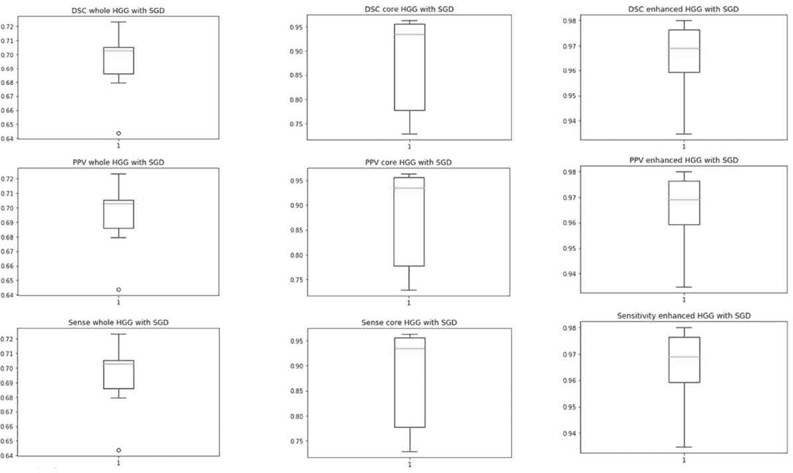

图 4.3 Dice（全肿瘤、核心、增强）、PPV（全肿瘤、核心、增强）和敏感度（全肿瘤、核心、增强）与平均 Dice、平均 PPV 和平均敏感度的箱线图。

**表 4.4 平均 Dice 值**

| 平均 Dice 全肿瘤 | 平均 Dice 核心 | 平均 Dice 增强 |
|-----------------|----------------|-------------------|
| 0.9882285534274194 | 0.9936886732750896 | 0.9993990115367384 |

### 4.6.4 阳性预测值 (PPV)

不同图像集获得的平均分数如表 4.5 所示。高 PPV 是我们模型输出确定性及其患者准确率高实用性的指标。

计算了 PPV 分数的平均值以绘制箱线图（表 4.5 和图 4.3）。

### 4.6.5 敏感度

我们在不同图像集上进行敏感度计算获得的平均分数如表 4.6 所示。我们 DenseNet 架构的高敏感度是正确诊断的患病人群百分比的一个良好衡量标准。

计算了敏感度分数的平均值以绘制箱线图（表 4.6 和图 4.3）。

**表 4.5 平均 PPV（阳性预测值）值**

| 平均 PPV 全肿瘤 | 平均 PPV 核心 | 平均 PPV 增强 |
|----------------|---------------|------------------|
| 0.9882285534274194 | 0.99368867327508% | 0.9993990115367384 |

**表 4.6 平均敏感度值**

| 平均敏感度全肿瘤 | 平均敏感度核心 | 平均敏感度增强 |
|------------------------|-----------------------|--------------------------|
| 0.9 2285534271194 | 0.9936886732750896 | 0.9993990115367384 |

## 结论

一个研究领域往往受限于或因所用工具的进步而得以发展。这使得新技术的开发和完善成为主要研究领域，从而汇聚了多位专家来评估和设计新技术。深度学习展现出了高度的通用性，使得这一快速发展的领域能够融入各种其他更传统的研究领域。医学科学就是这样一个领域，它利用深度学习工具来更好地执行诊断、信息存储，以及利用深度学习产品主要由自我进化和直观设计所提供的预测能力。在医学领域，先前的专业知识是未来假设和推断的标准，神经网络为一系列不同问题提供了最优解决方案。

胶质瘤在很大一部分人群中一直是一种普遍疾病，统计数据表明这些数字始终在上升。这种很大程度上致命的疾病的诊断和治疗需要一种能够在高精度下运行、同时又能满足时效性要求的工具。神经网络设计旨在适应人工方法可能产生的错误，并根据以往数据持续学习和发展其预测和诊断能力。

我们在 MRI 胶质瘤图像分割中使用 DenseNet 架构，获得的结果有力地支持了神经网络在医学诊断领域的性能和实用性。从我们的网络训练过程中获得的 Dice 分数值显示了非常高精度的分割能力，这与近期研究中设计和使用的其他一些神经网络架构相匹配，并超越了过去几年存在的许多其他架构。我们的敏感度值显示出极低的错误倾向和高置信度，这在处理肿瘤等危重疾病的诊断时是一个非常重要的标准，因为即使是微小的谬误也可能导致死亡或不可逆的损伤。我们架构的实用性还因其强大的阳性预测率而进一步增强，阳性预测率提供了与一般人群疾病患病率的持续比较，以提供诊断确定性的良好评分。WHO 对胶质瘤严重程度分类的标准是我们集成到算法中的另一个因素，通过分别使用高级别和低级别胶质瘤图像训练网络来实现。肿瘤定位也通过高度增强的特征来定义，以更好地辅助手术过程。

通常，神经网络需要大量的初始训练数据以实现最佳运行。我们使用的 DenseNet 架构具有通过集体重用和处理输出特征图来绕过这一问题的额外优势。我们的网络仅使用来自 20 名患者的 MRI 图像集就得到了高效训练。我们在程序中提供了不同分段和不同组织状况区域的可视化。我们的架构的训练和测试是使用 T1、T2 和 FLAIR 对比的 MRI 图像作为一个整体进行的，以在分割过程中获得和提取准确特征。我们用适当的 RGB 颜色值标注了不同的肿瘤结构，并评估了逐帧输出，以获得大脑中胶质瘤严重程度和定位的模型。我们用于观察这种分割输出的交互式软件程序为医生提供了易于使用的界面，以分析患者的状况。

## 未来展望

自 1992 年 Miller 在其综述中首次阐述以来[16]，神经网络在医学诊断中的实现已经走了很长一段路。即使该领域取得了进展，仍有必要识别其缺点，以便为未来的研究人员解决这些问题留出空间。


## 讨论与未来工作

DenseNet 提供的特征夸张也因使用密集跳跃连接而容易导致错误提取。该模型无法充分利用所有参数，而这些参数本可以通过在其他卷积网络架构上使用特征来修正。可以设计一种架构来整合这些组件，甚至基于先前的架构设计一种新颖的方法。

使用这些模型的另一个潜在问题是，这些产品由临床医生使用，而他们缺乏使用先进深度学习工具的技能。一个允许他们方便地访问和存储文件并对其执行各种操作的界面，是让神经网络在临床层面积极发挥作用的必要条件。必须设计易于使用的平台，其后端拥有经过训练可对图像进行分割和分类的网络，以提高使用能力。

我们的架构使用 MRI 图像进行训练，因为它们是胶质瘤最广泛使用的成像技术之一。但 MRI 图像已知会产生强度不均匀的图像，这会表现为生成图像像素值的各种变化。因此，可以修改架构以适应由 PET 和 CT 等其他高端成像工具生成的图像文件。本项目实现的 DenseNet 架构也可以通过在特定肿瘤图像集上训练来分割其他肿瘤。这可以使神经网络在诊断过程的不同方面发挥多样化的作用。

仍可进行修改，以进一步将胶质瘤的特定部分分类为基本的高级别和低级别之外的更细分类别。还需要整合能够处理除 MRI 设备外其他成像工具获取的胶质瘤图像的神经网络结构，为医疗专业人员提供最先进的资源，使其只需极少的专业技能即可开展工作。

## 参考文献

1. Omuro A., DeAngelis L.M. ‘Glioblastoma and Other Malignant Gliomas: A Clinical Review.’ *Jama.*; 310(17) \[2013\] 1842–1850. doi:`10.1001/jama.2013.280319`
2. Louis D.N., Holland E.C., Cairncross J.G. ‘Glioma classification: a molecular reappraisal.’ *The American journal of pathology* vol. 159,3 \[2001\]: 779–786. doi:`10.1016/S0002-9440(10)61750-6`
3. Ohgaki H., Kleihues P. ‘Epidemiology and etiology of gliomas.’ *Acta Neuropathol* \[2005\] 109, 93–108 `https://doi.org/10.1007/s00401-005-0991-y`
4. Li Sun, Songtao Zhang, Hang Chen and Lin Luo. ‘Brain Tumor Segmentation and Survival Prediction Using Multimodal MRI Scans With Deep Learning.’ \[2015\]
5. Yue Cao, Pia C. Sundgren, Christina I. Tsien, Thomas T. Chenevert, Larry Junck. ‘Physiologic and Metabolic Magnetic Resonance Imaging in Gliomas’ *Journal of Clinical Oncology* \[2006\] 24:8, 1228–1235
6. Villanueva-Meyer J.E., Mabray M.C., Cha S. ‘Current Clinical Brain Tumor Imaging’, *Neurosurgery*, 81, \[2017\], 397–415
7. El-Sayed A. El-Dahshan, Heba M. Mohsen, Kenneth Revett, Abdel-Badeeh M. Salem. ‘Computer-aided diagnosis of human brain tumor through MRI: A survey and a new algorithm’ *Expert Systems with Application* \[2014\], 5525–5545
8. Riccardo Miotto, Fei Wang, Shuang Wang, Xiaoqian Jiang, Joel T. Dudley. ‘Deep learning for healthcare: review, opportunities and challenges’ *Briefings in Bioinformatics*, Volume 19, Issue 6, \[2018\] Pages 1236–1246 `https://doi.org/10.1093/bib/bbx044`
9. Lele Chen, Yue Wu Adora, M. DSouza, Anas Z. Abidin, Axel Wismüller, Chenliang Xu. ‘MRI Tumor Segmentation with Densely Connected 3D CNN’, University of Rochester, New York \[2017\]
10. Shi Z., He L., Suzuki K., Nakamura T., Itoh H. ‘Survey on Neural Networks Used for Medical Image Processing.’ *International journal of computational science* vol. 3,1 \[2009\] 86–100.
11. Zaharchuk G., Gong E., Wintermark M., Rubin D., Langlotz C.P. ‘Deep Learning in Neuroradiology’ *American Journal of Neuroradiology*, \[2018\]
12. Jégou1 S., Drozdzal M., Vazquez D., Romero A., Bengio Y. ‘The One Hundred Layers Tiramisu: Fully Convolutional DenseNets for Semantic Segmentation’ Computer Vision Center, Barcelona. \[2017\]
13. Sérgio Pereira, Adriano Pinto, Victor Alves, and Carlos A. Silva. ‘Brain Tumor segmentation using convolutional neural networks for MRI images’ *Ieee Transactions On Medical Imaging*, VOL. 35, NO. 5, \[2016\]
14. Zhao X., Wu Y., Song G., Li Z., Fan Y., Zhang Y. ‘Brain tumor segmentation using a fully convolutional neural network with conditional random fields’ MICCAI, Athens, Greece, October 17, 2016, 75-87 \[2016\].
15. Kamnitsas, K., Ledig, C., Newcombe, V. F. J., Simpson, J. P., Kane, A. D., Menon, D. K., Rueckert, D., Glocker, B. ‘Efficient multi-scale 3d CNN with fully connected CRF for accurate brain lesion segmentation’ *Medical Image Analysis* 36, 61–78 \[2017\].
16. Trevethan, Robert. “Sensitivity, Specificity, and Predictive Values: Foundations, Pliabilities, and Pitfalls in Research and Practice.” *Frontiers in public health* vol. 5 307. 20 Nov. 2017, doi:`10.3389/fpubh.2017.00307`
17. Miller A.S., Blott B.H., Hames T.K. ‘Review of neural network applications in medical imaging and signal processing’. *Med Biol Eng Comput.* \[1992\] Sep; 30(5):449–464.
18. Gao Huang, Zhaung Liu, Killian Q. Weinberger, Laurens van der Maaten. “Densely connected convolutional networks”, *Ieee Explore* – \[2018\]
19. Jean Stawiaski1. “A pre-trained Dense-net encoder for brain tumor segmentation.”, 19 Nov 2018
20. Ashia C. Wilson, Rebecca Roelofs, Mitchell Stern, Nathan Srebroy, Benjamin Recht. “The Marginal Value of Adaptive Gradient Methods in Machine Learning.”, University of California Berkeley \[2016\]
21. Hao Dong, Guang Yang, Fangde Liu, Yuanhan Mo, Yike Guo. “Automatic Brain Tumor Detection and Segmentation Using U-Net Based Fully Convolutional Networks”, *Data Science Journal of London*\-2017.
22. B. Menze et al. “The multimodal brain tumor image segmentation benchmark (BRATS),” *IEEE Trans. Med. Imag.*, vol. 34, no. 10, \[2015\] pp. 1993–2024.
23. Martin Kolarˇík, Radim Burget, Václav Uher, Kamil R. íha, Malay Kishore Dut. “Optimized high resolution 3D Dense-U-NET network for brain and spine segmentation”, *MDPI applied sciences* January 2019.

# 5 基于 2D 和 3D 深度神经网络的计算机断层扫描图像自动肝脏肿瘤分割

William Tustumi, Guilherme P. Telles and Helio Pedrini

计算机学院，坎皮纳斯大学，坎皮纳斯-SP 13083-852，巴西

## 摘要


## 肝脏肿瘤分割

肝脏肿瘤分割是指基于计算机断层扫描体积数据，在肿瘤与健康组织之间进行体素分类的过程。医学图像采集方法质量的不断提高，使得疾病的识别、定位和诊断成为可能，从而避免了高度侵入性的手术。这种分析对于决定患者最合适的治疗方案至关重要。特别是肿瘤分割，用于评估肿瘤切除的可行性，并有助于制定手术方案。当由人工执行时，肿瘤受影响区域的分割过程需要医学专家投入大量时间和经验，因为这涉及为断层扫描的每一层切片创建肿瘤掩膜。当患者身处医疗资源匮乏、远离专业医疗服务的地区时，这项任务尤具挑战性。传统上，为了加速和简化 CT 扫描的分割，提出了两类方法：一种完全自动，另一种基于人工干预。在本工作中，我们专注于肝脏肿瘤分割的全自动技术。尽管卷积神经网络在图像分割和分类领域取得了显著成果，但断层扫描体积的分割带来了新的挑战，例如空间关系维度的引入、图像提取产生的伪影以及用于训练的样本数量有限。在我们的研究中，我们探讨了计算资源与分割质量之间的权衡。最初，我们分析了多个卷积网络的性能，并遵循 EfficientNet 平衡模型测试了不同网络的层。随后，我们将层扩展为三维卷积，并测试了分别处理体积各维度的层。最后，我们在处理和内存受限的设备上评估了我们模型的执行时间。尽管与文献中的其他方法相比，我们的模型在有效性方面结果略逊一筹，但其在受限计算环境下的运行被证明是可行的。实验是在肝脏肿瘤分割挑战赛数据库上进行的。

## 5.1 绪论

过去几十年来，医学图像采集技术取得了显著进步，从胶片图像过渡到数字图像，这使得更高分辨率和三维（3D）成像成为可能。多年来，开发出了多种允许区分内部组织的方法，包括计算机断层扫描（CT）、胸部 X 射线、磁共振成像和超声成像。

2020 年，癌症是全球大多数国家的第一或第二大死因，造成约 1000 万人死亡。虽然肝癌不在五大最常见癌症之列，但它是第三大致死性癌症，估计死亡人数达 83 万（[Sung et al. [2020]](#ch5.xhtml#ref5_31)）。

鉴于其对全球健康的影响，大量投资被用于该类疾病的治疗、诊断和检测。然而，富裕国家和贫穷国家可用资源之间存在差异：90% 的高收入国家报告有治疗服务，而低收入国家拥有这些服务的比例不足 30%。此外，约 70% 的癌症死亡发生在低收入和中等收入国家。

通常，原发肿瘤位于腹部并转移至肝脏。因此，在诊断乳腺癌、胰腺癌和结肠癌时，常规会分析肝脏和肝脏病变。肝脏肿瘤图像分割的结果对于规划、诊断和监测治疗反应时间至关重要。它也是热经皮消融（[Rossi et al. [1996]](#ch5.xhtml#ref5_30)）、经皮乙醇注射（[Livraghi et al. [1995]](#ch5.xhtml#ref5_25)）和放疗手术切除（[Albain et al. [2009]](#ch5.xhtml#ref5_1)）等治疗的重要资源。然而，可用专家的数量不足以覆盖所有需求患者，特别是在偏远地区和欠发达国家。此外，CT 扫描的手动分割过程成本高昂、耗时、难以复现，且高度依赖人类专家（[Bilic et al. [2019]](#ch5.xhtml#ref5_2)）。

由于分割过程存在这些限制，可用于训练该问题机器学习模型的标注数据集，与深度学习模型已超越人类准确度的更广泛图像分割问题所用的数据集相比，相对较少。除了有限的数据集，每个 CT 扫描中的感兴趣区域仅占总体积的一小部分，这造成了类别分布不平衡，可能会使分类模型产生偏差。

本工作旨在利用深度神经网络（DNN）从 3D CT 图像中开发一种肝脏肿瘤自动分割方法。DNN 在皮肤病变分割（[Tang et al. [2019]](#ch5.xhtml#ref5_33), [Tschandl et al. [2019]](#ch5.xhtml#ref5_35), [Xie et al. [2020]](#ch5.xhtml#ref5_39)）、脑肿瘤分割（[Chen et al. [2020]](#ch5.xhtml#ref5_3), 2019, [Wang et al. [2019]](#ch5.xhtml#ref5_36) a）以及肝脏肿瘤分割（[Han [2017]](#ch5.xhtml#ref5_11), [Li et al. [2018]](#ch5.xhtml#ref5_23), [Wang et al. [2019]](#ch5.xhtml#ref5_38) b）方面均已取得有希望的结果。我们以 [Han [2017]](#ch5.xhtml#ref5_11) 提出的架构为基线，随后研究并扩展了新方法的适用性，例如深度与宽度平衡（[Tan and Le [2019]](#ch5.xhtml#ref5_32)）、三维卷积层（[Milletari et al. [2016]](#ch5.xhtml#ref5_28)）、可分离卷积层（[Howard et al. [2017]](#ch5.xhtml#ref5_16)）和级联架构（[Li et al. [2017]](#ch5.xhtml#ref5_22)）。

本文组织结构如下。第 5.2 节 和 5.3 节 描述与研究主题相关的相关概念和工作。第 5.4 节 展示本工作提出的方法论。第 5.5 节 描述并讨论我们的实验结果。第 5.6 节 包含我们的总结性评论。

## 5.2 相关概念

在本节中，我们简要描述与计算机断层扫描体积采集、图像预处理和分割、数据增强以及神经网络相关的基本概念，这些是理解后续研究章节所必需的。

### 5.2.1 分割

图像分割是划定图像中物体边界的过程（[Gonzalez et al. [2004]](#ch5.xhtml#ref5_9), [Le et al. [2021]](#ch5.xhtml#ref5_21), [Meng et al. [2021]](#ch5.xhtml#ref5_27)）。分割问题是定位和检测问题的扩展，因为它们的响应可以直接从分割解中提取。

分割通常结合不同的图像特征以实现成功的解决方案。许多分割算法通过搜索模式不连续性和像素相似性来寻找物体边界。然而，其中大多数依赖于图像类型和特征，这使得难以复用不同问题的解决方案。

图像分割的概念可以扩展到体积分割，其中物体的定界不再由像素的边界决定，而是由体素的边界决定。

### 5.2.2 计算机断层扫描


## 5.2 卷积技术

### 5.2.1 CT 扫描与 Hounsfield 单位

Hounsfield 1973 开发了计算机断层扫描（CT）技术。该过程可生成单位体积 X 射线衰减值的精确 3D 分布，从而通过轴向切片投影实现反 Radon 变换。采用多切片技术的现代扫描仪，可根据感兴趣区域所需的细节程度，实现每切片小于 `1 mm` 的分辨率（Toennies [2017]），这远优于 CT 早期通常高于 `5 mm` 的切片厚度。

来自 CT 体积的衰减值被归一化为 Hounsfield 单位（`HU`）刻度，使其独立于 X 射线能量输出。归一化公式如 eqn (5.1) 所示。

(5.1)

```
HU(µ) = 100 * (µ - µ_water) / (µ_water - µ_air)
```

其中 `µ_air` 和 `µ_water` 分别为空气和水的线性衰减系数。

`HU` 值通常范围从 `−1000` 到 `3000`。空气、脂肪和水的衰减值差异显著，而不同软组织之间的差异较小，这使得它们的分类更加困难。表 5.1 列出了不同材料和人体组织的 `HU` 值。

**表 5.1 不同材料和人体组织的 Hounsfield 单位（HU）值。数值摘自 Toennies [2017]**

| 材料/组织 | Air | Fat | Water | Blood | Muscle | White Matter | Grey Matter | Bone |
| --- | --- | --- | --- | --- | --- | --- | --- | --- |
| HU 值 | –1000 | –100 | 0 | 30–45 | 40 | 20–30 | 37–45 | >150 |

### 5.2.3 3D 卷积

卷积是将卷积矩阵（核）加权应用于图像每个像素邻域的过程。3D 卷积是 2D 卷积针对体积数据的自然扩展。虽然 2D 卷积滤波器具有四个维度（高度、宽度、输入通道和输出通道），但 3D 卷积滤波器具有五个维度，在宽度后增加了一个深度维度。这个新维度为滤波器运动增加了一个 `z` 轴。增加的维度使得捕捉新创建轴上特征之间的关系变得简单直接，但也增加了模型的计算成本。因此，许多模型选择使用 2.5D 方法：搭配 2D 卷积的体积数据，其中深度维度映射到输入滤波器。图 5.1 展示了 2D 卷积和 3D 卷积的区别。


### 5.2.4 可分离卷积

可分离卷积分为两类：空间可分离卷积和深度可分离卷积。前者作用于空间维度；在图像情况下，它分离核的宽度和高度，如 图 5.2 所示。后者将卷积分离为空间聚合和特征组合；在图像情况下，第一个滤波器保持其原始宽度和高度，而第二个滤波器是一个 `1×1` 滤波器，将特征数量转换为所需的输出。图 5.3 说明了卷积过程。


深度可分离卷积是更高效神经网络架构的基础，因为它们在不降低表达能力的情况下减少了计算量和参数量。空间可分离卷积不具备这一特性，它们只能表示由可分离滤波器组成的核类型。

深度可分离卷积将卷积分解为组卷积和逐点卷积。组卷积保持特征图数量不变并转换空间维度。逐点卷积使用步长为 `1` 的 `1×1` 核，转换通道数但保持空间维度不变。

从 表 5.2 可以得出结论：对于通常的小 `k` 值，常规卷积的扩展性最差，深度可分离卷积的扩展性优于空间可分离卷积。

**表 5.2 不同 2D 卷积的参数数量表达式，其中 `k` 是核大小，`c[i]` 是输入通道数，`c[o]` 是输出通道数**

| 卷积类型 | 参数数量 |
| --- | --- |
| 常规卷积 | `k² * c[i] * c[o]` |
| 空间可分离卷积 | `2 * k * c[i] * c[o]` |
| 深度可分离卷积 | `k² * c[i] + c[i] * c[o]` |

### 5.2.5 深度时空分离

深度时空分离（`DSTS`）模块由 Zhang et al. [2019a] 提出，将 3D 卷积分离为两个分支：时间分支和空间分支。两个分支均使用深度卷积，但采用不同的滤波器。时间侧使用 `3 × 1 × 1` 大小的滤波器，空间侧使用 `1 × 3 × 3` 大小的滤波器。逐点卷积在拼接后组合特征。

图 5.4 显示了 `DSTS` 模块的示意图。除了强制网络在每个分支学习不同的关系外，分离还有一个额外的好处：减少参数数量和计算成本。参数数量从具有核大小 `3` 的普通 3D 卷积的 `27*c²` 减少到 `c² + 12*c`，其中 `c` 是层中的通道数。


图 5.4 深度可分离时空模块示意图。图中，BN 是批量归一化模块，有助于网络的稳定性并提高训练速度；ReLU 是修正线性单元激活函数，为卷积序列增加非线性。

### 5.2.6 U-Net

U-Net 是一种卷积神经网络（CNN），旨在分割生物医学图像，它通过一次性创建完整的分割掩码，而不是一次对图像的小块进行分类，从而提高了以往分割方法的准确性和训练速度。它还极大地受益于 5.4.3 节 中解释的数据增强，因此可以在小数据集上进行训练（Ronneberger 等人，2015）。

图 5.5 展示了 U-Net 模型的示意图。架构的左侧缩小图像尺寸并增加其深度（编码器），而右侧扩展图像以创建分割图（解码器）。水平蓝色箭头代表模型中的跳跃连接，将编码器的前几层与解码器相结合。各层通过拼接算子结合，该算子只是沿通道维度追加特征图。

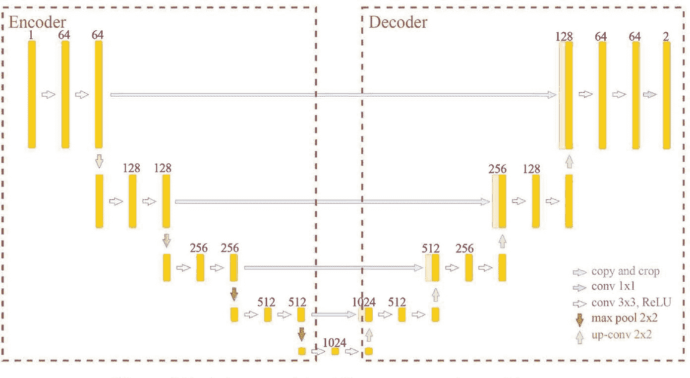

图 5.5 U-Net 分割架构示意图。

### 5.2.7 EfficientNet

Tan 和 Le，2019 观察到，在深度、宽度和分辨率之间取得平衡的模型，比仅偏重这三个系数中任意一个的模型，能在相同计算成本下达到更高的准确性。考虑到这一点，他们提出了一种复合缩放方法，在给定目标计算约束的情况下平衡这三个系数。在他们的实验中，他们选择浮点运算数（`FLOPs`）来确定模型大小，并用 `ImageNet` 上的准确率来衡量其性能。

基线系数是通过以 400M `FLOPs` 为目标的网格搜索发现的。值得注意的是，网络深度的缩放因子是线性的，而宽度和分辨率的缩放因子是二次方的。换句话说，将网络深度加倍会使 `FLOPs` 数量加倍，而将宽度或分辨率加倍则会使 `FLOPs` 数量增加四倍。基础模型采用来自 Howard 等人，2017 的移动端反向瓶颈，结合来自 Hu 等人，2018 的挤压激励模块作为构建块。

### 5.2.8 损失函数

损失函数指导学习方法内部权重的更新方式。它可以根据期望输出与预测输出的差异来构建，也可以基于输出必须呈现的期望特征来构建。前者只能用于监督训练，而后者用于无监督训练或作为监督训练的互补损失。用于图像分割架构的最常见损失函数是加权交叉熵（`WCE`）、Dice 距离和 Jaccard 距离。

Dice 距离和 Jaccard 距离非常相似，因为两者都源自用于衡量分割质量的指标。Dice 距离基于 Sørensen-Dice 系数，而 Jaccard 距离基于 Jaccard 指数。Dice 系数等于集合 `Y` 和 `Ŷ` 交集大小的两倍除以两个集合元素总和之和：

$$Dice = \frac{2 \cdot \left| {Y \cap \hat{Y}} \right|}{\left| Y \right| + \left| \hat{Y} \right|}$$

为了将 Dice 公式作为神经网络监督训练的损失函数使用，有必要调整其公式，因为该函数最初是为处理离散数据而提出的。以下方程是为最小化问题调整后的 Dice 损失函数，允许梯度反向传播：

$$Dice\ distance = 1 - \frac{2 \cdot {\sum\limits_{i = 1}^{N}{y_{i} \cdot {\hat{y}}_{i}}}}{\sum\limits_{i = 1}^{N}{{\hat{y}}_{i}^{2} + {\hat{y}}_{i}^{2}}}$$

### 5.2.9 评价指标

我们在以下章节介绍用于评估分割性能的指标；选择这些指标是因为它们是图像分割的标准指标，并被用于肝脏肿瘤分割挑战赛（LiTS）的性能比较。

#### 5.2.9.1 重叠指标

基于重叠的方法可以确定预测分割中的体素是否出现在真实分割中。另一方面，它们无法计算存在于一个集合而不存在于另一个集合中的体素之间的距离。

Dice 相似性系数：Dice，1945 提出了一种量化两个集合匹配度的指标。许多其他研究者采用该指标来评估医学分割的性能。Dice 指标比较预测掩码与专家手工分割之间的重叠比率。

给定两个体素集合 `A` 和 `B`，其中 `A` 表示肝脏肿瘤的预测分割，`B` 表示肝脏肿瘤的真实分割，我们可以通过公式 (5.2) 计算 Dice 相似性系数，其中 `|A ∩ B|` 是两个集合的交集大小，`|A|` 和 `|B|` 分别是各自集合的大小：

(5.2)

$$Dice\left( {A,B} \right) = \frac{2 \cdot \left| {A \cap B} \right|}{\left| A \right| + \left| B \right|}$$

Jaccard 体积重叠误差：两个集合的 Jaccard 相似性系数（Jaccard，1901）定义为它们的交集大小与并集大小之比。

Jaccard 体积重叠误差（`VOE`）是 Jaccard 系数的补数。使用 `A` 和 `B` 作为与 Dice 相似性系数相同的集合对，`VOE` 可以用 `A` 和 `B` 表示，如公式 (5.3) 所示：

(5.3)

$$VOE = 1 - \frac{\left| {A \cap B} \right|}{\left| {A \cup B} \right|}$$

可以观察到 `VOE` 测量两个集合之间的差异，因此相似的集合具有较低的 `VOE` 值，这与 Dice 相似性系数相反。

表面距离指标：在描述多个基于表面距离的指标之前，引入一些重要概念很重要。设 `x` 为一个体素与一组体素 `Y` 之间的距离，定义为

(5.4)

$$distance\left( {x,Y} \right) = \min\limits_{\forall y \in Y}distance\left( {x,y} \right)$$

公式 (5.4) 中的函数 `distance` 是体素 `x` 和 `y` 坐标之间的欧氏距离。设 `B[A]` 为 `A` 边界中所有体素的集合，`B[B]` 表示 `B` 边界中所有体素的集合。

基于表面距离的指标仅考虑属于分割表面的体素。这一特性可能会掩盖那些不使分割表面变形的大体积误差。

平均对称表面距离：平均对称表面距离（`ASSD`）指标计算 `B[A]` 中所有体素到 `B[B]` 以及 `B[B]` 中所有体素到 `B[A]` 的平均距离。该指标给出了边界在其整个延伸范围内有多接近的总体概念。然而，由于其对异常值的鲁棒性，它掩盖了任何孤立的 δ 错误。由于单个距离上的变化 δ 与分布在所有距离上的 $\frac{\delta}{\left| B_{A} \right| + \left| B_{B} \right|}$ 变化具有相同的效果，因此，较大的表面在 `ASSD` 值上具有较小的变化：

(5.5)


$$ASSD = \frac{1}{\left| B_{A} \right| + \left| B_{B} \right|} \cdot \left\lbrack {\sum\limits_{x \in B_{A}}{dis\tan ce\left( {x,B_{B}} \right)}} + {\sum\limits_{y \in B_{b}}{dis\tan ce\left( {y,B_{A}} \right)}}} \right\rbrack$$

最大对称表面距离：由于 ASSD 指标无法检测罕见的分割错误，最大对称表面距离 (MSSD) 对此类错误敏感，这使它们成为互补指标：

(5.6)

$$MSSD = \max\limits_{\forall x \in B_{A}}\left( {dis\tan ce\left( {x,B_{B}} \right)} \right)$$

## 5.3 相关工作

[Han [2017]](#ch5.xhtml#ref5_11) 在 2017 年 IEEE 生物医学成像国际研讨会上赢得了 LiTS 挑战赛。所提出的解决方案使用了两个全卷积神经网络 (FCNN)，分别具有来自 U-Net (Rormeberger *et al.* [2015]) 的长程捷径连接和来自 ResNet ([He *et al.* [2016]](#ch5.xhtml#ref5_12)) 的短程残差连接。第一个网络创建肝脏的粗略分割，用于将第二个网络采用的切片数量限制在肝脏分割内的切片范围内。然后第二个网络创建肝脏的精细分割和病灶分割。

作者决定使用 2D 卷积以减少处理和内存资源，利用体素间的 *z* 轴关系。使用五个切片来预测中间的切片。这种方法被称为 2.5D 卷积网络，因为它仍然考虑体积关系，但使用 2D 滤波器。作者通过对切片进行欠采样来解决切片间间距差异的问题，使每个体积的间距为 1 mm × 1 mm × 2.5 mm。欠采样方法仅用于第一个网络，而第二个网络接收原始间距的输入，因为关键信息可能会因欠采样而丢失。

网络通过随机梯度下降训练了 50 个 epoch，在单张 NVIDIA TitanX GPU 上每个网络耗时 4 天。每个预测切片需要 0.2 秒进行处理。代码基于 Caffe 框架实现。模型拥有 2400 万参数。该解决方案在 LiTS 基准测试的病灶肿瘤分割任务中获得了 0.67 的全局 Dice 系数、0.45 的体积重叠误差 (VOE) 分数、6.660 的平均对称表面距离 (ASSD) 和 57.930 的最大对称表面距离 (MSSD)。

[Yuan [2017]](#ch5.xhtml#ref5_40) 在 2017 年医学图像计算与计算机辅助干预国际会议 (MICCAI) 的 LiTS 2017 基准测试中，在不同指标上获得第五名。所提出的解决方案包含三个步骤：肝脏定位、肝脏分割和肿瘤分割。肝脏定位使用一个包含 19 层和 230,129K 参数的小型全卷积神经网络 (FCNN)。定位步骤使用 128 × 128 像素的切片，并将切片欠采样至 3 mm 厚度，以创建用于下一步的粗略分割。

肝脏分割步骤通过在上一步粗略分割的各个方向扩展 10 个体素来创建感兴趣体积。采样频率增加，使层间间距为 2 mm。此外，分辨率扩展至 256 × 256 × 256。此步骤使用的网络更为复杂，拥有 500 万参数和 29 层。

肿瘤分割步骤使用与肝脏分割阶段相同的网络；然而，使用原始切片间距以避免因图像模糊而遗漏小病灶。训练期间，仅使用包含肿瘤的切片进行训练，以减少计算时间。作为后处理，使用滤波器丢弃预测肝脏掩膜外的任何肿瘤。最终的肝脏肿瘤掩膜是六个模型类 bagging 集成的结果。使用的损失函数是 Jaccard 距离。

网络使用 Adam 优化器训练，肝脏定位和分割在单张 NVIDIA GTX 1060 GPU 上耗时 1.57 天，肿瘤分割耗时 8.518 天。每个测试用例平均预测耗时 33 秒。模型基于 Theano 实现，使用 3600 万参数。该解决方案在 LiTS 2017 基准测试的病灶肿瘤分割任务中获得了 0.82 的全局 Dice 系数、0.657 的逐例 Dice 系数、0.378 的 VOE 分数、1.151 的 ASSD 和 6.269 的 MSSD。

[Li *et al.* [2018]](#ch5.xhtml#ref5_23) 在 2017 年 MICCAI 挑战赛结束后，在 LiTS 2017 基准测试上提高了分割性能。所提出的方法结合使用传统的 2D 和 3D 卷积及混合特征融合层，以利用切片内和切片间特征。网络的基本构建块使用密集连接卷积，以逐步扩展通道数量并改善所有紧密连接层之间的信息流。模型使用 2D ResNet 创建粗略肝脏分割，并将其作为输入送入 2D DenseUNet 和 3D DenseUNet。两个 DenseUNet 均创建特征图，它们被组合后送入混合特征融合模块，生成最终的肝脏和肿瘤分割。采用的损失函数为加权交叉熵；类别权重通过经验测试确定。

网络使用随机梯度下降训练，2D DenseUNet 在 2 块 NVIDIA Xp GPU 上耗时 21 小时，3D DenseUNet 耗时 9 小时。每个测试用例耗时 30 至 200 秒。代码基于 TensorFlow 实现，模型拥有 1.14 亿参数，在 LiTS 2017 基准测试上实现了 0.824 的全局 Dice 系数和 0.722 的逐例 Dice 系数。

Zhang *et al.* [2019a] 提出了一种基于深度可分离卷积和空间可分离卷积的高效混合卷积模型。最初，他们引入了一个时空分解模块来替代传统的 3D 卷积。该模块在 第 2.5 节 中进行了解释。该模型是混合的，因为它使用 2D 卷积提取低层特征，然后在更深层使用 3D 卷积以减少计算量，同时保留来自 3D 卷积的空间连接。编码器的输出块是一个深度可分离时空空洞空间金字塔池化 (DST-ASPP)，改编自 Chen *et al.* [2017 a] 和 Chen *et al.* [2017 b]。DST-ASPP 结构用于结合多范围特征以计算分割输出。使用的损失函数是交叉熵和多标签 Dice 的组合。

网络使用 Adam 优化器训练，在 NVIDIA Tesla P100 上训练耗时 24 小时。每个测试用例运行时间为 10-80 秒。模型拥有 360 万参数，在 LiTS 2017 基准测试上实现了 0.730 的逐例 Dice 和 0.820 的全局 Dice。

Wang *et al.* [2019 b] 提出的模型基于 Mask R-CNN ([He *et al.* [2017]](#ch5.xhtml#ref5_13)) 架构。该模型在图像中感兴趣的目标周围生成边界框，然后在这些补丁中执行分类和分割。Wang *et al.* [2019 b] 所开发工作的主要贡献是引入注意力模块以生成特征图。注意力模块分为空间注意力和通道注意力。通道注意力类似于 [Hu *et al.* [2018]](#ch5.xhtml#ref5_17) 的 SE 模块，而空间注意力受 [Wang *et al.* [2018]](#ch5.xhtml#ref5_37) 工作的启发。该模型在 LiTS 2017 基准测试上实现了 0.741 的逐例 Dice 分数和 0.813 的全局 Dice 分数。作者的工作未提及硬件规格和模型训练耗时。

## 5.4 方法论


### 肝肿瘤分割解决方案

图 5.6 展示了我们解决方案的高层图示。该方法分为肝脏分割和肿瘤分割两个阶段。在第二阶段，第一阶段生成的掩码被用来使模型聚焦于体积数据的重要区域。我们在 5.4.1 节–5.4.8 节 中详细解释了每个阶段。

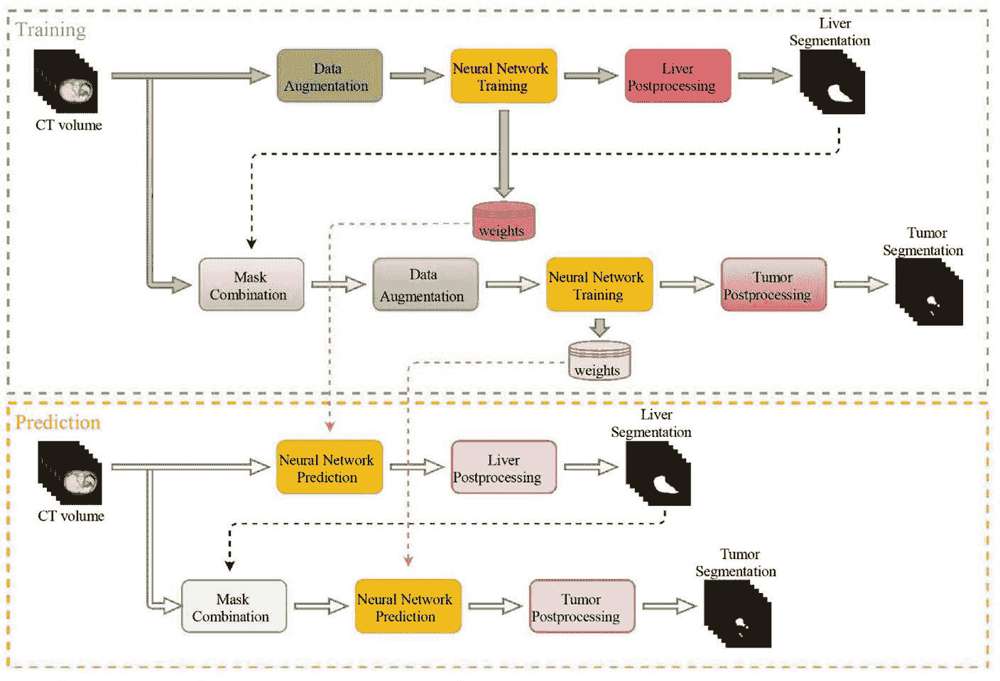

图 5.6 肝肿瘤分割概览图。

图 5.6 展示了我们解决方案的高层图示，该方案由两个阶段组成：(i) 训练阶段，我们在该阶段校准网络权重，在图中由蓝色虚线矩形标出；(ii) 预测阶段，我们在该阶段生成掩码预测，在图中由橙色虚线矩形标出。我们的模型有两条流水线：一条生成肝脏分割，另一条生成肿瘤分割。肝脏流水线的结果与断层扫描体积数据相结合，以创建肿瘤流水线的输入。

### 5.4.1 数据归一化与压缩

我们将 CT 体积数据的 HU 值限制在 `` `heume 200` `` 范围内，以消除与病变或肝脏分割无关的材料带来的噪声。限制操作会从体积数据中移除所有金属、骨骼和空气。我们将数值转换为 32 位浮点数，并应用最小-最大归一化将数值限制在 0 到 1 的范围内，这通常能改善模型收敛时间并避免浮点精度错误。

然后，我们将 CT 体积数据和真实标签一起压缩到 `NpzFile` 中，以减少磁盘空间占用。我们还将体素间距和体积维度作为元数据添加到压缩文件中。

### 5.4.2 批次采样

我们采用了两种不同的方法来生成样本，一种用于由 2D 卷积组装的模型，另一种用于由 3D 卷积组装的模型。每个样本包含两个分量：来自 CT 体积的轴向切片和来自真实标签掩码的轴向切片。

考虑 `CT[s[k]]`，即 `CT` 体积中索引为 `[Skin]` 的切片，`GT[s[k]]` 为真实标签中索引为 `s[k]` 的切片，`CT[s[i] : s[j]]` 为 CT 体积中索引从 `s[i]` 到 `s[j]` 的切片，`GT[s[i] : s[j]]` 为真实标签中索引从 `s[i]` 到 `s[j]` 的切片。假设我们使用第一种方法对 CT 体积中索引为 `s` 的切片进行采样。则样本的 CT 体积分量为 `CT[s[k] — w : s[k] + w]`，真实标签分量为 `GT[s[k]]`，其中 `w ∈ ℕ+`。如果我们对切片块 `CT[s[i] : s[j]]` 使用第二种采样方法，则样本的 CT 体积分量为 `CT[s[k] — w : s[i] + w]`，真实标签分量为 `GT[s[i] : s[j]]`，其中 `w = (s_i - s_k) / 2`。

批次生成器在训练期间每个周期对每个指定用于训练的切片采样一次。采样方法包括以下步骤：随机选择一个体积；以随机顺序使用该体积中的每个切片；选择另一个在当前周期未被选中的体积。这种方法允许适当的磁盘访问，同时不损害批次生成器的随机采样特性。

### 5.4.3 数据增强

数据增强过程仅在训练阶段使用。我们使用几何变换和强度变换进行数据增强。应用的几何变换类型包括：旋转、翻转、缩放、平移、剪切和弹性变换。我们使用微小的随机强度扰动作为唯一的强度变换方法。

我们限制几何变换的幅度，因为模型受益于位置和结构信息。我们保持微小的强度扰动，以防止体素被感知为不同材料。表 5.3 显示了每种变换使用的参数。弹性变换仅在 10% 的图像上执行。

表 5.3 旋转和剪切范围单位为度，平移范围单位为像素，随机强度噪声范围使用归一化后的强度值度量，但范围小于 2 HU，缩放范围以原始图像尺寸的百分比衡量

| 变换 | 范围 |
| --- | --- |
| 旋转 | [–15, 15] |
| 剪切 | [–10, 10] |
| 平移 | [–16, 16] |
| 随机强度噪声 | [–0.5, 0.5] |
| 缩放 | [–12.5, 12.5] |

### 5.4.4 神经网络架构

实验中使用的所有架构均可分为五个模块：stem（茎干）、encoder（编码器）、head（头部）、decoder（解码器）和 output（输出）。图 5.7 展示了各模块之间的连接。stem 模块负责降低输入维度并调整特征数量。它还在降低输入维度之前创建了到输出模块的快捷连接。

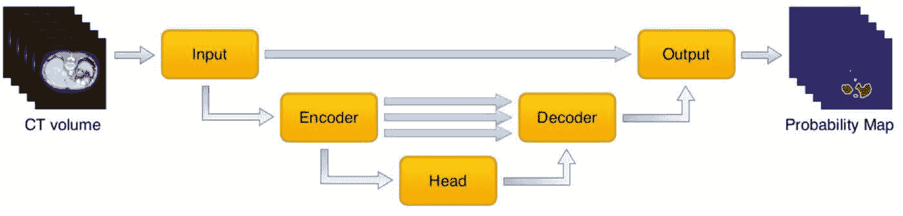

图 5.7 网络架构图，灰色箭头显示主数据流，蓝色箭头代表快捷连接。

encoder 模块是模型中最复杂的部分。它负责从体积数据中提取和聚合特征，使后续模块能够生成分割掩码。我们的 encoder 模块基于 `EfficientNet` 架构，详见 5.2.7 节。我们在 encoder 的下采样层和 decoder 模块的上采样层之间添加了快捷连接，以促进不同表示层级之间的信息流动，这有助于缓解因降维导致的空间信息丢失（Rormeberger *et al.* [2015]）。

head 模块通常将 encoder 的输出映射到所需的输出空间。在我们的模型中，head 模块连接 encoder 模块和 decoder 模块。decoder 模块将特征图扩展到原始体积大小。output 模块使用 `softmax` 函数将特征图转换为概率图，以生成每个体素的分割概率。

## 5.4.5 EfficientNet 修改

`EfficientNet` 的开发旨在在 `ImageNet` 数据集的图像分类问题中实现性能与资源使用的平衡。肝脏分割任务与图像分类问题有许多共同特征。然而，每个问题都有其独特之处；考虑到这一点，我们对 `EfficientNet` 架构提出了修改，以针对我们的问题进行优化。

第一项修改是我们的输入方法，它接收来自 CT 体积的九个切片序列。原始架构使用 `RGB` 图像，而在我们的网络中，输入转换由开头的 stem 模块完成。网络从输入中生成单个概率图，对应于中间切片的分割。

`EfficientNet` 使用 `MobileNet-V2` 的倒残差层作为其主要构建块，因为当时 `MobileNet-V2` 在每可训练变量的准确率方面属于最先进水平。然而，此后已提出了不同的模型，在保持相同准确率水平的同时减少了资源使用，包括 `MobileNet` 的新版本。我们选择了 `ShuffleNet-V2` ([Ma *et al.* [2018]](#ch5.xhtml#ref5_26)) 和 `MobileNet-V3` ([Howard *et al.* [2019]](#ch5.xhtml#ref5_15)) 中提出的模块，作为我们 encoder 架构中倒残差层的可能替代品。


改善体积数据空间特征连通性的一种自然方法是使用 3D 卷积。[Köpüklü *等* [2019]](#ch5.xhtml#ref5_20) 已经利用 `MobileNet-V1`、`MobileNet-V2`、`ShuffleNet-V1`、`ShuffleNet-V2` 和 `SqueezeNet` 的 3D 卷积版本遵循了这一思路，取得了令人满意的结果，尽管他们的研究侧重于动作识别。

为了使我们的模型适应 3D 卷积，我们将输入调整为接收八个切片，并输出四个切片的概率图。图 5.8 展示了 2D 和 3D 输入的网络架构图。这样做是为了保证每个概率图都有足够数量的邻近切片以提取信息。

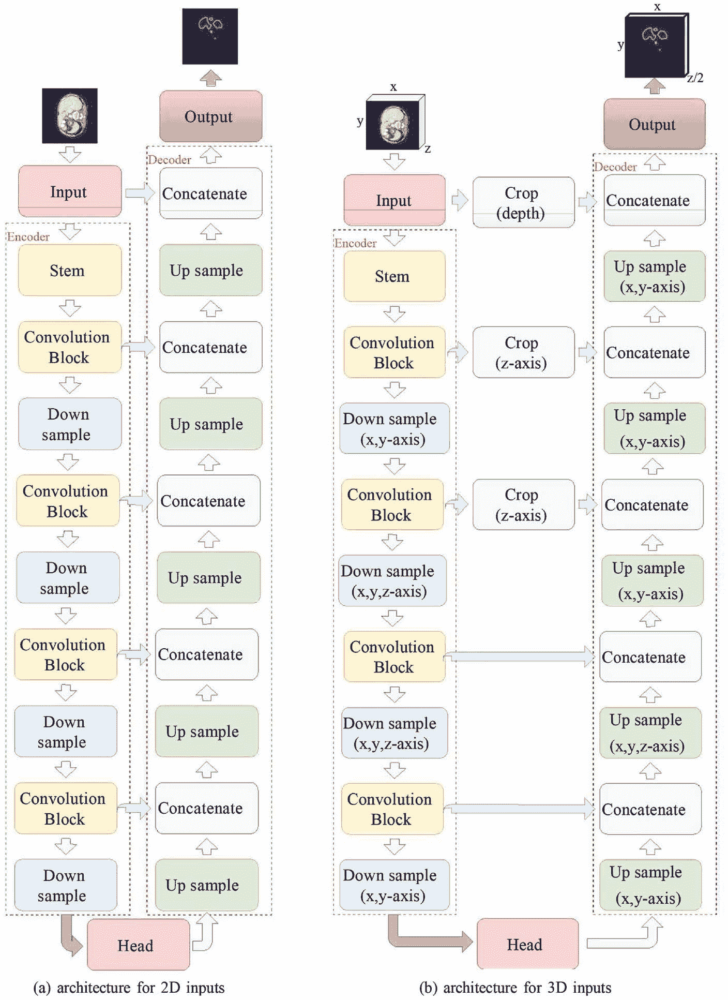

图 5.8 编码器和解码器块中网络架构的扩展图。

我们通过仅在第一次和第三次重缩放中对 `z` 轴执行降维，以及仅在解码器的第一次重采样中对 `z` 轴执行上采样，实现了期望的输入和输出。快捷连接在编码器侧被裁剪为期望大小以适配解码器。

### 5.4.6 肝脏后处理

我们将所有输出切片拼接以生成体积概率图，这使我们能够通过简单的阈值方法确定体素分类。这生成了我们肝脏预测的体积掩码，该掩码可结合连通分量查找算法使用，从而找到最大连通分量并将其分类为肝脏，进而消除可能出现的大多数小的假阳性。

### 5.4.7 掩码组合

我们使用上一阶段找到的肝脏掩码来缩小肿瘤分割的感兴趣体积。有许多方法可以组合输入体积和肝脏掩码。所选方法使用肝脏掩码对 CT 体积进行掩膜处理，有效地移除了任何不被视为肝脏的组织。选择此方法是因为其简单性，且不会增加模型的输入尺寸。

### 5.4.8 肿瘤后处理

我们使用与肝脏后处理步骤相同的方法来创建概率图体积和连通分量。然而，我们不只选择最大的分量，而是消除所有分量中体素为肿瘤的最高概率低于阈值的分量。

### 5.4.9 网络训练

训练网络通常是一个非常耗时且敏感的过程，这可能会降低模型性能。考虑到这一点，我们采用了现代技术来减少训练时间、提高模型稳定性并减少过拟合。

我们选择的优化器是 `RAdam` ([Liu *等* [2019]](#ch5.xhtml#ref5_24))，这是一种基于常用 `Adam` ([Kingma and Ba [2014]](#ch5.xhtml#ref5_19)) 优化器的随机自适应算法。`RAdam` 修正其自适应学习率以稳定其方差，从而防止模型收敛到有偏/不良的局部最优。`RAdam` 的作者基于在高性能网络中观察到的改进提出了他们的想法，这些网络在几次迭代中逐渐增加学习率，然后达到期望的学习率并恢复其默认训练计划。这种技术称为线性预热 ([Goyal *等* [2017]](#ch5.xhtml#ref5_10))，旨在在不使网络倾斜的情况下稳定自适应学习率。我们选择结合 `RAdam` 使用线性预热，因为开发 `RAdam` 的作者 [Liu *等* [2019]](#ch5.xhtml#ref5_24) 并未明确声称该优化器消除了预热的必要性。

对于学习率调度器，我们使用平台期衰减和向前看机制 (Zhang *等* [2019 b。平台期衰减只是在网络在过去几个 epoch 中没有改善时，按乘法因子降低学习率。

向前看算法使用两组权重：一组快速权重每次迭代更新，一组慢速权重每 `k` 次迭代更新一次。慢速权重集通过其当前位置与快速权重集位置的线性插值进行更新。然后，快速权重集从慢速权重集的位置开始下一次迭代。图 5.9 展示了该过程的单步示意图。

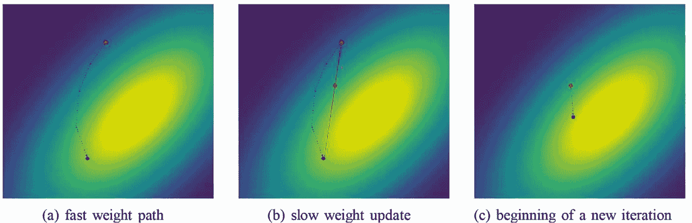

图 5.9 (a) 快速权重更新 k 次后的算法。黑点显示快速权重位置，红点显示慢速权重位置。在 图 5.9(b) 中，我们有慢速权重的新位置（红色）。在 图 5.9(c) 中，我们有算法新周期中快速权重的第一次迭代。

我们使用在验证集上取得最佳结果的权重，以避免过拟合训练样本。此外，我们使用早停法。

## 5.4.10 数据集

用于评估我们方法性能的数据集是 LiTS 2017 基准，由 2017 年 IEEE 国际生物医学成像研讨会 (ISBI) 和 2017 年国际医学图像计算与计算机辅助干预会议 (MICCAI) 共同组织。

数据包含由受过训练的放射科医生和肿瘤学家手动创建的肝脏和肿瘤标签。与测试集相关的标签质量经由三位经验丰富的放射科医生在盲审中验证 ([Bilic *等* [2019]](#ch5.xhtml#ref5_2))。数据集被分为 131 个训练样本和 70 个测试样本。测试样本在发布时不包含标签标注。

## 5.5 实验

我们使用了两种实验设置：一种在本地执行，另一种在 LiTS 挑战赛服务器上执行。我们选择进行本地实验，因为这允许我们逐例可视化和比较分割结果，进而帮助我们识别模型的不足。

此外，仅凭性能指标进行比较将非常困难，即使 LiTS 基准报告了多种指标。通过使用验证集，我们还避免了将分割模型过拟合到测试集上，这可能会使我们的模型表现优于实际用例测试。

#### 5.5.1 本地实验设置

我们将 LiTS 训练集分为两组：训练组包含 85% 的体积数据，验证组包含 15%。

我们将输入从 512 × 512 下采样到 256 × 256 像素。然后，将预测掩码上采样回原始尺寸进行评估。我们选择使用较小的图像尺寸，因为这允许更快的实验迭代。我们还将实验限制在模型的第二阶段，因为几个神经网络已经利用高 Dice 分数实现了肝脏分割，而肿瘤分割仍然是一个具有挑战性的问题。

在我们使用类似 [Han [2017]](#ch5.xhtml#ref5_11) 提出的架构进行的初步测试中，我们观察到不同体积数据之间的分割质量变化很大。在 图 5.10 和 5.11 中，我们展示了每个 CT 体积的 Dice 分数，其中 x 轴按每个肿瘤的平均体素数排序。显然，网络在平均肿瘤尺寸较小的体积数据上表现较差。


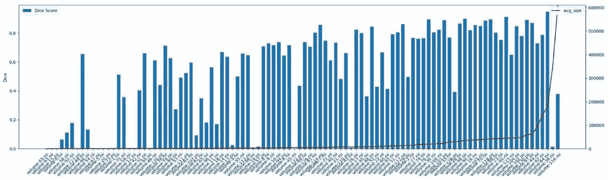

图 5.10 训练集中每个单独体积的 Dice 分数（按每个肿瘤的平均大小排序）。不包含任何肿瘤的体积已被移除，因为它们的 Dice 值是二元的。

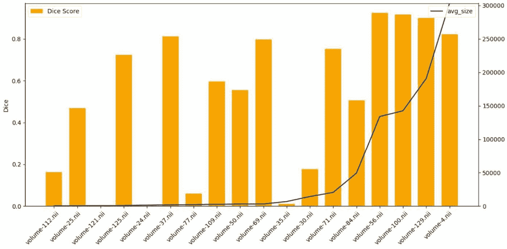

图 5.11 验证集中每个单独体积的 Dice 分数（按每个肿瘤的平均大小排序）。不包含任何肿瘤的体积已被移除，因为它们的 Dice 值是二元的。

为了研究肿瘤大小对模型性能的影响，我们根据体素数量将每个肿瘤实例分为三组。每组的数值范围如表 5.4 所示，其中 `v` 代表肿瘤体积。

表 5.4 用于根据大小分离每个肿瘤实例的分类界限

| 组别 | 体积 (体素) |
| --- | --- |
| 小 | `v < 1000` |
| 中 | `1000 ≤ v ≤ 10,000` |
| 大 | `v > 10,000` |

#### 5.5.1.1 2D 模型

正如第 5.4.5 节所述，我们有三种不同的 2D 卷积层架构。对于每种层架构，我们尝试了三组不同的超参数：`top`、`default` 和 `bottom`。

`default` 组保持与 `EfficientNet-B0` 中相同的比例，`top` 组增加了较浅层的数量，而 `bottom` 组增加了较深层的数量（`top` 和 `bottom` 组分别减少了其较深层和较浅层的参数量，以使浮点运算 (`FLOP`) 数量与 `default` 组保持平衡）。

我们根据浮点运算总和选择滤波器大小和层数。我们的目标值与 `EfficientNet-B0` 相同。表 5.5 显示了我们测试的所有 2D 模型的参数量和 `FLOPs`。

表 5.5 每个 2D 模型的参数量和 FLOPs，针对输入尺寸 `9 × 256 × 256` 计算。这些值使用 `https://github.com/sovrasov/flops-counter.pytorch` 库进行测量

| 模型 | 层配置 | FLOPs | 参数量 |
| --- | --- | --- | --- |
| MobileNet-V2 | Top | 107.14M | 4.64M |
|  | Default | 123.89M | 3.76M |
|  | Bottom | 104.80M | 6.37M |
| MobileNet-V3 | Top | 103.01M | 4.47M |
|  | Default | 113.72M | 3.64M |
|  | Bottom | 103.06M | 7.80M |
| ShuffleNet-V2 | Top | 118.93M | 1.44M |
|  | Default | 122.31M | 1.29M |
|  | Bottom | 122.13M | 1.47M |

### 5.5.1.2 3D 模型

为了减少用 3D 卷积替换 2D 卷积所带来的内存消耗和计算时间，我们将每层的通道数减半。表 5.6 显示了每个测试过的 3D 架构的参数量和 `FLOPs`。与 2D 模型相比，参数量小得多，这是预期结果，因为滤波器中的通道数减少了一半。

表 5.6 每个 3D 模型的参数量和 FLOPs，针对输入尺寸 `8 × 256 × 256` 计算。这些值使用来自 `https://github.com/sovrasov/flops-counter.pytorch` 的模块获得

| 模型 | 层配置 | FLOPs | 参数量 |
| --- | --- | --- | --- |
| MobileNet-V2 | Top | 64.28M | 1.26M |
|  | Default | 61.69M | 1.59M |
|  | Bottom | 64.03M | 2.93M |
| MobileNet-V3 | Top | 67.25M | 0.99M |
|  | Default | 62.44M | 1.95M |
|  | Bottom | 64.78M | 3.29M |
| ShuffleNet-V2 | Top | 68.84M | 1.33M |
|  | Default | 61.53M | 1.59M |
|  | Bottom | 56.37M | 1.95M |
| DSTS | Top | 66.99M | 1.68M |
|  | Default | 61.22M | 2.52M |
|  | Bottom | 55.19M | 2.88M |

我们测试了与 2D 模型相同的三种层架构。我们还添加了第 5.2.5 节中的 `DSTS` 并测试了三组不同的超参数。它们遵循与 2D 模型测试中相同的思路，但 `default` 组的宽度减半了。

### 5.5.2 局部评估

表 5.7 显示了按肿瘤大小分离的每个 2D 模型的 Dice 值。结果表明，将参数集中在较浅层有助于检测较小的肿瘤，而将参数集中在较深层则提高了大肿瘤分割的准确性。

表 5.7 按肿瘤大小分离的每个 2D 模型的 Dice 分数。**粗体**数字突出显示最佳结果

| 模型 | 层配置 | 小 | 中 | 大 |
| --- | --- | --- | --- | --- |
| MobileNet-V2 | Top | 0.233 | 0.470 | 0.615 |
|  | Default | 0.079 | 0.182 | 0.631 |
|  | Bottom | 0.065 | 0.293 | 0.608 |
| MobileNet-V3 | Top | 0.134 | 0.405 | 0.548 |
|  | Default | 0.140 | 0.418 | 0.597 |
|  | Bottom | 0.104 | 0.337 | 0.671 |
| ShuffleNet-V2 | Top | 0.163 | 0.385 | 0.581 |
|  | Default | 0.058 | 0.339 | 0.617 |
|  | Bottom | 0.143 | 0.381 | 0.529 |

在图 5.12 中，左列模型（参数集中在浅层）在较大肿瘤上表现出问题（顶行示例），但能够在第二个示例中检测到较小的肿瘤（中间行）。这是因为更多的浅层能够在降维之前利用详细的空间信息。默认的 `EfficientNet` 模型（中间列）检测到的小肿瘤不如左列模型多，但比深层模型（右列）表现好得多。在第三个示例（底行）中，右列和中间模型均比左列模型表现更好；然而，右列模型缺乏足够精确的空间信息来生成更平滑的分割，这由笔直的分割线表明，说明模型无法区分那些像素。

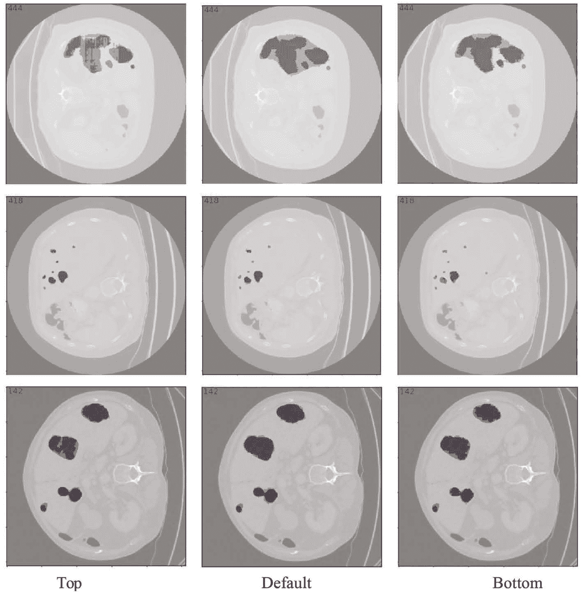

图 5.12 使用 MobileNet-V2 模块的 EfficientNet 不同超参数下的分割示例。蓝色覆盖层代表真实分割，红色覆盖层代表预测分割。左列代表 top 组，中间列代表 default 组，右列代表 bottom 组。示例取自体积 4 (切片 444)、体积 109 (切片 418) 和体积 129 (切片 142)。所有示例均属于我们的验证集。

表 5.8 显示了按肿瘤大小分离的每个 3D 模型的 Dice 分数。3D 模型的结果并未清晰地指示参数分布如何影响模型性能。根据结果，表现最好的模型基于 `DSTS` 层。

表 5.8 按肿瘤大小分离的每个 3D 模型的 Dice 分数。**粗体**数字突出显示最佳结果

| 模型 | 层配置 | 小 | 中 | 大 |


### 5.5.2 架构性能对比

| 架构 | 配置 | 指标 1 | 指标 2 | 指标 3 |
| --- | --- | --- | --- | --- |
| MobileNet-V2 | Top | 0.195 | 0.455 | 0.646 |
| MobileNet-V2 | Default | 0.125 | 0.359 | 0.577 |
| MobileNet-V2 | Bottom | 0.104 | 0.388 | 0.624 |
| MobileNet-V3 | Top | 0.196 | 0.415 | 0.646 |
| MobileNet-V3 | Default | 0.181 | 0.392 | 0.619 |
| MobileNet-V3 | Bottom | 0.200 | 0.472 | 0.631 |
| ShuffleNet-V2 | Top | 0.151 | 0.405 | 0.535 |
| ShuffleNet-V2 | Default | 0.243 | 0.454 | 0.611 |
| ShuffleNet-V2 | Bottom | 0.122 | 0.406 | 0.582 |
| DSTS | Top | 0.192 | 0.483 | 0.631 |
| DSTS | Default | 0.151 | 0.447 | 0.617 |
| DSTS | Bottom | 0.289 | 0.572 | 0.668 |

在图 5.13 中，我们展示了三种不同架构的分割示例：最佳 2D 架构 MobileNet-V2-top (2D-MobileNet) 在左列，其 3D 对应版本 (3D-MobileNet) 在中列，以及最佳 3D 架构 DSTS-bottom (DSTS) 在右列。

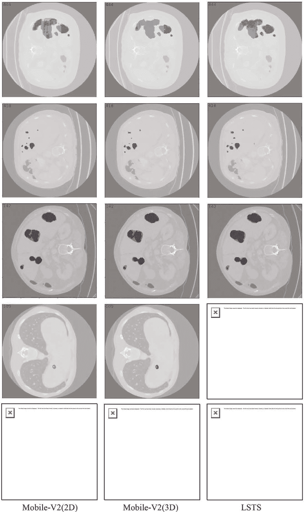

图 5.13 表现最佳的 2D MobileNet-V2 架构（左）、其 3D 对应版本（中）以及表现最佳的 3D 架构（右）的分割示例。蓝色覆盖层代表真实分割，红色覆盖层代表预测分割。前三个示例与 图 5.12 相同。第四个示例取自体积 35（切片 109），最后一个示例取自体积 69（切片 203），均来自验证集。

第一个示例显示了一个切片，其中 2D-MobileNet 对大肿瘤的分割效果较差，3D-MobileNet 无法检测到大肿瘤并对较小的肿瘤产生了不准确的分割，而 DSTS 架构的表现优于其他两个模型，对较大肿瘤的分割更好，对较小肿瘤的分割也更准确。然而，结果仍不如图 5.12 中展示的最佳 2D 架构。这种伪影可归因于参数量减少导致的架构欠拟合。

在第二个示例中，我们有一组小肿瘤。所有架构在此示例中均表现良好。2D-MobileNet 结果最好，其次是 DSTS，最后是 3D-MobileNet。此外，两种 3D 架构检测某些肿瘤的效果优于 2D 架构，这表明某些肿瘤更易于用 3D 架构进行分割。

在第三个示例中，与 DSTS 架构相比，两种 MobileNet 架构在大肿瘤上均产生了较差的分割，而 2D-MobileNet 对底部的小肿瘤产生了更好的分割。

第四个示例显示了一个 2D-MobileNet 未能检测到但两种 3D 架构均分割良好的肿瘤。最后一个示例显示了一个来自 2D-MobileNet 的小假阳性，该假阳性在 3D 架构中不存在。

### 5.5.3 LiTS 挑战赛评估

我们向 LiTS 挑战赛提交了三个预测结果：第一个基于带有 2D 卷积的 MobileNet-V2，第二个基于带有 3D 卷积的 MobileNet-V2，最后一个使用 DSTS 层。我们使用与本地评估相同的数据划分训练模型。

LiTS 挑战赛的评估在其服务器上进行。提交内容由每个体积的掩码组成，其中值 0 代表背景，1 代表肝脏，2 代表肿瘤。提交次数限制为每天 3 次，以避免模型偏差。提交的神经影像学信息学技术倡议 (NIfTI) 文件的元数据必须与相应的 CT 体积相匹配。表 5.9 列出了 LiTS 挑战赛参赛作品及其分割评估指标和参数量。

表 5.9 表现最佳的已发表作品的分割指标（顶部）及我们的模型结果（底部，由横线分隔）。↑ 表示数值越高越好；↓ 表示数值越低越好；→ 0 表示数值越接近 0 越好。我们的模型位于底部，由横线分隔。

| 模型 | 每例 Dice 系数 (↑) | 全局 Dice 系数 (↑) | VOE (↓) | RVD (→) | ASSD (↓) | 参数量 (↓) |
| --- | --- | --- | --- | --- | --- | --- |
| Volumetric attention Wang *et al.* [2019 b] | 0.741 | 0.813 | 0.389 | -0.177 | 1.1224 | 25M+ |
| LW HCN Thang *et al.* [2019a] | 0.730 | 0.820 | NA | NA | NA | 3.6M |
| H-DenseUNet Li *et al.* [2018] | 0.722 | 0.824 | 0.366 | 4.272 | 1.102 | 80M |
| DeepX Yuan [2017] | 0.657 | 0.820 | 0.378 | 0.288 | 1.151 | 30M |
| 3D-UNet Ç i¸sek *et al.* [2016] | 0.55 | NA | NA | NA | NA | 19M |
| X.Han Han [2017] | NA | 0.670 | 0.450 | 0.040 | 6.660 | 24M |
| DSTS-3D (ours) | 0.548 | 0.768 | 0.400 | -0.120 | 1.187 | 2.88M |
| 2D MobileNet-V2 (ours) | 0.536 | 0.678 | 0.429 | -0.162 | 1.4232 | 4.64M |
| 3D MobileNet-V2 (ours) | 0.524 | 0.746 | 0.393 | -0.041 | 1.1298 | 1.26M |

我们的方法未达到与更专业的肝脏肿瘤分割方法竞争所需的性能。然而，与大多数方法不同，我们的方法专注于有限资源环境，而非最大化性能。

我们表现最佳的方法以 5 倍更少的参数量实现了与 3D-UNet 相似的性能。它在 VOE 和 ASSD 指标上也取得了适当的结果，但其最弱指标是每例 Dice 系数。如果我们比较 2D MobileNet-V2 与 3D MobileNet-V2，会注意到每例 Dice 系数下降，但 ASSD、VOE 和全局 Dice 系数上升，这表明 3D 模型创建了更好的整体分割，但 2D 模型在更多体积中正确检测了肿瘤。

我们对 3D 模型施加的有限 FLOPS 降低了其检测较小肿瘤的能力。参数量可比的唯一最佳表现解决方案是 LW HCN 模型，但它使用的图像比我们大四倍以生成预测。

## 结论

在本工作中，我们研究并分析了高效网络作为肝脏肿瘤分割问题编码器骨干的可行性。我们从基线网络出发，调查其缺陷，以更好地理解我们的问题所带来的挑战。

分割质量与体积中存在的肿瘤大小相关。大肿瘤呈现高分割质量和检测率，而小肿瘤检测较差或被高估。基于我们的观察，我们提出了一种按大小区分肿瘤来评估分割质量的方法，这有助于更好地理解模型在不同情况下的工作方式。


## 模型架构与性能

### 2D 卷积模型

我们创建了两个模型，一个基于 `2D convolutions`，另一个基于 `3D convolutions`。我们的 2D 模型是基于 `U-Net` 架构的端到端分割，采用改进的 `EfficientNet-B0` 作为编码器。我们为 `inverted residual layer`（`EfficientNet` 基础层）测试了两种额外的高效层架构，并采用三种不同的层分布，以确定原始 `EfficientNet` 架构在肝肿瘤分割问题上优化得如何。我们的结果表明，专注于 `dimensional reduction` 之前的层提高了小肿瘤的检测率，但大肿瘤分割性能略有下降。

### 3D 卷积模型

我们的 `3D-convolution` 模型遵循与 2D 模型相同的架构。然而，输入和输出经调整以适配 `3D convolutional filters`。我们重复了与 2D 模型相同层的实验，并增加了另一种层架构，称为 `DSTS layer`，详见 `Section 5.2.5`。`DSTS model` 表现最佳，在所有肿瘤尺寸上均优于任何 3D 模型，但它仍存在一些某些 2D 模型中不存在的问题。

### 性能对比

2D 和 3D 模型均能在无 `GPU` 的机器上，以每切片不到 1 秒的速度生成分割预测。然而，即使参数量和 `FLOP` 计数较低，3D 模型的速度仍比其 2D 对应模型慢近十倍。我们将这种减速归因于 `3D convolutions` 产生的依赖数量。尽管 3D 模型相较于 2D 模型具有一些优势，但不足以弥补性能的下降。

## 参考文献

*   K. S. Albain, R. S. Swann, V. W. Rusch, A. T. Turrisi III, F. A. Shepherd, C. Smith, Y. Chen, R. B. Livingston, R. H. Feins, and D. R. Gandara. 《III 期非小细胞肺癌：放疗联合化疗伴或不伴手术切除：一项 III 期随机对照试验》。*《柳叶刀》*, 374(9687): 379–386, 2009.
*   P. Bilic, P. F. Christ, E. Vorontsov, G. Chlebus, H. Chen, Q. Dou, C.-W. Fu, X. Han, P.-A. Heng, and J. Hesser. 《肝肿瘤分割基准 (LiTS)》。*《arXiv 预印本 arXiv:1901.04056》*, 2019.
*   H. Chen, Z. Qin, Y. Ding, L. Tian, and Z. Qin. 《基于深度卷积对称神经网络的脑肿瘤分割》。*《神经计算》*, 392:305–313, 2020.
*   L.-C. Chen, G. Papandreou, I. Kokkinos, K. Murphy, and A. L. Yuille. Deeplab: 《基于深度卷积网络、空洞卷积和全连接 CRF 的语义图像分割》。*《IEEE 模式分析与机器智能汇刊》*, 40(4):834–848, 2017 a.
*   L.-C. Chen, G. Papandreou, F. Schroff, and H. Adam. 《重新思考用于语义图像分割的空洞卷积》。*《arXiv 预印本 arXiv:1706.05587》*, 2017 b.
*   S. Chen, C. Ding, and M. Liu. 《用于精确脑肿瘤分割的双力卷积神经网络》。*《模式识别》*, 88:90–100, 2019.
*   Ö. Ç i¸cek, A. Abdulkadir, S. S. Lienkamp, T. Brox, and O. Ronneberger. 《3D U-Net：从稀疏标注中学习稠密体积分割》。在 *《医学图像计算与计算机辅助干预国际会议》* 中, 页 424–432. Springer, 2016.
*   L. R. Dice. 《物种间生态关联程度的度量》。*《生态学》*, 26(3):297–302, 1945.
*   R. C. Gonzalez, R. E. Woods, and S. L. Eddins. *《数字图像处理（MATLAB 版）》*. Pearson Education India, 2004.
*   P. Goyal, P. Dollár, R. Girshick, P. Noordhuis, L. Wesolowski, A. Kyrola, A. Tulloch, Y. Jia, and K. He. 《精确、大规模小批量 SGD：1 小时训练 ImageNet》。*《arXiv 预印本 arXiv:1706.02677》*, 2017.
*   X. Han. 《使用深度卷积神经网络方法的自动肝脏病变分割》。*《arXiv 预印本 arXiv:1704.07239》*, 2017.
*   K. He, X. Zhang, S. Ren, and J. Sun. 《用于图像识别的深度残差学习》。在 *《IEEE 计算机视觉与模式识别会议》* 中, 页 770–778, 2016.
*   K. He, G. Gkioxari, P. Dollár, and R. Girshick. 《Mask R-CNN》。在 *《IEEE 国际计算机视觉会议》* 中, 页 2961–2969, 2017.
*   G. N. Hounsfield. 《计算机化横向轴向扫描（断层扫描）：第 1 部分. 系统描述》。*《英国放射学杂志》*, 46(552):1016–1022, 1973.
*   A. Howard, M. Sandler, G. Chu, L.-C. Chen, B. Chen, M. Tan, W. Wang, Y. Zhu, R. Pang, and V. Vasudevan. 《寻找 MobileNetV3》。在 *《IEEE 国际计算机视觉会议》* 中, 页 1314–1324, 2019.
*   A. G. Howard, M. Zhu, B. Chen, D. Kalenichenko, W. Wang, T. Weyand, M. Andreetto, and H. Adam. Mobilenets: 《面向移动视觉应用的高效卷积神经网络》。*《arXiv 预印本 arXiv:1704.04861》*, 2017.
*   J. Hu, L. Shen, and G. Sun. 《挤压与激励网络》。在 *《IEEE 计算机视觉与模式识别会议》* 中, 页 7132–7141, 2018.
*   P. Jaccard. 《德朗斯河流域及邻近地区高山植物群的分布》。*《瓦州自然科学学会通报》*, 37:241–272, 1901.
*   D. P. Kingma and J. Ba. Adam: 《Adam：一种随机优化方法》。*《arXiv 预印本 arXiv:1412.6980》*, 2014.
*   O. Köpüklü, N. Kose, A. Gunduz, and G. Rigoll. 《资源高效的 3D 卷积神经网络》。在 *《IEEE/CVF 计算机视觉国际会议研讨会》* 中, 页 1910–1919. IEEE, 2019.
*   D. C. Le, K. Chinnasarn, J. Chansangrat, N. Keeratibharat, and P. Horkaew. 《基于概率模型和解剖约束的半自动肝脏分割》。*《科学报告》*, 11(1):1–19, 2021.
*   X. Li, Z. Liu, P. Luo, C. Change Loy, and X. Tang. 《并非所有像素都平等：通过深层级联实现难度感知的语义分割》。在 *《IEEE 计算机视觉与模式识别会议》* 中, 页 3193–3202, 2017.
*   X. Li, H. Chen, X. Qi, Q. Dou, C.-W. Fu, and P.-A. Heng. 《H-DenseUNet：用于 CT 体积肝脏和肿瘤分割的混合密集连接 UNet》。*《IEEE 医学成像汇刊》*, 37(12):2663–2674, 2018.
*   L. Liu, H. Jiang, P. He, W. Chen, X. Liu, J. Gao, and J. Han. 《关于自适应学习率方差及其延伸》。*《arXiv 预印本 arXiv:1908.03265》*, 2019.
*   T. Livraghi, A. Giorgio, G. Marin, A. Salmi, I. De Sio, L. Bolondi, M. Pompili, F. Brunello, S. Lazzaroni, and G. Torzilli. 《746 例肝细胞癌和肝硬化患者：经皮乙醇注射的长期结果》。*《放射学》*, 197(1):101–108, 1995.
*   N. Ma, X. Zhang, H.-T. Zheng, and J. Sun. ShuffleNet v2: 《高效 CNN 架构设计的实用指南》。在 *《欧洲计算机视觉会议》* 中, 页 116–131, 2018.
*   L. Meng, Q. Zhang, and S. Bu. 《基于卷积神经网络的两阶段肝脏和肿瘤分割算法》。*《诊断学》*, 11(10):1806, 2021.
*   F. Milletari, N. Navab, and S.-A. Ahmadi. 《V-Net：用于体积医学图像分割的全卷积神经网络》。在 *《第四届 3D 视觉国际会议》* 中, 页 565–571. IEEE, 2016.
*   O. Ronneberger, P. Fischer, and T. Brox. U-Net: 《用于生物医学图像分割的卷积网络》。在 *《医学图像计算与计算机辅助干预国际会议》* 中, 页 234–241. Springer, 2015.


# 6 用于分析电子病历的深度学习技术进展

**K. Manimala**  
Email: fantinraj@gmail.com  
Email: jagatheswari.s@vit.ac.in

## 摘要

近年来，医院收集了大量数据，包括电子病历（EMR）、护理连续性文档（CCD）、电子健康记录（EHR）等。这些记录包含患者信息，如位置、症状、诊断疾病、血液检查结果、扫描图像和报告、推荐药物以及医生笔记。上述详细信息可帮助医生和护理提供者为最终用户提供更好的医疗解决方案。另一方面，可用数据量急剧增加，需要使用分析、临床和商业智能工具将其转化为有用信息。研究人员正尝试整合深度学习技术的最新突破，从传统上用于本地计费和归档目的的数据中提取临床信息，这对人们有益。由于这些记录仅为本地管理和医院管理目的而创建，它们是非结构化的，这需要深度学习研究，后者因其捕捉数据依赖性的有效性已在许多其他领域被证明有效。基于此类医疗记录大数据分析的临床风险预测无疑将有助于预测心脏骤停等不良事件，降低患者死亡率。多位研究人员正在研究这一主题，以提供更好的患者护理并获得更多见解，了解如何在未来改善医疗保健。处理这些记录最困难的方面在于患者数据保存方式的差异，例如体重以数字形式、入院数据以日期和时间形式、诊断以分类值形式、医生备注以自然语言形式等。其他问题，如稀疏性、缺失数据和高维数据，需要特定的研究关注。因此，需要更多关于挖掘这些海量数据的研究；目前，研究在模型设计、深度学习技术部署以及缺乏全球公认的评估标准方面存在不足，而这些标准是迫切需要的。本文考察了当前的研究现状、现有的深度学习方法、研究空白，并提出了改进 EHR 研究中深度学习部署的建议。

## 6.1 介绍

几乎全世界所有的医院都已采用电子健康记录（EHR）系统，无论是基础级别还是高级别，以支持临床决策支持系统。有多项研究工作报道了对这些 EHR 记录的分析，使用了包括机器学习、回归、支持向量机在内的多种技术，直到最近流行的深度学习技术[[1]](#ch6.xhtml#ref6_1)。因此，有必要回顾这些数据分析技术并得出推论，以分析这些学习技术进步带来的临床应用进展。由于有多份报告涉及深度学习在 CT、MRI 和 ECG 图像分析等广泛医学领域的应用，因此有必要对深度学习技术在 EHR 记录中的应用进行专门总结。特别是数据完全非结构化的排列方式以及收集这些数据的多种来源，使得深度学习技术进入这一领域成为必要。

## 参考文献

- S. Rossi, M. Di Stasi, E. Buscarini, P. Quaretti, F. Garbagnati, L. Squassante, C. Paties, D. Silverman, and L. Buscarini. 经皮射频间质热消融治疗肝癌. *AJR. American Journal of Roentgenology*, 167(3):759–768, 1996.
- H. Sung, J. Ferlay, R. L. Siegel, M. Laversanne, I. Soerjomataram, A. Jemal, and F. Bray. 2020 年全球癌症统计：185 个国家 36 种癌症的 GLOBOCAN 发病率和死亡率估计. *CA: A Cancer Journal for Clinicians*, 0:1–41, 2020.
- M. Tan and Q. V. Le. EfficientNet：重新思考卷积神经网络的模型缩放. *arXiv 预印本 arXiv:1905.11946*, 2019.
- P. Tang, Q. Liang, X. Yan, S. Xiang, W. Sun, D. Zhang, and G. Coppola. 使用带随机权重平均的 Separable-Unet 进行高效皮肤病变分割. *Computer Methods and Programs in Biomedicine*, 178:289–301, 2019.
- K. D. Toennies. *医学图像分析指南*. Springer, 2017.
- P. Tschandl, C. Sinz, and H. Kittler. 用于皮肤病变分割的领域特定分类预训练全卷积网络编码器. *Computers in Biology and Medicine*, 104:111–116, 2019.
- G. Wang, W. Li, T. Vercauteren, and S. Ourselin. 基于级联卷积神经网络与不确定性估计的自动脑肿瘤分割. *Frontiers in Computational Neuroscience*, 13:56, 2019 a.
- X. Wang, R. Girshick, A. Gupta, and K. He. 非局部神经网络. 在 *IEEE 计算机视觉与模式识别会议* 中, 页 7794–7803, 2018.
- X. Wang, S. Han, Y. Chen, D. Gao, and N. Vasconcelos. 用于 3D 医学图像分割和检测的体积注意力. 在 *医学图像计算与计算机辅助干预国际会议* 中, 页 175–184. Springer, 2019 b.
- F. Xie, J. Yang, J. Liu, Z. Jiang, Y. Zheng, and Y. Wang. 使用高分辨率卷积神经网络进行皮肤病变分割. *Computer Methods and Programs in Biomedicine*, 186:105241, 2020.
- Y. Yuan. 用于自动肝脏和肿瘤分割的层级卷积-反卷积神经网络. *arXiv 预印本 arXiv:1710.04540*, 2017.
- J. Zhang, Y. Xie, P. Zhang, H. Chen, Y. Xia, and C. Shen. 用于肝肿瘤分割的轻量级混合卷积网络. 在 *第 28 届国际人工智能联合会议* 中, 中国澳门, 页 10–16, 2019a.
- M. Zhang, J. Lucas, J. Ba, and G. E. Hinton. Lookahead 优化器：向前 k 步，向后 1 步. 在 *神经信息处理系统进展* 中, 页 9593–9604, 2019 b.


可信系统应设计为分析此类异构数据，以学习海量临床数据并学习疾病及其相关症状之间的相关性。此外，应妥善识别疾病的病因、特定疾病通常影响的人数、通常受影响的地区、此类疾病的风险因素等，以减轻此类疾病在未来的影响。在进行此类严格分析时，应保持患者数据的机密性。多种传统机器学习方法，如主成分分析（PCA）2、3、人工神经网络（ANN）、卷积神经网络（CNN）、贝叶斯网络、概率神经网络、支持向量机（SVM）4、5、决策树 6 等，被用于分析这些临床大数据。这些方法在医院数据的几个子领域取得了成功的结果，但高度复杂和异构的 EHR 数据要求采用先进的深度学习技术，后者在其他几个当代领域已取得成功。深度学习在多个领域确保了预测和知识传播的准确性，因此，使用这些技术以获得临床分析的精确性并不令人惊讶。

## 6.2 EHR 概述

医院之间相互竞争，通过电子记录维护患者的医疗问题历史并加强健康专家之间的协作，以提供更好的患者护理。此类记录通过减少错误、在更短时间内识别既往健康问题、正在服用的药物和总体健康状况，从而提高患者护理效率，真正使患者和医院双方受益。EHR 通常分为两类：基本 EHR（缺少医生笔记）和高级综合 EHR（包含医生笔记）。其设计初衷是为了医院内部的行政便利，因此存在多种编码类别用于录入患者健康数据。有特定代码，如疾病国际统计分类（ICD）及相关健康问题、现行操作术语（CPT）和逻辑观察标识符名称和代码（LOINC）1。上述代码并非固定不变，而是因医院和世界不同地区而异。只有当代码在 EHR 中得到适当表示时，深度学习技术才能有效工作。由于数据量巨大且代码种类繁多，协调和分析成为一项艰巨任务，这使得引入深度学习技术进入该领域成为必要。

### 6.2.1 EHR 的特征

全球各地医院收集的 EHR 数据量巨大，据报告此类数据已超过 25 EB（艾字节）7、8。得益于物联网，开发出多种可穿戴传感器以自动监测患者健康，这导致此类数据激增。此类传感器还会生成实时数据，需要即时分析和快速响应。一方面数据量在增长，另一方面数据采集源的数量也在增长。随着数据源数量增加，分析复杂性也随之增加，因为没有通用的方式来描述疾病代码和临床笔记的格式。因此，可以明确得出结论：EHR 数据在速度、真实性、多样性和容量方面具有大数据的所有物理特征，因此大数据分析应扩展至该领域。

### 6.2.2 EHR 数据的类别

在患者健康检查或治疗过程中会收集大量数据。医院以不同格式表示和存储这些信息。医学影像、疾病编码和临床笔记是数据的基本类别。医学诊断有多种成像技术，即光学相干断层扫描（OCT）、磁共振成像（MRI）、计算机断层扫描（CT）、X 射线，以及基于信号的数据，如 EEG、ECG 等。MRI 图像通常用于识别大脑、心脏、骨骼和关节的疾病。CT 和 X 射线通常用于检测腹部和胸部的异常。然而，临床数据分析的困难在于此类数据的可获得性，与社交网站数据等其他大数据相比较少。因此，无法为训练阶段提供所需数量的数据。与此数据相关的另一个问题是将这些数据呈现给神经网络层的格式。

### 6.2.3 医生笔记

这以文本形式存在，如出院小结、扫描报告、死亡证明等 9、10、11、12、13、14、15、16、17 和 18。通常会对出院小结进行深入研究，因为它包含更多信息，如诊断、实验室检查研究结论、住院期间服用的药物、需服用的药物以及所需的随访措施。

## 6.3 EHR 中的机器学习与深度学习

最初，研究人员使用机器学习技术进行 EHR 记录的知识发现过程。通过让机器从现有数据中学习使其变得智能的过程称为机器学习。监督学习和无监督学习是机器学习的两种常见类型。将输入与已知目标映射的过程称为监督学习，而在不提供目标的情况下对相关数据进行分组的方法称为无监督学习。回归和分类归属于机器学习，而聚类过程归属于无监督学习。需要从数据中提取重要特征，这些特征构成机器学习算法的输入。提取此类重要特征是机器学习过程中的关键问题之一，应妥善解决。在某些情况下，这些特征是手工提取的，但由于 EHR 数据量大且异构，这不可能实现。因此，这些记录的机器学习或深度学习方法需要自动特征提取。这些特征作为输入提供给用作机器学习技术的神经网络的输入层。EHR 数据机器学习和深度学习的常用架构总结如下。图 6.1 显示了用于机器学习的基本前馈网络。

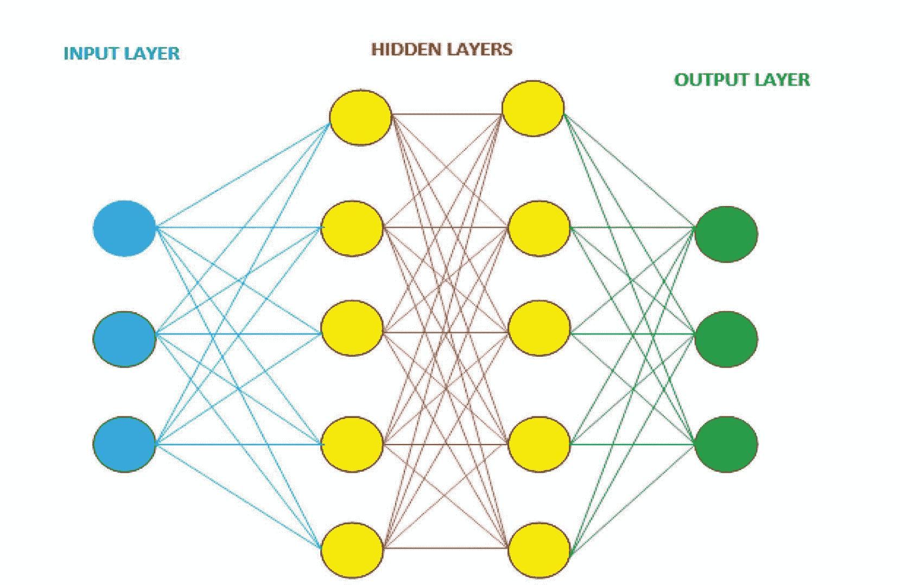

图 6.1 前馈神经网络。

### 6.3.1 多层感知机（MLP）网络


### 6.3.1 多层感知机

多层感知机是用于学习 EHR 数据模式和行为的常用网络之一。它通常由多个隐藏层组成；隐藏层的数量由问题的复杂性决定。它是一种通用的前馈网络，其中每个神经元都连接到下一层的所有神经元。信息流仅单向流动，且没有反馈连接。每层中的神经元对来自前一层的输入和连接权重的乘积值求和，并应用激活函数以产生最终输出。常用的激活函数有阈值、线性和 Sigmoid 激活函数。网络通过寻找输入和输出之间的关系来学习神经元之间的连接权重。

隐藏层权重的更新如公式 (6.1) 所示，其中 `d` 表示前一层的单元数，`x_j` 是来自前一层节点 `j` 的输入，`w[ij]` 和 `b[ij]` 分别代表权重和偏置，`sigma()` 代表激活函数 [1]。

(6.1)

```
h_i = sigma( sum_{j=1}^{d} (x_j * w_ij + b_ij) )
```

图 6.2 展示了多层感知机网络。

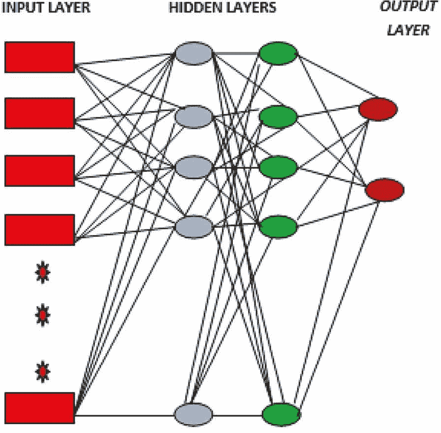

图 6.2 多层感知机。

### 6.3.2 卷积神经网络 (CNN)

CNN 是一种在图像处理（尤其是医学图像分析）、计算机视觉、数据挖掘等领域获得良好应用的工具。CNN 的显著特性是其能够识别相邻数据之间的强连接性，而不是将原始数据作为一个整体来看待。CNN 是一种学习机制，它从前序层中提取强低级特征并将其传递给包含卷积滤波器的下一高层。提取的特征在池化层中进行汇总。它是临床应用中首要且常用的工具。U-Net [19] 和 ResNet [20] 是医学图像分析中常用的架构，它们能用较少的层数表示完整图像且具有良好的收敛性。Dense CNN [21] 减轻了梯度问题并减少了涉及的参数。证明 CNN 在从医生笔记中预测疾病编码方面是高效的。CNN 的基本架构如 图 6.3 所示。

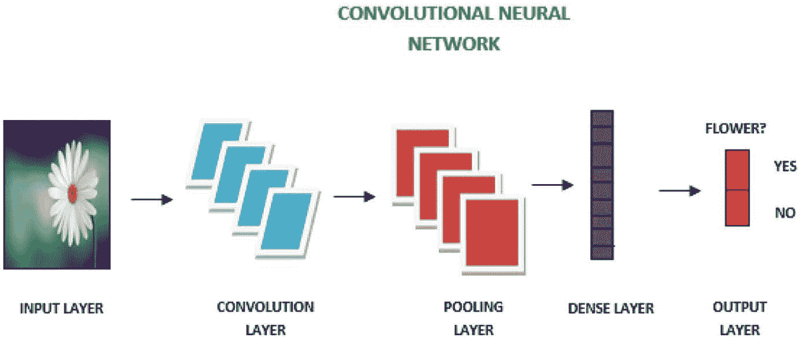

图 6.3 卷积神经网络。

一维卷积 [1] 由下式给出

(6.2)

```
C_1d = sum_{alpha=-infty}^{infty} x(a) * w(t - a)
```

二维卷积 [1] 为

(6.3)

```
C_2d = sum_m sum_n x(m,n) * K(i-m, j-n)
```

其中 `x` 是输入信号，`w` 是加权函数，`X` 是二维网格，`K` 是核。

### 6.3.3 循环神经网络 (RNN)

它是一种用于深度学习的前馈神经网络。这种神经网络的强连接使其看起来像一个有向图。门控循环单元是 RNN 变体的一个版本，被称为长短期记忆 (LSTM)。研究人员已将该网络应用于疾病诊断 [24]、[25] 和其他临时医疗建议。门控 RNN 在建模长期依赖方面很高效 [26]。除了医学相关问题，该网络已被证明在模式识别和多种图像处理应用等其他领域也很成功 [27]。当数据按适当顺序排列时，RNN 比 CNN 是更好的选择。该网络旨在处理时间依赖性 [1]，因此常用于自然语言处理和时间序列数据。RNN 根据当前输入以及前一个隐藏状态来更新其隐藏状态。因此，显然最终状态包含了所有前序阶段的细节。RNN 也用于从临床数据中提取特征。图 6.4 表示 RNN 的架构。

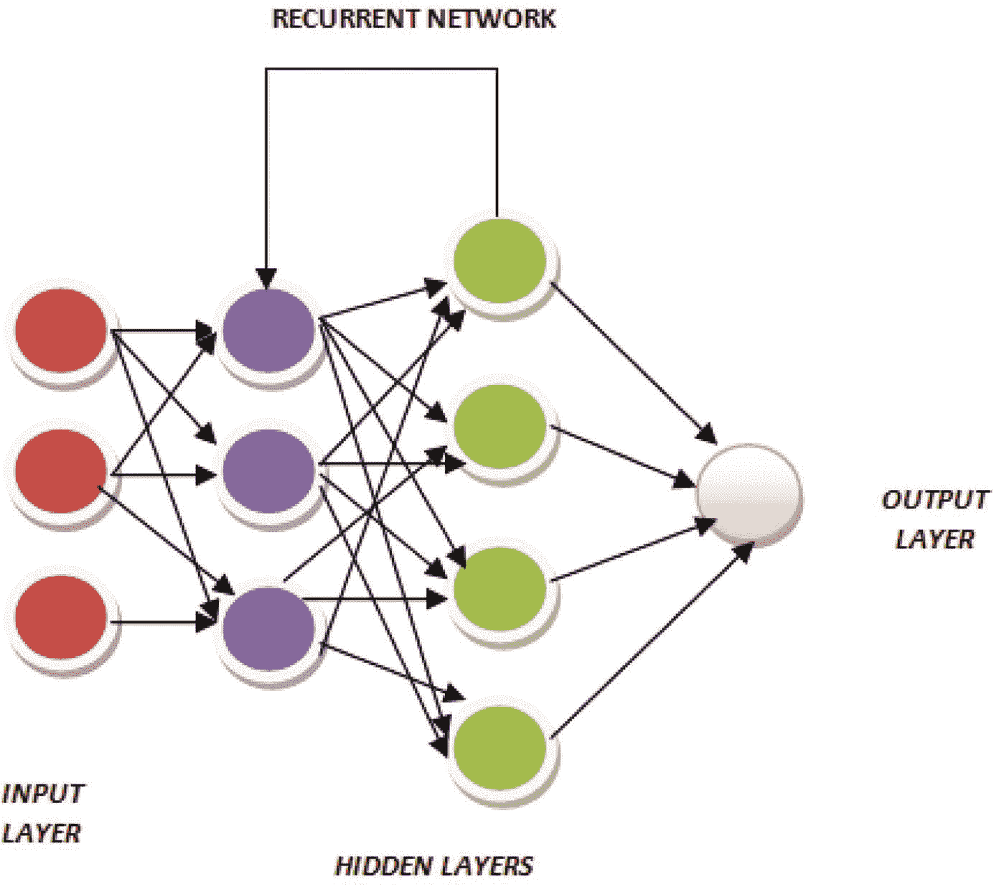

图 6.4 循环神经网络。

### 6.3.4 受限玻尔兹曼机

它是一种无监督随机学习技术，能识别输入数据的概率分布。该网络应用于 X 光片 [28] 和 CT 图像 [29] 等医学图像的分类任务领域。RBM 是解释数据生成基本过程的广义模型。一般来说，玻尔兹曼机是全连接的，而在 RBM 中，隐藏层单元之间或可见单元之间不存在连接。吉布斯采样是用于训练 RBM 的过程。深度置信网络 (DBN) 是 RBM 的堆叠表示，形成一个有监督学习网络。

RBM 的能量函数 [26] 由下式给出

(6.4)

```
E(v, h) = -b^T v - C^T h - W v^T h
```

其中 `v` 代表可见单元，`h` 代表隐藏单元。图 6.5 展示了 RBM 的可见单元和隐藏单元。

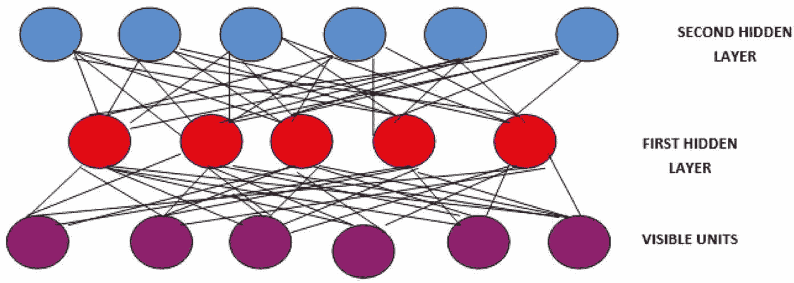

图 6.5 受限玻尔兹曼机。

### 6.3.5 自编码器

自编码器 (AE) 在训练数据较少时应用于多种有监督任务的预训练过程中，但它是典型的无监督深度学习技术。AE 将输入数据投影到低维空间，这称为编码。编码和重构机制的表示 [1] 由公式 (6.5) 和 (6.6) 给出。

(6.5)

```
z = sigma(W * x + b)
```

(6.6)

```
x_tilde = sigma(W' * z + b')
```

其中 `x` 是输入，`x_tilde` 是输入的近似表示，`W` 是编码权重，`W'` 是解码权重，`z` 是编码表示。网络通过训练以减小误差 `||x - x_tilde||`，从而使编码表示准确。AE 被视为一种类似于主成分分析 (PCA) 的降维技术，因为它将输入数据转换为判别性方面并将其作为输出存储。由于隐藏层激活函数中发生的非线性变换，它在解决复杂问题上比 PCA 和类似技术更具优势。基于堆叠的贪婪训练方法用于设计深层 AE 网络。图 6.6 展示了自编码器的架构。

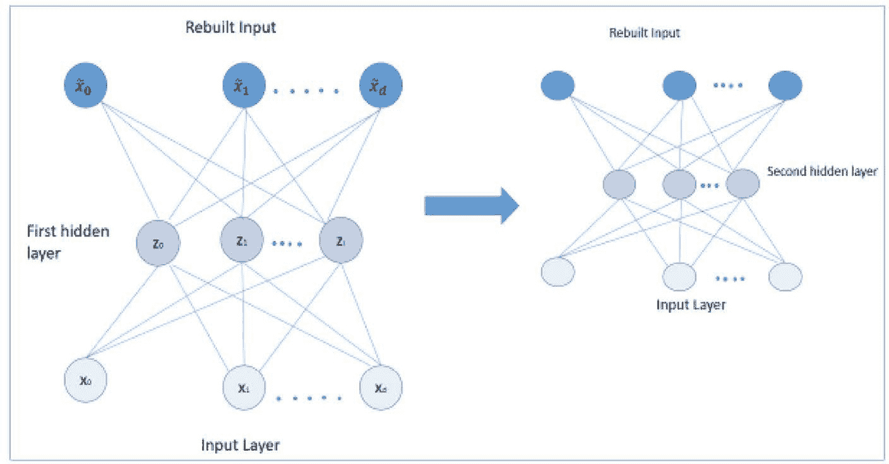

图 6.6 自编码器。

## 6.4 EHR 的深度学习分析

常用的深度学习架构如 图 6.7 所示。文献中用于电子医疗分析的网络包括人工神经网络 (ANN)、卷积神经网络 (CNN)、深度神经网络 (DNN)、深度置信网络 (DBN)、堆叠自编码器 (SAE)、循环神经网络 (RNN) 等。这些网络所用的任务 [8] 如 表 6.1 所示。

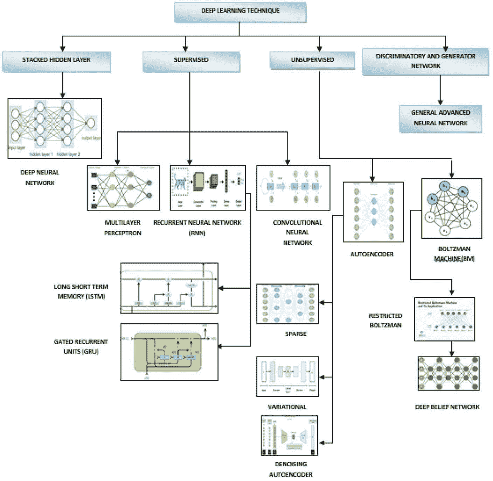

图 6.7 常用深度学习架构。

表 6.1 医疗代码示例

| 类别 | 技术 | 医疗任务 |
| --- | --- | --- |


| 分类 | 深度 CNN | 老年相关问题检测 |
| --- | --- | --- |
|  |  | 视网膜病变识别 |
|  |  | 黄斑恶化与糖尿病视网膜病变识别 |
| 图像检测 | Fast CNN | 出血检测 |
| 风险因子检测 | DNN | 心血管风险因子 |
| 图像分割 | CNN | 视杯和视盘分类 |
| 分类 | CNN | 疾病诊断定位 |
|  | DNN | 阿尔茨海默病检测 |
|  | CNN 和 RNN | 阿尔茨海默病检测 |
| 分类 | CNN | 皮肤癌分类 |
| 分类 | DBN | 健康控制类别识别 |
|  | SAE | 精神分裂症和亨廷顿舞蹈症分类 |
|  | CNN | 阿尔茨海默病与健康控制分类 |
|  | ANN | 阿尔茨海默病与健康控制分类 |
| 图像检测 | CNN | 椎间盘分析与病变热点检测 |
|  |  | 左心室切片检测 |
|  |  | 椎体标注 |
|  | RNN | 末期收缩帧识别 |
| 图像分割 | DBN | 脑室分割 |
|  | CNN | 前列腺病变分割 |
|  |  | 膝关节软骨分割 |
| 图像检测与分割 | CNN | 椎体分割 |
| 生存预测 | DNN | 生存预测 |
| 图像分割 | CNN | 器官分割 |
|  |  | 胰腺分割 |
|  |  | 肝脏分割 |
|  |  | 肾脏分割 |
| 图像检测 | CNN | 结肠息肉检测 |
| 分类 | CNN | 肺纹理分类 |
|  |  | 间质模式分类 |
|  | DBN 和 RBM | 肺纹理分类 |
| 死亡率预测 | CNN | 老年人死亡率预测 |
| 分类 | CNN | 前位/侧位分类 |
|  |  | 异常检测 |
|  |  | 病理检测 |
|  |  | 恶性肿块与囊肿鉴别 |
|  |  | 结核病检测 |
|  |  | 心血管疾病检测 |
|  |  | 组织分类 |
|  | SAE | 乳腺密度分类 |
| 图像检测 | CNN | 肿块检测 |

### 6.4.1 信息提取

EHR（电子健康记录）信息提取中最棘手的部分是医生的笔记，其形式包括出院小结、诊断等，通常记录用于后续随访。每位患者的记录包含入院日期、地址和联系方式、X 光片、扫描报告，最后是出院报告等信息。由于此类数据具有非结构化和异构的特性，提取有用信息的过程极其复杂。因此，需要人工干预来支持信息提取。近期有许多基于深度学习技术从临床数据中提取重要属性的研究报道。

此类信息提取步骤包含以下任务：概念提取、时间事件提取、相关性识别，最后是缩略语扩展。图 6.8 展示了 EHR 信息提取的步骤。

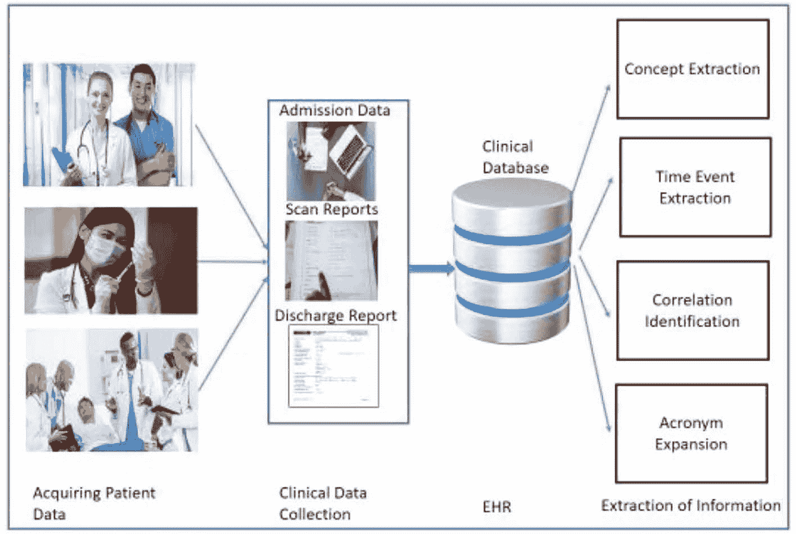

图 6.8 EHR 信息提取。

#### 6.4.1.1 概念提取

主要任务是从 EHR 中提取基本概念，如疾病诊断、给药情况和随访措施。最初，研究人员为此实施了自然语言处理，但由于医生笔记的复杂性，结果仍需进一步改进。研究人员 [32]、[33] 采用了为笔记中每一个词分配特定标签的技术。这些标签根据疾病类型和建议用药进行分类。基于 `RNN` 和 `LSTM` 的深度架构被用于信息提取。

#### 6.4.1.2 时间事件提取

每位患者的数据都应与入院时间、治疗持续时间、出院日期和随访行动时间相关联。`RNN` 网络 [34] 被用于从 EHR 记录中提取时间事件。深度挖掘应用用于识别结构化关系并进行未来预测 [35]。

#### 6.4.1.3 相关性提取

需识别医学参数之间的关系，以最终建立因果理论。必须明确识别诸如参数 A 的增减导致疾病 X，或检查 B 的结果指示疾病 Y 等条件。此类相关性需明确确定，以提取特征作为分类器的输入 [1]。

#### 6.4.1.4 缩略语扩展

存在近 19.7 万个需要扩展的缩略语以进行信息提取。这实际上是一项艰巨的任务，因为每个缩略语可能有 10 种以上可能的扩展。词嵌入是解决这一挑战性任务的常用方法 [36]。

### 6.4.2 EHR 表示

EHR 包含多个映射到患者相应疾病的编码。这些编码通常用于医院内部行政管理，但研究人员发现其可用于提取造福人类的重要信息。将基本症状与其相应编码进行手动映射实属艰难，因为多种症状可能映射到同一编码，而极其相似的症状却可能映射到不同编码。文献中建议的深度学习技术分析这些关系，并对新症状给出精确预测。为进行此类深度分析，有必要以适当方式表示编码以获取有用信息。患者需使用合适的编码表示，以作为设计监督深度学习 EHR 框架的输入。相似症状应在邻近的低维向量空间中表示。文献中报道了用于深度学习分析的此类表示 [37, 38, 39, 40 和 41]。样本症状的医学编码示例见 [1]，并列于 表 6.2 中。

表 6.2 医学编码示例

| 序号 | 模式 | 模式 | 总编码数 | 编码 | 疾病 |
| --- | --- | --- | --- | --- | --- |
| 1 | ICD-10 | 诊断 | 68,000 | 19600 | 呼吸系统疾患 |
|  |  |  |  | 1509 | 心脏问题 |
| 2 | CPT | 手术 | 9641 | 72146 | 胸椎 |
|  |  |  |  | 67810 | 眼睑活检 |
| 3 | LOINC | 实验室检查 | 80,868 | 4024-6 | 水杨酸盐，血清 |
|  |  |  |  | 3414-0 | 丁丙诺啡筛查 |
| 4 | RxNorm | 药物 | 116,075 | 161 | 对乙酰氨基酚 |
|  |  |  |  | 7052 | 吗啡 |

存在不同的表示方法，即基于概念的表示、分布式表示和潜在编码表示。利用无监督技术识别医学概念中的相似性并将其归类的表示称为基于概念的表示。在分布式嵌入中，自然语言处理被用于从庞大的医学细节和编码中创建全面且紧凑的表示。当存在多个具有相同时间细节的编码时，


通过将代码拆分为几个小组，然后根据事件的发生情况在组内进行排序来处理。`Skip-gram` 通常用于此类目的 [37]、[42]、[43]。在潜在编码中，分析不同医学概念之间的相关性，并利用通过 `autoencoders` 获得的图示训练线性模型 [44]。

深度学习技术 [39]、[40]、[42]、[43]、[45] 用于基于自然语言处理 [46] 以向量形式表示患者，或使用 `autoencoders` 降低维度 [26]。堆叠的三层 `AEs` 经过设计，使得最后一层的权重提供患者的表示。还提取了患者的时间数据，以了解代码识别是否从 `EHR` 记录中尽早完成。

### 6.4.3 表示的评估

表示通常通过分类技术进行评估，评估的准确性取决于临床数据在 `EHR` 中呈现的完美程度。某些研究专注于直接评估表示，而不进行任何下一层级的分类。到目前为止，还没有针对深度学习网络产生的临床数据输出的通用评估参数。因此，无法对各种深度学习网络所做的预测进行评估。文献中使用的常见参数包括概念连贯性 [40]、[43]、医学概念相似度度量 (`MCSM`) 和医学相关性度量 `MRM`，用于评估 `EHR` 医疗代码。研究人员并未在通用基准数据集上执行深度学习 `EHR` 工作，因此无法根据其工作中获得的结果进行评估。

### 6.4.4 疾病诊断

深度学习进行 `EHR` 分析的最终目标是基于可用记录进行疾病诊断。当患者数据明确显示症状时，诊断可以立即进行；也可能会延迟，并建议进行进一步检查以做出明确预测。根据预测的时间，诊断分为静态或时序。时序预测需要时间进行最终诊断，而静态预测在首次就诊时即识别出疾病。心力衰竭、高血压、骨质疏松等被归类为静态，而心血管疾病、肾脏糖尿病、心理健康以及某些类别的心力衰竭被归类为静态。无监督学习是此类预测的常用技术。通过改进深度学习概念的表示，可以提高此类预测的准确性。静态预测不考虑时序事件，研究人员已证明 `MLP` 是此类预测中 `ANNs` 中的最佳模型 [37]。利用完整 `EHR` 数据设计的自杀风险识别分类器 [24] 表现优于仅使用诊断代码的分类器。某些深度学习架构需要一定的时间段来诊断疾病。带有时序医疗细节的 `CNN` 网络用于预测心脏问题，发现其效果更好，结果良好 [47]。`Skip-gram`、`GRU` 和 `LSTM` 网络也在文献中用于诊断和代码标记 [39]、[45]、[48]。Nickerson 等人 [49] 使用 `MLP` 和 `LSTM` 网络预测术后并发症，而另外两项工作建议使用 `CNN` 和 `RNN` 预测出院后的再入院情况和肾移植后的并发症 [38]、[50]。

### 6.4.5 评估指标

`EHR` 数据的首要问题是不同医疗代码的分类。医学图像需要根据深度学习策略进行分割或分类。此类分类的输出应通过通用指标进行评估。准确率、精确率和召回率是用于评价深度学习网络诊断输出的常用指标。由于没有通用的基准数据集，现有文献的分类结果无法直接基于这些现有结果进行比较。

### 6.4.6 风险识别与生存预测

为了预防疾病复发，应正确识别导致疾病的因素。这种识别还能帮助医生为患者提供良好的治疗，使其早日康复。文献还建议使用深度网络从存储在 `EHR` 数据中的风险因素中识别特征 [51]、[52]。

## 6.5 EHR 数据集

`EHR` 数据集由医院持有，很难获取此类数据。此类数据以图像、文本、数值等多种格式提供 [8]。深度学习研究报告的结果基于专有数据集，不公开可用。公开可用的数据集有重症监护医学信息市场 (`MIMIC`) 和 i2b2：整合生物学与床边信息学 [53]、[54]。`PCORnet` 数据库由合作伙伴网络组成——13 个临床数据研究网络 (`CDRNs`)。`PCORnet` 指的是通用数据模型 (`CDM`)，用于规范临床记录。Data World 网站 `https://data.world/datasets/ehr` 也包含被多个项目使用的 `EHR` 数据集。

## 6.6 研究空白

用于 `EHR` 数据分析的传统机器学习方法正被深度学习技术取代，并被证明能产生良好结果。尽管近期文献表明深度学习技术在临床数据分析中取得了成功，但要实现准确的分析和预测仍有很长的路要走，这需要进一步的研究和改进现有方法。主要问题是获取医院持有的 `EHR` 数据。为了维护患者数据的隐私，大多数医院拒绝提供数据供研究人员分析 [8]。结果，尽管医院的 `EHR` 数据大量增长，但可用于实际分析的数据却非常少。尽管公开有一些数据，但这些数据并未涵盖所有医疗并发症，因此很难用这少量数据进行深入分析。设计稳健且泛化的深度 `EHR` 模型需要大量数据。第二个主要问题是 `EHR` 数据高度非结构化和无序排列，包含更多噪声、错误和缺失数据 [8]。这两个主要问题构成了深度 `EHR` 记录分析设计中的瓶颈。


另一项艰巨的任务是根据症状分配医疗代码，这需要医生或护士的支持。这种深度 EHR 分析是研究人员和医务人员之间的协作，旨在改进诊断和预测，从而更好地为患者服务。因此，应鼓励医院与研究人员共享数据，反过来，研究人员不应向公众泄露患者详细信息。不同格式的临床数据（如文本、医疗代码、图像、扫描报告等）带来了严重问题，仔细融合所有这些数据并以通用格式表示它们以进行适当分析至关重要。由于数据来自不同来源且缺乏通用表示，数据本质上更加异构。这在归一化过程中确实构成了一个棘手的问题。

由于上述原因，将深度学习研究成果应用于实时医院环境仍存在巨大犹豫，这使得该领域需要进一步研究以实现实际部署。对于临床决策支持系统而言，当务之急是一个能够以良好的准确性非常快速地分析数据的稳健高效模型。因此，医务人员和研究人员是时候共同努力，提供这样一个在实时环境下表现良好的优秀 EHR 数据分析模型了。

## 6.7 改进建议

使用深度学习技术很难解释生成的模型。因此，这些技术被称为“黑箱”。由于这一困境，在表现力与透明度之间产生了权衡。预测和猜测可能影响了医学界正确的诊断和治疗。

这就是为什么线性模型（如逻辑回归）被认为在临床领域是最好的。我们将回顾尝试，使这种深度学习技术更加清晰。在 [27]、[48] 和 [55、56 和 57] 中，主要局限性是缺乏可解释性。表 V 展示了可解释性技术的总结。

### 6.7.1 调整激活函数

有必要清楚地研究输入类型，因为这将影响隐藏单元和输出单元的激活。这种研究肯定会增强学习过程。应识别每个特征的重要性，以设计完美的深度学习模型 [38]、[42]、[47]、[58]。

### 6.7.2 约束

许多研究人员已经研究了训练限制，以提高深度模型的可解释性。因此，像轮数、输入数量和隐藏层数量这样的训练参数应被精确设置。同样，权重调整应适当聚焦 [40]，因为生成的权重稀疏性揭示了激活稀疏神经元的输入类型。所有这些权重限制都应纳入用于调整深度学习神经网络架构的目标函数中。[59] 中针对时间序列数据的表型发现方法通过施加不规则性和稀疏性要求，提高了学习模型权重的可解释性。

### 6.7.3 定性聚类

可以使用可视化方法（如 `t-SNE`）来实现 EHR 概念中向量表示的自然聚类。这实际上是高维数据点之间成对相似性的二维表示 [55]。为了使深度学习表现良好，有必要对表型组成进行彻底检查。在相似诊断和患者亚组的情况下，医疗事件和患者向量的二维分布式表示 [32] 能够实现最佳性能。

### 6.7.4 MIMIC 学习

在其可解释的 `MIMIC` 学习框架 [59]–[60] 中，应充分解决深度模型透明度问题。可解释的线性模型可用于加权原始输入特征，从而显著增强深度网络的能力。在创建深度架构的同时保持所需的特征透明度是另一个关键考虑因素。

## 结论

本章对与 EHR 分析相关的当前深度学习研究进行了综述。在过去两年中，关于这一新兴主题的大量出版物已发表。当我们回顾深度学习所实现的图像和自然语言处理领域的突破时，我们看到了与当代 EHR 驱动的深度学习研究领域惊人的相似之处。本综述中的大多数研究展示了定义过去十年收集的大量原始患者数据的最准确技术。基本图像处理技术关注日益复杂和分层的图像表示。同样，自然语言处理至关重要，因为大多数 EHR 数据由医生笔记组成，必须正确理解。未来的研究应集中在描述患者健康数据及其独特医疗代码的方法上，以便不同的数据源不会在 EHR 数据分析中造成瓶颈。本章讨论了临床记录分析过程、迄今为止部署的深度学习网络、研究空白，并以一些未来深度学习研究改进建议作为结尾。

## 参考文献

1. Benjamin Shickel, Patrick James Tighe, Azra Bihorac, and Parisa Rashidi, “深度 EHR：电子健康记录（EHR）分析深度学习技术最新进展综述”, IEEE Journal of Biomedical And Health Informatics, vol. 22, No. 5, pp 1589-1604, September 2018

2. A. Subasi and M. I. Gursoy, 使用 PCA、ICA、LDA 和支持向量机进行 EEG 信号分类, Expert Syst. Appl., vol. 37, no. 12, pp. 8659–8666, 2010.

3. M. Pechenizkiy, A. Tsymbal, and S. Puuronen, 基于 PCA 的用于分类的特征变换：医学诊断中的问题, in Proc. 17th IEEE Symp. Computer-Based Medical Systems, Bethesda, MD, USA, 2004, pp. 535–540.

4. L. V. Lita, S. P. Yu, S. Niculescu, and J. B. Bi, 医疗患者记录的大规模诊断代码分类, in Proc. 3rd Int. Joint Conf. Natural Language Processing, Hyderabad, India, 2008, pp. 877–882.

5. B. Koopman, G. Zuccon, A. Nguyen, A. Bergheim, and N. Grayson, 从自由文本死亡证明中自动进行癌症 ICD-10 分类, Int. J. Med. Inform., vol. 84, no. 11, pp. 956–965, 2015.

6. D. X. Wang, X. Liu, and M. D. Wang, 一种用于大数据股票期货预测的 DT-SVM 策略, in Proc. 16th Int. Conf. Computational Science and Engineering, Sydney, Australia, 2013, pp. 1005–1012.

7. J. M. Sun and C. K. Reddy, 医疗保健大数据分析, in Proc. 19th ACM SIGKDD Int. Conf. Knowledge Discovery and Data Mining, Chicago, IL, USA, 2013, p. 1525.

8. Ying Yu, Min Li, Liangliang Liu, Yaohang Li, and Jianxin Wang, “临床大数据与深度学习：应用、挑战与未来展望”, Big Data Mining And Analytics, Vol.2, No.4, pp288–305, December 2019.

9. A. Perotte, R. Pivovarov, K. Natarajan, N. Weiskopf, F. Wood, and N. Elhadad, 诊断代码分配：模型与评估指标, J. Am. Med. Inform. Assoc., vol. 21, no. 2, pp. 231–237, 2014.


## 参考文献

10. M. Li, Z. H. Fei, M. Zeng, F. X. Wu, Y. H. Li, Y. Pan, and J. X. Wang，基于深度学习方法的自动 ICD-9 编码，*IEEE/ACM 计算生物学与生物信息学汇刊*，doi: `10.1109/TCBB.2018.2817488`。

11. H. R. Shi, P. T. Xie, Z. T. Hu, M. Zhang, and E. P. Xing，利用深度学习实现自动 ICD 编码，*arXiv 预印本* `arXiv:1711.04075`，2017。

12. T. Baumel, J. Nassour-Kassis, R. Cohen, M. Elhadad, and N. Elhadad，患者笔记的多标签分类：ICD 编码分配的案例研究，*arXiv 预印本* `arXiv:1709.09587`，2017。

13. M. Zeng, M. Li, Z. H. Fei, Y. Yu, Y. Pan, and J. X. Wang，基于深度迁移学习的自动 ICD-9 编码，*神经计算*，第 324 卷，第 43–50 页，2019。

14. S. Gehrmann, F. Dernoncourt, Y. R. Li, E. T. Carlson, J. T. Wu, J. Welt, J. Jr. Foote, E. T. Moseley, D. W. Grant, P. D. Tyler, et al.，比较基于规则和深度学习模型在患者表型分析中的应用，*arXiv 预印本* `arXiv:1703.08705`，2017。

15. S. Gao, M. T. Young, J. X. Qiu, H. J. Yoon, J. B. Christian, P. A. Fearn, G. D. Tourassi, and Ramanthan，用于癌症病理报告信息提取的层次注意力网络，*美国医学信息学会杂志*，第 25 卷，第 3 期，第 321–330 页，2018。

16. H. C. Shin, L. Lu, L. Kim, A. Seff, J. H. Yao, and R. M. Summers，大规模放射学数据库中交织文本/图像的深度挖掘以实现自动图像解读，*机器学习研究杂志*，第 17 卷，第 1 期，第 3729–3759 页，2016。

17. L. Dai, R. G. Fang, H. T. Li, X. H. Hou, B. Sheng, Q. Wu, and W. P. Jia，基于临床报告引导的多筛选深度学习视网膜微动脉瘤检测，*IEEE 医学成像汇刊*，第 37 卷，第 5 期，第 1149–1161 页，2018。

18. F. Duarte, B. Martins, C. S. Pinto, and M. J. Silva，一种用于自由文本死亡证明 ICD-10 编码的深度学习方法，见 *第 18 届 EPIA 人工智能会议论文集*，葡萄牙波尔图，2017，第 137–149 页。

19. H. Z. Fu, J. Cheng, Y. W. Xu, D. W. K. Wong, J. Liu, and X. C. Cao，基于多标签深度网络和极坐标变换的视盘和视杯联合分割，*IEEE 医学成像汇刊*，第 37 卷，第 7 期，第 1597–1605 页，2018。

20. A. Fakhry, T. Zeng, and S. W. Ji，用于大脑电子显微镜图像分割的残差反卷积网络，*IEEE 医学成像汇刊*，第 36 卷，第 2 期，第 447–456 页，2017。

21. D. M. Pelt and J. A. Sethian，用于图像分析的混合尺度稠密卷积神经网络，*美国国家科学院院刊*，第 115 卷，第 2 期，第 254–259 页，2018。

22. M. Li, Z. H. Fei, M. Zeng, F. X. Wu, Y. H. Li, Y. Pan, and J. X. Wang，基于深度学习方法的自动 ICD-9 编码，*IEEE/ACM 计算生物学与生物信息学汇刊*，doi: `10.1109/TCBB.2018.2817488`。

23. S. Hochreiter and J. Schmidhuber，长短期记忆，*神经计算*，第 9 卷，第 8 期，第 1735–1780 页，1997。

24. H. R. Shi, P. T. Xie, Z. T. Hu, M. Zhang, and E. P. Xing，利用深度学习实现自动 ICD 编码，*arXiv 预印本* `arXiv:1711.04075`，2017。

25. T. Baumel, J. Nassour-Kassis, R. Cohen, M. Elhadad, and N. Elhadad，患者笔记的多标签分类：ICD 编码分配的案例研究，*arXiv 预印本* `arXiv:1709.09587`，2017。

26. I. Goodfellow, Y. Bengio, and A. Courville，*深度学习*。马萨诸塞州剑桥，美国：MIT Press，2016。

27. E. Choi, M. T. Bahadori, A. Schuetz, W. F. Stewart, and J. M. Sun，Doctor AI：通过循环神经网络预测临床事件，见 *2016 医疗保健机器学习会议论文集*，美国加利福尼亚州洛杉矶，2016，第 301–318 页。

28. A. Khatami, A. Khosravi, T. Nguyen, C. P. Lim, and S. Nahavandi，使用小波变换和深度置信网络进行医学图像分析，*专家系统及应用*，第 86 卷，第 190–198 页，2017。

29. K. L. Hua, C. H. Hsu, S. C. Hidayati, W. H. Cheng, and Y. J. Chen，基于深度学习技术的 CT 图像肺结节计算机辅助分类，*肿瘤靶向与治疗*，第 8 卷，第 2015–2022 页，2015。

30. S. Ebadollahi, J. Sun, D. Gotz, J. Hu, D. Sow, and C. Neti，“利用相似患者的时间趋势预测患者生理数据轨迹：一种近期预后系统”，见 *AMIA 年会论文集*，2010，第 192–196 页。

31. D. Zhao and C. Weng，“结合 PubMed 知识和 EHR 数据开发加权贝叶斯网络用于胰腺癌预测”，*生物医学信息学杂志*，第 44 卷，第 5 期，第 859–868 页，2011。

32. A.N. Jagannatha and H. Yu，“基于 RNN 的临床文本序列标注结构化预测模型”，见 *自然语言处理实证方法会议论文集*，2016，第 856–865 页。

33. A.N. Jagannatha and H. Yu，“用于电子健康记录医疗事件检测的双向循环神经网络”，见 *计算语言学协会北美分会会议论文集*，2016，第 473–页。

34. J. A. Fries，“SemEval-2016 任务 12 中的 Brundlefly：临床时间信息抽取中循环神经网络与联合推理的对比”，见 *第 10 届国际语义评测研讨会论文集*，2016，第 1274–1279 页。

35. A. De Sa et al.，“使用 Deep-Dive 进行增量知识库构建”，*VLDB 期刊*，第 26 卷，第 81–105 页，2017。

36. Y. Liu, T. Ge, K. S. Mathews, H. Ji, D. L. Mcguinness, and C. Science，“利用面向任务的资源学习词嵌入以扩展临床缩写”，见 *2015 年生物医学自然语言处理研讨会论文集*，2015，第 92–97 页。

37. E. Choi, A. Schuetz, W. F. Stewart, and J. Sun，“从电子健康记录中学习医学概念表示及其在心力衰竭预测中的应用”，*arXiv:1602.03686*，2016 年 2 月，第 45 页。

38. P. Nguyen, T. Tran, N. Wickramasinghe, and S. Venkatesh，“Deepr：医疗记录的卷积网络”，发表于 *IEEE 生物医学与健康信息学杂志*，第 21 卷，第 1 期，第 22–30 页，2017 年 1 月。

39. T. Pham, T. Tran, D. Phung, and S. Venkatesh，“Deep Care：用于预测医学的深度动态记忆模型”，见 *太平洋-亚洲知识发现与数据挖掘会议*，Springer International Publishing，2016 年 4 月，第 30–41 页。

40. T. Tran, T. D. Nguyen, D. Phung, and S. Venkatesh，“通过 EMR 驱动的非负受限玻尔兹曼机学习医学对象的向量表示”，*生物医学信息学杂志*，第 54 卷，第 96–105 页，2015。

41. S. Mehrabi et al.，“利用深度学习发现诊断代码的时间模式和关联”，见 *2015 年国际医疗信息学会议论文集*，2015，第 408–416 页。

42. E. Choi, M.T. Bahadori, E. Searles, C. Coffey, and J. Sun，“医学概念的多层表示学习”，见 *第 22 届 ACM SIGKDD 国际知识发现与数据挖掘会议论文集*，2016 年 8 月，第 1495–1504 页。

43. Y. Choi, C. Y.-I. Chiu, and D. Sontag，“学习医学概念的低维表示：方法背景”，见 *AMIA 临床研究信息学峰会论文集*，2016，第 41–50 页。

44. X. Lv, Y. Guan, J. Yang, and J. Wu，“基于深度学习的临床关系抽取”，*混合信息技术国际期刊*，第 9 卷，第 7 期，第 237–248 页，2016。

45. E. Choi, A. Schuetz, W. F. Stewart, and J. Sun，“使用循环神经网络模型早期检测心力衰竭发病”，*美国医学信息学会杂志*，第 292 卷，第 3 期，第 344–350 页，2016。


## 参考文献

46. T. Mikolov, G. Corrado, K. Chen, and J. Dean, “向量空间中词表示的高效估计,” 见 Proc. Int. Conf. Learn. Representations, 2013, 页 1–12.

47. Y. Cheng, F. Wang, P. Zhang, H. Xu, and J. Hu, “基于电子健康记录的风险预测：一种深度学习方法,” 见 Proc. SIAM Int. Conf. Data Mining, 2015, 页 432–440.

48. Z. C. Lipton, D. C. Kale, C. Elkan, and R. Wetzell, “利用 LSTM 循环神经网络进行诊断学习,” arXiv:1511.03677, 2016.

49. P. Nickerson, P. Tighe, B. Shickel, and P. Rashidi, “用于预测镇痛反应的深度神经网络架构,” 见 Proc. 2016 IEEE 38th Annu. Int. Conf. Eng. Med. Biol. Soc., 2016, 页 2966–2969.

50. A. Esteban, O. Staeck, Y. Yang, and V. Tresp, “利用循环神经网络结合静态和动态信息预测临床事件,” 见 Healthcare Info. (ICHI), 2016 IEEE Int. Conf., 2016 年 10 月, 页 93–101.

51. R. Poplin, A. V. Varadarajan, K. Blumer, Y. Liu, M. V. McConnell, G. S. Corrado, L. Peng, and D. R. Webster, 利用深度学习从视网膜眼底照片预测心血管风险因素, arXiv preprint arXiv: 1708.09843, 2017.

52. H. Li, X. Y. Li, M. Ramanathan, and A. D. Zhang, 骨病的预测与信息性风险因素选择, IEEE/ACM Transactions on Computational Biology and Bioinformatics, 卷 12, 第 1 期, 页 79–91, 2015.

53. F. Dernoncourt, J. Y. Lee, O. Uzuner, and P. Szolovits, “利用循环神经网络对患者笔记进行去标识化,” J. American Medical Informat. Assoc., 卷 24, 第 3 期, 页 596–606, 2017.

54. A. E. Shweta, S. Saha, and P. Bhattacharyya, “临床记录中患者数据去标识化的深度学习架构,” 见 Proc. Clin. Natural Lang. Process. Workshop, 2016, 页 32–41.

55. R. Miotto, L. Li, B.A. Kidd, and J.T. Dudley, “DeepPatient：一种从电子健康记录预测患者未来的无监督表示,” Sci. Rep., 卷 6, 第 4 月, 2016, 文章编号 26094.

56. L. Nie, M. Wang, L. Zhang, S. Yan, B. Zhang, and T.-S. Chua, “通过稀疏连接深度学习从健康相关问题推断疾病,” IEEE Trans. Knowl. Data Eng., 卷 27, 第 8 期, 页 2107–2119, 2015 年 8 月.

57. H.I. Sukand, D. Shen, “基于深度学习的特征表示用于 AD/MCI 分类,” 见 Proc. 16th Int. Conf. Med. Image Comput. Comput. Assisted Intervention, 2013, 卷 8150, 页 583–590.

58. Z. Che, D. Kale, W. Li, M. Taha Bahadori, and Y. Liu, “深度计算表型分型,” 见 Proc. 21st ACM SIGKDD Int. Conf. Knowl. Discovery Data Mining, 2015, 页 507–516.

59. G. J. Kuperman 等, “计算机化医嘱录入系统中与药物相关的临床决策支持：综述,” J. Amer. Med. Informat. Assoc., 卷 14, 第 1 期, 页 29–40, 2007.

60. K.P. Murphy, 机器学习：概率视角. Cambridge, MA, USA: MIT Press, 2012.

# 7 利用 AI 的基于远程医疗的 M-Health 信息学发展

Jagjit Singh Dhatterwal^()

## 摘要

M-Health 的主要问题之一是如何有效利用现在几乎普遍可用的移动电信能力。本文旨在演示一个基于通用分组无线服务（GPRS）并具有蓝牙连接的多通道 M-Health 系统。目标是创建一个系统，利用商用 GPRS 网络上的智能手机将患者的生物信号即时发送至医院。为观察和处理健康信息，该系统与客户端计算机应用程序相结合。远程医疗会话由应用服务器处理，该服务器还控制来自远程患者的客户端请求消息。远程医疗会话期间传输的所有诊断信息，连同患者身份识别和远程医疗会话详细信息，均保存在数据库中以供后续分析。临床医生可根据需要使用浏览器应用程序查询存储库以获取这些数据。

## 7.1 引言

传统的远程医疗技术传递方法是利用“固定电话”通信技术（如公共交换电话网（PSTN）和综合业务数字网（ISDN））将患者的生物信号发送给临床医生。在放射学、心脏病学、病理学和外科领域，已在低带宽下传输编码心电图（ECG）、高血压、体温和血氧水平等参数，在高可用带宽下传输 X 光片和超声成像 [1]。由于向远程患者提供临床记录和医院服务提供者的概念，远程医疗已成为一个快速发展的研究课题。远程医疗在城乡以及工业化和发展中经济体中，均有显著潜力提高医院设施的质量和可用性，因为它意味着允许医护人员以真正远程的方式受到监督，可能是在移动中，且几乎来自全球任何地方。传统远程医疗的局限性显而易见，因为操作局限于固定站点之间的对话，常使用 Windows 软件。因此，将移动蜂窝连接与远程医疗应用相结合，被视为提供更移动、更具成本效益的医疗服务的下一关键步骤。技术人员与医生之间的互动开始显示，这种结合对医疗服务交付既切实可行又有益。远程医疗极大地受益于无线通信技术的进步，范围从固定技术平台到移动通信能力。此外，普适、高度先进和可穿戴系统的同步进步催生了 M-Health 概念，这是 21 世纪远程医疗的总括性概念。M-Health 可广泛描述为“用于全民医疗的移动计算、医疗传感器和电信技术”。尽管医患面对面交流永远不应被取代，但有些医疗问题利用 M-Health 技术可治疗得更有效。远程常规检查、灾难响应场景和运动科学中的生理测量皆为可能的软件应用。医疗服务现可提供给全球移动通信系统（GSM）等无线网络通信范围内的任何地点。在住院期间高效、持续地监测个体，有显著潜力减轻国家医疗资源的压力。农村地区的个体可通过手机接受常规检查，而无需按固定时间表频繁前往医院。频繁的检查和监测可在个体居家、途中、工作或娱乐时进行，腾出医院人员处理更复杂的患者。这可节省医生和患者的精力和金钱，特别是消除了个人长途跋涉、在长时间等待后进行短暂预约的需求 [2]。

## 7.2 本章目标

本研究旨在创建一个集成的蓝牙 M-Health 系统，用于通过一个或多个无线通信系统传输多通道传感器数据。研究目标如下：


*   开发并构建一个模块化的 m-Health 处理单元，以采集、处理和传输生物医学信号
*   在 m-Health 处理单元与手机之间创建一个蓝牙通信通道
*   通过蜂窝连接将患者的采样生物医学信号发送至医院，并在各种移动环境中研究网络效率

#### 7.2 文献综述

本节重点关注利用密钥管理方法保护医疗传感器网络中医疗数据的文献。

Sriram Cherukuri 等人 (2003) 提出了一种处理医疗传感器网络安全问题的新方法。该系统利用从女性生物体获取的生物特征来保护数据传输所需的敏感数据。为了解决测量误差和随机化问题以保护密钥安全，一种解决方案采用了纠错和多种生物特征。与传统的非对称密钥建立过程相比，该方法消除了必要的计算，并大幅降低了通信开销。未来，将收集重要的生物特征数据并检查其时间差异，开发一种生物特征组合，从而实现足够的随机化。

Shu-Di Bao 等人 (2005) 建议了一种实体认证（EA）系统，以解决移动身体健康区域传感器网络（BASN）中的身体识别问题。在建议的实体认证系统中，研究了 12 名健康人员同步采集于身体多个部位的 2 份光容积脉搏波（PPG）。作为生物特征，搏动间心脏周期被用于创建个体识别。这是一个在建立无线链路期间先进且安全的系统模型，与通用加密计算和最低内存需求相比，被证明是最佳解决方案。未来有可能利用研究参与者的混沌特性进行加密通信。为了在实践中实施建议的方法，应开展进一步的研究工作，结合可持续发展的考量。

Patrick Traynor, Guohrong 等人 (2006) 为医疗传感器网络引入了确定性成对密钥预分发方案（DPKPS）。DPKPS 在四个步骤中执行，即初始安装、使用、发现和密钥建立。与完全成对的密钥调度系统相比，该方法以极低的功耗和内存开销提供了强大的 BSN 安全解决方案。DPKPS 提高了 KPS 的可扩展性，增强了 x n-KPS 的可扩展性，并提高了其弹性。此外，该研究将扩展以满足医疗领域 BSN 关键管理基础设施的需求，涉及在 BSN 中创建有效的撤销、更新和控制关键材料机制。

Carmen C. Y. Poon 和 Yuan-Ting Zhang (2006) 提出了一种独特的生物特征方法，用于保障基于 M 的无线体域网络远程医疗安全。该文探讨了一种利用人体固有属性的生物特征方法，以确保识别或芯片重新分发，从而保障传感器间网络传输的安全。在 99 名参与者同时记录的 838 个 ECG 或 PPG 信号片段中，该方法采用脉搏间期（IPI）作为生物特征进行测试。与认证方法（Shu-Di Bao 等人 (2005)）相比，这种生物特征方法以更少的内存和计算量提供了更高程度的安全性。这项工作为进一步研究强调了几个关键问题，包括针对因疾病、生理事件、运动伪迹、字典错误等导致的各种信道异步的补救方法等。

Shu-Di Bao 等人 (2008) 提出了一种新的轻量级生物特征技术，利用人体固有的特征性状为每个 BSN 节点生成实体标识（EI）以识别节点并保护重要输入的传输，以解决安全问题并克服 BSN 中严重的资源约束挑战。该方法主要采用 EI 来保障 BSN 内部通信安全。它展示了基于心律计算的 99 名患者的 ECG 和光容积脉搏波的脉搏间期（IPI）。

与生物特征技术相比，Upkar Varshney (2008) 在体传感器网络中引入了一种资源友好的密钥管理系统，用于加密密钥的生成和分发，并建议了一种基于外推和随机选择的数据混淆新方法，作为某些类型数据对称加密算法的替代方案。该系统可根据具体应用进行修改，以满足必要的资源限制。所提供的技术具有可调参数，可适应不同级别的弹性和复杂度。与传统的单点模糊密钥方法相比，所提出的方法使传输和资源利用更加优化。但在许多实际情况下，如信道衰落和畸变，必须检验系统的弹性。

Veikkolikonen 和 Eija Kaasin 等人 (2008) 引入了一种新的密钥协商技术，即基于心电图（EKG）的密钥协商（EKA），该技术利用心电图（EKG）生成加密密钥。快速傅里叶变换器提取特征。使用 EKA，可采用“即插即用”方式确保传感器间的通信安全。无需系统设置，身体可在必要时接收用于通信的密钥。与 L. Biel 等人 (2001) 的技术相比，作者提供了创建 EKG 模板的高效过程。最后，作者规划了未来工作，旨在通过扩大块大小、使用实际硬件技术、更详细地评估生成的密钥，以及研究该方法的计算和功耗实现，来提高 EKA 方案的安全性。Vijay Srinivasan, John Stankovic 和 Kamin (2008) 提出了一种简化的 EKG 基础协商方法，该方法使用离散小波变换（DWT）在体域网络中提供共享密钥。DWT 优于 FFT 的优势在于其线性计算成本。该过程在通信传感器通过虹膜或指纹进行锁定和解锁时维护块的安全。系统使用水印技术防止尝试破解。该系统改进了基于 EKG 的安全高效 Wi-Fi 密钥协商技术（SEKEBAN）。

Young-Dong Lee 和 Wan-Young Chung (2009) 使用 WBAN 安全生理信号（ECG）。SEKEBAN 通过向 WBAN 组件传感器生成和分发对称加密密钥来维护和保护隐私。与通用密钥生成（Francis Minhthang Bui 和 Dimitrios Hatzinakos (2008)）相比，SEKEBAN 更高效且节能。为保证端到端通信，它旨在在网络的传感器节点之间创建安全有效的对称公钥。它还旨在利用生物特征数据单独保护传感节点之间的通信关系。


## 关于 WBAN 安全性与生物特征认证的文献综述

Eryun Liu 等人 (2010) 提出了一种用于保护生理安全值 (PVS) 的体传感器网络组织相容性系统的有用且有效的方法。PVS 系统通过隐藏生理数据，将保护消息所需的密钥与信息本身一起分发。与体传感器网络中的 LEAP 协议 (Zhu et al. 2006) 相比，这种方法通过减少每个节点所需的密钥数量，最大限度地减少了为满足所有安全通信标准而进行有意密钥交换的需求。该系统节能、节省空间且更具动态性。未来，作者将探索消除拓扑特异性的方法，这些方法能够完全移除主分发。

Krishna K. Venkatasubramanian 等人提出了基于 ECG 信号和模糊承诺的高度灵活的认证和密钥建立程序，即 ESKE (2010)。ECG 信号的独特性确保了 ESKE 提供冗长、随机、低延迟、可识别且随时间变化的密钥。ESKE 采用相同的模糊 PSKA 交互方法，可处理 ECG 数据的高噪声水平和波动。但在特征生成方面，ESKE 采用离散小波变换。ESKE 不需要密钥内容的预先分发。因此，测试结果表明，与 PSKA 相比，ESKE 在数据保密性、认证、一致性和有害攻击方面提高了安全性。

在无线公共卫生系统中，Lifang Wu 等人 (2011) 引入了基于生理特征的生物组学作者身份。这种建议的技术利用心电图 (ECG) 信号模式进行数据认证，以减少密钥开销交换。该方法中的插值间隔 (IPI)。信号模式的广播端通过高斯混合模型 (GMM) 总结为生物特征密钥。接收端采用轻量级签名检查系统，利用接收端本地收集的 IPI 信号。对 ECG 安全性的随机模式识别，这从根本上不同于传统技术，是该建议方法论的主要贡献。该方法还受益于样本错位的低 HTER 验证阈值。

Min Chen 等人 (2011) 开发了一种无线体域网信任密钥管理方案，利用 EKG 等生物医学参数来解决 WBAN 安全问题。该技术通过 WBAN 到 WBAN 传感器，安全有效地管理对称 ECG 加密密钥的生成和分发。与 SSL 相比，该系统能有效节省能源。

一种称为 ECG 改进型 Jules Sudan (IJS) 的系统，利用 ECC 等生物医学参数，由 Zhaoyang Zhang 等人 (2012) 提出。无需开销重新分发，这种密钥建立技术可确保 BAN 中即插即用的数据传输。为了以最低的计算要求创建密钥，ECG-IJS 只需要很短的时间框架。

Daojing He 等人 (2013) 提出了一种基于 LBP 的安全无线体域网混合密钥管理方法。利用 LBP 产生心电图信号使该方法有效。

在 EKG 块上使用 SHA-256 和重要协议来创建用于更改、披露和数据保密的块，提供了安全性。安全性得到保证。

Daojing He 等人 (2014) 认识到医疗数据发现的安全责任，并提出了一种匿名且抗拒绝服务的 WBAN 安全信息发现和传播协议，以确保数据传播不受干扰。作者修改了每个数据包的密钥，以防止在中途节点复制密钥。由于每个数据包都需要该协议计算密钥，开销计算将影响医疗信息从源到目的地的传播。这种方法旨在击败基于公钥密码学的对称加密策略和应用。

一种基于生物特征的主要协议方法，称为 PFKA，由 Naj eh Jammali 和 Lamia Chaari Fourati (2015) 提出，旨在提供传感器间的安全通信。这种方法使同一 WBAN 的传感器能够基于重叠的医学图像特征生成的对称解密系统达成一致。对该系统性能的考察显示了平静的计算成本、低存储和柔和的 OVFKA 通信。

Hussein Moosavi 和 Francis Minhthang Bui (2016) 在体域传感器网络中开发了一种基于 ECG 的安全生物特征认证方案。作者展示了如何设计和实现 ECG 传感器芯片及其管理平台。由此产生的传感器系统是首个针对实时 ECG、IPI 和节点间认证信息描述的 BAN 传感器系统。实际传感器读数的描述性统计对所提出的认证程序很重要，它使开发人员能够根据 BAN 部署的真实世界情况修改系统设置。执行了一个设计过程，并讨论了每个设计阶段的优势和局限性。与 ESKE、PSKA 和 OPFKA 相比，该协议更好。未来的研究包括在不同场景下对更多人进行扩展协议验证，以及潜在的异常 ECG 特征。

Tilendra Choudhary 和 M. Sabarimalai Manikandan (2016) 为无线体域网和电子健康应用提供了一种强大的生物特征更快更有效的认证 (PPG) 技术。该方法遵循四个阶段：预处理、收缩峰识别、组合平均脉动波形挖掘、以及满足归一化相关度量的共性。该方法使用真实和模拟参与者的 PPG 信号进行测试和确认。与基于机器的 PPG 生物特征识别相比，这种方法更直接。

结果表明，所建议的方法在无线体域网络中非常潜伏（注：原文 "very latent" 此处语境可能意指 "very promising" 或 "highly potential"，直译为“潜伏”可能不通顺，建议语境翻译为“极具潜力”或“非常有前景”，但遵循忠实原则保留原意翻译）。该技术未解决潜在攻击及其攻击有效性的可能性。

## 7.3 m-Health 中的无线技术

在过去的几十年里，推进客观这一理念已被广泛研究。大多数生物信号，如 ECG、体温和血压，一直持续地从人和动物身上传输出来。1903 年，Einthoven 通过公共电话线在 1.5 公里范围内监测和分发 ECG，这是生物遥测早期发展阶段的一个重要里程碑。自 1921 年 S. R. Winters 发明无线电通信以来，它已成为生物遥测的主要技术。早期的改进仅限于相对简短的单通道收发器模块。生物遥测技术也曾被考虑用于移动临床急救系统，尽管很少与便携设备一起使用。生物遥测的重大进步推动了无线连接在远程医疗中的应用。从那时起，作为 m-Health 应用的一部分，从农村卫生中心和偏远地区监测患者的能力得到了快速发展 [[3]](#ch7.xhtml#ref7_3)。


## 7.3 无线医疗传感器技术

无线传输技术的进步使得近年来移动医疗系统的创新更加引人入胜，增强了新型移动医疗应用中关键的“医疗连接”领域。最初的生物遥测概念已演变为借助移动医疗实现的移动诊断、监测，以及患者与医疗专业人员之间的随时随地互动。一般来说，根据所用技术，移动医疗系统可分为三类：(i) 卫星链路，(ii) “短距离”网络和链路，以及 (iii) 移动无线连接（GSM、GPRS 和 3G）。许多近期的研究工作都集中于这些技术，以及它们融入移动医疗应用如何有助于提高质量、增加生产力和打造更具适应性的系统。

卫星技术的应用使得远程医疗应用能够在偏远和难以到达的地方开展。具有卫星连接的远程医疗系统可在世界上几乎任何地区公开使用，甚至包括最难以到达和危险的环境，如珠穆朗玛峰。该雄心勃勃且智能的远程医疗项目利用卫星电话，在探险全程追踪珠穆朗玛峰登山者的位置、呼吸频率、环境温度、温度变化和运动习惯，并试图声称首次在真正偏远或潜在危险条件下对医院门诊患者实现了血液实时监测任务。在一次前往洛根山的高海拔攀登旅行中，信号增强器也被用来传输回声心动图图像、心电图描记和血压数据。另一项与卫星相关的举措是创建基于 Web 的图像归档与通信系统（PACS）。该实验系统的目标是使临床医生能够从云计算机搜索并获取压缩医学图像。基于 Web 的 PACS 将使偏远地区的小型医院能够快速连接中央 PACS 并持续获取重要图像数据 [4]。

### 7.3.1 无线医疗传感器技术

目前市场上的无创生物医学传感器种类繁多，从压电元件、红外传感器到光电传感设备。随着短距离无线和生物技术的进步，将联网功能与无线医疗传感器相结合的应用已越来越多地被采纳到数字健康技术中。利用具有无线连接功能的智能技术，现在可以创建无线体域网（WBAN）以从不同身体部位收集生物医学参数。部署的短距离连接技术从射频收发器、无线耳机到新推出的 ZigBee 标准不等。本研究使用无线连接是因其在无线传感器应用中日益增长的重要性。无线传感器网络的概念不仅在医疗应用中被研究，也在智能建筑、安防、先进机器人和汽车领域得到研究。随着微电子学和纳米电子学的进步，微型生物传感器可与普适载体相结合。可穿戴载体可能是指环、智能衬衫、生物布 T 恤，或由纤维和纱线制成的针织面料。所有集成传感器均拥有通信网关，用于可移动的广域连接。电信能力也被提及为穿戴技术健康系统现有和未来困难中的关键关注点。短距离和长距离无线及移动电信被用于连接传感器、穿戴技术系统和医疗从业者。因此，本研究建立的便携系统应为当前和未来穿戴电子学的进步奠定基础。随着人口老龄化和相关疾病日益普遍，社会变得更加注重健康，个人成为寻求更好健康管理的“健康消费者”。人们对医疗保健的看法正从传统的护理机构照护转向以客户为中心的照护。预计结合远程监测的移动医疗系统将对改变当前医疗管理方法产生重大影响，并最终促成定制化的未来医疗应用的提供 [6]。

## 7.4 生物监测信号

可通过移动医疗应用发送的医学研究的数量和质量各不相同。研究中使用的信号是可用于监测和常规检查的生理指标。心电图（ECG）、体温、脉率和血氧水平（SpO2）是典型的检查指标，其中心电图因其复杂的结构而构成最大困难。

### 心电图（ECG）信号

心电图是由人体内与肌肉和神经细胞运动相关的电流产生的电皮肤信号之一。通过将 3 导联或 12 导联心电电极置于胸部或四肢等人体皮肤上，可监测电变化，具体取决于传感器用于监测还是心脏病诊断。观测信号的形态和幅度会根据电极配置而改变。每个导联提供不同的信息，取决于其相对于心脏电轴的探测方向。在心脏病学中，心电图信号常通过固定记录分析重症患者，通过便携监测仪分析活动患者。在智能机构和家庭中，活动患者的计算机化信息通过短距离无线电连接传输至最近的围栏接收器，再经局域网传至中央管理工作站 [7]。

### 血压

心电图是由内脏器官中与肌肉或神经细胞运动相关的电变化产生的振动信号之一。通过将 3 导联或 12 导联心电电极置于胸部或四肢皮肤表面，可监测电异常，具体取决于传感器用于筛查还是心脏病诊断。观测信号的形态和强度会根据电极配置而改变。每个导联提供不同的信息，取决于其相对于心脏电轴的探测方向。由于心脏作为体循环的四腔泵发挥作用，心脏周期的泵血功能代表舒张期和舒张阶段。心脏周期阶段是心脏处于休息或充盈期，而收缩期阶段是心脏跳动或收缩期。主动脉在每次心脏收缩时泵血，将能量转化为压力。在这些收缩期间测定的血压称为收缩压，因为它代表最高压力。在心脏的舒张和评估期间，主动脉瓣关闭以防止血液回流入心脏。血管中剩余的压力随后被称为收缩压，这与最小值相关。无创血压（NIBP）是利用配备压力计的电子监测仪测量血氧饱和度压力的最常用方法之一。

### 体温

体温用于提供患者整体健康状况的信息。正常内部体温范围为 36.6 至 37.3 °C。发热，定义为正常体温高于 37.3 °C，是通过正常体温识别出的最常见疾病。发热期间出现的体温升高是由机体对疾病或病痛的反应引起的。因正常体温大幅波动而可能发生的对人体的影响。


### 7.4.1 用于生物监测的无线通信

瑞典的 L. M. Ericsson 公司于 1994 年创建了 `Bluetooth`，其名称源于 940 年至 981 年间的丹麦国王哈拉尔·蓝牙（哈拉尔一世/戈姆松）。`Bluetooth` 技术是一种短距离、低功耗的无线电技术，工作在无需许可的 2.4 GHz 工业、科学和医疗 (`ISM`) 频谱中。其最大数据传输速率和通信范围，以及其他相对短距离无线通信技术的相关数据。文中还讨论了短距离电磁技术总体上一些最重要的优势。将 `Bluetooth` 发射模块集成到各种产品的能力促进了该技术在研究中的应用。`Bluetooth` 允许便携设备通过 `point-to-point`（点对点）或临时通信无线连接语音和数据应用程序 [8]。

## 7.5 远程医疗应用服务器

一般来说，远程医疗应用服务器的主要作用是在 `m-Health`（移动医疗）系统中管理远程医疗会话。服务器管理来自患者用户体验应用程序的客户端请求消息，并适当回复以确认请求，并与患者建立安全的 `point-to-point`（点对点）通信。远程医疗软件系统还负责与 `MySQL` 远程医疗主机通信，并在远程医疗会话期间执行必要的查询。这些包括记录存储的元数据，如时间戳，以及生成数据库条目以保存提供给医院的多通道医疗数据。此外，软件系统为医疗从业者提供界面以监控和管理 `m-Health` 系统。向系统添加新患者、更改或删除当前患者信息以及跟踪患者完成的事件数量，均属于管理活动。正如前文开发平台部分所述，远程医疗企业系统采用 `Visual Basic` 编码和 `ADO` 数据库管理系统构建，允许通过 `ODBC` 信息 API 与 `MySQL` 远程医疗数据库交互。使用 `Winsock` 网络编程接口建立与客户端的连接，从而允许通过 `TCP` 传输层协议进行通信。这概述了远程医疗实现服务器的功能。

### 7.5.1 服务器协议

`Telemedicine Client Application`（远程医疗客户端应用程序）使用的协议分为三个不同的例程：数据包提取器、远程医疗连接建立和数据上传至视频会议数据库。服务器最初请求 `MySQL` 远程医疗数据库服务器以及网络上设备的用户登录信息。当服务器在客户端之间建立连接后理解第一条数据消息时，数据包提取程序开始运行。来自客户端程序的初始数据包将包含 `hospital ID`（医院 ID）和 `IMSI` 标识，用于向网络其余部分识别该人员。数据包提取过程的下一步是解码接收到的复用多媒体健康信息，并将来自每个广播源的数据按以下组成存储。存储在每个缓冲区中的数据稍后将在数据更新过程中使用。当患者完成远程医疗会话时，服务器检查传输结束字符，并准备监听另一个通信会话。

### 7.5.2 服务器图形用户界面

远程医疗软件系统有四个不同的界面，对应服务器的四项主要任务，即登录过程、活动连接管理、会话列表和患者记录。初始界面是登录过程，当用户（例如授权医务人员）启动计算机时出现，提示输入用户名和密码、密码、远程医疗数据库的主机别名（在本例中为 `Telemedicine Centre`），以及主机配置的 `port number`（端口号）。用户随后选择 `log-in`（登录）选项，随后出现下一个活动连接过程 [9]。

## 7.6 界面程序

患者用户体验编程允许患者从远程医疗处理模块进行数据采集。一般来说，患者程序将通过无线链路解析来自 `central processing unit`（中央处理单元）的多通道健康信息，并通过 `World Wide Web`（万维网）骨干网（`LAN`、拨号上网或来自网络运营商的互联网接入）或 `GPRS` 网络将信息传输到远程医疗数据库服务器。在建立满意的计算机网络连接后，门诊应用程序还会传输机构颁发的 `patient ID`（患者 ID）。这使得医院的电话软件系统能够开始将远程会诊会话的信息存储到存储库中。

### 7.6.1 患者界面

理论上，便携电话的客户端应用程序通过其 `Bluetooth` 链路从远程医疗处理模块读取多维健康信息。随后，数据通过 `GPRS` 网络由移动电话传输到医院的远程医疗应用服务器。与在笔记本电脑上运行的患者应用程序相比，这种设置提供了更多的通用性和易用性。然而，由于处理和硬件限制以及屏幕分辨率显著较低，移动电话患者程序提供的软件功能少于计算机上的患者程序。在笔记本电脑上必需的前两个设置过程（无线连接和广域网连接），是在患者开始运行移动电话客户端软件后进行的，而不是像以前那样在之前进行。软件首先通过无线耳机连接到远程医疗处理模块。下一步是通过指定一个入口点来利用移动电话的互联网连接，该入口点也将被通信线路用于完成事务。移动电话门诊软件通过指定服务器的 `IP address`（IP 地址）作为目标节点，配置为与患者的远程医疗数据库服务器交互。建立 `client-server`（客户端-服务器）`point-to-point`（点对点）通信后，`smartphone`（智能手机）将健康信息传送给机构。在传输给机构的同时，来自远程医疗处理元件的多通道资料也显示在监视器上。

### 7.6.2 医生浏览器界面

医疗浏览界面应用程序将使医生能够根据需要查看和维护远程医疗对话的数据。临床医生可以使用浏览器软件从视频会议数据库获取健康信息、会话知识和真实临床数据。专家也可能被授予医疗数据库的管理员权限，允许他们添加、删除或修改内容。浏览器应用程序可用于具有网络连接的台式机或便携式硬盘驱动器，例如手机或 `PDA`。在移动中，医生可以通过 `fixed-IP`（固定 IP）网络（`LAN`、拨号宽带或来自网络运营商的互联网连接）或 `GPRS` 网络访问浏览器软件。医生浏览器界面程序的系统设计。为 `m-Health` 系统创建的浏览软件包含两个用户界面：一个基于笔记本电脑的程序员界面和一个基于手机的程序界面。

## 7.7 实验工作

该数据集取自 `Google trend`（Google 趋势）。大多数国家提供远程医疗服务。新加坡完全依赖远程医疗服务，严重感染除外。在 表 7.1 中，20 个以下的许多国家不太相信远程医疗服务。


### 表 7.1：远程医疗服务

| 国家名称 | 远程医疗服务百分比 |
| --- | --- |
| 新加坡 | 100 |
| 菲律宾 | 90 |
| 美国 | 69 |
| 印度尼西亚 | 51 |
| 肯尼亚 | 50 |
| 尼泊尔 | 44 |
| 加纳 | 40 |
| 巴基斯坦 | 39 |
| 尼日利亚 | 36 |
| 印度 | 35 |
| 阿拉伯联合酋长国 | 35 |
| 黎巴嫩 | 34 |
| 中国香港 | 29 |
| 加拿大 | 29 |
| 泰国 | 27 |
| 以色列 | 24 |
| 越南 | 23 |
| 瑞士 | 20 |
| 南非 | 20 |
| 斯里兰卡 | 20 |
| 马来西亚 | 19 |
| 沙特阿拉伯 | 18 |
| 韩国 | 16 |
| 英国 | 12 |
| 埃及 | 12 |
| 爱尔兰 | 10 |
| 摩洛哥 | 9 |
| 澳大利亚 | 8 |
| 中国台湾 | 8 |
| 罗马尼亚 | 6 |
| 瑞典 | 5 |
| 伊朗 | 4 |
| 荷兰 | 4 |
| 俄罗斯 | 4 |
| 意大利 | 4 |
| 乌克兰 | 4 |
| 哥伦比亚 | 4 |
| 阿根廷 | 4 |
| 秘鲁 | 4 |
| 智利 | 3 |
| 巴西 | 3 |
| 土耳其 | 3 |
| 法国 | 3 |
| 波兰 | 3 |
| 西班牙 | 3 |
| 德国 | 2 |
| 墨西哥 | 2 |
| 日本 | 2 |

### 图 7.1：各国远程医疗服务

图 7.1 展示了不同国家的远程医疗业务情况。日本对这些服务兴趣较低，而新加坡通过远程服务为人们开具处方。

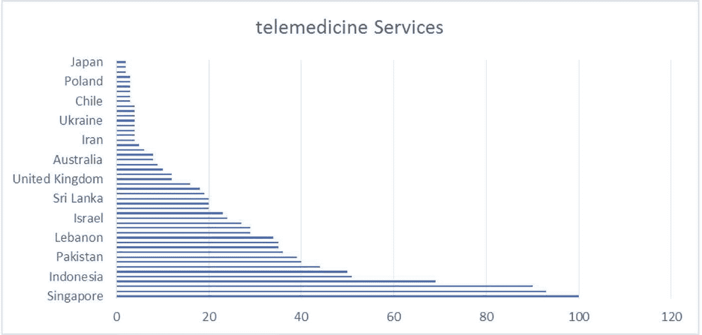

## 结论

为了分析和处理医疗数据，m-Health 系统与客户端-服务器应用程序相连接。远程医疗软件系统负责管理视频会议会话并监督患者的客户端请求消息。远程医疗会话期间传输的医疗数据、参与者身份识别信息以及远程医疗会话信息均存储在数据库中。为客户端创建了患者用户体验应用程序，用于接收来自远程医疗中央处理单元的数字化健康信息，并通过网络连接将其传输至医疗服务器。患者端程序可在台式机和手机上使用。专业浏览应用程序使医生能够从数据库中访问和监控健康信息及患者信息。笔记本电脑上的浏览器软件为医生提供的控制和选项远多于可穿戴电子设备上浏览器程序受限的浏览功能。浏览应用程序既可利用医院的固定网络，也可在外出时使用手机网络。无线安全与防护的对比展示了所提供的筛选程序。m-Health 系统中内置的防护措施旨在保障医疗数据的一致性和患者医疗信息的机密性。

## 参考文献

1.  **Pronab Ganguly and Pradeep Ray**, *远程医疗系统的软件互操作性*, IEEE CNF 2000 年 7 月 4-7 日。可访问：[`ieeexplore.ieee.org/iel5/6934/18631/00857717.pdf?tp=&arnumber=857717&isnumber=18631`](http://ieeexplore.ieee.org/iel5/6934/18631/00857717.pdf?tp=&arnumber=857717&isnumber=18631)
2.  **Cameron T. Howie 等**, *软件互操作性*；斯坦福大学集成设施工程中心，1996 年 11 月。可访问：[`www.dacs.dtic.mil/techs/interodtitle.shtml`](http://www.dacs.dtic.mil/techs/interodtitle.shtml)
3.  **Supavadee Aramvith and Ming-Ting Sun**, *MPEG-1 和 MPEG-2 视频标准*, 1999 年 Academic Press。可访问：[`www.ee.eng.chula.ac.th/~supava/doc/mpeg12.pdf`](http://www.ee.eng.chula.ac.th/~supava/doc/mpeg12.pdf)
4.  **J. R. Epps and W.H. Holmen**, *一种基于正弦高频模型的新型超低比特率宽带语音编码器*, IEEE, 2001。可访问：[`ieeexplore.ieee.org/iel5/7344/19923/00921079.pdf`](http://ieeexplore.ieee.org/iel5/7344/19923/00921079.pdf)
5.  **P. Venkat Rangan and Daniel C. Swinehart**, *Etherphone 系统中视频服务集成的软件架构*, IEEE 通信杂志, Vol 9, No 9, 1991 年 12 月。
6.  **Daojing He, Sammy Chan, Shaohua Tang, Chun Chen, Jiajun Bu and Pingxin Zhang** (2013), *一种保障无线医疗传感器网络安全的新型轻量级系统*, IEEE 生物医学与健康信息学杂志, vol. 18, No. 1, pp. 316-326。
7.  **Daojing He, Sammy Chan, Yan Zhang** (2014), *面向无线体域网的轻量级机密数据发现与传播*, IEEE 生物医学与健康信息学杂志, Vol. 18, No. 2, pp. 440-448。
8.  **Deirdre Morris, Shirley Coyle, Yanzhe Wu, King Tong Lau, Gordon Wallace and Dermot Diamond** (2009), *用于汗液监测的集成光学检测系统的生物传感纺织贴片*, 传感器与执行器 B: 化学 139, pp. 231–236。
9.  **Un-Liu, Jimin Liang, Liaojun Pang, Min Xie and Jie Tian** (2010), *基于指纹密钥生成的细节点与修改生物编码融合*, 网络与计算机应用杂志。
10. **Sriram Cherukuri, Krishna K. Venkatasubramanian and Sandeep K.S. Gupta** (2003), *Biosec: 一种基于生物特征识别的植入人体生物传感器无线网络通信安全方法*, 2003 年国际并行处理研讨会论文集, pp. 432–439。
11. **Shu-Di Bao, Yuan-Ting Zhang and Lian-Feng Shen** (2005), *面向体域传感器网络和移动医疗系统的生理信号实体认证*, 第 27 届 IEEE EMBS 年度国际会议, pp. 2455–2458。
12. **Patrick Traynor, Guohong Cao and Tom La Porta** (2006), *概率密钥管理对传感器网络安全路由的影响*, 无线通信与网络会议, WCNC, IEEE, pp. 1-13。
13. **Sungdae Choi, Seong-Jun Song, Kyomin Sohn, Hyejung Kim, Jooyoung Kim, Jerald Yoo and Hoi-Jun Yoo** (2006), *一种用于人体内外周期性数据监测的低功耗星型拓扑体域网控制器*, 第 10 届 IEEE 可穿戴计算机国际研讨会论文集, pp. 139–140。
14. **Upkar Varshney** (2008), *支持无线患者监护中紧急消息的框架*, 决策支持系统, vol. 45, pp. 981–996。
15. **Veikko Ikonen and Eija Kaasinen** (2008), *环境辅助生活设计中的伦理评估*, 辅助生活系统——模型、架构与工程方法, pp. 1–8。
16. **Vijay Srinivasan, John Stankovic and Kamin Whitehouse** (2008), *保护您的日常家庭活动信息免受无线窃听攻击*, 第 10 届泛在计算国际会议, ACM, pp. 202–211。
17. **Young-Dong Lee and Wan-Young Chung** (2009), *基于无线传感器网络的可穿戴智能衫，用于泛在健康与活动监测*, 传感器与执行器 B: 化学, vol. 140, no. 2, pp. 390–395。
18. **Eryun Liu, A.B., Jimin Liang, A., Liaojun Pang, C., Min Xie, C., Jie Tian, D.E.** (2010), *基于指纹密钥生成的细节点与修改生物编码融合*, J. Netw. Comput. Appl., vol. 33。
19. **Krishna K. Venkatasubramanian and Sandeep K.S. Gupta** (2010), *面向体传感器网络的基于生理值的高效可用安全解决方案*, ACM 传感器网络汇刊, vol. 6, no. 4。
20. **Lifang Wu, Peng Xiao, Songlong Yuan, Siyuan Jiang and Chang Wen Chen** (2011), *一种有序生物特征的模糊保管方案*, 通信杂志, vol. 6, no. 9, pp. 682-690。
21. **Min Chen, Sergio Gonzalez, Athanasios Vasilakos, Huasong Cao and Victor CM. Leung** (2011), *体域网络：综述*, 移动网络与应用, vol. 16, no. 2, pp. 171–193。


# 8 使用机器学习技术的健康信息学系统

**Sindhu Rajendran**

Emails: sindhur@rvce.edu.in; ramavenkateswarann@rvce.eduin; prashantabbi.is19@rvce.edu.in; khushiarora.cs19@rvce.edu.in; praveenkgupta@rvce.edu.in

Email: gururani@uaeu.ac.ae

## 摘要

全球大流行是人类关注的焦点。数据收集及其分析是医疗卫生领域研究和临床研究中用于决策活动的关键部分。医疗信息学系统与分析（HCI&A）是医学领域快速发展的技术，可用于分析像 2019 冠状病毒病（COVID-19）这样的大流行病。在为研究活动收集数据时，必须考虑伦理、法律和隐私问题。在协作研究中共享和重用数据时，互操作性和解释过程中需要解决数据治理和数据管理问题。由电子健康记录（EHR）收集的临床数据综合记录的共享，需要定期存储和分析。以大数据和人工智能（AI）技术为代表的新兴信息技术领域，已在 COVID-19 等近期形势下被广泛研究用于大流行病管理。探索了使用机器学习进行更好的预测性诊断和治疗的可能性。

本章讨论了人工智能在大流行病管理中的应用，包括预防、诊断、治疗，以及 COVID-19 大流行期间的关键政策决策。健康记录数字数据的收集方法被分类并列出了一些限制，因为大多数与临床和流行病学数据相关的电子记录是通过共享数据库获得的，例如国家和国际协作信息学基础设施。强调了大流行病紧急情况下数字技术的必要性，包括医疗基础设施重组和数据工作流模型。后续章节将讨论不同机器学习模型的比较研究。数字医疗信息学设想了一种去中心化的网络架构和更好的隐私与安全，例如区块链和具有机器学习能力的异构数据收集也被强调。

## 8.1 简介

### 8.1.1 COVID-19 大流行

据报道，COVID-19 于 2019 年 12 月在中国武汉首次被检测到。自最初爆发以来，病毒迅速传播，蔓延到世界各地。尽管该病毒的起源与 SARS（严重急性呼吸综合征）非常接近，但据报道其传播速度快得多。

考虑到首例病例来自中国，许多研究都集中在该地区的疫情上。这包括病毒的生物学特性、风险因素和传播趋势等因素。然而，最近研究也涵盖了世界其他地区。

一些例子包括在亚洲各地区进行的研究，例如日本“钻石公主号”邮轮上的疫情爆发。该研究使用了贝叶斯框架和哈密顿蒙特卡洛算法[[1]](#ch8.xhtml#ref8_1)。同时，日本使用泊松过程估计了确诊率[[3]](#ch8.xhtml#ref8_3)。另一项在韩国进行的研究利用易感-感染-易感模型对病毒的演变和有效再生数进行建模[[2]](#ch8.xhtml#ref8_2)。在印度，基本再生数使用经典的易感-暴露-感染-康复型隔室模型进行建模[[4]](#ch8.xhtml#ref8_4)，并使用基于深度学习的模型预测了不同州的病例数[[5]](#ch8.xhtml#ref8_5)。

即使在北美和南美，也使用了类似的方法进行分析。例如，使用易感-感染-康复模型对美国疫情到 2021 年的进展进行建模[[6]](#ch8.xhtml#ref8_6)，使用逻辑增长模型和机器学习技术预测秘鲁和巴西的疫情趋势[[7]](#ch8.xhtml#ref8_7)等。美国的另一项研究利用空间滞后和误差模型以及地理加权回归模型分析了发病率的空间变异性[[8]](#ch8.xhtml#ref8_8)。此外，在美国，使用修正的逻辑故障依赖检测模型估计死亡人数[[9]](#ch8.xhtml#ref8_9)，而利用样本选择模型研究了各州的感染率和患病率[[10]](#ch8.xhtml#ref8_10)。在哥伦比亚，使用非线性回归模型研究了发病率与社交媒体传播之间的关系。

在非洲，使用修正的易感-暴露-感染-康复模型模拟和预测了埃及、尼日利亚、肯尼亚、阿尔及利亚、南非和塞内加尔的病毒传播[[11]](#ch8.xhtml#ref8_11)。在西非，使用确定性易感-暴露-感染-康复模型预测了病毒传播[[12]](#ch8.xhtml#ref8_12)。在东非，一项研究利用自回归积分滑动平均模型预测病毒流行率[[13]](#ch8.xhtml#ref8_13)。在尼日利亚，使用普通最小二乘回归根据人员接触和旅行史预测病毒传播[[14]](#ch8.xhtml#ref8_14)。在沙特阿拉伯，使用易感-感染-康复模型和逻辑增长生成每日确诊病例预测[[15]](#ch8.xhtml#ref8_15)。

除了上述使用的许多经典模型外，统计学文献中许多更前沿的进展也催生了几种可能用于传染病建模的新模型。这些包括动态时间规整、模型选择与组合以及混合频率分析。

## 参考文献

22. Zhaoyang Zhang, Honggang Wang, Athanasios V. Vasilakos and Hua Fang 2012, '体域网中的 ECG 加密与认证', *IEEE 生物医学信息技术汇刊*, vol. 16, no. 6, pp. 1070-1078

23. Daojing He, Sammy Chan, Shaohua Tang, Chun Chen, Jiajun Bu and Pingxin Zhang 2013, '一种保护无线医疗传感器网络的新型轻量级系统', *IEEE 生物医学与健康信息学期刊*, Vol. 18, No.1, pp. 316-326

24. Daojing He, Sammy Chan, Yan Zhang 2014, '面向无线体域网的轻量级机密数据发现与传播', *IEEE 生物医学与健康信息学期刊*, Vol. 18, No.2, pp. 440-448

25. Najeh Jammali, Lamia Chaari Fourati 2015, 'PFKA: 一种用于无线体域网络的基于生理特征的密钥协商', in *IEEE 无线网络与移动通信国际会议(WINCOM)论文集*, pp. 1–8.

26. Hussein Moosavi and Francis Minhthang Bui 2016, '多跳无线体域网络中物理层安全的时延感知优化', *IEEE 信息取证与安全汇刊*, Vol. 11, No. 9, pp. 1928-1939.

27. Tilendra Choudhary and M. Sabarimalai Manikandan 2016, '用于无线体域网络和移动健康应用的鲁棒光电容积脉搏波(PPG)生物特征认证', in *IEEE 第 22 届全国通信会议(NCC)论文集*, pp. 1–6.


### 8.1.2 AI 的必要性

COVID-19 作为一种传染性极强的疾病，需要得到控制，但这样做不仅时间紧迫，而且困难重重。最重要的因素是全世界人口的健康，因为所有研究都致力于疫苗开发，各国政府也在努力实施公共卫生措施以遏制病毒传播。各国实施了封锁等措施，建议并/或要求人们除非绝对必要，否则留在家中。尽管如此，大流行的影响不仅波及医疗保健部门，还波及教育、环境和经济等部门。

随着感染病毒的个案数量持续增加，医疗服务提供者和医务人员面临的压力急剧上升，他们除了提供常规医疗服务外，还需检测和诊断潜在感染者。由于医务人员仍在努力寻找平衡点，遏制病毒的尝试必然导致常规医疗程序的匮乏和积压 [[16]](#ch8.xhtml#ref8_16)。对人员流动的限制导致因压力和焦虑而引发精神障碍的可能性增加。这些可能对人们的心理健康产生长期负面影响，并可能与自杀行为和发病率有关 [[17]](#ch8.xhtml#ref8_17)、[[18]](#ch8.xhtml#ref8_18)。

除了封锁等限制措施外，许多国家还叫停了所有非必要企业，这些企业最终被迫永久关闭，导致失业率大幅上升，并对国家经济造成严重负面影响。由于国内和国际旅行限制，旅游业受到严重冲击，导致严重依赖旅游收入的国家受到负面影响。在大流行的诸多负面影响中，也有一些积极影响，例如企业适应了更新的运作方式。例如，银行业应对更高的信用风险，而保险业正在演变并适应更新的数字化产品，这些产品提供更侧重于大流行应对的解决方案。预计汽车行业将面临近 1000 亿美元的利润减少，这可能归因于现代汽车的软件订阅服务。许多企业转向远程办公并有效降低了成本，餐饮业则转向外卖和自取服务 [[19]](#ch8.xhtml#ref8_19)。

尽管能够继续运营的企业受到限制，主要因污染减少而可能带来环境改善 [[20]](#ch8.xhtml#ref8_20)，但总体社会问题却恶化了。为控制病毒传播而实施的限制导致劳动力减少，这对妇女和少数族裔的影响最大 [[19]](#ch8.xhtml#ref8_19)。

意大利和西班牙是欧洲最早大规模受疫情冲击的国家。然而，涵盖这两个国家的大多数文献更侧重于感染的临床方面 [[21]](#ch8.xhtml#ref8_21)、[[22]](#ch8.xhtml#ref8_22)、[[23]](#ch8.xhtml#ref8_23)、[[24]](#ch8.xhtml#ref8_24) 和 [[25]](#ch8.xhtml#ref8_25)，而很少探讨流行率 [[26]](#ch8.xhtml#ref8_26)、[[27]](#ch8.xhtml#ref8_27) 和 [[28]](#ch8.xhtml#ref8_28)。

人工智能在执行人类任务方面变得日益复杂、高效和快速，且成本更低。AI 和机器人技术在医疗保健领域的前景广阔。就像在我们的日常生活中一样，人工智能和机器人技术正逐渐更深度地融入医疗保健生态系统。一些用例如下。

#### 维护健康

人工智能在医疗保健领域最大的潜在益处之一，是帮助个人维护健康，从而减少看医生的频率。AI 和医疗物联网 (IoMT) 已在消费者健康应用中帮助个人。这些应用鼓励积极管理健康生活方式，让消费者掌控自己的健康和福祉。

此外，人工智能增强了医务人员了解患者日常模式的能力，以便协助他们。这使他们能够提供更好的指导、反馈和支持。

#### 早期检测

在人工智能的协助下，疾病能够被更准确、更早地诊断出来。癌症就是一个例子。高比例的乳腺 X 光检查会产生假阳性或错误结果。这导致健康女性被告知患有癌症，或者更糟的是，患病者未能被正确诊断等。人工智能能以 99% 的准确率，将乳腺 X 光片的回顾和解读速度提高 30%。这大大减少了不必要的活检需求 [[29]](#ch8.xhtml#ref8_29)。

可穿戴医疗设备的增长也可以与人工智能相结合。此类设备被用于早期监测心脏病，帮助医务人员和其他护理人员进行监测，并希望在可治疗的早期阶段检测到可能致命的发作。

#### 治疗

除了分析慢性病患者不良发作的风险因素外，人工智能还可以帮助医务人员采取更全面的疾病管理方法，并帮助患者更好地管理长期治疗方案。

机器在医疗生态系统中已应用 30 多年。这些设备从简单的实验室机器到极其复杂的手术机器人不等，后者既可以辅助人类，也可以独立执行手术。此外，医院和实验室还将它们用于物理治疗、康复以及长期合并症患者的重复性任务。

#### 临终关怀

与前几代人相比，我们寿命更长，当我们接近生命终点时，死亡以一种更缓慢、不同的方式到来。越来越多的疾病，如心力衰竭、骨质疏松症和痴呆症，导致缓慢死亡。除了疾病，孤独也困扰着生命的这个阶段。

机器人和机器极有可能彻底改变临终关怀。它们可以帮助个人更长时间地保持独立，并有助于降低住院需求。人工智能结合类人机器人的进步，使机器人和机器能够与人类进行对话和其他社交互动，以保持老年人的思维敏捷。

#### 研究

医疗领域的研究耗时且昂贵。据加利福尼亚生物医学研究协会统计，一种药物从研究实验室走向公众平均需要 12 年。在约 5000 种进入临床前试验的药物中，只有 5 种进入人体测试，而其中仅有 1 种会获批用于人类。此外，制药公司开发一种新药的平均成本约为 3.59 亿美元，涵盖从研究实验室到患者的全过程 [[30]](#ch8.xhtml#ref8_30)。

人工智能在医疗行业较新的应用之一是药物研究与发现。最新的 AI 进展旨在简化药物发现和再利用流程。这些流程有潜力大幅降低将新药推向市场所需的成本和时间。

#### 培训


受训人员现在可以在人工智能的帮助下体验逼真的模拟训练。此类模拟无法通过基本的计算机驱动算法来实现。自然语音识别的出现以及 AI 计算机能够近乎瞬间地调用大量场景数据库，意味着可以对受训人员的问题、建议和/或决策进行彻底的质疑和核查，这是人类无法做到的。由于 AI 具有自我学习的特性，挑战可以根据受训人员之前的反应，持续调整以适应其学习需求。

随着技术的进步，人工智能现在甚至可以在智能手机上使用。因此，培训可以随时随地进行，如果在处理完非典型病例后或甚至在途中需要快速补课，也能轻松实现。

### 8.1.3 人工智能 vs. 机器学习 vs. 深度学习

人工智能、机器学习和深度学习是数据科学的组成部分，它们虽然彼此联系非常紧密，但却截然不同。

#### 人工智能

自著名数学家艾伦·图灵提出“机器能思考吗？”这一问题以来，人类一直致力于创造人工智能。人工智能使机器能够“思考”。换句话说，机器能够在没有任何人为干预的情况下做出决策。它属于计算机科学的一个分支，专注于使机器表现出拥有与人类智能相当的智能。

根据模拟人类行为的能力、实现所用的硬件、现实世界的应用以及设计理念，人工智能系统可进一步分为多种类型。基于这些因素，所有人工智能系统均可归入以下类型之一。

#### ANI：弱人工智能（Artificial Narrow Intelligence）

当今世界存在的唯一有人工智能子类别是 ANI。它也被称为弱 AI。每项任务都是通过编程执行且以目标为导向的。弱人工智能的例子包括聊天机器人、Siri、Alexa、自动驾驶汽车等。

实现 ANI 的系统不像人类那样具有感知力、意识或情感驱动。它们利用指定数据集中的数据，无法执行除其设计目的之外的任何其他单一任务。

#### AGI：强人工智能（Artificial General Intelligence）

AGI 也被称为强 AI，目前更多处于概念层面。在 AGI 中，机器展现出人类智能，并具备在特定情境下以与人类极其相似的方式学习、理解和执行任务的能力。其行为几乎与人类行为无法区分。AGI 目前尚不存在，但一直是许多科幻电影的主题，在这些电影中，机器不仅智能，而且拥有意识、自我意识并受情感驱动。

强 AI 可能赋予我们构建机器和机器人的能力，它们能够同时思考、规划和执行多项任务，甚至在不确定条件下也能做到。它们能够将已有的先验知识融入决策过程，从而设计出创新、非传统且富有创造性的解决方案。

#### ASI：超人工智能（Artificial Super Intelligence）

ASI 迄今仍是一种假设形式的人工智能，其中机器将能够展现出超越人类智能能力的智力。除了拥有人类所具备的多方面智能外，通过这种类型的人工智能，机器将能够实现更好的决策和解决问题的能力。人们希望这些能力将远超人类。然而，这种类型的人工智能可能产生的负面影响是：由于它将对人类产生巨大影响，预测认为如果这项技术成为现实，可能会导致人类灭绝。

#### 机器学习

机器学习的概念利用统计学习算法创建系统，使其能够自动从经验中学习并自我改进，而无需显式编程。它是人工智能的一个子集。

推荐系统（如 Netflix、YouTube、Spotify）、搜索引擎（如 Yahoo 和 Google）以及语音助手（如 Alexa 和 Siri）等服务均使用 ML。在机器学习中，算法通过提供海量数据进行训练，并通过处理给定数据来学习。

机器学习算法主要可细分为三大类：监督学习、无监督学习和强化学习。

#### 监督学习

在该类学习中，输入变量和输出变量被采用，并使用算法来学习输入与输出之间的映射关系。因此，在监督学习算法中，输入是已知数据集，输出是其对输入数据的已知响应。接收到这些数据后，算法学习模型（无论是回归还是分类），然后训练模型以对新数据（也称为测试数据集）的输出进行预测。

#### 无监督学习

当我们拥有的数据未加标签时，会使用无监督学习。该类学习的主要重点是通过推断数据集中的模式来更多地了解数据，而不参考已知的输出。它自行对未排序的数据进行分组，因此得名“无监督学习”。它通过寻找数据中的相似性、差异性和模式来对数据进行分组。这种学习类型主要用于探索性数据分析和降维。它也常用于在未排序的数据集中寻找数据簇。

#### 强化学习

强化学习是通过不断与环境交互来进行的学习。在该类 ML 算法中，智能体通过试错法，利用来自其先前行动和经验的持续反馈，从交互式环境中学习。在该类学习中，智能体执行正确动作时会获得奖励，执行错误动作时会受到惩罚。

#### 深度学习

深度学习是一种 ML 技术，其灵感来源于人类大脑过滤信息的方式，即通过例子学习。这有助于模型通过不同层过滤信息，从而预测和分类数据。深度学习主要应用于人们所做的应用中，因为它处理信息的方式类似于人脑。

深度学习是自动驾驶汽车背后的核心技术，因为它使汽车能够识别交通信号并区分路灯柱和行人。深度学习方法也常被称为深度神经网络，因为它们大多使用神经网络架构。

### 8.1.4 医疗信息学系统与分析

医疗信息学研究在计算机技术、信息科学、统计建模技术等方面均有应用，属于一项科学事业。它通过开发决策支持系统，用于改善患者护理结果和医疗服务提供者的绩效。分析中涉及的策略包括以下内容：

- 为探索而构建数据仓库；
- 数据挖掘；
- 确证性统计分析应用；
- 在信息与计算机系统技术接口的帮助下进行模拟；
- 转化研究。


## 医疗信息学与分析 (HCI&A)

医疗信息学与分析，也称为 `HCI&A`，自先进数据分析技术应用于医疗保健领域以来，发展迅速。`HCI&A` 目前是学术研究人员和从业者的重要研究领域。因此，这一新兴领域带来了大量的机遇和挑战。这些机遇和挑战与医疗数据管理以及先进分析在医疗保健领域的应用有关。

## 8.2 区块链的概念

`Blockchain` 是一种记录信息的方法，使得篡改、黑客攻击或欺骗系统几乎成为不可能。

从本质上讲，`blockchain` 是一个交易的数字账本，它被复制并重新分发到 `blockchain` 上存在的整个系统网络中，该网络使用不可变的加密签名。`blockchain` 中的每个区块都包含多笔交易，每当发生一笔交易时，该交易的记录就会被添加到每个成员的账本中。`分布式账本技术 (DTL)` 是由多个参与者管理的去中心化数据库。

在传统方法中，想要记录交易和追踪资产的参与者必须保存自己的账本。这种方法被证明成本高昂，部分原因是它涉及收取服务费和便利费的中介机构。考虑到协议执行中的延迟，它也不是很高效。维护多个账本也耗费大量精力。另一个需要注意的关键点是，在传统方法中，系统很脆弱，因为如果中心系统本身因任何原因（例如黑客攻击、欺诈，甚至简单的人为错误）而损坏，整个系统甚至整个业务都会受到影响。因此，许多商业网络现在已转向使用 `blockchain` 技术。这种架构使成员能够共享一个账本。每当发生交易时，该账本就会通过点对点复制进行更新。这意味着网络中的每个 `node`（也称为参与者）既是发布者又是订阅者。

在任何交易被添加到 `blockchain` 之前，涉及多个关键步骤。其中包括认证（借助 `cryptographic keys`）、授权（借助 `proof of work`）等。

### 认证

`blockchain` 的初始设计目标是能够在没有任何中央权威的情况下运行。然而，交易仍然需要经过认证。`Blockchain` 通过使用 `cryptographic keys` 来实现这一点。`Cryptographic keys` 是标识参与者并提供其在系统上访问其“钱包”或“账户”权限的数据字符串。每个参与者都拥有一组唯一的 `private key` 和 `public key`。`public key` 对所有人可见。这两个密钥共同创建了一个安全可靠的数字身份，通过使用 `digital signatures` 来认证参与者，从而“解锁”他们打算执行的交易。

### 授权

交易经过参与者认证并达成一致后，在被添加到 `blockchain` 之前，需要经过授权或批准。

对于公共 `blockchains`，将新交易最终添加到链中的区块是通过 `consensus` 完成的。换句话说，为了添加交易，网络上的大多数计算机（也称为 `nodes`）需要同意这是一笔有效交易。拥有网络上计算机的个人进行的交易验证通过奖励获得激励。这被称为“`proof of work`”。

### 工作量证明

要求网络上拥有计算机的个人解决复杂的数学问题以便能够向链中添加新区块的过程称为 `proof of work`。解决此类问题称为“`mining`”，解决这些问题的人称为“`miners`”。这些 `miners` 通常因其工作而获得 `cryptocurrency` 奖励。

尽管看起来容易，但 `mining` 是一个困难的过程。设定的问题被解决的几率约为 5.9 万亿分之一，只能通过试错法来解决。这需要大量的计算能力，消耗大量的能源。换句话说，考虑到每台计算机可能需要数年时间才能找到问题的解决方案，`mining` 的奖励必须超过计算机的费用以及运行计算机的电费。

### 工作量证明的问题

为了增加形成规模经济的机会，`miners` 经常在组织大量 `miners` 并共享 `blockchain` 提供奖励的公司帮助下汇集资源。

随着越来越多的计算机加入网络尝试解决问题，`blockchain` 不断增长，问题的复杂性也随之增加。理论上，链被进一步重新分发，这使得黑客攻击或破坏变得更难。但实际上，随着 `mining` 算力集中在少数几个矿池中，这些组织现在拥有足够的计算能力和电力来维护和扩展基于 `proof of work` 验证的 `blockchain` 网络。

### 权益证明

较新的 `blockchain` 网络实施了一种称为“`proof of stake`”的新型验证协议。在这里，参与者必须在 `blockchain` 中拥有权益，才有资格获得选择、验证和确认交易的机会。这种权益通常是拥有 `cryptocurrency`。由于此处不需要 `mining`，因此节省了大量的计算能力。

此外，`blockchain` 中的新技术开始包含“`smart contracts`”。一旦满足特定条件，这些合约会自动执行交易。

在 `blockchains` 中，上一个区块的标识符被包含在下一个区块的标识符中。这创建了一个不可变且牢不可破的链。随着越来越多的区块被添加，保持 `blockchain` 中数据可管理性和安全性的关键在于哈希以及 `Merkle tree`（一种合并数据结构）。

类似于密码生成器，交易验证后将通过 `hash algorithm`。该 `hash algorithm` 将其转换为唯一的字母和数字元组。此外，几个交易 `hashes` 将被合并并再次通过 `hash algorithm` 以生成一个新的唯一 `hash`。此过程持续进行，直到只剩下一个 `hash`。这个 `hash` 被称为多笔交易的“`root`”。

`Hashes` 被用作 `blockchains` 的关键安全特性，因为它们是唯一的且单向工作。相同的数据每次都会产生相同的字母和数字 `hash`，使哈希处理一致且可靠。另一方面，无法使用字母和数字解密原始数据。换句话说，无法逆向哈希过程。

由于如果使用相同的交易重复哈希过程会生成相同的 `hashes`，因此任何使用 `blockchain` 的人都可以检查数据是否被篡改，因为任何对数据的篡改都会导致生成完全不同的 `hash`。这将进而影响直到 `root` 的所有 `hashes` 迭代。这被称为 `Merkle tree`。


## 8.2 Merkle 树

Merkle 树的目的是通过将多次哈希处理的交易汇总为单一根哈希，显著减少需要存储、传输或在整个网络中广播的数据量。根哈希本身具有标准大小，因为每笔交易都经过哈希处理，与另一笔经过哈希处理的交易组合，然后再次哈希。

### 8.2.1 区块链的网络架构

区块链因其功能而得名。它由存储数据的区块组成，这些区块相互链接形成一条链。随着交易数量的增加，区块链的规模不断增长。区块链网络中的架构组件包括：

*   交易
*   区块
*   P2P 网络
*   共识算法

#### 交易

交易是区块链系统最简单的构建模块。通常包含发送方地址、接收方地址和数值。它类似于典型的信用卡账单。所有者通过对将前一笔交易和接收方公钥相加生成的哈希进行数字签名来转移价值。

然后将交易公开披露给网络，每个节点都持有自己的区块链副本。通过按顺序处理区块链中的每笔交易来计算当前已知的“状态”。交易被分组并以区块的形式传输给每个节点。每个节点在交易通过网络传播时独立验证并“处理”新交易。每笔交易都有时间戳，并被归组到一个区块中。

#### 区块

一个区块包含以区块头形式存在的信息以及交易。区块是复制到网络中所有节点的数据结构，用于捆绑交易集合。矿工是在区块链中创建区块的人。创建一个将被网络其余部分接受的合法区块的过程称为挖矿。节点在验证待处理交易在密码学上正确后，将其打包成区块存储在区块链上。区块头中的元数据用于验证区块的有效性。交易构成了区块的其余部分。根据矿工的偏好，一个区块可以包含任意数量的交易。

#### 区块类型

大多数区块只是添加到当前的主区块链上，这也是网络中最长的链。这些被称为“主链区块”。一些区块指向不在最长区块链上的父区块。这些区块被称为“侧链区块”。一些区块关联到执行该区块的节点未知的父区块。这些被称为“孤儿区块”。

尽管侧链区块尚未成为主链的一部分，但如果后续挖出的区块将它们作为父区块，特定的侧链可能会重组为主链。这引入了分叉的概念。

#### P2P 网络

区块链是一个使用 IP 进行通信的点对点 (P2P) 网络。P2P 网络没有中心化节点，具有扁平拓扑结构。通过共识过程协作，所有节点可以平等地提供和消费服务。节点贡献维持网络运行所需的算力和存储。P2P 网络通常比中心化网络更安全，因为它们没有单点攻击或故障。区块链网络中既可以有许可制网络，也可以有无许可制网络。因为任何人都可以加入无许可制网络，所以它也被称为公有链，而许可制区块链被称为联盟链。许可制区块链有时称为私有链，要求对网络参与者进行预先验证，参与者通常彼此知晓。在典型的区块链设计中，网络中的每个节点都维护一份区块链的本地副本。区块链架构所基于的 P2P 网络完全负责其去中心化特性。

#### 共识算法

共识技术用于同步单一账本的所有这些副本。共识方法确保每个参与者拥有的任何本地副本彼此一致且是最新的。每个单独节点都拥有相同或相似的副本。可以说共识算法是每个区块链设计的核心。

#### SBFT – 简化拜占庭容错

这里的主要概念是单个验证者打包提议的交易并创建一个新区块。鉴于账本的许可制架构，验证者是已知的一方。当网络中少量其他节点验证新区块时，即达成共识。

## 8.3 数据泄露的概念及区块链如何克服它

在当今世界，“黑客攻击”和“数据泄露”等术语在人们心中引起了极大的恐惧。黑客对任何组织构成巨大威胁，无论其规模大小。

自 GDPR（即《通用数据保护条例》）及其他类似数据安全法规出台以来，公司一直在起草政策并开发更好的技术来保护其数据和信息。在这些努力中，区块链技术备受关注，被认为可能帮助组织安全地存储敏感数据。

区块链是一种去中心化技术。这意味着系统需要所有参与者同意才能将任何新交易添加到网络中。此外，一旦交易被添加到链中的区块，就无法被篡改，因为区块链是一个共享账本。

区块链是一个自我审计的系统。其网络保持共识状态，并每 10 分钟自动自我检查一次。这提供了许多好处，包括记录本质上是公开且可验证的，因为区块链不存储在任何特定的单一位置。由于所有参与者之间的透明度，这使得交易更快、更安全。此外，由于系统中没有数据的中心化版本，区块链无法被单个个人或实体控制，因此任何人想要破坏或黑入数据都非常困难。

在中心化系统中，一旦黑客掌握了哪怕一个版本的数据，其余系统基本上就掌握在他们手中。区块链则不然，因为即使黑客掌握了链中的一个区块，他们也必须访问所有后续区块才能控制整个系统。因此，如果一个组织每天在区块链上进行数百万笔交易，几乎不可能访问系统中的所有信息区块。根据涉及的数据类型，黑客攻击的后果可能从数据销毁或损坏，到机密信息泄露，甚至知识产权盗窃。

### 8.3.1 数据泄露目标

当企业的数据对第三方有用或有价值时，该企业就会成为数据泄露的目标。不同类型的数据将根据对该企业的不同风险等级具有不同程度的价值。可能被攻击的几类数据如下：

*   联系信息、社会安全号码、教育背景、出生日期和其他个人信息是个人身份信息的示例。
*   原有健康问题、处方药、疗法和医疗记录都是健康信息的示例。
*   金融数据包括信用卡/借记卡号和有效期、银行账户、投资信息等。


- 用户名和密码列表、加密密钥、网络布局以及安全策略，均属于 IT 安全数据的范畴。
- 产品图纸和手册、规格书、营销文案和标识、科学公式、专有软件以及公司生成的其他内容，均属于知识产权范畴。
- **法律信息** – 此类别包含法庭文件、并购详情、关于公司运营的法律意见以及监管判决等信息。
- 竞争对手数据、定价信息、市场研究和公司计划，均属于竞争情报范畴。

上述类型的信息对第三方具有价值并吸引其关注。可用于欺诈、身份盗窃或营销的财务、个人和健康相关数据，可轻松变现出售。知识产权相关数据的泄露可能被竞争对手利用以阻碍公司计划，而法律数据的泄露可能损害公司的法律地位。同样，IT 相关数据也是极具价值的攻击目标，因为未经授权的人员一旦获取访问权限，便可接触到系统中存储的所有其他数据。

在医疗保健领域，任何患者的健康记录信息均至关重要，应视为敏感数据，因为其具有机密性。若该数据被黑客攻击或篡改，因过往健康记录被篡改，将对患者构成重大威胁。从根本上说，这将影响医务人员的决策，在最坏的情况下，甚至可能导致致命后果。引入区块链技术将极大地降低此类事故发生的几率，并保障整体公共卫生安全。

### 8.3.2 数据泄露威胁

数据泄露威胁可能由公司员工、供应商、顾问或任何拥有网络访问权限的个人发起，甚至可能来自公司外部。获取数据的几种途径包括：外部电子邮件账户、云端或移动设备。传统防护系统已不足以保障数据安全。

针对内部人员，数据保护技术可能失效，因为不满的员工可能决定为谋取私利而泄露信息。组织外部人员可能通过访问邮件或向员工电脑植入恶意软件来窃取其凭证。鉴于此类威胁，企业如今必须评估数据泄露的后果，以寻找解决方案并降低风险。

### 8.3.3 数据泄露后果

企业因数据泄露而面临的严重后果日益增多。这主要归因于通知数据遭泄露人员的监管负担加重。根据司法管辖区的不同，遭遇数据泄露的企业需遵守的通知要求和面临的处罚也各不相同。

数据遭泄露的公司需要确定其客户居住地以及对该区域拥有管辖权的监管机构。这些机构根据遭泄露的数据类型制定通知法规。这包括通知发送给谁、如何发送，以及是否需要通知特定机构。通常，涉及财务、个人和健康数据的泄露均需遵守这些要求。拥有国际客户群的企业，其客户可能分布在多个司法管辖区，因此要求也会有所不同。合规成本加上法律罚款、潜在赔偿和可能的诉讼，费用极高，可能给企业造成严重的经济损失。

由于区块链技术基于加密算法，并分布在庞大的只读计算机网络中，它有助于维护更安全的记录，并增加了如同坚不可摧的墙般的安全防护。区块链基于完全的问责制。最终用户可以对系统进行全面审计，并验证其是否完全按承诺运行。企业越来越多地将公有区块链技术视为竞争优势并加以采纳。

## 8.4 现状与未来展望

医疗保健行业复杂精密。尽管该领域在疫苗、药物、医药、临床试验等方面经历了深刻创新，甚至采用了云计算等各种新技术，但在患者数据、数据分析、供应链管理、药品溯源、网络安全等方面仍需取得进展。

区块链有能力消除上述问题，并通过将患者置于医疗生态系统的核心位置来重塑医疗保健行业。它还能建立更高的安全性、互操作性，并保障存储的患者记录的隐私与安全。2019 年区块链技术在医疗行业的价值为 21.2 亿美元，预计在预测期内（2020-2025 年）以 8.7% 的复合年增长率（CAGR）增长，到 2025 年将达到 34.9 亿美元。

因此，越来越多的公司正在探索区块链技术在医疗行业患者记录方面的应用前景。从优化支付选项、追踪医药产品到患者数据去中心化，区块链均可证明是不可替代的工具。

区块链革新医疗行业的几种方式如下。

### 8.4.1 药品溯源

几十年来，药品造假一直是医疗行业的主要问题。根据健康研究资助组织的数据：

- 进入发展中国家市场的药物中有 10%-30% 是假冒或仿制版本。
- 这些克隆药物的在线销售额每年高达 800 亿美元。
- 假冒医药产品的年市场规模超过 2000 亿美元。
- 2014 年，知名制药公司辉瑞生产的约 60 种不同类型的药物和产品被造假。根据世卫组织数据，16% 的假冒医药产品包含错误化学成分或不正确的物质含量，危及患者，进而危及整个医疗行业。

此类假冒药品在成分和质量上与原版药品存在实质性差异。因此，它们对患者极具危险性，因为产品不含其声称的成分。换句话说，“药物”无法治疗疾病，反而可能因意外副作用对患者造成进一步伤害。

由于区块链以其安全性和不可篡改性著称，所有记录（无论新旧）均会被打上时间戳以作记录。这些带时间戳的记录不可篡改。这保证了记录数据的神圣不可侵犯。该技术不允许个人篡改数据，从而有助于追踪任何产品。

医疗行业利益相关者面临的最大问题之一是，他们对供应链图谱的视角不完整，而非缺乏对投放市场产品来源的合规性验证。结果导致假冒医药产品进入供应链并流向患者。通过区块链，利益相关者可访问所有记录信息和交易历史，从而追踪交付市场的供应链中的每一个产品。

### 8.4.2 临床试验


## 区块链在临床试验和医疗数据管理中的应用

在临床试验的各个阶段前后，会产生大量的患者数据和健康信息。其中包括大量患者的血液检测结果、统计数据、质量报告、健康调查和临床文档。由于该过程要求极高且周期漫长，因此难以追踪每一个人的情况。错误时有发生，既有无心之失，也有故意为之。由于制药公司和赞助方投入数百万美元资助这些试验，根据结果不同，财务后果可能非常严重。如果试验结果积极并促成新疫苗或疗法的开发，将带来巨额利润；反之则会造成巨额财务损失。为了规避后者，欺诈行为屡见不鲜。这始于对可能危及临床试验进展的关键数据进行操纵、篡改或隐瞒。结果引发争议，损害组织在权威机构和监管患者中的信誉。

当你使用关键词搜索网络时，区块链将显示搜索结果，其中将包含所有相关记录或文档。如果需要使用交易模型将新信息添加到账本，账本节点必须一致认为该信息结合数据历史来看是合理且有效的。如果任何网络参与者想要更改现有的健康数据堆栈，他们必须更改网络中所有机器上的数据。区块链技术的这一关键特性防止了临床试验中的数据被篡改。每一条试验数据都会被赋予一个与文档内容对应的唯一代码。如果医疗从业者检查记录的数据并对其合法性存疑，他们可以通过将其与区块链系统中保存的原始数据进行比对，轻松验证其真伪。为此，他们必须运行该数据，从而生成一个新代码。该新代码必须与原始代码进行比对。如果两者相同，意味着保存的健康信息未以任何方式被篡改。这将增加医疗专业人员与药房等第三方之间的协作，为更多科学进步铺平道路，特别是在罕见病治疗领域。

### 8.4.3 患者数据管理

目前，处理患者数据管理的医疗专业人员面临两大主要困难。首先，患者存在个体差异。适用于某位患者的治疗方案可能不适合另一位患者，因此无法开具处方。出于这个原因，获取他们的病历记录至关重要，以便生成以患者为中心的个性化治疗方案。

其次，保存此类信息、提供访问权限以及在医疗领导者之间共享信息，构成了一大障碍。在传输高度敏感的个人医疗数据时，安全网络是必经之路。科学突破要求将医疗数据存储在安全的网络安全架构中，而此类架构的缺失是其发展的主要障碍。此外，由于缺乏统一数据库，这些信息碎片化地存储在多个站点，给研究人员带来了巨大困难。需要搜索众多站点才能引用所需信息，这进一步拖慢了流程。

还有数据所有权问题需要考量。患者无法完全控制自己的医疗记录。他们有能力随意修改或删除信息。这可能带来严重的健康后果，危及患者安全。然而，弊端在于如果患者无权拥有数据，他们将不知晓是谁在访问和使用这些数据。

区块链基于成熟的加密技术，为数据共享提供了合适的网络安全架构。医疗服务提供者将患者姓名、出生日期、处方、实施的操作和门诊记录录入电子健康记录（`EHR`）。这些数据存储在云计算或现有数据库中。在区块链系统内，所有这些数据源通过患者分配的 `public ID` 关联到特定的 `hash`。通过使用 `smart contracts`，患者控制数据访问权限。

利益相关者可以使用 `API` 搜索数据、查明其位置并获取数据。`API` 将提供患者的定制化健康信息，但不会泄露其他任何内容，例如患者身份。患者可以使用 `smart contracts` 向任何利益相关者展示其完整病史。`smart contracts` 中的医疗记录访问权限通过 `API` 提供给患者。

医疗行业广泛依赖区块链，以及机器学习和人工智能等其他先进技术。以下是区块链通过合作改变医疗行业的一些现实案例。

#### 药品供应链的变革

根据一家知名研究机构发布的市场情报分析，如果应用得当，区块链技术有潜力提升制药供应链的安全性、隐私性、数据溯源能力和功能性。

医疗供应链一直在寻找解决方案，以应对药品假冒和伪劣问题。基于区块链的公司 Viant 正为葛兰素史克等制药巨头提供供应链解决方案，旨在彻底消除这一问题。该方案建立在区块链追踪技术之上，将微调医疗行业的供应链。

#### 临床试验的账务管理

在当前形势下，临床试验已成为新常态。利用账务管理流程准确追踪财务状况是当前的迫切需求。这对于临床试验的顺利运行和评估至关重要。这就是区块链公司提出新方法使账务管理和财务报告更高效的切入点。勃林格殷格翰已与 IBM 合作，开发基于区块链的账务管理解决方案。该数据库旨在突显其首个临床试验项目。账务管理流程的许多环节将因此提升十倍效率。

#### 表单填写流程

当有人因重病需要住院时，繁琐的大量文档填写流程导致入院手续耗时甚久。这简直像攀登珠穆朗玛峰一样令人精疲力竭！像 Kalibrate Blockchain 这样的公司正利用区块链实现任务自动化，为我们节省时间和精力。他们开发了 `FormDrop`，一款基于 `Universal Patient Index` 区块链驱动引擎的移动应用程序。任何人都可以使用这款软件在前往医疗机构前预先填写文书工作。这样他们就能省去排队等候的时间。这将有助于提高医护人员的工作效率。

#### 医疗健康区块链的优势

基于区块链的实际应用及其可解决的医疗行业难题，可以推断出区块链技术具有以下优势和益处。

#### 强健的监控

强大高效的交易监控主要是当前医疗网络管理团队最需要的功能之一。区块链区别于其他医疗管理系统的特性在于，它创建了所有交易的去中心化记录。其核心优势在于精确透明，节省了时间、精力和金钱，也免去了持续管理的麻烦。


## 协作增强

任何医疗保健计划的成功在很大程度上依赖于相关人员，如第三方、专家和研究人员。通过使用分布式账本技术，区块链技术改善了这些人员之间的协作，使他们能够贡献深度见解并开展团体研究。

## 数据保护

医疗保健行业面临的根本问题，如前几节所述，是重要数据的泄露及其被用于有害目的和其他既得利益。另一个优先领域是确保数据库参与者和相关方能够访问最新、最准确的患者数据和诊断信息。由于多层加密组件，区块链上的数据不易被篡改，甚至无法被更改，从而解决了涉及安全漏洞的主要问题。

## 治疗成本效益与流程简化

强大、高效且卓越的数据共享能力，加上医疗保健行业利益相关者之间的快速分发，改善了各种疾病预算内治疗和疗法的开发。

详细程序以 `EHRs`（电子健康记录）的形式记录交易。这是记录以数字形式存在的唯一形式。简化复杂操作并通过去除额外验证来增加安全性是其直接结果。

## 面向未来的医疗区块链预测

区块链在医疗保健领域的潜力似乎极具前景，因为它有助于解决该行业一些最紧迫的困难。我们预见了一个进步的未来，因为区块链是去中心化的，这与大多数集中式的医疗记录不同。一个未来是区块链被用作一个系统的一部分，在该系统中患者管理自己的医疗数据，而不是依赖中央来源。当然，区块链的使用也有其自身的一系列技术困难。记录、查找和检索数据的过程可能复杂且耗时，但借助 `ML` 和人工智能等新兴技术，这些问题很快就会得到解决。

## 未来面临的现有挑战

区块链是一项在各个行业中日益受到关注的新技术 [41]，并提供了许多益处 [42] 和潜力 [43]。然而，这项技术也带来了必须解决的问题。在本节中，我们将探讨一些最紧迫的问题。

### 数据安全与隐私

数据的隐私和安全 [44] 是首要的重要挑战。随着基于区块链的应用程序的引入，交易对第三方的需求被消除 [42]。由于区块链技术允许整个社区（而非单一受信任的第三方）验证区块链架构中的记录 [45]，数据变得容易受到潜在的隐私和安全问题的影响。数据隐私将受到损害，因为所有节点都可以访问由单个节点传输的数据。

当没有第三方进行授权时，患者必须指定一名或多名代表，在紧急情况下代表他们访问病历和信息。该代表现在可以授予一群人访问同一患者记录的权限，构成重大的数据隐私和安全风险。当对数据应用高安全技术时，会在从一个区块向另一个区块传输数据时制造障碍，导致接收者获得受限或缺失的信息。此外，区块链网络容易受到所谓的 `51%` 攻击 [46]。这种攻击由控制区块链网络中超过一半区块的一组矿工发起。矿工获得网络控制权，如果未获得同意，他们可以阻止任何新交易的发生。根据 coindesk [47] 报道，最近有五种加密货币遭遇了这种攻击。此外，患者记录可能包含不应存储在区块链上的敏感信息 [48]。

### 存储容量管理

在这方面出现的一个新问题是存储容量管理。区块链不需要巨大的存储空间，因为它是为记录和执行涉及交易的数据而构建的 [49]。随着它逐渐扩展到医疗保健领域，存储问题变得明显。每天，医疗保健行业都必须处理大量数据。在区块链场景中，从患者记录、健康史、检测报告到 X 光片、MRI 扫描报告和其他医学影像，所有内容都将对链上的所有节点可用，这需要巨大的存储空间 [`ax`, `ay`]。此外，由于区块链应用程序基于交易，用于支持该技术的数据库倾向于快速增长。随着数据库规模的扩大，记录的搜索和访问速度降低，使其不适合速度至关重要的交易。因此，区块链系统必须具有可扩展性和耐用性 [52]。

### 互操作性问题

互操作性 [44] 是区块链面临的另一个挑战，涉及使来自不同通信服务和提供商的区块链以无缝且合适的方式相互通信。这个问题使得有效共享数据变得困难 [53]。

### 标准化挑战

由于区块链技术仍处于初级阶段，随着它向医疗和健康领域的实际应用迈进，它无疑将面临标准化问题。需要国际标准化机构提供一些经过良好认证和批准的标准。这些预定义标准可用于确定区块链应用程序中传输数据的性质、大小和格式。这些标准不仅将评估共享数据，还将作为安全预防措施发挥作用。

### 社会挑战

由于区块链技术仍处于早期阶段，除了上述技术挑战外，它还面临文化变革等社会问题。尽管医疗保健行业正逐渐走向数字化，但在其完全拥抱这项技术（特别是尚未经过临床验证的区块链）之前，我们仍有漫长的道路要走。

说服医生放弃纸质记录转而使用技术需要时间和精力。由于在医疗行业采用率低，所提供的技术和策略在一定程度上是不可靠的 [52]。由于所有这些挑战和风险，我们目前无法将其描述为解决所有医疗保健困难的可行且通用的答案 [42]。

## 结论

区块链将在改变医疗保健系统和确保医疗保健的未来方面发挥关键作用。随着医疗区块链大规模存储和保护海量数据，提供定制化治疗的概念不再似乎是一个无法实现的梦想。到明年年底，我们希望基于区块链的生产应用程序将成为主流。


## 医疗保健领域的区块链

尽管医疗保健行业在获取新突破方面有时落后于其他行业，但鉴于其潜在利益的完整性，现在可能是拥抱医疗保健行业区块链技术的合适时机。在管理基于区块链的电子健康记录时，可能有几个主要考量点。智能合约将创建一个不可破坏的区块链，在保持临床框架内的同时兼顾个性化护理。融合的临床系统将利用区块链智能合约，防止在父级中心化系统中创建任何重复副本。研究人员可能从区块链中受益，因为它可以提供可验证且带时间戳的科学调查版本，从而使研究人员能够长期追溯其发现历史。区块链是大型制药行业必备的技术。

利用区块链可以解密所有制药协会的报告分发。这种方法将提高数据准备的速度，确保记录分发的准确性，并降低档案丢失、损坏或伪造的风险。创新本身负责这些利益点：已创建的区块无法被篡改或删除。区块链将确保数据不被篡改。任何劣质或假冒药品的供应都将被拒之门外。这是通过控制制药供应链的所有环节来实现的，包括生产、物流和分发。

医疗从业者、研发专家、医疗实体、医疗服务提供者和生物医学研究人员将受益于区块链技术的实际应用，因为它将允许他们更有效地分发大量信息、共享临床知识和传达建议，同时保持更高的隐私和安全保护。区块链可用于存储数字化大脑，并可用于神经控制系统。只有少数组织证实区块链技术可在神经技术领域发挥作用，而该领域仍处于早期阶段。

然而，个人大脑数据在区块链上存储的安全性尚不清楚。尽管区块链的开放结构无疑将防止未经授权的数据修改和篡改，但关于大规模数据收集的许多常规担忧依然存在：第三方为可疑营销目的参与敏感数据交易；个人仍可能通过假名标识符或数据模式被间接识别。因此，这种基于区块链的医疗保健框架将鼓励个人更积极地参与其医疗保健，从而以更适当的方式提高生活质量。

## 参考文献

1. Mizumoto K., Kagaya K., Zarebski A. and Chowell G., 2020. Estimating the asymptomatic proportion of coronavirus disease 2019 (COVID-19) cases on board the Diamond Princess cruise ship, Yokohama, Japan, 2020. *Eurosurveillance*, 25, 2000180. Pmid:32183930

2. Park H. and Kim S.H., 2020. A Study on Herd Immunity of COVID-19 in South Korea: Using a Stochastic Economic-Epidemiological Model. *Environmental and Resource Economics*, 76, pp. 665–670.

3. Omori R., Mizumoto K. and Nishiura H., 2020. Ascertainment rate of novel coronavirus disease (COVID-19) in Japan. *International Journal of Infectious Diseases*, 96, pp. 673–675. Pmid:32389846

4. Sarkar K., Khajanchi S. and Nieto J.J., 2020. Modeling and forecasting the COVID-19 pandemic in India. *Chaos, Solitons & Fractals*, 139, 110049.

5. Arora P., Kumar H. and Panigrahi B.K., 2020. Prediction and analysis of COVID-19 positive cases using deep learning models: A descriptive case study of India. *Chaos, Solitons & Fractals*, 139, 110017. Pmid:32572310

6. Atkeson, A., 2020. What Will Be the Economic Impact of COVID-19 in the US? Rough Estimates of Disease Scenarios. *National Bureau of Economic Research*, Working Paper 26867.

7. Wang P., Zheng X., Li J. and Zhu B., 2020. Prediction of epidemic trends in COVID-19 with logistic model and machine learning technics. *Chaos, Solitons & Fractals*, 139, 110058. Pmid:32834611

8. Mollalo A., Vahedi B. and Rivera K.M., 2020. GIS-based spatial modeling of COVID-19 incidence rate in the continental United States. *Science of The Total Environment*, 728, 138884. Pmid:32335404

9. Pham H., 2020. On Estimating the Number of Deaths Related to Covid-19. *Mathematics*, 8, 655.

10. Benatia, D., Godefroy, R. and Lewis, J., 2020. Estimating COVID-19 Prevalence in the United States: A Sample Selection Model Approach.

11. Zhao Z., Li X., Liu F., Zhu G., Ma C. and Wang L., 2020b. Prediction of the COVID-19 spread in African countries and implications for prevention and control: A case study in South Africa, Egypt, Algeria, Nigeria, Senegal and Kenya. *Science of The Total Environment*, 729, 138959. Pmid:32738248

12. Taboe H.B., Salako K.V., Tison J.M., Ngonghala C.N. and Kakaï R.G., 2020. Predicting COVID-19 spread in the face of control measures in West Africa. *Mathematical Biosciences*, 328, 108431. pmid:32838091

13. Takele R., 2020. Stochastic modelling for predicting COVID-19 prevalence in East Africa Countries. *Infectious Disease Modelling*, 5, pp. 598–607. pmid:32835145

14. Ogundokun R.O., Lukman A.F., Kibria G.B.M., Awotunde J.B. and Aladeitan B.B., 2020. Predictive modelling of COVID-19 confirmed cases in Nigeria. *Infectious Disease Modelling*, 5, pp. 543–548. pmid:32630363

15. Alboaneen D., Pranggono B., Alshammari D., Alqahtani N. and Alyaffer R., 2020. Predicting the Epidemiological Outbreak of the Coronavirus Disease 2019 (COVID-19) in Saudi Arabia. *International Journal of Environmental Research and Public Health*, 17, 4568. Pmid:32350857

16. Søreide K., Hallet J., Matthews J.B., Schnitzbauer A.A., Line P.D., Lai P.B.S., et al. 2020. Immediate and long-term impact of the COVID-19 pandemic on delivery of surgical services. *British Journal of Surgery*, 107, pp. 1250–1261. pmid:32229390

17. Cao W., Fang Z., Hou G., Han M., Xu X., Dong J., et al. 2020. The psychological impact of the COVID-19 epidemic on college students in China. *Psychiatry Research*, 287, 112934. Pmid:32233719

18. Torales J., O’Higgins M., Castaldelli-Maia J.M. and Ventriglio A., 2020. The outbreak of COVID-19 coronavirus and its impact on global mental health. *International Journal of Social Psychiatry*, 66, pp. 317–320.

19. McKinsey & Company, 2020. COVID-19: Implications for business

20. Forster P.M., Forster H.I., Evans M.J., Gidden M.J., Jones C.D., Keller C.A., et al. 2020. *Nature Climate Change*, 10, pp. 913–919.

21. Palmieri L., Vanacore N., Donfrancesco C., Noce C.N., Canevelli M., Punzo O., et al. 2020. Clinical Characteristics of Hospitalized Individuals Dying With COVID-19 by Age Group in Italy. *The Journals of Gerontology: Series A*, 75, pp. 1796–1800.

22. Galván Casas C., Catalá A., Carretero Hernàndez G., RodríguezJiménez P., Fernández-Nieto D., Rodríguez-Villa Lario A., et al. 2020. Classification of the cutaneous manifestations of COVID-19: a rapid prospective nationwide consensus study in Spain with 375 cases. *British Journal of Dermatology*, 183, pp. 71–77. pmid:32348545


# 9 医疗保健中的区块链：系统综述与未来展望

Arpneek Kaur^(¹)

邮箱：`arpneek.kaur@mmumullana.org`

邮箱：`sandhyabansal@mmumullana.org`

邮箱：`vishaldattana@gmail.com`

## 摘要

医疗保健作为基本需求和基本人权，是当今至关重要的研究学科。在过去十年中，区块链技术因其在医疗保健领域的应用而受到学术界的广泛关注。医疗供应链、假药识别、电子健康记录的管理与保护、患者与医疗服务提供者预约的管理、利用各种工具进行的患者定期监测以及远程医疗等应用随之出现。为了深入了解区块链技术在医疗保健领域应用的未来构想与建议，有必要对该领域的相关研究工作进行彻底的调查。在本书章节中，我们旨在通过系统的方法，为利用区块链技术的智慧医疗应用相关研究出版物提供详尽的系统综述。通过对系统方法选定的研究工作进行彻底的回顾与研究，本章旨在回答一组聚焦于区块链平台、共识方法、智能合约、系统评估方法及其缺点的研究问题。文中提供了基于研究问题的所有研究文章的表格对比。最后，我们给出了本研究范围内研究工作的挑战与局限性的观察，及其可能的解决方案。因此，我们勾勒出了区块链技术在医疗保健应用中的未来范围。

## 9.1 介绍

## 参考文献

23. Berenguer J., Ryan P., Rodríguez-Baño J., Jarrín I., Carratalà J., Pachón J., 等. 2020. 西班牙 4035 例连续住院 COVID-19 患者的特征及死亡预测因素。*Clinical Microbiology and Infection*, In Press. pmid:32758659

24. Caruso D., Zerunian M., Polici M., Pucciarelli F., Polidori T., Rucci C., 等., 2020. 意大利罗马 COVID-19 的胸部 CT 特征。*Radiology*, 296. pmid:32243238

25. Lodigiani C., Iapichino G., Carenzo L., Cecconi M., Ferrazzi P., Sebastian T., 等. 2020. 意大利米兰一家学术医院收治的 COVID-19 患者的静脉和动脉血栓栓塞并发症。*Thrombosis Research*, 191, pp. 9–14. Pmid:32353746

26. Giordano G., Blanchini F., Bruno R., Colaneri P., Di Filippo A., Di Matteo A., 等. 2020. COVID-19 疫情建模及意大利全人群干预措施的实施。*Nature Medicine*, 26, pp. 855–860. pmid:32322102

27. Ceylan Z., 2020. 意大利、西班牙和法国 COVID-19 患病率的估算。*Science of The Total Environment*, 729, 138817. pmid:32360907

28. Yuan J., Li M., Lv G. and Lu K., 2020. 欧洲 COVID-19 传播力和死亡率的监测。*International Journal of Infectious Diseases*, 95, pp. 311–315. pmid:32234343

29. `http://www.wired.co.uk/article/cancer-risk-ai-mammograms`

30. California Biomedical Research Association. New Drug Development Process. `http://www.ca-biomed.org/pdf/media-kit/fact-sheets/CBRADrugDevelop.pdf`

31. `http://beamandrew.github.io/deeplearning/2017/02/23/deep_learning_101_part1.html208HealthInformaticsSystemusingMachineLearningTechniques`

32. `https://contentsimplicity.com/what-is-deep-learning-and-how-does-it-work/`

33. `https://towardsdatascience.com/what-are-the-types-of-machine-learning-e2b9e5d1756f`

34. `https://codebots.com/artificial-intelligence/the-3-types-of-ai-is-the-third-even-possible`

35. `https://www.sciencedirect.com/topics/computer-science/supervised-learning`

36. `https://medium.com/@tjajal/distinguishing-between-narrow-ai-general-ai-and-super-ai-a4bc44172e22`

37. `https://towardsdatascience.com/understanding-neural-networks-from-neuron-to-rnn-cnn-and-deep-learning-cd88e90e0a90`

38. `https://en.wikipedia.org/wiki/Recursive_neural_network`

39. `https://www.youtube.com/watch?v=k2P_pHQDlp0&t=404s`

40. Md. Ileas Pramanik, Raymond Y.K. Lau, Md. Abul Kalam Azad, Md. Sakir Hossain, Md. Kamal Hossain Chowdhury, B.K. Karmaker, 大数据中的医疗信息学与分析，*Expert Systems with Applications*, Volume 152, 2020, 113388, ISSN 0957-4174, `https://doi.org/10.1016/j.eswa.2020.113388.`

41. Shae, Z.; Tsai, J.J. 临床试验与精准医疗区块链平台的设计。载于 *2017 IEEE 第 37 届分布式计算系统国际会议 (ICDCS) 论文集*, 美国亚特兰大, 2017 年 6 月 5–8 日。

42. Alhadhrami, Z.; Alghfeli, S.; Alghfeli, M.; Abedlla, J.A.; Shuaib, K. 医疗保健区块链导论。载于 *2017 IEEE 电气与计算技术及应用国际会议 (ICECTA) 论文集*, 阿联酋拉斯海马, 2017 年 11 月 21–23 日。

43. Fernández-Caramés, T.M.; Fraga-Lamas, P. 物联网区块链应用综述。*IEEE Access* 2018, 6, 32979–33001。

44. Kuo, T.-T.; Hsu, C.-N.; Ohno-Machado, L. ModelChain: 基于私有区块链网络的去中心化隐私保护医疗预测建模框架。arXiv 2016, `arXiv:1802.01746`。

45. Zheng, Z.; Xie, S.; Dai, H.; Chen, X.; Wang, H. 区块链技术概述：架构、共识与未来趋势。载于 *2017 IEEE 大数据国际会议 (BigData Congress) 论文集*, 美国檀香山, 2017 年 6 月 25–30 日。

46. Investopedia “Blockchains”。

47. Hertig, A. 区块链曾令人恐惧的 51% 攻击正变得司空见惯。2018 年 6 月。

48. Linn, L.A., Koo, M.B. 健康数据区块链及其在健康 IT 和医疗保健相关研究中的潜在用途。载于 *ONC/NIST 医疗保健与研究区块链应用研讨会*; ONC/NIST: 美国马里兰州盖瑟斯堡, 2016。

49. Esposito, C.; De Santis, A.; Tortora, G.; Chang, H.; Choo, K.K. 区块链：基于云的医疗数据安全与隐私的灵丹妙药？*IEEE Cloud Comput.* 2018, 5, 31–37. [CrossRef]

50. Bennett, B. 区块链 HIE 概述：医疗互操作性框架。*Telehealth Med. Today* 2017, 2。

51. Pirtle, C.; Ehrenfeld, J. 医疗保健区块链：医疗记录的下一代？*J. Med. Syst.* 2018, 42, 172。

52. McKinlay, J. 区块链：背景、挑战与法律问题；DLA Piper Publications: 英国伦敦, 2016。

53. Boulos, M.N.; Wilson, J.T.; Clauson, K.A. 地理空间区块链：健康与医疗保健中的前景、挑战与场景。*Int. J. Health Geogr.* 2018, 25。


## 医疗挑战与区块链机遇

当今医疗健康是研究的重点领域，因为世界在过去两年里见证了像 COVID-19 大流行这样的大规模疾病。如今研究人员正在大量提出并发布他们的医疗系统，以满足当前的需求。现代医疗系统正在利用最先进的技术，以各种方式改进诊断和治疗。说到现代医疗机器、检测设备和软件，它们都有一个共同需求，即需要存储各种类型的数据。随着数据规模的增长，维护数据的完整性、准确性和访问权限变得同样重要，因为正是数据的完整性在参与实体——如患者、医疗服务提供者、医院、法律机构等——之间建立了信任。区块链技术自带信任、完整性、不可篡改性、抗抵赖性和认证等独特特性，而上述所有情况都需要这些特性。区块链技术因其在比特币加密货币中的应用而首次为人所知。比特币只是一种加密货币，仅允许比特币交易。逐渐地，同样的技术变得适用于其他现实世界系统，如房地产、投票系统、保险系统、安全聊天室、供应链系统、著名的 NFT，医疗系统 [49] 也不例外。区块链系统使用的这种兴起仅用了十年，归功于其可适用于每个领域的优势。过去五年里有大量文献包含新的基于区块链的医疗系统模型。认识到对所有此类优质作品进行详尽综述的必要性，旨在在本书章节中提供该综述。区块链技术领域非常多样化，拥有多样的平台选择、共识规则和系统特性，每种都提供不同的特征集。本书章节通过提供区块链技术不同要素在近期医疗相关文献作品中的使用对比图景，为学术界做出贡献。最后，它还推导出该领域的一些开放挑战和未来展望。从而为医疗领域新的区块链赋能研究工作指明了道路。本文其余部分安排如下。第 9.2 节 提供了一些现代医疗行业中的应用和挑战，这些可以通过区块链技术成功解决。在 第 9.3 节 中，介绍了区块链技术及其重要要素。接下来，我们在 第 9.4 节 中提供文献作品选择的研究方法。第 9.5 节 提供了选定文章的理论文献综述。在 第 9.6 节 中，我们以表格和饼图的形式，基于研究问题陈述了这项详尽综述的发现。第 9.7 节 提供了医疗中使用区块链技术的一些开放挑战和未来展望，随后是 第 9.8 节 的结论。

## 9.2 医疗挑战与区块链机遇

如今，区块链技术已成功应用于各个领域的众多实际应用中，医疗便是其中之一。在医疗领域内，可以看到 图 9.1 所示的区块链技术的各种应用。

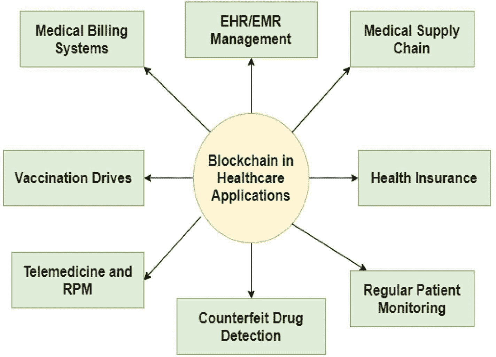

图 9.1 医疗应用中的区块链.

由于当今技术的快速演变本质，现代医疗应用带来了许多挑战。每种新技术在实际实施时都带来自己的一套挑战。区块链技术已演变为医疗领域一些重要挑战的救星。在 图 9.2 中，我们提到了一些重要的医疗挑战，并解释区块链如何帮助解决它们。

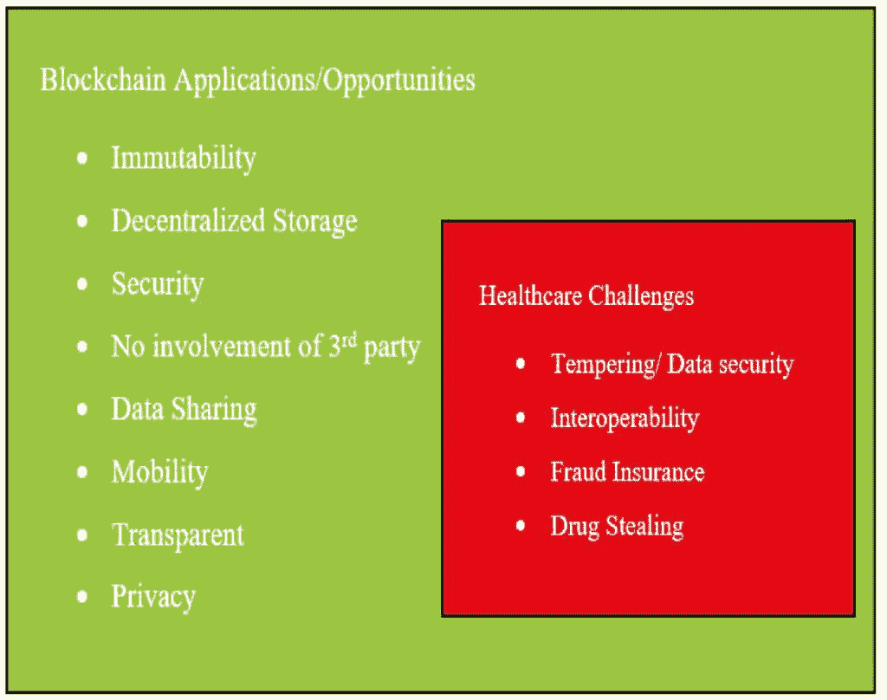

图 9.2 医疗挑战与区块链机遇.

### 9.2.1 互操作性

目前患者对其临床信息没有控制权或所有权，这使得数据在各个医疗机构之间共享几乎变得不可能。此外，安全、信任、可信度和责任问题恶化了患者的处境。区块链为当前收集和存储患者信息的孤立流程提供了一种替代方案。一个基于区块链并在患者、急诊诊所和其他医疗方之间共享的平台，包含永久、安全且可追溯的信息，解决了真实性问题。同时，存储在区块链上的信息可以轻松实现假名化，解决了患者 ID 问题。在基于区块链的模型中，患者及其临床信息处于医疗的核心地位。这意味着患者获得了更多的控制权和所有权——他们可以决定谁可以获取和阅读他们的临床信息，包括疾病、药物、实验室检查、病史等，以 EHR 形式存储 [17]。同时，医疗机构可以更有效地访问共享数据，为患者提供更好的照护和价值。随着物联网的兴起以及来自可穿戴设备或移动应用程序的数据积累，信息互操作性问题变得日益重要 [18]。区块链是解决它的契机。

### 9.2.2 篡改/数据安全

由于区块链系统中没有中央实体，在任何信息更新或添加到框架之前，必须达成所有成员间的共识。抛开共识算法背后的所有细节不谈，这意味着框架存储了所有曾经发生的交互的不可变轨迹。全球医疗领域的一个严重问题是缺乏普遍认可的患者标识符 [53]。即使像 EHR 这样的方案也无法完全解决这个问题，过去反而导致了患者记录的混乱。相反，区块链提供了生成安全可靠临床记录的基本要素，这些记录难以被破坏或篡改，因为框架中发生的每一次通信都会留下供所有人查看的审计轨迹 [16]。从本质上讲，区块链还能解决医疗领域的另一个重大问题，例如在遵守指南的前提下管理临床试验数据。由于临床试验通常需要长期投入和巨额投资，存在最终结果被篡改或修改以用于其他用途的风险，如欺诈性保险索赔 [83]、药物滥用 [74] 等。无论如何，在一个提供所有事物不可变轨迹的通用开放信息平台上，篡改试验数据几乎是不可想象的。此外，试验参与者可因严格遵循方案而获得补偿，确保长期承诺。

### 9.2.3 保险欺诈


### 9.2.4 药物窃盗

篡改临床试验结果并非医疗保健行业面临的主要欺诈行为。一个规模更大的问题是打击保险欺诈 [85]。区块链可以通过安全地存储所有交易、提供每笔交易的可追溯性，帮助防止患者或潜在供应商的虚假索赔。

假药对医疗保健构成巨大威胁。窃取和伪造药品不仅给制造商造成巨大的经济损失，更重要的是，它可能改变产品的原始配方和成分，直接（有时甚至致命地）影响患者的健康 [74] [76]。区块链有可能通过提供一个透明的共享数据集来解决这个问题，制造商和药品供应商可以在其中追踪和验证药品来源。事实上，即将于 2024 年生效的《药品供应链安全法案》（DSCSA）已经规定，药品的电子追踪和可追溯性将成为必然要求。

## 9.3 区块链简介

区块链代表一个在完全去中心化的点对点节点网络上共享的分布式账本。网络中的每个节点都存储这份分布式账本的自己的副本 [15]。对该账本的任何更改都由网络中的每个节点进行验证和确认。如果一个节点在一段时间内变为非活动状态，它可以从任何对等节点更新其账本副本。该共享账本的一致性通过分布式共识机制来维护。每个活动节点在交易写入账本之前对其进行验证。一旦成为账本的一部分，它就变得不可篡改，并永久保留在区块链日志中。区块链中的数据以区块的形式写入。区块通过使用每个区块中的前一个哈希值链接在一起，形成一条链。在此结构的帮助下，区块链中的数据永远无法被篡改。要更改区块链中任意区块的一笔交易，需要更改所有后续区块，这是一项艰巨的任务。区块链越长，安全性越高。

### 9.3.1 区块与区块链的结构

区块链中的区块包含交易信息（这些信息记录在数据之上）。每个区块包含各种用途不同的字段。区块格式也可能因平台而异、因应用而异。区块中有一些通用的重要字段。区块和区块链的结构如 图 9.3 所示。交易字段包含网络上不同方之间发生的交易相关数据，或数据本身的相关数据。每个区块可能包含 *n* 笔交易，这些交易在共识协议的帮助下被选中 [69]。时间戳字段包含区块创建的时间。一旦创建并写入区块链，区块就不能再被更改。Nonce 值通过大量计算得出，以确保哈希值达到特定的难度级别。区块中的哈希值和前一个哈希值字段确保了区块的不可篡改性。区块数据的任何微小变化都会立即反映在哈希值中。如果恶意用户试图将其区块插入区块链，他需要计算所有后续区块的 nonce 值和哈希值，并控制网络中至少 51% 的节点。区块中包含的交易以 Merkle 树（默克尔树）的形式排列。Merkle 树在其叶子节点包含每笔交易的哈希值。每一较高层级的节点包含前一个层级哈希值的组合哈希 [61]。Merkle 树便于在不考虑区块中其他交易的情况下，对单个交易进行更轻松的验证和确认。

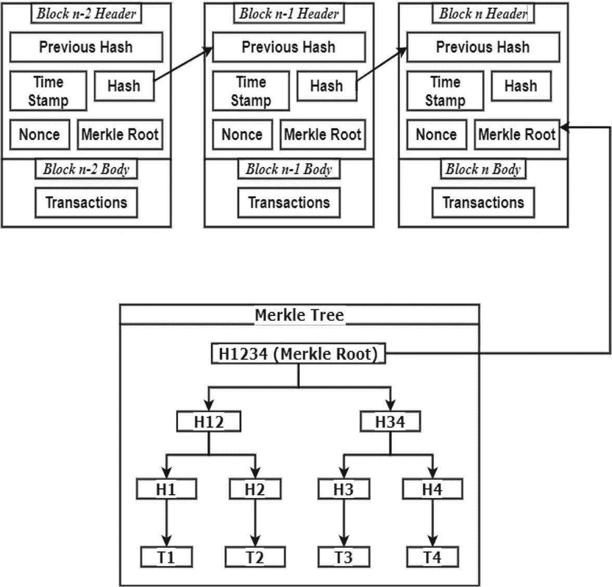

图 9.3 带有 Merkle 根的区块结构

Merkle 树的根节点称为 Merkle 根（Merkle root），存储在区块头中。这维护了区块链中每一笔交易的完整性和一致性。

### 9.3.2 区块链网络的类型

根据加入区块链网络的可访问性和权限，区块链网络大致可分为公有链和私有链两类。其他类型的网络包括许可链、联盟链、混合链，混合链可视为公有链和私有链的混合体，每种类型都有其自身的变体，如 图 9.4 所示。每种类型的区块链网络都有其自身的特征集，这是由各种优缺点决定的。必须根据区块链将要服务的应用需求来选择网络类型。

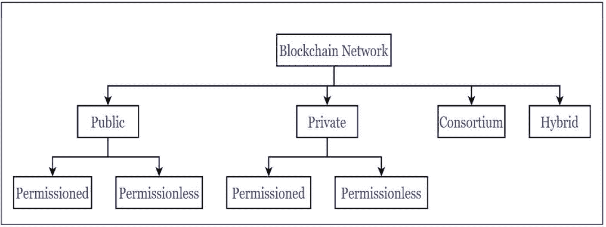

图 9.4 区块链网络的类型

公有链允许任何人自由加入。网络中根据计算能力和容量的不同，存在全节点、矿工节点和钱包节点。任何节点的角色没有限制 [79]。一些企业不愿意将其敏感数据暴露给公有链网络上的全网节点。在私有网络中，企业决定谁可以加入网络、允许什么类型的交易以及使用什么共识协议 [19]。许可链网络可以采用特殊的访问控制层，为网络中的用户提供特定的角色和访问权限 [2]。许可链网络可视为完全私有链和完全公有链之间的中间形态。联盟链通常是由从事同类业务的多个组织组成的区块链网络，如文献 [91] 和 [93] 所述。存在混合区块链网络，它们针对不同类型的数据同时使用公有链和私有链，如文献 [70] 和 [90] 所述。

### 9.3.3 共识算法

区块链网络由分布在不同位置的大量节点组成。每个节点都有自己的分布式账本副本。每当账本有更新时，必须在网络的所有节点上进行相同的更新。因此，需要一种机制，使网络中的所有节点就要添加到区块链的新区块达成一致。这种机制称为“共识”。共识机制不能是中心化的，因为这违背了区块链的核心属性 [35]。区块链网络的节点必须拥有将其区块添加到区块链的同等概率。区块链中使用不同的算法来实现分布式共识。

### 9.3.4 智能合约


## 9.3 智能合约

智能合约是可以驻留在区块链网络上的小型程序。当满足特定的预定义条件时，该程序代码的执行会自动触发。智能合约在区块链网络的节点上执行，而不是在中央服务器上。因此，一旦迁移并部署到区块链网络，智能合约本身就变得不可篡改，因此，在未经其他相关方同意的情况下，任何一方都无法更改和验证合同条件[46]。因此，智能合约充当传统纸质合同的智能替代品，同时也消除了对律师等第三方的需求。智能合约可以用任何编程语言编写。用于智能合约的一些常见编程语言包括 Solidity、Go、Java、JavaScript、Python 等。智能合约提供了速度、自主性、准确性、透明度和成本节约等无数优势。图 9.5 展示了医生和患者之间医疗智能合约的一个示例。

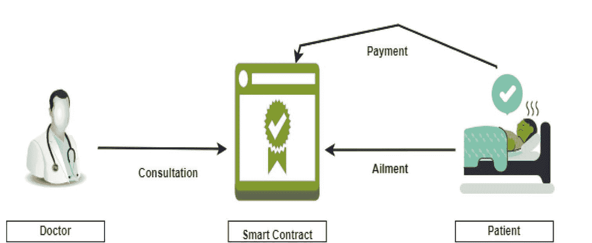

图 9.5 智能合约。

## 9.4 研究方法

由于这是一项系统性综述，有必要选择 2017-2021 年与医疗保健领域区块链最相关的论文。为此任务制定了多种搜索策略。本综述文章重点关注以下综述问题：

*   研究人员在其医疗保健应用中使用了哪种类型的区块链网络和区块链平台？
*   基于区块链的医疗保健系统中使用了哪些重要的共识算法？
*   有多大比例的研究工作在其医疗保健系统中构建了智能合约，它们使用了哪些编程语言？
*   研究人员用于分析其模型的评估方法有哪些？
*   与医疗保健相关的现有区块链系统有哪些缺点，未来展望如何？

文章选择过程如图 9.6 所示。首先，使用各种关键词（如“区块链 AND EHR”、“区块链 AND EMR”、“区块链 AND 医疗供应链”、“区块链 AND 健康保险”、“区块链 AND 药品供应链”等）搜索了五个最相关的数据库：IEEE-Xplore、Science Direct、Springer、Google Scholar 和 PubMed。共检索到 1980 篇文章。此后，应用了基于标题筛选、去除重复项、杂志文章、会议录、页数少于 5 页的会议论文、书籍章节以及排除综述论文的过滤器，共选出 127 篇论文。接下来，通过基于引用次数和质量检查的过滤过程，将数量减少到 105 篇。最后，基于摘要筛选和综述问题进行了选择标准，最终选出 90 篇文章进行综述。

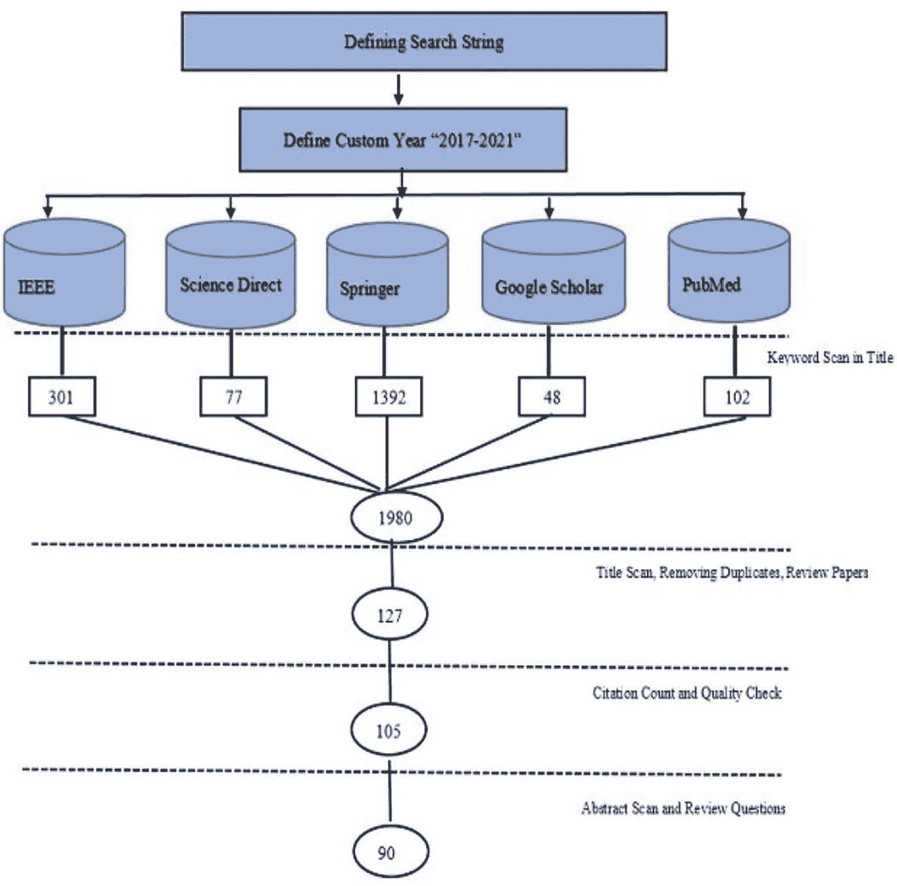

图 9.6 文章选择过程。

## 9.5 文献综述


## 相关工作

文献 1 的作者设计了一个融合了 `blockchain 3.0` 和 `healthcare 4.0` 的智能医疗系统。该设计网络已在 `Ethereum` 网络上实现，并结合了 `Solidity` `Web3.js` 等其他编程语言和工具。此外，为应对信任构建的挑战，采用了 `smart contracts`。

文献 2 提出了一个基于区块链的安全、高效且易于维护的框架，用于患者与医生之间的医疗数据访问。该框架允许患者完全控制其数据。

文献 13 还开发了一个用于安全、稳健、稳定且以患者为中心的健康信息交换框架。为此使用了 `Distributed ledgers` 和 `smart contracts`。

文献 43 开发了一个以患者为中心的名为 `PACEX` 的应用程序，允许共享 `EHR` 数据。使用了 `Ethereum blockchain` 和 `smart contracts`。

文献 3 的作者扩展了文献 9 的工作，设计了一种利用区块链和边缘节点进行 `EHR` 数据管理的混合架构。该架构使用 `attribute-based multi-signature (ABMS)` 方案认证用户签名，并使用 `multi-authority attribute-based encryption (ABE)` 方案加密 `EHR` 数据。分别使用 `Hyperledger Fabric` 平台和 `Hyperledger Ursa` 库实现了该方案。

文献 4 的作者首次提出了一种基于跨链的 `EHR` 存储解决方案，以解决区块链在医疗保健领域的互操作性问题。为此使用了 `relay-chain as a service (Raas)`，它允许患者在进入不同医院时删除 `EHR` 信息。

文献 5 开发了一个基于区块链的平台，用于糖尿病领域的增强型 `EHR`，因为糖尿病是当今世界增长最快的疾病。该平台在紧急情况下向患者和护理人员生成警报消息。

文献 6 提出了一种基于区块链和哈希的新策略，以增强分布式 `EHR` 的安全性。该策略使用 `collision-resistant hash function` 快速生成唯一的患者 ID，使用 `PoW` 降低可扩展性问题，并使用 `smart contracts` 和密码学技术进行同意管理。

文献 7 和 40 针对 `EHR` 中区块链的可扩展性问题。为提高可扩展性，所提架构使用 `multi-hyperledgers`：一个用于患者，另一个用于医疗机构。为存储大量数据并满足更多请求，每个通道维护自己的账本。

文献 8 将 `AI` 与区块链相结合，用于更安全的 `EHR`、高效的数据管理和可靠的疾病诊断。使用 `constraint goal model (CGM)` 来激发生成系统需求。

文献 50 针对台湾使用的 `NHIA’s NMR` 的可扩展性问题。开发的框架可将 `NHIA’s NMR` 数据与 `EMR` 和 `EHR` 集成。

文献 10 开发了一种用于数据共享和访问控制的同意模型。`Smart contracts` 用于表示同意。该模型分别使用 `data use ontology (DUO)` 和 `automatable discovery and access matrix (ADA-M)` 对用户同意和请求者的查询描述进行建模。`Ethereum` 平台用于数据验证。

文献 11 和 55 提出了一种用于云存储环境中安全多授权 `EHR` 的方案。该方案使用 `attribute signcryption scheme` 实现安全性。此外，`verifiable outsourcing computational mechanisms` 的使用减轻了用户的计算负担。

此外，文献 22 开发了一种高效的认证方案，用于解决云的中心化问题。

文献 12 使用 `fuzzy decision models` 评估用于安全可信 `EHR` 的区块链模型。该评估有助于选择最适合可信 `EHR` 的区块链。

文献 14 使用 `zk-proofs` 认证受益人。

然而，文献 29 使用 `keyless signature infrastructure` 保护云上的 `EHR` 数据。所提框架在不同参数上进行了评估并与现有框架进行了比较。

文献 42 使用 `revocable attribute scheme` 保护隐私。`Attribute signing key` 通过 `attribute master key` 和 `update master key` 的组合计算得出。

文献 16 提出了一种用于隐私保护的 `multi-tier architecture`。这种新颖的架构在不同的 `EHR` 云提供商之间使用 `public blockchain`，在患者传感器和患者系统之间使用另一个 `public blockchain`。

文献 28 和 33 使用 `cryptographic functions` 维护患者数据的假名性。

文献 49 使用各种 `utility functions` 评估隐私保护框架。`Multiple smart contracts` 用于访问控制评估和交易评估。

文献 35 使用区块链保护去中心化 `EHR` 共享。

文献 18 提出了一种结合区块链和边缘节点的混合架构，以促进 `EHR` 访问控制。该架构维护访问事件的 `tamper-proof log`。`Hyperledger Fabric` 用于混合架构的评估。

此外，文献 19 和 44 也提出了一种新颖的 `EHR` 框架，用于 `EHR` 各类用户之间的可信访问控制机制。`Ethereum` 用于原型实现。

此外，文献 20 专注于患者控制的共享方案，而非第三方。一些医疗机构用于存储 `PES chain`。这些用于存储加密患者记录的哈希值。构建了 `Stealth authorization scheme` 用于隐私保护和数据共享。

文献 21 针对云上 `EHR` 记录共享的隐私保护和安全问题。开发了基于 `Searchable encryption` 和 `conditional proxy re-encryption` 的方案来解决这些问题。`Proof of authorization` 用作共识协议。

文献 24 提出了一种新颖的审计机制，用于在欧洲跨境交换电子健康数据，而文献 47 则为秘鲁卫生组织的 `EHR` 数据提出了一种架构。遵循秘鲁当局维护的法律，用于医疗数据的链下存储和提供交易日志。

文献 48 提出了一个用于癌症患者数据共享和管理的框架。数据验证在 `Stony Brook University Hospital` 的数据上进行。

文献 25 提出了一种基于区块链的安全 `EHR` 互换解决方案。从系统内部和外部威胁方面进行了安全分析。

文献 41 提出了一种用于跨组织数据共享的 `permissioned blockchain`。

文献 26 提出了一种名为 `MedSBA` 的新颖安全方案，一种用于 `EHR` 共享的 `attribute-based encryption` 方案。使用了 `Private blockchain`。

文献 27 开发了真实、可操作且安全的 `PHRs`。制定了三项设计原则用于安全的 `PHR`。

文献 36 提出了一种用于数据安全的 `certificate-less scheme` 和 `elliptical curve cryptography` 方案。

文献 30 将 `Hyperledger blockchain` 与 `deep learning` 相结合，分别用于安全数据管理和诊断模型。开发的模型分五个不同阶段工作。应用 `SIMON block cipher` 技术进行数据加密，应用 `variational autoencoder` 进行疾病检测。

文献 31 利用 `smart contracts` 实现患者、医生和护理人员之间的数据共享。使用 `Modified Merkle tree` 数据结构实现数据的安全快速访问。使用 `Cryptographic hash functions` 保障数据安全。

文献 32 使用 `attribute and identity-based encryption` 保障云上数据的安全。

文献 37 开发了一种名为 `MedRec` 的新颖模型，用于医疗数据的数据访问和权限管理。

文献 39 提出了一种 `granular access control mechanism`，可在保持与底层区块链架构兼容的同时提供不同级别的授权。

文献 45 关注医院急诊病房的 `EHR` 数据。该工作使用 `P2P network` 分析 `smart contracts` 的数据传输。

文献 46 构建了一个统一解决方案，用于迁移现有的 `EHR`。链下资产存储通过患者和策略交易进行控制。


## 9.6 讨论

我们已经对选定的文章提供了简要的文献综述。我们可以根据调查成功推导出研究问题的答案。在本节中，我们将基于研究问题逐一讨论我们的发现。

### 9.6.1 RQ1：研究人员在其医疗保健应用中使用了哪种类型的区块链网络和区块链平台？

### 表 9.1 近期作品中的区块链网络类型

| 网络类型 | 参考文献 |
| --- | --- |
| 公有链 | [[16]](#ch9.xhtml#ref9_16), [[51]](#ch9.xhtml#ref9_51), [[54]](#ch9.xhtml#ref9_54), [[62]](#ch9.xhtml#ref9_62), [[63]](#ch9.xhtml#ref9_63), [[68]](#ch9.xhtml#ref9_68), [[69]](#ch9.xhtml#ref9_69), [[72]](#ch9.xhtml#ref9_72), [[76]](#ch9.xhtml#ref9_76), [[79]](#ch9.xhtml#ref9_79), [[80]](#ch9.xhtml#ref9_80), [[81]](#ch9.xhtml#ref9_81), [[83]](#ch9.xhtml#ref9_83), [[86]](#ch9.xhtml#ref9_86), [[87]](#ch9.xhtml#ref9_87) |
| 私有链 | [[9]](#ch9.xhtml#ref9_9), [[19]](#ch9.xhtml#ref9_19), [[23]](#ch9.xhtml#ref9_23), [[24]](#ch9.xhtml#ref9_24), [[25]](#ch9.xhtml#ref9_25), [[27]](#ch9.xhtml#ref9_27), [[30]](#ch9.xhtml#ref9_30), [[34]](#ch9.xhtml#ref9_34), [[37]](#ch9.xhtml#ref9_37), [[39]](#ch9.xhtml#ref9_39), [[43]](#ch9.xhtml#ref9_43), [[46]](#ch9.xhtml#ref9_46), [[50]](#ch9.xhtml#ref9_50), [[52]](#ch9.xhtml#ref9_52), [[59]](#ch9.xhtml#ref9_59), [[73]](#ch9.xhtml#ref9_73), [[98]](#ch9.xhtml#ref9_98) |
| 混合链 | [[3]](#ch9.xhtml#ref9_3), [[18]](#ch9.xhtml#ref9_18), [[26]](#ch9.xhtml#ref9_26), [[57]](#ch9.xhtml#ref9_57), [[66]](#ch9.xhtml#ref9_66), [[67]](#ch9.xhtml#ref9_67), [[70]](#ch9.xhtml#ref9_70), [[75]](#ch9.xhtml#ref9_75), [[90]](#ch9.xhtml#ref9_90) |
| 联盟链 | [[20]](#ch9.xhtml#ref9_20), [[21]](#ch9.xhtml#ref9_21), [[22]](#ch9.xhtml#ref9_22), [[32]](#ch9.xhtml#ref9_32), [[38]](#ch9.xhtml#ref9_38), [[40]](#ch9.xhtml#ref9_40), [[44]](#ch9.xhtml#ref9_44), [[47]](#ch9.xhtml#ref9_47), [[56]](#ch9.xhtml#ref9_56), [[58]](#ch9.xhtml#ref9_58), [[61]](#ch9.xhtml#ref9_61), [[77]](#ch9.xhtml#ref9_77), [[82]](#ch9.xhtml#ref9_82), [[85]](#ch9.xhtml#ref9_85), [[88]](#ch9.xhtml#ref9_88), [[91]](#ch9.xhtml#ref9_91), [[93]](#ch9.xhtml#ref9_93), [[98]](#ch9.xhtml#ref9_98) |
| 许可链 | [[2]](#ch9.xhtml#ref9_2), [[10]](#ch9.xhtml#ref9_10), [[28]](#ch9.xhtml#ref9_28), [[31]](#ch9.xhtml#ref9_31), [[33]](#ch9.xhtml#ref9_33), [[34]](#ch9.xhtml#ref9_34), [[35]](#ch9.xhtml#ref9_35), [[36]](#ch9.xhtml#ref9_36), [[42]](#ch9.xhtml#ref9_42), [[44]](#ch9.xhtml#ref9_44), [[46]](#ch9.xhtml#ref9_46), [[48]](#ch9.xhtml#ref9_48), [[55]](#ch9.xhtml#ref9_55), [[56]](#ch9.xhtml#ref9_56), [[60]](#ch9.xhtml#ref9_60), [[64]](#ch9.xhtml#ref9_64), [[65]](#ch9.xhtml#ref9_65), [[71]](#ch9.xhtml#ref9_71), [[78]](#ch9.xhtml#ref9_78), [[84]](#ch9.xhtml#ref9_84), [[89]](#ch9.xhtml#ref9_89), [[92]](#ch9.xhtml#ref9_92), [[95]](#ch9.xhtml#ref9_95), [[96]](#ch9.xhtml#ref9_96), [[97]](#ch9.xhtml#ref9_97) |

### 表 9.2 近期作品中的区块链平台

| 使用的区块链平台 | 参考文献 |
| --- | --- |
| Hyperledger (Fabric/Burrow/Composer/Iroha/Sawtooth) | [[3]](#ch9.xhtml#ref9_3), [[18]](#ch9.xhtml#ref9_18), [[27]](#ch9.xhtml#ref9_27), [[30]](#ch9.xhtml#ref9_30), [[34]](#ch9.xhtml#ref9_34), [[35]](#ch9.xhtml#ref9_35), [[44]](#ch9.xhtml#ref9_44), [[46]](#ch9.xhtml#ref9_46), [[47]](#ch9.xhtml#ref9_47), [[48]](#ch9.xhtml#ref9_48), [[56]](#ch9.xhtml#ref9_56), [[64]](#ch9.xhtml#ref9_64), [[65]](#ch9.xhtml#ref9_65), [[67]](#ch9.xhtml#ref9_67), [[78]](#ch9.xhtml#ref9_78), [[84]](#ch9.xhtml#ref9_84), [[91]](#ch9.xhtml#ref9_91), [[92]](#ch9.xhtml#ref9_92), [[94]](#ch9.xhtml#ref9_94), [[95]](#ch9.xhtml#ref9_95), [[96]](#ch9.xhtml#ref9_96), [[97]](#ch9.xhtml#ref9_97) |
| Ethereum | [[2]](#ch9.xhtml#ref9_2), [[10]](#ch9.xhtml#ref9_10), [[19]](#ch9.xhtml#ref9_19), [[20]](#ch9.xhtml#ref9_20), [[21]](#ch9.xhtml#ref9_21), [[25]](#ch9.xhtml#ref9_25), [[33]](#ch9.xhtml#ref9_33), [[35]](#ch9.xhtml#ref9_35), [[36]](#ch9.xhtml#ref9_36), [[37]](#ch9.xhtml#ref9_37), [[38]](#ch9.xhtml#ref9_38), [[40]](#ch9.xhtml#ref9_40), [[43]](#ch9.xhtml#ref9_43), [[50]](#ch9.xhtml#ref9_50), [[51]](#ch9.xhtml#ref9_51), [[54]](#ch9.xhtml#ref9_54), [[55]](#ch9.xhtml#ref9_55), [[57]](#ch9.xhtml#ref9_57), [[60]](#ch9.xhtml#ref9_60), [[68]](#ch9.xhtml#ref9_68), [[69]](#ch9.xhtml#ref9_69), [[72]](#ch9.xhtml#ref9_72), [[76]](#ch9.xhtml#ref9_76), [[79]](#ch9.xhtml#ref9_79), [[80]](#ch9.xhtml#ref9_80), [[81]](#ch9.xhtml#ref9_81), [[83]](#ch9.xhtml#ref9_83), [[87]](#ch9.xhtml#ref9_87), [[88]](#ch9.xhtml#ref9_88), [[91]](#ch9.xhtml#ref9_91), [[94]](#ch9.xhtml#ref9_94) |
| 作者自行开发 | [[70]](#ch9.xhtml#ref9_70), [[71]](#ch9.xhtml#ref9_71), [[73]](#ch9.xhtml#ref9_73), [[85]](#ch9.xhtml#ref9_85), [[89]](#ch9.xhtml#ref9_89) |
| Wanchain | [[23]](#ch9.xhtml#ref9_23) |
| OPNET | [[26]](#ch9.xhtml#ref9_26) |
| Multichain | [[24]](#ch9.xhtml#ref9_24) |
| IOTA | [[40]](#ch9.xhtml#ref9_40) |
| Cardano | [[40]](#ch9.xhtml#ref9_40) |
| Bitcoin | [[40]](#ch9.xhtml#ref9_40), [[63]](#ch9.xhtml#ref9_63) |
| NEM | [[75]](#ch9.xhtml#ref9_75) |
| QuarkChain | [[90]](#ch9.xhtml#ref9_90) |
| Gcoin | [[93]](#ch9.xhtml#ref9_93) |

平台的类型是由研究人员根据系统需求选择的。表 9.1 根据网络类型（即公有链、私有链、混合链、联盟链和许可链）对所评审的文献作品进行了分类。图 9.7 显示，研究人员最倾向于使用许可系统，因为它们提供了访问控制和角色定义的优势。然而，我们可以看到采用混合系统的研究作品较少，鉴于公私有混合链的优势，这可以被视为该方向未来的研究范围。在表 9.2 以及图 9.7 中，我们可以非常明显地注意到，Ethereum 是研究人员在医疗保健领域使用最广泛的平台，Hyperledger 位居第二。然而，需要更多的研究工作来探明 IOTA、Cardano、GCoin 等不同平台的性能。还注意到，只有 7% 的研究人员开发了自己的平台。

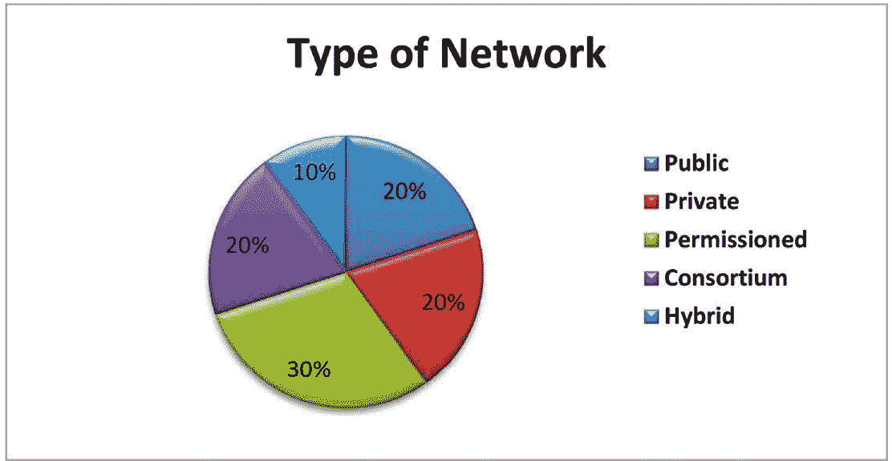

图 9.7 近期作品中网络类型的比较。

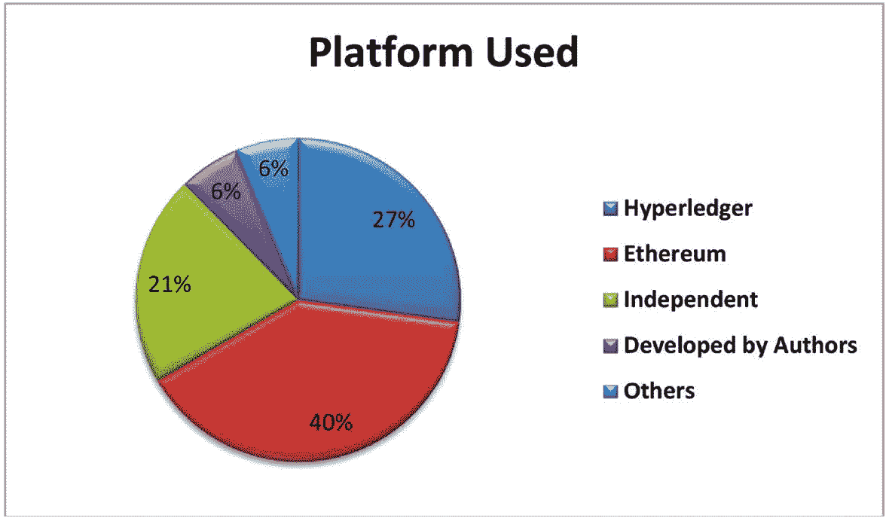

图 9.7 近期作品中区块链平台的比较。

## 9.6.2 RQ2：基于区块链的医疗保健系统中使用了哪些重要的共识算法？

共识方法是区块链系统的一个非常重要的元素。选择一个好的分布式共识方法可以在网络中节省成本和时间。选定研究作品使用的共识方法已在表 9.3 中总结。此外，图 9.8 显示，工作量证明是迄今为止使用最多的共识算法。需要更多采用其他成本和计算需求较低的共识方法的研究工作。此外，作者在未来的工作中构建新的共识算法也有更大的空间。

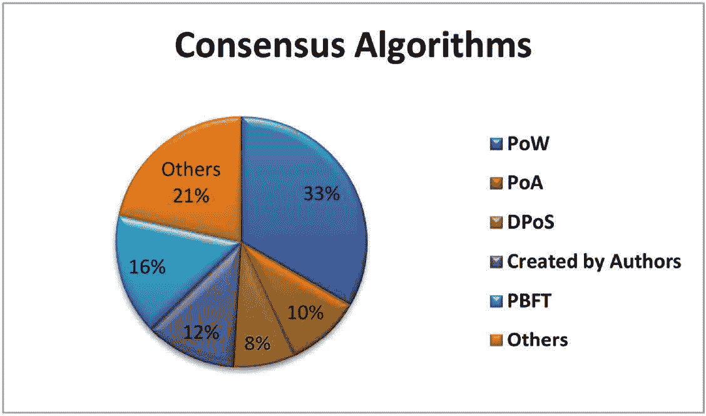

图 9.8 近期作品中共识算法的比较。

### 表 9.3 近期作品中使用的共识算法

| 共识算法 | 参考文献 |
| --- | --- |


| 共识机制 | 参考文献 |
| --- | --- |
| 工作量证明 | [2], [10], [33], [37], [51], [54], [55], [62], [68], [69], [72], [76], [79], [80], [81], [91], [93]] |
| 权威证明 | [21], [40], [50], [90]] |
| 委托权益证明 | [38], [52], [70], [94]] |
| 作者创建 | [30], [32], [58], [85], [95], [98]] |
| 实用拜占庭容错 | [26], [44], [48], [64], [84], [91], [94], [97]] |
| 概念证明 | [19], [47]] |
| 权益证明 | [86]] |
| 声誉证明 | [63]] |
| 重要性证明 | [75]] |
| 拜占庭容错 | [83], [89], [92]] |
| 伊斯坦布尔拜占庭容错 | [35]] |
| Kafka | [65]] |
| Galaxy 共识 | [23]] |

### 9.6.3 RQ3：有多大比例的研究工作在其医疗系统中构建了智能合约，它们使用了哪些编程语言？

智能合约作为区块链新版本的重要元素，被用于各种医疗系统中，以维护系统的完整性、访问控制和其他安全特性。然而，在 图 9.9 中，我们看到约 42% 的研究工作在其模型中未提出任何智能合约，这却是未来系统的重要需求。

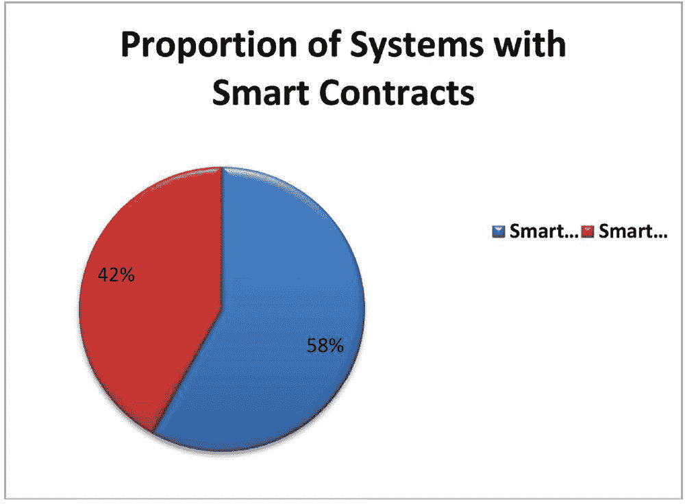

图 9.9 近期作品中智能合约的使用情况。

表 9.4 近期作品中的智能合约语言

| 编程语言 | 参考文献 |
| --- | --- |
| Solidity | [2], [10], [19], [21], [25], [33], [35], [37], [38], [43], [50], [51], [55], [57], [60], [68], [69], [72], [76], [79], [80], [81], [86], [95]] |
| ChainCode | [46], [47], [48], [64], [65], [67], [84], [92], [96], [97]] |
| Java Script | [18], [27], [78]] |
| Python | [31], [83], [88]] |
| Swift | [75]] |
| Rust | [3]] |
| Go | [30]] |

表 9.4 总结了其余系统为其智能合约选择的语言。在 图 9.10 中，我们可以注意到，Solidity 作为以太坊唯一的智能合约语言，是使用最广泛的，而较新的智能合约语言如 Rust、Go 等具有巨大的未来应用前景。

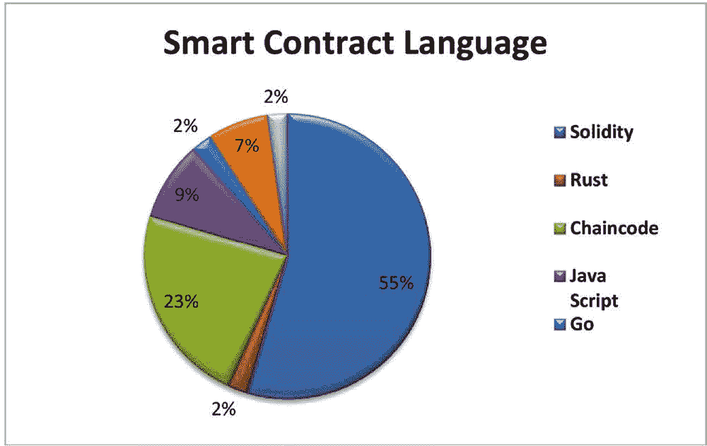

图 9.10 近期作品中使用的智能合约语言对比。

### 9.6.4 RQ4：研究人员使用哪些评估方法来分析他们的模型？

研究工作中使用不同的评估方法来分析所提出的模型。我们的发现如 表 9.5 和 图 9.11 所示，即 46% 的工作使用性能指标（如延迟、吞吐量、通信成本、计算成本、交易时间、数据大小等）来评估其提出的系统。然而，较少研究人员对基于调查的评估方法感兴趣，这也应该被采用，因为区块链作为一项新技术，需要由系统的最终用户来验证，以获得普及。

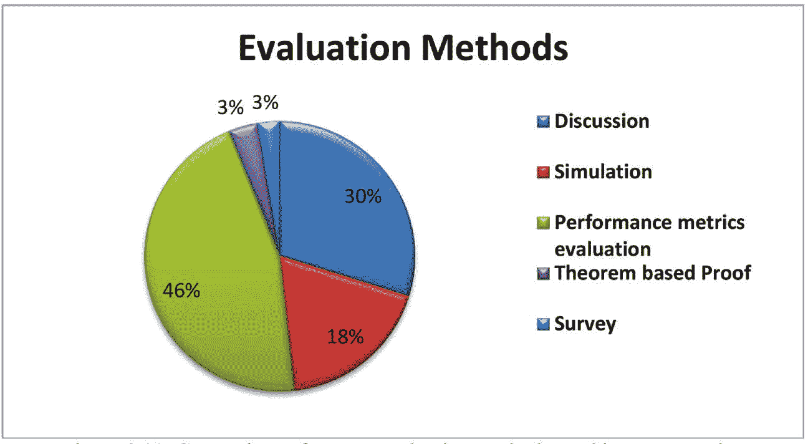

图 9.11 近期作品中使用的系统评估方法对比。

### 9.6.5 RQ5：与医疗保健相关的现有区块链系统有哪些缺点，未来展望如何？

我们发现了一些现有系统的常见缺点，这些缺点需要在未来的工作中解决。表 9.6 总结了现有系统中发现的一些缺点。我们可以看到，数据隐私问题和可扩展性问题是被审查文章中最常见的。在下一节中，我们提到了本次调查中确定的一组详细挑战和未来范围。

表 9.5 近期作品中使用的系统评估方法

| 评估方法 | 参考文献 |
| --- | --- |
| 根据所提出的模型，通过讨论隐私、访问控制、不可篡改性、透明度、互操作性等不同特性进行系统分析 | [2], [20], [23], [25], [28], [37], [39], [42], [44], [46], [47], [48], [52], [54], [55], [58], [61], [66], [67], [68], [69], [70], [72], [75], [76], [77], [79], [80], [82], [84], [86], [89], [92], [93]] |


### 表 9.5 仿真平台与性能评估汇总

| 仿真平台 | 参考文献 |
|----------|----------|
| Hyperledger Composer / Fabric / Calliper / Ganache / OPENT / Bitcoin / Rinkeby / AWS / Others | [10], [18], [19], [20], [21], [25], [26], [34], [36], [39], [55], [56], [57], [63], [70], [81], [83], [90], [94], [95], [97] |

| 性能指标（延迟/吞吐量/通信成本/计算成本/交易时间/数据大小/Gas 消耗等，视模型而定）实验评估工具 | 参考文献 |
|---------------------------------------------------------------|----------|
| 各类工具实验评估 | [3], [10], [16], [18], [19], [20], [21], [26], [27], [29], [30], [31], [33], [35], [36], [39], [40], [42], [43], [44], [46], [47], [51], [52], [54], [55], [56], [58], [59], [60], [61], [62], [63], [65], [67], [69], [70], [71], [76], [78], [79], [80], [81], [85], [86], [88], [90], [91], [95], [96], [98] |

| 基于定理的系统安全特性证明 | 参考文献 |
|----------------------------|----------|
| 定理证明 | [22], [50], [59], [90] |

| 基于调查的系统评估 | 参考文献 |
|--------------------|----------|
| 调查评估 | [27], [60], [97] |

### 表 9.6 近期工作中常见的缺陷

| 常见缺陷 | 参考文献 |
|----------|----------|
| 数据隐私问题 | [9], [10], [18], [22], [27], [40], [47], [51], [60], [66], [68], [72], [76], [78], [79], [87], [88], [89], [92], [93], [95] |
| 可扩展性问题 | [2], [3], [21], [26], [31], [36], [37], [42], [50], [52], [55], [57], [62], [65], [68], [69], [72], [76], [79], [80], [83], [86], [87], [88], [92] |
| 无标准性能指标评估 | [2], [23], [24], [28], [37], [38], [48], [57], [68], [75], [82], [83], [84], [89], [92], [93], [94], [97] |
| 存储与访问控制未完全去中心化 | [20], [24], [27], [43], [46], [61], [65], [75], [96] |
| 计算成本高昂 | [2], [33], [60], [81], [92] |
| 缺乏用户认证方法 | [19], [29], [30], [39] |
| 未建立去中心化共识 | [39], [42], [43], [46], [59], [67], [71], [73] |
| 未构建智能合约 | [9], [16], [20], [22], [23], [24], [26], [28], [29], [32], [36], [39], [42], [44], [52], [54], [58], [59], [61], [62], [66], [70], [71], [73], [77], [82], [85], [87], [89], [90], [93], [98] |

## 9.7 挑战与未来展望

除了区块链技术为医疗行业带来的潜在益处外，仍存在重大挑战。我们已在前文讨论了近期研究工作中的常见缺陷。本综述中识别出的一些重要挑战总结如下，并列举了应对这些挑战的现有系统。

### 9.7.1 缺乏标准化

基于区块链的医疗系统实现仍缺乏标准化，现有方案采用不同的存储方法、共识算法、加密技术和网络。因此，这些实现之间的比较变得困难。因此需要制定一些标准，以便比较不同解决方案。一些系统如 [30] 和 [71] 已使用标准现有数据集对其系统进行评估和比较，以解决这一问题。

### 9.7.2 可扩展性


### 9.7.2 可扩展性

随着应用中区块数量的增加，系统在计算上变得更慢，并且需要更多的计算资源；在物联网环境中，这种情况可能会更糟，因为传感器设备配备的计算能力有限，仅足以执行传输和接收数据。然而，一些最近的系统[18]、[35]、[51]已在其模型中成功解决了可扩展性问题。

### 9.7.3 延迟

延迟在医疗保健领域发挥着重要作用，患者的个人满意度深度依赖于持续的医疗护理框架，特别是当医疗数据通过物联网设备收集并应记录到区块链框架中时。当电子健康记录（EHR）在集中式分布式存储框架上重新评估时，该问题变得至关重要。这是因为云服务可能无法在医疗服务提供者的区域访问，导致在重新评估数据时产生显著的网络延迟。值得注意的是，网络延迟对促进一个多功能的基于区块链的框架有明显影响。另一方面，一些系统如[31]和[35]已成功尝试解决这一问题。

### 9.7.4 外包数据的隐私

数据存储是区块链技术中的一个关键问题，可以通过链上或链下方式处理。现有工作采用的可能解决方案是将医疗数据外包到云端，并对其在云端进行管理。然而，在云计算上存储和共享数据既不安全也不可信。此外，云服务提供商可能会对医疗信息感兴趣，并通过泄露医疗记录和其他私人信息而侵犯患者的隐私。服务提供商的这种窥探本性使数据面临风险。然而，像[28]和[52]这样的系统已在其模型中解决了隐私问题。

## 结论

在本书章节中，我们提供了对通过系统综述（SR）方法选定的 90 篇高质量文章的详尽综述。这项综述基于我们的综述问题得出了一些重要发现。在由区块链技术赋能的医疗系统中，新平台、共识方法和编程语言有巨大的未来发展空间。我们看到，绝大部分研究工作集中在有限类型的平台上。我们还可以看到，现有系统存在一些共同的缺点，需要在未来的工作中解决。本书章节的发现为该领域的新研究工作指明了一条路径。我们可以总结说，区块链技术在医疗应用中展现出巨大的未来发展前景。

## 参考文献

1.  A. Kumar, R. Krishnamurthi, A. Nayyar, K. Sharma, V. Grover, E. Hossain, ‘一种利用医疗 4.0 流程的新型智能医疗设计、仿真与实现’, IEEE Access, 8, 118433-118471, 2020
2.  J. Vora, A. Nayyar, S. Tanwar, S. Tyagi, N. Kumar, M.S. Obaidat, J.J. Rodrigues, ‘BHEEM：一种基于区块链的电子健康记录保护框架’, In 2018 IEEE Globecom Workshops (GC Wkshps), pp. 1-6, IEEE, Dec., 2018.
3.  H. Guo, W. Li, E. Meamari, C. Shen, M. Nejad. ‘用于 EHR 管理的基于属性的多重签名与加密：一种基于区块链的解决方案’, In 2020 IEEE International Conference on Blockchain and Cryptocurrency (ICBC), pp. 1-5, IEEE, May, 2020.
4.  S. Cao, J. Wang, X. Du, X. Zhang, X. Qin, ‘CEPS：一种基于跨区块链的电子健康记录隐私保护方案’, In ICC 2020-2020 IEEE International Conference on Communications (ICC), pp. 1-6, IEEE, June, 2020.
5.  C. Priya, ‘利用增强型 EMR 提升区块链技术在远程医疗中的效率’, In 2020 International Conference on Computer Science, Engineering and Applications (ICCSEA), pp. 1-6, IEEE, March 2020.
6.  A.I. El Sayed, M. Abdelaziz, M.H. Megahed, M.H.A. Azeem, ‘一种基于区块链的电子健康记录新监管策略’, In 2020 12th International Conference on Electrical Engineering (ICEENG), pp. 151-156, IEEE, July 2020.
7.  A. Fernandes, V. Rocha, A.F. da Conceição, F. Horita, ‘利用 Hyperledger 区块链共享 EHR 的可扩展架构’, In 2020 IEEE International Conference on Software Architecture Companion (ICSA-C), pp. 130-138, IEEE, March 2020.
8.  Y. Wehbe, M. Al Zaabi, D. Svetinovic, ‘医疗记录管理的区块链 AI 框架：约束目标模型’, In 2018 26th Telecommunications Forum (TELFOR) pp. 420-425, IEEE, Nov. 2018.
9.  R. Guo, H. Shi, Q. Zhao, D. Zheng, ‘用于电子健康记录系统中区块链的多权威安全基于属性的签名方案’. IEEE access, 6, 11676-11686, 2018.
10.  V. Jaiman, V. Urovi, ‘基于区块链的健康数据共享平台的同意模型’, IEEE Access, 8, 143734-143745, 2020.
11.  X. Yang, T. Li, W. A. Chen, C. Wang, ‘一种用于云端 EHR 共享的区块链辅助可验证外包基于属性的签密方案’, IEEE Access, 8, 170713-170731, 2020.
12.  M. Zarour, M. T.J. Ansari, M. Alenezi, A.K. Sarkar, M. Faizan, M. A. Agrawal, R. A. Khan, ‘评估区块链模型对安全可信电子医疗记录的影响’, IEEE Access, 8, 157959-157973, 2020.
13.  Y. Zhuang, L. R. Sheets, Y.W. Chen, Z. Y. Shae, J.J. Tsai, C.R. Shyu, ‘一种以患者为中心的基于区块链技术的健康信息交换框架’. IEEE journal of biomedical and health informatics, 24(8), 2169-2176, 2020.
14.  B. Sharma, R. Halder, J. Singh, ‘利用零知识证明和代理重加密的基于区块链的互操作医疗’, In 2020 International Conference on Communication Systems & Networks (COMSNETS) (pp. 1-6). IEEE, Jan. 2020.
15.  A.S. Chouhan, M.S. Qaseem, Q.M.A. Basheer, M.A. Mehdia, ‘基于区块链的 EHR 系统架构及区块链在医疗中的需求’ Materials Today: Proceedings, 2021.
16.  S. Badr, I. Gomaa, E. Abd-Elrahman, ‘面向 IoT-EHR 系统的多层区块链框架’, Procedia Computer Science, 141, 159-166, 2018.
17.  M. Shuaib, S. Alam, M. S. Alam, M.S. Nasir, ‘基于区块链的电子健康记录中对 HIPAA 和 GDPR 的合规性’, Materials Today: Proceedings, 2021.
18.  H. Guo, Li, W., Nejad, C.C Shen, ‘具有混合区块链-边缘架构的电子健康记录访问控制’, In 2019 IEEE International Conference on Blockchain (Blockchain) pp. 44-51, IEEE, July 2019.
19.  D. C. Nguyen, P. N. Pathirana, M. Ding, A. Seneviratne, ‘用于基于移动云的电子健康系统中安全 EHR 共享的区块链’ IEEE access, 7, 66792-66806, 2019.
20.  S. Jiang, H. Wu, L. Wang, ‘基于联盟链的患者控制安全隐私保护 EHR 共享方案’ In 2019 IEEE Global Communications Conference (GLOBECOM) (pp. 1-6) IEEE, December 2019.
21.  Y. Wang, A. Zhang, P. Zhang, H. Wang, ‘通过联盟链实现安全和隐私保护的云辅助 EHR 共享’, IEEE Access, 7, 136704-136719, 2019.


## 参考文献

22. F. Tang, S. Ma, Y. Xiang, C. Lin, ‘基于区块链的电子健康记录高效认证方案’, *IEEE Access*, 7, 41678–41689, 2019.

23. Y. Wang, M. He, ‘CPDS：一种面向电子健康记录的跨区块链隐私保护数据共享’, 见于 *2021 IEEE 第六届云计算与大数据分析国际会议 (ICCCBDA)*, 页 90–99, IEEE, 2021 年 4 月。

24. L. Castaldo, V. Cinque, ‘用于欧洲电子健康数据跨境交换的基于区块链的日志记录’, 见于 *国际 ISCIS 安全研讨会*, 页 46–56, Springer, Cham, 2018 年 2 月。

25. O. Ajayi, M. Abouali, T. Saadawi, ‘用于医疗机构间电子健康记录安全交换的区块链架构’, 见于 *智能网络与协作系统国际会议*, 页 161–172, Springer, Cham, 2020 年 8 月。

26. S. M. Pournaghi, M. Bayat, Y. Farjami, ‘MedSBA：一种基于区块链技术和属性加密的医疗数据共享新型安全方案’, *环境智能与人性化计算期刊*, 1–29, 2020。

27. P. Meier, J. H. Beinke, C. Fitte, F. Teuteberg, ‘为基于区块链的个人健康记录访问控制生成设计知识’, *信息系统与电子商务管理*, 19(1), 13–41, 2021。

28. A. Al Omar, M. S. Rahman, A. Basu, S. Kiyomoto, ‘Medibchain：一个基于区块链的医疗数据隐私保护平台’, 见于 *计算、通信与存储安全、隐私与匿名性国际会议*, 页 534–543, Springer, Cham, 2017 年 12 月。

29. G. Nagasubramanian, R. K. Sakthivel, R. Patan, A. H. Gandomi, M. Sankayya, & B. Balusamy, ‘利用云中无密钥签名基础设施区块链技术保护电子健康记录’, *神经计算与应用*, 32(3), 639–647, 2020。

30. N. Sammeta, L. Parthiban, ‘基于 Hyperledger 区块链的安全医疗记录管理及基于深度学习的诊断模型’, *复杂与智能系统*, 1–16, 2021。

31. U. Chelladurai, S. Pandian, ‘一种面向医疗保健的新型基于区块链的电子健康记录自动化系统’, *环境智能与人性化计算期刊*, 1–11, 2021。

32. H. Wang, Y. Song, ‘基于属性密码系统和区块链的安全云 EHR 系统’, *医疗系统期刊*, 42(8), 1–9, 2018。

33. A. Al Omar, M. Z. A. Bhuiyan, A. Basu, S. Kiyomoto, M. S. Rahman, ‘基于区块链环境的云端医疗数据隐私友好平台’, *未来世代计算机系统*, 95, 511–521, 2019。

34. M. Antwi, A. Adnane, F. Ahmad, R. Hussain, M. H. ur Rehman, C. A. Kerrache, ‘HyperLedger Fabric 作为医疗应用区块链解决方案的案例研究’, *区块链：研究与应用*, 100012, 2021 年 3 月。

35. K. Shuaib, J. Abdella, F. Sallabi, M. A. Serhani, ‘基于区块链的安全去中心化电子健康记录共享系统’, *沙特国王大学学报 - 计算机与信息科学*, 2021。

36. T. Benil, J. J. C. N. Jasper, ‘电子健康系统中利用区块链进行外包的云安全’, *计算机网络* 178 (2020): 107344, 2020。

37. A. Azaria, A. Ekblaw, T. Vieira, A. Lippman, ‘Medrec：利用区块链进行医疗数据访问和权限管理’, 见于 *2016 年第 2 届开放与大数据国际会议 (OBD)*, 页 25–30, IEEE, 2016 年 8 月。

38. J. Liu, X. Li, L. Ye, H. Zhang, X. Du, M. Guizani, ‘BPDS：一种用于电子病历的基于区块链的隐私保护数据共享’, 见于 *2018 IEEE 全球通信会议 (GLOBECOM)*, 页 1–6, IEEE, 2018 年 12 月。

39. X. Zhang, S. Poslad, ‘区块链支持对电子病历(EMR)进行具有细粒度访问控制的灵活查询’, 见于 *2018 IEEE 国际通信会议 (ICC)*, 页 1–6, IEEE, 2018 年 5 月。

40. A. Donawa, I. Orukari, C. E. Baker, ‘扩展区块链以支持医院系统的电子健康记录’, 见于 *2019 IEEE 第十届泛在计算、电子与移动通信年会 (UEMCON)*, 页 0550–0556, IEEE, 2019 年 10 月。

41. Z. Xiao, Z. Li, Y. Liu, L. Feng, W. Zhang, T. Lertwuthikarn, R. S. M. Goh, ‘Emrshare：一种使用许可区块链的跨组织医疗数据共享与管理框架’, 见于 *2018 IEEE 第 24 届并行与分布式系统国际会议 (ICPADS)*, 页 998–1003, IEEE, 2018 年 12 月。

42. Q. Su, R. Zhang, R. Xue, P. Li, ‘基于区块链医疗系统的可撤销属性基签名’, *IEEE Access*, 8, 127884–127896, 2020。

43. B. Toshniwal, P. Podili, R. J. Reddy, K. Kataoka, ‘PACEX：医疗系统中利用区块链的以患者为中心的 EMR 交换’, 见于 *2019 IEEE 第十届信息技术、电子与移动通信年会 (IEMCON)*, 页 0954–0960, IEEE, 2019 年 10 月。

44. D. C. Nguyen, P. N. Pathirana, M. Ding, A. Seneviratne, ‘用于联邦医疗中去中心化 EMR 共享的区块链与边缘计算’, 见于 *GLOBECOM 2020 - 2020 IEEE 全球通信会议*, 页 1–6, IEEE, 2020 年 12 月。

45. W. Jiamsawat, C. Choksuchat, S. Matayong, ‘基于区块链的医院急诊病房电子病历管理’, 见于 *2021 年通信系统与网络国际会议 (COMSNETS)*, 页 674–679, IEEE, 2021 年 1 月。

46. S. Biswas, K. Sharif, F. Li, I. Alam, S. Mohanty, ‘DAAC：统一基于区块链电子健康系统中的数字资产访问控制’, *IEEE 大数据汇刊*, 2020。

47. A. Martínez, C. Molina, D. Subauste, ‘基于区块链技术架构的医疗机构电子病历管理’, 见于 *2020 IEEE ANDESCON*, 页 1–6, IEEE, 2020 年 10 月。

48. A. Dubovitskaya, Z. Xu, S. Ryu, M. Schumacher, F. Wang, ‘利用区块链实现安全可信的电子病历共享’, 见于 *AMIA 年会论文集*, 2017 卷, 页 650, 美国医学信息学协会, 2017。

49. G. Wu, S. Wang, Z. Ning, B. Zhu, ‘隐私保护的 EMR 信息发布与共享：一个区块链赋能的智能医疗系统’, *IEEE 生物医学与健康信息学期刊*, 2021。

50. Y. S. Lo, C. Y. Yang, H. F. Chien, S. S. Chang, C. Y. Lu, R. J. Chen, ‘区块链赋能的 iWellChain 框架与国家医疗转诊系统集成：开发与可用性研究’, *医学互联网研究期刊*, 21(12), e13563, 2019。

51. A. Shahnaz, U. Qamar, A. Khalid, ‘利用区块链管理电子健康记录’, *IEEE Access*, 7, 147782–147795, 2019。

52. X. Liu, Z. Wang, C. Jin, F. Li, G. Li, ‘一种基于区块链的医疗数据共享与保护方案’, *IEEE Access*, 7, 118943–118953, 2019。

53. S. Shamshad, K. Mahmood, S. Kumari, C. M. Chen, ‘云辅助的安全电子健康系统：通过区块链防篡改 EHR’, *信息安全与应用期刊*, 55, 102590, 2020。

54. S. Cao, G. Zhang, P. Liu, X. Zhang, F. Neri, ‘云辅助的安全电子健康系统：通过区块链防篡改 EHR’, *信息科学*, 485, 427–440, 2019。


## 参考文献

55. L. Chen, W. K. Lee, C. C. Chang, K. K. R. Choo, N. Zhang, ‘基于区块链的电子健康记录共享可搜索加密’, *未来世代计算机系统*, 95, 420-429, 2019.

56. S. Tanwar, K. Parekh, R. Evans, ‘面向医疗 4.0 应用的基于区块链的电子医疗记录系统’, *信息安全与应用期刊*, 50, 102407, 2020.

57. S. S. R. Krishnan, M. K. Manoj, T. R. Gadekallu, N. Kumar, P. K. R. Maddikunta, S. Bhattacharya, M. J. Piran, ‘一种基于区块链的电子病历可信度评分框架’, 见 *2020 IEEE Globecom 工作会 (GC Wkshps)*, pp. 1-6, IEEE, 2020 年 12 月.

58. K. Fan, S. Wang, Y. Ren, H. Li, Y. Yang, ‘Medblock: 基于区块链的高效安全医疗数据共享’, *医疗系统期刊*, 42(8), 1-11, 2018.

59. J. Fu, N. Wang, Y. Cai, ‘基于轻量级消息共享的医疗区块链系统隐私保护. Sensors’, 20 (7), 1898, 2020.

60. O. Gutiérrez, G. Romero, L. Pérez, A. Salazar, M. Charris, P. Wightman, ‘Healthy Block: 面向电子病历的抗连接故障基于区块链的 IT 架构’, *国际环境研究与公共卫生杂志*, 17(19), 7132, 2020.

61. H. Zhu, Y. Guo, L. Zhang, ‘一种改进的卷积默克尔树区块链电子病历安全存储方案’, *信息安全与应用期刊*, 61, 102952, 2021.

62. R. Johari, V. Kumar, K. Gupta, D. P. Vidyarthi, ‘BLOSOM: 用于医疗记录安全的区块链技术’, *ICT Express*, 2021.

63. R. Zou, X. Lv, J. Zhao, ‘SPChain: 基于区块链的医疗数据共享与隐私保护电子健康系统’, *信息处理与管理*, 58(4), 102604, 2021.

64. M. Usman, U. Qamar, ‘利用区块链技术实现电子病历的安全存储与共享’, *计算机科学汇刊*, 174, 321-327, 2020.

65. Z. Chen, W. Xu, B. Wang, H. Yu, ‘一种基于区块链的医疗数据隐私保护与共享系统’, *未来世代计算机系统*, 2021.

66. G. Tripathi, M. A. Ahad, S. Paiva, ‘S2HS-一种用于智能医疗系统的基于区块链的方法. 见 *医疗保健*’, Vol. 8, No. 1, p. 100391, 爱思唯尔, 2020 年 3 月.

67. C. Zhang, C. Xu, K. Sharif, L. Zhu, ‘5G 融合与基于区块链的医疗应用中的隐私保护接触者追踪’, *计算机标准与接口*, 77, 103520, 2021.

68. R. M. A. Latif, K. Hussain, N. Z. Jhanjhi, A. Nayyar, O. Rizwan, ‘一种 Remix IDE：利用区块链技术为医疗部门构建的基于智能合约的框架’, *多媒体工具与应用*, 1-24, 2020.

69. M. Sultana, A. Hossain, F. Laila, K. A. Taher, M. N. Islam, ‘基于零信任原则和区块链技术开发安全医疗图像共享系统’, *BMC 医学信息学与决策制定*, 20(1), 1-10, 2020.

70. T. Zhou, X. Li, H. Zhao, ‘Med-PPPHIS: 用于国民体质监测和科学锻炼指导的基于区块链的个人医疗信息系统’, *医疗系统期刊*, 43(9), 1-23, 2019.

71. A. Mubarakali, ‘使用安全稳健的基于医疗的区块链(SRHb)方法在云中监控医疗服务’, *移动网络与应用*, 25(4), 1330-1337, 2020.

72. T. Bocek, B. B. Rodrigues, T. Strasser, B. Stiller, ‘无处不在的区块链——制药供应链中区块链的一个用例’, 见 *2017 IFIP/IEEE 集成网络与服务管理研讨会 (IM)*, pp. 772-777, IEEE, 2017 年 5 月.

73. R. Kumar, R. Tripathi, ‘通过区块链实现假药供应链的可追溯性’, 见 *2019 年第 11 届通信系统与网络国际会议 (COMSNETS)*, pp. 568-570, IEEE, 2019 年 1 月.

74. V. Ahmadi, S. Benjelloun, M. El Kik, T. Sharma, H. Chi, W. Zhou, ‘药品治理：制药供应链中基于物联网的区块链实现’, 见 *2020 年第六届移动与安全服务国际会议 (MobiSecServ)*, pp. 1-8, IEEE, 2020 年 2 月.

75. G. Subramanian, A. S. Thampy, N. V. Ugwuoke, B. Ramnani, ‘加密药房-数字医药：集成混合区块链以解决制药供应链问题的移动应用’, *IEEE 计算机学会开放期刊*, 2, 26-37, 2021.

76. R. W. Ahmad, K. Salah, R. Jayaraman, I. Yaqoob, M. Omar, S. Ellahham, ‘基于区块链的 COVID-19 医疗设备和物资正向供应链与废物管理’, *IEEE Access*, 9, 4490544927, 2021.

77. Y. Yue, X. Fu, ‘基于区块链技术的医疗设备供应链管理方法研究’, 见 *2020 年服务科学国际会议 (ICSS)*, pp. 143-148, IEEE, 2020 年 8 月.

78. H. Kumiawan, J. Kim, H. Ju, ‘区块链网络在公共社区卫生中心药品供应链中的应用’, 见 *2020 年第 21 届亚太网络运行与管理研讨会 (APNOMS)*, pp. 235-238, IEEE, 2020 年 9 月.

79. A. Musamih, K. Salah, R. Jayaraman, J. Arshad, M. Debe, Y. Al-Hammadi, S. Ellahham, ‘医疗供应链中药品可追溯性的基于区块链的方法’, *IEEE Access*, 9, 9728-9743, 2021.

80. I. A. Omar, R. Jayaraman, M. S. Debe, K. Salah, I. Yaqoob, M. Omar, ‘利用区块链智能合约自动化医疗供应链中的采购合同’, *IEEE Access*, 9, 37397-37409, 2021.

81. S. K. Panda, S. C. Satapathy, ‘利用区块链实现医疗供应链中药品的可追溯性和透明度，以简化流程并在利益相关者和消费者之间建立信任’, *个人与普适计算*, 1-17, 2021.

82. Y. Kong, Y. Wang, ‘“区块链+供应链金融”助推医药产业：吉祥田区块链医疗健康服务平台案例研究’, 见 *E3S 会议网络*, Vol. 292, EDP Sciences, 2021.

83. G. Saldamli, V. Reddy, K. S. Bojja, M. K. Gururaja, Y. Doddaveerappa, L. Tawalbeh, ‘利用区块链进行医疗保险欺诈检测’, 见 *2020 年第七届软件定义系统国际会议 (SDS)*, pp. 145-152, IEEE, 2020 年 4 月.

84. W. Liu, Q. Yu, Z. Li, Z. Li, Y. Su, J. Zhou, ‘一种基于区块链的医疗保险反欺诈系统’, 见 *2019 年 IEEE 第五届计算机与通信国际会议 (ICCC)*, pp. 1264-1268, IEEE, 2019 年 12 月.

85. B. Alhasan, M. Qatawneh, W. Almobaideen, ‘用于防止医疗保险欺诈的区块链技术’, 见 *2021 年信息技术国际会议 (ICIT)*, pp. 935-941, IEEE, 2021 年 7 月.

86. M. H. Chinaei, H. H. Gharakheili, V. Sivaraman, ‘利用区块链日志合同对医疗物联网数据进行最优见证’, *IEEE 物联网期刊*, 2021.

87. M. Thenmozhi, R. Dhanalakshmi, S. Geetha, R. Valli, ‘在医院中实施区块链技术用于医疗保险理赔处理’, *材料今日：会议录*, 2021.


## 参考文献

88. A. Goyal, A. Elhence, V. Chamola, B. Sikdar，“基于区块链和机器学习的高效健康保险管理框架”，载于第 19 届 ACM 嵌入式网络传感器系统会议论文集，第 511-515 页，2021 年 11 月。

89. Y. Huang, J. Wu, & C. Long，“药物账本：用于药物溯源和监管的实用区块链系统”，载于 2018 年 IEEE 物联网国际会议(iThings)暨 IEEE 绿色计算与通信会议(GreenCom)暨 IEEE 网络、物理与社会计算会议(CPSCom)暨 IEEE 智能数据会议(SmartData)，第 1137-1144 页，IEEE，2018 年 7 月。

90. W. Xie, B. Wang, Z. Ye, W. Wu, J. You, Q. Zhou，“基于仿真的区块链设计以保障生物制药供应链安全”，载于 2019 年冬季仿真会议(WSC)，第 797-808 页，IEEE，2019 年 12 月。

91. X. Liu, A. V. Barenji, Z. Li, B. Montreuil, G. Q. Huang，“面向药品供应链的基于区块链的智能跟踪与溯源平台”，《计算机与工业工程》，第 161 卷，107669，2021 年。

92. M. Uddin，“区块链医药账本：基于 Hyperledger Fabric 的制药行业假药溯源系统”，《国际药剂学杂志》，第 597 卷，120235，2021 年。

93. J. H. Tseng, Y. C. Liao, B. Chong, S. W. Liao，“基于 Gcoin 区块链的药品供应链治理”，《国际环境研究与公共卫生杂志》，15(6)，1055，2018 年。

94. P. Sylim, F. Liu, A. Marcelo, P. Fontelo，“用于检测流通环节中假冒和劣质药品的区块链技术：药品供应链干预”，《JMIR 研究规范》，7(9)，e10163，2018 年。

95. K. Abbas, M. Afaq, T. Ahmed Khan, W. C. Song，“面向智能制药行业的基于区块链和机器学习的药品供应链管理与推荐系统”，《电子学》，9(5)，852，2020 年。

96. E. Ehioghae, S. Idowu, O. Ebiesuwa，“利用区块链技术增强制药供应链中的药品防伪与验证系统”，《国际计算机应用杂志》，975，8887，2021 年 2 月。

97. W. Chien, J. de Jesus, B. Taylor, V. Dods, L. Alekseyev, D. Shoda, P. B. Shieh，“最后一公里：基于区块链技术的 DSCSA 解决方案：利用 BRUINchain 实现制药供应链最后一公里的药品跟踪、溯源与验证”，《区块链医疗健康今日》，2020 年。

98. S. Shamshad, K. Mahmood, S. Kumari, C. M. Chen，“一种安全的基于区块链的电子健康记录存储与共享方案”，《信息安全与应用杂志》，第 55 卷，102590，2020 年。

# 10 机器学习与区块链技术在基于物联网的智能医疗系统中的融合

**Navita**^()

电子邮件：navitamehra55@gmail.com

电子邮件：mpoojmdu@gmail.com

## 摘要

智能医疗是与传感器、物联网(IoT)以及各种信息分析技术等智能技术相结合的新兴研究领域之一，旨在以更低的成本为患者提供有效的医疗服务。医疗系统在处理日益增长的大量数据、以及从中处理和挖掘有用信息方面面临诸多问题。此类大量数据通过各种基于物联网的医疗设备、电子健康记录、可穿戴传感器、远程医疗和移动健康服务产生，这可能需要高效、快速且安全的数据分析技术，以便为患者提供高质量服务。为提供此类服务，机器学习和区块链技术在各个领域均备受推崇。本研究主要讨论了处理此类海量数据的高效强大机器学习和区块链技术的分类。由于医疗系统包含患者健康及个人信息等高度敏感数据，这些数据必须要求适当的安全服务，因此区块链技术可作为为高度敏感数据提供安全服务的有效解决方案。机器学习与区块链技术相结合，为医疗系统实现其所有目标提供了诸多机遇，如降低医疗成本、有效诊断、及时治疗、提供监管报告的透明度以及有效的健康数据管理。本章的主要目的是详细描述区块链与机器学习技术之间的关系，以赋能基于物联网的医疗系统。此外，本章还讨论了在结合机器学习和区块链技术实施基于物联网的智能医疗系统时面临的主要问题和挑战。

## 10.1 介绍


## 医疗保健与技术融合

医疗保健是健康生活的重要组成部分。遗憾的是，逐渐老龄化的人口和慢性病的持续增加给当前的医疗保健系统带来了巨大压力 [1]，对床位、护士和医生等医疗服务的需求正以快速速率增长 [2]。医疗保健系统迫切需要一种解决方案，在确保为患者提供高水平优质服务的同时，减轻医疗保健系统的负担。大多数研究人员为此努力工作，并找到了应对此类问题的替代方案 [3]。

最近，医疗保健系统逐渐受益于各种创新技术，如物联网、区块链、云计算和机器学习（ML）技术，以支持智能医疗系统改进疾病诊断和治疗过程。物联网已逐渐被公认为减轻医疗保健系统压力的有效解决方案，并被视为最新的研究领域。机器学习技术在医疗保健系统中，在不同方面和环境（如家庭、办公室、医院等）提供智能健康监测服务和医疗自动化服务。云与物联网在医疗保健系统中的融合提供了实时应用之间的连接。物联网设备能够收集和传输由不同医疗传感器（无论是穿戴在患者身上还是植入患者体内）日日夜夜生成的大量健康数据 [4]。从不同医疗传感器和设备收集的大量数据中提取和分析有意义的信息，过去需要人工干预。但基于机器学习和人工智能的技术的引入，提供了智能自动化，使得无需人工干预即可进行预测和分析 [5]。

传统的预后和诊断框架设计薄弱，可能阻碍对患者的适当识别和治疗。物联网和机器学习的结合提供了一个智能化的智能决策支持医疗系统，支持在初期阶段识别疾病，并进一步延长患者的寿命。机器学习策略在医疗服务的疾病分析中发挥了关键作用，从而大幅降低了专家预约成本，并整体提高了患者护理质量。物联网和机器学习在医疗保健系统中的融合，通过减轻当前医疗保健系统的压力点，为改善医疗保健系统提供了诸多可能性。但当健康数据需要存储和交换时，维护数据隐私是一个主要关注点，而当前的医疗数据存储系统缺乏顶级安全性 [6]。在这种情况下，区块链可能是解决数据窃取和黑客攻击等漏洞的潜在方案。集成了互操作性特性的区块链技术，可在所有相关实体和系统之间实现医疗数据的安全交换，从而带来节省时间、改善沟通和提高运营效率等诸多益处 [7]、[8]。根据一份报告预测，到 2025 年，全球医疗市场中的区块链技术价值将超过 16.36 亿美元 [9]。

本章阐述了机器学习和区块链技术在基于智能物联网的医疗系统中的融合。第 10.2 节描述了不同研究人员在该领域的工作，第 10.3 节讨论了在医疗保健中建立物联网面临的主要问题和挑战，第 10.4 节阐述了区块链技术在医疗保健中的概念，第 10.5 节描述了人工智能和机器学习在医疗系统中的引入，第 10.6 节解释了智能医疗系统的工作流程，第 10.7 节解释了医疗系统中使用的所有可能的机器学习算法，第 10.8 节将描述区块链和机器学习技术为智能医疗系统提供的所有可能解决方案。最后，第 10.9 节总结本章。

## 10.2 文献综述


## 10.2 IoT、区块链与机器学习在医疗监测中的应用

由于大流行病（COVID-19）带来的高度威胁风险，世界卫生组织（WHO）建议各国制定“大流行病计划”。大流行病计划通常根据 WHO 的大流行阶段进行规划，旨在从一开始就实现大流行病管理中明确的成果 [10]。针对医疗领域的任何紧急情况，已识别出不同类型的技术。每场灾难分为四个阶段：缓解、准备、响应和恢复 [11]。“桌面推演或基于讨论的会议”是寻找应对危机有效解决方案的重要策略；此类讨论将创建一个场景，该场景由管理、劳动者、资金等不同领域和部门之间的沟通与协作共同辅助。一项合法的研究可提供广泛的框架和心理模型，复现完美的决策环境 [11]。在所有关键技术中，IoT 被视为应对此类大流行病最常用的技术之一，可提供网络上所有设备间的连接 [12]、[13]。网络中每个对象间的信息交换，通过基于跨所有中心（即设备/客户端）传达的协议的周期进行授权。区块链的概念源于每个人利用加密策略持有对前一个区块的引用这一事实。区块链不像普通网络服务那样存储在集中式服务器上，而是存储在称为中心的网络设备（PC）上，每个设备都拥有整个区块链的副本 [14]。跨网络中心复制和存储各种区块链的多个副本，保证了更高的系统安全性和用户间的价值，用户可同时访问相同数据，从而实现区块中已批准交易的可检测性和可变性。因此，区块链是一个分布式组织，所有组织用户无需相互信任即可信任该框架。除了区块链技术，机器学习（ML）也被用于分析通过不同传感器和医疗设备收集的大量数据。不同研究人员已致力于基于 ML 的医疗监测系统，通过提供智能实时健康监测系统，为患者提供有效及时的治疗。Ani 等人 [15] 提出了一种基于 IoT 和 ML 的医疗监测系统，用于预测老年人的慢性疾病，如哮喘、癌症、糖尿病等。该拟议系统包含三层：(1) 硬件层（微控制器、血压及其他基于传感器的设备）；(2) 应用层（云服务器和 Web 环境）；(3) 不同的 ML 算法，如 `naïve Bayes`、`RFT` 等。几乎所有 `RFT` 均提供 93% 的准确率。Onasanya 等人 [16] 利用 IoT 和云服务的概念提出了一个基于癌症的系统。该模型基于体域无线传感器网络（`BWSN`）的概念，连接患者以监测其健康参数。Kumar 等人 [17] 建议了一种利用 IoT 和 ML 识别心脏病的医疗监测框架。拟议系统由三层组成。第 1 层收集植入患者体内传感器的数据，第 2 层利用 `HBase` 收集大量信息，第 3 层专注于称为 ML 的数据分析技术。Varadarajan 等人 [18] 提出了一种利用云作为安全存储空间的基于 IoT 的医疗系统。他们提出了一种基于模糊规则的疾病诊断技术。拟议系统由八个组件组成，分别命名为 `UCI repository dataset`、医疗传感器、云计算、`fuzzy temporal neural classifier` 和数据累积。该拟议系统已使用 `JAVA` 编程在 `Amazon cloud` 上实现。`K-NN`、`DT`、`SVM` 和 `NB` 被用作重要的 ML 技术，每种技术获得不同的准确率结果。Verma 等人 [19] 讨论了一种用于学生疾病诊断的智能系统。拟议方法分三阶段工作。第 1 阶段从不同传感器收集数据，第 2 阶段通过特定网关将数据移至云端，第 3 阶段处理数据。此外，还将连接一个预警系统，以便在发生任何紧急情况时警告患者和护理人员。Gutte 等人 [20] 利用不同的 IoT 设备提出了一种基于 IoT 的健康监测系统。拟议系统分为四层。第 1 层处理数据收集概念，第 2 层使用 `Raspberry Pi` 作为微控制器处理数据，第 3 层涉及数据存储概念。一旦出现任何危急情况，拟议系统会向患者或护理人员发送短信和电子邮件。

通过对不同研究人员工作的研究，我们了解到区块链和 ML 技术在以低成本为患者提供安全、智能的实时医疗监测服务方面发挥着高效作用。

## 10.3 在医疗领域建立 IoT 面临的问题与挑战

尽管 IoT 具有诸多优势，且能解决不同领域的各种并发症，但仍存在大量挑战。这些并发症可能体现在解决安全问题、隐私担忧等方面 [21]、[22]、[23]、[24]、[25]。本节简要描述所有可能的问题与挑战：建立 IoT 面临的主要挑战如 表 10.1 所示。

### 表 10.1：IoT 的主要问题与挑战

| 问题 | 挑战 | 解释 |
| --- | --- | --- |
| 安全问题 | 设计实践：速率与安全 | 近期缺乏关于基于安全的 IoT 规划人员培训资产 |
| | | IoT 分析过程中缺乏关于成本与收益的信息 |
| | 标准与指标、机密性、认证与控制、现场可升级性、设备废弃 | 缺乏关于与安全问题相关的伦理和标准度量的知识；缺乏最优性受控角色可能导致劫持和网络攻击问题；因缺乏关于 IoT 设备可维护性和可升级性的知识而产生挑战；对旧设备和不需要设备的替换推断有限 |
| 互操作性问题 | 专有生态系统与消费者意愿缺失 | 缺乏关于数据收集格式的知识可能导致互操作性问题；因此必须实施适当的安全协议 |
| | 技术风险、配置 | 对技术问题认知不足可能产生技术问题；因缺乏关于多设备使用的标准配置知识而产生问题 |
| IoT 伦理问题 | 理想努力的爆发 | 因缺乏生成标准协议的努力而产生挑战 |
| 新兴经济体问题 | 投资 | 在 IoT 及其相关活动研究领域的投资有限 |
| 发展问题 | 基础设施资源、技术与工业发展 | 全球通信和互联网基础设施负担沉重；在赋能互联网和通信基础设施方面努力较少 |


## 10.4 区块链技术在医疗系统中的应用

大多数发达国家自 2012 年以来一直在医疗保健领域使用区块链技术的概念，以实现患者健康记录的安全传输，支持安全的供应链，并帮助该领域的医疗研究人员。区块链的安全特性提高了健康数据的安全性。该技术为每位患者提供一个公共 ID 或密钥，以及一个仅在需要时用于打开记录的私钥。该技术将限制患者个人或敏感信息被劫持 [7]。基于区块链的医疗管理系统如图 10.1 所示，区块链医疗设施如图 10.2 所示。

![图 10.1 基于区块链的医疗管理系统 [26]。](images/fig10_1_C.jpg)

图 10.1 基于区块链的医疗管理系统 [26]。

![图 10.2 医疗保健中的区块链机遇 [27]。](images/fig10_2_C.jpg)

图 10.2 医疗保健中的区块链机遇 [27]。

### 10.4.1 保障和追踪医疗物资

区块链有助于确保以完全透明的方式安全且可区分地追踪所有医疗物资。除此之外，它还能追踪与这些物品生产相关的劳动力成本和碳排放。

### 10.4.2 存储健康信息

在不影响完整性和一致性的前提下，患者健康报告的存储已取得显著进展；尽管如此，健康数据丢失仍是常见情况，随着全球黑客数量的增加，窃取此类信息已成为渗透和取代过往策略的最常见手段。Meditab [28] 是一家最好的软件产品公司，声称是医疗记录领域最重要的软件开发公司之一。为支持数据检索功能，该公司利用电子传真传输医疗记录。但有时，这种数据传输方式可能不安全或不可靠。

### 10.4.3 远程患者监护

远程患者监护是一项创新，旨在实现对医院外患者的监测，例如在家中、办公室或偏远地区，这可能改善医疗服务的可及性并降低医疗成本。RPM 涉及医疗服务提供者对患者的持续远程护理。智能手表、智能手环等众多设备启用了智能技术以监测各种健康参数。此类监测系统在农村地区很有用，可为高度偏远的地区提供医疗服务。

### 10.4.4 疾病爆发与追踪

区块链技术的独特特性之一是支持实时疾病上报和疾病模式识别，这有助于查明疾病起源及其各种传播因素。

## 10.5 AI 和 ML 在医疗系统中的应用

ML 作为 AI 的一个子领域，已在医疗领域得到广泛应用。患者健康数据、医院治疗报告和健康状况需要数字化，由于医疗领域信息通信技术（ICT）的进步，医疗领域产生了大量数据 [29]、[30]。机器学习被有效用于医疗目的，以分析高度复杂的医疗数据，成为各界研究的最重要课题。本研究将描述医疗业务部门如何采用不同的机器学习技术（包括神经网络学习、深度学习和特征融合技术）来完成数据分析任务，如图 10.3 所示。

![图 10.3 受益于 ML/AI 的最常见慢性疾病 [35]。](images/fig10_3_C.jpg)

图 10.3 受益于 ML/AI 的最常见慢性疾病 [35]。

本研究的主要目标是实现健康监测、人体活动检测、疾病诊断和预测。Khafajiy 等人 [31] 展示了一个实时老年人健康监测系统。许多独居老人患有各种生理疾病。该开发的系统在感知人体内的任何生理异常并采取即时行动处理患者健康方面非常有效。所提出的系统在收集和处理数据方面非常有效。Biag 等人 [32] 对 120 套 ECG 监测系统进行了实验，发现 ECG 被认为是监测患者健康关键参数最有效的方法之一，并常用于监测和测量与患者健康相关的高风险因素。Banaee 等人 [33] 综述了用于分析健康相关数据的不同机器学习算法的应用，这些算法在分析来自可穿戴或植入患者体内的不同传感器生成的健康相关数据方面非常有效。Gumaei 等人 [34] 利用不同的 ML 算法识别人体活动。他们利用深度学习概念开发了一个基于多传感器的混合模型。所提出的方法智能地处理从不同传感器收集的数据，以智能方式照料老年人和病人。

Ali 等人 [36] 利用信息增益概念和特征融合技术提出了一种疾病预测系统，用于预测心脏病的存在。Juutinen 等人 [37] 利用植入智能手机的惯性传感器，采用不同的机器学习算法预测帕金森病。惯性传感器对测量步态参数非常有效。该系统根据传感器捕获的信号对运动障碍进行分类。他们研究了三种特征选择和五种分类算法，以识别患者中的帕金森病。

### 10.5.1 监督学习

监督学习属于 ML 技术的一种，其训练数据包含标签值。训练数据可能包含多个输入和一个带标签的输出。标签被用于机器学习模型中，以在训练期间辅助模型对新数据做出准确预测。分类和回归属于监督学习的范畴。对于医疗目的，分类是一个常见问题。在大多数临床病例中，临床医生根据症状诊断患者的疾病。回归方法通常用于预测数值结果，例如，根据收集的生命体征数据集预测患者需住院的天数。

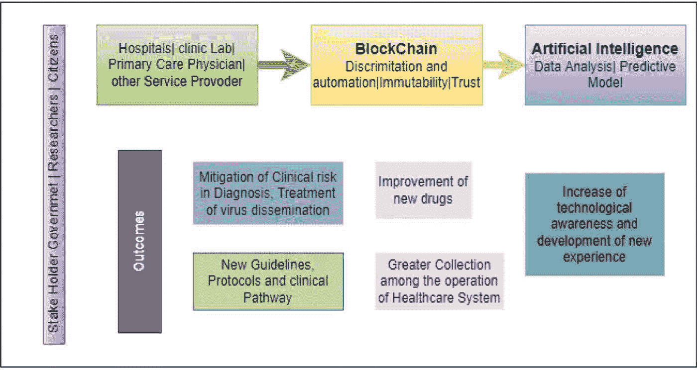

图 10.4 智能医疗系统中的 AI 和区块链架构。

决策树（DT）、随机森林树（RFT）、线性和逻辑回归（LR）以及支持向量机（SVM）都属于监督学习技术 [38]。随机森林树也属于集成分类器的一种，可由多个单独训练的决策树组成。由多棵决策树构建的 RFT 能很好地处理噪声数据 [39]。

### 10.5.2 无监督学习


### 10.5.2 无监督学习

`Unsupervised ML` 使用无标签数据来查找现有数据集中的模式 [39]。该算法通常基于相似性对数据进行分组。`K-means` 聚类是最著名且应用最广泛的方法。与聚类相关的关联任务也借助此类聚类方法来解决。标准 `k-means` 聚类进一步被修改并命名为 `k-medians` 或 `k-medoids`。在 `k-clusters` 的情况下，基于 `Euclidean distance` 计算最近的中心和均值。该方法最常见的问题是它需要一个可能的均值数量 [40]。

### 10.5.3 半监督学习

在此类 `ML` 技术中，模型通过利用有标签和无标签数据集进行训练。在这些数据集中，无标签数据的数量与有标签数据集相比非常大。在此学习技术中，首先遵循 `unsupervised learning` 方法对无标签数据集进行聚类，之后利用现有的有标签数据集对它们进行标记。主要在医疗保健领域，此类学习方法被用于语音分析和蛋白质分类序列 [41]。

### 10.5.4 强化学习

在此类 `ML` 方法中，模型通过环境中活动的时刻进行学习，而不是通过给定的输入和输出集进行公开训练。此类训练有素的机器从以往的经验中学习，并基于 `trial and error learning` 做出即时的新决策。该技术被广泛用于为医疗保健应用生成专家系统 [41]。

## 10.6 工作流程

`ML process` 主要描述任何 `ML algorithm` 实现数据所遵循的方式。`ML process` 从从多个来源收集数据开始，随后是信息的调整交互；之后，根据问题陈述，信息会被输入到任何 `ML algorithm` 中。完整的工作流程分为五个阶段，如下所述。在应用任何 `ML algorithm` 之前，应用 `ML` 的目标必须明确。为了找到任何问题的解决方案，首先必须收集数据，并适当应用以下策略 [42]，[43]。

![图 10.5 机器学习工作流程 [43]。](images/fig10_5_C.jpg)

图 10.5 机器学习工作流程 [43]。

*   `Data collection:` 此阶段从多个来源收集数据，无论是传感器收集的还是记录的数据，取决于应用的性质。就智能医疗而言，数据可能来自患者身体上不同的穿戴式和植入式传感器或其他医疗设备。
*   `Data cleaning:` 从不同来源收集的数据可能包含噪声和一些不规则性。数据清洗过程从去除数据中的噪声和不一致性开始，以获得更好的结果。
*   `Selecting right algorithm:` 由于存在大量 `ML algorithms`，每个算法都通过不同的评估指标进行评估，如 `root mean square error`、`confusion matrix`、`sensitivity`、`error rate` 和 `time-consumption`。根据这些评估参数，选择最佳算法。
*   `Building model:` 构建模型意味着使用 `training dataset` 训练模型。`Training dataset` 通过使用某些 `splitting criteria` 将原始数据集分割为 `training` 和 `testing dataset` 来计算得出。
*   `Prediction:` 预测主要指应用模型后生成的结果。

## 10.7 医疗保健行业中的机器学习算法

`ML algorithms` 在医疗保健行业被广泛用于多种疾病的预测，具体描述如下。

### 10.7.1 支持向量机

这是医疗保健行业中最常用的 `ML algorithm`。该算法可以通过推导指定特征并创建高维超平面将数据分类为不同类别以推导决策模型，从而对隐藏信息进行分类。由于能够利用最小训练特征集对高维数据进行分类，因此它被广泛用于处理医疗保健应用的生理数据。该技术由 `kernel techniques` 启用；高维空间中的各种优化问题利用 `kernel functions`。在 `SVM` 实现过程中，`training data` 通过使用 `kernel optimization function` 绘制到新的 `feature space` 上，并在新的 `feature space` 中产生 `training data` 之间的大间隔分离 [44]，[45]。例如，给定一个带标签的序列 (*A*[1], *B*[1]), ... (*A[m]*, *B[m]*)，其中 `A` 代表 `covariant` 而 *B* Ɛ {-1,1} 是答案。一个 `kernel function` *k* 通过使用以下方程由 `SVM` 操作：

`f(x) = a^T x + c`

此时，`a` 表示维度系数，`c` 是偏移量。`SVM` 过拟合问题较少，并能简单地处理复合结构数据集。

在医疗保健领域，`SVM` 考虑的正常健康指标是 `HR`、`ECG` 和 `SpO[2]`，它们是简短且带注释的健康参数。Hu 等人 [46] 利用 `SVM` 技术从 `ECG` 设备捕获的 `ECG` 信号中诊断心律失常疾病。同样，Lee 等人 [47] 也提出了一种使用 `ECG` 信号识别心律失常的 `SVM` 方法。结果显示，带有 `polynomial kernel` 的 `SVM` 方法相比其他核提供了改进的结果。大多数研究人员已使用 `SVM` 对传感器和临床记录数据上的不同疾病进行分类和诊断。然而，从不同研究人员得出的结论来看，他们发现 `SVM` 无法作为一种合适的技术，将领域知识和符号知识无缝集成到从传感器收集的数据上。此外，`SVM` 无法用于从无标签数据中发现不可预见的信息。

### 10.7.2 逻辑回归 (LR)

`LR` 是一种高度灵活且鲁棒的方法，用于二分类目的。这种方法在二元结果或状态（如是或否、成功或失败、将发生或不发生）方面进行分类非常有效。在大多数 `linear regression` 不起作用的情况下，这种方法非常有效。这是因为除了进行数值预测外，它还预测二元值。由于这一相关特征，这种方法被称为 `logistic regression`。在大多数医疗保健问题中，这种方法提供最佳结果；例如，它将根据症状回答一个人是否患有特定疾病的问题 [48]。

`Logistic regression` 在因变量为分类时非常有价值。用于评估似然的 `Logit function` 由以下方程给出：

$$
\hat{p} = h_{\phi}(x) = \sigma(x^{T}\theta)
$$

其中

$$
\sigma(t) = \frac{1}{1 + e^{-t}}
$$

### 10.7.3 决策树 (DT)


### 决策树 (DT)

DT 在区分所选特征方面非常有效；由于规则分类的有效表示，该技术被认为是最重要的学习技术之一。该方法遵循树状结构，其内部节点由属性表示，分支表示决策规则，最后，结果由叶节点表示。该方法对支持二分类和多分类问题都非常有效。对于节点分裂，熵被用作分裂标准，由公式 (10.3) [[33]](#ch10.xhtml#ref10_33)、[[40]](#ch10.xhtml#ref10_40)、[[49]](#ch10.xhtml#ref10_49) 表示。决策树相关的问题是它无法处理信息之间的直接联系 [[50]](#ch10.xhtml#ref10_50)。

#### 公式 (10.3)

```
Entropy(S) = Σ_{i=1}^{n} [-p_i * log2(p_i)]
```

其中 `p_i` 是 `S` 属于类别 `i` 的可能性，`n` 是类别的数量。

DT 是用于医疗数据分类的最可靠方法之一。由于决策树中的独立层级，该方法能有效处理多变量传感器。与决策树相关的常见问题之一是，此类分类方法可能会遭受过拟合问题。

### 10.7.4 随机森林树 (RFT)

RFT 可被视为决策树的进阶版本。由于其高准确性和处理小样本大量特征的能力，该方法对多重预测非常有效。该方法基于综合系统工作，主要综合 `ECG` 和 `HR`（心率）的慢性病严重程度等级。由于该方法生成一片决策树森林，最佳树的选择基于阈值规则进行。在此方法中，最稳健的特征之一是以树状结构对数据进行初始分裂。随机森林用于进行疾病风险预测，并基于患者健康史分析 `ECG` 和 `MRI` 数据。与决策树相比，该方法非常有效，因为它克服了过拟合问题 [[33]](#ch10.xhtml#ref10_33)。

### 10.7.5 判别分析 (DA)

DA 是一种 `ML` 方法，用于估计将一个对象分类到一或两个类别中的准确性。该方法广泛用于医疗业务目的，主要用于糖尿病周围神经病变的早期检测，以优化血管成像的分析特征。该方法还用于检测心理力量定向障碍的主要症状，以及用于电子健康记录组织系统 [[51]](#ch10.xhtml#ref10_51)。

### 10.7.6 K-近邻 (K-NN)

K-NN 是最简单的分类方法，完全非参数化。例如，我们有一个点 `A[o]`，我们想将其分类到 `k` 个组中的一个；因此，首先，该方法观察靠近 `A[o]` 的 `k` 个数据点。与该方法相关的最常见优势之一是其简单性。只有两个主要选择：用 `k` 表示的邻居数量，以及遵循欧氏距离或曼哈顿距离的距离度量。邻居数量通过测试验证方法选择，或通过在新测试数据集上应用分类器来选择 [[39]](#ch10.xhtml#ref10_39)。

## 10.8 通过区块链和人工智能的解决方案

在大多数发达国家，医疗保健可算作国内生产总值 (`GDP`) 的重要组成部分之一。另一方面，由于低效的流程和健康数据泄露，医疗保健部门的支出持续增加。在这种情况下，区块链技术有能力改善现状。该技术可提供广泛的服务，如通过加密医疗数据提供安全服务和疫情管理。爱沙尼亚是该领域的先驱，于 2012 年在医疗保健领域实施了区块链创新。目前，区块链被用于维护其整个医疗收费框架、95% 的健康信息和 99% 的处方数据 [[40]](#ch10.xhtml#ref10_40)。

区块链如何成为解决方案？

1. 每个经过验证的客户都将拥有一份公共账本的副本。这将解决信息收集问题。`AI` 模型可以直接用极其可靠的信息进行处理，并可获得结果。

2. 真实信息可用于训练模型。因此，模型的生产力和精度将提高，降低中央机构的额外开支。

3. 患者可以获得关于如何健康生活的最有效方法的协助。模型可以被训练以利用临床医生给予具有类似问题或症状的不同患者的建议。

4. 在任何时候，当患者提出关于其健康的基本询问时，一个带有测试的训练好模型会呈现在区块链网络上；该模型可以预测发作并向专家提出建议。自然语言处理可用于分析疾病并提出治疗建议。

5. 训练好的模型可以根据患者的症状向临床医生提出临床建议。

6. 模型已被训练用于预测疫情爆发。例如，如果患者进行了检测且结果上传至区块链网络，模型可以预测疫情并向专家提出建议。

7. 为完成任何临床试验，我们在医疗服务行业使用各种机器和设备。每台机器或机器部件都有特定的使用寿命。它还可以预测何时需要更换或移除机器或机器部件。

## 结论

区块链和 `AI` 在智能医疗系统中日益增长的应用吸引了大多数研究人员和开发者的关注。`IoT` 研究人员和开发者正在合作，融合名为 `IoT`、`AI` 和区块链的独特新兴技术，以多种可能的方式极大地造福社会，如提供智能基础设施、医疗保健、智慧城市、智慧农业等。然而，只有在目前考虑到现有系统中可能存在的问题和缺陷时，对现有系统的进一步改进才成为可能。本文将详述我们医疗系统中存在的问题和挑战，并提供将两大新兴技术区块链和 `ML` 相结合以提高现有医疗系统效率的最佳方法。通过引入新兴技术，新系统可以提供一个安全、透明且智能的智能医疗系统，称为医疗物联网 (`IoMT`)。

## 致谢

我要向所有给我完成本章可能性的人表达我的感激和赞赏。特别感谢我的导师 Pooja Mittal 博士，她的帮助、启发性建议和鼓励在制造过程和撰写本章的所有时间里都帮助了我。

## 参考文献

1. 澳大利亚健康与福利研究院. (2014). 澳大利亚的健康。[在线]. 可用: [`www.aihw.gov.au/WorkArea/Download Asset.aspx-?id=60129548150`](http://www.aihw.gov.au)

2. E. Perrier, '积极颠覆：技术时代的医疗保健、老龄化与参与', 悉尼, 新南威尔士州, 澳大利亚: McKell 研究院, 2015.

3. S. B. Baker 等, '面向智能医疗的物联网：技术、挑战与机遇', 卷 5, 2017, 2169-3536, IEEE Access.


## 参考文献

4. L. Greco, G. et al.，“面向医疗保健的基于物联网解决方案的趋势：将 AI 推向边缘”，《模式识别快报》，135，第 346-353 页，2020 年。

5. Agrawal, V. et al.，“利用机器学习进行高血糖预测：一种概率方法”，《计算与数据科学进展国际会议》，Springer，新加坡，第 304-312 页，2019 年。

6. M.M. Hassan, et al.，“区块链与智能合约下的物联网未来”，《高级计算机科学与应用国际期刊》，11，2020 年。

7. R.B. Fekih et al.，“区块链技术在医疗保健中的应用：一项综合研究”，《数字技术对发达国家和发展中国家公共卫生的影响》12157，268-276，2020 年。

8. N. M. Kumar and P. K. Mallick，“用于物联网安全问题与挑战的区块链技术”，《计算机科学汇刊》，第 132 卷，第 1815-1823 页，2018 年。

9. Bills，《索赔与分析：医疗保健商业智能中的区块链》，2019 年。

10. D. T. Jamison et al.，“疾病控制优先事项，第 3 版：改善健康与减少贫困”，《疾病控制优先事项》，第 9 卷，2017 年。

11. B. Zarzaur，“在大流行期间配合医疗体系重组外科部门的蓝图：威斯康星大学经验”，《JAMA 外科》，2020 年。

12. D. Niewolny，“物联网如何革新医疗保健”，医疗保健细分市场经理撰写的白皮书，Freescale Semiconductor（飞思卡尔半导体）。

13. D. Miorandi et al.，“物联网：愿景、应用与研究挑战”，Elsevier，第 1497-1516 页，2012 年 4 月。

14. R.B. Fekih，“区块链技术在医疗保健中的应用：一项综合研究”，《数字技术对发达国家和发展中国家公共卫生的影响》，12157，268-276，2020 年。

15. R. Ani et al.，“基于物联网的患者监测与诊断预测工具：使用集成分类器”，《计算、通信与信息学进展国际会议 (ICACCI)》，IEEE，第 1588-1593 页，2017 年。

16. Onasanya et al.，“物联网在癌症护理及医疗系统商业分析/云服务中的实现”，《第`10^(th)`届效用与云计算国际会议论文集》，第 205-206 页，2017 年。

17. Kumar et al., “一种用于心脏病早期检测的新型三层物联网架构与机器学习算法”，《计算机与电气工程》，第 65 卷，222-235，2018 年。

18. Varatharajana et al. “基于云和物联网的医疗疾病预测与诊断系统：使用模糊神经分类器”，《未来世代计算机系统》，第 86 卷，第 527-534 页，2018 年。

19. Verma et al. “以云为中心的基于物联网的疾病诊断医疗框架”，《并行与分布式计算杂志》，第 116 卷，第 27-38 页，2018 年。

20. Gutte et al. “基于`Rasberry Pi`的物联网健康监测系统”，《第四届计算控制与自动化国际会议 (ICCUBEA)》，第 1-5 页，2018 年。

21. R. Pranav et al. “区块链与物联网在医疗保健和医疗部门中的应用：应用、挑战与未来展望”，《Hindawi 食品质量杂志》，2021 年。

22. Nallapaneni Manoj Kumar et al. “用于物联网安全问题与挑战的区块链技术”，《计算智能与数据科学国际会议 (ICCIDS 2018) 计算机科学汇刊 132》，1815-1823，2018 年。

23. A. Dorri “用于物联网安全与隐私的区块链：智能家居案例研究”，《2017 年 IEEE 国际普适计算与通信研讨会论文集 (PerCom Workshops)》，IEEE，美国科纳，2017 年 3 月。

24. R. Porkodi and V. Bhuvaneswari, “物联网应用与通信使能技术标准：综述”，《2014 年智能计算应用国际会议论文集》，IEEE，美国华盛顿特区，2014 年 3 月。

25. B. Le Nguyen et al. “实现物联网数据安全可靠共享的隐私保护区块链技术”，《计算机、材料与连续体》，第 65 卷，第 1 期，第 87-107 页，2020 年。

26. 区块链管理 系统概览 - Google Search

27. 医疗保健中的区块链：挑战、应用与优势 (mobileappdaily.com)

28. 最佳 EMR 软件公司 | 医疗软件 | EHR | IMS | Meditab。[`www.meditab.com/.`](https://www.meditab.com) （访问于 2021/10/28）。

29. N. V. Pardakhe et al. “医疗系统中使用的机器学习与区块链技术”，《2019 年 IEEE 浦那分会国际会议 (Pune Con)》，MIT 世界和平大学，印度浦那，2019 年。

30. G. Kumar et al. “医疗保健行业机器学习技术综述”，《近期研究方面国际期刊》3，128-132，2016 年。

31. M. Al-Khafajiy, et al. “通过可穿戴传感器对老年人进行远程健康监测”，《多媒体工具与应用》78，24681-24706，2019 年。

32. M. Biag et al. “面向老年人的可穿戴和无线心电监测系统综述”，《医学与生物工程计算》51(5):485-495，2013 年。

33. H. Banaee et al. “健康监测系统中可穿戴传感器的数据挖掘：近期趋势与挑战综述”，《传感器》，13(12):17472-17500，2013 年。

34. A. Gumaei et al. “基于多模态身体感测数据的人类活动识别混合深度学习模型”，《IEEE Access》2019，7，99152-99160，2019 年。

35. 医疗保健基础设施中的 AI，2020 年，医疗保健基础设施中的 AI - BLOCKGENI

36. F. Ali et al. “基于集成深度学习与特征融合的心脏病预测智能医疗监测系统”，《信息融合》，63，2020 年。

37. M. Juutinen et al. “利用智能手机惯性传感器通过 20 步步行测试检测帕金森病：基于观察性病例对照研究的机器学习方法”，《PLoS ONE》15(7)，2020 年。

38. `scikit-learn`: machine learning in `Python` — `scikit-learn` 1.0.1 documentation。[`scikit-learn.org/stable/`](https://scikit-learn.org) （访问于 2021/10/28）。

39. `sklearn.Ensemble.Random Forest Classifier` — `scikit-learn` 1.0.1 documentation。[`scikit-learn.org/stable/modules/generated/sklearn.ensemble.RandomForestClassifier.html.`](https://scikit-learn.org) （访问于 2021/10/28）。

40. 医疗保健中的区块链应用。[`www.news-medical.net/health/Blockchain-Applications-in-Healthcare.aspx.`](https://www.news-medical.net) （访问于 2021/10/28）。

41. N. Aggarwal et al. “面向物联网医疗保健的机器学习应用”，《物联网与区块链融合的机器学习方法》，(129-144)，Scrivener Publishing LLC，2021 年。

42. M. Hassan et al. “基于区块链的智能机器学习系统用于智能医疗”，《预印本》，1，2021 年。


43. 维诺德·夏尔马的博客 机器学习算法如何工作：概述 - 维诺德·夏尔马的博客 ([谷歌](http://google.com))

44. S. Liu 等，《利用计算与统计方法分析大数据及其应用》，学术出版社，第 57-85 页，2016 年。

45. Xin-She Yang，《支持向量机与回归》，数据挖掘与机器学习算法导论，第 129-138 页，2019 年。

46. F. Hu 等，《基于小波的心电图数据挖掘医疗自组织传感器网络 (MASN)》，《自组织鲁棒网络》，6:986-1012，2008 年。

47. K.H. Lee 等，《用于生物医学传感器应用的支持向量机核函数低能量公式化》，《信号处理系统期刊》，69:339-349，2012 年。

48. E.B. Seufert，《产品管理定量方法》，载《免费增值经济学》，2014 年。

49. S. Aich 等，《基于非线性决策树的分类方法利用语音数据不同特征集预测帕金森病》，高级通信与技术国际会议，第 638-642 页，2018 年。

50. Asif-Ar-Raihan 等，《预测心血管疾病中不同机器学习算法的性能评估与比较分析》，《工程通讯期刊》，29 (2)。

51. S. Yang 等，《利用电子健康记录和 Fisher-Wishart 判别分析进行疾病早期检测》，《计算机科学汇刊》，第 140 卷，第 393-402 页，2018 年。

# 索引

## A

*   人工智能 (AI)，6，71，179

## B

*   大数据，48，49，67，68，69，70，71，73，134，135，136，153，179，208，209，235，237，238，266
*   区块链，xvii，xviii，xix，180，188，189，190，191，192，193，194，195，196，197，198，199，200，201，202，203，204，205，208，209，211，212，213，214，215，216，217，218，219，220，221，222，223，224，225，226，228，229，231，232，233，234，235，236，237，238，239，240，241，242，243，245，246，247，248，249，251，252，253，255，260，261，262，263，264，265，266
*   区块链平台，xviii，212，225，226
*   区块链技术 (BCT)，xiv，xix，245，246，264

## C

*   临床试验，xvii，5，6，18，184，196，197，198，200
*   卷积神经网络，xviii，xxxiv，4，11，12，25，26，27，28，33，36，37，38，42，43，44，45，52，56，63，66，75，77，79，80，94，97，104，108，127，128，129，130，135，139，142，155
*   临床信息，132，212，214
*   临床风险预测，134
*   COVID-19，xviii，1，10，45，52，54，70，71，179，180，181，205，206，207，212，241，247
*   共识算法，219，220，226，227，232

## D


## D

*   深度学习，xvii，xviii，1，2，3，4，5，6，7，8，9，10，11，12，13，14，15，17，18，19，20，21，22，23，25，26，27，28，32，33，34，35，36，37，38，40，41，42，43，44，45，46，47，49，51，54，65，68，70，72，73，75，77，79，91，93，94，99，133，134，135，136，137，140，141，142，144，145，147，148，149，150，151，152，153，154，155，156，157，158，180，185，187，205，207，208，236，253，265

*   药物发现，5，8，11，18，19，22，23，51

*   深度学习架构，12，32，44，142，145，149，158

*   疾病预测，48，50，58，60，61，66，67，69，75，253，263，265

*   疾病诊断，61，63，68，75，76，143，246，253，264

*   DenseNet，xviii，77，79，80，81，82，84，90，91，92，93，94

## E

*   电子健康记录，xxxiv，9，11，13，20，34，44，51，72，153，156，157，157，179，199，201，204，211，233，234，235，236，237，238，239，245，260，266

*   心电图，74，160，163，164，168

*   EMR，44，133，156，220，222，234，237，238，264

*   EHR，xviii，11，20，72，133，134，135，136，137，138，139，142，143，144，145，146，147，148，149，150，151，152，153，156，157，179，199，201，214，215，220，221，222，223，224，232，233，234，235，236，238，245，264

## G

*   胶质瘤，xviii，77，78，80，82，88，91，92，93

## H

*   医疗分析，47，142


## H

*   医疗保健, xvii, xviii, xix, 1, 2, 4, 5, 6, 7, 8, 9, 10, 14, 17, 18, 19, 20, 21, 22, 23, 25, 26, 27, 28, 32, 34, 35, 37, 40, 41, 47, 48, 49, 50, 51, 52, 53, 54, 55, 58, 59, 60, 61, 66, 67, 68, 69, 70, 73, 94, 133, 134, 135, 142, 153, 155, 157, 160, 161, 166, 167, 168, 170, 172, 175, 176, 179, 180, 181, 182, 183, 184, 187, 188, 195, 196, 197, 198, 199, 200, 201, 202, 203, 204, 205, 208, 209, 211, 212, 213, 215, 220, 222, 224, 226, 228, 229, 231, 232, 233, 234, 235, 236, 237, 238, 239, 240, 241, 242, 243, 245, 246, 247, 248, 249, 251, 252, 253, 255, 256, 257, 258, 260, 261, 262, 263, 264, 265

*   医疗保健服务, xvi, 48, 49, 70, 160, 240, 245, 246, 252

*   医疗信息学系统与分析, 179, 187

## I

*   综合业务数字网, 159
*   智能远程医疗, 166
*   物联网, 22, 48, 135, 245, 246, 264

## M

*   机器学习, 1, 2, 4, 5, 6, 7, 8, 13, 17, 21, 22, 23, 25, 26, 27, 33, 37, 47, 48, 49, 50, 51, 52, 53, 54, 55, 58, 59, 60, 61, 65, 66, 67, 68, 69, 70, 71, 72, 73, 74, 75, 76, 80, 95, 99, 134, 135, 136, 137, 150, 155, 158, 179, 180, 185, 186, 199, 205, 208, 242, 243, 245, 246, 248, 253, 254, 256, 257, 262, 263, 264, 265, 266, 269, 270
*   医学影像, 1, 6, 8, 11, 15, 16, 17, 18, 19, 21, 22, 23, 33, 40, 51, 68, 94, 108, 117, 129, 136
*   医疗供应链, 199, 220, 241
*   医疗健康保险
*   机器学习 (ML), 246, 248

## N

*   自然语言处理, 2, 8, 10, 20, 23, 63, 140, 145, 147, 148, 152, 153

## P

*   预测, 3, 11, 33, 44, 48, 49, 50, 51, 54, 57, 58, 59, 60, 61, 63, 65, 66, 67, 69, 70, 73, 74, 75, 87, 91, 93, 108, 109, 110, 114, 126, 134, 135, 144, 147, 148, 149, 150, 153, 156, 157, 158, 181, 186, 205, 206, 246, 248, 253, 254, 257, 262, 263, 265
*   肺炎检测, 35, 37, 45, 46
*   公用交换电话网, 159

## R


# 索引

## R

### ResNet
ResNet, 31, 32, 37, 38, 41, 43, 46, 108, 109, 139

## S

### 分割
分割, xviii, 11, 12, 14, 15, 18, 44, 77, 78, 79, 80, 82, 83, 84, 87, 88, 89, 90, 91, 92, 93, 94, 95, 97, 98, 99, 100, 102, 104, 105, 106, 107, 108, 109, 110, 111, 112, 113, 114, 115, 116, 117, 118, 120, 121, 122, 123, 124, 125, 126, 127, 128, 129, 130, 131, 143, 144, 155

### 智能合约
智能合约, xviii, 190, 199, 204, 212, 219, 220, 221, 222, 223, 224, 228, 229, 231, 241, 262

### 智能医疗
智能医疗, xviii, xix, 211, 220, 233, 238, 240, 245, 246, 247, 249, 255, 257, 261, 262, 265

# 编辑简介

## Vishal Jain

**Vishal Jain** 目前在印度北方邦大诺伊达的沙达大学担任副教授。此前，他在印度新德里的 Bharati Vidyapeeth 计算机应用与管理学院 (BVICAM) 担任副教授多年。他拥有超过 14 年的学术经验。他获得了博士学位 (CSE)、硕士学位 (CSE)、MBA (HR)、MCA、MCP 和 CCNA 认证。他在 Google Scholar 上拥有 370 多篇研究引用（h 指数 9，i-10 指数 9）。他在知名会议和期刊（包括 Web of Science 和 Scopus）上发表了 70 多篇研究论文。他与多家知名出版社（包括 Springer、Apple Academic Press、CRC、Taylor and Francis Group、Scrivener、Wiley、Emerald 和 IGI-Global）合作撰写和编辑了 10 多本书籍。他的研究领域包括信息检索、语义网、本体工程、数据挖掘、*自组织* 网络和传感器网络。**Jain** 博士荣获 2012–2013 年度印度计算机学会青年活跃会员奖、2017 年度最佳教师奖，以及 2019 年度 BVICAM 新德里最佳研究员奖。

## Jyotir Moy Chatterjee

**Jyotir Moy Chatterjee** 是尼泊尔加德满都 Lord Buddha Education Foundation 信息技术系的助理教授，也是 2020-2021 年度埃及科学研究小组 (SRGE) 青年大使。他的研究兴趣包括机器学习和深度学习。他担任 IGI Global 多本知名期刊的编委会成员，并担任 IGI Global、Elsevier、Springer、IEEE、Tech Science Press 等多本知名期刊及国际会议的审稿人。

## Ishaani Priyadarshini

**Ishaani Priyadarshini** 是美国加州大学伯克利分校信息学院的教职人员。她获得了特拉华大学的博士和硕士学位。她为多家知名出版社撰写了多个书章，也是 SCIE 收录期刊多篇出版物的作者。作为认证审稿人，她为著名的 IEEE、Elsevier 和 Springer 期刊进行同行评审，并担任 *International Journal of Information Security and Privacy (IJISP)* 的编委会成员。**Priyadarshini** 博士的研究领域包括网络安全、应用机器学习和人工智能。

## Fadi Al-Turjman

**Fadi Al-Turjman** 于 2011 年在加拿大皇后大学获得计算机科学博士学位。他是塞浦路斯尼科西亚近东大学的研究副院长，也是人工智能与物联网国际研究中心的创始主任。**Al-Turjman** 教授是人工智能工程系主任，在智能物联网系统、无线和移动网络架构、协议、部署以及万物智能 (AIoT) 性能评估等领域是权威专家。他的出版记录包括 350 多篇 SCI/E 收录论文，此外还在旗舰会议上发表了大量主题演讲和全体大会报告。他撰写和编辑了 40 多本关于认知、安全以及智能物联网环境中无线传感器网络部署的书籍，由 Taylor and Francis、Elsevier、IET 和 Springer 等知名出版社出版。**Al-Turjman** 博士在多个顶级国际会议上获得过多项表彰和最佳论文奖。他还获得了 2015–2018 年 Elsevier《Computer Communications》期刊的最佳研究论文奖，以及 2018 年土耳其安塔利亚科学大学的最佳研究员奖。**Al-Turjman** 教授在旗舰通信学会会议上主持过多个国际研讨会和工作坊。目前，他担任多本顶级期刊的丛书编辑和主客座/副编辑，包括 *IEEE Communications Surveys and Tutorials*（影响因子 23.9）和 Elsevier《Sustainable Cities and Society》（影响因子 5.7），此外还组织关于 AI 和 IoT 最新研究课题的国际会议和研讨会。

---

1. ¹计算机科学与工程系，Maharishi Markandeshwar 工程学院，Maharishi Markandeshwar 视同大学，印度；↩
