# 入侵检测的深度学习：技术与应用


## 关于编辑

**Faheem Syeed Masoodi** 是巴林理工学院网络安全副教授。他曾担任印度克什米尔大学高级助理教授；沙特阿拉伯贾赞大学助理教授；以及由印度政府人力资源发展部资助的 NMEICT-EDRP 项目研究科学家。

Dr. Masoodi 持有阿利格尔穆斯林大学网络安全与密码学博士学位，并在克什米尔大学完成了计算机科学硕士和学士学位。他的研究重点包括密码学和网络安全、入侵检测、后量子密码学、金融安全和物联网（IoT）。

Dr. Masoodi 作为全球研究社区的积极贡献者，已撰写和编辑了多本图书、书章节以及与知名出版商合作的高影响力出版物。他也是专业密码学协会的积极成员。他的工作因以下享有盛誉的奖学金而获得认可，包括 CEMSAC-2014 奖学金（法国雷恩大学亨利·勒贝格中心）、SP-ASCRYPTO-2011 奖学金（巴西坎皮纳斯大学高级密码学学校）、穆拉纳·阿扎德国家奖学金（MANF-2010）以及 INTI 研究奖学金（2024），马来西亚。

**Alwi Bahmdi** 是沙特阿拉伯麦加乌姆阿尔库拉大学计算机学院（Al Qunfudhah）计算机科学系副教授。他于 2008 年在沙特阿拉伯吉达国王阿卜杜勒阿齐兹大学获得计算机科学学士学位，并分别于 2010 年和 2014 年在英国苏格兰赫瑞瓦特大学获得计算机科学硕士和博士学位。他的研究兴趣包括计算机网络、移动自组织网络、无线传感器网络、物联网、云计算、信息与网络安全、数字调查与取证、区块链技术、计算机视觉、软件工程、性能评估和会计程序自动化。他在 MANETs 及其专业领域以及计算机科学和信息技术其他领域发表了许多论文，涵盖其研究和教学活动范围。

## 贡献者名单

- **Sadaf Afzal**
  计算机科学系
  University of Kashmir J&K
  斯利那加，查谟和克什米尔
  印度

- **Aamir S. Ahanger**
  计算机科学系
  University of Kashmir
  斯利那加，查谟和克什米尔
  印度

- **Sadaf Ahmad**
  计算机科学系
  Aligarh Muslim University
  阿利格尔，北方邦
  印度

- **Shadab Alam**
  计算机科学系
  工程与计算机科学学院
  Jazan University
  贾赞
  沙特阿拉伯

- **Wasia Ashraf**
  研究学者
  计算机科学系
  University of Kashmir
  斯利那加，查谟和克什米尔
  印度

- **Abeena Mohiudin Azad**
  计算机应用系
  Srinagar Women’s College
  Zakura, J&K
  斯利那加，查谟和克什米尔
  印度

- **Shifaa Basharat**
  计算机科学系
  University of Kashmir J&K
  斯利那加，查谟和克什米尔
  印度

- **Mohammad Ahsan Chishti**
  计算机科学与技术系
  National Institute of Technology
  斯利那加
  查谟和克什米尔
  印度

- **Divya M.K.**
  计算机科学与工程系（人工智能与机器学习）
  Sree Buddha College of Engineering
  阿拉普扎
  印度

- **Asra Khanam**
  研究学者
  计算机科学系
  University of Kashmir
  斯利那加，查谟和克什米尔
  印度

- **Shubhalaxmi Joshi**
  科学学院
  MIT World Peace University
  浦那，马哈拉施特拉邦
  印度

- **Prashant Khobragade**
  计算机科学与工程系
  G H Raisoni College of Engineering
  那格浦尔，马哈拉施特拉邦
  印度

- **Preet Kamal**
  CSE
  AIT Chandigarh University
  莫哈利，旁遮普邦
  印度

- **Shozab Khurshid**
  计算机科学系
  University of Kashmir J&K
  斯利那加，查谟和克什米尔
  印度

- **Anuradha Kanade**
  计算机科学与应用
  School of Computer Science and Engineering MIT WPU
  浦那，马哈拉施特拉邦
  印度

- **Itika Umesh Lakkewar**
  计算机科学系
  S.F.S College
  那格浦尔，马哈拉施特拉邦
  印度

- **Shantanu Kanade**
  Symbiosis School for Online and Digital Learning
  Symbiosis International University
  Lavale
  浦那，马哈拉施特拉邦
  印度

- **Faheem Syeed Masoodi**
  ICT学院
  Bahrain Polytechnic
  巴林王国
  and
  Research fellow INTI International University
  马来西亚

- **Sandeepan I Vadlamudi**
  人工智能与机器学习系
  New Horizon College of Engineering
  附属于 VTU
  经 AICTE 和 UGC 批准
  班加罗尔，卡纳塔克邦
  印度

- **Syed Irfan Yaqoob**
  CSE
  AIT Chandigarh University
  莫哈利，旁遮普邦
  印度

## 前言

在网络威胁日益复杂的时代，保护我们的数字环境比以往任何时候都更为关键。书籍 *深度学习入侵检测：技术与应用* 出版之际，我们的数字环境正以惊人的速度发展，既带来机遇也带来挑战。在这些挑战中，从不断演变的网络威胁中保护我们的网络和系统已成为一项关键优先事项。将深度学习集成到入侵检测中不仅仅是一项技术进步——它是确保我们数字世界安全、可靠和可信赖的必要步骤。

本卷中的章节汇集了在该领域工作多年的专家们的知识、经验和观点。它们共同为读者提供基础理解与实用方法的平衡结合，可应用于多样化环境。这使得本书不仅对研究人员和学生有价值，对行业专业人士、政策制定者以及任何希望了解如何利用现代技术保护最重要的事物的人也很有价值。

我尤其自豪的是，这项工作与巴林理工学院相关联。它反映了我们对促进创新、鼓励跨学科合作以及推动解决现实世界挑战的研究的坚定承诺。像这样的出版物有助于将我们的机构定位为全球知识的贡献者，同时也展示了学术工作如何在课堂之外产生有意义且持久的影响。

我祝贺编辑们在使这一重要项目成为现实方面的奉献、辛勤工作和远见。我相信本书中分享的思想和见解将激发进一步的研究，促进新的合作，并支持在构建安全且有韧性的数字未来方面的持续进步。

Prof. Ciarán Ó Catháin

首席执行官

Bahrain Polytechnic

## 致谢

我谨向所有使这部文集 Deep Learning for Intrusion Detection: Techniques and Applications 成为可能的贡献者表达我衷心的感谢。您的专业知识、见解和奉献精神对于塑造这项工作具有不可估量的价值。

我衷心感谢 Wiley 团队的持续支持和指导，特别是 Aileen Story、Victoria Bradshaw、Nandhini Karuppiah 和 Dimple Philip。我想特别提及 Asra Khannum 在本书开发过程中给予的非凡支持和奉献。她一丝不苟的细节关注、及时的跟进以及坚定不移的承诺确保了多章、作者和编辑流程的顺利协调。

我深感荣幸，本书的前言由巴林理工学院首席执行官 Professor Ciarán Ó Catháin 撰写，他的言论为这项工作增添了极大的可信度和灵感。

我也很感谢我的家人始终如一的支持和鼓励，以及我的学者团队，他们的辛勤工作和合作对于本书的完成起到了关键作用。

最后，感谢所有直接或间接做出贡献的人，你们的努力使这本书成为现实，我由衷地感谢。


## 深度学习时代的入侵检测：导论

Faheem Syed Masoodi

巴林理工学院信息与通信技术学院，巴林王国伊萨城

移动驱动的互联网流量的指数级增长，与人类社会不断变化的需求密切相关，尤其是随着电子学习、电子银行和电子医疗等应用的移动化程度不断提高。互联网使用量的激增形成了动态变化的格局：目前全球超过55%的网站流量来自移动设备，且高达92.3%的互联网用户通过手机上网。截至2023年11月，这一变革性转变相较于2011年低至6.1%（不足三分之一）和2015年的37.2%有了大幅增长[1]。

然而，移动连接激增的同时，网络安全威胁也相应增多。物联网（IoT）设备的广泛使用加剧了网络攻击的普遍性。根据《面向2020信息社会的移动与无线通信使能技术》（METIS）报告，常见威胁包括暴力破解攻击、恶意广告、网络钓鱼、SQL注入、分布式拒绝服务（DDoS）攻击和恶意软件。值得注意的是，勒索软件在恶意软件中占很大比重，在特定年份中占观测案例的85%[2]。

随着世界在日常生活各个方面越来越依赖互联网连接，网络安全威胁的同步上升凸显了采取强健安全措施的必要性，以保护敏感数据并确保关键服务的不间断运行。这一双重趋势强调了应对互联网使用演变所带来的机遇与挑战的重要性。

在此背景下，集成有效的入侵检测机制对于维护数字生态系统的安全性和韧性变得至关重要。

入侵检测技术的持续演进对于在日益变化的威胁格局中保持领先一步、确保互联网交互的持续安全至关重要[3]。在复杂的入侵检测系统（IDS）问世之前，网络安全依赖于一系列传统措施的拼凑组合，这些措施提供了一定程度的保护，但却充满局限性[4]。要理解入侵检测系统的重要性，我们必须首先深入探讨早期安全实践所带来的挑战，以及推动网络安全演进的种种深刻原因[5]。

#### 1.1.1 网络安全的先驱

在入侵检测系统出现之前，人们采用了几种传统安全方法来保护网络和系统：

- 1. **防火墙：** 防火墙作为第一道防线，根据预定义规则过滤进出的流量。虽然通过控制端口和IP地址能有效阻止未经授权的访问，但它们是静态的，缺乏检测复杂攻击的能力。
- 2. **防病毒软件：** 防病毒程序是我们抵御已知恶意软件威胁的忠实卫士。然而，面对新的、前所未见的病毒时，它们往往力不从心，也无法识别复杂的行为型攻击。
- 3. **访问控制列表（ACL）：** 访问控制列表管理用户对网络资源的访问。虽然对用户管理至关重要，但它们无法主动检测网络内的威胁或异常活动。
- 4. **安全策略：** 组织制定了全面的安全策略，概述最佳实践和指导方针。虽然这些策略很重要，但它们无法主动监控网络中的威胁或偏离正常行为的情况。

##### 1.1.1.1 现有系统的局限性

尽管这些传统安全措施具有重要意义，但它们暴露出了明显的局限性：

- **对未知威胁视而不见：** 它们擅长应对已知威胁，但对被称为“零日”威胁的新兴攻击毫无察觉。这使它们只能被动响应，而非主动防御。
- **缺乏行为分析：** 传统安全实践依赖预定义规则和特征签名，缺乏分析网络和用户行为的能力。它们无法识别偏离正常模式的异常情况。
- **可见性有限：** 由于侧重于边界安全，它们对内部网络活动的视野受限。源自内部的攻击常常未被察觉。
- **误报与漏报：** 这些措施经常产生误报，将注意力从真正的威胁上转移开。与此同时，它们又会漏掉隐蔽的恶意活动，导致对安全警报的信任缺失。
- **不断演变的攻击技术：** 网络犯罪分子适应迅速，利用多态恶意软件和规避策略等高级手段来绕过静态安全防御。

正是在这种充满局限且威胁不断演变的背景下，入侵检测系统作为变革者应运而生。入侵检测系统引入了基于行为的动态分析，主动监控网络流量和系统活动。它们能够识别异常、生成实时警报，甚至采取预防性措施。

在我们深入探索入侵检测系统的过程中，我们将研究它们的各种类型、技术，以及它们在加固数字疆域、抵御日益广泛的威胁方面所发挥的关键作用。入侵检测系统的发展历程不仅是技术进步的叙事，更是我们坚定不移地守护数字领域的证明。

#### 1.1.2 防火墙与入侵检测系统的区别

防火墙主要用于充当保护屏障或守门人，将安全的内部网络与潜在不安全的的外部网络（如互联网）隔离开来[1]。它们强制执行访问控制策略，并根据预定义规则决定允许或阻止哪些网络流量。防火墙侧重于防止未经授权的访问和流量过滤。另一方面，入侵检测系统旨在监控网络流量和系统活动，以发现可疑或恶意行为的迹象。入侵检测系统主要用于检测和通知潜在的安全威胁或入侵，而非主动阻止流量。入侵检测系统在检测未知或零日威胁方面非常有价值，因为它们可以通过对数据包进行深度检查来识别网络流量中的异常模式或异常行为。防火墙依赖预定义规则，因此可能无法有效检测新的和不断演变的威胁。入侵检测系统提供关于安全事件和情况的全面数据，包括入侵特征、源和目标IP地址、所采用的策略以及其他详细信息。这些信息对于事件响应和取证分析至关重要。防火墙通常只提供有限的信息，即连接是被允许还是被阻止。为了实现全面的网络安全，建议同时使用防火墙和入侵检测系统。防火墙通过控制流量和阻止已知威胁建立第一道防线，而入侵检测系统则通过监控可能绕过防火墙的异常或可疑活动提供第二道防线。

总之，入侵检测系统和防火墙在网络安全中扮演着不同的角色。防火墙主要侧重于访问控制和流量过滤，无法检测诸如拒绝服务（DoS）之类的高级攻击；而入侵检测系统则侧重于监控和检测潜在的高级入侵与安全威胁。为了实现强健的分层安全态势，组织通常同时部署入侵检测系统和防火墙，以提供主动防御以及有效的检测和响应能力。

#### 1.1.3 入侵检测系统的必要性

当专用网络或系统连接到互联网时，它就变得容易受到某些攻击，因此必须加以保护。任何旨在未经授权访问系统资源和信息、对机密性、完整性、可用性和认证性造成威胁的尝试，都被称为入侵[2]。专用网络或系统处理、传输和存储信息的能力，比其运行所依托的计算机系统本身更有价值。网络承载着机密信息，例如财务和个人数据。需要保护信息传输免受敌手的侵害，并且有必要为系统资源提供足够的安全性。入侵检测在识别入侵和维护安全服务方面发挥着重要作用。安全服务是安全机制为系统和数据传输提供充分安全性而采取的行动[3]。安全机制的目标是清楚地理解各种攻击，并找到解决这些问题的适当方案。网络安全服务的四个主要原则如下：

- **机密性：** 确保只有拥有足够权限的授权方才能查看敏感和秘密信息。传输中的数据在传输过程中必须是无意义的，并且只对预期用户有意义。
- **认证性：** 认证是验证用户身份的过程，向通信对方确认其身份正如其所声称的那样。它确保消息或主机的来源被正确识别。
- **完整性：** 确保收到的数据是正确的，并且没有未经授权的人或恶意软件篡改数据。完整性比机密性和可用性更进一层。用于保护数据完整性的机制包括校验和与文件哈希。
- **不可否认性：** 不可否认性防止接收方和发送方否认其发送过或接收过消息。
- **访问控制：** 这是通过通信链路控制和管理对主机系统和应用程序进行必要访问的过程。访问控制确保特定用户获得特定访问权限，并防止未经授权使用系统资源。


- **可用性：** 可用性确保系统资源在需要时立即供合法用户访问，或系统资源必须随时可供经过身份验证的用户使用，并将服务和资源限制在未经授权的用户之外。

#### 1.1.4 入侵检测系统

在网络安全和计算机系统的背景下，入侵是指任何未经授权或恶意的尝试，以访问、操纵或破坏计算机系统、网络或数据。入侵可以采取各种形式，可以由个人或具有恶意意图的自动化程序（恶意软件）实施。入侵的主要目标是获得未经授权的访问、中断系统操作、窃取敏感信息，或破坏目标网络或系统的安全性和完整性 [6, 7]。入侵的常见示例包括以下内容：

- **未经授权的访问：** 入侵者可能通过利用漏洞来尝试访问网络或系统，例如弱密码、未修补的软件或配置不当的安全设置。
- **恶意软件感染：** 恶意软件感染是指计算机系统、网络或数字设备因恶意软件，通常称为“恶意软件”而被破坏的情况。这种破坏发生在恶意软件未经授权访问系统或在系统上运行时，可能造成损害或执行用户或系统所有者未打算或未授权的操作。恶意软件感染可能导致各种负面后果，包括数据丢失、系统中断、敏感信息被盗、未经授权的访问和其他有害活动。为了减少与恶意软件污染相关的潜在危险，个人和组织采用各种网络安全措施和实践来防止、检测并从其系统中清除恶意软件。
- **拒绝服务（DoS）攻击：** DoS 攻击代表一种恶意努力，通过向计算机系统、网络或在线服务发送过量的流量或请求来破坏其正常运行。DoS 攻击的主要目标是使资源，如网站或服务器，对其预期用户而言无法访问，无论是暂时还是永久。DoS 攻击通常针对系统基础设施中的漏洞或利用其配置中的弱点来耗尽其资源。
- **数据泄露：** 数据泄露是一种情况，未经授权的个人或实体，无论是有意还是意外，获得对敏感、机密或受保护的信息的访问。在数据泄露期间，通常保密和安全的数据会暴露，可能导致受影响的个人或组织的负面后果。

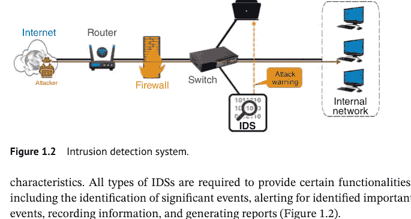

图 1.2 入侵检测系统。

特征。所有类型的 IDS 都需要提供某些功能，包括识别重要事件、为已识别的重要事件发出警报、记录信息和生成报告（图 1.2）。

IDS 与 IPS 之间的差异在表 1.1 中概述。

**表 1.1**  IDS 与 IPS 之间的差异。

| 特性 | 入侵检测系统 (IDS) | 入侵防御系统 (IPS) |
|---|---|---|
| *目标* | 检测并监控未经授权的活动，但不采取直接行动来阻止它们。 | 主动识别并防止未经授权的活动，通过采取立即行动，例如阻止或丢弃恶意流量。 |
| *采取的行动* | 被动：生成警报和报告以通知管理员潜在威胁。 | 主动：采取自动行动以防止已识别的威胁，例如阻止恶意数据包、重置连接或提醒管理员。 |
| *部署位置* | 战略性部署以监控网络流量，但不直接位于流量路径中。 | 放置在网络流量的内联中，主动参与源和目标之间的流量流。通常位于防火墙之后。 |
| *人工干预* | 需要管理员进行人工干预以调查和响应警报。 | 通过基于预定义安全策略自动采取行动来最大限度地减少人工干预。 |
| *预防能力* | 主要专注于检测和报告；不主动阻止威胁。 | 通过采取立即行动阻止或丢弃恶意流量来主动防止威胁。 |
| *使用场景* | 适用于检测和报告是主要关注点，而即时预防并非关键的环境。 | 适用于实时威胁预防至关重要以便及时减轻潜在风险的环境。 |

IDSs，如图 1.3 所示，可以分为入侵检测技术、入侵检测方法论和入侵检测方法等类别 [1]。

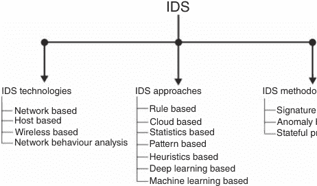

**图 1.3**  入侵检测系统分类。

##### 1.1.4.1 入侵检测技术

ID 技术通常分为四种类型：

- 基于网络的入侵检测系统。
- 基于主机的入侵检测系统。
- 基于无线技术的入侵检测系统。
- 基于网络行为分析的入侵检测系统。

#### 基于网络的入侵检测系统

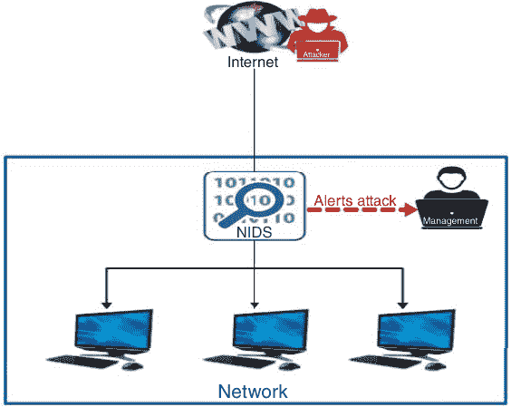

**图 1.4** 网络入侵检测系统。

基于网络的 IDS（NIDS），如图 1.4 所示，负责监督网络流量以确保网络设备的安全 [11]。这些系统审查各种协议，包括应用、传输和网络协议。NIDS 中的分析主要发生在应用层，尽管硬件层分析也是可能的。NIDS 的典型组件包括管理服务器、传感器、多个控制台和数据库服务器。除了传感器外，这些组件通常也存在于其他 IDS 技术中。传感器在监控和分析网络活动方面发挥着至关重要的作用。这些网络 IDS 通常是与受监视系统分离的独立物理设备，战略性地位于网络的上游。它们的设计旨在监控共享网络上的多个系统。NIDS 通常隐蔽运行，逃避受监视系统的检测。这一特性提供了强大的隔离并降低了潜在攻击者干扰的易感性。

然而，它们的有效性受到对受监视系统内部状态的有限视野的限制，这在检测过程中带来潜在挑战 [12]。NIDS 经常出现大量误报和漏报。最初，许多这些 IDS 依赖于基于签名的检测技术来识别已知和简单的攻击。

虽然基于网络的 IDS 具有检测攻击的先进能力，但也存在局限性。例如，它们无法识别加密网络流量中发生的攻击，并且在网络流量高峰期间可能难以进行全面分析。此外，IDS 传感器使用有状态协议分析会带来某些事件未被检测到的可能性。

#### 基于主机的入侵检测系统

基于主机的入侵检测系统（HIDS）[13]如图 1.5 所示，专门设计用于通过审查主机的活动和属性来识别潜在威胁。该系统用于保护终端，并涵盖各种数据类型，包括系统日志、流量细节以及文件访问和修改。HIDS 通常是安装在受监视系统上的软件组件，通常能够观察单个系统。虽然 NIDS 在监控状态


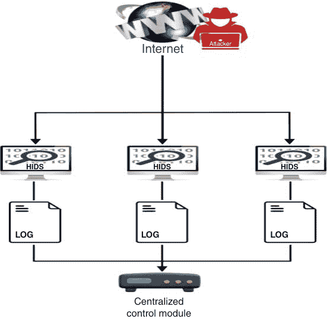

**图 1.5** 基于主机的入侵检测系统。

由于主机是系统的一部分，因此容易遭受内部攻击。简而言之，如果攻击者获得了系统的访问权限，他们就可以操纵或禁用HIDS。此外，基于主机的数据通常能提供全面的上下文信息，有助于更深入地理解系统进程和活动。然而，这一优势也带来了额外的成本，例如需要访问主机、设置分布式客户端，以及处理从这些主机获取的、可能庞大且敏感的数据集 [12]。HIDS通常采用被称为代理（agent）的检测软件，这些软件安装在特定主机上以监控其活动。代理负责收集数据并将其发送至管理服务器，在管理服务器上使用数据库服务器和控制台进行系统管理和监控。一些HIDS使用专用设备直接执行代理软件，从而无需在每台主机上单独安装。

这些设备被定位为监视特定主机上的网络活动，可以被视为一种基于网络的IDS。基于主机的IDS往往会产生误报和漏报，影响其识别潜在威胁的准确性。使用HIDS检测威胁的挑战在于缺乏关于已检测事件（如文件系统监控和日志分析）的上下文信息。因此，像重启主机这类行为

## 1 深度学习时代的入侵检测：导论

可能会偏离预期。对于缓慢渐进的拒绝服务（DoS）攻击，检测是可能的，但会有显著延迟。调整传感器对异常活动的敏感度可以加快攻击期间告警的生成，但也会增加误报的风险。NIDS系统的另一个局限是检测攻击存在延迟，因为它们依赖于来自网络设备和路由器的流式数据。数据会按批次随时间发送到IDS，间隔从一分钟到几个小时不等。由于这种延迟，如果在此期间攻击迅速发生，则可能未被发现，或者系统可能已被攻破。要解决这个局限，需要一个更强大的系统，能够在无需依赖流式数据的情况下进行监控。

- 基于签名的方法
- 基于异常的方法
- 状态协议分析

基于签名的方法也被称为基于知识的检测或误用检测系统。这些系统依赖已建立的攻击信息库，将传入流量分类为正常流量或某种已识别的攻击类型。它们基于模式匹配技术运作，通过将入侵签名与数据库中存储的签名进行比较来识别已知攻击。当出现匹配时，即表明该签名是先前已识别的入侵签名，此时会触发报警信号。签名的示例包括：使用用户名“root”尝试攻击（这对网络安全构成威胁）；主题为“免费程序”的电子邮件（通常与流行恶意软件相关）；或系统日志中显示操作系统主机控制被禁用的记录。在这种系统中，通过观察主机日志来识别那些先前已被判定为恶意软件的行为或命令。其基本思想是构建一个入侵签名数据库，并通过将当前行为与现有签名进行比较来评估这些行为。如果发现匹配，则生成警报。例如，形如“如果前提，则结论”的规则，当源IP地址与目标IP地址匹配时，可以将某个场景标记为攻击。基于签名的入侵检测系统（SIDSS）被广泛应用于Snort和NetSTAT等常见工具中。

在SIDSS中检测潜在攻击的传统方法通常包括检查网络数据包并与其预定义签名数据库进行比较。如果攻击者将名为“prog.exe”的恶意文件替换为其他名称（例如“prog2.exe”），搜索“prog.exe”的签名将无法检测到该攻击。然而，这些技术在检测跨多个数据包发生的攻击方面存在局限。随着现代恶意软件日趋复杂，IDS可能需要检索先前的数据包内容以提取签名信息。人们采用了多种方法来为SIDS创建签名，例如将签名创建为状态机、使用形式语言字符串模式或语义条件。这些系统能有效检测已知攻击，并具有高准确率和极少的误报。然而，它们计算密集且维护耗时。不幸的是，攻击变体和零日攻击的数量正快速增长，使得保持这些系统的最新状态变得困难。这些系统需要持续更新攻击库以应对新攻击，并且不适用于检测零日攻击。为了解决这个问题，可以使用基于异常的入侵检测系统（AIDS），其运作方式是建立被认定为可接受行为的基线，而非专注于检测异常。

## 基于异常的方法

AIDS超越了SIDS的局限性，被公认为是一种基于行为的系统，具有检测未知零日攻击的强大能力。在该系统中，会分析流量模式，从而识别正常流量模式，同时阻止恶意流量。然而，恶意流量模式的多样性往往导致这些系统产生大量误报。

将入侵检测为异常，关键在于观测行为与已建立模型之间存在显著偏差。这些方法基于这样一个前提：恶意活动不同于正常用户活动，因此任何偏离常规行为的异常动作都会被归类为入侵。构建这样的系统需要特别谨慎。

基于异常的检测系统依赖于定义应用程序、用户、主机或网络连接预期行为的规则。这些规则是通过在既定时间范围内分析常规活动的属性来建立的。例如，一条与网络活动相关的规则可能会规定标准工作时间内网络活动的平均发生次数。IDS通过基于统计技术，将当前活动属性与已建立的规则进行比较来生成警报。

行为属性，如失败的登录尝试次数、用户发送的电子邮件数量以及特定时间段内传输的数据包量，是制定规则的基础。基于异常的检测方法在检测以往未知的新型攻击方面表现出色。例如，当系统感染了一种新的、未知的恶意软件变种，且其行为偏离已建立的系统基线时，基于异常的检测系统能够识别并检测到此类异常。

基于异常系统中的规则可以分为静态规则和动态规则。静态规则列表除非添加新规则，否则保持不变；而动态列表则随着新事件的发生实时更新。动态列表的优势在于其持续的相关性，但可能会成为攻击者试图操纵的目标。

尽管AIDS具有诸多优势，但也存在挑战。将恶意活动意外纳入规则是一个常见问题，在某些情况下难以建立准确的规则也是挑战之一。AIDS通常会产生大量误报，尤其是在多样化或不断变化的环境中。此外，由于涉及的事件数量庞大且错综复杂，要确定告警的原因并验证其是否为误报可能十分困难。

AIDS的构建包括两个步骤：训练阶段和测试阶段。在训练阶段，使用常规流量基线创建正常行为模型；测试阶段则使用全新的数据集来评估系统识别新型入侵的能力并检验其检测能力的泛化性。AIDS可以根据所采用的训练方法进行分类，例如基于机器学习、基于统计或基于知识的技术。

AIDS的一个关键优势是其无需依赖签名数据库即可检测零日攻击的能力。相反，当系统观察到与通常活动不同的行为时，就会触发警报。AIDS有几个优点，包括能够检测组织内部的恶意活动，以及由于其个性化基线旨在使正常用户行为难以在不触发警报的情况下被识别，从而给网络犯罪分子规避检测带来了挑战。

## 状态协议分析

状态协议分析与基于异常的检测不同之处在于，它不依赖于基于主机或网络的基线；相反，它依赖于描述协议使用正确与否的标准化基线。该方法将协议典型活动的预定义基线（被广泛认为是每个协议状态的正常行为）与观测到的事件进行比较，以识别任何偏差。状态协议分析特指IDS理解并监控应用、传输和网络协议当前状态的能力，正如术语“状态”所表明的那样。

例如，在FTP会话启动时，其状态为未认证，允许尚未验证的用户仅执行有限的操作。认证后，用户才被允许执行授权命令。任何未经适当认证就尝试执行命令的行为都被视为可疑，而在已认证状态下执行这些命令则被视为正常行为。在状态协议分析中，过程涉及验证单个命令的特定条件，例如检查每个命令的最大和最小长度。例如，如果某标准命令要求密码参数最大长度为10个字符，那么任何超过20个字符的参数都将被视为可疑。

状态协议分析通常采用与软件供应商和组织制定的行业标准一致的协议模型。然而，在某些


在某些实例中，关于特定协议的信息可能不完整或不明确，给入侵检测系统（IDS）进行准确分析带来挑战。这些方法存在缺点，包括需要复杂的分析以及在同时跟踪多个会话时消耗大量资源。此外，有状态协议分析系统可能无法识别某些与预期协议行为相符的攻击类型，例如在短时间内执行大量正常操作的 DoS 攻击。

另一个局限性是模型实现的潜在差异，这取决于所使用的操作系统版本或客户端/服务器的类型。

##### 1.1.4.3 入侵检测方法

- 基于统计的 IDS。
- 基于规则的 IDS。
- 基于启发式的 IDS。
- 基于模式的 IDS。
- 基于云的 IDS。
- 基于机器学习的 IDS。
- 基于深度学习的 IDS。

## 基于统计的 IDS

基于统计的 IDS 通过观察常规交易来建立真实的配置文件，将与该配置文件偏离的情况识别为潜在攻击。每个交易都被分配一个衡量其与正常流量偏差程度的分数，当分数超过预定的阈值时触发警报。该阈值是基于特定时间范围内事件的数量确定的，考虑了均值、中位数、众数和标准差等各种数据包指标。IDS 单独监控每个数据包以检测与预期流的偏差，跟踪流指纹而不是检查数据流量内容。

统计 IDS 技术可分为三大类型：时间序列、多变量和单变量。

### a) 单变量：

该技术专注于使用单一变量分析数据，基于该指标创建正常配置文件。单变量 IDS 通过检测每个单独指标的异常来识别异常。

### b) 多变量：

该模型分析两个或多个度量之间的关系，在一起分析相关度量可增强分类时证明有用。多变量方法的挑战包括难以估计高维数据的分布。

### c) 时间序列：

时间序列涉及在特定时间段内获取的测量序列，如果某次观测在该时间点发生的可能性异常低，则认为其不寻常。

基于统计的 IDS 具有优势，例如无需依赖签名即可检测以前未知的攻击、维护简化无需频繁更新，以及在检测 DoS 和 DDoS 攻击方面的有效性。然而，缺点包括创建合法配置文件所需的时间、合法配置文件随时间可能发生变化，以及需要准确有效的统计分布以确保精确性和效率。

## 基于规则的 IDS

采用基于规则方法的 IDS 使用预先建立的规则来识别网络流量中的潜在入侵。这些规则可被视为模式，通过基于攻击模式的人工智能技术创建。与需要数千个签名来检测各种攻击的基于签名的 IDS 不同，基于规则的 IDS 可以使用单一规则识别多种攻击。与之相比，这种方法需要的规则更少，使 IDS 的管理更简单。此外，该系统善于识别新攻击，因为攻击模式的改变可能不足以完全改变入侵模式。在 IDS 中采用多条规则可能是必要的，以确保识别所有潜在的网络攻击。

## 基于启发式的 IDS

基于启发式的 IDS 通过识别恶意行为、建立检测可接受行为的模型并标记任何偏差来运行。这种方法依赖于知识和经验来有效区分正常行为和攻击行为。对收集的执行跟踪进行分析以识别可疑模式，发现时触发警报。该方法能够识别未知（零日）攻击和已知攻击，并能够发现并将新的攻击类型纳入恶意行为列表。然而，启发式引擎可能容易受到采用隐藏技术的一定攻击的规避。

## 基于模式的 IDS

采用基于模式方法的 IDS 通过从收集的数据中提取字符、字符串和结构来识别显著模式，从而识别攻击。这种方法指定攻击中的恶意指令序列，而 IDS 中识别的模式被称为签名。虽然基于模式的方法善于快速有效地检测已知攻击，但由于其模式或签名的未知性，在识别大多数零日攻击方面效率较低。基于模式的检测系统的实现较为简单。模式匹配算法分为多模式匹配和单模式匹配。

多模式匹配算法被认为比单模式匹配算法更高效，因为它消除了多次扫描数据包的需求。然而，多模式匹配算法需要高处理和内存时间。

## 基于云的 IDS

云计算技术提供高效的在线服务交付，具有 24/7 数据访问、按需付费和成本降低等优势。它包括三大主要服务类别：IaaS（基础设施即服务）、PaaS（平台即服务）和 SaaS（软件即服务）。IaaS 提供网络、计算设备和存储等基础设施资源，PaaS 提供用于利用各种算法的平台，SaaS 使用户能够在线执行任务。在云环境中构建 IDS 具有多重好处，允许从不同视角检测恶意网络行为并克服传统入侵检测方法的局限性。公共云和私有云能够以高效率同时检测各种网络攻击。

基于云技术的 IDS 包含三个主要组件：用户的数据收集器、云 IDS 和云服务。用户的数据收集器收集网络数据包，然后将其发送到云服务进行过滤、标准化和验证。云服务处理并标准化收集的数据，然后将其传输到云入侵检测组件。该组件包括分析引擎、签名数据库和服务控制台。分析引擎检查数据包以检测入侵。虽然这种方法仍处于早期阶段，但未来与 IDS 的集成对于增强模型性能至关重要。

## 基于机器学习的 IDS

机器学习（ML）涉及使用算法对数据进行自动化分析，消除了对人工干预的需求。它包括各种方法，包括使用未标记数据的无监督学习、依赖标记数据的监督学习，以及结合标记和未标记数据的半监督学习 [16]。这些方法旨在通过算法方法自动化数据分析过程。在入侵检测领域，ML 的应用是近期发展，IDS 可用的算法和技术众多。示例包括支持向量机、k 近邻、贝叶斯算法、神经网络、遗传算法、决策树和模糊逻辑。

机器学习方法在训练数据的支持下，由于其先进的模式匹配能力，可以识别复杂的模式。ML 涉及从大型数据集中提取洞察和知识。ML 模型包括一组技术、程序或复杂的传递函数，可用于识别数据中的显著模式或预测行为。


机器学习（ML）技术在入侵检测系统（IDS）领域的应用已变得十分普遍。各种方法和算法，如神经网络、聚类、最近邻、关联规则、遗传算法和决策树，被用于从入侵数据集中提取见解。ML方法在开发多种IDS以提高准确性并减少对人类专业知识的依赖方面发挥了重要作用。该领域的研究主要集中于利用数据集识别模式并创建IDS。一般来说，ML方法分为三类：无监督、有监督和半监督。

### a) IDS中的监督学习方法：
采用监督学习技术的IDS通过使用标记的训练数据来检测入侵。这种方法涉及两个主要阶段：训练阶段和测试阶段。在训练阶段，识别出关键特征和类别，算法从这些数据点中学习。在基于监督学习的IDS中，每条记录包含一个主机或网络数据源以及相应的输出值，指示入侵或正常状态。可以应用特征选择来消除冗余特征。一旦使用训练数据选择好特征，就通过监督学习方法训练分类器，使其能够学习标记输出值与输入数据之间的关系。在测试阶段，利用先前训练的模型将未知数据分类为正常或入侵类别。通过此过程开发的分类器转变为预测模型，能够通过分析一组特征值来确定输入数据的潜在类别。可用的分类方法多种多样，如最近邻、决策树、神经网络、支持向量机、朴素贝叶斯和基于规则的系统技术。每种方法都采用一种学习方法来构建分类模型。有效的分类方法不仅应能很好地处理训练数据，还应能准确判定其从未遇到过的记录的类别。学习算法在创建具有可靠泛化能力的分类模型中起着至关重要的作用。

### b) IDS中的无监督学习方法：
无监督学习旨在从缺乏类标签的输入数据集中提取有意义的见解。在这种方法中，输入数据点被视为随机变量，并为整个数据集创建联合密度模型。与依赖输出标签来训练和预测新数据的监督学习不同，无监督学习在没有标记数据的情况下运行。相反，它自主地将数据分组为不同的类别。在开发IDS的背景下，无监督学习通过使用未标记数据训练模型来检测入侵[17]。在聚类记录之后，小聚类中的实例被识别为入侵，因为较大聚类被推定为代表正常事件而非异常。此外，恶意入侵与正常实例之间的固有不相似性确保它们不可能属于同一个聚类。

### c) IDS中的半监督学习方法：
半监督学习介于监督学习中完全标记的训练数据与无监督学习中无标记数据之间，占据着一个中间地带。研究表明，半监督学习可以通过利用有限数量的标记数据来提高IDS的有效性，从而减少相关的时间和成本。在各类IDS场景中，获取标记数据困难或不频繁的情况下，这变得尤为有利。

在IDS中使用ML带来了多种好处，如增强的性能、适应性、灵活性以及识别新兴攻击类型的能力。然而，部署基于ML的IDS也伴随着相关挑战[18]。首先，ML算法依赖于对数据的假设，容易受到源自历史数据或先验知识的偏差影响。处理离群值可能会影响ML算法的有效性，并且由于网络威胁随时间不断演变的复杂性，未知攻击的检测和预防也构成挑战。攻击复杂性的持续增长给基于ML的IDS带来了持续挑战，处理具有数百万条网络连接的大型数据集可能非常繁琐。以数百个维度为特征的高维性给ML算法带来困难，数据预处理也很复杂，需要将监控系统数据转换为适合分析的格式。有效的检测可能要求超越仅依赖IP地址的上下文特征。ML算法可能并不总是纳入对准确入侵检测至关重要的特定领域知识。最后，特征工程和参数选择的过程可能比算法本身的选择更为关键。

#### 1.1.5 对基于深度学习的IDS的需求
利用深度学习进行入侵检测的动机源于传统方法（如基于签名的IDS和基于异常的IDS）的局限性[19]。基于签名的IDS虽然在检测已知攻击方面表现出色，但由于预装规则的限制，难以应对未知或新型威胁。另一方面，基于异常的IDS擅长识别新攻击，但往往会产生较高的误报率[20]。异常检测中特征选择面临的挑战源于攻击场景的不断演变，对某一类有效的特征可能无法很好地泛化。此外，缺乏来自真实网络的标记数据集阻碍了网络入侵检测系统（NIDS）的开发。深度学习作为ML的一个子集，通过采用分层信息处理层进行特征学习来解决这些挑战。尽管通常与图像分类相关联，但深度学习的多功能性延伸到了包括入侵检测在内的各个领域。它提供了自动特征提取、高效处理大型数据集以及有效缩减特征空间等优势。尽管有这些优势，但缺乏上下文知识、特征工程复杂、易受规避攻击影响以及对标记数据和专业知识的需求等挑战，在将其应用于入侵检测时需要考虑。总体而言，深度学习有望克服传统方法面临的障碍，从而实现改进的NIDS能力。

## 参考文献
- 1. Howarth, J. (2023). 来自移动设备的互联网流量. *Exploding Topics* 29: 11.
- 2. Griffiths C. (2023) 2023年最新勒索软件统计数据, 最新勒索软件统计数据（2023年12月更新）| aag it support (aag-it.com)（访问日期：2025年2月26日）.
- 3. Chou, D.和Jiang, M. (2021). 数据驱动网络入侵检测综述. *ACM Computing Surveys (CSUR)* 54 (9): 1–36.
- 4. Thakkar, A.和Lohiya, R. (2022). 入侵检测系统综述：特征选择、模型、性能度量、应用视角、挑战与未来研究方向. *Artificial Intelligence Review* 55 (1): 453–563.
- 5. Ghelani, D. (2022). 网络安全、网络威胁、影响与未来展望：综述. *American Journal of Science, Engineering and Technology* 6 (6): 12–19.
- 6. Tidjon, L.N., Frappier, M.和Mammar, A. (2019). 入侵检测系统：跨域概述. *IEEE Communication Surveys and Tutorials* 21: 3639–3681.
- 7. Yang, Z., Liu, X., Li, T.等 (2022). 基于异常的网络入侵检测方法与数据集的系统性文献综述. *Computers & Security* 116: 102675.
- 8. Ngueajio, M.K., Washington, G., Rawat, D.B.和Ngueabou, Y. (2022). *在kddcup'99和nsl-kdd数据集上使用支持向量机的入侵检测系统：综合综述*. Proceedings of SAI Intelligent Systems Conference. Cham: Springer International Publishing.
- 9. Coulibaly, K. 入侵检测与防御系统概述. 2020, arXiv. vol. abs/2004.08967.
- 10. Aleesa, A.M., Zaidan, B.B., Zaidan, A.A.和Sahar, N.M. (2019). 基于深度学习技术的入侵检测系统综述：一致分类法、挑战、动机、建议、实质性分析与未来方向. *Neural Computing and Applications* 32: 9827–9858.


## 入侵检测中的机器学习

Divya M.K.

计算机科学与工程系（人工智能与机器学习），Sree Buddha工程学院，Alappuzha，印度

入侵检测系统（IDSs）是旨在监控和分析网络或系统活动以识别可能表明安全漏洞或恶意活动的可疑模式的安全解决方案。通过持续检查进出数据，IDS 能够实时或接近实时地检测和响应威胁。IDS 有多种类型，例如专注于单个设备的基于主机的 IDS（HIDS）和监控网络流量的基于网络的 IDS（NIDS）。这些系统可以以基于签名的模式运行，检测已知的攻击模式，或以基于异常的模式运行，识别与正常行为的偏差 [1]。

### 入侵检测系统的重要性：

- 1) 早期威胁检测：IDS 可以在潜在的恶意活动升级为全面攻击之前检测并标记它们。这种早期预警能力使系统管理员能够及时介入并缓解威胁，通常可以防止数据泄露、服务中断或其他严重后果。
- 2) 实时监控和响应：通过提供持续监控，IDS 使组织能够在事件发生时做出响应，显著减少检测和管理威胁所需的时间。这种实时能力对于高安全环境至关重要，例如金融机构、医疗机构和关键基础设施。
- 3) 抵御内部威胁：IDS 可以识别源自网络内部的异常活动，有助于检测来自具有恶意意图的员工或承包商的内部威胁。这种能力对于防止数据盗窃、破坏和未经授权的访问至关重要。
- 4) **增强的安全态势：** 将入侵检测作为分层安全方法的一部分，组织可以加强其整体安全态势。IDS 通过提供针对微妙或复杂的攻击的额外检测层，补充了防火墙和防病毒软件等其他安全措施。
- 5) **取证分析和事件调查：** IDS 记录并分析可疑活动的數據，为事后事件调查创建审计跟踪。这些记录对于了解攻击的性质和来源、确定受影响的资产以及识别需要解决以防止未来攻击的漏洞非常宝贵。
- 6) **机器学习带来的对新威胁的适应性：** 配备 ML 的现代 IDS 可以通过学习新的攻击模式来适应不断发展的网络威胁。这种适应性使它们能够检测以前未见过的威胁，使其对高级持续性威胁（APTs）和零日漏洞更具弹性。
- 7) **监管合规和风险管理：** 许多行业受制于监管标准，例如 HIPAA– *健康保险可移植性和责任法案*，GDPR-通用数据保护条例，以及 PCI DSS-支付卡行业数据安全标准，这些标准要求采取强大的安全措施来保护敏感信息。IDS 通过确保实时监控和检测潜在违规行为来支持合规性，最大限度地降低处罚风险并增强风险管理实践 [2]。

IDSs 是任何组织网络安全基础设施的关键组成部分。它们为潜在的安全威胁提供关键洞察，帮助组织检测、响应和防止攻击，从而保护有价值的数据并维护其系统的完整性。

##### 2.1.1.1 IDS 类型：基于主机、基于网络、混合

根据它们被设计用于监控的元素及其在网络或系统中的位置，IDS 可以分为三种类型。HIDSs、NIDSs 和混合 IDS（HIDs）是三种主要类型。每种类型都具有特定的功能，使其适用于入侵检测和管理中的特定任务。

### 基于主机的入侵检测系统（HIDSs）

**定义：** HIDS 是一种驻留在单台主机机器（如计算机、服务器或工作站）上的安全系统。会观察主机的各种内部活动，包括系统日志、文件完整性、应用程序及其活动和配置，以检测异常或恶意行为。

- 通过深度包检测（DPI）检查数据包是否存在可疑活动的迹象。

### 优点：

- 提供网络的广阔视图，使其在检测在网络中传播的攻击时非常有效。
- 监控实时流量，能够快速检测大规模的基于网络的攻击。
- 由于部署在网络设备或段上，因此对单个主机资源消耗较少。

### 局限性：

- 在没有解密能力的情况下对加密网络流量的可见性有限，这可能导致某些攻击未被检测到。
- 无法检测完全发生在主机系统内部或通过看似合法的流量的攻击。
- 在流量量大或存在合法但异常活动的环境中容易产生误报。

### 混合入侵检测系统

**定义：** HID 结合了 HIDS 和 NIDS 的元素，利用主机级和网络级数据来提供对潜在入侵的更全面视图 [4]。混合 IDS 集成基于主机和基于网络的监控以实现分层检测方法，通常使用中央分析工具来关联来自多个来源的数据。

### 混合 IDS 的关键功能：

- 从网络流量和单个主机收集数据，允许对事件进行交叉关联。
- 在网络及其终端点之间提供统一的安全视图，提高对复杂多阶段攻击的检测能力。
- 可以实施高级分析来检测影响主机和网络的混合攻击。

### 优点：

- 通过将 HIDS 的精细监控与 NIDS 的广泛网络可见性相结合，提供全面的安全视图。
- 通过关联来自不同来源的事件，可以减少误报，提高准确性。
- 在检测多阶段攻击方面非常有效，例如 APTs，可能涉及网络流量和主机利用。

### 局限性：

- 由于集成了多个检测源，部署和管理更复杂。
- 成本和资源需求更高，因为它需要基于主机和基于网络的组件。
- 需要复杂的关联算法和中央管理来处理和解释大量数据。

### 2.2 机器学习在 IDS 中的作用

ML 在增强 IDS 中发挥着日益重要的作用。传统的 IDS 方法通常依赖于基于规则和基于签名的检测，在适应不断发展的威胁（如零日攻击和 APTs）方面存在局限性。ML 通过利用数据驱动模型来解决这些局限性，这些模型可以识别复杂模式、适应新威胁类型并提供更动态的入侵检测方法 [5]。

#### 2.2.1 使用机器学习在 IDS 中的益处与挑战

##### 2.2.1.1 ML 在 IDS 中的益处

- **自适应威胁检测：** ML 模型可以从新数据中学习，使其能够在无需为每个新威胁显式编程或更新的情况下识别新型和新兴威胁。
- **减少误报：** 通过使用分析数据模式的高级算法，基于 ML 的 IDS 可以减少误报的数量，从而实现更准确的检测并减少调查误报所需的时间。
- **行为分析：** ML 可以超越静态签名检测，以检测可能表明入侵的异常或异常行为。这种基于行为的方法可以识别基于签名的系统可能遗漏的威胁。
- **可扩展性和效率：** ML 算法，尤其是在大规模环境中，可以比基于规则的系统更有效地处理和分析海量数据，使其适用于高流量网络。
- **预测能力：** 基于 ML 的 IDS 可以利用历史数据预测潜在的未来威胁，有助于主动网络安全措施。这些系统还可以识别表明复杂多阶段攻击早期阶段的模式。

##### 2.2.1.2 ML 在 IDS 中的挑战

- **数据质量和可用性：** ML 算法需要大量标记数据用于训练，尤其是在监督学习中。高质量，


-   **保持签名最新：** 网络管理员可能需要手动更新其数据库以保持签名为最新。
-   **昂贵：** IDS/IPS（入侵检测系统/入侵防御系统）购买和维护成本可能很高。
-   **设置和维护困难：** IDS/IPS 设置、配置和维护起来可能很困难。

##### 2.2.2.2 过渡到基于机器学习的方法

随着传统方法的局限性变得更加明显，特别是随着复杂且隐蔽攻击的兴起，机器学习成为一个有前景的替代方案。基于机器学习的 IDS 使用在正常和恶意行为的大量数据集上训练的模型，使其能够学习手动定义不可行的模式和关系。向基于机器学习的 IDS 的转变包括采用以下技术：

-   **监督学习：** 通常用于已知攻击检测，监督式机器学习技术如决策树、随机森林和支持向量机（SVMs）根据标记数据将网络事件分类为正常或恶意。这种方法能有效检测与训练中见过的相似威胁。
-   **无监督学习：** 用于异常检测，无监督学习技术如聚类和异常检测算法可识别与预期行为的偏差。这对于检测新的、未知的威胁很有用，但可能导致更高的误报率。
-   **强化学习：** 用于自适应响应策略，强化学习技术如 Q-learning 和策略梯度使用一个通过与环境交互来学习做出决策以最大化累积奖励的智能体。

##### 2.2.2.3 当前基于机器学习的入侵检测系统格局

今天，基于机器学习的 IDS 已变得更加复杂，融合了诸如以下的高级技术：

-   **特征工程与选择：** 识别数据中最相关的特征以提高模型准确性和效率。
-   **实时检测与响应：** 机器学习模型现在可以通过分析传入的数据流实时检测和响应威胁。
-   **自动化学习与自适应：** 新的机器学习技术允许 IDS 在最少人工干预的情况下自行更新和重新训练，从而实现威胁检测的持续改进。

用于此目的的算法包括 K-Means 聚类、层次聚类、隔离森林和主成分分析（PCA）。无监督学习对于零日攻击的异常检测以及网络分段以发现异常用户或设备活动特别有用。然而，与监督方法相比，它通常会导致更高的误报率，并且其标记的异常难以解释。

-   **强化学习技术：** 强化学习（RL）用于在 IDS 中训练一个能够通过与系统交互并以奖励或惩罚形式接收反馈来检测和响应威胁的智能体。RL 智能体学习优化其操作，例如阻止恶意流量或提醒管理员，以最大限度地减少损害同时避免不必要的干扰。此过程涉及使用状态（表示网络状况）、动作（可能的响应）和奖励（衡量攻击缓解的成功程度）。RL 中的常见技术包括 Q-Learning、深度 Q 网络（DQN）和策略梯度方法。RL 在 IDS 中的应用包括动态调整防御策略的自适应入侵响应系统以及随时间学习不断演变的攻击模式的系统。然而，RL 面临的挑战包括计算密集型训练以及需要模拟或实时环境以实现有效学习。

##### 2.3.1.1 这些概念如何实现模式和异常检测

通过利用这些基本概念，机器学习算法可以处理大型数据集以发现规律（模式）并识别偏离常态的数据点（异常）。例如，在入侵检测中，监督学习算法可以识别已知的攻击模式，而无监督模型可以检测可能表明此前未见攻击的异常活动。通过持续学习和适应，机器学习算法为安全、欺诈检测、预测分析等提供稳健且不断发展的解决方案。

#### 2.3.2 入侵检测中使用的关键算法

IDS 依赖于各种机器学习算法来分析数据、分类流量和检测异常 [9]。这些算法根据其方法大致分为分类、聚类和异常检测。有关这些算法的汇总见表 2.2。

#### 2.3.3 分类算法

分类算法是用于将数据标记为良性或恶意的监督学习方法。当有标记数据集可用时，它们特别有效。

### 表 2.2 算法汇总表。

| 算法类型 | 示例算法 | 关键用例 |
|---|---|---|
| 分类 | 决策树、SVM、神经网络 | 基于标记数据检测已知攻击 |
| 聚类 | K-means、DBSCAN | 对流量进行分组以识别异常簇 |
| 异常检测 | 隔离森林、自动编码器、PCA | 检测未知或零日入侵 |

### 常见算法：

-   **决策树：**
  -   使用树状结构根据特征阈值做出决策。
  -   优点：易于解释、训练速度快、适用于中小型数据集。
  -   应用：区分正常和恶意流量模式。
-   **支持向量机（SVMs）：**
  -   识别在高维空间中最好地分隔不同类别数据点的超平面。
  -   优点：在有限数据和高维特征空间中表现良好。
  -   应用：将网络流量分类为正常和攻击类别。
-   **神经网络：**
  -   模仿人脑结构以学习数据中的复杂模式。
  -   优点：适用于大规模、高维数据；能够建模非线性关系。
  -   应用：对多态恶意软件等复杂攻击进行分类。

##### 2.3.3.1 聚类算法

聚类算法是用于对相似数据点进行分组并识别异常值的无监督方法。当标记数据稀缺时，这些方法特别有用。

### 常见算法：

-   **K-means：**
  -   根据特征相似性将数据分组为 K 个簇。
  -   优点：简单且对大型数据集高效。
  -   应用：将网络流分组以检测可能表示攻击的异常簇。

适合分析和建模。数据准备涉及的关键步骤如下：

-   **数据收集：** IDS 依赖于各种数据源来监控和分析潜在入侵的活动。这是构建有效 IDS 的基础步骤。它涉及收集将用于训练和测试 IDS 模型的数据。IDS 中使用的数据类型包括网络流量数据、系统日志文件和应用级数据。
-   **数据预处理：** 它是将原始数据转换为干净、有序且适合分析建模的格式的过程。它涉及一系列旨在解决原始数据中不一致、冗余和其他问题以确保其质量高且可用于机器学习、统计分析或其他应用的技术。
-   **数据分割：** 将数据集拆分为训练集和测试集。训练集用于构建和训练模型，而测试集则用于评估其性能。
-   **数据平衡：** 它是解决数据集中类别不平衡的过程，其中一个类别（例如“多数类”）显著多于另一个类别（例如“少数类”）。平衡数据集可确保机器学习模型能够从两个类别中有效学习，提高其检测少数类实例的能力并避免偏向多数类。
-   **数据转换：** 它是将原始数据转换为合适的格式或结构以使其更易于分析、建模或解释的过程。它涉及修改数据属性、格式或分布以提高机器学习模型或其他分析工具的效率和准确性。

#### 2.4.1 用于入侵检测系统的各类数据

-   **网络流量数据：** 它包括从网络接口捕获的数据包。包含源/目标 IP、端口、协议、数据包大小和负载等详细信息。它通常用于检测异常或恶意网络行为。示例：PCAP 文件、NetFlow 数据。
-   **系统日志文件：** 由操作系统和其他基础设施组件生成。它提供有关用户身份验证、文件访问、系统事件和错误的见解。示例：Syslog、Windows 事件日志。
-   **应用级数据：** 来自特定应用程序的日志或遥测数据。跟踪用户操作、错误消息和特定于应用程序的事件。适用于检测针对特定应用程序的攻击，如 SQL 注入或 Web 漏洞利用。示例：Web 服务器日志、数据库查询日志。


2) **学习算法：** 学习算法使用标记的训练数据来“学习”一个将输入映射到输出的函数或模型。常用的 IDS 中监督学习算法包括：

- **决策树：** 树状结构根据特征值对数据进行分割，创建预测入侵可能性的规则。
- **支持向量机（SVMs）：** 一种算法，用于找到最佳分离良性与恶意数据点的超平面。
- **朴素贝叶斯：** 基于贝叶斯定理的概率分类器，常用于 IDS，因其简单且在小数据集上有效。
- **人工神经网络（ANNs）：** 用于深度学习，这些网络学习大型数据集中的复杂模式，常用于复杂的入侵检测。

3) **模型训练：** 在训练期间，算法迭代调整模型参数以最小化误差，提高模型对新数据预测正确标签的能力。此阶段对于实现入侵分类的高准确性至关重要。

4) **评估指标：** 为了评估模型性能，IDS 中的监督学习依赖于准确率、精确率、召回率和 F1 分数等指标。这些指标有助于确定模型在检测恶意行为同时最小化误报和漏报方面的有效性。

#### 2.5.2 监督学习在 IDS 中的优势

- **高准确性：** 当在高质量、具有代表性的数据上训练时，监督模型对已知威胁的检测准确率高。
- **可解释性：** 许多监督学习算法，如决策树，提供了一定程度的可解释性，这对需要了解检测标准的网络安全分析师很有用。
- **快速检测已知威胁：** 监督模型在识别和分类训练数据中代表性良好的攻击类型方面非常有效。
- **通过再训练的适应性：** 监督学习模型可以用新的标记数据进行更新和再训练，使其能够适应不断变化的威胁态势。

#### 2.5.3 监督学习在 IDS 中的挑战

- **依赖标记数据：** 监督学习需要标记的训练数据，随着威胁的演变，这可能难以获取和维护。
- **对未知威胁的泛化：** 监督模型在检测新型攻击方面效果较差，因为它们偏向于训练数据中的模式。

类，通常使用基尼不纯度或信息增益等指标来衡量分割的质量。此过程继续进行，直到满足停止条件，例如达到最大深度或具有纯子集，其中所有数据点都属于同一类。最终的树由叶节点组成，表示预测的类别标签，以及包含决策规则的内部节点。决策树因其简单性、可解释性以及能够处理分类和数值数据而受欢迎。然而，它们容易过拟合，尤其是在树生长过深时，可能需要诸如剪枝或集成方法等技术来提高泛化能力 [12]。

**随机森林**是一种集成学习方法，结合多个决策树以提高预测准确性和鲁棒性。森林中的每棵树都在数据的随机子集上训练，使用自助采样（有放回采样）创建，并为每次分割考虑特征的随机子集。这种随机性在树之间引入多样性，降低了过拟合的可能性，使模型更具泛化能力。在预测期间，随机森林汇总所有单个树的结果——通常通过分类任务中的多数投票或回归任务中的平均值。这种方法利用树的集体智慧，与单棵决策树相比，结果准确性和稳定性更高 [13]。随机森林用途广泛，能够处理具有高维特征的大型数据集，并且对噪声数据具有鲁棒性。然而，它可能计算密集，且比独立决策树的可解释性差。

**支持向量机（SVMs）**是监督学习算法，旨在找到在高维空间中将数据点分离为不同类别的最优超平面。超平面被选为最大化间隔，即超平面与每个类别最近数据点之间的距离，称为支持向量。这种最大化增强了模型对未见数据的泛化能力。SVMs 可以通过使用核函数，如多项式或径向基函数（RBF），处理线性和非线性分离，将数据映射到数据变得线性可分的高维空间。SVMs 对二元和多类分类任务有效，尤其是在高维数据和较小样本量的情况下。然而，它们对大型数据集计算成本高昂，并且需要仔细调整参数，例如正则化项和核选择，以获得最佳性能 [14]。

**朴素贝叶斯**是一种基于贝叶斯定理的简单而有效的概率机器学习算法。它假设在给定类别标签的情况下所有特征相互独立，这一假设在实践中通常不现实，但在许多场景中有效。该算法通过将先验概率与观察到的特征的似然相结合来计算每个类别的后验概率，选择后验概率最高的类别作为预测。朴素贝叶斯

检测，其中目标是检测偏离常态的异常值，可能表明潜在威胁 [19]。

## IDS 中无监督学习的关键概念：

1. **异常检测：** 无监督学习在 IDS 中的主要应用是检测异常——与常规网络流量显著不同的异常模式。这些异常可能表明一系列潜在威胁，从恶意软件和数据泄露到内部威胁和 DDoS 攻击。
2. **聚类：** 聚类算法将具有相似特征的数据点分组，使 IDS 能够理解网络活动的典型“聚类”并识别不属于这些聚类的数据点。异常聚类（或位于聚类外部的点）会被标记以供进一步调查，因为它们可能代表恶意活动。
3. **降维：** 在网络流量分析等高维数据环境中，降维方法如 PCA 有助于降低数据复杂性，使 IDS 能够更有效地分析数据并识别异常。

## IDS 中常见的无监督学习技术：

1. **聚类算法：** K-means 聚类、具有噪声的基于密度的应用空间聚类（DBSCAN）和层次聚类
2. **异常检测算法：** 孤立森林、PCA 和自编码器
3. **基于密度的异常检测：** 局部异常因子（LOF）

## 无监督学习在 IDS 中的优势：

- **检测未知和新兴威胁：** 无监督学习不依赖预定义的攻击签名，使其能够有效识别未知或零日攻击。
- **适应性：** 无监督模型持续从数据中学习，有助于它们适应正常网络行为的变化，并随着时间的推移提高检测准确性。
- **减少标记工作量：** 由于无监督学习不需要标记数据，因此资源消耗更少，尤其是在标记攻击数据稀缺或难以获得的环境中。

## 无监督学习在 IDS 中的挑战：

- **高误报率：** 无监督学习有时会将合法的网络活动标记为异常，导致误报，这可能会使分析人员不堪重负并降低对系统的信任。


- **解释复杂性：** 解释模型为何将特定活动标记为异常可能颇具挑战，这会让安全分析师更难理解并有效响应。
- **计算资源：** 某些无监督算法，尤其是基于聚类和神经网络的方法，可能需要大量计算资源，特别是在实时分析大规模网络数据时。

#### 2.6.1 技术与算法

以下是不同的无监督学习算法，所有这些算法的摘要见表2.4。

**聚类算法：**

- **K均值聚类：** 一种常用算法，根据特征相似性将数据划分为K个不同的簇。在入侵检测系统中，K均值可将网络流量分组为典型模式，而无法良好适配任何簇的数据点可能表明存在异常。
- **DBSCAN（基于密度的带噪声应用空间聚类）：** 适用于发现任意形状的簇，DBSCAN将高密度区域中的数据点标记为簇，将低密度区域中的数据点标记为噪声，这些噪声可能指示异常。
- **层次聚类：** 构建簇的层次结构，有助于检测不同粒度的模式，不仅能识别孤立离群点，还能识别正常流量模式中的异常子簇。

**异常检测算法：**

- **孤立森林：** 该算法通过构建一系列随机二叉树来隔离异常。需要较少分割即可隔离的数据点被标记为潜在异常。孤立森林对大型数据集高效且有效，非常适合实时入侵检测系统应用。

表2.4 无监督学习算法摘要。

| 方面 | 聚类算法 | 异常检测 | 基于密度的异常检测 |
|---|---|---|---|
| 目标 | 将相似数据点分组 | 识别离群点 | 基于密度检测离群点 |
| 主要输出 | 聚类簇 | 异常标签 | 基于密度的异常标签 |
| 关键指标 | 相似性/不相似性 | 偏离正常程度 | 局部密度 |
| 依赖 | 整个数据集的结构 | 正常与异常标签 | 局部邻域密度 |
| 算法示例 | K-Means、DBSCAN | 孤立森林、PCA | LOF、DBSCAN |

- **主成分分析（PCA）：** PCA通过识别主成分（即最大方差方向）来降低数据维度。在入侵检测系统中，PCA可以揭示高维数据中的模式，并通过识别超出典型方差范围的数据点来检测异常。
- **自编码器：** 一种用于异常检测的神经网络。自编码器经过训练，对输入数据进行压缩然后重建。无法良好重建的数据被视为异常。在入侵检测系统中，自编码器能有效识别复杂的高维异常，例如不寻常的数据包头或载荷结构。

### 基于密度的异常检测：

- **局部离群因子（LOF）：** 衡量数据点相对于其邻域的局部密度。密度显著低于周围点的点被视为异常，非常适合检测可能表明入侵的异常网络流量模式。

#### 2.6.2 示例用例：基于异常的入侵检测

考虑这样一个组织，其网络环境中数据传输模式、用户行为和系统访问方式差异很大。可以使用无监督异常检测模型（如孤立森林或自编码器）在典型网络行为上随时间进行训练[20]。该模型能够识别“正常”模式，并将任何显著偏差（如异常的IP连接、非预期的数据传输量、或来自异常地理位置的访问）标记为潜在入侵。

例如，如果某员工的账户突然在非工作时间内开始下载大量数据，那么基于典型行为训练的无监督学习模型可以检测到这一异常，并提醒安全团队注意潜在的内部威胁或账户失陷[21]。

### 2.7 入侵检测系统中的半监督学习

半监督学习结合了监督学习和无监督学习的优势，通过混合使用有标签和无标签数据。这种方法在入侵检测系统中尤其有价值，因为标记的攻击数据通常有限，但大量未标记的网络数据随时可用[22]。半监督学习利用少量有标签数据帮助模型更好地理解和分类大量无标签数据，从而提高检测精度和适应性。

### 半监督学习在入侵检测系统中的关键概念：

- **1) 标签传播：** 半监督学习模型依靠标签传播将有标签数据的信息扩散到无标签数据。在入侵检测系统中，这一过程使模型能够将已知攻击模式的特征扩展到相似但尚未标记的数据点，帮助在无标签数据中检测潜在威胁。
- **2) 有限标签下的异常检测：** 半监督学习在入侵检测系统的异常检测中尤为有用，因为为每一种潜在入侵场景标注数据是不可行的。通过使用少量有标签数据，模型能够检测偏离正常行为的模式，即使它从未见过特定的攻击标签。
- **3) 自我训练与迭代学习：** 半监督入侵检测系统可以使用自我训练方法，即模型迭代地为无标签数据上的自身预测添加标签，并随时间精化其准确性。这种迭代方法有助于提高模型的性能和适应性，尤其是在攻击模式不断变化的动态环境中。

### 入侵检测系统中常见的半监督学习技术：

- **1) 自我训练：** 在自我训练中，模型首先在少量有标签数据上训练。然后，它对无标签数据点进行高置信度预测并添加标签，并迭代地将这些新标记的数据点纳入训练集。随着时间推移，模型从有标签和自我标记的数据中“学习”，提升其检测能力。
- **2) 协同训练：** 协同训练涉及在不同特征集（或视图）上训练两个或多个模型。每个模型对自身高置信度识别出的无标签数据进行标注，这些标签又用于训练其他模型。在入侵检测系统中，协同训练可应用于：一个模型分析网络特征（如数据包大小和IP地址），另一个模型分析行为特征（如访问模式），使系统能够从不同视角检测复杂攻击。
- **3) 基于图的方法：** 在基于图的方法中，数据点表示为图中的节点，边表示相似性或邻近性。已知点（如恶意或良性）的标签根据连接关系在图中传播，从而使模型能够推断无标签点的标签。在入侵检测系统中，基于图的方法适用于分析网络流量流，其中相似的流量行为很可能互相关联。
- **4) 生成模型：** 生成对抗网络（GAN）和变分自编码器（VAE）等模型可以基于少量有标签数据生成正常和异常数据的合成样本。通过生成新样本，这些模型帮助半监督入侵检测系统学习复杂模式和异常，即使在标签有限的情况下也能实现更稳健的检测。

### 半监督学习在入侵检测系统中的优势：

- **高效利用有标签数据：** 半监督学习最大化利用小型有标签数据集，帮助入侵检测系统在标签稀疏或难以获得的情况下仍表现良好。
- **改进未知威胁检测：** 通过混合使用有标签和无标签数据，半监督模型能够学习识别已知和以前未知类型的入侵。
- **减少对标注的依赖：** 减少详尽标注的需求可节省时间和资源，尤其是在标记的攻击数据难以收集的环境中。

### 半监督学习在入侵检测系统中的挑战：

- **错误传播：** 如果模型在自我标注过程中错误地为数据添加标签，这些错误可能会在模型中传播，可能导致错误分类以及更高的误报率或漏报率。
- **模型训练的复杂性：** 半监督学习可能计算密集，尤其是迭代自我训练或协同训练技术，使其难以在实时入侵检测系统中实现。
- **可解释性：** 与其他机器学习技术一样，理解模型为何将某些数据点标记为恶意或良性可能具有挑战性，特别是在使用深度学习或生成方法的复杂模型中。

#### 2.7.1 半监督算法与应用

以下是不同的半监督学习算法，所有这些算法的摘要见表2.5。

**1) 自我训练：**

- **方法：**
  - 在有标签数据上训练初始分类器。
  - 预测无标签数据的标签。
  - 将置信度最高的预测添加到有标签集合中。
  - 迭代地重新训练模型。
- **在入侵检测系统中的用途：** 通过迭代精化网络流量数据的分类边界来检测异常。
- **挑战：** 在早期迭代中存在传播错误标签的风险。


## 表 2.5 半监督学习算法总结

| 方面 | 自训练 | 协同训练 | 基于图的半监督学习 | 生成模型 |
|---|---|---|---|---|
| 关键思想 | 使用单一分类器迭代标注并扩展训练集。 | 使用多个分类器基于不同的特征视图对数据进行标注。 | 将数据表示为图并通过其结构传播标签。 | 学习底层数据分布以识别异常或生成新样本。 |
| 数据需求 | 有标签和无标签数据。 | 有标签和无标签数据，且具有不同的特征子集。 | 有标签和无标签数据，数据点之间具有相似性关系。 | 有标签和无标签数据，通常同时使用正常和异常模式。 |
| 算法示例 | 逻辑回归、决策树。 | 支持向量机、朴素贝叶斯、随机森林。 | 标签传播、标签扩散。 | 半监督生成对抗网络、变分自编码器（VAE）。 |
| 优势 | • 简单有效，适用于小数据集。<br>• 利用置信度分数迭代改进。 | • 利用特征多样性。<br>• 通过组合分类器减少过拟合。 | • 捕捉数据的全局结构。<br>• 对非线性关系有效。 | • 建模复杂模式。<br>• 可以生成合成数据或检测异常。 |
| 弱点 | • 存在传播错误的风险。<br>• 对初始分类器准确性敏感。 | • 需要条件独立的特征子集。<br>• 对初始分类器性能敏感。 | • 对大型数据集计算成本高。<br>• 需要构建良好的相似性图。 | • 资源密集。<br>• 需要大量训练数据以获得准确的生成模型。 |
| 在 IDS 中的应用 | • 迭代优化网络入侵检测的分类。 | • 利用多样化的流量特征（例如，协议类型与数据包大小）来识别攻击。 | • 通过网络相似性图传播已知攻击标签。<br>• 检测网络流中的异常。 | • 识别罕见或未见的攻击模式。<br>• 生成合成攻击数据用于训练。 |
| 计算成本 | 低至中等，取决于迭代次数。 | 中等，取决于分类器数量和迭代次数。 | 高，因图构建和传播步骤。 | 高，尤其对于基于深度学习的模型。 |
| 最佳使用场景 | 当可以做出置信预测且错误可控时。 | 当数据具有多样化且独立性足够的特征表示时。 | 当数据关系可以有效建模为图时。 | 当学习复杂模式或生成合成数据至关重要时。 |

## 2 入侵检测的机器学习

### 2) 协同训练：
- 使用两个（或更多）分类器在不同的特征子集上训练。
- 分类器通过标注无标签数据相互教学，该数据被添加到训练集中。
- 不同特征如数据包大小、协议类型或连接持续时间可用于不同的分类器。
- 挑战：需要特征在条件独立且足以用于分类。

### 3) 基于图的半监督学习：
- 将数据表示为图，其中节点为数据点，边表示相似性。
- 基于图结构将标签从有标签节点传播到无标签节点。
- 基于网络流量相似性构建图并传播已知攻击类型。
- 标签传播、标签扩散。
- 挑战：对大规模数据集计算成本高。

### 4) 生成模型：
- 使用如 VAE 或半监督 GAN 等模型来建模数据的分布。
- 通过识别偏离学习到的正常模式的点来检测异常。
- 在正常流量（有标签）和无标签流量上训练，以生成新样本或识别异常。
- 挑战：需要大量的计算资源。

#### 2.7.2 在入侵检测系统中的应用
- 1) 网络异常检测：
  - 检测实时流量中偏离正常行为的偏差。
  - SSL 有助于有效利用大量的无标签网络流量。
- 2) 恶意软件检测：
  - 使用标记的恶意软件样本和大规模无标签网络数据识别恶意载荷或行为。
- 3) 钓鱼攻击检测：
  - 使用 SSL 在有限的有标签数据集下对可疑 URL 或电子邮件模式进行分类。
- 4) 僵尸网络检测：
  - 分析无标签流量中的通信模式以识别僵尸网络活动。
- 5) 内部威胁：
  - 通过结合标记的内部攻击数据与一般员工行为数据检测可疑行为模式。

#### 2.7.3 示例用例：半监督网络入侵检测

假设在一个网络中，安全团队可以访问一个小型有标签数据集，其中包含恶意行为的已知示例（如 DDoS 攻击和数据外泄）以及正常行为 [23]。然而，大多数网络流量数据仍未标记。半监督学习模型可以在此初始有标签数据上训练以识别广泛模式，例如典型的数据流速率或用户访问行为 [24]。

之后，模型可以根据与有标签数据的相似性对无标签数据进行分类，使用自训练或标签传播。随着时间的推移，模型将改善对正常和异常行为的检测，甚至学会标记可疑的流量峰值或未经授权的访问尝试，这些尝试与已知攻击具有相似特征，但在训练数据中并未明确标记 [11]。

### 2.8 入侵检测系统的强化学习

强化学习（RL）提供了一种强大的方法来增强入侵检测系统（IDS），使其能够学习并适应不断变化的安全威胁。与传统的基于规则或静态机器学习模型不同，RL 通过与环境的交互持续学习以优化其性能。

在入侵检测系统的背景下，RL 框架可描述如下：
- 1) **智能体：** 决策者，如入侵检测系统，用于检测和响应威胁。
- 2) **环境：** 受监控的网络，包括其流量、用户行为和外部攻击尝试。
- 3) **状态 (s)：** 当前情况的表示，例如网络流特征、连接日志或主机行为。
- 4) **动作 (a)：** 可能的响应，包括记录、发出警报、阻止 IP 或隔离系统。

- 3) **自适应防火墙管理：**
  - 根据不断变化的攻击向量和合法流量模式持续优化防火墙规则。
- 4) **恶意软件检测：**
  - 通过分析其随时间的行为识别恶意软件感染的主机或载荷。
- 5) **资源分配：**
  - 通过优先考虑高风险区域来优化 IDS 资源使用（例如 CPU、内存）。
- 6) **策略学习：**
  - 为不同网络条件学习最优安全策略并实时调整。

### RL 在 IDS 中的优势：
- 1) **适应性：** 随环境学习并演进。
- 2) **可扩展性：** 处理大规模、高维数据，如网络流量日志。
- 3) **减少人工努力：** 自动化策略更新和威胁响应。
- 4) **对新型攻击的韧性：** 识别并缓解以前未见的攻击模式。

### RL 在 IDS 中的挑战：
- 1) **奖励设计：** 难以定义在检测准确性与系统可用性之间取得平衡的奖励。
- 2) **探索与利用：** 系统必须在不损害安全的情况下探索新动作。
- 3) **延迟奖励：** 动作可能产生后果，这些后果仅在之后出现，复杂化学习。
- 4) **对抗环境：** 攻击者可能通过提供误导性数据操纵 RL。
- 5) **计算成本：** RL，尤其是深度 RL，可能资源密集且收敛缓慢。

#### 2.8.1 示例场景

RL 在 IDS 中的方法：以下是不同的强化学习算法，所有这些算法的总结见表 2.6。想象一个监控实时流量的网络 IDS。RL 智能体观察模式（状态），决定是否允许或阻止流量（动作），并根据其决策的准确性获得奖励 [25]。随着时间的推移，智能体学会更有效地识别恶意行为并减少对合法用户的干扰。


表 2.6 入侵检测系统 (IDSs) 中强化学习 (RL) 方法的汇总表。

| RL 方法 | 关键思想 | 优势 | 劣势 | 在 IDS 中的应用 |
|---|---|---|---|---|
| Q-Learning | 它学习 Q 值函数来估计状态-动作对的奖励。 | • 对于小状态空间简单有效。 • 不需要环境模型。 | • 在大型或连续状态空间中表现不佳。 • 收敛缓慢。 | • 基础异常检测。 • 优化响应动作。 |
| Deep Q-Networks (DQN) | 将 Q-Learning 与深度神经网络结合以处理高维状态。 | • 处理大型、复杂的状态空间。 • 对动态环境有效。 | • 计算成本高。 • 需要仔细调优。 | • 网络流量异常检测。 • 复杂系统中的威胁响应。 |
| SARSA | 与 Q-Learning 类似，但根据实际采取的动作更新 Q 值。 | • 感知策略的学习。 • 在某些情况下比 Q-Learning 更稳定。 | • 可能收敛到次优策略。 • 相比 Q-Learning 探索较少。 | • 实时威胁缓解。 • 完善入侵响应策略。 |
| Policy gradient (PG) | 通过估计奖励梯度直接优化策略。 | • 在连续动作空间中表现良好。 • 能处理复杂策略。 | • 对奖励设计敏感。 • 收敛较慢。 | • 自适应安全策略。 • 学习最优资源分配。 |
| Proximal policy optimization (PPO) | 使用信任域约束平衡探索与利用。 | • 稳定且鲁棒。 • 训练复杂策略高效。 | • 计算密集。 • 需要大量数据集。 | • 防火墙的动态规则适配。 • 高级恶意软件检测。 |
| Model-Based RL | 构建环境模型以预测动作的结果。 | • 交互更少即可高效学习。 • 有利于规划。 | • 需要准确的环境建模。 • 在动态、不可预测的系统中表现不佳。 | • 模拟攻击场景。 • 规划资源部署。 |
| Multi-agent RL (MARL) | 多个智能体在共享环境中协作或竞争。 | • 分布式系统的可扩展性。 • 适用于复杂、多方面的問題。 | • 协调复杂。 • 计算成本高。 | • 协作威胁检测。 • 跨网络节点的协调响应。 |

### 2.9 IDS 中的特征工程、模型训练和超参数调优

#### 2.9.1 IDS 中的特征工程

**特征工程** 是选择、转换和创建新的数据属性以增强模型性能的过程 [26]。特征工程涉及将原始数据转换为适合训练机器学习模型的特征。在 IDSs 中，有效的特征工程对于准确捕捉网络行为并区分正常和恶意活动至关重要。

### 特征工程中的关键技术：

- 1) **特征创建：**
  - **特征组合：** 通过组合现有特征创建新特征（例如，根据出生日期和当前日期计算年龄）。
  - **离散化：** 将连续数值特征转换为离散类别（例如，将年龄划分为“年轻”、“中年”和“老年”等范围）。
  - **交互特征：** 创建捕捉两个或多个现有特征之间交互的特征（例如，将“收入”和“教育水平”相乘）。
- 2) **特征转换：**
  - **归一化：** 将数值特征缩放到统一范围（例如 0–1 或 -1 到 1）。
  - **标准化：** 重新缩放特征使其均值为 0，标准差为 1。
  - **对数变换：** 将偏态数据转换为更接近正态分布。
- 3) **特征选择：**
  - **过滤方法：** 基于统计度量选择特征（例如，相关性、卡方检验）。
  - **包裹方法：** 基于模型性能评估特征子集（例如，前向选择、后向消除）。
  - **嵌入方法：** 在模型训练过程中选择特征（例如 L1 正则化）。

### IDS 的常见特征：

- **基于网络的特征：** 这些包括数据包级信息，如源和目标 IP 地址、端口、数据包大小和协议类型，有助于区分正常和可疑流量。
- **行为特征：** 与用户行为相关的特征，如访问尝试频率、登录时间和会话持续时间，有助于检测内部威胁或异常访问模式。
- **时序特征：** 捕捉基于时间的模式，如特定时间间隔内的流量量，有助于识别 DDoS 等基于时间的攻击。
- **统计特征：** 数据流量的聚合统计（例如，均值、方差）可以突出可能预示攻击的网络模式偏差。

### 特征工程中的挑战：

- **高维性：** IDS 通常处理包含大量特征的庞大数据集，导致高维数据可能使机器学习模型不堪重负。
- **特征选择：** 识别最具信息量的特征很困难，通常需要领域专业知识，因为某些特征（例如特定协议或头部字段）对某些类型的攻击可能更相关。
- **数据质量和噪声：** 网络数据可能包含噪声或无关特征，如果未正确过滤可能会误导模型。例如，某些网络请求可能看起来不寻常但实际上是合法的。

#### 2.9.2 IDS 中的模型训练

**模型训练** 涉及将工程化特征输入机器学习算法以识别数据中的模式。在 IDS 中，由于网络流量数据的特性以及对准确威胁检测的需求，模型训练可能具有挑战性 [27]。

### IDS 的常见机器学习模型：

- **监督模型：** 决策树、随机森林、SVMs 和梯度提升模型因其可解释性和在二分类和多分类入侵分类中的高准确性而被广泛使用。
- **无监督模型：** K-means 聚类、Isolation Forests 和 DBSCAN 常用于异常检测，无需标记示例即可识别数据中的离群点。
- **深度学习模型：** CNNs 和 RNNs 用于复杂、高维数据。自编码器通过学习正常模式并标记偏差，常用于异常检测。

### 训练过程：

- **数据预处理：** 清理和规范化数据以确保格式和尺度一致。
- **数据划分：** 将数据集划分为训练集和测试集以评估模型性能。
- **模型训练：** 使用梯度下降等优化算法在训练集上训练所选模型。
- **模型评估：** 使用准确率、精确率、召回率、F1 分数和 ROC 曲线等指标评估模型在测试集上的性能。

### 模型训练中的挑战：

- **类别不平衡：** 在 IDS 数据集中，大多数流量数据代表正常行为，只有很小一部分是恶意的。这种不平衡可能导致模型偏向多数类，从而遗漏罕见但关键的入侵模式。
- **可扩展性：** 网络数据以高速生成，需要能够处理大规模数据并进行实时预测的模型。
- **过拟合：** IDS 模型可能对训练数据过拟合，学习到在新数据上泛化不好的特定模式。如果训练数据未包含全面的攻击类型，则尤其成问题。

#### 2.9.3 IDS 中的超参数调优

**超参数调优** 是优化控制学习行为的模型参数的过程，例如学习率、正则化项和树深度。适当的超参数调优对于在准确性和效率之间取得平衡至关重要，尤其是在实时 IDS 资源受限的环境中 [28]。

### IDS 模型的常见超参数：

- **学习率：** 决定模型学习速度。较低的学习率可防止权重快速变化，有助于在噪声数据中避免过拟合，但需要更长时间收敛。
- **正则化：** 对复杂性添加惩罚以防止过拟合，在深度学习模型中尤其有用。
- **树深度和树数量：** 在随机森林等集成模型中，控制树深度和树数量有助于在捕捉足够模式和避免过度计算成本之间取得平衡。
- **聚类大小：** 在 K-means 或 DBSCAN 等聚类模型中，聚类大小或密度阈值会影响模型对异常的敏感性。

### 超参数调优中的挑战：

- **计算成本：** 超参数调优可能资源密集，尤其是在复杂模型和大型 IDS 数据集的情况下。网格搜索或随机搜索等技术需要大量计算。


- **误报与漏报之间的权衡：** 调整超参数以尽量减少误报，可能会导致漏报增加，从而遗漏真实的入侵行为。在这些权衡之间取得平衡对入侵检测系统（IDS）至关重要。
- **动态网络环境：** 入侵模式会随时间变化，要求模型频繁重新调参和重新训练。因此，在自适应入侵检测系统中，超参数调优必须是一个持续进行的过程。

#### 2.9.4 入侵检测系统中的实际实施挑战
- 1) **实时检测：** IDS 模型必须快速处理数据以提供及时告警。在线学习和增量训练等技术至关重要，但实施起来颇具挑战。
- 2) **不断演变的威胁态势：** 攻击方法快速演变，要求 IDS 利用新的攻击模式进行更新，并在多样化数据集上重新训练。
- 3) **可解释性与可说明性：** 尤其是在监督模型中，可解释的预测对于安全分析师理解某些告警为何被触发非常重要。深度神经网络等复杂模型较难解释，给获取可操作的洞察带来挑战。
- 4) **与现有系统的集成：** IDS 必须在现有网络基础设施内工作，这可能对计算能力和数据可访问性施加限制。
- 5) **数据集不平衡：** 入侵检测数据集通常存在显著的类别不平衡，正常流量实例的数量远超攻击实例。这可能导致模型偏向多数类。
- 6) **实时处理：** IDS 必须实时处理网络流量，这需要高效的算法和硬件加速。

## 参考文献
- 1 Gurung, S.、Kanti Ghose, M. 和 Subedi, A. (2019). 基于 NSL-KDD 数据集的网络入侵检测系统深度学习方法。*International Journal of Computer Network and Information Security* 11 (3)：8–14.
- 2 Xin, Y.、Kong, L.、Liu, Z. 等 (2018). 面向网络安全的机器学习和深度学习方法。*IEEE Access* 6：35365–35381.
- 3 Gamage, S. 和 Samarabandu, J. (2020). 网络入侵检测中的深度学习方法：综述与客观比较。*Journal of Network and Computer Applications* 169.
- 4 Shone, N.、Ngoc, T.N.、Phai, V.D. 和 Shi, Q. (2018). 一种用于网络入侵检测的深度学习方法。*IEEE Transactions on Emerging Topics in Computational Intelligence* 2 (1)：41–50.

- 17. 人工智能与计算机视觉国际会议（AICV2020）。见：Aboul-Ella Hassanien、Ahmad Taher Azar、Tarek Gaber、Diego Oliva Fahmy M. Tolba 编辑。Switzerland AG：Springer Nature；第50–57页，3月24日。
- 18. Bamhdi, A.M.、Abrar, I. 和 Masoodi, F. (2021). 基于多数投票的高效入侵检测集成方法。Telkomnika（电信、计算、电子与控制）19 (2)：664–671.
- 19. Faker, O. 和 Dogdu, E. (2019). 使用大数据和深度学习技术的入侵检测。载于：ACM 东南会议论文集，第86–93页，美国纽约州纽约，2019年7月，4月18日。
- 20. Lansky, J.、Ali, S.、Mohammadi, M. 等 (2021). 基于深度学习的入侵检测系统：系统综述。IEEE Access 9：101574–101599。
- 21. Shi, S.、Han, D. 和 Cui, M. (2023). 一种多模态混合并行网络入侵检测模型。Connection Science 35 (1)：2227780。
- 22. Yang, Z.、Liu, X.、Li, T. 等 (2022). 基于异常的入侵检测方法与数据集的系统文献综述。Computers & Security 116：102675。
- 23. Heidari, A. 和 Jamali, M.A.J. (2023). 物联网入侵检测系统：综合综述与未来方向。Cluster Computing 26 (6)：3753–3780。
- 24. Amin, U.、Ahanger, A.S.、Masoodi, F. 和 Bamhdi, A.M. (2021). 基于 UNSW-NB15 数据集的云环境集成式高效入侵检测系统。SCRS 智能系统会议论文集，第483–494页。4月26日，印度。
- 25. Kasongo, S.M. (2023). 一种使用基于循环神经网络框架的入侵检测系统深度学习技术。Computer Communications 199：113–125。
- 26. Dina, A.S. 和 Manivannan, D. (2021). 计算机网络中基于机器学习技术的入侵检测。Internet of Things 16：100462。
- 27. Masoodi, F. (2021). 面向 NSL-KDD 数据集上入侵检测分类分析的机器学习。Turkish Journal of Computer and Mathematics Education (TURCOMAT) 12 (10)：2286–2293。
- 28. Loukas, G.、Vuong, T.、Heartfeld, R. 等 (2018). 基于云的车辆网络物理入侵检测方法（使用深度学习）。IEEE Access 6：3491–3508。

## 3
## 深度学习基础（一）
*Razeeef Mohd¹ 与 Abeena Mohiudin Azad²*

¹印度查谟和克什米尔斯利那加克什米尔大学计算机科学系
²印度查谟和克什米尔斯利那加扎库拉女子学院计算机应用系

### 3.1 深度学习简介
#### 3.1.1 定义与重要性

在快速演变的数字环境中，网络安全已成为一门关键学科，其任务是保护系统、网络和数据免受日益增多的威胁侵害。随着网络攻击变得越来越复杂和普遍，基于签名的检测系统和基于规则的防火墙等传统安全机制已显得力不从心。这些传统方法严重依赖预定义模式和静态规则，因而在面对零日漏洞利用、高级持续性威胁（APT）和多态恶意软件等新颖且自适应的威胁时效果不佳。在此背景下，深度学习——作为机器学习的子集，其灵感来源于人脑的结构和功能——已成为一项变革性技术，为检测、缓解和预防网络威胁提供了前所未有的能力 [1]。

深度学习利用了人工神经网络（ANN），这些网络是由多层相互连接的节点（即神经元）组成的计算模型。这些网络旨在自主地学习数据的层级表示，从而能够提取出传统算法通常无法察觉的复杂模式和关系。与传统机器学习技术需要大量手动特征工程和领域专业知识不同，深度学习模型可以直接处理原始、非结构化数据——如网络流量、系统日志或二进制文件——并自动识别相关特征。

这种自我优化和自适应的能力，使深度学习特别适合应对网络安全挑战的动态性和复杂性 [2]。

深度学习在网络安全中的应用涵盖了广泛的用例，包括入侵检测、恶意软件分析、网络钓鱼检测和行为异常检测。例如，卷积神经网络（CNN）和循环神经网络（RNN）等深度学习模型在实时分析网络流量以识别恶意活动方面已取得了显著成功 [3]。类似地，基于 Transformer 的架构（如 BERT 和 GPT）已被用于通过分析电子邮件和 URL 的文本内容来检测网络钓鱼攻击 [4]。此外，生成对抗网络（GAN）和自编码器等深度学习技术正被用于通过对恶意软件行为模式建模，来增强恶意软件的检测和分类能力 [5]。

深度学习在网络安全领域最显著的优势之一，是能够检测零日攻击——即利用未公开漏洞的、此前未知的威胁。传统的基于签名的系统在识别此类攻击方面存在固有局限，因为它们依赖历史数据和预定义签名。相比之下，深度学习模型可以分析海量数据，识别偏离正常行为的情况，并在无需预先了解特定攻击模式的情况下标记潜在威胁。这种适应性和鲁棒性使深度学习成为现代网络安全框架不可或缺的工具 [6]。

然而，在网络安全中采用深度学习并非没有挑战。一个主要问题是深度学习模型的可解释性。由于这些模型具有复杂性且呈“黑盒”特性，人们往往难以理解其如何做出具体决策，这可能在关键安全应用中阻碍信任与合规 [7]。此外，深度学习模型需要大量带标签的训练数据才能实现高准确率，而由于隐私问题和数据的敏感性，在网络安全领域获取这些数据可能很困难 [8]。再者，对抗性攻击——攻击者操纵输入数据以欺骗深度学习模型——对这些系统的可靠性和有效性构成重大威胁 [9]。

尽管存在这些挑战，深度学习研究的持续进展正在为更可解释、更鲁棒且更具可扩展性的网络安全解决方案铺平道路。对抗训练、联邦学习和可解释人工智能（XAI）等技术正在被积极探索，以解决当前模型的局限性并增强其在现实场景中的适用性 [10]。此外，深度学习与强化学习、边缘计算等其他新兴技术的结合，在开发能够主动防御日益复杂和不断演变的威胁的下一代网络安全系统方面，具有巨大潜力 [11]。


本章全面介绍了深度学习在网络安全领域的技术概况，探讨了其基本原理、应用、优势和挑战。通过研究实际用例和前沿研究，本章旨在让读者深入了解深度学习如何改变网络安全领域，并塑造数字防御机制的未来 [12]。

#### 3.1.2 网络安全中的深度学习：增强威胁检测与防御

随着网络威胁日益复杂，传统安全机制已难以跟上不断演变的威胁形势。网络流量数据的庞大体量和复杂性使得人类分析师和基于规则的系统难以有效检测恶意活动。在这种背景下，**人工智能驱动的解决方案**，尤其是利用**深度学习技术**的解决方案，已成为分析海量数据、识别可能表明网络威胁的异常的关键工具。深度学习模型擅长自动化检测过程、减少误报，并增强网络安全系统对新出现威胁的适应性 [13]。

深度学习是机器学习的一个子集，利用**人工神经网络（ANN）**对数据中的复杂模式进行建模。与传统依赖预定义规则和手动特征工程的方法不同，深度学习模型可以从原始数据中自主提取相关特征，因此非常适用于入侵检测、恶意软件分析和网络钓鱼防御等任务。通过学习数据的分层表示，深度学习模型能够识别传统系统可能忽略的细微异常，从而提高网络安全框架的整体准确性和效率 [14]。

#### 3.1.3 深度学习增强网络安全的关键领域

- 1) **入侵检测系统（IDS）：** 入侵检测系统（IDS）对于识别网络中的未授权访问和恶意流量至关重要。传统IDS依赖基于签名的方法，在检测新型或演变中威胁方面能力有限。深度学习模型，如**卷积神经网络（CNN）**和**循环神经网络（RNN）**，可以实时分析网络流量，识别与分布式拒绝服务（DDoS）攻击、暴力登录尝试和其他恶意活动相关的模式。例如，RNN在分析网络日志等序列数据方面特别有效，能够检测可能表明正在发生攻击的异常 [15]。
- 2) **恶意软件检测：** 恶意软件检测是深度学习展现出显著潜力的另一个领域。传统方法通常依赖静态分析（检查文件的二进制代码）或动态分析（观察程序执行期间的行为）。深度学习模型，如**深度自编码器**和**生成对抗网络（GAN）**，可以分析静态和动态特征来识别恶意软件。例如，GAN可以生成合成恶意软件样本来训练模型，提高其检测从未见过威胁的能力 [16]。
- 3) **网络钓鱼攻击防御：** 网络钓鱼攻击通过诱骗用户泄露敏感信息，是一个重大的网络安全问题。深度学习模型，特别是基于**自然语言处理（NLP）**和**Transformer架构**（如BERT、GPT）的模型，可以分析电子邮件和URL的文本内容来检测网络钓鱼企图。这些模型能够识别可疑的语言模式，例如紧急索要个人信息或指向欺诈网站的链接，并将其标记以供进一步调查 [1]。
- 4) **行为分析：** 行为分析涉及监控用户活动，以识别可能表明安全漏洞的偏离正常行为的偏差。深度学习模型可以分析用户行为模式，如登录时间、文件访问和网络使用情况，以检测可能表明内部威胁或账户被盗用的异常。例如，**长短期记忆（LSTM）**网络（RNN的一种类型）在建模序列数据和预测异常用户活动方面特别有效 [6]。

##### 3.1.3.1 利用深度学习进行主动威胁检测

通过利用深度学习，安全分析师可以超越被动安全措施，采取主动的威胁检测方法。深度学习模型可以持续从新数据中学习，从而适应不断演变的威胁并随时间提升性能。这种适应性在**零日攻击**的背景下尤为重要，因为零日攻击利用先前未知的漏洞，因此传统基于签名的系统无法检测。深度学习模型可以分析网络流量和系统行为的模式，以识别可能表明零日攻击的异常，使组织能够迅速响应并减轻潜在损害 [3]。

此外，深度学习模型可以通过自动化检测过程和提供可操作见解来减轻人类分析师的负担。例如，**可解释人工智能（XAI）**技术可用于使深度学习模型的决策过程更加透明，使分析师能够理解模型如何得出特定结论。这种透明性对于建立对AI驱动的网络安全系统的信任以及确保符合监管要求至关重要 [7]。深度学习已成为增强网络安全的有力工具，提供自动化异常检测、减少误报并提高系统适应性。通过利用深度学习技术，组织可以主动检测和缓解网络威胁，超越被动安全措施，构建更具韧性的防御机制。随着网络威胁的持续演变，将深度学习融入网络安全框架将在保护数字基础设施和确保敏感数据安全方面发挥关键作用。

### 3.2 深度学习的概念基础

深度学习是机器学习的一个子领域，专注于训练人工神经网络（ANN）通过学习数据的分层表示来执行复杂任务。与传统机器学习算法需要手动特征工程不同，深度学习模型可以自动从原始数据中提取相关特征，使其高度适应各种应用 [14]。

从核心来看，深度学习受人类大脑结构和功能的启发。人工神经网络（ANN）作为深度学习的构建块，由多层相互连接的节点（即神经元）组成，这些节点将输入数据处理并转换为有意义的输出。每个神经元对输入施加加权求和，然后经过非线性激活函数，使网络能够对数据中的复杂关系进行建模 [1]。

深度学习中的“深”一词指的是神经网络中使用多个层。这些层使模型能够学习数据的分层表示，其中较低层捕获简单特征（例如图像中的边缘），而较高层捕获更复杂的特征（例如物体或模式）。这种分层学习过程正是深度学习在图像识别、自然语言处理和入侵检测等任务中特别有效的原因 [17]。

#### 3.2.1 深度学习的历史演进

深度学习的起源可以追溯到20世纪40年代，当时开发出了第一批神经网络计算模型。1943年，沃伦·麦卡洛克和沃尔特·皮茨提出了神经元的数学模型，称为麦卡洛克-皮茨神经元，这为人工神经网络奠定了基础 [18]。然而，直到20世纪80年代反向传播算法的出现，神经网络才获得广泛认可。

反向传播算法是一种训练多层神经网络的方法，它的发展标志着深度学习演变中的一个重要里程碑。这一突破使研究人员能够训练更深的网络，为现代深度学习铺平了道路 [19]。尽管取得了这些进展，深度学习在20世纪90年代和21世纪初仍面临重大挑战，包括计算能力有限和缺乏大型数据集。


然而，强大硬件（如图形处理单元（GPU））的出现，以及大规模数据集（如ImageNet）的可用性，重新点燃了人们对深度学习的兴趣[15]。诸如用于图像识别的CNN和用于序列数据分析的RNN等突破性进展，巩固了深度学习作为现代人工智能基石的地位[20]。

#### 3.2.2 深度学习与传统机器学习的关键区别

传统机器学习算法依赖于手工设计的特征和浅层架构，而深度学习模型利用多层神经元来学习数据的层次化表示。这使得深度学习模型在图像识别、自然语言处理和入侵检测等任务中能够实现卓越的性能[21]。深度学习与传统机器学习的关键区别总结如下：

- **特征工程**：传统机器学习算法需要手动特征工程，由领域专家从原始数据中提取相关特征。相比之下，深度学习模型能够自动从原始数据中提取特征，无需人工干预[22]。
- **模型复杂度**：深度学习模型通常比传统机器学习模型更复杂，拥有数百万甚至数十亿个参数。这种复杂度使深度学习模型能够捕捉数据中复杂的模式和关系，但也使其在训练和部署时计算成本高昂[23]。
- **数据需求**：深度学习模型需要大量标记的训练数据才能实现高准确率。相比之下，传统机器学习算法通常可以在较小的数据集上获得合理的性能[24]。
- **可解释性**：传统机器学习模型，如决策树和线性回归，通常比深度学习模型更具可解释性。深度学习模型的“黑盒”特性使得理解其如何做出特定决策变得困难，这可能会在关键应用中阻碍信任和合规性[25]。

#### 3.2.3 为什么深度学习适合入侵检测

入侵检测涉及分析大量数据，以识别表明恶意活动的模式。深度学习模型擅长这项任务，因为它们能够处理高维数据并检测细微的异常[26]。例如，RNN可以分析序列网络流量数据来识别与DDoS攻击相关的模式，而CNN可以通过分析二进制代码或行为模式来检测恶意软件[27]。

深度学习模型的分层学习过程使其特别适合入侵检测。网络的较低层可以捕获简单的特征，如数据包头部或系统日志，而较高层可以捕获更复杂的模式，如攻击签名或行为异常。这使得深度学习模型能够检测已知和未知威胁，使其在动态和复杂环境中非常有效[28]。

#### 3.2.4 人工神经网络（ANN）作为深度学习的核心

人工神经网络构成了深度学习的基础，其灵感来源于人脑的架构。这些网络由称为神经元或节点的互连处理单元组成，这些单元被组织成不同的层。每个神经元对接收到的输入数据进行计算，并将结果传递给后续层。ANN的基本能力在于通过调整内部参数的学习过程，自动识别数据中复杂的模式和关系[29]。

##### 3.2.4.1 ANN的结构

典型的ANN由以下三种主要类型的层组成：

- 1) **输入层**：该层接收原始数据并将其转发至后续层，不执行任何转换。该层中的每个神经元代表数据输入的一个特征或属性。
- 2) **隐藏层**：这些中间层通过加权计算和激活函数提取有意义的特征。隐藏层的深度和数量定义了模型的复杂度。深度学习模型包含多个隐藏层，使其能够学习数据的层次化表示[17]。
- 3) **输出层**：最后一层基于从隐藏层学习到的特征生成预测或分类。该层中神经元的数量取决于问题的性质，如二分类、多分类或回归[1]。

##### 3.2.4.2 ANN的工作机制

ANN的核心功能依赖于涉及权重、偏置和激活函数的数学计算。每个神经元计算其输入的加权和，并应用激活函数引入非线性，使网络能够学习复杂模式。学习过程由称为反向传播的优化技术控制，该技术使用梯度下降调整权重，以最小化预测输出与实际输出之间的误差[30]。

ANN的强大之处在于其能够逼近复杂函数并很好地泛化到未见过的数据。CNN和RNN等变体将ANN扩展到了专业领域，分别包括图像处理和序列数据分析。高性能计算资源（如GPU和TPU）的日益普及进一步增强了ANN的可扩展性和效率，使其成为现代人工智能系统的基本组成部分，如图3.1所示[31]。

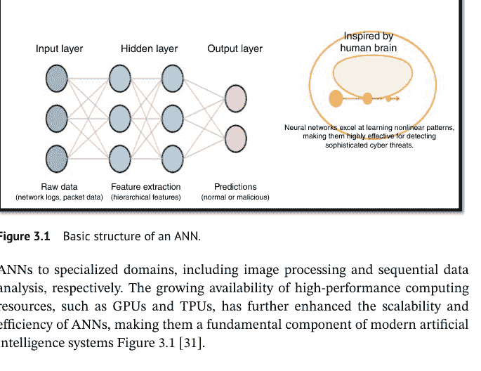

图3.1 一个人工神经网络的基本结构。

##### 3.2.4.3 深度学习在模式识别和异常检测中的作用

深度学习特别擅长识别模式和检测异常，这对入侵检测至关重要。使用深度学习训练的IDS模型可以做到以下几点：

- 识别传统基于规则的系统遗漏的恶意行为。
- 使用异常检测技术检测未知的攻击模式。
- 通过持续学习适应不断演变的网络威胁。

这些能力使深度学习成为网络安全领域的重要工具，尤其是在检测APT和零日攻击方面（Yin et al., 2017; Ghorbani et al., 2019）。

### 3.3 神经网络：深度学习的构建模块

#### 3.3.1 生物启发与数学表示

生物神经元是人工神经元的基础。一个人工神经元（图3.2）可以做到以下几点：

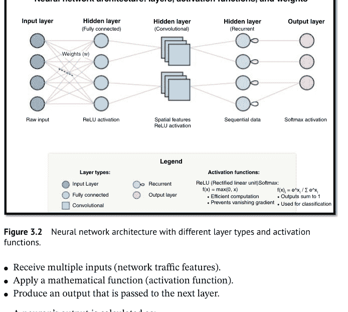

图3.2 具有不同层类型和激活函数的神经网络架构。

- 接收多个输入（网络流量特征）。
- 应用数学函数（激活函数）。
- 产生传递给下一层的输出。

神经元的输出计算如下：

y = f(WX + b)

其中：

X = 输入向量
W = 权重向量
b = 偏置
f = 激活函数

#### 3.3.2 神经网络架构（层、激活函数和权重）

##### 3.3.2.1 神经网络中的层

- 全连接层：每个神经元都与下一层中的每个神经元相连。
- **卷积层：** 提取空间特征，适用于基于图像的网络安全应用。
- **循环层：** 用于序列数据，如随时间变化的网络日志。

深度网络需要大型数据集才能有效训练，这使其成为数据驱动型，并能够适应不断演变的网络威胁（图3.2）。

##### 3.3.2.2 神经元激活函数

在人工神经网络中，激活函数在根据接收到的输入决定神经元是否应被激活方面起着至关重要的作用。该函数引入非线性，使网络能够捕捉数据中复杂的模式和关系。神经元输出的数学表示如下：

$$y = f\left(\sum_{i=1}^{n} w_i x_i + b\right)$$

其中：

- **x_i（输入）：** 这些代表神经元接收到的特征或信号。例如，在入侵检测系统中，输入可能包括数据包大小、协议类型或源IP地址。
- **w_i（权重）：** 每个输入都有一个关联的权重，决定其在计算中的重要性。在训练过程中，模型调整这些权重以最小化误差。
- **b（偏置）：** 偏置项允许神经元移动其激活函数，提高模型对数据分布的适应性。
- **∑_{i=1}^n w_i x_i + b（加权和）：** 表示神经元在激活前接收到的总信号。
- **f（激活函数）：** 该函数为模型引入非线性，使其能够学习复杂的数据表示[19]。

##### 3.3.2.3 激活函数的类型

根据要解决的问题类型，神经网络中使用不同的激活函数，如下所示：

1) **修正线性单元（ReLU）：**

$$f(z) = \max(0, z)$$

- 因其简单性和有效性而用于深度网络。
- 有助于缓解梯度消失问题。
- 常用于CNN [20]。

2) **Sigmoid函数：**

$$f(z) = \frac{1}{1 + e^{-z}}$$


- 将输入映射到 0 到 1 之间的范围。
- 常用于二分类任务的输出层。
- 然而，它存在深度网络中的梯度消失问题 [16]。

## 3) 双曲正切（Tanh）：
$f(z)=\frac{e^z-e^{-z}}{e^z+e^{-z}}$

- 与 sigmoid 类似，但将输入映射到 $[-1, 1]$ 之间。
- 常用于 RNN 中的序列建模 [32]。

### 示例 3.1 计算
考虑一个具有三个输入的神经元：

$x_1=2,\quad x_2=3,\quad x_3=1$

以及对应的权重：

$w_1=0.5,\quad w_2=-0.2,\quad w_3=0.8$

还有一个偏置项：

$b=1$

使用 ReLU 激活函数，输出计算如下：

$z=(0.5\times2)+(-0.2\times3)+(0.8\times1)+1$

$z=1.0-0.6+0.8+1=2.2$

$y=\operatorname{ReLU}(2.2)=\max(0,2.2)=2.2$

这展示了激活函数如何处理加权输入并在神经网络中引入非线性 [33]。

#### 3.3.3 使用反向传播和权重优化训练深度学习模型
训练深度学习模型涉及调整其参数以最小化误差。反向传播是根据预测输出与实际输出之间的误差更新网络权重的主要算法。权重更新公式如下：

$w_{ij}=w_{ij}-\eta\frac{\partial E}{\partial w_{ij}}$

其中：

- $w_{ij}$ 是连接一层中的神经元 $i$ 与下一层中的神经元 $j$ 的权重。
- $\eta$（学习率）控制权重更新的幅度。
- *E* 是量化预测输出与实际输出之间差异的误差函数。
- *∂E/∂w_ij* 是梯度，决定了权重需要调整多少才能减小误差 [34]。

##### 3.3.3.1 神经网络中的误差函数
误差函数通过量化预测值与实际值的偏差来指导反向传播过程。常见的误差函数如下：

### 均方误差（MSE）：
$$E = \frac{1}{n} \sum_{i=1}^{n} (y_i - \hat{y}_i)^2$$

- 用于回归任务。
- 衡量预测值与实际值之间的平均平方差 [35]。

### 交叉熵损失：
$$E = - \sum_{i=1}^{n} y_i \log(\hat{y}_i)$$

- 常用于分类问题。
- 衡量预测概率与实际类别标签之间的差异 [36]。

##### 3.3.3.2 反向传播的步骤
1. **前向传播**：使用当前权重和偏置计算网络输出。
2. **计算误差**：根据预测值和实际值计算损失 *E*。
3. **反向传播**：利用微分链式法则计算损失函数关于每个权重的梯度。
4. **更新权重**：使用计算得到的梯度和学习率调整权重 [37]。

### 反向传播的实际示例
假设误差关于某个权重 *w_ij* 的梯度为 0.5，学习率为 0.1。更新后的权重计算如下：

$$w_{ij} = w_{ij} - 0.1 \times 0.5$$

$$w_{ij} = w_{ij} - 0.05$$

这展示了反向传播如何通过调整权重迭代地提高模型精度 [38]。

## 激活函数与反向传播的应用
- **激活函数**：
  - **ReLU**：用于深度卷积网络中的图像分类和目标检测。
  - **Sigmoid**：应用于二分类任务，例如垃圾邮件检测。
  - **Tanh**：用于序列数据处理，尤其是在 RNN 中。
- **反向传播**：
  - **训练深度网络**：对于深度学习模型学习表示至关重要。
  - **优化**：用于随机梯度下降（SGD）和 Adam 等基于梯度的优化器，以高效更新权重 [39]。

这些概念构成了深度学习的基础，使人工神经网络（ANN）能够从复杂数据集中提取有意义的模式，并获得高预测精度。

#### 3.3.4 梯度下降：神经网络学习的支柱
为了优化人工神经网络（ANN）的参数，采用梯度下降法。这种迭代优化算法通过在负梯度方向更新模型参数来最小化损失函数。梯度下降的一般权重更新规则如下：

$$w_{ij}^{(t+1)} = w_{ij}^{(t)} - \eta \frac{\partial E}{\partial w_{ij}}$$

- $w_{ij}^{(t)}$，表示第 $t$ 次迭代时的权重。
- $w_{ij}^{(t+1)}$，是更新后的权重。
- $\eta$（学习率）控制更新的步长。
- $\frac{\partial E}{\partial w_{ij}}$，是损失函数关于该权重的梯度。

梯度下降有几种变体以提高收敛效率，如下所示：

1. **批量梯度下降（BGD）**：使用整个数据集计算梯度后更新权重。虽然稳定，但对于大型数据集计算成本较高 [40]。
2. **随机梯度下降（SGD）**：处理每个训练样本后更新权重。这会引入噪声，但收敛更快，更容易逃离局部最小值 [41]。
3. **小批量梯度下降（MBGD）**：是 BGD 和 SGD 之间的折中方案，在计算小批量数据上的梯度后执行更新。这种方法兼顾了效率和稳定性 [42]。

##### 3.3.4.1 高级优化技术

### 基于动量的优化
基于动量的优化通过引入过去梯度的指数衰减移动平均来加速梯度下降。动量项有助于优化器更有效地沿陡峭梯度前进。更新规则如下：

$v^{(t+1)} = \beta v^{(t)} + (1 - \beta) \frac{\partial E}{\partial w_{ij}}$  
$w_{ij}^{(t+1)} = w_{ij}^{(t)} - \eta v^{(t+1)}$

其中：

- $v^{(t)}$ 是第 $t$ 次迭代时梯度的指数平均值。
- $\beta$ 是动量系数（通常设为 0.9）。

动量有助于防止优化路径中的振荡，并加速收敛，尤其是在深度网络中 [23]。

### 自适应学习率方法
为了进一步改善收敛性，自适应学习率算法会根据历史梯度动态调整 $\eta$。主要方法如下：

### 1) Adagrad（自适应梯度算法）：
- 根据历史梯度为每个参数修改学习率。
- 适用于稀疏数据，但会随着时间推移出现学习率不断减小的问题 [43]。

$w_{ij}^{(t+1)} = w_{ij}^{(t)} - \frac{\eta}{\sqrt{G_{ij}^{(t)} + \epsilon}} \frac{\partial E}{\partial w_{ij}}$

其中 $G_{ij}^{(t)}$ 是截至第 $t$ 次迭代的梯度平方和。

### 2) RMSprop（均方根传播）：
- 引入梯度平方的指数衰减平均，以缓解 Adagrad 学习率消失的问题。
- 非常适合训练 RNN [44]。

$G_{ij}^{(t)} = \beta G_{ij}^{(t-1)} + (1 - \beta) \left(\frac{\partial E}{\partial w_{ij}}\right)^2$  
$w_{ij}^{(t+1)} = w_{ij}^{(t)} - \frac{\eta}{\sqrt{G_{ij}^{(t)} + \epsilon}} \frac{\partial E}{\partial w_{ij}}$

### 3) Adam（自适应矩估计）：
- 通过计算梯度的一阶矩估计和二阶矩估计，结合了 Adagrad 和 RMSprop 的优点。

深度学习任务中最广泛使用的优化器之一 [45]。

$m^{(t)} = \beta_1 m^{(t-1)} + (1 - \beta_1) \frac{\partial E}{\partial w_{ij}}$ 

$v^{(t)} = \beta_2 v^{(t-1)} + (1 - \beta_2) \left(\frac{\partial E}{\partial w_{ij}}\right)^2$

$\hat{m}^{(t)} = \frac{m^{(t)}}{1 - \beta_1^t}, \quad \hat{v}^{(t)} = \frac{v^{(t)}}{1 - \beta_2^t}$

$w_{ij}^{(t+1)} = w_{ij}^{(t)} - \frac{\eta}{\sqrt{\hat{v}^{(t)}} + \epsilon} \hat{m}^{(t)}$

其中 $\beta_1 = 0.9$ 和 $\beta_2 = 0.999$ 分别是动量和方差的衰减率。

#### 3.3.5 神经网络中的正则化技术
为了防止过拟合，深度学习模型使用正则化技术来惩罚过于复杂的模型。

##### 3.3.5.1 L1 和 L2 正则化
1) **L1 正则化（Lasso）**：向损失函数添加权重的绝对值惩罚：

$$E_{reg} = E + \lambda \sum_{i=1}^{n} |w_i|$$

通过将某些权重置为零来促进稀疏性，使其在特征选择中很有用 [46]。

2) **L2 正则化（Ridge）**：添加权重平方惩罚：

$$E_{reg} = E + \lambda \sum_{i=1}^{n} w_i^2$$

防止权重值过大，从而提升深度网络中的泛化能力 [47]。

#### 3.3.6 Dropout：减少过拟合
Dropout 是另一种正则化方法，它在训练期间随机禁用一部分神经元。给定丢弃率 $p$，一个神经元以概率 $1 - p$ 保留：

$$y_i = \frac{x_i}{1 - p}, \quad \text{where } x_i \text{ is dropped with probability } p$$

Dropout 迫使网络学习冗余表示，从而提高鲁棒性 [48]。


##### 3.3.6.1 激活函数与优化对深度学习的影响

激活函数和优化策略的选择对深度学习模型的性能有显著影响，具体如下：

- **ReLU 及其变体（Leaky ReLU、Parametric ReLU）**：由于其处理梯度消失的能力，对于训练深度架构至关重要。
- **高级优化器（Adam、RMSprop、Adagrad）**：通过自适应学习率实现复杂网络的高效训练。
- **正则化（Dropout、L2、批归一化）**：防止过拟合，确保对未见数据的泛化能力。

这些进步使深度学习模型在图像识别、自然语言处理和异常检测等领域变得高度有效 [49]。人工神经网络（ANNs）构成了深度学习的基础，激活函数和反向传播驱动着其学习能力。优化技术的演进——从梯度下降到自适应学习率方法——使得深度模型的训练变得高效。此外，正则化策略确保网络能够很好地泛化到现实世界场景。这些发展不断推动人工智能的边界，使深度学习成为现代计算中的变革性技术 [50] 图 3.3.

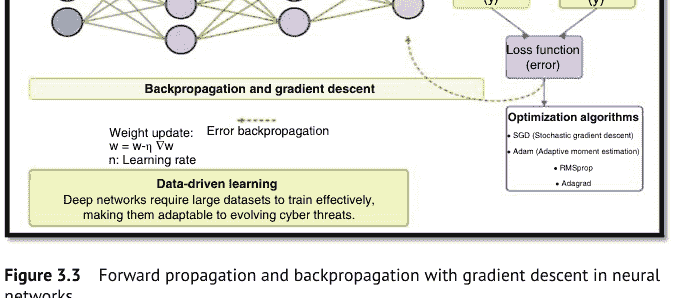

图 3.3 神经网络中梯度下降的前向传播和反向传播。

### 3.4 深度学习在入侵检测中的应用

#### 3.4.1 网络威胁和攻击类型

基于深度学习的 IDS 已成为识别和缓解各种网络威胁和攻击的有力工具。这些系统利用深度学习模型分析海量数据、识别复杂模式并检测可能表明恶意活动的异常的能力。下面，我们探讨一些最常见的网络威胁类型以及基于深度学习的 IDS 如何应对它们。

##### 3.4.1.1 DDoS 攻击

DDoS 攻击是最普遍和最具破坏性的网络攻击形式之一。在 DDoS 攻击中，攻击者通过洪水般的流量淹没目标系统，例如网站或网络，使其对合法用户不可用。传统 IDS 通常难以区分合法的流量激增和恶意的 DDoS 流量。然而，基于深度学习的 IDS 可以实时分析流量模式并识别偏离正常行为的异常激增。通过利用 CNN 和 RNN 等模型，这些系统可以检测出 DDoS 攻击的细微模式，即使攻击流量设计成模仿合法流量 [51]。

##### 3.4.1.2 恶意软件和勒索软件

恶意软件和勒索软件是旨在渗透、破坏或获得系统未经授权访问的恶意软件程序。特别是勒索软件会加密受害者的数据并要求支付赎金以释放数据。传统的基于签名的检测方法通常对新型或不断演变的恶意软件变种无效。另一方面，基于深度学习的 IDS 可以分析可执行文件的结构和行为，以识别与恶意软件相关的隐藏模式。例如，诸如 CNN 的深度学习模型可以处理二进制文件并检测出暗示恶意意图的异常。这种能力对于识别没有已知签名的零日恶意软件特别有价值 [52]。

##### 3.4.1.3 暴力破解攻击

暴力破解攻击涉及通过尝试各种用户名和密码组合来反复尝试获得对系统的未经授权访问。这些攻击使用传统方法难以检测，尤其是当攻击者使用避免触发警报的技术时，例如降低攻击速率。基于深度学习的 IDS 可以随时间监控登录尝试并识别表明暴力破解攻击的模式。例如，LSTM 网络作为一种 RNN，非常适合分析登录日志等顺序数据，并且可以检测可能表明暴力破解攻击的重复登录失败尝试 [53]。

##### 3.4.1.4 内部威胁

内部威胁涉及组织内部人员，例如员工或承包商，因其拥有合法的系统和数据访问权限而实施的恶意或疏忽行为。这些威胁尤其难以检测，因为相关人员通常拥有授权访问权限并了解系统。基于深度学习的 IDS 可以监控用户行为并识别可能表明内部威胁的正常活动偏差。例如，自编码器作为一种神经网络，可用于建模正常用户行为并检测异常，例如对敏感数据的未经授权访问或异常文件传输 [54]。

#### 3.4.2 基于深度学习的入侵检测系统（IDSs）

IDSs 是现代网络安全框架的关键组成部分，旨在监控网络流量和系统活动以寻找恶意行为的迹象。传统 IDS 大致可分为两类：基于签名和基于异常。深度学习显著增强了 IDS 的能力，特别是在基于异常检测领域。

##### 3.4.2.1 基于签名的 IDS

基于签名的 IDS 依赖于已知攻击的预定义模式或签名来识别恶意活动。这些系统在检测有充分记录的威胁方面有效，但在识别新型或未知攻击——通常称为零日攻击——方面存在困难。基于签名的 IDS 受限于其对已知攻击签名数据库的依赖，该数据库必须持续更新才能保持有效。虽然这些系统仍被广泛使用，但其无法适应不断演变的威胁的能力导致了更先进的检测方法的发展 [55]。

##### 3.4.2.2 基于异常的 IDS

基于异常的 IDS 专注于识别偏离正常行为的偏差，使其非常适合检测未知或新型攻击。深度学习通过实现从大型数据集中自动提取特征和模式，彻底改变了基于异常的 IDS。与需要手动特征工程的传统方法不同，深度学习模型可以学习数据内部的复杂关系，从而非常有效地检测可能表明攻击的细微异常。这种能力在当今的威胁环境中尤其有价值，因为攻击者不断开发新的规避检测技术 [56]。

##### 3.4.2.3 常用于 IDS 的深度学习模型

- **卷积神经网络（CNNs）**：CNNs 特别适用于分析流量模式和识别网络数据中的异常。这些模型受视觉皮层启发，非常适合处理结构化数据，例如网络数据包。CNNs 可以自动从数据中提取空间特征，使其非常有效地检测与 DDoS 或恶意软件等攻击相关的模式 [57]。
- **循环神经网络（RNNs）和长短期记忆（LSTM）网络**：RNNs 和 LSTM 网络旨在处理顺序数据，例如时间序列数据或网络日志。这些模型特别适用于检测涉及随时间重复模式的攻击，例如暴力破解攻击或内部威胁。LSTM 网络能够学习数据中的长期依赖关系，使其非常适合检测可能表明攻击的细微异常 [58]。
- **自编码器**：自编码器是一种用于无监督学习和异常检测的神经网络。这些模型通过学习正常数据的压缩表示然后重建它来工作。当呈现异常数据时，自编码器难以准确重建它，从而使系统能够将其标记为潜在威胁。自编码器特别适用于检测内部威胁，因为它们可以建模正常用户行为并识别可能表明恶意活动的偏差 [59]。

#### 3.4.3 案例研究和实际应用

基于深度学习的 IDS 的实际应用在各个行业中已显示出显著成功。组织利用这些系统来增强其网络安全态势、检测复杂的威胁并实时响应攻击。下面，我们探讨一些基于深度学习的 IDS 的值得注意的案例研究和实际应用。

##### 3.4.3.1 金融机构

金融机构因其处理的敏感数据性质而成为网络攻击的主要目标。基于深度学习的 IDS 已在此领域成功部署，用于检测欺诈交易并防止对金融系统的未经授权访问。例如，一些银行已实施 CNN 来分析交易模式并识别可能表明欺诈的异常。这些系统可以实时处理大量交易数据，使银行能够在造成重大损害之前检测并响应欺诈活动 [60]。


##### 3.4.3.2 科技公司

科技公司，尤其是那些拥有大规模网络的公司，也已采用基于深度学习的入侵检测系统（IDS）来监控网络流量并检测异常模式。例如，其中一些公司已使用循环神经网络（RNN）和长短期记忆（LSTM）网络来分析网络日志并识别潜在威胁，如分布式拒绝服务（DDoS）攻击或未授权访问尝试。这些系统能够处理序列数据（例如随时间变化的网络流量），并检测可能预示攻击的模式。通过利用深度学习，这些公司能够增强实时检测和响应威胁的能力，从而降低数据泄露或服务中断的风险[61]。

##### 3.4.3.3 医疗机构

医疗保健行业也从基于深度学习的入侵检测系统的实施中获益。医疗机构处理敏感的患者数据，使其成为网络攻击的诱人目标。深度学习模型（如自编码器）已被用于监控用户活动并检测可能表明内部威胁的异常情况。例如，基于自编码器的入侵检测系统可以模拟正常用户行为，并标记异常的访问模式，例如未授权访问患者记录。这种能力在医疗保健领域尤其宝贵，因为数据泄露的后果可能非常严重[62]。

##### 3.4.3.4 政府机构

政府机构也已采用基于深度学习的入侵检测系统来保护关键基础设施和敏感数据。例如，一些机构已实施卷积神经网络（CNN）来分析网络流量并检测潜在威胁，如恶意软件或未授权访问尝试。这些系统能够实时处理大量数据，使机构能够快速检测并响应威胁。此外，基于深度学习的入侵检测系统还被用于监控用户活动并检测内部威胁，例如未授权访问机密信息[63]。

##### 3.4.3.5 零售与电子商务

零售和电子商务公司也已利用基于深度学习的入侵检测系统来保护其系统和客户数据。例如，一些公司已实施循环神经网络（RNN）来分析交易数据并检测表明欺诈活动的模式。这些系统能够处理序列数据（例如购买历史），并识别可能表明欺诈的异常情况。通过利用深度学习，这些公司能够增强检测和响应威胁的能力，从而降低财务损失或声誉受损的风险[64]。

### 3.5 深度学习的安全增强潜力

#### 3.5.1 深度学习在网络完全中的优势

深度学习已成为网络安全领域的一项变革性技术，它提供了几个关键优势，使其特别适合应对网络威胁复杂且不断演变的特性。下面，我们探讨深度学习在网络安全中的主要优势。

##### 3.5.1.1 自动化威胁检测

深度学习在网络安全中最显著的优势之一是它能够自动化威胁检测。传统的网络安全系统通常依赖人工干预，安全分析师必须监控网络流量、分析日志并调查潜在威胁。这个过程不仅耗时，而且容易出错。相比之下，基于深度学习的系统可以实时自动分析大量数据，无需人工干预即可识别潜在威胁。

例如，深度学习模型可以监控网络流量、检测异常并标记可疑活动，使安全团队能够专注于响应高优先级威胁。这种自动化不仅提高了效率，还降低了因人为疏忽而漏掉关键威胁的风险。通过利用CNN和RNN等技术，深度学习模型可以处理结构化和序列数据（如网络数据包和系统日志），以识别表明恶意活动的模式[65]。

##### 3.5.1.2 高准确性

深度学习模型能够学习数据中复杂的模式和关系，使其在检测网络威胁方面具有很高的准确性。与传统依赖预定义签名或规则的基于规则的系统不同，深度学习模型可以通过从数据中学习来适应新的和不断演变的威胁。这种适应性在零日攻击和高级持续性威胁（APT）的背景下尤其有价值，因为这些威胁往往能规避传统的检测方法。

例如，基于深度学习的入侵检测系统可以分析网络流量并识别可能表明复杂攻击的细微模式。即使在嘈杂或复杂的数据集中，这些模型也能实现高准确性，使其非常适合实际网络安全应用。迁移学习和集成学习等技术通过使深度学习模型能够利用相关领域的知识并分别整合多个模型的预测，进一步提高了其准确性[66]。

##### 3.5.1.3 可扩展性

深度学习模型的可扩展性是其在网络安全中的另一大优势。随着组织的成长和网络的扩展，必须监控和分析的数据量呈指数级增长。传统的网络安全系统可能难以应对这种规模，导致威胁检测和响应延迟。然而，深度学习模型被设计为能够高效处理大型数据集，因此具有很高的可扩展性。

例如，基于深度学习的入侵检测系统可以实时分析数TB的网络流量数据，在不影响性能的情况下识别潜在威胁。这种可扩展性在当今的数字环境中尤为重要，因为组织必须监控庞大而复杂的网络以防范网络威胁。此外，**分布式计算框架**（如Apache Spark和TensorFlow）的使用使深度学习模型能够在多个节点上扩展，进一步增强了其处理大型数据集的能力[6]。

##### 3.5.1.4 对不断演变的威胁的适应性

网络威胁在不断发展，攻击者不断开发新技术来规避传统安全措施。深度学习模型通过持续从新数据中学习，擅长适应这些变化。与需要定期更新威胁数据库的基于签名的系统不同，深度学习模型在遇到新型攻击时可以自动更新其知识库。这种适应性使得基于深度学习的系统在检测**零日漏洞利用**和其他可能之前未被记录的新的威胁方面特别有效[67]。

##### 3.5.1.5 减少误报

误报是网络安全中的一个常见挑战，即合法活动被错误地标记为恶意活动。这可能会令安全团队不堪重负，并降低威胁检测系统的有效性。深度学习模型凭借其学习复杂模式和关系的能力，在减少误报方面非常有效。通过分析大量数据并识别正常行为与恶意行为之间的细微差异，基于深度学习的系统可以显著提高威胁检测的精确度，使安全团队能够专注于真正的威胁[68]。

#### 3.5.2 基于深度学习的IDS的挑战与局限性

尽管深度学习在网络安全领域具有变革潜力，但基于深度学习的IDS仍面临若干挑战和局限性。下面，我们讨论阻碍其有效性和广泛采用的关键问题。

##### 3.5.2.1 计算成本

部署基于深度学习的IDS的主要障碍之一是与模型训练和推理相关的高昂计算成本。深度学习模型，尤其是那些具有深层架构和大量参数的模型，需要大量的处理能力和内存。有效训练这些模型通常需要GPU或TPU等高性能计算资源，这对于预算有限的组织来说可能过于昂贵。此外，实时入侵检测要求低延迟推理，这就需要持续访问强大的硬件。这些计算限制构成了重大障碍，尤其是对中小型企业而言，它们可能缺乏充分利用基于深度学习的IDS所需的基础设施[20]。

##### 3.5.2.2 对抗性攻击

深度学习模型固有地容易受到对抗性攻击，即攻击者操纵输入数据以误导模型并规避检测。在网络安全领域， adversaries可以构造对IDS而言看似合法的恶意网络流量，从而绕过安全机制。例如，对数据包头或负载数据的细微扰动可以欺骗模型，将恶意活动错误分类为良性活动。鉴于入侵检测的高风险性——未被检测到的攻击可能导致重大的数据泄露和经济损失——这一局限性尤为关键。当前的研究重点是采用对抗性训练和稳健的模型架构来缓解这一问题；然而，对抗性防御仍是一个活跃的研究领域，需要进一步的发展才能在现实场景中完全可靠[69]。

##### 3.5.2.3 数据可用性与质量

基于深度学习的IDS的有效性在很大程度上取决于用于训练的高质量标记数据集的可用性。获取标记的网络安全数据具有挑战性，因为这需要收集和标注正常及攻击相关的网络活动。这一过程耗时、耗费资源，并且常常受到隐私问题和法律限制的约束。此外，入侵检测数据集的不平衡特性——正常流量远远多于恶意实例——可能导致模型产生偏差，从而无法检测罕见但复杂的攻击。另外，在过时数据集上训练的深度学习模型可能难以泛化到新兴威胁，因此需要持续的数据收集和模型重训练。应对这些挑战需要开发标准化、高质量的数据集，以及采用数据增强和迁移学习等技术来增强模型的鲁棒性[70]。


通过优化架构、对抗鲁棒性技术和改进数据收集方法克服这些局限性，基于深度学习的入侵检测系统（IDS）可以变得更加有效，并在网络安全框架中得到广泛应用。

#### 3.5.3 AI驱动入侵检测的未来方向

随着深度学习的持续发展，若干有前景的进展有望增强AI驱动的入侵检测系统。以下关键方向旨在解决现有局限性，并提高这些系统的效率、安全性和可解释性。

##### 3.5.3.1 联邦学习

联邦学习是一种新兴技术，能够在分散的数据上训练深度学习模型。与传统方法要求数据集中以进行模型训练不同，联邦学习确保数据分布在本地设备或服务器上。这种方法增强了隐私和安全性，特别是在金融和医疗等敏感领域。在网络安全背景下，联邦学习可以让组织在不共享机密网络数据的情况下协作训练入侵检测系统模型。这种分散式方法不仅保护了数据隐私，还允许模型利用更多样化的数据集，提高其检测各种攻击模式的能力，同时符合数据保护法规[71]。

##### 3.5.3.2 可解释人工智能（XAI）

基于深度学习的入侵检测系统面临的主要挑战之一是其“黑箱”特性，难以解释模型是如何做出决策的。可解释人工智能（XAI）旨在通过提供AI模型决策过程的透明度来解决这一问题。在网络安全领域，增强可解释性至关重要，因为分析人员必须理解入侵检测系统为何将某个特定活动标记为可疑。XAI技术，如注意力机制、特征归因和基于规则的解释，可以帮助安全专业人员验证模型预测，并提高对AI驱动检测系统的信任。通过提高模型透明度，XAI可以促进基于深度学习的入侵检测系统在需要清晰且合理安全行动的关键应用中的采用[7]。

##### 3.5.3.3 与区块链的集成

AI与区块链技术的结合为保障入侵检测系统的安全提供了一个有前景的途径。区块链提供了一种去中心化、防篡改的账本，确保数据完整性，因此适合安全地存储网络日志、威胁情报和AI模型决策。通过将AI驱动的入侵检测系统与区块链集成，组织可以创建更具弹性的安全框架。例如，区块链可以防止对训练数据的未授权修改，确保深度学习模型的可靠性。此外，智能合约可以自动化威胁响应机制，提高入侵检测的效率。这种集成既增强了AI模型的安全性，也增强了其输出的可信度，尤其是在数据完整性至关重要的应用中[72]。

##### 3.5.3.4 持续学习与自适应

传统的深度学习模型通常在静态数据集上训练，因此在识别新出现威胁方面效果较差。持续学习方法使入侵检测系统模型能够通过实时纳入新的攻击模式进行动态调整。这在网络安全中尤为关键，因为威胁不断演变，静态模型可能会变得过时。在线学习、强化学习和迁移学习等技术可以使入侵检测系统无需从头重新训练即可更新其知识。实施持续学习机制可确保基于深度学习的入侵检测系统对最新发现的攻击向量保持有效，从而提高长期的安全韧性[73]。

通过推进这些领域——联邦学习、可解释人工智能、区块链集成和持续学习——AI驱动的入侵检测系统可以变得更加高效、安全和透明，促进其在网络安全框架中的广泛采用。

### 3.6 结论

#### 3.6.1 主要见解总结

深度学习显著改变了入侵检测系统，与传统安全方法相比，提供了更先进的威胁检测能力。这些系统利用神经网络分析大量数据、识别复杂模式，并检测可能表明潜在网络威胁的异常。

然而，采用基于深度学习的入侵检测系统也面临一定挑战。这些挑战包括需要大规模标注数据集、高计算要求，以及容易受到对抗性攻击的影响。尽管存在这些局限性，深度学习增强了实时威胁检测和自适应安全机制，使其成为现代网络安全框架中的宝贵工具。通过利用这些能力，组织可以加强防御，应对日益复杂的网络威胁[74]。

#### 3.6.2 深度学习在网络安全中的未来方向

随着网络威胁的不断演变，深度学习技术也必须相应发展。未来研究将侧重于优化神经网络效率、减少对大规模标注数据集的依赖，以及开发能够抵御对抗性攻击的更具弹性的模型。

此外，将深度学习与新兴技术相结合对网络安全具有巨大前景。潜在的进展包括用于零日攻击预防的AI驱动预测模型、基于区块链的安全数据管理，以及用于增强加密的量子计算。此外，通过直观的用户界面使深度学习驱动的入侵检测系统更易使用，可以帮助安全专业人员无需专门专业知识即可有效利用这些技术。

通过不断完善深度学习方法和扩展其应用，网络安全专业人员可以保持领先于网络犯罪分子。这些进展将在开发更具适应性、智能化和安全的数字基础设施方面发挥关键作用[75]。

## 参考文献

- 1. Goodfellow, I., Bengio, Y., and Courville, A. (2016). Deep Learning. MIT Press.
- 2. LeCun, Y., Bengio, Y., and Hinton, G. (2015). Deep learning. Nature 521 (7553): 436–444.
- 3. Yin, C., Zhu, Y., Fei, J., and He, X. (2017). A deep learning approach for intrusion detection using recurrent neural networks. IEEE Access 5: 21954–21961.
- 4. Devlin, J., Chang, M.W., Lee, K., and Toutanova, K. (2019). BERT: pre-training of deep bidirectional transformers for language understanding. Proceedings of NAACL-HLT: 4171–4186.
- 5. Hu, W., and Tan, Y. (2017). Generating adversarial malware examples for black-box attacks based on GAN. arXiv preprint arXiv:1702.05983.
- 6. Shone, N., Ngoc, T.N., Phai, V.D., and Shi, Q. (2018). A deep learning approach to network intrusion detection. IEEE Transactions on Emerging Topics in Computational Intelligence 2 (1): 41–50.
- 7. Arrieta, A.B., Díaz-Rodríguez, N., Del Ser, J. et al. (2020). Explainable artificial intelligence (XAI): concepts, taxonomies, opportunities, and challenges toward responsible AI. Information Fusion 58: 82–115.
- 8. Mohammadi, S., Mirvaziri, H., and Ghazizadeh-Ahsaee, M. (2019). A survey on deep learning-based intrusion detection systems for IoT networks. IEEE Access 7: 92521–92538.
- 9. Papernot, N., McDaniel, P., Jha, S., Fredrikson, M., Celik, Z. B., & Swami, A. (2016). The limitations of deep learning in adversarial settings. IEEE European Symposium on Security and Privacy, 372–387. Saarbrücken, Germany.
- 10. Xu, L., Skoularidou, M., Cuesta-Infante, A., and Veeramachaneni, K. (2019). Modeling tabular data using conditional GAN. Advances in Neural Information Processing Systems 32: 7333–7343.
- 11. Li, Z., Qin, Z., Huang, K. et al. (2017). Intrusion detection using convolutional neural networks for representation learning. International Conference on Neural Information Processing: 858–866.
- 12. Chalapathy, R. & Chawla, S. (2019). Deep learning for anomaly detection: a survey. arXiv preprint arXiv:1901.03407. Cornell University, Ithaca, USA.
- 13. Bishop, C.M. (2006). Pattern Recognition and Machine Learning. Springer.
- 14. Zhang, X. (2018). Deep learning-based intrusion detection systems: a comprehensive review. IEEE Communications Surveys & Tutorials 20 (4): 3616–3642.
- 15. Krizhevsky, A., Sutskever, I., and Hinton, G.E. (2012). ImageNet classification with deep convolutional neural networks. Advances in Neural Information Processing Systems 25: 1097–1105.
- 16. Hochreiter, S. and Schmidhuber, J. (1997). Long short-term memory. Neural Computation 9 (8): 1735–1780.
- 17. Schmidhuber, J. (2015). Deep learning in neural networks: an overview. Neural Networks 61: 85–117.
- 18. McCulloch, W.S. and Pitts, W. (1943). A logical calculus of the ideas immanent in nervous activity. Bulletin of Mathematical Biophysics 5: 115–133.
- 19. Rumelhart, D.E., Hinton, G.E., and Williams, R.J. (1986). Learning representations by back-propagating errors. Nature 323 (6088): 533–536.
- 20. He, K., Zhang, X., Ren, S., & Sun, J. (2016). Deep residual learning for image recognition. Proceedings of the IEEE Conference on Computer Vision and Pattern Recognition (CVPR), 770–778. Las Vegas, USA.
- 21. Domingos, P. (2012). A few useful things to know about machine learning. Communications of the ACM 55 (10): 78–87.
- 22. Bengio, Y. (2009). Learning deep architectures for AI. Foundations and Trends in Machine Learning 2 (1): 1–127.
- 23. Silver, D., Huang, A., Maddison, C.J. et al. (2016). Mastering the game of Go with deep neural networks and tree search. Nature 529 (7587): 484–489.
- 24. Abrar, I., Ayub, Z., Masoodi, F. S., & Bamhdi, A. M. (2020). A machine learning approach for intrusion detection system on NSL-KDD dataset. 2020 International Conference on Smart Electronics and Communication (ICOSEC), 1–6. IEEE, Trichy, India.
- 25. Rudin, C. (2019). Stop explaining black box machine learning models for high-stakes decisions and use interpretable models instead. Nature Machine Intelligence 1 (5): 206–215.


- 26 Dhanabal, L.A. and Shantharajah, S.P. (2015). A study on NSL-KDD dataset for intrusion detection system based on classification algorithms. *国际计算机与通信工程高级研究期刊* 4 (6): 446–452.

- 27 Lin, Z., Stolfo, S. G., & Wang, K. (2003). Detecting masqueraders. *国际入侵检测最新进展会议（RAID）论文集*，91–106. 美国匹兹堡.

- 28 Fiore, U., Palmieri, F., Castiglione, A., and De Santis, A. (2013). Network anomaly detection with the restricted Boltzmann machine. *神经计算* 122: 13–23.

- 29 Masoodi, F.S., Abrar, I., and Bamhdi, A.M. (2022). An effective intrusion detection system using homogeneous ensemble techniques. *国际信息安全与隐私期刊（IJISP）* 16 (1).

- 30 Ahanger, A. S., Khan, S. M., & Masoodi, F. S. (2021). An effective intrusion detection system using supervised machine learning techniques. *2021年第五届国际计算方法与通信会议（ICCMC）*，1–7. IEEE，印度埃罗德.

- 31 Nielsen, M. (2015). *神经网络与深度学习*. 美国：Determination Press.

- 32 Kingma, D. P. & Ba, J. (2015). Adam：一种随机优化方法. *arXiv预印本 arXiv:1412.6980*. 美国伊萨卡康奈尔大学.

- 33 Glorot, X. & Bengio, Y. (2010). Understanding the difficulty of training deep feedforward neural networks. *国际人工智能与统计会议（AISTATS）论文集*，249–256. 意大利撒丁岛.

- 34 Jan, S., Masoodi, F. S., & Bamhdi, A. (2022). Effective intrusion detection in IoT environment: deep learning approach. *SCRS智能系统会议论文集*，1–8. 印度博帕尔.

- 35 Srivastava, N., Hinton, G., Krizhevsky, A. et al. (2014). Dropout：一种防止神经网络过拟合的简单方法. *机器学习研究期刊* 15 (1): 1929–1958.

- 36 Ioffe, S. & Szegedy, C. (2015). Batch normalization：通过减少内部协变量偏移加速深度网络训练. *国际机器学习会议（ICML）论文集*，448–456. 法国里尔.

- 37 Arshad, S., Ashraf, W., Ashraf, S., Hassan, I., and Masoodi, F.S. (2023). Comparative study of machine learning techniques for intrusion detection on CICIDS-2017 Dataset. *2023年第十届可持续全球发展计算国际会议（INDIACom）*. IEEE.

- 38 Chollet, F. (2017). Xception：基于深度可分离卷积的深度学习. *IEEE计算机视觉与模式识别会议（CVPR）论文集*，1251–1258. 美国夏威夷檀香山.

- 39 Vaswani, A., Shazeer, N., Parmar, N., Uszkoreit, J., et al. (2017). Attention is all you need. 神经信息处理系统进展（NeurIPS），5998–6008. 美国加利福尼亚州长滩.

- 40 Bengio, Y., Simard, P., and Frasconi, P. (1994). Learning long-term dependencies with gradient descent is difficult. IEEE神经网络汇刊 5 (2): 157–166.

- 41 Bamhdi, A.M., Abrar, I., and Masoodi, F. (2021). An ensemble based approach for effective intrusion detection using majority voting. Telkomnika（电信计算电子与控制）19 (2): 664–671.

- 42 Reddi, S. J., Kale, S., & Kumar, S. (2019). On the convergence of Adam and beyond. 国际学习表征会议（ICLR）. 美国新奥尔良.

- 43 Brown, T., Mann, B., Ryder, N. et al. (2020). Language models are few-shot learners. 神经信息处理系统进展（NeurIPS）33: 1877–1901.

- 44 Amin, U., Ahanger, A.S., Masoodi, F., and Bamhdi, A.M. (2021). Ensemble based Effective Intrusion Detection System for Cloud Environment over UNSW-NB15 Dataset. SCRS智能系统会议论文集，483–494.

- 45 Ruder, S. (2016). An overview of gradient descent optimization algorithms. arXiv预印本 arXiv:1609.04747. 美国伊萨卡康奈尔大学.

- 46 Hinton, G.E., Osindero, S., and Teh, Y.W. (2006). A fast learning algorithm for deep belief nets. 神经计算 18 (7): 1527–1554.

- 47 Graves, A., Mohamed, A. R., & Hinton, G. (2013). Speech recognition with deep recurrent neural networks. IEEE国际声学、语音与信号处理会议（ICASSP）论文集，6645–6649. 加拿大温哥华.

- 48 Radford, A., Narasimhan, K., Salimans, T., and Sutskever, I. (2018). Improving language understanding by generative pre-training. 旧金山OpenAI预印本.

- 49 Oquab, M., Bottou, L., Laptev, I., and Sivic, J. (2014). Learning and transferring mid-level image representations using convolutional neural networks. 载于IEEE计算机视觉与模式识别会议（CVPR）论文集（第1717–1724页）.

- 50 Liu, L., Jiang, H., He, P. et al. (2019). On the variance of the adaptive learning rate and beyond. 载于国际学习表征会议（ICLR）.

- 51 Wang, Z., Li, J., and Zhang, X. (2019). Deep learning for DDoS attack detection: a comprehensive review. IEEE通信综述与教程 21 (4): 3456–3489.

- 52 Yuan, Z., Chen, Y., and Li, X. (2019). Malware detection using deep learning: a survey. 网络与计算机应用期刊 132: 1–15.

- 53. Zhang, Y., Liu, H., and Zhao, L. (2020). Detecting brute force attacks using LSTM networks. *IEEE信息取证与安全汇刊* 15: 1234–1245.

- 54. Hu, W., Zhao, L., and Chen, Y. (2020). Insider threat detection using autoencoders. *计算机与安全* 89: 101–112.

- 55. Garcia-Teodoro, P., Diaz-Verdejo, J., and Maciá-Fernández, G. (2009). Anomaly-based network intrusion detection: techniques, systems, and challenges. *计算机与安全* 28 (1–2): 18–28.

- 56. Chandola, V., Banerjee, A., and Kumar, V. (2009). Anomaly detection: a survey. *ACM计算调查* 41 (3): 1–58.

- 57. Kim, J., Al-Qatf, M., and Li, X. (2018). CNN-based intrusion detection for network traffic. *IEEE网络与服务管理汇刊* 15 (3): 1234–1245.

- 58. Graves, A., Sutskever, I., and Schmidhuber, J. (2013). LSTM networks for sequence modeling. *神经计算* 25 (8): 1735–1780.

- 59. Vincent, P., Larochelle, H., and Bengio, Y. (2010). Autoencoders for anomaly detection. *机器学习研究期刊* 11: 3371–3408.

- 60. Bhattacharyya, S., Dal Pozzolo, A., and Chen, Y. (2011). Fraud detection in financial transactions using deep learning. *金融创新期刊* 7 (2): 123–145.

- 61. Masoodi, F. (2021). Machine learning for classification analysis of intrusion detection on NSL-KDD dataset. *土耳其计算机与数学教育期刊（TURCOMAT）* 12 (10): 2286–2293.

- 62. Chen, Y., Li, X., and Zhao, L. (2019). Insider threat detection in healthcare using deep learning. *医学系统期刊* 43 (8): 1–12.

- 63. Sharma, S., Gupta, R., and Li, X. (2019). Deep learning for government cybersecurity. *IEEE信息取证与安全汇刊* 14 (10): 2567–2580.

- 64. Phua, C., West, J., and Bhattacharya, S. (2010). Fraud detection in retail using deep learning. *零售与消费者服务期刊* 17 (3): 123–134.

- 65. Tavallaee, M., Bagheri, E., Lu, W., & Ghorbani, A. A. (2009). A detailed analysis of the KDD CUP 99 data set. *IEEE计算智能安全与防御应用研讨会论文集*，1–6. 加拿大渥太华.

- 66. Khan, A., Al-Garadi, M.A., and Wahab, A.W.A. (2019). Deep learning for cybersecurity: a comprehensive review. *IEEE Access* 7: 1234–1245.

- 67. Vinayakumar, R., Soman, K.P., and Poornachandran, P. (2019). Applying deep learning approaches for network intrusion detection. *国际机器学习与计算期刊* 9 (3): 123–134.

- 68. Ahanger, A.S., Khan, S.M., and Masoodi, F. (2022). Building an intrusion detection system using supervised machine learning classifiers with feature selection. *创造性系统与控制：ICISC 2022论文集*: 811–821.

- 69. Papernot, N., McDaniel, P., Goodfellow, I., et al. (2016). Practical black-box attacks against deep learning systems using adversarial examples. *ACM计算机与通信安全会议（CCS）论文集*，506–519. 奥地利维也纳.

- 70. Ring, M., Wunderlich, S., Scheuring, D. et al. (2019). A survey of network-based intrusion detection data sets. *计算机与安全* 86: 147–167.

- 71. Yang, Q., Liu, Y., Chen, T., and Tong, Y. (2019). Federated machine learning: concept and applications. *ACM智能系统与技术汇刊（TIST）* 10 (2): 1–19.

- 72. Masoodi, F.S., Quasium, M., Bukhari, S. et al. (2023). *机器学习和深度学习在生物数据上的应用*. CRC出版社.

- 73. Parisi, G.I., Kemker, R., Part, J.L. et al. (2019). Continual learning in neural networks: an empirical investigation and a review. *神经网络* 113: 54–71.

- 74. McAfee, R. and Brynjolfsson, J. (2021). Deep learning for cybersecurity: opportunities and challenges. *计算机与安全* 101: 102132.

- 75. Sarker, I.H., Kayes, A.S.M., Badsha, S. et al. (2022). Cybersecurity data science: an overview from machine learning and deep learning perspectives. *网络与计算机应用期刊* 200: 103280.


## 4 深度学习基础-II

*Saduf Afzal, Shifaa Basharat 和 Shozab Khurshid*

*计算机科学系，克什米尔大学 J&K，斯利那加，查谟和克什米尔，印度*

### 4.1 引言

数字技术的快速发展，包括智慧城市、自动驾驶汽车、移动银行和可穿戴健康设备，显著增加了对互联网的依赖 [1–3]。虽然这些创新提供了便利和效率，但也使用户和组织暴露于严重的网络安全威胁。网络犯罪分子利用系统漏洞，导致数据泄露、财务损失和声誉受损 [4]。因此，确保强大的网络安全已成为关键关注点。组织传统上依赖防火墙、加密和防病毒软件等安全机制来保护其系统。然而，这些防御主要作为第一层保护，往往不足以抵御复杂且不断演变的网络攻击 [5, 6]。为加强安全措施，入侵检测系统（IDSs）已成为一项必不可少的解决方案。IDSs 由 Denning 于 1987 年首次提出，用于监控网络流量以检测未经授权的访问和恶意活动 [7]。IDSs 通过分析网络行为和系统活动来识别安全违规行为而设计。与控制外部访问的防火墙不同，IDSs 在网络内部运行，检查流量模式以检测入侵。这些系统不仅识别威胁，还记录攻击并提供网络漏洞的见解。有效的 IDS 旨在实现高检测准确率同时最小化误报。根据部署策略，IDSs 可分为基于网络的（NIDS）、基于主机的（HIDS）和混合型 IDS。NIDS 监控全网流量，提供广泛的安全概览。部署在单个设备上的 HIDSs 提供详细分析，但缺乏全局网络视角。混合型 IDS 结合两种方法，通过利用全网和设备特定数据提高检测准确性。

IDSs 在检测方法上也有差异，可分为基于误用和基于异常的检测。基于误用的 IDS 通过将观察到的活动与预定义的攻击特征进行比较来运行。虽然对已知威胁有效，但这些 IDS 在检测新威胁或零日攻击方面存在困难。相比之下，基于异常的 IDS 使用启发式和基于规则的方法分析偏离正常行为的情况。尽管这些系统可以识别未知威胁，但定义和维护准确的检测规则很复杂，需要大量训练 [8, 9]。基于异常的 IDS 采用各种技术，包括统计方法、基于知识的检测和机器学习（ML）方法。统计异常检测评估与预期网络行为的偏差，而基于知识的 IDS 依赖于预定义的攻击知识和系统漏洞 [10]。基于 ML 的 IDS 通过识别大型数据集中复杂的攻击模式来增强入侵检测。然而，传统的 ML 方法通常需要大量训练数据，面临可扩展性挑战，并且难以进行高维数据分析。

为解决这些局限性，深度学习（DL）作为先进的 IDS 解决方案获得了显著关注。DL 模型，特别是人工神经网络（ANNs），通过自动化特征提取、提高准确性并适应不断演变的网络威胁来改善安全。这些模型提供卓越的检测性能，使其适用于现代高维和动态网络环境。本文其余部分组织如下：第 4.2 节 ANNs 及其在 IDS 中的作用。第 4.3 节概述了 DL 及其在网络安全中的意义。第 4.4 节探讨了 IDS 中使用的各种 DL 算法。第 4.5 节通过总结主要发现和未来方向来结束本文。

### 4.2 人工神经网络

DL 技术于 2006 年出现，此后获得了显著的研究兴趣。术语“deep”指的是 ANN 中存在多个隐藏层。ANNs，也称为神经网络（NNs），是 ML 算法的一个子集，旨在复制人脑的功能。如图 4.1a 所示，典型的 ANN 由三个主要层组成：输入层、隐藏层（s）和输出层。输入层处理传入数据，然后将其传输到隐藏层进行计算。最后，输出层根据处理后的信息生成预测或分类结果。

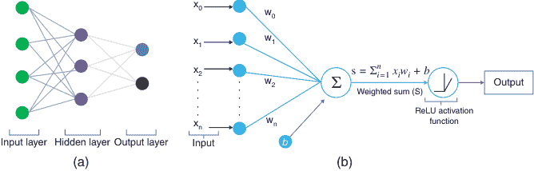

**图 4.1** (A) 人工神经网络的简单架构示例 (b) 使用 ReLU 激活函数的人工神经网络中激活操作的说明。

对于给定的输入数据集 (x)，学习过程遵循结构化方法。最初，将接近零的小值分配为权重 (w) 和偏置 (b)，通常从均匀或正态分布中抽取 [11]。接下来，输入数据通过网络传播，经过隐藏层进行各种操作以得出输出。此机制称为 **forward propagation**。

如图 4.1b 所示，每个层的输出使用 **activation function** 进行转换，该函数为网络引入非线性。这种非线性使 ANNs 能够从输入数据中捕捉复杂模式 [12]。在二元分类问题中，空间中的观测值属于两个类别之一，如果一条直线（或高维中的超平面）可以有效区分类别，则数据集被认为是 **linearly separable**。然而，当简单的线性边界不足时，分类问题是 **nonlinearly separable**，需要使用非线性激活函数来定义决策边界。

神经网络中常见的激活函数包括 **sigmoid function** 和 **rectified linear unit (ReLU)** [12]。ANN 最后一层生成的最终输出 y 也通过激活函数处理，以确保模型产生预期结果。例如，在二元分类任务中，sigmoid 函数通常用于确定给定输入属于特定类别的概率。然后将预测值与实际输出（正确类别）进行比较，两者之间的任何差异构成 **classification error**。为了改进预测，ANN 会根据误差不断调整其权重。此调整过程由一种称为 **loss function (or cost function)** 的专用函数指导，该函数旨在最小化误差并提高预测准确性 [13]。损失函数的选择取决于所解决问题的类型。一旦计算出误差，它就会通过隐藏层向后传播以更新权重——此过程称为 **backpropagation**，并使用 **gradient descent** 执行 [14]。梯度下降是一种优化技术，旨在找到误差尽可能最小化的点。

反向传播是基于 ANN 的分类和预测模型的基本组成部分。一旦模型达到误差最小的最优状态，它就会收敛并提供最终分类结果。虽然传统的 ANNs，例如 **single-layer perceptrons** 或 **feed-forward networks**，能够处理一些非线性分类问题，但由于其简单架构，它们在恶意软件检测方面存在局限性。这些基本模型难以处理复杂的大规模数据，尤其是高维的结构化和非结构化信息。

随着恶意软件在 Windows、Linux 和 Android 平台上的日益普及，传统的 ANNs 证明不足以有效检测此类威胁。为克服这些缺点，引入了 **DL algorithms**，提供处理复杂数据模式的更先进能力。然而，值得注意的是，与涉及更广泛计算的 DL 模型相比，训练 ANN 模型通常需要更少的时间。

### 4.3 深度学习概述

DL 是 ANNs 的一个子集，其隐藏层数量比传统神经网络更多，通常可扩展至 150 层。虽然 DL 是 ML 的一个分支，但其复杂结构和数据表示学习使其成为 ML 的更高级扩展。与 ML 类似，DL 采用从示例中学习以提高性能的算法。DL 作为众多领域的基石技术，包括计算机视觉 [15]、自然语言处理 [16]、自动驾驶汽车 [17]、欺诈检测 [18]、恶意软件检测 [19] 等。以具有多个隐藏层的深度网络架构为特征，DL 模型在图像、音频和文本的分类任务中具有卓越的准确性，非常有效。与传统神经网络算法不同，DL 模型可以自动从输入数据集中提取特征，无需手动特征工程，从而增强其能力 [20]。一些 DL 算法可以在标准计算机的 CPU 上训练，但更复杂的网络通常需要图形处理单元（GPUs）来加快训练过程 [21]。

ML 和 DL 算法的性能随数据规模而变化。DL 算法需要大量数据来识别复杂模式，而 ML 算法通常在较小的数据集上表现良好。可以通过向 ANN 添加额外的隐藏层来增加网络的深度，使数据在多个层面上处理，从而加深学习过程。DL 模型广泛应用于计算机视觉、音频识别、自然语言处理、语音识别、人脸识别、图像分类、信息检索、故障预测，

手写识别、特征学习、社会网络过滤、机器翻译、降维和入侵检测。

针对网络入侵检测系统 (NIDSs)，DL 相较于传统 ML 技术具有显著优势。首先，DL 模型可以自行从未处理的数据中获取复杂特征，从而省去人工特征工程的必要性。由于 NIDS 应用经常处理高维数据，这一特性尤其有帮助。其次，DL 模型对数据噪声和异常值更具鲁棒性，这对于经常处理不完整和噪声数据的 NIDS 来说很重要。最后但同样重要的是，DL 使创建诸如混合和异常检测等创新 NIDS 策略成为可能。

### 4.4 深度学习算法

DL 架构通过解决传统方法固有的局限性正在革新 NIDSs。这些由 ANN 驱动的强大模型能够自动从原始网络流量中提取复杂特征，捕捉统计或基于规则的方法无法企及的复杂关系和细微差别。这使得 DL 不仅能够检测已知的攻击特征，还能检测细微的异常甚至在造成破坏前发现零日威胁。因此，近期多项研究探索了使用 DL 技术进行网络入侵检测的创新方法。

应用于 IDS 的 DL 模型包括 DNNs、深度信念网络 (DBNs)、卷积神经网络 (CNNs)、循环神经网络 (RNNs)、长短期记忆 (LSTM) 网络和 AEs。

#### 4.4.1 深度神经网络 (DNNs)

DNNs 是一类具有多层神经元的 ANN，使其能够学习数据中的复杂非线性关系。在网络异常检测中，DNNs 在从原始网络流量中提取和分析特征以识别不规则性方面非常有效。它们建模复杂模式的能力使其非常适合检测简单模型可能忽略的细微异常。例如，Amarasinghe 等人引入了一种利用 DNNs 的监督学习 IDS，通过对 IDS 产生的决策提供反馈来增加用户信任 [22]。该方案在部署阶段产生在线反馈，并在训练阶段后产生离线反馈。使用网络安全实验室 – 数据库知识发现 (NSL-KDD) 来评估该策略，以检测具有不同深度的两种分布式拒绝服务 (DDoS) 和探测攻击。作者展示了用户如何使用其生成的输入添加额外的评估层。

然而，在建立在线反馈时，作者没有考虑到事情发生的速度；相反，他们应该使用人们容易理解的方法。文献 [23] 中的工作提出了一种利用 DNN 的 IDS 技术，并使用车载网络中电子控制单元之间交换的数据包跟踪进行训练。为了识别合法和恶意数据包，他们寻找可以从网络数据中得出的适当属性。该 IDS 方法跟踪汽车网络中的数据包交换，并离线训练特征以提供高检测率和对安全威胁的快速反应。他们还评估了测试和训练阶段所需的时间。

#### 4.4.2 深度信念网络

DBNs 是概率生成模型，对 DL 的进步做出了重大贡献。DBNs 通过堆叠受限玻尔兹曼机 (RBMs) 构建，其中每对相邻层构成一个 RBM。一个 RBM 的隐藏层充当下一个 RBM 的可见层，而顶部两层是无向的。较低层表现出生成式（自上而下）或识别式（自下而上）的有向连接。DBN 训练包括两个主要阶段：预训练和微调。在预训练期间，RBMs 使用无监督学习算法，通常是对比散度 (CD) 算法，以自下而上的方式依次训练。在微调阶段，使用 up-down 算法（wake–sleep 算法的变体）或反向传播算法来优化网络参数，以增强模型的生成或判别性能。DBN 网络结构如图 4.2 所示。

为了检测入侵，多位研究人员采用了 DBN 技术。例如，Kang 和 Kang [23] 利用 DBN 检测车载网络中的入侵。

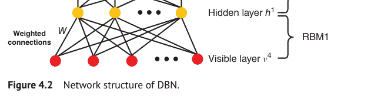

图 4.2 DBN 的网络结构。

多位研究人员已表明，基于 DBN 的无监督预训练模型可以提高入侵检测的准确性。该模型的缺点是其集中式方法可能使其在雾网络中适用性降低。Zhang 等人提出了一种基于 DBN 和改进遗传算法 (GA) 的 IDS 方法，旨在为 DBN 找到最优网络结构以分类安全攻击。它降低了网络结构复杂性并提高了分类准确性。Gao 等人在 [24] 中提出了一种基于 DBN 的 IDS 模型，该模型融合了 RBM 和反向传播网络。该技术建议的 DL 模型可以完成分类任务并学习高维表示。此外，该方法通过使用无监督贪婪学习算法进行预训练来调整 DBN 以学习高维数据并使分类更容易。文献 [25] 中提出的入侵检测方法检验了训练后 DBN 在 NSL-KDD 上执行入侵检测的能力。作者评估了其系统的测试和训练持续时间。它表明，即使面对非线性和部分数据，它也能识别安全攻击并将其分为五类。此外，[26] 提出了一种混合 IDS，使用 DL 方法生成和分类安全威胁特征。

该方案利用大量去噪 AEs 堆栈来实现 DBN，这可能提供恶意软件特征并分析原始输入数据以进行 DNN 训练。他们的方法使用主要恶意软件攻击的数据集和 DBN 生成的特征以达到高度准确性。

#### 4.4.3 自编码器

AEs，也称为自联想器，是一种为无监督高效编码和学习表示而设计的神经网络类型。它们通常用于降维。AE 的主要目标是学习一种表示，以便准确重建输入数据。在训练期间，AE 旨在将输入向量转换为低维表示（编码过程），同时最小化重建误差。编码过程涉及从输入数据中提取相关特征，同时过滤掉无关信息。AE 首先使用权重矩阵将输入向量转换为隐藏表示，该隐藏表示作为编码表示。解码过程随后使用单独的权重矩阵从隐藏表示重建输入数据。AE 的整体架构如图 4.3 所示。

单层 AE 在提取有用特征的能力方面通常受限。为了提高性能，引入了深度 AE。当编码器中较高层的神经元数量逐渐减少时，深度 AE 可作为降维技术发挥作用。

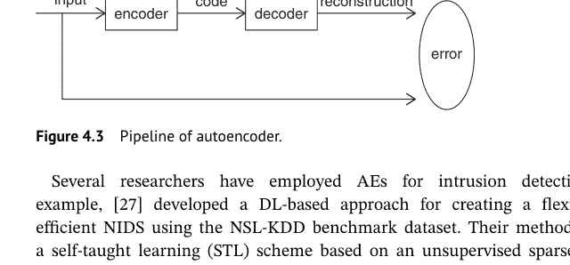

图 4.3 自编码器的流程。

多位研究人员已将 AEs 用于入侵检测。例如，[27] 开发了一种基于 DL 的方法，利用 NSL-KDD 基准数据集创建灵活高效的 NIDS。他们的方法应用了基于无监督稀疏 AE 的自学习 (STL) 方案进行训练。提取的特征随后用于将标记的测试数据分类为正常或攻击实例。使用 N 折交叉验证进行性能评估，指标包括准确率、精确率、召回率和 F 值。与直接应用于数据集而无需特征学习的 Softmax 回归 (SMR) 分类器相比，STL 方法优于之前的模型。

AEs 也已用于异常检测。Sakurada 等人 [28] 通过 AEs 应用非线性特征约简来训练正常网络配置文件。他们的研究发现，AEs 成功学习了正常状态，并在给定异常输入时做出不同响应。同样，[29] 利用自编码器进行特征提取，并使用 KDDCUP’99 基准数据集将 DBNs 作为分类器来检测恶意代码。他们的结果表明，与使用单一 DBN 相比，混合方法在检测时间和分类性能方面更有效、更准确。虽然 DL 网络已被证明对网络攻击检测非常有益，但它们需要最新的数据集，这在研究中构成重大挑战。

#### 4.4.4 卷积神经网络

CNNs 是最强大的 DL 模型之一，在计算机视觉和语音识别任务中取得了显著成功。如图 4.4 所示，CNN 的结构由三个主要层组成：卷积层、池化层和全连接层。CNN 的训练遵循两阶段过程——前向传播和反向传播，与标准前馈神经网络类似。在前向传播期间，数据以前馈方式流经网络层，并在每一层应用数字滤波器以提取基本特征。然后将预测输出与真实标签进行比较，并计算误差。在反向传播阶段，网络通过计算调整其参数（权重和偏置）由

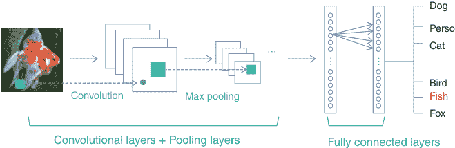

**图 4.4**  通用 CNN 架构的流水线。

基于误差的梯度。学习过程在预定义次数的迭代后停止。

CNN 已被广泛用于入侵检测。例如，Shen 等 [30] 提出了一种名为 CSCNN 的压缩 CNN 模型用于图像分类。该模型将压缩感知理论集成到 CNN 模型的输入层中，在增强精度的同时优化资源使用。利用 MNIST 和 CIFAR-10 数据集进行的评估显示出训练效率和分类精度的提升。同样，Praanna 等 [31] 开发了一种结合 CNN 和 LSTM 算法的混合模型，使用 KDD99 数据集进行评估。实验结果表明，该方法优于其他模型，包括 SVM、CNN 和 DBN，达到了 99.78% 的准确率。此外，Nguyen 和 Kim [32] 提出了一种基于遗传算法 GA 驱动的穷举搜索和模糊 C 均值聚类的新型 NIDS。该方法通过基于 GA 的优化识别出最佳 CNN 结构，被称为深度特征提取器。研究得出结论，将该方法实施于现实世界互联网网络中可通过检测和分类恶意活动来增强安全性。然而，该方法的显著缺点是执行基于 GA 的穷举搜索以选择最佳特征和 CNN 配置所需的计算时间。

一些常用的 CNN 架构在表 4.1 中给出。

#### 4.4.5 循环神经网络

RNN 是一类神经网络模型，通过架构中的循环来维持一种记忆形式，从而处理序列数据。与传统的 feed-forward 网络不同，RNN 逐个处理输入，同时保留来自先前输入的上下文信息，从而能够在时间上建模依赖关系。长度为 *n* 的序列可以表示为 (*x*¹, *x*², …, *x*ⁿ)。如图 4.5 所示，标准 RNN 使用神经网络块按顺序处理每个元素，该块不仅接收当前元素，还接收来自前一步的信息。这使得来自序列早期位置的信息能够在整个序列中传播。RNN 中的每个块在结构上是相同的，并且可以在每个步骤 i 生成输出 y(i)，尽管这并非所有 RNN 模型的必要条件。

表 4.1 各种 CNN 架构。

| 架构 | 网络深度 | 备注 | 参数数量 |
|---|---|---|---|
| AlexNet [33] | 8 | 利用 dropout 防止过拟合和 ReLU | 60M |
| NIN [34] | 3 | 利用 MLPConv 层对输入进行卷积，并使用全局平均池化层代替全连接层 | 2M |
| VGG-16 | 16 | 在每个卷积层后使用 ReLU，显著缩短训练时间 | 138M |
| VGG-19 [35] | 19 | 在每个卷积层后使用 ReLU，显著缩短训练时间 | 143M |
| ZFNet [36] | 8 | 中间特征层的可视化思想和分类器的操作。 | 6M |
| GoogLeNet [37] | 22 | 块概念、增加深度、拼接概念、不同滤波器尺寸 | 6M |
| Highway [38] | 19 | 使用门控函数调节信息流。 | 2.3M |
| Highway [38] | 32 | 使用门控函数调节信息流。 | 1.25M |
| ResNet50 [39] | 50 | 引入了跳跃连接的概念，通过为梯度流动提供替代的快捷路径来缓解梯度消失问题 | 25.6M |
| ResNet101 | 101 | 引入了跳跃连接的概念，通过为梯度流动提供替代的快捷路径来缓解梯度消失问题 | 44.7M |
| ResNet152 | 152 | 引入了跳跃连接的概念，通过为梯度流动提供替代的快捷路径来缓解梯度消失问题 | 60.4M |
| InceptionV3 [40] | 159 | 模型中的较大卷积被分解为较小的卷积。辅助分类器充当正则化器并提高模型的收敛性 | 23.8M |
| InceptionResNetV2 [41] | 572 | 结合残差连接。Inception-Res-Net 模型能够在更少的 epoch 下实现更高的准确率 | 55.87M |
| Xception [42] | 126 | 用深度可分离卷积替换标准 inception 模块 | 22.9M |
| Residual attention network [43] | 452 | 利用多个注意力模块生成注意力感知特征。随着层数加深，注意力感知特征会自适应变化 | 8.6M |
| DenseNet121 [44] | 121 | 缓解梯度消失问题 | 8M |
| DenseNet169 | 169 | 缓解梯度消失问题 | 14.31M |
| DenseNet201 | 201 | 在训练数据不足时表现良好 | 20.2M |

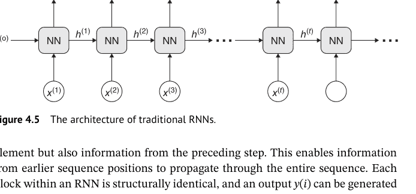

图 4.5 传统 RNN 的架构。

历史上，RNN 在训练中面临挑战，原因在于其参数数量庞大以及梯度消失等问题。然而，网络架构、优化技术和计算能力的进步显著提升了其可扩展性。1997 年的两个突破性发展塑造了现代 RNN 架构。第一个是 LSTM 网络，由 Hochreiter 和 Schmidhuber [45] 提出，专门设计用于缓解梯度消失问题，使其更有效地学习长期依赖关系。LSTM 网络结合了门控机制来调节信息的保留和更新，使其特别适用于在较长时间范围内检测异常。与传统 RNN 不同，LSTM 网络具有记忆单元，取代了隐藏层中的标准人工神经元，从而提高了训练稳定性。

第二个主要发展是双向循环神经网络 BRNNs，由 [46] 提出，允许来自过去和未来输入的信息影响当前输出。这与仅依赖过去输入的传统 RNN 形成对比，使 BRNNs 非常适用于自然语言处理等领域的序列标注任务。RNN 的另一个重要变体是门控循环单元 GRUs，其与 LSTM 共享建模长期依赖关系的能力，但计算复杂度更低。GRU 使用简化的门控机制，降低了计算开销，同时在网络流量分析等任务中保持强劲性能。

多项研究探索了 RNN 在入侵检测中的应用 [47] 将基于 DL 的 RNN 方法应用于 NSL-KDD 数据集以检测各种网络攻击。结果表明，基于 RNN 的 IDS 在二分类和多分类中均优于传统的分类模型，如支持向量机 SVM 和 ANN。然而，为了提高效率，未来的研究应侧重于使用 GPU 加速减少训练时间。

Arshad 等 [48] 提出了一种用于攻击检测的负载分类技术，利用 PL-CNN 和 PL-RNN 模型。这些方法通过直接从原始负载数据学习特征表示实现端到端检测，消除了特征工程的需求。在 DARPA1998 数据集上评估时，PL-CNN 和 PL-RNN 分别实现了 99.36% 和 99.98% 的分类准确率，其中 PL-RNN 在多个数据集上表现出更优性能。然而，这些模型存在两个主要挑战：它们的参数数量高于传统 ML 模型，导致参数调优复杂；并且缺乏可解释性，使得理解其决策过程变得困难。[49] 中的 IDS 技术将神经网络馈入实时数据。他们采用了 RNN 模型和深度多层感知器，两者均受益于 LSTM 隐藏层以理解包括 DDoS 和命令注入在内的各种攻击的时序上下文。他们开发了数学模型来根据检测延迟计算模型计算卸载的理想时间。

### 4.5 结论

IDS 在保护现代 IT 组织方面发挥着至关重要的作用。然而，开发一种高效、高性能的 IDS 以应对多样化的安全威胁仍然是一个重大挑战。近年来，DL 技术已成为入侵检测的强大解决方案，导致各种基于 DL 的 IDS 模型的开发。作为 ML 的一个专门分支，DL 利用多层进行非线性处理并提取分层数据表示。这些网络可以处理原始输入数据并支持各种学习方法，包括无监督、半监督和监督方法。本章回顾了不同的入侵检测策略，并探讨了用于检测安全威胁的各种 DL 算法。

## 参考文献

1 Ziegler, S. (ed.) (2019). 物联网网络安全范式转变、威胁矩阵和实用分类法. In: 物联网安全与数据保护, 1–7. Springer.


- 2. Taddeo, M., McCutcheon, T., and Floridi, L. (2019). 在网络安全中信任人工智能是一把双刃剑。*自然机器智能* 1: 1–4.

- 3. Serrano, W. (2019). 网络安全和物联网中的区块链随机神经网络。*人工智能应用与创新：第15届IFIP WG 12.5国际会议，AIAI 2019*，希腊克里特岛赫索尼索斯，2019年5月24–26日。论文集15. 施普林格国际出版公司。

- 4. Ghose, N., Lazos, L., Rozenblit, J., and Breiger, R. (2019). 网络攻击的多模态图分析。*2019年春季仿真会议（SpringSim）*，IEEE。

- 5. Masoodi, F.S., Quasim, M., Bukhari, S. 等（编辑）（2023）。*机器学习和深度学习在生物数据上的应用*。CRC出版社。

- 6. Kandan, A.M., Kathrine, G.J.W., and Melvin, A.R. (2019). 网络攻击与预防技术研究。*2019年IEEE电气、计算机与通信技术国际会议（ICECCT）*，IEEE。

- 7. Manoranjan, P., Nayak, C.K., Pradhan, S.K., and Melvin, A.R. (2020). 入侵检测系统（IDS）及其类型。*保护物联网安全：概念、方法论、工具和应用*，IGI全球出版社，第481–497页。

- 8. Behnam, F., Montazeri, M.A., and Jamali, S. (2019). 一种基于异常的IDS，用于检测基于RPL的物联网中的攻击。*2019年第五届网络研究国际会议（ICWR）*，IEEE。

- 9. Ahanger, A.S., Khan, S.M., Masoodi, F. 等 (2025). 使用图注意力网络在物联网中的高级入侵检测。*科学报告* 15: 9831。

- 10. Hussain, M.S. and Khan, K.U.R. (2020). 使用机器学习的MANET中IDS技术综述。*第三届计算智能与信息学国际会议论文集：ICCII 2018*，施普林格新加坡。

- 11. Zhang, Y., Li, P., and Wang, X. (2019). 基于改进遗传算法和深度信念网络的物联网入侵检测。*IEEE访问* 7: 31711–31722。

- 12. Apicella, A., Donnarumma, F., Isgro, F., and Prevete, R. (2021). 现代可训练激活函数综述。*神经网络* 138: 14–32。

- 13. Jan, S., Masoodi, F., and Bamhdi, A.M. (2022). 物联网环境中的有效入侵检测：深度学习方法，*SCRS智能系统会议论文集*。

- 14. Li, Y. and Liang, Y. (2018). 通过结构化数据上的随机梯度下降学习过参数化神经网络。*神经信息处理系统进展* 31。

- 15. Chai, J., Zeng, H., Li, A., and Ngai, E.W.T. (2021). 计算机视觉中的深度学习：新兴技术和应用场景的批判性综述。*机器学习及其应用* 6: 100134。

- 16. Bamhdi, A.M., Abrar, I., and Masoodi, F. (2021). 一种基于集成的方法，利用多数投票进行有效的入侵检测。Telkomnika（电信计算电子与控制）19 (2): 664–671。

- 17. Ren, J., Gaber, H., and Jabar, S.S. Al. (2021). 将深度学习应用于自动驾驶汽车：综述。2021年第四届人工智能与大数据国际会议（ICAIBD），IEEE。

- 18. Mubalaike, A.M. and Adali, E. (2018). 智能金融欺诈检测系统的深度学习方法。2018年第三届计算机科学与工程国际会议（UBMK），IEEE。

- 19. Mahdavifar, S. and Ghorbani, A.A. (2019). 深度学习在网络安全中的应用：综述。神经计算 347: 149–176。

- 20. Bengio, Y., Courville, A., and Vincent, P. (2013). 表示学习：回顾与新的视角。IEEE模式分析与机器智能汇刊 35 (8): 1798–1828。

- 21. Masoodi, F.S., Abrar, I., and Bamhdi, A.M. (2022). 使用同构集成技术的有效入侵检测系统。国际信息安全与隐私杂志（IJISP）16 (1)。

- 22. Amarasinghe, K., and Manic, M. (2018). 提高用户对基于深度神经网络的入侵检测系统的信任。IECON 2018——IEEE工业电子学会第44届年会。IEEE。

- 23. Kang, M.-J. and Kang, J.-W. (2016). 使用深度神经网络的车载网络安全入侵检测系统。公共科学图书馆·综合 11 (6): e0155781。

- 24. Gao, N., Gao, L., and Wang, H. (2014). 基于深度信念网络的入侵检测模型。2014年第二届高级云与大数据国际会议，IEEE。

- 25. Alom, M.Z., Bontupalli, V.R., and Taha, T.M. (2015). 使用深度信念网络的入侵检测。2015年全国航空航天与电子会议（NAECON），IEEE。

- 26. David, O.E. and Netanyahu, N.S. (2015). DeepSign：用于自动恶意软件签名生成和分类的深度学习。2015年国际神经网络联合会议（IJCNN），IEEE。

- 27. Javaid, A., Niyaz, Q., Sun, W., and Alam, M. (2016). 一种用于网络入侵检测系统的深度学习方法。第九届EAI国际仿生信息与通信技术会议（原BIONETICS）论文集。

- 28. Sakurada, M. and Yairi, T. (2014). 使用非线性降维自编码器的异常检测。MLSDA 2014第二届机器学习用于感官数据分析研讨会论文集。

- 29. Lin, M., Chen, Q., and Yan, S. (2013). 网络中的网络。arXiv预印本，arXiv:1312.4400。发表于2014年国际学习表征会议（ICLR 2014）研讨会轨道。

- 30. Shen, Y., Han, T., Yang, Q. 等 (2018). CS-CNN：为物联网应用实现鲁棒高效的卷积神经网络推理。IEEE访问 6: 13439–13448。

- 31. Praanna, K., Sruthi, S., Kalyani, K., and Tejaswi, A.S. (2020). 一种用于高维数据入侵检测系统的CNN-LSTM模型。国际科学与技术研究杂志 9 (3): 2494–2498。

- 32. Nguyen, M.T. and Kim, K. (2020). 用于入侵检测系统的遗传卷积神经网络。未来世代计算机系统 113: 418–427。

- 33. Abrar, I., Ayub, Z., Masoodi, F., and Bamhdi, A.M. (2020). 基于NSL-KDD数据集的入侵检测系统机器学习方法。2020年国际智能电子与通信会议（ICOSEC），IEEE。

- 34. Lin, M., Chen, Q., and Yan, S. (2013). 网络中的网络。arXiv预印本，arXiv:1312.4400。

- 35. Simonyan, K. and Zisserman, A. (2014). 用于大规模图像识别的非常深的卷积网络。arXiv预印本arXiv:1409.1556。

- 36. Zeiler, M.D. and Fergus, R. (2014). 可视化和理解卷积网络。见：欧洲计算机视觉会议——ECCV 2014，计算机科学讲义，第8689卷（编：D. Fleet, T. Pajdla, B. Schiele, 和 T. Tuytelaars），818–833页。Cham：施普林格。

- 37. Szegedy, C., Liu, W., Jia, Y. 等 (2015). 用卷积进一步深入。见：IEEE计算机视觉与模式识别会议（CVPR 2015）论文集，美国马萨诸塞州波士顿，2015年6月7–12日，第1–9页。IEEE。https://doi.org/10.1109/CVPR.2015.7298594.

- 38. Srivastava, R. K., Greff, K., and Schmidhuber, J. (2015). 高速公路网络。arXiv预印本arXiv:1505.00387。

- 39. He, K., Zhang, X., Ren, S., and Sun, J. (2016). 用于图像识别的深度残差学习。见：IEEE计算机视觉与模式识别会议论文集（第770–778页）。

- 40. Szegedy, C., Vanhoucke, V., Ioffe, S., Shlens, J., and Wojna, Z. (2016). 重新思考计算机视觉的Inception架构。见：IEEE计算机视觉与模式识别会议论文集（第2818–2826页）。

- 41. Szegedy, C., Ioffe, S., Vanhoucke, V., and Alemi, A. (2017). Inception-v4、Inception-ResNet以及残差连接对学习的影响。见：AAAI人工智能会议论文集（第31卷，第1期）。

- 42. Chollet, F. (2017). Xception：深度可分离卷积的深度学习。见：IEEE计算机视觉与模式识别会议（CVPR 2017）论文集，美国夏威夷州檀香山，2017年7月21–26日，第1251–1258页。IEEE。

- 43. Wang, F., Jiang, M., Qian, C. 等 (2017). 用于图像分类的残差注意力网络。见：IEEE计算机视觉会议论文集


## 5
## 通过深度学习进行入侵检测：新兴趋势与挑战

Achyutananda Mishra

法学院，基督大学，班加罗尔，卡纳塔克邦，印度

### 5.1 引言

互联网技术前所未有地拉近了世界，实现了对全球各地的无缝连接。其使用量的增加使世界暴露于网络攻击（恶意攻击）——手动或机器生成的风险之下，危及个人和机构的数据及系统/网络安全。恶意网络攻击是严重的 安全威胁；恶意软件攻击具有动态性；它们不断变化，其攻击方法也随之变化 [1]。网络犯罪日益猖獗，网络犯罪分子能够轻松在国际范围内活动，扰乱企业和服务，且恶意软件是故意创建的，危及计算机系统的安全 [2]。

入侵检测系统（IDS）已成为一种网络安全工具，用于监控计算机网络或系统中的恶意攻击并检测入侵。它可以是网络入侵检测系统（NIDS）、主机入侵检测系统（HIDS）或云入侵检测系统。IDS 通常采用诸如基于签名检测、基于异常检测和状态ful协议分析等技术。它是一种观察网络流量以检测入侵的软件，如果检测到任何异常活动或策略违规，则会立即发出警报或阻止其。它建立在预测模型（分类器）之上，用于区分“坏连接”（入侵/攻击）和“好（正常）连接”。这些技术发现了允许机器在无需人工干预的情况下学习的算法。

深度学习是一种突破性技术，正在改变计算机视觉、自动驾驶、医疗保健和金融等多个领域。深度学习（DL）——一种前沿且具有革命性的技术——为 IDS 带来了实质性变革；它使机器能够理解、学习和与数据交互。它是一种基于人工神经网络架构的机器学习分支——模拟生物有机体的学习机制——以及复杂模型和先进的机器学习算法子集，以克服少数浅层网络的局限性。DL 人工智能（AI）模仿嵌入人类大脑中的先天神经网络，使计算机能够自动发现模式并从大量非结构化数据中做出决策。它可以是有监督学习和无监督学习。在有监督学习中，机器使用标记数据进行训练，而在无监督学习中，机器自行学习。有监督学习可以是卷积神经网络（CNN）或循环神经网络（RNN），而无监督学习可以是自动编码器（AE）和深度信念网络（DBN）。它具有塑造地球未来的巨大潜力。

### 5.2 深度学习

DL 是机器学习（ML）的一个分支。它基于人工神经网络（ANN）架构——一个根据人类神经元的结构和运行原理构成的网络。这些也被称为神经网络或神经网，它们采用如图 5.1 所示的称为神经元的互连节点层。这样的神经元网络处理并从注入其中的数据中学习。人工神经元，也称为单元，遍布整个 ANNs。ANN 有三个层，即（i）输入层、（ii）输出层和（iii）隐藏层 [1]。ANNs 受“生命体的神经系统”的启发，后者具有获取和维持基于信息知识的能力。它“可以被定义为一组处理单元，由人工神经元表示，通过大量互连（人工突触）相互连接，由突触权重的向量和矩阵实现” [3]。

神经网络架构

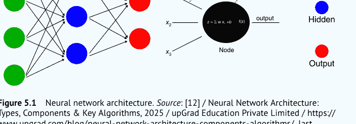

图 5.1 神经网络架构。来源：[12] / 神经网络架构：类型、组件和关键算法，2025 / upGrad Education Private Limited / https://www.upgrad.com/blog/neural-network-architecture-components-algorithms/, 最后访问于 2025 年 4 月 21 日。

ANNs 是众所周知的 ML 技术，模仿生命有机体中的学习机制 [4]。根据 Arthur Samuel 的说法，ML 是一个研究领域，其中算法从输入数据中推断如何执行特定任务，而无需专门为该任务编程 [5]。ML——人工智能的一个子领域，指代类似人类智能的机器或系统——强调开发一个（基于数据构建）能够学习或提高性能的系统。它是一种数据驱动技术，处理大量数据——这对 ML 至关重要——并帮助组织做出更好的决策。它识别可用数据上的各种模式 [2]。

ML 使计算机具备无需显式编程即可学习的能力。它是一个系统，其中机器/计算机在没有人工监督的情况下学习模型——称为无监督学习，其中“算法的任务是在没有任何关于数据含义的先验知识的情况下，在数据中寻找模式和关系”。此类过程的目的是理解数据背后的结构，并借助有助于发现隐藏模式和数据的 ML 算法来分析和聚类数据集 [2]。

DL 是 ML 的一个复杂子网络，可以学习分层特征表示和隐藏的序列关系，将 TCP/IP（传输控制协议/互联网协议——网络的基础框架）信息传递到多个隐藏层。它在语音识别、图像处理、自然语言处理（NLP）等长期存在的 AI 任务领域取得了实质性成果 [6]。

DL 的思想根植于从 20 世纪 40 年代中期和控制论的早期阶段到当代关于人工智能和大脑神经网络的研究的 ML 研究。DL 指的是在机器中开发人工智能以从经验中学习并按概念层级运行的尝试。这意味着多个单一经验在逻辑上相互关联，揭示了隐藏在这些单一性背后的总体维度。它在不同知识领域之间建立联系，就像大脑中的神经元一样 [7]。在 DL 技术中，算法使用 ANN 像人类一样解释数据；例如，虚拟助手、远程开关、自动驾驶汽车、语音识别和个性化电子商务推荐是其一些关键功能 [8]。

#### 5.2.1 神经网络架构

神经网络是众所周知的 ML 算法子集，其灵感来自人类大脑。这里生物神经元（神经细胞）对它们所连接的其他神经元的激活做出反应 [9]。

深度神经网络由一个输入层和一个或多个相互连接的隐藏层组成。网络中的每个神经元从前一层连接的神经元层或输入层接收输入；一个神经元产生的输出成为网络下一层中其他神经元的输入；这一过程一直持续到最后一层产生网络的输出。神经网络以层存在，将输入数据转换为一系列非线性变换，并允许网络学习输入数据的模式和复杂表示 [1]。

神经网络架构描述了 ANN 的结构和组织，ANN 是基于人类大脑的计算模型（人工）。这解释了数据在网络中的流动过程、人工神经元（单元）的连接性以及网络的学习以做出预测。ANN 架构象征着节点（神经元）的结构排列和多个层，定义了 ANN 如何处理和从数据中学习。ANN 的设计影响其学习复杂模式和高效执行任务的能力。 [10]。

神经网络架构的关键组件如下 [11]：

- a) 层——神经元层，即输入层、隐藏层和输出层。
- b) 神经元（节点）——基本计算单元，对其输入执行加权求和，应用偏置，并将结果通过激活函数传递。
- c) 权重和偏置——权重构成神经元之间连接的强度，偏置允许神经元即使在所有输入都为零时也能进行预测。
- d) 激活函数——使用非线性函数（如 ReLU 和 sigmoid）为网络引入非线性，使其能够建模复杂关系。

#### 5.2.2 神经网络类型

DL 中最广泛使用的模型是（i）前馈神经网络（FNNs）、（ii）卷积神经网络（CNNs）和（iii）循环神经网络（RNNs）。

##### 5.2.2.1 前馈神经网络（FNNs）

它们是最简单的 ANN 类型，信息在网络中线性流动，数据从输入层流向输出层，没有任何循环或环路。在这些网络中，神经元相互连接并按层排列，每一层都与下一层完全连接。它们被广泛用于图像分类、语音识别和 NLP 等任务 [1, 11]。


##### 5.2.2.2 卷积神经网络 (CNNs)

CNN——用于对象识别和图像分类——是 DL 的一种网络架构。源于传统的 ANNs，CNN 是一个由卷积层组成的网络。这些层用于检测和从输入数据中提取各种特征，在处理输入图像或前一层的特征图时使用小型滤波器（核）。在每个位置，滤波器计算“它本身与输入对应区域之间的点积” [5]。它们是全连接的，每个层“生成输入数据的逐级抽象，高层次的，称为特征图，它保存了基本唯一信息” [13]。CNN 是一种用于对象识别和图像分类的 DL 模型。它们通过使用滤波器从输入数据（信息）中提取多个特征，从而得到特征图。特征图是卷积层的输出，表示输入图像或前一层特征图中的特定特征 [14]。特征图也称为激活图或卷积特征图。它们被定义为“通过将卷积滤波器（也称为核）应用于输入图像或前一层的特征图而得到的一个二维数组或数字网格。特征图在 CNN 架构中发挥着至关重要的作用，负责检测输入数据中的不同视觉特征或模式” [15]。CNN 的任务是图像和视频识别，并且能够自动从图像中学习特征，使其适用于图像分类、对象检测和图像分割等任务 [1]。

在 CNN 中，算法在标记的数据集上训练并通过监督学习工作。这里，卷积意味着“将滤波器或核应用于输入或特征图的过程。”滤波器或核是“在输入图像或特征图上滑动并在每个位置执行点积运算的小权重矩阵” [16]。CNN 通过使用非常深的层级结构表现出色。它们由两种主要类型的层组成；一个用于特征提取，另一个用于分类。特征提取层是卷积层和最大池化层 [15]。

##### 5.2.2.3 循环神经网络 (RNNs)

RNN 是一种深度神经网络，设计用于处理序列或时间序列数据。在该网络中，一个步骤的输出作为另一个步骤的输入，同时保留来自先前输入的信息。其应用可能包括时间序列预测、NLP、语音识别以及图像和视频处理 [17]。其中“循环神经网络的输出取决于序列中的先前元素。虽然未来事件也有助于确定给定序列的输出，但单向循环神经网络无法在其预测中考虑这些事件” [18]。它们能够维护一个内部状态，捕获有关先前输入的信息，这适用于语音识别、NLP 和语言翻译等任务 [1]。

##### 5.2.2.4 递归神经网络 (RvNNs)

RvNNs 是一种专门的 DL，具有在 NLP 中的句法树或化学中的分子结构等层次化数据上运行的能力。它可以通过递归处理输入数据，非常有效地处理树状结构输入，融合“来自子节点的信息以形成父节点的表示”；这里“树结构意味着合并子节点并生成父节点，每个子父键都有一个权重矩阵，相似的子节点具有相同的权重。”它主要用于 NLP 任务，如情感分析等。RvNNs 捕获递归、嵌套关系的能力使其成为一种强大的工具 [19]。

### 5.3 深度学习的应用

DL AI 可用于 (a) 监督；(b) 无监督；和 (c) 强化 ML。

- a) **监督机器学习：** 这是一种技术，其中神经网络根据标记的数据集学习预测或分类数据。“像循环神经网络、卷积神经网络这样的深度学习算法执行监督任务，如图像分类和识别、语言翻译、情感分析等。”
- b) **无监督机器学习：** 这是一种技术，使神经网络能够学习并发现模式，并依赖于未标记的数据集对数据集进行聚类。“像自动编码器和生成模型这样的深度学习算法用于无监督任务，如聚类、降维和异常检测。”
- c) **强化机器学习：** 这是一种技术，使智能体能够学习在环境中做出决策以最大化奖励信号。它可用于学习一组动作或策略，从而最大化随时间的累积奖励。“像 Deep Q 网络和深度确定性策略梯度 (DDPG) 这样的深度强化学习算法用于强化机器人和游戏等任务。”

DLAI 的主要应用可分为计算机视觉、NLP 和强化学习 [1]。

1) 计算机视觉——在计算机视觉中，DL AI 模型使机器能够理解和识别视觉数据，包括以下内容：

- 用于执行监视、自动驾驶汽车和机器人等任务的对象检测和识别；
- 图像分类，用于对植物、动物和建筑物等图像进行分类和归类，适用于质量控制、医学成像和图像检索；
- 图像分割，用于识别图像中的特定特征。

2) 自然语言处理 (NLP)——DL 使机器能够生成人类语言，可能包括自动文本生成、语言翻译、情感分析（客户服务、政治分析和社交媒体监控）或语音识别（语音搜索、语音转文本转换和语音控制设备）。

3) 强化学习——DL 使机器能够作为训练智能体工作，如在特定情况下采取行动以最大化奖励，可能包括以下内容：

- 游戏（深度强化学习模型已在国际象棋、围棋和雅达利等游戏中击败人类专家），
- 机器人（深度强化学习模型训练机器人执行复杂的活动，如导航、抓取物体和操作），以及
- 控制系统（深度强化学习模型控制复杂系统，如交通管理、电力网和供应链优化）

深度学习的进步催生了一种能够生成有意义内容系统的出现。迄今为止的系统能够对输入数据进行分类、翻译或理解；现在借助 DL，它们已变得具有生成性，并被称为生成式人工神经网络 (GANNS)。ChatGPT（聊天生成式预训练 Transformer）是生成式语言模型的例证 [7]。

### 5.4 入侵检测

ICT（信息和通信技术）系统和网络处理用户各种敏感数据，容易受到各种攻击——内部和外部入侵者。这些攻击可能是手动或机器生成的，变得越来越多样化，并在暗中逐渐推进，导致未被检测到的数据泄露。例如，一次数据泄露导致雅虎损失 3.5 亿美元，比特币泄露估计造成 7000 万美元损失。由复杂算法支持的此类网络攻击随着软件、硬件和网络拓扑的进步不断演变，包括物联网（IoT）的当前发展。恶意网络攻击对网络安全构成严重威胁，需要可靠、灵活和新颖的 IDS [10]。多年来，网络和计算机系统的指数级使用导致入侵和恶意攻击增加，引发了对计算机安全政策——保密性、完整性和

可用性 (CIA)。入侵旨在破坏 CIA 或绕过计算机或网络的安全机制 [11]。

计算机网络的增长及其应用的增加使得诸如暴力攻击、浏览器攻击和分布式拒绝服务 (DDoS) 攻击等网络攻击成为可能 [20]。恶意软件（恶意软件）复杂性的提升已成为国际社会面临的重大问题，也是像零日攻击这样的互联网用户的安全威胁。此外，世界各地有大量网络犯罪分子正在寻找非法获取收入、窃取信息和寻找新目标的机会。新一代恶意软件更具野心，针对银行，一次攻击就能窃取数百万美元。恶意软件是故意创建的，以破坏计算机系统并利用 IDS 中的弱点 [5]。

基于互联网技术的兴起导致了计算机网络应用的新领域。诸如 LAN（局域网）和 WAN（广域网）等网络应用的使用在安全、金融、商业、工业和医疗保健等许多领域有所增加。所有这些应用使网络容易受到恶意用户或黑客的攻击，他们从组织的内部系统收集信息并导致诸如管理疏漏、软件漏洞以及系统保留默认配置等漏洞。互联网融入社会见证了诸如蠕虫和病毒等新威胁被引入系统。此外，一些恶意用户采用不同技术破解密码并检测未加密文本，从而对系统造成损害。这凸显了网络安全的重要性，无论是私有还是公共。防火墙技术是最常见的保护技术，用于保护私有网络免受公共网络的侵害，而 IDS 则用于网络相关活动、信用卡欺诈、医疗应用、保险机构等 [9]。IDS 的主要目标是在尽可能早的时间识别不同类型的恶意软件，这是传统防火墙无法实现的 [5]。

IDS 观察网络流量以防止恶意交易，并在被观察到时立即发送警报。它是用于观察网络或系统是否存在恶意活动或政策违规的软件。每一次非法活动或违规行为大多通过安全信息和事件管理工具（SIEM）系统集中记录——该系统通过识别潜在风险、分析安全事件以了解其影响以及自动化对威胁的响应来帮助提高安全性——或通知管理员。它监控网络或系统以防止恶意活动，并保护计算机网络免受未经授权的使用和访问，包括可能的内部人员。其任务是构建一个预测模型——分类器——能够区分“好（正常）连接”和“坏连接”（攻击/入侵） [6]。

在审计系统用于除计费之外的用途之前，允许管理层了解计算机对组织目标和资源利用的效用。在这一发现之后，审计系统在协助调查系统滥用相关问题方面的潜力很快受到关注。这对于使用计算机进行金融交易以及处理敏感信息的人来说意义重大。因此出现了对人工审计跟踪审查的需求，这导致了为商业计算社区服务的电子数据处理（EDP）和为军事和政府计算世界服务的<|message|> 安全审计的出现 [14]。

#### 5.4.1 Classification

基于入侵者的行为，入侵检测分为 (i) 基于网络的入侵检测系统 (NIDS) 和 (ii) 基于主机的入侵检测系统 (HIDS) [15]。这些 IPS 紧密监控网络流量并采取自动行动来保护网络和系统。网络流量分析是通过使用误用“检测、异常检测和状态协议分析”来完成的。

NIDS 使用路由器、交换机和网络 tap 等网络设备——通过网络设备的镜像——监控网络，并分析流量以识别隐藏在网络流量中的攻击和潜在威胁。相比之下，HIDS 通过在本地主机计算机上运行的各种日志文件形式的系统活动来检测攻击，其中主机系统的日志和其他信息用于分析（基于主机的处理程序称为传感器）。基于主机的传感器可以从其他来源获取数据，这些来源包括系统日志和其他由“操作系统进程和未反映在标准操作系统审计和日志机制中的对象内容”触发的日志。NIDS 检查网络流量流中每个数据包的内容，HIDS 依赖于日志文件的信息，其中包括传感器日志、系统日志、软件日志、文件系统、磁盘资源、用户账户信息以及每个系统的其他信息” [16]。

### 5.5 Methodologies of Detection

IDS 是网络架构中最重要的部分之一。根据处理数据的性质，IDS 可分为误用检测和异常检测。误用检测处理已知模式，建立签名数据库，仅检测已知攻击，而异常检测建立“正常行为基线模型”并尝试检测偏离该基线模型的任何新行为 [17]。

用于入侵检测的方法分为三个主要类别：(a) 基于签名的检测 (SD)（也称为基于知识的检测或误用检测）、(b) 基于异常的检测 (AD) 和 (c) 状态协议分析 (SPA) [18]。

- a) SD 使用已知攻击和威胁来研究充当签名的模式，该过程将模式与捕获的事件进行比较以识别可能的入侵。
- b) AD 关注正常或预期行为与已知行为的对比，并在一段时间内监控常规活动、网络连接、用户和主机。所监控的配置文件可以是静态的或动态的，并可从许多属性中开发，例如失败的登录尝试、发送的电子邮件数量和处理器使用率。尝试闯入、合法用户渗透、冒充、DOS、特洛伊木马等是 AD 的一些示例。为了识别重大攻击，它将正常配置文件与观察到的事件进行比较。由于它研究行为，一些学者也称其为“行为检测”。
- c) SPA 被认为是最强大的检测方法，它作用于不同的层，如网络层、应用层和传输层。“它使用预定义的厂商规范设置来检测适当协议和应用程序的偏差” [10]。Stateful 表示其能够了解并追踪协议状态，如将请求与回复配对。SPA 网络协议模型最初基于国际标准组织的协议标准，例如 IETF。它也被称为基于规范的检测 [20]。

为了实现广泛而准确的检测，IDS 应用多种方法论，这些方法论相互补充。

### 5.6 Deep Learning for Intrusion Detection

IPS 发出误报和漏报警报。误报是识别 IDS 中非攻击事件的警报。漏报即使存在攻击也不会产生任何警报；其常见缺陷是无法提供准确的检测，对当今的攻击无效 [21]。

为了识别网络中的入侵，入侵检测方法使用软件和硬件。可在线获取的数据用于提取分类型入侵检测模型的特征。ML 方法——监督式和无监督式，以及 DL 模型——在 IDS 中经常被使用。学者们开发的混合技术结合了诸如支持向量机 (SVM)、粒子群优化 (PSO) 和 k 近邻 (KNN) 等算法，提高了 IDS 的效率，增强了 ML 模型的性能。NSLKDD 增强了 ML 模型的性能。NSLKDD

和 KDD-CUP 99 数据集是应用于入侵检测的两个知名 DL 模型 [22]。

自学习系统已成为应对当前攻击的有效方法。该系统使用 ML 的监督、非监督和半监督机制，机器通过大量正常和攻击网络以及主机级事件的语料库学习各种活动——正常和恶意——的模式 [23]。DL 执行诸如入侵检测、流量分析、android 恶意软件分类、勒索软件检测、网络流量预测、恶意 URL 检测、加密文本分类、异常检测和恶意域名检测等任务 [24]。

DL 已获得更广泛的关注和认可，正被用于入侵检测。实验表明，异常检测可通过 DL 技术进行。在 NSL-KDD 数据集的帮助下，DL 可应用于网络 IDS，被发现非常高效且性能良好。Logistic Regression、Decision Tree、Naive Bayes、SVM、K-Means、Random Forest 和 KNN 是 ML 中最突出的算法之一。作为入侵检测的存储库，许多研究团体精心准备了网络安全数据集，如 KDD Cup 1999 数据集、ISOT（信息安全与对象技术）数据集、HTTP CSIC 2010 数据集、CTU-13（捷克技术大学）数据集和 UNSW-NB15 数据集 [25]。

DL 在新问题情境中的应用正在迅速增长，这一趋势可能继续。增长趋势显示 DL 投资加速上升，DL 的类型和应用正在迅速增长。DL 建立在 ANNs 之上，ANNs 是神经元生物学集合的数学建模。ANN 的目标是在计算机中创建 AI 并“模仿动物大脑中认知过程的生物学机制”。其思路是用数学建模生物神经网络，然后用此类模型为计算机编程，使其能够执行迄今被认为只有人类才能完成的任务。因此，电子大脑这一梦想成为现实 [26]。

DL ANNs 在 NLP 领域取得了重大进展，即人们用其语言交流的方式。NLP 和图像识别——曾是人类大脑的功能——现在通过 DL 可供计算机实现。就图像识别（计算机视觉）而言，DL 通过取得远好于人类的结果而超越了人类。计算机视觉在少数任务上变得高度可靠：汽车通常提供基于计算机视觉的某些功能，甚至汽车可以自动驾驶；购物中心和机场使用 CCTV 监控，一些 CCTV 监控可以识别已知窃贼并在发现后自动向工作人员甚至当地警察发出警报 [11]。

DL 已成为下一代入侵检测的有前景的工具，在人脸检测和语音识别领域取得了显著成功。它能够自动发现数据中的相关性。它可用于高效识别零日攻击并获得高检测率。对于基于流的入侵检测，DL 取得了有希望的结果，仅用六个基本特征就实现了 75.75% 的准确率。使用 RNNs 对 NSL-KDD 数据集进行 DL 入侵检测的实验实现了 83.28% 的准确率。非对称深度自编码器（NDAE），一种使用无监督特征学习的神经网络，在 KDD Cup 99 和 NSL-KDD 数据集上取得了令人鼓舞的结果 [27]。自组织映射（SOMs），一种遵循无监督学习方法的神经网络技术，用于通过将多维数据映射到低维空间来进行聚类和降维，从而使人们能够最小化问题中的复杂性并便于解释 [28]。SOM 被用作分类方法。

### 5.7 Limitations

DL 用于 IDS 也有其局限性。它可能导致不公正，因为法院和警察不知道如何解释软件的结果。

#### 5.7.1 Mr. Williams’ Case

AI 的图像识别协助执法机构进行调查过程并对其进行补充；警察接受计算机的提示作为正式指控，而在法庭上不被视为证据。依赖 AI 图像识别软件的一条信息，该信息表明 Mr. Williams 在一家商店中是扒手，警察深信不疑并逮捕了他。警察忽略了所有强制性的法律和程序保障，并在正式指控 Mr. Williams 时依赖人脸识别软件。此后，IBM、Microsoft 和 Amazon 将其人脸识别软件从警察使用中撤回。

基于人脸识别算法，Mr. Williams 被警察逮捕并被指控犯有他未犯的罪行。据技术和法律专家称，Mr. Williams 的案件可能是美国首例因人脸识别技术缺陷的面部匹配而被错误逮捕的已知案例。这在美国引发了辩论，导致 Amazon、IBM 和 Microsoft 宣布撤回该技术供执法机构使用。

根据 M.I.T. 和国家标准与技术研究所或 NIST 的研究，该技术对不同人口群体的工作方式不同，其结果对白人男性相对较好，而对其他人口群体则准确性较低；这可能部分归因于用于开发底层数据库的图像缺乏多样性 [19]。

#### 5.7.2 Challenges

由于攻击和入侵数量不断增加导致数据高维，入侵检测框架面临重大挑战；降维有助于在准确性方面取得更好的结果，例如，通过“从相关性和信息增益中删除维度，ANN 应用于 KDD99 数据集产生了更好的结果” [29]。由于数据集（现有或拟议）要么是人为构造的要么有偏见，并且没有标准的验证机制，入侵检测机制的范围变得非常有限，完全准确难以实现 [22]。

DL 过程存在一些固有挑战，例如 (i) 为了训练和高效性能，它需要大量数据，这存在固有风险；(ii) 深度强化学习中涉及的智能体通过自我学习和探索来实现奖励，保持平衡是困难的；(iii) 保持安全和伦理令人担忧，因为智能体通过学习非预期行为可能会导致错误操作；以及 (iv) 现实生活中的情况往往不可预测且不确定，这可能影响模型的效率 [30]。

DL 是入侵检测的非常重要的工具，但它也有需要解决的挑战，可如下所示：

- 保持准确性。
- 自学习在新形式的攻击面前可能变得不足，因为它可能基于过时的数据运行。
- 泛化成为挑战，因为将所有问题标记到算法中是困难的。
- 神经网络如何得出结论/解决方案。
- 它消耗大量电力且成本高昂。
- 法律和监管方面，因为它具有跨境影响。

### 5.8 Conclusion

与其他工具一样，DL 为了获得最大利益并避免危害，必须谨慎和负责任地使用。DL 显著改善了 IDSs。鉴于威胁的多样性和复杂性，设计全面的 IDS 非常困难。对国家和国际网络系统的日益增长的威胁令人担忧。由于整个入侵检测机制依赖于基于科学原理的数据集，因此需要对其进行验证/认证机制。

## References

- 1 LeCun, Y., Bengio, Y., and Hinton, G. (2015). 深度学习. *自然* 521 (7553): 436–444.
- 2 Mitchell, T.M. (1997). *机器学习*, 卷. 1. 号. 9. 纽约: McGraw-Hill.
- 3 da Silva, I.N., Spatti, D.H., Flauzino, R.A. et al. (2017). *人工神经网络：实用课程*. 瑞士: Springer International Publishing.
- 4 Masoodi, F.S., Quasim, M., Bukhari, S. et al. (ed.) (2023). *机器学习和深度学习在生物数据上的应用*. CRC Press.
- 5 Khraisat, A., Gondal, I., Vamplew, P., and Kamruzzaman, J. (2019). 入侵检测系统的调查：技术、数据集和挑战. *网络安全* 2: 20. https://doi.org/10.1186/s42400-019-0038-7.
- 6 Abrar, I., Ayub, Z., Masoodi, F.S., and Bamhdi, A.M. (2020). NSL-KDD 数据集上入侵检测系统的机器学习方法. 2020 *智能电子与通信国际会议 (ICOSEC)*, IEEE.
- 7 Santry, D.J. (2024). *揭秘深度学习：神经网络数学导论*. Hoboken, NJ: Wiley.
- 8 Ahanger, A.S., Khan, S.M., Masoodi, F. et al. (2025). 使用图注意力网络的物联网高级入侵检测. *科学报告* 15: 9831.
- 9 Vijayarani, S. and Sylviaa, M.S. (2015). 入侵检测系统——研究. *国际安全、隐私和信任管理期刊 (IJSPTM)* 4 (1): 31–44.
- 10 Vinayakumar, R., Alazab, M., (Senior Member, IEEE) et al. (2019). 智能入侵检测系统的深度学习方法. *IEEE Access* 7: https://doi.org/10.1109/ACCESS.2019.2895334.
- 11 Liao, H.J., Lin, C.-H.R., and Lin, Y.-C.K.-Y. (2013). 入侵检测系统：全面综述. *网络与计算机应用期刊* 36: 16–24. https://doi.org/10.1016/j.jnca.2012.09.004.
- 12 upGrad Education Private Limited [image on the Internet]. 2025 May 27. Available from: https://www.upgrad.com/blog/neural-network-architecture-components-algorithms/.
- 13 Masoodi, F.S., Abrar, I., and Bamhdi, A.M. (2022). 使用同质集成技术的高效入侵检测系统. *国际信息安全与隐私期刊 (IJISP)* 16 (1): 18.
- 14 Ahanger, A.S., Khan, S.M., and Masoodi, F.S. (2021). 使用监督机器学习技术的高效入侵检测系统. 2021 5th

国际计算方法与通信会议（ICCMC），IEEE。

15 El-Magd, M.A., Darwish, A., and Hassanien, A.E. (2020). 基于人工智能的植物病害分类。In: *人工智能与计算机视觉国际会议论文集（AICV2020）* (ed. A.-E. Hassanien, A.T. Azar, T. Gaber, and D.O.F.M. Tolba), 3–15. Switzerland AG: Springer Nature.

16 Jan, S., Masoodi, F.S., and Bamhdi, A. (2022). 物联网环境中有效的入侵检测：深度学习方法。*智能系统SCRS会议论文集*。SCRS Publications, India.

17 Arshad, S., Ashraf, W., Ashraf, S. et al. (2023). CICIDS-2017 数据集上入侵检测机器学习技术的比较研究。*2023 第十届可持续全球发展计算国际会议（INDIACom）*，IEEE。

18 Salloum, S.A., Alsurhideh, M., Elnagar, A., and Shaalan, K. (2020). 网络安全中的机器学习和深度学习技术：综述。In: *人工智能与计算机视觉国际会议论文集（AICV2020）* (ed. A.-E. Hassanien, A.T. Azar, T. Gaber, and D.O.F.M. Tolba), 50–57. Switzerland AG: Springer Nature.

19 Masoodi, F. (2021). NSL-KDD 数据集上入侵检测分类分析的机器学习。*土耳其计算机与数学教育期刊（TURCOMAT）* 12 (10): 2286–2293.

20 Bamhdi, A.M., Abrar, I., and Masoodi, F. (2021). 使用多数投票的有效入侵检测的集成方法。*Telkomnika（电信计算电子与控制）* 19 (2): 664–671.

21 Faker, O. and Dogdu, E. (2019). 使用大数据和深度学习技术的入侵检测，载于 *2019 年 ACM 东南部会议论文集*，第 86–93 页，纽约，NY，美国。

22 Lansky, J., Ali, S., Mohammadi, M. et al. (2021). 基于深度学习的入侵检测系统：系统综述。*IEEE Access* 9: 101574–101599.

23 Shi, S., Han, D., and Cui, M. (2023). 多模态混合并行网络入侵检测模型。*Connection Science* 35 (1): 2227780.

24 Yang, Z., Liu, X., Li, T. et al. (2022). 基于异常的网络入侵检测方法与数据集的系统文献综述。*Computers & Security* 116: 102675.

25 Heidari, A. and Jamali, M.A.J. (2023). 物联网入侵检测系统：全面综述与未来方向。*Cluster Computing* 26 (6): 3753–3780.

26 Amin, U., Ahanger, A.S., Masoodi, F., and Bamhdi, A.M. (2021). 基于 UNSW-NB15 数据集的云环境集成有效入侵检测系统，*智能系统SCRS会议论文集*，第 483–494 页。

27 Kasongo, S.M. (2023). 使用基于循环神经网络框架的入侵检测系统深度学习技术。*Computer Communications* 199: 113–125.

28 Dina, A.S. and Manivannan, D. (2021). 计算机网络中基于机器学习技术的入侵检测。*Internet of Things* 16: 100462.

29 Umer, M., Sadiq, S., Karamti, H. et al. (2022). 工业控制系统中基于深度学习的入侵检测方法：挑战与未来趋势。*Electronics* 11 (20): https://doi.org/10.3390/electronics11203326.

30 Asharf, J., Mustafa, N., Khurshid, H. et al. (2020). 物联网中机器学习和深度学习入侵检测系统的综述：挑战、解决方案与未来方向。*Electronics* 9: https://doi.org/10.3390/electronics9071177.

## 6 用于评估基于深度学习的入侵检测的数据集

Wasia Ashraf¹, Faheem Syeed Masoodi²,³, and Asra Khanam¹

¹学者，计算机科学系，克什米尔大学，斯利那加，查谟和克什米尔，印度

²EDICT，巴林理工学院，巴林

³研究员 INTI 国际大学，马来西亚

### 6.1 引言

互联网和计算机网络中安全威胁的日益普遍需要高度可靠的安全措施。入侵检测系统（IDSs）和入侵预防系统（IPSs）是保护现代网络的重要组成部分，因为它们有助于识别和防止各种网络攻击。为了确保这些系统的有效性，可靠的基准数据集对于测试和评估其性能至关重要。几个知名数据集，例如 DARPA98、NSLKDD 和 ISCX2012，已被研究人员广泛用于评估 IDS 和 IPS 解决方案。然而，许多这些数据集已过时，攻击类型多样性不足，并且无法反映当前网络威胁。此外，一些数据集存在流量量有限、数据包有效载荷匿名化或缺少元数据等问题，使其在现代网络安全研究中效果不佳。不断扩展的网络基础设施和网络威胁的日益复杂性强调了高质量、逼真且公开可访问数据集的必要性。本章探讨现有的入侵检测数据集、其优势和局限性。此外，它还讨论了网络流量特征和各种攻击类别的评估。入侵检测数据集包括标记数据，例如网络活动、系统行为和流量日志，分为恶意或良性。这种标记使研究人员能够有效地训练和测试 IDS 模型。这些数据集涵盖了多个领域，包括传统网络、物联网（IoT）环境和基于主机的系统。以下是一些广泛使用的入侵检测数据集：

- 1) DARPA 1998 数据集
- 2) KDD Cup 1999 数据集
- 3) NSL-KDD 数据集
- 4) Kyoto 2006+ 数据集
- 5) ISCX 2012 数据集
- 6) UNSW-NB15 数据集
- 7) CICIDS2017 数据集
- 8) CSE-CIC-IDS2018 数据集
- 9) ADFA 数据集
- 10) ADFA-LD (Linux)
- 11) ADFA-WD (Windows)
- 12) TON_IoT 数据集
- 13) MAWILab 数据集
- 14) IoT-23 数据集
- 15) CAIDA 数据集
- 16) LBNL/ICSI 数据集
- 17) BoT-IoT 数据集

### 6.2 数据

网络流量通常以两种格式之一捕获：基于流或基于数据包 [1]。基于数据包的流量是通过复制网络设备端口的数据获得的，从而可以收集每个数据包的完整有效载荷信息。另一方面，基于流的流量是一种更紧凑的表示形式，因为它仅保留连接元数据，而不是捕获整个数据包内容。Wheelus 等人用一个比喻说明了这种差异：数据包捕获就像穿越森林徒步，提供详细的视图，而基于流的捕获则类似于从热气球上观察森林，提供更广阔的视角 [2]。此外，本研究引入了第三类，“other data”，其缺乏标准格式，并且根据特定数据集而变化。

### 6.2.1 基于数据包的数据

基于数据包的数据通常以 PCAP 格式存储并包含有效载荷信息。可用的元数据取决于所使用的网络和传输协议，其中最重要的是用户数据报协议、传输控制协议、互联网协议和互联网控制消息协议。TCP 是一种可靠的传输协议，包含诸如确认号、序列号、校验和值和标志等元数据。另一方面，UDP 作为一种无连接协议运行，其头部更简单，仅包含四个字段：校验和、源端口、长度和目的端口。与 UDP 和 TCP 相比，ICMP 作为一种支持协议运行，旨在传递状态消息，并且具有更小的头部。此外，数据包通常包含 IP 头部，其中包含诸如目的 IP 地址和源 IP 地址等关键信息。

### 6.2.2 基于流的数据

基于流的网络数据通过主要存储与网络连接相关的元数据提供紧凑的表示。它在指定时间范围内将具有共同特征的数据包组合在一起，形成单个流，同时通常省略有效载荷细节。标准五元组定义包括传输协议、目的 IP 地址、源端口、源 IP 地址和目的端口 [3]，通常用于将数据包分组为流。流可以以双向或单向格式表示。在单向格式中，具有相同属性从主机 A 移动到主机 B 的数据包被分组为单个流，而反向传输的数据包（从主机 B 到主机 A）则记录为单独的流。相比之下，双向流合并主机 A 和 B 之间交换的所有数据包，而不考虑其传输方向。常见的基于流的格式包括 OpenFlow [4]、sFlow [5]、IPFIX [3] 和 NetFlow [6]。基于流的网络流量的常见特征可能包括每秒字节数、每数据包字节数、初始数据包的 TCP 标志或计算的有效载荷熵，具体取决于流格式和导出器。虽然可以使用 YAF3 或 nfdump2 等工具将基于数据包的数据转换为基于流的数据，但相反的转换不可行。

### 6.2.3 其他数据

此类别包括不严格属于基于数据包或基于流格式的数据集。相反，它们可能集成了基于流的数据，并丰富了数据包级细节或来自基于主机的日志文件的信息。一个众所周知的例子是 KDD Cup 1999 数据集 [7]，它将网络相关属性（如传输源字节数或 TCP 标志）与基于主机的特征（如失败登录尝试频率）合并。由于该类别中每个数据集的独特性质，它们各自拥有特定的属性集。因此，每个数据集都需要单独分析，并且无法对该类别中可用的属性做出概括。


### 6.3 数据集属性

为便于在入侵检测数据集之间进行直接比较，并帮助研究人员针对特定评估需求选择合适的数据集，建立共同属性作为评估基础至关重要。在这方面，文献中经常引用关键的数据集特征来评估入侵检测数据集。FAIR原则[8]为学术数据提供了一个通用框架，强调四个关键属性：可发现性、可访问性、互操作性和可重用性。

#### 6.3.1 基本信息

以下四个属性表示数据集的基本信息，包括其可用性、创建年份以及是否包含恶意和正常网络流量。

- 1) **创建年份：**入侵检测数据集的相关性在很大程度上取决于其年份，因为网络流量会随时间不断演化，而且新的攻击场景每天都在出现。该属性表示数据集底层网络流量的捕获年份，通常比发布年份更能用于评估其相关性。
- 2) **公开可用性：**为了有效比较不同的入侵检测方法，数据集应当可以公开访问。公开可用性还可以确保第三方能够独立验证数据集的质量。该属性分为三类：“yes”（免费提供）、“on request”（按需提供，需要向作者或相关责任方发送请求）和“no”（不公开可用）。
- 3) **正常流量：**该属性确定数据集是否包含常规用户活动，分为“yes”或“no”。“yes”表示存在正常用户行为，但不指定是否包含攻击数据。IDS的有效性依赖于区分正常活动和恶意活动，因此纳入典型用户行为对于评估检测准确率和误报率至关重要。然而，不包含正常流量的数据集仍然可以通过与其他数据集合并，或通过叠加（overlaying）或加盐（salting）[9, 10]等技术整合真实网络数据来加以利用。
- 4) **攻击流量：**入侵检测数据集应包含多种攻击场景。该属性指定是否包含恶意网络流量，如果数据集中至少存在一种攻击，则标记为“yes”。

#### 6.3.2 数据性质

该类别概述数据集格式的特征以及是否包含元数据。

- 1. **元数据：**对于外部分析人员而言，理解基于数据包或基于流的网络流量可能比较困难。为了提高清晰度，数据集应包含元数据，提供关于网络拓扑、IP地址和攻击场景等元素的上下文细节。该属性表示数据集是否包含此类附加描述信息以支持分析。
- 2. **格式：**入侵检测数据集有不同的格式，通常分为三类。基于流的流量（如 NetFlow）仅保留与网络连接相关的元数据。基于数据包的流量（如 PCAP）捕获网络活动及其载荷细节。此外，一些数据集将基于流的数据与从数据包级流量或基于主机的日志文件中提取的属性相结合，以提供更深入的洞察。
- 3. **匿名性：**出于隐私考虑，入侵检测数据集通常不会公开发布，或者以匿名化格式提供。该属性说明是否采用了数据匿名化处理以及哪些元素受到影响。“none”表示未进行匿名化处理；“yes (IPs)”表示IP地址已被修改或移除；类似地，“yes (payload)”表示载荷信息已被混淆或从基于数据包的流量中排除，以保护敏感数据。

#### 6.3.3 数据规模

该类别根据数据集的大小及其涵盖的时间跨度来定义数据集。

- 1. **数量：**该属性表示数据集的大小，可以用物理大小（以GB为单位）表示，也可以用其中包含的流、数据包或数据点的数量表示。
- 2. **时长：**为了捕获周期性模式，如白天与夜间或工作日与周末的差异[11]，数据集应跨越较长的时间范围。时长属性指定网络流量的记录时间范围。

#### 6.3.4 记录环境

本节定义数据集的获取环境和场景。

- 1. **流量类型：**该属性指定网络流量的来源，分为真实（real）、模拟（emulated）或合成（synthetic）。“真实”流量是从正在运行的实时网络环境中收集的。“模拟”流量是指在受控测试平台或仿真网络环境中捕获的真实活动。“合成”流量是使用流量生成器等工具人工生成的，并非来自虚拟或实际网络设备。
- 2) **网络类型：**不同场景下的网络环境差异显著，例如中小型企业与互联网服务提供商（ISP）之间的差异。由于这些环境需要不同的安全措施，评估数据集应与具体的网络类型保持一致。该属性标识数据集生成时的网络环境。
- 3) **完整网络：**该属性表示数据集是否包含来自多设备环境（如主机和路由器）的完整网络流量。如果数据集仅涵盖单台主机（例如蜜罐）的流量，或仅关注特定协议（例如仅SSH流量），则标记为“no”。

#### 6.3.5 评估

该类别包括与使用基于网络的数据集评估入侵检测方法相关的属性。具体而言，这些属性涉及预定义子集的可用性、数据集平衡性和标注情况。

- 1) **预定义划分：**即使使用相同的数据集，比较不同IDS的性能也可能具有挑战性。这是因为无法确定训练和测试是否使用了相同的子集。该属性指定数据集是否提供用于训练和评估的预定义划分。
- 2) **平衡性：**许多基于异常的入侵检测方法依赖于机器学习（ML）或数据挖掘技术。在训练过程中，数据集需要在类别标签上保持平衡，即正常数据点和攻击数据点具有相同的表示。然而，真实世界的网络流量通常是不平衡的，正常活动远多于攻击流量。该属性指定数据集是否平衡。如果不平衡，在使用ML算法之前需要进行预处理以平衡数据集。He和Garcia[12]对不平衡数据的学习提供了全面的概述。
- 3) **标注数据：**标注数据集在训练监督模型以及评估监督和无监督IDS的性能方面发挥着重要作用。该属性指定数据集是否包含标签以及所提供的标签类型。可能的分类包括：“Yes”表示数据集至少包含两个类别（攻击和正常）；“Yes, with BG (background)”引入了另一个类别，表示可能是正常也可能是恶意的数据；“Yes (IDS)”表示标签是根据IDS分配的，但由于系统局限性可能出现不准确；“Indirect”表示虽然数据集没有显式标签，但可以从补充日志文件中推断出标签；“No”表示数据集完全没有标注。

没有任何单个数据集在所有用途上都完全完美。必须在数据集的关键质量之间取得谨慎平衡，例如多样性、准确性和相关性。为了创建入侵检测数据集，可以聚合来自不同来源的数据，包括提供主机、用户行为和系统配置细节的网络流量流[3]。这些数据的收集对于识别与不同网络威胁相关的恶意模式和意外行为至关重要。路由器或交换机用于记录网络操作，网络流分析用于在捕获传入和传出数据后检查网络流量。流分析涉及对网络数据包数据的系统研究。

本章旨在深入审视与研究的特定参数和目标相一致的公开可用数据集。这些数据集向研究人员、分析人员以及更广泛的社区开放，是各类调查和分析的重要资源。

### 6.4 数据集

#### 6.4.1 DARPA

该数据于1998年2月首次公开发布。DARPA 1998数据集[13]由DARPA和美国空军研究实验室（AFRL）支持创建，是最早用于评估IDS的大规模标准化数据集之一。该数据集旨在为入侵检测提供训练和测试数据，是在受控网络环境中历时数周收集的。它包含以tcpdump格式捕获的正常流量和攻击流量，包括每个数据包的完整载荷，以及来自Solaris和Windows NT平台的系统审计日志。数据收集经过精心设计：训练阶段的第1周和第3周包含正常流量，第2周包含带标签的攻击数据。测试阶段由第4周和第5周组成，IDS在检测正常流量和攻击流量方面的能力在此期间得到评估。训练数据生成了约4GB压缩二进制tcpdump文件，随后处理为约500万条连接记录。同样，测试数据产生了近200万条连接记录。每条连接表示在特定协议下源IP地址与目的IP地址之间交换的一系列TCP数据包，被分类为“正常”或属于若干攻击类别之一。


该数据集提供了大量真实和模拟的机器活动，从而能够全面评估入侵检测系统（IDS）的性能。

DARPA 1998数据集将攻击分为五大类：探测（probe）、拒绝服务（DoS）、远程到本地（R2L）、用户到远程（U2R）和数据攻击。探测攻击（如ipsweep、portsweep和satan）涉及扫描网络以收集有效IP地址、开放端口、操作系统和已知漏洞的信息。拒绝服务攻击（如selfping、tcpreset和arppoison）旨在通过用流量淹没目标或利用漏洞来中断或崩溃系统服务。R2L攻击指外部攻击者在没有有效账户的情况下未经授权访问系统，使用guest或dict等技术进行密码猜测，或利用ppmacro等工具窃取数据。U2R攻击（如缓冲区溢出或权限提升技术）允许本地用户获得未经授权的管理权限。数据攻击涉及从系统中窃取敏感文件，例如ntfsdos或sqlattack，在这些攻击中，本应保持安全的文件被非法访问和传输。该数据集在训练阶段包含24种攻击类型，而测试数据又引入了14种额外的攻击类型，这强化了一个观点：许多新的网络攻击是现有攻击的变种，其签名有助于检测新兴威胁。DARPA98数据集中的攻击类别如表6.1所示。

DARPA 1998数据集通过提供一个全面、标准化的测试平台来评估IDS，极大地推动了入侵检测领域的发展。通过同时包含正常网络流量和带标签的攻击数据，它使研究人员能够评估IDS在检测各种真实和模拟攻击方面的性能。该数据集促进了多种IDS技术的发展，包括基于签名和异常检测的方法，并帮助建立了至今仍在使用的客观评估指标。

### 表6.1 攻击类别

| 攻击类别 | 攻击类型 |
|---|---|
| 探测 | portsweep, ipsweep, queso, satan, msscan, ntinfoscan, lsdomain, illegal-sniffer |
| 拒绝服务（DoS） | apache2, smurf, neptune, dosnuke, land, pod, back, teardrop, tcpreset, syslogd, crashIIS, arppoison, mailbomb, selfping, processtable, udpstorm, warezclient |
| 远程到本地（R2L） | dict, netcat, sendmail, imap, ncftp, xlock, xsnoop, sshtrojan, framespoof, ppmacro, guest, netbus, snmpget, ftpwrite, httptunnel, phf, named |
| 用户到远程（U2R） | sechole, xterm, eject, ps, nukepw, secret, perl, yaga, fdformat, ffbconfig, casesen, ntfsdos, ppmacro, loadmodule, sqlattack |

尽管DARPA入侵检测评估数据集被广泛使用，但也面临一些批评。一个重要的局限性是缺乏公开可用的流量生成软件，这使得评估所用背景流量的准确性变得困难。此外，评估标准没有考虑系统资源使用、易用性或所用系统类型等因素，而这些因素对于实际应用非常重要。McHugh、Mahoney和Chan等批评者指出了其他缺陷，例如使用缺乏真实网络环境复杂性的合成背景流量，包括数据包风暴和异常流量。McHugh还批评了依赖脚本和程序生成攻击，以及用于背景流量的简单模型，这些模型不能充分模拟真实世界的噪声，可能导致检测率虚高。Mahoney和Chan进一步强调了正常流量与攻击流量之间数据包TTL值不一致等问题，这可能使即使是基本的IDS也能更容易地检测到攻击。该数据集与互联网隔离也意味着它缺少现实场景中常见的异常但非恶意的流量，这可能影响数据集评估的真实性。虽然这些局限性引发了关于该数据集是否适合真实世界测试的持续讨论，但DARPA数据集仍然是IDS研究中的基础资源。除了网络流量外，还包含详细的系统日志和文件系统快照，使得能够更深入地分析攻击场景。因此，DARPA 1998数据集仍然是网络安全持续进步的关键资源，为致力于提高IDS准确性和有效性的研究人员和从业者提供了宝贵的见解。

#### 6.4.2 KDD 1999

KDD Cup是一项年度数据科学竞赛，自1997年以来由知识发现与数据挖掘（KDD）社区组织举办。该竞赛为研究人员和从业者提供了一个将机器学习和数据挖掘技术应用于真实世界数据集的平台，重点关注具有挑战性的大规模问题。KDDCup99是1999年创建的数据集，基于一个模拟网络流量的DARPA入侵检测数据集，包括正常和恶意（入侵）活动。该竞赛旨在开发能够将连接分类为“好”或“坏”的模型。创建该数据集的动机是为了提高入侵检测系统的能力。

为了增强数据集的实用性，Stolfo等人[7]引入了有助于区分正常连接和恶意连接的派生特征。这些特征分为几类。基于时间的流量特征，如“同主机”和“同服务”特征，分析两秒短时间窗口内的连接，以识别与协议行为和服务使用相关的模式。基于主机的流量特征检查在100个连接的更大窗口内到同一目标主机的连接，以满足在较长时间间隔内运行的探测攻击的需求。还包含了基于内容的特征，用于检测数据包数据部分中的可疑行为，例如失败的登录尝试，这对于R2L和U2R攻击尤其有用，因为这些攻击通常嵌入在数据包数据中，而不是反映在序列模式中。表6.2描述了单个TCP连接的基本特征，表6.3描述了**根据领域知识提出的连接内内容特征**，表6.4描述了KDDCUP数据集的**使用两秒时间窗口计算的流量特征**。

### 表6.2 单个TCP连接的基本特征

| 特征名称 | 描述 | 类型 |
|---|---|---|
| duration | 连接的长度（秒数） | 连续 |
| protocol-type | 协议类型，如TCP、UDP等 | 离散 |
| service | 目标上的网络服务，如http、telnet等 | 离散 |
| src-bytes | 从源到目的地的数据字节数 | 连续 |
| dst-bytes | 从目的地到源的数据字节数 | 连续 |
| flag | 连接的正常或错误状态 | 离散 |
| land | 如果连接来自/到达相同主机/端口则为1，否则为0 | 离散 |
| wrong-fragment | 错误分段的数量 | 连续 |
| urgent | 紧急数据包的数量 | 连续 |

这种全面的特征工程方法使DARPA数据集及其衍生数据集成为入侵检测研究的宝贵资源。然而，挑战依然存在，特别是在挖掘数据包的非结构化数据部分和识别复杂攻击中的细微模式方面。这些局限性凸显了在算法开发和特征提取方面持续创新的必要性，以确保IDS能够跟上不断演变的网络威胁形势。

#### 6.4.3 NSL-KDD

NSL-KDD数据集[14]是KDD CUP 99数据集的改进版本，旨在解决其缺陷，并作为更可靠的IDS基准。本质上，新不伦瑞克大学加拿大网络安全研究所的研究人员删除了原始KDD-Cup99数据集中的冗余记录，以创建一个更简洁高效的入侵检测数据集。


## 表 6.3 领域知识建议的连接内内容特征

| 特性名称 | 描述 | 类型 |
|--------------|-------------|------|
| hot | 热指标数量 | Continuous |
| num_failed_logins | 失败登录尝试次数 | Continuous |
| Logged_in | 成功登录时为1；否则为0 | Discrete |
| Num_compromised | 受损条件数量 | Continuous |
| Root_shell | 获得 root shell 时为1；否则为0 | Discrete |
| Su_attempted | 尝试 su root 命令时为1；否则为0 | Discrete |
| num_root | root 访问次数 | Continuous |
| num_file_creations | 文件创建操作次数 | Continuous |
| num_shells | shell 提示次数 | Continuous |
| num_access_files | 访问控制文件操作次数 | Continuous |
| num_outbound_cmds | FTP 会话中的外出命令数量 | Continuous |
| Is_hot_login | 登录属于热列表时为1；否则为0 | Discrete |
| Is_guest_login | 登录为访客登录时为1；否则为0 | Discrete |

## 表 6.4 使用两秒时间窗口计算的流量特征

| 特性名称 | 描述 | 类型 |
|--------------|-------------|------|
| Count | 过去两秒内与当前连接相同主机的连接数 | Continuous |

注意：以下特征指的是同一主机连接

| 特性名称 | 描述 | 类型 |
|--------------|-------------|------|
| serror_rate | 具有 SYN 错误的连接百分比 | Continuous |
| rerror_rate | 具有 REJ 错误的连接百分比 | Continuous |
| same_srv_rate | 连接到相同服务的连接百分比 | Continuous |
| diff_srv_rate | 连接到不同服务的连接百分比 | Continuous |
| srv_count | 过去两秒内与当前连接相同服务的连接数 | Continuous |

注意：以下特征指的是同一服务连接

| 特性名称 | 描述 | 类型 |
|--------------|-------------|------|
| srv_serror_rate | 具有 SYN 错误的连接百分比 | Continuous |
| srv_rerror_rate | 具有 REJ 错误的连接百分比 | Continuous |
| srv_diff_host_rate | 连接到不同主机的连接百分比 | Continuous |

## 6 用于评估基于深度学习的入侵检测的数据集

NSL-KDD 检测数据集与完整的 KDDCup99 数据集相比要小得多，尽管被广泛使用，但存在一些缺陷，包括大量重复记录（训练集中约 78%，测试集中约 75%），这导致机器学习模型倾向于频繁的攻击类型，并阻止它们有效学习诸如 R2L 和 U2R 入侵等罕见但关键的攻击。此外，KDD99 的攻击类型分布不平衡，其中某些攻击主导了数据集，使其不太适合现实的入侵检测研究。为解决这些问题，NSL-KDD 作为一个精炼数据集被引入，它移除了重复记录，平衡了攻击类别，并为 IDS 模型提供了更好的评估框架 [15, 16]。

NSL-KDD 数据集保留了 KDD99 中使用的相同的 41 个网络流量特征，但确保了更平衡的攻击表示以避免学习偏差。这些特征分为三个主要类别：基本特征（如协议类型、服务和持续时间）、基于内容特征（如失败登录尝试次数和 root 访问请求）以及基于流量的特征，后者通过分析网络随时间的行为来检测异常。数据集结构为训练集（KDDTrain+）包含 125,973 个实例，测试集（KDDTest+）包含 22,544 个实例，以及一个额外的挑战测试集（KDDTest-21）包含 11,850 个实例。NSL-KDD 包括四类主要攻击：DoS，通过淹没系统来耗尽资源（例如 Smurf、Neptune、Teardrop）；U2R，攻击者获得管理访问权限（例如 Rootkit、Buffer Overflow）；R2L，远程获得未经授权的访问（例如 Guess_Password、Warezclient）；以及探测（Reconnaissance），涉及扫描网络漏洞（例如 Satan、Nmap、Portsweep）[17, 18]。总共，数据集包含 39 种攻击类型。

NSL-KDD 的一个显著优势是其更干净、更现实的数据集结构。移除冗余记录可确保 IDS 模型不会偏向常见攻击类型，从而更好地泛化到不同形式的攻击。此外，数据集包含更平衡的困难和简单攻击记录的选择，使其足够具有挑战性以提高机器学习模型的检测准确率，而不会过于简化。与 KDD99 相比数据集规模的减小也使其在计算上更高效，使研究人员能够更有效地训练和测试模型，而无需大量处理能力 [19]。

尽管有这些改进，NSL-KDD 仍存在一些局限性。它不包括现代网络威胁，如勒索软件、先进持续性威胁（APTs）或基于加密流量的攻击，这些对于评估当今的 IDS 模型至关重要。此外，由于它仍然基于模拟数据集，它缺乏真实网络流量的完整复杂性和多样性，这意味着在 NSL-KDD 上训练的模型在现实生活场景中可能并不总是表现良好。

此外，加密网络流量和复杂的混淆技术在数据集中没有体现，使其不适合测试专注于现代加密通信协议（如 SSL/TLS 和 VPN 流量监控）的 IDS。

总之，NSL-KDD 仍然是 KDD99 的一种广泛使用且改进的替代方案，为评估入侵检测系统提供了一个更平衡、高效和有效的<|message|> 数据集。虽然它解决了 KDD99 的一些不足，但其缺乏现代攻击场景和真实网络多样性限制了其在当代网络安全研究中的有效性。

#### 6.4.4 ISCX-2012

ISCX 2012 [20] 入侵检测评估数据集由新不伦瑞克大学（UNB）的信息安全卓越中心（ISCX）开发，以解决现有网络安全数据集的局限性。许多早期数据集，如 DARPA 1998、KDD 1999 等，因过时、不真实或过度匿名化而受到批评，使其对现代入侵检测研究效果较差。为克服这些问题，ISCX 2012 采用系统化的数据集生成方法设计，确保网络流量真实、多样且有标签，非常适合机器学习和 IDS 研究。

该数据集包含正常和恶意流量，涵盖各种网络协议，包括 HTTP、SMTP、SSH、IMAP、POP3 和 FTP。它于 2012 年 6 月 11 日至 18 日在受控测试环境中收集，环境中有 21 台互联的 Windows 工作站。与许多先前数据集不同，ISCX 2012 提供了完整的报文捕获（PCAP 文件）以及带有标签特征的预处理 CSV 文件。该数据集旨在确保完整交互捕获，这意味着所有网络活动，包括数据包载荷，都被记录且未匿名化，为网络安全研究提供了更详细、更真实的数据集。

ISCX 2012 的一个独特特点是其基于配置文件的流量生成方法。数据集不是依赖于捕获后合成攻击插入，而是通过模拟真实用户和攻击行为创建。正常网络流量根据真实用户活动仔细建模，而攻击流量则使用各种网络安全工具实时执行。这种方法产生的数据集与真实攻击场景非常相似。

该数据集包括不同类型的攻击，如 Brute Force SSH、DDoS、SQL Injection、HTTP DoS（Slowloris）和 Infiltration Attacks。例如，Brute Force SSH 攻击涉及重复登录尝试以入侵 SSH 服务器，而 DDoS 攻击则使用 IRC 僵尸网络通过 HTTP 请求淹没目标。同样，SQL Injection 攻击利用漏洞

### 表 6.5 攻击场景和使用的工具

| 攻击类型 | 描述 | 使用工具 |
|---|---|---|
| SSH 暴力破解 | 重复登录尝试以入侵 SSH 账户。 | BRUTESSH |
| DDoS 攻击 | 使用多个受感染主机向 Web 服务器泛洪 HTTP 请求。 | CUSTOM IRC BOTNET |
| SQL 注入 | 利用 Web 应用程序中输入验证的弱点。 | SQLMAP |
| HTTP DoS (Slowloris) | 保持服务器连接打开以耗尽可用套接字。 | SLOWLORIS |
| 渗透攻击 | 使用恶意 PDF 文件获得对内部网络的访问权限。 | METASPLOIT |

在 Web 应用程序中，并且 HTTP DoS 攻击利用 Slowloris 来耗尽服务器的可用连接。这些攻击经过精心设计以逐步升级，使研究人员能够研究多阶段入侵技术和 APT。ISCX-2012 数据集的攻击场景和使用的工具如表 6.5 所示。

ISCX 2012 数据集有几个优势。它具有现实性、多样性和良好标注，使其非常适用于基于机器学习的入侵检测。与 KDD99 和 DARPA98 等早期数据集不同，后者包含合成或过时的攻击场景，ISCX 2012 捕获了现代攻击行为，并通过保留完整的报文负载来确保完整性。该数据集还具有可扩展性和可共享性，意味着研究人员可以修改和重用流量配置文件以进行进一步实验。

该数据集可公开获取，并在网络安全研究和 IDS 开发中被广泛使用。它可用于训练机器学习模型、评估入侵检测和预防系统 (IDS/IPS)，以及研究网络流量中的攻击模式。总体而言，ISCX 2012 仍是入侵检测研究中最可靠的基准数据集之一，在真实流量、攻击多样性和完整性之间取得了平衡。

与其它公开可用的 IDS 数据集相比，ISCX 2012 更全面、更真实。虽然 KDD99 和 DARPA98 因攻击场景过时和匿名化程度高而存在问题，但 ISCX 2012 提供了详细的报文级交互和多样化的攻击类型。此外，虽然 CAIDA 和 LBNL 等数据集包含大规模真实流量，但缺乏适当的标注，使其在机器学习应用中用处较少。相比之下，ISCX 2012 确保了所有流量流的详细标注，使其成为 IDS 基准测试的优秀资源。

然而，ISCX 2012 存在一些局限性，因为它仅在七天内收集，无法充分捕捉长期网络行为或不断演变的攻击策略。此外，该数据集缺乏诸如勒索软件、人工智能驱动威胁和零日漏洞利用等现代攻击技术，使其在当今网络安全环境中显得过时。此外，一个主要缺点是缺乏加密流量（SSL/TLS、VPN），这限制了其在现代网络中实际入侵检测的适用性。该数据集还缺乏物联网和基于云的攻击场景，限制了其在当代安全研究中的实用性。虽然它包含各种攻击类型，但缺少 APT 和无文件恶意软件等高级多向量威胁，并且攻击是脚本化的，降低了其多样性。此外还存在类别不平衡，可能导致机器学习模型产生偏差，且模拟的用户行为缺乏现实世界的不可预测性。此外，未包含多态恶意软件和对抗性攻击等规避技术，限制了其训练稳健 IDS 模型的有效性。最后，由于该数据集是在单一受控网络环境中生成的，在其上训练的模型可能难以推广到不同的基础设施。

#### 6.4.5 UNSW-NB15

UNSW-NB15 [21] 数据集是由澳大利亚网络安全中心 (ACCS) 在新南威尔士大学 (UNSW) 堪培拉分校设计的一个当代且广泛的入侵检测数据集。它旨在解决早期数据集（如 KDD99 和 NSL-KDD）的不足，这些数据集无法准确反映当前的网络流量模式和不断演变的网络威胁。与前辈不同，UNSW-NB15 包含真实和合成网络流量的混合，融合了现代网络威胁和多样化的攻击类别。该数据集是在受控测试环境中使用 IXIA PerfectStorm 工具生成的，该工具模拟了各种攻击类型，并使用 tcpdump 捕获网络数据包。数据收集跨越两个独立时期：第一次模拟（16 小时）每秒记录一次攻击，而第二次模拟（15 小时）每秒生成十次攻击，总共产生 100GB 的原始网络流量。随后使用 Argus 和 Bro-IDS 工具处理数据集，以提取 49 个不同的特征，分为基本、内容、时间以及额外的攻击相关属性 [22]。

UNSW-NB15 数据集包含 2,540,044 条网络连接，其中 2,218,761 条为正常流量，321,283 条对应恶意活动。该数据集涵盖九大主要攻击家族，比之前的数据集更全面。这些攻击类别包括 Fuzzers（向系统注入随机数据以使其崩溃）、Analysis（端口扫描、垃圾邮件、HTML 注入）、Backdoors（隐蔽访问机制）、Denial of Service (DoS)（资源耗尽攻击）、Exploits（系统漏洞利用）、Generic（对加密系统的攻击）、Reconnaissance（网络扫描以寻找漏洞）、Shellcode（向应用程序注入恶意代码）和 Worms（在网络中自我复制的恶意软件）。每种攻击类型都有标签，提供了一个结构良好的数据集，适用于训练和评估入侵检测和预防系统 (IDS/IPS)。与 KDD99 和 NSL-KDD 相比，UNSW-NB15 提供了显著改进，包括平衡的数据集、现代攻击向量、多样化的网络协议（HTTP、FTP、SSH、DNS）以及更大的特征集（49 个属性，而 NSL-KDD 为 41 个，KDD99 为 42 个）。此外，它消除了冗余并反映了当代低足迹网络威胁。

尽管具有优势，UNSW-NB15 仍存在一些局限性。该数据集不包含加密流量（基于 SSL/TLS 的攻击），而这在现代网络安全中至关重要。此外，虽然它涵盖了广泛的攻击类型，但某些行为仍是模拟的而非从真实事件中捕获，这可能会影响泛化能力。另一个局限性是其固定的收集周期（总计 31 小时），可能无法完全捕捉随时间演变的攻击策略。然而，尽管存在这些限制，UNSW-NB15 仍然是网络安全研究和基于机器学习的入侵检测最广泛使用的基准数据集之一。它为研究人员提供了包含标注攻击数据的结构化 CSV 文件，并且还提供了原始 PCAP 文件以供深入分析。总体而言，UNSW-NB15 代表了入侵检测数据集的重大进步，与 KDD99 和 NSL-KDD 等早期基准相比，它提供了更真实、更多样化的现代网络威胁表现。UNSW-NB15 中的不同攻击类别如表 6.6 所示。

### 表 6.6 UNSW-NB15 中的攻击类别

| 攻击类别 | 描述 | 记录数 |
|---|---|---|
| Fuzzers | 向系统发送随机数据以使其崩溃 | 24,246 |
| Analysis | 扫描端口、垃圾邮件、HTML 注入 | 2,677 |
| Backdoors | 通过隐藏方法进行未授权访问 | 2,329 |
| Denial of service (DoS) | 使服务器过载导致服务失败 | 16,353 |
| Exploits | 利用系统漏洞 | 44,525 |
| Generic | 对加密系统的密码学攻击 | 215,481 |
| Reconnaissance | 网络扫描和信息收集 | 13,987 |
| Shellcode | 向应用程序注入恶意代码 | 1,511 |
| Worms | 在网络中传播的自我复制恶意软件 | 174 |

诸如 K-最近邻 (KNN)、随机森林 (RF)、决策树 (ID3) 等机器学习模型被测试其检测入侵的有效性，其中 RF 因其高准确性和快速执行时间而成为表现最好的算法 [24]。

与许多之前的入侵检测数据集不同，CIC-IDS-2017 被设计为满足十一个基本评估标准，确保其完整性和可靠性。它包含全面的网络配置，包括路由器、交换机、防火墙以及多种操作系统（Linux、Windows 和 MacOS）。该数据集捕获完整的网络流量，为训练机器学习模型提供标注数据，支持多种协议（HTTP、FTP、SSH 等），并涵盖多样化的攻击范围。此外，它还包含元数据和结构良好的文档，使其成为入侵检测和网络安全研究中的宝贵资源。

CIC-IDS-2017 可由研究人员公开访问。该数据集包括原始网络捕获（PCAP 文件）和包含提取特征的预处理 CSV 文件，使其适用于训练和测试 IDS 模型，如表 6.8 所示。鉴于其全面性，CIC-IDS-2017 仍是评估现代入侵检测系统最可靠的数据集之一。

尽管具有所有这些先进功能，CIC-IDS-2017 数据集也存在一些局限性。该数据集包含空值并且包含八个零值

### 表 6.8 数据集构成

| 记录天数 | PCAP 文件大小 (GB) | CSV 文件大小 (MB) | 时长 | 流量计数 | 攻击名称 |
|---|---|---|---|---|---|
| 星期一，7月3日 | 10 | 257 | 全天 | 529,918 | 无攻击 |
| 星期二，7月4日 | 10 | 166 | 全天 | 445,909 | FTP-Patator, SSH-Patator |
| 星期三，7月5日 | 12 | 272 | 全天 | 692,703 | Dos Hulk, DosGoldenEye, DOSslowloris, DosSlowhttptest, Heartbleed |
| 星期四，7月6日 | 7.7 | 87.7 | 上午 | 170,366 | Web Attacks (Brute Force, XSS, Sql Injection) |
|  |  | 103 | 下午 | 288,602 | Infiltration |
| 星期五，7月7日 | 8.2 | 71.8 | 上午 | 192,033 | BOT |
|  |  | 92.7 | 下午 | 225,745 | DDOS |
|  |  | 97.1 | 下午 | 286,467 | Port Scan |


特征（例如，BwdIATMin、ActiveMax、URGFlagCount 和 FwdPSHFlags）使用 CICFlowMeter 提取，需要进一步研究以确定为何这些值未被捕获，因为它们对于检测某些攻击可能至关重要。此外，通过高相关性分析识别出数据集中存在冗余特征，表明某些属性提供重叠信息，需要在 CICFlowMeter 中进行优化。此外，使用随机森林算法检测到对攻击分类不太重要的特征。还有两个 Web 攻击类型（Web Attack-Brute Force 和 Web Attack-XSS）的分类问题，其中大多数记录被错误分类为 Web Attack-XSS，可能由于攻击相似性或平衡算法，需要进一步调查。此外，应用分位数缩放函数在损失、准确率和 F1 分数方面被发现能产生最佳结果，表明不同的归一化技术可能更适合特定特征。

### 6.5 结论

入侵检测数据集在评估和改进 IDS 和 IPS 的有效性方面发挥着至关重要的作用。结构良好的数据集必须包含多样化的攻击类型、真实的流量模式和全面的标注，以确保准确的系统性能评估。虽然传统的 KDD99 和 NSL-KDD 等数据集已被广泛使用，但它们存在攻击类型过时、冗余以及缺乏现代威胁等问题。较新的数据集如 CIC-IDS-2017 和 UNSW-NB15 已被开发出来以解决这些问题，通过纳入真实的网络流量、现代网络威胁和丰富的特征集。然而，数据匿名化、缺乏加密流量和有限的现实世界变异性等挑战仍然存在。

选择合适的数据集取决于具体的科研目标和评估标准。基于数据包的数据集提供详细的负载信息，而基于流的数据集则提供高效的、基于元数据的洞察。一些数据集整合了这两种方法，结合网络和主机属性，以更全面地了解网络威胁。此外，标注准确性、流量多样性和数据集结构等因素显著影响 IDS 评估的可靠性。

总之，虽然在开发高质量 IDS 数据集方面取得了显著进展，但仍需要持续更新和改进以反映网络威胁不断演变的特点。未来的数据集应旨在捕获现实世界的加密流量，包括人工智能驱动的威胁和 APT 等先进攻击技术，并确保平衡的数据分布，以便更有效地进行 IDS 模型训练和测试。

## 参考文献

- 1. Ring, M. (2019). 网络入侵检测数据集综述. *Computers & Security* 86: 147–167.
- 2. Wheelus, C., Khoshgoftaar, T. M., Zuech, R., & Najafabadi, M. M. (2014, November). 一种基于会话的网络流量数据聚合方法——SANTA 数据集. In *2014 IEEE 国际生物信息学与生物工程会议* (pp. 369–378). IEEE.
- 3. Claise, B. (2008). *IP 流量信息导出（IPFIX）协议规范，用于交换 IP 流量信息* (No. rfc5101).
- 4. McKeown, N. (2008). Openflow: 推动校园网络创新. *ACM SIGCOMM Computer Communication Review* 38: 69–74.
- 5. Kilincer, I.F., Ertam, F., and Sengur, A. (2021). 网络安全入侵检测的机器学习方法：数据集与比较研究. *Computer Networks* 188: 107840.
- 6. Gharib, A., Sharafaldin, I., Lashkari, A. H., & Ghorbani, A. A. (2016, December). 入侵检测数据集评估框架. In *2016 信息科学与安全国际会议 (ICISS)* (pp. 1–6). IEEE.
- 7. Stolfo, S. J., Fan, W., Lee, W., Prodromidis, A., & Chan, P. K. 基于成本的建模与评估用于数据挖掘，应用于欺诈和入侵检测：JAM 项目的结果.-1999. *Интернет ресурс* http://kdd.ics.uci.edu.
- 8. Wilkinson, M. (2016). 科学数据管理与管理的 FAIR 指导原则. *Scientific Data* 3: 160018.
- 9. Aviv, A. J. & Haeberlen, A. (2011). 僵尸网络检测系统实验中的挑战. In *第 4 届网络安全实验与测试研讨会 (CSET 11)*.
- 10. Celik, Z. B., Raghuram, J., Kesidis, G., & Miller, D. J. (2011). 用攻击流量为公共轨迹加盐以测试流分类器. In *第 4 届网络安全实验与测试研讨会 (CSET 11)*.
- 11. Maciá-Fernández, G. (2018). UGR '16：用于评估基于循环平稳性的网络 IDS 的新数据集. *Computers & Security* 73: 411–424.
- 12. Ahanger, A.S., Khan, S.M., Masoodi, F. et al. (2025). 使用图注意力网络的物联网高级入侵检测. *Scientific Reports* 15: 9831.
- 13. Lippmann, R. P., Fried, D. J., Graf, I., Haines, J. W., Kendall, K. R., McClung, D., ... & Zissman, M. A. (2000, January). 评估入侵检测系统：1998 年 DARPA 离线入侵检测评估. In *Proceedings DARPA 信息生存能力会议和展览. DIS CEX'00* (Vol. 2, pp. 12–26). IEEE.
- 14. Tavallae, M., Bagheri, E., Lu, W., & Ghorbani, A. A. (2009, July). KDD CUP 99 数据集的详细分析. In 2009 IEEE 计算智能安全与防御应用研讨会 (pp. 1–6). IEEE.
- 15. Ashraf, W., Ahanger, A. S., & Masoodi, F. S. (2024, February). 使用监督机器学习算法增强入侵检测. In 2024 第 11 届可持续全球发展计算国际会议 (INDIACom) (pp. 1404–1408). IEEE.
- 16. Masoodi, F. S. (2022). 使用同质集成技术的高效入侵检测系统. International Journal of Information Security and Privacy (IJISP) 16: 1–8.
- 17. Abrar, I., Ayub, Z., Masoodi, F., & Bamhdi, A. M. (2020, September). NSL-KDD 数据集上入侵检测系统的机器学习方法. In 2020 智能电子与通信国际会议 (ICOSEC) (pp. 919–924). IEEE.
- 18. Rahim, R. (2022). NSL-KDD 数据集上使用特征选择方法对 IDS 的分析. in Proceedings of the SCRS Conference Proceedings on Intelligent Systems, SCRS Delhi, India.
- 19. Ahanger, A. S., Khan, S. M., & Masoodi, F. (2021, April). 使用监督机器学习技术的高效入侵检测系统. In 2021 第 5 届计算方法与通信国际会议 (ICCMC) (pp. 1639–1644). IEEE.
- 20. Shiravi, A. (2012). 构建入侵检测基准数据集的系统方法. Computers & Security 31: 357–374.
- 21. Moustafa, N. & Slay, J. (2015, November). UNSW-NB15：网络入侵检测系统综合数据集 (UNSW-NB15 网络数据集). In 2015 军事通信与信息系统会议 (MilCIS) (pp. 1–6). IEEE.
- 22. Amin, U., Ahanger, A. S., Masoodi, F., & Bamhdi, A. M. (2021). 基于 UNSW-NB15 数据集的云环境集成有效入侵检测系统. In Scrs Conf. Proc. Intell. Syst (pp. 483–494).
- 23. Sharafaldin, I., Lashkari, A. H., & Ghorbani, A. A. (2018). 生成新入侵检测数据集和入侵流量特征. ICISSp, 1(2018), 108–116.
- 24. Arshad, S., Ashraf, W., Ashraf, S., Hassan, I., & Masoodi, F. S. (2023, March). CICIDS-2017 数据集上入侵检测机器学习技术的比较研究. In 2023 第 10 届可持续全球发展计算国际会议 (INDIACom) (pp. 929–934). IEEE.

## 7

## 深度学习特征：提取与选择技术

K.S. Shashikala¹, Sneha Shinde¹, Sandyarani Vadlamudi¹, and Mahendra Shridhar Naik²

¹ 人工智能与机器学习系，新地平线工程学院隶属于 VTU，经 AICTE 和 UGC 批准，班加罗尔，卡纳塔克邦，印度

² 电子与通信工程系，新地平线工程学院，班加罗尔，卡纳塔克邦，印度

### 7.1 引言

#### 7.1.1 入侵检测系统（IDSs）概述

机器学习的最新进展彻底改变了多个领域，包括图像识别、自然语言处理和网络安全。其中，深度学习——机器学习的一个子领域——已成为一种强大的范式，特别是在需要特征提取和选择任务中。与通常依赖手工设计特征的传统机器学习方法不同，深度学习模型可以直接从原始数据中自动学习分层且有意义的表示。这种能力不仅减少了与手工特征工程相关的时间和精力，还使模型能够发现传统技术可能忽略的复杂模式。这些进展使深度学习成为现代入侵检测系统（IDSs）的基石，其中特征的质量在区分合法和恶意活动方面发挥着关键作用 [1]。

IDSs 是现代网络安全框架的关键组成部分，旨在监控网络流量和系统活动以识别未经授权的访问、恶意行为或潜在的安全漏洞。这些系统在保护敏感信息和确保网络和设备的完整性方面发挥着关键作用。随着网络威胁的不断演变，IDSs 已成为保护金融、医疗、政府和国防等各行业资产不可或缺的工具。


#### 7.1.2 深度学习在 IDS 中的作用

IDSs 运行于每秒产生海量数据的环境中。这些数据来源于多种来源，包括网络流量日志、系统审计轨迹和应用程序使用模式 [2]。虽然数据的大量存在为识别潜在威胁提供了宝贵的见解，但它通常伴随着无关、冗余或噪声信息。这种数据复杂性可能压倒传统的机器学习模型，限制其有效性。深度学习作为机器学习领域内的一种变革性方法，在塑造现代 IDS 方面发挥着关键作用。

深度学习通过使系统能够自动学习大型数据集中的复杂模式，从而彻底改变了 IDS 的格局。与依赖手工规则或浅层统计模型的传统方法不同，深度学习模型能够揭示数据中错综复杂的关系和依赖性。这种能力对于识别新型和不断演变的威胁尤其关键，而静态规则往往会失效。例如，在异常检测中，深度学习通过泛化正常和异常行为的模式而表现出色，使 IDS 能够适应不断变化的攻击向量 [3]。

已成功将各种深度学习架构应用于 IDS 中，每种架构都针对特定的数据处理需求进行了定制：

- **卷积神经网络 (CNNs)：** CNNs 传统上用于图像处理，已通过分析原始网络数据包在 IDS 中找到应用。它们擅长识别空间模式和分层特征，使其适合对网络流量进行分类和识别恶意活动。
- **循环神经网络 (RNNs)：** RNNs 专为序列数据处理而设计，非常适合分析时间序列流量。这些网络捕捉时间依赖性，这对于理解分布式拒绝服务 (DDoS) 或端口扫描等攻击的序列性质至关重要。
- **自编码器：** 这是一种无监督深度学习模型，学习重构输入数据。在 IDS 中，自编码器用于建模正常网络行为。与这种学习行为的偏差会被标记为潜在入侵，使自编码器在异常值检测方面非常有效。

深度学习在 IDS 中最具说服力的优势之一是其能够直接从原始数据中学习相关特征。传统方法通常需要大量的特征工程，其中领域专家会识别并提取他们认为重要的属性 [4]。深度学习通过自主推导有意义的特征消除了这一劳动密集型过程，从而简化了工作流程。

然而，尽管具有优势，深度学习在 IDS 中的采用也伴随着挑战。深度学习模型的有效性取决于庞大数据集和大量计算能力的可用性。训练这些模型需要访问 GPU（图形处理单元）或 TPU（张量处理单元）等高性能硬件，这可能并不总是可行。此外，由于缺乏可解释性，深度学习模型有时被视为“黑盒”，这可能阻碍其在透明度至关重要的安全关键环境中的接受度 [5]。

总之，深度学习在 IDS 中的作用是变革性的，为检测和缓解网络威胁提供了无与伦比的能力。通过利用 CNN、RNN 和自编码器等架构，深度学习使 IDS 能够以更高的精度和适应性分析数据。虽然资源需求和可解释性等挑战仍然存在，但深度学习技术的持续进步有望进一步增强其在入侵检测工作流程中的集成 [6]。

#### 7.1.3 特征提取与选择的重要性

特征提取和选择在增强 IDS 性能方面发挥着关键作用，尤其是在处理庞大而复杂的数据集时 [7]。这些过程通过将原始数据转换为更具信息性、可管理且有利于学习的形式，构成了有效机器学习和深度学习模型的基础。

##### 7.1.3.1 特征提取

特征提取涉及将原始数据转换为一组有意义特征的过程，这些特征封装了分析所需的必要信息。在 IDS 领域，原始数据通常包括网络流量日志、系统活动或用户行为，可能包含数百甚至数千个属性。示例包括时间戳、数据包大小、协议类型、源和目标 IP 地址以及有效载荷信息。

这种高维原始数据通常包含会阻碍模型性能的无关、冗余或噪声元素。特征提取通过创建保留底层模式同时丢弃多余细节的新表示来简化这种复杂性 [8]。例如，网络流量日志可以转换为统计摘要，如平均数据包大小、特定协议的频率或端口使用模式，从而更清晰地呈现正常与异常行为。

##### 7.1.3.2 特征选择

特征选择通过将数据集缩小到最相关的属性来补充特征提取。虽然特征提取生成有意义的数据表示，但特征选择仅识别并保留最具信息量的特征。这一过程在 IDS 中至关重要，原因如下：

- **提高准确性：** 通过专注于最相关的特征，模型可以更好地区分合法和恶意活动。冗余或无关数据会混淆学习算法，导致检测准确率下降。精简的特征集使模型能够更有效地捕捉关键区别，从而增强其检测入侵的能力。
- **降低计算复杂度：** 高维数据在模型训练期间显著增加了计算负担。通过减少特征数量，训练所需的时间和资源得以最小化，这对于需要快速响应的实时检测系统尤其有益。
- **缓解过拟合：** 过拟合发生在模型记忆训练数据（包括噪声）而不是学习可泛化模式时。通过仅选择最具信息量的特征，我们降低了过拟合的风险，确保 IDS 在之前未见过的数据上表现良好。

##### 7.1.3.3 在 IDS 中的关键作用

在 IDS 的背景下，特征工程（涵盖提取和选择）是不可或缺的，因为它直接影响系统检测和响应新型及不断演变威胁的能力。例如，如果没有有效的特征提取，IDS 可能难以区分合法网络流量和微妙的攻击模式，导致假阴性结果，实际入侵未被检测到 [8]。同样，如果没有特征选择，IDS 可能会被数据中的噪声淹没，导致误报警报，削弱用户信任和系统可靠性。

总之，特征提取和选择不仅仅是技术过程，而是 IDS 有效性的关键使能因素。它们确保输入模型的数据既有意义又可管理，从而能够以更高的准确性和效率检测复杂和新兴的网络威胁。

#### 7.1.4 准确性提升、复杂度降低和效率增强

特征提取和选择在优化 IDS 性能方面发挥着重要作用。这些技术在处理高维数据集时尤其重要，其中大量无关或冗余信息会阻碍模型性能 [9]。如图 7.1 所示，通过将特征数量减少到仅最相关的特征，这些方法使 IDS 能够更有效地处理数据并在检测入侵时实现更高的准确性。


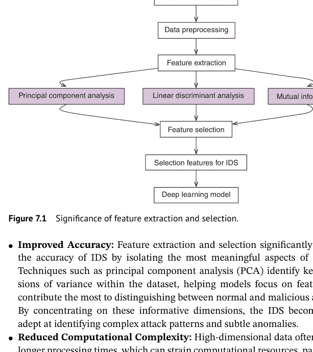

图 7.1 特征提取和选择的重要性。

- **Improved Accuracy:** 特征提取和选择通过分离数据中最有意义的方面显著提升了入侵检测系统 IDS 的准确性。诸如主成分分析 PCA 等技术可识别数据集中方差的关键维度，帮助模型聚焦于对区分正常和恶意活动贡献最大的特征。通过集中于这些信息丰富的维度，IDS 在识别复杂攻击模式和细微异常方面变得更加擅长。
- **Reduced Computational Complexity:** 高维数据通常会导致处理时间延长，这会给计算资源带来压力，尤其是在大规模系统中。特征选择方法通过消除多余特征来缓解这一问题，从而降低数据集的维度。这种简化过程减少了训练机器学习或深度学习模型所需的时间和精力，使 IDS 更加敏捷和响应迅速。例如，应用 PCA 或类似方法可以在保持甚至提高模型性能的同时显著缩短训练时间。
- **Enhanced Efficiency:** 借助精简的特征集，IDS 不仅运行更快，而且消耗的计算资源更少。这在实时场景中至关重要，因为网络必须持续监控，而不会造成可能危及安全的延迟。特征越少，分析的数据就越少，使系统能够及时响应潜在威胁并保持网络性能不间断。

此外，特征提取和选择解决了诸如 **overfitting** 的常见问题，即模型记住训练数据而不是学习可泛化的模式 [10]。高维数据集通过引入噪声和无关信息增加了过拟合的风险。通过聚焦于最具影响力的特征，这些技术提高了模型对未见数据的泛化能力，确保在不同环境下具有可靠的性能。

本质上，特征提取和选择是基础性过程，不仅提升了 IDS 的准确性，还确保了其效率和可扩展性。这些技术使 IDS 能够处理复杂且不断演变的网络威胁，使其在现代网络安全框架中不可或缺。

#### 7.1.5 Challenges in Managing High-Dimensional Data in IDSs
在 IDS 中处理高维数据会带来若干挑战，尤其涉及计算需求、模型性能和数据稀疏性。例如，网络流量数据集通常包含大量属性——从数据包头到用户会话元数据——导致维度达到数千。有效管理这些特征的泛滥对于确保 IDS 模型保持高效和准确至关重要 [9]。

一个突出问题是维度灾难，即随着特征数量的增加，数据变得越来越稀疏。这种稀疏性使检测有意义的模式变得复杂，因为数据点在高维特征空间中稀薄地分布。因此，深度学习模型可能难以泛化，往往会退化为过拟合——记住训练数据而不是学习适用于未见数据的模式。

此外，处理高维数据集的计算成本巨大。随着特征数量的增加，算法的复杂性也随之增加，导致训练时间更长、资源消耗更高。对于实时 IDS 应用而言，快速威胁检测至关重要，此类延迟会使系统失效。

数据稀疏性进一步加剧了这些挑战。高维数据集中许多特征可能几乎没有有用信息，却仍会增加计算负担和过拟合风险。这种低效凸显了需要降维技术来优先考虑相关特征，同时丢弃冗余或无关特征。

为缓解这些问题，PCA 和线性判别分析 LDA 等技术被广泛采用。PCA 通过捕捉最大方差的方向，将高维数据转换为一组较小的无相关特征，而 LDA 则选择能最好分离感兴趣类别的特征。这些方法在降低维度的同时保留关键信息，使模型能够更高效、更有效地处理数据。

解决维度灾难还涉及在特征数量和质量之间取得平衡。通过聚焦于最具信息量的维度，IDS 可以避免稀疏数据的陷阱并提高其准确检测入侵的能力。此外，这种精简的特征空间减少了训练所需的时间和计算资源，使实时检测成为可能。

在现代 IDS 的背景下，威胁检测的速度和准确性不容商榷，通过有效的特征提取和选择来管理高维数据不仅有益——而且是必不可少的。这些技术使 IDS 能够处理庞大复杂的数据集，同时在快速演变的网络安全环境中保持稳健的性能 [10]。

### 7.2 Techniques for Feature Extraction and Selection

#### 7.2.1 Principal Component Analysis

**Explanation of PCA:** 主成分分析 PCA 是一种统计方法，用于在保留尽可能多变异性的同时降低大型数据集的维度。通过将原始特征转换为一组称为主成分的正交变量，PCA 识别数据中最大方差的方向。这些成分按其捕获的方差量排序，前几个成分包含数据集的大部分变异性 [11]。

**Applications in IDSs:** 在入侵检测中，PCA 常用于通过选择解释大部分方差的最显著成分来压缩网络流量数据。例如，在包含数百个流量特征的数据集中，PCA 可能将其减少到仍能解释数据 95% 方差的 50 个特征。这种降维对于加快模型处理时间而不牺牲准确性至关重要。

**Examples and Analysis:** PCA 在 IDS 中的实际示例可能涉及降低诸如数据包大小、源 IP 地址、协议等流量特征的维度。在一个典型的包含 500 个特征的数据集中，PCA 可能将其减少到仍能解释 95% 方差的 50 个特征。因此，IDS 模型训练更快、计算开销更小，同时仍能以高准确率识别入侵 [12]。

#### 7.2.2 Linear Discriminant Analysis

**Explanation of LDA:** 线性判别分析 LDA 是另一种广泛使用的降维技术，但侧重于最大化类别可分离性。与试图捕捉数据方差的 PCA 不同，LDA 旨在找到能最好分离两个或多个数据类别的特征线性组合 [13]。通过聚焦数据的判别方面，LDA 创建一个投影，该投影最大化不同类别均值之间的距离，同时最小化每个类别内的离散度。

### Comparison with PCA:
虽然 PCA 是一种无监督技术，不考虑类别标签，而 LDA 是一种监督技术，利用类别标签来改善类别之间的分离。因此，当需要根据某些特征将数据分类到不同类别时，LDA 尤其有效，这使其在入侵检测中高度适用。

- **PCA** 聚焦于方差，所产生的特征可能并不总是对分类任务有用。
- **LDA** 另一方面，确保转换后的特征针对类别分离进行了优化，使其更适合于诸如识别网络流量是否良性或恶意之类的分类任务。

### Applications in IDSs:
在 IDS 中，LDA 用于将网络流量分类到预定义类别，如良性、恶意或可疑。通过将特征空间转换以最大化类别可分离性，LDA 可以提高入侵检测模型的准确性。例如，在将网络流量分类为不同攻击类型（如 DoS、恶意软件）的 IDS 中，LDA 可以通过突出每种攻击类型的最具判别性特征来提高分类准确性。

当数据集中的类别定义良好，系统需要基于最相关特征准确分类实例时，LDA 特别有用。

### Limitations of LDA:
LDA 假设数据呈正态分布且类别具有相同的协方差矩阵。这些假设在现实世界的 IDS 数据集中可能并不总是成立，导致某些情况下性能欠佳 [14]。

#### 7.2.3 Mutual Information

**Mutual information (MI)** 是一种统计度量，用于量化两个变量之间的依赖关系。与衡量线性关系的相关性不同，MI 可以捕捉变量之间线性和非线性关系。它在 IDS 的特征选择中被广泛使用，因为它能识别出关于目标变量提供最多信息的特征 [15]。

##### 7.2.3.1 How Mutual Information Works?
MI 衡量两个变量之间共享的信息量。数学上，其定义为：

MI (X; Y) = H(X) + H(Y) – H (X, Y)

其中：

- H(X) 和 H(Y) 是变量 X 和 Y 的单独熵。
- H(X,Y) 是两个变量的联合熵。

如果两个特征相互独立，则其 MI 为零。然而，如果它们高度相关，则 MI 分数会很大，表明一个特征提供了关于另一个特征的实质性信息。

**IDS 中的 MI：** 在 IDS 中，MI 可用于评估网络流量的哪些特征在区分正常流量和攻击流量方面最具信息性。通过选择与类别标签（正常或攻击）具有高 MI 的特征，IDS 可以专注于最相关的数据，从而提高准确性和效率。MI 还可以帮助识别冗余特征，这些特征不会提供额外信息，可以被移除，从而降低 IDS 模型的复杂性。

**MI 的优点：**

- **非线性：** MI 能够捕捉特征之间线性及非线性关系，使其比 PCA 和 LDA 等线性方法更通用。
- **可解释性：** MI 提供了对特征与目标变量共享多少信息的清晰理解，有助于解释 IDS 模型的结果。

**MI 的局限性：**

- **计算复杂度：** MI 计算成本可能很高，尤其对于大型数据集，因为它需要计算联合分布和边缘分布。
- **处理连续数据：** 在处理连续数据时，准确估计熵和联合熵可能具有挑战性，这可能会影响 MI 在高维 IDS 数据集中的性能。

#### 7.2.4 卡方特征选择

卡方（χ²）检验是一种用于评估两个分类变量独立性的统计方法。在特征选择中，卡方检验用于确定特征与目标变量之间是否存在显著关系。与目标高度相关的特征将被选中，而关系很少或没有的特征将被丢弃。

##### 7.2.4.1 卡方特征选择的工作原理？

卡方统计量使用以下公式计算：

χ² = Σ (Oᵢ − Eᵢ)² / Eᵢ

其中：

- $O_i$ 是数据中特征的观测频率。
- $E_i$ 是如果特征与目标变量无关时的期望频率。

卡方检验将每个特征的观测频率分布与期望分布进行比较。如果观测频率与期望频率之间的差异显著，则表明该特征与目标变量相关，并将被选入模型。

### IDS 中的卡方：

当特征为分类型（如端口号、协议或攻击类型）时，卡方特征选择在 IDS 中特别有用。通过应用卡方检验，IDS 可以识别与攻击检测最相关的特征。该方法有助于选择与分类任务高度相关的特征子集，通过移除不相关或噪声数据来提高模型性能。

### 卡方的优点：

- **简易性：** 卡方检验易于实现且计算效率高，尤其适用于具有分类特征的数据集。
- **可解释性：** 卡方检验提供清晰的结果，显示哪些特征与目标变量的关系最强。

### 卡方检验的局限性：

**分类数据限制：** 卡方检验最适用于分类数据，除非将连续变量离散化，否则可能无法很好地处理连续变量。

**独立性假设：** 该检验假设特征相互独立，而在具有相关特征的复杂 IDS 数据集中，这一假设可能并不总是成立。

#### 7.2.5 技术比较分析

在 IDS 中，特征提取和选择在提高系统性能方面发挥着关键作用，通过降低数据复杂性、提高计算效率并保持甚至提高检测准确性。随着网络流量的指数增长以及由此产生的特征数量的增加，有效管理高维数据成为紧迫挑战。选择最相关和最具信息性的特征可确保 IDS 精确地专注于检测入侵，而不是被不相关或冗余数据淹没 [16]。

四种常用的特征提取和选择技术——PCA、LDA、MI 和卡方特征选择——根据数据的性质和入侵检测任务的具体目标提供不同的优势。

每种方法都从独特的角度解决该问题，提供针对降维、类可分性、相关性度量或统计显著性量身定制的能力。理解这些技术的比较优势和局限性对于 IDS 设计师和研究人员至关重要。

比较表

| 技术 | 优势 | 弱点 | 理想使用场景 |
|---|---|---|---|
| PCA | • 有效降低维度<br>• 计算效率高 | • 可能丢失重要的非线性关系<br>• 假设线性关系 | • 高维数据的降维 |
| LDA | • 最大化类可分性。<br>• 当类可分性是主要关注点时效果良好 | • 假设正态分布和相等协方差<br>• 不适用于非线性可分的数据 | • IDS 中的分类任务 |
| MI | • 捕捉线性及非线性关系。<br>• 通用且可解释 | • 计算成本高<br>• 处理连续数据具有挑战性 | • 在大型复杂数据集中识别关键特征 |
| Chi-squared | • 简单且计算效率高。 | • 最适合分类数据 | • 分类特征选择 |

### 使用场景：

- **PCA** 适用于需要降维但特征间关系主要为线性的情况。当数据集包含许多冗余或相关特征时特别有用。
- **LDA** 最适用于在监督学习环境中分离不同类别的目标，并且当数据遵循正态分布且各类别协方差矩阵相等时表现良好。
- **MI** 在处理包含非线性关系的复杂高维数据集时非常适用。它提供了哪些特征对分类任务最具信息性的宝贵见解，尤其是在数据混合（既有分类又有连续）时。
- **卡方特征选择** 当 IDS 数据集中的特征为分类型时特别有用，例如端口号或协议。它计算效率高，能够很好地识别与特定攻击类型相关的最相关特征。

总之，每种特征提取和选择技术都有其独特的优势，适用于 IDS 中的不同场景。通过了解每种技术的优势和局限性，IDS 实践者可以根据数据特征、入侵检测任务的性质以及系统的计算约束选择合适的方法。

### 7.3 入侵检测系统中的应用

特征提取和选择技术构成了现代 IDS 的基石。这些技术对于分析网络环境中产生的海量数据至关重要，使 IDS 能够高效检测网络威胁。通过识别并专注于最相关的数据点，这些技术降低了计算开销，增强了决策过程，并提高了 IDS 对不断演变的攻击模式的适应性。

#### 7.3.1 在 IDS 工作流中集成特征提取和选择

特征提取和选择在 IDS 的预处理阶段发挥关键作用。这些技术确保仅保留最有意义和最相关的特征，从而优化输入检测或分类模型的数据。此过程提高了 IDS 的准确性和效率，使其能够有效区分正常和恶意活动。

**典型 IDS 工作流的步骤**

- 1. **数据收集：** 流程始于从网络设备、日志和传感器等各种来源收集原始数据。这些数据通常包括数据包头、时间戳和流模式等详细信息。
- 2. **特征提取：** 然后从原始数据中提取相关特征。这些特征可能包括数据包大小、协议类型、连接持续时间以及流统计等指标，它们承载着关于网络活动的重要信息。
- 3. **特征选择：** 为了进一步优化数据集，会应用 PCA、LDA 或 MI 等技术。这些方法仅识别并保留最具信息性的特征，消除噪声和冗余。
- 4. **模型训练：** 清理并缩减后的数据集用于训练决策树、支持向量机（SVM）或神经网络等机器学习模型，使 IDS 能够识别表明恶意活动的模式。
- 5. **检测：** 训练好的模型随后部署以监控传入网络流量，将其分类为正常或表明攻击。


##### 7.3.1.1 对性能的影响

特征提取与选择在入侵检测系统（IDS）工作流中的集成已被证明能够显著提升系统性能。通过减少无关或冗余特征，这些技术精简了数据，使IDS能够聚焦于驱动准确检测的关键方面。这种有针对性的方法不仅提高了泛化能力，还加速了决策过程。

例如，PCA（主成分分析）因其能够简化高维数据集同时保留关键模式而广受认可，从而提高了检测准确性。同样，MI（互信息）擅长锁定信息量最大的特征，有助于更精确地识别各类网络入侵。研究一致表明，应用这些方法时，准确性和处理速度均有显著提升，凸显了它们在现代IDS实现中的重要性。

##### 7.3.1.2 实际应用中的挑战

尽管特征提取与选择带来了明显的好处，但它们并非没有挑战，尤其是在动态和大规模网络环境中。一个关键问题是网络流量的演化特性。随着特征分布随时间变化，静态特征选择方法可能失效。为了使IDS保持可靠，需要自适应技术来适应这些不断变化的模式。

此外，计算需求也可能构成重大挑战。例如，虽然MI能提供关于特征相关性的宝贵洞察，但在应用于大规模数据集时可能变得资源密集。这需要使用优化算法来确保实际应用中的可扩展性。

通过应对这些挑战，特征提取与选择能够持续增强IDS性能，使其成为对抗不断演变的网络威胁不可或缺的工具。

#### 7.3.2 性能提升

特征提取与选择技术的集成已被证明是提升IDS性能的关键因素。研究强调，应用PCA和LDA等方法可以将检测准确率提高多达20%。这些方法擅长提取数据中最相关的维度，有效降低噪声和冗余。通过聚焦关键特征，这些技术使IDS模型能够更有效地泛化，从而在不同数据集上实现更可靠的检测。

##### 7.3.2.1 通过MI和卡方方法实现效率提升

MI和卡方方法在简化训练过程方面表现突出。MI衡量每个特征与目标变量之间的依赖关系，去除冗余或噪声信息。例如，在分析网络流量数据时，PCA可以将数千个特征压缩为可管理的子集，在保留关键模式的同时简化数据集。这不仅降低了计算负担，还增强了可解释性，使IDS能够更有效地处理数据。

- **LDA用于改进类别区分：** 另一方面，LDA旨在最大化标记数据集中不同类别之间的可分离性。通过将数据投影到强调类间方差的低维空间，LDA确保分类模型能够更准确地区分正常行为和恶意行为。当数据集中包含攻击类型之间的细微差异时，这一点尤其有价值。

##### 7.3.3.2 使用MI和卡方方法进行训练

在训练阶段，采用MI和卡方等技术来微调输入机器学习模型的特征集。

- **MI用于特征重要性排序：** MI评估每个特征相对于目标变量的相关性，确保只保留最具信息量的属性。例如，在检测DDoS攻击时，MI可能优先考虑数据包速率或源IP分布等特征，这些特征对此类威胁具有很强的指示性。
- **卡方用于统计显著性：** 卡方方法评估每个特征相对于目标的统计独立性，识别对模型预测影响最大的特征。该技术在处理包含分类变量（如系统警报或事件日志）的数据集时尤为有效，因为这些数据中需要揭示有意义的关联。

##### 7.3.3.3 混合方法以获得增强结果

在实践中，混合方法通常通过结合多种技术来实现最佳性能。例如，可以使用超参数选择方法结合特征选择（FS）来改进入侵检测系统[17]。这种分层策略利用了不同方法的优势，确保系统在处理效率和检测精度方面都表现优异。

##### 7.3.3.4 实际应用

这些技术的实际应用已在多个领域彻底改变了IDS的有效性，具体如下：

- **企业安全系统：** 企业在分析高维网络流量和识别网络攻击的异常模式时，广泛使用PCA和LDA。
- **基于云的IDS：** 云环境依靠MI和卡方等特征选择方法来优化资源使用，同时保持高检测准确率，以应对可扩展性挑战。
- **物联网安全：** 在设备生成海量数据的物联网（IoT）网络中，这些技术对于在不压垮系统资源的情况下识别恶意行为至关重要。

通过将这些技术集成到IDS工作流中，组织可以确保系统具备稳健性、可扩展性和高效性，能够跟上网络威胁动态演变的特性。

### 7.4 结论与未来趋势

特征提取与选择在IDS中的作用既关键又具有变革性。随着网络威胁日益复杂和数据量激增，IDS有效检测入侵的能力取决于这些系统如何将海量原始数据提炼为可操作的洞察。本章探讨了PCA、LDA、MI和卡方特征选择等关键技术，阐明了它们的优势、局限性和应用。

#### 7.4.1 关键见解

**提高准确性和效率：** 特征提取与选择不仅仅是辅助过程；它们直接影响IDS的准确性和计算效率。通过隔离最相关的特征，这些技术减少噪声、防止过拟合，并使IDS能够聚焦于指示恶意活动的关键模式。

**适应高维数据：** 网络流量数据维度不断增加带来了重大挑战。PCA和LDA等技术简化了这种复杂性，使IDS能够实时处理海量数据集。同时，MI和卡方方法确保保留最具信息量的特征，进一步优化系统性能。

**比较优势：** 对比分析凸显了每种技术的独特优势。PCA擅长降维，LDA在分类任务中非常有效，MI关注特征相关性，而卡方强调统计显著性。它们共同为增强IDS能力提供了全面的工具集。

**实际场景中的应用：** 这些技术在企业网络到物联网生态系统等不同环境中都发挥着重要作用。它们适应动态数据流的能力确保了IDS能够应对不断演变的网络威胁，同时保持可扩展性和效率。

挑战与局限：虽然这些技术提供了显著优势，但它们并非没有局限性。

- **PCA：** 虽然对降维有效，但可能牺牲可解释性，使其更难解释IDS如何得出决策。
- **MI和卡方：** 这些技术需要仔细的预处理，尤其是在处理噪声或不平衡数据集时，以避免特征选择过程中的偏差。应对这些挑战对于在实际IDS部署中最大化特征提取与选择技术的效用至关重要。

#### 7.4.2 未来方向

IDS中特征提取与选择的未来在于先进技术和方法的集成，旨在提高准确性、效率和韧性。

- **深度学习集成：** 将特征提取与选择无缝融入深度学习流程，将实现能够进行高级异常检测的端到端系统。这些系统可以利用深度学习识别复杂模式的能力，并辅以精简的特征工程过程。
- **使用AutoML自动化特征选择：** 利用AutoML工具自动化特征选择将显著减少对领域专业知识的依赖，加快IDS的开发和部署。这还将确保在不同数据集和环境中的一致性能。
- **优化实时处理：** 随着网络安全对实时威胁检测的需求日益增长，为流式数据增强特征提取与选择技术将变得至关重要。未来的研究应侧重于能够在实时运行且不牺牲准确性的轻量级、高效算法。
- **混合技术以增强稳健性：** 采用结合多种技术优势的混合方法将提升IDS性能。例如，使用PCA进行降维，然后使用MI进行基于相关性的选择，可确保数据压缩与特征重要性之间的平衡。
- **关注可解释性：** 由于网络安全决策往往具有高风险，可解释的IDS模型正变得不可或缺。必须完善LDA和可解释AI（XAI）框架等优先考虑可解释性的技术，以在不牺牲性能的前提下提供透明度。


## 7 深度学习特征：提取与选择技术

6) 对抗鲁棒性：随着对抗性机器学习成为一种威胁，开发能够抵御对抗性输入的特征选择方法将至关重要。确保入侵检测系统（IDS）在此类操纵下的完整性，将保护关键系统免遭利用。

本章强调了特征提取与选择在增强入侵检测系统能力方面的重要作用。这些技术应对了高维数据的挑战，优化了计算效率，并提高了入侵检测的准确性。随着网络安全形势的演变，采用创新的特征工程方法不仅能增强入侵检测系统的能力，还能强化防御以应对不断扩大的网络威胁。

通过在深度学习进展与特征选择之间建立协同效应，入侵检测系统的未来前景可观。这种融合将推动智能、可扩展且自适应的安全系统的发展，确保数字生态系统更加安全、更具韧性。

## 参考文献

1 Han, J., Kamber, M. 等（2011）. 数据挖掘：概念与技术（第3版）. 旧金山，加利福尼亚州：Morgan Kaufmann.
2 Szegedy, C. 等（2014）. 使用深度信念网络的入侵检测. 见 *IEEE国际神经网络会议论文集*，中国北京，第2825–2830页.
3 Ahanger, A.S., Khan, S.M. 和 Masoodi, F.S. 2021. 使用监督机器学习技术的有效入侵检测系统. 2021年第五届计算方法与通信国际会议（ICCMC）. IEEE.
4 Fisher, R.A.（1936）. 多重测量在分类学问题中的应用. *优生学年鉴* 7（2）：179–188.
5 A. K. Jain 等，统计模式识别：综述，*IEEE模式分析与机器智能汇刊*，第22卷，第1期，第4–37页，2000年1月.
6 Hall, M.（1998）. 基于相关性的机器学习特征选择，博士论文. 新西兰汉密尔顿怀卡托大学.
7 Asuncion, A.S. 和 Newman, D.J.（2007）[UCI机器学习库](https://archive.ics.uci.edu/ml/index.php).
8 A. A. Al-Yaseen, Z. A. Othman 等，基于粒子群优化与决策树相结合的混合入侵检测系统，*阿拉伯科学与工程杂志*，第42卷，第2期，第487–500页，2017.
9 Guo, S., Li, Z. 等（2016）. 基于互信息的网络入侵检测特征选择. 见 *国际网络安全会议论文集*，中国武汉，第56–63页.
10 Li, W.（2004）. 使用卡方统计量进行特征选择. 见 *国际机器学习应用会议论文集*，美国华盛顿州西雅图，第116–123页.
11 Satyam, P. Geetha 等，人工智能赋能的边缘计算模型：趋势、发展与未来影响，2023年第二届边缘计算与应用国际会议（ICECAA），印度纳马卡尔，2023，第63–67页.
12 A. Krizhevsky, I. Sutskever 等，基于深度卷积神经网络的ImageNet分类，*神经信息处理系统进展（NIPS）* 25，2012，第1106–1114页.
13 Z. Yan, Y. Zhang 等，用于网络异常检测的深度学习，*IEEE通信调查与教程*，第19卷，第1期，第140–171页，2017.
14 Jan, S., Masoodi, F.S. 和 Bamhdi, A.（2022）. 物联网环境中的有效入侵检测：深度学习方法. *SCRS智能系统会议论文集*.
15 Masoodi, F.S., Abrar, I. 和 Bamhdi, A.M.（2022）. 使用同质集成技术的有效入侵检测系统. *国际信息安全与隐私杂志（IJISP）* 16（1）.
16 Ruder, S.（2016）. 梯度下降优化算法综述. *ArXiv预印本 arXiv:1609.04747.*
17 V.S.Thiyagarajan, K.S.Shashikala 等，大数据分析环境中基于人工蜂鸟算法与深度变分自编码器的入侵检测. *工程科学与技术评论杂志*，第18卷，第2期，第21–27页，2025.

- 随机森林分类机器学习算法
- 孤立森林算法
- K均值聚类
- 鲁棒协方差
- 基于角度的异常检测（AD）
- 长短期记忆网络（LSTM）
- 一类支持向量机（SVM）
- 基于随机梯度下降算法的一类支持向量机（SVM）

在上述机器学习算法中，随机森林算法是图像分割应用中用于分类和回归的有效机器学习算法。它汇总并考虑每棵决策树的预测，通过集成学习选择最佳预测。孤立森林是一种依赖于树模型的最先进的无监督异常检测技术。

机器学习算法旨在异常检测过程中执行高效的特征提取。例如，金融异常检测系统旨在识别实时的异常借记卡交易数据，例如来自可疑地点的高价值交易，和/或由于异常消费模式导致的信用卡交易数据[4]。因此，金融异常检测系统通过执行行为分析、账户监控、交易监控、身份验证以及伪造签名、虚假文件和财务细节差异的识别来检测异常。对于网络入侵检测（NID）系统的用例，异常检测用于防止数据泄露和欺诈活动。在基于人工智能的异常检测中，隐私、透明度和负责任的使用是需要考虑的一些伦理问题。

## 8.1.2.3 应用领域

异常检测应用于以下各个领域：

- 网络安全入侵检测
- 网络入侵检测
- 视频监控入侵检测
- 银行、金融和保险行业入侵检测
- 信息技术和电信入侵检测
- 医疗保健
- 制造业入侵检测
- 国防与政府，等等

人工智能在异常检测中的网络安全用例包括网络流量监控、行为分析、基于签名的异常检测以及实时告警与响应。金融异常检测包括交易监控、身份验证、账户监控、行为分析、钓鱼攻击检测和欺诈申请检测；而医疗保健异常检测则包括早期疾病检测、远程患者监护、临床决策支持、患者安全监控、慢性病管理、识别来自医院的欺诈索赔以及行为检测[5]。

## 8.1.2.4 基于人工智能的异常检测方法的优势

基于人工智能的异常检测方法可以：

- 动态适应新数据
- 识别细微而复杂的异常
- 提供改进/增强的安全性
- 在工业流程、医疗保健等领域提供更高的运营效率
- 实现成本节约/降低
- 提供可扩展性
- 实现预测性维护
- 对海量数据执行增强且准确的数据分析
- 执行实时监控
- 减少误报
- 改进决策制定

## 8.1.2.5 基于人工智能的异常检测面临的挑战

基于人工智能的异常检测过程中的主要问题如下：

- 数据集的复杂性和未知性
- 异构异常类别
- 标记数据不可用
- 数据集成
- 计算需求
- 数据隐私
- 可解释性
- 对抗性攻击

## 8.1.2.6 基于人工智能的异常检测方法

机器学习异常检测方法分类如下：

- 监督学习
- 半监督学习
- 无监督学习，以及
- 强化学习（RL）方法

监督学习模型使用标记数据集进行训练，而半监督异常检测模型使用少量标记数据集和分类算法来对大量未标记数据集进行分类[6]，以检测


可疑活动。实际上，为了预测特定于任何特定应用的数据标签，训练阶段是通用的，并利用领域专家来学习其标注行为。常见的监督式机器学习算法如下：

- K近邻
- 局部离群因子
- 贝叶斯
- 支持向量机（SVM），以及
- 决策树

无监督学习旨在通过基于相似性的数据分离、特征提取和聚类来降低维度。一些无监督异常检测算法如下：

- K均值
- 自编码器
- 高斯混合模型
- 主成分分析，以及
- 基于假设检验的分析

在强化学习中，智能体与环境交互，并通过执行最优动作和获得最大化的长期累积奖励来学习最优策略。无监督机器学习算法[7]的性能受到海量未标注数据集的限制。因此，近年来，深度强化学习（DRL）在异常检测中逐渐流行，因为它在许多方面优于机器学习和深度学习技术。

最近常用的一些基于人工智能的异常检测方法如下：

- 自编码器（AEs）
- 生成对抗网络（GANs）
- 单类分类（OCC）
- 深度强化学习（DRL）
- 循环神经网络（RNN）
- 迁移学习，等等。

以下小节将详细阐述上述在各种应用领域中尝试用于异常检测的流行基于人工智能的异常检测方法。

## 8.2 基于自编码器的异常检测

自编码器（AE）是一种将生成式与概率变分建模和深度架构相结合的强大技术。AE旨在学习底层数据分布，以生成有意义的样本数据[8]。标准AE具有编码器和解码器部分，处理时间序列顺序数据集时可以使用循环神经网络（RNN），处理图像数据集时可以使用卷积神经网络（CNN）。编码器部分包含一个输入层和一个带瓶颈（也称为潜空间层）的隐藏层作为最终隐藏层。原始输入数据被馈送到输入层，隐藏层逐步压缩输入的维度，并捕获重要特征和模式。解码器通过将编码映射回输出来重构输入[9]。

AE的表示学习策略可用于降维、去噪甚至生成应用。该架构通常通过优化输入重构进行端到端训练，即最小化衡量模型输出与输入之间差异的损失。它可以用任何未标注数据进行训练。AE可用作无监督或半监督异常检测的技术。AE在训练期间完全不使用标注数据集，也能获得非常高的受试者工作特征曲线下面积（AUC ROC）[10]。

### 8.2.1 自编码器的类型

- 经典自编码器
- 去噪自编码器（DAE）
- 堆叠卷积自编码器（scAE）
- 鲁棒深度自编码器（RDA）
- 变分自编码器（VAE）

### 经典自编码器模型

输入层和输出层与数据具有相同的维度，而中间层引入较小的维度以形成瓶颈。该瓶颈迫使网络学习输入数据的压缩表示，从而捕获其基本特征。

### 去噪自编码器（DAE）

去噪自编码器旨在从受损输入中重构干净数据，使其对噪声具有鲁棒性，并增强其泛化能力。

### 堆叠卷积自编码器（scAE）

它使用卷积层来捕获输入数据中的空间依赖关系和层次特征，使其在图像相关任务中特别有效。

### 鲁棒深度自编码器（RDA）

RDA旨在增强自编码器模型对输入数据中离群点和异常值的鲁棒性。

### 变分自编码器（VAE）

VAE代表一类生成式概率模型，它扩展了经典自编码器的功能，并通过同时将数据压缩到潜空间并以其压缩形式重构数据，提供了一种优雅的解决方案，在保持可解释性的同时有效捕获复杂纠缠的数据分布。VAE通过将输入数据编码到潜空间，然后重构它来运作。变分自编码器引入了潜空间的概率解释，使其能够通过从学习到的潜分布中采样来生成新的数据样本[11]。

VAE与GAN结合具有非凡的能力，能够利用生成建模原理学习复杂的潜在表示并重构原始输入。变分自编码器可以学习潜在表示，从而准确重构数据样本。变分自编码器在处理复杂数据集和数据分布方面鲁棒且通用。它们更易于训练，并且不会出现模式崩塌现象。但它们可能不如GAN精确。

## 8.3 生成对抗网络异常检测

生成对抗网络（GAN）能够生成难以获取的异常数据点，因为它具有数据增强和表示学习的能力[12]。为了克服代表异常行为的数据不可用的困难，近年来GAN已被用于将异常检测应用于图像的应用领域，如医疗行业、工业制造、视频监控等。

### 8.3.1 GAN的特征

- 它们可以生成新的逼真数据，并可用于数据增强。
- 它们可以执行表示学习。
- 它们学习正常数据的分布，从而可用于检测离群点或异常数据。
- 它们可以通过无监督方式训练，以学习真实数据分布。
- 它们还可用于半监督和监督异常检测过程，以及数据增强。
- 它们利用隐式密度模型。
- GAN使用图像数据集进行异常检测过程。

图像数据集在作为输入提供给GAN之前需要进行预处理。数据处理步骤包括调整大小、归一化和裁剪。

## 8 探索用于异常检测的高级人工智能

用于异常检测的GAN架构有以下三种：

- 标准GAN
- 深度卷积GAN
- 条件GAN

用于评估GAN的性能指标如下：

- 生成合成/逼真数据的能力（通过数据增强或表示学习）
- 结构相似性指数
- 峰值信噪比（SNR）
- 受试者工作特征曲线下面积（AUC-ROC）

### 8.3.2 GAN的工作原理

GAN的总体框架包含两个深度神经网络（DNN）模型，如下所示：

- 生成式DNN（G-GAN）模型
- 判别器DNN（D-DNN）模型

G-GAN以随机噪声向量作为输入，经过训练学习真实正常数据分布，并生成与真实正常数据难以区分的逼真假样本。D-DNN接收G-GAN生成的假样本和真实正常数据。D-DNN通过比较其输入进行二元决策，并输出分类误差。G-GAN和D-DNN均经过迭代训练以调整权重和偏置，直至达到纳什均衡[13]。

迭代训练过程包括两个循环，即内循环和外循环。在内循环中，调整D-DNN参数以最大化对真实数据和生成的假样本预测正确标签的分类精度；而在外循环中，调整G-GAN参数以生成与真实正常数据难以区分的逼真假样本[14]。GAN的训练被视为零和博弈问题，一旦任何一方都无法改善状况，就达到纳什均衡。也就是说，生成的假样本无法被D-DNN与真实正常数据区分开来[15]。

半监督异常检测系统利用标准GAN、深度卷积GAN和无监督GAN进行异常检测，而无监督异常检测系统倾向于使用标准GAN，并将其性能与基于AE的异常检测方法进行比较。监督异常检测系统使用GAN来增强异常类别的数据集[16]。

GAN被用于医学、监控和身份识别等图像数据集应用的异常检测中。


## 8.4 单类分类异常检测

单类分类（OCC）是一种无监督学习算法，它试图对正常样本进行建模，以便将新样本分类为正常或离群值。OCC 方法因能够通过有效建模正常类并将偏差识别为异常来从不平衡数据中学习而备受关注。OCC 方法专门学习可用类别 [17] 的特征，该类别称为正常类。OCC 的目标是识别新的、未见过的实例是否属于该学习类别，或是否显著偏离该类别，从而被视为异常或离群值。

OCC 方法专为高度不平衡的数据集设计，使其在异常事件罕见但识别至关重要的领域中不可或缺。OCC 技术可分为以下四种主要方法：

- 基于重构的方法——通过重构误差识别异常。
- 变分自编码器（VAEs）——对数据分布进行概率建模
- 卷积方法——适用于图像和多模态数据
- 混合模型——结合多种技术以增强鲁棒性和性能。

在难以、昂贵甚至无法获得异常行为标记样本的应用中，OCC 方法被用于异常检测（AD）。OCC 用于 AD 的应用如下：

- 医疗保健中罕见疾病的检测
- 金融欺诈防范
- 工业故障检测
- 网络安全/网络安全，以及
- 医学诊断

用于网络安全和工业控制系统中 AD 的脉冲单类异常检测框架使用演化脉冲神经网络，通过学习正常操作数据并识别偏差来检测高级持续性威胁（APT）。同样的框架也可用于机械健康监测，以预防损坏或停机并检测故障 [18]。

在医疗保健中，OCC 用于患者监测和疾病的早期检测。例如，AD 可应用于心电图（ECG）数据，以识别可能表明心脏问题的异常心跳。

- 如果重构数据与输入显著偏差（高重构误差），则将其视为异常。
- 它们非常适合结构化数据，如表格数据集、时间序列和简单图像数据，在这些数据中正常模式能够得到良好表示，且偏差易于捕获。

## 8.5 深度强化学习异常检测

深度强化学习将强化学习（RL）的决策能力与深度学习（DL）相结合。DRL 技术，如 DQN、double DQL、深度自编码器 Q 学习、策略梯度、actor-critic 模型、深度确定性策略梯度（DDPG）、TD3 DPG（双延迟深度 DPG）、元策略主动 AD、带 CNN 和 RNN 的 RL，被用于智能和可靠的 AD，特别是视频监控 AD、网络 ID、金融 AD、医学 AD、文本 AD、欺诈检测、工业损坏检测和制造业 AD 系统。文献综述显示，利用 DRL 的应用非常少 [19]。

深度 Q 学习网络方法仅适用于离散动作空间，并且在某些情况下会高估动作值。为了解决 DQN 的过估计问题，开发了 double DQN 方法 [20]。Double deep Q-learning 在 Q 值更新阶段之前执行动作评估。Actor-critic DRL 技术通过并发梯度下降优化 DNN 集成器，并且 actor-learners 稳定学习过程。

文献综述展示了 17 种不同的 DRL 模型，应用于 13 种不同场景，如通用 AD、ID、网络 AD、NID、视频 AD、云 ID、无线网络安全、建筑 AD、工业网络控制、时间 AD、对抗性攻击检测、网络攻击 AD 以及物联网（IoT）AD [21]。使用 50 个不同数据集在 AD 实验中分析了 DRL 模型的性能。在智能视频监控中，异常活动检测是一个关键组成部分，因为它能在观察不断变化的场景时识别异常活动 [22]。

近期研究探讨了 RCNN 与 DRL 结合用于实时智能视频 AD 和分类的应用。DRL 非常适合视频监控 AD，因为高维视频数据集包含原始且未标记的异常，这对于传统和经典 ML AD 模型来说难以处理 [23]。

通常，AD 可以通过使用部分标记的异常和元策略主动 AD 的深度强化神经网络（DRNNs）来实现。深度确定性策略梯度 DRL 方法的应用可用于建筑 AD、云 ID 和网络攻击检测。网络攻击检测可以使用 DDPG、DQN 执行。对于 NID，可使用 DQL 网络、DDQN、AE-DQN、DAEQ-N，

迁移学习的目标是从集体异常任务中识别点异常。归纳迁移学习的相关领域包括多任务学习和顺序学习，具体取决于任务是同时学习还是按顺序学习。

## 8.8 结论

先进的基于人工智能的 AD 方法已展示出对来自各应用领域的数据实例进行建模并有效执行 AD 的卓越能力，使其在健康、金融、制造、网络安全、网络 ID、工业等众多应用中不可或缺。本章简要介绍了先进的基于人工智能的 AD 方法，如自编码器（AE）、生成对抗网络（GAN）、单类分类（OCC）、循环神经网络（RNN）和深度强化学习（DRL）。还讨论了应用、优势和实现。本章内容将成为研究界和学生群体了解使用基于人工智能的机器学习、深度学习和深度强化学习方法的 AD 最新趋势的宝贵资源。

## 参考文献

- 1. Goswami, M.J. (2024). 基于人工智能的实时网络安全异常检测. International Journal of Research and Review Techniques 3 (1): 45–53.
- 2. Rousopoulou, V., Vafeiadis, T., Nizamis, A. 等 (2022). 具有 AI 解决方案的认知分析平台用于异常检测. Computers in Industry 134: 103555.
- 3. Wang, X., Wang, H., Bhandari, B., and Cheng, L. (2024). 面向智能能源消费的人工智能赋能方法：负荷预测、异常检测和需求响应综述. International Journal of Precision Engineering and Manufacturing-Green Technology 11 (3): 963–993.
- 4. Masoodi, F.S., Quasim, M., Bukhari, S. 等（编） (2023). 机器学习和深度学习在生物数据上的应用. CRC Press.
- 5. Sipple, J. and Youssef, A. (2022). 一种将可解释人工智能应用于异常检测的通用方法. 见：智能系统方法论国际研讨会，2022年10月3-5日，意大利科森扎，第162-174页. Cham: Springer International Publishing.
- 6. Abrar, I., Ayub, Z., Masoodi, F.S., and Bamhdi, A.M. (2020). 基于 NSL-KDD 数据集的入侵检测系统机器学习方法. 2020年智能电子与通信国际会议 (ICOSEC)，2020年9月10-12日，IEEE.
- 7. Santry, D.J. (2024). 揭秘深度学习：神经网络数学导论. Hoboken, NJ: Wiley.
- 8. Ahanger, A.S., Khan, S.M., Masoodi, F. 等 (2025). 使用图注意力网络的物联网高级入侵检测. *Scientific Reports* 15: 983.
- 9. Wang, R., Nie, K., Wang, T. 等 (2020). 用于异常检测的深度学习. 见：*第13届网络搜索与数据挖掘国际会议论文集*，2020年2月3-7日，美国德克萨斯州休斯顿，第894-896页.
- 10. Vinayakumar, R., Alazab, M.（IEEE 高级会员）等. 智能入侵检测系统的深度学习方法. *IEEE Access* 7: https://doi.org/10.1109/ACCESS.2019.2895334.
- 11. Liao, H.J., Lin, C.-H.R., and Ying-Chih, T.K.-Y. (2013). 入侵检测系统：综合综述. *Journal of Network and Computer Applications* 36: 16–24. https://doi.org/10.1016/j.jnca.2012.09.004.
- 12. Khraisat, A., Gondal, I., Vamplew, P., and Kamruzzaman, J. (2019). 入侵检测系统综述：技术、数据集和挑战. *Cybersecurity* 2: 20. https://doi.org/10.1186/s42400-019-0038-7.
- 13. Masoodi, F.S., Abrar, I., and Bamhdi, A.M. (2022). 使用同质集成技术的有效入侵检测系统. *International Journal of Information Security and Privacy (IJISP)* 16 (1): 18.
- 14. Ahanger, A.S., Khan, S.M., and Masoodi, F.S. (2021). 使用监督机器学习技术的有效入侵检测系统. *2021年第五届计算方法与通信国际会议 (ICCMC)*，2021年4月8-10日，印度埃罗德，IEEE.
- 15. El-Maged, L.M.A., Darwish, A., and Hassanien, A.E. (2020). 基于人工智能的植物病害分类. 见：*人工智能与计算机视觉国际会议论文集 (AICV2020)*（编辑：A.-E. Hassanien, A.T. Azar, T. Gaber, and D.O.F.M. Tolba），第3-15页. Switzerland AG: Springer Nature.
- 16. Jan, S., Masoodi, F. S., and Bamhdi, A. (2022). IoT 环境中的有效入侵检测：深度学习方法. *SCRS 智能系统会议论文集，2022年4月26日，印度.*
- 17. Arshad, S., Ashraf, W., Ashraf, S. 等 (2023). 基于 CICIDS-2017 数据集的入侵检测机器学习技术比较研究. *2023年第十届可持续全球发展计算国际会议 (INDIACom)*，2023年3月15-17日，印度新德里. IEEE.
- 18. Salloum, S.A., Alshurideh, M., Elnagar, A., and Shaalan, K. (2020). 用于网络安全的机器学习和深度学习技术：综述. 见：*人工智能与计算机视觉国际会议论文集 (AICV2020)*，（编辑：A.-E. Hassanien, A.T. Azar, T. Gaber, and D.O.F.M. Tolba），第50-57页. Switzerland AG: Springer Nature.
- 19. Bamhdi, A.M., Abrar, I., and Masoodi, F. (2021). 一种使用多数投票的集成方法用于有效入侵检测. *Telkomnika (Telecommunication Computing Electronics and Control)* 19 (2): 664–671.


- 20. Bace, R.G. (2000). *入侵检测*. Sams 出版社.
- 21. Lansky, J., Ali, S., Mohammadi, M. 等 (2021). 基于深度学习的入侵检测系统：系统综述. *IEEE Access* 9: 101574–101599.
- 22. Shi, S., Han, D., and Cui, M. (2023). 一种多模态混合并行网络入侵检测模型. *Connection Science* 35 (1): 2227780.
- 23. Yang, Z., Liu, X., Li, T. 等 (2022). 基于异常的网络入侵检测方法与数据集的系统文献综述. *Computers & Security* 116: 102675.
- 24. Heidari, A. and Jamali, M.A.J. (2023). 物联网入侵检测系统：全面综述与未来方向. *Cluster Computing* 26 (6): 3753–3780.
- 25. Amin, U., Ahanger, A.S., Masoodi, F., and Bamhdi, A.M. (2021). 基于 UNSW-NB15 数据集的云环境集成有效入侵检测系统, *SCRS Conference Proceedings on Intelligent Systems*, 2022 年 4 月 26 日, 印度, 第 483–494 页.
- 26. Kasongo, S.M. (2023). 基于循环神经网络框架的入侵检测系统深度学习技术. *Computer Communications* 199: 113–125.
- 27. Dina, A.S. and Manivannan, D. (2021). 基于计算机网络机器学习技术的入侵检测. *Internet of Things* 16: 100462.
- 28. Masoodi, F. (2021). NSL-KDD 数据集入侵检测分类分析的机器学习. *Turkish Journal of Computer and Mathematics Education (TURCOMAT)* 12 (10): 2286–2293.
- 29. Umer, M., Sadiq, S., Karamti, H. 等 (2022). 工业控制系统中的基于深度学习的入侵检测方法：挑战与未来趋势. *Electronics* 11 (20): 3326.
- 30. Panagiotou, P., Mengidis, N., Tsikrika, T. 等 (2021). 基于签名和 AI 驱动异常检测方法的基于主机的入侵检测. *Information & Security* 50 (1): 37–48.
- 31. Asharf, J., Moustafa, N., Khurshid, H. 等 (2020). 物联网中基于机器学习和深度学习的入侵检测系统综述：挑战、解决方案与未来方向. *Electronics* 9: https://doi.org/10.3390/electronics9071177.

## 利用深度学习增强智能环境安全：一种综合方法

Syed Irfan Yaqoob¹, Preet Kamal¹, Shivani Aggarwal², Anuradha Kanade³, and Shantanu Kanade⁴

¹CSE，AIT 昌迪加尔大学，莫哈利，旁遮普邦，印度
²计算机科学与工程系 IIT Ropar 校区，鲁帕纳加尔，巴拉富尔，旁遮普邦，印度
³计算机科学与应用，MIT WPU 计算机科学与工程学院，浦那，马哈拉施特拉邦，印度
⁴西姆比奥西斯在线与数字学习学院，西姆比奥西斯国际大学拉瓦勒校区，浦那，马哈拉施特拉邦，印度

智能环境——包括智能家居、智能城市和工业物联网系统——通过整合一个由相互连接和相互通信的设备和传感器组成的综合网络实时交换数据，从而创造了一种新的生活方式。这些系统专门设计用于提高效率、便利性和可持续性。在智能家居中，加热、照明和安全系统可以实现自动化，而在智能城市中，传感器则监控交通、空气质量和公共服务（图 9.1）。在工业层面，工业物联网通过收集有关机器和生产线的数据来优化制造过程，以提高生产率和安全性 [1]。这些智能环境依赖于持续的数据交换系统，其中设备与彼此和集中的云平台进行交互。互联互通是性能优化、能源效率和推动其使用的创新服务的核心推动力。庞大的连接设备数量造成了重大的安全问题。系统某一方面的物联网设备被攻破最终可能导致整个生态系统出现连锁故障，进一步使敏感的个人、财务和运营数据暴露给恶意方。必须保护此环境免受潜在网络攻击 [2]。

> 《入侵检测的深度学习：技术与应用》，第一版。
> 由 Faheem Syed Masoodi 和 Alwi 编辑
> © 2026 John Wiley & Sons, Inc. 2026 年出版

### 图 9.1 智能环境。

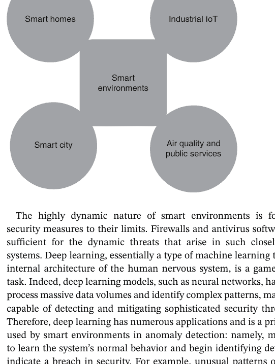

智能环境的高度动态性正将传统安全措施推向极限。防火墙和防病毒软件已不足以应对此类紧密互联系统中出现的动态威胁。深度学习本质上是一种模拟人类神经系统内部架构的机器学习类型，是这一任务的 game-changer。事实上，深度学习模型，例如神经网络，具有处理海量数据和识别复杂模式的能力，使其能够实时检测和缓解复杂的 安全威胁。因此，深度学习具有众多应用，并且是智能环境在异常检测中主要使用的应用：即模型被训练以学习系统的正常行为并开始识别可能表明安全漏洞的偏差。例如，网络流量、传感器数据或用户活动的异常模式可能表明入侵、故障或网络攻击 [3]。深度学习凭借其从多个来源筛选高维数据的能力，可以有效检测出可能攻击的隐藏模式。

入侵检测系统（IDS）是另一个关键应用，深度学习算法持续监控系统是否存在潜在入侵。传统的基于签名的入侵检测系统完全依赖于已知的攻击模式，而深度学习系统可以在涉及良性和恶意活动的庞大数据集上学习，以识别新型攻击策略。随着系统周围环境的发展，这些系统也可能随着时间的推移学会检测全新的威胁形式 [4]。深度学习还可以应用于自适应防御机制，该机制可主动实时响应安全事件。例如，在识别出威胁后，深度学习模型可以自动释放对策，隔离受损设备、阻止恶意网络流量或提醒系统管理员。这些自适应系统不断发现并适应新威胁，以保持主动和动态的防御策略。

然而，通过深度学习保护智能环境并不是仅网络安全专家就能解决的挑战。相反，它需要跨学科合作：网络安全专家、机器学习研究人员、硬件制造商和立法者之间的共同努力，确保安全在系统的多个层级中得到实施——从硬件开发到软件设计再到其监管。除了安全之外，在构建用户友好且安全的系统的同时，还需要保护隐私以及信息的完整性 [5]。

最后，随着智能环境在各地蓬勃发展，保护这些系统的重要性也成比例增长。深度学习将成为保护此类系统的首要工具，因为它允许复杂的异常、入侵和自适应防御。然而，这需要跨学科合作，将网络安全、机器学习、硬件设计和政策开发方面的专业知识汇聚在一起，以便充分发挥深度学习在保护智能环境方面的潜力 [6]。只有通过整体安全方法，我们才能确保我们正在快速构建的互联世界的 安全、隐私和完整性。

### 9.1.1 理解智能环境及其安全需求

基于一系列互联技术的智能环境使得设备、系统和应用程序能够以完全集成动态的方式运行。连接性、自动化以及数据收集和分析是这些环境的三大核心支柱，共同工作以确保最佳性能、效率和体验。让我们更仔细地看看这些特征中的每一个 [5]。

### 9.1.2 连接性：智能环境的支柱

连接性是指各种设备、传感器和系统能够相互通信，从而共享数据的能力。这通常包括无线网络和各种通信协议，允许设备实时传输和接收数据。连接层是基础

智能环境的其余操作都依赖于此基础，该基础使设备生态系统能够高效地协同工作[7]。

- **互联设备：** 智能环境建立在由互联设备构成的网络之上，这些设备可以非常简单，例如温度传感器或运动传感器；也可以更复杂，比如智能恒温器、智能锁、可穿戴设备，甚至物联网环境中的整个工业机器。设备在彼此之间以及向集中式云系统发送数据，形成一个协同运行的生态系统。
- **无线通信：** Wi-Fi、蓝牙、Zigbee 和蜂窝网络等无线技术可提供无缝的设备间通信，有效连接每个环境（无论是住宅、工厂还是城市）中的所有设备。例如，住宅中的智能恒温器依靠 Wi-Fi 与智能手机应用通信，而装配线上的工业物联网系统则可能依赖 Zigbee 等低功耗网络进行机器间通信[8]。
- **协议与标准：** 为了使设备能够正常交互，它们必须使用相同的“语言”或遵循共同的协议和标准。例如，消息队列遥测传输（MQTT）和受限应用协议（CoAP）等通信协议非常轻量，专为物联网网络这类低带宽、高延迟环境进行了优化。这些协议可确保即使在资源受限的场景中，数据也能在各种设备之间可靠交换。

这种连接性使智能环境能够作为一个集成系统运行，其中每个设备都能了解其他设备的状态，并实时响应变化。没有强大而可靠的连接，智能环境就无法提供其旨在实现的效率和交互性。

### 9.2 自动化：面向效率的自主决策

自动化描述了智能系统通过实时数据单独执行任务和做出决策的自动能力[9]。在智能环境中，自动化通过调整和优化各项功能，无需持续人工干预，即可显著提升效率。

- **自主系统：** 智能环境中自动化的支柱包括带有嵌入式系统的传感器和执行器。传感器从环境中捕获数据，执行器则负责执行动作——例如改变温度、调节照明或锁门。例如，智能家居中的运动传感器可以报告房间内是否有人，并让执行器根据占用情况调节照明[10]。智能供暖、通风和空调（HVAC）系统可以根据实时占用数据或外部天气条件自动调整温度设置。
- **实时数据处理：** 凭借来自互联设备的持续实时数据流，自动化能够发挥最佳效能。例如，安装在道路上的传感器监测智慧城市的交通密度，并自动调整交通信号灯以避免拥堵。实时数据处理有助于实现最佳性能，并能在能效和用户体验方面带来显著改善。
- **预测性与主动性动作：** 许多智能环境超越了简单的反应式自动化——即仅仅对环境条件做出反应——而是增加了预测能力。例如，智能建筑可以学习用户行为模式，预测哪些房间将被占用以及能源使用在哪些时段达到峰值，从而提前准备好供暖或制冷系统[11]。工业环境可以通过预测性维护算法对传感器数据进行分析，从而预判机械故障，该算法会在实际故障发生前自动触发维护请求。

这种自动化水平是创建无需过多人工监督即可高效运行的环境的关键，用户可自由地处理更高层次的任务，或只是享受一个如今能够响应用户需求的系统所带来的便利。

### 9.3 数据采集与分析：利用大数据进行优化

智能环境最强大的功能之一，是能够从整个生态系统中嵌入的设备、传感器和系统收集海量数据[12]。数据采集与分析包括收集、处理和分析这些数据，以便在环境中做出决策并实现最佳性能。生成的数据范围很广，从简单的传感器读数（如温度、湿度甚至运动）到更复杂的行为模式（如用户偏好、交通流量或机器性能指标）都可能涉及。

- **数据采集：** 智能环境中的各种设备持续不断地生成数据。例如，在智能家居中，这涉及温度、照明、安全摄像头和用户行为的数据。同样，在智慧城市中，这涉及交通传感器数据、气象站数据以及与垃圾管理或街道照明相关的公共服务信息。数据通过网络分发到集中式系统（如云平台或边缘设备）进行存储和处理。
- **数据分析：** 数据收集完成后，必须对其进行分析以获取有价值的见解。大数据分析技术可处理来自不同设备的大量数据。机器学习、统计分析和预测建模等技术应用于系统，以识别模式和趋势。例如，在智能工厂中，可以处理生产线上传感器收集的数据，以检测低效环节、瓶颈或机械磨损，进而优化工作流程和资源配置。
- **优化：** 从数据分析中获得的见解随后用于优化智能环境的各个方面。例如：

对于智能家居，数据分析可以发现能源消耗模式，并确保系统在非高峰时段安排高耗电电器运行，或调整恒温器以提高效率。

在智慧城市中，数据分析可以通过分析车辆移动模式和公共交通使用情况，帮助优化交通流量、减少拥堵并改善公共交通服务。

在工业物联网系统中，数据分析可以帮助企业跟踪生产效率、监控机器健康状态并改进供应链管理。

数据分析对于个性化也很重要。例如，在智能家居中，系统可以随时间学习并适应用户在照明、温度或媒体偏好方面的喜好，从而变得更加舒适和个性化。

## 9 使用深度学习增强智能环境安全性：一种综合方法

随着智能环境日益普及于我们的日常生活——从智能家居到工业物联网系统——确保其安全性显得尤为重要。尽管这些环境带来了更高的便利性、效率和自动化，但因其复杂且高度互联的特性，也带来了重大风险。智能环境中的安全问题涉及多个方面，需要强大且自适应的解决方案，不仅要保护设备，还要保护敏感数据、用户隐私和系统功能。下面详细说明智能环境的主要安全需求和挑战。

### 9.4 数据隐私与完整性

智能设备不断收集大量数据，其中通常包含敏感的个人、财务和运营信息。虽然这些数据对于智能环境的正常运行至关重要，但一旦被第三方访问或篡改，就会带来巨大风险。

- **敏感数据收集：** 智能设备，包括智能恒温器、可穿戴设备、健康监测系统和联网车辆，会收集极其

广泛的敏感信息。例如，健康智能设备可能会收集心率、活动水平或用药依从性。智能家居设备可能会记录移动模式、在场情况或个人习惯。在工业物联网系统中，传感器跟踪运营数据、机器性能和库存管理——如果这些数据被泄露，不仅会损害企业，还可能危及公共安全。

- **数据隐私：** 这些信息需要免受未经授权的访问、拦截或利用的保护，以确保数据隐私。跨网络生成和共享的个人数据的 sheer volume 只会加剧隐私担忧，因为这使其成为恶意行为者的主要目标 [13]。此外，遵守 GDPR（通用数据保护条例）和 CCPA（中央消费者保护局）等隐私法规对于企业避免法律处罚同时保护用户而言至关重要。

- **数据完整性：** 数据完整性涉及对传感器和设备收集的数据进行保护，防止其因事故或恶意活动而被篡改或损坏。被操纵的数据会导致错误决策，例如设备故障、医疗保健中的错误诊断，或智能家居中的虚假安全警报。加密、哈希算法和安全数据传输协议对于数据完整性至关重要。

简而言之，保护数据隐私和完整性对于维护智能环境中的信任、安全和法律合规至关重要。

## 9.5 身份认证与访问控制

身份认证和访问控制是确保只有授权用户和设备能够与智能环境的关键组件进行交互的支柱。随着设备和用户数量众多，管理安全访问既困难又持续进行。

- **用户身份认证：** 在智能家居、城市和工业系统中，多名用户（如居民、员工或管理员）需要访问系统。对敏感数据或关键设备的访问需要仅限于授权人员。传统的身份认证方法，如密码，通常不足以应对安全威胁，因为它们可能被窃取或通过暴力攻击猜出。更强的方法，如多因素认证（MFA）、生物特征认证（如面部识别或指纹扫描）以及行为生物特征（如打字节奏），正日益被采用以提供额外的安全层。

- **设备身份认证：** 在物联网生态系统中，设备本身必须进行身份认证，以防止未经授权或恶意设备获得系统访问权限。这可能使用安全启动机制、数字证书或加密密钥。例如，智能门锁必须确保只有授权的移动应用或门禁卡才能解锁门，同时防止恶意设备干扰访问控制。

- **访问控制：** 访问控制机制定义用户或设备可以访问哪些资源或执行哪些操作。例如，对安防摄像头的访问可以仅限于特定用户，或智能工厂车间中的机器可能仅限于授权操作员。用于执行此类限制的常用方法包括基于角色的访问控制（RBAC）或基于属性的访问控制（ABAC），它们可确保权限基于用户或设备的角色、职责和属性授予。

在智能环境中，必须部署强大的身份认证和访问控制机制，以确保只有授权实体才能与敏感系统和数据交互，从而最大限度地降低未经授权访问和攻击的风险 [7]。

## 9.6 入侵检测

入侵检测是指识别和响应可能损害智能环境安全、功能或安全性的恶意活动 [14]。传统的入侵检测方法，如基于特征码的系统，在这些复杂且庞大的环境中效果较差。相反，智能环境需要更先进、更具适应性的系统，能够检测已知和未知威胁。

- **网络入侵：** 在智能环境中，设备之间通常通过无线网络交换大量数据。这使得系统容易受到网络攻击，如中间人（MITM）攻击、拒绝服务（DoS）攻击，甚至数据包嗅探。例如，攻击者可能会拦截智能家居设备之间的通信，并操纵这些设备的行为，例如远程打开门或通过向网络发送大量流量来中断正常操作。这些威胁可通过基于机器学习和深度学习算法的先进入侵检测系统（IDSs）来解决，以实时识别异常流量模式、数据未经授权访问和潜在威胁。

- **异常检测：** 与传统基于特征码的入侵检测使用预定义攻击模式的方法不同，使用基于异常检测的智能系统可以通过学习反映系统正常行为的方式来识别新型的、以前未知的攻击。例如，某设备异常的网络流量或电表可疑的操作序列可能意味着智能城市的安全已被破坏。此类异常可由机器学习模型持续监控和学习系统活动，从而实现实时警报和响应。

- **威胁响应与缓解：** IDSs 必须与自动化响应机制集成以应对威胁。检测到入侵时，系统不仅应向管理员发送警报，还应采取行动遏制或缓解攻击。这可能涉及隔离受影响的设备、阻止可疑网络流量，或启动调查和处理违规的协议。

有效的入侵检测对于智能环境持续的安全性和功能性至关重要，尤其是在网络攻击变得日益复杂和多样化的情况下。

## 9.7 对不断演进威胁的适应性

网络安全领域的形势不断演变，黑客从未停止开发攻击智能环境的新方法，始终试图利用这些新漏洞。也就是说，这些攻击可能在瞬间发生变化，因此需要自适应学习系统实时响应新的攻击向量。

- **从威胁中学习：** 传统安全系统通常是静态的，依赖预定义规则或特征码数据库来识别威胁。但当新的攻击方法出现时，这些系统必须不断更新才能保持有效。深度学习和机器学习模型提供了解决方案，因为它们允许安全系统从历史攻击数据和新兴威胁中持续学习。例如，基于机器学习的 IDS 不仅可以训练来检测已知攻击模式，还可以通过学习不断演变的系统行为来识别新的、以前未知的威胁。

- **实时适应：** 新攻击向量的出现意味着安全系统必须迅速响应以限制损害。例如，智能家居可能遭受针对此前未知漏洞的设备的零日攻击。有了深度学习，安全系统可能会识别异常并调用自动化防御机制，在补丁可用之前阻止可疑通信甚至隔离受影响的设备。

- **自愈系统：** 未来的网络安全可能基于自愈系统，这些系统不仅检测和响应威胁，还能主动修复或重新配置受损组件。例如，软件的自主更新、受损密钥的替换和流量的重新路由可以通过自愈机制实现，即使网络安全威胁不断演变，也能在智能环境中提供弹性。

适应性对于确保智能环境在新漏洞和发现的攻击技术出现后长期保持安全至关重要。安全解决方案必须与威胁本身一样快速地演进。

## 9.8 深度学习在安全增强中的作用

已证明深度学习是解决复杂模式识别相关问题的有效解决方案。它可以检查大量数据，寻找几乎难以察觉且绝对非线性的模式。因此，它为改善智能环境中的安全提供了一个非常有用的工具。一些已成功应用于安全相关任务的深度学习模型包括深度神经网络（DNNs）、卷积神经网络（CNNs）、循环神经网络（RNNs）和自动编码器等 [15]。

### 9.8.1 利用深度学习的异常检测

异常检测是在智能环境中网络安全、系统监控和运营效率领域的一项关键任务。随着这些环境变得日益复杂和动态，识别数据中异常模式的稳健方法需求日益增长。智能环境中的异常——从智能家居和城市到工业物联网系统——可能预示着各种问题，包括安全漏洞、系统故障，甚至外部攻击者的恶意活动。鉴于互联设备产生的数据量和多样性，传统的异常检测方法往往力不从心。深度学习作为机器学习的一个分支，能够对数据中的高度复杂模式和关系进行建模，为解决这些挑战提供了强大的工具。在此，我们探讨深度学习如何为智能环境中的异常检测做出贡献及其主要优势 [9]。

#### 9.8.1.1 无监督学习：检测新型安全威胁

异常检测面临的最大挑战之一是处理从未遇到过的 **新型或未知威胁**。传统异常

检测系统通常依赖于 **监督学习**，其中标记数据（即标记为“正常”或“异常”的数据）用于训练模型。然而，在智能环境中，许多安全威胁是新颖的，无法提前预测或明确标记。例如，一种新型恶意软件可能会利用物联网设备中以前未知的漏洞，而传统系统需要预先存在的标签来检测它，而这在没有对攻击的先验知识的情况下是不可能的 [16]。

深度学习，尤其是通过 **无监督学习** 技术，非常适合解决这个问题。在无监督学习中，模型在大量 **正常行为数据**（例如，传感器读数、网络流量、设备日志）上进行训练，而无需任何异常活动的标记示例。深度学习模型学习数据的 **潜在分布** 或 **结构**，然后可以将偏离这种学习行为的数据点识别为潜在异常。

例如，一个模型可能会根据智能照明训练对家庭内正常运作方式的数据表示。但随后，一旦发现异常——例如意外事件中的高能耗，或在没有明显原因的情况下在尴尬时段开灯——这仍然可以在从未被告知或训练此行为超出范围的情况下工作。这意味着整个系统完全通过无监督学习，确实可以不断动态地适应新的或前所未有的行为，以及其他风险 [17]。

### 9.8.1.2 高维数据处理：智能环境中的复杂模式学习

智能环境是各种互联设备、传感器和系统产生的大量数据的来源。这通常是高维数据，意味着它由大量可能以复杂方式相互作用的变量组成。例如，在智能家居中，温度、湿度、运动和能源消耗传感器读数都是相互关联的，在识别正常和异常行为时需要一起考虑 [18]。在工业物联网系统中，高维数据可能包括数百台机器的传感器读数、操作日志、环境因素等。

深度学习模型在处理这种高维数据方面特别有效，因为它们能够学习复杂、分层的特征。诸如自动编码器和生成对抗网络 (GANs) 之类的模型非常适合在这种情况下进行异常检测，具体如下：

- **自动编码器** 是一种神经网络，它学习将输入数据压缩（编码）为低维表示，然后再重建（解码）数据回其原始形式。模型在正常数据上进行训练，一旦出现异常，重建误差就会增加，因为模型无法从其低维表示中重现异常数据。例如，在工业物联网场景中，自动编码器可以学习机器的正常运行模式。如果机器开始出现故障或被篡改，异常将以重建误差增加的形式出现。

- **生成对抗网络 (GANs)** 由两个网络组成：生成器负责生成合成数据，而判别器决定生成数据的真实性。GANs 可通过为正常数据分布训练生成器并训练判别器识别真实数据与合成数据之间的差异来应用于异常检测。如果生成器产生的数据与正常分布差异很大或为异常，则判别器会将该事件标记为异常 [19]。

自动编码器和 GAN 在学习高维数据的潜在结构方面特别有效，而无需显式特征工程，这使得它们更适合在智能环境中使用，在这些环境中数据通常对于传统方法来说过于复杂。

## 9.8.2 实时分析：持续监控和威胁检测

由于智能环境的动态特性，需要实时异常检测。系统始终在交互、变化和演进。与静态环境不同，智能环境始终处于变化之中，因为新的设备和系统不断被添加，新的行为不断出现。异常需要在实时中检测到，以防止损坏、解决安全漏洞并保持运营效率。例如，智能电网可能需要即时检测异常的电力消耗模式，以防止潜在的网络攻击或在故障设备影响整个系统之前将其隔离。

深度学习模型，特别是 RNN 和长短期记忆 (LSTM) 网络，在时间序列数据方面表现异常出色，而时间序列数据是智能环境中的常见特征。时间序列数据涉及以一致间隔收集的数据，例如随时间变化的传感器读数、网络流量模式或用户与设备的交互。RNN 和 LSTM 旨在进行序列数据处理，因此具有随时间学习模式的能力。

- **循环神经网络 (RNNs)** 旨在考虑数据点之间的序列依赖关系。例如，RNN 可能会检查智能城市中的交通模式，其中车辆在某一时间步的行为在很大程度上取决于之前的时间步。如果车辆开始以不寻常的模式移动（例如，采取与平常不同的路线），RNN 可以将其标记为异常。

- **长短期记忆 (LSTM) 网络** 是一种 RNN，特别适合发现时间序列中的长期依赖关系。例如，就智能环境而言，LSTM 可以学习复杂的时序模式，如智能家居中的用户行为、工业环境中的设备交互或智能城市中的环境变化。由于 LSTM 可以在很长一段时间内“记住”之前的状态，因此它们对于检测逐渐出现或具有长期影响的异常非常有价值，例如逐渐的网络攻击或随时间展开的系统故障。

例如，在智能家居中，使用 LSTM 模型，家庭成员可以持续监控其开关灯、解锁或锁定门或调节恒温器的活动。一旦行为远离之前的正常行为趋势——系统可能会实时发出警报，因为系统检测到有人在不便的时段解锁了门，或有人在空房子里关掉了灯。

智能环境中的实时异常检测不仅对识别安全威胁很重要，而且对系统的持续运行也很重要。能够进行实时分析的基于深度学习的系统可确保异常在发生时立即被检测和处理，防止更严重的问题发展。

## 9.8.3 使用深度学习的入侵检测系统 (IDSs)

IDS 代表入侵检测系统，它监控网络流量和系统行为以检测未经授权访问或恶意活动的迹象 [20]。深度学习通过更好的准确性和适应性增强了传统 IDS，具体如下所述：

- **检测准确率提升：** 传统 IDS 通常基于签名方法工作，其局限于已知攻击模式。深度学习模型可以在学习大量正常和恶意活动数据集的同时识别新型攻击模式。
- **对新威胁的适应性：** 此外，随着智能环境不断适应，新的攻击类型不断出现。深度学习系统可以实时学习和适应；因此，它们识别零日威胁的能力也可以得到改善。
- **网络流量分析：** 深度学习模型可以在多个抽象层分析网络流量，以检测高级攻击策略，例如分布式 DoS 攻击，以及低级入侵，如端口扫描或恶意软件。


## 9.8.4 自适应防御机制

智能环境的安全态势是动态且不断演变的。攻击者不断完善其技术，发现新的漏洞，并以日益复杂的方式加以利用。这对传统安全系统构成了重大挑战，传统系统依赖预定义规则、静态特征或人工干预来检测和缓解威胁。深度学习提供了一个巨大的解决方案，可以帮助应对这些挑战，并实现自适应防御机制，能够实时自动学习预测新的和新兴的威胁。下面，我们将探讨深度学习如何通过包含自学习系统、威胁预测和预防以及自动化响应来促进自适应安全措施的关键方面。

### 9.8.4.1 自学习系统：随新数据演进

深度学习在安全领域的一个重要优势是其能够持续从新数据中学习。而传统安全系统可能需要手动更新或更改规则以检测新型攻击，深度学习模型在接触新数据时会自动学习。正是这种自学习机制使深度学习系统在智能环境中如此有效，在那里新设备、用户和行为不断出现。

- **Continuous Learning from Data:** 在智能环境中，系统会从设备、传感器和用户交互中产生海量数据。通过在这些数据上训练深度学习模型，安全系统可以学习设备和用户的正常行为和模式。例如，在智能家居中，系统可能会学习家庭通常的温度设置、照明偏好或设备使用的典型模式。模型可以根据新数据的摄入更新其对正常行为的认知，例如通过在网络中添加新设备或用户行为发生变化而摄入新数据。
- **Threshold Adjustment:** 随着模型不断学习，它可以调整其检测异常的阈值。例如，当新设备添加到网络时，系统最初可能将其识别为异常。后来，当其使用模式成为模型所知的正常行为的一部分时，系统可以降低该设备的阈值。这是因为其检测阈值是动态的；因此，深度学习模型可以最大限度地减少将正常行为标记为异常的误报，同时仍能检测其他潜在威胁。
- **Improving Over Time:** 当出现新的攻击和新兴威胁时，自学习的深度学习系统可以通过调整其参数作为最新攻击数据的函数来提高性能。例如，识别出一种新型网络攻击将允许更新模型，以便将来可以识别类似攻击。这种持续学习和模型改进使系统对不断演变的威胁更具弹性。

这种自学习机制通过使深度学习系统能够从新数据中学习并适应不断变化的环境来实现自适应安全，从而随着时间的推移而改进，并因此减轻与威胁快速变化相关的风险。

### 9.8.4.2 威胁预测和预防：在发生前预见攻击

深度学习在智能环境中的另一个重要好处是它可以在威胁发生之前预测可能的威胁。它不是一种反应性措施，而是一种主动模型，分析历史攻击数据、用户行为和系统活动中的模式以预测可能的安全漏洞。这使其成为一种早期预警系统，可在攻击变得严重之前阻止攻击。

- **Analyzing Historical Attack Data:** 深度学习模型可以在包含过去攻击或安全事件示例的大型数据集上进行训练。这些模型可以学习识别攻击前出现的微妙模式或特征。例如，如果攻击者通常执行一系列侦察活动，例如扫描端口或探测设备漏洞，深度学习模型可能能够将其检测为前兆并将其标记为潜在威胁。系统还可以通过分析攻击序列，例如钓鱼后部署恶意软件，来识别常见的攻击路径。
- **Predicting User and Device Behavior:** 除了检测恶意软件活动之外，深度学习模型还可以学习其用户的行为模式和习惯。例如，智能家居安全系统可能会跟踪用户的行为，例如用户可能回家的时间、开灯或关灯的时间，或开关门的时间。如果出现异常，例如在不寻常的时段解锁门或在不应该打开时打开设备，系统会将其识别为异常并相应地做出响应。深度学习模型学习行为的通常节奏，并在它们成为重大威胁之前识别潜在的入侵或违规行为。
- **Recurrent Neural Networks (RNNs) for Predicting Sequences:** RNN，尤其是 LSTM 网络，在分析序列数据，例如物联网设备或网络流量的时间序列数据方面非常有效。RNN 可以学习时间依赖关系并预测序列中下一个可能发生的事件。在安全领域，RNN 可以查看网络流量的过去模式并预测流量异常峰值出现的时间——这可能伴随着 DoS 或 DDoS 尝试。
- **Behavioral Anomaly Detection:** 深度学习模型可用于设计用户配置文件，预测用户的正常行为。预期登录时间的偏差、设备上的异常访问时间或奇怪的位置可能会提示系统发出警报，提示对合法用户账户的潜在冒充，就好像系统试图假装成其他人一样。因此，它甚至可以在攻击者完全控制系统之前检测到凭证填充攻击、账户接管或未经授权的访问尝试。

深度学习在智能环境中的优势在于它可以在攻击开始之前预测或防止攻击。深度学习系统利用攻击前出现的模式，从而在安全方面变得主动，并以这种方式在早期阶段阻止威胁。

### 9.8.4.3 自动化响应：即时缓解威胁

检测到威胁后，必须立即做出响应以遏制或缓解攻击。这是深度学习的一个优势，即能够部署自动化响应系统，这些系统可以在没有人工干预的情况下对安全事件做出反应，这在快速变化的环境中实时响应攻击方面非常有效。

- **Automated Threat Containment:** 在异常检测后，深度学习系统将自动触发响应以遏制威胁。例如，如果系统检测到表明网络攻击的可疑网络流量，它可能会自动阻止某些 IP 地址、隔离受损设备或禁用对敏感数据的访问。在物联网系统的情况下，系统会将受损设备与网络其余部分隔离，以防止攻击传播。
- **Real-Time Mitigation:** 例如，在智能家居中，系统可以检测到异常（例如进入房屋的奇怪尝试或智能锁故障）并触发响应，例如提醒业主、打开安全摄像头，甚至锁定所有门。在工业领域，违规行为可以提示向安全人员发出自动警报、关闭关键机械或激活备份系统以确保运营损害最小化。
- **Notification to Administrators:** 自动化响应并不一定完全否定人工干预。系统管理员或安全团队实际上可以由系统实时通知，解释威胁的性质和采取的响应类型。因此，尽管系统执行即时操作以帮助减轻风险，但人类因素仍然存在以做出某些决定或相应地升级事件。
- **Dynamic Defense Strategies:** 深度学习系统可以通过观察威胁如何演变来随着时间的推移调整其防御策略的一种方式。假设有一个攻击向量针对特定设备的漏洞。系统注意到攻击向量后，可以更改其安全协议并不断改进，以防止未来尝试中的这种威胁。

自动化响应使深度学习系统能够及时快速地遏制和缓解攻击，从而最大限度地减少由此造成的任何损害，同时确保智能环境的持续安全和完整性。


## 9.8.4.4 跨学科协作以增强安全性

构建安全的智能环境是一项多方面的挑战，不仅涉及技术创新，还涉及伦理、法律和监管考量。鉴于这些环境（从智能家居、智慧城市到工业物联网系统）的复杂性及其广泛影响，保障其安全需要跨学科的专业知识与协作。单靠网络安全专家是无法完成这项任务的；相反，它需要网络安全与机器学习专家、设备制造商与物联网开发者、伦理与隐私专家，以及政策制定者和监管机构的协同努力[20]。下面，我们将讨论这些不同群体如何携手构建安全的智能环境。

## 9.8.5 网络安全与机器学习专家：为智能环境设计安全解决方案

智能环境安全的支柱，在于其实时检测、预防和响应威胁的能力。网络安全专家和机器学习专业人员是设计和实施保护这些环境所需复杂安全机制的关键力量。

- **用于威胁检测的机器学习：** 如前所述，这正是深度学习的应用场景，用于异常检测、入侵检测和预测性威胁建模。数据科学家和机器学习工程师必须开发和微调深度学习模型，以识别智能环境产生的大规模数据中的异常模式[21]。这些模型可以处理来自传感器、网络流量、设备交互和用户行为的数据，从而检测和预测威胁。与网络安全专业人士合作非常重要，因为他们能带来领域特定的专业知识，确保这些模型被调整为识别安全威胁，而不仅仅是一般性异常。

- **协同安全架构：** 智能环境安全架构的设计既基于物联网设备带来的特殊挑战，也基于网络攻击者不断演变的攻击战术。网络安全专家可以识别攻击向量、漏洞管理方法和防御机制与策略，而机器学习专业人员则利用这些洞察来开发对新兴威胁具有高度适应性的模型。这可能包括开发自适应防御机制、持续从新数据流中学习，以及建立能够在攻击一经检测到就加以遏制的自动化响应系统。

- **持续监控与响应：** 机器学习专家和网络安全专家还必须协作，开发用于持续监控和实时威胁响应的系统。例如，机器学习模型可以识别出可能预示潜在攻击的异常模式，但定义适当响应协议并确保系统能够自主或以最少干预执行这些响应的，是网络安全专家的职责。

因此，通过相互协作，网络安全和机器学习专业人士能够确保安全系统在技术上强健，并能适应不断变化的智能环境格局。

## 9.8.6 设备制造商与物联网开发者：将安全性构建到硬件和软件中

智能环境高度依赖各种各样的联网设备，如果相应的安全措施不到位，攻击者可能利用其中任何一台设备。因此，设备制造商和物联网开发者与安全专家的协作，是从一开始就将安全性构建到硬件和软件层中的关键。

- **设计即安全的设备：** 智能设备制造商必须在设计和开发阶段将安全性置于优先位置。这包括实施安全启动机制等功能，确保设备在启动时只运行经过验证的软件，以及基于硬件的加密，以保护存储在设备上的敏感数据。可以在设备硬件中集成防篡改检测机制，以检测物理篡改或破坏设备的企图。例如，如果有人试图物理访问设备并修改其组件，防篡改检测可以向管理员发送警报，或自动关闭设备以防止进一步利用[22]。

- **固件和软件更新：** 智能设备的固件和软件需要定期更新，以修补安全漏洞。设备制造商与网络安全专家之间的协作，确保有明确的安全无线更新策略，使设备能够以最小风险远程更新。这保证了即使发现新漏洞，设备也能通过及时的补丁得到保护。

- **安全功能的标准化：** 设备制造商与安全专家之间的协作，对于制定全行业安全标准也很重要。物联网设备由不同制造商生产，运行在不同的操作系统上，这种碎片化使得跨设备维持一致的安全态势颇具挑战。制造商应采用行业标准和协议，包括设备的TLS加密、OAuth认证和FIDO认证。这将确保所有这些设备（无论是原生设备还是进口设备）都落实安全措施。

通过协作，物联网开发者和设备制造商确保安全性不是事后才考虑的问题，而是开发过程的一部分，从而减少那些将成为智能环境支柱的设备的漏洞。

## 9.8.7 伦理与隐私专家：确保用户隐私与信任

这些智能环境根据用户行为及其环境状态收集大量数据。虽然保障智能环境的安全至关重要，但确保它们蕴含隐私保护和其他伦理方面同样重要。在保护用户权利方面，这些实体背后最重要的角色是伦理和隐私专家，他们负责核验安全技术的进步不会损害用户的信任。

- **数据最小化与设计即隐私：** 收集的数据应尽可能少，且仅在必要时使用。除非绝对必要，否则不应收集个人数据，并且所收集的数据应经过匿名化或加密处理，以尽量减少信息暴露。在设计安全措施时，隐私专家与机器学习及网络安全专业人士协作，确保这些措施不会间接侵犯用户隐私。本质上，这可以表述为一种保证：用于异常检测的深度学习模型不会利用或泄露个人身份信息（PII）。

- **用户同意与控制：** 智能环境中的另一个伦理问题是确保用户掌控自己的数据。在这里，隐私专家将与物联网开发者协作，确保用户可以选择同意或退出其数据收集过程，并能获得关于收集了哪些数据以及这些数据将如何被使用的完整、准确的信息。这包括清晰明了的隐私政策和同意管理工具，这些工具应使用户能够设置关于数据共享和使用的偏好。

- **合乎伦理的AI使用：** 隐私和伦理专家要确保作为威胁检测和自适应防御机制核心的深度学习模型不存在歧视性倾向。他们确保这些模型不会基于种族、性别或任何其他社会经济地位作出决策。也就是说，他们确保模型符合公平原则。为确保指导这些模型的算法透明、可解释且符合伦理规范，这些专家应防止滥用和潜在危害[23]。

通过携手合作，隐私和伦理专家将确保智能环境技术的部署尊重个人权利，并增进用户之间的信任。


## 9.8.8 政策制定者和监管机构：制定标准和法规

随着智能环境的广泛普及，政策制定者和监管机构迫切需要提供透明且具有法律约束力的标准和法规，以保护用户的f安全和隐私。它应确保法规既能抵御当前威胁，又能应对未来威胁。

- **国家和国际标准：** 这要求政府和监管机构与行业利益相关者在制定智能设备和系统互操作性及统一保护的安全标准方面进行合作。此类标准可能包括最低要求，例如强制加密和安全启动，基于数据最小化原则的数据隐私，以及用户同意。例如，欧洲智能环境中个人数据保护和隐私的系统性框架被称为通用数据保护条例（GDPR）。
- **网络安全法规：** 除了数据隐私之外，还需要对可能影响智能环境的网络安全威胁进行法规管控。这包括网络内的数据通信、设备漏洞的报告和修补，以及组织应对安全事件的方式。政府还应确保从事网络安全行业的专业人员以及具备机器学习专业知识的人员得到充分培训和配备，以处理智能环境带来的安全问题。
- **政策制定的协作：** 实施的政策应在与行业领袖、学术界和技术开发者密切协商下制定，以避免法规变得过时、不相关并保持时效性。技术谱系和威胁态势的变化与进步发生得非常迅速；因此动态监管制度至关重要。政策制定者既不应损害用户安全和用户隐私，也不应扼杀创新。

## 9.9 挑战与未来方向

虽然深度学习在保护智能环境方面具有显著前景，但仍有若干挑战需要解决：

- **训练模型的数据缺乏：** 深度学习模型需要大量标记数据进行训练。智能环境很难收集到关于不同类型攻击场景的足够标记数据。
- **模型可解释性：** 许多深度学习模型，尤其是深度神经网络，通常被视为“黑箱”，因为其决策过程不易解释。在信任和问责要求了解决策过程的安全关键应用中，可解释性缺乏可能成为一个问题。
- **与计算资源相关：** “深度学习模型非常依赖硬件，因此使用强度很高。资源受限的环境，例如物联网网络中的边缘设备，可能认为这相当具有挑战性。”
- **对深度学习模型的对抗攻击：** 虽然深度学习模型对许多类型的攻击具有鲁棒性，但它们并不能免疫对抗攻击——即对输入数据进行细微、精心设计的扰动可能导致模型做出错误预测。对深度学习模型本身进行保护是一个新兴的研究领域。

尽管存在这些挑战，深度学习在增强智能环境安全方面的未来前景依然光明。迁移学习、联邦学习和可解释人工智能的进步可能会缓解当前的部分限制，使基于深度学习的安全解决方案更具可扩展性、可解释性和适应性。

## 9.10 结论

深度学习通过实现实时威胁检测、入侵预防和自适应防御，在增强智能环境安全方面发挥着关键作用。然而，必须解决数据质量、模型可解释性和对抗鲁棒性等挑战以确保可靠性。克服这些挑战需要机器学习专家、网络安全专业人员、伦理学家和政策制定者之间的合作。通过促进跨学科努力，我们可以开发出具有韧性、透明且值得信赖的安全系统，保护智能环境，确保隐私、安全和长期可持续性，同时技术不断发展。

## References

1 Mayer, S., Verborgh, R., Kovatsch, M., and Mattern, F. (2016). 智能环境的智能配置. *IEEE Transactions on Automation Science and Engineering* 13 (3): 1247–1255. https://doi.org/10.1109/TASE.2016.2533321.
2. Liu, L. and Zhang, Y. (2021). 基于深度学习的智慧城市智能环境设计规划. *Sustainable Energy Technologies and Assessments* 47: 101425. ISSN 2213-1388.
3. Ruggeri, G., Loscri, V., Amadeo, M., and Calafate, C.T. (2020). 物联网在智能环境中的应用. *Future Internet* 12 (3): 51. https://doi.org/10.3390/fi1203005.
4. Abdulganiyu, O.H., Ait Tchakoucht, T., and Saheed, Y.K. (2023). 网络入侵检测系统（IDS）的系统性文献综述. *International Journal of Information Security* 22: 1125-1162.
5. Abrar, I., Ayub, Z., Masoodi, F.S., Bamhi, A.M. (2020). 基于 NSL-KDD 数据集的入侵检测系统的机器学习方法. *2020 International Conference on Smart Electronics and Communication (ICOSEC)*, 10-12 September 2020, Trichy, India: IEEE.
6. Santry, D.J. (2024). *揭秘深度学习：神经网络的数学导论*. Hoboken, NJ: Wiley.
7. Ahanger, A.S., Khan, S.M., Masoodi, F. et al. (2025). 使用图注意力网络的物联网高级入侵检测. *Scientific Reports* 15: 983.
8. Li, Y., Zuo, Y., Song, H., and Lv, Z. (2021). 物联网安全中的深度学习. *IEEE Internet of Things Journal* 9 (22): 22133-22146.
9. Moallem, M., Hassanpour, H. and Pouyan, A.A. (2021). 使用深度学习的智能家居异常检测. *IEEE Transactions on Industrial Informatics* 17 (6): 4371-4380.
10. Karie, N.M., Sahri, N.M., Yang, W. et al. (2021). 物联网智能环境安全标准和框架综述. *IEEE Access* 9: 121975-121995. https://doi.org/10.1109/ACCESS.2021.3109886.
11. Masoodi, F.S., Abrar, I., and Bamhi, A.M. (2022). 使用同质集成技术的高效入侵检测系统. *International Journal of Information Security and Privacy (IJISP)* 16 (1): 18.
12. Kabalci, Y., Kabalci, E., Padmanaban, S. et al. (2019). 智能电网和智能环境中作为能源互联网的物联网应用. *Electronics* 8: 972. https://doi.org/10.3390/electronics8090972.
13. Liu, J., Xiao, Y., Philip, C.L., and Chen. (2012). 物联网的身份认证和访问控制. *International Journal of Security and Networks* 7 (4): 228-241.
14. Wang, R., Nie, K., Wang, T., Yang, Y., and Long, B. (2020). 异常检测的深度学习. In *第13届国际网络搜索与数据挖掘会议论文集*, Houston, Texas, USA, 3-7 February 2020, pp. 894-896.
15. Ahanger, A.S., Khan, S.M., and Masoodi F.S. (2021). 使用监督机器学习技术的高效入侵检测系统. *2021 5th International Conference on Computing Methodologies and Communication (ICCMC), 08-10 April 2021, Erode, India: IEEE.*
16. Jan, S., Masoodi, F.S., and Bamhdi, A. (2022). 物联网环境中的有效入侵检测：深度学习方法. *SCRS Conference Proceedings on Intelligent Systems*, 05 September 2022, Banglore, India.
17. El-Maged, L.M.A., Darwish, A., and Hassanien, A.E. (2020). 基于人工智能的植物病害分类. In: *Proceedings of the International Conference on Artificial Intelligence and Computer Vision (AICV2020)* (ed. A.-E. Hassanien, A.T. Azar, T. Gaber, and D.O.F.M. Tolba), 3–15. Switzerland AG: Springer Nature.
18. Arshad, S., Ashraf, W., Ashraf, S., Hassan, I., and Masoodi, F.S. (2023). CICIDS-2017 数据集入侵检测机器学习技术比较研究. *2023 10th International Conference on Computing for Sustainable Global Development (INDIACom)*, 15-17 March 2023, New Delhi, India: IEEE.
19. Bamhdi, A.M., Abrar, I., and Masoodi, F. (2021). 基于多数投票的有效入侵检测的集成方法. *Telkomnika (Telecommunication Computing Electronics and Control)* 19 (2): 664–671.
20. Vinayakumar, R., Alazab, M., (Senior Member, IEEE) et al. 智能入侵检测系统的深度学习方法. *IEEE Access* 7: https://doi.org/10.1109/ACCESS.2019.2895334.
21. Amin, U., Ahanger, A.S., Masoodi, F. and Bamhdi, A.M. (2021). 基于 UNSW-NB15 数据集的云环境集成有效入侵检测系统, *SCRS Conference Proceedings on Intelligent Systems*, Bangalore, India, 05 September 2021, pp. 483–494.
22. Masoodi, F. (2021). NSL-KDD 数据集入侵检测分类分析的机器学习. *Turkish Journal of Computer and Mathematics Education (TURCOMAT)* 12 (10): 2286–2293.
23. Liao, H.J., Lin, C.-H.R., and Ying-Chih, T.K.-Y. (2013). 入侵检测系统：全面综述. *Journal of Network and Computer Applications* 36: 16–24. https://doi.org/10.1016/j.jnca.2012.09.004.


## 10
## 基于深度学习的无线网络入侵检测

Rahila Rahim 和 Mohammad Ahsan Chishti

印度查谟和克什米尔斯利那加国家理工学院计算机科学与技术系

### 10.1 引言

无线网络已成为现代通信系统不可或缺的一部分，能够在不同位置之间提供无缝连接。与有线网络通过物理线缆传输数据不同，无线网络通过无线电波传输数据。这种区别带来了巨大的自由，同时也带来了独特的安全挑战，需要创造性的解决方案，尤其是在网络威胁日益演变的今天。

在安全应用方面，具有卓越自学习能力的深度学习（DL）技术有助于开发用于发现恶意节点或网络异常的入侵检测模型[9]。与传统机器学习技术相比，这些深度学习模型具有更低的误报率和更高的准确率。同样，循环神经网络（RNN）和长短期记忆（LSTM）网络属于监督序列学习方法的范畴，是利用自学习技术检测恶意活动最常用的方法。它们分析时间数据以检测异常，例如移动自组网（MANET）中的路由攻击（如黑洞、灰洞或虫洞攻击）。人工神经网络（ANN）、深度神经网络（DNN）、卷积神经网络（CNN）和自编码器可以采用带前馈神经网络的有监督实例学习。ANN 在监控网络流量和检测即将发生的攻击方面效果显著。具有三个以上隐藏层的全连接网络模型被视为 DNN。DNN 已被用于检测传感器数据中的注入或干扰攻击，扩展了支持向量机（SVM）等机器学习模型。CNN 或自编码器应用于传感器数据，通过调整模型权重并利用反向传播在无线传感器网络（WSN）中重复任务以提高准确率，从而检测入侵模式，如未经授权的访问或节点捕获攻击。深度学习还支持迁移学习方法，这些方法用于生成通用问题陈述并可与其他模型复用。强化学习模型通过动态变化和网络中不断演变的威胁进行学习，从而提高路由协议的适应性。深度 Q 学习等强化学习使网络能够针对 MANET 和 WSN 中的新威胁和拓扑变化动态更新其安全策略。它还能优化 MANET 和 WSN 中的密钥分发，降低开销并增强抗窃听能力。自编码器（AE）、深度信念网络（DBN）、受限玻尔兹曼机（RBM）和生成对抗网络（GAN）是生成式深度学习技术，遵循用于条件/判别模型的半监督实例学习，两者的结合被视为一种集成技术，用于分析流量数据以检测基于签名和基于异常的威胁。生成对抗网络（GAN）被用来模拟攻击模式，并通过识别受损路径和节点依赖性来增强检测方法，而图神经网络（GNN）等算法则促进 MANET 中的安全数据交换。

### 10.1.1 移动自组网

移动自组网（MANET）是一组自主组织的移动节点，它们在没有路由器或接入点等固定基础设施的情况下以无线方式相互交换信息。MANET 是去中心化的，即网络中的每个节点既是节点又是路由器，将信息转发给其他节点。MANET 极具动态性，节点可以随时移动、加入或离开网络[4]。这使得 MANET 适用于传统网络配置不可行的区域。军事人员、研究人员、企业、学生和应急服务等社区用户是这些网络的主要用户。MANET 的关键特征是其自组织性。MANET 设备在各自传输范围内直接通信。对于远距离通信，数据包通过中间节点路由，形成多跳网络。每个节点都有一个 IP 地址，所有节点都使用互联网协议。

### 10.1.1.1 组成

MANET 的核心组成部分包括节点、链路和协议，下面将对这些部分进行讨论，如图 10.1 所示。

图 10.1 MANET 架构。
来源：参考文献[20] / IACSIT Press。

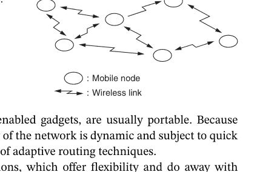

- 1）**节点：** 节点（移动设备）扮演主机和路由器的双重角色。每个节点既可以作为数据源，也可以作为中间人将数据包转发给其他节点。这些设备包括笔记本电脑、手机、平板电脑和其他支持无线功能的设备，通常是便携式的。由于节点是可移动的，网络拓扑是动态的且可能快速变化，因此需要使用自适应路由技术。

- 2）**链路：** MANET 中的节点通过无线通信进行交互，无线通信提供了灵活性，无需路由器或接入点等基础设施。由于节点移动性、干扰和环境条件，这些互连本质上不稳定，经常断开并重新连接。常用的无线通信技术包括蓝牙、Wi-Fi 和其他短距离协议。

- 3）**协议：** 路由协议对 MANET 的高效运行至关重要，因为它们为节点之间的数据传输确定最佳路径。这些协议响应网络拓扑的变化。它们通常分为以下三类：
  - a）**先应式路由协议：** 始终保持路由表更新（例如，目的序列距离矢量协议）。
  - b）**反应式路由协议：** 仅在需要传输数据时创建路由（例如，按需距离矢量协议）。
  - c）**混合路由协议：** 结合先应式和反应式技术的优点（例如，区域路由协议）。
  - d）**介质访问控制（MAC）协议：** MANET 中的 MAC 层控制节点如何使用共享无线信道以减少冲突并最大化数据传输。常见方法包括载波侦听多路访问（CSMA）和时分多址（TDMA）的变体。高效的 MAC 协议对于在提高性能的同时降低能耗至关重要。

MANET 的工作机制基于自适应通信和动态拓扑管理操作。首先，进行网络建立，节点在决定传输数据前先检查目的节点是否在其直接传输范围内。否则，将形成多跳通信路径，源节点依靠中间节点使用无线信号传输消息。其次，路由协议通过考虑网络拥塞、能耗和距离等变量来确保选择最佳路由。当利用路由表或按需路径发现方法决定数据包应如何从一个节点转发到另一个节点时，便进行数据传输。由于 MANET 是去中心化的，节点必须协同工作以保证数据传递，因此需要执行移动性和动态调整。节点位置的定期变化会导致网络拓扑变化，当网络拓扑变化时，路由协议会动态重新计算路由。为确保有效运行，网络需要处理功耗、带宽优化和冲突避免等问题。

### 10.1.2 无线传感器网络（WSN）

无线传感器网络（WSN）是一种去中心化的通信系统，使用户无需依赖固定基础设施或中央集线器即可建立和运行自己的网络。它是无线通信技术中最引人注目的进展之一[15]。WSN 由自主、空间分散的传感器节点组成，旨在监测环境或物理参数，如运动、振动、温度、湿度以及污染。该系统利用在不同无线电频率上运行的动态节点网络来实现传感、观测和评估操作，并支持节点间通信。传感器协同工作，收集数据并通过无线方式发送到中央基站进行处理和分析。WSN 在各个领域都有应用，如智能城市应用（例如，智慧城市中的交通管理）、工业自动化（例如，通过监测机器进行预测性维护）、环境监测（例如，森林中的动物追踪）、军事监视、农业等。与传统有线网络相比，WSN 更便宜且更易于部署，因为它们不需要先进的基础设施。WSN 也存在诸如能源供应不足、处理能力受限和安全漏洞等方面的局限性。尽管存在这些限制，低功耗传感器、无线通信和微电子领域的持续创新已显著提高了 WSN 的性能和功能，使其成为物联网（IoT）革命的核心组成部分[10]。WSN 的主要部件对其良好稳定的工作至关重要。每个传感器节点都有四个主要部分：感知部分、处理部分、通信部分和电源部分[11]，如图 10.2 所示。感知部分包含模数转换器（ADC）和传感器，负责测量外部世界的物理量并将其转换为数字形式。处理部分由微控制器或微处理器运行，负责管理节点并处理本地数据。通信部分用于在节点和基站之间使用可靠稳定的方法进行无线数据传输。

- 1) 感知单元：感知单元配备有 ADC 和传感器，是最重要的部分。传感器设备是用于感知和测量相关物理或环境参数的主要组件。


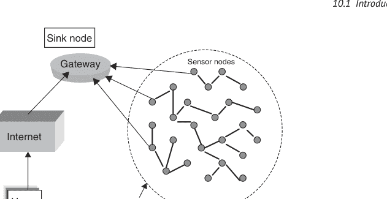

## 图 10.2 WSN 架构。来源：Ref. [25] / 经 Springer Nature 许可。

应用，例如温度传感器（热敏电阻）、湿度传感器（电容式传感器）、光强传感器（光敏电阻传感器）、压力传感器（换能器）、运动传感器（加速度计）和声音传感器（听觉传感器）。ADC 负责将传感器的模拟信号转换为电脉冲或数字格式以供进一步处理和传输。

2) 处理单元：处理单元是传感器节点的必备组件。处理器收集、管理任务并控制其他组件。处理单元的服务预先编程并加载到传感器节点的处理器中。处理器的能量利用率根据节点功能而变化。

3) 通信单元：通用收发器用作通信设备，主要用于节点与基站之间以及反向的信息传输和接收。通信单元有四种状态：发送、接收、空闲和睡眠。

4) 供电单元：供电单元为节点提供电力。由于传感器节点通常由电池驱动，能量节约是主要的设计考虑因素。

汇聚节点，也称为基站，是 WSN 的关键部分。它们从传感器节点收集数据并将其发送给用户或其他系统以供进一步研究。汇聚节点比普通传感器节点具有更强的电力和计算能力，使其能够很好地处理数据并连接到外部网络，如互联网。根据网络的使用和规模，Wi-Fi、蓝牙或 Zigbee 等无线技术用于在 WSN 中的节点之间传输数据。为了实现顺畅有效的运行，WSN 中的中间件系统有助于处理数据复杂性聚合、处理和路由。进一步的中间件系统通过抽象单个软件和硬件的复杂性来支持可扩展性和互操作性。

传感器节点在目标区域的部署代表了构成 WSN 运行的多个协调步骤中的第一步。传感器节点可以根据应用随机或有意分散。放置节点后，它们开始监测环境因素，例如运动、振动和温度变化。每个节点上的传感器将物理现象转换为电信号，然后由 ADC 转换为数字。针对这些原始数据，节点会进行初步处理以减少通信开销和冗余信息。处理后的数据可以通过单跳或多跳发送到汇聚节点。在单跳通信的情况下，数据直接从传感器节点移动到汇聚节点。但在多跳通信的情况下，节点数量庞大，适用于大规模网络，并且可能远离汇聚节点，这意味着中间节点会转发数据。WSN 路由协议，如地理自适应保真度（GAF）和低能耗自适应聚类分层（LEACH），被开发出来以提供节能和低延迟，同时确保交付。这是因为在许多应用中，传感器节点通常使用较少的电池，并且在一段时间内难以更换或充电。首要任务是节能。来自多个传感器节点的聚合数据在汇聚节点处被处理并传输到外部其他系统以供进一步审查。先进的 WSN 可以使用基于云的平台和机器学习（ML）算法实时分析和决策。WSN 运行在可能存在干扰、物理障碍和极端天气等挑战的领域。需要高网络架构和灵活的通信方案来应对这些挑战。此外，WSN 易受 DoS、数据操纵和窃听等攻击的影响，使安全成为一个重要问题。

## 10.2 无线网络安全的重要性

无线网络是现代通信系统的必备部分，并为医疗保健、工业、国防、智能城市和物联网等应用奠定了基础。这些网络减少了对物理基础设施的需求，使其更灵活、可扩展且成本效益更高。然而，使无线网络具有吸引力的相同特性，例如对开放通信渠道、去中心化架构和移动性的依赖，也使其容易受到各种安全风险的影响。无线网络的安全性至关重要，原因如下：

- 1) **敏感数据的保护：** 个人、财务或政府信息经常通过无线网络传输。如果缺乏足够的保护，这些数据可能会被截获、窃取或更改，从而违反隐私和保密性。
- 2) **不安全的介质：** 无线通信的分布式特性使其容易受到窃听、干扰和信号阻塞的影响。与可以通过物理方式控制的有线网络不同，无线网络基于无线电波，因此是攻击者的首选。
- 3) **无集中控制：** 无线网络缺乏集中控制，因此需要使用无线通信技术（如蓝牙、Wi-Fi 等）进行路由、安全和功率优化的强大算法。功率管理至关重要，因为设备通常由电池驱动，智能路由可确保低能耗。
- 4) **去中心化特性：** 如 MANETs 和 WSNs 等网络中存在去中心化架构，其中不需要永久架构。由于这种去中心化，节点需要协作传递数据。这会导致恶意节点破坏传输或损害网络运行。
- 5) **动态拓扑：** MANETs 中的节点会定期加入、退出并改变网络中的位置。由于这种动态架构，很难建立静态安全措施，因此需要具有弹性和适应性的安全措施。
- 6) **现代技术和物联网集成：** 由于大多数物联网设备缺乏强大的安全功能，无线网络设备的数量不断增长，从而扩大了攻击面。智能城市、智能家居和工业安全都基于保护这些复杂网络。
- 7) **可访问性和可靠性：** 安全对于确保网络服务始终可访问和可靠至关重要。例如，拒绝服务（DoS）攻击、窃听和数据包篡改攻击可能会使网络无法使用，导致严重中断和损害

## 10.3 MANETs 和 WSNs 中入侵检测系统（IDS）的挑战

入侵检测系统（IDSs）是检测和防止无线网络中恶意行为的重要工具。然而，由于其独特的特性，在 MANETs 和 WSNs 中实施 IDS 非常困难。关键挑战及其可能的解决方案已在表 10.1 中总结。

### 10.3.1 动态拓扑和资源限制

- **动态特性：** 由于 MANETs 和 WSNs 中节点的极高移动性，网络拓扑不断变化，很难

## 表 10.1 无线网络入侵检测的挑战及其可能的解决方案。

| 挑战 | 深度学习解决方案 | 描述 | 示例 |
|----------|------------------------|-------------|---------|
| 资源限制 | 轻量级 DL 模型 | 使用资源高效的模型，如自动编码器和联邦学习。 | 使用需要少量处理能力的自动编码器进行 WSNs 异常检测。 |
| 动态拓扑 | RNNs 和 LSTMs | 检查顺序数据以适应路由路径的变化以识别虫洞攻击。 | 跟踪路由路径的修改以识别虫洞攻击。 |
| 可扩展性 | 分布式 DL 模型 | 使用协作学习和边缘计算实现分布式 IDS。 | 用于跨节点入侵检测的联邦学习。 |
| 演进威胁 | 深度神经网络（DNNs） | 获取复杂攻击模式的知识并识别零日攻击。 | 基于多种数据集，DNNs 检测 APTs。 |
| 高误报率 | 集成学习、自动编码器 | 结合模型并使用重建误差来限制误报。 | 自动编码器过滤 WSNs 中的良性异常。 |
| 缺乏集中化 | 联邦学习、去中心化模型 | 去中心化模型在不使用集中化数据的情况下共同训练 DL 模型。 | 用于 WSN 异常检测的联邦学习。 |
| 实时检测 | CNNs、混合模型 | 使用 CNNs 进行快速空间特征提取，使用 LSTMs 进行时间模式。 | 用于 MANETs 实时 DDoS 检测的 CNNs。 |
| 复杂攻击模式 | 用于高维数据的图神经网络、VAEs | 将网络建模为图或检测 GNNs。 | 通过识别异常通信来识别 Sybil 攻击。 |


维护入侵检测的最新基线。因此，大多数 IDS 无法在这种动态拓扑中检测异常行为。

-   **资源约束：** 无线网络中的节点由于电池电量和资源限制，处理能力受限。执行计算密集型的 IDS 算法会快速消耗资源，缩短节点寿命并降低整体网络性能。

### 10.3.2 高级威胁

-   **新型攻击方法：** 攻击者不断创造新的复杂方法来利用这些网络中的缺陷。IDS 必须具有适应性和演化能力，才能检测这些新兴威胁。无线网络面临多种危险，例如路由攻击（如黑洞、虫洞、Sybil）、DoS 攻击和欺骗。由于这些威胁不断演变的特性，IDS 必须具有适应性，并能够识别新型攻击模式。
-   **未知攻击：** 传统 IDS 可能无法识别未知或零日攻击，因此需要使用更复杂的策略，例如异常检测、混合检测方法。

### 10.3.3 灵活性与分布式处理

-   **去中心化架构：** 无线网络的去中心化架构需要分布式或协作式 IDS。这增加了复杂性，因为节点必须协同工作以实时检测入侵，而恶意节点可以利用这种结构破坏检测措施。然而，在处理规模更大、移动性更高的网络时，协调和同步多个 IDS 节点也可能具有挑战性。
-   **广泛的网络规模：** MANET 和 WSN 可能包含数百甚至数千个节点，这使得创建一个能够快速跟踪和评估所有节点流量的集中式 IDS 变得困难。

### 10.3.4 隐私问题

-   **安全传输：** 主动式 IDS 要求节点共享数据进行分析，以确保安全传输。然而，在可能不可靠的节点之间建立安全通信十分困难，因为攻击者可以使用各种方法注入虚假数据或干扰 IDS 操作。
-   **数据收集与分析：** IDS 可能需要收集和分析有关网络流量和节点行为的敏感数据，这会引发用户的隐私担忧。
-   **误报与漏报：** 无线网络的动态特性和开放性可能导致较高的误报和漏报，使区分合法行为和恶意行为变得困难。因此，IDS 经常出现误报（将合法活动错误识别为恶意活动）和漏报（未检测到恶意活动）。这进而可能导致隐私泄露和网络中断。

### 10.3.5 无线介质弱点

-   **窃听：** 由于无线信号是广播传播的，任何在范围内的设备都可以截获它们。这使得攻击者能够轻松获取私人信息，例如用户数据、密码或控制信号。
-   **数据窃取：** 攻击者利用安全漏洞获取敏感信息，并将其用于欺诈、身份盗窃或知识产权盗窃等恶意目的。攻击者可以通过冒充身份或模拟合法节点和进程来获得对网络的未授权访问。
-   **拒绝服务（DoS）攻击：** 这种攻击使用干扰来破坏无线信号，从而限制通信。这会阻止合法节点发送或接收数据，导致对授权方的拒绝服务。
-   **网络中断：** 其他设备或环境干扰会影响信号质量，导致数据包丢失、延迟增加和整体网络停机。这会使高效监控和分析网络流量变得困难，从而降低 IDS 的有效性。

## 10.4 入侵检测系统

无线网络需要针对恶意行为的有效防御、安全路由，并克服密码系统的局限性。IDS [17] 可以作为第二道防线，用于检测无线环境中的恶意流量和行为异常的节点 [18]。为了处理所有这些问题，网络安全旨在防止针对网络及其资源的恶意攻击和数据泄露，以保护完整性、提高可用性、保持真实性，并向用户提供数据的可审计性。部署强大的 IDS 是确保可靠、安全地访问网络并防范漏洞的关键 [23]。IDS 是一种系统安全技术，用于检测针对目标系统的可访问攻击 [4]。它可以定义为一个软件应用程序，分析系统流量以发现恶意活动和违反规则的行为。安全信息和事件管理（SIEM）系统通常会将任何非法活动报告给网络管理员，并在检测到此类活动时使用警报发出告警。根据部署方式，它可以分为两种类型：基于网络的 IDS（NIDS）和基于主机的 IDS（HIDS）。为了检测网络上的恶意流量，NIDS 通常由硬件（传感器）和网络接口卡（NIC）组成，并部署在网络内部。它以混杂模式运行，分析来自多个来源的传入网络流量，将该流量与系统中已知攻击的数据库进行匹配，如果发现此类活动，则向 NIDS 管理服务器发送警报 [1]。HIDS 运行在安装它的主机系统上，通过监视系统的传入和传出流量来检测入侵和策略违规。它通过将系统文件与现有数据库进行比较，检测可疑或恶意行为，并将其报告给网络管理员。三种常用的入侵检测方法是 HIDS（基于主机）、AIDS（基于异常）和 SIDS（基于签名）[24]。为了发现潜在威胁，基于签名的 IDS 会分析一组称为“序列”的已知模式。默认情况下，该方法维护一个来自系统先前已知攻击的攻击签名/规则数据库，用于根据存储的签名检查传入流量。当签名匹配时，会发出警报。SIDS 可以轻松识别已知攻击，但由于没有可访问的序列，因此无法识别新的攻击。为了识别未知的恶意软件威胁，AIDS 使用机器学习（ML）方法构建可靠的活动模型。通过结合两种 IDS 方法（AIDS 和 HIDS），产生了混合型 IDS（H-IDS）。为了防止对系统的攻击，它尽可能多地识别威胁，并尝试规避攻击者使用的每一种策略，以保护用户数据。

在无线网络中，还提出了其他一些 IDS，例如分布式和协作式 IDS、基于深度学习的入侵检测系统。在分布式和协作式 IDS 中，每个节点都有一个 IDS 代理，该代理在本地检测入侵，并在不确定的证据需要更全面的搜索时与附近节点交互以进行全局检测。当检测到入侵时，IDS 代理可以提供本地或全局响应。每个节点运行一个 IDS 代理来检测和响应入侵。IDS 代理检测并收集本地数据，以识别网络攻击并独立响应。在过去两年中，人工智能的两个子集——机器学习（ML）和深度学习（DL）——受到了广泛关注。图 10.3 表明，在较大的数据集上，深度学习优于常规机器学习 [2, 12]。深度学习算法已经普及，现在被用于各种任务。研究表明，它们优于以往的方法。该研究旨在利用深度神经网络（DNN）创建一个灵活有效的 IDS，以识别和分类未预料到的攻击。随着网络行为和攻击的演变，检查随时间生成的静态和动态数据集非常重要。

深度学习使用多种网络，包括 CNN、DBN、RBM 和 RNN，每种网络都有独特的能力和特性。这些网络可以在无监督、半监督或有监督的设置中执行学习。此外，使用分层结构从原始输入数据中提取高级特征，从而无需手动特征。


## 10.5.1 神经网络

任何神经网络，包括感知机，都基于神经元。网络由相互连接的节点（神经元）组成，这些节点处理信息流，如图10.4所示。每个神经元接收信息，进行计算，然后将结果传递给其他神经元。在应用权重并接收输入后，这些数字实体提供输出。

a) **神经元：** 神经元类似于真实神经元，在接收输入并应用权重后，使用激活函数生成输出。公式为 y = (∑(xi · wi) + b)。

- xi：输入
- wi：权重
- b：偏置
- f：激活函数

b) **层：** 神经网络被组织成多个层，包括：

- **输入层：** 接收原始数据（如网络流量数据或图片像素）。
- **隐藏层：** 对数据执行复杂计算，以提取更高层的信息。深度学习模型通常包含多个隐藏层，使其能够学习复杂模式。
- **输出层：** 生成最终输出，例如分类，即分类或预测（“恶意”或“良性”）。

c) **激活函数：** 这些函数为网络增加非线性，使其能够学习数据中的复杂关系。一些激活函数包括修正线性单元（ReLU）、sigmoid 和 tanh。

d) **权重和偏置：** 网络的这些可移动参数决定了激活阈值，并影响输入信息的重要性，被称为权重和偏置。输入数据的每个特征都被赋予一个权重，表示其在决策中的重要性。偏置起着特征起作用所需的最低限度的作用。通过在训练过程中调整权重和偏置，可以提高模型生成精确预测的能力。

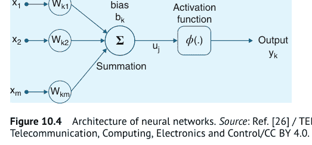

图10.4 神经网络架构。来源：参考文献[26] / TELKOMNIKA Telecommunication, Computing, Electronics and Control / CC BY 4.0。

e) **训练：** 通过修改连接权重来最小化期望值与模型预测之间差异的过程。通常使用诸如随机梯度下降（SGD）、Adam 和 RMSprop 等优化算法。

## 10.5.2 人工神经网络（ANNs）

人工神经网络（ANNs）是深度学习的基础架构。其核心是由相互连接的节点组成，包括输入层、一个或多个隐藏层以及输出层。图10.5显示了信息流是单向的，从输入层经过隐藏层到最终输出。网络中的每个节点相当于一个神经元，并与后续层的节点相连。连接具有权重，表示其强度。输入数据通过网络传播，当它经过每一层时，计算加权和，并用激活函数控制每个节点的输出。这一过程持续到最后一层生成网络的输出。随后，反向传播方法优化模型的准确性和性能。反向传播作为基本概念，通过基于预测误差修改权重来促进学习。输入数据通过网络传播，每一层中的加权和不断累积，激活函数则调节节点输出。

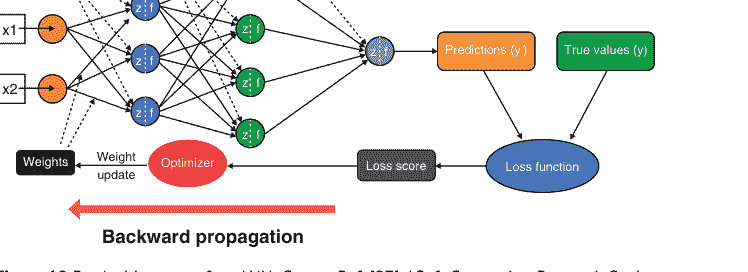

图10.5 人工神经网络的架构。来源：参考文献[27] / Soft Computing Research Society。

损失函数估计预测输出与实际输出之间的差异。训练的目标是通过减小预测与真实目标之间的距离来最小化这种差异。这一循环过程在最终输出层达到顶峰，生成期望的结果。简单、方便以及映射数据中复杂关系的能力是人工神经网络的强大之处[8]。这些模型可以从大规模数据库中学习并有效泛化到新数据，使其广泛应用于实际场景。

## 10.5.3 卷积神经网络（CNNs）

卷积神经网络（CNN）是一种重要的图像处理、特征学习和分类模型框架。它由三个基本层组成，并经过优化以高效处理输入图像数据，使其成为多种应用的关键组成部分。

- **卷积层（CONV）：** 卷积层是CNN的构建模块，主要任务是在输入图像上执行卷积运算。为了实现卷积过程，这些层使用核或滤波器，按照步长率水平和垂直移动。卷积层使用非线性激活函数，其中最常用的是ReLU）。ReLU通过引入非线性来提高网络理解复杂趋势的能力。
- **池化层（POOL）：** 池化层负责降维，在保留重要信息的同时最小化计算开销。两种常见类型是最大池化（选取核区域中的最大值）和平均池化（计算核中的平均值）。池化增强了网络的鲁棒性，并有助于更好地管理计算资源。
- **全连接层（FC）：** 全连接层与展平的输入相结合，将每个输入连接到所有神经元，启动分类过程。全连接层通常位于网络的末端，执行数学运算以完成分类过程，如图10.6所示。除了这些步骤外，其他元素也对CNN的性能有所贡献。激活函数影响分类输出，尤其是在最后的全连接层中。常用的softmax函数将输出归一化，以表示目标类别的概率。Dropout层在训练期间防止过拟合，消除单个神经元的贡献，并促进从不同批次训练数据中进行更鲁棒的学习。

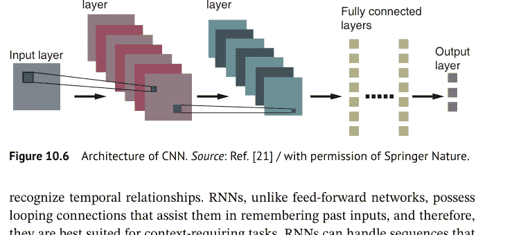

图10.6 CNN架构。来源：参考文献[21] / 经Springer Nature许可。

## 10.5.4 循环神经网络（RNNs）

循环神经网络（RNNs）的显著特点是它们能够通过添加记忆组件来处理序列数据，从而识别时间关系。与前馈网络不同，RNNs具有循环连接，帮助它们记住过去的输入，因此最适合需要上下文的任务。由于其递归特性，RNNs可以处理最适合时间序列预测、语言建模和语音识别任务的序列。然而，普通RNNs学习长期依赖关系的能力较差。LSTM和GRU架构规避了这一弱点，增强了RNNs处理和学习序列输入的能力。


图10.6 CNN架构。来源：参考文献[21] / 经Springer Nature许可。

- **输入层：** 该层接收第一段序列数据。在每一步中，数据被馈送到网络，如图10.7所示。输入可以是单个值、向量或更复杂的数据结构。
- **隐藏层：** RNN的核心，由相互连接的神经元组成。每个神经元接收当前输入和上一隐藏层的状态。这个“状态”保留了网络对先前输入的记忆，使其能够理解当前元素在上下文中的含义。这一过程使RNN能够跨时间记住并传递相关信息，并能模拟长期依赖关系。
- **激活函数：** 该函数将非线性引入网络，使其能够学习复杂模式。它在传递之前，将来自当前输入层和上一隐藏层状态的组合输入进行转换。其中一些包括 sigmoid、tanh 和 ReLU 函数。
- **输出层：** 该层根据处理后的数据提供网络的预测。输出可以是分类、回归或其他序列。
- **循环连接：** RNN的一个重要特征是隐藏层内的循环连接。这种连接使网络能够将隐藏状态信息（网络记忆）传递到下一个时间步。这在网络内部建立了一个循环，使其能够维持包含先前输入信息的内部状态。


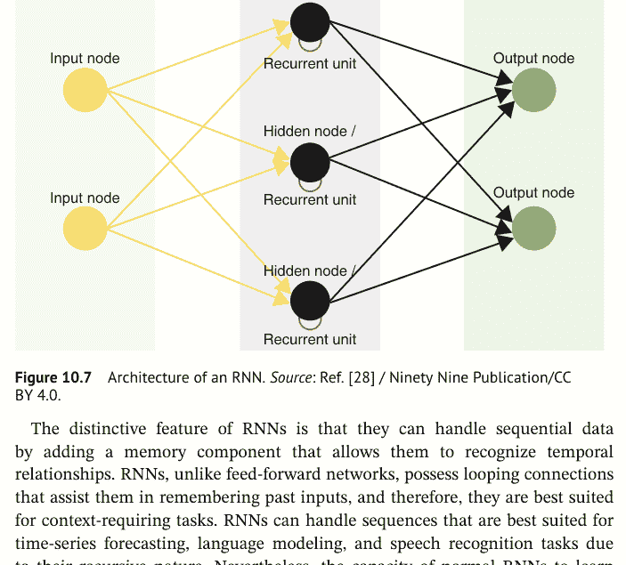

图10.7 循环神经网络（RNN）的架构。来源：参考文献[28] / Ninety Nine Publication/CC BY 4.0。

RNN的显著特征是，它们通过添加一个记忆组件来处理序列数据，从而能够识别时间关系。与前馈网络不同，RNN具有循环连接，帮助它们记住过去的输入，因此它们最适合需要上下文的任务。由于其递归特性，RNN可以处理最适合时间序列预测、语言建模和语音识别任务的序列。然而，普通RNN学习长期依赖的能力较差。这一弱点通过LSTM和门控循环单元（GRU）架构得到解决，这些架构增强了RNN处理和学习序列输入的能力[7]。

### 10.5.5 长短期记忆

长短期记忆（LSTM）架构是RNN的一种增强形式，旨在管理长期和短期依赖，使其能够有效跟踪信号的变化。一个LSTM块通常具有一个带三个门的记忆单元：输入门、输出门和遗忘门，以及一个隐藏层。

- **记忆单元状态：** LSTM架构的核心要素是记忆单元。它负责存储可以跨序列中的多个时间步传递的长期数据。与每一步都会覆盖记忆的标准RNN不同，LSTM中的记忆单元使模型能够在较长的序列中保留关键信息。这有助于解决标准RNN遇到的梯度消失问题。记忆单元使用三个关键门来控制信息流：
- 遗忘门：它决定当前记忆的哪些部分应保留或删除。它通过sigmoid激活输出0到1之间的值。如果值为1，则全部保留；如果值为0，则全部遗忘。
- 输入门：它决定从当前输入向记忆中写入多少新数据。它与一个由tanh层生成的候选记忆协作。在候选记忆提出可以添加的内容之后，输入门决定实际添加多少可添加的内容。
- 单元状态更新C(t)：这是记忆的实际更新，其中新信息的一部分和先前状态的一部分保留在记忆中。
- 线性路径通过允许梯度在反向传播期间无阻碍地通过，从而促进长期依赖。
- 输出门：它决定每一步应提供多少记忆。它控制隐藏状态，该状态用于输出并传递到下一个单元。

- 隐藏状态h(t)：这是LSTM的短期记忆，表示网络的当前状态。它通过输出门的输出以及单元状态来确定。它作为当前时间步的输出，并作为下一步的输入。

自动编码器：自动编码器是人工神经网络，旨在为输入数据开发高效的表示。它们通过将输入数据压缩为低维表示（称为“潜空间”），然后利用该表示重构原始输入。本质上，自动编码器试图学习一个恒等函数：它寻求从压缩版本中正确重构输入。然而，让神经网络通过瓶颈（低维表示）深入了解这种重构，会揭示数据集中令人惊叹的模式和特征。自动编码器的主要组成部分如下：

- 编码器：网络的这一组件压缩输入信息以形成潜空间。它通常由一系列逐渐降低数据大小的层组成。

```
Z = f(We · x + be)
where z is the latent representation, We is the weight matrix of the encoder, x is the input data, and b is the bias.
```

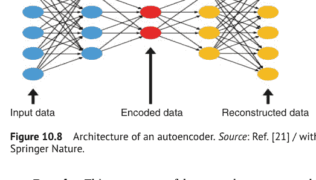

图10.8 自动编码器架构。来源：参考文献[21] / 经Springer Nature许可使用。

- **解码器：** 网络的这一组件从潜空间中的缩减表示重构主要输入数据。它通常由一系列层组成，这些层逐渐扩展数据量，直到达到原始输入大小，如图10.8所示。

$x' = g(Wd \cdot z + bd)$

其中 $x'$ 是重构后的数据，$Wd$ 是解码器的权重矩阵，$bd$ 是偏置。

- **潜空间：** 它充当瓶颈，促使网络学习相关特征。这是自动编码器的瓶颈。它是输入数据的低维表示，捕获最重要的特征和模式。潜空间的维度通常远低于输入数据的维度。

使用自动编码器来增强无线网络的安全性具有重要意义，例如在异常检测中，自动编码器可在典型网络流量上进行训练。当它们遇到新型流量时，会尝试重构它。显著的重构误差则表明可能存在异常，例如入侵、DDoS攻击或恶意软件感染。自动编码器可以获取网络流量数据的紧凑可视化，借助特征提取来提取关键特征和模式[2]。这些获取的表示可以被输入到其他机器学习模型中，包括分类器或异常检测器。此外，自动编码器可用于去除网络流量数据中的噪声和异常，这些噪声和异常可能掩盖恶意活动的存在。

## 10.6 基于深度学习的MANETs和WSNs入侵检测挑战解决方案

移动自组网（MANETs）和无线传感器网络（WSNs）由于其分散式结构、资源稀缺、动态拓扑以及对各种威胁的敏感性，带来了重大的入侵检测问题。深度学习（DL）提供了成功解决这些问题的改进方法。下面详细描述这些问题及基于深度学习的解决方案，随后附有汇总表。

### 10.6.1 自动编码器在资源受限无线网络中的用例

近年来，自动编码器迅速变得流行，尤其是在研究和实践中。在无线网络中，自动编码器可以为入侵检测提供有效且高效的基础。实现这一目标的一种方式是使用自动编码器进行异常检测[14]。自动编码器甚至可以在供应商修补软件以缓解此类攻击之前，在早期阶段捕获零日漏洞利用。借助自动编码器，我们能够以更强的估计能力，将入侵检测中输入数据的预期误差编成表格。自动编码器是一种可以压缩输入数据并学习如何重构数据的神经网络。它学习数据的压缩形式，在需要时用于重构原始数据。数据中的异常，如噪声和缺失值，可能导致自动编码器无法生成误差分数。通过纳入降维策略，我们可以利用自动编码器实现SMART IDS，该自动编码器使用隐藏节点值作为特征向量来捕获传入的威胁数据，同时在本地区域之外的节点上添加更多传感器。

该方法利用自动编码器的强大功能来创建有效的数据可视化，有助于减轻资源受限设备上的计算负载[3]。通过专注于发现异常活动而非复杂分类，自动编码器可以用更少的能量和计算资源识别有害行为[17]。这对于在物联网和基于传感器的系统等资源有限的领域构建更好的安全协议至关重要。剪枝、量化和压缩模型可以进一步提升自动编码器的性能。这些技术减小了模型的大小和计算的复杂度，使其适用于资源受限的设备。凭借自动编码器的天然优势和这些优化方法，我们可以在不严重影响有限资源的情况下增强资源受限无线网络的安全性[15]。类似地，有人提出了无监督自动编码器框架，以缓解物联网网络中的DDoS和零日攻击[16]。要检测移动设备上的异常数据模式


网络中，还提出了一种自适应时序卷积网络自编码器（ATCN-AE）[14]。

## 10.6.2 CNNs 用于 DDoS 检测的用例

CNNs 通过分析网络流量数据在多个维度上的特征来识别 DDoS 攻击，例如时间序列或数据包头部数据。数据包大小、源/目的 IP 地址和流量量被编码为矩阵并送入 CNN 层。CNNs 使用卷积和池化方法提取区分合法数据与恶意数据的分层特征。在实时系统中，这些模型能够在无线网络中准确地将传入流量分类为良性或恶意 [18]。此外，CNNs 快速的推理速度使其能够大规模运行，使其非常适合延迟至关重要的实时应用。使用 CNNs 进行 DDoS 检测的主要优势在于其能够泛化并适应各种攻击模式，包括零日攻击 [5]。其自主学习特性使其能够随着新攻击技术的出现而演进，相较于传统的基于规则的系统具有显著优势。此外，将 CNNs 集成到实际系统中的实现需要严格的优化，以在保持高吞吐量的同时实现低计算成本。

CNNs 通过将网络流量数据作为多维输入来检测 DDoS 攻击，例如数据包头部信息或时间序列。数据包长度、源/目的 IP 地址和流量量被转换为矩阵并提供给 CNN 层。CNNs 通过应用卷积和池化层学习分层特征，重点在于区分良性流量与恶意流量。在实时系统中，这些模型可以扫描传入的流量流并准确评估其是否为良性或恶意 [6]。此外，带模糊逻辑的 CNNs 增强了推理速度，使其能够扩展并检测恶意节点；它们可用于延迟是问题的实时应用中 [19]。

- 1 Gyamfi, E. 和 Jurcut, A. (2022). 物联网系统中的入侵检测：利用多接入边缘计算、机器学习和数据集的设计方法综述。Sensors 22 (10): 3744.
- 2 Song, Y., Hyun, S., 和 Cheong, Y.G. (2021). 网络入侵检测中自编码器的分析。Sensors 21 (13): 4294.
- 3 Rassam, M.A. (2024). 无线体域网异常检测的基于自编码器的神经网络模型。IoT 5 (4): 852–870.
- 4 Ahmed, K.T., Godder, T.K., 和 Al Mahmud, T.H. (2024). 评估 MANET 路由协议：使用 NS3 的主动与反应式方法的比较分析。Indonesian Journal of Electrical Engineering and Informatics (IJEEI) 12 (4): 780–801.
- 5 Al-Fuqaha, A., Guizani, M., Mohammadi, M. 等 (2015). 物联网：使能技术、协议和应用综述。IEEE Communications Surveys & Tutorials 17 (4): 2347–2376.
- 6 Sbai, O. 和 Elboukhari, M. (2022). 针对洪泛攻击的移动自组织网络深度学习入侵检测系统。International Journal of Artificial Intelligence 2252 (8938): 878.
- 7 Thapa, K.N.K. 和 Duraipandian, N. (2021). 使用长短期记忆（LSTM）模型进行恶意流量分类。Wireless Personal Communications 119 (3): 2707–2724.
- 8 Sowah, R.A., Ofori-Amanfo, K.B., Mills, G.A., 和 Koumadi, K.M. (2019). 使用人工神经网络（ANN）预测技术在 MANET 中检测和防止中间人欺骗攻击。Journal of Computer Networks and Communications 2019 (1): 4683982.
- 9 Diro, A. 和 Chilamkurti, N. (2018). 利用 LSTM 网络进行雾到物通信中的攻击检测。IEEE Communications Magazine 56 (9): 124–130.
- 10 Arshad, S., Ashraf, W., Ashraf, S., Hassan, I., 和 Masoodi, F.S. (2023). CICIDS-2017 数据集上入侵检测机器学习技术的比较研究。2023 年第 10 届可持续全球发展计算国际会议（INDIACom），IEEE。Bharati Vidyapeeth's Institute of Computer Applications & Management (BVICAM)，New Delhi, India，March 15–17, 2023.
- 11 Zhang, G., Kou, L., Zhang, L. 等 (2017). 物联网感知层数据完整性保护的一种新的数字水印方法。Security and Communication Networks 2017 (1): 3126010.
- 12 Abrar, I., Ayub, Z., Masoodi, F.S., 和 Bamhdi, A.M. (2020). NSL-KDD 数据集上入侵检测系统的机器学习方法。2020 International Conference on Smart Electronics and Communication (ICOSEC)，IEEE。Kalasalingam Academy of Research and Education (KARE)，Tamil Nadu, India，September 10–12, 2020.
- 13 Laqtib, S., Yassini, K.E., 和 Hasnaoui, M.L. (2019). 基于机器学习的 MANET 入侵检测系统的深度学习方法。载于第 4 届智慧城市应用国际会议论文集，Moulay Ismail University，Meknes, Morocco，October 2019，pp. 1–8.
- 14 Masoodi, F.S., Abrar, I., 和 Bamhdi, A.M. (October 27, 2021). 使用同质集成技术的有效入侵检测系统。International Journal of Information Security and Privacy (IJISP) 16 (1).
- 15 Aloul, F., Zualkernan, I., Abdalgawad, N., Hussain, L., 和 Sakhnini, D. (2021). 使用对抗自编码器在物联网边缘进行网络入侵检测。载于 2021 International Conference on Information Technology (ICIT)，pp. 120–125，IEEE。Amman, Jordan，July 14–15, 2021.
- 16 Yang, K., Zhang, J., Xu, Y., 和 Chao, J. (2020). 使用自编码器检测 DDoS 攻击。载于 NOMS 2020–2020 IEEE/IFIP Network Operations and Management Symposium，pp. 1–9，IEEE。Budapest, Hungary (virtual)，April 20–24, 2020.
- 17 Ahanger, A.S., Khan, S.M., Masoodi, F. 等 (2025). 使用图注意力网络进行物联网高级入侵检测。Scientific Reports 15: 9831.
- 18 Singh, V.K., Sivashankar, D., Kundan, K., 和 Kumari, S. (2024). 使用 SS-LSACNN 和 TCSLR 的 WSN 中 DDoS 攻击高效入侵检测与防御系统。Journal of Cyber Security and Mobility 135–160.
- 19 Shanmathi, M., Sonker, A., Hussain, Z. 等 (2024). 使用 CNN-FL 和 NGO 优化增强无线传感器网络安全性和效率。Measurement: Sensors 32: 101057.
- 20 Hinds, A., Ngulube, M., Zhu, S.Y., 和 Al-Aqrabi, H. (2013). 移动自组织网络（MANET）路由协议综述。International Journal of Information and Education Technology 3 (1): 101–105.
- 21 Hammi, S., Hammami, S.M., 和 Belguith, L.H. (2023). 利用结合深度学习模型 CNN 和 bi-RNN 与机器学习模型 SVM 的新架构推进基于方面的情感分析。Social Network Analysis and Mining 13 (1): 117.
- 22 Ahanger, A.S., Khan, S.M., 和 Masoodi, F.S. (2021). 使用监督机器学习技术的有效入侵检测系统。2021 5th International Conference on Computing Methodologies and Communication (ICCMC)，IEEE。Erode, Tamil Nadu, India，Apr. 8–10, 2021，pp. 1639–1644.
- 23 Thakkar, A. 和 Lohiya, R. (2023). 深度神经网络入侵检测系统中特征选择的统计重要性融合。Information Fusion 90: 353–363.
- 24 Zhang, Y., Zhang, H., 和 Zhang, B. (2022). 网络入侵检测的有效集成自动特征选择方法。Information 13 (7): 314.
- 25 Kumar, D., Arora, V.K., & Sawhney, R. (2022). WSN（无线传感器网络）中转发路由协议的不同类别：综述。Mobile Computing and Sustainable Informatics: Proceedings of ICMCSI, 2022，pp. 509–521。Lalitpur (Kathmandu), Nepal，Jan. 27–28, 2022.
- 26 Bamhdi, A.M., Abrar, I., 和 Masoodi, F. (2021). 使用多数投票进行有效入侵检测的集成方法。Telkomnika (Telecommunication Computing Electronics and Control) 19 (2): 664–671.
- 27 Amin, U., Ahanger, A.S., Masoodi, F., 和 Bamhdi, A.M. (2021). 基于 UNSW-NB15 数据集的云环境集成有效入侵检测系统。SCRS Conference Proceeding Intelligent System，pp. 483–494，India，Apr. 26, 2022.
- 28 Masoodi, F. (2021). NSL-KDD 数据集上入侵检测分类分析的机器学习。Turkish Journal of Computer and Mathematics Education (TURCOMAT) 12 (10): 2286–2293.


## 11
## 基于深度学习的无线网络入侵检测
Shadab Alam¹ 和 Sadaf Ahmad²
¹沙特阿拉伯吉赞大学工程与计算机科学学院计算机科学系
²印度北方邦阿里格尔穆斯林大学计算机科学系

## 11.1 引言
现代通信世界与无线网络密不可分。无线网络不仅对移动电话至关重要，对物联网（IoT）、工业自动化和云计算中的应用也必不可少。然而，与其他所有领域一样，无线技术的广泛使用也带来了新的网络安全问题。如今，犯罪黑客和敌对国家使用更复杂的方法，在窃取信息和造成损害方面取得更好的效果 [1]。就无线网络而言，这些方法中最基本的是发送大量数据包以拒绝为合法用户提供服务。其他方法，如窃听（监听）、数据库攻击和实地侦查，对当今的网络犯罪分子来说也变得更加容易实现。此外，对于当今的无线网络，更大、更快、更贪婪的数据包风暴意味着造成严重损害的可能性也在增加。深度学习（DL）是人工智能（AI）的一个子领域，已成为改进无线网络中入侵检测系统（IDS）的变革性技术 [2]。与传统机器学习模型需要手工设计特征不同，深度学习技术自动从高维网络流量数据中提取有意义的模式。各种深度学习架构已成功用于解决入侵检测任务。卷积神经网络（CNN）擅长检测网络流量中的结构模式，而循环神经网络（RNN）擅长捕获序列攻击模式 [3]。第三种深度学习架构——长短期记忆（LSTM）网络，是一种专门的 RNN，在某些入侵检测任务上表现出比普通 RNN 更好的性能。LSTM 模型在捕获网络流量中的序列模式方面非常有效 [4]。使用深度学习进行入侵检测的主要优势包括：(i) 自动特征提取，显著减少了开发合适模型所需的手动工作量；(ii) 在多种网络行为下具有非常高的检测精度和性能适应性；(iii) 实时检测能力，这意味着基于深度学习的 IDS 可应用于有严格延迟要求的场景，如 IoT 和 5G 网络 [5]。

基于深度学习的 IDS 在无线网络中的优势是显而易见的。然而，这些系统面临重大挑战，如果要在广泛部署的无线环境中有效使用，就必须克服这些挑战，因为在这些环境中 IDS 必须尽可能高效和轻量级 [6]。本章首先对无线环境中网络安全面临的诸多严峻挑战进行了较为全面的概述，这些挑战是传统入侵检测方法必须克服的。这让我们得以一窥这些基于深度学习的方法在应对这些挑战时的强大能力。在本章的后半部分，作者揭示了这些新方法面临的许多关键挑战，以及它们在无线网络环境中保持有效和高效所必须采取的未来研究方向。

## 11.2 无线网络安全与 IDS 挑战
无线网络与有线网络的不同之处在于其独特的特性和安全漏洞。这些网络在开放的通信介质上运行，使其更容易受到各种形式的网络威胁 [7]。主要挑战包括：
-   **有限物理安全：** 与受益于受控访问等物理安全措施的有线网络不同，无线网络面临恶意接入点、未授权拦截和信号干扰等威胁。
-   **去中心化和动态架构：** 无线网络，尤其是 IoT 和 MANET，缺乏集中控制，这使得在所有节点上建立一致的安全措施变得具有挑战性 [8]。
-   **资源限制：** 许多无线设备以有限的电力和计算资源运行，降低了实施加密和基于深度学习的 IDS 等复杂安全机制的可行性。
-   **传统 IDS 的高误报率：** 传统的基于签名的 IDS 难以检测新型和不断演变的威胁，而基于异常的 IDS 由于无线流量的动态特性经常产生误报 [9]。
-   **可扩展性问题：** 无线网络的扩展，尤其是 5G 和 IoT，导致数据流量增加，IDS 解决方案必须实时处理这些流量而不降低性能。

-   **边缘计算：** 以更低的延迟促进实时威胁检测。
-   **对抗性机器学习：** 增强 IDS 防御攻击者使用的规避技术的能力 [15]。

深度学习继续重新定义网络安全格局，为入侵检测提供强大的解决方案，同时也带来了需要持续研究和优化的新挑战。

## 11.4 用于 IDS 的常见深度学习架构
深度学习通过利用先进的神经网络架构，已成为检测无线网络入侵的强大工具。本节探讨了 IDS 中最常用的深度学习架构及其在处理无线环境中的网络安全威胁方面的有效性。

### 11.4.1 用于 IDS 的卷积神经网络（CNN）
CNN 主要用于网络流量分析中的特征提取。与传统方法不同，CNN 可以自动从输入数据中学习空间特征，使其非常适合检测网络异常 [16]。
-   **特征学习：** CNN 能够捕获不同网络流量参数之间的模式和关系。
-   **性能效率：** 基于 CNN 的 IDS 具有低误报率和高分类精度。
-   **应用：** 用于网络数据包分析和入侵分类任务。

### 11.4.2 循环神经网络（RNN）和长短期记忆（LSTM）
-   RNN 和 LSTM 系统特别适用于分析序列数据，如时间序列网络流量。
-   **时间模式识别：** 这些模型可以根据网络日志中事件的顺序检测入侵模式。
-   **处理序列数据：** LSTM 网络可以解决梯度消失问题，改进对网络攻击中长期依赖的学习。
-   **应用：** 检测复杂攻击模式，包括 APT 和僵尸网络流量。

### 11.4.3 用于异常检测的自编码器
-   自编码器是一种无监督学习模型，通过重建正常流量并识别偏差来进行异常检测 [17]。
-   **无监督学习：** 不需要标记的攻击数据，非常适合零日攻击检测。
-   **降维：** 可以高效地表示网络流量特征，降低计算成本。
-   **应用：** 用于基于异常的 IDS，识别此前未见过的威胁。

### 11.4.4 用于 IDS 的生成对抗网络（GAN）
-   GAN 使用生成器-判别器架构，通过模拟攻击场景来提高 IDS 的鲁棒性 [18]。
-   **攻击模拟：** GAN 可以生成合成攻击流量，改进 IDS 训练。
-   **对抗防御：** 有助于检测旨在逃避 IDS 检测的对抗性攻击。
-   **应用：** 增强 IDS 模型对复杂网络威胁的抵御能力。

### 11.4.5 用于可扩展 IDS 的 Transformer 模型
-   Transformer 通过提高可扩展性和处理效率，彻底改变了深度学习 [19]。
-   **自注意力机制：** 增强模型检测复杂攻击关系的能力。
-   **并行处理：** 加快 IDS 处理速度，使其适用于实时应用。
-   **应用：** 用于高速网络中的大规模入侵检测。

### 11.4.6 深度学习架构的比较分析
本节全面介绍了不同的深度学习模型如何增强无线网络中的 IDS 能力。下一节将探讨这些架构如何与新兴网络安全技术集成。


| 模型 | 优势 | 弱点 | 应用 |
|---|---|---|---|
| CNNs | 高效特征提取，误报率低 | 时序分析能力有限 | 数据包分类，流量异常检测 |
| RNNs/LSTMs | 时序模式学习对顺序攻击有效 | 计算密集型 | 日志分析，APT检测 |
| Autoencoders | 无监督学习，零日攻击检测 | 误报率高 | 基于异常的入侵检测系统 |
| GANs | 提高对抗鲁棒性 | 训练复杂度高 | IDS模型增强，攻击模拟 |
| Transformers | 高可扩展性，实时处理 | 需要大型数据集 | 大规模入侵检测 |

## 11.5 基于深度学习的入侵检测系统应用

无线网络的快速发展，尤其是物联网、5G 和 MANET，带来了需要复杂入侵检测解决方案的新安全挑战 [20]。问题在于我们已无法再依赖内置于计算机中的旧安全机制。为什么？因为我们不再拥有过去那种计算机。取而代之的是，我们现在拥有通过各种各样的设备访问的去中心化分布式网络，其中许多设备都在我们直接控制之下——主要是智能手机和平板电脑，但也包括智能电视、家庭路由器以及越来越多以某种方式“智能”的其他设备。此外，所有这些设备都有自己的操作系统、软件和内置安全需求。因此，从非常现实的角度来看，我们都身处物联网之中 [12]。

本节涵盖 DL 技术及其在 IDS 中的应用。主要关注物联网安全、5G 网络安全和便携式 MANET 安全。深入探讨有效的 DL 方法及其相应挑战。范围从物联网互联世界的新的安全漏洞和新出现的攻击面，到 DL 方法不仅能为 IDS 提供改进性能，还能为物联网互联世界提供潜力的可能性。

### 11.5.1 物联网安全中的入侵检测系统

物联网生态系统由数十亿个互联智能设备组成，从可穿戴技术到工业传感器。这些设备通常处于资源受限的环境中，无法自行保护，使其成为黑客的完美目标。物联网的互联特性意味着对其任何一个设备的威胁都可能影响更大的网络，即物联网。

#### 11.5.1.1 资源受限物联网设备的安全挑战

物联网网络面临若干安全挑战，这需要使用基于 DL 的 IDS [21]：

- **受限的计算资源：** 许多物联网设备处理能力、内存和能源可用性较低，限制了复杂安全算法的部署。
- **攻击面大：** 物联网设备在具有薄弱身份验证机制的各种环境中运行，使其容易受到僵尸网络、分布式拒绝服务（DDoS）攻击和恶意软件感染的威胁。
- **可扩展性问题：** 庞大的互联物联网设备产生海量数据，使得传统 IDS 解决方案无法有效进行实时监控。
- **缺乏标准化的安全协议：** 物联网安全支离破碎，不同制造商实施不同的安全机制，导致漏洞。

#### 11.5.1.2 在物联网网关上部署轻量级深度学习模型

为应对这些挑战，可在物联网网关上部署轻量级 DL 模型，物联网网关充当物联网设备与云之间的中介 [22]。一些有效的 DL 技术如下：

- 卷积神经网络（CNNs）用于以最小的计算开销从网络流量中提取关键特征。
- 循环神经网络（RNNs）和长短期记忆（LSTM）模型用于分析时序流量并检测异常行为。
- 自编码器用于无监督异常检测在物联网流量中，无需标记数据即可识别零日攻击。
- 联邦学习（FL）用于去中心化 IDS 部署，使物联网设备能够在不共享原始数据的情况下协作训练模型，从而增强隐私性和效率。

#### 11.5.1.3 实际实现

- 部署在物联网网关上的基于 CNN 的 IDS 在检测僵尸网络流量方面达到了 94% 的准确率 [23]。

#### 11.5.2.3 实际实现

- 基于 Transformer 的 IDS 在 5G 网络中检测 DDoS 攻击的准确率达到 99% [27]。
- GAN 增强的异常检测模型有效识别了网络切片上的隐蔽攻击。
- 联邦深度学习 IDS 保护了 5G 边缘节点，提高了延迟和可扩展性 [28]。

通过将 DL 与 SDN、边缘计算和 AI 驱动编排集成，IDS 可以有效缓解 5G 和未来无线网络中的威胁。

### 11.5.3 移动自组织网络（MANETs）的入侵检测系统

MANET 是由一组可以自由移动并相互通信的节点形成的无线网络。这种网络常出现在军事和应急响应领域，并可支持动态车载网络 [29]。然而，像任何形式的移动基础设施一样，自组织网络极易受到各种窃听、欺骗和 DoS 攻击的威胁。

#### 11.5.3.1 去中心化和动态 MANET 安全的挑战

MANET 面临独特的复杂入侵检测的安全挑战，详情如下：

- 缺乏集中控制：没有专门的安全基础设施，使得 IDS 部署困难。
- 高移动性和拓扑变化：节点频繁移动导致流量模式不可预测，需要自适应 IDS 模型。
- 计算资源有限：电池供电的节点需要节能的安全机制。
- 路由漏洞：攻击如虫洞、Sybil 和黑洞利用 MANET 路由协议的弱点。

#### 11.5.3.2 检测路由攻击的深度学习技术

基于 DL 的 IDS 通过使用以下方法检测恶意路由行为来增强 MANET 安全 [30]：

- 图神经网络（GNNs）用于分析 MANET 拓扑并检测异常路由修改。
- LSTM 网络和 RNN 用于建模时序流量模式并识别偏差。
- 自编码器用于无监督异常检测，标记以前未见过的攻击行为。
- 基于强化学习（RL）的 IDS 可根据网络拓扑的演变动态调整检测参数。

#### 11.5.3.3 实际实现

- 基于 GNN 的 IDS 在 MANET 中检测黑洞攻击和 Sybil 攻击的准确率达到 96% [31]。
- LSTM 模型成功识别了动态车载自组织网络（VANETs）中的恶意路由更改 [32]。
- RL 驱动的 IDS 可适应不断变化的 MANET 拓扑，随着时间的推移提高威胁检测能力。

DL 为资源受限和去中心化的 MANET 环境提供了自适应、实时 IDS 解决方案。这些解决方案保护了军事网络、物联网和车载网络中的通信。现代无线网络因基于 DL 的 IDS 而发生了革命性变化，后者抵消了物联网、5G 和 MANET 环境中的安全威胁——这些环境不仅充斥着传统形式的网络攻击，还充斥着全新的网络攻击形式。使用 CNNs、RNNs、LSTMs、GANs、transformers 和 RL，IDS 模型中的异常检测可以高精度地识别路由攻击、DDoS 威胁和网络切片漏洞 [33]。

### 11.6 挑战与未来研究方向

基于 DL 的 IDS 在最近大幅提高了网络安全。它们属于人工智能（AI）范畴，与其他复杂的机器学习方法一起。DL 依赖人工神经网络作为其框架，并且不可直接解释。由于数据包特征可以轻松区分良性和恶意流量，人们认识到，除了少数例外情况外，并不需要设计良好的 IDS 即可实现高水平的安全性。我们探讨 AI 入侵检测的关键挑战并概述潜在的未来解决方案。

### 11.6.1 针对深度学习入侵检测系统的对抗攻击

DL 模型容易受到对抗攻击的攻击，在这种攻击中，攻击者操纵输入数据以误导 IDS 模型将恶意流量误分类为良性。这些攻击利用基于 DL 的 IDS 的弱点，降低了它们在现实场景中的可靠性 [34]。

#### 11.6.1.1 攻击者规避入侵检测系统使用的技术

攻击者可以使用对抗技术绕过基于 DL 的 IDS，详情如下：

- 规避攻击：攻击者在网络流量数据中引入微小扰动以欺骗 IDS 模型，同时保持功能。


- **投毒攻击：** 攻击者向IDS训练数据集中注入恶意样本，破坏学习过程并降低模型准确性。
- **对抗样本生成：** 攻击者使用算法（例如，快速梯度符号法 [FGSM] 和 Carlini & Wagner [C&W] 攻击）生成能够逃避检测的恶意流量模式。
- **流量混淆：** 攻击者修改载荷、头部和数据包序列，以模仿合法流量并避免被IDS检测。

### 11.6.1.2 防御措施：对抗训练与鲁棒IDS模型

为了应对对抗性攻击，IDS模型需要通过以下防御机制进行加固：

- **对抗训练：** 通过在对抗性生成的网络流量样本上训练来增强IDS的鲁棒性。
- **防御性蒸馏：** 平滑模型的决策边界，以降低对对抗性扰动的敏感性。
- **用于IDS防御的GANs：** 使用GANs模拟复杂攻击并训练IDS模型识别这些攻击。
- **鲁棒特征选择：** 识别对对抗性扰动不太敏感的网络流量特征。
- 开发具有对抗韧性的IDS仍然是一个开放的研究挑战，需要持续改进AI安全性。

## 11.6.2 计算开销与能源效率

DL模型需要大量的计算资源，这使得在IoT节点和边缘服务器等资源受限设备上部署IDS颇具挑战性。

### 11.6.2.1 在资源受限设备上部署深度学习模型的问题

- **高内存和处理需求：** 许多IDS模型需要GPU或TPU进行实时处理，这使得在IoT或嵌入式系统上部署不切实际 [35]。
- **电池和能源限制：** 无线设备电量有限，使得基于DL的持续IDS监控不可行。
- **网络带宽限制：** 实时处理大量网络流量计算成本高昂，并且可能引入延迟问题。

### 11.6.2.2 优化技术：模型剪枝、量化与知识蒸馏

为了解决这些限制，研究人员正在探索用于轻量级IDS的模型优化技术，如下所示：

- **模型剪枝：** 移除不必要的神经元和层，以在不牺牲性能的情况下降低计算成本。
- **量化：** 降低神经网络权重的精度（例如，从32位浮点数到8位整数），以降低内存需求。
- **知识蒸馏：** 利用从更大、更复杂的模型迁移的知识来训练轻量级IDS模型，在保持准确性的同时提高效率。

IDS研究的未来应聚焦于适用于IoT、边缘和移动网络中实时安全的低功耗、高能效DL架构。

## 11.6.3 实时部署挑战

实时入侵检测需要高速数据处理和即时威胁缓解。然而，基于DL的IDS在现实应用中常常面临可扩展性和延迟方面的挑战。

## 11.6.4 处理高速网络流量的问题

- **高维特征空间：** 在大型数据集上训练的IDS模型需要每秒实时处理数百万个网络数据包，导致性能瓶颈。
- **时间敏感网络中的延迟问题：** 实时IDS应在毫秒级内检测到攻击，这对于计算需求高的DL模型来说颇具挑战。
- **加密流量检查：** 加密技术的日益普及（例如，TLS 1.3、VPN）使得IDS难以检查载荷，降低了对网络异常的可见性。

### 11.6.4.1 将深度学习与基于规则和混合IDS相结合

一个有前景的解决方案是混合IDS [36]，它结合了以下内容：

- 用于已知攻击检测的基于规则的IDS（例如，Snort、Suricata）。
- 用于未知威胁的基于DL的异常检测。
- 用于实时攻击缓解的基于边缘计算的IDS。
- 混合IDS可以减少误报、提高效率，并增强实时威胁检测能力。

## 11.6.5 IDS模型的可解释性与可解释性

DL模型通常像“黑盒”一样运行，这使安全分析师难以理解为何做出某些决策。

### 11.6.5.1 对AI驱动安全中信任与透明度的需求

- 安全专业人员需要可解释的IDS模型来调试误报和漏报。
- 监管框架（例如，GDPR、CCPA）要求在基于AI的安全决策中具备透明性 [37]。
- 缺乏可解释性降低了对AI驱动的网络安全系统的信任 [38]。

### 11.6.5.2 可解释人工智能（XAI）方法

为了提高可解释性，研究人员正在将XAI集成到IDS中 [39]：

- Shapley加法解释（SHAPs）：识别哪些特征对检测决策贡献最大。
- 局部可解释模型无关解释（LIMEs）：为IDS分类生成人类可读的解释。
- 深度学习中的注意力机制：突出IDS决策中使用的关键网络特征。

开发透明、可解释的AI驱动IDS对于在企业级和政府安全运营中的广泛采用至关重要。

### 11.6.5.3 XAI在IDS中的益处

在基于DL的IDS中纳入XAI技术可提供多种优势，如下所示：

- **提高信任度与采用率：** 透明的IDS决策帮助安全分析师和监管机构信任AI驱动的安全机制。
- **减少误报：** XAI识别哪些特征导致误报，从而允许对IDS进行微调以提高准确性。
- **增强法规合规性：** 金融、医疗保健和政府领域的AI驱动安全解决方案需要可解释的决策，以符合GDPR和CCPA等标准。
- **改进对抗性防御：** 攻击者通常通过制作对抗性网络流量来利用IDS模型的弱点。

XAI可以帮助识别攻击者正在操纵哪些特征，从而带来更好的对抗性训练技术。

## 11.6.6 与边缘计算和联邦学习的集成

传统的基于云的IDS解决方案引入了延迟和隐私问题。边缘计算和FL为IDS去中心化提供了新途径，以提高可扩展性和效率。

### 11.6.6.1 用于大规模、去中心化网络的分布式IDS

- 基于边缘的IDS在本地处理威胁，减少了对云端的依赖。
- 去中心化的IDS架构增强了网络弹性，尤其是在IoT和5G环境中。

### 11.6.6.2 用于入侵检测的隐私保护AI

- **联邦学习（FL）：** 使IDS模型能够在多个设备上进行训练而无需共享原始数据，从而改善隐私保护。
- **基于区块链的IDS：** 为网络安全事件提供安全、不可篡改的日志。

未来的IDS研究应将AI与去中心化安全架构相结合，以改善实时响应能力和隐私保护。

## 11.6.7 IDS研究的未来方向

几项前沿AI创新有望塑造下一代IDS。

### 11.6.7.1 用于网络安全的量子AI

- 量子机器学习（QML）处理大规模IDS数据集的速度比经典AI呈指数级提升 [40]。
- 后量子密码学将是保护IDS免受量子攻击所必需的。

### 11.6.7.2 基于强化学习的AI驱动自主IDS

- 基于强化学习的IDS可以自主适应新的攻击模式。
- 自学习IDS可以在无需人工干预的情况下动态调整阈值。

### 11.6.7.3 基于区块链的入侵检测

- 区块链保护的IDS日志可防止数据篡改和未经授权的修改。
- 通过区块链实现的去中心化威胁情报共享增强了跨网络的IDS协作 [41]。

基于DL的IDS的未来是一个健壮、可扩展、可解释且去中心化的安全框架，能够有效应对不断演变的网络威胁。现有挑战依然存在：我们需要增强对抗性防御机制，以提升IDS抵御规避技术的韧性，并优化针对IoT、边缘和移动环境定制的轻量级IDS模型。实时检测需要将AI与基于规则的检测相结合的混合IDS架构，以提高效率并减少误报。如果XAI能够增强信任和可解释性，那么它在另一个关键领域中同样是实现目标的关键。


DL-driven IDS 是自动且安全的。一旦基于深度学习的 AI 实现 XAI——使其能够评估、理解并看到事物为何有效——我们就可以完全信任它们做出检测决策。在不将网络或数据暴露于敏感漏洞的情况下击败对手，已成为边缘计算在隐私保护型分布式入侵检测方面的下一个杰出成就。无线网络现已遍布全球。随着 5G、物联网以及下一代通信技术的发展，智能、适应性强且具有韧性（如果不是可证明安全的）IDS 解决方案至关重要。

## 11.7 结论

基于深度学习的 IDS 已成为保护无线网络、物联网以及下一代通信基础设施（5G、6G）的一种强大的新方式。这些系统并非过去那种热衷于特征码但大多无效的有线 IDS，它们难以识别不断演变的网络威胁。驱动我们下一代 IDS 当前一代的是深度学习算法。无监督、半监督和全监督学习策略被用于训练系统。使用深度学习模型进行下一代异常检测的关键优势在于，它们比传统检测器更不易脆弱，并且在现实世界对手不怀好意时表现更好。为了确保 AI 驱动的 IDS 既有效又实用，研究人员设计了多管齐下的方法。他们开发了抗对抗的深度学习模型，以对抗规避技术，并构成了改进的安全防御。他们针对低功耗和资源受限环境优化了模型，确保其能够部署在物联网、边缘计算和移动网络等场所。他们减缓了模型参数数量的指数增长，从而提高了计算效率。通过使用 XAI 框架提升了模型的解释性，现在可确保安全人员拥有可解释的推理过程以供信赖。他们利用联邦学习和边缘计算，确保 AI 驱动的 IDS 能够提供隐私保护、去中心化的解决方案，并在下一代互联网庞大且分布式的架构中有效运行。这种架构——由 5G 和 6G、物联网以及云边系统构成——将成为更复杂网络空间威胁渗透的更大目标。

## 参考文献

1. Kaza, V.S., Alamer, A., Alam, S. et al. (2024). 检测和预测物联网和无线传感器网络设备中的加密货币挖矿攻击趋势。PeerJ Computer Science 10: e2491.
2. Muneer, S., Farooq, U., Athar, A. et al. (2024). 入侵检测中基于人工智能方法的批判性综述：全面分析。*Journal of Engineering* 2024 (1): 3909173.
3. Ango, R., Masih, R.K., Reddy, C.K.K. et al. (2024). 使用 Kaggle 信用卡数据集和 XGBoost 模型进行银行业欺诈检测。载于：2024 *International Conference on IoT Based Control Networks and Intelligent Systems (ICICNIS)*, 968–973. IEEE.
4. Laghrissi, F., Douzi, S., Douzi, K., and Hssina, B. (2021). 使用长短期记忆（LSTM）的入侵检测系统。*Journal of Big Data* 8 (1): 65.
5. Kocher, G. and Kumar, G. (2021). 入侵检测系统的机器学习和深度学习方法：最新进展与挑战。*Soft Computing* 25 (15): 9731–9763.
6. Agrawal, S., Sarkar, S., Aouedi, O. et al. (2022). 用于入侵检测系统的联邦学习：概念、挑战与未来方向。*Computer Communications* 195: 346–361.
7. Nazir, R., Laghari, A.A., Kumar, K. et al. (2021). 无线网络安全综述。*Archives of Computational Methods in Engineering* 29: 1–20.
8. Boubiche, D.E., Athmani, S., Boubiche, S., and Toral-Cruz, H. (2021). 无线传感器网络中的网络安全问题：当前挑战与解决方案。*Wireless Personal Communications* 117: 177–213.
9. Rahman, A., Mahmud, M., Iqbal, T. et al. (2022). 5G 网络中的网络异常检测。*Mathematical Modelling of Engineering Problems* 9 (2).
10. Shen, M., Ye, K., Liu, X. et al. (2022). 基于机器学习的加密网络流量分析：全面综述。*IEEE Communication Surveys and Tutorials* 25 (1): 791–824.
11. Abrar, I, Ayub, Z, Masoodi, F.S., and Bamhdi, A. M., (2020). NSL-KDD 数据集上入侵检测系统的机器学习方法。*2020 International Conference on Smart Electronics and Communication (ICOSEC)*. IEEE, 2020.
12. Lansky, J., Ali, S., Mohammadi, M. et al. (2021). 基于深度学习的入侵检测系统：系统综述。*IEEE Access* 9: 101574–101599.
13. Lee, S.-W., Mohammadi, M., Rashidi, S. et al. (2021). 利用深度学习技术构建安全入侵检测系统：综合分析与综述。*Journal of Network and Computer Applications* 187: 103111.
14. Neupane, S., Ables, J., Anderson, W. et al. (2022). 可解释入侵检测系统（x-ids）：当前方法、挑战与机遇综述。*IEEE Access* 10: 112392–112415.
15. Ahanger, A.S., Khan, S.M., Masoodi, F. et al. (2025). 使用图注意力网络进行物联网高级入侵检测。*Scientific Reports* 15: 9831.
16. Kumar, G.S.C., Kumar, R.K., Kumar, K.P.V. et al. (2024). 深度残差卷积神经网络：入侵检测系统的一种高效技术。*Expert Systems with Applications* 238: 121912.
17. Ortega-Fernandez, I., Sestelo, M., Burguillo, J.C., and Piñón-Blanco, C. (2024). 使用深度自编码器的工业控制系统 DDoS 攻击网络入侵检测系统。*Wireless Networks* 30 (6): 5059–5075.
18. Soleymanzadeh, R. and Kashef, R. (2023). 使用多玩家生成对抗网络（GANs）进行高效入侵检测：基于集成深度学习架构。*Neural Computing and Applications* 35 (17): 12545–12563.
19. Masoodi, F.S., Abrar, I., and Bamhdi, A.M. (2022). 使用同质集成技术的一种有效入侵检测系统。*International Journal of Information Security and Privacy (IJISP)* 16 (1): 1–8.
20. Zhao, F., Li, H., Niu, K. et al. (2024). 基于深度学习的入侵检测系统（IDS）在网络异常流量检测中的应用。*Applied and Computational Engineering* 86: 231–237.
21. Khan, W., Ishrat, M., Khan, A.N. et al. (2024). 通过稀疏典型相关分析结合随机掩码和填充检测属性网络中的异常。*IEEE Access* 12: 65555–65569.
22. Wei, C., Xie, G., and Diao, Z. (2023). 物联网边缘轻量级僵尸网络检测深度学习框架。*Computers & Security* 129: 103195.
23. Nandanwar, H. and Katarya, R. (2024). 工业物联网环境中基于深度学习的入侵检测系统。*Expert Systems with Applications* 249: 123808.
24. Shen, C., Xiao, G., Yao, S. et al. (2021). 工业互联网中基于 LSTM 的恶意流量攻击检测。载于：2021 *International Conference on Security, Pattern Analysis, and Cybernetics (SPAC)*, 60–65. IEEE.
25. Singh, V.P., Singh, M.P., Hegde, S., and Gupta, M. (2024). 5G 网络切片中的安全：问题与机遇。*IEEE Access* 12: 52727–52743. https://doi.org/10.1109/ACCESS.2024.3386632.
26. Cunha, J., Ferreira, P., Castro, E.M. et al. (2024). 增强网络切片安全：机器学习、软件定义网络和网络功能虚拟化驱动策略。*Future Internet* 16 (7): 226.
27. Wang, H. and Li, W. (2021). DDoS TC：SDN 中基于 Transformer 的网络攻击检测混合机制。*Sensors* 21 (15): 5047.
28. Blika, A., Palmos, S., Doukas, G. et al. (2024). 用于增强 5G 和 6G 网络网络安全性和可信度的联邦学习：全面综述。*IEEE Open Journal of the Communications Society* 6: 3094–3130.
29. Singh, C.E. and Vigila, S.M.C. (2023). 移动自组织网络中基于机器学习的入侵检测系统研究。*International Journal of Intelligent Engineering Informatics* 11 (1): 54–70.


30 Ahanger, A.S., Khan, S.M., and Masoodi, F. (2021). 利用监督机器学习技术的一种有效入侵检测系统。载于：2021年第五届计算方法与通信国际会议（ICCMC）。IEEE。

31 de Souza, C.A., Westphall, C.B., Machado, R.B. et al. (2022). 基于雾的物联网环境中的入侵检测与预防：系统文献综述。Computer Networks 214: 109154. https://doi.org/10.1016/J.COMNET.2022.109154.

32 Yu, Y., Zeng, X., Xue, X., and Ma, J. (2022). 基于LSTM的VANET入侵检测系统：一种用于虚假消息检测的时间序列分类方法。IEEE Transactions on Intelligent Transportation Systems 23 (12): 23906–23918。

33 Al-Shurbaji, T., Anbar, M., Manickam, S. et al. (2025). 用于检测物联网僵尸网络攻击的基于深度学习的入侵检测系统：综述。IEEE Access 13: 11792–11822。

34 Gungor, O. et al. (2024). 对抗对抗攻击的基于机器学习的入侵检测的严格评估。载于：2024 IEEE网络安全与弹性国际会议（CSR），152–158。IEEE。

35 Liu, H.-I., Galindo, M., Xie, H. et al. (2024). 资源受限环境下的轻量级深度学习：综述。ACM Computing Surveys 56 (10): 1–42。

36 Sajid, M., Malik, K.R., Almogren, A. et al. (2024). 增强入侵检测：混合机器学习与深度学习方法。Journal of Cloud Computing 13 (1): 123。

37 Jan, S., Jan, F.S., and Bam hdi, A. (2022). 物联网环境中的有效入侵检测：深度学习方法。SCRS Conference Proceedings on Intelligent Systems。

38 Shoukat, S., Gao, T., Javeed, D. et al. (2025). Trust my IDS：面向工业网络的可解释AI集成深度学习透明威胁检测系统。Computers & Security 149: 104191. https://doi.org/10.1016/J.COSE.2024.104191。

39 Mohale, V.Z. and Obagbuwa, I.C. (2025). 关于可解释人工智能在入侵检测系统中集成以增强网络安全透明度和可解释性的系统综述。Front. Artif. Intell. 8: 1526221. https://doi.org/10.3389/FRAI.2025.1526221。

40 Arshad, S., Arshad, W., Ashraf, S., Hassan, I., and Masoodi, F.S. (2023). CICIDS-2017数据集上入侵检测机器学习技术比较研究。2023年第十届可持续全球发展计算国际会议（INDIACom）。IEEE, 2023。

41 Truong, V.T. and Le, L.B. (2024). 元宇宙安全：用于入侵检测的区块链和机器学习技术。IEEE Network 38: https://doi.org/10.1109/MNET.2024.3351882。

## 12 保护物联网环境：基于深度学习的入侵检测

Ashish K. Sharma¹, Neha Purohit², Shubhalaxmi Joshi³, Itika Umesh Lakkewar⁴, and Prashant Khobragade²

¹计算机科学与工程系，OP Jindal大学，印度恰蒂斯加尔邦赖加尔
²计算机科学与工程系，G H Raisoni工程学院，印度马哈拉施特拉邦那格浦尔
³科学学院，MIT世界和平大学，印度马哈拉施特拉邦浦那
⁴计算机科学系，S.F.S学院，印度马哈拉施特拉邦那格浦尔

### 12.1 引言

今天，物联网（IoT）是当前系统的重要组成部分，也是增长最快的技术。利用物联网，城市数量可以扩展到包括智慧城市、工业环境自动化、农业和医疗保健。物联网是一个使用不同网络设备（如传感器、软件和其他技术）的网络。它还允许数据的收集、共享和分析。从可穿戴设备和智能恒温器到更复杂的系统，包括农业传感器和医疗设备——这些类型的设备在家庭中每天都在使用 [1]。物联网是计算中的一种新范式，似乎具有增强智慧城市实施影响的能力 [2]。全世界都接受物联网，它不仅释放了巨大的机遇，还带来了重要的敏感性。由于使用互联网连接的设备数量众多，物联网系统对威胁更具吸引力。物联网环境中的安全很重要，以确保数据的隐私性、完整性和可用性。需要强大的安全措施来防止数据篡改、未经授权访问和拒绝服务攻击等违规行为，这些行为可能产生严重影响，特别是在农业和医疗保健等敏感领域 [3]。

对于远程监控和早期诊断，可穿戴健康监测器和医疗植入物可以提供患者健康状况的实时数据。然而，对于黑客来说，主要目标是存储的个人健康数据以及传输的敏感数据。物联网技术使精准农业成为可能，它通过监测作物健康、天气和土壤状况来减少和削减农业中的资源使用。网络攻击会破坏运营，导致财务损失、数据丢失，甚至危及粮食安全，这是这些系统的弱点 [4]。

鉴于这些挑战，入侵检测系统（IDSs）对于物联网生态系统的安全至关重要。由于物联网网络动态且多样，传统的IDS技术，包括基于签名的检测，有时不足 [5]。物联网设备不断产生大量统计数据，使得人工分析和异常检测不可行。机器学习的一个分支，深度学习提供了在物联网环境中识别入侵的复杂方法。从海量数据集中，深度学习（DL）算法快速识别困难模式。因此，它们将能够发现物联网结构中分散的、未识别的风险 [6]。

众多具有不同能力和安全技术的设备定义了物联网系统。由于物联网设备的多样性以及其中许多设备位于不受保护的区域，因此确保安全非常困难。此外，由于资源限制，包括处理能力、存储和电池寿命障碍，使用传统、资源密集型安全解决方案也很困难。此外，物联网网络的规模使得揭示和发现安全问题更加困难，因为恶意活动可能在海量记录集中未被发现 [8]。由于其处理和分析大量复杂信息的能力，DL在众多领域显示出变革性能力。多年来，DL模型已被用于众多领域，例如医疗保健 [9, 10]、自主系统、农业 [11]、金融、制造和工业4.0、物联网和智慧城市等。

物联网系统入侵检测的挑战为DL和其他机器学习领域显示出显著的希望。DL模型处理大量复杂记录并自动提取与异常或入侵检测相关的特征的能力使其与旧技术区别开来。在像物联网这样的动态环境中，这些模型之所以成功，是因为它们可以适应并且可以从新的数据模式和新兴风险中学习。此外，像卷积神经网络（CNNs）和循环神经网络（RNNs）这样的DL技术可以处理多种记录类型，包括图像、网络流量和传感器读数，使入侵检测更加全面和准确 [12]。

DL在IDS中的前景、这些技术在物联网环境中的专门应用，特别是在医疗保健和农业中，以及物联网带来的特殊安全威胁将在后续章节中进一步详细阐述。

### 12.2 物联网安全挑战概述

物联网通过网络设备实现实时数据收集和决策，从而改变了医疗保健和农业，如图12.1所示。为了实现远程监控和个性化护理，像起搏器和医疗可穿戴设备等物联网设备——例如血糖传感器和心率监测器——收集并向医疗专家传输关键健康数据。这些设备通常在相互连接的系统网络中运行，以提供患者健康的全面图景。

一些物联网技术工具是土壤湿度传感器、智能灌溉系统和自动化耕作。这些设备通常需要在大范围的偏远地区将数据传回集中控制系统。然而，由于任何设备都可能成为恶意攻击的目标，这种互联性也扩大了攻击面 [13]。由于设备的多样性和许多物联网设备的限制，如低计算能力、短电池寿命和受限的网络带宽，这带来了严重问题 [14]。

对医疗保健和农业等复杂系统中物联网设备的依赖增加加强了网络安全威胁的可能性。物联网系统的常见威胁如下：

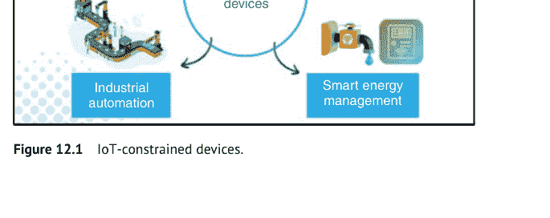

图 12.1 物联网受限设备。


适用于 IDS 的常见深度学习架构如下：

- **CNNs：** 这些有助于识别网络流量中的空间模式，例如数据包序列中可能指向攻击的特征。
- **RNNs 和长短期记忆（LSTM）网络：** 这些模型非常适合估计序列数据，使其适用于检测物联网流量中的时间相关攻击。
- **自动编码器：** 这些无监督学习模型通过学习重构正常系统行为来检测异常，将偏差标记为潜在入侵。

## 12.3.1 实施示例

a) **医疗设备中异常活动的检测：** 基于深度学习的 IDS 可以监控医疗物联网中的临床设备，如胰岛素泵或起搏器，以发现可能表明恶意活动的异常行为。例如，深度学习模型已被用于识别医疗设备的正常工作行为，并能找出因攻击而产生的偏差 [27]。

b) **缓解农业物联网中的威胁：** 物联网系统被用于智能农业以揭示作物健康状况、控制设备和控制灌溉 [28]。数据流量的意外增加，例如设备之间的异常通信，也可能意味着入侵，可由基于深度学习的 IDS 跟踪。例如，异常系统可以帮助抵御针对智能农业的网络攻击 [29]。

## 12.4 确保基于深度学习的入侵检测系统（IDSs）中的数据安全和隐私

在安全的物联网环境中，数据隐私和安全对于基于深度学习的 IDS 解决方案至关重要。由于物联网设备产生大量敏感数据，因此必须提供强大的安全机制技术以确保数据的隐私。

### 12.4.1 数据安全措施

### 12.4.1.1 物联网数据的加密技术

a) **端到端加密（E2EE）：** 来自物联网设备的信息包含敏感事实。物联网设备的网络流量记录由基于深度学习的 IDS 系统分析。E2EE 方法是防止未经授权访问从物联网设备接收的关键检测设备数据的必要手段 [30]。一种称为椭圆曲线密码学（ECC）的轻量级加密技术通常在物联网环境中用于保护数据免受篡改 [31]。

b) **同态加密：** 基于云的结构中的敏感科学数据必须得到保护，而同态加密使得在保持保密性的同时处理数据成为可能。同态加密能够在无需解密的情况下处理加密数据的能力，对于在冠心病风险预测和心电图监测等医疗评估和诊断过程中保护患者隐私至关重要，展示了这种密码方法在现实世界科学应用中的有效性 [32]。

### 12.4.1.2 安全通信协议的作用

a) **TLS/SSL 与深度学习模型：** 使用基于深度学习的入侵检测系统，网络流量信息在边缘设备和集中式结构之间交换以进行训练或评估。数据报传输层安全（DTLS）或传输层安全（TLS）是保护数据免受未经授权访问的安全通信协议 [33]。通过防止中间人攻击，这些协议保证了为异常检测收集的数据的完整性。

b) **带加密的 MQTT：** 许多物联网网络使用轻量级协议，例如消息队列遥测传输（MQTT），以确保安全通信。通过添加 TLS 或安全套接层（SSL）等加密层，确保了网络中传输的数据以及物联网设备与 IDS 之间信息交换的保护 [34]。

### 12.4.2 隐私保护

### 12.4.2.1 数据共享中的差分隐私技术

a) **训练数据中的差分隐私（DP）：** 训练用于入侵检测的深度学习模型需要大量可能包含敏感信息的网络流量数据。DP 方法保证在模型训练过程中用户或设备数据得到保护。通过向数据添加统计噪声，DP 在允许模型从聚合信息中有效学习的同时保护个人的隐私 [35]。

b) **用于入侵检测的联邦学习：** 在联邦学习中，用于深度学习的模型直接在物联网设备上使用其信息进行训练，而中央服务器仅接收更新后的模型参数，而不是实际数据。这确保了敏感数据保留在设备上，降低了 IDS 模型训练阶段暴露的风险 [36]。

### 12.4.2.2 边缘计算以减少敏感数据暴露

a) **设备端检测和分析：** 基于深度学习的 IDS 可利用边缘计算立即在物联网设备或相邻边缘节点上评估和识别异常。这通过将更少敏感数据发送到云端进行集中处理，降低了传输过程中数据泄露的危险。例如，为了保护隐私，物联网监控系统可能会在本地处理视频数据以进行入侵检测，而不是将原始录像上传到云端。

b) **隐私保护机器学习（PPML）：** 安全多方计算（SMPC）和同态加密是两种 PPML 技术，允许深度学习模型在不损害隐私的情况下从加密数据中学习并进行评估 [38]。在物联网的背景下，这意味着即使从多个来源聚合进行入侵检测，个人数据的敏感性也得到覆盖。

### 12.4.3 案例研究

a) **医疗保健示例：保护可穿戴设备中的患者健康数据：** 医疗物联网中的可穿戴技术，如胰岛素泵和心率监测仪，会产生需要保护的个人健康记录。通过分析众多设备的數據，基于深度学习的 IDS 可以识别出指向安全风险（例如故意篡改或非法访问）的异常模式。例如，机器在分析阶段使用加密信息和差分隐私来定位入侵，同时保持重要患者记录的隐私。通过联邦学习也可以实现设备端威胁检测，从而无需与外部服务器共享健康统计数据 [39]。

b) **农业示例：防止智能农业系统中的数据篡改：** 智能农业中的物联网传感器监测作物健康、温度和土壤湿度等关键环境参数。基于深度学习的 IDS 用于发现有害记录篡改或网络入侵。通过使用 DTLS 等安全通信协议和轻量级加密，在边缘层处理的传感器统计数据可免受篡改或窃听 [40]。此外，本地化统计处理除了增强隐私外，还减少了提供给云端个人农业记录的数量 [41]。

## 12.5 安全优化的物联网运营

为了提高设备的效率和可靠性，IDS 在物联网环境中的集成发挥着至关重要的作用。IDS 设备可以快速发现、分析和响应潜在威胁，确保隐私并防止运营受到负面影响。需要持续实时监控的环境，如医疗保健和农业，至关重要，因此需要保持系统安全以确保设备保持运行且数据保持可靠和准确。 [42]。

考虑到医疗保健场景，各种医疗设备，如可穿戴健康监测仪和植入物，如今被用于不间断的连续患者健康监测。如果这些设备被入侵，可能导致错误数据，进而导致错误治疗影响患者健康。因此，通过 IDS 保护这些设备，医疗设备可以确保异常活动，例如危及患者数据的數據泄露或未经授权的访问得到保障，并避免延迟患者的治疗。 [43]。

农业中使用的各种物联网设备，如作物健康监测系统和智能灌溉系统，对于优化资源和确保农业实践所用流程的高效至关重要。 [44]。这些设备的故障可能导致作物损坏或资源浪费。农业物联网环境中的 IDS 提供了额外的安全层，确保其不会被任何威胁操纵，从而保持运营效率并优化农业生产力。

为了在物联网网络中保护数据，主要挑战是提供安全与性能之间的桥梁，二者直接相关。物联网设备在功耗、存储、计算和能源消耗方面受限，因此应用轻量级安全措施至关重要。传统安全系统，例如由于资源消耗高而用于物联网环境的基于签名的入侵检测，未能满足物联网环境的安全与性能要求之间的平衡。

为了理解和应对这一挑战，轻量级深度学习模型需求更大，因为它们专为在资源受限的物联网设备中工作而设计。深度学习模型先进到足以执行入侵检测

通过使用最小的计算资源，从而确保安全层不会影响物联网环境的整体性能。为了在低功耗设备上运行，采用CNN和RNN来减少计算负载及其复杂度。[45]。

边缘计算也可以作为将计算任务从物联网设备卸载到其他强大网关的策略之一[46]。通过减轻单个物联网设备的负担，该过程能够在不影响性能的情况下实现实时数据处理和威胁检测。当使用轻量级模型和计算负载分配时，具有强大安全性和实时操作的物联网系统更加资源高效。

## 12.6 挑战与未来方向

### 12.6.1 当前局限性

尽管在可接受性和有效性方面仍有一些问题需要解决，但基于深度学习的入侵检测系统（DL-based IDS）在改善物联网环境安全方面提供了诸多好处。

- a) 深度学习模型的计算开销：物联网系统的主要问题之一是深度学习或必要的处理成本。一般来说，资源密集型任务由不同的深度学习算法（如CNN和RNN）处理，这些算法需要更大的内存、存储和处理能力。许多物联网设备，例如可穿戴设备或使用有限计算资源的低功耗受限设备，使得深度学习模型难以直接部署在设备上[47]。因此，需要付出大量努力来优化这些模型，以减轻边缘层而非设备本身的计算过载。

- b) 缺乏物联网安全标准化框架：物联网系统基本上是异构的，由具有不同处理能力、安全要求和通信协议的各种设备组成。物联网安全中缺乏入侵检测标准化框架，突显了为不同物联网设备开发统一方法来保护物联网环境的必要性。因此，在多样化的物联网系统中实施和维护安全措施非常困难，从而使系统容易被利用。

### 12.6.2 研究机会

- a) 开发节能的深度学习算法：许多物联网设备具有有限的能源资源和计算处理能力；因此，集成节能的深度学习算法至关重要。目前，轻量级模型提供与传统深度学习模型相同的检测精度，但显著减少了计算负担。知识蒸馏、量化和模型剪枝是各种不同的技术，它们降低了模型的复杂度，使其能够在资源受限的物联网设备中高效运行。张量处理单元（TPU）或现场可编程门阵列（FPGA）是用于硬件加速的专用处理器，可以进一步优化物联网环境中深度学习所需的处理能力。见文献[48]。

- b) 扩展数据集以在多样化的物联网应用中实现更好的模型泛化：深度学习模型所需的数据集需要数量多且多样化。然而，许多物联网安全数据集在规模和范围上都很有限，这使得深度学习模型难以在多样化的应用中提供泛化解决方案。为了提升模型性能并确保基于深度学习的IDS能够在不同行业中成功使用，必须扩大和多样化代表物联网环境真实世界多样性的数据集。为了收集用于模型训练的广泛数据，这可能涉及开发公开可用的数据集或政府机构、企业和学术界之间的合作举措。

此外，通过集成自恢复结构，可以显著提高物联网网络的恢复能力，这些结构能够自行检测和响应安全问题。无需人工干预，这些系统可以隔离受损设备、修补漏洞，并在发生入侵时自动重新配置，从而确保在广阔而复杂的物联网生态系统中持续安全。物联网安全的未来可能通过灵活、可扩展且能够在物联网环境变化中保持高水平安全性的结构来塑造，同时强调协作保护和自学习模型。

物联网设备的快速普及彻底改变了技术，促进了连接性和创新，但也带来了重大的网络安全挑战。传统安全机制在应对物联网生态系统的复杂性和规模方面力不从心，需要更先进的解决方案。本章强调了基于深度学习的IDS结构在加强物联网安全方面的变革能力。通过全面评估，本章探讨了深度学习与物联网网络安全的交集，强调了数据收集、特征提取、异常检测和模型训练在开发稳健IDS中的重要性。本章还指出了在优化保护与确保物联网环境运行性能之间保持平衡的重要作用。尽管深度学习前景广阔，但本章也提到了现有挑战，如可扩展性、对抗鲁棒性，以及边缘计算和区块链等互补技术的结合。这些领域代表了未来研究和发展的机会，为能够适应不断变化的威胁环境的弹性安全物联网铺平了道路。

本章为研究人员、从业人员和网络安全爱好者提供了全面指南，帮助他们加深对保护物联网生态系统的理解。通过弥合物联网安全挑战与基于深度学习的IDS等先进解决方案之间的差距，本章为读者提供了基础知识、技术见解、实践相关性和战略视角。预计本章将帮助读者掌握批判性评估物联网安全风险的知识，并利用深度学习开发可扩展、稳健且自适应的解决方案，以保护物联网生态系统。

## 参考文献

1 Nikitha, M., Arulprakash, P., Ayyannan, M., Nithin, M., Pokhariyal, R., and Maranan, R. (2023). Intelligent smart home automation system using internet of things. 7th International Conference I-SMAC (IoT Social, Mobile, Analytics and Cloud), I-SMAC 2023—Proceeding, 11-13 October, Kirtipur, Nepal. pp. 31–36, 10.1109/I-SMAC58438.2023.10290235.

2 Rout, S.K., Sahu, B., Mohapatra, P.K. et al. (2023). IoT and an intelligent cloud-based framework to build a smart city traffic management system BT. In: Enabling Technologies for Effective Planning and Management in Sustainable Smart Cities (ed. M.A. Ahad, G. Casalino, and B. Bhushan), 283–302. Cham: Springer International Publishing. https://doi.org/10.1007/978-3-031-22922-0_11.

3 Prince, N.U., Al Mamun, M.A., Olajide, A.O. et al. (2024). IEEE standards and deep learning techniques for securing Internet of Things (IoT) devices against cyber attacks. Journal of Computational Analysis and Applications 33 (7): 1270–1289.

4 Kumar, C.S. and Anand, R.V. (2024). Security in IOT-enabled smart agriculture systems BT. In: Communication Technologies and Security Challenges in IoT: Present and Future (ed. A. Prasad, T.P. Singh, and S.D. Sharma), 279–300. Singapore: Springer Nature Singapore. https://doi.org/10.1007/978-981-97-0052-3_14.

5. Heidari, A. and Jabraeil Jamali, M.A. (2023). Internet of Things intrusion detection systems: a comprehensive review and future directions. Cluster Computing 26 (6): 3753–3780. https://doi.org/10.1007/s10586-022-03776-z.

6. Ahanger, A.S., Khan, S.M., and Masoodi, F. (2022). Building an intrusion detection system using supervised machine learning classifiers with feature selection. In: Inventive Systems and Control. Proceedings of ICISC 2022 (ed. V. Suma, Z. Baig, S. Kolandapalayam Shanmugam, P. Lorenz), 811–821. Springer Nature Singapore.

7. Pandey, S. and Bhushan, B. (2024). Recent Lightweight cryptography (LWC) based security advances for resource-constrained IoT networks. Wireless Networks 30 (4): 2987–3026. https://doi.org/10.1007/s11276-024-03714-4.

8. Malhotra, P., Singh, Y., Anand, P. et al. (2021). Internet of things: evolution, concerns and security challenges. Sensors 21 (5): 1–35. https://doi.org/10.3390/s21051809.

9. Yadav, U. and Sharma, A.K. (2023). A novel automated depression detection technique using text transcript. International Journal of Imaging Systems and Technology 33 (1): 108–122. https://doi.org/10.1002/ima.22793.

10. Yadav, U. and Sharma, A.K. (2021). Review on automated depression detection from audio visual clue using sentiment analysis. Proceedings—2nd International Conference on Sustainable Communication Systems ICESC 2021, 04-06 August, Coimbatore, India. pp. 1462–1467. https://doi.org/10.1109/ICESC51422.2021.9532751.

11. Bondre, S. and Sharma, A.K. (2021). Review on leaf diseases detection using deep learning. In 2021 Second International Conference on Electronics and Sustainable Communication Systems (ICESC), 04-06 August, Coimbatore, India. pp. 1455–1461. https://doi.org/10.1109/ICESC51422.2021.9532697.

12. Masoodi, F. (2021). Machine learning for classification analysis of intrusion detection on NSL-KDD dataset. Turkish Journal of Computer and Mathematics Education (TURCOMAT) 12 (10): 2286–2293.

13. Yaqoob, T., Abbas, H., and Atifuzzaman, M. (2019). Security vulnerabilities, attacks, countermeasures, and regulations of networked medical devices—a review. IEEE Communication Surveys and Tutorials 21 (4): 3723–3768. https://doi.org/10.1109/COMST.2019.2914094.

14. Purohit, N. and Joshi, S. (2024). Comprehensive analysis on various cryptographic algorithm for constrained devices. In 2024 International Conference on Innovations and Challenges in Emerging Technologies (ICICET), 07-08 June, Nagpur, India. pp. 1–7. https://doi.org/10.1109/ICICET59348.2024.10616265.

15. Abrar, I., Ayub, Z., Masoodi, F., and Bhamdi, A.M. (2020). A machine learning approach for intrusion detection system on NSL-KDD dataset. 2020 International Conference on Smart Electronics and Communication (ICOSEC), IEEE. 10-12 September, Trichy, India.


- 16. Yazdinejad, A., Zolfaghari, B., Azmoodeh, A. et al. (2021). 智能农业和精准农业安全综述：安全方面、攻击、威胁和对策。 *Applied Sciences* 11 (16): https://doi.org/10.3390/app11167518.
- 17. Gupta, B.B. and Quamara, M. (2020). 物联网（IoT）概述：架构方面、挑战和协议。 *Concurrency and Computation: Practice and Experience* 32 (21): e4946. https://doi.org/10.1002/cpe.4946.
- 18. Hassija, V., Chamola, V., Saxena, V. et al. (2019). 物联网安全综述：应用领域、安全威胁和解决方案架构。 *IEEE Access* 7: 82721–82743. https://doi.org/10.1109/ACCESS.2019.2924045.
- 19. Purohit, N., Joshi, S., Pande, M., and Lincke, S. (2023). 基于经验视角的 ECC 安全模型的实用分析。 *Journal of Discrete Mathematical Sciences and Cryptography* 26 (3): 739–758. https://doi.org/10.47974/JDMSC-1749.
- 20. Masoodi, F.S., Abrar, I., and Bamhdi, A.M. (2022). 基于同质集成技术的有效入侵检测系统。 *International Journal of Information Security and Privacy (IJISP)* 16 (1): 18.
- 21. Angbara, S.I., Akiwu-uzoma, C., and David, O. (2024). 探索用于个人物联网（IoT）设备安全的轻量级机器学习模型。 *World Journal of Advanced Research and Reviews* 24: https://doi.org/10.30574/wjarr.2024.24.2.3449.
- 22. Dargan, S., Kumar, M., Ayyagari, M.R., and Kumar, G. (2020). 深度学习及其应用综述：机器学习的新范式。 *Archives of Computational Methods in Engineering* 27 (4): 1071–1092. https://doi.org/10.1007/s11831-019-09344-w.
- 23. Montasari, R., Hosseinian-Far, A., and Hill, R. (2018). 用于对抗网络和网络环境中对抗性攻击的政策、创新自适应技术及网络安全心理学理解。 In: *Cyber Criminology* (ed. H. Jahankhani), 71–93. Cham: Springer International Publishing. https://doi.org/10.1007/978-3-319-97181-0_4.
- 24. Ahanger, A.S., Khan, S.M., Masoodi, F. et al. (2025). 使用图注意力网络的物联网高级入侵检测。 *Scientific Reports* 15: 9831.
- 25. Jmila, H., Blanc, G., Shahid, M.R., and Lazraq, M. (2022). 基于机器学习网络流量分析的智能家居物联网设备分类综述。 *IEEE Access* 10: 97117–97141. https://doi.org/10.1109/ACCESS.2022.3205023.
- 26. Asharf, J., Moustafa, N., Khurshid, H. et al. (2020). 物联网中基于机器学习和深度学习的入侵检测系统综述：挑战、解决方案和未来方向。 *Electronics* 9 (7): https://doi.org/10.3390/electronics9071177.
- 27. Nandini, A., Behera, A., and Mishra, T.K. (2024). 使用机器学习算法检测基于物联网的医疗保健中的威胁。 In *2024 IEEE 9th International Conference for Convergence in Technology (I2CT)*, 05-07 April, Pune, India. pp. 1-6, https://doi.org/10.1109/I2CT61223.2024.10544363.
- 28. Dhoke, P., Purohit, N., and Lokulwar, P.P. (2023). 农业生态学：利用机器学习和深度学习智能实施数字农业。 In *2023 World Conference on Communication & Computing (WCONF)*, 14-16 July, Raipur, India. pp. 1-7, https://doi.org/10.1109/WCONF58270.2023.10234967.
- 29. Alanazi, B. and Alrashdi, I. (2023). 使用深度学习技术在网络边缘对智能农业系统进行异常检测。 *Sustainable Machine Intelligence Journal* 3: 1-31. https://doi.org/10.61185/smj.2023.33104.
- 30. Ahanger, A.S., Khan, S.M., and Masoodi, F.S. (2021). 使用监督机器学习技术的有效入侵检测系统。 *2021 5th International Conference on Computing Methodologies and Communication (ICCMC)*, IEEE. 08-10 April, Erode, India.
- 31. Adeniyi, A.E., Jimoh, R.G., and Awotunde, J.B. (2024). 物联网椭圆曲线密码算法系统综述：分类、应用领域和安全。 *Computers and Electrical Engineering* 118: 109330. https://doi.org/10.1016/j.compeleceng.2024.109330.
- 32. Munjal, K. and Bhatia, R. (2023). 同态加密及其在医疗保健行业贡献的系统综述。 *Complex & Intelligent Systems* 9 (4): 3759-3786. https://doi.org/10.1007/s40747-022-00756-z.
- 33. Mekala, S.H., Baig, Z., Anwar, A., and Zeadally, S. (2023). 工业物联网（IIoT）网络安全：威胁、对策、挑战和未来方向。 *Computer Communications* 208: 294-320. https://doi.org/10.1016/j.comcom.2023.06.020.
- 34. Jan, S., Masoodi, F. S., and Bamhdi, A. (2022). 物联网环境中的有效入侵检测：深度学习方法。 *SCRS Conference Proceedings on Intelligent Systems*. April, India.
- 35. Wang, T., Zhang, X., Feng, J., and Yang, X. (2020). 关于数据统计和分析的本地差分隐私综合综述。 *Sensors* 20 (24): 1-48. https://doi.org/10.3390/s20247030.
- 36. Almeida, L., Rodrigues, P., Teixeira, R., Antunes, M., and Aguiar, R.L. (2024). 隐私保护防御：使用联邦学习的物联网入侵检测。 In *2024 IEEE 22nd Mediterranean Electrotechnical Conference (MELECON)*, 25-27 June, Porto, Portugal. pp. 908-913, https://doi.org/10.1109/MELECON56669.2024.10608461.
- 37. Aldaej, A., Ahanger, T.A., and Ullah, I. (2023). 受深度学习启发的边缘计算环境物联网入侵检测系统机制。 *Sensors* 23 (24): 1-20. https://doi.org/10.3390/s23249869.
- 38. Arshad, S., Ashraf, W., Ashraf, S., Hassan, I., and Masoodi, F.S. (2023). CICIDS-2017 数据集上入侵检测机器学习技术比较研究。 2023 10th International Conference on Computing for Sustainable Global Development (INDIACom), IEEE. March, India.
- 39. Banerjee, S., Hemphill, T., and Longstreet, P. (2018). 可穿戴设备与医疗保健：数据共享与隐私。 The Information Society 34 (1): 49–57. https://doi.org/10.1080/01972243.2017.1391912.
- 40. Ullahkarimy, A. and Reddy, C. (2023). 保护物联网：基于机器学习的物联网安全和隐私挑战解决方案研究。 Electronics Communication Engineering Jawaharlal Nehru Technology University Hyderabad-JNTUH VIII (II): 30–65. www.zkginternational.com.
- 41. Debauche, O., Mahmoudi, S., Manneback, P., and Lebeau, F. (2022). 农业 4.0 数据管理的云和分布式架构：综述与未来趋势。 Journal of King Saud University, Computer and Information Sciences 34 (9): 7494–7514. https://doi.org/10.1016/j.jksuci.2021.09.015.
- 42. Marques, G., Pitarma, R., Garcia, N.M., and Pombo, N. (2019). 物联网架构、技术、应用、挑战及未来方向以增强生活环境和医疗系统：综述。 Electronics 8 (10): 1–27. https://doi.org/10.3390/electronics8101081.
- 43. Bamhdi, A.M., Abrar, I., and Masoodi, F. (2021). 基于多数投票的有效入侵检测集成方法。 Telkomnika (Telecommunication Computing Electronics and Control) 19 (2): 664–671.
- 44. Kumar, V., Sharma, K.V., Kedam, N. et al. (2024). 利用物联网技术实现智能和可持续农业的综合综述。 Smart Agricultural Technology 8: 100487. https://doi.org/10.1016/j.atech.2024.100487.
- 45. Goel, A., Tung, C., Lu, Y.-H., and Thiruvathukal, G.K. (2020). 低功耗深度学习和计算机视觉方法综述。 In 2020 IEEE 6th World Forum on Internet of Things (WF-IoT), 02-16 June, New Orleans, LA, USA. pp. 1–6, https://doi.org/10.1109/WF-IoT48130.2020.9221198.
- 46. Lin, L., Liao, X., Jin, H., and Li, P. (2019). 面向边缘计算的计算卸载。 Proceedings of the IEEE 107 (8): 1584–1607. https://doi.org/10.1109/JPROC.2019.2922285.
- 47. Amin, U., Ahanger, A.S., Masoodi, F., and Bamhdi, A.M. (2021). 基于 UNSW-NB15 数据集的云环境集成有效入侵检测系统。 SCRS Conference Proceedings on Intelligent Systems 483–494.
- 48. Vandendriessche, J., Wouters, N., da Silva, B. et al. (2021). 嵌入式系统上的环境声音识别：从 FPGA 到 TPU。 Electronics 10 (21): 1–31. https://doi.org/10.3390/electronics10212622.


## 用于零日攻击检测的深度学习方法

Aamir S. Ahanger¹, Asra Khanam¹, Faheem Syed Masoodi², and Bilal Ahmad Pandow³

¹计算机科学系，克什米尔大学，斯利那加，查谟和克什米尔，印度
²信息与通信技术学院，巴林理工学院，巴林王国
³商学院，巴林理工学院，巴林王国

隐私和保密性是密切相关的概念，两者都旨在保护敏感数据免受未经授权的访问。保密措施确保只有授权个人才能访问特定数据，通常利用加密和访问控制机制来保护信息 [1]。另一方面，完整性侧重于在数据整个生命周期内保持数据的一致性、准确性和可靠性。诸如哈希和循环冗余校验（CRC）等技术通常被用于验证数据在存储或传输过程中未被篡改 [2]。同时，可用性确保系统和网络始终可供合法用户访问。组织实施诸如容错系统和分布式架构等策略，以确保关键资源持续可访问 [3]。在网络安全背景下，当恶意实体、未经授权的程序或非法活动侵入系统或网络时，完整性就会受到损害，可能造成危害。网络安全虽无统一定义，可被描述为一套全面的工具、技术、技术和最佳实践，旨在保护网络空间免受此类威胁。历史上，基于签名和基于规则的算法在检测具有可识别模式或签名的传统网络攻击方面是有效的。然而，先进持续性威胁（APTs）的出现需要更复杂的检测方法 [4]。APTs 能够修改内存、在组件之间交互、与指挥控制系统通信，并试图预测哪些行为可能不会被检测到。

异常检测方法可以通过标记偏差来生成警报，为误用检测系统提供基础。然而，这种方法容易产生较高的误报率，因为新型但良性的流量模式也可能被归类为异常 [11]。

入侵检测系统（IDSs）是检测零日攻击最常见的方法之一。虽然 IDS 在应对零日威胁指数级增长方面显示出有效性，但与检测已知攻击相比仍存在局限性 [12]。零日漏洞利用利用新型漏洞或以不可预见的方式操纵已知漏洞，使得基于签名的 IDS 失效，因为这些漏洞利用不匹配现有已知模式。互联网连接设备的快速扩张进一步增加了暴露于新型攻击的风险，提高了遇到零日漏洞的概率 [13]。为提高 IDS 性能，研究人员越来越多地转向 DL 技术。这些方法使 IDS 能够识别先前未见的模式和行为，从而指示复杂的攻击。本文特别关注用于零日攻击检测的人工智能（AI）算法。它回顾了先前的研究方法，并介绍了近年来出现的前沿技术。通过提供对各种方法的见解并评估其性能，该工作解决了零日检测策略比较研究中的空白，为网络安全这一关键领域的进展提供了最新视角。

零日攻击是网络安全中最具挑战性之一。这些攻击利用软件或系统中供应商或安全社区未知漏洞，使得传统 IDS 失效。DL 作为 AI 的子集，通过利用能够学习模式并在不依赖预定义签名情况下检测异常的先进算法，为解决这一复杂问题提供了有前景的方法 [14]。零日攻击以其新颖性和隐蔽行为为特征。由于其利用的漏洞尚未被发现，因此没有现有的签名或规则可用于检测。攻击者通常会混淆其有效载荷以绕过传统安全措施，增加检测难度。零日攻击的影响可能是毁灭性的，在补丁可用之前影响关键基础设施并损害敏感数据。DL 为入侵检测带来了范式转变，专注于数据驱动的模式识别。与传统机器学习中特征需手动选择不同，DL 自动执行特征提取，使其更能适应复杂数据。其检测异常和建模数据中复杂关系的能力使其非常适合识别先前未见的攻击模式。此外，DL 模型在处理非线性和高维数据方面表现出色，使其适用于现代网络环境 [15]。

各种 DL 架构在零日攻击检测中有效。卷积神经网络（CNNs）通常用于图像处理，但也可用于可视化网络流量以识别指示恶意行为的空间模式 [16]。循环神经网络（RNNs）和长短期记忆网络（LSTMs）专为序列数据设计，使其适合分析网络日志等时间序列数据 [17, 18]。自动编码器通过学习数据的紧凑表示，非常适合异常检测，专注于与正常模式的偏差 [19]。生成对抗网络（GANs）由生成器和判别器组成，通过模拟潜在攻击场景来增强检测 [20]。

有效的特征工程是基于 DL 的入侵检测的基石。重要特征可从网络数据包中提取，包括协议类型、有效载荷大小和源-目的对。流级特征，如持续时间和到达间隔，以及捕获事件和用户活动的系统级日志，对于构建全面模型至关重要 [21]。预处理步骤如归一化和编码可确保数据处于适合训练的格式 [7]。

多个数据集用于训练和评估入侵检测模型。NSL-KDD、CICIDS 2017、CICIDS 2018 和 UNSW-NB15 提供了多样且逼真的流量模式，包括现代攻击场景 [8, 14, 21]。组织生成的自定义数据集反映了环境特定的行为并提高模型相关性。入侵检测的 DL 模型可使用监督方法训练，该方法依赖标记数据，或无监督方法在无标签情况下检测异常。结合这两种方法的混合模型为识别零日攻击提供了稳健性能。

模型训练和优化涉及超参数调优、防止过拟合的正则化以及用于可靠评估的交叉验证。性能指标包括准确率、精确率、召回率和平衡误报和漏报的 F1 分数。接收器操作特征（ROC）曲线和曲线下面积（AUC）分数等工具有助于可视化模型性能 [22]。

在真实环境中部署 DL 模型会带来额外考虑。实时处理能力、可扩展性以处理大量数据以及持续更新机制至关重要。尽管功能强大，DL 模型仍面临挑战，包括数据不平衡、对抗攻击和缺乏可解释性。迁移学习、联邦学习和可解释 AI 等创新正在出现以解决这些问题。

DL 通过自动化特征提取、建模复杂模式并适应不断演变的威胁，在检测零日攻击方面提供了重大进展。通过将 DL 集成到 IDS 中，组织可以增强其网络安全态势并抵御复杂的利用。持续的研究将继续完善这些技术，使其更具弹性、可解释且有效，以保护数字生态系统。


## 13.2 网络漏洞

网络容易受到来自外部来源和网络内部的攻击和入侵，因为其设计、配置或实现中存在固有弱点。这些漏洞可被安全威胁利用，通常源于硬件或软件设计的缺陷。系统配置不当，常由经验不足、培训不足或负责人员工作不完整造成，进一步增加了攻击风险。此外，网络系统管理不善也会导致漏洞。这包括缺乏明确的政策和程序来定义谁有权访问资源以及何时访问。监控不足和流量检查不频繁也会为恶意活动未被发现创造机会。安全协议的弱点、缺乏定期更新以及监督不足都会加剧网络被攻破的易受性 [23]。

## 13.3 网络中的异常和异常

在大型数据集中，不符合规范的模式通常被称为异常、离群点、例外、畸变、意外、特殊性或不一致的观察，具体取决于应用领域。在这些术语中，“异常”和“离群点”在基于异常的网络入侵检测的上下文中经常使用。检测这些异常的研究具有广泛的应用，包括信用卡欺诈检测、医疗索赔监控、网络安全和军事监视。例如，计算机网络中不寻常的流量模式可能表明受损系统正在向未经授权的目的地传输敏感数据 [24]。计算机网络是由相互连接的实体组成的复杂系统，共同提供通信服务。这些实体中的任何故障或被攻破都可能导致网络异常，即偏离预期行为，通常表明存在安全威胁。异常通常可分为两大主要类型：性能相关和安全相关。性能相关异常可能源于设备故障，例如路由器配置错误，而安全相关异常则源于旨在破坏正常操作的恶意行为。

安全相关异常分为六大主要类别：感染、爆炸、探测、欺骗、遍历和并发。

- **感染：** 通过安装恶意文件或修改系统配置来破坏目标系统。示例包括病毒和蠕虫。
- **爆炸：** 通过利用软件漏洞，如缓冲区溢出攻击，来使系统不堪重负。

异常实例，识别相似性或差异性模式，通常使用复杂的数学技术。实现稳健的泛化是 DL 系统的核心目标。

DL 方法可大致分为两大类型：监督学习和无监督学习 [14]。

- **监督深度学习：** 依赖于训练数据集，其中数据实例由标签标记，通常由人工专家完成，这可能耗时且昂贵。在此上下文中，标签可能代表数据实例所属的类别或分类。
- **无监督深度学习：** 通过评估实例之间的相似性，在不依赖预先存在的标签的情况下，寻求在数据中发现隐藏结构或分组。它使用指标来衡量数据点之间的相似性或距离。
- **半监督深度学习：** 将少量标记数据与大量未标记数据结合，使其在标记有限时很有用。例如，模型可能仅对“是”类别有标记数据，同时需要从“是”和“否”实例中学习。

根据数据的分组方式，DL 算法进一步分为分类和聚类技术。

- **分类：** 根据从标记示例中学习到的知识，识别新数据实例所属的类别或类。为分类设计的 DL 模型称为分类器，但并非所有监督 DL 模型都是分类器。
- **聚类：** 将数据划分为组或簇，其中簇内的项目彼此比与其他簇的项目更相似。这是一种无监督学习技术。

这些多样化的技术在应用于 DL 系统时，通过自动化发现庞大、动态数据集中复杂的攻击模式和异常，显著改善了入侵检测和决策过程。

## 13.5 硬件和软件中的漏洞

漏洞是网络系统设计、实现或管理中固有的弱点，使其暴露于潜在安全威胁。这些漏洞通常源于三个主要原因之一 [27, 28]：

- **设计不佳：** 硬件或软件中的设计缺陷会损害安全性。一个例子是早期 UNIX 版本中的 sendmail 漏洞，它允许攻击者获得对主机的未经授权的特权访问。
- **实现不佳：** 配置错误通常源于经验不足、培训不足或工作粗心。例如，未对关键可执行文件设置受限访问可能会允许未经授权的用户篡改它们。
- **缺乏适当管理：** 薄弱的政策、监督不力以及监控不足是主要因素。安全系统需要结构化流程，以确保没有单个个人能够完全控制关键资源，并且安全协议得到始终如一的遵守。

## 13.6 网络配置漏洞

不当的网络配置是漏洞的重要来源 [29, 30]。主要类型包括：

- **网络架构薄弱：** 小型组织通常从优先考虑功能而非安全的简单网络开始。随着网络扩展，未解决的安全缺陷可能会为攻击者创建后门。
- **数据流控制不足：** 弱或实现不佳的访问控制机制，例如配置不当的访问控制列表（ACL），可能会授予对敏感资源的未经授权访问。
- **安全设备配置不当：** 路由器和防火墙等安全设备上的默认设置通常会使网络暴露。主机上运行不必要的服务进一步增加了被利用的风险。
- **配置设置备份不足：** 如果没有恢复设备配置的明确程序，从安全漏洞或意外故障中恢复可能会变得困难且耗时。
- **密码传输未受保护：** 通过不安全渠道传输密码会使攻击者能够拦截它们，可能危及整个网络。
- **密码使用时间过长：** 允许密码长时间不变会使其容易受到暴力破解或字典攻击。

## 13.7 网络硬件漏洞

物理安全和设备管理上的疏忽会导致硬件漏洞：

- **物理保护不足：** 未受保护的网络硬件增加了损坏、被盗或篡改的风险。
- **物理端口不安全：** 开放的 USB 和 PS/2 端口可被利用来引入未经授权的设备或连接。
- **环境控制失效：** 温度和湿度管理不善可能导致设备故障或为防止损坏而关闭。
- **物理访问控制薄弱：** 对网络设备访问不受限制会增加篡改、敏感数据被盗或硬件损坏的风险。
- **关键网络缺乏备份：** 未定期备份网络数据可能导致灾难性数据丢失或长时间停机。

## 13.8 网络边界漏洞

定义不佳的安全边界会使网络暴露于外部威胁 [31, 32]：

- **安全边界未定义：** 如果没有明确的边界，控制访问和应用安全策略变得具有挑战性，导致未经授权的访问。
- **防火墙配置错误：** 不正确的防火墙设置可能会允许恶意流量渗透网络，危及敏感数据并启用未经授权的监控。
- **共享控制和非控制流量：** 在单个网络中混合控制和通用流量会使配置复杂化并损害控制系统的可靠性。

## 13.9 网络监控和日志记录漏洞

不充分的日志记录和监控降低了网络检测和响应威胁的能力 [33]：

- **日志不准确或不完整：** 不良的日志实践阻碍了事件后分析并延迟缓解工作。
- **安全监控不足：** 未能持续监控异常活动可能会使入侵在造成重大损害之前未被注意到。

## 13.10 通信漏洞

通信路径容易出现多种漏洞 [34]：

- **缺乏监控和控制路径识别：** 未经授权的连接可能会为攻击者创建隐藏入口点。
- **使用公开文档协议：** 标准协议，如 FTP 或 Telnet，容易使用协议分析器进行分析和利用。


-   **弱身份验证机制：** 对用户、设备和数据的验证不足会使重放攻击、欺骗和数据篡改成为可能。
-   **完整性检查不足：** 未验证数据完整性会导致通信过程中篡改未被发现。

## 13.11 无线连接漏洞

无线网络特别容易受到以下 [35] 的影响：

-   **弱身份验证：** 客户端与接入点之间互认证不佳可能导致非法接入点，使攻击者能够冒充合法系统。
-   **数据加密不足：** 未加密的无线数据容易被截获，使对手能够未经授权访问敏感信息。

通过采用稳健的设计、严格的实现和一致的管理实践来解决这些漏洞，组织可以显著增强其网络系统的安全性和弹性。

## 13.12 利用漏洞的网络攻击

攻击或入侵是一系列破坏网络或计算机系统安全的操作。文献中提出了各种网络攻击分类方案。攻击的分类法或分类旨在为理解攻击、其类别和子类之间的关系提供结构化方法。攻击通常可以根据其执行方法分为七个主要组 [36]：

-   **感染：** 此类攻击通过篡改文件或安装恶意软件感染目标系统。
-   **利用：** 这些攻击利用漏洞或利用系统中的 bug 使目标系统不堪重负，导致系统故障。
-   **探测：** 此类攻击使用侦察工具收集目标系统的信息。协调扫描是这种攻击特别危险的形式。
-   **欺骗：** 这些攻击涉及使用虚假身份或凭据。
-   **遍历：** 此类攻击尝试通过尝试所有可能的密钥或密码来入侵系统。

## 13.15 远程到本地（R2L）攻击

远程到本地（R2L）攻击涉及从远程机器发送数据包以获得未经授权的本地访问。攻击者通常会猜测密码或利用公共服务（例如，HTTP、FTP）渗透系统。示例包括：

-   **缓冲区溢出和未验证输入利用**
-   **常见的 R2L 攻击：** Warezclient、Warezmaster、IMAP、FTPwrite、Multi-hop、PHF 和 Spy

这些攻击通常是进一步入侵和恶意活动的先兆。

## 13.16 探测攻击

探测攻击旨在收集有关网络基础设施的详细信息，例如开放端口、可用服务和操作系统。攻击者利用这些情报来识别漏洞。示例包括：

-   **IPsweep：** 扫描网络以查找活动主机。
-   **Portsweep：** 扫描单个主机上的多个端口以查找正在运行的服务。
-   **Nmap：** 一种广泛使用的网络映射工具。

探测通常是在发动更重大攻击前的侦察步骤。

## 13.17 深度学习检测和缓解零日攻击

零日攻击是网络安全领域最严峻的威胁之一。它们利用软件中供应商和用户尚不了解的漏洞，使恶意行为者能够在不触发标准防御机制的情况下入侵系统。随着传统基于签名的检测方法难以发现这些难以捉摸的威胁，DL 成为增强检测和缓解策略的有前景的解决方案。本章探讨了 DL 在打击零日攻击方面的深远影响，讨论了其方法、挑战和未来潜力。

零日攻击因其依赖于未发现的漏洞而独一无二，使其尤其危险。已知签名或模式的缺失使这些攻击能够绕过传统的防病毒软件和 IDS。因此，防御零日利用需要超越传统检测技术的创新方法。最有效的方法之一是异常检测，它专注于识别与正常行为的偏差，而非依赖预定义规则或签名。DL 模型凭借其卓越的模式识别能力，特别适合此任务。

DL 能够自动从数据中学习复杂特征，这使其相对于传统机器学习模型具有显著优势。传统方法通常需要手动特征提取，这既耗时又范围有限。DL 架构，例如 autoencoders 和 RNNs，在异常检测中表现出优越性能。Autoencoders 学习重构正常数据模式，标记可能指示潜在零日攻击的偏差。同样，LSTM 网络作为一种 RNN，在检测网络流量等序列数据中的时间异常方面表现出色。除了异常检测之外，基于行为的威胁检测已成为识别零日利用的策略而日益突出。与依赖已知攻击签名的基于签名的方法不同，基于行为的模型分析应用程序和系统行为以检测可疑活动。DL 技术，包括图神经网络（GNNs），已被证明在建模系统组件之间复杂关系方面有效，从而实现行为异常的更精确检测。此外，深度强化学习（DRL）通过在实时攻击场景中学习最佳响应策略，为缓解零日威胁提供了一种动态方法。自然语言处理（NLP）是 DL 增强零日攻击检测的另一个领域 [40]。网络安全领域充斥着非结构化数据，包括威胁报告、漏洞描述和安全公告。DL 模型，例如 transformer 架构，可以分析和提取这些庞大文本信息库中的有价值见解。通过利用词嵌入和上下文表示，这些模型有助于主动威胁情报和漏洞预测，为零日攻击提供先发优势。DL 在零日攻击检测中的实际应用进一步凸显了其有效性。例如，基于 autoencoder 的系统已被部署来监控网络流量，成功识别出指示针对物联网设备的未知利用的异常模式。同样，CNNs 已用于恶意软件分类，通过分析其二进制表示，在检测新型恶意软件样本方面取得了令人印象深刻的准确率。由 DRL 驱动的自适应防御策略模拟攻击场景以优化实时防御机制，增强整体系统弹性。这些应用可以通过在威胁造成广泛损害之前识别威胁来防止网络攻击，并确保软件和硬件系统的安全性和稳定性 [11]。此外，DL 模型可以训练为自动生成补丁或更新以修复漏洞，显著降低未来零日攻击的风险。通过利用生成模型和强化学习，网络安全系统可以在无需人工干预的情况下为检测到的漏洞创建量身定制的解决方案。这种能力使组织能够更快地响应威胁，最小化暴露窗口。例如，GANs 可用于生成合成攻击场景，帮助完善补丁策略。自动补丁生成不仅减少了响应所需的时间，还减轻了人类安全团队的负担，使其能够专注于更复杂的任务。这种主动防御方法提高了系统的弹性，使其更能抵御不断演变的威胁。尽管具有变革潜力，将 DL 部署于零日攻击检测仍面临若干挑战。一个重大障碍是专门针对零日利用的标记数据集的可用性有限。监督式 DL 模型严重依赖注释数据，而标记的零日攻击样本稀缺阻碍了模型训练。此外，DL 模型的计算需求需要大量资源，使其部署成本高且复杂。另一个关键挑战是 DL 系统缺乏可解释性，通常被称为“黑箱”问题。这种不透明性限制了在透明度至关重要的安全关键环境中的信任和采用。

展望未来，联邦学习和混合方法的进步提供了有前景的解决方案。联邦学习允许在不损害数据隐私的情况下跨组织进行协作模型训练，从而更广泛地访问多样化的训练数据集。结合 DL 与传统检测方法的混合模型可以增强鲁棒性，利用两种方法的优势。此外，可解释 AI（XAI）框架的发展对于使 DL 预测更具可解释性至关重要，促进对自动化安全系统的更大信任。总之，DL 代表了对抗零日攻击的强大工具。其自适应学习、复杂模式识别和基于行为的检测能力为开发先进网络安全系统提供了坚实基础。虽然与数据稀缺、计算复杂性和可解释性相关的问题仍然存在，但持续的研究和创新不断推动 DL 所能实现的边界。通过采用这些技术，网络安全社区可以在不断演变的零日威胁对抗中保持领先一步。

## 参考文献

-   1. Parra-Ullauri, J.M., Zhang, X., Bravalheri, A. et al. (2024). 6G 网络的联邦分析：应用、挑战和机遇. IEEE Network 38 (2): 9–17.
-   2. Ahanger, A.S., Khan, S.M., Masoodi, F. et al. (2025). 使用图注意力网络的物联网高级入侵检测. Scientific Reports 15: 9831.


- 3 Lavanya, P., Anila Glory, H., and Shankar Sriram, V.S. (2024). 缓解内部威胁：一种增强安全性的神经网络方法. IEEE Access 12: 73752–73768.
- 4 Wang, Y., Liu, H., Li, Z. et al. (2024). 应对高级持续性威胁：挑战与解决方案. IEEE Network 38: 324–333.
- 5 Ahanger, A.S., Sajad, M.K., and Masoodi, F. (2022). 利用带有特征选择的监督机器学习分类器构建入侵检测系统. Inventive Systems and Control: Proceedings of ICISC 2022. Singapore: Springer Nature Singapore, pp. 811–821.
- 6 Dahal, A., Bajgai, P., and Rahimi, N. (2025). 基于MLP和XAI的零日攻击检测分析. arXiv preprint arXiv:2501.16638.
- 7 Arun, A., Anjaly S.N., and Sreedevi, A.G. (2024). 通过深度学习技术实现零日攻击检测与仿真. 2024 14th International Conference on Cloud Computing, Data Science & Engineering (Confluence), IEEE.
- 8 Touré, A., Imine, Y., Semnon, A. et al. (2024). 一种在网络流量中检测零日漏洞利用的框架. Computer Networks 248: 110476.
- 9 Singh, C. and Jain, A.K. (2024). SDN-IoT网络中DDoS攻击检测与缓解的综述. e-Prime Advances in Electrical Engineering, Electronics and Energy 8: 100543.
- 10 Choudhary, V. and Tanwar, S. (2024). 面向物联网环境中基于异常的入侵检测系统的数据集生成与评估. Multimedia Tools and Applications 83 (36): 8431–8435.
- 11 Zhao, F., Li, H., Niu, K. et al. (2024). 基于深度学习的入侵检测系统（IDS）在网络异常流量检测中的应用. Applied and Computational Engineering 86: 231–237.
- 12 Ahanger, A.S., Sajad, M.K., and Masoodi, F. (2021). 利用监督机器学习技术的有效入侵检测系统. 2021 5th International Conference on Computing Methodologies and Communication (ICCMC). IEEE.
- 13 Gowthami, G., and Priscila, S.S. (2024). 零日威胁检测：一种用于入侵预防的机器学习范式. 2024 7th International Conference on Circuit Power and Computing Technologies (ICCPCT), 第1卷, IEEE.
- 14 Kansal, S. (2025). 利用深度学习技术有效检测零日攻击. Economic Sciences 21 (1): 246–257.
- 15 Alshehri, A., Badr, M.M., Baza, M. et al. (2024). 利用联邦学习的深度异常检测框架用于电力窃电零日网络攻击. Sensors 24 (10): 3236.
- 16 Al Shammari, G. and Parveen, N. (2024). 基于Cnn-Lstm混合网络的双通道深度学习框架用于实时检测零日攻击. Nanotechnology Perceptions 20: 1410–1440.

- 30 Bamhdi, A.M., Abrar, I., and Masoodi, F. (2021). 基于多数投票的集成方法用于有效入侵检测. Telkomnika (Telecommunication Computing Electronics and Control) 19 (2): 664–671.
- 31 Wintering, N., Lanfer, E., and Aschenbruck, N. (2024). 面向去中心化网络管理的网络边界威胁防御自动化. 2024 20th International Conference on Network and Service Management (CNSM). IEEE.
- 32 Paya, A. and Gómez, A. (2024). Securesdp：一种用于增强网络安全和可扩展性的新型软件定义边界实现. International Journal of Information Security 23 (4): 2793–2808.
- 33 Amin, U., Ahanger, A.S., Masoodi, F. and Bamhdi, A.M. (2021). 基于UNSW-NB15数据集的云环境集成式有效入侵检测系统, SCRS Conference Proceedings on Intelligent Systems, pp. 483–494.
- 34 Muzammil, M.B., Bilal, M., Ajmal, S. et al. (2024). 揭示考虑中间人攻击和会话劫持的Web攻击漏洞. IEEE Access 12: 6365–6375.
- 35 Hussain, K., Rahmatyar, A.R., Riskhan, B. et al. (2024). 物联网（IoT）中无线网络的威胁与漏洞. 2024 IEEE 1st Karachi Section Humanitarian Technology Conference (KHI-HT C). IEEE.
- 36 Mallick, M.A.I. and Nath, R. (2024). 驾驭网络安全格局：网络攻击、新兴趋势和最新发展的全面综述. World Scientific News 190 (1): 1–69.
- 37 Masoodi, F.S., Abrar, I., and Bamhdi, A.M. (2022). 使用同质集成技术的有效入侵检测系统. International Journal of Information Security and Privacy (IJISP) 16 (1): 18.
- 38 Severin, A., Canales, C., Torres, R. et al. (2024). 预测多阶段网络攻击的下一阶段：统计模型与深度学习模型的比较研究. In: Iberoamerican Congress on Pattern Recognition (ed. R. Hernández-García, R.J. Barrientos, and S.A. Velastin). Cham: Springer Nature Switzerland.
- 39 Kohli, M., and Chhabra, I. (2024). 攻击、数据集与技术综述. Proceedings of the NIELIT's International Conference on Communication, Electronics and Digital Technology: NICEDT-2024, 第1卷, Springer Nature.
- 40 Balasubramanian, K., Baragur, A.G., Donadel, D. et al. (2024). CANLP：基于NLP的CAN入侵检测系统. In Proceedings of the 39th ACM/SIGAPP Symposium on Applied Computing, pp. 212–214.

## 索引

### a
能力 4, 8, 16, 18, 36, 38–40, 60–62, 64, 65, 74, 75, 78–80, 82, 95, 97, 101, 108, 109, 112, 117, 131, 148, 150, 152, 153, 159, 160, 162, 163, 173–177, 179, 181, 186–188, 195, 196, 198, 200–201, 222, 228, 237, 269, 272, 275, 279
访问 1–8, 11, 12, 19, 26, 35, 36, 44, 49, 54, 61, 62, 75–78, 81, 91, 114, 115, 132, 136, 139, 147, 149, 191–192, 197, 199, 200, 209–211, 217, 234, 238, 240, 251, 254, 256–259, 267, 270–278
访问控制 2–4, 191–192, 267, 274
准确率 8, 12, 13, 15, 20, 28, 31, 35, 36, 38–40, 42, 45, 51, 54, 60, 64, 79, 91–94, 97–99, 119, 120, 128, 131, 133, 136, 142, 143, 150–156, 158–160, 162–164, 174, 176, 197, 209, 210, 219, 221, 234–236, 239–245, 254, 261, 267, 270, 279
激活函数 40, 63, 65, 67–69, 93, 110, 221–223
活动 12–16, 25, 27, 28, 30, 32, 42, 43, 62, 64, 75–79, 81, 82, 107, 114, 115, 125, 128–130, 158, 162, 168, 177, 186, 191, 193–195, 197, 199, 217, 228, 252, 256, 268, 271
适应性 6, 21, 26, 35, 45, 60–62, 68, 79, 80, 149, 158, 197, 210, 234
自适应 31, 33, 56, 59, 72, 74, 83, 84, 159, 164, 187, 190, 192, 193, 198, 199, 201, 203, 205, 211, 216, 228, 235, 241, 247, 262, 280
自适应防御机制 198
高级的 3, 4, 11, 19, 26, 28, 29, 31, 59, 76, 83, 92, 94, 108, 132, 136, 139, 142, 149, 163, 175, 181, 192, 212, 219, 235, 236, 255, 259, 261, 262, 267, 268, 272, 280
进展 60, 63, 74, 81, 82, 84, 96, 101, 147, 149, 164, 176, 204, 212, 269, 270, 280
进展 113
优势 16, 19, 22, 60, 61, 79, 136, 149, 156, 158, 162, 163, 181, 194, 198, 228, 234, 240, 245
对抗性的 30, 46, 60, 62, 81–84, 139, 164, 173, 176–178, 180, 195, 205, 210, 237, 242, 243, 245–247, 270
对抗性攻击 30, 81, 205, 242
对抗性训练 243
自编码器（AEs） 97–98, 172, 173, 176, 180, 181, 227, 228
基于人工智能的异常检测（AI-Based AD） 168, 170–171, 181
人工智能驱动的自主入侵检测系统（IDSs） 246
人工智能驱动的安全 245
分析 28, 187, 189–190
分析 2, 13, 25, 29, 33, 36, 41, 42, 45, 60–62, 64, 75, 77–80, 83, 92, 97, 109, 133, 136, 149, 197, 209, 212, 214, 216–218, 235, 241, 255, 259, 268, 279
分析 9, 15, 17, 20, 27, 31, 32, 43, 51, 60, 61, 76, 80, 91, 95, 114, 148, 158, 161, 169, 190, 199, 228, 258, 270, 279
ANNs（人工神经网络） 38, 40, 65, 92–94, 113, 209, 219, 221–222, 242, 268
异常 3, 8, 15, 17, 32–35, 41–43, 46, 61, 62, 64–66, 75–79, 83, 95, 101, 115, 136, 167, 175–179, 195, 197, 198, 209, 227, 240, 255, 256, 258, 269–271, 279
异常的 27, 29, 36, 42, 43, 46, 77, 115, 133, 168, 173, 175–177, 195, 196, 198, 201, 228, 258, 279
异常 13, 15, 21, 25, 30–32, 39, 41, 43–45, 50, 54, 60, 62, 66, 74, 76, 77, 92, 95, 98, 107, 116–118, 130, 148, 163, 167, 168, 175, 177, 179, 186, 187, 193–201, 203, 210, 218, 227, 234, 237, 239–242, 252, 256, 257, 270, 272, 279
基于异常的网络入侵检测 44
异常检测 30, 33, 34, 39, 42, 43, 45, 47, 50, 66, 167–181, 192–194, 199–200, 237
异常检测算法 31, 34, 42, 43
应用 6, 9, 13, 16, 19, 20, 36, 42, 60, 77, 101, 111, 117–119, 148, 167–169, 171, 173, 176–179, 186, 188, 204, 214, 219, 236, 237, 271, 279
深度学习的应用 75–78, 112–113, 219–227, 238–242
应用的 20, 45, 68, 94, 95, 98, 101, 115, 117, 118, 120, 129, 141, 148, 155, 157–159, 173, 175–178, 187, 190, 194, 196, 209, 273
方法 2, 9, 15, 17, 19, 35, 52, 59, 82–84, 92, 95–97, 102, 143, 148, 157, 163, 164, 174, 175, 180, 201, 211, 218, 235, 257, 259, 270, 273, 280
架构 65, 67, 82, 93, 97, 99, 101, 108–111, 116, 171, 172, 186, 214–216, 221, 223, 224, 233, 237, 240, 247
人工智能（AI） 18, 167–181
基于人工智能的异常检测 168–171
人工神经网络（ANNs） 38, 40, 65, 92–94, 113, 209, 219, 221–222, 242, 268
攻击模式 18, 25, 26, 30, 32, 33, 45, 56, 60, 66, 82, 83, 92, 138, 141, 150, 151, 186, 193, 197, 210, 228, 233, 235, 268, 273
场景 21, 50, 128, 129, 133, 137–139, 141, 270, 279, 280
类型 18, 21, 37, 38, 125, 132, 136, 138–140, 143, 154, 156, 198
攻击者 8, 11, 16, 30, 51, 60, 77, 80, 81, 132, 136, 194, 198, 216, 217, 240, 242, 243, 245, 254, 269, 272–276, 278
尝试 8, 15, 49, 54, 60–62, 75, 78, 109, 117, 127, 134, 136, 137, 175, 200, 202, 226, 272
注意力 3, 82, 92, 118, 218
注意力网络 100


## a
- 身份验证 4, 16, 36, 169, 191–192, 202, 239, 276
- 身份验证与访问控制 191–192
- 自编码器 44, 77, 78, 98, 108, 171–173, 177, 196, 209, 225, 226, 228, 279
- 基于自编码器的异常检测 171–173
- 自动化的 5–7, 19, 32, 62, 79, 109, 115, 163, 185, 193, 200, 201, 234, 235, 253, 254, 280
- 可用性 4, 5, 8, 30, 32, 64, 66, 81, 128, 130, 149, 180, 217, 239, 251, 267, 272, 280
- 可用的 5, 19, 20, 39, 44, 108, 117, 126–128, 131, 133, 138, 140, 175, 180, 261, 269, 278

## b
- 反向传播 40, 63, 65, 69–71, 74, 93, 94, 96, 97, 210, 219, 221, 225, 268
- 基本信息 128
- 行为 2, 13, 15, 29, 45, 54, 60, 62, 65, 169, 189, 191, 199, 279
- 大数据分析 190
- 区块链 82–84, 246, 262
- 基于区块链的入侵检测 246–247
- 安全违规 5, 8, 13, 25, 42, 81, 91, 113, 147, 169, 194, 196, 199, 217, 251, 254, 258, 259, 274

## c
- 能力 4, 11, 15, 19, 20, 22, 28, 45, 59, 66, 74, 76, 83, 94, 101, 115, 149, 157, 159, 162, 164, 172, 189, 218, 237, 244, 252, 255, 270, 279
- 能够 13, 14, 18, 20, 29, 32, 40, 55, 60, 77, 79, 94, 102, 113, 114, 118, 162, 163, 186, 192, 197, 210, 216, 261, 267–269
- 捕获 53, 54, 63–65, 68, 93, 112, 126, 129, 131, 137, 140, 143, 148, 150, 153–155, 172, 176, 177, 179, 188, 209, 236
- 案例研究 77–78, 258
- 类别 9, 19, 20, 32, 34, 53, 117, 125, 128, 130–133, 136, 139–141, 154, 180, 211, 271, 272, 277
- 特定的 4, 9, 11, 16–18, 27, 28, 30, 46, 54, 56, 83, 118, 143, 154, 193, 200, 218, 244
- 挑战 11, 12, 16, 21, 37, 56, 80, 97, 98, 102, 120, 136, 156, 159, 160, 162, 180, 187, 198, 201, 229, 243, 259, 272, 280
- 未来挑战
- 具有挑战性的 13, 15, 21, 30, 32, 41, 46, 54, 56, 61, 76, 81, 130, 133, 136, 155, 176, 202, 205, 216, 217, 234, 240, 243, 244, 254, 268, 272, 275, 277
- 卡方 53, 155–157, 159–163
- 卡方特征选择 155–157, 162
- CICIDS 142, 270
- 类别 20, 21, 36, 37, 39, 40, 55, 56, 70, 93, 95, 99, 130, 132, 139, 154, 155, 157, 161, 173, 174, 176, 273
- 分类 10, 17, 20, 33, 39, 40, 46, 54, 60, 65, 70, 93, 97, 101, 111, 119, 154, 156, 162, 170, 174, 175, 222, 223, 228, 273, 276, 279
- 分类算法 33–35, 39, 170
- 云 6, 17, 19, 107, 139, 162, 177, 185, 188, 190, 214, 233, 239, 240, 245–247, 257, 258
- 聚类 20, 31–35, 42–44, 54, 55, 99, 112, 119, 168, 169, 171, 273
- 收集 20, 31–35, 42–44, 54, 55, 99, 112, 119, 168, 169, 171, 273
- 通信协议 137, 187, 188, 235, 257, 260
- 通信 1, 4, 113, 211
- 技术比较分析 156–158
- 复杂性 21, 30, 42, 43, 46, 55, 60, 61, 64, 65, 97, 101, 119, 120, 125, 133, 136, 149–152, 155, 156, 160, 162, 201, 213, 216, 228, 238, 255, 260, 261, 272, 280
- 复杂模式 29, 34, 35, 38, 46, 48, 61, 65, 75, 79, 80, 93, 109, 147, 148, 163, 186, 194–196, 220, 235, 255, 270, 272
- 组件 8, 9, 11, 19, 29, 35, 36, 43, 76, 110, 125, 147, 153, 160, 191, 194, 202, 210–213, 219, 226, 267, 277, 279
- 受损的 5, 14, 50, 62, 135, 141, 187, 191, 194, 200, 210, 254, 259, 261, 267, 268, 271
- 计算的 30, 37, 40, 41, 43, 47, 56, 59, 63, 81, 83, 99, 101, 109, 110, 149–153, 155, 156, 158–162, 164, 170, 222, 234, 235, 239, 241, 243, 244, 247, 260, 261, 268, 280
- 计算成本 55, 81, 237, 244
- 计算开销 101, 158, 235, 239, 243–244, 260
- 计算机网络 107, 114, 125
- 计算 6, 19, 60, 66, 71, 74, 80, 81, 84, 213, 219–222, 227, 228, 233, 236, 240, 241, 245–247, 251, 253, 258–260, 262
- 连接的 4, 13, 67, 98, 109–111, 185, 187, 190, 202, 207, 209, 221–223, 233, 238, 239
- 连接 6, 15, 21, 40, 44, 45, 96, 107, 110, 117, 127, 129, 133, 134, 138, 139, 178, 209, 221, 223, 224, 268, 275
- 受限的 11, 81, 188, 253, 259
- 上下文 1, 5, 20, 37, 49, 59, 61, 62, 79, 82, 102, 150, 153, 167, 178, 195, 210, 223, 258, 267, 271, 273
- 连续的 15, 21, 25, 32, 33, 53, 66, 81, 83, 143, 155, 156, 185, 196–198, 259, 267, 270
- 控制 2–4, 14, 55, 91, 96, 113, 175, 177, 178, 191, 192, 215, 217, 225, 234, 253, 254, 256, 267, 274, 275
- 传统的 2, 8, 59, 61, 95, 101, 102, 148, 177, 228, 235, 252, 254, 255, 268, 269, 278
- 卷积的 39, 60, 71, 95, 98, 108, 110, 111, 172, 174, 194, 209, 222, 252
- 卷积神经网络(CNNs) 39, 60, 77, 95, 110–112, 148, 172, 194, 209, 233, 236, 239, 252, 270
- 关键的 6, 21, 26, 35, 38, 55, 56, 59–64, 76, 78, 79, 81–83, 91, 127, 128, 136, 147–153, 157, 159–164, 168, 175, 186, 190, 191, 194, 205, 211, 219, 225, 228, 235, 245, 253, 256, 267–270, 272–274, 277, 280
### 网络
- 网络攻击 1, 59, 75, 77, 78, 91, 107, 113, 114, 132, 141, 193, 197, 252, 267, 276–277, 279
- 网络安全 1, 5–7, 26, 38, 59–63, 66, 76, 77, 79–84, 91, 92, 118, 125, 137–140, 147, 160, 163, 164, 168, 175, 178, 179, 187, 193, 194, 201–205, 219, 233–237, 245, 253, 261, 262, 267, 269–271, 278–280
- 网络威胁 21, 26, 59, 61–63, 66, 68, 75, 79, 80, 84, 92, 125, 136, 139, 140, 143, 147, 149, 150, 152, 158, 162, 209, 234, 235, 240, 246, 247

## d
- DARPA 131–134, 137, 277
- 数据 1, 3–8, 11–14, 17–22, 25, 26, 28–56, 59–66, 68, 71, 72, 75–84, 91–100, 102, 107–113, 115–120, 125–134, 139–143, 147–164, 167–181, 185–196, 198–205, 209–228, 233–239, 242, 244, 246, 247, 251–261, 267–280
- 数据可用性与质量 81–82
- 数据库 8, 9, 12, 14, 16, 19, 27, 30, 76, 116, 168, 218
- 数据收集与分析 187, 189–190
- 数据预处理技术 37
- 数据隐私与完整性 190–191
- 数据安全措施 256–257
- 数据集 16, 36, 39, 45, 49, 82, 92, 93, 98, 125–143
- 数据共享 203, 257
- 数据量 129, 160
- DDoS 1, 13, 18, 35, 41, 42, 49, 61, 75, 77, 78, 95, 114, 137, 141, 148, 161, 227, 228, 239–242, 254, 272
- 去中心化的 82, 210, 212, 214–216, 227, 234, 239, 240, 246, 247
- 去中心化网络 246
- 决策 19, 20, 31, 32, 34, 35, 38–40, 54, 64, 118, 158, 169, 170, 174, 243
- 解密 28, 257
- 深度信念网络(DBNs) 95–97, 210
### 深度学习
- 深度学习算法 95–102, 112, 186, 192, 218
- 深度学习方法 84
- 深度学习特征 147–164
- 深度学习模型 54, 69–71, 77, 239, 243
- 深度学习技术 60–62, 241
- 基于深度学习的入侵检测 125–143
- 基于深度学习的解决方案 227–229
- 深度神经网络(DNNs) 50, 56, 95–96, 174, 194, 205, 209, 218
- 深度强化学习 112, 113, 120, 171, 177–178, 279
- 防御 2, 3, 6, 33, 61, 63, 187, 198–201, 203, 214, 217, 237, 243, 246, 268, 277–280
- 防御机制 63, 187, 198–201, 203, 246, 268, 278, 279
- 拒绝 4, 41, 61, 95, 132, 148, 235, 277
- 拒绝服务 4, 41, 61, 95, 132, 148, 235, 277
- 拒绝服务(DoS)攻击 4, 41, 61, 95, 132, 148, 235, 277
- 依赖性 40, 77, 99, 101, 148, 176, 178–180, 196, 197, 199, 223–225, 236
- 下降 65, 71–74, 93, 177, 221
- 设计 9, 109, 120, 187, 201–203, 271, 273, 276
- 检测 27, 30, 31, 47, 49, 50, 107, 116, 200, 218
- 检测 1–22, 25–56, 59–84, 91–102, 107–121, 125–144, 147–164, 167–181, 185–205, 209–230, 233–247, 251–262, 267–280
- 偏差 2, 13, 16–18, 25, 30, 31, 34, 39, 44, 47, 50, 54, 60, 62, 76, 77, 92, 117, 148, 175, 177–179, 186, 237, 256, 269–271, 279
- 设备 1, 6, 12–14, 25, 28, 30, 113, 116, 130, 158, 187, 188, 190, 198, 202, 215, 238, 239, 243, 253, 254, 258, 259, 269, 276, 279
- 不同的 16, 20, 34, 35, 43, 45, 47, 50, 51, 67, 102, 109, 111, 114, 117, 119, 128–131, 136, 137, 139, 141, 143, 154, 157, 158, 161, 174, 177, 178, 180, 190, 191, 212, 236, 239, 251, 254, 260, 261, 272, 273, 277
- 差分隐私技术 257
- 困难的 16, 46, 54, 60, 64, 75, 82, 120, 129, 133, 136, 175, 176, 191, 214–217, 241, 244, 252, 260, 261, 274, 277
- 降维 42, 95, 97, 112, 119, 152, 153, 157, 162, 163, 172, 222
- 方向 43, 82–84, 152, 153, 163–164, 204–205, 234, 242–247, 260–261
- 直接地 12, 13, 50, 98, 102, 147, 148, 150, 162, 210, 214, 219, 242, 257, 259, 260, 272
- 分布式的 12, 82, 154, 190, 215, 216, 218, 238, 246, 247, 267
- 分布式入侵检测系统(IDSs) 246
- 多样的 13, 15, 16, 19, 82, 102, 113, 137–140, 142, 143, 148, 162, 234, 239, 270, 273, 280
- DNS 140
- 域 54, 59, 60, 64, 134, 135, 148, 163, 168, 176, 179, 271, 279
- 驱动的 1, 29, 61, 62, 68, 82–84, 94, 95, 99, 108, 139, 143, 180, 215, 240–242, 245–247, 269
- 动态的 1, 3, 15, 29, 60–62, 92, 107, 117, 159, 160, 162, 180, 186, 187, 194, 196, 198, 200, 204, 210–212, 215–219, 227, 234, 240–242, 252, 255, 279

## e
- 边缘计算 60, 236, 240, 241, 244, 245, 247, 258, 260
- 有效的入侵检测 1, 193
- 有效地 3, 18, 29–31, 36, 37, 42, 61, 68, 72, 84, 93, 94, 101, 112, 136, 150, 152, 156, 158, 159, 162, 168, 173, 175, 176, 178, 179, 186, 188, 189, 222, 224, 234, 241, 246, 254, 257
- 有效性 11, 13, 18, 21, 32, 35, 38, 39, 50, 80, 81, 125, 128, 133, 139, 142, 143, 148–150, 159, 176, 217, 236, 257, 269
- 效率 6, 7, 29, 36, 55, 61, 66, 79, 82–84, 91, 99, 150–152, 155, 156, 158–160, 162–164, 185, 188–190
- 增强 150
- 高效的 8, 18, 19, 22, 35, 40, 43, 46, 74, 83, 97, 98, 102, 118, 120, 136, 137, 143, 152, 156, 160–163, 168, 169, 211, 227, 234, 241
- 新兴的 2, 21, 29, 32, 42, 60, 61, 81–84, 107–120, 132, 150, 193, 196, 198, 201, 205, 216, 235, 237, 240, 252
- 新兴趋势 107–120
- 使能 20, 28, 32, 49, 59, 62, 63, 65, 71, 76–79, 95, 108, 126, 136, 148, 150, 158, 159, 173, 199, 205, 219, 235, 253, 276, 279, 280
- 加密 84, 91, 191, 202, 204, 234, 244, 255–258, 267, 276
- 加密技术 256–257
- 能量 179, 185, 189, 190, 195, 211–215, 228–241, 243, 244, 259–261
- 能源效率 185, 189, 214, 243
- 集成 39, 55, 79, 169, 210
- 确保 2, 8, 26, 37, 62, 63, 83, 91, 134, 142, 147, 150, 152, 160, 161, 164, 191, 194, 200, 203, 205, 214, 216, 217, 247, 256–257, 260, 262
- 环境 31, 35, 44, 49, 50, 112, 129–131, 137, 139, 157, 171, 185, 186, 188–192, 198, 200, 201, 204, 251, 260
- 误差 36, 38, 40, 46, 65, 69, 70, 79, 93, 94, 97–99, 167, 174, 196, 227, 268


- 评估 38, 55, 98, 99, 125, 128, 130, 132, 133, 137, 142, 143, 176, 257, 261, 270
- 评估指标 38, 132, 176
- 事件 3, 8, 9, 11, 13, 15–17, 28, 31, 35, 36, 111, 115, 117, 118, 175, 195, 236, 268, 270
- 演变 1–3, 21, 26, 29, 61, 62, 76, 79, 80, 148, 150, 193–194, 210, 234, 235, 255, 268, 270, 280
- 演变威胁 3, 29, 61, 62, 76, 79, 80, 148, 150, 193–194, 210, 234, 235, 255, 268, 270, 280
- 专家 64, 113, 119, 148, 168, 171, 187, 201–203, 205, 273
- 可解释的 56, 60, 82, 163, 176, 203, 205, 235, 245, 246, 270, 280
- 可解释的 AI 方法 245
- 可解释的人工智能 (XAI) 60, 82, 163, 205, 235, 270, 280
- 漏洞利用 6, 36, 59, 80, 115, 139, 140, 227, 269, 270, 272, 277–280
- 广泛的 12, 59, 84, 92, 94, 97, 117, 139, 141, 148, 152, 159, 186, 252, 261, 271, 272
- 提取 15, 20, 32, 59, 61, 63–65, 68, 71, 77, 94, 95, 97, 98, 102, 117, 139, 148, 180, 218, 220, 228, 233, 235, 252, 279
- 提取 19, 22, 37, 76, 92, 98, 111, 134, 147–164, 168, 169, 227, 234–236, 255, 262, 269, 270, 279
- 提取选择 147–164

## f
- 假的 3, 8, 11, 12, 14–16, 21, 28–30, 42, 46, 56, 61, 62, 80, 91, 198, 217, 235, 244–246, 270
- 误报 8, 11, 12, 14–16, 21, 28–30, 42, 46, 56, 61, 62, 80, 91, 198, 217, 235, 244–246, 270
- 特征
  - 工程 21, 22, 31, 53–56, 59, 61, 63, 64, 76, 94, 95, 102, 134, 147, 148, 150, 163, 164, 196, 219, 235, 270
  - 提取 22, 37, 92, 98, 111, 134, 147, 149–160, 162–164, 168, 169, 227, 234–236, 255, 262, 270, 279
  - 提取和选择 147, 149–160, 162–164
  - 选择 20, 21, 37, 53, 54, 147–164, 176, 243
- 联邦学习 60, 82, 83, 205, 235, 239, 245–248, 270, 280
- 前馈神经网络 (FNNs) 98, 110
- 金融 8, 107, 114, 147, 168, 169, 177, 181, 245, 252
- 金融机构 25, 77
- 防火墙 2–4, 6, 8, 26, 59, 91, 142, 186, 274, 275
- 基于流的 119, 126, 127, 129, 141, 143
- 基于流的数据 127, 129
- 关注 2, 25, 76, 79, 80, 84, 102, 137, 151, 153, 155, 159, 162, 163, 180, 228, 244, 254, 280
- 前向 53, 70, 74, 93, 98, 99, 110, 178, 209, 214, 221, 223, 224
- 框架 49, 109, 128, 136, 174, 175, 180, 204, 222, 242, 246, 247, 277
- 函数 13, 38, 40, 50, 59, 63, 65, 67–71, 73, 93, 110, 112, 143, 148, 188, 189, 198, 219, 221–223, 226, 244, 260

## g
- 增益 5, 8, 39, 75, 120, 132, 136, 217, 226, 254, 272, 273, 276–278
- 门 224, 225
- 生成式 46, 47, 60, 62, 96, 112, 113, 171–174, 195, 210, 237, 270, 279
- 生成对抗网络 (GANs) 46, 60, 62, 173, 195, 210, 237, 270
- 生成对抗网络异常检测 173–174
- 全局 91, 218
- 政府机构 78, 178, 261
- 梯度下降 65, 71–74, 93, 169, 177, 221
- 图 45, 47, 176, 210, 241, 279

## h
- 处理 12, 21, 22, 30, 34, 37, 40, 55, 94, 102, 152, 155, 173, 176, 178, 179, 189, 213, 216, 236, 255, 269
- 硬件 8, 9, 64, 84, 113, 115, 117, 149, 187, 202–203, 205, 218, 261, 271, 273–275, 279
- 硬件漏洞 274–275
- 医疗保健 25, 78, 82, 107, 114, 168, 169, 175, 178, 179, 191, 214, 245, 251–254, 256, 258, 259, 271
- 医疗保健组织 25, 78
- 隐藏层 40, 65, 92–94, 108–110, 209, 220, 221
- HIDS 11, 12, 25–28, 91, 107, 116, 218
- 高 11, 13, 15, 16, 19, 21, 28, 30, 36, 38, 42, 43, 45, 51, 54, 55, 60, 64, 66, 71, 79, 83, 91, 92, 94–97, 102, 111, 119, 120, 125, 136, 142, 143, 149, 150, 153, 155, 156, 160–162
- 高精度 15, 38, 54, 60, 64, 79, 142, 153, 209
- 高维 34, 35, 39–43, 50, 51, 54, 64, 92, 94, 95, 97, 149–153, 156, 157, 160–162, 164, 177, 186, 195, 196, 233, 235, 244, 255, 269
- 高维数据处理 195–196
- 同质的
- 主机 4, 7–9, 12, 14, 16, 20, 25–30, 35, 91, 107, 115, 116, 118, 126, 127, 129, 130, 133, 134, 143, 218, 278
- 基于主机的 7, 11, 12, 16, 25, 26, 28, 29, 91, 116, 126, 127, 129, 134, 143, 218
- 基于主机的入侵检测系统 (HIDSs) 26
- https 110
- 混合入侵检测系统 28
- 超参数调优 53–56, 270

## i
- 识别 2, 3, 6–8, 13–19, 21, 25, 27, 29–34, 39, 42, 46, 47, 49, 51, 59–62, 64, 65, 75–79, 91–93, 95–97, 115–119, 134, 141, 147, 148, 151, 155, 156, 158, 178, 186, 190, 193–195, 197–199, 201, 216, 218, 228, 237
- IDS 2, 4, 14, 25, 26, 28, 41–44, 52, 61, 76, 91, 95, 125, 137, 142, 147, 158, 161, 186, 192, 197, 215, 217, 218, 233, 252, 256, 269
- 改进 21, 31, 39, 45, 49, 62, 71, 72, 80, 82, 92–94, 97, 114, 133, 136, 152–154, 158, 161, 164, 170, 174, 185, 190, 194, 198, 210, 235, 237, 245, 246, 268, 270, 273
- 精度改进 150–152
- 工业 170, 173, 175, 177–180, 185, 188–191, 194–197, 200, 201, 215, 233, 238, 240, 251
- 信息 3–6, 8, 9, 12–15, 17, 26, 37, 39, 45, 62, 94, 97, 99, 101, 108–114, 116, 119, 120, 126, 132, 143, 149, 150, 152, 154, 155, 158, 160, 161, 179, 181, 187, 190, 191, 203, 210, 213, 214, 217, 220–223, 225, 226, 228, 252, 254, 256–258
- 信息安全 118, 137
- 基础设施 5, 19, 25, 26, 36, 56, 78, 81, 141, 179, 210–212, 214, 241, 269, 278
- 输入(s)
  - 数据 20, 40, 43, 60, 63, 65, 81, 93, 97, 102, 108, 109, 111–113, 148, 172, 173, 195, 205, 220, 225, 226, 236, 242
  - 层 40, 92, 99, 108–110, 172, 221, 223
- 内部人员 25, 35, 42, 44, 49, 54, 62, 76–78
- 洞察 19, 20, 26, 36, 62, 91, 133, 143, 148, 159, 162, 190, 201, 262, 269, 279
- 实例 1, 8, 17, 20, 21, 32, 36, 56, 81, 98, 136, 154, 175, 176, 181, 272, 273
- 与区块链集成 82–83
- 与边缘计算集成 245–246
- 完整性 4–6, 8, 26, 82, 83, 147, 164, 187, 190–191, 217, 251, 257, 267, 276
- 智能系统
- 相互连接的 40, 59, 63, 65, 108, 110, 137, 185–190, 194, 195, 219–221, 238, 239, 253, 271
- 因特网 1–4, 91, 99, 107, 109, 113, 126, 162, 177, 185, 212, 233, 251
- 物联网 1, 113, 126, 162, 177, 185, 212, 233, 251
- 可解释性 38, 39, 46, 54, 56, 60, 64, 82, 102, 149, 155, 156, 161, 163, 173, 176, 205, 244–246
- 入侵 1–22, 25–56, 59–84, 91–102, 107–121, 125–144, 147–164, 167–181, 185–205
- 入侵检测 1–22, 25–56, 59–84, 91–102, 107–121, 125–144, 147–164, 167–181, 185–205, 209–230, 233–247, 251–262, 267–280
- 入侵检测方法 9, 17–21
- 入侵检测方法论 9, 14–17
- 入侵检测系统 (IDSs) 2, 4, 14, 25, 26, 28, 41–44, 52, 61, 76, 91, 95, 125, 137, 142, 147, 158, 161, 186, 192, 197, 215, 217, 218, 233, 252, 256, 269
- 入侵检测技术 9–14
- IoT
  - 设备 1, 199, 201, 202, 215, 239, 252–261, 279
  - 环境(s) 126, 251–262
  - 网关 239
  - 安全 162, 238–240, 253–255, 260–262
  - 安全挑战 253–255, 262
  - 系统 185, 190, 191, 194, 195, 201, 251–254, 256, 260
- IPS 6, 7, 9, 10, 31, 49, 50, 115, 117, 125, 129, 138, 140
- ISCX 137–139
- 问题 36, 101, 117, 133, 136, 137, 143, 152, 185, 197, 204, 217, 227, 234, 239, 243, 244, 252, 254, 260, 268, 270

## k
- KDD 数据集 101, 118, 119, 134, 136
- 关键 8, 16, 27, 28, 32–33, 36, 37, 42, 45, 53, 61, 64, 72, 79, 82, 83, 110, 128, 131, 141, 151, 160, 162, 189, 198, 201, 202, 210, 212, 213, 217, 222, 227, 228
- 知识蒸馏 243–244, 261

## m
- 机器学习 79–81, 91, 98, 107, 113, 114, 118, 125, 128
- 恶意软件 1–3, 5, 8, 13, 14, 32, 42, 51, 59–62, 75, 77, 78, 94, 97, 195, 209, 268, 279
- 恶意软件检测 47, 51, 60, 61, 94
- 管理 2, 6, 8, 9, 12, 13, 18, 26, 51, 114, 116, 191, 201, 211, 212, 215, 218, 254, 271, 274, 276
- MANETs 210, 215, 227, 241
- 中间人 (MITM) 攻击 240, 257
- 措施 1–3, 5, 6, 26, 40, 43, 53, 62, 70, 80, 91, 125, 130, 154, 159, 198, 203, 215, 234, 251, 256, 260, 267, 269
- 机制 1, 4, 8, 59, 61, 81, 82, 91, 101, 116, 118, 192–194, 198, 202, 235, 245, 246, 261, 267, 268, 270, 272, 274, 276–279
- 内存 51, 77, 81, 95, 101, 178, 196, 197, 223–225, 236, 239, 243, 244, 255, 256
- 元数据 125–127, 129, 141–143, 152
- 方法论 9, 14, 82, 116, 117, 163, 218, 269, 278
- 方法 6–15, 19–22, 30–34, 43, 46, 61, 76, 83, 147, 151, 159–162, 168, 170, 171, 175, 191–194, 209, 233–235, 269, 270, 277
- 缓解 25, 62, 68, 72, 81, 101, 152, 193, 198, 200, 205, 228, 241
- 移动 1, 91, 192, 210, 211, 228, 233, 241, 244, 246, 247
- 移动自组织网络 (MANETs) 210, 227, 241
- 建模 27, 29, 36, 37, 60, 62, 69, 118, 171, 173, 175, 190, 201, 223, 224, 270
- 模型
  - 精简 243, 244, 261
  - 训练 37, 38, 46, 53–55, 82, 150, 158, 160, 235, 257, 261, 270, 280
- 监控 3, 4, 7, 9, 11–14, 21, 25–28, 51, 62, 115, 169, 175, 179, 194, 196, 197, 209, 214, 243, 253, 254, 259, 271, 277
- 互信息 37, 154
- 基于互信息的选择

## n
- 网络架构 67, 108–111, 116, 214, 274
- 基于网络的 26, 43, 53, 116, 130
- 基于网络的入侵检测系统 (NIDSs) 9, 11–13, 25–28, 91, 95, 116, 218
- 网络配置漏洞 274
- 网络硬件漏洞 274–275
- 网络入侵 11, 44, 49, 95, 107, 115, 169
- 网络监控和日志记录 275
- 网络边界漏洞 275
- 网络安全 2–4, 234–235
- 网络流量 3, 7–9, 11, 13, 18, 28, 30, 34, 36, 37, 41–43, 45–47, 49–51, 54, 56, 59–62, 64, 67, 76, 78–81, 91, 95, 101, 107, 114–116, 118, 125–133, 136, 137, 139, 141–143, 147–150, 153–156, 158–162, 169, 178, 186, 187, 193, 196, 197, 199–201, 209, 216–218, 220, 227, 228, 233–237, 243, 244, 248, 252, 255–257, 268, 270, 277, 279
- 网络流量分析 42, 101, 197, 236


## n

-   神经网络架构 109–110, 179, 236
-   神经网络 34, 38, 40–41, 60, 63, 65–74, 77, 92–96, 99–102, 110–113, 148, 158, 174–179, 186, 194–196, 199, 205, 209, 210, 218–224, 233, 236, 239, 241, 242, 252, 268, 270, 279
-   神经元 108–110, 118, 220, 222, 223, 244
-   NIDS 9, 25, 27–28, 91, 95, 98, 99, 107, 116, 218
-   NLP 62, 109–113, 118, 279
-   节点 210–214, 218, 221
-   非线性 95, 97, 98, 109, 110, 154, 155, 157, 194, 222
-   正常 30, 32, 34, 37, 39, 41–49, 53–56, 76, 98, 116
-   新颖的 194–195
-   NSL 95, 97, 98, 101, 118, 119, 126, 134–137, 139, 140, 143, 270
-   NSL-KDD 95, 97, 98, 101, 118, 119, 126, 134–137, 139, 140, 143, 270

## o

-   操作 9, 13, 15, 25, 39, 91, 92, 107, 109, 134, 151, 187, 212, 214, 228, 234, 235, 239, 253
-   优化 69–74, 185, 189–190, 243–244, 259–260
-   输出 65, 67–69, 220–225
-   过拟合 39, 73–74

## p

-   基于数据包的数据 126–127
-   数据包 8, 13–15, 19, 27, 28, 36, 77, 79, 96, 115, 127, 129, 131, 134, 139, 210, 212, 233, 244, 270, 277, 278
-   模式和异常检测 33
-   模式识别 66
-   PCA 32, 35, 37, 42, 43, 151–154, 156–163
-   执行 8, 11, 16, 19, 37, 46, 63, 94, 97, 108–113, 118, 136, 156, 168–170, 173, 178, 181, 188, 189, 196, 218, 240, 247, 259
-   性能 159–160, 236, 259–260
-   性能改进 159–160
-   钓鱼检测 60
-   播放 6, 9, 63, 84, 102, 111, 130, 143, 147, 149, 150, 156, 158, 160, 210, 272
-   点 20, 33–35, 37–40, 42–43, 45–47, 129, 130, 152, 158, 167, 173, 178, 195, 196, 210, 211, 234, 240, 273, 275, 276
-   策略 7, 13, 31, 33, 50, 51, 107, 112, 114, 115, 171, 177, 187, 204, 218
-   阳性 80
-   可能的 8, 9, 14, 33, 49, 93, 95, 114, 115, 117, 118, 130, 153, 186, 187, 192, 195, 198, 199, 203, 218, 227, 234, 251, 257, 260, 276
-   潜在的 79–83
-   潜在威胁 7, 8, 11, 12, 42, 45, 60, 78–80, 116, 148, 151, 178, 198, 199, 259
-   实际实施挑战 56
-   预定义的 2, 3, 14, 16, 42, 59–61, 76, 79, 92, 99, 117, 130, 154, 192, 193, 198, 255, 269, 272, 279
-   预测 19, 29, 38, 46, 50, 110, 112, 189, 198–201, 268, 269
-   预测 30, 40, 45, 46, 55, 56, 65, 70, 79, 82, 92, 93, 109, 111, 161, 169, 205, 221, 268, 272, 280
-   预防 61, 199–200
-   主要的 5, 7, 8, 13, 19, 39, 42, 65, 69, 79, 82, 92, 97, 98, 102, 112, 114, 132, 185–187, 190, 210, 213, 219, 222, 226, 259, 260, 271, 273, 276
-   主成分分析 (PCA) 32, 35, 43, 151, 153, 171
-   隐私 190–191, 203, 204, 216–217
-   隐私保护人工智能 246
-   处理 168
-   保护 257–258
-   协议 257

## q

-   质量 81–82

## r

-   随机 7, 20, 31, 32, 39–40, 54, 55, 118, 139, 142, 143, 169, 174
-   率 8, 42, 46, 55, 69–72
-   原始数据 35–37, 53, 61, 63–65, 147–149, 158, 160, 162, 214, 219, 220, 239, 246, 255
-   真实 78, 80, 81, 83, 102, 137, 150–153, 162, 163, 169, 170, 176–178, 180, 185–189, 192, 193, 200, 216, 228, 234–237, 240, 242–244, 251, 253–255, 259, 260, 270, 279
-   实时 78, 80, 81, 83, 102, 137, 150–153, 162, 163, 169, 170, 176–178, 180, 185–189, 192, 193, 200, 216, 228, 234–237, 240, 242–244, 251, 253–255, 259, 260, 270, 279
-   实时分析 196–197
-   现实世界 77–78
-   实际应用 159, 161–162
-   识别 66, 94–96, 98, 109, 111, 118, 119, 147, 191, 194, 223, 224, 236, 240, 255, 269, 279
-   记录 20, 26, 78, 131, 134, 136, 143, 252, 255, 256, 258, 272
-   循环神经网络 99–102, 111–112, 178–179, 222–224, 236
-   循环神经网络 (RNNs) 99–102, 111–112, 178–179, 222–224, 236
-   递归神经网络 (RvNNs) 112
-   减少误报 29, 80
-   减少 150–152
-   冗余 20, 73, 134, 136, 143, 148–150, 152, 155–157, 159, 161, 214
-   强化学习 49–51, 177–178, 246
-   相关 15, 27, 54, 79, 81, 114, 127, 129, 134, 139, 156, 157, 172, 181, 189, 190, 194, 199, 254, 255, 267, 271, 280
-   关系 17, 27, 31, 34, 59, 63–65, 68, 76, 79, 80, 95, 108–110, 112, 148, 154, 155, 157, 194, 220, 222–224, 236, 237, 269, 276, 279
-   相关 31, 37, 54, 59, 61, 63, 64, 97, 148–150, 152, 154–160, 162, 203, 204, 212, 223, 226
-   relu 68, 69, 71, 93, 110, 220, 222, 223
-   报告 6, 9, 218, 279
-   表示 66–67
-   资源 215–216, 227–228, 239, 243
-   资源受限设备 243
-   响应 200
-   结果 161
-   RNN 62, 76, 99, 101, 102, 108, 111, 171, 177–179, 196, 197, 199, 223, 224, 233, 279
-   健壮 243
-   路由 241
-   路由攻击 209, 241, 242
-   规则 244

## s

-   可扩展性 80, 160
-   规模 246
-   安全通信协议 257
-   安全 2, 185–205
-   增强安全潜力 79–83
-   安全措施 256–257
-   安全威胁 194–195
-   选择 21, 31, 37, 53, 54, 73, 147–164
-   自学习系统 118, 198–199
-   半监督 20, 45–47, 102, 118, 170, 172–174, 180, 210, 218, 247, 273
-   半监督学习 19, 21, 44–49
-   半监督网络入侵检测 49
-   敏感 1, 4–6, 12, 26, 62, 63, 76–78, 82, 113, 116, 129, 132, 147, 176, 185, 190–192, 200, 202, 214–217, 235, 247, 251, 254–258, 267, 269, 271, 272, 274–276
-   传感器 8, 9, 11, 13, 14, 116, 158, 167, 178, 185–191, 195, 196, 198, 201, 209, 212–214, 218, 227, 228, 238, 251–255, 258
-   序列 18, 69, 99, 101, 111, 127, 131, 178, 193, 199, 209, 218, 223–226, 243, 255, 256, 276
-   顺序 61, 62, 64, 66, 68, 71, 76–79, 99, 109, 111, 134, 148, 172, 178, 179, 181, 196, 199, 222–224, 233, 234, 236, 256, 270, 279
-   系列 36, 43, 109, 187, 199
-   服务 1, 4–6, 8, 13, 19, 25, 78, 107, 113, 115, 130, 132, 134, 185, 189, 190, 210, 213, 215, 233, 240, 254, 271, 274, 277, 278
-   短期 62, 77, 98, 169, 178, 196, 197, 209, 224–227, 233, 236, 239, 256, 270
-   基于签名 6, 11, 13–15, 21, 25, 29–31, 59–62, 75, 76, 80, 107, 117, 132, 169, 186, 192, 210, 218, 234, 252, 255, 259, 267, 269, 278, 279
-   签名 2, 7, 11, 14–16, 18, 19, 27, 29–31, 42, 60, 65, 75, 76, 79, 92, 95, 97, 115–117, 132, 169, 193, 198, 218, 247, 255, 267–269, 272, 278, 279
-   显著 1, 9, 11, 13–15, 18, 19, 29, 40, 41, 44, 56, 60, 61, 63, 77, 79–81, 92, 95, 98, 101, 102, 114, 116–118, 120, 126, 129, 133, 136, 140, 143, 148, 149, 153, 155, 156, 158, 159, 162, 163, 165, 190, 198, 199, 203, 204, 214, 218, 222, 227, 228, 233, 234, 243, 260, 261, 268–270, 274, 275, 278–280
-   显著地 6, 13, 25, 36, 42, 74, 76, 80, 83, 91, 96, 101, 128, 130, 132, 142, 150, 151, 160, 163, 167, 175, 177, 188, 212, 234, 254, 261, 273, 276, 279
-   类似地 60, 98, 99, 129, 137, 150, 159, 160, 189, 209, 228, 279
-   单个 11, 17–19, 26, 40, 94, 98, 127, 130, 131, 139, 167, 176, 214, 223, 274, 275, 278
-   智能电子产品
-   智能环境 185–205
-   智能家居 185, 189–195, 197–201, 215, 240
-   软件 2, 4–8, 11–13, 16, 19, 26, 30, 60, 62, 75, 91, 107, 113–117, 119, 133, 141, 186, 187, 194, 202–203, 213, 217, 227, 238, 240, 251, 254, 268, 269, 271–274, 276, 278, 279
-   解决方案 4, 6, 7, 25, 33, 60, 61, 91, 92, 102, 120, 125, 173, 190, 193, 194, 198, 201–202, 205, 209, 219, 227–229, 234–236, 238–240, 242, 244, 245, 247, 252, 254–256, 261, 262, 268, 278–280
-   精密 2, 26, 29, 31, 34, 38, 59, 61, 77, 79, 81, 91, 94, 113, 137, 162, 186, 198, 201, 216, 233, 237, 238, 240, 242, 243, 247, 252, 267–270, 273, 280
-   源 3, 6, 13, 14, 20, 26, 36, 53, 68, 127, 131, 149, 153, 161, 168, 179, 180, 210, 211, 228, 270, 274
-   特定 4, 12, 15, 16, 18, 21, 26, 32, 35–37, 39, 45, 54, 55, 60, 62, 64, 91, 93, 108, 111, 113, 126–128, 130, 131, 141, 143, 148, 149, 156, 157, 160, 167, 168, 171, 192, 201, 240, 267, 268, 270, 280
-   平方 53, 70, 72, 73
-   状态 11, 15, 16, 50, 51, 94, 112, 169, 178, 203, 223–225
-   统计 15, 16, 18, 36, 37, 53, 92, 95, 148, 149, 153–155, 157, 160–162, 168, 190, 257, 268
-   策略 3, 31, 33, 74, 95, 102, 139, 140, 186, 197, 201, 216, 247, 260, 267–269, 278–280
-   结构 34, 36, 38–40, 44, 47, 59, 63, 66, 75, 94, 96–99, 109, 112, 136, 142, 143, 179, 195, 196, 216, 223, 227
-   监督 20, 31, 32, 38, 39, 56, 95, 102, 112, 117, 118, 130, 154, 171, 209, 273
-   监督学习 19–21, 30, 33, 37, 38, 41, 95, 108, 111, 157, 170, 176, 195, 247
-   监督学习算法 33, 38–41
-   监督学习技术 20, 32, 39
-   调查
-   可持续
-   SVM 31, 32, 34, 35, 38–40, 54, 99, 101, 117, 118, 158, 169, 171, 209
-   系统 2, 4–5, 25–29, 41–52, 76–77, 147, 158–162, 197–199, 215–219, 256–258
-   系统性 131, 137, 204

## t

-   目标 3, 5, 8, 26, 75, 77, 78, 114, 132, 137, 154–156, 159, 161, 179, 180, 191, 214, 217, 222, 239, 247, 251, 253, 271, 276, 277
-   任务 19, 26, 39, 40, 61, 63, 64, 69–71, 73, 93, 94, 98, 101, 108–112, 114, 118, 147, 152, 154, 156–158, 162, 172, 179–181, 186, 188, 189, 194, 210, 213, 218, 222–224, 233, 236, 260, 279, 280
-   技术 213
-   技术 3, 31–33, 37, 39, 42, 43, 53, 72–73, 114, 117, 118, 130, 132, 133, 139, 147–164, 168, 169, 171, 175, 177, 195, 209–211, 217, 219, 228, 233, 235, 238, 239, 241–244, 246, 247, 252, 256–258, 267–269, 273, 279
-   技术 8, 9, 13, 60, 84, 91, 132, 149, 163, 187, 188, 203, 211, 215, 233, 237, 247, 251, 252, 262, 267, 280
-   技术 2, 9, 19, 59, 74, 79, 82, 94, 107, 108, 113–115, 119, 169, 203–205, 212, 233, 238, 251, 253, 258
-   时间 102, 148, 177–180, 197, 199, 209, 223, 228, 241, 279
-   术语 16, 40, 63, 68, 69, 72, 77, 83, 92
-   测试 36, 53, 98, 125, 130–132, 136, 155, 156
-   测试 16, 20, 36, 54, 55, 96, 97, 125, 130, 131, 133, 136, 137, 142, 143
-   威胁 2, 4, 6, 8, 14, 29, 30, 32, 38, 44, 51, 54, 60–62, 76–80, 83, 97, 107, 113–115, 120, 152, 153, 160, 163, 164, 187, 198, 200, 201, 203–205, 227, 236, 240, 242, 244, 246, 254, 258, 260, 262, 268, 272, 279


- 威胁检测 6, 25, 29, 32, 54, 61–63, 79, 80, 83, 152, 153, 160, 163, 196, 201, 203, 205, 236, 240, 242, 244, 254, 258, 260, 279
- 威胁预测和预防 198–200
- 时间 7, 13–15, 18, 19, 21, 25, 54, 81, 111, 129, 185, 214
- 时间序列 17, 77, 111, 148, 168, 172, 177–180, 196, 197, 199, 223, 224, 228, 236, 239, 270
- 工具 14, 28, 36, 41, 61, 127, 130, 132, 137–139, 141, 159, 163, 194, 203, 215, 253, 254, 267, 276
- 传统 2, 19, 21, 22, 31, 49, 59, 61–64, 66, 75, 76, 79, 80, 82, 83, 92, 94, 95, 99, 101, 111, 114, 143, 147, 148, 168, 186, 192, 194–198, 209, 210, 212, 219, 228, 233–236, 239, 242, 247, 254, 261, 267–269, 272, 278–280
- 传统方法 14, 21, 22, 30–32, 61, 75, 76, 95, 191, 194, 196, 236
- 流量 1–3, 5–11, 13, 15, 17, 18, 25, 27, 28, 32, 36, 41, 91, 128–130, 135, 197, 243, 244, 275
- 流量模式 13, 15, 27, 34, 35, 43, 51, 75, 77, 91, 139, 143, 192, 196, 241, 243, 268–271
- 训练 32, 34, 36, 45, 62–64, 68, 82, 98, 113, 136, 138, 158, 168, 173, 195, 239, 243, 247, 270
- 训练的 20, 31, 32, 35, 37–39, 41, 43–45, 47, 49, 66, 81–83, 96, 108, 111, 113, 136, 139, 153, 168, 172–174, 186, 244
- 训练 54, 63, 96–98, 150, 161, 179, 243, 257
- 训练数据 37, 179, 257
- 交易 17, 77, 114, 116, 169, 176
- 转移 79, 180, 181, 211
- 迁移学习 179–181
- 基于 Transformer 的模型 237
- 传输 4, 44, 216, 274
- 信任 3, 64, 82, 95, 203, 280

### u
- 未经授权的访问 5, 254
- 未知 2, 38, 42, 46, 194, 216
- 无监督学习 31, 32, 41–44, 194–195, 237
- 无监督学习技术 31, 32, 42, 195
- UNSW 数据集 118, 139–140, 143, 270
- 异常 2, 7, 13–15, 18, 25, 27, 35, 43, 44, 50, 54, 76, 78, 115
- 用户 203, 277
- 用户到 Root (U2R) 攻击 277

### v
- 各种 8, 15, 19, 20, 92, 100, 102, 113, 148
- 庞大 54, 83, 153, 185, 272, 279
- 视觉 112, 261
- 体积 129
- 漏洞 271, 273–277
- 漏洞利用 140

### w
- 弱点 217
- 权重 67–71
- 无线 209–229
- 无线网络 209–229, 233–247
- 无线传感器网络 (WSNs) 212–214

### z
- 零日 2, 26, 80
- 零日攻击 15, 16, 18, 62, 79, 267–280

## WILEY 终端用户许可协议

请访问 www.wiley.com/go/eula 以获取 Wiley 电子书 EULA。
