# 医学数据深度学习

本论文重新审视了深度学习的基础组件，并评估了它们在医学图像分析背景下的应用。它识别了深度学习在该领域存在不足的三个主要挑战：专家知识的整合、无标记数据的利用以及预测不确定性的估计。论文证明了专家知识可以被有效地整合到深度学习模型中，通过自监督学习利用无标记数据可以增强模型性能，并且通过更灵活的变分推理方法可以改进预测不确定性。

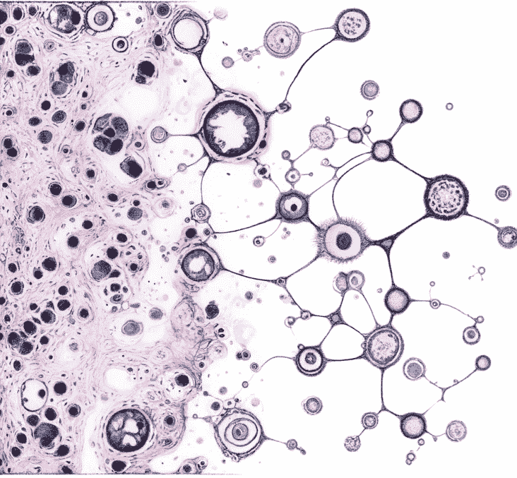

Bastiaan S. Veeling

Bastiaan S. Veeling

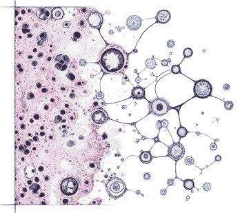

学术论文

旨在获得阿姆斯特丹大学博士学位

根据校长授权

prof. dr. ir. P.P.C.C. Verbeek 教授

由学位委员会指定

并于2024年7月1日（周一）上午10:00在Agnieten礼堂进行公开答辩

作者

## Bastiaan Sjouke Veeling

出生于 泽斯特 (Zeist)

## 学位委员会

导师：

prof. dr. M. Welling   阿姆斯特丹大学

共同导师：

prof. dr. M. Petković   埃因霍汶理工大学

其他成员：

prof. dr. Z. Akata   图宾根根大学

prof. dr. P.T. Groth   阿姆斯特丹大学

prof. dr. E. Kanoulas   阿姆斯特丹大学

dr. S. Mandt   加州大学欧尔文分校 (UC Irvine)

dr. ir. E.J. Bekkers   阿姆斯特丹大学

自然科学、数学与计算机科学学院

本论文描述的工作主要在阿姆斯特丹大学的机器学习机器学习实验室 (AMLab) 和飞利浦研究中心完成。该职位资金由飞利浦研究中心慷慨提供。

## 摘要

本论文重新审视了深度学习的基础组件，并评估了它们在医学图像分析背景下的应用。它识别了深度学习在该领域存在不足的三个主要挑战：专家知识的整合、无标记数据的利用以及预测不确定性的估计。论文分为几个部分，分别应对这些挑战。

在第一部分中，论文引入了一种新型深度学习模型，该模型通过`roto-reflective equivariance`结合专家知识，以提高医学成像任务的准确性和稳健性，特别是在病理切片中转移组织的检测中。所提出的模型优于传统的 `CNN` 架构，并展示了对输入扰动的鲁棒性。接下来了了通过展示 `PCam`（来自 `Camelyon16` 挑战的数据集）激励深度学习社区关注真实的医学问题。`PCam` 的结构类似于深度学习基准测试，并且与更大的 `Camelyon16` 基准相比，它在该数据集上展示了改进。

第二部分探索了通过对比预测编码 (`CPC`) 进行自监督表示学习的益处，并提出了对比扰动编码 (`C2PC`)，该方法通过结合特定的医学图像增强增强了 `CPC` 的性能。

论文第三部分解决了高风险医疗决策中预测不确定性估计的挑战。它引入了一种利用隐变量多项分布的新型变分推理方法。与现有方法相比，该方法在不确定性估计和风险评估方面表现出具有竞争力的性能。

论文结论认为，通过解决识别出的挑战，深度学习可以更好地适用于医学成像任务。它证明了专家知识可以被有效地整合到深度学习模型中，通过自监督学习利用无标记数据可以增强模型性能，并且通过更灵活的变分推理方法可以改进预测不确定性。

本论文基于以下成果：

- Han Gorp, Iris Huibben, Bastiaan S. Veeling, Max Welling (2018). “旋转等变 CNN.” 发表于国际医学计算与辅助手术会议 (`MICCAI`)。
- Bastiaan S. Veeling, Bart Bakker, Max Welling (2018). “对比扰动编码。” 未发表。
- Sindy Löwe, Peter O’Connor, Bastiaan S. Veeling (2019). “端到端：梯度学习。” 发表于神经信息处理系统大会 (`NeurIPS`)。优秀方向奖。
- Han Gorp, Iris Huibben, Bastiaan S. Veeling, Nicola Pezzotti, Ruud J. Sloun (2019). “主动概率采样。” 发表于国际机器学习会议 (`ICML`)。
- Florian Wenzel, Kevin Roth, Bastiaan S. Veeling, Linh Tran, Stephan Mandt, Jasper Snoek, Tim Salimans, Rodolphe Jenatton (2020). “深度神经网络中的贝斯后验有多好？” 发表于国际机器学习会议 (`ICML`)。
- Jakub Swiatkowski, Kevin Roth, Bastiaan S. Veeling, Linh Tran, Joshua Dillon, Jasper Snoek, Stephan Mandt, Tim Salimans, Rodolphe Jenatton, Sebastian Nowozin (2020). “k-耦合正态分布：贝叶斯场后场的紧凑参数化。” 发表于国际机器学习会议 (`ICML`)。
- Adam Hilbert, Bastiaan S. Veeling, Henk Marquering (2018). “用于急性缺血性卒中治疗的数据高效卷积神经网络。” 发表于深度学习医学会议 (`MIDL`，摘要轨道)。
- Linh Tran, Bastiaan S. Veeling, Kevin Roth, Jakub Swiatkowski, Joshua V. Dillon, Jasper Snoek, Stephan Mandt, Tim Salimans, Sebastian Nowozin, Rodolphe Jenatton (2020). “Hydra：保持模型蒸馏中的集成多样性。” 来自 `ICML 2020` 深度学习不确定性与鲁棒性工作坊。
- Iris A.M. Huijben, Bastiaan S. Veeling, Kees Janse, Massimo Mischi, Ruud J.G. Sloun (2020). “应用于超声成像的采样与信号恢复。” 发表于 `IEEE` 医学影像。
- Stojan Trajanovsky, Dimitrios Mavroeidis, Christine Leon Swisher, Binyam Gebrekidan Gebre, Bastiaan S. Veeling, Rafael Wiemker, Tobias Klinder, Amir Tahmasebi, Shawn M Regis, Christoph Wald, Brady J. Mc-Sebastian Flacke, Heber MacMahon, Homer Pien (2021). “利用深度学习实现 CT 肺筛查中放射科医生水平的癌症风险评估，” 发表于计算机医学影像与图形。
- 荷兰语摘要 (SAMENVATTING - SUMMARY IN DUTCH) ................................................................................................................................................................................................................................. 109
- 致谢 ................................................................................................................................................................................................................................................. 111

## 2 引言

问题（Maron et al., 2020; Perera et al., 2022）。在这种不确定性的迷雾中进行决策可能需要超越我们这些凡人手动操作所能力的智能水平。

### 1.1.2 医学影像

现代医学成像的出现进一步加剧这个问题。随着射线、超声以及后的计算机层扫描（CT）和磁共振成像（MRI）等技术，以及病理学数字化的进步，临床医生可以获得关于患者的海量信息。因此，医生在诊断疾病和预测治疗结果时，面临着数据过载。这些方法生成的此类复杂图像已被证明可以评估并将数据转化为放射科医生和病理学家形式的可操作建议。专家必须承担的一些任务是人类天生并不擅长的。这些任务往往像是在大海捞针，脱离了与患者的人性联系，这些专家必须专注于密集的数据流，以寻找异常值并进行评分。为了标准化见解，人类专家依赖于主观量表，例如 `Gleason` 评分（Gleason and Tannenbaum (1977)），这些评分对治疗的侵入性有巨大影响，但其评分者之间的差异却惊地高（Ozkan et al., 2016）。此外，众周知，将人类引入决策过程会在通信和交接方面带来一系列挑战。一旦做出诊断，专家的建议与实际治疗结果之间几乎没有反馈回路。

这正是计算机辅助诊断（`CAD`）的用武之地。计算机拥有无限的能量、无限的注意力，而且值得注意的是，它们不会在饥饿的情况下上班。软件是可以复制的，并且可以不断改进。错误行为可以被重现、研究和修复。反馈回路可以跨越数月，治疗结果可以作为早期识别模型的引导信号回流。这是改进医疗决策的一条充满前景的路径。

虽然医学诊断过程有很多方面，但要涵盖整个过程是具有挑战性的。在论文中，我们关注医学影像解读范围内的计算机辅助诊断挑战。这是开发一个综合系统的关键一步，该系统可以消化医学诊断过程中各个方面的信息，并在过程中提供建议。

### 1.1.3 计算机辅助诊断

将医学图像分析领域的专业知识提炼为算法已被证明是困难的。尽管有大量的博士接受了这一挑战，但基于直觉和经过数世纪与实践仔细遵循的理论来推导出规则被证明是不可能的。

幸运的是，机器学习为基于规则建模的僵化设计提供了替代方案。该领域提供了经过证明的方法，通过接收专家标注的示例，并推导出旨在捕捉制作这些注释的原则的模型。然而，医学影像数据特别庞大且密集，传统的机器学习方法依赖于手工特征提取，将数据转换为方法可以处理的数字。这种特征的人工制作被证明与从一开始设计规则是几乎同样困难的任务。

### 1.1.4 深度学习

这就是为什么深度学习的出现为医学图像分析领域带来了巨变。通过结合大型随机初始化特征提取器和随机梯度下降来遍历搜索空间，机器学习模型现在可以直接在原始稠密图像上进行训练。这种方法在2012 年的 `ImageNet` 挑战中流行起来，深度学习的表现优于传统的机器学习方法。从那时起，大多数图像研究社区已转向以深度学习为主范式。

深度学习在医学图像分析中的有效性为未来激发了充满前景的愿景。深度学习模型可以在全球的数据上进行训练，而不是由专家使用学术医院的小数据集（仅捕捉了世界范围内人口统计特征的））设计的手工模型。此外，深度学习模型可以在初始诊断做出几个月后从错误中学习，这种反馈回路在人类专家实践中很少发生。尽管通常被认为是黑箱，类似于飞机事故调查员的专家小组可以精确重现模型出错的状态，并可以使用各种工具提供内省以及关于未来如何减轻类似问题的指导。此外，深度学习的自由复制意味着专业知识可以应用于全球。这为本缺乏这些知识的社区提供了获取高质量医疗见解的机会。

深度学习模型可以通过消除对专业知识的需求来改变基础医疗服务的提供。这使得医生能够直接将医学扫描转换为可操作的见解，从而消除通信负担并减少因交接导致的错误。最后，当一种新疾病威胁世界时，这些模型可以快速更新以纳入新诊断，对全球健康危机提供敏捷的响应。

### 1.1.5 重新评估用于医学图像分析的 DL

尽管深度学习非常有效，但它是以经验方式开发的——一些人将其等同于炼金术——而且仍然缺乏基本的首要原理证明。虽然这显然带来了巨大的成功和进展，但驱动逐年改进的主流基准与医学影像中看到的问题有显著差异。这些基准通常是自然图像中的简单目标检测，侧重于分类准确率，错过了医学图像分析的细微差别。并不是说深度学习没有显示出它的价值。它在医学影像领域取得了巨大成功（Litijens et al., 2017）。列举一些早期工作，Gulshan et al., 2016 展示了一个能够检测视网膜糖尿病病变的深度学习模型，性能与认证眼科医生相当。Esteva et al., 2017 在分类皮肤癌方面展示了（接近）人类专家水平的性能。Wang et al., 2016 展示了从哨淋巴结活检中识别乳腺癌的强大性能。

然而，对于医疗决策这样敏感的任务，深度学习模型的失败模式是不容忽视的（Zhang et al., 2016; Litijens et al., 2017）。数据偏见、类别不平衡、决策的可解释性缺乏、输入模态稳健性以及标签差异敏感性等问题在医学领域需要仔细关注。因此，值得从医学图像分析的角度重新评估深度学习的现状，看看是否可以发现进一步的改进并修复缺陷。

## 1.2 设置

我们考虑到医学图像分析重新评估深度学习的工具箱，并发现三个需要进一步研究的主题：专家知识的整合、不确定性的建模与校准预测以及大量未标记医学影像数据的使用。这些主题构成了论文的基础。在部分 ??，我们研究深度神经网络中专家知识的整合。在部分 ??，我们研究概率建模以改进不确定性的预测，以辅助深度学习模型的决策。最后，在部分 ??，我们研究如何从未标记数据中学习以增强小型数据集。在整个论文中，我们思考以下研究问题。

研究问题 1：`roto-reflective equivariance` 可以提高大规模医学环境下深度学习模型的准确性和稳健性吗？

## 6 | 引言

**研究问题 3：** 医学影像深度学习模型是否受益于于对比预测编码（`contrastive predictive coding`）的自监督表示学习？

医学影像数据并不匮缺，因为全球的医院每天都会采集大量数据。这些图像被存储在名为 `PACS` 的中心化存储系统中，现代医院已经配备了以自动化方式处理这些数据的系统。医学数据的挑战在于收集专家标签。这是一个昂贵的过程，需要多位“金标准”专家参与并达成共识。因此，利用未标记数据对于该领域来说是一个非常有前景的方法，因为标注数据与未标记数据的比例极度失衡。在论文的第二部分，我们探索了一种新的无监督表示学习技术，使得深度学习模型的大部分可以在不依赖下游层的情况下进行训练，以提高标签效率。

**研究问题 4：** 我们是否可以在没有端到端反向传播的情况下有效优化深度学习模型？继续未标记数据的话题，我们探索了是否可以以贪心的方式进行无监督训练：即训练神经网络的单个层，而不通过整个网络进行反向传播。这种训练形式对医学图像神经网络特别有利。首先，无监督训练减轻了医学专家的标注负担。其次，每次只训练一层所需的内存比训练整个网络少几个数量级。最后，模型可以在大型医学图像的小裁剪块上进行训练，这在处理 3D 或 4D 数据时尤为有效。

**研究问题 5：** 隐变量量化是否能产生更好的置信度评分？深度决策受益于对特定预测置信度的准确表示。由于深度学习往往容易过度自信，研究能更好地捕捉不确定性的方法对医学影像具有高度相关。在第三部分，我们研究了深度隐变量模型中的变分推理（`variational inference`）框架，这是概率深度学习模型的一种。我们通过引入依赖于隐空间量化的高度灵活均场后验，测试了一个假设：即变分后验灵活性的提高会带来更好的性能。

在论文正文解决这些研究问题之前，我们将在下一节简要介绍符号和深度学习的核心原理。最后，我们将在第7章进行结论并讨论未来的工作方向。

## 1.3 符号

在整个工作中，我们遵循下表所示的符号。

| 示例 | 说明 |
| --- | --- |
| `a, b, c` | 随机标量 |
| `x, y, z` | 随机向量 |
| `x_i` | 随机向量的元素 |
| `X, W, Y` | 随机矩阵 |
| `X_{i,j}` | 随机矩阵的元素 |
| `p(·)` | 分布（概率密度函数） |
| `q(·)` | 通常用于变分近似分布 |

## 1.4 深度学习基础

深度学习是指使用堆叠的函数近似器并利用随机梯度下降对这些近似器进行优化的现代机器学习实践。该术语既涵盖了技术本身，也涵盖了围绕机器学习设计、优化和方法的一系列最佳实践。在接下来的部分中，我们将简要讨论深度学习的基本原理和实践，专家读者可以安全地跳过。与每个研究问题相关的背景将在后续章节讨论。

### 1.4.1 数据

我们首先考虑数据。理想情况下，我们收集了一个包含独立采样、同分布（i.i.d）数据点 `$x$` 的大型数据集。对于每个我们想要预测的数据点，我们可能有一个对应的标签 `$y$`。这形成一个包含 `$n$` 个数据点的数据集 `$X: \{(x_i, y_i | 0 \leq i \leq n)\}$`。我们将该数据集分为三部分：一组用于在 `$D_{train}$` 上优化模型，一组在训练期间跟踪和调整性能 `$\mathcal{D}_{valid}$`，最后一组用于估计在未见数据上的性能 `$\mathcal{D}_{test}$`。这种分离确保了我们的模型泛化到问题上，而不是对训练数据过拟合。

### 1.4.2 模型

深度学习模型简单带参数化的数学函数，它接受数据空间的样本并将其转换为标签空间：`$f : \mathbb{R}_x \rightarrow \mathbb{R}_y$`。通常，该函数的形式为交替的线性变换后跟标量非线性（或激活函数）：`$f_\theta(\chi) = W^3l(W^2h(W^1x))$`。这个函数被称为神经网络，因为它松散地模拟了大脑中连接神经元的层结构。参数或权重 `$\theta : \{W^l\}$` 是我们用来调整以寻找最优模型的“旋钮”。

### 1.4.3 优化


我们通过交替估计模型在训练数据上产生的误差，并使用导数对参数进行微小修改以减少该误差来优化 $f$ 的参数。这是梯度下降的本质，其工作原理如下：我们在网络上定义一个标量误差函数（通常称为 $loss$）$\mathcal{L} : \{X, Y, W\} \rightarrow \mathbb{R}$。为了改进模型，我们为每个参数计算导数 $\nabla L = \frac{d}{dW_{i,j}^l}\mathcal{L}$。然后我们通过更新每个参数沿着梯度下降的方向迈出一小步：

```
$W_{i,j}^l = W_{i,j}^l - \eta\nabla_{W_{i,j}^l}\mathcal{L}$
```

其中步长或学习率为 $\eta$。我们通过从训练数据中抽取小型随机子集（称为小批量）来应用此算法。事实证明这提高泛化能力并降低计算成本。我们将这种步进优化称为随机梯度下降（SGD），与之对应的是使用整个训练数据集计算真实梯度的梯度下降。

## 1.5 概率推理与深度学习

### 学习率

学习率 $\eta$ 是一个超参数，决定了优化过程中每一步权重更新的大小。如果学习率过大，优化算法会越过最小值，导致不稳定性或发散。另一方面，如果学习率过小，优化算法可能需要花费很长时间才能收敛。因此，选择合适的学习率对于成功训练至关重要。

选择学习率有几种不同的策略，包括固定学习率、学习率调度和自适应学习率。固定学习率涉及在整个训练过程中设置恒定的学习率。学习率调度涉及随时间逐渐减少学习率。自适应学习率涉及在训练期间根据优化过程进展动态调整学习率。

还有各种在训练期间监控学习率的技术，例如在验证损失停止时减少学习率的调度率调度，或者监控梯度以检测学习率过高或过低的方法。

总而言之，选择合适的学习率需要一些实验和调优，没有一刀通的解决方案。

在高风险领域，预测错误的代价高昂。幸运的是，此类领域通常提供安全机制：自动驾驶汽车执行紧急停止，医生进行另一种诊断测试，而工业过程具有时间性。对于深度学习模型，这可以通过拒绝置信度低于预设阈值的数据点来实现。这样一来，可以以拒绝某些预测为代价，保证较低的错误率。然而，从产生良好排序的神经网络中估计高质量的置信度评分是挑战性的。

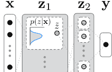

图 1.1：DLVM 的随机变量层。

# 10 引言

正确预测与错误预测的排名仍然是一个活跃的研究领域。

深度潜变量模型（DLVMs，图 1.1）通过假设存在潜变量 $z$ 来处理问题，其中 $p(z|x)$ 中的不确定性会影响对目标预测的置信度。近期，人们提出了变分推断形式的高效推理算法，通过优化推理网络来预测变分分布的参数，从而近似一个原本不可处理的分布（Kingma and Welling, 2013; Rezende et al., 2014; Alemi et al., 2016; Achille and Soatto, 2016）。

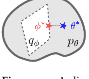

在第三部分中，我们将探索如何量化深度学习中的不确定性。我们通过 Tishby 等人（2000）提出的信息瓶颈（IB）视角来处理这一问题。信息瓶颈 $I(y,z; \theta) - \beta I(x,z; \theta)$ 被优化以最大化 $z$ 与 $y$ 之间的互信息，同时利用 Alemi 等人（2016）以及 Achille 和 Soatto（2016）所示的变分推断方案最小化 $z$ 与 $x$ 之间的互信息。在马尔可夫假设 $p(z,x,y) = p(z|x)p(y|x)p(x)$ 下，我们推导出以下下界：

```
$I(y,z;;theta) - \beta I(x,z;;theta) \geq \mathcal{L} = \frac{1}{N}\sum_{n=1}^N E_{p(z|x_n)}[\log q_\theta(z|x_n)] - \beta D_{KL}[p_\theta(z|x_n)||r(z)],$
```

其中对于 $E_{p(z|x_n)}$ 的期望通常使用单个蒙特卡洛样本进行估计，而 $r(z)$ 是边缘分布 $p(z)$ 的变分近似。$r(z)$ 的常用选择是简单分布，如标准正态分布。Alemi 等人（2016）和 Achille 和 Soatto（2016）继续证明，Kingma 和 Welling（2013）以及 Rezende 等人（2014）提出的变分自动编码器（VAE）证据下界（ELBO）当 $y=x$ 且 $\beta=1$ 时是 IB 的特例。

```
$I(z,i) - I(z,i) \geq E_{p(z|x_n)}[\log q_\theta(z|x_n)] - D_{KL}[p_\theta(z|x_n)||r(z)],$
```

其中 $i$ 代表数据点 $x_i$ 的标识。有趣的是，VAE 视角认为该下界优化的是变分分布 $q(z|x)$，而 IB 则规定 ELBO 中的 $q(z|x)$ 不是变分后，而是真实的编码器 $p(z|x)$，相反，$p(y|z)$ 和 $p(z)$ 是用变分对应项近似的分布。然而，在条件后验 $p(y|x)$ 上推导 ELBO会导致近似后验 $q(z|x)$ 与真实后验 $p(z|x)$ 之间的 KL 散度（后者在测试时是不可用的），而不是先验 $p(z)$。

另一种，方程 1.1 可以被解释为一种领域转换的 beta-VAE（Higgins et al., 2016），其中输入图像被编码到潜空间并解码到目标领域。拉格朗日乘子 $\beta$ 控制了速率与失真之间的平衡，正如 Alemi 等人（2017）所言。然而，这并不是通过利用 Jensen 不等式在条件似然性 $p(y|x)$ 上推导 ELBO 时自然产生的。

# 整合专家知识

## 动机与总结

在深度学习出现之前，医学图像分析是使用经典方法，通过由专家设计的手工特征完成的。随着深度学习成为构建图像识别的主流方法，专家知识退后了一一步。由于深度学习在自然图像领域取得了成功（Krizhevsky et al., 2012），早期的医学深度学习工作主要依赖于受其对自然图像领域影响驱动的设计决策。然而，医学图像显然是不同的模态，深度学习的最优应用需要对所有决策进行仔细考虑。

在论文的第一部分中，我们将探索神经网络如何利用关于医学图像对称性的专家知识。对称性以各种形式出现，利用对称性的神经网络架构最典型的例子是卷积神经网络（CNN）。CNN 利用了图像具有平移等性的特性：无论狗位于帧的哪个位置，它都是狗。通过在图像所有位置上复用权重，设计良好的 CNN 被限制在这一对称性中。但在医学图像中，可能存在不同的对称性。例如顶视显微镜图像：显微图像可以在旋转和镜像观察而不改变其意义。这种图像被称为旋转等变。在第 4 章中，我们将探索如何将群等变神经网络的最新进展应用于此类医学数据并取得巨大效果。通过仔细复用滤波器及其产生的特征图，我们将展示对 90 度旋转以及水平和垂直反射等变的神经网络，并展示这在应用于检测淋巴结活检中恶性组织的大规模现实世界挑战时，如何提高了了样本效率和准确性。我们将在第 3 章结束本部分，届时我们将展示一个作为研究项目一部分而提出的新数据集。该数据集提炼了一个指向高度相关的现实问题的代理。

## 2.1 引言

数字病理学领域正在快速发展，这归功于显微成像硬件的最新进展，允许将玻片数字化为全切片图像（WSIs）。这种数字化促进了图像分析算法来协助和自动化诊断任务。一种证明有效的方法是卷积神经网络（CNN），这是一种深度学习模型，它在从全切片图像中提取的补块（patches）上进行训练。这些基于补块的预测聚合形成了切片级表示，模型利用该表示来识别转移、癌症分期或诊断并发症。这种性能是通过使用最初为自然图像设计的现成 CNN 架构实现的（Litjens et al., 2017）。这些模型的有效性可以在很大程度上归于卷积层中参数的高效共享。结果是局部模式独立于其空间位置进行编码。

# 2.

数字病理学领域正在快速发展，这归功于显微成像硬件的最新进展，允许将玻片数字化为全切片图像（WSIs）。这种数字化促进了图像分析算法来协助和自动化诊断任务。一种证明有效的方法是卷积神经网络（CNN），这是一种深度学习模型，它在从全切片图像中提取的补块上进行训练。这些基于补块的预测聚合形成了切片级表示，模型利用该表示来识别转移、癌症分期或诊断并发症。这种性能是通过使用最初为自然图像设计的现成 CNN 架构实现的（Litjens et al., 2017）。这些模型的有效性可以在很大程度上归于卷积层中参数的高效共享。结果是局部模式独立于其空间位置进行编码。


### 2.2.1 背景

在 Cohen 和 Welling (2016) 引入的 CNN 和 G-CNN 数学模型中，输入图像和输出分割掩码被视为函数 $f: Z^2 \rightarrow R^K$，其中 $K$ 表示通道数，且隐含假设 $f$ 在某些矩形区域外为零。输入 $f$ 与滤波器 $\psi$ 的标准*卷积*定义为：

```
$[f * \psi](x) = \sum_{y \in Z^2} \sum_{k=1}^{K} f_k(y)\psi_k(x-y). \quad (2.1)$
```

G-CNN 是 CNN 的推广，它们在更通用的对称群下具有等变性，例如 90° 旋转群 $G = p4$，或者额外包含反射的群 $G = p4m$。在 G-CNN 中，特征图被认为是该群上的函数。对于 $p4$ 和 $p4m$，这简单意味着特征通道以 4 个或 8 个一组出现，对应于 $p4$ 中的 4 个纯旋转或 $p4m$ 中的 8 个旋转反射。

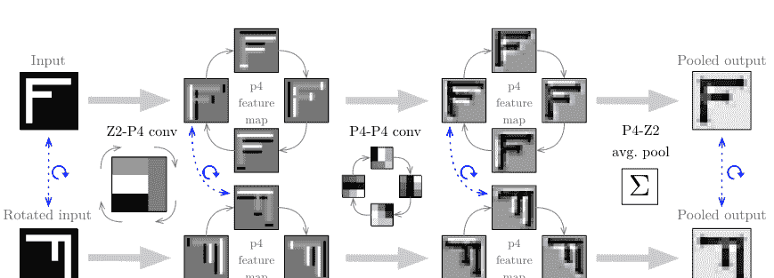

**图 2.1：** 给定一个标准输入和一个旋转后的副本，我们展示了 2 层 G-CNN 如何在 $p4$ 中具有等变性。图中显示了一个内核层的特征图，蓝色虚箭头表示两个输入的（中间层）表示是如何响应的。$Z^2 \rightarrow p4$ 卷积将输入与同一卷积核的 4 个旋转版本相关联。$p4 \rightarrow p4$ 卷积将生成的特征图与 p4 卷积核相关联，并对每个取向循环位移和旋转卷积核。最后层表示对取向进行平均池化，产生一个局部对旋转不变且全局对旋转等变的表示。在 $p4$ 上进行全局平均池化将产生一个全局对平移和旋转均不变的表示。

在第一层中，这些是使用 $(Z^2 \rightarrow G)$-卷积产生的：

```
$[f * \psi](g) = \sum_{y\in Z} \sum_{k=1}^K f_k(y)\psi_k(g^{-1}y), \quad (2.2)$
```

$g = (r, t)$ 是旋转平移（在 $G = p4$ 的情况下）或旋转反射平移（在 $G = p4m$ 的情况下）。

在后续层中，特征图和滤波器都是 $G$ 上的函数，它们使用 $(G \rightarrow G)$-卷积组合：

```
$[f * \psi](g) = \sum_{h\in G} \sum_{k=1}^K f_k(h)\psi_k(g^{-1}h). \quad (2.3)$
```

在最后一层，使用组池化层来确保输出对于旋转是等变的（对于分割任务）或不变的（对于分类任务）。在图 2.1 中我们展示了非线性激活和池化操作在 $p4m$ 下是等变的。

### 2.2.2 G-CNN DenseNet 架构

所提出的块分类模型在图 2 中所示。该架构基于密集连接网络（DenseNet）（Huang et al., 2016），它由密集块组成，交替 $1 \times 1$ 卷积层和 $2 \times 2$ 步长池化。由于感受野的限制，我们在每个密集块使用一层。模型对输入进行 $2^s$ 倍的空间池化，其输出类似于 Liu 等人 (2017) 中的分辨率。

全模型等变性通过将所有卷积层替换为等变版本来实现（$p4$）。归一化层（Loffe and Szegedy, 2015）通过聚合每个组的特征图量而不是空间特征图来实现组等变。消除了零填充。最后层由一个组池化层随 sigmoid 激活函数组成，在 $Z^2$ 平面上产生肿瘤概率输出。

由于模型是全卷积的，在测试时可以通过重用相邻块的计算来实现高效推理，在 NVIDIA Titan XP 上全 WSI 的分割时间从几小时缩短到约 2 分钟。

## 2.3 实验结果

### 2.3.1 数据集与评估

为了评估所提出的模型，我们使用了 Camelyon16（Ehtesami Bejnordi 等., 2017）和 PCam。在 BreakHis（Spanhol et al., 2016）上进行了额外的测试。（1）Camelyon16 数据集包含 400 张哨点淋结的 H&E 染色 WSI，分为 270 张具有像素级标注的切片用于训练，130 张未标记切片用于测试。这些切片是在两个中心使用 40 倍物镜采集并数字化的（像素分辨率为 0.243 微米）。Camelyon16 挑战使用 FROC 曲线对肿瘤定位进行评估。（2）PCam 数据集包含来自 Camelyon16 的 327,680 个块，在 10 倍放大率下大小为 `96 × 96` 像素，采用 `75/12.5/12.5%` 的训练/验证/测试划分，这是使用硬负样本挖掘策略创建的。（3）

## 2.3 实验结果

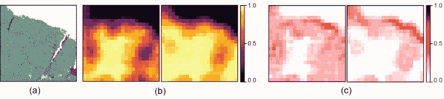

**图 2.3：(a)** 显示了一个跨越多个区块（patches）的大输入区域，并用绿色叠加了肿瘤真值标记。该区域在 32 个均匀间隔的亚 90° 旋转下进行预测，并将预测图旋转回原始方向。(b) 显示了所有旋转的平均预测值，(c) 显示了所有旋转预测结果的标准差，使用了 DenseNet（左）和 P4M-DenseNet（右）。两个网络均在 12.5% 的数据规模上进行训练。

验证集通过随机划分可用的 WSI（全切片图像）来创建，并保持相同的肿瘤/正常比例。我们关注 10× 放大率下的 WSI（比原始数据集小 4 倍，每像素 0.072 微米），以适应本工作可用的计算预算。遵循 Liu 等 (2017) 的方法，我们关注更细粒度的肿瘤检测 FROC 指标，而非切片级 AUC。

**训练细节：** 模型使用 Adam (`Kingma and Ba, 2014a`) 进行优化，batch size 为 64，初始学习率为 `1e–3`（在验证损失 20 个 epoch 内未无提升后减半）。每个 epoch 包含 312 个 batch，以拟合 64 的大小。验证损失使用 40,000 个采样的 batch 计算。选择验证损失最低的权重进行测试评估。

### 2.3.2 模型可靠性

我们评估了预测结果在输入旋转下的稳定性。我们在图 2.3 中展示了视觉分析。为了获得可比的基准模型，我们使用了一个具有标准卷积的等效模型。为了公平的模型比较，我们通过将基准模型的增长率乘以组大小的平方根来保持参数数量一致。对于肿瘤边界周围的波动（由于子采样分割引起），*p4m-model* 对组外的变换（亚 90° 旋转）更具鲁棒性。此外，我们观察到与基准相比，P4M-DenseNet 在肿瘤区域内部的预测具有更高的置信度。

| 表 2.1：网络性能 | K | #W | NLL | Acc | AUC |

|---|---|---|---|---|---|---|

| PCam，通过负对数似然、准确性和 AUC 测量。带有 90° 旋转和反射的数据增强实验用 + 标记。 | P4M-DenseNet | 64 | 119K | 0.260 | 89.8 | 96.3 |

| | P4M-DenseNet M | 24 | 19K | 0.273 | 89.3 | 95.8 |

| | P4M-DenseNet | 48 | 125K | 0.329 | 89.0 | 94.5 |

| | DenseNet+ | 24 | 128K | 0.306 | 88.1 | 95.1 |

| cats 匹配 Z² maps 的数量，#W 为每层的 maps 数量。 | DenseNet+ M | 64 | 902K | 0.365 | 87.2 | 94.6 |

| | DenseNet | 24 | 128K | 0.315 | 87.6 | 95.5 |

### 2.3.3 P4M-DenseNet 在 PatchCamleon 上的性能

我们评估了主要贡献 P4M-DenseNet 架构在 PCam 数据集上的性能。表 2.1 报告了性能。P4M-DenseNet 优于其他模型，紧随其的是 P4-DenseNet，这表明旋转和反射都是有效的归纳偏置（inductive biases），仅通过数据增强是无法学习的。在基准模型中保持 Z² 数量固定会进一步降低性能，证明了 P4M 模型的样本效率。

### Camleon16

我们在 Camleon16 挑战赛的切片级肿瘤定位任务上评估了我们基于块的模型。图 2.4 报告了在 FROC 分数上的性能，将其与病理学家 (Belfordi 等., 2017) 以及该数据集上的先进方法（包括 Liu 等，2016）进行对比。对于基准 DenseNet，训练数据通过 90° 旋转和反射进行增强。我们实验了多种数据规模，其中训练集中的 WSI 数量逐倍减半。结果表明，所提方法在 FROC 指标方面优于所有方法。与基准 DenseNet 相比，我们看到所提架构的优越性主要源于 p4m 等变性带来的参数共享增加，释放了容量并减少了在不同方向上检测相同组织学模式的冗余。我们还观察到，当通过移除 WSI 来限制数据集大小时，我们的模型与基准之间的性能差距会增大。这似乎表明，小规模下的性能显著受益于 P4M-DenseNet 的样本效率，当数据量足以让基准网络达到（近似）旋转等变性时，收益会递减。这种性能差距在全数据集上依然存在。

| 模型 | 数据 | FROC |

|---|---|---|

| P4M-DenseNet 23k params | 100% | 84.0 (75.5, 91.5) |

| | 50% | 81.5 (72.2, 89.3) |

| | 25% | 72.6 (58.7, 84.6) |

| | 12.5% | 60.7 (40.0, 74.1) |

| DenseNet 126k params | 100% | 81.7 (72.1, 90.3) |

| | 50% | 80.0 (69.3, 89.1) |

| | 25% | 71.0 (57.7, 89.1) |

| | 12.5% | 55.4 (42.6, 68.5) |

| Liu et al. (2017) 10× | 100% | 79.3 (74.2, 84.1) |

| Wang et al. (2016) | 100% | 80.7 * |

| Pathologist | | 73.3 |

## 2.4 结论

我们介绍了一种新型病理学块分类模型，通过强制旋转和反射等变性优于竞争模型。我们展示了一个派生的块级数据集，允许在挑战性任务上进行直接评估。我们证明了等变性提高了模型的可靠性，推动了在医学图像领域的应用和进一步研究。

**致谢** 我们感谢 Geert Litjens、Jakub Tomczak、Dimitrios Mavroeidis 以及匿名评审员。这项研究得到了 Philips Research、SURSara Lisa 集群以及 NVIDIA 资助的支持。

# 3 PCAM

机器学习人员在大型医学数据集上评估其方法存在障碍。这在病理学中尤为明显，像 Camelyon (Belfordi 等，2017) 这样的大数据集需要复杂的数据加载器来平衡不同类型的组织，并能高效地处理海量数据。为了能为希望处理病理学数据的研究人员提供便利，我们推出了一个从 Camelyon 派生的数据集：PatchCamleon (PCAM)。它的开发参考了病理学家和病理学深度学习专家的意见。

PCAM 现在发布于 `github.com/baseling/pcam`，处理起来就像 CIFAR10 或 MNIST 一样简单。

PatchCamleon 基准是一个全新的且具有挑战性的图像分类数据集。它包含 327,680 张彩色图像（96 x 96px），提取自淋巴结切片的病理扫描图像。每张图像都有一个二分类标签，指示是否存在转移性组织。PCAM 为机器学习模型提供了一个新的基准：比 CIFAR10 大，比 imagenet 小，可以在单 GPU 上进行训练。

### 3.0.1 为什么需要 PCAM

基础性的机器学习进展主要在简单的自然图像分类数据集上进行评估。例如 MNIST、CIFAR、SVHN。医学影像正成为机器学习的主要应用之一，我们认为它应该在主流机器学习数据集列表中占有一席之地。

我们认为 PCam 可以在此领域发挥作用。它将与临床相关的转移检测任务封装成一个简单的二分类图像分类任务，类似于 CIFAR-10 和 MNIST。模型可以在单个 GPU 上仅需几小时即可轻松完成训练，并在 Camelyon16 的肿瘤检测和 WSI（全切片图像）诊断任务中获得具有竞争力的得分。此外，任务难度与可操作性之间的平衡，使其成为主动学习、模型不确定性和解释性等活跃主题领域，基础机器学习研究的理想对象。

## 动机与总结

医学数据通常被认为极难获取，但事实远非如此。事实是，医院正以惊人的速度获取医学影像数据，且这些数据已经集中存储在庞大的图像归档和通信系统（PACS）中。现代学术医院已经配备了相关系统，允许在当天获取的数据上对统计模型进行优化。相反，主要的挑战在于高质量标注的获取，以及分发敏感个人数据时带来的隐私考量。虽然隐私问题可以通过联邦学习（Rieke et al., 2020）和差分隐私（Abadi et al., 2016）的进展得以解决，但专家知识的成本仍未解决。此外，专家和学术医院在不同人口统计学特征之间的分布不均，导致了对影响世界富裕地区人群疾病产生预测偏见的风险。

在第 ?? 章中，我们探索了自监督表示学习如何受益于医学领域。

在第 5 章中，我们探索了如何将这种无监督训练扩展到大到无法放入内存的数据领域。

### 4.1 无监督特征提取

近年来，大量的医学影像数据已可用于开发基于数据的模型。然而，这些数据大部分是无标记的。因此，人们对特征提取模型的无监督训练的兴趣日益增加。目前的方法依赖于某种形式的生成模型：编码器/判别器学习一种表示，解码器/生成器生成图像。两个模型都经过优化以改进真实图像的生成。在实践中证明，与使用大型标记数据集进行全监督训练模型相比，这些表示的有效性是有限的。

最近，另一种形式的无监督特征学习——**无监督学习**重新引起了人们的关注。它不是优化特征使得生成模型能够重现原始输入，而是优化特征使得对比模型能够区分连续的特征对与随机特征对。在最近的 Oord et al., 2018 中，这被证明可以提取出对医学分类、说话人识别和语音转录非常有效的特征。在训练特征提取器后，只需要少量的标签即可在顶层训练线性分类器。这种方法通常被称为对比预测性编码（Contrastive Predictive Coding, CPC）Oord et al., 2018a。

在这项工作中，我们探索了 CPC 在医学影像数据上的表现，重点关注了病理学数据集 PCam（Veeling et al., 2018）和骨 X 光数据集 MURA（Rajpurkar et al., 2017）。我们发现该方法受到此类数据中非平稳性噪声以及训练集与测试集之间领域偏移的影响。因此，我们提出了一种方法，对医学图像中常见的每个后续共同变化和真实变形进行扰动。在下，我们将这种方法称为对比扰动预测性编码（C2PC）。我们进一步探索了从同一子域内部（例如来自单个患者的数据）与完整数据集抽取对比示例的效果，并发现前者可以改进结果。最后，我们证明了基于 C2PC 衍生特征训练的线性预测模型即使在面对 1/512 的可用训练数据时也表现良好。

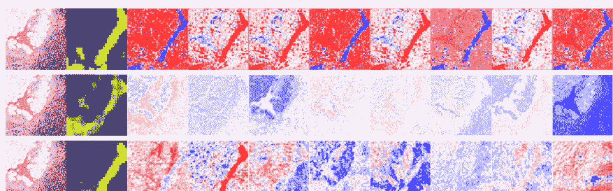

**图 4.1：**（放大细节）。全监督模型学习的病理学特征（顶部）、CPC（中间）以及提出的 C2PC 方法（底部）。**左侧：**预测恶性概率图（更亮）。**右侧：**每个像素代表单个块的特征图。C2PC 允许在孤立的情况下学习随多个块平滑变化的特征。相比之下，全监督特征看起来高度相关且充满噪声。

### 4.2 对比预测编码

对比预测编码（Contrastive Predictive Coding, CPC）是一种由 Oord et al. (2018) 最近提出的通用无监督特征提取深度学习技术。它建立在对比估计（Wiskott, 2002）的基础工作之上，已被证明在图像分类、说话人分类以及强化学习等多个领域都是有效的。CPC 构建在时间序列中随时间和空间缓慢变化的有趣特征的概念之上。它与非线性方法的区别在于，它是联合比较特征向量，而不是逐个比较，这消除了模型学习独立特征的需求。此外，它通过对块对是否连续进行二分类，增加了任务难度。

想象来自较大输入数据的块：两个连续的块共享了下游模型相关的大部分信息。CPC 的利用方式如下：从感兴趣的块开始，将该块与随机块放在一起池中。对比模型使用共享的特征提取模型将感兴趣块与池中的每个块进行比较。当无法预测池中哪个是连续块时产生误差。该损失随后使用传统的梯度下降方法进行优化，同时训练特征提取模型和对比分类模型。这强制特征提取模型提取区分连续块的特征，并防止其学习提供块信息的平凡特征，如局部因子和噪声。

CPC 的一个主要缺点是特征模型会关注任何形式的非平稳信号，使得对比模型能够高效检测相邻块。CPC 的底部有一个聚合模型 `z = a(-)`，它将输入 `x_t` 通过参数 `theta` 转换为特征向量 `z_t = e_{theta}(x_t)`。我们将此称为对比模型。想象来自较大输入数据的块：两个连续的块共享了下游模型相关的大部分信息。CPC 的利用方式如下：从感兴趣的块开始，将该块与随机块放在一起池中。对比模型使用共享的特征提取模型将感兴趣块与池中的每个块进行比较。当无法预测池中哪个是连续块时产生误差。该损失随后使用传统的梯度下降方法进行优化，同时训练特征提取模型和对比分类模型。这强制特征提取模型提取区分连续块的特征，并防止其学习提供块信息的平凡特征，如局部因子和噪声。

CPC 的一个主要缺点是特征模型会关注任何形式的非平稳信号，使得对比模型能够高效检测相邻块。如果数据包含非平稳伪影，特征模型可能会学习这些内容，而不是有见地的特征。我们在下一节中提出的解决方案。想象来自较大输入数据的块：两个连续的块共享了下游模型相关的大部分信息。我们使用以下公式对连续块对进行评分：

```
$f_W(z_a, z_b) = \exp(z_a^T W_b) \quad (4.1)$
```

我们将此称为对比模型。对比模型通过选择最小化该损失的块进行训练：


$$\mathcal{L} = -\log \frac{f(z_l, z_{l+1})}{\sum_{z_i \in \mathcal{X}} f(z_l, z_i)} \quad (4.2)$$

为了进一步提高特征的预测质量，通过联合训练多个对比模型来对比提前若干步的块。我们可以为每个步长 $k$ 学习一个 $f_k(\cdot)$，同时使用相同的特征提取模型。由于较大的步长增加了任务难度，我们引入了在步骤间共享的聚合模型 $c_l = a(z_0, \dots, z_l)$。这允许对比模型 $f_{W_k}(c_l, z_{l+k})$ 考虑编码进 $c_l$ 的信号短期历史，以预测池中哪个块 $z_i$ 是连续的。这导致了损失：

$$\mathcal{L}_{CPC} = -\sum_k \log \frac{f(c_l, z_{l+k})}{\sum_{z_i \in \mathcal{X}} f(c_l, z_i)} \quad (4.3)$$

为了将该方法扩展到2D 图像，我们必须对图像上的块引入任意排序。我们可以考虑一种自上而下的方法，即对比焦点块下方的块。在 2D 领域，上下文聚合模型 $c = a(-)$ 可以呈现为轻微的自回归 PixelCNN 风格（Oord et al., 2016）神经网络，其中我们仔细地维持一个仅由焦点块上方及侧面 $w$ 步块组成的感受野，$z_{i,j} = a(z_{y\le i, x=j\pm w})$。

## 4.3 对比扰动预测编码 (CPC)

为了缓解 CPC 特征塌陷到非平稳干扰信号的问题，我们利用了专家驱动的数据增强见解。众所周知，相同的数据增强技术可以提升多种基于深度学习的医学影像方法的性能，例如 Liu 等，2017；Ronneberger 等，2015。

我们将确定性的输入图像 $x$ 替换为从由专家确定的随机扰动函数 $r(\cdot)$ 中抽样的随机变量 $x \sim r(x)$。$r(\cdot)$ 定义了输入空间中数据点周围区域的分布。在下游预测任务任务的语境下，该区域被认为等同于 $x$。$r(\cdot)$ 可能包括颜色扰动、弹性形变、人工测量噪声和伪影、微小平移和旋转等。我们从 $r(x)$ 中提取了两个样本 $(x^1, x^2)$。第一个样本用于计算 $c$，第二个样本用于计算对比模型使用的特征 $z$。

通过仔细使用能够保持补块（patches）顺序的增强方法，特征提取模型被迫学习对扰动不不变的或可以被线性对比模型一致匹配的特征。这为对称模式的专家知识注入特征提取模型提供了一个简单的向量方法，而无需使用昂贵的等变性方法（Veeling 等，2018）在神经网络中强制执行这些对称性。

## 4.4 相关工作

在医学图像分析领域，减少专家所需的标注负担是一个贯反复出现的主题。在利用深度神经网络架构时，一种常用技术是使用在 ImageNet 上训练的权重（Rajpurkar 等，2017）。然而，这种方法具有局限性，因为医学影像的局部和全局统计数据与 ImageNet 中看到的照片大不同。近期在大型组织病理数据集上训练深度模型的工作发现，ImageNet 预训练并不能提高性能（Liu 等，2017）。

除了借用权重，生成式模型也被用于预训练特征模型，使用的方法如（卷积）变分自编码器（CVAE;（Sedai 等，2017；Uzunova 等，2018）以及它们的非变分对应物。同样地，GAN 的变体也被探索用于预训练和特征提取（Donahue 等，2016）。另一个感兴趣的领域是使用自监督损失，例如解决从图像中抽取的补块的拼图问题（Noroozi 和 Favaro，2016）；从灰度图像中预测颜色通道（Larsson 等，2016；Vondrick 等，2018）以及修复从输入图像中移除的小窗口（Pathak 等，2016）。

同时，Tellez 等（2018）和 Lu 等（2019）探索了用于全片图像（Whole Slide Images）的对比训练。虽然他们只关注组织病理数据，但我们展示了在骨骼 X 光异常检测任务上的额外结果。此外，我们强调了对比训练期间大量数据增强的重要性，以及补块来源的选择，见表 4.1。

## 4.5 实验

### 4.5.1 数据集

我们在两个具有挑战性的大规模医学影像数据集上评估了 CPC 和 CPC：组织病理数据集 PCam（Veeling 等，2018；Ehtesami Bejordi 等，2017）和骨骼 X 光异常检测任务 MURA（Rajpurkar 等，2017）。在接下来的章节中，我们将证明 CPC 学习到的特征在多大程度上允许线性分类器在这两个基准上达到竞争性性能。我们将 CPC 与全监督模型、卷积（变分）自编码器（CVAEs，使用带有 L2 重建损失的残差线性上采样解码器训练）以及随机初始化的特征模型进行比较。此外，我们将探索对比训练期间大量数据增强的重要性，以及补块来源的选择。

### 数据增强与预处理

对于无监督方法，我们使用以下数据增强：

在对比训练期间，我们增加数据增强，方法包括：

- 颜色扰动（对比度、色调、饱和度）。
- 弹性形变。
- 随机旋转（最高 15 度）。
- 随机平移（最高 5 像素）。
- 亮度噪声。
- 亮度伪影。
- 随机水平和垂直翻转。

### 超参数

我们在训练对比模型时，从同一切片（WSL）内部抽样对比样本，batch size 为 256。对于 $\lambda$，我们根据从同一切片内部抽样的对比样本进行设置。对于激活函数，我们使用 ReLU。对于池化层，使用全局平均池化。对于输出，我们使用 tanh。

PCam 包含恶性组织的图像。对于 CPC 和 C2PC，我们从同一切片内部抽样的对比样本进行实验。结果如表 4.1 所示：

| 方法 | 所有标签 | 1/128 标签 | 1/512 标签 |
| :--- | :--- | :--- | :--- |
| C2PC 同一切片 | 84.3% | 85.2% | 85.2% |
| C2PC | 83.5% | 84.3% | 82.4% |
| CPC 同一切片 | 76.8% | 76.0% | 75.2% |
| CPC | 76.0% | 75.6% | 75.7% |
| CAE | 75.2% | 74.7% | 74.7% |
| $\beta$-CVAE ($\beta=0.01$) | 72.0% | 72.2% | 74.7% |
| 随机 | 74.5% | 68.8% | 72.2% |
| 全监督 | **87.1%** | 83.9% | 80.3% |
| $P_4M$-DenseNet Veeling 等，2018 | 89.8% | - | - |
| DenseNet Veeling 等，2018 | 88.1% | - | - |

**表 4.1:** 测试集上的 PCam 分类精度。C2PC 达到了接近监督的性能，而预测模型只是简单的线性回归模型。结果见表 4.1 并在下方讨论。

### 不同对比源的影响

不同实验室采集的组织病理切片外观差异巨大。每个实验室在切片染色质量方面都有不同的方案，而且每个切片数字化设备都有独特的伪影和测量噪声。即使是来自同一实验室的切片之间也可能发生分布偏移。我们探索是否可以通过仅从同一切片（WSL）抽取对比样本来引导 CPC 学习更具领域鲁棒性的特征。我们假设在这种情况下，CPC 提取跨领域有效的特征更为有效，因为区分不同区域的特征没有提供价值。在表 4.1 中，我们比较了 C(2)PC 在两种情况下的表现（Same WSL 表示仅在 MSI 内部抽样）。我们发现，仅与同一切片的补块进行对比会略微提高性能。

### C2PC 与 CPC

C2PC 比 CPC 有显著的性能提升，我们将其归因于假设噪声和基于专家知识的扰动鲁棒性。在标签较少的情况下，C2PC 的测试集性能意外略有增加。这可以解释为：PCam 的验证集与训练集非常接近，在标签较少的情况下，其性能正如预期那样下降。由于标签较少，模型更快地过拟合了训练标签。因此，早停止方法选择权重对测试集更有利。

### 特征可视化

在图 4.1 中，我们可视化了从跨多个补块的大图像中提取的 8 个最具预测性的特征。我们发现基于 CPC 的特征比以全监督方式学习的特征平滑得多。这暗示了这些特征对于其他组织分类任务也有用。

# 42 | 对比预测编码 (CONTRAST PERTURBATIVE PREDICTIVE CODING)

| 方法 | AUROC |
| :--- | :--- |
| C2PC | 71.8% |
| CPC | 70.1% |
| CAE | 55.6% |
| Random | 60.8% |
| 全监督 | 86.8% |
| 全监督（无批归一化） | 57.7% |
| MURA DenseNet-169 (batch norm, ensemble) Rajpurkar et al., 2017: | 92.9% |

表 4.2：小-MURA 分类结果。报告的是验证集上的 AUROC，原始 MURA 论文中的测试性能供参考。

## 4.5-3 小-MURA：X 射线异常检测

为了提高可处理性，我们将 MURA 数据集（Rajpurkar et al., 2017）下采样了 2 倍，得到大小为 160px² 的批次。对于 CPC，我们提取重叠率为 50% 的 32px² 块，导致每张图像产生 9x9 个补块。我们从下方第 2 到 6 步进行对比。对于预训练，批次包含多个研究案例，每个案例中随机抽取一张图像。对于预测模型，我们遵循 Rajpurkar 等人 (2017) 使用加权训练损失的方法，并对研究案例中可用图像的预测异常概率取算术平均值。特征模型使用了 34 层的 ResNet [pre ack ???]。

结果如表 4.2 所示。由于资源限制，实验被限制在不带批归一化的训练的小模型上（全监督模型除外，批归一化似乎至关重要）。这导致与参加 MURA 竞赛的集成模型相比，监督性能基准较低。在评估的无监督特征提取方法中，C2CPC 表现最好。然而，在原始图像上使用更深层特征提取方法的实验仍在计划中。比较表 4.1 和表 4.2 的结果可以发现，CPC 更适用于某些图像类型和下游任务的组合。我们认为，在病理学图像的情况下，CPC 发现了能够预测恶性的、缓慢变化的基于纹的特征。然而，在骨骼 X 射线图像的情况下，由于提取的图像块具有异质性，学习有意义的慢特征似乎更加困难。

我们探索了对比预测编码在医学图像分析中的有效性。在病理学数据集 PCam 上，我们发现 CPC 受到非平稳伪影和平凡解的影响。我们证明了所提出的 C2PC 缓解了这些问题，并在小标签范围内优于全监督模型。在骨骼 X 射线异常检测数据集 MURA 上，我们的模型优于其他预训练基准，这激发了对将 C(2)PC 作为预训练方法的进一步研究。未来的工作可以研究如何在半监督机制中有效结合 C2PC，利用标签和专家等价类来实现“两兼优”的结果。对比预测编码为无监督预训练提供了巨大的飞跃。由于专家标签的获取成本高昂，医学界将从此类进展中极大获益。

现代深度学习模型通常使用端到端反向传播和全局监督损失函数进行优化。尽管在经验上被证明非常成功（Krizhevsky et al., 2012; Szegedy et al., 2015），但这种方法被认为在生物学上是不可能的。其，监督学习需要大量的标记数据集来确保泛化能力。相比之下，儿童只需少量样本就能学会识别新类别。此外，尽管有一些证据表明大脑中存在自上而下的连接，但似乎并没有一个由反向传播信号优化的全局目标（Crick, 1999; Marblesstone et al., 2016）。相反，生物大脑是高度模块化的，并且主要基于局部信息进行学习（Caporale and Dan, 2008）。

除了缺乏自然对应物外，端到端反向传播对神经网络进行监督训练还存在实际的劣势。监督学习需要标记输入，而这些标记的成本很高昂。因此，它不适用于大多数可用数据，并且具有更高的过拟合风险，因为深度模型所需的参数数量往往超过了现有数据点的数量。同时，端到端反向传播会产生巨大的开销，因为包括激活和梯度在内的整个计算图都需要适应内存。

## 5.1 引言

在本文中，我们引入了一种新的学习方法——贪心 InfoMax (GIM)。受生物限制的启发，我们用自监督方法取代了端到端反向传播，每个模块都使用局部损失进行贪心训练。这种问题一直存在，因为端到端训练不允许具有局部性。我们的贡献如下：

- 提出的 Greedy InfoMax 算法在音频和图像分类上取得了强有性能。
- 这实现了神经网络的异步训练，使得在内存限制下能够构建任意深的网络。
- 我们证明了互信息极大化特别适用于下游任务。

## 5.2 背景

为了创建对下游任务有用的表示，我们假设自然数据表现出所谓的“慢特征”（Wiskott and Sejnowski, 2002）。几毫秒的语音块与相邻的块共享信息，如说话者身份、情感和音素，而它并不一定与从其他话语中抽取的随机块共享这些信息。同样，自然图像中的一个小块与邻居块共享许多方面，例如所描的物体或光照条件。

最近的工作（Oord et al., 2018b; Hjelm et al., 2019）提出了我们如何利用这一点来学习最大化邻居之间互信息的表示。在这项工作中，我们特别关注对比预测编码 (CPC) (Oord et al., 2018b)。

为了实现这一点，CPC 首先使用深度编码模型 $g_{enc}(x_t) = z_t$ 处理序列输入信号 $x$，并额外产生一个表示 $c_t$，聚合直到时间步 $t$ 的所有块的信息。

![img/3013a5e7af0c305d337644a32207e3ef_58_0.png]

图 5.1：Greedy InfoMax 学习方法。（左侧）对于自监督学习，我们堆叠了多个模块，输入通过通常方式前向传播，但梯度不传播。相反，每个模块都使用局部损失进行贪心训练。（右侧）每个模块将时间步 $t$ 的输入 $z_t^{m-1}$ 映射到 $g_{enc}(GradientBlock(z_t^{m-1})) = z_t^m$，并作为下一个模块的输入。使用 InfoNCE 目标进行其贪心优化。该损失与模块对其未来表示 $z_{t+k}^m$ 的预测进行对比，这强制每个模块尽可能地保留其输入的信息。我们可选地使用一个额外的自回归模块 $g_{ar}$，图中未画出。

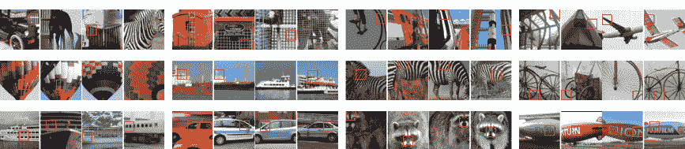

**图 5.2：** 4 个图像块（红色正方形）激活了特定的神经元，位于模型中的 3 个级别（行）。尽管采用了无监督的贪婪训练，神经元似乎提取出了日益增强的语义特征。在屏幕上查看效果最佳。

使用自回归模型 $g_{ar}(z_{0:t}) = c_t$。通过采用一个特定定义的概率损失函数，使得提取的表示 $z_{j+t}$ 与时间上相邻的块 $c_t$ 之间的互信息最大化：遵循噪声对比估计（NCE）的原理（Gutmann and Hyvärinen, 2010），CPC 为每个延迟 $k$ 选取一个包 $X = \{z_{t+k_1}, z_{t+k_2}...z_{t+k_{N-1}}\}$，其中一个“正样本” $z_{t+k}$ 是在 $c_t$ 之后 $k$ 步输入的编码，以及 $N-1$ 个“负样本” $z_{j_n}$ 是从所有编码输入序列中均匀抽取的。

每对编码 $(z_j, c_i)$ 都使用函数 $f(\cdot)$ 进行评分，以预测给定的 $z_j$ 为正样本 $z_{t+k}$ 的概率。在实践中，Oord 等人（2018b）使用对数线性模型 $f_k(z_j, c_i) = \exp\left(z_j^T W_kc_i\right)$，并为每个提前 $k$ 步的预测配备唯一的权重矩阵 $W_k$。来自 $f(\cdot)$ 的得分用于预测包 $X$ 中哪个样本是正确的，从而得出 InfoNCE 损失：

```
$$\mathcal{L}_N=-\mathbb{E}_k\left[\log \frac{f_k(z_{t+k}, c_t)}{\sum_{z_j\in X} f_k(z_j, c_t)}\right].$ (5.1)$$
```

该损失用于同时优化编码模型 $g_{enc}$ 和自回归模型 $g_{ar}$，以提取在相邻块之间保持一致、而在随机块对之间发散的特征。同时，评分模型 $f_k$ 学习利用这些特征来正确分类匹配的对。在实践中，该损失使用随机梯度下降法进行训练，其小批次（minibatches）从大型序列数据集中抽取，负样本则从小批次中的所有序列中均匀抽取。注意，在对抗训练中没有发现极小-极大值问题。

由于这种配置，可以推导出 $f$ 的最优解正比于密度比率（Oord et al., 2018b）：

```
$f_t(z_{t+k}, c_t) \propto \frac{p(z_{t+k}|c_t)}{p(z_{t+k})}. \quad (5.2)$
```

这一洞察使我们能够将 $\mathcal{L}_N$ 重新公式化为互信息 $I(z_{t+k}, c_t)$ 的下界，正如 Oord 等人（2018b）的工作所示，并由 Poole 等人（2018）证明。通过最小化损失 $\mathcal{L}_N$，借此优化了连续块表示之间的互信息 $I(z_{t+k}, c_t)$，而这本身限制了未来输入 $x_{t+k}$ 与当前表示 $c_t$ 之间的互信息 $I(x_{t+k}, c_t)$。Hyvarinen 和 Morioka (2016) 显示，类似的块对比设置会导致特征的提取。


表 5.1: `STL-10` 在测试集上的分类结果。尽管缺乏端到端传播且没有使用全局目标，`GIM` 模型的仍优于 `CPC` 模型。（4 轮训练的标准差）。

表 5.2: 训练期间的 GPU 显存占用。所有模型均采用 `ResNet-50` 架构，仅训练方法有所不同。`GIM` 允许高效的贪婪训练。

| 方法 | 准确率 (%) |
| --- | --- |
| Deep InfoMax (Hjelm et al., 2019) | 78.2 |
| Predsim (Nøkland and Eidnes, 2019) | 80.8 |
| 随机初始化监督 | 27.0 71.4 |
| 贪婪监督 CPC | 65.2 80.5 ± 3.1 |
| 贪婪 InfoMax (GIM) | 81.9 ± 0.3 |

| 方法 | 内存 (GB) |
| --- | --- |
| 监督 | 6.3 |
| CPC | 7.7 |
| GIM - 所有模块 | 7.0 |
| GIM - 第1模块 | 2.5 |

# 5.4 实验

我们测试了 `GIM` 方法在视觉和音频领域的适用性。在两种设置中，特征提取模型都按深度分为多个模块，并使用 `GIM` 进行无标签训练。最终（冻结）模块生成的表示将作为线性分类器的输入，该分类器的准确率为我们提供了自监督模型所创建表示质量和泛化能力的指标。

## 5.4.1 视觉

为了将 Greedy InfoMax 应用于自然图像，我们对 2D 图像实施了自上而下的排序。我们遵循 Oord 等人 (2018b) 和 Héaff 等人 (2019) 的方法，从图像中提取部分重叠的补丁网格，以限制表示的感受野。对于网格中第 $i$ 行第 $j$ 列的每个补丁 $x_{i,j}$，我们预测下方中的最多 K 个补丁 $x_{i+K,j}$，跳过第一个重叠补丁 $x_{i+1,j}$。从 batch 内所有可用样本中有放回地抽取随机对比样本，每次损失评估使用 16 个对比样本。在这种模式下，`GIM` 不使用自回归模块。

### 实验细节

我们关注 `STL-10` 数据集（Coates et al., 2011），该数据集提供了一个额外的训练数据集。对于数据增强，我们从 `96 × 96` 的图像中随机裁剪 `64 × 64` 的区域，以 0.5 的概率进行水平翻转并转换为灰度。我们将每个 `64 × 64` 像素的图像划分为 `7 × 7` 个局部补丁，每个补丁的大小为 `16 × 18` 像素重叠。补丁由 `ResNet-50` 模型（He et al., 2016）进行编码，且不使用批次归一化（Hoff and Szedy, 2015）。我们将模型分为三个梯度隔离的模块，并以恒定的学习率进行同步训练。收敛后，使用传统的 softmax 激活和交叉熵损失训练一个线性分类器——在不微调表示的情况下。该线性分类器接受来自最终模块的路径 `z_{ij}^M` 并进行平均池化，得到单个向量表示 `z^M`。

#### 结果

如表 5.1 所示，Greedy InfoMax (`GIM`) 优于其端到端的 `CPC` 对应模型，尽管其特征是在没有任何反向传播的情况下通过贪婪优化的。同样的随机初始化特征提取模型性能糟糕，表明 `GIM` 提取了有用的特征。端到端全监督的特征提取模型性能更差，可能是由于标注数据集较小导致了过拟合。尽管通过技术（DeVries and Taylor, 2017），自监督方法似乎不需要正则化，因为它们受益于全量无标签数据集。使用监督方法训练模型会阻碍性能，这表明信息最大化在直接应用于贪婪优化方面具有独特性。与 Hjelm 等人 (2019) 最近提出的 InfoMax 模型相比（该模型使用了略有不同的端到端互最大化方法，并将 AlexNet (Krizhevsky et al., 2012) 作为其特征提取模型并在监督分类模型中增加了一个隐藏层），`GIM` 的表现更为优。最后，我们看到我们优于当前的

图 5.3 同时优化所有模块（蓝色）或逐个迭代优化（红色）的训练曲线。第一个模块（a）的训练方法没有区别；后续模块（b, c）的起始损失较低，并且在已收敛的模块之上进行迭代训练时往往会过拟合。


在图 5.2 中，我们可视化了 `GIM` 模型多个模块所敏感的补丁。这表明模型后期的模块关注于日益抽象的特征。总的来说，结果表明

异步内存使用

`GIM` 从其贪婪优化特性提供了重大的实际优势：在给定先前模块缓存输出的情况下，可以孤立地训练模块，有效地消除了网络深度作为内存复杂性的因素。通过测量之前研究的模型在训练期间分配的 GPU 显存（表 5.2），表明这种理论优势是成立的。在将架构分为三个可独立训练的模块后，通过异步训练模块（`GIM - 第1模块`）与同步训练（`GIM - 所有模块`）相比，我们可以 GPU GPU 内存占用降低 2.8 倍。

我们评估了异步训练模块是否影响表示的质量。关注极端情况，我们优化每个模块直到收敛并固定其参数，然后在该模块之上训练下一个模块。这种迭代训练的模型在图像分类下游任务中实现了 79.8% 的准确率。因此，与同步训练的模型相比，性能略有下降，如表 5.1 所示，其准确率为 81.9%。

| 方法 | 电话（语音）分类准确率 (%) | 说话人分类准确率 (%) |
| --- | --- | --- |
| 随机初始化 $^b$ | 27.6 | 1.9 |
| MFCC 特征 $^b$ | 39.7 | 17.6 |
| 监督 | 77.7 | 98.9 |
| 贪婪监督 | 73.4 | 98.7 |
| CPC (Oord et al., 2018b) $^a$ | 64.9 | 99.6 |
| InfoMax (GIM) | 62.5 | 99.4 |

**表 5.3:** 在 `LibriSpeech` 数据集中对说话人身份和电话标签进行分类的结果。所有模型使用相同的音频输入大小和架构。尽管 Greedy InfoMax 采取了贪婪训练且缺乏全局目标，但它创建的表示对于音频分类任务是有用的。

> $^a$在原始实现中，Oord 等人 (2018b) 在电话分类任务中实现了 64.6%，说话人分类任务实现了 97.4%。$^b$来自 Oord 等人 (2018b) 的基准结果。

图 5.3 所示的两个模型的训练曲线为这种性能下降提供了一些见解。第一个模块的学习曲线（图 5.3a）反映出两个模型在训练上没有区别。模块二和三（图 5.3b 和 5.3c）揭示了关键差异。迭代训练的模块显示训练损失与验证损失之间的离散更大，表明存在更强的过拟合。我们初步将其归于在同步训练时，较高模块接收到的初始噪声输入带来的正则化效应。

## 5.4.2 音频

我们在音频领域评估了 `GIM`，任务包括序列全局的说话人分类和本地的电话分类任务（构成单词发音的不同音素）。这两个任务对于自监督表示学习是有意义的，因为前者需要表示

它们能够区分说话者但对内容具有不变性，而后者则相反相反。在这两项任务上均表现优异表明其具有强大的泛化能力和解耦能力。

### 实验细节

除非另有说明，否则我们遵循 Oord 等人 (2018b) 的设置，并使用公开的 `LibriSpeech` 数据集中的 100 小时子集（Panayotov 等人，2015）。该数据集包含 251 个不同说话者的话语，并带有对齐的音素标签，共标记为 41 类。这些音素标签是由 Oord 等人 (2018b）通过 `Kaldi` 工具包（Povey 等人，2011）对音素序列进行强制对齐，并使用在 Libispeed 上的预训练模型（Panayotov, 2014）获得的。我们首先训练了一个自监督模型，该模型由五层卷积层和一个自回归模块（单层门控循环单元 `GRU`）组成。在收敛后，在上下文聚合表示 `c^M` 之上训练了一个线性多分类分类器，而无需对表示进行微调。其余的实现细节见附录 5.A.2。

根据表 5.3，我们分析了模型在音素和说话者分类准确率上的性能。随机初始化的特征性能较差，证明了两项任务都需要复杂的表示。传统的、手工设计的 `MFCC` 特征常用于语音识别系统（Ganchev 等人，2005），虽然其性能优于随机特征，但在两项任务上提供的线性分离能力均有限。在说话者分类任务中，`CPC` 和 `GIM` 的表现均优于监督基准模型，尽管它们的特征是在没有监督的情况下训练的，且 `GIM` 甚至没有使用端到端反向传播。在这种设置下，`GIM` 和贪婪监督（Greedy Supervised，即使用监督损失函数贪婪地训练每个单独层）取得了与各自的端到端对应模型（`CPC` 和 Supervised）相似的结果。在分类音素时，`CPC` 未能达到监督水平（64.9% 对比 77.7%）。`GIM` 达到了 62.5%，而贪婪监督达到了 73.4%。因此，与视觉实验（第 5.4.1 节）相比，我们看到贪婪训练模型（`GIM` 和 Greedy Supervised）与其各自的端到端优化模型（`CPC` 和 Supervised）之间存在类似的性能差异。

## 5.4 实验

| 方法 | 准确率 (%) |
| --- | --- |
| **说话者分类** | |
| 贪婪 InfoMax (GIM) | 99.4 |
| 无 BPTT 的 GIM | 99.2 |
| 无 $g_{ar}$ 的 GIM | 99.1 |
| **音素分类** | |
| 贪婪 InfoMax (GIM) | 62.5 |
| 无 BPTT 的 GIM | 55.5 |
| 无 $g_{ar}$ 的 GIM | 50.8 |

**表 5.4：** 在 `LibriSpeech` 数据集上的消融研究，旨在移除不符合生物学原理且耗内存的时间传播。

总体而言，说话者任务上优于监督的性能与音素任务上非最优性能之间的差异表明，`GIM` 和 `CPC` 倾向于提取序列全局特征。

### 消融研究

`GIM` 启用的局部贪婪训练为向生物学合理的优化迈出了一步，并提高了内存效率。然而，自回归模块 `g_{ar}` 在多个补丁上聚合输入并采用了通过时间的反向传播（`BPTT`），这抑制了上述两种优势。在表 5.4 中，我们展示了限制梯度跨时间流向的消融模型的性能结果。

为了限制梯度跨时间流向，我们修改了自回归模块。在自回归模块 `g_{ar}` 中，接收当前输入 `z_t` 以及上一步的隐藏状态 `h_{t-1}`，以产生输出 `c_t`，`c_t = g_{ar}(z_t, h_{t-1})`（为了简洁省略了模块索引 `m`）。在标准模型中，我们阻止了向前一个模块的梯度流，使得 `c_t = g_{ar}(GradientBlock(z_t), h_{t-1})`。在无 `BPTT` 的 `GIM` 消融实验中，我们通过阻塞时间步之间的梯度流来移除 `BPTT`，使得 `c_t = g_{ar}(GradientBlock(z_t), GradientBlock(h_{t-1}))`。在无 `g_{ar}` 的 `GIM` 消融实验中，我们完全移除了自回归模块，线性分类器应用于最后一个编码模块创建的表示（即 `z_t`）。

在表 5.4 中，我们展示了消融模型的性能。这两项消融共同表明了所测试下游任务之间存在关键差异。对于音素分类任务，当我们减少对时间依赖关系的建模时，性能稳步下降，这表明这些关系对于解决该任务很重要。在分类说话者身份时，减少消融模型中对时间依赖关系的建模对性能的影响乎其微。

结合第 5.4.1 节中的图像分类结果（其同样未采用自回归模型），这表明 `GIM` 在不需要通过自回归模块建模时间或上下文依赖的下游任务中表现最佳。在这些设置下，`GIM` 的性能优于 `CPC` 模型，后者利用了端到端反向传播、全局目标和 `BPTT`。

`GIM` 的逐层贪婪训练允许我们训练任意模型而永远不会遇到内存限制。我们通过在每个模块上训练线性分类器，研究了每个独立模块中创建的表示是如何发展的，并在说话者分类任务上进行衡量。如图 5.4 所示，我们首先观察到 `GIM` 改进了其前者的表示。有趣的是，尽管这些模块仅依赖于全局损失函数的误差信号，`CPC` 显示了类似的中间性能。这与监督端到端模型形成了鲜明对比，InfoMax 原理可以“良好堆叠”，使得贪婪应用的效果与全局应用相似。

| 预训练类型 | CPC | 监督 |
|---|---|---|
| 贪婪 InfoMax | 贪婪监督 | 随机 int |


**图 5.4：** 说话者分类的对数误差率，由自回归层创建的最终表示。

# 5.5 相关工作

我们研究了自监督 `CPC` 方法（Oord 等人，2018b；H 等人，2019）应用于梯度隔离模块时的有效性，从而使方法摆离了端到端反向传播。许多优化算法完全不需要反向传播（Scellier 和 Bengio，2017；Lillicrap 等人，2016；Kohn 等人，2018；Balduzzi 等人，2015；Lee 等人，2015；Orroria 等人，2018；Xiao 等人，2019）。与我们的方法不同，这些方法采用全局监督函数，并专注于寻找更符合生物学的信用分配方式

Nokland 和 Eidnes（2019）最近的研究表明，逐层训练是可能的。他们的相似性可以模糊地解释为另一种强制聚类表示的方法。然而，我们的方法通过聚类时间或空间上相邻的输入完全以自监督的方式实现了这一点，而他们的相似性损失是根据类别标签对表示进行分组。同样，Belilovsky 等人 (2019) 显示使用监督损失的逐层训练可以扩展到 ImageNet。

Jaderberg 等人 (2017) 开发了解耦神经接口，它们与贪婪 InfoMax (`GIM`) 具有相同的异步训练优势，但它们是通过获取端到端监督损失并局部预测其梯度来实现的。Hinton 等人 (2006) 和 Bengio 等人 (2007) 专注于深度信念网络并并了一种基于受限玻尔兹曼机原理的逐层无监督预训练方法，随后使用监督损失进行优化。Lee 等人 (2009) 使用卷积深度信念网络

在 TIMIT 音频数据集上进行无监督训练，然后通过在其上方训练监督分类器来评估其性能。Gao 等人 (2018) 和 Veer Steeg Galstyan (2015) 探索了全相关性解释，这与互信息最大化有关，并证明它可以用于逐层训练。

最近几项工作研究了在表示学习设置中利用互信息最大化（McAllister, 2018; Oord et al., 2018b; Hjem et al., 2019; Belghazi et al., 2018）。Poole 等人 (2018) 在共同框架下分析了这些近期工作，并强调 InfoNCE 以高偏差为代价表现出低方差，并提出了新的下界以平衡这种偏差/方差权衡。然而，在斑块间（inter-patch）互信息优化的背景下对这些改进边界的分析仍待完成，因此我们专注于原始的 `CPC` InfoNCE，使学习到的表示偏向慢特征（Wiskott and Sejnowski, 2002）。

在信息论框架之外，已经探索了用于无监督表示学习的上下文预测方法。语言处理中的突出方法是 Word2Vec (Mikolov et al., 2013)，其中单词直接给定其上下文（连续 skip-gram）。同样，Doersch 等人 (2015) 研究了视觉领域的此类方法。类似地，图神经网络使用对比原理根据其邻居学习无监督嵌入（Nickel et al., 2011; Perozzi et al., 2014; Nickel et al., 2015; Kipf and Welling, 2016; Veličković et al., 2018）。噪声对比估计也被用于独立分量分析（Hyvarinen et al., 2018; Hyvarinen and Morioka, 2016; Hyvarinen and Morioka, 2017）。Schmidhuber (1992) 提出了一种方法，使单个特征最小化，使其无法从其他特征中预测，强制它们提取带有统计信息的独立因子，但风险是神经元可能会锁定输入中的局部独立噪声源。

# 章节附录

## 5.A 实验设置

我们所有的实验均使用 `PyTorch` (Paszke et al., 2017)。

### 5.A.1 视觉实验

在视觉实验中，我们采用了了 `ResNet-50 v2` 架构（He et al., 2016b），并调整了第一个卷积层，使得特征图的大小保持不变。因此，第一个卷积层使用大小为 5 的卷积核、步长为 1 且填充为 2。此外，我们没有采用批量归一化（Loffe and Szegedy, 2015b）。

我们在 8 个 GPU (GeForce 1080 Ti) 上训练模型，每批次大小为 16 张图像。我们使用 `Adam` (Kingma and Ba, 2014b) 训练 300 个轮次（epochs），学习率设置为 1.5e-4，并在所有实验中使用相同的随机种子。

对于使用 `InfoNCE` 目标的自监督训练，我们需要将模型对其未来表示的预测与负样本进行对比。我们从正在评估的输入批次中均匀随机抽取这些样本。因此，负样本可以包含来自同一图像不同斑块位置的样本，也可以包含不同的图像。我们发现，将正样本（即当前要预测的未来表示）包含在负样本中对最终性能没有负面影响。对于每次 `InfoNCE` 损失的评估，我们使用 16 个负样本，并预测未来最多 `k=5` 行。为了对斑块之间进行对比，我们对每个斑块的表示进行空间平均池化。

在第三个残差块的输出上应用线性逻辑回归分类器之前，我们再次对大小为 `7 × 7 × 1024` 的生成表示进行空间平均池化。因此，用于学习预测类别标签的最终表示是一个 `1024` 维向量。我们使用 `Adam` 优化器训练线性逻辑回归分类器，并将其学习率设置为 `1e^{-3}`。我们通过将 `STL-10` 数据集提供的标记训练集划分为包含 20% 图像的验证集和包含剩余图像的相应训练集来优化这一超参数。

### 5.A.2 音频实验

我们所采用架构的详细描述见表 5.A.1。我们在 4 个 GPU (GeForce 1080 Ti) 上训练模型，每批次大小为 16 张图像。我们使用 `Adam` (Kingma and Ba, 2014b) 训练 300 个轮次，学习率设置为 1.5e-4，并在所有实验中使用相同的随机种子。


对于使用 `InfoNCE` 目标的自监督训练，我们需要将模型对其未来表示的预测与负样本进行对比。我们从正在评估的输入批次中均匀随机抽取这些样本。因此，负样本可以包含来自同一图像不同斑块位置的样本，也可以包含不同的图像。我们发现，将正样本（即当前要预测的未来表示）包含在负样本中对最终性能没有负面影响。对于每次 `InfoNCE` 损失的评估，我们使用 16 个负样本，并预测未来最多 `$k=5$` 行。为了对斑块之间进行对比，我们对每个斑块的表示进行空间平均池化。

在第三个残差块的输出上应用线性逻辑回归分类器之前，我们对大小为 128 的生成表示进行空间平均池化以降低维度。我们在顶部使用自回归模块训练逻辑回归分类器，但选择了与之前不同的学习率。在说话人分类实验中我们使用了 `1e-3`，而在语音分类实验中将其设置为 `1e-4`。对于 Oord 等人 (2018b) 提供的训练集，我们使用 `$25\%$` 的样本随机划分为验证集。

| 层 | 输出大小 (序列 $\times$ 通道) | 卷积核 | 步长 | 填充 |
| :--- | :--- | --- | :--- | :--- |
| 输入 | `$2040 \times 1$` | | | |
| Conv1 | `$4095^a \times 52$` | 10 | 5 | 2 |
| Conv2 | `$1023^a \times 52$` | 8 | 4 | 2 |
| Conv3 | `$512^a \times 52$` | 4 | 2 | 2 |
| Conv4 | `$257^a \times 52$` | 4 | 2 | 2 |
| Conv5 | `$128 \times 52$` | 1 | 2 | 1 |
| GRU | `$128 \times 256$` | | | |

**表 5.A.1:** 我们音频实验架构的概述。

$a$ 为了在这些层应用 `InfoNCE` 目标，我们随机采样大小为 12 的时间窗口。

医学诊断中的一个困难维度是与诊断工具箱相关的固有不确定性。误诊是医疗系统中主要的成本效益驱动因素，无论在人类还是金钱方面都是（Kassei, 2015）。对特定诊断的信度进行适当估计，对于做出与侵入性诊断步骤和干预相关的适当成本效益权衡非常有帮助。

该领域的圣杯是完全校准的不确定性。每个预测都关联一个概率分数，该分数反映了频率主义对该预测正确频率观点。为了实现这一点，在建模时需要完整的贝叶斯处理。这包含了先验知识、建模不确定性和数据不确定性。在论文的最后部分，我们探索了深度学习的概率和贝叶斯处理；这是一个活跃的研究领域。

# 通过量化实现预测不确定性

变分推理依赖于一类可处理的分布，这些分布可以通过优化来贴近真实分布（图 1.2），且假设更具灵活性的类别会带来更忠实于近似，从而获得更好的性能（Jordan et al., 1999）。为了探索这一假设，我们提出了一种新颖的、高度灵活的可处理变分分布类。考虑到具有低精度激活的神经网络表现出良好的性能（Holi and Hwang, 1993; Hubara et al., 2016），我们做出建模假设：潜变量可以在强量化方案下表示，而不会损失预测保真度。如果该假设成立，那么通过在量化箱上使用灵活的多项分布来对标量潜变量建模就是可处理的（图 6.1）。

通过将变分分布从可能受限的矩描述（如在常用的共轭分布中发现的）转向每个离散值概率的直接表达式，产生了一系列优势。由于离散分布的支持是约束的，该方法不会受到归一化问题的困扰，使模型免于批归一化技术（Loffe and Szegedy, 2015a）。此外，可以探索有趣的先验，并且模型能够为每个神经元学习独特的激活函数。

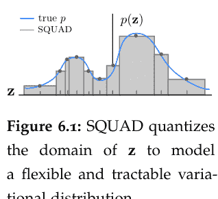

更具体地说，本工作的贡献如下：

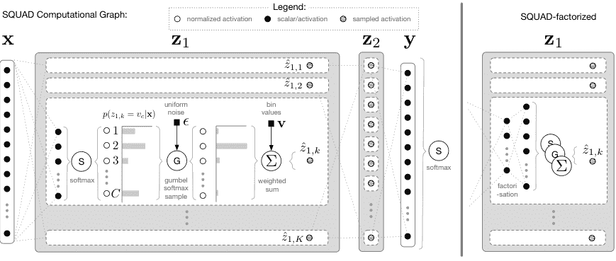

**图 6.2：** 左图视觉化了 Squad 在训练期间的计算图，提供了单个潜变量如何采样的详细视图。右图视觉化了所提出的矩阵分解变体如何提高模型的参数效率。

- 我们提出了一种利用量化潜变量上的多项式分布的变分推理方法。
- 我们展示了生成的预测分布是多模态的，使得变分推理中的灵活分布成为可能。
- 我们证明了将该方法应用于信息瓶颈可以计算出关于预测的具有竞争力的不确定性，这在强风险保证下表现为更好的性能。

## 6.1 方法

在这项工作中，我们遵循方程 1.1 中界限的 IB 解释，并将我们提出的变分推理方案在其他模型（如 VAE）中的评估留给后续工作。我们建议的核心在于假设：神经网络在强激活量化方案下可以是有效的。我们首先在带有信息瓶颈的单潜层背景下给出模型的推导。遵循方程 1.1 中的单数据点损失并为了清晰起见省略下标 $n$，我们得到：

```
$\mathcal{L} = \mathcal{L}_{\text{error}} = \mathbb{E}_{p_{\theta}(\mathbf{z})}[\log q_{\theta}(\mathbf{y}|\mathbf{z})] - \beta D_{\text{KL}}(p_{\theta}(\mathbf{z}|\mathbf{x})||r(\mathbf{z}))$.quad(6.1)
```

为了对 $\mathbf{z}$ 施加灵活的多模态分布，我们首先做出均场假设 $p(\mathbf{z}|\mathbf{x}) = \prod_k p(z_k|\mathbf{x})$。然后，我们量化 $K$ 个潜变量 $z_k$ 中每个的域，使得只剩下极少数潜在值：$z_k \in \{v_1, \dots, c\}$ $\forall k$，例如 $C=11$。我们使用由 $\mathbf{v}$ 定义的量化方案应用于所有潜变量。特定方案被视为先验的一部分，并在图 6.3 中讨论。

尽管 $\mathbf{z}$ 可以取的值数量相对较少，但其数量呈指数级增长。因此，在对 $\mathbf{z}$ 的所有可能值进行采样时，我们采用了蒙特卡洛估计方案。为了使用随机梯度下降 (SGD) 优化参数 $\theta$，我们需要推导出一个完全可微的采样方案，允许我们采样 $\mathbf{z}$ 的值。为了实现这一点，我们使用一组索引值向量的变量 $s_k \in \{1, \dots, C\}$ 对方程 6.1 中关于 $\mathbf{z}$ 的期望进行重参数化，允许我们使用 softmax 函数来表示以下分布：

```
$p_{\theta}(z_k|\mathbf{x}) = v_c \triangleq p_{\theta}(s_k=c|\mathbf{x}) = \text{softmax}(\mathbf{W}\mathbf{x} + \mathbf{b}).quad(6.2)
```

这些索引值与变量 $\mathbf{v}$ 结合作为 $q_{\theta}(\mathbf{y}|\mathbf{x})$ 的输入，该模型由小型网络 $f_{\theta}(\cdot)$ 建模（滥用符号用 $\mathbf{s}$ 进行逐元素索引）：

```
$\mathcal{L}_{\text{error}} = \mathbb{E}_{\sim p_{\theta}}[\log f_{\theta}(\mathbf{s})]).
```

为了能够从离散变量 $\mathbf{s}$ 采样，我们使用 Gumbel-Max 技巧（Gumbel, 1954），用均匀噪声 $\epsilon \sim U(0,1)$ 重参数化期望 $\mathbb{E}_{\mathbf{s}-p}$：

```
$\mathcal{L}_{\text{error}} = \mathbb{E}_{c} \left[ \log f_{\theta} \left( \mathbf{v} \cdot [\arg \max_c p_{\theta}(\mathbf{s}|\mathbf{x}), \epsilon] \right) \right] \right].quad(6.3)
```

由于 argmax 是不可微的，我们使用 Gumbel-Softmax 技巧（Maddison et al., 2016; Jang et al., 2016）来近似该期望，它生成的样本随着 softmax 温度 $\tau$ 趋于 0 会平滑地变形为独热样本。通过近似的独热样本与 $\mathbf{v}$ 的内积 $(\cdot)$，我们创建了来自 $\mathbf{z}$ 的样本：

```
$\mathcal{L}_{\text{error}} \approx \mathbb{E}_{c} [\log f_{\theta} (\mathbf{v} \cdot \text{gumb}(p_{\theta}(\mathbf{s}|\mathbf{x})))].quad(6.4)
```

## 7 通过量化实现预测不确定性

实践中，我们在训练过程中将 $\tau$ 从 1.0 退火到 0.5，正如 Yang 等人 (2017) 所建议的以减少方差。为了完成推导，我们使用如图 6.3 所示的固定先验 $r(z)$。然后我们可以利用 KL 散度对于独立变量是加性的这一事实解析地推导出 KL 项，我们得到最终损失：

```
$\mathcal{L}=\mathbb{E}_{e} \left[\log f_{\theta} \left( \mathbf{v} \cdot e\right)\right]-\sum_{k=1}^{K}\sum_{c=1}^{C} p_{\theta}(s_{k}=c|x)\log \frac{p_{\theta}(s|x)}{r(z)}$.quad(6.5)
```

在工作中我们将潜变量称为 $z$ 以保持清晰。此时，我们可以通过从潜变量采样 $T$ 个样本 $\hat{z}_{t}\sim p(z|x^*)$ 并对 $y^*$ 取平均来近似预测函数 $p(y^*|x^*)$：

```
$p_{\theta}(y^*|x^*) \approx \int q_{\theta}(y^*|z)p_{\theta}(z|x^*) \approx \frac{1}{T}\sum_{t=1}^{T}q_{\theta}(\hat{z}_{t}).quad(6.6)
```

均场变分近似的一个缺点是假设潜变量是不相关的。我们可以通过创建分层潜变量来为潜变量引入相关性，扩展所提方法的灵活性。我们对先验保持均场假设，L 层的联合后验分布因子化如下：

```
$p_{\theta}(z_{1,...,z_{L}})^{p_{\theta}(z_{L}|z_{L-1})\cdots p_{\theta}(z_{1}|x).\quad(6.7)
```

这通过简单的祖先采样方案实现。

有趣的是，我们方法中的强量化本身可以被视为额外的信息瓶颈，因为它限制了每个潜变量的比特数。这些瓶颈被假设对泛化有有益的影响（Tishby et al., 2000; Achille and Soatto, 2016; Alemi et al., 2017; Alemi et al., 2016），我们可以通过改变量化箱的数量来直接控制这一瓶颈。

该方法的计算复杂度以及模型参数 $\theta$ 的数量随 C 线性缩放，即 O(C)（其中 C 是量化箱的数量）。因此它适用于大规模推理。我们希望

## 6.2 相关工作

所提出的方法与利用 Gumbel-Softmax 技巧对类别隐变量建模的工作不同：我们的提议通过量化其定义域并使用多项分布对信念建模，考虑了连续标量隐变量。类别隐变量模型会产生得得 $O(C^2)$ 多项式复杂度惩罚。

该方法可以很容易集成到深度神经网络架构中，并在 `github.com/anonymized` 提供了 SQUAD 层的实现。

在自然图像领域，我们预见到每个变量需要大量信息，因此少量的箱体（bins）是不够的。为了提高使用大量量化箱的可行性，我们提出了 SQUAD 的变体，使用分解方案来提高参数效率。从形式上，方程 6.2 变为：

```
$p(s_k = c(x)) = \text{softmax}(W_{k}^{u}(\mathbf{x}) + b_{k}^{u})$
```

其中全权重 $W''$ 和 $W'$ 分别形状为 $(K, B, C)$ 和 $(|X|, K, B)$，其中 $K$ 表示神经元数量，$B$ 表示分解输入数量，$C$ 表示量化箱数量，$|X|$ 是输入维度。为了提高参数效率，我们也可以每层学习 $W'$，其形状为 $(|X|, 1, B)$，根据 6.3 节中搜索的超参数，这对于较大的 $C$ 是有利的。我们在图 6.2 的右侧描述了这种替代模型，并将其称为 SQUAD-factorized。我们将 Network-in-Network（Lin et al., 2013）等进一步扩展留给未来的工作。

在深度变分模型（DLVMs）领域之外，已经探索了其他预测不确定性的方法。Lakshminarayanan 等人 (2017) 提出了深度集成（deep ensembles）：对一组单独经过对抗训练的小型 DNN 的预测进行直接平均。尽管该方法具有良好的扩展性，但它需要重新训练模型高达 10 次，对于大型数据集来说，这可能极其昂贵。

Gal 和 Ghahramani (2015b) 提出在测试时使用 dropout（Srivastava et al., 2014）（蒙特卡洛 Dropout，或 MC-Dropout），并提出了这种方法的贝叶斯神经网络解释。Gal 等人 (2017) 的后续工作探索了使用 Gumbel-Softmax 来平滑地变形 dropout 噪声，以便在训练期间优化 dropout 速率。MC-Dropout (MCD) 的缺点是施加在权重上的固定双峰脉冲分布灵活性有限，这需要大量的样本才能对不确定性进行良好估计。Oord 等人 (2017a) 提出在变分推断中使用向量量化，对多维嵌入进行量化，我们在自动编码器的背景下探索了这一点。

在学习非线性的空间，Su 等人 (2017) 探索了一种可以假设大多数标准激活函数形式的灵活非线性。Dabney 等人 (2017a) 使用分位数回归为分布强化学习探索了更灵活的分布，这可以看作 SQUAD 的一个特例，其中箱体值是学习的但具有固定的均匀概率。Shayer 等人 (2017) 已使用标量变量上的类别分布来建模更灵活的贝叶斯神经网络后验。Miles 等人 (2006) 提出使用狄拉克分布的混合来近似。

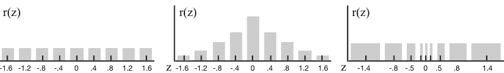

**图 6.3：** 在 IB 中，边缘 $p(z)$ 使用固定分布 $r(z)$ 进行近似。使用我们提出的 SQUAD 分布，我们可以通过量化箱的间距和权重 $r(z_i = v_i)$ 为 $r(z)$ 实施各种有趣的形状。对于值 $v$，我们比较了线性间隔的箱体（左侧）与正态分布下等概率质量的箱体（**右侧**）。此外，我们探索了允许基于每个神经元或每层通过 SGD 优化箱体的影响，允许模型优化量化保真方案。对于先验概率，我们探索了均匀先验（**左侧**）和正态分布下的箱体概率质量（**中间**）。

## 6.3 结果

量化估计质量仍然是一个未解决的问题。已经探索了各种方法，例如 Gal 和 Ghahramani (2015b) 在测试时使用 dropout（蒙特卡洛 Dropout，或 MC-Dropout）。MC-Dropout (MCD) 的缺点是施加在权重上的固定双峰脉冲分布灵活性有限，这需要大量的样本才能对不确定性进行良好估计。Oord 等人 (2017a) 提出在变分推断中使用向量量化，对多维嵌入进行量化，我们在自动编码器的背景下探索了了。

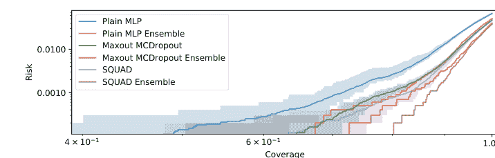

**图 6.4：** 在 IB 中，边缘 $p(z)$ 使用固定分布 $r(z)$ 进行近似。使用我们提出的 SQUAD 分布，我们可以通过量化箱的间距和权重 $r(z_i = v_i)$ 为 $r(z)$ 实施各种有趣的形状。对于值 $v$，我们比较了...

我们将我们的模型与带有 ReLU 激活的普通多层感知机（MLPs）、使用 Maxout 激活的 MCDdropout（Goodfellow et al., 2013; Chang and Chen, 2015）以及使用均值的信息颈模型进行对比²

为了限制超参数对对比的影响，我们对所有变体和基准都使用了昂贵的超参数方案。具体而言，我们使用了自动化优化方法 TPE（Bergstra et al., 2011），每个模型最多进行 100 次评估。超参数在 fashionMNIST（Xiao et al., 2017）上针对 2% 风险（δ=0.01）的覆盖率进行了优化，我们在另一个数据集 notMNIST 上评估最优超参数，以衡量超参数对数据分布变化的敏感性。较大的模型使用相同的优化方案在街景房屋数据集（SVHN）（Netzer et al., 2011）上进行评估。关于所评估搜索空间和所选超参数的细节，请参考附录。

² 所有模型使用 ADAM（Kingma and Ba, 2014a）进行优化、He 等人（2015）提出的权重初始化、10⁻³ 的权重衰减以及在验证准确率未提高 10 个 epoch 的自适应学习率衰减方案¹，并在未改进 20 个 epoch 后提前停止¹。

³ 我们发现在隐变量数量相同的情况下，该基准模型相比传统的 ReLU MCDdropout 模型性能更强。

## 6.3 结果

高斯分布。我们对所有方法评估了互补深度集成技术（Lakshminarayanan et al., 2017）。

### 6.3.1 主要结果

我们首先通过比较每层具有 32 个潜变量的 2 层模型的预测确定性开始分析。在图 6.4 中，我们可视化了使用预测不确定性作为选择阈值时实现的风险/覆盖率权衡，并在表 6.1 中展示了覆盖率结果。总体而言，我们发现 SQUAD 的性能显著优于普通 MLP 和深度高斯 IB 模型，并在定量上将其归因于多项分布灵活性的增加。


与具有相似权重数量 `MCDCDropout` 模型相比，尽管采用了强力量化方案，`SQUAD` 似乎具有轻微的（尽管并不显著）优势，特别是在低风险保证下。深度集成改进了所有方法的结果，这符合集成能够整合某种形式的权重不确定性的假设。在相似的 notMNIST 数据集上对比 fashionMNIST 找到的最优超参数时，我们发现 `SQUAD` 显示出强大的性能，如表 6.2 所示。这提供了一些证据，尽管 `SQUAD` 的超参数数量增加，但最优设置对数据分布的变化更加鲁棒。

### 6.3.2 自然图像

为了探索在自然图像数据集上训练的大型模型，我们对 256 潜变量的 2 层模型通过 100 次 `TPE` 评估重新调整了超参数。由于 `SVHN` 包含彩色自然图像，我们预计每个变量需要更多的信息。因此，我们探索了矩阵分解变体的影响。

如表 6.3 所示，`SQUAD-factorized` 优于非分解变体。考虑到 4 神经元分解（`$B=4$`）在 `$C=37$` 个量化箱的最优计算成本，模型拥有 340 万个权重。相比之下，所提出的 `MCdropout` 结果的最优值为 `$C=11$`，使用了 900 万个权重。在 `NVIDIA Titan X` 上，dropout 基准平均每个 epoch 耗 13 秒，而 `SQUAD-factorized` 仅需 9 秒。

## 通过量化的预测不确定性

| Fashion MNIST | cov@risk .5% | cov@risk 1% | cov@risk 2% | NLL | Acc. |
|---|---|---|---|---|---||

| Plain MLP | 29.1 (±20.71) | 45.9 (±4.04) | 60.4 (±3.17) | 0.408 (±0.036) | 87.7 (±42) |
| Maxout MCDropout | 41.9 (±9.86) | 56.5 (±2.30) | 69.9 (±1.48) | 0.299 (±0.008) | 89.5 (±28) |
| DLGM | 0.0 (±0.0) | 33.5 (±2.42) | 47.0 (±1.47) | 0.446 (±0.007) | 84.3 (±15) |
| SQUAD | 42.9 (±7.19) | 58.3 (±3.06) | 69.5 (±1.55) | 0.293 (±0.008) | 89.5 (±35) |
| Deep Ensemble | cov@risk .5% | cov@risk 1% | cov@risk 2% | NLL | Acc. |
|---|---|---|---|---|---||

| Plain MLP Ensemble | 40.6 | 58.3 | 70.2 | 0.296 | 89.3 |
| Max. MCD. Ensemble | 48.2 | 59.1 | 72.2 | 0.271 | 90.2 |
| DLGM Ensemble | 0.0 | 34.3 | 47.8 | 0.435 | 84.7 |
| SQUAD Ensemble | 47.5 | 61.6 | 73.1 | 0.273 | 90.1 |

**表 6.1: SGR 在 Fashion MNIST 上的覆盖率 结果。** 我们展示了三个预定义风险保证（每列一个）的测试数据集覆盖百分比，其中覆盖率越高越好，同时也包含了负对数然和总体准确率。结果表明 `SQUAD` 具有竞争性的不确定性，特别是在低风险保证下。通过深度集成实现的贝叶斯近似提高了整体覆盖率，特别是对于 `SQUAD` 而言。`SGR` 可以以高概率保证所需的风险水平，报告了 0% 的覆盖率。（括号内为 2 个标准差，最优结果已**加粗**。）

**表 6.2:** `SQUAD` 使用为 fashionMNIST 找到的最优参数在 notMNIST 上表现出强大的性能。

| | MLP K=256 (SVHN) | cov@risk .5% | cov@risk 1% | cov@risk 2% | NLL | Acc. |
|---|---|---|---|---|---|---|

| Plain MLP | 0.0 (±00) | 0.0 (±00) | 36.3 (±2.84) | 0.758 (±065) | 83.1 (±42) |
| Maxout MCDropout | 0.0 (±00) | 50.7 (±1.42) | 65.0 (±2.32) | 0.480 (±020) | 86.4 (±71) |
| SQUAD-factorized | 18.4 (±30.3) | 53.9 (±1.81) | 66.7 (±2.10) | 0.454 (±021) | 86.6 (±88) |
| SQUAD | 1.7 (±6.75) | 42.8 (±2.25) | 59.3 (±1.38) | 0.534 (±005) | 84.6 (±13) |
| Max. MCDropout T=4 | 0.0 (±00) | 38.5 (±3.85) | 57.6 (±2.66) | 0.562 (±016) | 84.9 (±73) |
| SQUAD-factorized T=4 | 10.7 (±2.25) | 49.9 (±3.51) | 64.5 (±2.45) | 0.480 (±024) | 86.2 (±67) |
| SQUAD T=4 | 0.0 (±00) | 38.0 (±1.86) | 55.6 (±2.45) | 0.569 (±019) | 83.7 (±52) |

**表 6.3:** `SVHN` 的结果表明，`SQUAD` 使用的量化方案可能性能较低，但通过使用更大的箱数得到了有效补偿。即使在 `T=4` 时，`SQUAD` 的表现也良好。

### 6.3.3 潜变量分布分析

为了探索所提变分分布是否简单地坍缩到一个模式，我们想知道模型预测了什么类型的分布。我们在图 6.5 中可视化了预测分布的形式。虽然这只显示了潜在多峰行为的一个子集，但这表明模型确实充分利用了分布的潜力。为了直观理解这些预测分布是如何产生的，我们在附录中提供了图 6.7。

在图 6.6 中，我们可视化了该方法在一维 `SQUAD-factorized` 模型中学习的一种激活函数。学习到的激活函数类似于“峰值”sigmoid激活，这可以解释为 `RBF` 内核和 sigmoid 的组合。这为如何设计传统神经网络的非线性提供了思考，使用这种非线性的影响可以在未来的工作中研究。

## 6.4 讨论

在这项工作中，我们提出了一种新的灵活变分分布。为了衡量其在现实分类中的有效性，我们将该类应用于深度变分信息瓶颈模型。通过在激活上放置基于量化的分布，我们可以计算输出的不确定性估计。我们提出的评估方案源于现实领域对保证最小风险的需求。结果表明，`SQUAD` 优于普通神经网络和高斯信息瓶颈模型。与近似贝叶斯网络的 `MCDropout` 相比，我们获得了竞争性的性能。此外，从定性上看，我们发现灵活分布得到了充分利用。

## 附录

## 6.A 超参数对覆盖率的影响：

我们使用 `TPE` 进行了 700 次评估，确定了超参数和箱先验（bin priors）的最优配置。探索的参数空间如下，为了透明起见，采用了 hyperopt API 呈现：

```
# 共享
C: uniform(2, 10, 1) * 2 + 1,
dropout rate: uniform(0.01, .95),
lr: logiform(log(0.0001), log(0.01)),
batch_size: qloguniform(log(32), log(512), 1)
# SQUAD & 高斯分布
kl_multiplier: logiform(log(1e-6), log(0.01)),
init_scale: logiform(log(1e-3), log(20)),
# SQUAD
use_bin_probs: choice(['uni', 'gaus']),
use_bins: choice(['equal_prob_gaus',
'linearly_spaced']),
learn_bin_values: choice([
'per_neuron', 'per_layer', 'fixed']),
```

在图 6.A.1 中，我们可视化了这些超参数对覆盖率的成对影响。在主 `SQUAD` 模型中找到的最优配置为：batch size: 244, KL multiplier: 0.0027, per layer, p(z): uniform, v: 在 (-3.5,3.5) 上线性均匀分布, lr: 0.0008, C: 15, initialization scale: 3.214。

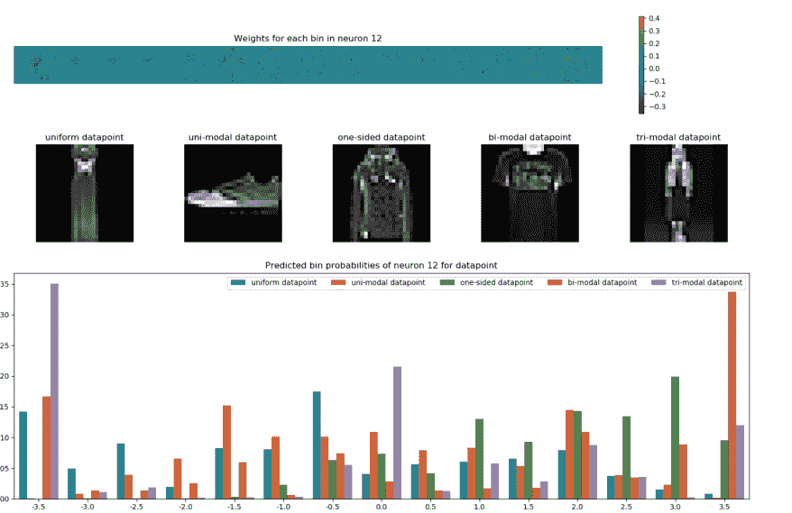

**图 6.7：** 该图旨在为模型如何产生各种分布提供直观理解。我们展示了在收敛的 2 层 `SQUAD` 模型中，用于从第一层随机选择的潜变量 `$z_{f=1,k=12}$` 的 C 个箱（bins）预测概率的权重集（为了与数据对比，已重塑为 28x28 的方格）。然后，我们展示了 5 个数据点，神经元在这些点预测了典型的分布，如最后一个状图所示。

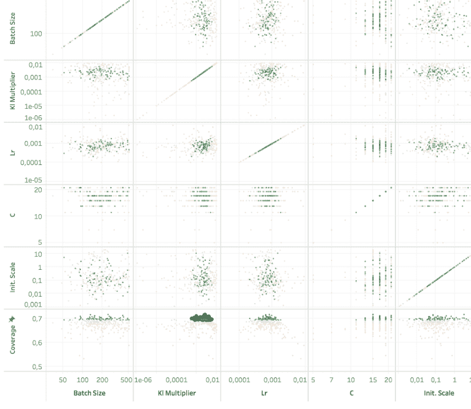

**图 6.A.1：** 该图可视化了 `SQUAD` 超参数之间的成对关系以及对覆盖率的影响。图中强调了前 60 个配置。绿色值良好，红色值较差。为了减少杂乱，我们对箱值和先验的最优设置进行了过滤。

## 7 结论

在本文中中，我们重新审视了深度学习工具包的核心组件，并在医学图像分析的背景下对它们进行了重新评估。我们识别出深度学习存在短板的三个主要领域。在第一部分，我们探索了在模型中整合关于结构和约束的专家知识的优势。第二部分研究了深度学习模式如何更好地利用海量的未标记医学影像数据。最后，在第三部分中，我们探索了如何从模型中提取更好的不确定性估计以提供诊断风险。现在让我们考虑这项工作开始时提出的研究问题。

**研究问题 1**：旋转反射等变性（roto-reflective equivariance）能提高大规模医学场景下深度学习模型的准确性和鲁棒性吗？

某些医学影像问题带有对称性模式和干扰因素，这些因素在计算机视觉深度学习研究的真实图像中也常见。我们在病理学学的背景下探索了这个问题，用于检测转移组织的任务。利用 `CNN` 框架，我们设计了一种新的架构来捕捉幻片图像的旋转对称性。这种新模型在计算成本和参数数量严格相等的情况下，也优于传统的 `CNN` 架构。此外，新模型被证明对扰动更具鲁性。我们可以得出结论：在适当的情况下，特别是在数据有限的情况下，以模型不变性的形式引入专家知识可以提高深度学习模型的鲁棒性和准确性。

展望未来，我们认为自 Cohen 和 Welling（2016）以来，群等变神经网络的研究领域已经取得了进展。引入这些新方法来实现尺度等变、连续旋转等变性以及可能的颜色等变性，可能会进一步提高性能。然而，将专家知识作为先验整合到深度学习模型中的有效性仍然存在争议。正如 Sutton（2019）在《痛苦的教训》中所讨论的，专家知识可能会阻碍深度学习模型发现决策问题的有效解决方案。历史上来看，受益于数据和计算规模的通用方法一直优于定制方法。`GPT` 风格的语言模型几乎完全没有语言学的专业知识，但已被证明是极其有效的。引入不变性应该根据具体情况进行评估。随着模型和数据集的增大，我们可能会发现它们对性能的影响在递减。

**研究问题 2**：我们该如何激励深度学习研究社区，针对真实的医学问题优化模型？

为了帮助医学问题的深度学习研究，我们提议了 `PCAM`，这是一个源自 Camel16 的数据集。该数据集的结构类似于 CIFAR-10 等典型的深度学习基准测试。我们证明了在 `PCAM` 基准上的改进。自发布以来，`PCAM` 一直是 Kaggle 挑战的焦点，配套论文至今已被引用了 175 次（Radford et al., 2021）。

**研究问题 3**：医学影像深度学习模型是否受益于对比表示学习（contrastive representation）？

接下来，我们研究了对比表示学习如何学习医学影像。我们发现 `CPC` 本身表现良好，但受到医学影像中干扰因素的影响。通过仔细整合特定任务的一组增强，我们发现了改进的表示，这在病理和 X 光数据中都有更好的预测。

**研究问题 4**：我们如何有效地优化深度学习模型？

随着深度学习架构规模的扩大，构建训练基础设施的成本爆炸。为了实现跨整个网络的梯度反传播，计算节点需要高带宽通道连接并物理部署。我们发现提出的方法 `GIM` 优于其监督对应，并允许独立训练网络层。

**研究问题 5**：潜变量量化能否实现更具表达力的场后验分布？

最后，我们探索了不确定性问题。我们认为分推断使用了过于受限的近似后验类。基于此，我们提出了一种基于潜变量量化的新型场后验，称为 `SQUAD`。我们证明了该后验在 `DLVM` 设置下可以有效训练，不需要批归一化，并能产生降低风险的质量。

自此之后，量化作为一种连续领域建模的方法开始兴起。如 `VQ-VAE`（Oord et al., 2017b）等量化技术在图像生成工具 `DALL-E` 和强化学习中的分位数回归（Dabney et al., 2017b）中发挥了关键作用。这仍然是近似后验建模的一种有趣方法，可以在各种变分推断设置下进行。

对深度学习进行适当贝叶斯处理仍在进行中。这一领域曾一度过，因为许多以贝叶斯方式训练深度学习模型的研究得负面结论（Wenzel et al., 2020）。最近，Chen 等人（2024）证明了通过适配的优化器，从大型概率神经网络中获得良好校准的不确定性是可能的。

## 结语

深度学习为医学图像分析和整个医学领域带来了极其令人兴奋的可能性。将专家知识捕捉到统计模型中使人类能够提高诊断质量。

在全球范围内，它使得医学知识能够被复制并提供给所有社区。为了实现这一愿景，仍有许多技术障碍需要克服，但随着机器学习领域的发展速度和广度，未来似乎是光明的。

## 参考文献

Martin Abadi, Andy Chu, Ian Goodfellow, H Brendan McMahan, Ilya Mironov, Kunal Talwar, and Li Zhang (2016). “带有差隐私的深度学习。” In: Proceedings of the 2016 ACM SIGSAC conference on computer and communications security, pp. 308–318.

Alessandro Achille and Stefano Soatto (Nov. 2016). “信息丢弃——通过噪声计算学习最优表示。” In: arXiv: 1611.01353 [stat.ML].

Alexander Alemi, Ian Fischer, Joshua V Dillon, and Kevin Murphy (2016). “深度变分信息瓶颈。” In: arXiv: 1612.00410 [cs.LG].

Alexander Alemi, Ben Poole, Ian Fischer, Joshua V Dillon, Rif A Saurous, and Kevin Murphy (Nov. 2017). “深度潜变量模型的信息论分析。” In: arXiv: 1711.00464 [cs.LG].

David Balduzzi, Hastagiri Vanchinathan, and Joachim Buhmann (2015). “剪切反传播的繁琐程序：神经网络中具有生物学意义的信用分配。” In: Twenty-Ninth AAAI Conference on Artificial Intelligence.

Babak Ehemiash Bejnordi et al. (2016). “全切片病理图像的特定染色标准化。” In: IEEE Trans. Machine Imaging 35,2, pp. 404–415.

Mohamed Ishmael Belghazhi, Aristide Baritat, Raj Rajeshwar, Sheril Ozair, Joshua Bengio, Devon Hjelm, and Aaron Courville (2018). “互信息神经估计。” In: International Conference on Machine Learning, pp. 530–539.

Eugene Belilovsky, Michael Eickenberg, and Edouard Oyallon (2019). “贪婪逐层学习可以扩展到 ImageNet。” In: International Conference on Machine Learning, pp. 583–593.

Yoshua Bengio, Pascal Lamblin, Dan Popovici, and Hugo Larochelle (2007). “深度网络的贪婪逐层训练。” In: Advances in neural information processing systems, pp. 153–160.

Yoshua Bengio, Dong-Hyun Lee, Jung Bornschein, Thomas Mesnard, and Zhouhan Lin (2015). “走向具有生物学意义的深度学习。” In: arXiv preprint arXiv:1502.04156.

Petros C Benias, Rebecca G Wells, Bridget Sackey-Abooye, Heather Klavan, Jason Reddy, Darren Buonocore, Markus Miranda, Susan Kornacki, Michael Wayne, David L Carr-Lock, and Neil D The (2018). “人体组织中未识别间质的结构与分布。” en: Sci. Rep. 8.1, p. 4947.


# 参考文献

James S Bergstra, Rémi Bardenet, Yoshua Bengio, and Baláz Kégl (2011). “超参数优化的算法。” In: Advances in Neural Information Processing Systems 24. Ed. by J Shawa-Taylor, R S Zemel, P L Bartlett, F Pereira, and K Q Weinberger. Curran Associates, Inc., pp. 2546–2554.

Natalia Capolare and Yang Dan (2008). “脉冲时间依赖可塑性：一种赫布学习规则。” In: Annual Review of Neuroscience 31, pp. 25–46.

Jia-Ren Chang and Yong-Sheng Chen (Nov. 2015). “批归一化 Maxout 网络。” In: arXiv: 1511.0258.

Dan Cireşan et al. (2013). “用深度神经网络检测乳腺癌病理图像中的有丝分裂。” In: MICCAI 16.Pt2, pp. 411–418.

Adam Coates, Andrew Ng, and Honglak Lee (2011). “无监督学习分析。” In: Proceedings of the fourteenth international conference on artificial intelligence and statistics, pp. 215–223.

Taco S Cohen and Max Welling (Feb. 2016). “群等变卷积网络。” In: arXiv: 1602.0757 [cs.LG].

Francis Crick (1989). “对神经网络的兴奋。” In: Nature 337,6203, pp. 129–132.

Will Dabney, Mark Rowland, Marc G Bellemare, and Rémi Munos (Oct. 2017a). “分位数回归强化学习。” In: arXiv: 1710.0044 [cs.AI].

Will Dabney, Mark Rowland, Marc G Bellemare, and Rémi Munos (Oct. 2017b). “量子回归强化学习。” In: arXiv: 1710.0044 [cs.AI].

Terrance DeVries and Graham W Taylor (2017). “使用 dropout 改进卷积网络的正则化。” In: arXiv preprint arXiv:1708.0452.

Carl Doersch, Abhinav Gupta, and Alexei Efros (2017). “通过上下文预测无监督表示学习。” In: Proceedings of the IEEE International Conference on Computer Vision, pp. 1422–1430.

Jeff Donahue, Philip Krähenbein, and Trevor Darrell (2016). “对抗扰动。” In: arXiv: 1605.9782 [cs.LG].

Beranger Dumont et al. (2018). “旋转等变网络的鲁棒性。” Babak Ehesthemi Bejorndi, Mitko Veta, Paul Johannes van Diest, Bram van Ginneken, Nico Karsmeijer, Geert Jit, Jeroen A van Laak, CAMEL16, Meyke Hermisen, Kyrie Fanson, Marchenka Balkenhol, Oscar Geissink, Nikolaos Stathonikos, Marc Cry Dijk, ter Bulk, Francisco Baca, Andrew H Beck, Dayong Wang, Aditya Khosla, Rag Garvey, Humayun Irshad, Aoxiao Zhong, Quanzheng Li, Hao Chen, Huang-Jing Lin, Peng Aheng, Christian Haß, Eli Bruni, Quincy Young, Ulger Halaci, Mustafa Ümer Öner, Regul Centr, Matt Berseth, Vitali Kvatkov, Alexei Vylehanin, Oren Kraus, Muhammad Sha, Nasir Rajpour, Ruqaya Awan, Korsik Sirukunana, Talha Qaiser, Yee-Wah Tsang, David Telles, Jonas Annuschheit, Peter Hufnag, Mira Valka, Kimto Kartasos, Leena Laaton, Pekka Rusuivori, Kai Laimatainen, Shadi Alarquoni, Bharti Mangal, Shigento Sen, Yoichi Takenaka, Hideo Matsuda, Hady Ahmad Ph, Vallis Kovalev, Alexander Kalinov, Vitali Li, Gloria Bueno, M Milagro Fernandez-Carro, Ismael Serrano, Oscar Deniz, Daniel Racaceanu, and Rui Venancia (2017). “乳腺癌女性淋巴结转移深度学习算法诊断评估。” In: JAMA 318.22, pp. 2199–2210. doi: 10.1001/jama.2017.14585. eprint: /data/journals/jama/936626/jama-ehesthemi_bejorndi_2017_oi_170113.pdf. URL:http://dx.doi.org/10.1001/jama.2017.14585.

Adar Elad, Doron Haviv, Yochai Blau, and Tomer Michaeli (2018). “使用信息瓶颈原理进行逐层训练的有效性。” In: OpenReview.

Andre Esteva, Brett Kupler, Roberto A Novoa, Justin Ko, Susan M Swetter, Helen M Blau, and Sebastian Thrun (2017). “皮肤神经网络对皮肤癌的分类。” In: Nature 542.7639, pp. 115–118.

Karl Friston (2010). “自由能原理：一种统一的大脑理论？” In: Nature reviews neuroscience 11,2, p. 127.

Yarin Gal and Zoubin Ghahramani (June 2015a). “带伯努利近似推理的贝叶斯卷积神经网络。” In: arXiv: 1506.02158 [stat.ML].

Yarin Gal and Zoubin Ghahramani (June 2015b). “作为贝叶斯近似的 Dropout：深度学习中的不确定性表示。” In: arXiv: 1506.02142 [stat.ML].

Yarin Gal, Giri Hron, and Alex Kendall (May 2017). “Concrete Dropout。” In: arXiv:1705.07832 [stat.ML].

Todor Ganchev, Niko Fotakis, and George Kokakis (2005). “各种 MFCC 实现在语音验证任务中的对比评估。” In: Proceedings of the SEEMC. Vol. 1, pp. 191–194.

Shuyang Gao, Rok Brekemels, Greg Steeg, and Ram Galystan (2018). “自编码总相关性解释。” In: arXiv preprint arXiv:1802.0582.

Yonatan Geifman and Ran El-Yaniv (2017). “深度神经网络的选择分类。” In: Advances in Neural Information Processing Systems 30. Ed. I Guyon, U Luxburg, S Bengio, H Wallach, R Fergus, S Vishwanath, and R Garnett. Curran Associates, Inc., pp. 4885–4894.

D F Gleason (1992). “前列腺癌的组织学分级：视角。” In: Hum. Pathol. 23.3, pp. 273–279.

D F Gleason and M Tannenburg (1977). “退伍军合作泌尿研究小组：前列腺癌的组织学分级和临床分期。” In: Urologic Pathology: The Prostate, pp. 171–198.

Ian J Goodfellow, David Warde-Farley, Mehdi Mirza, Aaron Courville, and Yoshua Bengio (Feb. 2013). “Maxout 网络。” In: arXiv: 1302.4389 [stat.ML].

Varun Gulshan, Lily Peng, Marc Coram, Martin Stumpe, Derek Wu, Arunachalam Naranaswamy, Subhashini Venugopalan, Kasumi Widner, Tom Madams, Jorge Cuadros, Ramasamy Kim, Rajiv Raman, Philip C Nelson, Jessica L Mega, and Dale R Webster (2016年12月). “用于视网膜摄影检测视网膜病变的深度学习算法开发与验证。” In: JAMA 316.22, pp. 2402–2410.

E J Gubel (1954). “极值的统计理论及若干实践、应用，美国标准局，华盛顿 (1954).” In: MR006132 (15; 811b).

Michael Gutmann and Aapo Hyvärinen (2010). “对比估计：一种非归一化统计模型的新估计原理。” In: 第十三届人工智能与统计会议集, pp. 297–304.

Kaiming He, Xiangyu Zhang, Shaoqing Ren, and Jian Sun (2015). “深译残卷：在图像分类上超越人类水平的性能。” In: IEEE国际计算机视觉会议论文集-foundation.org, pp. 1026–1034.

Kaiming He, Xiangyu Zhang, Shaoqing Ren, and Jian Sun (2016a). “深度残差网络中的恒等映射。” In: 计算机视觉 – ECCV 2016. Springer International Publishing, pp. 630–645.

Kaiming He, Xiangyu Zhang, Shaoqing Ren, and Jian Sun (2016b). “深度残差网络中的恒等映射。” In: 欧洲计算机视觉会议. Springer, pp. 630–645.

Olivier J Hénaff, Ali Razavi, Carl Doersch, and Aaron den Oord (2019). “基于对比预测的高效图像识别。” In: arXiv预打印 arXiv:1905.09272.

Irina Higgins, Loi Pal, Christopher Burgess, Xavier Glorot, Matthew Bottou, Shakir Mohamed, and Alexander Lerchner (2016年11月). “beta-VAE：带约束的变分框架学习基本概念。” In: Neural computation 18.7, pp. 1527–1554.

Geoffrey E Hinton, Simon Osindero, and Yee Teh (2006). “深度置信网络的快速学习。” In: Neural computation 18.7, pp. 1527–1554.

Devon Hjelm, Alex Fedorov, Samuel Lavoise, Karan Grewal, Adam Trischler, and Yoshua Bengio (2019). “通过互信息估计和最大化学习深层表示。” In: 第37届国际表示学习会议论文集。

J L and J N Hwang (1993). “神经网络硬件实现的有限精度误差分析。” In: IEEE Trans. Comput. 42.3, pp. 281–290.

Weihua Hu, Takeru Miyato, Seiya Tokui, Eiichi Matsumoto, and Masashi Sugiyama (2017). “通过信息自增强训练学习离散表示。” In: 第34届国际机器学习会议论文集-卷 70. JMLR.org, pp. 1558–1567.

Gao Huang, Liang Liu, Kevin Weinberger, and Laurens de Maaten (2016年8月). “密集卷积神经网络。” In: arXiv: 1608.06993 [cs.CV].

Itay Baba, Mathieu Courbariaux, Daniel Soudry, Ran El-Yaniv, and Yoshua Bengio (2016年9月). “具有低精度权重激活值的量化神经网络。” In: arXiv: 1609.07061 [cs.NE].

Aapo Hyvarinen and Hiroshi Morioka (2016). “通过时间对比学习和非线性方法进行无监督特征提取。” In: 神经信息处理系统进展, pp. 3765–3773.

Aapo Hyvarinen and Hiroshi Morioka (2017). “时间依赖源的非线性ICA。” In: 第20届国际人工智能与统计会议论文集。由 Aarti Singh 和 Jerry Zhu 编辑。卷 54. 机器学习研究进展。Fort Lauderdale, FL, USA: PMLR.org, pp. 460–469.

Aapo Hyvarinen, Hiroaki Sasaki, and Richard E Turner (2018年5月). “使用辅助变量和广义对比学习的非线性ICA。” In: arXiv: 1805.08651 [stat.ML].

Sergey Ioffe and Christian Szegedy (2015年6月). “批归一化：通过减少内部协方差加速深度网络训练。” In: 国际机器学习会议。jmlr.org, pp. 448–456.

Sergey Ioffe and Christian Szedy (2015b). “批归一化：通过减少内部协方差加速深度网络训练。” In: arXiv预打印 arXiv:1502.03167.

Jorn-Henrik Jacobson, Arnold Smeanders, and Edouard Oyallon (2018). “i-revnet 深度可逆网络。” In: arXiv预打印 arXiv:1802.07088.

Max Jaderberg, Wojciech Marian Czarnecki, Simon Osindero, Oriol Vinyals, Alex Graves, David Silver, and Koray Kavucoglu (2017). “使用合成梯度的解耦神经接口。” In: 第34届国际机器学习会议论文集-70, pp. 1627–1635.

Eric Jang, Shixiang Gu, and Ben Poole (2016). “使用Soft-Max的类别重参数化。” In: arXiv: 1611.01144 [stat.ML].

Michael I Jordan, Zoubin Ghahramani, Tommi S Jaakkola, and Lawrence K Saul (1999). “图形模型变分方法介绍。” In: Mach. Learn. 37.2, pp. 183–233.

C Kassei (2015). 误诊的人性成本和财务影响。

Diederik P Kingma and Jimmy Ba (2014). “Adam：一种随机优化的方法。” In: arXiv 1412.6980 [cs.LG].

Diederik P Kingma and Jimmy Ba (2014b). “Adam：一种随机优化的方法。” In: arXiv 1412.6980 [cs.LG].

Diederik P Kingma and Jimmy Ba (2014c). “Adam：一种随机优化的方法。” In: arXiv 1412.6980 [cs.LG].

Diederik P Kingma and Jimmy Ba (2014d). “Adam：一种随机优化的方法。” In: arXiv 1412.6980 [cs.LG].

Diederik P Kingma and Jimmy Ba (2014e). “Adam：一种随机优化的方法。” In: arXiv 1412.6980 [cs.LG].

Diederik P Kingma and Jimmy Ba (2014f). “Adam：一种随机优化的方法。” In: arXiv 1412.6980 [cs.LG].


# 参考文献 | 100

Diederik P Kingma and Jimmy Ba (2014g). “Adam：一种随机优化的方法。” In: arXiv 1412.6980 [cs.LG].
Diederik P Kingma and Jimmy Ba (2014h). “Adam：一种随机优化的方法。” In: arXiv 1412.6980 [cs.LG].
Diederik P Kingma and Jimmy Ba (2014i). “Adam：一种随机优化的方法。” In: arXiv 1412.6980 [cs.LG].
Diederik P Kingma and Jimmy Ba (2014j). “Adam：一种随机优化的方法。” In: arXiv 1412.6980 [cs.LG].
Diederik P Kingma and Jimmy Ba (2014k). “Adam：一种随机优化的方法。” In: arXiv 1412.6980 [cs.LG].
Diederik P Kingma and Jimmy Ba (2014l). “Adam：一种随机优化的方法。” In: arXiv 1412.6980 [cs.LG].
Diederik P Kingma and Jimmy Ba (2014m). “Adam：一种随机优化的方法。” In: arXiv 1412.6980 [cs.LG].
Diederik P Kingma and Jimmy Ba (2014n). “Adam：一种随机优化的方法。” In: arXiv 1412.6980 [cs.LG].
Diederik P Kingma and Jimmy Ba (2014o). “Adam：一种随机优化的方法。” In: arXiv 1412.6980 [cs.LG].
Diederik P Kingma and Jimmy Ba (2014p). “Adam：一种随机优化的方法。” In: arXiv 1412.6980 [cs.LG].
Diederik P Kingma and Jimmy Ba (2014q). “Adam：一种随机优化的方法。” In: arXiv 1412.6980 [cs.LG].
Diederik P Kingma and Jimmy Ba (2014r). “Adam：一种随机优化的方法。” In: arXiv 1412.6980 [cs.LG].
Diederik P Kingma and Jimmy Ba (2014s). “Adam：一种随机优化的方法。” In: arXiv 1412.6980 [cs.LG].
Diederik P Kingma and Jimmy Ba (2014t). “Adam：一种随机优化的方法。” In: arXiv 1412.6980 [cs.LG].
Diederik P Kingma and Jimmy Ba (2014u). “Adam：一种随机优化的方法。” In: arXiv 1412.6980 [cs.LG].
Diederik P Kingma and Jimmy Ba (2014v). “Adam：一种随机优化的方法。” In: arXiv 1412.6980 [cs.LG].
Diederik P Kingma and Jimmy Ba (2014w). “Adam：一种随机优化的方法。” In: arXiv 1412.6980 [cs.LG].
Diederik P Kingma and Jimmy Ba (2014x). “Adam：一种随机优化的方法。” In: arXiv 1412.6980 [cs.LG].
Diederik P Kingma and Jimmy Ba (2014y). “Adam：一种随机优化的方法。” In: arXiv 1412.6980 [cs.LG].
Diederik P Kingma and Jimmy Ba (2014z). “Adam：一种随机优化的方法。” In: arXiv 1412.6980 [cs.LG].
Thomas K and Max W (2013). “变分编码器。” In: 第34届国际机器学习会议论文集-卷 70. JMLR.org, pp. 1558–1567.
Gao Huang, Liang Liu, Kevin Weinberger, and Laurens de Maaten (2016年8月). “密集卷积神经网络。” In: arXiv: 1608.06993 [cs.CV].
Itay Baba, Mathieu Courbariaux, Daniel Soudry, Ran El-Yaniv, and Yoshua Bengio (2016年9月). “具有低精度权重激活值的量化神经网络。” In: arXiv: 1609.07061 [cs.NE].
Aapo Hyvarinen and Hiroshi Morioka (2016). “通过时间对比学习和非线性方法进行无监督特征提取。” In: 神经信息处理系统进展, pp. 3765–3773.
Aapo Hyvarinen and Hiroshi Morioka (2017). “时间依赖源的非线性ICA。” In: 第20届国际人工智能与统计会议论文集。由 Aarti Singh 和 Jerry Zhu 编辑。卷 54. 机器学习研究进展。Fort Lauderdale, FL, USA: PMLR.org, pp. 460–469.
Aapo Hyvarinen, Hiroaki Sasaki, and Richard E Turner (2018年5月). “使用辅助变量和广义对比学习的非线性ICA。” In: arXiv: 1805.08651 [stat.ML].
Sergey Ioffe and Christian Szegedy (2015年6月). “批归一化：通过减少内部协方差加速深度网络训练。” In: 国际机器学习会议。jmlr.org, pp. 448–456.
Sergey Ioffe and Christian Szegedy (2015b). “批归一化：通过减少内部协方差加速深度网络训练。” In: arXiv预打印 arXiv:1502.03167.
Jorn-Henrik Jacobson, Arnold Smeanders, and Edouard Oyallon (2018). “i-revnet 深度可逆网络。” In: arXiv预打印 arXiv:1802.07088.
Max Jaderberg, Wojciech Marian Czarnecki, Simon Osindero, Oriol Vinyals, Alex Graves, David Silver, and Koray Kavucoglu (2017). “使用合成梯度的解耦神经接口。” In: 第34届国际机器学习会议论文集-70, pp. 1627–1635.
Eric Jang, Shixiang Gu, and Ben Poole (2016). “使用Soft-Max的类别重参数化。” In: arXiv: 1611.01144 [stat.ML].
Michael I Jordan, Zoubin Ghahramani, Tommi S Jaakkola, and Lawrence K Saul (1999). “图形模型变分方法介绍。” In: Mach. Learn. 37.2, pp. 183–233.
C Kassei (2015). 误诊的人性成本和财务影响。
Jorn-Henrik Jacobson, Arnold Smeanders, and Edouard Oyallon (2018). “i-revnet 深度可逆网络。” In: arXiv预打印 arXiv:1802.07088.
Max Jaderberg, Wojciech Marian Czarnecki, Simon Osindero, Oriol Vinyals, Alex Graves, David Silver, and Koray Kavucoglu (2017). “使用合成梯度的解耦神经接口。” In: 第34届国际机器学习会议论文集-70, pp. 1627–1635.
Eric Jang, Shixiang Gu, and Ben Poole (2016). “使用Soft-Max的类别重参数化。” In: arXiv: 1611.01144 [stat.ML].
Michael I Jordan, Zoubin Ghahramani, Tommi S Jaakkola, and Lawrence K Saul (1999). “图形模型变分方法介绍。” In: Mach. Learn. 37.2, pp. 183–233.
C Kassei (2015). 误诊的人性成本和财务影响。
Diederik P Kingma and Jimmy Ba (2014). “Adam：一种随机优化的方法。” In: arXiv 1412.6980 [cs.LG].
Diederik P Kingma and Jimmy Ba (2014b). “Adam：一种随机优化的方法。” In: arXiv 1412.6980 [cs.LG].
Diederik P Kingma and Jimmy Ba (2014c). “Adam：一种随机优化的方法。” In: arXiv 1412.6980 [cs.LG].
Diederik P Kingma and Jimmy Ba (2014d). “Adam：一种随机优化的方法。” In: arXiv 1412.6980 [cs.LG].
Diederik P Kingma and Jimmy Ba (2014e). “Adam：一种随机优化的方法。” In: arXiv 1412.6980 [cs.LG].
Diederik P Kingma and Jimmy Ba (2014f). “Adam：一种随机优化的方法。” In: arXiv 1412.6980 [cs.LG].
Diederik P Kingma and Jimmy Ba (2014g). “Adam：一种随机优化的方法。” In: arXiv 1412.6980 [cs.LG].
Diederik P Kingma and Jimmy Ba (2014h). “Adam：一种随机优化的方法。” In: arXiv 1412.6980 [cs.LG].
Diederik P Kingma and Jimmy Ba (2014i). “Adam：一种随机优化的方法。” In: arXiv 1412.6980 [cs.LG].
Diederik P Kingma and Jimmy Ba (2014j). “Adam：一种随机优化的方法。” In: arXiv 1412.6980 [cs.LG].
Diederik P Kingma and Jimmy Ba (2014k). “Adam：一种随机优化的方法。” In: arXiv 1412.6980 [cs.LG].
Diederik P Kingma and Jimmy Ba (2014l). “Adam：一种随机优化的方法。” In: arXiv 1412.6980 [cs.LG].
Diederik P Kingma and Jimmy Ba (2014m). “Adam：一种随机优化的方法。” In: arXiv 1412.6980 [cs.LG].
Diederik P Kingma and Jimmy Ba (2014n). “Adam：一种随机优化的方法。” In: arXiv 1412.6980 [cs.LG].
Diederik P Kingma and Jimmy Ba (2014o). “Adam：一种随机优化的方法。” In: arXiv 1412.6980 [cs.LG].
Diederik P Kingma and Jimmy Ba (2014p). “Adam：一种随机优化的方法。” In: arXiv 1412.6980 [cs.LG].
Diederik P Kingma and Jimmy Ba (2014q). “Adam：一种随机优化的方法。” In: arXiv 1412.6980 [cs.LG].
Diederik P Kingma and Jimmy Ba (2014r). “Adam：一种随机优化的方法。” In: arXiv 1412.6980 [cs.LG].
Diederik P Kingma and Jimmy Ba (2014s). “Adam：一种随机优化的方法。” In: arXiv 1412.6980 [cs.LG].
Diederik P Kingma and Jimmy Ba (2014t). “Adam：一种随机优化的方法。” In: arXiv 1412.6980 [cs.LG].
Diederik P Kingma and Jimmy Ba (2014u). “Adam：一种随机优化的方法。” In: arXiv 1412.6980 [cs.LG].
Diederik P Kingma and Jimmy Ba (2014v). “Adam：一种随机优化的方法。” In: arXiv 1412.6980 [cs.LG].
Diederik P Kingma and Jimmy Ba (2014w). “Adam：一种随机优化的方法。” In: arXiv 1412.6980 [cs.LG].
Diederik P Kingma and Jimmy Ba (2014x). “Adam：一种随机优化的方法。” In: arXiv 1412.6980 [cs.LG].
Diederik P Kingma and Jimmy Ba (2014y). “Adam：一种随机优化的方法。” In: arXiv 1412.6980 [cs.LG].
Diederik P Kingma and Jimmy Ba (2014z). “Adam：一种随机优化的方法。” In: arXiv 1412.6980 [cs.LG].
Balaji Lakshminanan, Alexander Pritzel, Matthew Botou, Shakir Mohamed, Alexander Lerchner, and Christopher Burgess (2016). “beta-VAE：带约束的变分框架学习基本概念。” In: Neural computation 18.7, pp. 1527–1554.
Devon Hjelm, Alex Fedorov, Samuel Lavoise, Karan Grewal, Adam Trischler, and Yoshua Bengio (2019). “通过互信息估计和最大化学习深层表示。” In: 第37届国际表示学习会议集。
J L and J N Hwang (1993). “神经网络硬件实现的有限精度误差分析。” In: IEEE Trans. Comput. 42.3, pp. 281–290.
Weihua Hu, Takeru Miyato, Seiya Tokui, Eiichi Matsumoto, and Masashi Sugiyama (2017). “通过信息自增强训练学习离散表示。” In: 第34届国际机器学习会议论文集-卷 70. JMLR.org, pp. 1558–1567.
Gao Huang, Liang Liu, Kevin Weinberger, and Laurens de Maaten (2016年8月). “密集卷积神经网络。” In: arXiv: 1608.06993 [cs.CV].
Itay Baba, Mathieu Courbariaux, Daniel Soudry, Ran El-Yaniv, and Yoshua Bengio (2016年9月). “具有低精度权重激活值的量化神经网络。” In: arXiv: 1609.07061 [cs.NE].
Aapo Hyvarinen and Hiroshi Morioka (2016). “通过时间对比学习和非线性方法进行无监督特征提取。” In: 神经信息处理系统进展, pp. 3765–3773.
Aapo Hyvarinen and Hiroshi Morioka (2017). “时间依赖源的非线性ICA。” In: 第20届国际人工智能与统计会议论文集。由 Aarti Singh 和 Jerry Zhu 编辑。卷 54. 机器学习研究进展。Fort Lauderdale, FL, USA: PMLR.org, pp. 460–469.
Aapo Hyvarinen, Hiroaki Sasaki, and Richard E Turner (2018年5月). “使用辅助变量和广义对比学习的非线性ICA。” In: arXiv: 1805.08651 [stat.ML].
Sergey Ioffe and Christian Szegedy (2015年6月). “批归一化：通过减少内部协方差加速深度网络训练。” In: 国际机器学习会议。jmlr.org, pp. 448–456.
Sergey Ioffe and Christian Szegedy (2015b). “批归一化：通过减少内部协方差加速深度网络训练。” In: arXiv预打印 arXiv:1502.03167.
Jorn-Henrik Jacobson, Arnold Smeanders, and Edouard Oyallon (2018). “i-revnet 深度可逆网络。” In: arXiv预打印 arXiv:1802.07088.
Max Jaderberg, Wojciech Marian Czarnecki, Simon Osindero, Oriol Vinyals, Alex Graves, David Silver, and Koray Kavucoglu (2017). “使用合成梯度的解耦神经接口。” In: 第34届国际机器学习会议论文集-70, pp. 1627–1635.


Eric Jang, Shixiang Gu, and Ben Poole (2016). “使用Soft-Max的类别重参数化。” In: arXiv: 1611.01144 [stat.ML].

Michael I Jordan, Zoubin Ghahramani, Tommi S Jaakkola, and Lawrence K Saul (1999). “图形模型变分方法介绍。” In: Mach. Learn. 37.2, pp. 183–233.

Yun Liu, Krishna Gadepalli, Mohammad Norouzi, George E Dahl, Timo Kohlberger, Aleksey Boyko, Subhashini Venugopalan, Alexei Timofeev, Philip Q Nel-son, Greg S Corrado, Jason D Hipp, Lily Peng, and Martin C Stumer (2017).“吉像素病理图像中的癌症转移检测”。 In: arXiv: 1703.02442 [cs.CV].

Christos Louizos and Max Welling (2017).“变分贝叶斯神经网络的多乘归一化”。 In: arXiv: 1703.01961 [stat.ML].

Ming Y. Lu, Richard J. Chen, Jingwen Wang, Debora Dillon, and Faisal Mahmood (2019年11月).“基于深度多实例学习和对比预测编码的半监督组织学分类”。 In: arXiv:1910.10825 [cs, q-bio]. arXiv: 1910.10825.

Chris J Madison, Andriy Mnih, and Yee Wah Teh (2016年11月).“Concrete分布：离散随机变量的连续松弛”。 In: arXiv: 1611.00712 [cs.LG].

Adam H Harblestone, Greg Wayne, and Konrad R Pording (2016).“迈向深度学习与神经科学的整合”。 Frontiers in computational neuroscience 10, p. 94.

David J Maraton, Judith S Hochman, Harmony R Reynolds, Sripal Bangalore, Sean M O’Brien, William E Boden, Bernard R Chaitman, Roxy Senior, Jose López-Sendón, Karen P Alexander, Renato D Lopes, Leslee Shaw, Jeffrey S Berger, Jonathan D Newman, Mandeep S Sidhu, Chang G Goodman, Witto Ruffillo, Gilbert Gossenaldo, Aldo P Paggioni, Harvey D White, Balram Bhargava, Raymond Y Kwong, Ziad A Ali, Daniel B Mark, John A Sertus, Mangalath N Krishnan, Ahmed Elghamaz, Nagaraja Moorthy, Whady A He, Marcin Demkow, Kreton Mavromatis, Olga Beckeria, Jesus Peteiro, Todd D Miller, Hanna Szwed, Rolf Doerr, Joseph B Selvanayagam, P Gabriel Steg, Craig Held, Shun Kohsaka, Stavroula Markovichalis, Kirk Kirby, O Jeffery, Frank E Darrell Jr, Frank W Rockheld, Samuel Drucker, Brice Fergus Jr, David O Williams, Robert A Harrington, Gregg W Stone, Ives Rosenberg, and ISCHEMIA Research Group (2020年4月).“稳定冠心疾病的初始侵入性或保守策略”。 In: New England Journal of Medicine（新英格兰医学杂志）。

David McAllister (2018).“信息论协同训练”。 In: arXiv preprint arXiv:1802.07572.

Tomas Mikolov, Ilya Sutskever, Kai Chen, Greg S Corrado, and Jeff Dean (2013).“单词和短语的分布式表示及其组合性”。 In: Advances in neural information processing systems, pp. 3111–3119.

Yuval Netzer, Tao Wang, Adam Coates, Alessandro Bissacco, Bo Wu, and Andrew Y Ng (2011).“用无监督特征学习在自然图像中识别数字”。 In: NIPS 深度学习与无监督特征学习研讨会. Vol. 2011. www-cs.stanford.edu, p. 5.

Maximilian Nikel, Kevin Murphy, Volker Tresp, and Evgeniy Gabrilovich (2015).“知识谱图关系机器学习综述”。 In: Proceedings of the IEEE 104.1, pp. 11–33.

Maximilian Nikel, Volker Tresp, and Hans-Peter Kriegel (2011).“用于多关系数据的集体学习三路模型”。 In: Proceedings of International Conference on Machine Learning（ICML）. Vol. 11, pp. 809–816.

Alexandru Niculescu-Mizil and Rich Caruana (2005).“通过监督学习预测良好的能力”。 In: Proceedings of 22nd International Conference on Machine Learning（ICML）. New York, NY: ACM, pp. 625–632.

Arid Nøkland and Lars Hiller Eidnes (2019).“利用局部误差训练神经网络”。 In: Proceedings of International Conference on Machine Learning（ICML）.

Mehdi Noroozi and Paolo Favaro (2016).“通过解决拼图进行视觉表示无监督学习”。 In: Computer Vision – ECCV. Springer International Publishing, pp. 69–84.

Aaron van den Oord, Nal Kalbruchner, Oriol Vinyals, Lasse Espeholt, Alex Graves, and Koray Vapurcu (2016年6月).“基于PixelCNN的条件图像生成”。 In: arXiv:1606.05328 [cs.CV].

Aaron van den Oord, Yazhe Li, and Oriol Vinyals (2018年7月).“基于对比预测编码的表示学习”。 In: arXiv:1807.03748.

Aaron van den Oord, Oriol Vinyals, and Koray Vapurcu (2017年a).“神经离散表示”。 In: arXiv:1711.00937 [cs.LG].

Aaron van den Oord, Oriol Vinyals, and Koray Vapurcu (2017年b).“神经离散表示”。 In: Advances in Neural Information Processing Systems（NeurIPS）. Vol. 30.

Aaron van den Oord, Yazhe Li, and Oriol Vinyals (2018b).“基于对比预测编码的表示学习”。 In: arXiv:1807.03748.

Alexander Gorbia, Ankur Mali, Daniel Keifer, and Christopher Lee (2018).“注意力即一切（修正为：通过对齐局部表示进行信用分配）”。 In: arXiv preprint:1803.01834.

Tayyar A Ozkan, Ahmet Eruruz, Oguz C Cebici, Omur Deniz, Levant Ozkan, and Ibrahim Kuzmaz (2016).“前列腺癌组织学分级中的观察者差异”。 In: Scandinavian Journal of Urology（瑞典泌尿学杂志）.50:6, pp. 420–424.

Stephanie Palmer, Olivier Marche, Michael Berry, and William Bialek (2015).“感知群体中的预测信息”。 In: Proceedings of the National Academy of Sciences（美国科学院院报）112:22, pp. 6908–6993.

Vasil Panayotov (2014).“Kaldi：LibriSpeech”。 Online; http://www.kaldi-asr.org/build/trunk/egs/

Vasil Panayotov, Goochen Chen, Daniel Pavel, and Sanjeev Khudan (2015).“公共领域”。 In: 2015 IEEE International Conference on Acoustics, Speech and Signal Processing (ICASSP). IEEE, pp. 5206–5210.

Adam Paszke, Sam Gross, Gregory Chintala, Edward Yang, Zachary DeVito, Zeming Lin, Luca Antiga, and Adam Lerer (2017).“PyTorch中的自动微分”。 In: Conference Learning Systems.

Deepak Pathak, Philipp Krahenbuhl, Trevor Darrell, and Alexei Efros (2016).“通过修复进行特征学习”。 In: Proceedings of the IEEE conference on computer vision and pattern recognition（CVPR）. thecvf.com, pp. 2536–2554.

Bryan Perozzi, Rami Rafou, and Steven Skiena (2014).“社会表示的在线学习”。 In: 20th ACM SIGDD international conference on Knowledge discovery and data mining. ACM, p. 701–710.

Ben Poole, Sherj Ozair, Aaron van den Oord, Alexander Alemi, and George Tucker (2018).“关于互信息的变分下界”。 In: NeurIPS Workshop on Bayesian Learning.

Daniel Povey, Arnav Mikhail, Gilles Boulian, Lukas Burget, Ondrej Gjlem, Nagendra Goel, Mirko Hannemann, Yanmin Qian, and Peter Schwarz (2011).“Kaldi语音工具包”。 In: 2011 workshop on automatic speech recognition and understanding. IEEE Signal Processing Society.

Alec Radford, John Kim, Chris Hall, Aditya Ramesh, Sandhini Agarwal, Girish Sastry, Amanda Askell, Pamela Mishkin, Jack Clark, and Ilya Sutskever (2021).“从自然监督中学习迁移的视觉模型”。 In: CoRR/2103.00020. arXiv:2103.00020.

Pranav Rajkumar, Jeremy Irvin, Aarti Bagrul, Daisy Dong, Tony Duan, Hershel Mehta, Brandon Shanshak, Kaylie Zhu, Dillon Laird, Curtis Lang, Katie Schatz, Matthew P Leung, and Andrew Y Ng (2017).“MURA：用于骨骼放射影像异常检测的大型数据集”。 In: arXiv: 1712.06642.

Oran Shayer, Dan Levi, and Ethan Fetaya (2017年10月).“使用局部重参数化技巧学习离散权重”。 In: arXiv: 1710.07739 [cs.LG].

Yuesong Shen, Nico Daheim, Bai Cong, Peter Nickels, Gian Maria Marconi, Clement Bazan, Rio Yokota, Inya Gurevich, Daniel Cremers, Mohammad Emtiyaz Khan, and Thomas Möllen (2024). 变分学习对于大型深度网络是有效的。arXiv: 2402.17641 [cs.LG].

Karen Simonyan and Andrew Zisserman (2014). “用于大规模图像识别的深层卷积网络。” In: arXiv preprint arXiv:1409.1556.

Yang Song et al. (2017). “用于病理学图像分类的特征向量监督内嵌入。” In: MICCAI 2017. Cham, pp. 99–106. ISBN: 978-3-319-66179-7.

Fabio A Espan et al. (2016). “用于乳腺癌病理学分类的数据集。” In: IEEE Trans. Biomed. Eng. 63,7, pp. 1455–1462.

Nitish Srivastava, Geoffrey Hinton, Alex Krizhevsky, Ilya Sutskever, and Ruslan Salakhutdinov (2014). “Dropout: 防止神经网络过拟合的一种简单方法。” In: J. Mach. Learn. Res. 15, pp. 1929–1958.

Qlinliang Su, Xue Liao, and Lawrence Carin (2017). “随机神经网络非线性的概率框架。” In: Advances in Neural Information Processing Systems 30. by Guy U Luxburg, S Bengio, H Wallach, R Fergus, S Viswanathan, and R Garnett. Curran Associates, Inc., pp. 4486–4495.

Richard Sutton (2009). “更好的教训。” In: Incomplete (blog) 13,1, p. 38.

Christian Szegedy, Wei Liu, Yangqing Jia, Pierre Serman, Scott Reed, Dragomir Angelov, Dumitru Erhan, Vincent Vanhauche, and Andrew Rabinovich (2015). “通过卷积加深网络。” In: Proceedings of the IEEE conference on computer vision and pattern recognition, p. 1–9.

David Teller, Jeroen de Der Laak, and Francesco Ciompi (Apr. 2018). “使用无监督图像压缩和对比训练的吉像素切片图像分类。”

Naftali Tishby, Fernando C Pereira, and William Bialek (2000). “信息瓶颈。” In: arXiv: physics/0004057.data-an.

Hristina Uzunova, Heinz Helsands, and Jan Ehrhardt (2018). “基于学习方法的医学图像中无监督病理检测。” In: Bildverarbeitung für die Medizin 2018. Springer Berlin Heidelberg, pp. 61–66.


## 参考文献

Matthijs H Valstar, Bernadette S de Bakker, Roel J H M Steenbakkers, Kees H de Jong, Laura A Smit, Thomas J W Klein Nulent, Robert J J van Es, Ingrid Hofland, Bart de Keizer, Bas Jasper, Alfons J M Balm, Arjen van der Schaaf, Johannes Langendijk, Ludi E Smeele and Wouter Vogel (Jan. 2021). “管状唾腺：放射治疗的潜在风险器官。” en. In: Radiother. Oncol. 154, pp. 292–298.

B S Veeling, J Linmans, J Winkens, T Cohen, and others (2018). “用于数字病理的旋转变 CNN。” In: Conference on ...

Petar Veličković, William Fedus, William L Hamilton, Pietro Liò, Joshua Bengio, and Devon Hejel (2018). “深度图信息极大。” In: arXiv preprint arXiv:1809.10341.

Greg Ver Steeg and Arun Galstan (Feb. 2015). “高维数据的最大信息量层次表示。” en: Artificial Intelligence and Statistics. jml.org, pp. 1004–1012.

Carl Vondrick, Abhinav Srivastava, Alireza Fathi, Sergio Guadarra, and Kevin Murphy (2018). “通过视频着色跟踪嵌入。” In: Proceedings of the European Conference on Computer Vision (ECCV), pp. 391–408.

Dayong Wang et al. (2016). “用于识别乳腺癌的深度学习。” In: arXiv: 1606.05718 [q-bio].

Maurice Weiler et al. (2017). “用于等变 CNN 的可控滤波器。” In: arXiv:1711.07289 [cs.LG].

Florian Wenzel, Kevin Roth, Bastiaan S Veeling, Jakub Świątkkowski, Linh Tran, Stephan Mandt, Jasper Snoek, Tim Salimans, Rodolpe Jenatton, and Sebastian Godwin (2020). “神经网络中的贝叶斯后验到底有多好？” In: arXiv preprint arXiv:2002.02405.

Lauren Wiskott and Terence J Sejnowski (Apr. 2002). “特征分析：无监督不变性学习。” en. In: Neural Comput. 14.4, pp. 715–770.

Daniel E Starr et al. (2017). “谐波网络：深度平移和旋转等变。” In: Proc. IEEE CVPR. Vol. 2. openaccess.

Han Xiao, Kevin Roth, and Roland (Aug. 2017). “特征分析：无监督不变性学习。” en. In: Neural Comput. 14.4, pp. 715–770. [注：OCR 文本有大量重复部分，我将根据提供的字符串进行清理。]等待，我将根据实际文本提供最终清理输出。

Khan, and Thomas Möllen (2024). 变分学习对于大型深度网络是有效的。arXiv: 2402.17641 [cs.LG].

Karen Simonyan and Andrew Zisserman (2014). “用于大规模图像识别的深层卷积网络。” In: arXiv preprint arXiv:1409.1556.

Yang Song et al. (2017). “用于病理学图像分类的特征向量监督内嵌入。” In: MICCAI 2017. Cham, pp. 99–106. ISBN: 978-3-319-66179-7.

Fabio A Espan et al. (2016). “用于乳腺癌病理学分类的数据集。” In: IEEE Trans. Biomed. Eng. 63,7, pp. 1455–1462.

Nitish Srivastava, Geoffrey Hinton, Alex Krizhevsky, Ilya Sutskever, and Ruslan Salakhutdinov (2014). “Dropout: 防止神经网络过拟合的一种简单方法。” In: J. Mach. Learn. Res. 15, pp. 1929–1958.

Qlinliang Su, Xue Liao, and Lawrence Carin (2017). “随机神经网络非线性的概率框架。” In: Advances in Neural Information Processing Systems 30. by Guy U Luxburg, S Bengio, H Wallach, R Fergus, S Viswanathan, and R Garnett. Curran Associates, Inc., pp. 4486–4495.

Richard Sutton (2009). “更好的教训。” In: Incomplete (blog) 13,1, p. 38.

Christian Szegedy, Wei Liu, Yangqing Jia, Pierre Serman, Scott Reed, Dragomir Angelov, Dumitru Erhan, Vincent Vanhauche, and Andrew Rabinovich (2015). “通过卷积加深网络。” In: Proceedings of the IEEE conference on computer vision and pattern recognition, p. 1–9.

David Teller, Jeroen de Der Laak, and Francesco Ciompi (Apr. 2018). “使用无监督图像压缩和对比训练的吉像素切片图像分类。”

Naftali Tishby, Fernando C Pereira, and William Bialek (2000). “信息瓶颈。” In: arXiv: physics/0004057.data-an.

Hristina Uzunova, Heinz Helsands, and Jan Ehrhardt (2018). “基于学习方法的医学图像中无监督病理检测。” In: Bildverarbeitung für die Medizin 2018. Springer Berlin Heidelberg, pp. 61–66.

Matthijs H Valstar, Bernadette S de Bakker, Roel J H M Steenbakkers, Kees H de Jong, Laura A Smit, Thomas J W Klein Nulent, Robert J J van Es, Ingrid Hofland, Bart de Keizer, Bas Jasper, Alfons J M Balm, Arjen van der Schaaf, Johannes Langendijk, Ludi E Smeele and Wouter Vogel (Jan. 2021). “管状唾腺：放射治疗的潜在风险器官。” en. In: Radiother. Oncol. 154, pp. 292–298.

B S Veeling, J Linmans, J Winkens, T Cohen, and others (2018). “用于数字病理的旋转变 CNN。” In: Conference on ...

Petar Veličković, William Fedus, William L Hamilton, Pietro Liò, Joshua Bengio, and Devon Hejel (2018). “深度图信息极大。” In: arXiv preprint arXiv:1809.10341.

Greg Ver Steeg and Arun Galstan (Feb. 2015). “高维数据的最大信息量层次表示。” en: Artificial Intelligence and Statistics. jml.org, pp. 1004–1012.

Carl Vondrick, Abhinav Srivastava, Alireza Fathi, Sergio Guadarra, and Kevin Murphy (2018). “通过视频着色跟踪嵌入。” In: Proceedings of the European Conference on Computer Vision (ECCV), pp. 391–408.

Dayong Wang et al. (2016). “用于识别乳腺癌的深度学习。” In: arXiv: 1606.05718 [q-bio].

Maurice Weiler et al. (2017). “用于等变 CNN 的可控滤波器。” In: arXiv:1711.07289 [cs.LG].

Florian Wenzel, Kevin Roth, Bastiaan S Veeling, Jakub Świątkkowski, Linh Tran, Stephan Mandt, Jasper Snoek, Tim Salimans, Rodolpe Jenatton, and Sebastian Godwin (2020). “神经网络中的贝叶斯后验到底有多好？” In: arXiv preprint arXiv:2002.02405.

Lauren Wiskott and Terence J Sejnowski (Apr. 2002). “特征分析：无监督不变性学习。” en. In: Neural Comput. 14.4, pp. 715–770.

Daniel E Starr et al. (2017). “谐波网络：深度平移和旋转等变。” In: Proc. IEEE CVPR. Vol. 2. openaccess.

## 致谢

无尽的肯定、反馈和建议。就像 Max 一样，我似乎无法自控跟随你的指引。Patrick，感谢你多次白板会议。Arsenii，感谢你的建议和富有感染力的热情。Daniel 和 Shi，感谢成为优秀的同事。Jakub，感谢无尽的指导。Tamis，感谢为我们的办公室增添绿意。Zeynep，感谢你的建议以及作为我的导师。Karen，感谢你的建议和帮助。Tim, Victor, Emil, Jorn, Peter, Christoph, Herke, Priyanka, Qi, Elise, Putri, Heiko, Wouter, Tom, Eric, Teddy, Sara, Gjorgi, Pascal 以及许多其他人，感谢你们所有的建议、反馈、飞飞盘游戏以及更多，你们让这段旅程变得精彩得多。Marco，感谢对这些信息进行的精彩合作与讨论。Babak, Sharv，感谢桌游游戏的组织。此外，感谢所有的食物、徒足和讨论。

我在 MSR 优秀的同事们不应被忽视。感谢你们为我们现在阿姆斯特丹及其他地区拥有的极其温暖、友好且充满雄心的文化所出的贡献。在我博士大部分工作完成后，你们帮助我发现了研究中的巨大快乐，并教会了我这么多。感谢 Phillip, Paris, Rich 和 Johannes 带来次伟大的合作。Ryota，感谢你无贵的指导和建议。

与 Jim 和 Jasper 合作是一种享受，感谢你们的并肩作战。Adam，让我学习了更多关于大脑的知识。Govert，让我对组合性进行了兴奋的深度探索。Sindy 和 Peter，感谢你们精彩的合作。

如果没有 Philips Research 的慷慨支持，这一切将是不可能的。特别感谢 Bart Bakker，他总是把其他任何事情都放在首位。Biyam, Ulf, Stojan, Dimitrios, Harold, Nicola, Karan, Vlado, Shakith, Karl 和 Fritz，感谢许多愉快的头脑风暴会议、讨论、介绍以及对真实混乱湿实验科学的演示。

我还要感谢 Franks 和 Bart 将我引向 Ruud van Sloun，他富有感染力的乐观和跳跃性思维在最合适的时候给予了我。我们的合作是快乐的源泉，也让我更有理由坐上前往埃因霍温的火车。与出色的 Iris、Hans 和 Liz 合作是一次美妙的机会，我只希望我们的道路能再次交汇。

我在 Google Brain Berlin 的实习是一段成长性的时期。Sebastian，感谢你的指导和动力，还有 Jakob。我的实习伙伴们 Kuba, Linh, Kevin 和 Jasper, Rodolphe, Florian 和 Stephan，感谢你们成为优秀的合作伙伴。与 Thomas, Alexey, Aravind, Aidan, Sebastian 以及许多人一起工作非常棒。Durk，感谢你认可了我较具推测性的研究想法之一。在阿姆斯特丹继续担任学生研究员是一个梦想成真，我特别感谢 Tim 对我的指导和支持。我在 Google Brain Amsterdam 的所有同事都是灵感和抱负的源泉，包括但不限于 Lasse, Nal, Capser, Jonathan, Avital, Mostafa；我想要感谢 Carlos, Ruth 和 Axel，为我提供了一个如异乡之乡般的家。

我想感谢 Felice Arends, Odette Compen-Hend, Erik Hitipur, de Jong 和 Boy Menist，帮助我应对 Philips 和 UVA 的各种事务，并让我能够进行实习。我还要特别感谢 Dennis Koelma 和 Bas Tervijn 的他们的建议，并让比特流向它们该去的地方。在 SURFSara 方面，我必须感谢 Vali 的合作以及让我能够进行那些更过度的冲刺工作。

我也感谢 Dimitri Vetrov 举办的精彩 Deep Bayes 学校的组织者和参会者。同样，微软研究院举办的夏令营是一个学习和建立人脉的绝佳机会。DLMedia 联盟也是如此，让我顺便参加了许多有趣的讲座、夏令营等活动。

以下机构对我的博士学位至关重要。Philips Research，为我的博士提供了资金支持。SURFSara，让我能够试用 LISA GPU 超计算机。NVIDIA，感谢他们慷慨的 GPU 资助。

在对我亲近的人中，我想感谢 Hüs，在我们生命这段美妙而混乱的时期里支持我。我的祖父 George，教我认真对待事情，并激励我从事学术事业。我的父母，感谢他们坚定不移的支持、建议、对草稿的反馈以及爱。我的姐姐们，一直守在我身边。我的叔叔 Henk 和 Frans，感谢他们的建议激励我志心勃勃。

我想感谢 Het Wilde Wat 极棒的人们，他们创造了一种社区感、一个创意出口和快乐的巨大源泉，感谢 Ben 向我介绍这个群体。Luisa，感谢你成为理性的声音并激励我，还有 Maurits, Ties 和 Jörg，感谢我们多次的晚餐和陪伴。Wendy，感谢成为旅行伙伴。Damla, Erin, Tunca, Amu，在混乱中提供了一个宁静的地方。Thiviyan，感谢倾听和分享。Marloes，感谢带我去哥本哈根。Jan Willem，感谢分享笔记和建议。Miriam，向我展示了面对逆境时的力量与优雅，并保持本真。Thomas，感谢从阿姆斯特丹 AI 冒险之初起就在那里并保持联系。Janna，感谢你付出的额外努力并帮助我从不同的角度看待问题。Agner，感谢你的友谊并帮助我暂时忘记工作。Benjy，促使我骑得更快。Ana 和 Thomas，将卡拉OK 提升到了新的高度。Johannes，向我展示了奥地利的美丽以及一次精彩的合作。Jose，分享对元宇宙的兴奋，我们将来必在那里度过大量时间。Elise，感谢她保持了硬核。Thijs, Giulia 和 Chin-Wei，感谢我们一起摇滚。

最后，我想感谢委员会成员 Prof. Dr. Zeynep Akata, Prof. Dr. Paul Groth, Prof. Dr. Evangelous Kanulas, Dr. Stephan Mandt 和 Dr. Erik Bekkers，感谢他们慷花时间阅读这篇论文并分享他们的专业知识。能够与你们讨论我的工作是我的荣幸。

博士项目延长超过通常的 4 年，意味着对论文和我自己产生影响的人名单变得越来越大。如果你正在阅读这些，你很可能是其中之一。如果由于我在匆忙写这些文字时记忆疏漏而未能提到你：我恳请你的原谅，并邀请你与我联系，以便尽快请你喝一杯酒以补偿并叙旧旧时光。
