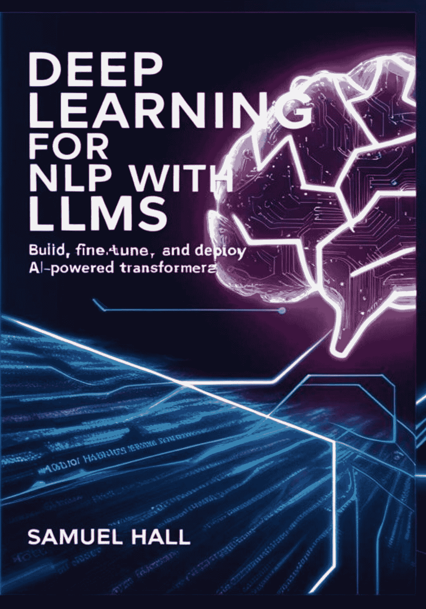
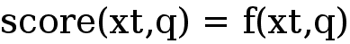
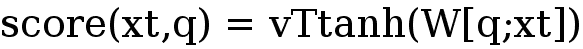
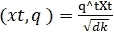
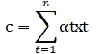

# 基于 LLM 的 NLP 深度学习：构建、微调与部署 AI 驱动的 Transformer



# 第一部分：NLP 基础

## 第一章：自然语言处理简介

### 1.1 NLP 的演变

自然语言处理 (`NLP`) 是人工智能 (`AI`) 的一个领域，旨在使机器能够理解、处理和生成人类语言。几十年来，`NLP` 已从简单的基于规则的系统演变为强大的深度学习驱动大模型 (`LLMs`)，这些模型驱动着当今的 `AI` 应用。本章将探索 `NLP` 的里程碑，重点关注塑造现代 `NLP` 系统的技术进步、关键算法和架构。

我们将系统地分解 `NLP` 演变的每个阶段，提供技术见解、实现细节和实际应用，确保清晰理解现代 `NLP` 如何达到现状的。

#### 1.1.1 早期 NLP：基于规则的系统（1950-1980 年代）

早期 `NLP` 方法依赖于基于规则的系统，语言专家手动定义模式、语法规则和转换规则。这些系统是确定性的，意味着它们遵循预定义的规则来分析或生成文本，导致在超出明确编程范围时缺乏泛化能力。

**关键技术**

1. 有限状态机 (`FSA`) —— 用于建模语法规则。
2. 正则表达式 (`Regex`) —— 定义模式匹配技术。
3. 短语结构语法 —— 创建树状句法表示。

##### 示例：基于规则的情感分析（语言：Python）

一种简单的基于规则的系统，根据预定义的词表对句子进行分类：

```python
##### 用于情感分类的词表
positive_words = {"good", "great", "excellent", "fantastic", "amazing", "happy"}
negative_words = {"bad", "terrible", "awful", "sad", "horrible", "worst"}

def rule_based_sentiment_analysis(text):
    words = text.lower().split()
    # 统计正面和负面词的出现次数
    positive_count = sum(1 for word in words if word in positive_words)
    negative_count = sum(1 for word in words if word in negative_words)

    if positive_count > negative_count:
        return "Positive Sentiment"
    elif negative_count > positive_count:
        return "Negative Sentiment"
    else:
        return "Neutral Sentiment"

##### 示例
text = "This is a fantastic movie with excellent performances!"
print(rule_based_sentiment_analysis(text))
```

##### 局限性

- 泛化能力差：无法处理同义词或变化的句子结构。
- 维护成本高：必须为新词汇或模式手动更新规则。
- 上下文限制：无法理解讽刺、双重否定或隐含含义。

#### 1.1.2 统计型自然语言处理（1990s–2010s）

随着机器学习和统计方法的兴起，自然语言处理（`NLP`）从手工编写规则转向了从数据中学习的概率模型。这些方法提高了可扩展性和适应性。

##### 关键技术

1. `N-gram 模型` – 用于序列建模和文本预测。
2. `隐藏马尔可夫模型 (HMMs)` – 应用于词性标注和语音识别。
3. `朴素贝叶斯分类器` – 用于垃圾检测等文本分类任务。

##### 示例：N-gram 语言模型（语言：Python）

一个简单的三元组语言模型，根据前两个单词预测下一个单词：

```python
from collections import defaultdict
import random

##### 样本文本语料库
corpus = [
    "the cat sat on the mat",
    "the dog sat on the couch",
    "the cat slept on the couch",
    "the dog barked at the cat"
]

##### 构建三元组模型
trigram_model = defaultdict(list)
for sentence in corpus:
    words = sentence.split()
    for i in range(len(words) - 2):
        trigram_model[(words[i], words[i+1])].append(words[i+2])

##### 生成文本的函数
def generate_text(start_words, num_words=5):
    word1, word2 = start_words
    result = [word1, word2]
    for _ in range(num_words):
        next_word_candidates = trigram_model.get((word1, word2), [])
        if not next_word_candidates:
            break
        next_word = random.choice(next_word_candidates)
        result.append(next_word)
        word1, word2 = word2, next_word
    return ' '.join(result)

##### 使用示例
print(generate_text(("the", "cat"), num_words=5))
```

##### 优点与局限性

- **数据驱动**：提高了对不同语言和语境的适应性。
- **可扩展性**：可以处理大规模语料库，无需手动规则。
- **缺乏深层语义理解**：纯粹基于概率，无法捕捉词汇共现之外的含义。
- **数据依赖性**：需要大量的标注数据集进行训练。

#### 1.1.3 用于自然语言处理的深度学习（2013–至今）

深度学习通过允许模型学习文本的层级表示，彻底改变了 `NLP`。这些模型通过捕捉更丰富的上下文和语义含义，超越了统计方法。

##### 关键技术

1. `词嵌入` (`Word2Vec`, `GloVe`, `FastText`) – 单词的稠密向量表示。
2. `循环神经网络 (RNN`, `LSTMs`, `GRUs)` – 捕捉文本中的序列依赖关系。
3. `Transformer 模型` (`BERT`, `GPT`, `T5`) – 使用自注意力机制并行处理文本。

##### 示例：使用 Word2Vec 使用词嵌入（语言：Python）

使用 `gensim` 从样本文本语料库中训练 `Word2Vec` 模型：

```python
from gensim.models import Word2Vec

##### 样本文本语料库
sentences = [
    ["natural", "language", "processing", "is", "fun"],
    ["deep", "learning", "improves", "nlp", "applications"],
    ["transformers", "are", "state", "of", "the", "art"],
]

##### 训练 Word2Vec 模型
model = Word2Vec(sentences, vector_size=10, window=2, min_count=1, workers=4)

##### 示例：寻找相似单词
print(model.wv.most_similar("nlp"))
```

##### 深度学习 NLP 的优点

- **上下文感知表示**（词嵌入捕捉了含义）。
- **自学习能力**：能够从数据中自动提取特征，无需人工干预。
- **强大的语义建模**：能够理解复杂的语言结构。
- 使用自注意力机制并行处理整个序列，显著提升了可扩展性和性能。

***

### 示例：使用 Transformers 进行命名实体识别 (NER)

现代 `NLP` 模型使用预训练的 Transformers 来自动提取上下文相关的词表示，从而构建出高精率的 NER 系统。

（语言：Python，使用 Hugging Face Transformers）

```python
from transformers import pipeline

##### 加载预训练的命名实体识别 (NER) 模型
ner_pipeline = pipeline("ner", model="dbmdz/bert-large-cased-finetuned-conll03-english")

##### 输入文本
text = "John Doe visited New York and met with Alice Smith."

##### 执行 NER
entities = ner_pipeline(text)

##### 显示提取的命名实体
for entity in entities:
    print(f"Entity: {entity['word']}, Label: {entity['entity']}, Score: {entity['score']:.4f}")
```

## Modern NLP 的优势

- **消除人工特征工程** – 直接从数据中学习表示。
- **处理上下文信息** – 使用注意力机制处理长距离依赖关系。
- **迁移学习** – 利用预训练模型，减少了对大型标注数据集的需求。

***

### 1.2.3 经典 NLP 与现代 NLP 的对比

| 维度 | 经典 NLP | 现代 NLP |
| --- | :--- | :--- |
| 方法 | 基于规则、统计方法 | 深度学习、Transformers |
| 特征工程 | 人工设计特征 | 自动特征学习 |
| 可扩展性 | 限于预定义的规则 | 从大规模数据中学习 |
| 泛化能力 | 对未见词汇/语法处理较差 | 良好地处理新上下文 |
| 计算成本 | 低，可在 CPU 上运行 | 高，需要 GPU/TPU |
| 可解释性 | 高（显式规则） | 低（黑盒性质） |

***

### 1.2.4 性能考量与权衡

虽然现代 `NLP` 的性能显著优于经典方法，但也面临着以下挑战：

1. **计算与数据需求**
   - `LLM` 需要昂贵的 GPU 和海量数据集。
   - 经典 `NLP` 可以在低资源设备上运行。
2. **可解释性**
   - 经典方法提供透明的决策过程。
   - 深度学习模型是不透明的且难以调试。
3. **偏见与伦理关注**
   - 经典 `NLP` 具有显式的基于规则的偏差。
   - 现代 `LLM` 从训练数据中继承偏差，需要仔细的缓解。

***

### 1.2.5 现实世界的 NLP 应用：经典方法 vs 现代方法

| 任务 | 经典 NLP 方法 | 现代 NLP 方法 |
| --- | :--- | :--- |
| 拼写检查 | 基于规则的字典查找 | 基于 Transformer 的 BERT 纠错 |
| 机器翻译 | 基于短语的统计模型 | 基于 Transformer 的神经机器翻译 (NMT) |
| 文本分类 | 朴素贝叶斯、SVM | 微调 BERT 或 GPT 模型 |
| 聊天机器人 | 基于规则的模式匹配 | 基于 GPT 的对话 AI |
| 命名实体识别 (NER) | Regex、HMM、CRF | 预训练 Transformer 模型 |

***

### 1.3 LLM 在 NLP 中的角色

大语言模型 (`LLMs`) 通过超越传统的统计和基于规则的方法，从根本上改变了自然语言处理 (`NLP`)。通过利用深度学习、自监督学习和迁移学习，`LLM` 在文本生成、理解和推理方面提供了最先进的性能。

本章探讨了 `LLM` 在现代 `NLP` 中的演变、能力和角色，涵盖了架构基础、实际实现以及针对现实世界应用的优化策略。

***

### 1.3.1 什么是大语言模型 (LLMs)？

##### 定义与核心特征

`LLM` 是在大型文本语料上通过自监督学习训练的深度学习模型。它们可以执行：

- **文本生成** – 生成类人类的回答。
- **文本理解** – 提取含义、回答问题、总结摘要。
- **推理与规划** – 解决逻辑类任务，生成结构化计划。

##### LLM 的演进

`LLM` 的发展经历了三个关键阶段：

1. **统计 NLP (2010 年以前)**：马尔可夫模型、`TF-IDF` 和词向量嵌入。
2. **深度学习 (2015-2018)**：`RNN`、`LSTM` 和注意力机制。
3. **Transformer 时代 (2018 至今)**：`BERT`、`GPT`、`PaLM`。

***

### 1.3.2 LLM 如何工作：核心组件

1. Transformer 架构

`LLM` 构建在 `transformer` 架构之上，与顺序的 `RNNs` 不同，它可以并行处理整个序列。

核心组件：

- **自注意力 (`Self-Attention`)**：计算词之间的依赖关系。
- **位置编码 (`Positional Encoding`)**：注入顺序信息。
- **前馈网络 (`Feedforward Networks`)**：处理表示。
- **层归一化与残差连接 (`Layer Normalization & Residual Connections`)**：稳定训练。

2. 分词 (`Tokenization`)：将文本转换为模型可读格式

在 `LLM` 处理文本之前，必须将其分词为 ID。

示例：使用 Hugging Face 分词文本

```python
from transformers import AutoTokenizer

##### 加载预训练分词器
tokenizer = AutoTokenizer.from_pretrained("bert-base-uncased")

##### 对文本分词
text = "Large Language Models are transforming."
tokens = tokenizer.tokenize(text)

##### 将标记转换为 ID
token_ids = tokenizer.encode(text)
```

3. 嵌入 (`Embeddings`)：将标记转换为向量

每个标记被映射到编码了语义关系的高维向量中。

示例：生成词嵌入

（语言：Python，使用 Gensim）

```python
from gensim.models import Word2Vec

##### 示例语料
sentences = [["LLMs", "are", "powerful"], ["NLP", "is", "evolving"]]

##### 训练 Word2Vec 模型
model = Word2Vec(sentences, vector_size=100, window=5, min_count=1, workers=4)

##### 获取词的嵌入
print("Embedding for 'LLMs':", model.wv["LLMs"])
```

核心概念：相似的词在向量空间中的嵌入更接近。`LLM` 在大规模数据集上预训练嵌入以获得更好的泛化能力。

***

### 1.3.3 预训练与微调：针对 NLP 任务优化 LLM

`LLM` 经历两个阶段：

1. **预训练 (`Pretraining`)**：在大型语料（如书籍、网页文本）上进行自监督学习。
2. **微调 (`Fine-Tuning`)**：使用标注数据适配特定任务。

##### 预训练 LLM 微调用于情感分析

微调允许 `LLM` 专门化特定领域的任务。以下是微调 `BERT` 进行情感分类的示例。

示例：微调 BERT 用于情感分析

（语言：Python，使用 Hugging Face Transformers）

```python
from transformers import BertForSequenceClassification, Trainer, TrainingArguments
from datasets import load_dataset

##### 加载预处理过的 IMDb 数据集
dataset = load_dataset("imdb")

##### 加载用于分类的预训练 BERT 模型
model = BertForSequenceClassification.from_pretrained("bert-base-uncased", num_labels=2)

##### 定义训练参数
training_args = TrainingArguments(
    output_dir="./results",
    evaluation_strategy="epoch",
    per_device_train_batch_size=8,
    per_device_eval_batch_size=8,
    num_train_epochs=3
)

##### 初始化 Trainer
trainer = Trainer(
    model=model,
    args=training_args,
    train_dataset=dataset["train"],
    eval_dataset=dataset["test"]
)

##### 训练模型
trainer.train()
```

### 1.3.4 大语言模型在 NLP 中的实际应用

大语言模型（`LLMs`）被应用于各种现实场景中，每种应用都受益于其深层的上下文理解能力。

| 应用 | LLM 用途 |


| 聊天机器人与对话式 AI | LLMs 生成类人类的对话（例如 `ChatGPT`）。 |
| --- | --- |
| 代码生成与辅助 | `Codex` 等 AI 模型驱动了 `GitHub Copilot` 等工具。 |
| 搜索与信息检索 | LLMs 改进了查询理解和排序（例如 `Google Search`）。 |
| 机器翻译 | `Transformers` 实现了实时翻译（例如 `DeepL`, `Google Translate`）。 |
| 文本摘要 | LLMs 生成文档的简要摘要。 |
| 问答 | LLMs 基于大规模语料库回答查询。 |

### 1.3.5 针对效率和部署优化大语言模型

大语言模型的计算开销很大，需要针对效率进行优化：

1.  `Quantization`（量化） – 在不显著降低准确率的情况下减小模型尺寸。
2.  `Distillation`（蒸馏） – 训练较小的模型模拟大型模型（例如 `DistilBERT`）。
3.  `Retrieval-Augmented Generation (RAG)`（检索增强生成） – 通过外部知识源增强 LLMs。

示例：使用量化运行优化后的 LLM

（语言: Python, 使用 Hugging Face）

```python
from transformers import AutoModelForCausalLM
import torch

##### 加载量化模型
model = AutoModelForCausalLM.from_pretrained("facebook/opt-1.3b", torch_dtype=torch.float16)
##### 将模型移动到 GPU 以加速推理
model.to("cuda")
```

为什么要使用量化？

*   减少 GPU 内存占用。
*   在保持可用性能的同时加速推理。

## 第 2 章：文本预处理技术

### 2.1 分词、词干提取与还原

文本预处理是自然语言处理（NLP）中的关键步骤，它通过消除不一致性、降低复杂性和标准化结构，为原始文本数据的进一步分析做准备。文本预处理中的三个基本技术是分词（`Tokenization`）、词干提取（`Stemming`）和还原（`Lemmatization`）。这些技术有助于将原始文本转换为结构化格式，从而在 NLP 任务（如机器学习模型、搜索引擎和大语言模型 LLMs）中实现更有效的下游处理。

本节涵盖内容：

*   `Tokenization`（分词）：将文本拆分为有意义的单元，如单词或句子。
*   `Stemming`（词干提取）：通过删除后缀将单词还原为基基或根形式。
*   `Lemmatization`（还原）：将单词映射到基于字典的根形式。

每种技术都配有相应的 Python 代码，以说明其在现实场景中的应用。

#### 2.1.1 分词 (Tokenization)

分词是将文本分割为称为 token 的较小单元的过程。这些 token 可以是单词、句子甚至是字符，取决于所需的粒度。分词在 NLP 中至关重要，因为大多数算法是基于单个单词而不是整个句子运行。

分词的类型

1.  `Word Tokenization`（词分词）：将文本分成单个单词。
2.  `Sentence Tokenization`（句分词）：将文本分成句子。
3.  `Subword Tokenization`（子词分词）：将单词拆分成更小的有意义的单元（用于 LLMs）。

在 Python 中实现分词

使用 `NLTK` 进行词分词和句分词

Python 代码：

```python
import nltk
from nltk.tokenize import word_tokenize, sent_tokenize

nltk.download('punkt')
text = "Natural Language Processing is a fascinating field. Tokenization is a crucial step."

##### 句分词
sentences = sent_tokenize(text)
print("Sentence Tokenization:", sentences)

##### 词分词
words = word_tokenize(text)
print("Word Tokenization:", words)
```

解释：

*   `sent_tokenize(text)`：将文本拆分为句子。
*   `word_tokenize(text)`：将文本拆分为单个单词。

子词分词 (BPE 和 WordPiece)

在 `BERT` 和 `GPT` 等现代 NLP 模型中，使用了 `Byte Pair Encoding (BPE)` 和 `WordPiece Tokenization` 来将单词拆分为更小的子词。

使用 Hugging Face Tokenizers 的 Python 代码：

```python
from transformers import AutoTokenizer
tokenizer = AutoTokenizer.from_pretrained("bert-base-uncased")
tokens = tokenizer.tokenize("Tokenization is crucial for NLP models.")
print(tokens)
```

为什么要使用子词分词？

*   有效处理词表外（OOV）单词。
*   允许模型识别根词以及前缀/后缀。

#### 2.1.2 词干提取 (Stemming)

词干提取是一种基于规则的过程，通过从单词中删除后缀将其还原为根形式。然而，它并不一定能产生真实的单词。

常见的词干提取算法

1.  `Porter Stemmer`：最常用的词干提取算法之一。
2.  `Lancaster Stemmer`：比 `Porter Stemmer` 更激进。

在 Python 中实现词干提取

使用 `NLTK` 的 Porter 和 Lancaster 词干提取器的 Python 代码：

```python
from nltk.stem import PorterStemmer, LancasterStemmer

porter_stemmer = PorterStemmer()
lancaster_stemmer = LancasterStemmer()
words = ["running", "flies", "happily", "better", "studies"]

print("Porter Stemmer:")
for word in words:
    print(porter_stemmer.stem(word))

print("\nLancaster Stemmer:")
for word in words:
    print(lancaster_stemmer.stem(word))
```

#### 2.1.3 还原 (Lemmatization)

还原是通过字典将单词映射到其根形式的过程。与词干提取不同，它能确保结果是真实的单词。

在 Python 中实现还原

使用 `NLTK` 的 WordNetLemmatizer：

```python
from nltk.stem import WordNetLemmatizer
import nltk
nltk.download('wordnet')

lemmatizer = WordNetLemmatizer()
words = ["running", "flies", "rocks", "better"]

for word in words:
    print(lemmatizer.lemmatize(word))
```

通过 POS 标签优化还原

默认情况下，`WordNetLemmatizer` 单词视为名词。指定正确的词性（POS）可以提高准确性。

带有 POS 标签的 Python 代码：

```python
from nltk import pos_tag
from nltk.corpus import wordnet
import nltk

nltk.download('averaged_perceptron_tagger')
nltk.download('wordnet')

def get_wordnet_pos(word):
    """将 POS 标签转换为 WordNetLemmatizer 识别的格式"""
    tag = pos_tag([word])[0][1].upper()
    tag_dict = {"J": wordnet.ADJ, "N": wordnet.NOUN, "V": wordnet.VERB, "R": wordnet.ADV}
    return tag_dict.get(tag, wordnet.NOUN)

lemmatizer = WordNetLemmatizer()
words = ["running", "flies", "rocks", "better"]

print("带 POS 标签的还原:")
for word in words:
    print(lemmatizer.lemmatize(word, get_wordnet_pos(word)))
```

### 2.2 停用词移除与归一化

文本预处理是任何自然语言处理（NLP）流水线中的基础步骤。它确保文本数据经过清洗、结构化，并为文本分类、情感分析和语言模型等下游任务进行了优化。文本预处理中的一个至关重要的方面是停用词移除和归一化，这有助于减少噪声并提高计算效率。

本节将涵盖：

*   停用词移除的重要性
*   移除停用词的各种方法
*   归一化技术，包括大小写转换、去除重音和 Unicode 标准化
*   实际应用与优化

在本节结束时，你将能够在 Python 中实现稳健的停用词移除和归一化技术，并将它们集成到 NLP 工作流中。

#### 2.2.1 停用词

##### 什么是停用词？

停用词是 NLP 任务中常用的、但携带很少或没有有效信息的词。这些词包括“the”、“is”、“in”、“on”、“at”等许多其他词汇，它们对文本分析没有显著贡献。移除它们有助于关注具有更高语义影响的词汇。

例如，考虑以下句子：

"The quick brown fox jumps over the lazy dog."

在移除停用词后，它变为：

"quick brown fox jumps lazy dog."

在这里，核心含义保持完整，同时降低了文本的复杂度。

##### 移除停用词的方法

存在多种移除停用词的方法：

###### 1. 使用预定义的停用词列表

`NLTK` 和 `spaCy` 等流行的 NLP 库提供了内置的停用词列表，可用于过滤常见词汇。

Python 示例：使用 NLTK 移除停用词

```python
import nltk
from nltk.corpus import stopwords
from nltk.tokenize import word_tokenize

nltk.download('stopwords')
nltk.download('punkt')

text = "The quick brown fox jumps over the lazy dog."

stop_words = set(stopwords.words('english'))
tokens = word_tokenize(text)

filtered_text = [word for word in tokens if word.lower() not in stop_words]

print(filtered_text)  # Output: ['quick', 'brown', 'fox', 'jumps', 'lazy', 'dog']
```

解释：

*   `word_tokenize(text)`：将文本拆分成单个单词。
*   `stopwords.words('english')`：加载默认的英语停用词列表。
*   列表推导式过滤掉存在于停用词列表中的词。

###### 2. 自定义停用词列表

对于特定领域的 NLP 任务，默认停用词列表可能不够。可以创建适用于特定应用的自定义停用词列表。

Python 示例：使用自定义停用词列表

```python
custom_stopwords = {"the", "is", "over", "at", "on", "in"}
tokens = word_tokenize(text)
filtered_text = [word for word in tokens if word.lower() not in custom_stopwords]

print(filtered_text)  # Output: ['quick', 'brown', 'fox', 'jumps', 'lazy', 'dog']
```

###### 3. 使用 spaCy 移除停用词

`spaCy` 提供了具有额外功能的优化停用词列表。

Python 示例：使用 spaCy 移除停用词

```python
import spacy
nlp = spacy.load("en_core_web_sm")
doc = nlp(text)
filtered_text = [token.text for token in doc if not token.is_stop]

print(filtered_text)  # Output: ['quick', 'brown', 'fox', 'jumps', 'lazy', 'dog']
```

#### 2.2.2 文本归一化

##### 什么是文本归一化？

文本归一化将单词转换为一致格式以减少冗余并提高处理效率。这包括：

*   小写化：将所有文本转换为小写。
*   移除标点符号和特殊字符：消除非字母符号。
*   Unicode 标准化：跨不同编码对文本标准化。
*   去除重音：去除变音符号以保持一致性。

##### 1. 小写化

小写化确保了“Python”和“python”等单词被视为同一个词。

Python 示例：小写化

```python
text = "Natural Language Processing is Amazing!"
lowercased_text = text.lower()

print(lowercased_text)  # Output: "natural language processing is amazing!"
```

##### 2. 移除标点符号和特殊字符

标点符号在文本处理中通常没有太大意义。

Python 示例：移除标点符号

```python
import string
text = "Hello, world! NLP is great."
clean_text = text.translate(str.maketrans('', '', string.punctuation))

print(clean_text)  # Output: "Hello world NLP is great"
```

或者，使用正则表达式：

```python
import re
clean_text = re.sub(r'[^\w\s]', '', text)

print(clean_text)  # Output: "Hello world NLP is great"
```

##### 3. Unicode 标准化

Unicode 不一致性源于文本编码，需要进行标准化。

Python 示例：规范 Unicode

```python
import unicodedata
text = "café"
normalized_text = unicodedata.normalize('NFKD', text).encode('ascii', 'ignore').decode()

print(normalized_text)  # Output: "cafe"
```

这在保留单词结构的同时移除了重音字符。

##### 4. 移除多余空格

额外的空格和换行符会扭曲 NLP 性能。

Python 示例：移除多余空格

```python
text = " NLP  is powerful!"
normalized_text = " ".join(text.split())

print(normalized_text)  # Output: "NLP is powerful!"
```

#### 2.2.3 结合停用词移除与归一化

结合这些技术可以确保文本数据针对 NLP 任务进行了优化。

Python 示例：完整预处理流水线


```python
import nltk
import re
import string
import unicodedata
from nltk.corpus import stopwords
from nltk.tokenize import word_tokenize

nltk.download('stopwords')
nltk.download('punkt')

def preprocess_text(text):
    # 小写化
    text = text.lower()
    # Unicode 标准化
    text = unicodedata.normalize('NFKD', text).encode('ascii', 'ignore').decode()
    # 移除标点符号
    text = text.translate(str.maketrans('', '', string.punctuation))
    # 分词
    tokens = word_tokenize(text)
    # 移除停用词
    stop_words = set(stopwords.words('english'))
    tokens = [word for word in tokens if word not in stop_words]
    # 移除多余空格
    text = " ".join(tokens)
    return text

text = "The café is OPEN! NLP is amazing, isn't it?"
cleaned_text = preprocess_text(text)

print(cleaned_text)  # Output: "cafe open nlp amazing"
```

## 2.2.4 停用词移除与规范的应用

1. 文本分类：通过移除噪声改进了特征提取。
2. 情感分析：通过关注关键词获得更准确的情感。
3. 搜索引擎：优化了关键词匹配和索引。
4. 聊天机器人：提供更好的 NLP 响应。

## 2.3 命名实体识别 (NER)

命名实体识别 (NER) 是自然语言处理 (NLP) 中的一项基础技术，涉及识别文本中的实体并将其归类为定义的类别，如人物、组织、地点、日期、数值等。NER 在各种 AI 驱动的应用中至关重要，包括聊天机器人、搜索引擎、金融分析和医学信息。

### 2.3.1 命名实体识别的基础

#### 什么是命名实体识别？

NER 是非结构化文本中提取命名实体并将其分类的过程。考虑句子：“Apple Inc. was founded by Steve Jobs, Steve Wozniak, and Ronald Wayne in Cupertino, California, in 1976.”

应用 NER 的结果如下：

| 实体 | 类别 |
| --- | --- |
| Apple Inc. | 组织 |
| Steve Jobs | 人物 |
| Steve Wozniak | 人物 |
| Ronald Wayne | 人物 |
| Cupertino | 地点 |
| California | 地点 |
| 1976 | 日期 |

NER 是信息提取的关键，能够从原始文本中进行结构化数据分析。

#### NER 如何工作？

NER 涉及三个主要步骤：

1. 分词：将文本拆分为单词或子词。
2. 词性标记：识别每个单词的语法角色。
3. 实体分类：使用基于规则或机器学习的模型分配实体标签。

### 2.3.2 基于规则的 vs 基于机器学习的 NER

NER 可以通过规则方法或机器学习模型来实现。

#### 基于规则的 NER

基于规则的方法依赖于预定义的字典、正则表达式和模式匹配。

**Python 示例：使用正则表达式的规则 NER**

```python
import re
text = "Elon Musk founded SpaceX in 2002 and Tesla in 2003."

# 定义实体模式
pattern = r"(Elon Musk|SpaceX|Tesla)"

matches = re.findall(pattern, text)

print(matches)  # 输出: ['Elon Musk', 'SpaceX', 'Tesla']
```

##### 局限性

- 难以处理变体（例如，"Space Exploration Technologies" 与 "SpaceX"）。
- 需要针对新实体进行频繁更新。

#### 基于机器学习的命名实体识别 (NER)

基于机器学习的 NER 模型在大型数据集上训练，并在未见的文本上具有良好的泛化能力。

常见方法包括：

1. 条件随机场 (CRFs) – 用于 NER 的传统统计模型。
2. 神经网络 (LSTMs, Transformers) – 基于深度学习的 NER 模型。
3. 预训练大语言模型 (BERT, GPT) – 先进的上下文化 NER。

### 2.3.3 使用 spaCy 实现 NER

spaCy 提供了一个带有预训练模型的高度优化 NER 流水线。

#### Python 示例：使用 spaCy 进行命名实体识别

```python
import spacy

# 加载预训练的 NER 模型
nlp = spacy.load("en_core_web_sm")

# 示例文本
text = "Amazon was founded by Jeff Bezos in Seattle in 1994."

# 处理文本
doc = nlp(text)

# 提取命名实体
for ent in doc.ents:
    print(f"{ent.text} -> {ent.label_}")
```

##### 预期输出

```text
Amazon -> ORG
Jeff Bezos -> PERSON
Seattle -> GPE
1994 -> DATE
```

##### 理解 spaCy 的实体标签

spaCy 分配的实体标签，例如：

- `PERSON` – 人物（例如，“Elon Musk"）。
- `ORG` – 组织（例如，“Tesla"）。
- `GPE` – 地缘政治实体（例如，“United States"）。
- `DATE` – 日期（例如，“2023"）。

##### 自定义 spaCy 的 NER 模型

为了添加新实体（例如，特定领域的术语），spaCy 允许对模型进行重训练。

### 2.3.4 使用 Transformers (BERT) 实现 NER

虽然 spaCy 适用于通用 NER 任务，但 transformers（如 BERT）可以获得更高的准确率。

#### Python 示例：使用 Transformers 进行命名实体识别

```python
from transformers import pipeline

# 加载 NER 流水线
ner_pipeline = pipeline("ner", model="dbmdz/bert-large-cased-finetuned-conll03-english")

text = "Sundar Pichai is the CEO of Google, headquartered in Mountain View."

# 运行 NER
entities = ner_pipeline(text)
for entity in entities:
    print(f"{entity['word']} -> {entity['entity']}")
```

##### 预期输出

```text
Sundar Pichai -> B-PER
Google -> B-ORG
Mountain View -> B-LOC
```

##### 为什么使用 Transformers 进行 NER？

- 上下文感知实体识别（例如，区分公司“Apple”与水果“苹果”）。
- 比基于规则的系统更好地处理未见的实体。
- 支持在自定义数据集上进行微调。

### 2.3.5 微调自定义模型

微调 transformer 模型可以实现特定领域的 NER（例如，医疗、法律或金融）。

#### 微调 NER 的步骤

1. 以 CoNLL 格式准备标注的训练数据。
2. 使用 Hugging Face 的 `Trainer` API 进行模型训练。
3. 在测试数据上评估微调后的模型。

#### 示例：使用 transformers 微调

```python
from transformers import AutoModelForTokenClassification, TrainingArguments, Trainer
from datasets import load_dataset

# 加载数据集
dataset = load_dataset("conll2003")

# 加载预训练模型
model = AutoModelForTokenClassification.from_pretrained("bert-base-cased", num_labels=9)

# 定义训练参数
training_args = TrainingArguments(
    output_dir="./ner_model",
    per_device_train_batch_size=16,
    per_device_eval_batch_size=16,
    num_train_epochs=3,
    evaluation_strategy="epoch",
)

# 训练模型
trainer = Trainer(
    model=model,
    args=training_args,
    train_dataset=dataset["train"],
    eval_dataset=dataset["validation"],
)
trainer.train()
```

##### 微调的主要优势

- 在特定领域文本上具有更高的准确率。
- 提高对新实体类型的实体识别。

### 2.3.6 优化 NER

#### 常见陷阱与修复

| 问题 | 解决方案 |
| --- | --- |
| 模型误分类实体 | 使用更多训练数据进行微调 |
| 召回率低（漏掉实体） | 调整置信度阈值 |

2. `fit_transform()` 对文本进行分词并构建词频矩阵。
3. `get_feature_names_out()` 获取词表。
4. `X.toarray()` 将稀疏表示转换为稠密矩阵。

输出：

```text
Vocabulary: ['deep' 'great' 'is' 'learning' 'machine' 'powerful']
BoW Representation:
[[0 1 1 1 1 0]
[1 0 1 1 0 1]]
```

### 3.1.3 词袋模型（Bag-of-Words）的局限性

尽管 BoW 非常简单，但具有明显的局限性：

- 忽略词序：“Dog bites man”和“Man bites dog”的表示相同。
- 缺乏语义理解：同义词（例如，“good”与“excellent”）被视为不同的词。
- 高维性：巨大的词汇会导致稀疏的特征向量。

为了解决这些缺点，TF-IDF 引入了基于词重要性的加权。

### 3.1.4 TF-IDF：增强 BoW

#### TF-IDF 的动机

BoW 模型等同对待所有词，但并非所有词对意义的贡献都是相同的。常用词（例如，“is”，“the”）出现频率很高，但提供的区分能力很小。稀有但重要的词应该被强调。

词频-逆文档频率（TF-IDF）通过给信息量丰富的词分配更高的权重，并减少频繁但不重要的词的影响，改进了 BoW。

##### 数学基础

TF-IDF 计算公式为：

`TF-IDF = TF × IDF`

其中：

1. 词频 (TF):

`TF(t,d) = ...` (原文公式为图片，此处保留占位符)

2. 逆文档频率 (IDF):

`IDF(t) = log ...` (原文公式为图片，此处保留占位符)

##### 计算示例

对于语料库：

文档 1：“Machine learning is great”
文档 2：“Deep learning is powerful”

- 文档 1 中的 `TF("learning")` = `1/4=0.25`
- `IDF("learning")`（因为出现在两个文档中） = `log(2/2)=0`
- `TF-IDF("learning")` = `0.25×0=0`

TF-IDF 降低了出现在大多数文档中的词的权重，突出了独特的术语。

### 3.1.5 在 Python 中实现 TF-IDF

#### 示例：使用 Scikit-Learn 实现 TF-IDF

```python
from sklearn.feature_extraction.text import TfidfVectorizer

# 初始化 TF-IDF 向量器
tfidf_vectorizer = TfidfVectorizer()
X_tfidf = tfidf_vectorizer.fit_transform(documents)

# 显示词表和 TF-IDF 表示
print("Vocabulary:", tfidf_vectorizer.get_feature_names_out())
print("TF-IDF Representation:", X_tfidf.toarray())
```

#### 与 BoW 的主要区别

- 根据重要性而非原始频率对词进行加权。
- 通过为常用词分配较低权重来减少其影响。
- 当作为 ML 模型的输入时，可以提高文本分类性能。

### 3.1.6 优化与考虑

#### 何时使用 BoW 还是 TF-IDF

| 特性 | BoW | TF-IDF |
| :--- | :--- | :--- |
| 计算成本 | 较低 | 较高（由于对数缩放） |
| 常用词处理 | 所有词等对待 | 减少频繁词的影响 |
| 使用场景 | 基础 NLP 任务 | 文本分类、搜索引擎 |

#### 针对大型数据集扩展

- 使用 n-grams 保留部分上下文。
- 应用降维（例如，`PCA`, `LSA`）以提高效率。
- 使用稀疏矩阵优化内存。

## 3.2 词嵌入：Word2Vec, GloVe, FastText

传统的文本表示方法如词袋模型（`BoW`）和词频-逆文档频率（`TF-IDF`）将词视为独立的实体，忽略了它们的意义和关系。这些局限性使得难以捕捉自然语言中的语义相似性和语义。

词嵌入通过将词表示为高维空间中的稠密连续值向量解决了这些缺点，其中相似的词具有相似的表示。这使得 NLP 模型能够更好地泛化，从而改进文本分类、情感分析和机器翻译等任务。

### 3.2.1 理解词嵌入

#### 嵌入的动机

`BoW` 和 `TF-IDF` 将词表示为稀疏向量，每个词都是独立的。然而，它们无法捕捉词的相似性和语义关系。例如，在传统的 `BoW` 模型中，`king` 和 `queen` 的区别与 `king` 和 `apple` 一样，尽管 `king` 和 `queen` 共享强烈的语义关系。词嵌入通过学习向量表示克服了这一点，使得相似的词在高维空间中靠得更近。

##### 词嵌入的属性

- 语义相似性：意义相似的词（例如，`cat`, `kitten`）具有更接近的向量表示。
- 词类比：对词向量进行数学操作可以揭示语言关系，例如 `king−man+woman≈queen`。
- 降维：词嵌入不使用稀疏的高维向量，而是使用稠密的低维向量（例如 100 到 300 维）。
- 上下文感知：根据词在大型文本语料库中与其他词的共现情况进行嵌入。

### 3.2.2 Word2Vec：从上下文学习嵌入

`Word2Vec` 是一种由 Google 开发的基于神经网络的词嵌入学习方法。它有两种变体：

1. 连续词袋模型（`CBOW`）：给定其上下文词预测目标词。
2. `Skip-gram`：给定目标词预测周围的上下文词。

#### CBOW vs. Skip-gram

| 特性 | CBOW | Skip-gram |
| :--- | :--- | :--- |
| 训练速度 | 更快 | 较慢 |
| 适用场景 | 常用词 | 稀有词 |
| 任务 | 从上下文预测目标词 | 从目标词预测上下文 |

#### 训练过程

1. 准备文本语料库：对数据进行分词和预处理。
2. 定义滑动窗口：确定上下文窗口的大小（例如，目标词前后 2 个词）。
3. 训练神经网络：使用随机梯度下降调整权重。
4. 提取向量：训练完成后，每个词都被映射到固定大小的向量。

#### 使用 Gensim 实现 Word2Vec

Python 的 `gensim` 库提供了高效的 `Word2Vec` 实现。


```python
from gensim.models import Word2Vec
from nltk.tokenize import word_tokenize

# 样本语料
sentences = [
    "Natural language processing is a fascinating field",
    "Deep learning advances NLP techniques",
    "Word embeddings capture semantic meaning"
]

# 分词
tokenized_sentences = [word_tokenize(sentence.lower()) for sentence in sentences]

# 训练 Word2Vec
model = Word2Vec(sentences=tokenized_sentences, vector_size=100, window=5, min_count=1, workers=4)

# 获取词向量
print("Vector for 'language':", model.wv['language'])

# 相似词
print("Words similar to 'learning':", model.wv.most_similar('learning'))
```

#### 关键参数

- `vector_size=100`：嵌入维度。
- `window=5`：上下文窗口。
- `min_count=1`：忽略出现少于一次的词。
- `workers=4`：用于并行处理的 CPU 核心数。

### 3.2.3 GloVe：全局词表示

#### GloVe 工作原理

与基于局部词共现学习嵌入的 `Word2Vec` 不同，`GloVe` 使用全局共现统计构建词向量。

1. 构建词共现矩阵：统计词在大型语料库中共同出现的次数。
2. 矩阵分解：使用矩阵分解技术生成稠密词嵌入。
3. 优化嵌入：应用加权最小二乘目标函数来减少误差。

##### 数学模型

`GloVe` 优化以下函数：

`J=f(Xij) (wiTWj + bi+bj−logXij)2`

其中：

- `Xij` 是词 `i` 和 `j` 的共现计数。
- `wiTWj` 是词向量。
- `bi` 和 `bj` 是偏置项。
- `f(Xij)` 是权重函数。

#### 使用预训练嵌入实现 GloVe

`GloVe` 嵌入通常在 `Common Crawl` 或 `Wikipedia` 等大型数据集上进行预训练，并可以直接加载。

```python
import gensim.downloader as api

# 加载预训练的 GloVe 向量
glove_model = api.load("glove-wiki-gigaword-100")

# 获取词向量
print("Vector for 'language':", glove_model['language'])

# 寻找相似单词
print("Words similar to 'learning':", glove_model.most_similar('learning'))
```

### 3.2.4 FastText：子词感知嵌入

##### 为什么选择 FastText？

`Word2Vec` 和 `GloVe` 将单词视为原子单元，无法处理词表外（OOV）单词。由 Facebook 开发的 FastText 通过将单词表示为子词 n-gram 的组合来改进了这一点。

例如，`language` 一词可能被分解为：

```php-template
<lan>, <ang>, <ngu>, <gua>, <uag>, <age>
```

这使得能够处理稀有词，并对形态变化有更好的表示。

#### 训练 FastText 模型

```python
from gensim.models import FastText

# 训练 FastText 模型
fasttext_model = FastText(sentences=tokenized_sentences, vector_size=100, window=5, min_count=1, workers=4)

# 获取词向量
print("Vector for 'language':", fasttext_model.wv['language'])

# 处理 OOV 单词
print("Vector for 'linguistics':", fasttext_model.wv['linguistics'])
```

FastText 通过组合子词，比 `Word2Vec` 或 `GloVe` 更好地处理新的、未见的单词。

## 3.2.5 嵌入模型比较

| 特性 | Word2Vec | GloVe | FastText |
| --- | --- | --- | --- |
| 训练数据 | 局部上下文 | 全局共现 | 子词信息 |
| 处理 OOV 单词 | 否 | 否 | 是 |
| 内存效率 | 中 | 高 | 高 |
| 最佳适用场景 | 大语料库 | 预训练嵌入 | 形态丰富的语言 |

## 3.3 用于 NLP 的传统机器学习模型（朴素贝叶斯、SVM、决策树）

深度学习模型如 `transformers` 主导了现代 NLP，但传统的机器学习（ML）技术在构建有效的 NLP 流水线方面仍然是基础，特别是在处理小数据集、低延迟应用或可解释性模型时。

### 3.3.1 用于 NLP 的传统机器学习

#### 为什么在 NLP 中使用传统机器学习？

`BERT` 和 `GPT` 等深度学习模型非常强大，但它们需要大量的数据、大量的计算资源和复杂的微调。传统机器学习模型在以下场景仍然适用：

- **低资源场景**：当标注数据有限时。
- **快速推理**：用于实时应用的轻量级模型。
- **可解释性**：更容易调试和特征分析。
- **基准模型**：在使用深度学习之前进行快速原型。

#### 传统机器学习的 NLP 流水线

传统机器学习模型无法直接处理原始文本；它们需要结构化的数值表示。标准流水线包括：

1. **文本预处理**：分词（`Tokenization`）、去除停用词、词干提取和词形还原。
2. **特征工程**：使用 `TF-IDF`、`Bag-of-Words` 或词嵌入将文本转换为数值特征。
3. **模型训练**：拟合如 `Naïve Bayes`、`SVM` 或 `Decision Tree` 等机器学习模型。
4. **评估**：使用精确率（precision）、召回率（recall）、F1 分数的准确率评估模型性能。

### 3.3.2 NLP 中的朴素贝叶斯

#### 朴素贝叶斯的工作原理

朴素贝叶斯是基于贝叶斯定理的概率分类器：

`P(A|B)=P(B/A)P(A)/P(B)`

在 NLP 中，`Naïve Bayes` 根据单词出现在文档中的概率，对文档属于某一类别（例如垃圾邮件或非垃圾邮件）的概率。

由于它假设特征相互独立，因此被称为“朴素”（naïve）。尽管有此假设，它在文本分类任务中表现良好。

#### 朴素贝叶斯的变体

| 模型 | 描述 | 最佳适用场景 |
| --- | --- | --- |
| 多项式朴素贝叶斯 | 假设词频符合多项分布 | 文本分类 |
| 伯努利朴素贝叶斯 | 使用单词的存在/否（0 或 1） | 短文本 |
| 高斯朴素贝叶斯 | 假设特征符合高斯分布 | 非文本 |

#### 用于情感分析的朴素贝叶斯实现

```python
import numpy as np
import pandas as pd
from sklearn.feature_extraction.text import TfidfVectorizer
from sklearn.model_selection import train_test_split
from sklearn.naive_bayes import MultinomialNB
from sklearn.metrics import classification_report, accuracy_score

# 示例数据集
data = pd.DataFrame({
    "text": [
        "I love this, it's fantastic!",
        "Terrible film, I hated every second",
        "Great acting and story",
        "Worst movie ever",
        "Absolutely loved it",
        "The plot was so boring"
    ],
    "label": [1, 0, 1, 0, 1, 0]
})

# 文本预处理
vectorizer = TfidfVectorizer(stop_words='english')
X = vectorizer.fit_transform(data["text"])
y = np.array(data["label"])

# 分分为训练集和测试集
X_train, X_test, y_train, y_test = train_test_split(X, y, test_size=0.3, random_state=42)

# 训练朴素贝叶斯
nb_model = MultinomialNB()
nb_model.fit(X_train, y_train)

# 预测
y_pred = nb_model.predict(X_test)

# 评估
print(accuracy_score(y_test, y_pred))
print(classification_report(y_test, y_pred))
```

### 3.3.3 NLP 中的支持向量机 (SVM)

#### SVM 的工作原理

SVM 是一种监督学习算法，在高维空间中寻找最优超平面来分离类别。它对于稀疏数据特别有效。

##### 核技巧

SVM 使用核函数将非线性可分的数据转换到高维空间，在该空间可以找到线性分类器。

- **线性核**：最适用于文本数据。
- **多项核**：捕捉非线性关系。
- **径基函数 (RBF) 核**：最适用于复杂的决策边界。

#### 用于分类的 SVM 实现

```python
from sklearn.svm import SVC

# 训练 SVM
svm_model = SVC(kernel='linear')
svm_model.fit(X_train, y_train)

# 预测
y_pred_svm = svm_model.predict(X_test)

# 评估
print(accuracy_score(y_test, y_pred_svm))
print(classification_report(y_test, y_pred_svm))
```

### 3.3.4 NLP 中的决策树

##### 决策树的工作原理

决策树根据特征条件划分数据，形成树状结构。它遵循：

1. **特征选择**：使用 Gini 纯度或熵等指标确定最佳划分特征。
2. **递归划分**：继续划分数据直到满足停止条件。
3. **预测**：根据学习到的决策规则进行分类。

#### 用于分类的决策树实现

```python
from sklearn.tree import DecisionTreeClassifier

# 训练决策树分类器
dt_model = DecisionTreeClassifier(max_depth=5)
dt_model.fit(X_train, y_train)

# 预测
y_pred_dt = dt_model.predict(X_test)

# 评估
print(accuracy_score(y_test, y_pred_dt))
print(classification_report(y_test, y_pred_dt))
```

- 同时处理数值型和分类数据。
- 不需要进行特征缩放。

缺点：

- 容易过拟合（可以通过剪枝来缓解）。
- 不适用于高维稀疏数据。

***

### 3.3.5 NLP 传统机器学习模型对比

| 模型 | 优势 | 缺点 | 适用场景 |
| --- | --- | --- | --- |
| 朴素贝叶斯 (Naïve Bayes) | 速度快、简单、在小数据集上表现良好 | 独立假设限制了准确性 | 垃圾邮件过滤、情感分析 |
| 支持向量机 (SVM) | 处理高维数据、对过拟合鲁棒 | 计算开销大 | 文本分类、命名实体识别 |
| 决策树 | 可解释、支持混合数据类型 | 容易过拟合 | 基于规则的文本分类 |

***

# 第 4 章：NLP 深度学习

深度学习彻底改变了自然语言处理（NLP），使模型能够学习文本中复杂的模式、生成类人类响应并处理海量的非结构化数据。与传统的机器学习技术不同，基于深度学习的 NLP 模型能够捕捉上下文关系、长程依赖和复杂的语言结构。

本章将探索：

- 用于处理序列数据的循环神经网络（RNN）、长短期记忆网络（LSTM）和门控循环单元（GRUs）。
- 注意力机制及其在现代 NLP 模型中的作用。
- 序列到序列（Seq2Seq）模型，这是机器翻译、聊天机器人和文本生成的基础。

通过本章的学习，你将能够使用行业标准技术构建、优化和部署用于 NLP 应用的深度学习模型。

***

### 4.1 RNN、LSTM 和 GRU 简介

深度学习显著推进了自然语言处理（NLP），使模型能够学习序列依赖、捕捉上下文并处理文本中的长程关系。传统的机器学习方法依赖于人工设计的特征，而深度学习模型则直接从数据中学习表示，消除了手动特征工程的需求。

循环神经网络（RNN）、长短期记忆网络（LSTM）和门控循环单元（GRU）构成了序列数据处理深度学习的基础。这些模型在处理文本、语音和时间序列数据方面表现出色，对于机器翻译、文本生成和语音识别等任务至关重要。

***

#### 4.1.1 序列数据处理的挑战

传统的神经网络（如前馈网络）独立地处理输入，因此不适用于序列数据。例如，考虑一个预测句子中下一个单词的语言模型：

输入："The weather is…"（天气是……）

预期输出："sunny"（晴）

前馈网络将每个单词视为一个独立的单元，忽略了序列的结构。然而，语言本质上是序列性的，这意味着下一个单词的预测依赖于之前的单词。

##### 主要挑战

1. 缺乏记忆：前馈网络不保留过去的信息。
2. 固定输入大小：它们需要固定长度的输入，对于变长序列缺乏灵活性。
3. 上下文丢失：它们无法跨单词或时间步捕捉依赖关系。

这些局限性导致了循环架构 `RNNs`、`LSTMs` 和 `GRUs` 的发展，它们能够保持记忆。

***

#### 4.1.2 循环神经网络 (RNNs)

`RNNs` 引入了循环连接，允许它们跨序列维持记忆。`RNN` 不再独立地处理输入，而是维护一个带有来自之前时间步信息的隐藏状态。

##### 架构

给定输入序列 `X = (x₁, x₂, ..., xₙ)`，`RNN` 更新其隐藏状态：

`ht = f(Wh₋ + Wxt + b)`

其中：

- `ht` 是时间 `t` 时的隐藏状态。
- `xt` 是时间 `t` 的输入。
- `Wh`, `Wx` 是权重矩阵，`b` 是偏置。
- `f` 是激活函数，通常为 `tanh` 或 `ReLU`。

最终输出 `yt` 计算公式为：

`yt = Wy + by`

##### Python 中的 RNN 实现

```python
import torch
import torch.nn as nn

class SimpleRNN(nn.Module):
    def __init__(self, input_size, hidden_size, output_size):
        super(SimpleRNN, self).__init__()
        self.rnn = nn.RNN(input_size, hidden_size, batch_first=True)
        self.fc = nn.Linear(hidden_size, output_size)

    def forward(self, x):
        output, hidden = self.rnn(x)  # RNN output and hidden state
        return self.fc(hidden.squeeze(0))  # Fully connected layer for output

# 使用示例
model = SimpleRNN(input_size=10, hidden_size=20, output_size=1)
```

#### RNN 的局限性

- 梯度消失问题：随着序列变长，梯度会减小，导致网络无法学习长期依赖。
- 难以处理长程依赖：`RNNs` 很难记住遥远时间步的信息。
- 并行化效率低：由于 `RNNs` 是按顺序处理数据的，训练速度变得很慢。

这些挑战导致了 `LSTMs` 和 `GRUs` 的发展，它们引入了门控机制。

***

#### 4.1.3 长短期记忆网络 (LSTMs)

`LSTMs` 通过引入控制记忆保留和更新的门，扩展了 `RNNs`，允许网络记住长程依赖。

#### LSTM 架构

每个 `LSTM` 单元包含：

- 遗忘门（Forget Gate）：决定丢弃哪些信息。
- 输入门（Input Gate）：决定存储哪些新信息。
- 单元状态（Cell State）：维持长期记忆。
- 输出门（Output Gate）：调节记忆对输出的贡献。

给定输入 `xt`、上一个隐藏状态 `ht₋` 和上一个单元状态 `CT₋`，`LSTM` 更新如下：

`ft = σ(Wf ⋅ [ht₋, xt] + bt)`

`it = σ(Wi ⋅ [ht₋, xt] + bi)`

`Ct = ft ⊙ CT₋ + it ⊙ tanh(Wc ⋅ [ht₋, xt])`


##### LSTM 实现

```python
class SimpleLSTM(nn.Module):
    def __init__(self, input_size, hidden_size, output_size):
        super(SimpleLSTM, self).__init__()
        self.lstm = nn.LSTM(input_size, hidden_size, batch_first=True)
        self.fc = nn.Linear(hidden_size, output_size)

    def forward(self, x):
        output, (hidden, cell) = self.lstm(x)  # LSTM output, hidden state, and cell state
        return self.fc(hidden.squeeze(0))

model = SimpleLSTM(input_size=10, hidden_size=20, output_size=1)
```

#### LSTM 的优势

- 有效处理长程依赖。
- 通过门控机制缓解了梯度消失问题。

尽管有这些改进，由于每个时间步都有多次门控操作，LSTM 的计算成本仍然很大。

***

#### 4.1.4 门控循环单元 (GRUs)

`GRUs` 通过将遗忘门和输入门合并为单一更新门来简化 `LSTMs`，在保持性能的同时减少了计算成本。

#### GRU 架构

每个 `GRU` 单元包含：

- 更新门（Update Gate）：控制保留多少信息。
- 重置门（Reset Gate）：决定之前的状态对当前状态的贡献多少。

`ut = σ(Wu ⋅ [ht₋, xt] + bu)`

`rt = σ(Wr ⋅ [ht₋, xt] + br)`

`ht = (1 - ut) ⊙ ht₋ + ut ⊙ tanh(Wn ⋅ [rt ⊙ ht₋, xt] + bc)`

##### GRU 实现

```python
class SimpleGRU(nn.Module):
    def __init__(self, input_size, hidden_size, output_size):
        super(SimpleGRU, self).__init__()
        self.gru = nn.GRU(input_size, hidden_size, batch_first=True)
        self.fc = nn.Linear(hidden_size, output_size)

    def forward(self, x):
        output, hidden = self.gru(x)
        return self.fc(hidden.squeeze(0))

model = SimpleGRU(input_size=10, hidden_size=20, output_size=1)
```

# 4.2 注意力机制及其对自然语言处理的影响

传统的序列模型，如循环神经网络（`RNNs`）、长短期记忆网络（`LSTMs`）和门控循环单元（`GRUs`），在处理长程依赖时存在局限性。随着序列长度的增加，这些模型难以有效地保留和处理相关的上下文。

注意力机制的出现改变了自然语言处理（NLP），它允许模型能够动态地关注输入序列中最为相关的部分，使其能够更高效地处理长程依赖。这一进展为现代基于 Transformer 的架构奠定了基础，而这些架构主导着如今最先进的 NLP 任务。

#### 4.2.1 传统序列模型的挑战

`RNNs`、`LSTMs` 和 `GRUs` 按顺序处理文本，这意味着序列中的每个 token 都是逐步处理的。这导致了以下几个挑战：

1. 长程依赖问题：随着序列的增长，句子早期的单词变得难以保留在记忆中。
2. 梯度消失问题：梯度在反向传播过程中逐渐减小，限制了对远距离依赖的有效学习。
3. 固定长度的上下文向量：在标准的 `Seq2Seq` 模型中，编码器将整个序列压缩成单个向量，这可能无法捕捉所有相关信息。

这些挑战使得引入一种能够动态关注输入序列不同部分的机制变得必要。这正是注意力机制用用场。

#### 4.2.2 理解注意力机制

注意力机制允许模型在生成输出时，为输入序列的不同部分分配不同的重要性（权重）。注意力不是将整个序列编码为单个向量，而是在每个解码步骤动态地选择最相关的信息。

##### 注意力的数学公式

给定：

- 输入序列 `X = (x₁, x₂, ..., xₙ)`
- 代表当前解码步骤的查询向量 `q`

每个输入 token `xₜ` 的注意力评分计算方式如下：



其中 `f` 是一个评分函数，根据 `q` 确定 `xₜ` 的相关性。最常见的评分函数包括：

1. 点积注意力（Dot-product attention）：


2. 加性注意力（Bahdanau Attention）：



3. 缩放点积注意力（Scaled dot-product attention，用于 Transformers）：



然后使用 `softmax` 函数对评分进行归一化以获得注意力权重：

`αt = exp(score(xt, q)) / ∑j=1n exp(score(xj, q))`

最终上下文向量计算为输入 token 的加权和：



该上下文向量 `c` 被传递给解码器，使其能够在一步关注序列中最相关的部分。

#### 4.2.3 注意力的类型

1. **Bahdanau 注意力（加性注意力）**：在论文《Neural Machine Translation by Jointly Learning to Align and Translate》（Bahdanau et al., 2014）中引入，加性注意力使用前馈神经网络计算评分。
2. **Luong 注意力（乘性注意力）**：由 Luong 等人（2015）引入，乘性注意力使用查询向量和输入向量之间的点积计算评分。在计算上比加性注意力更高效。
3. **自注意力（用于 Transformers）**：与在编码器-解码器架构中运行的 `Bahdanau` 和 `Luong` 注意不同，自注意力允许序列中的每个 token 注意其他 token。这是现代 Transformer 模型的基础。

#### 4.2.4 在 PyTorch 中实现注意力机制

##### Bahdanau 注意力

```python
import torch
import torch.nn as nn

class BahdanauAttention(nn.Module):
    def __init__(self, hidden_size):
        super(BahdanauAttention, self).__init__()
        self.W = nn.Linear(hidden_size, hidden_size, bias=False)
        self.U = nn.Linear(hidden_size, hidden_size, bias=False)
        self.v = nn.Linear(hidden_size, 1, bias=False)

    def forward(self, query, values, hidden):
        # 计算注意力评分
        attention_scores = torch.tanh(self.W(query) + self.U(hidden))
        attention_scores = self.v(attention_scores)
        # 归一化权重
        attention_weights = torch.softmax(attention_scores, dim=1)
        # 计算上下文向量
        context = torch.sum(attention_weights * values, dim=1)
        return context, attention_weights

# 使用示例
hidden_size = 128
attention = BahdanauAttention(hidden_size)
query = torch.randn(1, 1, hidden_size)
values = torch.randn(1, 5, hidden_size)
hidden = torch.randn(1, 1, hidden_size)
context, weights = attention(query, values, hidden)
```

##### 缩放点积注意力（Scaled Dot-Product Attention）

```python
import torch
import torch.nn as nn
import math

class ScaledDotProductAttention(nn.Module):
    def __init__(self, d_model):
        super(ScaledDotProductAttention, self).__init__()
        self.d_model = d_model

    def forward(self, q, k, v, mask=None):
        # 计算点积评分
        scores = torch.matmul(q, k.transpose(-2, -1)) / math.sqrt(self.d_model)
        if mask is not None:
            scores = scores.masked_fill(mask == 0, -1e9)
        attention_weights = torch.softmax(scores, dim=-1)
        # 计算输出向量
        output = torch.matmul(attention_weights, v)
        return output, attention_weights

# 使用示例
d_model = 64
attention = ScaledDotProductAttention(d_model)
q = torch.randn(1, 8, d_model)
k = torch.randn(1, 8, d_model)
v = torch.randn(1, 8, d_model)
output, weights = attention(q, k, v)
```

#### 4.2.5 注意力机制对现代 NLP 的影响

注意力机制的出现改变了 NLP：

- **机器翻译**：基于注意力的模型优于传统的 `Seq2Seq` 方法。
- **文本摘要**：注意力允许模型关注文档中最重要的部分。
- **问答系统**：自注意力提取相关上下文，驱动了如 `BERT` 和 `GPT` 等模型。

- `st` 是解码器的隐藏状态。
- `ccc` 是来自编码器的上下文向量（context vector）。

### 3. 注意力机制（可选但推荐）

注意力机制不再依赖于单一的固定长度向量，而是允许解码器动态地关注相关的编码器状态。

注意力机制为每个编码器隐藏状态分配一个权重 `α_t`，形成一个被称为上下文向量的加权和：

***

### 4.3.3 在 PyTorch 中实现 Seq2Seq 模型

本节提供了使用带有注意力机制的 `LSTMs` 实现 `Seq2Seq` 的端到端实现。

##### 步骤 1：实现编码器（Encoder）

```python
import torch
import torch.nn as nn

class EncoderLSTM(nn.Module):
    def __init__(self, input_dim, emb_dim, hidden_dim, num_layers):
        super(EncoderLSTM, self).__init__()
        self.embedding = nn.Embedding(input_dim, emb_dim)
        self.lstm = nn.LSTM(emb_dim, hidden_dim, num_layers, batch_first=True)

    def forward(self, x):
        embedded = self.embedding(x)
        outputs, (hidden, cell) = self.lstm(embedded)
        return outputs, hidden, cell

# Example usage
encoder = EncoderLSTM(input_dim=5000, emb_dim=256, hidden_dim=512, num_layers=2)
sample_input = torch.randint(0, 5000, (32, 10))  # Batch of 32, sequence length 10
encoder_outputs, hidden, cell = encoder(sample_input)
```

##### 步骤 2：实现注意力机制

```python
class Attention(nn.Module):
    def __init__(self, hidden_dim):
        super(Attention, self).__init__()
        self.attn = nn.Linear(hidden_dim * 2, hidden_dim)
        self.v = nn.Linear(hidden_dim, 1, bias=False)

    def forward(self, hidden, encoder_outputs):
        seq_len = encoder_outputs.shape[1]
        hidden = hidden[-1].unsqueeze(1).repeat(1, seq_len, 1)  # Repeat across sequence
        energy = torch.tanh(self.attn(torch.cat((hidden, encoder_outputs), dim=2)))
        attention_weights = torch.softmax(self.v(energy).squeeze(2), dim=1)
        context = torch.bmm(attention_weights.unsqueeze(1), encoder_outputs).squeeze(1)
        return context, attention_weights

attention = Attention(hidden_dim=512)
context, attn_weights = attention(hidden, encoder_outputs)
```

##### 步骤 3：实现解码器（Decoder）

```python
class DecoderLSTM(nn.Module):
    def __init__(self, output_dim, emb_dim, hidden_dim, num_layers):
        super(DecoderLSTM, self).__init__()
        self.embedding = nn.Embedding(output_dim, emb_dim)
        self.lstm = nn.LSTM(emb_dim + hidden_dim, hidden_dim, num_layers, batch_first=True)
        self.fc_out = nn.Linear(hidden_dim, output_dim)
        self.attention = Attention(hidden_dim)

    def forward(self, x, hidden, cell, encoder_outputs):
        x = x.unsqueeze(1)  # Ensure correct shape
        embedded = self.embedding(x)
        context, _ = self.attention(hidden, encoder_outputs)
        rnn_input = torch.cat((embedded, context.unsqueeze(1)), dim=2)
        output, (hidden, cell) = self.lstm(rnn_input, (hidden, cell))
        prediction = self.fc_out(output.squeeze(1))
        return prediction, hidden, cell

decoder = DecoderLSTM(output_dim=5000, emb_dim=256, hidden_dim=512, num_layers=2)
sample_output = torch.randint(0, 5000, (32,))
predictions, hidden, cell = decoder(sample_output, hidden, cell, encoder_outputs)
```

##### 步骤 4：将编码器和解码器结合为 Seq2Seq 模型


```python
class Seq2Seq(nn.Module):
    def __init__(self, encoder, decoder):
        super(Seq2Seq, self).__init__()
        self.encoder = encoder
        self.decoder = decoder

    def forward(self, src, trg, teacher_forcing_ratio=0.5):
        encoder_outputs, hidden, cell = self.encoder(src)
        batch_size, trg_len = trg.shape
        outputs = torch.zeros(batch_size, trg_len, self.decoder.fc_out.out_features).to(trg.device)
        input_token = trg[:, 0]
        for t in range(1, trg_len):
            output, hidden, cell = self.decoder(input_token, hidden, cell, encoder_outputs)
            outputs[:, t, :] = output
            best_guess = output.argmax(1)
            input_token = trg[:, t] if torch.rand(1).item() < teacher_forcing_ratio else best_guess
        return outputs

seq2seq = Seq2Seq(encoder, decoder)
src_sample = torch.randint(0, 5000, (32, 10))
trg_sample = torch.randint(0, 5000, (32, 10))
```

***

### 4.3.4 优化与最佳实践

- 使用预训练的词嵌入（如 `GloVe`、`FastText`）来提升泛化能力。
- 调整隐藏层大小和 `dropout` 以防止过拟合。
- 使用调度采样来减少对教师强制的依赖。
- 利用 `transformers` 提升应用性能。

# 第二部分：大语言模型 (LLMs)

## 第 5 章：Transformer 简介

`Transformers` 彻底改变了自然语言处理（NLP），取代了传统的循环架构。它们自《Attention Is All You Need》一文提出以来，被广泛应用于翻译、摘要和问答等任务。

本章将深入探讨：

- `Transformers` 的架构及其工作原理。
- 模型现状，包括 `GPT`、`BERT` 和 `T5`。
- 使用 `PyTorch` 从零实现 `Transformer`。
- 如何针对实际应用对模型进行优化。

***

### 5.1 Transformer 模型概览

#### 为什么引入 Transformer？

在 `Transformer` 出现之前，NLP 模型严重依赖 `RNNs`，它们是按顺序处理文本的。这种方法存在以下局限性：

- 由于顺序依赖，训练和推理速度缓慢。
- 在捕捉长距离依赖方面存在困难。
- 无法并行化，导致在大规模数据集上的训练效率低下。

`Transformer` 通过使用自注意力机制并行处理整个序列，解决了这些问题。

***

### 5.2 Transformer 架构

`Transformer` 由两个主要部分组成：

1. **编码器**：处理输入文本并生成上下文。
2. **解码器**：利用编码器的输出生成输出文本。

编码器和解码器由多个相同的层组成，每层包含：

- **多头自注意力机制**：允许每个标记关注序列的不同部分。
- **前馈网络 (FFN)**：对表示进行变换。
- **层归一化和残差连接**：确保训练稳定并防止梯度消失。

模型按以下方式处理序列：

1. **标记嵌入**：将单词转换为密集向量。
2. **位置编码**：由于 `Transformers` 并行处理标记，因此需要显式添加位置信息。
3. **自注意力机制**：计算词之间的上下文关系。
4. **前馈层**：进一步精炼表示。
5. **解码器对编码器的注意力**：确保生成的输出与输入上下文对齐。

| 组件 | 功能 |
| --- | --- |
| 输入嵌入 | 将标记转换为稠密向量。 |
| 位置编码 | 在嵌入中添加位置信息。 |
| 多头自注意力 | 捕捉词之间的关系。 |
| 前馈网络 (FFN) | 对词表示应用变换。 |
| 层归一化 | 稳定训练过程。 |
| 残差连接 | 防止梯度消失。 |
| 解码器交叉注意力 | 确保生成的文本在上下文上保持相关。 |

### 5.3 理解自注意力

自注意力机制是 Transformer 模型的核心。它允许序列中的每个标记关注序列中的所有其他标记，从而动态地学习上下文依赖关系。

#### 数学公式

自注意力机制通过三个矩阵进行计算：

- `Query (Q)`：表示当前标记。
- `Key (K)`：表示序列中的所有标记。
- `Value (V)`：包含词嵌入。

注意力得分的计算公式为：

`Attention(Q, K, V) = softmax(Q * K^T / sqrt(d_k)) * V`

其中 `d_k` 是键向量的维度。

#### 逐步计算

1. 使用学习到的权重矩阵计算 `Q`、`K` 和 `V` 矩阵。
2. 通过 `Q` 和 `K` 的点积计算注意力得分。
3. 应用 `softmax` 对得分进行归一化，确保它们的和为 1。
4. 对 `V` 计算加权和，以生成注意力加权表示。

#### 多头自注意力

多头注意力并不是使用单一的自注意力机制，而是将输入分成多个头，每个头学习不同的关系。然后将输出进行拼接并投影到最终的表示中。

从数学上讲，输出的计算方式为：

`MultiHead(Q, K, V) = Concat(head_1, ..., head_h) * W^O`

其中每个头都是独立计算的。

### 5.4 位置编码：维持词序

由于自注意力本身不理解词的顺序，Transformer 使用位置编码来注入顺序信息。

位置编码使用正弦和余弦函数进行计算：

`PE(pos, 2i) = sin(pos / 10000^(2i / d_model))`

`PE(pos, 2i+1) = cos(pos / 10000^(2i / d_model))`

这些编码在传递到 Transformer 模型之前会被添加到标记嵌入中。

### 5.5 在 PyTorch 中实现 Transformer 编码器

下面是 Transformer 编码器模块的 PyTorch 实现：

```python
import torch
import torch.nn as nn

class MultiHeadSelfAttention(nn.Module):
    def __init__(self, embed_dim, num_heads):
        super().__init__()
        self.attention = nn.MultiheadAttention(embed_dim, num_heads)

    def forward(self, x):
        attn_output, _ = self.attention(x, x, x)
        return attn_output

class TransformerEncoderBlock(nn.Module):
    def __init__(self, embed_dim, num_heads, hidden_dim):
        super().__init__()
        self.attention = MultiHeadSelfAttention(embed_dim, num_heads)
        self.norm1 = nn.LayerNorm(embed_dim)
        self.ffn = nn.Sequential(
            nn.Linear(embed_dim, hidden_dim),
            nn.ReLU(),
            nn.Linear(hidden_dim, embed_dim)
        )
        self.norm2 = nn.LayerNorm(embed_dim)

    def forward(self, x):
        attn_out = self.attention(x) + x
        norm_out = self.norm1(attn_out)
        ffn_out = self.ffn(norm_out) + norm_out
        return self.norm2(ffn_out)

##### 测试编码器模块
embed_dim = 512
num_heads = 8
hidden_dim = 2048
transformer_block = TransformerEncoderBlock(embed_dim, num_heads, hidden_dim)

# 示例输入: (sequence_length, batch_size, embedding_dim)
sample_input = torch.rand(10, 32, embed_dim)
output = transformer_block(sample_input)
print(output.shape)  # Expected: (10, 32, 512)
```

该实现捕捉了 Transformer 编码器模块的核心原理，展示了自注意力层和前馈层在架构内部是如何相互作用的。

### 5.6 自注意力与位置编码

自注意力是 Transformer 架构背后的核心机制，使模型能够捕捉整个序列中的远距离依赖、上下文关系和语义含义。与循环架构不同，自注意力允许对输入序列进行并行处理，使其对于大规模 NLP 任务非常高效。然而，由于 Transformer 本身不按顺序处理输入，引入了位置编码来提供有关词序的信息。

### 5.7 理解自注意力

#### 什么是自注意力？

自注意力允许序列中的每个标记动态地关注其他标记，学习与距离无关的上下文关系。与一次处理一步文本的传统序列模型不同，自注意力同时计算所有标记之间的注意力得分。

例如，在句子中：

"The cat sat on the mat."

"cat" 这个词相比 "on" 与 "sat" 更相关，自注意力使模型能够捕捉这些依赖关系。

#### 数学公式

自注意力使用三个矩阵进行操作：

- `Query (Q)`：表示正在处理的标记。
- `Key (K)`：表示序列中的所有标记。
- `Value (V)`：包含词嵌入。

注意力得分的计算公式为：

`Attention(Q, K, V) = softmax(Q * K^T / sqrt(d_k)) * V`

其中 `d_k` 是键向量的维度。

#### 逐步计算

1. 通过 `Q` 和 `K` 的点积计算注意力得分。
2. 应用 `softmax` 对得分进行归一化，确保它们的和为 1。
3. 对 `V` 计算加权和，以生成注意力加权表示。

#### 多头自注意力

多头注意力并不是使用单一的自注意力机制，而是将输入分成多个头，每个头学习不同的关系。然后将输出进行拼接并投影到最终的表示中。

从数学上讲，输出的计算方式为：

`MultiHead(Q, K, V) = Concat(head_1, ..., head_h) * W^O`

其中每个头都是独立计算的。

### 5.8 在 PyTorch 中实现自注意力

以下实现展示了一个多头注意力层。

```python
import torch
import torch.nn as nn

class MultiHeadSelfAttention(nn.Module):
    def __init__(self, embed_dim, num_heads):
        super().__init__()
        self.num_heads = num_heads
        self.head_dim = embed_dim // num_heads
        # Q, K, V 的线性变换
        self.qkv_proj = nn.Linear(embed_dim, embed_dim * 3)
        self.output_proj = nn.Linear(embed_dim, embed_dim)
        self.scale = self.head_dim ** 0.5

    def forward(self, x):
        batch_size, seq_length, embed_dim = x.shape
        # 计算 Q, K, V
        qkv = self.qkv_proj(x).chunk(3, dim=-1)
        q, k, v = [tensor.view(batch_size, seq_length, self.num_heads, self.head_dim).transpose(1, 2) for tensor in qkv]
        # 计算缩放点积注意力
        attn_scores = (q @ k.transpose(-2, -1)) / self.scale
        attn_weights = torch.softmax(attn_scores, dim=-1)
        attn_output = (attn_weights @ v).transpose(1, 2).reshape(batch_size, seq_length, embed_dim)
        return self.output_proj(attn_output)

##### 测试自注意力
embed_dim = 512
num_heads = 8
attention_layer = MultiHeadSelfAttention(embed_dim, num_heads)

# 示例输入: (batch_size, sequence_length, embedding_dim)
sample_input = torch.rand(32, 10, embed_dim)
output = attention_layer(sample_input)
print(output.shape)  # Expected: (32, 10, 512)
```

- 多头重塑：将输入切分为多个“头”。
- 缩放点积注意力：计算注意力分数，并对其进行缩放和归一化。
- 最终投影：将所有头的输出拼接在一起，并进行线性变换。

### 5.9 位置编码：保留词序

#### 为什么需要位置编码？

与按顺序处理单词的 RNN 不同，Transformer 并行分析整个序列。这意味着它们缺乏与生俱来的词序感知能力，因此需要一种显式机制来注入位置信息。

#### 数学定义

位置编码使用正弦和余弦函数计算：

`PE(pos, 2i) = sin(pos / 10000^(2i / d_model))`

`PE(pos, 2i+1) = cos(pos / 10000^(2i / d_model))`

其中：

- `pos` 是序列中 token 的位置。
- `d_model` 是嵌入维度。

#### 为什么选择正弦函数？

- 在不同序列之间是固定的（不是可学习的参数）。
- 编码相对位置，允许模型泛化到不同的序列长度。

### 5.10 在 PyTorch 中实现位置编码

```python
import torch
import torch.nn as nn
import math

class PositionalEncoding(nn.Module):
    def __init__(self, embed_dim, max_length=5000):
        super().__init__()
        position = torch.arange(max_length).unsqueeze(1)
        div_term = torch.exp(torch.arange(0, embed_dim, 2) * (-math.log(10000.0) / embed_dim))
        pe = torch.zeros(max_length, embed_dim)
        pe[:, 0::2] = torch.sin(position * div_term)
        pe[:, 1::2] = torch.cos(position * div_term)
        self.pe = pe.unsqueeze(0)

    def forward(self, x):
        return x + self.pe[:, :x.size(1), :].to(x.device)

##### 测试位置编码
embed_dim = 512
pos_encoding = PositionalEncoding(embed_dim)
sample_input = torch.rand(32, 10, embed_dim)
output = pos_encoding(sample_input)
print(output.shape)  # Expected: (32, 10, 512)
```

### 5.11 为什么 Transformer 优于 RNN 和 CNN


# Transformer 架构彻底改变了自然语言处理 (NLP)

Transformer 架构彻底改变了自然语言处理 (NLP)，在效率和性能上超越了传统的循环神经网络 (RNN) 和卷积神经网络 (CNN)。与逐步处理序列的 RNN 不同，Transformer 利用自注意力机制并行处理整个序列。与依赖固定大小内核提取特征的 CNN 不同，Transformer 动态地捕捉长程依赖。

## 5.3.1 RNN 在 NLP 中的局限性

### 顺序化处理与梯度消失

循环神经网络 (RNN) 一步处理序列，维护存储过去信息的隐藏状态。虽然对短序列有效，但 RNN 在以下方面表现不佳：

1.  **顺序化瓶颈**：逐个处理 token 防止了并行化，导致训练速度缓慢。
2.  **梯度消失**：在反向传播过程中，梯度呈指数级衰减，限制了长期记忆。
3.  **梯度爆炸**：在深层 RNN 中，巨大的梯度会导致更新不稳定，需要梯度裁剪。
4.  **短期记忆**：RNN 偏向最近的 token 而非远处的 token，丢失了长程依赖。

从数学上看，梯度消失问题源于雅可比矩阵的重复相乘：

```
∂W/∂L=∏t=1ᵀ ∂ht/∂ht-1
```

其中 `h_t` 是隐藏状态。如果梯度持续小于 1，它就会呈指数级收缩。

### LSTM 和 GRU：部分解决方案

长短期记忆 (LSTM) 网络和门控循环单元 (GRU) 通过引入门机制缓解了梯度消失问题：

-   **遗忘门**：控制保留/丢弃哪些信息。
-   **输入门**：调节内存单元的更新。
-   **输出门**：控制内存单元有多少部分贡献于输出。

虽然 LSTM 改进了 RNN，但它们仍然是顺序化的，限制了在大规模数据集上的可扩展性。

## 5.3.2 为什么 CNN 在 NLP 中表现不佳

### 固定感受野

CNN 应用卷积过滤器从输入序列中提取特征。虽然 CNN 在图像识别方面表现出色，但在 NLP 中有其主要局限性：

1.  **固定感受野**：内核捕捉局部模式，但难以处理长程依赖。
2.  **深度增加复杂度**：堆叠卷积层有助于扩展上下文，但会增加计算量。

### NLP 中卷积的数学公式

文本的 1D 卷积操作可以定义为：

```
yi=∑j=0k wj⋅xi+j
```

其中：

-   `x` 是输入序列。
-   `w` 是内核。
-   `k` 是内核大小。

尽管 CNN 能捕捉局部的 n-gram 模式，但除非使用深层，否则它们难以处理远距离关系，这会增加计算量。

## 5.3.3 为什么 Transformer 优于 RNN 和 CNN

1.  **并行化 vs 顺序处理**

与逐个 token 处理文本的 RNN 不同，Transformer 使用自注意力同时分析整个序列。这允许大规模的并行化，缩短了训练时间。

| 模型 | 可并行化？ | 内存高效？ | 能捕捉长程依赖？ |
| :--- | :--- | :--- | :--- |
| RNN | 否 | 否 | 差 |
| LSTM/GRU | 否 | 中等 | 改进 |
| CNN | 是 | 是 | 一般 |
| Transformer | 是 | 是 | 优秀 |

2.  **用于长程依赖的自注意力**

自注意力允许每个 token 关注所有其他 token，解决了长距离问题。

```
Attention(Q,K,V)
```

消除了 RNN 中的遗忘问题。

3.  **内存效率与训练稳定性**

-   **无循环连接**：不像 RNN，Transformer 不传播隐藏状态。
-   **较低的内存占用**：CNN 需要更多的层来增加上下文，而 Transformer 在较少层中即可。

4.  **大规模数据集的可扩展性**

在海量语料（如 `BERT`、`GPT`）上进行预训练之所以可行，是因为 Transformer 是并行的。

---

# 大语言模型（LLMs）深度探索

大语言模型（LLMs）重新定义了自然语言处理（NLP），使得在文本理解、生成、翻译和推理方面的高级应用成为可能。本章将对最具影响力的 LLM 架构进行深入的技术探索：

-   **BERT**（基于 Transformer 的双向编码器表示）：一种为上下文嵌入和深层双向语言理解而设计的模型。
-   `GPT` 系列（生成式预训练 Transformer）：一种 NLP 的生成式方法，推动了在文本生成和自回归建模中达到顶尖的性能。
-   `T5`、`LLaMA` 以及其他尖端模型：探索各种架构，扩展了 LLM 在多任务学习、效率和部署方面的能力。

每个章节都涵盖了架构原理、关键创新点、性能权衡以及现实世界的应用，并附带了使用 `PyTorch` 和 Hugging Face 的 `Transformers` 库的实际实现。

## 6.1 BERT：用于 NLP 的上下文嵌入

### 6.1.1 引言：从静态词表示到上下文词表示的转变

在引入基于 Transformer 的双向编码器表示 (`BERT`) 之前，NLP 模型主要依赖于静态词嵌入，如 `Word2Vec`、`GloVe` 和 `FastText`。这些嵌入将词表示为固定向量，这意味着词的表示无论上下文如何保持不变。

**静态词嵌入的局限性：**

-   **缺乏上下文感知**：同一个词在不同的句子中的表示完全相同。
-   **多义性问题**：具有多个含义的词（例如，“bank” 在“河岸”与“银行”之间）被视为相同。
-   **无双向上下文**：传统模型按左到右或从右到左的方式处理文本，但不会同时在两个方向上进行。

**BERT 如何克服这些挑战**

`BERT` 引入了上下文嵌入，根据周围的词动态调整词表示。它双向处理文本，捕捉深层语义理解，显著提高了 NLP 的性能。

### 6.1.2 理解 BERT 的 Transformer 架构

#### BERT 的核心组件

`BERT` 构建在 Transformer 编码器之上，利用自注意力机制和前馈层来处理输入文本。

**1. 分词：WordPiece 编码**

在将文本输入 `BERT` 之前，使用 `WordPiece` 分词器进行分词，该分词器将词拆分为子词单元。

示例：WordPiece 分词

```python
from transformers import BertTokenizer

tokenizer = BertTokenizer.from_pretrained("bert-base-uncased")

tokens = tokenizer.tokenize("Unbelievably powerful NLP model")

print(tokens)  # 输出: ['un', '##believably', 'powerful', 'nlp', 'model']
```

解释：

-   `##believably` 标记表示它是 "un" 的延续（子词编码）。
-   这有助于 `BERT` 通过将未登录词拆分为已知的子词来处理词汇外词。

**2. 输入表示：标记、段和位置嵌入**

`BERT` 的输入由三种嵌入组成：

| 嵌入类型 | 用途 |
| :--- | :--- |
| 标记嵌入 (Token Embeddings) | 将每个词/子词表示为稠密向量 |
| 段嵌入 (Segment Embeddings) | 在句子对任务中区分不同的句子 |
| 位置嵌入 (Position Embeddings) | 保留词序信息 |

示例：句子对任务的输入嵌入

```python
tokens = tokenizer("BERT is amazing.", "It improves NLP tasks!", return_tensors="pt")
print(tokens)
```

-   第一句：使用段嵌入 `0`
-   第二句：使用段嵌入 `1`

**3. BERT 中的自注意力机制**

自注意力机制允许 `BERT` 根据句子中词的相关性，为这些词分配不同的注意力权重。

### 6.1.3 BERT 预训练：MLM 和 NSP 目标

`BERT` 在两个任务上进行了预训练：

**1. 掩码语言模型 (MLM)**

`BERT` 随机掩盖输入中 15% 的标记并预测它们。

示例：

输入：“BERT is an [MASK] model.”

预测：“BERT is an NLP model.”

```python
from transformers import BertForMaskedLM

model = BertForMaskedLM.from_pretrained("bert-base-uncased")

tokens = tokenizer("BERT is an [MASK] model.", return_tensors="pt")
output = model(**tokens)
```

-   `MLM` 允许双向学习，与传统的从左到右模型不同。

**2. 下一句预测 (NSP)**

`BERT` 训练用于预测句子 B 是否在句子 A 之后。

| 句子 A | 句子 B | NSP 标签 |
| :--- | :--- | :--- |
| "The cat sat on the mat." | "It was a sunny day." | 0 (否) |
| "The cat sat on the mat." | "It started purring." | 1 (是) |

```python
from transformers import BertForNextSentencePrediction

model = BertForNextSentencePrediction.from_pretrained("bert-base-uncased")

tokens = tokenizer("The cat sat on the mat.", "It started purring.", return_tensors="pt")
output = model(**tokens)
```

**为什么 NSP 重要？**

-   帮助 `BERT` 理解句子之间的关系，不同于传统的左到右模型。

### 6.1.4 针对 NLP 任务微调 BERT

**针对情感分析微调 BERT**

`BERT` 的预训练模型可以针对特定的 NLP 任务进行微调。

**步骤 1：加载预训练 BERT 模型**

```python
from transformers import BertForSequenceClassification

model = BertForSequenceClassification.from_pretrained("bert-base-uncased", num_labels=2) # 二分类
```

**步骤 2：标记化输入数据**

```python
text = ["BERT is a fantastic model"]

tokens = tokenizer(text, return_tensors="pt", padding=True, truncation=True)
```

**步骤 3：前向传播获取预测**

```python
output = model(**tokens)
logits = output.logits
probs = torch.nn.functional.softmax(logits, dim=-1)
print(probs)
```

解释：

-   `logits`：来自 `BERT` 的原始得分。
-   `softmax(logits, dim=-1)` 将其转换为概率。

### 6.1.5 优化 BERT

**1. 模型大小**

-   `DistilBERT`：BERT 的更小更快版本，参数减少了 40%。
-   `ALBERT`：通过参数共享优化模型大小。

**2. 避免灾难性遗忘**

-   微调时使用低学习率（例如 `2e-5` 到 `5e-5`）。
-   最初冻结底层以保留通用语言知识。

```python
for param in model.bert.parameters():
    param.requires_grad = False # 冻结层
```

**3. 混合精度训练的批量优化**

使用 `FP16` 训练（通过 NVIDIA 的 `AMP`）可以加速微调并减少内存占用。

```python
from torch.cuda.amp import autocast, GradScaler

scaler = GradScaler()

with autocast():
    output = model(**tokens)
    loss = output.loss

scaler.scale(loss).backward()
scaler.step(optimizer)
scaler.update()
```

### 6.1.6 BERT 的现实应用

| 应用 | 说明 |
| :--- | :--- |
| 搜索引擎 | 通过理解用户意图提升 Google 的搜索排名。 |
| 机器人 | 通过感知上下文增强对话 AI。 |
| 摘要 | 从长文档中提取关键点。 |
| 法律与医疗 NLP | 用于分析合同、医疗记录和法律文件。 |

| 预训练目标 | 掩码语言模型 (MLM) | 因果语言模型 (CLM) |
| :--- | :--- | :--- |
| 方向性 | 双向处理文本 | 从左到右处理文本 |
| 主要用例 | 语言理解（例如：分类、问答） | 文本生成（例如：聊天机器人、摘要） |

---

## 6.2 GPT：生成式预训练 Transformer

本章探讨了 GPT 如何从初始版本演变为如今的生成式 AI 模型，涵盖了其架构、训练策略、微调方法以及现实世界的应用。

### 6.2.2 理解 GPT 基于 Transformer 的架构

GPT 完全构建在 Transformer 解码器层之上，与使用 Transformer 编码器的 BERT 不同。每个 GPT 模型包含：

1.  `Token Embeddings`（嵌入）：将单词转换为稠密向量。
2.  `Positional Embeddings`（位置嵌入）：由于 Transformer 缺乏固有的顺序感知，GPT 添加了位置编码来跟踪标记的顺序。
3.  `Stacked Transformer Decoder Layers`（堆叠 Transformer 解码器层）：每层包含：
    -   `Masked Self-Attention`（掩码自注意力）：防止前瞻性，确保自回归生成。
    -   `Feedforward Networks`（前馈网络）：处理转换后的表示。
    -   `Layer Normalization & Residual Connections`（层归一化与残差连接）：提高训练稳定性。

#### 1. 使用字节对编码 (BPE) 进行分词

GPT 使用字节对编码 (`BPE`)，通过将单词拆分为子词来高效地处理表外词（OOV）。

示例：使用 GPT 的 BPE 分词器对文本分词

```python
from transformers import GPT2Tokenizer

tokenizer = GPT2Tokenizer.from_pretrained("gpt2")

tokens = tokenizer.tokenize("Autoregressive transformers generate text.")

print(tokens)  # Output: ['Auto', 'regressive', 'transform', 'ers', 'generate', 'text', '.']
```

-   将单词拆分为有意义的单元可以防止 OOV 错误同时保留语义。

#### 2. 带有因果掩码的自注意力

GPT 采用掩码自注意力，确保每个标记只关注之前的标记。

```
Attention(Q, K, V) = softmax((QK^T + M) / √d_k) V
```

其中：

-   `Q`, `K`, `V` 是查询、键和值矩阵。
-   `M` 是掩码矩阵，确保在训练期间未来的标记保持不可见。

### 6.2.3 GPT 模型的演变

#### 1. GPT-1：概念验证 (2018)

-   **架构**：12 层，1.1 亿参数。
-   **训练数据**：`BookCorpus` 数据集（约 7,000 本书）。
-   **局限性**：数据集较小，处理长文本连贯性表现困难。

#### 2. GPT-2：规模扩展 (2019)

-   **关键改进**：
    -   15 亿参数（当时规模最大）。
    -   在 `WebText` 上训练，这是一个包含多样化互联网文本的数据集。
    -   展示了强大的零样本学习能力（无需微调即可完成任务）。
-   **担忧**：最初由于生成虚假内容的滥用风险而未发布。

#### 3. GPT-3：十亿级语言模型 (2020)

-   1750 亿参数，在海量数据集上训练。
-   具备少样本、单样本和零样本学习能力。
-   **挑战**：计算成本高，偶尔会出现事实性不准确的情况。

#### 4. GPT-4：增强的推理和多模态能力 (2023 至今)

-   更强的推理能力、多模态能力。

### 6.2.4 针对任务对 GPT 进行微调

GPT 模型可以针对特定任务如生成、摘要和代码补全进行微调。

**第 1 步：加载预训练 GPT-2**

```python
from transformers import GPT2LMHeadModel, GPT2Tokenizer

tokenizer = GPT2Tokenizer.from_pretrained("gpt2")
model = GPT2LMHeadModel.from_pretrained("gpt2")
```

**第 2 步：输入分词**

```python
text = "Artificial Intelligence is transforming."
tokens = tokenizer(text, return_tensors="pt")
```

**第 3 步：生成文本**

```python
output = model.generate(tokens, max_length=50, temperature=0.7, top_k=50)
print(tokenizer.decode(output, skip_special_tokens=True))
```

### 6.2.5 模型优化与部署

#### 1. 量化

通过量化实现高效推理。


```python
from transformers import GPT2LMModel

model = GPT2LMModel.from_pretrained("gpt2")
model.half()
model.to("cuda")
```

### 2. 流式传输与实时

用于实时应用的流式响应。

```python
for token in model.generate(tokens, max_length=50, do_sample=True):
    print(tokenizer.decode(token, skip_special_tokens=True), end="")
```

***

## 6.2.6 GPT 的现实世界应用

| 应用 | 用例 |
| :--- | :--- |
| 对话 AI | 驱动聊天机器人 |
| 内容生成 | 编写文章、邮件 |
| 代码补全 | GitHub Copilot |
| 创意写作 | 诗歌、故事 |

***

## 6.2.7 挑战与伦理考量

1. 语言模型中的偏差：大型数据集通常包含偏差，`GPT` 可能会放大这些偏差。
2. 高计算成本：训练 `GPT-3` 需要数千个 GPU，限制了可访问性。
3. 幻觉与虚假信息：`GPT` 可以生成看似合理但错误的信息。

***

## 6.3 T5, LLaMA 以及其他前沿模型

### 6.3.1 引言：超越 GPT —— 探索现代架构

虽然 `GPT` 系列主导了生成式 AI 的讨论，但其他强大的语言模型（`LLMs`）如 `T5`（文本到文本 Transformer）和 `LLaMA`（Meta 开发的大型语言模型）提供了独特的架构和能力。这些模型扩展了文本生成、摘要和翻译的边界，在效率和特定领域应用上优于 `GPT` 模型。

本章将深入探讨 `T5`、`LLaMA` 以及其他前沿 Transformer 模型，涵盖它们的架构、微调策略、现实世界应用和部署。

#### 6.3.2 T5：NLP 的统一方法

由 Google 的文本到文本 Transformer (`T5`) 将所有 NLP 任务视为文本到文本问题，包括：

- 文本分类：“Classify: This movie is great → Positive”
- 摘要：“Summarize: The paper discusses Transformer models...”
- 翻译：“Translate English to French: Hello → Bonjour”
- 问答：“Question: Who invented the telephone? Context: Alexander Graham Bell was an inventor...”

#### 1. T5 架构概述

`T5` 遵循 Transformer 编码器-解码器结构，与 `GPT` 的仅解码器方法不同。

- 编码器使用自注意力处理输入文本。
- 解码器自回归地生成输出标记。

T5 与 GPT 的主要区别：

| 特性 | T5 (文本到文本) | GPT (自回归) |
| :--- | :--- | :--- |
| 模型类型 | 编码器-解码器 | 仅解码器 |
| 训练目标 | Span 破坏（替换标记） | 因果语言模型 |
| 任务格式 | 一切都转换为文本到文本 | 顺序预测下一个标记 |
| 效率 | 规模更小，针对特定 NLP 任务进行了优化 | 需要大规模训练 |

***

## 2. T5 的训练与微调

`T5` 在训练期间使用 `span corruption`（跨段损坏），通过随机掩码文本片段并训练模型预测这些片段。

### 针对文本摘要对 T5 进行微调

#### 步骤 1：载入预训练的 T5 模型

```python
from transformers import T5Tokenizer, T5ForConditionalGeneration
tokenizer = T5Tokenizer.from_pretrained("t5-small")
model = T5ForConditionalGeneration.from_pretrained("t5-small")
```

* `T5Tokenizer` 将输入分词为子词单元。
* `T5ForConditionalGeneration` 为文本生成任务设计。

#### 步骤 2：对输入文本分词

```python
text = "Summarize: Natural Language Processing is a field of AI that focuses on enabling computers to understand human language."
tokens = tokenizer(text, return_tensors="pt", padding=True, truncation=True)
```

* `Summarization prompt`（摘要提示词）确保 `T5` 识别任务。

#### 步骤 3：生成摘要

```python
summary_ids = model.generate(**tokens, max_length=30, temperature=0.7)
print(tokenizer.decode(summary_ids[0], skip_special_tokens=True))
```

* `temperature=0.7` 控制生成过程随机性。
* `max_length=30` 限制摘要长度。

### 优化：使用 LoRA（低秩自适应）使用 T5

微调全量 `LLMs` 成本高昂，但 `LoRA` 通过仅训练微小的适配器层优化了这一点。

```python
from peft import get_peft_model, LoraConfig
config = LoraConfig(task_type="SEQ_2_SEQ_LM", r=8, lora_alpha=32, lora_dropout=0.1)
model = get_peft_model(model, config)
```

* `LoRA` 在保留性能的同时大幅降低了微调成本。

***

## 6.3.3 LLaMA：开源大语言模型

Meta 的 `LLaMA` (Large Language Model Meta AI) 提供了性能强大且规模更小的模型。与 `GPT-3` 不同，`LLaMA` 模型在训练和推理时所需的计算资源更少。

| 模型 | 参数 | 关键特性 |
| --- | --- | --- |
| LLaMA-7B | 7B | 针对低资源训练进行了优化 |
| LLaMA-13B | 13B | 与 `GPT-3` (175B) 竞争 |
| LLaMA-65B | 65B | 接近 GPT-4 的性能，但训练成本更低 |

### 1. LLaMA 的架构

`LLaMA` 遵循仅解码器（decoder-only）结构，类似于 `GPT`，但针对以下点进行了优化：

* 在保持高性能的同时减小了模型尺寸。
* 通过改进的旋转位置嵌入 (`RoPE`) 提升了训练效率。

***

## 2. 针对对话式 AI 微调 LLaMA

#### 步骤 1：载入 LLaMA 模型和分词器

```python
from transformers import AutoModelForCausalLM, AutoTokenizer
model_name = "meta-llama/Llama-2-7b-hf"
tokenizer = AutoTokenizer.from_pretrained(model_name)
model = AutoModelForCausalLM.from_pretrained(model_name)
```

* `LLaMA` 模型可以通过 `Hugging Face` 获取。

#### 步骤 2：对输入文本分词

```python
prompt = "Explain how LLaMA improves AI model efficiency."
tokens = tokenizer(prompt, return_tensors="pt")
```

* 高效的 `tokenization`（分词）确保了推理的正确格式。

#### 步骤 3：生成响应

```python
output = model.generate(**tokens, max_length=10)
print(tokenizer.decode(output[0], skip_special_tokens=True))
```

***

#### 6.3.4 T5、LLaMA 和 GPT 的比较

| 特性 | T5 | LLaMA | GPT |
| --- | --- | --- | --- |
| 模型类型 | 编码器-解码器 | 仅解码器 | 仅解码器 |
| 最佳用途 | 摘要、翻译 | 通用 AI |  |
| 训练目标 | 跨段损坏 | 因果语言模型 | 因果语言模型 |
| 参数效率 | 优化 | 较小 | 大 |

***

#### 6.3.5 高级部署与优化

#### 1. 用于加速推理的量化

`Quantization`（量化）减少了内存占用。

```python
from optimum.intel import OVModelForCLM
quantized_model = OVModelForCLM.from_pretrained("meta-llama/Llama-2-7b-hf", export=True)
```

#### 2. 用于增强响应的检索增强生成 (RAG)

`RAG` 不是通过记忆知识，而是整合了外部源。

```python
from haystack import Pipeline
retriever = DensePassageRetriever(...)
rag_pipeline = Pipeline().add_node(query="What is the capital of France?
```

***

## 6.3.6 挑战与伦理考量

#### 1. 偏差与幻觉

`LLaMA` 和 `T5` 在未经过微调时可能会产生偏差输出。

#### 2. 计算成本

大模型需要大量的计算资源。

#### 3. 错误信息与事实核查

基于 `RAG` 的检索可以缓解幻觉。

***

## 第 7 章：微调与迁移学习

大语言模型 (`LLMs`) 通过迁移学习实现了惊人的性能，这是一种包含预训练和微调两个步骤的方法。本章将详细探讨这些阶段，并突出它们的差异。

### 7.1 预训练 vs 微调

#### 7.1.1 理解预训练

什么是预训练？

预训练是在模型专门化之前，从海量语料中学习通用模式的基础阶段。

为什么预训练至关重要

* 减少对标记数据的依赖：传统的监督学习需要标签。
* 增强泛化能力：由于预训练模型已经见过各种模式，它们的泛化效果更好。
* 加速训练：与其从零开始训练模型，预训练能够快速适应。

常见的预训练目标

不同的语言模型在预训练期间使用不同的目标。

| 预训练目标 | 说明 | 模型 |
| --- | --- | --- |
| 掩码语言模型 (MLM) | 预测句子中随机掩码的标记。 | BERT, RoBERTa |
| 因果语言模型 (CLM) | 根据之前的标记预测下一个标记（从左到右预测）。 | GPT, GPT-2, GPT-3 |
| 跨段损坏 | 删除文本片段并训练模型重建它们。 | T5, BART |
| 对比学习 | 通过区分相似和差异样本学习表示。 | SimCSE, CLIP |

#### 示例：使用掩码语言模型预训练 BERT

BERT 使用 MLM 目标进行预训练，即句子中的随机单词被掩码，模型根据上下文预测它们。

Python：MLM 预训练

```python
from transformers import BertTokenizer, BertForMaskedLM
import torch

# 加载 BERT 分词器和模型
tokenizer = BertTokenizer.from_pretrained("bert-base-uncased")
model = BertForMaskedLM.from_pretrained("bert-base-uncased")

# 带有掩码标记的句子
sentence = "The capital of France is [MASK]."
inputs = tokenizer(sentence, return_tensors="pt")

# 预测掩码标记
with torch.no_grad():
    outputs = model(**inputs)
    predictions = outputs.logits

# 获取掩码最可能的标记 ID
masked_index = torch.where(inputs.input_ids == tokenizer.mask_token_id)[1]
predicted_token_id = predictions[0, masked_index].argmax(dim=-1)

predicted_word = tokenizer.decode(predicted_token_id)
print(f"Predicted word: {predicted_word}")
```

解释：

- `[MASK]` token 被用作占位符。
- `BERT` 根据周围上下文预测缺失的单词。
- 模型输出的逻辑值（logits）经过处理，以找到最可能的单词。

这种技术使得 `BERT` 能够学习双向上下文，使其在下游任务中非常高效。

***

#### 7.1.2 理解微调 (Fine-Tuning)

##### 什么是微调？

微调是指获取预训练模型，并使用标记数据在特定任务上对其进一步训练的过程。与预训练不同，微调需要监督学习，并且通常更新模型参数的子集。

##### 微调与预训练

| 维度 | 预训练 | 微调 |
| --- | --- | --- |
| 目标 | 学习通用的语言表示 | 使模型适应特定的 NLP 任务 |
| 数据 | 大规模无标注语料库 | 针对特定任务的标注数据集 |
| 训练类型 | 自监督 | 监督 |
| 计算成本 | 高 | 中等 |
| 训练时长 | 周到月 | 小小时到几天 |

微调允许模型在情感分析、文本分类、命名实体识别、问答等领域变得专业化。

##### 示例：为情感分析微调 BERT

Python: 使用 Hugging Face 微调 BERT

```python
from transformers import AutoModelForSequenceClassification, AutoTokenizer, Trainer, TrainingArguments
from datasets import load_dataset

# 加载预训练的 BERT 模型和分词器
model_name = "bert-base-uncased"
model = AutoModelForSequenceClassification.from_pretrained(model_name, num_labels=2)
tokenizer = AutoTokenizer.from_pretrained(model_name)

##### 加载数据集
dataset = load_dataset("imdb")
train_data = dataset["train"].map(lambda x: tokenizer(x["text"], truncation=True, padding="max_length"), batched=True)

##### 定义训练参数
training_args = TrainingArguments(
    output_dir="./bert_sentiment",
    evaluation_strategy="epoch",
    per_device_train_batch_size=8,
    per_device_eval_batch_size=8,
    num_train_epochs=3,
    save_total_limit=2,
)
trainer = Trainer(model=model, args=training_args, train_dataset=train_data)
trainer.train()
```

解释：

- 加载 `BERT` 模型用于二分类任务（正面 vs 负面情感）。
- 对数据集进行分词处理，以兼容 `BERT` 的输入格式。
- 使用 `Trainer` API 高效地微调模型。

***

#### 7.1.3 高级微调技术

##### 1. 用于高效微调的适配器层 (Adapter Layers)

微调大模型需要大量的内存。适配器层是插入到 Transformer 层中的小型可训练模块，它减少了参数的数量。这在保持大部分预训练模型冻结的同时，显著减少了适配过程中的内存消耗。

基于适配器的微调示例：

```python
from peft import get_peft_model, LoraConfig
from transformers import AutoModelForCausalLM

# 加载大模型
model_name = "meta-llama/llama-2"

# 应用 LoRA
config = LoraConfig(r=8, alpha=32, dropout=0.1, task_type="CAUSAL_LM")
model = get_peft_model(model, config)
```

***

##### 2. 使用数据增强进行微调

数据匮乏会限制微调的效果。数据增强技术（如反向翻译）可以增强模型的鲁棒性。

使用反向翻译的示例：


```python
from transformers import MarianMT

# 加载翻译模型
src_model = MarianMT.from_pretrained("Helsinki-NLP/opus-mt-en")

# 将英语翻译为法语
def back_translate(text):
    # 逻辑在此
    pass
```

### 7.2.3 零样本/少样本学习的提示工程

提示工程涉及设计结构化的输入提示（`prompt`），在不修改权重的情况下引导模型响应。这种方法对于标注数据稀缺的零样本（`zero-shot`）和少样本（`few-shot`）学习特别有用。

#### 示例：针对 GPT 的情感分析优化提示

```python
from openai import OpenAI

client = OpenAI(api_key="your-api-key")

prompt = """将以下评论的情绪分类为“正面”或“负面”：

Review: "电影视觉效果震撼，但剧情薄弱。”

Sentiment:"""

response = client.completions.create(
    model="gpt-4",
    prompt=prompt,
    max_tokens=5
)

print(response.choices[0].text.strip())
```

#### 优化策略：

- 显式指令可以提高响应的准确性。
- 少样本学习在提示中包含多个标注示例。
- 思维链提示（`Chain-of-thought prompting`）引导复杂的推理任务。

虽然提示工程在计算上是高效的，但与微调相比，它缺乏深层的任务适应性。

***

### 7.2.4 参数高效微调 (PEFT)

微调所有模型参数的成本很高。`PEFT` 技术仅修改一小部分参数，从而显著减少训练时间和内存占用。

#### LoRA (低秩自适应)

`LoRA` 在 `Transformer` 层中注入可训练的低秩矩阵，仅更新一部分参数。

#### Python：对 LLaMA 模型应用 LoRA

```python
from peft import get_peft_model, LoraConfig
from transformers import AutoModelForCausalLM

# 加载模型
model_name = "meta-llama/Llama-2-7b-hf"
model = AutoModelForCausalLM.from_pretrained(model_name)

# 应用 LoRA 适配器
config = LoraConfig(r=8, lora_alpha=32, lora_dropout=0.1, task_type="CAUSAL_LM")
model = get_peft_model(model, config)
```

#### 优势：

- 在保持性能的同时大幅减少内存占用。
- 通过最小化过拟合，在低数据量环境下表现良好。
- 使用不同的 `LoRA` 适配器可以在任务之间轻松切换。

其他 `PEFT` 技术包括前缀微调（`Prefix Tuning`）和适配层（`Adapter Layers`），它们进一步优化了微调效率。

***

### 7.2.5 检索增强生成 (RAG)

大语言模型（`LLMs`）往往会生成过时或幻觉的响应。`RAG` 集成了外部知识检索以增强事实准确性。

#### 示例：使用 FAISS 和 LLaMA 实现 RAG

```python
from sentence_transformers import SentenceTransformer
import faiss
import numpy as np

# 加载嵌入模型
embedder = SentenceTransformer("sentence-transformers/all-mpnet-base-v2")

# 示例文档
documents = [
    "法国的首都是巴黎。",
    "阿尔伯特·爱因斯坦提出了相对论。",
    "线粒体是细胞的能量工厂。"
]

# 生成嵌入
doc_embeddings = embedder.encode(documents)
index = faiss.IndexFlatL2(doc_embeddings.shape[1])
index.add(np.array(doc_embeddings))

# 查询嵌入
query = "谁发现了相对论？"
query_embedding = embedder.encode([query])

# 检索最相似的文档
distances, retrieved_doc_id = index.search(np.array(query_embedding), 1)
print(f"检索到的文档: {documents[retrieved_doc_id[0]]}")
```

#### 主要优势：

- 通过将响应基于外部知识来提高事实准确性。
- 减少 `LLM` 中常见的幻觉问题。
- 增强问答等知识密集型任务的性能。

将 `RAG` 与微调后的 `LLM` 结合，可以创建能够检索并生成相关知识的强大助手。

***

### 7.3 实战：微调 Transformer 模型

微调预训练的 `Transformer` 模型是将其适配到特定 `NLP` 任务的最有效方法之一。本章提供了一个用于文本分类的 `Transformer` 模型的全面实操指南。涵盖了数据预处理、训练、优化技术和部署考虑。

#### 7.3.1 理解微调

微调涉及通过在领域特定数据上进行训练，将预训练的 `Transformer` 模型适配到特定任务。这允许模型在保留通用语言知识的同时，学习任务特定的模式。

##### 预训练模型 vs. 微调模型

- **预训练模型**：在大规模数据集（如 `BERT`、`T5`、`GPT`）上进行训练，以学习通用的语言模式。
- **微调模型**：在特定任务数据（如情感分类、命名实体识别）上进行进一步训练。

##### 全量微调 vs 参数高效方法

| 方法 | 说明 | 优点 | 缺点 |
| :--- | :--- | :--- | :--- |
| 全量微调 | 在特定任务数据集上更新所有模型权重。 | 性能最好 | 需要大型数据集和高计算 |
| LoRA (低秩自适应) | 在冻结大部分权重的同时添加可训练的低秩矩阵。 | 减少内存占用 | 性能略有损失 |
| 适配器 (Adapters) | 在层之间插入的小型可训练层。 | 模块化、高效 | 可能不如全量微调 |
| 前缀微调 (Prefix Tuning) | 在输入嵌入前添加可训练的向量。 | 轻量适配 | 泛化可能不佳 |

本章将首先演示微调，然后是基于 `LoRA` 的微调以提高效率。

#### 7.3.2 设置环境

##### 安装依赖

确保已安装 `transformers`、`datasets` 和 `torch`：

```bash
pip install transformers datasets torch
```

##### 选择模型

对于文本分类，我们使用 `BERT`。

#### 7.3.3 加载并预处理数据

##### 加载数据集

使用 `imdb` 数据集。

```python
from datasets import load_dataset

# 加载 imdb 数据集
dataset = load_dataset("imdb")

# 划分训练和验证集
train_data = dataset["train"]
valid_data = dataset["test"]
```

##### 文本标记

`Transformer` 模型需要分词。

```python
from transformers import AutoTokenizer

# 使用分词器
tokenizer = AutoTokenizer.from_pretrained("bert-base-uncased")

# 分词数据集
def tokenize_batch(batch):
    return tokenizer(batch["text"], padding="max_length", truncation=True)

train_data = train_data.map(tokenize_batch, batched=True)
valid_data = valid_data.map(tokenize_batch, batched=True)
```

##### 转换标签

我们将标签转换为 `0`=负面，`1`=正面。

```python
train_data = train_data.rename_column("label", "labels")
valid_data = valid_data.rename_column("label", "labels")

# 移除不再需要的原始文本
train_data = train_data.remove_columns(["text"])
valid_data = valid_data.remove_columns(["text"])
```

#### 7.3.4 微调 BERT

##### 定义模型

```python
from transformers import AutoModelForSequenceClassification

# 加载带有分类头的 BERT 模型
model = AutoModelForSequenceClassification.from_pretrained("bert-base-uncased", num_labels=2)
```

##### 配置训练参数

```python
from transformers import TrainingArguments
training_args = TrainingArguments(
    output_dir="./bert_sentiment",
    evaluation_strategy="epoch",
    save_strategy="epoch",
    save_total_limit=2,
    per_device_train_batch_size=8,
    per_device_eval_batch_size=8,
    num_train_epochs=3,
    weight_decay=0.01,
    logging_dir="./logs",
    logging_steps=50,
)
```

##### 训练模型

```python
from transformers import Trainer
trainer = Trainer(
    model=model,
    args=training_args,
    train_dataset=train_data,
    eval_dataset=valid_data,
)

trainer.train()
```

#### 7.3.5 评估模型性能

微调后，我们在验证集上对模型进行评估。

##### 计算准确率

```python
import numpy as np
from datasets import load_metric

# 加载准确率指标
metric = load_metric("accuracy")

# 定义评估函数
def compute_metrics(eval_pred):
    predictions, labels = eval_pred
    predictions = np.argmax(predictions, axis=1)
    return metric.compute(predictions=predictions, references=labels)

trainer.compute_metrics = compute_metrics

# 评估模型
results = trainer.evaluate()
print(results)
```

#### 7.3.6 使用 LoRA 进行高效微调

微调整个 `Transformer` 模型是非常昂贵的。`LoRA`（低秩自适应）只训练少量的额外权重矩阵，从而大幅减少了计算和内存需求。

##### 将 LoRA 应用于 BERT

```python
from peft import get_peft_model, LoraConfig

# 定义 LoRA 配置
lora_config = LoraConfig(
    r=8,  # 低秩维度
    lora_alpha=32,
    lora_dropout=0.1,
    task_type="SEQ_CLS"
)

# 将 LoRA 应用于模型
model = get_peft_model(model, lora_config)
```

##### LoRA 的优势：

- 减少 `GPU` 内存占用（在较小的硬件上微调大模型）。
- 实现任务模块化（轻松在微调后的适配器之间切换）。

##### 训练 LoRA 模型

基于 `LoRA` 的模型可以使用相同的 `Trainer` API 进行训练，但资源消耗显著降低。

```python
trainer = Trainer(
    model=model,
    args=training_args,
    train_dataset=train_data,
    eval_dataset=valid_data,
)
trainer.train()
```

#### 7.3.7 部署微调后的模型

##### 保存与加载模型

```python
# 保存微调后的模型
model.save_pretrained("./fine_tuned_bert")
tokenizer.save_pretrained("./fine_tuned_bert")

# 重新加载模型进行推理
from transformers import pipeline
classifier = pipeline("text-classification", model="./fine_tuned_bert", tokenizer="./fine_tuned_bert")

# 测试模型
result = classifier("This movie was fantastic!")
print(result)
```

#### 7.3.8 核心要点与后续步骤

- 微调 `Transformer` 模型允许领域特定的自适应，以提高 `NLP` 性能。
- 全量微调可以提供高准确率，但需要大量的计算资源。
- 基于 `LoRA` 的调优提供了一种轻量级的替代方案，资源需求极低。
- 评估和部署确保微调后的模型可以集成到生产环境中。

在下一章节中，我们将探索针对真实世界应用程序的推理缩放扩展与优化，包括模型量化、分布式推理和高效服务技术。

***

# 第三部分：使用 LLM 构建 NLP 应用

## 第 8 章：用于文本分类和情感分析的 LLM

大语言模型（`LLMs`）通过实现零样本（`zero-shot`）、少样本（`few-shot`）和微调（`fine-tuned`）学习，彻底改变了文本分类和情感分析的格局。本章将深入探讨这些技术，并提供一个使用 `LLMs` 构建真实世界情感分析工具的实操指南。

在本章结束时，读者将能够：

- 区分零样本、少样本和微调分类。
- 高效地使用 `LLMs` 实现情感分析。
- 针对真实应用优化分类性能。
- 部署一个由 `LLM` 驱动的情感分析工具。

### 8.1 零样本、少样本和微调分类

大语言模型（`LLMs`）通过实现零样本、少样本和微调方法彻底改变了文本分类。与需要大量数据集的传统机器学习不同，`LLMs` 可以在不对特定任务进行预先训练或没有标记数据的情况下对文本进行分类。

本节探索三种技术：

- `零样本分类 (Zero-shot classification)`：在没有任何标记示例的情况下对文本进行分类。
- `少样本分类 (Few-shot classification)`：使用少量标记示例进行上下文学习。
- `微调分类 (Fine-tuned classification)`：在标记的数据集上训练 `LLM` 以获得高准确率。

#### 8.1.1 基于 LLM 的文本分类基础

##### 文本分类

文本分类是将文本归类为预定义标签的过程。常见任务包括：

- 情感分析（例如：正面、负面、中性）。
- 主题分类（例如：体育、技术）。
- 垃圾邮件检测（垃圾邮件 vs 非垃圾邮件）。

传统方法需要：

1. 特征工程：提取如 `TF-IDF` 或词嵌入之类的文本特征。
2. 监督训练：在标记的数据集上训练模型（例如 `SVM`、`随机森林`、`RNNs`）。

`LLMs` 通过利用深度上下文嵌入和自注意力机制消除了人工特征工程，用极少的数据即可完成分类。

#### 8.1.2 使用 LLM 进行零样本分类

零样本分类允许 `LLMs` 仅通过预训练知识泛化到未见的任务。在特定的任务中，零样本分类允许 `LLMs` 仅使用预训练知识泛化到未见任务。

##### 零样本学习的工作原理

- 模型不需要标记的示例。
- 它依赖于预训练语料库的上下文嵌入。
- 在不对特定类别进行训练的情况下，`LLMs` 通过自然语言提示来推断正确标签。

##### 使用 GPT-4 进行零样本分类


```python
import openai

# OpenAI 密钥（替换为自己的）
api_key = "your-key"

def zero_shot_classification(text, labels):
    """
    使用 GPT-4 进行零样本分类。
    参数:
    text (str): 用于分类的文本。
    labels (list): 可能的标签列表。
    返回:
    str: 预测的分类标签。
    """
    prompt = f"将以下文本分类为这些类别：{', '.join(labels)}\n 文本: {text}"
    response = openai.ChatCompletion.create(
        model="gpt-4",
        messages=[{"role": "user", "content": prompt}]
    )
    return response["choices"][0]["message"]["content"]

##### 示例
text = "The new laptop has an amazing battery life."
labels = ["Positive", "Negative", "Neutral"]
print(zero_shot_classification(text, labels))
```

##### 分析与考虑因素

优点：

- 不需要标记训练数据。
- 可以在不重新训练的情况下分类任何领域。

缺点：

- 性能取决于提示词的质量。
- 对于特定领域任务，准确率低于微调模型。
- 使用基于 API 模型时推理成本较高。

#### 8.1.3 使用提示工程进行少样本分类

少样本分类通过在提示中提供标记示例来提高准确率。模型不再完全依赖预训练知识，而是从几个上下文示例中学习。

##### 少样本学习的工作原理

- 模型在目标文本之前被给了几个标记示例。
- 这减少了歧义，允许模型更好地进行泛化。
- 适用于情感分析、主题分类和意图检测。

##### 少样本分类示例

```python
def few_shot_classification(text):
    """
    使用 OpenAI GPT 进行少样本分类。
    参数:
    text (str): 用于分类的文本。
    返回:
    str: 预测的分类标签。
    """
    prompt = """将以下文本的情感分类为正面、负面或中性。

示例 1:
Text: "I love this product! It's amazing."
Sentiment: Positive

示例 2:
Text: "The service was slow and frustrating."
Sentiment: Negative

示例 3:
Text: "It was okay, nothing special."
Sentiment: Neutral

现在分类:
Text: "{}"
Sentiment:""".format(text)
    response = openai.ChatCompletion.create(
        model="gpt-4",
        messages=[{"role": "user", "content": prompt}]
    )
    return response["choices"][0]["message"]["content"]

print(few_shot_classification("The movie was breathtaking with a fantastic storyline!"))
```

##### 权衡与考虑因素

优点：

- 对于特定领域的分类比零样本更可靠。
- 无需重新训练模型。

缺点：

- 在复杂的分类任务中仍容易出错。
- 提示词设计对性能至关重要。

## 8.1.4 用于高精度分类的 LLM 微调

微调通过在标注的数据集上训练大语言模型（LLM）提供最高的准确率。与零样本或少样本学习不同，微调通过修改模型权重来适应特定任务。

### 针对文本分类微调 LLM 的步骤

1. 准备标注的数据集（例如用于情感分析的 `IMDB`）。
2. 加载预训练的 `Transformer` 模型（例如 `BERT`、`RoBERTa`）。
3. 在标注示例上训练模型。
4. 评估模型性能。
5. 部署用于推理。

### 用于情感分析的 BERT 微调

```python
from datasets import load_dataset
from transformers import AutoModelForSequenceClassification, AutoTokenizer, TrainingArguments, Trainer

##### 加载数据集
dataset = load_dataset("imdb")

# 加载分词器
tokenizer = AutoTokenizer.from_pretrained("bert-base-uncased")

# 分词函数
def tokenize_function(examples):
    return tokenizer(examples["text"], padding="max_length", truncation=True, max_length=512)

# 分词数据集
tokenized_datasets = dataset.map(tokenize_function, batched=True)

# 加载 BERT 模型
model = AutoModelForSequenceClassification.from_pretrained("bert-base-uncased", num_labels=2)

##### 定义训练参数
training_args = TrainingArguments(
    output_dir="./bert_sentiment",
    evaluation_strategy="epoch",
    save_strategy="epoch",
    num_train_epochs=3,
    per_device_train_batch_size=8,
    per_device_eval_batch_size=8,
    logging_steps=50,
)

##### 训练模型
trainer = Trainer(
    model=model,
    args=training_args,
    train_dataset=tokenized_datasets["train"],
    eval_dataset=tokenized_datasets["test"],
)
trainer.train()
```

### 优化与部署考虑量

优点：

- 分类任务具有最高的准确率。
- 可针对特定领域的应用进行完全定制。

缺点：

- 需要训练数据和计算资源。
- 与零/少样本学习相比，微调非常耗时。

---

## 8.2 现实应用：构建情感分析工具

情感分析是一项关键的自然语言处理（NLP）任务，广泛应用于社交媒体监控、客户反馈分析和金融市场预测等领域。现代大语言模型（LLMs）为情感分类提供了强大的技术，涵盖从零样本、少样本学习到微调自定义模型的方法。

---

### 8.2.1 理解情感分析

#### 定义与用例

情感分析确定给定文本的情感基调，通常将其分类为积极、消极或中性。一些应用场景包括：

- 客户反馈分析：理解对产品和服务的意见。
- 品牌监控：跟踪社交媒体上的情感趋势。
- 金融分析：根据情感预测市场波动。

#### 情感分析中的挑战

1. 上下文依赖：“这手机很酷（sick）”根据语境可能意味着好或坏。
2. 讽刺检测：“太棒了，又一个搞坏一切的软件更新！”
3. 领域语言：词汇在不同行业中可能有不同的含义。

通过利用 LLM，我们可以构建能够克服这些挑战的强大情感分析管道。

---

### 8.2.2 方法 1：使用 LLM 进行零样本情感分析

在没有标注数据的情况下，零样本分类非常有用。它依赖预训练知识在没有显式训练的情况下分类文本。

#### 使用 GPT-4 实现

```python
import openai

# OpenAI API Key（替换为你自己的）
api_key = "your-api-key"

def zero_shot_sentiment_analysis(text):
    """
    使用 GPT-4 执行零样本情感分析。
    参数:
        text (str): 输入文本。
    返回:
        str: 预测的情感。
    """
    prompt = f"确定以下文本的情感为积极（Positive）、消极（Negative）或中性（Neutral）：\nText: {text}"
    response = openai.ChatCompletion.create(
        model="gpt-4",
        messages=[{"role": "user", "content": prompt}]
    )
    return response["choices"][0]["message"]["content"].strip()

# 示例用法
text = "我绝对喜欢这部手机！电池寿命超级耐用。"
print(zero_shot_sentiment_analysis(text))
```

#### 性能考虑

优点：

- 无需标注数据。
- 无需重新训练即可适用于多个领域。

局限性：

- 提示词敏感性：提示词的措辞会影响准确性。
- 推理成本：运行如 `GPT-4` 等大模型可能很高。

---

### 8.2.3 方法 2：带有上下文示例的少样本情感分析

少样本分类通过在实际分类请求之前提供几个标注示例作为上下文提高了准确率。

#### 使用 GPT-4 实现

```python
def few_shot_sentiment_analysis(text):
    """
    使用 GPT-4 执行少样本情感分析。
    参数:
        text (str): 输入文本。
    返回:
        str: 预测的情感。
    """
    prompt = """确定以下文本的情感为积极（Positive）、消极（Negative）或中性（Neutral）。
示例 1:
Text: "这个产品太棒了！我强烈推荐它。"
Sentiment: Positive
示例 2:
Text: "电池寿命太糟糕了，经常死机。"
Sentiment: Negative
示例 3:
Text: "这部手机还可以，没什么特别的。"
Sentiment: Neutral
Text:""".format(text)
    response = openai.ChatCompletion.create(
        model="gpt-4",
        messages=[{"role": "user", "content": prompt}]
    )
    return response["choices"][0]["message"]["content"].strip()

print(few_shot_sentiment_analysis("这个软件更新太棒了！"))
```

#### 性能权衡

优点：

- 比零样本准确率更高。
- 无需重新训练模型。

缺点：

- 需要精心设计的示例以获得最佳结果。
- 长的提示词会增加推理成本。

## 8.2.5 将情感分析工具作为 API 部署

一旦模型完成微调，将其部署为 REST API 以实现实时推理。

### 使用 FastAPI 的部署示例

```python
from fastapi import FastAPI
from transformers import pipeline

app = FastAPI()

# 加载微调后的模型
sentiment_pipeline = pipeline("text-classification", model="bert_sentiment")

@app.post("/analyze/")
def analyze_sentiment(text: str):
    """
    分析输入文本的情感。
    """
    result = sentiment_pipeline(text)
    return {"sentiment": result[0]["label"], "confidence": result[0]["score"]}

# 使用：uvicorn filename:app --reload  API
```

### 扩展性考虑因素

- 使用 `GPU` 推理进行高吞吐量分类。
- 通过云服务（`AWS Lambda`, `GCP`, `Azure`）部署。

---

## 8.2.6 为你的用例选择合适的方法

| 方法 | 所需数据 | 准确率 | 成本 | 用例 |
| --- | --- | --- | --- | --- |
| 零样本 (Zero-Shot) | 无 | 中 | 高 | 快速原型 |
| 少样本 (Few-Shot) | 少量示例 | 较高 | 中 | 提高泛化能力 |
| 微调 (Fine-Tuning) | 标记数据 | 最高 | 低（训练后） | 生产系统 |

---

# 第 9 章：用于机器人和对话 AI 的 LLM

---

### 9.1 提示工程与微调策略

大语言模型（LLMs）通过实现机器人、内容生成和自动推理等应用，彻底改变了自然语言处理（NLP）。然而，为了最大化利用它们的潜力，开发者必须掌握提示工程和微调策略。

提示工程通过精心设计输入来优化与 LLM 的交互，而微调则涉及在特定领域的数据上训练模型以提高其性能。这两种技术对于构建可靠、高效且感知上下文的对话式 AI 系统都至关重要。

本章将深入探讨这些策略，涵盖核心概念、最佳实践、高级技术和实操实现。

---

### 1. 理解提示工程

##### 1.1 什么是提示工程？

提示工程是一种设计面向 LLM 输入的实践，旨在优化模型的响应质量。由于 LLM 基于概率而非显式理解来生成文本，因此提示词的结构方式会显著影响输出。

良好的提示词可以：

- 提高准确性和相关性。
- 减少幻觉和偏见。
- 优化响应长度和风格。

在处理如 `OpenAI’s` GPT 模型等闭源 API 时，提示工程特别有用，因为此时微调可能不是一个选项。

#### 1.2 设计良好的提示词的组件

一个好的提示词由几个关键元素组成：

1. 指令清晰：对任务要明确。
2. 上下文提供：提供相关细节以引导响应。
3. 示例与约束：包含示例输出或格式要求。
4. 输出规范：定义长度、语气或风格限制。

##### 示例 1：糟糕 vs. 设计良好的提示词

```python
# 糟糕的提示词
prompt = "解释气候变化。"

# 结构良好的提示词
prompt = """
用 12 岁小孩能听懂的简单语言解释气候变化。
使用项目符号并保持在 100 字以内。
"""
```

关键改进点：

- 定义了受众。
- 指定了格式（项目符号）。
- 限制了响应长度。

---

### 2. 高级提示工程技术

##### 2.1 提示工程中的零样本和少样本学习

LLM 根据是否拥有先验示例以不同的方式处理提示词：

- 零样本学习：模型在没有任何示例的情况下执行任务。
- 少样本学习：模型通过查看几个特定任务的示例来改进。

示例：少样本提示

```python
prompt = """
将以下英语短语翻译成法语：
1. Hello → Bonjour
2. How are you? → Comment ça va?
3. See you later →
"""
```

模型根据给定的模式推断预期的翻译。

##### 2.2 思维链 (CoT) 提示

思维链（`CoT`）提示通过显式指令模型拆分其思考过程来增强推理。

示例：带有 CoT 提示的算术题

```python
prompt = """
解决：一个农民有 10 个苹果。他又买了 5 个，然后送掉了 3 个。他现在几个苹果？
在提供最终答案之前，请分步思考。
"""
```

LLM 将通过结构化的拆解而非直接给出数字来响应。

---

### 3. LLM 的微调策略

##### 3.1 什么是微调？

微调涉及在特定领域数据集上训练 LLM，以提高其对给定任务的准确性。与提示工程（在模型现有能力内工作）不同，微调通过更新模型参数来使其专业化。

在以下情况下，微调是有益的：

- 需要特定领域的知识。
- 在特定任务上需要极高的准确率。
- 输出格式的一致性至关重要。

##### 3.2 微调 LLM 的步骤

1. **数据集准备**：收集与任务相关的高质量数据。
2. **预处理**：清洗并对数据进行标记。
3. **在预训练模型上训练**：通过仅更新相关层使用迁移学习。
4. **评估与部署**：针对基准性能对微调模型进行测试。

---

### 4. 实操：使用 OpenAI API 微调 GPT 模型

为了演示微调，我们将在客户交互数据集上训练 OpenAI GPT 模型。

##### 4.1 准备数据集

微调 OpenAI 需要一个结构化的 JSON 文件，每个条目包含：

- `prompt`：输入消息。
- `completion`：理想响应。

示例数据集 (JSON)

```json
[
{"prompt": "客户：我的网络很慢。", "completion": "代理：尝试重启您的路由器。"},
{"prompt": "客户：我如何重置密码？", "completion": "代理：访问帐户设置并点击‘重置密码’。"}
]
```

##### 4.2 上传并微调

使用 OpenAI


```python
import openai

# 上传数据集
response = openai.File.create(
  file=open("customer_support.json", "rb"),
  purpose='fine-tune'
)

# 微调模型
fine_tune_response = openai.FineTune.create(
  training_file=response["id"],
  model="davinci"
)
```

### 4.3 测试微调后的模型

```python
response = openai.Completion.create(
  model="davinci:ft-yourmodelid",
  prompt="客户：我如何更新我的账单信息？",
  max_tokens=50
)

print(response.choices[0].text.strip())
```

微调模型生成的客户支持响应比基础 `GPT` 模型更准确。

***

### 5. 提示工程与微调的对比

| 特性 | 提示工程 | 微调 |
| --- | --- | --- |
| 定制化 | 中 | 高 |
| 数据需求 | 无或极少 | 需要大型数据集 |
| 灵活性 | 快速编辑 | 需要重新训练 |
| 成本 | API 成本较低 | 计算成本较高 |

对于大多数应用，结合提示工程和微调可以获得最佳结果。开发者在考虑微调之前，应该从优化提示开始，因为这样更有成本效益且所需的计算资源较少。

***

本章将介绍如何使用 OpenAI API 构建真实世界的聊天机器人的结构化方法。我们将从机器人架构的基础开始，然后进入逐步实现阶段，涵盖提示词工程、API 集成、上下文管理和性能优化。在本章结束时，你将拥有一个功能完整的机器人，并对如何针对不同应用对其进行微调有深入的理解。

### 1. 机器人开发基础

#### 1.1 LLM 驱动的机器人是如何工作的

基于大语言模型（`LLM`）的机器人通过根据输入提示词预测最可能的词序列来生成响应。与传统的基于规则的机器人不同，`LLM` 驱动的机器人：

- 理解自然语言，而不是依赖关键词匹配。
- 在多次交互中保持上下文。
- 生成动态的类人响应，而不是预定义的答案。

OpenAI API 提供了一个用于与 `GPT-4` 等 `LLM` 交互的强大接口，允许开发者构建高能力的对话代理。

#### 1.2 机器人架构概述

一个健壮的机器人实现由几个关键组件组成：

1. 用户输入处理 – 捕获用户的文本输入。
2. 上下文管理 – 保留对话历史以确保响应连贯。
3. `LLM API` 集成 – 发送请求并处理响应。
4. 响应生成 – 格式化回复以增强可读性。
5. 记忆与个性化 – 存储用户特定数据以提供定制化体验。

### 2. 设置 OpenAI API

#### 2.1 安装依赖项

在实现机器人之前，安装必要的 Python 包：

```bash
pip install openai python-dotenv
```

- `openai`: 提供对 OpenAI `LLM` 模型的 API 访问。
- `python-dotenv`: 安全地管理 API 密钥。

#### 2.2 配置 API 访问

将你的 OpenAI API 密钥存储在 `.env` 文件中保持安全：

```ini
OPENAI_API_KEY=your-api-key-here
```

在 Python 中加载密钥：

```python
import openai
import os
from dotenv import load_dotenv

# 从 .env 文件加载 API 密钥
load_dotenv()
openai.api_key = os.getenv("OPENAI_API_KEY")
```

这确保了 API 密钥不会硬编码在脚本中，从而提高了安全性。

### 3. 实现基础机器人

使用 OpenAI API 实现一个最小的 `LLM` 驱动机器人：

```python
def chat_with_gpt(user_input):
    response = openai.ChatCompletion.create(
        model="gpt-4",
        messages=[{"role": "user", "content": user_input}]
    )
    return response["choices"][0]["message"]["content"]

# 示例用法
while True:
    user_input = input("You: ")
    if user_input.lower() == "exit":
        break
    bot_response = chat_with_gpt(user_input)
    print("Bot:", bot_response)
```

**解释：**

- 机器人将用户输入发送到 OpenAI 的 `GPT-4` API。
- 模型根据提示词生成响应。
- 对话是无状态的——每个输入都是独立处理的。

**局限性：**

由于此机器人不跟踪历史，它无法在消息之间维持上下文。下一节将引入上下文管理来解决这一问题。

### 4. 实现上下文管理

上下文对于机器人记住之前的消息并做出连贯的响应至关重要。

#### 4.1 维护对话历史

修改机器人以存储之前的交互：

```python
def chat_with_gpt_with_memory(conversation_history, user_input):
    conversation_history.append({"role": "user", "content": user_input})
    # 生成响应
    response = openai.ChatCompletion.create(
        model="gpt-4",
        messages=conversation_history
    )
    # 提取回复并添加到历史中
    bot_reply = response["choices"][0]["message"]["content"]
    conversation_history.append({"role": "assistant", "content": bot_reply})
    return bot_reply

# 初始化对话历史
conversation_history = []
# 交互循环
while True:
    user_input = input("You: ")
    if user_input.lower() == "exit":
        break
    bot_response = chat_with_gpt_with_memory(conversation_history, user_input)
    print("Bot:", bot_response)
```

**关键改进：**

- 存储对话历史，允许生成感知上下文的响应。
- 在 `conversation_history` 中维护过去的交互。

**考虑因素：**

- OpenAI API 有 token 限制，因此管理对话长度至关重要。
- 如果历史记录过长，请截断旧消息。

### 5. 优化响应质量

#### 5.1 增强提示词工程

结构化的提示词可以显著提高机器人的性能。不要仅仅依赖用户输入，要包含清晰的指令：

```python
system_message = {"role": "system", "content": "You are a helpful AI assistant. Keep responses concise and factual."}
conversation_history = [system_message]

def chat_with_gpt(user_input):
    conversation_history.append({"role": "user", "content": user_input})
    response = openai.ChatCompletion.create(
        model="gpt-4",
        messages=conversation_history
    )
    bot_reply = response["choices"][0]["message"]["content"]
    conversation_history.append({"role": "assistant", "content": bot_reply})
    return bot_reply
```

**系统消息的影响：**

- 预定义助手的行为。
- 提高响应的一致性。
- 帮助定制机器人的语气和风格。

#### 5.2 减少幻觉

`LLM` 有时会生成自信但错误的响应。为了缓解这一点：

- 添加约束：“如果你不确定，请回答‘我不知道’。”
- 使用检索增强生成（`RAG`）从外部源获取事实性数据。

### 6. 部署 Web 机器人

#### 6.1 Flask 集成

将机器人部署为 Web 服务：

```python
from flask import Flask, request, jsonify

app = Flask(__name__)
conversation_history = [{"role": "system", "content": "You are a helpful assistant."}]

@app.route("/chat", methods=["POST"])
def chat():
    user_input = request.json.get("message")
    if not user_input:
        return jsonify({"error": "No input provided"}), 400
    bot_response = chat_with_gpt(user_input)
    return jsonify({"response": bot_response})

if __name__ == "__main__":
    app.run(debug=True)
```

#### 6.2 前端集成

使用 JavaScript 向 Flask 后端发送请求：

```javascript
async function sendMessage() {
    let userMessage = document.getElementById("userInput").value;
    let response = await fetch("/chat", {
        method: "POST",
        headers: { "Content-Type": "application/json" },
        body: JSON.stringify({ message: userMessage })
    });
    let result = await response.json();
    document.getElementById("chatbox").innerHTML += `<p>Bot: ${result.response}</p>`;
}
```

### 7. 高级优化

1. 使用自定义数据微调 – 在领域数据集上训练 `GPT` 以提高准确性。
2. 混合 `RAG` 方案 – 使用向量数据库 `FAISS` 检索知识以获得准确答案。
3. 记忆持久化 – 将会话数据存储在数据库（如 `PostgreSQL`、`Redis`）中实现长期记忆。

### 9.3 实战：部署对话 AI 系统

部署对话 AI 系统不仅仅是构建机器人——它涉及设计可扩展的架构、优化延迟、确保高可用性以及与外部服务集成以用于实际应用。在本章中，我们将涵盖使用 OpenAI API、`Flask` 后端处理以及云端部署策略对生产级对话 AI 系统进行端到端部署。

- 使用如缓存频繁响应和使用更小、优化的模型进行快速回复等策略可以降低延迟。

#### 1.2 内存与上下文管理

- 基础聊天机器人会在交互之间丢失上下文。
- 需要有效管理对话历史，以在不超出 token 限制的情况下提供逻辑连贯的回复。

#### 1.3 可扩展性

- 处理数千个用户的聊天机器人必须能够高效扩展。
- 解决方案包括负载均衡、水平扩展以及使用云端 AI 推理端点。

#### 1.4 安全与数据隐私

- 应安全地管理 API 密钥。
- 需要对输入进行清理以防止提示词注入攻击。

考虑到这些挑战，我们将构建一个健壮的、云部署聊天机器人。

***

### 2. 使用 Flask 构建后端

`Flask` 提供了一个轻量级的框架用于暴露聊天机器人 API。

#### 2.1 安装依赖项

确保已安装所需的库：

```bash
pip install flask openai python-dotenv gunicorn
```

#### 2.2 安全设置 API 密钥

将 API 密钥存储在 `.env` 文件中：

```ini
OPENAI_API_KEY=your-api-key-here
```

在 Python 中加载它：

```python
import openai
import os
from flask import Flask, request, jsonify
from dotenv import load_dotenv

# 加载 API key
load_dotenv()
openai.api_key = os.getenv("OPENAI_API_KEY")

app = Flask(__name__)
```

***

#### 2.3 实现感知感知对话

无状态聊天机器人不会保留之前的消息，因此我们实现了上下文管理：

```python
conversation_history = {}

def generate_response(session_id, user_input):
    # 为每个用户会话维护独立的历史
    if session_id not in conversation_history:
        conversation_history[session_id] = [
            {"role": "system", "content": "You are an AI assistant. Keep responses concise."}
        ]
    conversation_history[session_id].append({"role": "user", "content": user_input})
    # 生成回复
    response = openai.ChatCompletion.create(
        model="gpt-4",
        messages=conversation_history[session_id]
    )
    bot_reply = response["choices"][0]["message"]["content"]
    conversation_history[session_id].append({"role": "assistant", "content": bot_reply})
    # 修剪历史以避免超出 token 限制
    if len(conversation_history[session_id]) > 10:
        conversation_history[session_id] = conversation_history[session_id][-10:]
    return bot_reply
```

***

#### 2.4 创建 API 端点

将聊天机器人暴露为 REST API：

```python
@app.route("/chat", methods=["POST"])
def chat():
    data = request.json
    session_id = data.get("session_id")
    user_message = data.get("message")
    if not session_id or not user_message:
        return jsonify({"error": "Missing session_id or message"}), 400
    bot_response = generate_response(session_id, user_message)
    return jsonify({"response": bot_response})

if __name__ == "__main__":
    app.run(host="0.0.0.0", port=5000)
```

***

### 3. 使用 RAG（检索增强生成）增强聊天机器人

#### 3.1 为什么使用 RAG？

`GPT` 模型仅依赖于预训练知识。`RAG` 通过从外部源检索最新信息来提高事实准确性。

#### 3.2 实现简单的 RAG 流水线

我们集成了 `FAISS`（一个快速向量搜索库）来存储和检索文档。

```bash
pip install faiss-cpu
```

##### 3.2.1 将知识作为 Embedding 存储


```python
import faiss
import numpy as np
from openai.embeddings_utils import get_embedding

# 示例文档
documents = ["The Eiffel Tower is in Paris.", "Python is a popular programming language."]

# 将文本转换为向量
document_vectors = [get_embedding(doc) for doc in documents]
# 存储在 FAISS 索引中
dimension = len(document_vectors[0])
index = faiss.IndexFlatL2(dimension)
index.add(np.array(document_vectors))
```

### 3.2.2 检索相关上下文

```python
def retrieve_relevant_info(query):
    query_vector = get_embedding(query)
    _, closest_index = index.search(np.array([query_vector]), 1)
    return documents[closest_index[0][0]]

def generate_response_with_rag(session_id, user_input):
    retrieved_info = retrieve_relevant_info(user_input)
    prompt = f"{retrieved_info}\nUser: {user_input}"
    return generate_response(session_id, prompt)
```

***

## 4. 生产部署

### 4.1 使用 Docker 容器化

创建一个 `Dockerfile`：

```dockerfile
FROM python:3.9
WORKDIR /app
COPY . /app
RUN pip install -r requirements.txt
CMD ["gunicorn", "-w", "4", "-b", "0.0.0.0:5000", "app:app"]
```

构建并运行容器：

```bash
docker build -t chatbot .
docker run -p 5000:5000 chatbot
```

***

### 4.2 部署到云平台

#### 4.2.1 AWS EC2 部署

1. 启动带有 Ubuntu 的 EC2 实例。
2. 安装 Docker 并拉取容器。
3. 暴露端口 5000 用于 API 访问。
4. 使用反向代理（`Nginx`）提供服务。

***

## 5. 性能与安全优化

### 5.1 使用 Redis 缓存

为了提高响应速度，在 Redis 中存储近期回复。

```bash
pip install redis
```

修改 API 使用 Redis 缓存：

```python
import redis
cache = redis.Redis(host="localhost", port=6379, db=0)
def cached_response(session_id, user_input):
    cache_key = f"{session_id}:{user_input}"
    cached = cache.get(cache_key)
    if cached:
        return cached.decode("utf-8")
    response = generate_response(session_id, user_input)
    cache.set(cache_key, response, ex=3600)  # 1 小时后过期
    return response
```

***

### 5.2 API 安全最佳实践

- 使用 API 频率限制以防止滥用。
- 使用 API 密钥或令牌启用身份验证。

```bash
pip install transformers torch
```

```python
from transformers import pipeline

# 加载一个基于 BERT 的抽取式摘要模型
summarizer = pipeline("summarization", model="facebook/bart-large-cnn")

text = """大语言模型通过实现上下文文本生成和理解，改变了 NLP。这些模型利用自注意力机制来捕捉文本序列中复杂的依赖关系，使其在各种任务中都非常有效。然而，它们在训练和推理需要大量的计算资源，导致了对模型优化的持续研究"""

summary = summarizer(text, max_length=50, min_length=20, do_sample=False)
print(summary[0]['summary_text'])
```

##### 工作原理

- `pipeline` 函数加载一个预训练的摘要模型。
- `max_length` 和 `min_length` 参数控制摘要的长度。
- `do_sample=False` 确保输出是确定性的，而不是随机采样。

## 抽取式摘要的局限性

- 不生成新句子，这可能导致摘要冗余。
- 在重构内容方面缺乏灵活性。
- 对于结构良好的文档效果最好，但在处理对话文本时表现不佳。

***

## 生成式摘要

生成式摘要通过理解内容的含义来生成新句子，而不是提取现有的文本。这种方法更接近人类的摘要方式，但需要复杂的深度学习模型。

### 关键特性

- 重写文本而非复制句子。
- 使用序列到序列（`Seq2Seq`）模型进行生成。
- 与抽取式方法相比，更加灵活且自然。

### 常见方法

1. **带有注意力机制的 LSTM**：早期方法使用循环神经网络（`RNNs`）生成摘要。
2. **基于 Transformer 的模型**：现代方法如 `BART`、`T5` 和 `GPT` 擅长生成式摘要。

## 使用 T5 实现生成式摘要

```python
from transformers import T5Tokenizer, T5ForConditionalGeneration

# 加载模型和分词器
model = T5ForConditionalGeneration.from_pretrained("t5-small")
tokenizer = T5Tokenizer.from_pretrained("t5-small")

def generate_summary(text):
    # 为摘要进行文本预处理
    input_ids = tokenizer("summarize: " + text, return_tensors="pt", padding="max_length", truncation=True).input_ids
    # 生成摘要
    output = model.generate(input_ids, max_length=50, min_length=20, length_penalty=2.0)
    return tokenizer.decode(output[0], skip_special_tokens=True)

text = """人工智能正在快速演进，推动了自然语言处理、计算机视觉和机器人学的进步。
研究人员继续开发更高效的算法，使 AI 模型能够以更高的准确性和更低的成本完成复杂任务。"""
print(generate_summary(text))
```

##### 工作原理

- 模型在文本摘要任务上进行了微调，并理解了如何重述内容。
- `length_penalty=2.0` 鼓励生成更短但精炼的摘要。
- `T5` 架构使用编码器-解码器 Transformer 来生成输出。

### 生成式摘要的优势

- 以新的表述生成类人类的摘要。
- 在提取句子不足以满足要求的长内容中表现良好。
- 可以重述复杂文本以便于理解。

### 挑战

- 更容易产生幻觉（生成错误信息）。
- 与抽取式方法相比，需要大量的计算资源。
- 如果没有经过适当微调，可能会引入语法错误。

***

## 比较抽取式摘要与生成式摘要

| 特性 | 抽取式摘要 | 生成式摘要 |
| --- | --- | --- |
| 方法 | 选择关键句子 | 生成新句子 |
| 流畅度 | 通常是断裂的 | 更自然连贯 |
| 灵活性 | 受限于原始文本 | 具有更好的泛化能力 |
| 计算成本 | 较低 | 较高（需要深度学习） |
| 准确性 | 更符合事实 | 可能会引入错误 |

***

## 高级技术与优化

### 用于摘要的 Transformer 模型微调

- **数据集**：使用 `CNN/DailyMail`、`XSum` 或 `Reddit` 微调摘要模型。
- **超参数**：调整 `learning_rate`、`batch_size` 和 `max_length` 以获得更好的摘要。
- **评估指标**：`ROUGE`（面向召回的摘要评估研究）是摘要质量的标准指标。

使用 Hugging Face 的 `Trainer` 的示例微调方法：

```python
from transformers import Trainer, TrainingArguments

training_args = TrainingArguments(
    output_dir="./results",
    evaluation_strategy="epoch",
    per_device_train_batch_size=4,
    per_device_eval_batch_size=4,
    save_steps=10000,
    save_total_limit=2,
)

trainer = Trainer(
    model=model,
    args=training_args,
    train_dataset=train_dataset,
    eval_dataset=eval_dataset,
)

trainer.train()
```

### 10.2 使用 Transformer 进行机器翻译

机器翻译（MT）是自然语言处理（NLP）最广泛的应用之一，实现了跨语言的自动翻译。随着深度学习的发展，基于 Transformer 的架构显著提高了翻译质量，超过了传统的统计和规则方法。

本节将探讨：

1. 机器翻译从规则到方法的演变。
2. 用于翻译的 Transformer 模型架构。
3. 使用 Hugging Face 的 `transformers` 库实现先进的翻译模型。
4. 针对特定领域优化模型的高级微调技术。

在本结束后，读者将能够使用 `transformers` 构建、微调和部署神经机器翻译（NMT）系统。

***

## 机器翻译的演变

1. **规则机器翻译 (RBMT)**
   - 使用手工编写的语言规则和词典。
   - 需要大量的语言知识，难以扩展。
   - 生成的翻译生硬，在处理复杂句子结构时表现困难。

2. **统计机器翻译 (SMT)**
   - 从大规模双语语料库中学习翻译模式。
   - 使用概率模型，如 $n$-gram 和短语翻译。
   - 受限于上下文理解和词对齐问题。

3. **神经机器翻译 (NMT)**
   - 使用深度学习模型学习感知翻译。
   - 结合注意力机制的序列到序列（`Seq2Seq`）架构。
   - 需要大量的训练数据，但具有更高的流畅度和准确性。

4. **基于 Transformer 的翻译 (现代 NMT)**
   - 通过自注意力机制消除了递归。
   - 并行处理整个序列，提高了效率。
   - 驱动了如 `T5`、`BART` 和 `mBART` 等最先进模型。

***

为了构建机器翻译系统，我们将使用 Hugging Face 的 `transformers` 库和预训练的 `mBART`（多语言 BART）模型，该模型支持多种语言对。

## 安装

```bash
pip install transformers torch sentencepiece
```

## 加载预训练的 mBART 模型

```python
from transformers import MBartForConditionalGeneration, MBart50TokenizerFast

# 加载模型和分词器
model_name = "facebook/mbart-large-50-many-to-many-mmt"
tokenizer = MBart50TokenizerFast.from_pretrained(model_name)
model = MBartForConditionalGeneration.from_pretrained(model_name)
```

## 将英文翻译为法语

```python
def translate_text(text, source_lang="en_XX", target_lang="fr_XX"):
    # 对输入文本分词
    tokenizer.src_lang = source_lang
    input_ids = tokenizer(text, return_tensors="pt").input_ids
    # 生成翻译
    output_ids = model.generate(input_ids, forced_bos_token_id=tokenizer.lang_code_to_id[target_lang])
    # 解码翻译后的文本
    return tokenizer.decode(output_ids[0], skip_special_tokens=True)

text = "Transformers have revolutionized NLP by introducing self-attention mechanisms."
translated_text = translate_text(text, "en_XX", "fr_XX")
print(translated_text)
```

##### 工作原理

- `MBart50TokenizerFast` 处理特定语言的分词。
- `forced_bos_token_id` 设置目标语言，确保翻译正确。
- `generate` 函数使用预训练的 Transformer 模型翻译输入文本。

***

## 为自定义翻译微调 Transformer 模型

针对特定领域的翻译（例如医学或法律文本），通过对预训练模型进行微调可以提高准确性。

### 数据集选择

- `Common Crawl` 和 `OPUS` 提供了多语言平行语料库。
- 可以使用来自特定领域的 `bitext` 数据创建自定义数据集。

### 使用 Hugging Face 的 Trainer API 进行微调

```python
from transformers import Seq2SeqTrainer, Seq2SeqTrainingArguments, DataCollatorForSeq2Seq
from datasets import load_dataset

# 加载数据集
dataset = load_dataset("wmt16", "de-en")

# 训练参数
training_args = Seq2SeqTrainingArguments(
    output_dir="./translation_model",
    evaluation_strategy="epoch",
    per_device_train_batch_size=4,
    per_device_eval_batch_size=4,
    save_total_limit=3,
    save_steps=10_000,
    logging_dir="./logs",
    learning_rate=3e-5,
)
trainer = Seq2SeqTrainer(
    model=model,
    args=training_args,
    train_dataset=dataset["train"],
    eval_dataset=dataset["validation"],
    data_collator=DataCollatorForSeq2Seq(tokenizer, model),
)
trainer.train()
```

### 优化策略

- **学习率调度**：逐渐降低学习率可以提高收敛。
- **梯度累积**：在 GPU 内存有限的情况下训练时很有帮助。
- **混合精度训练**：使用 `fp16` 在不损失准确性的情况下加速训练。

***

## 基于 Transformer 的翻译面临的挑战

1. **低资源语言的数据稀缺**
   - 从高资源语言进行迁移学习可以帮助提高性能。
   - 反向翻译（将目标语言翻译回源语言以生成合成数据）可以增强训练效果。

2. **翻译中的幻觉问题**
   - Transformer 有时会生成错误但流畅的文本。
   - 基于规则的验证等后处理方法可以提高可靠性。

3. **计算成本**
   - 大模型需要大量的内存和 GPU 算力。
   - `量化`和`蒸馏`可以在保持准确性的同时缩小模型大小。

***

## 评估翻译质量

1. **BLEU（双语句子评估辅助）**
   - 将生成的文本与参考翻译进行比较。
   - 衡量 n-gram 重叠度，但未考虑语义。

2. **METEOR（基于显式排序的翻译指标）**
   - 考虑同义词和词干，使其比 `BLEU` 更可靠。

3. **COMET（跨语言翻译评估优化指标）**
   - 使用基于深度学习的嵌入进行更具上下文的评估。

使用 `BLEU` 进行评估示例：


```python
from datasets import load_metric
bleu = load_metric("bleu")
predictions = ["Transformers have revolutionized NLP by introducing self-attention mechanisms."]
references = ["Les transformers ont révolutionné le NLP en introduisant des mécanismes d'attention de-attention."]
print(bleu.compute(predictions=predictions, references=references))
```

`context = "BERT is a transformer model developed by Google for NLP tasks."`

`question = "Who developed BERT?"`

# 获取答案

`answer = qa_pipeline(question=question, context=context)`

`print(answer)`

## 工作原理

- `pipeline("question-answering")` 初始化了一个基于 BERT 的问答模型。

- 模型会预测答案在给定段落中的起始索引和结束索引。

## 输出示例

```json
{'score': 0.98, 'start': 40, 'end': 46, 'answer': 'Google'}
```

***

# 在自定义数据上对 QA 模型进行微调

微调可以提高模型在特定领域问答（例如法律、医疗）中的性能。

## 数据集选择

- SQuAD (斯坦福问答数据集)：标准的基准数据集。

- 自定义领域特定数据集：使用与 SQuAD 相似的 JSON 格式创建。

## 微调过程

```python
from transformers import AutoModelForQuestionAnswering, AutoTokenizer, Trainer, TrainingArguments
from datasets import load_dataset

### 加载数据集
dataset = load_dataset("squad")

# 加载模型和分词器
model_name = "bert-base-uncased"
tokenizer = AutoTokenizer.from_pretrained(model_name)
model = AutoModelForQuestionAnswering.from_pretrained(model_name)

# 分词化数据集
def preprocess(examples):
    return tokenizer(examples["question"], examples["context"], truncation=True, padding="max_length")

tokenized_datasets = dataset.map(preprocess, batched=True)

### 定义训练参数
training_args = TrainingArguments(
    output_dir="./qa_model",
    evaluation_strategy="epoch",
    learning_rate=3e-5,
    per_device_train_batch_size=8,
    per_device_eval_batch_size=8,
    num_train_epochs=3,
    weight_decay=0.01,
)

# 初始化训练
trainer = Trainer(
    model=model,
    args=training_args,
    train_dataset=tokenized_datasets["train"],
    eval_dataset=tokenized_datasets["validation"],
)

### 训练模型
trainer.train()
```

### 优化技术

- 学习率调度：在训练过程中逐渐降低学习率。

- 数据增强：通过改写问题来增加数据集的多样性。

- 混合精度训练 (`fp16`)：减少内存占用并加快训练速度。

***

# 高级 QA 技术

## 1. 使用 RAG 的开放域问答

RAG 模型在生成答案之前会检索相关文档。

```python
from transformers import RagTokenizer, RagRetriever, RagSequenceForGeneration

# 加载 RAG 模型
model_name = "facebook/rag-sequence-base"
tokenizer = RagTokenizer.from_pretrained(model_name)
retriever = RagRetriever.from_pretrained(model_name)
model = RagSequenceForGeneration.from_pretrained(model_name, retriever=retriever)

# 编码输入
input_text = "Who developed BERT?"
inputs = tokenizer(input_text, return_tensors="pt")

# 生成答案
generated = model.generate(**inputs)
print(tokenizer.decode(generated[0], skip_special_tokens=True))
```

## 2. 多跳问答

对于需要多个推理步骤的复杂问题，图神经网络 (`GNNs`) 或基于检索的 transformer 模型可以增强推理能力。

***

# 评估 QA 模型

## 1. 精确匹配 (EM)

- 衡量模型答案与真实标准完全匹配的频率。

## 2. F1 分数

- 考虑部分匹配，平衡精确率和召回率。

### 使用 SQuAD 指标的评估示例

```python
from datasets import load_metric
metric = load_metric("squad")

# 示例预测
predictions = [{"id": "1", "prediction_text": "Google"}]
references = [{"id": "1", "answers": {"text": ["Google"], "answer_start": [40]}}]
print(metric.compute(predictions=predictions, references=references))
```

***

# 第 11 章：检索增强生成 (RAG)

### 引言

大语言模型 (`LLMs`) 在自然语言处理 (`NLP`) 方面展现了卓越的能力，但它们面临一些关键的局限性，包括知识截止、幻觉以及无法访问实时或领域特定信息。检索增强生成 (`RAG`) 通过将基于检索的方法与生成模型相结合，解决了这些挑战，从而提供了更准确、更感知上下文的响应。

本章涵盖：

- RAG 如何通过结合检索和生成利用外部知识增强 `LLMs`。

- 构建一个可以动态获取和利用外部知识源的混合检索聊天机器人。

- 为了准确性和效率对 RAG 模型进行优化。

***

## 11.1 使用外部知识增强 LLMs

大语言模型 (`LLMs`) 在自然语言处理 (`NLP`) 方面展现了卓越的能力，但它们面临一些关键的局限性，包括知识截止、幻觉以及无法访问实时或领域特定信息。检索增强生成 (`RAG`) 通过将基于检索的方法与生成模型相结合，解决了这些挑战，从而提供了更准确、更感知上下文的响应。

在本章中，我们将探索：

- RAG 如何通过结合检索和生成利用外部知识增强 `LLMs`。

- 构建一个可以动态获取和利用外部知识源的混合检索聊天机器人。

- 为了准确性和效率对 RAG 模型进行优化。

在本章结束时，你将深入理解 RAG 及其实现方法以及如何集成它。

***

### 11.2 理解 LLMs 的局限性

虽然大语言模型 (`LLMs`) 展示了惊人的能力，但它们的运行受到内在限制：

#### 1. 知识截止

- `LLMs` 在海量静态数据集上进行训练，并不会更新知识。

- 除非进行手动微调，否则训练后获得的任何知识都是不可用的。

#### 2. 幻觉

- `LLMs` 可能会生成很有道理但错误的信息。

- 在缺乏外部验证的情况下，它们经常产生误导性响应。

#### 3. 缺乏实时感知

- `LLMs` 无法获取实时数据，使其不适用于金融市场、时事或法律法规等动态领域。

#### 4. 领域特定适应性有限

- 通用训练数据可能未涵盖专业领域（医学、法律、科学）。

- 针对领域数据进行微调成本高且需要持续更新。

为了应对这些挑战，检索增强使 `LLMs` 能够动态地访问并将外部知识整合到其响应中。

***

## 11.3 检索增强生成 (RAG) 的作用

### 什么是检索增强生成？

检索增强生成 (`RAG`) 是一种将文档检索与文本生成相结合以增强 `LLM` 响应的 AI 框架。它不再仅仅依赖参数记忆（编码在模型权重中的知识），而是通过动态检索文档并增强模型输入来整合非参数记忆。

### RAG 如何工作：步骤

1. 用户查询处理 -> 接收输入查询。

2. 检索步骤 -> 系统从知识库、向量存储或 Web API 获取相关文档。

3. 上下文增强 -> 将检索到的信息作为额外的上下文附加查询。

4. 响应生成 -> `LLM` 基于增强后的上下文生成知情的响应。

这种混合方法显著提高了事实准确性，减少了幻觉，并赋予了实时适应能力。

### RAG 的外部知识源类型

| 知识源 | 说明 | 示例用例 |
| :--- | :--- | :--- |
| 向量数据库 | 存储嵌入以进行快速基于相似度的检索 | 聊天机器人、搜索引擎 |
| 关系型数据库 | 结构化表格数据 | 客户支持、金融 |
| APIs | 获取实时信息 | 天气、股票价格 |
| 企业知识库 | 公司内部数据 | 法律、人力资源、研究工具 |

现在，让我们使用 `FAISS` 和 `Hugging Face Transformers` 通过向量搜索来构建一个基于检索的 `LLM` 系统。

***

# 构建外部知识检索流水线

## 第 1 步：设置检索的向量存储

向量数据库通过存储和查询文档嵌入来实现语义搜索。我们将使用 `FAISS`（Facebook AI 相似性搜索）来实现一个检索系统。

### 安装依赖

```bash
pip install faiss-cpu sentence-transformers transformers torch
```

### 在 FAISS 中索引文档

```python
import faiss
import numpy as np
from sentence_transformers import SentenceTransformer

# 加载嵌入模型
embedder = SentenceTransformer("sentence-transformers/all-MiniLM-L6-v2")

# 示例知识库（可以使用更多文档扩展）
documents = [
    "神经网络通过反向传播学习表征。",
    "Transformers 使用自注意力机制处理 NLP 任务。",
    "RAG 模型整合了检索和文本生成以获得更高的准确性。"
]

# 将文档转换为嵌入
doc_embeddings = np.array(embedder.encode(documents))

# 创建 FAISS 索引
index = faiss.IndexFlatL2(doc_embeddings.shape[1])
index.add(doc_embeddings)
```

以下是这段代码执行的操作：

1. 我们使用预训练的 `SentenceTransformer` 模型将文本转换为嵌入。

2. 我们将这些嵌入存储在 `FAISS` 索引中以便进行高效检索。

***

## 第 2 步：实现文档检索

现在，让我们定义一个函数，为给定查询检索最相关的文档。

```python
def retrieve_documents(query, top_k=2):
    query_embedding = np.array(embedder.encode([query]))
    distances, indices = index.search(query_embedding, top_k)
    return [documents[i] for i in indices[0]]

# 示例查询
query = "How do transformers work?"
retrieved_docs = retrieve_documents(query)
print("Retrieved Documents:", retrieved_docs)
```

- 使用相同的模型对查询进行嵌入。

- `FAISS` 使用最近邻搜索找到语义最相似的文档。

- 返回 `top-k` 个相关的文档。

***

## 第 3 步：使用检索到的知识增强 LLM 输入

接下来，我们将检索到的文档集成到由 `LLM` 驱动的响应生成器。

```python
from transformers import pipeline

# 加载文本生成流水线
generator = pipeline("text-generation", model="facebook/opt-1.3b")

def generate_response(query):
    retrieved_context = " ".join(retrieve_documents(query))
    prompt = f"Context: {retrieved_context}\nQuestion: {query}\nAnswer:"
    response = generator(prompt, max_length=100, do_sample=True)[0]["generated_text"]
    return response

# 示例查询
query = "What is RAG?"
response = generate_response(query)
print(response)
```

此函数：

1. 从 `FAISS` 中检索知识。

2. 使用检索到的文档增强提示词（`prompt`）。

3. 使用 `LLM` 生成响应。

***

## 为准确性进行优化

| 策略 | 描述 |
| :--- | :--- |
| 微调 | 在特定领域的数据上训练模型。 |
| 混合搜索 (`BM25` + 向量) | 结合基于关键词和基于向量的检索。 |
| 高效缓存 | 缓存频繁访问的查询。 |

```python
prompt = f"Context: {retrieved_context}\nQuestion: {query}\nAnswer:"

response = generator(prompt, max_length=100, do_sample=True)[0]["generated_text"]

return response
```

# 测试机器人响应

```python
query = "什么是基于混合检索的机器人？"

response = generate_response(query)

print(response)
```

解释：

1. 从 `FAISS` 中检索相关的上下文。

2. 在发送给 `LLM` 之前将其附加到 `prompt` 中。

3. 模型生成一个知识增强的答复。

# 使用高级技术增强混合聊天机器人

## 1. 使用 BM25 + 向量搜索改进检索

虽然向量嵌入非常有效，但基于关键词的搜索可以对其进行补充。混合方法结合了：

- `BM25`（词法搜索）→ 根据词汇重叠查找相关文档。

- `Vector Search`（语义搜索）→ 查找概念上相似的文档。

我们可以使用 `Whoosh` 集成 `BM25` 检索：

```bash
pip install whoosh
```


```python
from whoosh.index import create_in
from whoosh.fields import Schema, TEXT
import os

# 定义架构
schema = Schema(content=TEXT(stored=True))
os.makedirs("indexdir", exist_ok=True)
ix = create_in("indexdir", schema)

# 索引文档
writer = ix.writer()
for doc in documents:
    writer.add_document(content=doc)
writer.commit()

# BM25 检索
def bm25_retrieve(query):
    with ix.searcher() as searcher:
        results = searcher.search(query, limit=2)
        return [hit["content"] for hit in results]

# 混合检索函数
def hybrid_retrieve(query):
    retrieved_docs = retrieve_documents(query) + bm25_retrieve(query)
    return list(set(retrieved_docs))  # 去重

# 测试混合检索
query = "Explain transformers"
print(hybrid_retrieve(query))
```

## 2. 优化 LLM 响应生成

为了提高响应效率和准确性：

| 优化方案 | 描述 |
| --- | --- |
| 温度控制 | 设置 `temperature=0.3` 以获得更确定的响应。 |
| 少样本提示 (Few-Shot) | 在提示中提供 2-3 个示例以改进上下文理解。 |
| 微调 LLM | 在特定领域数据集上进行训练以提高相关性。 |
| 高效缓存 | 缓存频繁查询的响应以减少 API 调用。 |

# 部署混合聊天机器人

一旦机器人可以使用，我们就可以使用 `FastAPI` 部署它。

```bash
pip install fastapi uvicorn
```

```python
from fastapi import FastAPI
app = FastAPI()

@app.get("/chat")
def chat(query: str):
    return {"response": generate_response(query)}

# 运行 API
if __name__ == "__main__":
    import uvicorn
    uvicorn.run(app, host="0.0.0.0", port=8000)
```

通过以下地址访问机器人：

```bash
http://localhost:8000/chat?query=What+is+a+hybrid+chatbot
```

# 第四部分：部署、优化与伦理

## 第 12 章：为了性能和效率优化 LLM

大语言模型 (`LLMs`) 在各种 NLP 任务中已实现顶尖性能。然而，它们的规模和计算需求构成了巨大挑战，特别是在低资源环境、边缘设备和生产系统中的真实世界部署中。

在本章中，我们将探索在不牺牲性能的情况下减少计算和内存成本的模型优化技术。具体而言，我们将涵盖：

- 模型量化 – 降低数值权的精度，以减小模型大小并提高推理速度。
- 模型蒸馏 – 训练较小的模型来复制大模型的行为，同时保持有效性。
- 模型剪枝 – 移除冗余模型参数以增强效率。
- 在边缘设备上运行 LLM – 在低功耗和内存限制设备上部署 `LLMs` 的策略。

在本章结束时，你将掌握实用的知识和实现方法，以优化 `LLMs` 实现更快的推理、更低的内存消耗和高效的部署。

### 12.1 模型量化、蒸馏与剪枝

大语言模型 (`LLMs`) 彻底改变了 NLP，但它们的规模、内存占用和计算需求构成了巨大挑战，特别是在实际应用中。高效地部署这些模型需要平衡性能、准确性和效率的优化技术。

#### 1. 模型量化

##### 1.1 什么是模型量化？

量化降低了神经网络中数值的精度，将高精度浮点 (`FP32`) 数转换为低位宽表示（例如 `INT8`、`FP16` 或 `BF16`）。这种技术提供了：

- 更小的模型尺寸 – 减少存储需求。
- 更快的推理 – 每次操作的计算量更少。
- 更低的功耗 – 特别对边缘设备和移动部署有益。

##### 1.2 量化类型

| 量化类型 | 描述 | 用场景 |
| --- | --- | --- |
| 训练后量化 (PTQ) | 在训练后将权重转换为较低精度。 | 精度下降极小时适用。 |
| 量化感知训练 (QAT) | 带有量化约束进行训练以提高准确性。 | 当 `PTQ` 显著降低性能时使用。 |
| 动态量化 | 仅将权重转换为较低精度，激活值保持全精度。 | 适用于基于 Transformer 模型。 |
| 静态量化 | 在推理前对权重和激活进行量化。 | 最适合资源受限的环境。 |

##### 1.3 使用 PyTorch 实现量化

**训练后量化 (PTQ)**

```python
import torch
from transformers import AutoModelForCausalLM, AutoTokenizer

# 加载预训练模型
model_name = "facebook/opt-1.3b"
model = AutoModelForCausalLM.from_pretrained(model_name)
tokenizer = AutoTokenizer.from_pretrained(model_name)

# 应用动态量化
quantized_model = torch.quantization.quantize_dynamic(
    model,
    {torch.nn.Linear},  # 只量化线性层
    dtype=torch.qint8
)

# 保存量化模型
quantized_model.save_pretrained("quantized_opt_1.3b")
```

**解释**

- 动态量化应用于线性层（Transformer 模型中常见）。
- 模型被转换为 `INT8`，减少了内存占用并提高了推理速度。
- 模型与 `GPT`、`LLaMA` 和 `OPT` 等基于 Transformer 的架构配合良好。

##### 1.4 量化的权衡

| 优点 | 缺点 |
| --- | --- |
| 显著减小模型尺寸。 | 可能导致准确性微降。 |
| 提高推理速度（2-4 倍）。 | 并非所有层都能从量化中受益。 |
| 适用于 CPU 和低功耗设备。 | 需要硬件支持以获得最佳。 |

#### 2. 模型蒸馏

##### 2.1 什么是模型蒸馏？

蒸馏是一种知识迁移技术，通过大模型训练小模型来近似其预测。学生模型从教师模型的软概率而非硬标签学习。

##### 2.2 为什么要使用蒸馏？

- 在保持性能的同时减小模型尺寸。
- 通过用紧凑方案替代大模型加速推理。
- 通过学习教师模型的细微决策边界增强泛化能力。

##### 2.3 蒸馏流程

1. 在数据集上训练大型教师模型。
2. 提取其软预测（概率分布）。
3. 训练较小的学生模型以匹配这些预测。
4. 使用标准监督学习微调学生模型。

##### 2.4 使用 Hugging Face 实现模型蒸馏

**将 BERT 蒸馏到 DistilBERT**

```python
from transformers import DistilBertForSequenceClassification, Trainer, TrainingArguments

# 加载预训练的 DistilBERT 模型
student_model = DistilBertForSequenceClassification.from_pretrained("distilbert-base-uncased")

# 定义训练参数
training_args = TrainingArguments(
    output_dir="./distilled_model",
    per_device_train_batch_size=16,
    evaluation_strategy="epoch",
    num_train_epochs=3
)

trainer = Trainer(
    model=student_model,
    args=training_args,
    train_dataset=teacher_outputs,  # 使用教师模型的软预测结果
)

# 训练蒸馏后的学生模型
trainer.train()
```

**解析**

- 使用 `DistilBERT`，这是一个从 `BERT-base` (12 层) 蒸馏出的 6 层模型。
- 在保留 97% 准确率的同时，模型尺寸减小了 40%。
- 使用来自教师模型的软目标（soft targets）进行训练。

##### 2.5 蒸馏的权衡

| 优点 | 缺点 |
| --- | --- |
| 显著减小模型大小。 | 需要训练额外的学生模型。 |
| 保持高准确率（与教师模型相比在 2-3%以内）。 | 有效调优可能非常耗时。 |
| 将推理速度提高 2-3 倍。 | 学生模型仍需微调。 |

#### 3. 模型剪枝

##### 3.1 什么是剪枝？

剪枝通过移除冗余或低重要性的权重来降低计算成本和模型复杂度。

##### 3.2 剪枝类型

| 剪枝类型 | 描述 |
| --- | --- |
| `Magnitude Pruning`（幅度剪枝） | 移除绝对值最低的权重。 |
| `Structured Pruning`（结构剪枝） | 消除整个神经元、过滤器或层。 |
| `Unstructured Pruning`（非结构剪枝） | 移除单个参数，生成稀疏矩阵。 |

##### 3.3 实现基于幅度的剪枝

```python
import torch.nn.utils.prune as prune

# 对线性层应用剪枝
for name, module in model.named_modules():
    if isinstance(module, torch.nn.Linear):
        prune.l1_unstructured(module, name='weight', amount=0.2)  # 移除 20%的权重

# 移除重参数化
for name, module in model.named_modules():
    if isinstance(module, torch.nn.Linear):
        prune.remove(module, 'weight')
```

##### 3.4 剪枝的权衡

| 优点 | 缺点 |
| --- | --- |
| 显著减小模型大小。 | 过度裁剪会导致准确率下降。 |
| 加快稀疏模型的推理速度。 | 剪枝后可能需要重新训练。 |
| 与量化结合良好。 | 某些硬件缺乏对稀疏性的优化支持。 |

### 12.2 在边缘设备和低资源环境中运行 LLM

大语言模型 (`LLMs`) 驱动了许多现代 AI 应用，但其高计算需求使得在边缘设备和低资源环境上的部署变得具有挑战性。在此类环境中高效运行 `LLM` 需要结合模型压缩、优化推理技术和硬件感知的优化方案。

#### 1. 在边缘设备上运行 LLM 的挑战

边缘设备包括智能手机、树莓派、`NVIDIA Jetson`、TPU 和嵌入式系统，它们具有局限的：

- 内存（RAM 限制，通常 <8GB）。
- 计算能力（低端 CPU、有限的 GPU 核心）。
- 存储（用于大模型的磁盘空间有限）。
- 功耗效率（电池供电设备需要高效率的 AI 执行）。

考虑到这些限制，`LLM` 需要优化技术来在保持准确性和推理速度的同时减少计算开销。

#### 2. 针对边缘和低资源环境优化 LLM

##### 2.1 模型压缩技术

| 优化技术 | 效果 |
| --- | --- |
| `Quantization`（量化） | 降低精度（例如 FP32 → INT8），提高速度并降低内存占用。 |
| `Pruning`（剪枝） | 移除冗余参数，减少计算。 |
| `Distillation`（蒸馏） | 使用来自大模型的知识训练较小的模型。 |
| `Efficient Architectures`（高效架构） | 使用较小的模型如 `MobileBERT`、`DistilBERT`、`TinyLLaMA` 代替标准模型。 |

#### 3. 用于边缘设备的轻量级 LLM 架构

##### 3.1 DistilBERT：轻量级 BERT 替代方案

`DistilBERT` 是一个从 `BERT-base` (12 层) 蒸馏出的 6 层 Transformer 模型，实现了：

- 模型尺寸缩小 40%。
- 推理速度提升 60%。
- 保留 BERT 约 97% 的准确率。

**在边缘设备上使用 DistilBERT 进行文本分类**

```python
from transformers import DistilBertTokenizer, DistilBertForSequenceClassification
import torch

# 加载 DistilBERT 模型
model_name = "distilbert-base-uncased"
tokenizer = DistilBertTokenizer.from_pretrained(model_name)
model = DistilBertForSequenceClassification.from_pretrained(model_name)

# 分词输入文本
input_text = "LLMs are transforming AI applications."
inputs = tokenizer(input_text, return_tensors="pt")

# 推理
with torch.no_grad():
    outputs = model(**inputs)
    prediction = torch.argmax(outputs.logits)
print(f"Predicted Class: {prediction.item()}")
```

##### 3.2 TinyLLaMA：紧凑 Llama 变体

`TinyLLaMA` 是 LLaMA 的量化变体，针对低功耗设备进行了优化。

| TinyLLaMA 变体 | 尺寸 | 用途 |
| --- | --- | --- |
| `TinyLLaMA-1.1B` | 1.1B 参数 | 智能手机、树莓派 |
| `TinyLLaMA-560M` | 560M 参数 | Jetson、嵌入式系统 |

**在边缘设备上部署 TinyLLaMA**

```python
from transformers import AutoModelForCausalLM, AutoTokenizer

# 加载 TinyLLaMA
model_name = "tinylama/1.1b"
tokenizer = AutoTokenizer.from_pretrained(model_name)
model = AutoModelForCausalLM.from_pretrained(model_name)

# 分词 prompt
prompt = "What are the advantages of running LLMs on edge devices?"
inputs = tokenizer(prompt, return_tensors="pt")

# 生成响应
with torch.no_grad():
    output = model.generate(**inputs, max_length=50)

# 解码输出
print(tokenizer.decode(output[0], skip_special_tokens=True))
```

#### 4. 硬件加速的 LLM 推理

在边缘设备上高效运行 `LLM` 通常需要使用以下硬件加速技术：

- `TensorRT` (用于 GPU)
- `ONNX Runtime` (用于 CPU 和专用加速器)
- `TF-Lite` (用于移动端的 TensorFlow 模型)

##### 4.1 使用 ONNX 优化 LLM 推理

`ONNX`（开放神经网络交换）允许在硬件上运行优化后的模型。

**使用 ONNX 转换并运行 LLM**


```python
import torch
from transformers import AutoModelForSequenceClassification, AutoTokenizer
import onnxruntime as ort

# 加载小模型模型
model_name = "distilbert-base-uncased"
tokenizer = AutoTokenizer.from_pretrained(model_name)
model = AutoModelForSequenceClassification.from_pretrained(model_name)

# 转换为 ONNX
dummy_input = torch.randint(0, 100, (1, 128))
torch.onnx.export(model, dummy_input, "distilbert.onnx", opset_version=11)

# 使用 ONNX Runtime 进行推理
session = ort.InferenceSession("distilbert.onnx")
input_text = "Deploying LLMs on edge devices."
tokens = tokenizer(input_text, return_tensors="np")
outputs = session.run(None, {"input_ids": tokens["input_ids"]})
print(outputs)
```

## ONNX Runtime 的优点

- 在 CPU 上比 PyTorch/TensorFlow 快 5-10 倍。
- 支持移动、边缘和加速器。
- 支持自定义量化以进一步优化。

## 5. 在移动设备上部署 LLM

### 5.1 使用 TensorFlow Lite 进行移动端部署

TF-Lite 是一个为移动和嵌入式设备设计的轻量级机器学习运行时。

#### 在 Android/iOS 上部署量化步骤

1. 训练或微调模型（例如 DistilBERT）。
2. 使用 TensorFlow 转换为 TF-Lite 格式。
3. 使用 TF-Lite 解释器运行推理。

```python
import tensorflow as tf

# 将训练模型转换为 TF-Lite
converter = tf.lite.TFLiteConverter.from_saved_model("distilbert_model")
converter.optimizations = [tf.lite.Optimize.DEFAULT]  # 应用量化
tflite_model = converter.convert()

# 保存 TF-Lite 模型
with open("distilbert.tflite", "wb") as f:
    f.write(tflite_model)
```

### 5.2 在 Android 上使用 TF-Lite 运行 LLM

```java
Interpreter tflite = new Interpreter(loadModelFile("distilbert.tflite"));
float[][] output = new float[1][numClasses];
tflite.run(inputTensor, output);
```

---

# 第 13 章：部署 NLP 应用

部署 NLP 应用是将 AI 驱动的语言模型引入真实用户的关键步骤。无论是在云平台上托管模型，还是在设备上部署，每种方法在可扩展性、延迟和成本方面都有独特的权衡。

本章涵盖：

1. 基于云的部署（`AWS`、`GCP`、`Hugging Face Spaces`）。
2. 基于 API 与设备端部署对比。
3. 构建高效推理的生产级流水线。
4. 云端部署与边缘部署之间的权衡。
5. 性能优化与安全性。

完成本章后，你将具备部署 NLP 应用的能力，无论是在高性能云基础设施上还是在资源受限的边缘设备上。

## 13.1 在云平台上托管模型 (AWS, GCP, Hugging Face)

在应用程序中部署 NLP 模型需要一种稳健且可扩展的策略。云平台提供了必要的基础设施和工具，可以在规模化提供大语言模型（`LLMs`）的同时优化成本和性能。本章将探索如何在 `AWS`、`GCP` 和 `Hugging Face Spaces` 上部署 NLP 模型，涵盖最佳实践和权衡。

在深入具体的实现之前，我们将首先理解在云平台上部署模型的核心原理。

### 云端模型托管的基础

部署 NLP 模型涉及：

1. **模型打包**：将训练好的模型转换为可部署格式（`ONNX`、`TorchScript`、`SavedModel`）。
2. **基础设施选择**：选择合适的资源（`CPU`、`GPU`、`TPU`）。
3. **推理优化**：使用量化、蒸馏或剪枝来降低延迟。
4. **API 部署**：将模型暴露为 RESTful 或 `gRPC` API。
5. **扩展与负载均衡**：确保高可用性和资源利用率。

云平台的选择取决于成本、易用性和集成能力。

### AWS

Amazon Web Services (`AWS`) 提供了多种用于托管模型的服务，包括：

- `SageMaker`：全托管 ML 平台。
- `Lambda`：用于轻级模型的无服务器推理。
- `EC2`：基于 GPU 加速的自定义虚拟机托管。
- `Bedrock`：专为基础模型设计。

#### 使用 Amazon SageMaker 托管 NLP 模型

`SageMaker` 提供了一种可扩展且具有成本效益的部署 `LLMs` 的方法。它支持 `TensorFlow`、`PyTorch` 和 `Hugging Face` 模型。

##### 步骤 1：准备模型

将 `Hugging Face` 模型转换为 `TorchScript`：

```python
from transformers import AutoModelSequenceClassification, AutoTokenizer
import torch

model_name = "distilbert-base-uncased-finetuned-sst-2-english"
model = AutoModelSequenceClassification.from_pretrained(model_name)
tokenizer = AutoTokenizer.from_pretrained(model_name)

# Convert model to TorchScript
dummy_input = torch.tensor([tokenizer.encode("Hello world!", add_special_tokens=True)])
traced_model = torch.jit.trace(model, dummy_input)
traced_model.save("model.pt")
```

##### 步骤 2：将模型上传到 S3

SageMaker 从 `S3` 加载模型。

```bash
aws s3 cp model.pt s3://your-bucket-name/
```

##### 步骤 3：使用 SageMaker 部署

使用 `SageMaker` 端点部署模型。

```python
import boto3
sagemaker = boto3.client("sagemaker")
response = sagemaker.create_model(
    ModelName="DistilBERTModel",
    PrimaryContainer={
        "Image": "763104351884.dkr.ecr.us-east-1.amazonaws.com/pytorch-inference:1.10.2-cpu-py38",
        "ModelDataUrl": "s3://your-bucket-name/model.pt"
    },
    ExecutionRoleArn="arn:aws:iam::your-account-id:role/service-role/AmazonSageMaker-ExecutionRole"
)
sagemaker.create_endpoint(
    EndpointName="DistilBERTendpoint",
    EndpointConfigName="DistilBERTModel"
)
```

SageMaker 将启动一个端点，你可以通过 API 请求查询模型。

### GCP

Google Cloud Platform (`GCP`) 提供了如下服务：

- `Vertex AI`：全托管 AI 服务。
- `Cloud Run`：无服务器模型托管。
- `AI Platform Prediction`：可扩展的 ML 模型服务。
- `TPU-optimized inference`：使用 `TPUs` 加速部署。

#### 使用 Vertex AI 托管 NLP 模型

`Vertex AI` 简化了部署流程并与 `TensorFlow`、`PyTorch` 和 `ONNX` 良好集成。

##### 步骤 1：转换并保存模型

将 `Hugging Face` 模型转换为 `SavedModel` 格式。

```python
from transformers import TFAutoModelSequenceClassification, AutoTokenizer
model_name = "distilbert-base-uncased-finetuned-sst-2-english"
model = TFAutoModelSequenceClassification.from_pretrained(model_name)
tokenizer = AutoTokenizer.from_pretrained(model_name)
model.save_pretrained("saved_model/")
```

##### 步骤 2：上传到 Google Cloud Storage

使用 `gsutil` 上传模型。

```bash
gsutil cp -r saved_model/ gs://your-bucket-name/
```

##### 步骤 3：在 Vertex AI 上部署

使用 `Vertex AI` 部署模型。

```bash
gcloud ai models upload \
  --region=us-central1 \
  --display-name=distilbert \
  --artifact-uri=gs://your-bucket-name/saved_model/ \
  --framework=tensorflow \
  --container-image-uri=gcr.io/deeplearning-platform-release/tf2-cpu
```

现在，创建一个端点：

```bash
gcloud ai endpoints create --region=us-central1 --display-name=distilbert-endpoint
```

最后，部署模型：

```bash
gcloud ai endpoints deploy-model distilbert-endpoint \
  --model=distilbert \
  --machine-type=n1-standard-4
```

### Hugging Face Spaces

Hugging Face Spaces 提供了一种简单的方法，只需极少的基础即可托管模型。它支持：

- `Gradio` 用于交互式 UI。
- `FastAPI` 用于基于 API 的推理。
- `Docker` 用于自定义环境。

#### 使用 Gradio 在 Hugging Face Spaces 上托管 NLP 模型

##### 步骤 1：创建 Space

前往 Hugging Face Spaces 并创建一个新仓库。

##### 步骤 2：实现模型

创建一个 `app.py` 文件：

```python
import gradio as gr
from transformers import pipeline

classifier = pipeline("sentiment-analysis")

def classify_text(text):
    return classifier(text)

iface = gr.Interface(fn=classify_text, inputs="text", outputs="label")
iface.launch()
```

##### 步骤 3：定义依赖

创建一个 `requirements.txt` 文件：

```text
transformers
gradio
torch
```

##### 步骤 4：提交并推送

使用 `Git` 上传文件。

```bash
git add app.py requirements.txt
git commit -m "Initial commit"
git push
```

你的模型将在 Hugging Face Spaces 上上线。

## 基于 API 的部署

基于 API 的部署涉及将 NLP 模型托管在中心化服务器（云端或本地）上，并通过 RESTful 或 gRPC API 提供访问。这种方法广泛适用于需要可扩展性和持续更新的生产环境应用。

### 基于 API 部署的优势

1. `扩展性` – 轻松处理来自不同客户端的多个请求。
2. `模型版本控制与更新` – 集中式控制以进行持续改进。
3. `资源效率` – 将计算密集型任务卸载到强大的云服务器。
4. `安全性与访问控制` – API 身份验证确保访问受控。

### 基于 API 部署面临的挑战

1. `延迟` – 网络通信会增加延迟。
2. `可用性依赖` – 需要活跃的互联网连接。
3. `运营成本` – 云托管和计算资源会产生经常性费用。

### 使用 FastAPI 将 NLP 模型部署为 REST API

FastAPI 是一个用于提供机器学习服务的轻量级、高性能框架。

#### 第 1 步：安装依赖

```bash
pip install fastapi uvicorn transformers torch
```

#### 第 2 步：加载模型

```python
from fastapi import FastAPI
from transformers import pipeline

app = FastAPI()
classifier = pipeline("sentiment-analysis")

@app.post("/predict/")
def predict(text: str):
    result = classifier(text)
    return {"label": result[0]["label"], "score": result[0]["score"]}
```

#### 第 3 步：运行 API 服务器

```bash
uvicorn app:app --host 0.0.0.0 --port 8000
```

现在 API 已经可以通过 `http://localhost:8000/predict/` 访问。

#### 第 4 步：测试 API

使用 `curl` 或 Python：

```bash
curl -X 'POST' 'http://localhost:8000/predict/' -H 'Content-Type: application/json' -d '{"text":"This is amazing!"}'
```

```python
import requests
response = requests.post("http://localhost:8000/predict/", json={"text": "This is amazing!"})
print(response.json())
```

---

## 设备端部署

设备端部署涉及直接在边缘设备（如手机、嵌入式系统或 IoT 硬件）上运行 NLP 模型。

### 设备端部署的优势

1. `低延迟` – 无网络通信开销。
2. `离线可用` – 无需互联网连接即可工作。
3. `隐私与安全` – 将用户数据保留在本地。

### 设备端部署面临的挑战

1. `计算资源限制` – 受设备 CPU/GPU 性能限制。
2. `模型大小限制` – 大型 LLM 难以放入内存。
3. `功耗` – 运行推理会消耗电池寿命。

### 针对设备端使用优化 NLP 模型

为了在移动或边缘设备上部署模型，优化技术包括：

- `量化` – 使用较低精度减小模型大小（例如使用 `int8` 代替 `float32`）。
- `剪枝` – 移除冗余的权重以缩小模型。
- `知识蒸馏` – 训练一个较小的“学生”模型来模仿较大的模型。
- `ONNX/TensorFlow Lite` – 将模型转换为轻量级格式。

---

# 使用 ONNX Runtime 在移动端部署 DistilBERT 模型

ONNX（开放神经网络交换）实现了具有优化执行的跨平台推理。

## 第 1 步：将模型转换为 ONNX 格式


```python
import torch
from transformers import AutoModelForSequenceClassification

model_name = "distilbert-base-uncased-finetuned-sst-2-english"
model = AutoModelForSequenceClassification.from_pretrained(model_name)
dummy_input = torch.randint(0, 1000, (1, 128))  # 输入张量
torch.onnx.export(model, dummy_input, "distilbert.onnx", input_names=["input"], output_names=["output"])
```

#### 第 2 步：在移动设备上运行推理

使用移动端的 ONNX Runtime：

```python
import onnxruntime as ort
import numpy as np

session = ort.InferenceSession("distilbert.onnx")
input_data = np.random.randint(0, 1000, (1, 128)).astype(np.int64)
outputs = session.run(None, {"input": input_data})
print(outputs)
```

***

# 比较：基于 API 的部署 vs 设备端部署

| 特性 | 基于 API 的部署 | 设备端部署 |
| :--- | :--- | :--- |
| `延迟` | 较高（网络开销） | 低（本地执行） |
| `计算能力` | 高（云端 GPU/TPU） | 有限（移动 CPU/NPU） |
| `扩展性` | 高（支持多个客户端） | 低（设备特定限制） |
| `离线支持` | 否 | 是 |
| `安全性与隐私` | 中等（数据传输） | 高（本地化） |
| `成本` | 较高（云托管） | 较低（设备端） |

***

# 选择合适的部署策略

### 何时使用基于 API 的部署

* 需要可扩展性的应用。
* 需要持续更新的应用。

### 何时使用设备端部署

* 需要低延迟的应用。
* 无需互联网连接的应用。
* 隐私敏感的任务。

### 混合方法

某些应用受益于混合策略：

* 在设备端执行轻量级任务以提高响应。
* 将复杂任务卸载到 API 以提高准确性。

***

## 第 14 章：伦理、偏差与负责任 AI

随着大语言模型（`LLM`）成为应用的核心，伦理、偏差和负责任 AI 的问题日益受到关注。虽然 `LLM` 提供了强大的功能，但也引入了偏差并需要治理。

本章探讨了负责任 AI 的关键方面，包括：

1. `LLM` 中的偏差
2. AI 公平、透明度
3. 负责任 AI 的未来

通过本章，读者将获得设计伦理 AI 的理论和实践知识。

***

### 14.1 LLM 中的偏差及其缓解方法

大语言模型（`LLM`）基于海量数据集，并在自然语言处理（`NLP`）方面展现了卓越的能力。然而，这些模型也可能表现出偏差——导致不公正的系统性错误。`LLM` 的偏差源于训练数据、处理信息的算法，甚至是微调的方式。

解决偏差对于构建公平、减少伤害并确保可信的 AI 至关重要。本章将深入探讨：

1. `LLM` 偏差的来源和类型
2. 检测和评估偏差的技术
3. 在 AI 流不同阶段缓解偏差的方法

***

#### 理解 LLM 中的偏差

##### 偏差的来源

`LLM` 中的偏差并非单一因素造成，而是源于多个来源：

1. `训练数据偏差`
   * `LLM` 从书籍、新闻文章、社交媒体和其他来源收集的大量数据中学习。这些数据集反映了现实世界的不平等、刻板印象和文化偏差。
   * 示例：数据中男性 CEO 多于女性，会导致模型将领导力与男性联系。
2. `算法偏差`
   * 模型处理和生成文本的方式可能会放大偏差。例如，神经网络可能会根据数据的统计相关性强化某些词之间的关联。
3. `用户反馈与强化学习偏差`
   * 当使用人类反馈的强化学习（`RLHF`）对模型进行微调时，它们会继承标注者主观判断中的偏差。
4. `模型部署中的偏差`
   * 模型集成到应用程序中的可能会引入偏见，例如内容过滤不成比例地影响特定群体。

##### 偏见的类型

大语言模型（`LLMs`）中的偏见以多种方式体现：

| 偏见类型 | 描述 | 示例 |
| :--- | :--- | :--- |
| 社会偏见 | 强化关于性别、种族或职业的刻板印象。 | 将“护士”与女性关联，将“工程师”与男性关联。 |
| 选择偏见 | 某些视角的过度代表。 | 训练数据更多来自西方来源，导致文化偏见。 |
| 确认偏见 | 回复倾向于主流观点而非平衡的视角。 | AI 模型支持普遍的信念，而不是提供中立的论点。 |
| 政治偏见 | 基于训练数据中意识形态趋势的倾斜的观点。 | AI 响应倾向于某一种政治立场而非另一种。 |

##### 如何检测 LLM 中的偏见

偏见检测涉及定性分析（人工复核）和定量分析（统计学方法）。

###### 定性偏见测试

检查偏见的一种简单方法是测试 `LLM` 对不同人口统计学输入的响应。

示例：

```python
from transformers import pipeline

classifier = pipeline("text-classification", model="facebook/bart-large-mnli")
sentences = [
    "The doctor is brilliant.",
    "The nurse is very kind.",
    "The engineer designed the system.",
    "The teacher nurtures young minds."
]
results = classifier(sentences)
for s, r in zip(sentences, results):
    print(f"Sentence: {s} \n Prediction: {r} \n")
```

这种方法有助于识别某些职业是否被不公平地关联到特定的人口统计群体。

###### 定量偏见指标

**1. 词嵌入关联测试 (`WEAT`)**

* 衡量单词与不同属性之间的关联程度（例如，男性与女性名称与职业相关词的关联）。

```python
from weat import WEAT
from gensim.models import KeyedVectors

# 加载预训练的嵌入
word_vectors = KeyedVectors.load_word2vec_format("glove-wiki-gigaword-100.txt", binary=False)
# 定义偏见敏感词列表
male_terms = ["he", "him", "man", "male"]
female_terms = ["she", "her", "woman", "female"]
# 计算偏见分数
bias_score = WEAT.compute_bias(word_vectors, male_terms, female_terms)
print(f"Bias Score: {bias_score}")
```

* 高偏见分数表示嵌入中存在更强的性别关联性。

**2. 反事实测试**

* 使用不同的名称、性别或种族属性运行相同的提示词，以检查响应是否存在差异。

##### 缓解 LLM 中的偏见

偏见缓解可以在 AI 流水线的不同阶段进行处理：

**1. 数据策划与预处理**

* **多样化训练数据**
  * 确保性别、种族和观点的平衡代表。
  * 使用数据增强技术创建更多样化的样本。
* **词嵌入去偏化**
  * 调整词向量以减少性别或种族偏见。

```python
from gensim.models import KeyedVectors
import numpy as np

# 加载词嵌入
word_vectors = KeyedVectors.load_word2vec_format("glove-wiki-gigaword-100.txt", binary=False)
# 定义偏见方向（例如男性-女性偏见）
bias_axis = np.mean([word_vectors["he"] - word_vectors["she"], word_vectors["man"] - word_vectors["woman"]], axis=0)
# 中性化偏偏词
for word in ["doctor", "nurse", "engineer"]:
    word_vectors[word] -= np.dot(word_vectors[word], bias_axis) * bias_axis
```

* 这种技术减少了偏偏词关联的直接影响。

**2. 模型微调与对抗性去偏**

* **使用平衡数据集微调模型**
  * 使用经过策划的、最小化偏见的数据集重新训练模型。
* **对抗性去偏**
  * 训练对抗神经网络以消除 `LLM` 中的偏见。

**3. 后处理与输出过滤**

* **偏见感知的响应过滤**
  * 使用自定义过滤器检测并纠正偏见响应。
* **人机审计**
  * 让多样化的人类标注员复核 AI 输出，以捕捉无意的偏见。

##### 案例研究：减少 GPT 中的偏见

**方法：**

* GPT 模型使用人类反馈强化学习 (`RLHF`) 来进行对齐。

**影响：**

* 减少了有害语言。
* 提升了公平性。

##### 偏见管理的未来方向

**1. 用于偏见的因果推理**

* 使用因果图确定是否存在偏见。

**2. 自监督公平性**

* 开发训练方法。

**3. 立法与 AI 治理**

* 采用全球框架进行强制。

***

### 14.2 AI 公平性、透明度和可解释性

随着大语言模型 (`LLMs`) 越来越融入社会，公平性、透明度和可解释性至关重要。本章探讨了：

1. AI 公平性 – 确保 AI 系统不会产生不利影响。
2. AI 透明度 – 使 AI 过程可见。
3. AI 可解释性 – 提供关于模型决策的洞察。

在本章结束时，读者将能够：

* 理解公平性指标和技术。
* 将透明性原则应用于 AI 开发。
* 使用可解释性工具解释 `LLM` 的决策。

#### 理解 AI 公平性

AI 中的公平性意味着模型公平地对待人口统计群体。不公平的 AI 系统可能会强化歧视，导致有偏见的招聘流程、不公平的贷款审批以及扭曲的医学诊断。

##### AI 公平性的关键维度

**1. 人口统计学差异 (`Demographic Parity`)**

* 不同人口统计群体之间的正预测概率应该是相同的。
* 示例：贷款审批率在种族或性别群体之间不应有差异。

**2. 机会均等 (`Equal Opportunity`)**

* 各组真阳性率应相等。
* 示例：如果两个候选人的资质相同，模型不应偏袒一方。

**3. 反事实公平性 (`Counterfactual Fairness`)**

* 在保持其他特征不变的情况下，模型的输出不应发生变化。

##### 检测 AI 系统中的偏见

偏见检测涉及使用公平性指标并在多样化数据集上审计 AI 模型。

###### 衡量公平性

一种常用方法是比较不同群体之间的统计指标。

```python
import pandas as pd
from sklearn.metrics import accuracy_score

# 带有实际和预测标签的样本数据集
data = {
    "Group": ["A", "A", "A", "B", "B", "B"],
    "Actual": [1, 0, 1, 1, 0, 1],
    "Predicted": [1, 0, 1, 0, 0, 1]
}

df = pd.DataFrame(data)

# 计算每个组的准确率
accuracy_a = accuracy_score(df[df["Group"] == "A"]["Actual"], df[df["Group"] == "A"]["Predicted"])
accuracy_b = accuracy_score(df[df["Group"] == "B"]["Actual"], df[df["Group"] == "B"]["Predicted"])

print(f"Group A 的准确率: {accuracy_a}")
print(f"Group B 的准确率: {accuracy_b}")
```

准确率的显著差异可能意味着公平性问题。

##### 偏见缓解技术

偏见可以在 AI 模型开发的不同阶段进行缓解。

**1. 预处理：数据平衡**

* 调整数据集以确保不同组的对等表示。
* 使用过采样或欠采样技术。

**2. 中间处理：公平性约束训练**

* 使用公平性约束训练模型，以最大限度地减少差异影响。

**3. 后处理：算法调整**

* 在模型训练后调整预测，以平衡不同组之间的结果。

```python
from aif360.algorithms.postprocessing import RejectOptionClassification
from aif360.datasets import BinaryLabelDataset

# Load a fairness-aware dataset
dataset = BinaryLabelDataset(df=df, label_names=['Predicted'], protected_attribute_names=['Group'])

# Apply bias correction
roc = RejectOptionClassification(unprivileged_groups=[{'Group': 'B'}], privileged_groups=[{'Group': 'A'}])
corrected_dataset = roc.fit_transform(dataset)
```

该方法有助于通过调整决策来提高公平性。

***

#### AI 透明度

##### 为什么透明度很重要

AI 透明度确保了模型行为能够被开发者、用户和监管人员理解。缺乏透明度会导致不信任，并阻碍 AI 在关键应用中的采用。

###### 透明度的各个维度：

1. **数据透明度** – 对用于训练的数据集进行清晰记录。
2. **算法透明度** – 公开描述 AI 模型的工作原理。
3. **决策透明度** – 提供单个 AI 预测的可视性。

###### 构建透明的 AI 模型

开发者可以通过以下方式提高透明度：

* **使用开源模型** – `OpenAI`、`Meta` 和 `Hugging Face` 提供了记录训练过程的公共模型。
* **记录模型行为** – 记录预测和解释，以备审计。

```python
import json
import logging

# Setup logging
logging.basicConfig(filename="model_logs.log", level=logging.INFO)

def log_prediction(input_text, output_text):
    log_entry = json.dumps({"input": input_text, "output": output_text})
    logging.info(log_entry)

# Example usage
log_prediction("Translate 'Hola' to English", "Hello")
```

这种日志记录方法确保了决策的可追溯性。

***

#### AI 可解释性

##### 理解可解释性

可解释性是指使 AI 模型的预测对人类可解释的。黑箱 AI 系统（如深度神经网络）难以理解，因此需要相关技术来解释其输出。

###### 可解释性的类型：

1. **特征重要性** – 识别哪些输入特征影响决策。
2. **基于案例的解释** – 寻找类似的过去案例来证明结果合理。
3. **注意力机制** – 可视化输入中的哪些部分影响了 `LLM` 的响应。

###### 使用 SHAP 解释 LLM 决策

SHAP (`Shapley Additive exPlanations`) 是理解 AI 模型输出的强大工具。

```python
import shap
import transformers

# Load a transformer model
model = transformers.pipeline("sentiment-analysis")

# Sample input
input_text = "This movie was amazing!"

# Compute SHAP
explainer = shap.Explainer(model)
shap_values = explainer([input_text])

# Visualize results
```

这种方法有助于理解单词是如何贡献输出的。

***

##### 案例研究：招聘中的可解释性

**场景**

某公司使用 AI 筛选简历。

**方法**

1. **公平性** – 审计差异。
2. **透明度** – 记录标准。
3. **可解释性** – 识别候选人被拒绝的原因。

**结果**

通过分析决策，该公司减少了偏见并确保了公平招聘。

```python
model = AutoModelForSequenceClassification.from_pretrained("bert-base-uncased")
```

# 联邦训练逻辑（简化版）


```python
def federated_training(local_datasets):
    aggregated_weights = None
    for dataset in local_datasets:
        # 在每个数据集上独立训练
        trainer = Trainer(model=model, args=TrainingArguments(output_dir="./results"), train_dataset=dataset)
        trainer.train()
        if aggregated_weights is None:
            aggregated_weights = model.state_dict()
        else:
            for key in model.state_dict():
                aggregated_weights[key] += model.state_dict()[key]
        # 平均权重
        for key in aggregated_weights:
            aggregated_weights[key] /= len(local_datasets)
    model.load_state_dict(aggregated_weights)

# 运行联邦训练
federated_training([dataset1, dataset2])
```

这种方法可以在不暴露用户数据的情况下，跨多个设备训练 AI 模型。

## 3.2 NLP 中的差分隐私

差分隐私（DP）确保个别数据点无法从 AI 模型中反向工程。

```python
from tensorflow_privacy.privacy.optimizers.dp_optimizer import DPAdamGaussianOptimizer

# 定义差分隐私优化器
dp_optimizer = DPAdamGaussianOptimizer(
    learning_rate=0.001,
    l2_norm_clip=1.0,
    noise_multiplier=1.1,
    num_microbatches=32
)
```

差分隐私技术对于未来隐私优先的 AI 模型将至关重要。

***

## 4. 监管与伦理考虑

未来的 AI 系统将受到日益严格的法规约束，以确保负责任的部署。

### 4.1 全球 AI 监管

* `欧盟 AI 法` – 第一个全面的 AI 监管框架，提出了透明度和公平性要求。
* `美国 AI 权利法案` – 概述了防止歧视的 AI 伦理原则。
* `中国 AI 治理指南` – 侧重于 AI 伦理和风险管理。

### 4.2 伦理 AI 开发框架

* `IEEE 伦理对齐设计` – 为负责任的 AI 建立了指南。
* `蒙特利尔 AI 伦理宣言` – 侧重于包容性和公平的 AI 系统。

未来的 NLP 应用在维护伦理 AI 标准的同时，必须遵守这些不断发展的法规。

***

## 5. 前行之路

### 5.1 未来研究领域

* `神经符号 AI` – 将深度学习与符号推理相结合，以实现更具解释性的 AI。
* `AI 审计框架` – 用于验证 AI 公平性和透明度的自动化工具。
* `高能效 AI` – 减少 AI 训练的碳足迹。

### 5.2 开发者如何贡献

* `为开源公平性工具贡献代码` – 如 `AIF360` 和 `SHAP` 等库有助于让 AI 更透明。
* `提倡伦理 AI 政策` – 参与 AI 治理讨论。
* `教育与分享最佳实践` – 在开发社区中推广负责任的 AI 技术。

***

## 第五部分：实战项目

## 第 15 章：AI 驱动的聊天机器人

***

### 15.1 使用 GPT-4 构建和微调聊天机器人

AI 驱动的聊天机器人已经改变了客户服务、虚拟助手和业务自动化。随着 OpenAI `GPT-4` 等大语言模型（LLMs）的兴起，构建智能、感知上下文且高度交互的聊天机器人已变得比以往任何时候都更容易。

本章提供了一个使用 `GPT-4` 构建和微调聊天机器人的分步骤实操指南。重点是最佳实践、真实世界的实现和性能优化，以创建一个生产就绪的聊天机器人。

在本章结束时，你将能够：

1. 理解 `GPT-4` 的架构及其在聊天机器人开发中的能力。
2. 使用 `OpenAI API` 构建基础聊天机器人。
3. 在特定领域数据集上对 `GPT-4` 进行微调，以增强上下文理解能力。
4. 实现记忆、检索增强生成（RAG）和多轮对话。
5. 针对真实世界应用部署并优化聊天机器人。

***

### 1. 理解用于聊天机器人的 GPT-4

`GPT-4` 是一个在多样化互联网文本上训练的大型 Transformer 模型。它的能力包括：

* `上下文理解` – 处理复杂的多轮对话。
* `动态响应生成` – 生成类人类、连贯的响应。
* `代码与数学推理` – 增强聊天机器人在编码和计算能力。
* `多模态支持` – 接受文本并在某些情况下接受图像输入。

#### 1.1 聊天机器人如何利用 GPT-4

使用 `GPT-4` 构建的聊天机器人通常遵循以下步骤：

1. `用户输入处理` – 聊天机器人接收消息。
2. `上下文处理` – 它考虑过去的交互。
3. `响应生成` – `GPT-4` 生成响应。
4. `后处理` – 格式化、附加信息。
5. `响应交付` – 聊天机器人发送最终响应。

***

### 2. 构建基础聊天机器人

要使用 `OpenAI API` 构建聊天机器人，我们需要：

1. 安装了 `Python` (3.8+)。
2. 一个 OpenAI API 密钥。
3. `openai` 包。

#### 2.1 安装依赖项

```bash
pip install openai python-dotenv
```

#### 2.2 设置密钥

将你的 API 密钥安全地存储在 `.env` 文件中：

```ini
OPENAI_API_KEY=your_api_key_here
```

在 Python 中加载它：

```python
import os
import openai
from dotenv import load_dotenv

load_dotenv()
openai.api_key = os.getenv("OPENAI_API_KEY")
```

#### 2.3 实现聊天机器人

```python
def chat_with_gpt(prompt, model="gpt-4"):
    response = openai.ChatCompletion.create(
        model=model,
        messages=[{"role": "user", "content": prompt}]
    )
    return response.choices[0].message.content

# 示例
user_input = "什么是 AI?"
response = chat_with_gpt(user_input)
print(response)
```

解释：

* 函数调用 OpenAI API，发送提示并接收响应。
* 使用 `gpt-4` 模型用于推理和流畅度。

***

### 3. 为聊天机器人增强记忆

默认情况下，`GPT-4` 不记得过去的交互。为了创建对话体验，我们维护聊天历史。

#### 3.1 实现感知上下文的对话

```python
def chat_with_memory(messages, model="gpt-4"):
    response = openai.ChatCompletion.create(
        model=model,
        messages=messages
    )
    return response.choices[0].message.content

# 示例对话
chat_history = [
    {"role": "system", "content": "你是一个 AI 助手"},
    {"role": "user", "content": "给我讲个笑话"}
]

response = chat_with_memory(chat_history)
chat_history.append({"role": "assistant", "content": response})

# 用户继续对话
chat_history.append({"role": "user", "content": "再来一个!"})
response = chat_with_memory(chat_history)
print(response)
```

关键特性：

* 聊天历史被维护并在每次新请求发送到 `GPT-4`。
* 模型记得之前的消息以生成感知上下文的响应。

***

### 4. 为特定领域机器人微调 GPT-4

微调允许我们在专用数据集上训练 `GPT-4`，以提高在医疗、金融或客户支持等特定领域的准确性。

#### 4.1 准备数据集

`GPT-4` 微调需要 `JSONL` 格式：

```json
{"messages": [{"role": "system", "content": "你是一个金融助手"}, {"role": "user", "content": "解释一下复利"}, {"role": "assistant", "content": "复利是指..."}]}
{"messages": [{"role": "system", "content": "你是一个法律助手"}, {"role": "user", "content": "什么是知识产权?"}, {"role": "assistant", "content": "知识产权指的是..."}]}
```

微调 GPT-4 的步骤：

1. 将数据格式化为 `JSONL`。
2. 使用 `OpenAI CLI` 上传数据集。
3. 训练模型。
4. 部署微调后的模型。

#### 4.2 上传数据与训练模型

```sh
openai tools fine_tunes.prepare_data -f dataset.jsonl
```

```sh
openai api fine_tunes.create -t "dataset_prepared.jsonl" -m gpt-4
```

***

### 5. 部署与优化机器人

#### 5.1 部署到 Web 应用

可以使用 `FastAPI` 部署机器人来实现交互。

```python
from fastapi import FastAPI
import openai

app = FastAPI()

@app.post("/chat")
async def chat(prompt: str):
    response = openai.ChatCompletion.create(
        model="gpt-4",
        messages=[{"role": "user", "content": prompt}]
    )
    return {"response": response["choices"][0]["message"]["content"]}
```

```bash
# 运行服务器
uvicorn filename:app --reload
```

#### 5.2 优化机器人性能

使用 token 限制控制响应长度：

```python
max_tokens=100  # 限制响应长度
```

1. 实现响应过滤以防止幻觉。
2. 启用检索增强生成 (`RAG`) 以提高事实准确性。

***

## 第 16 章：新闻摘要应用

### 16.1 开发一个 AI 驱动的新闻文章摘要器

新闻文章包含价值信息，但每日出版物的庞大数量让人难以跟上。AI 驱动的新闻摘要提供了一种高效提取关键见解的方法，在节省时间的同时保留核心细节。

在本章中，我们将：

1. 理解文本摘要技术（抽取式 vs. 生成式）。
2. 使用 `OpenAI` 的 API 构建一个由 `GPT-4` 驱动的摘要器。
3. 针对特定领域的新闻对摘要模型进行微调。
4. 使用 Web API 部署摘要工具。
5. 针对真实应用场景优化性能。

***

### 1. 理解 AI 驱动的新闻摘要

文本摘要主要分为两类：

* **抽取式摘要** – 从原文中选择关键句子。
* **生成式摘要** – 用新的词汇生成简洁的摘要，同时保持核心含义。

`GPT-4` 非常适合生成式摘要，它通过理解上下文而非仅仅提取关键句子，来生成类人类的、连贯的摘要。

#### 1.1 AI 摘要如何工作原理

1. **文本预处理** – 清理原始新闻文章（移除 HTML、特殊字符）。
2. **句子分词** – 将文本拆分成句子或段落。
3. **LLM 处理** – `GPT-4` 分析并生成摘要。
4. **后处理** – 格式化摘要以提高可读性。

***

### 2. 使用 GPT-4 构建基础新闻摘要器

#### 2.1 前提条件

安装所需的 Python 库：

```bash
pip install openai newspaper3k python-dotenv
```

* `openai` – 用于与 `GPT-4` API 交互。
* `newspaper3k` – 从 URL 提取新闻文章。
* `python-dotenv` – 安全加载 API 密钥。

#### 2.2 设置 API Keys

创建一个 `.env` 文件并存储 `OpenAI` API 密钥：

```ini
OPENAI_API_KEY=your_api_key_here
```

在 Python 中加载它：

```python
import openai
import os
from dotenv import load_dotenv

load_dotenv()
openai.api_key = os.getenv("OPENAI_API_KEY")
```

#### 2.3 获取并清洗新闻文章

我们使用 `newspaper3k` 来爬取和预处理新闻文章。

```python
from newspaper import Article

def fetch_news(url):
    article = Article(url)
    article.download()
    article.parse()
    return article.title, article.text

# 使用示例
news_url = "https://example.com/news-article"
title, content = fetch_news(news_url)
print("Title:", title)
print("Content:", content[:500]) # 显示前 500 个字符
```

解释：

* `fetch_news()` 函数从指定的 URL 提取标题和文本。
* 下载、解析并清洗文章。

***

### 3. 实现 GPT-4 摘要

#### 3.1 基础摘要函数

```python
def summarize_text(text, model="gpt-4"):
    response = openai.ChatCompletion.create(
        model=model,
        messages=[
            {"role": "system", "content": "You are an AI that summarizes news articles."},
            {"role": "user", "content": f"Summarize this article:\n{text}"}
        ],
        max_tokens=200
    )
    return response["choices"][0]["message"]["content"]

# 使用示例
summary = summarize_text(content)
print("Summary:", summary)
```

关键特性：

* 系统提示（system prompt）指示 `GPT-4` 对新闻文章进行摘要。
* 用户输入提供文章全文。
* `max_tokens=200` 确保摘要简洁。

***

### 4. 通过微调后的 GPT-4 增强摘要

#### 4.1 为什么要微调？

微调允许模型：

* 生成针对特定行业（金融、政治、体育）定制的摘要。
* 减少幻觉并提高事实准确性。
* 适应偏好的摘要风格（简洁 vs. 详细）。

#### 4.2 准备摘要数据集

`GPT-4` 微调需要 `JSONL` 格式：


```json
{"messages": [{"role": "system", "content": "You summarize financial news."}, {"role": "user", "content": "Summarize: Tesla stock rises 10% due to earnings."}, {"role": "assistant", "content": "Tesla stock rose 10% following strong earnings."}]}
{"messages": [{"role": "system", "content": "You summarize tech news."}, {"role": "user", "content": "Summarize: Apple releases a new iPhone model."}, {"role": "assistant", "content": "Apple launched a new iPhone with upgraded features."}]}
```

#### 4.3 为摘要微调 GPT-4

1. 将数据格式化为 `dataset.jsonl`。上传数据集：

```sh
openai tools fine_tunes.prepare_data -f dataset.jsonl
```

2. 训练微调模型：

```sh
openai api fine_tunes.create -t "dataset_prepared.jsonl" -m gpt-4
```

3. 使用微调后的模型：

```python
model = "your_fine_tuned_model_id"
summary = summarize_text(content, model)
print(summary)
```

***

#### 5. 部署摘要 API

##### 5.1 使用 FastAPI 创建 REST API

我们可以使用 `FastAPI` 部署摘要应用。

```python
from fastapi import FastAPI
import openai

app = FastAPI()

@app.post("/summarize")
async def summarize_article(url: str):
    title, content = fetch_news(url)
    summary = summarize_text(content)
    return {"title": title, "summary": summary}
```

运行 API：`uvicorn filename:app --reload`

##### 5.2 优化性能

1. 使用缓存避免重复调用 API（例如 `Redis`）。
2. 设置文章长度限制以防止过度使用 token。
3. 批量处理多篇文章以提高效率。

***

#### 6. 实现高级摘要技术

##### 6.1 使用检索增强生成 (RAG)

为了提高准确性，整合外部知识源。

```python
def summarize_with_rag(text, extra_context):
    response = openai.ChatCompletion.create(
        model="gpt-4",
        messages=[
            {"role": "system", "content": "You are a news summarization AI with access to relevant facts."},
            {"role": "user", "content": f"Summarize this article using context:\n{extra_context}\n\n{text}"}
        ]
    )
    return response["choices"][0]["message"]["content"]
```

优势：

- 引入经证的来源以提高事实准确性。
- 减少摘要过程中的幻觉。

***

# 部署用于扩展的真实世界应用的情感分析 API

在本章结束时，读者将拥有一个功能齐全的情感分析流水线，能够实时分析社交媒体数据。

## 1. 情感分析基础

### 1.1 什么是情感分析？

情感分析（或观点挖掘）是一项 NLP 技术，用于确定文本的情感基调。它通常被用于将文本分类为：

- 积极（Positive）
- 负面（Negative）
- 中性（Neutral）

### 1.2 情感分析的应用

1. 品牌监控 – 跟踪用户对品牌的看法。
2. 政治分析 – 分析公众对政策的意见。
3. 股票市场预测 – 利用情感进行财务预测。
4. 客户支持 – 在反馈中检测客户的不满。

## 2. 理解用于情感分析的 Transformers

### 2.1 为什么使用 Transformers？

传统的 NLP 模型依赖于词袋（`BoW`）或 `TF-IDF`，这些模型缺乏上下文理解能力。由自注意力机制（`self-attention`）驱动的 Transformer 通过捕捉词与词之间的上下文关系优于以往的方法。

主要优势：

- 上下文感知 – 捕捉不同语境下的含义。
- 在大型数据集上预训练 – 缩短训练时间并提高准确性。
- 可扩展性 – 可以高效处理数百万条推文。

### 2.2 预训练 Transformer 模型概述

| 模型 | 说明 |
| --- | --- |
| BERT (来自 Transformer 的双向编码表示) | 在双向文本上训练的上下文感知模型。 |
| RoBERTa (鲁棒优化的 BERT) | 使用更多训练数据优化的 BERT。 |
| DistilBERT | BERT 的轻量级版本，更快但准确性略低。 |
| Twitter-RoBERTa | 针对 Twitter 数据专门微调，用于社交媒体情感分析。 |

对于社交媒体情感分析，`Twitter-RoBERTa` 是最有效的，因为它在 1.6 亿条推文中进行过训练。

## 3. 实现 Twitter 情感分析

### 3.1 安装依赖项

```bash
pip install transformers torch datasets tweepy fastapi uvicorn python-dotenv
```

### 3.2 设置 Twitter API 访问

创建一个 `.env` 文件来存储凭据：

```ini
TWITTER_BEARER_TOKEN=your_twitter_api_token
```

安全地加载令牌：

```python
import os
import tweepy
from dotenv import load_dotenv

load_dotenv()
BEARER_TOKEN = os.getenv("TWITTER_BEARER_TOKEN")
client = tweepy.Client(bearer_token=BEARER_TOKEN)
```

### 3.3 实时获取推文

```python
def fetch_tweets(keyword, count=10):
    """获取包含指定关键词的最新推文。"""
    response = client.search_recent_tweets(query=keyword, max_results=count, tweet_fields=["text"])
    return [tweet.text for tweet in response.data]

# 使用示例
tweets = fetch_tweets("AI", count=5)
print(tweets)
```

解释：

- 使用 `Tweepy` 的 `v2 API` 获取包含关键词的推文。
- 返回一个用于分析的推文文本列表。

## 4. 使用预训练的 Transformers 进行情感分类

### 4.1 使用 Twitter-RoBERTa 进行情感分析

我们使用 Hugging Face 的 `transformers` 库加载 `cardnlp/twitter-roberta-base-sentiment` 模型。

```python
from transformers import AutoModelForSequenceClassification, AutoTokenizer
import torch

# 加载模型和分词器
MODEL_NAME = "cardnlp/twitter-roberta-base-sentiment"
tokenizer = AutoTokenizer.from_pretrained(MODEL_NAME)
model = AutoModelForSequenceClassification.from_pretrained(MODEL_NAME)

# 情感标签
LABELS = ["Negative", "Neutral", "Positive"]

def analyze_sentiment(text):
    """使用 Twitter-RoBERTa 执行情感分类。"""
    inputs = tokenizer(text, return_tensors="pt", truncation=True, padding=True)
    outputs = model(**inputs)
    scores = torch.nn.functional.softmax(outputs.logits, dim=-1)
    prediction = torch.argmax(scores, dim=-1).item()
    return LABELS[prediction]

# 使用示例
text = "I love new technology!"
sentiment = analyze_sentiment(text)
print(f"Sentiment: {sentiment}")
```

## 5. 部署用于扩展的真实世界应用的情感分析 API

### 5.1 使用 FastAPI 构建 API

```python
from fastapi import FastAPI

app = FastAPI()

@app.post("/analyze")
async def analyze_tweet(tweet: str):
    sentiment = analyze_sentiment(tweet)
    return {"tweet": tweet, "sentiment": sentiment}
```

运行 API：`uvicorn filename:app --reload`

### 5.2 优化

- 批量处理 – 一次分析多条推文。
- 使用 `Redis` 缓存 – 存储频繁查询。
- 速率限制 – 防止滥用。

## 6. 高级技术：情感趋势与多标签分类

### 6.1 跟踪情感趋势

- 聚合情感得分以跟踪趋势。
- 使用 `Matplotlib` 或 `Dash` 可视化趋势。

### 6.2 多标签情感分析

不仅是积极/中性/负面，通过对多标签数据集进行微调预测愤怒、快乐、悲伤等。

***

# 第 18 章：基于 RAG 的文档搜索

## 18.1 使用 LLM 实现文档检索系统

数字内容的爆炸式增长使得高效的文档检索成为必要。传统的搜索引擎依赖关键词方法，往往无法捕捉查询背后的真实意图。检索增强生成（`RAG`）利用大语言模型（`LLMs`）和向量搜索，在生成响应之前检索相关上下文来增强文档搜索。

在本章中，我们将：

1. 理解 `RAG` 的基础及其如何改进传统搜索。
2. 使用嵌入和向量数据库构建文档检索系统。
3. 集成 `LLMs` 以生成上下文响应。
4. 通过索引技术和混合检索优化性能。
5. 使用现代框架部署可扩展的 RAG 流水线。

在本章结束时，你将拥有一个功能齐全的基于 RAG 的文档检索系统，能够从大型文本数据集中高效搜索并生成响应。

## 1. 检索增强生成 (RAG) 的基础

### 1.1 什么是 RAG？

检索增强生成 (`RAG`) 是一种混合 NLP 技术，通过将检索到的相关文档纳入生成过程来改进 `LLM` 的响应。

`RAG` 的关键组件：

1. 检索 – 根据查询从数据库中找到相关文档。
2. 增强 – 从检索到的文档中提取有用上下文。
3. 生成 – 使用 `LLM` 根据检索到的信息产生良好的响应。

### 1.2 为什么使用 RAG 进行文档搜索？

传统的搜索方法如 `TF-IDF` 和 `BM25` 依赖于词法匹配，往往会忽略语义含义。`RAG` 通过以下方式优于这些方法：

- 理解上下文：使用 `embeddings` 进行语义检索。
- 减少幻觉：`LLMs` 依赖于真实世界的信息而非生成猜测。
- 提高准确性：提供更相关性且有事实依据的答案。

### 1.3 RAG 是如何工作的？

1. 使用预训练模型（例如 `BERT`、`OpenAI` 的 `text-embedding-ada-002`）将文档转换为 `vector embeddings`（向量嵌入）。
2. 将 `embeddings` 存储在 `vector database` 中（例如 `FAISS`、`Pinecone`、`Chroma`）。
3. 根据用户查询检索最相关的文档。
4. 将检索到的文档输入 `LLM` 生成响应。

## 2. 构建基于 RAG 的检索系统

### 2.1 安装依赖

```bash
pip install transformers torch sentence-transformers faiss-cpu langchain chromadb fastapi uvicorn
```

### 2.2 加载预训练嵌入模型

我们使用 `sentence-transformers` 为文档生成稠密 `vector embeddings`。

```python
from sentence_transformers import SentenceTransformer

# 加载嵌入模型
embedding_model = SentenceTransformer("all-MiniLM-L6-v2")

def get_embedding(text):
    """为给定文本生成向量嵌入"""
    return embedding_model.encode(text, convert_to_tensor=True)
```

## 3. 在向量数据库中索引文档

### 3.1 选择向量存储

用于高效相似性搜索的流行向量数据库：

- `FAISS` – 本地使用快速且高效。
- `ChromaDB` – 简单、轻量级且可扩展。
- `Pinecone` – 云端可扩展的解决方案。

我们将使用 `FAISS` 进行本地开发。

### 3.2 创建并索引文档存储

```python
import faiss
import numpy as np

class DocumentStore:
    def __init__(self, embedding_dim=384):
        """初始化用于文档检索的 FAISS 索引"""
        self.index = faiss.IndexFlatL2(embedding_dim)
        self.documents = []

    def add_documents(self, docs):
        """通过将文档转换为向量嵌入来索引文档"""
        embeddings = np.array([get_embedding(doc) for doc in docs])
        self.index.add(embeddings)
        self.documents.extend(docs)

    def search(self, query, top_k=3):
        """为给定查询检索前 k 个相似文档"""
        query_embedding = get_embedding(query).numpy().reshape(1, -1)
        distances, indices = self.index.search(query_embedding, top_k)
        return [self.documents[idx] for idx in indices[0]]

# 使用示例
docs = ["AI is transforming industries.", "Climate change is a global challenge.", "Python is a popular programming language."]
doc_store = DocumentStore()
doc_store.add_documents(docs)
query = "Tell me about AI"
results = doc_store.search(query)
print("Retrieved Documents:", results)
```

**解释：**

- 文档被转换为 `embeddings` 并存储在 `FAISS` 中。
- 查询被转换为 `embeddings` 并与存储的文档进行匹配。
- `FAISS` 返回与给定查询最相似的文档。

## 4. 集成 LLM 用于响应生成

### 4.1 使用 OpenAI 的 GPT-4 进行响应增强


```python
import openai
openai.api_key = "your_openai_api_key"

def generate_response(query):
    """使用 LLM 检索相关文档并生成响应"""
    retrieved_docs = doc_store.search(query)
    context = " ".join(retrieved_docs)
    prompt = f"Context: {context}\n\nQuestion: {query}\n\nAnswer:"
    response = openai.ChatCompletion.create(
        model="gpt-4",
        messages=[{"role": "system", "content": "You are an AI assistant."},
                  {"role": "user", "content": prompt}]
    )
    return response["choices"][0]["message"]["content"]

##### 使用示例
query = "How is AI impacting industries?"
print("Response:", generate_response(query))
```

## 5. 优化 RAG 的可扩展性和性能

### 5.1 混合检索（稠密 + 稀疏搜索）

- 稠密检索（`embeddings`）捕捉语义含义。
- 稀疏检索（`BM25`）改进关键词密集型查询。
- 混合模型结合两者以获得更高的准确性。

## 6. 集成 LLM 用于响应生成

(等待，检查文本流...)

### 4.1 使用 OpenAI 的 GPT-4 进行响应增强

```python
import openai
openai.api_key = "your_openai_api_key"

def generate_response(query):
    """使用 LLM 检索相关文档并生成响应"""
    retrieved_docs = doc_store.search(query)
    context = " ".join(retrieved_docs)
    prompt = f"Context: {context}\n\nQuestion: {query}\n\nAnswer:"
    response = openai.ChatCompletion.create(
        model="gpt-4",
        messages=[{"role": "system", "content": "You are an AI assistant."},
                  {"role": "user", "content": prompt}]
    )
    return response["choices"][0]["message"]["content"]

##### 使用示例
query = "How is AI impacting industries?"
print("Response:", generate_response(query))
```

---

传统的搜索方法如 `TF-IDF` 和 `BM25` 依赖于词法匹配，往往会忽略语义含义。`RAG` 通过以下方式优于这些方法：

- 理解上下文：使用 `embeddings` 进行语义检索。
- 减少幻觉：`LLMs` 依赖于真实世界的信息而非生成猜测。
- 提高准确性：提供更相关且有事实依据的答案。

## 1.3 RAG 是如何工作的？

1. 使用预训练模型（例如 `BERT`、`OpenAI` 的 `text-embedding-ada-002`）将文档转换为 `vector embeddings`。
2. 将 `embeddings` 存储在 `vector database` 中（例如 `FAISS`、`Pinecone`、`Chroma`）。
3. 根据用户查询检索最相关的文档。
4. 将检索到的文档输入 `LLM` 生成响应。

## 2. 构建基于 RAG 的检索系统

### 2.1 安装依赖

```bash
pip install transformers torch sentence-transformers faiss-cpu langchain chromadb fastapi uvicorn
```

### 2.2 加载预训练嵌入模型

我们使用 `sentence-transformers` 为文档生成稠密 `vector embeddings`。

```python
from sentence_transformers import SentenceTransformer

# 加载嵌入模型
embedding_model = SentenceTransformer("all-MiniLM-L6-v2")

def get_embedding(text):
    """为给定文本生成向量嵌入"""
    return embedding_model.encode(text, convert_to_tensor=True)
```

## 3. 在向量数据库中索引文档

### 3.1 选择向量存储

用于高效相似性搜索的流行向量数据库：

- `FAISS` – 本地使用快速且高效。
- `ChromaDB` – 简单、轻量级且可扩展。
- `Pinecone` – 云端可扩展的解决方案。

我们将使用 `FAISS` 进行本地开发。

### 3.2 创建并索引文档存储

```python
import faiss
import numpy as np

class DocumentStore:
    def __init__(self, embedding_dim=384):
        """初始化用于文档检索的 FAISS 索引"""
        self.index = faiss.IndexFlatL2(embedding_dim)
        self.documents = []

    def add_documents(self, docs):
        """通过将文档转换为向量嵌入来索引文档"""
        embeddings = np.array([get_embedding(doc) for doc in docs])
        self.index.add(embeddings)
        self.documents.extend(docs)

    def search(self, query, top_k=3):
        """为给定查询检索前 k 个相似文档"""
        query_embedding = get_embedding(query).numpy().reshape(1, -1)
        distances, indices = self.index.search(query_embedding, top_k)
        return [self.documents[idx] for idx in indices[0]]

##### 使用示例
docs = ["AI is transforming industries.", "Climate change is a global challenge.", "Python is a popular programming language."]
doc_store = DocumentStore()
doc_store.add_documents(docs)
query = "Tell me about AI"
results = doc_store.search(query)
print("Retrieved Documents:", results)
```

**解释：**

- 文档被转换为 `embeddings` 并存储在 `FAISS` 中。
- 查询被转换为 `embeddings` 并与存储的文档进行匹配。
- `FAISS` 返回与给定查询最相似的文档。

## 4. 集成 LLM 用于响应生成

### 4.1 使用 OpenAI 的 GPT-4 进行响应增强

```python
import openai
openai.api_key = "your_openai_api_key"

def generate_response(query):
    """使用 LLM 检索相关文档并生成响应"""
    retrieved_docs = doc_store.search(query)
    context = " ".join(retrieved_docs)
    prompt = f"Context: {context}\n\nQuestion: {query}\n\nAnswer:"
    response = openai.ChatCompletion.create(
        model="gpt-4",
        messages=[{"role": "system", "content": "You are an AI assistant."},
                  {"role": "user", "content": prompt}]
    )
    return response["choices"][0]["message"]["content"]

##### 使用示例
query = "How is AI impacting industries?"
print("Response:", generate_response(query))
```

## 5. 优化 RAG 的可扩展性和性能

### 5.1 混合检索（稠密 + 稀疏搜索）

- 稠密检索（`embeddings`）捕捉语义含义。
- 稀疏检索（`BM25`）改进关键词密集型查询。
- 混合模型结合两者以获得更高的准确性。

---

# 量化感知训练 (QAT)：在训练过程中优化模型以防止精度损失。

示例：使用 `bitsandbytes` 量化大语言模型 (LLM)

```python
from transformers import AutoModelForCausalLM, AutoTokenizer
import torch
import bitsandbytes as bnb

# 加载 8 比特化模型
model_name = "meta-llama/Llama-2-7b-hf"
model = AutoModelForCausalLM.from_pretrained(model_name, load_in_8bit=True, device_map="auto")
tokenizer = AutoTokenizer.from_pretrained(model_name)

# 验证内存占用
print(model.hf_device_map)
```

影响：

- 减少 3-4 倍内存占用。
- 使 LLM 能够在消费级 GPU 上运行。

## 1.1.2 低秩自适应 (LoRA)

LoRA 并不是微调所有模型参数，而是修改权重的一个小子集，显著降低了计算成本。

示例：使用 `peft` 微调 LoRA 模型

```python
from peft import LoraConfig, get_peft_model
from transformers import AutoModelForCausalLM, AutoTokenizer

# 加载基础模型
model = AutoModelForCausalLM.from_pretrained("meta-llama/Llama-2-7b-hf")
tokenizer = AutoTokenizer.from_pretrained("meta-llama/Llama-2-7b-hf")

# 配置高效微调的 LoRA
lora_config = LoraConfig(
    r=8, lora_alpha=32, lora_dropout=0.1, task_type="CAUSAL_LM"
)
model = get_peft_model(model, lora_config)
print("LoRA fine-tuned model loaded.")
```

核心优势：

- 降低高达 90% 的微调成本。
- 使 LLM 能够在个人 GPU 上进行微调。

## 2. 多模态模型：超越文本处理

未来的 AI 模型将不再局限于文本。相反，它们将处理并生成图像、视频和音频，使 AI 系统更加多化且更像人类。

### 2.1 显著的多模态 AI 模型

| 模型 | 能力 |
| --- | --- |
| GPT-4V | 文本 + 图像处理 |
| Gemini | 文本、图像和视频理解 |
| Whisper | 语音转文本 |
| SeamlessM4T | 多语言语音和文本处理 |

示例：使用多模态模型进行图像+文本理解

```python
from transformers import BlipProcessor, BlipForConditionalGeneration
from PIL import Image

# 加载 BLIP 模型和处理器
processor = BlipProcessor.from_pretrained("Salesforce/blip-image-captioning-base")
model = BlipForConditionalGeneration.from_pretrained("Salesforce/blip-image-captioning-base")

# 处理图像
image = Image.open("example.jpg")
inputs = processor(image, return_tensors="pt")

# 生成描述
caption = model.generate(inputs)
print("Generated Caption:", processor.decode(caption[0], skip_special_tokens=True))
```

未来应用：

- 能够“看到”图像并理解上下文的 AI 助手。
- 基于视频的 AI 摘要模型。
- 能够进行现实交互的多模态聊天机器人。

## 3. 检索增强生成 (RAG) 的进展

LLM 在生成响应时会产生幻觉，导致错误信息的产生。RAG 通过从外部知识库检索事实来缓解这一问题。

### 3.1 RAG 的未来增强

1. 分层检索：通过分层结构化数据来提高准确性。
2. 混合搜索（`BM25` + `Embeddings`）：结合了传统检索和深度学习检索。
3. 内存增强 LLM：模型能够持久地保留知识。

示例：使用 `FAISS` 进行混合搜索

```python
from langchain.vectorstores import FAISS
from langchain.embeddings import HuggingFaceEmbeddings

# 加载嵌入模型
embedding_model = HuggingFaceEmbeddings(model_name="all-MiniLM-L6-v2")

# 创建向量库
vector_store = FAISS.from_texts(["AI is changing the world", "RAG helps reduce hallucinations", "Transformers are powerful"], embedding_model)

# 检索
query = "What is RAG?"
retrieved_docs = vector_store.similarity_search(query, k=3)
print("Retrieved Documents:", [doc.page_content for doc in retrieved_docs])
```

影响：

- 减少模型幻觉。


- 提高回答的真实性和准确性。

## FastAI 和 EleutherAI – 推动开源 AI 研究边界的社区

最佳实践：贡献代码库、实验模型并审查拉取请求（`pull requests`），以理解最先进的方法。

## 3. AI 会议和研讨会

主要的 AI 会议是创新的中心，涵盖了突破性的研究、研讨会和行业应用：

- `NeurIPS`（神经信息处理系统）—— 涵盖深度学习、生成式模型和理论 AI 研究。
- `ICLR`（学习表示国际会议）—— 关注深度学习方法，包括自监督学习。
- `ACL`（计算语言协会）—— 关于 `transformer` 架构、微调方法和检索增强生成（`RAG`）的领先 NLP 会议。
- `CVPR`（计算机视觉与模式识别）—— 包含对多模态 AI 和视觉语言模型的讨论。

最佳实践：参加会议研讨会和教程，这些活动提供了前沿技术的实操经验。

## 4. 关注 AI 思想领袖和博客

许多 AI 专家定期分享见解、研究解读和行业趋势。推荐的来源包括：

- `Andrej Karpathy`（特斯拉前 AI 总监，OpenAI 研究员）—— 发布关于神经网络和 `LLMs` 的文章。
- `Chris Olah`（OpenAI, Anthropic）—— 编写关于可解释性和 `transformer` 模型的深度技术博客。
- `Sebastian Ruder`（DeepMind，NLP 研究员）—— 提供研究总结和行业趋势。
- `Distill.pub` —— 一本交互式 AI 杂志，以视觉化解释深度学习概念。

最佳实践：订阅以易懂方式总结复杂 AI 题的通讯和博客。

## 5. 探索 AI 和 NLP 通讯

邮件通讯提供精选更新，而不会让读者感到负担。一些最好的 AI 通讯包括：

- `The Batch`（由 `DeepLearning.AI` 提供）—— 每周 AI 新和研究见解。
- `Import AI`（由 `Jack Clark` 提供）—— 涵盖 AI 治理、研究趋势和伦理考虑。
- `Hugging Face Newsletter` —— `transformer` 模型、新发布和开源项目的更新。
- `LLM Papers Newsletter` —— 总结大语言模型的最新进展。

最佳实践：每周花时间查看通讯摘要并提取关键要点。

## 6. 利用专注于 AI 的播客和 YouTube 频道

对于偏好视听内容的人，专注于 AI 的播客和 YouTube 频道提供了高质量的学习材料：

- `Lex Fridman Podcast` —— 采访了 `Geoffrey Hinton`、`Yann LeCun` 和 `Demis Hassabis` 等 AI 先驱。
- `Gradient Dissent`（由 `Weights & Biases` 提供）—— 讨论 ML 工程最佳实践和研究。
- `Two Minute Papers` —— 以简单的方式解释前沿研究。
- `Yannic Kilcher’s YouTube Channel` 提供深度 AI 论文评审。

最佳实践：使用 AI 生成的文本来总结和引用关键讨论。

## 7. 实验 AI 模型和工具

动手实验是保持与更新的最佳方式之一。尝试：

- `Hugging Face Spaces` —— 一个探索和部署 `transformer` 模型的平台。
- `OpenAI API` & `LangChain` —— 实验检索增强生成（`RAG`）流水。
- `LlamaIndex` & `FAISS` —— 使用向量数据库测试可扩展的文档检索。
- `Fine-Tuning Open-Source LLMs` —— 使用 `LoRA` 和 `QLoRA` 训练领域特定模型。

最佳实践：维护一个本地环境或云沙箱，用于运行最新模型的实验。

## 19.2.3 创建个性化的 AI 学习计划

为了确保在保持更新方面有计划地进展，考虑以下方法：

1. 每日：扫描 AI 通讯和 Twitter 获取重大更新。
2. 每周：阅读一篇研究论文并测试其实现。
3. 每月：参加 AI 聚会、研讨会或在线会议。
4. 每季度：为开源 AI 项目贡献或发布总结近期趋势的博客文章。

最佳实践：使用知识管理系统（`Notion`、`Obsidian` 或 `Roam Research`）跟踪学习进度。

## 19.2.4 避免 AI 学习中的常见陷阱

保持更新至关重要，避免常见错误也同样关键：

- `信息过载` —— 与其消耗每一个 AI 更新，不如关注相关的子领域。
- `追逐热点忽视基础` —— 稳固掌握深度学习基础仍然至关重要。
- `跳过动手实践` —— 仅有理论知识是不够的；现实世界的实验是关键。
- `忽略伦理考虑` —— AI 对齐、公平性和偏见缓解应始终考虑在内。
