# 基于开源软件的遥感图像深度学习（地球观测的信号与图像处理）


## 已出版书目

**使用开源软件的遥感图像深度学习**
Rémi Cresson

**使用 MATLAB® 的海冰图像处理**
Qin Zhang and Roger Skjetne

**地球观测的压缩感知**
C.H. Chen

**海上观测雷达成像**
Fabrizio Berizzi, Marco Martorella, and Elisa Giusti

**合成孔径雷达成像原理**
*系统仿真方法*
Kun-Shan Chen

**遥感图像融合**
Luciano Alparone, Bruno Aiazzi, Stefano Baronti, and Andrea Garzelli


## 前言

近年来，地球观测数据量不断增加，如今可用的遥感影像越来越多。一方面，由于甚高分辨率传感器和短重访周期卫星的增多，遥感数据量持续增长。得益于 Landsat 或 Sentinel 等项目，许多免费的影像产品可供使用。此外，基于社区的地理信息采集系统正在扩展并丰富现有的地理空间数据库：OpenStreetMap 倡议就是一个著名的例子。面对如此大量的地理空间数据，处理地球观测信息提取中的复杂性正成为一个重大而激动人心的挑战。

深度学习是大数据分析中日益增长的趋势，近年来在图像分析、语音识别、自动驾驶汽车乃至艺术等众多不同领域产生了突破性影响。卷积神经网络旨在提取图像中的特征，从而实现图像识别、目标检测和语义分割。循环神经网络适用于序列数据分析，例如语音识别和动作识别任务。与众多领域一样，深度学习革命也影响了遥感行业。近年来，大量研究表明，得益于数据和计算资源的可用性，遥感从这些新方法中受益匪浅。深度学习使遥感领域的研究人员和工程师能够超越常规方法，以扎实的成果解决诸多问题。各种遥感问题已通过深度学习成功解决：分类、分割、目标检测、图像恢复、图像增强等。深度学习已被证明在许多种类的遥感影像中都具有适用性：合成孔径雷达、高光谱影像、甚高分辨率影像、时间序列等。

在简要总结深度学习背景之后，本书将介绍从遥感影像中提取样本、创建和训练深度网络，以及使用它们生成输出影像（例如土地覆盖图）的常见步骤。本书的不同部分将介绍各种方法和深度网络架构。针对每一种方法，都将详细说明使读者能够执行数据处理的全部步骤。我们提供了一个在线代码仓库，其中包含辅助数据以及练习中使用的共享代码片段。本教程涉及的软件均为开源软件，并提供了安装说明。

## 作者

雷米·克雷松（Rémi Cresson）于2009年获得法国格勒诺布尔理工学院国立能源、水与环境高等学院（École Nationale Supérieure de l’Énergie, de l’Eau et de l’Environnement）的电气工程学位。他目前在法国国家农业科学研究院（French National Institute for Agricultural Research）工作，任职于法国蒙彼利埃大学的土地、环境、遥感与空间信息联合研究单元。他的研究和工程兴趣包括大规模地理空间图像处理、高性能计算、机器学习和地理空间数据互操作性。他参与开源软件开发，是 Orfeo ToolBox 项目指导委员会成员，同时也是开源地理空间基金会 OSGeo 的成员。


# 第一部分 背景

 背景


## 1 深度学习背景

本节将介绍深度学习的基本原理。读完本章后，读者应具备必要的理论基础，能够理解本书后续处理地理空间数据所涉及的内容。

### 1.1 什么是深度学习？

深度学习在解决许多图像处理任务中正变得越来越重要 [1]。在常见算法中，基于卷积神经网络和循环神经网络的系统在卫星和航空影像的许多应用中取得了最先进的成果。例如，用于目标识别的合成孔径雷达（SAR）解译 [2]、SAR 时间序列分类 [3]、参数反演 [4]、高光谱图像分类 [5]、异常检测 [6]、基于场景分类的甚高分辨率影像解译 [7, 8]、目标检测 [9]、图像检索 [10] 以及时间序列分类 [11]。深度学习还解决了遥感中的其他问题，例如数据融合（综述见 [12]），如多模态分类 [13]、全色锐化 [14] 和三维重建。

深度学习指具有深层神经元层的人工神经网络（即有很多层）。人工神经元和边具有随着学习过程而调整的参数。受生物学启发，人工神经元是模拟神经元的数学函数。神经元参数（有时称为权重）是在训练步骤中优化的值。公式 1.1 给出了一个基本人工神经元模型的示例。在该公式中，X 是输入，y 是输出，A 是增益值，b 是偏置值，f 是激活函数。在这个最小示例中，人工神经元的参数是增益和一个偏置值。增益与神经元的输入计算标量积，偏置加到标量积上。所得值被传入一个非线性函数，通常称为激活函数。

y = f(AX + b) = f[∑ᵢ (aᵢ × xᵢ) + b] (1.1)


### 1.2 卷积

公式 1.2 展示了在二维空间中（x 和 y 是像素坐标）用卷积核 K 对输入 X 进行卷积时，结果 Y 是如何计算的。在该公式中，Y 和 K 是实数值的二维矩阵。

$$Y(x,y) = (X * K)(x,y) = \sum_{i} \sum_{j} X(x - i, y - j) \times K(i,j) \quad (1.2)$$

由于卷积的性质，一个 CNN 层由若干神经元组成，这些神经元的边与输入大量共享：它可被比作一个小的密集连接神经层，在局部处理整个输入（即对输入的连接被限制在神经元的邻域内）。通常，CNN 层会与非线性激活函数和池化算子结合使用。卷积可以在 x 和 y 维度上每隔 N 步执行一次：这通常称为步长。涉及步长的卷积输出如公式 1.3 所示，其中 $s_x$ 和 $s_y$ 分别是各维度的步长值。

$$Y(x,y) = (X * K)(x,y) = \sum_{i} \sum_{j} X(x \times s_x - i, y \times s_y - j) \times K(i,j) \quad (1.3)$$

执行卷积时可以保留输出的有效部分，这意味着只保留 Y 中由 K 在 X 上每个值都参与计算得到的值。在这种情况下，得到的输出尺寸小于输入。它也可以在填充后的输入上执行：在输入周围添加零，使得即使卷积核并非完全位于输入内部，也能在每个位置计算出输出。这通常用于在卷积过程中保持输入尺寸不变。然而，输出边界会受到填充零的影响。图 1.2 展示了卷积的步长和填充如何影响输出尺寸（结果图像的行数和列数）和物理间距（输出像素的物理尺寸）。

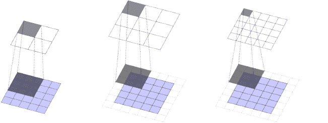

**图 1.2**  
左侧：无填充，步长=2，**中间：** 有填充，步长=2，**右侧：** 有填充，步长=1。输出是上方的白色矩阵，输入是底部的蓝色矩阵。输出的**尺寸**取决于卷积的以下参数：填充、卷积核大小和步长。输出的**物理间距**随卷积中的步长相应改变：步长为 *n* 时，物理间距按 *n* 缩放。

> **重要说明**
>
> - 非单位步长会改变输出的物理间距。
> - 如果没有填充，输出大小会改变，具体取决于卷积核大小。
> - 如果有填充，输出大小可以保持不变（无步长时与输入相同），但边界值可能会受到零填充的污染。

### 1.3 池化

CNN 的另一个重要概念是池化，它是一种非线性下采样形式。池化操作可以实现多种非线性函数，其中最大池化最为常见：它将输入图像分区，并为每个子区域输出最大值（见图 1.3）。其直觉是，特征的精确位置不如其相对于其他特征的粗略位置重要。池化层旨在逐步减小表示的空间尺寸，以减少网络中的参数数量和计算量，从而也控制过拟合。在 CNN 架构中，通常会在连续的卷积层之间定期插入池化层。池化操作提供了另一种形式的平移不变性。池化层独立地对输入的每个深度切片进行操作，并在空间上调整其大小。与非单位步长的卷积一样，池化算子也会改变输出尺寸。

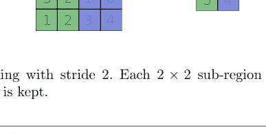

**图 1.3**  
步长为 2 的 2 × 2 最大池化。在图像的每个 2 × 2 子区域中，保留最大值。

> **重要说明**
> 池化和带步长的卷积可视为一种子采样过程，它确实会改变输出尺寸和输出物理间距。根据具体实现，它还可以在边界处保留部分采样的元素。

### 1.4 激活函数

激活函数受生物学启发，通常是一种抽象，表示神经元是否会被激活（即传递其输出值）的方式。基本上，激活函数控制实际传递给输出的信息量。深度学习中使用了许多激活函数。其中，我们可以列举以下本教程中会常用的几种：

- 1. 线性整流单元（ReLU）返回 0 和 x 中的最大值：

  $$f(x) = max(0, x)$$
- 2. 带泄漏的线性整流单元（Leaky ReLU）允许单元未激活时有一个小的正梯度。它以标量 α 为参数：

  $$f(x) = \begin{cases} x & \text{if } x > 0, \\ \alpha x & \text{otherwise,} \end{cases}$$
- 3. Sigmoid 函数：

  $$f(x) = \frac{1}{1 + e^{-x}}$$
- 4. 双曲正切函数（Tanh），它是平移缩放的 Sigmoid 函数（$\tanh(x) = 2 \times \operatorname{sigmoid}(2x) - 1$）：

  $$f(x) = \frac{e^x - e^{-x}}{e^x + e^{-x}}$$

### 1.5 遥感影像深度学习面临的挑战

用深度学习处理真实世界的遥感影像仍然面临挑战。一个关键点是软件实现。进入深度学习领域需要熟悉某个框架。实现新方法需要广泛的编程背景和深度学习知识。工具必须具有足够的扩展性，以应对真实世界遥感影像和数据集的大尺寸。特别是，图像尺寸问题超出了深度学习框架的处理范围。在计算机视觉中，常见的问题和数据集通常与小尺寸和真彩色图像相关。许多深度学习架构必须重新设计以适应遥感影像。另一点是，文献中提出的算法往往服务于单一目的，每种新算法的实现都需要新的工作和专业知识，才能应用于标准化的地理空间数据。此外，最近的研究指出，在机器学习算法（如支持向量机或随机森林）中使用深度网络计算的特征，会带来巨大机会。然而，即使大多数遥感影像处理软件实现了带有此类算法的机器学习框架，也只有少数软件能将深度学习算法与那些已经实现的知名机器学习算法结合起来。

在下一节中，我们将介绍解决所有这些问题的软件。

#### 2.1.1 应用程序

Orfeo ToolBox 应用程序旨在为用户提供大量已实现的算法。这些应用程序可以直接通过多种接口使用，例如命令行、图形用户界面以及 QGIS 等第三方软件。对于开发者，应用程序也可以通过 Python 和 C++ API 使用。每个 OTB 应用程序都附带一组参数。OTB 应用程序中使用的参数是类型化的（图像、矢量数据、文件、文件夹、整数、浮点数等），这种形式化机制使 OTB 应用程序能够通过所有接口和 API 使用。

#### 2.1.2 流式处理机制

流式处理机制使图像可以在不同区域上多次处理。它不是处理整个数据（这需要大量内存），而是逐块处理，直到生成输出数据。这种机制将内存占用维持在可控范围，并支持处理非常大的数据。OTB 应用程序和 C++ 类中实现的大多数算法都支持这种机制。少数未实现流式处理机制的算法在执行时需要将所有输入和输出数据存储在内存中。

#### 2.1.3 远程模块

对于开发者而言，OTB 借助外部模块简化了新功能的集成和部署。这种机制使你可以标准化库外部组件的开发，例如新的 OTB 应用程序。远程模块允许任何人在不加入核心项目存储库的情况下扩展 OTB 的功能。远程模块可以采用与 OTB 主存储库不同的许可证。例如，我们将在本教程中使用的 OTBTF 远程模块使用 TensorFlow 库实现深度学习。它不在官方 OTB 库的核心中，但提供的应用程序可以像其他任何应用程序一样通过 OTB 应用程序 API 使用。

#### 2.1.4 Python API

Orfeo ToolBox 的 Python API 使你可以将现有 OTB 应用程序在内存中连接起来构建流水线。生成的流水线仍然强制执行流式处理机制。另一个有用的功能是能够在流水线中使用 Numpy 数组，作为 OTB 应用程序的输入或输出。Python API 非常适合利用已有的算法模块（如 OTB 应用程序，包括来自远程模块的应用程序）构建复杂的流水线。本书面向用户与 OTB 应用程序的交互，Python 绑定将在 16.3 节中部分介绍。


我们邀请那些希望通过Python API充分利用工具箱全部潜力的好奇读者，阅读官方文档以及在线可用的教程。还可以从Orfeo ToolBox网站专门论坛的用户社区获得更多帮助。[^4]

### 2.2 TensorFlow

TensorFlow是由Google发起的高性能数值计算库，用于深度神经网络的训练和推理[17]。它已成为流行的开源深度学习框架，拥有全球范围内不断增长的开发者社区，参见图2.2。


**图2.2**  
TensorFlow库。

#### 2.2.1 API

TensorFlow拥有强大的高级Python API来构建深度网络。目前，TensorFlow使用Keras，它允许你从更高的实现层面构建网络。TensorFlow还提供了一个简单而强大的C++ API，用于在C++项目中集成深度网络。

#### 2.2.2 计算

TensorFlow使用符号编程，将计算的定义与它们的实际执行区分开来。在TensorFlow中，张量是内存中操作和值的抽象对象，简化了操作，无论计算环境如何：例如中央处理器（CPU）或图形处理器（GPU）。在TensorFlow中，所谓的*模型*由排列成节点图的操作组成。每个节点是一个操作，接受零个或多个张量作为输入，并产生一个或多个张量。这个数据流图以计算高效的方式定义操作（例如线性操作）（基准测试见[18]）。

- 4. 深度学习专家仍然可以使用他们喜欢的API（例如Python）利用他们的编码技能构建/训练模型，并使用OTBTF中的**SavedModel**来生成最终的地理空间图像。

#### 2.3.1 安装

尽管如此，OTBTF远程模块目前尚未集成到官方OTB版本中。目前，有几种安装方式：

- 使用提供的VirtualBox实例中的现成环境。本教程唯一需要的软件是Oracle VirtualBox软件，可在线免费下载。[^5] 如果你想试用，这是最简单的选择。但请注意，这没有针对性能进行优化。你可以联系作者请求下载虚拟机。

- 在DockerHub上下载官方OTBTF Docker镜像。[^6] 该选项非常适合Linux和Mac用户，因为Docker能高效利用计算机资源。如果你有NVIDIA GPU，可以选择支持NVIDIA运行时的Docker镜像。

- 从源代码编译OTBTF。为此，请遵循OTBTF GitHub仓库上提供的说明。这是较困难的方式，但你可以根据你的硬件使用适当的优化标志构建软件。

如果在安装过程中遇到任何问题，我们建议读者参阅OTBTF仓库的最新故障排除部分。也可以在Orfeo ToolBox论坛[^7]上提出进一步的问题，并在OTBTF GitHub仓库上提交工单。

> **建议**
> 
> 我们强烈建议Linux和Mac用户使用Docker镜像以获得更好的性能。另一个重要点是硬件：图形处理器（GPU）能大幅加速深度学习的过程。特别是对于第14章，我们建议使用GPU来运行模型训练。OTBTF GitHub仓库中提供的支持nvidia-Docker的OTBTF Docker镜像大大简化了在启用GPU的硬件上使用该软件的过程。说明可在OTBTF仓库的文档部分找到。

#### 2.3.2 特色应用

远程模块包含一组面向用户的新应用程序。其中，本教程将使用的关键应用程序如下：

- **PatchesSampling** 专用于在多幅图像中提取图像块。
- **TensorflowModelTrain** 可以从多幅输入图像训练TensorFlow模型。
- **TensorflowModelServe** 可以在多幅输入图像上运行TensorFlow模型。

还有一组复合应用程序，它们将现有OTB应用程序和上述应用程序串联起来，以执行最先进的机器学习（例如将随机森林与深度学习的特征相结合）。在实践环节中，我们将看到如何将这些新应用程序用于遥感图像。

#### 2.3.3 原理

如第2.2节所述，TensorFlow提供了API来让开发者轻松构建深度网络。一旦构建好深度网络，它可以导出为*SavedModel*，序列化为Google Protobuf（一种与语言无关、平台无关、可扩展的结构化数据序列化机制）。这个*SavedModel*包括处理图和模型的变量。然后可以在OTBTF远程模块提供的新OTB应用程序中使用它。OTBTF实现了将图像转换为张量的机制，这些张量可以馈入TensorFlow模型，执行模型，并将模型生成的结果张量转换回输出图像。得益于OTB的流式机制，处理图像的大小不受限制。TensorFlow模型与其以下固有参数相关联，必须提供给OTBTF：

1. **感受野：** 如第1节所述，感受野是模型在输入空间中“看到”的输入体积。
2. **表达场：** 它描述了模型在输出空间中“创建”的体积。
3. **缩放因子：** 缩放因子描述了一个参考输入（通常是第一个输入）与输出空间之间的物理间距变化。例如，我们考虑一个将单个输入转换为单个输出的CNN，总共实现了2个步长为2的池化算子。那么总缩放因子为4，意味着输出间距乘以了4倍，因此输出图像尺寸将在每个$x$和$y$维度上除以4。

**TensorflowModelServe**应用程序自动计算流水线中的区域传播（即从输入图像到输出），以及输出图像信息，这是启用流式处理的两个关键步骤。[图2.3](#figure-2.3)说明了上述深度网络参数在这些步骤中的相关性。

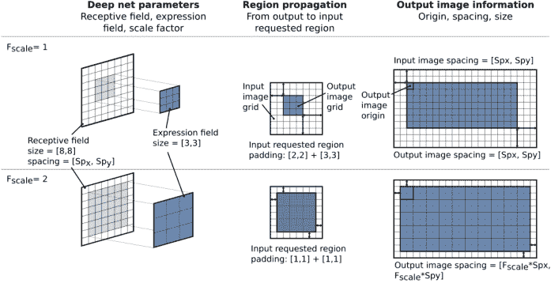

**图2.3**

深度网络参数。该图显示了两个深度网络参数对区域传播和输出图像信息的影响。这两个网络具有相同的表达场和感受野，但缩放因子参数不同（顶部网络的$F_{scale}=1$，底部网络的$F_{scale}=2$）。

该应用程序计算与表达场对齐的图像区域，即起始索引和大小是表达场倍数的图像区域。当请求的输出区域跨越多个对齐的子区域时，TensorFlow模型在最大的对齐区域上运行，然后仅保留请求的部分（[图2.4](#figure-2.4)）。该机制避免了分块伪影，并确保输出独立于流式管理器使用的平铺布局，即（i）如果模型允许，无缝拼接，（ii）可重现。

为了生成一张土地覆盖图[13]。在OTBT中，**输入源**由以下输入参数组成：

- **图像列表**：可以是单个图像或图像列表（当设置图像列表时，图像按其出现顺序堆叠在一起，因此必须具有相同的大小和空间范围）。

- **感受野**：网络感受野的大小，与输入相关，在*x*和*y*方向上。

- **占位符**名称（字符串）：如TensorFlow模型中所命名。

对于每个输入源，通过**placeholder**参数指定名称的占位符，与对应于输入**感受野**的**图像堆栈**块一起馈入TensorFlow模型。

同样地，可以获取TensorFlow模型的多个输出作为结果。用户必须提供以下参数，以将输出张量转换为输出图像：

- 输出张量名称：表示张量名称的字符串列表，如TensorFlow模型中所命名（参数**output.names**）。

- 输出张量的输出表达场（参数**output.efieldx**和**output.efieldy**）。

- 输出缩放因子，与第一个输入源（即“source1”）的物理像素间距相关（参数**output.spscale**）。

可以获取多个输出张量，堆叠后导出为OTB图像。原理是用户提供要视为模型输出的张量名称列表（**output.names**）。TensorFlow会话运行后，它们被堆叠在输出图像的第三维（即像素分量）中。目前，只能生成一张输出图像。因此，目前的限制是输出张量可以如上所述进行堆叠。

### 2.4 QGIS

QGIS（也被称为Quantum GIS）是一个免费开源（GNU GPLv2）的跨平台地理信息系统应用程序，参见图2.5，支持查看、编辑和分析地理空间数据。自2002年以来，它随着越来越多的贡献者和用户而发展壮大。我们将使用QGIS来可视化本教程期间使用和生成的所有地理空间数据。

[^4]: forum.orfeo-toolbox.org  
[^9]: www.qgis.org


教程。QGIS 的一个有趣特性是 Python 扩展提供程序。它允许访问许多用 Python 编写的插件，这些插件使用 QGIS API 来提供新功能。特别是，我们将使用一个插件，它允许我们将 OpenStreetMap 数据下载为矢量图层，即 OSM **Downloader**。


**图 2.5** QGIS。

# 第二部分：基于图像块的分类

## 3 引言

本章介绍了我们所说的用于土地覆盖制图的*基于图像块的分类*。该任务包括对固定大小的图像块进行分类，并将估计的类别赋予图像块的中心像素，以生成土地覆盖图。当可用数据是稀疏标注时，这种方法很合适：唯一的要求是已知类别的图像块的位置。通常，支持这种方法的真实地面示例可以是与土地覆盖类别相关的 GPS 坐标，也可以是 GIS 中手动标注的多边形等。这种方法涉及深度网络，输入一个图像块，并产生一个代表该图像块类别的单个值：因此，训练这种网络只需要输入图像块和相关的类别值。一旦网络训练完成，生成土地覆盖图就是将模型应用于遥感图像的每个图像块，并将估计的类别值存储在输出图像中。这种方法的优点是适用于稀疏标注的数据集。其实现细节和局限性将在本章讨论。


## 4 使用的数据：东京数据集

本节旨在介绍本次实践课所涉及的数据。我们使用一个免费可用的数据集，称为 *东京* 数据集。在接下来的部分中，我们说明如何下载和准备这个数据集，以便为实践课做好准备。在您的文件系统上创建一个名为 *tokyo* 的目录。我们将使用这个目录存储在练习中下载和生成的所有数据。

### 4.1 描述

*东京*数据集由一幅 Sentinel-2 影像和一个栅格化的 OpenStreetMap[^1]（OSM）矢量图层组成。它将用于第二部分的所有练习。

[^1]: [www.openstreetmap.org](http://www.openstreetmap.org)

### 4.2 遥感影像

我们使用一幅在日本本土东京地区获取的 Sentinel-2 影像（[图 4.1](#)）。

从搜索结果中，您应该能够下载一个名为 S2A_MSIL2A_20190508T012701_N0212_R074_T54SUE_20190508T041235 的产品，如图 4.3 所示。

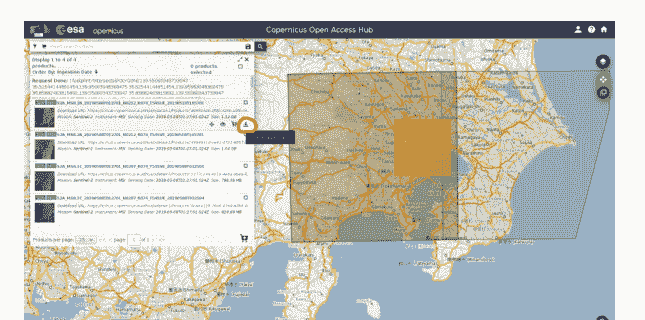

**图 4.3** 下载名为 S2A_MSIL2A_20190508T012701_N0212_R074_T54SUE_20190508T041235 的产品。

下载产品后，您可以解压缩归档文件并查看解压后的文件。该产品有两组影像：一组具有 10 米间距（光谱波段 2、3、4 和 8），另一组具有 20 米间距（光谱波段 5、6、7、8a、11 和 12）。在本章中，我们不会使用其他光谱波段，因为它们主要与大气成分有关。表 4.1 总结了这些影像的特征。

**表 4.1** 影像的特征

| Id | 产品类型 | 图像大小（列 × 行） | 值编码 | 像素间距（米） |
|---|---|---|---|---|
| *Sentinel-2（波段 2、3、4、8）* | 多光谱 | 10980 × 10980 | int（16 位） | 10 米 |
| *Sentinel-2（波段 5、6、7、8a、11、12）* | 多光谱 | 5490 × 5490 | int（16 位） | 20 米 |

### 4.3 地面真值

我们将使用法国蒙彼利埃大学 TETIS 研究机构提供的一些地面真值。地面真值由两个标签栅格组成，即像素对类别值进行编码，其空间范围和分辨率与 10 米影像相同。相应的类别在表 4.2 中描述。

**表 4.2** *东京*数据集地面真值的特征

| 类别编号 | 描述 |
|---:|---|
| 0 | 水体 |
| 1 | 高尔夫球场 |
| 2 | 公园和草地 |
| 3 | 建筑物 |
| 4 | 森林 |
| 5 | 农田 |

为了验证的目的，我们使用两个不同的地面真值来源：我们将在后面的第 5.2 节解释原因。

从资源库下载本章的地面真值数据。[^3] 搜索东京数据集（您可以使用 GitHub 的 **查找文件** 工具）。您应该能够下载以下文件：

1. `terrain_truth_epsg32654_A.tif`：地面真值（A 部分）
2. `terrain_truth_epsg32654_B.tif`：地面真值（B 部分）
3. `legend_style.qml`：QGIS 的样式表文件

在 *tokyo* 目录下创建一个名为 *terrain_truth* 的子文件夹，并将这些文件下载到这个新创建的目录中。

每次迭代时网络的。因此，初始模型权重和数据的分布是使学习收敛的关键。在许多机器学习框架中，参数通常默认设置为适合中心化缩减分布以及 [-1, +1] 范围内的值。这就是为什么数据归一化是一个基本的预处理步骤。对于我们的数据集，我们将使用 BandMathX 应用程序对所有遥感图像通道进行平移-缩放，用它们的最大值进行归一化。

要生成归一化图像，请从命令行进入输出文件夹。您可以使用 cd 命令在文件系统中导航，这在 Windows 和 UNIX 中都很常见。

```bash
 Normalize images

 Go in the folder Sentinel-2 images (10m)
cd ~/tokyo/
cd S2A_MSIL2A_20190508T012701_N0212_R074_T54SUE_20190508T041235.SAFE
cd GRANULE/L2A_T54SUE_A020234_20190508T012659/IMG_DATA/R10m/

 Concatenate images, and normalise them between [0,1]
otbcli_BandMathX \
-il T54SUE_20190508T012701_B04_10m.jp2 \
T54SUE_20190508T012701_B03_10m.jp2 \
T54SUE_20190508T012701_B02_10m.jp2 \
T54SUE_20190508T012701_B08_10m.jp2 \
-exp "{im1b1/im1b1Maxi;im2b1/im2b1Maxi;im3b1/im3b1Maxi;im4b1/im4b1Maxi}" \
-out ~/tokyo/Sentinel-2_B4328_10m.tif

 Go back in the working directory
cd ~/tokyo/
```

上面的命令行运行 BandMathX 应用程序，参数如下：

- **il** 是输入图像列表。我们向此参数提供了 4 个字符串值，它们是 Sentinel-2 波段的文件名。
- **exp** 是应用程序将对像素执行的数学表达式。所提供的表达式只是将每个通道用其最大值归一化，确保输出范围是 [0, 1]。
- **out** 是生成的输出图像文件名。

**使用图形用户界面而非命令行界面**

在以下所有练习中，OTB 应用程序将使用相同的键/值机制运行。为了便于阅读，本书提供了每个练习的命令行。但请记住，读者可以以图形模式使用任何 OTB 应用程序：不必通过键/值机制提供参数值，读者可以使用图形用户界面完成练习。要在图形用户界面中运行任何 OTB 应用程序，用户只需在运行前更改可执行文件的前缀：使用 *otbgui*（即“图形用户界面”）而不是 *otbcli*（即“命令行界面”）。例如，如果用户想以图形模式运行 **BandMathX** 应用程序，可以直接运行 *otbgui_BandMathX* 而无需其他参数。将显示 **BandMathX** 应用程序的用户界面。

### 5.2 采样

将深度学习技术应用于真实数据集的第一步是采样。Orfeo ToolBox 的现有框架为逐像素或面向对象的分类/回归任务提供了出色的工具。在深度学习方面，像 CNN 这样的网络是在图像块而非单像素批次上训练的。因此，我们将介绍的 OTBTF 的第一个应用针对图像块采样，称为 **PatchesExtraction**。

#### 5.2.1 选择

**PatchesExtraction** 应用程序无缝集成在 OTB 现有的采样框架中。第一步是样本选择。它包括选择样本中心的位置。目前根据地面真值格式的类型有两种方法：

- 当地面真值是**矢量数据**时：通常可以使用 **PolygonClassStatistics** 和 **SampleSelection** 应用程序来选择图像块中心，然后将它们交给 **PatchesExtraction** 应用程序。
- 当地面真值是**栅格数据**时：可以使用 **LabelImageSampleSelection** 应用程序，它是 OTBTF 远程模块的一部分。

由于我们的地面真值是栅格，我们使用第二种方法。您可以参考 OTB CookBook[^2] 来了解第一种方法的执行方式。

```bash
 Samples selection for group A
 You might need to change the path of terrain truth raster,
 "terrain_truth_epsg32654_A.tif" where it was downloaded
otbcli_LabelImageSampleSelection \
-inref ~/tokyo/terrain_truth/terrain_truth_epsg32654_A.tif \
-nodata 255 \
-outvec terrain_truth_epsg32654_A_pos.shp \
-strategy "constant" \
-strategy.constant.nb 500
```

[^2]: https://www.orfeo-toolbox.org/CookBook/


#### 5.2.2 补丁提取

```bash
otbcli_PatchesExtraction \
-source1.il Sentinel-2_B4328_10m.tif \
-source1.patchsizex 16 \
-source1.patchsizey 16 \
-source1.out Sentinel-2_B4328_10m_patches_A.tif \
-vec terrain_truth_epsg32654_A_pos.shp \
-field "class" \
-outlabels Sentinel-2_B4328_10m_labels_A.tif uint8
```

其中：

- **source1** 是第一个图像源的参数组（它不能被赋予值，只包含参数），
- **source1.il** 是第一个源的输入图像列表，
- **source1.patchsizex** 是第一个源的补丁宽度，
- **source1.patchsizey** 是第一个源的补丁高度，
- **source1.out** 是第一个源的输出补丁图像，
- **vec** 是点的输入矢量数据（样本位置），
- **field** 是我们用作标签值的属性（即类别），
- **outlabels** 是标签的输出图像。

完成此步骤后，您应该已生成以下输出图像，我们将其称为“训练数据集”：

- *Sentinel-2_B4328_10m_patches_A.tif*
- *Sentinel-2_B4328_10m_labels_A.tif*

**可视化补丁**

一个简单的技巧可以让您在 QGIS 中检查提取的补丁：只需将补丁作为栅格打开，然后选择与当前项目相同的坐标系（显示在窗口右下角）。

对矢量图层 *terrain_truth_epsg32654_B_pos.shp* 重复上述步骤，并生成用于验证的补丁和标签。

```bash
otbcli_PatchesExtraction \
-source1.il Sentinel-2_B4328_10m.tif \
-source1.patchsizex 16 \
-source1.patchsizey 16 \
-source1.out Sentinel-2_B4328_10m_patches_B.tif \
-vec terrain_truth_epsg32654_B_pos.shp \
-field "class" \
-outlabels Sentinel-2_B4328_10m_labels_B.tif uint8
```

完成此步骤后，您应该拥有以下数据，这些数据将被称为*验证数据集*：

- *Sentinel-2_B4328_10m_patches_B.tif*
- *Sentinel-2_B4328_10m_labels_B.tif*

#### 5.2.3 关于像素交错的一点说明

为简单起见，采样的补丁存储在单个大图像中，该图像将所有补丁按行堆叠。这样做有多个优点。首先，访问一个唯一的大文件比处理文件系统中存储的数千个独立小文件，或者访问大图像中稀疏分布的补丁更高效。其次，我们可以像处理任何图像一样可视化/处理补丁：例如，我们可以将大补丁图像导入 QGIS，并检查我们的补丁是否看起来正确。第三，采样源的交错方式得以保留，这保证了数据访问期间的良好性能。

### 5.3 训练

如何训练一个深度网络？为了从简单开始，我们将训练一个较小的现有模型。我们关注一个 CNN，它输入我们的 16 × 16 × 4 补丁，并在 0 到 5 的 6 个标签中产生一个输出类别的预测（类别描述见表 4.2）。

#### 5.3.1 原理

在本节中，我们简要概述深度学习模型训练的基本概念。模型训练通常涉及损失函数的梯度下降（在网络权重空间中），该函数通常表示估计数据与参考数据之间的差距。**批量**大小定义了通过网络传播以在每一步平均梯度的样本数量。假设我们有*N*个训练样本，并且想要使用大小为*n*的批量。在学习过程中，前*n*个样本（从 1 到*n*）将用于训练网络。然后，第二个*n*个样本（从*n* + 1 到 2*n*）将再次用于训练网络。重复此过程，直到所有样本都通过网络传播（这称为一个**周期**）。在每一步，梯度在批量上计算，网络权重根据所选的优化方法进行更新。

使用小于样本总数的批量大小可以使整个训练过程需要更少的内存，这对于大数据集很有用。此外，每次传播后都会更新网络权重。

根据问题的不同，使用多个批量时性能可能会更优：如果所有样本都在传播中使用，则网络参数只会进行一次更新。然而，批量越小，梯度的估计就越不准确。对于每个批量，网络权重将被更新以最小化与所用样本对应的代价函数。如果样本数量太少，与较大的批量相比，梯度的方向会非常频繁地改变。没有简单的规则来选择好的批量大小，因为这取决于网络架构、要最小化的损失函数、训练参数、数据分布等。

#### 5.3.2 模型架构

我们建议引入一个小而简单的 CNN 模型，以更好地理解该方法。本节描述该模型的内部内容。[图 5.2](#figure-52) 中提供了概述，其中总结了所考虑架构的计算图。

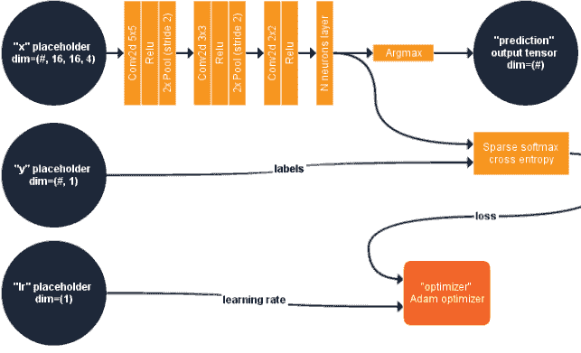

**图 5.2**

我们的第一个深度网络。该网络由两个占位符（“x”和“lr”）组成，分别用于输入补丁（4 维数组）和学习率（单个标量），一个输出张量（“prediction”，一维数组）和一个目标节点（“optimizer”，仅用于训练网络）。“#”表示第一维的分量数不固定。

##### 5.3.2.1 输入

图像补丁馈入 TensorFlow 模型中名为**“x”**的占位符。**“x”**的第一维可以有任何数量的分量。该维度通常用于批量大小，并且不固定以支持不同的批量大小。例如，假设我们想要用 10 个样本的批量训练模型，我们将大小为 10 × 16 × 16 × 4 的多维数组馈入大小为 # × 16 × 16 × 4 的占位符**“x”**中。

##### 5.3.2.2 层

**“x”**随后由一系列的 2D 卷积/激活函数（线性修正单元）/池化层处理。在最后一个激活函数之后，特征由 8 个神经元的全连接层处理（每个预测类别一个）。

##### 5.3.2.3 估计类别

估计类别是输出最大值的神经元（来自最后一个神经元层）的索引。这是通过使用*Argmax*算子处理最后一个全连接层的输出来完成的，该算子在图中命名为**“prediction”**。

##### 5.3.2.4 损失函数

训练的目标是最小化数据分布（真实标签）与模型分布（估计标签）之间的交叉熵。我们使用 6 个神经元的 softmax 函数的交叉熵作为损失函数。基本上，该函数将测量离散分类任务中的概率误差，其中类别是互斥的（每个条目恰好属于一个类别）。为此，模型实现了 TensorFlow 中称为*带 logits 的 softmax 交叉熵*的操作。该函数首先计算 6 个神经元输出的*softmax*函数。softmax 函数对输出进行归一化，使其总和等于 1，并且可以用于表示类别分布，即，在*n*个不同可能结果上的概率分布（公式 5.1）。然后计算真实标签与 softmax 得到的概率值之间的香农交叉熵（公式 5.2），并将其视为深度网络的损失函数。

$$\sigma(z)_i = \frac{e^{z_i}}{\sum_{k=1}^{n} e^{z_k}} \tag{5.1}$$

$$H(p,q) = -\sum_x p(x)\log(q(x)) \tag{5.2}$$

##### 5.3.2.5 优化器

一个名为**“optimizer”**的节点执行损失函数的梯度下降：该节点仅用于训练（或微调，如果希望“冻结”某些权重）模型。该节点在推理时（即模型被使用时，通常是估计类别）不被使用。该算子实现的方法称为 Adam（即自适应矩估计 [19]）。一个名为**“lr”**的占位符控制优化器的学习率：它保存一个标量值（浮点数），并且可以有一个默认值。

> **重要提示**
>
> 我们模型中所使用的函数适用于 0 到 5 的整数标签（$N = 6$）。第一个类别编号必须为 0，以符合我们模型中使用的 TensorFlow 函数的类别编号约定。

### 5.4 生成模型

现在我们已经了解了该模型的内部结构，我们将构建它。我们使用 TensorFlow 的 Python API 构建一个 TensorFlow 模型。我们将使用资源库中提供的 *create_model1.py* Python 脚本。您可以从链接下载代码，或者使用 Git 克隆仓库。在使用 Python 运行 *create_model1.py* 代码之前，必须正确设置 *PYTHONPATH* 环境变量，以便 Python 能够导入所有外部库。*tricks.py* Python 代码是 OTBTF 的一部分，包含一组有用的函数和辅助工具。特别是，函数 *CreateSavedModel* 使我们能够将模型序列化为文件系统上的 *SavedModel*。在 OTBTF Docker 镜像中，*tricks.py* 位于 */work/otb/otb/Modules/Remote/otbtf/Python/* 目录中。我们必须在用 Python 运行 *create_model1.py* 代码之前，将此目录添加到 *PYTHONPATH* 环境变量中。*create_model1.py* 的代码如下所示。

```python
#
 不要忘记将 otbtf/python 目录添加到您的 PYTHONPATH 中。
 否则无法导入 "tricks"。
 在 OTBF Docker 镜像中，tricks.py 位于以下路径：
 /work/otb/otb/Modules/otbtf
#
 适用于 OTBTF 1.7
#
from tricks import *
import sys
```

[https://github.com/remicres/otbtf_tutorials_resources](https://github.com/remicres/otbtf_tutorials_resources)


```python
nclasses=6

def myModel(x):

    # input patches: 16x16x4
    conv1 = tf.layers.conv2d(inputs=x, filters=16, kernel_size=[5,5],
                             padding="valid", activation=tf.nn.relu)
    # conv1 out size: 12x12x16
    pool1 = tf.layers.max_pooling2d(inputs=conv1, pool_size=[2, 2],
                                    strides=2)
    # pool1 out: 6x6x16
    conv2 = tf.layers.conv2d(inputs=pool1, filters=16, kernel_size=[3,3],
                             padding="valid", activation=tf.nn.relu)
    # conv2 out size: 4x4x16
    pool2 = tf.layers.max_pooling2d(inputs=conv2, pool_size=[2, 2],
                                    strides=2)
    # pool2 out: 2x2x16
    conv3 = tf.layers.conv2d(inputs=pool2, filters=32, kernel_size=[2,2],
                             padding="valid",activation=tf.nn.relu)
    # conv3 out: 1x1x32

    # Features
    features = tf.reshape(conv3, shape=[-1, 32], name="features")

    # Neurons for classes
    estimated = tf.layers.dense(inputs=features, units=nclasses,
        activation=None)
    estimated_label = tf.argmax(estimated, 1, name="prediction")

    return estimated, estimated_label

""" Main """
if len(sys.argv) != 2:
    print("Usage: output_directory_for_SavedModel")
    sys.exit(1)

 Create the TensorFlow graph
with tf.Graph().as_default():

    # Placeholders
    x = tf.placeholder(tf.float32, [None, None, None, 4], name="x")
    y = tf.placeholder(tf.int32, [None, None, None, 1], name="y")
    default_lr = tf.constant(0.0002, dtype=tf.float32, shape=[])
    lr = tf.placeholder_with_default(default_lr, shape=[], name="lr")

    # Output
    y_estimated, y_label = myModel(x)

    # Loss function
    cost = tf.losses.sparse_softmax_cross_entropy(labels=tf.reshape
        (y, [-1, 1]), logits=tf.reshape(y_estimated,
        [-1, nclasses]))
```

```python
 Optimizer
optimizer = tf.train.AdamOptimizer(learning_rate=lr,
    name="optimizer").minimize(cost)
```

```python
 Initializer, saver, session
init = tf.global_variables_initializer()
saver = tf.train.Saver( max_to_keep=20 )
sess = tf.Session()
sess.run(init)
```

```python
 Create a SavedModel
CreateSavedModel(sess=sess,
    inputs=["x:0", "y:0"],
    outputs=["features:0", "prediction:0"],
    directory=sys.argv[1])
```

**重要提示**
Python 语法对缩进非常敏感：在块（如函数）内的每一行，必须保留相同的缩进。如果你复制/粘贴或修改所提供的代码，请注意缩进。我们建议克隆 GitHub 仓库，而不是使用复制/粘贴。

要运行该 Python 脚本，只需输入：

```bash
 Add otbtf python directory to PYTHONPATH
export PYTHONPATH=$PYTHONPATH:/work/otb/otb/Modules/Remote/otbtf/python/
```

```bash
 Generate the model (you might need to provide the correct path
 to the "create_model1.py" file if you have downloaded elsewhere)
 The "create_model1.py" file can be downloaded from:
 https://github.com/remicres/otbtf_tutorials_resources.git
python3 create_model1.py "model1"
```

当然，如果你希望将模型目录（"model1"）写入当前目录以外的位置，你可以更改它。

### 5.5 从头训练模型

如果你查看 SavedModel 目录，你会看到一个 .pb 文件（protobuf）和一个 Variables 文件夹。protobuf 文件序列化计算图，而 Variables 文件夹包含模型权重的值（核等）。正如你在 Python 脚本中可能注意到的，模型权重在导出 SavedModel 之前就已经初始化。我们将使用 TensorflowModelTrain 应用从初始化状态训练 CNN，更新其权重以完成图像分类任务。对于每个数据集（训练数据和验证数据），**Tensorflow-ModelTrain** 应用的验证步骤包括计算以下指标：

- 混淆矩阵
- 总体准确率指数
- Kappa 指数
- 对于每个类别：
  - 精确率
  - 召回率
  - F 分数

根据训练所用源的占位符名称和评估所用源的名称，如何检测哪个源用作模型输入，或用作计算评估指标的基线，在图 5.3 中予以说明。

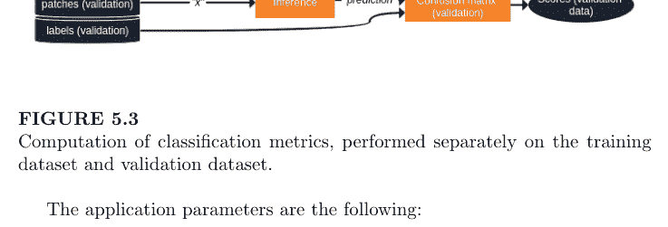

 图 5.3

分别对训练数据集和验证数据集执行分类指标的计算。

应用参数如下：

- **training.source1** 是第一个源的参数组，即图像补丁（用于学习）
  - **training.source1.il** 是输入图像文件名
  - **training.source1.patchsizex** 是补丁宽度
  - **training.source1.patchsizey** 是补丁高度
  - **training.source1.placeholder** 是图像补丁的占位符名称
- **training.source2** 是第二个源的参数组，即标签补丁（用于学习）
- **training.source2.il** 是输入图像文件名
- **training.source2.patchsizex** 是标签宽度
- **training.source2.patchsizey** 是标签高度
- **training.source2.placeholder** 是标签补丁的占位符名称
- **model.dir** 是包含 TensorFlow *SavedModel* 的目录
- **training.targetnodes** 是在训练步骤中计算梯度下降的算子名称。在我们的模型中，梯度下降通过名为 **“optimizer.”** 的 adam 优化器执行。
- **validation.mode** 是验证模式。**“class”** 验证模式能够对训练数据和验证数据都计算分类指标。
- **validation.source1** 是补丁源（用于验证）。由于验证源的名称（**validation.source1.name**）与训练时同一源的占位符名称（**training.source1.placeholder**）相同，因此该源被视为模型的输入，并在验证步骤中送入相应的占位符。
- **validation.source2** 是标签源（用于验证）。由于该源的名称（**validation.source2.name**）不同于训练时同一源的占位符名称（**training.source2.placeholder**），因此该源被视为参考，在验证步骤中与具有相同张量名称的模型输出进行比较。
- **model.saveto** 使我们能够将模型变量（即权重）导出到文件。

与上述描述对应的命令行如下：

```bash
 Train the deep learning model
otbcli_TensorflowModelTrain \
-training.source1.il Sentinel-2_B4328_10m_patches_A.tif \
-training.source1.patchsizex 16 \
-training.source1.patchsizey 16 \
-training.source1.placeholder "x" \
-training.source2.il Sentinel-2_B4328_10m_labels_A.tif \
-training.source2.patchsizex 1 \
-training.source2.patchsizey 1 \
-training.source2.placeholder "y" \
-model.dir model1 \
-training.targetnodes "optimizer" \
-validation.mode "class" \
-validation.source1.il Sentinel-2_B4328_10m_patches_B.tif \
-validation.source1.name "x" \
-validation.source2.il Sentinel-2_B4328_10m_labels_B.tif \
-validation.source2.name "prediction" \
-model.saveto model1/variables/variables
```

如你所见，training.source1.placeholder 和 validation.source1.name 是相同的（“x”），而 training.source2.placeholder 和 validation.source2.name 是不同的（“y”与“prediction”）。这使得占位符 x 既用于训练也用于验证，但占位符 y 仅用于训练，而占位符 prediction 用于验证，如图 5.3 所述。

我们可以通过 training.userplaceholders 参数调整学习率（如 Python 代码中所提到的，其默认值为 0.0002）：

```
...
-training.userplaceholders "lr=0.005" \
...
```

运行 TensorflowModelTrain 应用。训练轮次结束后，记下 kappa 和总体准确率指数（在验证数据集上应分别约为 0.7）。浏览文件系统，查看 data/results/model1/variables/ 目录：你可以注意到该应用已经更新了两个文件：

- *model_variables_cnn.index* 是已保存变量的摘要，
- *model_variables_cnn.data-00000-of-00001* 是已保存的变量 1，在训练过程结束时保存。

### 5.6 与随机森林的比较

在这里，我们将我们的小型深度网络与随机森林（RF）分类器进行比较。我们使用从混淆矩阵导出的指标。我们使用 OTB 的机器学习框架来训练和评估 RF 分类器的性能。首先，我们使用与深度网络训练和验证完全相同的样本，以提取图像的像素值：

```bash
 Extract the pixels values at samples locations (Learning data)
otbcli_SampleExtraction \
-in Sentinel-2_B4328_10m.tif \
-vec terrain_truth_epsg32654_A_pos.shp \
-field "class" \
-out terrain_truth_epsg32654_A_pixelvalues.shp
```

然后，我们对 terrain_truth_epsg32654_B_pos.shp 矢量数据（验证数据）进行同样操作。

```bash
 Extract the pixels values at samples locations (Validation data)
otbcli_SampleExtraction \
-in Sentinel-2_B4328_10m.tif \
-vec terrain_truth_epsg32654_B_pos.shp \
-field "class" \
-out terrain_truth_epsg32654_B_pixelvalues.shp
```


最后，我们使用默认参数训练一个随机森林（RF）分类器。

```bash
 Train a Random Forest classifier with validation
otbcli_TrainVectorClassifier \
-io.vd terrain_truth_epsg32654_A_pixelvalues.shp \
-valid.vd terrain_truth_epsg32654_B_pixelvalues.shp \
-feat "value_0" "value_1" "value_2" "value_3" \
-cfield "class" \
-classifier "rf" \
-io.out randomforest_model.yaml
```

注意 kappa 指数：应该在 0.5 左右，即比我们的 CNN 模型低约 20%。

> **重要提示**
>
> 与 RF 相比，CNN 使用了更多信息进行训练。事实上，CNN 学习的是多光谱图像的 16 × 16 像元块，而 RF 仅学习多光谱像元（可理解为多光谱图像的 1 × 1 像元块）。我们这里的目标不是比较 RF 与 CNN，而是展示 CNN 处理的上下文信息在分类任务中的有用性。一个更公平的对比对象可以是使用纹理、局部傅里叶变换、SIFT 等空间特征的 RF。

### 5.7 推理

在 5.3 节中，我们成功训练了 CNN 模型。现在，我们将该模型应用于 Sentinel-2 影像，以生成土地覆盖图。优化器不再使用，我们仅使用训练后权重固定的模型。这一部分称为*推理*。为了执行推理，我们使用 **TensorflowModelServe** 应用程序。我们知道，CNN 输入的感知野为 16 × 16 像元，占位符名为 **“x.”**。模型的输出是估计的类别，即 **Argmax** 算子的张量结果，名为 **“prediction.”**。我们不再使用优化器节点，因为它属于训练过程的一部分：我们只使用模型中从 **“x”** 计算 **“prediction”** 的子集，如图 *5.4* 所示。

现在，将生成的影像导入 QGIS，参见图 5.5。您可以更改栅格的样式：在**图层面板**（窗口左侧）中，右键单击影像，选择**属性**，转到**符号系统**选项卡，并将**渲染类型**选择为**单波段伪彩色**。然后，您可以为每个类别值选择颜色、添加标注等。您还可以通过单击**样式**按钮（窗口底部）并打开 `tokyo/terrain-truth` 目录中名为 *legend-style.qml* 的文件来加载预定义样式。

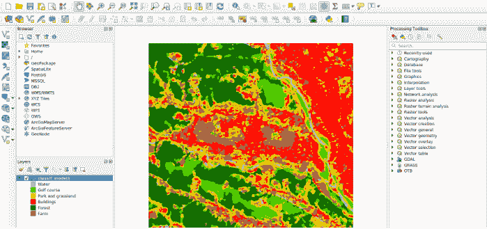

**图 5.5**  
在 QGIS 中导入输出分类图。

> **重要提示**  
> 我们刚刚以**基于块**的模式运行了 CNN，这意味着应用程序在规则间隔处独立提取和处理块。这很耗时，因为采样策略要求我们复制大量重叠的块并独立处理它们。

## 6 全卷积神经网络

在上一节中，我们使用深度卷积神经网络执行了逐像元分类。我们以基于块的模式执行了推理，这意味着对于每个输出像元，我们在输入影像上的一个以输出像元位置为中心的小块上运行模型。虽然这种网络架构易于实现，但在处理效率方面不高。由于块重叠，数据会被多次复制，每次都采用不同的内存对齐方式（针对不同的块），然后传递给模型。深度网络中最耗时的操作是卷积，这些操作高度并行，并且可以实现为中间结果可被其他块处理重用（例如中间和，参见公式 1.2 和 1.3）。然而，基于块的模式禁止了中间结果的可能重用，因为每个新块都需要重新计算，效率不高。我们将介绍全卷积神经网络（FCNN，或 FCN），它只是可以处理整个影像区域而非局限于小块的 CNN。

### 6.1 将现有模型用作 FCN

从我们在 5.4 节中使用的简单 CNN 的组成可以看出，该模型可以充当 FCN。其属性总结如下：

- **感知野**（16 × 16 像元），
- **表达野**（1 × 1 像元），
- **缩放因子**（总共 2 个大小为 2 的连续池化算子，意味着缩放因子为 2 × 2 = 4）。

我们可以验证它们与模型中实现的算子是一致的。令 n 为输入影像的大小，我们可以看看模型如何将影像区域传播到大小为 m 的输出：

1. 使用 5 × 5 卷积核进行卷积：输出大小为 n − 4，
2. 步长为 (2,2) 的 2× 池化：输出大小为 (n − 4)/2 = n/2 − 2，
3. 使用 3×3 卷积核进行卷积：输出大小为 (n/2 − 2) − 2 = n/2 − 4，
4. 步长为 (2,2) 的 2× 池化：输出大小为 (n/2 − 4)/2 = n/4 − 2，
5. 使用 2×2 卷积核进行卷积：输出大小为 (n/4 − 2) − 1 = n/4 − 3。

总之，我们有 m = n/4 − 3，这与模型的属性（感知野、表达野、间距因子）相当一致：模型从 16 × 16 的输入影像生成 1 × 1 的输出。其输出像元的物理间距等于输入像元间距乘以 4。将参数 `model.fullyconv` 设置为 on 以启用全卷积处理，从而运行 CNN 模型。

```bash
otbcli_TensorflowModelServe \
-source1.il Sentinel-2_B4328_10m.tif \
-source1.rfieldx 16 \
-source1.rfieldy 16 \
-source1.placeholder "x" \
-model.dir model1 \
-model.fullyconv on \
-output.names "prediction" \
-output.spcscale 4 \
-out "classif_model1_fcn.tif?&box=1000:1000:250:250"
```

在 QGIS 中打开结果影像，并与原始 CNN 生成的分类图进行比较。打开 **属性 > 元数据** 选项卡，检查新地图的物理间距是否比原始地图大 4 倍。

### 6.2 逐像元全卷积模型

全卷积网络比基于块的方式运行更快，足以在合理时间内处理完整影像（要测试，只需移除上一条命令中的扩展文件名即可）。然而，池化完全破坏了输出的分辨率（输出影像间距是输入像元间距的 4 倍）。我们可以稍微修改原始模型，以创建一个保持输入影像间距的逐像元全卷积网络。

我们移除池化算子，并添加一些具有单位步长的卷积层。我们的目标是保持与之前架构相同的感知野和表达野（这样，我们可以重用 5.2 节中生成的影像块）。图 6.1 总结了我们的新架构。

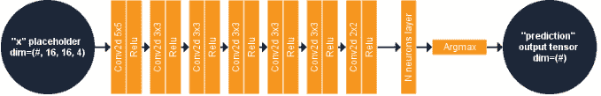

**图 6.1**  
新的全卷积神经网络。已移除池化算子，并添加了卷积算子。注意，卷积中无步长，保持了空间维度上的物理间距。

让我们实现新的 FCN 架构。我们将使用资源仓库中提供的 `create_model2.py` Python 代码。[^1]

```python
#
 Do not forget to add the otbtf/python directory to your PYTHONPATH.
 Else "tricks" can’t be imported.
 In the OTBTF Docker image, tricks.py is located in the following
 path: /work/otb/otb/Modules/otbtf
#
 Works with OTBTF 1.7
#
from tricks import *
import sys

nclasses=6

def myModel(x):

    # input patches: 16x16x4
    conv1 = tf.layers.conv2d(inputs=x, filters=16, kernel_size=[5,5],
                             padding="valid", activation=tf.nn.relu)
    # conv1 out size: 12x12x16
    conv2 = tf.layers.conv2d(inputs=conv1, filters=16, kernel_size=[3,3],
                             padding="valid", activation=tf.nn.relu)
    # conv2 out size: 10x10x16
    conv3 = tf.layers.conv2d(inputs=conv2, filters=16, kernel_size=[3,3],
                             padding="valid", activation=tf.nn.relu)
    # conv3 out size: 8x8x16
    conv4 = tf.layers.conv2d(inputs=conv3, filters=32, kernel_size=[3,3],
                             padding="valid", activation=tf.nn.relu)
    # conv4 out size: 6x6x32
    conv5 = tf.layers.conv2d(inputs=conv4, filters=32, kernel_size=[3,3],
                             padding="valid", activation=tf.nn.relu)
    # conv5 out size: 4x4x32
    conv6 = tf.layers.conv2d(inputs=conv5, filters=32, kernel_size=[3,3],
                             padding="valid", activation=tf.nn.relu)
    # conv6 out size: 2x2x32
```

[^1]: https://github.com/remicres/otbtf_tutorials_resources


```python
    conv7 = tf.layers.conv2d(inputs=conv6, filters=32, kernel_size=[2,2],
                         padding="valid", activation=tf.nn.relu)

    # conv7 out size: 1x1x32

    # Features
    features = tf.reshape(conv7, shape=[-1, 32], name="features")

    # Neurons for classes
    estimated = tf.layers.dense(inputs=features, units=nclasses,
                             activation=None)
    estimated_label = tf.argmax(estimated, 1, name="prediction")

    return estimated, estimated_label

""" Main """
if len(sys.argv) != 2:
    print("Usage: <output_directory_for_SavedModel>")
    sys.exit(1)

 Create the TensorFlow graph
with tf.Graph().as_default():

    # Placeholders
    x = tf.placeholder(tf.float32, [None, None, None, 4], name="x")
    y = tf.placeholder(tf.int32, [None, None, None, 1], name="y")
    default_lr = tf.constant(0.0002, dtype=tf.float32, shape=[])
    lr = tf.placeholder_with_default(default_lr, shape=[], name="lr")

    # Output
    y_estimated, y_label = myModel(x)

    # Loss function
    cost = tf.losses.sparse_softmax_cross_entropy(labels=tf.reshape
              (y, [-1, 1]), logits=tf.reshape(y_estimated, [-1, nclasses]))

    # Optimizer
    optimizer = tf.train.AdamOptimizer(learning_rate=lr,
              name="optimizer").minimize(cost)

    # Initializer, saver, session
    init = tf.global_variables_initializer()
    saver = tf.train.Saver( max_to_keep=20 )
    sess = tf.Session()
    sess.run(init)

    # Create a SavedModel
    CreateSavedModel(sess=sess,
                     inputs=["x:0", "y:0"],
                     outputs=["features:0", "prediction:0"],
                     directory=sys.argv[1])
```

从终端运行 *create_model2.py* Python 脚本来生成我们新的 FCN 架构的 *SavedModel*：

```bash
 Generate the model

 The "create_model2.py" file can be downloaded from:
 https://github.com/remicres/otbf_tutorials_resources.git
python3 ~/python/create_model2.py "model2"
```

由于卷积中没有步长，而池化中有步长，我们的新模型具有 1 的输出比例因子，并且可以在与输入图像相同的比例下生成分类图！

### 6.3 训练

现在我们可以在与简单 CNN 相同的 patch 上训练这个新模型。

> **重要说明**
>
> 所提出的 FCN 比之前介绍的 CNN 具有更多的权重。因此我们可以预期梯度下降需要更长时间。最好设置更高的 epoch 数量！

要训练新模型，只需运行：

```bash
 Train the deep learning model
otbcli_TensorflowModelTrain \
-training.source1.il Sentinel-2_B4328_10m-patches_A.tif \
-training.source1.patchsize 16 \
-training.source1.patchsizey 16 \
-training.source1.placeholder "x" \
-training.source2.il Sentinel-2_B4328_10m-labels_A.tif \
-training.source2.patchsize 1 \
-training.source2.patchsizey 1 \
-training.source2.placeholder "y" \
-model.dir model2 \
-training.targetnodes "optimizer" \
-validation.mode "class" \
-validation.source1.il Sentinel-2_B4328_10m_patches_B.tif \
-validation.source1.name "x" \
-validation.source2.il Sentinel-2_B4328_10m_labels_B.tif \
-validation.source2.name "prediction" \
-model.savetodisk model2/variables/variables
```

训练 100 个 epoch 后，我们可以注意到分数非常好，并且该 FCN 模型优于简单的 CNN。这可能是因为我们显著增加了模型中的变量数量（与我们的第一个 CNN 相比，我们添加了 2 个新的卷积算子，并且还扩大了网络中所有卷积核的大小）。

### 6.4 推理

现在我们想要在整个图像上生成分类图。我们在图像子集上运行模型：

```text
otbcli_TensorflowModelServe \
--source1.il Sentinel-2_B4328_10m.tif \
--source1.rfieldx 16 \
--source1.rfieldy 16 \
--source1.placeholder "x" \
--model.dir model2 \
--model.fullyconv on \
--output.names "prediction" \
--out "classif_model2.tif?&box=4000:4000:1000:1000"
```

地图可以在整个图像上生成。**TensorflowModelServe** 的 **optim** 参数组使我们能够调整模型执行的设置以获得更好的性能。为了加快处理速度，您可以强制应用程序使用大块来生成结果。以下示例中，我们将输出块强制为高度为 128 像素的大矩形块，以便减少来自部分重叠输入区域的计算。

```text
 Generate the landcover map over the entire image
otbcli_TensorflowModelServe \
--source1.il Sentinel-2_B4328_10m.tif \
--source1.rfieldx 16 \
--source1.rfieldy 16 \
--source1.placeholder "x" \
--model.dir model2 \
--model.fullyconv on \
--output.names "prediction" \
--optim.tilesizex 999999 \
--optim.tilesizey 128 \
--out classif_model2_full.tif uint8
```

整个图像的处理大约需要 **80 秒**，在配备 Intel(R) Xeon(R) CPU E5-1650 @ 3.20 GHz 和 16 GB RAM 的机器上完成。您可以在 QGIS 中打开土地覆盖图。

> **重要说明**
>
> 您必须有足够的内存来处理大块。如果内存不足，TensorFlow 将抛出警告消息，指出计算效率受损。在这种情况下，您可以降低块高度，例如将 128 改为 64。

## 7 基于深度特征的分类器

最近的研究指出，在诸如支持向量机或随机森林之类的机器学习算法中使用深度网络计算的特征，可以提供最先进的结果 [20, 21, 22]。本节提供了关于使用经典机器学习技术对深度学习特征进行分类的见解。在这里，深度学习仅用作特征工程，而不是唯一的分类器。

### 7.1 原理

我们将使用 Orfeo ToolBox 中已实现的算法，并使用来自我们深度网络的特征。整个工作流程在图 7.1 中进行了总结。

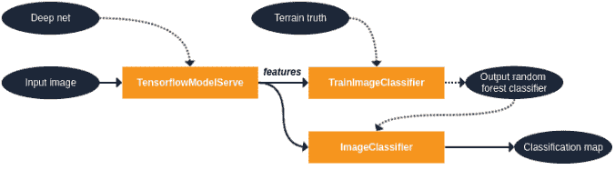

**图 7.1**  
混合深度网络与随机森林的混合分类工作流程。

在第 5.3.2 节中，我们描述了模型的内部结构。特别是，在最后的神经元上计算类别伪概率之前，我们的模型会计算一些特征，如图 7.2 所示。这是通过将最后一个卷积算子的输出重塑为二维向量来完成的：一个维度用于批大小，该维度不是固定的，另一个维度用于特征的组件，该维度是固定的（32 个元素）。在 TensorFlow 模型中，一旦算子具有名称，就可以在推理期间获取其结果。

由于执行此操作的 *tf.reshape* 算子命名为 **features**，因此可以使用 **TensorflowModelServe** 应用程序使用前面章节中描述的相同机制为整个图像生成 *features*。

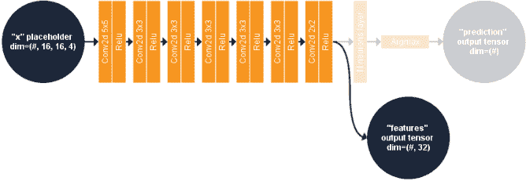

**图 7.2**

模型输出名为“*features*”的张量。由 6 个神经元组成的密集层的输出未被使用。仅使用网络计算“*features*”，分类则使用另一个分类器执行。

这使我们能够使用 **TensorflowModelServe** 为图像的像素生成 *features* 输出张量，然后将得到的像素用作训练随机森林（使用 **TrainImagesClassifier** 应用程序）的特征。一旦生成 RF 规则，就可以使用它根据每个像素上计算的深度特征对整个图像进行分类。

### 7.2 OTB 中复合应用程序概述

在 OTB 中，复合应用程序是由多个应用程序连接而成。通常，一个应用程序的输入可以来自另一个应用程序的输出，而不必从文件中读取。主要好处是避免了临时文件的读写，这 (i) 节省了一些磁盘空间，(ii) 有助于在 I/O 为瓶颈时减少处理时间。第 2.1.2 节中介绍的流式处理机制能够通过将请求的图像部分拆分为多个区域来处理大型图像。涉及具有流式处理支持的应用程序的复合应用程序也受益于该机制。

在 OTBTF 中目前有两个复合应用程序。

- **TrainClassifierFromDeepFeatures**，它将我们的模型服务应用程序 (**TensorflowModelServe**) 重用为 *TrainImagesClassifier* 的输入，以基于第一个应用程序中给出的深度网络的特征训练机器学习算法。


- **ImageClassifierFromDeepFeatures** 使用 **TensorflowModelServe** 作为 **ImagesClassifier** 应用的输入，对输入图像进行分类。

> **重要提示**
>
> 由于分类器基于从网络计算得到的特征，因此 **ImageClassifierFromDeepFeatures** 中使用的深度网络必须与 **TrainClassifierFromDeepFeatures** 中用于生成分类规则的深度网络相同！否则，分类器将使用来自错误模型的特征向量执行图像分类任务，导致分类结果毫无意义。

### 7.3 训练

本练习需要稍多一些的计算资源，因为整个输入图像将使用深度网络处理两次。第一次：用于分类器训练（使用 **TrainClassifierFromDeepFeatures** 应用）。第二次：在生成分类图时（使用 **ImageClassifierFromDeepFeatures** 应用）。

> **重要提示**
>
> 在配备 16 GB 内存的 Intel(R) Xeon(R) CPU E5-1650 @ 3.20 GHz 上，此处理大约需要 **3 分钟**。你可以使用应用的 *optim* 参数组调整处理参数，采用与第 6.2 节中相同的参数值。你可以对 **ImageClassifierFromDeepFeatures** 进行调整。然而，**TrainClassifierFromDeepFeatures** 的计算主要受 *ram* 参数控制，该参数通过基于图像 tile 提示的内部流式机制确定请求区域。因此，建议在此应用中设置较小的 *ram* 参数值，以避免内存分配问题。

对于训练，你还可以将 *io.confmatout* 参数设置为 1，以生成输出混淆矩阵。

```bash
otbcli_TrainClassifierFromDeepFeatures \
--source1.il Sentinel-2_B4328_10m.tif \
--source1.rfield 16 \
--source1.rfieldy 16 \
--source1.placeholder "x" \
--model.dir model2 \
--model.fullyconv on \
--output.names "features"
```

## 8 处理多源数据

深度网络可以有效地用于处理多个异构数据源，例如，为每个数据源定制多个分支，这些分支最终在某个点合并以融合信息。例如，可以轻松构建一个能够同时处理时间序列和一幅超高分辨率图像的深度神经网络：一个由循环神经网络组成的分支处理时间序列（例如 Sentinel-1 或 Sentinel-2 图像），另一个由 CNN 组成的分支处理高分辨率图像（例如 Spot 6/7 图像）。此类方法在文献中已有记载（例如 [13]）。

本节将介绍如何将 OTBTF 用于任意数量的图像源。

### 8.1 更多数据源？

OTBTF 应用中的数据源数量可通过环境变量 **OTB_TF_NSOURCES** 控制。如果该环境变量未定义，数据源数量的默认值为 1。你可以通过命令行更改它。下面，我们将使用来自 Sentinel-2 图像的 2 个数据源：

1. 20 米间距的通道（光谱波段 5、6、7、8a、11 和 12），叠加在单个栅格中
2. 10 米间距的通道（光谱波段 4、3、2 和 8），叠加在单个栅格中

该架构输入两幅不同分辨率的图像，以在所需分辨率下生成单一输出。此架构的灵感来源于 [23]。

让我们通过终端更改数据源数量：

```bash
export OTB_TF_NSOURCES=2
```

然后，你可以检查 OTBTF 的每个应用中的数据源数量是否已增加到 2。例如，在终端中输入以下内容：

```bash
otbcli_PatchesExtraction -help
```
或
```bash
otbcli_TensorflowModelServe -help
```

如你所见，这些应用现在有 2 个数据源，即 *source1* 和 *source2*，每个都有自己的参数。

> **重要提示**
>
> 如果尝试使用 **TensorflowModelServe** 应用，你会注意到有 **OTB_TF_NSOURCES+1** 个数据源。这是因为至少还有一个用于参考输入的数据源：例如，在分类任务中，需要这个额外的输入来提供地面真实标签。

### 8.2 多输入模型

我们提出了一个具有两个不同分辨率输入的 CNN：Sentinel-2 的 10 米间距波段（光谱波段 2、3、4 和 8）和 Sentinel-2 的 20 米间距波段（光谱波段 5、6、7、8a、11 和 12）。该模型联合处理这两个输入，并以最低分辨率（即 20 米间距）输出土地覆盖图。20 米间距图像块的大小为 8 × 8，10 米间距图像块的大小为 16 × 16。请注意，我们可以使用不同的图像块大小，但我们希望模型输入在两种分辨率下对应相同的物理区域。*图 8.1* 总结了所实现的深度网络。

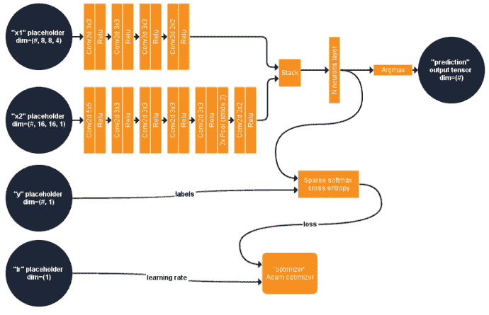

**图 8.1**

该网络由三个占位符（“x1”、“x2”和“lr”）组成，分别用于 20 米输入图像（4 维数组）、10 米输入图像（4 维数组）和学习率（单标量），一个输出张量（“prediction”，一维数组）和一个目标节点（“optimizer”，仅用于训练网络）。

使用资源仓库¹ 中提供的 *create_model3.py* Python 代码来生成一个 *SaveModel*，以实现上述双分支 CNN。

```python
#
 Do not forget to add the otbtf/python directory to your PYTHONPATH.
 Else "tricks" can’t be imported.
 In the OTBTF Docker image, tricks.py is located in the following
 path: /work/otbtf/otb/Modules/otbtf
#
 Works with OTBTF 1.7
#
from tricks import *
import sys

nclasses=6

def myModel(x1,x2):
    # The 20m spacing branch (input patches: 8x8x6)
    conv1_x1 = tf.layers.conv2d(inputs=x1, filters=16, kernel_size=[3,3],
                                padding="valid", activation=tf.nn.relu)
    # conv1_x1 out size: 6x6x16
    conv2_x1 = tf.layers.conv2d(inputs=conv1_x1, filters=32, kernel_size=
                                [3,3], padding="valid", activation=tf.nn.relu)
    # conv2_x1 out size: 4x4x32
    conv3_x1 = tf.layers.conv2d(inputs=conv2_x1, filters=64, kernel_size=
                                [3,3], padding="valid", activation=tf.nn.relu)
    # conv3_x1 out size: 2x2x64
    conv4_x1 = tf.layers.conv2d(inputs=conv3_x1, filters=64, kernel_size=
                                [2,2], padding="valid", activation=tf.nn.relu)
    # conv4_x1 out size: 1x1x64

    # The 10m spacing branch (input patches: 16x16x4)
    conv1_x2 = tf.layers.conv2d(inputs=x2, filters=16, kernel_size=[5,5],
                                padding="valid", activation=tf.nn.relu)
    # conv1_x2 out size: 12x12x16
    conv2_x2 = tf.layers.conv2d(inputs=conv1_x2, filters=32, kernel_size=
                                [3,3], padding="valid", activation=tf.nn.relu)
    # conv2_x2 out size: 10x10x32
    conv3_x2 = tf.layers.conv2d(inputs=conv2_x2, filters=64, kernel_size=
                                [3,3], padding="valid", activation=tf.nn.relu)
    # conv3_x2 out size: 8x8x64
    conv4_x2 = tf.layers.conv2d(inputs=conv3_x2, filters=64, kernel_size=
                                [3,3], padding="valid", activation=tf.nn.relu)
    # conv4_x2 out size: 6x6x64
    conv5_x2 = tf.layers.conv2d(inputs=conv4_x2, filters=64, kernel_size=
                                [3,3], padding="valid", activation=tf.nn.relu)
    # conv5_x2 out size: 4x4x64
    pool1_x2 = tf.layers.max_pooling2d(inputs=conv5_x2, pool_size=[2, 2],
                                       strides=2)
    # pool1_x2 out size: 2x2x64
    conv6_x2 = tf.layers.conv2d(inputs=pool1_x2, filters=64, kernel_size=
                                [2,2], padding="valid", activation=tf.nn.relu)
    # conv6_x2 out size: 1x1x64

    # Stack features from the two branches
    features = tf.reshape(tf.stack([conv4_x1, conv6_x2], axis=3),
                          shape=[-1, 128], name="features")

    # Fully connected layer
    dense_1 = tf.layers.dense(inputs=features, units=128, activation=
                              tf.nn.relu)

    # Neurons for classes
    estimated = tf.layers.dense(inputs=dense_1, units=nclasses,
                                activation=None)
    estimated_label = tf.argmax(estimated, 1, name="prediction")

    return estimated, estimated_label

""" Main """
```

¹ https://github.com/remicres/otbtf_tutorials_resources


```python
 check number of arguments
if len(sys.argv) != 2:
    print("Usage: <output_directory_for_SavedModel>")
    sys.exit(1)

 Create the graph
with tf.Graph().as_default():

    # Placeholders
    x1 = tf.placeholder(tf.float32, [None, None, None, 6], name="x1")
    x2 = tf.placeholder(tf.float32, [None, None, None, 4], name="x2")
    y = tf.placeholder(tf.int32 , [None, None, None, 1], name="y")
    default_lr = tf.constant(0.0002, dtype=tf.float32, shape=[])
    lr = tf.placeholder_with_default(default_lr, shape=[], name="lr")

    # Output
    y_estimated, y_label = myModel(x1,x2)

    # Loss function
    cost = tf.losses.sparse_softmax_cross_entropy(labels=tf.reshape
        (y, [-1, 1]), logits=tf.reshape(y_estimated, [-1, nclasses]))
    # Optimizer
    optimizer = tf.train.AdamOptimizer(learning_rate=lr,
        name="optimizer").minimize(cost)

    # Initializer, saver, session
    init = tf.global_variables_initializer()
    saver = tf.train.Saver( max_to_keep=20 )
    sess = tf.Session()
    sess.run(init)

    # Create a SavedModel
    CreateSavedModel(sess=sess,
        inputs=["x1:0", "x2:0", "y:0"],
        outputs=["features:0", "prediction:0"],
        directory=sys.argv[1])
```

然后，您可以使用以下命令在终端中创建这个新架构的 SavedModel：

```bash
 Generate the model

 The "create_model3.py" file can be downloaded from:
 https://github.com/camicroscope/tbo_tutorials_resources.git
python3 ~/python/create_model3.py "model3"
```

### 8.3 归一化

我们使用 **BandMathX** 应用对 4 维、20 米间距的图像进行归一化，如第 5.1 节所述。

运行以下命令行：

```bash
 Normalize images

 Go in Sentinel-2 images (20m)
cd ~/tokyo
cd S2A_MSIL2A_201905081012701_N0212_R074_T54SUE_201905081041235.SAFE
cd GRANULE/L2A_T54SUE_A020234_20190508012549/IMG_DATA/R20m

 Concatenate images, and normalise them between [0,1]
otbcli_BandMathX \
-il T54SUE_20190508T012701_B05_20m.jp2 \
    T54SUE_20190508T012701_B06_20m.jp2 \
    T54SUE_20190508T012701_B07_20m.jp2 \
    T54SUE_20190508T012701_B8A_20m.jp2 \
    T54SUE_20190508T012701_B11_20m.jp2 \
    T54SUE_20190508T012701_B12_20m.jp2 \
-exp "{im1b1/im1b1Maxi;im2b1/im2b1Maxi;im3b1/im3b1Maxi;\
im4b1/im4b1Maxi;im5b1/im5b1Maxi;im6b1/im6b1Maxi}" \
-out ~/tokyo/Sentinel-2_B567_20m.tif

 Go back in the working directory
cd ~/tokyo
```

### 8.4 采样

现在，我们将使用 **PatchesExtraction** 应用创建两个块图像，一个用于 20 米间距的波段图像，另一个用于 10 米间距的波段图像。我们将针对 20 米间距的图像采样 8 × 8 大小的块，针对 10 米间距的图像采样 16 × 16 大小的块。我们将 **OTB_TF_NSOURCES** 环境变量设置为 2，以告知 OTBTF 应用我们需要 2 个数据源（一个用于 10 米间距图像，一个用于 20 米间距图像）。

运行以下命令：

```bash
 Here, we change the number of sources
export OTB_TF_NSOURCES=2

 Patches extraction
otbcli_PatchesExtraction \
-source1.il Sentinel-2_B567_20m.tif \
-source1.patchsizex 8 \
-source1.patchsizey 8 \
-source1.out Sentinel-2_B567_20m_patches_A.tif \
-source2.il Sentinel-2_B4328_10m.tif \
-source2.patchsizex 16 \
-source2.patchsizey 16 \
-source2.out Sentinel-2_B4328_10m_patches_A.tif \
-vec terrain_truth_epsg32654_A_pos.shp
```

#### 8.5.1 推理

##### 8.5.1.1 基于块的模式

首先，我们将以基于块的模式运行模型。生成与 20 米间距图像分辨率一致的输出分类图。为此，只需将 20 米间距图像输入到 source1，该源是输出物理间距的参考源。

```text
 Generate the classification map, patch-based mode, same
 resolution as the 20m spacing image
otbcli_TensorflowModelServe \
-source1.il Sentinel-2_B567_20m.tif \
-source1.rfieldx 8 \
-source1.rfieldy 8 \
-source1.placeholder "x1" \
-source2.il Sentinel-2_B4328_10m.tif \
-source2.rfieldx 16 \
-source2.rfieldy 16 \
-source2.placeholder "x2" \
-model.dir model3 \
-output.names "prediction" \
-out "classif_model3.tif?&box=2000:2000:500:500"
```

如果交换 source1 和 source2，使第一个源为 10 米间距图像，那么输出图像将以相同的间距生成。我们来试试吧！

##### 8.5.1.2 全卷积模式

通过将 **fullyconv** 参数设置为 **on** 以启用处理的全卷积模式，生成与 10 米间距图像分辨率一致的输出分类图。

使用以下命令行：

```text
 Generate the classification map, fully convolutional
 mode, same resolution as the 20m spacing image
otbcli_TensorflowModelServe \
-source1.il Sentinel-2_B567_20m.tif \
-source1.rfieldx 8 \
-source1.rfieldy 8 \
-source1.placeholder "x1" \
-source2.il Sentinel-2_B4328_10m.tif \
-source2.rfieldx 16 \
-source2.rfieldy 16 \
-source2.placeholder "x2" \
-model.dir model3 \
-model.fullyconv on \
-output.names prediction \
-out "classif_model3_fcn.tif?&box=2000:2000:500:500"
```

**重要说明**

如果交换 **source1** 和 **source2**，使第一个源为 10 米间距图像，则必须向 **TensorflowModelServe** 应用提供一个输出缩放因子（参数 **spscale**），以使输出的物理间距保持一致。在本示例中，spscale 应为 4。

## 9 讨论

在本节中，我们介绍了一种利用深度网络从遥感图像生成土地覆盖图的简单方法。基于块的方法需要估计一个或多个图像中某个图像块的类别值，因此非常适合稀疏标注的数据集。参与基于块分类的网络架构通常输入一个或多个图像块，可能来自不同模态（如我们在第 8.2 节所见），并生成与输入内容估计类别相对应的单值输出。这类架构可以使用单值类别样本进行训练。例如，与土地覆盖类别关联的一组 GPS 坐标等地面真值数据，就足以训练这类网络。在第 7 章中，我们看到这些模型也是很好的特征提取器，可用于随机森林等其他分类器。我们解释了为什么根据实现的不同，模型在推理时可以更快，并在第 6.2 节中介绍了全卷积基于块模型。

我们还表明，基于块的方法存在一些缺点。特别是，模型的感受野会影响使用训练模型生成的输出图的空间分辨率。由于感受野中的图像内容会激活单值模型输出，因此如果以与输入图像相同的空间分辨率进行预测，预测类别的定位就可能不可靠。实际上，较大的块包含更多上下文，因此即使类别目标（如一棵树、一条道路）并未完全位于块的中心，网络也可能被其激活。通过分析基于块模型的构成，我们可以从理论上解释这一现象。例如，类 VGG 的架构 [24] 由一系列池化操作和带步长的卷积组成。这些操作在空间维度上对特征图进行下采样，通常沿网络深度以 2 为因子进行。每次下采样都会降低特征的空间分辨率，导致预测类别定位信息的丢失；通常此类网络的最后一个特征图具有较低的空间分辨率，其对应于输入物理间距的 2^n 倍。实际上，当以与输入图像相同的分辨率（而不是网络最后一个特征图的分辨率，后者通常小 2^n 倍）生成土地覆盖图时，在小物体周围可以观察到一些团块状伪影。在下一节中，我们将介绍一些旨在保持模型输出最终特征空间分辨率的新架构。


# 第三部分：语义分割

## 10 光学影像的语义分割

### 10.1 引言

本节介绍一种使用深度卷积神经网络对甚高分辨率遥感影像执行语义分割的方法。在第二部分中，我们介绍了一种基于图像块（patch）的分类方法，该方法适用于稀疏标注的数据。然而，这种方法在空间位置的语义精度方面存在局限。实际上，基于图像块的网络被设计为给输入图像块分配一个单一的类别，并没有利用实际类别标签的上下文，即地面真值。相反，语义分割方法（也称为*密集预测*）利用语义空间上下文。这些方法训练网络估计像素块的语义，而不仅仅是单个像素。语义分割方法使我们能够解决分类的空间精度问题。然而，网络的训练需要密集标注的地面真值。在本节中，我们将介绍一种语义分割方法，并利用阿姆斯特丹市的 OpenStreetMap 数据，从一幅 Spot 图像（1.5 米分辨率）生成建筑物地图。

### 10.2 概述

语义图像分割的目标是为图像中的每个像素标注相应的类别。与前面章节中执行的像素分类的主要区别在于，是对图像整个区域中的每个像素进行类别估计，而不是逐个像素地进行（图 10.1）。这就是语义分割也被称为密集预测的原因。

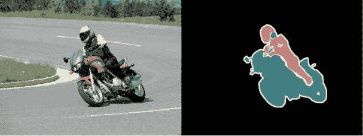

**图 10.1**

语义分割是在像素级别理解图像。输出是一幅标签图像，用于标注图像内容：这里语义分割的输出是一幅标签图像，标注了以下 3 个类别：人、自行车和背景。*来源：VOC2012。*

与图像分类一样，CNN 在分割问题上也非常成功。早期使用人工神经网络的方法采用全连接层，因此需要固定大小的图像。后来，用于密集预测的 FCN 这类 CNN 架构可以在没有任何全连接层的情况下使用。使用 CNN 进行语义分割时仍然存在的一个主要问题是池化层。池化层增加了视野并能够聚合上下文，但正如我们在第 6 节中看到的，它们会移除空间信息。由于语义分割需要精确的类别位置，因此必须保留这种空间信息。为了解决这个问题，近年来发展出了许多架构。在本章中，我们将使用最早流行的基于 FCN 的架构之一——U-Net [25]。它是一种编码器-解码器架构。编码器通过步幅卷积或池化层逐步降低空间分辨率，同时增加特征维度；解码器则通过降低特征维度逐步恢复空间分辨率。最后，最后一个特征图就是预测的类别。图 10.2 展示了原始的 U-Net 架构。

## 11 使用的数据：阿姆斯特丹数据集

本节旨在介绍即将进行的实践环节所涉及的数据。我们使用免费获取的数据，称为*阿姆斯特丹*数据集。在接下来的部分中，我们将说明如何下载和准备该数据集，以便为实践环节做好准备。在您的文件系统上创建一个名为 *amsterdam* 的目录。我们将使用该目录来存储练习期间下载和生成的所有数据。

### 11.1 描述

*阿姆斯特丹*数据集包含一幅覆盖阿姆斯特丹市的甚高分辨率 Spot-7 图像，以及一个包含建筑物轮廓的矢量图层。在本节中，我们将说明如何下载 Spot-7 图像，并从 OSM 数据生成矢量图层。*阿姆斯特丹*数据集贯穿整个第 11 节。请注意，您可以将此练习推广到您手头可用的任何经过正射校正的甚高分辨率遥感影像。

### 11.2 Spot-7 图像

Spot-7 产品由一幅多光谱图像（物理间距 6.0 米，波段：红、绿、蓝、近红外）和一个全色波段（物理间距 1.5 米）组成。编码为 12 位。Spot 图像可以从空客防务与航天（Airbus, Defense & Space）的示例影像网页上免费下载。[^1] 要下载该产品，请按照以下步骤操作：

- 1. 前往 ADS 示例影像网页。
- 2. 在搜索字段中输入 *amsterdam*（位于放大镜图标旁）。
- 3. 点击 *搜索*（Search）按钮。

[^1]: https://www.intelligence-airbusds.com/en/8262-sample-imagery

由作者从资源库^a提供（使用**查找文件**工具搜索 *amsterdam_labelimage.tif* 文件）。

[https://github.com/remicres/otbtf_tutorials_resources](https://github.com/remicres/otbtf_tutorials_resources)

#### 11.3.1 OSM 下载器插件

OSM 插件是一个用户友好的工具，允许您下载感兴趣区域内的 OpenStreetMap 数据。

- 1. 在菜单中，选择**插件 > 管理并安装插件...**
- 2. 搜索 *OSM Downloader*，如[图 11.1](#figure-11-1)所示。
- 3. 点击**安装插件**。

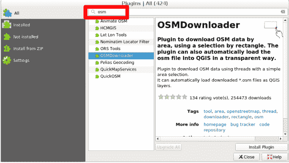

**图 11.1**  
安装 OSM 下载器。

插件安装完成后，就可以获取 OSM 数据了。

#### 11.3.2 下载 OSM 数据

- 1. 点击**通过矩形选择下载 OSM 数据**（[图 11.2](#figure-11-2)）。
- 2. 选择一个覆盖图像中心部分的区域（[图 11.3](#figure-11-3)）。不要选择过大的区域，否则下载可能会失败。大约占图像一半的区域就足够了。
- 3. 在您的 *amsterdam* 目录中选择一个输出文件名，命名为 *amsterdam.osm*。
- 4. 勾选**下载后加载图层**复选框。
- 5. 点击**确定**。

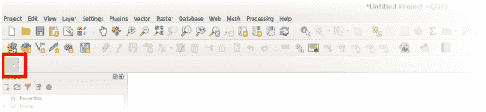

**图 11.2**  
从 QGIS 工具栏使用 OSM 下载器。

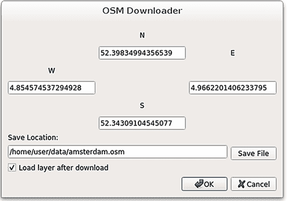

**图 11.3**  
通过矩形选择下载 OSM 数据。

下载完成后，必须在 QGIS 中导入矢量图层。选择 **Multipolygon** 图层，参见图 11.4。

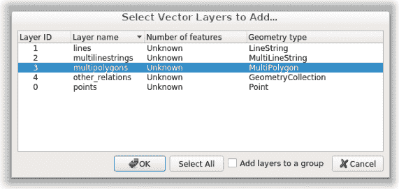

**图 11.4**  
仅导入 multipolygon 图层。

#### 11.3.3 准备矢量图层

我们现在将从 OSM 文件中以 Shapefile 格式导出建筑物矢量图层。

- 1. 右键点击导入的 **multipolygon_layer**，选择**打开属性表**（图 11.5）。
- 2. 点击**按属性筛选**图标（图 11.6）。
- 3. 输入以下表达式：*length("buildings")>0*，以仅选择建筑物多边形（图 11.7），然后点击**选择要素**。接着点击**关闭**按钮。
- 4. 右键点击 **multipolygon_layer**，选择**导出 > 将所选要素另存为**（图 11.8）。
- 5. 为输出矢量图层选择一个名称：**buildings.gpkg**。同时选择与 Spot-7 图像相同的坐标参考系，**EPSG 32631**（图 11.9）。

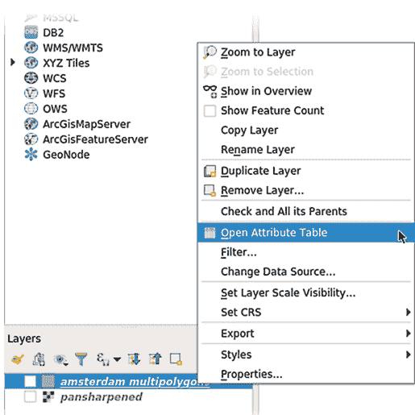

**图 11.5**  
打开属性表。

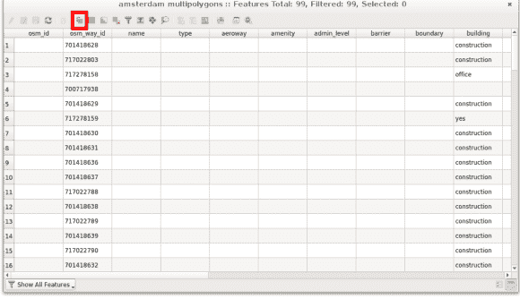

**图 11.6**  
点击“按属性筛选”图标。

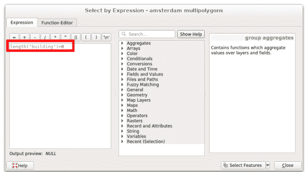

**图 11.7**  
选择建筑物多边形。

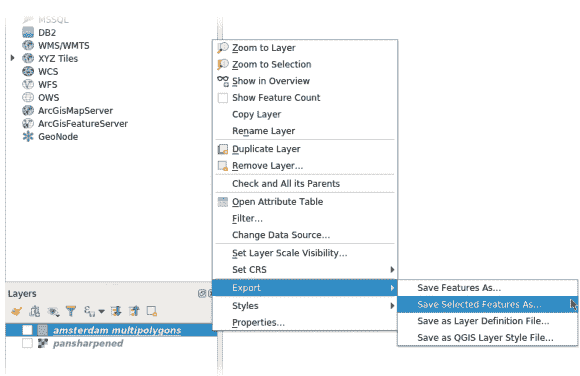

**图 11.8**  
将选中的多边形导出为新矢量图层。

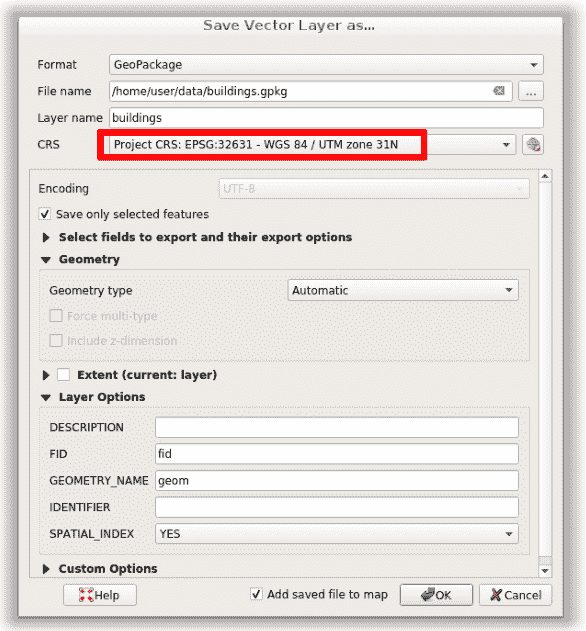

**图 11.9**  
导出输出矢量图层。

现在，您已经准备好一个矢量图层 **buildings.gpkg**，其中包含详细描述阿姆斯特丹地区建筑物的多边形（图 11.10）。稍后，我们将使用该矢量数据作为地面真值，训练深度网络来执行建筑物的语义分割。


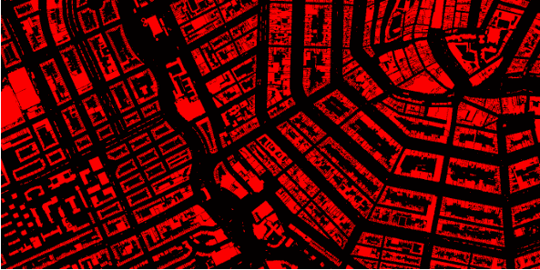

 图11.10

得到的**buildings.gpkg**矢量图层（红色）。

 OSM 下载

除了使用QGIS中的*OSM下载器*插件（可能受下载数据量的限制），你还可以使用以下几种替代方法：

- download.geofabrik.de
- [OpenStreetMap.org/export](https://OpenStreetMap.org/export)

## 12 建筑物制图

在本节中，我们应用语义分割来绘制阿姆斯特丹感兴趣区域内的建筑物。

### 12.1 输入数据预处理

我们打算对阿姆斯特丹获取的1.5米Spot-7影像进行建筑物语义分割。第一步是预处理Spot-7影像。然后，我们将准备用于训练U-Net模型的地面真值。与第二部分研究方法的主要区别在于，标签是图像块而不是单一的标签值。因此，我们需要为地面真值生成一幅标签图像，其像素大小与Spot-7影像相同。

#### 12.1.1 卫星影像全色锐化

为了简化，我们将引入一个非常简单的深度网络，输入单张影像。因此，在其他处理之前，我们将全色波段和多光谱影像融合为单张影像。我们对Spot-7产品进行全色锐化，这意味着生成一幅多光谱图像，其分辨率与全色波段相同，波段数与原始多光谱图像相同。为了生成这幅全色锐化图像，我们依赖OTB的**BundleToPerfectSensor**应用程序。

```bash
 Perform the pansharpening

 Go in the folder of the Spot product
cd ~/amsterdam/
cd Amsterdam_Netherlands_SPOT7/
cd PROD_SPOT7_001/VOL_SPOT7_001_A/

 Execute the OTB application
 We can set the output encoding to uint8 since inputs encoding is
 8 bits.
otbcli_BundleToPerfectSensor \
-inp IMG_SPOT7_P_001_A/IMG_SPOT7_P_201409171025192_ORT_1190912101_R1C1.JP2 \
-inxs IMG_SPOT7_MS_001_A/IMG_SPOT7_MS_201409171025192_ORT_1190912101_R1C1.JP2 \
-method waves \
-out ~/amsterdam/IMG_SPOT7_amsterdam_PMS.tif uint8

 Go back in the workspace directory
cd ~/amsterdam/
```

#### 12.1.2 图像归一化

我们使用**BandMathX**应用程序将全色锐化后的Spot-7影像归一化到0和1之间。

```bash
 Normalize image between [0,1]
otbcli_BandMathX \
-il "IMG_SPOT7_amsterdam_PMS.tif" \
-exp "{im1b1/im1b1Maxi;im1b2/im1b2Maxi;\\
im1b3/im1b3Maxi;im1b4/im1b4Maxi}" \
-out "IMG_SPOT7_amsterdam_PMS_norm.tif"
```

#### 12.1.3 样本选择

接下来，我们将选择在图像中提取的、并将用作地面真值的图像块中心。

##### 12.1.3.1 图像块位置播种

这里的目标是仅选择完全标注的图像块：就我们而言，如果某个图像块缺少建筑物标注，我们会将其从地面真值中移除。通常在建筑物的情况下，我们应该避免那些遗漏了Spot-7图像块中实际存在的建筑物的地面真值图像块。为了选择足够数量的地面真值图像块，我们采用一种简单的策略，即以固定间隔在图像中选择图像块位置。由于我们需要完全标注的图像块，我们只保留完全包含在OSM数据覆盖区域内的位置，在我们的案例中即11.3节使用的感兴趣区域。我们的目标是生成一个矢量图层，其中包含将要采样的图像块的位置。

以下是选择它们的步骤：

- 1. 使用QGIS创建矢量网格。从菜单选择**矢量 > 研究工具 > 创建网格**，如[图12.1]所示。
- 2. 创建具有以下属性的网格（[图12.2]）：
  - **网格类型：** *矩形*。
  - **水平间距和垂直间距：** 96米。
  - **网格范围：** 选择*使用图层范围*，然后使用Spot-7影像图层指定范围。
  - **命名输出矢量数据** *amsterdam_grid.gpkg*。

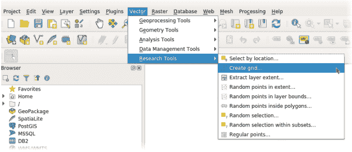

**图12.1**
创建矢量网格。

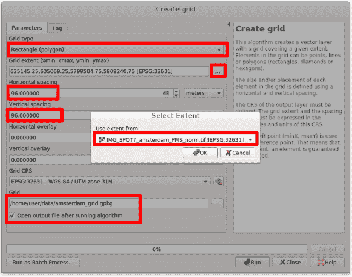

**图12.2**
设置网格属性。

- 3. 创建网格后，在QGIS窗口侧面的图层列表中选中它。
- 4. 单击QGIS工具栏中的*按区域选择要素或单击选择*图标，如*图12.3*所示。
- 5. 选择网格中完全位于建筑物多边形覆盖区域内的所有多边形。

- 6. 最后，导出选中的多边形：右键单击网格图层，选择**导出 > 将所选要素另存为**，然后将矢量数据导出为*amsterdam_grid_selection.gpkg*。

图12.4总结了最后两步。

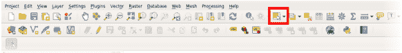

 图12.3

QGIS工具栏中的*按区域选择要素*或单击选择图标。

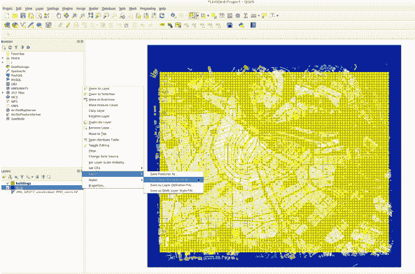

 图12.4

选择完全位于OSM建筑物标注覆盖区域内的图像块（在插图中选择内容以黄色显示），并将选择导出为新矢量图层*amsterdam_grid_selection.gpkg*。

有时，OSM矢量数据并非完全标注，某些区域缺少许多多边形。在这种情况下，你可以手动清理矢量数据，移除那些实际上未被完全标注的图像块部分。这是OSM数据中常见的问题。幸运的是，在我们的*阿姆斯特丹*数据集中，OSM数据标注得相当完善。

##### 12.1.3.2 图像块位置选择

现在，我们要提取之前预先选中的有效图像块的质心。从QGIS菜单中，选择**矢量**，然后选择**几何工具**，再选择**质心**（*图12.5*）。

- **mode.attribute.field** 是我们要从中提取值进行栅格化的字段名称。在我们的案例中，我们设置为*class*。
- **background** 是背景值。在我们的案例中，我们设置默认值（零），因为*class*字段中没有零值。

让我们运行该应用程序。

```bash
 Rasterize the OSM vector layer for terrain truth
 Since the output raster contains integers values
 between 0 and 6, we can use uint8 encoding (8 bits)
otbcli_Rasterization \
-in "buildings.gpkg" \
-im "IMG_SPOT7_amsterdam_PMS_norm.tif" \
-out "amsterdam_labelimage.tif" uint8 \
-mode binary \
-mode.binary.foreground 1
```

你现在可以在QGIS中打开*amsterdam_labelimage.tif*，检查矢量图层是否已正确栅格化到Spot-7影像像素网格上，如图12.8所示。

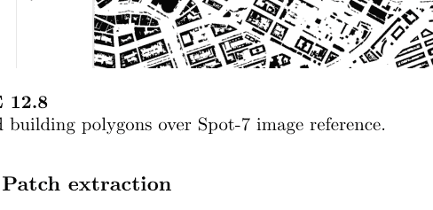

 图12.8

在Spot-7影像参考上栅格化的建筑物多边形。

#### 12.1.5 图像块提取

让我们准备用于训练和验证的图像块。我们使用**PatchesExtraction**应用程序来同时提取Spot-7影像和标签影像中的图像块。在第二部分中，每个遥感影像图像块都对应一个标签值。这次，我们的目标略有不同，因为我们需要标签作为图像块，而不是像基于图像块的方法那样使用单一值。因此，我们告诉**PatchesExtraction**我们需要两个源：一个用于Spot-7影像，一个用于标签影像。我们将**OTB_TF_NSOURCES**环境变量改为2以满足这一需求。

```bash
export OTB_TF_NSOURCES=2
```

#### 12.2.1 架构

这种架构也称为自编码器。自编码器由以下部分组成：

- 1. 编码器，提取输入图像中的特征，
- 2. 瓶颈，即编码器的输出，
- 3. 解码器，将特征上采样为输出特征（通常对于分类器而言：类别表示）。

[图12.9](#)展示了我们的模型。

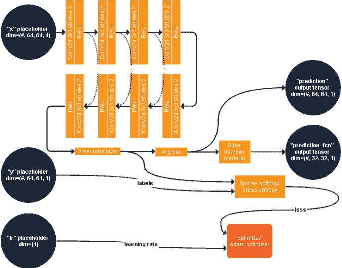

编码器由4个步长为2的卷积层组成，后面跟着一个修正线性单元。解码器由4个步长为2的转置卷积层组成，并带有修正线性单元。最后一层是2神经元层：一个神经元对应*背景*类别，另一个对应*建筑物*类别。我们训练网络以最小化预测（即2个神经元的输出）与地面真值（即承载标签图像块的*y*占位符）之间的差距。


#### 12.2.2 实现

让我们更仔细地看一下代码：

```python
#
 Do not forget to add the otbtf/python directory to your PYTHONPATH.
 Else "tricks" can't be imported.
 In the OTBTF Docker image, tricks.py is located in the following
 path: /work/otb/otb/Modules/otbtf
#
 Works with OTBTF 1.7
#
from tricks import *
import sys

nclasses=2

 Convolution block with strides 2 ("downsampling")
def _conv(inp, n, k_size=3, strides=2, activ=tf.nn.relu):
    return tf.layers.conv2d(inputs=inp,
                            filters=n,
                            kernel_size=[k_size, k_size],
                            padding="same",
                            strides=(strides, strides),
                            activation=activ)

 Transposed convolution block with strides 2 ("upsampling")
def _dconv(inp, n, k_size=3, strides=2, activ=tf.nn.relu):
    return tf.layers.conv2d_transpose(inputs=inp,
                                      filters=n,
                                      strides=(strides,strides),
                                      kernel_size=[k_size, k_size],
                                      padding="same",
                                      activation=activ)

def myModel(x):

    depth = 16

    # Encoding
    conv1 = _conv(x, 1*depth) # 64 x 64 --> 32 x 32 (31 x 31)
    conv2 = _conv(conv1, 2*depth) # 32 x 32 --> 16 x 16 (15 x 15)
    conv3 = _conv(conv2, 4*depth) # 16 x 16 --> 8 x 8 ( 7 x 7)
    conv4 = _conv(conv3, 4*depth) # 8 x 8 --> 4 x 4 ( 3 x 3)

    # Decoding (with skip connections)
    deconv1 = _dconv(conv4, 4*depth) # 4 x 4 --> 8 x 8 ( 5 x 5)
    deconv2 = _dconv(deconv1 + conv3, 2*depth) # 8 x 8 --> 16 x 16
                                                  # ( 9 x 9)
    deconv3 = _dconv(deconv2 + conv2, 1*depth) # 16 x 16 --> 32 x 32
                                                  # (17 x 17)
    deconv4 = _dconv(deconv3 + conv1, 1*depth) # 32 x 32 --> 64 x 64
                                                  # (33 x 33)

    # Neurons for classes
    estimated = tf.layers.dense(inputs=deconv4, units=nclasses,
                                activation=None)

    return estimated

""" Main """
 check number of arguments
if len(sys.argv) != 2:
    print("Usage: output_directory_for_SavedModel")
    sys.exit(1)

 Create the graph
with tf.Graph().as_default():

    # Placeholders
    x = tf.placeholder(tf.float32, [None, None, None, 4], name="x")
    y = tf.placeholder(tf.int32, [None, None, None, 1], name="y")
    default_lr = tf.constant(0.0002, dtype=tf.float32, shape=[])
    lr = tf.placeholder_with_default(default_lr, shape=[], name="lr")

    # Output neurons of the model
    y_estimated = myModel(x)

    # Prediction output
    y_class = tf.argmax(y_estimated, axis=3)

    # Add the 4th dimension to have (#, :, :, 1) so the OTBTF apps
    # know that the output image has 1 component
    y_pred = tf.expand_dims(y_class, axis=-1, name="prediction")

    # Prediction output (FCN)
    y_pred_fcn = tf.identity(y_pred[:, 16:-16, 16:-16, :],
                             name="prediction_fcn")

    # Loss function
    cost = tf.losses.sparse_softmax_cross_entropy(labels=tf.reshape
                 (y, [-1, 1]), logits=tf.reshape(y_estimated, [-1, nclasses]))

    # Optimizer
    optimizer = tf.train.AdamOptimizer(learning_rate=lr,
                                       name="optimizer").minimize(cost)

    # Initializer, saver, session
    init = tf.global_variables_initializer()
    saver = tf.train.Saver(max_to_keep=20)
    sess = tf.Session()
    sess.run(init)

    # Create a SavedModel
    CreateSavedModel(sess=sess,
                     inputs=["x:0", "y:0"],
                     outputs=["prediction:0", "prediction_fcn:0"],
                     directory=sys.argv[1])
```

可以看到，我们使用卷积和转置卷积，它们保留了输出特征的尺寸（*padding="same"*），这意味着在卷积中使用了零填充。我们应该理解，如果要在全卷积模式下使用该模型，就不能直接使用最后一层计算出的特征：对于每个处理块，只有一部分是精确的（即相似的），这与输入区域无关。使用这些输出会产生由卷积中的零填充引起的块状伪影。

##### 12.2.2.1 精确输出

为了解决这个问题，我们创建一个专门用于计算*prediction*输出张量*精确*部分的输出。为此，我们只需从输出的边缘移除几个像素，因为卷积会在每一层“污染”边缘，如[图12.10](#figure-12-10)所示。

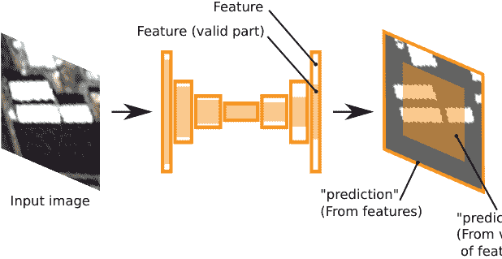

**图12.10**  
在每一层，特征图都会受到卷积零填充的污染。橙色边框的块：特征；橙色填充的块：特征图的有效部分。最终输出特征图的*精确*部分是其中心区域。

[表12.1](#table-12-1)显示了如何计算需要从最后一个特征图（即*prediction*输出张量）边缘移除的像素数。由于填充，每一层的卷积都会污染特征图。我们可以计算特征图的中心部分，该部分是*精确*的，即未被填充污染。由于所有卷积核的大小均为3，因此很容易计算最终需要裁剪的像素数。例如：第1层，卷积输出为32（输入为64，我们使用步长为2的卷积），但我们的卷积核为3×3，因此输出特征图的实际有效部分大小为31×31。

**表12.1**  
卷积输出（即特征图）的有效部分

| 层 | 特征大小 | 有效部分 |
|---|---:|---:|
| / | 64 | 64 |
| 1 | 32 | 31 |
| 2 | 16 | 15 |
| 3 | 8 | 7 |
| 4 | 4 | 3 |
| 1 | 8 | 5 |
| 2 | 16 | 9 |
| 3 | 32 | 17 |
| 4 | 64 | 33 |

如[表12.1](#table-12-1)所示，最终特征图的有效部分大小为33×33个元素。然后我们从边缘移除16个元素，以输出32×32个元素的有效张量。

##### 12.2.2.2 表达场

在OTBTF中，模型为**output.names**中指定的张量所输出的空间部分被称为*表达场*。如前所述，模型将大小为64×64的基本输入图像转换为大小为32×32的基本输出预测标签图像。因此，后续我们将使用64×64的感受野（网络“看到”的输入体积）和32×32的表达场（网络“填充”的输出体积）。

#### 12.2.3 生成SavedModel

要生成该模型，请使用`create_model4.py` Python脚本。

```bash
 Generate the model

 The "create_model4.py" file can be downloaded from:
 https://github.com/remipierre/otbtf_tutorials_resources.git
python3 ~/python/create_model4.py "model4"
```

> **重要提示**
> 
> 正如您所注意到的，我们为将在OTBTF应用程序中使用的输出张量仔细设置了4个维度。目前，OTBTF将输出张量的最后一个维度解释为输出图像的分量数。这就是我们使用`tf.expand_dims()`使*prediction*输出张量的最后一个维度为1的原因。

### 12.3 训练模型

使用**TensorflowModelTrain**应用程序训练模型：

```bash
 Since the TensorflowModelTrain uses n+1 sources
export OTB_TF_NSOURCES=1

 Train the deep learning model
otbcli_TensorflowModelTrain \
-training.source1.il amsterdam_Spot7_patches_A.tif \
-training.source1.patchsize 64 \
-training.source1.patchsizey 64 \
-training.source1.placeholder "x" \
-training.source2.il amsterdam_labelimage_patches_A.tif \
-training.source2.patchsize 64 \
-training.source2.patchsizey 64 \
-training.source2.placeholder "y" \
-model.dir model4 \
-training.targetnodes optimizer \
-validation.mode "class" \
-validation.source1.il amsterdam_Spot7_patches_B.tif \
-validation.source1.name "x" \
-validation.source2.il amsterdam_labelimage_patches_B.tif \
-validation.source2.name "prediction" \
-model.saveto model4/variables/variables
```

### 12.4 推理

如第12.2.1节所述，我们设置了大小为64×64的输入感受野和大小为32×32的输出表达场。我们要求**TensorflowModelServe**应用程序以全卷积模式生成模型的*prediction_fcn*输出张量。

让我们在子集图像上运行该模型：

```bash
 Produce the map
otbcli_TensorflowModelServe \
-source1.il IMG_SPOT7_amsterdam_PMS_norm.tif \
-source1.rfieldx 64 \
-source1.rfieldy 64 \
-source1.placeholder "x" \
-model.dir model4 \
-model.fullyconv on \
-output.efieldx 32 \
-output.efieldy 32 \
-output.names "prediction_fcn" \
-out "classif_model4.tif?&box=6000:4000:2000:2000" uint8
```


## 13 讨论

本节深入探讨了遥感图像上的语义分割。我们介绍了一种使用类U-Net架构的语义分割方法，这是一种针对图像语义分割的流行模型。

我们构建并使用了一个小型模型，对一整幅遥感图像中的建筑物进行分类，不受图像尺寸限制，且在合理时间内完成。

我们看到，与基于块的方法不同，语义分割采用的模型保留了输出的空间分辨率。然而，我们也认识到这类模型必须使用密集标注的图像进行训练：训练步骤需要完全标注的图像块，即图像的每个像素都有对应的类别标签。这使得参考数据的制作变得复杂，不过越来越多的开放数据可用（例如OpenStreetMap）。

我们提出了一个简单框架，用于准备、选择和提取遥感图像中的这些图像块，以及从建筑物足迹的栅格化OpenStreetMap矢量图层中提取。

我们构建了一个小型改进型U-Net模型，输入全色锐化的SPOT图像，生成土地覆盖图。得益于所谓的跳跃连接，该连接复用了网络内不同尺度计算的特征，我们的模型保留了语义细节。本练习的一个有趣扩展是跳过全色锐化步骤，直接在网络中融合多光谱通道。这可以通过一个双分支编码器实现，分别输入1.5米分辨率的全色通道和6.0米分辨率的多光谱图像。然后可以将在同一尺度上获得的两个特征图拼接起来。例如，经过两次步进卷积后，全色编码器分支的特征图将与多光谱图像（或其特征图，如果多光谱编码器分支中没有步进）具有相同的物理间距，因此可以拼接在一起。

我们还提出了一种在超大图像上正确使用全卷积模型的方法，避免块状伪影：我们提取了模型输出的中心区域，该区域代表卷积的有效结果，以全卷积方式计算输入图像的大区域。这种方法的其他优点包括可重复性（可以处理整幅图像或子集：结果将相同）和速度。

应当指出，深度学习也为语义分割提供了大量架构，每年都会出现采用各种不同策略的新模型。举几个例子，我们可以引用DeepLab [26]，它使用空洞卷积；或PSPNet [27]，它使用金字塔池化模块。

深度学习是一个日益增长的趋势，每年都有新方法出现。我们毫不怀疑，在不久的将来，将会出现大量新的语义分割方法，以应对剩余的困难、语义分割模型训练，尤其是数据可用性方面的问题。

# 第四部分 图像恢复

 图像恢复

利用可用的多时相光学图像，以及一幅与受污染图像同时获取的SAR图像。该方法旨在恢复光学图像中的间隙，以提供无云产品，并且在均方根误差方面，与传统填补方法（即线性插值或线性回归）相比显示出更优的结果。给定 $t$，即被云污染的光学图像（记为 $S2_t$）的时间戳，该方法使用一幅在 $t$ 时刻获取的SAR图像（记为 $S1_t$），以及几幅在 $t$ 前后获取的无云光学图像（分别记为 $S2_{t-1}$ 和 $S2_{t+1}$），来估计 $t$ 时刻的合成光学图像（记为 $\widehat{S2_t}$），该图像可用于填补实际光学图像 $S2_t$ 的缺失值。我们打算使用一种称为*深度卷积自编码器*的深度神经网络，从 $S2_{t-1}$、$S1_t$、$S2_{t+1}$ 估计 $\widehat{S2_t}$，该网络在图像可用部分上进行训练（如图14.1所示）。我们专注于最小化目标图像的无云部分（即真实值）与我们的深度网络生成的估计图像之间的差异。因此，我们深度网络的训练包括最小化一个代价函数，该函数以 $L_2$ 损失评估 $\widehat{S2_t}$ 和 $S2_t$ 图像之间的距离。我们假设SAR图像和光学图像覆盖相同的物理范围，并叠加在相同的物理像素网格上，这意味着它们共享相同的坐标参考系统、原点、物理像素间距和大小。我们还假设光学图像每像素具有相同数量的分量（即相同数量的光谱波段）。在下文中，我们将对这些图像使用以下符号：

- $S2_{t-1}$：在日期 $t-1$ 获取的光学图像
- $S1_t$：在接近 $t$ 的日期获取的SAR图像
- $S2_{t+1}$：在日期 $t+1$ 获取的光学图像
- $\widehat{S2_t}$：在日期 $t$ 获取的估计光学图像
- $S2_t$：在日期 $t$ 获取的实际光学图像

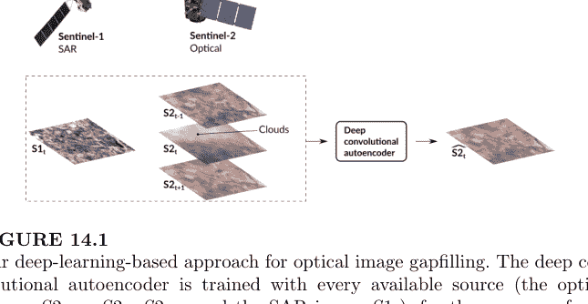

**图14.1** 我们基于深度学习的遥感图像间隙填补方法。深度卷积自编码器使用所有可用源（光学图像 $S2_{t-1}$、$S2_t$、$S2_{t+1}$ 和SAR图像 $S1_t$）进行训练，目的是估计 $\widehat{S2_t}$ 图像。

### 14.3 架构

我们的网络继承了文献[25]中描述的U-Net架构。正如我们在第10章中提到的，U-Net是一种流行的模型，用于语义标注或图像到图像的转换。我们的架构如图14.2所示。我们的架构与原始U-Net的主要区别在于，我们有三个输入而不是一个，因此有三个编码器分支。模型的每个编码器分支分别将输入图像 $S2_{t-1}$、$S1_t$ 和 $S2_{t+1}$ 编码为称为瓶颈的特征图。该瓶颈是编码器最后一个特征图的拼接。网络的第二部分解码该瓶颈，以生成估计图像 $\widehat{S2_t}$。

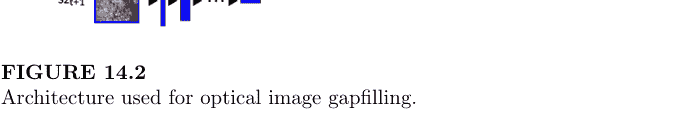

**图14.2** 用于光学图像间隙填补的架构。

#### 14.3.1 编码器

每个编码器实现了一个带步进的卷积神经网络。它由连续的4×4卷积组成，步长为2，用于对输入进行下采样。每个卷积之后是一个带泄漏的修正线性单元（LReLU）。第一个卷积输出深度为64的特征图，除最后两层外，特征图的深度在每个卷积处加倍。我们将 $C_k$ 表示为包含以下部分的块：

- 1. 具有k个滤波器的卷积
- 2. LReLU层
- 3. 批归一化层 [35]
- 4. Dropout层

每个编码器组成如下：$C_{64}$-$C_{128}$-$C_{256}$-$C_{512}$-$C_{512}$-$C_{512}$。

#### 14.3.2 解码器

解码器是编码器的镜像。它由连续的4×4转置卷积组成，步长为2，用于对输入进行上采样。第一个转置卷积输入512元素深度的瓶颈特征图。在每个转置卷积处，特征图的深度除以2。每个转置卷积之后是一个修正线性单元（ReLU）。然后将其与编码器中相应的特征图拼接。我们的架构与原始U-Net的主要区别在于，它有三个编码器分支堆叠在一起作为瓶颈。最后一个转置卷积输出4元素深度的特征图，对应于Sentinel-2图像的通道数，随后是一个双曲正切单元。我们将 $C_k^{tr}$ 表示为包含以下部分的块：

- 1. 具有k个滤波器的转置卷积
- 2. ReLU
- 3. 批归一化
- 4. Dropout层

我们还将 $CH_k^{tr}$ 表示为具有k个滤波器的转置卷积 + 一个双曲正切层。解码器组成如下：$C_{512}^{tr}$-$C_{512}^{tr}$-$C_{256}^{tr}$-$C_{128}^{tr}$-$C_{64}^{tr}$-$CH_4^{tr}$。

在大多数构建块中，我们使用dropout来避免过拟合。由于我们的网络总共有6层卷积/转置卷积，它适合输入64×64的（$S2_{t-1}$，$S1_t$，$S2_{t+1}$）输入图像块，以估计64×64的 $\widehat{S2_t}$ 输出图像块。


#### 14.3.3 损失函数

我们使用训练集 $T$ 来训练网络参数，该训练集由 $n$ 个元组 $t_i$ 组成，每个元组包含 $(S2_{t-1}, S1_t, S2_{t+1}, S2_t)$ 的图像块。

$$T = \{t_1, \ldots, t_n\},\quad t_i = (S2_{t-1,i}, S1_{t,i}, S2_{t+1,i}, S2_{t,i}) \tag{14.1}$$

训练阶段的目标是找到：

$$\arg\min \mathbb{E}\bigl(L_2(\widehat{S}_{2t}, S_{2t})\bigr) \tag{14.2}$$

我们使用 $L_2$ 范数，因为它表示真实图像与估计图像像素之间的欧氏距离。因此，所有图像块上 $L$ 的平均值对应于估计的均方根误差。为了优化我们的网络，我们使用 Adam 求解器 [19] 对 $L$ 执行梯度下降。

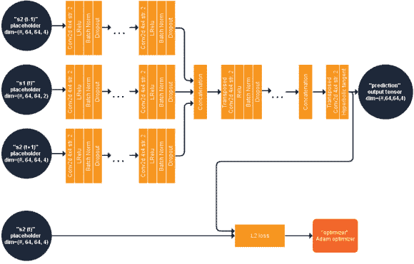

**图 14.3** 模型实现。为清晰起见，未表示编码器和解码器特征图的拼接。圆点代表编码器和解码器的其余 6 个构建模块。

如第 5.3 节所述，我们将 Adam 求解器的算子命名为*优化器*。图 14.3 概括了模型训练的实现过程。

## 15 Marmande 数据集

本节旨在介绍本次实践课程所涉及的数据。我们使用公开可用的数据，称为 *Marmande* 数据集。在下一章中，我们将说明如何下载和准备该数据集，以便为实践课程做好准备。请在您的文件系统上创建一个名为 *marmande* 的目录。我们将在练习期间使用该目录存储所有下载和生成的数据。

### 15.1 描述

*Marmande* 数据集包含三幅 Sentinel-2 影像和一幅 Sentinel-1 产品。它将用于第四部分的所有练习。**表 15.1** 汇总了影像的特征。

**表 15.1** 影像特征

| 传感器 | 类型 | 列 × 行 × 波段 | 空间分辨率 | 获取日期 | EPSG |
|---|---|---|---|---|---|
| S2 | 光学 | 10980 × 10980 × 4 | 10m | 2019/07/05 | 32630 |
| S2 | 光学 | 10980 × 10980 × 4 | 10m | 2019/07/25 | 32630 |
| S2 | 光学 | 10980 × 10980 × 4 | 10m | 2019/08/24 | 32630 |
| S1 | SAR | 30010 × 15616 × 2 | 10m | 2019/07/25 | 4326 |

### 15.2 Sentinel-2 影像

我们使用在法国大陆 Marmande 地区（靠近波尔多市）获取的 Sentinel 影像（图 15.1）。

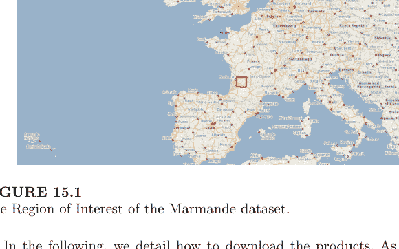

**图 15.1** Marmande 数据集的感兴趣区域。

下面，我们详细介绍如何下载产品。如第 4 节所述，我们将使用欧洲空间局数据服务平台下载在 **T30TYQ** 分幅上获取的 Sentinel-2 影像，日期如下：

- 2019/07/05，作为 $S2_{t-1}$
- 2019/07/25，作为 $S2_t$
- 2019/08/24，作为 $S2_{t+1}$

下面，我们描述下载产品的步骤。首先，登录欧洲空间局数据服务平台。¹ 然后，搜索具有以下属性的产品：

- 区域：Marmande（您可以如图 15.2 所示放大到 Marmande 区域，并在地图上绘制一个感兴趣区域。）
- 感应日期：例如，对于 $S2_{t-1}$：从 2019/07/05 到 2019/07/05
- 任务：勾选 *Sentinel-2* 复选框
- 产品类型：`S2MSI2A`

¹ https://scihub.copernicus.eu/dhus/#/home

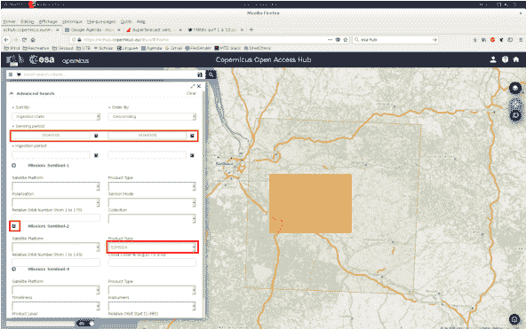

**图 15.2** 输入以下属性以搜索 Sentinel-2 产品：任务：*Sentinel-2*，产品类型：`S2MSI2A`。然后选择 Marmande 区域，输入感应日期并验证搜索，以分别下载每幅影像。

对每个产品重复此步骤。您应该能够在您的 *marmande* 目录中下载以下三个产品：

1. S2A_MSIL2A_20190705T105031_N0212_R051_T30TYQ_20190705T140734

   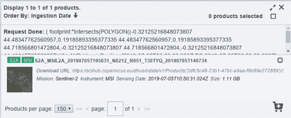

2. S2A_MSIL2A_20190725T105031_N0213_R051_T30TYQ_20190725T141902

   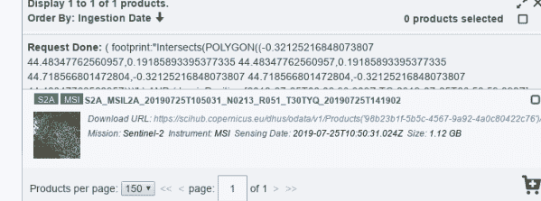

3. S2A_MSIL2A_20190824T105031_N0213_R051_T30TYQ_20190824T134703

   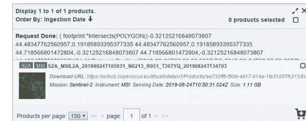

产品下载完成后，您可以解压缩归档文件并查看提取的文件。Sentinel-2 产品包含两组影像：一组为 10 米空间分辨率（光谱波段 2、3、4 和 8），另一组为 20 米空间分辨率（光谱波段 5、6、7、8a、11 和 12）。在本练习中，我们仅使用 10 米空间分辨率的波段。

### 15.3 Sentinel-1 影像

我们将使用一幅在同一感兴趣区域（如图 15.1 所示）获取的 Sentinel-1 影像，最重要的是，其获取日期与我们想要重建的 Sentinel-2 影像 $S2_t$ 完全一致。这里我们再次使用欧洲空间局数据服务平台来下载产品。

1. 绘制一个大致对应 Marmande 感兴趣区域的矩形（见图 15.1）。
2. 打开搜索选项卡。
3. 将感应时段设置为从 2019/07/25 到 2019/07/25，以仅筛选与 $S2_t$ 同一天获取的产品。
4. 勾选 *任务：Sentinel-1* 复选框。
5. 在 *产品类型* 中，选择 *GRD*。
6. 在 *极化方式* 中，选择 *VV+VH*。
7. 在 *传感器模式* 中，选择 *IW*。
8. 在 *卫星平台* 中，选择 `S1A_*`。
9. 点击搜索按钮。应出现匹配的产品列表，并显示唯一一个名为 `S1A_IW_GRDH_1SDV_20190725T175553_20190725T175618_028277_0331C8_3C98` 的产品。

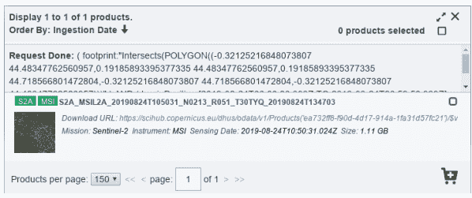

## 16 预处理

Sentinel-1 和 Sentinel-2 影像现在应已下载并可随时使用。我们将着手创建一个数据集，该数据集可用于 (i) 训练第 14.3 节中描述的模型，以及 (ii) 以均方根误差评估其性能。

### 16.1 Sentinel 影像

Sentinel-1 影像采用 16 位有符号编码，Sentinel-2 影像采用 16 位无符号编码，即整数。我们需要对像素进行归一化，使其绝对值位于 [0, 1] 范围内。如第 5.1、8.3 和 12.1.2 节所述，我们使用 Orfeo ToolBox 的 **BandMathX** 应用程序执行波段拼接和数值归一化。

#### 16.1.1 光学影像

我们仅处理 10 米分辨率的波段，即波段 2、3、4 和 8。Sentinel-2 传感器的实际编码为 12 位。在 Sentinel 影像中，为方便起见使用 16 位编码，因为 Jpeg2000 驱动程序与大多数遥感影像驱动程序一样，不支持 12 位编码。但 Sentinel-2 地面段生成的实际数字值为 12 位编码。因此，对输入影像进行归一化的一种简单方法是将像素值除以 12 位的最大值，即 8192。我们可以使用 **BandMathX** 对像素值应用相应的线性变换：

$$x_{norm} = \alpha x \tag{16.1}$$

其中：

$$\begin{aligned}
\alpha &= \frac{1}{2^{12}} \\
&= \frac{1}{8192} \tag{16.2}\\
&= 1.2207 \times 10^{-4}
\end{aligned}$$

在 **BandMathX** 中输入以下表达式以处理 Sentinel-2 时间序列的第一幅影像：

```
 Normalize the Sentinel-2 image from 2019/07/05

 Go in Sentinel-2 images (10m)
cd ~/marmande
cd S2A_MSIL2A_20190705T105031_N0212_R051_T30TYQ_20190705T140734.SAFE
cd GRANULE/L2A_T30TYQ_A021069_20190705T105032/IMG_DATA/R10m

 Concatenate images, and normalise them between [0,1]
otbcli_BandMathX \
-il T30TYQ_20190705T105031_B04_10m.jp2 \
    T30TYQ_20190705T105031_B03_10m.jp2 \
    T30TYQ_20190705T105031_B02_10m.jp2 \
    T30TYQ_20190705T105031_B08_10m.jp2 \
-exp "{0.00012207*im1b1;0.00012207*im2b1;\
0.00012207*im3b1;0.00012207*im4b1}" \
-out ~/marmande/Sentinel2_2019-07-05_10m.tif

 Go back in the workspace
cd ~/marmande
```

对接下来的两幅 Sentinel-2 影像重复此操作。首先，将 **BandMathX** 应用于 `S2A_MSIL2A_20190725T105031_N0213_R051_T30TYQ_20190725T141902` 产品，该产品对应 $S2_t$：

```
 Normalize the Sentinel-2 image from 2019/07/25
cd ~/marmande
cd S2A_MSIL2A_20190725T105031_N0213_R051_T30TYQ_20190725T141902.SAFE
cd GRANULE/L2A_T30TYQ_A021355_20190725T105702/IMG_DATA/R10m
otbcli_BandMathX \
-il T30TYQ_20190725T105031_B04_10m.jp2 \
    T30TYQ_20190725T105031_B03_10m.jp2 \
    T30TYQ_20190725T105031_B02_10m.jp2 \
    T30TYQ_20190725T105031_B08_10m.jp2 \
-exp "{0.00012207*im1b1;0.00012207*im2b1;\
0.00012207*im3b1;0.00012207*im4b1}" \
-out ~/marmande/Sentinel2_2019-07-25_10m.tif
cd ~/marmande
```

然后，将其应用于 `S2A_MSIL2A_20190824T105031_N0213_R051_T30TYQ_20190824T134703` 产品，该产品对应 $S2_{t+1}$：

```
 Normalize the Sentinel-2 image from 2019/08/24
cd ~/marmande
cd S2A_MSIL2A_20190824T105031_N0213_R051_T30TYQ_20190824T134703.SAFE
cd GRANULE/L2A_T30TYQ_A021784_20190824T105344/IMG_DATA/R10m
otbcli_BandMathX \
-il T30TYQ_20190824T105031_B04_10m.jp2 \
    T30TYQ_20190824T105031_B03_10m.jp2 \
    T30TYQ_20190824T105031_B02_10m.jp2 \
    T30TYQ_20190824T105031_B08_10m.jp2 \
-exp "{0.00012207*im1b1;0.00012207*im2b1;\
0.00012207*im3b1;0.00012207*im4b1}" \
-out ~/marmande/Sentinel2_2019-08-24_10m.tif
cd ~/marmande
```


此时，您可以在 QGIS 中导入生成的三个影像：Sentinel2_2019-07-05_10m.tif（$S2_{t-1}$）、Sentinel2_2019-07-25_10m.tif（$S2_t$）和 Sentinel2_2019-08-24_10m.tif（$S2_{t+1}$）。由于预处理后的 Sentinel-2 影像的红、绿、蓝通道索引分别为 1、2 和 3，QGIS 将以真彩色显示这些影像。

#### 16.1.2 SAR 影像

雷达是一种主动传感器，即它发射无线电波“照射”目标（但不在可见光波段），并接收和记录回波。合成孔径雷达（SAR）是一种利用传感器运动来模拟更大天线、从而生成更高分辨率影像的雷达。其采集原理是：运动中的传感器从不同的采集角度多次观测目标。SAR 处理将这些采集数据组合起来，使我们能够提高原始天线的分辨率。在处理 SAR 影像之前，需要进行一些预处理步骤。

##### 16.1.2.1 校准

准备 SAR 影像的第一步是校准。校准确保强度值实际表示反射率的 sigma zero（σ₀）值，即归一化到面积的雷达截面。我们使用 Orfeo ToolBox 的 SARCalibration 应用程序，从下载的 Sentinel-1 产品中计算校准后的 σ₀ 影像。

我们首先生成校准后的 VH 影像。

```
 SAR calibration
cd ~/marmande
cd S1A_IW_GRDH_1SDV_20190725T175553_20190725T175618_028277_0331C8_3C98.SAFE
cd measurement

 Calibration of VH channel
otbcli_SARCalibration \
-in s1a-iw-grd-vh-20190725t175553-20190725t175618-028277-0331c8-002.tiff \
-out ~/marmande/sar_vh.tif

 Go back to workspace
cd ~/marmande
```

我们重复相同操作以生成 VV 影像。

```
 SAR calibration
cd ~/marmande
cd S1A_IW_GRDH_1SDV_20190725T175553_20190725T175618_028277_0331C8_3C98.SAFE
cd measurement

 Calibration of VV channel
```

- **inm** 是*移动影像*。在我们的案例中，要重采样的影像是我们已经完成辐射预处理的 Sentinel-1 影像，即 *sar_vh_hh_log_norm.tif* 影像。
- **out** 是输出影像，即*移动影像*被重采样到与*参考影像*相同的空间范围和像素间距。

使用以下命令行执行重采样。

```
 Resample the Sentinel-1 image over one Sentinel-2 image
otbcli_Superimpose \
-inm sar_vh_hh_log_norm.tif \
-inr Sentinel2_2019-07-05_10m.tif \
-out sar_vh_hh_log_norm_EPSG32630.tif
```

### 16.2 图块

Sentinel-1 和 Sentinel-2 影像已经过预处理，现在我们可以进入下一步：准备图块。目标是准备两个数据集：一个用于训练网络（训练数据集），另一个用于评估网络性能（验证数据集）。每个数据集由（$S2_{t-1}$、$S2_t$、$S2_{t+1}$、$S1_t$）四元组图块组成。

#### 16.2.1 图块位置布点

第一步是选择将提取样本的位置。在此，我们必须在影像中选择一些干净的图块：图块必须无云且没有无数据值。为完成此任务，我们将完全使用 QGIS 执行以下步骤：

1. 对于每幅 Sentinel-2 影像，我们创建一个无效像素（即云或无数据值）的掩膜。由于 Sentinel-1 影像无云且完全覆盖我们感兴趣的区域，我们不需要为其创建掩膜。
2. 然后合并 Sentinel-2 掩膜，获得一个唯一的掩膜，指示在提取样本时应避开的区域。
3. 最后，我们生成一个点网格，并保留位于 Sentinel-2 影像有效部分中的点，即不与需避开区域的掩膜相交的点。我们使用网格是因为 (i) 样本在空间上均匀分布，(ii) 图块之间不重叠。

##### 16.2.1.1 Sentinel-2 影像掩膜

在本部分，我们将为每幅 Sentinel-2 影像创建一个污染/无数据像素掩膜。我们详细说明创建一幅 Sentinel-2 影像 Sentinel2_2019-07-05_10m.tif 掩膜的步骤。然后，您可以通过重复相同操作来处理另外两幅 *Sentinel-2* 影像：*Sentinel2_2019-07-25_10m.tif* 和 *Sentinel2_2019-08-24_10m.tif*。

在 QGIS 中创建一个新的空项目，并导入 *Sentinel2_2019-07-05_10m.tif* 影像。

目标是创建一个矢量图层，表示 *Sentinel2_2019-07-05_10m.tif* 影像中像素为云或具有 *无数据* 值的区域。为简单起见，我们手动绘制表示这些区域的多边形。

首先，创建新的矢量图层：从菜单中选择 **图层 > 创建图层 > 新建 GeoPackage 图层**，如图 16.1 所示。

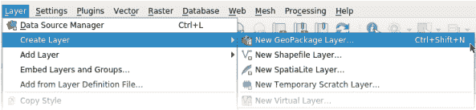

**图 16.1**  
从菜单创建新的矢量图层。

在*几何类型*中，选择*面*，并将矢量图层保存到工作目录中名为 *Sentinel2_2019-07-05_holes.gpkg* 的文件中，如图 16.2 所示。

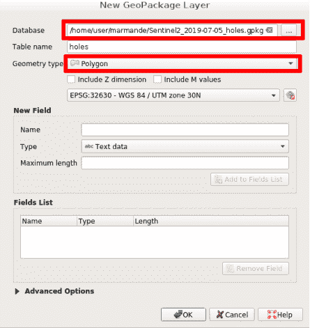

**图 16.2**  
将矢量图层保存为 *Sentinel2_2019-07-05_holes.gpkg*。

##### 16.2.1.2 合并掩膜

上一步结束后，您应得到 3 个新的矢量图层：

1. *Sentinel2_2019-07-05_holes.gpkg*
2. *Sentinel2_2019-07-25_holes.gpkg*
3. *Sentinel2_2019-08-24_holes.gpkg*

由于我们希望样本在四幅影像（$S2_{t-1}$、$S2_t$、$S2_{t+1}$ 和 $S1_t$）中都有效，因此需要将各影像的矢量图层合并为一个图层，以指示至少有一幅影像缺失内容的位置。使用 QGIS 将掩膜合并为单个矢量图层。从菜单中选择 **矢量 > 数据管理工具 > 合并矢量图层**，参见图 16.6。


**图 16.6**  
合并掩膜。

在输入图层中，选择 3 个矢量图层 *Sentinel2_2019-07-05_holes.gpkg*、*Sentinel2_2019-07-25_holes.gpkg* 和 *Sentinel2_2019-08-24_holes.gpkg*。将目标 CRS（坐标参考系统）选择为 EPSG:32630，与 Sentinel 影像相同。将输出矢量图层保存为临时图层。图 16.7 总结了需要提供的参数。

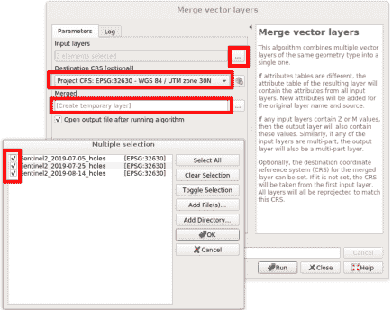

**图 16.7**  
选择要合并的掩膜。保持与影像相同的坐标参考系统（EPSG:32630）。将输出矢量图层保存为临时图层。

合并后的掩膜应类似于图 16.8 中的图示。

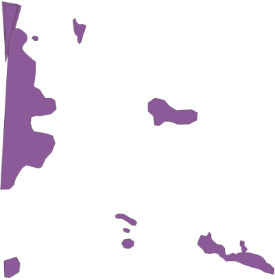

**图 16.8**  
生成的*合并*图层。

##### 16.2.1.3 网格生成

在本节中，我们将生成用于在影像中提取图块的网格。与第 12.1.3.1 节一样，我们使用 QGIS 生成一个表示图块布局的多边形矢量图层，并与影像的像素位置对齐。由于我们的模型需要 64 × 64 的输入图块，且像素间距为 10 米，因此我们将生成一个由 640 米大小的正方形拼接而成的网格。从菜单中单击 **矢量 > 研究工具 > 创建网格**，如图 16.9 所示。

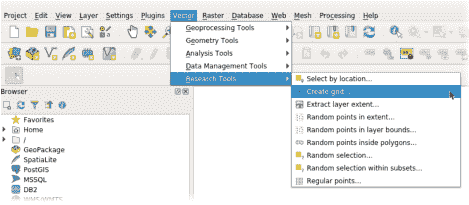

**图 16.9**  
创建矢量网格。

打开**创建网格**工具后，设置以下字段（图 16.10）：

1. **网格类型**：选择*矩形*。
2. **网格范围**：设置为*使用图层范围*，然后选择其中一幅影像，例如 *Sentinel2_2019-07-05_10m.tif*。
3. **水平间距**：选择 640。
4. **垂直间距**：选择 640。
5. 您可以将输出的**网格**图层设置为*创建临时图层*，因为它只是中间数据。

然后点击*运行*。

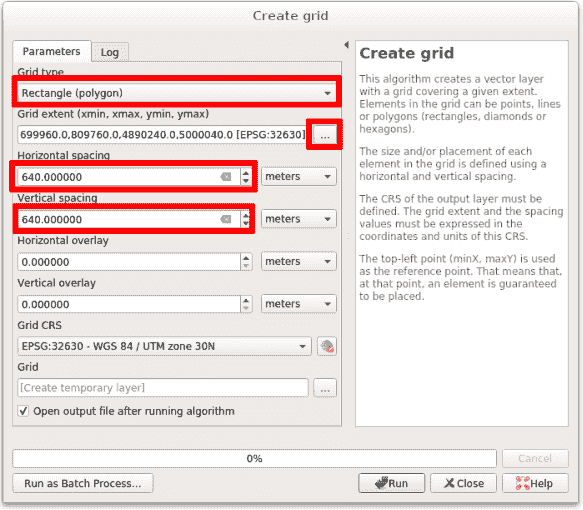

**图 16.10**  
矢量网格参数。

##### 16.2.1.4 网格过滤

现在，我们将仅保留有效像素的图块。为此，我们将使用第 16.2.1.2 节中创建的掩膜来消除网格中不想要的多边形。同样使用 QGIS 的矢量工具：单击菜单 **矢量 > 研究工具 > 按位置选择**（图 16.11）。


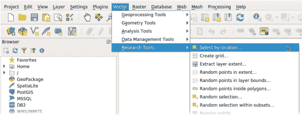

**图 16.11** 按位置选择要素。

在“按位置选择”面板中，设置以下字段（图 16.12）：

- 1. **从以下要素中选择：** 选择 *Grid*，即我们在上一步中生成的矢量图层。
- 2. **将比较要素来自：** 选择 *Merged* 图层。
- 3. **要素（几何谓词）：** 设置为 *disjoint*（不相交），因为我们要保留位于不期望区域（云和*无数据*值）之外的图块。
- 4. **按以下方式修改当前选择：** 选择 *创建新选择*。

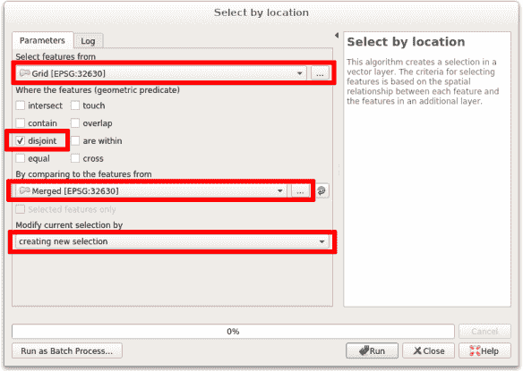

**图 16.12** 按位置选择。

然后可以点击**运行**在 *Grid* 矢量图层上生成选择。接着，将选中的要素保存为新矢量图层：右键单击 *Merged* 图层，选择**导出 > 将所选要素另存为...**（*图 12.7*）。将其保存为 *patches_in_valid_areas.gpkg*。

得到的矢量图层应显示为网格，其中所有图块完全位于 *holes* 图层之外，如图 *图 16.13* 所示。

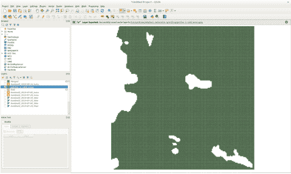

**图 16.13**  
结果图层。从原始网格中，只保留完全位于有效区域内的图块。

##### 16.2.1.5 图块质心

这里我们只需为图块质心创建一个新的点矢量图层。从菜单中，单击**矢量 > 几何工具 > 质心**（如*图 12.5* 所示），然后为 *Grid* 图层提取质心。您可以让生成的矢量图层作为临时图层，其将自动命名为 *Centroids*。

##### 16.2.1.6 训练和验证数据集

现在我们需要将图块分成两组：*训练数据集*将用于训练网络，*验证数据集*将用于评估训练后网络的性能。我们将采用与第 12.1.3.3 节所述相同的方法。使用 QGIS 菜单选择 70% 的图块作为训练数据集：选择**矢量 > 研究工具 > 随机选择**（*图 12.6*）。将 *Centroids* 作为输入图层，并将方法设置为所选要素的**百分比**。选择图层中 70% 的质心，并单击**运行**以计算选择。然后，将所选要素保存为新矢量图层：

- 3. `patches_train_s2_2019-07-25.tif`
- 4. `patches_train_s2_2019-08-24.tif`

对验证数据集重复相同操作，如下面的命令行所示。

```bash
export OTB_TF_NSOURCES=4
otbcli_PatchesExtraction \
-vec patches_centroids_valid.gpkg \
-source1.il sar_vh_hh_log_norm_EPSG32630.tif \
-source1.patchsize 64 -source1.patchsizey 64 \
-source1.out patches_valid_s1.tif \
-source2.il Sentinel2_2019-07-05_10m.tif \
-source2.patchsize 64 -source2.patchsizey 64 \
-source2.out patches_valid_s2_2019-07-05.tif \
-source3.il Sentinel2_2019-07-25_10m.tif \
-source3.patchsize 64 -source3.patchsizey 64 \
-source3.out patches_valid_s2_2019-07-25.tif \
-source4.il Sentinel2_2019-08-24_10m.tif \
-source4.patchsize 64 -source4.patchsizey 64 \
-source4.out patches_valid_s2_2019-08-24.tif \
-field "id"
```

**PatchesExtraction** 应用程序已创建了构成验证数据集的 4 个新文件：

- 1. `patches_valid_s1.tif`
- 2. `patches_valid_s2_2019-07-05.tif`
- 3. `patches_valid_s2_2019-07-25.tif`
- 4. `patches_valid_s2_2019-08-24.tif`

### 16.3 扩展：使用 OTB Python API 自动化步骤

在本节中，我们提供关于使用 Orfeo ToolBox 的 Python API 的见解。不过，本节是可选的，可以跳过，因为它仅展示如何自动化之前为准备图块而执行的步骤。Python API 使您能够在保留所谓流式机制（见 2.1.2）的同时连接内存中的 OTB 应用程序。OTB 应用程序可以实例化为 Python 对象，并使用相同的键/值标识符设置其参数：一旦实例化 OTB 应用程序对象，就可以使用专用方法设置其参数值。所有可在 OTB 应用程序中设置的参数都可以在 Python 实例中设置（例如整数、浮点或双精度数、字符串、图像、图像列表、矢量数据等）。因此，实现一个包含多个 OTB 应用程序链接在一起的完整流水线相当直接：我们实例化应用程序，设置其参数，并按所需方式将它们连接起来。流水线设置完成后，可以触发其执行以生成输出。

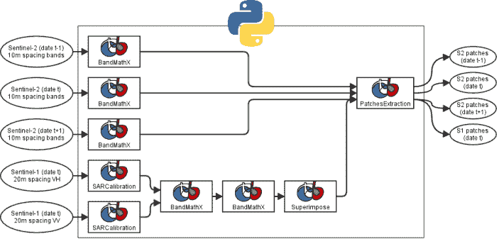

**图 16.14**  
Python 程序中实现的流水线。OrfeoToolBox 的以下应用程序被链接在一起：**BandMathX、SARCalibration、Superimpose 和 PatchesExtraction。**

#### 16.3.1 构建流水线

以下 Python 程序自动化了本节中看到的预处理步骤（除了在 QGIS 中执行的操作）。它由链接使用的 OTB 应用程序组成，从输入图像校准和归一化，到生成图块。图 16.14 展示了 Python 程序中实现的流水线。源代码如下。

```python
import os
import argparse
import otbApplication

parser = argparse.ArgumentParser()

 Input lists of the 10m Sentinel-2 bands (B4, B3, B2 and B8)
parser.add_argument('--img_list_s2_before',required=True,nargs='+',
        default=[])
parser.add_argument('--img_list_s2_t',required=True,nargs='+',
        default=[])
parser.add_argument('--img_list_s2_after',required=True,nargs='+',
        default=[])

 Input SAR images
parser.add_argument('--img_s1_t_vh', required=True)
parser.add_argument('--img_s1_t_vv', required=True)

 Input vector data
parser.add_argument('--locations', required=True)

 Output patches
parser.add_argument('--out_patches_s2_before', required=True)
parser.add_argument('--out_patches_s2_t', required=True)
parser.add_argument('--out_patches_s2_after', required=True)
parser.add_argument('--out_patches_s1_t', required=True)

params = parser.parse_args()

def normalize_s2(s2_img_list):
    """ This function returns an instance of an OTB application that
    concatenate and normalize the input images
    """
    newApp = otbApplication.Registry.CreateApplication("BandMathX")
    newApp.SetParameterStringList("il", s2_img_list)
    newApp.SetParameterString("exp", "{a}*im1b1;{a}*im2b1;{a}*im3b1;{a}*im4b1".format(a="0.00012207"))
    newApp.Execute()
    return newApp

""" Prepare the Sentinel-2 images """

app_s2_norm_1 = normalize_s2(params.img_list_s2_before)
app_s2_norm_2 = normalize_s2(params.img_list_s2_t)
app_s2_norm_3 = normalize_s2(params.img_list_s2_after)

""" Prepare the Sentinel-1 image """

 1. SAR Calibration
app_s1_vh = otbApplication.Registry.CreateApplication("SARCalibration")
app_s1_vh.SetParameterString("in", params.img_s1_t_vh)
app_s1_vh.Execute()
app_s1_vv = otbApplication.Registry.CreateApplication("SARCalibration")
app_s1_vv.SetParameterString("in", params.img_s1_t_vv)
app_s1_vv.Execute()

 2. Clip in dB scale
app_s1_vhvv_dB = otbApplication.Registry.CreateApplication("BandMathX")
app_s1_vhvv_dB.AddImageToParameterInputImageList("il",
    app_s1_vh.GetParameterOutputImage("out"))
app_s1_vhvv_dB.AddImageToParameterInputImageList("il",
    app_s1_vv.GetParameterOutputImage("out"))
app_s1_vhvv_dB.SetParameterString("exp",
    "vlog({min(max(im1b1,0.00001),1);min(max(im2b1,0.00001),1)})")
app_s1_vhvv_dB.Execute()

 3. Normalize between [-1, 0]
app_s1_vhvv_dB_norm = otbApplication.Registry.CreateApplication("BandMathX")
app_s1_vhvv_dB_norm.AddImageToParameterInputImageList("il",
    app_s1_vhvv_dB.GetParameterOutputImage("out"))
app_s1_vhvv_dB_norm.SetParameterString("exp",
    "{im1b1/im1b1Mini;im1b2/im1b2Mini}")
app_s1_vhvv_dB_norm.Execute()

 4. Superimpose on optical images
app_s1_resampled = otbApplication.Registry.CreateApplication("Superimpose")
app_s1_resampled.SetParameterInputImage("inr",
    app_s2_norm_1.GetParameterOutputImage("out"))
app_s2_norm_1.SetParameterOutputImage("out")
app_s1_resampled.SetParameterInputImage("inm",
    app_s1_vhvv_dB_norm.GetParameterOutputImage("out"))
app_s1_vhvv_dB_norm.Execute()

""" Patches extraction """

 Tell the PatchesExtraction application that we want 4 sources
os.environ["OTB_TF_NSOURCES"] = "4"
app_patches = otbApplication.Registry.CreateApplication("PatchesExtraction")
app_patches.AddImageToParameterInputImageList("source1.il",
    app_s2_norm_1.GetParameterOutputImage("out"))
app_patches.SetParameterString("source1.out", params.out_patches_s2_before)
app_patches.AddImageToParameterInputImageList("source2.il",
    app_s2_norm_2.GetParameterOutputImage("out"))
app_patches.SetParameterString("source2.out", params.out_patches_s2_t)
app_patches.AddImageToParameterInputImageList("source3.il",
    app_s2_norm_3.GetParameterOutputImage("out"))
app_patches.SetParameterString("source3.out", params.out_patches_s2_after)
app_patches.AddImageToParameterInputImageList("source4.il",
    app_s1_resampled.GetParameterOutputImage("out"))
app_patches.SetParameterString("source4.out", params.out_patches_s1_t)

 Set all sources patches sizes to 64
for i in [1,2,3,4]:
    for dim in ["x", "y"]:
        app_patches.SetParameterInt("source{}.patchsize{}".format(i, dim),
            64)

 The input vector data must have an "id" field
app_patches.SetParameterString("vec", params.locations)
app_patches.SetParameterString("field", "id")
app_patches.ExecuteAndWriteOutput()
```


#### 16.3.2 运行流水线

下面是通过命令行运行程序以生成训练图像块的方法。要生成验证图像块，只需替换输入矢量数据的名称，并更改输出图像块的名称。

```bash
 Run the pipeline to generate the patches for training
python preprocess_gapfill.py \
--locations patches_centroids_train.gpkg \
--img_list_s2_before \
    T30TYQ_20190705T105031_B04_10m.jp2 \
    T30TYQ_20190705T105031_B03_10m.jp2 \
    T30TYQ_20190705T105031_B02_10m.jp2 \
    T30TYQ_20190705T105031_B08_10m.jp2 \
--img_list_s2_t \
    T30TYQ_20190725T105031_B04_10m.jp2 \
    T30TYQ_20190725T105031_B03_10m.jp2 \
    T30TYQ_20190725T105031_B02_10m.jp2 \
    T30TYQ_20190725T105031_B08_10m.jp2 \
--img_list_s2_after \
    T30TYQ_20190824T105031_B04_10m.jp2 \
    T30TYQ_20190824T105031_B03_10m.jp2 \
    T30TYQ_20190824T105031_B02_10m.jp2 \
    T30TYQ_20190824T105031_B08_10m.jp2 \
--img_s1_t_vh \
    s1a-iw-grd-vh-20190725t175553-20190725t175618-028277-0331c8-002.tiff \
--img_s1_t_vv \
    s1a-iw-grd-vv-20190725t175553-20190725t175618-028277-0331c8-001.tiff \
--out-patches_s2_before patches_train_s2_2019-07-05.tif \
--out-patches_s2_t patches_train_s2_2019-07-25.tif \
--out-patches_s2_after patches_train_s2_2019-08-24.tif \
--out-patches_s1_t patches_train_s1.tif
```

## 17 模型训练

本节介绍模型训练。我们将按照以下步骤来训练模型并使其就绪，以执行空洞填充：

- 1. 从作者的仓库中下载实现代码。
- 2. 使用代码训练模型。模型权重将保存在*checkpoint*文件中。
- 3. 从现有的*checkpoint*中导出已训练的**SavedModel**。
- 4. 将**SavedModel**与OTBTF的**TensorflowModelServe**应用一起使用，以执行光学图像恢复。

### 17.1 使用Python进行训练

许多从业者希望完全控制训练过程，因此更喜欢TensorFlow Python API，而不是使用**TensorflowModelTrain**应用。确实，**TensorflowModelTrain**隐藏了训练的复杂性，为用户提供了一种简单界面来在其地理空间数据上训练模型，但训练方法被大幅简化。然而，这种用户友好性的代价是流程的过度简化，这可能会让深度学习专家以及希望以更定制化方式训练模型的人感到沮丧。在本节中，我们展示专家们仍然可以从他们自己的Python代码中训练模型，并使用OTBTF应用训练好的模型。*deep-gapfill*代码通过提供纯Python深度学习架构的构建和训练来展示这一点。生成的模型可以导出为TensorFlow **SavedModel**，并与**TensorflowModelServe**应用一起使用以生成空洞填充图像。

### 17.2 获取代码

首先，下载第14.3节所述实现的Python代码。您可以从作者的GitHub账户（*deep-gapfill*仓库¹）克隆源代码，或直接下载代码存档²。*deep-gapfill*代码使您能够直接训练模型。

### 17.3 使用代码

#### 17.3.1 描述

在命令行界面中，导航到您下载*deep-gapfill*的文件夹。您应该有一个*model.py*文件，需要用Python启动：

```bash
python model.py
```

应用程序应显示帮助函数。从显示的描述中，您应该能够识别用于训练模型的重要输入和参数：

- 1. **s1_t**、**s2_t**、**s2_t_before**和**s2_t_after**分别是训练输入图像块的路径，分别对应$S1_t$、$S2_t$、$S2_{t-1}$和$S2_{t+1}$。
- 2. **valid_s1_t**、**valid_s2_t**、**valid_s2_t_before**和**valid_s2_t_after**分别是验证输入图像块的路径，分别对应$S1_t$、$S2_t$、$S2_{t-1}$和$S2_{t+1}$。
- 3. **save_ckpt**是*checkpoint*文件的输出前缀参数，TensorFlow使用这些文件在磁盘上保存模型权重。

您可以注意到$S1_t$的输入不是强制性的：当未提供**s1_t**和**valid_s1_t**时，模型将在不包含SAR编码器分支的情况下构建。这一消融功能使您能够比较模型在有或没有SAR信息时的行为。

#### 17.3.2 参数

表17.1总结了用于运行训练的参数值：

**表17.1** — *model.py*参数

| 参数 | 使用的值 |
|---|---|
| **s1_t** | patches_train_s1.tif |
| **s2_t** | patches_train_s2_2019-07-25.tif |
| **s2_t_before** | patches_train_s2_2019-07-05.tif |
| **s2_t_after** | patches_train_s2_2019-08-24.tif |
| **valid_s1_t** | patches_valid_s1.tif |
| **valid_s2_t** | patches_valid_s2_2019-07-25.tif |
| **valid_s2_t_before** | patches_valid_s2_2019-07-05.tif |
| **valid_s2_t_after** | patches_valid_s2_2019-08-24.tif |

在包含结果的目录中，使用以下命令运行Python代码。

```bash
 clone the repository (if you don’t have it already)
git clone https://github.com/remicres/Deep-GapFill.git

 run the model training
python Deep-GapFill/model.py \
--s1_t patches_train_s1.tif \
--s2_t_before patches_train_s2_2019-07-05.tif \
--s2_t patches_train_s2_2019-07-25.tif \
--s2_t_after patches_train_s2_2019-08-24.tif \
--valid_s1_t patches_valid_s1.tif \
--valid_s2_t_before patches_valid_s2_2019-07-05.tif \
--valid_s2_t patches_valid_s2_2019-07-25.tif \
--valid_s2_t_after patches_valid_s2_2019-08-24.tif \
--save_ckpt mymodel_checkpoint
```

程序将执行并完成以下操作：

- 1. 加载输入图像块。
- 2. 对于每个epoch：
  - (a) 对数据集执行梯度下降。
  - (b) 评估模型误差（基于L1和L2损失）。
  - (c) 将模型权重保存到*checkpoint*文件中。

### 17.4 导出模型

所有epoch完成后，我们可以从训练期间创建的上一个*checkpoint*导出*SavedModel*。请注意，更好的方法可能是导出最后几个epoch中训练得到的最佳模型，或一旦模型过拟合训练数据便立即导出（有多种策略，我们不打算在本书中覆盖该主题）。要导出*SavedModel*，请使用位于OTBTF的*Python*文件夹中名为*ckpt2savedmodel.py*的Python代码。

```bash
 Convert the checkpoint into a SavedModel
python /work/otb/otb/Modules/Remote/otbtf/python/ckpt2savedmodel.py \
--ckpt_model checkpoint-199 \
--inputs "s1:0" "s2_before:0" "s2_after:0" \
--outputs "gen_cn:0" \
--model savedmodel_gapfill
```

命令运行后，应该会创建一个包含*SavedModel*的新文件夹（*savedmodel_gapfill*）。

## 18 推理

我们将对Sentinel-1和Sentinel-2图像应用之前导出的*SavedModel*。

### 18.1 输入和输出

在推理时，仅将$S1_t$、$S2_{t-1}$和$S2_{t+1}$的输入馈入模型。$\bar{S2}_t$输入不再使用：我们只关心在模型输出处获取$S2_t$图像。

另一个重要点是用于获取$S2_t$的输出。如第12.2.2.1节所述，计算全卷积模型的*精确*输出是避免块状伪影的一种策略。为此，我们通过提取最终卷积输出的中心来计算模型的*精确*输出。然后，我们从名为*prediction_fcn*的输出张量的空间维度中每侧移除256个像素。对应的张量*prediction_fcn*用作$S2_t$的输出。从输出张量的空间维度每侧移除256个像素，等效于使用一个输入576 × 576虚拟图像块并产生64 × 64像素范围的模型。注意，非常深的模型可能导致需要移除的理论边缘过大。当该边缘过大时，建议分析边缘对输出的影响，以便找到实际设置。实际边缘应足够大以避免块状伪影，且足够小以合理影响模型输出的缩减。在OTBTF的形式中，我们的网络因此具有576 × 576像素的感受野，以及64 × 64像素的*有效输出场*。图18.1展示了推理时使用的模型。

### 18.2 生成图像

由于输出是*prediction_fcn*，图像可以按块高效处理，而不会产生分块伪影。我们将模型应用于输入


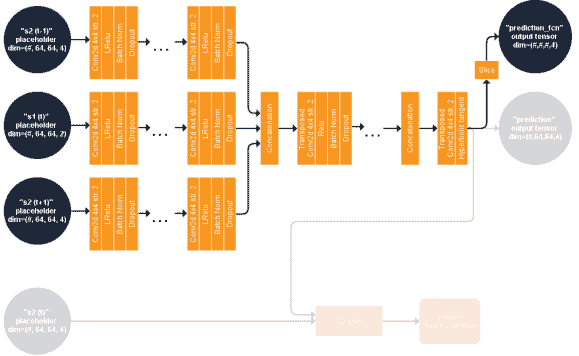

 图 18.1

仅使用 $S1_t$、$S2_{t-1}$ 和 $S2_{t+1}$ 作为输入。与训练相关的节点（代价函数、优化器）在推理时不再使用。在模型输出端，从 *prediction_fcn* 张量中获取 $S2_t$ 图像。*prediction_fcn* 是模型的精确输出，通过在空间维度上提取 *prediction* 张量的中心得到。

$S2_{t-1}$、$S2_{t+1}$ 和 $S1_t$ 用于生成输出图像 $\widehat{S2_t}$，我们将其命名为 *Sentinel2_2019-07-25_estimated.tif*。运行以下命令行以生成合成的 $\widehat{S2_t}$ 图像：

```bash
export OTB_TF_NSOURCES=3
otbcli_TensorflowModelServe \
-source1.il_sar_vh_hh_log_norm_EPSG32630.tif \
-source1.rfieldx 576 -source1.rfieldy 576 \
-source1.placeholder "s1" \
-source2.il_Sentinel2_2019-07-05_10m.tif \
-source2.rfieldx 576 -source2.rfieldy 576 \
-source2.placeholder "s2_before" \
-source3.il_Sentinel2_2019-08-24_10m.tif \
-source3.rfieldx 576 -source3.rfieldy 576 \
-source3.placeholder "s2_after" \
-model.dir savedmodel_gapfill \
-model.fullyconv on \
-output.names "gen_fcn" -output.efieldx 64 -output.efieldy 64 \
-out Sentinel2_2019-07-25_estimated.tif
```

图像生成后，将其导入 QGIS，并与 $S2_t$ 图像进行目视比较（[图 18.2](figure 18.2)）。

```bash
-im Sentinel2_2019-07-25_estimated.tif \
-out valid_area_mask.tif uint8
```

栅格化完成后，我们将 $\widehat{S}_{2t}$ 图像叠加到 $S_{2t}$ 图像上。由于感受野的原因，生成的 $\widehat{S}_{2t}$ 图像比 $S_{2t}$ 图像略小。为了对 $S_{2t}$、$\widehat{S}_{2t}$ 和二值掩膜的像素进行逐像素运算，我们必须将 $S_{2t}$ 图像叠加到 $\widehat{S}_{2t}$ 图像上。为此，我们使用 **Superimpose OTB** 应用：

```bash
otbcli_Superimpose \
-inr Sentinel2_2019-07-25_estimated.tif \
-inm Sentinel2_2019-07-25_10m.tif \
-out Sentinel2_2019-07-25_10m_superimposed.tif
```

然后，我们可以合成最终的 Sentinel-2 图像，保留有效区域内的像素，并用 $\widehat{S}_{2t}$ 替换受污染像素。**BandMathX OTB** 应用允许我们创建最终图像。我们使用一个数学表达式来计算输出像素。**BandMathX** 能够在数学表达式中识别输入图像和输入图像的波段。**BandMathX** 表达式如下：

$$im1b1==255\ ?\ im2\ :\ im3$$

“？”和“：”是三元运算符。该表达式的含义是：如果二值掩膜（即 $im1b1$：图像 #1 的“波段 #1”）为 255，则该像素受污染，输出为 $S_{2t}$ 图像（即 $im2$：图像 #2）。否则，输出为 $\widehat{S}_{2t}$ 图像（即 $im3$：图像 #3）。运行以下命令行以执行缺口填充的最后合成步骤：

```bash
otbcli_BandMathX \
-il valid_area_mask.tif \
    Sentinel2_2019-07-25_estimated.tif \
    Sentinel2_2019-07-25_10m_superimposed.tif \
-exp "im1b1==255 ? im2 : im3" \
-out Sentinel2_2019-07-25_final.tif
```

请注意，在此步骤中，我们也可以改为通过反转方程 16.1.1 对图像进行去归一化，即将 $im2$ 和 $im3$ 乘以 8192：

```bash
otbcli_BandMathX \
-il valid_area_mask.tif \
    Sentinel2_2019-07-25_estimated.tif \
    Sentinel2_2019-07-25_10m_superimposed.tif \
-exp "im1b1==255 ? 8192*im2 : 8192*im3" \
-out Sentinel2_2019-07-25_final_16b.tif int16
```

最终图像生成完毕。[图 18.3](#) 展示了导入 QGIS 后的结果图像。

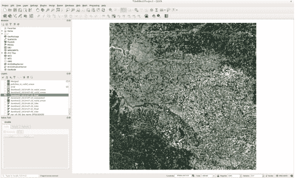

 图 18.3

缺口填充过程得到的最终图像。

使用步长为 2 的卷积（因此物理间距为 20 米）的图像与 20 米处的输入图像。

模型的另一个有用的改进是集成图像归一化，从而避免一些预处理并节省存储空间。

所介绍的应用——使用深度卷积自编码器进行光学时间序列缺口填充——展示了深度神经网络如何轻松组合具有不同模态、物理分辨率和光谱分辨率的多源数据。虽然我们通过这一特定应用展示了深度学习的多功能性，但我们毫不怀疑，遥感领域的大量问题都可以通过精心定制的深度学习架构来解决。

## 参考文献

- [22] F. Hu, G.-S. Xia, J. Hu, and L. Zhang, “迁移深度卷积神经网络用于高分辨率遥感影像场景分类，” *遥感*, vol. 7, no. 11, pp. 14680–14707, 2015.
- [23] R. Gaetano, D. Ienco, K. Ose, and R. Cresson, “MRFusion：一种融合全色和多光谱影像以进行土地覆盖制图的深度学习架构，” *arXiv 预印本 arXiv:1806.11452*, 2018.
- [24] K. Simonyan and A. Zisserman, “用于大规模图像识别的极深卷积网络，” *arXiv 预印本 arXiv:1409.1556*, 2014.
- [25] O. Ronneberger, P. Fischer, and T. Brox, “U-Net：用于生物医学图像分割的卷积网络，” 载于 *医学图像计算与计算机辅助介入国际会议*, pp. 234–241, Springer, 2015.
- [26] L.-C. Chen, G. Papandreou, I. Kokkinos, K. Murphy, and A. L. Yuille, “DeepLab：基于深度卷积网络、空洞卷积和全连接 CRF 的语义图像分割，” *IEEE 模式分析与机器智能汇刊*, vol. 40, no. 4, pp. 834–848, 2017.
- [27] H. Zhao, J. Shi, X. Qi, X. Wang, and J. Jia, “金字塔场景解析网络，” 载于 *IEEE 计算机视觉与模式识别会议论文集*, pp. 2881–2890, 2017.
- [28] J. Inglada, M. Arias, B. Tardy, O. Hagolle, S. Valero, D. Morin, G. Dedieu, G. Sepulcre, S. Bontemps, P. Defourny, and B. Koetz, “利用高时间分辨率和高空间分辨率卫星光学影像评估作物类型地图生产业务化系统，” *遥感*, vol. 7, no. 9, pp. 12356–12379, 2015.
- [29] M. Xu, X. Jia, M. Pickering, and A. J. Plaza, “基于稀疏表示与多时相字典学习的云去除，” *IEEE TGRS*, vol. 54, no. 5, pp. 2998–3006, 2016.
- [30] X. Li, H. Shen, L. Zhang, H. Zhang, Q. Yuan, and G. Yang, “利用多时相字典学习恢复受厚云和阴影污染的定量遥感产品，” *IEEE TGRS*, vol. 52, no. 11, pp. 7086–7098, 2014.
- [31] K. Enomoto, K. Sakurada, W. Wang, H. Fukui, M. Matsuoka, R. Nakamura, and N. Kawaguchi, “基于多光谱条件生成对抗网络的卫星影像薄云去除，” 载于 *CVPRw*, pp. 1533–1541, 2017.
- [32] C. Grohnfeldt, M. Schmitt, and X. Zhu, “一种融合 SAR 与多光谱光学数据以去除 Sentinel-2 影像云的条件生成对抗网络，” 载于 *IGARSS*, pp. 1726–1729, IEEE, 2018.

- 图（graph）, 11, 12, 14, 33, 34, 37
- 图形用户界面, 27
- 网格, 16, 84, 88, 119, 123, 124

- 硬件, 13, 14, 139
- 双曲, 8, 106
- 高光谱, 3

- 不平衡, 98
- 推理, 11, 41, 54, 62, 96, 137
- 整数, 10, 35, 115, 128
- 接口, 10, 12, 27–29, 133, 134
- 交错, 32
- 插值, 103, 104, 140
- 迭代, 28

- JPEG 2000, 74, 115

- Kappa 系数, 38, 40, 41, 97, 98
- Keras, 11
- 卷积核, 5, 6, 37, 45, 94

- 标签, 25, 32, 34, 35, 70, 83, 89
- Landsat, 16
- 层, 3–6, 18, 34, 91, 94, 106
- 泄漏修正线性单元, 7, 106
- 学习, 3, 32, 35, 103
- 学习率, 40, 57
- Linux, 13
- 损失, 32, 34, 35, 65, 104
- LReLU，参见泄漏修正线性单元

- Mac, 13
- 机器学习, 8, 12, 14, 40, 51
- 映射（map）, 41, 50, 54, 62, 97
- 掩膜, 119, 122, 124
- 内存, 10, 32, 45, 50, 53, 139
- 最小化, 104
- 模型, 14, 33, 37, 46, 90, 105
- 多维, 4, 34
- 多模态, 3
- 多多边形, 76, 77
- 多光谱, 25, 41, 73, 74, 83, 99

- 邻域, 5
- 网络（net），参见人工神经网络，8, 11, 32, 53

- 网络，参见人工神经网络
- 神经元，参见人工神经元，4, 5, 7, 34, 91
- 节点, 11, 33, 35, 41, 57, 138
- 噪声, 118
- 归一化, 27, 59, 84, 115, 144
- NumPy, 10
- NVIDIA, 13

- 偏移, 3, 4
- OpenStreetMap, 23, 69, 74, 81, 88, 99
- 光学影像, 69, 103, 115
- 优化, 13, 32
- 优化器, 33, 35, 39, 41, 57, 107, 138
- Orfeo ToolBox, 9, 10, 27, 52, 128, 129
- 正射校正, 73
- OSM，参见 OpenStreetMap，73, 74, 77, 86
- OTB TF, 12–14, 16, 17, 27, 52
- 重叠, 30, 45, 119
- 重叠的, 43, 50

- 填充, 5, 6, 94
- 全色, 73, 74, 83, 99
- 全色锐化, 3, 83, 99
- 图像块, 29, 30, 84, 89, 119
- 流水线, 10, 15, 128, 129, 132
- 占位符, 12, 17, 34, 35, 91
- 多边形, 74, 77, 88, 120, 121, 124
- 池化, 4–7, 15, 34, 45–47, 49, 65, 70
- 精度, 38, 69, 97, 98, 128
- 预测的, 34, 65, 70, 91, 95
- 预测, 32, 34, 69, 137
- 概率, 34, 51
- 编程, 8, 11, 12
- 传播, 15, 32, 33, 45
- 伪彩色, 43
- PSPNet, 100
- Python, 10, 11, 35, 128, 129, 133
- PyTorch, 12

- QGIS, 10, 17, 18, 74, 119

- 雷达，参见 SAR
- 辐射度量学, 9, 119


## 索引
- 随机存取存储器, 50, 53
- 随机森林, 40
- 栅格, 23, 25, 29, 55, 89, 99
- 栅格化, 74, 88, 139, 140
- 召回率, 28, 38, 98
- 感受野, 4, 14–17, 41, 42, 46, 95, 137
- 修正线性单元, 7, 34, 91, 106
- 反射率, 117
- ReLU, *参见* 修正线性单元
- 存储库, 13, 26, 35, 57, 75, 133
- 重采样, 118, 119
- 重塑, 51

- 样本, 29, 60, 84, 119
- 已采样, 7, 32, 84
- 采样, 12, 29, 30, 43, 60
- SAR, *参见* 合成孔径雷达
- 标量, 3, 7, 33, 35, 57
- 场景, 143
- 序列化, 14, 35, 37, 54
- 会话, *参见* tensorflow, 12, 17
- shapefile, 77
- sigma, 34, 117
- sigmoid, 7, 8
- 信号, 4, 12
- 切片, 7
- softmax, 34
- 求解器, 107
- 源, 16, 17, 38, 55, 89, 127
- 间距, 4–7, 14–17, 25, 46, 118, 119
- 斑点, 118
- 光谱波段, 25, 55, 56, 104, 143

- 点, 73, 74, 83
- 堆叠, 17, 32, 55, 85, 106
- 流式处理, 10, 42, 52, 128
- 步幅, 5, 7, 15, 46, 91
- 步幅卷积, 70, 99, 143
- 叠加, 118, 129, 140
- 合成孔径雷达, 3, 117, 143

- 张量, 11, 12, 14, 33, 95, 137
- tensorflow, 10–12, 14–17, 133
- TerraSAR, 16
- 纹理, 41
- 阈值, 4
- 时间序列, 3
- 训练, 32, 33, 49, 53, 61, 96, 133
- 故障排除, 13

- U-Net, 70, 105
- 解压缩, 25, 74, 112
- 上采样, 91, 106
- 上采样, 71, 91
- 用户, 9–14, 17, 27–29, 75, 133

- 验证, 30, 38–40, 87
- 变量, 12, 14, 37, 39, 40, 49
- 矢量图层, 74, 77, 84, 120, 123, 126
- VGG, 65
- VirtualBox, 13

- 权重, 3, 4, 32, 33, 37, 133
- 工作流, 51

- 零填充, *参见* 填充, 94

