# 外行人的深度学习：无数学的视觉指南

# 如何联系我们

如果您发现书中包含任何破损、编辑问题或其他任何问题，请立即通过电子邮件通知我们的客户服务部门：`customer_service@datasciences-book.com`

如果您有任何问题或建议，也可以直接与我联系：`Francois Duval@datasciences-book.com`

我们的目标是为您在计算机科学领域的技术学习提供高质量的书籍。

感谢您购买本书。

# 前言

> “机器人取代了工厂工人的工作。人工智能将取代办公室人员的工作。”
>
> — EverythingSupplyChain

深度学习是一个术语，用于一类技术研发，负责构建被认为是人工智能的机器。这些机器能够完成复杂的功能，如语音识别、图像识别、生物信息学等。

理解深度学习（包括它是什么以及它的工作原理），意味着您将更好地理解计算机科学家和研究人员是如何开发系统的，这些系统可能在未来的某一天创造出完全的纯人工智能。直到目前，他们只创建了能够完成一或两个功能的系统。然而，人们希望有一天他们创造出非常类似于人类大脑的东西。理想情况下，我们想要创建一个“纯粹”的人工智能，即由人类创造但不受人类影响进行学习和运行的。从本质上说，它是一个“超级人类”。

本书的编写目的是帮助外行者理解什么是深度学习，以及为什么它是一个如此迷人且具有革命性的概念。本书是在写了《深度学习入门》一书后编写的，因为我们意识到，对于计算机科学的外行者来说，前者可能更具技术性。

深度学习并不是一个新概念；随着我们向拥有真正的人工智能走在我们身边的可能性迈进，它正变得越来越流行。在阅读本书时，你可能会感到惊讶的是，我们已经使用了多少深度学习技术。尽管一个完全且纯粹的人工智能走在我们身边似乎是遥远的未来，但我们使用这项技术的程度相当引人入胜。

深度学习是一个不可思议的概念，它将一直存在。每天发生并缓慢整合到我们社会以供普通消费者使用的革命性科学是一个迷人的科学，学习它是不可思议的。理解它可能帮助你理解你现在使用的技术以及社会的未来。你可能会对所学到的感到惊讶！请花点时间享受这本关于深度学习的教育书籍。

# 本书目标

如果您感兴趣学习更多关于深度学习、创建它的要素、深度学习概念、机器使用的技术以及科学家正在设计的工具，那么《深度学习：概念与算法》正是你需要的。这本书将帮助你深入探索深度学习到底是什么，并教你为什么它是如此具有革命性和迷人。到结束时，你将对这项技术是什么、它是如何工作的有一个全面的理解。

本书将帮助你：

- 对深度学习产生欣赏并理解其基本原理。
- 初步掌握深度学习概念和算法。
- 在深度学习和人工神经网络领域获得技术背景。

# 目标用户

本书为各种读者群体设计。最合适的用户包括：

- 计算机技术和深度学习领域的新手
- 数据科学和社会科学领域的专业人士
- 寻求以最简单、最容易的方法向学生解释内容的教授、讲师或导师
- 学生和学者，特别是关注神经网络和深度学习的人士

# 这本书适合我吗？

如果您想在不涉及技术公式和实际数据的情况下学习更多关于深度学习的知识，这本书就适合您。不需要数学和编码知识。本书用通俗易懂的语言编写，作为深度学习、神经网络及其算法的介绍。每个算法都解释得非常简单，以便于理解。

献给我的妻子 Melanie 和两个孩子

你们是我的生命，我非常爱你们！

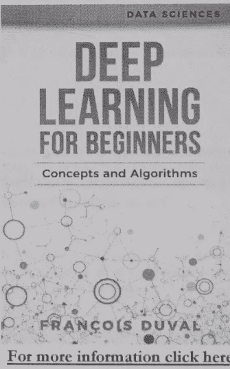

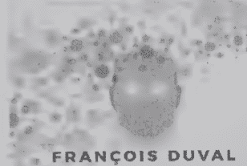

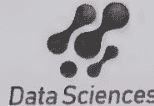

# 作者简介

François Duval 是一位资深数据科学专家和新兴作家，在信息技术和数据分析领域迅速赢得了创新领导者的声誉。在过去的十年里，他在领域积累了丰富的经验。目前，Francois 自豪地担任科学数据顾问。他还在编写一系列关于统计学和计算机科学的书籍。

在从事目前的业务之前，他在 `IBM` 团队工作了两年，是 `Intelligence Consulting` 的创始人，这是一家在法国和整个欧洲提供数据分析咨询的知名公司。他还在多个行业担任过工程师，包括但不限于金融业（伦敦 `KPMG` 的财务咨询部门）以及环境和医疗研究（法国的 `INERIS` 和 `Mines ParisTech`）。无论从事什么项目，Francois 都致力于一个终身使命：向数据分析新手传授他们理解所需的知识。通过有效地简化这些方法，新兴专业人士能够在计算机科学世界中创造积极的变化，这种影响将继续在我们所知的整个领域产生涟漪效应。

此外，François 拥有定量分析和随机微积分博士学位，以及统计学与数据分析的学士学位。

在沉浸于多变的职业生涯之中，François Duval 喜欢与爱的人度过高质量的时光。如今，他快乐地住在英国伦敦，是两个漂亮孩子的父亲。

# 目录

## 1. 深度学习：是什么与为什么？

- 深度学习与人工神经网络
- 到底什么是深度学习？
- 学习了什么？
- 特征学习
- 为什么被称为“深度学习”
- 深度学习的历史
- 深度学习时间线

## 2. 深度学习的基础

- 深度学习、机器学习与人工智能
- 不同的机器学习方法
- 监督学习
- 无监督学习
- 强化学习
- 监督算法与无监督算法之间的区别
- 分类与聚类
- 聚类
- 深度学习与机器学习的比较
- 数据依赖
- 硬件依赖
- 特征工程
- 问题解决方法
- 执行时间
- 可解释性
- 深度学习与机器学习的应用领域
- 未来趋势

## 3. 人工神经网络：是什么与为什么？

- 本节介绍
- 神经网络概述
- 什么是神经网络？
- 人工神经元介绍
- 有用的概念和术语
- 层
- 单元
- 激活函数
- 特征工程
- 特征学习
- 梯度下降
- 人工神经网络结构
- 输入层
- 隐藏层
- 输出层
- 监督无监督神经网络

## 人工神经网络基础

- 感知机：一种早期深度学习算法
- 训练感知机
- Adaline：自适应增量规则
- Delta 规则
- Delta 规则与学习率
- 神经网络的应用
- 聚类
- 分类与模式识别
- 函数近似
- 预测与动力系统

## 人工神经网络的挑战

## 4. 深度学习的概述

- 用于神经网络深度学习的快速图形处理器 (`GPU`) `GPU` vs `CPU`

## 三分类法

- 用于无监督或生成式学习的深度网络
- 用于监督学习的深度网络
- 混合深度网络

## 深度学习的递归方法

- 用于监督学习/强化学习的动态规划
- 无监督学习 (`UL`) 促进 `SL` 和 `RL`
- 通过深度 `SL`、`UL`、`RL` 学习分层表示
- 奥卡姆剃刀：压缩与最小描述长度 (`MDL`)

## 三分类法

- 用于无监督或生成式学习的深度网络
- 用于监督学习的深度网络
- 混合深度网络

## 深度学习的递归方法

- 用于监督学习/强化学习 (`SL`/`RL`) 的动态规划
- 无监督学习 (`UL`) 促进 `SL` 和 `RL`
- 通过深度 `SL`、`UL`、`RL` 学习分层表示
- 奥卡姆剃刀：压缩与最小描述长度 (`MDL`)
- 用于神经网络深度学习的快速图形处理器 (`GPU`)

## 5. 多层感知机与反向传播：它们是如何工作的？

- 多层感知机
- `MLP` 模型
- 训练 `MLP` 的技巧
- 反向传播
- 反向传播的定义
- 反向传播的应用
- 自然语言处理与情感分析
- 用于情感分析的长短期记忆网络 (`LSTM`)
- `LSTM` 模型

## 6. 卷积神经网络 (`CNN`) ：它是如何工作的？

`CNN` 架构

- 用于构建 `CNN` 的层
- 引入非线性 (`ReLU`)
- 卷积层
- 无大脑脑模型
- 大脑视角
- 局部连接
- 空间排列
- 生活中的实例
- 参数共享

## 7. 其他深度学习算法

- 循环神经网络
- 递归神经网络
- 限制玻尔兹曼机
- 编码器
- 堆叠自动编码器
- 自动编码器的类型
- 深度信念网络

## 8. 深度学习应用

- 将深度学习应用于现实问题
- 预训练的价值
- 医学视觉
- 信用评分
- 高成本的解决方案
- 现实世界标签分布的注意事项
- 理解黑箱模型
- 深度学习的视觉应用
- 为无声电影添加声音
- 自动机器翻译
- 照片中的物体分类与检测
- 自动字体生成
- 自动玩游戏
- 自动图像描述生成
- 自动文本生成

## 使用现有 API 的应用

- 深度学习 `API` 的优点
- 深度学习 `API` 的缺点

## 开源应用

- 开源应用的优点
- 开源应用的缺点

## 9. 深度学习应用在我们的未来

- 本节介绍
- 医学技术
- 生物力学
- 全自动智能家居
- 高级移动技术
- 自动化商业用途程序
- 部分人工智能
- 完整人工智能

## 10. 深度学习的长期愿景

- 更小、更高效
- 更多自动化
- 完善的专门能力
- 全人工智能

## 感谢！

# 1. 深度学习：是什么与为什么？

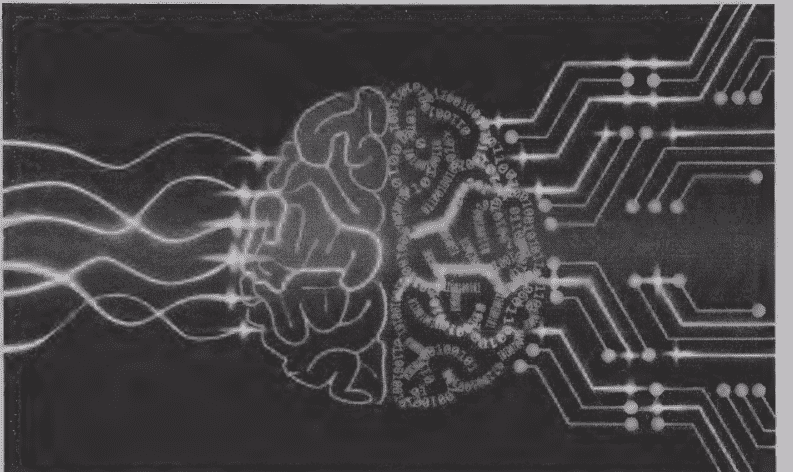

## 本节介绍

如果你听过机器学习或人工智能，那么你对深度学习是什么已经有了基本的了解。本质上，深度学习是机器学习的一个分支。这种特定的学习系统与其他程序不同，其他程序的“学习”是通过事实算法和设定的表示完成的。相反，深度学习网络包含了受人类大脑结构和功能启发的算法。因此，深度学习机器具有学习新信息并使用信息的能力。

处理深度学习的网络被称为“人工神经网络”，是因为它们代表了人类大脑中真实的神经通路。这现在听起来可能很困惑，但随着本章的进行，本书将开始准确理解深度学习是什么、它是如何工作的，以及为什么它是当今世界中一个重要的系统。不过如果你仍然感到困惑，请不要担心。科学家们仍在对深度学习的过程进行研究和理解。

## 深度学习与人工神经网络

人工神经网络 (`ANNs`) 是深度学习的基础，但深度学习的发展远超人工神经网络。

自从人工神经网络的发展，科学家和研究人员一直在专注于开发和使用深度神经网络。深度学习是未来，尽管它们在某些方面已经做了很多工作。

## 深度学习到底是什么？

深度学习本质上是一种神经网络系统，这些系统被用于帮助让学习算法变得更易使用，并显著提高其能力。它们还被用于在人工智能以及机器学习领域创造革命性的进展，并最终创造出一种真正且完整的人工智能。

在过去，计算系统的速度太慢，而且我们没有足够的信息来创建制造真正人工智能所需的网络。这意味着我们的技术水平还不够先进，无法创造出能够完全独立行动、思考和生活的人工智能。直到现在，我们只能创建部分的人工智能，它们根据编程到其智能网络中的一组指标，独立地完成某些任务。

然而，随着深度学习的引入，我们已经开始开发大型神经网络系统，这些系统能够接收信息并对其做出响应。终极目标是创建出模拟人类大脑并作为独立智能运行的神经网络，它们完全能够在没有人类干预的情况下学习新事物并自主进步。本质上，我们将创造一个人工物种并将其引入世界。

所有这些人工智能进步和进展的根本都是深度学习。在过去，算法的运行非常缓慢。虽然它们可以处理大量数据，但性能非常有限。深度学习将性能与数据摄取结合起来，创造出一个优化且先进的系统，超越了我们以前使用的任何东西。

## 学习了什么？

目前，深度学习在实践中是在监督学习条件下使用的。这意味着深度学习机器只能从它们接触过的标记数据中进行学习。它们尚未离开无监督阶段，并且可能在一段时间内都不会离开。至少，在它们变得可靠且被理解之前，它们不会处于无监督状态。

随着时间的推移，目标是让深度学习网络和人工智能开放到无监督学习，在那里，它们将能够在不受其学习内容或访问权限限制的情况下学习任何东西。当它们能够无限制地访问这些数据时，人工智能将变得完整，并成为真正意义上的人工智能。

## 特征学习

深度学习基于大型神经网络，它具有被扩展到惊人规模的能力。然而，这些网络还可以通过“特征学习”进行训练，这意味着它们可以基于原始数据执行自动特征提取。本质上，人工智能能够接收原始数据，并具有预设的特征响应，这有助于帮助它们高效且积极地做出响应。这意味着它们将能够学习数据，然后将其转化为自己的学习过程，逐渐远离人类输入的特征，以便它们能够完全独立运行，而不受任何人类的影响或操纵。

当我们人类学习事物时，我们通常建立在概念之上，这使我们学习越来越多。这就是我们能够学习一切的原因：我们从小处开始并从那里成长。人工智能的想法是教授层次化特征学习，这意味着人工智能将能够创建它们学到的东西（例如人类输入的信息），并在该概念的基础上成长以创建它们自己的概念。它们将以类似于人类目前进步的方式进行进步：通过建立在概念之上并通过自然学习过程向前移动。

## 为什么被称为“深度学习”？

在关于深度学习的一些早期文献中，杰弗里·辛顿（Geoffrey Hinton）是第一篇关于反向传播算法论文的共同出版者。在那篇论文中，据说他使用了“深”（deep）一词来代表大型人工神经网络的发展。他可能指的是这些网络规模巨大，并且比他们到目前为止在人工智能领域使用的网络要“深”得多。

2006年，他合著了一篇论文，并在其中指出：“使用互补先验，我们推导出了一种快速的贪婪算法，它可以逐层学习深层、有向信念网络，前提是顶层形成一个无向关联记忆。”

他还写了更多论文，在这些论文中他使用“深”一词来描述算法和学习网络的能力，以及这些如何用于从最初教授的事物中成长和进步。他被引用了数百次甚至数千次，将“深”作为描述网络运行方式及其能力的描述因素。结果，该术语被提升到标题中，整个程序现在被称为“深度学习”而不是“人工神经网络”。本质上，“深度学习”是系统的名称，而“人工神经网络”是它们构成的成分。

## 深度网络

![img/fe8d2ac79e08fc775094684c3_20_0]

| 输入层 | 隐藏层 1 | 隐藏层 2 | 输出层 |
| :--- | :--- | :--- | :--- |
| | | | |

![img/fe8d2ac79e08fc775094684c3_20_1]

图 1.1：深度学习

## 深度学习的历史

深度学习今天是一个热门话题，因为各机构正在尝试如何利用海量数据创建更好的人工智能。虽然人工智能领域已经几十年历史，但模拟神经系统的飞跃正推动着深度学习的增长。

目前，多个机构希望利用它们巨大的信息索引作为准备，创建能够以常规方式与世界关联的 `AI` 程序，同时关注尚未确定的方法。科学家发现，海量数据的可用性为我们提供了制造智能自学习机器的计划，这些机器在认知上可以与人类媲美。深度学习能量的来源是它赋予计算机能力的方式。

## 深度学习时间线

下面是一个帮助你了解深度学习是如何建立的，以及增长在此过程中是如何积累的时间线。这个时间线将让你深入了解深度学习技术中的一些重大进展，以及在建立这些进展中发挥关键作用的人。这将帮助你理解深度学习已经存在多久，以及在短短几十年内取得了多大的进步。

- 1965年：亚历克斯·伊瓦霍尼科（Alexey Ivakhnenko）和 Lapa 发表了一种使用监督、深层、前馈多层感知器的工作学习算法。
- 1971年：发表了一篇论文，将该算法描述为通过数据处理方法训练的8层深网络。
- 1980年：福冈邦彦（Kunihiko Fukushima）作为“认知神经元”（Neocognitron）发表了一种深度学习算法。
- 1986年：里加·德切（Riga Dechter）引入了“深度学习”术语，该概念成为计算机科学家官方关注的话题。
- 1989年：杨恩·丘昆（Yann LeCun）将标准的反向传播算法应用于深度神经网络，他将其用作读取和识别邮件上手写邮政编码的系统。
- 1991年：用于读取邮件邮政编码的机器经过改进和开发，能够开始识别 3D 物体。这是通过将 2D 图像与手工的 3D 物体模型进行匹配完成的。
- 1992年：Weng 介绍了 Cresceptron（增量感知器）。这是一项用于 3D 识别的发表，即使在没有孤立物体待识别的杂乱环境中也能工作。与 1980 年提出的 Neocognitron（神经认知）类似，Cresceptron 是使用多层开发的。与 Neocognitron 不同，它不需要监督或人类交互和操作来完成各种功能。换句话说，它可以自主执行许多功能和操作。
- 1994年：Andre C. P. L. F. de Carvalho、Fairhurst 和 Bitter 引入了一种多层布尔神经网络。该神经网络模块经过独立训练，并创建了一个由自组织特征提取组成的完全无权重神经网络。
- 1995年：Brendan Frey 在两天内训练了一个包含六层全连接层的网络。该网络内部有几个隐藏单元，每个单元在这一期间都经过了训练。他证明了使用醒睡算法（wake-sleep algorithm），可以训练网络实现几种不同的功能。然而，在当时，速度较慢。
- 2006年：Hinton 和 Salakhutdinov 成功展示了多层前馈神经网络系统如何逐层进行预训练。每一层都被视为一个无监督但受限的单元。随后，他们使用监督反向传播对系统进行微调，使其按照他们期望的方式工作。
- 2009年：Hinton 和李登等合作将深度学习算法应用于语音识别。他们共同组织了 2009 年底举行的一场名为“语音识别深度学习研讨会”。在这里，他们学习了如何加深语音的生成模型，并可能使用更强大的硬件和大规模数据集，使得深度神经网络成为可能。

# 深度学习发展历程与核心概念

## 1. 深度学习发展历程

- **2010**：计算机科学家和研究人员将深度学习扩展到涵盖更大词汇的语音识别。
- **2012**：Dahl 及其团队赢得了“默克分子活性挑战”，他们使用多任务深度神经网络来预测药物的生物分子靶。
- **2014**：由 Hochreiter 领导的团队赢得了“Tox21 数据挑战”，他们使用深度学习作为一种系统，来检测于营养品、药物和各种家用产品中的环境化学品的脱靶效应和毒性。

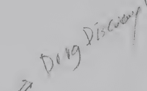

多年来，深度学习取得了许多发现和进展。这一概念最早于 1965 年提出，从那时起，科学家和研究人员对其进行了开发，达到了现在真实且完整的人工智能很快就会存在的程度。在这个节点，我们不再担心它“是否”会发生，而是好奇它“何时”会发生。显然，研究表明深度学习具有完成许多惊人动作的能力，每一种动作都将为最终的人工智能做出贡献，使其能够在不需要人类输入、交互或操作的情况下完全独立地运行、学习和进步。

## 2. 深度学习的前提条件

### 本章目标

在本章结束时，读者应该能够理解：

- 机器学习与深度学习之间的关系
- 机器学习算法
- 机器学习与深度学习的区别
- 深度学习和机器学习的应用领域

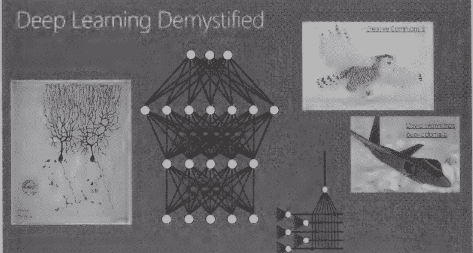

### 深度学习、机器学习与人工智能

深度学习是机器学习的一个子领域，关注由大脑结构和能力（即人工神经系统）所激发的计算。图 2.1 提供了一个非常有用的视觉辅助，展示了人工智能、机器学习和深度学习之间的关系。

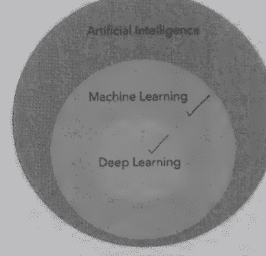

**图 2.1：三个同心圆**

这种方法通过海量信息维持一个模型，但比线性回归模型需要少的元素构建。

> “深度学习是一种特殊的机器学习，它通过学习将世界表示为嵌套的概念层次结构，实现巨大的力量和灵活性，每个概念都相对于更简单的概念定义，并用不抽象的表示计算更抽象的表示。”
>
> “一种机器学习技术，利用多层非线性信息处理进行监督或无监督的特征提取与变换，以及模式分析和分类。”

深度神经网络由分层级结构组成，也称为分层神经网络，其中每一层都将输入数据转换为更抽象的表示。输出层结合这些特征来做出预测。它改进了计算，使其简单且易于理解。它允许机器学习和 AI（人工智能）取得进步性的进展。深度学习模型具有执行从原始信息中提取任务的能力（也称为突出学习，最常称为特征学习），如图 2.2 所示。

输入层 → 隐藏层 1 → 隐藏层 2 → 隐藏层 3 → 输出层

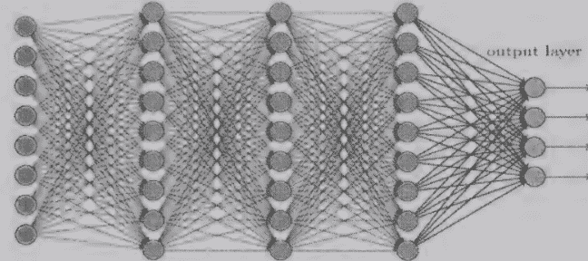

**图 2.2：深度神经网络的架构**

### 不同的机器学习方法

机器学习策略大部分可以分为两类，即监督类和无监督类，通常还会添加更多，例如强化学习。

#### 监督学习

监督学习算法是机器学习的一类，它使用一组标记数据对相同的未标记数据进行分类。分类过的数据是标记数据，而未标记数据未标记。标签是离散或连续的。大多数实际机器学习都使用监督学习。

为了更好地理解，我们应该利用另一个示例。机器人正在思考如何使用视觉识别来分拣垃圾。它整天在通过运输线时从垃圾中选出可回收物品。它将玻璃、塑料和金属等材料放入 12 个容器中。每件物品在贴纸上都有一个 ID 号。每天，人类专家会查看容器并指示机器人哪些物品安排不正确。机器人利用这些输入来取得进步。

一个正在研究如何区分路面上行人的 AI 使用了 2200 万段来自自动驾驶汽车的短路道路场景。部分记录没有行人，而其他记录则多达 25 个。根据这些信息准备了一系列学习计算，每个计算都有正确答案。每个计算都建立了一个模型集，用于识别快速移动场景中的步行者。然后对另一组信息对这些计算进行测试，以评估精确性和准确性。

在算法于标记数据（也称为训练数据）上运行之后，它会停止提高准确率。它可以用于新的未标记数据。有时输出并不一定是离散的，并且我们可能没有有限的类别来对数据进行分类。例如，下面的图 2.3 在拥有数百或数千个维度时可能会变得非常复杂。

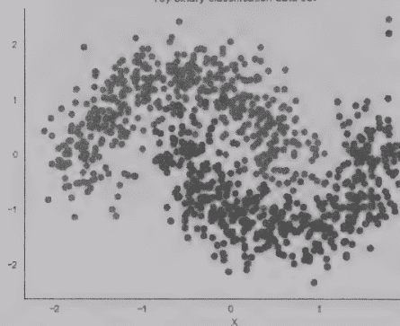

**图 2.3：作为分割输入的分类**

监督学习问题可以进一步分为回归问题和分类问题（图 2.4）。

- **分类问题**：结果变量是一个类别的点，例如，“红色”或“蓝色”或“生病”和“未感染”。
- **回归问题**：结果变量是一个真实的估计值的点，例如，“美元”或“重量”。

#### 分类与回归

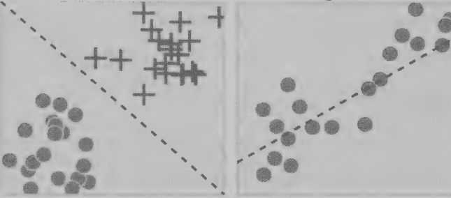

**图 2.4：分类与回归的区别**

一些常见的监督学习机器学习算法示例包括：

- 用于回归问题的线性回归。
- 用于分类和回归问题的随机森林。
- 用于分类问题的支持向量机。

#### 无监督学习

无监督学习是指你仅有输入信息，而没有相关的输出因子；我们允许计算来得出答案。尽管没有给出分类，一个框架也可以根据相似性和差异对无序数据进行聚类。无监督学习的目标是显示数据中的基本结构或分布，以便获取更多关于信息的信息。与监督学习不同，它没有标准答案，也没有老师。计算留给其特定的机制来发现和引入数据中的奇特结构。

无监督学习算法可以执行比监督学习框架更复杂的准备任务。尽管如此，无监督学习可能比替代模型更具随机性。例如，框架可能会自己学会如何将猫和狗区分开来，它可能会导致意想不到且不受欢迎的类别来处理异常品种，从而导致混乱而不是排序。这些策略通常被用于数据挖掘。被称为“模式识别”的迷人任务被用于发现数据内部的关系。无监督学习问题可以进一步分为聚类问题和关联问题。

##### 聚类

聚类问题是你想要发现数据中固有的分组，例如根据购买行为对客户进行分组。

##### 关联

关联规则学习问题是你想要发现描述数据大部分数据的规则，例如购买 X 的人也倾向于购买 Y。

一些常见的无监督学习算法示例包括：

- `K-means`，用于聚类问题。
- `Apriori` 算法，用于关联规则学习问题。

#### 强化学习

在强化学习机器学习算法中，机器被训练通过应用特定水平的智能来理解周围发生的活动，就像人类一样。机器从其自身行为的结果中学习，而不是作为一个固定的实体！简而言之，强化学习的目标是获得良好的策略，而不是良好的决策。为了理解这一点，让我们以你的宠物狗为例。把教狗学习一个新花样：你可以告诉它做什么，但如果它做对了，你可以给予奖励；如果它做错了，就给予惩罚。强化学习执行者（狗）需要理解它做了什么影响了它获得奖励或惩罚。强化学习操作者（狗）通过与其环境合作以及观察这些通信的后果来学习。

关于强化学习你应该知道的五点：

- 没有老板，只有奖励的概念。
- 这意味着强化学习智能体是根据每个活动的某些奖励做出选择的。
- 反馈是延迟的，而不是即时的。与其他机器学习方法不同，强化学习中的批评可能是延迟的，它甚至可能在最后发生，与不同的系统不同。
- 时间很重要。循环不是完全自由的也不是一成不变的；它会随着操作者的决定而改变。
- 智能体的动作会影响其接收到的后续信息。由于智能体实际上在与环境交互，后续活动实际上取决于当前的活动。

### 监督学习与无监督算法的区别

监督学习（图 2.5）是最受认可的机器学习类型。在监督学习中，训练阶段会将一组称为训练集的案例作为输入提交到框架中。每个输入都被指定了一个期望的输出值；因此，当输入进入时，框架知道输出是什么。例如，考虑一个可以归分为 N 个不同类别的实验观察。在这里，我们有一个训练集（一组集合）。训练是通过最小化特定的代价函数执行的，该函数描述了输入 `xi` 和期望输出 `yi` 的问题。

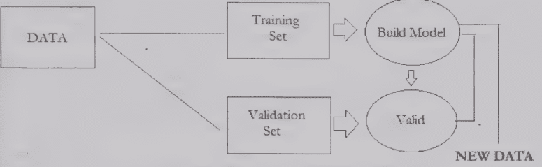

**图 2.5：监督学习**

监督机器学习应用的一个普通案例是垃圾邮件识别器；该算法使用垃圾邮件和非垃圾邮件进行训练，每封邮件组成一组。当你将电子邮件标记为“垃圾邮件”或“非垃圾邮件”时，就会发生此训练过程。

相反，在无监督学习（图 2.6）中，训练示例没有类别标记。框架根据特征将对象分组。

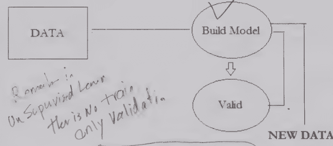

> **备注**：监督学习没有验证

**图 2.6：无监督学习**

| 监督模型 | 无监督模型 |
| :--- | :--- |
| 神经网络 | 不同类型的聚类 |
| 多层感知器 | 距离与归一化 |
| 决策树 | K-means |
| | 自组织映射 |

无监督学习的一个案例是聚类，它将相似的东西放在一组，将不同的放在另一组，其中相似性的概念取决于相似性度量（图 2.7）：

| 监督学习 | 无监督学习 |
| :--- | :--- |
| 训练数据包含输入和期望 | 不提供正确结果 |
| 快速且准确 | 更复杂 |
| 聚类意义和标记 | |

#### 分类与聚类

聚类和分类看起来是相似的过程。它们实际上是两种学习方法，根据特征对组进行分类。

##### 分类

在基于数据数据集的分类中，对象被区分开。目标是通过分析训练集来预测目标类别。为了获得用于确定每个目标类的更好的边界条件，使用了训练数据集。

###### 分类算法

可以使用任何分类算法；下面列出了一些名称。

- 线性分类器
- 逻辑回归
- 朴素贝叶斯分类器
- 费舍尔线性判别
- 支持向量机
- 最小二乘支持向量机
- 二次分类器
- 核估计
- k-最近邻
- 决策树
- 随机森林
- 人工神经网络
- 学习向量量化

###### 分类算法的应用

- 电子邮件垃圾邮件分类
- 预测银行客户的贷款还款意愿
- 肿瘤细胞识别
- 情感分析
- 药物分类
- 面部关键点检测
- 自动驾驶车辆中的行人检测

##### 聚类

在聚类中，具有相同特征的对象聚集在一起，具有不同特征的对象也聚集在一起。它不像分类那样预测目标类别。它是关于通过考虑最令人合意的条件来将相似的事物分组，使得同一组中的所有项目应该是相似的，且没有两个不同组的物品是相似的（如图 2.8 所示）。

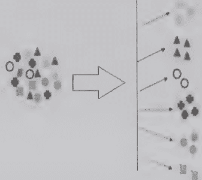

**图 2.8：聚类**

###### 聚类算法

聚类算法分为两大类：线性聚类算法和非线性聚类算法。

- **线性聚类算法**
  - 均值聚类算法
  - 模糊均值聚类算法
  - 层次聚类算法
  - 高斯 (EM) 聚类算法
  - 质量阈值聚类算法
- **非线性聚类算法**
  - 基于 MST（最小生成树）的聚类算法
  - 核 K均值聚类算法
  - 基于密度的聚类算法

###### 聚类算法的应用

- 推荐系统
- 异常检测
- 人类基因聚类
- 基因组序列分析
- 抗微生物活性分析
- 购物物品分组
- 搜索结果分组
- 滑动地图优化
- 犯罪分析
- 气候学

### 深度学习与机器学习的比较

传统的机器学习方法在处理简单框架内的普通信息方面受限于其处理能力。在很长一段时间里，开发一个模式识别或机器学习框架需要谨慎的构建，并需要巨大的空间容量来概述一个元素提取器，该提取器将原始信息（例如图片的像素主干）转换为合理的内部肖像或特征向量，使得学习子系统（通常是分类器）能够识别或表征信息中的模式。

机器学习同样鼓励我们发现视觉、语音识别和机械自主领域某些问题的答案。让我们以人脸识别为例：这是一个我们轻松完成的任务；我们总能通过观察脸部或照片来识别亲友和伙伴，无论姿态、光线、硬度等是否存在差异。在任何情况下，我们都是在无意中完成的，并且无法解释我们是如何做的。由于我们尚未准备好解释自己的掌握程度，因此无法编写计算机程序。与此同时，我们意识到一张脸的照片不仅是不规则的像素堆积；它具有结构。它是对称的。有眼睛、鼻子和嘴巴，位于脸部的特定位置。每个人的脸都是这些元素特定组合而成的示例。通过检查一个包含男子照片的测试，学习程序捕捉到特定于该个人的示例，随后在给定的图片中识别该示例。这就是模式识别的一个案例。

机器学习正在改变计算机，利用插图信息或过去的经验来升级执行基础。我们有一个具有最多几个参数特征的模型，而学习就是执行计算机程序，利用训练信息或过去的经验来优化模型的参数。该模型可以是预测未来的预见者，也可以是从信息中学习的图表，或者两者兼顾。

我们将选取几点来对比机器学习和深度学习这两种技术。

#### 数据依赖性

深度学习与传统机器学习之间最重要的区别在于其随数据量增加而变化的性能。当数据很少时，深度学习的计算表现并不理想。这是因为深度学习计算需要大量数据才能良好地理解。在这种情况下，传统的机器学习算法凭借其精心设计的规则表现得更好。下图展示了这一现实。

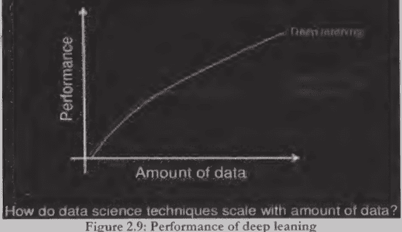

**图 2.9：深度学习的性能**

#### 硬件依赖性

深度学习算法非常依赖高端机器，而传统的机器学习算法可以在低端机器上运行。这是因为深度学习算法的需求包含了 GPU，GPU 是它们工作的重要部分。深度学习算法本质上执行着大量的矩阵乘法操作。这些操作可以使用 GPU 进行高效优化，因为 GPU 正是为此目的而设计的。

#### 特征工程

特征工程是将领域信息投入特征提取器的制作过程中，以减少信息的复杂性，并使模式对于学习算法而言更易可见的过程。这一过程在时间和专业知识方面方面都是困难且昂贵的。

在机器学习中，大部分应用特征应该由专家进行识别，并根据领域和数据类型进行手动编码。

例如，特征可以是像素值、形状、表面、位置和朝向。大多数机器学习算法的执行减轻了特征的识别和提取工作。

深度学习算法尝试从信息中获取高级特征。这是深度学习中一个非常特殊的领域，也是与传统机器学习相比向前迈出的重要一步。因此，深度学习减少了为每个问题开发新特征提取器的工作。同样，卷积神经网络将尝试培养低级特征，例如早期层中的边缘和线条，然后是人脸的部位，最后是脸的高级表示。

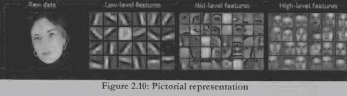

#### 问题解决方法

当你通过传统的机器学习算法对问题进行分类时，通常建议将问题拆分为许多部分，独立地解决它们并合并结果。相比之下，深度学习提倡端到端（`end-to-end`）地解决问题。让我们来看一个例子来检查。

假设你有检测几个物体的任务。该任务是识别物体是什么以及它出现在图像的哪个位置（图 2.11）。

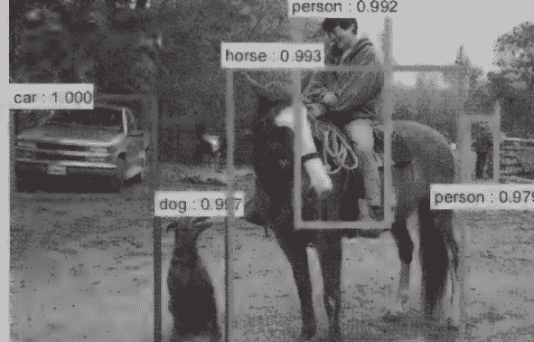

在典型的机器学习识别方法中，你将问题划分为两个步骤：物体检测和物体识别。你将使用边界框（`bounding box`）检测算法来扫描图像并找到所有可能的物体。然后，对于所有识别出的物体，你将使用如带 HOG 的 SVM 等物体识别算法来识别相关物体。相比之下，在深度学习方法中，你将端到端地完成这一过程。例如，对于 YOLO 网络（一种深度学习算法），你输入一张图像，它就会输出位置以及名称。

#### 执行时间

通常，深度学习算法的训练需要长时间。这是因为深度学习算法中有许多参数，导致训练花费更长时间。相比之下，机器学习从头开始训练大约只需要几秒到几小时。

这种情况在测试时间上是完全反的。在测试时，深度学习算法运行的时间大大缩短。然而，如果你将其与 K 最近邻（一种机器学习算法）相比，测试时间会随数据量的增加而增加。但这种情况并不适用于所有机器学习算法，因为某些算法的测试时间也很短。

#### 可解释性

最后但同样重要的是，可解释性是机器学习与深度学习之间的一个特征。这是深度学习在工业领域应用前仍被考虑 10 倍的主要原因。

让我们来看一个例子。假设我们使用深度学习对论文进行自动评分。它给出的计算结果非常好且接近人类水平。但存在一个问题：它没有说明为什么给特定的作业那个分数。事实上，在数学上，你可以找到深度神经网络中哪些神经元被激活了，但我们不知道它们的神经在模型什么，这些神经元层作为一个整体在做什么。因此，我们无法解释结果。

相反，决策树等机器学习算法为我们提供了清晰的规则，说明为什么做出这些选择，因此解释背后的逻辑非常容易。因此，决策树和线性/逻辑回归等算法在工业中主要用于可解释性。

### 机器学习的应用

机器学习的应用领域包括：

- 计算机视觉；用于车辆车牌识别和人脸识别。
- 信息检索；用于搜索引擎，包括文本搜索和图像搜索。
- 营销；用于自动电子邮件营销和目标识别。
- 医疗诊断；用于癌症识别和异常检测。
- 自然语言处理；用于情感分析和照片标记。
- 在线广告，等。

## 机器智能图谱

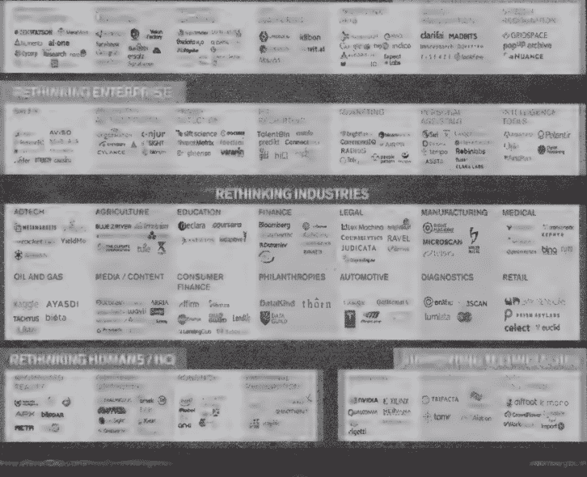

**图 2.12: 机器学习应用**

使用机器学习/深度学习的一个主要企业例子是 Google（图 2.13）。

## 包含模型描述文件的目录数量

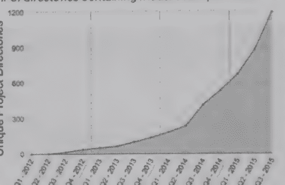

**图 2.13: 深度学习在 Google 的增长**

在上面的图中，你可以看到 Google 如何在其各种产品中使用机器学习。机器学习/深度学习的应用是无处不在的，你只需要寻找正确的机会即可！

### 未来趋势

上面的文字将让你对机器学习、深度学习以及它们之间的区别有一个大致的了解。

首先，考虑到工业界对数据科学和机器学习日益增长的使用趋势，对于每一家想要生存并在行业中融入机器学习的公司来说，这将比以往任何时候都更加重要。此外，每个个人都被期望掌握基础术语。

- 深度学习每天都在震撼我们，并在不久的将来将继续如此。这是因为深度学习已被证明是目前发现的具有顶级性能的卓越技术之一。
- 机器学习和深度学习的研究在不断进行。然而，与过去研究局限于学术界不同，机器学习和深度学习的研究在工业界和学术界都在爆发。随着比以往任何时候更多的资金可用，它可能在人类整体发展中发挥关键作用。

## 3. 人工神经网络：是什么？为什么？

### 本章目标

在本章结束时，读者应该学会：

- 人工神经网络架构
- 人工神经网络应用

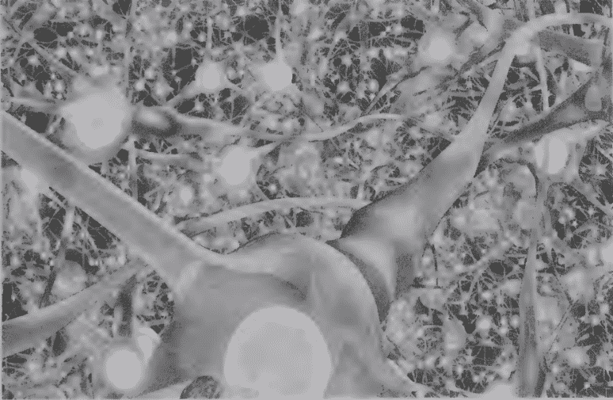

### 章节介绍

正如你之前学到的，深度学习的实现是通过引入和使用人工神经网络。这些网络是为了反映动物大脑中工作的生物神经网络而开发的，使其能够作为独立生物体发挥功能。这些系统具有自我学习的能力，使它们能够逐步提高自己的知识和能力。这些系统背后的思想是，它们可以学会自己执行任务，而不需要特殊的编程或人类的干预来教它们如何做，就像真正的动物一样。

人工神经网络工作的一个很好的例子是观察它们如何对包含狗的图片做出反应。例如，如果有一个程序标记了“狗”和“不是狗”，人工神经网络将开始识别图片中的哪个元素实际上是狗。结果是，它就知道狗长什么样了。从那以后，它将能够识别狗，并对狗是什么有深刻的理解。这就像你教婴儿识别狗一样。起初，你必须教他们如何做，但在他们能够在任何情况下识别狗之后，他们就可以发展出关于狗的信息，例如它们长什么样、什么定义了狗，以及什么不是。例如，他们将能够通过外貌将狗和猫区分开来，以后通过动作和声音来区分。人工神经网络具有这种能力，使其能够成为它们自己的独立物种。

开发人工神经网络需要大量的连接单元。这些单元被称为人工神经元，它们的创建是为了模仿生物大脑中的轴突，轴突是神经元的一种。每个神经元都有与其他神经元的连接，这被称为突触。突触用于将信号传输到人工神经网络中的其他神经元。就像动物大脑一样，接收到的神经元可以向序列中的其他神经元发出信号，允许人工神经网络运行得像动物大脑一样。序列化的结果是某些信号和消息发送到整个大脑，导致连接在大脑上的身体以各种独特的方式行动、反应和响应。

在真正的动物大脑中，神经元被组织成一系列。这些层中的每一层都负责帮助大脑执行不同的任务，每一层本质上都专注于某些信息和转换。它可以接收从一个神经元到下一个神经元的传输，以便将信号从第一个输入层传到最后一个输出层。最初，负责处理和创建人工神经网络的科学家试图完全模仿动物大脑，这就是为什么它是这样构建的。然而，后来他们决定在每个产物中创建特定的能力，以便每一个都专业化。

迄今为止，科学家和研究人员已经使用人工神经网络创建了能够完成各种任务的系统。这些任务包括从语音识别到计算机视觉、游戏中的计算机对手，甚至是医疗诊断系统。尽管人工神经网络已经变得非常有才华，并且远超最初的人工神经网络，但与人类大脑相比，它们仍然非常简单。在本书出版时，它们还与虫的大脑进行了比较。然而，尽管只被认为具有与虫脑相当的能力，但它们已经能够完成许多远比虫能做的更先进的任务。

## 神经网络概述

正如我们所知，计算机具有用于计算的处理器和内存。它们在短时间内执行复杂的计算，但它们的适应性并不强。神经网络的引入了一种不同于传统计算机的解决问题的方法。在过去的十年里，神经网络收到了大量的关注。它们被广泛使用是因为它们会对意外输入做出反应。

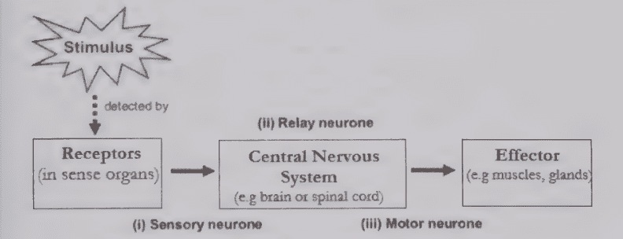

图 3.1: 神经系统的框图表示

从左到右的箭头表示携带信息的信号在系统中正向传输，而从右到左的箭头显示反馈。大脑与计算机的比较见表 3.1。

| 特性 | 大脑 | 计算机 |
|---|---|---|
| 处理单元数量 | $\approx10^{11}$ | $\approx10^{9}$ |
| 计算类型 | 神经元 | 大规模并行 通常是串行 |
| 数据存储 | | 基于地址 |
| 切换时间 | $\approx10^{-3}$s | $\approx10^{-9}$s |
| 可能的切换操作 | $\approx10^{13}\frac{1}{4}}$ | $\approx10^{18}\frac{1}{2}}$ |
| 实际切换操作 | $\approx10^{12}\frac{1}{2}}$ | $\approx10^{16}\frac{1}{2}}$ |

中枢神经系统

区域间电路

局部电路

神经元

树突

神经微路

突触

图 3.2：大脑的结构组织

## 什么是神经网络？

人工神经网络通常也被神经网络。这项研究的灵感源于人类大脑，大脑是一个与传统数字计算机工作方式完全不同且成功的生物系统。大脑是一个高度复杂的非线性且并行的处理器。它由大量高质量的神经细胞组成，能够进行大规模并行工作，并且具有学习能力。人类大脑中有近100亿个神经元。一个典型的神经元（图 3.3）由细胞体、树突和轴突组成。

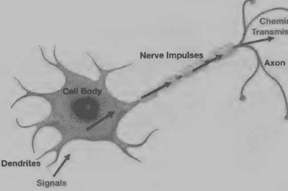

图 3.3：生物神经元

神经网络的构建块是神经元。在技术系统中，我们也称它们为单元或节点。图3.3展示了一个人工神经网络。基本上，每个神经元：

- 接收来自许多其他神经元的输入，
- 根据当前输入改变其内部状态（激活），
- 向许多其他神经元发送一个输出信号，可能包括其输入神经元（递归网络）。

数据以电脉动的序列形式传输，即所谓的脉冲（spikes）。这些脉冲的循环和周期编码了数据。在自然框架中，一个神经元可以与超过10,000个不同的神经元相关。通常情况下，神经元接收来自不同神经元的数据。

神经网络通过调整其连接模式来学习，使有机体在实现某些（进化）目标方面改进其行为。连接的强度（无论是兴奋性的还是抑制性的）取决于接收神经元突触的状态（如下所示）。神经网络通过恰当地调整其突触状态来实现学习。

## 人工神经元介绍

神经网络或人工神经网络是计算机上的模拟，用于执行聚类、分类、模式识别等特定任务。下面的图详细解释了人工神经网络。

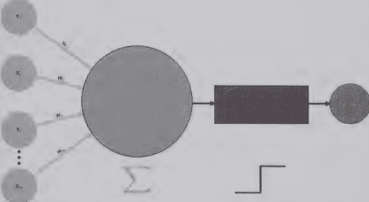

图 3.4 人工神经网络

- 人工神经网络以向量形式的模式和图像从外部世界接收输入。这些输入在数学上用符号 $x$ 表示，其中 $i \in \{1, n\}$，$n$ 是输入的数量。
- 每个输入都与其权重 $w$ 相乘，权重代表神经网络内部神经元之间连接的强度。神经网络利用它来解决问题。
- 加权后的输入在计算单元（人工神经元）内部被求和。
- 总和对应于从 0 到无穷的任何数值。为了限制响应以达到期望值，会设置一个阈值。为此，总和将通过一个激活函数，该函数转移了用于获取期望输出的函数函数。

### 有用的概念和术语

#### 层 (Layer)

层是深度学习中最高级别的构建块。层是一个容器，通常接收加权输入，使用一组大部分为非线性的函数对其进行转换，然后将这些值作为输出传递给下一层。层通常是均匀的，也就是说，它只包含一种类型的激活、池化、卷积等，以便其可以轻松地与网络的其它部分进行比较。网络中的第一层和最后一层分别称为输入层和输出层，中间的所有层被称为隐藏层。

#### 单元 (Unit)

单元指的是层中的激活函数，输入通过该非线性激活函数进行转换。通常，一个单元有多个输入连接和多个输出连接。池化、卷积和其他输入转换函数通常不被称为单元。

#### 激活函数 (Activation function)

神经网络计算其输入的加权和，加上一个偏置（bias），然后决定它是否应该被“考虑”。加权和 + 偏置的值可以在任何区间内范围。

那么，我们如何决定神经元是否应该被考虑呢？激活函数完成了这项任务；它们检查神经元产生的值，并决定外部连接是否将该神经元考虑为“已触发”。

单元和激活函数之间的区别在于，单元可以更复杂，也就是说，一个单元可以有多个激活函数或稍微复杂的结构。

特定层的神经元接收类似的执行工作。在所有情况下，都利用了非直连的执行能力。不同类型的执行能力被用作：

- 阈值函数
- 分段线性函数
- Sigmoid 函数

## 特征工程 (Feature engineering)

在这里，我们对特征工程给出实用的解释。它是从数据中提取有用模式的艺术，这使得机器学习模型能够更容易区分不同类别。特征可以是像素值、形状、纹理、位置和方向。

在机器学习算法中，性能基于这些特征的准确性以及它们的识别和提取。然而，深度学习算法可以从数据中学习高级特征。事实上，深度学习减少了为每个问题开发新特征提取器的任务。

让我们考虑人脸识别的例子。当我们人类尝试识别特征时，我们关注各种特征，如眉毛、嘴唇、眼睛的形状、发型模式等。

我们通过组合低级特征（如眉毛、嘴唇等）来识别这些特征。

深度学习卷积神经网络也是类似的。它首先识别低级特征（如边缘），然后学习识别曲线并将它们组合成嘴唇、眼睛和眉毛的模式。这些不同级别的特征来自网络的不同层。

### 特征学习 (Feature Learning)

特征学习是一系列学习特征的技术，即将原始数据输入转换为可以在机器学习任务中有效使用的表示。这避免了原本需要的人工特征工程，并允许机器同时学习特定任务（使用特征）和学习特征本身。

### 大学习率

### 小学习率

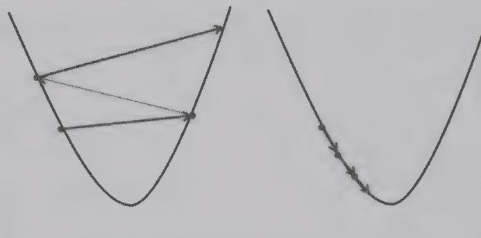

图 3.5：深度学习中的梯度下降

## 人工神经网络结构

正如我们之前所看到的，人工神经网络（ANN）通常被称为神经网络。现在，让我们来看一些全面的定义和图形表示（图 3.6）。

- 计算系统由许多简单、高度互连的处理单元组成，这些单元通过其对外部输入的动态状态响应来处理信息。
- 人工神经网络（ANN），经常被称为“神经网络”（NN），是一种类似于自然神经网络的数值模型或计算模型；根结底，它是对有机神经框架的模仿。

典型的神经网络包含大量被称为单元的人工神经元，它们被排列成一系列层。术语表提供了关于单元和层的更多解释。大多数神经网络是全连接的，这意味着每个隐藏神经元都与其前一层（输入层）以及后一层（输出层）中的每一个神经元全连接。

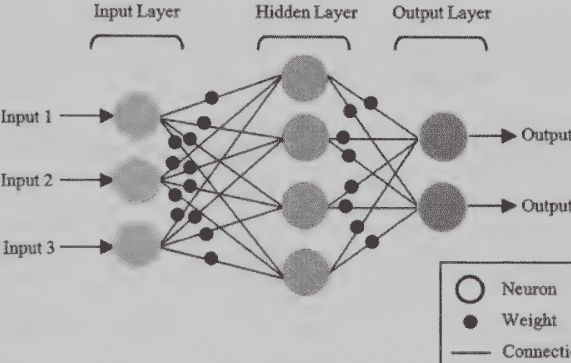

图 3.6：人工神经网络

现在我们需要理解 ANN 的主要特征。如图 3.6 所示，它们具有三层架构。输入层连接到隐藏层，隐藏层又连接到输出层。

### 输入层

输入层的节点是被动的，因为它们不修改数据。这一层负责从外部环境接收数据。它们接收单个值。

### 隐藏层

来自信息层的每一个激励都被复制并发送到所有隐藏枢纽；这被称为全连接结构。它们执行计算并将数据从信息枢纽交换到输出枢纽。

### 输出层

负责计算并将信息从网络传输到外部世界。

## 监督和无监督神经网络

神经网络的算法可以是监督的或无监督的。如果期望输出已经已知，则神经网络是有监督的。让我们考虑模式关联的例子。

假设神经网络将学习关联以下模式对。输入模式是十进制数字，每个数字由一个位序列表示。目标模式以十进制数字二进制的形式给出：

| 输入模式 | 目标模式 |
|---|---|
| 0001 | 001 |
| 0010 | 010 |
| 0100 | 011 |
| 1000 | 100 |

在学习过程中，其中一个输入模式被赋予输入层。该模式通过网络（与其结构无关）传播到输出层。输出层生成输出模式，然后将其与目标模式进行比较。根据输出与目标之间的差异，计算出一个误差值。

此输出误差表示了该预测的质量，它可以通过“虚拟监督员”来控制。计算出的误差值越大，权重的变化就越大。以无监督方式学习的神经网络没有这样的目标输出。无法确定学习过程的结果将是什么样。

在学习过程中，这种神经网络的单元（权重值）根据给定的输入值在某个范围内进行“排列”。目标是将相似的单元聚集在值范围的某些区域内。

## 人工神经网络的基础知识

### 感知器：一种早期的深度学习算法

这些已知的最老且最简单的人工网络由 Rosenblatt (1958) 定义为一种通过使用示例进行学习的机器，它使用输入的线性函数将输入向量（样本）分配到不同的类别。

现在，这里还有一个感知器外观的图。与上面的神经细胞图非常相似，对吧？确实如此。感知器和其他神经网络受到了我们脑中真实神经元的启发。注意，它只是受到了启发，工作方式与真实神经元并不完全。感知器处理数据的过程如下：

1. 在左侧，你有带有下标 1, 2, ..., m 的 x 神经元（小圆），携带数据输入。
2. 我们将每个输入乘以权重 w，权重也带有下标 1, 2, ..., m，标记在指向中间大圆的箭头上（也称为突触）。因此是 `w1 * x1, w2 * x2, w3 * x3` 等此类推。
3. 一旦所有输入都乘以了权重，我们将它们全部相加，并加上另一个预定的数字称为偏置（bias）。
4. 然后，我们将结果进一步向右推。现在我们在矩形中有这个阶跃函数。这意味着如果步骤 3 的结果是任何大于等于 0 的数字，我们就得到 1 作为输出，否则，如果结果小于 0，我们就得到 0 输出。
5. 输出是 1 或 0。

注意，另一种情况下，如果你将激活函数中的偏置移动到方程的右侧，如 `sum(wx) ≥ -b`，那么这个 `-b` 就称为阈值。因此，如果输入和权重的和大于或等于阈值，激活将触发一个 1。否则，激活结果为 0。选择任何有助于你更好地理解的方式即可，因为这两种表示方法是可以互换的。

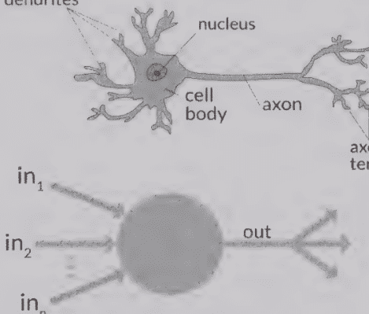

图 3.7：感知器

### 训练感知器

感知器的训练包括使用不同的示例来确定权重。通过限制误差与真实值之间的差异来平衡权重。

### Adaline 学习算法

Adaline 是自适应线性单元（ADaptive LINear Element）或自适应线性神经元（ADaptive LINear Neuron）的缩写。该算法由 Widrow 和 Hoff (1960) 开发。

## 神经网络的应用

神经网络的应用可以分为以下几类。

### 聚类

聚类算法探索模式之间的相似性，并将相似的模式放在一个聚类中。最为人知的应用包括数据压缩和数据挖掘。

### 分类与模式识别

一个例子是将一个信息设计（如手画的图像）分配到许多类别中的某一个。这种分类包含了算法的使用，例如熟悉记忆。

### 函数近似

函数近似的任务是寻找一个受噪声影响的未知函数的估计值。各种工程和科学领域都需要函数近似。

### 预测与动力学系统

任务是预测（时间序列数据）的未来值。预测显著影响了情感支持网络的选择。与函数近似不同，预测考虑了时间因素。在这里，框架根据框架状态（时间）为相似的信息提供独特的执行结果。

以下是人脸识别的示例，这只是为了帮助理解大规模人工神经网络（ANN）如何运作的一个心理构图。在这个阶段，你只需要阅读这个示例并思考 ANN 的架构。

假设我们想为计算机视觉应用构建一个网络。更具体地说，我们的网络用于识别人脸和面部表情。这是一个已经实现的示例。所有信息、程序代码、数据等都可以在 `http://www.cs.cmu.edu/afs/cs.cmu.edu/user/mitchell/ftp/faces.html` 找到。

目标是分类具有各种面部表情和姿态的不同人的脸图像。收集了 20 个不同人的图像，每人最多 32 张。引入了以下变量：

- 表情（快乐、悲伤、愤怒、中性）
- 视线（左、右、正前方、上方）
- 眼镜（有或无）

总共收集了 624 张灰度图像，每张图像的分辨率为 30x32 像素，强度值在 0 到 255 之间。这里介绍的网络任务只是确定输入图像中显示的脸姿态（左、右、上、正前）。

它使用了：

- 960 个输入单元（图像中的每个像素一个）
- 3 个隐藏单元
- 4 个输出神经元（每个姿态一个）

每个输出单元接收一个额外的输入，该输入始终为 1。

通过改变此输入的权重，反向传播算法可以调整网络输入信号的偏移量。它们的值由亮度表示（从黑色 = -1 到白色 = 1）。每个 30x32 的矩阵代表三个隐藏层单元之一的权重。每行的四个正方形代表一个输出神经元的权重（三个用于隐藏单元信号的权重，以及一个用于常数信号的权重！）。训练后，网络能够正确分类 90% 的新（非训练）人脸。

## 人工神经网络面临的挑战

尽管人工神经网络非常强大且具有革命性，但它们面临着许多需要开发者解决的挑战。它们体积庞大、运行缓慢，并且只能执行最小的任务。

使用人工神经网络完成任何基本功能所需的计算时间非常长。虽然观察机器通过人工神经网络完成其中的某些事情确实引人入胜，但这并不合理。由于许多研究人员和开发者希望看到深度学习机器用于各种社会功能，尽管它们目前仍仍一定程度上被使用，但其流行已远不如最初了。最终，开发者决定建立一种形式的“人工神经网络 2.0”。也就是说，他们创建了深度神经网络，你将在接下来的章节中学习它们。

在涉及深度学习时，人工神经网络是方程中的“如何做”部分。它们负责促进一个使深度学习能够发生的网络。没有人工神经网络，就没有深度学习。就像的大脑一样，这些网络负责连接到深度学习系统的工智能的发展和增长。如果它们不存在，系统本质上将是空虚的。它们将消失，不再有深度学习。如果我们没有自己的大脑，情况也是如此。正如你所看到的，深度学习远不止人工神经网络，但如果没有它们，也将无从起。它们是整个系统的核心组成部分。

# 4. 深度学习的概述

## 本章目标

在本章结束时，读者应该学到：

- 人工智能与深度学习之间的联系
- GPU 与 CPU 的重要性
- 三类分类法
- 深度学习的循环方法

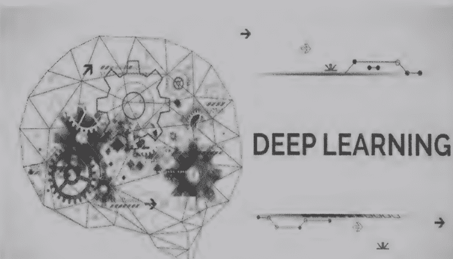

深度学习

人工神经网络是深度学习的基础，但深度网络的发展远超人工神经网络。自从人工神经网络开发以来，科学家和研究人员一直致力于开发和使用深度网络。这些系统与人工神经网络非常相似；然而，它们也有一些不同。它们是深度学习的未来，随着深度学习系统的进步，预计深度神经网络最终将完全取代人工神经网络。

如你所知，人工神经网络是为了模拟动物大脑而开发的浅层网络。然而，它们确实有很多缺点，其中就是体积庞大且需要许多系统才能工作，并且它们只能完成少数的专门任务。就深度学习而言，目标是最终创建出完全的智能，它只需要或不需要人类输入即可有效运行和增长。为了让我们更接近这一目标，深度神经网络被了。

深度神经网络是人工神经网络的高级版本。它具有更小的单元且不那么“僵硬”，但能够执行人工神经网络的复杂函数。这些网络的架构师专注于少数基本方法，以开发一种更新、更实用的程序，让深度学习网络高效地运行。

## 用于神经网络深度学习的快速图形处理器 (GPU)

CPU（中央处理器）通常被认为是电脑的大脑。但日益，这个大脑正在被电脑的另一个部分——GPU（图形处理器）增强，它是灵魂。所有电脑都有具有渲染显示器图像的芯片。但并非所有这些芯片都是平等的。集成显卡提供基础图形，显示生产力应用程序如 Microsoft PowerPoint、低分辨率视频和基础游戏。

GPU 属于独立范畴，远超图形控制器的功能，并且本身就是一个可编程的强大计算设备。深度学习需要系统来运行，GPU 必须是解决方案的一部分。

GPU 通常用于计算机游戏，这是一个巨大且专注的市场，降低了设备成本。GPU 在感知或提供虚拟内容所需的快速矩阵和向量乘法方面表现超预期，并且可以将学习加速 50 倍。

## GPU 与 CPU

GPU 有数百个简单核心，而 CPU 只有少数简单核心。GPU 有数千个并发硬件线程，并可以最大化浮点吞吐量。

为了理解这一特征，我们取了一个自然区分的示例。假设你需要将货物从一个地方移动到另一个地方。你可以选择法拉利或货车。法拉利确实快得多，让你能够在眨眼之间移动货物，但你能运输的货物数量很少，而且油成本很高。货车卡车的速度较慢，移动货物花费的时间更长。然而，与法拉利相比，它的载量更大。此外，它的燃油效率更高，因此成本更低。

目前的先进深度神经网络利用算法、大数据和 GPU 的计算能力来改变这种动态局面。研究领域和工业界利用深度学习来帮助解决许多数据问题，例如计算机视觉、语音识别和自然语言处理。实际示例包括：

- 图像识别
- 语音识别与翻译
- 自然语言处理
- 生命科学

## 三类分类法

如前所述，深度学习涉及到非常广泛的机器学习策略和模型，其特征是利用许多层非线性数据处理，而这些处理在本质上是分层级（层次化）的。根据设计和策略的使用方式（例如组合/生成或识别/分类），可以将绝大多数工作分为三类值得注意的类别：

### 用于无监督或生成式学习的深度网络

这些网络用于在没有目标类别标签数据的情况下，捕捉可见或明显信息的高度组织相关性，以用于模式分析或合成。文献中的无监督组件或表示学习指的就是这类深度系统分类。当作为生成模式的一部分使用时，它可能同样被用于描述可见信息与相关类别之间的联合统计分布（如果可用），并将其视为可见数据的特征。在最后一种情况下，利用贝叶斯定理可以将这类生成网络转换为用于学习的判别网络。

### 用于监督学习的深度网络

这些网络专门用于为模式分类目的提供判别能力，通常通过描述根据条件数据调整的类分布来实现。在监督学习中，目标标签数据在直接或间接结构中始终可用。这些也被称为判别深度系统。

### 混合深度网络

其目标是判别，并通过生成网络或无监督网络的结果辅助。可以通过对分类中的深度系统进行更好的优化和/或正则化来提高。当利用监督学习的判别标准来评估上述分类中任何深度生成或无监督深度结构的参数时，目标也可以得到改进。

## 深度学习的常见方法

### 监督学习 / 强化学习中的动态规划

深度学习的一个反复主题是动态规划（DP），它可以在特定假设下促进任务完成。例如，在监督学习（SL）神经网络中，反向传播本身就可以一种基于 DP 的强化学习（RL），在稳固的马尔可夫假设下，基于 DP 的策略可以帮助显著减少问题复杂度。DP 算法也是结合神经网络和图模型概念（如隐马尔可夫模型 HMM 和期望最大化 EM）的框架的基础必要要素。

### 促进 SL 和 RL 的无监督学习 (UL)

另一个反复主题是 UL 促进 SL 和 RL 的方式。UL 通常用于将输入数据（如视频或语音流）编码为更便于后续目标导向学习的形式。特别是，以更少冗余或更紧凑的方式解码原始数据的代码可以输入 SL 或 RL 机器，其搜索空间可能比处理原始数据所需的空间更小（且 CAPS 深度更浅）。UL 与正则化和压缩主题紧密相关。

### 通过深度 SL、UL、RL 学习层次表示

用于老式人工智能（GOFAI）的许多策略以及后期处理 AI 和机器学习的方法，学习了日益增多的动态信息表示的层次。例如，某些句法模式识别技术，如通过语法归纳来寻找正式标准的链以展示观测结果。大多数（无）监督的自动数学家/EURISKO 通过结合已学习的观点不断学习新思想。这种层次表示学习也是深度 SL、UL 辅助 SL 以及层次化 RL 深度学习神经网络的反复主题。通常，抽象的层次表示是信息压缩的正常结果。

### 奥姆剃刀：压缩与最小描述长度 (MDL)

奥姆剃刀倾向于选择简单的结构而非复杂的结构。给定某种编程语言，可以使用最小描述长度（MDL）规则通过处理它的最短程序的长度来量化答案候选者的方面质量。一些策略显然考虑了程序运行时间；可能仅考虑具有恒定运行时间的用非通用编程语言编写的程序。在神经网络的情况下，MDL 标准在贝叶斯视角下建议低神经网络权重复杂度相比于高神经网络概率，对应于高泛化性能，而不会过拟合训练信息。已经提出了许多用于正则化神经网络的策略，包括扫描求解计算以及简单、低复杂的 SL 神经网络和 RL 神经网络。这与某些 UL 技术紧密相关。

## 用于神经网络深度学习的快速图形处理器 (GPU)

GPU 通常用于计算机游戏，这是一个庞大且集中的市场，推动了设备成本的降低。在渲染/展示或提供虚拟内容所需的快速矩阵和向量乘法方面，GPU 的表现超出了预期；在神经网络训练中，它们可以将学习速度加速 50 倍。

- 占比为，因子 50 倍

## 5. 多层感知机与反向传播：它们的工作原理

### 本章目标

本章将涵盖利用一种名为“多层感知机”（简称 MLP）的特定系统以及反向传播算法的核心内容。

### 多层感知机

当你拥有大多数人认为“标准数据”时，通常会使用 MLP，例如表格格式的数据，其中行是样本，列是变量。这里需要包含的另一个重要点是，行和列之间都是可以互换的，这意味着我们可以交换行的顺序或列的顺序，而不会改变输入信息的“含义”。

MLP 可以被视为逻辑回归分类器，其中输入首先通过非线性变换进行改变。这种变换将输入数据投影到一个空间，在该空间中数据证明是线性可分的。这个中间层被称为隐藏层。单个隐藏层就足够构建 MLP 了。

### MLP 模型

图 5.1 显示了一个带有单个隐藏层的 MLP。

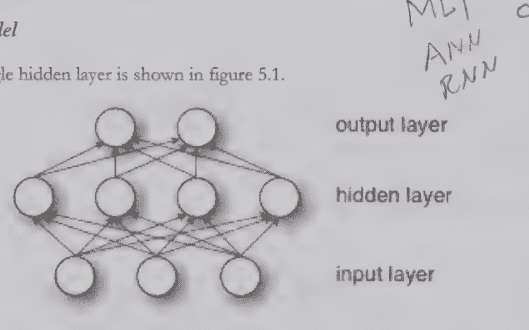

图 5.1：MLP 模型

### 训练 MLP 的技巧

有几个超参数是无法通过梯度下降来增强的（通常也无法增强）。从本质上说，为这些超参数找到合适的超参数并不是一个可行的问题。首先，我们不能自由地优化每一个超参数。其次，我们无法立即应用梯度策略（部分是因为少数参数是离散值，而其他是实数值）。第三，优化问题不是凸的，寻找局部最优将涉及大量工作。

幸运的是，在过去的 25 年里，科学家们开发了在神经系统中选择超参数的不同通用指南。在 Yann LeCun、Leon Bottou、Genevieve Orr 和 Klaus-Robert Mueller 编写的《高效反向传播》（Efficient BackProp）中可以找到这些陷阱的良好概述。

### 反向传播

这最初于 20 世纪 70 年代引入，但直到 1986 年价值才被充分认识。它比许多早期方法更快，并使得许多无法解决的神经网络问题变得可能。

反向传播（Backpropagation，简称 BP）是“误差反向传播”（如图 2.5 所示），是一种用于人工神经网络梯度下降的监督学习算法，也是训练神经网络的常用方法。该方法被称为人工神经网络和误差函数，它计算误差函数相对于神经网络权重的梯度。它是感知机向多层前馈神经网络的推广。它的命名是因为梯度的计算是先通过网络从后向前传播的。首先计算最后一层权重的梯度，最后计算第一层权重的梯度。

在使用反向传播算法训练神经网络时，使用梯度下降技术来确定权重的更新。梯度下降是一种迭代最小化方法。误差函数的梯度始终指示误差函数上升最快的方向。因此，我们可以从一个随机权重向量开始。

### 定义反向传播

反向传播类似于为多层前馈网络计算增量规则（delta rule）。与增量规则一样，反向传播需要三个要素：

1. 一个由输入-输出对组成的数据集，其中 $x_i$ 是输入，$y$ 是取决于输入的网络期望输出。这组大小为 $N$ 的输入-输出对表示为：
2. 前馈神经网络统一记为 $\theta$。同一层的节点之间没有连接，而层与层之间是全连接的。
3. 误差函数定义了给定输入下期望输出与计算输出之间的误差。

使用梯度下降的神经网络需要计算用于训练的误差函数梯度，涉及权重和偏置。根据学习率 $\alpha$，梯度更新权重和偏置的迭代如下：

### 反向传播的应用

在函数近似中，网络被训练用于估计某些函数的值。系统存储或输入一些噪声数据，并被训练以识别所需的模式。训练后，网络可以产出地估算出高斯函数的值（图 5.2）。

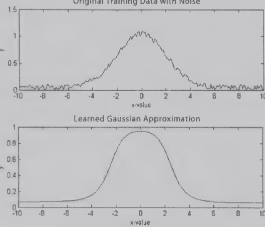

图 5.2：函数近似

在时间序列预测中，目标是设计一个神经网络根据给定的时间序列数据预测值（例如基于给定趋势的股票市场预测）。为了解决这个问题，神经网络的输入必须分块反映，产生的输出将直接是紧随该块的下一个数据项（图 5.3）。

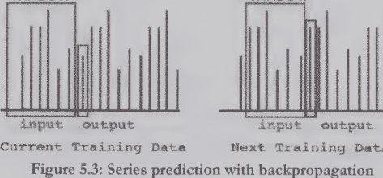

图 5.3：使用反向传播进行序列预测

### 自然语言处理与情感分析

利用人工神经网络和深度神经网络，科学家们已经能够创建协助翻译和语言建模的机器。该程序被称为 LSTM，并于 21 世纪初引入。

使用 LSTM，深度学习网络已经具备了理解自然语言的能力，使其能够与人进行基础对话。虽然目前可以进行对话，但技术正在快速向能够与人进行连贯对话的深度网络发展。

由于这项技术非常先进，深度学习可以理解笑话、改写以及自然语言的其他部分，并像真正的人类与你进行智力交流一样做出响应。

如果此矩阵中的权重很小（或者更正式地说，如果权重矩阵的主特征值小于 1.0），可能会导致所谓的“梯度消失”现象，在这种情况下，梯度信号变得非常微小，导致学习变得非常缓慢或完全停止。它还会让学习数据中长期依赖关系的任务变得更加复杂。另一方面，如果此矩阵中的权重很大（再次用正式的话说，如果权重矩阵的主特征值大于 1.0），则可能导致梯度信号巨大，从而引起学习发散。这通常被称为“梯度爆炸”。

这些问题是引入 LSTM 模型的主要动力，LSTM 引入了一种名为“记忆单元”（memory cell）的新结构（见下方的图 5.4）。它由四个主要元素组成：输入门、具有自递归连接（指向其自身的连接）的神经元、遗忘门和输出门。自递归连接的权重为 1.0，它确保了在没有外部干扰的情况下，记忆单元的状态可以从一个时间步持续到另一个时间步保持不变。输入门可以允许传入的信号改变记忆单元的状态以对其产生影响，也可以将其阻塞。另一方面，输出门可以允许记忆单元的状态对其他神经元产生影响，也可以阻止这种影响。最后，遗忘门可以调节记忆单元的自递归连接，并允许单元根据需要记住或忘记其状态。

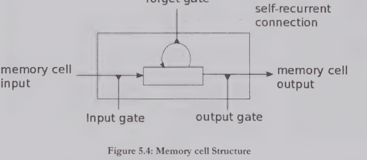

## 6. 卷积神经网络 (CNN)：它是如何工作的？

### 本章目标

在本章结束时，读者应该学到：

- 卷积层
- 池化层
- 全连接层
- CONV-NET 架构

卷积神经网络可以被视为利用了大量相同神经元副本的神经网络。这种做法的好处是，它允许网络只学习一次神经元并在许多地方使用它，从而简化了模型的学习过程并减少了误差。

卷积系统的推动源于自然或生物过程，在这些过程中，神经元之间的网络设计灵感来源于与动物视觉皮层的关联。单个皮层神经元对刺激的反应仅限于视觉野中的一个局部区域，被称为“感受野”（receptive field）。各种神经元的感受野大部分覆盖了整个视觉野。卷积神经网络（CONV-Nets 或 CNNs）是一种神经网络分类，它们已被证明在图像识别和分类等某些领域极其强大。CNN 在独立识别人脸、物体和交通标志方面非常有效，同时也用于机器人和自动驾驶汽车的视觉控制。

### CNN 架构

另一方面，CNN 包含各种卷积层和下采样层，随后是全连接层。卷积层的输入是一张 $m \times m \times r$ 的图片，其中 $m$ 是图片的高度和宽度，$r$ 是通道数（例如 $r=3$）。卷积层将具有 $k$ 个通道（或滤波器/卷积核），其大小为 $n \times n \times q$，其中 $n$ 小于图片的维度，$q$ 可以与通道数 $r$ 相同，也可以随每个滤波器而变化。滤波器的范围提供了对局部关联滤波器的提升，这些滤波器与图片进行卷积以生成 $k$ 个大小为 $n-n+1$ 的特征图（maps）。然后，每个图通常在 $p \times p$ 的连续区域上进行下采样，其中 $p$ 对于小图片（如 MNIST）在 2 之间，而对于较大的输入源通常不超过 5。在下采样层之前或之后，每个组件图都会连接一个加性偏置（bias）和一个 sigmoid 非线性函数。下方的特征代表 CNN 中的一个完整层，由卷积层和下采样层组成。相似阴影的单元具有相同的权重。该架构如图 6.1 和 6.2 所示。

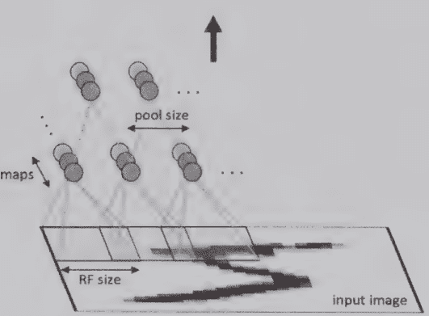

图 6.1：CNN 架构

在卷积层之后，可能会有任意数量的全连接层。全连接层与标准多层神经网络系统中的层没有区别。

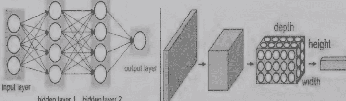

图 6.2：左侧：一个普通的 3 层神经网络。右侧：CONV-Net 在三维空间（宽度、高度、深度）上排列其神经元，如其中一层可视化所示。CONV-Net 的每一层都将 3D 输入体积转换为 3D 神经元激活输出体积。在这个示例中，红色的输入层持有图像，因此其宽度和高度是图像的维度，深度为 3（红、绿、蓝通道）。

### 构建 CNN 使用的层

正如我们所示，直观的 CNN 是层的堆叠，CNN 的每一层都通过可微函数将一个激活体积转换为另一个激活体积。我们使用三种基本类型的层来组装 CNN 结构：卷积层、池化层和全连接层（正如同标准神经网络中的层）。我们将堆叠这些层以形成完整的 CNN 架构。

案例架构：概述。然而，一个用于 CIF-10 分类的直观 CONV-Net 设计可以可能是 [INPUT - CONV - ReLU - POOL - FC]。

- INPUT: 32x32x3
- CONV: 32x32x12
- ReLU: 32x32x12
- POOL: 16x16x12
- FC
- INPUT: 32x32x3
- CONV: 32x32x32
- ReLU: 32x32x32
- POOL: 16x16x32
- FC
- INPUT: 32x32x3
- CONV: 32x32x64
- ReLU: 32x32x64
- POOL: 16x16x64
- FC
- INPUT: 32x32x3
- CONV: 16x16x128
- ReLU: 16x16x128
- POOL: 8x8x128
- FC
- INPUT: 32x32x3
- CONV: 8x8x256
- ReLU: 8x8x256
- POOL: 4x4x256
- FC
- INPUT: 32x32x3
- CONV: 4x4x512
- ReLU: 4x4x512
- FC

沿着这些路线，CONV-Net 从第一层一直到最后一层。注意，某些层包含参数，正如图 6.3 所示：

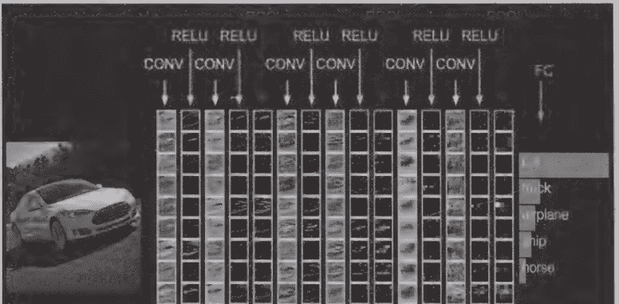

# 图 6.3：示例 CNN 的激活

第一个体积存储原始图像（左），最后一个体积存储分数（右）。处理路径上的每个激活体积显示为列。由于很难可视化 3D 体积，我们将每个体积的切片排列行。最后一个体积持有每个类的分数，但在这里我们只可视化前 5 个，并打印每个标签。完整的网页 Demo 显示在标题处。这里的架构是一个小型 VGG 网络，我们稍后会讨论。

## 引入非线性 (ReLU)

| 卷积 + ReLU | 池化 | 卷积 + ReLU | 池化 | 全连接 | 全连接 | 输出预测 |
| --- | --- | --- | --- | --- | --- | --- |

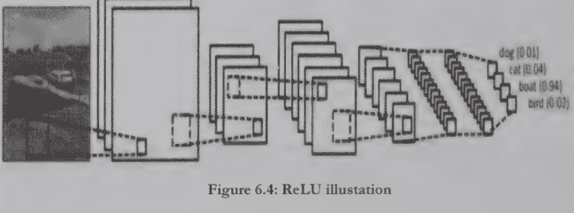

在上面的图 7.4 中，每个卷积操作之后都使用了名为 ReLU 的额外操作。ReLU 代表线性整流单元，是一种非线性操作。其输出如图 7.5 所示：

`Output = Max(zero, Input)`

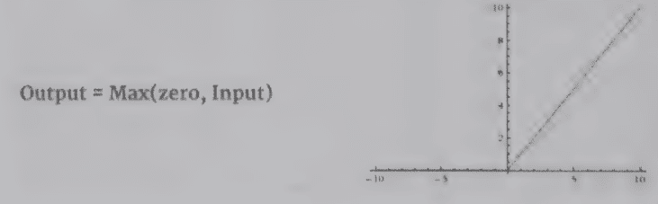

ReLU 是逐元素操作（每个像素连接），并将元素图中的所有负像素值替换为零。引入 ReLU 的理由是在 CONV-Net 中引入非线性，因为对于目前大部分现实世界数据，我们需要我们的 CONV-Net 学习非线性的内容（卷积是一个线性操作 - 逐元素矩阵乘法和加法，因此我们通过呈现像 ReLU 这样的非线性函数来表示非线性）。

从下面的图 7.6 可以清楚地看到 ReLU 操作。它展示了连接到组件图的一个 ReLU 操作。输出特征图也被称为“整流”特征图。

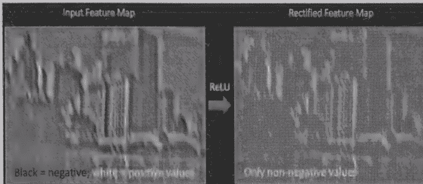

图 6.6：ReLU 特性

其他非线性能力，例如 tanh 或 sigmoid，同样可以被用来代替 ReLU；但事实证明很大程度上 ReLU 的表现更好。

## 卷积层

CONV 层（卷积层）是卷积网络的核心构建单元，承担了大部分真正困难的计算工作。

### 无需大脑模型

让我们首先利用这个机会，在不类用大脑/神经元类比的情况下，讨论一下 CONV 层处理的内容。CONV 层的参数包含了一组可学习滤波器的参数。每个滤波器（通道）在空间上是较小的（沿宽度和高度），但贯穿了输入卷的整个深度。例如，在 CONV-Net 的第一层运行一个典型滤波器可能会估计 5x5x3（即宽度和高度为 5 像素，深度为 3 的三张图片，即阴影通道）。随着前向传播，我们在输入卷的宽度和高度上滑动（更准确地说是卷积）每个滤波器，并计算通道通过之间的项以及在任何位置的贡献。当我们在输入卷的宽度和高度上滑动时，我们将得到一个二维激活轮廓，它给出了该通道在每个空间位置的反应。自然地，系统会学习在看到某种视觉元素时启动的通道，例如主层（第一层）上某些引言的边缘，或者主层上某种颜色的标记，或者是网络更高层上的整个蜂窝状或轮子状图案。目前，我们在每个 CONV 层中都有一整组通道（例如 12 个通道/滤波器），其中每一个都会创建一个不同的二维激活图（轮廓）。我们将这些激活图沿深度测量方向进行堆叠，并输出输出卷。

### 大脑视角

如果你是大脑/思维/神经元类比的信徒，那么 3D 输出卷中的每个部分也可以被翻译为神经元的输出，该神经元只关注输入中的一小区域，并为空间上左侧和右侧的所有神经元提供参数（因为这些数字都是通过应用一种细微通道产生的）。我们现在讨论神经网络的细微元素、它们在空间中的排列以及它们的参数共享计划。

### 本地连接

在处理高维输入源（如图片）时，正如我们在上面看到的，将神经元连接到过去卷中的所有神经元是不现实的。相反，我们将每个神经元关联到输入卷的一个局部区域。这种连接的空间程度是一个被称为神经元感受野的超参数（按比例，这是滤波器的大小）。沿轴的连接程度始终等同于输入卷的深度。通过我们处理空间维度（宽度和高度）和深度维度的方式，强调这种不对性至关重要：连接在空间上（沿宽度和高度）是邻的（局部的），但在输入卷的整个深度上是贯穿的。

### 空间排列

我们已经澄清了输入 ConvLayer 中每个神经元的连接性；我们还没有检查输出卷中有多少个神经元或它们是如何组织的。三个超参数控制着输出卷的跨度：深度（depth）、步长（stride）和零填充（zero-padding）。我们接下来将讨论这些：

1. 首先，输出卷的深度是一个超参数：它关系到我们想要使用的滤波器数量，每个滤波器都学习在输入中搜索其他内容。例如，如果主卷积层以粗糙/原始图片输入，在那个点，深度维度上的多样化神经元可能对不同排列的边缘或色块的存在起作用。我们将提到一种整体上将输入的相同区域作为深度列的神经元排列（有些人倾向于使用“纤维”这一术语）。

2. 第二，我们应该确定滑动滤波器的步长。当步长为 1 时，我们在任何给定时刻都移动滤波器一个像素。当步长为 2 时（或者显著至少为 3，尽管这通常不常见），在那个点，当我们滑动滤波器周围时，滤波器在任何给定时刻跳跃 2 个像素。这将产生空间上更小的输出卷。

3. 正如我们很快将看到的，有时在输入卷边界周围填充零是有帮助的。这种零填充的度是一个超参数。填充的好处是，它使我们能够控制输出卷的空间尺寸。

### 现实案例

Krizhevsky 等人赢得 2012 年 ImageNet 挑战赛的工程承认了大小为 `[227x227x3]` 的图片。在主卷积层上，它利用了感受野 `F=11`、步长 `S=4` 且无填充的神经元。由于 `(227 - 11)/4 + 1 = 55`，且由于 ConvLayer 的深度为 `K=96`，输出卷具有 `[55x55x96]`，这里的 55*55 个神经元中的每一个都与输入的 `[11x11x3]` 区域相关。此外，每个深度列 96 个神经元中的每一个都与相同的 `[11x11x3]` 区域相关。有趣的是，如果你阅读这篇论文，它断言信息是224x224。

### 参数共享

参数共享计划作为卷积层的一部分用于控制参数数量。在当前情况下，我们看到有 `55*55*96=290,400` 个神经元，每个有 `11*11*3=363` 个权重和 1 个偏置。这是 `290400*363 = 105,415,200` 个参数（+96 个偏置）。每个深度片中的 55*55 个神经元现在将使用相似的参数。

通过做出一个简单的假设，我们可以显著减少参数数量：如果一个组件在某个空间位置 `(x,y)` 用于计算，那么在那个点它也应该在不同的位置 `(x',y')` 用于计算。因此，由于一个大小为 `[55x55x96]` 的二维深度切片具有 96 个深度片，每个大小为 `[55x55x1]`，我们将约束每个深度片中的神经元使用相似的权重。并且，通过反向传播，卷中的每个神经元都会计算其权重的梯度；然而，这些梯度将跨越每个深度片并刷新每个切片的权重权重。

注意，如果单个深度片中的所有神经元都使用相似的权重向量，那么在那个点，ConvLayer 在每个深度片的前向运动可以被视为神经元权重与输入卷的卷积（因此命名为卷积层）。这基本上是权重排列被称为通道/滤波器（或内核），它与输入进行卷积。

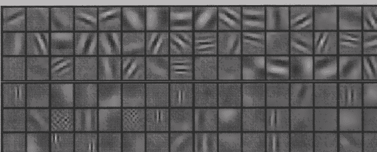

图 6.7：Krizhevsky 等人学习的示例滤波器。这里显示的 96 个滤波器中的每一个一个大小为 `[11x11x3]`，并且每一个一个都被一个深度片中的 55*55 个神经元共享。注意，参数共享假设是相对合理的：如果检测水平边缘在图片的某个位置很重要，那么由于图片的平移不变结构，直觉上它在其他位置也应该是有用的。因此，没有必要在 ConvLayer 输出卷的 55*55 个不同位置中的每一个位置都重新学习水平边缘。

# 7. 其他深度学习算法

## 循环神经网络 (Recurrent Neural Networks)

在传统的神经网络中，所有的输入和输出都是相互独立的。在循环神经网络中，这一条件不再成立，而是使用了序列信息。循环神经网络依赖于先前的计算以及之前计算过的内容。

循环神经网络可以被概念化为一个随时间展开（unrolled）的神经网络。当你在普通神经网络中拥有不同层时，在循环神经网络的每个时间步，你对输入应用相同的层层，并将输出（即上一个时间步的状态）作为输入。循环神经网络中实体之间的连接形成了一个有向环，创建了一种内部记忆，帮助模型利用长链依赖关系。

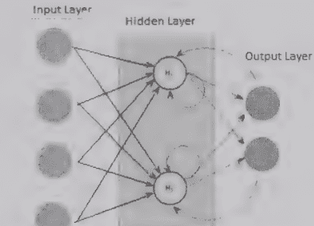

图 7.1: 循环神经网络算法

## 递归神经网络 (Recursive Neural Network)

递归神经网络是循环神经网络的一种推广，通过在结构上重复地（或递归地）应用一组固定且一致的权重生成。递归神经网络呈现树的形式，而循环神经网络呈现链的形式。递归神经网络已应用于自然语言处理领域，例如情感分析等任务。

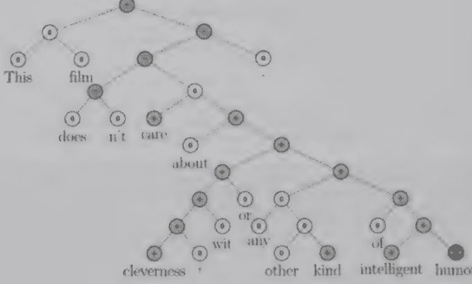

图 7.2: 递归神经网络示例

## 受限玻尔兹曼机 (Restricted Boltzmann machines)

下一个逻辑步骤是查看受限玻尔兹曼机 (RBM)。这是一种生成式随机神经网络，可以学习其输入集上的概率分布（图 8.1）。

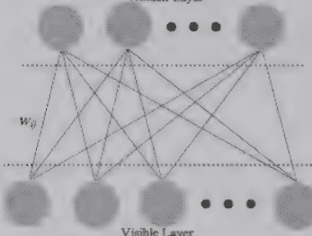

图 7.2: RBM

受限玻尔兹曼机是一种随机神经网络，由一层可见单元、一层隐藏单元和一个偏置单元组成。该架构的设计方式使得每个可见单元都连接到所有隐藏单元，并且偏置单元附着到所有可见单元和隐藏单元上。在学习过程中，会产生限制条件，使得没有任何可见单元与任何可见单元连接，也没有隐藏单元与任何隐藏单元连接。

## 自动编码器 (Auto encoders)

自动编码器是一种具有三层的神经网络：输入层、一个隐藏（编码）层和一个解码层。该网络被训练以重构其输入，这迫使隐藏层尝试学习输入的良好表示。

这是一种无监督学习算法，它应用反向传播，并将目标值设置为与输入相等。自动编码器被训练以将其输入复制到输出中。在内部，它有一个隐藏层，描述了一个用于表示输入的代码。

预期是代码 `y` 是一个分布表示，捕捉了沿数据中所有主要变异因子方向的坐标。这与主成分投影捕捉数据中主要变异因素的方式相似。事实上，如果存在一个线性隐藏层（代码）并使用均方误差准则来训练网络，那么 `k` 个隐藏单元将学习将输入投影到数据前 `k` 个主成分的跨空间内。如果隐藏层是非线性的，自动编码器的行为将与 PCA（主成分分析）不同，具有捕捉输入分布的多模态方面的能力。当我们构建深层自动编码器并考虑多个编码器（及其相应的解码器）时，PCA 的局限性变得更加重要。

由于 `y` 被视为 `x` 的损失压缩，它不能对所有 `x` 都是高质量的（小损失）压缩。优化使其成为训练示例的良好压缩，并希望对所有输入都是如此，但对于任意输入并非。这就是自动编码器泛化的意义所在：它对于与训练示例相同分布的测试示例给出了低重构误差，但对于从输入空间随机选择的样本，通常具有高重构误差。

## 堆叠自动编码器 (Stacked auto encoders)

该网络由多个堆叠的自动编码器组成，正如名称所示（8.2）。自动编码器的隐藏层作为自动编码器 `i+1` 的输入层。第一个自动编码器的输入层是整个网络的输入层。贪婪式训练机制如下：

- 使用反向传播方法利用所有可访问的训练数据单独训练初始自动编码器（`f=1`，或上中的红色连接，但有一个额外的输出层）。

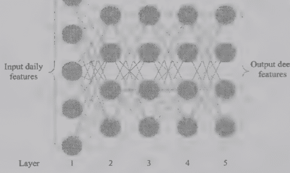

图 7.3: 堆叠自动编码器

- 训练下一个自动编码器 `f=2`。考虑到 `f=2` 的输入层是 `f=1` 的隐藏层，我们不再关注 `f=1` 的输出层，并从网络中移除它。训练通过将输入样本固定在 `f=1` 的输入层开始，并传播到 `f=2` 的输出层。接下来，`f=2` 的权重（输入-隐藏和隐藏-输出）使用所有训练样本，类似于使用反向传播。

- 对所有层重复前面的步骤（即移除上一个自动编码器的输出层，用另一个自动编码器替换它，并使用反向传播进行训练）。

- 以上所有步骤都是预训练。预训练后，网络可以扩展，将一个或多个全连接层连接到最后一层。

## 自动编码器的类型

1. 去噪自动编码器 (Denoising autoencoder)
2. 稀疏自动编码器 (Sparse autoencoder)
3. 变分自动编码器 (Variational autoencoder)
4. 压缩自动编码器 (Contractive autoencoder)

## 深度玻尔兹曼网络 (Deep belief networks)

与自动编码器一样，我们也可以堆叠玻尔兹曼机来生成类深度玻尔兹曼网络 (DBNs)，如图 8.3 所示。

在这种情况下，RBM 的隐藏层 `t` 作为 `t+1` 的可见层。初始 RBM 的输入层是整个网络的输入层，贪婪逐层训练如下：

- 使用对比散度算法利用所有训练样本训练 RBM `t=1`。

- 训练下一个 RBM `t=2`。考虑到 `t=2` 的可见层是 `t=1` 的隐藏层，训练通过将输入样本固定在 `t=1` 的可见层开始，并传播到 `t=1` 的隐藏层。这些数据用于启动 `t=2` 的对比散度训练。

- 对所有层重复前面的步骤。

- 预训练后，网络可以扩展，将一个或多个全连接层连接到最后一个 RBM 隐藏层。这形成了一个可以使用反向传播进行微调的多层感知机。这一过程与堆叠自动编码器相似，但将自动编码器替换为 RBM，并将反向传播替换为对比散度算法。

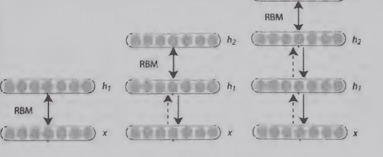

图 7.4: 深度玻尔兹曼网络

# 8. 深度学习应用

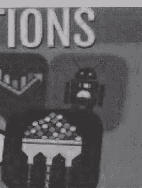

## 章引言

人工智能的近期兴起基于深度学习的成就。三个显著的驱动因素导致了（深度）神经网络的飞跃：海量数据的可用、有效的计算基础以及学术界的进展。因此，深度学习框架已开始在图像表征或人脸识别等任务中超越传统技术。这使得一些令人困难的新机构拥有了利用学习来探索如何解决某些问题的潜力。

## 将深度学习应用于现实世界问题

训练神经网络比以前任何时候都要简单。然而，你几乎无法直接从教程中获取代码并让它直接适用于你的目标。

## 预训练的价值

在机器学习的知识宇宙中，很少关注数据集的获取。相反，为了将深度学习技术与其他方法进行对比，并确保其中一种方法优于其他方法，标准策略是在标准数据集上使用相似的评估程序来衡量性能。然而，在现实世界中，任务的重点不在于证明你的新算法比另一种方法多挤出 1% 的性能，而是构建一个能够以足够准确率解决所需任务的健壮系统与所有的机器学习系统一样，这需要标记过的训练数据，算法可以从中学习。

对于许多现实世界问题，遗憾的是，获取良好的标记训练数据相当昂贵。为了详细阐述这个问题，让我们考虑两种情况。

### 医学视觉

如果我们需要制造一个检测计算机断层扫描（CT）图像中人体淋巴结的系统，我们需要标注有淋巴结的图像。这是一项相当耗时的任务，因为图像是 3D 的，并且需要识别非常小的结构。假设放射科医生每小时薪酬 100 美元，每小时可以谨慎地标注 4 张图像，这意味着我们每张图像的成本为 25 美元，或者 10,000 张标记图像需要 25 万美元。考虑到我们需要多位医生标注同一张图像以确保接近 100% 的诊断准确性，获取该医疗任务的数据集将很容易超过这 25 万美元，这显然是非常昂贵的。

### 信用评分

如果我们想建立一个做出信用决策的系统，我们想知道谁可能违约，这样我们就可以训练机器学习系统提前预知此。不幸的是，只有在某人违约发生时，你才能确定。因此，一种朴素的策略是给每个人提供 1 万美元的贷款。然而，这意味着每个违约的人都会让我们损失 1 万美元。这为每个标记数据点付诸了非常昂贵的代价。我们确实可以降低成本，但关键点是它们的成本很高。

### 高成本的解决方案

预训练是降低成本的解决方案。预训练的核心思想是，我们最初在一个低价格的大型数据集上训练神经网络（或其他机器学习算法），该数据集位于

相关领域，或在相似领域的嘈杂数据上。尽管这不会直接解决原始问题，但它将让神经网络对你的预测问题看起来如何有一个大致的概念。现在，在下一步中，神经网络的参数将在你实际尝试解决的问题的小得多且更昂贵的数据集上进一步优化。这个两步过程如图 5.1 所示。

### 预训练：相关领域的廉价大型数据集

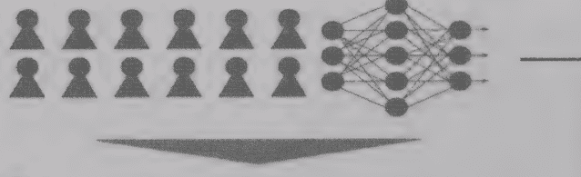

### 微调：昂贵的良好标记数据

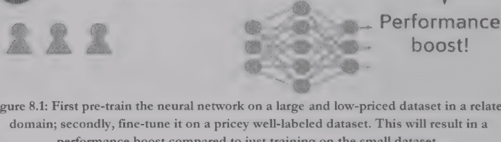

图 8.1：首先在相关领域的大型低廉价数据集上预训练神经网络；其次，在昂贵的良好标记数据集上对其进行微调。与仅在小数据集上训练相比，这将带来性能的提升。

在微调时，类别的数量可能会发生。人们经常在包含 1000 个类的 ImageNet 数据集上预训练神经网络，并将其微调到他们的特定问题（这是预期的，具有不同的类别数量）。这告诉我们最后一层需要初始化。通常最后一层的学习率会高一点，因为它需要从零开始学习，而之前的层以较低的学习率进行训练。对于像 ImageNet 这样的数据集，学习到的特征（最后一个全连接层）是如此通用的，可以现用并直接用于其他几个计算机视觉问题。

## 现实世界标签分布的注意事项

一旦我们收集了用于预训练和微调的数据，我们就可以继续开始训练我们的神经网络。这里是学术界与现实世界之间的另一个巨大差异。在学术界，数据集通常是平衡的。这意味着对于监督分类问题，每个类别的样本数量通常相等。在下方（图 5.2 和 5.3）中你会找到两个例子：MNIST 是一个著名的手写数字数据集，包含每个数字大约等量的样本。Food101 是另一个学术数据集示例，它包含 101 种食品类别中的每种类别恰好 1000 张图像。

| 0 | 1 | 2 | 3 | 4 | 5 | 6 | 7 | 8 | 9 |
|---|---|---|---|---|---|---|---|---|---|

## 理解黑盒

学术界的主要目标是获得最先进的性能。在处理现实世界应用时，仅仅设计一个模型往往是不够的。相反，重要的是：

- 知道模型为什么会做出错误预测。
- 提供为什么我们的模型可以表现更好的直观感受。
- 确保模型不会被欺骗。

### 深度学习的视觉应用

以下是深度学习的一些视觉应用：

- 为无声电影添加声音。
- 机器翻译。
- 照片中的物体分类。
- 字符文本生成。
- 图像描述生成。
- 自动游戏。

### 为无声电影添加声音

在这项任务中，框架可以合成与无声视频同步的声音。框架利用 1000 个视频示例进行训练，视频中有鼓棒击击不同表面产生不同声音。深度学习模型将视频帧与预录声音数据库相关联，以选择与场景发生的情况匹配的声音。

### 机器翻译

这是将一种语言的单词、短语或句子翻译成另一种语言。机器翻译已经存在很久，但深度学习在两个特定领域取得了顶级成果：

- 文本自动翻译。
- 图像自动翻译。

文本翻译可以在不对安排进行预处理的情况下进行，允许算法学习单词之间的依赖关系及其到新语言的映射。使用大型 `LSTM` 递归神经网络的网络来执行这种翻译。

### 照片中的物体分类和检测

这项任务涉及将照片中的物体分类为已知物体之一。在基准上已获得最先进的物体分类；例如，在该问题中使用大型卷积神经网络。Alex Krizhevsky 等人在该问题上的突破导致了名为 `ALEX-Net` 的 ImageNet 分类问题。

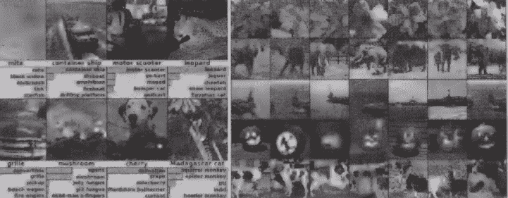

图 8.5：取自 ImageNet 分类的、深度卷积神经网络的物体分类

该任务的一个更复杂的变体被称为物体检测，它专门识别照片场景中的一个或多个物体，并在它们周围画框。

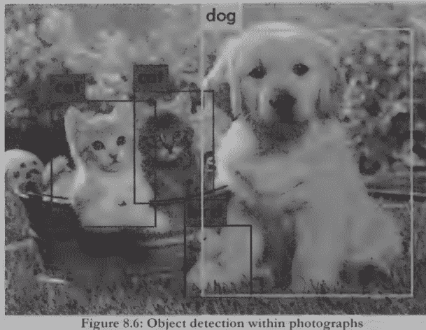

### 自动手写生成

这是一种给定手写示例语料库，为指定的单词或短语生成新手写体。手写是以一系列坐标的形式提供的，利用形成手写样本时的笔。通过了解这个语料库，可以学习笔的移动与字母之间的关系，并可以根据需要创建新的示例。

令人着迷的是，可以学习并模仿不同的风格。

### 机器学习精通

Machine Learning Mastery

### 自动游戏玩

这是一项模型仅根据屏幕上的像素学习如何玩电脑游戏的工作。这是深度强化模型领域最复杂的任务，也是通过 `Deep Mind`（现为 Google 的一部分）取得的突破性进展闻名于世。

### 自动图像标注

自动图像标注是指给定某些图像，系统必须生成一个描述图像内容的标题的任务。

在 2014 年，许多深度学习算法在这一问题上取得了非常令人兴奋的结果，这些算法利用了用于照片物体分类和物体检测的顶级模型工作。

照片中的物体被识别，并为这些物体生成标签，下一步是将这些标签转换为连贯的句子描述。这是令我大为震惊的结果之一，并且如此；它确实非常显著！

通常，系统涉及使用非常大的卷积神经网络对照片中的物体进行检测，然后使用 `LSTM` 等循环神经网络将标签转换为连贯的句子。

### 自动文本生成

这是一项吸引人的技术，通过对文本语料库进行深度学习，逐字或逐字符地生成新文本。该模型能够学习如何拼写、标点、组成句子，并将其限制在语料库的风格中。巨大的循环神经网络被用于获取输入字符串序列中项目之间关系的知识，然后生成文本。最近，`LSTM` 循环神经网络使用基于字符的模型在这一问题上取得了巨大成功，一次生成一个字符。

Andre Karpathy 在他关于该主题的热门博客文章提供了许多示例，包括：

- *莎士比亚*
- 维基百科条目（包括标记）
- 代数几何（带有 `LaTeX` 标记）
- Linux 源代码
- 婴儿名字

> PANDARUS:
>
> Al，我想他应该被接近，在那一天
>
> 当小西班牙将成为存在却从未被喂养，
>
> 谁是锁链，也是他死亡的主体，
>
> 我将无法睡眠。
>
> 第二参议员:
>
> 这些都是产生在我灵魂上的痛苦，
>
> 请祈祷并强烈地应该被埋葬，当我消亡时
>
> 大地和许多国家的思想。
>
> 芬切斯托公:
>
> 好吧，你的机智受侧面和那里的照顾。
>
> 第二爵主:
>
> 他们将在该议室之后被统治，
>
> 我美丽的膝盖从事实上开始，被传达，
>
> 在那些高贵灵魂的地方，我将拥有战争的心灵。
>
> 小丑:
>
> 来吧，先生，我将仰仰仰您的尊严。
>
> 莉娅:
>
> 我会喝掉它的。

## 使用现有 API 的应用

API 不仅仅是运行在互联网另一端远程计算机上的软件，你可以在附近获取它。例如，即使你的机器带有内置扬声器，你可以将蓝牙扬声器连接到笔记本电脑。因此，我们能够在使用笔记本电脑的同时，远程访问该扬声器。

## 深度学习 API 的优势

- 一个标准的深度学习应用在 GPU 和数据存储/处理方面需要巨大的计算能力。由于如此，你必须建立自己的工作站（或使用任何云服务），并利用任何本地系统访问工作站并运行你的应用程序。
- 本地系统不会被计算任务负担。
- 可以毫无困难地集成最新功能。

## 深度学习 API 的劣势

- 构建 API 在成本方面可能没有用处。API 需要时间和资源来构建和维护，这往往是昂贵的。
- 你受到互联网连接的限制。如果你的连接在任何时候失败，整个系统就会崩溃。
- 从安全性来说，你的应用程序是暴露的，因为任何人都可以轻松访问它。在这里，你必须添加用户名和密码等额外的安全层来访问服务，并限制你在特定时间段内的访问次数。

## 开源应用

目前研究社区中非常优秀且有帮助的一点是其开源思维。研究人员准备好分享他们的发现，无论他们取得了什么成就，以便深度学习研究能够成长；结果是，它不断增长。

## 开源应用的优势

- 由于应用是开源的，我们可以访问应用程序的每一个元素，并可以根据需要轻松定制。

## 开源应用的劣势

- 开源应用可能缺乏专业的技术支持和维护保障。
- 代码质量参差不齐，可能存在安全漏洞或未修复的 Bug。

## 我们与深度学习共处的未来

... 然而，随着我们继续探索深度学习的能力，我们可能发现如何创建生物机械器官和肢体，这些器官肢体本质上会学习如何按照应该的方式运行，以便人们的操作起来就像他们从未失去过肢体或器官一样。

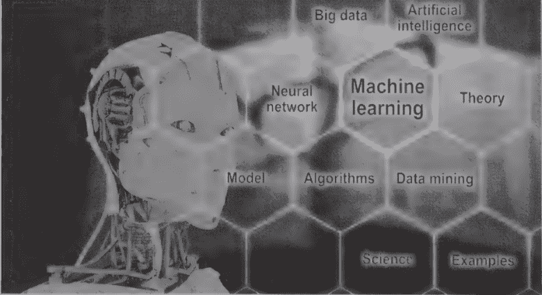

通过全自动化的智能家居实现其他任何虚拟化操作。此外，他们正尝试创建一种不仅能完成所有这些操作并接收指令，还能进行智能对话并从本质上与家里的人建立“关系”的系统。它能够记住关于你的重要信息，并根据意愿执行事情，如祝生日、询问你今天过得如何，并根据你的回答与你互动，以及进行并非由设备预录回答所引导的更智能、独特的对话。

拥有的智能家居可能是不可思议的，因为你再也不需要花费精力管理你的家。相反，你可以放下打扫和烹饪等任务，花更多时间享受你的家。这种水平的智能家居可能在相当一段时间内都不会推出，而且最初只有那些富人可以使用，但我们最终不太可能拥有智能家居作为消费者的普通日常家居。

### 高级移动技术

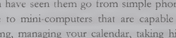

如果你观察过手机的演变，你就会看到从口袋里仅仅用于通话的简单手机，演变成了能够执行许多惊人功能的微型计算机。社交媒体、短信、管理你的日历、拍摄高质量照片以及许多其他事情都可以使用目前的智能手机完成。

随着他们继续开发深度学习技术并完善深度神经网络，我们可能会继续看到手机变得更加智能。随着时间的推移，这些设备可能会成为我们随身携带在口袋里的个人管家。我们能够完成许多已经在完成的事情，而无需取出它们或通过语音以外的任何方式与它们互动。我们能够与设备通信，它将完成从标记/取消晚餐预订到直接订购新服装或产品送到家里的一切事情。它们还可以代表我们与朋友交流以制定计划，或者如果用作业务设备，可以帮助我们与客户沟通。

从本质上说，通常由个人管家完成任何事情将来都可以由你的手机完成。拥有个人管家将不再是富人和名人的专属，因为我们将以移动设备的形式拥有每一个。

### 自动化商业用途程序

除了管理我们的个人生活外，深度学习机器还可以用于管理企业和组织。它们可以组织和安排商务会议，为将举行的会议预留位置或空间，并向所有需要出席的人发送自动提醒，而无需亲自到场安排。一个人可以与设备交流，其他人都会获得该信息，并能够自动执行任何需要提前完成的活动。这些设备还可以用于管理广告。它们负责根据公司目前发生的情况，收集数据并为各种产品或业务创建广告活动。例如，它们可以确定目标受众以及如何针对他们、活动中应包含哪些参数以确保触达他们，以及应该使用什么样的图形来吸引消费者。它们还能衡量活动返回的任何指标和数据，包括其表现如何、每个线索的成本是多少、每个线索的价值是多少，以及未来可以做什么来使活动更有效。这一切都将完全由设备完成，永远不需要人类做任何事情。

尽管如此，想象一下基于深度学习的发明将带我们走向何方仍然是一件极其有趣的事。这有许多可能性，而想象有一天机器能够履行深度学习机器可能完成的许多功能，这种想法是不可思议的。你能想象吗？回到家里，让厨房为你准备晚餐的龙虾和牛排，然后坐在沙发上与你的家聊天，同时它还在这里帮你挑选电视节目？对某些人来说，这可能过头了；但对另一些人来说，这听起来是一种极大的享受，也许是迄今为止最好的关系。

## 10. 深度学习的长期愿景

根据你询问对象的不同，对于深度学习机器、技术和进步有许多长期愿景。不同的人对于他们希望看到深度学习发展向何方以及希望从中获得什么有着不同的想法。然而，对于那些对深度学习的发展感兴趣或参与其中的人来说，存在一些相当共同的核心概念和信念。本章将帮助你了解这项技术在未来几年内目标是指向哪里。

### 更小、更高效

学习和开发深度学习机器的人的一个共同目标，是建立一个系统，使其能够在使用更少空间的情况下，获得相同甚至更好的结果。类似于计算设备随着时间的推移变得越来越小，开发者们正试图制造比目前小得多的深度神经网络和人工神经网络。通过缩小体积，它们变得更易于管理，并更有可能用于日常生活中。

开发者寻求实现的另一个目标是创建一个让深度学习机器工作得更高效、更快速系统。目前，人工神经网络的计算速度相当慢，使得它们在日常使用中几乎毫无意义。虽然像语音识别和图像识别等某些功能很快，但其他功能极其缓慢，这使得它们在大多数情况下都显得无关紧要。如果人类能更快、更准确地完成同样的任务，那么将他们替换为人工智能几乎没有任何意义。如果他们能够创造出能够自动完成所有相同任务且速度更快、更准确的深度学习机器，那么用这些机器替换人类就有意义了，因为它们在处理手头任务时会更高效、更成功。

深度学习机器的未来类似于计算机器的未来。正如后者在不断缩小的同时变得越来越先进，开发者正试图对前者做到同样的事情。最酷的部分是，两者已经交织在一起，并随着时间的推移可能继续变得更加紧密。拥有一个可以放在口袋里并几乎能为你做一切的设备，在不远的未来可能不仅仅是一个想法。

### 更高的自动化程度

尽管这些系统已经具有惊人的天赋，但开发者正试图让它们变得更加自动化。本质上，他们想为深度学习机器添加更多功能，并教它们如何在更少的人类互动下完成工作。这就是为什么他们投入大量精力学习神经网络的不同层级，以及他们如何建立具有多种能力的机器的原因。对深度学习机器的这些部分的研究和开发越多，这些系统就会变得越自动化，它们就能够在没有人类驱动或引导的情况下成功完成更多任务。相反，在某一天，它们可能可以自己做出选择，而不需要人类干预并指导机器在每种情况下该做什么。

### 完善的专化能力

在创造完全的人工智能之前，研究人员和开发者可能会继续创建在不同领域高度专业化的机器，例如可以帮助你管理生活的个性化设备，以及可以帮助诊断和治疗疾病的医疗设备。两者非常不同，但它们都对运行它们的机器有高度专业化的要求。理想情况下，研究人员和开发者将找到完善机器操作的方法，使它们更有能力帮助现实生活中的各种任务。它们将不仅仅是证明自己能够这样做，而是被投入实践，帮助人们执行各种功能，包括日常活动和独特职业中的不同任务。

鉴于深度学习机器已经拥有的惊人且广阔的能力，我们开始创造并引入可以帮助我们完成社会中各种任务的机器和技术并非不可能。我们慢慢看到人们被更高效、更准确的机器取代。这些机器将在执行社会许多不同功能方面具有高度专业化。真正，潜力和机会是无限的。阻碍我们迈向下一步先进深度学习机器的唯一因素是时间，但研究人员正迅速朝着创造可以用于社会几乎所有用途的机器迈进。

### 全人工人工智能

创造可以帮助我们管理社会运行许多不同方面的独特专化机器，是创造完全人工智能的目标。这本质上将是一台能够胜任一切的机器。以前由专化机器替代的任务都将浓缩到一台机器中。这将使单台机器能够做人类能做的几乎任何事情，而且做得更好。这本质上就是每个人在讨论人工智能时所指的“完美人类”或“超级人类”。它将是一个完全有能力独立完成几乎所有事情的机器人物种，从学习到采取行动以及履行社会中的各种任务。

许多参与人工智能开发的人对创造一种可以帮助我们处理社会许多不同方面的超级人类感兴趣。这是利用深度学习能力创造终极人类的下一步。在完善了每一个独特元素后，他们希望开始开发一台能够完成一切的机器。通过从每个独立机器中获得的知识，他们将能够编写一种可以做任何程序，从推荐去哪里吃饭、做什么到识别你的疾病以及如何治疗，甚至帮助你做晚餐。它将能够做到人类所做的一切，这就是为什么他们模仿人类制造机器人。这将是一个与人类完全共处的机器人物种。该物种可以独立完成几乎任何事情，不需要人类互动，尽管他们希望它能与人类互动并融入我们的社会，帮助我们完成许多任务。

尽管深度学习的未来有明确的愿景，但真正的未来完全是未知的。到目前为止，许多参与学习和开发深度学习机器的研究人员可能并没有意识到它将走多远，以及他们能够取得多少成就。这项技术确实是惊人的且具有革命性的，它能够做到我们现在甚至不知道的事情。由于我们并不完全清楚这项技术的全部能力，因此很难确定深度学习的未来究竟将向何方发展。此外，很难说政府官员或其他机构是否会允许创造纯人工智能，考虑到它可能带来的风险。

深度学习的未来是一个广阔的未来，真的可能向任何方向发展。我们可能只是获得高度专业化的机器，它们能够比任何人类都更好地履行社会中的角色；或者我们可能会获得完全在我们中穿行并作为自己的独立物种与我们互动的人工智能。我们得知实际上会发生什么的唯一方法就是等待和观察。

## 感谢！

感谢你购买本书！本书旨在用通俗易懂的语言帮助你理解深度学习。如果你喜欢这本书并觉得它为你的生活带来了价值，请你花一点时间写一个评价。

你的诚实反馈将令我不胜感激。这确实非常重要。

## 针对小白的深度学习

本书以通俗易懂的语言编写，作为深度学习、神经网络及其算法的介绍。每种算法的解释都非常浅显，以便于理解。

# 深度学习探索指南

本书将帮助你探索深度学习的本质，并教导你它为什么具有如此巨大的革命性和魅力。各章节将通过实际的案例研究和实践练习的演示示例，向读者介绍深度学习算法的概念、技术和应用。当你读完这本书时，你将完整理解什么是深度学习，以及为什么它是技术领域的一项如此惊人的进步。
