# 深度学习第一性原理（第2版）：基于向量化的 Python、R 和 Octave 实现

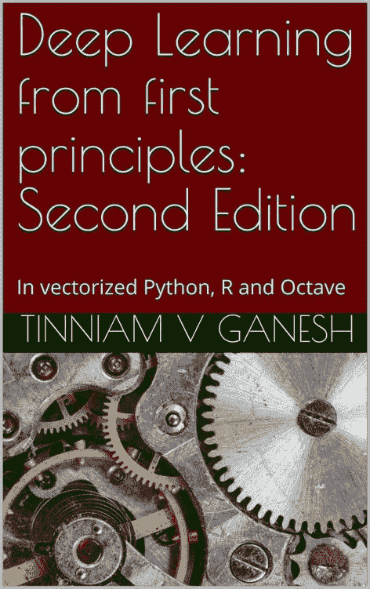

## 前言

> *除非你用不止一种方式学习，否则你什么都不懂。* —— Marvin Minsky

过去十余年来，深度学习领域取得了显著进展。这一 AI 领域已衍生出许多分支——深度置信网络、循环神经网络、卷积神经网络、对抗网络、强化学习、胶囊网络，列表还在不断延长。得益于硬件、存储和云技术的进步，这些年来深度学习也从研究实验室走向了寻常百姓家。

听取深度学习权威人士的观点时，一个共同的主题是：要想很好地掌握深度学习领域，必须学会从零开始构建此类网络。本书正是为此目的而写。

在本书中，我从基础开始实现深度学习网络。每一章都建立在前几章实现的基础之上，因此到第 7 章时，我已构建出一个功能齐全、通用的 L 层深度学习网络，包含所有“铃声和哨子”（即各种完善功能）。实现多层深度学习网络所需的所有必要推导均包含在各章节中。书中详细推导了采用 `relu`、`tanh` 和 `sigmoid` 隐藏层单元，以及 `sigmoid` 和 `softmax` 输出激活单元的前向传播和反向传播循环。这些内容有助于唤醒那些本科微积分知识生疏读者的记忆。

第一章在 Python、R 和 Octave 中推导并实现了作为神经网络的逻辑回归。第二章处理最原始神经网络——仅含一个隐藏层的网络——的推导与实现。第三章延伸第二章的原则，用向量化的 Python、R 和 Octave 实现了采用 `sigmoid` 激活函数的 L 层深度学习网络。该实现可包含任意数量的隐藏单元和任意数量的隐藏层，用于 `sigmoid` 激活输出层。第四章介绍了多类分类所需的 `Softmax` 函数。书中推导了 `Softmax` 的雅可比矩阵和交叉熵损失，并将其实现以演示简单螺旋数据集的多类分类。

第五章将第四章的 `softmax` 实现融入第三章的 L 层实现中。借此增强，第五章使用通用的 L 层实现中的 `Softmax` 输出激活单元对 MNIST 数字进行分类。

第六章探讨了 He 初始化和 Xavier 初始化等不同的初始化技术。此外，本章还讨论并实现了 L2 正则化和随机 Dropout 技术。第七章考察了学习率衰减、动量法、`rmsprop` 和 `adam` 等梯度下降优化技术。第八章讨论了一项确保反向传播实现正确性的关键技术。具体而言，本章讨论并实现了`梯度检验`，并演示了如何查找实现中的 Bug。

所有章节均包含 Python、R 和 Octave 的向量化实现。这些实现是一致的。因此，如果你精通其中任一语言，便可参考其他语言的实现。这应当是学习其他语言的好途径。

**注意**：各章节中调用的函数均包含在附录 1–附录 8 中。

欢迎通过调整超参数来试验这些实现。一个好的学习方法是拆解代码。你也可以尝试增强实现，加入其他激活函数，如 leaky `relu`、参数化 `relu` 等。也许你可以研究其他正则化或梯度下降优化方法。也可能有机会通过进一步向量化函数来优化我的代码。

本书主要基于 Andrew Ng 教授的深度学习[专项课程](https://www.coursera.org/specializations/deep-learning)。

我要感谢 Andrew Ng 教授和 Geoffrey Hinton 教授，正是他们通过课程将深度学习这门看似复杂的学科化繁为简，呈现出清晰明了的概念。

希望本书能开启你一段激动人心且充满挑战的深度学习之旅。

Tinniam V Ganesh

2018 年 5 月 16 日

## 简介

这是拙作《从零开始深度学习：第二版——基于向量化的 Python、R 和 Octave 实现》的第二版。

鉴于本书约 70% 的内容为代码，我希望让代码更具可读性。因此，在第二版中，我将所有代码字体更改为等宽字体 Lucida Console。这使代码结构更清晰，更易于理解。我还为所有函数和代码片段添加了行号。最后，我修正了书中的部分错别字。

### 作者其他著作（亚马逊有平装版和 Kindle 版）

1. **《R 和 Python 实战机器学习：第二版》**——立体式机器学习

2. **《败给纯粹速度：第三版》**——基于 yorkr 的板球分析

3. **《基于 cricketr 的板球分析：第三版》**

## 1. 作为神经网络的逻辑回归

> *"你看到的不是事物本来的样子，而是你自己的样子。"*
>
> *"你对物理对象的解读，关乎你大脑的历史轨迹——而与对象本身关系不大。"*
>
> *"大脑在接收来自眼睛和其他感官的信息之前，就已生成自己的现实。这被称为内部模型。"*
>
> —— David Eagleman，《大脑：你的故事》

### 逻辑回归作为两层神经网络

本章探讨将逻辑回归实现为两层神经网络，即仅包含输入层和输出层、没有隐藏层的神经网络。该两层网络分别用 Python、R 和 Octave 语言实现。之所以加入 Octave，是因为它是 Matlab 的近亲。

这些 Python、R 和 Octave 实现是等价的向量化实现。因此，如果你熟悉其中任一语言，就能看懂另外两种语言对应的代码。本章调用的函数实现见附录 1 —— 作为神经网络的逻辑回归。

你也可以从 Github 的 `DeepLearningFromFirstPrinciples` 仓库克隆/下载 Python、R 和 Octave 的向量化代码 (https://github.com/tvganesh/DeepLearningFromFirstPrinciples/tree/master/Chap1-LogisticRegressionAsNeuralNetwork)。首先，使用 `sklearn` 的逻辑回归包对 `sklearn` 的癌症数据集执行逻辑回归。如下所示。

### 1. 逻辑回归

```python
import numpy as np
import pandas as pd
import os
import matplotlib.pyplot as plt
from sklearn.model_selection import train_test_split
from sklearn.linear_model import LogisticRegression
from sklearn.datasets import make_classification, make_blobs
from sklearn.metrics import confusion_matrix
from matplotlib.colors import ListedColormap
from sklearn.datasets import load_breast_cancer

# Load the cancer data
(X_cancer, y_cancer) = load_breast_cancer(return_X_y=True)
X_train, X_test, y_train, y_test = train_test_split(X_cancer, y_cancer, random_state=0)

# Call the Logistic Regression function
clf = LogisticRegression().fit(X_train, y_train)

# Print accuracy of training and test set
print('Accuracy of Logistic regression classifier on training set: {:.2f}'.format(clf.score(X_train, y_train)))
print('Accuracy of Logistic regression classifier on test set: {:.2f}'.format(clf.score(X_test, y_test)))
```

逻辑回归分类器在训练集上的准确率: 0.96

逻辑回归分类器在测试集上的准确率: 0.96

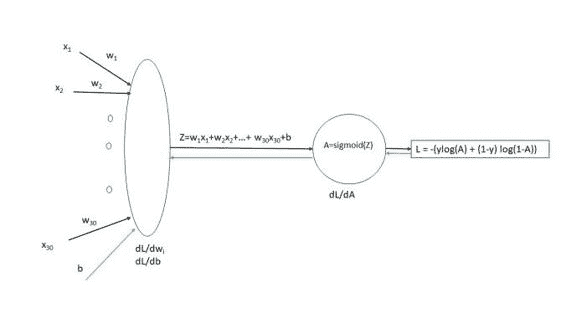

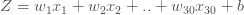

### 2. 逻辑回归作为两层神经网络

在下一节中，逻辑回归将在 Python、R 和 Octave 中实现为两层神经网络。来自 `sklearn` 的相同癌症数据集被用于在 Python、R 和 Octave 中训练和测试神经网络。这可以用下图表示。

癌症数据集有 30 个输入特征，目标变量“output”为 0 或 1。因此，输出层将使用 Sigmoid 激活函数进行分类。

这个简单的两层神经网络如下所示。

在输入层，有 30 个特征及其对应的权重，这些权重被初始化为较小的随机值。

其中“b”为偏置项。

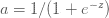

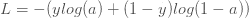

激活函数是 Sigmoid 函数，公式为：

当输出层使用 Sigmoid 函数时，损失函数由下式给出：

(1)

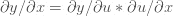

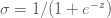


### 3. 梯度下降

#### 3.1 前向传播

神经网络的前向传播周期计算输出 `Z` 和 Sigmoid 激活函数的激活值。然后利用给定特征的输出 'y'，根据上述公式 (1) 计算“损失”。

#### 3.2 反向传播

反向传播周期确定“损失”受前几层直到输入层的微小变化影响程度。换句话说，反向传播计算输入层权重的变化，以最小化输出层的损失。在最陡下降路径上执行多次梯度下降循环以寻找局部极小值。换言之，梯度下降计算输入层的一组权重和偏置，使其产生最低损失。输入层的权重按称为“学习率”的参数减小。过大的“学习率”可能越过局部极小值，过小的“学习率”可能导致收敛时间过长。

梯度下降迭代前向传播和反向传播循环，直到损失最小化。此过程针对 'm' 个训练样本执行。

#### 3.3 微分链式法则

设 `y = f(u)` 且 `u = g(x)`，则根据链式法则：

#### 3.4 Sigmoid 的导数

设 ...

则 ...

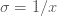

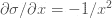


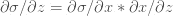

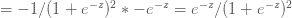

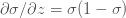

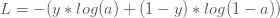

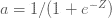

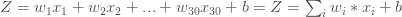

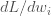

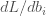

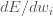

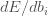

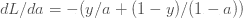

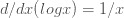

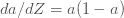

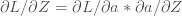

以及 ...

利用微分链式法则可得：

因此 ...

-(2)

两层神经网络表示逻辑回归的 3 个方程为：

-(a)

-(b)

-(c)

其中 `L` 为 Sigmoid 输出激活函数的损失。反向传播步骤需要计算 ... 和 ... 。若为回归问题，则为 ... 和 ... ，其中 `dE` 为均方误差函数。

损失函数的导数计算如下：

-(d)

因为 ...

同样由方程 (2) 可写为：

– (e)

根据链式法则 ...

因此将 (d) 和 (e) 的结果代入上式：

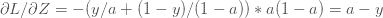

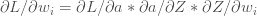

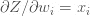

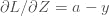

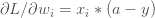

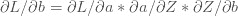

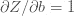

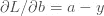

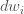

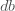

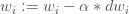

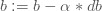

可得：

(f)

最终：

-(g)

– (h)

由 (f) 得 ...

因此 (g) 简化为：

-(i)

同样：

-(j)

由于 ... 并在 (j) 中使用 (f) 可得 ...

梯度利用 ... 和 ... 的值计算输入层的权重及对应偏置。

书籍 *Deep Learning* (http://www.deeplearningbook.org/) 中的计算图表示 —— 作者 Ian Goodfellow, Yoshua Bengio, Aaron Courville —— 对可视化和计算反向传播非常有用。逻辑回归两层神经网络的计算图如下所示。

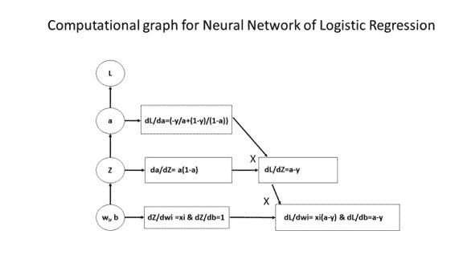

### 4. 逻辑回归神经网络 - Python 代码

```python
import numpy as np
import pandas as pd
import os
import matplotlib.pyplot as plt
from sklearn.model_selection import train_test_split

# Define the sigmoid function
def sigmoid(z):
    a = 1 / (1 + np.exp(-z))
    return a

# Initialize weights and biases
def initialize(dim):
    w = np.zeros(dim).reshape(dim, 1)
    b = 0
    return w

# Compute the loss
def computeLoss(numTraining, Y, A):
    loss = -1 / numTraining * np.sum(Y * np.log(A) + (1 - Y) * (np.log(1 - A)))
    return loss

# Execute the forward propagation
def forwardPropagation(w, b, X, Y):
    # Compute Z
    Z = np.dot(w.T, X) + b

    # Determine the number of training samples
    numTraining = float(len(X))

    # Compute the output of the sigmoid activation function
    A = sigmoid(Z)

    # Compute the loss
    loss = computeLoss(numTraining, Y, A)

    # Compute the gradients dZ, dw and db
    dZ = A - Y
    dw = 1 / numTraining * np.dot(X, dZ.T)
    db = 1 / numTraining * np.sum(dZ)

    # Return the results as a dictionary
    gradients = {"dw": dw, "db": db}
    loss = np.squeeze(loss)
    return gradients, loss

# Compute Gradient Descent
def gradientDescent(w, b, X, Y, numIterations, learningRate):
    losses = []
    idx = []

    # Iterate
    for i in range(numIterations):
        gradients, loss = forwardPropagation(w, b, X, Y)

        # 获取导数
        dw = gradients["dw"]
        db = gradients["db"]
        w = w - learningRate * dw
        b = b - learningRate * db

        # 存储损失
        if i % 100 == 0:
            idx.append(i)
            losses.append(loss)

    # 设置参数和梯度
    params = {"w": w, "b": b}
    grads = {"dw": dw, "db": db}
    return params, grads, losses, idx

# 预测训练集的输出
```


```python
def predict(w, b, X):
    size = X.shape[1]
    yPredicted = np.zeros((1, size))
    Z = np.dot(w.T, X)
    # 计算 sigmoid
    A = sigmoid(Z)
    for i in range(A.shape[1]):
        # 如果值 > 0.5 则设为 1
        if A[0][i] > 0.5:
            yPredicted[0][i] = 1
        else:
            # 否则设为 0
            yPredicted[0][i] = 0
    return yPredicted
```

# 归一化数据

```python
def normalize(x):
    x_norm = None
    x_norm = np.linalg.norm(x, axis=1, keepdims=True)
    x = x / x_norm
    return x
```

# 在癌症数据集上运行 2 层神经网络

```python
from sklearn.datasets import load_breast_cancer
from sklearn.model_selection import train_test_split
import numpy as np
import matplotlib.pyplot as plt

# 加载癌症数据
(X_cancer, y_cancer) = load_breast_cancer(return_X_y=True)

# 创建训练集和测试集
X_train, X_test, y_train, y_test = train_test_split(X_cancer, y_cancer, random_state=0)

# 为获得更好性能而归一化数据
X_train1 = normalize(X_train)

# 创建零向量作为权重。大小为数据集中的特征数 = 30
w = np.zeros((X_train.shape[1], 1))
# w = np.zeros((30, 1))
b = 0

# 归一化训练数据以使梯度下降表现更好
X_train1 = normalize(X_train)

# 转置 X_train 以便得到一个 (features, numSamples) 形状的矩阵
X_train2 = X_train1.T

# 重塑以移除秩 1 数组，然后转置
y_train1 = y_train.reshape(len(y_train), 1)
y_train2 = y_train1.T

# 运行梯度下降 4000 次并计算权重
parameters, grads, costs, idx = gradientDescent(w, b, X_train2, y_train2, numIerations=4000, learningRate=0.75)

w = parameters["w"]
b = parameters["b"]

# 归一化 X_test
X_test1 = normalize(X_test)

# 转置 X_test 以便得到一个 (features, numSamples) 形状的矩阵
X_test2 = X_test1.T

# 重塑 y_test
y_test1 = y_test.reshape(len(y_test), 1)
y_test2 = y_test1.T

# 预测值
yPredictionTest = predict(w, b, X_test2)
yPredictionTrain = predict(w, b, X_train2)

# 打印准确率
print("train accuracy: {} %".format(100 - np.mean(np.abs(yPredictionTrain - y_train2)) * 100))
print("test accuracy: {} %".format(100 - np.mean(np.abs(yPredictionTest - y_test)) * 100))

# 绘制成本与迭代次数的关系图
fig1 = plt.plot(idx, costs)
fig1 = plt.title("Gradient descent-Cost vs No of iterations")
fig1 = plt.xlabel("No of iterations")
fig1 = plt.ylabel("Cost")
```

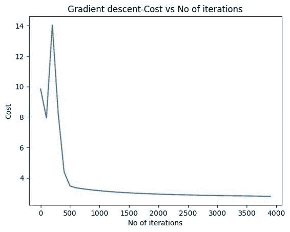

```python
fig1.figure.savefig("fig1", bbox_inches='tight')
```

## 训练准确率: 90.3755868545 %

## 测试准确率: 89.5104895105 %

**注意**：训练集和测试集上的准确率分别为 90.37% 和 89.51%。与 sklearn 逻辑回归达到的 96% 相比，这要差一些！但这主要是因为缺少隐藏层，而隐藏层才是神经网络的真正力量。

# 5. 用于逻辑回归的神经网络 - R 代码

```r
source("RFunctions-1.R")

# 定义 sigmoid 函数
sigmoid <- function(z) {
  a <- 1 / (1 + exp(-z))
  a
}

# 计算损失
computeLoss <- function(numTraining, Y, A) {
  loss <- -1 / numTraining * sum(Y * log(A) + (1 - Y) * log(1 - A))
  return(loss)
}

# 计算前向传播
forwardPropagation <- function(w, b, X, Y) {
  # 计算 Z
  Z <- t(w) %*% X + b
  # 设置样本数量
  numTraining <- ncol(X)
  # 计算激活函数
  A = sigmoid(Z)
  # 计算损失
  loss <- computeLoss(numTraining, Y, A)
  # 计算梯度 dZ, dw 和 db
  dZ <- A - Y
  dw <- 1 / numTraining * X %*% t(dZ)
  db <- 1 / numTraining * sum(dZ)
  fwdProp <- list("loss" = loss, "dw" = dw, "db" = db)
  return(fwdProp)
}

# 执行一轮梯度下降
gradientDescent <- function(w, b, X, Y, numIerations, learningRate) {
  losses <- NULL
  idx <- NULL
  # 循环遍历迭代次数
  for (i in 1:numIerations) {
    fwdProp <- forwardPropagation(w, b, X, Y)
    # 获取导数
    dw <- fwdProp$dw
    db <- fwdProp$db
    # 执行梯度下降
    w = w - learningRate * dw
    b = b - learningRate * db
    l <- fwdProp$loss
    # 存储损失
    if (i %% 100 == 0) {
      idx <- c(idx, i)
      losses <- c(losses, l)
    }
  }
  # 返回权重和损失
  gradDescnt <- list("w" = w, "b" = b, "dw" = dw, "db" = db, "losses" = losses, "idx" = idx)
  return(gradDescnt)
}

# 计算输入的预测值
predict <- function(w, b, X) {
  m = dim(X)[2]
  # 创建一个全 0 向量
  yPredicted = matrix(rep(0, m), nrow = 1, ncol = m)
  Z <- t(w) %*% X + b
  # 计算 sigmoid
  A = sigmoid(Z)
  for (i in 1:dim(A)[2]) {
    # 如果 A > 0.5 设值为 1
    if (A[1, i] > 0.5)
      yPredicted[1, i] = 1
    else
      # 否则设为 0
      yPredicted[1, i] = 0
  }
  return(yPredicted)
}

# 归一化矩阵
normalize <- function(x) {
  # 创建矩阵的范数。执行矩阵的 Frobenius 范数
  n <- as.matrix(sqrt(rowSums(x^2)))
  # 按行按范数扫描。注意函数中的 '1' 表示对每一行执行操作
  normalized <- sweep(x, 1, n, FUN = "/")
  return(normalized)
}

# 在癌症数据集上运行 2 层神经网络
# 读取数据 (来自 sklearn)
cancer <- read.csv("cancer.csv")

# 重命名目标变量
names(cancer) <- c(seq(1, 30), "output")

# 拆分为训练集和测试集
train_idx <- trainTestSplit(cancer, trainPercent = 75, seed = 5)
train <- cancer[train_idx, ]
test <- cancer[-train_idx, ]

# 设置特征
X_train <- train[, 1:30]
y_train <- train[, 31]
X_test <- test[, 1:30]
y_test <- test[, 31]

# 创建一个全 0 矩阵，特征数量为列数
w <- matrix(rep(0, dim(X_train)[2]))
b <- 0
X_train1 <- normalize(X_train)
X_train2 = t(X_train1)

# 重塑然后转置
y_train1 = as.matrix(y_train)
y_train2 = t(y_train1)

# 执行梯度下降
gradDescent = gradientDescent(w, b, X_train2, y_train2, numIerations = 3000, learningRate = 0.77)

# 归一化 X_test
X_test1 = normalize(X_test)
# 转置 X_test 以便得到一个 (features, numSamples) 形状的矩阵
X_test2 = t(X_test1)

# 重塑 y_test 并转置
y_test1 = as.matrix(y_test)
y_test2 = t(y_test1)

# 使用梯度下降生成的权重值
yPredictionTest = predict(gradDescent$w, gradDescent$b, X_test2)
yPredictionTrain = predict(gradDescent$w, gradDescent$b, X_train2)
sprintf("Train accuracy: %f", (100 - mean(abs(yPredictionTrain - y_train2)) * 100))
```

## [1] "Train accuracy: 90.845070"

```r
sprintf("test accuracy: %f", (100 - mean(abs(yPredictionTest - y_test)) * 100))
```

## [1] "test accuracy: 87.323944"

```r
df <- data.frame(gradDescent$idx, gradDescent$losses)
names(df) <- c("iterations", "losses")
ggplot(df, aes(x = iterations, y = losses)) + geom_point() + geom_line(col = "blue") +
  ggtitle("Gradient Descent - Losses vs No of Iterations") +
  xlab("No of iterations") + ylab("Losses")
```

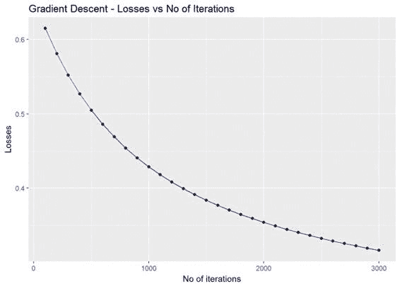

# 6. 用于逻辑回归的神经网络 - Octave 代码

```octave
1;

# 定义 sigmoid 函数
function a = sigmoid(z)
  a = 1 ./ (1 + exp(-z));
end

# 计算损失
function loss = computeLoss(numtraining, Y, A)
  loss = -1 / numtraining * sum((Y .* log(A)) + (1 - Y) .* log(1 - A));
end

# 执行前向传播
function [loss, dw, db, dZ] = forwardPropagation(w, b, X, Y)
  # 计算 Z
  Z = w' * X + b;
  numtraining = size(X)(1, 2);
  # 计算 sigmoid
  A = sigmoid(Z);
  # 计算损失。注意这是逐元素乘积
  loss = computeLoss(numtraining, Y, A);
  # 计算梯度 dZ, dw 和 db
  dZ = A - Y;
  dw = 1 / numtraining * X * dZ';
  db = 1 / numtraining * sum(dZ);
end

# 计算梯度下降
function [w, b, dw, db, losses, index] = gradientDescent(w, b, X, Y, numIerations, learningRate)
  # 初始化 losses 和 index
  losses = [];
  index = [];
  # 循环遍历迭代次数
  for i = 1:numIerations
    [loss, dw, db, dZ] = forwardPropagation(w, b, X, Y);
    # 执行梯度下降
    w = w - learningRate * dw;
```

# 实现简单神经网络

## 简介

在第一章中，我用向量化的 Python、R 和 Octave 实现了逻辑回归，这是一个想成为神经网络的网络（没有隐藏层的神经网络）。在第二章中，我实现了一个常规但略显原始的神经网络（仅有 1 个隐藏层的神经网络）。本章实现了手动创建数据集的分类，其中两个类的不同簇是线性不可分的。

神经网络在学习各种类别之间的非线性边界方面表现良好。最初使用逻辑回归进行分类。然后在同一数据集上使用一个简单的 3 层神经网络并绘制决策边界。普通逻辑回归表现相当差。使用带有径向基核的 SVM 在创建非线性边界方面会表现好得多。本章调用的函数实现见附录 2 - 实现简单神经网络。您可以从 GitHub 克隆和分叉 3 层神经网络的向量化实现（Python、R 和 Octave）：

[DeepLearningFromFirstPrinciples](https://github.com/tvganesh/DeepLearningFromFirstPrinciples/tree/master/Chap2-SimpleNeuralNetwork)

## 3 层神经网络

下图展示了一个带有 1 个隐藏层的 3 层神经网络（NN）的简单表示。

在上述神经网络中，输入层有两个输入特征，隐藏层有三个隐藏单元，输出层有一个输出单元，因为它处理二分类问题。隐藏层的激活单元可以是 `tanh`、`sigmoid`、`relu` 等。输出层的激活函数是 `sigmoid`，用于处理二分类。

### 重要结果（记忆复习！）

**前向传播**

```math
# Superscript indicates layer '1'
Z^{[1]} = W^{[1]} X + b^{[1]}
A^{[1]} = \tanh(Z^{[1]})
```

```math
# Superscript indicates layer '2'
Z^{[2]} = W^{[2]} A^{[1]} + b^{[2]}
A^{[2]} = \sigma(Z^{[2]})
```

因此：

```math
A^{[1]} = \tanh(Z^{[1]})
A^{[2]} = \sigma(Z^{[2]})
```

同理：

```math
\frac{\partial A^{[1]}}{\partial Z^{[1]}} = 1 - (A^{[1]})^2
\frac{\partial A^{[2]}}{\partial Z^{[2]}} = A^{[2]}(1 - A^{[2]})
```

这些方程可以写为：

**I) 一些重要结果（记忆复习！）**

```math
\frac{d}{dx}\tanh(x) = 1 - \tanh^2(x) \quad \text{(a)}
```

```math
\frac{d}{dx}\sigma(x) = \sigma(x)(1 - \sigma(x)) \quad \text{(b)}
```

使用 (a) 我们可以得到：

```math
\frac{\partial A^{[1]}}{\partial Z^{[1]}} = 1 - (A^{[1]})^2
```

以及：

```math
\frac{\partial A^{[2]}}{\partial Z^{[2]}} = A^{[2]}(1 - A^{[2]})
```

(b)

现在：


## 数学推导

### 损失函数导数

```math
\frac{\partial L}{\partial Z^{[2]}} = A^{[2]} - Y
```

```math
\frac{\partial L}{\partial W^{[2]}} = \frac{\partial L}{\partial Z^{[2]}} (A^{[1]})^T
```

```math
\frac{\partial L}{\partial b^{[2]}} = \frac{\partial L}{\partial Z^{[2]}}
```

```math
\frac{\partial L}{\partial Z^{[1]}} = (W^{[2]})^T \frac{\partial L}{\partial Z^{[2]}} \odot (1 - (A^{[1]})^2)
```

```math
\frac{\partial L}{\partial W^{[1]}} = \frac{\partial L}{\partial Z^{[1]}} X^T
```

```math
\frac{\partial L}{\partial b^{[1]}} = \frac{\partial L}{\partial Z^{[1]}}
```

### (c) tanh 导数

因为：

```math
\frac{\partial \tanh(x)}{\partial x} = 1 - \tanh^2(x)
```

并且使用 (c) 我们得到：

```math
\frac{\partial L}{\partial Z^{[1]}} = (W^{[2]})^T \frac{\partial L}{\partial Z^{[2]}} \odot (1 - (A^{[1]})^2)
```

### 双曲函数导数

使用 (b) 中 `sinhx` 和 `coshx` 导数的值我们得到：

因为：

```math
\frac{d}{dx}\sinh(x) = \cosh(x), \quad \frac{d}{dx}\cosh(x) = \sinh(x)
```

### (d) 对数损失导数

**II) 导数**

对数损失如下所示：

```math
L = -[Y \log(A^{[2]}) + (1-Y)\log(1-A^{[2]})]
```

因为：

```math
\frac{\partial L}{\partial A^{[2]}} = -\frac{Y}{A^{[2]}} + \frac{1-Y}{1-A^{[2]}}
```

因此：

```math
\frac{\partial L}{\partial Z^{[2]}} = A^{[2]} - Y
```

见第一章 equation (2)

因此：

```math
\frac{\partial L}{\partial W^{[2]}} = \frac{\partial L}{\partial Z^{[2]}} (A^{[1]})^T \quad \text{(e)}
```

```math
\frac{\partial L}{\partial b^{[2]}} = \frac{\partial L}{\partial Z^{[2]}} \quad \text{(f)}
```

以及：

```math
\frac{\partial L}{\partial Z^{[1]}} = (W^{[2]})^T \frac{\partial L}{\partial Z^{[2]}} \odot (1 - (A^{[1]})^2)
```

以及：

```math
\frac{\partial L}{\partial W^{[1]}} = \frac{\partial L}{\partial Z^{[1]}} X^T \quad \text{(g)}
```

```math
\frac{\partial L}{\partial b^{[1]}} = \frac{\partial L}{\partial Z^{[1]}} \quad \text{(h)}
```

### III) 反向传播

使用 II) 中的导数，我们可以使用链式法则推导出以下结果：

(i)

```math
\frac{\partial L}{\partial Z^{[2]}} = A^{[2]} - Y
```

```math
\frac{\partial L}{\partial W^{[2]}} = \frac{1}{m} \frac{\partial L}{\partial Z^{[2]}} (A^{[1]})^T
```

```math
\frac{\partial L}{\partial b^{[2]}} = \frac{1}{m} \sum \frac{\partial L}{\partial Z^{[2]}}
```

```math
\frac{\partial L}{\partial Z^{[1]}} = (W^{[2]})^T \frac{\partial L}{\partial Z^{[2]}} \odot (1 - (A^{[1]})^2)
```

```math
\frac{\partial L}{\partial W^{[1]}} = \frac{1}{m} \frac{\partial L}{\partial Z^{[1]}} X^T
```

```math
\frac{\partial L}{\partial b^{[1]}} = \frac{1}{m} \sum \frac{\partial L}{\partial Z^{[1]}}
```

使用 (i) 和 (e) 的结果我们得到：

(j)

(k)

以及：

化简得到：

(l) 和

(m)

### IV) 梯度下降

## Octave 代码实现

```octave
b = b - learningRate * db;

if (mod(i, 100) == 0)
    # Append index and loss
    index = [index i];
    losses = [losses loss];
endif
end
end

# Determine the predicted value for dataset
function yPredicted = predict(w, b, X)
    m = size(X)(1, 2);
    yPredicted = zeros(1, m);
    # Compute Z
    Z = w' * X + b;
    # Compute sigmoid
    A = sigmoid(Z);
    for i = 1:size(X)(1, 2),
        # Set predicted as 1 if A > 0.5
        if (A(1, i) >= 0.5)
            yPredicted(1, i) = 1;
        else
            yPredicted(1, i) = 0;
        endif
    end
end

# Normalize by dividing each value by the sum of squares
function normalized = normalize(x)
    # Compute Frobenius norm. Square the elements, sum rows and then find square root
    a = sqrt(sum(x .^ 2, 2));
    # Perform element wise division
    normalized = x ./ a;
end

# Split into train and test sets
function [X_train, y_train, X_test, y_test] = trainTestSplit(dataset, trainPercent)
    # Create a random index
    ix = randperm(length(dataset));
    # Split into training
    trainSize = floor(trainPercent / 100 * length(dataset));
    train = dataset(ix(1:trainSize), :);
    # And test
    test = dataset(ix(trainSize + 1:length(dataset)), :);
    X_train = train(:, 1:30);
    y_train = train(:, 31);
    X_test = test(:, 1:30);
    y_test = test(:, 31);
end

# Read the data
cancer = csvread("cancer.csv");

# Split as train and test
[X_train, y_train, X_test, y_test] = trainTestSplit(cancer, 75);

# Initialize w and b
w = zeros(size(X_train)(1, 2), 1);
b = 0;

# Normalize training
X_train1 = normalize(X_train);
X_train2 = X_train1';
y_train1 = y_train';

# Perform gradient descent
[w1, b1, dw, db, losses, idx] = gradientDescent(w, b, X_train2, y_train1, numIterations=3000, learningRate=0.75);

# Normalize X_test
X_test1 = normalize(X_test);
# Transpose X_train so that we have a matrix as (features, numSamples)
X_test2 = X_test1';
y_test1 = y_test';

# Use the values of the weights generated from Gradient Descent
yPredictionTest = predict(w1, b1, X_test2);
yPredictionTrain = predict(w1, b1, X_train2);

# Compute Accuracy
trainAccuracy = 100 - mean(abs(yPredictionTrain - y_train1)) * 100
testAccuracy = 100 - mean(abs(yPredictionTest - y_test1)) * 100

trainAccuracy = 90.845
testAccuracy = 89.510

graphics_toolkit('gnuplot')
plot(idx, losses);
title('Gradient descent- Cost vs No of iterations');
xlabel('No of iterations');
ylabel('Cost');
```

## 结论

本章从一个简单的 2 层神经网络实现逻辑回归开始。显然，这个简单神经网络的性能与高度优化的 `sklearn` 逻辑回归相比相对较差。这是因为上述神经网络没有任何隐藏层。深度学习和神经网络之所以能取得非凡的性能，是因为存在深层隐藏层。

---

> “What does the world outside your head really ‘look’ like? Not only is there no color, there’s also no sound: the compression and expansion of air is picked up by the ears and turned into electrical signals. The brain then presents these signals to us as mellifluous tones and swishes and clatters and jangles. Reality is also odorless: there’s no such thing as smell outside our brains. Molecules floating through the air bind to receptors in our nose and are interpreted as different smells by our brain. The real world is not full of rich sensory events; instead, our brains light up the world with their own sensuality.”
>
> — *The Brain: The Story of You* by David Eagleman

> “The world is Maya, illusory. The ultimate reality, the Brahman, is all-pervading and all-permeating, which is colourless, odourless, tasteless, nameless and formless”
>
> — *Bhagavad Gita*

反向循环中的关键计算基于上述公式 (h)、(i)、(j) 和 (k) 中计算出的梯度。

权重和偏置（`W1`、`b1`、`W2`、`b2`）在每次迭代中更新，从而最小化损失/成本。

这些推导可以用计算图形象地表示（源自 Ian Goodfellow、Joshua Bengio 和 Aaron Courville 合著的 *Deep Learning* [`www.deeplearningbook.org/`](http://www.deeplearningbook.org/)）。

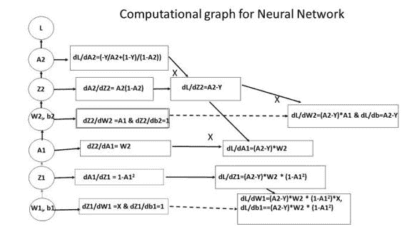

### 1. 手动创建一个线性不可分的数据集

最初我创建了一个包含 2 个类别、约 9 个簇的数据集，这些簇无法通过线性边界分离。**注意**：该数据集也保存为 `data.csv`，并供 R 和 Octave 神经网络使用，以查看它们在同一数据集上的表现。

```python
import numpy as np
import matplotlib.pyplot as plt
import matplotlib.colors
import sklearn.linear_model
from sklearn.model_selection import train_test_split
from sklearn.datasets import make_classification, make_blobs
from matplotlib.colors import ListedColormap
import sklearn
import sklearn.datasets

colors = ['black', 'gold']
cmap = matplotlib.colors.ListedColormap(colors)
X, y = make_blobs(n_samples=400, n_features=2, centers=7, cluster_std=1.3, random_state=4)

# Create 2 classes
y = y.reshape(400, 1)
y = y % 2

# Plot the figure
plt.figure()
plt.title('Non-linearly separable classes')
plt.scatter(X[:, 0], X[:, 1], c=y, marker='o', s=50, cmap=cmap)
plt.savefig('fig1.png', bbox_inches='tight')
```

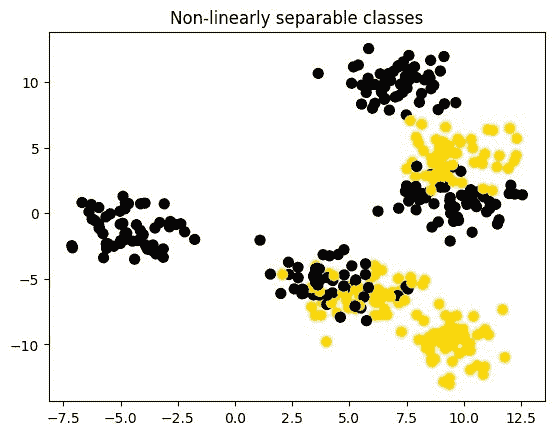

### 2. 逻辑回归

当在上述数据集上执行逻辑回归分类并绘制决策边界时，可以看到逻辑回归的表现相当差。


```python
import numpy as np
import matplotlib.pyplot as plt
import matplotlib.colors
import sklearn.linear_model
from sklearn.model_selection import train_test_split
from sklearn.datasets import make_classification, make_blobs
from matplotlib.colors import ListedColormap
import sklearn
import sklearn.datasets

# from DLfunctions import plot_decision_boundary
execfile("./DLfunctions.py")  # Since import does not work in Rmd!!!

colors = ['black', 'gold']
cmap = matplotlib.colors.ListedColormap(colors)
X, y = make_blobs(n_samples=400, n_features=2, centers=7, cluster_std=1.3, random_state=4)

# Create 2 classes
y = y.reshape(400, 1)
y = y % 2

# Train the logistic regression classifier
clf = sklearn.linear_model.LogisticRegressionCV()
clf.fit(X, y)

# Plot the decision boundary for logistic regression
plot_decision_boundary_n(lambda x: clf.predict(x), X.T, y.T, "fig2.png")
```

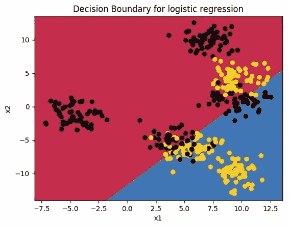

### 5.1 Python 中的 3 层神经网络（向量化）

向量化实现如下。请注意，在 Python 中，学习率为 0.5 且隐藏单元为 3 时表现非常好。

#### 具有 9 个簇的随机数据集

```python
import numpy as np
import matplotlib
import matplotlib.pyplot as plt
import sklearn.linear_model
import pandas as pd
from sklearn.datasets import make_classification, make_blobs

execfile("./DLfunctions.py")  # Since import does not work in Rmd!!!

X1, Y1 = make_blobs(n_samples=400, n_features=2, centers=9, cluster_std=1.3, random_state=4)

# Create 2 classes
Y1 = Y1.reshape(400, 1)
Y1 = Y1 % 2
X2 = X1.T
Y2 = Y1.T

# Execute the 3 layer Neural Network
parameters, costs = computeNN(X2, Y2, numHidden=4, learningRate=0.5, numIterations=10000)

# Plot the decision boundary
plot_decision_boundary(lambda x: predict(parameters, x.T), X2, Y2, str(4), str(0.5), "fig3.png")
```

#### 第 0 次迭代后的成本: 0.692669

#### 第 1000 次迭代后的成本: 0.246650

#### 第 2000 次迭代后的成本: 0.227801

#### 第 3000 次迭代后的成本: 0.226809

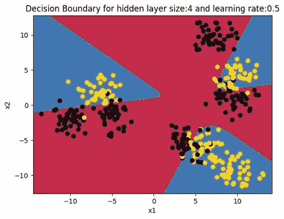

#### 第 4000 次迭代后的成本: 0.226518

#### 第 5000 次迭代后的成本: 0.226331

#### 第 6000 次迭代后的成本: 0.226194

#### 第 7000 次迭代后的成本: 0.226085

#### 第 8000 次迭代后的成本: 0.225994

#### 第 9000 次迭代后的成本: 0.225915

可以看出，带有单隐藏层的 3 层神经网络能够创建非线性边界来分离这些类别。

### 5.2 R 语言中的 3 层神经网络（向量化）

这是由 Python 创建并保存为 `data.csv` 的数据集。R 代码读取此数据，以查看 R 在同一数据集上的表现。R 语言中神经网络的向量化实现稍微有趣一些，因为 R 没有类似 `numpy` 的包。

虽然 `numpy` 隐式处理广播，但在 R 中，我必须使用 `sweep` 命令来进行广播。实现如下。请注意，由于随机权重初始化略有不同，R 在学习率为 0.1 且隐藏单元为 6 时表现最佳。

```r
source("DLfunctions2_1.R")
z <- as.matrix(read.csv("data.csv", header=FALSE))
x <- z[, 1:2]
y <- z[, 3]
x1 <- t(x)
y1 <- t(y)

# Execute the 3 layer Neural Network
nn <- computeNN(x1, y1, 6, learningRate=0.1, numIterations=10000)  # Good
```

#### 输出

```
[1] 0.7075341
[1] 0.2606695
[1] 0.2198039
[1] 0.2091238
[1] 0.211146
[1] 0.2108461
[1] 0.2105351
[1] 0.210211
[1] 0.2099104
[1] 0.2096437
[1] 0.209409
```


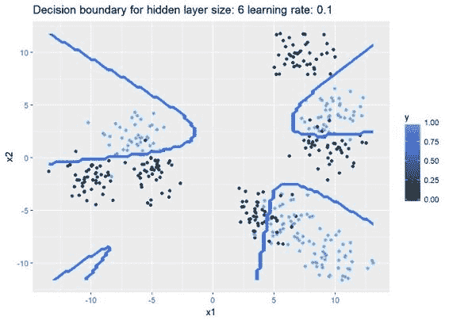

```r
plotDecisionBoundary(z, nn, 6, 0.1)
```

R 也能创建非线性边界。

### 5.3 Octave 中的 3 层神经网络（向量化）

这使用了通过 Python 代码生成的同一数据集（`data.csv`）。

```octave
source("DL-function2.m")

# Read the data
data = csvread("data.csv");
X = data(:, 1:2);
Y = data(:, 3);

# Make sure that the model parameters are correct. Take the transpose of X & Y
# Execute the 3 layer Neural Network and plot decision boundary
[W1, b1, W2, b2, costs] = computeNN(X', Y', 4, learningRate=0.5, numIterations=10000);
```

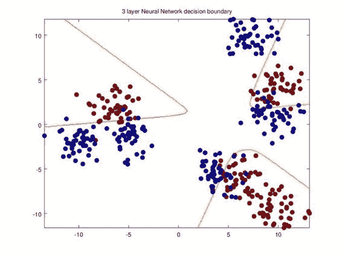

上图显示了 Octave 创建的非线性边界。

### 6.1a 不同学习率的表现 (Python)

```python
import numpy as np
import matplotlib
import matplotlib.pyplot as plt
import sklearn.linear_model
import pandas as pd
from sklearn.datasets import make_classification, make_blobs

execfile("./DLfunctions.py")  # Since import does not work in Rmd!!!

# Create data
X1, Y1 = make_blobs(n_samples=400, n_features=2, centers=9, cluster_std=1.3, random_state=4)

# Create 2 classes
Y1 = Y1.reshape(400, 1)
Y1 = Y1 % 2
X2 = X1.T
Y2 = Y1.T

# Create a list of learning rates
learningRate = [0.5, 1.2, 3.0]
df = pd.DataFrame()

# Compute costs for each learning rate
for lr in learningRate:
    # Execute the 3 layer Neural Network
    parameters, costs = computeNN(X2, Y2, numHidden=4, learningRate=lr, numIterations=10000)
    print(costs)
    df1 = pd.DataFrame(costs)
    df = pd.concat([df, df1], axis=1)

# Set the iterations
iterations = [0, 1000, 2000, 3000, 4000, 5000, 6000, 7000, 8000, 9000]

# Create data frame
# Set index
df1 = df.set_index([iterations])
df1.columns = [0.5, 1.2, 3.0]

# Plot cost vs number of iterations for different learning rates
fig = df1.plot()
fig = plt.title("Cost vs No of Iterations for different learning rates")
plt.savefig('fig4.png', bbox_inches='tight')
```

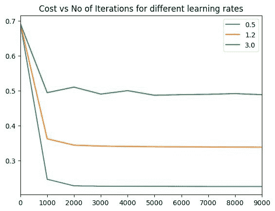

### 6.1b 不同隐藏单元数的表现 (Python)

```python
import numpy as np
import matplotlib
import matplotlib.pyplot as plt
import sklearn.linear_model
import pandas as pd
from sklearn.datasets import make_classification, make_blobs

execfile("./DLfunctions.py")  # Since import does not work in Rmd!!!

# Create data set
X1, Y1 = make_blobs(n_samples=400, n_features=2, centers=9, cluster_std=1.3, random_state=4)

# Create 2 classes
Y1 = Y1.reshape(400, 1)
Y1 = Y1 % 2
X2 = X1.T
Y2 = Y1.T

# Make a list of hidden units
numHidden = [3, 5, 7]
df = pd.DataFrame()

# Compute costs for different hidden units
for numHid in numHidden:
    # 执行 3 层神经网络
    parameters, costs = computeNN(X2, Y2, numHidden=numHid, learningRate=1.2, numIterations=10000)
    print(costs)
    df1 = pd.DataFrame(costs)
    df = pd.concat([df, df1], axis=1)

# 设置迭代次数
iterations = [0, 1000, 2000, 3000, 4000, 5000, 6000, 7000, 8000, 9000]

# 设置索引
df1 = df.set_index([iterations])

# 为不同隐藏单元数量绘制成本与迭代次数的关系图
df1.columns = [3, 5, 7]

# 绘图
fig = df1.plot()
fig = plt.title("Cost vs No of Iterations for different no of hidden units")
plt.savefig('fig5.png', bbox_inches='tight')
```

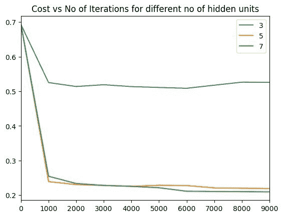

## 6.2a 不同学习率下的性能 (R)

```r
source("DLfunctions2_1.R")

# 读取数据
z <- as.matrix(read.csv("data.csv", header=FALSE))
x <- z[, 1:2]
y <- z[, 3]
x1 <- t(x)
y1 <- t(y)

# 遍历学习率并计算成本
learningRate <- c(0.1, 1.2, 3.0)
df <- NULL

for (i in seq_along(learningRate)) {
  # 执行 3 层神经网络
  nn <- computeNN(x1, y1, 6, learningRate=learningRate[i], numIterations=10000)
  cost <- nn$costs
  df <- cbind(df, cost)
}

# 创建数据框
df <- data.frame(df)
iterations <- seq(0, 10000, by=1000)
df <- cbind(iterations, df)
names(df) <- c("iterations", "0.5", "1.2", "3.0")

# 重塑数据
library(reshape2)
df1 <- melt(df, id="iterations") # Melt the data

# 绘制不同学习率下的成本与迭代次数关系图
ggplot(df1) + geom_line(aes(x=iterations, y=value, colour=variable), size=1) +
  xlab("Iterations") +
  ylab('Cost') + ggtitle("Cost vs No iterations for different learning rates")
```


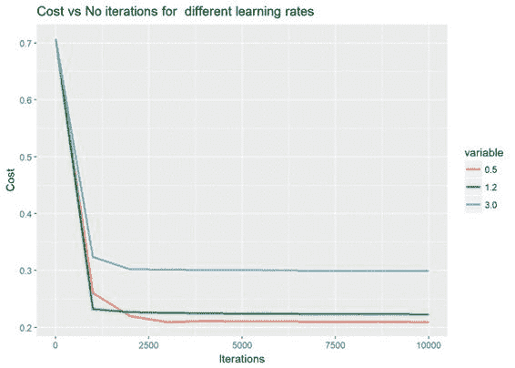

## 6.2b 不同隐藏单元数量下的性能 (R)

```r
source("DLfunctions2_1.R")

# 遍历隐藏单元数量
numHidden <- c(4, 6, 9)
df <- NULL

for (i in seq_along(numHidden)) {
  # 执行 3 层神经网络
  nn <- computeNN(x1, y1, numHidden[i], learningRate=0.1, numIterations=10000)
  cost <- nn$costs
  df <- cbind(df, cost)
}

# 创建数据框
df <- data.frame(df)
iterations <- seq(0, 10000, by=1000)
df <- cbind(iterations, df)
names(df) <- c("iterations", "4", "6", "9")

# 重塑数据框
library(reshape2)

# Melt
df1 <- melt(df, id="iterations")

# 绘制不同隐藏单元数量下的成本与迭代次数关系图
ggplot(df1) + geom_line(aes(x=iterations, y=value, colour=variable), size=1) +
  xlab("Iterations") +
  ylab('Cost') + ggtitle("Cost vs No iterations for different number of hidden units")
```


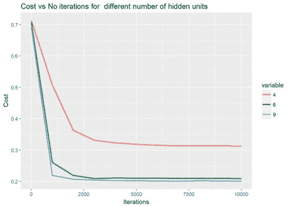

## 6.3a 不同学习率下神经网络的性能 (Octave)

```matlab
source("DL-function2.m")

# 绘制不同学习率下的成本与迭代次数关系图
plotLRCostVsIterations()
print -djph figa.jpg
```

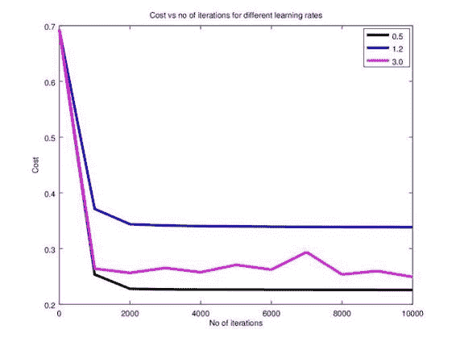

## 6.3b 不同隐藏单元数量下神经网络的性能 (Octave)

```matlab
source("DL-function2.m")

# 绘制不同隐藏单元数量下的成本与迭代次数关系图
plotHiddenCostVsIterations()
print -djph figa.jpg
```

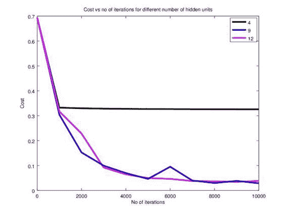

## 7. 给神经网络“施加压力”


在第二部分中，我创建了一个正样本的中心区域和一个负样本的外部区域。这些点是使用圆的方程 $(x - a)^2 + (y - b)^2 = R^2$ 生成的。3 层神经网络在此数据上的表现如何？让我们一探究竟！**注意**：R 和 Octave 的神经网络构建也使用相同的数据集。

## 8. 手动创建圆形中心区域

```python
import numpy as np
import matplotlib.pyplot as plt
import matplotlib.colors
import sklearn.linear_model
from sklearn.model_selection import train_test_split
from sklearn.datasets import make_classification, make_blobs
from matplotlib.colors import ListedColormap
import sklearn
import sklearn.datasets

colors = ['black', 'gold']
cmap = matplotlib.colors.ListedColormap(colors)

x1 = np.random.uniform(0, 10, 800).reshape(800, 1)
x2 = np.random.uniform(0, 10, 800).reshape(800, 1)
X = np.append(x1, x2, axis=1)
X.shape

# 使用 (x-a)² + (y-b)² = R² 创建数据集
# 创建一个平方值 < 0.4 的值子集。执行 ravel() 以展平此向量
a = (np.power(X[:, 0] - 5, 2) + np.power(X[:, 1] - 5, 2) <= 6).ravel()
Y = a.reshape(800, 1)

cmap = matplotlib.colors.ListedColormap(colors)

# 绘制数据集
plt.figure()
plt.title('Non-linearly separable classes')
plt.scatter(X[:, 0], X[:, 1], c=Y, marker='o', s=15, cmap=cmap)
plt.savefig('fig6.png', bbox_inches='tight')
```


### 8.1a 隐藏单元=4 且学习率 = 2.2 时的决策边界 (Python)

使用上述超参数，决策边界呈三角形。

```python
import numpy as np
import matplotlib.pyplot as plt
import matplotlib.colors
import sklearn.linear_model
execfile("./DLfunctions.py")

x1 = np.random.uniform(0, 10, 800).reshape(800, 1)
x2 = np.random.uniform(0, 10, 800).reshape(800, 1)
X = np.append(x1, x2, axis=1)
X.shape

# 创建一个平方值 < 0.4 的值子集。执行 ravel() 以展平此向量
a = (np.power(X[:, 0] - 5, 2) + np.power(X[:, 1] - 5, 2) <= 6).ravel()
Y = a.reshape(800, 1)

X2 = X.T
Y2 = Y.T

# 执行 3 层神经网络
parameters, costs = computeNN(X2, Y2, numHidden=4, learningRate=2.2, numIterations=10000)

# 绘制决策边界
plot_decision_boundary(lambda x: predict(parameters, x.T), X2, Y2, str(4), str(2.2), "fig7.png")
```

```
## Cost after iteration 0: 0.692836
## Cost after iteration 1000: 0.331052
## Cost after iteration 2000: 0.326428
## Cost after iteration 3000: 0.474887
## Cost after iteration 4000: 0.247989
## Cost after iteration 5000: 0.218009
## Cost after iteration 6000: 0.201034
## Cost after iteration 7000: 0.197030
## Cost after iteration 8000: 0.193507
## Cost after iteration 9000: 0.191949
```


### 8.1b 隐藏单元=12 且学习率 = 2.2 时的决策边界 (Python)

增加隐藏单元数量使决策边界更加圆润。

```python
import numpy as np
import matplotlib.pyplot as plt
import matplotlib.colors
import sklearn.linear_model
execfile("./DLfunctions.py")

x1 = np.random.uniform(0, 10, 800).reshape(800, 1)
x2 = np.random.uniform(0, 10, 800).reshape(800, 1)
X = np.append(x1, x2, axis=1)
X.shape

# 创建一个平方值 < 0.4 的值子集。执行 ravel() 以展平此向量
a = (np.power(X[:, 0] - 5, 2) + np.power(X[:, 1] - 5, 2) <= 6).ravel()
Y = a.reshape(800, 1)

X2 = X.T
Y2 = Y.T

# 执行 3 层神经网络
parameters, costs = computeNN(X2, Y2, numHidden=12, learningRate=2.2, numIterations=10000)

# 绘制决策边界
plot_decision_boundary(lambda x: predict(parameters, x.T), X2, Y2, str(12), str(2.2), "fig8.png")
```

```
## Cost after iteration 0: 0.693291
## Cost after iteration 1000: 0.383318
## Cost after iteration 2000: 0.298807
## Cost after iteration 3000: 0.251735
## Cost after iteration 4000: 0.177843
## Cost after iteration 5000: 0.130414
## Cost after iteration 6000: 0.152400
## Cost after iteration 7000: 0.065359
## Cost after iteration 8000: 0.050921
## Cost after iteration 9000: 0.039719
```


### 8.2a 隐藏单元=9 且学习率 = 0.5 时的决策边界 (R)

当隐藏单元数量为 6 且学习率为 0.5 时，在 R 中也是三角形状。

```r
source("DLfunctions2_1.R")

z <- as.matrix(read.csv("data1.csv", header=FALSE)) # N
x <- z[, 1:2]
y <- z[, 3]
x1 <- t(x)
y1 <- t(y)

# 执行 3 层神经网络
nn <- computeNN(x1, y1, 9, learningRate=0.5, numIterations=10000) # Triangular
```


```
## [1] 0.8398838
## [1] 0.3303621
## [1] 0.3127731
## [1] 0.3012791
## [1] 0.3305543
## [1] 0.3303964
## [1] 0.2334615
## [1] 0.1920771
## [1] 0.2341225
## [1] 0.2188118
## [1] 0.2082687
```

# 绘制决策边界

```r
plotDecisionBoundary(z, nn, 6, 0.1)
```


### 8.2b 隐藏单元=8 且 learning rate = 0.1 (R)

使用 8 个隐藏单元时，决策边界相当圆形。

```r
source("DLfunctions2_1.R")
z <- as.matrix(read.csv("data1.csv", header=FALSE)) # N
x <- z[, 1:2]
y <- z[, 3]
x1 <- t(x)
y1 <- t(y)

# 执行 3 层神经网络
nn <- computeNN(x1, y1, 8, learningRate=0.1, numIterations=10000) # Hemisphere
```


```
## [1] 0.7273279
## [1] 0.3169335
## [1] 0.2378464
## [1] 0.1688635
## [1] 0.1368466
## [1] 0.120664
## [1] 0.111211
## [1] 0.1043362
## [1] 0.09800573
## [1] 0.09126161
## [1] 0.0840379
```

# 绘制决策边界

```r
plotDecisionBoundary(z, nn, 8, 0.1)
```

### 8.3a 隐藏单元=12 且 learning rate = 1.5 时的决策边界 (Octave)

```matlab
source("DL-function2.m")

# 读取数据
data = csvread("data1.csv");
X = data(:, 1:2);
Y = data(:, 3);

# 确保模型参数正确。对 X 和 Y 进行转置
# 执行 3 层神经网络
[W1, b1, W2, b2, costs] = computeNN(X', Y', 12, learningRate=1.5, numIterations = 10000);

# 绘制决策边界
plotDecisionBoundary(data, W1, b1, W2, b2)
print -djpg fige.jpg
```


# 9. 结论

本章实现了一个 3 层神经网络，以在执行分类时创建非线性边界。显然，当隐藏单元数量和学习率变化时，神经网络表现非常好。

## 3. 构建 L 层深度学习网络

> *“从前，我，庄周，梦见自己是一只蝴蝶，栩栩然蝴蝶也，自喻适志与！不知周也。俄然觉，则蘧蘧然周也。不知周之梦为蝴蝶与，蝴蝶之梦为周与。”*
>
> 摘自 *The Brain: The Story of you* – David Eagleman
>
> *“思想是一大堆神经活动的向量”*
>
> Geoffrey Hinton 教授

### 1. 简介

这是我关于从头原理用 Python、R 和 Octave 进行深度学习系列的第三章。在第三部分中，我实现了一个任意深度（任意数量的隐藏层）和任意高度（每个隐藏层中任意数量的激活单元）的多层深度学习 (DL) 网络。第三部分的实现是针对 L 层深度网络的，但不包含任何正则化、早停、动量或学习率自适应技术。

然而，即使是这个最基础的多层 DL，也有足够多的超参数需要微调和调整。

在 Python、R 和 Octave 中实现向量化的 L 层深度学习网络颇具挑战性，因为我们需要跟踪索引、层数和矩阵维度。由于语言差异带来的一些挑战：

1.  Python 和 Octave 允许在单个语句中解包多个返回值。而在 R 中，从列表解包多个返回值需要返回整个列表，然后再单独解包。我确实看到有一个包 `gsubfn` ([stackoverflow.com/questions/1826519/how-to-assign-from-a-function-which-returns-more-than-one-value](https://stackoverflow.com/questions/1826519/how-to-assign-from-a-function-which-returns-more-than-one-value)) 可以做到这一点。
2.  Python 和 R 可以分别使用字典或列表从函数保存和返回不同类型的元素。然而，Octave 中没有真正的等价物。我在 Octave 中得到的最接近此功能的是“元胞数组”。但元胞数组只能通过索引访问，不能像 Python 字典或 R 列表那样通过键访问。这使得在 Octave 中处理事情稍微困难一些。
3.  Python 和 Octave 包含隐式广播。在 R 中，广播不是隐式的，但 R 有一个巧妙的函数 `sweep()`，我们可以用它按列或按行进行广播。
4.  Python 字典或 R 列表在 Octave 中最接近的等价物是元胞数组。然而，我不得不为权重和偏置分别管理单独的元胞数组，并在梯度下降期间分别管理单独的梯度 `dW` 和 `dB`。
5.  Python 中的秩-1 numpy 数组有时会令人恼火。这个问题在 R 和 Octave 中不存在。

当前的向量化实现支持 `relu`、`sigmoid` 和 `tanh` 激活函数。

在使用不同的超参数进行测试时，即 i) 隐藏层的数量，ii) 每层中的激活单元数量，iii) 激活函数和 iv) 迭代次数，我发现 L 层深度学习网络对这些超参数非常敏感。调整参数并不容易。增加更多的隐藏层或每层更多的单元并不总是有帮助，有时会导致梯度下降陷入某些局部极小值。这需要相当多的试错，以及对深度学习网络在逻辑变化下如何表现的非常密切的观察。然后我们可以锁定最优解。第 8 章将讨论一种更详细的调整超参数的方法。本章中使用的 Python、R 和 Octave 函数在附录 3 - 构建 L 层深度学习网络中实现。

欢迎从 Github `DeepLearningFromFirstPrinciples` ([github.com/tvganesh/DeepLearningFromFirstPrinciples/tree/master/Chap3-L-LayerDeepLearningNetwork](https://github.com/tvganesh/DeepLearningFromFirstPrinciples/tree/master/Chap3-L-LayerDeepLearningNetwork)) 下载/复刻我的代码，并针对您自己的问题尝试调整超参数。


## 2. 多层深度学习网络的推导

让我们以一个简单的 3 层神经网络为例，包含 3 个隐藏层和一个输出层。

在前向传播循环中，方程如下：

[方程由图片表示：index-83_1.jpg 至 index-83_17.jpg]


并且由于：

[方程由图片表示：index-84_1.jpg 至 index-84_9.jpg]


### 其他重要结果

所实现的深度学习网络中激活函数的导数：

*   `g(z) = sigmoid(z) = a` → `g'(z) = a(1-a)` – 见第 1 章公式 (2)
*   `g(z) = tanh(z) = a` → `g'(z) = 1 - a²` – 见第 2 章公式 (d)
*   `g(z) = relu(z) = z` 当 `z > 0` 时，`0` 当 `z <= 0` 时 → `g'(z) = 1` 当 `z > 0` 时，`0` 当 `z <= 0` 时

下面包含了用于 Python、R 和 Octave 的多层向量化深度学习网络的实现。对于所有这些实现，最初我都会创建深度学习网络的大小和配置，即层维度。因此，例如，长度为 `L` 的层维度向量 `V` 表示 `L` 层，其中 `V`（在 Python 中）= `...`，`V`（在 R 中）= `...`，`V`（在 Octave 中）= `[...]`。

在所有这些实现中，第一个元素是深度学习网络的输入特征数量，最后一个元素始终是 `sigmoid` 激活函数，因为所有问题都涉及二分类。

第一个和最后一个元素之间的元素数量是隐藏层的数量，每个元素的大小是每个隐藏层中激活单元的数量，这在使用函数 `L_Layer_DeepModel()` 实际执行深度学习网络时指定，Python、R 和 Octave 所有实现均是如此。

## 2.1a 使用多层深度学习网络进行分类 – Relu 激活函数 (Python)

在下面的代码中，训练了一个 4 层神经网络，以在类别之间生成非线性边界。在下面的代码中使用了 `Relu` 激活函数。每层的激活单元数量为 9。绘制了成本与迭代次数的关系图。除了决策边界外，还计算了准确率、精确率、召回率和 F1 分数。

```python
import os
import numpy as np
import matplotlib.pyplot as plt
import matplotlib.colors
import sklearn.linear_model
from sklearn.model_selection import train_test_split
from sklearn.datasets import make_classification, make_blobs
from matplotlib.colors import ListedColormap
import sklearn
import sklearn.datasets
# from DLfunctions import plot_decision_boundary
execfile("./DLfunctions34.py") #

# Create clusters of 2 classes
X1, Y1 = make_blobs(n_samples=400, n_features=2, centers=9, cluster_std=1.3, random_state=4)

# Create 2 classes
Y1 = Y1.reshape(400, 1)
Y1 = Y1 % 2
X2 = X1.T
Y2 = Y1.T

# Set the dimensions of DL Network
# Below we have
# 2 - 2 input features
# 9,9 - 2 hidden layers with 9 activation units per layer and
# 1 - 1 sigmoid activation unit in the output layer as this is a binary classification
# The activation in the hidden layer is the 'relu' specified in L_Layer_DeepModel
layersDimensions = [2, 9, 9, 1] # 4-layer model

# Execute the L-layer Deep Learning network
# Hidden layer activation unit – relu
# Learning rate – 0.3
parameters = L_Layer_DeepModel(X2, Y2, layersDimensions, hiddenActivationFunc='relu', learning_rate=0.3, num_iterations=2500, fig="fig1.png")

# Plot the decision boundary
plot_decision_boundary(lambda x: predict(parameters, x.T), X2, Y2, str(0.3), "fig2.png")

# Compute the confusion matrix
yhat = predict(parameters, X2)
from sklearn.metrics import confusion_matrix
a = confusion_matrix(Y2.T, yhat.T)

# Print the output
from sklearn.metrics import accuracy_score, precision_score, recall_score, f1_score
print('Accuracy: {:.2f}'.format(accuracy_score(Y2.T, yhat.T)))
print('Precision: {:.2f}'.format(precision_score(Y2.T, yhat.T)))
print('Recall: {:.2f}'.format(recall_score(Y2.T, yhat.T)))
print('F1: {:.2f}'.format(f1_score(Y2.T, yhat.T)))
```

### 准确率: 0.90

### 精确率: 0.91

### 召回率: 0.87

### F1: 0.89


## 2.1b 使用多层深度学习网络进行分类 – Relu 激活函数 (R)

在下面的代码中，使用 Relu 激活函数对与上述相同的数据集 (`data.csv`) 执行二分类。深度学习网络与上述相同。

```r
library(ggplot2)

# Read the data
z <- as.matrix(read.csv("data.csv", header=FALSE))
x <- z[, 1:2]
y <- z[, 3]
X1 <- t(x)
Y1 <- t(y)

# Set the dimensions of the Deep Learning network
# 2 - No of input features
# 9,9 - 2 hidden layers with 9 activation units
# 1 - 1 sigmoid activation unit at output layer
layersDimensions = c(2, 9, 9, 1)

# Execute the L-layer Deep Learning Neural Network
# Hidden layer activation unit – relu
# Learning rate – 0.3
retvals = L_Layer_DeepModel(X1, Y1, layersDimensions, hiddenActivationFunc='relu', learningRate=0.3, numIterations=5000, print_cost=TRUE)

library(ggplot2)
source("DLfunctions33.R")
```


```r
# Get the computed costs
costs <- retvals[['costs']]

# Create a sequence of iterations
numIterations = 5000
iterations <- seq(0, numIterations, by=1000)
df <- data.frame(iterations, costs)

# Plot the Costs vs number of iterations
ggplot(df, aes(x=iterations, y=costs)) + geom_point() + geom_line(color="blue") + xlab('No of iterations') + ylab('Cost') + ggtitle("Cost vs No of iterations")
```


```r
# Plot the decision boundary
plotDecisionBoundary(z, retvals, hiddenActivationFunc="relu", 0.3)
```


```r
library(caret)

# Predict the output for the data values
yhat <- predict(retvals$parameters, X1, hiddenActivationFunc="relu")
yhat[yhat == FALSE] = 0
yhat[yhat == TRUE] = 1

# Compute the confusion matrix
confusionMatrix(yhat, Y1)
```

### 混淆矩阵和统计量

| | 参考 |
| :--- | :---: | :---: |
| **预测** | **0** | **1** |
| **0** | 201 | 10 |
| **1** | 21 | 168 |

### 准确率 : 0.9225

### 95% CI : (0.8918, 0.9467)

### 无信息率 : 0.555

### P-Value [Acc > NIR] : < 2e-16

### Kappa : 0.8441

### Mcnemar's Test P-Value : 0.07249

### 敏感度 : 0.9054

### 特异度 : 0.9438

### 阳性预测值 : 0.9526

### 阴性预测值 : 0.8889

### 患病率 : 0.5550

### 检出率 : 0.5025

### 检出患病率 : 0.5275

### 平衡准确率 : 0.9246

### 'Positive' Class : 0

## 2.1c 使用多层深度学习网络进行分类 – Relu 激活函数 (Octave)

下面包含了执行分类的代码。顺便说一下，Octave 似乎没有实现混淆矩阵。

```octave
# Read the data
data = csvread("data.csv");
X = data(:, 1:2);
Y = data(:, 3);

# Set layer dimensions
# 2 – 2 input features
# 9 7 – 2 hidden layers with 9 and 7 hidden units
# 1 – 1 sigmoid activation unit at output layer
layersDimensions = [2 9 7 1]

# Execute the L-Layer Deep Network
# Hidden unit – relu
# learning rate – 0.1
[weights biases costs] = L_Layer_DeepModel(X', Y', layersDimensions, hiddenActivationFunc='relu', learningRate=0.1, numIterations=10000);

# Plot cost vs iterations
plotCostVsIterations(10000, costs);

# Plot the decision boundary
plotDecisionBoundary(data, weights, biases, hiddenActivationFunc="tanh")
```


## 2.2a 使用多层深度学习网络进行分类 – Tanh 激活函数 (Python)

下面的代码使用 tanh 激活函数执行相同的分类。我发现 Tanh 激活函数只需要一个更简单的 3 层神经网络。

```python
# Tanh activation
import os
import numpy as np
import matplotlib.pyplot as plt
import matplotlib.colors
import sklearn.linear_model
from sklearn.model_selection import train_test_split
from sklearn.datasets import make_classification, make_blobs
from matplotlib.colors import ListedColormap
import sklearn
import sklearn.datasets
execfile("./DLfunctions34.py")

# Create the dataset
X1, Y1 = make_blobs(n_samples=400, n_features=2, centers=9, cluster_std=1.3, random_state=4)

# Create 2 classes
Y1 = Y1.reshape(400, 1)
Y1 = Y1 % 2
X2 = X1.T
Y2 = Y1.T

# Set the dimensions of the Neural Network
# 2 – input features
# 4 – 1 hidden layer with 4 units
# 1 – 1 sigmoid activation unit at output layer
layersDimensions = [2, 4, 1] # 3-layer model

# Execute the L-layer Deep Learning network
# hidden layer activation function – tanh
# learning rate – 0.5
parameters = L_Layer_DeepModel(X2, Y2, layersDimensions, hiddenActivationFunc='tanh', learning_rate=0.5, num_iterations=
```

## 2.2b 使用多层深度学习网络进行分类 – Tanh 激活函数 (R)

正如下文所示，R 语言使用 Tanh 激活函数的效果优于 Relu。

### 设置神经网络的维度

```r
library(ggplot2)

# 读取数据
z <- as.matrix(read.csv("data.csv", header=FALSE))
x <- z[, 1:2]
y <- z[, 3]

X1 <- t(x)
Y1 <- t(y)

# 设置层维度
# 2 – 2 个输入特征
# 9, 9 – 2 个隐藏层，各含 9 个激活单元
# 1 – 1 个 Sigmoid 输出激活单元
layersDimensions = c(2, 9, 9, 1)

# 执行 L 层深度模型
# 隐藏层激活函数 – tanh
# 学习率 – 0.3
retvals = L_Layer_DeepModel(X1, Y1, layersDimensions,
                            hiddenActivationFunc='tanh',
                            learningRate = 0.3,
                            numIterations = 5000,
                            print_cost = True)

# 获取代价
costs <- retvals[['costs']]

# 设置迭代次数
iterations <- seq(0, numIterations, by=1000)
df <- data.frame(iterations, costs)

# 绘制代价与迭代次数的关系图
ggplot(df, aes(x=iterations, y=costs)) + geom_point() + geom_line(color="blue") +
  xlab('迭代次数') + ylab('代价') + ggtitle("代价 vs 迭代次数")
```

### 绘制决策边界

```r
plotDecisionBoundary(z, retvals, hiddenActivationFunc="tanh", 0.3)
```


# 2.2c 使用多层深度学习网络进行分类 – Tanh 激活函数 (Octave)

以下代码在 Octave 中对隐藏层使用 Tanh 激活函数。

```octave
# 读取数据
data = csvread("data.csv");
X = data(:, 1:2);
Y = data(:, 3);

# 设置层维度
# 2 - 输入特征
# 9 7 – 2 个隐藏层，分别含 9 和 7 个隐藏单元
# 1 – 输出层含 1 个 Sigmoid 单元
layersDimensions = [2 9 7 1] # tanh=-0.5(ok), # relu=0.1 best!

# 执行 L 层深度学习网络
# 隐藏层激活函数 – tanh
# 学习率 – 0.1
[weights biases costs] = L_Layer_DeepModel(X', Y', layersDimensions,
                                           hiddenActivationFunc='tanh',
                                           learningRate = 0.1,
                                           numIterations = 10000);

# 绘制代价 vs 迭代次数
plotCostVsIterations(10000, costs);

# 绘制决策边界
plotDecisionBoundary(data, weights, biases, hiddenActivationFunc="tanh")
```

# 3. 伯努利双纽线

为了增加趣味性，我创建了伯努利双纽线的二维图形来执行非线性分类。双纽线由以下方程给出：

$$ (x^2 + y^2)^2 - 2a^2(x^2 - y^2) \le 0 $$

## 3a. 使用深度学习网络对双纽线进行分类 – Relu 激活函数 (Python)

```python
import os
import numpy as np
import matplotlib.pyplot as plt

os.chdir("C:\\software\\DeepLearning-Posts\\part3")
execfile("./DLfunctions33.py")

# 创建数据集
x1 = np.random.uniform(0, 10, 2000).reshape(2000, 1)
x2 = np.random.uniform(0, 10, 2000).reshape(2000, 1)
X = np.append(x1, x2, axis=1)

# 创建一个平方值 <0.4 的值子集。执行 ravel() 以展平此向量
# 创建方程
# (x² + y²)² - 2a²*(x² - y²) <= 0
a = np.power(np.power(X[:, 0] - 5, 2) + np.power(X[:, 1] - 5, 2), 2)
b = np.power(X[:, 0] - 5, 2) - np.power(X[:, 1] - 5, 2)
c = a - (b * np.power(4, 2)) <= 0
Y = c.reshape(2000, 1)

# 创建双纽线的散点图
plt.scatter(X[:, 0], X[:, 1], c=Y, marker='o', s=15, cmap="viridis")
Z = np.append(X, Y, axis=1)
plt.savefig("fig50.png", bbox_inches='tight')
plt.clf()

# 设置分类数据
X2 = X.T
Y2 = Y.T

# 这些设置效果最好
# 设置用于 Relu 激活函数的深度学习层维度
# 2 - 输入特征
# 7, 4 – 2 个隐藏层，分别含 7 和 4 个隐藏单元
# 1 – 输出层含 1 个 Sigmoid 激活单元
layersDimensions = [2, 7, 4, 1]

# 执行 L 层深度学习网络
# 隐藏层激活函数 – relu
# 学习率 – 0.5
parameters = L_Layer_DeepModel(X2, Y2, layersDimensions,
                               hiddenActivationFunc='relu',
                               learning_rate=0.5,
                               num_iterations=10000,
                               fig="fig5.png")

# 绘制决策边界
plot_decision_boundary(lambda x: predict(parameters, x.T), X2, Y2, str(2.2), "fig6.png")

# 计算混淆矩阵
yhat = predict(parameters, X2)
from sklearn.metrics import confusion_matrix
a = confusion_matrix(Y2.T, yhat.T)

# 打印准确率、精确率、召回率和 F1 分数
from sklearn.metrics import accuracy_score, precision_score, recall_score, f1_score
print('Accuracy: {:.2f}'.format(accuracy_score(Y2.T, yhat.T)))
print('Precision: {:.2f}'.format(precision_score(Y2.T, yhat.T)))
print('Recall: {:.2f}'.format(recall_score(Y2.T, yhat.T)))
print('F1: {:.2f}'.format(f1_score(Y2.T, yhat.T)))

## Accuracy: 0.93
## Precision: 0.77
## Recall: 0.76
## F1: 0.76
```

通过进一步调优，我们可以获得更好的性能。请自行尝试修改代码。

> **注意：** 双纽线数据已保存为 CSV，随后在 R 和 Octave 中读取。

## 3b. 使用深度学习网络对双纽线进行分类 – Relu 激活函数 (R 代码)

下图展示了伯努利双纽线在 R 语言下的决策边界。

```r
# 读取双纽线数据
Z <- as.matrix(read.csv("lemniscate.csv", header=FALSE))
Z1 <- data.frame(Z)

# 创建双纽线的散点图
ggplot(Z1, aes(x=V1, y=V2, col=V3)) + geom_point()

# 设置深度学习网络的数据
X <- Z[, 1:2]
Y <- Z[, 3]
X1 <- t(X)
Y1 <- t(Y)

# 设置用于 tanh 激活函数的层维度
# 2 – 输入特征数量
# 5, 4 – 2 个隐藏层，分别含 5 和 4 个隐藏单元
# 1 – 输出层含 1 个 Sigmoid 输出激活函数
layersDimensions = c(2, 5, 4, 1)

# 执行 L 层深度学习网络
# 隐藏层激活函数 - Tanh 激活
# 学习率=0.3
retvals = L_Layer_DeepModel(X1, Y1, layersDimensions,
                            hiddenActivationFunc='tanh',
                            learningRate = 0.3,
                            numIterations = 20000,
                            print_cost = True)

# 绘制代价 vs 迭代次数
costs <- retvals[['costs']]
numIterations = 20000
iterations <- seq(0, numIterations, by=1000)
df <- data.frame(iterations, costs)
ggplot(df, aes(x=iterations, y=costs)) + geom_point() + geom_line(color="blue") +
  xlab('迭代次数') + ylab('代价') + ggtitle("代价 vs 迭代次数")

# 绘制决策边界
plotDecisionBoundary(Z, retvals, hiddenActivationFunc="tanh", 0.3)
```

## 3c. 使用深度学习网络对双纽线进行分类 – Relu 激活函数 (Octave 代码)

Octave 用于生成非线性双纽线边界。

```octave
# 读取数据
data = csvread("lemniscate.csv");
X = data(:, 1:2);
Y = data(:, 3);

# 设置层的维度
# 2 – 输入特征数量
# 9 7 – 2 个隐藏层，分别含 9 和 7 个激活单元
# 1 – 输出层含 1 个激活单元 (Sigmoid)
layersDimensions = [2 9 7 1]

# 执行 L 层深度学习网络
# 隐藏层激活函数 – relu
# 学习率- 0.20
[weights biases costs] = L_Layer_DeepModel(X', Y', layersDimensions,
                                           hiddenActivationFunc='relu',
                                           learningRate = 0.20,
                                           numIterations = 10000);

# 绘制代价 vs 迭代次数
plotCostVsIterations(10000, costs);

# 绘制决策边界
plotDecisionBoundary(data, weights, biases, hiddenActivationFunc="relu")
```

# 4a. 使用 MNIST 进行二分类 – Python 代码

最后，我使用 MNIST 手写数字进行简单分类，根据 Geoffrey Hinton 教授的说法，这是“深度学习的果蝇”。

## 使用 MNIST 进行二分类

读取 MNIST 数据的 Python 代码取自 Alex Kesling 的 GitHub 链接 MNIST (https://gist.github.com/akesling/5358964)。

在下面的 Python 代码中，我对手写数字 '5' 和 '非 5'（即所有其他数字）执行了一个简单的二分类。我将在第 5 章使用 Softmax 分类器对所有数字进行正确分类。

```python
import os
import numpy as np
import matplotlib.pyplot as plt

execfile("./DLfunctions34.py")

# Load MNIST
execfile("./load_mnist.py")

# Set the training and test data and labels
training = list(read(dataset='training', path="./mnist"))
test = list(read(dataset='testing', path="./mnist"))

lbls = []
pxls = []

print(len(training))

# Select the first 10000 training data and the labels
for i in range(10000):
    l, p = training[i]
    lbls.append(l)
    pxls.append(p)

labels = np.array(lbls)
pixels = np.array(pxls)

# Set y=1 when labels == 5 and 0 otherwise
y = (labels == 5).reshape(-1, 1)
X = pixels.reshape(pixels.shape[0], -1)

# Create the necessary feature and target variable
X1 = X.T
Y1 = y.T

# Create the layer dimensions. The number of features are 28 x 28 = 784 since the 28 x 28
# pixels is flattened to single vector of length 784.
# 784 – No of input features = 28 x28
# 15, 9 – 2 hidden layers with 15 and 9 hidden activation units
# 1 – 1 activation unit in the output layer (sigmoid)
layersDimensions = [784, 15, 9, 7, 1]  #

# Execute the L-Layer Deep Learning Network
# hidden activation function – relu
# learning rate – 0.1
parameters = L_Layer_DeepModel(X1, Y1, layersDimensions,
                               hiddenActivationFunc='relu', learning_rate=0.1,
                               num_iterations=1000, fig="fig7.png")

# Read the Test data and labels
lbls1 = []
pxls1 = []

for i in range(800):
    l, p = test[i]
    lbls1.append(l)
    pxls1.append(p)

testLabels = np.array(lbls1)
testData = np.array(pxls1)

ytest = (testLabels == 5).reshape(-1, 1)
Xtest = testData.reshape(testData.shape[0], -1)
Xtest1 = Xtest.T
Ytest1 = ytest.T

# Predict based on test data
yhat = predict(parameters, Xtest1)

from sklearn.metrics import confusion_matrix

# Compute the confusion matrix
a = confusion_matrix(Ytest1.T, yhat.T)

# Print accuracy, precision, recall and F1 score
from sklearn.metrics import accuracy_score, precision_score, recall_score, f1_score

print('Accuracy: {:.2f}'.format(accuracy_score(Ytest1.T, yhat.T)))
print('Precision: {:.2f}'.format(precision_score(Ytest1.T, yhat.T)))
print('Recall: {:.2f}'.format(recall_score(Ytest1.T, yhat.T)))
print('F1: {:.2f}'.format(f1_score(Ytest1.T, yhat.T)))

# Plot the Precision-Recall curve
probs = predict_proba(parameters, Xtest1)

from sklearn.metrics import precision_recall_curve

precision, recall, thresholds = precision_recall_curve(Ytest1.T, probs.T)
closest_zero = np.argmin(np.abs(thresholds))
closest_zero_p = precision[closest_zero]
closest_zero_r = recall[closest_zero]

# Plot precision-recall curve
plt.xlim([0.0, 1.01])
plt.ylim([0.0, 1.01])
plt.plot(precision, recall, label='Precision-Recall Curve')
plt.plot(closest_zero_p, closest_zero_r, 'o', markersize=12, fillstyle='none', c='r', mew=3)
plt.xlabel('Precision', fontsize=16)
plt.ylabel('Recall', fontsize=16)
plt.savefig("fig8.png", bbox_inches='tight')
```

## 结果

**Accuracy: 0.99**

**Precision: 0.96**

**Recall: 0.89**

**F1: 0.92**


除了绘制 Cost vs Iterations（成本与迭代次数）图之外，我还绘制了 Precision-Recall 曲线（精确率-召回率曲线），以展示 Precision 和 Recall 这两个相互补充的指标是如何随彼此变化的。

## 4b. 使用 MNIST 进行二分类 – R 代码

在下面的 R 代码中，执行了相同的数字 '5' 和 '非 5' 的二分类。读取和显示 MNIST 数据的代码取自 Brendan O’ Connor 的 GitHub 链接 MNIST (https://gist.github.com/brendano/39760)。

```r
source("mnist.R")

# Load the MNIST data
load_mnist()

# show_digit(train$x[2,])

# Set the layer dimensions
# 784 – no of input features = 28 x 28
# 7, 7, 3 – 3 hidden layers with 7,7,3 activation units
# 1 - 1 sigmoid activation unit at output layer
layersDimensions = c(784, 7, 7, 3, 1) # Works at 1500

x <- t(train$x)

# Choose only 5000 training data
x2 <- x[, 1:5000]

# Classify the data
y <- train$y

# Set labels for all digits that are 'not 5' to 0
y[y != 5] <- 0

# Set labels of digit 5 as 1
y[y == 5] <- 1

# Set the data
y1 <- as.matrix(y)
y2 <- t(y1)


# Choose the 1st 5000 data
y3 <- y2[, 1:5000]

# Execute the L-Layer Deep Learning Model
# hidden activation function – relu
# learning rate – 0.3
retvals = L_Layer_DeepModel(x2, y3, layersDimensions,
                            hiddenActivationFunc='tanh',
                            learningRate = 0.3,
                            numIterations = 3000, print_cost = TRUE)

# Setup costs and iterations
costs <- retvals[['costs']]
numIterations = 3000
iterations <- seq(0, numIterations, by=1000)
df <- data.frame(iterations, costs)

# Plot cost vs iterations
ggplot(df, aes(x=iterations, y=costs)) + geom_point() + geom_line(color="blue") +
  xlab('No of iterations') + ylab('Cost') + ggtitle("Cost vs No of iterations")


# Compute probability scores
scores <- computeScores(retvals$parameters, x2, hiddenActivationFunc='relu')
a = y3 == 1
b = y3 == 0

# Compute probabilities of class 0 and class 1
class1 = scores[a]
class0 = scores[b]


# Plot ROC curve
pr <- pr.curve(scores.class0 = class1,
               scores.class1 = class0,
               curve = TRUE)
plot(pr)


```

AUC 曲线紧贴左上角，因此分类器的性能相当好。

## 4c. 使用 MNIST 进行二分类 – Octave 代码

这段加载 MNIST 数据的代码取自 Daniel E 的博客 (http://daniel-e.github.io/2017-10-20-loading-mnist-handwritten-digits-with-octave-or-matlab/)。Precision recall curves（精确率-召回率曲线）在 Matlab 中可用，但尚未在 Octave 的 statistics package（统计包）中实现。

```octave
# Load the MNIST data
load('./mnist/mnist.txt.gz');

# Classify digits as 5 and not 5
# Subset the 'not 5' digits
a = (trainY != 5);

# Subset '5'
b = (trainY == 5);

# make a copy of trainY
# Set 'not 5' as 0 and '5' as 1
y = trainY;
y(a) = 0;
y(b) = 1;

X = trainX(1:5000, :);
Y = y(1:5000);

# Set the dimensions of layer
# 784 – number of input features = 28 x 28
# 7, 7, 3 – 3 hidden layers with 7,7, 3 hidden activation units respectively
# 1 - 1 sigmoid activation unit at output layer
layersDimensions = [784, 7, 7, 3, 1];

# Execute the L-Layerthe DL network
# hidden activation function – relu
# learning rate – 0.1
[weights biases costs] = L_Layer_DeepModel(X', Y', layersDimensions,
                                           hiddenActivationFunc='relu',
                                           learningRate = 0.1,
                                           numIterations = 5000);


```

# 5. 结论

在 Python、R 和 Octave 中编写深度学习网络颇具挑战性。本章中的深度学习网络实现是一个“无额外花哨功能”的深度学习网络。它不包括初始化技术、正则化或梯度优化方法。这些将在第 6 章和第 7 章中讨论。这个 L 层深度学习网络将在后续章节中得到增强。

以下是在不同问题上尝试不同多层网络时获得的一些关键经验：

a. 深度学习网络有许多杠杆，即超参数：

   - `learning rate`（学习率）
   - `activation unit`（激活单元）
   - `number of hidden layers`（隐藏层数量）
   - `number of units per hidden layer`（每个隐藏层的单元数量）
   - `number of iterations while performing gradient descent`（执行梯度下降时的迭代次数）

b. 深度网络非常敏感。任何超参数的变化都会使其表现截然不同。

c. 最初我认为增加更多隐藏层，或每个隐藏层增加更多单元，会使深度学习网络在学习方面表现更好。相反，在最优深度学习配置之后，性能会下降。

d. 在次优的隐藏层数或隐藏单元数下，梯度下降似乎陷入了局部极小值。

e. 曾出现成本下降后，随着迭代次数增加又缓慢上升的情况。可能早停法会有所帮助。

f. 我也遇到过“梯度爆炸/消失”的情况；成本变为 `Inf`/`-Inf`。

欢迎从以下地址 Fork/Clone 代码：

**Github DeepLearningFromFirstPrinciples**

(https://github.com/tvganesh/DeepLearningFromFirstPrinciples/tree/master/Chap3-L-LayerDeepLearningNetwork)，拆解深度学习网络并随意尝试。


## 4. 具有 Softmax 的深度学习网络

在第四章中，我将探讨在神经网络中使用 Softmax 激活单元创建多类分类器的细节。本章尝试解决多类分类问题，并在输出层使用 Softmax 作为激活单元。在激活层引入 Softmax 激活单元要求我们计算 Softmax 的导数，或更确切地说是 Softmax 函数的“雅可比矩阵”，此外还要在反向传播期间计算该 Softmax 激活的对数损失。由于 Softmax 雅可比矩阵的推导以及交叉熵/对数损失的计算非常复杂，我实现了一个仅包含 1 个隐藏层且输出层使用 Softmax 激活的基本神经网络。我还基于 CS231n 卷积神经网络课程的“螺旋”数据集执行多类分类，以测试 Python、R 和 Octave 实现的性能和正确性。本章函数的向量化实现位于附录 4 - 具有 Softmax 的深度学习网络。

您可以从 Github 的 DeepLearningFromFirstPrinciples 克隆/下载 Python、R 和 Octave 实现的代码：(https://github.com/tvganesh/DeepLearningFromFirstPrinciples/tree/master/Chap4-MulticlassDeepLearningNetwork)

Softmax 函数接受一个 N 维向量作为输入，并生成一个 N 维向量作为输出。

Softmax 函数由下式 (4a) 给出：

- (4a)

Softmax 具有概率解释，因为一组向量的 Softmax 值之和将始终加 up to 1，前提是每个 Softmax 值都除以所有值的总和。

如前所述，Softmax 接受向量输入并返回向量输出。例如，向量 `a = [1, 3, 6]` 的 Softmax 是另一个向量 `S = [0.0063, 0.0471, 0.9464]`。请注意，向量输出与输入向量成比例。此外，一个向量对另一个向量求导称为雅可比矩阵。顺便说一下，Terence Parr 和 Jeremy Howard 的《深度学习所需的矩阵微积分》是一篇非常好的论文，将深度学习所需的所有主要数学概念浓缩在一处。

让我们看一个简单的 2 层神经网络，隐藏层只有 2 个激活单元，如下所示：

其中 `g'()` 是隐藏层中的激活单元，可以是 `relu`、`sigmoid` 或 `tanh` 函数。

**注意**：上标表示层。这些方程适用于神经网络的第 1 层。对于带有 Softmax 激活的第 2 层，方程为：

其中 `S` 是 Softmax 激活函数，使用上述方程 (4a)。

Softmax `S` 的雅可比矩阵由下式给出：

现在介绍导数的“除法规则”。如果 `u` 和 `v` 是 `x` 的函数，则：

使用此规则我们可以计算上述雅可比矩阵的每个元素。可以看出：

当 `i=j` 时：

当 `i≠j` 时：

这具有如下一般形式：

当 `i=j` 时：

当 `i≠j` 时：

**注意**：由于 Softmax 本质上给出概率，因此也使用以下符号：

当 `i=j` 时：

当 `i≠j` 时：

如果将“克罗内克 delta”引入方程，则上述方程可以更简洁地表示为：

其中 `δ_ij` 当 `i=j` 时为 1，当 `i≠j` 时为 0。

这将简单的 2 输出 Softmax 向量的雅可比矩阵方程 (A) 简化为：

Softmax 的损失由下式给出：

对于 2 值 Softmax 输出，这是：

使用链式法则我们可以写出：

(1)

展开形式为：

此外：

因此：

由于：

当 `i=j` 时：

当 `i≠j` 时：

化简为：

由于：

类似地：

一般来说，这具有如下形式：

- (A)

例如，如果计算出的概率为 `p = [0.1, 0.7, 0.2]`，则意味着概率为 0.7 的类别是可能的类别。这意味着 `yi` 的“One-hot 编码”将为 `yi = [0, 1, 0]`，因此梯度 `pi - yi = [0.1, -0.3, 0.2]`。

**注意**：此外，我们可以将此推导扩展到输出 3 个类别的 Softmax 激活输出。

我们可以推导出：

其同样简化为：

有趣的是，尽管推导过程冗长，但最终结果简单直观！

正如第 3 章所示，前向和反向传播的关键方程为：

### 前向传播方程 第 1 层

以及

### 前向传播方程 第 1 层

以及

使用结果 (A) 在下面的反向传播方程中，我们得到：

### 反向传播方程 第 2 层

### 反向传播方程 第 1 层

## 2. 螺旋数据集

如前所述，我将使用 CS231n 卷积神经网络的“螺旋”数据以确保我的 Python、R 和 Octave 向量化实现正确。以下是“螺旋”数据集。

```python
import numpy as np
import matplotlib.pyplot as plt

exec(open("././DLfunctions41.py").read())

# Create an input data set - Taken from CS231n Convolutional Neural networks
# http://cs231n.github.io/neural-networks-case-study/
N = 100 # number of points per class
D = 2 # dimensionality
K = 3 # number of classes
```

# 多类分类与 Softmax 实现

## 数据生成与可视化

```python
X = np.zeros((N*K,D)) # data matrix (each row = single example)
y = np.zeros(N*K, dtype='uint8') # class labels

for j in range(K):
    ix = range(N*j,N*(j+1))
    r = np.linspace(0.0,1,N) # radius
    t = np.linspace(j*4,(j+1)*4,N) + np.random.randn(N)*0.2 # theta
    X[ix] = np.c_[r*np.sin(t), r*np.cos(t)]
    y[ix] = j

# Plot the data
plt.scatter(X[:, 0], X[:, 1], c=y, s=40, cmap=plt.cm.Spectral)
plt.savefig("fig1.png", bbox_inches='tight')
```


向量化 Python、R 和 Octave 代码的实现如下图所示


## 2.1 使用 Softmax 进行多类分类 – Python 代码

一个简单的双层神经网络，包含单个隐藏层，隐藏层有 100 个 Relu 激活单元，输出层使用 Softmax 激活单元，用于多类分类。该深度学习网络绘制了如下所示的 3 个类别的非线性边界。


## 2.2 使用 Softmax 进行多类分类 – Python 代码

```python
import numpy as np
import matplotlib.pyplot as plt
import os

os.chdir("C:/junk/dl-4/dl-4")
exec(open("././DLfunctions41.py").read())

# Read the input data
N = 100  # number of points per class
D = 2  # dimensionality
K = 3  # number of classes

X = np.zeros((N*K,D))  # data matrix (each row = single example)
y = np.zeros(N*K, dtype='uint8')  # class labels

# Loop
for j in range(K):
    ix = range(N*j,N*(j+1))
    r = np.linspace(0.0,1,N)  # radius
    t = np.linspace(j*4,(j+1)*4,N) + np.random.randn(N)*0.2  # theta
    X[ix] = np.c_[r*np.sin(t), r*np.cos(t)]
    y[ix] = j

# Set the number of features, hidden units in hidden layer and number of classes
numHidden = 100  # No of hidden units in hidden layer
numFeats = 2  # dimensionality
numOutput = 3  # number of classes

# Initialize the model
parameters = initializeModel(numFeats, numHidden, numOutput)
W1 = parameters['W1']
b1 = parameters['b1']
W2 = parameters['W2']
b2 = parameters['b2']

# Set the learning rate
learningRate = 0.6

# Initialize losses
losses = []

# Perform Gradient descent
for i in range(10000):
    # Forward propagation through hidden layer with Relu units
    A1, cache1 = layerActivationForward(X.T, W1, b1, 'relu')
    
    # Forward propagation through output layer with Softmax
    A2, cache2 = layerActivationForward(A1, W2, b2, 'softmax')
    
    # No of training examples
    numTraining = X.shape[0]
    
    # Compute log probs. Take the log prob of correct class based on output y
    correct_logprobs = -np.log(A2[range(numTraining), y])
    
    # Compute loss
    loss = np.sum(correct_logprobs) / numTraining
    
    # Print the loss
    if i % 1000 == 0:
        print("iteration %d: loss %f" % (i, loss))
    losses.append(loss)
    
    dA = 0
    
    # Backward propagation through output layer with Softmax
    dA1, dW2, db2 = layerActivationBackward(dA, cache2, y, activationFunc='softmax')
    
    # Backward propagation through hidden layer with Relu unit
    dA0, dW1, db1 = layerActivationBackward(dA1.T, cache1, y, activationFunc='relu')
    
    # Update paramaters with the learning rate
    W1 += -learningRate * dW1
    b1 += -learningRate * db1
    W2 += -learningRate * dW2.T
    b2 += -learningRate * db2.T

# Plot losses vs iterations
i = np.arange(0, 10000, 1000)
plt.plot(i, losses)
plt.xlabel('Iterations')
plt.ylabel('Loss')
plt.title('Losses vs Iterations')
plt.savefig("fig2.png", bbox="tight")

# Compute the multi-class Confusion Matrix
from sklearn.metrics import confusion_matrix
from sklearn.metrics import accuracy_score, precision_score, recall_score, f1_score

# We need to determine the predicted values from the learnt data
# Forward propagation through hidden layer with Relu units
A1, cache1 = layerActivationForward(X.T, W1, b1, 'relu')

# Forward propagation through output layer with Softmax
A2, cache2 = layerActivationForward(A1, W2, b2, 'softmax')

# Compute predicted values from weights and biases
yhat = np.argmax(A2, axis=1)

# Compute the confusion matrix
a = confusion_matrix(y.T, yhat.T)
print("Multi-class Confusion Matrix")
print(a)
```

```text
## iteration 0: loss 1.098507
## iteration 1000: loss 0.214611
## iteration 2000: loss 0.043622
## iteration 3000: loss 0.032525
## iteration 4000: loss 0.025108
```


```text
## iteration 5000: loss 0.021365
## iteration 6000: loss 0.019046
## iteration 7000: loss 0.017475
## iteration 8000: loss 0.016359
## iteration 9000: loss 0.015703
## Multi-class Confusion Matrix
## [[ 99  1  0]
##  [ 0 100  0]
##  [ 0  1 99]]
```


## 2.2 使用 Softmax 进行多类分类 – R 代码

用 Python 创建的螺旋数据集被保存为 `spiral.csv`，并作为 R 代码的输入。为了计算 softmax 导数，我为独热编码的 `yi` 创建矩阵，然后在相减 `pi-yi` 之前将它们堆叠起来。

```r
library(ggplot2)
library(dplyr)
library(RColorBrewer)
source("DLfunctions41.R")

# Read the spiral dataset
Z <- as.matrix(read.csv("spiral.csv", header=FALSE))
Z1 = data.frame(Z)

# Plot the dataset
ggplot(Z1, aes(x=V1, y=V2, col=V3)) + geom_point() +
scale_colour_gradientn(colours = brewer.pal(10, "Spectral"))
```


```r
# Setup the data
X <- Z[,1:2]
y <- Z[,3]
X1 <- t(X)
Y1 <- t(y)

# Initialize number of features, number of hidden units in hidden layer and
# number of classes
numFeats <- 2  # No features
numHidden <- 100  # No of hidden units
numOutput <- 3  # No of classes

# Initialize model
parameters <- initializeModel(numFeats, numHidden, numOutput)

# Get the parameters
W1 <- parameters[['W1']]
b1 <- parameters[['b1']]
W2 <- parameters[['W2']]
b2 <- parameters[['b2']]

# Set the learning rate
learningRate <- 0.5

# Initialize losses
losses <- NULL

# Perform gradient descent
for(i in 0:9000){
    # Forward propagation through hidden layer with Relu units
    retvals <- layerActivationForward(X1, W1, b1, 'relu')
    A1 <- retvals[['A']]
    cache1 <- retvals[['cache']]
    forward_cache1 <- cache1[['forward_cache1']]
    activation_cache <- cache1[['activation_cache']]
    
    # Forward propagation through output layer with Softmax units
    retvals = layerActivationForward(A1, W2, b2, 'softmax')
    A2 <- retvals[['A']]
    cache2 <- retvals[['cache']]
    forward_cache2 <- cache2[['forward_cache1']]
    activation_cache2 <- cache2[['activation_cache']]
    
    # No of training examples
    numTraining <- dim(X)[1]
    dA <- 0
    
    # Select the elements where the y values are 0, 1 or 2 and make a vector
    # a = c(A2[y==0,1], A2[y==1,2], A2[y==2,3])
    # Compute probabalities
    correct_probs = -log(a)
    
    # Compute loss
    loss = sum(correct_probs) / numTraining
    
    if(i %% 1000 == 0){
        sprintf("iteration %d: loss %f", i, loss)
        print(loss)
    }
    
    # Backward propagation through output layer with Softmax units
    retvals = layerActivationBackward(dA, cache2, y, activationFunc='softmax')
    dA1 = retvals[['dA_prev']]
    dW2 = retvals[['dW']]
    db2 = retvals[['db']]
    
    # Backward propagation through hidden layer with Relu units
    retvals = layerActivationBackward(t(dA1), cache1, y, activationFunc='relu')
    dA0 = retvals[['dA_prev']]
    dW1 = retvals[['dW']]
    db1 = retvals[['db']]
    
    # Update parameters
    W1 <- W1 - learningRate * dW1
    b1 <- b1 - learningRate * db1
    W2 <- W2 - learningRate * t(dW2)
    b2 <- b2 - learningRate * t(db2)
}
```

```text
## [1] 1.212487
## [1] 0.5740867
## [1] 0.4048824
## [1] 0.3561941
## [1] 0.2509576
## [1] 0.7351063
## [1] 0.2066114
## [1] 0.2065875
## [1] 0.2151943
## [1] 0.1318807
```

```r
# Create iterations
iterations <- seq(0, 10)
df = data.frame(iterations, losses)
```


```r
# Plot cost vs iterations
ggplot(df, aes(x=iterations, y=losses)) + geom_point() + geom_line(color="blue") +
ggtitle("Losses vs iterations") + xlab("Iterations") + ylab("Loss")

# Plot the decision boundary
plotDecisionBoundary(Z, W1, b1, W2, b2)
```


### 多类混淆矩阵

```r
library(caret)
library(e1071)
```

# 通过带有 Relu 单元的隐藏层进行前向传播

```r
retvals <- layerActivationForward(X1,W1,b1,'relu')
A1 <- retvals[['A']]
```

# 通过带有 Softmax 单元的输出层进行前向传播

```r
retvals = layerActivationForward(A1,W2,b2,'softmax')
A2 <- retvals[['A']]
yhat <- apply(A2, 1,which.max) -1
```

## 混淆矩阵与统计信息

| 参考值 | 预测 0 | 1 | 2 |
| :--- | :---: | :---: | :---: |
| **0** | 97 | 0 | 1 |
| **1** | 2 | 96 | 4 |
| **2** | 1 | 4 | 95 |

### 总体统计信息

- **准确率**: 0.96
- **95% 置信区间**: (0.9312, 0.9792)
- **无信息率**: 0.3333
- **P 值 [准确率 > 无信息率]**: <2e-16
- **Kappa 系数**: 0.94
- **Mcnemar 检验 P 值**: 0.5724

### 按类别统计

| 指标 | 类别: 0 | 类别: 1 | 类别: 2 |
| :--- | :---: | :---: | :---: |
| **灵敏度** | 0.9700 | 0.9600 | 0.9500 |
| **特异度** | 0.9950 | 0.9700 | 0.9750 |
| **阳性预测值** | 0.9898 | 0.9412 | 0.9500 |
| **阴性预测值** | 0.9851 | 0.9798 | 0.9750 |
| **患病率** | 0.3333 | 0.3333 | 0.3333 |
| **检出率** | 0.3233 | 0.3200 | 0.3167 |
| **检出患病率** | 0.3267 | 0.3400 | 0.3333 |


| 平衡准确率 | 0.9825 | 0.9650 | 0.9625 |

## 2.3 使用 Softmax 进行多分类 – Octave 代码

在 Octave 中构建了一个带有 Softmax 激活单元的 2 层神经网络。同样使用螺旋数据集 (`spiral.csv`) 进行 Octave 实现。

```octave
source("DL41functions.m")

# 读取螺旋数据
data = csvread("spiral.csv");

# 设置数据
X = data(:,1:2);
Y = data(:,3);

# 设置特征数量、隐藏层隐藏单元数量和类别数量
numFeats = 2;    # 特征数量
numHidden = 100; # 隐藏单元数量
numOutput = 3;   # 类别数量

# 初始化模型
[W1 b1 W2 b2] = initializeModel(numFeats,numHidden,numOutput);

# 初始化损失
losses = [];

# 初始化学习率
learningRate = 0.5;

for k = 1:10000
    # 通过带有 Relu 单元的隐藏层进行前向传播
    [A1, cache1, activation_cache1] = layerActivationForward(X', W1, b1, activationFunc='relu');

    # 通过带有 Softmax 单元的输出层进行前向传播
    [A2, cache2, activation_cache2] = layerActivationForward(A1, W2, b2, activationFunc='softmax');

    # 训练样本数量
    numTraining = size(X)(1);

    # 选择 Y=0,1,2 的行并连接成一个长向量
    a = [A2(Y==0,1) ; A2(Y==1,2) ; A2(Y==2,3)];

    # 选择正确的列以获取对数概率
    correct_probs = -log(a);

    # 计算对数损失
    loss = sum(correct_probs) / numTraining;

    if (mod(k,1000) == 0)
        disp(loss);
        losses = [losses loss];
    endif

    dA = 0;

    # 通过带有 Softmax 单元的输出层进行反向传播
    [dA1, dW2, db2] = layerActivationBackward(dA, cache2, activation_cache2, Y, activationFunc='softmax');

    # 通过带有 Relu 单元的隐藏层进行反向传播
    [dA0, dW1, db1] = layerActivationBackward(dA1', cache1, activation_cache1, Y, activationFunc='relu');

    # 更新参数
    W1 += -learningRate * dW1;
    b1 += -learningRate * db1;
    W2 += -learningRate * dW2';
    b2 += -learningRate * db2';
endfor

# 绘制损失与迭代次数关系图
iterations = 0:1000:9000
plotCostVsIterations(iterations, losses)

# 绘制决策边界
plotDecisionBoundary(X, Y, W1, b1, W2, b2)
```


Python、R 和 Octave 实现的代码可从 Github 的 `DeepLearningFromFirstPrinciples` 下载 (https://github.com/tvganesh/DeepLearningFromFirstPrinciples/tree/master/Chap4-MulticlassDeepLearningNetwork)。

## 结论

在本章中，我实现了一个带有 Softmax 分类器的 2 层神经网络。在第 3 章中，我实现了一个多层深度学习网络。在第 5 章中，Softmax 激活单元与 `sigmoid`、`tanh` 和 `relu` 等其他激活单元一起被纳入了通用的多层深度网络中。

## 5. 使用 Softmax 进行 MNIST 分类

> a. 机器人不得伤害人类，或坐视人类受到伤害。
>
> b. 除非违背第一定律，机器人必须服从人类的命令。
>
> c. 在不违背第一或第二定律的前提下，机器人必须保护自己的生存。
>
> **艾萨克·阿西莫夫机器人三定律**
>
> 任何足够先进的技术都与魔法无异。
>
> **亚瑟·克拉克。**


### 1. 简介

在《从零开始的深度学习》Python、R 和 Octave 版的第 5 章中，我将从基础开始解决手写数字 MNIST 数据集（如下图所示）的问题。为此，我将在 Python、R 和 Octave 中从头构建一个 L 层、向量化的深度学习实现，并对 MNIST 数据集进行分类。MNIST 训练数据集包含 60000 个 0-9 的手写数字，测试集包含 10000 个数字。MNIST 是运行深度学习测试的热门数据集，被杰出的 Geoffrey Hinton 教授恰如其分地称为深度学习界的“果蝇”。

本章主要建立在第 3 章的基础上，在第 3 章中我实现了一个多层深度学习网络，具有任意数量的隐藏层和每层隐藏单元，以及 `sigmoid` 输出层。在此基础上，我加入了第 4 章中完成的 Softmax 雅可比矩阵推导、交叉熵损失以及多类 Softmax 分类器的梯度方程计算。

通过结合第 3 章和第 4 章的实现，我构建了一个通用的 L 层深度学习网络，具有任意数量的隐藏层和隐藏单元，既能进行二分类（`sigmoid`），也能进行多分类（`softmax`）。本章调用的函数实现见附录 5 - 使用 Softmax 进行 MNIST 分类。

Python、R 和 Octave 中通用的向量化 L 层深度学习网络实现可从 GitHub 的 `DeepLearningFromFirstPrinciples` 克隆/下载 (https://github.com/tvganesh/DeepLearningFromFirstPrinciples/tree/master/Chap5-MNISTMultiClassDLNetwork)。该实现允许任意数量的隐藏层和隐藏层单元。隐藏层的激活函数可以是 `sigmoid`、`relu` 和 `tanh` 中的一种。输出激活函数可以使用 `sigmoid` 进行二分类，或使用 `softmax` 进行多分类。欢迎下载并随意尝试代码！

由于在笔记本电脑上对 60,000 个训练样本使用常规梯度下降会导致如此大数据集的内存问题。因此，本章还为 Python、R 和 Octave 实现了随机梯度下降（`SGD`）。本章还包含了数值稳定版 Softmax 的实现，以防止 Softmax 及其导数产生 NaN。


### 2. 数值稳定的 Softmax

Softmax 函数可能因大指数的除法而导致数值不稳定。为解决此问题，我们必须按如下方式实现稳定的 Softmax 函数。

因此：

此处 `D` 可以是任意值。常见的选择是：

以下是 Python 中稳定 Softmax 的实现：

```python
# 一个数值稳定的 Softmax 实现
def stableSoftmax(Z):
    # 以数值稳定的方式计算向量 x 的 softmax。
    shiftZ = Z.T - np.max(Z.T, axis=1).reshape(-1,1)
    exp_scores = np.exp(shiftZ)
    # 对每个样本进行归一化
    A = exp_scores / np.sum(exp_scores, axis=1, keepdims=True)
    cache = Z
    return A, cache
```

在尝试用 3 种语言创建一个通用的 L 层深度学习网络时，我发现确保模型在较小数据集上正确执行非常有用。在设置矩阵时可能会遇到许多问题，这使得调试变得极其困难。因此，在本文中，我在运行 MNIST 通用模型之前，先在每种语言中用我之前文章（第 3 章和第 4 章）中使用的 2 个较小数据集运行模型。

此处有个公正的警告：如果你认为仅凭一些机器学习的基础知识就能直接深入深度学习，那你肯定会遇到严重的问题。此外，你的知识体系将是不完整的。你必须对机器学习和统计学习、各种算法、用于选择模型的度量和指标等有良好的掌握。如果你精通所有机器学习模型、机器学习概念、验证技术、分类指标等，将会大有裨益。请查阅互联网/书籍以获取背景知识。

### 3.1a 具有 Sigmoid 激活函数的随机数据集 – Python

第 3 章中使用的这个包含 9 个簇的随机数据，被用来测试具有 Sigmoid 激活函数的完整 L 层深度学习网络。

```python
import numpy as np
import matplotlib
import matplotlib.pyplot as plt
import pandas as pd
from sklearn.datasets import make_classification, make_blobs
exec(open("DLfunctions51.py").read()) # Cannot import in Rmd

# Create a random data set with 9 centers
X1, Y1 = make_blobs(n_samples=400, n_features=2, centers=9, cluster_std=1.3, random_state=4)

# Create 2 classes
Y1 = Y1.reshape(400, 1)
Y1 = Y1 % 2
X2 = X1.T
Y2 = Y1.T

# Set the dimensions of L-layer DL network
# 2 – number of input features
# 9,9 – 2 hidden layers with 9 activation units
# 1 – 1 activation unit in the output layer
layersDimensions = [2, 9, 9, 1] # 4-layer model

# Execute the L-Layer DL network with hidden activation=relu and sigmoid output function
parameters = L_Layer_DeepModel(X2, Y2, layersDimensions, hiddenActivationFunc='relu', outputActivationFunc="sigmoid", learningRate=0.3, num_iterations=2500, print_cost=True)
```


### 3.1b 具有 Softmax 激活函数的螺旋数据集 – Python

第 4 章的螺旋数据被用来测试具有 Softmax 激活函数的完整 L 层深度学习网络在多类分类任务上的正确性。

```python
import numpy as np
import matplotlib
import matplotlib.pyplot as plt
import pandas as pd
from sklearn.datasets import make_classification, make_blobs
exec(open("DLfunctions51.py").read())

# Create an input data set - Taken from CS231n Convolutional Neural networks
# http://cs231n.github.io/neural-networks-case-study/
N = 100 # number of points per class
D = 2 # dimensionality
K = 3 # number of classes
X = np.zeros((N*K, D)) # data matrix (each row = single example)
y = np.zeros(N*K, dtype='uint8') # class labels

# Loop over K
for j in range(K):
    ix = range(N*j, N*(j+1))
    r = np.linspace(0.0, 1, N) # radius
    t = np.linspace(j*4, (j+1)*4, N) + np.random.randn(N)*0.2 # theta
    X[ix] = np.c_[r*np.sin(t), r*np.cos(t)]
    y[ix] = j

X1 = X.T
Y1 = y.reshape(-1, 1).T

# Set the parameters of the DL network
numHidden = 100 # No of hidden units in hidden layer
numFeats = 2 # dimensionality
numOutput = 3 # number of classes

# Set the dimensions of the layers
layersDimensions = [numFeats, numHidden, numOutput]

# Execute the L-layer DL network with hidden activation=relu and softmax output function
parameters = L_Layer_DeepModel(X1, Y1, layersDimensions, hiddenActivationFunc='relu', outputActivationFunc="softmax", learningRate=0.6, num_iterations=9000, print_cost=True)
```

## Cost after iteration 0: 1.098759

## Cost after iteration 1000: 0.112666

## Cost after iteration 2000: 0.044351

## Cost after iteration 3000: 0.027491

## Cost after iteration 4000: 0.021898

## Cost after iteration 5000: 0.019181

## Cost after iteration 6000: 0.017832

## Cost after iteration 7000: 0.017452

## Cost after iteration 8000: 0.017161


### 3.1c 具有 Softmax 激活函数的 MNIST 数据集 – Python

在下面的代码中，我在 60000 个 MNIST 训练数据上执行随机梯度下降。我使用了 1000 的小批量大小。Python 处理这些数据大约需要 40 分钟。此外，我还为 MNIST 数据集计算了混淆矩阵和其他指标，如准确率、精确率和召回率。我在 MNIST 测试集上获得了 0.93 的准确率。通过选择更多的隐藏层或更多的隐藏单元，并可能调整学习率和轮数，可以提高该准确率。


```python
import numpy as np
import matplotlib
import matplotlib.pyplot as plt
import pandas as pd
import math
from sklearn.datasets import make_classification, make_blobs
from sklearn.metrics import confusion_matrix
from sklearn.metrics import accuracy_score, precision_score, recall_score, f1_score
exec(open("DLfunctions51.py").read())
exec(open("load_mnist.py").read())

# Read the MNIST training and test sets
training = list(read(dataset='training', path=".\\mnist"))
test = list(read(dataset='testing', path=".\\mnist"))

# Create labels and pixel arrays
lbls = []
pxls = []
print(len(training))

# for i in range(len(training)):
for i in range(60000):
    l, p = training[i]
    lbls.append(l)
    pxls.append(p)

labels = np.array(lbls)
pixels = np.array(pxls)
y = labels.reshape(-1, 1)
X = pixels.reshape(pixels.shape[0], -1)
X1 = X.T
Y1 = y.T

# Set the dimensions of the layers. The MNIST data is 28x28 pixels = 784
# Hence input layer is 784. For the 10 digits the Softmax classifier
# has to handle 10 outputs
# 784 – No of input features - 28 x27
# 15,9 – 2 hidden layers with 15 & 9 hidden units
# 10 – 10 outputs at the output layer for 10 digits
layersDimensions = [784, 15, 9, 10] # Works very well, lr=0.01, mini_batch=1000, total=20000

np.random.seed(1)
costs = []

# Execute the L-Layer Deep Learning network with Stochastic Gradient Descent
# with Learning Rate=0.01, mini batch size=1000
# number of epochs=3000
# hidden units= relu
# output activation unit =softmax
parameters = L_Layer_DeepModel_SGD(X1, Y1, layersDimensions, hiddenActivationFunc='relu', outputActivationFunc="softmax", learningRate=0.01, mini_batch_size=1000, num_epochs=3000, print_cost=True)

# Compute the Confusion Matrix on Training set
# Compute the training accuracy, precision and recall
proba = predict_proba(parameters, X1, outputActivationFunc="softmax")
# A2, cache = forwardPropagationDeep(X1, parameters)
# proba = np.argmax(A2, axis=0).reshape(-1, 1)
a = confusion_matrix(Y1.T, proba)
print(a)

from sklearn.metrics import accuracy_score, precision_score, recall_score, f1_score
print('Accuracy: {:.2f}'.format(accuracy_score(Y1.T, proba)))
print('Precision: {:.2f}'.format(precision_score(Y1.T, proba, average="micro")))
print('Recall: {:.2f}'.format(recall_score(Y1.T, proba, average="micro")))

# Read the test data
lbls = []
pxls = []
print(len(test))

# Loop
for i in range(10000):
    l, p = test[i]
    lbls.append(l)
    pxls.append(p)

testLabels = np.array(lbls)
testPixels = np.array(pxls)
ytest = testLabels.reshape(-1, 1)
Xtest = testPixels.reshape(testPixels.shape[0], -1)
X1test = Xtest.T
Y1test = ytest.T

# Compute the Confusion Matrix on Test set
# Compute the test accuracy, precision and recall
probaTest = predict_proba(parameters, X1test, outputActivationFunc="softmax")
# A2, cache = forwardPropagationDeep(X1, parameters)
# proba = np.argmax(A2, axis=0).reshape(-1, 1)
a = confusion_matrix(Y1test.T, probaTest)

# Print accuracy, recall, precision and the 10-digit confusion matrix
from sklearn.metrics import accuracy_score, precision_score, recall_score, f1_score
print('Accuracy: {:.2f}'.format(accuracy_score(Y1test.T, probaTest)))
print('Precision: {:.2f}'.format(precision_score(Y1test.T, probaTest, average="micro")))
print('Recall: {:.2f}'.format(recall_score(Y1test.T, probaTest, average="micro")))
```

### 1. 训练集的混淆矩阵

```
0 1 2 3 4 5 6 7 8 9
[[5854 0 19 2 10 7 0 1 24 6]
 [1 6659 30 10 5 3 0 14 20 0]
 [20 24 5805 18 6 11 2 32 37 3]
 [5 4 175 5783 1 27 1 58 60 17]
 [1 21 9 0 5780 0 5 2 12 12]
 [29 9 21 224 6 4824 18 17 245 28]
 [5 4 22 1 32 12 5799 0 43 0]
 [3 13 148 154 18 3 0 5883 4 39]
 [ 11 34 30 21 13 16 4 7 5703 12]
 [ 10 4 1 32 135 14 1 92 134 5526]]
```

### 2. 训练集的准确率、精确率、召回率

- **准确率**：0.96
- **精确率**：0.96
- **召回率**：0.96

### 3. 测试集的混淆矩阵

| | 0 | 1 | 2 | 3 | 4 | 5 | 6 | 7 | 8 | 9 |
|---|---|---|---|---|---|---|---|---|---|---|
| **0** | 954 | 1 | 8 | 0 | 3 | 3 | 2 | 4 | 4 | 1 |
| **1** | 0 | 1107 | 6 | 5 | 0 | 0 | 1 | 2 | 14 | 0 |
| **2** | 11 | 7 | 957 | 10 | 5 | 0 | 5 | 20 | 16 | 1 |
| **3** | 2 | 3 | 37 | 925 | 3 | 13 | 0 | 8 | 18 | 1 |
| **4** | 2 | 6 | 1 | 1 | 944 | 0 | 7 | 3 | 4 | 14 |
| **5** | 12 | 5 | 4 | 45 | 2 | 740 | 24 | 8 | 42 | 10 |
| **6** | 8 | 4 | 4 | 2 | 16 | 9 | 903 | 0 | 12 | 0 |
| **7** | 4 | 10 | 27 | 18 | 5 | 1 | 0 | 940 | 1 | 22 |
| **8** | 11 | 13 | 6 | 13 | 9 | 10 | 7 | 2 | 900 | 3 |
| **9** | 8 | 5 | 1 | 7 | 50 | 7 | 0 | 20 | 29 | 882 |

### 4. 测试集的准确率、精确率、召回率

- **准确率**：0.93
- **精确率**：0.93
- **召回率**：0.93


### 3.2a 带 Sigmoid 激活函数的随机数据集 – R 代码

上述 Python 代码中使用的随机数据集，已保存为 csv 文件（`data.csv`）。该代码用于在 R 中测试带有 Sigmoid 激活函数的 `L-Layer` 深度学习网络。

```r
source("DLfunctions5.R")

# 读取随机数据集
z <- as.matrix(read.csv("data.csv", header=FALSE))
x <- z[,1:2]
y <- z[,3]

X <- t(x)
Y <- t(y)

# 设置各层的维度
# 2 – 输入特征数量
# 9, 9 – 2 个隐藏层，每层 9 个隐藏单元
# 1 – 输出层 1 个激活单元
layersDimensions = c(2, 9, 9, 1)

# 在数据集上执行 L-Layer 深度学习网络，隐藏层使用 relu 激活单元
# 输出层使用 sigmoid 激活单元
retvals = L_Layer_DeepModel(X, Y, layersDimensions,
                            hiddenActivationFunc='relu',
                            outputActivationFunc="sigmoid",
                            learningRate = 0.3,
                            numIterations = 5000,
                            print_cost = TRUE)

# 绘制成本与迭代次数的关系图
iterations <- seq(0, 5000, 1000)
costs = retvals$costs
df = data.frame(iterations, costs)
ggplot(df, aes(x=iterations, y=costs)) + geom_point() + geom_line(color="blue") +
  ggtitle("Costs vs iterations") + xlab("Iterations") + ylab("Loss")
```


### 3.2b 带 Softmax 激活函数的螺旋数据集 – R

上述 Python 代码中使用的螺旋数据集（`spiral.csv`）被复用，以测试带有 Softmax 的多分类问题。

```r
source("DLfunctions5.R")

Z <- as.matrix(read.csv("spiral.csv", header=FALSE))

# 设置数据
X <- Z[,1:2]
y <- Z[,3]

X <- t(X)
Y <- t(y)

# 初始化特征数量、隐藏层隐藏单元数量和类别数量
numFeats <- 2  # 特征数
numHidden <- 100  # 隐藏单元数
numOutput <- 3  # 类别数

# 设置层维度
layersDimensions = c(numFeats, numHidden, numOutput)

# 执行 L-Layer 深度学习网络，隐藏层使用 relu 激活单元
# 输出层使用 softmax 激活函数
retvals = L_Layer_DeepModel(X, Y, layersDimensions,
                            hiddenActivationFunc='relu',
                            outputActivationFunc="softmax",
                            learningRate = 0.5,
                            numIterations = 9000,
                            print_cost = TRUE)

# 绘制成本与迭代次数的关系图
iterations <- seq(0, 9000, 1000)
costs = retvals$costs
df = data.frame(iterations, costs)
ggplot(df, aes(x=iterations, y=costs)) + geom_point() + geom_line(color="blue") +
  ggtitle("Costs vs iterations") + xlab("Iterations") + ylab("Costs")
```

### 3.2c 带 Softmax 激活函数的 MNIST 数据集 – R

下面的代码执行一个带有 Softmax 输出激活函数的 `L-Layer` 深度学习网络，利用随机梯度下降对 MNIST 的 10 个手写数字进行分类。使用了数据集中 32768 个随机样本进行训练。

话虽如此，R 语言中的混淆矩阵输出了大量有趣的统计数据！针对每个类别都有一堆统计指标。例如，数字 ‘6’ 和 ‘9’ 的平衡准确率约为 50%。

看起来，分类器被以下事实搞糊涂了：6 是倒过来的 9，反之亦然。测试数据集上的准确率仅约 75%。我本可以尝试调整层数、隐藏单元数量、学习率、轮数等以获得更高的准确率。但由于每次测试耗时 8 小时以上，我可能改天再研究这个！


```r
source("DLfunctions5.R")
source("mnist.R")

# 加载 mnist 数据
load_mnist()
show_digit(train$x[2,])

# 设置层维度
layersDimensions = c(784, 15, 9, 10)  # 在 1500 时有效

x <- t(train$x)
X <- x[,1:60000]
y <- train$y
y1 <- y[1:60000]
y2 <- as.matrix(y1)
Y <- t(y2)

# 从 MNIST 中随机抽取 32768 个样本
permutation = c(sample(2^15))

# 随机打乱训练数据
X1 = X[, permutation]
y1 = Y[1, permutation]
y2 <- as.matrix(y1)
Y1 = t(y2)

# 在整个训练集上执行随机梯度下降
# 隐藏层使用 'relu' 激活，输出层使用 'softmax' 激活
# 学习率 = 0.05
retvalsSGD = L_Layer_DeepModel_SGD(X1, Y1, layersDimensions,
                                   hiddenActivationFunc='relu',
                                   outputActivationFunc="softmax",
                                   learningRate = 0.05,
                                   mini_batch_size = 512,
                                   num_epochs = 1,
                                   print_cost = TRUE)

# 计算混淆矩阵
library(caret)
library(e1071)

predictions = predictProba(retvalsSGD[['parameters']],
                           X, hiddenActivationFunc='relu',
                           outputActivationFunc="softmax")
confusionMatrix(predictions, Y)
```

#### 训练集上的混淆矩阵

```
> confusionMatrix(predictions, Y)
Confusion Matrix and Statistics

Reference
Prediction    0    1    2    3    4    5    6    7    8    9
0          5738    1   21    5   16   17    7   15    9   43
1             5 6632   21   24   25    3    2   33   13  392
2            12   32 5747  106   25   28    3   27   44 4779
3             0   27   12 5715    1   21    1   20    1   13
4            10    5   21   18 5677    9   17   30   15  166
5           142   21   96  136   93 5306 5884   43   60  413
6             0    0    0    0    0    0    0    0    0    0
7             6    9   13   13    3    4    0 6085    0   55
8             8   12    7   43    1   32    2    7 5703   69
9             2    3   20   71    1    1    2    5    6   19

Overall Statistics

Accuracy : 0.777
95% CI : (0.7737, 0.7804)
No Information Rate : 0.1124
P-Value [Acc > NIR] : < 2.2e-16
Kappa : 0.7524
Mcnemar's Test P-Value : NA

Statistics by Class:

                     Class: 0 Class: 1 Class: 2 Class: 3 Class: 4 Class: 5 Class: 6
Sensitivity            0.96877  0.9837  0.96459  0.93215  0.97176  0.97879  0.00000
Specificity            0.99752  0.9903  0.90644  0.99822  0.99463  0.87380  1.00000
Pos Pred Value         0.97718  0.9276  0.53198  0.98348  0.95124  0.43513       NaN
Neg Pred Value         0.99658  0.9979  0.99571  0.99232  0.99695  0.99759  0.90137
Prevalence             0.09872  0.1124  0.09930  0.10218  0.09737  0.09035  0.09863
Detection Rate         0.09563  0.1105  0.09578  0.09525  0.09462  0.08843  0.00000
Detection Prevalence   0.09787  0.1192  0.18005  0.09685  0.09947  0.20323  0.00000
Balanced Accuracy      0.98314  0.9870  0.93551  0.96518  0.98319  0.92629  0.50000

                     Class: 7 Class: 8 Class: 9
Sensitivity            0.9713  0.97471  0.0031938
Specificity            0.9981  0.99666  0.9979464
Pos Pred Value         0.9834  0.96924  0.1461538
Neg Pred Value         0.9967  0.99727  0.9009521
Prevalence             0.1044  0.09752  0.0991500
Detection Rate         0.1014  0.09505  0.0003167
Detection Prevalence   0.1031  0.09807  0.0021667
Balanced Accuracy      0.9847  0.98568  0.5005701
```

#### 测试集上的混淆矩阵

```r
# 测试集上的混淆矩阵
xtest <- t(test$x)
Xtest <- xtest[,1:10000]

ytest <- test$y
ytest1 <- ytest[1:10000]
ytest2 <- as.matrix(ytest1)
Ytest = t(ytest2)
```

```
Confusion Matrix and Statistics

Reference
Prediction    0    1    2    3    4    5    6    7    8    9
0           950    2    2    3    0    6    9    4    7    6
1             3 1110    4    2    9    0    3   12    5   74
2             2    6  965   21    9   14    5   16   12  789
3             1    2    9  908    2   16    0   21    2    6
4             0    1    9    5  938    1    8    6    8   39
5            19    5   25   35   20  835  929    8   54   67
6             0    0    0    0    0    0    0    0    0    0
7             4    4    7   10    2    4    0  952    5    6
8             1    5    8   14    2   16    2    3  876   21
9             0    0    3   12    0    0    2    6    5    1

Overall Statistics

Accuracy : 0.7535
95% CI : (0.7449, 0.7619)
No Information Rate : 0.1135
P-Value [Acc > NIR] : < 2.2e-16
Kappa : 0.7262
Mcnemar's Test P-Value : NA

Statistics by Class:

                     Class: 0 Class: 1 Class: 2 Class: 3 Class: 4 Class: 5 Class: 6
Sensitivity            0.9694  0.9780  0.9351  0.8990  0.9552  0.9361  0.0000
Specificity            0.9957  0.9874  0.9025  0.9934  0.9915  0.8724  1.0000
Pos Pred Value         0.9606  0.9083  0.5247  0.9390  0.9241  0.4181       NaN
Neg Pred Value         0.9967  0.9972  0.9918  0.9887  0.9951  0.9929  0.9042
Prevalence             0.0980  0.1135  0.1032  0.1010  0.0982  0.0892  0.0958
Detection Rate         0.0950  0.1110  0.0965  0.0908  0.0938  0.0835  0.0000
Detection Prevalence   0.0989  0.1222  0.1839  0.0967  0.1015  0.1997  0.0000

Balanced Accuracy 0.9825 0.9827 0.9188 0.9462 0.9733 0.9043

0.5000

Class: 7 Class: 8 Class: 9

Sensitivity 0.9261 0.8994 0.0009911

Specificity 0.9953 0.9920 0.9968858

Pos Pred Value 0.9577 0.9241 0.0344828

Neg Pred Value 0.9916 0.9892 0.8989068

Prevalence 0.1028 0.0974 0.1009000

Detection Rate 0.0952 0.0876 0.0001000

Detection Prevalence 0.0994 0.0948 0.0029000

Balanced Accuracy 0.9607 0.9457 0.4989384
```

### 3.3a 带 Sigmoid 激活函数的随机数据集 – Octave

下面的 Octave 代码使用了 Python 使用的随机数据集（`data.csv`）。下面的代码实现了带 Sigmoid 激活函数的 L 层深度学习。

```octave
source("DL5functions.m")

# Read the data
data=csvread("data.csv");

#Set up the data
X=data(:,1:2);
Y=data(:,3);

#Set the layer dimensions
# 2 – 2 个输入特征
# 9 7 – 2 个隐藏层，分别包含 9 和 7 个激活单元
# 1 – 输出层 1 个 sigmoid 激活单元
layersDimensions = [2 9 7 1]; #tanh=-0.5(ok),

# Execute L-layer Deep Learning Network
# with relu as hidden unit and sigmoid as output activation and
# learning rate 0.1
[weights biases costs]=L_Layer_DeepModel(X', Y', layersDimensions, hiddenActivationFunc='relu',
outputActivationFunc="sigmoid",
learningRate = 0.1,
numIterations = 10000);

# Plot cost vs iterations
plotCostVsIterations(10000,costs);
```


### 3.3b 带 Softmax 激活函数的螺旋数据集 – Octave

下面的代码使用了上面 Python 使用的螺旋数据集（`spiral.csv`）。下面的代码实现了带 Softmax 激活函数的 L 层深度学习。

```octave
# Read the data
data=csvread("spiral.csv");

# Setup the data
X=data(:,1:2);
Y=data(:,3);

# Set the number of features, number of hidden units in hidden layer and number of classess
numFeats=2; #No features
numHidden=100; # No of hidden units
numOutput=3; # No of classes

# Set the layer dimensions
layersDimensions = [numFeats numHidden numOutput];

#Execute the L-Layer Deep Learning network with 'relu' activation
# in the hidden layer and softmax activation unit at the output layer
# with learning rate=0.1
[weights biases costs]=L_Layer_DeepModel(X', Y', layersDimensions, hiddenActivationFunc='relu',
outputActivationFunc="softmax",
learningRate = 0.1,
numIterations = 10000);
```


### 3.3c 带 Softmax 激活函数的 MNIST 数据集 – Octave

下面的代码在 Octave 中实现了一个带 Softmax 输出激活单元的 L 层深度学习网络，用于对 MNIST 数据集中的 10 个手写数字进行分类。遗憾的是，Octave 一次只能索引大约 10000 个训练样本，当我尝试创建批次大小为 20000 时，出现了错误 `error: out of memory or dimension too large for Octave’s index type error: called from…`。所以，我不得不想个变通办法，创建一个批次大小为 10000（随机）的批次，然后使用 1000 个样本的小批次并执行随机梯度下降。性能表现良好。

Octave 在批次大小为 10000 和小批次为 1000 的情况下大约需要 15 分钟。


```octave
# Pseudo code that could be used since Octave only allows 10K batches
# at a time
# Randomly create weights
[weights biases] = initialize_weights()

for i=1:k
    # Create a random permutation and create a random batch
    permutation = randperm(10000);
    X=trainX(permutation,:);
    Y=trainY(permutation,:);

    # Compute weights from SGD and update weights in the next batch update
    [weights biases costs]=L_Layer_DeepModel_SGD(X,Y,mini_bactch=1000,weights, biases,...);
    ...
Endfor

# Load the MNIST data
load('./mnist/mnist.txt.gz');

#Create a random permutatation from 60K
permutation = randperm(10000);
disp(length(permutation));

# Use this 10K as the batch
X=trainX(permutation,:);
Y=trainY(permutation,:);

# Set layer dimensions
# 784 – Number of input features – 28 x28
# 15 9 – 2 hidden layers with 15 and 9 activation units
# 10 – 10 activation units at the output layer
layersDimensions=[784, 15, 9, 10];

# Run Stochastic Gradient descent with batch size=10K and
mini_batch_size=1000
# with 'relu' activation in hidden layer and 'softmax' activation at the output layer
[weights biases costs]=L_Layer_DeepModel_SGD(X', Y', layersDimensions, hiddenActivationFunc='relu',
outputActivationFunc="softmax",
learningRate = 0.01,
mini_batch_size = 2000, num_epochs = 5000);
```


### 4. 结束语

以下是我在本系列及其他项目中使用 Python、R 和 Octave 后的一些结束语：

1.  **Python** 凭借其高度优化的 `numpy` 库，非常适合创建深度学习模型，因为这类模型涉及大量矩阵操作。在深度学习计算方面，Python 是名副其实的主力军。

2.  **R** 在处理矩阵或返回多个值方面与其表亲 Python 相比略显笨拙。但 R 的统计库、`dplyr` 和 `ggplot` 确实优于 Python 的同类库。此外，我发现 R 处理数据框比 Python 好得多。

3.  **Octave** 是一种务实、极简的语言，在处理矩阵方面非常高效。它非常适合从头实现机器学习和深度学习。但是，Octave 也有其问题，无法处理大尺寸矩阵，且缺乏 R 和 Python 的统计库。这些可能存在于它的兄弟 Matlab 中。

### 5. 结论

从头构建深度学习网络颇具挑战性、耗时但仍是一项令人兴奋的任务。虽然不同语言中操纵矩阵、求列和、查找包含 1 的列等语句不超过单条语句，但必须极其小心地确保这些语句在任何维度下都能良好工作。从创建 L 层深度学习网络中学到的经验教训很多，且非常值得。不妨试一试！

### 6. 深度学习中的初始化与正则化

> "Today you are You, that is truer than true. There is no one alive who is Youer than You."
>
> — Dr. Seuss
>
> "Explanations exist; they have existed for all time; there is always a well-known solution to every human problem — neat, plausible, and wrong."
>
> — H L Mencken

### 1. 简介

在“深度学习原理”系列的第 6 章中，我将探讨深度学习中使用的几种不同初始化技术、L2 正则化和“Dropout”方法。具体来说，我实现了“He 初始化” 和 “Xavier 初始化”。

此外，我还实现了 L2 正则化和 Dropout。因此，我通用的 L 层深度学习网络包含这些额外的增强功能，用于在算法中启用/禁用初始化方法、正则化或 Dropout。它已经包含用于二分类和多分类的 Sigmoid 和 Softmax 输出激活，以及允许隐藏单元使用 ReLU、Tanh 和 Sigmoid 激活。

本章中使用的 Python、R 和 Octave 函数实现在 **附录 6 - 深度学习中的初始化与正则化** 中。

Python、R 和 Octave 的代码可以从 Github 的 `DeepLearningFromFirstPrinciples` 克隆/下载（[`github.com/tvganesh/DeepLearningFromFirstPrinciples/tree/master/Chap6-DLInitializationRegularization`](https://github.com/tvganesh/DeepLearningFromFirstPrinciples/tree/master/Chap6-DLInitializationRegularization)）。

### 2. 初始化技术

通常的初始化技术是生成高斯或均匀随机数，并乘以一个像 0.01 这样的小值。用于加速收敛的两种技术是“He 初始化” [(https://www.cv-foundation.org/openaccess/content_iccv_2015/papers/He_Delving_Deep_into_ICCV_2015_paper.pdf)](https://www.cv-foundation.org/openaccess/content_iccv_2015/papers/He_Delving_Deep_into_ICCV_2015_paper.pdf)。

这些初始化技术使梯度下降能够更快收敛。

#### 1.1a 默认初始化 – Python

此技术仅根据高斯分布或均匀分布将权重初始化为较小的随机值。

```python
import numpy as np
import matplotlib
import matplotlib.pyplot as plt
import sklearn.linear_model
import pandas as pd
import sklearn
import sklearn.datasets
exec(open("DLfunctions61.py").read())

# Load the data
train_X, train_Y, test_X, test_Y = load_dataset()

# Set the layers dimensions
# 2 – number of input features
# 7 – 1 hidden layer 7 hidden units
# 1 – 1 sigmoid activation unit at the output layer
layersDimensions = [2, 7, 1]

# Train a L-layer deep learning network with random initialization
# hidden Activation function – relu
# output activation function – sigmoid
# learning rate – 0.6
parameters = L_Layer_DeepModel(train_X, train_Y, layersDimensions, hiddenActivationFunc='relu', outputActivationFunc="sigmoid", learningRate=0.6, num_iterations=9000, initType="default", print_cost=True, figure="fig1.png")

# Clear the plot
plt.clf()
plt.close()

# Plot the decision boundary
plot_decision_boundary(lambda x: predict(parameters, x.T), train_X, train_Y, str(0.6), figure1="fig2.png")
```


#### 1.1b He 初始化 – Python

[He 初始化](https://www.cv-foundation.org/openaccess/content_iccv_2015/papers/He_Delving_Deep_into_ICCV_2015_paper.pdf) 将随机权重乘以 `sqrt(2/layerDimensions[previous layer])`。

```python
import numpy as np
import matplotlib
import matplotlib.pyplot as plt
import sklearn.linear_model
import pandas as pd
import sklearn
import sklearn.datasets
exec(open("DLfunctions61.py").read())

# Load the data
train_X, train_Y, test_X, test_Y = load_dataset()

# Set the layers dimensions
# 2 – number of input features
# 7 – 1 hidden layer 7 hidden units
# 1 – 1 sigmoid activation unit at the output layer
layersDimensions = [2, 7, 1]

# Train a L-layer deep learning network with He initialization
# hidden Activation function – relu
# output activation function – sigmoid
# learning rate – 0.6
parameters = L_Layer_DeepModel(train_X, train_Y, layersDimensions, hiddenActivationFunc='relu', outputActivationFunc="sigmoid", learningRate=0.6, num_iterations=10000, initType="He", print_cost=True, figure="fig3.png")

# Clear plot
plt.clf()
plt.close()

# Plot the decision boundary
plot_decision_boundary(lambda x: predict(parameters, x.T), train_X, train_Y, str(0.6), figure1="fig4.png")
```


#### 1.1c Xavier 初始化 – Python

[Xavier 初始化](http://proceedings.mlr.press/v9/glorot10a/glorot10a.pdf) 将随机权重乘以 `sqrt(1/layerDimensions[previous layer])`。

```python
import numpy as np
import matplotlib
import matplotlib.pyplot as plt
import sklearn.linear_model
import pandas as pd
import sklearn
import sklearn.datasets
exec(open("DLfunctions61.py").read())

# Load the data
train_X, train_Y, test_X, test_Y = load_dataset()

# Set the layers dimensions
# 2 – number of input features
# 7 – 1 hidden layer 7 hidden units
# 1 – 1 sigmoid activation unit at the output layer
layersDimensions = [2, 7, 1]

# Train a L-layer Deep Learning network with Xavier initialization
# hidden Activation function – relu
# output activation function – sigmoid
# learning rate – 0.6
parameters = L_Layer_DeepModel(train_X, train_Y, layersDimensions, hiddenActivationFunc='relu', outputActivationFunc="sigmoid", learningRate=0.6, num_iterations=10000, initType="Xavier", print_cost=True, figure="fig5.png")

# Plot the decision boundary
plot_decision_boundary(lambda x: predict(parameters, x.T), train_X, train_Y, str(0.6), figure1="fig6.png")
```


#### 1.2a 默认初始化 – R

```r
source("DLfunctions61.R")

# Load the data
z <- as.matrix(read.csv("circles.csv", header=FALSE))
x <- z[, 1:2]
y <- z[, 3]
X <- t(x)
Y <- t(y)

# Set the layer dimensions
# 2 – number of input features
# 11 – 1 hidden layer 11 hidden units
# 1 – 1 sigmoid activation unit at the output layer
layersDimensions = c(2, 11, 1)

# Train a L-layer deep learning network
# hidden Activation function – relu
# output activation function – sigmoid
# learning rate – 0.5
retvals = L_Layer_DeepModel(X, Y, layersDimensions,
                            hiddenActivationFunc='relu',
                            outputActivationFunc="sigmoid",
                            learningRate=0.5,
                            numIterations=8000,
                            initType="default",
                            print_cost=TRUE)

# Plot the cost vs iterations
iterations <- seq(0, 8000, 1000)
costs = retvals$costs
df = data.frame(iterations, costs)
ggplot(df, aes(x=iterations, y=costs)) + geom_point() + geom_line(color="blue") + ggtitle("Costs vs iterations") + xlab("No of iterations") + ylab("Cost")
```


```r
# Plot the decision boundary
plotDecisionBoundary(z, retvals, hiddenActivationFunc="relu", lr=0.5)
```

## 1.2b He 初始化 – R

He 初始化在 R 中的代码如下：

```r
# He Initialization model for L layers
# Input: List of units in each layer
# Returns: Initial weights and biases matrices for all layers
# He initialization multiplies the random numbers with sqrt(2/layerDimensions[previouslayer])
HeInitializeDeepModel <- function(layerDimensions) {
  set.seed(2)
  # Initialize empty list
  layerParams <- list()
  # Note the Weight matrix at layer 'l' is a matrix of size (l, l-1)
  # The Bias is a vectors of size (l, 1)
  # Loop through the layer dimension from 1.. L
  # Indices in R start from 1
  for (l in 2:length(layerDimensions)) {
    # Initialize a matrix of small random numbers of size l x l-1
    # Create random numbers of size l x l-1
    w = rnorm(layerDimensions[l] * layerDimensions[l-1])
    # Create a weight matrix of size l x l-1 with this initial weights and
    # Add to list W1, W2... WL
    # He initialization - Divide by sqrt(2/layerDimensions[previous layer])
    layerParams[[paste('W', l-1, sep="")]] = matrix(w, nrow=layerDimensions[l], ncol=layerDimensions[l-1]) * sqrt(2/layerDimensions[l-1])
    layerParams[[paste('b', l-1, sep="")]] = matrix(rep(0, layerDimensions[l]), nrow=layerDimensions[l], ncol=1)
  }
  return(layerParams)
}
```

下面的 R 代码使用 He 初始化来学习数据：

```r
source("DLfunctions61.R")

# Load the data
z <- as.matrix(read.csv("circles.csv", header=FALSE))
x <- z[, 1:2]
y <- z[, 3]
X <- t(x)
Y <- t(y)

# Set the layer dimensions
# 2 – number of input features
# 11 – 1 hidden layer 11 hidden units
# 1 – 1 sigmoid activation unit at the output layer
layersDimensions = c(2, 11, 1)

# Train a L-layer Deep learning network with He initialization
# hidden Activation function – relu
# output activation function – sigmoid
# learning rate – 0.5
retvals = L_Layer_DeepModel(X, Y, layersDimensions,
                            hiddenActivationFunc='relu',
                            outputActivationFunc="sigmoid",
                            learningRate=0.5,
                            numIterations=9000,
                            initType="He",
                            print_cost=TRUE)

# Plot the cost vs iterations
iterations <- seq(0, 9000, 1000)
costs = retvals$costs
df = data.frame(iterations, costs)
```


```r
ggplot(df, aes(x=iterations, y=costs)) + geom_point() + geom_line(color="blue") +
ggtitle("Costs vs iterations") + xlab("No of iterations") + ylab("Cost")
```

# 绘制决策边界

```r
plotDecisionBoundary(z, retvals, hiddenActivationFunc="relu", 0.5, lr=0.5)
```


## 1.2c Xavier 初始化 – R

### Xavier 初始化

```r
# 设置层维度
# 2 – 输入特征数量
# 11 – 1 个隐藏层，11 个隐藏单元
# 1 – 输出层 1 个 sigmoid 激活单元
layersDimensions = c(2, 11, 1)

# 使用 Xavier 初始化训练深度学习网络
# 隐藏层激活函数 – relu
# 输出层激活函数 – sigmoid
# 学习率 – 0.5
retvals = L_Layer_DeepModel(X, Y, layersDimensions,
                            hiddenActivationFunc='relu',
                            outputActivationFunc="sigmoid",
                            learningRate = 0.5,
                            numIterations = 9000,
                            initType="Xav",
                            print_cost = TRUE)
```

# 绘制成本与迭代次数的关系图

```r
iterations <- seq(0, 9000, 1000)
costs = retvals$costs
df = data.frame(iterations, costs)

ggplot(df, aes(x=iterations, y=costs)) + geom_point() + geom_line(color="blue") +
ggtitle("Costs vs iterations") + xlab("No of iterations") + ylab("Cost")
```


# 绘制决策边界

```r
plotDecisionBoundary(z, retvals, hiddenActivationFunc="relu", 0.5)
```


## 1.3a 默认初始化 – Octave

```matlab
source("DL61functions.m")

# 读取数据
data = csvread("circles.csv");
X = data(:, 1:2);
Y = data(:, 3);

# 设置层维度
# 2 – 输入特征数量
# 11 – 1 个隐藏层，11 个隐藏单元
# 1 – 输出层 1 个 sigmoid 激活单元
layersDimensions = [2 11 1];

# 使用默认初始化训练 L 层深度学习网络
# 隐藏层激活函数 – relu
# 输出层激活函数 – sigmoid
# 学习率 – 0.5
[weights biases costs] = L_Layer_DeepModel(X', Y', layersDimensions, 
                                           hiddenActivationFunc='relu',
                                           outputActivationFunc="sigmoid",
                                           learningRate = 0.5,
                                           lambd=0,
                                           keep_prob=1,
                                           numIterations = 10000,
                                           initType="default");

# 绘制成本与迭代次数的关系图
plotCostVsIterations(10000, costs)

# 绘制决策边界
plotDecisionBoundary(data, weights, biases, keep_prob=1,
                     hiddenActivationFunc="relu")
```


## 1.3b He 初始化 – Octave

```matlab
source("DL61functions.m")

# 加载数据
data = csvread("circles.csv");
X = data(:, 1:2);
Y = data(:, 3);

# 设置层维度
# 2 – 输入特征数量
# 11 – 1 个隐藏层，11 个隐藏单元
# 1 – 输出层 1 个 sigmoid 激活单元
layersDimensions = [2 11 1];

# 使用 He 初始化训练 L 层深度学习网络
# 隐藏层激活函数 – relu
# 输出层激活函数 – sigmoid
# 学习率 – 0.5
[weights biases costs] = L_Layer_DeepModel(X', Y', layersDimensions, 
                                           hiddenActivationFunc='relu',
                                           outputActivationFunc="sigmoid",
                                           learningRate = 0.5,
                                           lambd=0,
                                           keep_prob=1,
                                           numIterations = 8000,
                                           initType="He");

# 绘制成本与迭代次数的关系图
plotCostVsIterations(8000, costs)

# 绘制决策边界
plotDecisionBoundary(data, weights, biases, keep_prob=1, 
                     hiddenActivationFunc="relu")
```


## 1.3c Xavier 初始化 – Octave

下面展示了 Octave 中 Xavier 初始化的代码片段：

```matlab
source("DL61functions.m")

# L 层的 Xavier 初始化
# 输入：各层单元数列表
# 返回：所有层的初始权重和偏置矩阵
function [W b] = XavInitializeDeepModel(layerDimensions)
    rand("seed", 3);
    # 注意第 'l' 层的权重矩阵大小为 (l,l-1)
    # 偏置是大小为 (l,1) 的向量
    # 遍历层维度 1.. L
    # 为权重和偏置创建元胞数组
    for l = 2:size(layerDimensions)(2)
        W{l-1} = rand(layerDimensions(l), layerDimensions(l-1)) * 
                 sqrt(1/layerDimensions(l-1)); # 乘以 .01
        b{l-1} = zeros(layerDimensions(l), 1);
    endfor
end
```

下面的 Octave 代码使用了 Xavier 初始化：

```matlab
source("DL61functions.m")

# 加载数据
data = csvread("circles.csv");
X = data(:, 1:2);
Y = data(:, 3);

# 设置层维度
# 2 – 输入特征数量
# 11 – 1 个隐藏层，11 个隐藏单元
# 1 – 输出层 1 个 sigmoid 激活单元
layersDimensions = [2 11 1];

# 使用 Xavier 初始化训练 L 层深度学习网络
# 隐藏层激活函数 – relu
# 输出层激活函数 – sigmoid
# 学习率 – 0.5
[weights biases costs] = L_Layer_DeepModel(X', Y', layersDimensions, 
                                           hiddenActivationFunc='relu',
                                           outputActivationFunc="sigmoid",
                                           learningRate = 0.5,
                                           lambd=0,
                                           keep_prob=1,
                                           numIterations = 8000,
                                           initType="Xav");

# 绘制成本与迭代次数的关系图
plotCostVsIterations(8000, costs)

# 绘制决策边界
plotDecisionBoundary(data, weights, biases, keep_prob=1, 
                     hiddenActivationFunc="relu")
```


## 2.1a 正则化：圆环数据 – Python

逻辑分类的交叉熵成本如下所示：


```python
import numpy as np
import matplotlib
import matplotlib.pyplot as plt
import sklearn.linear_model
import pandas as pd
import sklearn
import sklearn.datasets

exec(open("DLfunctions61.py").read())

# 加载数据
train_X, train_Y, test_X, test_Y = load_dataset()

# 设置层维度
# 2 – 输入特征数量
# 7 – 1 个隐藏层，7 个隐藏单元
# 1 – 输出层 1 个 sigmoid 激活单元
layersDimensions = [2, 7, 1]

# 使用默认初始化训练 L 层深度学习网络
# 隐藏层激活函数 – relu
# 输出层激活函数 – sigmoid
# 学习率 – 0.6
# lambd=0.1
parameters = L_Layer_DeepModel(train_X, train_Y, layersDimensions, 
                               hiddenActivationFunc='relu', 
                               outputActivationFunc="sigmoid", 
                               learningRate=0.6, 
                               lambd=0.1, 
                               num_iterations=9000, 
                               initType="default", 
                               print_cost=True, 
                               figure="fig7.png")

# 清除绘图
plt.clf()
plt.close()

# 绘制决策边界
plot_decision_boundary(lambda x: predict(parameters, x.T), train_X, train_Y, 
                       str(0.6), figure1="fig8.png")

plt.clf()
plt.close()
```


## 2.1b 正则化：螺旋数据 – Python

```python
import numpy as np
import matplotlib
import matplotlib.pyplot as plt
import sklearn.linear_model
import pandas as pd
import sklearn
import sklearn.datasets

exec(open("DLfunctions61.py").read())

N = 100 # 每个类别的点数
D = 2 # 维度
K = 3 # 类别数量

X = np.zeros((N*K, D)) # 数据矩阵（每行 = 单个样本）
y = np.zeros(N*K, dtype='uint8') # 类别标签

for j in range(K):
    ix = range(N*j, N*(j+1))
    r = np.linspace(0.0, 1, N) # 半径
    t = np.linspace(j*4, (j+1)*4, N) + np.random.randn(N)*0.2 # theta
    X[ix] = np.c_[r*np.sin(t), r*np.cos(t)]
    y[ix] = j

# 绘制数据
plt.scatter(X[:, 0], X[:, 1], c=y, s=40, cmap=plt.cm.Spectral)
plt.clf()
plt.close()

# 设置层维度
# 2 – 输入特征数量
# 100 – 1 个隐藏层，100 个隐藏单元
# 3 – 输出层 3 个类别，使用 softmax 单元
layersDimensions = [2, 100, 3]

y1 = y.reshape(-1, 1).T
```


```python
# 训练 L 层深度学习网络
# 隐藏层激活函数 – relu
# 输出层激活函数 – softmax
# 学习率 – 1
# lambd=1e-3
parameters = L_Layer_DeepModel(X.T, y1, layersDimensions,
                               hiddenActivationFunc='relu', 
                               outputActivationFunc="softmax", 
                               learningRate=1, 
                               lambd=1e-3, 
                               num_iterations=5000, 
                               print_cost=True, 
                               figure="fig9.png")

plt.clf()
plt.close()

# 绘制决策边界
W1 = parameters['W1']
b1 = parameters['b1']
W2 = parameters['W2']
b2 = parameters['b2']

plot_decision_boundary1(X, y1, W1, b1, W2, b2, figure2="fig10.png")
```


## 2.2a 正则化：圆环数据 – R

```r
source("DLfunctions61.R")
```

# 加载数据

```r
df = read.csv("circles.csv", header = FALSE)
z <- as.matrix(read.csv("circles.csv", header = FALSE))
x <- z[, 1:2]
y <- z[, 3]
X <- t(x)
Y <- t(y)
```

# 设置层维度

```r
# 2 – 输入特征数量
# 11 – 1 个隐藏层 11 个隐藏单元
# 1 – 输出层 1 个 sigmoid 激活单元
layersDimensions = c(2, 11, 1)
```

# 训练 L 层深度学习网络

```r
# 隐藏层激活函数 – relu
# 输出层激活函数 – sigmoid
# 学习率 – 0.6
# lambd=0.1
retvals = L_Layer_DeepModel(X, Y, layersDimensions,
                            hiddenActivationFunc = 'relu',
                            outputActivationFunc = "sigmoid",
                            learningRate = 0.5,
                            lambd = 0.1,
                            numIterations = 9000,
                            initType = "default",
                            print_cost = TRUE)
```

# 绘制成本与迭代次数的关系图

```r
iterations <- seq(0, 9000, 1000)
costs = retvals$costs
df = data.frame(iterations, costs)
ggplot(df, aes(x = iterations, y = costs)) + geom_point() + geom_line(color = "blue") +
  ggtitle("Costs vs iterations") + xlab("No of iterations") + ylab("Cost")
```


# 绘制决策边界

```r
plotDecisionBoundary(z, retvals, hiddenActivationFunc = "relu", 0.5)
```


## 2.2b 正则化：螺旋数据 – R

# 读取螺旋数据集

# 加载数据

```r
source("DLfunctions61.R")
Z <- as.matrix(read.csv("spiral.csv", header = FALSE))
```

# 设置数据

```r
X <- Z[, 1:2]
y <- Z[, 3]
X <- t(X)
Y <- t(y)
```

# 设置层维度

```r
layersDimensions = c(2, 100, 3)
# 2 – 输入特征数量
# 100 – 1 个隐藏层 100 个隐藏单元
# 3 – 输出层 3 个 softmax 类别
```

# 训练 L 层深度学习网络

```r
# 隐藏层激活函数 – relu
# 输出层激活函数 – sigmoid
# 学习率 – 0.5
# lambd=0.01
retvals = L_Layer_DeepModel(X, Y, layersDimensions,
                            hiddenActivationFunc = 'relu',
                            outputActivationFunc = "softmax",
                            learningRate = 0.5,
                            lambd = 0.01,
                            numIterations = 9000,
                            print_cost = TRUE)
parameters <- retvals$parameters
```

# 绘制决策边界

```r
plotDecisionBoundary1(Z, parameters)
```


## 2.3a 正则化：圆环数据 – Octave

```matlab
source("DL61functions.m")
# 加载数据
data = csvread("circles.csv");
X = data(:, 1:2);
Y = data(:, 3);
```

# 设置层维度

```matlab
# 2 – 输入特征数量
# 11 – 1 个隐藏层 11 个隐藏单元
# 1 – 输出层 1 个 sigmoid 激活单元
layersDimensions = [2 11 1]; # tanh=-0.5(ok), # relu=0.1 best!
```

# 训练 L 层深度学习网络

```matlab
# 隐藏层激活函数 – relu
# 输出层激活函数 – sigmoid
# 学习率 – 0.5
# lambd=0.2
[weights biases costs] = L_Layer_DeepModel(X', Y', layersDimensions,
                                           hiddenActivationFunc = 'relu',
                                           outputActivationFunc = "sigmoid",
                                           learningRate = 0.5,
                                           lambd = 0.2,
                                           keep_prob = 1,
                                           numIterations = 8000,
                                           initType = "default");
```

# 绘制成本与迭代次数的关系图

```matlab
plotCostVsIterations(8000, costs)
```

# 绘制决策边界

```matlab
plotDecisionBoundary(data, weights, biases, keep_prob = 1, hiddenActivationFunc = "relu")
```


## 2.3b 正则化：螺旋数据 2 – Octave

```matlab
source("DL61functions.m")
data = csvread("spiral.csv");
```

# 设置数据

```matlab
X = data(:, 1:2);
Y = data(:, 3);
```

# 设置层维度

```matlab
# 2 – 输入特征数量
# 100 – 1 个隐藏层 100 个隐藏单元
# 3 – 输出层 3 个类别，使用 softmax 激活单元
layersDimensions = [2 100 3]
```

# 训练 L 层深度学习网络

```matlab
# 隐藏层激活函数 – relu
# 输出层激活函数 – sigmoid
# 学习率 – 0.6
# lambd=0.2
[weights biases costs] = L_Layer_DeepModel(X', Y', layersDimensions,
                                           hiddenActivationFunc = 'relu',
                                           outputActivationFunc = "softmax",
                                           learningRate = 0.6,
                                           lambd = 0.2,
                                           keep_prob = 1,
                                           numIterations = 10000);
```

# 绘制成本与迭代次数的关系图

```matlab
plotCostVsIterations(10000, costs)
```

# 绘制决策边界

```matlab
plotDecisionBoundary1(data, weights, biases, keep_prob = 1, hiddenActivationFunc = "relu")
```


## 3.1a Dropout：圆环数据 – Python

**Dropout** 正则化技术被 `Alex Krizhevsky`、`Ilya Sutskever` 和 `Geoffrey E. Hinton` 教授在 `“使用深度卷积神经网络进行 ImageNet 分类”` ([`www.nvidia.cn/content/tesla/pdf/machine-learning/imagenet-classification-with-deep-convolutional-nn.pdf`](https://www.nvidia.cn/content/tesla/pdf/machine-learning/imagenet-classification-with-deep-convolutional-nn.pdf)) 一文中极其有效地用于防止过拟合。

Dropout 技术的工作原理是在前向传播周期中，根据 `keep_prob` 标准在每个隐藏层中随机丢弃一组激活单元。以下是 Octave 代码。系统会为每一层创建一个 `dropoutMat`，用于指定要丢弃的单元。**注意**：在反向传播周期计算梯度时，必须使用相同的 `dropoutMat`。因此，dropout 矩阵被存储在一个元胞数组中。


```matlab
for l = 1:L-1
    ...
    D = rand(size(A)(1), size(A)(2));
    D = (D < keep_prob);
    # 将部分隐藏单元置零
    A = A .* D;
    # 除以 keep_prob 以保持 A 的期望值不变
    A = A ./ keep_prob;
    # 将 D 存储在 dropoutMat 元胞数组中
    dropoutMat{l} = D;
    ...
endfor
```

在反向传播周期中，我们有：

```matlab
for l = (L-1):-1:1
    ...
    D = dropoutMat{l};
    # 根据相同的 dropout 矩阵将 dAl 置零
    dAl = dAl .* D;
    # 除以 keep_prob 以维持期望值
    dAl = dAl ./ keep_prob;
    ...
endfor
```

```python
import numpy as np
import matplotlib
import matplotlib.pyplot as plt
import sklearn.linear_model
import pandas as pd
import sklearn
import sklearn.datasets
exec(open("DLfunctions61.py").read())
```

# 加载数据

```python
train_X, train_Y, test_X, test_Y = load_dataset()
```

# 设置层维度

```python
# 2 – 输入特征数量
# 7 – 1 个隐藏层 7 个隐藏单元
# 1 – 输出层 1 个 sigmoid 激活单元
layersDimensions = [2, 7, 1]
```

# 训练 L 层深度学习网络

```python
# 隐藏层激活函数 – relu
# 输出层激活函数 – sigmoid
# 学习率 – 0.6
# keep_prob=0.7
parameters = L_Layer_DeepModel(train_X, train_Y, layersDimensions,
                               hiddenActivationFunc = 'relu',
                               outputActivationFunc = "sigmoid",
                               learningRate = 0.6,
                               keep_prob = 0.7,
                               num_iterations = 9000,
                               initType = "default",
                               print_cost = True,
                               figure = "fig11.png")
```

# 清除绘图

```python
plt.clf()
plt.close()
```

# 绘制决策边界

```python
plot_decision_boundary(lambda x: predict(parameters, x.T, keep_prob = 0.7), train_X, train_Y, str(0.6), figure1 = "fig12.png")
```


## 3.1b Dropout：螺旋数据 – Python

```python
import numpy as np
import matplotlib
import matplotlib.pyplot as plt
import sklearn.linear_model
import pandas as pd
import sklearn
import sklearn.datasets
exec(open("DLfunctions61.py").read())
```

# 创建输入数据集 - 摘自 CS231n 卷积神经网络，http://cs231n.github.io/neural-networks-case-study/

```python
N = 100 # 每个类别的点数
D = 2 # 维度
K = 3 # 类别数量
X = np.zeros((N*K, D)) # 数据矩阵（每行 = 单个样本）
y = np.zeros(N*K, dtype='uint8') # 类别标签

for j in range(K):
    ix = range(N*j, N*(j+1))
    r = np.linspace(0.0, 1, N) # 半径
    t = np.linspace(j*4, (j+1)*4, N) + np.random.randn(N)*0.2 # theta
    X[ix] = np.c_[r*np.sin(t), r*np.cos(t)]
    y[ix] = j
```

# 绘制数据

```python
plt.scatter(X[:, 0], X[:, 1], c=y, s=40, cmap=plt.cm.Spectral)
plt.clf()
plt.close()
```

# 设置层维度

```python
# 2 – 输入特征数量
# 100 – 1 个隐藏层 100 个隐藏单元
# 3 – 输出层 3 个类别，使用 softmax 激活单元
layersDimensions = [2, 100, 3]
```


```python
y1 = y.reshape(-1, 1).T
```

# 训练 L 层深度学习网络

```python
# 隐藏层激活函数 – relu
# 输出层激活函数 – softmax
# 学习率 – 1
# keep_prob=0.9
parameters = L_Layer_DeepModel(X.T, y1, layersDimensions,
                               hiddenActivationFunc = 'relu',
                               outputActivationFunc = "softmax",
                               learningRate = 1,
                               keep_prob = 0.9,
                               num_iterations = 9000,
                               initType = "default",
                               print_cost = True,
                               figure = "fig13.png")
```

## 3.2a Dropout：圆环数据 – Python

```python
keep_prob=0.9, num_iterations = 5000, print_cost = True, figure="fig13.png")
plt.clf()
plt.close()

W1 = parameters['W1']
b1 = parameters['b1']
W2 = parameters['W2']
b2 = parameters['b2']

# 绘制决策边界
plot_decision_boundary1(X, y1, W1, b1, W2, b2, figure2="fig14.png")
```


## 3.2a Dropout：圆环数据 – R

```r
source("DLfunctions61.R")

# 加载数据
df = read.csv("circles.csv", header=FALSE)
z <- as.matrix(read.csv("circles.csv", header=FALSE))
x <- z[, 1:2]
y <- z[, 3]

X <- t(x)
Y <- t(y)

# 设置层维度
# 2 – 输入特征数量
# 11 – 1 个隐藏层，11 个隐藏单元
# 1 – 输出层 1 个 sigmoid 激活单元
layersDimensions = c(2, 11, 1)

# 训练 L 层深度学习网络
# 隐藏层激活函数 – relu
# 输出层激活函数 – sigmoid
# 学习率 – 0.5
# keep_prob=0.8
retvals = L_Layer_DeepModel(X, Y, layersDimensions,
                            hiddenActivationFunc='relu',
                            outputActivationFunc="sigmoid",
                            learningRate = 0.5,
                            keep_prob=0.8,
                            numIterations = 9000,
                            initType="default",
                            print_cost = TRUE)

# 绘制决策边界
plotDecisionBoundary(z, retvals, keep_prob=0.6,
                     hiddenActivationFunc="relu", 0.5)
```


## 3.2b Dropout：螺旋数据 – R

```r
# 读取螺旋数据集
source("DLfunctions61.R")

# 加载数据
Z <- as.matrix(read.csv("spiral.csv", header=FALSE))

# 设置数据
X <- Z[, 1:2]
y <- Z[, 3]

X <- t(X)
Y <- t(y)

# 训练 L 层深度学习网络
# 隐藏层激活函数 – relu
# 输出层激活函数 – softmax
# 学习率 – 0.1
# keep_prob=0.9
retvals = L_Layer_DeepModel(X, Y, layersDimensions,
                            hiddenActivationFunc='relu',
                            outputActivationFunc="softmax",
                            learningRate = 0.1,
                            keep_prob=0.90,
                            numIterations = 9000,
                            print_cost = TRUE)

parameters <- retvals$parameters

# 绘制决策边界
plotDecisionBoundary1(Z, parameters)
```


## 3.3a Dropout：圆环数据 – Octave

```octave
data = csvread("circles.csv");
X = data(:, 1:2);
Y = data(:, 3);

# 设置层维度
# 2 – 输入特征数量
# 11 – 1 个隐藏层，11 个隐藏单元
# 1 – 输出层 1 个 sigmoid 激活单元
layersDimensions = [2 11 1];

# 训练 L 层深度学习网络
# 隐藏层激活函数 – relu
# 输出层激活函数 – sigmoid
# 学习率 – 0.5
# keep_prob=0.8
[weights, biases, costs] = L_Layer_DeepModel(X', Y', layersDimensions,
                                             hiddenActivationFunc='relu',
                                             outputActivationFunc="sigmoid",
                                             learningRate = 0.5,
                                             lambd=0,
                                             keep_prob=0.8,
                                             numIterations = 10000,
                                             initType="default");

# 绘制代价与迭代次数关系图
plotCostVsIterations(10000, costs)

# 绘制决策边界
plotDecisionBoundary1(data, weights, biases, keep_prob=1,
                      hiddenActivationFunc="relu")
```


## 3.3b Dropout 螺旋数据 – Octave

```octave
source("DL61functions.m")
data = csvread("spiral.csv");

# 设置数据
X = data(:, 1:2);
Y = data(:, 3);

# 设置层维度
layersDimensions = [numFeats numHidden numOutput];

# 训练 L 层深度学习网络
# 隐藏层激活函数 – relu
# 输出层激活函数 – softmax
# 学习率 – 0.1
# keep_prob=0.8
[weights, biases, costs] = L_Layer_DeepModel(X', Y', layersDimensions,
                                             hiddenActivationFunc='relu',
                                             outputActivationFunc="softmax",
                                             learningRate = 0.1,
                                             lambd=0,
                                             keep_prob=0.8,
                                             numIterations = 10000);

# 绘制代价与迭代次数关系图
plotCostVsIterations(10000, costs)

# 绘制决策边界
plotDecisionBoundary1(data, weights, biases, keep_prob=1,
                      hiddenActivationFunc="relu")
```


## 4. 结论

本文进一步增强了我早期的 L 层通用深度学习网络实现，增加了初始化技术、L2 正则化或 Dropout 正则化的选项。

## 7. 梯度下降优化技术

> **人工智能是新电力。–** 安德鲁·吴教授
>
> **人类和动物的大部分学习都是无监督学习。如果智力是一块蛋糕，无监督学习就是蛋糕本身，监督学习是蛋糕上的糖霜，强化学习则是糖霜上的樱桃。我们知道如何制作糖霜和樱桃，却不知道如何制作蛋糕。我们需要先解决无监督学习问题，才能考虑实现真正的 AI。–** Yann LeCun，2016 年 3 月 14 日 (Facebook)

### 1. 简介

在《从原理到深度学习》第 7 章中，我实现了随机梯度下降 (`SGD`) 中用于加速收敛的优化方法。具体而言，我讨论并实现了以下梯度下降优化技术：

a. 原始随机梯度下降

b. 学习率衰减

c. 动量法

d. `RMSProp`

e. 自适应矩估计

本章进一步增强了我用向量化 Python、R 和 Octave 实现的通用 L 层深度学习网络，使其也包含随机梯度下降优化技术。

这些向量化实现位于附录 7 - 梯度下降优化技术中。


您可以从 Github 克隆/下载代码：`DeepLearningFromFirstPrinciples` (https://github.com/tvganesh/DeepLearningFromFirstPrinciples/tree/master/Chap7-DLGradientDescentOptimization)。

顺便提一下，关于随机梯度优化技术中使用的各种优化方法，可以在 Sebastian Ruder 的博客 (http://ruder.io/optimizing-gradient-descent/) 上看到很好的讨论。

**注意**：本章中的向量化 Python、R 和 Octave 实现仅使用了 1024 个随机训练样本。这是为了减少计算时间。您可以自由使用完整数据集（60000 个训练数据）进行计算。

本章主要基于安德鲁·吴教授的深度学习专项课程 (https://www.coursera.org/specializations/deep-learning)。此处讨论的所有优化技术均使用随机梯度下降，并基于指数加权平均法。因此，例如如果我们有一些时间序列数据，则可以将时间 't' 处的指数平均值表示为前一个值的序列，如下所示。

此处  表示数据集在  上的平均值。通过选择不同的  值，我们可以对更多或更少的数据点进行平均。

我们可以写出如下方程：

和

通过代入，我们得到：

因此可以看出，  是前值  的加权和，这是一个指数衰减函数。

### 1.1a. 随机梯度下降 (原始版) – Python

```python
import numpy as np
import matplotlib
import matplotlib.pyplot as plt
import sklearn.linear_model
import pandas as pd
import sklearn
import sklearn.datasets

exec(open("DLfunctions7.py").read())
exec(open("load_mnist.py").read())

# 读取 MNIST 训练数据和标签
training = list(read(dataset='training', path=".\\mnist"))
test = list(read(dataset='testing', path=".\\mnist"))

lbls = []
pxls = []

# 循环
for i in range(60000):
    l, p = training[i]
    lbls.append(l)
    pxls.append(p)

labels = np.array(lbls)
pixels = np.array(pxls)
y = labels.reshape(-1, 1)
```

# 随机梯度下降实现

## 1.1a. 随机梯度下降 (Vanilla) – Python

```python
X = pixels.reshape(pixels.shape[0], -1)
X1 = X.T
Y1 = y.T

# Create a list of 1024 random numbers.
permutation = list(np.random.permutation(2**10))

# Subset 1024 training samples from the data
X2 = X1[:, permutation]
Y2 = Y1[:, permutation].reshape((1, 2**10))
```


```python
# Set the layer dimensions
# 784 – number of input features (28 x28)
# 15, 9 – 2 hidden layers with 15, 9 hidden units respectively
# 10 – 10 output classes with softmax activation unit at the output layer
layersDimensions = [784, 15, 9, 10]

# Execute the L-Layer Deep Network to perform SGD with regular gradient descent
# hidden Activation function – relu
# output activation function – softmax
# learning rate – 0.01
# optimizer="gd" # gradient descent
# mini_batch_size = 512

parameters = L_Layer_DeepModel_SGD(X2, Y2, layersDimensions,
                                   hiddenActivationFunc='relu',
                                   outputActivationFunc="softmax",
                                   learningRate=0.01,
                                   optimizer="gd",
                                   mini_batch_size=512,
                                   num_epochs=1000,
                                   print_cost=True,
                                   figure="fig1.png")
```

## 1.1b. 随机梯度下降 (Vanilla) – R

```r
source("mnist.R")
source("DLfunctions7.R")

# Load and read MNIST data
load_mnist()

x <- t(train$x)
X <- x[, 1:60000]
y <- train$y
y1 <- y[1:60000]
y2 <- as.matrix(y1)
Y <- t(y2)

# Subset 1024 random samples from MNIST
permutation <- c(sample(2¹⁰))

# Randomly shuffle the training data
X1 <- X[, permutation]
y1 <- Y[1, permutation]
y2 <- as.matrix(y1)
Y1 <- t(y2)

# Set layer dimensions
# 784 – number of input features (28 x28)
# 15, 9 – 2 hidden layers with 15, 9 hidden units respectively
# 10 – 10 output classes with softmax activation unit at the output layer
layersDimensions <- c(784, 15, 9, 10)

# Execute the L-Layer Deep Network to perform SGD with regular gradient descent
# hidden Activation function – tanh
# output activation function – softmax
# learning rate – 0.05
# optimizer="gd" # gradient descent
# mini_batch_size = 512

retvalsSGD <- L_Layer_DeepModel_SGD(X1, Y1, layersDimensions,
                                    hiddenActivationFunc='tanh',
                                    outputActivationFunc="softmax",
                                    learningRate=0.05,
                                    optimizer="gd",
                                    mini_batch_size=512,
                                    num_epochs=5000,
                                    print_cost=TRUE)

# Plot the cost vs number of epochs
iterations <- seq(0, 5000, 1000)
costs <- retvalsSGD$costs
df <- data.frame(iterations, costs)
ggplot(df, aes(x=iterations, y=costs)) + geom_point() + geom_line(color="blue") +
  ggtitle("Costs vs no of epochs") + xlab("No of epochss") + ylab("Cost")
```


## 1.1c. 随机梯度下降 (Vanilla) – Octave

```matlab
source("DL7functions.m")

# Load and read MNIST
load('./mnist/mnist.txt.gz');

# Create a random permutation from 1024
permutation = randperm(1024);
disp(length(permutation));

# Use this 1024 as the mini-batch
X = trainX(permutation, :);
Y = trainY(permutation, :);

# Set layer dimensions
# 784 – number of input features (28 x28)
# 15, 9 – 2 hidden layers with 15, 9 hidden units respectively
# 10 – 10 output classes with softmax activation unit at the output layer
layersDimensions = [784, 15, 9, 10];

# Execute the L-Layer Deep Network to perform SGD with regular gradient descent
# hidden Activation function – relu
# output activation function – softmax
# learning rate – 0.005
# optimizer="gd" # gradient descent
# mini_batch_size = 512

[weights, biases, costs] = L_Layer_DeepModel_SGD(X', Y', layersDimensions,
                                                 hiddenActivationFunc='relu',
                                                 outputActivationFunc="softmax",
                                                 learningRate=0.005,
                                                 lrDecay=true,
                                                 decayRate=1,
                                                 lambd=0,
                                                 keep_prob=1,
                                                 optimizer="gd",
                                                 beta=0.9,
                                                 beta1=0.9,
                                                 beta2=0.999,
                                                 epsilon=10^-8,
                                                 mini_batch_size=512,
                                                 num_epochs=5000);

# Plot cost vs number epochs
plotCostVsEpochs(5000, costs);
```


## 2.1. 带学习率衰减的随机梯度下降

在随机梯度下降中，每个 epoch 使用略微不同的样本，当使用固定学习率时，梯度下降算法会在峡谷中振荡并在极小值附近游荡。在“学习率衰减”技术中，学习率随着 epoch 数量的增加而缓慢减小，变得越来越小，以便梯度下降能朝极小值迈出更小的步伐。

学习率衰减有几种技术：

a) 指数衰减：

b) 1/t 衰减：

c)

在我的实现中，我使用了“指数衰减”。Python 的代码片段如下：

```python
if lrDecay == True:
    # decay the learning rate exponentially
    learningRate = np.power(decayRate, (num_epochs/1000)) * learningRate
```

## 2.1a. 带学习率衰减的随机梯度下降 – Python

```python
import numpy as np
import matplotlib
import matplotlib.pyplot as plt
import sklearn.linear_model
import pandas as pd
import sklearn
import sklearn.datasets

exec(open("DLfunctions7.py").read())
exec(open("load_mnist.py").read())

# Read the MNIST data
training = list(read(dataset='training', path=".\\mnist"))
test = list(read(dataset='testing', path=".\\mnist"))

lbls = []
pxls = []

for i in range(60000):
    l, p = training[i]
    lbls.append(l)
    pxls.append(p)

labels = np.array(lbls)
pixels = np.array(pxls)

y = labels.reshape(-1, 1)
X = pixels.reshape(pixels.shape[0], -1)
X1 = X.T
Y1 = y.T

# Create a list of random numbers of 1024
permutation = list(np.random.permutation(2**10))

# Subset 1024 from the data
X2 = X1[:, permutation]
Y2 = Y1[:, permutation].reshape((1, 2**10))
```


```python
# Set layer dimensions
# 784 – number of input features (28 x28)
# 15, 9 – 2 hidden layers with 15, 9 hidden units respectively
# 10 – 10 output classes with softmax activation unit at the output layer
layersDimensions = [784, 15, 9, 10]

# Execute the L-layer Deep Learning network using SGD with learning rate decay
# hidden Activation function – relu
# output activation function – softmax
# learning rate – 0.01
# lrDecay=True
# decayRate=0.9999
# optimizer="gd" # gradient descent
# mini_batch_size = 512

parameters = L_Layer_DeepModel_SGD(X2, Y2, layersDimensions,
                                   hiddenActivationFunc='relu',
                                   outputActivationFunc="softmax",
                                   learningRate=0.01,
                                   lrDecay=True,
                                   decayRate=0.9999,
                                   optimizer="gd",
                                   mini_batch_size=512,
                                   num_epochs=1000,
                                   print_cost=True,
                                   figure="fig2.png")
```

## 2.1b. 带学习率衰减的随机梯度下降 – R

```r
source("mnist.R")
source("DLfunctions7.R")

# Read and load MNIST
load_mnist()

x <- t(train$x)
X <- x[, 1:60000]
y <- train$y
y1 <- y[1:60000]
y2 <- as.matrix(y1)
Y <- t(y2)

# Subset 1024 random samples from MNIST
permutation <- c(sample(2^10))

# Randomly shuffle the training data
X1 <- X[, permutation]
y1 <- Y[1, permutation]
y2 <- as.matrix(y1)
Y1 <- t(y2)

# Set layer dimensions
# 784 – number of input features (28 x28)
# 15, 9 – 2 hidden layers with 15, 9 hidden units respectively
# 10 – 10 output classes with softmax activation unit at the output layer
layersDimensions <- c(784, 15, 9, 10)

# Execute the L-layer Deep Learning network using SGD with learning rate decay
# hidden Activation function – tanh
# output activation function – softmax
# learning rate – 0.05
# lrDecay=TRUE
# decayRate=0.9999
# optimizer="gd" # gradient descent
# mini_batch_size = 512

retvalsSGD <- L_Layer_DeepModel_SGD(X1, Y1, layersDimensions,
                                    hiddenActivationFunc='tanh',
                                    outputActivationFunc="softmax",
                                    learningRate=0.05,
                                    lrDecay=TRUE,
                                    decayRate=0.9999,
                                    optimizer="gd",
                                    mini_batch_size=512,
                                    num_epochs=5000,
                                    print_cost=TRUE)

# Plot the cost vs number of epochs
iterations <- seq(0, 5000, 1000)
costs <- retvalsSGD$costs
df <- data.frame(iterations, costs)
ggplot(df, aes(x=iterations, y=costs)) + geom_point() + geom_line(color="blue") +
  ggtitle("Costs vs number of epochs") + xlab("No of epochs") + ylab("Cost")
```


## 2.1c. 具有学习率衰减的随机梯度下降 – Octave

```octave
source("DL7functions.m")

# 加载并读取 MNIST
load('./mnist/mnist.txt.gz');

# 从 1024 创建一个随机排列
permutation = randperm(1024);
disp(length(permutation));

# 将这 1024 作为批次使用
X = trainX(permutation, :);
Y = trainY(permutation, :);

# 设置层维度
# 784 – 输入特征数量 (28 x 28)
# 15, 9 – 2 个隐藏层，分别包含 15、9 个隐藏单元
# 10 – 输出层有 10 个输出类别，使用 softmax 激活单元
layersDimensions = [784, 15, 9, 10];

# 使用具有学习率衰减的 SGD 执行 L 层深度学习网络
# 隐藏层激活函数 – relu
# 输出激活函数 – softmax
# 学习率 – 0.01
# lrDecay = true
# decayRate = 0.999
# optimizer = "gd" # 梯度下降
# mini_batch_size = 512
[weights, biases, costs] = L_Layer_DeepModel_SGD(X', Y', layersDimensions, ...
    hiddenActivationFunc='relu', ...
    outputActivationFunc="softmax", ...
    learningRate = 0.01, ...
    lrDecay=true, ...
    decayRate=0.999, ...
    lambd=0, ...
    keep_prob=1, ...
    optimizer="gd", ...
    beta=0.9, ...
    beta1=0.9, ...
    beta2=0.999, ...
    epsilon=10^-8, ...
    mini_batch_size = 512, ...
    num_epochs = 5000);

# 绘制代价与迭代次数的关系图
plotCostVsEpochs(5000, costs)
```


## 3.1. 具有动量的随机梯度下降

具有动量的随机梯度下降使用了上述的指数加权平均方法，因此比横向移动更快地进入峡谷。公式如下：

其中 `v_dW` 和 `v_db` 是动量项，它们与对应层 `l` 的相应梯度 `dW` 和 `db` 进行指数加权。

R 语言中具有动量的随机梯度下降代码片段如下所示：

```r
# 执行具有动量的梯度下降
# 输入 : 权重和偏置
#       : beta
#       : 梯度
#       : 学习率
#       : outputActivationFunc - 隐藏层的激活函数 sigmoid/softmax
# 输出 : 1 次迭代后更新的权重
gradientDescentWithMomentum <- function(parameters, gradients, v, beta, learningRate, outputActivationFunc="sigmoid") {
  L = length(parameters) / 2 # 神经网络中的层数

  # 每个参数的更新规则。使用 for 循环。
  for (l in 1:(L-1)) {
    # 计算速度
    # v['dWk'] = beta * v['dWk'] + (1-beta) * dWk
    v[[paste("dW", l, sep="")]] = beta * v[[paste("dW", l, sep="")]] +
      (1 - beta) * gradients[[paste('dW', l, sep="")]]
    v[[paste("db", l, sep="")]] = beta * v[[paste("db", l, sep="")]] +
      (1 - beta) * gradients[[paste('db', l, sep="")]]

    # 使用速度更新参数
    parameters[[paste("W", l, sep="")]] = parameters[[paste("W", l, sep="")]] -
      learningRate * v[[paste("dW", l, sep="")]]
    parameters[[paste("b", l, sep="")]] = parameters[[paste("b", l, sep="")]] -
      learningRate * v[[paste("db", l, sep="")]]
  }

  # 如果输出激活函数是 sigmoid，则计算第 L 层
  if (outputActivationFunc == "sigmoid") {
    v[[paste("dW", L, sep="")]] = beta * v[[paste("dW", L, sep="")]] +
      (1 - beta) * gradients[[paste('dW', L, sep="")]]
    v[[paste("db", L, sep="")]] = beta * v[[paste("db", L, sep="")]] +
      (1 - beta) * gradients[[paste('db', L, sep="")]]
    parameters[[paste("W", L, sep="")]] = parameters[[paste("W", L, sep="")]] -
      learningRate * v[[paste("dW", l, sep="")]]
    parameters[[paste("b", L, sep="")]] = parameters[[paste("b", L, sep="")]] -
      learningRate * v[[paste("db", l, sep="")]]
  } else if (outputActivationFunc == "softmax") { # 如果输出激活函数是 Softmax
    v[[paste("dW", L, sep="")]] = beta * v[[paste("dW", L, sep="")]] +
      (1 - beta) * t(gradients[[paste('dW', L, sep="")]])
    v[[paste("db", L, sep="")]] = beta * v[[paste("db", L, sep="")]] +
      (1 - beta) * t(gradients[[paste('db', L, sep="")]])
    parameters[[paste("W", L, sep="")]] = parameters[[paste("W", L, sep="")]] -
      learningRate * t(gradients[[paste("dW", L, sep="")]])
    parameters[[paste("b", L, sep="")]] = parameters[[paste("b", L, sep="")]] -
      learningRate * t(gradients[[paste("db", L, sep="")]])
  }
  return(parameters)
}
```

### 3.1a. 具有动量的随机梯度下降 – Python

```python
import numpy as np
import matplotlib
import matplotlib.pyplot as plt
import sklearn.linear_model
import pandas as pd
import sklearn
import sklearn.datasets

# 读取并加载数据和标签
exec(open("DLfunctions7.py").read())
exec(open("load_mnist.py").read())

training = list(read(dataset='training', path=".\\mnist"))
test = list(read(dataset='testing', path=".\\mnist"))

lbls = []
pxls = []

for i in range(60000):
    l, p = training[i]
    lbls.append(l)
    pxls.append(p)

labels = np.array(lbls)
pixels = np.array(pxls)

y = labels.reshape(-1, 1)
X = pixels.reshape(pixels.shape[0], -1)
X1 = X.T
Y1 = y.T

# 创建一个包含 1024 个随机数的列表
permutation = list(np.random.permutation(2**10))

# 从数据中子集出 1024 个随机样本
X2 = X1[:, permutation]
Y2 = Y1[:, permutation].reshape((1, 2**10))

# 设置层维度
# 784 – 输入特征数量 (28 x 28)
# 15, 9 – 2 个隐藏层，分别包含 15、9 个隐藏单元
# 10 – 输出层有 10 个输出类别，使用 softmax 激活单元
layersDimensions = [784, 15, 9, 10]

# 使用具有动量的 SGD 执行 L 层深度学习网络
# 隐藏层激活函数 – relu
# 输出激活函数 – softmax
# 学习率 – 0.01
# optimizer = "momentum"
# beta = 0.9
# mini_batch_size = 512
parameters = L_Layer_DeepModel_SGD(X2, Y2, layersDimensions,
    hiddenActivationFunc='relu',
    outputActivationFunc="softmax",
    learningRate=0.01,
    optimizer="momentum",
    beta=0.9,
    mini_batch_size=512,
    num_epochs=1000,
    print_cost=True,
    figure="fig3.png")
```


### 3.1b. 具有动量的随机梯度下降 – R

```r
source("mnist.R")
source("DLfunctions7.R")
load_mnist()

x <- t(train$x)
X <- x[, 1:60000]
y <- train$y
y1 <- y[1:60000]
y2 <- as.matrix(y1)
Y <- t(y2)

# 从 MNIST 中子集出 1024 个随机样本
permutation <- c(sample(2^10))

# 随机打乱训练数据
X1 <- X[, permutation]
y1 <- Y[1, permutation]
y2 <- as.matrix(y1)
Y1 <- t(y2)

# 设置层维度
# 784 – 输入特征数量 (28 x 28)
# 15, 9 – 2 个隐藏层，分别包含 15、9 个隐藏单元
# 10 – 输出层有 10 个输出类别，使用 softmax 激活单元
layersDimensions <- c(784, 15, 9, 10)

# 使用具有动量的 SGD 执行 L 层深度学习网络
# 隐藏层激活函数 – tanh
# 输出激活函数 – softmax
# 学习率 – 0.05
# optimizer = "momentum"
# beta = 0.9
# mini_batch_size = 512
retvalsSGD <- L_Layer_DeepModel_SGD(X1, Y1, layersDimensions,
    hiddenActivationFunc='tanh',
    outputActivationFunc="softmax",
    learningRate=0.05,
    optimizer="momentum",
    beta=0.9,
    mini_batch_size=512,
    num_epochs=5000,
    print_cost=TRUE)

# 绘制代价与迭代次数的关系图
iterations <- seq(0, 5000, 1000)
costs <- retvalsSGD$costs
df <- data.frame(iterations, costs)
ggplot(df, aes(x=iterations, y=costs)) + geom_point() + geom_line(color="blue") +
  ggtitle("Costs vs number of epochs") + xlab("No of epochs") + ylab("Cost")
```


### 3.1c. 具有动量的随机梯度下降 – Octave

```octave
source("DL7functions.m")

# 加载并读取 MNIST
load('./mnist/mnist.txt.gz');

# 从 60K 创建一个随机排列
permutation = randperm(1024);
disp(length(permutation));

# 将这 1024 作为批次使用
X = trainX(permutation, :);
Y = trainY(permutation, :);

# 设置层维度
# 784 – 输入特征数量 (28 x 28)
# 15, 9 – 2 个隐藏层，分别包含 15、9 个隐藏单元
# 10 – 输出层有 10 个输出类别，使用 softmax 激活单元
layersDimensions = [784, 15, 9, 10];

# 使用带动量的 SGD 执行 L 层深度学习网络
# 隐藏层激活函数 – relu
# 输出层激活函数 – softmax
# 学习率 – 0.01
# optimizer="momentum"
# beta =0.9
# mini_batch_size = 512
[weights biases costs] = L_Layer_DeepModel_SGD(X', Y', layersDimensions,
    hiddenActivationFunc='relu',
    outputActivationFunc="softmax",
    learningRate = 0.01,
    lrDecay=false,
    decayRate=1,
    lambd=0,
    keep_prob=1,
    optimizer="momentum",
    beta=0.9,
    beta1=0.9,
    beta2=0.999,
    epsilon=10^-8,
    mini_batch_size = 512,
    num_epochs = 5000);

# 绘制成本与迭代次数的关系图
plotCostVsEpochs(5000, costs)
```


## 4.1. 带 RMSProp 的随机梯度下降

带 RMSProp 的随机梯度下降试图在抑制峡谷两侧震荡的同时，更快地向极小值移动。

公式如下：

其中 `s_dW` 和 `s_db` 是 RMSProp 项，它们与对应层 `l` 的相应梯度 `dW` 和 `db` 进行指数加权平均。

Octave 代码片段如下：

```octave
# 使用 RMSProp 更新参数
# 输入 : parameters (参数)
# : gradients (梯度)
# : s
# : beta
# : learningRate (学习率)
# 输出 : Updated parameters RMSProp (更新后的 RMSProp 参数)
function [weights biases] = gradientDescentWithRMSProp(weights, biases, gradsDW, gradsDB, sdW, sdB, beta1, epsilon, learningRate, outputActivationFunc="sigmoid")
    L = size(weights)(2); # 神经网络中的层数
    # 每个参数的更新规则。
    for l=1:(L-1)
        sdW{l} = beta1*sdW{l} + (1 - beta1) * gradsDW{l} .* gradsDW{l};
        sdB{l} = beta1*sdB{l} + (1 - beta1) * gradsDB{l} .* gradsDB{l};
        weights{l} = weights{l} - learningRate * gradsDW{l} ./ sqrt(sdW{l} + epsilon);
        biases{l} = biases{l} - learningRate * gradsDB{l} ./ sqrt(sdB{l} + epsilon);
    endfor

    # 如果输出为 sigmoid，则更新第 L 层
    if (strcmp(outputActivationFunc,"sigmoid"))
        sdW{L} = beta1*sdW{L} + (1 - beta1) * gradsDW{L} .* gradsDW{L};
        sdB{L} = beta1*sdB{L} + (1 - beta1) * gradsDB{L} .* gradsDB{L};
        weights{L} = weights{L} - learningRate * gradsDW{L} ./ sqrt(sdW{L} + epsilon);
        biases{L} = biases{L} - learningRate * gradsDB{L} ./ sqrt(sdB{L} + epsilon);
    elseif (strcmp(outputActivationFunc,"softmax")) # 如果输出为 softmax，则更新第 L 层
        sdW{L} = beta1*sdW{L} + (1 - beta1) * gradsDW{L}' .* gradsDW{L}';
        sdB{L} = beta1*sdB{L} + (1 - beta1) * gradsDB{L}' .* gradsDB{L}';
        weights{L} = weights{L} - learningRate * gradsDW{L}' ./ sqrt(sdW{L} + epsilon);
        biases{L} = biases{L} - learningRate * gradsDB{L}' ./ sqrt(sdB{L} + epsilon);
    endif
end
```

### 4.1a. 带 RMSProp 的随机梯度下降 – Python

```python
import numpy as np
import matplotlib
import matplotlib.pyplot as plt
import sklearn.linear_model
import pandas as pd
import sklearn
import sklearn.datasets

exec(open("DLfunctions7.py").read())
exec(open("load_mnist.py").read())
```

# 读取并加载 MNIST

```python
training = list(read(dataset='training', path=".\\mnist"))
test = list(read(dataset='testing', path=".\\mnist"))

lbls = []
pxls = []

for i in range(60000):
    l, p = training[i]
    lbls.append(l)
    pxls.append(p)

labels = np.array(lbls)
pixels = np.array(pxls)

y = labels.reshape(-1, 1)
X = pixels.reshape(pixels.shape[0], -1)

X1 = X.T
Y1 = y.T

print("X1=", X1.shape)
print("y1=", Y1.shape)
```

# 创建一个包含 1024 个随机数的列表

```python
permutation = list(np.random.permutation(2**10))
```

# 从数据中选取 1024 个样本

```python
X2 = X1[:, permutation]
Y2 = Y1[:, permutation].reshape((1, 2**10))
```

# 设置层维度
# 784 – 输入特征数量 (28 x 28)
# 15, 9 – 2 个隐藏层，分别有 15、9 个隐藏单元
# 10 – 输出层有 10 个输出类别，使用 softmax 激活单元 `layersDimensions=[784, 15, 9, 10]`

# 使用带 RMSProp 的 SGD 执行 L 层深度学习网络
# 隐藏层激活函数 – relu
# 输出层激活函数 – softmax
# 学习率 – 0.01
# optimizer="rmsprop"
# beta1 =0.7
# epsilon=1e-8
# mini_batch_size = 512

```python
parameters = L_Layer_DeepModel_SGD(X2, Y2, layersDimensions,
    hiddenActivationFunc='relu',
    outputActivationFunc="softmax",
    learningRate = 0.01,
    optimizer="rmsprop",
    beta1=0.7,
    epsilon=1e-8,
    mini_batch_size = 512,
    num_epochs = 1000,
    print_cost = True,
    figure="fig4.png")
```


### 4.1b. 带 RMSProp 的随机梯度下降 – R

```r
source("mnist.R")
source("DLfunctions7.R")
load_mnist()

x <- t(train$x)
X <- x[, 1:60000]
y <- train$y
y1 <- y[1:60000]
y2 <- as.matrix(y1)
Y <- t(y2)
```

# 从 MNIST 中随机选取 1024 个样本

```r
permutation = c(sample(2^10))
```

# 随机打乱训练数据

```r
X1 = X[, permutation]
y1 = Y[1, permutation]
y2 <- as.matrix(y1)
Y1 = t(y2)
```

# 设置层维度
# 784 – 输入特征数量 (28 x 28)
# 15, 9 – 2 个隐藏层，分别有 15、9 个隐藏单元
# 10 – 输出层有 10 个输出类别，使用 softmax 激活单元 `layersDimensions=c(784, 15, 9, 10)`

# 使用带 RMSProp 的 SGD 执行 L 层深度学习网络
# 隐藏层激活函数 – tanh
# 输出层激活函数 – softmax
# 学习率 – 0.001
# optimizer="rmsprop"
# beta1 =0.9
# epsilon=1e-8
# mini_batch_size = 512

```r
retvalsSGD = L_Layer_DeepModel_SGD(X1, Y1, layersDimensions,
    hiddenActivationFunc='tanh',
    outputActivationFunc="softmax",
    learningRate = 0.001,
    optimizer="rmsprop",
    beta1=0.9,
    epsilon=10^-8,
    mini_batch_size = 512,
    num_epochs = 5000,
    print_cost = TRUE)
```

# 绘制成本与迭代次数的关系图

```r
iterations <- seq(0, 5000, 1000)
costs = retvalsSGD$costs
df = data.frame(iterations, costs)
ggplot(df, aes(x=iterations, y=costs)) + geom_point() + geom_line(color="blue") + ggtitle("Costs vs number of epochs") + xlab("No of epochs") + ylab("Cost")
```


### 4.1c. 带 RMSProp 的随机梯度下降 – Octave

```octave
source("DL7functions.m")
load('./mnist/mnist.txt.gz');
```

# 从 1024 创建一个随机排列

```octave
permutation = randperm(1024);
```

# 将这 1024 作为批次使用

```octave
X = trainX(permutation, :);
Y = trainY(permutation, :);
```

# 设置层维度
# 784 – 输入特征数量 (28 x 28)
# 15, 9 – 2 个隐藏层，分别有 15、9 个隐藏单元
# 10 – 输出层有 10 个输出类别，使用 softmax 激活单元 `layersDimensions=[784, 15, 9, 10]`

# 使用带 RMSProp 的 SGD 执行 L 层深度学习网络
# 隐藏层激活函数 – relu
# 输出层激活函数 – softmax
# 学习率 – 0.005
# optimizer="rmsprop"
# beta1 =0.9
# epsilon=1
# mini_batch_size = 512

```octave
[weights biases costs] = L_Layer_DeepModel_SGD(X', Y', layersDimensions,
    hiddenActivationFunc='relu',
    outputActivationFunc="softmax",
    learningRate = 0.005,
    lrDecay=false,
    decayRate=1,
    lambd=0,
    keep_prob=1,
    optimizer="rmsprop",
    beta=0.9,
    beta1=0.9,
    beta2=0.999,
    epsilon=1,
    mini_batch_size = 512,
    num_epochs = 5000);
```

# 绘制成本与迭代次数的关系图

```octave
plotCostVsEpochs(5000, costs)
```


## 5.1. 带 Adam 的随机梯度下降

自适应矩估计是动量（一阶矩）和 RMSProp（二阶矩）的结合。Adam 的公式如下。

### 一阶矩的移动平均

### 一阶矩的偏差修正

类似地，二阶矩的移动平均 - RMSProp

### 二阶矩的偏差修正

Adam 梯度下降由以下公式给出

Adam 在 R 语言中的代码片段包含在下文中

## 使用 Adam 执行梯度下降

**输入：**

- 权重和偏置
- `beta1`
- `epsilon`
- `gradients`（梯度）
- `learning rate`（学习率）
- `outputActivationFunc` - 隐藏层的激活函数 sigmoid/softmax

**输出：** 1 次迭代后的更新权重

```r
gradientDescentWithAdam <- function(parameters, gradients, v, s, t, beta1=0.9, beta2=0.999, epsilon=10^-8,
                                    learningRate=0.1, outputActivationFunc="sigmoid") {

  L = length(parameters)/2 # 神经网络中的层数
  v_corrected <- list()
  s_corrected <- list()

  # 每个参数的更新规则。
  for(l in 1:(L-1)) {

    # v[['dWk']] = beta * v[['dWk']] + (1-beta)*dWk
    v[[paste("dW", l, sep="")]] = beta1 * v[[paste("dW", l, sep="")]] +
      (1 - beta1) * gradients[[paste('dW', l, sep="")]]

    v[[paste("db", l, sep="")]] = beta1 * v[[paste("db", l, sep="")]] +
      (1 - beta1) * gradients[[paste('db', l, sep="")]]

    # 计算一阶矩的偏差修正估计。
    v_corrected[[paste("dW", l, sep="")]] = v[[paste("dW", l, sep="")]] / (1 - beta1^t)
    v_corrected[[paste("db", l, sep="")]] = v[[paste("db", l, sep="")]] / (1 - beta1^t)

    # 梯度的逐元素乘法
    s[[paste("dW", l, sep="")]] = beta2 * s[[paste("dW", l, sep="")]] +
      (1 - beta2) * gradients[[paste('dW', l, sep="")]] *
      gradients[[paste('dW', l, sep="")]]

    s[[paste("db", l, sep="")]] = beta2 * s[[paste("db", l, sep="")]] +
      (1 - beta2) * gradients[[paste('db', l, sep="")]] *
      gradients[[paste('db', l, sep="")]]

    # 计算二阶矩的偏差修正估计。
    s_corrected[[paste("dW", l, sep="")]] = s[[paste("dW", l, sep="")]] / (1 - beta2^t)
    s_corrected[[paste("db", l, sep="")]] = s[[paste("db", l, sep="")]] / (1 - beta2^t)

    # 更新参数。
    d1 = sqrt(s_corrected[[paste("dW", l, sep="")]] + epsilon)
    d2 = sqrt(s_corrected[[paste("db", l, sep="")]] + epsilon)
    parameters[[paste("W", l, sep="")]] = parameters[[paste("W", l, sep="")]] -
      learningRate * v_corrected[[paste("dW", l, sep="")]] / d1
    parameters[[paste("b", l, sep="")]] = parameters[[paste("b", l, sep="")]] -
      learningRate * v_corrected[[paste("db", l, sep="")]] / d2
  }

  # 针对 sigmoid 激活函数计算第 L 层
  if(outputActivationFunc == "sigmoid") {

    v[[paste("dW", L, sep="")]] = beta1 * v[[paste("dW", L, sep="")]] +
      (1 - beta1) * gradients[[paste('dW', L, sep="")]]

    v[[paste("db", L, sep="")]] = beta1 * v[[paste("db", L, sep="")]] +
      (1 - beta1) * gradients[[paste('db', L, sep="")]]

    # 计算一阶矩的偏差修正估计。
    v_corrected[[paste("dW", L, sep="")]] = v[[paste("dW", L, sep="")]] / (1 - beta1^t)
    v_corrected[[paste("db", L, sep="")]] = v[[paste("db", L, sep="")]] / (1 - beta1^t)

    # 梯度的逐元素乘法
    s[[paste("dW", L, sep="")]] = beta2 * s[[paste("dW", L, sep="")]] +
      (1 - beta2) * gradients[[paste('dW', L, sep="")]] *
      gradients[[paste('dW', L, sep="")]]

    s[[paste("db", L, sep="")]] = beta2 * s[[paste("db", L, sep="")]] +
      (1 - beta2) * gradients[[paste('db', L, sep="")]] *
      gradients[[paste('db', L, sep="")]]

    # 计算二阶矩的偏差修正估计。
    s_corrected[[paste("dW", L, sep="")]] = s[[paste("dW", L, sep="")]] / (1 - beta2^t)
    s_corrected[[paste("db", L, sep="")]] = s[[paste("db", L, sep="")]] / (1 - beta2^t)

    # 更新参数。
    d1 = sqrt(s_corrected[[paste("dW", L, sep="")]] + epsilon)
    d2 = sqrt(s_corrected[[paste("db", L, sep="")]] + epsilon)
    parameters[[paste("W", L, sep="")]] = parameters[[paste("W", L, sep="")]] -
      learningRate * v_corrected[[paste("dW", L, sep="")]] / d1
    parameters[[paste("b", L, sep="")]] = parameters[[paste("b", L, sep="")]] -
      learningRate * v_corrected[[paste("db", L, sep="")]] / d2

  } else if (outputActivationFunc == "softmax") { # 针对 softmax 激活函数计算第 L 层

    v[[paste("dW", L, sep="")]] = beta1 * v[[paste("dW", L, sep="")]] +
      (1 - beta1) * t(gradients[[paste('dW', L, sep="")]])

    v[[paste("db", L, sep="")]] = beta1 * v[[paste("db", L, sep="")]] +
      (1 - beta1) * t(gradients[[paste('db', L, sep="")]])

    # 计算一阶矩的偏差修正估计。
    v_corrected[[paste("dW", L, sep="")]] = v[[paste("dW", L, sep="")]] / (1 - beta1^t)
    v_corrected[[paste("db", L, sep="")]] = v[[paste("db", L, sep="")]] / (1 - beta1^t)

    # 梯度的逐元素乘法
    s[[paste("dW", L, sep="")]] = beta2 * s[[paste("dW", L, sep="")]] +
      (1 - beta2) * t(gradients[[paste('dW', L, sep="")]]) *
      t(gradients[[paste('dW', L, sep="")]])

    s[[paste("db", L, sep="")]] = beta2 * s[[paste("db", L, sep="")]] +
      (1 - beta2) * t(gradients[[paste('db', L, sep="")]]) *
      t(gradients[[paste('db', L, sep="")]])

    # 计算二阶矩的偏差修正估计。
    s_corrected[[paste("dW", L, sep="")]] = s[[paste("dW", L, sep="")]] / (1 - beta2^t)
    s_corrected[[paste("db", L, sep="")]] = s[[paste("db", L, sep="")]] / (1 - beta2^t)

    # 更新参数。
    d1 = sqrt(s_corrected[[paste("dW", L, sep="")]] + epsilon)
    d2 = sqrt(s_corrected[[paste("db", L, sep="")]] + epsilon)
    parameters[[paste("W", L, sep="")]] = parameters[[paste("W", L, sep="")]] -
      learningRate * v_corrected[[paste("dW", L, sep="")]] / d1
    parameters[[paste("b", L, sep="")]] = parameters[[paste("b", L, sep="")]] -
      learningRate * v_corrected[[paste("db", L, sep="")]] / d2
  }

  return(parameters)
}
```

## 5.1a. 带 Adam 优化的随机梯度下降 – Python

```python
import numpy as np
import matplotlib
import matplotlib.pyplot as plt
import sklearn.linear_model
import pandas as pd
import sklearn
import sklearn.datasets

exec(open("DLfunctions7.py").read())

# 加载 MNIST
exec(open("load_mnist.py").read())

training = list(read(dataset='training', path=".\\mnist"))
test = list(read(dataset='testing', path=".\\mnist"))

lbls = []
pxls = []

print(len(training))

# for i in range(len(training)):
for i in range(60000):
    l, p = training[i]
    lbls.append(l)
    pxls.append(p)

labels = np.array(lbls)
pixels = np.array(pxls)

y = labels.reshape(-1, 1)
X = pixels.reshape(pixels.shape[0], -1)

X1 = X.T
Y1 = y.T

# 创建一个包含 1024 个随机数的列表
permutation = list(np.random.permutation(2**10))

# 从数据中子集选取 1024 个样本


X2 = X1[:, permutation]
Y2 = Y1[:, permutation].reshape((1, 2**10))

# 设置层维度
# 784 – 输入特征数量 (28 x28)
# 15, 9 – 2 个隐藏层，分别包含 15, 9 个隐藏单元
# 10 – 10 个输出类别，输出层使用 softmax 激活单元
layersDimensions = [784, 15, 9, 10]

# 使用带 Adam 优化的 SGD 执行 L 层深度学习网络
# 隐藏层激活函数 – relu
# 输出激活函数 – softmax
# 学习率 – 0.01
# optimizer="adam"
# beta1 = 0.9
# beta2 = 0.9
# epsilon = 1e-8
# mini_batch_size = 512

parameters = L_Layer_DeepModel_SGD(X2, Y2, layersDimensions,
                                   hiddenActivationFunc='relu',
                                   outputActivationFunc="softmax",
                                   learningRate=0.01,
                                   optimizer="adam",
                                   beta1=0.9,
                                   beta2=0.9,
                                   epsilon=1e-8,
                                   mini_batch_size=512,
                                   num_epochs=1000,
                                   print_cost=True,
                                   figure="fig5.png")
```

## 5.1b. 带 Adam 优化的随机梯度下降 – R

```r
source("mnist.R")
source("DLfunctions7.R")

load_mnist()

x <- t(train$x)
X <- x[, 1:60000]
y <- train$y
y1 <- y[1:60000]
y2 <- as.matrix(y1)
Y <- t(y2)

# 从 MNIST 中子集选取 1024 个随机样本
permutation = c(sample(2^10))

# 随机打乱训练数据
X1 = X[, permutation]
y1 = Y[1, permutation]
y2 <- as.matrix(y1)
Y1 = t(y2)

# 设置层维度
# 784 – 输入特征数量 (28 x28)
# 15, 9 – 2 个隐藏层，分别包含 15, 9 个隐藏单元
# 10 – 10 个输出类别，输出层使用 softmax 激活单元
layersDimensions = c(784, 15, 9, 10)

# 使用带 Adam 优化的 SGD 执行 L 层深度学习网络
# 隐藏层激活函数 – tanh
# 输出层激活函数 – softmax
# 学习率 – 0.005
# 优化器="adam"
# Beta1 = 0.7
# Beta2 = 0.9
# Epsilon = 1e-8
```


# Mini_batch_size = 512


```python
retvalsSGD = L_Layer_DeepModel_SGD(X1, Y1, layersDimensions,
    hiddenActivationFunc='tanh',
    outputActivationFunc="softmax",
    learningRate=0.005,
    optimizer="adam",
    beta1=0.7,
    beta2=0.9,
    epsilon=10^-8,
    mini_batch_size=512,
    num_epochs=5000,
    print_cost=True)
```

# 绘制成本与迭代次数的关系图

```r
iterations <- seq(0, 5000, 1000)
costs = retvalsSGD$costs
df = data.frame(iterations, costs)
ggplot(df, aes(x=iterations, y=costs)) + geom_point() + geom_line(color="blue") +
    ggtitle("Costs vs number of epochs") + xlab("No of epochs") + ylab("Cost")
```

## 5.1c. 带 Adam 优化的随机梯度下降 – Octave

```matlab
source("DL7functions.m")
load('./mnist/mnist.txt.gz');

# 从 1024 创建一个随机排列
permutation = randperm(1024);
disp(length(permutation));

# 使用这 1024 作为批次
X = trainX(permutation, :);
Y = trainY(permutation, :);

# 设置层维度
# 784 – 输入特征数量 (28 x28)
# 15, 9 – 2 个隐藏层，分别有 15, 9 个隐藏单元
# 10 – 输出层有 10 个输出类别，使用 softmax 激活单元
layersDimensions = [784, 15, 9, 10];

# 注意 epsilon 的高值。
# 否则带 Adam 的 GD 似乎不收敛

# 使用带 Adam 优化的 SGD 执行 L 层深度学习网络
# 隐藏层激活函数 – relu
# 输出层激活函数 – softmax
# 学习率 – 0.01
# optimizer="adam"
# beta1 = 0.9
# beta2 = 0.9
# epsilon = 100
# mini_batch_size = 512

[weights biases costs] = L_Layer_DeepModel_SGD(X', Y', layersDimensions,
    hiddenActivationFunc='relu',
    outputActivationFunc="softmax",
    learningRate=0.1,
    lrDecay=false,
    decayRate=1,
    lambd=0,
    keep_prob=1,
    optimizer="adam",
    beta=0.9,
    beta1=0.9,
    beta2=0.9,
    epsilon=100,
    mini_batch_size=512,
    num_epochs=5000);

# 绘制成本与迭代次数的关系图
plotCostVsEpochs(5000, costs)
```


## 6. 结论

在本章中，我讨论并实现了几种随机梯度下降优化方法。这些方法的实现增强了我现有的通用 L 层深度学习网络的矢量化实现，涵盖了 Python、R 和 Octave。


## 8. 深度学习中的梯度检验

> *除非你用不止一种方式学习它，否则你不会理解任何东西。* — Marvin Minsky
>
> *从未有过任何一台计算机被设计成能意识到它在做什么；但大多数时候，我们也不是。* — Marvin Minsky
>
> *大量的信息造成了注意力的匮乏。* — Herbert Simon

在最后一章中，我将讨论并实现构建深度学习网络所需的关键功能，即“梯度检验”。梯度检验是检查实现正确性的重要方法，特别是前向传播和反向传播周期的实现。此外，我还将根据我的经验讨论一些调整深度学习网络超参数的技巧。

本章实现了一个关键函数，用于通过梯度检验确保 L 层深度学习网络实现的正确性。

梯度检验基于以下方法。梯度下降的一次迭代通过执行 来计算并更新参数。

为了最小化成本，我们需要最小化 。

令 为计算导数 的函数。梯度检验允许我们对函数 的实现进行数值评估并验证其正确性。

我们知道函数的导数由下式给出

**注意**：上述导数基于双侧导数。单侧导数由下式给出

梯度检验基于双侧导数，因为其误差阶为 ，而单侧导数为 。

因此梯度检验使用双侧导数如下。

在梯度检验中执行以下操作：

**A) 运行一次正常的实现周期，执行以下操作：**

a) 通过运行 1 个周期的前向传播计算输出激活值

b) 使用输出激活值计算成本

c) 使用反向传播计算梯度 (`grad`)

**B) 执行梯度检验步骤如下：**

a) 设置 。将所有“权重”和“偏置”矩阵及向量展平为列向量。

b) 通过添加 () 向上轻推 来初始化

c) 使用 执行前向传播

d) 计算成本，即

e) 通过减去 向下轻推 来初始化

f) 使用 执行前向传播

g) 计算成本，即

h) 使用双侧导数计算 或“gradapprox”，公式为

i) 计算“grad”和“gradapprox”之间的 L2 范数或欧氏距离。

如果差异阶为 或 ，则实现正确。在深度学习


[专项课程](https://www.coursera.org/specializations/deep-learning)中，Andrew Ng 教授提到如果差异阶为 ，则实现正确。差异为 也可以接受。任何大于该值的差异都值得关注，你应该更仔细地检查代码。要查看更多详细信息，请点击 [梯度检验和高级优化](http://ufldl.stanford.edu/wiki/index.php/Gradient_checking_and_advanced_optimization)。

本章调用的函数实现见附录 8 – 梯度检验。

您可以从 Github 克隆/下载代码：[DeepLearningFromFirstPrinciples](https://github.com/tvganesh/DeepLearningFromFirstPrinciples/tree/master/Chap8-DLGradientCheck)。

在花费了大部分 3 天时间后，我现在意识到梯度检验对于确保实现正确性是多么关键。最初我得到了非常高的差异，不知道如何理解结果或调试我的实现。在盯着结果看了许多小时后，我终于找到了一种定位实现中问题的方法。事实上，我确实捕捉到了 Python 代码中的一个小 bug，而该 bug 在 R 和 Octave 实现中不存在。我将在下面演示这一点。

### 1.1a 梯度检验 – Sigmoid 激活 – Python

```python
import numpy as np
import matplotlib

exec(open("DLfunctions8.py").read())
exec(open("testcases.py").read())

# 加载圆环数据集
train_X, train_Y, test_X, test_Y = load_dataset()

# 设置层维度
# 2 – 输入特征数量
# 4 – 1 个隐藏层，包含 4 个激活单元
# 1 – 输出层包含 1 个 sigmoid 激活单元
layersDimensions = [2, 4, 1]

# 初始化参数
parameters = initializeDeepModel(layersDimensions)
```

# 执行前向传播

```python
AL, caches, dropoutMat = forwardPropagationDeep(train_X, parameters, keep_prob=1, hiddenActivationFunc="relu", outputActivationFunc="sigmoid")
```

# 计算代价

```python
cost = computeCost(AL, train_Y, outputActivationFunc="sigmoid")
print("cost=", cost)
```

# 执行反向传播并获取梯度

```python
gradients = backwardPropagationDeep(AL, train_Y, caches, dropoutMat, lambd=0, keep_prob=1,
                                    hiddenActivationFunc="relu", outputActivationFunc="sigmoid")
```

# 设置数值

```python
epsilon = 1e-7
outputActivationFunc = "sigmoid"
```

# 设置变量

## 将参数展平为向量

```python
parameters_values, _ = dictionary_to_vector(parameters)
```

## 将梯度展平为向量

```python
grad = gradients_to_vector(parameters, gradients)
num_parameters = parameters_values.shape[0]
```

## 初始化 `J_plus`、`J_minus` 和 `gradapprox`

```python
J_plus = np.zeros((num_parameters, 1))
J_minus = np.zeros((num_parameters, 1))
gradapprox = np.zeros((num_parameters, 1))
```

## 使用双侧导数计算 `gradapprox`

```python
for i in range(num_parameters):
    # 计算 J_plus[i]。
    thetaplus = np.copy(parameters_values)
    thetaplus[i][0] = thetaplus[i][0] + epsilon
    AL, caches, dropoutMat = forwardPropagationDeep(train_X,
                                                    vector_to_dictionary(parameters, thetaplus), keep_prob=1,
                                                    hiddenActivationFunc="relu", outputActivationFunc=outputActivationFunc)
    J_plus[i] = computeCost(AL, train_Y, outputActivationFunc=outputActivationFunc)

    # 计算 J_minus[i]。
    thetaminus = np.copy(parameters_values)
    thetaminus[i][0] = thetaminus[i][0] - epsilon
    AL, caches, dropoutMat = forwardPropagationDeep(train_X,
                                                    vector_to_dictionary(parameters, thetaminus),
                                                    keep_prob=1,
                                                    hiddenActivationFunc="relu", outputActivationFunc=outputActivationFunc)
    J_minus[i] = computeCost(AL, train_Y, outputActivationFunc=outputActivationFunc)

    # 计算 gradapprox[i]
    gradapprox[i] = (J_plus[i] - J_minus[i]) / (2 * epsilon)
```

## 通过计算欧几里得差值，将 `gradapprox` 与反向传播的梯度进行比较。

```python
numerator = np.linalg.norm(grad - gradapprox)
denominator = np.linalg.norm(grad) + np.linalg.norm(gradapprox)
difference = numerator / denominator
```

## 检查差值

```python
if difference > 1e-5:
    print("\033[93m" + "There is a mistake in the backward propagation! difference = " + str(difference) + "\033[0m")
else:
    print("\033[92m" + "Your backward propagation works perfectly fine! difference = " + str(difference) + "\033[0m")

print(difference)
print("\n")
```

## 下面的技术可用于识别哪些参数出错

### 将 `grad` 转换为字典

```python
m = vector_to_dictionary2(parameters, grad)
print("Gradients from backprop")
print(m)
print("\n")
```

### 将 `gradapprox` 转换为字典

```python
n = vector_to_dictionary2(parameters, gradapprox)
print("Gradapprox from gradient check")
print(n)
```

## 输出

```text
(300, 2)
(300,)
cost= 0.6931455556341791
Your backward propagation works perfectly fine! difference = 1.1604150683743381e-06
1.1604150683743381e-06
```

## 反向传播的梯度

```python
{'dW1': array([[-6.19439955e-06, -2.06438046e-06],
               [-1.50165447e-05,  7.50401672e-05],
               [ 1.33435433e-04,  1.74112143e-04],
               [-3.40909024e-05, -1.38363681e-04]]),
 'db1': array([[ 7.31333221e-07],
               [ 7.98425950e-06],
               [ 8.15002817e-08],
               [-5.69821155e-08]]),
 'dW2': array([[2.73416304e-04, 2.96061451e-04, 7.51837363e-05, 1.01257729e-04]]),
 'db2': array([[-7.22232235e-06]])}
```

## 梯度检查的 Gradapprox


```python
{'dW1': array([[-6.19448937e-06, -2.06501483e-06],
               [-1.50168766e-05,  7.50399742e-05],
               [ 1.33435485e-04,  1.74112391e-04],
               [-3.40910633e-05, -1.38363765e-04]]),
 'db1': array([[ 7.31081862e-07],
               [ 7.98472399e-06],
               [ 8.16013923e-08],
               [-5.71764858e-08]]),
 'dW2': array([[2.73416290e-04, 2.96061509e-04, 7.51831930e-05, 1.01257891e-04]]),
 'db2': array([[-7.22255589e-06]])}
```

# 1.1b 梯度检查 – Softmax 激活 – Python (错误!!)

在下面的代码中，我展示了我如何设法发现你实现中的 bug。

```python
import numpy as np
exec(open("DLfunctions8.py").read())
```

## 创建螺旋数据集

```python
N = 100  # 每个类别的点数
D = 2    # 维度
K = 3    # 类别数量

X = np.zeros((N*K, D))  # 数据矩阵（每行 = 单个样本）
y = np.zeros(N*K, dtype='uint8')  # 类别标签

for j in range(K):
    ix = range(N*j, N*(j+1))
    r = np.linspace(0.0, 1, N)  # 半径
    t = np.linspace(j*4, (j+1)*4, N) + np.random.randn(N)*0.2  # theta
    X[ix] = np.c_[r*np.sin(t), r*np.cos(t)]
    y[ix] = j
```

## 绘制数据

```python
# plt.scatter(X[:, 0], X[:, 1], c=y, s=40, cmap=plt.cm.Spectral)
```

## 设置层维度

```python
# 2 – 输入特征数量
# 3 – 1 个隐藏层，包含 3 个激活单元
# 3 – 3 个类别，输出层使用 softmax 激活单元
layersDimensions = [2, 3, 3]
```

## 设置参数

```python
y1 = y.reshape(-1, 1).T
train_X = X.T
train_Y = y1
```

## 初始化模型

```python
parameters = initializeDeepModel(layersDimensions)
```

## 计算前向传播

```python
AL, caches, dropoutMat = forwardPropagationDeep(train_X, parameters, keep_prob=1,
                                                hiddenActivationFunc="relu", outputActivationFunc="softmax")
```

## 计算代价

```python
cost = computeCost(AL, train_Y, outputActivationFunc="softmax")
print("cost=", cost)
```

## 计算反向传播的梯度

```python
gradients = backwardPropagationDeep(AL, train_Y, caches, dropoutMat, lambd=0, keep_prob=1,
                                    hiddenActivationFunc="relu", outputActivationFunc="softmax")
```

## 注意：Softmax 的梯度需要转置

```python
L = len(parameters) // 2
print(L)
gradients['dW' + str(L)] = gradients['dW' + str(L)].T
gradients['db' + str(L)] = gradients['db' + str(L)].T
```

## 执行梯度检查

```python
gradient_check_n(parameters, gradients, train_X, train_Y, epsilon=1e-7, outputActivationFunc="softmax")
```

## 输出

```text
cost= 1.0986187818144022
There is a mistake in the backward propagation! difference = 0.7100295155692544
0.7100295155692544
```

## 反向传播的梯度

```python
{'dW1': array([[ 0.00050125,  0.00045194],
               [ 0.00096392,  0.00039641],
               [-0.00014276, -0.00045639]]),
 'db1': array([[ 0.00070082],
               [-0.00224399],
               [ 0.00052305]]),
 'dW2': array([[-8.40953794e-05, -9.52657769e-04, -1.10269379e-04],
               [-7.45469382e-04,  9.49795606e-04,  2.29045434e-04],
               [ 8.29564761e-04,  2.86216305e-06, -1.18776055e-04]]),
 'db2': array([[-0.00253808],
               [-0.00505508],
               [ 0.00759315]])}
```

## 梯度检查的 Gradapprox

```python
{'dW1': array([[ 0.00050125,  0.00045194],
               [ 0.00096392,  0.00039641],
               [-0.00014276, -0.00045639]]),
 'db1': array([[ 0.00070082],
               [-0.00224399],
               [ 0.00052305]]),
 'dW2': array([[-8.40960634e-05, -9.52657953e-04, -1.10268461e-04],
               [-7.45469242e-04,  9.49796908e-04,  2.29045671e-04],
               [ 8.29565305e-04,  2.86104473e-06, -1.18776100e-04]]),
 'db2': array([[-8.46211989e-06],
               [-1.68487446e-05],
               [ 2.53108645e-05]])}
```

梯度检查给出了高差值 `0.7100295`。

通过检查 `Gradients` 和 `Gradapprox`，我们可以看到 `db2` 存在非常大的差异。在我检查代码后，发现我在函数 `layerActivationBackward` 中针对 Softmax 的计算是：

## 错误代码

```python
if activationFunc == 'softmax':
    dW = 1/numtraining * np.dot(A_prev, dZ)
    db = np.sum(dZ, axis=0, keepdims=True)
    dA_prev = np.dot(dZ, W)
```

## 修正代码

```python
if activationFunc == 'softmax':
    dW = 1/numtraining * np.dot(A_prev, dZ)
    db = 1/numtraining * np.sum(dZ, axis=0, keepdims=True)
    dA_prev = np.dot(dZ, W)
```

# 1.1c 梯度检查 – Softmax 激活 – Python (已修正!!)

```python
import numpy as np
exec(open("DLfunctions8.py").read())
```

## 创建螺旋数据集

```python
N = 100  # 每个类别的点数
D = 2    # 维度
K = 3    # 类别数量

X = np.zeros((N*K, D))  # 数据矩阵（每行 = 单个样本）
y = np.zeros(N*K, dtype='uint8')  # 类别标签
```

# 梯度检查实现

## 1.2a 梯度检查 – Sigmoid 激活 – Python

```python
for j in range(K):
    ix = range(N*j, N*(j+1))
    r = np.linspace(0.0, 1, N)  # radius
    t = np.linspace(j*4, (j+1)*4, N) + np.random.randn(N)*0.2  # theta
    X[ix] = np.c_[r*np.sin(t), r*np.cos(t)]
    y[ix] = j

# Plot the data
# plt.scatter(X[:, 0], X[:, 1], c=y, s=40, cmap=plt.cm.Spectral)

# Set layer dimensions
# 2 – 输入特征数量
# 3 – 1 个隐藏层，包含 3 个激活单元
# 3 – 3 个类别，输出层使用 softmax 激活单元
layersDimensions = [2, 3, 3]

y1 = y.reshape(-1, 1).T
train_X = X.T
train_Y = y1

# Initialize model
parameters = initializeDeepModel(layersDimensions)

# Perform forward prop
AL, caches, dropoutMat = forwardPropagationDeep(train_X, parameters,
                                                keep_prob=1,
                                                hiddenActivationFunc="relu",
                                                outputActivationFunc="softmax")

# Compute cost
cost = computeCost(AL, train_Y, outputActivationFunc="softmax")
print("cost=", cost)

# Compute gradients from backprop
gradients = backwardPropagationDeep(AL, train_Y, caches, dropoutMat, lambd=0, keep_prob=1,
                                    hiddenActivationFunc="relu", outputActivationFunc="softmax")

# Note the transpose of the gradients for Softmax has to be taken
L = len(parameters)//2
print(L)

gradients['dW'+str(L)] = gradients['dW'+str(L)].T
gradients['db'+str(L)] = gradients['db'+str(L)].T

# Perform gradient check
gradient_check_n(parameters, gradients, train_X, train_Y, epsilon=1e-7, outputActivationFunc="softmax")
```

## 输出

```text
## cost= 1.0986193170234435
## 2
## [92mYour backward propagation works perfectly fine! difference = 5.268804859613151e-07[0m
## 5.268804859613151e-07
```

## 反向传播得到的梯度

```text
## {'dW1': array([[ 0.00053206,  0.00038987],
##        [ 0.00093941,  0.00038077],
##        [-0.00012177, -0.0004692 ]]),
##  'db1': array([[ 0.00072662],
##        [-0.00210198],
##        [ 0.00046741]]),
##  'dW2': array([[-7.83441270e-05, -9.70179498e-04, -1.08715815e-04],
##        [-7.70175008e-04,  9.54478237e-04,  2.27690198e-04],
##        [ 8.48519135e-04,  1.57012608e-05, -1.18974383e-04]]),
##  'db2': array([[-8.52190476e-06],
##        [-1.69954294e-05],
##        [ 2.55173342e-05]])}
```

## 梯度检查得到的近似梯度

```text
## {'dW1': array([[ 0.00053206,  0.00038987],
##        [ 0.00093941,  0.00038077],
##        [-0.00012177, -0.0004692 ]]),
##  'db1': array([[ 0.00072662],
##        [-0.00210198],
##        [ 0.00046741]]),
##  'dW2': array([[-7.83439980e-05, -9.70180603e-04, -1.08716369e-04],
##        [-7.70173925e-04,  9.54478718e-04,  2.27690089e-04],
##        [ 8.48520143e-04,  1.57018842e-05, -1.18973720e-04]]),
##  'db2': array([[-8.52096171e-06],
##        [-1.69964043e-05],
##        [ 2.55162558e-05]])}
```

## 1.2a 梯度检查 – Sigmoid 激活 – R


## 1.2a 梯度检查 – Sigmoid 激活 – R

```r
source("DLfunctions8.R")

z <- as.matrix(read.csv("circles.csv", header=FALSE))
x <- z[, 1:2]
y <- z[, 3]

X <- t(x)
Y <- t(y)

# Set layer dimensions
layersDimensions = c(2, 5, 1)

# Initialize model
parameters = initializeDeepModel(layersDimensions)

# Perform forward prop
retvals = forwardPropagationDeep(X, parameters, keep_prob=1,
                                 hiddenActivationFunc="relu",
                                 outputActivationFunc="sigmoid")

AL <- retvals[['AL']]
caches <- retvals[['caches']]
dropoutMat <- retvals[['dropoutMat']]

# Compute cost
cost <- computeCost(AL, Y, outputActivationFunc="sigmoid", numClasses=layersDimensions[length(layersDimensions)])
print(cost)

## [1] 0.6931447

# Perform backward propagation and get gradients
gradients = backwardPropagationDeep(AL, Y, caches, dropoutMat, lambd=0, keep_prob=1,
                                    hiddenActivationFunc="relu",
                                    outputActivationFunc="sigmoid",
                                    numClasses=layersDimensions[length(layersDimensions)])

# Set values
epsilon = 1e-07
outputActivationFunc = "sigmoid"

# Convert parameter list to vector
parameters_values = list_to_vector(parameters)

# Convert gradient list to vector
grad = gradients_to_vector(parameters, gradients)

num_parameters = dim(parameters_values)[1]

# Initialize J_plus, J_minus and gradapprox
J_plus = matrix(rep(0, num_parameters), nrow=num_parameters, ncol=1)
J_minus = matrix(rep(0, num_parameters), nrow=num_parameters, ncol=1)
gradapprox = matrix(rep(0, num_parameters), nrow=num_parameters, ncol=1)

# Compute J_plus, J_minus and gradapprox
for(i in 1:num_parameters) {
    # Compute J_plus[i]
    thetaplus = parameters_values
    thetaplus[i][1] = thetaplus[i][1] + epsilon
    
    retvals = forwardPropagationDeep(X, vector_to_list(parameters, thetaplus), keep_prob=1,
                                     hiddenActivationFunc="relu", outputActivationFunc=outputActivationFunc)
    AL <- retvals[['AL']]
    J_plus[i] = computeCost(AL, Y, outputActivationFunc=outputActivationFunc)
    
    # Compute J_minus[i]
    thetaminus = parameters_values
    thetaminus[i][1] = thetaminus[i][1] - epsilon
    
    retvals = forwardPropagationDeep(X, vector_to_list(parameters, thetaminus), keep_prob=1,
                                     hiddenActivationFunc="relu", outputActivationFunc=outputActivationFunc)
    AL <- retvals[['AL']]
    J_minus[i] = computeCost(AL, Y, outputActivationFunc=outputActivationFunc)
    
    # Compute gradapprox[i]
    gradapprox[i] = (J_plus[i] - J_minus[i]) / (2 * epsilon)
}

# Compare gradapprox to backprop gradients by computing Euclidean difference
# Compute L2Norm
numerator = L2NormVec(grad - gradapprox)
denominator = L2NormVec(grad) + L2NormVec(gradapprox)
difference = numerator / denominator

# Output difference
if(difference > 1e-5) {
    cat("There is a mistake, the difference is too high", difference)
} else {
    cat("The implementations works perfectly", difference)
}

## The implementations works perfectly 1.279911e-06

# Technique to check gradients
print("Gradients from backprop")

## [1] "Gradients from backprop"

vector_to_list2(parameters, grad)

## $dW1
##       [,1]        [,2]
## [1,] -7.641588e-05 -3.427989e-07
## [2,] -9.049683e-06  6.906304e-05
## [3,]  3.401039e-06 -1.503914e-04
## [4,]  1.535226e-04 -1.686402e-04
## [5,] -6.029292e-05 -2.715648e-04
##
## $db1
##       [,1]
## [1,]  6.930318e-06
## [2,] -3.283117e-05
## [3,]  1.310647e-05
## [4,] -3.454308e-05
## [5,] -2.331729e-08
##
## $dW2
##       [,1]       [,2]       [,3]       [,4]       [,5]
## [1,] 0.0001612356 0.0001113475 0.0002435824 0.000362149 2.874116e-05
##
## $db2
##       [,1]
## [1,] -1.16364e-05

print("Grad approx from gradient check")

## [1] "Grad approx from gradient check"

vector_to_list2(parameters, gradapprox)

## $dW1
##       [,1]        [,2]
## [1,] -7.641554e-05 -3.430589e-07
## [2,] -9.049428e-06  6.906253e-05
## [3,]  3.401168e-06 -1.503919e-04
## [4,]  1.535228e-04 -1.686401e-04
## [5,] -6.029288e-05 -2.715650e-04
##
## $db1
##       [,1]
## [1,]  6.930012e-06
## [2,] -3.283096e-05
## [3,]  1.310618e-05
## [4,] -3.454237e-05
## [5,] -2.275957e-08
##
## $dW2
##       [,1]       [,2]       [,3]       [,4]       [,5]
## [1,] 0.0001612355 0.0001113476 0.0002435829 0.0003621486 2.87409e-05
##
## $db2
##       [,1]
## [1,] -1.16368e-05
```

## 1.2b 梯度检查 – Softmax 激活 – R

```r
source("DLfunctions8.R")

Z <- as.matrix(read.csv("spiral.csv", header=FALSE))

# Setup the data
X <- Z[, 1:2]
y <- Z[, 3]

X <- t(X)
Y <- t(y)

# Set layer dimensions
# 2 – 输入特征数量
# 3 – 1 个隐藏层，包含 3 个激活单元
# 3 – 3 个类别，输出层使用 softmax 激活单元
layersDimensions = c(2, 3, 3)

# Initialize model
parameters = initializeDeepModel(layersDimensions)

# Perform forward propagation
retvals = forwardPropagationDeep(X, parameters, keep_prob=1,
                                 hiddenActivationFunc="relu",
                                 outputActivationFunc="softmax")

AL <- retvals[['AL']]
caches <- retvals[['caches']]
dropoutMat <- retvals[['dropoutMat']]

# Compute cost
cost <- computeCost(AL, Y, outputActivationFunc="softmax", numClasses=layersDimensions[length(layersDimensions)])
print(cost)

## [1] 1.098618

# Perform Backward propagation.
gradients = backwardPropagationDeep(AL, Y, caches, dropoutMat, lambd=0, keep_prob=1,
                                    hiddenActivationFunc="relu",
                                    outputActivationFunc="softmax")
```

# 梯度检查实现

## 代码片段

```matlab
outputActivationFunc="softmax",numClasses=layersDimensions[length(layersDimensions)])
```

需要对最后一层进行转置以用于 Softmax

```matlab
L=length(parameters)/2
gradients[[paste('dW',L,sep="")]]=t(gradients[[paste('dW',L,sep="")]])
gradients[[paste('db',L,sep="")]]=t(gradients[[paste('db',L,sep="")]])
```

执行梯度检查

```matlab
gradient_check_n(parameters, gradients, X, Y,
epsilon = 1e-7,outputActivationFunc="softmax")
```

## 结果

实现完美运行 `3.903011e-07`

[1] "来自反向传播的梯度"

### $dW1

| | [,1] | [,2] |
|---|---|---|
| [1,] | 0.0007962367 | -0.0001907606 |
| [2,] | 0.0004444254 | 0.0010354412 |
| [3,] | 0.0003078611 | 0.0007591255 |

### $db1

| | [,1] |
|---|---|
| [1,] | -0.0017305136 |
| [2,] | 0.0005393734 |
| [3,] | 0.0012484550 |

### $dW2

| | [,1] | [,2] | [,3] |
|---|---|---|---|
| [1,] | -3.515627e-04 | 7.487283e-04 | -3.971656e-04 |
| [2,] | -6.381521e-05 | -1.257328e-06 | 6.507254e-05 |
| [3,] | -1.719479e-04 | -4.857264e-04 | 6.576743e-04 |

### $db2

| | [,1] |
|---|---|
| [1,] | -5.536383e-06 |
| [2,] | -1.824656e-05 |
| [3,] | 2.378295e-05 |

[1] "来自梯度检查的近似梯度"

### $dW1

| | [,1] | [,2] |
|---|---|---|
| [1,] | 0.0007962364 | -0.0001907607 |
| [2,] | 0.0004444256 | 0.0010354406 |
| [3,] | 0.0003078615 | 0.0007591250 |

### $db1

| | [,1] |
|---|---|
| [1,] | -0.0017305135 |
| [2,] | 0.0005393741 |
| [3,] | 0.0012484547 |

### $dW2

| | [,1] | [,2] | [,3] |
|---|---|---|---|
| [1,] | -3.515632e-04 | 7.487277e-04 | -3.971656e-04 |
| [2,] | -6.381451e-05 | -1.257883e-06 | 6.507239e-05 |
| [3,] | -1.719469e-04 | -4.857270e-04 | 6.576739e-04 |

### $db2

| | [,1] |
|---|---|
| [1,] | -5.536682e-06 |
| [2,] | -1.824652e-05 |
| [3,] | 2.378209e-05 |

---

# 1.3a 梯度检查 – Sigmoid 激活函数 – Octave

```matlab
source("DL8functions.m")
```

读取圆环数据

```matlab
data=csvread("circles.csv");
X=data(:,1:2);
Y=data(:,3);
```

设置层维度

```matlab
# 2 – 输入特征数量
# 5 – 1 个隐藏层，包含 5 个激活单元
# 1 – 输出层包含 1 个 Sigmoid 激活单元
layersDimensions = [2 5 1];
```

初始化模型

```matlab
[weights biases] = initializeDeepModel(layersDimensions);
```

执行前向传播

```matlab
[AL forward_caches activation_caches droputMat] =
forwardPropagationDeep(X', weights, biases,keep_prob=1,
hiddenActivationFunc="relu", outputActivationFunc="sigmoid");
```

计算代价

```matlab
cost = computeCost(AL,
Y',outputActivationFunc=outputActivationFunc,numClasses=layersDimensions(size(layersDimensions) (2)));
disp(cost);
```

从代价计算梯度


```matlab
[gradsDA gradsDW gradsDB] = backwardPropagationDeep(AL, Y',
activation_caches, forward_caches, droputMat, lambd=0, keep_prob=1, hiddenActivationFunc="relu",
outputActivationFunc="sigmoid",
numClasses=layersDimensions(size(layersDimensions)
(2)));
```

设置数值

```matlab
epsilon = 1e-07;
outputActivationFunc="sigmoid";
```

将参数元胞数组转换为向量

```matlab
parameters_values = cellArray_to_vector(weights, biases);
```

将梯度元胞数组转换为向量

```matlab
grad = gradients_to_vector(gradsDW, gradsDB);
num_parameters = size(parameters_values)(1);
```

初始化 `J_plus`、`J_minus` 和 `gradapprox`

```matlab
J_plus = zeros(num_parameters, 1);
J_minus = zeros(num_parameters, 1);
gradapprox = zeros(num_parameters, 1);
```

计算 `gradapprox`

```matlab
for i = 1:num_parameters
    # 计算 J_plus[i]。
    thetaplus = parameters_values;
    thetaplus(i,1) = thetaplus(i,1) + epsilon;
    [weights1 biases1] = vector_to_cellArray(weights, biases, thetaplus);
    [AL forward_caches activation_caches droputMat] =
    forwardPropagationDeep(X', weights1, biases1,
    keep_prob=1,
    hiddenActivationFunc="relu", outputActivationFunc=outputActivationFunc);
    J_plus(i) = computeCost(AL, Y',
    outputActivationFunc=outputActivationFunc);

    # 计算 J_minus[i]。
    thetaminus = parameters_values;
    thetaminus(i,1) = thetaminus(i,1) - epsilon;
    [weights1 biases1] = vector_to_cellArray(weights, biases, thetaminus);
    [AL forward_caches activation_caches droputMat] =
    forwardPropagationDeep(X', weights1, biases1, keep_prob=1,
    hiddenActivationFunc="relu", outputActivationFunc=outputActivationFunc);
    J_minus(i) = computeCost(AL, Y',
    outputActivationFunc=outputActivationFunc);

    # 计算 gradapprox[i]
    gradapprox(i) = (J_plus(i) - J_minus(i)) / (2 * epsilon);
endfor
```

计算梯度与 `gradapprox` 之间的 L2 范数或欧几里得距离

```matlab
numerator = L2NormVec(grad - gradapprox);
denominator = L2NormVec(grad) +
L2NormVec(gradapprox);
difference = numerator / denominator;
disp(difference);
```

检查差异

```matlab
if difference > 1e-04
    printf("实现中存在错误 ");
    disp(difference);
else
    printf("实现完美运行");
    disp(difference);
endif
```

### 用于比较权重和偏置并定位问题的技术

将 `grad` 转换为元胞数组

```matlab
[weights1 biases1] = vector_to_cellArray(weights, biases, grad);
printf("来自反向传播的梯度");
disp(weights1);
disp(biases1);
```

将 `gradapprox` 转换为元胞数组

```matlab
[weights2 biases2] = vector_to_cellArray(weights, biases, gradapprox);
printf("来自梯度检查的梯度");
```

显示

```matlab
disp(weights2);
disp(biases2);
```

### 输出

```
0.69315
1.4893e-005
实现完美运行 1.4893e-005
```

#### 来自反向传播的梯度

```
{
[1,1] =
5.0349e-005 2.1323e-005
8.8632e-007 1.8231e-006
9.3784e-005 1.0057e-004
1.0875e-004 -1.9529e-007
5.4502e-005 3.2721e-005
[1,2] =
1.0567e-005 6.0615e-005 4.6004e-005 1.3977e-004 1.0405e-004
}
{
[1,1] =
-1.8716e-005
1.1309e-009
4.7686e-005
1.2051e-005
-1.4612e-005
[1,2] = 9.5808e-006
}
```

#### 来自梯度检查的梯度

```
{
[1,1] =
5.0348e-005 2.1320e-005
8.8485e-007 1.8219e-006
9.3784e-005 1.0057e-004
1.0875e-004 -1.9762e-007
5.4502e-005 3.2723e-005
[1,2] =
1.0565e-005 6.0614e-005 4.6007e-005 1.3977e-004 1.0405e-004
}
{
[1,1] =
-1.8713e-005
1.1102e-009
4.7687e-005
1.2048e-005
-1.4609e-005
[1,2] = 9.5790e-006
}
```

---

## 1.3b 梯度检查 – Softmax

### 激活函数 – Octave

```matlab
source("DL8functions.m")
```

```matlab
data = csvread("spiral.csv");
```

设置数据

```matlab
X = data(:, 1:2);
Y = data(:, 3);
```

设置层维度

```matlab
# 2 – 输入特征数量
# 3 – 1 个隐藏层，包含 3 个激活单元
# 3 – 输出层包含 3 个类别，使用 Softmax 激活单元
layersDimensions = [2 3 3];
```

```matlab
[weights biases] = initializeDeepModel(layersDimensions);
```

运行前向传播

```matlab
[AL forward_caches activation_caches droputMat] =
forwardPropagationDeep(X', weights, biases, keep_prob=1,
hiddenActivationFunc="relu", outputActivationFunc="softmax");
```

计算代价

```matlab
cost = computeCost(AL,
Y', outputActivationFunc=outputActivationFunc, numClasses=layersDimensions(size(layersDimensions) (2)));
disp(cost);
```

执行反向传播

```matlab
[gradsDA gradsDW gradsDB] = backwardPropagationDeep(AL, Y',
activation_caches, forward_caches, droputMat, lambd=0, keep_prob=1, hiddenActivationFunc="relu",
outputActivationFunc="softmax",
numClasses=layersDimensions(size(layersDimensions)
(2)));
```

对最后一层进行转置以用于 Softmax

```matlab
L = size(weights)(2);
gradsDW{L} = gradsDW{L}';
gradsDB{L} = gradsDB{L}';
```

执行梯度检查

```matlab
difference = gradient_check_n(weights, biases, gradsDW, gradsDB, X, Y, epsilon
= 1e-7,
outputActivationFunc="softmax", numClasses=layersDimensions(size(layersDimensions) (2)));
```

### 输出

```
1.0986
实现完美运行! 2.0021e-005
```

#### 来自反向传播的梯度

```
{
[1,1] =
-7.1590e-005 4.1375e-005
-1.9494e-004 -5.2014e-005
-1.4554e-004 5.1699e-005
[1,2] =
3.3129e-004 1.9806e-004 -1.5662e-005
-4.9692e-004 -3.7756e-004 -8.2318e-005
1.6562e-004 1.7950e-004 9.7980e-005
}
{
[1,1] =
-3.0856e-005
-3.3321e-004
-3.8197e-004
[1,2] =
1.2046e-006
2.9259e-007
-1.4972e-006
}
```

#### 来自梯度检查的梯度

```
{
[1,1] =
-7.1586e-005 4.1377e-005
-1.9494e-004 -5.2013e-005
-1.4554e-004 5.1695e-005
3.3129e-004 1.9806e-004 -1.5664e-005
-4.9692e-004 -3.7756e-004 -8.2316e-005
1.6562e-004 1.7950e-004 9.7979e-005
}
{
[1,1] =
-3.0852e-005
-3.3321e-004
-3.8197e-004
[1,2] =
1.1902e-006
2.8200e-007
-1.4644e-006
}
```


## 2. 调优超参数的技巧

深度学习网络伴随着大量需要调优的超参数。这些超参数包括：

1.  `学习率`
2.  `层数`
3.  `隐藏单元数量`
4.  `迭代次数`
5.  `动量` – 0.9
6.  `RMSProp` – 0.9
7.  `Adam` – `β1`, `β2`
8.  `学习率衰减`
9.  `小批量大小`
10. `初始化方法` – He, Xavier
11. `正则化`

在上述参数中，最关键的是`学习率`。与其尝试随机值，不如尝试在对数尺度上取值。因此，我们可以尝试 `0.01`、`0.1`、`1.0`、`10` 等值。如果发现代价介于 `0.01` 和 `0.1` 之间，我们可以使用二分法尝试 `0.05`。如果需要比 `0.01` 和 `0.05` 更大的值，可以尝试 `0.03`，然后不断减半距离等。

`动量`和 `RMSProp` 的表现非常好，且在值为 `0.9` 时效果良好。即便如此，最好还是在对数范围内尝试 `1 - β` 的值。因此，`1 - β` 可以是 `0.001`、`0.01`、`0.1`，相应地 `β` 将为 `0.999`、`0.99` 或 `0.9`。

增加`隐藏单元数量`或`隐藏层数量`需要循序渐进。我注意到大幅增加`隐藏层数量`并不能提升性能，有时反而会降低性能。

有时，如果我认为对于某个`学习率`代价在稳步下降，我会倾向于增加`迭代次数`。

如果你发现代价在下降过程中出现震荡，添加`学习率衰减`也可能有所帮助。

`Xavier` 和 `He` 初始化也有助于快速收敛，值得尝试。

## 3. 结束语

随着这系列基于 Python、R 和 Octave 从头实现深度学习的文章接近尾声，我必须承认在这个过程中我学到了很多。

*   在 Python、R 和 Octave 中构建一个向量化的 L 层深度学习网络极具挑战性，但回报丰厚。
*   在 Python、R 和 Octave 中构建向量化版本的一个好处是，我要审视每个实现的函数三遍，因此我能够修复任意语言中的任何 bug。
*   此外，由于我逐层构建了一个功能齐全的通用 L 层深度学习网络，我还有机会在每一篇后续文章中审视所有函数。
*   每种语言都有其优缺点。从性能角度来看，我认为 Python 最好，其次是 Octave，最后是 R。
*   有趣的是，我注意到即使实现中潜入了微小的 bug，深度学习网络仍然能够学习并生成一组有效的权重和偏置，不过这可能不是最优解。在一次无意的 bug 中，我没有更新深度学习网络最后一层的权重。然而，利用所有其他层，深度学习网络仍能得出一个合理的解决方案（也许类似于随机 dropout，剩余单元仍能学习数据！）。
*   话虽如此，本文中讨论并实现的`梯度检查`方法对于排查 bug 非常有用。

## 4. 总结

这些月份里，我在撰写章节并用 Python、R 和 Octave 编写代码，过程非常繁忙。有时我发现某些函数的实现极其苛刻，几乎想要放弃。也有时我不得不花费大量时间在一个棘手的深度学习网络上，它对超参数的变化毫无反应。总而言之，这是一次极好的学习经历。

希望你喜欢这些详细的推导和实现！！！


## 附录 A：神经网络——反向传播的机制

### 1. 简介

20 世纪 80 年代开始的“反向传播算法”初期工作，引发了对神经网络和反向传播应用的极大兴趣。

“反向传播”算法利用梯度下降法，计算神经网络中权重关于误差函数的最小值。在多层神经网络中，使误差/代价函数最小化的权重组合，被视为学习问题的解决方案。

在上述神经网络中，感知机和单层神经网络只有在样本空间线性可分时才能分类。对于非线性决策边界，需要具有反向传播功能的多层神经网络来生成更复杂的边界。反向传播算法利用梯度下降法在权重空间中计算误差函数的最小值。这种梯度计算要求激活函数既可微又连续。因此，`Sigmoid` 或 `Logistic` 函数通常被选作每一层的激活函数。

本文探讨一个包含 1 个输入层、1 个隐藏层和 1 个输出层的 3 层神经网络。在很大程度上，本文基于 Matt Mazur 详细的“反向传播分步示例”、Hinton 教授在 Coursera 上的“用于机器学习的神经网络”以及其他一些资料来源。

虽然 Matt Mazur 的文章使用示例数值，但我推导了隐藏层和输入层中每个权重的梯度导数公式。我打算在 Octave、R 和 Python 中实现反向传播的向量化版本。因此，本文是那项工作的前奏。

3 层神经网络如下所示：


### 反向传播中用到的一些基本推导

#### 微分链式法则

设 `y = f(u)` 且 `u = g(x)`，则 `dy/dx = dy/du * du/dx`。

#### 一个重要结果

设 `y = σ(z) = 1 / (1 + e^{-z})`，则 `dy/dz = y(1 - y)`。


利用微分链式法则，我们得到 `dE/dw = dE/dy * dy/dz * dz/dw`。

因此 `dE/dw = (y - t) * y(1 - y) * x`  \-(A)

## 1) 前向传播网络


第 1 隐藏层的净输出：

`z_h = w_h * x + b_h`

Sigmoid/Logistic 函数用于生成每个隐藏层的激活输出。选择 Sigmoid 是因为它连续且具有连续导数：

`a_h = σ(z_h)`

输出层的净输出：

`z_o = w_o * a_h + b_o`

`a_o = σ(z_o)`

### 总误差

`E = 1/2 (t - a_o)²`

## 2) 反向传播

在反向传播中，我们需要计算平方误差如何随权重变化而变化。即我们计算每个权重的 `dE/dw`。如下所示。

假设为平方误差。

### 输出权重相关的误差梯度


\-(B)

因为 `dE/da_o = -(t - a_o)`

现在考虑 (B) 中的第 2 项：

`da_o/dz_o = a_o(1 - a_o)`

使用结果 (A)：

`dE/dw_o = dE/da_o * da_o/dz_o * dz_o/dw_o`

(B) 中的第 3 项：

`dz_o/dw_o = a_h`


# 3) 隐藏层

计算出梯度后，我们现在通过计算新权重来执行梯度下降，假设一个学习率。如果我们对输出层执行此操作，将获得更新后的权重。

我们现在计算总误差随权重 $w_{ij}$ 的变化而变化的情况 – (C)

利用链式法则，我们得到 – (D)

考虑 (C) 中的第 1 项：

现在我们有了 – (E) 和 – (F)，从而得到以下结果：

将 (D)、(E) 和 (F) 结合起来，我们得到：

这可以表示为：

利用这个导数，计算出 $w_{ij}$ 的新值。

因此有 2 个重要结果：

- **在输出层我们有：** $\frac{\partial E}{\partial w_{ij}} = \delta_j \cdot o_i$

- **在每个隐藏层我们计算：** $\frac{\partial E}{\partial w_{ij}} = \delta_j \cdot o_i$（其中 $\delta$ 是反向传播的）

反向传播在早期非常成功，但该算法确实存在一些问题，例如“梯度消失”和“梯度爆炸”问题。然而，它是神经网络的一项关键发展，反向传播梯度的问题已通过动量法和自适应学习率等技术得到解决。

在本文中，我推导了输出层和隐藏层的权重。正如我上面提到的，我打算在未来几天内用 Octave、R 和 Python 实现反向传播算法的向量化版本。

---

## 2. 附录 1 – 作为神经网络的逻辑回归

### 1.1 Python 函数

```python
##############################################################################################
#
# Created by: Tinniam V Ganesh
# Date : 4 Jan 2018
# File: DLfunctions1.py
#
##############################################################################################

import numpy as np
import pandas as pd
import os
import matplotlib.pyplot as plt
from sklearn.model_selection import train_test_split

# 定义 sigmoid 函数
def sigmoid(z):
    a = 1 / (1 + np.exp(-z))
    return a

# 初始化权重和偏置
def initialize(dim):
    w = np.zeros(dim).reshape(dim, 1)
    b = 0
    return w

# 计算损失
# 输入：numTraining, Y, A
# 输出：loss
def computeLoss(numTraining, Y, A):
    loss = -1/numTraining * np.sum(Y * np.log(A) + (1-Y) * (np.log(1-A)))
    return loss

# 执行前向传播
# 输入：w, b, X, Y
# 输出：gradients, loss (字典)
def forwardPropagation(w, b, X, Y):
    # 计算 Z
    Z = np.dot(w.T, X) + b

    # 确定训练样本数量
    numTraining = float(len(X))

    # 计算 sigmoid 激活函数的输出
    A = sigmoid(Z)

    # 计算损失
    loss = computeLoss(numTraining, Y, A)

    # 计算梯度 dZ, dw 和 db
    dZ = A - Y
    dw = 1/numTraining * np.dot(X, dZ.T)
    db = 1/numTraining * np.sum(dZ)

    # 以字典形式返回结果
    gradients = {"dw": dw, "db": db}
    loss = np.squeeze(loss)
    return gradients, loss

# 计算梯度下降
# 输入：w, b, X, Y, numIterations, learningRate
# 输出：params, grads, losses, idx
def gradientDescent(w, b, X, Y, numIterations, learningRate):
    losses = []
    idx = []

    # 迭代
    for i in range(numIterations):
        gradients, loss = forwardPropagation(w, b, X, Y)

        # 获取导数
        dw = gradients["dw"]
        db = gradients["db"]

        w = w - learningRate * dw
        b = b - learningRate * db

        # 存储损失
        if i % 100 == 0:
            idx.append(i)
            losses.append(loss)

    # 设置参数和梯度
    params = {"w": w, "b": b}
    grads = {"dw": dw, "db": db}
    return params, grads, losses, idx

# 预测训练集的输出
# 输入：w, b, X
# 输出：yPredicted
def predict(w, b, X):
    size = X.shape[1]
    yPredicted = np.zeros((1, size))
    Z = np.dot(w.T, X)

    # 计算 sigmoid
    A = sigmoid(Z)

    for i in range(A.shape[1]):
        # 如果值 > 0.5 则设为 1
        if A[0][i] > 0.5:
            yPredicted[0][i] = 1
        else:
            # 否则设为 0
            yPredicted[0][i] = 0
    return yPredicted

# 归一化数据
# 输入：x
# 输出：x (归一化后)
def normalize(x):
    x_norm = None
    x_norm = np.linalg.norm(x, axis=1, keepdims=True)
    x = x / x_norm
    return x
```

### 1.2 R

```r
##################################################################################
#
# Created by: Tinniam V Ganesh
# Date : 4 Jan 2018
# File: DLfunctions1.R
#
##################################################################################

source("RFunctions-1.R")

# 定义 sigmoid 函数
sigmoid <- function(z) {
  a <- 1 / (1 + exp(-z))
  a
}

# 计算损失
# 输入：numTraining, Y, A
# 输出：loss
computeLoss <- function(numTraining, Y, A) {
  loss <- -1/numTraining * sum(Y * log(A) + (1-Y) * log(1-A))
  return(loss)
}

# 计算前向传播
# 输入：w, b, X, Y
# 输出：fwdProp (列表)
forwardPropagation <- function(w, b, X, Y) {
  # 计算 Z
  Z <- t(w) %*% X + b

  # 设置样本数量
  numTraining <- ncol(X)

  # 计算激活函数
  A <- sigmoid(Z)

  # 计算损失
  loss <- computeLoss(numTraining, Y, A)

  # 计算梯度 dZ, dw 和 db
  dZ <- A - Y
  dw <- 1/numTraining * X %*% t(dZ)
  db <- 1/numTraining * sum(dZ)

  fwdProp <- list("loss" = loss, "dw" = dw, "db" = db)
  return(fwdProp)
}

# 执行一个梯度下降周期
# 计算梯度下降
# 输入：w, b, X, Y, numIterations, learningRate
# 输出：gradDescnt (列表)
gradientDescent <- function(w, b, X, Y, numIterations, learningRate) {
  losses <- NULL
  idx <- NULL

  # 循环迭代次数
  for(i in 1:numIterations) {
    fwdProp <- forwardPropagation(w, b, X, Y)

    # 获取导数
    dw <- fwdProp$dw
    db <- fwdProp$db

    # 执行梯度下降
    w <- w - learningRate * dw
    b <- b - learningRate * db

    l <- fwdProp$loss

    # 存储损失
    if(i %% 100 == 0) {
      idx <- c(idx, i)
      losses <- c(losses, l)
    }
  }

  # 返回权重和损失
  gradDescnt <- list("w" = w, "b" = b, "dw" = dw, "db" = db, "losses" = losses, "idx" = idx)
  return(gradDescnt)
}

# 计算输入的预测值
# 预测训练集的输出
# 输入：w, b, X
# 输出：yPredicted
predict <- function(w, b, X) {
  m <- dim(X)[2]

  # 创建一个全 0 向量
  yPredicted <- matrix(rep(0, m), nrow = 1, ncol = m)

  Z <- t(w) %*% X + b

  # 计算 sigmoid
  A <- sigmoid(Z)

  for(i in 1:dim(A)[2]) {
    # 如果 A > 0.5 设值为 1
    if(A[1, i] > 0.5)
      yPredicted[1, i] <- 1
    else
      # 否则设为 0
      yPredicted[1, i] <- 0
  }
  return(yPredicted)
}

# 归一化矩阵
# 输入：x
# 输出：normalized
normalize <- function(x) {
  # 创建矩阵的范数。执行矩阵的 Frobenius 范数
  n <- as.matrix(sqrt(rowSums(x^2)))

  # 按行按范数扫描。注意函数中的 '1' 表示对每一行执行操作
  normalized <- sweep(x, 1, n, FUN = "/")
  return(normalized)
}
```

### 1.3 Octave

```octave
##############################################################################################
#
# Created by: Tinniam V Ganesh
# Date : 4 Jan 2018
# File: DLfunctions.m
#
##############################################################################################

1;

# 定义 sigmoid 函数
function a = sigmoid(z)
  a = 1 ./ (1 + exp(-z));
end

# 计算损失
# 输入：numTraining, Y, A
# 输出：loss
function loss = computeLoss(numtraining, Y, A)
  loss = -1/numtraining * sum((Y .* log(A)) + (1-Y) .* log(1-A));
end

# 执行前向传播
# 输入：w, b, X, Y
# 输出：loss, dw, db, dZ
function [loss, dw, db, dZ] = forwardPropagation(w, b, X, Y)
  % 计算 Z
  Z = w' * X + b;
end
```

## 附录 2 - 实现一个简单的神经网络

### 2.1 Python


# DLfunctions.py

```python
##############################################################################################
#
# Created by: Tinniam V Ganesh
# Date : 11 Jan 2018
# File: DLfunctions.py
#
##############################################################################################

import numpy as np
import matplotlib
import matplotlib.pyplot as plt

# 计算向量的 Sigmoid 函数值
# 输入: z
# 输出: a
def sigmoid(z):
    a = 1 / (1 + np.exp(-z))
    return a

# 根据数据集计算模型形状
# 输入: X, Y
# 返回: modelParams
def getModelShape(X, Y):
    numTraining = X.shape[1]  # 训练样本数量
    numFeats = X.shape[0]     # 输入特征数量
    numHidden = 4             # 隐藏层单元数量
    numOutput = Y.shape[0]    # 输出单元数量

    # 创建一个值字典
    modelParams = {
        "numTraining": numTraining,
        "numFeats": numFeats,
        "numHidden": numHidden,
        "numOutput": numOutput
    }
    return modelParams

# 初始化模型
# 输入: 特征数量, 隐藏单元数量, 输出单元数量
# 返回: 权重和偏置矩阵及向量
def initializeModel(numFeats, numHidden, numOutput):
    np.random.seed(2)
    W1 = np.random.randn(numHidden, numFeats) * 0.01  # 乘以 .01
    b1 = np.zeros((numHidden, 1))
    W2 = np.random.randn(numOutput, numHidden) * 0.01
    b2 = np.zeros((numOutput, 1))

    # 创建神经网络参数字典
    nnParameters = {'W1': W1, 'b1': b1, 'W2': W2, 'b2': b2}
    return nnParameters

# 计算神经网络的前向传播
# 输入: X, nnParameters
# 返回: 第 2 层的激活值, 输出以及第 1 层和第 2 层的激活值
def forwardPropagation(X, nnParameters):
    # 获取参数
    W1 = nnParameters["W1"]
    b1 = nnParameters["b1"]
    W2 = nnParameters["W2"]
    b2 = nnParameters["b2"]

    # 计算输入层的 Z1
    Z1 = np.dot(W1, X) + b1

    # 使用 tanh 激活函数计算输出 A1。
    # tanh 激活函数的表现优于 sigmoid 函数
    A1 = np.tanh(Z1)

    # 计算第 2 层的 Z2
    Z2 = np.dot(W2, A1) + b2

    # 使用 sigmoid 激活函数计算输出 A2
    A2 = sigmoid(Z2)

    cache = {'Z1': Z1, 'A1': A1, 'Z2': Z2, 'A2': A2}
    return A2, cache

# 计算代价
# 输入: A2, Y
# 输出: cost
def computeCost(A2, Y):
    m = float(Y.shape[1])

    # 对 logprobs 进行逐元素相乘
    cost = -1 / m * np.sum(Y * np.log(A2) + (1 - Y) * (np.log(1 - A2)))
    cost = np.squeeze(cost)
    return cost

# 计算 1 个周期的反向传播
# 输入: 神经网络参数 - 权重和偏置, 两层的 Z 和激活值,
#       输入特征, 输出值 Y
# 返回: 梯度
def backPropagation(nnParameters, cache, X, Y):
    numtraining = float(X.shape[1])

    # 获取参数
    W1 = nnParameters["W1"]
    W2 = nnParameters["W2"]

    # 获取神经网络缓存
    A1 = cache["A1"]
    A2 = cache["A2"]

    # 计算梯度
    dZ2 = A2 - Y
    dW2 = 1 / numtraining * np.dot(dZ2, A1.T)
    db2 = 1 / numtraining * np.sum(dZ2, axis=1, keepdims=True)
    dZ1 = np.multiply(np.dot(W2.T, dZ2), (1 - np.power(A1, 2)))
    dW1 = 1 / numtraining * np.dot(dZ1, X.T)
    db1 = 1 / numtraining * np.sum(dZ1, axis=1, keepdims=True)

    # 创建一个字典
    gradients = {
        "dW1": dW1,
        "db1": db1,
        "dW2": dW2,
        "db2": db2
    }
    return gradients

# 执行梯度下降
# 输入: 权重和偏置, 梯度, 学习率
# 输出: 1 次迭代后更新的权重
def gradientDescent(nnParameters, gradients, learningRate):
    W1 = nnParameters['W1']
    b1 = nnParameters['b1']
    W2 = nnParameters['W2']
    b2 = nnParameters['b2']

    dW1 = gradients["dW1"]
    db1 = gradients["db1"]
    dW2 = gradients["dW2"]
    db2 = gradients["db2"]

    W1 = W1 - learningRate * dW1
    b1 = b1 - learningRate * db1
    W2 = W2 - learningRate * dW2
    b2 = b2 - learningRate * db2

    # 更新神经网络参数
    updatedNNParameters = {
        "W1": W1,
        "b1": b1,
        "W2": W2,
        "b2": b2
    }
    return updatedNNParameters

# 通过最小化代价计算神经网络
# 输入: 输入数据 X, 输出 Y, 隐藏层隐藏单元数量,
#       迭代次数
# 返回: 神经网络更新后的权重和偏置向量
def computeNN(X, Y, numHidden, learningRate, numIterations=10000):
    np.random.seed(3)

    modelParams = getModelShape(X, Y)
    numFeats = modelParams['numFeats']
    numOutput = modelParams['numOutput']

    costs = []
    nnParameters = initializeModel(numFeats, numHidden, numOutput)

    W1 = nnParameters['W1']
    b1 = nnParameters['b1']
    W2 = nnParameters['W2']
    b2 = nnParameters['b2']

    # 执行梯度下降
    for i in range(0, numIterations):
        # 评估前向传播以计算输出层的激活值
        A2, cache = forwardPropagation(X, nnParameters)

        # 根据输出激活值和 Y 计算代价
        cost = computeCost(A2, Y)

        # 执行反向传播以计算梯度
        gradients = backPropagation(nnParameters, cache, X, Y)

        # 使用梯度更新每次迭代的权重。
        nnParameters = gradientDescent(nnParameters, gradients, learningRate)

        # 每 1000 次迭代打印一次代价
        if i % 1000 == 0:
            costs.append(cost)
            print("Cost after iteration %i: %f" % (i, cost))

    return nnParameters, costs

# 为给定输入计算预测值
# 输入: 神经网络参数, 输入数据
def predict(nnParameters, X):
    A2, cache = forwardPropagation(X, nnParameters)
    predictions = (A2 > 0.5)
    return predictions

# 绘制决策边界
# 输入: 输入模型, X, Y, 要保存的图形文件名
# 返回: 空
def plot_decision_boundary_n(model, X, y, fig):
    # 设置最小值和最大值并给予一些边距
    x_min, x_max = X[0, :].min() - 1, X[0, :].max() + 1
    y_min, y_max = X[1, :].min() - 1, X[1, :].max() + 1

    colors = ['black', 'gold']

    cmap = matplotlib.colors.ListedColormap(colors)

    h = 0.01

    # Generate a grid of points with distance h between them
    xx, yy = np.meshgrid(np.arange(x_min, x_max, h), np.arange(y_min, y_max, h))

    # Predict the function value for the whole grid
    Z = model(np.c_[xx.ravel(), yy.ravel()])

    Z = Z.reshape(xx.shape)

    # Plot the contour and training examples
    plt.contourf(xx, yy, Z, cmap=plt.cm.Spectral)

    plt.ylabel('x2')

    plt.xlabel('x1')

    plt.scatter(X[0, :], X[1, :], c=y, cmap=cmap)

    plt.title("Decision Boundary for logistic regression")
    plt.savefig(fig, bbox_inches='tight')
```

## `plot_decision_boundary` 函数

```python
# Plot a decision boundary
# Input : Input Model,
# X
# Y
# sz - Num of hidden units
# lr - Learning rate
# Fig to be saved as
# Returns Null
def plot_decision_boundary(model, X, y, sz, lr, fig):

    # Set min and max values and give it some padding
    x_min, x_max = X[0, :].min() - 1, X[0, :].max() + 1
    y_min, y_max = X[1, :].min() - 1, X[1, :].max() + 1

    colors = ['black', 'gold']

    cmap = matplotlib.colors.ListedColormap(colors)

    h = 0.01

    # Generate a grid of points with distance h between them
    xx, yy = np.meshgrid(np.arange(x_min, x_max, h), np.arange(y_min, y_max, h))

    # Predict the function value for the whole grid
    Z = model(np.c_[xx.ravel(), yy.ravel()])

    Z = Z.reshape(xx.shape)

    # Plot the contour and training examples
    plt.contourf(xx, yy, Z, cmap=plt.cm.Spectral)

    plt.ylabel('x2')

    plt.xlabel('x1')

    plt.scatter(X[0, :], X[1, :], c=y, cmap=cmap)

    plt.title("Decision Boundary for hidden layer size:" + sz + " and learning rate:" + lr)

    plt.savefig(fig, bbox_inches='tight')
```

## 2.2 R 实现


# R 神经网络实现

## 核心函数

### Sigmoid 函数
```r
sigmoid <- function(z) {
  a <- 1 / (1 + exp(-z))
  a
}
```

### 获取模型形状
```r
getModelShape <- function(X, Y) {
  numTraining <- dim(X)[2] # No of training examples
  numFeats <- dim(X)[1]    # No of input features
  numHidden <- 4           # No of units in hidden layer

  # If Y is a row vector set numOutput as 1
  if (is.null(dim(Y)))
    numOutput <- 1 # No of output units
  else
    numOutput <- dim(Y)[1]

  # Create a list of values
  modelParams <- list("numTraining" = numTraining, "numFeats" = numFeats,
                      "numHidden" = numHidden, "numOutput" = numOutput)

  return(modelParams)
}
```

### 初始化模型
```r
initializeModel <- function(numFeats, numHidden, numOutput) {
  set.seed(2)
  w <- rnorm(numHidden * numFeats) * 0.01
  W1 <- matrix(w, nrow = numHidden, ncol = numFeats) # Multiply by .01
  b1 <- matrix(rep(0, numHidden), nrow = numHidden, ncol = 1)

  w <- rnorm(numOutput * numHidden)
  W2 <- matrix(w, nrow = numOutput, ncol = numHidden)
  b2 <- matrix(rep(0, numOutput), nrow = numOutput, ncol = 1)

  # Create a list of the neural network parameters
  nnParameters <- list('W1' = W1, 'b1' = b1, 'W2' = W2, 'b2' = b2)

  return(nnParameters)
}
```

### 前向传播
```r
forwardPropagation <- function(X, nnParameters) {
  # Get the parameters
  W1 <- nnParameters$W1
  b1 <- nnParameters$b1
  W2 <- nnParameters$W2
  b2 <- nnParameters$b2

  z <- W1 %*% X

  # Broadcast the bias vector for each row. Use 'sweep' The value '1' for MARGIN
  # indicates sweep each row by this value( add a column vector to each row).
  # If we want to sweep by column use '2' for MARGIN. Here a row vector is added to
  # column (broadcasting!)
  Z1 <- sweep(z, 1, b1, '+')

  # Compute the output A1 with the tanh activation function. The tanh activation function
  # performs better than the sigmoid function
  A1 <- tanh(Z1)

  # Compute Z2 of the 2nd layer
  z <- W2 %*% A1

  # Broadcast the bias vector for each row. Use 'sweep'
  Z2 <- sweep(z, 1, b2, '+')

  # Compute the output A1 with the tanh activation function. The tanh activation function
  # performs better than the sigmoid function
  A2 <- sigmoid(Z2)

  cache <- list('Z1' = Z1, 'A1' = A1, 'Z2' = Z2, 'A2' = A2)

  return(list('A2' = A2, 'cache' = cache))
}
```

### 计算代价
```r
computeCost <- function(A2, Y) {
  m <- length(Y)
  cost <- -1/m * sum(Y * log(A2) + (1 - Y) * log(1 - A2))
  # cost <- -1/m * sum(a + b)
  return(cost)
}
```

### 反向传播
```r
backPropagation <- function(nnParameters, cache, X, Y) {
  numtraining <- dim(X)[2]

  # Get parameters
  W1 <- nnParameters$W1
  W2 <- nnParameters$W2

  # Get the NN cache
  A1 <- cache$A1
  A2 <- cache$A2

  dZ2 <- A2 - Y
  dW2 <- 1/numtraining * dZ2 %*% t(A1)
  db2 <- 1/numtraining * rowSums(dZ2)

  dZ1 <- t(W2) %*% dZ2 * (1 - A1^2)
  dW1 <- 1/numtraining * dZ1 %*% t(X)
  db1 <- 1/numtraining * rowSums(dZ1)

  gradients <- list("dW1" = dW1, "db1" = db1, "dW2" = dW2, "db2" = db2)
  return(gradients)
}
```

### 梯度下降
```r
gradientDescent <- function(nnParameters, gradients, learningRate) {
  W1 <- nnParameters$W1
  b1 <- nnParameters$b1
  W2 <- nnParameters$W2
  b2 <- nnParameters$b2

  dW1 <- gradients$dW1
  db1 <- gradients$db1
  dW2 <- gradients$dW2
  db2 <- gradients$db2

  W1 <- W1 - learningRate * dW1
  b1 <- b1 - learningRate * db1
  W2 <- W2 - learningRate * dW2
  b2 <- b2 - learningRate * db2

  updatedNNParameters <- list("W1" = W1, "b1" = b1, "W2" = W2, "b2" = b2)
  return(updatedNNParameters)
}
```

### 计算神经网络
```r
computeNN <- function(X, Y, numHidden, learningRate, numIterations = 10000) {
  modelParams <- getModelShape(X, Y)
  numFeats <- modelParams$numFeats
  numOutput <- modelParams$numOutput

  costs <- NULL
  nnParameters <- initializeModel(numFeats, numHidden, numOutput)
  W1 <- nnParameters$W1
  b1 <- nnParameters$b1
  W2 <- nnParameters$W2
  b2 <- nnParameters$b2

  # Perform gradient descent
  for (i in 0:numIterations) {
    # Evaluate forward prop to compute activation at output layer
    # print("Here")
    fwdProp <- forwardPropagation(X, nnParameters)

    # Compute cost from Activation at output and Y
    cost <- computeCost(fwdProp$A2, Y)

    # Perform backprop to compute gradients
    gradients <- backPropagation(nnParameters, fwdProp$cache, X, Y)

    # Use gradients to update the weights for each iteration.
    nnParameters <- gradientDescent(nnParameters, gradients, learningRate)

    # Print the cost every 1000 iterations
    if (i %% 1000 == 0) {
      costs <- c(costs, cost)
      print(cost)
    }
  }

  nnVals <- list("nnParameter" = nnParameters, "costs" = costs)
  return(nnVals)
}
```

### 预测输出
```r
predict <- function(parameters, X) {
  fwdProp <- forwardPropagation(X, parameters)
  predictions <- fwdProp$A2 > 0.5
  return(predictions)
}
```

### 绘制决策边界 (基础版)
```r
drawBoundary <- function(z, nn) {
  # Find the minimum and maximum of the 2 features
  xmin <- min(z[, 1])
  xmax <- max(z[, 1])
  ymin <- min(z[, 2])
  ymax <- max(z[, 2])

  a <- seq(xmin, xmax, length = 100)
  b <- seq(ymin, ymax, length = 100)

  grid <- expand.grid(x = a, y = b)
  grid1 <- t(grid)

  q <- predict(nn$nnParameter, grid1)

  # Works
  contour(a, b, z = matrix(q, nrow = 100), levels = 0.5)
}
```

## R 代码示例

```r
col="black", drawlabels=FALSE, lwd=2, xlim=range(2,10))
points(z[,1], z[,2], col=ifelse(z[,3]==1, "coral", "cornflowerblue"), pch=18)
```

## 绘制决策边界 (使用 ggplot2)

```r
plotDecisionBoundary <- function(z, nn, sz, lr) {
  xmin <- min(z[,1])
  xmax <- max(z[,1])
  ymin <- min(z[,2])
  ymax <- max(z[,2])
  
  a <- seq(xmin, xmax, length=100)
  b <- seq(ymin, ymax, length=100)
  
  grid <- expand.grid(x=a, y=b)
  colnames(grid) <- c('x1', 'x2')
  
  grid1 <- t(grid)
  q <- predict(nn$nnParameter, grid1)
  q1 <- t(data.frame(q))
  q2 <- as.numeric(q1)
  
  grid2 <- cbind(grid, q2)
  colnames(grid2) <- c('x1', 'x2', 'q2')
  
  z1 <- data.frame(z)
  names(z1) <- c("x1", "x2", "y")
  
  atitle <- paste("Decision boundary for hidden layer size:", sz, "learning rate:", lr)
  
  ggplot(z1) +
    geom_point(data = z1, aes(x = x1, y = x2, color = y)) +
    stat_contour(data = grid2, aes(x = x1, y = x2, z = q2, color=q2), alpha = 0.9) +
    ggtitle(atitle)
}
```

## 绘制决策边界 (使用 ggplot2 和 stat_contour)


```r
plotBoundary <- function(z, nn) {
  xmin <- min(z[,1])
  xmax <- max(z[,1])
  ymin <- min(z[,2])
  ymax <- max(z[,2])
  
  a <- seq(xmin, xmax, length=100)
  b <- seq(ymin, ymax, length=100)
  
  grid <- expand.grid(x=a, y=b)
  colnames(grid) <- c('x1', 'x2')
  
  grid1 <- t(grid)
  q <- predict(nn$nnParameter, grid1)
  q1 <- t(data.frame(q))
  q2 <- as.numeric(q1)
  
  grid2 <- cbind(grid, q2)
  colnames(grid2) <- c('x1', 'x2', 'q2')
  
  z1 <- data.frame(z)
  names(z1) <- c("x1", "x2", "y")
  
  data.plot <- ggplot() +
    geom_point(data = z1, aes(x = x1, y = x2, color = y)) +
    coord_fixed() +
    xlab('x1') +
    ylab('x2')
  
  print(data.plot)
  data.plot + stat_contour(data = grid2, aes(x = x1, y = x2, z = q2), alpha = 0.9)
}
```

### 2.3 Octave

```octave
##############################################################################################
#
# Created by: Tinniam V Ganesh
# Date : 11 Jan 2018
# File: DLfunctions2.m
#
##############################################################################################

1;

# 定义 sigmoid 函数
function a = sigmoid(z)
  a = 1 ./ (1 + exp(-z));
end

# 计算损失
# 输入：numTraining
# : Y
# : A
# 输出 ：loss
function loss = computeLoss(numtraining, Y, A)
  loss = -1/numtraining * sum((Y .* log(A)) + (1-Y) .* log(1-A));
end

# 根据数据集计算模型形状
# 输入：X
# : Y
# 输出 ：n_x, m, n_h, n_y
function [n_x, m, n_h, n_y] = getModelShape(X, Y)
  m = size(X)(2);
  n_x = size(X)(1);
  n_h = 4;
  n_y = size(Y)(1);
end

# 初始化模型
# 输入：n_x
# : n_h
# : n_y
# 输出 ：W1, b1, W2, b2
function [W1, b1, W2, b2] = modelInit(n_x, n_h, n_y)
  rand ("seed", 2);
  W1 = rand(n_h, n_x) * 0.01; # 将初始值设为一个较小的数字
  b1 = zeros(n_h, 1);
  W2 = rand(n_y, n_h) * 0.01;
  b2 = zeros(n_y, 1);
end

# 计算神经网络的前向传播
# 输入 ：特征
# 权重和偏置矩阵及向量
# 返回 ：第 2 层的激活值
# : 第 1 层和第 2 层的输出与激活值
function [Z1, A1, Z2, A2] = forwardPropagation(X, W1, b1, W2, b2)
  # 获取参数
  # 确定训练样本数量
  m = size(X)(2);
  
  # 计算输入层的 Z1
  # Octave 也像 Python 一样处理广播！！
  Z1 = W1 * X + b1;
  
  # 使用 tanh 激活函数计算输出 A1。
  # tanh 激活函数的表现优于 sigmoid 函数
  A1 = tanh(Z1);
  
  # 计算输入层的 Z2
  Z2 = W2 * A1 + b2;
  
  # 使用 sigmoid 激活函数计算输出 A2。
  A2 = sigmoid(Z2);
end

# 计算代价
# 输入 ：第 2 层的激活值
# : 数据输出
# 输出：cost
function [cost] = computeCost(A, Y)
  numTraining = size(Y)(2);
  # 对 logprobs 进行逐元素乘法
  cost = -1/numTraining * sum((Y .* log(A)) + (1-Y) .* log(1-A));
end

# 计算 1 个周期的反向传播
# 输入 ：神经网络参数 - 权重和偏置
# 两层的 Z 和激活值
# 输入特征
# 输出值 Y
# 返回：梯度
function [dW1, db1, dW2, db2] = backPropagation(W1, W2, A1, A2, X, Y)
  numTraining = size(X)(2);
  
  dZ2 = A2 - Y;
  dW2 = 1/numTraining * dZ2 * A1';
  db2 = 1/numTraining * sum(dZ2);
  dZ1 = W2' * dZ2 .* (1 - power(A1, 2));
  dW1 = 1/numTraining * dZ1 * X';
  # 下一条语句中的 '2' 表示要进行行求和，即第 2 维度
  db1 = 1/numTraining * sum(dZ1, 2);
end

# 执行梯度下降
# 输入 ：权重和偏置
# : 梯度
# : 学习率
# 输出 ：1 次迭代后更新的权重
function [W1, b1, W2, b2] = gradientDescent(W1, b1, W2, b2, dW1, db1, dW2, db2, learningRate)
  W1 = W1 - learningRate * dW1;
  b1 = b1 - learningRate * db1;
  W2 = W2 - learningRate * dW2;
  b2 = b2 - learningRate * db2;
end

# 通过最小化代价计算神经网络
# 输入 ：输入数据 X，
# 输出 Y
# 隐藏层中的隐藏单元数量
# 迭代次数
# 返回 神经网络更新后的权重和偏置向量
function [W1, b1, W2, b2, costs] = computeNN(X, Y, numHidden, learningRate, numIterations = 10000)
  [numFeats, numTraining, n_h, numOutput] = getModelShape(X, Y);
  costs = [];
  
  [W1, b1, W2, b2] = modelInit(numFeats, numHidden, numOutput);
  
  # W1 = [-0.00416758, -0.00056267; -0.02136196, 0.01640271; -0.01793436, -0.00841747; 0.00502881 -0.01245288];
  # W2 = [-0.01057952, -0.00909008, 0.00551454, 0.02292208];
  # b1 = [0;0;0;0];
  # b2 = [0];
  
  # 执行梯度下降
  for i = 0:numIterations
    # 评估前向传播以计算输出层的激活值
    [Z1, A1, Z2, A2] = forwardPropagation(X, W1, b1, W2, b2);
    
    # 根据输出层的激活值和 Y 计算代价
    cost = computeCost(A2, Y);
    
    # 执行反向传播以计算梯度
    [dW1, db1, dW2, db2] = backPropagation(W1, W2, A1, A2, X, Y);
    
    # 使用梯度更新每次迭代的权重。
    [W1, b1, W2, b2] = gradientDescent(W1, b1, W2, b2, dW1, db1, dW2, db2, learningRate);
    
    # 每 1000 次迭代打印一次代价
    if (mod(i, 1000) == 0)
      costs = [costs cost];
      # disp ("Cost after iteration"), disp(i), disp(cost);
    endif
  endfor
end

# 计算给定输入的预测值
# 输入 ：神经网络参数
# : 输入数据
# 输出 ：predictions
function [predictions] = predict(W1, b1, W2, b2, X)
  [Z1, A1, Z2, A2] = forwardPropagation(X, W1, b1, W2, b2);
  predictions = (A2 > 0.5);
end

# 绘制决策边界
function plotDecisionBoundary(data, W1, b1, W2, b2)
  % 绘制 SVM 学习到的非线性决策边界
  colormap ("default");
  
  % 在一组网格值上进行分类预测
  x1plot = linspace(min(data(:,1)), max(data(:,1)), 400)';
  x2plot = linspace(min(data(:,2)), max(data(:,2)), 400)';
  
  [X1, X2] = meshgrid(x1plot, x2plot);
  vals = zeros(size(X1));
  
  # 绘制网格的预测结果
  for i = 1:size(X1, 2)
    gridPoints = [X1(:, i), X2(:, i)];
    vals(:, i) = predict(W1, b1, W2, b2, gridPoints');
  endfor
  
  scatter(data(:,1), data(:,2), 8, c=data(:,3), "filled");
  
  % 绘制边界
  hold on
  # contour(X1, X2, vals, [0 0], 'LineWidth', 2);
  contour(X1, X2, vals);
  title ({"3 layer Neural Network decision boundary"});
  hold off;
end

# 绘制代价与迭代次数的关系
function plotLRCostVsIterations()
  data = csvread("data.csv");
  X = data(:, 1:2);
  Y = data(:, 3);
  lr = [0.5, 1.2, 3];
  col = 'kbm';
  
  for i = 1:3
    [W1, b1, W2, b2, costs] = computeNN(X', Y', 4, learningRate=lr(i), numIterations = 10000);
    iterations = 1000 * [0:10];
    hold on;
    plot(iterations, costs, color=col(i), "linewidth", 3);
    hold off;
    title ("Cost vs no of iterations for different learning rates");
    xlabel("No of iterations");
    ylabel("Cost");
    legend('0.5', '1.2', '3.0');
  endfor
end

# 绘制代价与隐藏单元数量的关系
function plotHiddenCostVsIterations()
  data = csvread("data1.csv");
  X = data(:, 1:2);
  Y = data(:, 3);
  hidden = [4, 9, 12];
  col = 'kbm';
  
  for i = 1:3
    [W1, b1, W2, b2, costs] = computeNN(X', Y', hidden(i), learningRate=1.5, numIterations = 10000);
    iterations = 1000 * [0:10];
    hold on;
```

## 4. 附录 3 - 构建 L 层深度学习网络

### 3.1 Python


```python
# -*- coding: utf-8 -*-

"""
############################################################################################################
#
# File: DLfunctions34.py
# Developer: Tinniam V Ganesh
# Date : 30 Jan 2018
#
##########################################################################################################
@author: Ganesh
"""

import numpy as np
import matplotlib.pyplot as plt
import matplotlib
import matplotlib.pyplot as plt
from matplotlib import cm

# 计算向量的 Sigmoid 函数值。同时返回 Z
def sigmoid(Z):
    A = 1 / (1 + np.exp(-Z))
    cache = Z
    return A, cache

# 计算向量的 Relu 函数值
def relu(Z):
    A = np.maximum(0, Z)
    cache = Z
    return A, cache

# 计算向量的 tanh 函数值
def tanh(Z):
    A = np.tanh(Z)
    cache = Z
    return A, cache

# 计算 Relu 的导数
# g'(z) = 1 if z > 0 and 0 otherwise
def reluDerivative(dA, cache):
    Z = cache
    dZ = np.array(dA, copy=True)  # 只是将 dz 转换为正确的对象。
    # 当 z <= 0 时，也应将 dz 设为 0。
    dZ[Z <= 0] = 0
    return dZ

# 计算 Sigmoid 的导数
# Derivative g'(z) = a * (1-a)
def sigmoidDerivative(dA, cache):
    Z = cache
    s = 1 / (1 + np.exp(-Z))
    dZ = dA * s * (1 - s)
    return dZ

# 计算 tanh 的导数
# Derivative g'(z) = 1 - a²
def tanhDerivative(dA, cache):
    Z = cache
    a = np.tanh(Z)
    dZ = dA * (1 - np.power(a, 2))
    return dZ

# 初始化模型
# Input : number of features (特征数量)
# number of hidden units (隐藏单元数量)
# number of units in output (输出单元数量)
# Returns: Weight and bias matrices and vectors (权重和偏置矩阵及向量)
def initializeModel(numFeats, numHidden, numOutput):
    np.random.seed(1)
    W1 = np.random.randn(numHidden, numFeats) * 0.01  # Multiply by .01 (乘以 .01)
    b1 = np.zeros((numHidden, 1))
    W2 = np.random.randn(numOutput, numHidden) * 0.01
    b2 = np.zeros((numOutput, 1))
    # Create a dictionary of the neural network parameters (创建神经网络参数字典)
    nnParameters = {'W1': W1, 'b1': b1, 'W2': W2, 'b2': b2}
    return nnParameters

# 为 L 层初始化模型
# Input : List of units in each layer (每层单元数量的列表)
# Returns: Initial weights and biases matrices for all layers (所有层的初始权重和偏置矩阵)
def initializeDeepModel(layerDimensions):
    np.random.seed(3)
    # note the Weight matrix at layer 'l' is a matrix of size (l, l-1)
    # (注意第 'l' 层的权重矩阵是大小为 (l, l-1) 的矩阵)
    # The Bias is a vectors of size (l, 1)
    # (偏置是大小为 (l, 1) 的向量)
    # Loop through the layer dimension from 1.. L. Initialize an empty dictionary
    # (遍历 1..L 的层维度。初始化一个空字典)
    layerParams = {}
    for l in range(1, len(layerDimensions)):
        # Append to dictionary (添加到字典)
        layerParams['W' + str(l)] = np.random.randn(layerDimensions[l], layerDimensions[l-1]) * 0.01
        layerParams['b' + str(l)] = np.zeros((layerDimensions[l], 1))
    return layerParams

# 计算深度网络中第 'l' 层的前向传播激活值
# Input : A_prev - Activation of previous layer (上一层的激活值)
# W, b - Weight and bias matrices and vectors (权重和偏置矩阵及向量)
# activationFunc - Activation function - sigmoid, tanh, relu etc (激活函数 - sigmoid, tanh, relu 等)
# Returns : The Activation of this layer (该层的激活值)
# Z = W * X + b
# A = sigmoid(Z), A = Relu(Z), A = tanh(Z)
def layerActivationForward(A_prev, W, b, activationFunc):
    # Compute Z (计算 Z)
    Z = np.dot(W, A_prev) + b
    forward_cache = (A_prev, W, b)
    # Compute the activation for sigmoid (计算 sigmoid 的激活值)
    if activationFunc == "sigmoid":
        A, activation_cache = sigmoid(Z)
    # Compute the activation for Relu (计算 Relu 的激活值)
    elif activationFunc == "relu":
        A, activation_cache = relu(Z)
    # Compute the activation for tanh (计算 tanh 的激活值)
    elif activationFunc == 'tanh':
        A, activation_cache = tanh(Z)
    # Cache the forward-cache and activation_cache (缓存 forward-cache 和 activation_cache)
    cache = (forward_cache, activation_cache)
    return A, cache

# 计算第 1..L 层的前向传播
# Input : X - Input Features (输入特征)
# parameters: Weights and biases (权重和偏置)
# hiddenActivationFunc - Activation function at hidden layers Relu/tanh (隐藏层激活函数 Relu/tanh)
# Returns : AL, caches
# The forward propagation uses the Relu/tanh activation from layer 1..L-1 and sigmoid activation at layer L
# (前向传播在第 1..L-1 层使用 Relu/tanh 激活函数，在第 L 层使用 sigmoid 激活函数)
def forwardPropagationDeep(X, parameters, hiddenActivationFunc='relu'):
    caches = []
    # Set A to X (A0) (将 A 设为 X (A0))
    A = X
    L = int(len(parameters) / 2)  # number of layers in the neural network (神经网络中的层数)
    # Loop through from layer 1 to upto layer L (从第 1 层循环到第 L 层)
    for l in range(1, L):
        A_prev = A
        A, cache = layerActivationForward(A_prev, parameters['W' + str(l)], parameters['b' + str(l)], activationFunc=hiddenActivationFunc)
        caches.append(cache)
    # Since this is binary classification use the sigmoid activation function in last layer
    # (因为这是二分类，所以在最后一层使用 sigmoid 激活函数)
    AL, cache = layerActivationForward(A, parameters['W' + str(L)], parameters['b' + str(L)], activationFunc="sigmoid")
    caches.append(cache)
    return AL, caches

# 计算代价
# Input : Activation of last layer, Output from data (最后一层的激活值，数据的输出)
# Output: cost (代价)
def computeCost(AL, Y):
    m = float(Y.shape[1])
    # Element wise multiply for logprobs (逐元素相乘以计算对数概率)
    cost = -1 / m * np.sum(Y * np.log(AL) + (1 - Y) * (np.log(1 - AL)))
    cost = np.squeeze(cost)
    return cost

# 计算单层的反向传播
# Input : Neural Network parameters - dA, cache - forward_cache & activation_cache
# (神经网络参数 - dA, cache - forward_cache 和 activation_cache)
# Input features, Output values Y (输入特征，输出值 Y)
# Returns: Gradients (梯度)
# dL/dWi = dL/dZi * Al-1
# dl/dbl = dL/dZl
# dL/dZ_prev = dL/dZl * W
def layerActivationBackward(dA, cache, activationFunc):
    forward_cache, activation_cache = cache
    # Compute derivative based on activation function (根据激活函数计算导数)
    if activationFunc == "relu":
        dZ = reluDerivative(dA, activation_cache)
    elif activationFunc == "sigmoid":
        dZ = sigmoidDerivative(dA, activation_cache)
    elif activationFunc == "tanh":
        dZ = tanhDerivative(dA, activation_cache)
    # Compute gradients (计算梯度)
    A_prev, W, b = forward_cache
    numtraining = float(A_prev.shape[1])
    dW = 1 / numtraining * (np.dot(dZ, A_prev.T))
    db = 1 / numtraining * np.sum(dZ, axis=1, keepdims=True)
    dA_prev = np.dot(W.T, dZ)
    return dA_prev, dW, db

# 计算一个周期内所有层的反向传播
# Input : AL: Output of L layer Network - weights, Y Real output
# (AL: L 层网络的输出 - 权重，Y 真实输出)
# caches -- list of caches containing:
# (caches -- 包含以下内容的缓存列表：)
# every cache of layerActivationForward() with "relu"/"tanh" (it's caches[l], for l in range(L-1) i.e l = 0...L-2)
# (每个带有 "relu"/"tanh" 的 layerActivationForward() 缓存 (即 caches[l], l 取值范围为 range(L-1) 即 l = 0...L-2))
# the cache of layerActivationForward() with "sigmoid" (it's caches[L-1])
# (带有 "sigmoid" 的 layerActivationForward() 缓存 (即 caches[L-1]))
# hiddenActivationFunc - Activation function at hidden layers (隐藏层激活函数)
# Returns: gradients -- A dictionary with the gradients
# (gradients -- 包含梯度的字典)
# gradients["dA" + str(l)] = ..., gradients["dW" + str(l)] = ...
def backwardPropagationDeep(AL, Y, caches, hiddenActivationFunc='relu'):
    # initialize the gradients (初始化梯度)
    gradients = {}
    # Set the number of layers (设置层数)
    L = len(caches)
    m = float(AL.shape[1])
    Y = Y.reshape(AL.shape)  # after this line, Y is the same shape as AL
    # (执行此行后，Y 的形状与 AL 相同)
    # Initializing the backpropagation (初始化反向传播)
    # dl/dAL = -(y/a + (1-y)/(1-a)) - At the output layer
    # (dl/dAL = -(y/a + (1-y)/(1-a)) - 在输出层)
    dAL = - (np.divide(Y, AL) - np.divide(1 - Y, 1 - AL))
    # Since this is a binary classification the activation at output is sigmoid
    # (因为这是二分类，所以输出层的激活函数是 sigmoid)
    # Get the gradients at the last layer (获取最后一层的梯度)
    current_cache = caches[L-1]
    gradients["dA" + str(L)], gradients["dW" + str(L)], gradients["db" + str(L)] = layerActivationBackward(dAL, current_cache, activationFunc="sigmoid")
    # Traverse in the reverse direction (反向遍历)
    for l in reversed(range(L-1)):
        # Compute the gradients for L-1 to 1 for Relu/tanh (计算第 L-1 到第 1 层针对 Relu/tanh 的梯度)
        current_cache = caches[l]
        dA_prev_temp, dW_temp, db_temp = layerActivationBackward(gradients['dA' + str(l+2)], current_cache, activationFunc=hiddenActivationFunc)
        gradients["dA" + str(l + 1)] = dA_prev_temp
        gradients["dW" + str(l + 1)] = dW_temp
        gradients["db" + str(l + 1)] = db_temp
    return gradients

# 执行梯度下降
# Input : Weights and biases, gradients, learning rate (权重和偏置，梯度，学习率)
# Output : Updated weights after 1 iteration (1 次迭代后的更新权重)
def gradientDescent(parameters, gradients, learningRate):
    L = len(parameters) / 2
```


```matlab
plot(iterations, costs, color=col(i), "linewidth", 3);
hold off;
title("Cost vs no of iterations for different number of hidden units");
xlabel("No of iterations");
ylabel("Cost");
legend('4', '9', '12');
endfor
end
```

# 每个参数的更新规则

```python
for l in range(L):
    parameters["W" + str(l+1)] = parameters['W'+str(l+1)] - learningRate * gradients['dW' + str(l+1)]
    parameters["b" + str(l+1)] = parameters['b'+str(l+1)] - learningRate * gradients['db' + str(l+1)]
return parameters
```

# 执行 L 层深度学习模型

**输入**：

- `X` - 输入特征
- `Y` - 输出
- `layersDimensions` - 层维度
- `hiddenActivationFunc` - 隐藏层激活函数 relu /tanh
- `learning_rate` - 学习率
- `num_iterations` - 迭代次数

**输出**：更新后的权重和偏置

```python
def L_Layer_DeepModel(X, Y, layersDimensions, hiddenActivationFunc='relu', learning_rate=.3, num_iterations=10000, fig="figx.png"): # lr was 0.009
    np.random.seed(1)
    costs = []

    # 初始化参数
    parameters = initializeDeepModel(layersDimensions)

    # 执行梯度下降
    for i in range(0, num_iterations):
        # 执行一轮前向传播
        AL, caches = forwardPropagationDeep(X, parameters, hiddenActivationFunc)

        # 计算成本
        cost = computeCost(AL, Y)

        # 通过 1 轮反向传播计算梯度
        gradients = backwardPropagationDeep(AL, Y, caches, hiddenActivationFunc)

        # 更新参数
        parameters = gradientDescent(parameters, gradients, learning_rate)

        # 存储成本
        if i % 100 == 0:
            print("Cost after iteration %i: %f" % (i, cost))

        if i % 100 == 0:
            costs.append(cost)

    # 绘制成本图
    fig1 = plt.plot(np.squeeze(costs))
    fig1 = plt.ylabel('cost')
    fig1 = plt.xlabel('No of iterations(per 100)')
    fig1 = plt.title("Learning rate =" + str(learning_rate))
    # plt.show()
    fig1.figure.savefig(fig, bbox_inches='tight')
    plt.clf()

    return parameters
```

# 绘制决策边界

**输入**：

- 输入模型
- `X`
- `Y`
- `sz` - 隐藏单元数量
- `lr` - 学习率
- 保存为的图片文件

**返回**：空

```python
def plot_decision_boundary(model, X, y, lr, fig):
    # 设置最小和最大值并给予一些填充
    x_min, x_max = X[0, :].min() - 1, X[0, :].max() + 1
    y_min, y_max = X[1, :].min() - 1, X[1, :].max() + 1
    colors = ['black', 'yellow']
    cmap = matplotlib.colors.ListedColormap(colors)
    h = 0.01

    # 生成一个点网格，点之间距离为 h
    xx, yy = np.meshgrid(np.arange(x_min, x_max, h), np.arange(y_min, y_max, h))

    # 预测整个网格的函数值
    Z = model(np.c_[xx.ravel(), yy.ravel()])
    Z = Z.reshape(xx.shape)

    # 绘制等高线和训练示例
    fig2 = plt.contourf(xx, yy, Z, cmap="coolwarm")
    fig2 = plt.ylabel('x2')
    fig2 = plt.xlabel('x1')
    fig2 = plt.scatter(X[0, :], X[1, :], c=y, s=7, cmap=cmap)
    fig2 = plt.title("Decision Boundary for learning rate:" + lr)
    fig2.figure.savefig(fig, bbox_inches='tight')
    plt.clf()
```

# 预测给定输入的输出

**输入**：

- `parameters`
- `X`

**输出**：预测结果

```python
def predict(parameters, X):
    A2, cache = forwardPropagationDeep(X, parameters)
    predictions = (A2 > 0.5)
    return predictions
```

# 预测给定数据的概率分数

**输入**：

- `parameters`
- `X`

**输出**：输出的概率

```python
def predict_proba(parameters, X):
    A2, cache = forwardPropagationDeep(X, parameters)
    proba = A2
    return proba
```

# 绘制决策边界

**输入**：

- 输入模型
- `X`
- `Y`
- `sz` - 隐藏单元数量
- `lr` - 学习率
- 保存为的图片文件

**返回**：空

```python
def plot_decision_surface(model, X, y, sz, lr, fig):
    # 设置最小和最大值并给予一些填充
    x_min, x_max = X[0, :].min() - 1, X[0, :].max() + 1
    y_min, y_max = X[1, :].min() - 1, X[1, :].max() + 1
    z_min, z_max = X[2, :].min() - 1, X[2, :].max() + 1
    colors = ['black', 'gold']
    cmap = matplotlib.colors.ListedColormap(colors)
    h = 3

    # 生成一个点网格，点之间距离为 h
    xx, yy, zz = np.meshgrid(np.arange(x_min, x_max, h), np.arange(y_min, y_max, h), np.arange(z_min, z_max, h))

    # 预测整个网格的函数值
    a = np.c_[xx.ravel(), yy.ravel(), zz.ravel()]
    Z = predict(parameters, a.T)
    Z = Z.reshape(xx.shape)

    # 绘制等高线和训练示例
    # plt.contourf(xx, yy, Z, cmap=plt.cm.Spectral)
    ax = plt.axes(projection='3d')
    ax.contour3D(xx, yy, Z, 50, cmap='binary')
    # plt.ylabel('x2')
    # plt.xlabel('x1')
    plt.scatter(X[0, :], X[1, :], c=y, cmap=cmap)
    plt.title("Decision Boundary for hidden layer size:" + sz + " and learning rate:" + lr)
    plt.show()
```

```python
def plotSurface(X, parameters):
    # xx, yy, zz = np.meshgrid(np.arange(10), np.arange(10), np.arange(10))
    x_min, x_max = X[0, :].min() - 1, X[0, :].max() + 1
    y_min, y_max = X[1, :].min() - 1, X[1, :].max() + 1
    z_min, z_max = X[2, :].min() - 1, X[2, :].max() + 1
    colors = ['red']
    cmap = matplotlib.colors.ListedColormap(colors)
    h = 1
    xx, yy, zz = np.meshgrid(np.arange(x_min, x_max, h), np.arange(y_min, y_max, h), np.arange(z_min, z_max, h))

    # 对网格值预测模型
    a = np.c_[xx.ravel(), yy.ravel(), zz.ravel()]
    Z = predict(parameters, a.T)
    r = Z.T
    r1 = r.reshape(xx.shape)

    # 找出预测值为 1 的值
    xx1 = xx[r1]
    yy1 = yy[r1]
    zz1 = zz[r1]

    # 绘制这些值
    ax = plt.axes(projection='3d')
    # ax.plot_trisurf(xx1, yy1, zz1, cmap='bone', edgecolor='none')
    # ax.scatter3D(xx1, yy1, zz1, c=zz1, s=10, cmap=cmap)
    # ax.plot_surface(xx1, yy1, zz1, 'gray')
```

### 3.2 R

```r
############################################################################################################
#
# File : DLfunctions33.R
# Author : Tinniam V Ganesh
# Date : 30 Jan 2018
#
##########################################################################################################

library(ggplot2)
library(PRROC)
library(dplyr)

# 计算向量的 Sigmoid
sigmoid <- function(Z) {
    A <- 1 / (1 + exp(-Z))
    cache <- Z
    retvals <- list("A" = A, "Z" = Z)
    return(retvals)
}

# 计算向量的 Relu
relu <- function(Z) {
    A <- apply(Z, 1:2, function(x) max(0, x))
    cache <- Z
    retvals <- list("A" = A, "Z" = Z)
    return(retvals)
}

# 计算向量的 tanh 激活
tanhActivation <- function(Z) {
    A <- tanh(Z)
    cache <- Z
    retvals <- list("A" = A, "Z" = Z)
    return(retvals)
}

# 计算 Relu 的导数
# g'(z) = 1 if z >0 and 0 otherwise
reluDerivative <- function(dA, cache) {
    Z <- cache
    dZ <- dA
    # 创建一个值 > 0 的逻辑矩阵
    a <- Z > 0
    # 当 z <= 0 时，也应将 dz 设为 0。执行逐元素乘法
    dZ <- dZ * a
    return(dZ)
}

# 计算 Sigmoid 的导数
# 导数 g'(z) = a * (1-a)
sigmoidDerivative <- function(dA, cache) {
    Z <- cache
    s <- 1 / (1 + exp(-Z))
    dZ <- dA * s * (1 - s)
    return(dZ)
}

# 计算 tanh 的导数
# 导数 g'(z) = 1 - a²
tanhDerivative <- function(dA, cache) {
    Z = cache
    a = tanh(Z)
    dZ = dA * (1 - a^2)
    return(dZ)
}

# 初始化 L 层模型
# 输入：每层单元数列表
# 返回：所有层的初始权重和偏置矩阵
initializeDeepModel <- function(layerDimensions) {
    set.seed(2)
    # 初始化空列表
    layerParams <- list()
    # 注意第 'l' 层的权重矩阵是大小为 (l,l-1) 的矩阵
    # 偏置是大小为 (l,1) 的向量
    # 从 1 循环到 L
    # R 中索引从 1 开始
    for(l in 2:length(layersDimensions)) {
        # 初始化一个大小为 l x l-1 的小随机数矩阵
        # 创建大小为 l x l-1 的随机数
        w = rnorm(layersDimensions[l] * layersDimensions[l-1]) * 0.01
        # 用这些初始权重创建一个大小为 l x l-1 的权重矩阵并
        # 添加到列表 W1,W2... WL
        layerParams[[paste('W', l-1, sep="")]] = matrix(w, nrow=layersDimensions[l], ncol=layersDimensions[l-1])
        layerParams[[paste('b', l-1, sep="")]] = matrix(rep(0, layersDimensions[l]), nrow=layersDimensions[l], ncol=1)
    }
    return(layerParams)
}

# 计算深度网络前向传播中第 'l' 层的激活值
# 输入：A_prec - 上一层的激活值
# W,b - 权重和偏置矩阵及向量
# activationFunc - 激活函数 - sigmoid、tanh、relu 等
# 返回值(list) ：该层的激活值
# Z = W * X + b
# A = sigmoid(Z), A= Relu(Z), A= tanh(Z)
layerActivationForward <- function(A_prev, W, b, activationFunc) {
    # 计算 Z
    z = W %*% A_prev

    # 按列广播偏置 'b'
    Z <- sweep(z, 1, b, '+')

    forward_cache <- list("A_prev"=A_prev, "W"=W, "b"=b)

    # 计算 sigmoid 的激活值
    if(activationFunc == "sigmoid") {
        vals = sigmoid(Z)
    } else if (activationFunc == "relu") { # 计算 relu 的激活值
        vals = relu(Z)
    } else if(activationFunc == 'tanh') { # 计算 tanh 的激活值
        vals = tanhActivation(Z)
    }

    # 创建前向缓存和激活缓存的列表
    cache <- list("forward_cache"=forward_cache, "activation_cache"=vals[['Z']])
    retvals <- list("A"=vals[['A']], "cache"=cache)
    return(retvals)
}
```


# 计算第 1..L 层的前向传播

## 输入
`X` - 输入特征

## 参数
权重和偏置

## 返回值
`AL` (list)

## 缓存

## 说明
前向传播在第 1..L-1 层使用 Relu/tanh 激活函数，在第 L 层使用 sigmoid 激活函数

```
forwardPropagationDeep <- function(X,
                                   parameters,
                                   hiddenActivationFunc='relu'){

  caches <- list()

  # 将 A 设为 X (A0)
  A <- X

  L <- length(parameters)/2 # 神经网络中的层数

  # 从第 1 层循环到第 L-1 层
  for(l in 1:(L-1)){
    A_prev <- A

    # Zi = Wi x Ai-1 + bi 和 Ai = g(Zi)
    # 设置第 'l' 层的 W 和 b
    # 从 W1,W2... WL-1 循环遍历
    W <- parameters[[paste("W", l, sep="")]]
    b <- parameters[[paste("b", l, sep="")]]

    # 使用激活函数计算第 'l' 层的前向传播
    actForward <- layerActivationForward(A_prev, W, b, activationFunc = hiddenActivationFunc)
    A <- actForward[['A']]

    # 追加缓存 A_prev,W,b, Z
    caches[[l]] <- actForward
  }

  # 由于这是二分类，在最后一层使用 sigmoid 激活函数
  # 设置最后一层的权重和偏置
  W <- parameters[[paste("W", L, sep="")]]
  b <- parameters[[paste("b", L, sep="")]]

  # 计算 sigmoid 激活值
  actForward = layerActivationForward(A, W, b, activationFunc = "sigmoid")
  AL <- actForward[['A']]

  # 追加最后一层前向传播的输出
  caches[[L]] <- actForward

  # 创建最终输出和缓存的列表
  fwdPropDeep <- list("AL"=AL, "caches"=caches)
  return(fwdPropDeep)
}
```

# 计算代价

## 输入
`AL` - 最后一层的激活值
`Y` - 来自数据的输出

## 输出
代价

```
computeCost <- function(AL, Y){

  # 对数概率的逐元素相乘
  m = length(Y)
  cost = -1/m * sum(Y * log(AL) + (1-Y) * log(1-AL))
  # cost = -1/m * sum(a+b)
  return(cost)
}
```

# 计算通过某层的反向传播

## 输入
`dA` - 神经网络参数
`cache` - `forward_cache` 与 `activation_cache`
输入特征
输出值 `Y`

## 返回
梯度列表

## 公式
`dL/dWi = dL/dZi * Al-1`
`dl/dbl = dL/dZl`
`dL/dZ_prev = dL/dZl * W`

```
layerActivationBackward <- function(dA, cache, activationFunc){

  # 获取 A_prev, W, b
  forward_cache <- cache[['forward_cache']]

  # 获取 Z
  activation_cache <- cache[['activation_cache']]

  if(activationFunc == "relu"){
    dZ <- reluDerivative(dA, activation_cache)
  } else if(activationFunc == "sigmoid"){
    dZ <- sigmoidDerivative(dA, activation_cache)
  } else if(activationFunc == "tanh"){
    dZ <- tanhDerivative(dA, activation_cache)
  }

  A_prev <- forward_cache[['A_prev']]
  W <- forward_cache[['W']]
  b <- forward_cache[['b']]

  numtraining = dim(A_prev)[2]
  dW = 1/numtraining * dZ %*% t(A_prev)
  db = 1/numtraining * rowSums(dZ)
  dA_prev = t(W) %*% dZ

  retvals <- list("dA_Prev"=dA_prev, "dW"=dW, "db"=db)
  return(retvals)
}
```

# 计算通过所有层的 1 个周期的反向传播

## 输入
`AL` - L 层网络的输出
`Y` - 真实输出
`caches` -- 包含以下内容的缓存列表：
- 每个 `layerActivationForward()` 的缓存，带有 "relu"/"tanh"（即 `caches[l]`, l 的范围为 L-1，即 l = 0...L-2）
- `layerActivationForward()` 的缓存，带有 "sigmoid" (即 `caches[L-1]`)
`hiddenActivationFunc` - 隐藏层的激活函数

## 返回
`gradients` -- 包含梯度的列表
`gradients["dA" + str(l)] = ...`

```
backwardPropagationDeep <- function(AL, Y,
                                    caches,
                                    hiddenActivationFunc='relu'){

  # 初始化梯度
  gradients = list()

  # 设置层数
  L = length(caches)
  numTraining = dim(AL)[2]

  # 初始化反向传播
  # dl/dAL = -(y/a) - ((1-y)/(1-a)) - 在输出层
  dAL = -( (Y/AL) - (1 - Y)/(1 - AL))

  # 由于这是二分类，输出层的激活函数为 sigmoid
  # 获取最后一层的梯度
  # 输入: "AL, Y, caches"。
  # 输出: "gradients["dAL"]", gradients["dWL"]", gradients["dbL"]"
  # 从第 L 层开始
  # 获取当前缓存
  current_cache = caches[[L]]$cache

  # gradients["dA" + str(L)], gradients["dW" + str(L)], gradients["db" + str(L)] =
  layerActivationBackward(dAL, current_cache, activationFunc = "sigmoid")
  retvals <- layerActivationBackward(dAL, current_cache, activationFunc = "sigmoid")

  # 创建梯度列表
  gradients[[paste("dA", L, sep="")]] <- retvals[['dA_Prev']]
  gradients[[paste("dW", L, sep="")]] <- retvals[['dW']]
  gradients[[paste("db", L, sep="")]] <- retvals[['db']]

  # 反向遍历
  for(l in (L-1):1){
    # 计算 L-1 到 1 层的梯度 (Relu/tanh)
    # 输入: "gradients["dA" + str(l + 2)]", caches"。
    # 输出: "gradients["dA" + str(l + 1)]" , gradients["dW" + str(l + 1)]" , gradients["db" + str(l + 1)]"
    current_cache = caches[[l]]$cache
    retvals = layerActivationBackward(gradients[[paste('dA', l+1, sep="")]], current_cache,
                                      activationFunc = hiddenActivationFunc)
    gradients[[paste("dA", l, sep="")]] <- retvals[['dA_Prev']]
    gradients[[paste("dW", l, sep="")]] <- retvals[['dW']]
    gradients[[paste("db", l, sep="")]] <- retvals[['db']]
  }
  return(gradients)
}
```

# 执行梯度下降

## 输入
`parameters` - 权重和偏置
`gradients` - 梯度
`learningRate` - 学习率

## 输出
1 次迭代后更新的权重列表

```
gradientDescent <- function(parameters, gradients, learningRate){

  L = length(parameters)/2 # 神经网络中的层数

  # 每个参数的更新规则。使用 for 循环。
  for(l in 1:L){
    parameters[[paste("W", l, sep="")]] = parameters[[paste("W", l, sep="")]] -
      learningRate * gradients[[paste("dW", l, sep="")]]
    parameters[[paste("b", l, sep="")]] = parameters[[paste("b", l, sep="")]] -
      learningRate * gradients[[paste("db", l, sep="")]]
  }
  return(parameters)
}
```

# 执行 L 层深度学习模型

## 输入
`X` - 输入特征
`Y` - 输出
`layersDimensions` - 层维度
`hiddenActivationFunc` - 隐藏层激活函数 relu /tanh
`learningRate` - 学习率
`numIterations` - 迭代次数

## 输出
更新后的权重和偏置

```
L_Layer_DeepModel <- function(X, Y, layersDimensions,
                              hiddenActivationFunc='relu',
                              learningRate = .3,
                              numIterations = 10000, print_cost=FALSE){

  # 初始化代价向量为 NULL
  costs <- NULL

  # 参数初始化。
  parameters = initializeDeepModel(layersDimensions)

  # 循环 (梯度下降)
  for(i in 0:numIterations){
    # 前向传播: [LINEAR -> RELU]*(L-1) -> LINEAR -> SIGMOID.
    retvals = forwardPropagationDeep(X, parameters, hiddenActivationFunc)
    AL <- retvals[['AL']]
    caches <- retvals[['caches']]

    # 计算代价。
    cost <- computeCost(AL, Y)

    # 反向传播。
    gradients = backwardPropagationDeep(AL, Y, caches, hiddenActivationFunc)

    # 更新参数。
    parameters = gradientDescent(parameters, gradients, learningRate)
    if(i %% 1000 == 0){
      costs = c(costs, cost)
      print(cost)
    }
  }
  retvals <- list("parameters"=parameters, "costs"=costs)
  return(retvals)
}
```

# 给定输入预测输出

## 输入
`parameters`
`X`

## 输出
`predictions`

```r
predict <- function(parameters, X, hiddenActivationFunc='relu'){
  fwdProp <- forwardPropagationDeep(X, parameters, hiddenActivationFunc)
  predictions <- fwdProp$AL > 0.5
  return (predictions)
}
```

# 绘制决策边界

## 说明
此函数使用 `ggplot2`

```r
plotDecisionBoundary <- function(z, retvals, hiddenActivationFunc, lr){
  # 找到数据的最小值和最大值
  xmin <- min(z[,1])
  xmax <- max(z[,1])
  ymin <- min(z[,2])
  ymax <- max(z[,2])
  
  # 创建一个值的网格
  a = seq(xmin, xmax, length=100)
  b = seq(ymin, ymax, length=100)
  grid <- expand.grid(x=a, y=b)
  colnames(grid) <- c('x1', 'x2')
  grid1 <- t(grid)
  
  # 预测该网格的输出
  q <- predict(retvals$parameters, grid1, hiddenActivationFunc)
  q1 <- t(data.frame(q))
  q2 <- as.numeric(q1)
  grid2 <- cbind(grid, q2)
  colnames(grid2) <- c('x1', 'x2', 'q2')
  
  z1 <- data.frame(z)
  names(z1) <- c("x1", "x2", "y")
  atitle = paste("Decision boundary for learning rate:", lr)
  
  # 绘制边界的等高线
  ggplot(z1) +
    geom_point(data = z1, aes(x = x1, y = x2, color = y)) +
    stat_contour(data = grid2, aes(x = x1, y = x2, z = q2, color=q2), alpha = 0.9) +
    ggtitle(atitle)
}
```

# 给定数据集预测概率得分

## 输入
`parameters`
`X`

## 输出
输出的概率

```r
computeScores <- function(parameters, X, hiddenActivationFunc='relu'){
  fwdProp <- forwardPropagationDeep(X, parameters, hiddenActivationFunc)
  scores <- fwdProp$AL
  return (scores)
}
```

### 3.3 Octave


```matlab
############################################################################################################
#
# File: DLfunctions3.m
# Developer: Tinniam V Ganesh
# Date : 30 Jan 2018
#
##########################################################################################################

1;

# 定义 Sigmoid 函数
function [A, cache] = sigmoid(Z)
  A = 1 ./ (1 + exp(-Z));
  cache = Z;
end

# 定义 Relu 函数
function [A, cache] = relu(Z)
  A = max(0, Z);
  cache = Z;
end

# 定义 Tanh 函数
function [A, cache] = tanhAct(Z)
  A = tanh(Z);
  cache = Z;
end

# 定义 Relu 导数
function [dZ] = reluDerivative(dA, cache)
  Z = cache;
  dZ = dA;
  # 获取大于 0 的元素
  a = (Z > 0);
  # 仅选择 Z > 0 的那些元素
  dZ = dZ .* a;
end

# 定义 Sigmoid 导数
function [dZ] = sigmoidDerivative(dA, cache)
  Z = cache;
  s = 1 ./ (1 + exp(-Z));
  dZ = dA .* s .* (1 - s);
end

# 定义 Tanh 导数
function [dZ] = tanhDerivative(dA, cache)
  Z = cache;
  a = tanh(Z);
  dZ = dA .* (1 - a .^ 2);
end

# 初始化模型
# 输入 : 特征数量
# 隐藏单元数量
# 输出层单元数量
# 返回: 权重和偏置矩阵及向量
# 为 L 层初始化模型
# 输入 : 每层单元数量的向量
# 返回: 所有层的初始权重和偏置矩阵作为元胞数组
function [W, b] = initializeDeepModel(layerDimensions)
  rand("seed", 3);
  # 注意第 'l' 层的权重矩阵大小为 (l,l-1)
  # 偏置是大小为 (l,1) 的向量
  # 从 1 循环到 L
  # 为权重和偏置创建元胞数组
  for l = 2:size(layerDimensions)(2)
    W{l-1} = rand(layerDimensions(l), layerDimensions(l-1)) * 0.01; # 乘以 .01
    b{l-1} = zeros(layerDimensions(l), 1);
  endfor
end

# 计算深度网络前向传播中第 'l' 层的激活值
# 输入 : A_prev - 上一层的激活值
# W,b - 权重和偏置矩阵及向量
# activationFunc - 激活函数 - sigmoid, tanh, relu 等
# 返回 : A, forward_cache, activation_cache
# :
# Z = W * X + b
# A = sigmoid(Z), A= Relu(Z), A= tanh(Z)
function [A, forward_cache, activation_cache] = layerActivationForward(A_prev, W, b, activationFunc)
  # 计算 Z
  Z = W * A_prev + b;
  # 创建一个元胞数组
  forward_cache = {A_prev, W, b};
  # 计算 sigmoid 的激活值
  if (strcmp(activationFunc, "sigmoid"))
    [A, activation_cache] = sigmoid(Z);
  elseif (strcmp(activationFunc, "relu")) # 计算 Relu 的激活值
    [A, activation_cache] = relu(Z);
  elseif(strcmp(activationFunc, 'tanh')) # 计算 tanh 的激活值
    [A, activation_cache] = tanhAct(Z);
  endif
end

# 计算第 1..L 层的前向传播
# 输入 : X - 输入特征
# paramaters: 权重和偏置
# hiddenActivationFunc - 隐藏层的激活函数 Relu/tanh
# 返回 : AL, forward_caches, activation_caches 作为元胞数组
# 前向传播在第 1..L-1 层使用 Relu/tanh 激活函数，在第 L 层使用 sigmoid 激活函数
function [AL, forward_caches, activation_caches] = forwardPropagationDeep(X, weights, biases, hiddenActivationFunc='relu')
  # 创建一个空元胞数组
  forward_caches = {};
  activation_caches = {};
  # 将 A 设为 X (A0)
  A = X;
  L = length(weights); # 神经网络中的层数
  # 从第 1 层循环到第 L 层
  for l = 1:L-1
    A_prev = A;
    # Zi = Wi x Ai-1 + bi 和 Ai = g(Zi)
    W = weights{l};
    b = biases{l};
    [A, forward_cache, activation_cache] = layerActivationForward(A_prev, W, b, activationFunc=hiddenActivationFunc);
    forward_caches{l} = forward_cache;
    activation_caches{l} = activation_cache;
  endfor
  # 因为这是二分类，所以在最后一层使用 sigmoid 激活函数
  W = weights{L};
  b = biases{L};
  [AL, forward_cache, activation_cache] = layerActivationForward(A, W, b, activationFunc = "sigmoid");
  forward_caches{L} = forward_cache;
  activation_caches{L} = activation_cache;
end

# 计算代价
# 输入 : 最后一层的激活值
# : 数据的输出
# 输出: 代价
function [cost] = computeCost(AL, Y)
  numTraining = size(Y)(2);
  # 逐元素相乘计算 logprobs
  cost = -1/numTraining * sum((Y .* log(AL)) + (1-Y) .* log(1-AL));
end

# 计算 layerActivationBackward
# 输入 : 神经网络参数 - dA
# # cache - forward_cache & activation_cache
# 返回: dA_prev, dW, db
# dL/dWi= dL/dZi*Al-1
# dl/dbl = dL/dZl
# dL/dZ_prev=dL/dZl*W
function [dA_prev, dW, db] = layerActivationBackward(dA, forward_cache, activation_cache, activationFunc)
  if (strcmp(activationFunc, "relu"))
    dZ = reluDerivative(dA, activation_cache);
  elseif (strcmp(activationFunc, "sigmoid"))
    dZ = sigmoidDerivative(dA, activation_cache);
  elseif(strcmp(activationFunc, "tanh"))
    dZ = tanhDerivative(dA, activation_cache);
  endif
  
  A_prev = forward_cache{1};
  W = forward_cache{2};
  b = forward_cache{3};
  numTraining = size(A_prev)(2);
  dW = 1/numTraining * dZ * A_prev';
  db = 1/numTraining * sum(dZ, 2);
  dA_prev = W' * dZ;
end

# 计算 1 个周期的反向传播
# 输入 : AL: L 层网络的输出 - weights
# # Y 真实输出
# # activation_caches
# # forward_caches
# layerActivationForward() 的每个缓存，带有 "relu"/"tanh"
# #(即 caches[l], 对于 l in range(L-1) 即 l = 0...L-2)
# #layerActivationForward() 的缓存，带有 "sigmoid" (即 caches[L-1])
# hiddenActivationFunc - 隐藏层的激活函数
#
# 返回 (元胞数组): gradsDA, gradsDW, gradsDB
function [gradsDA, gradsDW, gradsDB] = backwardPropagationDeep(AL, Y, activation_caches, forward_caches, hiddenActivationFunc='relu')
  # 设置层数
  L = length(activation_caches);
  m = size(AL)(2);
  # 初始化反向传播
  # dl/dAL= -(y/a + (1-y)/(1-a)) - 在输出层
  dAL = -((Y ./ AL) - (1 - Y) ./ (1 - AL));
  # 因为这是二分类，输出层的激活函数是 sigmoid
  # 获取最后一层的梯度
  # 输入: "AL, Y, caches"。
  # 输出: "gradients["dAL"]", gradients["dWL"]", gradients["dbL"]"
  activation_cache = activation_caches{L};
  forward_cache = forward_caches{L};
  # 注意元胞数组包含一个前向缓存数组。要访问它，我们需要包含索引 {1}
  [dA, dW, db] = layerActivationBackward(dAL, forward_cache{1}, activation_cache, activationFunc = "sigmoid");

  gradsDA{L} = dA;
  gradsDW{L} = dW;
  gradsDB{L} = db;

  # 反向遍历
  for l = (L-1):-1:1
    # 计算 L-1 到 1 层的梯度，针对 Relu/tanh
    # 输入："gradients["dA" + str(l + 2)], caches"
    # 输出："gradients["dA" + str(l + 1)] , gradients["dW" + str(l + 1)] , gradients["db" + str(l + 1)]"
    activation_cache = activation_caches{l};
    forward_cache = forward_caches(l);
    # dA_prev_temp, dW_temp, db_temp = layerActivationBackward(gradients['dA'+str(l+1)], current_cache, activationFunc = "relu")
    # dAl 第 l 层激活值的导数，是第一个元素 dAl = gradsDA{l+1};
    [dA_prev_temp, dW_temp, db_temp] = layerActivationBackward(dAl, forward_cache{1}, activation_cache, activationFunc = hiddenActivationFunc);
    gradsDA{l} = dA_prev_temp;
    gradsDW{l} = dW_temp;
    gradsDB{l} = db_temp;
  endfor
end

# 执行梯度下降
# 输入：权重和偏置
# ：梯度
# ：学习率
# 输出：1 次迭代后更新的权重和偏置
function [weights, biases] = gradientDescent(weights, biases, gradsW, gradsB, learningRate)
  L = size(weights)(2); # 神经网络中的层数
  # 每个参数的更新规则。
  for l = 1:L
    weights{l} = weights{l} - learningRate * gradsW{l};
    biases{l} = biases{l} - learningRate * gradsB{l};
  endfor
end

# 执行 L 层深度学习模型
# 输入：X - 输入特征
# ：Y 输出
# ：layersDimensions - 层维度
# ：hiddenActivationFunc - 隐藏层激活函数 relu /tanh
# ：学习率
# ：迭代次数
# 输出：更新后的权重和偏置
function [weights, biases, costs] = L_Layer_DeepModel(X, Y, layersDimensions, hiddenActivationFunc='relu', learning_rate = .3, num_iterations = 10000) # lr was 0.009
  rand ("seed", 1);
  costs = [] ;
  # 参数初始化。
  [weights, biases] = initializeDeepModel(layersDimensions);
  # 循环（梯度下降）
  for i = 0:num_iterations
    # 前向传播：[LINEAR -> RELU]*(L-1) -> LINEAR -> SIGMOID。
    [AL, forward_caches, activation_caches] = forwardPropagationDeep(X, weights, biases, hiddenActivationFunc);
    # 计算代价。
    cost = computeCost(AL, Y);
    # 反向传播。
    [gradsDA, gradsDW, gradsDB] = backwardPropagationDeep(AL, Y, activation_caches, forward_caches, hiddenActivationFunc);
    # 更新参数。
    [weights, biases] = gradientDescent(weights, biases, gradsDW, gradsDB, learning_rate);
    # 每 1000 次迭代打印一次代价
    if (mod(i, 1000) == 0)
      costs = [costs, cost];
      # disp ("Cost after iteration"), disp(i), disp(cost); printf("Cost after iteration i=%i cost=%d\n", i, cost);
    endif
  endfor
end

# 绘制代价与迭代次数的关系图
function plotCostVsIterations(maxIterations, costs)
  iterations = [0:1000:maxIterations];
  plot(iterations, costs);
  title ("不同学习率下的代价与迭代次数关系");
  xlabel("迭代次数");
  ylabel("代价");
end;

# 计算给定输入的预测值
# 输入：神经网络参数
# ：输入数据
function [predictions] = predict(weights, biases, X, hiddenActivationFunc="relu")
```


## 附录 4 - 带有 Softmax 的深度学习网络

### 4.1 Python

```python
# -*- coding: utf-8 -*-
"""
############################################################################################################
#
# File: DLfunctions41.py
# Developer: Tinniam V Ganesh
# Date : 26 Feb 2018
#
##########################################################################################################
@author: Ganesh
"""

import numpy as np
import matplotlib.pyplot as plt
import matplotlib
import matplotlib.pyplot as plt
from matplotlib import cm

# 计算向量的 Relu
def relu(Z):
    A = np.maximum(0, Z)
    cache = Z
    return A, cache

# 计算向量的 Softmax
def softmax(Z):
    # 获取未归一化的概率
    exp_scores = np.exp(Z.T)
    # 对每个样本进行归一化
    A = exp_scores / np.sum(exp_scores, axis=1, keepdims=True)
    cache = Z
    return A, cache

# 计算 Relu 的导数
def reluDerivative(dA, cache):
    Z = cache
    dZ = np.array(dA, copy=True)  # 只是将 dz 转换为正确的对象。
    # 当 z <= 0 时，也应将 dz 设为 0。
    dZ[Z <= 0] = 0
    return dZ

# 计算 Softmax 的导数
def softmaxDerivative(dA, cache, y, numTraining):
    # 注意：未使用 dA。dL/dZ = dL/dA * dA/dZ = pi-yi
    Z = cache
    # 计算 Softmax
    exp_scores = np.exp(Z.T)
    # 对每个样本进行归一化
    probs = exp_scores / np.sum(exp_scores, axis=1, keepdims=True)
    # 计算得分的梯度
    dZ = probs
    # dZ = pi- yi
    dZ[range(int(numTraining)), y] -= 1
    return dZ

# 初始化模型
# 输入：特征数量
# 隐藏单元数量
# 输出单元数量
# 返回：权重和偏置矩阵及向量
def initializeModel(numFeats, numHidden, numOutput):
    np.random.seed(1)
    W1 = np.random.randn(numHidden, numFeats) * 0.01  # 乘以 .01
    b1 = np.zeros((numHidden, 1))
    W2 = np.random.randn(numOutput, numHidden) * 0.01
    b2 = np.zeros((numOutput, 1))
    # 创建神经网络参数字典
    nnParameters = {'W1': W1, 'b1': b1, 'W2': W2, 'b2': b2}
    return nnParameters

# 计算深度网络前向传播中第 'l' 层的激活值
# 输入：A_prev - 上一层的激活值
# W,b - 权重和偏置矩阵及向量
# activationFunc - 激活函数 - sigmoid, tanh, relu 等
# 返回：A, cache
# :
# Z = W * X + b
# A = sigmoid(Z), A= Relu(Z), A= tanh(Z)
def layerActivationForward(A_prev, W, b, activationFunc):
    # 计算 Z
    Z = np.dot(W, A_prev) + b
    forward_cache = (A_prev, W, b)
    # 计算 Sigmoid 的激活值
    if activationFunc == "sigmoid":
        A, activation_cache = sigmoid(Z)
    # 计算 Relu 的激活值
    elif activationFunc == "relu":
        A, activation_cache = relu(Z)
    # 计算 Tanh 的激活值
    elif activationFunc == 'tanh':
        A, activation_cache = tanh(Z)
    # 计算 Softmax 的激活值
    elif activationFunc == 'softmax':
        A, activation_cache = softmax(Z)
    cache = (forward_cache, activation_cache)
    return A, cache

# 计算 1 个周期的反向传播
# 输入：神经网络参数 - dA
# # cache - forward_cache & activation_cache
# # y
# # activationFunc
# 返回：dA_prev, dW, db
# dL/dWi = dL/dZi * Al-1
# dl/dbl = dL/dZl
# dL/dZ_prev = dL/dZl * W
def layerActivationBackward(dA, cache, y, activationFunc):
    forward_cache, activation_cache = cache
    A_prev, W, b = forward_cache
    numtraining = float(A_prev.shape[1])
    if activationFunc == "relu":
```

### 4.2 R

#### 激活函数与导数

##### ReLU

```r
relu <- function(Z) {
  A <- apply(Z, 1:2, function(x) max(0, x))
  cache <- Z
  retvals <- list("A" = A, "Z" = Z)
  return(retvals)
}
```

##### Softmax

```r
softmax <- function(Z) {
  # 获取未归一化的概率
  exp_scores = exp(t(Z))
  # 对每个样本进行归一化
  A = exp_scores / rowSums(exp_scores)
  retvals <- list("A" = A, "Z" = Z)
  return(retvals)
}
```

##### ReLU 导数

```r
reluDerivative <- function(dA, cache) {
  Z <- cache
  dZ <- dA
  # 创建一个值 > 0 的逻辑矩阵
  a <- Z > 0
  # 当 z <= 0 时，也应将 dz 设为 0。执行逐元素乘法
  dZ <- dZ * a
  return(dZ)
}
```

##### Softmax 导数

```r
softmaxDerivative <- function(dA, cache, y, numTraining) {
  # 注意：未使用 dA。dL/dZ = dL/dA * dA/dZ = pi-yi
  Z <- cache
  # 计算 softmax
  exp_scores = exp(t(Z))
  # 对每个样本进行归一化
  probs = exp_scores / rowSums(exp_scores)
  # 获取 0、1 和 2 类的数量并存入 a,b,c
  a = sum(y == 0)
  b = sum(y == 1)
  c = sum(y == 2)
  # 根据每个类别的 yi 创建 yi 矩阵
  m = matrix(rep(c(1, 0, 0), a), nrow = a, ncol = 3, byrow = T)
  n = matrix(rep(c(0, 1, 0), b), nrow = b, ncol = 3, byrow = T)
  o = matrix(rep(c(0, 0, 1), c), nrow = c, ncol = 3, byrow = T)
  # 垂直堆叠它们
  yi = rbind(m, n, o)
  dZ = probs - yi
  return(dZ)
}
```

#### 模型初始化

```r
initializeModel <- function(numFeats, numHidden, numOutput) {
  set.seed(2)
  a <- rnorm(numHidden * numFeats) * 0.01 # 乘以 .01
  W1 <- matrix(a, nrow = numHidden, ncol = numFeats)
  a <- rnorm(numHidden * 1)
  b1 <- matrix(a, nrow = numHidden, ncol = 1)
  a <- rnorm(numOutput * numHidden) * 0.01
  W2 <- matrix(a, nrow = numOutput, ncol = numHidden)
  a <- rnorm(numOutput * 1)
  b2 <- matrix(a, nrow = numOutput, ncol = 1)
  parameters <- list("W1" = W1, "b1" = b1, "W2" = W2, "b2" = b2)
  return(parameters)
}
```

#### 前向传播

```r
layerActivationForward <- function(A_prev, W, b, activationFunc) {
  # 计算 Z
  z = W %*% A_prev
  Z <- sweep(z, 1, b, '+')
  forward_cache <- list("A_prev" = A_prev, "W" = W, "b" = b)
  # 计算 sigmoid 的激活值
  if (activationFunc == "sigmoid") {
    vals = sigmoid(Z)
  } else if (activationFunc == "relu") { # 计算 relu 的激活值
    vals = relu(Z)
  } else if (activationFunc == 'tanh') { # 计算 tanh 的激活值
    vals = tanhActivation(Z)
  } else if (activationFunc == 'softmax') {
    vals = softmax(Z)
  }
  cache <- list("forward_cache" = forward_cache, "activation_cache" = vals[['Z']])
  retvals <- list("A" = vals[['A']], "cache" = cache)
  return(retvals)
}
```

#### 反向传播

```r
layerActivationBackward <- function(dA, cache, y, activationFunc) {
  # 获取 A_prev,W,b
  forward_cache <- cache[['forward_cache']]
  activation_cache <- cache[['activation_cache']]
  A_prev <- forward_cache[['A_prev']]
  numtraining = dim(A_prev)[2]
  # 获取 Z
  if (activationFunc == "relu") {
    dZ <- reluDerivative(dA, activation_cache)
  } else if (activationFunc == "sigmoid") {
    dZ <- sigmoidDerivative(dA, activation_cache)
  } else if (activationFunc == "tanh") {
    dZ <- tanhDerivative(dA, activation_cache)
  } else if (activationFunc == "softmax") {
    dZ <- softmaxDerivative(dA, activation_cache, y, numtraining)
  }
  # 检查是否为 softmax
  if (activationFunc == 'softmax') {
    W <- forward_cache[['W']]
    b <- forward_cache[['b']]
    dW = 1 / numtraining * A_prev %*% dZ
    db = 1 / numtraining * matrix(colSums(dZ), nrow = 1, ncol = 3)
    dA_prev = dZ %*% W
  } else {
    W <- forward_cache[['W']]
    b <- forward_cache[['b']]
    numtraining = dim(A_prev)[2]
    dW = 1 / numtraining * dZ %*% t(A_prev)
    db = 1 / numtraining * rowSums(dZ)
    dA_prev = t(W) %*% dZ
  }
  retvals <- list("dA_prev" = dA_prev, "dW" = dW, "db" = db)
  return(retvals)
}
```

#### 决策边界绘制


```r
plotDecisionBoundary <- function(Z, W1, b1, W2, b2) {
  xmin <- min(Z[, 1])
  xmax <- max(Z[, 1])
  ymin <- min(Z[, 2])
  ymax <- max(Z[, 2])
  # 创建网格点
  a = seq(xmin, xmax, length = 100)
  b = seq(ymin, ymax, length = 100)
  grid <- expand.grid(x = a, y = b)
  colnames(grid) <- c('x1', 'x2')
  grid1 <- t(grid)
  # 基于网格点预测输出
  retvals <- layerActivationForward(grid1, W1, b1, 'relu')
  A1 <- retvals[['A']]
  cache1 <- retvals[['cache']]
  forward_cache1 <- cache1[['forward_cache1']]
  activation_cache <- cache1[['activation_cache']]
  retvals = layerActivationForward(A1, W2, b2, 'softmax')
  A2 <- retvals[['A']]
  cache2 <- retvals[['cache']]
  forward_cache2 <- cache2[['forward_cache1']]
  activation_cache2 <- cache2[['activation_cache']]
  # 从 softmax 概率中选取概率最高的一个
  q = apply(A2, 1, which.max)
  q1 <- t(data.frame(q))
  q2 <- as.numeric(q1)
  grid2 <- cbind(grid, q2)
  colnames(grid2) <- c('x1', 'x2', 'q2')
  z1 <- data.frame(Z)
  names(z1) <- c("x1", "x2", "y")
  atitle = paste("Decision boundary")
  ggplot(z1) +
    geom_point(data = z1, aes(x = x1, y = x2, color = y)) +
    stat_contour(data = grid2, aes(x = x1, y = x2, z = q2, color = q2), alpha = 0.9) +
    ggtitle(atitle) + scale_colour_gradientn(colours = brewer.pal(10, "Spectral"))
}
```

### 预测

```r
computeScores <- function(parameters, X, hiddenActivationFunc = 'relu') {
  fwdProp <- forwardPropagationDeep(X, parameters, hiddenActivationFunc)
  scores <- fwdProp$AL
  return(scores)
}
```

### 4.3 Octave

#### 文件：`DLfunctions41.m`

#### 开发者：Tinniam V Ganesh

#### 日期：2018 年 2 月 26 日

---

## 定义 Relu 函数

```matlab
function [A,cache] = relu(Z)
A = max(0,Z);
cache=Z;
end
```

## 定义 Softmax 函数

```matlab
function [A,cache] = softmax(Z)
# 获取未归一化的概率
exp_scores = exp(Z');
# 对每个样本进行归一化
A = exp_scores ./ sum(exp_scores,2);
cache=Z;
end
```

## 定义 Relu 导数

```matlab
function [dZ] = reluDerivative(dA,cache)
Z = cache;
dZ = dA;
# 获取大于 0 的元素
a = (Z > 0);
# 仅选择 Z > 0 的那些元素
dZ = dZ .* a;
end
```

## 定义 Softmax 导数

```matlab
function [dZ] = softmaxDerivative(dA,cache,Y)
Z = cache;
# 获取未归一化的概率
exp_scores = exp(Z');
# 对每个样本进行归一化
probs = exp_scores ./ sum(exp_scores,2);
# dZ = pi - yi
a=sum(Y==0);
b=sum(Y==1);
c=sum(Y==2);
m= repmat([1 0 0],a,1);
n= repmat([0 1 0],b,1);
o= repmat([0 0 1],c,1);
yi=[m;n;o];
dZ=probs-yi;
end
```

## 初始化模型

**输入**：特征数量、隐藏单元数量、输出单元数量

**返回**：权重和偏置矩阵及向量

```matlab
function [W1 b1 W2 b2] = initializeModel(numFeats,numHidden,numOutput)
rand ("seed", 3);
W1=rand(numHidden,numFeats)*0.01; # 乘以 .01
b1=zeros(numHidden,1);
W2=rand(numOutput,numHidden)*0.01;
b2=zeros(numOutput,1);
end
```

## 计算深度网络中第 `l` 层的前向传播激活值

**输入**：

- `A_prev` - 上一层的激活值
- `W,b` - 权重和偏置矩阵及向量
- `activationFunc` - 激活函数 - sigmoid、tanh、relu 等

**返回**：`A`、`forward_cache`、`activation_cache`

**公式**：

- `Z = W * X + b`
- `A = sigmoid(Z)`、`A= Relu(Z)`、`A= tanh(Z)`

```matlab
function [A forward_cache activation_cache] = layerActivationForward(A_prev, W, b, activationFunc)
# 计算 Z
Z = W * A_prev +b;
# 创建元胞数组
forward_cache = {A_prev W b};
# 计算 sigmoid 的激活值
if (strcmp(activationFunc,"sigmoid"))
[A activation_cache] = sigmoid(Z);
elseif (strcmp(activationFunc, "relu")) # 计算 Relu 的激活值
[A activation_cache] = relu(Z);
elseif(strcmp(activationFunc,'tanh')) # 计算 tanh 的激活值
[A activation_cache] = tanhAct(Z);
elseif(strcmp(activationFunc,'softmax')) # 计算 softmax 的激活值
[A activation_cache] = softmax(Z);
endif
end
```

## 计算 1 个周期的反向传播

**输入**：

- 神经网络参数 - `dA`
- `cache` - `forward_cache` 和 `activation_cache`
- 输入特征
- 输出值 `Y`

**返回**：`dA_prev`、`dW`、`db`

**公式**：

- `dL/dWi= dL/dZi*Al-1`
- `dl/dbl = dL/dZl`
- `dL/dZ_prev=dL/dZl*W`

```matlab
function [dA_prev dW db] = layerActivationBackward(dA, forward_cache, activation_cache, Y, activationFunc)
if (strcmp(activationFunc,"relu"))
dZ = reluDerivative(dA, activation_cache);
elseif (strcmp(activationFunc,"sigmoid"))
dZ = sigmoidDerivative(dA, activation_cache);
elseif(strcmp(activationFunc, "tanh"))
dZ = tanhDerivative(dA, activation_cache);
elseif(strcmp(activationFunc, "softmax"))
dZ = softmaxDerivative(dA, activation_cache,Y);
endif

A_prev = forward_cache{1};
numTraining = size(A_prev)(2);

# 如果激活函数是 softmax
if(strcmp(activationFunc, "softmax"))
W =forward_cache{2};
b = forward_cache{3};
dW = 1/numTraining * A_prev * dZ;
db = 1/numTraining * sum(dZ,1);
dA_prev = dZ*W;
else
W =forward_cache{2};
b = forward_cache{3};
dW = 1/numTraining * dZ * A_prev';
db = 1/numTraining * sum(dZ,2);
dA_prev = W'*dZ;
endif
end
```

## 绘制成本与迭代次数图

```matlab
function plotCostVsIterations(iterations,costs)
plot(iterations,costs);
title ("不同学习率下的成本与迭代次数关系");
xlabel("迭代次数");
ylabel("成本");
print -dpng "figo2.png"
end;
```

## 绘制 softmax 决策边界

```matlab
function plotDecisionBoundary( X,Y,W1,b1,W2,b2)
% 在数值网格上进行分类预测
x1plot = linspace(min(X(:,1)), max(X(:,1)), 400)';
x2plot = linspace(min(X(:,2)), max(X(:,2)), 400)';
[X1, X2] = meshgrid(x1plot, x2plot);
vals = zeros(size(X1));
for i = 1:size(X1, 2)
gridPoints = [X1(:, i), X2(:, i)];
[A1,cache1 activation_cache1]= layerActivationForward(gridPoints',W1,b1,activationFunc ='relu');
[A2,cache2 activation_cache2] = layerActivationForward(A1,W2,b2,activationFunc='softmax');
[l m] = max(A2, [], 2);
vals(:, i)= m;
endfor
scatter(X(:,1),X(:,2),8,c=Y,"filled");
% 绘制边界
hold on
contour(X1, X2, vals,"linewidth",4);
print -dpng "fig-o1.png"
end
```

---

## 附录 5 - 使用 Softmax 进行 MNIST 分类

### 5.1 Python


```python
# -*- coding: utf-8 -*-
"""
############################################################################################################
#
# 文件：DLfunctions41.py
# 开发者：Tinniam V Ganesh
# 日期：2018 年 3 月 23 日
#
##########################################################################################################
@author: Ganesh
"""
import numpy as np
import matplotlib.pyplot as plt
import matplotlib
import matplotlib.pyplot as plt
from matplotlib import cm
import math

# 计算向量的 sigmoid
def sigmoid(Z):
    A = 1 / (1 + np.exp(-Z))
    cache = Z
    return A, cache

# 计算向量的 Relu
def relu(Z):
    A = np.maximum(0, Z)
    cache = Z
    return A, cache

# 计算向量的 tanh
def tanh(Z):
    A = np.tanh(Z)
    cache = Z
    return A, cache

# 计算向量的 softmax
def softmax(Z):
    # 获取未归一化的概率
    exp_scores = np.exp(Z.T)
    # 对每个样本进行归一化
    A = exp_scores / np.sum(exp_scores, axis=1, keepdims=True)
    cache = Z
    return A, cache

# 计算向量的稳定 Softmax
def stableSoftmax(Z):
    # 以数值稳定的方式计算向量 x 的 softmax。
    shiftZ = Z.T - np.max(Z.T, axis=1).reshape(-1, 1)
    exp_scores = np.exp(shiftZ)
    # 对每个样本进行归一化
    A = exp_scores / np.sum(exp_scores, axis=1, keepdims=True)
    cache = Z
    return A, cache

# 计算 Relu 的导数
def reluDerivative(dA, cache):
    Z = cache
    dZ = np.array(dA, copy=True)  # 只是将 dz 转换为正确的对象。
    # 当 z <= 0 时，也应将 dz 设为 0。
    dZ[Z <= 0] = 0
    return dZ

# 计算 Sigmoid 的导数
def sigmoidDerivative(dA, cache):
    Z = cache
    s = 1 / (1 + np.exp(-Z))
    dZ = dA * s * (1 - s)
    return dZ

# 计算 tanh 的导数
def tanhDerivative(dA, cache):
    Z = cache
    a = np.tanh(Z)
    dZ = dA * (1 - np.power(a, 2))
    return dZ

# 计算 Softmax 的导数
def softmaxDerivative(dA, cache, y, numTraining):
    # 注意：未使用 dA。dL/dZ = dL/dA * dA/dZ = pi-yi
    Z = cache
    # 计算 softmax
    exp_scores = np.exp(Z.T)
    # 对每个样本进行归一化
    probs = exp_scores / np.sum(exp_scores, axis=1, keepdims=True)
    # 计算分数上的梯度
    dZ = probs
    # dZ = pi - yi
    dZ[range(int(numTraining)), y[:, 0]] -= 1
    return dZ

# 计算稳定 Softmax 的导数
def stableSoftmaxDerivative(dA, cache, y, numTraining):
    # 注意：未使用 dA。dL/dZ = dL/dA * dA/dZ = pi-yi
    Z = cache
    # 计算稳定 softmax
    shiftZ = Z.T - np.max(Z.T, axis=1).reshape(-1, 1)
    exp_scores = np.exp(shiftZ)
    # 对每个样本进行归一化
    probs = exp_scores / np.sum(exp_scores, axis=1, keepdims=True)
    # print(probs)
    # 计算分数上的梯度
    dZ = probs
    # dZ = pi - yi
    dZ[range(int(numTraining)), y[:, 0]] -= 1
    return dZ

# 初始化模型
# 输入：特征数量
# 隐藏单元数量
# 输出单元数量
# 返回：nnParameters 字典
def initializeModel(numFeats, numHidden, numOutput):
    np.random.seed(1)
    W1 = np.random.randn(numHidden, numFeats) * 0.01  # 乘以 .01
    b1 = np.zeros((numHidden, 1))
    W2 = np.random.randn(numOutput, numHidden) * 0.01
    b2 = np.zeros((numOutput, 1))

# 创建神经网络参数字典
    nnParameters = {'W1': W1, 'b1': b1, 'W2': W2, 'b2': b2}
    return nnParameters

# 初始化 L 层模型
# **输入**：每层单元数列表
# **返回**：Z, cache
def initializeDeepModel(layerDimensions):
    np.random.seed(3)
    # 注意第 'l' 层的权重矩阵大小为 (l,l-1)
    # 偏置是大小为 (l,1) 的向量
    # 从 1 循环到 L 的层维度
    layerParams = {}
    for l in range(1, len(layerDimensions)):
        layerParams['W' + str(l)] = np.random.randn(layerDimensions[l], layerDimensions[l-1]) * 0.01  # 乘以 .01
        layerParams['b' + str(l)] = np.zeros((layerDimensions[l], 1))
    return layerParams

# 计算深度网络前向传播中第 'l' 层的激活值
# **输入**：
# - `A_prev` - 上一层的激活值
# - `W`, `b` - 权重和偏置矩阵及向量
# - `activationFunc` - 激活函数 - sigmoid, tanh, relu 等
# **返回**：`A`, `cache`
# **公式**：
# - `Z = W * X + b`
# - `A = sigmoid(Z)`, `A = Relu(Z)`, `A = tanh(Z)`
def layerActivationForward(A_prev, W, b, activationFunc):
    # 计算 Z
    Z = np.dot(W, A_prev) + b
    forward_cache = (A_prev, W, b)

    # 计算 sigmoid 的激活值
    if activationFunc == "sigmoid":
        A, activation_cache = sigmoid(Z)
    # 计算 Relu 的激活值
    elif activationFunc == "relu":
        A, activation_cache = relu(Z)
    # 计算 tanh 的激活值
    elif activationFunc == 'tanh':
        A, activation_cache = tanh(Z)
    elif activationFunc == 'softmax':
        A, activation_cache = stableSoftmax(Z)

    cache = (forward_cache, activation_cache)
    return A, cache

# 计算第 1..L 层的前向传播
# **输入**：
# - `X` - 输入特征
# - `parameters` - 权重和偏置
# - `hiddenActivationFunc` - 隐藏层激活函数 Relu/tanh
# - `outputActivationFunc` - 输出层激活函数 - sigmoid/softmax
# **返回**：`AL`, `caches`
# 前向传播在第 1..L-1 层使用 Relu/tanh 激活函数，在第 L 层使用 sigmoid 激活函数。
def forwardPropagationDeep(X, parameters, hiddenActivationFunc='relu', outputActivationFunc='sigmoid'):
    caches = []
    # 将 A 设为 X (A0)
    A = X
    L = int(len(parameters) / 2)  # 神经网络中的层数

    # 从第 1 层循环到第 L 层
    for l in range(1, L):
        A_prev = A
        # Zi = Wi x Ai-1 + bi and Ai = g(Zi)
        # A, cache = layerActivationForward(A_prev, parameters['W'+str(l)], parameters['b'+str(l)], activationFunc = "relu")
        A, cache = layerActivationForward(A_prev, parameters['W'+str(l)], parameters['b'+str(l)], activationFunc=hiddenActivationFunc)
        caches.append(cache)
        # print("l=",l)
        # print(A)

    # 因为这是二分类，在最后一层使用 sigmoid 激活函数
    AL, cache = layerActivationForward(A, parameters['W'+str(L)], parameters['b'+str(L)], activationFunc=outputActivationFunc)
    caches.append(cache)
    return AL, caches

# 计算代价
# **输入**：
# - `AL` - 最后一层的激活值
# - `Y`
# - `outputActivationFunc` - 输出层激活函数 - sigmoid/softmax
# **输出**：`cost`
def computeCost(AL, Y, outputActivationFunc="sigmoid"):
    if outputActivationFunc == "sigmoid":
        m = float(Y.shape[1])
        # 对 logprobs 进行逐元素相乘
        cost = -1/m * np.sum(Y * np.log(AL) + (1-Y) * (np.log(1-AL)))
        cost = np.squeeze(cost)
    elif outputActivationFunc == "softmax":
        # 注意：对 Y 进行转置以用于 softmax
        Y = Y.T
        m = float(len(Y))
        # 计算对数概率。根据输出 y 取正确类别的对数概率
        correct_logprobs = -np.log(AL[range(int(m)), Y.T])
        # 计算损失
        cost = np.sum(correct_logprobs) / m
    return cost

# 计算 1 个周期的反向传播
# **输入**：
# - 神经网络参数 - `dA`
# - `cache` - `forward_cache` & `activation_cache`
# - `Y`
# - `activationFunc` - relu, tanh, sigmoid, softmax
# **返回**：`dA_prev`, `dW`, `db`
# **公式**：
# - `dL/dWi = dL/dZi * Al-1`
# - `dl/dbl = dL/dZl`
# - `dL/dZ_prev = dL/dZl * W`
def layerActivationBackward(dA, cache, Y, activationFunc):
    forward_cache, activation_cache = cache
    A_prev, W, b = forward_cache
    numtraining = float(A_prev.shape[1])
    # print("n=",numtraining)
    # print("no=",numtraining)

    if activationFunc == "relu":
        dZ = reluDerivative(dA, activation_cache)
    elif activationFunc == "sigmoid":
        dZ = sigmoidDerivative(dA, activation_cache)
    elif activationFunc == "tanh":
        dZ = tanhDerivative(dA, activation_cache)
    elif activationFunc == "softmax":
        dZ = stableSoftmaxDerivative(dA, activation_cache, Y, numtraining)

    if activationFunc == 'softmax':
        dW = 1/numtraining * np.dot(A_prev, dZ)
        db = 1/numtraining * np.sum(dZ, axis=0, keepdims=True)
        dA_prev = np.dot(dZ, W)
    else:
        # print(numtraining)
        dW = 1/numtraining * (np.dot(dZ, A_prev.T))
        # print("dW=",dW)
        db = 1/numtraining * np.sum(dZ, axis=1, keepdims=True)
        # print("db=",db)
        dA_prev = np.dot(W.T, dZ)

    return dA_prev, dW, db

# 计算 1 个周期的反向传播
# **输入**：
# - `AL`：L 层网络的输出 - 权重
# - `Y` 真实输出
# - `caches` -- 包含以下内容的缓存列表：
#   - 每个 `layerActivationForward()` 的缓存，激活函数为 "relu"/"tanh" (即 `caches[l]`, l 取值范围为 range(L-1) 即 l = 0...L-2)
#   - `layerActivationForward()` 的缓存，激活函数为 "sigmoid" (即 `caches[L-1]`)
# - `hiddenActivationFunc` - 隐藏层激活函数 - relu/sigmoid/tanh
# - `outputActivationFunc` - 输出层激活函数 - sigmoid/softmax
# **返回**：
# - `gradients` -- 包含梯度的字典
#   - `gradients["dA" + str(l)] = ...`
#   - `gradients["dW" + str(l)] = ...`
#   - `gradients["db" + str(l)]`
```


```python
def backwardPropagationDeep(AL, Y, caches, hiddenActivationFunc='relu', outputActivationFunc="sigmoid"):
    # 初始化梯度
    gradients = {}

    # 设置层数
    L = len(caches)
    m = float(AL.shape[1])

    if outputActivationFunc == "sigmoid":
        Y = Y.reshape(AL.shape)  # 执行此行后，Y 的形状与 AL 相同
        # 初始化反向传播
        # dl/dAL = -(y/a + (1-y)/(1-a)) - 在输出层
        dAL = - (np.divide(Y, AL) - np.divide(1 - Y, 1 - AL))
    else:
        dAL = 0
        Y = Y.T

    # 因为这是二分类，输出层的激活函数是 sigmoid
    # 获取最后一层的梯度
    # 输入："AL, Y, caches"。
    # 输出："gradients["dAL"]", "gradients["dWL"]", "gradients["dbL"]"
    current_cache = caches[L-1]
    gradients["dA" + str(L)], gradients["dW" + str(L)], gradients["db" + str(L)] = \
        layerActivationBackward(dAL, current_cache, Y, activationFunc=outputActivationFunc)

    # 注意 softmax 的 dA 是转置后的
    if outputActivationFunc == "softmax":
        gradients["dA" + str(L)] = gradients["dA" + str(L)].T

    # 反向遍历
    for l in reversed(range(L-1)):
        # 计算 L-1 到 1 层的 Relu/tanh 梯度
        # 输入："gradients["dA" + str(l + 2)]", caches"。
        # 输出："gradients["dA" + str(l + 1)]", "gradients["dW" + str(l + 1)]", "gradients["db" + str(l + 1)]"
        current_cache = caches[l]
        # dA_prev_temp, dW_temp, db_temp = layerActivationBackward(gradients['dA'+str(l+2)], current_cache, activationFunc = "relu")
        dA_prev_temp, dW_temp, db_temp = \
            layerActivationBackward(gradients['dA'+str(l+2)], current_cache, Y, activationFunc=hiddenActivationFunc)

        gradients["dA" + str(l + 1)] = dA_prev_temp
        gradients["dW" + str(l + 1)] = dW_temp
        gradients["db" + str(l + 1)] = db_temp

    return gradients
```

# 执行梯度下降

**输入**：

- 权重和偏置
- `gradients`
- `learningRate`
- `outputActivationFunc` - 输出层激活函数 - sigmoid/softmax

**返回**：`parameters`

```python
def gradientDescent(parameters, gradients, learningRate, outputActivationFunc="sigmoid"):
    L = int(len(parameters) / 2)
    # 每个参数的更新规则。
    for l in range(L-1):
        parameters["W" + str(l+1)] = parameters['W'+str(l+1)] - learningRate * gradients['dW' + str(l+1)]
        parameters["b" + str(l+1)] = parameters['b'+str(l+1)] - learningRate * gradients['db' + str(l+1)]

    if outputActivationFunc == "sigmoid":
        parameters["W" + str(L)] = parameters['W' + str(L)] - learningRate * gradients['dW' + str(L)]
        parameters["b" + str(L)] = parameters['b' + str(L)] - learningRate * gradients['db' + str(L)]
    elif outputActivationFunc == "softmax":
        parameters["W" + str(L)] = parameters['W' + str(L)] - learningRate * gradients['dW' + str(L)].T
        parameters["b" + str(L)] = parameters['b' + str(L)] - learningRate * gradients['db' + str(L)].T
    return parameters
```

# 深度学习模型实现

## 参数更新逻辑

```python
if outputActivationFunc == "sigmoid":
    parameters["W" + str(L)] = parameters['W' + str(L)] - learningRate * gradients['dW' + str(L)]
    parameters["b" + str(L)] = parameters['b' + str(L)] - learningRate * gradients['db' + str(L)]
elif outputActivationFunc == "softmax":
    parameters["W" + str(L)] = parameters['W' + str(L)] - learningRate * gradients['dW' + str(L)].T
    parameters["b" + str(L)] = parameters['b' + str(L)] - learningRate * gradients['db' + str(L)].T
return parameters
```

## L 层深度学习模型 (梯度下降)

### 函数签名

```python
def L_Layer_DeepModel(X1, Y1, layersDimensions,
                      hiddenActivationFunc='relu', outputActivationFunc="sigmoid",
                      learningRate=0.3, num_iterations=10000, print_cost=False):
```

### 参数说明

- `X1` - 输入特征
- `Y1` - 输出标签
- `layersDimensions` - 各层维度
- `hiddenActivationFunc` - 隐藏层激活函数 (`relu`/`tanh`/`sigmoid`)
- `outputActivationFunc` - 输出层激活函数 (`sigmoid`/`softmax`)
- `learningRate` - 学习率
- `num_iterations` - 迭代次数
- `print_cost` - 是否打印成本

### 实现代码

```python
np.random.seed(1)
costs = []

# 参数初始化
parameters = initializeDeepModel(layersDimensions)

# 梯度下降循环
for i in range(0, num_iterations):
    # 前向传播: [LINEAR -> RELU]*(L-1) -> LINEAR -> SIGMOID/SOFTMAX
    AL, caches = forwardPropagationDeep(X1, parameters,
                                        hiddenActivationFunc="relu",
                                        outputActivationFunc=outputActivationFunc)
    
    # 计算成本
    cost = computeCost(AL, Y1, outputActivationFunc=outputActivationFunc)
    
    # 反向传播
    gradients = backwardPropagationDeep(AL, Y1, caches,
                                        hiddenActivationFunc="relu",
                                        outputActivationFunc=outputActivationFunc)
    
    # 更新参数
    parameters = gradientDescent(parameters, gradients,
                                 learningRate=learningRate,
                                 outputActivationFunc=outputActivationFunc)
    
    # 每 1000 次迭代打印/记录成本
    if print_cost and i % 1000 == 0:
        print("Cost after iteration %i: %f" % (i, cost))
        costs.append(cost)

# 绘制成本曲线
plt.plot(np.squeeze(costs))
plt.ylabel('cost')
plt.xlabel('No of iterations (x100)')
plt.title("Learning rate =" + str(learningRate))
plt.savefig("fig1", bbox_inches='tight')

return parameters
```

## L 层深度学习模型 (随机梯度下降)

### 函数签名

```python
def L_Layer_DeepModel_SGD(X1, Y1, layersDimensions,
                          hiddenActivationFunc='relu', outputActivationFunc="sigmoid",
                          learningRate=0.3, mini_batch_size=64,
                          num_epochs=2500, print_cost=False):
```

### 参数说明

- `X1` - 输入特征
- `Y1` - 输出标签
- `layersDimensions` - 各层维度
- `hiddenActivationFunc` - 隐藏层激活函数 (`relu`/`tanh`/`sigmoid`)
- `outputActivationFunc` - 输出层激活函数 (`sigmoid`/`softmax`)
- `learningRate` - 学习率
- `mini_batch_size` - 小批量大小
- `num_epochs` - 训练轮数
- `print_cost` - 是否打印成本

### 实现代码

```python
np.random.seed(1)
costs = []

# 参数初始化
parameters = initializeDeepModel(layersDimensions)
seed = 10

# 训练轮数循环
for i in range(num_epochs):
    # 重新打乱数据集
    seed = seed + 1
    minibatches = random_mini_batches(X1, Y1, mini_batch_size, seed)
    
    # 遍历每个小批量
    for minibatch in minibatches:
        (minibatch_X, minibatch_Y) = minibatch
        
        # 前向传播
        AL, caches = forwardPropagationDeep(minibatch_X, parameters,
                                            hiddenActivationFunc="relu",
                                            outputActivationFunc=outputActivationFunc)
        
        # 计算成本
        cost = computeCost(AL, minibatch_Y,
                           outputActivationFunc=outputActivationFunc)
        
        # 反向传播
        gradients = backwardPropagationDeep(AL, minibatch_Y, caches,
                                            hiddenActivationFunc="relu",
                                            outputActivationFunc=outputActivationFunc)
        
        # 更新参数
        parameters = gradientDescent(parameters, gradients,
                                     learningRate=learningRate,
                                     outputActivationFunc=outputActivationFunc)
    
    # 每 100 个 epoch 打印/记录成本
    if print_cost and i % 100 == 0:
        print("Cost after epoch %i: %f" % (i, cost))
        costs.append(cost)

# 绘制成本曲线
plt.plot(np.squeeze(costs))
plt.ylabel('cost')
plt.xlabel('No of iterations')
plt.title("Learning rate =" + str(learningRate))
plt.savefig("fig1", bbox_inches='tight')

return parameters
```

## 随机小批量生成

### 函数签名

```python
def random_mini_batches(X, Y, miniBatchSize=64, seed=0):
```

### 参数说明

- `X` - 输入特征
- `Y` - 输出标签
- `miniBatchSize` - 小批量大小
- `seed` - 随机种子

### 实现代码

```python
np.random.seed(seed)

# 获取训练样本数
m = X.shape[1]

# 初始化小批量列表
mini_batches = []

# 生成随机排列索引
permutation = list(np.random.permutation(m))

# 打乱训练数据
shuffled_X = X[:, permutation]
shuffled_Y = Y[:, permutation].reshape((1, m))

# 计算完整小批量数量
numCompleteMinibatches = math.floor(m / miniBatchSize)

# 生成完整小批量
for k in range(0, numCompleteMinibatches):
    mini_batch_X = shuffled_X[:, k * miniBatchSize : (k + 1) * miniBatchSize]
    mini_batch_Y = shuffled_Y[:, k * miniBatchSize : (k + 1) * miniBatchSize]
    mini_batch = (mini_batch_X, mini_batch_Y)
    mini_batches.append(mini_batch)

# 处理剩余样本 (最后一个不完整批次)
if m % miniBatchSize != 0:
    l = math.floor(m / miniBatchSize) * miniBatchSize
    mini_batch_X = shuffled_X[:, l:m]
    mini_batch_Y = shuffled_Y[:, l:m]
    mini_batch = (mini_batch_X, mini_batch_Y)
    mini_batches.append(mini_batch)

return mini_batches
```

## 决策边界绘制 (2D)

### 函数签名

```python
def plot_decision_boundary(model, X, y, lr, fig):
```

### 参数说明

- `model` - 输入模型
- `X` - 特征数据
- `y` - 标签数据


- `lr` - 学习率
- `fig` - 保存图片路径

## 实现代码

```python
# 设置网格范围
x_min, x_max = X[0, :].min() - 1, X[0, :].max() + 1
y_min, y_max = X[1, :].min() - 1, X[1, :].max() + 1

colors = ['black', 'yellow']
cmap = matplotlib.colors.ListedColormap(colors)
h = 0.01

# 生成网格点
xx, yy = np.meshgrid(np.arange(x_min, x_max, h),
                     np.arange(y_min, y_max, h))

# 预测整个网格
Z = model(np.c_[xx.ravel(), yy.ravel()])
Z = Z.reshape(xx.shape)

# 绘制等高线和训练样本
plt.contourf(xx, yy, Z, cmap="coolwarm")
plt.ylabel('x2')
plt.xlabel('x1')
plt.scatter(X[0, :], X[1, :], c=y, s=7, cmap=cmap)
plt.title("Decision Boundary for learning rate:" + lr)
plt.savefig(fig, bbox_inches='tight')
```

## 预测函数

### 二分类预测

```python
def predict(parameters, X):
    A2, cache = forwardPropagationDeep(X, parameters)
    predictions = (A2 > 0.5)
    return predictions
```

### 概率预测

```python
def predict_proba(parameters, X, outputActivationFunc="sigmoid"):
    A2, cache = forwardPropagationDeep(X, parameters)
    
    if outputActivationFunc == "sigmoid":
        proba = A2
    elif outputActivationFunc == "softmax":
        proba = np.argmax(A2, axis=0).reshape(-1, 1)
    
    print("A2=", A2.shape)
    return proba
```

## 决策边界绘制 (3D 表面)

### 函数签名

```python
def plot_decision_surface(model, X, y, sz, lr, fig):
```

### 参数说明

- `model` - 输入模型
- `X` - 特征数据 (3 维)
- `y` - 标签数据
- `sz` - 隐藏单元数
- `lr` - 学习率
- `fig` - 保存图片路径

### 实现代码

```python
# 设置网格范围
x_min, x_max = X[0, :].min() - 1, X[0, :].max() + 1
y_min, y_max = X[1, :].min() - 1, X[1, :].max() + 1
z_min, z_max = X[2, :].min() - 1, X[2, :].max() + 1

colors = ['black', 'gold']
# 后续绘图代码...
```

## Python 代码片段

```python
cmap = matplotlib.colors.ListedColormap(colors)

h = 3

# 生成网格点，点间距为 h
xx, yy, zz = np.meshgrid(np.arange(x_min, x_max, h), np.arange(y_min, y_max, h), np.arange(z_min, z_max, h))

# 预测整个网格的函数值
a = np.c_[xx.ravel(), yy.ravel(), zz.ravel()]
Z = predict(parameters, a.T)
Z = Z.reshape(xx.shape)

# 绘制等高线和训练样本
# plt.contourf(xx, yy, Z, cmap=plt.cm.Spectral)

fig = plt.figure()
ax = plt.axes(projection='3d')
ax.contour3D(xx, yy, Z, 50, cmap='binary')

# plt.ylabel('x2')
# plt.xlabel('x1')

plt.scatter(X[0, :], X[1, :], c=y, cmap=cmap)
plt.title("Decision Boundary for hidden layer size:" + sz + " and learning rate:" + lr)
plt.show()

def plotSurface(X, parameters):
    # xx, yy, zz = np.meshgrid(np.arange(10), np.arange(10), np.arange(10))
    x_min, x_max = X[0, :].min() - 1, X[0, :].max() + 1
    y_min, y_max = X[1, :].min() - 1, X[1, :].max() + 1
    z_min, z_max = X[2, :].min() - 1, X[2, :].max() + 1

    colors = ['red']
    cmap = matplotlib.colors.ListedColormap(colors)

    h = 1
    xx, yy, zz = np.meshgrid(np.arange(x_min, x_max, h), np.arange(y_min, y_max, h), np.arange(z_min, z_max, h))

    # 对网格值进行模型预测
    a = np.c_[xx.ravel(), yy.ravel(), zz.ravel()]
    Z = predict(parameters, a.T)
    r = Z.T
    r1 = r.reshape(xx.shape)

    # 找出预测值为 1 的点
    xx1 = xx[r1]
    yy1 = yy[r1]
    zz1 = zz[r1]

    # 绘制这些点
    ax = plt.axes(projection='3d')

    # ax.plot_trisurf(xx1, yy1, zz1, cmap='bone', edgecolor='none'); ax.scatter3D(xx1, yy1, zz1, c=zz1, s=10, cmap=cmap)
    # ax.plot_surface(xx1, yy1, zz1, 'gray')
```

## R 代码实现

### 5.2 R


# R 语言深度学习函数库 (DLfunctions5.R)

## 概述
**文件**: `DLfunctions5.R`  
**作者**: Tinniam V Ganesh  
**日期**: 22 Mar 2018

## 依赖库
```r
library(ggplot2)
library(PRROC)
library(dplyr)
```

## 激活函数

### Sigmoid
计算向量的 Sigmoid 函数值。
```r
sigmoid <- function(Z) {
  A <- 1 / (1 + exp(-Z))
  cache <- Z
  retvals <- list("A" = A, "Z" = Z)
  return(retvals)
}
```

### ReLU (旧版)
计算向量的 ReLU 激活值（性能较差）。
```r
reluOld <- function(Z) {
  A <- apply(Z, 1:2, function(x) max(0, x))
  cache <- Z
  retvals <- list("A" = A, "Z" = Z)
  return(retvals)
}
```

### ReLU (当前版)
计算向量的 ReLU 激活值（性能好得多）。
```r
relu <- function(Z) {
  # 执行 ReLU。将小于等于 0 的值设为 0
  Z[Z < 0] = 0
  A = Z
  cache <- Z
  retvals <- list("A" = A, "Z" = Z)
  return(retvals)
}
```

### Tanh
计算向量的 Tanh 激活函数值。
```r
tanhActivation <- function(Z) {
  A <- tanh(Z)
  cache <- Z
  retvals <- list("A" = A, "Z" = Z)
  return(retvals)
}
```

### Softmax
计算向量的 Softmax 函数值。
```r
softmax <- function(Z) {
  # 获取未归一化的概率
  exp_scores = exp(t(Z))
  # 对每个样本进行归一化
  A = exp_scores / rowSums(exp_scores)
  retvals <- list("A" = A, "Z" = Z)
  return(retvals)
}
```

## 导数函数

### ReLU 导数
计算 ReLU 的导数：`g'(z) = 1 if z > 0 and 0 otherwise`。
```r
reluDerivative <- function(dA, cache) {
  Z <- cache
  dZ <- dA
  # 创建一个值 > 0 的逻辑矩阵
  a <- Z > 0
  # 当 z <= 0 时，也应将 dz 设为 0。执行逐元素乘法
  dZ <- dZ * a
  return(dZ)
}
```

### Sigmoid 导数
计算 Sigmoid 的导数：`Derivative g'(z) = a * (1-a)`。
```r
sigmoidDerivative <- function(dA, cache) {
  Z <- cache
  s <- 1 / (1 + exp(-Z))
  dZ <- dA * s * (1 - s)
  return(dZ)
}
```

### Tanh 导数
计算 Tanh 的导数：`Derivative g'(z) = 1 - a²`。
```r
tanhDerivative <- function(dA, cache) {
  Z = cache
  a = tanh(Z)
  dZ = dA * (1 - a^2)
  return(dZ)
}
```

### Softmax 导数辅助函数
在 `Y==1` 的行中填充 1 矩阵，支持 K=3 和 K=10 类别。
```r
popMatrix <- function(Y, numClasses) {
  a = rep(0, times = length(Y))
  Y1 = matrix(a, nrow = length(Y), ncol = numClasses)
  # 在 Y 为类别值的行和列设为 1
  if (numClasses == 3) {
    Y1[Y == 0, 1] = 1
    Y1[Y == 1, 2] = 1
    Y1[Y == 2, 3] = 1
  } else if (numClasses == 10) {
    Y1[Y == 0, 1] = 1
    Y1[Y == 1, 2] = 1
    Y1[Y == 2, 3] = 1
    Y1[Y == 3, 4] = 1
    Y1[Y == 4, 5] = 1
    Y1[Y == 5, 6] = 1
    Y1[Y == 6, 7] = 1
    Y1[Y == 7, 8] = 1
    Y1[Y == 8, 9] = 1
    Y1[Y == 9, 10] = 1
  }
  return(Y1)
}
```

### Softmax 导数
计算 Softmax 导数。
```r
softmaxDerivative <- function(dA, cache, y, numTraining, numClasses) {
  # Note : dA not used. dL/dZ = dL/dA * dA/dZ = pi-yi
  Z <- cache
  # 计算 Softmax
  exp_scores = exp(t(Z))
  # 对每个样本进行归一化
  probs = exp_scores / rowSums(exp_scores)
  # 创建一个零矩阵
  Y1 = popMatrix(y, numClasses)
  dZ = probs - Y1
  return(dZ)
}
```

## 模型初始化

### 初始化深度模型
初始化 L 层模型。

**输入**: 各层单元数向量 `layerDimensions`  
**返回**: 所有层的初始权重和偏置矩阵列表 `layerParams`
```r
initializeDeepModel <- function(layerDimensions) {
  set.seed(2)
  # 初始化空列表
  layerParams <- list()
  # 注意第 'l' 层的权重矩阵大小为 (l, l-1)
  # 偏置是大小为 (l, 1) 的向量
  # 遍历层维度 1.. L
  # R 语言索引从 1 开始
  for (l in 2:length(layerDimensions)) {
    # 初始化大小为 l x l-1 的小随机数矩阵
    w = rnorm(layerDimensions[l] * layerDimensions[l-1]) * 0.01
    # 用初始权重创建大小为 l x l-1 的权重矩阵并加入列表 W1, W2... WL
    layerParams[[paste('W', l-1, sep="")]] = matrix(w, nrow = layerDimensions[l], ncol = layerDimensions[l-1])
    layerParams[[paste('b', l-1, sep="")]] = matrix(rep(0, layerDimensions[l]), nrow = layerDimensions[l], ncol = 1)
  }
  return(layerParams)
}
```

## 前向传播

### 单层前向激活
计算深度网络前向传播中第 `l` 层的激活值。

**输入**:
- `A_prev`: 上一层的激活值
- `W`, `b`: 权重和偏置矩阵及向量
- `activationFunc`: 激活函数 (`sigmoid`, `tanh`, `relu`, `softmax`)

**返回**: 包含 `A` 和 `cache` 的列表
```r
layerActivationForward <- function(A_prev, W, b, activationFunc) {
  # 计算 Z
  z = W %*% A_prev
  # 按列广播偏置 'b'
  Z <- sweep(z, 1, b, '+')
  forward_cache <- list("A_prev" = A_prev, "W" = W, "b" = b)
  # 根据激活函数类型计算激活值
  if (activationFunc == "sigmoid") {
    vals = sigmoid(Z)
  } else if (activationFunc == "relu") {
    vals = relu(Z)
  } else if (activationFunc == 'tanh') {
    vals = tanhActivation(Z)
  } else if (activationFunc == 'softmax') {
    vals = softmax(Z)
  }
  # 创建前向和激活缓存列表
  cache <- list("forward_cache" = forward_cache, "activation_cache" = vals[['Z']])
  retvals <- list("A" = vals[['A']], "cache" = cache)
  return(retvals)
}
```

### 深度网络前向传播
计算第 1 到 L 层的前向传播。

**输入**:
- `X`: 输入特征
- `parameters`: 权重和偏置
- `hiddenActivationFunc`: 隐藏层激活函数 (`relu`/`sigmoid`/`tanh`)
- `outputActivationFunc`: 输出层激活函数 (`sigmoid`/`softmax`)

**返回**: 包含 `AL` 和 `caches` 的列表 `fwdPropDeep`
```r
forwardPropagationDeep <- function(X, parameters, hiddenActivationFunc = 'relu', outputActivationFunc = 'sigmoid') {
  caches <- list()
  # 设置 A 为 X (A0)
  A <- X
  L <- length(parameters) / 2 # 神经网络层数
  # 从第 1 层循环到第 L-1 层
  for (l in 1:(L-1)) {
    A_prev <- A
    # 设置第 'l' 层的 W 和 b
    W <- parameters[[paste("W", l, sep="")]]
    b <- parameters[[paste("b", l, sep="")]]
    # 使用激活函数计算第 'l' 层的前向传播
    actForward <- layerActivationForward(A_prev, W, b, activationFunc = hiddenActivationFunc)
    A <- actForward[['A']]
    # 追加缓存
    caches[[l]] <- actForward
  }
  # 既然这是二分类，请在最后一层使用 sigmoid 激活函数
  # 设置最后一层的权重和偏置
  W <- parameters[[paste("W", L, sep="")]]
  b <- parameters[[paste("b", L, sep="")]]
  # 计算 sigmoid 激活
  actForward = layerActivationForward(A, W, b, activationFunc = outputActivationFunc)
  AL <- actForward[['A']]
  # 追加通过最后一层的前向传播输出
  caches[[L]] <- actForward
  # 创建一个包含最终输出和缓存的列表
  fwdPropDeep <- list("AL"=AL, "caches"=caches)
  return(fwdPropDeep)
}
```

## 辅助函数

### `pickColumns()`
此函数用于 `computeCost()` 中，根据类别选取对应的列。

**输入**:
- `AL`
- `Y`
- `numClasses`

**输出**: `a`
```r
pickColumns <- function(AL, Y, numClasses) {
  if (numClasses == 3) {
    # 选取 y 值为 0、1 或 2 的元素并生成一个向量
    a = c(AL[Y==0,1], AL[Y==1,2], AL[Y==2,3])
  } else if (numClasses == 10) {
    # 选取 y 值为 0,1,2..,9 的元素
    a = c(AL[Y==0,1], AL[Y==1,2], AL[Y==2,3], AL[Y==3,4], AL[Y==4,5],
          AL[Y==5,6], AL[Y==6,7], AL[Y==7,8], AL[Y==8,9], AL[Y==9,10])
  }
  return(a)
}
```

## 代价函数

### `computeCost()`
计算代价/损失函数值。

**输入**:
- `AL`
- `Y`
- `outputActivationFunc`: 输出层激活函数 (`sigmoid`/`softmax`)
- `numClasses`

**输出**: `cost`
```r
computeCost <- function(AL, Y, outputActivationFunc="sigmoid", numClasses=3) {
  if (outputActivationFunc == "sigmoid") {
    m = length(Y)
    cost = -1/m * sum(Y * log(AL) + (1-Y) * log(1-AL))
  } else if (outputActivationFunc == "softmax") {
    # 选取列
    m = length(Y)
    a = pickColumns(AL, Y, numClasses)
    # 取对数
    correct_probs = -log(a)
    # 计算损失
    cost = sum(correct_probs) / m
  }
  return(cost)
}
```

## 反向传播

### 单层反向传播
计算通过一层的反向传播梯度。

**输入**:
- `dA`: 神经网络参数（上一层梯度）
- `cache`: 包含 `forward_cache` 与 `activation_cache`
- `Y`: 输出值
- `activationFunc`: 激活函数类型
- `numClasses`: 类别数

**返回**: 梯度 `dA_prev`、`dW`、`db`

**核心公式**:
- `dL/dWi = dL/dZi * Al-1`
- `dl/dbl = dL/dZl`
- `dL/dZ_prev = dL/dZl * W`


```r
layerActivationBackward <- function(dA, cache, Y, activationFunc, numClasses) {
  # 获取 A_prev、W、b
  forward_cache <- cache[['forward_cache']]
  activation_cache <- cache[['activation_cache']]
  A_prev <- forward_cache[['A_prev']]
  numtraining = dim(A_prev)[2]

  # 获取 Z
  activation_cache <- cache[['activation_cache']]

  if (activationFunc == "relu") {
    dZ <- reluDerivative(dA, activation_cache)
  } else if (activationFunc == "sigmoid") {
    dZ <- sigmoidDerivative(dA, activation_cache)
  } else if (activationFunc == "tanh") {
    dZ <- tanhDerivative(dA, activation_cache)
  } else if (activationFunc == "softmax") {
    dZ <- softmaxDerivative(dA, activation_cache, Y, numtraining, numClasses)
  }

  # 检查是否为 softmax
  if (activationFunc == 'softmax') {
    W <- forward_cache[['W']]
    b <- forward_cache[['b']]
    dW = 1/numtraining * A_prev %*% dZ
    db = 1/numtraining * matrix(colSums(dZ), nrow=1, ncol=numClasses)
    dA_prev = dZ %*% W
  } else {
    W <- forward_cache[['W']]
    b <- forward_cache[['b']]
    numtraining = dim(A_prev)[2]
    dW = 1/numtraining * dZ %*% t(A_prev)
    db = 1/numtraining * rowSums(dZ)
    dA_prev = t(W) %*% dZ
  }

  retvals <- list("dA_prev"=dA_prev, "dW"=dW, "db"=db)
  return(retvals)
}
```

---

# 计算通过所有层的 1 个周期的反向传播

## 输入

- `AL`：L 层网络的输出 - 权重
- `Y`：真实输出
- `caches`：包含以下内容的缓存列表：
  - 每个 `layerActivationForward()` 的缓存，激活函数为 "relu"/"tanh"（即 `caches[[l]]`，l 的范围为 L-1，也就是 l = 0...L-2）
  - `layerActivationForward()` 的缓存，激活函数为 "sigmoid"（即 `caches[[L-1]]`）
- `hiddenActivationFunc`：隐藏层的激活函数 - relu/tanh/sigmoid
- `outputActivationFunc`：输出层的激活函数 sigmoid/softmax
- `numClasses`

## 返回

- `gradients`：包含梯度的列表
  - `gradients[["dA" + str(l)]]`
  - `gradients[["dW" + str(l)]]`
  - `gradients[["db" + str(l)]]`

```r
backwardPropagationDeep <- function(AL, Y, caches, hiddenActivationFunc='relu', outputActivationFunc="sigmoid", numClasses) {
  # 初始化梯度
  gradients = list()

  # 设置层数
  L = length(caches)
  numTraining = dim(AL)[2]

  if (outputActivationFunc == "sigmoid")
    # 初始化反向传播
    # dl/dAL = -(y/a) - ((1-y)/(1-a)) - 在输出层
    dAL = -( (Y/AL) - (1 - Y)/(1 - AL))
  else if (outputActivationFunc == "softmax") {
    dAL = 0
    Y = t(Y)
  }

  # 获取最后一层的梯度
  # 输入："AL, Y, caches"。
  # 输出："gradients[["dAL"]], gradients[["dWL"]], gradients[["dbL"]]"
  # 从第 L 层开始
  # 获取当前缓存
  current_cache = caches[[L]]$cache

  # gradients[["dA" + str(L)]], gradients[["dW" + str(L)]], gradients[["db" + str(L)]] =
  # layerActivationBackward(dAL, current_cache, activationFunc = "sigmoid")
  retvals <- layerActivationBackward(dAL, current_cache, Y, activationFunc = outputActivationFunc, numClasses)

  # 创建梯度列表
  # 注意：取 dA 的转置
  if (outputActivationFunc == "sigmoid")
    gradients[[paste("dA", L, sep="")]] <- retvals[['dA_prev']]
  else if (outputActivationFunc == "softmax")
    gradients[[paste("dA", L, sep="")]] <- t(retvals[['dA_prev']])

  gradients[[paste("dW", L, sep="")]] <- retvals[['dW']]
  gradients[[paste("db", L, sep="")]] <- retvals[['db']]

  # 反向遍历
  for (l in (L-1):1) {
    # 计算 L-1 到 1 层的梯度，针对 Relu/tanh
    # 输入："gradients[["dA" + str(l + 2)]], caches"。
    # 输出："gradients[["dA" + str(l + 1)]] , gradients[["dW" + str(l + 1)]] , gradients[["db" + str(l + 1)]]"
    current_cache = caches[[l]]$cache
    retvals = layerActivationBackward(gradients[[paste('dA', l+1, sep="")]], current_cache, activationFunc = hiddenActivationFunc)

    gradients[[paste("dA", l, sep="")]] <- retvals[['dA_prev']]
    gradients[[paste("dW", l, sep="")]] <- retvals[['dW']]
    gradients[[paste("db", l, sep="")]] <- retvals[['db']]
  }

  return(gradients)
}
```

---

# 执行梯度下降

## 输入

- 权重和偏置
- `gradients`
- `learningRate`
- `outputActivationFunc`：输出层的激活函数 sigmoid/softmax

## 输出

- `parameters`

```r
gradientDescent <- function(parameters, gradients, learningRate, outputActivationFunc="sigmoid") {
  L = length(parameters) / 2 # 神经网络中的层数

  # 每个参数的更新规则。使用 for 循环。
  for (l in 1:(L-1)) {
    parameters[[paste("W", l, sep="")]] = parameters[[paste("W", l, sep="")]] - learningRate * gradients[[paste("dW", l, sep="")]]
    parameters[[paste("b", l, sep="")]] = parameters[[paste("b", l, sep="")]] - learningRate * gradients[[paste("db", l, sep="")]]
  }

  if (outputActivationFunc == "sigmoid") {
    parameters[[paste("W", L, sep="")]] = parameters[[paste("W", L, sep="")]] - learningRate * gradients[[paste("dW", L, sep="")]]
    parameters[[paste("b", L, sep="")]] = parameters[[paste("b", L, sep="")]] - learningRate * gradients[[paste("db", L, sep="")]]
  } else if (outputActivationFunc == "softmax") {
    parameters[[paste("W", L, sep="")]] = parameters[[paste("W", L, sep="")]] - learningRate * gradients[[paste("dW", L, sep="")]]
    parameters[[paste("b", L, sep="")]] = parameters[[paste("b", L, sep="")]] - learningRate * gradients[[paste("db", L, sep="")]]
  }

  return(parameters)
}
```

---

# 执行 L 层深度学习模型

## 输入

- `X`：输入特征
- `Y`：输出
- `layersDimensions`：层的维度
- `hiddenActivationFunc`：隐藏层的激活函数 relu/tanh/sigmoid
- `outputActivationFunc`：输出层的激活函数 sigmoid/softmax
- `learningRate`
- `numIterations`

## 输出

- 每次迭代后更新的权重

```r
L_Layer_DeepModel <- function(X, Y, layersDimensions,
                              hiddenActivationFunc='relu', outputActivationFunc= 'sigmoid',
                              learningRate = 0.5,
                              numIterations = 10000,
                              print_cost=FALSE) {
```

# 将成本向量初始化为 NULL

```r
costs <- NULL
```

# 参数初始化。

```r
parameters = initializeDeepModel(layersDimensions)
```

# 循环（梯度下降）

```r
for( i in 0:numIterations){

  # 前向传播：[LINEAR -> RELU]*(L-1) -> LINEAR -> SIGMOID/SOFTMAX。
  retvals = forwardPropagationDeep(X, parameters, hiddenActivationFunc, outputActivationFunc=outputActivationFunc)
  AL <- retvals[['AL']]
  caches <- retvals[['caches']]

  # 计算成本。
  cost <- computeCost(AL, Y, outputActivationFunc=outputActivationFunc, numClasses=layersDimensions[3])

  # 反向传播。
  gradients = backwardPropagationDeep(AL, Y, caches, hiddenActivationFunc, outputActivationFunc=outputActivationFunc, numClasses=layersDimensions[3])

  # 更新参数。
  parameters = gradientDescent(parameters, gradients, learningRate, outputActivationFunc=outputActivationFunc)

  if(i %% 1000 == 0){
    costs = c(costs, cost)
    print(cost)
  }
}

retvals <- list("parameters"=parameters, "costs"=costs)
return(retvals)
```

---

# 使用随机梯度下降执行 L 层深度学习模型

## 输入

- `X`：输入特征
- `Y`：输出
- `layersDimensions`：层维度
- `hiddenActivationFunc`：隐藏层激活函数 relu/tanh/sigmoid
- `outputActivationFunc`：输出层激活函数 sigmoid/softmax
- `learning rate`：学习率
- `mini_batch_size`：小批量大小
- `num of epochs`：迭代轮数

## 输出

每次迭代后更新的权重


```r
L_Layer_DeepModel_SGD <- function(X, Y, layersDimensions,
                                  hiddenActivationFunc='relu',
                                  outputActivationFunc= 'sigmoid',
                                  learningRate = .3,
                                  mini_batch_size = 64,
                                  num_epochs = 2500,
                                  print_cost=FALSE){

  set.seed(1)
  # 将成本向量初始化为 NULL
  costs <- NULL

  # 参数初始化。
  parameters = initializeDeepModel(layersDimensions)

  seed = 10

  # 迭代轮数循环
  for( i in 0:num_epochs){
    seed = seed + 1
    minibatches = random_mini_batches(X, Y, mini_batch_size, seed)

    for(batch in 1:length(minibatches)){
      mini_batch_X = minibatches[[batch]][['mini_batch_X']]
      mini_batch_Y = minibatches[[batch]][['mini_batch_Y']]

      # 前向传播：
      retvals = forwardPropagationDeep(mini_batch_X, parameters, hiddenActivationFunc, outputActivationFunc=outputActivationFunc)
      AL <- retvals[['AL']]
      caches <- retvals[['caches']]

      # 计算成本。
      cost <- computeCost(AL, mini_batch_Y, outputActivationFunc=outputActivationFunc, numClasses=layersDimensions[length(layersDimensions)])

      # 反向传播。
      gradients = backwardPropagationDeep(AL, mini_batch_Y, caches, hiddenActivationFunc, outputActivationFunc=outputActivationFunc, numClasses=layersDimensions[length(layersDimensions)])

      # 更新参数。
      parameters = gradientDescent(parameters, gradients, learningRate, outputActivationFunc=outputActivationFunc)
    }

    if(i %% 100 == 0){
      costs = c(costs, cost)
      print(cost)
    }
  }

  retvals <- list("parameters"=parameters, "costs"=costs)
  return(retvals)
}
```

## 预测给定输入的输出

**输入：**

- `parameters` - 参数
- `X` - 输入
- `hiddenActivationFunc` - 隐藏层激活函数

**输出：** 预测结果

```r
predict <- function(parameters, X, hiddenActivationFunc='relu'){
  fwdProp <- forwardPropagationDeep(X, parameters, hiddenActivationFunc)
  predictions <- fwdProp$AL > 0.5
  return (predictions)
}
```

## 预测输出

```r
predictProba <- function(parameters, X, hiddenActivationFunc, outputActivationFunc){
  retvals = forwardPropagationDeep(X, parameters, hiddenActivationFunc, outputActivationFunc="softmax")
  if(outputActivationFunc =="sigmoid")
    predictions <- retvals$AL > 0.5
  else if (outputActivationFunc =="softmax")
    predictions <- apply(retvals$AL, 1, which.max) - 1
  return (predictions)
}
```

## 绘制决策边界

**注意：** 此函数使用 `ggplot2`。

```r
plotDecisionBoundary <- function(z, retvals, hiddenActivationFunc, lr){
  # 查找数据的最小值和最大值
  xmin <- min(z[,1])
  xmax <- max(z[,1])
  ymin <- min(z[,2])
  ymax <- max(z[,2])

  # 创建数值网格
  a = seq(xmin, xmax, length=100)
  b = seq(ymin, ymax, length=100)
  grid <- expand.grid(x=a, y=b)
  colnames(grid) <- c('x1', 'x2')
  grid1 <- t(grid)

  # 预测该网格的输出
  q <- predict(retvals$parameters, grid1, hiddenActivationFunc)
  q1 <- t(data.frame(q))
  q2 <- as.numeric(q1)
  grid2 <- cbind(grid, q2)
  colnames(grid2) <- c('x1', 'x2', 'q2')

  z1 <- data.frame(z)
  names(z1) <- c("x1", "x2", "y")
  atitle = paste("Decision boundary for learning rate:", lr)

  # 绘制边界轮廓
  ggplot(z1) +
    geom_point(data = z1, aes(x = x1, y = x2, color = y)) +
    stat_contour(data = grid2, aes(x = x1, y = x2, z = q2, color=q2), alpha = 0.9) +
    ggtitle(atitle)
}
```

## 预测给定数据集的概率分数

**输入：**

- `parameters` - 参数
- `X` - 输入

**输出：** 输出的概率

```r
computeScores <- function(parameters, X, hiddenActivationFunc='relu'){
  fwdProp <- forwardPropagationDeep(X, parameters, hiddenActivationFunc)
  scores <- fwdProp$AL
  return (scores)
}
```

## 创建随机小批量

**输入：**

- `X` - 输入特征
- `Y` - 输出
- `miniBatchSize` - 小批量大小
- `seed` - 随机种子

**输出：** `mini_batches` - 小批量列表

```r
random_mini_batches <- function(X, Y, miniBatchSize = 64, seed = 0){
  set.seed(seed)

  # 获取训练样本数量
  m = dim(X)[2]

  # 初始化小批量
  mini_batches = list()

  # 创建一个小于 m 的随机数列表
  permutation = c(sample(m))

  # 随机打乱训练数据
  shuffled_X = X[, permutation]
  shuffled_Y = Y[1, permutation]

  # 计算小批量数量
  numCompleteMinibatches = floor(m / miniBatchSize)

  batch = 0
  for(k in 0:(numCompleteMinibatches-1)){
    batch = batch + 1

    # 设置小批量的下界和上界
    lower = (k * miniBatchSize) + 1
    upper = ((k + 1) * miniBatchSize)

    mini_batch_X = shuffled_X[, lower:upper]
    mini_batch_Y = shuffled_Y[lower:upper]

    # 将其添加到小批量列表中
    mini_batch = list("mini_batch_X"=mini_batch_X, "mini_batch_Y"=mini_batch_Y)
    mini_batches[[batch]] = mini_batch
  }

  # 如果批量大小不能被小批量大小整除
  if(m %% miniBatchSize != 0){
    p = floor(m / miniBatchSize) * miniBatchSize

    # 设置最后一批的开始和结束
    q = p + m %% miniBatchSize

    mini_batch_X = shuffled_X[, (p+1):q]
    mini_batch_Y = shuffled_Y[(p+1):q]

    mini_batch = list("mini_batch_X"=mini_batch_X, "mini_batch_Y"=mini_batch_Y)
    mini_batches[[batch]] = mini_batch
  }

  # 返回小批量列表
  return(mini_batches)
}
```

### 5.3 Octave

```matlab
############################################################################################################
#
# File: DLfunctions5.m
# Developer: Tinniam V Ganesh
# Date : 23 Mar 2018
#
##########################################################################################################

1;

# 定义 Sigmoid 函数
function [A, cache] = sigmoid(Z)
  A = 1 ./ (1 + exp(-Z));
  cache = Z;
end

# 定义 Relu 函数
function [A, cache] = relu(Z)
  A = max(0, Z);
  cache = Z;
end

# 定义 Tanh 函数
function [A, cache] = tanhAct(Z)
  A = tanh(Z);
  cache = Z;
end

# 定义 Softmax 函数
function [A, cache] = softmax(Z)
  # 获取未归一化的概率
  exp_scores = exp(Z');

  # 对每个样本进行归一化
  A = exp_scores ./ sum(exp_scores, 2);
  cache = Z;
end

# 定义稳定 Softmax 函数
function [A, cache] = stableSoftmax(Z)
  # 按每行的最大值进行归一化
  shiftZ = Z' - max(Z', [], 2);
  exp_scores = exp(shiftZ);

  # 对每个样本进行归一化
  A = exp_scores ./ sum(exp_scores, 2);
  # disp("sm")
  # disp(A);
  cache = Z;
end

# 定义 Relu 导数
function [dZ] = reluDerivative(dA, cache)
  Z = cache;
  dZ = dA;

  # 获取大于 0 的元素
  a = (Z > 0);

  # 仅选择 Z > 0 的那些元素
  dZ = dZ .* a;
end

# 定义 Sigmoid 导数
function [dZ] = sigmoidDerivative(dA, cache)
  Z = cache;
  s = 1 ./ (1 + exp(-Z));
  dZ = dA .* s .* (1 - s);
end

# 定义 Tanh 导数
function [dZ] = tanhDerivative(dA, cache)
  Z = cache;
  a = tanh(Z);
  dZ = dA .* (1 - a .^ 2);
end
```

## Octave/Matlab 神经网络实现代码

### 核心计算函数

```octave
dZ = dA .* (1 - a .^ 2);
```

### 辅助函数

#### popMatrix

填充矩阵，在 Y=1 的行放置 1。

```octave
function [Y1] = popMatrix(Y, numClasses)
    Y1 = zeros(length(Y), numClasses);
    if (numClasses == 3)  # For 3 output classes
        Y1(Y == 0, 1) = 1;
        Y1(Y == 1, 2) = 1;
        Y1(Y == 2, 3) = 1;
    elseif (numClasses == 10)  # For 10 output classes
        Y1(Y == 0, 1) = 1;
        Y1(Y == 1, 2) = 1;
        Y1(Y == 2, 3) = 1;
        Y1(Y == 3, 4) = 1;
        Y1(Y == 4, 5) = 1;
        Y1(Y == 5, 6) = 1;
        Y1(Y == 6, 7) = 1;
        Y1(Y == 7, 8) = 1;
        Y1(Y == 8, 9) = 1;
        Y1(Y == 9, 10) = 1;
    endif
end
```

#### softmaxDerivative

定义 Softmax 导数。

```octave
function [dZ] = softmaxDerivative(dA, cache, Y, numClasses)
    Z = cache;
    # get unnormalized probabilities
    shiftZ = Z' - max(Z', [], 2);
    exp_scores = exp(shiftZ);
    # normalize them for each example
    probs = exp_scores ./ sum(exp_scores, 2);
    # dZ = pi - yi
    yi = popMatrix(Y, numClasses);
    dZ = probs - yi;
end
```

#### stableSoftmaxDerivative

定义稳定 Softmax 导数。

```octave
function [dZ] = stableSoftmaxDerivative(dA, cache, Y, numClasses)
    Z = cache;
    # get unnormalized probabilities
    exp_scores = exp(Z');
    # normalize them for each example
    probs = exp_scores ./ sum(exp_scores, 2);
    # dZ = pi - yi
    yi = popMatrix(Y, numClasses);
    dZ = probs - yi;
end
```

### 模型初始化

#### initializeDeepModel

为 L 层初始化模型。


```octave
function [W, b] = initializeDeepModel(layerDimensions)
    rand("seed", 3);
    # note the Weight matrix at layer 'l' is a matrix of size (l,l-1)
    # The Bias is a vectors of size (l,1)
    # Loop through the layer dimension from 1.. L
    # Create cell arrays for Weights and biases
    for l = 2:size(layerDimensions)(2)
        W{l-1} = rand(layerDimensions(l), layerDimensions(l-1)) * 0.01; # Multiply by .01
        b{l-1} = zeros(layerDimensions(l), 1);
    endfor
end
```

## 前向传播

### layerActivationForward

计算深度网络中第 `l` 层的激活值。

```octave
function [A, forward_cache, activation_cache] = layerActivationForward(A_prev, W, b, activationFunc)
    # Compute Z
    Z = W * A_prev + b;
    # Create a cell array
    forward_cache = {A_prev, W, b};
    # Compute the activation for sigmoid
    if (strcmp(activationFunc, "sigmoid"))
        [A, activation_cache] = sigmoid(Z);
    elseif (strcmp(activationFunc, "relu"))  # Compute the activation for Relu
        [A, activation_cache] = relu(Z);
    elseif (strcmp(activationFunc, 'tanh'))  # Compute the activation for tanh
        [A, activation_cache] = tanhAct(Z);
    elseif (strcmp(activationFunc, 'softmax'))  # Compute the activation for softmax
        # [A, activation_cache] = softmax(Z);
        [A, activation_cache] = stableSoftmax(Z);
    endif
end
```

### forwardPropagationDeep

计算第 1 到 L 层的前向传播。

```octave
function [AL, forward_caches, activation_caches] = forwardPropagationDeep(X, weights, biases, hiddenActivationFunc='relu', outputActivationFunc='sigmoid')
    # Create an empty cell array
    forward_caches = {};
    activation_caches = {};
    # Set A to X (A0)
    A = X;
    L = length(weights);  # number of layers in the neural network
    # Loop through from layer 1 to upto layer L
    for l = 1:L-1
        A_prev = A;
        # Zi = Wi x Ai-1 + bi and Ai = g(Zi)
        W = weights{l};
        b = biases{l};
        [A, forward_cache, activation_cache] = layerActivationForward(A_prev, W, b, activationFunc=hiddenActivationFunc);
        forward_caches{l} = forward_cache;
        activation_caches{l} = activation_cache;
    endfor
    # Since this is a binary classification use the sigmoid activation function in last layer
    W = weights{L};
    b = biases{L};
    [AL, forward_cache, activation_cache] = layerActivationForward(A, W, b, activationFunc=outputActivationFunc);
    forward_caches{L} = forward_cache;
    activation_caches{L} = activation_cache;
end
```

## 成本计算

### pickColumns

选取 `Y==1` 的列，用于 `computeCost`。

```octave
function [a] = pickColumns(AL, Y, numClasses)
    if (numClasses == 3)
        a = [AL(Y == 0, 1); AL(Y == 1, 2); AL(Y == 2, 3)];
    elseif (numClasses == 10)
        a = [AL(Y == 0, 1); AL(Y == 1, 2); AL(Y == 2, 3); AL(Y == 3, 4); AL(Y == 4, 5);
             AL(Y == 5, 6); AL(Y == 6, 7); AL(Y == 7, 8); AL(Y == 8, 9); AL(Y == 9, 10)];
    endif
end
```

### computeCost

计算成本。

```octave
function [cost] = computeCost(AL, Y, outputActivationFunc="sigmoid", numClasses)
    if (strcmp(outputActivationFunc, "sigmoid"))
        numTraining = size(Y)(2);
        # Element wise multiply for logprobs
        cost = -1/numTraining * sum((Y .* log(AL)) + (1 - Y) .* log(1 - AL));
    elseif (strcmp(outputActivationFunc, 'softmax'))
        numTraining = size(Y)(2);
        Y = Y';
        # Select rows where Y=0,1,and 2 and concatenate to a long vector
        a = pickColumns(AL, Y, numClasses);
        # Select the correct column for log prob
        correct_probs = -log(a);
        # Compute log loss
        cost = sum(correct_probs) / numTraining;
    endif
end
```

## 反向传播

### layerActivationBackward

计算单层的反向传播。

```octave
function [dA_prev, dW, db] = layerActivationBackward(dA, forward_cache, activation_cache, Y, activationFunc, numClasses)
    A_prev = forward_cache{1};
    W = forward_cache{2};
    b = forward_cache{3};
    numTraining = size(A_prev)(2);
    if (strcmp(activationFunc, "relu"))
        dZ = reluDerivative(dA, activation_cache);
    elseif (strcmp(activationFunc, "sigmoid"))
        dZ = sigmoidDerivative(dA, activation_cache);
    elseif (strcmp(activationFunc, "tanh"))
        dZ = tanhDerivative(dA, activation_cache);
    elseif (strcmp(activationFunc, "softmax"))
        # dZ = softmaxDerivative(dA, activation_cache, Y, numClasses);
        dZ = stableSoftmaxDerivative(dA, activation_cache, Y, numClasses);
    endif
    # Check if softmax
    if (strcmp(activationFunc, "softmax"))
        W = forward_cache{2};
        b = forward_cache{3};
        dW = 1/numTraining * A_prev * dZ;
        db = 1/numTraining * sum(dZ, 1);
        dA_prev = dZ * W;
    else
        W = forward_cache{2};
        b = forward_cache{3};
        dW = 1/numTraining * dZ * A_prev';
        db = 1/numTraining * sum(dZ, 2);
        dA_prev = W' * dZ;
    endif
end
```

### backwardPropagationDeep

计算深度网络的反向传播。

```octave
function [gradsDA, gradsDW, gradsDB] = backwardPropagationDeep(AL, Y, activation_caches, forward_caches, hiddenActivationFunc='relu', outputActivationFunc="sigmoid", numClasses)
    # Set the number of layers
    L = length(activation_caches);
    m = size(AL)(2);
    if (strcmp(outputActivationFunc, "sigmoid"))
        # Initializing the backpropagation
        # dl/dAL = -(y/a + (1-y)/(1-a)) - At the output layer
        dAL = -((Y ./ AL) - (1 - Y) ./ (1 - AL));
    elseif (strcmp(outputActivationFunc, "softmax"))
        dAL = 0;
        Y = Y';
    endif
    # Since this is a binary classification the activation at output is sigmoid
    # ... (代码截断，原文未提供完整实现)
end
```

# 获取最后一层的梯度

## 输入

`AL`, `Y`, `caches`

## 输出

`gradients["dAL"]`, `gradients["dWL"]`, `gradients["dbL"]`

```matlab
activation_cache = activation_caches{L};
forward_cache = forward_caches(L);

# 注意：元胞数组包含一个前向缓存数组。要访问它，我们需要包含索引 {1}
[dA, dW, db] = layerActivationBackward(dAL, forward_cache{1}, activation_cache, Y, activationFunc = outputActivationFunc, numClasses);

if (strcmp(outputActivationFunc, "sigmoid"))
    gradsDA{L} = dA;
elseif (strcmp(outputActivationFunc, "softmax"))
    gradsDA{L} = dA'; # 注意转置
endif

gradsDW{L} = dW;
gradsDB{L} = db;
```

## 反向遍历

```matlab
for l = (L-1):-1:1
    # 计算第 L-1 到第 1 层的梯度，适用于 Relu/tanh
    # 输入："gradients["dA" + str(l + 2)], caches"
    # 输出："gradients["dA" + str(l + 1)], gradients["dW" + str(l + 1)], gradients["db" + str(l + 1)]"
    
    activation_cache = activation_caches{l};
    forward_cache = forward_caches(l);
    
    # dA_prev_temp, dW_temp, db_temp = layerActivationBackward(gradients['dA'+str(l+1)], current_cache, activationFunc = "relu")
    
    # dAl 是第 l 层激活值的导数，是第一个元素
    dAl = gradsDA{l+1};
    
    [dA_prev_temp, dW_temp, db_temp] = layerActivationBackward(dAl, forward_cache{1}, activation_cache, Y, activationFunc = hiddenActivationFunc, numClasses);
    
    gradsDA{l} = dA_prev_temp;
    gradsDW{l} = dW_temp;
    gradsDB{l} = db_temp;
endfor
end
```

# 执行梯度下降

## 输入

- 权重和偏置
- 梯度
- 学习率
- `outputActivationFunc`

## 输出

- 权重，偏置

```matlab
function [weights, biases] = gradientDescent(weights, biases, gradsW, gradsB, learningRate, outputActivationFunc="sigmoid")
    L = size(weights)(2); # 神经网络中的层数
    
    # 每个参数的更新规则。
    for l = 1:(L-1)
        weights{l} = weights{l} - learningRate * gradsW{l};
        biases{l} = biases{l} - learningRate * gradsB{l};
    endfor
    
    if (strcmp(outputActivationFunc, "sigmoid"))
        weights{L} = weights{L} - learningRate * gradsW{L};
        biases{L} = biases{L} - learningRate * gradsB{L};
    elseif (strcmp(outputActivationFunc, "softmax"))
        weights{L} = weights{L} - learningRate * gradsW{L}';
        biases{L} = biases{L} - learningRate * gradsB{L}';
    endif
end
```

# 执行 L 层深度学习模型

## 输入

- `X` - 输入特征
- `Y` - 输出
- `layersDimensions` - 层维度
- `hiddenActivationFunc` - 隐藏层激活函数 `relu` / `tanh`
- `outputActivationFunc` - 输出层激活函数 `sigmoid` / `softmax`
- 学习率
- 迭代次数

## 输出

- 每次迭代后更新的权重和偏置


```matlab
function [weights, biases, costs] = L_Layer_DeepModel(X, Y, layersDimensions, hiddenActivationFunc='relu', outputActivationFunc="sigmoid", learning_rate = .3, num_iterations = 10000) # lr was 0.009
    rand("seed", 1);
    costs = [];
    
    # 参数初始化。
    [weights, biases] = initializeDeepModel(layersDimensions);
    
    # 循环（梯度下降）
    for i = 0:num_iterations
        # 前向传播：[LINEAR -> RELU]*(L-1) -> LINEAR -> SIGMOID。
        [AL, forward_caches, activation_caches] = forwardPropagationDeep(X, weights, biases, hiddenActivationFunc, outputActivationFunc=outputActivationFunc);
        
        # 计算代价。
        cost = computeCost(AL, Y, outputActivationFunc=outputActivationFunc, numClasses=layersDimensions(size(layersDimensions)(2)));
        
        # 反向传播。
        [gradsDA, gradsDW, gradsDB] = backwardPropagationDeep(AL, Y, activation_caches, forward_caches, hiddenActivationFunc, outputActivationFunc=outputActivationFunc, numClasses=layersDimensions(size(layersDimensions)(2)));
        
        # 更新参数。
        [weights, biases] = gradientDescent(weights, biases, gradsDW, gradsDB, learning_rate, outputActivationFunc=outputActivationFunc);
        
        # 每 1000 次迭代打印一次代价
        if (mod(i, 1000) == 0)
            costs = [costs, cost];
            # disp ("Cost after iteration"), disp(i), disp(cost);
            printf("Cost after iteration i=%i cost=%d\n", i, cost);
        endif
    endfor
end
```

# 执行带随机梯度下降的 L 层深度学习模型

## 输入

- `X` - 输入特征
- `Y` - 输出
- `layersDimensions` - 层维度
- `hiddenActivationFunc` - 隐藏层激活函数 `relu` / `tanh`
- `outputActivationFunc` - 输出层激活函数 `sigmoid` / `softmax`
- 学习率
- `mini_batch_size`
- Epoch 数

## 输出

- 每次迭代后更新的权重和偏置

```matlab
function [weights, biases, costs] = L_Layer_DeepModel_SGD(X, Y, layersDimensions, hiddenActivationFunc='relu', outputActivationFunc="sigmoid", learning_rate = .3, mini_batch_size = 64, num_epochs = 2500) # lr was 0.009
    rand("seed", 1);
    costs = [];
    
    # 参数初始化。
    [weights, biases] = initializeDeepModel(layersDimensions);
    
    seed = 10;
    
    # 循环（梯度下降）
    for i = 0:num_epochs
        seed = seed + 1;
        [mini_batches_X, mini_batches_Y] = random_mini_batches(X, Y, mini_batch_size, seed);
        minibatches = length(mini_batches_X);
        
        for batch = 1:minibatches
            X = mini_batches_X{batch};
            Y = mini_batches_Y{batch};
            
            # 前向传播：[LINEAR -> RELU]*(L-1) -> LINEAR -> SIGMOID/SOFTMAX。
            [AL, forward_caches, activation_caches] = forwardPropagationDeep(X, weights, biases, hiddenActivationFunc, outputActivationFunc=outputActivationFunc);
            # disp(batch);
            # disp(size(X));
            # disp(size(Y));
            
            # 计算代价。
            cost = computeCost(AL, Y, outputActivationFunc=outputActivationFunc, numClasses=layersDimensions(size(layersDimensions)(2)));
            # disp(cost);
            
            # 反向传播。
            [gradsDA, gradsDW, gradsDB] = backwardPropagationDeep(AL, Y, activation_caches, forward_caches, hiddenActivationFunc, outputActivationFunc=outputActivationFunc, numClasses=layersDimensions(size(layersDimensions)(2)));
            
            # 更新参数。
            [weights, biases] = gradientDescent(weights, biases, gradsDW, gradsDB, learning_rate, outputActivationFunc=outputActivationFunc);
        endfor
        
        # 每 1000 次迭代打印一次代价
        if (mod(i, 1000) == 0)
            costs = [costs, cost];
            # disp ("Cost after iteration"), disp(i), disp(cost);
            printf("Cost after iteration i=%i cost=%d\n", i, cost);
        endif
    endfor
end
```

# 绘制代价与迭代次数关系图

```matlab
function plotCostVsIterations(maxIterations, costs)
    iterations = [0:1000:maxIterations];
    plot(iterations, costs);
    title("Cost vs no of iterations ");
    xlabel("No of iterations");
    ylabel("Cost");
    print -dpng figure23.jpg
end
```

# 计算给定输入的预测值

## 输入

- 神经网络参数
- 输入数据

```matlab
function [predictions] = predict(weights, biases, X, hiddenActivationFunc="relu")
    [AL, forward_caches, activation_caches] = forwardPropagationDeep(X, weights, biases, hiddenActivationFunc);
    predictions = (AL > 0.5);
end
```

# 绘制决策边界

```matlab
function plotDecisionBoundary(data, weights, biases, hiddenActivationFunc="relu")
    % 绘制 SVM 学习到的非线性决策边界
    colormap("summer");
    
    % 在数值网格上进行分类预测
    x1plot = linspace(min(data(:,1)), max(data(:,1)), 400)';
    x2plot = linspace(min(data(:,2)), max(data(:,2)), 400)';
    
    [X1, X2] = meshgrid(x1plot, x2plot);
    vals = zeros(size(X1));
    
    # 绘制网格的预测结果
    for i = 1:size(X1, 2)
        gridPoints = [X1(:, i), X2(:, i)];
        vals(:, i) = predict(weights, biases, gridPoints', hiddenActivationFunc=hiddenActivationFunc);
    endfor
    
    scatter(data(:,1), data(:,2), 8, c=data(:,3), "filled");
    
    % 绘制边界
    hold on
    # contour(X1, X2, vals, [0 0], 'LineWidth', 2);
    contour(X1, X2, vals, "linewidth", 4);
    title({"3 layer Neural Network decision boundary"});
    hold off;
    
    print -dpng figure32.jpg
end
```

# 计算得分

```matlab
function [AL] = scores(weights, biases, X, hiddenActivationFunc="relu")
    [AL, forward_caches, activation_caches] = forwardPropagationDeep(X, weights, biases, hiddenActivationFunc);
end
```

# 创建随机小批量。返回包含小批量的元胞数组

**输入**：`X`，`Y`  
**输入**：小批量大小  
**输入**：种子  
**输出**：小批量 `X` 和 `Y`

```matlab
function [mini_batches_X mini_batches_Y] = random_mini_batches(X, Y, miniBatchSize = 64, seed = 0)
    rand("seed", seed);

    # 获取训练样本数量
    m = size(X)(2);

    # 创建一个小于 m 的随机数列表
    permutation = randperm(m);

    # 随机打乱训练数据
    shuffled_X = X(:, permutation);
    shuffled_Y = Y(:, permutation);

    # 计算小批量数量
    numCompleteMinibatches = floor(m/miniBatchSize);

    batch = 0;

    for k = 0:(numCompleteMinibatches-1)
        # 设置每个小批量的开始和结束
        batch = batch + 1;
        lower = (k * miniBatchSize) + 1;
        upper = (k + 1) * miniBatchSize;
        mini_batch_X = shuffled_X(:, lower:upper);
        mini_batch_Y = shuffled_Y(:, lower:upper);

        # 创建元胞数组
        mini_batches_X{batch} = mini_batch_X;
        mini_batches_Y{batch} = mini_batch_Y;
    endfor

    # 如果批量大小不能整除小批量数量
    if mod(m, miniBatchSize) != 0
        # 设置最后一个小批量的开始和结束
        l = floor(m/miniBatchSize) * miniBatchSize;
        m = l + mod(m, miniBatchSize);
        mini_batch_X = shuffled_X(:, (l+1):m);
        mini_batch_Y = shuffled_Y(:, (l+1):m);
        batch = batch + 1;
        mini_batches_X{batch} = mini_batch_X;
        mini_batches_Y{batch} = mini_batch_Y;
    endif
end
```

# 7. 附录 6 - 深度学习中的初始化、正则化

## 6.1 Python


```python
# -*- coding: utf-8 -*-
############################################################################################################
#
# File: DLfunctions61.py
# Developer: Tinniam V Ganesh
# Date : 16 Apr 2018
#
##########################################################################################################

import numpy as np
import matplotlib.pyplot as plt
import matplotlib
import matplotlib.pyplot as plt
from matplotlib import cm
import math
import sklearn
import sklearn.datasets

# 计算向量的 Sigmoid
def sigmoid(Z):
    A = 1/(1+np.exp(-Z))
    cache = Z
    return A, cache

# 计算向量的 Relu
def relu(Z):
    A = np.maximum(0, Z)
    cache = Z
    return A, cache

# 计算向量的 tanh
def tanh(Z):
    A = np.tanh(Z)
    cache = Z
    return A, cache

# 计算向量的 Softmax
def softmax(Z):
    # 获取未归一化的概率
    exp_scores = np.exp(Z.T)
    # 对每个样本进行归一化
    A = exp_scores / np.sum(exp_scores, axis=1, keepdims=True)
    cache = Z
    return A, cache

# 计算向量的稳定 Softmax
def stableSoftmax(Z):
    # 以数值稳定的方式计算向量 x 的 softmax
    shiftZ = Z.T - np.max(Z.T, axis=1).reshape(-1, 1)
    exp_scores = np.exp(shiftZ)
    # 对每个样本进行归一化
    A = exp_scores / np.sum(exp_scores, axis=1, keepdims=True)
    cache = Z
    return A, cache

# 计算 Relu 的导数
def reluDerivative(dA, cache):
    Z = cache
    dZ = np.array(dA, copy=True)  # 只是将 dz 转换为正确的对象。
    # 当 z <= 0 时，也应将 dz 设为 0。
    dZ[Z <= 0] = 0
    return dZ

# 计算 Sigmoid 的导数
def sigmoidDerivative(dA, cache):
    Z = cache
    s = 1/(1+np.exp(-Z))
    dZ = dA * s * (1-s)
    return dZ

# 计算 tanh 的导数
def tanhDerivative(dA, cache):
    Z = cache
    a = np.tanh(Z)
    dZ = dA * (1 - np.power(a, 2))
    return dZ

# 计算 Softmax 的导数
def softmaxDerivative(dA, cache, y, numTraining):
    # 注意：未使用 dA。dL/dZ = dL/dA * dA/dZ = pi-yi
    Z = cache
    # 计算 softmax
    exp_scores = np.exp(Z.T)
    # 对每个样本进行归一化
    probs = exp_scores / np.sum(exp_scores, axis=1, keepdims=True)
    # 计算分数的梯度
    dZ = probs
    # dZ = pi- yi
    dZ[range(int(numTraining)), y[:, 0]] -= 1
    return dZ

# 计算稳定 Softmax 的导数
def stableSoftmaxDerivative(dA, cache, y, numTraining):
    # 注意：未使用 dA。dL/dZ = dL/dA * dA/dZ = pi-yi
    Z = cache
    # 计算稳定 softmax
    shiftZ = Z.T - np.max(Z.T, axis=1).reshape(-1, 1)
    exp_scores = np.exp(shiftZ)
    # 对每个样本进行归一化
    probs = exp_scores / np.sum(exp_scores, axis=1, keepdims=True)
    # 计算分数的梯度
    dZ = probs
    # dZ = pi- yi
    dZ[range(int(numTraining)), y[:, 0]] -= 1
    return dZ

# 初始化模型
# 输入：特征数量
# 隐藏单元数量
# 输出层单元数量
# 返回：权重和偏置矩阵及向量
def initializeModel(numFeats, numHidden, numOutput):
    np.random.seed(1)
    W1 = np.random.randn(numHidden, numFeats) * 0.01  # 乘以 .01
    b1 = np.zeros((numHidden, 1))
    W2 = np.random.randn(numOutput, numHidden) * 0.01
    b2 = np.zeros((numOutput, 1))
    # 创建神经网络参数字典
    nnParameters = {'W1': W1, 'b1': b1, 'W2': W2, 'b2': b2}
    return nnParameters

# 为 L 层初始化模型
# 输入：每层单元数量的列表
# 返回：所有层的初始权重和偏置矩阵
def initializeDeepModel(layerDimensions):
    np.random.seed(3)
    # 注意第 'l' 层的权重矩阵大小为 (l,l-1)
    # 偏置是大小为 (l,1) 的向量
    # 从 1 循环到 L
    layerParams = {}
    for l in range(1, len(layerDimensions)):
        layerParams['W' + str(l)] = np.random.randn(layerDimensions[l], layerDimensions[l-1]) * 0.01  # 乘以 .01
        layerParams['b' + str(l)] = np.zeros((layerDimensions[l], 1))
    return layerParams

# 为 L 层进行 He 初始化模型
# 输入：每层单元数量的列表
# 返回：所有层的初始权重和偏置矩阵
# He 初始化将随机数乘以 sqrt(2/layerDimensions[l-1])
def HeInitializeDeepModel(layerDimensions):
    np.random.seed(3)
    # 注意第 'l' 层的权重矩阵大小为 (l,l-1)
    # 偏置是大小为 (l,1) 的向量
    # 从 1 循环到 L
    layerParams = {}
    for l in range(1, len(layerDimensions)):
        layerParams['W' + str(l)] = np.random.randn(layerDimensions[l], layerDimensions[l-1]) * np.sqrt(2/layerDimensions[l-1])
        layerParams['b' + str(l)] = np.zeros((layerDimensions[l], 1))
    return layerParams

# 为 L 层进行 Xavier 初始化模型
# 输入：每层单元数量的列表
# 返回：所有层的初始权重和偏置矩阵
# Xavier 初始化将随机数乘以 sqrt(1/layerDimensions[l-1])
def XavInitializeDeepModel(layerDimensions):
    np.random.seed(3)
    # 注意第 'l' 层的权重矩阵大小为 (l,l-1)
    # 偏置是大小为 (l,1) 的向量
    # 从 1 循环到 L
    layerParams = {}
    for l in range(1, len(layerDimensions)):
        layerParams['W' + str(l)] = np.random.randn(layerDimensions[l], layerDimensions[l-1]) * np.sqrt(1/layerDimensions[l-1])
        layerParams['b' + str(l)] = np.zeros((layerDimensions[l], 1))
    return layerParams

# 计算深度网络中第 'l' 层的前向传播激活值
# 输入：A_prev - 上一层的激活值
# W,b - 权重和偏置矩阵及向量
# keep_prob
# activationFunc - 激活函数 - sigmoid, tanh, relu 等
# 返回：该层的激活值
# Z = W * X + b
# A = sigmoid(Z), A= Relu(Z), A= tanh(Z)
def layerActivationForward(A_prev, W, b, keep_prob=1, activationFunc="relu"):
    # 计算 Z
    Z = np.dot(W, A_prev) + b
    forward_cache = (A_prev, W, b)
    # 计算 sigmoid 的激活值
    if activationFunc == "sigmoid":
        A, activation_cache = sigmoid(Z)
    # 计算 Relu 的激活值
    elif activationFunc == "relu":
        A, activation_cache = relu(Z)
    # 计算 tanh 的激活值
    elif activationFunc == 'tanh':
        A, activation_cache = tanh(Z)
    elif activationFunc == 'softmax':
        A, activation_cache = stableSoftmax(Z)
    cache = (forward_cache, activation_cache)
    return A, cache

# 计算第 1..L 层的前向传播
# Input: X - 输入特征
# Parameters: 权重和偏置
# keep_prob
# hiddenActivationFunc - 隐藏层的激活函数 Relu/tanh
# outputActivationFunc - 输出层的激活函数 - sigmoid/softmax
# Returns: AL
# caches
# dropoutMat
# 正向传播在第 1 层到 L-1 层使用 Relu/tanh 激活函数，在第 L 层使用 sigmoid 激活函数
def forwardPropagationDeep(X, parameters, keep_prob=1,
                           hiddenActivationFunc='relu', outputActivationFunc='sigmoid'):
    caches = []

    # 初始化 dropout 矩阵
    dropoutMat = {}

    # 将 A 设为 X (A0)
    A = X

    L = int(len(parameters) / 2)  # 神经网络中的层数

    # 从第 1 层循环到第 L 层
    for l in range(1, L):
        A_prev = A

        # Zi = Wi x Ai-1 + bi 和 Ai = g(Zi)
        A, cache = layerActivationForward(A_prev, parameters['W' + str(l)], parameters['b' + str(l)], keep_prob, activationFunc=hiddenActivationFunc)

        # 随机丢弃一些激活单元
        # 创建一个与 A 形状相同的矩阵
        D = np.random.rand(A.shape[0], A.shape[1])
        D = (D < keep_prob)

        # 我们需要在反向传播中使用相同的 'dropout' 矩阵
        # 保存 dropout 矩阵以供反向传播使用
        dropoutMat["D" + str(l)] = D

        A = np.multiply(A, D)
        A = np.divide(A, keep_prob)

        caches.append(cache)

    # 由于这是二分类，在最后一层使用 sigmoid 激活函数
    AL, cache = layerActivationForward(A, parameters['W' + str(L)], parameters['b' + str(L)], activationFunc=outputActivationFunc)
    caches.append(cache)

    return AL, caches, dropoutMat

# 计算代价
# Input: parameters
# : AL
# : Y
# : outputActivationFunc - 输出层的激活函数 - sigmoid/softmax/tanh
# Output: cost
def computeCost(parameters, AL, Y, outputActivationFunc="sigmoid"):
    if outputActivationFunc == "sigmoid":
        m = float(Y.shape[1])

        # 对 logprobs 进行逐元素相乘
        cost = -1 / m * np.sum(Y * np.log(AL) + (1 - Y) * (np.log(1 - AL)))
        cost = np.squeeze(cost)

    elif outputActivationFunc == "softmax":
        # 对 softmax 进行 Y 的转置
        Y = Y.T
        m = float(len(Y))

        # 计算对数概率。基于输出 y 获取正确类别的对数概率
        correct_logprobs = -np.log(AL[range(int(m)), Y.T])

        # 计算损失
        cost = np.sum(correct_logprobs) / m

    return cost

# 计算带正则化的代价
# Input: parameters
# : AL
# : Y
# : lambd
# : outputActivationFunc - 输出层的激活函数 - sigmoid/softmax/tanh
# Output: cost
```


```python
def computeCostWithReg(parameters, AL, Y, lambd,
                       outputActivationFunc="sigmoid"):
    if outputActivationFunc == "sigmoid":
        m = float(Y.shape[1])

        # 对 logprobs 进行逐元素相乘
        cost = -1 / m * np.sum(Y * np.log(AL) + (1 - Y) * (np.log(1 - AL)))
        cost = np.squeeze(cost)

        # 正则化代价
        L = int(len(parameters) / 2)
        L2RegularizationCost = 0
        for l in range(L):
            L2RegularizationCost += np.sum(np.square(parameters['W' + str(l + 1)]))
        L2RegularizationCost = (lambd / (2 * m)) * L2RegularizationCost
        cost = cost + L2RegularizationCost

    elif outputActivationFunc == "softmax":
        # 对 softmax 进行 Y 的转置
        Y = Y.T
        m = float(len(Y))

        # 计算对数概率。基于输出 y 获取正确类别的对数概率
        correct_logprobs = -np.log(AL[range(int(m)), Y.T])

        # 计算损失
        cost = np.sum(correct_logprobs) / m

        # 正则化代价
        L = int(len(parameters) / 2)
        L2RegularizationCost = 0
        for l in range(L):
            L2RegularizationCost += np.sum(np.square(parameters['W' + str(l + 1)]))
        L2RegularizationCost = (lambd / (2 * m)) * L2RegularizationCost
        cost = cost + L2RegularizationCost

    return cost
```

# 计算包含 dropout 的单周期反向传播

**输入**：
- `dA`：神经网络参数
- `cache`：`forward_cache` 和 `activation_cache`
- 输入特征
- `keep_prob`
- `Y`：输出值

**返回**：梯度

**公式**：
- `dL/dWi = dL/dZi * Al-1`
- `dl/dbl = dL/dZl`
- `dL/dZ_prev = dL/dZl * W`

```python
def layerActivationBackward(dA, cache, Y, keep_prob=1,
                            activationFunc="relu"):
    forward_cache, activation_cache = cache
    A_prev, W, b = forward_cache
    numtraining = float(A_prev.shape[1])

    # print("n=", numtraining)
    # print("no=", numtraining)

    if activationFunc == "relu":
        dZ = reluDerivative(dA, activation_cache)
    elif activationFunc == "sigmoid":
        dZ = sigmoidDerivative(dA, activation_cache)
    elif activationFunc == "tanh":
        dZ = tanhDerivative(dA, activation_cache)
    elif activationFunc == "softmax":
        dZ = stableSoftmaxDerivative(dA, activation_cache, Y, numtraining)

    if activationFunc == 'softmax':
        dW = 1 / numtraining * np.dot(A_prev, dZ)
        db = 1 / numtraining * np.sum(dZ, axis=0, keepdims=True)
        dA_prev = np.dot(dZ, W)
    else:
        # print(numtraining)
        dW = 1 / numtraining * (np.dot(dZ, A_prev.T))
        # print("dW=", dW)
        db = 1 / numtraining * np.sum(dZ, axis=1, keepdims=True)
        # print("db=", db)
        dA_prev = np.dot(W.T, dZ)

    return dA_prev, dW, db
```

# 计算带正则化的单周期反向传播

**输入**：
- `dA`：神经网络参数
- `cache`：`forward_cache` 和 `activation_cache`
- `Y`：输出值
- `lambd`
- `activationFunc`

**返回**：`dA_prev`, `dW`, `db`

**公式**：
- `dL/dWi = dL/dZi * Al-1`
- `dl/dbl = dL/dZl`
- `dL/dZ_prev = dL/dZl * W`

```python
def layerActivationBackwardWithReg(dA, cache, Y, lambd, activationFunc):
    forward_cache, activation_cache = cache
    A_prev, W, b = forward_cache
    numtraining = float(A_prev.shape[1])

    # print("n=", numtraining)
    # print("no=", numtraining)

    if activationFunc == "relu":
        dZ = reluDerivative(dA, activation_cache)
    elif activationFunc == "sigmoid":
        dZ = sigmoidDerivative(dA, activation_cache)
    elif activationFunc == "tanh":
        dZ = tanhDerivative(dA, activation_cache)
    elif activationFunc == "softmax":
        dZ = stableSoftmaxDerivative(dA, activation_cache, Y, numtraining)

    if activationFunc == 'softmax':
        # 添加正则化因子
        dW = 1 / numtraining * np.dot(A_prev, dZ) + (lambd / numtraining) * W.T
        db = 1 / numtraining * np.sum(dZ, axis=0, keepdims=True)
        dA_prev = np.dot(dZ, W)
    else:
        # 添加正则化因子
        dW = 1 / numtraining * (np.dot(dZ, A_prev.T)) + (lambd / numtraining) * W
        # print("dW=", dW)
        db = 1 / numtraining * np.sum(dZ, axis=1, keepdims=True)
        # print("db=", db)
        dA_prev = np.dot(W.T, dZ)

    return dA_prev, dW, db
```

# 计算单周期反向传播

**输入**：
- `AL`：L 层网络的输出
- `Y`：真实输出
- `caches`：缓存列表，包含以下内容：
  - `dropoutMat`
  - `lambd`
  - `keep_prob`
  - 每个 `layerActivationForward()` 的缓存，激活函数为 `"relu"`/`"tanh"`（即 `caches[l]`，l 的范围为 `range(L-1)`，即 `l = 0...L-2`）
  - `layerActivationForward()` 的缓存，激活函数为 `"sigmoid"`（即 `caches[L-1]`）
- `hiddenActivationFunc`：隐藏层的激活函数，`relu`/`sigmoid`/`tanh`
- `outputActivationFunc`：输出层的激活函数，`sigmoid`/`softmax`

**返回**：
- `gradients`：一个包含梯度的字典
  - `gradients["dA" + str(l)] = ...`
  - `gradients["dW" + str(l)] = ...`

```python
def backwardPropagationDeep(AL, Y, caches, dropoutMat, lambd=0, keep_prob=1,
                            hiddenActivationFunc='relu', outputActivationFunc="sigmoid"):
    # 初始化梯度
    gradients = {}

    # 设置层数
    L = len(caches)
    m = float(AL.shape[1])

    if outputActivationFunc == "sigmoid":
        Y = Y.reshape(AL.shape)  # 执行此行后，Y 的形状与 AL 相同

        # 初始化反向传播
        # dl/dAL = -(y/a + (1-y)/(1-a)) - 在输出层
        dAL = - (np.divide(Y, AL) - np.divide(1 - Y, 1 - AL))
    else:
        dAL = 0
        Y = Y.T

    # 由于这是二分类，输出层的激活函数是 sigmoid
    # 获取最后一层的梯度
    # Inputs: "AL, Y, caches"。
    # Outputs: "gradients["dAL"], gradients["dWL"], gradients["dbL"]"
    current_cache = caches[L - 1]

    if lambd == 0:
        gradients["dA" + str(L)], gradients["dW" + str(L)], gradients["db" + str(L)] \
            = layerActivationBackward(dAL, current_cache,
                                      Y, activationFunc=outputActivationFunc)
    else:  # 正则化
        gradients["dA" + str(L)], gradients["dW" + str(L)], gradients["db" + str(L)] \
            = layerActivationBackwardWithReg(dAL, current_cache,
                                             Y, lambd, activationFunc=outputActivationFunc)

    # 注意：softmax 的 dA 是转置
    if outputActivationFunc == "softmax":
        gradients["dA" + str(L)] = gradients["dA" + str(L)].T

    # 反向遍历
    for l in reversed(range(L-1)):
        # 计算 L-1 到 1 层的梯度，针对 Relu/tanh
        # 输入："gradients["dA" + str(l + 2)], caches"。
        # 输出："gradients["dA" + str(l + 1)] , gradients["dW" + str(l + 1)] , gradients["db" + str(l + 1)]"
        current_cache = caches[l]
        # dA_prev_temp, dW_temp, db_temp =
        # layerActivationBackward(gradients['dA'+str(l+2)], current_cache, activationFunc="relu")

        if lambd == 0:
            # 反向传播时使用相同的 dropout 矩阵
            # 随机 dropout
            # 将 dA'l' 与 dropoutMat 相乘并除以 keep_prob 以保持期望值不变
            D = dropoutMat["D" + str(l+1)]
            # 丢弃部分 dAl
            gradients['dA'+str(l+2)] = np.multiply(gradients['dA'+str(l+2)], D)
            # 除以 keep_prob 以保持期望值不变
            gradients['dA'+str(l+2)] = np.divide(gradients['dA'+str(l+2)], keep_prob)
            dA_prev_temp, dW_temp, db_temp = \
                layerActivationBackward(gradients['dA'+str(l+2)], current_cache, Y, keep_prob=1, activationFunc=hiddenActivationFunc)
        else:
            dA_prev_temp, dW_temp, db_temp = \
                layerActivationBackwardWithReg(gradients['dA'+str(l+2)], current_cache, Y,
                lambd, activationFunc=hiddenActivationFunc)

        gradients["dA" + str(l + 1)] = dA_prev_temp
        gradients["dW" + str(l + 1)] = dW_temp
        gradients["db" + str(l + 1)] = db_temp

    return gradients
```

## 梯度下降


```python
# 执行梯度下降
# 输入：权重和偏置
# ：梯度
# ：学习率
# ：outputActivationFunc - 输出层激活函数 - sigmoid/softmax
# 输出：1 次迭代后更新的权重

def gradientDescent(parameters, gradients,
                    learningRate, outputActivationFunc="sigmoid"):
    L = int(len(parameters) / 2)
    # 每个参数的更新规则。
    for l in range(L-1):
        parameters["W" + str(l+1)] = parameters['W'+str(l+1)] - learningRate * \
                                     gradients['dW' + str(l+1)]
        parameters["b" + str(l+1)] = parameters['b'+str(l+1)] - learningRate * \
                                     gradients['db' + str(l+1)]

    if outputActivationFunc == "sigmoid":
        parameters["W" + str(L)] = parameters['W'+str(L)] - learningRate * \
                                   gradients['dW' + str(L)]
        parameters["b" + str(L)] = parameters['b'+str(L)] - learningRate * \
                                   gradients['db' + str(L)]
    elif outputActivationFunc == "softmax":
        parameters["W" + str(L)] = parameters['W'+str(L)] - learningRate * \
                                   gradients['dW' + str(L)].T
        parameters["b" + str(L)] = parameters['b'+str(L)] - learningRate * \
                                   gradients['db' + str(L)].T

    return parameters
```

## L 层深度学习模型（批量梯度下降）

```python
# 执行 L 层深度学习模型
# 输入：X - 输入特征
# ：Y 输出
# ：layersDimensions - 层维度
# ：hiddenActivationFunc - 隐藏层激活函数 relu/tanh/sigmoid
# ：outputActivationFunc - 输出层激活函数 sigmoid/softmax
# ：学习率
# ：lambd
# ：keep_prob
# ：迭代次数
# ：initType
# 输出：parameters

def L_Layer_DeepModel(X1, Y1, layersDimensions,
                      hiddenActivationFunc='relu', outputActivationFunc="sigmoid",
                      learningRate=.3, lambd=0, keep_prob=1, num_iterations=10000,
                      initType="default", print_cost=False, figure="figa.png"):
    np.random.seed(1)
    costs = []

    # 参数初始化。
    if initType == "He":
        parameters = HeInitializeDeepModel(layersDimensions)
    elif initType == "Xavier":
        parameters = XavInitializeDeepModel(layersDimensions)
    else:  # 默认
        parameters = initializeDeepModel(layersDimensions)

    # 循环（梯度下降）
    for i in range(0, num_iterations):
        AL, caches, dropoutMat = forwardPropagationDeep(X1, parameters, keep_prob,
                                                        hiddenActivationFunc="relu",
                                                        outputActivationFunc=outputActivationFunc)

        # 正则化参数为 0
        if lambd == 0:
            # 计算成本
            cost = computeCost(parameters, AL, Y1,
                               outputActivationFunc=outputActivationFunc)
        # 包含 L2 正则化
        else:
            # 计算成本
            cost = computeCostWithReg(parameters, AL, Y1, lambd,
                                      outputActivationFunc=outputActivationFunc)

        # 反向传播。
        gradients = backwardPropagationDeep(AL, Y1, caches, dropoutMat, lambd, keep_prob,
                                            hiddenActivationFunc="relu",
                                            outputActivationFunc=outputActivationFunc)

        # 更新参数。
        parameters = gradientDescent(parameters, gradients,
                                     learningRate=learningRate,
                                     outputActivationFunc=outputActivationFunc)

        # 每 1000 次训练示例打印一次成本
        if print_cost and i % 1000 == 0:
            print("Cost after iteration %i: %f" % (i, cost))

        if print_cost and i % 1000 == 0:
            costs.append(cost)

    # 绘制成本曲线
    plt.plot(np.squeeze(costs))
    plt.ylabel('Cost')
    plt.xlabel('迭代次数 (x1000)')
    plt.title("Learning rate =" + str(learningRate))
    plt.savefig(figure, bbox_inches='tight')
    # plt.show()
    plt.clf()
    plt.close()

    return parameters
```

## L 层深度学习模型（随机梯度下降）

```python
# 执行 L 层深度学习模型 随机梯度下降
# 输入：X1 - 输入特征
# ：Y1 - 输出
# ：layersDimensions - 层维度
# ：hiddenActivationFunc - 隐藏层激活函数 relu/tanh/sigmoid
# ：outputActivationFunc - 输出层激活函数 - sigmoid/softmax
# ：学习率
# ：mini_batch_size
# ：num_epochs
# 输出：parameters

def L_Layer_DeepModel_SGD(X1, Y1, layersDimensions,
                          hiddenActivationFunc='relu', outputActivationFunc="sigmoid",
                          learningRate=.3, mini_batch_size=64, num_epochs=2500,
                          print_cost=False):  # lr was 0.009
    np.random.seed(1)
    costs = []

    # 参数初始化。
    parameters = initializeDeepModel(layersDimensions)
    seed = 10

    # 循环遍历 epoch 数量
    for i in range(num_epochs):
        # 定义随机小批量。我们增加种子以便在每个 epoch 后以不同方式重新打乱数据集
        seed = seed + 1
        minibatches = random_mini_batches(X1, Y1, mini_batch_size, seed)
        batch = 0

        # 遍历每个小批量
        for minibatch in minibatches:
            # print("batch=", batch)
            batch = batch + 1

            # 选择一个小批量
            (minibatch_X, minibatch_Y) = minibatch

            # 执行前向传播
            AL, caches = forwardPropagationDeep(minibatch_X,
                                                parameters,
                                                hiddenActivationFunc="relu",
                                                outputActivationFunc=outputActivationFunc)

            # 计算成本
            cost = computeCost(AL,
                               minibatch_Y,
                               outputActivationFunc=outputActivationFunc)
            # print("minibatch_Y=", minibatch_Y.shape)

            # 反向传播。
            gradients = backwardPropagationDeep(AL, minibatch_Y,
                                                caches,
                                                hiddenActivationFunc="relu",
                                                outputActivationFunc=outputActivationFunc)

            # 更新参数。
            parameters = gradientDescent(parameters, gradients,
                                         learningRate=learningRate,
                                         outputActivationFunc=outputActivationFunc)

        # 每 100 个 epoch 打印一次成本
        if print_cost and i % 100 == 0:
            print("Cost after epoch %i: %f" % (i, cost))

        if print_cost and i % 100 == 0:
            costs.append(cost)

    # 绘制成本曲线
    plt.plot(np.squeeze(costs))
    plt.ylabel('cost')
    plt.xlabel('迭代次数')
    plt.title("Learning rate =" + str(learningRate))
    # plt.show()
    plt.savefig("fig1", bbox_inches='tight')
    plt.close()

    return parameters
```

## 创建随机小批量

```python
# 创建随机小批量
# 输入：X - 输入特征
# ：Y - 输出
# ：miniBatchSize
# ：seed
# 输出：mini_batches

def random_mini_batches(X, Y, miniBatchSize=64, seed=0):
    np.random.seed(seed)

    # 获取训练样本数量
    m = X.shape[1]

    # 初始化小批量
    mini_batches = []

    # 创建一个小于 m 的随机数列表
    permutation = list(np.random.permutation(m))

    # 随机打乱训练数据
    shuffled_X = X[:, permutation]
    shuffled_Y = Y[:, permutation].reshape((1, m))

    # 计算小批量数量
    numCompleteMinibatches = math.floor(m / miniBatchSize)

    # 针对小批量数量
    for k in range(0, numCompleteMinibatches):
        # 设置每个小批量的开始和结束
        mini_batch_X = shuffled_X[:, k*miniBatchSize : (k+1) * miniBatchSize]
        mini_batch_Y = shuffled_Y[:, k*miniBatchSize : (k+1) * miniBatchSize]
        mini_batch = (mini_batch_X, mini_batch_Y)
        mini_batches.append(mini_batch)

    # if m % miniBatchSize != 0:. 该批次不能被小批量大小整除
    if m % miniBatchSize != 0:
        l = math.floor(m/miniBatchSize)*miniBatchSize
        # 设置最后一个小批量的起始和结束位置
        m = l + m % miniBatchSize
        mini_batch_X = shuffled_X[:, l:m]
        mini_batch_Y = shuffled_Y[:, l:m]
        mini_batch = (mini_batch_X, mini_batch_Y)
        mini_batches.append(mini_batch)

    return mini_batches
```

## 绘制决策边界（版本 1）


# 绘制决策边界

```python
# 绘制决策边界
# 输入：输入模型、X、Y、sz - 隐藏单元数量、lr - 学习率、保存的图形文件名
# 返回：无
def plot_decision_boundary(model, X, y, lr, figure1="figb.png"):
    print("plot")
    # 设置最小值和最大值并给予一些边距
    x_min, x_max = X[0, :].min() - 1, X[0, :].max() + 1
    y_min, y_max = X[1, :].min() - 1, X[1, :].max() + 1
    colors = ['black', 'gold']
    cmap = matplotlib.colors.ListedColormap(colors)
    h = 0.01
    # 生成一个点网格，点之间的距离为 h
    xx, yy = np.meshgrid(np.arange(x_min, x_max, h), np.arange(y_min, y_max, h))
    # 预测整个网格的函数值
    Z = model(np.c_[xx.ravel(), yy.ravel()])
    Z = Z.reshape(xx.shape)
    # 绘制等高线和训练样本
    plt.contourf(xx, yy, Z, cmap="coolwarm")
    plt.ylabel('x2')
    plt.xlabel('x1')
    x = X.T
    y = y.T.reshape(300,)
    plt.scatter(x[:, 0], x[:, 1], c=y, s=20)
    print(X.shape)
    plt.title("Decision Boundary for learning rate:" + lr)
    plt.savefig(figure1, bbox_inches='tight')
    # plt.show()
```

# 预测函数

```python
def predict(parameters, X, keep_prob=1, hiddenActivationFunc="relu", outputActivationFunc="sigmoid"):
    A2, cache, dropoutMat = forwardPropagationDeep(X, parameters, keep_prob=1, hiddenActivationFunc="relu", outputActivationFunc=outputActivationFunc)
    predictions = (A2 > 0.5)
    return predictions

def predict_proba(parameters, X, outputActivationFunc="sigmoid"):
    A2, cache = forwardPropagationDeep(X, parameters)
    if outputActivationFunc == "sigmoid":
        proba = A2
    elif outputActivationFunc == "softmax":
        proba = np.argmax(A2, axis=0).reshape(-1, 1)
    print("A2=", A2.shape)
    return proba
```

# 绘制决策边界（版本 2）

```python
# 绘制决策边界
# 输入：输入模型、X、Y、sz - 隐藏单元数量、lr - 学习率、保存的图形文件名
# 返回：无
def plot_decision_boundary1(X, y, W1, b1, W2, b2, figure2="figc.png"):
    # plot_decision_boundary(lambda x: predict(parameters, x.T), x1, y1.T, str(0.3), "fig2.png")
    h = 0.02
    x_min, x_max = X[:, 0].min() - 1, X[:, 0].max() + 1
    y_min, y_max = X[:, 1].min() - 1, X[:, 1].max() + 1
    xx, yy = np.meshgrid(np.arange(x_min, x_max, h), np.arange(y_min, y_max, h))
    Z = np.dot(np.maximum(0, np.dot(np.c_[xx.ravel(), yy.ravel()], W1.T) + b1.T), W2.T) + b2.T
    Z = np.argmax(Z, axis=1)
    Z = Z.reshape(xx.shape)
    fig = plt.figure()
    plt.contourf(xx, yy, Z, cmap=plt.cm.Spectral, alpha=0.8)
    print(X.shape)
    y1 = y.reshape(300,)
    plt.scatter(X[:, 0], X[:, 1], c=y1, s=40, cmap=plt.cm.Spectral)
    plt.xlim(xx.min(), xx.max())
    plt.ylim(yy.min(), yy.max())
    plt.savefig(figure2, bbox_inches='tight')
```

# 加载数据集

```python
# 加载圆环数据集
def load_dataset():
    np.random.seed(1)
    train_X, train_Y = sklearn.datasets.make_circles(n_samples=300, noise=.05)
    np.random.seed(2)
    test_X, test_Y = sklearn.datasets.make_circles(n_samples=100, noise=.05)
    # 可视化数据
    print(train_X.shape)
    print(train_Y.shape)
    print("load")
    # plt.scatter(train_X[:, 0], train_X[:, 1], c=train_Y, s=40, cmap=plt.cm.Spectral);
    train_X = train_X.T
    train_Y = train_Y.reshape((1, train_Y.shape[0]))
    test_X = test_X.T
    test_Y = test_Y.reshape((1, test_Y.shape[0]))
    return train_X, train_Y, test_X, test_Y
```

## 6.2 R 语言实现

```r
############################################################################################################
#
# File : DLfunctions6.R
# Author : Tinniam V Ganesh
# Date : 16 Apr 2018
#
##########################################################################################################

library(ggplot2)
library(PRROC)
library(dplyr)
```

## 激活函数

### Sigmoid

```r
# 计算向量的 Sigmoid
sigmoid <- function(Z) {
  A <- 1/(1 + exp(-Z))
  cache <- Z
  retvals <- list("A" = A, "Z" = Z)
  return(retvals)
}
```

### ReLU（旧版本）

```r
# 计算向量的 ReLU（旧版本）（性能杀手！）
reluOld <- function(Z) {
  A <- apply(Z, 1:2, function(x) max(0, x))
  cache <- Z
  retvals <- list("A" = A, "Z" = Z)
  return(retvals)
}
```

### ReLU（优化版本）

```r
# 计算向量的 ReLU（性能更好！）
relu <- function(Z) {
  # 执行 ReLU。将小于等于 0 的值设为 0
  Z[Z < 0] = 0
  A = Z
  cache <- Z
  retvals <- list("A" = A, "Z" = Z)
  return(retvals)
}
```

### Tanh

```r
# 计算向量的 Tanh 激活
tanhActivation <- function(Z) {
  A <- tanh(Z)
  cache <- Z
  retvals <- list("A" = A, "Z" = Z)
  return(retvals)
}
```

### Softmax

```r
# 计算向量的 Softmax
softmax <- function(Z) {
  # 获取未归一化的概率
  exp_scores = exp(t(Z))
  # 对每个样本进行归一化
  A = exp_scores / rowSums(exp_scores)
  retvals <- list("A" = A, "Z" = Z)
  return(retvals)
}
```

## 导数函数

### ReLU 导数

```r
# 计算 ReLU 的导数
# g'(z) = 1 if z > 0 and 0 otherwise
reluDerivative <- function(dA, cache) {
  Z <- cache
  dZ <- dA
  # 创建一个值 > 0 的逻辑矩阵
  a <- Z > 0
  # 当 z <= 0 时，也应将 dz 设为 0。执行逐元素乘法
  dZ <- dZ * a
  return(dZ)
}
```

### Sigmoid 导数

```r
# 计算 Sigmoid 的导数
# 导数 g'(z) = a * (1-a)
sigmoidDerivative <- function(dA, cache) {
  Z <- cache
  s <- 1/(1 + exp(-Z))
  dZ <- dA * s * (1 - s)
  return(dZ)
}
```

### Tanh 导数

```r
# 计算 Tanh 的导数
# 导数 g'(z) = 1 - a²
tanhDerivative <- function(dA, cache) {
  Z = cache
  a = tanh(Z)
  dZ = dA * (1 - a^2)
  return(dZ)
}
```

### Softmax 辅助函数与导数

```r
# 此函数用于计算 Softmax 导数
# 在 Y==1 的行中填充 1 矩阵
# 可能需要扩展以支持 K 个类别。目前支持 K=3 和 K=10
popMatrix <- function(Y, numClasses) {
  a = rep(0, times = length(Y))
  Y1 = matrix(a, nrow = length(Y), ncol = numClasses)
  # 将 Y 为类别值的行和列设为 1
  if (numClasses == 3) {
    Y1[Y == 0, 1] = 1
    Y1[Y == 1, 2] = 1
    Y1[Y == 2, 3] = 1
  } else if (numClasses == 10) {
    Y1[Y == 0, 1] = 1
    Y1[Y == 1, 2] = 1
    Y1[Y == 2, 3] = 1
    Y1[Y == 3, 4] = 1
    Y1[Y == 4, 5] = 1
    Y1[Y == 5, 6] = 1
    Y1[Y == 6, 7] = 1
    Y1[Y == 7, 8] = 1
    Y1[Y == 8, 9] = 1
    Y1[Y == 9, 0] = 1  # 注意：R 语言中索引 0 访问最后一个元素，此处可能意指第 10 列
  }
  return(Y1)
}

# 计算 Softmax 导数
softmaxDerivative <- function(dA, cache, y, numTraining, numClasses) {
  # 注意：未使用 dA。dL/dZ = dL/dA * dA/dZ = pi-yi
  Z <- cache
  # 计算 Softmax
  exp_scores = exp(t(Z))
  # 对每个样本进行归一化
  probs = exp_scores / rowSums(exp_scores)
  # 创建一个零矩阵
  Y1 = popMatrix(y, numClasses)
  dZ = probs - Y1
  return(dZ)
}
```

## 模型初始化

```r
# 初始化 L 层模型
# 输入：每层单元数列表
# 返回：所有层的初始权重和偏置矩阵
initializeDeepModel <- function(layerDimensions) {
  set.seed(2)
  # 初始化空列表
  layerParams <- list()
  # 注意第 'l' 层的权重矩阵大小为 (l, l-1)
  # 偏置是大小为 (l, 1) 的向量
  # 遍历层维度从 1 到 L
  # R 语言索引从 1 开始
  for (l in 2:length(layerDimensions)) {
    # 初始化一个大小为 l x l-1 的小随机数矩阵
    # 创建大小为 l x l-1 的随机数
    w = rnorm(layerDimensions[l] * layerDimensions[l-1]) * 0.01
    # 用这些初始权重创建一个大小为 l x l-1 的权重矩阵
    # 并添加到列表 W1, W2... WL 中
    layerParams[[paste('W', l-1, sep="")]] = matrix(w, nrow = layerDimensions[l], ncol = layerDimensions[l-1])
    layerParams[[paste('b', l-1, sep="")]] = matrix(rep(0, layerDimensions[l]), nrow = layerDimensions[l], ncol = 1)
  }
  return(layerParams)
}
```

# 用于 L 层的 He 初始化模型

**输入**：每层单元数的向量

**返回**：所有层的初始权重和偏置矩阵

He 初始化将随机数乘以 `sqrt(2/layerDimensions[previouslayer])`

```r
HeInitializeDeepModel <- function(layerDimensions){
  set.seed(2)
  # 初始化空列表
  layerParams <- list()
  # 注意第 'l' 层的权重矩阵是大小为 (l,l-1) 的矩阵
  # 偏置是大小为 (l,1) 的向量
  # 遍历层维度从 1 到 L
  # R 语言中的索引从 1 开始
  for(l in 2:length(layerDimensions)){
    # 初始化大小为 l x l-1 的小随机数矩阵
    # 创建大小为 l x l-1 的随机数
    w=rnorm(layerDimensions[l]*layerDimensions[l-1])
    # 使用这些初始权重创建大小为 l x l-1 的权重矩阵并
    # 添加到列表 W1,W2... WL 中
    # He 初始化 - 除以 sqrt(2/layerDimensions[previous layer])
    layerParams[[paste('W',l-1,sep="")]] =
      matrix(w,nrow=layerDimensions[l],
             ncol=layerDimensions[l-1])*sqrt(2/layerDimensions[l-1])
    layerParams[[paste('b',l-1,sep="")]] = matrix(rep(0,layerDimensions[l]), nrow=layerDimensions[l],ncol=1)
  }
  return(layerParams)
}
```

# 用于 L 层的 XavInitializeDeepModel 初始化模型

**输入**：每层单元数的向量

**返回**：所有层的初始权重和偏置矩阵

Xavier 初始化将随机数乘以 `sqrt(1/layerDimensions[previouslayer])`


# R 语言神经网络实现代码

## Xavier 初始化深度模型

```r
XavInitializeDeepModel <- function(layerDimensions){
  set.seed(2)
  # 初始化空列表
  layerParams <- list()
  # 注意第 'l' 层的权重矩阵是大小为 (l,l-1) 的矩阵
  # 偏置是大小为 (l,1) 的向量
  # 遍历层维度从 1 到 L
  # R 语言中的索引从 1 开始
  for(l in 2:length(layerDimensions)){
    # 初始化大小为 l x l-1 的小随机数矩阵
    # 创建大小为 l x l-1 的随机数
    w=rnorm(layerDimensions[l]*layerDimensions[l-1])
    # 使用这些初始权重创建大小为 l x l-1 的权重矩阵并
    # 添加到列表 W1,W2... WL 中
    # Xavier 初始化 - 除以 sqrt(1/layerDimensions[previous layer])
    layerParams[[paste('W',l-1,sep="")]] =
      matrix(w,nrow=layerDimensions[l],
             ncol=layerDimensions[l-1])*sqrt(1/layerDimensions[l-1])
    layerParams[[paste('b',l-1,sep="")]] = matrix(rep(0,layerDimensions[l]), nrow=layerDimensions[l],ncol=1)
  }
  return(layerParams)
}
```

## 计算深度网络中第 'l' 层的前向传播激活值

**输入**：

- `A_prev` - 上一层的激活值
- `W`, `b` - 权重和偏置矩阵及向量
- `activationFunc` - 激活函数 - sigmoid、tanh、relu 等

**返回**：该层的激活值

**公式**：

- `Z = W %*% X + b`
- `A = sigmoid(Z)`, `A = Relu(Z)`, `A = tanh(Z)`

```r
layerActivationForward <- function(A_prev, W, b, activationFunc){
  # 计算 Z
  z = W %*% A_prev
  # 按列广播偏置 'b'
  Z <- sweep(z, 1, b, '+')
  forward_cache <- list("A_prev"=A_prev, "W"=W, "b"=b)
  # 计算 sigmoid 的激活值
  if(activationFunc == "sigmoid"){
    vals = sigmoid(Z)
  } else if (activationFunc == "relu"){ # 计算 relu 的激活值
    vals = relu(Z)
  } else if(activationFunc == 'tanh'){ # 计算 tanh 的激活值
    vals = tanhActivation(Z)
  } else if(activationFunc == 'softmax'){
    vals = softmax(Z)
  }
  # 创建前向和激活缓存的列表
  cache <- list("forward_cache"=forward_cache, "activation_cache"=vals[['Z']])
  retvals <- list("A"=vals[['A']], "cache"=cache)
  return(retvals)
}
```

## 计算第 1 到 L 层的前向传播

**输入**：

- `X` - 输入特征
- `parameters` - 权重和偏置
- `keep_prob` - Dropout 保留概率
- `hiddenActivationFunc` - relu/sigmoid/tanh
- `outputActivationFunc` - 输出层的激活函数 sigmoid/softmax

**返回**：

- `AL` - 输出激活值
- `caches` - 缓存列表
- `dropoutMat` - Dropout 矩阵

前向传播在第 1 到 L-1 层使用 Relu/tanh 激活函数，在第 L 层使用 sigmoid/softmax 激活函数。

```r
forwardPropagationDeep <- function(X, parameters, keep_prob=1, hiddenActivationFunc='relu',
                                   outputActivationFunc='sigmoid'){
  caches <- list()
  dropoutMat <- list()
  # 将 A 设为 X (A0)
  A <- X
  L <- length(parameters)/2 # 神经网络中的层数
  # 从第 1 层循环到第 L 层
  for(l in 1:(L-1)){
    A_prev <- A
    # Zi = Wi x Ai-1 + bi 和 Ai = g(Zi)
    # 设置第 'l' 层的 W 和 b
    # 从 W1,W2... WL-1 循环
    W <- parameters[[paste("W",l,sep="")]]
    b <- parameters[[paste("b",l,sep="")]]
    # 使用激活函数计算通过第 'l' 层的前向传播
    actForward <- layerActivationForward(A_prev, W, b, activationFunc = hiddenActivationFunc)
    A <- actForward[['A']]
    # 追加缓存 A_prev,W,b, Z
    caches[[l]] <- actForward
    # 随机丢弃一些激活单元
    # 创建一个与 A 形状相同的矩阵
    set.seed(1)
    i=dim(A)[1]
    j=dim(A)[2]
    a<-rnorm(i*j)
    # 将 a 归一化到 0 和 1 之间
    a = (a - min(a))/(max(a) - min(a))
    # 创建矩阵 D
    D <- matrix(a, nrow=i, ncol=j)
    # 找出小于等于 keep_prob 的 D
    D <- D < keep_prob
    # 移除一些 A
    A <- A * D
    # 除以 keep_prob 以保持期望值不变
    A <- A/keep_prob
    dropoutMat[[paste("D",l,sep="")]] <- D
  }
  # 因为这是二分类，所以在最后一层使用 sigmoid 激活函数
  # 设置最后一层的权重和偏置
  W <- parameters[[paste("W",L,sep="")]]
  b <- parameters[[paste("b",L,sep="")]]
  # 计算 sigmoid 激活值
  actForward = layerActivationForward(A, W, b, activationFunc = outputActivationFunc)
  AL <- actForward[['A']]
  # 追加通过最后一层的前向传播输出
  caches[[L]] <- actForward
  # 创建最终输出和缓存的列表
  fwdPropDeep <- list("AL"=AL, "caches"=caches, "dropoutMat"=dropoutMat)
  return(fwdPropDeep)
}
```

## 函数 `pickColumns()`

此函数用于 `computeCost()`。

**输入**：

- `AL`
- `Y`
- `numClasses`

**输出**：`a`

```r
pickColumns <- function(AL, Y, numClasses){
  if(numClasses == 3){
    a = c(AL[Y==0,1], AL[Y==1,2], AL[Y==2,3])
  } else if (numClasses == 10){
    a = c(AL[Y==0,1], AL[Y==1,2], AL[Y==2,3], AL[Y==3,4], AL[Y==4,5],
          AL[Y==5,6], AL[Y==6,7], AL[Y==7,8], AL[Y==8,9], AL[Y==9,10])
  }
  return(a)
}
```

## 计算代价

**输入**：

- `AL` - 最后一层的激活值
- `Y` - 数据的输出
- `outputActivationFunc` - 输出层的激活函数 sigmoid/softmax
- `numClasses`

**输出**：`cost`

```r
computeCost <- function(AL, Y, outputActivationFunc="sigmoid", numClasses=3){
  if(outputActivationFunc == "sigmoid"){
    m = length(Y)
    cost = -1/m * sum(Y * log(AL) + (1-Y) * log(1-AL))
  } else if (outputActivationFunc == "softmax"){
    # 选择 y 值为 0、1 或 2 的元素并生成向量
    # 选取列
    # a = c(AL[Y==0,1], AL[Y==1,2], AL[Y==2,3])
    m = length(Y)
    a = pickColumns(AL, Y, numClasses)
    # a = c(A2[y=k,k+1])
    # 取对数
    correct_probs = -log(a)
    # 计算损失
    cost = sum(correct_probs) / m
  }
  # cost = -1/m * sum(a+b)
  return(cost)
}
```

## 计算带正则化的代价

**输入**：

- `parameters`
- `AL` - 最后一层的激活值
- `Y` - 数据的输出
- `lambd` - 正则化参数
- `outputActivationFunc` - 输出层的激活函数 sigmoid/softmax
- `numClasses`

**输出**：`cost`

```r
computeCostWithReg <- function(parameters, AL, Y, lambd,
                               outputActivationFunc="sigmoid", numClasses=3){
  if(outputActivationFunc == "sigmoid"){
    m = length(Y)
    cost = -1/m * sum(Y * log(AL) + (1-Y) * log(1-AL))
    # 正则化代价
    L <- length(parameters)/2
    L2RegularizationCost = 0
    for(l in 1:L){
      L2RegularizationCost = L2RegularizationCost + sum(parameters[[paste("W",l,sep="")]]²)
    }
    L2RegularizationCost = (lambd/(2*m)) * L2RegularizationCost
    cost = cost + L2RegularizationCost
  } else if (outputActivationFunc == "softmax"){
    # 选择 y 值为 0、1 或 2 的元素并生成向量
    # 选取列
    a = c(AL[Y==0,1], AL[Y==1,2], AL[Y==2,3])
    m = length(Y)
    a = pickColumns(AL, Y, numClasses)
    # a = c(A2[y=k,k+1])
    # 取对数
    correct_probs = -log(a)
    # 计算损失
    cost = sum(correct_probs) / m
    # 正则化成本
    L <- length(parameters) / 2
    L2RegularizationCost = 0
    # 添加 L2 范数
    for(l in 1:L) {
      L2RegularizationCost = L2RegularizationCost +
        sum(parameters[[paste("W", l, sep="")]]²)
    }
    L2RegularizationCost = (lambd / (2 * m)) * L2RegularizationCost
    cost = cost + L2RegularizationCost
  }
  return(cost)
}
```

## 单层反向传播

```r
# 计算通过某层的反向传播
# 输入：神经网络参数 - dA
# cache - forward_cache 与 activation_cache
# 输出值 Y
# activationFunc
# numClasses
# 返回：梯度
# dL/dWi = dL/dZi * Al-1
# dl/dbl = dL/dZl
# dL/dZ_prev = dL/dZl * W

layerActivationBackward <- function(dA, cache, Y, activationFunc, numClasses) {
  # 获取 A_prev, W, b
  forward_cache <- cache[['forward_cache']]
  activation_cache <- cache[['activation_cache']]
  A_prev <- forward_cache[['A_prev']]
  numtraining = dim(A_prev)[2]

  # 获取 Z
  activation_cache <- cache[['activation_cache']]

  if(activationFunc == "relu") {
    dZ <- reluDerivative(dA, activation_cache)
  } else if(activationFunc == "sigmoid") {
    dZ <- sigmoidDerivative(dA, activation_cache)
  } else if(activationFunc == "tanh") {
    dZ <- tanhDerivative(dA, activation_cache)
  } else if(activationFunc == "softmax") {
    dZ <- softmaxDerivative(dA, activation_cache, Y, numtraining, numClasses)
  }

  if (activationFunc == 'softmax') {
    W <- forward_cache[['W']]
    b <- forward_cache[['b']]
    dW = 1/numtraining * A_prev %*% dZ
    db = 1/numtraining * matrix(colSums(dZ), nrow=1, ncol=numClasses)
    dA_prev = dZ %*% W
  } else {
    W <- forward_cache[['W']]
    b <- forward_cache[['b']]
    numtraining = dim(A_prev)[2]
    dW = 1/numtraining * dZ %*% t(A_prev)
    db = 1/numtraining * rowSums(dZ)
    dA_prev = t(W) %*% dZ
  }

  retvals <- list("dA_prev"=dA_prev, "dW"=dW, "db"=db)
  return(retvals)
}
```

## 带正则化的单层反向传播

```r
# 代码片段 3 内容待补充
```


# R 语言深度学习模型实现

## 代码片段 3：带正则化的层反向传播

```r
# 计算带正则化的通过某层的反向传播
# 输入：dA - 神经网络参数
# cache - forward_cache 与 activation_cache
# 输出值 Y
# lambd
# activationFunc
# numClasses
# 返回：梯度
# dL/dWi = dL/dZi * Al-1
# dl/dbl = dL/dZl
# dL/dZ_prev = dL/dZl * W

layerActivationBackwardWithReg <- function(dA, cache, Y, lambd, activationFunc, numClasses) {

  # 获取 A_prev, W, b
  forward_cache <- cache[['forward_cache']]
  activation_cache <- cache[['activation_cache']]
  A_prev <- forward_cache[['A_prev']]
  numtraining = dim(A_prev)[2]

  # 获取 Z
  activation_cache <- cache[['activation_cache']]

  if(activationFunc == "relu") {
    dZ <- reluDerivative(dA, activation_cache)
  } else if(activationFunc == "sigmoid") {
    dZ <- sigmoidDerivative(dA, activation_cache)
  } else if(activationFunc == "tanh") {
    dZ <- tanhDerivative(dA, activation_cache)
  } else if(activationFunc == "softmax") {
    dZ <- softmaxDerivative(dA, activation_cache, Y, numtraining, numClasses)
  }

  if (activationFunc == 'softmax') {
    W <- forward_cache[['W']]
    b <- forward_cache[['b']]
    # 添加正则化因子
    dW = 1/numtraining * A_prev %*% dZ + (lambd/numtraining) * t(W)
    db = 1/numtraining * matrix(colSums(dZ), nrow=1, ncol=numClasses)
    dA_prev = dZ %*% W
  } else {
    W <- forward_cache[['W']]
    b <- forward_cache[['b']]
    numtraining = dim(A_prev)[2]
    # 添加正则化因子
    dW = 1/numtraining * dZ %*% t(A_prev) + (lambd/numtraining) * W
    db = 1/numtraining * rowSums(dZ)
    dA_prev = t(W) %*% dZ
  }

  retvals <- list("dA_prev"=dA_prev, "dW"=dW, "db"=db)
  return(retvals)
}
```

## 代码片段 4：深度网络反向传播

```r
# 计算通过所有层的 1 个周期的反向传播
# 输入：AL: L 层网络的输出 - 权重
# Y 真实输出
# caches -- 包含以下内容的缓存列表：
# 每个 layerActivationForward() 的缓存，激活函数为 "relu"/"tanh"
# (即 caches[l]，l 的范围为 L-1，即 l = 0...L-2)
# layerActivationForward() 的缓存，激活函数为 "sigmoid" (即 caches[L-1])
# dropoutMat
# lambd
# keep_prob
# hiddenActivationFunc - 隐藏层的激活函数 - relu/tanh/sigmoid
# outputActivationFunc - 输出层的激活函数 sigmoid/softmax
# numClasses
# 返回：
# gradients -- 包含梯度的字典
# gradients["dA" + str(l)]
# gradients["dW" + str(l)]
# gradients["db" + str(l)]

backwardPropagationDeep <- function(AL, Y, caches, dropoutMat, lambd=0, keep_prob=0, hiddenActivationFunc='relu',
                                    outputActivationFunc="sigmoid", numClasses) {

  # 初始化梯度
  gradients = list()

  # 设置层数
  L = length(caches)
  numTraining = dim(AL)[2]

  if(outputActivationFunc == "sigmoid")
    # 初始化反向传播
    # dl/dAL = -(y/a) - ((1-y)/(1-a)) - 在输出层
    dAL = -( (Y/AL) - (1 - Y)/(1 - AL))
  else if(outputActivationFunc == "softmax") {
    dAL = 0
    Y = t(Y)
  }

  # 获取最后一层的梯度
  # 输入："AL, Y, caches"。
  # 输出："gradients["dAL"], gradients["dWL"], gradients["dbL"]"
  # 从第 L 层开始
  # 获取当前缓存
  current_cache = caches[[L]]$cache

  if (lambd == 0) {
    retvals <- layerActivationBackward(dAL, current_cache, Y,
                                       activationFunc = outputActivationFunc, numClasses)
  } else {
    retvals = layerActivationBackwardWithReg(dAL, current_cache, Y, lambd, activationFunc = outputActivationFunc, numClasses)
  }

  # 注意：取 dA 的转置
  if(outputActivationFunc == "sigmoid")
    gradients[[paste("dA", L, sep="")]] <- retvals[['dA_prev']]
  else if(outputActivationFunc == "softmax")
    gradients[[paste("dA", L, sep="")]] <- t(retvals[['dA_prev']])

  gradients[[paste("dW", L, sep="")]] <- retvals[['dW']]
  gradients[[paste("db", L, sep="")]] <- retvals[['db']]

  # 反向遍历
  for(l in (L-1):1) {
    # 计算 L-1 到 1 层的梯度（针对 Relu/tanh）
    # 输入："gradients["dA" + str(l + 2)], caches"。
    # 输出："gradients["dA" + str(l + 1)] , gradients["dW" + str(l + 1)] , gradients["db" + str(l + 1)]"
    current_cache = caches[[l]]$cache

    if (lambd == 0) {
      # 获取 dropout 矩阵
      D <- dropoutMat[[paste("D", l, sep="")]]
      # 梯度与 dropout 矩阵相乘
      gradients[[paste('dA', l+1, sep="")]] = gradients[[paste('dA', l+1, sep="")]] * D
      # 除以 keep_prob 以保持期望值不变
      gradients[[paste('dA', l+1, sep="")]] =
        gradients[[paste('dA', l+1, sep="")]] / keep_prob

      retvals = layerActivationBackward(gradients[[paste('dA', l+1, sep="")]], current_cache, Y,
                                        activationFunc = hiddenActivationFunc)
    } else {
      retvals =
        layerActivationBackwardWithReg(gradients[[paste('dA', l+1, sep="")]], current_cache, Y, lambd,
                                       activationFunc = hiddenActivationFunc)
    }

    gradients[[paste("dA", l, sep="")]] <- retvals[['dA_prev']]
    gradients[[paste("dW", l, sep="")]] <- retvals[['dW']]
    gradients[[paste("db", l, sep="")]] <- retvals[['db']]
  }

  return(gradients)
}
```

## 代码片段 5：梯度下降参数更新

```r
# 执行梯度下降
# 输入：权重和偏置
# : 梯度
# : 学习率
# : outputActivationFunc - 隐藏层的激活函数 sigmoid/softmax
# 输出：1 次迭代后更新的权重

gradientDescent <- function(parameters, gradients,
                            learningRate, outputActivationFunc="sigmoid") {

  L = length(parameters) / 2 # 神经网络中的层数

  # 每个参数的更新规则。使用 for 循环。
  for(l in 1:(L-1)) {
    parameters[[paste("W", l, sep="")]] = parameters[[paste("W", l, sep="")]] -
      learningRate * gradients[[paste("dW", l, sep="")]]
    parameters[[paste("b", l, sep="")]] = parameters[[paste("b", l, sep="")]] -
      learningRate * gradients[[paste("db", l, sep="")]]
  }

  if(outputActivationFunc == "sigmoid") {
    parameters[[paste("W", L, sep="")]] = parameters[[paste("W", L, sep="")]] -
      learningRate * gradients[[paste("dW", L, sep="")]]
    parameters[[paste("b", L, sep="")]] = parameters[[paste("b", L, sep="")]] -
      learningRate * gradients[[paste("db", L, sep="")]]
  } else if (outputActivationFunc == "softmax") {
    parameters[[paste("W", L, sep="")]] = parameters[[paste("W", L, sep="")]] -
      learningRate * t(gradients[[paste("dW", L, sep="")]])
    parameters[[paste("b", L, sep="")]] = parameters[[paste("b", L, sep="")]] -
      learningRate * t(gradients[[paste("db", L, sep="")]])
  }
  return(parameters)
}
```

# L 层深度学习模型实现

## 函数：`L_Layer_DeepModel`

执行一个 L 层深度学习模型。

### 输入参数

| 参数 | 说明 |
| :--- | :--- |
| `X` | 输入特征 |
| `Y` | 输出标签 |
| `layersDimensions` | 各层维度向量 |
| `hiddenActivationFunc` | 隐藏层激活函数 (`relu` / `tanh`) |
| `outputActivationFunc` | 输出层激活函数 (`sigmoid` / `softmax`) |
| `learningRate` | 学习率 |
| `lambd` | 正则化参数 |
| `keep_prob` | Dropout 保留概率 |
| `numIterations` | 迭代次数 |
| `initType` | 初始化类型 (`default`, `He`, `Xav`) |
| `print_cost` | 是否打印成本 |

### 输出

更新后的权重参数。

### 代码实现


# 函数：`L_Layer_DeepModel`

执行一个 L 层深度学习模型。

## 代码实现

```r
L_Layer_DeepModel <- function(X, Y, layersDimensions,
                              hiddenActivationFunc = 'relu',
                              outputActivationFunc = 'sigmoid',
                              learningRate = 0.5,
                              lambd = 0,
                              keep_prob = 1,
                              numIterations = 10000,
                              initType = "default",
                              print_cost = FALSE) {

  # Initialize costs vector as NULL
  costs <- NULL

  # Parameters initialization.
  if (initType == "He") {
    parameters = HeInitializeDeepModel(layersDimensions)
  } else if (initType == "Xav") {
    parameters = XavInitializeDeepModel(layersDimensions)
  } else {
    print("Here")
    parameters = initializeDeepModel(layersDimensions)
  }

  # Loop (gradient descent)
  for (i in 0:numIterations) {

    # Forward propagation: [LINEAR -> RELU]*(L-1) -> LINEAR -> SIGMOID/SOFTMAX.
    retvals = forwardPropagationDeep(X, parameters, keep_prob,
                                     hiddenActivationFunc,
                                     outputActivationFunc = outputActivationFunc)

    AL <- retvals[['AL']]
    caches <- retvals[['caches']]
    dropoutMat <- retvals[['dropoutMat']]

    # Compute cost.
    if (lambd == 0) {
      cost <- computeCost(AL,
                          Y, outputActivationFunc = outputActivationFunc,
                          numClasses = layersDimensions[length(layersDimensions)])
    } else {
      cost <- computeCostWithReg(parameters, AL, Y, lambd,
                                 outputActivationFunc = outputActivationFunc,
                                 numClasses = layersDimensions[length(layersDimensions)])
    }

    # Backward propagation.
    gradients = backwardPropagationDeep(AL, Y, caches, dropoutMat, lambd, keep_prob, hiddenActivationFunc,
                                        outputActivationFunc = outputActivationFunc,
                                        numClasses = layersDimensions[length(layersDimensions)])

    # Update parameters.
    parameters = gradientDescent(parameters, gradients, learningRate, outputActivationFunc = outputActivationFunc)

    if (i %% 1000 == 0) {
      costs = c(costs, cost)
      print(cost)
    }
  }

  retvals <- list("parameters" = parameters, "costs" = costs)
  return(retvals)
}
```

# 函数：`L_Layer_DeepModel_SGD`

执行一个带有随机梯度下降 (SGD) 的 L 层深度学习模型。

## 输入参数

| 参数 | 说明 |
| :--- | :--- |
| `X` | 输入特征 |
| `Y` | 输出标签 |
| `layersDimensions` | 各层维度向量 |
| `hiddenActivationFunc` | 隐藏层激活函数 (`relu` / `tanh`) |
| `outputActivationFunc` | 输出层激活函数 (`sigmoid` / `softmax`) |
| `learningRate` | 学习率 |
| `mini_batch_size` | 小批量大小 |
| `num_epochs` | 训练轮数 |
| `print_cost` | 是否打印成本 |

## 输出

每次迭代后更新的权重。

## 代码实现

```r
L_Layer_DeepModel_SGD <- function(X, Y, layersDimensions,
                                  hiddenActivationFunc = 'relu',
                                  outputActivationFunc = 'sigmoid',
                                  learningRate = .3,
                                  mini_batch_size = 64,
                                  num_epochs = 2500,
                                  print_cost = FALSE) {

  set.seed(1)

  # Initialize costs vector as NULL
  costs <- NULL

  # Parameters initialization.
  parameters = initializeDeepModel(layersDimensions)

  seed = 10

  # Loop for number of epochs
  for (i in 0:num_epochs) {

    seed = seed + 1
    minibatches = random_mini_batches(X, Y, mini_batch_size, seed)

    for (batch in 1:length(minibatches)) {

      mini_batch_X = minibatches[[batch]][['mini_batch_X']]
      mini_batch_Y = minibatches[[batch]][['mini_batch_Y']]

      # Forward propagation:
      retvals = forwardPropagationDeep(mini_batch_X,
                                       parameters, hiddenActivationFunc,
                                       outputActivationFunc = outputActivationFunc)

      AL <- retvals[['AL']]
      caches <- retvals[['caches']]

      # Compute cost.
      cost <- computeCost(AL,
                          mini_batch_Y, outputActivationFunc = outputActivationFunc,
                          numClasses = layersDimensions[length(layersDimensions)])

      # Backward propagation.
      gradients = backwardPropagationDeep(AL, mini_batch_Y,
                                          caches, hiddenActivationFunc,
                                          outputActivationFunc = outputActivationFunc,
                                          numClasses = layersDimensions[length(layersDimensions)])

      # Update parameters.
      parameters = gradientDescent(parameters, gradients, learningRate, outputActivationFunc = outputActivationFunc)
    }

    if (i %% 100 == 0) {
      costs = c(costs, cost)
      print(cost)
    }
  }

  retvals <- list("parameters" = parameters, "costs" = costs)
  return(retvals)
}
```

# 函数：`predict`

根据给定输入预测输出。

## 输入参数

*   `parameters`：模型参数
*   `X`：输入数据
*   `keep_prob`：Dropout 保留概率 (默认 1)
*   `hiddenActivationFunc`：隐藏层激活函数 (默认 `relu`)

## 输出

预测结果 (布尔值)。

## 代码实现

```r
predict <- function(parameters, X, keep_prob = 1, hiddenActivationFunc = 'relu') {
  fwdProp <- forwardPropagationDeep(X, parameters, keep_prob, hiddenActivationFunc)
  predictions <- fwdProp$AL > 0.5
  return(predictions)
}
```

# 函数：`plotDecisionBoundary`

绘制决策边界 (使用 `ggplot2`)。

## 输入参数

*   `z`：数据集
*   `retvals`：包含参数的返回列表
*   `keep_prob`：Dropout 保留概率
*   `hiddenActivationFunc`：隐藏层激活函数
*   `lr`：学习率 (用于标题显示)

## 代码实现

```r
plotDecisionBoundary <- function(z, retvals, keep_prob = 1, hiddenActivationFunc = "sigmoid", lr = 0.5) {

  # Find the minimum and maximum for the data
  xmin <- min(z[, 1])
  xmax <- max(z[, 1])
  ymin <- min(z[, 2])
  ymax <- max(z[, 2])

  # Create a grid of values
  a = seq(xmin, xmax, length = 100)
  b = seq(ymin, ymax, length = 100)
  grid <- expand.grid(x = a, y = b)
  colnames(grid) <- c('x1', 'x2')
  grid1 <- t(grid)

  # Predict the output for this grid
  q <- predict(retvals$parameters, grid1, keep_prob = 1, hiddenActivationFunc)
  q1 <- t(data.frame(q))
  q2 <- as.numeric(q1)
  grid2 <- cbind(grid, q2)
  colnames(grid2) <- c('x1', 'x2', 'q2')

  z1 <- data.frame(z)
  names(z1) <- c("x1", "x2", "y")
  atitle = paste("Decision boundary for learning rate:", lr)

  # Plot the contour of the boundary
  ggplot(z1) +
    geom_point(data = z1, aes(x = x1, y = x2, color = y)) +
    stat_contour(data = grid2, aes(x = x1, y = x2, z = q2, color = q2), alpha = 0.9) +
    ggtitle(atitle) + scale_colour_gradientn(colours = brewer.pal(10, "Spectral"))
}
```

# 函数：`computeScores`

计算给定数据集的概率分数。

## 输入参数

*   `parameters`：模型参数
*   `X`：输入数据
*   `hiddenActivationFunc`：隐藏层激活函数 (默认 `relu`)

## 输出

输出概率 (`AL`)。

## 代码实现

```r
computeScores <- function(parameters, X, hiddenActivationFunc = 'relu') {
  fwdProp <- forwardPropagationDeep(X, parameters, hiddenActivationFunc)
  scores <- fwdProp$AL
  return(scores)
}
```

# 函数：`random_mini_batches`

创建随机小批量数据。

## 输入参数

*   `X`：输入特征
*   `Y`：输出标签
*   `miniBatchSize`：小批量大小 (默认 64)
*   `seed`：随机种子 (默认 0)

## 输出

`mini_batches` 列表。

## 代码实现


```r
random_mini_batches <- function(X, Y, miniBatchSize = 64, seed = 0) {

  set.seed(seed)

  # Get number of training samples
  m = dim(X)[2]

  # Initialize mini batches
  mini_batches = list()

  # Create a list of random numbers < m
  permutation = c(sample(m))

  # Randomly shuffle the training data
  shuffled_X = X[, permutation]
  shuffled_Y = Y[1, permutation]

  # Compute number of mini batches
  numCompleteMinibatches = floor(m / miniBatchSize)

  batch = 0

  for (k in 0:(numCompleteMinibatches - 1)) {

    batch = batch + 1

    # Set the lower and upper bound of the mini batches
    lower = (k * miniBatchSize) + 1
    upper = ((k + 1) * miniBatchSize)

    mini_batch_X = shuffled_X[, lower:upper]
    mini_batch_Y = shuffled_Y[lower:upper]

    # Add it to the list of mini batches
    mini_batch = list("mini_batch_X" = mini_batch_X, "mini_batch_Y" = mini_batch_Y)
    mini_batches[[batch]] = mini_batch
  }

  # If the batch size does not divide evenly with mini batch size
  if (m %% miniBatchSize != 0) {

    p = floor(m / miniBatchSize) * miniBatchSize

    # Set the start and end of last batch
    q = p + m %% miniBatchSize

    mini_batch_X = shuffled_X[, (p + 1):q]
    mini_batch_Y = shuffled_Y[(p + 1):q]

    mini_batch = list("mini_batch_X" = mini_batch_X, "mini_batch_Y" = mini_batch_Y)
    mini_batches[[batch]] = mini_batch
  }

  # Return the list of mini batches
  return(mini_batches)
}
```

## 函数：`plotDecisionBoundary1`

绘制决策边界（变体 1，使用 `ggplot2`）。

### 输入参数

*   `Z`：数据集
*   `parameters`：模型参数
*   `keep_prob`：Dropout 保留概率

### 代码实现（片段）

```r
plotDecisionBoundary1 <- function(Z, parameters, keep_prob = 1) {

  xmin <- min(Z[, 1])
  xmax <- max(Z[, 1])
  ymin <- min(Z[, 2])
  ymax <- max(Z[, 2])
  # ... 后续绘图逻辑
}
```

## 创建点网格

```r
a = seq(xmin, xmax, length = 100)
b = seq(ymin, ymax, length = 100)
grid <- expand.grid(x = a, y = b)
colnames(grid) <- c('x1', 'x2')
grid1 <- t(grid)
retvals = forwardPropagationDeep(grid1, parameters, keep_prob, "relu", outputActivationFunc = "softmax")
AL <- retvals$AL
```

## 从 softmax 概率中选取概率最高的一个

```r
q = apply(AL, 1, which.max)
q1 <- t(data.frame(q))
q2 <- as.numeric(q1)
grid2 <- cbind(grid, q2)
colnames(grid2) <- c('x1', 'x2', 'q2')
Z1 <- data.frame(Z)
names(Z1) <- c("x1", "x2", "y")
atitle = paste("Decision boundary")
ggplot(Z1) +
  geom_point(data = Z1, aes(x = x1, y = x2, color = y)) +
  stat_contour(data = grid2, aes(x = x1, y = x2, z = q2, color = q2), alpha = 0.9) +
  ggtitle(atitle) + scale_colour_gradientn(colours = brewer.pal(10, "Spectral"))
```

### 6.3 Octave


```octave
############################################################################################################
#
# File : DLfunctions61.m
# Author : Tinniam V Ganesh
# Date : 16 Apr 2018
#
##########################################################################################################

1;

# 定义 sigmoid 函数
function [A, cache] = sigmoid(Z)
  A = 1 ./ (1 + exp(-Z));
  cache = Z;
end

# 定义 Relu 函数
function [A, cache] = relu(Z)
  A = max(0, Z);
  cache = Z;
end

# 定义 Relu 函数
function [A, cache] = tanhAct(Z)
  A = tanh(Z);
  cache = Z;
end

# 定义 Softmax 函数
function [A, cache] = softmax(Z)
  # 获取未归一化的概率
  exp_scores = exp(Z');
  # 对每个样本进行归一化
  A = exp_scores ./ sum(exp_scores, 2);
  cache = Z;
end

# 定义稳定 Softmax 函数
function [A, cache] = stableSoftmax(Z)
  # 按每行的最大值进行归一化
  shiftZ = Z' - max(Z', [], 2);
  exp_scores = exp(shiftZ);
  # 对每个样本进行归一化
  A = exp_scores ./ sum(exp_scores, 2);
  #disp("sm")
  #disp(A);
  cache = Z;
end

# 定义 Relu 导数
function [dZ] = reluDerivative(dA, cache)
  Z = cache;
  dZ = dA;
  # 获取大于 0 的元素
  a = (Z > 0);
  # 仅选择 Z > 0 的那些元素
  dZ = dZ .* a;
end

# 定义 Sigmoid 导数
function [dZ] = sigmoidDerivative(dA, cache)
  Z = cache;
  s = 1 ./ (1 + exp(-Z));
  dZ = dA .* s .* (1 - s);
end

# 定义 Tanh 导数
function [dZ] = tanhDerivative(dA, cache)
  Z = cache;
  a = tanh(Z);
  dZ = dA .* (1 - a .^ 2);
end

# 用 1 填充 Y=1 所在行的矩阵
# 如果 K 不是 3 或 10，可能需要修改此函数
# 此函数用于计算 softmax 导数
function [Y1] = popMatrix(Y, numClasses)
  Y1 = zeros(length(Y), numClasses);
  if (numClasses == 3) # 针对 3 个输出类别
    Y1(Y == 0, 1) = 1;
    Y1(Y == 1, 2) = 1;
    Y1(Y == 2, 3) = 1;
  elseif (numClasses == 10) # 针对 10 个输出类别
    Y1(Y == 0, 1) = 1;
    Y1(Y == 1, 2) = 1;
    Y1(Y == 2, 3) = 1;
    Y1(Y == 3, 4) = 1;
    Y1(Y == 4, 5) = 1;
    Y1(Y == 5, 6) = 1;
    Y1(Y == 6, 7) = 1;
    Y1(Y == 7, 8) = 1;
    Y1(Y == 8, 9) = 1;
    Y1(Y == 9, 10) = 1;
  endif
end

# 定义 Softmax 导数
function [dZ] = softmaxDerivative(dA, cache, Y, numClasses)
  Z = cache;
  # 获取未归一化的概率
  shiftZ = Z' - max(Z', [], 2);
  exp_scores = exp(shiftZ);
  # 对每个样本进行归一化
  probs = exp_scores ./ sum(exp_scores, 2);
  # dZ = pi - yi
  yi = popMatrix(Y, numClasses);
  dZ = probs - yi;
end

# 定义稳定 Softmax 导数
function [dZ] = stableSoftmaxDerivative(dA, cache, Y, numClasses)
  Z = cache;
  # 获取未归一化的概率
  exp_scores = exp(Z');
  # 对每个样本进行归一化
  probs = exp_scores ./ sum(exp_scores, 2);
  # dZ = pi - yi
  yi = popMatrix(Y, numClasses);
  dZ = probs - yi;
end

# 为 L 层初始化模型
# 输入：每层单元数的列表
# 返回：所有层的初始权重和偏置矩阵
function [W, b] = initializeDeepModel(layerDimensions)
  rand("seed", 3);
  # 注意第 'l' 层的权重矩阵大小为 (l,l-1)
  # 偏置是大小为 (l,1) 的向量
  # 遍历层维度 1..L
  # 为权重和偏置创建元胞数组
  for l = 2:size(layerDimensions)(2)
    W{l-1} = rand(layerDimensions(l), layerDimensions(l-1)) * 0.01; # 乘以 .01
    b{l-1} = zeros(layerDimensions(l), 1);
  endfor
end

# L 层的 He 初始化
# 输入：每层单元数的向量
# 返回：所有层的初始权重和偏置矩阵
function [W, b] = HeInitializeDeepModel(layerDimensions)
  rand("seed", 3);
  # 注意第 'l' 层的权重矩阵大小为 (l,l-1)
  # 偏置是大小为 (l,1) 的向量
  # 遍历层维度 1..L
  # 为权重和偏置创建元胞数组
  for l = 2:size(layerDimensions)(2)
    W{l-1} = rand(layerDimensions(l), layerDimensions(l-1)) * sqrt(2 / layerDimensions(l-1)); # 乘以 .01
    b{l-1} = zeros(layerDimensions(l), 1);
  endfor
end

# L 层的 Xavier 初始化
# 输入：每层单元数的向量
# 返回：所有层的初始权重和偏置矩阵
function [W, b] = XavInitializeDeepModel(layerDimensions)
  rand("seed", 3);
  # 注意第 'l' 层的权重矩阵大小为 (l,l-1)
  # 偏置是大小为 (l,1) 的向量
  # 遍历层维度 1..L
  # 为权重和偏置创建元胞数组
  for l = 2:size(layerDimensions)(2)
    W{l-1} = rand(layerDimensions(l), layerDimensions(l-1)) * sqrt(1 / layerDimensions(l-1)); # 乘以 .01
    b{l-1} = zeros(layerDimensions(l), 1);
  endfor
end

# 计算深度网络中第 'l' 层的前向传播激活值
# 输入：A_prev - 上一层的激活值
# W,b - 权重和偏置矩阵及向量
# activationFunc - 激活函数 - sigmoid, tanh, relu 等
# 返回：该层的激活值
# :
# Z = W * X + b
# A = sigmoid(Z), A= Relu(Z), A= tanh(Z)
function [A, forward_cache, activation_cache] = layerActivationForward(A_prev, W, b, activationFunc)
  # 计算 Z
  Z = W * A_prev + b;
  # 创建一个元胞数组
  forward_cache = {A_prev, W, b};
  # 计算 sigmoid 的激活值
  if (strcmp(activationFunc, "sigmoid"))
    [A, activation_cache] = sigmoid(Z);
  elseif (strcmp(activationFunc, "relu")) # 计算 Relu 的激活值
    [A, activation_cache] = relu(Z);
  elseif (strcmp(activationFunc, 'tanh')) # 计算 tanh 的激活值
    [A, activation_cache] = tanhAct(Z);
  elseif (strcmp(activationFunc, 'softmax')) # 计算 tanh 的激活值
    #[A, activation_cache] = softmax(Z);
    [A, activation_cache] = stableSoftmax(Z);
  endif
end

# 计算第 1..L 层的前向传播
# 输入：X - 输入特征
# paramaters: 权重和偏置
# keep_prob
# hiddenActivationFunc - 隐藏层激活函数 Relu/tanh/sigmoid
# outputActivationFunc- sigmoid/softmax
# 返回：AL
# caches
# 前向传播在第 1..L-1 层使用 Relu/tanh 激活函数，在第 L 层使用 sigmoid 激活函数
function [AL, forward_caches, activation_caches, dropoutMat] = forwardPropagationDeep(X, weights, biases, keep_prob = 1, hiddenActivationFunc = 'relu', outputActivationFunc = 'sigmoid')
  # 创建一个空元胞数组
  forward_caches = {};
  activation_caches = {};
  dropoutMat = {};
  # 将 A 设为 X (A0)
  A = X;
  L = length(weights); # 神经网络中的层数
  # 从第 1 层循环到第 L-1 层
  for l = 1:L-1
    A_prev = A;
    # Zi = Wi x Ai-1 + bi 和 Ai = g(Zi)
    W = weights{l};
    b = biases{l};
    [A, forward_cache, activation_cache] = layerActivationForward(A_prev, W, b, activationFunc = hiddenActivationFunc);
    D = rand(size(A)(1), size(A)(2));
    D = (D < keep_prob);
    # 乘以 DropoutMat
    A = A .* D;
    # 除以 keep_prob 以保持期望值不变
    A = A ./ keep_prob;
    # 存储 D
    dropoutMat{l} = D;
    forward_caches{l} = forward_cache;
    activation_caches{l} = activation_cache;
  endfor
  # 由于这是二分类，在最后一层使用 sigmoid 激活函数
  W = weights{L};
  b = biases{L};
  [AL, forward_cache, activation_cache] = layerActivationForward(A, W, b, activationFunc = outputActivationFunc);

  forward_caches{L} = forward_cache;
  activation_caches{L} = activation_cache;
end
```

# 神经网络反向传播实现

## 前向传播缓存存储

```matlab
[AL, forward_cache, activation_cache] = layerActivationForward(A, W, b, activationFunc = outputActivationFunc);

forward_caches{L} = forward_cache;
activation_caches{L} = activation_cache;
```

## 列选择函数 `pickColumns`

此函数用于 `computeCost` 中。

```matlab
function [a] = pickColumns(AL, Y, numClasses)
    if (numClasses == 3)
        a = [AL(Y==0,1) ; AL(Y==1,2) ; AL(Y==2,3)];
    elseif (numClasses == 10)
        a = [AL(Y==0,1) ; AL(Y==1,2) ; AL(Y==2,3) ; AL(Y==3,4) ; AL(Y==4,5) ;
             AL(Y==5,6) ; AL(Y==6,7) ; AL(Y==7,8) ; AL(Y==8,9) ; AL(Y==9,10)];
    endif
end
```

## 成本计算函数 `computeCost`

**输入**：

- `AL`：最后一层的激活值
- `Y`：数据输出
- `outputActivationFunc`：sigmoid/softmax
- `numClasses`：类别数

**输出**：`cost`

```matlab
function [cost] = computeCost(AL, Y, outputActivationFunc="sigmoid", numClasses)
    if (strcmp(outputActivationFunc, "sigmoid"))
        numTraining = size(Y)(2);
        # Element wise multiply for logprobs
        cost = -1/numTraining * sum((Y .* log(AL)) + (1-Y) .* log(1-AL));
    elseif (strcmp(outputActivationFunc, 'softmax'))
        numTraining = size(Y)(2);
        Y = Y';
        # Select rows where Y=0,1,and 2 and concatenate to a long vector
        a = pickColumns(AL, Y, numClasses);
        # Select the correct column for log prob
        correct_probs = -log(a);
        # Compute log loss
        cost = sum(correct_probs) / numTraining;
    endif
end
```

## 带正则化的成本计算 `computeCostWithReg`

**输入**：

- `weights`：权重
- `AL`：最后一层的激活值
- `Y`：数据输出
- `lambd`：正则化参数
- `outputActivationFunc`：sigmoid/softmax
- `numClasses`：类别数

**输出**：`cost`


# 带正则化的成本计算 `computeCostWithReg`

```matlab
function [cost] = computeCostWithReg(weights, AL, Y, lambd, outputActivationFunc="sigmoid", numClasses)
    if (strcmp(outputActivationFunc, "sigmoid"))
        numTraining = size(Y)(2);
        # Element wise multiply for logprobs
        cost = -1/numTraining * sum((Y .* log(AL)) + (1-Y) .* log(1-AL));
        
        # Regularization cost
        L = size(weights)(2);
        L2RegularizationCost = 0;
        for l = 1:L
            wtSqr = weights{l} .* weights{l};
            # disp(sum(sum(wtSqr,1)));
            L2RegularizationCost += sum(sum(wtSqr,1));
        endfor
        L2RegularizationCost = (lambd / (2 * numTraining)) * L2RegularizationCost;
        cost = cost + L2RegularizationCost;
        
    elseif (strcmp(outputActivationFunc, 'softmax'))
        numTraining = size(Y)(2);
        Y = Y';
        # Select rows where Y=0,1,and 2 and concatenate to a long vector
        a = pickColumns(AL, Y, numClasses);
        # Select the correct column for log prob
        correct_probs = -log(a);
        # Compute log loss
        cost = sum(correct_probs) / numTraining;
        
        # Regularization cost
        L = size(weights)(2);
        L2RegularizationCost = 0;
        for l = 1:L
            # Compute L2 Norm
            wtSqr = weights{l} .* weights{l};
            # disp(sum(sum(wtSqr,1)));
            L2RegularizationCost += sum(sum(wtSqr,1));
        endfor
        L2RegularizationCost = (lambd / (2 * numTraining)) * L2RegularizationCost;
        cost = cost + L2RegularizationCost;
    endif
end
```

# 单层反向传播 `layerActivationBackward`

## 输入

- `dA`：神经网络参数梯度
- `forward_cache` & `activation_cache`：缓存
- `Y`：输出值
- `activationFunc`：sigmoid/softmax
- `numClasses`：类别数

## 返回

梯度 `dA_prev`, `dW`, `db`

```matlab
function [dA_prev, dW, db] = layerActivationBackward(dA, forward_cache, activation_cache, Y, activationFunc, numClasses)
    A_prev = forward_cache{1};
    W = forward_cache{2};
    b = forward_cache{3};
    numTraining = size(A_prev)(2);
    
    if (strcmp(activationFunc, "relu"))
        dZ = reluDerivative(dA, activation_cache);
    elseif (strcmp(activationFunc, "sigmoid"))
        dZ = sigmoidDerivative(dA, activation_cache);
    elseif (strcmp(activationFunc, "tanh"))
        dZ = tanhDerivative(dA, activation_cache);
    elseif (strcmp(activationFunc, "softmax"))
        # dZ = softmaxDerivative(dA, activation_cache, Y, numClasses);
        dZ = stableSoftmaxDerivative(dA, activation_cache, Y, numClasses);
    endif
    
    if (strcmp(activationFunc, "softmax"))
        W = forward_cache{2};
        b = forward_cache{3};
        # Add the regularization factor
        dW = 1/numTraining * A_prev * dZ;
        db = 1/numTraining * sum(dZ, 1);
        dA_prev = dZ * W;
    else
        W = forward_cache{2};
        b = forward_cache{3};
        # Add the regularization factor
        dW = 1/numTraining * dZ * A_prev';
        db = 1/numTraining * sum(dZ, 2);
        dA_prev = W' * dZ;
    endif
end
```

# 带正则化的单层反向传播 `layerActivationBackwardWithReg`

## 输入

- `dA`：神经网络参数梯度
- `forward_cache` & `activation_cache`：缓存
- `Y`：输出值
- `lambd`：正则化参数
- `activationFunc`：激活函数
- `numClasses`：类别数

## 返回

梯度 `dA_prev`, `dW`, `db`

```matlab
function [dA_prev, dW, db] = layerActivationBackwardWithReg(dA, forward_cache, activation_cache, Y, lambd=0, activationFunc, numClasses)
    A_prev = forward_cache{1};
    W = forward_cache{2};
    b = forward_cache{3};
    numTraining = size(A_prev)(2);
    
    if (strcmp(activationFunc, "relu"))
        dZ = reluDerivative(dA, activation_cache);
    elseif (strcmp(activationFunc, "sigmoid"))
        dZ = sigmoidDerivative(dA, activation_cache);
    elseif (strcmp(activationFunc, "tanh"))
        dZ = tanhDerivative(dA, activation_cache);
    elseif (strcmp(activationFunc, "softmax"))
        # dZ = softmaxDerivative(dA, activation_cache, Y, numClasses);
        dZ = stableSoftmaxDerivative(dA, activation_cache, Y, numClasses);
    endif
    
    if (strcmp(activationFunc, "softmax"))
        W = forward_cache{2};
        b = forward_cache{3};
        # Add the regularization factor
        dW = 1/numTraining * A_prev * dZ + (lambd/numTraining) * W';
        db = 1/numTraining * sum(dZ, 1);
        dA_prev = dZ * W;
    else
        W = forward_cache{2};
        b = forward_cache{3};
        # Add the regularization factor
        dW = 1/numTraining * dZ * A_prev' + (lambd/numTraining) * W;
        db = 1/numTraining * sum(dZ, 2);
        dA_prev = W' * dZ;
    endif
end
```

# 深层网络反向传播 `backwardPropagationDeep`

## 输入

- `AL`：L 层网络的输出
- `Y`：真实输出
- `activation_caches`：激活缓存列表
- `forward_caches`：前向缓存列表
- `dropoutMat`：Dropout 矩阵
- `lambd`：正则化参数
- `keep_prob`：保留概率
- `hiddenActivationFunc`：隐藏层激活函数
- `outputActivationFunc`：输出层激活函数
- `numClasses`：类别数

## 返回

- `gradsDA`, `gradsDW`, `gradsDB`：梯度字典

```matlab
function [gradsDA, gradsDW, gradsDB] = backwardPropagationDeep(AL, Y, activation_caches, forward_caches, dropoutMat, lambd=0, keep_prob=1, hiddenActivationFunc='relu', outputActivationFunc="sigmoid", numClasses)
    # Set the number of layers
    L = length(activation_caches);
    m = size(AL)(2);
    
    if (strcmp(outputActivationFunc, "sigmoid"))
        # Initializing the backpropagation
        # dl/dAL = -(y/a + (1-y)/(1-a)) - At the output layer
        dAL = -((Y ./ AL) - (1 - Y) ./ (1 - AL));
    elseif (strcmp(outputActivationFunc, "softmax"))
        dAL = 0;
        Y = Y';
    endif
    
    # Since this is a binary classification the activation at output is sigmoid
    # Get the gradients at the last layer
    # Inputs: "AL, Y, caches".
    # Outputs: "gradients["dAL"], gradients["dWL"], gradients["dbL"]"
    activation_cache = activation_caches{L};
    forward_cache = forward_caches(L);
    
    # Note the cell array includes an array of forward caches. To get to this we need to include the index {1}
    if (lambd == 0)
        [dA, dW, db] = layerActivationBackward(dAL, forward_cache{1}, activation_cache, Y, activationFunc = outputActivationFunc, numClasses);
    else
        [dA, dW, db] = layerActivationBackwardWithReg(dAL, forward_cache{1}, activation_cache, Y, lambd, activationFunc = outputActivationFunc, numClasses);
    endif
    
    if (strcmp(outputActivationFunc, "sigmoid"))
        gradsDA{L} = dA;
    elseif (strcmp(outputActivationFunc, "softmax"))
        gradsDA{L} = dA'; # Note the transpose
    endif
    
    gradsDW{L} = dW;
    gradsDB{L} = db;
    
    # Traverse in the reverse direction
    for l = (L-1):-1:1
        # Compute the gradients for L-1 to 1 for Relu/tanh
        # Inputs: "gradients["dA" + str(l + 2)], caches".
        # Outputs: "gradients["dA" + str(l + 1)]", "gradients["dW" + str(l + 1)]", "gradients["db" + str(l + 1)]"
        
        activation_cache = activation_caches{l};
        forward_cache = forward_caches(l);
        
        # dA_prev_temp, dW_temp, db_temp =
        # layerActivationBackward(gradients['dA'+str(l+1)], current_cache, activationFunc = "relu")
        
        # dAl 第 l 层激活值的导数，是第一个元素 dAl= gradsDA{l+1};
        
        if (lambd == 0)
            # 获取 dropout 矩阵
            D = dropoutMat{l};
            # 乘以 dropout 矩阵
            dAl = dAl .* D;
            # 除以 keep_prob 以保持期望值不变
            dAl = dAl ./ keep_prob;
            [dA_prev_temp, dW_temp, db_temp] = layerActivationBackward(dAl, forward_cache{1}, activation_cache, Y, activationFunc = hiddenActivationFunc, numClasses);
        else
            [dA_prev_temp, dW_temp, db_temp] = layerActivationBackwardWithReg(dAl, forward_cache{1}, activation_cache, Y, lambd, activationFunc = hiddenActivationFunc, numClasses);
        endif
        
        gradsDA{l} = dA_prev_temp;
        gradsDW{l} = dW_temp;
        gradsDB{l} = db_temp;
    endfor
end
```

# 执行梯度下降

## 输入

- `weights` 和 `biases`
- `gradients` - `gradsW`, `gradsB`
- `learning rate`
- `outputActivationFunc`

## 输出

1 次迭代后更新的权重


```matlab
function [weights biases] = gradientDescent(weights, biases, gradsW, gradsB, learningRate, outputActivationFunc="sigmoid")
    L = size(weights)(2); # 神经网络中的层数
    # 每个参数的更新规则。
    for l = 1:(L-1)
        weights{l} = weights{l} - learningRate * gradsW{l};
        biases{l} = biases{l} - learningRate * gradsB{l};
    endfor
    if (strcmp(outputActivationFunc, "sigmoid"))
        weights{L} = weights{L} - learningRate * gradsW{L};
        biases{L} = biases{L} - learningRate * gradsB{L};
    elseif (strcmp(outputActivationFunc, "softmax"))
        weights{L} = weights{L} - learningRate * gradsW{L}';
        biases{L} = biases{L} - learningRate * gradsB{L}';
    endif
end
```

# 执行 L 层深度学习模型

**输入**：

- `X` - 输入特征
- `Y` - 输出
- `layersDimensions` - 层维度
- `hiddenActivationFunc` - 隐藏层激活函数 relu / tanh
- `outputActivationFunc` - 输出层激活函数 sigmoid / softmax
- `learning rate`
- `lambd`
- `keep_prob`
- `num of iterations`

**输出**：每次迭代后更新的权重和偏置

```matlab
function [weights biases costs] = L_Layer_DeepModel(X, Y, layersDimensions, hiddenActivationFunc='relu', outputActivationFunc="sigmoid", learning_rate = .3, lambd=0, keep_prob=1, num_iterations = 10000, initType="default") # lr was 0.009
    rand ("seed", 1);
    costs = [];
    if (strcmp(initType, "He"))
        # He 初始化
        [weights biases] = HeInitializeDeepModel(layersDimensions);
    elseif (strcmp(initType, "Xav"))
        # Xavier 初始化
        [weights biases] = XavInitializeDeepModel(layersDimensions);
    else
        # 默认初始化。
        [weights biases] = initializeDeepModel(layersDimensions);
    endif

    # 循环（梯度下降）
    for i = 0:num_iterations
        # 前向传播：[LINEAR -> RELU]*(L-1) -> LINEAR -> SIGMOID。
        [AL forward_caches activation_caches droputMat] = forwardPropagationDeep(X, weights, biases, keep_prob, hiddenActivationFunc, outputActivationFunc=outputActivationFunc);

        # 正则化参数为 0
        if (lambd == 0)
            # 计算成本。
            cost = computeCost(AL, Y, outputActivationFunc=outputActivationFunc, numClasses=layersDimensions(size(layersDimensions)(2)));
        else
            # 计算带正则化的成本
            cost = computeCostWithReg(weights, AL, Y, lambd, outputActivationFunc=outputActivationFunc, numClasses=layersDimensions(size(layersDimensions)(2)));
        endif

        # 反向传播。
        [gradsDA gradsDW gradsDB] = backwardPropagationDeep(AL, Y, activation_caches, forward_caches, droputMat, lambd, keep_prob, hiddenActivationFunc, outputActivationFunc=outputActivationFunc, numClasses=layersDimensions(size(layersDimensions)(2)));

        # 更新参数。
        [weights biases] = gradientDescent(weights, biases, gradsDW, gradsDB, learning_rate, outputActivationFunc=outputActivationFunc);

        # 每 1000 次迭代打印一次成本
        if (mod(i, 1000) == 0)
            costs = [costs cost];
            # disp ("Cost after iteration"), L2RegularizationCost(i), disp(cost); printf("Cost after iteration i=%i cost=%d\n", i, cost);
        endif
    endfor
end
```

# 使用随机梯度下降执行 L 层深度学习模型

**输入**：

- `X` - 输入特征
- `Y` - 输出
- `layersDimensions` - 层维度
- `hiddenActivationFunc` - 隐藏层激活函数 relu / tanh
- `outputActivationFunc` - 输出层激活函数 sigmoid / softmax
- `learning rate`
- `mini_batch_size`
- `num of epochs`

**输出**：每次迭代后更新的权重和偏置

```matlab
function [weights biases costs] = L_Layer_DeepModel_SGD(X, Y, layersDimensions, hiddenActivationFunc='relu', outputActivationFunc="sigmoid", learning_rate = .3, mini_batch_size = 64, num_epochs = 2500) # lr was 0.009
    rand ("seed", 1);
    costs = [];
    # 参数初始化。
    [weights biases] = initializeDeepModel(layersDimensions);
    seed = 10;

    # 循环（梯度下降）
    for i = 0:num_epochs
        seed = seed + 1;
        [mini_batches_X mini_batches_Y] = random_mini_batches(X, Y, mini_batch_size, seed);
        minibatches = length(mini_batches_X);
        for batch = 1:minibatches
            X = mini_batches_X{batch};
            Y = mini_batches_Y{batch};
            # 前向传播：[LINEAR -> RELU]*(L-1) -> LINEAR -> SIGMOID/SOFTMAX。
            [AL forward_caches activation_caches] = forwardPropagationDeep(X, weights, biases, hiddenActivationFunc, outputActivationFunc=outputActivationFunc);
            # disp(batch);
            # disp(size(X));
            # disp(size(Y));

            # 计算成本。
            cost = computeCost(AL, Y, outputActivationFunc=outputActivationFunc, numClasses=layersDimensions(size(layersDimensions)(2)));
            # disp(cost);

            # 反向传播。
            [gradsDA gradsDW gradsDB] = backwardPropagationDeep(AL, Y, activation_caches, forward_caches, hiddenActivationFunc, outputActivationFunc=outputActivationFunc, numClasses=layersDimensions(size(layersDimensions)(2)));

            # 更新参数。
            [weights biases] = gradientDescent(weights, biases, gradsDW, gradsDB, learning_rate, outputActivationFunc=outputActivationFunc);
        endfor

        # 每 1000 次迭代打印一次成本
        if (mod(i, 1000) == 0)
            costs = [costs cost];
            # disp ("Cost after iteration"), disp(i), disp(cost); printf("Cost after iteration i=%i cost=%d\n", i, cost);
        endif
    endfor
end
```

# 绘制成本与迭代次数关系图

```matlab
function plotCostVsIterations(maxIterations, costs, fig1)
    iterations = [0:1000:maxIterations];
    plot(iterations, costs);
    title ("Cost vs no of iterations ");
    xlabel("No of iterations");
    ylabel("Cost");
    print -dpng figReg2-o
end;
```

# 计算给定输入的预测值

**输入**：

- 神经网络参数
- 输入数据

```matlab
function [predictions] = predict(weights, biases, X, keep_prob=1, hiddenActivationFunc="relu")
    [AL forward_caches activation_caches] = forwardPropagationDeep(X, weights, biases, keep_prob, hiddenActivationFunc);
    predictions = (AL > 0.5);
end
```

# 绘制决策边界

```matlab
function plotDecisionBoundary(data, weights, biases, keep_prob=1, hiddenActivationFunc="relu", fig2)
    % Plot a non-linear decision boundary learned by the SVM
    colormap ("summer");
    % Make classification predictions over a grid of values
    x1plot = linspace(min(data(:,1)), max(data(:,1)), 400)';
    x2plot = linspace(min(data(:,2)), max(data(:,2)), 400)';
    [X1, X2] = meshgrid(x1plot, x2plot);
    vals = zeros(size(X1));

    # Plot the prediction for the grid
    for i = 1:size(X1, 2)
        gridPoints = [X1(:, i), X2(:, i)];
        vals(:, i) = predict(weights, biases, gridPoints', keep_prob, hiddenActivationFunc=hiddenActivationFunc);
    endfor

    scatter(data(:,1), data(:,2), 8, c=data(:,3), "filled");
    % Plot the boundary
    hold on
    # contour(X1, X2, vals, [0 0], 'LineWidth', 2);
    contour(X1, X2, vals, "linewidth", 4);
    title ({"3 layer Neural Network decision boundary"});
    hold off;
    print -dpng figReg22-o
end
```

# 计算得分

```matlab
function [AL] = scores(weights, biases, X, hiddenActivationFunc="relu")
    [AL, forward_caches, activation_caches] = forwardPropagationDeep(X, weights, biases, hiddenActivationFunc);
end
```

# 创建随机小批量

返回包含小批量的元胞数组。

**输入**：`X`、`Y`、小批量大小

**输出**：小批量 `X` 和 `Y`


```matlab
function [mini_batches_X, mini_batches_Y] = random_mini_batches(X, Y, miniBatchSize = 64, seed = 0)
    rand("seed", seed);
    
    % 获取训练样本数量
    m = size(X)(2);
    
    % 创建一个小于 m 的随机数列表
    permutation = randperm(m);
    
    % 随机打乱训练数据
    shuffled_X = X(:, permutation);
    shuffled_Y = Y(:, permutation);
    
    % 计算小批量数量
    numCompleteMinibatches = floor(m / miniBatchSize);
    
    batch = 0;
    for k = 0:(numCompleteMinibatches - 1)
        % 设置每个小批量的开始和结束
        batch = batch + 1;
        lower = (k * miniBatchSize) + 1;
        upper = (k + 1) * miniBatchSize;
        
        mini_batch_X = shuffled_X(:, lower:upper);
        mini_batch_Y = shuffled_Y(:, lower:upper);
        
        % 创建元胞数组
        mini_batches_X{batch} = mini_batch_X;
        mini_batches_Y{batch} = mini_batch_Y;
    endfor
    
    % 如果批量大小不能被小批量数量整除
    if mod(m, miniBatchSize) != 0
        % 设置最后一个小批量的开始和结束
        l = floor(m / miniBatchSize) * miniBatchSize;
        m = l + mod(m, miniBatchSize);
        
        mini_batch_X = shuffled_X(:, (l + 1):m);
        mini_batch_Y = shuffled_Y(:, (l + 1):m);
        
        batch = batch + 1;
        mini_batches_X{batch} = mini_batch_X;
        mini_batches_Y{batch} = mini_batch_Y;
    endif
end
```

# 绘制决策边界

```matlab
function plotDecisionBoundary1(data, weights, biases, keep_prob = 1, hiddenActivationFunc = "relu")
    % 在数值网格上进行分类预测
    x1plot = linspace(min(data(:, 1)), max(data(:, 1)), 400)';
    x2plot = linspace(min(data(:, 2)), max(data(:, 2)), 400)';
    
    [X1, X2] = meshgrid(x1plot, x2plot);
    vals = zeros(size(X1));
    
    for i = 1:size(X1, 2)
        gridPoints = [X1(:, i), X2(:, i)];
        [AL, forward_caches, activation_caches] = forwardPropagationDeep(gridPoints', weights, biases, keep_prob, hiddenActivationFunc, outputActivationFunc = "softmax");
        [l, m] = max(AL, [], 2);
        vals(:, i) = m;
    endfor
    
    scatter(data(:, 1), data(:, 2), 8, c = data(:, 3), "filled");
    
    % 绘制边界
    hold on
    contour(X1, X2, vals, "linewidth", 4);
    print -dpng "fig-o1.png"
end
```

# 附录 7 - 梯度下降

## 优化技术

### 7.1 Python

```python
# -*- coding: utf-8 -*-
############################################################################################################
#
# 文件：`DLfunctions7.py`
# 开发者：Tinniam V Ganesh
# 日期：2018 年 4 月 16 日
#
##########################################################################################################

import numpy as np
import matplotlib.pyplot as plt
import matplotlib
from matplotlib import cm
import math
import sklearn
import sklearn.datasets

# 计算向量的 Sigmoid
def sigmoid(Z):
    A = 1 / (1 + np.exp(-Z))
    cache = Z
    return A, cache

# 计算向量的 Relu
def relu(Z):
    A = np.maximum(0, Z)
    cache = Z
    return A, cache

# 计算向量的 Tanh
def tanh(Z):
    A = np.tanh(Z)
    cache = Z
    return A, cache

# 计算向量的 Softmax
def softmax(Z):
    # 获取未归一化的概率
    exp_scores = np.exp(Z.T)
    # 对每个样本进行归一化
    A = exp_scores / np.sum(exp_scores, axis=1, keepdims=True)
    cache = Z
    return A, cache

# 计算向量的稳定 Softmax
def stableSoftmax(Z):
    # 以数值稳定的方式计算向量 x 的 softmax。
    shiftZ = Z.T - np.max(Z.T, axis=1).reshape(-1, 1)
    exp_scores = np.exp(shiftZ)
    # 对每个样本进行归一化
    A = exp_scores / np.sum(exp_scores, axis=1, keepdims=True)
    cache = Z
    return A, cache

# 计算 Relu 的导数
def reluDerivative(dA, cache):
    Z = cache
    dZ = np.array(dA, copy=True)  # 只是将 dz 转换为正确的对象。
    # 当 z <= 0 时，也应将 dz 设为 0。
    dZ[Z <= 0] = 0
    return dZ

# 计算 Sigmoid 的导数
def sigmoidDerivative(dA, cache):
    Z = cache
    s = 1 / (1 + np.exp(-Z))
    dZ = dA * s * (1 - s)
    return dZ

# 计算 Tanh 的导数
def tanhDerivative(dA, cache):
    Z = cache
    a = np.tanh(Z)
    dZ = dA * (1 - np.power(a, 2))
    return dZ

# 计算 Softmax 的导数
def softmaxDerivative(dA, cache, y, numTraining):
    # 注意：未使用 dA。dL/dZ = dL/dA * dA/dZ = pi-yi
    Z = cache
    # 计算 softmax
    exp_scores = np.exp(Z.T)
    # 对每个样本进行归一化
    probs = exp_scores / np.sum(exp_scores, axis=1, keepdims=True)
    # 计算得分上的梯度
    dZ = probs
    # dZ = pi- yi
    dZ[range(int(numTraining)), y[:, 0]] -= 1
    return dZ

# 计算稳定 Softmax 的导数
def stableSoftmaxDerivative(dA, cache, y, numTraining):
    # 注意：未使用 dA。dL/dZ = dL/dA * dA/dZ = pi-yi
    Z = cache
    # 计算稳定 softmax
    shiftZ = Z.T - np.max(Z.T, axis=1).reshape(-1, 1)
    exp_scores = np.exp(shiftZ)
    # 对每个样本进行归一化
    probs = exp_scores / np.sum(exp_scores, axis=1, keepdims=True)
    # 计算得分上的梯度
    dZ = probs
    # dZ = pi- yi
    dZ[range(int(numTraining)), y[:, 0]] -= 1
    return dZ

# 初始化模型
# 输入：特征数量、隐藏单元数量、输出单元数量
# 返回：权重和偏置矩阵及向量
def initializeModel(numFeats, numHidden, numOutput):
    np.random.seed(1)
    W1 = np.random.randn(numHidden, numFeats) * 0.01  # 乘以 .01
    b1 = np.zeros((numHidden, 1))
    W2 = np.random.randn(numOutput, numHidden) * 0.01
    b2 = np.zeros((numOutput, 1))
    # 创建神经网络参数字典
    nnParameters = {'W1': W1, 'b1': b1, 'W2': W2, 'b2': b2}
    return nnParameters

# 初始化 L 层模型
# 输入：每层单元数量的列表
# 返回：所有层的初始权重和偏置矩阵
def initializeDeepModel(layerDimensions):
    np.random.seed(3)
    # 注意第 'l' 层的权重矩阵大小为 (l, l-1)
    # 偏置是大小为 (l, 1) 的向量
    # 遍历层维度 1..L
    layerParams = {}
    for l in range(1, len(layerDimensions)):
        layerParams['W' + str(l)] = np.random.randn(layerDimensions[l], layerDimensions[l - 1]) * 0.01
        layerParams['b' + str(l)] = np.zeros((layerDimensions[l], 1))
        np.savetxt('W' + str(l) + '.csv', layerParams['W' + str(l)], delimiter=',')
        np.savetxt('b' + str(l) + '.csv', layerParams['b' + str(l)], delimiter=',')
    return layerParams

# L 层模型的 He 初始化
# 输入：每层单元数量的列表
# 返回：所有层的初始权重和偏置矩阵
# He 初始化将随机数乘以 sqrt(2 / layerDimensions[l-1])
def HeInitializeDeepModel(layerDimensions):
    np.random.seed(3)
    # 注意第 'l' 层的权重矩阵大小为 (l, l-1)
    # 偏置是大小为 (l, 1) 的向量
    # 遍历层维度 1..L
    layerParams = {}
    for l in range(1, len(layerDimensions)):
        layerParams['W' + str(l)] = np.random.randn(layerDimensions[l], layerDimensions[l - 1]) * np.sqrt(2 / layerDimensions[l - 1])
        layerParams['b' + str(l)] = np.zeros((layerDimensions[l], 1))
    return layerParams

# L 层模型的 Xavier 初始化
# 输入：每层单元数量的列表
# 返回：所有层的初始权重和偏置矩阵
# Xavier 初始化将随机数乘以 sqrt(1 / layerDimensions[l-1])
def XavInitializeDeepModel(layerDimensions):
    np.random.seed(3)
    # 注意第 'l' 层的权重矩阵大小为 (l, l-1)
    # 偏置是大小为 (l, 1) 的向量
    # 遍历层维度 1..L
    layerParams = {}
    for l in range(1, len(layerDimensions)):
        layerParams['W' + str(l)] = np.random.randn(layerDimensions[l], layerDimensions[l - 1]) * np.sqrt(1 / layerDimensions[l - 1])
        layerParams['b' + str(l)] = np.zeros((layerDimensions[l], 1))
    return layerParams
```

# 神经网络优化算法与前向/反向传播实现

## 参数初始化

### 初始化速度 (Momentum)

**函数签名**：`initializeVelocity(parameters)`

- **输入**：`parameters` - 模型参数字典
- **返回**：`v` - 初始速度字典

```python
def initializeVelocity(parameters):
    L = len(parameters) // 2  # 层数
    v = {}
    for l in range(L):
        v["dW" + str(l+1)] = np.zeros((
            parameters['W' + str(l+1)].shape[0],
            parameters['W' + str(l+1)].shape[1]
        ))
        v["db" + str(l+1)] = np.zeros((
            parameters['b' + str(l+1)].shape[0],
            parameters['b' + str(l+1)].shape[1]
        ))
    return v
```

### 初始化 RMSProp 参数

**函数签名**：`initializeRMSProp(parameters)`

- **输入**：`parameters` - 模型参数字典
- **返回**：`s` - 初始 RMSProp 字典

```python
def initializeRMSProp(parameters):
    L = len(parameters) // 2
    s = {}
    for l in range(L):
        s["dW" + str(l+1)] = np.zeros((
            parameters['W' + str(l+1)].shape[0],
            parameters['W' + str(l+1)].shape[1]
        ))
        s["db" + str(l+1)] = np.zeros((
            parameters['b' + str(l+1)].shape[0],
            parameters['b' + str(l+1)].shape[1]
        ))
    return s
```

### 初始化 Adam 参数

**函数签名**：`initializeAdam(parameters)`

- **输入**：`parameters` - 模型参数字典


- **返回**：`v, s` - Adam 优化器所需的动量和 RMSProp 参数

```python
def initializeAdam(parameters):
    L = len(parameters) // 2
    v = {}
    s = {}
    for l in range(L):
        v["dW" + str(l+1)] = np.zeros((
            parameters['W' + str(l+1)].shape[0],
            parameters['W' + str(l+1)].shape[1]
        ))
        v["db" + str(l+1)] = np.zeros((
            parameters['b' + str(l+1)].shape[0],
            parameters['b' + str(l+1)].shape[1]
        ))
        s["dW" + str(l+1)] = np.zeros((
            parameters['W' + str(l+1)].shape[0],
            parameters['W' + str(l+1)].shape[1]
        ))
        s["db" + str(l+1)] = np.zeros((
            parameters['b' + str(l+1)].shape[0],
            parameters['b' + str(l+1)].shape[1]
        ))
    return v, s
```

## 前向传播

### 单层前向激活

**函数签名**：`layerActivationForward(A_prev, W, b, keep_prob=1, activationFunc="relu")`

- **输入**：

  - `A_prev` - 上一层激活值
  - `W, b` - 权重矩阵和偏置向量
  - `keep_prob` - Dropout 保留概率
  - `activationFunc` - 激活函数：`sigmoid`, `tanh`, `relu`, `softmax`

- **返回**：`A, cache` - 当前层激活值和缓存

```python
def layerActivationForward(A_prev, W, b, keep_prob=1, activationFunc="relu"):
    Z = np.dot(W, A_prev) + b
    forward_cache = (A_prev, W, b)
    
    if activationFunc == "sigmoid":
        A, activation_cache = sigmoid(Z)
    elif activationFunc == "relu":
        A, activation_cache = relu(Z)
    elif activationFunc == 'tanh':
        A, activation_cache = tanh(Z)
    elif activationFunc == 'softmax':
        A, activation_cache = stableSoftmax(Z)
    
    cache = (forward_cache, activation_cache)
    return A, cache
```

### 深层网络前向传播

**函数签名**：`forwardPropagationDeep(X, parameters, keep_prob=1, hiddenActivationFunc='relu', outputActivationFunc='sigmoid')`

- **输入**：

  - `X` - 输入特征
  - `parameters` - 权重和偏置参数
  - `keep_prob` - Dropout 保留概率
  - `hiddenActivationFunc` - 隐藏层激活函数：`relu`/`tanh`
  - `outputActivationFunc` - 输出层激活函数：`sigmoid`/`softmax`

- **返回**：`AL, caches, dropoutMat` - 最终激活值、缓存列表、Dropout 掩码字典

```python
def forwardPropagationDeep(X, parameters, keep_prob=1,
                           hiddenActivationFunc='relu', outputActivationFunc='sigmoid'):
    caches = []
    dropoutMat = {}
    A = X
    L = len(parameters) // 2
    
    for l in range(1, L):
        A_prev = A
        A, cache = layerActivationForward(
            A_prev, parameters['W'+str(l)], parameters['b'+str(l)],
            keep_prob, activationFunc=hiddenActivationFunc
        )
        # Dropout
        D = np.random.rand(A.shape[0], A.shape[1])
        D = (D < keep_prob)
        dropoutMat["D" + str(l)] = D
        A = np.multiply(A, D)
        A = np.divide(A, keep_prob)
        caches.append(cache)
    
    # 最后一层
    AL, cache = layerActivationForward(
        A, parameters['W'+str(L)], parameters['b'+str(L)],
        activationFunc=outputActivationFunc
    )
    caches.append(cache)
    return AL, caches, dropoutMat
```

## 代价函数计算

### 标准代价函数

**函数签名**：`computeCost(parameters, AL, Y, outputActivationFunc="sigmoid")`

- **输入**：

  - `parameters` - 模型参数
  - `AL` - 最终层激活值
  - `Y` - 真实标签
  - `outputActivationFunc` - 输出层激活函数

- **返回**：`cost` - 计算得到的代价

```python
def computeCost(parameters, AL, Y, outputActivationFunc="sigmoid"):
    if outputActivationFunc == "sigmoid":
        m = float(Y.shape[1])
        cost = -1/m * np.sum(Y * np.log(AL) + (1-Y) * (np.log(1-AL)))
        cost = np.squeeze(cost)
    elif outputActivationFunc == "softmax":
        Y = Y.T
        m = float(len(Y))
        correct_logprobs = -np.log(AL[range(int(m)), Y.T])
        cost = np.sum(correct_logprobs) / m
    return cost
```

### 带正则化的代价函数

**函数签名**：`computeCostWithReg(parameters, AL, Y, lambd, outputActivationFunc="sigmoid")`

- **输入**：额外参数 `lambd` - 正则化系数
- **返回**：`cost` - 包含 L2 正则化项的代价

```python
def computeCostWithReg(parameters, AL, Y, lambd, outputActivationFunc="sigmoid"):
    if outputActivationFunc == "sigmoid":
        m = float(Y.shape[1])
        cost = -1/m * np.sum(Y * np.log(AL) + (1-Y) * (np.log(1-AL)))
        cost = np.squeeze(cost)
    elif outputActivationFunc == "softmax":
        Y = Y.T
        m = float(len(Y))
        correct_logprobs = -np.log(AL[range(int(m)), Y.T])
        cost = np.sum(correct_logprobs) / m
    
    # L2 正则化项
    L = int(len(parameters) / 2)
    L2RegularizationCost = 0
    for l in range(L):
        L2RegularizationCost += np.sum(np.square(parameters['W'+str(l+1)]))
    L2RegularizationCost = (lambd / (2*m)) * L2RegularizationCost
    cost = cost + L2RegularizationCost
    return cost
```

## 反向传播

### 单层反向传播 (含 Dropout)

**函数签名**：`layerActivationBackward(dA, cache, Y, keep_prob=1, activationFunc="relu")`

- **输入**：

  - `dA` - 当前层激活值的梯度
  - `cache` - 前向传播缓存 (`forward_cache`, `activation_cache`)
  - `Y` - 真实标签 (softmax 需要)
  - `keep_prob` - Dropout 保留概率
  - `activationFunc` - 激活函数类型

- **返回**：`dA_prev, dW, db` - 上一层激活梯度、权重梯度、偏置梯度

```python
def layerActivationBackward(dA, cache, Y, keep_prob=1, activationFunc="relu"):
    forward_cache, activation_cache = cache
    A_prev, W, b = forward_cache
    numtraining = float(A_prev.shape[1])
    
    if activationFunc == "relu":
        dZ = reluDerivative(dA, activation_cache)
    elif activationFunc == "sigmoid":
        dZ = sigmoidDerivative(dA, activation_cache)
    elif activationFunc == "tanh":
        dZ = tanhDerivative(dA, activation_cache)
    elif activationFunc == "softmax":
        dZ = stableSoftmaxDerivative(dA, activation_cache, Y, numtraining)
    
    if activationFunc == 'softmax':
        dW = 1/numtraining * np.dot(A_prev, dZ)
        db = 1/numtraining * np.sum(dZ, axis=0, keepdims=True)
        dA_prev = np.dot(dZ, W)
    else:
        dW = 1/numtraining * (np.dot(dZ, A_prev.T))
        db = 1/numtraining * np.sum(dZ, axis=1, keepdims=True)
        dA_prev = np.dot(W.T, dZ)
    
    return dA_prev, dW, db
```

### 带正则化的单层反向传播

**函数签名**：`layerActivationBackwardWithReg(dA, cache, Y, lambd, activationFunc)`

- **输入**：额外参数 `lambd` - 正则化系数
- **返回**：`dA_prev, dW, db` - 包含正则化项的梯度

> **注意**：原文仅给出了函数签名和数学公式注释，未提供完整实现代码。核心梯度公式：
>
> - `dL/dWi = dL/dZi * Al-1 + (lambd/m) * Wi`
> - `dl/dbl = dL/dZl`
> - `dL/dZ_prev = dL/dZl * W`

# 神经网络反向传播与优化算法实现

## `layerActivationBackwardWithReg` 函数

```python
def layerActivationBackwardWithReg(dA, cache, Y, lambd, activationFunc):
    forward_cache, activation_cache = cache
    A_prev, W, b = forward_cache
    numtraining = float(A_prev.shape[1])
    # print("n=",numtraining)
    # print("no=",numtraining)

    if activationFunc == "relu":
        dZ = reluDerivative(dA, activation_cache)
    elif activationFunc == "sigmoid":
        dZ = sigmoidDerivative(dA, activation_cache)
    elif activationFunc == "tanh":
        dZ = tanhDerivative(dA, activation_cache)
    elif activationFunc == "softmax":
        dZ = stableSoftmaxDerivative(dA, activation_cache, Y, numtraining)

    if activationFunc == 'softmax':
        # Add the regularization factor
        dW = 1/numtraining * np.dot(A_prev, dZ) + (lambd/numtraining) * W.T
        db = 1/numtraining * np.sum(dZ, axis=0, keepdims=True)
        dA_prev = np.dot(dZ, W)
    else:
        # Add the regularization factor
        dW = 1/numtraining * (np.dot(dZ, A_prev.T)) + (lambd/numtraining) * W
        # print("dW=",dW)
        db = 1/numtraining * np.sum(dZ, axis=1, keepdims=True)
        # print("db=",db)
        dA_prev = np.dot(W.T, dZ)

    return dA_prev, dW, db
```

## `backwardPropagationDeep` 函数


## `backwardPropagationDeep` 函数

```python
def backwardPropagationDeep(AL, Y, caches, dropoutMat, lambd=0, keep_prob=1,
                            hiddenActivationFunc='relu', outputActivationFunc="sigmoid"):
    """
    Compute the backpropagation for 1 cycle

    Input:
        AL: Output of L layer Network - weights
        Y: Real output
        caches: list of caches containing:
            - dropoutMat
            - lambd
            - keep_prob
            - every cache of layerActivationForward() with "relu"/"tanh"
              (it's caches[l], for l in range(L-1) i.e l = 0...L-2)
            - the cache of layerActivationForward() with "sigmoid" (it's caches[L-1])
        hiddenActivationFunc: Activation function at hidden layers - relu/sigmoid/tanh
        outputActivationFunc: Activation function at output - sigmoid/softmax

    Returns:
        gradients: A dictionary with the gradients
            gradients["dA" + str(l)] = ...
            gradients["dW" + str(l)] = ...
            gradients["db" + str(l)] = ...
    """
    # initialize the gradients
    gradients = {}

    # Set the number of layers
    L = len(caches)
    m = float(AL.shape[1])

    if outputActivationFunc == "sigmoid":
        Y = Y.reshape(AL.shape)  # after this line, Y is the same shape as AL

        # Initializing the backpropagation
        # dl/dAL= -(y/a + (1-y)/(1-a)) - At the output layer
        dAL = - (np.divide(Y, AL) - np.divide(1 - Y, 1 - AL))
    else:
        dAL = 0
        Y = Y.T

    # Since this is a binary classification the activation at output is sigmoid
    # Get the gradients at the last layer
    # Inputs: "AL, Y, caches".
    # Outputs: "gradients["dAL"], gradients["dWL"], gradients["dbL"]"
    current_cache = caches[L-1]

    if lambd == 0:
        gradients["dA" + str(L)], gradients["dW" + str(L)], gradients["db" + str(L)] \
            = layerActivationBackward(dAL, current_cache, Y, activationFunc=outputActivationFunc)
    else:  # Regularization
        gradients["dA" + str(L)], gradients["dW" + str(L)], gradients["db" + str(L)] \
            = layerActivationBackwardWithReg(dAL, current_cache, Y, lambd, activationFunc=outputActivationFunc)

    # Note dA for softmax is the transpose
    if outputActivationFunc == "softmax":
        gradients["dA" + str(L)] = gradients["dA" + str(L)].T

    # Traverse in the reverse direction
    for l in reversed(range(L-1)):
        # Compute the gradients for L-1 to 1 for Relu/tanh
        # Inputs: "gradients["dA" + str(l + 2)], caches".
        # Outputs: "gradients["dA" + str(l + 1)] , gradients["dW" + str(l + 1)] , gradients["db" + str(l + 1)]"
        current_cache = caches[l]
        # dA_prev_temp, dW_temp, db_temp = layerActivationBackward(gradients['dA'+str(l+2)], current_cache, activationFunc = "relu")

        if lambd == 0:
            # In the reverse direction use the same dropout matrix
            # Random dropout
            # Multiply dA'l' with the dropoutMat and divide to keep the expected value same
            D = dropoutMat["D" + str(l+1)]

            # Drop some dAl's
            gradients['dA'+str(l+2)] = np.multiply(gradients['dA'+str(l+2)], D)
            # Divide by keep_prob to keep expected value same
            gradients['dA'+str(l+2)] = np.divide(gradients['dA'+str(l+2)], keep_prob)

            dA_prev_temp, dW_temp, db_temp = \
                layerActivationBackward(gradients['dA'+str(l+2)], current_cache, Y, keep_prob=1, activationFunc=hiddenActivationFunc)
        else:
            dA_prev_temp, dW_temp, db_temp = \
                layerActivationBackwardWithReg(gradients['dA'+str(l+2)], current_cache, Y, lambd, activationFunc=hiddenActivationFunc)

        gradients["dA" + str(l + 1)] = dA_prev_temp
        gradients["dW" + str(l + 1)] = dW_temp
        gradients["db" + str(l + 1)] = db_temp

    return gradients
```

## `gradientDescent` 函数

```python
def gradientDescent(parameters, gradients, learningRate, outputActivationFunc="sigmoid"):
    """
    Perform Gradient Descent

    Input:
        parameters: Weights and biases
        gradients: gradients
        learningRate: learning rate
        outputActivationFunc: Activation function at output - sigmoid/softmax

    Output:
        Updated weights after 1 iteration
    """
    L = int(len(parameters) / 2)

    # Update rule for each parameter.
    for l in range(L-1):
        parameters["W" + str(l+1)] = parameters['W'+str(l+1)] - learningRate * gradients['dW' + str(l+1)]
        parameters["b" + str(l+1)] = parameters['b'+str(l+1)] - learningRate * gradients['db' + str(l+1)]

    if outputActivationFunc == "sigmoid":
        parameters["W" + str(L)] = parameters['W'+str(L)] - learningRate * gradients['dW' + str(L)]
        parameters["b" + str(L)] = parameters['b'+str(L)] - learningRate * gradients['db' + str(L)]
    elif outputActivationFunc == "softmax":
        parameters["W" + str(L)] = parameters['W'+str(L)] - learningRate * gradients['dW' + str(L)].T
        parameters["b" + str(L)] = parameters['b'+str(L)] - learningRate * gradients['db' + str(L)].T

    return parameters
```

## `gradientDescentWithMomentum` 函数

```python
def gradientDescentWithMomentum(parameters, gradients, v, beta, learningRate, outputActivationFunc="sigmoid"):
    """
    Update parameters with momentum

    Input:
        parameters
        gradients
        v
        beta
        learningRate
        outputActivationFunc: softmax/sigmoid

    Output:
        Updated parameters and velocity
    """
    L = len(parameters) // 2  # number of layers in the neural networks

    # Momentum update for each parameter
    for l in range(L-1):
        # Compute velocities
        # v['dWk'] = beta * v['dWk'] + (1-beta) * dWk
        v["dW" + str(l+1)] = beta * v["dW" + str(l+1)] + (1-beta) * gradients['dW' + str(l+1)]
        v["db" + str(l+1)] = beta * v["db" + str(l+1)] + (1-beta) * gradients['db' + str(l+1)]

        # Update parameters with velocities
        parameters["W" + str(l+1)] = parameters['W' + str(l+1)] - learningRate * v["dW" + str(l+1)]
        parameters["b" + str(l+1)] = parameters['b' + str(l+1)] - learningRate * v["db" + str(l+1)]

    if outputActivationFunc == "sigmoid":
        v["dW" + str(L)] = beta * v["dW" + str(L)] + (1-beta) * gradients['dW' + str(L)]
        v["db" + str(L)] = beta * v["db" + str(L)] + (1-beta) * gradients['db' + str(L)]

        parameters["W" + str(L)] = parameters['W'+str(L)] - learningRate * gradients['dW' + str(L)]
        parameters["b" + str(L)] = parameters['b'+str(L)] - learningRate * gradients['db' + str(L)]
    elif outputActivationFunc == "softmax":
        v["dW" + str(L)] = beta * v["dW" + str(L)] + (1-beta) * gradients['dW' + str(L)].T
        v["db" + str(L)] = beta * v["db" + str(L)] + (1-beta) * gradients['db' + str(L)].T

        parameters["W" + str(L)] = parameters['W'+str(L)] - learningRate * gradients['dW' + str(L)].T
        parameters["b" + str(L)] = parameters['b'+str(L)] - learningRate * gradients['db' + str(L)].T

    return parameters, v
```

## `gradientDescentWithRMSProp` 函数

```python
def gradientDescentWithRMSProp(parameters, gradients, s, beta1, epsilon, learningRate, outputActivationFunc="sigmoid"):
    """
    Update parameters with RMSProp

    Input:
        parameters
        gradients
        s
        beta1
        learningRate
        outputActivationFunc: sigmoid/softmax

    Output:
        Updated parameters and RMSProp
    """
    L = len(parameters) // 2  # number of layers in the neural networks

    # Momentum update for each parameter
    for l in range(L-1):
        # Compute RMSProp
        # ... (代码未完整提供)
```

## RMSProp 参数更新


```python
s['dWk'] = beta1 * s['dWk'] + (1 - beta1) * dWk**2 / sqrt(s['dWk'])
s["dW" + str(l+1)] = beta1 * s["dW" + str(l+1)] + (1 - beta1) * \
    np.multiply(gradients['dW' + str(l+1)], gradients['dW' + str(l+1)])
s["db" + str(l+1)] = beta1 * s["db" + str(l+1)] + (1 - beta1) * \
    np.multiply(gradients['db' + str(l+1)], gradients['db' + str(l+1)])
```

```python
parameters["W" + str(l+1)] = parameters['W' + str(l+1)] - \
    learningRate * gradients['dW' + str(l+1)] / np.sqrt(s["dW" + str(l+1)] + epsilon)

parameters["b" + str(l+1)] = parameters['b' + str(l+1)] - \
    learningRate * gradients['db' + str(l+1)] / np.sqrt(s["db" + str(l+1)] + epsilon)
```

## Sigmoid 输出层处理

```python
if outputActivationFunc == "sigmoid":
    s["dW" + str(L)] = beta1 * s["dW" + str(L)] + (1 - beta1) * \
        np.multiply(gradients['dW' + str(L)], gradients['dW' + str(L)])
    s["db" + str(L)] = beta1 * s["db" + str(L)] + (1 - beta1) * \
        np.multiply(gradients['db' + str(L)], gradients['db' + str(L)])

    parameters["W" + str(L)] = parameters['W' + str(L)] - \
        learningRate * gradients['dW' + str(L)] / np.sqrt(s["dW" + str(L)] + epsilon)

    parameters["b" + str(L)] = parameters['b' + str(L)] - \
        learningRate * gradients['db' + str(L)] / np.sqrt(s["db" + str(L)] + epsilon)
```

## Softmax 输出层处理

```python
elif outputActivationFunc == "softmax":
    s["dW" + str(L)] = beta1 * s["dW" + str(L)] + (1 - beta1) * \
        np.multiply(gradients['dW' + str(L)].T, gradients['dW' + str(L)].T)
    s["db" + str(L)] = beta1 * s["db" + str(L)] + (1 - beta1) * \
        np.multiply(gradients['db' + str(L)].T, gradients['db' + str(L)].T)

    parameters["W" + str(L)] = parameters['W' + str(L)] - \
        learningRate * gradients['dW' + str(L)].T / np.sqrt(s["dW" + str(L)] + epsilon)

    parameters["b" + str(L)] = parameters['b' + str(L)] - \
        learningRate * gradients['db' + str(L)].T / np.sqrt(s["db" + str(L)] + epsilon)
```

```python
return parameters, s
```

# Adam 优化器实现

## 函数签名

```python
def gradientDescentWithAdam(parameters, gradients, v, s, t,
                            beta1=0.9, beta2=0.999, epsilon=1e-8,
                            learningRate=0.1, outputActivationFunc="sigmoid"):
```

**输入参数：**

- `parameters`：模型参数
- `gradients`：梯度
- `v`：一阶矩估计
- `s`：二阶矩估计
- `t`：时间步
- `beta1`：一阶矩衰减率
- `beta2`：二阶矩衰减率
- `epsilon`：数值稳定常数
- `learningRate`：学习率
- `outputActivationFunc`：输出层激活函数 (sigmoid/softmax)

**输出：**

- 更新后的 `parameters`、`v`、`s`

## 核心实现

```python
L = len(parameters) // 2

# 初始化偏差修正字典
v_corrected = {}
s_corrected = {}

# 前 L-1 层的 Adam 更新
for l in range(L-1):
    # 计算一阶矩估计 (动量)
    v["dW" + str(l+1)] = beta1 * v["dW" + str(l+1)] + \
        (1 - beta1) * gradients['dW' + str(l+1)]
    v["db" + str(l+1)] = beta1 * v["db" + str(l+1)] + \
        (1 - beta1) * gradients['db' + str(l+1)]

    # 偏差修正一阶矩
    v_corrected["dW" + str(l+1)] = v["dW" + str(l+1)] / (1 - np.power(beta1, t))
    v_corrected["db" + str(l+1)] = v["db" + str(l+1)] / (1 - np.power(beta1, t))

    # 计算二阶矩估计 (RMSProp)
    s["dW" + str(l+1)] = beta2 * s["dW" + str(l+1)] + \
        (1 - beta2) * np.multiply(gradients['dW' + str(l+1)], gradients['dW' + str(l+1)])
    s["db" + str(l+1)] = beta2 * s["db" + str(l+1)] + \
        (1 - beta2) * np.multiply(gradients['db' + str(l+1)], gradients['db' + str(l+1)])

    # 偏差修正二阶矩
    s_corrected["dW" + str(l+1)] = s["dW" + str(l+1)] / (1 - np.power(beta2, t))
    s_corrected["db" + str(l+1)] = s["db" + str(l+1)] / (1 - np.power(beta2, t))

    # 参数更新
    d1 = np.sqrt(s_corrected["dW" + str(l+1)] + epsilon)
    d2 = np.sqrt(s_corrected["db" + str(l+1)] + epsilon)

    parameters["W" + str(l+1)] = parameters['W' + str(l+1)] - \
        (learningRate * v_corrected["dW" + str(l+1)] / d1)
    parameters["b" + str(l+1)] = parameters['b' + str(l+1)] - \
        (learningRate * v_corrected["db" + str(l+1)] / d2)
```

## Sigmoid 输出层特殊处理

```python
if outputActivationFunc == "sigmoid":
    # 第 L 层一阶矩
    v["dW" + str(L)] = beta1 * v["dW" + str(L)] + (1 - beta1) * gradients['dW' + str(L)]
    v["db" + str(L)] = beta1 * v["db" + str(L)] + (1 - beta1) * gradients['db' + str(L)]

    # 偏差修正
    v_corrected["dW" + str(L)] = v["dW" + str(L)] / (1 - np.power(beta1, t))
    v_corrected["db" + str(L)] = v["db" + str(L)] / (1 - np.power(beta1, t))

    # 第 L 层二阶矩
    s["dW" + str(L)] = beta2 * s["dW" + str(L)] + (1 - beta2) * \
        np.multiply(gradients['dW' + str(L)], gradients['dW' + str(L)])
    s["db" + str(L)] = beta2 * s["db" + str(L)] + (1 - beta2) * \
        np.multiply(gradients['db' + str(L)], gradients['db' + str(L)])

    # 偏差修正
    s_corrected["dW" + str(L)] = s["dW" + str(L)] / (1 - np.power(beta2, t))
    s_corrected["db" + str(L)] = s["db" + str(L)] / (1 - np.power(beta2, t))

    # 参数更新
    d1 = np.sqrt(s_corrected["dW" + str(L)] + epsilon)
    d2 = np.sqrt(s_corrected["db" + str(L)] + epsilon)

    parameters["W" + str(L)] = parameters['W' + str(L)] - \
        (learningRate * v_corrected["dW" + str(L)] / d1)
    parameters["b" + str(L)] = parameters['b' + str(L)] - \
        (learningRate * v_corrected["db" + str(L)] / d2)
```

## Softmax 输出层特殊处理

```python
elif outputActivationFunc == "softmax":
    # 第 L 层一阶矩 (转置)
    v["dW" + str(L)] = beta1 * v["dW" + str(L)] + (1 - beta1) * gradients['dW' + str(L)].T
    v["db" + str(L)] = beta1 * v["db" + str(L)] + (1 - beta1) * gradients['db' + str(L)].T

    # 偏差修正
    v_corrected["dW" + str(L)] = v["dW" + str(L)] / (1 - np.power(beta1, t))
    v_corrected["db" + str(L)] = v["db" + str(L)] / (1 - np.power(beta1, t))

    # 第 L 层二阶矩 (转置)
    s["dW" + str(L)] = beta2 * s["dW" + str(L)] + (1 - beta2) * \
        np.multiply(gradients['dW' + str(L)].T, gradients['dW' + str(L)].T)
    s["db" + str(L)] = beta2 * s["db" + str(L)] + (1 - beta2) * \
        np.multiply(gradients['db' + str(L)].T, gradients['db' + str(L)].T)

    # 偏差修正
    s_corrected["dW" + str(L)] = s["dW" + str(L)] / (1 - np.power(beta2, t))
    s_corrected["db" + str(L)] = s["db" + str(L)] / (1 - np.power(beta2, t))

    # 参数更新
    d1 = np.sqrt(s_corrected["dW" + str(L)] + epsilon)
    d2 = np.sqrt(s_corrected["db" + str(L)] + epsilon)

    parameters["W" + str(L)] = parameters['W' + str(L)] - \
        (learningRate * v_corrected["dW" + str(L)] / d1)
    parameters["b" + str(L)] = parameters['b' + str(L)] - \
        (learningRate * v_corrected["db" + str(L)] / d2)
```

```python
return parameters, v, s
```

# L 层深度学习模型执行

## 函数签名

```python
def L_Layer_DeepModel(X1, Y1, layersDimensions,
                      hiddenActivationFunc='relu', outputActivationFunc="sigmoid",
                      learningRate=0.3, lambd=0, keep_prob=1,
                      num_iterations=10000, initType="default",
                      print_cost=False, figure="figa.png"):
```

**输入参数：**

- `X1`：输入特征
- `Y1`：输出标签
- `layersDimensions`：各层维度
- `hiddenActivationFunc`：隐藏层激活函数 (relu/tanh/sigmoid)
- `outputActivationFunc`：输出层激活函数 (sigmoid/softmax)
- `learningRate`：学习率
- `lambd`：L2 正则化参数
- `keep_prob`：Dropout 保留概率
- `num_iterations`：迭代次数
- `initType`：参数初始化类型
- `print_cost`：是否打印成本
- `figure`：图表保存路径

## 核心实现


```python
np.random.seed(1)
costs = []

# 参数初始化
if initType == "He":
    parameters = HeInitializeDeepModel(layersDimensions)
elif initType == "Xavier":
    parameters = XavInitializeDeepModel(layersDimensions)
else:  # Default
    parameters = initializeDeepModel(layersDimensions)

# 梯度下降循环
for i in range(0, num_iterations):
    AL, caches, dropoutMat = forwardPropagationDeep(X1, parameters, keep_prob,
                                                    hiddenActivationFunc="relu",
                                                    outputActivationFunc=outputActivationFunc)

    # 计算成本 (含正则化判断)
    if lambd == 0:
        cost = computeCost(parameters, AL, Y1,
                           outputActivationFunc=outputActivationFunc)
    else:
        cost = computeCostWithReg(parameters, AL, Y1, lambd,
                                  outputActivationFunc=outputActivationFunc)

    # 反向传播
    # ...
```

# 深度学习模型实现

## 反向传播与参数更新

```python
gradients = backwardPropagationDeep(AL, Y1, caches, dropoutMat, lambd, keep_prob,
                                    hiddenActivationFunc="relu", outputActivationFunc=outputActivationFunc)

# 更新参数。
parameters = gradientDescent(parameters, gradients,
                             learningRate=learningRate, outputActivationFunc=outputActivationFunc)

# 每 1000 次迭代打印一次成本
if print_cost and i % 1000 == 0:
    print("Cost after iteration %i: %f" % (i, cost))
if print_cost and i % 1000 == 0:
    costs.append(cost)

# 绘制成本曲线
plt.plot(np.squeeze(costs))
plt.ylabel('Cost')
plt.xlabel('No of iterations (x1000)')
plt.title("Learning rate =" + str(learningRate))
plt.savefig(figure, bbox_inches='tight')
# plt.show()
plt.clf()
plt.close()

return parameters
```

## 使用随机梯度下降的 L 层深度学习模型

### 函数签名

```python
def L_Layer_DeepModel_SGD(X1, Y1, layersDimensions,
                          hiddenActivationFunc='relu', outputActivationFunc="sigmoid", learningRate=.3, lrDecay=False, decayRate=1,
                          lambd=0, keep_prob=1, optimizer="gd", beta=0.9, beta1=0.9, beta2=0.999,
                          epsilon=1e-8, mini_batch_size=64, num_epochs=2500,
                          print_cost=False, figure="figa.png"):
```

### 参数

| 参数 | 描述 |
| :--- | :--- |
| `X1` | 输入特征 |
| `Y1` | 输出 |
| `layersDimensions` | 层维度 |
| `hiddenActivationFunc` | 隐藏层激活函数 (`relu`/`tanh`/`sigmoid`) |
| `outputActivationFunc` | 输出层激活函数 (`sigmoid`/`softmax`) |
| `learningRate` | 学习率 |
| `lrDecay` | 学习率衰减标志 |
| `decayRate` | 衰减率 |
| `lambd` | 正则化参数 |
| `keep_prob` | Dropout 保留概率 |
| `optimizer` | 优化器类型 (`gd`, `momentum`, `rmsprop`, `adam`) |
| `beta` | 动量参数 |
| `beta1` | Adam/RMSProp 参数 |
| `beta2` | Adam 参数 |
| `epsilon` | 用于数值稳定性的 Epsilon |
| `mini_batch_size` | 小批量大小 |
| `num_epochs` | 训练轮数 |
| `print_cost` | 打印成本标志 |
| `figure` | 保存绘图的文件名 |

### 实现细节

```python
print("lr=", learningRate)
print("lrDecay=", lrDecay)
print("decayRate=", decayRate)
print("lambd=", lambd)
print("keep_prob=", keep_prob)
print("optimizer=", optimizer)
print("beta=", beta)
print("beta1=", beta1)
print("beta2=", beta2)
print("epsilon=", epsilon)
print("mini_batch_size=", mini_batch_size)
print("num_epochs=", num_epochs)
print("epsilon=", epsilon)

t = 0  # Adam 计数器
np.random.seed(1)
costs = []

# 参数初始化。
parameters = initializeDeepModel(layersDimensions)

# 初始化优化器
if optimizer == "gd":
    pass  # 梯度下降无需初始化
elif optimizer == "momentum":
    v = initializeVelocity(parameters)
elif optimizer == "rmsprop":
    s = initializeRMSProp(parameters)
elif optimizer == "adam":
    v, s = initializeAdam(parameters)

seed = 10

# 训练轮数循环
for i in range(num_epochs):
    # 定义随机小批量。我们增加种子以便在每个 epoch 后以不同方式重新打乱数据集
    seed = seed + 1
    minibatches = random_mini_batches(X1, Y1, mini_batch_size, seed)
    batch = 0

    # 遍历每个小批量
    for minibatch in minibatches:
        # print("batch=", batch)
        batch = batch + 1

        # 选择一个小批量
        (minibatch_X, minibatch_Y) = minibatch

        # 执行前向传播
        AL, caches, dropoutMat = forwardPropagationDeep(minibatch_X,
                                                        parameters, keep_prob,
                                                        hiddenActivationFunc="relu", outputActivationFunc=outputActivationFunc)

        # 计算成本
        # 正则化参数为 0
        if lambd == 0:
            # 计算成本
            cost = computeCost(parameters, AL, minibatch_Y,
                               outputActivationFunc=outputActivationFunc)
        else:  # 包含 L2 正则化
            # 计算成本
            cost = computeCostWithReg(parameters, AL, minibatch_Y, lambd, outputActivationFunc=outputActivationFunc)

        # 反向传播。
        gradients = backwardPropagationDeep(AL, minibatch_Y,
                                            caches, dropoutMat, lambd,
                                            keep_prob, hiddenActivationFunc="relu", outputActivationFunc=outputActivationFunc)

        if optimizer == "gd":
            # 使用普通梯度下降更新参数
            parameters = gradientDescent(parameters, gradients, learningRate=learningRate, outputActivationFunc=outputActivationFunc)
        elif optimizer == "momentum":
            # 使用带动量的梯度下降更新参数
            parameters, v = gradientDescentWithMomentum(parameters, gradients, v, beta,
                                                        learningRate=learningRate, outputActivationFunc=outputActivationFunc)
        elif optimizer == "rmsprop":
            # 使用 RMSProp 更新参数
            parameters, s = gradientDescentWithRMSProp(parameters, gradients, s, beta1, epsilon,
                                                       learningRate=learningRate, outputActivationFunc=outputActivationFunc)
        elif optimizer == "adam":
            t = t + 1  # Adam 计数器
            parameters, v, s = gradientDescentWithAdam(parameters, gradients, v, s,
                                                       t, beta1, beta2, epsilon,
                                                       learningRate=learningRate, outputActivationFunc=outputActivationFunc)

    # 每 100 个 epoch 打印一次成本
    if print_cost and i % 100 == 0:
        print("Cost after epoch %i: %f" % (i, cost))

    if print_cost and i % 100 == 0:
        costs.append(cost)

    if lrDecay == True:
        learningRate = np.power(decayRate, (num_epochs / 1000)) * learningRate

# 绘制成本曲线
plt.plot(np.squeeze(costs))
plt.ylabel('Cost')
plt.xlabel('No of epochs(x100)')
plt.title("Learning rate =" + str(learningRate))
plt.savefig(figure, bbox_inches='tight')
# plt.show()
plt.clf()
plt.close()
```

## 创建随机小批量

### 函数签名

```python
def random_mini_batches(X, Y, miniBatchSize=64, seed=0):
```

### 参数

| 参数 | 描述 |
| :--- | :--- |
| `X` | 输入特征 |
| `Y` | 输出 |
| `miniBatchSize` | 小批量大小 |
| `seed` | 随机种子 |

### 实现

```python
np.random.seed(seed)

# 获取训练样本数量
m = X.shape[1]

# 初始化小批量列表
mini_batches = []

# 创建一个小于 m 的随机数列表
permutation = list(np.random.permutation(m))

# 随机打乱训练数据
shuffled_X = X[:, permutation]
shuffled_Y = Y[:, permutation].reshape((1, m))

# 计算小批量数量
numCompleteMinibatches = math.floor(m / miniBatchSize)

# 遍历小批量数量
for k in range(0, numCompleteMinibatches):
    # 设置每个小批量的开始和结束
    mini_batch_X = shuffled_X[:, k * miniBatchSize: (k + 1) * miniBatchSize]
    mini_batch_Y = shuffled_Y[:, k * miniBatchSize: (k + 1) * miniBatchSize]
    mini_batch = (mini_batch_X, mini_batch_Y)
    mini_batches.append(mini_batch)

# 如果批量大小不能被小批量大小整除
if m % miniBatchSize != 0:
    l = math.floor(m / miniBatchSize) * miniBatchSize
    # 设置最后一个小批量的开始和结束
    m = l + m % miniBatchSize
    mini_batch_X = shuffled_X[:, l:m]
    mini_batch_Y = shuffled_Y[:, l:m]
    mini_batch = (mini_batch_X, mini_batch_Y)
    mini_batches.append(mini_batch)

return mini_batches
```

## 绘制决策边界

### 函数签名

```python
def plot_decision_boundary(model, X, y, lr, figure1="figb.png"):
```

### 参数

| 参数 | 描述 |
| :--- | :--- |
| `model` | 输入模型 |
| `X` | 输入特征 |
| `y` | 输出标签 |
| `lr` | 学习率 |
| `figure1` | 保存绘图的文件名 |

### 实现


```python
print("plot")

# 设置最小值和最大值并给予一些边距
x_min, x_max = X[0, :].min() - 1, X[0, :].max() + 1
y_min, y_max = X[1, :].min() - 1, X[1, :].max() + 1

colors = ['black', 'gold']
cmap = matplotlib.colors.ListedColormap(colors)
h = 0.01

# 生成间距为 h 的网格点
xx, yy = np.meshgrid(np.arange(x_min, x_max, h), np.arange(y_min, y_max, h))

# 预测整个网格的函数值
Z = model(np.c_[xx.ravel(), yy.ravel()])
Z = Z.reshape(xx.shape)

# 绘制等高线和训练样本
plt.contourf(xx, yy, Z, cmap="coolwarm")
plt.ylabel('x2')
plt.xlabel('x1')

x = X.T
y = y.T.reshape(300,)
plt.scatter(x[:, 0], x[:, 1], c=y, s=20)

print(X.shape)
plt.title("Decision Boundary for learning rate:" + lr)
plt.savefig(figure1, bbox_inches='tight')
# plt.show()
```

## 预测输出

### 函数签名

```python
def predict(parameters,
            X, keep_prob=1, hiddenActivationFunc="relu", outputActivationFunc="sigmoid"):
```

### 实现

```python
A2, cache, dropoutMat = forwardPropagationDeep(X, parameters,
                                               keep_prob=1,
                                               hiddenActivationFunc="relu", outputActivationFunc=outputActivationFunc)
predictions = (A2 > 0.5)
return predictions
```

## 预测概率

### 函数签名

```python
def predict_proba(parameters, X, outputActivationFunc="sigmoid"):
```

### 实现

```python
A2, cache = forwardPropagationDeep(X, parameters)

if outputActivationFunc == "sigmoid":
    proba = A2
elif outputActivationFunc == "softmax":
    # ... (源代码中实现不完整)
```

# Python 代码片段

```python
proba = np.argmax(A2, axis=0).reshape(-1, 1)

print("A2=", A2.shape)

return proba
```

# 绘制决策边界

```python
# Plot a decision boundary
# Input : Input Model,
# X
# Y
# sz - Num of hidden units
# lr - Learning rate
# Fig to be saved as
# Returns Null

def plot_decision_boundary1(X, y, W1, b1, W2, b2, figure2="figc.png"):
    # plot_decision_boundary(lambda x: predict(parameters, x.T),
    # x1, y1.T, str(0.3), "fig2.png")
    h = 0.02
    x_min, x_max = X[:, 0].min() - 1, X[:, 0].max() + 1
    y_min, y_max = X[:, 1].min() - 1, X[:, 1].max() + 1
    xx, yy = np.meshgrid(np.arange(x_min, x_max, h),
                         np.arange(y_min, y_max, h))
    Z = np.dot(np.maximum(0, np.dot(np.c_[xx.ravel(), yy.ravel()], W1.T) +
                          b1.T), W2.T) + b2.T
    Z = np.argmax(Z, axis=1)
    Z = Z.reshape(xx.shape)
    fig = plt.figure()
    plt.contourf(xx, yy, Z, cmap=plt.cm.Spectral, alpha=0.8)
    print(X.shape)
    y1 = y.reshape(300,)
    plt.scatter(X[:, 0], X[:, 1], c=y1, s=40, cmap=plt.cm.Spectral)
    plt.xlim(xx.min(), xx.max())
    plt.ylim(yy.min(), yy.max())
    plt.savefig(figure2, bbox_inches='tight')
```

# 加载数据集

```python
# Load the data set
def load_dataset():
    np.random.seed(1)
    train_X, train_Y = sklearn.datasets.make_circles(n_samples=300, noise=.05)
    np.random.seed(2)
    test_X, test_Y = sklearn.datasets.make_circles(n_samples=100, noise=.05)

    # Visualize the data
    print(train_X.shape)
    print(train_Y.shape)
    print("load")

    # plt.scatter(train_X[:, 0], train_X[:, 1], c=train_Y, s=40,
    # cmap=plt.cm.Spectral);
    train_X = train_X.T
    train_Y = train_Y.reshape((1, train_Y.shape[0]))
    test_X = test_X.T
    test_Y = test_Y.reshape((1, test_Y.shape[0]))
    return train_X, train_Y, test_X, test_Y
```

# R 语言实现 (7.2 R)


# R 语言神经网络实现代码

## 激活函数

### Sigmoid
```r
sigmoid <- function(Z) {
  A <- 1 / (1 + exp(-Z))
  cache <- Z
  retvals <- list("A" = A, "Z" = Z)
  return(retvals)
}
```

### ReLU
```r
# 旧版本，性能开销大
reluOld <- function(Z) {
  A <- apply(Z, 1:2, function(x) max(0, x))
  cache <- Z
  retvals <- list("A" = A, "Z" = Z)
  return(retvals)
}

# 当前版本
relu <- function(Z) {
  Z[Z < 0] = 0
  A = Z
  cache <- Z
  retvals <- list("A" = A, "Z" = Z)
  return(retvals)
}
```

### Tanh
```r
tanhActivation <- function(Z) {
  A <- tanh(Z)
  cache <- Z
  retvals <- list("A" = A, "Z" = Z)
  return(retvals)
}
```

### Softmax
```r
softmax <- function(Z) {
  exp_scores = exp(t(Z))
  A = exp_scores / rowSums(exp_scores)
  retvals <- list("A" = A, "Z" = Z)
  return(retvals)
}
```

## 激活函数导数

### ReLU 导数
```r
reluDerivative <- function(dA, cache) {
  Z <- cache
  dZ <- dA
  a <- Z > 0
  dZ <- dZ * a
  return(dZ)
}
```

### Sigmoid 导数
```r
sigmoidDerivative <- function(dA, cache) {
  Z <- cache
  s <- 1 / (1 + exp(-Z))
  dZ <- dA * s * (1 - s)
  return(dZ)
}
```

### Tanh 导数
```r
tanhDerivative <- function(dA, cache) {
  Z = cache
  a = tanh(Z)
  dZ = dA * (1 - a^2)
  return(dZ)
}
```

### Softmax 导数辅助函数
```r
popMatrix <- function(Y, numClasses) {
  a = rep(0, times = length(Y))
  Y1 = matrix(a, nrow = length(Y), ncol = numClasses)
  if (numClasses == 3) {
    Y1[Y == 0, 1] = 1
    Y1[Y == 1, 2] = 1
    Y1[Y == 2, 3] = 1
  } else if (numClasses == 10) {
    Y1[Y == 0, 1] = 1
    Y1[Y == 1, 2] = 1
    Y1[Y == 2, 3] = 1
    Y1[Y == 3, 4] = 1
    Y1[Y == 4, 5] = 1
    Y1[Y == 5, 6] = 1
    Y1[Y == 6, 7] = 1
    Y1[Y == 7, 8] = 1
    Y1[Y == 8, 9] = 1
    Y1[Y == 9, 10] = 1
  }
  return(Y1)
}
```

### Softmax 导数
```r
softmaxDerivative <- function(dA, cache, y, numTraining, numClasses) {
  Z <- cache
  exp_scores = exp(t(Z))
  probs = exp_scores / rowSums(exp_scores)
  Y1 = popMatrix(y, numClasses)
  dZ = probs - Y1
  return(dZ)
}
```

## 模型初始化

### 标准初始化
```r
initializeDeepModel <- function(layerDimensions) {
  set.seed(2)
  layerParams <- list()
  for (l in 2:length(layerDimensions)) {
    w = rnorm(layerDimensions[l] * layerDimensions[l-1]) * 0.01
    layerParams[[paste('W', l-1, sep="")]] = matrix(w, nrow = layerDimensions[l], ncol = layerDimensions[l-1])
    layerParams[[paste('b', l-1, sep="")]] = matrix(rep(0, layerDimensions[l]), nrow = layerDimensions[l], ncol = 1)
  }
  return(layerParams)
}
```

### He 初始化
```r
HeInitializeDeepModel <- function(layerDimensions) {
  set.seed(2)
  layerParams <- list()
  for (l in 2:length(layerDimensions)) {
    w = rnorm(layerDimensions[l] * layerDimensions[l-1])
    layerParams[[paste('W', l-1, sep="")]] = matrix(w, nrow = layerDimensions[l], ncol = layerDimensions[l-1]) * sqrt(2 / layerDimensions[l-1])
    layerParams[[paste('b', l-1, sep="")]] = matrix(rep(0, layerDimensions[l]), nrow = layerDimensions[l], ncol = 1)
  }
  return(layerParams)
}
```

### Xavier 初始化
```r
XavInitializeDeepModel <- function(layerDimensions) {
  set.seed(2)
  layerParams <- list()
  for (l in 2:length(layerDimensions)) {
    w = rnorm(layerDimensions[l] * layerDimensions[l-1])
    layerParams[[paste('W', l-1, sep="")]] = matrix(w, nrow = layerDimensions[l], ncol = layerDimensions[l-1]) * sqrt(1 / layerDimensions[l-1])
    layerParams[[paste('b', l-1, sep="")]] = matrix(rep(0, layerDimensions[l]), nrow = layerDimensions[l], ncol = 1)
  }
  return(layerParams)
}
```

## 优化器初始化

### 初始化速度
**输入**: `parameters`  
**返回**: `v` - 初始速度

```r
initializeVelocity <- function(parameters) {
  L <- length(parameters) / 2
  v <- list()
  for (l in 1:L) {
    sz <- dim(parameters[[paste('W', l, sep = "")]])
    v[[paste('dW', l, sep = "")]] = matrix(rep(0, sz[1] * sz[2]), nrow = sz[1], ncol = sz[2])
    sz <- dim(parameters[[paste('b', l, sep = "")]])
    v[[paste('db', l, sep = "")]] = matrix(rep(0, sz[1] * sz[2]), nrow = sz[1], ncol = sz[2])
  }
  return(v)
}
```

### 初始化 RMSProp
**输入**: `parameters`  
**返回**: `s` - 初始 RMSProp

```r
initializeRMSProp <- function(parameters) {
  L <- length(parameters) / 2
  s <- list()
  for (l in 1:L) {
    sz <- dim(parameters[[paste('W', l, sep = "")]])
    s[[paste('dW', l, sep = "")]] = matrix(rep(0, sz[1] * sz[2]), nrow = sz[1], ncol = sz[2])
    sz <- dim(parameters[[paste('b', l, sep = "")]])
    s[[paste('db', l, sep = "")]] = matrix(rep(0, sz[1] * sz[2]), nrow = sz[1], ncol = sz[2])
  }
  return(s)
}
```

### 初始化 Adam
**输入**: `parameters`  
**返回**: `(v, s)` - 初始 Adam 参数

```r
initializeAdam <- function(parameters) {
  L <- length(parameters) / 2
  v <- list()
  s <- list()
  for (l in 1:L) {
    sz <- dim(parameters[[paste('W', l, sep = "")]])
    v[[paste('dW', l, sep = "")]] = matrix(rep(0, sz[1] * sz[2]), nrow = sz[1], ncol = sz[2])
    s[[paste('dW', l, sep = "")]] = matrix(rep(0, sz[1] * sz[2]), nrow = sz[1], ncol = sz[2])
    sz <- dim(parameters[[paste('b', l, sep = "")]])
    v[[paste('db', l, sep = "")]] = matrix(rep(0, sz[1] * sz[2]), nrow = sz[1], ncol = sz[2])
    s[[paste('db', l, sep = "")]] = matrix(rep(0, sz[1] * sz[2]), nrow = sz[1], ncol = sz[2])
  }
  retvals <- list("v" = v, "s" = s)
  return(retvals)
}
```

## 计算深度网络前向传播中第 `l` 层的激活值


## `layerActivationForward` 函数

**输入**：

- `A_prev` - 上一层的激活值
- `W`, `b` - 权重和偏置矩阵及向量
- `activationFunc` - 激活函数：sigmoid、tanh、relu 等

**返回**：该层的激活值

**公式**：

- `Z = W %*% X + b`
- `A = sigmoid(Z)`, `A = Relu(Z)`, `A = tanh(Z)`

```r
layerActivationForward <- function(A_prev, W, b, activationFunc) {
  # Compute Z
  z = W %*% A_prev
  
  # Broadcast the bias 'b' by column
  Z <- sweep(z, 1, b, '+')
  
  forward_cache <- list("A_prev" = A_prev, "W" = W, "b" = b)
  
  # Compute the activation for sigmoid
  if (activationFunc == "sigmoid") {
    vals = sigmoid(Z)
  } else if (activationFunc == "relu") { # Compute the activation for relu
    vals = relu(Z)
  } else if (activationFunc == 'tanh') { # Compute the activation for tanh
    vals = tanhActivation(Z)
  } else if (activationFunc == 'softmax') {
    vals = softmax(Z)
  }
  
  # Create a list of forward and activation cache
  cache <- list("forward_cache" = forward_cache, "activation_cache" = vals[['Z']])
  retvals <- list("A" = vals[['A']], "cache" = cache)
  return(retvals)
}
```

## 计算第 1..L 层的前向传播

**输入**：

- `X` - 输入特征
- `parameters` - 权重和偏置
- `keep_prob`
- `hiddenActivationFunc` - relu/sigmoid/tanh
- `outputActivationFunc` - 隐藏层的激活函数 sigmoid/softmax

**返回**：

- `AL`
- `caches`
- `dropoutMat`

前向传播在第 1..L-1 层使用 Relu/tanh 激活函数，第 L 层使用 sigmoid 激活函数。

```r
forwardPropagationDeep <- function(X, parameters, keep_prob = 1,
                                   hiddenActivationFunc = 'relu',
                                   outputActivationFunc = 'sigmoid') {
  caches <- list()
  dropoutMat <- list()
  
  # Set A to X (A0)
  A <- X
  L <- length(parameters) / 2 # number of layers in the neural network
  
  # Loop through from layer 1 to upto layer L
  for (l in 1:(L-1)) {
    A_prev <- A
    
    # Zi = Wi x Ai-1 + bi and Ai = g(Zi)
    # Set W and b for layer 'l'
    # Loop throug from W1,W2... WL-1
    W <- parameters[[paste("W", l, sep = "")]]
    b <- parameters[[paste("b", l, sep = "")]]
    
    # Compute the forward propagation through layer 'l' using the activation function
    actForward <- layerActivationForward(A_prev, W, b,
                                         activationFunc = hiddenActivationFunc)
    A <- actForward[['A']]
    
    # Append the cache A_prev,W,b, Z
    caches[[l]] <- actForward
    
    # Randomly drop some activation units
    # Create a matrix as the same shape as A
    set.seed(1)
    i = dim(A)[1]
    j = dim(A)[2]
    a <- rnorm(i * j)
    
    # Normalize a between 0 and 1
    a = (a - min(a)) / (max(a) - min(a))
    
    # Create a matrix of D
    D <- matrix(a, nrow = i, ncol = j)
    
    # Find D which is less than equal to keep_prob
    D <- D < keep_prob
    
    # Remove some A's
    A <- A * D
    
    # Divide by keep_prob to keep expected value same
    A <- A / keep_prob
    
    dropoutMat[[paste("D", l, sep = "")]] <- D
  }
  
  # Since this is binary classification use the sigmoid activation function in
  # last layer
  # Set the weights and biases for the last layer
  W <- parameters[[paste("W", L, sep = "")]]
  b <- parameters[[paste("b", L, sep = "")]]
  
  # Last layer
  actForward = layerActivationForward(A, W, b, activationFunc = outputActivationFunc)
  AL <- actForward[['A']]
  
  # Append the output of this forward propagation through the last layer
  caches[[L]] <- actForward
  
  # Create a list of the final output and the caches
  fwdPropDeep <- list("AL" = AL, "caches" = caches, "dropoutMat" = dropoutMat)
  return(fwdPropDeep)
}
```

## 函数 `pickColumns()`：用于 `computeCost()`

**功能**：选取列

**输入**：

- `AL`
- `Y`
- `numClasses`

**输出**：`a`

```r
pickColumns <- function(AL, Y, numClasses) {
  if (numClasses == 3) {
    a = c(AL[Y == 0, 1], AL[Y == 1, 2], AL[Y == 2, 3])
  } else if (numClasses == 10) {
    a = c(AL[Y == 0, 1], AL[Y == 1, 2], AL[Y == 2, 3], AL[Y == 3, 4],
          AL[Y == 4, 5], AL[Y == 5, 6], AL[Y == 6, 7], AL[Y == 7, 8],
          AL[Y == 8, 9], AL[Y == 9, 10])
  }
  return(a)
}
```

## 计算代价

**输入**：

- 最后一层的激活值
- 数据输出
- `outputActivationFunc` - 隐藏层激活函数 sigmoid/softmax
- `numClasses`

**输出**：`cost`

```r
computeCost <- function(AL, Y, outputActivationFunc = "sigmoid", numClasses = 3) {
  if (outputActivationFunc == "sigmoid") {
    m = length(Y)
    cost = -1/m * sum(Y * log(AL) + (1 - Y) * log(1 - AL))
  } else if (outputActivationFunc == "softmax") {
    # Select the elements where the y values are 0, 1 or 2 and make a vector
    # Pick columns
    # a = c(AL[Y == 0, 1], AL[Y == 1, 2], AL[Y == 2, 3])
    m = length(Y)
    a = pickColumns(AL, Y, numClasses)
    # a = c(A2[y = k, k + 1])
    
    # Take log
    correct_probs = -log(a)
    
    # Compute loss
    cost = sum(correct_probs) / m
  }
  return(cost)
}
```

## 计算带正则化的代价

**输入**：

- `parameters`
- `AL` - 最后一层的激活值
- `Y` - 数据输出
- `lambd`
- `outputActivationFunc` - 隐藏层激活函数 sigmoid/softmax
- `numClasses`

**输出**：`cost`

```r
computeCostWithReg <- function(parameters, AL, Y, lambd,
                               outputActivationFunc = "sigmoid", numClasses = 3) {
  if (outputActivationFunc == "sigmoid") {
    m = length(Y)
    cost = -1/m * sum(Y * log(AL) + (1 - Y) * log(1 - AL))
    
    # Regularization cost
    L <- length(parameters) / 2
    L2RegularizationCost = 0
    for (l in 1:L) {
      L2RegularizationCost = L2RegularizationCost +
        sum(parameters[[paste("W", l, sep = "")]]^2)
    }
    L2RegularizationCost = (lambd / (2 * m)) * L2RegularizationCost
    cost = cost + L2RegularizationCost
  } else if (outputActivationFunc == "softmax") {
    # Select the elements where the y values are 0, 1 or 2 and make a vector
    # Pick columns
    # a = c(AL[Y == 0, 1], AL[Y == 1, 2], AL[Y == 2, 3])
    m = length(Y)
    a = pickColumns(AL, Y, numClasses)
    # a = c(A2[y = k, k + 1])
    
    # Take log
    correct_probs = -log(a)
    
    # Compute loss
    cost = sum(correct_probs) / m
    
    # Regularization cost
    L <- length(parameters) / 2
  }
}
```

## L2 正则化成本计算

```r
L2RegularizationCost = 0

# Add L2 norm
for (l in 1:L) {
  L2RegularizationCost = L2RegularizationCost +
    sum(parameters[[paste("W", l, sep = "")]]^2)
}

L2RegularizationCost = (lambd / (2 * m)) * L2RegularizationCost
cost = cost + L2RegularizationCost
```

# 逐层反向传播计算

## `layerActivationBackward` 函数

**功能**：计算单层的反向传播。

**输入**：

- `dA`：神经网络参数
- `cache`：包含 `forward_cache` 和 `activation_cache`
- `Y`：输出值
- `activationFunc`：激活函数
- `numClasses`：类别数量

**返回**：梯度（`dA_prev`、`dW`、`db`）

**核心公式**：

- `dL/dWi = dL/dZi * Al-1`
- `dl/dbl = dL/dZl`
- `dL/dZ_prev = dL/dZl * W`

```r
layerActivationBackward <- function(dA, cache, Y, activationFunc, numClasses) {
  # Get A_prev, W, b
  forward_cache <- cache[['forward_cache']]
  activation_cache <- cache[['activation_cache']]
  A_prev <- forward_cache[['A_prev']]
  numtraining = dim(A_prev)[2]

  # Get Z
  activation_cache <- cache[['activation_cache']]

  if (activationFunc == "relu") {
    dZ <- reluDerivative(dA, activation_cache)
  } else if (activationFunc == "sigmoid") {
    dZ <- sigmoidDerivative(dA, activation_cache)
  } else if (activationFunc == "tanh") {
    dZ <- tanhDerivative(dA, activation_cache)
  } else if (activationFunc == "softmax") {
    dZ <- softmaxDerivative(dA, activation_cache, Y, numtraining, numClasses)
  }

  if (activationFunc == 'softmax') {
    W <- forward_cache[['W']]
    b <- forward_cache[['b']]
    dW = 1 / numtraining * A_prev %*% dZ
    db = 1 / numtraining * matrix(colSums(dZ), nrow = 1, ncol = numClasses)
    dA_prev = dZ %*% W
  } else {
    W <- forward_cache[['W']]
    b <- forward_cache[['b']]
    numtraining = dim(A_prev)[2]
    dW = 1 / numtraining * dZ %*% t(A_prev)
    db = 1 / numtraining * rowSums(dZ)
    dA_prev = t(W) %*% dZ
  }

  retvals <- list("dA_prev" = dA_prev, "dW" = dW, "db" = db)
  return(retvals)
}
```

## `layerActivationBackwardWithReg` 函数

**功能**：带正则化的逐层反向传播计算。

**输入**：在 `layerActivationBackward` 基础上增加 `lambd` 参数。


**返回**：梯度（`dA_prev`、`dW`、`db`）

```r
layerActivationBackwardWithReg <- function(dA, cache, Y, lambd, activationFunc, numClasses) {
  # Get A_prev, W, b
  forward_cache <- cache[['forward_cache']]
  activation_cache <- cache[['activation_cache']]
  A_prev <- forward_cache[['A_prev']]
  numtraining = dim(A_prev)[2]

  # Get Z
  activation_cache <- cache[['activation_cache']]

  if (activationFunc == "relu") {
    dZ <- reluDerivative(dA, activation_cache)
  } else if (activationFunc == "sigmoid") {
    dZ <- sigmoidDerivative(dA, activation_cache)
  } else if (activationFunc == "tanh") {
    dZ <- tanhDerivative(dA, activation_cache)
  } else if (activationFunc == "softmax") {
    dZ <- softmaxDerivative(dA, activation_cache, Y, numtraining, numClasses)
  }

  if (activationFunc == 'softmax') {
    W <- forward_cache[['W']]
    b <- forward_cache[['b']]

    # Add the regularization factor
    dW = 1 / numtraining * A_prev %*% dZ + (lambd / numtraining) * t(W)
    db = 1 / numtraining * matrix(colSums(dZ), nrow = 1, ncol = numClasses)
    dA_prev = dZ %*% W
  } else {
    W <- forward_cache[['W']]
    b <- forward_cache[['b']]
    numtraining = dim(A_prev)[2]

    # Add the regularization factor
    dW = 1 / numtraining * dZ %*% t(A_prev) + (lambd / numtraining) * W
    db = 1 / numtraining * rowSums(dZ)
    dA_prev = t(W) %*% dZ
  }

  retvals <- list("dA_prev" = dA_prev, "dW" = dW, "db" = db)
  return(retvals)
}
```

# 深度网络完整反向传播

## `backwardPropagationDeep` 函数

**功能**：计算所有层的反向传播（1 个周期）。

**输入**：

- `AL`：L 层网络的输出
- `Y`：真实标签
- `caches`：缓存列表，包含：
  - 第 1 到 L-1 层：`layerActivationForward()` 的缓存（"relu"/"tanh"）
  - 第 L 层：`layerActivationForward()` 的缓存（"sigmoid"/"softmax"）
- `dropoutMat`：Dropout 矩阵
- `lambd`：正则化参数
- `keep_prob`：保留概率
- `hiddenActivationFunc`：隐藏层激活函数
- `outputActivationFunc`：输出层激活函数
- `numClasses`：类别数量

**返回**：`gradients` 字典，包含 `dA[l]`、`dW[l]`、`db[l]`

```r
backwardPropagationDeep <- function(AL, Y, caches, dropoutMat, lambd = 0, keep_prob = 0,
                                    hiddenActivationFunc = 'relu', outputActivationFunc = "sigmoid", numClasses) {
  # Initialize the gradients
  gradients = list()

  # Set the number of layers
  L = length(caches)
  numTraining = dim(AL)[2]

  if (outputActivationFunc == "sigmoid") {
    # Initializing the backpropagation
    # dl/dAL = -(y/a) - ((1-y)/(1-a)) - At the output layer
    dAL = -((Y / AL) - (1 - Y) / (1 - AL))
  } else if (outputActivationFunc == "softmax") {
    dAL = 0
    Y = t(Y)
  }

  # Get the gradients at the last layer
  # Inputs: "AL, Y, caches"
  # Outputs: "gradients["dAL"], gradients["dWL"], gradients["dbL"]"
  # Start with Layer L
  # Get the current cache
  current_cache = caches[[L]]$cache

  if (lambd == 0) {
    retvals <- layerActivationBackward(dAL, current_cache, Y,
                                       activationFunc = outputActivationFunc, numClasses)
  } else {
    retvals = layerActivationBackwardWithReg(dAL, current_cache, Y, lambd,
                                             activationFunc = outputActivationFunc, numClasses)
  }

  # Note: Take the transpose of dA
  if (outputActivationFunc == "sigmoid") {
    gradients[[paste("dA", L, sep = "")]] <- retvals[['dA_prev']]
  } else if (outputActivationFunc == "softmax") {
    gradients[[paste("dA", L, sep = "")]] <- t(retvals[['dA_prev']])
  }
  gradients[[paste("dW", L, sep = "")]] <- retvals[['dW']]
  gradients[[paste("db", L, sep = "")]] <- retvals[['db']]

  # Traverse in the reverse direction
  for (l in (L - 1):1) {
    # Compute the gradients for L-1 to 1 for Relu/tanh
    # Inputs: "gradients["dA" + str(l + 2)], caches"
    # Outputs: "gradients["dA" + str(l + 1)], gradients["dW" + str(l + 1)], gradients["db" + str(l + 1)]"
    current_cache = caches[[l]]$cache

    if (lambd == 0) {
      # Get the dropout matrix
      D <- dropoutMat[[paste("D", l, sep = "")]]

      # Multiply gradient with dropout matrix
      gradients[[paste('dA', l + 1, sep = "")]] = gradients[[paste('dA', l + 1, sep = "")]] * D

      # Divide by keep_prob to keep expected value same
      gradients[[paste('dA', l + 1, sep = "")]] =
        gradients[[paste('dA', l + 1, sep = "")]] / keep_prob

      retvals = layerActivationBackward(gradients[[paste('dA', l + 1, sep = "")]],
                                        current_cache, Y,
                                        activationFunc = hiddenActivationFunc)
    } else {
      retvals =
        layerActivationBackwardWithReg(gradients[[paste('dA', l + 1, sep = "")]],
                                       current_cache, Y, lambd,
                                       activationFunc = hiddenActivationFunc)
    }

    gradients[[paste("dA", l, sep = "")]] <- retvals[['dA_prev']]
    gradients[[paste("dW", l, sep = "")]] <- retvals[['dW']]
    gradients[[paste("db", l, sep = "")]] <- retvals[['db']]
  }

  return(gradients)
}
```

# 梯度下降参数更新

## `gradientDescent` 函数

**功能**：执行梯度下降更新参数。

**输入**：

- `parameters`：权重和偏置
- `gradients`：梯度
- `learningRate`：学习率
- `outputActivationFunc`：输出层激活函数

**输出**：1 次迭代后的更新权重

```r
gradientDescent <- function(parameters, gradients, learningRate, outputActivationFunc = "sigmoid") {
  L = length(parameters) / 2 # number of layers in the neural network

  # Update rule for each parameter. Use a for loop.
  for (l in 1:(L - 1)) {
    parameters[[paste("W", l, sep = "")]] = parameters[[paste("W", l, sep = "")]] -
      learningRate * gradients[[paste("dW", l, sep = "")]]
    parameters[[paste("b", l, sep = "")]] = parameters[[paste("b", l, sep = "")]] -
      learningRate * gradients[[paste("db", l, sep = "")]]
  }

  if (outputActivationFunc == "sigmoid") {
    parameters[[paste("W", L, sep = "")]] = parameters[[paste("W", L, sep = "")]] -
      learningRate * gradients[[paste("dW", L, sep = "")]]
    parameters[[paste("b", L, sep = "")]] = parameters[[paste("b", L, sep = "")]] -
      learningRate * gradients[[paste("db", L, sep = "")]]
  } else if (outputActivationFunc == "softmax") {
    parameters[[paste("W", L, sep = "")]] = parameters[[paste("W", L, sep = "")]] -
      learningRate * gradients[[paste("dW", L, sep = "")]]
    # 代码截断，原文未提供完整的 softmax 分支 b 参数更新逻辑
  }
}
```

# R 语言中的梯度下降优化算法

本文档展示了三种梯度下降优化算法的实现：**Momentum（动量法）**、**RMSProp** 和 **Adam**。每个函数均根据计算出的梯度更新神经网络的参数（权重和偏置）。

## 带动量的梯度下降

### 函数签名

```r
gradientDescentWithMomentum <- function(parameters, gradients, v, beta, learningRate, outputActivationFunc="sigmoid")
```

### 输入

- `parameters`：包含权重（`W1`、`W2`、...）和偏置（`b1`、`b2`、...）的列表。
- `gradients`：包含权重梯度（`dW1`、`dW2`、...）和偏置梯度（`db1`、`db2`、...）的列表。
- `v`：速度列表（梯度的移动平均值）。
- `beta`：动量超参数。
- `learningRate`：学习率 $\alpha$。
- `outputActivationFunc`：输出层的激活函数（`"sigmoid"` 或 `"softmax"`）。默认为 `"sigmoid"`。

### 输出

- 1 次迭代后更新的 `parameters`。

### 算法细节

1. **计算层数**：`L = length(parameters) / 2`。
2. **遍历隐藏层（1 到 L-1）**：
   - **更新速度**：
     `v[["dW" + l]] = beta * v[["dW" + l]] + (1 - beta) * gradients[["dW" + l]]`
     `v[["db" + l]] = beta * v[["db" + l]] + (1 - beta) * gradients[["db" + l]]`
   - **更新参数**：
     `parameters[["W" + l]] = parameters[["W" + l]] - learningRate * v[["dW" + l]]`
     `parameters[["b" + l]] = parameters[["b" + l]] - learningRate * v[["db" + l]]`
3. **处理输出层 (L)**：
   - **若为 `sigmoid`**：标准速度与参数更新（与隐藏层相同）。
   - **若为 `softmax`**：在速度计算和参数更新期间对梯度应用转置 `t()`。
     `v[["dW" + L]] = beta * v[["dW" + L]] + (1 - beta) * t(gradients[["dW" + L]])`
     `parameters[["W" + L]] = parameters[["W" + L]] - learningRate * t(gradients[["dW" + L]])`
     （偏置 `db` 和 `b` 应用类似逻辑）。

---

## 带 RMSProp 的梯度下降

### 函数签名

```r
gradientDescentWithRMSProp <- function(parameters, gradients, s, beta1, epsilon, learningRate, outputActivationFunc="sigmoid")
```

### 输入

- `parameters`、`gradients`：同动量法。
- `s`：缓存列表（平方梯度的移动平均值）。
- `beta1`：移动平均的衰减率（文献中常记为 $\beta_2$）。
- `epsilon`：用于数值稳定性的小常数（防止除以零）。
- `learningRate`、`outputActivationFunc`：同动量法。

### 算法细节

1. **计算层数**：`L = length(parameters) / 2`。


## 遍历隐藏层（1 到 L-1）

### 更新缓存（平方梯度）

```r
s[["dW" + l]] = beta1 * s[["dW" + l]] + (1 - beta1) * gradients[["dW" + l]] * gradients[["dW" + l]]
```
（元素级乘法）。

### 更新参数

```r
parameters[["W" + l]] = parameters[["W" + l]] - learningRate * gradients[["dW" + l]] / sqrt(s[["dW" + l]] + epsilon)
```

## 处理输出层 (L)

### 若为 `sigmoid`：标准 RMSProp 更新。

### 若为 `softmax`：对缓存更新和参数更新应用梯度的转置 `t()`。

```r
s[["dW" + L]] = beta1 * s[["dW" + L]] + (1 - beta1) * t(gradients[["dW" + L]]) * t(gradients[["dW" + L]])

parameters[["W" + L]] = parameters[["W" + L]] - learningRate * t(gradients[["dW" + L]]) / sqrt(s[["dW" + L]] + epsilon)
```

---

## 带 Adam 的梯度下降

### 函数签名

```r
gradientDescentWithAdam <- function(parameters, gradients, v, s, t, beta1=0.9, beta2=0.999, epsilon=1e-8, learningRate=0.1, outputActivationFunc="sigmoid")
```

### 输入

- `parameters`、`gradients`：同上。
- `v`：速度列表（一阶矩，梯度的移动平均值）。
- `s`：缓存列表（二阶矩，平方梯度的移动平均值）。
- `t`：时间步（迭代计数），用于偏差修正。
- `beta1`：一阶矩估计的指数衰减率（默认 0.9）。
- `beta2`：二阶矩估计的指数衰减率（默认 0.999）。
- `epsilon`：数值稳定性常数（默认 1e-8）。
- `learningRate`：学习率（默认 0.1）。
- `outputActivationFunc`：输出激活函数（默认 `"sigmoid"`）。

### 算法细节

1.  **计算层数**：`L = length(parameters) / 2`。
2.  **初始化修正列表**：`v_corrected <- list()`、`s_corrected <- list()`。
3.  **遍历隐藏层（1 到 L-1）**：

    *   **更新一阶矩（速度）**：

        ```r
        v[["dW" + l]] = beta1 * v[["dW" + l]] + (1 - beta1) * gradients[["dW" + l]]
        ```

    *   **偏差修正（一阶矩）**：

        ```r
        v_corrected[["dW" + l]] = v[["dW" + l]] / (1 - beta1^t)
        ```

    *   **更新二阶矩（缓存）**：

        ```r
        s[["dW" + l]] = beta2 * s[["dW" + l]] + (1 - beta2) * gradients[["dW" + l]] * gradients[["dW" + l]]
        ```

    *   **偏差修正（二阶矩）**：

        ```r
        s_corrected[["dW" + l]] = s[["dW" + l]] / (1 - beta2^t)
        ```

    *   **更新参数**：

        ```r
        d1 = sqrt(s_corrected[["dW" + l]] + epsilon)
        parameters[["W" + l]] = parameters[["W" + l]] - learningRate * v_corrected[["dW" + l]] / d1
        ```

        （偏置 `db`、`b` 使用 `d2` 应用类似逻辑）。

4.  **处理输出层 (L)**：

    *   **若为 `sigmoid`**：使用原始梯度进行标准 Adam 更新。
    *   **若为 `softmax`**：对矩更新和参数更新使用转置梯度 `t(gradients[...])`。
    *   *注意：提供的代码片段在输出层的 `sigmoid` 块（偏差修正计算）处中断。*

---

## 通用实现模式

*   **动态命名**：所有函数均使用 `paste("dW", l, sep="")`（或 `paste0("dW", l)`）动态访问第 `l` 层的列表元素。
*   **列表结构**：`parameters`、`gradients`、`v`、`s` 均为 R 列表，其名称遵循 `"W1"`、`"b1"`、`"dW1"`、`"db1"` 等模式。
*   **输出层处理**：特殊的逻辑分支（`if/else`）根据输出激活函数是 `sigmoid`（标准）还是 `softmax`（需要转置 `t()`），对最后一层 `L` 进行不同处理。
*   **原地修改**：函数修改输入列表（`parameters`、`v`、`s`）并返回更新后的 `parameters`。

# Adam 优化算法实现细节

## 参数更新（通用激活函数分支）

```r
v_corrected[[paste("dW", L, sep="")]] = v[[paste("dW", L, sep="")]] / (1 - beta1^t)
v_corrected[[paste("db", L, sep="")]] = v[[paste("db", L, sep="")]] / (1 - beta1^t)

# 梯度的逐元素相乘
s[[paste("dW", L, sep="")]] = beta2 * s[[paste("dW", L, sep="")]] +
  (1 - beta2) * gradients[[paste('dW', L, sep="")]] *
  gradients[[paste('dW', L, sep="")]]

s[[paste("db", L, sep="")]] = beta2 * s[[paste("db", L, sep="")]] +
  (1 - beta2) * gradients[[paste('db', L, sep="")]] *
  gradients[[paste('db', L, sep="")]]

# 计算偏差修正后的二阶矩估计。
s_corrected[[paste("dW", L, sep="")]] = s[[paste("dW", L, sep="")]] / (1 - beta2^t)
s_corrected[[paste("db", L, sep="")]] = s[[paste("db", L, sep="")]] / (1 - beta2^t)

# 更新参数。
d1 = sqrt(s_corrected[[paste("dW", L, sep="")]] + epsilon)
d2 = sqrt(s_corrected[[paste("db", L, sep="")]] + epsilon)
parameters[[paste("W", L, sep="")]] = parameters[[paste("W", L, sep="")]] -
  learningRate * v_corrected[[paste("dW", L, sep="")]] / d1
parameters[[paste("b", L, sep="")]] = parameters[[paste("b", L, sep="")]] -
  learningRate * v_corrected[[paste("db", L, sep="")]] / d2
```

## 参数更新（Softmax 激活函数分支）

```r
} else if (outputActivationFunc == "softmax") {

v[[paste("dW", L, sep="")]] = beta1 * v[[paste("dW", L, sep="")]] +
  (1 - beta1) * t(gradients[[paste('dW', L, sep="")]])

v[[paste("db", L, sep="")]] = beta1 * v[[paste("db", L, sep="")]] +
  (1 - beta1) * t(gradients[[paste('db', L, sep="")]])

# 计算偏差修正后的一阶矩估计。
v_corrected[[paste("dW", L, sep="")]] = v[[paste("dW", L, sep="")]] / (1 - beta1^t)
v_corrected[[paste("db", L, sep="")]] = v[[paste("db", L, sep="")]] / (1 - beta1^t)

# 梯度的逐元素相乘
s[[paste("dW", L, sep="")]] = beta2 * s[[paste("dW", L, sep="")]] +
  (1 - beta2) * t(gradients[[paste('dW', L, sep="")]]) *
  t(gradients[[paste('dW', L, sep="")]])

s[[paste("db", L, sep="")]] = beta2 * s[[paste("db", L, sep="")]] +
  (1 - beta2) * t(gradients[[paste('db', L, sep="")]]) *
  t(gradients[[paste('db', L, sep="")]])

# 计算偏差修正后的二阶矩估计。
s_corrected[[paste("dW", L, sep="")]] = s[[paste("dW", L, sep="")]] / (1 - beta2^t)
s_corrected[[paste("db", L, sep="")]] = s[[paste("db", L, sep="")]] / (1 - beta2^t)

# 更新参数。
d1 = sqrt(s_corrected[[paste("dW", L, sep="")]] + epsilon)
d2 = sqrt(s_corrected[[paste("db", L, sep="")]] + epsilon)
parameters[[paste("W", L, sep="")]] = parameters[[paste("W", L, sep="")]] -
  learningRate * v_corrected[[paste("dW", L, sep="")]] / d1
parameters[[paste("b", L, sep="")]] = parameters[[paste("b", L, sep="")]] -
  learningRate * v_corrected[[paste("db", L, sep="")]] / d2
}

return(parameters)
}
```

# L 层深度学习模型 (`L_Layer_DeepModel`)

## 函数功能

执行一个 L 层深度学习模型。

## 输入参数

- `X`：输入特征
- `Y`：输出标签
- `layersDimensions`：各层维度向量
- `hiddenActivationFunc`：隐藏层激活函数 (`relu` / `tanh`)
- `outputActivationFunc`：输出层激活函数 (`sigmoid` / `softmax`)
- `learningRate`：学习率
- `lambd`：正则化参数
- `keep_prob`：Dropout 保留概率
- `numIterations`：迭代次数
- `initType`：参数初始化类型 (`default`, `He`, `Xav`)
- `print_cost`：是否打印成本

## 输出

- 更新后的权重参数

## 实现代码

```r
L_Layer_DeepModel <- function(X, Y, layersDimensions,
                              hiddenActivationFunc = 'relu',
                              outputActivationFunc = 'sigmoid',
                              learningRate = 0.5,
                              lambd = 0,
                              keep_prob = 1,
                              numIterations = 10000,
                              initType = "default",
                              print_cost = FALSE) {

  # 初始化成本向量为 NULL
  costs <- NULL

  # 参数初始化。
  if (initType == "He") {
    parameters = HeInitializeDeepModel(layersDimensions)
  } else if (initType == "Xav") {
    parameters = XavInitializeDeepModel(layersDimensions)
  } else {
    parameters = initializeDeepModel(layersDimensions)
  }

  # 循环（梯度下降）
  for (i in 0:numIterations) {

    # 前向传播：[LINEAR -> RELU]*(L-1) -> LINEAR -> SIGMOID/SOFTMAX。
    retvals = forwardPropagationDeep(X, parameters, keep_prob,
                                     hiddenActivationFunc,
                                     outputActivationFunc = outputActivationFunc)

    AL <- retvals[['AL']]
    caches <- retvals[['caches']]
    dropoutMat <- retvals[['dropoutMat']]

    # 计算成本。
    if (lambd == 0) {
      cost <- computeCost(AL,
                          Y, outputActivationFunc = outputActivationFunc,
                          numClasses = layersDimensions[length(layersDimensions)])
    } else {
      cost <- computeCostWithReg(parameters, AL, Y, lambd,
                                 outputActivationFunc = outputActivationFunc,
                                 numClasses = layersDimensions[length(layersDimensions)])
    }

    # 反向传播。
    gradients = backwardPropagationDeep(AL, Y, caches, dropoutMat, lambd, keep_prob, hiddenActivationFunc,
                                        outputActivationFunc = outputActivationFunc,
                                        numClasses = layersDimensions[length(layersDimensions)])

    # 更新参数。
    parameters = gradientDescent(parameters, gradients, learningRate, outputActivationFunc = outputActivationFunc)

    if (i %% 1000 == 0) {
      costs = c(costs, cost)
      print(cost)
    }
  }

  retvals <- list("parameters" = parameters, "costs" = costs)
  return(retvals)
}
```

# L 层深度学习模型（随机梯度下降版） (`L_Layer_DeepModel_SGD`)

## 函数功能

执行一个使用随机梯度下降 (SGD) 的 L 层深度学习模型。

## 输入参数

- `X`：输入特征
- `Y`：输出标签
- `layersDimensions`：各层维度向量
- `hiddenActivationFunc`：隐藏层激活函数 (`relu` / `tanh`)


## 参数列表

- `outputActivationFunc`：输出层激活函数（`sigmoid` / `softmax`）
- `learningRate`：学习率
- `lrDecay`：是否启用学习率衰减
- `decayRate`：衰减率
- `lambd`：正则化参数
- `keep_prob`：Dropout 保留概率
- `optimizer`：优化器类型（`gd`、`momentum`、`rmsprop`、`adam`）
- `beta`：Momentum/RMSprop 的动量参数
- `beta1`：Adam 的一阶矩估计指数衰减率
- `beta2`：Adam 的二阶矩估计指数衰减率
- `epsilon`：数值稳定性常数
- `mini_batch_size`：小批量大小
- `num_epochs`：训练轮数
- `print_cost`：是否打印成本

## 输出

- 每次迭代后更新的权重

## 实现代码

### R 语言实现

```r
L_Layer_DeepModel_SGD <- function(X, Y, layersDimensions,
                                  hiddenActivationFunc = 'relu',
                                  outputActivationFunc = 'sigmoid',
                                  learningRate = .3,
                                  lrDecay = FALSE,
                                  decayRate = 1,
                                  lambd = 0,
                                  keep_prob = 1,
                                  optimizer = "gd",
                                  beta = 0.9,
                                  beta1 = 0.9,
                                  beta2 = 0.999,
                                  epsilon = 10^-8,
                                  mini_batch_size = 64,
                                  num_epochs = 2500,
                                  print_cost = FALSE) {

  # 检查数值
  cat("learningRate= ", learningRate)
  cat("\n")
  cat("lambd=", lambd)
  cat("\n")
  cat("keep_prob=", keep_prob)
  cat("\n")
  cat("optimizer=", optimizer)
  cat("\n")
  cat("lrDecay=", lrDecay)
  cat("\n")
  cat("decayRate=", decayRate)
  cat("\n")
  cat("beta=", beta)
  cat("\n")
  cat("beta1=", beta1)
  cat("\n")
  cat("beta2=", beta2)
  cat("\n")
  cat("epsilon=", epsilon)
  cat("\n")
  cat("mini_batch_size=", mini_batch_size)
  cat("\n")
  cat("num_epochs=", num_epochs)
  cat("\n")

  set.seed(1)

  # 初始化成本向量为 NULL
  costs <- NULL
  t <- 0

  # 参数初始化
  parameters = initializeDeepModel(layersDimensions)

  # 初始化优化器
  if (optimizer == "momentum") {
    v <- initializeVelocity(parameters)
  } else if (optimizer == "rmsprop") {
    s <- initializeRMSProp(parameters)
  } else if (optimizer == "adam") {
    adamVals <- initializeAdam(parameters)
  }

  seed = 10

  # 循环训练轮数
  for (i in 0:num_epochs) {
    seed = seed + 1
    minibatches = random_mini_batches(X, Y, mini_batch_size, seed)

    for (batch in 1:length(minibatches)) {
      mini_batch_X = minibatches[[batch]][['mini_batch_X']]
      mini_batch_Y = minibatches[[batch]][['mini_batch_Y']]

      # 前向传播
      retvals = forwardPropagationDeep(mini_batch_X, parameters, keep_prob, hiddenActivationFunc,
                                       outputActivationFunc = outputActivationFunc)

      AL <- retvals[['AL']]
      caches <- retvals[['caches']]
      dropoutMat <- retvals[['dropoutMat']]

      # 计算成本
      if (lambd == 0) {
        cost <- computeCost(AL,
                            mini_batch_Y, outputActivationFunc = outputActivationFunc,
                            numClasses = layersDimensions[length(layersDimensions)])
      } else {
        cost <- computeCostWithReg(parameters, AL, Y, lambd,
                                   outputActivationFunc = outputActivationFunc,
                                   numClasses = layersDimensions[length(layersDimensions)])
      }

      # 反向传播
      gradients = backwardPropagationDeep(AL, mini_batch_Y, caches, dropoutMat, lambd, keep_prob, hiddenActivationFunc,
                                          outputActivationFunc = outputActivationFunc,
                                          numClasses = layersDimensions[length(layersDimensions)])

      if (optimizer == "gd") {
        # 更新参数
```

### Octave/Matlab 实现

#### 文件信息
```matlab
############################################################################################################
#
# File : DLfunctions7.R
# Author : Tinniam V Ganesh
# Date : 16 Apr 2018
#
##########################################################################################################
1;
```

#### 激活函数定义

**Sigmoid 函数**
```matlab
function [A,cache] = sigmoid(Z)
    A = 1 ./ (1 + exp(-Z));
    cache = Z;
end
```

**ReLU 函数**
```matlab
function [A,cache] = relu(Z)
    A = max(0, Z);
    cache = Z;
end
```

**Tanh 函数**
```matlab
function [A,cache] = tanhAct(Z)
    A = tanh(Z);
    cache = Z;
end
```

**Softmax 函数**
```matlab
function [A,cache] = softmax(Z)
    # 获取未归一化的概率
    exp_scores = exp(Z');
    # 对每个样本进行归一化
    A = exp_scores ./ sum(exp_scores, 2);
    cache = Z;
end
```

**稳定 Softmax 函数**
```matlab
function [A,cache] = stableSoftmax(Z)
    # 按每行的最大值进行归一化
    shiftZ = Z' - max(Z', [], 2);
    exp_scores = exp(shiftZ);
    # 对每个样本进行归一化
    A = exp_scores ./ sum(exp_scores, 2);
    # disp("sm")
    # disp(A);
    cache = Z;
end
```

#### 导数函数定义

**ReLU 导数**
```matlab
function [dZ] = reluDerivative(dA, cache)
    Z = cache;
    dZ = dA;
    # 获取大于 0 的元素
    a = (Z > 0);
    # 仅选择 Z > 0 的那些元素
    dZ = dZ .* a;
end
```

**Sigmoid 导数**
```matlab
function [dZ] = sigmoidDerivative(dA, cache)
    Z = cache;
    s = 1 ./ (1 + exp(-Z));
    dZ = dA .* s .* (1 - s);
end
```

**Tanh 导数**
```matlab
function [dZ] = tanhDerivative(dA, cache)
    Z = cache;
    a = tanh(Z);
    dZ = dA .* (1 - a .^ 2);
end
```

**辅助函数：构造独热编码矩阵**
```matlab
# 用 1 填充 Y=1 所在行的矩阵
# 如果 K 不是 3 或 10，此函数可能需要修改
# 此函数用于计算 Softmax 导数
function [Y1] = popMatrix(Y, numClasses)
    Y1 = zeros(length(Y), numClasses);
    if (numClasses == 3) # 针对 3 个输出类别
        Y1(Y == 0, 1) = 1;
        Y1(Y == 1, 2) = 1;
        Y1(Y == 2, 3) = 1;
    elseif (numClasses == 10) # 针对 10 个输出类别
        Y1(Y == 0, 1) = 1;
        Y1(Y == 1, 2) = 1;
        Y1(Y == 2, 3) = 1;
        Y1(Y == 3, 4) = 1;
        Y1(Y == 4, 5) = 1;
        Y1(Y == 5, 6) = 1;
        Y1(Y == 6, 7) = 1;
        Y1(Y == 7, 8) = 1;
        Y1(Y == 8, 9) = 1;
        Y1(Y == 9, 10) = 1;
    endif
end
```

**Softmax 导数**
```matlab
function [dZ] = softmaxDerivative(dA, cache, Y, numClasses)
    Z = cache;
    # 获取未归一化的概率
    shiftZ = Z' - max(Z', [], 2);
    exp_scores = exp(shiftZ);
    # 对每个样本进行归一化
    probs = exp_scores ./ sum(exp_scores, 2);
    # dZ = pi - yi
    yi = popMatrix(Y, numClasses);
    dZ = probs - yi;
end
```

**稳定 Softmax 导数**
```matlab
function [dZ] = stableSoftmaxDerivative(dA, cache, Y, numClasses)
    Z = cache;
    # 获取未归一化的概率
    exp_scores = exp(Z');
    # 对每个样本进行归一化
    probs = exp_scores ./ sum(exp_scores, 2);
    # dZ = pi - yi
    yi = popMatrix(Y, numClasses);
    dZ = probs - yi;
end
```

#### 矩阵操作与初始化

```matlab
yi = popMatrix(Y, numClasses);
dZ = probs - yi;
```

#### 初始化深度模型 (L 层)

**输入**：每层单元数的向量  
**返回**：所有层的初始权重和偏置矩阵

```matlab
function [W, b] = initializeDeepModel(layerDimensions)
    rand("seed", 3);
    % note the Weight matrix at layer 'l' is a matrix of size (l,l-1)
    % The Bias is a vectors of size (l,1)
    % Loop through the layer dimension from 1.. L
    % Create cell arrays for Weights and biases
    for l = 2:size(layerDimensions)(2)
        W{l-1} = rand(layerDimensions(l), layerDimensions(l-1)) * 0.01; % Multiply by .01
        b{l-1} = zeros(layerDimensions(l), 1);
    endfor
end
```

#### He 初始化 (L 层)

**输入**：每层单元数的向量  
**返回**：所有层的初始权重和偏置矩阵

```matlab
function [W, b] = HeInitializeDeepModel(layerDimensions)
    rand("seed", 3);
    % note the Weight matrix at layer 'l' is a matrix of size (l,l-1)
    % The Bias is a vectors of size (l,1)
    % Loop through the layer dimension from 1.. L
    % Create cell arrays for Weights and biases
    for l = 2:size(layerDimensions)(2)
        W{l-1} = rand(layerDimensions(l), layerDimensions(l-1)) * sqrt(2 / layerDimensions(l-1)); % Multiply by .01
        b{l-1} = zeros(layerDimensions(l), 1);
    endfor
end
```

#### Xavier 初始化 (L 层)

**输入**：每层单元数的向量  
**返回**：所有层的初始权重和偏置矩阵


```matlab
function [W, b] = XavInitializeDeepModel(layerDimensions)
    rand("seed", 3);
    % note the Weight matrix at layer 'l' is a matrix of size (l,l-1)
    % The Bias is a vectors of size (l,1)
    % Loop through the layer dimension from 1.. L
    % Create cell arrays for Weights and biases
    for l = 2:size(layerDimensions)(2)
        W{l-1} = rand(layerDimensions(l), layerDimensions(l-1)) * sqrt(1 / layerDimensions(l-1)); % Multiply by .01
        b{l-1} = zeros(layerDimensions(l), 1);
    endfor
end
```

# 初始化速度

**输入**: `weights`, `biases`  

**返回**: `vdW`, `vdB` - 初始速度

```matlab
function [vdW, vdB] = initializeVelocity(weights, biases)
    L = size(weights)(2); % Create an integer
    % Initialize a cell array
    v = {};
    % Initialize velocity with the same dimensions as W
    for l = 1:L
        sz = size(weights{l});
        vdW{l} = zeros(sz(1), sz(2));
        sz = size(biases{l});
        vdB{l} = zeros(sz(1), sz(2));
    endfor;
end
```

# 初始化 RMSProp

**输入**: `weights`, `biases`  

**返回**: `sdW`, `sdB` - 初始 RMSProp

```matlab
function [sdW, sdB] = initializeRMSProp(weights, biases)
    L = size(weights)(2); % Create an integer
    % Initialize a cell array
    s = {};
    % Initialize velocity with the same dimensions as W
    for l = 1:L
        sz = size(weights{l});
        sdW{l} = zeros(sz(1), sz(2));
        sz = size(biases{l});
        sdB{l} = zeros(sz(1), sz(2));
    endfor;
end
```

# 初始化 Adam

**输入**: `parameters`  

**返回**: `vdW`, `vdB`, `sdW`, `sdB` - 初始 Adam

```matlab
function [vdW, vdB, sdW, sdB] = initializeAdam(weights, biases)
    L = size(weights)(2); % Create an integer
    % Initialize a cell array
    s = {};
    % Initialize velocity with the same dimensions as W
    for l = 1:L
        sz = size(weights{l});
        vdW{l} = zeros(sz(1), sz(2));
        sdW{l} = zeros(sz(1), sz(2));
        sz = size(biases{l});
        sdB{l} = zeros(sz(1), sz(2));
        vdB{l} = zeros(sz(1), sz(2));
    endfor;
end
```

# 计算深度网络前向传播中第 `l` 层的激活值

**输入**: 

- `A_prev` - 上一层的激活值
- `W`, `b` - 权重和偏置矩阵及向量
- `activationFunc` - 激活函数 (sigmoid, tanh, relu 等)

**返回**: 该层的激活值

**公式**:

- `Z = W * X + b`
- `A = sigmoid(Z)`, `A = Relu(Z)`, `A = tanh(Z)`

```matlab
function [A, forward_cache, activation_cache] = layerActivationForward(A_prev, W, b, activationFunc)
    % Compute Z
    Z = W * A_prev + b;
    % Create a cell array
    forward_cache = {A_prev, W, b};
    % Compute the activation for sigmoid
    if (strcmp(activationFunc, "sigmoid"))
        [A, activation_cache] = sigmoid(Z);
    elseif (strcmp(activationFunc, "relu")) % Compute the activation for Relu
        [A, activation_cache] = relu(Z);
    elseif (strcmp(activationFunc, 'tanh')) % Compute the activation for tanh
        [A, activation_cache] = tanhAct(Z);
    elseif (strcmp(activationFunc, 'softmax')) % Compute the activation for tanh
        % [A, activation_cache] = softmax(Z);
        [A, activation_cache] = stableSoftmax(Z);
    endif
end
```

# 计算第 1..L 层的前向传播

**输入**: 

- `X` - 输入特征
- `parameters`: 权重和偏置
- `keep_prob`
- `hiddenActivationFunc` - 隐藏层激活函数 (Relu/tanh/sigmoid)
- `outputActivationFunc` - 输出层激活函数 (sigmoid/softmax)

**返回**: `AL`, `forward_caches`, `activation_caches`, `dropoutMat`

前向传播在第 1..L-1 层使用 Relu/tanh 激活函数，第 L 层使用 sigmoid 激活函数。

```matlab
function [AL, forward_caches, activation_caches, dropoutMat] = forwardPropagationDeep(X, weights, biases, keep_prob=1, hiddenActivationFunc='relu', outputActivationFunc='sigmoid')
    % Create an empty cell array
    forward_caches = {};
    activation_caches = {};
    dropoutMat = {};
    % Set A to X (A0)
    A = X;
    L = length(weights); % number of layers in the neural network
    % Loop through from layer 1 to upto layer L
    for l = 1:L-1
        A_prev = A;
        % Zi = Wi x Ai-1 + bi and Ai = g(Zi)
        W = weights{l};
        b = biases{l};
        [A, forward_cache, activation_cache] = layerActivationForward(A_prev, W, b, activationFunc=hiddenActivationFunc);
        D = rand(size(A)(1), size(A)(2));
        D = (D < keep_prob);
        % Multiply by DropoutMat
        A = A .* D;
        % Divide by keep_prob to keep expected value same
        A = A ./ keep_prob;
        % Store D
        dropoutMat{l} = D;
        forward_caches{l} = forward_cache;
        activation_caches{l} = activation_cache;
    endfor
    % Since this is binary classification use the sigmoid activation function in last layer
    W = weights{L};
    b = biases{L};
    [AL, forward_cache, activation_cache] = layerActivationForward(A, W, b, activationFunc = outputActivationFunc);
    forward_caches{L} = forward_cache;
    activation_caches{L} = activation_cache;
end
```

# 选取 Y==1 的列

此函数用于 `computeCost`。

```matlab
function [a] = pickColumns(AL, Y, numClasses)
    if (numClasses == 3)
        a = [AL(Y==0,1) ; AL(Y==1,2) ; AL(Y==2,3)];
    elseif (numClasses == 10)
        a = [AL(Y==0,1) ; AL(Y==1,2) ; AL(Y==2,3); AL(Y==3,4); AL(Y==4,5);
             AL(Y==5,6); AL(Y==6,7); AL(Y==7,8); AL(Y==8,9); AL(Y==9,10)];
    endif
end
```

# 计算代价

**输入**: 

- `AL` - 最后一层的激活值
- `Y` - 数据输出
- `outputActivationFunc` - sigmoid/softmax
- `numClasses`

**输出**: `cost`

```matlab
function [cost] = computeCost(AL, Y, outputActivationFunc="sigmoid", numClasses)
    if (strcmp(outputActivationFunc, "sigmoid"))
        numTraining = size(Y)(2);
        % Element wise multiply for logprobs
        cost = -1/numTraining * sum((Y .* log(AL)) + (1-Y) .* log(1-AL));
    elseif (strcmp(outputActivationFunc, 'softmax'))
        numTraining = size(Y)(2);
        Y = Y';
        % Select rows where Y=0,1,and 2 and concatenate to a long vector
        % a = [AL(Y==0,1) ; AL(Y==1,2) ; AL(Y==2,3)];
        a = pickColumns(AL, Y, numClasses);
        % Select the correct column for log prob
        correct_probs = -log(a);
        % Compute log loss
        cost = sum(correct_probs) / numTraining;
    endif
end
```

# 带正则化的代价计算

**输入**: 

- `weights`
- `AL` - 最后一层的激活值
- `Y` - 数据输出
- `lambd`
- `outputActivationFunc` - sigmoid/softmax
- `numClasses`

**输出**: `cost`

```matlab
function [cost] = computeCostWithReg(weights, AL, Y, lambd, outputActivationFunc="sigmoid", numClasses)
    if (strcmp(outputActivationFunc, "sigmoid"))
        numTraining = size(Y)(2);
        % Element wise multiply for logprobs
        cost = -1/numTraining * sum((Y .* log(AL)) + (1-Y) .* log(1-AL));
        % Regularization cost
        L = size(weights)(2);
        L2RegularizationCost = 0;
        for l = 1:L
            wtSqr = weights{l} .* weights{l};
            % disp(sum(sum(wtSqr,1)));
            L2RegularizationCost += sum(sum(wtSqr, 1));
        endfor
        L2RegularizationCost = (lambd / (2 * numTraining)) * L2RegularizationCost;
        cost = cost + L2RegularizationCost;
    elseif (strcmp(outputActivationFunc, 'softmax'))
        numTraining = size(Y)(2);
        Y = Y';
        % Select rows where Y=0,1,and 2 and concatenate to a long vector
```

# 代码实现

## 计算损失函数

```matlab
a = [AL(Y==0,1) ; AL(Y==1,2) ; AL(Y==2,3)];
a = pickColumns(AL, Y, numClasses);

# 选择用于对数概率的正确列
correct_probs = -log(a);

# 计算对数损失
cost = sum(correct_probs) / numTraining;

# 正则化损失
L = size(weights)(2);
L2RegularizationCost = 0;

for l = 1:L
    # 计算 L2 范数
    wtSqr = weights{l} .* weights{l};
    # disp(sum(sum(wtSqr,1)));
    L2RegularizationCost += sum(sum(wtSqr, 1));
endfor

L2RegularizationCost = (lambd / (2 * numTraining)) * L2RegularizationCost;
cost = cost + L2RegularizationCost;
```

## 反向传播单层（无正则化）


```matlab
function [dA_prev, dW, db] = layerActivationBackward(dA, forward_cache, activation_cache, Y, activationFunc, numClasses)
    A_prev = forward_cache{1};
    W = forward_cache{2};
    b = forward_cache{3};
    numTraining = size(A_prev)(2);

    if (strcmp(activationFunc, "relu"))
        dZ = reluDerivative(dA, activation_cache);
    elseif (strcmp(activationFunc, "sigmoid"))
        dZ = sigmoidDerivative(dA, activation_cache);
    elseif (strcmp(activationFunc, "tanh"))
        dZ = tanhDerivative(dA, activation_cache);
    elseif (strcmp(activationFunc, "softmax"))
        # dZ = softmaxDerivative(dA, activation_cache, Y, numClasses);
        dZ = stableSoftmaxDerivative(dA, activation_cache, Y, numClasses);
    endif

    if (strcmp(activationFunc, "softmax"))
        W = forward_cache{2};
        b = forward_cache{3};
        # 添加正则化因子
        dW = 1 / numTraining * A_prev * dZ;
        db = 1 / numTraining * sum(dZ, 1);
        dA_prev = dZ * W;
    else
        W = forward_cache{2};
        b = forward_cache{3};
        # 添加正则化因子
        dW = 1 / numTraining * dZ * A_prev';
        db = 1 / numTraining * sum(dZ, 2);
        dA_prev = W' * dZ;
    endif
end
```

## 反向传播单层（带正则化）

```matlab
function [dA_prev, dW, db] = layerActivationBackwardWithReg(dA, forward_cache, activation_cache, Y, lambd=0, activationFunc, numClasses)
    A_prev = forward_cache{1};
    W = forward_cache{2};
    b = forward_cache{3};
    numTraining = size(A_prev)(2);

    if (strcmp(activationFunc, "relu"))
        dZ = reluDerivative(dA, activation_cache);
    elseif (strcmp(activationFunc, "sigmoid"))
        dZ = sigmoidDerivative(dA, activation_cache);
    elseif (strcmp(activationFunc, "tanh"))
        dZ = tanhDerivative(dA, activation_cache);
    elseif (strcmp(activationFunc, "softmax"))
        # dZ = softmaxDerivative(dA, activation_cache, Y, numClasses);
        dZ = stableSoftmaxDerivative(dA, activation_cache, Y, numClasses);
    endif

    if (strcmp(activationFunc, "softmax"))
        W = forward_cache{2};
        b = forward_cache{3};
        # 添加正则化因子
        dW = 1 / numTraining * A_prev * dZ + (lambd / numTraining) * W';
        db = 1 / numTraining * sum(dZ, 1);
        dA_prev = dZ * W;
    else
        W = forward_cache{2};
        b = forward_cache{3};
        # 添加正则化因子
        dW = 1 / numTraining * dZ * A_prev' + (lambd / numTraining) * W;
        db = 1 / numTraining * sum(dZ, 2);
        dA_prev = W' * dZ;
    endif
end
```

## 深层网络反向传播

```matlab
function [gradsDA, gradsDW, gradsDB] = backwardPropagationDeep(AL, Y, activation_caches, forward_caches, dropoutMat, lambd=0, keep_prob=1, hiddenActivationFunc='relu', outputActivationFunc="sigmoid", numClasses)
    # 设置层数
    L = length(activation_caches);
    m = size(AL)(2);

    if (strcmp(outputActivationFunc, "sigmoid"))
        # 初始化反向传播
        # dl/dAL = -(y/a + (1-y)/(1-a)) - 在输出层
        dAL = -((Y ./ AL) - (1 - Y) ./ (1 - AL));
    elseif (strcmp(outputActivationFunc, "softmax"))
        dAL = 0;
        Y = Y';
    endif

    # 由于这是二分类，输出层的激活函数是 sigmoid
    # 获取最后一层的梯度
    # 输入："AL, Y, caches"。
    # 输出："gradients["dAL"], gradients["dWL"], gradients["dbL"]"
    activation_cache = activation_caches{L};
    forward_cache = forward_caches(L);

    # 注意：元胞数组包含一个前向缓存数组。要访问它，我们需要包含索引 {1}
    if (lambd == 0)
        [dA, dW, db] = layerActivationBackward(dAL, forward_cache{1}, activation_cache, Y, activationFunc = outputActivationFunc, numClasses);
    else
        [dA, dW, db] = layerActivationBackwardWithReg(dAL, forward_cache{1}, activation_cache, Y, lambd, activationFunc = outputActivationFunc, numClasses);
    endif

    if (strcmp(outputActivationFunc, "sigmoid"))
        gradsDA{L} = dA;
    elseif (strcmp(outputActivationFunc, "softmax"))
        gradsDA{L} = dA'; # 注意转置
    endif

    gradsDW{L} = dW;
    gradsDB{L} = db;

    # 反向遍历
    for l = (L-1):-1:1
        # 计算 L-1 到 1 层的梯度（针对 Relu/tanh）
        # 输入："gradients["dA" + str(l + 2)], caches"。
        # 输出："gradients["dA" + str(l + 1)] , gradients["dW" + str(l + 1)] , gradients["db" + str(l + 1)]"
        activation_cache = activation_caches{l};
        forward_cache = forward_caches(l);

        # dA_prev_temp, dW_temp, db_temp = layerActivationBackward(gradients['dA'+str(l+1)], current_cache, activationFunc = "relu")
        # dAl 第 l 层激活值的导数，是第一个元素
        dAl = gradsDA{l+1};

        if (lambd == 0)
            # 获取 dropout 矩阵
            D = dropoutMat{l};
            # 乘以 dropout 矩阵
            dAl = dAl .* D;
            # 除以 keep_prob 以保持期望值不变
            dAl = dAl ./ keep_prob;

            [dA_prev_temp, dW_temp, db_temp] = layerActivationBackward(dAl, forward_cache{1}, activation_cache, Y, activationFunc = hiddenActivationFunc, numClasses);
        else
            [dA_prev_temp, dW_temp, db_temp] = layerActivationBackwardWithReg(dAl, forward_cache{1}, activation_cache, Y, lambd, activationFunc = hiddenActivationFunc, numClasses);
        endif

        gradsDA{l} = dA_prev_temp;
        gradsDW{l} = dW_temp;
        gradsDB{l} = db_temp;
    endfor
end
```

## 梯度下降更新参数

```matlab
function [weights, biases] = gradientDescent(weights, biases, gradsW, gradsB, learningRate, outputActivationFunc="sigmoid")
    L = size(weights)(2); # 神经网络中的层数

    # 每个参数的更新规则。
    for l = 1:(L-1)
        weights{l} = weights{l} - learningRate * gradsW{l};
        biases{l} = biases{l} - learningRate * gradsB{l};
    endfor

    if (strcmp(outputActivationFunc, "sigmoid"))
        weights{L} = weights{L} - learningRate * gradsW{L};
        biases{L} = biases{L} - learningRate * gradsB{L};
    elseif (strcmp(outputActivationFunc, "softmax"))
        weights{L} = weights{L} - learningRate * gradsW{L}';
        biases{L} = biases{L} - learningRate * gradsB{L}';
    endif
end
```

## 带动量的梯度下降

```matlab
function [weights, biases] = gradientDescentWithMomentum(weights, biases, gradsDW, gradsDB, vdW, vdB, beta,
```

# 优化算法实现

## Momentum 梯度下降

```matlab
function [weights biases] = gradientDescentWithMomentum(weights, biases, gradsDW, gradsDB, vdW, vdB, beta, learningRate, outputActivationFunc="sigmoid")
    L = size(weights)(2); # 神经网络中的层数

    # 每个参数的更新规则。
    for l = 1:(L-1)
        # 计算速度
        # v['dWk'] = beta * v['dWk'] + (1-beta) * dWk
        vdW{l} = beta * vdW{l} + (1 - beta) * gradsDW{l};
        vdB{l} = beta * vdB{l} + (1 - beta) * gradsDB{l};

        weights{l} = weights{l} - learningRate * vdW{l};
        biases{l} = biases{l} - learningRate * vdB{l};
    endfor

    if (strcmp(outputActivationFunc, "sigmoid"))
        vdW{L} = beta * vdW{L} + (1 - beta) * gradsDW{L};
        vdB{L} = beta * vdB{L} + (1 - beta) * gradsDB{L};

        weights{L} = weights{L} - learningRate * vdW{L};
        biases{L} = biases{L} - learningRate * vdB{L};

    elseif (strcmp(outputActivationFunc, "softmax"))
        vdW{L} = beta * vdW{L} + (1 - beta) * gradsDW{L}';
        vdB{L} = beta * vdB{L} + (1 - beta) * gradsDB{L}';

        weights{L} = weights{L} - learningRate * vdW{L};
        biases{L} = biases{L} - learningRate * vdB{L};
    endif
end
```

## RMSProp 梯度下降


# RMSProp 梯度下降

```matlab
# 使用 RMSProp 更新参数
# 输入 : parameters - weights, biases
# : gradients - gradsDW, gradsDB
# : s - sdW, sdB
# : beta1
# : epsilon
# : learningRate
# : outputActivationFunc
# 输出 : 更新后的 weights 和 biases RMSProp

function [weights biases] = gradientDescentWithRMSProp(weights, biases, gradsDW, gradsDB, sdW, sdB, beta1, epsilon, learningRate, outputActivationFunc="sigmoid")
    L = size(weights)(2); # 神经网络中的层数

    # 每个参数的更新规则。
    for l = 1:(L-1)
        sdW{l} = beta1 * sdW{l} + (1 - beta1) * gradsDW{l} .* gradsDW{l};
        sdB{l} = beta1 * sdB{l} + (1 - beta1) * gradsDB{l} .* gradsDB{l};
        weights{l} = weights{l} - learningRate * gradsDW{l} ./ sqrt(sdW{l} + epsilon);
        biases{l} = biases{l} - learningRate * gradsDB{l} ./ sqrt(sdB{l} + epsilon);
    endfor

    if (strcmp(outputActivationFunc, "sigmoid"))
        sdW{L} = beta1 * sdW{L} + (1 - beta1) * gradsDW{L} .* gradsDW{L};
        sdB{L} = beta1 * sdB{L} + (1 - beta1) * gradsDB{L} .* gradsDB{L};
        weights{L} = weights{L} - learningRate * gradsDW{L} ./ sqrt(sdW{L} + epsilon);
        biases{L} = biases{L} - learningRate * gradsDB{L} ./ sqrt(sdB{L} + epsilon);

    elseif (strcmp(outputActivationFunc, "softmax"))
        sdW{L} = beta1 * sdW{L} + (1 - beta1) * gradsDW{L}' .* gradsDW{L}';
        sdB{L} = beta1 * sdB{L} + (1 - beta1) * gradsDB{L}' .* gradsDB{L}';
        weights{L} = weights{L} - learningRate * gradsDW{L}' ./ sqrt(sdW{L} + epsilon);
        biases{L} = biases{L} - learningRate * gradsDB{L}' ./ sqrt(sdB{L} + epsilon);
    endif
end
```

# Adam 梯度下降

```matlab
# 使用 Adam 更新参数
# 输入 : parameters - weights, biases
# : gradients - gradsDW, gradsDB
# : v - vdW, vdB
# : s - sdW, sdB
# : t
# : beta1
# : beta2
# : epsilon
# : learningRate
# : outputActivationFunc
# 输出 : 更新后的 weights 和 biases

function [weights biases] = gradientDescentWithAdam(weights, biases, gradsDW, gradsDB, vdW, vdB, sdW, sdB, t, beta1, beta2, epsilon, learningRate, outputActivationFunc="sigmoid")
    vdW_corrected = {};
    vdB_corrected = {};
    sdW_corrected = {};
    sdB_corrected = {};

    L = size(weights)(2); # 神经网络中的层数

    # 每个参数的更新规则。
    for l = 1:(L-1)
        vdW{l} = beta1 * vdW{l} + (1 - beta1) * gradsDW{l};
        vdB{l} = beta1 * vdB{l} + (1 - beta1) * gradsDB{l};

        # 计算一阶矩的偏差修正估计。
        vdW_corrected{l} = vdW{l} / (1 - beta1^t);
        vdB_corrected{l} = vdB{l} / (1 - beta1^t);

        sdW{l} = beta2 * sdW{l} + (1 - beta2) * gradsDW{l} .* gradsDW{l};
        sdB{l} = beta2 * sdB{l} + (1 - beta2) * gradsDB{l} .* gradsDB{l};

        # 计算二阶矩的偏差修正估计。
        sdW_corrected{l} = sdW{l} / (1 - beta2^t);
        sdB_corrected{l} = sdB{l} / (1 - beta2^t);

        # 更新参数。
        d1 = sqrt(sdW_corrected{l} + epsilon);
        d2 = sqrt(sdB_corrected{l} + epsilon);
        weights{l} = weights{l} - learningRate * vdW_corrected{l} ./ d1;
        biases{l} = biases{l} - learningRate * vdB_corrected{l} ./ d2;
    endfor

    if (strcmp(outputActivationFunc, "sigmoid"))
        vdW{L} = beta1 * vdW{L} + (1 - beta1) * gradsDW{L};
        vdB{L} = beta1 * vdB{L} + (1 - beta1) * gradsDB{L};

        # 计算一阶矩的偏差修正估计。
        vdW_corrected{L} = vdW{L} / (1 - beta1^t);
        vdB_corrected{L} = vdB{L} / (1 - beta1^t);

        sdW{L} = beta2 * sdW{L} + (1 - beta2) * gradsDW{L} .* gradsDW{L};
        sdB{L} = beta2 * sdB{L} + (1 - beta2) * gradsDB{L} .* gradsDB{L};

        # 计算二阶矩的偏差修正估计。
        sdW_corrected{L} = sdW{L} / (1 - beta2^t);
        sdB_corrected{L} = sdB{L} / (1 - beta2^t);

        # 更新参数。
        d1 = sqrt(sdW_corrected{L} + epsilon);
        d2 = sqrt(sdB_corrected{L} + epsilon);
        weights{L} = weights{L} - learningRate * vdW_corrected{L} ./ d1;
        biases{L} = biases{L} - learningRate * vdB_corrected{L} ./ d2;

    elseif (strcmp(outputActivationFunc, "softmax"))
        vdW{L} = beta1 * vdW{L} + (1 - beta1) * gradsDW{L}';
        vdB{L} = beta1 * vdB{L} + (1 - beta1) * gradsDB{L}';

        # 计算一阶矩的偏差修正估计。
        vdW_corrected{L} = vdW{L} / (1 - beta1^t);
        vdB_corrected{L} = vdB{L} / (1 - beta1^t);

        sdW{L} = beta2 * sdW{L} + (1 - beta2) * gradsDW{L}' .* gradsDW{L}';
        sdB{L} = beta2 * sdB{L} + (1 - beta2) * gradsDB{L}' .* gradsDB{L}';

        # 计算二阶矩的偏差修正估计。
        sdW_corrected{L} = sdW{L} / (1 - beta2^t);
        sdB_corrected{L} = sdB{L} / (1 - beta2^t);

        # 更新参数。
        d1 = sqrt(sdW_corrected{L} + epsilon);
        d2 = sqrt(sdB_corrected{L} + epsilon);
        weights{L} = weights{L} - learningRate * vdW_corrected{L} ./ d1;
        biases{L} = biases{L} - learningRate * vdB_corrected{L} ./ d2;
    endif
end
```

# L 层深度学习模型

```matlab
# 执行 L 层深度学习模型
# 输入 : X - 输入特征
# : Y 输出
# : layersDimensions - 层维度
# : hiddenActivationFunc - 隐藏层激活函数 relu / tanh
# : outputActivationFunc - 输出层激活函数 sigmoid / softmax
# : learning_rate
# : lambd
# : keep_prob
# : num_iterations
# 输出 : 每次迭代后更新的 weights 和 biases

function [weights biases costs] = L_Layer_DeepModel(X, Y, layersDimensions, hiddenActivationFunc='relu', outputActivationFunc="sigmoid", learning_rate = .3, lambd=0, keep_prob=1, num_iterations = 10000, initType="default") # lr was 0.009
    rand("seed", 1);
    costs = [];

    if (strcmp(initType, "He"))
        # He 初始化
        [weights biases] = HeInitializeDeepModel(layersDimensions);
    elseif (strcmp(initType, "Xav"))
        # Xavier 初始化
        [weights biases] = XavInitializeDeepModel(layersDimensions);
    else
        # 默认初始化。
        [weights biases] = initializeDeepModel(layersDimensions);
    endif

    # 循环 (梯度下降)
    for i = 0:num_iterations
        # 前向传播: [LINEAR -> RELU]*(L-1) -> LINEAR -> SIGMOID。
        [AL forward_caches activation_caches droputMat] = forwardPropagationDeep(X, weights, biases, keep_prob, hiddenActivationFunc, outputActivationFunc=outputActivationFunc);

        # 正则化参数为 0
        if (lambd == 0)
            # 计算代价。
            cost = computeCost(AL, Y, outputActivationFunc=outputActivationFunc, numClasses=layersDimensions(size(layersDimensions)(2)));
        else
            # 计算带正则化的代价
            cost = computeCostWithReg(weights, AL, Y, lambd, outputActivationFunc=outputActivationFunc, numClasses=layersDimensions(size(layersDimensions)(2)));
        endif

        # 反向传播。
        [gradsDA gradsDW gradsDB] = backwardPropagationDeep(AL, Y, activation_caches, forward_caches, droputMat, lambd, keep_prob, hiddenActivationFunc, outputActivationFunc=outputActivationFunc, numClasses=layersDimensions(size(layersDimensions)(2)));

        # 更新参数。
        [weights biases] = gradientDescent(weights, biases, gradsDW, gradsDB, learning_rate, outputActivationFunc=outputActivationFunc);

        # 每 1000 次迭代打印一次代价
        if (mod(i, 1000) == 0)
            costs = [costs cost];
            # disp("Cost after iteration"), L2RegularizationCost(i), disp(cost);
            printf("Cost after iteration i=%i cost=%d\n", i, cost);
        endif
    endfor
end
```

# 随机梯度下降 L 层深度学习模型

```matlab
# 执行带随机梯度下降的 L 层深度学习模型
# 输入 : X - 输入特征
# : Y 输出
# : layersDimensions - 层维度
```

# 参数说明

- `hiddenActivationFunc`：隐藏层激活函数 `relu` / `tanh` / `sigmoid`
- `outputActivationFunc`：输出层激活函数 `sigmoid` / `softmax`
- `learningRate`：学习率
- `lrDecay`：学习率衰减开关
- `decayRate`：衰减率
- `lambd`：正则化参数
- `keep_prob`：Dropout 保留概率
- `optimizer`：优化器
- `beta`：动量参数
- `beta1`：Adam 一阶矩参数
- `beta2`：Adam 二阶矩参数
- `epsilon`：数值稳定常数
- `mini_batch_size`：小批量大小
- `num_epochs`：训练轮数

# 输出

- `weights`、`biases`：每次迭代后更新的权重和偏置
- `costs`：成本记录

# 主函数：`L_Layer_DeepModel_SGD`


```matlab
function [weights biases costs] = L_Layer_DeepModel_SGD(X, Y, layersDimensions, ...
    hiddenActivationFunc='relu', outputActivationFunc="sigmoid", ...
    learningRate = .3, lrDecay=false, decayRate=1, ...
    lambd=0, keep_prob=1, optimizer="gd", ...
    beta=0.9, beta1=0.9, beta2=0.999, epsilon=10^-8, ...
    mini_batch_size = 64, num_epochs = 2500)

disp("Values");
printf("learningRate=%f ", learningRate);
printf("lrDecay=%d ", lrDecay);
printf("decayRate=%f ", decayRate);
printf("lambd=%d ", lambd);
printf("keep_prob=%f ", keep_prob);
printf("optimizer=%s ", optimizer);
printf("beta=%f ", beta);
printf("beta1=%f ", beta1);
printf("beta2=%f ", beta2);
printf("epsilon=%f ", epsilon);
printf("mini_batch_size=%d ", mini_batch_size);
printf("num_epochs=%d ", num_epochs);

t = 0;
rand("seed", 1);
costs = [];

% 参数初始化。
[weights biases] = initializeDeepModel(layersDimensions);

if (strcmp(optimizer, "momentum"))
    [vdW vdB] = initializeVelocity(weights, biases);
elseif (strcmp(optimizer, "rmsprop"))
    [sdW sdB] = initializeRMSProp(weights, biases);
elseif (strcmp(optimizer, "adam"))
    [vdW vdB sdW sdB] = initializeAdam(weights, biases);
endif

seed = 10;

% 循环（梯度下降）
for i = 0:num_epochs
    seed = seed + 1;
    [mini_batches_X mini_batches_Y] = random_mini_batches(X, Y, mini_batch_size, seed);
    minibatches = length(mini_batches_X);

    for batch = 1:minibatches
        X = mini_batches_X{batch};
        Y = mini_batches_Y{batch};

        % 前向传播：[LINEAR -> RELU]*(L-1) -> LINEAR -> SIGMOID/SOFTMAX。
        [AL forward_caches activation_caches droputMat] = ...
            forwardPropagationDeep(X, weights, biases, keep_prob, hiddenActivationFunc, ...
            outputActivationFunc=outputActivationFunc);

        if (lambd == 0)
            % 计算成本。
            cost = computeCost(AL, Y, ...
                outputActivationFunc=outputActivationFunc, ...
                numClasses=layersDimensions(size(layersDimensions)(2)));
        else
            % 计算带正则化的成本
            cost = computeCostWithReg(weights, AL, Y, lambd, ...
                outputActivationFunc=outputActivationFunc, ...
                numClasses=layersDimensions(size(layersDimensions)(2)));
        endif

        % 反向传播。
        [gradsDA gradsDW gradsDB] = backwardPropagationDeep(AL, Y, ...
            activation_caches, forward_caches, droputMat, lambd, keep_prob, ...
            hiddenActivationFunc, outputActivationFunc=outputActivationFunc, ...
            numClasses=layersDimensions(size(layersDimensions)(2)));

        if (strcmp(optimizer, "gd"))
            % 更新参数。
            [weights biases] = gradientDescent(weights, biases, ...
                gradsDW, gradsDB, learningRate, outputActivationFunc=outputActivationFunc);
        elseif (strcmp(optimizer, "momentum"))
            [weights biases] = gradientDescentWithMomentum(weights, biases, ...
                gradsDW, gradsDB, vdW, vdB, beta, learningRate, outputActivationFunc);
        elseif (strcmp(optimizer, "rmsprop"))
            [weights biases] = gradientDescentWithRMSProp(weights, biases, ...
                gradsDW, gradsDB, sdW, sdB, beta1, epsilon, learningRate, outputActivationFunc);
        elseif (strcmp(optimizer, "adam"))
            t = t + 1;
            [weights biases] = gradientDescentWithAdam(weights, biases, ...
                gradsDW, gradsDB, vdW, vdB, sdW, sdB, t, beta1, beta2, epsilon, ...
                learningRate, outputActivationFunc);
        endif
    endfor

    % 每 1000 次迭代打印一次成本
    if (mod(i, 1000) == 0)
        costs = [costs cost];
        % disp("Cost after iteration"), disp(i), disp(cost);
        % printf("Cost after iteration i=%i cost=%d\n", i, cost);
    endif

    if (lrDecay == true)
        learningRate = decayRate^(num_epochs/1000) * learningRate;
    endif
endfor
end
```

## 绘制成本随迭代变化曲线：`plotCostVsIterations`

```matlab
function plotCostVsIterations(maxIterations, costs, fig1)
    iterations = [0:1000:maxIterations];
    plot(iterations, costs);
    title("Cost vs no of iterations");
    xlabel("No of iterations");
    ylabel("Cost");
    print -dpng figReg2-o
end
```

## 绘制成本随轮数变化曲线：`plotCostVsEpochs`

```matlab
function plotCostVsEpochs(maxEpochs, costs, fig1)
    epochs = [0:1000:maxEpochs];
    plot(epochs, costs);
    title("Cost vs no of epochs");
    xlabel("No of epochs");
    ylabel("Cost");
    print -dpng fig5-o
end
```

## 预测函数：`predict`

```matlab
% 计算给定输入的预测值
% 输入：神经网络参数（weights, biases），输入数据 (X)
function [predictions] = predict(weights, biases, X, keep_prob=1, hiddenActivationFunc="relu")
    [AL forward_caches activation_caches] = forwardPropagationDeep(X, weights, biases, keep_prob, hiddenActivationFunc);
    predictions = (AL > 0.5);
end
```

## 绘制决策边界：`plotDecisionBoundary`

```matlab
function plotDecisionBoundary(data, weights, biases, keep_prob=1, hiddenActivationFunc="relu", fig2)
    % 绘制 SVM 学习到的非线性决策边界
    colormap("summer");

    % 在网格值上进行分类预测
    x1plot = linspace(min(data(:,1)), max(data(:,1)), 400)';
    x2plot = linspace(min(data(:,2)), max(data(:,2)), 400)';
    [X1, X2] = meshgrid(x1plot, x2plot);
    vals = zeros(size(X1));

    % 绘制网格的预测结果
    for i = 1:size(X1, 2)
        gridPoints = [X1(:, i), X2(:, i)];
        vals(:, i) = predict(weights, biases, gridPoints', keep_prob, hiddenActivationFunc=hiddenActivationFunc);
    endfor

    scatter(data(:,1), data(:,2), 8, c=data(:,3), "filled");

    % 绘制边界
    hold on
    % contour(X1, X2, vals, [0 0], 'LineWidth', 2);
    contour(X1, X2, vals, "linewidth", 4);
    title({"3 layer Neural Network decision boundary"});
    hold off;

    print -dpng figReg22-o
end
```

## 计算得分：`scores`

```matlab
function [AL] = scores(weights, biases, X, hiddenActivationFunc="relu")
    [AL forward_caches activation_caches] = forwardPropagationDeep(X, weights, biases, hiddenActivationFunc);
end
```

## 创建随机小批量：`random_mini_batches`

```matlab
% 创建随机小批量。返回包含小批量的元胞数组
% 输入：X, Y, 小批量大小
% 输出：小批量 X & Y
function [mini_batches_X mini_batches_Y] = random_mini_batches(X, Y, miniBatchSize = 64, seed = 0)
    rand("seed", seed);

    % 获取训练样本数量
    m = size(X)(2);

    % 创建一个小于 m 的随机数列表
    permutation = randperm(m);

    % 随机打乱训练数据
    shuffled_X = X(:, permutation);
    shuffled_Y = Y(:, permutation);

    % 计算小批量数量
    numCompleteMinibatches = floor(m / miniBatchSize);
    batch = 0;

    for k = 0:(numCompleteMinibatches - 1)
        % 设置每个小批量的开始和结束
        batch = batch + 1;
        lower = (k * miniBatchSize) + 1;
        upper = (k + 1) * miniBatchSize;
        mini_batch_X = shuffled_X(:, lower:upper);
        mini_batch_Y = shuffled_Y(:, lower:upper);

        % 创建元胞数组
        mini_batches_X{batch} = mini_batch_X;
        mini_batches_Y{batch} = mini_batch_Y;
    endfor

    % 如果批量大小不能整除小批量数量
    if mod(m, miniBatchSize) != 0
        % 设置最后一个小批量的开始和结束
        l = floor(m / miniBatchSize) * miniBatchSize;
        m = l + mod(m, miniBatchSize);
        mini_batch_X = shuffled_X(:, (l+1):m);
        mini_batch_Y = shuffled_Y(:, (l+1):m);
        batch = batch + 1;
        mini_batches_X{batch} = mini_batch_X;
        mini_batches_Y{batch} = mini_batch_Y;
    endif
end
```

## 绘制决策边界（多分类 Softmax 版）：`plotDecisionBoundary1`

```matlab
function plotDecisionBoundary1(data, weights, biases, keep_prob=1, hiddenActivationFunc="relu")
    % 在网格值上进行分类预测
    x1plot = linspace(min(data(:,1)), max(data(:,1)), 400)';
    x2plot = linspace(min(data(:,2)), max(data(:,2)), 400)';
    [X1, X2] = meshgrid(x1plot, x2plot);
    vals = zeros(size(X1));

    for i = 1:size(X1, 2)
        gridPoints = [X1(:, i), X2(:, i)];
        [AL forward_caches activation_caches] = ...
            forwardPropagationDeep(gridPoints', weights, biases, keep_prob, ...
            hiddenActivationFunc, outputActivationFunc="softmax");
        [l m] = max(AL, [], 2);
        vals(:, i) = m;
    endfor

    scatter(data(:,1), data(:,2), 8, c=data(:,3), "filled");

    % 绘制边界
    hold on
    % 后续绘图代码未完全给出
end
```

## 附录 8 – 梯度检验

### 8.1 Python


# DLfunctions8.py

## 文件信息
- **File**: `DLfunctions8.py`
- **Developer**: Tinniam V Ganesh
- **Date**: 6 May 2018

## 导入模块
```python
import numpy as np
import matplotlib.pyplot as plt
import matplotlib
import matplotlib.pyplot as plt
from matplotlib import cm
import math
import sklearn
import sklearn.datasets
```

## 激活函数

### Sigmoid
计算向量的 Sigmoid 函数值。

```python
def sigmoid(Z):
    A = 1/(1+np.exp(-Z))
    cache = Z
    return A, cache
```

### ReLU
计算向量的 ReLU 函数值。

```python
def relu(Z):
    A = np.maximum(0, Z)
    cache = Z
    return A, cache
```

### Tanh
计算向量的 tanh 函数值。

```python
def tanh(Z):
    A = np.tanh(Z)
    cache = Z
    return A, cache
```

### Softmax
计算向量的 Softmax 函数值。

```python
def softmax(Z):
    # 获取未归一化的概率
    exp_scores = np.exp(Z.T)
    # 对每个样本进行归一化
    A = exp_scores / np.sum(exp_scores, axis=1, keepdims=True)
    cache = Z
    return A, cache
```

### Stable Softmax
计算向量的数值稳定 Softmax 函数值。

```python
def stableSoftmax(Z):
    # 以数值稳定的方式计算向量 x 的 softmax。
    shiftZ = Z.T - np.max(Z.T, axis=1).reshape(-1, 1)
    exp_scores = np.exp(shiftZ)
    # 对每个样本进行归一化
    A = exp_scores / np.sum(exp_scores, axis=1, keepdims=True)
    cache = Z
    return A, cache
```

## 导数函数

### ReLU 导数
计算 ReLU 的导数。

```python
def reluDerivative(dA, cache):
    Z = cache
    dZ = np.array(dA, copy=True)  # 只是将 dz 转换为正确的对象。
    # 当 z <= 0 时，也应将 dz 设为 0。
    dZ[Z <= 0] = 0
    return dZ
```

### Sigmoid 导数
计算 Sigmoid 的导数。

```python
def sigmoidDerivative(dA, cache):
    Z = cache
    s = 1/(1+np.exp(-Z))
    dZ = dA * s * (1-s)
    return dZ
```

### Tanh 导数
计算 tanh 的导数。

```python
def tanhDerivative(dA, cache):
    Z = cache
    a = np.tanh(Z)
    dZ = dA * (1 - np.power(a, 2))
    return dZ
```

### Softmax 导数
计算 Softmax 的导数。

```python
def softmaxDerivative(dA, cache, y, numTraining):
    # 注意：未使用 dA。dL/dZ = dL/dA * dA/dZ = pi-yi
    Z = cache
    # 计算 Softmax
    exp_scores = np.exp(Z.T)
    # 对每个样本进行归一化
    probs = exp_scores / np.sum(exp_scores, axis=1, keepdims=True)
    # 计算分数上的梯度
    dZ = probs
    # dZ = pi- yi
    dZ[range(int(numTraining)), y[:, 0]] -= 1
    return dZ
```

### Stable Softmax 导数
计算稳定 Softmax 的导数。

```python
def stableSoftmaxDerivative(dA, cache, y, numTraining):
    # 注意：未使用 dA。dL/dZ = dL/dA * dA/dZ = pi-yi
    Z = cache
    # 计算稳定 Softmax
    shiftZ = Z.T - np.max(Z.T, axis=1).reshape(-1, 1)
    exp_scores = np.exp(shiftZ)
    # 对每个样本进行归一化
    probs = exp_scores / np.sum(exp_scores, axis=1, keepdims=True)
    # 计算分数上的梯度
    dZ = probs
    # dZ = pi- yi
    dZ[range(int(numTraining)), y[:, 0]] -= 1
    return dZ
```

## 模型初始化

### 初始化模型
初始化模型。

**输入**：
- 特征数量 (`numFeats`)
- 隐藏单元数量 (`numHidden`)
- 输出单元数量 (`numOutput`)

**返回**：权重和偏置矩阵及向量 (`nnParameters`)

```python
def initializeModel(numFeats, numHidden, numOutput):
    np.random.seed(1)
    W1 = np.random.randn(numHidden, numFeats) * 0.01  # 乘以 .01
    b1 = np.zeros((numHidden, 1))
    W2 = np.random.randn(numOutput, numHidden) * 0.01
    b2 = np.zeros((numOutput, 1))
    # 创建神经网络参数字典
    nnParameters = {'W1': W1, 'b1': b1, 'W2': W2, 'b2': b2}
    return nnParameters
```

### 初始化深层模型
为 L 层初始化模型。

**输入**：每层单元数量的列表 (`layerDimensions`)

**返回**：所有层的初始权重和偏置矩阵 (`layerParams`)

```python
def initializeDeepModel(layerDimensions):
    np.random.seed(3)
    # 注意第 'l' 层的权重矩阵大小为 (l,l-1)
    # 偏置是大小为 (l,1) 的向量
    # 从 1 循环到 L
    layerParams = {}
    for l in range(1, len(layerDimensions)):
        layerParams['W' + str(l)] = np.random.randn(layerDimensions[l], layerDimensions[l-1]) * 0.01  # 乘以 .01
        layerParams['b' + str(l)] = np.zeros((layerDimensions[l], 1))
        np.savetxt('W' + str(l) + '.csv', layerParams['W' + str(l)], delimiter=',')
        np.savetxt('b' + str(l) + '.csv', layerParams['b' + str(l)], delimiter=',')
    return layerParams
```

### He 初始化
为 L 层进行 He 初始化模型。

**输入**：每层单元数量的列表 (`layerDimensions`)

**返回**：所有层的初始权重和偏置矩阵 (`layerParams`)

> He 初始化将随机数乘以 `sqrt(2/layerDimensions[l-1])`。

```python
def HeInitializeDeepModel(layerDimensions):
    np.random.seed(3)
    # 注意第 'l' 层的权重矩阵大小为 (l,l-1)
    # 偏置是大小为 (l,1) 的向量
    # 从 1 循环到 L
    layerParams = {}
    for l in range(1, len(layerDimensions)):
        layerParams['W' + str(l)] = np.random.randn(layerDimensions[l], layerDimensions[l-1]) * np.sqrt(2/layerDimensions[l-1])
        layerParams['b' + str(l)] = np.zeros((layerDimensions[l], 1))
    return layerParams
```

### Xavier 初始化
为 L 层进行 Xavier 初始化模型。

**输入**：每层单元数量的列表 (`layerDimensions`)

**返回**：所有层的初始权重和偏置矩阵 (`layerParams`)

> Xavier 初始化将随机数乘以 `sqrt(1/layerDimensions[l-1])`。

```python
def XavInitializeDeepModel(layerDimensions):
    np.random.seed(3)
    # 注意第 'l' 层的权重矩阵大小为 (l,l-1)
    # 偏置是大小为 (l,1) 的向量
    # 从 1 循环到 L
    layerParams = {}
    for l in range(1, len(layerDimensions)):
        layerParams['W' + str(l)] = np.random.randn(layerDimensions[l], layerDimensions[l-1]) * np.sqrt(1/layerDimensions[l-1])
        layerParams['b' + str(l)] = np.zeros((layerDimensions[l], 1))
    return layerParams
```

## 优化器初始化

### 初始化速度
初始化速度。

**输入**：`parameters`

**返回**：`v` - 初始速度

```python
def initializeVelocity(parameters):
    L = len(parameters) // 2  # 创建一个整数
    v = {}
    # 使用与 W 相同的维度初始化速度
    for l in range(L):
        v["dW" + str(l+1)] = np.zeros((parameters['W' + str(l+1)].shape[0], parameters['W' + str(l+1)].shape[1]))
        v["db" + str(l+1)] = np.zeros((parameters['b' + str(l+1)].shape[0], parameters['b' + str(l+1)].shape[1]))
    return v
```

### 初始化 RMSProp
初始化 RMSProp 参数。

**输入**：`parameters`

**返回**：`s` - 初始 RMSProp

```python
def initializeRMSProp(parameters):
    L = len(parameters) // 2  # 创建一个整数
    s = {}
    # 使用与 W 相同的维度初始化速度
    for l in range(L):
        s["dW" + str(l+1)] = np.zeros((parameters['W' + str(l+1)].shape[0], parameters['W' + str(l+1)].shape[1]))
        s["db" + str(l+1)] = np.zeros((parameters['b' + str(l+1)].shape[0], parameters['b' + str(l+1)].shape[1]))
    return s
```

### 初始化 Adam
初始化 Adam 参数。

**输入**：`parameters`

**返回**：`v` 和 `s` - Adam 参数

```python
def initializeAdam(parameters):
    L = len(parameters) // 2  # 神经网络中的层数
    v = {}
    s = {}
    # 初始化 v, s。
    for l in range(L):
        v["dW" + str(l+1)] = np.zeros((parameters['W' + str(l+1)].shape[0], parameters['W' + str(l+1)].shape[1]))
        v["db" + str(l+1)] = np.zeros((parameters['b' + str(l+1)].shape[0], parameters['b' + str(l+1)].shape[1]))
        s["dW" + str(l+1)] = np.zeros((parameters['W' + str(l+1)].shape[0], parameters['W' + str(l+1)].shape[1]))
        s["db" + str(l+1)] = np.zeros((parameters['b' + str(l+1)].shape[0], parameters['b' + str(l+1)].shape[1]))
    return v, s
```

## 前向传播

### 单层前向传播
计算深层网络前向传播中第 'l' 层的激活值。

**输入**：
- `A_prev` - 上一层的激活值
- `W`, `b` - 权重和偏置矩阵及向量
- `keep_prob`
- `activationFunc` - 激活函数 - sigmoid, tanh, relu 等

**返回**：`A`, `cache`

> 公式：`Z = W * X + b`，`A = sigmoid(Z)`，`A = Relu(Z)`，`A = tanh(Z)`

```python
def layerActivationForward(A_prev, W, b, keep_prob=0, activationFunc="relu"):
    # 计算 Z
    Z = np.dot(W, A_prev) + b
    forward_cache = (A_prev, W, b)
```

#### Sigmoid 激活
```python
if activationFunc == "sigmoid":
    A, activation_cache = sigmoid(Z)
```

#### ReLU 激活
```python
elif activationFunc == "relu":
    A, activation_cache = relu(Z)
```

#### Tanh 激活
```python
elif activationFunc == 'tanh':
    A, activation_cache = tanh(Z)
```

#### Softmax 激活
```python
elif activationFunc == 'softmax':
    A, activation_cache = stableSoftmax(Z)
```

```python
cache = (forward_cache, activation_cache)
return A, cache
```

### L 层前向传播
计算第 1 层到第 L 层的前向传播。

**输入**：`X` - 输入特征

**参数**：权重和偏置

**keep_prob**

**hiddenActivationFunc** - 隐藏层的激活函数 Relu/tanh

**outputActivationFunc** - 输出层的激活函数 - sigmoid/softmax

**返回**：`AL`、`caches`、`dropoutMat`

> 前向传播在第 1 层到第 L-1 层使用 Relu/tanh 激活函数，在第 L 层使用 Sigmoid 激活函数。

## MATLAB 代码片段
```matlab
contour(X1, X2, vals, "linewidth", 4);
print -dpng "fig-o1.png"
end
```


```python
def forwardPropagationDeep(X, parameters, keep_prob=0, hiddenActivationFunc='relu', outputActivationFunc='sigmoid'):
    caches = []
    # 初始化 dropout 矩阵
    dropoutMat = {}
    # 将 A 设为 X (A0)
    A = X
    L = len(parameters) // 2  # 神经网络中的层数
    # 从第 1 层循环到第 L 层
    for l in range(1, L):
        A_prev = A
        # Zi = Wi x Ai-1 + bi 且 Ai = g(Zi)
        A, cache = layerActivationForward(A_prev, parameters['W' + str(l)], parameters['b' + str(l)], keep_prob, activationFunc=hiddenActivationFunc)
        # 随机丢弃一些激活单元
        # 创建一个与 A 形状相同的矩阵
        D = np.random.rand(A.shape[0], A.shape[1])
        D = (D < keep_prob)
        # 我们需要在反向传播中使用相同的 'dropout' 矩阵
        # 保存 dropout 矩阵以供反向传播使用
        dropoutMat["D" + str(l)] = D
        A = np.multiply(A, D)
        A = np.divide(A, keep_prob)
        caches.append(cache)
    # 最后一层
    AL, cache = layerActivationForward(A, parameters['W' + str(L)], parameters['b' + str(L)], activationFunc=outputActivationFunc)
    caches.append(cache)
    return AL, caches, dropoutMat
```

## 计算代价

**输入**：最后一层的激活值，数据的输出 `Y`、`outputActivationFunc` - 输出层的激活函数 - sigmoid/softmax

**输出**：cost

```python
def computeCost(AL, Y, outputActivationFunc="sigmoid"):
    if outputActivationFunc == "sigmoid":
        m = float(Y.shape[1])
        # 对 logprobs 进行逐元素相乘
        cost = -1/m * np.sum(Y * np.log(AL) + (1 - Y) * (np.log(1 - AL)))
        cost = np.squeeze(cost)
    elif outputActivationFunc == "softmax":
        # 对 softmax 进行 Y 的转置
        Y = Y.T
        m = float(len(Y))
        # 计算对数概率。根据输出 y 获取正确类别的对数概率
        correct_logprobs = -np.log(AL[range(int(m)), Y.T])
        # 计算损失
        cost = np.sum(correct_logprobs) / m
    return cost
```

## 计算带正则化的代价

**输入**：`parameters`、`AL`、`Y`、`lambd`、`outputActivationFunc` - 输出层的激活函数 - sigmoid/softmax/tanh

**输出**：cost

```python
def computeCostWithReg(parameters, AL, Y, lambd, outputActivationFunc="sigmoid"):
    if outputActivationFunc == "sigmoid":
        m = float(Y.shape[1])
        # 对 logprobs 进行逐元素相乘
        cost = -1/m * np.sum(Y * np.log(AL) + (1 - Y) * (np.log(1 - AL)))
        cost = np.squeeze(cost)
        # 正则化代价
        L = int(len(parameters) / 2)
        L2RegularizationCost = 0
        for l in range(L):
            L2RegularizationCost += np.sum(np.square(parameters['W' + str(l + 1)]))
        L2RegularizationCost = (lambd / (2 * m)) * L2RegularizationCost
        cost = cost + L2RegularizationCost
    elif outputActivationFunc == "softmax":
        # 对 softmax 进行 Y 的转置
        Y = Y.T
        m = float(len(Y))
        # 计算对数概率。根据输出 y 获取正确类别的对数概率
        correct_logprobs = -np.log(AL[range(int(m)), Y.T])
        # 计算损失
        cost = np.sum(correct_logprobs) / m
        # 正则化代价
        L = int(len(parameters) / 2)
        L2RegularizationCost = 0
        for l in range(L):
            L2RegularizationCost += np.sum(np.square(parameters['W' + str(l + 1)]))
        L2RegularizationCost = (lambd / (2 * m)) * L2RegularizationCost
        cost = cost + L2RegularizationCost
    return cost
```

## 计算 1 个周期的反向传播

**输入**：神经网络参数 - `dA`、`cache` - forward_cache 和 activation_cache、输入特征、`keep_prob`、输出值 `Y`

**返回**：梯度

- `dL/dWi = dL/dZi * Al-1`
- `dl/dbl = dL/dZl`
- `dL/dZ_prev = dL/dZl * W`

```python
def layerActivationBackward(dA, cache, Y, keep_prob=1, activationFunc="relu"):
    forward_cache, activation_cache = cache
    A_prev, W, b = forward_cache
    numtraining = float(A_prev.shape[1])
    if activationFunc == "relu":
        dZ = reluDerivative(dA, activation_cache)
    elif activationFunc == "sigmoid":
        dZ = sigmoidDerivative(dA, activation_cache)
    elif activationFunc == "tanh":
        dZ = tanhDerivative(dA, activation_cache)
    elif activationFunc == "softmax":
        dZ = stableSoftmaxDerivative(dA, activation_cache, Y, numtraining)
    if activationFunc == 'softmax':
        dW = 1/numtraining * np.dot(A_prev, dZ)
        db = 1/numtraining * np.sum(dZ, axis=0, keepdims=True)
        dA_prev = np.dot(dZ, W)
    else:
        dW = 1/numtraining * (np.dot(dZ, A_prev.T))
        db = 1/numtraining * np.sum(dZ, axis=1, keepdims=True)
        dA_prev = np.dot(W.T, dZ)
    return dA_prev, dW, db
```

## 计算带正则化的 1 个周期的反向传播

**输入**：`dA` - 神经网络参数、`cache` - forward_cache 和 activation_cache、输出值 `Y`、`lambd`、`activationFunc`

**返回**：`dA_prev`、`dW`、`db`

**返回**：梯度

- `dL/dWi = dL/dZi * Al-1`
- `dl/dbl = dL/dZl`
- `dL/dZ_prev = dL/dZl * W`

```python
def layerActivationBackwardWithReg(dA, cache, Y, lambd, activationFunc):
    forward_cache, activation_cache = cache
    A_prev, W, b = forward_cache
    numtraining = float(A_prev.shape[1])
    # print("n=", numtraining)
    # print("no=", numtraining)
    if activationFunc == "relu":
        dZ = reluDerivative(dA, activation_cache)
    elif activationFunc == "sigmoid":
        dZ = sigmoidDerivative(dA, activation_cache)
    elif activationFunc == "tanh":
        dZ = tanhDerivative(dA, activation_cache)
    elif activationFunc == "softmax":
        dZ = stableSoftmaxDerivative(dA, activation_cache, Y, numtraining)
    if activationFunc == 'softmax':
        # 添加正则化因子
        dW = 1/numtraining * np.dot(A_prev, dZ) + (lambd/numtraining) * W.T
        db = 1/numtraining * np.sum(dZ, axis=0, keepdims=True)
        dA_prev = np.dot(dZ, W)
    else:
        # 添加正则化因子
        dW = 1/numtraining * (np.dot(dZ, A_prev.T)) + (lambd/numtraining) * W
        # print("dW=", dW)
        db = 1/numtraining * np.sum(dZ, axis=1, keepdims=True)
        # print("db=", db)
        dA_prev = np.dot(W.T, dZ)
    return dA_prev, dW, db
```

## 计算 1 个周期的反向传播

**输入**：

- `AL`：L 层网络的输出 - 权重
- `Y`：真实输出
- `caches`：包含以下内容的缓存列表：
  - `dropoutMat`
  - `lambd`
  - `keep_prob`
  - 每个带有 "relu"/"tanh" 的 `layerActivationForward()` 的缓存（即 `caches[l]`，l 的范围为 L-1，也就是 l = 0...L-2）
  - 带有 "sigmoid" 的 `layerActivationForward()` 的缓存（即 `caches[L-1]`）
- `hiddenActivationFunc` - 隐藏层的激活函数 - relu/sigmoid/tanh
- `outputActivationFunc` - 输出层的激活函数 - sigmoid/softmax

**返回**：

- `gradients` -- 一个包含梯度的字典
  - `gradients["dA" + str(l)] = ...`
  - `gradients["dW" + str(l)] = ...`
  - `gradients["db" + str(l)] = ...`

```python
def backwardPropagationDeep(AL, Y, caches, dropoutMat, lambd=0, keep_prob=1, hiddenActivationFunc='relu', outputActivationFunc="sigmoid"):
    # 初始化梯度
    gradients = {}
    # 设置层数
    L = len(caches)
    m = float(AL.shape[1])
    if outputActivationFunc == "sigmoid":
        Y = Y.reshape(AL.shape)  # 执行此行后，Y 的形状与 AL 相同
        # 初始化反向传播
        # dl/dAL = -(y/a + (1-y)/(1-a)) - 在输出层
        dAL = - (np.divide(Y, AL) - np.divide(1 - Y, 1 - AL))
    else:
        dAL = 0
        Y = Y.T
    # 由于这是二分类，输出层的激活函数是 sigmoid
    # 获取最后一层的梯度
    # 输入："AL, Y, caches"。
```

### 输出：`gradients["dAL"]`、`gradients["dWL"]`、`gradients["dbL"]`


```python
current_cache = caches[L-1]

if lambd == 0:
    gradients["dA" + str(L)], gradients["dW" + str(L)], gradients["db" + str(L)] \
        = layerActivationBackward(dAL, current_cache,
                                  Y, activationFunc=outputActivationFunc)
else:  # 正则化
    gradients["dA" + str(L)], gradients["dW" + str(L)], gradients["db" + str(L)] \
        = layerActivationBackwardWithReg(dAL, current_cache,
                                         Y, lambd, activationFunc=outputActivationFunc)

# 注意 softmax 的 dA 是转置
if outputActivationFunc == "softmax":
    gradients["dA" + str(L)] = gradients["dA" + str(L)].T

# 反向遍历
for l in reversed(range(L-1)):
    # 计算 L-1 到 1 层的梯度，针对 Relu/tanh
    # 输入：`gradients["dA" + str(l + 2)]`、`caches`。
    # 输出：`gradients["dA" + str(l + 1)]`、`gradients["dW" + str(l + 1)]`、`gradients["db" + str(l + 1)]`
    current_cache = caches[l]

    # dA_prev_temp, dW_temp, db_temp = layerActivationBackward(gradients['dA'+str(l+2)], current_cache, activationFunc="relu")

    if lambd == 0:
        # 反向传播时使用相同的 dropout 矩阵
        # 随机失活
        # 将 dA'l' 与 dropoutMat 相乘并除以 keep_prob 以保持期望值不变
        D = dropoutMat["D" + str(l+1)]
        # 丢弃部分 dAl
        gradients['dA'+str(l+2)] = np.multiply(gradients['dA'+str(l+2)], D)
        # 除以 keep_prob 以保持期望值不变
        gradients['dA'+str(l+2)] = np.divide(gradients['dA'+str(l+2)], keep_prob)
        dA_prev_temp, dW_temp, db_temp = \
            layerActivationBackward(gradients['dA'+str(l+2)], current_cache, Y, keep_prob=1, activationFunc=hiddenActivationFunc)
    else:
        dA_prev_temp, dW_temp, db_temp = \
            layerActivationBackwardWithReg(gradients['dA'+str(l+2)], current_cache, Y, lambd, activationFunc=hiddenActivationFunc)

    gradients["dA" + str(l + 1)] = dA_prev_temp
    gradients["dW" + str(l + 1)] = dW_temp
    gradients["db" + str(l + 1)] = db_temp

return gradients
```

## 执行梯度下降

**输入：**

- `parameters`：权重和偏置
- `gradients`
- `learningRate`
- `outputActivationFunc`：输出层激活函数 - sigmoid/softmax

**输出：** 1 次迭代后更新的权重

```python
def gradientDescent(parameters, gradients, learningRate, outputActivationFunc="sigmoid"):
    L = int(len(parameters) / 2)

    # 每个参数的更新规则。
    for l in range(L-1):
        parameters["W" + str(l+1)] = parameters['W'+str(l+1)] - learningRate * \
            gradients['dW' + str(l+1)]
        parameters["b" + str(l+1)] = parameters['b'+str(l+1)] - learningRate * \
            gradients['db' + str(l+1)]

    if outputActivationFunc == "sigmoid":
        parameters["W" + str(L)] = parameters['W'+str(L)] - learningRate * \
            gradients['dW' + str(L)]
        parameters["b" + str(L)] = parameters['b'+str(L)] - learningRate * \
            gradients['db' + str(L)]
    elif outputActivationFunc == "softmax":
        parameters["W" + str(L)] = parameters['W'+str(L)] - learningRate * \
            gradients['dW' + str(L)].T
        parameters["b" + str(L)] = parameters['b'+str(L)] - learningRate * \
            gradients['db' + str(L)].T

    return parameters
```

## 使用动量法更新参数

**输入：**

- `parameters`
- `gradients`
- `v`
- `beta`
- `learningRate`
- `outputActivationFunc`：softmax/sigmoid

**输出：** 更新后的参数和速度

```python
def gradientDescentWithMomentum(parameters, gradients, v, beta, learningRate, outputActivationFunc="sigmoid"):
    L = len(parameters) // 2  # 神经网络中的层数

    # 每个参数的动量更新
    for l in range(L-1):
        # 计算速度
        # v['dWk'] = beta * v['dWk'] + (1-beta) * dWk
        v["dW" + str(l+1)] = beta * v["dW" + str(l+1)] + (1-beta) * gradients['dW' + str(l+1)]
        v["db" + str(l+1)] = beta * v["db" + str(l+1)] + (1-beta) * gradients['db' + str(l+1)]

        # 使用速度更新参数
        parameters["W" + str(l+1)] = parameters['W' + str(l+1)] - learningRate * \
            v["dW" + str(l+1)]
        parameters["b" + str(l+1)] = parameters['b' + str(l+1)] - learningRate * \
            v["db" + str(l+1)]

    if outputActivationFunc == "sigmoid":
        v["dW" + str(L)] = beta * v["dW" + str(L)] + (1-beta) * gradients['dW' + str(L)]
        v["db" + str(L)] = beta * v["db" + str(L)] + (1-beta) * gradients['db' + str(L)]
        parameters["W" + str(L)] = parameters['W'+str(L)] - learningRate * \
            gradients['dW' + str(L)]
        parameters["b" + str(L)] = parameters['b'+str(L)] - learningRate * \
            gradients['db' + str(L)]
    elif outputActivationFunc == "softmax":
        v["dW" + str(L)] = beta * v["dW" + str(L)] + (1-beta) * gradients['dW' + str(L)].T
        v["db" + str(L)] = beta * v["db" + str(L)] + (1-beta) * gradients['db' + str(L)].T
        parameters["W" + str(L)] = parameters['W'+str(L)] - learningRate * \
            gradients['dW' + str(L)].T
        parameters["b" + str(L)] = parameters['b'+str(L)] - learningRate * \
            gradients['db' + str(L)].T

    return parameters, v
```

## 使用 RMSProp 更新参数

**输入：**

- `parameters`
- `gradients`
- `s`
- `beta1`
- `learningRate`
- `outputActivationFunc`：sigmoid/softmax

**输出：** 更新后的参数和 RMSProp

```python
def gradientDescentWithRMSProp(parameters, gradients, s, beta1, epsilon, learningRate, outputActivationFunc="sigmoid"):
    L = len(parameters) // 2  # 神经网络中的层数

    # 每个参数的 RMSProp 更新
    for l in range(L-1):
        # 计算 RMSProp
        # s['dWk'] = beta1 * s['dWk'] + (1-beta1) * dWk**2
        s["dW" + str(l+1)] = beta1 * s["dW" + str(l+1)] + (1-beta1) * \
            np.multiply(gradients['dW' + str(l+1)], gradients['dW' + str(l+1)])
        s["db" + str(l+1)] = beta1 * s["db" + str(l+1)] + (1-beta1) * \
            np.multiply(gradients['db' + str(l+1)], gradients['db' + str(l+1)])

        # 使用 RMSProp 更新参数
        parameters["W" + str(l+1)] = parameters['W' + str(l+1)] - \
            learningRate * gradients['dW' + str(l+1)] / np.sqrt(s["dW" + str(l+1)] + epsilon)
        parameters["b" + str(l+1)] = parameters['b' + str(l+1)] - \
            learningRate * gradients['db' + str(l+1)] / np.sqrt(s["db" + str(l+1)] + epsilon)

    if outputActivationFunc == "sigmoid":
        s["dW" + str(L)] = beta1 * s["dW" + str(L)] + (1-beta1) * \
            np.multiply(gradients['dW' + str(L)], gradients['dW' + str(L)])
        s["db" + str(L)] = beta1 * s["db" + str(L)] + (1-beta1) * \
            np.multiply(gradients['db' + str(L)], gradients['db' + str(L)])
        parameters["W" + str(L)] = parameters['W'+str(L)] - \
            learningRate * gradients['dW' + str(L)] / np.sqrt(s["dW" + str(L)] + epsilon)
        parameters["b" + str(L)] = parameters['b'+str(L)] - \
            learningRate * gradients['db' + str(L)] / np.sqrt(s["db" + str(L)] + epsilon)
    elif outputActivationFunc == "softmax":
        s["dW" + str(L)] = beta1 * s["dW" + str(L)] + (1-beta1) * \
            np.multiply(gradients['dW' + str(L)].T, gradients['dW' + str(L)].T)
        s["db" + str(L)] = beta1 * s["db" + str(L)] + (1-beta1) * \
            np.multiply(gradients['db' + str(L)].T, gradients['db' + str(L)].T)
        parameters["W" + str(L)] = parameters['W'+str(L)] - \
            learningRate * gradients['dW' + str(L)].T / np.sqrt(s["dW" + str(L)] + epsilon)
        parameters["b" + str(L)] = parameters['b'+str(L)] - \
            learningRate * gradients['db' + str(L)].T / np.sqrt(s["db" + str(L)] + epsilon)

    return parameters, s
```

## 使用 Adam 更新参数

**输入：**

- `parameters`
- `gradients`
- `v`
- `s`
- `t`
- `beta1`
- `beta2`
- `epsilon`
- `learningRate`
- `outputActivationFunc`：sigmoid/softmax

**输出：** 更新后的参数和 RMSProp

```python
def gradientDescentWithAdam(parameters, gradients, v, s, t,
                            beta1=0.9, beta2=0.999, epsilon=1e-8,
                            learningRate=0.1, outputActivationFunc="sigmoid"):
    L = len(parameters) // 2

    # 初始化一阶矩估计，Python 字典
    v_corrected = {}

    # 初始化二阶矩估计，Python 字典
    s_corrected = {}

    # 对前 L-1 层执行 Adam
    for l in range(L-1):
        # 计算动量
```

## Adam 优化器参数更新实现

### 核心更新逻辑（第 l+1 层）


```python
v["dW" + str(l+1)] = beta1 * v["dW" + str(l+1)] + (1 - beta1) * gradients['dW' + str(l+1)]
v["db" + str(l+1)] = beta1 * v["db" + str(l+1)] + (1 - beta1) * gradients['db' + str(l+1)]

# 计算一阶矩的偏差修正估计。
v_corrected["dW" + str(l+1)] = v["dW" + str(l+1)] / (1 - np.power(beta1, t))
v_corrected["db" + str(l+1)] = v["db" + str(l+1)] / (1 - np.power(beta1, t))

# 平方梯度的移动平均，类似 RMSProp
s["dW" + str(l+1)] = beta2 * s["dW" + str(l+1)] + (1 - beta2) * np.multiply(gradients['dW' + str(l+1)], gradients['dW' + str(l+1)])
s["db" + str(l+1)] = beta2 * s["db" + str(l+1)] + (1 - beta2) * np.multiply(gradients['db' + str(l+1)], gradients['db' + str(l+1)])

# 计算二阶原始矩的偏差修正估计。
s_corrected["dW" + str(l+1)] = s["dW" + str(l+1)] / (1 - np.power(beta2, t))
s_corrected["db" + str(l+1)] = s["db" + str(l+1)] / (1 - np.power(beta2, t))

# 更新参数。
d1 = np.sqrt(s_corrected["dW" + str(l+1)] + epsilon)
d2 = np.sqrt(s_corrected["db" + str(l+1)] + epsilon)

parameters["W" + str(l+1)] = parameters['W' + str(l+1)] - (learningRate * v_corrected["dW" + str(l+1)] / d1)
parameters["b" + str(l+1)] = parameters['b' + str(l+1)] - (learningRate * v_corrected["db" + str(l+1)] / d2)
```

## 输出层特殊处理

### Sigmoid 激活函数

```python
if outputActivationFunc == "sigmoid":
    # 计算第 L 层的一阶矩
    v["dW" + str(L)] = beta1 * v["dW" + str(L)] + (1 - beta1) * gradients['dW' + str(L)]
    v["db" + str(L)] = beta1 * v["db" + str(L)] + (1 - beta1) * gradients['db' + str(L)]

    # 计算一阶矩的偏差修正估计。
    v_corrected["dW" + str(L)] = v["dW" + str(L)] / (1 - np.power(beta1, t))
    v_corrected["db" + str(L)] = v["db" + str(L)] / (1 - np.power(beta1, t))

    # 计算第 L 层的二阶矩
    s["dW" + str(L)] = beta2 * s["dW" + str(L)] + (1 - beta2) * np.multiply(gradients['dW' + str(L)], gradients['dW' + str(L)])
    s["db" + str(L)] = beta2 * s["db" + str(L)] + (1 - beta2) * np.multiply(gradients['db' + str(L)], gradients['db' + str(L)])

    # 计算二阶原始矩的偏差修正估计。
    s_corrected["dW" + str(L)] = s["dW" + str(L)] / (1 - np.power(beta2, t))
    s_corrected["db" + str(L)] = s["db" + str(L)] / (1 - np.power(beta2, t))

    # 更新参数。
    d1 = np.sqrt(s_corrected["dW" + str(L)] + epsilon)
    d2 = np.sqrt(s_corrected["db" + str(L)] + epsilon)

    parameters["W" + str(L)] = parameters['W' + str(L)] - (learningRate * v_corrected["dW" + str(L)] / d1)
    parameters["b" + str(L)] = parameters['b' + str(L)] - (learningRate * v_corrected["db" + str(L)] / d2)
```

### Softmax 激活函数

```python
elif outputActivationFunc == "softmax":
    # 计算一阶矩
    v["dW" + str(L)] = beta1 * v["dW" + str(L)] + (1 - beta1) * gradients['dW' + str(L)].T
    v["db" + str(L)] = beta1 * v["db" + str(L)] + (1 - beta1) * gradients['db' + str(L)].T

    # 计算一阶矩的偏差修正估计。
    v_corrected["dW" + str(L)] = v["dW" + str(L)] / (1 - np.power(beta1, t))
    v_corrected["db" + str(L)] = v["db" + str(L)] / (1 - np.power(beta1, t))

    # 计算二阶矩
    s["dW" + str(L)] = beta2 * s["dW" + str(L)] + (1 - beta2) * np.multiply(gradients['dW' + str(L)].T, gradients['dW' + str(L)].T)
    s["db" + str(L)] = beta2 * s["db" + str(L)] + (1 - beta2) * np.multiply(gradients['db' + str(L)].T, gradients['db' + str(L)].T)

    # 计算二阶原始矩的偏差修正估计。
    s_corrected["dW" + str(L)] = s["dW" + str(L)] / (1 - np.power(beta2, t))
    s_corrected["db" + str(L)] = s["db" + str(L)] / (1 - np.power(beta2, t))

    # 更新参数。
    d1 = np.sqrt(s_corrected["dW" + str(L)] + epsilon)
    d2 = np.sqrt(s_corrected["db" + str(L)] + epsilon)

    parameters["W" + str(L)] = parameters['W' + str(L)] - (learningRate * v_corrected["dW" + str(L)] / d1)
    parameters["b" + str(L)] = parameters['b' + str(L)] - (learningRate * v_corrected["db" + str(L)] / d2)

return parameters, v, s
```

# L 层深度学习模型执行

## `L_Layer_DeepModel` 函数

**功能**：执行 L 层深度学习模型（批量梯度下降）

**参数**：

- `X1`：输入特征
- `Y1`：输出标签
- `layersDimensions`：各层维度
- `hiddenActivationFunc`：隐藏层激活函数（`relu`/`tanh`/`sigmoid`）
- `outputActivationFunc`：输出层激活函数（`sigmoid`/`softmax`）
- `learningRate`：学习率
- `lambd`：正则化参数
- `keep_prob`：Dropout 保留概率
- `num_iterations`：迭代次数
- `initType`：初始化类型（`He`/`Xavier`/`default`）
- `print_cost`：是否打印成本
- `figure`：成本曲线保存路径

**返回**：训练后的参数

```python
def L_Layer_DeepModel(X1, Y1, layersDimensions,
                      hiddenActivationFunc='relu', outputActivationFunc="sigmoid", learningRate=.3, lambd=0, keep_prob=1, num_iterations=10000, initType="default", print_cost=False, figure="figa.png"):
    np.random.seed(1)
    costs = []

    # 参数初始化。
    if initType == "He":
        parameters = HeInitializeDeepModel(layersDimensions)
    elif initType == "Xavier":
        parameters = XavInitializeDeepModel(layersDimensions)
    else:  # 默认
        parameters = initializeDeepModel(layersDimensions)

    # 循环（梯度下降）
    for i in range(0, num_iterations):
        AL, caches, dropoutMat = forwardPropagationDeep(X1, parameters, keep_prob,
                                                        hiddenActivationFunc="relu", outputActivationFunc=outputActivationFunc)

        # 正则化参数为 0
        if lambd == 0:
            # 计算成本
            cost = computeCost(parameters, AL, Y1, outputActivationFunc=outputActivationFunc)
        # 包含 L2 正则化
        else:
            # 计算成本
            cost = computeCostWithReg(parameters, AL, Y1, lambd, outputActivationFunc=outputActivationFunc)

        # 反向传播。
        gradients = backwardPropagationDeep(AL, Y1, caches, dropoutMat, lambd, keep_prob,
                                            hiddenActivationFunc="relu", outputActivationFunc=outputActivationFunc)

        # 更新参数。
        parameters = gradientDescent(parameters, gradients, learningRate=learningRate, outputActivationFunc=outputActivationFunc)

        # 每 1000 次训练迭代打印一次成本
        if print_cost and i % 1000 == 0:
            print("Cost after iteration %i: %f" % (i, cost))

        if print_cost and i % 1000 == 0:
            costs.append(cost)

    # 绘制成本曲线
    plt.plot(np.squeeze(costs))
    plt.ylabel('Cost')
    plt.xlabel('No of iterations (x1000)')
    plt.title("Learning rate =" + str(learningRate))
    plt.savefig(figure, bbox_inches='tight')
    # plt.show()
    plt.clf()
    plt.close()

    return parameters
```

## `L_Layer_DeepModel_SGD` 函数

**功能**：执行 L 层深度学习模型（随机梯度下降及变体）

**参数**：

- `X1`：输入特征
- `Y1`：输出标签
- `layersDimensions`：各层维度
- `hiddenActivationFunc`：隐藏层激活函数（`relu`/`tanh`/`sigmoid`）
- `outputActivationFunc`：输出层激活函数（`sigmoid`/`softmax`）
- `learningRate`：学习率
- `lrDecay`：是否启用学习率衰减
- `decayRate`：衰减率
- `lambd`：正则化参数
- `keep_prob`：Dropout 保留概率
- `optimizer`：优化器（`gd`/`momentum`/`rmsprop`/`adam`）
- `beta`：Momentum/RMSProp 参数
- `beta1`：Adam 一阶矩参数
- `beta2`：Adam 二阶矩参数
- `epsilon`：数值稳定性常数
- `mini_batch_size`：小批量大小
- `num_epochs`：训练轮数
- `print_cost`：是否打印成本
- `figure`：成本曲线保存路径

**返回**：更新后的权重和偏置


```python
def L_Layer_DeepModel_SGD(X1, Y1, layersDimensions,
                          hiddenActivationFunc='relu', outputActivationFunc="sigmoid", learningRate=.3, lrDecay=False, decayRate=1,
                          lambd=0, keep_prob=1, optimizer="gd", beta=0.9, beta1=0.9, beta2=0.999,
                          epsilon=1e-8, mini_batch_size=64, num_epochs=2500,
                          print_cost=False, figure="figa.png"):

    print("lr=", learningRate)
    print("lrDecay=", lrDecay)
    print("decayRate=", decayRate)
    print("lambd=", lambd)
    print("keep_prob=", keep_prob)
    print("optimizer=", optimizer)
    print("beta=", beta)
    print("beta1=", beta1)
    print("beta2=", beta2)
    print("epsilon=", epsilon)
    print("mini_batch_size=", mini_batch_size)
    print("num_epochs=", num_epochs)
    print("epsilon=", epsilon)

    t = 0  # Adam 计数器
    np.random.seed(1)
    costs = []

    # 参数初始化。
    parameters = initializeDeepModel(layersDimensions)

    # 初始化优化器
    if optimizer == "gd":
        pass  # 梯度下降无需初始化
    elif optimizer == "momentum":
        v = initializeVelocity(parameters)
    elif optimizer == "rmsprop":
        s = initializeRMSProp(parameters)
    elif optimizer == "adam":
        v, s = initializeAdam(parameters)

    seed = 10

    # 按训练轮数循环
    for i in range(num_epochs):
        # ... (后续训练循环逻辑)
```

## 定义随机小批量

我们增加种子值，以便在每个 epoch 后以不同方式重新打乱数据集。

```python
seed = seed + 1
minibatches = random_mini_batches(X1, Y1, mini_batch_size, seed)
batch = 0
```

## 遍历每个小批量

```python
for minibatch in minibatches:
    # print("batch=", batch)
    batch = batch + 1

    # 选择一个小批量
    (minibatch_X, minibatch_Y) = minibatch

    # 执行前向传播
    AL, caches, dropoutMat = forwardPropagationDeep(
        minibatch_X,
        parameters,
        keep_prob,
        hiddenActivationFunc="relu",
        outputActivationFunc=outputActivationFunc
    )

    # 计算成本
    # 正则化参数为 0
    if lambd == 0:
        # 计算成本
        cost = computeCost(
            parameters,
            AL,
            minibatch_Y,
            outputActivationFunc=outputActivationFunc
        )
    else:  # 包含 L2 正则化
        # 计算成本
        cost = computeCostWithReg(
            parameters,
            AL,
            minibatch_Y,
            lambd,
            outputActivationFunc=outputActivationFunc
        )

    # 反向传播。
    gradients = backwardPropagationDeep(
        AL,
        minibatch_Y,
        caches,
        dropoutMat,
        lambd,
        keep_prob,
        hiddenActivationFunc="relu",
        outputActivationFunc=outputActivationFunc
    )

    if optimizer == "gd":
        # 使用普通梯度下降更新参数
        parameters = gradientDescent(
            parameters,
            gradients,
            learningRate=learningRate,
            outputActivationFunc=outputActivationFunc
        )
    elif optimizer == "momentum":
        # 使用带动量的梯度下降更新参数
        parameters, v = gradientDescentWithMomentum(
            parameters,
            gradients,
            v,
            beta,
            learningRate=learningRate,
            outputActivationFunc=outputActivationFunc
        )
    elif optimizer == "rmsprop":
        # 使用 RMSProp 梯度下降更新参数
        parameters, s = gradientDescentWithRMSProp(
            parameters,
            gradients,
            s,
            beta1,
            epsilon,
            learningRate=learningRate,
            outputActivationFunc=outputActivationFunc
        )
    elif optimizer == "adam":
        t = t + 1  # Adam 计数器
        parameters, v, s = gradientDescentWithAdam(
            parameters,
            gradients,
            v,
            s,
            t,
            beta1,
            beta2,
            epsilon,
            learningRate=learningRate,
            outputActivationFunc=outputActivationFunc
        )

    # 每 1000 个 epoch 打印一次成本
    if print_cost and i % 100 == 0:
        print("Cost after epoch %i: %f" % (i, cost))

    if print_cost and i % 100 == 0:
        costs.append(cost)

    if lrDecay == True:
        learningRate = np.power(decayRate, (num_epochs / 1000)) * learningRate
```

## 绘制成本曲线

```python
plt.plot(np.squeeze(costs))
plt.ylabel('Cost')
plt.xlabel('No of epochs(x100)')
plt.title("Learning rate =" + str(learningRate))
plt.savefig(figure, bbox_inches='tight')
# plt.show()
plt.clf()
plt.close()
```

## 创建随机小批量

**输入：**

- `X` - 输入特征
- `Y` - 输出
- `miniBatchSize`
- `seed`

**输出：** `mini_batches`

```python
def random_mini_batches(X, Y, miniBatchSize=64, seed=0):
    np.random.seed(seed)

    # 获取训练样本数量
    m = X.shape[1]

    # 初始化小批量
    mini_batches = []

    # 创建一个小于 m 的随机数列表
    permutation = list(np.random.permutation(m))

    # 随机打乱训练数据
    shuffled_X = X[:, permutation]
    shuffled_Y = Y[:, permutation].reshape((1, m))

    # 计算小批量的数量
    numCompleteMinibatches = math.floor(m / miniBatchSize)

    # 遍历小批量的数量
    for k in range(0, numCompleteMinibatches):
        # 设置每个小批量的开始和结束
        mini_batch_X = shuffled_X[:, k * miniBatchSize: (k + 1) * miniBatchSize]
        mini_batch_Y = shuffled_Y[:, k * miniBatchSize: (k + 1) * miniBatchSize]
        mini_batch = (mini_batch_X, mini_batch_Y)
        mini_batches.append(mini_batch)

    # 如果 m % miniBatchSize != 0：批量不能被小批量大小整除
    if m % miniBatchSize != 0:
        l = math.floor(m / miniBatchSize) * miniBatchSize

        # 设置最后一个小批量的开始和结束
        m = l + m % miniBatchSize
        mini_batch_X = shuffled_X[:, l:m]
        mini_batch_Y = shuffled_Y[:, l:m]
        mini_batch = (mini_batch_X, mini_batch_Y)
        mini_batches.append(mini_batch)

    return mini_batches
```

## 绘制决策边界

**输入：**

- 输入模型
- `X`
- `Y`
- `sz` - 隐藏单元数量
- `lr` - 学习率
- 要保存的图形文件

**返回：** 空

```python
def plot_decision_boundary(model, X, y, lr, figure1="figb.png"):
    print("plot")

    # 设置最小值和最大值并给予一些边距
    x_min, x_max = X[0, :].min() - 1, X[0, :].max() + 1
    y_min, y_max = X[1, :].min() - 1, X[1, :].max() + 1

    colors = ['black', 'gold']
    cmap = matplotlib.colors.ListedColormap(colors)
    h = 0.01

    # 生成间距为 h 的网格点
    xx, yy = np.meshgrid(
        np.arange(x_min, x_max, h),
        np.arange(y_min, y_max, h)
    )

    # 预测整个网格的函数值
    Z = model(np.c_[xx.ravel(), yy.ravel()])
    Z = Z.reshape(xx.shape)

    # 绘制等高线和训练示例
    plt.contourf(xx, yy, Z, cmap="coolwarm")
    plt.ylabel('x2')
    plt.xlabel('x1')

    x = X.T
    y = y.T.reshape(300,)
    plt.scatter(x[:, 0], x[:, 1], c=y, s=20)
    print(X.shape)

    plt.title("Decision Boundary for learning rate:" + lr)
    plt.savefig(figure1, bbox_inches='tight')
    # plt.show()
```

## 预测输出

```python
def predict(
    parameters,
    X,
    keep_prob=1,
    hiddenActivationFunc="relu",
    outputActivationFunc="sigmoid"
):
    A2, cache, dropoutMat = forwardPropagationDeep(
        X,
        parameters,
        keep_prob=1,
        hiddenActivationFunc="relu",
        outputActivationFunc=outputActivationFunc
    )
    predictions = (A2 > 0.5)
    return predictions
```

## 预测概率

```python
def predict_proba(parameters, X, outputActivationFunc="sigmoid"):
    A2, cache = forwardPropagationDeep(X, parameters)

    if outputActivationFunc == "sigmoid":
        proba = A2
    elif outputActivationFunc == "softmax":
        proba = np.argmax(A2, axis=0).reshape(-1, 1)

    print("A2=", A2.shape)
    return proba
```

## 绘制决策边界（替代实现）

**输入：**

- 输入模型
- `X`
- `Y`
- `sz` - 隐藏单元数量
- `lr` - 学习率
- 要保存的图形文件

**返回：** 空


```python
def plot_decision_boundary1(X, y, W1, b1, W2, b2, figure2="figc.png"):
    # plot_decision_boundary(lambda x: predict(parameters, x.T), x1, y1.T, str(0.3), "fig2.png")

    h = 0.02
    x_min, x_max = X[:, 0].min() - 1, X[:, 0].max() + 1
    y_min, y_max = X[:, 1].min() - 1, X[:, 1].max() + 1

    xx, yy = np.meshgrid(
        np.arange(x_min, x_max, h),
        np.arange(y_min, y_max, h)
    )

    Z = np.dot(
        np.maximum(
            0,
            np.dot(np.c_[xx.ravel(), yy.ravel()], W1.T) + b1.T
        ),
        W2.T
    ) + b2.T

    Z = np.argmax(Z, axis=1)
    Z = Z.reshape(xx.shape)

    fig = plt.figure()
    plt.contourf(xx, yy, Z, cmap=plt.cm.Spectral, alpha=0.8)
    print(X.shape)

    y1 = y.reshape(300,)
    plt.scatter(X[:, 0], X[:, 1], c=y1, s=40, cmap=plt.cm.Spectral)
    plt.xlim(xx.min(), xx.max())
    plt.ylim(yy.min(), yy.max())
    plt.savefig(figure2, bbox_inches='tight')
```

# 加载圆环数据集

```python
def load_dataset():
    np.random.seed(1)
    train_X, train_Y = sklearn.datasets.make_circles(n_samples=300, noise=.05)
    np.random.seed(2)
    test_X, test_Y = sklearn.datasets.make_circles(n_samples=100, noise=.05)

    # 可视化数据
    print(train_X.shape)
    print(train_Y.shape)
    # plt.scatter(train_X[:, 0], train_X[:, 1], c=train_Y, s=40, cmap=plt.cm.Spectral);

    train_X = train_X.T
    train_Y = train_Y.reshape((1, train_Y.shape[0]))
    test_X = test_X.T
    test_Y = test_Y.reshape((1, test_Y.shape[0]))

    return train_X, train_Y, test_X, test_Y
```

---

# 注意：使用 `dictionary_to_vector` 后跟 `vector_to_dictionary` => 原始字典

# 将权重、偏置字典转换为向量

**输入：** 参数字典

**返回：** 向量

```python
def dictionary_to_vector(parameters):
    """
    将所有参数字典展开为满足特定所需形状的单个向量。
    """
    keys = []
    count = 0

    for key in parameters:
        # 展平参数
        new_vector = np.reshape(parameters[key], (-1, 1))
        keys = keys + [key] * new_vector.shape[0]

        if count == 0:
            theta = new_vector
        else:
            theta = np.concatenate((theta, new_vector), axis=0)

        count = count + 1

    return theta, keys
```

# 将梯度字典转换为向量

**输入：**

- `parameters`
- `gradients`（梯度字典）

**返回：** 梯度向量

```python
def gradients_to_vector(parameters, gradients):
    # 将所有梯度字典展平为满足特定所需形状的单个向量。
    keyvals = []

    L = len(parameters) // 2

    count = 0

    for l in range(L):
        # 展平参数
        keyvals.append('dW' + str(l + 1))
        keyvals.append('db' + str(l + 1))

    for key in keyvals:
        new_vector = np.reshape(gradients[key], (-1, 1))
        if count == 0:
            theta = new_vector
        else:
            theta = np.concatenate((theta, new_vector), axis=0)
        count = count + 1

    return theta
```

# 将向量转换为字典

**输入**：`parameters`，`theta`

**返回**：`parameters1`（字典）

```python
def vector_to_dictionary(parameters, theta):
    # 从满足特定所需形状的单个向量中展开所有参数字典。
    start = 0
    parameters1 = {}

    # 遍历键
    for key in parameters:
        (a, b) = parameters[key].shape
        # 创建字典
        parameters1[key] = theta[start:start + a * b].reshape((a, b))
        start = start + a * b

    return parameters1
```

# 将向量转换为字典

**输入**：`parameters`，`theta`

**返回**：`parameters2`（字典）

```python
def vector_to_dictionary2(parameters, theta):
    # 从满足特定所需形状的单个向量中展开所有参数字典。
    start = 0
    parameters2 = {}

    # 遍历键
    for key in parameters:
        (a, b) = parameters[key].shape
        # 创建键值对
        parameters2['d' + key] = theta[start:start + a * b].reshape((a, b))
        start = start + a * b

    return parameters2
```

# 执行梯度检查

**输入**：`parameters`，`gradients`，`train_X`，`train_Y`，`epsilon`，`outputActivationFunc`

**返回**：None

```python
def gradient_check_n(parameters, gradients, train_X, train_Y, epsilon=1e-7, outputActivationFunc="sigmoid"):
    # 设置变量
    parameters_values, _ = dictionary_to_vector(parameters)
    grad = gradients_to_vector(parameters, gradients)
    num_parameters = parameters_values.shape[0]

    J_plus = np.zeros((num_parameters, 1))
    J_minus = np.zeros((num_parameters, 1))
    gradapprox = np.zeros((num_parameters, 1))

    # 使用双侧导数计算 gradapprox
    for i in range(num_parameters):
        # 计算 J_plus[i]。输入："parameters_values, epsilon"。输出 = "J_plus[i]"。
        thetaplus = np.copy(parameters_values)
        thetaplus[i][0] = thetaplus[i][0] + epsilon
        AL, caches, dropoutMat = forwardPropagationDeep(train_X,
                                                        vector_to_dictionary(parameters, thetaplus), keep_prob=1,
                                                        hiddenActivationFunc="relu", outputActivationFunc=outputActivationFunc)
        J_plus[i] = computeCost(AL, train_Y, outputActivationFunc=outputActivationFunc)

        # 计算 J_minus[i]。输入："parameters_values, epsilon"。输出 = "J_minus[i]"。
        thetaminus = np.copy(parameters_values)
        thetaminus[i][0] = thetaminus[i][0] - epsilon
        AL, caches, dropoutMat = forwardPropagationDeep(train_X,
                                                        vector_to_dictionary(parameters, thetaminus), keep_prob=1,
                                                        hiddenActivationFunc="relu", outputActivationFunc=outputActivationFunc)
        J_minus[i] = computeCost(AL, train_Y, outputActivationFunc=outputActivationFunc)

        # 计算 gradapprox[i]
        gradapprox[i] = (J_plus[i] - J_minus[i]) / (2 * epsilon)

    # 通过计算差值，将 gradapprox 与反向传播梯度进行比较。
    numerator = np.linalg.norm(grad - gradapprox)
    denominator = np.linalg.norm(grad) + np.linalg.norm(gradapprox)
    difference = numerator / denominator

    if difference > 1e-5:
        print("\033[93m" + "反向传播中存在错误! difference = " + str(difference) + "\033[0m")
    else:
        print("\033[92m" + "你的反向传播工作完美! difference = " + str(difference) + "\033[0m")

    print(difference)
    print("\n")

    # 将 grad 转换为字典
    m = vector_to_dictionary2(parameters, grad)
    print("来自反向传播的梯度")
    print(m)
    print("\n")

    # 将 gradapprox 转换为字典
    n = vector_to_dictionary2(parameters, gradapprox)
    print("来自梯度检查的 Gradapprox")
    print(n)
```

### 8.2 R


```r
############################################################################################################
#
# 文件 : DLfunctions8.R
# 作者 : Tinniam V Ganesh
# 日期 : 2018 年 5 月 6 日
#
##########################################################################################################

library(ggplot2)
library(PRROC)
library(dplyr)

# 计算向量的 Sigmoid
sigmoid <- function(Z) {
  A <- 1 / (1 + exp(-Z))
  cache <- Z
  retvals <- list("A" = A, "Z" = Z)
  return(retvals)
}

# 这是旧版本。性能开销很大
reluOld <- function(Z) {
  A <- apply(Z, 1:2, function(x) max(0, x))
  cache <- Z
  retvals <- list("A" = A, "Z" = Z)
  return(retvals)
}

# 计算向量的 ReLU（当前版本）
relu <- function(Z) {
  # 执行 ReLU。将小于等于 0 的值设为 0
  Z[Z < 0] = 0
  A = Z
  cache <- Z
  retvals <- list("A" = A, "Z" = Z)
  return(retvals)
}

# 计算向量的 Tanh 激活
tanhActivation <- function(Z) {
  A <- tanh(Z)
  cache <- Z
  retvals <- list("A" = A, "Z" = Z)
  return(retvals)
}

# 计算向量的 Softmax
softmax <- function(Z) {
  # 获取未归一化的概率
  exp_scores = exp(t(Z))
  # 对每个样本进行归一化
  A = exp_scores / rowSums(exp_scores)
  retvals <- list("A" = A, "Z" = Z)
  return(retvals)
}

# 计算 ReLU 的导数
# g'(z) = 1 如果 z > 0 否则为 0
reluDerivative <- function(dA, cache) {
  Z <- cache
  dZ <- dA
  # 创建一个值 > 0 的逻辑矩阵
  a <- Z > 0
  # 当 z <= 0 时，也应将 dz 设为 0。执行逐元素乘法
  dZ <- dZ * a
  return(dZ)
}

# 计算 Sigmoid 的导数
# 导数 g'(z) = a * (1-a)
sigmoidDerivative <- function(dA, cache) {
  Z <- cache
  s <- 1 / (1 + exp(-Z))
  dZ <- dA * s * (1 - s)
  return(dZ)
}

# 计算 Tanh 的导数
# 导数 g'(z) = 1 - a²
tanhDerivative <- function(dA, cache) {
  Z = cache
  a = tanh(Z)
  dZ = dA * (1 - a²)
  return(dZ)
}

# 在 Y==1 的行填充 1 的矩阵
# 可能需要扩展以支持 K 个类别。目前支持 K=3 和 K=10
popMatrix <- function(Y, numClasses) {
  a = rep(0, times = length(Y))
  Y1 = matrix(a, nrow = length(Y), ncol = numClasses)
  # 将 Y 为类别值的行和列设为 1
  if (numClasses == 3) {
    Y1[Y == 0, 1] = 1
    Y1[Y == 1, 2] = 1
    Y1[Y == 2, 3] = 1
  } else if (numClasses == 10) {
    Y1[Y == 0, 1] = 1
    Y1[Y == 1, 2] = 1
    Y1[Y == 2, 3] = 1
    Y1[Y == 3, 4] = 1
    Y1[Y == 4, 5] = 1
    Y1[Y == 5, 6] = 1
    Y1[Y == 6, 7] = 1
    Y1[Y == 7, 8] = 1
    Y1[Y == 8, 9] = 1
    Y1[Y == 9, 0] = 1
  }
  return(Y1)
}

# 计算 Softmax 导数
softmaxDerivative <- function(dA, cache, y, numTraining, numClasses) {
  # 注意：未使用 dA。dL/dZ = dL/dA * dA/dZ = pi-yi
  Z <- cache
  # 计算 Softmax
  exp_scores = exp(t(Z))
  # 对每个样本进行归一化
  probs = exp_scores / rowSums(exp_scores)
  # 创建一个全零矩阵
  Y1 = popMatrix(y, numClasses)
  # a=rep(0,times=length(Y))
  # Y1=matrix(a,nrow=length(Y),ncol=numClasses)
  # 将 Y 为类别值的行和列设为 1
  dZ = probs - Y1
  return(dZ)
}

# 初始化 L 层模型
# 输入：每层单元数的列表
# 返回：所有层的初始权重和偏置矩阵
initializeDeepModel <- function(layerDimensions) {
  set.seed(2)
  # 初始化空列表
  layerParams <- list()
  # 注意第 'l' 层的权重矩阵大小为 (l,l-1)
  # 偏置是大小为 (l,1) 的向量
  # 从 1 循环到 L
  # R 中索引从 1 开始
  for (l in 2:length(layerDimensions)) {
    # 初始化大小为 l x l-1 的小随机数矩阵
    # 创建大小为 l x l-1 的随机数
    w = rnorm(layerDimensions[l] * layerDimensions[l - 1]) * 0.01
    # 用这些初始权重创建大小为 l x l-1 的权重矩阵
    # 并添加到列表 W1,W2... WL
    layerParams[[paste('W', l - 1, sep = "")]] = matrix(w, nrow = layerDimensions[l], ncol = layerDimensions[l - 1])
    layerParams[[paste('b', l - 1, sep = "")]] = matrix(rep(0, layerDimensions[l]), nrow = layerDimensions[l], ncol = 1)
  }
  return(layerParams)
}

# 用于 L 层的 He 初始化模型
# 输入：每层的单元列表
# 返回：所有层的初始权重和偏置矩阵
# He 初始化将随机数乘以 `sqrt(2/layerDimensions[previouslayer])`
HeInitializeDeepModel <- function(layerDimensions) {
  set.seed(2)
  # 初始化空列表
  layerParams <- list()
  # 注意第 'l' 层的权重矩阵是大小为 (l,l-1) 的矩阵
  # 偏置是大小为 (l,1) 的向量
  # 从 1 循环到 L 的层维度
  # R 中的索引从 1 开始
  for (l in 2:length(layerDimensions)) {
    # 初始化大小为 l x l-1 的小随机数矩阵
    # 创建大小为 l x l-1 的随机数
    w = rnorm(layerDimensions[l] * layerDimensions[l - 1])
    # 用这些初始权重创建大小为 l x l-1 的权重矩阵并
    # 添加到列表 W1,W2... WL 中
    # He 初始化 - 除以 sqrt(2/layerDimensions[previous layer])
    layerParams[[paste('W', l - 1, sep = "")]] =
      matrix(w, nrow = layerDimensions[l],
             ncol = layerDimensions[l - 1]) * sqrt(2 / layerDimensions[l - 1])
    layerParams[[paste('b', l - 1, sep = "")]] = matrix(rep(0, layerDimensions[l]), nrow = layerDimensions[l], ncol = 1)
  }
  return(layerParams)
}

# XavInitializeDeepModel L 层的初始化模型
# 输入：每层的单元列表
# 返回：所有层的初始权重和偏置矩阵
# He 初始化将随机数乘以 `sqrt(1/layerDimensions[previouslayer])`
XavInitializeDeepModel <- function(layerDimensions) {
  set.seed(2)
  # 初始化空列表
  layerParams <- list()
  # 注意第 'l' 层的权重矩阵是大小为 (l,l-1) 的矩阵
  # 偏置是大小为 (l,1) 的向量
  # 从 1 循环到 L 的层维度
  # R 中的索引从 1 开始
  for (l in 2:length(layerDimensions)) {
    # 初始化大小为 l x l-1 的小随机数矩阵
    # 创建大小为 l x l-1 的随机数
    w = rnorm(layerDimensions[l] * layerDimensions[l - 1])
    # 用这些初始权重创建大小为 l x l-1 的权重矩阵并
    # 添加到列表 W1,W2... WL 中
    # He 初始化 - 除以 sqrt(2/layerDimensions[previous layer])
    layerParams[[paste('W', l - 1, sep = "")]] =
      matrix(w, nrow = layerDimensions[l],
             ncol = layerDimensions[l - 1]) * sqrt(1 / layerDimensions[l - 1])
    layerParams[[paste('b', l - 1, sep = "")]] = matrix(rep(0, layerDimensions[l]), nrow = layerDimensions[l], ncol = 1)
  }
  return(layerParams)
}

# 初始化速度
# 输入：parameters
# 返回：v - 初始速度
initializeVelocity <- function(parameters) {
  L <- length(parameters) / 2
  v <- list()
  # 使用与 W 相同的维度初始化速度
  for (l in 1:L) {
    # 获取权重矩阵的大小
    sz <- dim(parameters[[paste('W', l, sep = "")]])
    v[[paste('dW', l, sep = "")]] = matrix(rep(0, sz[1] * sz[2]), nrow = sz[1], ncol = sz[2])
    # 获取偏置矩阵的大小
    sz <- dim(parameters[[paste('b', l, sep = "")]])
    v[[paste('db', l, sep = "")]] = matrix(rep(0, sz[1] * sz[2]), nrow = sz[1], ncol = sz[2])
  }
  return(v)
}

# 初始化 RMSProp
# 输入：parameters
# 返回：s - 初始 RMSProp
initializeRMSProp <- function(parameters) {
  L <- length(parameters) / 2
  s <- list()
  # 使用与 W 相同的维度初始化速度
  for (l in 1:L) {
    # 获取权重矩阵的大小
    sz <- dim(parameters[[paste('W', l, sep = "")]])
    s[[paste('dW', l, sep = "")]] = matrix(rep(0, sz[1] * sz[2]), nrow = sz[1], ncol = sz[2])
    # 获取偏置矩阵的大小
    sz <- dim(parameters[[paste('b', l, sep = "")]])
    s[[paste('db', l, sep = "")]] = matrix(rep(0, sz[1] * sz[2]), nrow = sz[1], ncol = sz[2])
  }
  return(s)
}

# 初始化 Adam
# 输入：parameters
# 返回：(v,s) - 初始 Adam 参数
initializeAdam <- function(parameters) {
  L <- length(parameters) / 2
  v <- list()
  s <- list()
  # 使用与 W 相同的维度初始化速度
  for (l in 1:L) {
    # 获取权重矩阵的大小
    sz <- dim(parameters[[paste('W', l, sep = "")]])
    v[[paste('dW', l, sep = "")]] = matrix(rep(0, sz[1] * sz[2]), nrow = sz[1], ncol = sz[2])
    s[[paste('dW', l, sep = "")]] = matrix(rep(0, sz[1] * sz[2]), nrow = sz[1], ncol = sz[2])
    # 获取偏置矩阵的大小
    sz <- dim(parameters[[paste('b', l, sep = "")]])
    v[[paste('db', l, sep = "")]] = matrix(rep(0, sz[1] * sz[2]), nrow = sz[1], ncol = sz[2])
    s[[paste('db', l, sep = "")]] = matrix(rep(0, sz[1] * sz[2]), nrow = sz[1], ncol = sz[2])
  }
  retvals <- list("v" = v, "s" = s)
  return(retvals)
}

# 计算深度网络前向传播中第 'l' 层的激活值
# 输入：`A_prev` - 上一层的激活值
# `W,b` - 权重和偏置矩阵及向量
# `activationFunc` - 激活函数 - sigmoid, tanh, relu 等
# 返回：该层的激活值
# ：
# `Z = W * X + b`
# `A = sigmoid(Z), A= Relu(Z), A= tanh(Z)`
layerActivationForward <- function(A_prev, W, b, activationFunc) {
  # 计算 Z
  z = W %*% A_prev
  # 按列广播偏置 'b'
  Z <- sweep(z, 1, b, '+')
  forward_cache <- list("A_prev" = A_prev, "W" = W, "b" = b)
  # 计算 sigmoid 的激活值
  if (activationFunc == "sigmoid") {
    vals = sigmoid(Z)
  } else if (activationFunc == "relu") { # 计算 relu 的激活值
    vals = relu(Z)
  } else if (activationFunc == 'tanh') { # 计算 tanh 的激活值
    vals = tanhActivation(Z)
  } else if (activationFunc == 'softmax') {
    vals = softmax(Z)
  }
  # 创建前向和激活缓存的列表
  cache <- list("forward_cache" = forward_cache, "activation_cache" = vals[['Z']])
  retvals <- list("A" = vals[['A']], "cache" = cache)
  return(retvals)
}

# 计算第 1..L 层的前向传播
# 输入：`X` - 输入特征
# `parameters`：权重和偏置
# `keep_prob`
# `hiddenActivationFunc` - relu/sigmoid/tanh
# `outputActivationFunc` - 隐藏层的激活函数 sigmoid/softmax
# 返回：`AL`
# `caches`
# `dropoutMat`
# 前向传播在第 1..L-1 层使用 Relu/tanh 激活函数，在
# 第 L 层使用 sigmoid 激活函数
forwardPropagationDeep <- function(X, parameters, keep_prob = 1, hiddenActivationFunc = 'relu',
```

```r
outputActivationFunc = 'sigmoid') {
```


# 深度神经网络前向传播

```r
L_model_forward <- function(X, parameters, keep_prob = 1,
                            hiddenActivationFunc = "relu",
                            outputActivationFunc = "sigmoid") {
  caches <- list()
  dropoutMat <- list()
  # 将 A 设为 X (A0)
  A <- X
  L <- length(parameters) / 2 # 神经网络中的层数
  # 从第 1 层循环到第 L 层
  for (l in 1:(L - 1)) {
    A_prev <- A
    # Zi = Wi x Ai-1 + bi and Ai = g(Zi)
    # 设置第 'l' 层的 W 和 b
    # 从 W1,W2... WL-1 循环
    W <- parameters[[paste("W", l, sep = "")]]
    b <- parameters[[paste("b", l, sep = "")]]
    # 使用激活函数计算第 'l' 层的前向传播
    actForward <- layerActivationForward(A_prev,
                                         W,
                                         b,
                                         activationFunc = hiddenActivationFunc)
    A <- actForward[['A']]
    # 追加缓存 A_prev,W,b, Z
    caches[[l]] <- actForward
    # 随机丢弃一些激活单元
    # 创建一个与 A 形状相同的矩阵
    set.seed(1)
    i <- dim(A)[1]
    j <- dim(A)[2]
    a <- rnorm(i * j)
    # 将 a 归一化到 0 和 1 之间
    a <- (a - min(a)) / (max(a) - min(a))
    # 创建 D 矩阵
    D <- matrix(a, nrow = i, ncol = j)
    # 找出小于等于 keep_prob 的 D
    D <- D < keep_prob
    # 移除一些 A
    A <- A * D
    # 除以 keep_prob 以保持期望值不变
    A <- A / keep_prob
    dropoutMat[[paste("D", l, sep = "")]] <- D
  }
  # 因为这是二分类，所以在最后一层使用 sigmoid 激活函数
  # 设置最后一层的权重和偏置
  W <- parameters[[paste("W", L, sep = "")]]
  b <- parameters[[paste("b", L, sep = "")]]
  # 最后一层
  actForward <- layerActivationForward(A, W, b, activationFunc = outputActivationFunc)
  AL <- actForward[['A']]
  # 追加通过最后一层前向传播的输出
  caches[[L]] <- actForward
  # 创建最终输出和缓存的列表
  fwdPropDeep <- list("AL" = AL, "caches" = caches, "dropoutMat" = dropoutMat)
  return(fwdPropDeep)
}
```

# 函数 `pickColumns()`

此函数在 `computeCost()` 中选取列。

**输入**：
- `AL`
- `Y`
- `numClasses`

**输出**：a

```r
pickColumns <- function(AL, Y, numClasses) {
  if (numClasses == 3) {
    a <- c(AL[Y == 0, 1], AL[Y == 1, 2], AL[Y == 2, 3])
  } else if (numClasses == 10) {
    a <- c(AL[Y == 0, 1], AL[Y == 1, 2], AL[Y == 2, 3], AL[Y == 3, 4], AL[Y == 4, 5],
           AL[Y == 5, 6], AL[Y == 6, 7], AL[Y == 7, 8], AL[Y == 8, 9], AL[Y == 9, 10])
  }
  return(a)
}
```

# 计算成本

**输入**：
- `AL`：最后一层的激活值
- `Y`：来自数据的输出
- `outputActivationFunc`：隐藏层的激活函数 sigmoid/softmax
- `numClasses`

**输出**：cost

```r
computeCost <- function(AL, Y, outputActivationFunc = "sigmoid", numClasses = 3) {
  if (outputActivationFunc == "sigmoid") {
    m <- length(Y)
    cost <- -1 / m * sum(Y * log(AL) + (1 - Y) * log(1 - AL))
  } else if (outputActivationFunc == "softmax") {
    # 选择 y 值为 0、1 或 2 的元素并生成一个向量
    # 选取列
    # a = c(AL[Y == 0, 1], AL[Y == 1, 2], AL[Y == 2, 3])
    m <- length(Y)
    a <- pickColumns(AL, Y, numClasses)
    # a = c(A2[y = k, k + 1])
    # 取对数
    correct_probs <- -log(a)
    # 计算损失
    cost <- sum(correct_probs) / m
  }
  return(cost)
}
```

# 计算带正则化的成本

**输入**：
- `parameters`
- `AL`：最后一层的激活值
- `Y`：来自数据的输出
- `lambd`
- `outputActivationFunc`：隐藏层的激活函数 sigmoid/softmax
- `numClasses`

**输出**：cost

```r
computeCostWithReg <- function(parameters, AL, Y, lambd,
                               outputActivationFunc = "sigmoid", numClasses = 3) {
  if (outputActivationFunc == "sigmoid") {
    m <- length(Y)
    cost <- -1 / m * sum(Y * log(AL) + (1 - Y) * log(1 - AL))
    # 正则化成本
    L <- length(parameters) / 2
    L2RegularizationCost <- 0
    for (l in 1:L) {
      L2RegularizationCost <- L2RegularizationCost +
        sum(parameters[[paste("W", l, sep = "")]] ^ 2)
    }
    L2RegularizationCost <- (lambd / (2 * m)) * L2RegularizationCost
    cost <- cost + L2RegularizationCost
  } else if (outputActivationFunc == "softmax") {
    # 选择 y 值为 0、1 或 2 的元素并生成一个向量
    # 选取列
    # a = c(AL[Y == 0, 1], AL[Y == 1, 2], AL[Y == 2, 3])
    m <- length(Y)
    a <- pickColumns(AL, Y, numClasses)
    # a = c(A2[y = k, k + 1])
    # 取对数
    correct_probs <- -log(a)
    # 计算损失
    cost <- sum(correct_probs) / m
    # 正则化成本
    L <- length(parameters) / 2
    L2RegularizationCost <- 0
    # 添加 L2 范数
    for (l in 1:L) {
      L2RegularizationCost <- L2RegularizationCost +
        sum(parameters[[paste("W", l, sep = "")]] ^ 2)
    }
    L2RegularizationCost <- (lambd / (2 * m)) * L2RegularizationCost
    cost <- cost + L2RegularizationCost
  }
  return(cost)
}
```

# 计算通过一层的反向传播

**输入**：
- `dA`：神经网络参数
- `cache`：forward_cache 与 activation_cache
- `Y`：输出值
- `activationFunc`
- `numClasses`

**返回**：梯度
- `dL/dWi = dL/dZi * Al-1`
- `dl/dbl = dL/dZl`
- `dL/dZ_prev = dL/dZl * W`

```r
layerActivationBackward <- function(dA, cache, Y, activationFunc, numClasses) {
  # 获取 A_prev, W, b
  forward_cache <- cache[['forward_cache']]
  activation_cache <- cache[['activation_cache']]
  A_prev <- forward_cache[['A_prev']]
  numtraining <- dim(A_prev)[2]
  # 获取 Z
  activation_cache <- cache[['activation_cache']]
  if (activationFunc == "relu") {
    dZ <- reluDerivative(dA, activation_cache)
  } else if (activationFunc == "sigmoid") {
    dZ <- sigmoidDerivative(dA, activation_cache)
  } else if (activationFunc == "tanh") {
    dZ <- tanhDerivative(dA, activation_cache)
  } else if (activationFunc == "softmax") {
    dZ <- softmaxDerivative(dA, activation_cache, Y, numtraining, numClasses)
  }
  if (activationFunc == 'softmax') {
    W <- forward_cache[['W']]
    b <- forward_cache[['b']]
    dW <- 1 / numtraining * A_prev %*% dZ
    db <- 1 / numtraining * matrix(colSums(dZ), nrow = 1, ncol = numClasses)
    dA_prev <- dZ %*% W
  } else {
    W <- forward_cache[['W']]
    b <- forward_cache[['b']]
    numtraining <- dim(A_prev)[2]
    dW <- 1 / numtraining * dZ %*% t(A_prev)
    db <- 1 / numtraining * rowSums(dZ)
    dA_prev <- t(W) %*% dZ
  }
  retvals <- list("dA_prev" = dA_prev, "dW" = dW, "db" = db)
  return(retvals)
}
```

# 计算带正则化的通过一层的反向传播

**输入**：
- `dA`：神经网络参数
- `cache`：forward_cache 与 activation_cache
- `Y`：输出值
- `lambd`
- `activationFunc`
- `numClasses`

**返回**：梯度
- `dL/dWi = dL/dZi * Al-1`
- `dl/dbl = dL/dZl`
- `dL/dZ_prev = dL/dZl * W`

```r
layerActivationBackwardWithReg <- function(dA, cache, Y, lambd, activationFunc, numClasses) {
  # 获取 A_prev, W, b
  forward_cache <- cache[['forward_cache']]
  activation_cache <- cache[['activation_cache']]
  A_prev <- forward_cache[['A_prev']]
  numtraining <- dim(A_prev)[2]
  # 获取 Z
  activation_cache <- cache[['activation_cache']]
  if (activationFunc == "relu") {
    dZ <- reluDerivative(dA, activation_cache)
  } else if (activationFunc == "sigmoid") {
    dZ <- sigmoidDerivative(dA, activation_cache)
  } else if (activationFunc == "tanh") {
    dZ <- tanhDerivative(dA, activation_cache)
  } else if (activationFunc == "softmax") {
    dZ <- softmaxDerivative(dA, activation_cache, Y, numtraining, numClasses)
  }
  if (activationFunc == 'softmax') {
    W <- forward_cache[['W']]
    b <- forward_cache[['b']]
    # 添加正则化因子
    dW <- 1 / numtraining * A_prev %*% dZ + (lambd / numtraining) * t(W)
    db <- 1 / numtraining * matrix(colSums(dZ), nrow = 1, ncol = numClasses)
    dA_prev <- dZ %*% W
  } else {
    W <- forward_cache[['W']]
    b <- forward_cache[['b']]
    numtraining <- dim(A_prev)[2]
    # 添加正则化因子
    dW <- 1 / numtraining * dZ %*% t(A_prev) + (lambd / numtraining) * W
    db <- 1 / numtraining * rowSums(dZ)
    dA_prev <- t(W) %*% dZ
  }
  retvals <- list("dA_prev" = dA_prev, "dW" = dW, "db" = db)
  return(retvals)
}
```

# 计算通过所有层 1 个周期的反向传播

**输入**：
- `AL`：L 层网络的输出 - 权重
- `Y`：真实输出
- `caches`：包含以下内容的缓存列表：
  - 每个 `layerActivationForward()` 的缓存，激活函数为 "relu"/"tanh"（即 `caches[l]`，l 的范围为 L-1，也就是 l = 0...L-2）
  - `layerActivationForward()` 的缓存，激活函数为 "sigmoid"（即 `caches[L-1]`）
- `dropoutMat`
- `lambd`
- `keep_prob`
- `hiddenActivationFunc`：隐藏层的激活函数 - relu/tanh/sigmoid
- `outputActivationFunc`：隐藏层的激活函数 sigmoid/softmax
- `numClasses`

**返回**：
- `gradients`：包含梯度的字典
  - `gradients["dA" + str(l)]`
  - `gradients["dW" + str(l)]`
  - `gradients["db" + str(l)]`


```r
backwardPropagationDeep <- function(AL, Y, caches, dropoutMat, lambd = 0, keep_prob = 0, hiddenActivationFunc = 'relu',
                                    outputActivationFunc = "sigmoid", numClasses) {
  # 初始化梯度
  gradients = list()
  # 设置层数
  L = length(caches)
  numTraining = dim(AL)[2]
  if (outputActivationFunc == "sigmoid")
    # 初始化反向传播
    # dl/dAL = -(y/a) - ((1-y)/(1-a)) - 在输出层
    dAL = -((Y / AL) - (1 - Y) / (1 - AL))
  else if (outputActivationFunc == "softmax") {
    dAL = 0
    Y = t(Y)
  }
  # 获取最后一层的梯度
  # 输入："AL, Y, caches"。
  # 输出："gradients["dAL"], gradients["dWL"], gradients["dbL"]
  # 从第 L 层开始
  # 获取当前缓存
  current_cache = caches[[L]]$cache
  if (lambd == 0) {
    retvals <- layerActivationBackward(dAL, current_cache, Y, activationFunc = outputActivationFunc, numClasses)
  } else {
    retvals = layerActivationBackwardWithReg(dAL, current_cache, Y, lambd, activationFunc = outputActivationFunc, numClasses)
  }
  # 注意：对 dA 进行转置
  if (outputActivationFunc == "sigmoid")
    gradients[[paste("dA", L, sep = "")]] <- retvals[['dA_prev']]
  else if (outputActivationFunc == "softmax")
    gradients[[paste("dA", L, sep = "")]] <- t(retvals[['dA_prev']])
  gradients[[paste("dW", L, sep = "")]] <- retvals[['dW']]
  gradients[[paste("db", L, sep = "")]] <- retvals[['db']]
  # 反向遍历
  for (l in (L - 1):1) {
    # 计算 L-1 到 1 层的梯度，激活函数为 Relu/tanh
    # 输入："gradients["dA" + str(l + 2)], caches"。
  }
}
```

# 输出

`gradients["dA" + str(l + 1)]`, `gradients["dW" + str(l + 1)]`, `gradients["db" + str(l + 1)]`

```r
current_cache = caches[[l]]$cache

if (lambd == 0) {
  cat("l=", l)
  # 获取 dropout 矩阵
  D <- dropoutMat[[paste("D", l, sep="")]]
  # 将梯度与 dropout 矩阵相乘
  gradients[[paste('dA', l+1, sep="")]] = gradients[[paste('dA', l+1, sep="")]] * D
  # 除以 keep_prob 以保持期望值不变
  gradients[[paste('dA', l+1, sep="")]] = gradients[[paste('dA', l+1, sep="")]] / keep_prob
  retvals = layerActivationBackward(gradients[[paste('dA', l+1, sep="")]], current_cache, Y,
                                    activationFunc = hiddenActivationFunc)
} else {
  retvals = layerActivationBackwardWithReg(gradients[[paste('dA', l+1, sep="")]], current_cache, Y, lambd,
                                           activationFunc = hiddenActivationFunc)
}

gradients[[paste("dA", l, sep="")]] <- retvals[['dA_prev']]
gradients[[paste("dW", l, sep="")]] <- retvals[['dW']]
gradients[[paste("db", l, sep="")]] <- retvals[['db']]
}

return(gradients)
}
```

# 执行梯度下降

**输入**：权重和偏置、梯度、学习率、`outputActivationFunc` - 隐藏层的激活函数 sigmoid/softmax

**输出**：1 次迭代后更新的权重

```r
gradientDescent <- function(parameters, gradients, learningRate, outputActivationFunc="sigmoid") {
  L = length(parameters)/2 # 神经网络中的层数
  # 每个参数的更新规则。使用 for 循环。
  for(l in 1:(L-1)) {
    parameters[[paste("W", l, sep="")]] = parameters[[paste("W", l, sep="")]] - learningRate * gradients[[paste("dW", l, sep="")]]
    parameters[[paste("b", l, sep="")]] = parameters[[paste("b", l, sep="")]] - learningRate * gradients[[paste("db", l, sep="")]]
  }
  if(outputActivationFunc == "sigmoid") {
    parameters[[paste("W", L, sep="")]] = parameters[[paste("W", L, sep="")]] - learningRate * gradients[[paste("dW", L, sep="")]]
    parameters[[paste("b", L, sep="")]] = parameters[[paste("b", L, sep="")]] - learningRate * gradients[[paste("db", L, sep="")]]
  } else if (outputActivationFunc == "softmax") {
    parameters[[paste("W", L, sep="")]] = parameters[[paste("W", L, sep="")]] - learningRate * t(gradients[[paste("dW", L, sep="")]])
    parameters[[paste("b", L, sep="")]] = parameters[[paste("b", L, sep="")]] - learningRate * t(gradients[[paste("db", L, sep="")]])
  }
  return(parameters)
}
```

# 执行带动量的梯度下降

**输入**：权重和偏置、`beta`、梯度、学习率、`outputActivationFunc` - 隐藏层的激活函数 sigmoid/softmax

**输出**：1 次迭代后更新的权重

```r
gradientDescentWithMomentum <- function(parameters, gradients, v, beta, learningRate, outputActivationFunc="sigmoid") {
  L = length(parameters)/2 # 神经网络中的层数
  # 每个参数的更新规则。使用 for 循环。
  for(l in 1:(L-1)) {
    # 计算速度
    # v[['dWk']] = beta * v[['dWk']] + (1-beta) * dWk
    v[[paste("dW", l, sep="")]] = beta * v[[paste("dW", l, sep="")]] + (1-beta) * gradients[[paste('dW', l, sep="")]]
    v[[paste("db", l, sep="")]] = beta * v[[paste("db", l, sep="")]] + (1-beta) * gradients[[paste('db', l, sep="")]]
    parameters[[paste("W", l, sep="")]] = parameters[[paste("W", l, sep="")]] - learningRate * v[[paste("dW", l, sep="")]]
    parameters[[paste("b", l, sep="")]] = parameters[[paste("b", l, sep="")]] - learningRate * v[[paste("db", l, sep="")]]
  }
  # 计算第 L 层
  if(outputActivationFunc == "sigmoid") {
    v[[paste("dW", L, sep="")]] = beta * v[[paste("dW", L, sep="")]] + (1-beta) * gradients[[paste('dW', L, sep="")]]
    v[[paste("db", L, sep="")]] = beta * v[[paste("db", L, sep="")]] + (1-beta) * gradients[[paste('db', L, sep="")]]
    parameters[[paste("W", L, sep="")]] = parameters[[paste("W", L, sep="")]] - learningRate * v[[paste("dW", l, sep="")]]
    parameters[[paste("b", L, sep="")]] = parameters[[paste("b", L, sep="")]] - learningRate * v[[paste("db", l, sep="")]]
  } else if (outputActivationFunc == "softmax") {
    v[[paste("dW", L, sep="")]] = beta * v[[paste("dW", L, sep="")]] + (1-beta) * t(gradients[[paste('dW', L, sep="")]])
    v[[paste("db", L, sep="")]] = beta * v[[paste("db", L, sep="")]] + (1-beta) * t(gradients[[paste('db', L, sep="")]])
    parameters[[paste("W", L, sep="")]] = parameters[[paste("W", L, sep="")]] - learningRate * t(gradients[[paste("dW", L, sep="")]])
    parameters[[paste("b", L, sep="")]] = parameters[[paste("b", L, sep="")]] - learningRate * t(gradients[[paste("db", L, sep="")]])
  }
  return(parameters)
}
```

# 执行带 RMSProp 的梯度下降

**输入**：`parameters`、`gradients`、`s`、`beta1`、`epsilon`、学习率、`outputActivationFunc` - 隐藏层的激活函数 sigmoid/softmax

**输出**：1 次迭代后更新的权重


```r
gradientDescentWithRMSProp <- function(parameters, gradients, s, beta1, epsilon, learningRate, outputActivationFunc="sigmoid") {
  L = length(parameters)/2 # 神经网络中的层数
  # 每个参数的更新规则。使用 for 循环。
  for(l in 1:(L-1)) {
    # 计算 RMSProp
    # s[['dWk']] = beta1 * s[['dWk']] + (1-beta1) * dWk**2 / sqrt(s[['dWk']])
    # 梯度的逐元素相乘
    s[[paste("dW", l, sep="")]] = beta1 * s[[paste("dW", l, sep="")]] + (1-beta1) * gradients[[paste('dW', l, sep="")]] * gradients[[paste('dW', l, sep="")]]
    s[[paste("db", l, sep="")]] = beta1 * s[[paste("db", l, sep="")]] + (1-beta1) * gradients[[paste('db', l, sep="")]] * gradients[[paste('db', l, sep="")]]
    parameters[[paste("W", l, sep="")]] = parameters[[paste("W", l, sep="")]] - learningRate * gradients[[paste('dW', l, sep="")]] / sqrt(s[[paste("dW", l, sep="")]] + epsilon)
    parameters[[paste("b", l, sep="")]] = parameters[[paste("b", l, sep="")]] - learningRate * gradients[[paste('db', l, sep="")]] / sqrt(s[[paste("db", l, sep="")]] + epsilon)
  }
  # 计算第 L 层
  if(outputActivationFunc == "sigmoid") {
    s[[paste("dW", L, sep="")]] = beta1 * s[[paste("dW", L, sep="")]] + (1-beta1) * gradients[[paste('dW', L, sep="")]] * gradients[[paste('dW', L, sep="")]]
    s[[paste("db", L, sep="")]] = beta1 * s[[paste("db", L, sep="")]] + (1-beta1) * gradients[[paste('db', L, sep="")]] * gradients[[paste('db', L, sep="")]]
    parameters[[paste("W", L, sep="")]] = parameters[[paste("W", L, sep="")]] - learningRate * gradients[[paste('dW', l, sep="")]] / sqrt(s[[paste("dW", L, sep="")]] + epsilon)
    parameters[[paste("b", L, sep="")]] = parameters[[paste("b", L, sep="")]] - learningRate * gradients[[paste('db', l, sep="")]] / sqrt(s[[paste("db", L, sep="")]] + epsilon)
  } else if (outputActivationFunc == "softmax") {
    s[[paste("dW", L, sep="")]] = beta1 * s[[paste("dW", L, sep="")]] + (1-beta1) * t(gradients[[paste('dW', L, sep="")]]) * t(gradients[[paste('dW', L, sep="")]])
    s[[paste("db", L, sep="")]] = beta1 * s[[paste("db", L, sep="")]] + (1-beta1) * t(gradients[[paste('db', L, sep="")]]) * t(gradients[[paste('db', L, sep="")]])
    parameters[[paste("W", L, sep="")]] = parameters[[paste("W", L, sep="")]] - learningRate * t(gradients[[paste("dW", L, sep="")]]) / sqrt(s[[paste("dW", L, sep="")]] + epsilon)
    parameters[[paste("b", L, sep="")]] = parameters[[paste("b", L, sep="")]] - learningRate * t(gradients[[paste("db", L, sep="")]]) / sqrt(s[[paste("db", L, sep="")]] + epsilon)
  }
  return(parameters)
}
```

# 执行带 Adam 的梯度下降

**输入**：`parameters`、`gradients`、`v`、`s`、`t`、`beta1`、`beta2`、`epsilon`、学习率、`outputActivationFunc` - 隐藏层的激活函数 sigmoid/softmax

**输出**：1 次迭代后更新的权重

```r
gradientDescentWithAdam <- function(parameters, gradients, v, s, t, beta1=0.9, beta2=0.999, epsilon=10^-8,
```

# Adam 优化器实现

```r
gradientDescent <- function(parameters, gradients, learningRate=0.1, outputActivationFunc="sigmoid") {
  L = length(parameters)/2 # 神经网络中的层数
  v_corrected <- list()
  s_corrected <- list()

  # 每个参数的更新规则。使用 for 循环。
  for(l in 1:(L-1)) {
    # v[['dWk']] = beta * v[['dWk']] + (1-beta) * dWk
    v[[paste("dW", l, sep="")]] = beta1 * v[[paste("dW", l, sep="")]] +
      (1 - beta1) * gradients[[paste('dW', l, sep="")]]
    v[[paste("db", l, sep="")]] = beta1 * v[[paste("db", l, sep="")]] +
      (1 - beta1) * gradients[[paste('db', l, sep="")]]

    # 计算一阶矩的偏差修正估计。
    v_corrected[[paste("dW", l, sep="")]] = v[[paste("dW", l, sep="")]] / (1 - beta1^t)
    v_corrected[[paste("db", l, sep="")]] = v[[paste("db", l, sep="")]] / (1 - beta1^t)

    # 梯度的逐元素相乘
    s[[paste("dW", l, sep="")]] = beta2 * s[[paste("dW", l, sep="")]] +
      (1 - beta2) * gradients[[paste('dW', l, sep="")]] *
      gradients[[paste('dW', l, sep="")]]
    s[[paste("db", l, sep="")]] = beta2 * s[[paste("db", l, sep="")]] +
      (1 - beta2) * gradients[[paste('db', l, sep="")]] *
      gradients[[paste('db', l, sep="")]]

    # 计算二阶矩的偏差修正估计。
    s_corrected[[paste("dW", l, sep="")]] = s[[paste("dW", l, sep="")]] / (1 - beta2^t)
    s_corrected[[paste("db", l, sep="")]] = s[[paste("db", l, sep="")]] / (1 - beta2^t)

    # 更新参数。
    d1 = sqrt(s_corrected[[paste("dW", l, sep="")]] + epsilon)
    d2 = sqrt(s_corrected[[paste("db", l, sep="")]] + epsilon)
    parameters[[paste("W", l, sep="")]] = parameters[[paste("W", l, sep="")]] -
      learningRate * v_corrected[[paste("dW", l, sep="")]] / d1
    parameters[[paste("b", l, sep="")]] = parameters[[paste("b", l, sep="")]] -
      learningRate * v_corrected[[paste("db", l, sep="")]] / d2
  }

  # 计算第 L 层
  if(outputActivationFunc == "sigmoid") {
    v[[paste("dW", L, sep="")]] = beta1 * v[[paste("dW", L, sep="")]] +
      (1 - beta1) * gradients[[paste('dW', L, sep="")]]
    v[[paste("db", L, sep="")]] = beta1 * v[[paste("db", L, sep="")]] +
      (1 - beta1) * gradients[[paste('db', L, sep="")]]

    # 计算一阶矩的偏差修正估计。
    v_corrected[[paste("dW", L, sep="")]] = v[[paste("dW", L, sep="")]] / (1 - beta1^t)
    v_corrected[[paste("db", L, sep="")]] = v[[paste("db", L, sep="")]] / (1 - beta1^t)

    # 梯度的逐元素相乘
    s[[paste("dW", L, sep="")]] = beta2 * s[[paste("dW", L, sep="")]] +
      (1 - beta2) * gradients[[paste('dW', L, sep="")]] *
      gradients[[paste('dW', L, sep="")]]
    s[[paste("db", L, sep="")]] = beta2 * s[[paste("db", L, sep="")]] +
      (1 - beta2) * gradients[[paste('db', L, sep="")]] *
      gradients[[paste('db', L, sep="")]]

    # 计算二阶矩的偏差修正估计。
    s_corrected[[paste("dW", L, sep="")]] = s[[paste("dW", L, sep="")]] / (1 - beta2^t)
    s_corrected[[paste("db", L, sep="")]] = s[[paste("db", L, sep="")]] / (1 - beta2^t)

    # 更新参数。
    d1 = sqrt(s_corrected[[paste("dW", L, sep="")]] + epsilon)
    d2 = sqrt(s_corrected[[paste("db", L, sep="")]] + epsilon)
    parameters[[paste("W", L, sep="")]] = parameters[[paste("W", L, sep="")]] -
      learningRate * v_corrected[[paste("dW", L, sep="")]] / d1
    parameters[[paste("b", L, sep="")]] = parameters[[paste("b", L, sep="")]] -
      learningRate * v_corrected[[paste("db", L, sep="")]] / d2
  } else if (outputActivationFunc == "softmax") {
    v[[paste("dW", L, sep="")]] = beta1 * v[[paste("dW", L, sep="")]] +
      (1 - beta1) * t(gradients[[paste('dW', L, sep="")]])
    v[[paste("db", L, sep="")]] = beta1 * v[[paste("db", L, sep="")]] +
      (1 - beta1) * t(gradients[[paste('db', L, sep="")]])

    # 计算一阶矩的偏差修正估计。
    v_corrected[[paste("dW", L, sep="")]] = v[[paste("dW", L, sep="")]] / (1 - beta1^t)
    v_corrected[[paste("db", L, sep="")]] = v[[paste("db", L, sep="")]] / (1 - beta1^t)

    # 梯度的逐元素相乘
    s[[paste("dW", L, sep="")]] = beta2 * s[[paste("dW", L, sep="")]] +
      (1 - beta2) * t(gradients[[paste('dW', L, sep="")]]) *
      t(gradients[[paste('dW', L, sep="")]])
    s[[paste("db", L, sep="")]] = beta2 * s[[paste("db", L, sep="")]] +
      (1 - beta2) * t(gradients[[paste('db', L, sep="")]]) *
      t(gradients[[paste('db', L, sep="")]])

    # 计算二阶矩的偏差修正估计。
    s_corrected[[paste("dW", L, sep="")]] = s[[paste("dW", L, sep="")]] / (1 - beta2^t)
    s_corrected[[paste("db", L, sep="")]] = s[[paste("db", L, sep="")]] / (1 - beta2^t)

    # 更新参数。
    d1 = sqrt(s_corrected[[paste("dW", L, sep="")]] + epsilon)
    d2 = sqrt(s_corrected[[paste("db", L, sep="")]] + epsilon)
    parameters[[paste("W", L, sep="")]] = parameters[[paste("W", L, sep="")]] -
      learningRate * v_corrected[[paste("dW", L, sep="")]] / d1
    parameters[[paste("b", L, sep="")]] = parameters[[paste("b", L, sep="")]] -
      learningRate * v_corrected[[paste("db", L, sep="")]] / d2
  }

  return(parameters)
}
```

# L 层深度学习模型执行

## 函数：`L_Layer_DeepModel`

执行一个 L 层深度学习模型。

### 输入参数

- `X`：输入特征
- `Y`：输出标签
- `layersDimensions`：各层维度
- `hiddenActivationFunc`：隐藏层激活函数，`relu` / `tanh`
- `outputActivationFunc`：输出层激活函数，`sigmoid` / `softmax`
- `learningRate`：学习率
- `lambd`：正则化参数
- `keep_prob`：Dropout 保留概率
- `numIterations`：迭代次数
- `initType`：初始化类型

### 输出

- 更新后的权重参数


# L 层深度学习模型

## 函数：`L_Layer_DeepModel`

执行一个 L 层深度学习模型（批量梯度下降）。

### 输入参数

- `X`：输入特征
- `Y`：输出标签
- `layersDimensions`：各层维度
- `hiddenActivationFunc`：隐藏层激活函数，默认 `'relu'`
- `outputActivationFunc`：输出层激活函数，默认 `'sigmoid'`
- `learningRate`：学习率，默认 `0.5`
- `lambd`：正则化参数，默认 `0`
- `keep_prob`：Dropout 保留概率，默认 `1`
- `numIterations`：迭代次数，默认 `10000`
- `initType`：参数初始化类型，默认 `"default"`，可选 `"He"`、`"Xav"`
- `print_cost`：是否打印成本，默认 `FALSE`

### 代码实现

```r
L_Layer_DeepModel <- function(X, Y, layersDimensions,
                              hiddenActivationFunc='relu',
                              outputActivationFunc= 'sigmoid',
                              learningRate = 0.5,
                              lambd=0,
                              keep_prob=1,
                              numIterations = 10000,
                              initType="default",
                              print_cost=FALSE) {
  # 将成本向量初始化为 NULL
  costs <- NULL

  # 参数初始化。
  if (initType == "He") {
    parameters = HeInitializeDeepModel(layersDimensions)
  } else if (initType == "Xav") {
    parameters = XavInitializeDeepModel(layersDimensions)
  } else {
    parameters = initializeDeepModel(layersDimensions)
  }

  # 循环（梯度下降）
  for(i in 0:numIterations) {
    # 前向传播：[LINEAR -> RELU]*(L-1) -> LINEAR -> SIGMOID/SOFTMAX。
    retvals = forwardPropagationDeep(X, parameters, keep_prob,
                                     hiddenActivationFunc,
                                     outputActivationFunc=outputActivationFunc)
    AL <- retvals[['AL']]
    caches <- retvals[['caches']]
    dropoutMat <- retvals[['dropoutMat']]

    # 计算成本。
    if(lambd == 0) {
      cost <- computeCost(AL,
                          Y, outputActivationFunc=outputActivationFunc,
                          numClasses=layersDimensions[length(layersDimensions)])
    } else {
      cost <- computeCostWithReg(parameters, AL, Y, lambd,
                                 outputActivationFunc=outputActivationFunc,
                                 numClasses=layersDimensions[length(layersDimensions)])
    }

    # 反向传播。
    gradients = backwardPropagationDeep(AL, Y, caches, dropoutMat, lambd, keep_prob, hiddenActivationFunc,
                                        outputActivationFunc=outputActivationFunc,
                                        numClasses=layersDimensions[length(layersDimensions)])

    # 更新参数。
    parameters = gradientDescent(parameters, gradients, learningRate, outputActivationFunc=outputActivationFunc)

    if(i %% 1000 == 0) {
      costs = c(costs, cost)
      print(cost)
    }
  }

  retvals <- list("parameters"=parameters, "costs"=costs)
  return(retvals)
}
```

# L 层深度学习模型执行（随机梯度下降）

## 函数：`L_Layer_DeepModel_SGD`

执行一个带有随机梯度下降的 L 层深度学习模型。

### 输入参数

- `X`：输入特征
- `Y`：输出标签
- `layersDimensions`：各层维度
- `hiddenActivationFunc`：隐藏层激活函数，`relu` / `tanh`
- `outputActivationFunc`：输出层激活函数，`sigmoid` / `softmax`
- `learningRate`：学习率
- `lrDecay`：是否启用学习率衰减
- `decayRate`：衰减率
- `lambd`：正则化参数
- `keep_prob`：Dropout 保留概率
- `optimizer`：优化器类型
- `beta`：动量参数
- `beta1`：一阶矩估计指数衰减率
- `beta2`：二阶矩估计指数衰减率
- `epsilon`：数值稳定性常数
- `mini_batch_size`：小批量大小
- `num_epochs`：训练轮数

### 输出

- 每次迭代后更新的权重

### 代码实现

```r
L_Layer_DeepModel_SGD <- function(X, Y, layersDimensions,
                                  hiddenActivationFunc='relu',
                                  outputActivationFunc= 'sigmoid',
                                  learningRate = .3,
                                  lrDecay=FALSE,
                                  decayRate=1,
                                  lambd=0,
                                  keep_prob=1,
                                  optimizer="gd",
                                  beta=0.9,
                                  beta1=0.9,
                                  beta2=0.999,
                                  epsilon=10^-8,
                                  mini_batch_size = 64,
                                  num_epochs = 2500) {
  # 函数体未在输入文本中完全给出
}
```

# R 语言深度学习模型实现

## 模型训练主函数

### 函数签名

```r
L_layer_model <- function(X, Y, layersDimensions, learningRate=0.0075, lambd=0, keep_prob=1,
                          optimizer="gd", beta=0.9, beta1=0.9, beta2=0.999, epsilon=1e-8,
                          mini_batch_size=64, num_epochs=3000, print_cost=FALSE) {
```

### 超参数打印

```r
print("Values")
cat("learningRate= ", learningRate)
cat("\n")
cat("lambd=", lambd)
cat("\n")
cat("keep_prob=", keep_prob)
cat("\n")
cat("optimizer=", optimizer)
cat("\n")
cat("lrDecay=", lrDecay)
cat("\n")
cat("decayRate=", decayRate)
cat("\n")
cat("beta=", beta)
cat("\n")
cat("beta1=", beta1)
cat("\n")
cat("beta2=", beta2)
cat("\n")
cat("epsilon=", epsilon)
cat("\n")
cat("mini_batch_size=", mini_batch_size)
cat("\n")
cat("num_epochs=", num_epochs)
cat("\n")
```

### 初始化设置

```r
set.seed(1)

# Initialize costs vector as NULL
costs <- NULL
t <- 0

# Parameters initialization.
parameters <- initializeDeepModel(layersDimensions)

# Initialize the optimizer
if (optimizer == "momentum") {
  v <- initializeVelocity(parameters)
} else if (optimizer == "rmsprop") {
  s <- initializeRMSProp(parameters)
} else if (optimizer == "adam") {
  adamVals <- initializeAdam(parameters)
}

seed <- 10
```

### 训练循环

```r
# Loop for number of epochs
for (i in 0:num_epochs) {
  seed <- seed + 1
  minibatches <- random_mini_batches(X, Y, mini_batch_size, seed)
  
  for (batch in 1:length(minibatches)) {
    mini_batch_X <- minibatches[[batch]][['mini_batch_X']]
    mini_batch_Y <- minibatches[[batch]][['mini_batch_Y']]
    
    # Forward propagation:
    retvals <- forwardPropagationDeep(mini_batch_X, parameters, keep_prob, hiddenActivationFunc,
                                      outputActivationFunc = outputActivationFunc)
    AL <- retvals[['AL']]
    caches <- retvals[['caches']]
    dropoutMat <- retvals[['dropoutMat']]
    
    # Compute cost.
    if (lambd == 0) {
      cost <- computeCost(AL, mini_batch_Y, outputActivationFunc = outputActivationFunc,
                          numClasses = layersDimensions[length(layersDimensions)])
    } else {
      cost <- computeCostWithReg(parameters, AL, Y, lambd,
                                 outputActivationFunc = outputActivationFunc,
                                 numClasses = layersDimensions[length(layersDimensions)])
    }
    
    # Backward propagation.
    gradients <- backwardPropagationDeep(AL, mini_batch_Y, caches, dropoutMat, lambd, keep_prob,
                                         hiddenActivationFunc, outputActivationFunc = outputActivationFunc,
                                         numClasses = layersDimensions[length(layersDimensions)])
    
    # Parameter updates based on optimizer
    if (optimizer == "gd") {
      # Update parameters.
      parameters <- gradientDescent(parameters, gradients, learningRate,
                                    outputActivationFunc = outputActivationFunc)
    } else if (optimizer == "momentum") {
      # Update parameters with Momentum
      parameters <- gradientDescentWithMomentum(parameters, gradients, v, beta, learningRate,
                                                outputActivationFunc = outputActivationFunc)
    } else if (optimizer == "rmsprop") {
      # Update parameters with RMSProp
      parameters <- gradientDescentWithRMSProp(parameters, gradients, s, beta1, epsilon, learningRate,
                                               outputActivationFunc = outputActivationFunc)
    } else if (optimizer == "adam") {
      # Update parameters with Adam
      # Get v and s
      t <- t + 1
      v <- adamVals[['v']]
      s <- adamVals[['s']]
      parameters <- gradientDescentWithAdam(parameters, gradients, v, s, t, beta1, beta2, epsilon, learningRate,
                                            outputActivationFunc = outputActivationFunc)
    }
  }
  
  if (i %% 1000 == 0) {
    costs <- c(costs, cost)
    print(cost)
  }
  
  if (lrDecay == TRUE) {
    learningRate <- decayRate^(num_epochs / 1000) * learningRate
  }
}

retvals <- list("parameters" = parameters, "costs" = costs)
return(retvals)
```

## 预测函数

```r
# Predict the output for given input
# Input : parameters
# : X
# Output: predictions
predict <- function(parameters, X, keep_prob = 1, hiddenActivationFunc = 'relu') {
  fwdProp <- forwardPropagationDeep(X, parameters, keep_prob, hiddenActivationFunc)
  predictions <- fwdProp$AL > 0.5
  return(predictions)
}
```

## 决策边界绘制函数


### 版本 1：基于返回值列表

```r
# Plot a decision boundary
# This function uses ggplot2
plotDecisionBoundary <- function(z, retvals, keep_prob = 1, hiddenActivationFunc = "sigmoid", lr = 0.5) {
  # Find the minimum and maximum for the data
  xmin <- min(z[, 1])
  xmax <- max(z[, 1])
  ymin <- min(z[, 2])
  ymax <- max(z[, 2])
  
  # Create a grid of values
  a <- seq(xmin, xmax, length = 100)
  b <- seq(ymin, ymax, length = 100)
  grid <- expand.grid(x = a, y = b)
  colnames(grid) <- c('x1', 'x2')
  grid1 <- t(grid)
  
  # Predict the output for this grid
  q <- predict(retvals$parameters, grid1, keep_prob = 1, hiddenActivationFunc)
  q1 <- t(data.frame(q))
  q2 <- as.numeric(q1)
  grid2 <- cbind(grid, q2)
  colnames(grid2) <- c('x1', 'x2', 'q2')
  
  z1 <- data.frame(z)
  names(z1) <- c("x1", "x2", "y")
  atitle <- paste("Decision boundary for learning rate:", lr)
  
  # Plot the contour of the boundary
  ggplot(z1) +
    geom_point(data = z1, aes(x = x1, y = x2, color = y)) +
    stat_contour(data = grid2, aes(x = x1, y = x2, z = q2, color = q2), alpha = 0.9) +
    ggtitle(atitle) + scale_colour_gradientn(colours = brewer.pal(10, "Spectral"))
}
```

### 版本 2：直接使用参数

```r
# Plot a decision boundary
# This function uses ggplot2
plotDecisionBoundary1 <- function(Z, parameters, keep_prob = 1) {
  xmin <- min(Z[, 1])
  xmax <- max(Z[, 1])
  ymin <- min(Z[, 2])
  ymax <- max(Z[, 2])
  
  # Create a grid of points
  a <- seq(xmin, xmax, length = 100)
  b <- seq(ymin, ymax, length = 100)
  grid <- expand.grid(x = a, y = b)
  colnames(grid) <- c('x1', 'x2')
  grid1 <- t(grid)
  
  retvals <- forwardPropagationDeep(grid1, parameters, keep_prob, "relu", outputActivationFunc = "softmax")
  AL <- retvals$AL
  
  # From the softmax probabilities pick the one with the highest probability
  q <- apply(AL, 1, which.max)
  q1 <- t(data.frame(q))
  q2 <- as.numeric(q1)
  grid2 <- cbind(grid, q2)
  colnames(grid2) <- c('x1', 'x2', 'q2')
  
  Z1 <- data.frame(Z)
  names(Z1) <- c("x1", "x2", "y")
  atitle <- paste("Decision boundary")
  
  ggplot(Z1) +
    geom_point(data = Z1, aes(x = x1, y = x2, color = y)) +
    stat_contour(data = grid2, aes(x = x1, y = x2, z = q2, color = q2), alpha = 0.9) +
    ggtitle(atitle) + scale_colour_gradientn(colours = brewer.pal(10, "Spectral"))
}
```

## 概率分数计算

```r
# Predict the probability scores for given data set
# Input : parameters
# : X
# Output: probability of output
computeScores <- function(parameters, X, hiddenActivationFunc = 'relu') {
  fwdProp <- forwardPropagationDeep(X, parameters, hiddenActivationFunc)
  scores <- fwdProp$AL
  return(scores)
}
```

## 随机小批量生成

```r
# Create random mini batches
# Input : X - Input features
# : Y - output
# : miniBatchSize
# : seed
# output : mini_batches
random_mini_batches <- function(X, Y, miniBatchSize = 64, seed = 0) {
  set.seed(seed)
  
  # Get number of training samples
  m <- dim(X)[2]
  
  # Initialize mini batches
  mini_batches <- list()
  
  # Create a list of random numbers < m
  permutation <- c(sample(m))
  
  # Randomly shuffle the training data
  shuffled_X <- X[, permutation]
  shuffled_Y <- Y[1, permutation]
  
  # Compute number of mini batches
  numCompleteMinibatches <- floor(m / miniBatchSize)
  batch <- 0
  
  for (k in 0:(numCompleteMinibatches - 1)) {
    batch <- batch + 1
    
    # Set the lower and upper bound of the mini batches
    lower <- (k * miniBatchSize) + 1
    upper <- ((k + 1) * miniBatchSize)
    
    mini_batch_X <- shuffled_X[, lower:upper]
    mini_batch_Y <- shuffled_Y[lower:upper]
    
    # Add it to the list of mini batches
    mini_batch <- list("mini_batch_X" = mini_batch_X, "mini_batch_Y" = mini_batch_Y)
    mini_batches[[batch]] <- mini_batch
  }
  
  # If the batch size does not divide evenly with mini batch size
  if (m %% miniBatchSize != 0) {
    p <- floor(m / miniBatchSize) * miniBatchSize
    
    # Set the start and end of last batch
    q <- p + m %% miniBatchSize
    
    mini_batch_X <- shuffled_X[, (p + 1):q]
    mini_batch_Y <- shuffled_Y[(p + 1):q]
    
    mini_batch <- list("mini_batch_X" = mini_batch_X, "mini_batch_Y" = mini_batch_Y)
    mini_batches[[batch]] <- mini_batch
  }
  
  # Return the list of mini batches
  return(mini_batches)
}
```

## 参数向量化转换

```r
#############
# Note: Using list_to_vector followed by vector_to_list => original list
##############

# Convert a weight, biases as a list to a vector
# Input : parameter dictionary
# Returns : vector
list_to_vector <- function(parameters) {
  vec <- NULL
  L <- length(parameters) / 2
  
  for (l in 1:L) {
    vec1 <- as.vector(t(parameters[[paste('W', l, sep = "")]])) # Take transpose
    vec1 <- as.matrix(vec1, nrow = length(vec1), ncol = 1)
    
    vec2 <- as.vector(t(parameters[[paste('b', l, sep = "")]])) # Take transpose
    vec2 <- as.matrix(vec2, nrow = length(vec2), ncol = 1)
    
    vec <- rbind(vec, vec1)
    vec <- rbind(vec, vec2)
  }
  
  return(vec)
}
```

### 将梯度列表转换为向量

# 输入：`parameters`（参数）
# ：`gradients`（梯度列表）
# 返回：`gradient vector`（梯度向量）

```r
gradients_to_vector <- function(parameters, gradients) {
  vec <- NULL
  L <- length(parameters) / 2
  
  for (l in 1:L) {
    vec1 <- as.vector(t(gradients[[paste('dW', l, sep = "")]])) # Take transpose
    vec1 <- as.matrix(vec1, nrow = length(vec1), ncol = 1)
    
    vec2 <- as.vector(t(gradients[[paste('db', l, sep = "")]])) # Take transpose
    vec2 <- as.matrix(vec2, nrow = length(vec2), ncol = 1)
    
    vec <- rbind(vec, vec1)
    vec <- rbind(vec, vec2)
  }
  
  return(vec)
}
```

### 将向量转换为列表

# 这应该是 `list_to_vector` 的镜像副本
# 输入：`parameters`（参数）
# ：`theta`
# 返回：`parameters1` (list)

```r
vector_to_list <- function(parameters, theta) {
  L <- length(parameters) / 2
  start <- 1
  parameters1 <- list()
  
  for (l in 1:L) {
    m <- dim(parameters[[paste('W', l, sep = "")]])
    a <- theta[start:(start + m[1] * m[2] - 1), 1]
    parameters1[[paste('W', l, sep = "")]] <- t(matrix(a, nrow = m[2], ncol = m[1]))
    start <- start + m[1] * m[2]
    
    n <- dim(parameters[[paste('b', l, sep = "")]])
    b <- theta[start:(start + n[1] * n[2] - 1), 1]
    parameters1[[paste('b', l, sep = "")]] <- t(matrix(b, nrow = n[2], ncol = n[1]))
    start <- start + n[1] * n[2]
  }
  
  return(parameters1)
}
```

### 将梯度向量转换为梯度列表

# 输入：`parameters`（参数）
# ：`grads`
# 返回：`gradients1` (list)

```r
vector_to_list2 <- function(parameters, grads) {
  L <- length(parameters) / 2
  start <- 1
  gradients1 <- list()
  
  for (l in 1:L) {
    m <- dim(parameters[[paste('W', l, sep = "")]])
    a <- grads[start:(start + m[1] * m[2] - 1), 1]
    gradients1[[paste('dW', l, sep = "")]] <- matrix(a, nrow = m[1], ncol = m[2])
    start <- start + m[1] * m[2]
    
    n <- dim(parameters[[paste('b', l, sep = "")]])
    b <- grads[start:(start + n[1] * n[2] - 1), 1]
    gradients1[[paste('db', l, sep = "")]] <- matrix(b, nrow = n[1], ncol = n[2])
    start <- start + n[1] * n[2]
  }
  
  return(gradients1)
}
```

### 计算 L2 范数

```r
L2NormVec <- function(x) {
  sqrt(sum(x^2))
}
```

### 执行梯度检查

# 输入：`parameters`（参数）
# ：`gradients`（梯度）
# ：`X`
# ：`Y`
# ：`epsilon`
# ：`outputActivationFunc`（输出激活函数）
# 返回：


```r
gradient_check_n <- function(parameters, gradients, X, Y,
                              epsilon = 1e-7, outputActivationFunc = "sigmoid") {

  # Convert parameters to a vector
  # 将参数转换为向量
  parameters_values = list_to_vector(parameters)

  # Convert gradients to a vector
  # 将梯度转换为向量
  grad = gradients_to_vector(parameters, gradients)

  num_parameters = dim(parameters_values)[1]

  # Initialize
  # 初始化
  J_plus = matrix(rep(0, num_parameters), nrow = num_parameters, ncol = 1)
  J_minus = matrix(rep(0, num_parameters), nrow = num_parameters, ncol = 1)
  gradapprox = matrix(rep(0, num_parameters), nrow = num_parameters, ncol = 1)

  # Compute gradapprox
  # 计算 gradapprox
  for (i in 1:num_parameters) {

    # Compute J_plus[i].
    # 计算 J_plus[i]。
    thetaplus = parameters_values
    thetaplus[i][1] = thetaplus[i][1] + epsilon
    retvals = forwardPropagationDeep(X, vector_to_list(parameters, thetaplus), keep_prob = 1,
                                     hiddenActivationFunc = "relu", outputActivationFunc = outputActivationFunc)
    AL <- retvals[['AL']]
    J_plus[i] = computeCost(AL, Y, outputActivationFunc = outputActivationFunc)

    # Compute J_minus[i].
    # 计算 J_minus[i]。
    thetaminus = parameters_values
    thetaminus[i][1] = thetaminus[i][1] - epsilon
    retvals = forwardPropagationDeep(X, vector_to_list(parameters, thetaminus), keep_prob = 1,
                                     hiddenActivationFunc = "relu", outputActivationFunc = outputActivationFunc)
    AL <- retvals[['AL']]
    J_minus[i] = computeCost(AL, Y, outputActivationFunc = outputActivationFunc)

    # Compute gradapprox[i]
    # 计算 gradapprox[i]
    gradapprox[i] = (J_plus[i] - J_minus[i]) / (2 * epsilon)
  }

  # Compare gradapprox to backward propagation gradients by computing difference.
  # 通过计算差值，将 gradapprox 与反向传播梯度进行比较。
  numerator = L2NormVec(grad - gradapprox)
  denominator = L2NormVec(grad) + L2NormVec(gradapprox)
  difference = numerator / denominator

  if (difference > 1e-5) {
    cat("There is a mistake, the difference is too high", difference)
  } else {
    cat("The implementations works perfectly", difference)
  }

  # This can be used to check the structure of gradients and gradapprox
  # 这可用于检查 gradients 和 gradapprox 的结构
  print("Gradients from backprop")
  m = vector_to_list2(parameters, grad)
  print(m)

  print("Grad approx from gradient check")
  n = vector_to_list2(parameters, gradapprox)
  print(n)
}
```

### 8.3 Octave

```text
############################################################################################################
#
# File : DLfunctions8.R
# Author : Tinniam V Ganesh
# Date : 6 May 2018
#
##########################################################################################################
```

```octave
1;

# Define sigmoid function
# 定义 sigmoid 函数
function [A, cache] = sigmoid(Z)
  A = 1 ./ (1 + exp(-Z));
  cache = Z;
end
```

```octave
# Define Relu function
# 定义 Relu 函数
function [A, cache] = relu(Z)
  A = max(0, Z);
  cache = Z;
end
```

```octave
# Define Relu function
# 定义 Relu 函数
function [A, cache] = tanhAct(Z)
  A = tanh(Z);
  cache = Z;
end
```

```octave
# Define Softmax function
# 定义 Softmax 函数
function [A, cache] = softmax(Z)
  # get unnormalized probabilities
  # 获取未归一化的概率
  exp_scores = exp(Z');
  # normalize them for each example
  # 为每个样本进行归一化
  A = exp_scores ./ sum(exp_scores, 2);
  cache = Z;
end
```

```octave
# Define Stable Softmax function
# 定义稳定 Softmax 函数
function [A, cache] = stableSoftmax(Z)
  # Normalize by max value in each row
  # 按每行的最大值进行归一化
  shiftZ = Z' - max(Z', [], 2);
  exp_scores = exp(shiftZ);
  # normalize them for each example
  # 为每个样本进行归一化
  A = exp_scores ./ sum(exp_scores, 2);
  #disp("sm")
  #disp(A);
  cache = Z;
end
```

```octave
# Define Relu Derivative
# 定义 Relu 导数
function [dZ] = reluDerivative(dA, cache)
  Z = cache;
  dZ = dA;
  # Get elements that are greater than 0
  # 获取大于 0 的元素
  a = (Z > 0);
  # Select only those elements where Z > 0
  # 仅选择 Z > 0 的那些元素
  dZ = dZ .* a;
end
```

```octave
# Define Sigmoid Derivative
# 定义 Sigmoid 导数
function [dZ] = sigmoidDerivative(dA, cache)
  Z = cache;
  s = 1 ./ (1 + exp(-Z));
  dZ = dA .* s .* (1 - s);
end
```

```octave
# Define Tanh Derivative
# 定义 Tanh 导数
function [dZ] = tanhDerivative(dA, cache)
  Z = cache;
  a = tanh(Z);
  dZ = dA .* (1 - a .^ 2);
end
```

```octave
# Populate a matrix with 1s in rows where Y=1
# 在 Y=1 的行中用 1 填充矩阵
# This function may need to be modified if K is not 3, 10
# 如果 K 不是 3 或 10，可能需要修改此函数
# This function is used in computing the softmax derivative
# 此函数用于计算 softmax 导数
function [Y1] = popMatrix(Y, numClasses)
  Y1 = zeros(length(Y), numClasses);
  if (numClasses == 3) # For 3 output classes
    # 适用于 3 个输出类别
    Y1(Y == 0, 1) = 1;
    Y1(Y == 1, 2) = 1;
    Y1(Y == 2, 3) = 1;
  elseif (numClasses == 10) # For 10 output classes
    # 适用于 10 个输出类别
    Y1(Y == 0, 1) = 1;
    Y1(Y == 1, 2) = 1;
    Y1(Y == 2, 3) = 1;
    Y1(Y == 3, 4) = 1;
    Y1(Y == 4, 5) = 1;
    Y1(Y == 5, 6) = 1;
    Y1(Y == 6, 7) = 1;
    Y1(Y == 7, 8) = 1;
    Y1(Y == 8, 9) = 1;
    Y1(Y == 9, 10) = 1;
  endif
end
```

```octave
# Define Softmax Derivative
# 定义 Softmax 导数
function [dZ] = softmaxDerivative(dA, cache, Y, numClasses)
  Z = cache;
  # get unnormalized probabilities
  # 获取未归一化的概率
  shiftZ = Z' - max(Z', [], 2);
  exp_scores = exp(shiftZ);
  # normalize them for each example
  # 为每个样本进行归一化
  probs = exp_scores ./ sum(exp_scores, 2);
  # dZ = pi- yi
  yi = popMatrix(Y, numClasses);
  dZ = probs - yi;
end
```

```octave
# Define Stable Softmax Derivative
# 定义稳定 Softmax 导数
function [dZ] = stableSoftmaxDerivative(dA, cache, Y, numClasses)
  Z = cache;
  # get unnormalized probabilities
  # 获取未归一化的概率
  exp_scores = exp(Z');
  # normalize them for each example
  # 为每个样本进行归一化
  probs = exp_scores ./ sum(exp_scores, 2);
  # dZ = pi- yi
  yi = popMatrix(Y, numClasses);
  dZ = probs - yi;
end
```

```octave
# Initialize model for L layers
# 为 L 层初始化模型
# Input : List of units in each layer
# 输入：每层单元数列表
# Returns: Initial weights and biases matrices for all layers
# 返回：所有层的初始权重和偏置矩阵
function [W, b] = initializeDeepModel(layerDimensions)
  rand("seed", 3);
  # note the Weight matrix at layer 'l' is a matrix of size (l,l-1)
  # 注意第 'l' 层的权重矩阵大小为 (l,l-1)
  # The Bias is a vectors of size (l,1)
  # 偏置是大小为 (l,1) 的向量
  # Loop through the layer dimension from 1.. L
  # 遍历层维度 1..L
  # Create cell arrays for Weights and biases
  # 为权重和偏置创建元胞数组
  for l = 2:size(layerDimensions)(2)
    W{l-1} = rand(layerDimensions(l), layerDimensions(l-1)) * 0.01; # Multiply by .01
    b{l-1} = zeros(layerDimensions(l), 1);
  endfor
end
```

```octave
# He Initialization for L layers
# L 层的 He 初始化
# Input : List of units in each layer
# 输入：每层单元数列表
# Returns: Initial weights and biases matrices for all layers
# 返回：所有层的初始权重和偏置矩阵
function [W, b] = HeInitializeDeepModel(layerDimensions)
  rand("seed", 3);
  # note the Weight matrix at layer 'l' is a matrix of size (l,l-1)
  # 注意第 'l' 层的权重矩阵大小为 (l,l-1)
  # The Bias is a vectors of size (l,1)
  # 偏置是大小为 (l,1) 的向量
  # Loop through the layer dimension from 1.. L
  # 遍历层维度 1..L
  # Create cell arrays for Weights and biases
  # 为权重和偏置创建元胞数组
  for l = 2:size(layerDimensions)(2)
    W{l-1} = rand(layerDimensions(l), layerDimensions(l-1)) * sqrt(2 / layerDimensions(l-1)); # Multiply by .01
    b{l-1} = zeros(layerDimensions(l), 1);
  endfor
end
```

```octave
# Xavier Initialization for L layers
# L 层的 Xavier 初始化
# Input : List of units in each layer
# 输入：每层单元数列表
# Returns: Initial weights and biases matrices for all layers
# 返回：所有层的初始权重和偏置矩阵
function [W, b] = XavInitializeDeepModel(layerDimensions)
  rand("seed", 3);
  # note the Weight matrix at layer 'l' is a matrix of size (l,l-1)
  # 注意第 'l' 层的权重矩阵大小为 (l,l-1)
  # The Bias is a vectors of size (l,1)
  # 偏置是大小为 (l,1) 的向量
  # Loop through the layer dimension from 1.. L
  # 遍历层维度 1..L
  # Create cell arrays for Weights and biases
  # 为权重和偏置创建元胞数组
  for l = 2:size(layerDimensions)(2)
    W{l-1} = rand(layerDimensions(l), layerDimensions(l-1)) * sqrt(1 / layerDimensions(l-1)); # Multiply by .01
    b{l-1} = zeros(layerDimensions(l), 1);
  endfor
end
```

## 神经网络深度学习实现代码

### He 初始化

```matlab
for l = 2:size(layerDimensions)(2)
    W{l-1} = rand(layerDimensions(l), layerDimensions(l-1)) * sqrt(2 / layerDimensions(l-1)); % Multiply by .01
    b{l-1} = zeros(layerDimensions(l), 1);
endfor
```

### Xavier 初始化

```matlab
% Xavier Initialization for L layers
% Input : List of units in each layer
% Returns: Initial weights and biases matrices for all layers
function [W b] = XavInitializeDeepModel(layerDimensions)
    rand("seed", 3);
    % note the Weight matrix at layer 'l' is a matrix of size (l,l-1)
    % The Bias is a vectors of size (l,1)
    % Loop through the layer dimension from 1.. L
    % Create cell arrays for Weights and biases
    for l = 2:size(layerDimensions)(2)
        W{l-1} = rand(layerDimensions(l), layerDimensions(l-1)) * sqrt(1 / layerDimensions(l-1)); % Multiply by .01
        b{l-1} = zeros(layerDimensions(l), 1);
    endfor
end
```

### 初始化速度


## 初始化速度

```matlab
% Initialize velocity
% Input : weights, biases
% Returns: vdW, vdB - Initial velocity
function [vdW vdB] = initializeVelocity(weights, biases)
    L = size(weights)(2); % Create an integer
    % Initialize a cell array
    v = {};
    % Initialize velocity with the same dimensions as W
    for l = 1:L
        sz = size(weights{l});
        vdW{l} = zeros(sz(1), sz(2));
        sz = size(biases{l});
        vdB{l} = zeros(sz(1), sz(2));
    endfor;
end
```

## 初始化 RMSProp

```matlab
% Initialize RMSProp
% Input : weights, biases
% Returns: sdW, sdB - Initial RMSProp
function [sdW sdB] = initializeRMSProp(weights, biases)
    L = size(weights)(2); % Create an integer
    % Initialize a cell array
    s = {};
    % Initialize velocity with the same dimensions as W
    for l = 1:L
        sz = size(weights{l});
        sdW{l} = zeros(sz(1), sz(2));
        sz = size(biases{l});
        sdB{l} = zeros(sz(1), sz(2));
    endfor;
end
```

## 初始化 Adam

```matlab
% Initialize Adam
% Input : parameters
% Returns: vdW, vdB, sdW, sdB - Initial Adam
function [vdW vdB sdW sdB] = initializeAdam(weights, biases)
    L = size(weights)(2); % Create an integer
    % Initialize a cell array
    s = {};
    % Initialize velocity with the same dimensions as W
    for l = 1:L
        sz = size(weights{l});
        vdW{l} = zeros(sz(1), sz(2));
        sdW{l} = zeros(sz(1), sz(2));
        sz = size(biases{l});
        sdB{l} = zeros(sz(1), sz(2));
        vdB{l} = zeros(sz(1), sz(2));
    endfor;
end
```

## 层前向激活计算

```matlab
% Compute the activation at a layer 'l' for forward prop in a Deep Network
% Input : A_prev - Activation of previous layer
% W,b - Weight and bias matrices and vectors
% activationFunc - Activation function - sigmoid, tanh, relu etc
% Returns : The Activation of this layer
% :
% Z = W * X + b
% A = sigmoid(Z), A= Relu(Z), A= tanh(Z)
function [A forward_cache activation_cache] = layerActivationForward(A_prev, W, b, activationFunc)
    % Compute Z
    Z = W * A_prev + b;
    % Create a cell array
    forward_cache = {A_prev W b};
    % Compute the activation for sigmoid
    if (strcmp(activationFunc, "sigmoid"))
        [A activation_cache] = sigmoid(Z);
    elseif (strcmp(activationFunc, "relu")) % Compute the activation for Relu
        [A activation_cache] = relu(Z);
    elseif (strcmp(activationFunc, 'tanh')) % Compute the activation for tanh
        [A activation_cache] = tanhAct(Z);
    elseif (strcmp(activationFunc, 'softmax')) % Compute the activation for tanh
        % [A activation_cache] = softmax(Z);
        [A activation_cache] = stableSoftmax(Z);
    endif
end
```

## 深度网络前向传播

```matlab
% Compute the forward propagation for layers 1..L
% Input : X - Input Features
% parameters: Weights and biases
% keep_prob
% hiddenActivationFunc - Activation function at hidden layers Relu/tanh/sigmoid
% outputActivationFunc- sigmoid/softmax
% Returns : AL, forward_caches, activation_caches, dropoutMat
% The forward propoagtion uses the Relu/tanh activation from layer 1..L-1 and sigmoid actiovation at layer L
function [AL forward_caches activation_caches dropoutMat] = forwardPropagationDeep(X, weights, biases, keep_prob=1, hiddenActivationFunc='relu', outputActivationFunc='sigmoid')
    % Create an empty cell array
    forward_caches = {};
    activation_caches = {};
    dropoutMat = {};
    % Set A to X (A0)
    A = X;
    L = length(weights); % number of layers in the neural network
    % Loop through from layer 1 to upto layer L
    for l = 1:L-1
        A_prev = A;
        % Zi = Wi x Ai-1 + bi and Ai = g(Zi)
        W = weights{l};
        b = biases{l};
        [A forward_cache activation_cache] = layerActivationForward(A_prev, W, b, activationFunc=hiddenActivationFunc);
        D = rand(size(A)(1), size(A)(2));
        D = (D < keep_prob);
        % Multiply by DropoutMat
        A = A .* D;
        % Divide by keep_prob to keep expected value same
        A = A ./ keep_prob;
        % Store D
        dropoutMat{l} = D;
        forward_caches{l} = forward_cache;
        activation_caches{l} = activation_cache;
    endfor
    % Since this is binary classification use the sigmoid activation function in
    % last layer
    W = weights{L};
    b = biases{L};
    [AL, forward_cache activation_cache] = layerActivationForward(A, W, b, activationFunc = outputActivationFunc);
    forward_caches{L} = forward_cache;
    activation_caches{L} = activation_cache;
end
```

## 选择列

```matlab
% Pick columns where Y==1
% This function is used in computeCost
function [a] = pickColumns(AL, Y, numClasses)
    if (numClasses == 3)
        a = [AL(Y==0,1) ; AL(Y==1,2) ; AL(Y==2,3)];
    elseif (numClasses == 10)
        a = [AL(Y==0,1) ; AL(Y==1,2) ; AL(Y==2,3); AL(Y==3,4); AL(Y==4,5);
             AL(Y==5,6); AL(Y==6,7); AL(Y==7,8); AL(Y==8,9); AL(Y==9,10)];
    endif
end
```

## 计算代价函数

```matlab
% Compute the cost
% Input : AL-Activation of last layer
% : Y-Output from data
% : outputActivationFunc- sigmoid/softmax
% : numClasses
% Output: cost
function [cost] = computeCost(AL, Y, outputActivationFunc="sigmoid", numClasses)
    if (strcmp(outputActivationFunc, "sigmoid"))
        numTraining = size(Y)(2);
        % Element wise multiply for logprobs
        cost = -1/numTraining * sum((Y .* log(AL)) + (1-Y) .* log(1-AL));
        % disp(cost);
    elseif (strcmp(outputActivationFunc, 'softmax'))
        numTraining = size(Y)(2);
        Y = Y';
        % Select rows where Y=0,1,and 2 and concatenate to a long vector
        % a = [AL(Y==0,1) ; AL(Y==1,2) ; AL(Y==2,3)];
        a = pickColumns(AL, Y, numClasses);
        % Select the correct column for log prob
        correct_probs = -log(a);
        % Compute log loss
        cost = sum(correct_probs) / numTraining;
    endif
end
```

## 带正则化的代价函数计算

```matlab
% Compute the cost with regularization
% Input : weights
% : AL - Activation of last layer
% : Output from data
% : lambd
% : outputActivationFunc- sigmoid/softmax
% : numClasses
% Output: cost
function [cost] = computeCostWithReg(weights, AL, Y, lambd, outputActivationFunc="sigmoid", numClasses)
    if (strcmp(outputActivationFunc, "sigmoid"))
        numTraining = size(Y)(2);
        % Element wise multiply for logprobs
        cost = -1/numTraining * sum((Y .* log(AL)) + (1-Y) .* log(1-AL));
        % Regularization cost
        L = size(weights)(2);
        L2RegularizationCost = 0;
        for l = 1:L
            wtSqr = weights{l} .* weights{l};
            % disp(sum(sum(wtSqr,1)));
            L2RegularizationCost += sum(sum(wtSqr, 1));
        endfor
        L2RegularizationCost = (lambd / (2 * numTraining)) * L2RegularizationCost;
        cost = cost + L2RegularizationCost;
    elseif (strcmp(outputActivationFunc, 'softmax'))
        numTraining = size(Y)(2);
        Y = Y';
        % Select rows where Y=0,1,and 2 and concatenate to a long vector
        % a = [AL(Y==0,1) ; AL(Y==1,2) ; AL(Y==2,3)];
        a = pickColumns(AL, Y, numClasses);
        % Select the correct column for log prob
        correct_probs = -log(a);
        % Compute log loss
        cost = sum(correct_probs) / numTraining;
        % Regularization cost
        L = size(weights)(2);
        L2RegularizationCost = 0;
        for l = 1:L
            % Compute L2 Norm
            wtSqr = weights{l} .* weights{l};
            % disp(sum(sum(wtSqr,1)));
            L2RegularizationCost += sum(sum(wtSqr, 1));
        endfor
        L2RegularizationCost = (lambd / (2 * numTraining)) * L2RegularizationCost;
        cost = cost + L2RegularizationCost;
    endif
end
```

## 层反向传播计算


```matlab
% Compute the backpropoagation for 1 cycle
% Input : Neural Network parameters - dA
% # cache - forward_cache & activation_cache
% # Input features
% # Output values Y
% # outputActivationFunc- sigmoid/softmax
% # numClasses
% Returns: Gradients
% dL/dWi = dL/dZi * Al-1
% dl/dbl = dL/dZl
% dL/dZ_prev = dL/dZl * W
function [dA_prev dW db] = layerActivationBackward(dA, forward_cache, activation_cache, Y, activationFunc, numClasses)
    A_prev = forward_cache{1};
```

# 神经网络反向传播实现

## 核心函数：`layerActivationBackwardWithReg`

```matlab
function [dA_prev dW db] = layerActivationBackwardWithReg(dA, forward_cache, activation_cache, Y, lambd=0, activationFunc, numClasses)
    A_prev = forward_cache{1};
    W = forward_cache{2};
    b = forward_cache{3};
    numTraining = size(A_prev)(2);

    if (strcmp(activationFunc, "relu"))
        dZ = reluDerivative(dA, activation_cache);
    elseif (strcmp(activationFunc, "sigmoid"))
        dZ = sigmoidDerivative(dA, activation_cache);
    elseif (strcmp(activationFunc, "tanh"))
        dZ = tanhDerivative(dA, activation_cache);
    elseif (strcmp(activationFunc, "softmax"))
        % dZ = softmaxDerivative(dA, activation_cache, Y, numClasses);
        dZ = stableSoftmaxDerivative(dA, activation_cache, Y, numClasses);
    endif

    if (strcmp(activationFunc, "softmax"))
        W = forward_cache{2};
        b = forward_cache{3};
        % Add the regularization factor
        dW = 1/numTraining * A_prev * dZ + (lambd/numTraining) * W';
        db = 1/numTraining * sum(dZ, 1);
        dA_prev = dZ * W;
    else
        W = forward_cache{2};
        b = forward_cache{3};
        % Add the regularization factor
        dW = 1/numTraining * dZ * A_prev' + (lambd/numTraining) * W;
        db = 1/numTraining * sum(dZ, 2);
        dA_prev = W' * dZ;
    endif
end
```

### 功能说明

- **输入**：

  - `dA`：神经网络参数

  - `forward_cache` 和 `activation_cache`：前向传播缓存

  - `Y`：输出值

  - `lambd`：正则化参数

  - `activationFunc`：激活函数类型（sigmoid/softmax）

  - `numClasses`：类别数量

- **输出**：梯度 `dA_prev`、`dW`、`db`

- **核心公式**：

  - `dL/dWi = dL/dZi * Al-1`

  - `dl/dbl = dL/dZl`

  - `dL/dZ_prev = dL/dZl * W`

---

## 深层网络反向传播：`backwardPropagationDeep`

```matlab
function [gradsDA gradsDW gradsDB] = backwardPropagationDeep(AL, Y, activation_caches, forward_caches, dropoutMat, lambd=0, keep_prob=1, hiddenActivationFunc='relu', outputActivationFunc="sigmoid", numClasses)
    % Set the number of layers
    L = length(activation_caches);
    m = size(AL)(2);

    if (strcmp(outputActivationFunc, "sigmoid"))
        % Initializing the backpropagation
        % dl/dAL = -(y/a + (1-y)/(1-a)) - At the output layer
        dAL = -((Y ./ AL) - (1 - Y) ./ (1 - AL));
    elseif (strcmp(outputActivationFunc, "softmax"))
        dAL = 0;
        Y = Y';
    endif

    % Get the gradients at the last layer
    activation_cache = activation_caches{L};
    forward_cache = forward_caches(L);

    if (lambd == 0)
        [dA dW db] = layerActivationBackward(dAL, forward_cache{1}, activation_cache, Y, activationFunc = outputActivationFunc, numClasses);
    else
        [dA dW db] = layerActivationBackwardWithReg(dAL, forward_cache{1}, activation_cache, Y, lambd, activationFunc = outputActivationFunc, numClasses);
    endif

    if (strcmp(outputActivationFunc, "sigmoid"))
        gradsDA{L} = dA;
    elseif (strcmp(outputActivationFunc, "softmax"))
        gradsDA{L} = dA'; % Note the transpose
    endif

    gradsDW{L} = dW;
    gradsDB{L} = db;

    % Traverse in the reverse direction
    for l = (L-1):-1:1
        activation_cache = activation_caches{l};
        forward_cache = forward_caches(l);
        dAl = gradsDA{l+1};

        if (lambd == 0)
            % Get the dropout mat
            D = dropoutMat{l};
            % Multiply by the dropoutMat
            dAl = dAl .* D;
            % Divide by keep_prob to keep expected value same
            dAl = dAl ./ keep_prob;

            [dA_prev_temp, dW_temp, db_temp] = layerActivationBackward(dAl, forward_cache{1}, activation_cache, Y, activationFunc = hiddenActivationFunc, numClasses);
        else
            [dA_prev_temp, dW_temp, db_temp] = layerActivationBackwardWithReg(dAl, forward_cache{1}, activation_cache, Y, lambd, activationFunc = hiddenActivationFunc, numClasses);
        endif

        gradsDA{l} = dA_prev_temp;
        gradsDW{l} = dW_temp;
        gradsDB{l} = db_temp;
    endfor
end
```

### 参数说明

- **输入**：

  - `AL`：第 L 层网络的输出（权重）

  - `Y`：真实输出

  - `activation_caches`、`forward_caches`：包含各层缓存的列表

  - `dropoutMat`：Dropout 掩码矩阵

  - `lambd`：正则化参数

  - `keep_prob`：保留概率

  - `hiddenActivationFunc`：隐藏层激活函数（sigmoid/tanh/relu）

  - `outputActivationFunc`：输出层激活函数（sigmoid/softmax）

  - `numClasses`：类别数量

- **输出**：

  - `gradsDA`、`gradsDW`、`gradsDB`：梯度字典

---

## 梯度下降更新：`gradientDescent`

```matlab
function [weights biases] = gradientDescent(weights, biases, gradsW, gradsB, learningRate, outputActivationFunc="sigmoid")
    L = size(weights)(2); % number of layers in the neural network

    % Update rule for each parameter.
    for l = 1:(L-1)
        weights{l} = weights{l} - learningRate * gradsW{l};
        biases{l} = biases{l} - learningRate * gradsB{l};
    endfor

    if (strcmp(outputActivationFunc, "sigmoid"))
        weights{L} = weights{L} - learningRate * gradsW{L};
        biases{L} = biases{L} - learningRate * gradsB{L};
    elseif (strcmp(outputActivationFunc, "softmax"))
        % 此处原文截断，推测为类似更新逻辑
    endif
end
```

### 更新规则

- 权重更新：`weights{l} = weights{l} - learningRate * gradsW{l}`

- 偏置更新：`biases{l} = biases{l} - learningRate * gradsB{l}`

# 权重更新公式

```matlab
weights{L} = weights{L} - learningRate * gradsW{L}';
biases{L} = biases{L} - learningRate * gradsB{L}';
```

# 带动量的梯度下降

## 输入参数

- `parameters`

- `gradients` - `gradsDW`, `gradsDB`

- `v` - `vdW`, `vdB`

- `beta`

- `learningRate`

- `outputActivationFunc`

## 输出

- 更新后的权重，偏置

## 函数定义

```matlab
function [weights biases] = gradientDescentWithMomentum(weights, biases, gradsDW, gradsDB, vdW, vdB, beta, learningRate, outputActivationFunc="sigmoid")
```

## 实现细节

`L = size(weights)(2);` # 神经网络中的层数

### 各参数的更新规则

```matlab
for l = 1:(L-1)
    # 计算速度
    # v['dWk'] = beta * v['dWk'] + (1-beta) * dWk
    vdW{l} = beta * vdW{l} + (1 - beta) * gradsDW{l};
    vdB{l} = beta * vdB{l} + (1 - beta) * gradsDB{l};

    weights{l} = weights{l} - learningRate * vdW{l};
    biases{l} = biases{l} - learningRate * vdB{l};
endfor
```

### 输出层处理

```matlab
if (strcmp(outputActivationFunc, "sigmoid"))
    vdW{L} = beta * vdW{L} + (1 - beta) * gradsDW{L};
    vdB{L} = beta * vdB{L} + (1 - beta) * gradsDB{L};
    weights{L} = weights{L} - learningRate * vdW{L};
    biases{L} = biases{L} - learningRate * vdB{L};

elseif (strcmp(outputActivationFunc, "softmax"))
    vdW{L} = beta * vdW{L} + (1 - beta) * gradsDW{L}';
    vdB{L} = beta * vdB{L} + (1 - beta) * gradsDB{L}';
    weights{L} = weights{L} - learningRate * vdW{L};
    biases{L} = biases{L} - learningRate * vdB{L};
endif
```

# RMSProp 优化算法

## 输入参数

- `parameters` - `weights`, `biases`

- `gradients` - `gradsDW`, `gradsDB`

- `s` - `sdW`, `sdB`

- `beta1`

- `epsilon`

- `learningRate`

- `outputActivationFunc`

## 输出

- RMSProp 更新后的权重和偏置

## 函数定义

```matlab
function [weights biases] = gradientDescentWithRMSProp(weights, biases, gradsDW, gradsDB, sdW, sdB, beta1, epsilon, learningRate, outputActivationFunc="sigmoid")
```

## 实现细节

`L = size(weights)(2);` # 神经网络中的层数

### 各参数的更新规则

```matlab
for l = 1:(L-1)
    sdW{l} = beta1 * sdW{l} + (1 - beta1) * gradsDW{l} .* gradsDW{l};
    sdB{l} = beta1 * sdB{l} + (1 - beta1) * gradsDB{l} .* gradsDB{l};
    weights{l} = weights{l} - learningRate * gradsDW{l} ./ sqrt(sdW{l} + epsilon);
    biases{l} = biases{l} - learningRate * gradsDB{l} ./ sqrt(sdB{l} + epsilon);
endfor
```

### 输出层处理


```matlab
if (strcmp(outputActivationFunc, "sigmoid"))
    sdW{L} = beta1 * sdW{L} + (1 - beta1) * gradsDW{L} .* gradsDW{L};
    sdB{L} = beta1 * sdB{L} + (1 - beta1) * gradsDB{L} .* gradsDB{L};
    weights{L} = weights{L} - learningRate * gradsDW{L} ./ sqrt(sdW{L} + epsilon);
    biases{L} = biases{L} - learningRate * gradsDB{L} ./ sqrt(sdB{L} + epsilon);

elseif (strcmp(outputActivationFunc, "softmax"))
    sdW{L} = beta1 * sdW{L} + (1 - beta1) * gradsDW{L}' .* gradsDW{L}';
    sdB{L} = beta1 * sdB{L} + (1 - beta1) * gradsDB{L}' .* gradsDB{L}';
    weights{L} = weights{L} - learningRate * gradsDW{L}' ./ sqrt(sdW{L} + epsilon);
    biases{L} = biases{L} - learningRate * gradsDB{L}' ./ sqrt(sdB{L} + epsilon);
endif
```

# Adam 优化算法

## 输入参数

- `parameters` - `weights`, `biases`
- `gradients` - `gradsDW`, `gradsDB`
- `v` - `vdW`, `vdB`
- `s` - `sdW`, `sdB`
- `t`
- `beta1`
- `beta2`
- `epsilon`
- `learningRate`

## 输出

- 更新后的权重和偏置

## 函数定义

```matlab
function [weights biases] = gradientDescentWithAdam(weights, biases, gradsDW, gradsDB, vdW, vdB, sdW, sdB, t, beta1, beta2, epsilon, learningRate, outputActivationFunc="sigmoid")
```

## 实现细节

```matlab
vdW_corrected = {};
vdB_corrected = {};
sdW_corrected = {};
sdB_corrected = {};

L = size(weights)(2); # 神经网络中的层数
```

### 各参数的更新规则

```matlab
for l = 1:(L-1)
    vdW{l} = beta1 * vdW{l} + (1 - beta1) * gradsDW{l};
    vdB{l} = beta1 * vdB{l} + (1 - beta1) * gradsDB{l};

    # 计算一阶矩的偏差修正估计
    vdW_corrected{l} = vdW{l} / (1 - beta1^t);
    vdB_corrected{l} = vdB{l} / (1 - beta1^t);

    sdW{l} = beta2 * sdW{l} + (1 - beta2) * gradsDW{l} .* gradsDW{l};
    sdB{l} = beta2 * sdB{l} + (1 - beta2) * gradsDB{l} .* gradsDB{l};

    # 计算二阶矩的偏差修正估计
    sdW_corrected{l} = sdW{l} / (1 - beta2^t);
    sdB_corrected{l} = sdB{l} / (1 - beta2^t);

    # 更新参数
    d1 = sqrt(sdW_corrected{l} + epsilon);
    d2 = sqrt(sdB_corrected{l} + epsilon);
    weights{l} = weights{l} - learningRate * vdW_corrected{l} ./ d1;
    biases{l} = biases{l} - learningRate * vdB_corrected{l} ./ d2;
endfor
```

### 输出层处理

#### Sigmoid 激活函数

```matlab
if (strcmp(outputActivationFunc, "sigmoid"))
    vdW{L} = beta1 * vdW{L} + (1 - beta1) * gradsDW{L};
    vdB{L} = beta1 * vdB{L} + (1 - beta1) * gradsDB{L};

    # 计算一阶矩的偏差修正估计
    vdW_corrected{L} = vdW{L} / (1 - beta1^t);
    vdB_corrected{L} = vdB{L} / (1 - beta1^t);

    sdW{L} = beta2 * sdW{L} + (1 - beta2) * gradsDW{L} .* gradsDW{L};
    sdB{L} = beta2 * sdB{L} + (1 - beta2) * gradsDB{L} .* gradsDB{L};

    # 计算二阶矩的偏差修正估计
    sdW_corrected{L} = sdW{L} / (1 - beta2^t);
    sdB_corrected{L} = sdB{L} / (1 - beta2^t);

    # 更新参数
    d1 = sqrt(sdW_corrected{L} + epsilon);
    d2 = sqrt(sdB_corrected{L} + epsilon);
    weights{L} = weights{L} - learningRate * vdW_corrected{L} ./ d1;
    biases{L} = biases{L} - learningRate * vdB_corrected{L} ./ d2;
```

#### Softmax 激活函数

```matlab
elseif (strcmp(outputActivationFunc, "softmax"))
    vdW{L} = beta1 * vdW{L} + (1 - beta1) * gradsDW{L}';
    vdB{L} = beta1 * vdB{L} + (1 - beta1) * gradsDB{L}';

    # 计算一阶矩的偏差修正估计
    vdW_corrected{L} = vdW{L} / (1 - beta1^t);
    vdB_corrected{L} = vdB{L} / (1 - beta1^t);

    sdW{L} = beta2 * sdW{L} + (1 - beta2) * gradsDW{L}' .* gradsDW{L}';
    sdB{L} = beta2 * sdB{L} + (1 - beta2) * gradsDB{L}' .* gradsDB{L}';

    # 计算二阶矩的偏差修正估计
    sdW_corrected{L} = sdW{L} / (1 - beta2^t);
    sdB_corrected{L} = sdB{L} / (1 - beta2^t);

    # 更新参数
    d1 = sqrt(sdW_corrected{L} + epsilon);
    d2 = sqrt(sdB_corrected{L} + epsilon);
    weights{L} = weights{L} - learningRate * vdW_corrected{L} ./ d1;
    biases{L} = biases{L} - learningRate * vdB_corrected{L} ./ d2;
endif
```

# L 层深度学习模型执行

## 输入参数

- `X` - 输入特征
- `Y` - 输出
- `layersDimensions` - 层维度
- `hiddenActivationFunc` - 隐藏层激活函数 `relu` / `tanh`
- `outputActivationFunc` - 输出层激活函数 `sigmoid` / `softmax`
- `learning rate`
- `lambd`
- `keep_prob`
- `num of iterations`

## 输出

- 每次迭代后更新的权重和偏置

## 函数定义

```matlab
function [weights biases costs] = L_Layer_DeepModel(X, Y, layersDimensions, hiddenActivationFunc='relu', outputActivationFunc="sigmoid", learning_rate = .3, lambd=0, keep_prob=1, num_iterations = 10000, initType="default") # lr was 0.009
```

## 实现细节

```matlab
rand("seed", 1);
costs = [];

if (strcmp(initType, "He"))
    # He 初始化
    [weights biases] = HeInitializeDeepModel(layersDimensions);
elseif (strcmp(initType, "Xav"))
    # Xavier 初始化
    [weights biases] = XavInitializeDeepModel(layersDimensions);
else
    # 默认初始化
    [weights biases] = initializeDeepModel(layersDimensions);
endif
```

### 梯度下降循环

```matlab
for i = 0:num_iterations
    # 前向传播: [LINEAR -> RELU]*(L-1) -> LINEAR -> SIGMOID.
    [AL forward_caches activation_caches droputMat] = forwardPropagationDeep(X, weights, biases, keep_prob, hiddenActivationFunc, outputActivationFunc=outputActivationFunc);

    # 正则化参数为 0
    if (lambd == 0)
        # 计算代价
        cost = computeCost(AL, Y, outputActivationFunc=outputActivationFunc, numClasses=layersDimensions(size(layersDimensions)(2)));
    else
        # 计算带正则化的代价
        cost = computeCostWithReg(weights, AL, Y, lambd, outputActivationFunc=outputActivationFunc, numClasses=layersDimensions(size(layersDimensions)(2)));
    endif

    # 反向传播
    [gradsDA gradsDW gradsDB] = backwardPropagationDeep(AL, Y, activation_caches, forward_caches, droputMat, lambd, keep_prob, hiddenActivationFunc, outputActivationFunc=outputActivationFunc, numClasses=layersDimensions(size(layersDimensions)(2)));

    # 更新参数
    [weights biases] = gradientDescent(weights, biases, gradsDW, gradsDB, learning_rate, outputActivationFunc=outputActivationFunc);
```

# 每 1000 次迭代打印一次成本

```matlab
if ( mod(i,1000) == 0)
    costs = [costs cost];
    % disp ("Cost after iteration"), L2RegularizationCost(i), disp(cost);
    printf("Cost after iteration i=%i cost=%d\n", i, cost);
endif
endfor
end
```

# 使用随机梯度下降执行 L 层深度学习模型

## 输入

- `X` - 输入特征
- `Y` - 输出
- `layersDimensions` - 层维度
- `hiddenActivationFunc` - 隐藏层激活函数：`relu` / `tanh` / `sigmoid`
- `outputActivationFunc` - 输出层激活函数：`sigmoid` / `softmax`
- `learningRate` - 学习率
- `lrDecay` - 学习率衰减标志
- `decayRate` - 衰减率
- `lambd` - 正则化参数
- `keep_prob` - Dropout 保留概率
- `optimizer` - 优化器类型
- `beta` - 动量参数
- `beta1` - Adam 参数 `beta1`
- `beta2` - Adam 参数 `beta2`
- `epsilon` - 用于数值稳定性的 Epsilon
- `mini_batch_size` - 小批量大小
- `num_epochs` - 迭代轮数

## 输出

- 每次迭代后更新的权重和偏置


# L层深度模型随机梯度下降

```matlab
function [weights biases costs] = L_Layer_DeepModel_SGD(X, Y, layersDimensions, hiddenActivationFunc='relu', outputActivationFunc="sigmoid", learningRate = .3, lrDecay=false, decayRate=1, lambd=0, keep_prob=1, optimizer="gd", beta=0.9, beta1=0.9, beta2=0.999, epsilon=10^-8, mini_batch_size = 64, num_epochs = 2500)
    disp("here");
    printf("learningRate=%f ", learningRate);
    printf("lrDecay=%d ", lrDecay);
    printf("decayRate=%f ", decayRate);
    printf("lambd=%d ", lambd);
    printf("keep_prob=%f ", keep_prob);
    printf("optimizer=%s ", optimizer);
    printf("beta=%f ", beta);
    printf("beta1=%f ", beta1);
    printf("beta2=%f ", beta2);
    printf("epsilon=%f ", epsilon);
    printf("mini_batch_size=%d ", mini_batch_size);
    printf("num_epochs=%d ", num_epochs);

    t = 0;
    rand ("seed", 1);
    costs = [] ;

    % 参数初始化
    [weights biases] = initializeDeepModel(layersDimensions);

    if (strcmp(optimizer, "momentum"))
        [vdW vdB] = initializeVelocity(weights, biases);
    elseif (strcmp(optimizer, "rmsprop"))
        [sdW sdB] = initializeRMSProp(weights, biases);
    elseif (strcmp(optimizer, "adam"))
        [vdW vdB sdW sdB] = initializeAdam(weights, biases);
    endif

    seed = 10;

    % 循环（梯度下降）
    for i = 0:num_epochs
        seed = seed + 1;
        [mini_batches_X mini_batches_Y] = random_mini_batches(X, Y, mini_batch_size, seed);
        minibatches = length(mini_batches_X);

        for batch = 1:minibatches
            X = mini_batches_X{batch};
            Y = mini_batches_Y{batch};

            % 前向传播：[LINEAR -> RELU]*(L-1) -> LINEAR -> SIGMOID/SOFTMAX
            [AL forward_caches activation_caches droputMat] = forwardPropagationDeep(X, weights, biases, keep_prob, hiddenActivationFunc, outputActivationFunc=outputActivationFunc);

            if (lambd == 0)
                % 计算成本
                cost = computeCost(AL, Y, outputActivationFunc=outputActivationFunc, numClasses=layersDimensions(size(layersDimensions)(2)));
            else
                % 计算带正则化的成本
                cost = computeCostWithReg(weights, AL, Y, lambd, outputActivationFunc=outputActivationFunc, numClasses=layersDimensions(size(layersDimensions)(2)));
            endif

            % 反向传播
            [gradsDA gradsDW gradsDB] = backwardPropagationDeep(AL, Y, activation_caches, forward_caches, droputMat, lambd, keep_prob, hiddenActivationFunc, outputActivationFunc=outputActivationFunc, numClasses=layersDimensions(size(layersDimensions)(2)));

            if (strcmp(optimizer, "gd"))
                % 更新参数
                [weights biases] = gradientDescent(weights, biases, gradsDW, gradsDB, learningRate, outputActivationFunc=outputActivationFunc);
            elseif (strcmp(optimizer, "momentum"))
                [weights biases] = gradientDescentWithMomentum(weights, biases, gradsDW, gradsDB, vdW, vdB, beta, learningRate, outputActivationFunc);
            elseif (strcmp(optimizer, "rmsprop"))
                [weights biases] = gradientDescentWithRMSProp(weights, biases, gradsDW, gradsDB, sdW, sdB, beta1, epsilon, learningRate, outputActivationFunc);
            elseif (strcmp(optimizer, "adam"))
                t = t + 1;
                [weights biases] = gradientDescentWithAdam(weights, biases, gradsDW, gradsDB, vdW, vdB, sdW, sdB, t, beta1, beta2, epsilon, learningRate, outputActivationFunc);
            endif
        endfor

        % 每 1000 次迭代打印一次成本
        if ( mod(i, 1000) == 0)
            costs = [costs cost];
            % disp ("Cost after iteration"), disp(i), disp(cost);
            printf("Cost after iteration i=%i cost=%d\n", i, cost);
        endif

        if (lrDecay == true)
            learningRate = decayRate^(num_epochs/1000) * learningRate;
        endif
    endfor
end
```

# 绘制成本与迭代次数的关系图

```matlab
function plotCostVsIterations(maxIterations, costs, fig1)
    iterations = [0:1000:maxIterations];
    plot(iterations, costs);
    title ("Cost vs no of iterations ");
    xlabel("No of iterations");
    ylabel("Cost");
    print -dpng figReg2-o
end
```

# 绘制成本与迭代轮数的关系图

```matlab
function plotCostVsEpochs(maxEpochs, costs, fig1)
    epochs = [0:1000:maxEpochs];
    plot(epochs, costs);
    title ("Cost vs no of epochs ");
    xlabel("No of epochs");
    ylabel("Cost");
    print -dpng fig5-o
end
```

# 计算给定输入的预测值

## 输入

- 神经网络参数
- 输入数据

```matlab
function [predictions] = predict(weights, biases, X, keep_prob=1, hiddenActivationFunc="relu")
    [AL forward_caches activation_caches] = forwardPropagationDeep(X, weights, biases, keep_prob, hiddenActivationFunc);
    predictions = (AL > 0.5);
end
```

# 绘制决策边界

```matlab
function plotDecisionBoundary(data, weights, biases, keep_prob=1, hiddenActivationFunc="relu", fig2)
    % 绘制由 SVM 学习的非线性决策边界
    colormap ("summer");

    % 在网格值上进行分类预测
    x1plot = linspace(min(data(:,1)), max(data(:,1)), 400)';
    x2plot = linspace(min(data(:,2)), max(data(:,2)), 400)';
    [X1, X2] = meshgrid(x1plot, x2plot);
    vals = zeros(size(X1));

    % 绘制网格的预测
    for i = 1:size(X1, 2)
        gridPoints = [X1(:, i), X2(:, i)];
        vals(:, i) = predict(weights, biases, gridPoints', keep_prob, hiddenActivationFunc=hiddenActivationFunc);
    endfor

    scatter(data(:,1), data(:,2), 8, c=data(:,3), "filled");

    % 绘制边界
    hold on
    % contour(X1, X2, vals, [0 0], 'LineWidth', 2);
    contour(X1, X2, vals, "linewidth", 4);
    title ({"3 layer Neural Network decision boundary"});
    hold off;
    print -dpng figReg22-o
end
```

# 计算得分

```matlab
function [AL] = scores(weights, biases, X, hiddenActivationFunc="relu")
    [AL forward_caches activation_caches] = forwardPropagationDeep(X, weights, biases, hiddenActivationFunc);
end
```

# 创建随机小批量

返回包含小批量的元胞数组。

## 输入

- `X`, `Y`
- 小批量大小

## 输出

- 小批量 `X` & `Y`

```matlab
function [mini_batches_X mini_batches_Y] = random_mini_batches(X, Y, miniBatchSize = 64, seed = 0)
    rand ("seed", seed);

    % 获取训练样本数量
    m = size(X)(2);

    % 创建一个小于 m 的随机数列表
    permutation = randperm(m);

    % 随机打乱训练数据
    shuffled_X = X(:, permutation);
    shuffled_Y = Y(:, permutation);

    % 计算小批量数量
    numCompleteMinibatches = floor(m / miniBatchSize);
    batch = 0;

    for k = 0:(numCompleteMinibatches - 1)
        % 设置每个小批量的开始和结束
        batch = batch + 1;
        lower = (k * miniBatchSize) + 1;
        upper = (k + 1) * miniBatchSize;
        mini_batch_X = shuffled_X(:, lower:upper);
        mini_batch_Y = shuffled_Y(:, lower:upper);

        % 创建元胞数组
        mini_batches_X{batch} = mini_batch_X;
        mini_batches_Y{batch} = mini_batch_Y;
    endfor

    % 如果批量大小不能整除小批量数量
    if mod(m, miniBatchSize) != 0
        % 设置最后一个小批量的开始和结束
        l = floor(m / miniBatchSize) * miniBatchSize;
        m = l + mod(m, miniBatchSize);
        mini_batch_X = shuffled_X(:, (l+1):m);
        mini_batch_Y = shuffled_Y(:, (l+1):m);
        batch = batch + 1;
        mini_batches_X{batch} = mini_batch_X;
        mini_batches_Y{batch} = mini_batch_Y;
    endif
end
```

# 绘制决策边界 (续)

```matlab
function plotDecisionBoundary1(data, weights, biases, keep_prob=1, hiddenActivationFunc="relu")
    % 在网格值上进行分类预测
    x1plot = linspace(min(data(:,1)), max(data(:,1)), 400)';
    x2plot = linspace(min(data(:,2)), max(data(:,2)), 400)';
    [X1, X2] = meshgrid(x1plot, x2plot);
```

# 代码实现与梯度检查

## 决策边界可视化

```matlab
vals = zeros(size(X1));

for i = 1:size(X1, 2)
    gridPoints = [X1(:, i), X2(:, i)];
    [AL, forward_caches, activation_caches] = forwardPropagationDeep(gridPoints', weights, biases, keep_prob, hiddenActivationFunc, outputActivationFunc="softmax");
    [l, m] = max(AL, [], 2);
    vals(:, i) = m;
endfor

scatter(data(:,1), data(:,2), 8, c=data(:,3), "filled");

% Plot the boundary
hold on
contour(X1, X2, vals, "linewidth", 4);
print -dpng "fig-o1.png"
```

## 辅助函数

### `cellArray_to_vector`

将权重和偏置的 cell 数组转换为向量。


```matlab
function [vec] = cellArray_to_vector(weights, biases)
    vec = [];
    for i = 1:size(weights)(2)
        w = weights{i};
        sz = size(w);
        % Take transpose before reshaping
        l = reshape(w', sz(1)*sz(2), 1);
        
        b = biases{i};
        sz1 = size(b);
        m = reshape(b', sz1(1)*sz1(2), 1);
        
        % Concatenate
        vec = [vec; l; m];
    endfor
end
```

### `gradients_to_vector`

将梯度 cell 数组转换为向量。

```matlab
function [vec] = gradients_to_vector(gradsDW, gradsDB)
    vec = [];
    for i = 1:size(gradsDW)(2)
        gW = gradsDW{i};
        sz = size(gW);
        % Take transpose before reshaping
        l = reshape(gW', sz(1)*sz(2), 1);
        
        gB = gradsDB{i};
        sz1 = size(gB);
        m = reshape(gB', sz1(1)*sz1(2), 1);
        
        % Concatenate
        vec = [vec; l; m];
    endfor
end
```

### `vector_to_cellArray`

将向量转换回权重和偏置的 cell 数组。

```matlab
function [weights1, biases1] = vector_to_cellArray(weights, biases, params)
    weights1 = {};
    biases1 = {};
    start = 1;
    
    for i = 1:size(weights)(2)
        w = weights{i};
        sz = size(w);
        % Take transpose before reshaping
        a = params(start:start+sz(1)*sz(2)-1, 1);
        b = reshape(a, sz(2), sz(1));
        weights1{i} = b';
        start = start + sz(1)*sz(2);
        
        b = biases{i};
        sz = size(b);
        c = params(start:start+sz(1)*sz(2)-1, 1);
        d = reshape(c, sz(2), sz(1));
        biases1{i} = d';
        start = start + sz(1)*sz(2);
    endfor
end
```

### `vector_to_cellArray1`

将向量转换为 cell 数组（用于梯度）。

```matlab
function [weights1, biases1] = vector_to_cellArray1(weights, biases, gradients)
    weights1 = {};
    biases1 = {};
    start = 1;
    
    for i = 1:size(weights)(2)
        w = weights{i};
        sz = size(w);
        % Take transpose before reshaping
        a = grads(start:start+sz(1)*sz(2)-1, 1);
        b = reshape(a, sz(2), sz(1));
        weights1{i} = b';
        start = start + sz(1)*sz(2);
        
        b = biases{i};
        sz = size(b);
        c = grads(start:start+sz(1)*sz(2)-1, 1);
        d = reshape(c, sz(2), sz(1));
        biases1{i} = d';
        start = start + sz(1)*sz(2);
    endfor
end
```

## 梯度检查

### `gradient_check_n`

执行梯度检查以验证反向传播实现的正确性。

```matlab
function [difference] = gradient_check_n(weights, biases, gradsDW, gradsDB, X, Y, epsilon=1e-7, outputActivationFunc="sigmoid", numClasses)
    % Convert cell array to vector
    parameters_values = cellArray_to_vector(weights, biases);
    
    % Convert gradient cell array to vector
    grad = gradients_to_vector(gradsDW, gradsDB);
    
    num_parameters = size(parameters_values)(1);
    
    % Initialize
    J_plus = zeros(num_parameters, 1);
    J_minus = zeros(num_parameters, 1);
    gradapprox = zeros(num_parameters, 1);
    
    % Compute gradapprox
    for i = 1:num_parameters
        % Compute J_plus[i]. Inputs: "parameters_values, epsilon". Output = "J_plus[i]".
        thetaplus = parameters_values;
        thetaplus(i, 1) = thetaplus(i, 1) + epsilon;
        [weights1, biases1] = vector_to_cellArray(weights, biases, thetaplus);
        [AL, forward_caches, activation_caches, droputMat] = forwardPropagationDeep(X', weights1, biases1, keep_prob=1, hiddenActivationFunc="relu", outputActivationFunc=outputActivationFunc);
        J_plus(i) = computeCost(AL, Y', outputActivationFunc=outputActivationFunc, numClasses);
        
        % Compute J_minus[i]. Inputs: "parameters_values, epsilon". Output = "J_minus[i]".
        thetaminus = parameters_values;
        thetaminus(i, 1) = thetaminus(i, 1) - epsilon;
        [weights1, biases1] = vector_to_cellArray(weights, biases, thetaminus);
        [AL, forward_caches, activation_caches, droputMat] = forwardPropagationDeep(X', weights1, biases1, keep_prob=1, hiddenActivationFunc="relu", outputActivationFunc=outputActivationFunc);
        J_minus(i) = computeCost(AL, Y', outputActivationFunc=outputActivationFunc, numClasses);
        
        % Compute gradapprox[i]
        gradapprox(i) = (J_plus(i) - J_minus(i)) / (2*epsilon);
    endfor
    
    % Compute L2Norm
    numerator = L2NormVec(grad - gradapprox);
    denominator = L2NormVec(grad) + L2NormVec(gradapprox);
    difference = numerator / denominator;
    
    if difference > 1e-04
        printf("There is a mistake in the implementation ");
        disp(difference);
    else
        printf("The implementation works perfectly");
        disp(difference);
    endif
    
    % This can be used to compare the gradients from backprop and gradapprox
    [weights1, biases1] = vector_to_cellArray(weights, biases, grad);
    printf("Gradients from back propagation");
    disp(weights1);
    disp(biases1);
    
    [weights2, biases2] = vector_to_cellArray(weights, biases, gradapprox);
    printf("Gradients from gradient check");
    disp(weights2);
    disp(biases2);
end
```

### `L2NormVec`

计算向量的 L2 范数。

```matlab
function [l2norm] = L2NormVec(x)
    l2norm = sqrt(sum(x .^ 2));
end
```

## 参考文献

1. Deep Learning Specialization - <https://www.coursera.org/specializations/deep-learning>
2. Neural Networks for Machine Learning - <https://www.coursera.org/learn/neural-networks>
3. Deep Learning by Ian Goodfellow, Yoshua Bengio and Aaron Courville - <http://www.deeplearningbook.org/>
4. Neural Networks: The mechanics of backpropagation - <https://gigadom.wordpress.com/2017/01/21/neural-networks-the-mechanics-of-backpropagation/>
5. Machine Learning - <https://www.coursera.org/learn/machine-learning>
6. CS231n Convolutional Neural Networks for Visual Recognition - <http://cs231n.github.io/neural-networks-case-study/>
7. The Softmax function and its derivative - <https://eli.thegreenplace.net/2016/the-softmax-function-and-its-derivative/>
8. Cross Validated - <https://stats.stackexchange.com/questions/235528/backpropagation-with-softmax-cross-entropy>
9. CS231n: How to calculate gradient for Softmax loss function? - <https://stackoverflow.com/questions/41663874/cs231n-how-to-calculate-gradient-for-softmax-loss-function>
10. Derivative of Softmax loss function - <https://math.stackexchange.com/questions/945871/derivative-of-softmax-loss-function>
11. The Matrix Calculus You Need For Deep Learning - <https://arxiv.org/abs/1802.01528>
12. A Step by Step Backpropagation Example - <https://mattmazur.com/2015/03/17/a-step-by-step-backpropagation-example/>

## 参考文献

1. **反向传播示例** - <https://mattmazur.com/2015/03/17/a-step-by-step-backpropagation-example/>
2. **反向传播算法** - <https://page.mi.fu-berlin.de/rojas/neural/chapter/K7.pdf>
3. **反向传播学习** - <https://www.cs.cmu.edu/afs/cs/academic/class/15883-f15/slides/backprop.pdf>
4. **R 语言与 Python 实战机器学习——立体化机器学习** - <https://www.amazon.com/dp/1973443503>

# 文档大纲

*   前言
*   简介
*   1. 作为神经网络的逻辑回归
*   2. 实现简单神经网络
*   3. 构建 L 层深度学习网络
*   4. 带 Softmax 的深度学习网络
*   5. 用 Softmax 进行 MNIST 分类
*   6. 深度学习中的初始化与正则化
*   7. 梯度下降优化技术
*   8. 深度学习中的梯度检验
*   附录 A
*   附录 1 – 作为神经网络的逻辑回归
*   附录 2 - 实现简单神经网络
*   附录 3 - 构建 L 层深度学习网络
*   附录 4 - 带 Softmax 的深度学习网络
*   附录 5 - 用 Softmax 进行 MNIST 分类
*   附录 6 - 深度学习中的初始化与正则化
*   附录 7 - 梯度下降优化技术
*   附录 8 – 梯度检验
*   参考文献
