## 生物科学深度学习


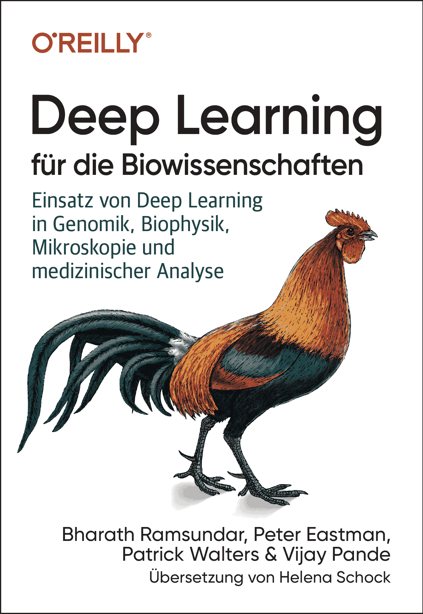


关于本书——以及许多其他 O’Reilly 书籍——您也可以下载相应的 PDF 格式电子书。只需成为 oreilly.plus^+ 会员即可：[www.oreilly.plus](http://www.oreilly.plus)

---

# PDBBind 案例研究

## PDBBind 数据集

# 在 PDBBind 数据集中开发特征

### 总结

# 6 基因组学中的深度学习

## DNA、RNA 和蛋白质

## 回到现实

## 转录因子结合

### 用于 TF 结合的卷积模型

## 染色质可及性

### RNA 干扰

### 总结

# 7 显微镜学中的机器学习

## 显微镜学简介

#### 现代光学显微镜

### 衍射极限

### 电子显微镜和扫描探针显微镜

### 超分辨显微镜

#### 深度学习与衍射极限？

## 为显微镜学准备生物样本

### 染色样本

### 固定样本

### 切片样本

#### 荧光显微镜

#### 样本制备伪影

### 深度学习应用

#### 细胞计数

## 细胞分割

## 计算辅助分析

### 总结

# 8 医学中的深度学习

## 计算机辅助诊断

## 基于贝叶斯网络的概率诊断

## 电子健康记录

### 大型 EHR 数据库的风险何在？

### 深度放射学

#### X 光片和 CT 扫描

### 组织学

### MRI 扫描

## 作为治疗手段的学习模型

# 糖尿病视网膜病变

### 总结

### 伦理考量

### 工作岗位流失

### 概要

# 9 生成模型

## 变分自编码器

## 生成对抗网络

## 生成模型在生命科学中的应用

#### 为核心结构开发新思路

#### 蛋白质设计

### 科学发现工具

### 生成建模的未来

## 使用生成模型

## 分析生成模型的输出

### 总结

# 10 解读深度学习模型

## 解释预测

## 优化输入

### 预测不确定性

## 可解释性、解释性与现实后果

### 总结

# 11 虚拟筛选工作流示例

### 准备数据集

## 训练预测模型

## 准备用于预测的数据集

# 应用预测模型

### 总结

# 12 机遇与展望

## 医学诊断

## 个性化医疗

## 药物开发

### 生物学研究

### 总结

# 索引

# 前言

近年来，生命科学与数据科学融合在一起。机器人技术和自动化技术的进步使化学家和生物学家能够产生海量数据。如今，科学家在一天内产生的数据量，超过了他们的前辈在 20 年前整个职业生涯中产生的总和。快速生成数据的能力也带来了一系列新的科学挑战。将数据加载到表格中并绘制几个图表来处理数据的时代已经一去不复返了。为了从这些数据中获得科学洞见，我们现在必须能够识别并提取隐藏的关联。

近年来，作为一种识别数据中模式和关系的有效工具，*深度学习*脱颖而出。这些算法彻底改变了图像分析、语言翻译和语音识别等领域的问题解决方法。深度学习算法擅长在大量数据中识别和利用模式。因此，深度学习在生命科学的所有领域都得到了广泛应用。本书概述了深度学习在各个领域的应用，包括遗传学、药物发现和医学诊断。书中许多示例都附带程序代码，为这些方法提供了实践性介绍，并为您自己的探索提供了起点。

## 本书使用的约定

本书使用以下排版约定：

*`斜体`*

表示新术语、URL、电子邮件地址、文件名和文件扩展名。

`等宽字体`

表示程序清单以及段落中的程序元素，如变量名或函数名、数据库、数据类型、环境变量、语句和关键字。

**`等宽粗体`**

显示用户需逐字输入的命令或其他文本。

*`等宽斜体`*

表示应由用户提供的值或由上下文确定的值替换的文本。

|  || 此图标表示提示或建议。 |
| --- | --- |
|  || 此图标表示一般性说明。 |
|  || 此元素象征警告。 |

## 使用代码示例


Ergänzendes Material (z. B. Codebeispiele, Übungen usw.) steht unter `https://github.com/deepchem/DeepLearningLifeSciences` zum Download bereit.

Dieses Buch ist dazu gedacht, Ihnen bei Ihren Aufgaben zu helfen. Grundsätzlich dürfen Sie die mit diesem Buch bereitgestellten Codebeispiele in Ihren Programmen und der dazugehörigen Dokumentation nutzen. Sie müssen uns dazu nicht um Erlaubnis fragen, es sei denn, Sie reproduzieren einen beträchtlichen Teil des Codes. Schreiben Sie beispielsweise ein Programm, das mehrere Codeabschnitte aus diesem Buch enthält, benötigen Sie keine Erlaubnis. Verkaufen oder verteilen Sie dagegen eine CD-ROM mit Beispielen aus Büchern von O’Reilly, benötigen Sie eine Erlaubnis. Eine Frage mit einem Zitat aus diesem Buch unter Angabe eines Codebeispiels zu beantworten, benötigt keine Erlaubnis. Wollen Sie dagegen einen wesentlichen Anteil der Codebeispiele aus diesem Buch in Ihr eigenes Buch integrieren, brauchen Sie eine Erlaubnis.

Wir freuen uns über Quellenangaben, verlangen diese aber nicht. Eine Quellenangabe enthält üblicherweise Titel, Autor, Verlag und ISBN. Zum Beispiel: »Deep Learning in den Biowissenschaften von Bharath Ramsundar, Peter Eastman, Patrick Walters und Vijay Pande (O’Reilly). Copyright 2019 Bharath Ramsundar, Peter Eastman, Patrick Walters und Vijay Pande, ISBN 978-3-96009-130-1.«

Wenn Sie glauben, dass Ihre Nutzung von Codebeispielen über das gewöhnliche Maß hinausgeht oder außerhalb der oben vorgestellten Nutzungsbedingungen liegt, kontaktieren Sie uns bitte unter `kommentar@oreilly.de`.

## Danksagung

Wir möchten uns bei Nicole Tache, unserer Lektorin bei O’Reilly, bedanken. Weiterhin danken wir den Tech- und Beta-Reviewern für ihre wertvollen Beiträge zum Buch. Darüber hinaus möchten wir Karl Leswing und Zhenqin (Michael) Wu für ihre Beiträge zum Programmcode und Johnny Israeli für die wertvollen Ratschläge zum Kapitel über Genomik danken.

Bharath möchte sich bei seiner Familie für ihre Unterstützung und Ermutigung während der vielen langen Wochenenden und Abende bei der Arbeit an diesem Buch bedanken.

Peter dankt seiner Frau für ihre unermüdliche Unterstützung und bedankt sich bei den vielen Kollegen, von denen er so viel über Machine Learning gelernt hat.

Pat bedankt sich bei seiner Frau Andrea und seinen Töchtern Alee und Maddy für ihre Liebe und Unterstützung. Auch möchte er ehemaligen und aktuellen Kollegen bei Vertex Pharmaceuticals und Relay Therapeutics danken, von denen er so viel gelernt hat.

Abschließend möchten wir uns bei der Open-Source-Community von DeepChem für die Ermutigung und Unterstützung während des gesamten Projekts bedanken.

# KAPITEL 1

# Warum Biowissenschaften?

Einsatzgebiete für all diejenigen mit technischem Verständnis und Leidenschaft für Daten gibt es viele, aber nur wenige Gebiete haben eine so grundlegende Auswirkung wie die biomedizinische Forschung. Der Beginn der modernen Medizin hat die Natur der menschlichen Existenz grundlegend verändert. In den letzten 20 Jahren wurden wir Zeuge, wie Innovationen das Leben unzähliger Menschen verändert haben. Bei ihrem ersten Auftreten im Jahr 1981 war HIV/Aids eine zumeist tödliche Krankheit. Die kontinuierliche Weiterentwicklung antiretroviraler Therapien hat die Lebenserwartung betroffener Patienten erheblich verlängert. Andere Krankheiten, wie zum Beispiel Hepatitis C, die vor einem Jahrzehnt noch als nicht behandelbar galt, können nun geheilt werden. Fortschritte in der Genetik ermöglichen die Identifikation und, hoffentlich bald, die Behandlung einer Vielzahl von Erkrankungen. Dank innovativer Diagnostik und Instrumentierung können Mediziner Krankheiten im menschlichen Körper spezifisch identifizieren und gezielt behandeln. Viele dieser Durchbrüche haben von rechnergestützten Methoden profitiert und werden durch diese weiter vorangetrieben.

## Warum Deep Learning?

Algorithmen für Machine Learning sind inzwischen ein wichtiger Bestandteil des Alltags, vom Onlineshopping bis Social Media. Informatiker entwickeln Algorithmen, die es digitalen Assistenten wie Amazon Echo oder Google Home ermöglichen, Sprache zu verstehen. Fortschritte im Machine Learning haben die Übersetzung von Webseiten im laufenden Betrieb ermöglicht. Des Weiteren hat Machine Learning viele Bereiche der Physik und Biowissenschaften beeinflusst. Algorithmen werden auf alles angewandt, von der Entdeckung neuer Galaxien aus Teleskopaufnahmen bis zur Klassifizierung subatomarer Wechselwirkungen am Large Hadron Collider.

Eine der Triebfedern dieser technologischen Fortschritte war die Entwicklung einer Klasse von Methoden des Machine Learning, die als Deep Neural Networks bekannt sind. Während die technologischen Voraussetzungen für künstliche neuronale Netze in den 1950er-Jahren entwickelt und in den 1980er-Jahren verfeinert wurden, entfaltete sich deren volles Potenzial erst in den letzten zehn Jahren mit der Weiterentwicklung der Computerhardware. Im nächsten Kapitel werden wir eine umfassendere Übersicht über Deep Neural Networks geben, es ist jedoch wichtig, die aus der Anwendung von Deep Learning entstandenen Fortschritte zu würdigen:

*   Viele der Entwicklungen bei der Spracherkennung, die in Mobiltelefonen, Computern, Fernsehern und anderen mit dem Internet verbundenen Geräten allgegenwärtig sind, wurden durch Deep Learning vorangetrieben.
*   Die Bilderkennung ist eine Schlüsselkomponente für selbstfahrende Autos, die Internetsuche und andere Anwendungen. Viele der Deep-Learning-Entwicklungen, die Anwendungen für Privatkunden vorangetrieben haben, werden jetzt in der biomedizinischen Forschung eingesetzt, zum Beispiel um Tumorzellen verschiedenen Typen zuzuordnen.
*   Empfehlungssysteme sind zu einer Schlüsselkomponente des Onlineerlebnisses geworden. Unternehmen wie Amazon wenden Deep Learning an, um ihre Kunden, die ein bestimmtes Produkt gekauft haben, dazu zu bewegen, zusätzliche Einkäufe zu tätigen. Netflix geht ähnlich vor, um Filme vorzuschlagen, die ein Nutzer möglicherweise ebenfalls sehen möchte. Viele der Ideen, die hinter diesen Empfehlungssystemen stehen, werden verwendet, um neue Moleküle zu identifizieren, die als Ausgangspunkte für neue Wirkstoffentdeckungen dienen könnten.
*   Übersetzungen waren einst die Domäne sehr komplexer statistischer Computerprogramme. In den letzten Jahren hat Deep Learning die Systeme, die jahrelang manuell kuratiert wurden, übertroffen. Viele der gleichen Ideen werden nun genutzt, um Konzepte aus der wissenschaftlichen Literatur zu extrahieren und Wissenschaftler auf Publikationen aufmerksam zu machen, die sie möglicherweise übersehen hätten.

Die hier genannten sind nur einige der Innovationen, die durch die Anwendung von Deep-Learning-Methoden entstanden sind. Es ist eine interessante Zeit, in der sich allgemein verfügbare wissenschaftliche Daten und Methoden zu deren Verarbeitung annähern. Diejenigen, die in der Lage sind, Daten mit neuen Methoden zu kombinieren, um aus Mustern in diesen Daten zu lernen, können wichtige wissenschaftliche Fortschritte erzielen.

## In den modernen Biowissenschaften geht es um Daten

Wie bereits erwähnt, hat sich die grundlegende Art der Biowissenschaften verändert. Die Verfügbarkeit von Robotik sowie miniaturisierte Experimente haben zu einem drastischen Anstieg der experimentellen Daten, die erstellt werden können, geführt. In den 1980er-Jahren führte ein Biologe ein einzelnes Experiment durch, das nur ein einzelnes Ergebnis lieferte. Dieses konnte dann meist manuell unter Zuhilfenahme eines Taschenrechners verarbeitet werden. Spulen wir zur heutigen Biologie vor, dann verfügen wir über Instrumente, die in ein oder zwei Tagen Millionen experimenteller Datenpunkte erzeugen können. Die Gensequenzierung beispielsweise, in der riesige Datensätze entstehen, ist kostengünstig und routinemäßig geworden.


# 基因测序与数据科学的进展

基因测序的进步促成了数据库的开发，这些数据库将个人的遗传基因组与多种健康影响（如糖尿病、癌症和囊性纤维化等遗传性疾病）联系起来。借助用于分析和挖掘这些数据的分析方法，科学家们正在建立对这些疾病成因的理解，并利用这些知识开发新疗法。

过去主要依赖人工观察的领域，如今使用的数据集已无法再通过人工进行评估。如今，**机器学习**被常规用于对细胞图像进行分类。这些机器学习模型的结果被用于识别和分类癌症肿瘤，以及评估潜在癌症疗法的效果。

实验技术的进步促成了多个数据库的建立，这些数据库对化学品的结构及其对各种生物过程或活性的影响进行编目。这些结构-活性关系（SARs）构成了一个被称为*化学信息学*的科学分支的基础。科学家们利用这些海量数据集构建预测模型，这些模型将推动下一代药物研发。

这些海量数据需要新一代科学家，他们既精通科学又精通计算机科学。同时具备这两个领域知识的人，有潜力在大型数据集中发掘模式和趋势，并成为明天的科学发现者。

## 您将学到什么？

在本书的前几章中，我们将概述深度学习及其在生命科学中的应用。我们从机器学习开始，它被定义为“让计算机通过编程从数据中学习的科学（与艺术）”。^(1)

第 2 章简要介绍了深度学习。我们从一个示例开始，展示如何利用这种机器学习类型执行线性回归等简单任务，随后过渡到常用于解决生命科学实际问题的更复杂模型。在机器学习中，数据集最初会被划分为用于开发模型的训练数据集和用于评估模型性能的测试数据集。在第 2 章中，我们将讨论关于预测模型训练和验证的一些细节。模型生成后，通常可以通过调整多个参数（也称为*超参数*）来优化其性能。本章概述了这一过程。深度学习并非一种独立的技术，而是包含一系列相关方法。第 2 章最后介绍了一些最重要的深度学习变体。

第 3 章介绍了 **DeepChem**，这是一个专门开发的开源程序库，旨在简化为各种生命科学应用创建深度学习模型的过程。在概述 DeepChem 之后，我们将展示第一个编程示例，演示如何使用 DeepChem 库构建一个预测分子毒性的模型。在第二个编程示例中，我们将展示如何使用 DeepChem 对图像进行分类，这是现代生物学中常见的任务。正如简要提到的，深度学习被用于各种成像应用，范围涵盖从癌症诊断到青光眼检测。这些具体应用的介绍随后将引出对深度学习方法内部工作原理的解释。

第 4 章概述了如何将机器学习应用于分子。我们从分子入手，分子是构成我们周围一切事物的基本单元。虽然分子可以比作积木，但它们并非刚性的。相反，分子是柔性的并表现出动态行为。为了能够使用深度学习等分析方法表征分子，我们必须能够在计算机中表示分子。这些编码类似于将图像表示为像素集合的方式。在第 4 章的第二部分中，我们将描述一系列分子表示方法，以及如何在深度学习模型中使用这些表示。

第 5 章介绍生物物理学领域，该领域将物理定律应用于生物学现象。我们从蛋白质入手，蛋白质是使生命成为可能的分子机器。预测药物对身体影响的关键在于理解药物与蛋白质的相互作用。为了理解这些效应，我们首先概述蛋白质是如何构建的以及蛋白质结构有何不同。蛋白质是其三维结构决定生物学功能的实体。为了让机器学习模型预测药物分子对蛋白质功能的影响，我们必须将这种三维结构转换为机器学习程序可处理的形式。在第 5 章的第二部分中，我们将探讨一系列表示蛋白质结构的方法。有了这些知识，我们将查看另一个代码示例，其中我们使用深度学习来预测药物分子与蛋白质相互作用的程度。

遗传学已成为现代医学的关键组成部分。肿瘤基因测序已实现个性化癌症疗法，并有潜力彻底改变医学。曾经复杂且极其昂贵的基因测序如今已司空见惯，并常规开展。我们甚至已达到这样一个阶段：狗主人可以通过低成本的基因检测来确定其宠物的谱系。在第 6 章中，我们将概述遗传学和基因组学，从 DNA 和 RNA（蛋白质合成的模板）介绍起。最新发现揭示，DNA 和 RNA 之间的相互作用比最初设想的要复杂得多。在第 6 章的后半部分，我们将展示一些代码示例，演示如何利用深度学习预测影响 DNA 和 RNA 相互作用的多个因素。


# 深度学习在生命科学中的进展与应用

在本章中，我们已经指出了许多基于将深度学习应用于生物和医学图像分析的进展。这些实验中研究的许多现象太小，无法用肉眼观察。为了获得深度学习方法所需的图像，我们必须使用显微镜。第 7 章概述了无数种形式的显微镜，从我们从学校就熟知的简单光学显微镜，到能够拍摄原子分辨率图像的高度发达的仪器。此外，还指出了当前方法的一些局限性，并提供了获取用于深度学习模型图像的实验流程信息。

## 医学诊断

一个非常有前景的领域是将深度学习应用于医学诊断。医学极其复杂，没有任何医生能将所有可用的医学知识融会贯通。在理想情况下，机器学习模型可以处理医学文献并协助医生进行诊断。虽然我们尚未达到那一步，但我们正走在正确的道路上。第 8 章从机器学习在诊断中的历史讲起，并勾勒了从手工编码规则向医学结果统计分析的过渡。正如在许多其他主题中提到的，一个重要组成部分是将医学信息表示为机器学习程序可处理的格式。本章介绍了电子病历，并指出了涉及这些记录的一些问题。医学图像通常非常复杂，即使对于经验丰富的专家来说，这些图像的评估和解读也很困难。在这些情况下，深度学习可以通过对图像进行分类和识别关键特征来扩展人类的能力。第 8 章以一系列示例作为结尾，展示了深度学习如何在各个领域被用于分析医学图像。

## 药物发现与生成模型

如前所述，机器学习是寻找新药物的重要组成部分。科学家应用深度学习来评估药物分子与蛋白质之间的相互作用。这些相互作用可以引发生物学反应，从而对患者产生治疗效果。我们迄今为止讨论的模型是*判别模型*。基于分子的一系列特性，模型预测另一个特性。这些预测需要一个输入分子，它可以来自现有分子数据库或科学家的想象。如果我们不必依赖现有的或想象出来的分子，而是拥有一个能够「发明」新分子的计算机程序，那会怎样？第 9 章介绍了深度学习的另一种方法，即*生成模型*。生成模型首先在可用分子上训练，随后用于生成新分子。生成这些分子的深度学习程序也可以受到其他预测新分子活性的模型的影响。

## 可解释性与模型准确性

到目前为止，我们将深度学习模型视为「黑箱」。模型接收输入数据并生成预测，但没有任何关于预测是如何或为什么产生的解释。这种预测在许多情况下可能是次优的。如果我们有一个用于诊断的深度学习模型，通常希望了解诊断背后的原因。对诊断原因的解释能给医生对预测更多的信心，也会影响治疗决策。深度学习的一个历史遗留问题是，尽管模型通常可靠，但难以解释。目前正在开发一些技术，旨在让用户了解哪些因素导致了预测。第 10 章概述了其中一些实现人类理解预测模型的技术。预测模型的另一个重要方面是预测的准确性。了解模型的准确性有助于我们确定可以在多大程度上依赖该模型。由于机器学习可能用于挽救生命的诊断，因此理解模型准确性至关重要。在第 10 章的最后一部分，我们概述了一些用于评估模型准确性的技术。

## 案例研究：使用 DeepChem 进行虚拟筛选

在第 11 章中，我们将展示一个使用 DeepChem 的真实案例研究。在该示例中，我们使用一种称为「虚拟筛选」的程序来识别发现新药物的可能起点。新药发现是一个复杂的过程，通常始于一种称为*筛选*的技术。通过筛选可以识别出可优化并最终生成药物的分子。筛选可以通过实验进行，即在微型生物测试（也称为分析）中测试数百万个分子，或者使用计算机进行虚拟筛选。虚拟筛选利用已知药物或其他生物活性分子来训练机器学习模型。然后使用该模型来预测大量分子的活性。得益于机器学习方法的高速度，通常可以在几天内处理数亿个分子。

## 展望：未来潜力与挑战

在本书的最后一章中，我们探讨了深度学习在生命科学中的当前影响和未来潜力。讨论了当前工作面临的一系列挑战，包括数据集的可用性和质量。此外，我们还指出了其他领域的机遇和可能的陷阱，包括诊断、个性化医疗、药物开发和生物学研究。

# 第 2 章：深度学习简介

本章将向您介绍深度学习的基本原理。如果您已经拥有一定的深度学习经验，可以浏览本章然后继续下一章。如果您经验较少，应仔细阅读本章，因为其中包含的知识对于理解本书其余部分至关重要。

在我们将要处理的大多数任务中，我们的工作是创建一个数学公式：

```
**y** = *f*(**x**)
```

请注意，`**x**` 和 `**y**` 是粗体。这意味着它们是向量。一个函数可以有许多输入值，可能成千上万甚至数百万，并产生许多输出值。以下是一些函数示例：

*   `**x**` 包含图像中所有像素的颜色。如果图像中描绘了一只猫，`*f*(**x**)` 结果为 1，否则为 0。


## 多层感知机

一个简单的方法是将多个线性变换串联起来。例如，我们可以编写如下公式：

**y** = **M**[2]*φ*(**M**[1]**x** + **b**[1]) + **b**[2]

仔细观察一下我们在这里做了什么。我们从一个普通的线性变换 **M**[1]**x** + **b**[1] 开始。随后将结果传递给一个非线性函数 *φ*(*x*)，然后对该结果应用第二个线性变换。该方程 *φ*(*x*) 被称为 *激活函数*，是构成此函数特性的关键部分。如果没有它，模型仍将是线性的，并不比之前的模型更强大。线性组合的线性组合本身无非还是原始输入的线性组合！通过引入非线性，我们使模型能够学习范围大得多的函数。

我们不必局限于两个线性变换。我们可以堆叠任意数量的层：

**h**[1] = *φ*1

**h**[2] = *φ*2

...

**h**[*n* – 1] = *φ**n* – 1

**y** = *φ**n*

该模型称为 *多层感知机*，简称 MLP。中间步骤 *h*[*i*] 称为 *隐藏层*。该名称指的是这些既不是输入也不是输出，而只是计算结果时使用的中间值。请注意，我们还为每个 *φ*(*x*) 添加了一个索引。这表明不同层可以使用不同的非线性函数。


## 多层感知机作为层的堆叠

如图 2-2 所示，这种计算可以形象地表示为一个层的堆叠。每一层对应一个线性变换，后跟一个非线性变换。信息从一层流向下一层，其中一层的输出成为下一层的输入。每一层都有自己的一组参数，它们决定了如何根据输入计算输出。

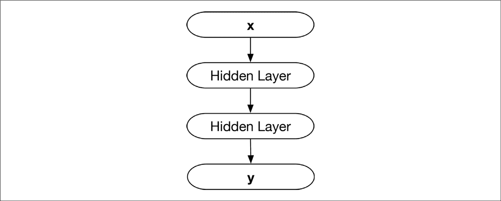

*图 2-2：被视为层堆叠的多层感知机，其中信息从一层流向下一层。*

多层感知机及其变体有时也被称为*神经网络*。这个名称反映了机器学习与神经生物学之间的相似性。一个生物神经元与许多其他神经元相连。它接收来自它们的信号，对这些信号求和，然后根据结果发送自己的信号。简而言之，MLP 的工作方式就像您大脑中的神经元一样！

## 激活函数

激活函数 `φ(x)` 应该是什么样的？令人惊讶的答案是，大多数情况下这无关紧要。当然，这不完全符合事实。显然它很重要，但没有您预期的那么重要。几乎任何函数（单调、连续可微）都能起作用。多年来，人们测试了许多不同的函数，虽然有些效果比其他的好，但几乎所有函数都能提供不错的结果。

如今最流行的激活函数可能是*修正线性单元*（ReLU），`φ(x) = max(0, x)`。如果您不确定该使用哪个函数，这是一个不错的选择。其他常见的选择包括*双曲正切*，`tanh(x)`，和*逻辑斯谛 Sigmoid 函数*，`φ(x) = 1 / (1 + e^(–x))`。所有提到的函数均可见于图 2-3。

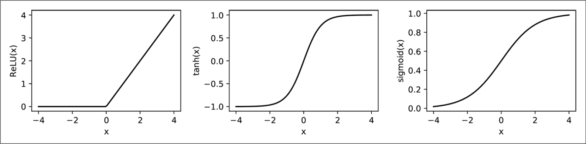

*图 2-3：三种常见的激活函数：ReLU、双曲正切和逻辑斯谛 Sigmoid 函数。*

## 宽度和深度

我们还必须为 MLP 选择两个属性：它的*宽度*和*深度*。对于线性模型，没有选择的余地。由于 `x` 和 `y` 的长度，`M` 和 `b` 的大小已经固定。对于隐藏层，情况并非如此。宽度指的是隐藏层的大小。我们可以为每个 `h[i]` 选择任意长度。根据问题的不同，它们可以比输入和输出向量大得多，也可以小得多。

深度指的是模型中层的数量。仅有一个隐藏层的模型被称为*浅层*模型。具有许多隐藏层的模型被称为*深层*模型。事实上，这就是“深度学习”一词的由来；简单来说，它意味着“使用多层模型的机器学习”。

为您的模型选择层的数量和宽度，既需要艺术也需要科学。或者用更正式的说法：“这仍然是一个活跃的研究领域。”通常归结为尝试许多组合，看看哪种有效。然而，有一些原则可能会为您提供指导，或者至少帮助您事后理解您的结果：

1.  **具有单个隐藏层的 MLP 是通用近似器。**
    这意味着它可以逼近任何函数（在一定范围内）。从某种意义上说，永远不需要超过一个隐藏层。这已经足以映射您想要的任何方程。不幸的是，这个结果附带一个巨大的限制：近似的精度取决于隐藏层的宽度，为了针对特定问题获得足够的精度，可能需要一个非常宽的层。这引出了第二个原则。

2.  **深层模型往往比浅层模型需要更少的参数。**
    这个说法故意保留了一些模糊性。对于某些特殊情况，可以做出更严格的陈述，但作为一般准则，它仍然成立。换句话说，每个任务都需要一个具有特定深度的模型来达到可接受的精度。在深度较低时，层的所需宽度（以及因此而来的参数总数）会迅速增加。这听起来好像应该总是首选深层模型而不是浅层模型。不幸的是，这在一定程度上被第三个原则所反驳。

3.  **深层模型通常比浅层模型更难训练。**
    直到 2007 年左右，大多数机器学习模型都是浅层的。虽然深层模型的理论优势已为人所知，但科学家们未能成功训练它们。从那时起，一系列进步提高了深层模型的实用性。这些包括更好的训练算法、更容易训练的新模型，当然还有更强大的计算机与更大的数据集相结合，模型可以在其上进行训练。正是从这些进步中，“深度学习”诞生了。尽管有所改进，但一般原则依然存在：深层模型通常比浅层模型更难训练。

### 训练模型

这使我们进入下一个问题：究竟如何训练模型？MLP 为我们提供了一个（大多数情况下）通用的模型，可用于任何问题。（稍后我们将介绍其他更专业的模型类型。）首先，我们需要一个类似通用的算法，以便为给定任务找到模型参数的最优值。我们如何着手？

首先，我们当然需要用于训练的数据，也称为*训练数据集*。它应由大量 `(x, y)` 对组成，也称为*数据点*。每个数据点描述模型的一个输入，以及当该输入发生时相应的输出应是什么样子。例如，训练数据集可以是一个图像集合，连同标签指示每个图像是否包含猫。

接下来，定义误差函数 `L(y, ŷ)`，其中 `y` 是模型的实际输出，`ŷ` 是训练数据集中指定的目标值。这样就可以衡量模型是否正确地复现了训练数据。随后对训练数据集中的每个数据点求平均：

平均误差 = 
```
(1/N) * Σ[i=1..N] L(y[i], ŷ[i])
```

当参数接近时 `L(y, ŷ)` 应该很小，当它们相距甚远时应该很大。换句话说，我们获取训练数据集中的每个数据点，尝试将其作为模型输入，并查看输出与目标值有多接近。然后对整个训练数据集求平均。

必须为每个问题选择合适的误差函数。一个常见的选择是欧几里得距离（也称为 *L*[2] 范数），`L(y, ŷ) = ||y - ŷ||₂`。（在这个数学表达式中，`y[i]` 代表向量 `y` 的第 *i* 个分量。）如果 `y` 代表概率分布，交叉熵 `L(y, ŷ) = – Σ[i] y[i] log ŷ[i]` 是一个流行的选择。其他可能性也是可以想象的，并不存在唯一的“最佳”选择，因为这取决于具体问题。


# 模型改进与验证

既然我们现在能够衡量模型运行得有多好，就必须对其进行改进。我们要找到能使训练数据集上**平均误差**最小化的参数值。为此有很多可能性，但在深度学习中，通常会应用**梯度下降法**的一种变体。设 `θ` 代表模型的所有参数集合。梯度下降法包含一系列微小步骤：

```
θ ← θ - ε∇〈L〉
```

其中 `〈L〉` 是训练数据集上的平均误差。每一步都会朝“下坡”方向迈进一小段。每个模型参数都会随之略微改变，目标是降低平均误差。通过这种方式，最终会生成能够很好地解决问题的参数。`ε` 被称为**学习率**，它决定了参数每步改变多少。必须审慎选择它：值太小会导致学习极其缓慢，而值太高会阻止算法进行任何学习。

虽然该算法行之有效，但存在一个严重问题。对于梯度下降法中的每一步，我们都必须遍历训练数据集中的每个数据点。这意味着训练模型所需的时间与训练数据集的大小成正比！假设训练数据集中有一百万个数据点，为单个数据点计算梯度需要一百万次操作，且需要一百万步才能找到一个好的模型。（这些数字对于真实的深度学习应用来说相当典型。）因此，训练将需要**一万亿**次操作。即使使用快速计算机，这也需要很长时间。

幸运的是，存在更好的解决方案：`〈L〉` 可以通过对样本求平均来估计。这是**随机梯度下降法 (SGD)** 的基础。在每一步中，我们从训练数据集中抽取一个样本（**批次**），并仅计算该批次中数据点的误差函数梯度平均值。这可以视为对我们在整个训练数据集上求平均所得结果的一种估计，尽管它可能是一种非常不精确的估计。我们执行单步梯度下降，然后为下一步抽取一个新的批次。

该算法通常更快，因为每步所需的时间仅取决于批次大小。批次大小可以相当小（通常约 100 个数据点），且与训练数据集的大小无关。缺点在于，每一步减少误差的效果较差，因为它基于不精确的估计而非真实梯度。尽管如此，总体上会带来短得多的训练时间。

用于深度学习的大多数优化算法都基于 SGD，但存在许多以不同方式在此基础上构建的变体。幸运的是，这些算法通常可以作为黑箱处理，人们可以信任它们会做正确的事，而无需详细了解其内部工作原理。目前最流行的两种算法是 **Adam** 和 **RMSProp**。如果您不确定该使用哪种算法，选择其中任何一个都不会出错。

## 验证

假设您已执行迄今描述的所有步骤。您收集了大量训练数据。您选定了一个模型并对其进行训练，直到误差变得非常小。恭喜，您现在拥有一个能解决您问题的函数！

真是这样吗？

不幸的是，事情没那么简单！您唯一能确定知道的是，该算法在**训练数据上**运行良好。您可以希望它在其他数据上也表现良好，但不能指望这一点。您必须首先验证模型，以确定它是否适用于它从未见过的数据。

为此我们需要第二个数据集，即**测试数据集**。它与训练数据集具有相同的形式——一组 `(x, y)` 对——但这两个数据集不应包含相同的值。模型在训练数据上训练，随后在测试数据上验证。这引出了机器学习中最重要的原则之一：

> **在设计或训练模型期间，绝不得使用测试数据集。**

事实上，最好甚至根本不看测试数据。测试数据集仅用于测试成品模型，以确定其工作得有多好。如果您允许测试数据以任何方式影响模型，您就冒着得到一个在测试数据上表现优于其他未参与模型创建的数据的模型的风险。它此时不再是测试数据集，而只是另一个训练数据集。

这与数学概念**过拟合**有关。训练数据本意是代表一个大得多的数据分布，即所有可能用于模型的输入。但无法在所有可能的输入上进行训练。人们只能创建有限量的训练数据，在其上训练模型，并希望模型学到通用策略，在其他数据上也能同样好地工作。当训练捕捉到测试数据的特定特征，导致模型在测试数据上表现优于其他数据时，就会发生过拟合。

## 正则化

过拟合是应用机器学习的每个人面临的一个大问题。因此，您不会惊讶地听到，已经开发出许多避免它的程序。这些程序统称为**正则化**。每种正则化的目标都是避免过拟合，并产生一个在任何输入上都能良好工作、而不仅限于用于训练的那些输入的训练模型。

在转向具体的正则化技术之前，我们必须提及两个非常重要的点。

首先，**几乎总是**避免过拟合的最佳方法是使用更多训练数据。训练数据集越大，它就越能代表“真实”的数据分布，算法过拟合的可能性就越小。当然，这有时是不可能的：也许根本无法获得更多数据，或者收集它们成本太高。在这种情况下，只能充分利用现有数据，如果过拟合构成问题，必须应用正则化来避免它。然而，更多数据可能比正则化带来更好的结果。

其次，不存在普遍“最佳”的正则化方法。一切取决于具体任务。毕竟，训练算法不知道自己在过拟合。它只知道训练数据。它不知道真实数据与训练数据有何不同。因此，它能做的最好的事就是创建一个很好地拟合训练数据的模型。如果这不是您想要的，就由您来告知它。


这是每种正则化方法的核心：以某种方式影响训练过程，使某些模型类型优于其他类型。您规定了一个“好”模型应具备哪些属性，以及它与过拟合模型有何不同，然后告知训练算法偏好具有这些属性的模型。当然，这些假设往往更多是隐性的而非显性的。选择某种特定正则化方法时所做的假设可能并不显而易见。但它们始终存在。

最简单的正则化技术之一是缩短模型的训练时间。在训练开始时，模型倾向于捕捉训练数据的粗略特征，这些特征推测也适用于真实数据。训练运行得越久，它就越有可能开始捕捉训练数据中单个数据点的精细细节。通过限制训练步数，模型过拟合的机会就更少。换句话说，假设“好”的参数值不会与训练开始时的值有太大差异。

另一种方法是限制模型中的参数数量。例如，可以向损失函数添加以下表达式：`|θ|²`，其中 `θ` 是一个包含所有模型参数的向量。因此，我们假设“好”的参数值不应大于必要程度。这考虑了这样一个事实：过拟合时，参数往往（但并非总是）会变得非常大。

一种非常流行的正则化方法是 *Drop-out*（随机失活）。对于模型中的每个隐藏层，随机选择输出向量 `h[i]` 中的一组元素并将其设为 0。在梯度下降的每一步中，都会选择另一组不同的随机元素。这看起来似乎会破坏模型：如果内部计算按随机原则被设为 0，它怎么能工作呢？Drop-out 之所以有效的底层数学理论有点复杂。粗略地说：使用 Drop-out 时，我们假设模型中的任何单个计算都不应过于重要。应该可以按随机原则移除单个计算，而不影响模型的其余部分。这迫使模型学习冗余的、高度分布式的数据表示，从而使过拟合变得不可能。如果您不确定该使用哪种正则化技术，Drop-out 是一个很好的首选。

## 超参数优化

到目前为止，您可能已经注意到，即使对于一个看似通用的、带有“通用”学习算法的模型，也需要做出许多决策。例如：

*   模型中的层数。
*   每层的宽度。
*   要执行的训练步数。
*   训练中使用的学习率。
*   使用 Drop-out 时要设为 0 的元素比例。

这些选项被称为 *超参数*。超参数是模型或训练算法的一个参数，必须预先设定，而不是由训练算法学习得出。该如何选择它们——机器学习的目的不正是基于数据自动选择设置吗？

这引出了 *超参数优化* 的话题。最简单的应用方法就是尝试每个超参数的许多不同值，看看哪个效果最好。当需要为许多超参数尝试许多值时，这会变得非常繁重。因此存在更复杂的方法，但基本思路相同：测试不同的组合，看看哪个效果最好。

但我们怎么知道什么效果最好？最简单的答案是，看什么在训练数据上产生了最低的损失函数值（或其他准确度指标）。但请注意，这并不是我们真正关心的。我们想要最小化测试数据上的误差，而不是训练数据上的误差。这对于影响正则化的超参数尤为重要，例如 Drop-out 率。训练数据集上的低误差可能意味着模型过拟合了，并针对训练数据的特定细节进行了优化。相反，我们想测试许多超参数值，然后应用那些在测试数据上最小化误差的值。

但我们不能这么做！请考虑：在模型设计或训练期间，测试数据绝不能以任何方式被使用。它的任务是告诉您模型处理从未见过的新数据的能力如何。仅仅因为某些超参数在一个测试数据集上效果最好，并不能保证这些值总是效果最好。我们不能让测试数据影响模型，否则它就不再是一个无偏的测试数据集了。

解决方案是创建另一个数据集，即 *验证数据集*。它不得与训练或测试数据集重叠。完整流程现在如下所示：

1.  对于每种超参数值组合，在训练数据上训练模型，然后根据验证数据计算误差。
2.  产生验证数据集上最小误差的那种超参数组合被接受为最终模型。
3.  最终模型根据测试数据进行评估，以获得其工作效果的独立度量。

## 其他模型类型

还有一个决定要做，这本身就是一个大话题：应该使用哪种模型？本章前面介绍了多层感知机。它们的优势在于作为一类通用模型，可应用于许多不同问题。不幸的是，它们也有严重缺点。它们需要海量参数，这使它们容易过拟合。如果它们有超过一两个隐藏层，就很难训练。在许多情况下，使用一个利用问题特定特性的、不那么通用的模型会获得更好的结果。

本书的大部分内容涉及在生物科学中特别有用的特定模型类型。我们将在后面的章节中处理它们。然而，在本介绍中，我们还应介绍两个非常重要的模型类别，它们在许多不同领域非常普遍。它们是卷积神经网络和循环神经网络。

### 卷积神经网络

*Convolutional Neural Networks*（简称 CNNs）是最早广泛用于深度学习的模型类别之一。它们是为图像处理和图像理解而开发的。对于许多问题，它们仍然是一个极佳的选择，这些问题涉及在矩形网格中采样的连续数据：音频信号（1-D）、图像（2-D）、体积 MRI 数据（3-D）等。


它们也是完全配得上“神经网络”这一术语的一类模型。CNN 的设计最初源于对猫视觉皮层工作机制的启发。（自深度学习诞生以来，猫在其中扮演了核心角色。）从 1950 年代到 1980 年代的研究表明，视觉是通过一系列层来处理的。第一层中的每个神经元接收来自视野一小块区域（其`感受野`）的输入。不同的神经元专门用于识别特定的局部模式或特征，如垂直或水平线条。第二层的细胞接收来自第一层局部细胞簇的输入，并组合它们的信号，以便在更大的感受野中捕捉更复杂的模式。每一层都可以看作是原始图像的一种新表征，其描述形式比前一层包含更大、更抽象的模式。

CNN 反映了这种设计，将输入图像通过一系列层进行传递。从这个角度来看，它们类似于 MLP，但每一层的结构却截然不同。MLP 使用`全连接层`。输出向量中的每个元素都取决于输入向量中的一个元素。相比之下，CNN 使用`卷积层`，利用空间局部性。每个输出元素对应图像的一个小区域，并且仅取决于该区域内的输入值。这大大减少了定义每一层所需的参数数量。事实上，人们假设权重矩阵 `M[i]` 的大多数元素为 0，因为每个输出元素仅依赖于少量的输入元素。

卷积层更进一步：它们假设`图像每个局部区域`的参数是相同的。如果一层使用一组参数来检测图像某处的水平线条，它会使用同一组参数来检测图像中所有其他位置的水平线条。因此，该层的参数数量与图像大小无关。只需学习单个`卷积核`，它定义了如何从图像的任意局部区域计算输出特征。这个局部区域通常很小，例如 5 × 5 像素。在这种情况下，待学习参数的数量仅为每个区域输出特征数的 25 倍。与全连接层中的参数数量相比，这微不足道。因此，CNN 比 MLP 更容易训练，也更不容易过拟合。

### 循环神经网络

`循环神经网络`（简称 RNN）则有所不同。通常它们用于处理由一系列元素组成的数据：文本文件中的单词、DNA 分子中的碱基等。序列的元素被逐个送入网络的输入端。但随后网络做了一件完全不同的事：每一层的输出在下一步被反馈到其自身的输入中！因此 RNN 拥有一种记忆。当序列的一个元素（单词、DNA 碱基等）被送入网络时，每一层的输入不仅取决于该元素，还取决于所有先前的元素（参见图 2-4）。

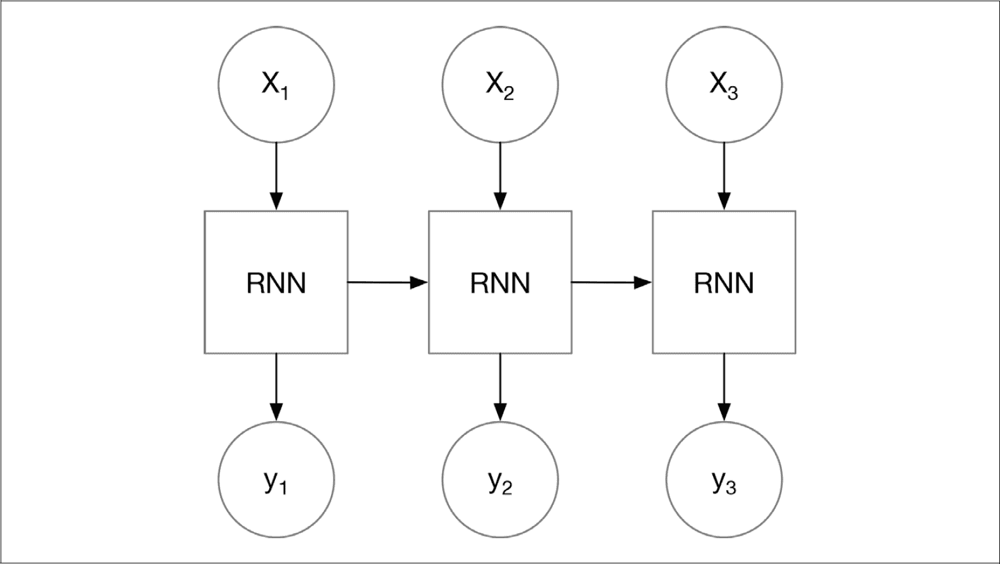

*图 2-4：一个循环神经网络。序列的每个元素（x[1], x[2], ...）被作为输入送入。输出（y[1], y[2], …）取决于输入和 RNN 前一步的输出。*

因此，反馈层的输入由两部分组成：正常输入（即网络中前一层的输出）和反馈输入（对应于前一步其自身的输出）。新输出根据这两个输入确定。理论上可以使用全连接层，但实践中效果不佳。科学家们开发了在 RNN 中效果好得多的其他层类型。其中最流行的两种是`门控循环单元`（GRU）和`长短期记忆`（LSTM）。暂时不必关心细节，只需记住：如果您构建 RNN，它应由上述类型的层之一组成。

拥有记忆的能力从根本上将 RNN 与我们介绍的其他模型区分开来。对于 CNN 或 MLP，只有一个值被读入网络，另一个值被读出。输出完全由输入决定。RNN 则不然。模型拥有由上一步所有层的输出组成的内部状态。每当输入进入模型时，输出不仅取决于输入值，还取决于内部状态。这使得 RNN 非常强大，并适用于非常多不同的应用。

### 进阶阅读

深度学习是一个庞大的领域，本章仅提供了一个非常简短的介绍。这足以阅读和理解本书的其余部分。然而，如果您打算在该领域工作，应该获取更详细的背景知识。幸运的是，网上有许多优秀的深度学习资源。以下是一些进阶材料建议：

*   `Neural Networks and Deep Learning` ([`http://neuralnetworksanddeeplearning.com`](http://neuralnetworksanddeeplearning.com)) 由 Michael Nielsen 编写（Determination Press 出版），涵盖的内容大致与本章相同，但对每个主题的探讨深入得多。如果您希望获得扎实的深度学习基础知识，足以应用于您自己的工作，这是一个极佳的起点。

*   `Deep Learning` ([`http://www.deeplearningbook.org`](http://www.deeplearningbook.org)) 由 Ian Goodfellow、Yoshua Bengio 和 Aaron Courville 编写（MIT Press 出版），是该领域顶尖科学家撰写的进阶介绍。要求读者具备类似计算机科学博士生的背景知识，并更深入地探讨该主题的数学理论。无需理解全部理论即可轻松部署深度学习模型。但如果您想自己在深度学习领域进行研究（而不仅仅是将模型作为其他领域问题的工具），这本书是一个极好的资源。

*   `TensorFlow for Deep Learning` ([`http://shop.oreilly.com/product/0636920065869.do`](http://shop.oreilly.com/product/0636920065869.do)) 由 Bharath Ramsundar 和 Reza Zadeh 编写（O’Reilly 出版），为从业者提供深度学习入门，旨在传授核心概念，而不深究这些模型背后的数学基础。对于对深度学习实践方面感兴趣的人来说，是一本有用的书。

## 第 3 章

## 使用 DeepChem 进行机器学习

本章简要介绍使用 DeepChem 进行机器学习，DeepChem 是一个构建在 `TensorFlow` 平台之上的库，旨在促进深度学习在生物科学中的应用。DeepChem 提供了大量适用于生物科学应用的模型、算法和数据集。在本书的后续内容中，我们将使用 DeepChem 进行案例研究。


|  || **Warum nicht Keras, TensorFlow oder PyTorch?** Das ist eine häufige Frage. Die kurze Antwort lautet: Die Entwickler dieser Bibliotheken konzentrieren sich auf bestimmte Anwendungsfälle, die für ihre wichtigsten Nutzergruppen hilfreich sind. Zum Beispiel gibt es umfangreiche Unterstützung für die Bild-, Text- und Sprachverarbeitung. Meist helfen diese Bibliotheken jedoch weniger bei der Handhabung von Molekülen, genetischen Datensätzen oder Mikroskopiedatensätzen. Das Ziel von `DeepChem` ist es, bei diesen Anwendungen erstklassige Hilfe zu leisten. Das bedeutet das Hinzufügen von benutzerdefinierten Deep-Learning-Grundelementen, Unterstützung bei den benötigten Dateitypen und ausführliche Anleitungen und Dokumentationen für diese Fallstudien. |

| --- | --- |

|   || Des Weiteren ist `DeepChem` gut in `TensorFlow` integriert, sodass es möglich ist, `DeepChem`-Code mit dem Code anderer `TensorFlow`-Anwendungen frei zu kombinieren. |

Für den Rest dieses Kapitels gehen wir davon aus, dass `DeepChem` auf Ihrem Computer installiert ist und Sie die Beispiele ausführen können. Keine Sorge, falls Sie `DeepChem` noch nicht installiert haben. Besuchen Sie einfach die Webseite von `DeepChem` ([`deepchem.io/`](https://deepchem.io/)) und folgen Sie den Installationsanweisungen.

|  || **Microsoft Windows und DeepChem** Derzeit unterstützt `DeepChem` keine Installation unter Windows. Falls möglich, empfehlen wir für die Bearbeitung der Beispiele in diesem Buch einen Mac- oder Linux-Rechner. Von unseren Nutzern haben wir erfahren, dass `DeepChem` auf dem Windows-Subsystem für Linux (`WSL`) neuerer Windows-Versionen funktioniert. |

| --- | --- |

|   || Sollte es für Sie nicht möglich sein, auf einen Mac oder Linux-Rechner zuzugreifen oder mit `WSL` zu arbeiten, würden wir uns freuen, wenn Sie uns dabei helfen, `DeepChem` auch unter Windows verfügbar zu machen. Bitte wenden Sie sich mit spezifischen Problemen an die Autoren. Wir werden versuchen, diese zu beheben. Wir hoffen, diese Einschränkung in einer zukünftigen Auflage dieses Buchs beseitigt zu haben und Windows für zukünftige Leser zu unterstützen. |

### DeepChem-Datensätze

`DeepChem` nutzt die grundlegende Abstraktion des Objekts `Dataset`, um die verwendeten Daten für Machine Learning zu verpacken. Ein `Dataset` enthält die Information zu einer Datenreihe: zu den Eingabevektoren `x`, den Zielausgabevektoren `y` sowie möglicherweise weiteren Angaben wie etwa einer Beschreibung der einzelnen Datenpunkte. Es gibt Unterklassen von `Dataset`, die verschiedenen Arten der Datenspeicherung entsprechen. Insbesondere das `NumpyDataset`-Objekt dient als praktischer Wrapper für `NumPy`-Arrays und wird ausgiebig genutzt. In diesem Abschnitt werden wir das `NumpyDataset` in einer einfachen Codefallstudie verwenden. Der gesamte Code kann in den interaktiven Python-Interpreter eingegeben werden.

Wir starten mit den nötigen Importen:

```
import deepchem as dc
import numpy as np
```

Jetzt erstellen wir einige einfache `NumPy`-Arrays:

```
x = np.random.random((4, 5))
y = np.random.random((4, 1))
```

Dieser Datensatz besteht aus vier Einträgen. Das Array `x` enthält für jeden Eintrag fünf Elemente (Features), und `y` enthält ein Element für jeden Eintrag. Werfen wir einen kurzen Blick auf die tatsächlichen Arrays, die wir erzeugt haben (beachten Sie, dass Sie bei lokaler Ausführung des Codes mit anderen Zahlen rechnen müssen, da der Startwert Ihres Zufallsgenerators ein anderer ist):

```
In : x
Out:
array([[0.960767 , 0.31300931, 0.23342295, 0.59850938, 0.30457302],
       [0.48891533, 0.69610528, 0.02846666, 0.20008034, 0.94781389],
       [0.17353084, 0.95867152, 0.73392433, 0.47493093, 0.4970179 ],
       [0.15392434, 0.95759308, 0.72501478, 0.38191593, 0.16335888]])
```

```
In : y
Out:
array([[0.00631553],
       [0.69677301],
       [0.16545319],
       [0.04906014]])
```

Wir werden nun diese Arrays in ein `NumpyDataset`-Objekt einbinden:

```
dataset = dc.data.NumpyDataset(x, y)
```

Mit folgendem Code können wir das `dataset`-Objekt auspacken, um die ursprünglichen Arrays zu erhalten, die wir darin abgelegt haben:

```
In : print(dataset.X)
[[0.960767 0.31300931 0.23342295 0.59850938 0.30457302]
 [0.48891533 0.69610528 0.02846666 0.20008034 0.94781389]
 [0.17353084 0.95867152 0.73392433 0.47493093 0.4970179 ]
 [0.15392434 0.95759308 0.72501478 0.38191593 0.16335888]]
```

```
In : print(dataset.y)
[[0.00631553]
 [0.69677301]
 [0.16545319]
 [0.04906014]]
```

Beachten Sie, dass diese Arrays mit den ursprünglichen Arrays `x` und `y` identisch sind:

```
In : np.array_equal(x, dataset.X)
Out : True
```

```
In : np.array_equal(y, dataset.y)
Out : True
```

|  || **Weitere Arten von Datensätzen** Wie bereits erwähnt, werden auch andere `DeepChem`-`Dataset`-Objekttypen unterstützt. Diese sind vor allem dann nützlich, wenn mit großen Datensätzen gearbeitet wird, die nicht vollständig im Arbeitsspeicher gespeichert werden können. `DeepChem` kann ebenfalls `TensorFlows tf.data` zum Laden von Datensätzen integrieren. Wir werden auf diese erweiterten Funktionen eingehen, sobald wir sie benötigen. |

| --- | --- |

### Trainieren eines Modells zur Vorhersage der Toxizität von Molekülen

In diesem Abschnitt werden wir vorführen, wie sich `DeepChem` nutzen lässt, um ein Modell zur Vorhersage der Toxizität von Molekülen zu trainieren. In einem späteren Kapitel klären wir dann, wie die Toxizitätsvorhersage für Moleküle im Detail funktioniert. Im Folgenden verwenden wir es jedoch als Blackbox-Beispiel, um zu zeigen, wie sich Machine-Learning-Probleme mit `DeepChem`-Modellen lösen lassen. Beginnen wir mit zwei benötigten Importen:

```
import numpy as np
import deepchem as dc
```

Der nächste Schritt besteht im Laden der zugehörigen Toxizitätsdatensätze zum Trainieren des Machine-Learning-Modells. `DeepChem` enthält ein Modul namens `dc.molnet` (Kurzform von MoleculeNet), das eine Reihe von vorverarbeiteten Datensätzen beinhaltet, die beim Experimentieren mit Machine Learning verwendet werden. Wir werden insbesondere die Funktion `dc.molnet.load_tox21()` verwenden, die die Tox21 Toxizitätsdatensätze lädt und verarbeitet. Wenn Sie unten stehenden Befehl zum ersten Mal ausführen, wird `DeepChem` den Datensatz lokal auf Ihrem Rechner verarbeiten. Mit folgenden Hinweisen ist zu rechnen:

```
In : tox21_tasks, tox21_datasets, transformers = dc.molnet.load_tox21()
Out: Loading raw samples now.
shard_size: 8192
About to start loading CSV from /tmp/tox21.CSV.gz
Loading shard 1 of size 8192.
Featurizing sample 0
Featurizing sample 1000
Featurizing sample 2000
Featurizing sample 3000
Featurizing sample 4000
Featurizing sample 5000
Featurizing sample 6000
Featurizing sample 7000
TIMING: featurizing shard 0 took 15.671 s
TIMING: dataset construction took 16.277 s
Loading dataset from disk.
TIMING: dataset construction took 1.344 s
Loading dataset from disk.
TIMING: dataset construction took 1.165 s
Loading dataset from disk.
TIMING: dataset construction took 0.779 s
Loading dataset from disk.
TIMING: dataset construction took 0.726 s
Loading dataset from disk.
```

Beim *Verarbeiten* wird ein Datensatz, der Informationen über Moleküle enthält, in Matrizen und Vektoren umgewandelt, die sich in Machine-Learning-Analysen verwenden lassen. Wir werden diesen Vorgang in den folgenden Kapiteln genauer untersuchen. Hier werfen wir lediglich einen kurzen Blick auf die von uns verwendeten Daten.

Die Funktion `dc.molnet.load_tox21()` gibt mehrere Ausgaben zurück: `tox21_tasks`, `tox21_datasets` und `transformers`. Wir schauen uns jede kurz an:

```
In : tox21_tasks
Out:
['NR-AR',
 'NR-AR-LBD',
 'NR-AhR',
 'NR-Aromatase',
 'NR-ER',
 'NR-ER-LBD',
 'NR-PPAR-gamma',
 'SR-ARE',
 'SR-ATAD5',
 'SR-HSE',
 'SR-MMP',
 'SR-p53']
```

```
In : len(tox21_tasks)
Out: 12
```


# 每十二个任务中的每一个都对应一个生物学实验

在这种情况下，任务分别代表一个 `酶测定`，用于测量 Tox21 数据集中的分子是否与相关的 `生物学靶点` 结合。NR-AR 等术语对应这些靶点。这里每个靶点都是一种特定的酶，据推测与治疗分子可能引起的毒性反应有关。

## 需要多少生物学知识？

涉足生命科学的计算机科学家和工程师可能会觉得生物学术语的多样性令人眼花缭乱。然而，深厚的生物学知识并非在生命科学中产生影响的必要条件。如果您主要从事计算机科学工作，将生物学系统理解为计算机科学的对应物可能会有所帮助。请想象一下，细胞或动物是您无法控制的复杂遗留程序。作为工程师，您拥有这些系统的一些实验测量数据（测定），可以利用它们来理解底层机制。机器学习是理解生物学系统的一个异常强大的工具，因为学习算法能够在很大程度上自动提取有用的相关性。这使得即使是生物学初学者，有时也能挖掘出深刻的生物学见解。

## 本书后续章节中的生物学基础

在本书的后续章节中，我们将反复提供关于生物学基础的简短见解。这些见解可以作为深入广泛生物学文献的切入点。像维基百科这样的公共参考资料通常包含大量有用信息，并有助于加深您的生物学知识。

# 检查 Tox21 数据集

接下来我们来看看 `tox21_datasets`。复数形式的使用表明这是一个包含多个 `dc.data.Dataset` 对象的元组：

```
In : tox21_datasets

Out:
(<deepchem.data.datasets.DiskDataset at 0x7f9804d6c390>,
<deepchem.data.datasets.DiskDataset at 0x7f9804d6c780>,
<deepchem.data.datasets.DiskDataset at 0x7f9804c5a518>)
```

列出的数据集对应您在前一章中遇到的训练集、验证集和测试集。您可能已经注意到，这些是 `DiskDataset` 对象。`dc.molnet` 模块将这些数据集缓存到磁盘，这样您就不必反复处理 Tox21 数据集。为了正确拆分这些数据集，我们使用：

```
train_dataset, valid_dataset, test_dataset = tox21_datasets
```

## 分析数据集形状

在处理新数据集时，首先查看其形状非常有用。为此可以使用 `shape` 属性：

```
In : train_dataset.X.shape
Out: (6264, 1024)

In : valid_dataset.X.shape
Out: (783, 1024)

In : test_dataset.X.shape
Out: (784, 1024)
```

`train_dataset` 总共包含 6,264 行，每行关联一个长度为 1,024 的特征向量。同理，`valid_dataset` 和 `test_dataset` 分别包含 783 行和 784 行。现在让我们简要看一下这些数据集的 `y` 向量：

```
In : np.shape(train_dataset.y)
Out: (6264, 12)

In : np.shape(valid_dataset.y)
Out: (783, 12)

In : np.shape(test_dataset.y)
Out: (784, 12)
```

每个条目有十二个数据点，也称为 `标签`。这些对应我们已经介绍的十二个任务。在我们的数据集中，行对应分子，任务对应生化测定，每个标签是特定测定针对特定分子的结果。我们希望教会模型预测这些结果。

## 处理缺失标签

然而，存在一个复杂因素：在当前的实验性 Tox21 数据集中，并非每个分子都在每个生物学实验中接受过测试。也就是说，其中一些标签是无意义的占位符。对于某些分子的某些属性，根本没有数据，因此在训练和测试模型时，我们必须忽略数组中的这些元素。

我们如何知道哪些标签实际上被测量过？通过查看数据集的 `w` 字段，它包含 `权重`。每当我们计算模型的误差函数时，会在对任务和数据点求和之前乘以 `w`。这可用于多种目的——其中包括标记缺失数据。如果一个标签的权重为 0，则该标签对误差没有影响，并在训练期间被忽略。我们现在要确定数据集中有多少标签是实际测量过的：

```
In : train_dataset.w.shape
Out: (6264, 12)

In : np.count_nonzero(train_dataset.w)
Out: 62166

In : np.count_nonzero(train_dataset.w == 0)
Out: 13002
```

在标签数组的 6,264 × 12 = 75,168 个元素中，只有 62,166 个被测量过。剩下的 13,002 个是应被忽略的缺失值。有人可能会问，为什么还要保留这些条目。答案是：为了方便。不规则形状的数组比带有相关权重的规则矩阵更难理解和编程。

## 数据集处理是一项挑战

重要的是要注意，在生命科学中，清理和处理数据集可能极具挑战性。许多原始数据集包含系统性错误。如果相关数据集源自外包实验（合同研究组织，简称 CRO），那么该数据集系统性地存在错误是完全可能的。因此，许多生命科学机构雇佣内部科学家，他们的任务就是验证和清理此类数据集。

如果您的机器学习算法在生命科学任务上不起作用，极有可能原因不在于算法本身，而在于所用数据源中存在系统性错误。

# 检查 Transformer

最后我们来检查 `transformers`，即函数 `load_tox21()` 返回的最后一个输出。`Transformer` 是一个以某种形式转换数据集的对象。DeepChem 提供了许多可以有意义地处理数据的 Transformer。因此，MoleculeNet 中的数据加载例程总是会输出应用于数据的 Transformer 列表，以便稍后必要时能将数据还原为原始形式。让我们看看在这种情况下得到什么：

```
In : transformers
Out: [<deepchem.trans.transformers.BalancingTransformer at 0x7f99dd73c6d8>]
```

这里数据是通过 `BalancingTransformer` 进行转换的。该类用于纠正不平衡数据。在 Tox21 的情况下，只有极少数分子与其靶点结合。事实上，超过 90% 的标签值为 0。这意味着模型可以通过简单地始终预测 0（无论输入如何）来达到 90% 以上的准确率。然而，这种模型将完全无用！不平衡数据——即某些类别在训练数据中比其他类别更少见——是分类任务中的常见问题。


幸运的是，有一个简单的解决方案：可以调整数据集的权重矩阵来补偿这一点。`BalancingTransformer` 调整单个数据点的权重，使得分配给每个类的总权重相等。因此，误差函数不会系统性地偏向某一类。只有当模型学会正确区分类别时，误差才能降低。

既然我们已经研究了 Tox21 数据集，现在可以探究如何在这些数据集上训练模型。DeepChem 有一个名为 `dc.models` 的子模块，其中包含各种专门为生命科学设计的模型。这些不同的模型都继承自父类 `dc.models.Model`，该类提供了一个遵循 Python 常规约定的通用 API。如果您已经使用过其他 Python 机器学习库，会发现许多 `dc.models.Model` 方法都很熟悉。

在本章中，我们不会真正详细探讨这些模型的构建细节。相反，我们将给出一个基本 DeepChem 模型实例化的示例，即 `dc.models.MultitaskClassifier`。该模型创建一个全连接网络（一个 MLP），将输入特征映射到多个预测。这对于*多任务*学习很有用，即每个数据点有多个标签。它非常适合我们的 Tox21 数据集，因为我们总共有十二个不同的实验（Assay），想要同时预测。在 DeepChem 中创建 `MultitaskClassifier` 的方法如下：

```
model = dc.models.MultitaskClassifier(n_tasks=12,
    n_features=1024,
    layer_sizes=[1000])
```

让我们简要了解一下这里的各种选项。`n_tasks` 是任务的数量，`n_features` 是每个数据点的输入特征数量。正如我们已经看到的，Tox21 数据集有十二个任务，每个数据点有 1,024 个特征。`layer_sizes` 是一个列表，用于设定网络中全连接隐藏层的数量及其各自的宽度。在本例中，我们定义了一个包含 1,000 个神经元的隐藏层。

现在我们已经创建了模型，如何在 Tox21 数据集上对其进行训练？每个 `Model` 对象都有一个 `fit()` 方法，用于将模型拟合到 `Dataset` 对象中包含的数据上。要调用 `MultitaskClassifier`，只需以下命令：

```
model.fit(train_dataset, nb_epoch=10)
```

我们添加了 `nb_epoch=10`。这会导致梯度下降在训练过程中进行十个周期。一个*周期*对应于对数据集中所有元素的一次完整遍历。为了训练模型，训练数据被分成批次，并为每个批次执行一步梯度下降。在理想情况下，您会在数据用完之前得到一个优化良好的模型。现实中，通常数据不足，导致在模型优化完成前数据就用完了。因此必须重复使用数据并对数据集进行额外的遍历。这样可以用较少的数据量训练模型，但使用的周期越多，得到过拟合模型的可能性就越大。

接下来，我们评估训练好的模型的性能。要评估模型工作得有多好，必须选择一个度量标准。DeepChem 类 `dc.metrics.Metric` 提供了一种指定模型度量标准的通用方法。对于 Tox21，ROC AUC 分数是一个合理的指标。但请注意以下细微差别：存在多个 Tox21 任务。我们为哪一个计算 ROC AUC？一个好的做法是计算所有任务的平均 ROC AUC 分数：

```
metric = dc.metrics.Metric(dc.metrics.roc_auc_score, np.mean)
```

由于我们指定了 `np.mean`，将输出所有任务 ROC AUC 分数的平均值。DeepChem 模型支持评估函数 `model.evaluate()`，它根据给定的数据集和度量标准评估模型的性能。

### ROC AUC

我们想将分子分类为有毒或无毒，但模型输出的是连续数值，而非离散预测。在实践中，会选择一个阈值，如果输出值超过该阈值，则预测分子有毒。较低的阈值会导致许多假阳性（无毒分子被判定为有毒）。较高的阈值会产生较少的假阳性，但会产生更多假阴性（有毒分子被错误判定为无毒）。

*受试者工作特征*（ROC）曲线提供了一种可视化这种权衡的便捷方式。人们测试许多不同的阈值，然后绘制每个阈值下的灵敏度（真阳性率）与假阳性率的曲线。示例请见图 3-1。

ROC AUC 是 ROC 曲线下的总面积。*曲线下面积*（AUC）表明了模型区分不同类别的能力。如果存在一个阈值能使每个数据点都被正确分类，则 ROC AUC 值为 1。反之，如果模型输出完全随机的值，与真实类别无关，则 ROC AUC 值为 0.5。因此，可以通过 ROC AUC 来判断分类器的性能。虽然这只是一种启发式方法，但很流行。

```
train_scores = model.evaluate(train_dataset, [metric], transformers)
test_scores = model.evaluate(test_dataset, [metric], transformers)
```

让我们看看计算出的值！

```
In : print(train_scores)
Out: {'mean-roc_auc_score': 0.9659541853946179}

In : print(test_scores)
Out: {'mean-roc_auc_score': 0.7915464001982299}
```

正如您所见，基于训练数据的 ROC AUC 值为 0.96，远高于基于测试数据的 0.79。因此模型发生了过拟合。基于测试数据的值才是我们真正关心的。这些数字不是该数据集能达到的最好水平——写作时，Tox21 数据集的最新 ROC AUC 值略低于 0.9——但对于一个开箱即用的系统来说已经不错了。十二个任务中其中一个的完整 ROC 曲线如图 3-1 所示。

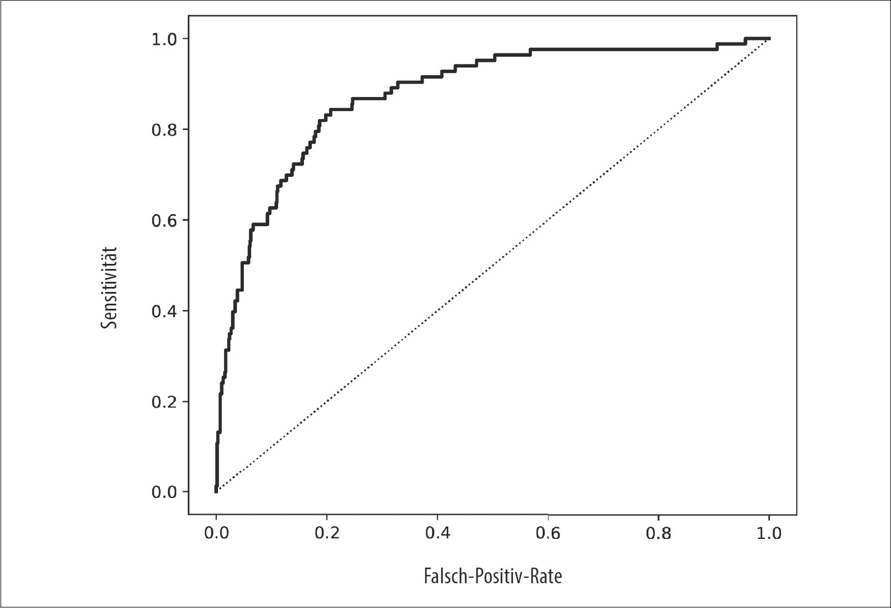

*图 3-1：十二个任务中其中一个的 ROC 曲线。虚线对角线显示了完全随机猜测模型的曲线外观。实际曲线明显位于对角线上方，因此我们的表现远好于随机猜测。*

## 案例研究：训练 MNIST 模型

在前一节中，我们介绍了使用 DeepChem 训练机器学习模型的基础知识，但我们使用了预制的模型类 `dc.models.MultitaskClassifier`。有时人们想创建一种新的模型架构，而不是使用预制模型。在本节中，我们将介绍如何在 MNIST 数据集上训练卷积神经网络。我们不像上一节那样使用预制模型，而是这次自己定义完整的深度学习架构。为此，我们引入 `dc.models.TensorGraph` 类，它在 DeepChem 中提供了一个构建深度架构的框架。


|  || **Wann ergeben Modelle aus der Konserve Sinn?** In diesem Abschnitt wenden wir eine benutzerdefinierte Architektur auf MNIST an. Im vorangegangenen Beispiel haben wir stattdessen eine Architektur aus »der Konserve« (d.h. vordefiniert) verwendet. Wann ist die jeweilige Alternative sinnvoll? Liegt eine gut getestete, vordefinierte Architektur für eine Fragestellung vor, ist es wahrscheinlich sinnvoll, diese zu verwenden. Arbeiten Sie dagegen an einem neuen Datensatz, für den noch keine solche Architektur erstellt wurde, müssen Sie diese häufig selbst definieren. Es ist wichtig, mit der Verwendung von vordefinierten und benutzerdefinierten Architekturen vertraut zu sein. Daher haben wir in diesem Kapitel jeweils ein Beispiel aufgeführt. |

| --- | --- |

### Der MNIST-Datensatz

Der MNIST-Datensatz (siehe Abbildung 3-2) benötigt ein Machine-Learning-Modell, mit dessen Hilfe handschriftliche Ziffern richtig klassifiziert werden können. Die Herausforderung besteht darin, handgeschriebene Ziffern von 0 bis 9 auf Schwarz-Weiß-Bildern im Format 28 × 28 Pixel zu klassifizieren. Der Datensatz enthält 60.000 Beispiele fürs Training und 10.000 fürs Testen.

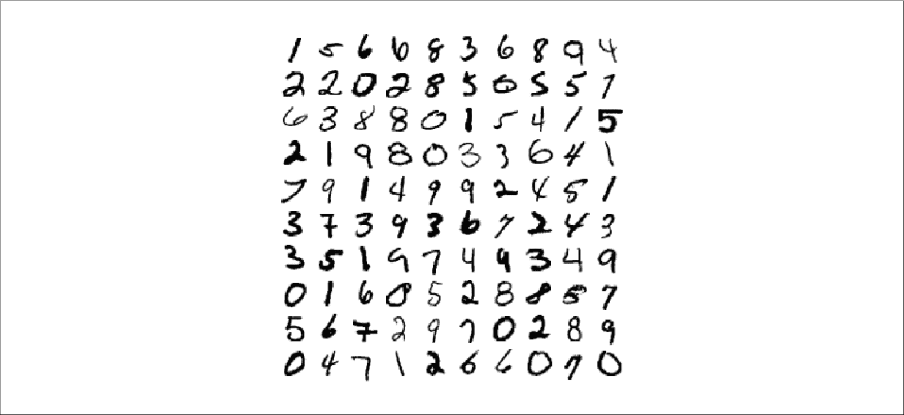

*Abbildung 3-2: Ein Beispiel aus dem MNIST-Datensatz, der handgeschriebene Ziffern enthält. (Quelle: GitHub, [`github.com/mnielsen/rmnist/blob/master/data/rmnist\_10.png`](https://github.com/mnielsen/rmnist/blob/master/data/rmnist_10.png))*

In Bezug auf Machine Learning bietet der MNIST-Datensatz keine besondere Herausforderung. Jahrzehntelange Forschung hat Algorithmen auf dem neuesten Stand der Technik hervorgebracht, die auf den Testdaten dieses Datensatzes eine Genauigkeit von fast 100 % erreichen. Infolgedessen ist der MNIST-Datensatz nicht mehr für Forschungszwecke geeignet, bietet aber ein gutes pädagogisches Werkzeug.

|  || **Ist DeepChem nicht nur für die Biowissenschaften geeignet?** Wie in diesem Kapitel bereits erwähnt, ist es durchaus möglich, andere Deep-Learning-Pakete für Anwendungen in den Biowissenschaften zu verwenden. Ebenso ist es möglich, mit DeepChem allgemeine Machine-Learning-Systeme zu erstellen. Obwohl das Erstellen eines Filmempfehlungssystems in DeepChem komplizierter sein kann als mit spezialisierten Werkzeugen, ist es durchaus machbar. Und das aus gutem Grund: In mehreren Studien wurde die Verwendung von Algorithmen für Empfehlungssysteme zur Vorhersage molekularer Bindungen untersucht. Machine-Learning-Architekturen, die in einem Bereich eingesetzt werden, lassen sich in der Regel auf andere Bereiche übertragen. Daher ist es wichtig, die für innovatives Arbeiten erforderliche Flexibilität beizubehalten. |

| --- | --- |

### Eine Konvolutionsarchitektur für MNIST

DeepChem verwendet die Klasse `TensorGraph`, um nicht standardisierte Deep-Learning-Architekturen zu erstellen. In diesem Abschnitt gehen wir den Code durch, der benötigt wird, um die Konvolutionsarchitektur in Abbildung 3-3 zu erzeugen. Der Code beginnt mit zwei Konvolutionsschichten, um lokale Merkmale im Bild zu identifizieren. Darauf folgen zwei vollständig verbundene Schichten, um die Ziffer anhand dieser lokalen Merkmale vorherzusagen.

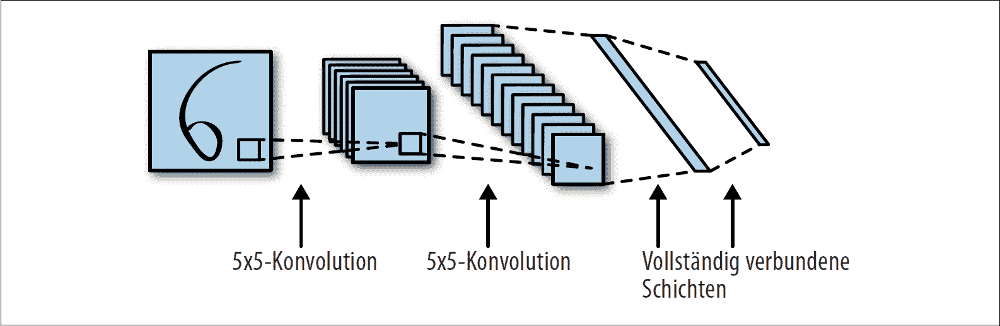

*Abbildung 3-3: Eine Veranschaulichung der Architektur, die wir in diesem Abschnitt für die Verarbeitung des MNIST-Datensatzes erstellen werden.*

Führen Sie zunächst die folgenden Befehle aus, um die MNIST-Rohdatendateien herunterzuladen und lokal abzuspeichern:

```
mkdir MNIST_data
cd MNIST_data
wget http://yann.lecun.com/exdb/mnist/train-images-idx3-ubyte.gz
wget http://yann.lecun.com/exdb/mnist/train-labels-idx1-ubyte.gz
wget http://yann.lecun.com/exdb/mnist/t10k-images-idx3-ubyte.gz
wget http://yann.lecun.com/exdb/mnist/t10k-labels-idx1-ubyte.gz
cd ..
```

Dann laden wir diese Datensätze:

```
from tensorflow.examples.tutorials.mnist import input_data
mnist = input_data.read_data_sets("MNIST_data/", one_hot=True)
```

Als Nächstes bringen wir diese Rohdaten in ein Format, das für DeepChem geeignet ist. Zuerst die erforderlichen Importe:

```
import deepchem as dc
import tensorflow as tf
import deepchem.models.tensorgraph.layers as layers
```

Das Untermodul `deepchem.models.tensorgraph.layers` enthält eine Sammlung von »Layern«. Diese Layer dienen als Bausteine für tiefe Architekturen und können zum Aufbau neuer Deep-Learning-Architekturen zusammengestellt werden. Wir werden in Kürze zeigen, wie Layerobjekte verwendet werden. Als Nächstes erzeugen wir `NumpyDataset`-Objekte, die die Trainings- und Testdatensätze von MNIST umfassen:

```
train_dataset = dc.data.NumpyDataset(mnist.train.images, mnist.train.labels)
test_dataset = dc.data.NumpyDataset(mnist.test.images, mnist.test.labels)
```

Beachten Sie, dass, obwohl ursprünglich kein Testdatensatz definiert war, die Funktion `input_data()` aus TensorFlow einen geeigneten Testdatensatz für unsere Verwendungszwecke heraussucht. Mit den vorliegenden Trainings- und Testdatensätzen können wir uns nun darauf konzentrieren, die Architektur für das MNIST-CNN zu definieren.

Das zugrunde liegende Schlüsselkonzept besteht darin, dass Layerobjekte zusammengesetzt werden können, um neue Modelle zu erzeugen. Wie im vorhergehenden Kapitel bereits besprochen, nimmt jede Schicht Eingaben von vorherigen Ebenen an und berechnet eine Ausgabe, die an nachfolgende Layer übergeben wird. Es beginnt mit der Eingabeschicht, die Merkmale und Labels aufnimmt. Am anderen Ende gibt es die Ausgabeschicht, die die Ergebnisse der durchgeführten Berechnungen zurückgibt. In diesem Beispiel stellen wir eine Abfolge von Ebenen zusammen, um ein Convolutional Neural Network zur Bildverarbeitung aufzubauen. Wir definieren zunächst ein neues `TensorGraph`-Objekt:

```
model = dc.models.TensorGraph(model_dir='mnist')
```

Die Option `model_dir` gibt ein Verzeichnis an, in dem die Modellparameter gespeichert werden sollen. Sie können diesen Schritt weglassen, wie wir es im vorherigen Beispiel getan haben, aber dann wird das Modell nicht gespeichert. Sobald der Python-Interpreter beendet ist, wird das Training des Modells verworfen! Mit dem Festlegen eines Verzeichnisses kann das Modell später erneut geladen werden und es können neue Vorhersagen getroffen werden.

Beachten Sie: Da `TensorGraph` von `Model` erbt, ist dieses Objekt eine Instanz von `dc.models.Model` und unterstützt dieselben Funktionen `fit()` und `evaluate()`, die wir bereits gesehen haben:

```
In : isinstance(model, dc.models.Model)
Out: True
```

Bisher haben wir `model` noch nichts hinzugefügt, daher ist unser Modell wahrscheinlich nicht sehr interessant. Beginnen wir mit dem Hinzufügen einiger Angaben für Merkmale und Labels mithilfe der Klassen `Feature` und `Label`:

```
feature = layers.Feature(shape=(None, 784))
label = layers.Label(shape=(None, 10))
```

MNIST enthält Bilder im Format 28 × 28 cm. Diese bilden abgeflachte Feature-Vektoren der Länge 784. Die Labels haben eine zweite Dimension der Größe 10, da es zehn mögliche Ziffernwerte gibt, und der zugehörige Vektor liegt als One-Hot-Codierung vor. Beachten Sie, dass `None` als Eingabedimension verwendet wird. In Systemen, die auf TensorFlow beruhen, codiert der Wert `None` häufig die Fähigkeit einer bestimmten Ebene, Eingaben einer beliebigen Größe in dieser Dimension zu akzeptieren. Anders ausgedrückt, unser Objekt `feature` ist in der Lage, Eingaben der Form `(20, 784)` und `(97, 784)` gleichermaßen zu akzeptieren. In diesem Fall entspricht die erste Dimension der Batchgröße, sodass unser Modell Batches mit beliebig vielen Datenpunkten annehmen kann.


|  || **One-Hot-Codierung** Der MNIST-Datensatz enthält kategoriale Daten. Das bedeutet, jeder Wert stammt aus einer endlichen Liste möglicher Werte. In diesem Fall sind unsere möglichen Werte die Ziffern 0 bis 9. Wie können diese Werte von unserem Modell gelesen werden? Eine naheliegende Antwort wäre, eine einzelne Zahl einzugeben, die die Werte 0 bis 9 annehmen kann. Aus verschiedenen technischen Gründen funktioniert diese Vorgehensweise jedoch selten gut. Als Alternative wird deshalb oft die `One-Hot-Codierung` eingesetzt. Jedes Label im MNIST-Datensatz ist ein Vektor der Länge 10, in dem ein einzelnes Element auf 1 und alle anderen Elemente auf 0 gesetzt werden. Steht die 1 an der nullten Stelle, hat das Label den Wert 0. Steht die 1 an der neunten Stelle, hat das Label den Wert 9. |

| --- | --- |

Um Konvolutionsschichten auf unsere Eingabe anwenden zu können, müssen wir die flachen Merkmalsvektoren in Matrizen der Form `(28, 28)` umwandeln. Hierfür benutzen wir eine `Reshape`-Schicht:

```
make_image = layers.Reshape(shape=(None, 28, 28), in_layers=feature)
```

Auch hier zeigt `None` an, dass Batches beliebiger Größe verarbeitet werden können. Beachten Sie, dass wir die Option `in_layers=feature` einsetzen. Das bedeutet, dass die `Reshape`-Ebene die vorangegangene Feature-Schicht, `feature`, als Eingabe verwendet. Nach der erfolgreichen Umformung der Eingabe können wir diese an die Konvolutionsschichten weitergeben:

```
conv2d_1 = layers.Conv2D(num_outputs=32, activation_fn=tf.nn.relu,
in_layers=make_image)

conv2d_2 = layers.Conv2D(num_outputs=64, activation_fn=tf.nn.relu,
in_layers=conv2d_1)
```

Die Klasse `Conv2D` führt eine 2-D-Faltung für jeden Wert der Eingabe durch, der anschließend an die `ReLU`-Aktivierungsfunktion übergeben wird. Wir verwenden `in_layers`, um vorangegangene Ebenen als Eingaben an nachfolgende Schichten zu übergeben. Zum Schluss wenden wir `Dense`-Ebenen (vollständig verbunden) auf die Ausgaben des Convolution-Layers an. Da jedoch die Ausgabe der `Conv2D`-Schichten in 2-D erfolgt, müssen wir zuerst eine `Flatten`-Ebene anwenden, um unsere Eingabe auf eine Dimension zu reduzieren (genauer gesagt, erzeugt die `Conv2D`-Ebene eine 2-D-Ausgabe *für jeden Datenpunkt*, sodass ihre Ausgabe aus drei Dimensionen besteht; die `Flatten`-Schicht reduziert diese auf eine einzelne Dimension pro Datenpunkt bzw. insgesamt zwei Dimensionen):

```
flatten = layers.Flatten(in_layers=conv2d_2)

dense1 = layers.Dense(out_channels=1024, activation_fn=tf.nn.relu,
in_layers=flatten)

dense2 = layers.Dense(out_channels=10, activation_fn=None, in_layers=dense1)
```

Die Option `out_channels` in der `Dense`-Ebene legt die Breite der Ebene fest. Die erste Schicht erzeugt 1.024 Ausgabewerte pro Datenpunkt, die zweite Ebene gibt nur noch zehn Werte aus, die unseren zehn möglichen Ziffernwerten entsprechen. Wir verknüpfen diese Ausgabe nun mit einer Fehlerfunktion, sodass wir der Ausgabe beibringen können, die Ziffern zutreffend vorherzusagen. Wir verwenden `SoftMaxCrossEntropy`, um dieses Training durchzuführen:

```
smce = layers.SoftMaxCrossEntropy(in_layers=[label, dense2])

loss = layers.ReduceMean(in_layers=smce)

model.set_loss(loss)
```

Beachten Sie, dass die `SoftMaxCrossEntropy`-Ebene sowohl die Labels als auch die Ausgaben der letzten `Dense`-Schicht als Eingaben akzeptiert. Es berechnet den Wert der Fehlerfunktion für jeden Datenpunkt, den wir im Anschluss über alle Datenpunkte mitteln müssen, um den endgültigen Fehler zu erhalten. Dies erfolgt mit der Ebene `ReduceMean`, die wir durch Aufruf von `model.set_loss()` als Fehlerfunktion unseres Modells festlegen.

### **SoftMax und SoftMaxCrossEntropy**

Häufig soll ein Modell eine Wahrscheinlichkeitsverteilung ausgeben. Für MNIST möchten wir die Wahrscheinlichkeiten jeder der zehn Ziffern eines gegebenen Eingabebilds erhalten. Jede Ausgabe muss positiv sein, und sie müssen sich zu 1 aufsummieren. Eine einfache Möglichkeit, das zu erreichen, besteht darin, das Modell beliebige Zahlen berechnen zu lassen und diese dann durch die Funktion `Softmax` zu leiten:

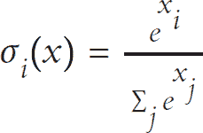

Der Exponent im Zähler stellt sicher, dass alle Werte positiv sind, während die Summe im Nenner gewährleistet, dass sie sich zu 1 aufsummieren. Ist ein Element `x` viel größer als die anderen, ist der entsprechende Ausgabewert annähernd 1, und alle anderen Ausgabewerte sind annähernd 0.

`SoftMaxCrossEntropy` wendet zunächst eine `Softmax`-Funktion an, um die Ausgaben in Wahrscheinlichkeiten umzuwandeln, und berechnet anschließend die Kreuzentropie dieser Wahrscheinlichkeiten. Denken Sie daran, dass die Labels in der `One-Hot-Codierung` vorliegen: 1 für die richtige Klasse, andernfalls 0. Sie können sich das als Wahrscheinlichkeitsverteilung vorstellen! Der Fehler wird minimiert, wenn die vorhergesagte Wahrscheinlichkeit des richtigen Werts so nahe wie möglich bei 1 liegt. Diese beiden Operationen (`Softmax` gefolgt von `Kreuzentropie`) treten oft gemeinsam auf, und die Berechnung als einzelner Schritt hat sich als numerisch stabiler erwiesen als die getrennte Ausführung.

Für die numerische Stabilität berechnen Layer wie `SoftMaxCrossEntropy` Log-Wahrscheinlichkeiten. Wir müssen die Ausgabe mithilfe einer `SoftMax`-Ebene umwandeln, um Ausgabewahrscheinlichkeiten pro Ziffer zu erhalten. Wir fügen diese Ausgabe `model` hinzu, indem wir `model.add_output()` aufrufen:

```
output = layers.SoftMax(in_layers=dense2)

model.add_output(output)
```

Wir können das Modell jetzt wieder mit der `fit()`-Funktion trainieren:

```
model.fit(train_dataset, nb_epoch=10)
```

Beachten Sie, dass dieser Durchlauf auf einem Standard-Laptop länger dauern kann. Wird die Funktion nicht schnell genug ausgeführt, versuchen Sie es mit `nb_epoch=1`. Die Ergebnisse werden zwar schlechter ausfallen, aber Sie können den Rest des Kapitels schneller abschließen.

Dieses Mal wählen wir Genauigkeit – den Anteil der Labels, die korrekt vorhergesagt wurden – als unsere Metrik:

```
metric = dc.metrics.Metric(dc.metrics.accuracy_score)
```

Zur Berechnung der Genauigkeit verwenden wir wie bereits zuvor:

```
train_scores = model.evaluate(train_dataset, [metric])

test_scores = model.evaluate(test_dataset, [metric])
```

Wir erhalten eine ausgezeichnete Performance: Die Genauigkeit beträgt 0.999 für die Trainingsdaten und 0.991 für die Testdaten. Unser Modell identifiziert mehr als 99 % der Datenpunkte im Testdatensatz korrekt.

|  || **Versuchen Sie, Zugriff auf eine GPU zu erhalten** Wie Sie in diesem Kapitel gesehen haben, kommt es vor, dass Deep-Learning-Code ziemlich langsam läuft! Auf einem guten Laptop kann das Trainieren eines Convolutional Neural Network mehr als eine Stunde dauern. Das liegt daran, dass dieser Code eine große Anzahl linearer algebraischer Operationen auf Bilddaten ausführt. Die meisten CPUs sind für diese Art von Berechnungen nicht ausgelegt. |

| --- | --- |

|   || Versuchen Sie, nach Möglichkeit Zugriff auf einen modernen Grafikprozessor zu erhalten. Diese wurden ursprünglich für Videospiele entwickelt, finden heutzutage jedoch für viele Arten von numerischen Berechnungen Verwendung. Die meisten modernen Deep-Learning-Workloads werden auf GPUs viel schneller ausgeführt. Auch die Beispiele dieses Buchs lassen sich mit GPUs einfacher ausführen. |

|   || Machen Sie sich aber keine Sorgen, wenn der Zugriff auf eine GPU nicht möglich ist. Sie werden die Beispiele dennoch durchführen können – es dauert möglicherweise nur etwas länger (während Sie darauf warten, dass der Code vollständig ausgeführt wird, könnten Sie einen Kaffee trinken oder ein Buch lesen). |

### **Fazit**

In diesem Kapitel haben Sie gelernt, wie Sie mit der `DeepChem`-Bibliothek einige einfache Machine-Learning-Systeme implementieren. Im weiteren Verlauf dieses Buchs nutzen wir `DeepChem` als die Bibliothek unserer Wahl. Bleiben Sie entspannt, sollten Sie bisher kein klares Verständnis von den Grundlagen der Bibliothek haben. Es werden noch viele weitere Beispiele folgen.


在接下来的章节中，我们将介绍在生物科学数据集上进行有效机器学习所需的基本概念。在下一章中，我们将向您介绍分子机器学习。

# 第 4 章

# 分子机器学习

本章传授将机器学习应用于分子数据的基础知识。但首先，让我们简要讨论一下为什么值得研究分子机器学习。现代材料科学和现代化学在很大程度上依赖于开发具有所需性质的新分子的必要性。尽管重要的科学工作为新的设计策略铺平了道路，但有时仍需要大量的运气来设计有趣的分子。分子机器学习的梦想是用引导式搜索取代这种随意的实验。在此过程中，机器学习生成的预测器可以推测哪些新分子可能具有所需的性质。这种精确的预测器能够从根本上实现具有实用特性的全新材料和化学品的创造。

这个梦想令人无法抗拒，但我们从何入手？第一步是开发将分子转换为数值向量的技术方法，然后将这些向量传递给学习算法。此类方法被称为 `分子特征化`。我们将在本章介绍其中的一些方法，并在下一章介绍更多。分子是复杂的对象，研究人员开发了各种不同的技术来表征它们。其中包括化学描述符向量、二维图表示、三维网格表示、轨道基函数表示等。

从表征出的分子中进行学习仍然是必要的。我们将研究一些基于分子学习函数的算法，包括简单的全连接网络以及更复杂的方法，如 `图卷积`。我们还将解释 `图卷积` 的一些局限性，以及我们应该从中期待什么、不该期待什么。我们将通过一个有趣的数据集上的分子机器学习案例研究来结束本章。

## 什么是分子？

在深入研究分子机器学习之前，了解究竟什么是分子会很有帮助。这个问题听起来有点傻，因为像 H[2]O 和 CO[2] 这样的分子连小孩子都知道。答案不是显而易见的吗？事实上，我们很长一段时间都不知道分子竟然存在。让我们做个思想实验：你如何说服一个怀疑的外星人，存在被称为分子的物体？答案相当复杂。你很可能不得不拿出质谱仪！

|  | | **质谱法**弄清楚特定样品中存在哪些分子可能非常困难。目前最流行的方法是质谱法。质谱法的基本思想是用电子轰击样品。通过这种轰击，分子会分裂成碎片。通常这些碎片会*电离*——即获得或失去电子而带电。这些带电碎片在电场驱动下，根据其质荷比进行分离。检测到的带电碎片的分布被称为*谱图*。图 4-1 说明了这一过程。从检测到的碎片集合中，通常可以确定原始样品中的确切分子。然而，这一过程仍然是有损且困难的。许多科学家目前正在研究如何利用深度学习算法改进质谱法，以便更容易地从检测到的带电谱图中识别出原始分子。 |

| --- | --- |

|   | | 请注意这一认识的复杂性！分子是复杂的对象，其精确确定非常困难。 |

让我们首先假设，分子是一组通过物理力相互连接的原子。分子是能够参与化学反应的化学化合物的最小基本单位。分子中的原子通过*化学键*相互连接，化学键将它们结合在一起并限制它们彼此的相对运动。分子有各种尺寸，由少数原子到数千个原子组成。图 4-2 展示了一个分子的简单表示。

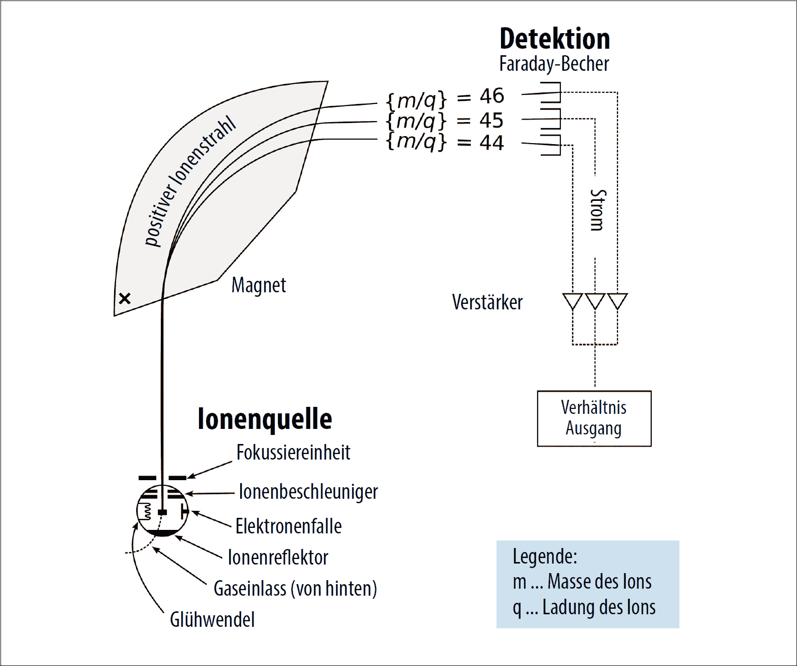

*图 4-1：质谱仪示意图。(来源：Wikimedia, [`commons.wikimedia.org/wiki/File:Mass\_Spectrometer\_Schematic.svg`](https://commons.wikimedia.org/wiki/File:Mass_Spectrometer_Schematic.svg))*


*图 4-2：咖啡因分子的简单球棍模型表示。原子显示为彩色球体（黑色代表碳，红色代表氧，蓝色代表氮，白色代表氢），由象征化学键的棍子连接。*

在进行了这一基本描述后，我们将在接下来的章节中更深入地探讨分子化学的各个方面。您不必在第一次阅读本章后就内化所有这些概念，但拥有一些基础化学知识会有所帮助。

|  | | **分子是动态量子对象**我们刚才给出了基于原子和键的分子简化描述。非常重要的是要记住，每个分子内部发生的事情远不止这些。首先，分子是动态对象，因此某个分子内的所有原子都在快速相互移动。键本身会伸长和收缩，其长度可以快速波动。分子原子断裂并重新连接是很常见的现象。当我们讨论分子构象时，将了解更多关于分子动力学的内容。 |

| --- | --- |

|   | | 更奇怪的是，分子是量子。有很多方式可以说明一种结构是量子，但简单来说，重要的是要注意，“原子”和“键”远不如简单的球棍模型所暗示的那样定义明确。它们的定义并非唯一。您目前不必掌握这些复杂性，但请注意，我们对分子的描述非常模糊。这可能会产生实际影响，因为根据学习任务的不同，可能需要以不同的方式描述分子。 |

### 什么是分子键？

您可能已经有一段时间没接触化学基础了。因此，我们将反复花时间复习基本化学概念。最基本的问题是：什么是化学键？


构成日常生活的分子由原子组成，通常包含非常多的原子。这些原子通过化学键相互连接。这些键通过共享电子，简直是将原子“粘”在了一起。存在多种不同类型的分子键，包括共价键，以及各种非共价键。

### 共价键

在共价键中，电子在两个原子间共享，使得相同的电子同时在两个原子周围运动（参见图 4-3）。从根本上说，共价键是最强的化学键。它们在化学反应中形成并断裂。共价键通常非常稳定：一旦形成，需要大量能量才能将其打破，因此原子可以长时间保持结合状态。正因如此，分子表现得像独立的个体，而不是松散的、无关原子的聚集体。事实上，分子是由共价键定义的：分子是一组通过共价键连接的原子的集合。


*图 4-3：左侧：两个原子核，每个都被一个电子云包围。右侧：当原子靠近时，电子在原子核之间的空间花费更多时间。这将原子核拉在一起，在原子之间形成共价键。*

### 非共价键

在非共价键中，原子不直接共享电子，但它们形成微弱的电磁相互作用。因为它们不如共价键强，所以寿命较短，持续分解并重新形成。非共价键不像共价键那样以相同方式“定义”分子，但它们对分子能采取的形状以及不同分子如何相互连接有重大影响。

“非共价键”是一个涵盖多种相互作用类型的统称。非共价键的例子包括氢键（参见图 4-4）、离子键、π-π 相互作用等。此处提到的相互作用在药物开发中经常起关键作用，因为大多数药物通过非共价相互作用与人体内的生物分子发生作用。

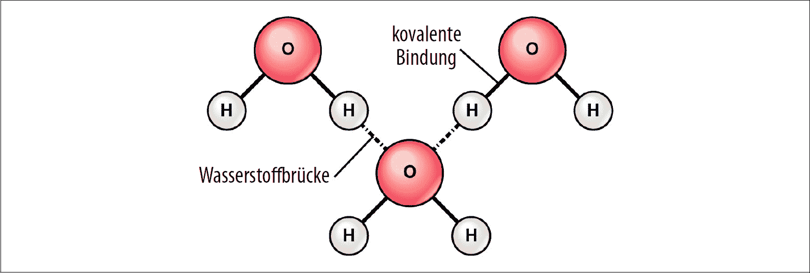

*图 4-4：水分子在相邻分子的氢和氧之间形成强氢键。一个坚固的氢键网络在一定程度上造就了水作为溶剂的强度。（来源：Wikimedia，[`commons.wikimedia.org/wiki/File:SimpleBayesNet.svg`](https://commons.wikimedia.org/wiki/File:SimpleBayesNet.svg)）*

我们将在本书的其他章节再次讨论这些键类型。在本章中，我们将主要关注共价键。当我们开始研究生物物理深度学习模型时，非共价相互作用将变得重要得多。

### 分子图

*图* 是一种数学数据结构，由通过*边*连接的*节点*组成（参见图 4-5）。图是计算机科学中极其有用的抽象。事实上，有一整个数学分支称为图论，致力于理解图的性质，并寻找操作和分析图的方法。图被用于描述从构成网络的计算机、组成图像的像素，到与凯文·贝肯合演过电影的演员等一切事物。


*图 4-5：一个包含六个节点并通过边连接的数学图示例。（来源：Wikimedia，[`commons.wikimedia.org/wiki/File:6n-graf.svg`](https://commons.wikimedia.org/wiki/File:6n-graf.svg)）*

重要的是，分子也可以被视为图（参见图 4-6）。在这种描述中，节点代表图中的原子，而边则代表化学键。每个分子都可以转换为相应的分子图。

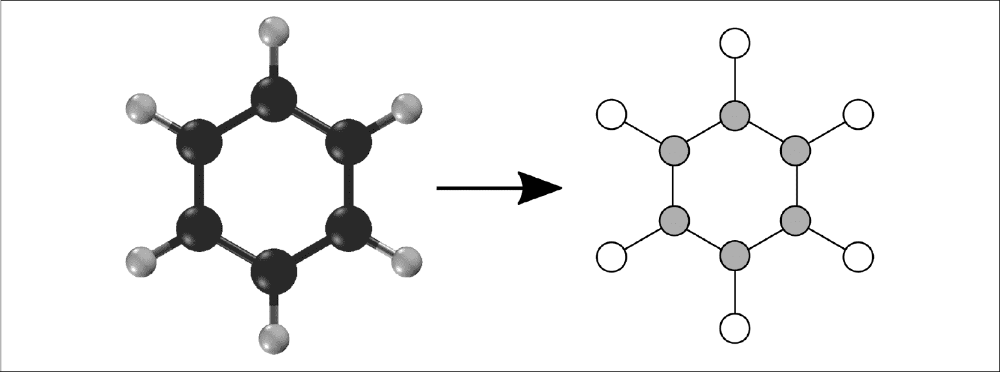

*图 4-6：将苯分子转换为分子图的示例。请注意，原子转换为节点，化学键转换为边。*

在本章其余部分，我们将反复将分子转换为图，以便进行分析和预测。

### 分子构象

分子图描述了分子中包含的原子及其相互间的键合情况。但还有一件事我们必须知道：原子的空间排列，称为分子的*构象*。

原子、键和构象相互关联。如果两个原子通过共价键结合，这可以确定它们之间的距离，并严重限制可能的构象。由三个或四个键合原子形成的角度也通常受到限制。有时整个原子簇完全刚性，作为一个整体单元移动。其他分子部分则是柔性的，允许原子相对于彼此移动。例如，许多（但并非所有）共价键允许它们连接的原子团绕键轴自由旋转。这使得分子能够采取许多不同的构象。

图 4-7 展示了一个非常受欢迎的分子：蔗糖，也称为食糖。它既以化学 2-D 结构形式，也以 3-D 构象形式呈现。蔗糖由两个相连的环组成。每个环都相当刚性，因此其形状随时间几乎不变。但连接它们的连接体要灵活得多，使得环可以相对于彼此移动。

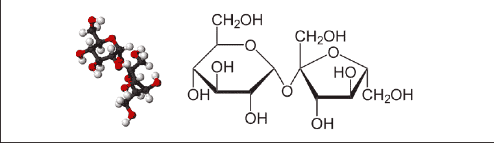

*图 4-7：蔗糖，以 3-D 构象和化学 2-D 结构表示。图片来自 Wikimedia（[`commons.wikimedia.org/wiki/File:Sucrose-3D-balls.png`](https://commons.wikimedia.org/wiki/File:Sucrose-3D-balls.png)）和 Wikipedia（[`en.wikipedia.org/wiki/File:Saccharose2.svg`](https://en.wikipedia.org/wiki/File:Saccharose2.svg)）。*

分子越大，它们能采取的可能构象就越多。大型大分子（如蛋白质，参见图 4-8）目前需要非常昂贵的模拟来研究可能的构象。


*图 4-8：视紫红质（用于捕获光能）的 3-D 渲染构象。蛋白质构象特别复杂，包含多个几何 3-D 基序。它们提醒我们，分子除了化学式之外，还具有几何结构。（来源：Wikimedia，[`upload.wikimedia.org/wikipedia/commons/thumb/d/dd/1M0K.png/480px-1M0K.png`](https://upload.wikimedia.org/wikipedia/commons/thumb/d/dd/1M0K.png/480px-1M0K.png)）*

### 分子手性

一些分子（包括许多药物）以两种互为镜像的形式存在。这被称为*手性*。如图 4-9 所示，手性分子同时具有“右手”形式（也称为“R”构型）和“左手”形式（也称为“S”构型）。


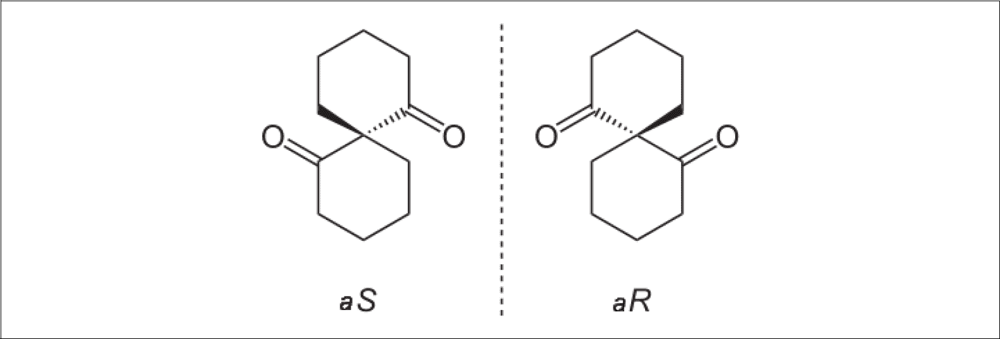

*图 4-9：螺旋化合物（由两个或多个相连的环组成的化合物）的轴向手性。请注意，两种手性变体分别标记为“R”和“S”。这种约定在化学文献中非常普遍。*

手性非常重要，无论是对于实验室化学家还是化学信息学家，它都是巨大挫败感的来源。首先，产生手性分子的化学反应通常不区分各种形式，并以相等数量产生两种手性。（这些产品被称为*外消旋体*。）因此，如果只想要两种形式中的一种，制造过程会迅速变得更加复杂。此外，两种手性的各种物理性质是相同的，因此许多实验无法区分特定分子的手性形式。计算模型也是如此。例如，两种手性具有相同的分子图，因此任何仅基于分子图的机器学习模型都无法区分它们。

如果这两种形式在实践中表现完全相同，那倒无关紧要。但事实往往并非如此。一种药物的两种手性形式完全可能结合到完全不同的蛋白质上，并在人体内产生截然不同的效果。在许多情况下，药物的只有一种形式具有所需的治疗效果，而另一种形式仅产生副作用，毫无益处。

手性化合物产生不同效果的一个具体例子是沙利度胺，它在 1950 年代和 1960 年代被作为镇静剂开具处方。这种药物后来成为非处方药，用于治疗孕期的恶心和晨吐。沙利度胺的 R 型是一种有效的镇静剂，而 S 型则具有致畸性，会导致严重的出生缺陷。由于沙利度胺在体内会在两种形式之间相互转化（即消旋化），这些困难进一步加剧。

### 分子的特征化

上述化学基础知识如何帮助我们为分子开发特征？要对分子进行机器学习，我们必须将它们转换为可作为模型输入的特征向量。在本节中，我们将介绍 DeepChem 子模块 `dc.feat`，并解释如何使用它以各种方式表征分子。

#### SMILES 字符串与 RDKit

SMILES 是一种将分子指定为字符串的流行方法。该缩写代表*简化分子线性输入规范*。SMILES 字符串以一种对化学家既简洁又直观的方式描述分子的原子和化学键。对于非化学家来说，这些字符串通常看起来像毫无意义的随机字符模式。例如，`OCCc1c(C)n+Cc2cnc(C)nc2N` 描述了重要营养素硫胺素，也称为维生素 B1。

DeepChem 使用 SMILES 字符串作为数据集中表示分子的格式。有一些深度学习模型直接接受 SMILES 字符串作为输入，并试图在文本表示中识别有意义的特征。但更常见的情况是，必须先将字符串转换为另一种更适合特定任务的表示形式。

DeepChem 依赖另一个化学信息学开源包 RDKit 来简化分子的处理。RDKit 提供了许多用于处理 SMILES 字符串的功能。它在将字符串转换为分子图及其他下文所述表示形式方面发挥着核心作用。

#### 连接性指纹

化学指纹是由 1 和 0 组成的向量，指示分子特定特征的存在或缺失。连接性指纹（ECFP）是一类结合了多种有用功能的特征化方法。它们将任意大小的分子转换为固定长度的向量。这很重要，因为许多模型只能处理相同大小的输入。有了 ECFP，不同大小的分子就可以用同一个模型。ECFP 也非常容易比较。因此，可以根据两个分子的指纹比较相应的元素。匹配的元素越多，分子就越相似。此外，ECFP 计算速度很快。

指纹向量的每个元素表示由原子的局部排列定义的特定分子特征的存在或缺失。算法首先单独检查每个原子并查看其某些属性：其元素、它形成的共价键数量等。这些属性的每个特定组合都是一个特征，向量中相应的元素被设置为 1 以指示其存在。然后，算法从内向外工作，将每个原子与其结合的所有原子结合起来。这定义了一组新的、更大的特征，并设置相应的向量元素。该方法最广泛使用的变体是 ECFP4 算法，其中子片段具有以中心原子为中心、半径为两个化学键的范围。

RDKit 库提供了计算分子 ECFP4 指纹的工具。DeepChem 为这些功能提供了方便的封装。类 `dc.feat.CircularFingerprint` 继承自 `Featurizer`，并提供了一个标准接口来为分子生成特征：

```
smiles = ['C1CCCCC1', 'O1CCOCC1'] # 环己烷和二恶烷

mols = [Chem.MolFromSmiles(smile) for smile in smiles]

feat = dc.feat.CircularFingerprint(size=1024)

arr = feat.featurize(mols)

# arr 是一个 2 x 1024 的数组，包含
# 两个分子的指纹
```

ECFP 有一个显著的缺点：指纹处理了大量关于分子的信息，但在此过程中丢失了一些信息。两个不同的分子有可能具有相同的指纹。如果只有一个指纹，就无法唯一确定它来自哪个分子。

#### 分子描述符

另一种思路认为，根据理化描述符描述分子是有用的。这些描述符通常对应描述分子结构的各种计算量。这些量（如对数分配系数或极性表面积）通常源自经典物理学或化学。RDKit 为分子计算许多此类物理描述符。DeepChem 特征化器 `dc.feat.RDKitDescriptors()` 提供了一种简便的方法来执行相同的计算：

```
feat = dc.feat.RDKitDescriptors()

arr = feat.featurize(mols)

# arr 是一个 2 x 111 的数组，包含
# 两个分子的属性
```

显然，这种特征化对于某些任务比其他任务更有用。它最适合基于分子相对一般性质的预测。它不太适合预测取决于原子精确排列的性质。

### 图卷积


上一节解释的特征化方法是由人类设计的。专家会仔细思考如何表示分子，以便将其作为机器学习模型的输入，然后手动编程实现该表示。相反，是否有可能让模型自行发现如何最好地表示分子？这毕竟正是机器学习的核心：我们不再手动设计函数，而是尝试根据数据自动构建函数。

作为类比，让我们考虑一个用于图像识别的卷积神经网络。网络的输入是图像。它由每个像素的一个数值向量组成，例如三个颜色分量。这是一种非常简单、通用的图像表示。第一个卷积层学习识别简单的模式，如垂直或水平线。其输出再次是每个像素的一个数值向量，但以更抽象的方式表示。每个数值代表一个局部几何特征。

网络通过一系列层继续传播。每一层输出图像的一种新表示，该表示比前一层更抽象，且与原始颜色分量的关联更小。而且这些表示是根据数据自动学习的，而非由人类设计。没有人指示模型寻找哪些模式来判断图像是否包含猫。模型通过训练领会了这一点。

`图卷积网络` 将同样的思想应用于图。正如普通 CNN 从一个数值向量开始一样，`图卷积网络` 从每个节点和/或每条边的一个数值向量开始。如果图代表一个分子，这些数值可以是每个原子的化学性质，例如其元素、电荷和杂化状态。正如卷积层基于其输入的局部区域为每个像素计算一个新向量一样，`图卷积层` 为每个节点和/或每条边计算一个新向量。输出是通过将学习到的卷积核应用于图的每个局部区域来计算的，其中“局部”现在被定义为节点之间的边。例如，每个原子的输出向量可以基于该原子自身的输入向量以及所有与其直接相连的其他原子的输入向量来计算。

这就是基本思想。关于细节，已经提出了许多不同的变体。幸运的是，`DeepChem` 包含了许多此类架构的实现，因此您无需了解每一个细节即可尝试使用它们。示例包括 `图卷积` (`GraphConvModel`)、`Weave 模型` (`WeaveModel`)、`消息传递神经网络` (`MPNNModel`)、`深度张量神经网络` (`DTNNModel`) 等。

`图卷积网络` 是分析分子的强大工具，但有一个重要的局限性：计算完全基于分子图。它们不接收关于分子构象的信息，因此无法预测任何依赖于构象的性质。这使它们特别适合小的、大多是刚性的分子。在下一章中，我们将介绍更适合大型、柔性分子的方法，这些分子可以采取许多种构象。

### 训练一个预测溶解度的模型

我们现在将所有部分组合在一起，使用一个真实的化学数据集训练模型，以预测一个重要的分子性质。首先，我们加载数据集：

```
tasks, datasets, transformers = dc.molnet.load_delaney(featurizer='GraphConv')

train_dataset, valid_dataset, test_dataset = datasets
```

该数据集包含溶解度数据，它是衡量分子在水中溶解难易程度的指标。这一性质对于所有打算用作药物的化学品至关重要。如果一种化合物不易溶解，就很难将足量的药物输送到患者的血液中以达到治疗效果。药物化学家花费大量时间修饰分子以提高其溶解度。

我们指定选项 `featurizer='GraphConv'`。我们想要使用 `图卷积`，此选项告诉 `MoleculeNet` 将每个分子的 `SMILES 字符串` 转换为模型所需的输入格式。

接下来，我们创建并训练模型：

```
model = GraphConvModel(n_tasks=1, mode='regression', dropout=0.2)

model.fit(train_dataset, nb_epoch=100)
```

我们指定每个数据点只有一个任务，即一个输出值（溶解度）。我们还指定这是一个回归模型，即标签是连续数值，模型应尝试尽可能准确地重现这些数值。这与分类模型不同，后者试图预测每个数据点属于哪个预定义的类别。为了减少过拟合，我们指定了 0.2 的 Dropout 率，意味着每个 `卷积层` 20% 的输出会被随机设为 0。

这就完成了！现在我们可以评估模型，看看它的表现如何。为此，我们使用皮尔逊相关系数作为指标：

```
metric = dc.metrics.Metric(dc.metrics.pearson_r2_score)

print(model.evaluate(train_dataset, [metric], transformers))

print(model.evaluate(test_dataset, [metric], transformers))
```

训练数据集的相关系数为 0.95，测试数据集为 0.83。似乎存在一些过拟合，但程度不大。此外，0.83 的相关系数相当不错。我们的模型成功地根据分子结构预测了分子的溶解度！

既然我们有了模型，就可以用它来预测新分子的溶解度。假设我们对以下五个以 `SMILES 字符串` 形式给出的分子感兴趣：

```
smiles = ['COC(C)(C)CCCC(C)CC=CC(C)=CC(=O)OC(C)C',
'CCOC(=O)CC',
'CSc1nc(NC(C)C)nc(NC(C)C)n1',
'CC(C#C)N(C)C(=O)Nc1ccc(Cl)cc1',
'Cc1cc2ccccc2cc1C']
```

要将这些作为输入用于我们的模型，我们首先必须使用 `RDKit` 解析 `SMILES 字符串`。然后我们使用一个 `DeepChem 特征化器` 将它们转换为 `图卷积` 所期望的格式：

```
from rdkit import Chem

mols = [Chem.MolFromSmiles(s) for s in smiles]

featurizer = dc.feat.ConvMolFeaturizer()

x = featurizer.featurize(mols)
```

在下一步中，我们将 `x` 传递给模型以预测溶解度：

```
predicted_solubility = model.predict_on_batch(x)
```

### MoleculeNet

我们已经从 `molnet` 模块加载了两个数据集：上一章的毒性数据集 `Tox21` 和本章的 Delaney 溶解度数据集。`MoleculeNet` 是一个对分子机器学习有用的大型数据集集合。正如 图 4-10 所示，它包含各种分子性质的数据。范围从可以用量子力学计算的物理性质，到人体内相互作用的信息，如毒性和副作用。

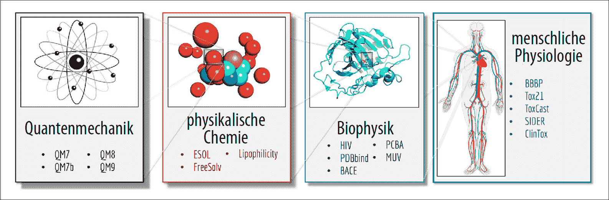

*图 4-10：MoleculeNet 包含来自分子科学不同领域的许多不同数据集。科学家们发现预测分子的物理、生物物理和生理以及量子性质很有用*。


在开发新的机器学习方法时，MoleculeNet 可作为一组基准值集合，用于测试这些方法。在 *[`moleculenet.ai`](http://moleculenet.ai)* 上，您可以查看各种标准模型在各个数据集上的表现，并比较您自己的模型与既定方法相比的表现如何。

#### SMARTS 字符串

在许多常用应用中，如文本处理，我们想要搜索特定的字符串。在化学信息学中，我们会遇到类似的情况，即我们想要确定分子的原子是否匹配特定模式。为此有许多用例：

*   搜索分子数据库，以识别包含特定子结构的分子。
*   基于共同子结构对齐多个分子，以改善可视化效果。
*   在绘图中高亮显示子结构。
*   在计算过程中约束子结构。

SMARTS 是 SMILES 的扩展，我们已经介绍过 SMILES，SMARTS 用于创建查询。可以将 SMARTS 模式想象为文本搜索中的正则表达式。例如，在文件系统搜索中，可以指定 `foo*.bar`，它将找到 `foo.bar`、`foo3.bar` 和 `foolish.bar`。SMILES 字符串也可以用作 SMARTS 字符串。SMILES 字符串 `CCC` 也是一个有效的 SMARTS 字符串，可找到三个相邻脂肪族碳原子的序列。以下代码示例展示了如何从 SMILES 字符串定义分子、显示这些分子，并高亮显示与 SMARTS 模式匹配的原子。

首先，我们导入所需的库，并根据 SMILES 字符串列表创建一个分子列表。结果见 图 4-11：

```
from rdkit import Chem
from rdkit.Chem.Draw import MolsToGridImage

smiles_list = ["CCCCC","CCOCC","CCNCC","CCSCC"]
mol_list = [Chem.MolFromSmiles(x) for x in smiles_list]
```

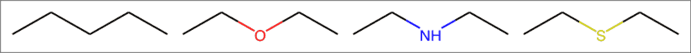

*图 4-11：从 SMILES 生成的化学结构*。

现在我们可以查看哪些 SMILES 字符串匹配 SMARTS 模式 `CCC`（见 图 4-12）：

```
query = Chem.MolFromSmarts("CCC")
match_list = [mol.GetSubstructMatch(query) for mol in mol_list]
MolsToGridImage(mols=mol_list, molsPerRow=4, highlightAtomLists=match_list)
```

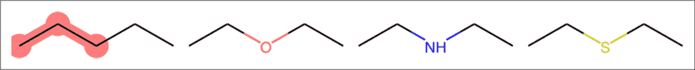

*图 4-12：匹配 SMARTS 表达式 "CCC" 的分子*。

在这张图中有几点值得注意。首先，SMARTS 表达式仅匹配第一个结构。其他结构均不包含三个相邻的碳原子。还请注意，SMARTS 模式与该图中第一个分子匹配的方式可能不止一种——它可以通过从第一个、第二个或第三个碳原子开始，匹配三个相邻的碳原子。RDKit 包含用于显示所有可能的 SMARTS 匹配的附加功能，但我们现在不介绍这些功能。

可以使用额外的通配符来匹配特定的原子组。就像在文本中一样，星号 (`*`) 可用于查找任意原子。SMARTS 模式 `C*C` 查找一个连接到某原子上的脂肪族碳，该原子再连接到另一个脂肪族碳（见 图 4-13）：

```
query = Chem.MolFromSmarts("C*C")
match_list = [mol.GetSubstructMatch(query) for mol in mol_list]
MolsToGridImage(mols=mol_list, molsPerRow=4, highlightAtomLists=match_list)
```

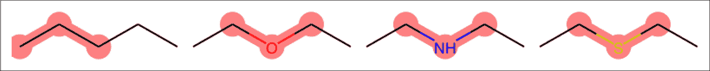

*图 4-13：匹配 SMARTS 表达式 "C*C" 的分子*。

SMARTS 语法可以扩展，以仅允许特定的原子组。例如，字符串 `C[C,O,N]C` 查找连接到碳、氧或氮的碳，后者再连接到另一个碳（见 图 4-14）：

```
query = Chem.MolFromSmarts("C[C,N,O]C")
match_list = [mol.GetSubstructMatch(query) for mol in mol_list]
MolsToGridImage(mols=mol_list, molsPerRow=4, highlightAtomLists=match_list)
```

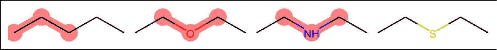

*图 4-14：匹配 SMARTS 表达式 "C[C,N,O]C" 的分子*。

SMARTS 的功能远不止这简短介绍所描述的内容。有兴趣的读者请阅读《Daylight Theory Manual》（Daylight 理论手册），以深入了解 SMILES 和 SMARTS。^(1) 正如我们将在 第 11 章 中看到的，SMARTS 可用于创建复杂查询，以识别在分析中可能存在问题的分子。

### 总结

在本章中，您学习了分子机器学习的基础知识。在简要概述化学基础知识后，我们探讨了分子传统上是如何为计算机系统表示的。此外，您还了解了图卷积，它代表了一种较新的深度学习建模分子的方法。随后，我们看到了一个使用机器学习预测重要物理性质的完整分子案例。这些方法将作为后续章节构建的基础。

## 第 5 章

## 生物物理机器学习

在本章中，我们将探讨深度学习如何帮助我们理解生物物理系统。我们将特别深入地研究如何预测小的药物样分子如何与人体内的目标蛋白质结合。

这个问题在药物发现中具有根本性的重要性。针对单个蛋白质的靶向调节通常能产生显著的治疗效果。例如，突破性抗癌药物伊马替尼（Imatinib）疗效的原因之一，在于它与 BCR-ABL 的紧密结合。对于其他疾病，要找到一个同样有效的单一靶标蛋白可能很困难，因为人体内有太多机制在共同发挥作用。

|  | | **药物不仅靶向单一蛋白** 正如已经提到的，将针对某种疾病开发药物的问题简化为开发一种与特定蛋白质紧密相互作用的药物的问题，这非常有用。然而，至关重要的是要理解，在现实中，每种药物都与体内许多不同的亚系统相互作用。这门研究此类多样化相互作用的科学通常被称为多靶点药理学（Polypharmacology）。 |
| --- | --- | --- |
| | | 目前，用于处理多靶点药理学的计算方法尚不够成熟，因此检测多靶点药理学效应的金标准仍然是动物和人体实验。然而，随着计算方法的进一步发展，这种状况在未来几年内可能会发生改变。 |


# 蛋白质结构与机器学习

因此，我们的目标是开发学习算法，能够可靠地预测特定分子何时会与特定蛋白质发生相互作用。我们该如何实现这一点？首先，我们可以采用前一章分子机器学习的一些方法，尝试构建一个针对特定蛋白质的模型。如果我们向这样一个模型提供一个数据集，包含分子及其是否结合到特定蛋白质的标注，它将学会预测新分子的结合能力。然而，这种想法需要大量数据。理想情况下，我们需要一种算法，能够在没有新蛋白质大量数据的情况下工作。

事实证明，诀窍在于利用蛋白质的物理学特性。正如我们在下一节将了解到的，关于蛋白质分子的物理结构已知颇多。利用现代实验技术，可以创建蛋白质三维状态的快照。这些三维快照可以输入学习算法，并用于预测结合情况。此外，还可以获取蛋白质与小分子（通常称为`配体`）相互作用的快照（更广为人知的是`结构`）。如果本节内容显得抽象，请不必担心。您将在本章看到大量实用的代码示例。

首先，让我们更好地了解蛋白质及其在生物学中的功能。随后，我们转向计算机科学领域，介绍一些表征蛋白质系统的算法，这些算法能将生物物理系统转化为向量或张量以供学习。在本章的最后一部分，我们将进行一个详细的案例研究，构建一个蛋白质-配体结合相互作用模型。为此，我们将介绍`PDBBind`数据集，它包含一系列实验确定的蛋白质-配体结构。我们将首先演示如何使用`DeepChem`对该数据集进行特征化，然后构建一些模型（既有复杂的也有简单的），并研究它们的性能。

## 为何称为生物物理学？

据说生物学建立在化学之上，化学建立在物理学之上。乍一看，生物学和物理学似乎相距甚远。但正如我们在本章将看到的，物理定律构成了所有生物学机制的核心。此外，蛋白质结构研究在很大程度上关键地依赖于使用在物理学中得到改进的实验程序。控制纳米级机器（因为蛋白质正是纳米级机器）既需要理论也需要实践的物理学技巧。

## 深度学习与物理学

有趣的是，本章涵盖的深度学习算法与用于探索粒子物理系统或进行物理模拟的深度学习架构有着惊人的相似之处。虽然这些主题超出了本书的范围，但我们鼓励感兴趣的读者进一步探索。

## 蛋白质结构

蛋白质是完成细胞大部分工作的微型机器。尽管体积微小，它们却可以非常复杂。一个典型的蛋白质由数千个精确排列的原子组成。

要理解一台机器，必须了解其零部件及其组装方式。只有当您知道汽车底部有车轮、中间有供乘客乘坐的空腔、以及乘客上下车的车门时，您才真正理解什么是汽车。蛋白质也是如此。要理解其如何运作，必须精确知道它是如何组装而成的。

此外，您还应了解它如何与其他分子相互作用。很少有机器孤立工作。汽车与乘客、行驶的道路以及使其移动的能源发生相互作用。大多数分子也是如此。它们作用于分子（例如催化化学反应）、受其他分子影响（例如调节其活性）并从其他分子获取能量。所有这些相互作用都取决于两个分子中原子的特定空间排列。为此，您必须理解原子在空间中是如何排列的。

不幸的是，不能简单地在显微镜下观察蛋白质；它们小得多。相反，科学家们不得不开发复杂而精密的方法来确定蛋白质结构。目前有三种此类方法：`X 射线晶体学`、`核磁共振`（简称`NMR`）和`低温电子显微镜`（简称`低温-EM`）。

`X 射线晶体学`是最古老的方法，至今仍是最常用的。已知蛋白质结构中约 90%是通过这种方法确定的。在晶体学中，培养所需蛋白质的晶体（许多蛋白质分子以规则重复的模式紧密堆积）。然后用 X 射线照射晶体，测量散射光，并分析结果以确定单个分子的结构。尽管取得了成功，但此方法有许多局限性。即使在最有利的条件下，它也缓慢且昂贵。许多蛋白质不形成晶体，使得晶体学成为不可能。将蛋白质压入晶体可能会改变其结构，因此结果可能偏离活细胞中的结构。许多蛋白质是柔性的，可以采取不同的结构。然而，晶体学只产生单一的刚性快照。但即使存在这些限制，它也是一个非常重要的工具。

`NMR`是第二常用的方法。它作用于溶液中的蛋白质，因此不需要培养晶体。这使其成为无法结晶蛋白质的重要替代方案。与产生单一刚性快照的晶体学不同，`NMR`生成一系列结构，代表蛋白质在溶液中可以采取的形状谱系。这是一个非常重要的优势，因为它揭示了蛋白质如何移动。不幸的是，`NMR`有其自身的局限性。它需要高浓度溶液，因此主要局限于小的、高溶解度的蛋白质。

`低温-EM`近年来作为确定蛋白质结构的第三种可能性出现。在此方法中，蛋白质分子被速冻，随后用电子显微镜成像。单张图像的分辨率太低，无法辨别精确细节。然而，如果将许多不同的图像拼合在一起，最终可以产生一个分辨率远高于单张电子显微镜图像的结构。经过数十年的方法和技术持续改进，`低温-EM`正逼近原子级分辨率。与晶体学和`NMR`不同，它也适用于无法结晶的大型蛋白质。

`蛋白质数据库`（`PDB`，[`https://www.rcsb.org/`](https://www.rcsb.org/)）是已知蛋白质结构的中央数据库。目前它包含超过 142,000 个结构，如图 5-1 所示。

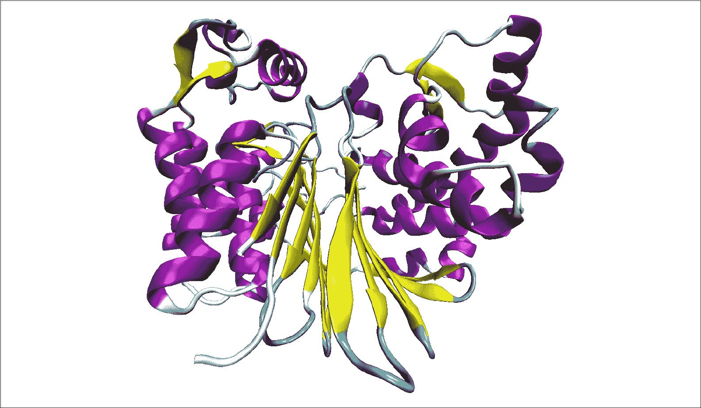


# 图 5-1：枯草杆菌 CapD 蛋白的一种晶体结构，即炭疽病的病原体。确定细菌蛋白的结构可以成为设计新型抗生素的有效工具。更广泛地说，识别治疗相关蛋白的结构是现代药物发现中最重要的步骤之一。

这看起来可能很多，但远少于我们真正想要的。已知蛋白质的数量要大得多，且不断有新的被发现。对于您想要研究的每一种蛋白质，其结构很有可能仍未被解析。此外，人们希望每种蛋白质都有多种结构，而不仅仅是一种。许多蛋白质可以以多种功能不同的状态存在（例如“活性”和“非活性”状态）。因此，人们想要了解每种状态的结构。如果一种蛋白质结合其他分子，人们希望获得其每一种结合形式的结构，以便准确地看到它们是如何结合的。PDB（蛋白质数据库）是一个极好的资源，但该领域整体上仍处于“低数据阶段”。我们拥有的数据远少于我们想要的，挑战之一是如何充分利用现有数据。这种情况可能还将持续几十年。

## 蛋白质序列

到目前为止，本章主要讨论了蛋白质结构，但尚未涉及蛋白质是如何在原子层面构建的。蛋白质由称为*氨基酸*的基本构建模块组成。这些氨基酸由共享一个共同核心但连接有不同“侧链”的分子组成（参见图 5-2）。这些不同的侧链改变了蛋白质的行为。

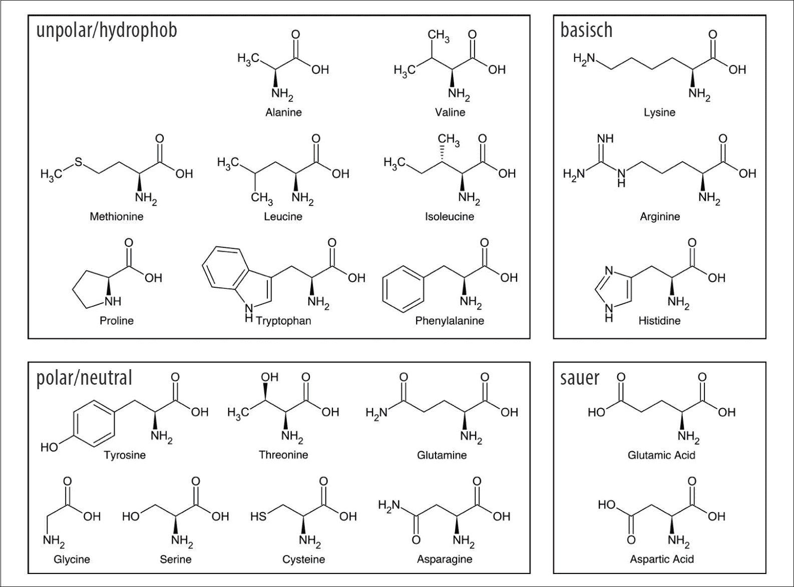

**图 5-2：** 氨基酸是蛋白质结构的构建模块。该图展示了一些常见氨基酸的化学结构。（改编自 Wikimedia，[`commons.wikimedia.org/wiki/File:Overview_proteinogenic_amino_acids-DE.svg`](https://commons.wikimedia.org/wiki/File:Overview_proteinogenic_amino_acids-DE.svg)）

蛋白质是一串相互连接的氨基酸链（参见图 5-3）。氨基酸链的起始端通常称为 N-末端，末端称为 C-末端。短的氨基酸链通常称为*肽*，长的链称为*蛋白质*。肽太小，无法具有复杂的 3-D 结构，但蛋白质结构可以非常复杂。

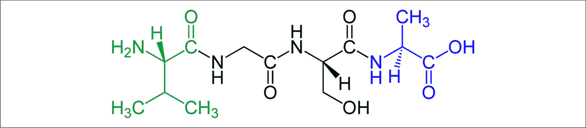

**图 5-3：** 一条由四个氨基酸组成的链，左侧为 N-末端，右侧为 C-末端。（来源：Wikipedia，[`en.wikipedia.org/wiki/N-terminus#/media/File:Tetrapeptide_structural_formulae_v.1.png`](https://en.wikipedia.org/wiki/N-terminus#/media/File:Tetrapeptide_structural_formulae_v.1.png)）

值得注意的是，虽然大多数蛋白质采取刚性形式，但也存在本质上无序的蛋白质，其区域部分不采取固定形状（参见图 5-4）。

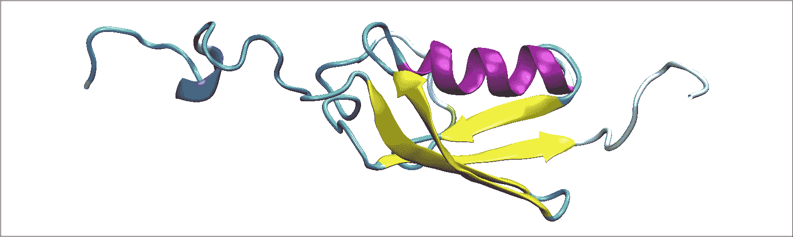

**图 5-4：** SUMO-1 蛋白的快照。蛋白质的中央核心是有序的，而 N-末端和 C-末端区域是无序的。像 SUMO-1 这样本质上无序的蛋白质在计算上难以处理。

在本章的后续部分，我们将主要关注具有刚性 3-D 形状的蛋白质。处理没有固定形状的柔性结构对于现代分析方法来说仍然是一个挑战。

## 我们能否通过计算预测 3-D 结构？

读完上一节后，人们可能会问，为什么不使用算法直接预测感兴趣的蛋白质分子的结构，而要依赖复杂的物理实验呢？这是一个好问题，事实上，人们已经致力于蛋白质结构的计算预测几十年了。

预测蛋白质结构主要有两种方法。第一种是*同源建模*。蛋白质序列和结构是数十亿年进化的结果。如果两种蛋白质是近亲（专业术语为“同源”），且只是最近才分化，它们很可能具有相似的结构。要利用同源建模预测一种蛋白质的结构，首先要寻找一个结构已知的同源蛋白。然后，根据两种蛋白质序列的差异，尝试对其进行调整。同源建模在确定蛋白质的总体形状方面效果相当好，但细节往往是错误的。当然，这也假设了同源蛋白的结构是已知的。

第二种主要方法是*物理建模*。利用物理定律的知识，人们尝试探索蛋白质可能采取的许多不同构象，并预测哪一种最稳定。该过程需要巨大的计算时间。直到大约十年前，这还是不可能的。即使在今天，它也仅适用于小型、快速折叠的蛋白质。此外，为了加速计算，需要物理近似，但这会降低结果的准确性。物理建模经常能预测出正确的结构，但并非总是如此。

## 蛋白质结合简介

到目前为止，本章我们已经详细讨论了蛋白质结构，但尚未过多涉及蛋白质如何与其他分子相互作用（参见图 5-5）。

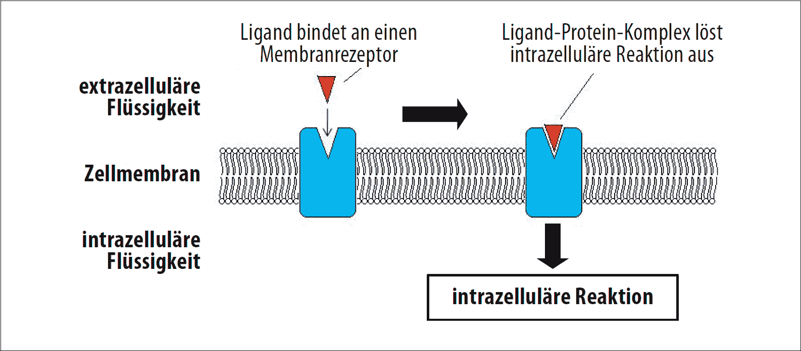

**图 5-5：** 一个嵌入在细胞膜中的蛋白质传递信号。（来源：Wikimedia，[`simple.wikipedia.org/wiki/Signal_transduction#/media/File:The_External_Reactions_and_the_Internal_Reactions.jpg`](https://simple.wikipedia.org/wiki/Signal_transduction#/media/File:The_External_Reactions_and_the_Internal_Reactions.jpg)）

在实践中，蛋白质经常结合小分子。有时这种结合行为是蛋白质功能的核心：某种蛋白质的主要任务可能就是结合特定分子。例如，细胞中的信号转导通常通过蛋白质结合另一个分子的机制来传递信息。在其他情况下，结合蛋白质的分子是外源的：可能是我们设计用来操纵蛋白质的药物，也可能是损害其功能的毒素。

了解分子如何、在何处以及何时结合蛋白质的细节，对于理解其功能和开发药物至关重要。如果我们能利用人体内细胞的信号机制，就能在体内触发期望的医疗反应。


# 计算预测很难

计算预测很难，因为蛋白质结合涉及许多高度特异性的相互作用。少数原子位置的微小变化就能决定一个分子是否结合到蛋白质上。此外，许多蛋白质是柔性的且在不断运动。蛋白质可能在特定构象下能够结合分子，但在其他构象下则不能。反过来，结合又可能导致蛋白质构象的进一步变化，从而改变其功能。

在本章其余部分中，我们将把理解蛋白质结合的挑战作为一个激励性的计算示例。我们将深入探讨当前的深度学习和机器学习方法，以对结合行为进行预测。

## 生物物理特性

正如前一章所讨论的，将机器学习应用于新领域的关键步骤之一，是弄清楚如何将训练数据转换（或汇总）为适合学习算法的格式。我们介绍了几种表征单个小分子的方法。我们能否将这些技术改编用于生物物理系统？

不幸的是，生物物理系统的行为受其三维结构的强烈约束，因此前几章中的二维方法会遗漏重要信息。因此，在本章中我们将介绍一些新的特征化方法。第一种方法是*网格特征化*，它搜索三维结构中的关键物理相互作用，如氢键和盐桥（稍后详述），这些相互作用已知在决定蛋白质结构中起重要作用。该技术的优势在于我们可以利用关于蛋白质物理学的大量已知事实。其劣势当然在于我们受限于已知的物理学。这降低了我们的算法发现新物理学的可能性。

替代的特征化方法是*原子特征化*，它仅提供系统中所有原子的三维位置和身份的处理后表示。这显著增加了学习算法的挑战，因为它必须学会识别关键的物理相互作用，但这也允许学习算法发现有趣行为的新模式。

### PDB 文件及其陷阱

蛋白质结构通常存储在 PDB 文件中。这些是简单的文本文件，包含结构中原子的描述及其在坐标空间中的相对位置。特征化算法通常基于读取 PDB 文件并将其存储在内存数据结构中的库。到目前为止一切顺利，不是吗？

不幸的是，PDB 文件通常包含错误。原因在于底层的物理学。实验通常没有足够的分辨率来完全确定蛋白质结构的一部分。这些区域在 PDB 文件中未被指定，因此核心结构中经常缺少许多原子，甚至整个蛋白质子结构。

像 `DeepChem` 这样的库通常试图做“正确的事”，通过计算方式填补这些缺失区域。重要的是要注意，这种清理是不准确的，目前仍无法完全替代专家在合适的查看程序中检查蛋白质结构并指出问题。我们希望用于处理这些错误的软件在未来几年得到改进，从而减少对专家咨询的需求。

## 网格特征化

如果我们将生物物理结构转换为向量，就可以利用机器学习算法对它们进行预测。显而易见，拥有一个处理蛋白质-配体系统的算法将非常有用。然而，开发这样一个算法很复杂。理想情况下，特征化方法应拥有此类系统化学方面的广泛知识，以便能够筛选出有用的属性。

这些特征可能包括蛋白质和配体之间非共价键的数量，如氢键或其他相互作用。（大多数蛋白质-配体系统在蛋白质和配体之间没有共价键。）

幸运的是，`DeepChem` 提供了这样一个特征化器。`RdkitGridFeaturizer` 将一系列重要的化学信息汇总到一个短向量中，供学习算法使用。虽然不需要详细了解底层科学即可使用该特征化器，但具备底层物理学的基础知识仍然很有帮助。因此，在描述网格特征化器的计算之前，我们将首先探讨大分子复合物的生物物理学。

阅读本节时，回顾上一章讨论的化学相互作用基础可能会有所帮助。共价键和非共价键等术语将被频繁提及。

网格特征化器在给定结构中搜索这些化学相互作用，并创建一个包含这些相互作用计数的特征向量。在本章后续内容中，我们将更详细地探讨这一过程在算法层面是如何进行的。

### 氢键

当氢原子共价结合到一个电负性更强的原子（如氧或氮）上时，共用电子大部分时间停留在电负性更强的原子附近。这使得氢原子带有净正电荷。如果这个带正电的氢原子靠近一个带负电的原子，它们会相互吸引。这被称为氢键（见图 5-6）。


*图 5-6：氢键的渲染示例。氧原子过剩的负电荷与氢原子过剩的正电荷相互作用，形成结合相互作用。（来源：Wikimedia, [`commons.wikimedia.org/wiki/File:Hydrogen-bonding-in-water-2D.png`](https://commons.wikimedia.org/wiki/File:Hydrogen-bonding-in-water-2D.png))*

由于氢原子体积很小，它们可以非常接近其他原子，从而产生强烈的静电吸引力。这使得氢键成为最强的非共价相互作用之一。它们是一种重要的相互作用形式，通常能稳定分子系统。例如，水的独特性质在很大程度上归因于水分子之间形成的氢键网络。

`RdkitGridFeaturizer` 通过寻找适当类型且距离足够接近的蛋白质-配体原子对，来尝试计算结构中存在的氢键数量。这需要一个距离阈值，该阈值略显随意。实际上，结合和非结合原子之间没有明确的分界。这可能导致一些相互作用被错误识别，但经验上简单的阈值效果相当好。

### 盐桥


## Salzbrücken

Eine Salzbrücke ist eine nicht kovalente Anziehung zweier Aminosäuren, wobei eine positiv und die andere negativ geladen ist (siehe Abbildung 5-7). Sie kombiniert sowohl Ionen- als auch Wasserstoffbindungen. Obwohl diese Bindungen relativ schwach sind, können sie dabei helfen, die Struktur eines Proteins zu stabilisieren, indem sie zwischen entfernten Aminosäuren in der Proteinsequenz interagieren.

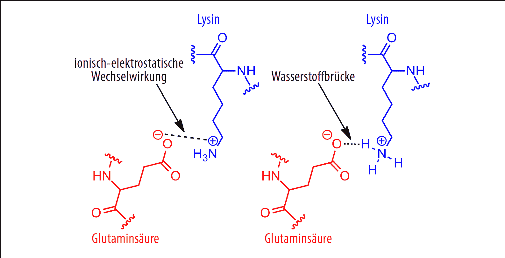

*Abbildung 5-7: Die Abbildung einer Salzbrücke zwischen Glutaminsäure und Lysin. Die Salzbrücke ist eine Kombination aus einer ionisch-elektrostatischen Wechselwirkung und einer Wasserstoffbrücke und dient zur Stabilisierung der Struktur. (Quelle: Wikimedia, [`commons.wikimedia.org/wiki/File:Revisited\_Glutamic\_Acid\_Lysine\_salt\_bridge.png`](https://commons.wikimedia.org/wiki/File:Revisited_Glutamic_Acid_Lysine_salt_bridge.png))*

Der `Grid-Featurizer` versucht, Salzbrücken zu entdecken, indem er explizit nach Paaren von Aminosäuren (wie Glutaminsäure und Lysin) sucht, die für solche Wechselwirkungen bekannt sind und die in der 3-D-Struktur nah beieinanderliegen.

## π-π-Wechselwirkungen

π-π-Wechselwirkungen sind eine Form nicht kovalenter Bindung zwischen `aromatischen Ringen` (siehe Abbildung 5-8). Hierbei handelt es sich um planare, ringförmige Strukturen, die in vielen biologischen Molekülen, einschließlich DNA und RNA, vorkommen. Daneben kommen in den Seitenketten einiger Aminosäuren vor, darunter Phenylalanin, Tyrosin und Tryptophan.

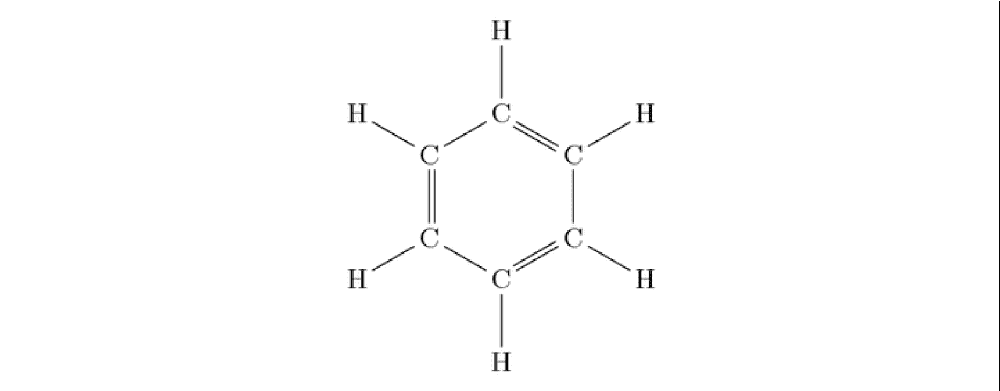

*Abbildung 5-8: Ein aromatischer Ring im Benzolmolekül. Solche Ringstrukturen sind für ihre außergewöhnliche Stabilität bekannt. Darüber hinaus liegen bei aromatischen Ringen alle Atome in einer Ebene. Im Gegensatz dazu befinden sich die Atome heterogener Ringe nicht auf einer Ebene*.

Grob gesagt, treten π-π-Wechselwirkungen auf, wenn zwei aromatische Ringe aufeinander »stapeln«. Abbildung 5-9 zeigt einige der Interaktionen zwischen zwei Benzolringen. Ebenso wie Ionenbrücken können solche stapelnden Wechselwirkungen zur Stabilisierung verschiedener makromolekularer Strukturen beitragen. Wichtig ist, dass π-π-Wechselwirkungen in Protein-Ligand-Interaktionen zu finden sind, da aromatische Ringe häufig in kleinen Molekülen vorkommen. Der `Grid-Featurizer` zählt diese Wechselwirkungen, indem er das Vorliegen von aromatischen Ringen erkennt und die Abstände zwischen ihren Schwerpunkten sowie die Winkel zwischen den beiden Ebenen überprüft.

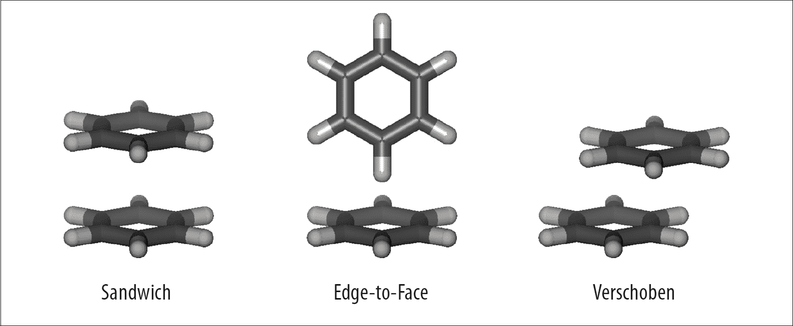

*Abbildung 5-9: Verschiedene nicht kovalente Wechselwirkungen von aromatischen Ringen. Bei der verschobenen Wechselwirkung sind die Zentren der beiden aromatischen Ringe geringfügig voneinander versetzt. Bei den Interaktionen Edge-to-Face liegt der Rand eines aromatischen Rings auf dem Gesicht des anderen. Die Sandwich-Konfiguration hat zwei direkt gestapelte Ringe, ist jedoch energetisch ungünstiger als verschobene oder Edge-to-Face-Interaktionen, da gleich geladene Bereiche eng zusammenwirken*.

Inzwischen fragen Sie sich vermutlich, weshalb diese Interaktion als π-π-Wechselwirkungen bezeichnet wird. Der Name bezieht sich auf die π-Bindungen, eine Form der kovalenten chemischen Bindung, bei der sich die Elektronenorbitale zweier kovalent gebundener Atome überlappen. In einem aromatischen Ring sind alle Atome im Ring Teil einer gemeinsamen π-Bindung. Diese gemeinsame Bindung ist für die Stabilität des aromatischen Rings verantwortlich und erklärt auch viele seiner einzigartigen chemischen Eigenschaften.

Für die Nichtchemiker unter Ihnen: Es ist nicht schlimm, wenn diese Darstellung noch keinen Sinn ergibt. `DeepChem` entfernt viele dieser Implementierungsdetails, sodass Sie sich bei der Entwicklung nicht oft um π-π-Wechselwirkungen kümmern müssen. Es ist jedoch hilfreich, zu wissen, dass diese Wechselwirkungen bestehen und eine wichtige Rolle in der zugrunde liegenden Chemie spielen.

|  | | **Komplexe Geometrien und Momentaufnahmen** In diesem Abschnitt haben wir mehrere Interaktionen hinsichtlich der statisch geometrischen Konfigurationen vorgestellt. Es ist wichtig, zu verstehen, dass Bindungen dynamische Einheiten sind und dass sich diese Bindungen in realen physikalischen Systemen mit rasanter Geschwindigkeit dehnen, dass sie reißen, brechen und sich neu ordnen. Denken Sie daran und beachten Sie, dass, wenn jemand sagt, dass eine Salzbrücke existiert, tatsächlich gemeint ist, dass eine Salzbrücke in einem statistisch durchschnittlichen Sinn wahrscheinlich häufiger an einem bestimmten Ort vorhanden ist als nicht. |

## Fingerabdrücke

Vielleicht können Sie sich noch an die kreisförmigen Fingerabdrücke aus dem vorherigen Kapitel erinnern. Diese Fingerabdrücke zählen die Anzahl bestimmter Fragmente eines Moleküls und verwenden anschließend eine Hash-Funktion, um diese Anzahl in einen Vektor gegebener Länge einzupassen. Diese Fragmentzahlen können ebenfalls für 3-D-Molekülkomplexe verwendet werden. Obwohl das bloße Zählen der Fragmente oft nicht ausreicht, um die Geometrie des Systems zu berechnen, kann das Wissen über vorhandene Fragmente dennoch nützlich für `Machine-Learning-Systeme` sein. Dies könnte möglicherweise auf die Tatsache zurückzuführen sein, dass das Vorliegen bestimmter Fragmente ein starkes Indiz für einige molekulare Ereignisse ist.

## Einige Details zur Implementierung

Um nach chemischen Merkmalen wie Wasserstoffbrücken zu suchen, muss `dc.feat.RdkitGridFeaturizer` in der Lage sein, effektiv mit der Geometrie des Moleküls zu arbeiten. `DeepChem` verwendet die `RDKit`-Bibliothek, um jedes Molekül, Protein und jeden Liganden in ein gemeinsames In-Memory-Objekt zu laden. Diese Moleküle werden anschließend in `NumPy`-Arrays umgewandelt, die die räumliche Anordnung aller Atome enthalten. Zum Beispiel kann ein Molekül mit `N` Atomen als `NumPy`-Array der Form `(N, 3)` dargestellt werden, wobei jede Zeile die Position eines Atoms im 3-D-Raum symbolisiert.

Um (grob) eine Suche nach Wasserstoffbrücken durchzuführen, müssen dann lediglich alle Atompaare betrachtet werden, die nahe genug beieinanderliegen, um eine Wasserstoffbrücke bilden zu können (wie Sauerstoff und Wasserstoff). Die gleiche analytische Taktik wird zum Erkennen anderer Bindungsarten verwendet. Für den Umgang mit aromatischen Ringen gibt es einen speziellen Code, mit dem das Vorhandensein aromatischer Ringe in der Struktur erkannt und deren Schwerpunkte berechnet werden können.

## Atomare Featurisierung

Am Ende des letzten Abschnitts gaben wir einen kurzen Überblick darüber, wie Merkmale wie Wasserstoffbrücken vom `RdkitGridFeaturizer` berechnet werden. Meistens wird ein Molekül mit `N` Atomen in ein `NumPy`-Array der Form `(N, 3)` umgewandelt, um ausgehend von diesen Arrays eine Reihe zusätzlicher Berechnungen durchzuführen.

Man kann sich leicht vorstellen, dass Featurisierung eines bestimmten Moleküls lediglich die Berechnung dieses `(N, 3)`-Arrays und die Weitergabe an einen geeigneten `Machine-Learning-Algorithmus` beinhaltet. Das Modell könnte dann selbst lernen, welche Features wichtig sind, anstatt sich auf einen Menschen zu verlassen, der diese auswählt und von Hand eingibt.

Tatsächlich funktioniert das mit einigen zusätzlichen Schritten. Das `(N, 3)`-Array unterscheidet nicht zwischen Atomtypen, daher muss ein weiteres Array bereitgestellt werden, das die Ordnungszahl jedes Atoms auflistet. Eine zweite implementierungsorientierte Anmerkung ist, dass das Berechnen paarweiser Abstände zwischen zwei Positionsarrays der Form `(N, 3)` sehr rechenintensiv sein kann. Es ist daher hilfreich, in einem zuvor erfolgten Schritt »Nachbarlisten« zu erstellen, die benachbarte Atome in der Nähe eines bestimmten Atoms auflisten.


# PDBBind 案例研究

在完成这一介绍后，我们现在可以开始通过一些代码示例来处理生物物理数据集。首先，我们将介绍 PDBBind 数据集及结合自由能预测问题。随后，我们将展示一些代码示例，用于在 PDBBind 数据集中开发特征，并传授如何构建相应的机器学习模型。我们将通过评估结果来结束本案例研究。

## PDBBind 数据集

PDBBind 数据集包含大量生物分子晶体结构及其结合亲和力。在此我们首先需要澄清一些专业术语。生物分子是指任何具有生物学研究意义的分子。这不仅包括蛋白质，还包括核酸（如 DNA 和 RNA）、脂质以及较小的类药物分子。生物分子系统的很大一部分多样性源于不同生物分子之间的相互作用（正如我们已经详细讨论过的那样）。结合亲和力是指两个相互作用分子形成复合物的实验测定亲和力。如果形成此类复合物在能量上是有利的，这些分子将以这种形式存在的时间比其他形式更长。

PDBBind 数据集收集了大量生物分子复合物的结构。其中绝大多数是蛋白质-配体复合物，但数据集也包含蛋白质-蛋白质、蛋白质-核酸和核酸-配体复合物。为了我们的目的，我们将重点关注蛋白质-配体复合物。完整数据集包含近 15,000 个此类复合物，而“Refined”（精炼）集和“Core”（核心）集则是较小但经过清理的复合物子集。每个复合物都附带一项结合亲和力的实验测量值。PDBBind 数据集的学习任务是在已知蛋白质-配体结构的情况下，预测复合物的结合亲和力。

PDBBind 的数据源自*蛋白质数据库*。请注意，PDB 中的数据（因此 PDBBind 中的数据也是）具有高度异质性！不同研究组采用不同的实验装置，因此不同组别测量结果之间可能存在较高的实验方差。因此，我们实验中将主要使用 PDBBind 数据集经过筛选和整理的子集。

> **动力学很重要！** 在本案例研究中，我们将蛋白质和配体视为冻结的快照。请注意，这在物理上并不准确！蛋白质和配体实际上处于快速运动中，配体会与蛋白质结合又解离。此外，蛋白质可能拥有不止一个结合位点。一些蛋白质拥有多个不同位点，潜在配体可在这些位点发生相互作用。

由于这些因素的综合作用，我们的模型精度将相对有限。如果我们拥有更多数据，稳健的学习模型或许能学会考量这些因素。但对于较小的数据集而言，这很难实现。

请注意以下信息。开发更优的生物物理深度学习模型，以准确捕捉这些系统的热力学行为，仍然是一个重大的、尚未解决的问题。

> **如果没有结构怎么办？** 经验丰富的药物研究人员可能会在此稍作停顿。事实是，通常通过实验确定复合物结构，比测量结合亲和力要困难得多。这很合理。结合亲和力只是特定生物分子复合物的一个数值，而结构则是一个广泛的 3-D 快照。根据结构预测结合亲和力，感觉有点像“倒果为因”！

针对这一（合理的）质疑，有几种回答。第一，仅预测生物分子系统结合亲和力这一问题本身，在物理学上就极具研究价值。验证我们能否准确预测此类结合亲和力，是一个评估机器学习方法的宝贵测试问题，并可作为设计能够理解复杂生物物理系统的深度架构的垫脚石。

第二，我们可以利用现有的计算工具，如“停靠”软件，在已知蛋白质结构的前提下，预测蛋白质-配体复合物的大致结构。虽然直接预测蛋白质结构是一项巨大挑战，但如果已掌握蛋白质结构，预测蛋白质-配体复合物结构则相对容易一些。通过将我们在本案例研究中构建的系统与停靠引擎耦合，我们或许能做出有用的预测。DeepChem 虽然支持这一确切用例，但我们将不会在本章中涉及这一高级功能。

一般来说，在机器学习中查看数据集的单个数据点可能特别有用。本书配套的代码仓库（[`github.com/deepchem/DeepLearningLifeSciences`](https://github.com/deepchem/DeepLearningLifeSciences)）包含一个名为 `2D3U` 的蛋白质-配体复合物的 PDB 文件。该文件包含蛋白质氨基酸（也称为残基）的信息。此外，PDB 文件还包含每个原子在 3-D 空间中的坐标。这些坐标的单位是埃（1 埃等于 10^(–10) 米）。该坐标系的原点是任意设定的，但通常设在蛋白质的质心处，以便于蛋白质的可视化。请花点时间，在文本编辑器中查看该文件。

> **为什么氨基酸被称为残基？** 如果您长期处理生物物理数据，会经常看到氨基酸被称为*残基*。这涉及蛋白质形成的化学原理。当两个氨基酸在生长的链上连接时，会移除一个氧原子和两个氢原子。*残基*是指氨基酸经过该反应后剩余的部分。

仅凭文本很难理解 PDB 文件的内容，因此我们将对蛋白质进行可视化。我们将使用 NGLview（[`github.com/arose/nglview`](https://github.com/arose/nglview)）可视化包，它能很好地集成到 Jupyter Notebook 中。您可以在随章节提供的 Jupyter Notebook（同样位于代码仓库中）中编辑并交互可视化的蛋白质。图 5-10 显示了在 Notebook 中生成的一个蛋白质-配体复合物（2D3U）的可视化结果。

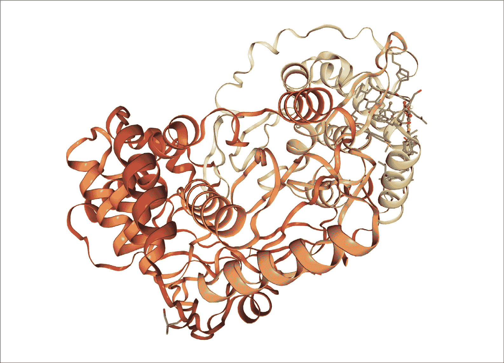


# 图 5-10：来自 PDBBind 数据集的 2D3U 蛋白-配体复合物的可视化

请注意，为了简化可视化，蛋白质以卡通形式表示，而配体（位于右上角）则以球棒模型显示。

正如您所见，配体位于蛋白质的一种口袋中。为了看得更清楚，您可以旋转可视化视图，从不同角度进行观察。

## 蛋白质可视化工具

鉴于蛋白质可视化对于相关工作的重要性，为此提供了一系列工具。`NGLview` 与 Jupyter 具有出色的协作性。药物开发人员经常使用 `VMD` ([`www.ks.uiuc.edu/Research/vmd/`](https://www.ks.uiuc.edu/Research/vmd/))、`PyMOL` ([`pymol.org`](https://pymol.org)) 或 `Chimera` ([`www.cgl.ucsf.edu/chimera/`](https://www.cgl.ucsf.edu/chimera/))。请注意，这些工具通常并非完全开源，且并不总是提供对开发者友好的 API。然而，如果您花费大量时间处理蛋白质结构，使用这些成熟工具之一仍然值得权衡利弊。

# 在 PDBBind 数据集中开发特征

首先，我们创建一个可供检查的 `RdkitGridFeaturizer` 对象：

```python
import deepchem as dc

grid_featurizer = dc.feat.RdkitGridFeaturizer(
    voxel_width=2.0,
    feature_types=['hbond', 'salt_bridge', 'pi_stack',
                   'cation_pi', 'ecfp', 'splif'],
    sanitize=True, flatten=True)
```

这里使用了多个选项，我们稍作详细了解。选项 `sanitize=True` 要求特征生成器尝试清理所有结构。正如您所记得的，我们之前提到过结构经常存在错误。此清理步骤尝试修复它检测到的所有明显错误。选项 `flatten=True` 要求特征生成器为每个输入结构输出一个一维特征向量。

选项 `feature_types` 设定 `RdkitGridFeaturizer` 尝试在输入结构中识别的生物物理和化学特征类型。请注意，其中包含了我们在本章前面讨论的许多化学键：氢键、离子键等。最后，选项 `voxel_width=2.0` 将构成网格的体素大小设置为 2 埃。`RdkitGridFeaturizer` 将蛋白质转换为体素化表示，以提取有用特征。对于每个空间网格点，都会统计生物物理特征并计算局部指纹向量。`RdkitGridFeaturizer` 计算两种不同的指纹，即 `ECFP` 和 `SPLIF`。

## 体素化

什么是体素化？一般来说，体素是像素的 3-D 对应物（见图 5-11）。正如基于像素的图像表示对于处理图像数据非常有用一样，基于体素的表示对于处理 3-D 数据可能至关重要。

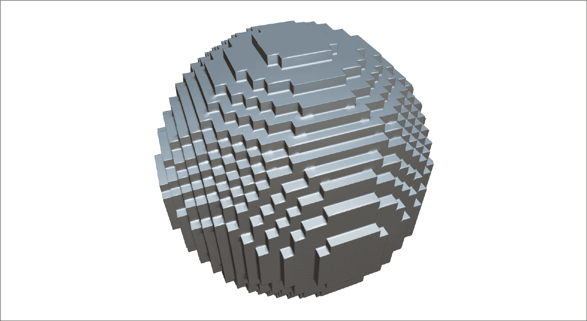

现在我们可以加载 PDBBind 数据集。为此，我们其实不需要刚才定义的特征生成器，`MoleculeNet` 会自动为我们处理。如果在加载数据集时使用选项 `featurizer="grid"`，它会自动执行网格特征化：

```python
tasks, datasets, transformers = dc.molnet.load_pdbbind(
    featurizer="grid", split="random", subset="core")

train_dataset, valid_dataset, test_dataset = datasets
```

使用上述代码，我们加载了 PDBBind 的“Core”子集并生成了特征。在一台快速计算机上，代码应能在十分钟内运行完成。对“Refined”子集进行特征化在现代服务器上需要数小时。

既然数据已准备就绪，我们可以开始构建一些机器学习模型。首先，我们训练一个名为*随机森林*的经典模型：

```python
from sklearn.ensemble import RandomForestRegressor

sklearn_model = RandomForestRegressor(n_estimators=100)
model = dc.models.SklearnModel(sklearn_model)
model.fit(train_dataset)
```

或者，我们也将尝试创建一个神经网络来预测蛋白-配体结合。我们可以利用 `dc.models.MultitaskRegressor` 类创建一个具有两个隐藏层的 MLP。隐藏层的宽度分别设置为 2,000 和 1,000，并使用 50% 的 Dropout 来减少过拟合：

```python
n_features = train_dataset.X.shape[1]

model = dc.models.MultitaskRegressor(
    n_tasks=len(pdbbind_tasks),
    n_features=n_features,
    layer_sizes=[2000, 1000],
    dropouts=0.5,
    learning_rate=0.0003)

model.fit(train_dataset, nb_epoch=250)
```

## 基线模型

深度学习模型有时难以优化。即使是经验丰富的用户，在调整此类模型时也会犯错。因此，创建一个更稳健的基线模型非常重要，即使其性能可能略低。

随机森林是作为基线的良好选择。它们在相对较少的调参情况下，通常能在学习任务中提供强劲的性能。随机森林分类器创建许多“决策树”分类器，每个分类器仅使用可用特征的一个随机子集，然后通过多数投票将这些分类器的单独决策组合起来。

`Scikit-learn` 是构建简单机器学习基线不可或缺的包。在本章中，我们使用 `scikit-learn` 创建一个基线模型，并用 `RdkitGridFeaturizer` 将复合物标记化作为随机森林的输入。

现在我们有了训练好的模型，可以检查其准确性。为了评估模型准确性，我们首先必须定义一个合适的指标。我们选择皮尔逊 R² 分数。这是一个介于 -1 和 1 之间的数字，其中 0 表示真实标签与预测标签之间无相关性，1 表示完美相关：

```python
metric = dc.metrics.Metric(dc.metrics.pearson_r2_score)
```

现在我们可以根据此指标评估模型在训练集和测试集上的准确性。两个模型的代码是相同的：

```python
print("Evaluating model")
train_scores = model.evaluate(train_dataset, [metric], transformers)
test_scores = model.evaluate(test_dataset, [metric], transformers)

print("Train scores")
print(train_scores)
print("Test scores")
print(test_scores)
```

## 许多架构可产生相似效果

本节提供了使用具有网格特征化的 MLP 在 DeepChem 中对蛋白-配体结构进行建模的代码示例。请注意，存在多种替代的深度学习架构，可产生相似的效果。已有一系列工作利用 3D 卷积神经网络，基于基于体素的特征化来预测蛋白-配体结合相互作用。其他工作则使用了上一章所述图卷积的变体来处理大分子复合物。


## Wo liegen die Unterschiede dieser Architekturen?

Bisher scheinen die meisten von ihnen eine ähnliche Vorhersagekraft zu haben. Wir verwenden `Grid Featurization`, weil es eine optimierte Implementierung in `DeepChem` gibt, aber andere Modelle können diese Anforderungen ebenfalls erfüllen. Zukünftige Versionen von `DeepChem` werden für diesen Zweck vermutlich zusätzliche Architekturen enthalten.

Für den `Random Forest` erhalten wir einen Score von `0.979` auf den Trainingsdaten, der Score für die Testdaten liegt jedoch bei nur `0.133`. Die Trainingsdaten werden hervorragend reproduziert, die Testdaten jedoch nur sehr schlecht vorhergesagt. Offensichtlich haben wir es mit starkem `Overfitting` zu tun.

Im Vergleich dazu liefert das neuronale Netz einen Score von `0.990` auf den Trainingsdaten und `0.359` auf den Testdaten. Für den Trainingsdatensatz ist der Wert somit etwas besser und für den Testdatensatz deutlich besser. Es liegt nach wie vor `Overfitting` vor, jedoch in geringerem Maß, und die Fähigkeit des Modells, neue Daten vorherzusagen, ist viel höher.

Den Korrelationskoeffizienten zu kennen, ist ein wichtiger erster Schritt, um unser erstelltes Modell zu verstehen. Es ist jedoch immer hilfreich, direkt zu visualisieren, wie unsere Vorhersagen mit tatsächlichen experimentellen Daten korrelieren. Abbildung 5-12 zeigt die tatsächlichen im Vergleich zu den vorhergesagten Labels für jedes Modell auf den Testdaten. Wir sehen auf den ersten Blick, dass die Vorhersagen des neuronalen Netzes viel stärker mit den wahren Daten korrelieren als die des `Random Forest`.

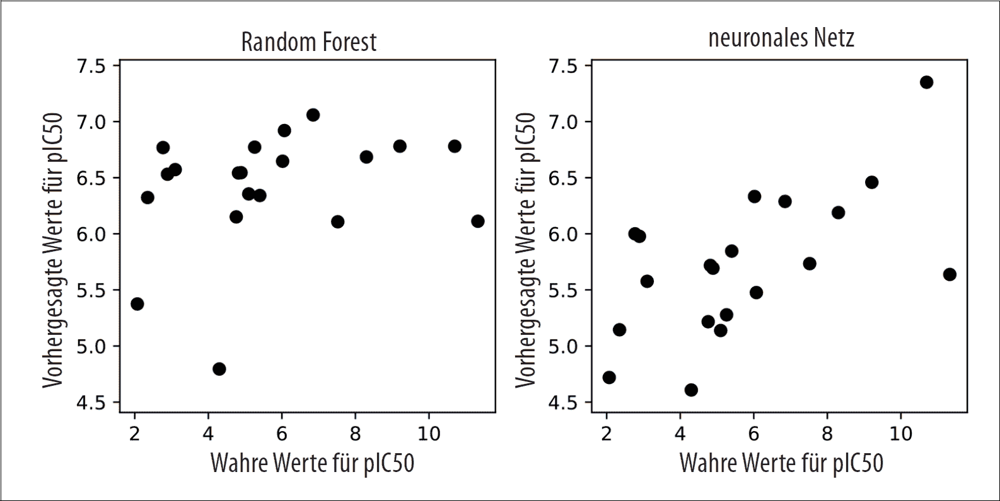

*Abbildung 5-12: Wahre gegen vorhergesagte Labels beim Ausführen auf den Testdaten.*

# Fazit

In diesem Kapitel haben Sie gelernt, wie Sie `Deep Learning` auf biophysikalische Systeme anwenden können, insbesondere auf das Problem der Vorhersage der Bindungsaffinität von Protein-Ligand-Systemen. Vielleicht sind Sie neugierig zu erfahren, wie allgemein die Fähigkeiten sind, die Sie gelernt haben. Könnten die gleichen Modelle und Techniken angewendet werden, um andere biophysikalische Datensätze zu verstehen? Hierzu geben wir eine kurze Übersicht.

Protein-Protein- und Protein-DNA-Systeme folgen auf hohem Niveau der gleichen grundlegenden Physik wie Protein-Ligand-Systeme. Die gleichen Wasserstoffbrücken, Ionenbrücken usw. spielen eine entscheidende Rolle. Könnten wir solche Systeme mit dem Code aus diesem Kapitel analysieren? Die Antwort fällt etwas kompliziert aus. Viele der physikalischen Wechselwirkungen, die Protein-Ligand-Wechselwirkungen antreiben, werden durch geladene Dynamik vorangetrieben. Andererseits wird die Protein-Protein-Dynamik möglicherweise eher durch hydrophobe Interaktionen bestimmt. Wir gehen nicht näher auf die Bedeutung dieser Wechselwirkungen ein, aber qualitativ haben sie in gewissem Maße einen anderen Charakter als Protein-Ligand-Wechselwirkungen. Das könnte bedeuten, dass der `RdkitGridFeaturizer` nicht in der Lage wäre, diese Interaktionen zufriedenstellend zu charakterisieren. Andererseits ist es möglich, dass die atomaren `CNNs` diese Systeme besser handhaben können, da viel weniger über die Physik der Interaktionen in diesen Modellen fest codiert ist.

Davon abgesehen, bleibt das erhebliche Problem der Skalierung. Die atomaren `CNNs` brauchen lange zum Trainieren und erfordern viel Speicherplatz. Die Skalierung dieser Modelle für größere Protein-Protein-Systeme würde zusätzliche technische Arbeiten erfordern. Das Entwicklerteam von `DeepChem` arbeitet intensiv an diesen und anderen Herausforderungen. Es kann jedoch noch dauern, bis die Bemühungen Früchte tragen werden.

Antikörper–Antigen-Wechselwirkungen sind eine weitere Form wichtiger biophysikalischer Wechselwirkungen. Antikörper sind Y-förmige Proteine (siehe Abbildung 5-13) mit einer variablen »Antigen-Bindungsstelle«, die zur Bindung von Antigenen verwendet wird. Antigene sind hier Moleküle, die mit einem bestimmten Pathogen assoziiert sind. In Kultur gezüchtete Zellen können zur Bildung von Antikörpern genutzt werden, die auf bestimmte Antigene abzielen. Sind alle Zellen einer Kultur Klone einer bestimmten Zelle, sind die erzeugten Antikörper identisch. Solche »monoklonalen Antikörper« haben in jüngster Zeit eine breite therapeutische Anwendung gefunden.

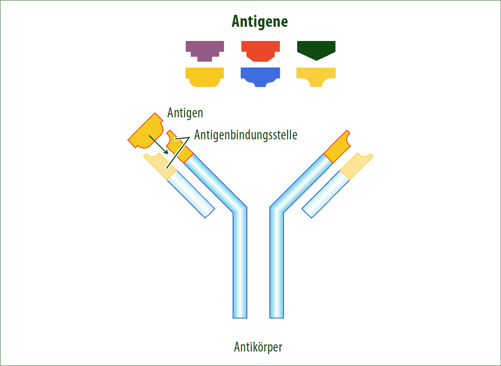

*Abbildung 5-13: Diagramm der Antikörper-Antigen-Wechselwirkung. (Quelle, Wikimedia ([`en.wikipedia.org/wiki/Antibody#/media/File:Antibody.svg`](https://en.wikipedia.org/wiki/Antibody#/media/File:Antibody.svg)))*

Das Design von Antikörpern war bisher in erster Linie eine experimentelle Wissenschaft. Ein Teil davon ist auf die Herausforderungen zurückzuführen, die mit dem Gewinnen einer 3-D-Antikörperstruktur verbunden sind. Die Modellierung der komplexen Antigen-Antikörper-Bindungsstelle hat sich ebenfalls als Herausforderung erwiesen. Einige der Methoden, die wir in diesem Kapitel abgehandelt haben, werden in den nächsten Jahren möglicherweise bei der Antikörper-Antigen-Bindungsmodellierung von Nutzen sein.

Des Weiteren haben wir auf die Bedeutung der Dynamik für das Verständnis der Proteinphysik hingewiesen. Könnten wir `Deep Learning` nicht direkt auf Proteinsimulationen durchführen, um zu verstehen, welche Liganden an das Protein binden könnten? Grundsätzlich ja, jedoch bleiben gewaltige Herausforderungen. Einige Unternehmen arbeiten aktiv an dieser Herausforderung, gute Open-Source-Tools sind jedoch noch nicht verfügbar.

In Kapitel 11 werden wir auf einige der biophysikalischen Methoden zurückkommen und zeigen, wie diese Modelle für die Wirkstoffforschung sehr nützlich sein können.

# KAPITEL 6

# Deep Learning in der Genomik

Das Herzstück jedes lebenden Organismus ist sein Genom: die DNA-Moleküle, die alle Anleitungen enthalten, um die Einzelteile des Organismus herzustellen. Wenn eine Zelle einem Computer entspricht, dann ist ihre Genomsequenz die auszuführende Software. Und wenn DNA als Software angesehen werden kann, als Information, die von einem Computer verarbeitet werden soll, kann dann diese Information nicht von Computern analysiert werden, sodass wir verstehen, wie sie funktioniert?

Selbstverständlich ist die DNA nicht nur ein abstraktes Speichermedium. Es ist ein Molekül, das sich kompliziert verhält. Es interagiert mit Tausenden anderer Moleküle, die alle wichtige Rollen bei der Verwaltung, dem Kopieren, dem Steuern und der Ausführung der in der DNA enthaltenen Anweisungen spielen. Das Genom ist eine riesige, komplexe Maschinerie, die aus Tausenden von Teilen besteht. Nach wie vor fehlt uns das Wissen über die Funktionsweise der meisten dieser Teile, ganz zu schweigen davon, wie sie als großes Ganzes zusammenkommen.

Dies bringt uns zu den beiden Bereichen *Genetik* und *Genomik*. Die Genetik behandelt die DNA als abstrakte Information. Sie betrachtet die Vererbungsmuster oder sucht nach Korrelationen zwischen Populationen, um die Zusammenhänge zwischen DNA-Sequenzen und physischen Merkmalen aufzudecken. Die Genomik andererseits sieht das Genom als Maschine. Sie versucht, die Einzelteile dieser Maschine und ihre Zusammenarbeit zu verstehen. Die beiden Ansätze ergänzen sich, und `Deep Learning` stellt für beide ein leistungsfähiges Instrument dar.

### DNA, RNA und Proteine

Selbst wenn Sie kein Biologe sind, haben Sie sich wahrscheinlich zu irgendeinem Zeitpunkt mit den Grundlagen der Funktionsweise von Genomen beschäftigt. Zunächst werfen wir einen Blick auf die vereinfachte Darstellung der Genomik, wie sie auch in Einführungskursen gelehrt wird. Anschließend werden wir einige der Unterschiede zeigen, die unterstreichen, dass die Realität deutlich komplizierter ist.


# DNA ist ein Polymer

DNA ist ein Polymer: eine lange Kette sich wiederholender, aneinandergereihter Einheiten. DNA besteht aus vier solcher Einheiten (genannt *Basen*): Adenin, Cytosin, Guanin und Thymin. Diese werden mit `A`, `C`, `G` und `T` abgekürzt (siehe Abbildung 6-1). Fast die gesamte Information eines lebenden Organismus ist letztendlich in dem spezifischen Muster dieser vier sich wiederholenden Basen codiert, aus denen sein Genom besteht.

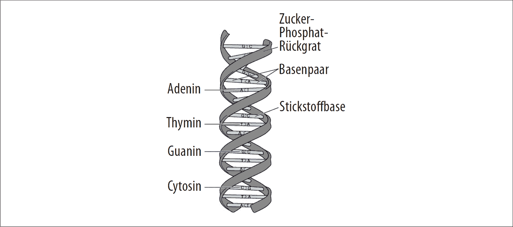

*Abbildung 6-1: Die Struktur eines DNA-Moleküls. Es besteht aus zwei Ketten, die sich jeweils aus vielen A-, C-, G- und T-Basen zusammensetzen. Die beiden Ketten ergänzen sich: Jedes C in einer Kette steht einem G der anderen gegenüber, und jedes A in einer Kette steht einem T in der anderen gegenüber. (Quelle: Wikimedia, [`en.wikipedia.org/wiki/Molecular\_Structure\_of\_Nucleic\_Acids:\_A\_Structure\_for\_Deoxyribose\_Nucleic\_Acid#/media/File:DNA-structure-and-bases.png`](https://en.wikipedia.org/wiki/Molecular_Structure_of_Nucleic_Acids:_A_Structure_for_Deoxyribose_Nucleic_Acid#/media/File:DNA-structure-and-bases.png))*

## Proteine als Hardware

Wenn DNA die Software ist, dann sind Proteine die wichtigste Hardware. Proteine sind winzige Maschinen, die fast alle Arbeiten in einer Zelle ausführen. Proteine sind ebenfalls Polymere, die aus sich wiederholenden Elementen, den *Aminosäuren*, bestehen. Es gibt 20 kanonische Aminosäuren, und ihre physiologischen Eigenschaften variieren stark. Manche sind groß und andere klein. Einige sind elektrisch geladen und andere nicht. Einige ziehen Wasser an, andere stoßen es ab. Reihen sich die richtigen Aminosäuren in der richtigen Reihenfolge auf, falten sie sich selbsttätig in eine 3-D-Form, sodass alle Teile richtig positioniert sind, um als Maschine zu funktionieren.

## Speicherung der Aminosäuresequenzen

Eine der Hauptaufgaben der DNA ist die Speicherung der Aminosäuresequenzen für die Proteine eines Organismus. Dies erfolgt auf einfache und unkomplizierte Weise. Bestimmte DNA-Abschnitte entsprechen bestimmten Proteinen. Jede aus drei DNA-Basen bestehende Sequenz (genannt *Kodon*) entspricht einer Aminosäure. Beispielsweise zeigt das Muster `AAA` die Aminosäure Lysin an, während `GCC` für Alanin steht.

## Von DNA zum Protein

Um von der DNA zum Protein zu gelangen, wird ein weiteres Molekül, die RNA, benötigt, die als Informationsüberträger dient, um Informationen von einem Teil der Zelle zu einem anderen zu transportieren. Die RNA ist ein weiteres Polymer und chemisch der DNA sehr ähnlich. Sie besteht ebenfalls aus vier Basen, die in willkürlicher Reihenfolge miteinander verkettet werden können. Um ein Protein zu erstellen, müssen die Informationen zweimal kopiert werden. Zuerst wird die DNA-Sequenz in eine entsprechende RNA-Sequenz *transkribiert*, dann wird das RNA-Molekül in ein Proteinmolekül *übersetzt*. Das RNA-Molekül, das die Information trägt, wird *Boten-RNA*, kurz *mRNA*, genannt.

## Regulationsmechanismen

Nun wissen wir, *wie* Proteine hergestellt werden, aber nicht, *wann*. Eine menschliche Zelle kann mehrere Tausend verschiedene Proteine herstellen. Sicherlich werden nicht ständig Kopien von allen erstellt. Offensichtlich muss es eine Art Regulationsmechanismus geben, um zu kontrollieren, wann welche Proteine hergestellt werden. Üblicherweise erfolgt dies durch spezielle Proteine namens *Transkriptionsfaktoren (TFs)*. Jeder TF erkennt und bindet an eine spezifische DNA-Sequenz. Je nachdem, welcher TF an welche Stelle bindet, kann die Rate, mit der benachbarte Gene transkribiert werden, entweder erhöht oder gesenkt werden.

## Zusammenfassung des einfachen Modells

Dies ergibt ein einfaches, leicht verständliches Bild der Funktionsweise eines Genoms. Die Aufgabe der DNA besteht darin, Proteine zu codieren. DNA-Abschnitte (genannt *Gene*) codieren Proteine mithilfe eines einfachen, klar definierten Codes. DNA wird in RNA umgewandelt, die nur der Informationsübertragung dient. Anschließend wird die RNA in Proteine umgewandelt, die die eigentliche Arbeit verrichten. Der gesamte Prozess ist so elegant, dass er auch von einem talentierten Ingenieur hätte entworfen sein können. Und viele Jahre glaubte man, dass dem wirklich so war. Nehmen Sie sich daher etwas Zeit, um es zu genießen, bevor wir verraten, dass die Realität tatsächlich viel chaotischer und viel komplizierter ist.

# Und nun zur Wirklichkeit

Jetzt reden wir darüber, wie das Genom *wirklich* funktioniert. Das Bild, das wir im vorherigen Abschnitt gezeichnet haben, ist einfach und elegant, hat jedoch wenig Bezug zur Realität. In diesem Abschnitt wird viel Wissen sehr schnell durchgenommen, Sie müssen sich jedoch nicht an alles erinnern oder alles verstehen. Sie sollen nur ein Gefühl für die unglaubliche Komplexität lebender Organismen bekommen. Im Laufe des Kapitels werden wir auf einige dieser Themen zurückkommen und sie ausführlicher behandeln.

## Chromosomen und Histone

Zunächst betrachten wir DNA-Moleküle (genannt *Chromosomen*). In Bakterien, die nur ein relativ kleines Genom haben, liegt DNA als einfache, frei schwebende Moleküle vor. Eukaryoten jedoch (eine Gruppe, zu der Amöben, Menschen und alles dazwischen gehört) haben ein viel größeres Genom. Um in eine Zelle zu passen, muss jedes Chromosom auf kleinstem Raum gepackt werden. Dies geschieht, indem sie um Proteine, genannt *Histone*, gewickelt wird. Aber wenn die gesamte DNA gut weggepackt ist, wie kann sie transkribiert werden? Die Antwort lautet natürlich, dass das nicht möglich ist. Bevor ein Gen transkribiert werden kann, muss der DNA-Abschnitt, der es enthält, zunächst entpackt werden. Woher weiß die Zelle, welchen Abschnitt sie entpacken soll? Die Antwort ist noch unbekannt. Es wird angenommen, dass verschiedene Arten chemischer Veränderungen an den Histonmolekülen beteiligt sind sowie Proteine, die bestimmte Änderungen erkennen. Offensichtlich ist ein Regulationsmechanismus vorhanden, viele Details sind jedoch nach wie vor unbekannt. Wir kommen in Kürze auf dieses Thema zurück.

## DNA-Methylierung

Die DNA selbst kann durch einen Prozess namens *Methylierung* chemisch verändert werden. Je stärker ein DNA-Abschnitt methyliert ist, desto unwahrscheinlicher ist seine Transkription. Somit ist dies ein weiterer Regulationsmechanismus, den die Zelle zur Steuerung der Proteinproduktion verwenden kann. Aber wie kann sie steuern, welche Teile der DNA methyliert sind? Auch das ist noch weitgehend unbekannt.

## Spleißen und Spleißvarianten

Im vorherigen Abschnitt erwähnten wir, dass ein bestimmter DNA-Abschnitt einem bestimmten Protein entspricht. Das stimmt zwar für Bakterien, bei Eukaryoten ist es jedoch komplizierter. Nachdem die DNA in die Boten-RNA transkribiert wurde, wird diese RNA oftmals bearbeitet, um Abschnitte zu entfernen und die verbleibenden Teile (genannt *Exone*) erneut miteinander zu verbinden (auch *spleißen* genannt). Somit kann die RNA-Sequenz, die letztendlich in ein Protein übersetzt wird, sich von der ursprünglichen DNA-Sequenz unterscheiden. Des Weiteren weisen viele Gene mehrere *Spleißvarianten* auf – verschiedene Arten, Abschnitte zu entfernen, um die endgültige Sequenz zu bilden. Somit kann ein einzelner DNA-Abschnitt tatsächlich für mehrere verschiedene Proteine codieren!

# Fazit

Das klingt alles sehr kompliziert, nicht? Lesen Sie weiter, wir haben gerade erst angefangen! Die Evolution wählt Mechanismen aus, die funktionieren, ohne sich darum zu kümmern, ob sie einfach sind oder leicht zu verstehen. Das führt zu sehr komplizierten Systemen. Wollen wir diese verstehen, müssen wir uns der Komplexität stellen.


# RNA: 不仅仅是信息传递者

传统上，RNA 仅被视为信息传递者，但早在基因组学研究的早期，生物学家就知道这并不完全正确。`mRNA` 翻译成蛋白质的过程由 `Ribosome`（核糖体）完成，核糖体是由蛋白质和 RNA 组成的复杂分子机器。另一种名为 `Transfer-RNA`（简称 `tRNA`）的分子在翻译过程中也扮演着关键角色。这些分子通过识别 `mRNA` 中的三碱基模式并添加正确的氨基酸到不断生长的蛋白质链上，从而定义了「遗传密码」。半个多世纪以来，我们已知至少存在三种 RNA：`mRNA`、核糖体 RNA 和 `tRNA`。

但 RNA 的功能远不止于此。它是一种令人惊讶的多功能分子。在过去几十年中，发现了更多种类的 RNA。以下是一些例子：

*   `microRNAs` (`miRNAs`) 是短小的 RNA 片段，它们结合到 `mRNAs` 上，阻止其被翻译成蛋白质。这是某些动物物种（尤其是哺乳动物）中一个非常重要的调控机制。
*   `Short interfering RNA` (`siRNA`) 是另一种结合 `mRNA` 并阻止其翻译的 RNA 类型。它与 `miRNA` 相似，但由双链组成（与单链的 `miRNAs` 形成对比），且作用机制也有所不同。我们将在本章后续更详细地探讨 `siRNA`。
*   `Ribozyme`（核酶）是能像酶一样催化化学反应的 RNA 分子。化学反应是活细胞中发生的一切生命活动的基础。因此催化剂至关重要。通常由蛋白质承担这一功能，但我们现在知道，有时 RNA 也能承担此任。
*   `Riboswitches`（核糖开关）是由两部分组成的 RNA 分子。一部分充当 `mRNA`，而另一部分能够结合小分子。结合发生时，`mRNA` 的翻译要么被启用，要么被阻止。这又是一个调控机制，根据细胞内特定小分子的浓度来调节蛋白质的生产。

当然，所有这些不同的 RNA 都必须被合成出来，而 DNA 包含了相应的蓝图。因此，DNA 不仅仅是一串编码的蛋白质序列。它还包含 RNA 序列、`Transkriptionsfaktoren`（转录因子）及其他调控分子的结合位点、关于如何对 `mRNAs` 进行剪接的指令，以及各种化学修饰——这些修饰影响 DNA 如何缠绕在组蛋白上，以及哪些基因会被转录。

当核糖体将 `mRNA` 翻译成蛋白质后会发生什么？一些蛋白质能自发折叠成正确的三维结构，但许多其他蛋白质需要被称为 `Chaperone`（伴侣蛋白）的蛋白质协助。翻译后，蛋白质通常还需要额外的化学修饰。随后，成熟的蛋白质必须被运输到细胞中能发挥作用的位置，并在不再需要时被降解。这些过程中的每一个都受到额外调控机制的控制，并涉及与许多其他分子的相互作用。

如果这听起来令人望而生畏，那是因为它确实如此！活着的生物体比人类制造的任何机器都要复杂得多。想要理解它，*理应*让你感到畏惧！

这正是 Machine Learning（机器学习）成为如此强大工具的原因。我们拥有海量数据，这些数据由一个极其复杂且几乎未被理解的过程生成。我们想要发掘埋藏在数据中的细微模式。这正是 Deep Learning（深度学习）擅长的任务类型！

事实上，Deep Learning 非常适合这一任务。经典统计方法难以表征基因组的复杂性。它们往往依赖于简化假设。例如，它们寻找变量间的线性关系，或试图仅用少数几个其他变量来建模因变量。然而，基因组学包含数百个变量之间复杂的非线性关系：这正是 Deep Neural Network（深度神经网络）能有效描述的关系类型。

## Transkriptionsfaktor-Bindung（转录因子结合）

作为基因组学的一个应用示例，我们将利用 Deep Learning 来研究转录因子结合问题。如前所述，`TFs` 是结合 DNA 的蛋白质。通过结合，它们影响附近基因被转录成 RNA 的概率。但 `TF` 如何知道该结合在哪里？正如遗传学中常见的那样，这个问题有一个简单的答案，但伴随着许多复杂性。

每个 `TF` 都有一个特定的 DNA 序列，称为 *Bindungsstellenmotiv*（结合位点基序），它结合于此。结合位点基序通常很短，一般由十个碱基或更少组成。无论 `TF` 的基序在基因组的何处出现，`TF` 都会结合其上。

在实践中，然而，基序并不完全特异。一个 `TF` 可以结合许多相似但不完全相同的序列。基序内的某些碱基可能比其他碱基更重要。这通常用 *Positions-Gewichts-Matrix*（位置权重矩阵，PWM）来建模，该矩阵指明了 `TF` 对基序内每个位置上每种可能碱基的偏好。这当然假设基序内的每个位置是独立的，但这并不总是成立。有时基序长度甚至会变化。而且虽然结合主要由基序内的碱基决定，侧翼 DNA 序列也可能产生一定影响。

到目前为止我们只考虑了序列！DNA 的其他方面也可能很重要。许多 `TFs` 受 DNA 物理形态的影响，例如双螺旋缠绕的紧密程度。甲基化 DNA 同样会影响 `TF` 结合。别忘了，真核生物中大部分 DNA 紧密包装并缠绕在组蛋白上。`TFs` 只能结合那些已解旋的 DNA 区段。

其他分子也扮演重要角色。`TFs` 常与其他分子相互作用，这些相互作用会影响 DNA 结合。例如，一个 `TF` 可能结合另一个分子，形成的复合物随后结合的 DNA 基序与该 `TF` 单独结合时不同。

生物学家花费数十年时间理清这些细节并建立 `TF` 结合模型。我们将尝试利用 Deep Learning 从数据中学习模型。

### Ein Konvolutionsmodell für die TF-Bindung（用于 TF 结合的卷积模型）

在本例中，我们使用转录因子 `JUND` 的实验数据。实验旨在识别人类基因组中 `JUND` 结合的每一个位置。为便于概览，我们仅使用 22 号染色体的数据，它是人类最小的染色体之一。尽管如此，它长达 5000 万个碱基，为我们提供了充足的数据。整条染色体被分割成长度为 101 个碱基的较短片段，并标记了是否包含 `JUND` 的结合位点。我们将训练一个模型，根据片段的序列来预测这些标签。

片段采用 One-Hot 编码（独热编码）表示。每个碱基对应四个数字，其中一个为 1，其余为 0。碱基是 `A`、`C`、`G` 还是 `T`，由 1 的位置指示。


# 使用卷积神经网络进行数据处理

为了处理数据，我们使用一个卷积神经网络，就像我们在第 3 章中识别手写数字时所做的那样。实际上，这两个模型非常相似。这一次我们使用 1-D 卷积，因为我们面对的是 1-D 数据（DNA 序列）而不是 2-D 数据（图像）。然而，模型的基本组件是相同的：输入、多个卷积层、一个或多个用于计算输出的 Dense 层（全连接层），以及作为误差函数的交叉熵。

## 模型创建与输入定义

首先，我们创建一个 `TensorGraph` 并定义输入：

```
model = dc.models.TensorGraph(batch_size=1000)

features = layers.Feature(shape=(None, 101, 4))
labels = layers.Label(shape=(None, 1))
weights = layers.Weights(shape=(None, 1))
```

请注意输入的尺寸。每个样本具有一个大小为 101（碱基数量）乘以 4（每个碱基的独热编码）的特征向量。此外，我们有一个用于标签的单个数值（0 或 1，指示是否包含结合位点）和一个用于权重的单个数值。在误差函数中使用权重对于此示例很重要，因为数据非常不平衡。不到 1% 的样本包含结合位点。因此，模型只需对每个样本输出 0，就能达到 99% 以上的准确率。为了防止这种情况，正样本获得的权重高于负样本。

## 卷积层

在下一步中，我们创建三个具有相同参数的卷积层：

```
prev = features

for i in range(3):
    prev = layers.Conv1D(filters=15, kernel_size=10,
                         activation=tf.nn.relu, padding='same',
                         in_layers=prev)
    prev = layers.Dropout(dropout_prob=0.5, in_layers=prev)
```

我们将卷积核的大小设为 10，并将每层的滤波器数量（= 输出数量）指定为 15。第一层接收原始特征（每个碱基四个数值）作为输入。总共有 40 个输入值，因为每次都会考虑连续十个碱基的区域。对于每个区域，这 40 个值通过一个卷积核转换为 15 个输出值。第二层同样每次考虑十个碱基，但输入是由第一层创建的 15 个值。为每个碱基计算一组新的 15 个值，以此类推。

为了防止过拟合，我们在每个卷积层后添加一个 Dropout 层。Dropout 概率设置为 0.5，因此每次有 50% 的输出值被随机设为 0。

## 输出计算

接下来，我们使用一个 Dense 层来计算输出：

```
logits = layers.Dense(out_channels=1, in_layers=layers.Flatten(prev))
output = layers.Sigmoid(logits)
model.add_output(output)
```

输出值应介于 0 和 1 之间，以便我们将其解释为某个样本包含结合位点的概率。`Dense` 层会产生任意值。因此，我们将它们通过逻辑 Sigmoid 函数，以获得所需的输出范围。该函数的输入通常称为 `Logits`。该名称指的是数学上的 Logit 函数，它是逻辑 Sigmoid 函数的反函数。

## 损失函数

最后，我们计算每个样本的交叉熵，并将其与权重相乘以获得误差：

```
loss = layers.SigmoidCrossEntropy(in_layers=[labels, logits])
weighted_loss = layers.WeightedError(in_layers=[loss, weights])
model.set_loss(weighted_loss)
```

为了保证数值稳定性，交叉熵层接受 `Logits` 作为输入，而不是 Sigmoid 函数的输出。

## 训练与评估

现在我们可以训练和评估模型。作为评估指标，我们选择 ROC AUC。每训练十个周期，就在训练数据和验证数据上评估一次模型：

```
train = dc.data.DiskDataset('train_dataset')
valid = dc.data.DiskDataset('valid_dataset')

metric = dc.metrics.Metric(dc.metrics.roc_auc_score)

for i in range(20):
    model.fit(train, nb_epoch=10)
    print(model.evaluate(train, [metric]))
    print(model.evaluate(valid, [metric]))
```

结果如图 6-2 所示。验证数据的性能在第 50 个周期达到最高值 0.75，随后略有下降。训练数据的性能继续上升，最终稳定在 0.87 左右。因此我们知道，训练超过 50 个周期会导致过拟合，我们应在此点停止训练。

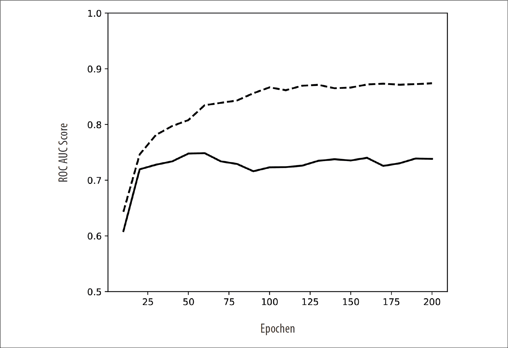

*图 6-2：训练过程中 ROC AUC 分数的变化，训练数据（虚线）和验证数据（实线）。*

ROC AUC 分数 0.75 还不错，但也不算特别好。通过改进模型，我们大概能提高它。为此，我们可以尝试改变各种超参数：卷积层的数量、每层的核大小、每层的滤波器数量、Dropout 率等。我们可以尝试许多不同的组合，或许能找到一个性能更好的组合。

但我们也知道，模型能变得多好是有限度的。唯一考虑的输入值是 DNA 序列。然而，转录因子结合还取决于许多其他因素：可及性、甲基化、形状、其他分子的存在等。任何忽略这些因素的模型在其预测能力上都会受限。因此，我们添加第二个输入，并测试结果是否因此得到改善。

## 染色质可及性

`Chromatin`（染色质）一词指构成染色体的所有物质：DNA、组蛋白以及各种其他蛋白质和 RNA 分子。“染色质可及性”指的是染色体的每个部分对外部分子的可及程度。当 DNA 紧紧缠绕在组蛋白上时，它对转录因子和其他分子是不可及的。它们无法接触到这些 DNA，因此 DNA 处于非活性状态。一旦它不再缠绕在组蛋白上，它就会再次变得可及，并恢复其在细胞中的核心作用。

染色质可及性既不均匀也不静态。它因细胞类型和细胞生命周期阶段而异。环境因素也会影响它。它是细胞控制其基因组活性的工具之一。如果染色体的相应区域被收起来，任何基因都可以被关闭。

可及性也在不断变化，因为 DNA 随着细胞内发生的过程而展开和缠绕。与其将可及性视为二元状态（可及或不可及），不如将其视为连续变量（每个区域可及多长时间）。

我们在上一节分析的数据基于一种名为 `HepG2` 的特定细胞的实验。实验确定了转录因子 `JUND` 在基因组中结合的位点。结果受染色质可及性的影响。如果某个区域在 `HepG2` 细胞中几乎总是不可及的，那么 `JUND` 在那里结合的可能性就非常小，即使 DNA 序列本身原本是一个理想的结合位点。因此，让我们尝试将可及性纳入我们的模型。


首先，我们加载相关数据。这些数据包含在一个文本文件中，其中每一行对应我们数据集的一个样本（第 22 号染色体的 101 碱基片段）。每一行包含样本 ID，后跟一个数字，指示该区域在 HepG2 细胞中有多容易被访问。我们将其读入一个 Python 字典：

```
span_accessibility = {}

for line in open('accessibility.txt'):
    fields = line.split()
    span_accessibility[fields[0]] = float(fields[1])
```

我们选择的模型与前一节几乎相同，仅有两个细微变化。首先，我们需要一个额外的输入来接收可访问性值，该值由每个样本的一个数字组成：

```
accessibility = layers.Feature(shape=(None, 1))
```

接下来，我们将可访问性值纳入计算。为此有多种方法。在本例中，我们使用一种特别简单的方法。在前一节中，我们将最后一个卷积层的输出展平，然后将其作为输入传给一个计算结果的 Dense 层。

```
logits = layers.Dense(out_channels=1, in_layers=layers.Flatten(prev))
```

这里我们做同样的操作，然后再加上可访问性卷积层：

```
prev = layers.Concat([layers.Flatten(prev), accessibility])
logits = layers.Dense(out_channels=1, in_layers=prev)
```

模型搭建完成！现在对其进行训练。

此时存在一个问题：我们的模型有两个不同的特征层！到目前为止，我们的模型恰好有一个特征层、一个标签层，以及可能还有一个权重层。它们通过调用 `fit(dataset)` 进行训练，该方法会自动将正确的数据与每一层关联：数据集的 X 对应特征，y 对应标签，w 对应权重。然而，当模型拥有多个特征时，这行不通。

借助 DeepChem 的一项高级功能，可以解决这个问题。我们不再向模型传递数据集，而是可以编写一个 Python 生成器函数，用于迭代批次。每个批次由一个字典表示，其键为输入层，其值为将用于这些层的 NumPy 数组：

```
def generate_batches(dataset, epochs):
    for epoch in range(epochs):
        for X, y, w, ids in dataset.iterbatches(batch_size=1000, pad_batches=True):
            yield {
                features: X,
                accessibility: np.array([span_accessibility[id] for id in ids]),
                labels: y,
                weights: w
            }
```

请注意，数据集为我们处理了批次的迭代。它提供每个批次的数据，我们据此构建模型所需的输入。

训练和评估按原方式进行。我们只是用生成器替换了数据集：

```
for i in range(20):
    model.fit_generator(generate_batches(train, 10))
    print(model.evaluate_generator(generate_batches(train, 1), [metric], labels=[labels], weights=[weights]))
    print(model.evaluate_generator(generate_batches(valid, 1), [metric], labels=[labels], weights=[weights]))
```

结果如图 6-3 所示。与忽略染色质可访问性的模型相比，训练集和验证集上的得分均有所提高。ROC AUC 得分现在为训练数据 0.91，验证数据 0.80。

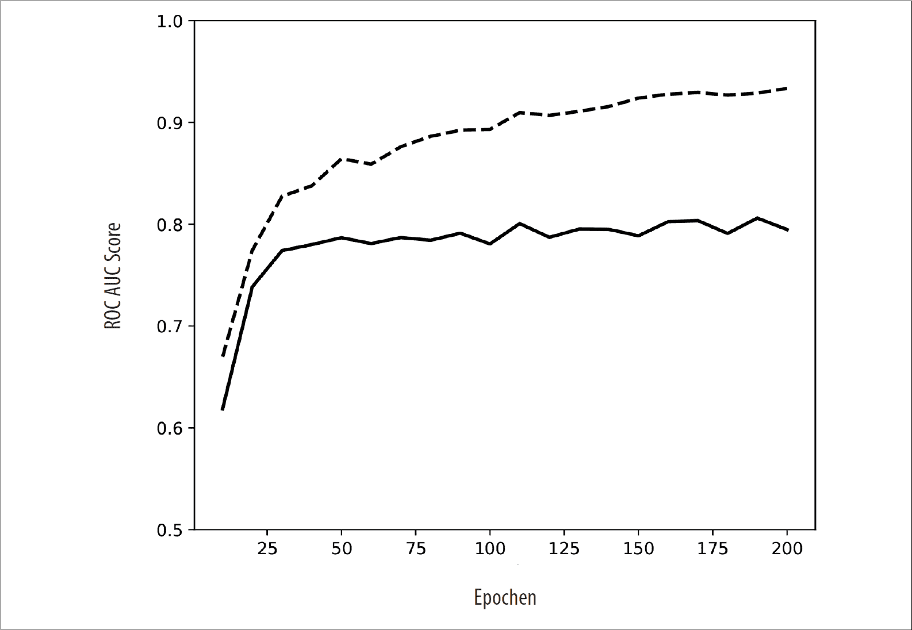

*图 6-3：考虑染色质可访问性时，训练数据（虚线）和验证数据（实线）在训练过程中 ROC AUC 得分的变化*。

### RNA 干扰

对于最后一个示例，我们转向 RNA。与 DNA 类似，它是一种由四种称为碱基的重复单元组成的聚合物。严格来说，四个碱基中有三个与其 DNA 版本几乎相同，仅多一个氧原子不同。第四个碱基略有不同。RNA 不含胸腺嘧啶 (T)，而是含有一种称为尿嘧啶 (U) 的碱基。当 DNA 序列被转录为 RNA 时，每个 T 都会被 U 替换。

碱基 G 和 C 是*互补*的，因此它们有很强的结合倾向。同样，碱基 A 和 T（或 U）也是互补的。如果存在两条 DNA 或 RNA 链，且一条链的每个碱基都与另一条链对应位置的碱基互补，则两条链会结合在一起。这一事实在许多生物过程中起关键作用，包括转录和翻译，以及细胞分裂时的 DNA 复制。

这也是*RNA 干扰*的核心。这一现象直到 1990 年代才被发现，并因此获得了 2006 年诺贝尔奖。一段序列与信使 RNA 某部分互补的短 RNA 片段，可以与该 mRNA 结合。当这种情况发生时，mRNA 被“沉默”，从而阻止其被翻译成蛋白质。执行沉默功能的分子称为小干扰 RNA (siRNA)。

然而，该过程远不止于此。RNA 干扰是一种复杂的生物学机制，而非仅仅是两条孤立的 RNA 链碰巧粘在一起的副产物。它始于 siRNA 与一组称为*RNA 诱导沉默复合体* (RISC) 的蛋白质结合。RISC 利用 siRNA 作为模板，在细胞中寻找并降解匹配的 mRNA。这既作为基因表达调控的机制，也作为抗病毒防御机制。

此外，它还是生物学和医学中的强大工具。借助它，任何目标基因都可以被暂时“关闭”。它可用于治疗疾病，或用于研究基因失活时会发生什么。只需确定要阻断的 mRNA，选择其一个短片段，并创建一个具有互补序列的 siRNA 分子。

当然，事情没那么简单。人们不能随便随机选择 mRNA 的任意片段，因为（当然！）RNA 分子不仅仅是由四个字母组成的抽象模式。它们是具有个体特性的实体，而这些特性取决于序列。一些 RNA 分子比其他分子更稳定。一些比其他分子更强地结合其互补序列。一些折叠成的形状使得 RISC 难以结合。因此，一些 siRNA 序列比其他序列效果更好，如果您想将 RNA 干扰作为工具使用，就必须知道如何挑选一个好的！

生物学家已经开发出许多用于选择 siRNA 序列的启发式规则。例如，最开始的碱基应该是 A 或 G，G 和 C 碱基应占序列的 30% 到 50% 等。这些经验法则很有帮助，但也许机器学习能做得更好。

我们使用一个包含 2,431 个 siRNA 分子的文库来训练模型，每个分子长 21 个碱基。^(1) 每个分子都经过实验测试，并被标记为 0 到 1 之间的值，指示其沉默目标基因的有效程度。较小的值表示无效分子，而较高的值表示更有效的分子。模型以序列为输入，尝试预测有效性。

创建模型使用以下代码：

```
model = dc.models.TensorGraph()
features = layers.Feature(shape=(None, 21, 4))
labels = layers.Label(shape=(None, 1))
prev = features
for i in range(2):
```


prev = layers.Conv1D(filters=10, kernel_size=10,
activation=tf.nn.relu, padding='same',
in_layers=prev)

prev = layers.Dropout(dropout_prob=0.3, in_layers=prev)

output = layers.Dense(out_channels=1, activation_fn=tf.sigmoid,
in_layers=layers.Flatten(prev))

model.add_output(output)

loss = layers.ReduceMean(layers.L2Loss(in_layers=[labels, output]))

model.set_loss(loss)

与我们用于 TF 结合的模型相比，该模型仅有少数差异。由于使用了较短的序列且训练数据较少，因此减小了模型规模。它只有两个卷积层，每层十个滤波器，而不是 15 个。此外不需要权重，因为每个样本在优化过程中应贡献相同的权重。

我们还使用了另一种损失函数。TF 结合模型是一个分类模型。每个标签的值为 0 或 1，我们试图预测它是这两个值中的哪一个。然而，这里是一个回归模型。标签是连续数值，模型试图尽可能接近这些值。因此我们使用 `L2` 距离作为损失函数，它试图最小化实际标签与预测标签之间的均方差。

以下是训练模型的代码：

```
train = dc.data.DiskDataset('train_siRNA')
valid = dc.data.DiskDataset('valid_siRNA')
metric = dc.metrics.Metric(dc.metrics.pearsonr, mode='regression')
for i in range(20):
    model.fit(train, nb_epoch=10)
    print(model.evaluate(train, [metric]))
    print(model.evaluate(valid, [metric]))
```

对于 TF 结合，我们使用 ROC AUC 来评估模型，它衡量模型将数据准确分为两类的能力。这适用于分类模型，但对于回归模型没有意义。因此我们使用皮尔逊相关系数。这是一个介于 -1 和 1 之间的数值，其中 0 意味着模型完全不提供信息，1 意味着模型完美复现了实验数据。

结果见 图 6-4。验证数据的值在 50 个周期后达到峰值 0.65。训练数据的值继续上升。然而，由于验证数据的值不再改善，这属于过拟合。考虑到模型的简单性和有限的训练数据量，0.65 的相关系数已经相当不错。虽然在更大数据集上训练的更复杂模型表现略好，但这已经是一个值得尊敬的成绩。

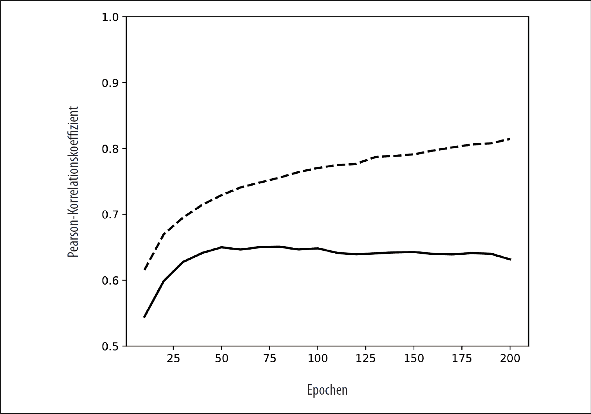

*图 6-4：训练过程中皮尔逊相关系数的演变，虚线代表训练数据，实线代表验证数据。*

### 总结

基因组是一台极其复杂的机器，其中大量部件协同工作，以控制和执行蛋白质及其他分子的生成。深度学习是研究它的强大工具。神经网络能够识别基因组数据中的细微模式，深入洞察基因组的运作方式，并做出预测。

比大多数其他生命科学领域更甚，基因组学提供了海量的实验数据。例如，单个人类基因组序列包含超过 60 亿个碱基。传统统计方法难以发现隐藏在所有这些数据中的信号。它们往往需要简化假设，而这些假设无法反映基因组调控的复杂性。深度学习非常适合处理这些数据，并改善我们对活细胞基本任务的理解。

## 第 7 章

## 显微镜中的机器学习

在本章中，我们介绍用于显微镜的深度学习技术。在这类应用中，我们试图理解显微镜图像的生物学结构。例如，我们想要计数图像中特定的细胞类型，或识别特定的细胞器。显微镜是生命科学最基本的工具之一，显微镜的进步极大地推动了人类科学。能够直观地检查细胞等生物对象，能比教科书上枯燥的讨论建立起对生命潜在机制更深刻的理解。核和细胞骨架的生动可视化（如 图 7-1 所示）产生的理解远比教科书上的枯燥讨论深刻得多。

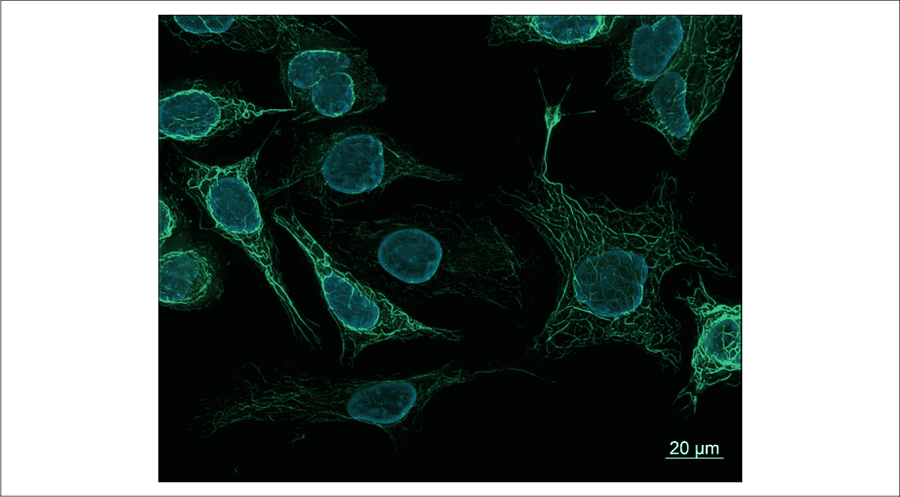

*图 7-1：人类 SK8/18-2 细胞。这些细胞经过染色以突出其细胞核和细胞骨架，并使用荧光显微镜成像。（来源：Wikimedia，[`commons.wikimedia.org/wiki/File:SK8-18-2_human_derived_cells,_fluorescence_microscopy_(29942101073).jpg`](https://commons.wikimedia.org/wiki/File:SK8-18-2_human_derived_cells,_fluorescence_microscopy_(29942101073).jpg))*

问题在于深度学习在显微镜领域能发挥什么作用。直到最近，显微镜图像只能通过人工（通常是博士生或博士后）手动检查有用模式来分析。较新的工具，如 CellProfiler ([`cellprofiler.org/`](https://cellprofiler.org/))，使生物学家能够自动构建处理图像数据的流水线。

### 自动化高通量显微镜图像分析

过去几十年自动化的进步使得在某些系统上能够进行自动化高通量显微镜成像。这些系统结合简单的机器人技术（用于样本的自动化处理）和图像处理算法，自动处理图像。例如，图像处理应用可以分离细胞的前景和背景，获得简单的细胞计数，并执行其他基本测量。此外，CellProfiler 等工具帮助没有编程经验的生物学家为处理细胞数据创建新的自动化流水线。

然而，自动化显微镜系统始终面临一系列限制。首先，复杂的视觉任务无法由现有的图像识别流水线执行。此外，为分析正确制备样本，要求进行实验的科学家具备丰富的经验。由于上述原因，尽管自动化显微镜能实现复杂的新实验，但它仍是一种小众方法。

因此，深度学习有望扩展 CellProfiler 等工具的能力。如果深度学习方法能执行更复杂的分析，自动化显微镜将成为一个有效得多的工具。因此，深度显微镜学引起了极大的研究兴趣，正如我们在本章后续将看到的那样。


深度学习技术的希望在于，自动化显微镜流程因此将变得更加灵活。深度学习系统在执行人类图像分析师几乎所有任务方面极具前景。此外，早期研究结果表明，深度学习技术有可能显著扩展低成本显微镜硬件的能力，从而使廉价显微镜能够执行目前仅靠先进且昂贵设备才能完成的分析。

展望未来，甚至有可能训练模型来“模拟”实验分析。此类系统能够（在少数情况下）预测实验结果，而无需真正进行相关实验。这是一种非常强大的能力，引发了人们对深度网络在基于图像的生物学中潜力的极大兴奋。

在本章中，我们将向您传授深度显微镜的基础知识。我们将展示深度学习系统如何学会执行细胞计数和分割等简单任务。此外，我们将阐述如何创建可扩展的系统，以便处理更复杂的图像处理流程。

### 显微镜简介

在深入探讨算法之前，让我们首先了解基础知识。显微镜是指利用物理系统观察微小物体的所有方法的总称。早期的显微镜纯粹是光学设备，使用精磨透镜来提高样本的分辨率。最近，显微镜开始依赖电子束甚至物理探针等技术来获取高分辨率图像。

显微镜学与生命科学已有数百年的紧密联系。17 世纪，安东·范·列文虎克使用早期版本的光学显微镜（由他亲自设计和制造），以前所未有的细节描述了微生物（见图 7-2）。这些观察关键地依赖于列文虎克在显微镜学方面的进步，特别是他发明了一种新透镜，与当时可用的显微镜相比，该透镜实现了显著改进的分辨率。


*图 7-2：列文虎克显微镜的复原图。列文虎克对其透镜磨制工艺的关键细节保密，直到 1950 年代，美国和苏联的科学家才成功复原出该显微镜。（来源：Wikimedia，[`en.wikipedia.org/wiki/Antonie\_van\_Leeuwenhoek#/media/File:Leeuwenhoek\_Microscope.png`](https://en.wikipedia.org/wiki/Antonie_van_Leeuwenhoek#/media/File:Leeuwenhoek_Microscope.png))*

高分辨率光学显微镜的发明引发了微生物学的一场革命。显微镜技术的普及以及放大观察细胞、细菌和其他微生物的能力，催生了微生物学和致病疾病模型。显微镜学对现代生命科学的影响怎么估量都不为过。

光学显微镜分为简单显微镜和复合显微镜。简单显微镜使用单个透镜进行放大。复合显微镜利用多个透镜实现更高分辨率，但这以增加制造复杂性为代价。首批复合显微镜直到 19 世纪中叶才问世！光学显微镜的下一次重大变革直到 1980 年代数字显微镜的出现才发生，数字显微镜使得通过显微镜捕获的图像能够传输到计算机。正如上一节所述，自动化显微镜使用数字显微镜来采集大量图像。这些图像可用于进行大规模生物学实验，记录实验扰动的影响。

#### 现代光学显微镜

尽管光学显微镜已有数百年历史，但该领域仍在经历重大创新。最基本的技术之一是*光学切片*。光学显微镜具有焦平面，即显微镜刚好聚焦的平面。开发了多种技术，将图像聚焦于选定的焦平面。这些聚焦图像随后可通过算法拼接，以创建高分辨率图像，甚至原始图像的 3-D 重建。图 7-3 形象展示了花粉颗粒的切片图像如何组合成一幅逼真的图像。

*共聚焦显微镜*是解决光学切片任务的常用方案。它们使用针孔光阑阻挡失焦光线，从而使共聚焦显微镜能获得更好的深度感知。移动显微镜焦点并进行水平扫描，即可获得整个物体的完整图像，且具有更高的光学分辨率和对比度。旁注：共聚焦成像的概念由人工智能先驱马文·明斯基申请了专利（见图 7-4）。

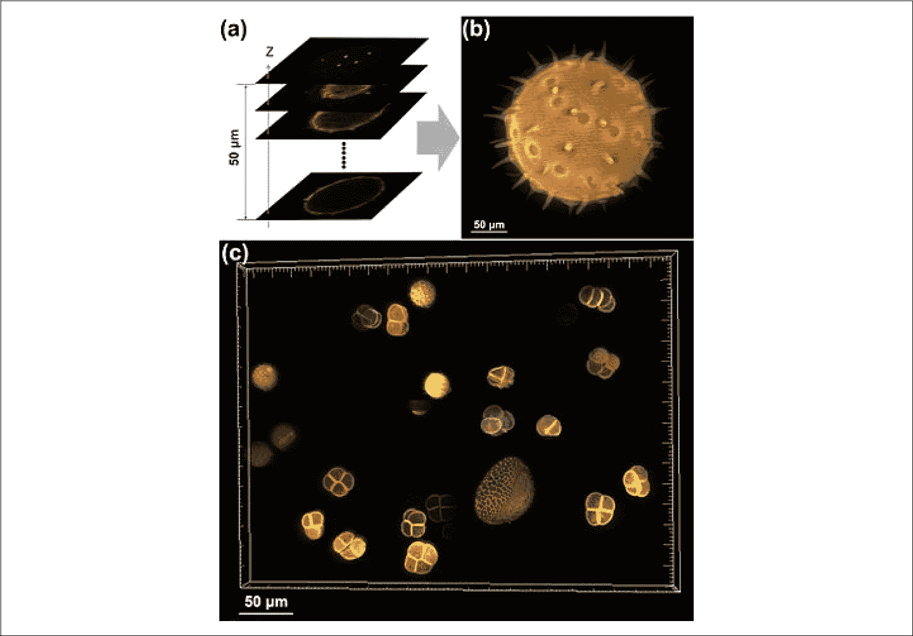

*图 7-3：花粉颗粒：(a) 花粉颗粒的光学切片荧光图像，(b) 组合图像，(c) 多个花粉颗粒的组合图像。（来源：Wikimedia，[`commons.wikimedia.org/wiki/File:Optical\_sectioning\_of\_pollen.jpg`](https://commons.wikimedia.org/wiki/File:Optical_sectioning_of_pollen.jpg))*

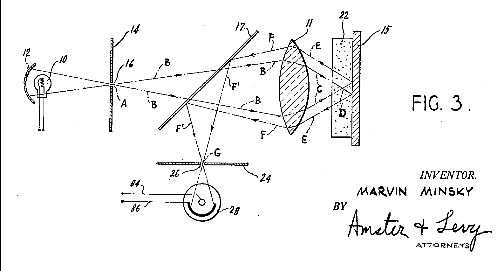

*图 7-4：明斯基原始专利中的一幅图像，展示了一台共聚焦扫描显微镜。明斯基因其在人工智能领域的开创性工作而更为人所知。（来源：Wikimedia，[`en.wikipedia.org/wiki/Confocal\_microscopy#/media/File:Minsky\_Confocal\_Reflection\_Microscope.png`](https://en.wikipedia.org/wiki/Confocal_microscopy#/media/File:Minsky_Confocal_Reflection_Microscope.png))*

设计良好的光学切片显微镜擅长捕获生物系统的 3-D 图像，因为可以利用扫描聚焦于多个图像部分。这些聚焦图像可通过算法拼接，获得精美的 3-D 重建。

下一节将探讨光学显微镜的一些基本局限性，以及为克服这些局限而开发的一些技术。虽然这些内容目前与深度学习没有直接关系（我们将讨论原因），但我们认为它们能为当今显微镜学面临的挑战提供宝贵的理解。当您希望利用机器学习协助设计下一代显微镜系统时，这些知识将大有裨益。如果您想直接上手实践，建议跳至后续章节，我们将在那里探讨实际应用。


|  || **深度学习不能做什么？** 显而易见，深度学习能对显微镜产生影响，因为深度学习擅长处理图像，而显微镜的核心在于图像获取。但也值得探讨，在显微镜的哪些领域，深度学习目前作用不大。正如我们在本章中将看到的，为显微成像准备样本可能相当繁琐。此外，样本制备需要极高的技巧，因为实验者必须能够正确固定样本。深度学习如何实现该过程的自动化或加速？ |

| --- | --- |

|   || 遗憾的是，机器人系统尚未达到这一水平。尽管共聚焦扫描样本等任务易于处理，但清洁和制备样本却需要极丰富的专业知识。机器人系统在可预见的未来不太可能具备这些能力。 |

|   || 每当您听到关于学习方法未来影响的预测时，除其他因素外，还应考虑样本制备。生物科学中的许多任务涉及样本制备等工作，这些对于当今的机器学习而言尚不可行。这种情况当然可能改变，但恐怕不会在未来几年内实现。 |

### 衍射极限

研究像显微镜这样的仪器时，首先了解其局限性会很有帮助。显微镜不能做什么？事实证明，早期的物理学家曾深入研究过这个问题（并带来了一些新惊喜）。首当其冲的是*衍射极限*，这是显微镜分辨率的理论极限：

`d = λ / (2 * n * sin(α))`

量 `n` 通常称为数值孔径，即 NA。`λ` 是光的波长。请注意此处的隐含假设。我们假设样本由某种形式的光照明。现在让我们简要看一下现有光波的光谱（见图 7-5）。

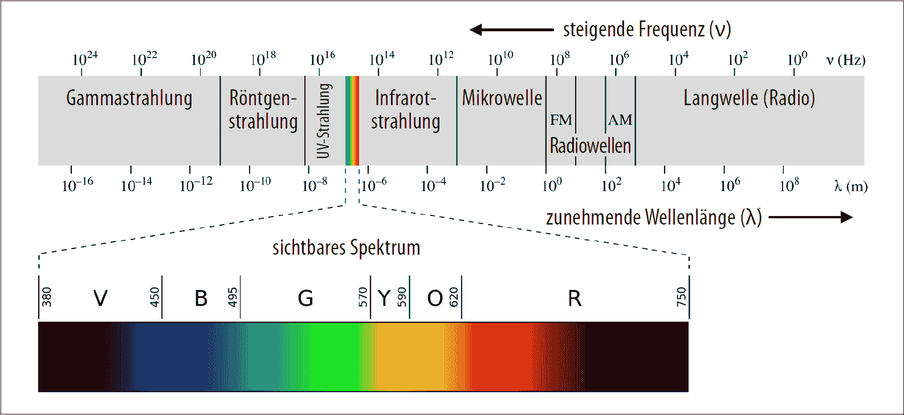

*图 7-5：光的波长。请注意，波长较低的光源（如 X 射线）能量极高。因此它们经常破坏敏感的生物样本。*

正如您所见，可见光仅占该光谱的一小部分。原则上，我们应该能够使用波长足够低的光来达到所需的分辨率。在一定程度上，这已经实现了。许多显微镜使用能量更高的电磁波。例如，紫外显微镜利用紫外线波长较短的特性来实现更高的分辨率。我们能否在此基础上使用波长更短的光？例如，为什么不用 X 射线或伽马射线显微镜？主要问题在于*光毒性*。波长短的光能量高。将此类光照射到样本上可能会破坏其结构。此外，高能光对实验者危险，且需要特殊的实验装置。

然而，幸运的是，还有其他方法可以绕过衍射极限。其中一种利用电子（它们也有波长！）来成像样本。另一种利用探针代替光。另一种避免分辨率极限的方法是使用电磁近场波。使用多个被照亮的荧光团也能降低该极限。我们将在接下来的章节中更详细地探讨这些方法。

#### 电子显微镜和扫描力显微镜

电子显微镜使用电子束而非可见光来生成物体图像。由于电子的波长远小于可见光，使用电子束能获得细节丰富得多的图像。为什么这讲得通？电子不是粒子吗？请考虑到物质可以表现出波动性。这被称为物质波，最早由路易·德布罗意提出：

`λ = h / (m * v)`

此处 `h` 对应普朗克常数，`m` 和 `v` 是相关粒子的质量和速度。（给物理学家的注：此公式未考虑相对论效应。存在考虑该效应的其他版本公式。）电子显微镜利用电子的波动性来成像。电子的波长取决于其能量，处于亚纳米量级，类似于标准电子枪可达到的能量。审视前文介绍的衍射极限模型，不难看出电子显微镜的强大之处。电子显微镜的最初原型诞生于 20 世纪 30 年代初。此后其结构得到了显著改进。然而，现代电子显微镜仍基于相同的基本原理（见图 7-6）。

请注意，此处也可能发生光毒性。要获得波长极小的电子，必须增加其能量，而在极高能量下，样本会再次被破坏。此外，为电子显微镜制备样本可能非常繁琐。尽管如此，电子显微镜的使用实现了微观系统的惊人成像（见图 7-7）。扫描电子显微镜通过扫描样本以获得更大的视野，能够实现仅 1 纳米分辨率的成像。

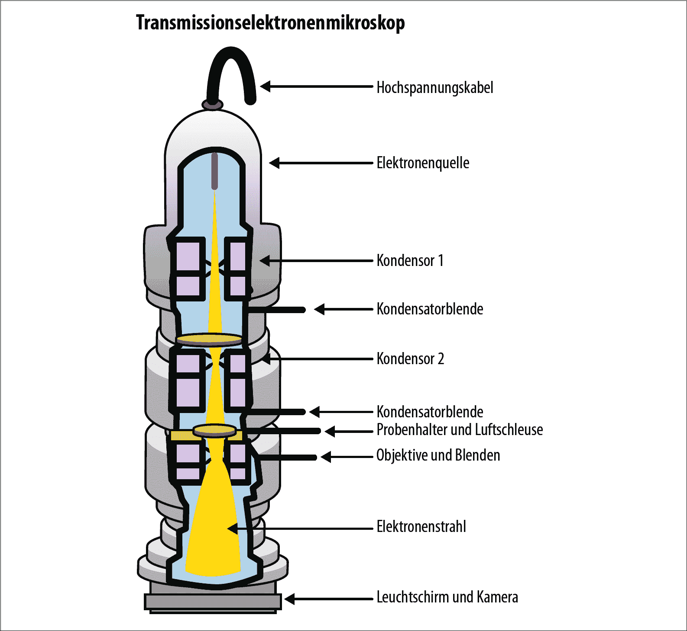

*图 7-6：现代透射电子显微镜的组成部分。（来源：Wikimedia，[`commons.wikimedia.org/wiki/File:Electron_Microscope.png`](https://commons.wikimedia.org/wiki/File:Electron_Microscope.png)）*

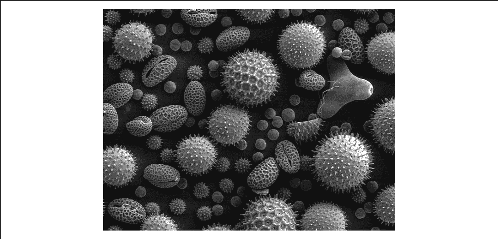

*图 7-7：花粉在扫描电子显微镜下放大 500 倍。（来源：Wikimedia，[`commons.wikimedia.org/wiki/File:Misc_pollen.jpg`](https://commons.wikimedia.org/wiki/File:Misc_pollen.jpg)）*

扫描力显微镜提供了另一种克服光学衍射极限的方法。该方法利用悬臂扫描给定表面。悬臂与样本的直接接触能够实现分辨率仅为纳米级分数的成像。有时甚至可以成像单个原子！由于直接接触，扫描力显微镜还能实现表面的 3D 成像。

扫描力显微镜是一种较新的方法。第一台扫描力显微镜直到 20 世纪 80 年代才被发明，当时纳米制造技术已成熟到足以精密制造所需的探针。因此，其在生物科学中的应用仍处于起步阶段。已有一些利用扫描力显微镜探针成像细胞和生物分子的工作，但这些方法仍处于萌芽阶段。

#### 超分辨率显微镜


在本章中，已经介绍了几种克服衍射极限的方法，包括使用波长更高的光和探针来实现更高的分辨率。然而，在 20 世纪下半叶，取得了一个科学突破，其基础是认识到存在许多克服衍射极限的方法。这些方法被称为超分辨率显微镜方法：

### 功能性超分辨率显微镜

利用包含在待成像样本中的发光物质的物理特性。例如，在生物显微镜中，荧光标签（稍后详述）可以突出显示特定分子。这些方法使光学显微镜能够检测光发射体。功能性超分辨率方法大致分为确定性方法和随机性方法。

### 确定性超分辨率显微镜

某些光发射体对激发的反应是非线性的。这意味着什么？通过将附近的其他发射体“关闭”，可以实现对特定光发射体的任意聚焦。其底层物理原理有点棘手，但成熟的方法如 STED 显微镜（*受激辐射损耗显微镜*）已经演示了这种方法。

### 随机性超分辨率显微镜

生物系统中的发光分子受随机运动支配。这意味着，如果对发光粒子的运动进行时间上的跟踪，这些测量值可以平均以估计其真实位置。存在各种方法（例如 STORM、PALM 和 BALM 显微镜），它们对这一基本思路进行了改进。这些超分辨率方法对现代生物学和化学产生了巨大影响，因为它们使相对廉价的光学显微镜能够研究纳米级系统的行为。2014 年诺贝尔化学奖授予了功能性超分辨率方法的先驱者。

|  | | **深度超分辨率方法** 近期研究已开始利用深度学习方法来实现超分辨率成像。^(1) 这些方法通过支持从稀疏、快速获取的图像中进行重建，提高了超分辨率显微镜的速度。尽管仍处于起步阶段，但这显示出作为深度学习未来有前景的应用领域。 |

---

近场显微镜是另一种超分辨率方法，它利用样本中的局部电磁信息。这些“倏逝波”不遵循衍射极限，从而实现更高的分辨率。然而，缺点是显微镜必须从极靠近样本的地方（样本周围一个光波长范围内）收集光线。这导致尽管近场方法非常有趣，但实际应用仍然具有挑战性。直到最近，也才有可能制造出具有负折射率的“超材料”。实际上，这些材料的特性意味着倏逝近场波可以被放大，从而实现距离样本较远处的成像。该领域的研究仍处于起步阶段，但非常令人兴奋。

#### 深度学习与衍射极限？

许多迹象表明，深度学习可以促进超分辨率显微镜的普及。一些出版物已经表明，深度学习算法可以加速超分辨率图像的创建，并利用相对廉价的硬件实现超分辨率。（脚注中引用了这样一份出版物。）

这些迹象特别令人信服，因为深度学习可以有效地执行图像锐化等任务。^(2) 这表明，可能有可能开发一系列基于深度学习的超分辨率工具，从而大大简化此类方法的采用。目前，这项研究尚不成熟，且尚无令人满意的工具。然而，我们希望这种情况在未来几年内会有所改变。

### 为显微镜准备生物样本

生物科学显微镜中最重要的步骤之一是样本制备。这可能是一个高度复杂的过程，需要相当的实验技巧。在本节中，我们将讨论一些样本制备方法，并解释这些方法如何失败并产生意外的实验伪影。

#### 样本染色

早期的光学显微镜提供了微观物体的放大视图。这种能力提高了对微小物体的理解，但无法为了对比而突出显示图像的特定区域。这促使了化学染料的发展，使科学家能够将图像区域作为对比来观察。

开发了各种染料以处理不同的样本。染色过程包含多个步骤，且可能非常复杂。染料在科学上可能具有非凡的影响力。例如，根据细菌对革兰氏染色的反应，通常将其分类为“革兰氏阳性”和“革兰氏阴性”。深度学习模型的一项任务可能是分离并标记样本中的革兰氏阳性菌与革兰氏阴性菌。如果您正在开发一种抗生素，您可以独立研究其对革兰氏阳性和革兰氏阴性菌种的影响。

|  | | **作为开发者，为什么我应该关心这个问题？** 本节的一些读者可能是开发者，他们希望专注于构建和部署深度学习管道的挑战，并想知道是否应该涉足样本制备领域。 |

---

| | | 如果您真的只想专注于构建管道的挑战，继续阅读本章的案例研究对您最有帮助。然而，更好地理解基础样本制备可能会为您日后省去麻烦，并为您提供与生物学家成功沟通所需的词汇。如果要求您为染料添加元数据字段，本节将让您很好地了解实际需求。这值得您花费几分钟时间！ |

|  | | **针对革兰氏阴性菌的抗菌药物开发** 目前药物研究面临的最大挑战之一是为革兰氏阴性菌开发有效的抗生素。革兰氏阴性菌拥有额外的细胞壁，这阻止了针对革兰氏阳性菌肽聚糖细胞壁的常见抗菌剂发挥作用。 |

---

| | | 这一挑战变得越来越紧迫，因为许多细菌菌株通过水平基因转移等过程获得了革兰氏阴性耐药性，且在经历了数十年的稳定后，由细菌感染导致的死亡人数再次上升。 |


|   || 完全有可能将我们已经介绍的用于分子设计的深度学习方法，与您在本章学习的一些成像方法相结合，以解决该问题。我们鼓励那些对这些可能性感到好奇的人进一步探索这一领域。 |

#### 样本固定

大型生物样本（如组织）如果任其自生自灭，往往会迅速降解。样本中的代谢过程会消耗并破坏样本中器官、细胞和细胞器的结构。“固定”过程旨在阻止这一进程，并稳定样本的内部结构，以便对其进行成像。已经开发出多种`固定剂`来辅助这一过程。`固定剂`的主要任务之一是使蛋白质变性并使蛋白酶失活。否则，这些酶会消化样本。

此外，固定过程还试图杀死可能损坏样本的微生物。例如，在热固定中，样本会在本生灯火焰下处理。该过程的一个缺点是可能损坏样本的内部结构。另一种常用方法是浸渍固定，即将样本浸泡在固定液中。例如，样本可在冷福尔马林中浸泡 24 小时。

`灌注`是一种用于固定大型动物（如小鼠）组织样本的方法。实验者将固定液注入心脏，待小鼠死亡后再取出组织样本。该程序使固定剂能通过自然途径在组织中扩散，通常能产生更好的结果。

#### 样本切片

观察生物样本的一个重要环节是切取薄切片以便在显微镜下观察。有许多复杂的工具可辅助这一过程，其中包括`切片机`（参见图 7-8），它可将生物样本切成薄片以便于观察。然而，用这种方法切割非常小的物体很困难。对于此类物体，最好使用`共聚焦显微镜`等方法。

值得停下来思考一下为什么要了解`切片机`等设备。假设您正在构建一个处理大脑扫描的流水线。所用的大脑很可能是通过`切片机`或类似的切割装置切成薄片的。如果了解所采用的程序，就可以创建一个模式，以一致的方式组织此类图像。

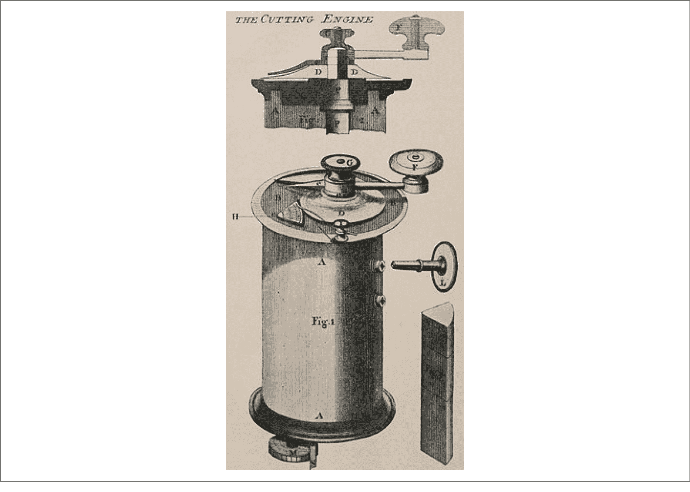

*图 7-8：一幅 1770 年的图表，展示了一台切片机。（来源：Wikimedia，[`commons.wikimedia.org/wiki/File:Cummings\_1774\_Microtome.jpg`](https://commons.wikimedia.org/wiki/File:Cummings_1774_Microtome.jpg))*

#### 荧光显微镜

`荧光显微镜`是一种基于荧光现象的光学显微镜，在此现象中，样本吸收一种波长的光，并发射另一种波长的光。这是一种自然的物理现象。例如，许多矿物在暴露于紫外光下时会发出荧光。然而，在生物学中这变得尤为有趣。许多细菌在其蛋白质吸收高能光并发射低能光时，会自然发出荧光。

##### 荧光团与荧光标记

`荧光团`是一种能在特定波长下重新发射光的化学化合物。这些化合物对生物学至关重要，因为它们使实验者能够详细成像细胞的特定成分。在实验中，`荧光团`通常被施加到特定细胞上。图 7-9 展示了一种常见`荧光团`的分子结构。


*图 7-9：DAPI（4',6-二脒基-2-苯基吲哚）是一种常见的荧光染料，能与富含腺嘌呤-胸腺嘧啶的 DNA 区域结合。由于它能穿过细胞膜，常用于染色细胞内部。（来源：Wikimedia，[`commons.wikimedia.org/wiki/File:DAPI.svg`](https://commons.wikimedia.org/wiki/File:DAPI.svg))*

`荧光标记`是一种使用`荧光团`标记待检测生物分子的方法。为此存在多种行之有效的方法。这些技术在显微镜中非常有用，因为在显微镜中通常需要突出显示制备样本的特定部分。`荧光标记`能非常有效地实现这一点。

`荧光显微镜`已被证明是生物学研究的巨大福音，因为它使研究人员能够放大观察生物样本的特定子系统，而不必关注整个样本。当研究单个细胞或细胞内的单个分子时，使用标签将注意力集中在有趣的子系统上可能非常有用。图 7-10 展示了如何使用荧光染料使人类细胞核内的特定染色体可见。


*图 7-10：人类淋巴细胞细胞核的图像，其中第 13 和 21 号染色体用 DAPI（一种常用的荧光染料）染色以发射光线。（来源：Wikimedia，[`commons.wikimedia.org/wiki/File:FISH\_13\_21.jpg`](https://commons.wikimedia.org/wiki/File:FISH_13_21.jpg))*

`荧光显微镜`可以成为一种精密仪器，用于成像单分子结合等事件。例如，蛋白质与配体的结合（如第 5 章所述）可通过荧光分析检测。

#### 样本制备伪影

重要的是要理解，样本制备可能是一个极其棘手的过程。样本制备过程中经常会出现待成像对象的失真，这可能导致困惑。一个有趣的例子是`中间体`，将在下面的警示中描述。

##### 中间体：一个虚构的细胞器

为电子显微镜固定细胞会产生一种伪影，即革兰氏阳性菌中的`中间体`（参见图 7-11）。最初人们认为，由样本制备引起的细胞壁内陷代表天然结构，而非伪影。

类似的伪影也可能存在于您的样本中。此外，深度网络完全有可能学会识别此类伪影，而不是我们感兴趣的生物学特征。

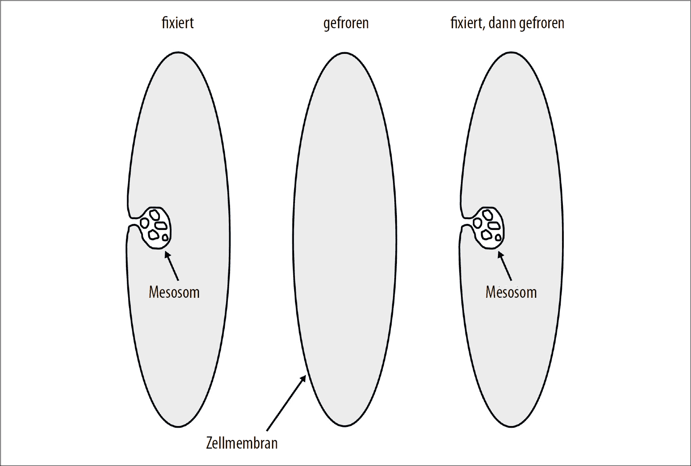

*图 7-11：中间体是为电子显微镜制备样本时产生的伪影，早先曾被认为代表细胞中的真实结构。（根据 Wikimedia，[`en.wikipedia.org/wiki/Mesosome#/media/File:Mesosome\_formation.svg`](https://en.wikipedia.org/wiki/Mesosome#/media/File:Mesosome_formation.svg))*


|  || **微观样本的来源** 在设计用于处理显微镜图像的系统时，了解样本的来源非常重要。每张图像都应附带其采集条件的信息。其中可能包括拍摄图像的设备、监督图像采集过程的技术人员、成像的样本以及采集样本的地点。对生物学进行“调试”非常困难。像上述警告中描述的问题可能会在数十年内都未被发现。请确保您的图像有足够的来源元数据，以避免出现重大问题。 |

---

### 深度学习应用

在本节中，我们将简要介绍深度学习在显微镜学中的各种应用，如细胞计数、细胞分割和计算分析的创建。正如本章前面所述，这只是深度显微镜学可能应用的一部分。然而，熟悉这些基本应用将为您提供开发自己应用所需的理解。

#### 细胞计数

一项简单的任务是计算给定图像中的细胞数量。您可能会想，为什么这会是一项有趣的任务。对于许多生物学实验来说，了解干预后存活的细胞数量非常有用。例如，细胞来自癌细胞系，而干预措施是一种抗癌疗法。成功的干预会减少存活癌细胞的数量，因此拥有一个无需人工干预即可确定这些细胞数量的深度学习系统将非常有帮助。

##### 什么是细胞系？

在生物学中，研究特定类型的细胞通常很有用。针对一组细胞进行实验的第一步是拥有足够数量的此类细胞。细胞系是指从单一来源培养并能在实验室条件下无限增殖的细胞。

细胞系已被用于大量生物学出版物，但关于利用它们进行的科学研究，往往存在严重担忧。首先，将细胞从其自然环境中移除可能会从根本上改变其生物学特性。越来越多的证据表明，细胞的环境可以从根本上影响其对刺激的反应。

更严重的是，细胞系经常受到污染。一种细胞系的细胞可能污染另一种细胞系的细胞，以至于一条“乳腺癌”细胞系的研究结果实际上根本无法说明任何关于乳腺癌的信息！

出于这些原因，细胞系研究通常应谨慎对待，且结果应通过动物或人体测试进行验证。尽管如此，细胞系研究为生物学研究提供了一个简单的切入点，且依然无处不在。

正如图 7-12 所示，细胞显微镜学中的成像条件可能与标准成像条件有显著差异。因此，`Convolutional Neural Networks`（卷积神经网络）等方法能否适应细胞计数等任务并不显而易见。幸运的是，大量实验工作表明，`Convolutional Networks`（卷积网络）能够很好地从显微镜数据集中学习。


*图 7-12：果蝇细胞。请注意，显微镜图像中的成像条件可能与照片中的成像条件有显著差异。（来源：Cell Image Library, [`cellimagelibrary.org/images/21780`](http://cellimagelibrary.org/images/21780))*

##### 在 DeepChem 中实现细胞计数

本节介绍如何使用 `DeepChem` 创建用于细胞计数的深度学习模型。首先，我们加载并准备一个用于细胞计数的数据集。为此，我们使用 `Broad Bioimage Benchmark Collection`（BBBC，[`data.broadinstitute.org/bbbc/`](https://data.broadinstitute.org/bbbc/)）。

|  || **BBBC 数据集** BBBC 数据集包含来自各种细胞分析的带注释成像数据集的有用集合。它是训练您自己的深度显微镜模型的有用来源。`DeepChem` 拥有一套图像处理工具，以便于处理这些数据集。特别是 `DeepChem` 的 `ImageLoader` 类使加载数据集变得更加容易。 |

---

|  || **处理图像数据集** 图像通常以常见图像文件格式（PNG、JPEG 等）存储在磁盘上。图像数据集处理管道从磁盘读取这些文件，并将其转换为内存中的合适表示形式，通常是一个多维数组。在 Python 管道中，这通常是一个 `NumPy` 数组。对于一个高 *N* 像素、宽 *M* 像素且具有三个 RGB 颜色通道的图像，将获得形状为 (*N*, *M*, 3) 的数组。十张这样的图像通常会被组织在一个形状为 (10, *N*, *M*, 3) 的数组中。 |

---

在将数据集加载到 `DeepChem` 之前，必须先将它们保存在本地。我们将用于此任务的 `BBBC005` 数据集相对较大（略低于 2 GByte）。因此，请确保您的计算机有足够的存储空间：

```
wget https://data.broadinstitute.org/bbbc/BBBC005/BBBC005_v1_images.zip
unzip BBBC005_v1_images.zip
```

数据集下载完成后，可以使用 `ImageLoader` 在 `DeepChem` 中加载：

```
image_dir = 'BBBC005_v1_images'
files = []
labels = []
for f in os.listdir(image_dir):
    if f.endswith('.TIF'):
        files.append(os.path.join(image_dir, f))
        labels.append(int(re.findall('_C(.*?)_', f)[0]))
loader = dc.data.ImageLoader()
dataset = loader.featurize(files, np.array(labels))
```

这段代码会搜索下载的图像目录并检索单个图像。标签包含在文件名中，因此我们使用正则表达式来提取每张图像的细胞数量。我们利用 `ImageLoader` 将其转换为 `DeepChem` 数据集。

接下来，我们将此数据集分别拆分为训练集、验证集和测试集：

```
splitter = dc.splits.RandomSplitter()
train_dataset, valid_dataset, test_dataset = splitter.train_valid_test_split(
    dataset, seed=123)
```

现在我们可以定义模型了。我们创建一个简单的卷积模型，并在末尾添加一个全连接层：

```
learning_rate = dc.models.tensorgraph.optimizers.ExponentialDecay(0.001, 0.9, 250)
model = dc.models.TensorGraph(learning_rate=learning_rate, model_dir='model')
features = layers.Feature(shape=(None, 520, 696))
labels = layers.Label(shape=(None,))
prev_layer = features
for num_outputs in [16, 32, 64, 128, 256]:
    prev_layer = layers.Conv2D(num_outputs, kernel_size=5, stride=2, in_layers=prev_layer)
output = layers.Dense(1, in_layers=layers.Flatten(prev_layer))
model.add_output(output)
loss = layers.ReduceSum(layers.L2Loss(in_layers=(output, labels)))
model.set_loss(loss)
```


请注意，我们使用 `L2Loss` 将模型作为回归任务进行训练。尽管细胞数量是整数，但一张图像中包含的细胞数量没有上限。

训练此模型需要一定的计算资源（稍后详述）。因此，我们建议首先使用我们的预训练模型。该模型开箱即用，可直接进行预测。关于下载预训练模型的说明位于本书配套的代码仓库中（*[`github.com/deepchem/DeepLearningLifeSciences`](https://github.com/deepchem/DeepLearningLifeSciences)*）。下载完成后，您可以将预训练权重加载到模型中：

```
model.restore()
```

让我们试用一下这个预训练模型。首先，我们计算测试数据集上细胞计数任务的平均预测误差：

```
y_pred = model.predict(test_dataset).flatten()

print(np.sqrt(np.mean((y_pred-test_dataset.y)**2)))
```

运行模型后您获得了怎样的准确率？

现在如何自行训练此模型？您可以通过训练 50 个周期来对其进行微调：

```
model.fit(train_dataset, nb_epoch=50)
```

此任务需要相当大的算力。在性能良好的 GPU 上，该过程应在约一小时内完成。在纯 CPU 系统上可能无法训练此模型。

训练完成后，请在验证集和测试集上检查模型的准确率。其表现是否与预训练模型相当？

## 细胞分割

细胞分割是指使用标注来标明细胞与背景位置的显微镜细胞图像。这有什么用？如果您还记得我们之前对革兰氏阳性菌和革兰氏阴性菌的描述，您大概能猜到为何开发一个自动化系统来区分这两类细菌是值得的。在细胞显微镜领域（以及其他成像领域，正如我们将在第 8 章中看到的那样），类似的问题层出不穷。

分割掩膜提供了更高的分辨率，并支持比单纯计数细胞更精确的分析。例如，了解培养皿中有多大比例的面积被细胞覆盖可能很有用。如果有分割掩膜可用，此类分析很容易进行。图 7-13 展示了一个源自合成数据集的分割掩膜。

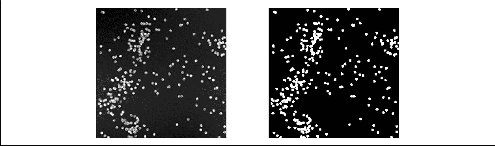

*图 7-13：合成细胞数据集（左侧）连同前景和背景掩膜，指示图像中细胞出现的位置。（来源：Broad Institute, [`data.broadinstitute.org/bbbc/BBBC005/`](https://data.broadinstitute.org/bbbc/BBBC005/))*

然而，分割对机器学习模型的要求远高于单纯的计数。为了准确区分细胞区域和非细胞区域，学习过程必须更加精确。因此，让分割方法在机器学习中奏效，比单纯计数细胞更难，这并不令人惊讶。在本章后续内容中，我们还将尝试使用一个分割模型。

|  | | **分割掩膜从何而来？** 正如我们所见，分割掩膜是复杂的结构。通常不存在好的算法（深度学习方法除外）来创建此类掩膜。我们如何获取优化此类分割方法所需的训练数据？一种方法是使用合成数据，如图 7-13 所示。由于细胞图像是合成生成的，因此掩膜也可以合成生成。然而，这一实用技巧有其局限性，因为学到的分割方法仅局限于类似的图像。 |
| --- | --- | --- |
| | | 一种更通用的方法是让人工生成合适的分割掩膜。类似的程序已广泛用于训练自动驾驶汽车。在这项任务中，区分行人和路标至关重要，因此有大量人力投入以生成所需的训练数据。随着显微镜领域机器学习的重要性日益增加，类似的程序很可能也将在该领域变得重要。 |

### DeepChem 中的细胞分割实现

在本节中，我们将在之前用于细胞计数的同一 BBBC005 数据集上训练一个细胞分割模型。然而，存在一个关键差异。在细胞计数任务中，每张图像有一个计数值作为标签。而在细胞分割中，每个标签本身就是一张图像。这意味着细胞分割模型更像是一种“图像转换”，而非简单的分类或回归模型。我们首先下载该数据集。为此，我们使用以下命令从 BBBC 网站获取分割掩膜：

```
wget https://data.broadinstitute.org/bbbc/BBBC005/BBBC005_v1_ground_truth.zip

unzip BBBC005_v1_ground_truth.zip
```

Ground-truth 数据集大小约为 10 MB，因此下载起来应该比完整的 BBBC005 数据集容易得多。接下来，我们将此数据集加载到 DeepChem 中。幸运的是，`ImageLoader` 的设计使其能够无需太多额外工作即可处理图像分割数据集：

```
image_dir = 'BBBC005_v1_images'

label_dir = 'BBBC005_v1_ground_truth'

rows = ('A', 'B', 'C', 'D', 'E', 'F', 'G', 'H', 'I', 'J', 'K', 'L',
'M', 'N', 'O', 'P')

blurs = (1, 4, 7, 10, 14, 17, 20, 23, 26, 29, 32, 35, 39, 42, 45, 48)

files = []
labels = []

for f in os.listdir(label_dir):
    if f.endswith('.TIF'):
        for row, blur in zip(rows, blurs):
            fname = f.replace('_F1', '_F%d'%blur).replace('_A', '_%s'%row)
            files.append(os.path.join(image_dir, fname))
            labels.append(os.path.join(label_dir, f))

loader = dc.data.ImageLoader()
dataset = loader.featurize(files, labels)
```

数据集加载并处理完毕后，我们可以构建深度学习模型。和之前一样，我们将该数据集分别划分为训练集、验证集和测试集：

```
splitter = dc.splits.RandomSplitter()
train_dataset, valid_dataset, test_dataset = splitter.train_valid_test_split(
dataset, seed=123)
```

我们可以使用什么模型进行图像分割？仅使用简单的卷积神经网络是不够的，因为我们的输出同样是一张图像（分割掩膜）。幸运的是，已有研究探讨了适合此任务的模型。`U-Net` 模型使用一系列堆叠的卷积，逐步将原始图像“下采样”然后再“上采样”，如图 7-14 所示。该模型非常适合图像分割。

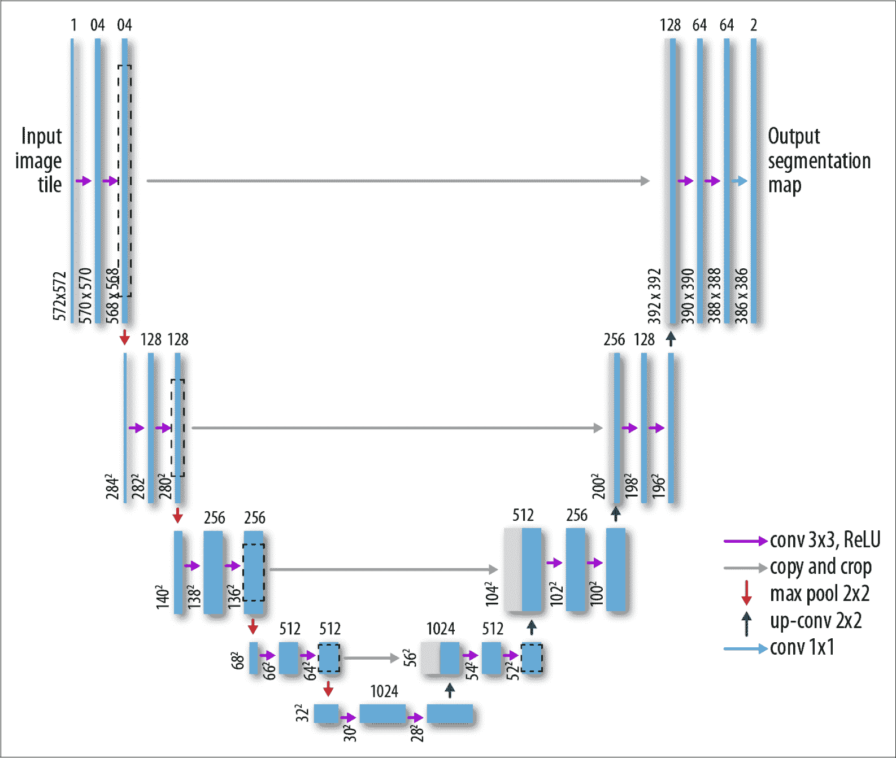

*图 7-14：用于生物医学图像分割的 U-Net 架构示意图（基于弗赖堡大学的研究，[`lmb.informatik.uni-freiburg.de/people/ronneber/u-net/`](https://lmb.informatik.uni-freiburg.de/people/ronneber/u-net/))。*

我们现在在 DeepChem 中实现 `U-Net`：


# 医学中的深度学习

## 代码示例：用于图像分割的 U-Net

```python
learning_rate = dc.models.tensorgraph.optimizers.ExponentialDecay(0.01, 0.9, 250)

model = dc.models.TensorGraph(learning_rate=learning_rate,
                              model_dir='segmentation')

features = layers.Feature(shape=(None, 520, 696, 1)) / 255.0
labels = layers.Label(shape=(None, 520, 696, 1)) / 255.0

# 三次下采样
conv1 = layers.Conv2D(16, kernel_size=5, stride=2, in_layers=features)
conv2 = layers.Conv2D(32, kernel_size=5, stride=2, in_layers=conv1)
conv3 = layers.Conv2D(64, kernel_size=5, stride=2, in_layers=conv2)

# 1x1 卷积（瓶颈层）
conv4 = layers.Conv2D(64, kernel_size=1, stride=1, in_layers=conv3)

# 三次上采样（带跳跃连接）
concat1 = layers.Concat(in_layers=[conv3, conv4], axis=3)
deconv1 = layers.Conv2DTranspose(32, kernel_size=5, stride=2, in_layers=concat1)

concat2 = layers.Concat(in_layers=[conv2, deconv1], axis=3)
deconv2 = layers.Conv2DTranspose(16, kernel_size=5, stride=2, in_layers=concat2)

concat3 = layers.Concat(in_layers=[conv1, deconv2], axis=3)
deconv3 = layers.Conv2DTranspose(1, kernel_size=5, stride=2, in_layers=concat3)

# 计算输出
concat4 = layers.Concat(in_layers=[features, deconv3], axis=3)
logits = layers.Conv2D(1, kernel_size=5, stride=1, activation_fn=None,
                       in_layers=concat4)
output = layers.Sigmoid(logits)

model.add_output(output)

loss = layers.ReduceSum(layers.SigmoidCrossEntropy(in_layers=(labels, logits)))
model.set_loss(loss)
```

这种结构比用于细胞计数的结构稍微复杂一些，但我们使用了相同的堆叠卷积层基本结构来获得我们想要的模型。同样，我们利用预训练模型来测试该结构。关于下载预训练模型的说明请参见本书的代码仓库（*https://github.com/deepchem/DeepLearningLifeSciences*）。一旦您传输了预训练权重，即可加载权重：

```python
model.restore()
```

借助该模型，我们生成一些掩码。通过 `model.predict_on_batch()`，我们可以预测输入批次的掩码。我们通过将生成的掩码与真实标签数据集的掩码进行比较并检查重叠比例，来验证预测的准确性：

```python
scores = []

for x, y, w, id in test_dataset.itersamples():
    y_pred = model.predict_on_batch([x]).squeeze()
    scores.append(np.mean((y > 0) == (y_pred > 0.5)))

print(np.mean(scores))
```

输出值应约为 `0.9899`。这意味着近 99% 的像素被正确预测！这是一个不错的结果，但请记住，这只是一个非常简单的示例。基于图像亮度阈值的图像处理算法可能效果同样好。然而，此处展示的步骤也应适用于更复杂的图像数据集。

在研究了预训练模型之后，我们要训练一个 U-Net 50 个周期：

```python
model.fit(train_dataset, nb_epoch=50, checkpoint_interval=100)
```

该训练计算量大，在性能良好的 GPU 上将运行数小时。在 CPU 系统上可能无法训练此模型。训练完成后，请自行评估结果。您能达到预训练模型的准确度吗？

## 计算辅助分析

细胞计数和分割是相对简单的视觉任务。因此，机器学习模型在这些任务上表现良好并不令人惊讶。人们可能会问，这难道就是机器学习的全部能力吗？

幸运的是，答案是：不是！机器学习模型能够捕捉数据集中的细微信号。例如，一项研究表明，深度学习模型能够仅根据源图像预测荧光标记的结果。[³] 正如我们在“为显微镜准备生物样本”（第 112 页）中所见，荧光染色过程可能非常繁琐。深度学习有可能承担部分所需的准备工作，这令人惊叹。

尽管这是一个令人振奋的结果，但我们仍处于起步阶段。仍需大量工作来“稳健化”这些方法，以便它们能得到更广泛的应用。

### 总结

在本章中，我们介绍了显微镜学的基础知识以及一些针对显微镜系统的基本机器学习方法。我们全面介绍了现代显微镜学的一些基本问题（特别是与生物学问题相关的），并探讨了深度学习已应用的领域及未来潜在的应用领域。

此外，我们详细概述了显微镜学的一些物理和生物学方面，并试图阐明为何这些知识对主要关注构建有效管线以处理显微镜图像和模型的开发者也很有用。了解衍射极限等物理规律，有助于理解为何使用不同的显微镜技术，以及深度学习未来如何在此发挥重要作用。了解生物样本制备技术，有助于理解开发显微镜系统所需的元数据和注释类型。

虽然我们对深度学习方法在显微镜学中的潜在应用感到兴奋，但重要的是要强调，这些方法并非没有保留。首先，多项较新研究强调了视觉卷积模型的敏感性。[⁴] 简单的伪影就可能使此类模型失效并导致严重问题。例如，如果停车标志的图像模糊不清，模型可能会将其分类为绿灯。对于自动驾驶汽车来说，那将是灾难性的！

因此，询问深度显微镜学存在哪些困难是值得的。深度显微镜模型是否可能只是从存储的先前数据点中“填补”而来？虽然这不能完全解释其性能，但这些模型的性能至少一部分很可能源于此类存储数据的回流。这可能导致虚假相关性。因此，在对显微镜数据集进行科学分析时，质疑结果是归因于模型中的伪影还是实际的生物学现象至关重要。在接下来的章节中，我们将介绍一些工具，供您批判性地检查模型，以确定模型究竟学到了什么。

在下一章中，我们将探讨深度学习在医学中的应用。我们将重用本章涵盖的许多视觉深度学习主题。

# 第 8 章

# 医学中的深度学习

正如我们在上一章所见，从视觉数据集中提取有意义信息的能力对于分析显微镜图像很有用。视觉数据处理对于医学应用同样宝贵。如今，医生必须能够批判性地分析医学扫描。深度学习可以使这些分析更简单、更快捷（但可能更难以解读）。

[³]: 脚注引用 3
[⁴]: 脚注引用 4


## 计算机辅助诊断与医学中的早期 AI 方法

首先，我们简要回顾一下早期的计算机辅助方法。我们将探讨这些方法的一些局限性，随后开始介绍当前用于医学的深度学习方法。在此过程中，我们将阐述这些新方法如何规避旧方法的一些基本局限。我们将以对在医学中应用深度学习的伦理考量的讨论来结束本章。

## 计算机辅助诊断

计算机辅助诊断系统的开发是 AI 研究的一个重点。早期的尝试使用了手工制作的科学数据库。^(1) 在这些系统中，专科医生被要求记录因果推理规则（参见图 8-1 中的示例）。

这些系统通过置信因子为处理不确定性提供了基本支持。

这些规则与一个逻辑系统相结合。开发出了一系列推理技术，能够关联包含规则的大型数据库。这些系统通常被称为“专家系统”。

```
IF
1) The stain of the organism in grampos, and (01)
2) The morphology of the organism is COCCUS, and (02)
3) The growth confirmation of the organisms chains (03)
THEN
There is suggestive evidence (0.7) that the identity of the organism is streptococus. (h1)
```

*图 8-1：MYCIN 是最早用于诊断细菌感染的专家系统之一。这是一个 MYCIN 推理规则的示例（萨里大学，[`www.computing.surrey.ac.uk/ai/PROFILE/mycin.html#Certainity%20Factors`](http://www.computing.surrey.ac.uk/ai/PROFILE/mycin.html#Certainity%20Factors)）。*

> **专家系统后来怎么样了？**
> 尽管专家系统取得了一些显著的成功，但构建这些系统非常耗费精力。规则必须由专家仔细获取，并由受过训练的“知识工程师”维护。即使某些专家系统在特定领域取得了显著成果，但总体而言，它们过于薄弱，未能广泛普及。尽管如此，专家系统对计算机科学产生了重大影响，现代技术（SQL、XML、贝叶斯网络等）的许多核心思想都可追溯至此。
>
> 请思考一下。尽管专家系统曾经非常流行，但如今它们主要作为历史遗存而存在。极有可能，当今大多数流行的技术终将步其后尘。这是计算机科学的一个特性，而非缺陷。该行业自我革新迅速；如果当今的工具无法完成某项任务，其替代品将能胜任。同时，我们可以确信，当今技术的算法基础将在明天的工具中延续。

医学专家系统运行良好。其中一些系统非常普及，并在国际上得到采用。^(2) 然而，在临床日常工作中，这些系统未能获得医生和护士的广泛支持。首先，它们难以使用；此外，用户必须以高度结构化的格式输入患者信息。由于当时计算机在诊所中几乎不存在，对医生和护士进行相应培训被证明是一个过大的挑战。

## 基于贝叶斯网络的概率诊断

专家系统的另一个问题在于，它们只能提供确定性预测。这些预测几乎不给不确定性留下空间。如果医生面前的患者诊断不明确，该怎么办？一度似乎专家系统可以通过修改来考虑不确定性，从而取得成功。

这一认识引发了大量关于临床诊断中贝叶斯网络的研究。（本书作者之一在学生时代曾花费一年时间研究此类系统。）然而，许多此类系统也具有与专家系统相同的局限性。仍然需要从医生那里获取结构性知识，临床贝叶斯网络的开发者面临着从医生那里获取有意义概率的挑战。这导致了大量的额外工作量。

此外，训练贝叶斯网络可能很复杂。不同类型的贝叶斯网络需要不同的逻辑/算法。相比之下，梯度方法几乎适用于所有深度学习算法的网络。通常，学习的鲁棒性促成了广泛的接受。这一基本认识引发了大量关于临床诊断中贝叶斯网络的研究（有关简单贝叶斯网络示例，请参见图 8-2）。

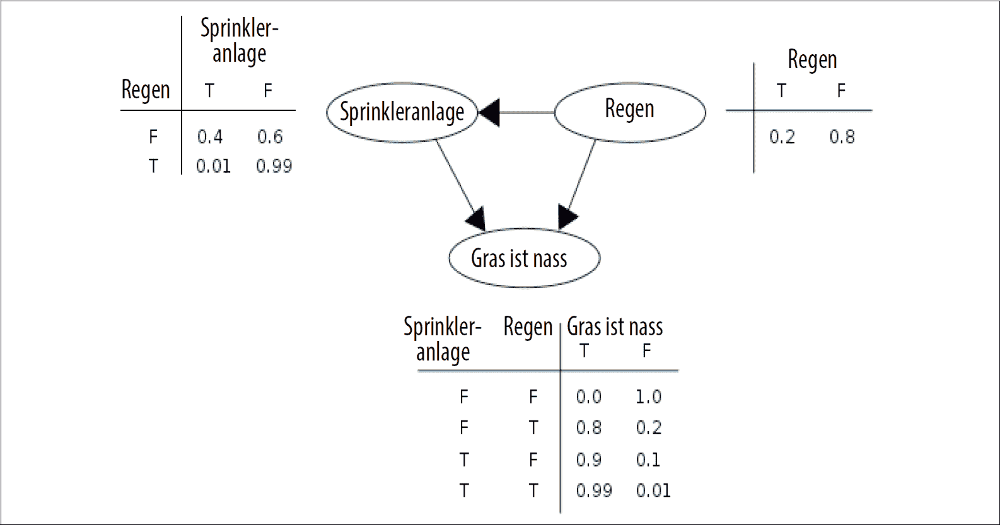

*图 8-2：一个简单的贝叶斯网络示例，用于推断某特定位置的草地是否湿润。（来源：Wikimedia，[`commons.wikimedia.org/wiki/File:SimpleBayesNet.svg`](https://commons.wikimedia.org/wiki/File:SimpleBayesNet.svg)）*

> **用户友好性促进接受度**
> 专家系统和贝叶斯网络未能普及。部分原因在于开发者对这两种系统都有不佳的体验。构建贝叶斯网络或专家系统时，开发者始终需要有医生在场协助。此外，系统的有效性关键取决于开发团队从医生那里获取有价值见解的能力。
>
> 将其与深度网络进行比较。对于给定的数据类型（图像、分子、文本等）和特定的学习任务，有多种指标可用。要创建一个功能系统，开发者只需遵循经过验证的统计方法（如本书或其他书籍所述）。这大大降低了对专家知识的依赖。这种简化解释了深度网络获得更广泛接受的部分原因。

## 电子健康档案

最初，医院为患者保存纸质档案。这些档案包含患者的检查、药物和其他治疗记录，以便医生能一眼掌握患者的健康状况。不幸的是，纸质病历导致了各种困难。医院间的数据传输需要大量工作，且纸质档案难以建立索引或搜索。

因此，在过去几十年里，许多国家投入巨大努力，从纸质病历转向电子患者档案（ePA，英文 EHR）。在美国，《平价医疗法案》的通过显著加速了这一接受进程，如今大多数大型美国医疗服务提供者都将患者数据存储在 EHR 系统中。


# Die große Akzeptanz von EHR-Systemen

Die große Akzeptanz von EHR-Systemen hat einen Boom in der Machine-Learning-Forschung für die Verarbeitung von EHR-Daten ausgelöst. Diese Systeme verwenden große Datenmengen, um Modelle zu trainieren, die unter anderem in der Lage sind, Ergebnisse und Risiken für Patienten vorherzusagen. In vielerlei Hinsicht sind diese EHR-Modelle die intellektuellen Nachfolger der Expertensysteme und Bayes’schen Netze. Ebenso wie die früheren Systeme versuchen auch EHR-Modelle, den Diagnoseprozess zu unterstützen. Während frühere Systeme jedoch die Ärzte mit Echtzeitdiagnosen unterstützen wollten, begnügen sich die neueren Systeme (meistens) mit der Arbeit im Hintergrund.

Viele Projekte haben versucht, robuste Modelle anhand von EHR-Daten zu entwickeln. Obwohl einige beachtliche Erfolge verzeichnet werden konnten, bleiben die EHR-Daten eine Herausforderung. Aufgrund von datenschutzrechtlichen Bedenken sind nicht viele große EHR-Datensätze öffentlich verfügbar. Deshalb war bisher nur eine kleine Gruppe von Forschern in der Lage, diese Systeme zu entwickeln. Des Weiteren sind EHR-Daten in der Regel chaotisch. Da die Informationen von Ärzten und Krankenschwestern manuell eingegeben werden, sind viele EHR-Daten unvollständig und nicht einheitlich. Die Entwicklung robuster Modelle, die mit fehlenden Daten umgehen können, erweist sich als schwierig.

## ICD-10-Codes

Die ICD-10 ist eine Reihe von »Codes« für Krankheiten und Symptome. Diese Codes haben in den letzten Jahren breite Anwendung gefunden, da sie es Versicherern und Regierungsbehörden ermöglichen, Standardpraktiken, Behandlungen und Behandlungskosten für Krankheiten festzulegen.

Die ICD-10-Codes »quantisieren« (diskretisieren) das hochdimensionale stetige Spektrum menschlicher Krankheiten. Das Standardisieren ermöglicht Ärzten, Patienten zu vergleichen und zu gruppieren. Aus diesem Grund werden sich solche Codes wahrscheinlich als wichtig für Entwickler von EHR-Systemen und -Modellen erweisen. Wenn Sie an einer Datenbank für ein neues EHR-System arbeiten, sollten Sie sich überlegen, wo Sie Ihre Codes ablegen!

### Fast Healthcare Interoperability Resources (FHIR)

Die **Fast Healthcare Interoperability Resources** (FHIR)-Spezifikation wurde entwickelt, um klinische Daten in einem standardisierten und anpassungsfähigen Format darstellen zu können.^[3] Jüngste Publikationen von Google haben gezeigt, wie rohe EHR-Daten automatisch in das FHIR-Format umgewandelt werden können.^[4] Die Verwendung dieses Formats ermöglicht die Entwicklung von Strukturen, die auf beliebige EHR-Daten angewendet werden können. Dies bedeutet, dass Open-Source-Tools für diese Daten Plug-and-play-fähig sind. Auch wenn sich diese Arbeit noch im Anfangsstadium befindet, stellt sie einen spannenden Fortschritt für das Gebiet dar. Obwohl das Standardisieren auf den ersten Blick langweilig erscheint, ist es die Grundlage für zukünftige Fortschritte, da damit größere Datenmengen produktiv bearbeitet werden können.

Dieser Zustand beginnt sich jedoch zu verändern. Verbesserte Tools, sowohl für die Vorverarbeitung als auch für das Lernen, ermöglichen nach und nach ein effektives Lernen auf EHR-Systemen. Das `DeepPatient`-System trainiert einen Entrauschungs-Autoencoder auf Patientenakten, um eine Patientendarstellung zu erzeugen, die es anschließend zur Ergebnisvorhersage verwendet.^[5] Hierbei wird eine Patientenakte aus ungeordneten Textinformationen in einen Vektor umgewandelt. Diese Vorgehensweise der Umwandlung unterschiedlicher Datentypen in Vektoren ist im Deep Learning erfolgreich und scheint auch für EHR-Systeme geeignet zu sein. Etliche Modelle, die auf EHR-Systemen beruhen, sind in der Literatur erschienen. Viele davon beginnen, die neuesten Tools von Deep Learning zu integrieren, wie etwa Recurrent Networks oder das Reinforcement Learning. Auch wenn diese Modelle noch nicht ausgereift sind, geben sie Hinweise darauf, wie sich das Feld in den nächsten Jahren entwickeln wird.

## Was ist mit unüberwachtem Lernen?

Der Großteil dieses Buchs befasst sich mit Methoden des überwachten Lernens. Es gibt jedoch auch eine ganze Klasse »unüberwachter« Methoden, die nicht die gleiche Abhängigkeit wie beaufsichtigte Methoden aufweisen. Bisher haben wir unüberwachtes Lernen noch nicht als Konzept eingeführt, aber die Grundidee ist, dass Datenpunkte keine Labels mehr haben. Beispielsweise haben wir eine Reihe von EHR-Daten, aber keine Angaben zum Ergebnis. Was können wir tun?

Die einfachste Antwort lautet, dass wir die Datensätze *gruppieren* können. Stellen Sie sich vor, wir hätten »Zwillings«-Patienten, deren EHR-Aufzeichnungen identisch sind. Es scheint einleuchtend, zu behaupten, dass die Ergebnisse dieser beiden Patienten ähnlich sein werden. Unüberwachte Lernmethoden wie *k*-Means oder Autoencoder setzen eine anspruchsvollere Version dieser Grundidee um. In Kapitel 9 werden Sie ein Beispiel dafür sehen.

Unüberwachte Lernmethoden können überzeugende Erkenntnisse liefern, diese Methoden resultieren aber zuweilen auch in Zufallstreffern. Obwohl es durchaus überzeugende Anwendungsfälle wie `DeepPatient` gegeben hat, sind unüberwachte Methoden im Großen und Ganzen immer noch so knifflig, dass sie noch keine breite Anwendung finden. Die Arbeit an Möglichkeiten zur Stabilisierung unüberwachten Lernens bleibt ein dringendes (und herausforderndes) bestehendes Problem.

## Worin liegen die Gefahren großer EHR-Datenbanken?

Etliche große Institutionen streben an, alle ihre Patienten in EHR-Systemen anzulegen. Was geschieht, wenn diese großen Datenmengen standardisiert (möglicherweise in einem Format wie FHIR) und interoperabel werden? Anwendungen, wie die Suche nach Patienten mit einem bestimmten Krankheitsbild, würden unterstützt. Diese gezielten Suchfunktionen können Ärzten dabei helfen, Behandlungen für Patienten zu finden, insbesondere für Patienten mit seltenen Erkrankungen.

Man braucht jedoch nicht viel Fantasie, um zu sehen, dass große Datenmengen auch zu missbräuchlichen Zwecken verwendet werden könnten. Zum Beispiel könnten Versicherungen diese Systeme nutzen, um Patienten mit höherem Risiko die Versicherung vorzeitig zu verweigern, oder Top-Chirurgen, die eine hohe Überlebensrate der Patienten anstreben, könnten vermeiden, Patienten zu operieren, die das System als Risikopatienten einstuft. Wie schützen wir uns vor diesen Gefahren?

Viele der Fragen, die von Machine-Learning-Systemen aufgeworfen werden, können nicht von ihnen beantwortet werden. Vielmehr liegen die Antworten auf diese Fragen in der Gesetzgebung, die unlauteres Verhalten von Ärzten, Versicherungen und anderen verbietet.

### Helfen EHRs Ärzten wirklich?

Obwohl EHRs offensichtlich bei der Entwicklung von Lernalgorithmen helfen, gibt es weniger überzeugende Beweise dafür, dass EHRs tatsächlich die Situation für Ärzte verbessern. Heutige EHR-Systeme erfordern umfangreiche manuelle Dateneingaben durch Ärzte. Für Patienten bedeutet das, dass der Arzt den größten Teil seiner Konsultation damit verbringt, den Computer anzusehen und nicht mehr den vor ihm sitzenden Patienten.

Dieser Zustand macht sowohl Patienten als auch Ärzte unglücklich.^[6] Ärzte fühlen sich ausgebrannt, da sie den größten Teil ihrer Zeit mit der Dateneingabe anstatt der Patientenversorgung verbringen, und Patienten fühlen sich vernachlässigt. Dieses Missverhältnis kann hoffentlich von zukünftigen Deep-Learning-basierten Systemen verbessert werden.

Beachten Sie jedoch, dass es möglich ist, dass sich die nächste Generation von Deep-Learning-Tools für Ärzte als ebenso lästig und nutzlos erweisen könnte. Auch die Entwickler von EHR-Systemen wollten keine schlechten Systeme schaffen.


### 深度放射学

放射学是利用医学扫描诊断疾病的科学。医生使用各种不同的扫描，例如 MRI 扫描、超声波、X 光片和 CT 扫描。对于每种程序，挑战在于根据生成的扫描诊断患者的状况。这一挑战似乎非常适合卷积模型。正如我们在前几章所见，深度学习方法可以从图像数据中学习复杂函数。现代放射学的很大一部分（至少是机械性组成部分）在于对复杂医学图像进行分类和处理。扫描在医学中已使用很长时间（有关早期 X 光片的示例，请参见图 8-4）。

在本节中，我们将介绍几种扫描类型以及定性相似的深度学习应用。所有应用都始于一个足够大的扫描数据集，用于训练卷积神经网络（参见图 8-3）。该模型通常是普通的 VGG 或 ResNet 模型，有时但会对基本结构进行一些更改。根据朴素统计，训练好的模型通常显示出针对相应任务的强大性能。

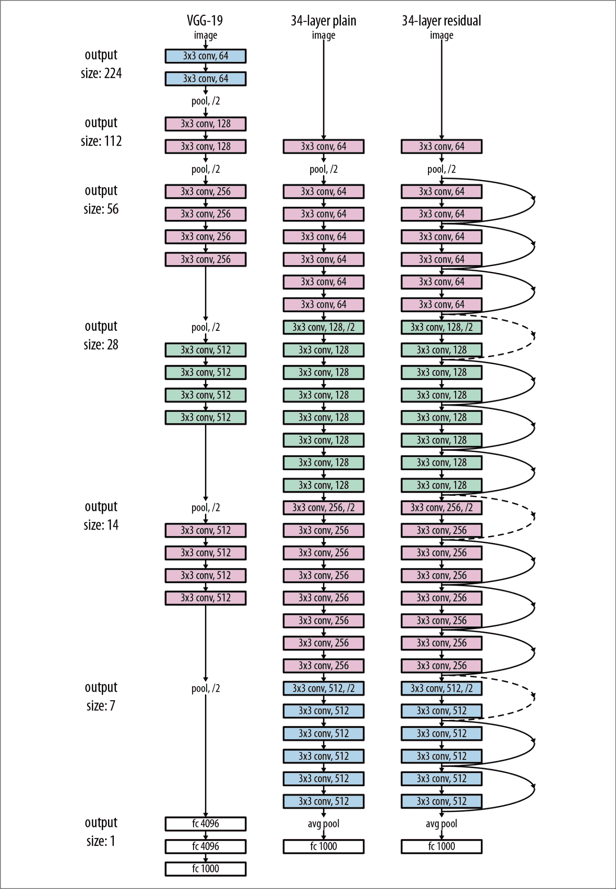

*图 8-3：此图展示了一些常见的卷积模型（VGG-19、ResNet-34，数字表示应用的卷积层数）。这些架构是用于医学图像任务的常用模型。*

这些结果可能导致了过高的期望。一些高层 AI 科学家，首当其冲的是 Geoff Hinton，曾指出放射学领域的深度学习将发展到这样一个地步：很快培养新放射科医生将不再值得。^(7) 真是这样吗？最近，一系列深度学习系统实现了类人表现。然而，这些结果应持保留态度，且不应忘记这些系统通常很敏感。

我们认为，一对一取代医生的风险仍然很低，但存在系统性取代的风险。这是什么意思？新创公司正在研究新的商业模式，其中深度学习系统执行大部分扫描分析，仅涉及少数医生。

|  | | **深度学习真的在学医学吗？** 一项深入分析调查了模型究竟从医学图像中学到了什么。不幸的是，在许多情况下，模型似乎也捕捉到了图像的非医学因素。例如，模型可能隐性地学会识别扫描进行的诊所。由于某些诊所常用于较严重或较轻微的病例，模型看起来似乎学到了有用信息，但实际上通常毫无用处。 |
| --- | --- | --- |
| | | 在这种情况下可以做什么？这仍在讨论中，但已出现一些方法。一种是利用不断增长的模型可解释性文献，来研究模型到底学到了什么。在第 10 章中，我们将探讨几种模型可解释性方法。 |
| | | 另一种方法是进行使用模型的前瞻性临床试验。前瞻性研究仍然是测试拟议医疗干预的金标准，这很可能也适用于深度学习方法。 |

#### X 光片和 CT 扫描

X 光检查——严格来说是 X 线摄影——利用 X 射线查看体内内部结构（参见图 8-4）。计算机断层扫描（CT）是 X 光片的一种变体，其中 X 射线源和探测器围绕待成像物体旋转，从而实现 3-D 成像。


*图 8-4：第一张医学 X 光片。Wilhelm Röntgen 为其妻子 Anna Bertha Ludwig 的手拍摄了这张照片。自这张首张照片以来，X 线科学已取得长足进步，借助深度学习，它可以走得更远！*

一个普遍的误解是 X 光片只能成像骨骼等“硬”物体。这是不正确的。CT 扫描常规用于大脑等组织的成像（参见图 8-5），X 光扫描仪常用于机场安检对旅客进行透视。乳腺 X 线摄影也使用低能 X 射线扫描乳腺组织。

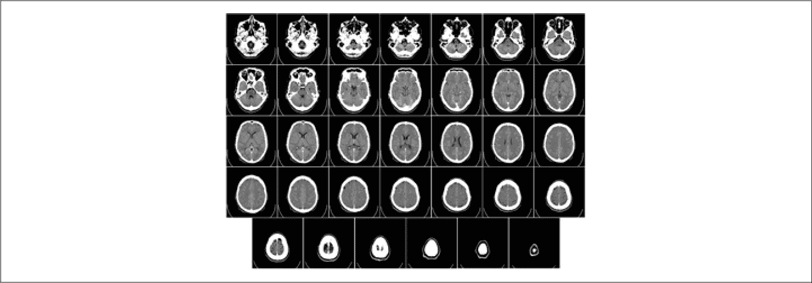

*图 8-5：从下至上的一个人脑 CT 扫描。请注意 CT 如何能很好地呈现 3-D 信息。（来源：Wikimedia，[`commons.wikimedia.org/wiki/File:Computed\_tomography\_of\_human\_brain\_-\_large.png`](https://commons.wikimedia.org/wiki/File:Computed_tomography_of_human_brain_-_large.png))*

值得注意的是，所有 X 光扫描均已知与癌症有关。因此，共同目标是通过限制所需扫描数量，将患者的辐射暴露降至最低。这尤其影响 CT 检查，患者必须长时间暴露于辐射下以收集足够数据。开发了多种信号处理算法以减少所需扫描数量。一些近期论文利用深度学习进一步最小化 CT 所需的扫描数量。

目前，深度学习在该领域主要仍用于扫描分类。例如，卷积神经网络已被用于根据大脑 CT 扫描对阿尔茨海默病的进展进行分类。^(8) 其他论文称能通过胸部 X 光片以近乎医生的准确度诊断肺炎。^(9) 同样，深度学习也被用于实现乳腺 X 光片分类的高准确度。^(10)

|  | | **达到人类准确度很难！** 当论文声称所提出的系统达到近乎人类的准确度时，这意味着什么？通常，作者选择一个指标（如 ROC AUC），一组无关医生致力于用标注标记选定的测试数据集。然后将模型在该测试数据集上的准确度与“平均”医生的准确度进行比较（通常为医生评分的平均值或中位数）。 |
| --- | --- | --- |
| | | 这是一个相当复杂的过程，很多地方可能出错。首先，所选指标可能起作用。因此，好的分析会考虑不同指标，以确保结论经得起潜在变异的考验。 |


|   || Zweitens gibt es erhebliche Unterschiede zwischen den Ärzten. Es lohnt sich, zu prüfen, ob es ausreicht, nur den »Durchschnitt« zu betrachten. Eine bessere Metrik könnte sein, zu prüfen, ob der Algorithmus in der Lage ist, den »besten« Arzt zu schlagen. |

|   || Drittens kann es äußerst schwierig sein, sicherzustellen, dass der Testdatensatz nicht »kontaminiert« ist (siehe Warnung in Kapitel 7). Es kann vorkommen, dass die Scans desselben Patienten versehentlich sowohl im Trainings- als auch im Testdatensatz landen. Weist das Modell eine sehr hohe Genauigkeit auf, lohnt es sich, mehrfach sicherzustellen, dass dies nicht der Fall ist. Jedem von uns ist bestimmt schon ein derartiger Fehler unterlaufen. |

|   || Viertens bedeutet »menschliche Genauigkeit« oft nicht viel. Wie bereits erwähnt, erreichten einige Expertensysteme und Bayes’sche Netze bei ein paar Aufgaben eine Genauigkeit, die der des Menschen sehr nahekommt. Sie hatten jedoch keine weitreichenden Auswirkungen auf die Medizin. Der Grund hierfür ist, dass Ärzte eine Vielzahl von Aufgaben ausführen, die eng miteinander verknüpft sind. Ein Arzt kann beim Lesen eines Scans schlechter sein als ein Deep Network, dafür ist er in der Lage, unter Verwendung anderer Informationen eine viel bessere Diagnose zu stellen. Beachten Sie, dass die Aufgaben häufig künstlich sind und möglicherweise nicht dem Klinikalltag entsprechen. Prospektive klinische Studien von Deep-Learning-Systemen an damit einverstandenen Patienten sind erforderlich, um die Wirksamkeit dieser Methoden besser einschätzen zu können. |

#### Histologie

In der Histologie werden Gewebeproben untersucht, die häufig anhand von Mikroskopieaufnahmen beurteilt werden. Wir werden nicht näher darauf eingehen, da die Probleme, mit denen die Entwickler der Deep Histology konfrontiert werden, ähnlich denen sind, auf die man in der Deep-Mikroskopie stößt. Werfen Sie einen Blick zurück in das entsprechende Kapitel, um mehr darüber zu erfahren. Wir merken uns einfach, dass Deep-Learning-Modelle in der Histologie eine gute Performance liefern.

#### MRT-Scans

Die Magnetresonanztomografie (MRT) ist eine weitere Scanmethode, die häufig von Ärzten genutzt wird. Anstelle von Röntgenstrahlen werden starke Magnetfelder für die Bildgebung verwendet. Ein Vorteil von MRT-Aufnahmen ist daher die geringere Strahlenbelastung. Allerdings erfordern diese Scans häufig, dass sich die Patienten in einem lauten und beengten MRT-Gerät befinden. Diese Erfahrung ist für einige Patienten erheblich unangenehmer als eine Röntgenaufnahme.

Ebenso wie die CT ist die MRT in der Lage, 3-D-Bilder zu erstellen. Und wie bei CT-Scans haben mehrere Deep-Learning-Studien versucht, diesen Prozess zu vereinfachen. Einige der frühen Studien behaupten, dass Deep-Learning-Methoden die traditionellen Verfahren der Signalverarbeitung verbessern können, um MRT-Bilder mit weniger Scanzeit zu rekonstruieren. Des Weiteren wurde bei mehreren Studien versucht, Deep Networks zum Klassifizieren, Segmentieren und Verarbeiten von MRT-Bildern zu verwenden, wobei einige überzeugende Erfolge erzielt werden konnten.

|  || **Deep Learning in der Signalverarbeitung?** Sowohl für CT- als auch für MRT-Scans haben wir erwähnt, dass Deep Networks verwendet wurden, um die Bildrekonstruktion effektiver zu gestalten. Beide Anwendungen sind Beispiele für den allgemeinen Trend, Deep Learning in der Signalverarbeitung einzusetzen. Ein weiteres Beispiel dafür ist auch die superauflösende Mikroskopie. |

| --- | --- |

|   || Grundlegend betrachtet, ist die Arbeit zur Verbesserung der Methoden der Signalverarbeitung sehr aufregend, da die Signalverarbeitung ein sehr mathematisches Gebiet ist. Schon die Tatsache, dass Deep Learning hier neue Wege eröffnet, ist bahnbrechend! Allerdings sollte auch erwähnt werden, dass gebräuchliche Algorithmen der Signalverarbeitung häufig eine sehr gute Ausgangslage bieten. Anders als bei der Bildklassifizierung bieten die Deep-Learning-Methoden daher noch keine Verbesserung der Genauigkeit in diesem Bereich. Es wird derzeit jedoch aktiv geforscht. Aufgrund der breiten Palette möglicher Anwendungen dieser Methoden wäre es nicht überraschend, wenn die Bemühungen auf lange Sicht sogar noch einflussreicher wären als die der einfachen Bildverarbeitung. |

Es gibt noch viele weitere Arten von Scans, die Ärzte verwenden. Angesichts der vielen Deep-Learning-Anwendungen, die von leistungsfähigen Open-Source-Tools unterstützt werden, kann man darauf wetten, dass für jede dieser Arten ein oder zwei Studien vorliegen, die versuchen, Deep Learning zu nutzen. Beispielsweise wurde Deep Learning beim Ultraschall, für Elektrokardiogramme (EKG), in der Hautkrebserkennung usw. angewendet.

Convolutional Neural Networks sind ein außerordentlich leistungsfähiges Werkzeug, da sich viele menschliche Aktivitäten um die Verarbeitung komplexer visueller Informationen drehen. Darüber hinaus hat die Zunahme von Open-Source-Frameworks dazu geführt, dass sich weltweit Forscher dem Wettbewerb angeschlossen haben, Deep-Learning-Methoden auf neue Bildtypen anzuwenden. In vielerlei Hinsicht ist diese Art der Forschung relativ einfach (zumindest rechnerisch), da Standardwerkzeuge ohne großen Aufwand angewendet werden können.

### Lernmodelle als Therapeutika

Bisher haben wir in diesem Kapitel gelernt, dass Lernmodelle gute Helfer für Ärzte sein können, die diese bei der Diagnose und der Scaninterpretation unterstützen. Es gibt jedoch Hinweise darauf, dass Lernmodelle nicht nur Helfer, sondern sogar eigenständige therapeutische Instrumente sein könnten.

Wie würde das wohl funktionieren? Eine der größten Stärken des Deep Learning besteht darin, dass es nun erstmals möglich ist, Software herzustellen, die auf wahrnehmbaren Daten beruht. Aus diesem Grund können Machine-Learning-Systeme möglicherweise als »Augen« und »Ohren« für Patienten mit Behinderungen dienen. Ein visuelles System könnte Patienten mit einer Sehbehinderung und ein Audioverarbeitungssystem könnte hörgeschädigten Patienten dabei helfen, sich leichter in der Welt zurechtzufinden. Diese Systeme sind mit Herausforderungen konfrontiert, da sie in Echtzeit effektiv arbeiten müssen. Alle Modelle, die wir in diesem Buch bisher betrachtet haben, waren Systeme, die sich für die Bereitstellung auf einem Backend-Server eignen, und keine Modelle, die der Bereitstellung auf einem Live-Gerät dienen können. Der Umgang mit Machine Learning in der Produktion bietet eine Reihe von Herausforderungen, auf die wir hier nicht eingehen werden. Wir ermutigen jedoch interessierte Leser, sich selbstständig mit dem Thema zu befassen.

Wir weisen ebenfalls darauf hin, dass es eine separate Klasse softwaregesteuerter Therapeutika gibt, die die großen Auswirkungen moderner Software auf das menschliche Gehirn nutzen. Jüngste Forschungsergebnisse zeigen, dass Anwendungen wie Facebook, Google, WeChat usw. stark abhängig machen können. Diese Apps sind in leuchtenden Farben gestaltet und sollen viele der Zentren in unserem Gehirn ansprechen, die auch auf Spielautomaten reagieren. Die Erkenntnis wächst, dass die digitale Abhängigkeit für viele Patienten ein großes Problem darstellt.^(11) Es gibt aber Beweise, dass Apps auch für gute Zwecke eingesetzt werden können. Wir gehen nicht ins Detail, da es den Rahmen dieses Buchs sprengen würde, nur so viel – es gibt Apps, die als therapeutische Maßnahme für Patienten mit Depressionen und anderen Erkrankungen eingesetzt werden.

### Diabetische Retinopathie

Bisher haben wir in diesem Kapitel die theoretische Anwendung von Deep Learning in der Medizin besprochen. In diesem Abschnitt wenden wir uns der praktischen Anwendung zu. Wir werden ein Modell entwickeln, das für die Überwachung des Krankheitsverlaufs bei Patienten mit diabetischer Retinopathie eingesetzt wird.


# 糖尿病视网膜病变

糖尿病视网膜病变是一种因糖尿病导致眼部健康受损的疾病。特别是在发展中国家，它是导致失明的主要原因之一。`Fundus`（眼底）是眼睛内部与晶状体相对的区域。为了诊断糖尿病视网膜病变，医生会查看患者眼底的照片并进行人工标注。大量工作投入到了“视网膜成像”中，开发了获取 `Fundus` 图像的方法（参见图 8-6）。


*图 8-6：一名接受全视网膜激光光凝术治疗糖尿病视网膜病变的患者的眼底照片。（来源：Wikimedia，[`commons.wikimedia.org/wiki/File:Fundus_photo_showing_scatter_laser_surgery_for_diabetic_retinopathy_EDA09.JPG`](https://commons.wikimedia.org/wiki/File:Fundus_photo_showing_scatter_laser_surgery_for_diabetic_retinopathy_EDA09.JPG))*

糖尿病视网膜病变的挑战在于设计一种算法，能够根据 `Fundus` 照片判断患者的病情进展。目前，此类预测由合格的医生或技术人员做出。如果机器学习系统能根据 `Fundus` 图像准确预测患者的病情进展，那将为患者提供一种低成本的风险评估方法，供他们在咨询昂贵的专科医生之前使用。

此外，与 EHR 数据（电子健康记录）不同，`Fundus` 照片仅包含极少的患者机密信息，因此更容易获得大规模的 `Fundus` 图像数据集。基于这些原因，已有多项机器学习研究和竞赛使用糖尿病视网膜病变数据集进行。Kaggle 举办了一场竞赛（*[`www.kaggle.com/c/diabetic-retinopathy-detection`](https://www.kaggle.com/c/diabetic-retinopathy-detection)*），旨在构建糖尿病视网膜病变的优质模型，并整理了一个高分辨率 `Fundus` 图像数据集。在本节剩余部分，您将学习如何使用 DeepChem 在 Kaggle 的*糖尿病视网膜病变*（DR）数据集上构建分类器。

> **Kaggle 的 DR 数据集在哪里？**
> Kaggle 竞赛的条款禁止我们在 DeepChem 服务器上提供数据。因此，您必须直接从 Kaggle 网站下载数据。注册 Kaggle 后，您可以通过其 API 下载数据集。完整数据集相当大（80 GB）。如果您的网络连接不支持完整下载，也可以仅下载部分数据。
>
> 有关下载数据集的更多信息，请参阅与本书关联的 GitHub 仓库（*[`github.com/deepchem/DeepLearningLifeSciences`](https://github.com/deepchem/DeepLearningLifeSciences)*）。图像加载功能要求训练数据具有特定的目录结构。关于该目录格式的详细信息也可在 GitHub 仓库中找到。

第一步是预处理并加载原始数据。我们裁剪每张图像，仅保留包含视网膜的中间正方形区域。随后将该中间正方形调整大小为 512 × 512。

> **处理高分辨率图像**
> 医学和科学领域的许多图像数据集包含超高分辨率图像。尽管直接在这些高分辨率图像上训练深度学习模型很诱人，但这通常是一项计算密集型任务。问题之一在于大多数现代 GPU 显存有限。这意味着使用标准硬件几乎无法训练超高分辨率模型。此外，大多数图像处理系统（目前）期望其输入具有特定形状。因此，必须对高分辨率图像进行裁剪。
>
> 幸运的是，裁剪和调整图像大小几乎不影响机器学习模型的性能。同样常见的做法是从每张源图像自动生成一系列增强图像。对于本案例研究，我们对图像执行了一些标准增强操作。我们建议您熟悉增强代码，因为它对您自己的项目可能很有用。

核心数据存储在磁盘上的一系列目录中。我们使用 DeepChem 的 `ImageLoader` 类从磁盘加载这些图像。如果感兴趣，您可以详细查看加载和预处理代码。我们将其封装在一个方便的辅助函数中。该函数还会直接创建训练集、验证集和测试集：

```
train, valid, test = load_images_DR(split='random', seed=123)
```

现在我们有了数据，接下来创建一个卷积神经网络来学习这些数据。其架构类似于您在本书中已见过的其他架构，因此此处不再重复展示。以下是底层 CNN 的对象封装器调用：

```
# 定义并创建模型

model = DRModel(
    n_init_kernel=32,
    batch_size=32,
    learning_rate=1e-5,
    augment=True,
    model_dir='./test_model'
)
```

这段代码在 DeepChem 中定义了一个用于糖尿病视网膜病变的卷积神经网络。正如我们稍后将看到的，训练该模型需要巨大的计算资源。因此，为了快速上手，我们建议您从 DeepChem 网站下载我们的预训练模型。我们已在完整的 Kaggle DR 数据集上训练了该模型并保存了权重。您可以使用以下命令下载并保存模型（注意，第一条命令应在单行输入，且「/」前无空格）：

```
wget https://s3-us-west-1.amazonaws.com/deepchem.io/featurized_datasets/DR_model.tar.gz
mv DR_model.tar.gz test_model/
cd test_model
tar -zxvf DR_model.tar.gz
cd ..
```

随后，您可以按如下方式恢复模型的训练权重：

```
model.build()
model.restore(checkpoint="./test_model/model-84384")
```

我们恢复了该模型的一个特定预训练「检查点」。有关恢复过程及所用脚本的更多信息，请参阅与本书关联的代码仓库。在预训练模型上，我们可以计算一些简单的统计指标：

```
metrics = [
    dc.metrics.Metric(DRAccuracy, mode='classification'),
    dc.metrics.Metric(QuadWeightedKappa, mode='classification')
]
```

有许多指标可用于评估糖尿病视网膜病变模型。此处我们使用 `DRAccuracy`（即模型准确率，正确标签的百分比）和 Cohen's Kappa（四次加权 Kappa，用于衡量两个分类器之间的一致性）。这很有意义，因为糖尿病视网膜病变的学习任务是一个多层级学习问题（序数分类问题）。

使用我们的指标，现在在测试集上评估预训练模型：

```
model.evaluate(test, metrics)
```

这将产生以下结果：


computed_metrics: `[0.9339595787076572]`

computed_metrics: `[0.8494075470551462]`

Auf unserem Testdatensatz erreicht das Modell eine Genauigkeit von 93,4 %. Nicht schlecht! (Beachten Sie, dass dieser Testdatensatz nicht dem Kaggle-Testdatensatz entspricht. Für unsere Zwecke haben wir einfach nur Kaggles Trainingsdatensatz in je einen Trainings-, Validierungs- und Testdatensatz unterteilt. Sie können Ihr Modell jedoch gern bei Kaggle einreichen, um es auf seinem Testdatensatz zu bewerten.) Was ist, wenn Sie das gesamte Modell von Grund auf trainieren wollen? Auf einem guten GPU-System dauert das zwar ein bis zwei Tage, ist aber nicht weiter kompliziert:

```
for i in range(10):
    model.fit(train, nb_epoch=10)
    model.evaluate(train, metrics)
    model.evaluate(valid, metrics)
    model.evaluate(valid, cm)
    model.evaluate(test, metrics)
    model.evaluate(test, cm)
```

Wir trainieren das Modell für 100 Epochen und halten in regelmäßigen Abständen inne, um die Ergebnisse des Modells auszugeben. Sie sollten sicherstellen, dass Ihr Computer nicht nach der Hälfte des Durchlaufs herunterfährt oder in den Ruhezustand wechselt. Nichts ist ärgerlicher, als einen langen Durchlauf an den Energiesparmodus zu verlieren!

# Fazit

In vielerlei Hinsicht kann Machine Learning größere Auswirkungen auf die Medizin haben als viele der anderen Anwendungen, die wir bisher gesehen haben. Diese anderen Anwendungen hatten vielleicht Auswirkungen auf Ihre Arbeit, aber Gesundheitssysteme, die auf Machine Learning beruhen, werden Ihre persönlichen Erfahrungen im Gesundheitswesen ändern, ebenso wie die Erfahrungen von Millionen, wenn nicht Milliarden anderer Menschen. Aus diesem Grund sollten wir uns auch mit den ethischen Konsequenzen befassen.

#### Ethische Überlegungen

Die Trainingsdaten für diese Systeme werden in absehbarer Zeit verfälscht sein. Wahrscheinlich werden die Trainingsdaten aus den medizinischen Systemen entwickelter Länder stammen. Die erstellten Modelle könnten aber auch in Teilen der Welt eingesetzt werden, in denen es noch an robusten medizinischen Systemen mangelt, sie wären dort aber erheblich ungenauer.

Des Weiteren ist das Sammeln von Patientendaten mit möglichen ethischen Problemen verbunden. Die Medizin blickt auf eine lange und bewegte Geschichte zurück, in der Experimente ohne Zustimmung, insbesondere an Menschen aus Randgruppen, durchgeführt wurden. Denken Sie an den Fall von Henrietta Lacks ([`rebeccaskloot.com/the-immortal-life/`](http://rebeccaskloot.com/the-immortal-life/)), einer afroamerikanischen Krebspatientin aus Baltimore in den 1950er-Jahren. Eine Zelllinie, die aus einer Gewebeprobe ihres Tumors (»HeLa«) kultiviert wurde, wurde zu einem biologischen Standardwerkzeug, das in Tausenden von Forschungsarbeiten verwendet wurde – dennoch erreichte keiner der Erlöse aus dieser Forschung jemals ihre Familie. Weder setzte der Arzt von Frau Lacks ihre Familie über die entnommenen Proben in Kenntnis, noch holte er eine Einwilligung ein. Erst in den 1970er-Jahren erfuhr ihre Familie von der HeLa-Zelllinie, als sie von Forschern kontaktiert wurde, die weitere Proben entnehmen wollten.

Wie könnte sich so ein Fall in Zeiten des Deep Learning wiederholen? Patientenakten könnten möglicherweise verwendet werden, um ein Modell zu trainieren, ohne die Zustimmung des betroffenen Patienten oder seiner Familie einzuholen. Ein realistischerer Fall wäre, dass ein Patient oder dessen Familie veranlasst wird, auf ihre Rechte an den Daten zu verzichten in der Hoffnung auf Heilung in letzter Minute.

Diese Beispiele sind beunruhigend. Keiner von uns möchte feststellen, dass die Rechte eines geliebten Familienmitglieds durch Kliniken oder gewinnorientierte Start-ups verletzt wurden. Wie können diese ethischen Verstöße verhindert werden? Sollten Sie an der Datenerhebung beteiligt sein, fragen Sie sich, woher die Daten stammen. Wurden alle relevanten Gesetze berücksichtigt? Wenn Sie Wissenschaftler oder Entwickler in einem Unternehmen oder einer Forschungseinrichtung sind, verfügen Sie über Fähigkeiten, die Sie innerhalb der Organisation wirksam einsetzen können. Wenn Sie Stellung beziehen, könnten Sie andere Kollegen ebenfalls dazu motivieren. Und wenn sich Ihre Einrichtung weigert, zuzuhören, werden Ihre Fähigkeiten Ihnen ermöglichen, einen neuen Arbeitgeber zu finden, der sich hohen ethischen Standards verschreibt.

#### Arbeitsplatzverluste

Bei den meisten in anderen Kapiteln dieses Buchs behandelten Bereichen handelt es sich um wissenschaftliche Nischendisziplinen. Daher ist die Wahrscheinlichkeit gering, dass Fortschritte in diesen Bereichen zu Verlusten von Arbeitsplätzen führen könnten. Vielmehr ist damit zu rechnen, dass es hier zu einem Beschäftigungswachstum kommen wird, da diese relativ kleinen Bereiche viel mehr Entwicklern und Wissenschaftlern zugänglich werden.

Im Gesundheitswesen und in der Medizin ist das anders. Das Gesundheitswesen ist eine der größten Branchen weltweit. Millionen von Ärzten und Krankenschwestern, technischem Personal und weiteren Menschen kümmern sich um die Bedürfnisse der Weltbevölkerung. Was geschieht, wenn ein Großteil dieser Arbeitskräfte durch Deep-Learning-Tools ersetzt werden kann?

Ein Großteil der Medizin ist zutiefst menschlich. Ein vertrauenswürdiger Hausarzt, der auf die Interessen seiner Patienten achtet, ist für einen Erkrankten von grundlegender Bedeutung. Sehr wahrscheinlich ist, dass sich die Pflegeerfahrung vieler Patienten verbessern wird, indem ein Großteil der Routinearbeit automatisiert wird.

In den USA beschleunigte die Gesundheitsreform im Jahr 2010 (Affordable Care Act) den Einsatz von EHR-Systemen. Viele Ärzte haben sich darüber beklagt, dass diese Systeme sehr lästig sind und viele unnötige administrative Maßnahmen erfordern. Teilweise ist dies auf minderwertige Software zurückzuführen und wird durch behördliche Auflagen weiter verschlechtert, die es Gesundheitseinrichtungen erschweren, auf bessere Alternativen umzusteigen. Teilweise liegt es aber auch an den Einschränkungen moderner Software. Die Verwendung von Deep-Learning-Systemen für einen intelligenteren Umgang mit Informationen könnte die Belastung der Ärzte verringern und ihnen ermöglichen, mehr Zeit mit Patienten zu verbringen.

Darüber hinaus können die Gesundheitssysteme der meisten Länder nicht mit denen in den USA und Europa mithalten. Die zunehmende Verfügbarkeit von Open-Source-Tools und zugänglichen Datensätzen wird es Regierungen und Unternehmen anderer Länder ermöglichen, ihre Einwohner zu versorgen.

#### Zusammenfassung

In diesem Kapitel haben wir gezeigt, wie Machine-Learning-Methoden auf Fragestellungen in der Medizin angewendet werden können. Zunächst haben wir Ihnen einen Überblick über klassische Methoden, wie Expertensysteme und Bayes’sche Netze, gegeben und haben anschließend neuere Anwendungen, wie die elektronische Patientenakte und medizinische Scans, vorgestellt. Wir haben das Kapitel mit einer Fallstudie zum Training eines Klassifikators abgeschlossen, der den Krankheitsverlauf von diabetischer Retinopathie in betroffenen Patienten vorhersagt. In mehreren Randbemerkungen haben wir auch die Herausforderungen für Lernsysteme im Gesundheitswesen angesprochen. Auf einige dieser Herausforderungen kommen wir in Kapitel 10 zurück, wenn wir uns mit der Interpretierbarkeit von Deep-Learning-Systemen befassen.

## KAPITEL 9

## Generative Modelle

Alle Fragestellungen, mit denen wir uns bisher befasst haben, betreffen die Umsetzung von Eingaben in Ausgaben. Sie erstellen ein Modell, das eine Eingabe annimmt und eine Ausgabe erzeugt. Anschließend trainieren und optimieren Sie Ihr Modell, um die bestmögliche Ausgabe zu erzielen.


# 生成模型

*生成模型*则截然不同。它们不使用数据点作为输入，而是生成数据点作为输出。您可以使用一堆猫咪照片来训练模型，它将学会创建新的猫咪图片。或者您用已知药物分子库对其进行训练，它将学会生成新的“类药”分子，这些分子可用作虚拟筛选的候选物。换句话说，生成模型是基于一组数据点进行训练的，这些数据点源自某个（可能未知、极有可能非常复杂的）概率分布。其任务是从同一概率分布中生成新的数据点。

在本章中，我们将首先介绍两种最常见的生成模型类型：*变分自编码器*和*生成对抗网络*。随后，我们将探讨这些模型在生命科学中的一些应用，并查看一些代码示例。

## 变分自编码器

*自编码器*是一种试图使其输出与输入相同的模型。它基于一组数据点进行训练，并调整模型参数，使输出尽可能接近输入。

这听起来很平凡。为什么它不直接学会将输入原封不动地传递给输出呢？如果真能做到，那确实平凡。但自编码器通常具有能防止这种情况的架构。在大多数情况下，数据必须通过一个瓶颈层，如图 9-1 所示。例如，输入和输出可能各包含 1000 个数值，但中间有一个仅包含 10 个数值的隐藏层。因此，模型被迫学习压缩输入值，以便用 10 个数字表示 1000 个数字。

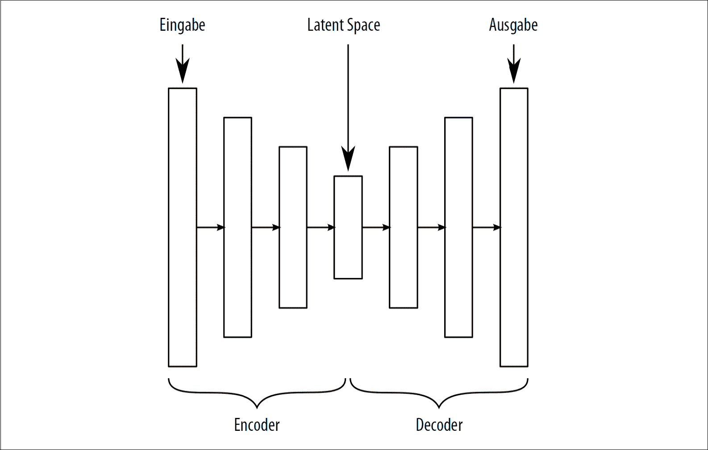

*图 9-1：变分自编码器的结构*。

如果模型必须处理任意输入，这将是不可能的。无法丢弃 99% 的信息却仍能重建输入！但我们不关心任意输入，只关心特定输入（以及与之相似的其他输入）。在所有可想象的图像中，看起来像猫的不到 1%。自编码器不必对所有可能的输入都起作用，只需对源自特定概率分布的那些输入起作用。它必须学习该分布的“结构”，弄清如何用少得多的信息来表示该分布，然后能够根据压缩信息重建数据点。

让我们拆解一下模型。作为瓶颈的中间层被称为自编码器的*潜在空间*。压缩后的数据点在此表示。自编码器的前半部分称为*编码器*。其任务是将数据点转换为压缩表示。后半部分称为*解码器*，它接收压缩表示并将其转换回原始数据量。

这给了我们一个初步线索，说明自编码器如何用于生成建模。*解码器*接收向量并将其转换为数据点，因此我们可以选择随机向量（为向量的每个分量选择一个随机值）并将其通过*解码器*传递。如果一切顺利，*解码器*应该能产生全新的输出，同时仍类似于其训练所用的数据。

虽然这行得通，但效果不太好。问题在于*编码器*只能在*潜在空间*的一个小区域内生成向量。如果我们选择位于*潜在空间*某处的向量，可能会得到与训练数据不相似的输出。换句话说，*解码器*只学会了针对*编码器*生成的特定潜在向量工作，而不适用于任意向量。

为了克服这个问题，*变分自编码器*（VAE）包含两个额外特性。首先，在误差函数中添加了一项，强制潜在向量遵循特定分布。在大多数情况下，它们被限制为均值为 0、方差为 1 的高斯分布。我们不允许*编码器*随意生成向量。我们强制按已知分布生成向量。因此，如果我们从同一分布中选择随机向量，可以假设*解码器*将良好工作。

其次，我们在训练期间向潜在向量添加随机噪声。*编码器*将输入值转换为潜在向量，我们在其通过*解码器*之前对其进行轻微扰动。因此我们仍非常接近原始输入值。这防止了*解码器*对潜在向量的确切细节过于敏感。如果我们仅略微改变它，输出也仅会略微改变。

这些变化带来了显著更好的结果。VAE 是生成建模中流行的工具：它们为许多问题提供了出色的结果。

## 生成对抗网络

*生成对抗网络*（GAN）与 VAE 非常相似。它使用完全相同的*解码器*结构将潜在向量转换为数据点（在 GAN 中称为*生成器*而非*解码器*这一细微差别除外）。然而，训练方式不同。随机向量被传递给*生成器*，输出被直接评估以检查其遵循预期分布的程度。最终创建一个误差函数来衡量生成的数据点与训练数据的匹配程度，随后利用该误差函数优化模型。

乍一听这非常简单，实则不然。您能创建一个误差函数来判断一张图片有多像猫吗？当然不能！您甚至不知道从何下手。GAN 从数据中学习误差函数，因此我们无需自行开发。

如图 9-2 所示，GAN 由两部分组成。*生成器*从随机向量生成人工数据点。第二部分称为*判别器*，它试图将生成的数据点与真实训练数据区分开。一个数据点被用作输入，并计算一个概率，指示其是否来自训练数据。因此，*判别器*充当*生成器*的误差函数。

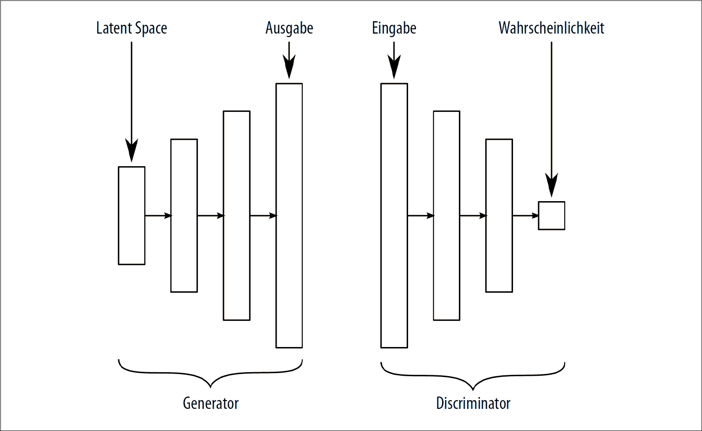

*图 9-2：生成对抗网络的结构*。

两部分同时训练。*生成器*接收随机向量，其输出被送入*判别器*。*生成器*的参数被调整以使*判别器*的输出尽可能接近 1，而*判别器*的参数被设置为使输出尽可能接近 0。此外，来自训练数据集的数据点被送入*判别器*，其参数被调整以使输出接近 1。


这是“对抗性”方面。可以将其想象为生成器和判别器之间的竞争。判别器持续尝试区分真实数据点与生成的数据点，而生成器则试图欺骗判别器。

与 VAEs 类似，GANs 也被用于生成式建模，并在许多问题上取得了良好结果。这两种模型各有优劣。粗略地说，GANs 倾向于生成质量更高的**数据**，而 VAEs 则倾向于生成质量更高的**分布**。也就是说，GAN 生成的单个数据点更类似于训练数据点，而 VAE 生成的数据点分布范围更倾向于与训练数据集的范围相匹配。但请不要过于字面地理解这一说法。一如既往，一切取决于具体问题和模型细节。此外，还提出了无数两种方法的变体。甚至还有结合了 VAE 与 GAN 的模型，以兼得两者之长。这是一个仍在活跃发展的研究领域，新想法层出不穷。

### 生成式模型在生命科学中的应用

在熟悉了生成式模型的基础知识后，我们现在来探讨其应用。简化来说，生成式模型拥有几项“超能力”。首先，它们实现了一种“创造力”的假象。可以根据学习到的分布生成新数据。这为创造性过程提供了强有力的补充，可衔接现有的药物或蛋白质设计工作。其次，利用生成式模型建模复杂系统的能力，可能使科学家能够深入理解复杂的生物学过程。我们将在本节中更详细地探讨上述想法。

#### 为核心结构开发新思路

现代药物发现的一个关键环节是构思新药物。这通常每半年进行一次，由经验丰富的化学家提出对核心结构的修改建议。通常会将当前分子系列的图像投影到屏幕上，在场的资深化学家会针对分子的核心结构提出修改意见。部分建议分子会被实际合成并测试，这一过程不断重复，直到找到合适的分子或项目被终止。这一过程优势巨大，因为它依赖于资深化学家的直觉，他们能识别潜在结构的问题（例如可能类似于他们之前见过的、导致大鼠不明原因肝衰竭的化合物），而这些问题用算法可能难以察觉。

同时，这一过程也存在局限。优秀且经验丰富的化学家数量稀缺。此外，制药部门若缺乏药物发现知识，自行开展这一过程极具挑战性。分子结构的生成式模型有助于克服这些限制。若在合适的分子数据上训练模型，它可能快速提出新的替代化合物。此类模型可通过提出人类设计师未曾注意到的新化学方向，来改进现有流程。正如我们在本章后续将看到的，然而此类算法也存在局限性。

#### 蛋白质设计

开发新酶和蛋白质如今是一门大生意。工程酶常用于现代制造业。（您的洗衣液极有可能含有酶！）但总体而言，开发新酶被证明颇具挑战。一些早期工作表明，深度学习模型在从蛋白质序列预测蛋白质功能方面取得了一定成功。完全可以设想，利用生成式模型提出具有所需性质的新蛋白质序列。

与小分子设计相比，引入生成式模型用于此目的可能更具影响力。与小分子不同，专家很难预测突变对特定蛋白质的影响。使用生成式模型可实现蛋白质设计，提供超越当今专家能力范围的方向。

#### 科学发现的工具

生成式模型可成为科学发现的有力工具。例如，一个正确的组织发育过程生成式模型（[`www.ncbi.nlm.nih.gov/pmc/articles/PMC6119234/`](https://www.ncbi.nlm.nih.gov/pmc/articles/PMC6119234/)）对发育生物学家或基础研究极具价值。可以利用生成式模型运行模拟，创建“合成实验”，在其中研究不同环境条件下的组织发育。这目前仍属于畅想，因为我们需要能在初始条件改变时依然有效工作的生成式模型。这还需要进一步研究。尽管如此，这一前景令人振奋，因为生成式建模可让生物学家构建复杂发育和生理过程的强大模型，并检验他们关于这些系统如何形成的假设。

#### 生成式建模的未来

生成式模型极具挑战性！早期的 GANs 仅能生成模糊图像，勉强能辨认出人脸。而最新的 GANs（截至本书撰写时）能生成难以与真实照片区分的人脸图像。未来十年，这些模型的进一步发展极有可能实现生成式视频。这些发展将对现代社会产生深远影响。上个世纪以来，照片常被常规用作犯罪、质量等方面的“证据”。随着生成式工具的进步，这些将不再能作为证据站得住脚，因为任意图像都可以被“PS”。这将给刑事司法和国际关系带来巨大挑战。

同时，高保真视频的出现极有可能在现代科学中引发一场革命。想象一下高质量的胚胎发育生成式模型！人们可以模拟 CRISPR 基因编辑的影响，或比以往任何时候都更详细地理解发育过程。科学其他领域也将受益于生成式模型的改进。生成式建模推测将成为物理学和气候科学中的重要工具，实现对复杂系统更强大的模拟。但必须强调，这些进展目前仍属于畅想。在这些模型具备所需稳定性之前，仍需大量基础研究。

### 使用生成式模型


## 代码示例：训练用于分子生成的 VAE

接下来，我们来看一个代码示例。我们将训练一个 VAE 来生成新分子。具体来说，它将输出 SMILES 字符串。与我们讨论过的其他表示方法相比，这种输出格式有不同的优缺点。一方面，处理 SMILES 字符串非常简单。每一个都只是来自固定字母表的一系列字符。这允许我们使用一个非常简单的模型来处理它们。另一方面，SMILES 字符串必须符合复杂的语法。如果模型没有学会语法的所有细微之处，它生成的大多数字符串将是无效的，且不对应任何分子。

### 加载训练数据

首先，我们需要一组 SMILES 字符串来训练模型。幸运的是，MoleculeNet 为我们提供了大量选择。在本例中，我们使用 MUV 数据集。训练数据集包含 74,469 个大小和结构各异的分子。我们首先加载它：

```python
import deepchem as dc

tasks, datasets, transformers = dc.molnet.load_muv()

train_dataset, valid_dataset, test_dataset = datasets

train_smiles = train_dataset.ids
```

### 定义词汇表

接下来，我们定义模型将使用的词汇表。SMILES 字符串中允许哪些字符（或“Token”）？字符串可以有多长？我们可以通过创建一个包含训练分子中出现的所有字符的排序列表，从训练数据中确定它们：

```python
tokens = set()

for s in train_smiles:
    tokens = tokens.union(set(s))

tokens = sorted(list(tokens))

max_length = max(len(s) for s in train_smiles)
```

### 创建模型

下一步是创建模型。我们应该为编码器和解码器选择什么架构？这仍然是一个活跃的研究领域。已经发表了各种提出不同模型的出版物。在本例中，我们使用 DeepChem 的 `AspuruGuzikAutoEncoder` 类，它实现了一个特定的已发表模型。编码器使用卷积神经网络，解码器使用循环网络。如果您对细节感兴趣，可以阅读该出版物（[`arxiv.org/abs/1610.02415`](https://arxiv.org/abs/1610.02415)）。但为了跟随本示例，这并非必需。另请注意，我们对学习率使用 `ExponentialDecay`。初始速率设置为 `0.001`，并在每个 epoch 后减少一小部分（乘以 `0.95`）。这有助于优化过程更平滑地进行：

```python
from deepchem.models.tensorgraph.optimizers import Adam, ExponentialDecay
from deepchem.models.tensorgraph.models.seqtoseq import AspuruGuzikAutoEncoder

model = AspuruGuzikAutoEncoder(tokens, max_length, model_dir='vae')

batches_per_epoch = len(train_smiles) / model.batch_size

learning_rate = ExponentialDecay(0.001, 0.95, batches_per_epoch)

model.set_optimizer(Adam(learning_rate=learning_rate))
```

### 训练模型

接下来我们训练模型。`AspuruGuzikAutoEncoder` 不使用采用 `Dataset` 的标准 `fit()` 方法，而是提供自己的 `fit_sequences()` 方法。需要一个生成 Token 序列（在我们的例子中是 SMILES 字符串）的 Python 生成器对象。我们训练 50 个 epoch：

```python
def generate_sequences(epochs):
    for i in range(epochs):
        for s in train_smiles:
            yield (s, s)

model.fit_sequences(generate_sequences(50))
```

### 生成新分子

现在模型应该能够生成全新的分子了。我们只需要选择随机潜在向量并将它们通过解码器。我们创建一个大小为 1,000 个向量的批次，每个向量长度为 196（这对应于模型潜在空间的大小）。

如前所述，并非所有输出都是有效的 SMILES 字符串。实际上，只有很小一部分是有效的。幸运的是，我们可以使用 RDKit 来过滤掉无效的：

```python
import numpy as np
from rdkit import Chem

predictions = model.predict_from_embeddings(np.random.normal(size=(1000, 196)))

molecules = []

for p in predictions:
    smiles = ''.join(p)
    if Chem.MolFromSmiles(smiles) is not None:
        molecules.append(smiles)

for m in molecules:
    print(m)
```

## 分析生成模型的输出

除了无效输出的问题外，输出的 SMILES 字符串所对应的许多分子可能也不具备药物分子的特征。因此，我们必须开发策略，以便快速识别出不具药物样性质的分子。这些策略最好通过一个实际例子来解释。假设这些是来自我们生成模型的 SMILES 字符串：

```python
smiles_list = 
    'CCCCCCNNNCCOCC',
    'O=C(O)C(=O)ON/C=N/CO',
    'C/C=N/COCCNSCNCCNN',
    'CCCNC(C(=O)O)c1cc(OC(OC)[SH=O)ccc1N',
    'CC1=C2C=CCC(=CC(Br)=CC=C1)C2',
    'CCN=NNNC(C)OOCOOOOOCOOO',
    'N#CNCCCCCOCCOC1COCNN1CCCCCCCCCCCCCCCCCCCOOOOOSNNCCCCCSCSCCCCCCCCCOCOOOSS',
    'CCCC(=O)NC1=C(N)C=COO1',
    'CCCSc1cc2nc(C)cnn2c1NC',
    'CONCN1N=NN=CC=C1CC1SSS1',
    'CCCOc1ccccc1OSNNOCCNCSNCCN',
    'C[SH]1CCCN2CCN2C=C1N',
    'CC1=C(C#N)N1NCCC1=COOO1',
    'CN(NCNNNN)C(=O)CCSCc1ccco1',
    'CCCN1CCC1CC=CC1=CC=S1CC=O',
    'C/N=C/c1ccccc1',
    'Nc1cccooo1',
    'CCOc1ccccc1CCCNC(C)c1nccs1',
    'CNNNNNNc1nocc1CCNNC(C)C',
    'COC1=C(CON)C=C2C1=C(C)c1ccccc12',
    'CCOCCCCNN(C)C',
    'CCCN1C(=O)CNC1C',
    'CCN',
    'NCCNCc1cccc2c1C=CC=CC=C2',
    'CCCCCN(NNNCNCCCCCCCCCCSCCCCCCCCCCCCCCNCCNCCCCSSCSSSSSSCCCCCCCCCCCCCSCCCCCSC)C(O)OCCN',
    'CCCS1=CC=C(C)N(CN)C2NCC2=C1',
    'CCNCCCCCCOc1cccc(F)c1',
    'NN1OSHC12C=C2',
    'Cc1cc2cccc3c(CO)cc-3ccc-2c1'
]
```

我们分析的第一步是检查这些分子，以确定是否有我们想要丢弃的。我们可以使用 RDKit 中的一些功能（它包含在 DeepChem 中）来检查这些字符串所代表的分子。为了评估这些字符串，我们必须首先将它们转换为分子对象。我们通过以下列表推导式来实现：

```python
molecules = [Chem.MolFromSmiles(x) for x in smiles_list]
```

一个可能感兴趣的因素是分子大小。拥有少于 10 个原子的分子不太可能产生足够的相互作用能量，从而在生物测定中产生可测量的信号。相反，拥有超过 50 个原子的分子可能无法溶于水，并可能在生物测定中引起其他问题。我们可以通过计算每个分子中非氢原子的数量来获得分子大小的粗略估计。以下代码创建一个包含每个分子原子数的列表。为简单起见，我们对数组进行排序，以便更好地理解分布（如果我们有更长的分子列表，可能会为分布创建一个直方图）：

```python
print(sorted([x.GetNumAtoms() for x in molecules]))
```

结果如下：

```
[3, 8, 9, 10, 11, 11, 12, 12, 13, 14, 14, 14, 15,
16, 16, 16, 17, 17, 17, 17, 18, 19, 19, 20, 20, 22, 24, 69, 80]
```

正如您所见，有四个非常小和两个非常大的分子。我们可以使用另一个列表推导式来移除原子数少于等于 10 或大于等于 50 的分子：

```python
good_mol_list = [x for x in molecules if x.GetNumAtoms() > 10
and x.GetNumAtoms() < 50]

print(len(good_mol_list))
# 23
```

此列表推导式将我们的列表从 29 个减少到 23 个分子。


# Bewertung generierter Moleküle

Wir können eine Reihe anderer berechneter Eigenschaften verwenden, um die Qualität der erzeugten Moleküle zu bewerten. Mehrere kürzlich erschienene Publikationen generativer Modelle nutzen berechnete Moleküleigenschaften, um zu bestimmen, welche der erzeugten Moleküle beibehalten oder verworfen werden sollen. Eine der geläufigeren Methoden zur Bestimmung, ob Moleküle bekannten Arzneimitteln ähneln oder »wirkstoffartig« sind, ist die quantitative Abschätzung der Arzneimittelähnlichkeit (QED). Die QED-Metrik, die von Bickerton und Kollegen veröffentlicht wurde^1, bewertet Moleküle durch Vergleichen einer Reihe von Eigenschaften, die für jedes Molekül berechnet wurden, mit Verteilungen der gleichen Eigenschaften in vermarkteten Arzneimitteln. Dieser Score liegt zwischen 0 und 1, wobei Werte, die näher bei 1 liegen, als wirkstoffartiger angesehen werden.

Wir können `RDKit` wie folgt verwenden, um QED-Werte für unsere verbleibenden Moleküle zu berechnen und nur die Moleküle mit `QED > 0.5` beizubehalten:

```python
qed_list = [QED.qed(x) for x in good_mol_list]

final_mol_list = [(a,b) for a,b in
zip(good_mol_list,qed_list) if b > 0.5]
```

Im letzten Schritt visualisieren wir die chemischen Strukturen von `final_mol_list` und die entsprechenden QED-Scores:

```python
MolsToGridImage([x[0] for x in final_mol_list],
molsPerRow=3, useSVG=True,
subImgSize=(250, 250),
legends=[f"{x[1]:.2f}" for x in final_mol_list])
```

Die Ergebnisse sehen Sie in Abbildung 9-3.

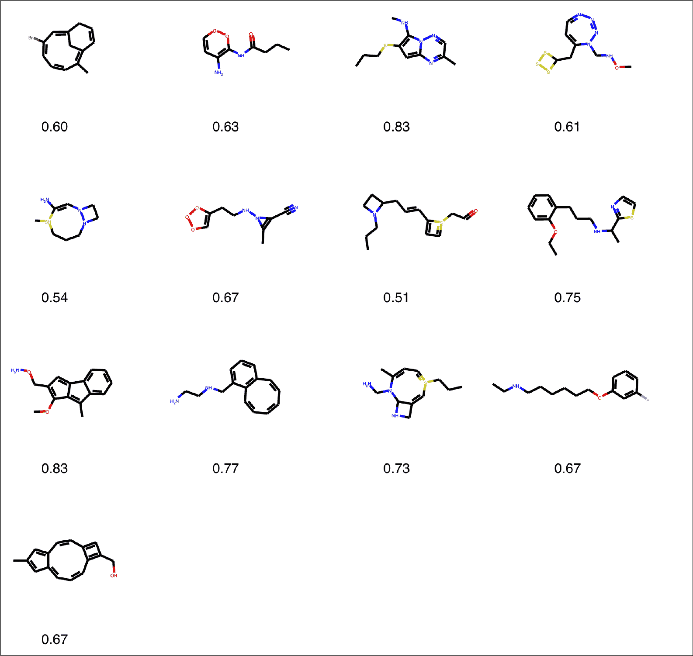

*Abbildung 9-3: Chemische Strukturen der erzeugten Moleküle und ihre QED-Scores*.

Obwohl diese Strukturen gültig sind und einigermaßen hohe QED-Werte aufweisen, können sie dennoch chemisch instabil sein. Strategien zur Identifizierung und Entfernung solcher problematischen Moleküle werden im folgenden Abschnitt besprochen.

# Fazit

Obwohl generative Modelle ein interessantes Mittel darstellen, um Ideen für neue Moleküle zu erhalten, müssen noch einige Schlüsselfragen geklärt werden, um ihre allgemeine Anwendbarkeit sicherzustellen. Zunächst gilt es sicherzustellen, dass die erzeugten Moleküle chemisch stabil sind und synthetisiert werden können. Eine aktuelle Methode zur Bewertung der Qualität von Molekülen, die mit einem generativen Modell hergestellt werden, besteht darin, den Anteil der generierten Moleküle zu beobachten, der den Standardregeln der chemischen Wertigkeit entspricht. Anders gesagt, es wird sichergestellt, dass jedes Kohlenstoffatom vier Bindungen, jedes Sauerstoffatom zwei Bindungen, jedes Fluoratom eine Bindung usw. aufweist. Diese Faktoren werden besonders dann wichtig, wenn eine `SMILES`-Darstellung aus einem `Latent Space` decodiert wird. Obwohl ein generatives Modell möglicherweise die Grammatik von `SMILES` gelernt hat, könnten Nuancen fehlen.

Die Tatsache, dass ein Molekül den üblichen Wertigkeitsregeln entspricht, garantiert nicht unbedingt, dass es chemisch stabil ist. In einigen Fällen kann ein generatives Modell Moleküle herstellen, die funktionelle Gruppen enthalten, von denen bekannt ist, dass sie sich leicht zersetzen. Ein Beispiel hierfür sehen Sie in Abbildung 9-4. Es ist bekannt, dass die eingekreiste funktionelle Gruppe, die als Halbacetal bekannt ist, sich leicht zersetzt.


*Abbildung 9-4: Ein Molekül mit einer instabilen Gruppe*.

Die Wahrscheinlichkeit, dass dieses Molekül existiert und chemisch stabil ist, ist sehr gering. Es gibt Dutzende solcher chemischen Funktionalitäten, von denen bekannt ist, dass sie instabil oder reaktiv sind. Bei der Synthese von Molekülen in einem Wirkstoffentwicklungsprojekt sollten Chemiker diese funktionellen Gruppen vermeiden. Eine Möglichkeit, dieses »Wissen« einem generativen Modell zu vermitteln, besteht darin, eine Reihe von Filtern bereitzustellen, mit denen die Ausgabe des Modells nachbearbeitet und möglicherweise problematische Moleküle entfernt werden können. In Kapitel 11 werden wir einige dieser Filter und ihre Verwendung im virtuellen Screening näher betrachten. Viele der Methoden zur Identifizierung potenziell problematischer Screening-Verbindungen können auch zur Bewertung virtueller Moleküle verwendet werden, die ein generatives Modell erstellt.

Um die biologische Aktivität eines von einem generativen Modell erzeugten Moleküls zu testen, muss dieses Molekül zuerst von einem Chemiker synthetisiert werden. Die Wissenschaft der organisch-chemischen Synthese blickt auf eine mehr als hundertjährige Geschichte zurück. In diesem Zeitraum haben Chemiker Tausende von chemischen Reaktionen entwickelt, um Medikamente und wirkstoffähnliche Moleküle zu synthetisieren. Die Synthese eines arzneimittelähnlichen Moleküls erfordert üblicherweise zwischen fünf und zehn chemische Reaktionen, die oft als »Schritte« bezeichnet werden. Während einige arzneimittelähnliche Moleküle leicht synthetisiert werden können, kann der Vorgang bei komplexeren Arzneimittelmolekülen mehr als 20 Schritte erfordern. Trotz der mehr als 50-jährigen Arbeit an der Automatisierung der Planung organischer Synthesen ist ein Großteil des Prozesses immer noch durch menschliche Intuition und anschließendes Ausprobieren bestimmt.

Glücklicherweise bieten die jüngsten Entwicklungen im Bereich des Deep Learning neue Möglichkeiten für die Planung der Synthese von wirkstoffartigen Molekülen. Mehrere Forschergruppen haben Methoden veröffentlicht, die Deep Learning verwenden, um Wege vorzuschlagen, die zur Synthese von Molekülen verwendet werden können. Als Eingabe erhält das Modell ein Molekül, das oft als *Produkt* bezeichnet wird, und die Schritte, die zur Synthese dieses Moleküls verwendet wurden. Durch Training mit Tausenden von Produktmolekülen und den zur Synthese verwendeten Schritten kann ein `Deep Neural Network` die Beziehung zwischen Produktmolekülen und Reaktionsschritten erlernen. Erhält das Modell ein neues Molekül, schlägt es eine Reihe von Reaktionen vor, die zur Synthese des Moleküls verwendet werden könnten. Bei einem Versuch wurden die von diesen Modellen erzeugten Synthesewege Chemikern zur Bewertung vorgelegt. Diese Bewerter waren der Ansicht, dass die von solchen Modellen generierten Routen qualitativ mit den von Chemikern generierten Routen vergleichbar waren.

Die Anwendung von Deep Learning auf die organische Synthese ist ein relativ neues Forschungsgebiet. Es bleibt zu hoffen, dass hier eine Weiterentwicklung stattfindet und diese Modelle zu einem wichtigen Werkzeug für organische Chemiker werden. In nicht allzu ferner Zukunft könnte diese Funktion für die Syntheseplanung mit der Robotik kombiniert werden, um eine voll automatisierte Plattform zu schaffen. Es gibt jedoch Schwierigkeiten, die überwunden werden müssen.

Ein mögliches Hindernis für die Akzeptanz von Deep Learning in der organischen Synthese ist die Datenverfügbarkeit. Die meisten Informationen, die zum Trainieren dieser Modelle verwendet werden, befinden sich in Datenbanken, die Eigentum einer kleinen Anzahl von Organisationen sind. Beschließen diese Organisationen, die Daten lediglich für interne Zwecke zu verwenden, bleiben nur sehr wenige Alternativen übrig.


另一个可能限制生成模型进步的因素，是用于分子生成的预测模型的质量。无论使用何种架构来开发生成模型，都必须采用一个函数来评估生成的分子，并引导对新分子的搜索。在某些情况下，我们或许能够开发出可靠的预测模型。在其他情况下，模型可能不太可靠。虽然我们可以使用外部验证数据集来测试模型，但往往难以确定预测模型的适用范围。这个范围也被称为“应用领域”，指的是模型在其训练所用分子之外进行外推的程度。由于这个应用领域没有被精确定义，因此很难判断模型在生成模型产生的新颖分子上表现如何。

生成模型是一种相对较新的方法，未来几年该领域将如何发展将会很有趣。我们利用深度学习预测有机合成路线和构建预测模型的能力越强，生成模型就会变得越强大。

# 第 10 章

# 解读深度学习模型

到目前为止，我们已经看到了许多训练深度学习模型以解决问题的示例。流程总是相同的：收集数据，构建模型，训练模型，直到在训练集和测试集上获得正确结果。然后我们自我祝贺，宣布任务完成，转向下一个挑战。毕竟，我们拥有了一个能为输入产生正确预测的模型。

但这往往只是开始！一旦模型训练完成，你可能会问自己许多重要问题。模型是如何工作的？输入的哪些特征导致了特定的预测？能否信任模型的预测？它们有多准确？是否存在模型可能失效的情况？它究竟“学习”了什么？而这能否带来对训练数据的新见解？

所有这些问题都属于*可解释性*的范畴。它涵盖了你对模型的一切期望，甚至更多。这是一个非常广泛的主题，所用方法多种多样，正如它们试图回答的问题一样。方法太多，无法在一章中全部容纳，因此我们将重点关注其中一些更重要的方法。

为此，我们将回顾前几章的示例。当时我们只是训练模型进行预测，检查准确率，然后认为工作完成。现在我们将更深入地研究它们，看看还能学到什么。

## 解释预测

假设你训练了一个模型来识别不同车辆类型的照片。你在测试数据集上运行它，发现它能正确区分汽车、船只、火车和飞机。它是否已准备好投入生产？你能信任它未来也能提供正确结果吗？

也许可以。但如果错误结果会导致严重后果，你可能希望进行进一步验证。了解模型*为何*做出特定预测会很有帮助。它真的是在观察车辆，还是在关注照片中无关的方面？汽车照片通常包含道路。飞机在天空中呈现剪影。火车照片通常显示轨道，船只照片则显示大量水面。如果模型实际上识别的是背景而非车辆，它可能在测试数据上表现良好，却在意外情况下失效。天空中呈剪影的船只可能被分类为飞机，而在水边行驶的汽车可能被分类为船只。

如果模型过度关注特定细节，也会产生问题。也许它识别的根本不是“汽车”图像，而是包含“车牌”的图像。或者它擅长识别救生圈，并学会将其与船只图像关联。在大多数情况下这行得通，但如果一辆汽车驶过游泳池，背景中出现救生圈，就会失败。

解释模型为何做出预测是可解释性的一个重要方面。如果模型将一张照片分类为汽车，你希望确信该预测是基于汽车本身，而非因为看到了道路，或仅基于汽车的一小部分。简而言之，你关心它是否*出于正确的理由*给出了正确答案。这能让你有信心它对未来的输入也能正常工作。

作为一个具体示例，让我们看看第 8 章中的糖尿病视网膜病变模型。该模型以视网膜图像为输入，预测患者糖尿病视网膜病变的存在及严重程度。输入和输出之间有数十个层对象和超过八百万个训练参数。我们想知道为何特定输入导致特定输光，但无法从模型本身看出来，因为其复杂性超出了人类的理解范围。

已开发出许多方法来回答这个问题。我们将应用其中最简单的一种，称为*显著性映射*。^(1) 该方法本质上是询问输入的哪些像素对于确定输出最重要（或最“显著”）。从某种意义上说，*每个*像素自然都很重要。输出是所有输入的一个高度复杂的非线性函数。在理想图像中，每个像素都包含疾病迹象。但在现实中，只有极小部分像素符合此条件，我们想知道是哪些像素。

为了回答这个问题，`Saliency Mapping` 使用了一个简单的近似：它查看所有输出关于所有输入的导数。如果图像的某个区域不包含疾病迹象，对该区域单个像素的微小改动对输出影响很小。因此导数很小。在阳性诊断中，许多像素存在相关性。若缺乏这些相关性，则无法通过改变单个像素来创造它们。但如果相关性存在，改变相关像素之一可能会增强或削弱结果。导数应在模型关注的“重要”区域最大。

让我们看看代码。首先，我们创建模型并加载训练好的参数值：

```python
import deepchem as dc
import numpy as np
from model import DRModel
from data import load_images_DR

train, valid, test = load_images_DR(split='random', seed=123)
model = DRModel(n_init_kernel=32, augment=False, model_dir='test_model')
model.restore()
```

现在我们可以使用该模型。我们对测试数据集的前十个条目进行预测：

```python
X = test.X
y = test.y
for i in range(10):
```


## Saliency Mapping und Eingabeoptimierung

```python
prediction = np.argmax(model.predict_on_batch([X[i]]))

print('True class: %d, Predicted class: %d' % (y[i], prediction))
```

Die Ausgabe sieht wie folgt aus:

True class: 0, Predicted class: 0

True class: 2, Predicted class: 2

True class: 0, Predicted class: 0

True class: 0, Predicted class: 0

True class: 3, Predicted class: 0

True class: 2, Predicted class: 2

True class: 0, Predicted class: 0

True class: 0, Predicted class: 0

True class: 0, Predicted class: 0

True class: 2, Predicted class: 2

Neun der ersten zehn Einträge werden richtig erkannt. Aber was genau betrachtet es, wenn es die Vorhersagen trifft? Saliency Mapping kann uns das beantworten. Mit DeepChem geht das einfach:

```python
saliency = model.compute_saliency(X[0])
```

`compute_saliency()` verwendet das Eingabe-Array für einen bestimmten Eintrag und gibt die Ableitung jeder Ausgabe in Bezug auf jede Eingabe zurück. Das ist einfacher zu verstehen, wenn wir uns die Form des Ergebnisses ansehen:

```python
print(saliency.shape)
```

Somit erfahren wir, dass es sich um ein Array der Form `(5, 512, 512, 3)` handelt. `X[0]` ist die nullte Eingabe des Bilds, bei dem es sich um ein Array der Form `(512, 512, 3)` handelt, wobei die letzte Dimension die drei Farbkomponenten darstellt. Zusätzlich hat das Modell fünf Ausgaben, bei denen es sich um Wahrscheinlichkeiten handelt, mit denen der Datenpunkt zu jeder der fünf Klassen gehört. `saliency` enthält die Ableitung von jeder der fünf Ausgaben in Bezug auf jede der `512 × 512 × 3`-Eingaben.

Wir müssen dieses Ergebnis noch etwas aufbereiten, damit es brauchbar wird. Zunächst nehmen wir den absoluten Wert für jedes Element des Arrays. Uns interessiert nicht, ob ein Pixel dunkler oder heller gemacht werden soll, sondern nur, dass es einen Effekt hat. Anschließend wollen wir es auf lediglich eine Zahl pro Pixel reduzieren. Dafür gäbe es verschiedene Möglichkeiten, wir summieren einfach nur die erste und die letzte Dimension auf. Wirkt sich eine der Farbkomponenten auf eine der Ausgaben aus, ist das Pixel wichtig. Abschließend normieren wir die Werte auf einen Wert zwischen 0 und 1:

```python
sal_map = np.sum(np.abs(saliency), axis=(0,3))

sal_map -= np.min(sal_map)

sal_map /= np.max(sal_map)
```

Abbildung 10-1 zeigt eine Aufnahme, bei der das Modell korrekt eine schwere diabetische Retinopathie identifiziert. Das Bild der Eingabe sehen Sie links, und auf der rechten Seite sind die auffälligsten Bereiche in Weiß hervorgehoben.


*Abbildung 10-1: Saliency Map für ein Bild mit schwerer diabetischer Retinopathie*.

Zunächst fällt uns auf, dass sich die salienten Bereiche ungleichmäßig über die gesamte Netzhaut verteilen und sich nicht nur auf wenige Stellen beschränken. Auffällige Bereiche konzentrieren sich entlang der Blutgefäße, und zwar insbesondere an Stellen, an denen sich Blutgefäße verzweigen. In der Tat umfassen einige der Indikationen, nach denen ein Arzt sucht, um eine diabetische Retinopathie zu diagnostizieren, abnormale Blutgefäße, Blutungen und das Wachstum neuer Blutgefäße. Das Modell scheint seine Aufmerksamkeit auf die richtigen Stellen des Bilds zu lenken, dieselben, die auch ein Arzt am genauesten betrachten würde.

### Eingaben optimieren

Saliency Mapping und andere, ähnliche Methoden zeigen an, auf welche Informationen sich das Modell bei der Vorhersage konzentriert. Wie genau wurden diese Informationen interpretiert? Das Modell der diabetischen Retinopathie konzentriert sich auf Blutgefäße. Aber wie kann es gesunde von erkrankten Blutgefäßen unterscheiden? Klassifiziert ein Modell ein Foto als Boot, ist uns wichtig, dass die Identifizierung anhand der Pixel erfolgte, aus denen das Boot besteht, und nicht anhand der Pixel, aus denen sich der Hintergrund zusammensetzt. Aber was an diesen Pixeln hat darauf schließen lassen, dass es sich um ein Boot handelt? Liegt es an der Farbe? An der Form? Kombinationen kleiner Details? Könnte es unabhängige Bilder geben, die das Modell ebenso sicher (aber fälschlicherweise) als Boot identifizieren würde? Wie genau ist das »Denken« des Modells darüber, wie ein Boot aussieht?

Eine übliche Vorgehensweise zur Beantwortung dieser Frage besteht darin, Eingaben zu suchen, die die Vorhersagewahrscheinlichkeit maximieren. Welche der verwendeten Eingaben führen zu den besten Vorhersagen? Indem man diese Eingaben untersucht, kann man herausfinden, wonach das Modell eigentlich »sucht«. Manchmal ist es nicht das, was Sie erwarten! Abbildung 10-2 zeigt Aufnahmen, die optimiert wurden, um gute Vorhersagen zu erzielen, wenn sie als Eingaben in ein hochwertiges Bilderkennungsmodell eingespeist werden. Das Modell klassifiziert jedes Bild als die angegebene Kategorie, ein Mensch erkennt jedoch kaum Ähnlichkeit!


*Abbildung 10-2: Bilder, die ein hochwertiges Bilderkennungsmodell täuschen. (Quelle: [Arxiv.org](http://Arxiv.org), [`arxiv.org/abs/1412.1897`](https://arxiv.org/abs/1412.1897))*

Betrachten Sie als Beispiel das Modell für die Transkriptionsfaktor-Bindung aus Kapitel 6. Dieses Modell verwendet eine DNA-Sequenz als Eingabe und sagt vorher, ob die Sequenz eine Bindungsstelle für den Transkriptionsfaktor JUND enthält. Wie stellt sich das Modell eine Bindungsstelle vor? Wir könnten alle möglichen DNA-Sequenzen betrachten, um diejenigen zu identifizieren, für die das Modell am sichersten voraussagt, dass eine Bindungsstelle vorhanden ist.

Leider ist das jedoch nicht praktikabel. Es gibt `4¹⁰¹` mögliche DNA-Sequenzen der Länge 101. Selbst wenn nur eine Nanosekunde benötigt würde, um jede einzelne zu untersuchen, würde es ein Vielfaches länger dauern als das Alter des Universums, um alle zu durchlaufen. Wir müssen uns also überlegen, wie wir eine kleinere Anzahl von Eingaben betrachten könnten.

Eine Möglichkeit besteht darin, nur die Sequenzen im Testdatensatz anzuschauen. In diesem Fall ist das eine vernünftige Strategie. Der Trainingsdatensatz deckt mehrere zehn Millionen Basen eines echten Chromosoms ab und ist somit eine gute Wiedergabe der Eingaben, mit denen das Modell in der Praxis verwendet wird. Abbildung 10-3 zeigt die zehn Sequenzen aus dem Trainingsdatensatz, für die das Modell das beste Ergebnis bringt. Für jede von ihnen wird mit mehr als 97 % Wahrscheinlichkeit vorhergesagt, dass sie eine Bindungsstelle enthalten. Neun von ihnen enthalten tatsächlich Bindungsstellen, und eine ist falsch positiv. Für jede haben wir Saliency Mapping verwendet, um zu identifizieren, worauf sich das Modell konzentriert, und die Basen entsprechend eingefärbt.


*Abbildung 10-3: Die zehn Sequenzen des Trainingsdatensatzes mit den höchsten vorhergesagten Ergebnissen. Häkchen markieren die Sequenzen, die tatsächlich Bindungsstellen enthalten*.

Beim Betrachten dieser Sequenzen fällt uns sofort das Muster auf, das das Modell erkennt: `TGA … TCA`, wobei `…` aus einer oder zwei Basen besteht, die normalerweise `C` oder `G` sind. Wir erkennen auch, dass ein oder zwei Basen auf beiden Seiten etwas Aufmerksamkeit geschenkt wird. Die vorangehende Base ist `A`, `C` oder `G`, und die nachfolgende Base ist immer entweder `C` oder `T`. Dies stimmt mit dem bekannten Bindungsmotiv für JUND überein, das in Abbildung 10-4 als Positionsgewichtungsmatrix dargestellt ist.


*Abbildung 10-4: Das bekannte Bindungsmotiv für JUND, dargestellt als Positionsgewichtungsmatrix. Die Höhe jedes Buchstabens gibt die Wahrscheinlichkeit an, mit der diese Base an der entsprechenden Position erscheint*.


那条错误预测了结合位点的序列不包含此模式。相反，它由多个紧密相邻的 `TGAC` 模式重复组成。它看起来像是一个结合基序的开头，但从未跟随一个 `TCA`。显然，我们的模型已经学会了识别正确的结合基序，但当多个不完整的版本紧密相邻时，也会被误导。

训练数据并不总是能反映可能输入的全部范围。如果您的训练数据集仅包含车辆照片，您就无法知道模型对其他照片会有何反应。它可能会自信地将雪花图像标记为船。甚至可能存在根本不像照片的输入——也许是简单的几何图案或随机噪声——模型会将其分类为船。要测试这种可能性，我们不能依赖现有的输入。相反，模型必须告诉我们它在寻找什么。为此，我们从一个完全随机的输入开始，然后使用优化算法对其进行修改，以改进模型的输出。

我们在 TF 结合模型上演示这一点。首先，我们生成一个随机序列并计算模型的预测：

```
best_sequence = np.random.randint(4, size=101)

best_score = float(model.predict_on_batch([dc.metrics.to_one_hot(best_sequence, 4)]))
```

为了对其进行优化，我们在序列中随机选择一个位置和一个要设置的新碱基。如果该更改改善了输出，我们就保留它。否则，我们丢弃该更改并尝试其他内容：

```
for step in range(1000):
    index = np.random.randint(101)
    base = np.random.randint(4)
    if best_sequence[index] != base:
        sequence = best_sequence.copy()
        sequence[index] = base
        score = float(model.predict_on_batch([dc.metrics.to_one_hot(sequence, 4)]))
        if score > best_score:
            best_sequence = sequence
            best_score = score
```

此过程可快速生成最大化预测概率的序列。在 1,000 次迭代内，输出通常等于 1。

图 10-5 展示了通过此过程生成的十个序列。所有三种最常见结合模式（`TGACTCA`、`TGAGTCA` 和 `TGACGTCA`）的出现均已高亮显示。每个序列至少包含其中一种模式，通常甚至有三到四个。能够改善模型输出的序列具有我们期望的精确特性。这让我们确信模型运行良好。


*图 10-5：经过优化以最大化模型输出的示例序列。*

### 预测不确定性

即使您已确信模型能给出正确的预测，仍有一个重要问题悬而未决：*有多*正确？在科学中，我们很少仅满足于一个数字。我们想要每个数字的不确定性。结果 1.352 是否意味着真实值介于 1.351 和 1.353 之间？还是说介于 0 和 3 之间？

作为示例，我们使用第 4 章中的溶解度预测模型。该模型以分子图形式表示的分子作为输入，并输出一个数字，指示该分子在水中溶解的难易程度。我们用以下代码创建并训练了该模型：

```
tasks, datasets, transformers = dc.molnet.load_delaney(featurizer='GraphConv')
train_dataset, valid_dataset, test_dataset = datasets
model = GraphConvModel(n_tasks=1, mode='regression', dropout=0.2)
model.fit(train_dataset, nb_epoch=100)
```

当我们第一次研究该模型时，我们在测试数据集上评估了其准确性，并对结果感到满意。现在，我们尝试更好地量化准确性。

为此，我们可以计算测试数据集预测值的 RMSE（均方根误差）：

```
y_pred = model.predict(test_dataset)
print(np.sqrt(np.mean((test_dataset.y - y_pred)**2)))
```

我们得到的 RMSE 为 0.396。我们是否应将此值用作模型所有预测的预期不确定性？*如果*测试数据集代表模型将用于其上的所有输入，且*如果*所有误差都服从同一分布，这是可能的。不幸的是，这些假设并不成立！某些预测的误差可能比其他预测大得多，并且根据测试数据集中包含的分子，平均误差可能高于或低于实际应用中的误差。

我们实际上想要为每个输出获得各自的不确定性。我们想提前知道哪些预测更准确，哪些不那么准确。为此，我们必须更仔细地研究导致预测误差的各种因素。^(2) 正如我们将看到的，有两种根本不同类型的不确定性必须考虑在内。

图 10-6 显示了训练数据集中分子的实际溶解度与预测溶解度的对比。模型非常擅长拟合训练数据集，但并不完美。数据点以有限宽度分布在对角线周围。尽管已在这些数据点上进行训练，模型在预测中仍存在误差。因此，我们必须预期未用于训练的数据的误差*至少*同样大。


*图 10-6：训练数据集中分子的实际溶解度与预测溶解度对比。*

请注意，我们仅在观察训练数据集。这种不确定性可以完全通过训练期间可用的信息来确定。这意味着我们可以训练一个模型来预测它！我们可以给模型添加更多输出：对于它预测的每个值，也输出该预测中不确定性的估计。

现在看 图 10-7。我们重复了十次训练，得到了十个不同的模型。我们用每个模型预测测试数据集中十个分子的溶解度。所有模型均使用相同的数据进行训练，且所有模型在训练数据集上的误差相似！尽管如此，根据使用哪个模型，我们得到的每个分子的溶解度各不相同。


*图 10-7：测试数据集中十个分子的溶解度，由在相同数据上训练的模型预测。*

这是一种完全不同类型的不确定性，称为*认知不确定性*（epistemic uncertainty）。这种不确定性源于许多不同的模型都能同样好地拟合训练数据，而我们不知道哪个是“最好”的。

衡量认知不确定性的一种简单方法是训练许多模型并比较它们的结果，如图 10-7 所示。然而，这通常难以实现。如果您有一个大型复杂模型，其训练需要数周时间，您就不想重复多次该过程。


一种明显更快的替代方案是训练一个带有 Dropout 的单一模型，随后使用不同的 Dropout 掩码多次预测每个输出。通常 Dropout 仅在训练期间应用。在此过程中，训练的每一步中每一层 50% 的输出会被随机设为 0。在测试数据集中，我们本应将*每个*输出乘以 0.5。但我们不这样做。相反，我们随机将一半的输出设为 0，并使用不同的随机掩码重复该过程，以获得不同的预测。预测值之间的差异能提供对认知不确定性的一个相当不错的估计。

正如您所见，您的决策会影响这两种类型的不确定性。如果使用具有许多参数的复杂模型，它可以非常好地拟合训练数据。但不同的参数值组合也能同样好地拟合训练数据。如果改用只有少量参数的小模型，很可能存在一组最优参数值，但训练数据可能无法被最优拟合。在这两种情况下，在估计模型预测的准确性时，都必须将这两种不确定性纳入考量。

这听起来很复杂。幸运的是，使用 DeepChem 非常简单。只需向模型构造函数添加一个额外参数即可：

```
model = GraphConvModel(n_tasks=1, mode='regression',
dropout=0.2, uncertainty=True)
```

通过选项 `uncertainty=True`，我们指示模型向输出添加不确定性，并对损失函数进行必要的更改：

```
y_pred, y_std = model.predict_uncertainty(test_dataset)
```

模型的输出将使用不同的 Dropout 掩码计算多次，随后返回输出中每个元素的平均值和标准差估计值。

图 10-8 显示了测试数据集的结果。对于每个数据点，我们将预测中的实际误差与模型的不确定性估计进行对比绘图。可以观察到一个明显的趋势：较大的预测不确定性倾向于比较小的预测不确定性具有更高的误差。虚线对应 *y* = 2*x*。位于此线下方的点其预测溶解度在真实值的两个（预测）标准差范围内。这适用于约 90% 的数据。


*图 10-8：模型预测中的实际误差与不确定性估计的对比。*

### 可解释性、可说明性与现实后果

错误预测的后果越严重，理解模型的工作原理就越重要。对于某些模型，单个预测并不重要。处于药物发现早期阶段的化学家可能会使用一个模型，对数百万潜在化合物进行筛选，并挑选出最有希望的化合物进行合成。虽然预测的准确性较低，但仍可接受。只要选中的化合物平均而言比被淘汰的化合物更好，该模型就实现了其目的。

在其他情况下，每个预测都至关重要。如果模型被用于诊断疾病或推荐治疗方案，每个预测的准确性将决定患者的生死。问题“我能信任这个结果吗？”变得至关重要。

理想情况下，模型不仅提供诊断，还提供支持该诊断的证据摘要。主治医生可以检查该摘要，并决定模型是否对该患者正确发挥了作用。能够做到这一点的模型被称为*可说明的*。

不幸的是，很大一部分深度学习模型是不可说明的。在这种情况下，医生面临着艰难的抉择。他是信任模型，尽管不知道模型是如何得出结果的？还是忽略模型，依赖自己的判断？这两种选择都不令人满意。

请记住这一原则：*每个模型最终都会与人互动*。要评估模型的质量，您必须将这些互动纳入分析中。这些互动往往既取决于心理学和经济学，也取决于机器学习。仅计算模型预测的相关系数或 ROC AUC 是不够的。您还必须考虑谁将看到这些预测，它们将如何被解读，以及最终会产生什么现实影响。

使模型更具可解释性或可说明性，不一定会影响预测的准确性，但可能对这些预测的实际后果产生重大影响。这是构建模型的一个重要组成部分。

### 总结

深度学习模型以难以解释著称，但现在有许多方法可以提供帮助。利用这些方法，您可以了解模型在做什么以及它是如何工作的。这样您就可以决定是否信任该模型，并识别出它可能失效的情况。它还能带来对数据的新见解。例如，通过分析 TF 结合模型，我们发现了特定转录因子的结合基序。

## 第 11 章

## 虚拟筛选工作流示例

虚拟筛选是一种高效且具成本效益的方法，用于确定药物发现的起点。我们可以利用模型虚拟评估数百万甚至数千万个分子，而无需进行昂贵的实验性高通量筛选（HTS）。虚拟筛选通常分为两类：基于结构的虚拟筛选（SBVS）和基于配体的虚拟筛选（LBVS）。

基于结构的虚拟筛选使用计算方法来识别最适合蛋白质结合位点（一个称为口袋的空腔）的分子。分子与蛋白质结合位点的结合通常会抑制蛋白质的功能。例如，被称为酶的蛋白质催化多种生理化学反应。通过识别和优化这些酶促过程的抑制剂，科学家们已经开发出了肿瘤学、炎症和传染病以及其他疾病领域的治疗方法。

基于配体的虚拟筛选寻找功能类似于已知分子的分子。它用于改进现有分子的功能、避免与已知分子相关的药理学风险或开发新分子。通常，LBVS 从一组通过实验方法识别的已知分子开始。然后利用计算方法开发一个基于实验数据的模型。随后使用该模型虚拟筛选大量分子，以寻找新的化学起点。


在本章中，我们将通过一个用于 LBVS（基于配体的虚拟筛选）的虚拟筛选工作流的实际示例来引导您。我们将讨论运行所需的代码，以及分析过程中决策背后的思维过程。我们将使用已知能与特定蛋白结合的分子，以及假定不结合的分子，来训练一个卷积神经网络，旨在识别能与该蛋白结合的新分子。

### 准备数据集

首先，我们创建一个图卷积模型，用于预测分子是否抑制蛋白 ERK2。该蛋白也称为原癌基因激活的蛋白激酶 1 或 MAPK1，在调节细胞生长的信号通路中发挥着重要作用。ERK2 参与多种癌症的发生，目前 ERK2 抑制剂正在临床试验中作为非小细胞肺癌和黑色素瘤的潜在疗法进行测试。

我们的模型应能区分 ERK2 活性物质（active）和非活性物质（decoy）。活性和非活性分子源自 DUD-E 数据库（*[`dud.docking.org/`](http://dud.docking.org/)*），该数据库可用于测试预测模型。在实践中，我们会从科学文献或像欧洲生物信息学研究所（EBI）的 ChEMBL 数据库（*[`www.ebi.ac.uk/chembl/`](https://www.ebi.ac.uk/chembl/)*）这样的数据库中获取活性和非活性分子。为了获得最佳模型，我们希望非活性分子具有与活性分子相似的性质。假设非活性分子的重量低于活性分子，那么我们的模型很可能只会学会区分低重量分子和高重量分子。这样的模型在实践中效用非常有限。

为了更好地理解数据，我们来看看活性和非活性分子的一些计算性质。为了创建一个可靠的模型，我们必须确保这两组分子的性质相似。

首先导入所需的库：

```
from rdkit import Chem # 具有化学功能的 RDKit 库
from rdkit.Chem import Draw # 绘制化学结构
import pandas as pd # 处理数据
from rdkit.Chem import PandasTools # 处理化学数据
from rdkit.Chem import Descriptors # 计算分子描述符
from rdkit.Chem import rdmolops # 更多分子性质
import seaborn as sns # 创建图表
```

在本示例中，分子以 SMILES 字符串表示。有关 SMILES 的更多信息，请参见第 4 章。我们将一个 SMILES 文件读入 Pandas DataFrame，并向 DataFrame 添加一个 RDKit 分子。虽然 SMILES 文件技术上不是 *csv* 文件，但只要指定分隔符（在本例中为空格），就可以使用 Pandas 函数 `read_CSV()` 读取它：

```
active_df = pd.read_CSV("mk01/actives_final.ism",header=None,sep=" ")
active_rows,active_cols = active_df.shape
active_df.columns = ["SMILES","ID","ChEMBL_ID"]
active_df["label"] = ["Active"]*active_rows
PandasTools.AddMoleculeColumnToFrame(active_df,"SMILES","Mol")
```

接下来，我们定义一个函数，用于将计算出的性质添加到 DataFrame 中：

```
def add_property_columns_to_df(df_in):
    df_in["mw"] = [Descriptors.MolWt(mol) for mol in df_in.Mol]
    df_in["logP"] = [Descriptors.MolLogP(mol) for mol in df_in.Mol]
    df_in["charge"] = [rdmolops.GetFormalCharge(mol) for mol in df_in.Mol]
```

利用此函数，我们可以计算分子的分子量、LogP 和形式电荷。这些性质决定了分子的大小、其从油性物质（辛醇）中分离进入水中的能力，以及分子带正电还是负电。获得计算结果后，我们可以比较活性和非活性分子的性质分布：

```
add_property_columns_to_df(active_df)
```

我们查看 DataFrame 的前几行，以确保内容与输入文件匹配（见表 11-1）：

```
active_df.head()
```

*表 11-1：DataFrame active_df 的前几行*


我们对非活性分子执行相同的操作：

```
decoy_df = pd.read_CSV("mk01/decoys_final.ism",header=None,sep=" ")
decoy_df.columns = ["SMILES","ID"]
decoy_rows, decoy_cols = decoy_df.shape
decoy_df["label"] = ["Decoy"]*decoy_rows
PandasTools.AddMoleculeColumnToFrame(decoy_df,"SMILES","Mol")
add_property_columns_to_df(decoy_df)
```

为了创建模型，我们需要一个包含活性和非活性分子的 DataFrame。我们使用 Pandas 函数 `append` 将两个 DataFrame 合并，并创建一个名为 `tmp_df` 的新 DataFrame：

```
tmp_df = active_df.append(decoy_df)
```

为了比较活性和非活性分子的性质，我们使用小提琴图。小提琴图是箱线图的一种变体。小提琴图显示频率分布的镜像水平视图。在理想情况下，我们会看到活性和非活性分子具有相似的分布。结果如图 11-1 所示：

```
sns.violinplot(tmp_df["label"],tmp_df["mw"])
```


*图 11-1：活性和非活性分子分子量的小提琴图*。

观察该图，我们发现分子量的分布大致相同。虽然非活性分子的重量较低，但包含中间 50% 元素的两个分布区间（以矩形表示）是相似的。

我们同样使用小提琴图来比较 LogP 分布（见图 11-2）。在这里分布也很相似，非活性分子的值略低于活性分子：

```
sns.violinplot(tmp_df["label"],tmp_df["logP"])
```


*图 11-2：活性和非活性分子 LogP 的小提琴图*。

最后，我们也来看一下形式电荷的比较（见图 11-3）：

```
sns.violinplot(new_tmp_df["label"],new_tmp_df["charge"])
```


*图 11-3：活性和非活性分子形式电荷的小提琴图*。

这里我们看到了一个明显的差异。所有活性分子都是中性的，电荷均为 0，而一些非活性分子带有 +1 或 -1 的电荷。接下来，我们检查带电非活性分子所占的比例。为此，我们创建一个仅包含带电分子的新 DataFrame：

```
charged = decoy_df[decoy_df["charge"] != 0]
```

通过 `shape` 可以显示 DataFrame 的行数和列数。因此，通过 `shape[0]` 我们可以获得行数。我们将包含带电分子的 DataFrame 的行数除以包含所有非活性分子的 DataFrame 的行数：

```
charged.shape[0]/decoy_df.shape[0]
```


结果为 0.162，意味着大约 16% 的非活性分子带电荷。这是因为这两个数据集的创建方式不统一。我们可以通过修改非活性分子的化学结构来中和其电荷，从而解决该问题。利用 RDKit Cookbook (*[`www.rdkit.org/docs/Cookbook.html`](https://www.rdkit.org/docs/Cookbook.html)*) 中的 `NeutraliseCharges()` 函数即可轻松实现：

```
from neutralize import NeutraliseCharges
```

我们现在创建一个新的 DataFrame，包含非活性分子的 SMILES 字符串、ID 和标签：

```
revised_decoy_df = decoy_df[["SMILES","ID","label"]].copy()
```

利用这个新 DataFrame，我们可以用分子中性形式的 SMILES 字符串替换原始的 SMILES 字符串。函数 `NeutraliseCharges` 返回两个值。第一个包含分子中性形式的 SMILES 字符串，第二个是一个布尔变量，指示分子是否被修改。因为我们只需要 SMILES 字符串，所以仅使用 `NeutraliseCharges` 返回元组的第一个元素。

```
revised_decoy_df["SMILES"] = [NeutraliseCharges(x)[0] for x in revised_decoy_df["SMILES"]]
```

一旦替换了 SMILES 字符串，我们就可以向新 DataFrame 添加分子列并重新计算属性：

```
PandasTools.AddMoleculeColumnToFrame(revised_decoy_df,"SMILES","Mol")
add_property_columns_to_df(revised_decoy_df)
```

接下来，我们将包含活性分子的 DataFrame 追加到包含修订后的中性分子的 DataFrame 后面：

```
new_tmp_df = active_df.append(revised_decoy_df)
```

现在我们再次创建小提琴图，以比较形式电荷的分布（参见 图 11-4）：

```
sns.violinplot(new_tmp_df["label"],new_tmp_df["charge"])
```


*图 11-4：修订后非活性分子形式电荷分布的小提琴图*。

正如我们从图中所见，数据集中仅剩下少数带电荷的非活性分子。我们再次创建一个仅包含带电荷分子的 DataFrame，并检查其中还剩下多少带电荷分子：

```
charged = revised_decoy_df[revised_decoy_df["charge"] != 0]
charged.shape[0]/revised_decoy_df.shape[0]
```

结果为 0.003。我们已将带电荷分子的比例从 16% 降低至 0.3%。因此，我们可以假设我们的数据是平衡的。

为了能在 DeepChem 中使用这些数据集，我们必须将分子作为 *csv* 文件输出，该文件需包含每个分子的 SMILES 字符串、ID、名称以及一个指示其为活性 (1) 还是非活性 (0) 分子的数字：

```
active_df["is_active"] = [1] * active_df.shape[0]
revised_decoy_df["is_active"] = [0] * revised_decoy_df.shape[0]
combined_df = active_df.append(revised_decoy_df)[["SMILES","ID","is_active"]]
combined_df.head()
```

前五行如 表 11-2 所示。

*表 11-2：我们新建 DataFrame 的前五行*


最后一步是将 `combined_df` 作为 *csv* 文件输出。`index=False` 可防止行号作为第一列被写入 *csv* 文件：

```
combined_df.to_csv("dude_erk1_mk01.CSV",index=False)
```

## 训练预测模型

现在我们的数据已格式化完毕，可以用来训练图卷积模型。首先导入所需的库。虽然其中一些库已在第一节中导入，但若要开始读取 *csv* 文件，我们需要全部导入：

```
import deepchem as dc # DeepChem 库
from deepchem.models import GraphConvModel # 图卷积
import numpy as np # NumPy 用于数值运算
import sys # 错误处理
import pandas as pd # 数据处理
import seaborn as sns # 用于绘图的 Seaborn 库
from rdkit.Chem import PandasTools # Pandas 中的化学结构
```

下一步，我们定义一个用于创建 `GraphConvModel` 的函数。在本例中，我们需要一个分类模型。因为我们稍后想在另一个数据集上应用该模型，所以应创建一个用于保存模型的目录。请根据您的文件系统调整路径 (`model_dir`)：

```
def generate_graph_conv_model():
    batch_size = 128
    model = GraphConvModel(1, batch_size=batch_size, mode='classification', model_dir="/tmp/mk01/model_dir")
    return model
```

我们现在需要上一节创建的 *csv* 文件：

```
dataset_file = "dude_erk2_mk01.CSV"
tasks = ["is_active"]
featurizer = dc.feat.ConvMolFeaturizer()
loader = dc.data.CSVLoader(tasks=tasks, smiles_field="SMILES", featurizer=featurizer)
dataset = loader.featurize(dataset_file, shard_size=8192)
```

现在我们可以构建模型了。我们将读取的数据集分别拆分为训练集和验证集，以便评估模型。为此我们使用 `RandomSplitter`（DeepChem 提供了多种拆分数据的方法，例如 `ScaffoldSplitter`，它根据分子的化学骨架拆分数据；以及 `ButinaSplitter`，它先对数据进行聚类，再拆分使得训练集和验证集包含不同的簇）：

```
splitter = dc.splits.RandomSplitter()
```

通过拆分数据集，我们可以在训练集上训练模型，随后在验证集上进行检查。为了评估模型，我们需要合适的指标。在本例中，数据是不平衡的：活性分子数量少，非活性分子数量多。因此我们需要一种能处理不平衡数据的指标。马修斯相关系数 (MCC) 就是一种这样的指标：

```
metrics = [
    dc.metrics.Metric(dc.metrics.matthews_corrcoef, np.mean, mode="classification")
]
```

为了评估模型性能，我们执行十折交叉验证，在训练数据上训练模型，随后在验证数据上验证：

```
training_score_list = []
validation_score_list = []
transformers = []
cv_folds = 10

for i in range(0, cv_folds):
    model = generate_graph_conv_model()
    res = splitter.train_valid_test_split(dataset)
    train_dataset, valid_dataset, test_dataset = res
    model.fit(train_dataset)
    train_scores = model.evaluate(train_dataset, metrics, transformers)
    training_score_list.append(train_scores["mean-matthews_corrcoef"])
    validation_scores = model.evaluate(valid_dataset, metrics, transformers)
    validation_score_list.append(validation_scores["mean-matthews_corrcoef"])

print(training_score_list)
print(validation_score_list)
```

为了直观展示性能，我们使用箱线图（参见 图 11-5）：

```
sns.boxplot(
    ["training"] * cv_folds + ["validation"] * cv_folds,
    training_score_list + validation_score_list
)
```


*图 11-5：训练集和验证集得分的箱线图*。

正如预期所示，图表表明训练集上的性能优于验证集——但验证集的性能也相当不错。因此，我们可以信任我们的模型。


同样地，可视化我们模型的结果也很有帮助。为此，我们为验证数据生成预测：

```
pred = [x.flatten() for x in model.predict(valid_dataset)]
```

为了简化处理，我们创建一个包含预测结果的 Pandas DataFrame：

```
pred_df = pd.DataFrame(pred, columns=["neg", "pos"])
```

我们向该 DataFrame 进一步添加分子的状态（1 = 活性，0 = 非活性）和 SMILES 字符串：

```
pred_df["active"] = [int(x) for x in valid_dataset.y]
pred_df["SMILES"] = valid_dataset.ids
```

为了确保数据合理，我们查看 DataFrame 的前几行（参见表 11-3）。

*表 11-3：包含预测结果的 DataFrame 的前几行*


我们可以使用箱线图来比较活性和非活性分子的预测值（参见图 11-6）。

```
sns.boxplot(pred_df.active, pred_df.pos)
```


*图 11-6：预测分子的正类得分*。

我们的模型运行良好：我们可以清晰地看到活性（1）和非活性（0）分子之间的分离。构建预测模型时，重要的是要更仔细地检查被预测为活性的非活性分子（**假阳性**），以及被预测为非活性的活性分子（**假阴性**）。正如我们从箱线图中所见，我们的活性分子中只有一个获得了较低的正类得分。为了进行更详细的检查，我们创建一个新的 DataFrame，其中包含所有正类得分 < 0.5 的活性分子：

```
false_negative_df = pred_df.query("active == 1 & pos < 0.5").copy()
```

为了研究这些分子的化学结构，我们使用 RDKit 中的 `PandasTools` 模块：

```
PandasTools.AddMoleculeColumnToFrame(false_negative_df, "SMILES", "Mol")
```

新的 DataFrame 如下所示（参见图 11-7）：

```
false_negative_df
```


*图 11-7：假阴性预测*。

我们需要药物化学知识来解读所呈现的信息。通常，将假阴性分子的化学结构与真阳性分子的化学结构进行比较，以弄清楚为什么分子未被正确预测，这很有启发性。通常原因在于假阴性分子与真阳性分子都不相似。在这种情况下，进行额外的文献检索以增加训练数据集中分子的多样性会有所帮助。

我们采用类似的方法来研究假阳性分子，这些分子本身是非活性的，但获得了正类得分 > 0.5（参见图 11-8）。在这里，与真阳性分子的化学结构进行比较也能给我们提供线索：

```
false_positive_df = pred_df.query("active == 0 & pos > 0.5").copy()
PandasTools.AddMoleculeColumnToFrame(false_positive_df, "SMILES", "Mol")
false_positive_df
```


*图 11-8：一个假阳性分子*。

在训练模型期间，评估模型性能对我们很重要。因此，我们在一部分数据上训练模型，在另一部分上进行验证。现在我们已完成性能评估，想要获得最高效的模型。为此，我们使用所有数据训练模型：

```
model.fit(dataset)
```

我们获得了 91% 的准确率。在最后一步中，我们将模型保存在之前创建的目录中，以便将其用于未来的预测：

```
model.save()
```

### 为预测准备数据集

创建好预测模型后，我们可以将其应用于新数据。预测模型通常基于文献检索创建，然后应用于想要筛选的分子。待筛选的分子可能来自内部数据库或商业可用的数据集。作为示例，我们使用创建的预测模型，对 ZINC 数据库中 100,000 个分子的小样本进行筛选，ZINC 数据库是一个包含超过十亿种商业可用分子的集合。

进行虚拟筛选时可能存在的一个问题是分子对生物学分析产生干扰。在过去 25 年中，许多研究小组开发了规则来识别潜在的问题分子。其中一些规则以 SMILES 字符串编码，由维护 ChEMBL 数据库的同一小组收集整理。这些规则通过 Python 脚本 `rd_filters.py` 提供。我们使用 `rd_filters.py` 来识别 ZINC 数据库 100,000 个分子样本中潜在的问题分子。

脚本 `rd_filters.py` 及相关文件可在我们的 GitHub 仓库（[`github.com/deepchem/DeepLearningLifeSciences`](https://github.com/deepchem/DeepLearningLifeSciences)）中获取。

调用 `-h` 可查看脚本的可用选项和参数。

```
rd_filters.py -h
```

```
Usage:
rd_filters.py $ filter --in INPUT_FILE --prefix PREFIX [--rules RULES_FILE_NAME]
[--alerts ALERT_FILE_NAME][--np NUM_CORES]
rd_filters.py $ template --out TEMPLATE_FILE [--rules RULES_FILE_NAME]

Options:
--in INPUT_FILE 输入文件名
--prefix PREFIX 输出文件名前缀
--rules RULES_FILE_NAME 规则 JSON 文件名
--alerts ALERTS_FILE_NAME 结构警示文件名
--np NUM_CORES 使用的 CPU 核心数（默认为全部）
--out TEMPLATE_FILE 参数模板文件名
```

要将脚本应用于名为 `zinc_100k.smi` 的输入文件，请指定文件名和输出文件的前缀。`filter` 以过滤模式调用脚本并识别潜在的问题分子。`--prefix` 指定输出文件名以 `zinc` 为前缀。

```
rd_filters.py filter --in zinc_100k.smi --prefix zinc
```

```
using 24 cores
Using alerts from Inpharmatica
Wrote SMILES for molecules passing filters to zinc.smi
Wrote detailed data to zinc.CSV
68752 of 100000 passed filters 68.8%
Elapsed time 15.89 seconds
```

此输出意味着：

*   该脚本在 24 个 CPU 核心上运行。它并行地在多个 CPU 核心上运行，使用的核心数可通过 `-np` 设置。
*   该脚本使用“Inpharmatica”规则集，该规则集涵盖了广泛的化学功能性，这些功能性在生物学分析中被证明是有问题的。更多信息请参阅 `rd_filters.py` 的文档。
*   通过过滤器的 SMILES 字符串被写入名为 `zinc.smi` 的文件。我们将使用此文件作为预测模型的输入。
*   关于哪些分子触发了特定结构警示的详细信息被写入名为 `zinc.CSV` 的文件。
*   69% 的分子通过了过滤器，31% 被判定为有问题。

我们首先查看导致 31% 分子被拒绝的原因。这可以让我们了解是否需要调整某个过滤器。我们显示 `zinc.CSV` 的前几行（参见表 11-4）。

```
import pandas as pd
df = pd.read_CSV("zinc.CSV")
df.head()
```


# 表 11-4：基于 zinc.CSV 的 DataFrame 的前几行


该 DataFrame 有六列：

- **SMILES**：每个分子的 SMILES 字符串。
- **NAME**：输入文件中列出的分子名称。
- **FILTER**：分子被拒绝的原因，如果分子通过了过滤器则为 OK。
- **MW**：分子的分子量。默认情况下，分子量超过 500 的分子会被丢弃。
- **LogP**：分子的计算辛醇/水分配系数。默认情况下，LogP 超过 5 的分子会被剔除。
- **HBD**：氢键供体的数量。默认情况下，拥有超过 5 个供体的分子会被丢弃。

借助 Python `collections` 库中的 `Counter` 类，我们可以确定哪些过滤器导致移除了最多的分子（参见 表 11-5）：

```python
from collections import Counter

count_list = list(Counter(df.FILTER).items())
count_df = pd.DataFrame(count_list, columns=["Rule", "Count"])
count_df.sort_values("Count", inplace=True, ascending=False)
count_df.head()
```

## 表 11-5：使用最频繁的五个过滤器

| | **Rule** | **Count** |
|---|---|---|
| 1 | OK | 69156 |
| 6 | Filter41_12_dicarbonyl > O | 19330 |
| 0 | Filter82_pyridinium > O | 7761 |
| 10 | Filter93_acetyl_urea > O | 1541 |
| 11 | Filter78_bicyclic_lmide > O | 825 |

表中标记为 OK 的第一行表示通过所有过滤器的分子数量。这适用于我们输入的 69,156 个分子。大多数分子（19,330 个）因含有 1,2-二羰基而被剔除。此类分子可与丝氨酸和半胱氨酸等蛋白质残基反应并形成共价键。我们可以通过在 `filter_collection.CSV` 文件（它是 `rd_filters.py` 的输出）中搜索字符串 `Filter41_12_dicarbonyl` 来找到识别这些分子的 SMARTS 模式。该 SMARTS 模式为 `*C(=O)C(=O)*`，含义如下：

- 任意原子，连接至
- 羰基碳（C(=O)），连接至
- 羰基碳（C(=O)），连接至
- 任意原子

为确保一切按预期工作，我们来查看一下数据。为此，我们使用 RDKit 函数 `MolsToGridImage()` 的 `highlightAtomLists` 选项来高亮显示 1,2-二酮官能团（参见 图 11-9）：

```python
from rdkit import Chem
from rdkit.Chem import Draw

mol_list = [Chem.MolFromSmiles(x) for x in smiles_list]
dicarbonyl = Chem.MolFromSmarts('*C(=O)C(=O)*')
match_list = [mol.GetSubstructMatch(dicarbonyl) for mol in mol_list]

Draw.MolsToGridImage(mol_list,
                     highlightAtomLists=match_list,
                     molsPerRow=5)
```

正如我们在图中所见，这些分子确实含有二酮基团。以此方式，我们也可以评估其他过滤器。不过，我们对过滤结果感到满意，接下来转向应用我们的模型。我们已从用于虚拟筛选的数据集中移除了有问题的分子。剩余的分子位于文件 `zinc.smi` 中，将在本练习的下一步中使用。


**图 11-9：含有 1,2-二酮基团的分子**。

# 应用预测模型

我们创建的 `GraphConvModel` 现在可用于筛选分子。应用模型分几个步骤进行：

1.  从磁盘加载模型。
2.  创建特征化器。
3.  读取并生成要通过模型的分子的特征。
4.  检查预测分数。
5.  检查得分最高的分子的化学结构。
6.  对选定的分子进行聚类。
7.  将每个簇中选定的分子输出到 `csv` 文件。

首先导入所需的库：

```python
import deepchem as dc # DeepChem 库
import pandas as pd # 用于数据处理的 Pandas
from rdkit.Chem import PandasTools, Draw # Pandas 中的化学功能
from rdkit import DataStructs # 用于处理指纹
from rdkit.ML.Cluster import Butina # 分子聚类
from rdkit.Chem import rdMolDescriptors as rdmd # 描述符
import seaborn as sns # 图形绘制
```

然后加载我们创建的模型：

```python
model = dc.models.TensorGraph.load_from_dir("/tmp/mk01/model_dir")
```

为了从模型生成预测，我们首先必须生成想要用于预测的分子的特征。为此，我们实例化一个 DeepChem `ConvMolFeaturizer`：

```python
featurizer = dc.feat.ConvMolFeaturizer()
```

为了生成分子特征，我们必须将 SMILES 文件转换为 `csv` 文件。创建 DeepChem 特征化器需要一列活性状态。我们添加这样一列并创建 `csv` 文件：

```python
df = pd.read_CSV("zinc.smi", sep=" ", header=None)
df.columns = ["SMILES", "Name"]
rows, cols = df.shape

# 添加一个虚拟列以满足特征化器要求
df["Val"] = [0] * rows
```

我们再次显示 DataFrame 的前几行（参见 表 11-6），以确保一切正确：

```python
df.head()
```

## 表 11-6：创建的 DataFrame 的前几行


请注意，`Val` 列只是一个占位符，用于满足 DeepChem 特征化器的要求。由于 DataFrame 看起来不错，我们将其输出到 `csv` 文件，该文件将作为 DeepChem 的输入。我们使用 `index=False` 以防止 Pandas 将行号作为第一列输出：

```python
infile_name = "zinc_filtered.CSV"
df.to_CSV(infile_name, index=False)
```

借助 DeepChem，我们可以用加载器读取此 `csv` 文件并生成我们要预测的分子的特征：

```python
loader = dc.data.CSVLoader(tasks=['Val'],
                           smiles_field="SMILES",
                           featurizer=featurizer)
dataset = loader.featurize(infile_name, shard_size=8192)
```

现在可以使用这些分子进行预测：

```python
pred = model.predict(dataset)
```

为简化操作，我们为预测结果创建一个 Pandas DataFrame：

```python
pred_df = pd.DataFrame([x.flatten() for x in pred],
                       columns=["Neg", "Pos"])
```

Seaborn 库中的分布图提供了分数分布的概览。遗憾的是，虚拟筛选中没有明确的规则规定分子从多少分以上视为活性。最佳策略通常是检查分数分布并选择得分最高的分子。如果我们看 图 11-10，会发现只有少数分子的分数超过 0.3。我们将此值作为可能值得进一步实验研究的分子的初步截断值。

我们可以将带有分数的 DataFrame 与带有 SMILES 字符串的 DataFrame 合并。这使我们能够查看得分最高的分子的化学结构：

```python
combo_df = df.join(pred_df, how="outer")
combo_df.sort_values("Pos", inplace=True, ascending=False)
```

正如您已经看到的，通过添加分子列，我们可以检查命中分子的化学结构（参见 图 11-11）。


**图 11-10：预测分子分数的分布图**。


# Abbildung 11-11: Chemische Strukturen der Moleküle mit den höchsten Scores

Es sieht so aus, als wären viele der Treffer ähnlich. Wir betrachten einige weitere Moleküle (siehe Abbildung 11-12):

```
Draw.MolsToGridImage(combo_df.Mol[:10], molsPerRow=5,
legends=["%.2f" % x for x in combo_df.Pos[:10]])
```


# Abbildung 11-12: Skelettformeln der Moleküle mit den höchsten Scores. Die Werte unterhalb der Strukturen sind Scores des Modells

Tatsächlich sind viele der Moleküle sehr ähnlich und könnten in unserem Screen *überflüssig* werden. Eine Möglichkeit, effizienter zu sein, besteht darin, die Moleküle zu clustern und nur das Molekül mit dem höchsten Score jedes Clusters zu screenen. In RDKit wurde die `Butina-Clustering-Methode` implementiert, eine der am häufigsten verwendeten Methoden in der Cheminformatik. Bei der `Butina-Clustering-Methode` werden Moleküle auf der Grundlage ihrer chemischen Ähnlichkeit gruppiert, die anhand eines Vergleichs von Bitvektoren (Arrays von Einsen und Nullen) berechnet wird, die auch als *chemischer Fingerabdruck* bezeichnet werden und das Vorhandensein oder Fehlen von Mustern verbundener Atome in einem Molekül darstellen. Diese Bitvektoren werden normalerweise mithilfe des *Tanimoto-Koeffizienten* verglichen, der wie folgt definiert wird:

Tanimoto = 

Der Zähler der Gleichung ist der Schnittpunkt oder die Anzahl der Bits, die in den beiden Bitvektoren `A` und `B` 1 sind. Der Nenner ist die Anzahl der Bits, die entweder in Vektor `A` oder Vektor `B` 1 sind. Der `Tanimoto-Koeffizient` liegt zwischen 0, was bedeutet, dass die Moleküle keine gemeinsamen Atommuster aufweisen, und 1, was bedeutet, dass alle in Molekül `A` enthaltenen Muster auch in Molekül `B` enthalten sind. Als Beispiel betrachten wir die in Abbildung 11-13 gezeigten Bitvektoren. Die Schnittmenge der beiden Vektoren beträgt 3 Bit, während die Vereinigungsmenge 5 beträgt. Der `Tanimoto-Koeffizient` beträgt dann 3/5 oder 0.6. Beachten Sie, dass das hier gezeigte Beispiel zu Demonstrationszwecken vereinfacht wurde. In der Praxis enthalten diese Bitvektoren Hunderte oder sogar Tausende von Bits.


# Abbildung 11-13: Berechnung eines Tanimoto-Koeffizienten

Es ist nur wenig Code zum Clustern von Molekülen erforderlich. Der einzige Parameter, der für das `Butina-Clustering` erforderlich ist, ist der Cut-off des Clusters. Ist der `Tanimoto-Koeffizient` zweier Moleküle größer als der Cut-off, werden die Moleküle demselben Cluster zugeordnet. Ist der Koeffizient kleiner als der Cut-off, werden die Moleküle verschiedenen Clustern zugeteilt:

```
def butina_cluster(mol_list, cutoff=0.35):
    fp_list = [
        rdmd.GetMorganFingerprintAsBitVect(m, 3, nBits=2048)
        for m in mol_list
    ]
    dists = []
    nfps = len(fp_list)
    for i in range(1, nfps):
        sims = DataStructs.BulkTanimotoSimilarity(
            fp_list[i], fp_list[:i]
        )
        dists.extend([1 - x for x in sims])
    mol_clusters = Butina.ClusterData(dists, nfps, cutoff,
                                      isDistData=True)
    cluster_id_list = [0] * nfps
    for idx, cluster in enumerate(mol_clusters, 1):
        for member in cluster:
            cluster_id_list[member] = idx
    return cluster_id_list
```

Bevor wir clustern, erstellen wir ein neues DataFrame, das nur die 100 Moleküle mit den höchsten Scores enthält. Da `combo_df` bereits sortiert ist, benötigen wir nur noch `head`, um die ersten 100 Zeilen des DataFrame auszuwählen:

```
best_100_df = combo_df.head(100).copy()
```

Jetzt können wir eine neue Spalte erstellen, die die Cluster-ID für jedes Molekül enthält:

```
best_100_df["Cluster"] = butina_cluster(best_100_df.Mol)
best_100_df.head()
```

Wir werfen einen erneuten Blick auf die Daten. Zusätzlich zum SMILES-String, dem Molekülnamen und den vorhergesagten Werten haben wir nun auch eine Cluster-ID (siehe Abbildung 11-14).


# Abbildung 11-14: Die ersten Zeilen des geclusterten Datensatzes

Wir verwenden die Pandas-Funktion `unique`, um die Anzahl der eindeutigen Cluster zu ermitteln. In unserem Fall sind es 55:

```
len(best_100_df.Cluster.unique())
```

Letztendlich möchten wir diese Moleküle erwerben und experimentell screenen. Dazu müssen wir eine `csv`-Datei mit den Molekülen erstellen, die wir erwerben möchten. Mit der Funktion `drop_duplicates` wählen wir ein Molekül pro Cluster. Standardmäßig durchläuft die Funktion den Datensatz von oben nach unten und entfernt alle Zeilen mit Cluster-IDs, die bereits vorkamen:

```
best_cluster_rep_df = best_100_df.drop_duplicates("Cluster")
```

Um sicherzustellen, dass alles ordnungsgemäß funktioniert hat, verwenden wir `shape`, um die Anzahl der Zeilen und Spalten im neuen DataFrame zu prüfen:

```
best_cluster_rep_df.shape
```

Abschließend erstellen wir eine `csv`-Datei, die die Moleküle enthält, die wir screenen wollen:

```
best_cluster_rep_df.to_CSV("best_cluster_represenatives.CSV")
```

# Fazit

Wir haben jetzt alle Schritte eines ligandenbasierten virtuellen Screening-Workflows ausgeführt. Wir haben Deep Learning verwendet, um eine Klassifikation zu erstellen, mit der aktive von inaktiven Molekülen unterschieden werden können. Begonnen haben wir damit, unsere Daten zu untersuchen und sicherzustellen, dass das Molekulargewicht, LogP und die Verteilung der Formalladung zwischen den aktiven und inaktiven Molekülen ausgewogen ist. Nachdem wir die notwendigen Anpassungen an den chemischen Strukturen der inaktiven Moleküle vorgenommen hatten, fingen wir an, das Modell zu erstellen.

Wir begannen damit, chemische Merkmale für die verwendeten Moleküle zu erzeugen. Hierfür nutzten wir `DeepChems GraphConv`. Anschließend verwendeten wir diese und erstellten ein `Graph-Convolution-Modell`, das wir nutzten, um die Aktivität kommerziell erhältlicher Moleküle vorherzusagen. Um Moleküle zu vermeiden, die in biologischen Assays problematisch sein könnten, haben wir Regeln verwendet, die als `SMARTS-Muster` codiert sind, um Moleküle mit chemischer Funktionalität zu identifizieren, von denen bekannt ist, dass sie problematisch sind.

Die so gewonnenen Moleküle können wir nun experimentell testen. Der nächste Schritt wäre, die zu testenden Moleküle zu besorgen. Stammen die Moleküle aus der Sammlung eines Unternehmens, könnte ein Robotersystem die Proben sammeln und sie zum Testen vorbereiten. Stammen die Moleküle aus einer kommerziellen Sammlung, wäre ein zusätzliches Abwiegen und Verdünnen mit gepuffertem Wasser oder einem anderen Lösungsmittel erforderlich.

Sobald die Proben vorbereitet sind, werden sie in biologischen Assays getestet. Diese Assays decken einen weiten Bereich ab, von der Hemmung des Bakterienwachstums bis zur Verhinderung der Proliferation von Krebszellen. Auch wenn das Testen dieser Moleküle der letzte Schritt in unserem Beispiel ist, ist es noch lange nicht das Ende eines Projekts in der Wirkstoffforschung. Nachdem die biologischen Assays mit den durch virtuelles Screening identifizierten Molekülen durchgeführt wurden, werden die Ergebnisse analysiert. Finden wir experimentell aktive Moleküle, identifizieren und testen wir normalerweise andere ähnliche Moleküle, die es uns ermöglichen, die Beziehung zwischen verschiedenen Teilen des Moleküls und der biologischen Aktivität, die wir messen, zu verstehen. Bei dieser Optimierung werden häufig Hunderte oder sogar Tausende von Molekülen synthetisiert und getestet, um diejenigen mit der gewünschten Kombination aus Sicherheit und biologischer Aktivität zu identifizieren.

# KAPITEL 12

# Chancen und Perspektiven


# 生命科学与深度学习

生命科学正以惊人的速度推进，或许比科学的任何其他领域都要快。深度学习亦是如此：它是计算机科学中最令人振奋、进展最迅速的领域之一。这两者的结合有可能以令人兴奋且深远的方式改变世界。其影响已初显端倪，但与未来几十年预期将发生的变化相比，微不足道。深度学习与生物学的融合能造福巨大，也能酿成大祸。

在本最后一章中，我们将不探讨深度学习模型的运作机理，而是展望该领域的未来。最大的潜力在于何处，能在未来几年解决关键问题？必须克服哪些障碍？而我们又必须规避哪些与此工作相关的风险？

## 医学诊断

深度学习极有可能在疾病诊断方面留下最深刻的印记。近年来发布的模型，在诊断许多重要疾病方面，其准确率已达到甚至超越了经验丰富的医生。例如肺炎、皮肤癌、糖尿病视网膜病变、老年性黄斑变性、心律失常、乳腺癌等。

许多此类模型基于图像数据：X 光、MRI、显微镜图像等。这合情合理。深度学习早期的重大突破集中在计算机视觉领域。多年的研究使得开发用于分析图像数据的复杂模型成为可能。将这些模型应用于医学影像是显而易见的选择。但并非所有应用都基于图像。所有能以数值形式表示的数据，皆可作为深度学习模型的潜在输入：心电图、DNA 序列、基因表达谱、生命体征等等。

在许多情况下，最大的挑战在于构建数据集，而非开发模型。训练深度学习模型需要大量一致、干净且已标记的数据。若想通过显微镜图像诊断癌症，你需要许多有癌和无癌患者的图像，并标记说明哪些是哪些。若想通过基因表达诊断，你需要许多已标记的基因表达谱。对于你想诊断的每一种疾病、想使用的每一种数据类型，情况皆是如此。

目前，许多此类数据集并不存在。即便存在相关数据集，规模往往也太小。数据可能带有噪声，且源自多个来源，来源间存在系统性差异。许多标签可能不准确。数据可能仅以人类可读的形式存在，机器难以直接读取：例如医生记录在病历中的文本。

在医学诊断中应用深度学习的进展，取决于更优质数据集的构建。某些情况下，这意味着整理和管理现有数据；其他情况下，则意味着必须采集适合机器学习的新数据。后者虽能带来更好结果，但成本也高得多。

遗憾的是，构建这些数据集可能对患者隐私造成灾难性后果。医疗记录包含我们最敏感、最机密的部分信息。若你被诊断出患病，你希望雇主知情吗？邻居？信用卡公司？那些视此为良机向你推销健康相关产品的广告商呢？

对于基因组序列而言，隐私担忧尤为突出，因其拥有独特属性：它们在亲属间共享。你的父母、子女和兄弟姐妹分别共享你 50% 的 DNA。无法在不泄露其所有亲属大量信息的情况下，公开一个人的序列。也无法对这些数据进行匿名化处理。你的 DNA 比你的姓名或指纹能更精准地识别你。如何在不破坏隐私的前提下利用遗传数据的优势，将是一项巨大挑战。

什么因素使数据对机器学习最有用？首先，自然是数量越多越好。你希望数据越多越好。数据应当干净、详尽且标记准确。也应易于获取。许多研究者将希望用它们训练许多模型。此外，应易于组合多源数据。DNA 序列、基因表达谱和病史单独看已很有用，设想一下，若你拥有同一患者的所有这些数据，能做多少更多的事！

什么因素使数据最易被滥用？我们已将其列举在前。使数据有用的因素，正是使其易于被滥用的因素。在未来几年中，如何在这二者间取得平衡，将是一大挑战。

## 个性化医疗

确诊疾病后，必须决定治疗方案。通常采用 `One Size Fits All`（一刀切/统一标准）的方法：若一种药物能帮助足够多的患者，且不产生过多副作用，便会被推荐用于该疾病。你的医生大概只会问你有无过敏史，个性化程度仅此而已。

这忽略了生物学的复杂性。每个人都是独一无二的。一种药物可能对某些人有效，对另一些人无效。可能在某些人身上引发严重副作用，在另一些人身上却不会。一些人拥有能极快代谢药物的酶，因此需要更高剂量，而另一些人低剂量即足够。

诊断仅是粗略的描述。医生诊断患者患有糖尿病或癌症，可能意味着截然不同的情况。每个癌症都是独特的：不同的人，拥有导致其癌变的不同突变。对一位患者有效的治疗，对另一位可能无效。

`个性化医疗` 旨在超越这一局限。它试图考量每位患者独特的遗传学和生物化学特性，为该特定个体挑选能带来最大获益、最小副作用的最佳治疗。从根本上说，这能显著提升医疗质量。

若个性化医疗实现其潜力，计算机将扮演核心角色。必须分析海量数据，远超人类处理极限，以预测每一种可能的治疗如何与患者独特的生物学特性及病情状态相互作用。深度学习非常适合此类任务。


正如我们在第 10 章中讨论的那样，可解释性和可阐释性对于该应用至关重要。如果计算机给出诊断并推荐治疗方案，医生必须对两者进行复核，并决定是否信任它们。模型必须解释它是如何得出结论的，并以医生能够理解和验证的方式呈现证据。

不幸的是，数据量和生物系统的复杂性最终将超越人类理解这些解释的能力。如果模型“解释”说患者 17 个基因上独特的突变组合使得某种特定治疗对其有效，则无法指望任何医生再次核查这一点。这会产生必须解决的实际、法律和伦理问题。在医生不理解推荐理由的情况下开具治疗方案，何时是正确的？忽略计算机的建议而开具其他方案，何时又是正确的？如果处方治疗无效或导致危及生命的副作用，谁来负责？

该行业可能会分几个阶段发展。最初，计算机将只是医生的助手，帮助他们更好地理解数据。迟早，计算机在选择治疗方案方面将比人类强得多，以至于任何医生反驳它们都将是完全不道德的。但那可能还需要很长时间，并且将会有一段漫长的过渡期。在此期间，医生往往会倾向于信任那些可能并不可靠的模型，并过度依赖它们的建议。作为创建这些模型的人，您必须仔细考虑它们将如何被使用。请仔细思考应该输出哪些结果，以及如何呈现这些结果，以最大限度地降低有人误解它们或过分强调不可靠结果的风险。

### 药物研发

开发一种新药是一个非常漫长且复杂的过程。深度学习可以在该过程的许多环节提供帮助，其中一些已在本书中进行过探讨。

此外，这是一个极其昂贵的过程。根据一项最新研究，制药公司平均每获批一款药物，就要在研发上花费 26 亿美元。这当然不意味着开发单一药物的成本高达数十亿美元。而是说明大多数药物候选物都会失败。每有一款药物获批，公司就曾花费资金去研究许多其他最终未能成功的候选物。

如果能说深度学习能解决所有问题那固然很好，但这不太可能。药物研发太过复杂。当药物进入人体后，它会与成千上万种其他分子接触。它必须以正确的方式与正确的分子相互作用，才能产生预期的效果。同时，它*不得*与其他分子发生相互作用，以避免毒性和其他不良副作用。它还必须具有足够的溶解度以进入血液，在某些情况下还必须能够穿越血脑屏障。还要考虑到，许多药物在体内会发生化学反应，以各种方式发生改变。您不仅要考虑原始药物的影响，还要考虑所有代谢产物的影响！此外，还必须考虑低成本制造、长期保存稳定性、给药简便性等因素。

药物研发非常、非常困难。有太多事情需要同时优化。深度学习模型可能有助于其中某一项，但每一项仅占整个研发过程的一小部分。

但也可以换个角度看。药物研发成本极高，意味着即使是微小的改进也能产生巨大影响。请考虑一下，26 亿美元的 5% 就是 1.3 亿美元。如果深度学习能将药物研发成本降低 5%，节省的资金将迅速累积到数十亿美元。

药物研发过程可以看作一个漏斗（参见图 12-1）。在早期阶段，筛选涉及数万或数十万个分子。尽管筛选的分子数量巨大，但每次分析的成本较低。数百个最有希望的分子会被选中，用于成本高得多的动物或细胞培养临床前研究。其中可能只有十个或更少会进入人体临床试验。如果运气好，其中之一最终会作为获批药物上市。在每个阶段，候选物的数量都在减少，但每次实验的成本增长更快，因此绝大部分成本发生在后期阶段。


*图 12-1：药物研发漏斗模型*。

因此，降低药物研发成本的一个好策略可以总结为：“**尽早失败**。” 试图在早期阶段就筛选出最终会被淘汰的分子，而在花费数亿美元进行临床试验之前。深度学习在协助这一点上具有巨大潜力。如果能更准确地预测哪些分子最终会成为成功的药物，成本节约将是巨大的。

### 生物学研究

除了医疗应用外，深度学习在基础研究方面也具有巨大潜力。现代实验方法通常具有高通量：它们产生大量数据——同时生成数千或数百万个数值。理解这些数据是一项巨大的挑战。深度学习是分析实验数据和识别模式的强大工具。我们已经看到了一些例子，例如基因组数据和显微镜图像。

另一个有趣的可能性是，神经网络可以直接作为生物系统的模型。最著名的应用在于神经生物学。毕竟，“神经网络”直接受到大脑神经回路的启发。这种相似性能延伸多远？当神经网络被训练执行一项任务时，它是否以大脑执行该任务的相同方式进行？

至少在某些情况下，答案是：**是的！** 这已针对多种大脑功能得到证明，包括视觉、^(1) 听觉^(2) 和运动感觉的处理。在每种情况下，都训练了一个神经网络来执行一项任务。随后将其与相应的大脑区域进行比较，发现它与该区域的行为非常吻合。例如，网络中的特定层可用于精确预测视觉皮层或听觉皮层中特定区域的行为。


这相当令人印象深刻。这些模型并非被“设计”来匹配特定的大脑区域。对于每种情况，研究人员只是创建了一个通用模型，并使用梯度下降法对其进行训练以执行一项功能——而找到的解决方案实质上被证明与通过数百万年进化发现的解决方案完全相同。确切地说，神经网络比专门为此开发的其他模型更贴合大脑系统！

要进一步推进这种方法，我们可能需要开发全新的架构。`Convolutional Neural Networks` 直接受视觉皮层启发，因此 `CNN` 能够作为其模型是合情合理的。但推测还有其他大脑区域以不同方式工作。推测这将导致神经科学与深度学习之间持续不断的互动；对大脑的发现会揭示出对深度学习有用的架构，而这些架构反过来又可作为模型，以更好地理解大脑。

当然，生物学中还有其他复杂系统。免疫系统如何？基因调控又如何？每一个都可以被视为一个“网络”，其中大量部分相互交换信息。深度学习模型能否用于表征这些系统，并更好地理解它们如何运作？这个问题目前仍未有定论。

## 结论

深度学习是一个强大且快速发展的工具。如果您从事生物科学，必须意识到这一点，因为它将改变您的领域。

同样，生物科学是一个极其重要的领域，如果您从事深度学习，它值得您的关注。它提供了海量数据集、用传统方法难以描述的复杂系统，以及直接关系到人类福祉的问题的组合。

无论您来自哪个领域：我们希望本书能为您提供必要的背景知识，以便为深度学习在生物科学中的应用做出重要贡献。我们正处于历史上一个非凡的时刻，新技术汇聚一起改变世界。我们所有人都有幸参与这一进程。

## 脚注

### 第 1 章 为什么是生物科学？

1 Furbush, James. »Machine Learning: A Quick and Simple Definition.« [*https://www.oreilly.com/ideas/machine-learning-a-quick-and-simple-definition*](https://www.oreilly.com/ideas/machine-learning-a-quick-and-simple-definition). 2018.

### 第 4 章 分子机器学习

1 Daylight Chemical Information Systems, Inc. »Daylight Theory Manual.« [*http://www.daylight.com/dayhtml/doc/theory/*](http://www.daylight.com/dayhtml/doc/theory/). 2011.

### 第 6 章 基因组学中的深度学习

1 Huesken, D., J. Lange, C. Mickanin, J. Weiler, F. Asselbergs, J. Warner, B. Meloon, S. Engel, A. Rosenberg, D. Cohen, M. Labow, M. Reinhardt, F. Natt und J. Hall, »Design of a Genome-Wide siRNA Library Using an Artificial Neural Network.« *Nature Biotechnology* 23:995–1001. 2005. [*https://doi.org/10.1038/nbt1118*](https://doi.org/10.1038/nbt1118).

### 第 7 章 显微镜中的机器学习

1 Ouyang, Wei et al. »Deep Learning Massively Accelerates Super-Resolution Localization Microscopy.« *Nature Biotechnology* 36 (April 2018): 460–468. [*https://doi.org/10.1038/nbt.4106*](https://doi.org/10.1038/nbt.4106).

2 Tao, Xin et al. »Scale-Recurrent Network for Deep Image Deblurring.« [*https://arxiv.org/pdf/1802.01770.pdf*](https://arxiv.org/pdf/1802.01770.pdf). 2018.

3 Christensen, Eric. »In Silico Labeling: Predicting Fluorescent Labels in Unlabeled Images.« [*https://github.com/google/in-silico-labeling*](https://github.com/google/in-silico-labeling).

4 Rosenfeld, Amir, Richard Zemel und John K. Tsotsos. »The Elephant in the Room.« [*https://arxiv.org/abs/1808.03305*](https://arxiv.org/abs/1808.03305). 2018.

### 第 8 章 医学中的深度学习

1 更多信息请访问维基百科上的 Dendral (*[`en.wikipedia.org/wiki/Dendral`](https://en.wikipedia.org/wiki/Dendral)*) 或 Mycin (*[`en.wikipedia.org/wiki/Mycin`](https://en.wikipedia.org/wiki/Mycin)*)。

2 Asabere, Nana Yaw. »mMes: A Mobile Medical Expert System for Health Institutions in Ghana.« *International Journal of Science and Technology* no.6. (June 2012). [*https://pdfs.semanticscholar.org/ed35/ec162c5916f317162e11e390440bdb1b55b2.pdf*](https://pdfs.semanticscholar.org/ed35/ec162c5916f317162e11e390440bdb1b55b2.pdf).

3 Mandel, JC et al. »SMART on FHIR: A Standards-Based, Interoperable Apps Platform for Electronic Health Records.« [*https://doi.org/10.1093/jamia/ocv189*](https://doi.org/10.1093/jamia/ocv189). 2016.

4 Rajkomar, Alvin et al. »Scalable and Accurate Deep Learning with Electronic Health Records.« *NPJ Digital Medicine*. [*https://arxiv.org/pdf/1801.07860.pdf*](https://arxiv.org/pdf/1801.07860.pdf). 2018.

5 Miotto, Riccardo, Li Li, Brian A. Kidd und Joel T. Dudley. »Deep Patient: An Unsupervised Representation to Predict the Future of Patients from the Electronic Health Records.« [*https://doi.org/10.1038/srep26094*](https://doi.org/10.1038/srep26094). 2016.

6 Gawande, Atul. »Why Doctors Hate Their Computers.« *The New Yorker*. [*https://www.newyorker.com/magazine/2018/11/12/why-doctors-hate-their-computers*](https://www.newyorker.com/magazine/2018/11/12/why-doctors-hate-their-computers). 2018.

7 »AI, Radiology and the Future of Work.« *The Economist*. [*https://econ.st/2HrRDuz*](https://econ.st/2HrRDuz). 2018.

8 Gao, Xiaohong W., Rui Hui und Zengmin Tian. »Classification of CT Brain Images Based on Deep Learning Networks.« [*https://doi.org/10.1016/j.cmpb.2016.10.007*](https://doi.org/10.1016/j.cmpb.2016.10.007). 2017.

9 Pranav Rajpurkar et al. »CheXNet: Radiologist-Level Pneumonia Detection on Chest X-Rays with Deep Learning.« [*https://arxiv.org/pdf/1711.05225.pdf*](https://arxiv.org/pdf/1711.05225.pdf). 2017.

10 Ribli, Dezso et al. »Detecting and Classifying Lesions in Mammograms with Deep Learning.« [*https://doi.org/10.1038/s41598-018-22437-z*](https://doi.org/10.1038/s41598-018-22437-z). 2018.

11 更多信息请访问维基百科上的 Digital Addict (*[`en.wikipedia.org/wiki/Digital_addict`](https://en.wikipedia.org/wiki/Digital_addict)*)。

### 第 9 章 生成模型

1 Bickerton, Richard G. et al. »Quantifying the Chemical Beauty of Drugs.« [*http://dx.doi.org/10.1038/nchem.1243*](http://dx.doi.org/10.1038/nchem.1243). 2012.

### 第 10 章 解读深度学习模型

1 Simonyan, K., A. Vedaldi und A. Zisserman. »Deep Inside Convolutional Networks: Visualising Image Classification Models and Saliency Maps.« [Arxiv.org](http://Arxiv.org) (*[`arxiv.org/abs/1312.6034`](https://arxiv.org/abs/1312.6034)*). 2014.


## KAPITEL 12 Chancen und Perspektiven

1 Yamins, Daniel L. K. et al. »Performance-Optimized Hierarchical Models Predict Neural Responses in Higher Visual Cortex.« *Proceedings of the National Academy of Sciences* 111:8619–8624. [`doi.org/10.1073/pnas.1403112111`](https://doi.org/10.1073/pnas.1403112111). 2014.

2 Kell, Alexander J. E. et al. »A Task-Optimized Neural Network Replicates Human Auditory Behavior, Predicts Brain Responses, and Reveals a Cortical Processing Hierarchy.« *Neuron* 98:630–644. [`doi.org/10.1016/j.neuron.2018.03.044`](https://doi.org/10.1016/j.neuron.2018.03.044). 2018.

## Index

### Symbole

`π-π-Wechselwirkungen` 71

`2D3U-Protein-Ligand-Komplex` 76

Visualisierung von 77

`3-D-Protein-Momentaufnahme` *siehe* Proteine, Strukturen

## A

`Adam-Algorithmus` 17

`Adenin (A)` 86

aktive und inaktive Moleküle 176

berechnete Eigenschaften von 176–182

`Aktivierungsfunktionen` 12

Optionen für 13

`Aminosäure` 65, 86

Reste 77

übliche chemische Strukturen 66

`Angström` 76

antibakterielle Wirkstoffe für gramnegative Bakterien 113

`Antikörper-Antigen-Wechselwirkungen` 82

Modellieren der Antigen-Antikörper-Bindung 83

aromatische Ringe 71

`π-π-Wechselwirkungen` 72

Erkennung mit `DeepChem-RdkitGrid-Featurizer` 74

Artefakte der Probenvorbereitung 116

Arzneimittel

Bindung an Proteine 61

Empfehlungen in der personalisierten Medizin 201

Entwicklung von, Chancen für Deep Learning 202–204

Arzneimittelentwicklung 202–204

Arzneimittelforschung

Abschätzung der Arzneimittelähnlichkeit 156

Beispiel eines virtuellen Screening-Workflows 175–197

Entwickeln neuer Wirkstoffe 151

Entwickeln von Antibiotika für gramnegative Bakterien 113

Machine Learning in der 6

neue Deep-Learning-Methoden für die Planung der Synthese von wirkstoffartigen Molekülen 159

unter Verwendung von virtuellem Screening 7

`AspuruGuzikAutoEncoder (DeepChem), Klasse` 154

atomare Featurization 74

Atome in Molekülen

chemische Verbindungen 44

Umwandlung in Knoten in Molekülgraphen 48

Auflösung, mit einem Mikroskop mögliche 107

*siehe auch* Beugungsgrenze

Autoencoder

definiert 147

Variational 148–149

### B

Bakterien

automatisierte Systeme für die Trennung von gramnegativen und grampositiven 120

gramnegative, Entwicklung antibakterieller Wirkstoffe 113

grampositiv und gramnegativ 112

grampositive, Mesosome in 116

`BalancingTransformer (DeepChem), Klasse` 31

Baseline-Modelle 80

Basen (DNA) 86

komplementär 96

One-Hot-Codierung im Konvolutionsmodell für die TF-Bindung 91

Batches (von Datenpunkten) 16

Python-Funktion zum Iterieren über 95

`Bayes'sches Netz`

keine breite Akzeptanz 129

probabilistische Diagnosen mit 128

`BBBC-Datensätze` 118

Betriebssysteme, Unterstützung für DeepChem 25

`Beugungsgrenze` 106–112

Deep Learning und 111

Durchbruch mit der superauflösenden Mikroskopie 110

umgehen mittels Elektronen- und Rasterkraftmikroskopie 108

Bewertungsfunktion (`model.evaluate`) in DeepChem 33

`Bias` 10

Bilder

automatisierte, hochauflösende Analyse von Mikroskopaufnahmen 102

`BBBC-Datensätze` 118

Brüchigkeit von visuellen Konvolutionsmodellen 125

CT- und MRT-Scans, Bildrekonstruktion mit Deep Learning 139

Datensätze für die Zellsegmentierung, Handhabung in DeepChem 122

Fortschritte in der Bilderkennung durch Deep Learning 2

Fundus, Vorhersage des Fortschreitens der diabetischen Retinopathie anhand des 141

generative Modellierung und 153

hochauflösende, Handhaben von 142

Konvolutionsmodelle für Bildaufgaben 133

medizinische, Analyse mit Deep Learning 6

Verarbeiten von Bilddatensätzen 119

Bindungsaffinitäten von biomolekularen Komplexen 75

Bindungsstellenmotiv 90

Biologie

Chancen für Deep Learning in der Forschung 204

Kenntnis der 29

biologische Ziele, Bindung von Molekülen mit 29

Biophysik 4

Grund für den Namen 62

biophysikalisches Machine Learning 61–83

Featurization 68–74

atomare Featurization 74

Grid Featurization 69–74

PDBBind-Fallstudie 74–82

Merkmale für den PDBBind-Datensatz entwickeln 78–82

Proteinstruktur 63–68


# Primer zur Proteinbindung 67

# Proteinsequenz 65

## rechnergestützte Vorhersage von 66

# Biowissenschaften

## Bedeutung der biomedizinischen Forschung 1

## zeitgemäß, Vertrauen auf Daten 2

# Boten-RNA (mRNA) 87

# RNA-Interferenz 96

# Translation in Proteine 88

# Boxplot 178

# Verteilung der Formalladung von aktiven und neutralisierten inaktiven Molekülen vergleichen 181

# vorhergesagte Werte für aktive und inaktive Moleküle vergleichen 185

# Butina-Clustering 195

# **C**

## CellProfiler 102

## Chaperone 89

## chemische Informatik (Cheminformatik) 3

## chemische Verbindungen 44, 46–48

### kovalent 46

### nicht kovalent 47

### Umwandlung in Kanten in Molekülgraphen 48

## chemische Wertigkeit, erzeugte Moleküle 158

## chemischer Fingerabdruck 194

## Chiralität von Molekülen 50

## Chromatin 93

## Chromosom 87

## CNNs *siehe* Convolutional Neural Networks

## Code-Repository für dieses Buch 76

## computerunterstützte Diagnostik (in der Medizin) 127–128, 199–201

## Convolutional Neural Networks (CNNs) 21, 205

### für diabetische Retinopathie-Bilder 142

### für die Bilderkennung 53

### für die TF-Bindung 91–93

### für die Zellzählung in Deep-Learning-Anwendungen 119

### Konvolutionsmodelle für Scans in der Radiologie 133

### mit CT-Scans zur Klassifizierung des Fortschreitens von Alzheimer 137

### Trainieren auf dem MNIST-Ziffernerkennungsdatensatz 35–41

## Convolution-Kernel 22

## CPUs, Schwierigkeiten beim Umgang mit Deep-Learning-Workloads 41

## csv-Dateien

### für Informationen von aktiven und inaktiven Molekülen 181

### Pandas-Funktion `read_CSV` 176

## CT-(Computertomografie-)Scans 135–138

### Deep Learning in der Signalverarbeitung 139

## Cytosin (C) 86

# **D**

## Daten, Bedeutung in den modernen Biowissenschaften 2

## Datenbanken in den Biowissenschaften 3

## Datenpunkte 15

## Datensätze

### BBBC-Datensätze 118

### DeepChem-Dataset-Objekt 26

### Featurization 28

*siehe auch* Featurization

### Trainings-, Validierungs- und Testdatensätze, die in DeepChem zur Vorhersage der Toxizität von Molekülen verwendet werden 29

# Trainingsdatensatz 15

### Verarbeiten und Bereinigen, Herausforderungen von 31

### Verarbeiten von Bilddatensätzen 119

### Verwendung in den Biowissenschaften 3

### Vorbereitung, für die Modellvorhersage für Beispiel in virtuellem Screening 187–190

### Vorbereitung, für die Vorhersagemodellierung im virtuellen Screening 176

## Datenschutzbedenken

### Anwendung von Deep Learning in der Medizin 145

### für Deep-Learning-Datensätze in der medizinischen Diagnostik 200

## Daylight Theory Manual 58

## `dc.models.Model`, Klasse 32

## `dc.molnet`, Modul 29

## Decoder/Encoder 148

## Deep Learning

### Chancen und Perspektiven 199–205

### in der biologischen Forschung 204

### in der medizinischen Diagnostik 199–201

### in der pharmazeutischen Entwicklung 202–204

### Einführung in 9–24

# Hyperparameteroptimierung 19

### lineare Modelle 10–12

### mathematische Funktionen für die meisten Fragestellungen 9

### mehrlagige Perzeptronen 12–15

### Modelle trainieren 15–17

### Modelle, andere Arten von 20–23

### Regularisierung 18

# Validierung 17

### Entwickeln von Antibiotika für gramnegative Bakterien 113

### Fortschritte durch Anwendung von 2

### Hintergrundwissen, Ressourcen zum Weiterlesen 23

### in der Genomik 85–99

## Bindung des Transkriptionsfaktors 90–93

#### einzigartige Eignung von Deep Learning 89

# RNA-Interferenz 96–99

## Zugänglichkeit von Chromatin 93–96

### in der Medizin 127–146

#### Anwendungen in der Radiologie 133–139

#### Arbeitsplatzverluste und 145

#### computerunterstützte Diagnostik 127–128

#### Diagnose des Fortschreitens der diabetischen Retinopathie 140–144

#### elektronische Gesundheitsakte (EHR) 130–133

#### ethische Überlegungen 144

#### Lernmodelle als Therapeutika 139

#### probabilistische Diagnosen mit Bayes'schen Netzen 128

#### tiefe Netze vs. Expertensysteme und Bayes'sche Netze 130

### neue Möglichkeiten der Planung der Synthese von wirkstoffartigen Molekülen 159

### superauflösende Methoden 111

### Überwindung der Beugungsgrenze 111

## Deep Neural Networks 1


# 索引

## A

**DeepChem** 4, 25–41

**除生物科学外的其他应用** 36

**原子特征提取器** 74

**卷积神经网络 (CNNs)** 54

**Dataset 对象** 26

**采用...的案例研究** 7

**使用理由** 25

## I

**实现**

* *细胞分割的实现见* 122–124
* *细胞计数的实现见* 118–120
* *用于糖尿病视网膜病变的卷积模型实现见* 142
* *用于生成新分子的 VAE 模型实现见* 153

**开发分子特征** 51–53

**SMILES 字符串和 RDKit** 51

**使用带有网格特征化的 MLP 预测蛋白-配体结合，替代方案** 80

**糖尿病视网膜病变模型，解释预测** 162–164

**MultitaskRegressor 模型** 79

**RdkitGridFeaturizer** 70

* *为 PDBBind 特征化创建* 78
* *实现细节* 73

**训练 MNIST 模型，案例研究** 34–41

* *用于 MNIST 的卷积架构* 36–41
* *MNIST 数字识别数据集* 35

**训练预测分子毒性的模型** 27–34

**支持的操作系统** 25

## D

**DeepPatient** 131

**Dense 层** *参见* 全连接层

**描述符（分子）** 53

**确定性超分辨率显微镜** 110

**糖尿病视网膜病变** 140–144

* *处理高分辨率图像* 142
* *在 DeepChem 中实现用于...的卷积模型* 142
* *糖尿病视网膜病变 Kaggle 数据集* 141
* *使用显著性映射解释模型预测* 162–164

**数字成瘾** 140

**判别器 (GANs)** 150

**判别模型** 6

**DNA** 85

* *实际操作功能描述* 87–90
* *DNA、RNA 和蛋白质* 85–87
* *遗传学与基因组学* 85
* *RNA 与...的相互作用* 5
* *...的可及性* 94

**Dropout** 19, 55, 79, 92, 93, 98, 168, 171

**DUD-E 数据库** 176

**动力学，在蛋白质物理学中的重要性** 75, 83

## E

**ECFP4 算法** 52

**ECFPs** *参见* 连接指纹 (ECFPs)

**为显微镜染色样本** 112

* *荧光染色* 115

**输入，为深度学习模型优化** 165–168

**电子显微镜** 108

* *微观系统的惊人图像* 108
* *现代透射电子显微镜的组件* 108

**电子健康记录 (EHR)** 130–133

* *大型 EHR 数据库的危害* 132
* *ICD-10 编码与...* 131
* *对医生无帮助* 133
* *将 EHR 数据转换为 FHIR 格式* 131
* *将无监督学习方法用于 EHR 数据* 132

**推荐系统** 2

**编码器/解码器** 148

**决策树分类器** 80

**开发人员，理解显微镜中的样本制备** 112

**酶测定** 29

**认知不确定性** 170

**轮次** 32

**ERK2 蛋白，抑制分子** 176

**可解释性** 173, 201

**医学深度学习的伦理考量** 144

**真核生物** 87

**欧几里得距离** 15

**外显子** 88

**实验数据，在生命科学中创建** 2

**专家系统 MYCIN** 127

**专家系统** 127

* *...的局限性* 128
* *未获广泛接受* 129

**ExponentialDecay (DeepChem)** 154

## F

**快速医疗互操作性资源 (FHIR)，规范** 131

**特征化** 28

* *生物物理* 68–74
    * *原子特征化* 74
    * *网格特征化* 69–74
* *用于分子* 191
* *GraphConv，DeepChem 特征提取器* 197
* *为 PDBBind 数据集开发特征* 78–82
    * *创建 RdkitGridFeaturizer* 78
* *开发分子特征* 51–53
    * *从数据中学习* 53
    * *连接指纹 (ECFPs)* 52
    * *分子描述符* 53
    * *使用 DeepChem 将 SMILES 字符串转换为图卷积* 55
* *分子* 43

**错误**

* *多种因素导致模型预测中出现...* 169
* *预测中的实际误差与模型不确定性估计的对比* 171


# Mittlere quadratische Wurzel (RMSE) 168

# Fehlerfunktion (für Trainingsdatensätze) 15

# Filter für störende Moleküle in biologischen Assays 187

# Fixiermittel 113

# Fixierung biologischer Proben für die Mikroskopie 113

# flache Modelle 14

## vs. tiefe Modelle 14

# Fläche unter der Kurve 33

*siehe auch* `ROC AUC Score`

##### Fluoreszenzmikroskopie 114–116

## Deep Learning und 125

# Fluoreszenzmarkierung 115

# Fluorophor 115

# Fortschreiten von Alzheimer, Klassifizierung mit Deep Learning 137

# Fundusbilder 140

# funktionelle superauflösende Mikroskopie 110

# Funktionen

## Design im Machine Learning 10

## Grundfunktionen für viele Fragestellungen des Deep Learning 9

## in mehrlagigen Perzeptronen 12

# universeller Approximator 14

# **G**

`GANs` *siehe* `Generative Adversarial Networks`

# Gated Recurrent Unit (GRU) 23

# Gehirn, große Auswirkungen moderner Software auf das 140

# Gehirnfunktionen, neuronale Netze ausführen 204

# Genauigkeit, nahezu menschliche, bei medizinischen Deep-Learning-Systemen 137

# Gene 87

## deaktivieren, mit RNA-Interferenz 97

# Spleißvarianten 88

#### Generative Adversarial Networks (GANs) 149–151

## Entwicklung von 152

## gegensätzlicher Aspekt 150

## Struktur von 150

## vs. VAEs 150

# generative Modelle 6, 147–160

#### Anwendungen in den Biowissenschaften 151–153

### Proteindesign 152

### Tool für wissenschaftliche Entdeckungen 152

### Zukunft generativer Modellierung 152

## Arbeiten mit 153

### Analysieren der Ausgabe 155

### Entwicklung neuer Ideen für Wirkstoffe 151

### Erzeugen neuer Moleküle, Schlüsselfragen 158

#### Generative Adversarial Networks (GANs) 149–151

# Variational Autoencoder (VAEs) 147–149

## Generator (in GANs) 149

# Genetik 5

## vs. Genomik 85

# Genom 85

# Genomik 5, 85–99

## Bindung des Transkriptionsfaktors 90–93

## Datenschutzbedenken für Datensätze 200

## Deep Learning in der

### Optimieren der Eingaben für Modelle der TF-Bindung 165–168

## DNA, RNA und Proteine 85–87

# RNA-Interferenz 96–99

## vs. Genetik 85

## wie Genome wirklich funktionieren 87–90

## Zugänglichkeit von Chromatin 93–96

# geometrische Konfigurationen, Proteinbindung und 73

# Gesundheitsakte (elektronisch) 130–133

# Gewebeentwicklungsvorgang, generative Modelle für 152

# Gewichte 10

# GPUs

## hochauflösende Bilder und 142

## Verarbeiten der Zellzählung im DeepChem-Datensatz 120

## Vorteile für laufende Deep-Learning-Workloads 41

# Gradientenverfahren 16

# Graph Convolutional Networks 54

#### Graph Convolutions 53

## Umwandeln von SMILES-Strings in, mit DeepChem-Featurizer 55

# Graphen (molekular) 48, 54

# Grid Featurization 69–74

## π-π-Wechselwirkungen 71

## DeepChem und RdkitGridFeaturizer 70

## Erstellen von RdkitGridFeaturizer für PDBBind 78

## Fingerabdrücke 73

## Implementierungsdetails für DeepChemRDkitGridFeaturizer 73

## mit MLP verwenden, um Protein-Ligand-Strukturen in DeepChem vorherzusagen 80

# Salzbrücken 71

## Wasserstoffbrücken 70

# GRU (Gated Recurrent Unit) 23

# Guanin (G) 86

# **H**

# Halbacetal 158

# Hidden-Layer (in MLPs) 12

# Hinton, Geoffrey 135

# Histologie 138

# Histone 87

# hochauflösende Bilder 142

# homolog 67

# Homologie-Modellierung 67

# hyperbolischer Tangens 13

# Hyperparameter 4, 19

# Hyperparameteroptimierung 20

# **I**

# ICD-10-Codes 131

# ImageLoader (DeepChem), Klasse 118

# Immersionsfixierung 113

# inaktive Moleküle *siehe* `aktive und inaktive Moleküle`

# Inferenztechniken in Expertensystemen 127

# Interpretation von tiefen Modellen

## Interpretierbarkeit und Erklärbarkeit in der personalisierten Medizin 201

## Interpretierbarkeit 161

### Interpretieren von Deep-Learning-Modellen 161–173

#### Eingaben optimieren 165–168

### Interpretierbarkeit, Erklärbarkeit und reale Konsequenzen 172

#### Vorhersagen erklären 161–164

# ionische Bindung


# 索引

## I

in Salzbrücken 71

Ionisierung 44

## J

**JUND-Transkriptionsfaktor**, Konvolutionsmodell für die Bindung 91–93

Jupyter-Notebooks, NGLview mit 77

## K

Kaggle-Datensatz zur diabetischen Retinopathie 141

Kanten (in Graphen) 48

Katzen 21

Keras 25

Kernspinresonanz (NMR) 63

Klassifikationsmodell 55

Konvolutionsmodell für die TF-Bindung 98

klinische Studien 138, 176, 203

Knoten (in Graphen) 48

Kodon 86

komplementäre Basen 96

Konfokalmikroskop 104

Konformationen (molekular) 49–50

Graph Convolutional Networks 54

Konnektivitäts-Fingerprints (ECFPs) 52

in Grid Featurization 73

Konsequenzen von Vorhersagen von Deep-Learning-Modellen 172

Konvolutionsschichten 21

Korrelationskoeffizient 55

kovalente Bindungen 46

π-Bindungen 73

Einschränken möglicher molekularer Konformationen 49

Kreuzentropie der Wahrscheinlichkeiten 40, 92

Kristallstrukturanalyse 63

Kryoelektronenmikroskopie (Kryo-EM) 64

## L

L[2]\-Norm 15

Lacks, Henrietta 144

Latent Space (bei Autoencoder) 148

Lernrate 16

Licht, Wellenlänge des 107

Lichtmikroskop 103

einfach oder zusammengesetzt 104

modern 104

Ligand 62

Nukleinsäure-Ligand-Komplexe in PDBBind 75

Protein-Ligand-Komplexe in PDBBind 75

Protein-Ligand-Wechselwirkungen, π-π-Wechselwirkungen in 72

ligandenbasiertes virtuelles Screening 175

*siehe auch* virtuelles Screening, Workflow-Beispiel

lineare Modelle 10–12

lineare Transformationen unter Einbeziehung von MLPs 12

linkshändige Form (S-Form) chiraler Moleküle 50

Linux, DeepChem-Unterstützung 25

logistische Sigmoidfunktion 13, 92

Logit-Funktion 92

Long Short-Term Memory (LSTM) 23

Löslichkeit (molekular), Trainieren eines Vorhersagemodells 54–56

LSTM (Long Short-Term Memory) 23

## M

Machine Learning

Auswirkung von 1

definieren 3

in der Mikroskopie 101, 117–125

Deep Learning und die Beugungsgrenze 111

Deep Learning, superauflösende Methoden 111

Grenzen des 106

rechnergestützte Assays 124

Zellsegmentierung 120–124

Zellzählung 117–120

mit DeepChem 25–41

mit Molekülen 43–59

Graph Convolutions 53

MoleculeNet 56–59

Trainieren eines Modells zur Vorhersage der Löslichkeit 54–56

Übersicht über molekulare Chemie und Struktur 43–51

Macintosh, Unterstützung für DeepChem 25

Magnetresonanztomografie *siehe* MRT

Mammografie, hohe Klassifizierungsgenauigkeit bei 137

Massenspektrometrie 44

Schema eines Massenspektrometers 44

Matrizen 10

Matthews-Korrelationskoeffizient (MCC) 183

Medizin, Deep Learning in der 5, 127–146

Arbeitsplatzverluste und 145

Chancen und Perspektiven

medizinische Diagnostik 199–201

personalisierte Medizin 201

computerunterstützte Diagnostik 127–128

diabetische Retinopathie 140–144

elektronische Gesundheitsakte (EHR) 130–133

EHRs nicht hilfreich für Ärzte 133

FHIR-Format und 131

Gefahren großer EHR-Datenbanken 132

ICD-10-Codes 131

unüberwachtes Lernen mit 132

ethische Überlegungen 144

Lernmodelle als Therapeutika 139

nahezu menschliche Genauigkeit 137

probabilistische Diagnosen mit Bayes'schen Netzen 128

Radiologie 133–139

Fragen darüber, was Deep-Learning-Modelle tatsächlich lernen 135

Histologie 138

MRT-Scans 138

Röntgenaufnahmen und CT-Scans 135–138

mehrlagige Perzeptronen (MLPs) 12–15

Verwendung mit dem Grid-Featurizer in DeepChem zur Vorhersage der Protein-Ligand-Bindung 79

Mesosom 116

Metamaterialien mit negativem Brechungsindex 111

Methylierung 88

Metriken 40, 130

Bewerten, wie gut ein Modell funktioniert 33


# Matthews-Korrelationskoeffizient (MCC) 183

nahezu menschliche Genauigkeit und 137

Pearson R²\-Score 80

Pearson-Korrelationskoeffizient 55

QED-Metrik für Moleküle 156

ROC AUC Score 33, 92

Tanimoto-Koeffizient 194

zur Evaluierung von Modellen für die diabetische Retinopathie 143

microRNAs (miRNAs) 88

## Mikroskopie 5, 101–126

### Beugungsgrenze 106–112

### Deep Learning und 111

# superauflösende Mikroskopie 110

### umgehen mittels Elektronen- und Rasterkraftmikroskopie 108

### Deep-Learning-Anwendungen 117–125

#### rechnergestützte Assays 124

#### Zellsegmentierung 120–124

#### Zellzählung 117, 120

#### Einführung in 103–106

#### zeitgemäße Lichtmikroskopie 104

#### Machine Learning für die automatisierte hochauflösende Bildanalyse 102

#### Grenzen des Deep Learning 106

#### Vorbereiten biologischer Proben für die 112–117

##### Artefakte der Probenvorbereitung 116

##### Einfärben 112

##### Fluoreszenzmikroskopie 114–116

##### Gründe, die Entwickler verstehen sollten 112

##### Nachverfolgen der Proben 117

##### Probenfixierung 113

##### Schneiden der Proben 113

##### Mikrotom 114

Minsky, Marvin 104

miRNAs (microRNAs) 88

Mitogen-aktivierte Proteinkinase 1 (MAPK1) 176

MLPs *siehe* mehrlagige Perzeptronen

MNIST-Ziffernerkennungsdatensatz, Trainieren eines Modells auf 35–41

## Modelle 20–23

### Baseline 80

### Brüchigkeit von visuellen Konvolutionsmodellen 125

### Convolutional Neural Networks (CNNs) 21

### Deep Learning, Schwierigkeiten bei der Interpretation von 6

### DeepChem, biowissenschaftliche Modelle 32

### diskriminative und generative 6

### eine Klasse von Funktionen definieren 10

### generative 147–160

#### Anwendungen in den Biowissenschaften 151–153

#### arbeiten mit 153

#### Generative Adversarial Networks (GANs) 149–151

# Variational Autoencoder (VAEs) 147–149

### Interpretierbarkeit von 135

### Interpretieren von Deep-Learning-Modellen 161–173

#### Eingaben optimieren 165–168

#### Interpretierbarkeit, Erklärbarkeit und reale Konsequenzen 172

#### Vorhersagen erklären 161–164

### linear 10–12

# Recurrent Neural Networks (RNNs) 22

### trainieren 15–17

### vorgefertigtes Modell, Verwendung von 35

### Modelle trainieren 15–17

#### DeepChem-Fallstudie, Trainieren eines MNIST-Modells 34–41

#### Konvolutionsmodell für die Zellzählung 120

#### Konvolutionsmodell mit RNA-Interferenz 98

#### tiefe vs. flache Modelle 14

#### um die molekulare Löslichkeit vorherzusagen 54–56

#### Vorhersagemodell im Beispiel zu virtuellem Screening 182–187

#### zur Vorhersage der Toxizität von Molekülen, mit DeepChem 27–34

#### MoleculeNet 56–59

#### Grid-Featurizer für den PDBBind-Datensatz 79

#### MUV-Datensatz 153

#### SMARTS-Strings 56

#### Tox21-Datensatz 27

### molekulare Featurizations 43

## Moleküle

### Anwendung von Machine Learning 4

### clustern 191, 195

### Erzeugen neuer mit generativen Modellen 158

### mit VAE 153

### Untersuchen von SMILES-Strings, die darstellen 156

### generative Modelle molekularer Strukturen 151

### Machine Learning mit molekularen Daten 51–59

#### Graph Convolutions 53

#### Löslichkeitsmodell, Unsicherheit der Vorhersagen 168–172

#### Merkmale für Moleküle entwickeln 51–53

#### MoleculeNet 56–59

#### Trainieren eines Modells zur Vorhersage der Löslichkeit 54–56

### Standarddarstellung 9

### Trainieren des Modells zur Vorhersage der Toxizität von, mit DeepChem 27–34

### Übersicht über die 44–51

#### Chiralität 50

#### dynamisch, Quanteneinheiten 46

#### Identifizierung von Molekülen mit der Massenspektrometrie 44

#### molekulare Bindungen 46–48

#### molekulare Konformationen 49–50

#### Molekülgraph 48

mRNA *siehe* Boten-RNA

MRT-Scans 138

### Deep Learning in der Signalverarbeitung 139

MultitaskClassifier, DeepChem-Modell 32

Anpassung 32

## N

Nahfeldmikroskopie 111

Neural Networks 21

*siehe auch* Convolutional Neural Networks

Erstellen zur Vorhersage der Protein-Ligand-Bindung 79


# Mehrlagige Perzeptronen und ihre Varianten 13

# Rekurrente Neuronale Netze (RNNs) 22

# Wahre vs. vorhergesagte Labels bei der Ausführung auf den Testdaten 81

# Neuronales Netz 204

# NGLView (Proteinvisualisierung) 77

# Nicht-kovalente Bindungen 47

# Nichtlinearität (in MLPs) 12

# NMR *siehe* Kernspinresonanz

# Nukleinsäure 75

# NumPy-Arrays 73, 119

# NumpyDataset-Objekt 26

## O

# One-Hot-Codierung 38

# Im Konvolutionsmodell für die TF-Bindung 91

# Optimierungsalgorithmen im Deep Learning 17

# Optisches Schneiden 104

# Overfitting 17, 55, 79, 81, 99

# CNNs vs. MLPs 22

# Hyperparameteroptimierung und 20

# Vermeiden

# Im Konvolutionsmodell für die TF-Bindung 92

# Regularisierung verwenden 18–19

## P

# Pandas-DataFrame 176

# Active_df-DataFrame untersuchen 177

# DataFrames mit aktiven und inaktiven Molekülen kombinieren 178

# Decoy_df-DataFrame untersuchen 177

# Erstellen eines neuen DataFrame für SMILES-Strings, IDs und Labels für inaktive Moleküle 180

# Hinzufügen berechneter Eigenschaften aktiver und inaktiver Moleküle zu 177

# Option shape gibt die Anzahl an Zeilen und Spalten zurück 180

# Parameter

# Begrenzen der Größe beim Trainieren von Modellen 19

# Für von einem Modell definierte Funktionen 10

# Hyperparameteroptimierung 19

# PDB *siehe* Protein Data Bank

# PDBBind-Datensatz 62, 74–82

# Strukturen von biomolekularen Komplexen 75

# Pearson-Korrelationskoeffizient 55

# Entwicklung des Konvolutionsmodells für die TF-Bindung während des Trainings 98

# Für ein Konvolutionsmodell mit RNA-Interferenz 98

# Pearson R²\-Score 80

# Peptide 66

# Perfusionsmethode für die Probenfixierung 113

# Personalisierte Medizin 201

# Perzeptronen 10

# Mehrlagige 12–15

# Phototoxizität 107

# Mit Elektronenmikroskopen 108

# Physikalische Modellierung von Proteinstrukturen 67

# Plancks Konstante 108

# Polypharmakologie 61

# Positions-Gewichts-Matrix 90

# Präklinische Studien 203

# Proben für die Mikroskopie, Vorbereitung *siehe* Mikroskopie

# Protein Data Bank (PDB) 64

# PDB-Datei für Protein-Ligand-Komplex 2D3U 76

# PDB-Dateien und ihre Fallstricke 69

# Protein-DNA-Wechselwirkungen 82

# Proteine

# Beschreibung der Funktionsweise von Genomen in der Praxis 87–90

# Design von 152

## DNA, RNA und Proteine 85–87

# Konformationen 49

# PDBBind-Fallstudie 74–82

# Strukturen 63–66

# Primer zur Proteinbindung 67

# Proteinsequenz 65

# Rechnergestützte Vorhersage von 66

# Targeting eines Arzneistoffs 61

# Visualisierungstools 78

# Wechselwirkungen zwischen Arzneimittelmolekülen und 6

# Protein-Ligand-Strukturen 62

# Protein-Protein-Wechselwirkungen 82

# Python

# Generatorfunktion, um über Batches zu iterieren 95

# NumPy-Arrays 119

# NumpyDataset-Objekt 26

# Script rd_filters.py 187

# PyTorch 25

## Q

# QED-Metrik für Moleküle 156

# Quanteneinheiten, Moleküle als 46

## R

# Racemische Mischungen 50

# Radiologie, Deep Learning in der 133–139

# Andere Arten von Scans 139

# Fragen darüber, was Deep-Learning-Modelle tatsächlich lernen 135

# Histologie 138

# MRT-Scans 138

# Nahezu menschliche Genauigkeit 137

# Röntgenaufnahmen und CT-Scans 135–138

# Random-Forest-Modell 79

# Gute Wahl für ein Baseline-Modell 80

# Wahre vs. vorhergesagte Labels bei der Ausführung auf den Testdaten 81

# Rasterelektronenmikroskop 108

# Rasterkraftmikroskopie (AFM) 110

# RDKit 52

# Berechnen von QED-Werten für Moleküle 157

# ECFP4-Fingerabdrücke für Moleküle berechnen 52

# Grid-Featurizer 70, 73

# Physiochemische Deskriptoren für Moleküle, Berechnung 53

# SMARTS-String, Übereinstimmung 58

# SMILES-Strings zerlegen 55, 155

# Receiver Operating Characteristic 33

# *Siehe auch* ROC AUC Score

# Rechnergestützte Assays in der Mikroskopie 124

# Rechnergestützte Vorhersage von Proteinstrukturen 66


# Vorhersage von Strukturen für Protein-Ligand-Komplexe 76

# Rectified Linear Unit (ReLU) 13

# Recurrent Neural Networks (RNNs) 22

# Referenzmaterial, online, für dieses Buch 141

# Regressionsmodell 55, 98

# Regularisierung 18–19

# ResNet-Architektur 133

# Reste 76

# R-Form (rechtshändige Form) chiraler Moleküle 50

# ribosomale RNA 88

# Ribosome 88

# Riboswitches 89

# Ribozyme 89

# RISC (RNA-induced Silencing Complex) 97

# RMSProp-Algorithmus 17

# RNA 87

*siehe auch* DNA; Genomik

Beschreibung der Funktionsweise in der Praxis 88

# RNA-Interferenz 96–99

viele Arten von 88

Wechselwirkungen mit DNA 5

# RNA-induced Silencing Complex (RISC) 97

# RNNs (Recurrent Neural Networks) 22

# ROC AUC Score 33

Berechnung 33

für das Konvolutionsmodell der TF-Bindung 92

einschließlich der Zugänglichkeit von Chromatin 95

# Röntgenaufnahmen 135

## S

# Saliency Mapping 162–164

# JUND-Saliency 166

# Salzbrücken 71

# Schneiden der Proben für die Mikroskopie 113

# Scikit-learn-Paket 80

# Segmentierungsmaske 121

# S-Form (linkshändige Form) chiraler Moleküle 50

# short interfering RNA (siRNA) 88, 97

# Sigmoidfunktion 92

# Signalverarbeitung, Deep Learning in der 139

Simplified Molecular-Input Line-Entry System *siehe* SMILES-Strings

siRNA *siehe* short interfering RNA

# Skript `rd_filters.py` 187

# SMARTS-Strings 57, 197

# SMILES-Strings 51

Ausgabe von generativen Modellen, analysieren 155

Darstellung von Molekülen im virtuellen Screening-Beispiel 176

Decodieren aus dem Latent Space generativer Modelle 158

Erzeugen mit Variational Encoder 153

SMARTS-Strings als Erweiterung von 57

Umwandlung in die Graph Convolution mit DeepChem-Featurizer 55

# SoftMaxCrossEntropy-Objekt (DeepChem) 40

# Softmax-Funktion 39

# softwaregesteuerte Therapeutika 140

# Spektrometrie (Masse) 44

# Spektrum 44

# spleißen 88

# Spleißvarianten 88

# Splitter für Datensätze 183

# Spracherkennung

Entwicklungen, die von Deep Learning vorangetrieben werden 2

# STED-Mikroskopie 110

# stochastische superauflösende Mikroskopie 110

# stochastisches Gradientenverfahren (SGD) 16

# Struktur-Aktivitäts-Beziehungen (SARs) 3

# strukturbasiertes virtuelles Screening 175

# Strukturen 62

Bestimmung der Struktur von biomolekularen Komplexen, Schwierigkeitsgrad von 76

# Sucht, digital 140

# superauflösende Mikroskopie 110

Deep-Learning-Methoden für 111

Methoden 110

Nahfeldmethoden 111

## T

# Tanimoto-Koeffizient 194

# TensorFlow

mit DeepChem 25

tf.data-Dientsprogramme zum Laden von Datensätzen 27

# Testdatensatz 17

TFs *siehe* Transkriptionsfaktor (TFs)

# Therapeutika, Lernmodelle als 139

# Thymin (T) 86

Ersatz durch Uracil in der DNA-Transkription zur RNA 96

# tiefe Modelle 14

vs. flache Modelle 14

# Toxizität von Molekülen, Trainieren eines Modells zur Vorhersage 27–34

# Trainingsdatensatz 15

# Transfer-RNAs (tRNAs) 88

# Transformer 31

# Transkriptionsfaktor (TFs) 87

Konvolutionsmodell für die TF-Bindung Eingaben optimieren 165–168

TF-Bindung vorhersagen 90–93

# Transmissionselektronenmikroskop 108

## U

# Überlegungen zum Verlust von Arbeitsplätzen für Deep Learning in der Medizin 145

# Übersetzung, Entwicklungen durch Deep Learning 2

# U-Net-Architektur für die Bildsegmentierung 122

# Trainieren eines U-Net 124

# universeller Approximator 14

# Unsicherheit, vorhersagen 168–172

# unüberwachtes Lernen

mit EHR-Daten 132

# Uracil (U) 96

## V

VAEs *siehe* Variational Autoencoder (VAEs)

# Validierung 17

# Validierungsdatensatz 20

# van Leeuwenhoek, Anton 103

# Variational Autoencoder (VAEs) 147–149

Trainieren zum Erzeugen neuer Moleküle 153

vs. GANs 150

# Vektoren 9

Bias in linearen Modellen 10

# VGG-Architektur 133


# 索引

## V

**生成式视频** 153

**小提琴图** 178–181

**虚拟筛选** 7

**工作流示例** 175–197

- **为模型预测准备数据集** 187–190
- **训练预测模型** 182–187
- **为预测建模准备数据集** 176–182
- **应用预测模型** 191–197

**可视化**

- **视觉卷积模型的脆弱性** 125
- **细胞核与细胞骨架的可视化** 101

**蛋白质可视化工具** 78

**视觉皮层** 21

**全连接层** 21, 32, 36, 39, 119

**预测模型** 4

**预测**

- **在虚拟筛选示例中为模型预测准备数据集** 187–190
- **解释深度学习模型生成的预测** 161–164
- **可解释性、可说明性与现实后果** 172
- **在虚拟筛选示例中训练预测模型** 182–187
- **不确定性** 168–172
- **为虚拟筛选的预测建模准备数据集** 176–182
- **在虚拟筛选示例中应用预测模型** 191–197

**体素化** 78

## W

**概率**

- **用于训练 MNIST 模型的概率分布输出** 39
- **概率的交叉熵** 40
- **用贝叶斯网络进行概率诊断** 128

**氢键** 47, 70

- **使用 DeepChem RdkitGrid 特征提取器进行识别** 74
- **在盐桥中** 71

**物质的波动性质** 108

**光的波长** 107

**波长，德布罗意** 108

**Windows 与 DeepChem** 25

**适用于 Linux 的 Windows 子系统 (WSL)** 25

**均方根误差 (RMSE)** 168

## Z

**细胞，细胞核与细胞骨架的可视化** 101

**细胞系** 117

- **源自亨利埃塔·拉克斯的癌细胞 (HeLa)** 144

**细胞分割** 120–124

- **创建分割掩膜** 121
- **在 DeepChem 中的实现** 122–124
- **分割掩膜** 121

**细胞计数** 117–120

- **在 DeepChem 中的实现** 118–120

**染色质可及性** 93–96

---

# 关于作者

## Bharath Ramsundar

**Bharath Ramsundar** 是 Datamined 的联合创始人兼 CTO，该公司是一家区块链企业，致力于实现大规模生物数据集的创建。Datamined 旨在生成加速生物技术领域持续 AI 热潮所必需的数据集。Bharath 还是 `DeepChem.io` 的首席开发者和创始人，这是一个基于 `TensorFlow` 的开源软件包，旨在让制药药物发现领域也能使用深度学习。他也是 `MoleculeNet 基准套件` 的联合创始人。

Bharath 拥有加州大学伯克利分校 EECS 和数学专业的 B.A. 和 B.S. 学位，并曾作为数学专业的毕业生代表。最近，他在斯坦福大学 Pande 课题组的资助下，在斯坦福大学完成了计算机科学博士学位的所有课程（仅剩论文未完成）。期间他获得了赫兹基金会奖学金，这是科学领域最负盛名的研究生奖学金。

## Peter Eastman

**Peter Eastman** 就职于斯坦福大学生物工程系，为生物学家和化学家开发软件。他是 `OpenMM` 的主要作者，这是一个用于高性能分子动力学模拟的工具包，也是 `DeepChem` 的主要开发者，该软件包用于化学、生物学和材料科学领域的深度学习。自 2000 年以来，他一直是一名专业软件工程师，曾担任生物信息学软件公司 `Silicon Genetics` 的工程副总裁等职务。Peter 目前的研究重点是物理学与深度学习的交叉领域。

## Pat Walters

**Pat Walters** 领导 `Relay Therapeutics`（位于马萨诸塞州剑桥）的计算与信息学小组。该小组专注于计算方法的新颖应用，这些方法整合计算机模拟和实验数据，以提供对药物发现至关重要的见解。在加入 `Relay` 之前，他在 `Vertex Pharmaceuticals` 担任全球建模与信息学主管超过 20 年。

Pat 是《药物化学杂志》编辑委员会成员，此前曾在《分子信息学》和《药物设计与发现快报》担任类似职务。他依然活跃在科学界。2017 年，Pat 担任计算机辅助药物设计戈登会议主席，并在一系列以社区为导向的计算方法评估工作中发挥了关键作用，如美国国立卫生研究院资助的 `药物设计数据资源 (D3R)` 和 `美国化学学会 TDT 倡议`。Pat 在亚利桑那州立大学获得有机化学博士学位，研究方向为人工智能在构象分析中的应用。攻读博士学位前，他在 `Varian Instruments` 担任化学家和软件开发员。Pat 拥有加州大学圣塔芭芭拉分校化学学士学位。

## Vijay Pande

**Vijay Pande, PhD,** 是 `Andreessen Horowitz` 的活跃合伙人。他领导针对位于生物学与计算机科学交叉领域公司的风险投资，包括将计算、机器学习和人工智能应用于生物学和医疗保健，以及应用新的变革性科学进展。他还是斯坦福大学生物工程学兼职教授，为开创性的计算方法及其在医学和生物学中的应用提供指导，这已催生出 200 多篇出版物、两项专利和两种新型药物疗法。


# Vijay

Vijay 是 Folding@Home 分布式计算项目的创始人，该项目致力于疾病研究，突破了计算机科学技术（如分布式系统、机器学习和异构计算架构）在生物学和医学领域的开发与应用边界，涵盖基础研究和新疗法开发两大方向。他还是 Globavir Biosciences 的联合创始人，在那里他将自己在斯坦福大学和 Folding@Home 的研究成果转化为一家成功的初创公司，并发现了治疗登革热和埃博拉病毒的药物。少年时期，他是电子游戏初创公司 Naughty Dog Software（即《Crash Bandicoot》（古惑狼）的开发商）的第一位员工。

# 版权页

《深度学习在生物科学中的应用》封面上的动物是松纳鸡（*Gallus sonneratii*），也被称为灰原鸡。种加词 *sonneratii* 是为了纪念法国博物学家兼探险家 Pierre Sonnerat 而命名的。松纳鸡原产于印度南部和西部，Sonnerat 在 1774 年至 1781 年间曾多次游历该地区。这种鸟的自然栖息地是灌木丛和竹林，但它能在从森林、热带到平原的多种环境中繁衍生息。

松纳鸡的大多数羽毛呈白色和褐色斑点状。翅膀和尾羽的羽尖为黑色并带有一丝蓝色。雄性和雌性在许多特征上有所不同。雄鸟体长约 76 厘米，而雌鸟仅约 38 厘米。雄鸟比雌鸟颜色更鲜艳，拥有光泽的尾羽和金色斑点；鸡冠、腿部和肉垂呈红褐色。雌鸟的腿部为黄色，羽毛为暗褐色。

雏鸟呈浅褐色至米色。雌鸟通常在 2 月至 5 月间产下 4 到 7 枚蛋。它们将蛋产在铺有草和树枝的地面巢穴中，独自孵化，无需雄鸟协助。

松纳鸡是家鸡的祖先之一。它们可以与普通家鸡和红原鸡（均为 *Gallus gallus*）杂交，从而产生各种不同的混种。家养动物应圈养在围墙内，因为它们性格胆怯。其斑驳的褐色和白色羽毛常被飞钓爱好者用于制作鱼饵。

O'Reilly 封面上的许多动物都濒临灭绝，但每一种都对维持地球生态平衡至关重要。了解如何帮助濒危物种，请访问 *[animals.oreilly.com](http://animals.oreilly.com)*。

本书封面设计由 Karen Montgomery 和 Michael Oreal 完成，他们使用了 *Wood's Illustrated Natural History* 中的一幅版画。封面使用 Gilroy 和 Guardian Sans 字体，正文使用 Linotype Birka，标题使用 Adobe Myriad Condensed，等宽代码字体使用 LucasFonts TheSans Mono Condensed。


