# 糖尿病检测与诊断的深度学习


## 编者简介

**Jyotismita Chaki 博士** 任职于印度 Vellore Institute of Technology 计算机科学与工程学院，担任副教授。她拥有印度加尔各答 Jadavpur University 工程学博士学位，研究领域聚焦于计算机视觉、图像处理、模式识别、医学影像、人工智能和机器学习。Chaki 博士出版成果丰硕，撰写了超过 50 篇国际会议和期刊论文，并作为作者或编辑参与了十余部著作。2024 年，她入选“世界前 2% 科学家”。她目前的编辑职务包括《Engineering Applications of Artificial Intelligence》（Elsevier）主编、《PeerJ Computer Science》栏目编辑，以及《Computer and Electrical Engineering》、《Array》和《Machine Learning with Applications》期刊（Elsevier）的副主编。她是 IEEE 高级会员。

**Marcin Wozniak** 拥有应用数学硕士学位、计算智能博士学位、计算智能 DSc 学位，并获波兰总统授予正教授头衔。他目前任职于西里西亚理工大学应用数学学院，担任正教授。

他担任波兰科学与高等教育部面向高素质学生的“金钻奖学金”和“最佳之最”项目的科学导师。他曾在波兰、意大利和立陶宛的大学，以及由国家研究与发展中心及国外资助的、在 IT 行业具有应用成果的项目中参与多项科学项目（担任首席调查员、科学调查员、经理、参与者和顾问）。他曾在意大利、瑞典和德国的大学担任访问研究员。

他撰写或合著了 300 余篇国际会议和期刊论文。他当前的研究兴趣包括神经网络及其应用，以及模糊逻辑与控制的各个方面，由进化计算加速的应用计算智能，以及联邦学习模型。

2017 年，他获波兰科学与高等教育部颁发杰出青年科学家奖学金。2021 年和 2024 年，他两次获得波兰科学与高等教育部颁发的科研成就奖。2020 年、2021 年、2022 年和 2023 年，他因职业成就入选斯坦福大学“世界前 2% 科学家”。他还入选 Research.com 波兰最佳计算机科学科学家名单。他是《Biomedical Signal Processing and Control》、《Sensors》、《Machine Learning with Applications》、《Pattern Analysis and Applications》等期刊的编辑委员会成员或编辑。他还担任特刊客座编辑，包括 IEEE Journal Biomedical and Health Informatics、IEEE Access、Measurement、Sustainable Energy Technologies and Assessments、Frontiers in Human Neuroscience、PeerJ CS、International Journal of Distributed Sensor Networks、Computational Intelligence and Neuroscience、Journal of Universal Computer Science 等。他还是多个国际会议和研讨会的分会主席，包括 IEEE Symposium Series on Computational Intelligence、IEEE Congress on Evolutionary Computation 和 International Joint Conference on Neural Networks。


## 贡献者名单

- **丘克乌马·钦纳扎·阿达奥比**
  公共卫生与相关科学学院
  加纳天主教大学
  顺亚尼，加纳

- **曹术群**
  科学与技术部
  淮阴工学院
  淮阴，中华人民共和国

- **埃拉赫·阿法萨内**
  独立研究员
  伊朗

- **拉文德拉·昌加拉**
  计算机科学与工程系
  古鲁·纳纳克学院技术校区
  特伦甘纳邦，印度

- **N. P. G. 巴瓦尼**
  电气与计算机工程系
  萨维塔医学与技术科学学院
  钦奈，印度

- **穆罕默德·德赫加尼**
  电气与计算机工程系
  德黑兰大学
  德黑兰，伊朗

- **N. G. 布瓦内斯瓦里·阿玛**
  计算机科学与工程学院
  维洛尔技术学院
  维洛尔，印度

- **利皮卡·丁达**
  计算机科学与工程系
  国家技术学院
  詹谢德普尔，印度

- **阿克沙特·博克迪亚**
  计算机科学与工程学院
  维洛尔技术学院
  维洛尔，印度

- **莫哈迪塞·扎雷·戈巴迪**
  独立研究员
  伊朗

- **迪比亚约蒂·戈什**
  VIT商学院
  维洛尔技术学院
  维洛尔，印度

- **普拉杰瓦尔·库尔卡尼**
  计算机科学与工程学院
  维洛尔技术学院
  维洛尔，印度

- **C. 古纳瓦蒂**
  计算机科学与工程学院
  维洛尔技术学院
  维洛尔，印度

- **西里·R·库尔卡尔尼**
  计算机科学与工程学院
  维洛尔技术学院
  维洛尔，印度

- **N. 詹纳基**
  电气与电子工程系
  维尔科学、技术与先进研究学院
  钦奈，印度

- **G. 甘尼什·库马尔**
  信息技术系
  赫斯坦工学院
  山谷校区，印度

- **S. 卡纳卡普拉巴**
  计算机科学与工程系
  拉塔南技术校区
  科伊姆巴托尔，印度

- **莱拉·克兰蒂·库马尔**
  计算机科学与工程学院
  VIT-AP大学
  阿马拉瓦蒂，印度

- **D. 卡维塔**
  信息技术系
  PVP席达尔塔理工学院
  维贾亚瓦达，印度

- **李科之**
  健康信息学研究所
  伦敦大学学院
  伦敦，英国

- **M. 卡尔提克亚恩**
  电气与电子工程系
  SRM科学技术学院
  拉马普拉姆，印度

- **S. V. 舒雷什·巴布·马特拉**
  计算机科学与工程系
  科内鲁·拉克什马亚教育基金会
  维贾亚瓦达，印度

- **阿蒂亚希·A·米拉克尔**
  研究与研究生研究学院
  加纳天主教大学
  顺亚尼，加纳

- **B. 拉马钱德拉·雷迪**
  计算机科学与工程系
  国家技术学院
  詹谢德普尔，印度

- **阿尤什·内吉**
  计算机科学与工程学院
  维洛尔技术学院
  维洛尔，印度

- **R. 朗格拉贾**
  电气与电子工程系
  斯里·西瓦苏布拉马尼亚·纳达尔工程学院
  卡拉瓦卡姆，印度

- **戈文德·纳拉扬·帕特尔**
  计算机科学与工程系
  国家技术学院
  詹谢德普尔，印度

- **马斯坎·萨赫**
  计算机科学与工程学院
  维洛尔技术学院
  维洛尔，印度

- **朴承哲**
  健康信息学研究所
  伦敦大学学院
  伦敦，英国

- **普拉纳夫·塞加尔**
  计算机科学与工程学院
  维洛尔技术学院
  维洛尔，印度

- **R. S. 庞马加尔**
  计算机科学与工程系
  SRM科学技术学院
  卡坦库拉图尔，印度

- **施里什·斯里尼瓦桑**
  教育系
  卡玛拉·尼凯坦蒙台梭利学校
  特里奇，印度

- **吉特什·普拉丹**
  计算机科学与工程系
  国家技术学院
  詹谢德普尔，印度

- **K. 苏贾塔**
  电气与电子工程系
  MGR教育与研究学院
  钦奈，印度

- **阿基拉·维克多**
  计算机科学与工程学院
  维洛尔技术学院
  维洛尔，印度

- **卡塔日娜·维尔托斯**
  应用数学学院
  西里西亚理工大学
  格利维采，波兰

## 基于深度学习的糖尿病检测与诊断简介

乔蒂斯米塔·查基和迪比亚约蒂·戈什

### 1.1 糖尿病的全球负担

糖尿病（DM），通常简称为糖尿病，是一种以异常高血糖（葡萄糖）水平为特征的慢性代谢疾病。这种高血糖是由于胰岛素分泌缺陷、胰岛素抵抗（身体对胰岛素的反应）或两者兼有引起的。

以下是DM的关键方面[1]：

- **慢性：** 糖尿病是一种长期疾病，需要贯穿个人一生的持续管理。
- **代谢紊乱：** 它破坏了身体正常的代谢过程，特别是身体利用葡萄糖供能的方式。
- **高血糖：** 糖尿病的典型特征是血糖升高。通常，身体会将血糖严格调节在较窄的范围内。在糖尿病中，这种调节受到损害，导致慢性高血糖。
- **胰岛素缺陷：** 胰岛素是由胰腺产生的一种激素，像钥匙一样作用，允许葡萄糖从血液进入细胞并被用于供能。在糖尿病中，要么胰腺不能产生足够的胰岛素，要么身体细胞对胰岛素的作用产生抵抗，或者两者兼有。

糖尿病有多种类型，病因各异，但都共同具有高血糖这一特征。早期检测和适当管理对于预防与慢性高血糖相关的严重健康并发症至关重要。

### 1.2 揭示糖尿病（DM）的不同面貌

虽然高血糖这一核心问题定义了糖尿病，但其潜在病因可能不同。DM最常见的类型如下[2]：

#### 1.2.1 1型糖尿病（T1D）

身体的免疫系统错误地攻击胰腺中产生胰岛素的β细胞，导致胰岛素缺乏。这通常在童年或青年时期被诊断出来，需要终身胰岛素注射或使用胰岛素泵来调节血糖水平。

#### 1.2.2 2型糖尿病（T2D）

身体细胞对胰岛素作用产生抵抗，导致血液中葡萄糖堆积。胰腺可能仍在产生胰岛素，但变得不足。这种情况可在任何年龄发生，但风险随年龄、家族史以及肥胖和缺乏运动等生活方式因素而增加，并可能涉及饮食、运动和体重控制等生活方式调整。口服药物或注射胰岛素等药物也可能是必要的。

#### 1.2.3 妊娠期糖尿病（GDM）

这种临时性糖尿病发生在妊娠期间，是由于可能影响胰岛素敏感性的激素变化引起的。这通常在妊娠第二或第三孕期被诊断出来，并常通过饮食调整和运动来控制。在某些情况下，可能需要药物治疗。GDM通常在分娩后消失，但患有GDM的女性在以后的生活中患2型糖尿病的风险更高。

#### 1.2.4 DM的其他特定类型

单基因糖尿病（MODY）是由特定基因突变引起的一组遗传性糖尿病形式。青少年成年发病型糖尿病（MODY）是MODY的一个亚型，通常在25岁之前发病。新生儿糖尿病是一种罕见的糖尿病，在出生后的最初几个月内表现出来。继发性糖尿病是由损害胰腺或影响胰岛素作用的疾病或状况引起的（例如，囊性纤维化、胰腺炎和药物）。

### 1.3 糖尿病：迫在眉睫的全球危机

DM不仅仅是一个健康问题；它是一个日益增长的全球威胁。糖尿病的患病率在全世界急剧上升，给个人、医疗保健系统和经济带来了重大负担。让我们深入了解国际糖尿病联合会（IDF）——全球领先的糖尿病组织——报告的令人震惊的统计数据[3]。

- **数字规模：** 根据IDF糖尿病地图集（2021年版），目前全球约有5.37亿成年人（20-79岁）患有糖尿病。这大约相当于地球上每十个成年人中就有一个。
- **预测描绘出一幅严峻图景：** IDF预测糖尿病病例将急剧上升，预计到2030年将达到6.43亿，到2045年将达到惊人的7.83亿。这意味着在短短二十多年内将增长46%。
- **未确诊病例加剧了问题：** 一个令人担忧的问题是未确诊病例数量众多。IDF估计，几乎一半（44.7%）的糖尿病成年人不知道自己患有该病。这种缺乏意识的情况延迟了适当的管理，并增加了并发症的风险。
- **负担不均：** 糖尿病负担分布不均。超过四分之三的糖尿病成年人生活在低收入和中等收入国家。这种差异凸显了这些地区改善医疗保健和糖尿病教育可及性的必要性。


这些数字描绘了一幅清晰的图景：糖尿病是一场全球健康危机，呈现快速上升的趋势。需要立即采取协调一致的行动，以防止新病例、确保早期诊断，并为糖尿病患者提供有效管理。

### 1.4 糖尿病相关健康并发症概览

虽然慢性高血糖是糖尿病的典型特征，但真正的危险在于它随时间推移可能引发的一系列健康并发症。若得不到管理，糖尿病会导致多种严重健康问题，显著影响个人的生活质量。以下是一些最令人担忧的并发症概览 [4]：

#### 1.4.1 微血管并发症：影响全身小血管

- **糖尿病视网膜病变：** 视网膜（眼部对光敏感的层）血管受损可能导致视力问题，包括失明。
- **糖尿病肾病：** 高血糖会损害肾脏中脆弱的过滤器，导致慢性肾脏病，甚至肾衰竭。
- **糖尿病神经病变：** 高血糖引起的神经损伤会影响感觉，导致手足麻木、疼痛、刺痛和灼热感。这还可能影响消化和性功能。

#### 1.4.2 大血管并发症：涉及大血管损伤

- **心血管疾病（CVD）：** 糖尿病显著增加心脏病发作、中风和周围动脉疾病（PAD）的风险，PAD 影响腿部血流。
- **周围动脉疾病（PAD）：** 高血糖和神经病变可能导致腿部血液循环不良，增加感染和难以愈合的伤口风险，最终可能导致截肢。

#### 1.4.3 其他并发症

糖尿病还可能导致：

- 听力问题：高血糖可能损害与听力相关的神经。
- 皮肤问题：糖尿病神经病变会减少出汗，增加感染易感性，并减缓伤口愈合。
- 心理健康问题：抑郁症和焦虑症在糖尿病患者中更为常见，原因在于疾病的慢性特征以及管理疾病的挑战。

早期诊断和有效管理糖尿病对于预防或延迟这些并发症的发生至关重要。通过生活方式改变、药物治疗和定期监测来维持健康的血糖水平，对长期健康至关重要。

### 1.5 糖尿病检测和诊断的传统方法：一瞥过去

数十年来，医疗保健专业人员一直依赖特定工具来诊断和监测糖尿病。尽管这些方法在管理疾病方面发挥了至关重要的作用，但它们并非没有局限性。让我们深入了解用于糖尿病检测和诊断的传统方法 [5,6]。

#### 1.5.1 空腹血糖（FBG）和口服葡萄糖耐量试验（OGTT）

- 空腹血糖测试：该测试在一个人至少 8 小时未进食或饮水（除水外）后测量血糖水平，通常在早晨进行。空腹血糖水平超过一定阈值（通常为 126 mg/dL 或 7.0 mmol/L）可能表明糖尿病 [7]。
- 口服葡萄糖耐量试验：这项 2 小时测试在饮用含糖饮料后测量血糖水平。在饮用前（空腹）和饮用后 1 小时及 2 小时再次检查血糖。测试过程中特定时间点的升高水平表明葡萄糖耐量受损或糖尿病 [7]。

虽然 FBG 和 OGTT 被视为金标准，但它们存在多个缺点：

- **不便：** 这两项测试都需要空腹，这可能会干扰日常作息。尤其是 OGTT，需要多次抽血和等待，非常耗时。
- **成本：** 这些测试可能昂贵，具体取决于保险覆盖情况。
- **潜在的不准确性：** 压力、药物和最近的膳食都可能影响血糖水平的准确性，从而导致可能的误诊。
- **范围有限：** 这些测试仅提供特定时间点血糖水平的快照。它们无法捕捉身体在较长一段时间内管理血糖的完整情况。

#### 1.5.2 糖化血红蛋白（HbA1c）测试：一种监测工具

HbA1c 测试测量附着在葡萄糖上的血红蛋白（红细胞中的一种蛋白质）的百分比。由于红细胞寿命约为 3 个月，HbA1c 反映了过去 2–3 个月的平均血糖控制情况。这使其成为监测糖尿病控制和治疗效果的重要工具 [8]。

#### 1.5.3 其他诊断工具

- **尿液测试：** 这些测试可用于检测酮体的存在，酮体是身体在缺乏胰岛素时分解脂肪供能时产生的副产物。酮体升高可能预示一种称为糖尿病酮症酸中毒的严重并发症。
- **体检：** 医生可能会寻找糖尿病的体征，如口渴过多、频繁排尿、不明原因体重减轻和难以愈合的伤口。

虽然传统方法已发挥其作用，但其局限性显而易见。迫切需要**改进的、非侵入性的和具有成本效益的**方法来实现糖尿病的早期检测和诊断。深度学习的进步在此方面带来了有希望的前景。凭借分析大型数据集和识别微妙模式的能力，深度学习拥有巨大潜力，可以彻底改变我们诊断和管理糖尿病的方式。

### 1.6 深度学习：开启医疗诊断新时代

医学领域正处于一场变革性革命的边缘，这场革命由深度学习（DL）的力量驱动。作为人工智能（AI）的一个子领域，深度学习正在迅速改变疾病诊断和管理的格局。让我们踏上一段旅程，了解深度学习的工作原理及其在糖尿病检测领域的巨大潜力 [9]。

深度学习从人脑复杂的结构和功能中汲取灵感。其核心在于人工神经网络（ANN）的概念。这些是模拟大脑中神经元互连网络的计算模型。

ANN 由互连的人工神经元层组成。每个神经元接收来自其他神经元的输入，执行简单的数学运算，并传输处理后的输出信号。通过将这些层相互堆叠，我们创建了深度神经网络，能够从大量数据中学习复杂模式。

#### 1.6.1 深度学习架构：多样化任务的专用工具

深度学习涵盖各种架构，每种都针对特定任务定制：

- **卷积神经网络（CNNs）：** 这些在图像识别方面表现出色。CNN 擅长从图像中提取特征，使其成为分析 X 光、CT 扫描和视网膜图像等医学扫描的理想选择 [10]。
- **循环神经网络（RNNs）：** 这些旨在处理序列数据，其中信息的顺序至关重要。RNN 特别适用于分析基因序列或电子健康记录等时间序列数据 [11]。

#### 1.6.2 深度学习在医疗保健中的应用：希望的灯塔

深度学习模型从大规模数据集中学习复杂模式的能力，为医疗诊断带来了巨大潜力。具体体现在 [12]：

- **提高准确性：** 深度学习模型可以分析大量医疗数据，包括图像、实验室结果和病史，其细节和准确性超越了人类能力。这可以带来更早、更精确的诊断。
- **提高效率：** 深度学习可以自动化图像分析和数据解释等任务，让医疗专业人员能够专注于患者护理。
- **个性化医疗：** 深度学习模型可以利用大型数据集识别微妙模式和风险因素，为针对个体患者的个性化医疗方法铺平道路。

#### 1.6.3 伦理考量：驾驭未知领域

虽然深度学习在医疗保健中的潜力毋庸置疑，但伦理考量需要谨慎关注 [13]：

- **偏见：** 深度学习模型的质量取决于其训练数据。训练数据中存在的偏见可能导致有偏见的输出，可能加剧现有的医疗差距。
- **透明度和可解释性：** 深度学习模型可能是复杂的“黑箱”。确保模型得出预测的过程的透明度，对于建立信任和解决潜在偏见至关重要。
- **监管与监督：** 随着深度学习模型融入临床工作流程，需要建立强有力的监管框架，以确保患者安全和数据隐私。

深度学习在医疗保健中的旅程才刚刚开始。通过承认挑战并致力于负责任的开发和实施，我们可以利用这项技术的力量，彻底改变糖尿病和其他疾病的诊断与管理。

### 1.7 糖尿病检测和诊断的深度学习应用

#### 1.7.1 医学图像中的深度学习：通过视网膜眼底图像分析揭示糖尿病视网膜病变

糖尿病视网膜病变（DR）是糖尿病成人视力丧失的主要原因。早期发现和治疗对于防止视力受损至关重要。深度学习，特别是卷积神经网络（CNN），为分析视网膜眼底图像以有效检测 DR 提供了一种有前途的方法 [14,15]。

##### 1.7.1.1 使用 CNN 揭秘 DR 检测

以下是关于 CNN 如何用于在视网膜眼底图像中检测 DR 的深入探讨：


- **数据预处理**：视网膜眼底图像常呈现亮度、对比度和视野的差异。预处理步骤可确保一致性并提升模型性能。这可能包括：
  - **调整大小**：图像被调整为标准尺寸，以便 CNN 高效处理。
  - **标准化**：调整亮度和对比度以增强相关特征并降低噪声。
  - **黄斑居中**：感兴趣区域——黄斑（视网膜中央部分）会被自动识别并居中于图像内。

- **特征提取**：CNN 的核心优势在于其能够自动从图像中提取特征。在 DR 检测中，这些特征对于识别疾病早期迹象至关重要：
  - **血管分割**：CNN 可以分割视网膜中复杂的血管网络。血管宽度、管径和渗漏的异常可提示 DR。
  - **微动脉瘤检测**：DR 的早期迹象包括微动脉瘤的出现，即视网膜血管上的微小膨出。CNN 能有效检测这些细微变化。
  - **出血和渗出识别**：视网膜内的出血（hemorrhages）和蜡状白色斑块（exudates）是进展期 DR 的迹象。CNN 擅长识别这些特征。

- **分类**：基于提取的特征，CNN 将图像分类为以下几类之一：
  - **正常**：视网膜无 DR 迹象。
  - **轻度 DR**：存在 DR 早期迹象，例如微动脉瘤。
  - **中度 DR**：出现更进阶的 DR 迹象，包括出血和渗出。
  - **重度 DR**：视网膜因 DR 而出现明显损伤。

##### 1.7.1.2 用于 DR 检测的 CNN 优势

- **自动特征提取**：与需要手动特征工程的传统图像分析方法不同，CNN 能自动学习用于 DR 检测的最相关特征。这消除了人为偏见并简化了流程。

- **可扩展性**：CNN 擅长处理大规模视网膜眼底图像数据集。这对于训练能够很好泛化至未见数据的强健模型至关重要。

- **精度提升**：研究表明，基于 CNN 的模型在 DR 检测中可实现高精度，其性能可比或超越人类专家，尤其是在检测疾病早期迹象方面。

##### 1.7.1.3 CNN 如何“看”糖尿病视网膜病变

将 CNN 想象成一个多层级的层次结构。初始层专注于检测图像中的基本边缘和形状。随着向更深层推进，网络会将这些底层特征组合起来，形成更复杂的表征。在 DR 检测的语境下，这些高层特征可能代表与血管异常、微动脉瘤或出血相关的特定模式。最后，CNN 的最终层整合所有学习到的特征，将图像分类为正常或提示 DR。

使用 CNN 进行深度学习为分析视网膜眼底图像和检测 DR 提供了一种强大工具。通过自动化特征提取并实现高精度，CNN 为早期 DR 检测带来了巨大希望，从而实现及时干预并改善患者预后。随着研究继续探索先进的 CNN 架构和更大的数据集，这项技术有望彻底改变 DR 的诊断和管理。

### 1.7.2 使用电子健康记录（EHRs）的深度学习：挖掘糖尿病风险预测的宝库

电子健康记录（EHRs）通过为存储大量患者信息提供集中平台，彻底改变了医疗保健。这一丰富的数据源涵盖人口统计学、实验室检验结果、用药史、诊断和临床笔记，对早期疾病检测和风险预测具有巨大潜力。深度学习算法，尤其是循环神经网络（RNNs）和长短期记忆（LSTM）网络，可以解锁 EHR 数据中隐藏的秘密，以预测患糖尿病的风险 [16,17]。

#### 1.7.2.1 EHRs：患者信息的金矿

EHRs 是包含患者完整就医历史的数字记录。这些数据包括：

- **人口统计学**：年龄、性别、种族和家族病史。
- **实验室检验结果**：血糖水平、胆固醇水平和糖化血红蛋白（HbA1c）水平。
- **用药**：处方药物及其剂量。
- **诊断**：记录的医疗状况，包括与糖尿病风险因素相关的既往诊断。
- **临床笔记**：医师观察、进展记录和治疗计划。

#### 1.7.2.2 RNN 和 LSTM：解码 EHR 数据中的序列

RNN 是一种设计用于处理序列数据的深度学习架构，其中信息的顺序至关重要。这一特性使它们非常适合分析 EHR 数据，因为 EHR 数据本质上是序列的，每次患者就诊都会丰富整体病史。

然而，传统 RNN 在学习长序列中的长期依赖关系方面存在困难。LSTM 网络便在此发挥作用。LSTM 是一种特定的 RNN 架构，配备了内部机制，用于记忆和利用序列早期部分的信息。这使得 LSTM 能够捕捉 EHR 数据中的时间关系，并识别可能指示患糖尿病风险增加的模式。

#### 1.7.2.3 利用深度学习进行糖尿病风险预测

在 EHR 数据上训练的深度学习模型可以学习导致糖尿病风险的各种因素之间的复杂模式和关系。具体过程如下：

- **数据预处理**：EHR 数据需要被清洗、格式化并转换为适合深度学习模型的合适格式。这可能涉及处理缺失值、将分类数据转换为数值表示，以及为序列分析定义时间间隔。

- **特征工程**：虽然 LSTM 在一定程度上可以学习特征，但一些研究可能会通过从 EHR 数据中提取体质指数（BMI）等附加特征来融入领域知识。

- **模型训练**：深度学习模型（通常是 LSTM 网络）在大量糖尿病患者和非糖尿病患者的 EHR 数据集上进行训练。训练期间，模型学习识别能够区分高风险个体的数据模式。

- **风险预测**：训练完成后，该模型可用于预测新患者患糖尿病的风险。模型分析患者的 EHR 数据并输出一个分数或概率，指示其风险水平。

#### 1.7.2.4 深度学习在糖尿病风险预测中的优势

- **早期识别**：深度学习模型可以在患者出现症状之前识别出患糖尿病高风险的个体。这允许实施早期干预和预防措施。

- **个性化风险评估**：与传统风险评估工具相比，深度学习模型可以考虑更广泛的变量，从而得出更具个性化的风险评估。

- **可扩展性**：深度学习模型可以高效处理大型且复杂的 EHR 数据集，使其适用于大规模风险预测工作。

#### 1.7.2.5 挑战与注意事项

尽管前景广阔，但使用深度学习进行糖尿病风险预测仍面临挑战：

- **数据质量**：模型的准确性在很大程度上依赖于 EHR 中数据的质量和完整性。

- **数据隐私**：在使用 EHR 数据构建深度学习模型时，确保患者数据的隐私和安全性至关重要。

- **模型可解释性**：了解模型如何得出其风险预测，对于建立对该技术的信任并减轻潜在偏见非常重要。

深度学习为分析 EHR 数据和预测糖尿病风险提供了一种强大工具。通过利用这项技术，医疗专业人员可以主动识别高风险个体并实施有针对性的预防措施。随着研究继续应对挑战并优化模型，深度学习有望彻底改变糖尿病风险预测，并改善总体人群健康结局。

### 1.7.3 深度学习与可穿戴设备：开启糖尿病管理个性化时代

随着可穿戴设备的兴起，健康监测格局正在经历重大变革。这些体积小巧、易于使用的设备（包括连续葡萄糖监测仪（CGMs）、健身追踪器和智能手表）正在赋予个人实时追踪各种健康指标的能力。深度学习凭借分析海量数据的能力，为利用可穿戴设备数据实现有效的糖尿病管理提供了独特机遇 [18,19]。

#### 1.7.3.1 可穿戴技术革命

越来越多的人正在采用可穿戴设备进行健康监测。以下是一些突出示例：

- **连续葡萄糖监测仪（CGMs）**：这些微创设备全天测量间质液（细胞间液体）中的血糖水平，与传统的指尖刺血相比，能提供更全面的血糖波动图景。

- **健身追踪器和智能手表**：这些设备可追踪心率、睡眠模式和活动水平等各种健康参数。


虽然不直接测量血糖，但这些数据可以提供有关影响血糖水平因素的宝贵见解。

#### 1.7.3.2 用于血糖追踪和趋势预测的深度学习

深度学习模型可以通过多种方式分析可穿戴设备的数据，以支持糖尿病管理：

- 使用 CGM 进行血糖水平追踪：深度学习模型可以分析 CGM 数据以识别血糖水平的模式和趋势。这可以帮助糖尿病患者了解他们的身体如何对食物、运动和其他因素做出反应。
- 预测血糖趋势：通过分析历史 CGM 数据并结合用户特定信息（饮食、药物），深度学习模型可以预测未来的血糖趋势。这允许主动调整胰岛素剂量或饮食选择。
- 个性化见解：深度学习模型可以通过考虑生理和生活习惯的个体差异来个性化见解。这种个性化方法可以带来更有效和更具针对性的糖尿病管理策略。

#### 1.7.3.3 挑战与注意事项

虽然深度学习与可穿戴设备结合的潜力是毋庸置疑的，但以下是一些需要解决的挑战：

- 数据质量：深度学习模型的准确性取决于从可穿戴设备收集的数据的质量和一致性。传感器校准和用户合规性等因素会影响数据质量。
- 数据安全和隐私：保护可穿戴设备收集的敏感健康数据至关重要。强大的安全措施和用户隐私协议必不可少。
- 模型可解释性：了解深度学习模型如何得出预测对于建立信任以及确保模型不会基于历史数据延续偏见至关重要。

#### 1.7.3.4 将可穿戴数据与 EHR 相结合：全面视角

深度学习的真正力量在于其整合来自多种来源的数据的能力。将可穿戴设备数据与 EHR 相结合，能够对个人健康提供更全面的视角：

- **更丰富的上下文**：EHR 包含实验室检测结果、用药历史和诊断等宝贵信息。将这些数据与可穿戴设备数据相结合，有助于更全面地了解影响血糖控制的因素。
- **提高预测准确性**：通过结合多种数据来源，深度学习模型有可能在预测血糖趋势和识别潜在并发症方面实现更高的准确性。
- **定制干预措施**：获取更广泛的数据可使医疗专业人员为糖尿病患者制定更个性化、更有效的治疗方案。

#### 1.7.3.5 可穿戴设备与深度学习的未来

将深度学习与可穿戴设备数据相结合，有潜力彻底改变糖尿病管理。通过提供实时洞察、预测趋势并实现个性化干预，这项技术使糖尿病患者能够在健康管理中发挥更主动的作用。随着数据安全、模型可解释性以及与 EHR 集成方面的研究不断取得进展，深度学习与可穿戴设备为构建个性化、数据驱动的糖尿病护理的未来寄予了巨大希望。

### 1.8 糖尿病检测和诊断深度学习解决方案道路上的挑战

深度学习为分析医疗数据并彻底改变糖尿病检测和诊断提供了一套强大的工具包。然而，普遍采纳之路布满了重大挑战。在这里，我们将深入探讨四个需要解决的关键障碍 [20,21]：

#### 1.8.1 数据可用性与质量——深度学习的基础

深度学习模型是数据驱动的。其成功取决于用于训练的数据的质量和数量。在糖尿病检测和诊断的背景下，这体现为若干具体挑战：

- **数据集规模有限：** 医学图像（视网膜眼底图像）、EHR 和可穿戴设备数据的大型、多样化数据集对于训练稳健的深度学习模型至关重要。然而，收集此类数据集可能既昂贵又耗时。此外，患者隐私担忧和机构数据孤岛可能会进一步限制对宝贵数据的访问。
- **数据偏差：** 深度学习模型容易延续训练数据中存在的偏差。如果数据集主要代表特定的人口群体或疾病严重程度，该模型可能无法在具有不同特征的患者身上发挥良好性能。这可能会加剧现有的医疗差距。
- **数据质量问题：** 医疗数据可能存在不一致、缺失值和错误。深度学习模型对这些问题很敏感，数据清洗和预处理可能是一项复杂且耗费资源的任务。

##### 1.8.1.1 应对数据挑战

- **数据共享计划：** 促进医疗机构、研究团队和技术公司之间的合作，有助于创建更大、更多样化的数据集。
- **合成数据生成：** 可采用生成对抗网络（GANs）等技术来生成合成医疗数据，以扩充现有数据集并缓解隐私问题。
- **数据标准化：** 在医疗机构之间建立标准化的数据采集和标注协议，可以提高数据质量并便于共享。

#### 1.8.2 模型可解释性与可解性——揭开“黑箱”之谜

由于其内部工作原理复杂，深度学习模型常被称为“黑箱”。这种缺乏透明度会带来多个挑战：

- **信任有限：** 医疗专业人员需要了解深度学习模型如何得出预测，以建立对该技术的信任并确保其与他们的临床判断一致。
- **调试和偏差检测：** 如果没有可解释性，就难以识别和解决模型中嵌入的潜在偏差。
- **监管障碍：** 如果深度学习模型的决策过程无法解释，监管机构可能会犹豫是否批准其用于临床使用。

##### 1.8.2.1 增强模型可解释性

- **可解释 AI（XAI）技术：** XAI 研究旨在开发解释深度学习模型的方法。这可能涉及特征归因等技术，用于突出数据中哪些方面在模型预测中发挥了作用。
- **可视化工具：** 开发将模型内部工作原理转化为人类可理解表现的可视化工具，有助于理解其决策过程。
- **人机回环方法：** 深度学习模型可以集成到人机回环系统中，医疗专业人员可以审查并可能调整模型的建议，从而建立信任和透明度。

#### 1.8.3 与临床工作流程的整合——弥合研究与实践之间的差距

为了使深度学习模型对糖尿病检测和诊断产生现实世界的影响，将其无缝集成到现有临床工作流程中至关重要。以下是一些关键考虑因素：

- **工作流程中断：** 引入新技术可能会中断既定的工作流程。深度学习模型需要以一种补充而非阻碍医疗专业人员工作的方式进行设计和实现。
- **用户界面和易用性：** 在临床环境中与深度学习模型交互的用户界面需要对不同技术水平的医疗专业人员来说用户友好且直观。
- **基础设施和技术支持：** 医院和诊所可能需要升级其 IT 基础设施，以支持深度学习模型的实现和集成。


##### 1.8.3.1 确保平滑集成

- **与临床医生共同设计:** 深度学习模型应与临床医生合作开发，以确保其满足现实需求并能无缝集成到现有工作流程中。
- **以用户为中心的设计:** 用户界面设计应充分考虑医疗专业人员的特定需求和工作流程。
- **基础设施投资:** 医疗机构需要考虑在IT基础设施和技术支持方面进行投资，以实现深度学习模型的采用。

### 1.9 糖尿病护理中深度学习的未来方向

深度学习已成为医疗保健领域的变革力量，具有巨大的潜力来彻底改变糖尿病护理。尽管挑战依然存在，但持续的研发工作正在为激动人心的未来方向铺平道路 [22]。在这里，我们将探讨深度学习有望产生重大影响的一些关键领域：

#### 1.9.1 增强的疾病检测和风险预测

- **多模态深度学习:** 深度学习模型可以基于多种数据来源（如视网膜图像、电子健康记录数据和可穿戴设备数据）进行训练。这种多模态方法可以带来更准确、更全面的糖尿病及其并发症风险预测。
- **并发症早期检测:** 深度学习模型可以分析医学影像和传感器数据，以识别糖尿病并发症（如视网膜病变、肾病和神经病变）的早期迹象。这有助于早期干预，并可能防止并发症进展。
- **个性化风险分层:** 深度学习模型可以考虑更广泛的个人因素，为糖尿病的发生及其并发症创建个性化风险概况。这使得更有针对性的预防措施和治疗策略成为可能。

#### 1.9.2 个性化管理和治疗优化

- **预测性血糖控制:** 深度学习模型可以分析来自连续血糖监测仪和其他可穿戴设备的实时和历史数据，以预测未来的血糖趋势。这使糖尿病患者能够就饮食、运动和药物调整做出明智的决定。
- **闭环胰岛素输送系统:** 深度学习算法可以集成到闭环胰岛素输送系统（人工胰腺）中，以持续监测血糖水平并实时自动调整胰岛素输送。这可以带来更严格的血糖控制和更好的生活质量。
- **虚拟糖尿病管理助手:** 基于深度学习的虚拟助手可以为糖尿病患者提供个性化的指导、支持和教育，促进自我管理和对治疗方案的依从性。

#### 1.9.3 用于临床决策支持和研究的深度学习

- **临床决策支持系统（CDSS）:** 深度学习模型可以集成到临床决策支持系统中，为医疗专业人员在诊疗现场提供实时洞察和建议。这可以支持明智的决策并改善患者预后。
- **药物发现与开发:** 深度学习可用于分析海量患者数据和分子结构数据集等任务，以加速糖尿病及其并发症的药物发现和开发。
- **真实世界数据分析:** 深度学习可以分析来自电子健康记录和可穿戴设备的真实世界数据，以更深入了解现实环境中的疾病进展、治疗效果和患者预后。

#### 1.9.4 伦理考量与负责任的发展

- **解决偏见与公平性问题:** 减轻糖尿病护理中深度学习模型的偏见至关重要，以确保这些技术的公平获取并防止加剧医疗保健差距。公平感知模型训练和多样化数据收集等技术是必不可少的。
- **透明度与可解释性:** 增强模型的可解释性将建立信任，并确保医疗专业人员了解深度学习模型如何得出其预测。这对于将这些模型无缝集成到临床工作流程中至关重要。
- **数据隐私与安全:** 在医疗保健中使用深度学习模型时，实施强大的数据安全措施并确保符合数据隐私法规至关重要。

#### 1.9.5 可解释人工智能（XAI）：建立信任与理解

与深度学习模型相关的主要挑战之一是其固有的“黑箱”特性。这些模型复杂的内部运作可能不透明，使得难以理解它们如何得出预测。在糖尿病护理的背景下，关键决策基于模型输出，缺乏透明度可能会阻碍信任和采用。

##### 1.9.5.1 可解释性的必要性

- **建立信任:** 医疗专业人员需要了解模型预测背后的理由，以信任其建议并有效地将其整合到临床工作流程中。
- **调试与偏见检测:** 如果没有可解释性，就很难识别和解决模型中潜在的偏见。这对于确保公平性和防止加剧医疗保健差距至关重要。
- **监管批准:** 如果深度学习模型的决策过程不可解释，监管机构可能会犹豫是否批准其用于临床用途。

##### 1.9.5.2 糖尿病护理中深度学习的XAI技术

- **特征归属方法:** 这些技术突出了数据中（例如视网膜图像中的特定模式）对模型预测贡献最大的特征。这可以提供对模型推理的洞察。
- **可视化工具:** 开发将模型内部运作转化为人类可理解表示的可视化工具，有助于理解其决策过程。例如，可视化视网膜图像的哪些部分导致模型预测糖尿病视网膜病变（DR）。
- **模型无关解释:** 这些技术可以应用于任何深度学习模型，无论其架构如何，以提供其预测的解释。

#### 1.9.6 联邦学习：在保障数据隐私的前提下赋能协作

深度学习模型是数据驱动的，获取大量且多样的数据集对于训练强健模型至关重要。然而，患者隐私问题常常成为数据共享的障碍。联邦学习为这一挑战提供了一种潜在的解决方案。

##### 1.9.6.1 联邦学习的力量

- **保护隐私的协作:** 联邦学习允许多个机构在不直接共享患者数据的情况下协作训练深度学习模型。每个机构在其自身数据上在本地训练模型，然后仅将模型更新（权重）共享给中央服务器。这使模型能够从所有参与机构的综合知识中学习，同时保护患者隐私。
- **增强的泛化能力:** 通过利用来自多种来源的数据，联邦学习可以带来更具泛化能力且在未见数据上表现良好的模型。这对于开发能够有效应用于具有异质患者人群的现实环境中的模型至关重要。
- **加速开发:** 联邦学习使多个设备或服务器上的并行训练成为可能，可能加速糖尿病护理中深度学习模型的开发和部署。

##### 1.9.6.2 联邦学习的挑战与考量

- **技术挑战:** 开发强健且高效的联邦学习算法需要解决通信开销和非独立同分布（non-IID，即非独立同分布）数据等挑战，其中不同机构的数据分布可能有所不同。
- **标准化与治理:** 标准化的数据格式、模型更新和隐私保护协议对于在医疗保健中成功实施联邦学习是必要的。

##### 1.9.6.3 未来之路：一项协作努力

糖尿病护理中深度学习的未来取决于研究人员、临床医生、技术开发者和监管机构之间的协作努力。通过解决现有挑战、推动负责任的发展实践并关注伦理考量，深度学习有潜力通过以下方式转变糖尿病护理：

- **赋能糖尿病患者:** 使糖尿病患者能够更积极地管理自己的健康。
- **赋能医疗专业人员:** 使医疗专业人员能够做出更明智的决策并改善患者预后。
- **推进研究与开发:** 在糖尿病预防、治疗和治愈发现方面推进研究和开发。

在探索深度学习激动人心的未来时，我们必须优先考虑患者福祉，确保公平地获取这些技术，并利用深度学习的力量，创造一个糖尿病能够得到有效管理甚至可能被预防的未来。

### 1.10 结论

本章讨论了使用深度学习（DL）进行糖尿病（DM）检测和诊断的介绍。深度学习正在迅速改变糖尿病检测和诊断的格局。通过利用其分析海量医疗数据的能力，深度学习提供了一个强大的工具包，用于（i）更早、更准确的检测：深度学习模型可以分析眼底图像、电子健康记录数据和可穿戴设备数据，以识别糖尿病及其并发症的早期迹象，从而实现更早的干预和改善的预后；（ii）个性化风险分层：深度学习模型可以考虑更广泛的个人因素，为糖尿病及其并发症的发生创建个性化风险概况。这使得更有针对性的预防措施和治疗策略成为可能；（iii）改善的


临床决策支持：深度学习模型可以集成到临床决策支持系统中，为护理点的医疗专业人员提供实时洞察和建议。然而，挑战依然存在：(i) 数据可用性和质量：获取大型、多样且注释良好的数据集对于训练强健的模型至关重要。解决数据隐私问题并确保数据质量是必要的步骤；(ii) 模型可解释性和可理解性：深度学习模型可能是不透明的，阻碍信任并阻碍潜在偏见的识别。可解释人工智能（XAI）的研究对于建立信任和确保公平至关重要；(iii) 与临床工作流程的集成：将深度学习模型无缝集成到现有临床工作流程中对于现实世界的采用是必要的。在整个开发过程中与临床医生合作是关键；(iv) 监管障碍：确保遵守数据隐私法规并获得临床用途的监管批准需要仔细考虑。深度学习在糖尿病护理中的未来取决于研究人员、临床医生、技术开发者和监管机构之间的协作努力。通过 (i) 开发可解释的人工智能技术：通过模型决策的透明度建立信任和理解；(ii) 探索保护隐私的技术：利用联邦学习在保持患者隐私的同时实现数据分析协作；(iii) 优先考虑伦理问题：减轻偏见并确保公平地获取这些技术。深度学习有望通过赋予个人权力、支持明智的临床决策，并为更好的预防、管理甚至糖尿病治愈铺平道路，从而彻底改变糖尿病护理。

### REFERENCES

- 1. [糖尿病](https://www.who.int/health-topics/diabetes?gad_source=1&gclid=CjwKCAjwrcKxBhBMEiwAIVF8rBs4rkBL_c_qLQKK97AcE8T80zYaph-wamznfMHjFLt63Qhmn1DQc5RoC7QIQAvD_BwE#tab=tab_1)
- 2. [糖尿病有哪些不同类型？](https://www.healthline.com/health/diabetes/types-of-diabetes#causes)
- 3. [国际糖尿病联合会](https://idf.org/)
- 4. [糖尿病并发症](https://medlineplus.gov/diabetescomplications.html)
- 5. Anwar, F., Ejaz, M. Y., & Mosavi, A. (2020). 使用不同方法诊断糖尿病的比较分析：一项综述。Informatics in Medicine Unlocked, 21, 100482.
- 6. Sun, Y. L., & Zhang, D. L. (2019). 用于糖尿病筛查和诊断的机器学习技术：一项综述。*技术通报*，26(3), 872–880.
- 7. Alqahtani, N., Khan, W. A. G., Alhumaidi, M. H., & Ahmed, Y. A. A. R. (2013). 糖尿病和糖尿病前期诊断中糖化血红蛋白的应用以及空腹血浆葡萄糖、口服葡萄糖耐量试验的作用。*预防医学国际杂志*，4(9), 1025.
- 8. Ang, S. H., Thevarajah, M., Alias, Y., & Khor, S. M. (2015). 血糖化血红蛋白 A1c 检测的当前方面：一项综述。*临床化学与分析*，439, 202–211.
- 9. Pal, S., Mishra, N., Bhushan, M., Kholiya, P. S., Rana, M., & Negi, A. (2022, March). 用于糖尿病预测和诊断的深度学习技术。在 *2022 国际移动与嵌入式技术会议 (MECON)* 中，Noida, 印度（第 588–593 页）。IEEE.
- 10. Lee, J. E., Jeon, H. J., Lee, O. J., & Lim, H. G. (2024). 使用高频超声和卷积神经网络诊断糖尿病。*超声学*，136, 107167.
- 11. Dénes-Fazakas, L., Simon, B., Hartvég, Á., Kovács, L., Dulf, É. H., Szilágyi, L., & Eigner, G. (2024). 使用循环神经网络进行糖尿病患者身体活动检测。*传感器*，24(8), 2412.
- 12. Kaul, D., Raju, H., & Tripathy, B. K. (2022). 医疗保健中的深度学习。在 Acharyja, D. P., Mitra, A., & Zaman, N. (eds.), *数据分析中的深度学习：最近的技术、实践与应用*，第 97–115 页。Cham: Springer.
- 13. Chauhan, C., & Gullapalli, R. R. (2021). 病理学中 AI 的伦理：当前范式与新兴问题。*美国病理学杂志*，191(10), 1673–1683.
- 14. Islam, M. M., Yang, H. C., Poly, T. N., Jian, W. S., & Li, Y. C. J. (2020). 视网膜底片中糖尿病视网膜病变检测的深度学习算法：一项系统评价和荟萃分析。*生物医学中的计算机方法与程序*，191, 105320.
- 15. Li, F., Wang, Y., Xu, T., Dong, L., Yan, L., Jiang, M., Zhang, X., Jiang, H., Wu, Z., & Zou, H. (2022). 基于深度学习的视网膜底片中糖尿病视网膜病变和糖尿病性黄斑水肿的自动检测。*眼科*，36(7), 1433–1441.
- 16. Yang, H., Li, J., Liu, S., Yang, X., & Liu, J. (2022). 基于电子健康记录的机器学习预测 2 型糖尿病患者低血糖风险：开发与验证。*JMIR 医学信息学*，10(6), e36958.
- 17. Cheng, Y., Wang, F., Zhang, P., & Hu, J. (2016, June). 带有电子健康记录的风险预测：一种深度学习方法。在 *2016 年 SIAM 国际数据挖掘会议论文集* 中（第 432–440 页），Miami, FL。工业与应用数学学会。
- 18. Zhu, T., Li, K., Herreiro, P., & Georgiou, P. (2020). 用于糖尿病的深度学习：一项系统评审。*IEEE 生物医学与健康信息学杂志*，25(7), 2744–2757.
- 19. Zhu, T., Udoku, C., Li, K., Herrero, P., Oliver, N., & Georgiou, P. (2022). 使用可穿戴设备和深度学习增强 1 型糖尿病的自我管理。NPJ 数字医学，5(1), 78.
- 20. Wong, K. K., Fortino, G., & Abbott, D. (2020). 基于深度学习的心血管图像诊断：一个有前景的挑战。未来计算机系统，110, 802–811.
- 21. Guan, Z., Li, H., Liu, R., Cai, C., Liu, Y., Li, J., Wang, X., Huang, S., Wu, L., Liu, D., Yu, S., Wang, Z., Shu, J., Hou, X., Yang, X., Jia, W., & Sheng, B. (2023). 糖尿病管理中的人工智能：进展、机遇与挑战。*细胞报告·医学*，4(10), 101213.
- 22. Nadeem, M. W., Goh, H. G., Hussain, M., Liew, S. Y., Andonovic, I., & Khan, M. A. (2022). 用于糖尿病视网膜病变分析的深度学习：一项综述、研究挑战和未来方向。传感器，22(18), 6780.

## 使用深度学习从生理数据中进行糖尿病的预处理与检测

Muskan Sah, Prajwal Kulkarni, Pranav Sehgal, 和 Akila Victor

### 2.1 引言

鉴于其发病率在过去几十年中逐渐上升，糖尿病（DM）对全球健康构成严重威胁。国际糖尿病联合会（IDF）估计，到 2030 年，全球 20–79 岁的成年中将有 6.43 亿人患有糖尿病（DM），较 2021 年估计的 5.37 亿人有所增加 [1]。这凸显了对糖尿病（DM）诊断、预后和治疗高效方法的迫切需求。糖尿病（DM）是一组以显著血糖水平升高为特征的代谢性疾病，由胰岛素分泌、胰岛素功能或两者缺乏引起 [2]。如果糖尿病得不到控制，可能导致神经病变、肾病、心血管疾病和视网膜病变等严重并发症，这对个人和医疗系统来说成本高昂 [3]。

早期糖尿病检测和管理对于预防并发症和改善患者结局至关重要。虽然血液检测和临床评估常用于传统的糖尿病（DM）诊断技术，但它们可能并不总能识别出微妙的早期迹象或风险因素。因此，越来越多的关注被用于利用包括深度学习在内的前沿计算方法，以提高糖尿病检测模型的预后潜力。

本研究使用行为危险因素监测系统（BRFSS）数据集，以探讨深度学习技术在糖尿病（DM）数据预处理和糖尿病预后改善中的应用 [4]。作为世界上最大的与健康相关的电话调查系统之一，BRFSS 提供了关于广泛的美国人群中不同健康行为、慢性疾病和预防性服务使用情况的大量信息。本研究在现有研究基础上，通过调查使用 Keras 库（TensorFlow 后端）的深度学习方法检测糖尿病的有效性来拓展现有研究。该数据集包含从 303 个独特变量中选取的 25 个特征，以糖尿病列作为目标变量，并经过清洗、平衡和预处理，以确保数据质量和平衡。

通过采用能够利用大规模健康数据与最先进的深度学习算法相结合的特征选择和缺失值插补方法，我们希望通过这项研究对快速发展的计算医疗保健领域产生积极影响。

### 2.2 拟议方法

拟议的方法论包含多个步骤，如图 2.1 所示，始于数据预处理以清洗和平衡数据集。使用 Keras 库（TensorFlow 后端）构建了一个用于二分类的带验证的序列深度学习模型。模型架构由带有适当激活函数的全连接层组成。数据集被分为训练集和测试集，并在模型训练期间应用额外的验证划分以监控过拟合。该模型在训练集上进行训练，并使用各种性能指标进行评估。

实施过程中涉及的步骤如下：


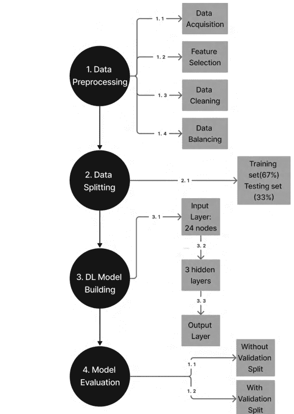

图 2.1 拟议模型的流程图。

#### 2.2.1 数据获取

疾病控制与预防中心 (CDC) 进行一项名为行为危险因素监测系统 (BRFSS) 的大规模年度电话调查，本研究使用的数据集即源自该调查。该调查收集了超过 400,000 名美国人在健康相关风险行为、慢性健康状况以及预防性服务使用方面的回答，该调查自 1984 年起每年开展一次。

| | _STATE | FMONTH | IDATE | IMONTH | IDAY | IYEAR | DISPCODE | SEQNO | _PSU | CTELENM1 |
|---|---|---|---|---|---|---|---|---|---|---|
| 0 | 1 | 1 | 1192021 | 1 | 19 | 2021 | 1100 | 2021000001 | 2021000001 | 1.0 |
| 1 | 1 | 1 | 1212021 | 1 | 21 | 2021 | 1100 | 2021000002 | 2021000002 | 1.0 |
| 2 | 1 | 1 | 1212021 | 1 | 21 | 2021 | 1100 | 2021000003 | 2021000003 | 1.0 |
| 3 | 1 | 1 | 1172021 | 1 | 17 | 2021 | 1100 | 2021000004 | 2021000004 | 1.0 |
| 4 | 1 | 1 | 1152021 | 1 | 15 | 2021 | 1100 | 2021000005 | 2021000005 | 1.0 |
| ... | ... | ... | ... | ... | ... | ... | ... | ... | ... | ... |
| 438688 | 78 | 12 | 1062022 | 1 | 6 | 2022 | 1100 | 2021001381 | 2021001381 | NaN |
| 438689 | 78 | 12 | 1122022 | 1 | 12 | 2022 | 1100 | 2021001382 | 2021001382 | NaN |
| 438690 | 78 | 12 | 12212021 | 12 | 21 | 2021 | 1100 | 2021001383 | 2021001383 | NaN |
| 438691 | 78 | 12 | 1112022 | 1 | 11 | 2022 | 1100 | 2021001384 | 2021001384 | NaN |
| 438692 | 78 | 12 | 12222021 | 12 | 22 | 2021 | 1100 | 2021001385 | 2021001385 | NaN |

图 2.2 模型实现中使用的 BRFSS 数据集 [5]。

该原始数据集具有 ‘303’ 个特征和来自 ‘438,693’ 人的回答。这些特征要么是向参与者明确提出的问题，要么是基于某些参与者回答处理的变量（图 2.2）。

#### 2.2.2 特征选择

基于与糖尿病预测的潜在相关性，从原始 303 个特征中精心选择了总共 25 个特征 [5]。以下是该领域研究表明的糖尿病及其他慢性疾病（如心脏病）的重要风险因素（并非按重要性严格顺序排列）（表 2.1）。

#### 2.2.3 数据预处理

数据预处理阶段包含多个步骤，以确保数据质量和一致性。所应用的步骤汇编自 BRFSS 2015 代码本实现 [6]。通过使用名为 _dropna()_ 的函数来处理缺失值，该函数会从数据框中删除带有缺失值 (NaN) 的行或列。删除重复项以防止冗余，并根据需要对分类变量进行编码或转换。此外，连续变量可能会被标准化或归一化，以确保跨特征的统一缩放。

#### 2.2.4 数据平衡

原始数据集中负样本（无糖尿病者）的数量高于正样本（糖尿病者）的数量，表明存在类别不平衡。为了创建平衡数据集，通过一种称为欠采样的重采样技术，在正样本（糖尿病）和负样本（无糖尿病）之间实现 50–50 的划分。欠采样涉及减少多数类（在本例中，即无糖尿病样本，标记为 0）的大小，以匹配少数类（即糖尿病前期和糖尿病样本，标记为 1 和 2）的大小。通过随机选择多数类实例的子集，得到的数据集在类别之间实现了更平衡的分布。在本特定情况下，无糖尿病类和糖尿病类均被下采样至各 33,289 个实例，从而得到一个平衡的数据集。

表 2.1 从 BRFSS 数据集中选择的特征

| # | 特征名称 | 描述 |
|---|---|---|
| 1. | Diabetes_binary | 糖尿病意识 |
| 2. | BMI | 身体质量指数 |
| 3. | Overweight | 身体质量指数 (BMI) 大于 25.00（超重或肥胖） |
| 4. | High BP | 高血压意识 |
| 5. | High cholesterol | 胆固醇意识 |
| 6. | Cholesterol check | 过去 5 年内的胆固醇检查 |
| 7. | Kidney problem | 无法控制尿流或肾脏疾病 |
| 8. | Stroke | 至少吸过 100 支香烟 |
| 9. | Alcoholic | 大量饮酒 |
| 10. | Chronic health problem | 以前中风过 |
| 11. | Heart problem | 曾患有冠心病 (CHD) 或心肌梗死 (MI) |
| 12. | Physical activity | 进行体育活动或锻炼 |
| 13. | Eat fruits | 每天至少消费一次水果 |
| 14. | Eat vegetables | 每天至少消费一次蔬菜 |
| 15. | General health | 一般健康状况 |
| 16. | Physical health | 身体健康状况良好的天数 |
| 17. | Mental health | 心理健康状况不好的天数 |
| 18. | Difficulty walking | 走路或上楼梯困难 |
| 19. | Healthcare access | 是否有医疗保健服务或保险 |
| 20. | Not wealthy to visit a doctor | 负担不起看医生的费用 |
| 21. | Regular checkup | 上次常规体检 |
| 22. | Sex | 男性或女性 |
| 23. | Age | 按 5 年年龄分类报告的年龄。从 18–24 岁的 1 开始，一直到 80 岁及以上的 13 |
| 24. | Education | 最高受教育程度 |
| 25. | Income | 年收入水平 |

#### 2.2.5 模型架构

所选深度学习模型采用 Keras 库的顺序架构，包含输入层、两个隐藏层和输出层。输入层有 64 个神经元，输入维度为 24，对应所选特征，而隐藏层使用修正线性单元 (ReLU) 激活函数向模型引入非线性。向模型添加了两个额外隐藏层。第一个隐藏层有 32 个神经元，第二个隐藏层有 20 个神经元，使用 ReLU 激活，以帮助模型学习数据中的复杂模式和关系。输出层中一个神经元的最终 sigmoid 激活函数产生二分类输出，指示糖尿病存在的可能性（图 2.3）。

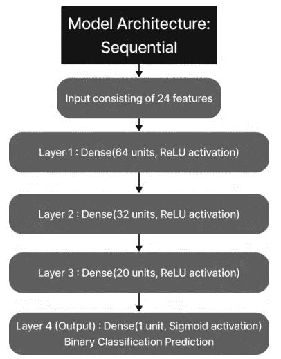

图 2.3 DL 模型架构。

#### 2.2.6 模型编译与训练

在 Keras 中，编译是为训练准备模型的过程。编译包括定义几个重要参数。

- **优化器**：优化器是在训练期间用于更新神经网络权重以最小化损失函数的算法。‘Adam’ 是深度学习中流行的优化器。

- **损失函数**：损失函数量化预测值与实际值之间的差异，显示模型在训练数据上的表现并指导优化过程。对于像这样的二分类问题，通常使用 ‘binary_crossentropy’。

- **指标**：指标用于在训练和测试期间评估模型性能。使用‘准确率’，它衡量被正确分类的样本比例。

模型被训练两次。前者被划分为测试（67%）和训练（33%），后者被划分为训练和验证。模型训练涉及根据训练数据集调整模型权重。这包括使用训练数据对模型进行多个 epoch 的重复训练。这是通过使用代价函数，并利用梯度下降等优化算法来最小化该函数来完成的。目标是最小化模型预测与训练数据集实际值之间的差异。训练后，模型可以对未见数据进行预测。

要使用 Keras 训练模型，我们使用模型对象的 “fit” 方法。它以训练数据集和相关目标标签作为输入，以及 epoch（迭代）的数量和批量大小（每次更新模型权重时使用的示例数量）。

#### 2.2.7 模型评估

这包括计算模型的准确率和损失等指标，以衡量其性能。如果在使用 Keras 训练模型时不使用验证集划分，我们将无法在训练期间测量模型在独立数据集上的性能。这可能导致对模型在训练数据上的性能高估，这通常被称为过拟合。这可能表现为随 epoch 增加训练数据的损失下降。这意味着模型开始记忆训练数据，而不是将关系推广到新数据。因此，在训练期间使用验证集划分来评估模型在独立数据上的性能非常重要。


模型性能在训练集和测试集上使用 evaluate 方法进行了评估：

- **训练准确率：** 用于评估模型对训练数据的拟合度。
- **测试准确率：** 用于评估模型对未见数据的泛化能力。

### 2.3 结果与分析

使用了包括准确率、精确率、召回率和 F1-score 在内的各种指标来评估模型性能。未使用验证集划分时，训练准确率确定为 75.34%，测试准确率达到 74.21%。精确率、召回率和 F1-score 均计算为 0.7420，总支持实例数为 21,971。使用验证集划分后，训练准确率略微下降至 74.34%，验证准确率上升至 74.38%。同样，精确率、召回率和 F1-score 均一致为 0.7437，支持实例数为 21,971。带有验证集划分参数的混淆矩阵显示，与预测正例（0.70）相比，模型对负例（0.81）的精确率更高；而与负例（0.64）相比，正例（0.85）的召回率更高。这些指标共同证明了模型准确分类糖尿病（DM）实例的能力，突出了其在疾病检测和风险评估方面的有效性。

验证集划分对于在独立数据集上评估模型性能至关重要。如果没有它，模型可能会过拟合，导致训练数据损失随 epochs 下降。因此，使用验证集划分来衡量模型在独立数据集上的性能至关重要，以防止过拟合并确保对训练数据进行准确评估（图 2.4 和 2.5）。

| 实际标签 \ 预测标签 | 0 | 1 |
| :--- | :---: | :---: |
| 0 | 7878 | 3166 |
| 1 | 2536 | 8391 |

图 2.4 未使用验证集的模型混淆矩阵 [5]。

| 实际标签 \ 预测标签 | 0 | 1 |
| :--- | :---: | :---: |
| 0 | 7771 | 3273 |
| 1 | 2373 | 8554 |

图 2.5 使用验证集的模型混淆矩阵 [5]。

### 2.4 讨论

基于生理数据训练的用于预测糖尿病（DM）的深度学习模型结果表现出有希望的性能指标。有和没有验证集划分的两种情况均达到了可比的准确率，表明模型具有鲁棒性。精确率、召回率和 F1-score 指标进一步验证了模型在正确识别糖尿病（DM）实例方面的有效性。然而，模型从训练到测试的准确率出现了小幅下降，表明存在一定程度的过拟合。这意味着模型可能过度记住了训练数据的模式，可能无法有效泛化到未见数据。混淆矩阵说明了正确和错误预测的分布，突出了模型表现出色的领域和潜在的改进领域。此外，可能需要更改超参数、添加或移除层以及其他模型调整来进行优化，以实现更有希望的准确率结果。

根据结果，该模型可能能够从 BRFSS 数据中准确识别糖尿病（DM）。尽管如此，该模型仍存在进一步改进和增强的前景。为了提高模型的功能性和泛化能力，后续研究可能会探索更多特征工程方法、不同的模型架构和更大的数据集。此外，添加领域特定信息和临床经验可以增强模型的可解释性和临床价值。这种方法确保了使用深度学习技术检测糖尿病（DM）时的鲁棒性和泛化能力（图 2.6–2.8）。

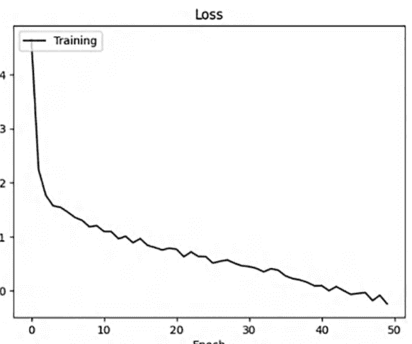

图 2.6 未使用验证集的训练损失可视化分析 [5]。

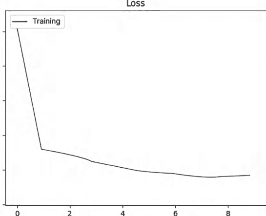

图 2.7 训练损失可视化分析 [5]。

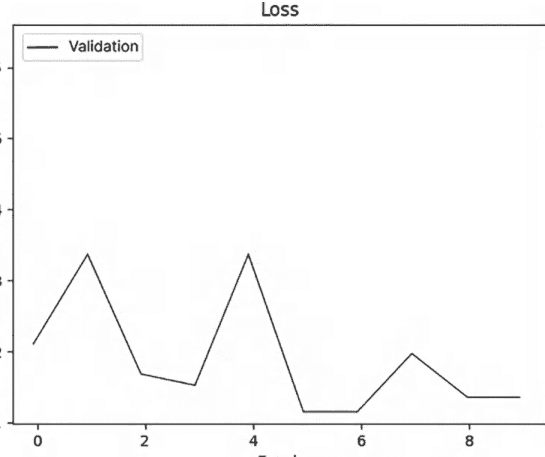

图 2.8 验证损失可视化分析 [5]。

### 2.5 结论

使用验证集划分参数的模型，在约 74% 的训练准确率和 74% 的测试准确率下表现出合理的准确率水平，表明其作为初步信息筛选工具的潜在效用。用于二分类的带验证的序列深度学习模型有效地构建了一个基于生理数据识别糖尿病（DM）的深度学习模型。该模型展示了强大的性能指标，包括较高的召回率、准确率、精确率和 F1-score 值。使用平衡数据集和仔细的预处理方法，大大增强了模型纠正类别不平衡并生成可靠预测的能力。这些结果表明，深度学习方法在医疗领域（尤其是与风险评估和疾病检测相关的应用）具有巨大的前景。为了提高模型的功能性并使其更容易集成到临床实践中，未来研究可能会探索优化技术和添加更多特征。

### 参考文献

- 1. 国际糖尿病联合会. (2021). IDF 糖尿病图谱，第 10 版. 比利时布鲁塞尔：国际糖尿病联合会.
- 2. 美国糖尿病协会. (2022). 糖尿病的诊断和分类. 糖尿病护理, 45(Suppl 1), S17–S38.
- 3. 美国糖尿病协会. (2022). 2022 年糖尿病医疗护理标准. 糖尿病护理, 45(Suppl 1), S1–S236.
- 4. https://www.cdc.gov/brfss/annual_data/2021/pdf/codebook21_llcp-v2-508.pdf
- 5. https://www.kaggle.com/code/muskansah/diabetes-mellitus-detection
- 6. https://www.kaggle.com/code/hakonem/diabetes-health-indicators-dataset-notebook

通过联邦学习进行血糖预测的基于图的可解释方法

朴成澈 和 李克志

### 3.1 引言

当胰腺无法产生足够的胰岛素时，就会发生 1 型糖尿病（T1D），导致血糖（BG）水平升高（高血糖，定义为 BG > 180 mg/dL）。为了管理病情并将 BG 水平维持在正常范围（70–180 mg/dL），1 型糖尿病患者依赖胰岛素泵和胰岛素补量注射等胰岛素输注方式。如果没有妥善管理，发生低血糖（BG < 70 mg/dL）或高血糖的风险显著增加，这可能导致严重并发症，包括肾脏问题、视力问题乃至失明。

为了预防这些严重的健康问题，1 型糖尿病患者积极监测和管理自身 BG 水平至关重要。在这方面，连续血糖监测（CGM）系统已成为重要工具，可每 5 分钟追踪一次 BG 水平波动。借助 CGM 提供的详细数据，研究人员开发了多种血糖水平预测（BGLP）模型。这些模型使 1 型糖尿病患者能够主动调整胰岛素剂量和膳食摄入，显著增强其维持稳定 BG 水平并降低并发症风险的能力。

在 BGLP 中，历史数据通常被结构化为多元时间序列（MTS），以纳入与预测任务相关的各种属性。自 2020 年以来，基于神经网络（NN）的方法已显示出优于传统非 NN 方法的性能，这一点在 BGLP 2020 挑战赛中尤为突出。在这些进展中，Oreshkin 等人（2020）提出的面向时间序列的神经基础展开分析（N-BEATS）已被 Rubin-Falcone 等人（2020）应用。当时，N-BEATS 是时间序列分析的领先方法，其基于 N-BEATS 的解决方案在挑战赛中脱颖而出，荣获第一名。

尽管取得了这些成就，但一个显著的局限性依然存在：这些模型在预测过程中对不同属性（如血糖水平、胰岛素补量和指尖血糖测试）的重要性提供的洞察有限。这种属性重要性解释的缺失不仅存在于 N-BEATS 中，也存在于其他依赖循环神经网络（RNN）架构（如长短期记忆网络 LSTM；Hochreiter and Schmidhuber, 1997；Yang et al., 2020）的当代 BGLP 方法中。这些方法可以捕捉时间依赖性，但在透明地建模属性之间的互连方面存在不足。这一局限性的重要性不容忽视，因为许多临床医生和医疗专业人员优先考虑理解预测模型的决策过程。能够解读不同属性如何影响预测对于这些技术的临床接受度和信任至关重要。

因此，这些方法的一个关键局限性是无法量化和解释 BGLP 环境中每个属性的重要性。为了弥补这一差距，图神经网络（GNN）的进展提供了一条有希望的途径，特别是那些使用具有可调整边权重的动态图的方法。图注意力网络（GAT；Velickovic 等人，2018）使得基于相邻节点张量的边权重在学习过程中可调整。随后，Brody 等人（2022）开发了增强版本 GATv2，它融入了更动态的注意力机制，提供了更强的模型表达能力。GAT 和 GATv2 的这些创新通过调制边权重，促进了 BGLP 中属性重要性的解释。


在本研究中，我们提出的模型基于原始 GAT 框架（参见第 3.2 节）。尽管 GATv2 具有一定优势，但我们的初步实验并未产生足以证明采用 GATv2 而非 GAT 合理的显著改进。

在 BGLP 的 NN 训练和部署方面，近期创新强调通过多任务学习开发个性化模型，Daniels 等人（2020, 2022）对此有所阐述。这种方法与传统方法不同，传统方法需要汇总个体数据来训练广义化的人群模型，随后再用个人数据进行微调。多任务学习能够同时捕捉人群范围的模式和个体特定特征，从而在无需大量微调的情况下生成个性化模型。就部署而言，Zhu 等人（2021）证明了在微控制器单元上部署基于 LSTM 的模型以实现 T1D 患者实时 BG 预测的可行性。为了进一步拓展技术前沿，Zhu 等人（2022）采用了一种可穿戴设备，内置一款低成本芯片，能够运行基于时间注意力的 GRU 模型。该方法利用桌面和云平台进行模型微调和数据存储，展示了 NNs 在可穿戴健康监测设备中的实际应用。此外，D’Antoni 等人（2022）使用 TensorFlow 和 Keras API 工具在边缘设备上直接实现了基于 LSTM 的模型。这种方法为了实时处理能力略微牺牲了预测准确性，但在其应用场景中这是可以接受的。然而，这些方法往往忽略了在为学习人群模式而汇总数据时进行隐私保护这一关键方面。这一疏忽可能会限制参与者招募，进而限制可用训练数据的数量。解决这一挑战对于推进基于 NN 的 BGLP 方法至关重要，以确保既有效的预测能力又符合隐私标准。

因此，近期 BGLP 方法的一个显著不足是在训练人群模型时缺乏对隐私保护的考虑。联邦学习（FL）以其去中心化的学习方法为特征，成为解决这一挑战的方案。FL 旨在利用分布式设备的计算能力，直接在设备产生的数据上执行人工智能（AI）训练任务，从而在数据源处保持数据机密性。模型更新通过一种称为联邦平均（FedAvg）的过程在中央服务器上聚集，该过程由 McMahan 等人（2017）提出，确保仅共享模型参数而不共享数据。鑒于 FL 在保护参与者隐私的同时促进人群范围模式学习的潜力，本工作探讨了 FL 在 BGLP 领域的应用。我们的目标是评估将 FL 集成到深度模型训练中的可行性和有效性，旨在平衡预测准确性与隐私保护（参见第 3.2 节）。

在我们的实验（参见第 3.3 节）中，我们在 OhioT1DM（Marling 和 Bunescu，2018, 2020）中设计了三项实验。初步试验确定，促成因素包括“血糖水平”、“胰岛素冲量”、“进餐”、“运动”、“指尖采血”和“睡眠”。在后续实验中，我们考察了我们方法的超参数变化，证明其在不同设置下具有稳定性。第三个实验深入探讨了 FL 的影响，证实与我们的方法集成后预测准确性会降低。最后，我们的讨论和结论（参见第 3.4 节和第 3.5 节）将在本章末给出。

### 3.2 方法

#### 3.2.1 问题定义

**基于规则多变量时间序列的 BGLP（RMTS-BGLP）**：如果我们有前 $T$ 个时间步的 $N$ 个因子，数据可以表示为 $\mathbf{X}=[\mathbf{x}_1 \cdots \mathbf{x}_T]$，其中 $\mathbf{X} \in \mathbb{R}^{N \times T}$。注意，$\mathbf{x}_t$ 包含 $N$ 个因子。任务是预测未来的 BG 水平 $y_{T+W}$。我们将预测水平 $W$ 设置为 6 或 12，分别代表 30/60 分钟的预测。关于 $T \triangleq \{1, ..., T\}$ 并与 CGM 的采样频率对齐，时间序列的每对相邻间隔为 5 分钟。

#### 3.2.2 设置与数据集

**本研究考察了两个数据集**：OhioT1DM’18 和 OhioT1DM’20（Marling 和 Bunescu，2018, 2020）。共有 12 名参与者，每个数据集 6 名，均诊断患有 T1D。这些数据集的详细信息见表 3.1，主要观察如下：（i）参与者群体包括五名女性和七名男性，性别分布相对均衡；（ii）大多数参与者的年龄范围为中年，其中八名参与者处于 40–60 岁年龄段；（iii）对于大多数参与者，训练样本与测试样本的比例约为 5:1。

| 患者 ID (PID) | BGLP 挑战 | 性别 | 年龄 | #训练样本 | #测试样本 | 天数 |
|---|---|---|---|---|---|---|
| 559 | 2018 | 女性 | 40–60 | 10,796 | 2514 | 52 |
| 563 | 2018 | 男性 | 40–60 | 12,124 | 2570 | 56 |
| 570 | 2018 | 男性 | 40–60 | 10,982 | 2745 | 51 |
| 575 | 2018 | 女性 | 40–60 | 11,866 | 2590 | 56 |
| 588 | 2018 | 女性 | 40–60 | 12,640 | 2791 | 56 |
| 591 | 2018 | 女性 | 40–60 | 10,847 | 2760 | 53 |
| 540 | 2020 | 男性 | 20–40 | 11,947 | 2884 | 57 |
| 544 | 2020 | 男性 | 40–60 | 10,623 | 2704 | 52 |
| 552 | 2020 | 男性 | 20–40 | 9080 | 2352 | 48 |
| 567 | 2020 | 女性 | 20–40 | 10,858 | 2377 | 57 |
| 584 | 2020 | 男性 | 40–60 | 12,150 | 2653 | 57 |
| 596 | 2020 | 男性 | 60–80 | 10,877 | 2731 | 57 |

#### 3.2.3 伦理

OhioT1DM 数据集仅供研究人员出于研究目的使用（Marling 和 Bunescu，2020）。因此，访问 OhioT1DM’18 和 OhioT1DM’20 数据集无需进一步的伦理审批。

#### 3.2.4 拟议方法

本研究中，我们引入了一种名为“GAM”的新型神经网络模型，该模型由 FL 增强。图 3.1 说明 GAM 包含一个 GRU（如 Cho 等人（2014）详细介绍）和一个 GAT（如 Velickovic 等人（2018）描述）。GAT 被用于有效捕捉 RMTS 中不同因子之间的模式，该 RMTS 是通过零填充从不规则多变量时间序列（IMTS）创建的。每个非零属性值被视为动态图节点，通过全连接层转换为张量，从而形成图嵌入。通过使用邻接矩阵对这些嵌入应用图卷积，在每个时间槽提取图特征。然后，这些特征由 GRU 进行时间集成，以生成紧凑的时间图特征向量，随后用于预测 BG 水平。

具体地，$\hat{y}_{T+W}=GAM(X; \theta)$ 的形成可以表示如下：
\(e_t^n = f_n(x_t^n)\) (3.1)

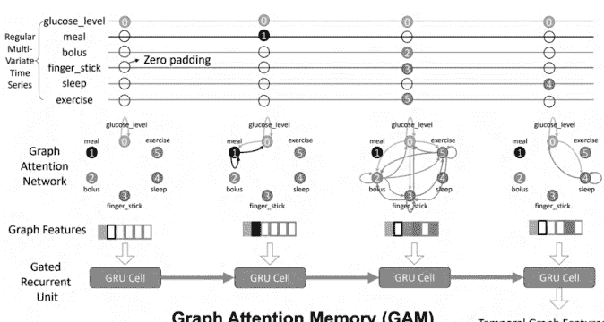

图 3.1 图注意力记忆（GAM）。

$$
\mathbf{E}_t = \left[ \mathbf{e}^1_t \cdots \mathbf{e}^n_t \cdots \mathbf{e}^N_t \right] \tag{3.2}
$$

$$
\mathbf{G}_t = \text{GATs}(\mathbf{E}_t, \mathbf{A}) \tag{3.3}
$$

$$
\mathbf{h}_t = \text{GRU}(\phi(\mathbf{G}_t), \mathbf{h}_{t-1}) \tag{3.4}
$$

$$
\hat{y}_{T+W} = f_{\text{out}}(\mathbf{h}_T) \tag{3.5}
$$

令 $T$ 定义为集合 $\{1,\dots, t,\dots, T\}$，$N$ 定义为集合 $\{1,\dots, n,\dots, N\}$。令 $x_t^n$ 表示矩阵 $\mathbf{X}$ 中位于第 $t$ 列和第 $n$ 行的元素，其中 $\mathbf{X}$ 属于维度为 $R^{N \times T}$ 的矩阵集合。函数 $f(\cdot)$ 表示神经网络层。$\mathbf{A}$ 是图邻接矩阵（$R^{N \times N}$）。GRU 的隐藏状态为 $\mathbf{h}_p$，$\mathbf{h}_0$ 用零初始化。$y_{T+W}$ 的估计值为 $\hat{y}_{T+W}$。

在公式 (3.1) 中，矩阵 $\mathbf{X}$（属于 RMTS）中的每个非零项 $x_t^n$ 都通过 $f_n(\cdot)$ 进行单独嵌入，其中每个因子 $n \in N$ 都有其对应的 $f_n(\cdot)$。该张量生成 $\mathbf{e}_t^n \in R^E$，表示 $x_t^n$，并聚合为 $\mathbf{E}_t$，如公式 (3.2) 所示。随后，如公式 (3.3) 所示，GATs 被用于使用邻接矩阵 $\mathbf{A}$ 对 $\mathbf{E}_t$ 执行图卷积。图卷积之后，生成 $\mathbf{G}_t \in R^{E \times N}$，封装了所有属性之间的相互关系。之后，$\mathbf{G}_t$ 使用函数 $\phi(\cdot)$ 转换为张量，得到 $\phi(\mathbf{G}_t)$。随后，$\{\phi(\mathbf{G}_1), \dots, \phi(\mathbf{G}_t)\}$ 被……聚合


一个 GRU，生成包含时间模式的压缩张量 h_T。最后，预测的血糖水平 ŷ_{T+W} 通过 f_out(·) 从 h_T 得出。

均方误差（MSE）被用作训练损失，并采用 Adam 优化器（Kingma 和 Ba, 2015）来优化可学习参数。

此外，联邦学习（FL）如图 3.2 所示。只有客户端上的各自个性化模型可以访问个人数据。在本地设备上进行预定数量的训练周期后，个体方法的可训练参数被传输到中央服务器，通过汇总这些参数得出全局方法。随后，客户端上的个性化模型使用全局模型的最新参数进行更新，有效同步个人和全局学习。此循环持续进行，直到模型达到最佳状态。通过这种方法，参与者隐私得到可靠保护，因为个人数据完全留在各自的领域内。同时，服务器能够在不损害个人隐私的情况下汇总全局趋势。值得注意的是，在我们的研究中，FL 通过多进程方式模拟，将每个客户端和服务器视为独立进程。

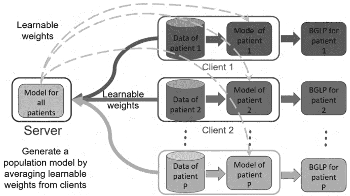

#### 3.2.5 指标

本工作考虑三种指标。RMSE 被用于全面评估模型性能，指导最佳可训练参数和属性组合的选择。此外，还考虑平均绝对相对差（MARD），使其成为评估较小幅度预测的理想指标。此外，平均绝对误差（MAE）用于与其他模型进行轻松比较，尤其是因为 MAE 是俄亥俄州 2020 挑战所有参赛作品使用的标准指标。

### 3.3 实验与结果

#### 3.3.1 属性的影响

为了有效利用 OhioT1DM 数据集和实验资源中的各种属性，我们对若干属性组合进行了实验。有趣的是，我们发现使用六个特定属性，包括“血糖水平”、“胰岛素剂量”、“进食”、“睡眠”、“运动”和“指尖血糖”，在大多数场景中都能持续带来显著改进。

因此，我们的初步实验旨在确定这六个属性中每一个对 RMTS-BGLP 的积极影响。在本实验中，我们从六个属性集中系统地一次排除一个属性（“血糖水平”除外）。然后，我们比较了使用所有六个属性的 GAM 与仅使用 BG 的 GRU 的性能。接下来，如果使用这六个属性的 GAM 优于其他模型，则表明每个属性都对 RMTS-BGLP 有积极贡献。反之，如果仅使用 BG 的 GRU 表现最差，则表明这六个属性的组合是有效的。本实验的结果详见表 3.2 和 3.3。

此外，我们还旨在解释排除某些属性的决定。为此，我们逐次将一个额外属性添加到现有的六个属性集中。然后，我们将结果与仅包含原始六个属性的 GAM 的性能进行比较。如果添加新属性在大多数场景中未能超过包含六个因素的 GAM，则我们选择不包含其他因素（见表 3.4 和 3.5）。

一般来说，当预测窗口 W 设置为 6 时，“GAM+6 属性”模型在 RMSE 和 MARD 两方面都表现出优于各种设置中其他模型的性能。“GAM+6 属性”的平均 RMSE 为 18.91 mg/dL（W=6），优于其他模型，其

表 3.2 “血糖水平”、“胰岛素剂量”、“进食”、“指尖血糖”、“运动”和“睡眠”的影响（按 RMSE 测量，W=6）

| 方法 | 559 | 563 | 570 | 575 | 588 | 591 | 540 | 544 | 552 | 567 | 584 | 596 | 平均 |
|---|---|---|---|---|---|---|---|---|---|---|---|---|---|
| GAM+6 属性 w/o meal | 19.51 | 17.84 | 16.94 | 22.52 | 17.32 | 21.04 | 21.20 | 16.26 | 16.26 | 21.57 | 22.23 | 16.82 | 19.13 |
| GAM+6 属性 w/o bolus | 19.74 | 18.00 | 16.74 | 22.40 | 17.08 | 20.89 | 21.70 | 15.62 | 16.70 | 21.98 | 23.13 | 16.40 | 19.20 |
| GAM+6 属性 w/o finger stick | 19.95 | 17.82 | 17.00 | 22.46 | 16.94 | 21.46 | 20.99 | 16.22 | 16.41 | 21.98 | 22.63 | 16.10 | 19.16 |
| GAM+6 属性 w/o sleep | 19.01 | 17.91 | 16.12 | 22.50 | 17.17 | 20.83 | 21.06 | 16.12 | 16.47 | 21.52 | 22.28 | 16.27 | 18.94 |
| GAM+6 属性 w/o exercise | 19.11 | 17.98 | 16.99 | 22.42 | 17.30 | 21.00 | 20.89 | 16.27 | 16.19 | 21.54 | 22.00 | 16.02 | 18.97 |
| GAM+6 属性 | 19.42 | 17.60 | 16.66 | 22.28 | 17.06 | 20.72 | 21.01 | 15.95 | 16.50 | 21.58 | 22.22 | 16.01 | 18.92 |
| GRU 血糖水平 | 19.44 | 18.29 | 18.60 | 23.62 | 18.49 | 21.83 | 22.77 | 18.00 | 17.37 | 22.92 | 23.59 | 17.20 | 20.18 |

表 3.3 “血糖水平”、“胰岛素剂量”、“进食”、“指尖血糖”、“运动”和“睡眠”的影响（按 MARD 测量，W = 6）

| 方法 | 559 | 563 | 570 | 575 | 588 | 591 | 540 | 544 | 552 | 567 | 584 | 596 | 平均 |
|---|---|---|---|---|---|---|---|---|---|---|---|---|---|
| GAM+6 属性 w/o meal | 8.83 | 7.75 | 5.38 | 9.74 | 7.55 | 12.17 | 10.87 | 7.74 | 9.20 | 10.91 | 10.91 | 8.78 | 9.15 |
| GAM+6 属性 w/o bolus | 8.89 | 7.75 | 5.37 | 9.55 | 7.49 | 12.03 | 11.09 | 7.49 | 9.36 | 11.11 | 11.47 | 8.59 | 9.18 |
| GAM+6 属性 w/o finger stick | 8.97 | 7.73 | 5.38 | 9.50 | 7.37 | 12.25 | 10.88 | 7.72 | 9.21 | 11.14 | 11.20 | 8.55 | 9.16 |
| GAM+6 属性 w/o sleep | 8.71 | 7.73 | 5.21 | 9.60 | 7.45 | 11.85 | 10.78 | 7.62 | 9.24 | 10.65 | 10.93 | 8.48 | 9.02 |
| GAM+6 属性 w/o exercise | 8.62 | 7.71 | 5.36 | 9.48 | 7.50 | 11.94 | 10.75 | 7.75 | 9.06 | 10.85 | 10.79 | 8.49 | 9.03 |
| GAM+6 属性 | 8.79 | 7.65 | 5.26 | 9.44 | 7.42 | 11.97 | 10.78 | 7.61 | 9.15 | 10.87 | 11.03 | 8.43 | 9.03 |
| GRU 血糖水平 | 8.99 | 7.98 | 5.74 | 10.27 | 8.03 | 12.35 | 11.58 | 8.69 | 9.66 | 11.24 | 11.26 | 8.98 | 9.56 |

| 方法 | 559 | 563 | 570 | 575 | 588 | 591 | 540 | 544 | 552 | 567 | 584 | 596 | 平均 |
|---|---|---|---|---|---|---|---|---|---|---|---|---|---|
| GAM +6 属性 +basal | 19.23 | 19.76 | 19.42 | 22.34 | 17.56 | 20.92 | 20.69 | 16.06 | 16.86 | 21.84 | 25.07 | 16.01 | 19.64 |
| GAM +6 属性 +basis skin temperature | 19.27 | 17.95 | 16.21 | 22.71 | 16.99 | 21.13 | 20.96 | 16.42 | 16.49 | 21.74 | 22.61 | 16.01 | 19.04 |
| GAM +6 属性 +basis GSR | 19.40 | 18.03 | 16.60 | 22.45 | 17.09 | 21.22 | 20.77 | 16.34 | 16.63 | 21.72 | 22.68 | 16.20 | 19.09 |
| GAM +6 属性 +basis sleep | 19.06 | 17.78 | 16.54 | 22.07 | 17.23 | 20.83 | 21.28 | 15.82 | 16.44 | 21.45 | 22.00 | 15.93 | 18.87 |
| GAM +6 属性 +acceleration | 19.31 | 17.93 | 16.42 | 22.24 | 17.21 | 20.71 | 21.08 | 15.84 | 16.69 | 21.82 | 22.15 | 15.89 | 18.94 |
| GAM +6 属性 +work | 19.39 | 17.78 | 16.80 | 22.10 | 16.94 | 20.83 | 21.10 | 16.06 | 16.54 | 21.50 | 21.75 | 15.91 | 18.89 |
| GAM +6 属性 +basis steps | 19.05 | 17.68 | 16.43 | 22.38 | 17.26 | 20.77 | 21.17 | 15.85 | 16.36 | 21.72 | 22.18 | 16.04 | 18.91 |
| GAM +6 属性 +basis heart rate | 19.67 | 17.44 | 16.71 | 22.57 | 16.97 | 20.62 | 21.13 | 16.10 | 16.52 | 21.65 | 22.04 | 16.05 | 18.96 |
| GAM +6 属性 +basis air temperature | 19.31 | 17.68 | 16.23 | 22.32 | 17.18 | 20.72 | 21.03 | 15.98 | 16.16 | 21.66 | 22.06 | 16.13 | 18.87 |
| GAM +6 属性 +day of week | 18.85 | 17.68 | 16.74 | 22.69 | 16.98 | 20.73 | 21.08 | 15.82 | 16.23 | 21.90 | 22.49 | 16.32 | 18.96 |
| GAM +6 属性 +total seconds | 19.24 | 17.87 | 16.32 | 22.33 | 16.90 | 21.17 | 20.90 | 16.07 | 16.53 | 21.88 | 22.50 | 16.09 | 18.98 |
| GAM +6 属性 | 19.42 | 17.60 | 16.66 | 22.28 | 17.06 | 20.72 | 21.01 | 15.95 | 16.50 | 21.58 | 22.22 | 16.01 | 18.92 |

| 方法 | 559 | 563 | 570 | 575 | 588 | 591 | 540 | 544 | 552 | 567 | 584 | 596 | 平均 |
| :--- | ---: | ---: | ---: | ---: | ---: | ---: | ---: | ---: | ---: | ---: | ---: | ---: | ---: |
| GAM +6 属性 +basal | 8.75 | 8.51 | 7.15 | 9.48 | 7.71 | 12.05 | 10.70 | 7.64 | 9.40 | 10.99 | 13.94 | 8.36 | 9.56 |
| GAM +6 属性 +basis skin temperature | 8.67 | 7.68 | 5.29 | 9.81 | 7.38 | 12.05 | 10.84 | 7.76 | 9.38 | 10.74 | 11.10 | 8.47 | 9.10 |
| GAM +6 属性 +basis GSR | 8.88 | 7.76 | 5.27 | 9.85 | 7.51 | 12.00 | 10.76 | 7.65 | 9.46 | 10.86 | 11.16 | 8.52 | 9.14 |
| GAM +6 属性 +basis sleep | 8.47 | 7.71 | 5.28 | 9.36 | 7.46 | 11.80 | 10.84 | 7.59 | 9.11 | 10.55 | 10.96 | 8.40 | 8.96 |
| GAM +6 属性 +acceleration | 8.66 | 7.69 | 5.22 | 9.49 | 7.42 | 11.92 | 10.71 | 7.55 | 9.31 | 11.03 | 10.95 | 8.43 | 9.03 |
| GAM +6 属性 +work | 8.73 | 7.71 | 5.31 | 9.47 | 7.35 | 11.93 | 10.77 | 7.57 | 9.28 | 10.83 | 10.74 | 8.40 | 9.01 |
| GAM +6 属性 +basis steps | 8.64 | 7.63 | 5.27 | 9.49 | 7.44 | 11.85 | 10.77 | 7.50 | 9.16 | 10.87 | 10.92 | 8.46 | 9.00 |
| GAM +6 属性 +basis heart rate | 8.78 | 7.67 | 5.30 | 9.68 | 7.42 | 11.77 | 10.79 | 7.56 | 9.21 | 10.83 | 10.89 | 8.50 | 9.03 |
| GAM +6 属性 +basis air temperature | 8.61 | 7.68 | 5.42 | 9.56 | 7.43 | 11.87 | 10.73 | 7.57 | 9.12 | 10.91 | 10.83 | 8.54 | 9.02 |
| GAM +6 属性 +day of week | 8.59 | 7.69 | 5.32 | 9.54 | 7.37 | 11.96 | 10.83 | 7.53 | 9.14 | 10.99 | 11.17 | 8.53 | 9.06 |
| GAM +6 属性 +total seconds | 8.78 | 7.70 | 5.20 | 9.72 | 7.40 | 12.07 | 10.71 | 7.57 | 9.26 | 10.98 | 11.07 | 8.45 | 9.08 |
| GAM +6 属性 | 8.79 | 7.65 | 5.26 | 9.44 | 7.42 | 11.97 | 10.78 | 7.61 | 9.15 | 10.87 | 11.03 | 8.43 | 9.03 |


RMSE值超过此基准（请参阅表 3.2）。相反，“GRU 血糖水平”在所有场景中始终表现最差。具体来说，“GRU 血糖水平”的平均 RMSE 为 20.17 mg/dL（W=6；请参见表 3.2）。因此，我们推断六个属性中的每一个都对 RMTS-BGLP 的性能产生积极贡献，它们的集成带来了显著改进。关于其他属性，如表 3.4 和 3.5 所示，包含新属性通常在大多数情况下不会导致性能增强。

#### 3.3.2 超参数的影响

我们选择两个重要的超参数来评估其影响，即基于 GRU 的内存中的 H（隐藏层大小）和 GAT 中的 L（层数）。随后，H 决定 GAM 的内存容量，较大的 H 可在一定阈值内增强其内存能力。在本实验中，我们评估了五种不同的隐藏层大小，具体为 H ∈ {64, 128, 256, 512, 1024}。

同样，在 GAT 中改变 L 会以不同方式影响 GAM 对数据的表示能力。增加 L 可增强 GAM 的处理能力。例如，当 L=1 时，代表“血糖水平”的节点仅可接收消息，而消息发送者是其相邻节点。但是，如果我们将 L 设为 2，虽然第一层中的消息交换与 L=1 类似，但在后续层中，接收到的消息不是原始图嵌入。相反，它们在聚合前被合并。因此，更深层的网络能以更复杂的方式合并图消息，类似于扩展卷积神经网络（CNN）的层数。在本实验中，我们探索了五种不同的层数。

图 3.3 说明了 H 的影响。很明显，当 H=256 且 W=6 时，GAM 达到最佳性能。较大的 H 值，如 H>512，并不能带来更好的预测。然而，如图 3.4a 所示，当增加 L 时，平均 RMSE 从 19.02 mg/dL（L=1）提升至 18.85 mg/dL（L=4）。因此，推断在此场景中，通过增加 L 来增强 GAT 的能力，与改变 H 相比并未带来显著改进。

#### 3.3.3 FL 的影响

本实验旨在评估在训练过程中引入 FL 对预测能力的影响。我们比较了预测能力

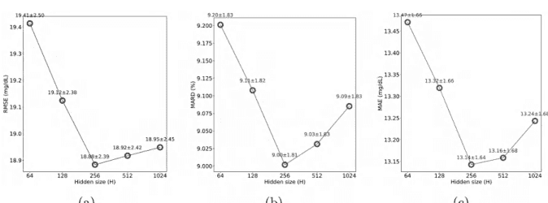

图 3.3 不同隐藏层大小（H）的影响，预测窗口（W=6）。

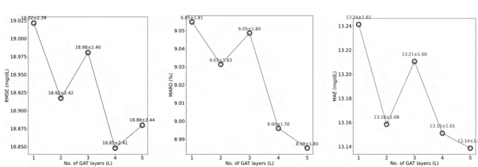

图 3.4 不同层数（L）的影响，预测窗口（W=6）。

“GAM+6 个属性 +FL”与“GAM+6 个属性”对比，以评估因 FL 导致的预测准确性可能损失。为确保所观察到的性能下降并非归因于我们的带 FL 集成的模型设计，我们还使用相同的训练方法采用 LSTM 模型，以确定 FL 是否对模型性能产生不利影响。

表 3.6 和 3.7 显示，“GAM+6 个属性”始终表现更好。例如，“GAM + 6 个属性”的平均 RMSE 为 18.75 mg/dL（W=6），而“GAM + 6 个属性 +FL”的平均 RMSE 为 20.49 mg/dL（请参见表 3.6）。考虑“LSTM +6 个属性”时也有类似观察。例如，“LSTM +6 个属性”的平均 RMSE 为 19.33 mg/dL，而“LSTM+6 个属性 +FL”的平均 RMSE 为 20.63 mg/dL。

TABLE 3.6 FL 的影响（按 RMSE 衡量，W=6）

| 方法 | 559 | 563 | 570 | 575 | 588 | 591 | 540 | 544 | 552 | 567 | 584 | 596 | 平均 |
| :--- | :--- | :--- | :--- | :--- | :--- | :--- | :--- | :--- | :--- | :--- | :--- | :--- | :--- |
| LSTM+血糖水平+FL | 20.36 | 18.56 | 19.79 | 23.68 | 18.91 | 22.59 | 23.26 | 18.33 | 17.75 | 23.37 | 23.88 | 18.31 | 20.73 |
| LSTM+6 个属性+FL | 20.59 | 18.65 | 19.50 | 26.11 | 18.14 | 22.08 | 21.99 | 18.08 | 17.06 | 22.93 | 24.28 | 18.20 | 20.63 |
| LSTM+6 个属性 | 18.66 | 18.12 | 17.17 | 23.80 | 17.08 | 21.13 | 21.57 | 16.51 | 16.84 | 21.97 | 22.37 | 16.77 | 19.33 |
| GAM+6 个属性+FL | 20.16 | 18.59 | 18.99 | 25.06 | 17.89 | 22.03 | 21.96 | 17.38 | 17.54 | 23.27 | 24.71 | 18.30 | 20.49 |
| GAM+6 个属性 | 19.22 | 17.93 | 16.34 | 21.68 | 17.01 | 20.83 | 20.82 | 15.78 | 16.46 | 21.62 | 21.49 | 15.86 | 18.75 |

TABLE 3.7 FL 的影响（按 MARD 衡量，W=6）

| 方法 | 559 | 563 | 570 | 575 | 588 | 591 | 540 | 544 | 552 | 567 | 584 | 596 | 平均 |
| :--- | :--- | :--- | :--- | :--- | :--- | :--- | :--- | :--- | :--- | :--- | :--- | :--- | :--- |
| LSTM+血糖水平+FL | 9.40 | 8.09 | 6.12 | 10.75 | 8.31 | 12.68 | 11.73 | 8.88 | 10.00 | 11.59 | 11.63 | 9.43 | 9.88 |
| LSTM+6 个属性+FL | 9.15 | 8.10 | 6.05 | 11.30 | 7.94 | 12.60 | 11.13 | 8.13 | 9.40 | 11.40 | 11.94 | 9.37 | 9.71 |
| LSTM+6 个属性 | 8.48 | 7.86 | 5.46 | 10.24 | 7.45 | 12.11 | 10.87 | 7.66 | 9.22 | 10.77 | 10.81 | 8.72 | 9.14 |
| GAM+6 个属性+FL | 9.12 | 8.10 | 5.90 | 10.90 | 7.84 | 12.36 | 10.99 | 8.05 | 9.84 | 12.06 | 12.18 | 9.33 | 9.72 |
| GAM+6 个属性 | 8.71 | 7.70 | 5.27 | 9.33 | 7.39 | 11.85 | 10.41 | 7.44 | 9.08 | 10.75 | 10.46 | 8.34 | 8.89 |

### 3.4 讨论

在将 GAM 与 Ohio 2020 挑战中的顶尖方法进行对比（请参阅表 3.8）时，为确保与其他方法的公平比较，我们的模型使用 OhioT1DM’18 进行预训练，然后使用 OhioT1DM’20 进行调优。在与其他方法的比较中，我们不使用带 FL 的 GAM，因为 FL 显然会降低预测能力，而我们的主要目标是展示这些深度模型之间的性能差异。

总体而言，我们提出的模型排名第三。然而，这并不一定意味着它不如前两名模型。例如，基于 N-BEATS 的模型在包含 100 名参与者数据的相当大的数据集上进行预训练，采用独特的策略，例如使用不同超参数同时训练多个模型，并将这些模型预测的中位数作为最终输出。尽管其性能出色，但很难将这种成功完全归因于模型本身，而非所采用的策略。

### 3.5 结论

在本研究中，我们引入了一个名为“GAM”的新概念，即图注意力内存模型。GAM 凭借其可解释性、效率和适应性脱颖而出。它通过注意力机制实现这一点，其中注意力权重突出了属性的重要性，并且注意力权重和图结构都会根据活动节点进行调整。此外，我们将 FL 与 GAM 集成，使我们能够在保护参与者隐私的同时利用集体洞察。

TABLE 3.8 Ohio 2020 挑战中各方法的比较

| 方法 | RMSE (W=6) | MAE (W=6) | RMSE (W=12) | MAE (W=12) | 总体 |
| :--- | :--- | :--- | :--- | :--- | :--- |
| N-BEATS (Rubin-Falcone 等人, 2020) | 18.22 | 12.83 | 31.66 | 23.6 | 86.31 |
| RNN (Hameed 和 Kleinberg, 2020) | 19.21 | 13.08 | 31.77 | 23.09 | 87.15 |
| GAM (本文提出的模型) | 18.77 | 13.39 | 32.04 | 23.86 | 88.06 |
| GAN (Zhu 等人, 2020) | 18.34 | 13.37 | 32.21 | 24.2 | 88.12 |
| 多尺度 LSTM (Yang 等人, 2020) | 19.05 | 13.5 | 32.03 | 23.83 | 88.41 |
| LSTM+attention (Bevan 和 Coenen, 2020) | 18.23 | 14.37 | 31.1 | 25.75 | 89.45 |

### 参考文献

Bevan, R., Coenen, F., 2020. ‘非个性化未来血糖水平预测实验’, in: KDH@ECAI’20, 虚拟举办，西班牙圣地亚哥-德孔波斯特拉，第 100–104 页。

Brody, S., Alon, U., Yahav, E., 2022. ‘图注意力网络有多关注？’, in: ICLR’22, 虚拟活动。

Cho, K., van Merriënboer, B., Gülçehre, C., Bahdanau, D., Bougares, F., Schwenk, H., Bengio, Y., 2014. ‘使用 RNN 编码器-解码器学习短语表示以用于统计机器翻译’, in: EMNLP’14, 多哈，卡塔尔，第 1724–1734 页。

Daniels, J., Herrero, P., Georgiou, P., 2020. ‘通过深度多任务网络进行个性化血糖预测’, in: KDH@ECAI’20, 虚拟举办，西班牙圣地亚哥-德孔波斯特拉，第 110–114 页。

Daniels, J., Herrero, P., Georgiou, P., 2022. ‘个性化血糖预测的多任务学习方法’。IEEE 生物医学与健康信息学杂志 26, 436–445。

D’Antoni, F., Petrosino, L., Sgarro, F., Pagano, A., Vollero, L., Piemonte, V., Merone, M., 2022. ‘使用神经网络预测 1 型糖尿病儿童的血糖浓度：边缘计算应用’。Bioengineering 9, 183。

Hameed, H., Kleinberg, S., 2020. ‘跨数据集血糖预测知识蒸馏的潜力与陷阱调查’, in: KDH@ECAI’20, 虚拟举办，西班牙圣地亚哥-德孔波斯特拉，第 85–89 页。

Hochreiter, S., Schmidhuber, J., 1997. ‘长短期记忆’。Neural Computation 9, 1735–1780。

Kingma, D.P., Ba, J., 2015. ‘Adam：随机优化方法’, in: ICLR’15, 圣地亚哥，加利福尼亚州，美国。

Marling, C., Bunescu, R.C., 2018. ‘用于血糖水平预测的 OhioT1DM 数据集’, in: IJCAI-ECAI’18, 斯德哥尔摩，瑞典，第 60–63 页。

Marling, C., Bunescu, R.C., 2020. ‘用于血糖水平预测的 OhioT1DM 数据集：2020 年更新’, in: KDH@ECAI’20, 虚拟举办，西班牙圣地亚哥-德孔波斯特拉，第 71–74 页。

McMahan, B., Moore, E., Ramage, D., Hampson, S., y Arcas, B.A., 2017. ‘来自去中心化数据的通信高效深度网络学习’, in: AISTATS’17, 劳德代尔堡，佛罗里达州，美国。

Oreshkin, B.N., Carpov, D., Chapados, N., Bengio, Y., 2020. ‘N-BEATS：面向可解释时间序列预测的神经基展开分析’, in: ICLR’20, 亚的斯亚贝巴，埃塞俄比亚。

Rubin-Falcone, H., Fox, I., Wiens, J., 2020. ‘深度残差时间序列预测：应用于血糖预测’, in: KDH@ECAI’20, 虚拟举办，西班牙圣地亚哥-德孔波斯特拉，第 105–109 页。

Velickovic, P., Cucurull, G., Casanova, A., Romero, A., Liò, P., Bengio, Y., 2018. ‘图注意力网络’, in: ICLR’18, 温哥华，不列颠哥伦比亚省，加拿大。


Yang, T., Wu, R., Tao, R., Wen, S., Ma, N., Zhao, Y., Yu, X., Li, H., 2020. ‘基于多滞后结构的血糖预测多尺度长短期记忆网络’，在：KDH@ECAI’20，西班牙圣地亚哥-德孔波斯特拉（线上），第 136–140 页。

Zhu, T., Kuang, L., Daniels, J., Herrero, P., Li, K., Georgiou, P., 2022. ‘基于深度学习和边缘计算的 IoMT 支持实时血糖预测’。IEEE 物联网杂志 10, 1–1。

Zhu, T., Kuang, L., Li, K., Zeng, J., Herrero, P., Georgiou, P., 2021. ‘基于边缘深度学习的 1 型糖尿病血糖预测’，在：IEEE ISCAS’21，韩国大邱，第 1–5 页。

Zhu, T., Yao, X., Li, K., Herrero, P., Georgiou, P., 2020. ‘基于生成对抗网络的 1 型糖尿病血糖预测’，在：KDH@ECAI’20，西班牙圣地亚哥-德孔波斯特拉（线上），第 90–94 页。

## 基于残差 U-Net 方法的视网膜眼底图像糖尿病早期自动检测

K. Sujatha, R.S. Ponmagal, N. Janaki, N.P.G. Bhavani, and SuQun Cao

### 4.1 引言

糖尿病（DM）被认为是全球流行的最致命疾病。早期诊断 DM 对提高患者生存率起着至关重要的作用。医学和技术领域的最新发展为改进视网膜图像检测和分割方法提供了方向，以帮助医学从业者定位问题并采用精准程序治疗患者。最近，已提出许多方法来预测和分割视网膜图像。由于深度学习方法在 DM 检测和分割中发挥着突出作用，因此考虑了这两种方法 [1–11]。另外，随着物联网（IoT）在全球连接设备方面引领技术进步，基于 IoT 的集成路由与上述方法一起使用，以微调并定位骨骼中癌细胞的精确位置。骨癌分割和 IoT 路由技术面临的主要挑战在 [12,13] 中有所说明。在参考文献 [14] 中，使用全卷积网络（FCN）架构进行图像分类是一大挑战。参考文献 [10] 中设计的 AGResU-Net 未能考虑临床分割模型来提高分割准确性。

在参考文献 [15] 中，开发了使用纹理特征和稀疏内核编码来分割骨癌的方法，但主要挑战在于将单维数据源扩展到多维数据源，从而将非正常视网膜区域组织与正常部分分割开来。因此，拟议项目开发了一种方法来解决已识别的问题，并提供准确性、灵敏度、特异度和曲线下区域参数，同时强调适应度指标等性能措施 [16–24]。基于嵌入式的软件产品可帮助医学专业人士、医生、专家、研究人员及其他医学领域专家早期诊断 DM 并相应开始治疗（图 4.1）。

本章的组织方式如下：第 4.1 节介绍糖尿病视网膜病变（DR）。第 4.2 节开展文献调查，以识别研究人员讨论的方法。从文献调查中识别出现存的挑战，并在第 4.3 节中讨论，该节包含研究领域中存在的空白。在彻底分析文献文章后，识别了研究空白并仔细制定了目标。第 4.4 节讨论深度学习模型，第 4.5 节讨论结果和讨论。第 4.6 节呈现本章的结束语，随后是文中引用的参考文献。

### 糖尿病视网膜病变

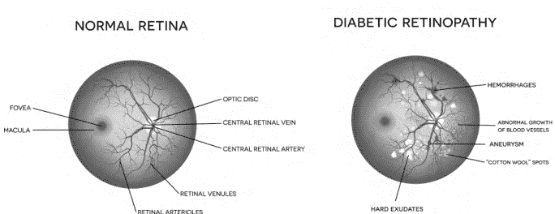

图 4.1 正常视网膜与糖尿病视网膜病变视网膜图像对比。（图片来源：ShutterStock Images。）

### 4.2 文献调查

胰岛素分泌不足会导致 DM。随着血糖水平升高，DM 进展；DM 会影响循环系统（包括视网膜）中的血液流动，并损害人体血管结构，进而降低患者视力，导致 DR。

为早期检测 DR [25]，研究人员使用支持向量机（SVM）、序列最小优化（SMO）、随机森林和朴素贝叶斯（NB）进行分类。使用上述方法，诊断的准确结果接近 90%。

在研究 [26] 中，使用小波特征将 DM 状况分类为正常和异常，准确率为 92.5%。使用卡胡宁-洛厄变换（KLT）通过分割主要血管来从视网膜图像中检测视盘以识别 DM [8]，直方图计算时间缩短，准确率约为 91.5%。主要缺点是无法获得有效输出，且图像对比度很低。如果 DR [9] 不予治疗，可能导致视力丧失。研究人员使用离散余弦变换（DCT）和 k 近邻（k-NN）来分类 DR [27]。

研究人员使用一种稳健的特征提取方法，随后进行 k-means 聚类，从视网膜图像中识别 DR [10]，准确率为 95%。使用此方法时，伪影会导致部分信息丢失。视盘形状随严重程度而变化 [28–37]。血管的存在增加了诊断的复杂性。因此，将视盘分割为小感兴趣区域（RoI）以进行面积计算并提取相关特征 [11]，从而使用具有可变配置和模糊逻辑的自适应掩模进行早期检测和分类。因此，研究人员提出的方法依赖于视网膜图像分析。从这些图像中提取特征，并根据现有状况的严重程度进行分类 [38–46]。

### 4.3 研究空白

基于调查分析，针对早期 DR 诊断的去噪、特征提取、降维和分类的新颖鲁棒方法是本工作的额外亮点。灵敏度和特异度用于评估性能。

### 4.4 目标与研究亮点

#### 4.4.1 目标

根据文献分析，基于视网膜分割的现有方法在基于图像的分类方面效率不高，这是提高分割准确性并将单模态数据源扩展到多模态数据源的主要挑战。本工作的研究成果是开发一个软件产品。为了将本工作的研究成果转化为软件产品，检测 DR 并执行分割，从而帮助患者治疗并挽救生命。目标是发明方法来解决已识别的问题，并制定一种有助于早期诊断 DR 的方法。因此，主要目标是设计一种基于眼底相机视网膜图像分割、嵌入物联网（IoT）的深度学习神经网络（DLNN）模型的 DR 检测方案，强调准确性、灵敏度和特异性。拟议的成果是设计一种用于眼底视网膜图像分割的深度学习神经网络鲁棒高效算法，包括用于分割、感兴趣区域（RoI）提取和物联网路由的 DLNN 模型仿真，关注适用性指标等性能指标。如果使用嵌入式技术开发软件产品，注重可行性和实用性，则可以帮助医学专家从视网膜图像中早期诊断 DM 并相应开始治疗。

#### 4.4.2 研究亮点

研究亮点包括：

- 从视网膜眼底图像中识别 NL、NPDR 和 PDR
- 实施医疗物联网（HIoT）
- RA-UNet 用于分割
- 自适应阈值（AT）用于 RoI 提取
- 使用带有或不带有优化技术（如 SSOA 和 CAViaR）的深度学习神经模型进行诊断


### 4.5 基于DLNN的DM诊断方法框架

信息传输通过使用诸如物联网（IoT）[5,38–43]等最新技术在设备之间进行高级通信。此外，由于其高效能力，物联网已被广泛用于设计和推广医疗保健系统 [8]。物联网预计将在医疗保健领域发挥非常重要的作用，即HIIoT [19,44–46]。许多非侵入性医学影像方法提供高对比度。视网膜眼底图像的分析是规划诊断随后进行分割过程的重要步骤 [1]。

DLNN可以在处理视网膜图像时解决早期糖尿病（DM）检测问题。确实，包含伪影的图像会被去噪并输入到具有泛化能力的学习过程 [4]。因此，本研究的主要目标是开发一种早期糖尿病视网膜病变（DR）检测方法，以防止视力丧失，并利用物联网实现该方法，从而解决眼底图像分类问题 [9]。

在文献 [14]中，作者引入了一种基于简单元启发式算法的新多类别模型。此类模型受牧羊人利用动物本能的启发。该算法称为混沌牧羊人优化算法（SSOA）。根据该算法，主要和初始步骤是将智能体分离到多个社区中，优化灵感来自大自然中牧羊人对每个社区的行为。在优化过程中，既关注好的智能体也关注不好的智能体，从而提高算法性能。

#### 4.5.1 混沌麻雀搜索算法（SSOA）

在大自然中，动物的最优生存方式利用本能来寻找最佳的生活方式。马匹本能地寻找最坚固和最快的路径。过去的道路工程师曾利用这条路径修建新路。牧羊人使用牛群中的一匹或多匹马来搬运工具并寻找道路，而这种牧羊人的行为启发了作者使用数学建模进行优化 [14]。

#### 4.5.2 有条件自回归风险价值（CAViaR）

在文献 [15]中，作者提出了一种名为CAViaR的估计方法量化方案。它不是对整个分布进行建模，而是直接开发量化模型。因此，作者提出了一种名为CAViaR的有条件自回归规范。首先，将进行物联网仿真，分散的节点将收集患者信息。此后，将使用所提出的混沌牧羊人鱼子酱优化（SSCO）进行路由，它是混沌牧羊人优化算法（SSOA）[14]和CAViaR [15]的集成。在此，将考虑能量、信任和距离等适应度指标。此外，将在基站（BS）进行视网膜图像分割。在此，输入视网膜图像将呈现给预处理阶段，该阶段将基于使用自适应阈值（AT）技术进行的感兴趣区域（RoI）提取来执行。之后，视网膜图像分割将由残差注意感知分割方法（RA-UNet）[16]执行，该方法将由所提出的SSCO技术训练，并如图4.2所示。

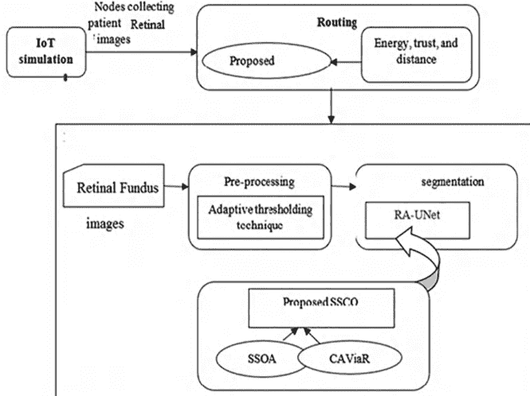

图4.2 所提技术的框图表示。

### 4.6 结果与讨论

图像分析是在包含通过眼底相机获取的NL、NPDR和PDR视网膜状况的视网膜眼底图像数据库上进行的 [1,2]。NL、NPDR和PDR类别用于诊断。该数据库共有323幅视网膜图像，来自Kaggle，分类为NL、NPDR和PDR。其中，约150幅图像属于NL类别，125幅属于NPDR类别，48幅属于PDR类别。从视网膜眼底图像中提取特征，这是一幅RGB图像，当分别分析绿色像素时具有高对比度。AT用于增强RoI中特征相对于背景的对比度。使用5×5掩码进行噪声消除。通过暗背景上的白色区域识别血管，如图4.3所示。滤波后的图像使用AT技术转换为二值图像，其最优阈值为0.138。AT后得到的输出图像在图4.4中显示为不连续的线条。为了评估所提方法的效率，对123幅测试图像进行了实验，分为50幅NL、40幅NPDR和33幅PDR。在使用本模型测试图像后

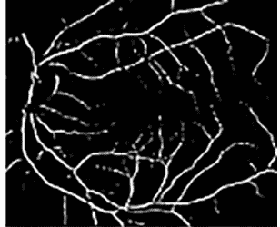

图4.3 血管检测。

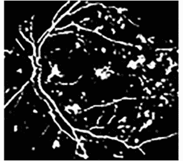

图4.4 使用AT识别视网膜受影响区域。

TABLE 4.1 糖尿病视网膜病变诊断混淆矩阵

| 预测 | NL | NPDR | PDR |
|---|---|---|---|
| NL | 48 | 1 | 1 |
| NPDR | 1 | 38 | 1 |
| PDR | 1 | 1 | 31 |

采用随机森林分类器，得到分类混淆矩阵。混淆矩阵如表4.1所示。

从视网膜图像中推断出DR。在此方法中，视网膜图像使用AT进行预处理，以提取RoI并增强局部对比度。该基于DLNN模型的系统分别提供了灵敏度97.21%和特异性97.66%。本文提出了一种带有决策支持系统的专家系统，用于早期检测DM。还尝试了另一种传统方法，即贝叶斯定理方法，用于早期检测DR。该系统能够以80.1%的灵敏度和86.3%的特异性识别DR。使用DLNN模型结合或不结合优化技术的形态学图像处理方法，将NL、NPDR和PDR类别进行分类。

根据该领域不同科学家所述的分析和研究工作，DR早期检测是一个全球普遍存在的主要挑战。因此，如果DR能被早期诊断，我们的所提算法可能成为救星。由于所提方法与物联网集成，视网膜图像的采集、处理和存储变得更加容易，从而帮助专业人员进行监测并提供高效治疗。因此，研究成果将对印度的医学实验室和医院有用。这些成果在国外也可能有用。在此工作中，每个类别的样本很重要，因为评价指标的计算是针对每个类别进行的。

### 4.7 结论

通过对现有模型的深入分析，得出结论：所提技术能够成功早期检测DR。在此工作中，有可能在早期阶段本身检测出DR。分类使用了带有或不带有SSOA和CAViaR等优化技术的深度学习神经网络进行。在深度学习神经网络分类之前，使用AT对DR影响的视网膜区域进行分割，并将从DR提取的特征分类为正常、NPDR和PDR。因此，将所提方法的输出与现有方法进行比较，以证明所提方法的优越性。

### 参考文献

- 1. A. Budai, R. Bock, A. Maier, J. Hornegger, and G. Michelson, “眼底图像中强健的血管分割,” Int J Biomed Imaging, vol. 2013, p. 154860, 2013.
- 2. J. Odstrcilik, A. Budai, R. Kolar, and J. Hornegger, “基于改进匹配滤波的视网膜血管分割：在新的高分辨率眼底图像数据库上的评估,” IET Image Process, vol. 7(4), pp. 373–383, 2013.
- 3. Unique Identification Authority of India. AADHAAR. Accessed: March 17, 2015. [Online]. Available: https://uidai.gov.in/what-is-aadhaar.html, 2015.
- 4. Canadian Border Services Agency. CANPASS Air. Accessed: February 27, 2015. [Online]. Available: www.cbsa-asfc.gc.ca/prog/canpass/canpass-air-eng.html, 2015.
- 5. O. Seyeddain, H. Kraker, A. Redlberger, A. K. dexl, G. Grabner, and M. Emesz, “超声乳化或药物诱导瞳孔扩大后自动生物特征虹膜识别的可靠性,” Eur J Ophthalmol, vol. 24(1), pp. 58–62, 2014.
- 6. M. Dhooge and J. J. de Laey, “眼缺血综合征,” Bull Soc Belge Ophtalmol, vol. 231, pp. 1–13, 1989.
- 7. R. Roizenblatt, P. Schor, F. Dante, J. Roizenblatt, and R. B. Jr., “白内障手术后作为生物特征识别方法的虹膜识别,” BioMed Eng Online, vol. 3(2), 2004. [Online]. Available:www.biomedical-engineering-online/com/content/3/1/2.
- 8. L. Dhir, N. E. Habib, D. M. Monro, and S. Rakshit, “白内障手术和瞳孔扩大对个人身份验证虹膜模式识别的影响,” Eye, vol. 24, pp. 1006–1010, 2010.
- 9. O. Seyeddain, H. Kraker, A. Redlberger, A. K. Dexl, G. Grabner, and M. Emesz, “超声乳化或药物诱导瞳孔扩大后自动生物特征虹膜识别的可靠性,” Eur J Ophthalmol, vol. 24(1), pp. 58–62, 2014.
- 10. M. Trokielewicz, A. Czajka, and P. Maciejewicz, “白内障对虹膜识别性能的影响,” Proceedings of SPIE 9290, Photonics Applications in Astronomy, Communications, Industry, and High-Energy Physics Experiments 2014, vol. 9290, 2014. https://dx.doi.org/10.1117/12.2076040.
- 11. X. Yuan, H. Zhou, and P. Shi, “虹膜识别：屈光手术后的生物特征识别方法,” J Zhejiang Univ Sci A, vol. 8(8), pp. 1227–1231, 2007.
- 12. H. Borgen, P. Bours, and S. D. Wolthusen, “模拟衰老和眼部疾病对生物特征识别性能的影响,” International Conference on Biometrics 2009, LNCS 5558, vol. 8(8), pp. 857–867, 2009.
- 13. T. M. Aslam, S. Z. Tan, and B. Dhillon, “眼部疾病存在下的虹膜识别,” J R Soc Interface, 2009, vol. 6(34), pp. 489–493, 2009.


- 14. G. McConnon, F. Deravi, S. Hoque, K. Sirlantzis, and G. Howells, “常见眼科疾病对虹膜识别的影响,” 2012 5th IAPR International Conference on Biometrics Compendium, IEEE, pp. 277–282, 新德里, 印度, 2012.

- 15. ISO/IEC 19794-6:2011, “信息技术 – 生物特征数据交换格式 – 第6部分：虹膜图像数据,” 2011.

- 16. Smart Sensors Ltd., “MIRLIN SDK, v. 2.23,” 2013.

- 17. D. M. Monro, S. Rakshit, and D. Zhang, “基于DCT的虹膜识别,” IEEE Trans Pattern Anal Mach Intell, vol. 29(4), pp. 586–595, 2009.

- 18. Neurotechnology, VeriEye SDK, v. 4.3. [在线]. 可用: https://www.neurotechnology.com/verieye.html, 2012.

- 19. G. Sutro, B. Dorizzi, S. Garcia-Salicetti, and N. Othman, 虹膜生物特征参考系统. OSIRIS 4.1版. 访问: 2014年10月1日. [在线]. 可用: https://svnext.it-sudparis.eu/svnview2-eph/ref syst/Iris Osiris v4.1/, 2013年4月23日.

- 20. U. Rajendra Acharya, S. Dua, X. Du, S. Vinitha Sree, and C. Kuang Chua, “使用纹理和高阶频谱特征自动诊断青光眼,” IEEE Trans Inf Technol Biomed, vol. 15(3), pp. 449–455, 2011.

- 21. M. S. Haleem, L. Han, J. van Hemert, and A. Fleming, “使用ONH及其周围区域小波特征的青光眼分类,” 2015年第37届IEEE工程医学与生物学会年会(EMBC), 米兰, 意大利, 2015.

- 22. S. I. Niwas, W. Lin, C. K. Kwoh, C.-C. Jay Kuo, C. S. Sng, M. C. Aquino, and P. T. K. Chew, “角膜闭塞性青光眼特征检测的交叉检验,” IEEE J Biomed Health Inform, vol. 20(1), pp. 343–354, 2016.

- 23. M. K. Aggarwal and V. Khare, “视盘自动定位和轮廓检测,” 2015年信号处理与通信国际会议(ICSC), 诺伊达, 2015.

- 24. N. D. Panse, T. Ghorpade, and V. Jethani, “基于图像挖掘的眼底疾病诊断”, IEEE国际计算机、通信与控制会议(IC4–2015), 印多尔, 印度, 2015.

- 25. R. Veras, R. Silva, F. Araújo, and F. Medeiros, “病理视网膜自动识别中的SURF描述子和模式识别技术”, 2015年巴西智能系统会议, 纳塔尔, 巴西, 2015.

- 26. P. Sachdeva and K. J. Singh, “眼科图像中视盘的自动分割和面积计算,” 2015年第2届工程与计算科学最近进展国际会议(RAECS), 昌迪加尔, 印度, 2015.

- 27. Y. N. Fuadah, A. W. Setiawan, T. L. R. Mengko, and Budiman, “基于眼底图像分析的白内障分类和分级计算机辅助医疗系统”, Comput Ind, vol. 69(5), pp. 72–80. Elsevier Science Publishers B. V. 阿姆斯特丹, 荷兰, 2015.

- 28. M. Lotankar, K. Noronha, and J. Koti, “用于自动诊断青光眼的彩色视网膜图像中视盘和视杯的检测,” 2015年IEEE UP分部电气计算机与电子会议(UPCON), 阿拉哈巴德, 印度, 2015.

- 29. B. Naveen Kumar, R. P. Chauhan, and N. Dahiya, “使用图像处理技术检测青光眼：综述,” 2016年微电子、计算与通信国际会议(MicroCom), 杜尔格普尔, 印度, 2016.

- 30. M. Aloudat and M. Faezipour, “基于红色区域百分比的青光眼疾病判定,” 2016年IEEE长岛系统、应用与技术会议(LISAT), Farmingdale, NY, 美国, 2016.

- 31. A. A. Salam, M. Usman Akram, S. Abbas, and S. M. Anwar, “使用基于局部血管的特征和支持向量机的视盘定位,” 2015年IEEE第15届生物信息学与生物工程国际会议(BIBE), 贝尔格莱德, 塞尔维亚, 2015.

- 32. S. B. Manoj Kumar, R. Manjunath, and H. S. Sheshadri, “用于糖尿病视网膜病变诊断的眼底图像特征提取,” 新兴电子、计算机科学与技术国际会议, 曼迪亚, 印度, 2015.

- 33. A. Elbalaou, M. Fakir, K. Taifi, and A. Merbouha, “视网膜图像中血管的自动检测,” 2016年第13届计算机图形、成像与可视化国际会议, 贝尼梅拉尔, 摩洛哥, 2016.

- 34. Y. N. Fuadah, A. W. Setiawan, and T. L. R. Mengko, “使用最佳统计纹理分析组合的移动白内障检测,” 第4届仪器、通信、信息技术与生物医学工程国际会议(ICICI-BME), 万隆, 印度尼西亚, 2015.

- 35. N. Ghassemi, A. Shoeibi, and M. Rouhani, “基于生成对抗网络预训练的用于脑肿瘤分类的深度神经网络,” Biomed Signal Process Control, vol. 57, pp. 101678, 2020.

- 36. Y. Zhou, Z. Li, H. Zhu, C. Chen, M. Gao, K. Xu, and J. Xu, “基于DenseNet和循环神经网络的全脑肿瘤筛查与分类,” 国际MICCAI脑病变研讨会论文集, Springer, pp. 208–217, 2018.

- 37. P. Gope, Y. Gheraibia, S. Kabir, and B. Sikdar, “具有容错决策过程的安全IoT基础现代医疗保健系统,” IEEE J Biomed Health Inform, vol. 25(3), pp. 862–873, 2020.

- 38. P. Gope and T. Hwang, “BSN-Care：使用身体传感器网络的安全IoT基础现代医疗保健系统,” IEEE Sensors J, vol. 16(5), pp. 1368–1376, 2015.

- 39. F. J. Díaz-Pernas, M. Martínez-Zarzuela, M. Antón-Rodríguez, and D. González-Ortega, “使用多尺度卷积神经网络进行脑肿瘤分类和分割的深度学习方法,” Healthcare, vol. 9(2), pp. 153, 2021.

- 40. J. Zhang, Z. Jiang, J. Dong, Y. Hou, and B. Liu, “用于自动MRI脑肿瘤分割的Attention Gate ResU-Net,” IEEE Access, vol. 8, pp. 58533–58545, 2020.

- 41. H. Khan, P. M. Shah, M. A. Shah, S. ul Islam, and J. J. Rodrigues, “用于IoT支持脑肿瘤分割的手工特征与卷积神经网络级联,” Comput Commun, vol. 153, pp. 196–207, 2020.

- 42. K. M. Awan, N. Ashraf, M. Q. Saleem, O. E. Sheta, K. N. Qureshi, A. Zeb, K. Haseeb, and A. S. Sadiq, “使用基于IoT的异构医疗传感器的基于优先级的拥塞避免路由协议，以提高医疗无线体域网络的能源效率,” Int J Distrib Sensor Net, vol. 15(6), pp. 1550147719853980, 2019.

- 43. A. Sopharak, M. N. Dailey, B. Uyyanovnara, S. Barman, T. Williamson, K. Thet New, and Y. A. Moe, “糖尿病患者视网膜图像中渗出物自动检测的机器学习方法,” J Modern Optics, vol. 57(2), pp. 124–135, 2010.

- 44. S. Kumar and B. Kumar, “通过提取彩色眼底图像中的微动脉瘤面积和数量检测糖尿病视网膜病变,” 第5届信号处理与集成网络国际会议(SPIN), pp. 359–364, 诺伊达, 印度, 2018.

- 45. S. Roychowdhury, D. D. Koozekanani, and K. K. Parhi, “DREAM：使用机器学习的糖尿病视网膜病变分析,” IEEE J Biomed Health Inform, vol. 18(5), pp. 1717–1728, 2014.

- 46. K. Sujatha, M. Anand, K. S. Thivya, N. P. G. Bhavani, and V. Srividhya, 2020, “从虹膜图像检测眼部病理的视觉机器学习,” J Discrete Mathemat Sci Cryptograp, vol. 23, pp. 145–155, 2020. https://doi.org/10.1016/B978-0-12-818014-3.00006-1.

## 基于深度学习的糖尿病视网膜病变严重程度分类

Ayush Negi, Shrish Srinivasan, and N. G. Bhuvaneswari Amma

### 5.1 引言

全球数百万患者正遭受糖尿病视网膜病变（DR）这一严重眼部疾病的困扰，它是导致失明和视力丧失的主要原因之一。糖尿病患者血糖水平过高会损害视网膜的微小血管，进而引发该病症。若不加以干预，DR可能导致严重的视力丧失乃至失明。为预防视力丧失并改善患者预后，必须尽早发现和治疗DR。历史上，眼科医生一直使用眼底（视网膜）图像来诊断DR。然而，这种方法具有主观性，且易受观察者知识和经验的影响。鉴于糖尿病发病率的上升及其对医疗系统造成的负担，需要一种更有效、更公正的DR识别方法[1]。“深度学习（DL）”作为人工智能迅速扩展的一个领域，在医学影像诊断方面取得了令人鼓舞的成果。DL


模型最近在语义分割、目标检测和图像分类等任务中已超越传统机器学习（ML）算法和人类专家。

随着计算机的训练，可以更快地获得分类结果，使医生能够实时支持分类。计算机图像研究现在关注自动分级对DR的效果 [2]。卷积神经网络（CNNs）作为深度学习（DL）的一个子类，在图像处理和解释应用（如医学影像）中有着悠久的应用历史。CNNs通过dropout和对整流线性单元（ReLU）感知的实现提供了灵活性和可定制性，从而通过图形处理单元（GPU）增强计算能力。借助GPU，可以解决复杂的图像识别问题。本研究旨在探讨DL在眼底图像中检测DR的应用。在本研究中，采取了以下行动：

- **数据收集：** 从患有和未患DR的患者处收集了眼底照片，构建了一组眼底图像集。使用数字眼底相机拍摄了这些照片。

- **图像预处理：** 为降低噪声并提高获取图像的质量，采用了预处理。使用了裁剪、对比度拉伸和图像归一化来标准化照片并改善其外观。

- **创建DL模型：** 为将图像识别为正常或受DR影响，创建并投入使用了一个CNN模型。使用预处理后的照片训练模型，然后使用不同的测试数据集对其进行评估。

- **模型训练与评估：** 使用大量照片训练模型，并使用独立的测试数据集评估其性能。精确率、召回率和F1分数是用于评估模型准确性的几项指标。

- **模型优化：** 为获得最佳性能，使用超参数调优和迁移学习（TL）相结合的方法对模型进行了微调。

本章其余部分组织如下：第5.2节识别并分析问题。第5.3节讨论与当前研究相关的文献。第5.4节讨论拟议的眼底分类方法。第5.5节讨论实验结果，第5.6节总结本章。

### 5.2 问题识别与分析

糖尿病视网膜病变（DR）可能导致眼后部感光组织中血管的破坏 [3]。血糖过高会导致眼内微小血管阻塞，限制血流。作为反应，眼睛尝试生成新血管。非增殖性DR（即早期DR）的特征是没有新血管发育，但现有血管壁变薄，这导致血液和液体渗出物定期渗入视网膜，以及血管壁出现微小隆起。较大的血管开始生长，导致血管直径不均。随着视网膜增大，血管变窄，随着疾病恶化，血管被堵塞。疤痕组织形成以及眼内这些新血管的渗漏最终可能导致青光眼和视网膜脱离。

图5.1描绘了各种DR情况的示例 [4]。因此，DR诊断需要识别这些渗出物、疤痕和异常血管。如图5.2所示，典型的手动诊断需要7–14天

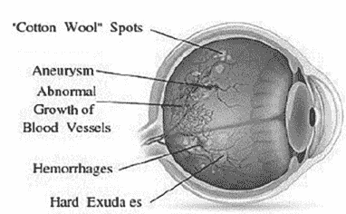

图5.1 糖尿病视网膜病变情况。

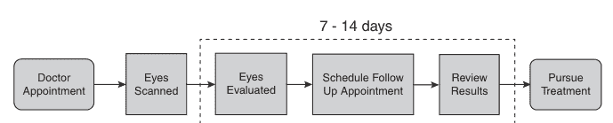

图5.2 手动诊断流程。

并需要专家的帮助 [1]。本研究旨在通过基于高分辨率视网膜图像确定严重程度评分来自动化分析并预测DR。这将加快手动诊断，在医生不在场时提供帮助，并缩短手动诊断所需时间。

在先前的尝试中，采用了支持向量机和k近邻（k-NN）等ML方法来自动识别DR。近年来，基于DL的架构越来越受欢迎。机器学习（ML）是深度学习（DL）的一个子集，已成为一种更强大、更有效的工具 [4]。DL也是ML的最佳方法。DL模型由多层级、分层设计组成。在医学图像分析中，DL是医学图像分类、定位、分割和检测的关键组成部分。在DR疾病的诊断和分类中，利用多种方法，DL取得了更显著和更有前景的结果。基于DL的方法包括但不限于各种类型的神经网络，如CNNs、深度玻尔兹曼机、自动编码器、深度神经网络、循环神经网络、深度置信网络和生成对抗网络（GANs）。由于低级和高级特征都会自动提取和训练，模型在更多训练数据下表现更好 [5]。

全球有更多研究人员将CNNs用于医学影像，超过任何其他DL技术。卷积层、池化层和全连接层是CNN架构中常见的三种层。根据研究人员的需求，CNN的层和滤波器可能会有所不同。卷积层使用多个滤波器通过处理视觉数据来构建特征图。池化层中平均池化或最大池化技术的另一个应用是降低特征图的维度。然后在第三步中应用全连接层来创建完整的图像特征集。最后，使用sigmoid（二分类）或SoftMax激活函数进行分类（多分类）。然后可以收集和预处理信息以增强图像特征，并使用较小的数据样本进行任何必要的增强。然后可以将提取图像特征并按严重程度对其进行分组的模型应用于数据 [6]。

### 5.3 文献综述

近年来，已创建了多个基于DL的自动DR检测系统。本节介绍了其中一些近期研究项目。

#### 5.3.1 深度学习（DL）

深度学习使得开发具有多个处理层的计算模型成为可能，这些模型可以在不同抽象级别上学习数据表示。因此，这些技术显著提升了目标识别、模式识别、语音识别等多个现代领域 [7]。DL使用反向传播方法从巨大的数据集中获取复杂模式。这是通过为每一层的表示调整模型的内部参数，依赖于前一层的表示来实现的。然而，DL的一个重大挑战是需要大量数据集来改进模型。迁移学习是解决这一问题的方案，它允许在新的数据分布区域上增强既有模型参数，而无需大量数据集。利用过去的知识可以减少在相关任务中为新数据集领域更新模型参数所需的时间 [8]。通常，TL模型在ImageNet等复杂数据集上训练，该数据集包含多样化的最优内核。这种方法可以提高模型对不同类型任务的准确性。

#### 5.3.2 糖尿病视网膜病变（DR）

根据其发展方式，糖尿病视网膜病变（DR）可以分为从最轻到最严重的几个阶段。使用视网膜眼底将DR分为两大类：非增殖性糖尿病视网膜病变（NPDR）和增殖性糖尿病视网膜病变（PDR）。NPDR的轻度、中度和重度后果仅限于视网膜，不影响内视网膜界膜。PDR有三个阶段：早期、高风险期和晚期。视网膜外血管的新生和增殖是缺血引起的眼底检查改变的后果 [9]。在本研究中，术语PDR用于指代包含早期、高风险期和进展形式的统一组。DR检测中的类别如下：

- 患者未表现出任何糖尿病视网膜改变，称为无DR。

- 当NPDR导致视网膜出现轻微变化时，通常涉及评估渗出物、微动脉瘤、棉絮斑和视网膜出血等特征。


- 中度 NPDR 的诊断提示，在眼底镜检查中，视网膜象限的一些区域出现了出血、严重微动脉瘤或静脉串珠。
- 重度 NPDR 的情况下，眼底镜检查表明至少存在中度 NPDR 中三个标准中的两个。
- 视网膜图像中识别出增殖性视网膜新生血管化，表明为增殖性 DR。

### 5.4 拟议的 DR 眼底分类

图 5.3 描绘了 DR 图像的分类和检测流程。拟议模型采用分辨率为 224×224 像素的高分辨率红绿蓝（RGB）图像，并基于 DenseNet121 架构。模型权重使用 ImageNet 数据集预训练，以获取足够信息来微调全连接层的输出权重。特征提取阶段也称为卷积层，而最终层称为分类阶段。SoftMax 激活用于为模型输出中的每个类分配概率 [10]。

应用卷积层后，从图像中检索的特征被转移到分类阶段。分类器的第一层由两个完全连接的层组成，具有 1024 个单元。接下来是一个 50% 概率的丢弃层和一个使用 ReLU 激活函数的 1024 单元层。最后一层（采用 SoftMax 激活方法）由五个单元组成。

### 5.5 结果与讨论

在本研究中，使用了两个数据集来比较每个数据集的优势，并评估模型识别不同类别复杂特征的能力。在 Kaggle 上，可以获得初始数据集，即亚太远程眼科学会（APTOS）数据集，包含 1928 张用于测试的未标记图片和 3662 张用于训练的标记图片。需要注册一个网站账户才能查看第二个数据集 Messidor。为训练目的，有 1744 张未标记图片。Messidor
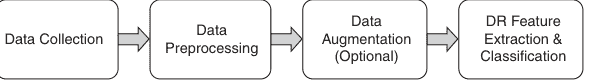

图 5.3 检测与分类流程。

数据集包含 872 张视网膜检查照片，包括左右眼睛黄斑处的两个眼底视图。两个数据集均通过将图片缩放至 224×224 像素并裁剪图片以仅包含眼底来进行预处理，以符合 DenseNet 模型的输入尺寸和预处理技术。两个数据集中的高分辨率图像在五个类别之间分布不均，且仅为训练子集提供了地面真实信息。APTOS 数据集包含在各种条件下拍摄且尺寸不同的眼底图像。由于地面真实数据仅适用于训练子集，因此在两个数据集的训练集上评估了模型的性能。

图 5.4 显示了 DR 图像的类别。DR 有五个类别：轻度、重度、增殖性、无 DR 和中度。图 5.5 描绘了 DR 图像的统计数据。该算法使用类别交叉熵损失函数进行训练，并使用 Adam 方法进行优化。为避免过拟合，模型参数在 50 个时期内使用早停法进行调整。APTOS 和 Messidor 数据集均用于交叉验证测试、训练和测试。在排除 Messidor 数据集的情况下，若要使用 APTOS 数据集来增强模型，则 80% 的 APTOS 数据集用于训练，20% 用于验证，20% 用于测试。
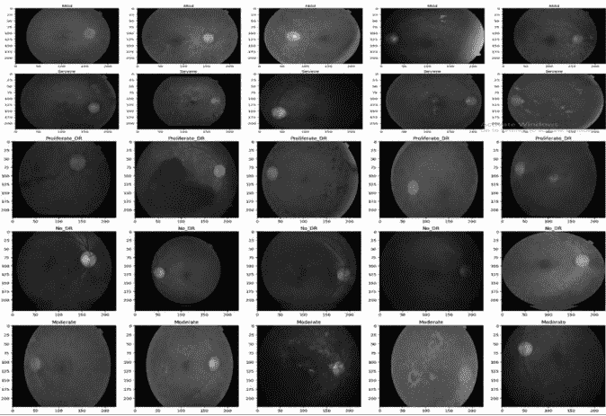

图 5.4 DR 类别—示例图像。

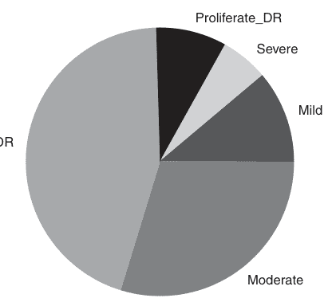

图 5.5 DR 类别统计。

如果使用 Messidor 数据集优化模型，则 APTOS 数据集用于评估，相同数量的数据用于训练和验证。

模型的性能通过使用多种指标（如准确率、精确率、召回率、F1-score 和 support）比较每个训练数据集的结果来评估。APTOS 数据集在每个检查的指标中表现更好。加粗的数字表示两个数据集中某个类别的最佳性能。训练和测试数据集以字母 DS 表示，这也代表 Messidor。在 APTOS 数据集上训练的模型在验证子集中的准确率（81%）高于在 Messidor 数据集上训练的模型（64%）。交叉验证结果表明，APTOS 训练的模型优于 Messidor 训练的模型，后者在 APTOS 数据集上的测试准确率为 33%，在 Messidor 数据集中的类别识别准确率为 59%。

基于验证指标，在 APTOS 数据集上训练的模型在所有类别上的准确率、召回率和 F1-score 均优于在 Messidor 数据集上训练的模型。然而，虽然 Messidor 数据集对重度 NPDR 的表现更好，但它无法学习 PDR 类别分类。就准确率而言，训练后的模型优于 Messidor 数据集。尽管两个数据集的接收者操作特征（ROC）曲线下的面积相似，但对于大多数类别，在 APTOS 数据集上训练的模型发现了更多有用特征。使用轻度 NPDR 类被证明是最困难的。

| | 精确率 | 召回率 | f1-score | support |
|---|---|---|---|---|
| 轻度 | 0.83 | 0.59 | 0.69 | 81 |
| 中度 | 0.74 | 0.83 | 0.78 | 196 |
| 无_DR | 0.95 | 0.97 | 0.96 | 374 |
| 增殖性_DR | 0.59 | 0.70 | 0.64 | 53 |
| 重度 | 0.82 | 0.31 | 0.45 | 29 |
| 准确率 | | | 0.85 | 733 |
| 宏观平均 | 0.79 | 0.68 | 0.70 | 733 |
| 加权平均 | 0.85 | 0.85 | 0.84 | 733 |

图 5.6 分类报告。

缺乏可作为后续提案基础的可靠参考数据集，是此分类工作中的特定挑战。作为基准数据集，之前使用过且具有困难数据分布的 Messidor 数据集是可以接受的。相比之下，APTOS 数据集具有更多样化的数据分布，非常适合微调模型参数。Messidor 数据集的标准化图像在四个 DR 相关输出中的每一个都显示出更好的特性。但是，Messidor 的数据不足以应用于其他图像格式。

图 5.6 描绘了 DR 严重程度的分类报告。研究结果表明，深度学习模型在识别眼底照片中的 DR 方面取得了显著成功。在识别 DR 时，该模型优于传统机器学习算法和人类专家。该算法准确率为 96%，能够将图像分类为正常或 DR 受影响。

### 5.6 结论

本研究提出了一种旨在检测早期 DR 的模型，作为额外的诊断工具。由于缺乏标准化测试数据集和识别多种 DR 类型的策略，本研究无法与之前的技术进行有意义的比较。标准化数据集需要两个关键因素：数据来源和负责确保标签准确性的组织。由于每个研究提供不同的验证数据划分，用于获得验证指标的数据在模型之间有所不同。由于缺乏公开可访问的测试标签，计算许多数据竞赛的测试指标具有挑战性。然而，我们说明了 APTOS 数据集具有更多样化的图像分布，使我们能够改进分类器并为 DR 亚型分类提供更优特征。本研究结果表明，DL 可以在眼底图像中识别 DR。DL 在 DR 识别中的应用为该病的快速和精确诊断提供了一种可行方法。数据表明，DL 有潜力彻底改变医学影像诊断并改善患者预后。

### 参考文献

- 1. Alyoubi, W. L., Shalash, W. M., & Abulkhair, M. F. (2020). 基于深度学习技术的糖尿病视网膜病变检测：综述. Informatics in Medicine Unlocked, 20, 100377.
- 2. Paranjpe, M. J., & Kakkatkar, M. N. (2014). 糖尿病视网膜病变检测和严重程度分类方法综述. International Journal of Research in Engineering and Technology, 3(3), 619–624.
- 3. Qumar, S., Khan, F. G., Shah, S., Khan, A., Band, S. S., Rehman, Z. U., Khan, I. A., & Jadoon, W. (2019). 糖尿病视网膜病变检测的深度学习集成方法. IEEE Access, 7, 150530–150539.
- 4. Butt, M. M., Iskandar, D. A., Abdelhamid, S. E., Latif, G., & Alghazo, R. (2022). 使用混合深度学习特征从眼底图像中检测糖尿病视网膜病变. Diagnostics, 12(7), 1607.
- 5. Thorat, S., Chavan, A., Sawant, P., Kulkarni, S., Sisodiya, N., & Kolapkar, A. (2021, May). 通过深度学习检测糖尿病视网膜病变. 在 2021 年第 5 届智能计算与控制系统国际会议（ICICCS）（第 996–999 页）中. Madurai: IEEE.
- 6. Valarmathi, S., & Vijayabhanu, R. (2021, March). 使用深度学习技术进行糖尿病视网膜病变检测和分类调查. 在 2021 年第七届生物信号、图像和仪器国际会议（ICBSII）（第 1–4 页）中. Chennai: IEEE.
- 7. Nguyen, Q. H., Muthuraman, R., Singh, L., Sen, G., Tran, A. C., Nguyen, B. P., & Chua, M. (2020, January). 使用深度学习检测糖尿病视网膜病变. 在第 4 届机器学习和软计算国际会议论文集，越南（第 103–107 页）中.
- 8. Reguant, R., Brunak, S., & Saha, S. (2021). 理解 CNN-based 糖尿病视网膜病变评估中的固有图像特征. Scientific Reports, 11(1), 9704.
- 9. Abramoff, M. D., Reinhardt, J. M., Russell, S. R., Folk, J. C., Mahajan, V. B., Niemeijer, M., & Quellec, G. (2010). 糖尿病视网膜病变的自动早期检测. Ophthalmology, 117(6), 1147–1154.
- 10. Ayala, A., Ortiz Figueroa, T., Fernandes, B., & Cruz, F. (2021). 使用深度学习改进糖尿病视网膜病变检测. Applied Sciences, 11(24), 11970.


## 深度学习拯救糖尿病患者生命并降低治疗成本

D. Kavitha, Ravindra Changala, S. V. Suresh Babu Matla, S. Kanakaprabha, Lella Kranthi Kumar, and G. Ganesh Kumar

### 6.1 引言

糖尿病是一种持续性代谢综合征，其特征是由于胰岛素分泌不足、胰岛素利用无效或两者兼有而导致血糖水平升高。这是一个日益普遍的国际健康问题，对全球医疗系统构成重大挑战。有效管理糖尿病需要及时诊断和个性化治疗，以预防心血管疾病、肾衰竭和失明等并发症。然而，在传统的糖尿病诊断方法中，血液检查报告和既往病史等各种症状可能不准确或无法及时预防。此外，深度学习这项最新技术能够及时识别诊断和有效治疗。这不仅提供了更好的解决方案，还改善了患者的健康状况。糖尿病及其并发症的死亡率非常高，触目惊心。约有两百万人死于糖尿病及其他慢性疾病。关于糖尿病管理和预防的全球统计数据意义重大。它影响着糖尿病医疗系统的经济负担，这有两方面：一方面是直接成本，另一方面是治疗的间接成本。糖尿病治疗、住院和药物属于直接成本，而残疾、死亡率以及对社会整体医疗系统的经济压力属于间接成本。

传统方法下，糖尿病的诊断和管理依赖于临床症状、血液检查（例如空腹血糖检查或口服葡萄糖耐量试验）以及既往病史等常规方法。多年来，这些一直是糖尿病护理的基石之一。它们使医疗保健能够对糖尿病患者进行分类、监测其血糖水平并开具适当的治疗方案。然而，糖尿病问题、医学诊断和治疗管理的标准技术尤其局限。它们无法始终在发病早期发现糖尿病问题，或提供针对个人需求量身定制的治疗方案。此外，标准技术可能无法利用医疗保健环境中提供的大量信息，例如电子健康记录、临床影像以及遗传信息。

近年来，深度学习策略（作为人工智能的一个组成部分）在增强糖尿病的医学诊断和监测方面显示出巨大潜力。深度学习能够分析临床影像数据，包括眼部扫描，以识别糖尿病视网膜病变的迹象——这是一种常见的糖尿病相关眼部疾病。这种方法还可以评估电子健康记录和其他相关专业数据，以识别可能患糖尿病风险的人群，从而促进早期治疗和预防措施。它可以协助制定量身定制的治疗方案，为糖尿病患者做好应对准备。通过检查遗传信息、生活方式变量以及其他患者特定信息，深度学习方案可以帮助医疗服务提供者为每个人优化药物方案、营养建议和生活方式干预措施。

本章的创新之处在于探讨深度学习如何拯救糖尿病患者的生命。这些是在医疗保健和糖尿病管理领域中深度学习技术的新方法。这些模型能够检测糖尿病的早期迹象，并识别与疾病各阶段相关的并发症。这些模型使用与临床环境中类似的成本效益型深度学习技术，以促进患者健康并降低治疗成本。

### 6.2 本章目标

本章的主要目的是探讨深度学习如何改善糖尿病患者的生活并降低治疗成本。它旨在解决三个重大问题：医学诊断与早期检测、治疗与准备以及糖尿病问题。本章将重点探讨深度学习策略提高糖尿病患者生活方式管理能力以及减少全球医疗系统障碍的潜力。此外，它还将强调多学科方法以及糖尿病治疗的最新进展，为糖尿病监测的未来发展提供洞察。

- 深度学习技术如何有助于降低与糖尿病相关的治疗成本。
- 深度学习技术在糖尿病护理中应用的挑战和局限性。
- 突出深度学习在糖尿病护理中的最新进展和应用，强调多学科方法。

### 6.3 糖尿病的影响

糖尿病对全球个人和医疗系统产生深远影响，影响着健康与福祉的众多方面。以下我们列举了糖尿病的四个重大影响：

#### 6.3.1 健康并发症

糖尿病显著增加患多种健康并发症的风险。长期血糖升高会损害身体的多个器官和系统，导致诸如以下等问题：

- **糖尿病视网膜病变：** 视网膜毛细血管受损导致视力受损及失明。
- **糖尿病肾病：** 肾脏受损导致肾功能下降，最终发展为肾衰竭。
- **糖尿病神经病变：** 神经损伤引起不适、麻木和刺痛感，尤其是在四肢末梢。
- **心血管疾病：** 糖尿病对心血管疾病、中风和外周动脉疾病构成重大威胁，从而增加心血管事件和死亡的风险。

这些问题不仅对生活方式产生负面影响，还增加了对医疗服务的需求及相关费用。

#### 6.3.2 生活质量下降

糖尿病维持通常需要重大的生活方式改变，包括饮食改变、定期监测血糖水平、遵守用药以及定期就诊。管理糖尿病可能导致紧张、压力和焦虑，进而影响一个人的整体生活方式。视力丧失、肾衰竭和神经损伤等问题加重了糖尿病患者及其家庭在身心方面的负担。

#### 6.3.3 经济影响

2019年，全球糖尿病医疗支出估计为7600亿美元，占全球医疗总支出的10%。1型和2型糖尿病对个人、医疗系统以及整个社会构成重大经济负担。直接医疗成本包括药物、医疗用品、医师就诊、住院治疗和并发症管理相关的费用。间接成本与因残疾、过早死亡和缺勤导致的生产力损失相关。

#### 6.3.4 环境影响

卫生主管部门广泛认识到糖尿病是一项需求量大的公共卫生问题，且这一统计趋势每年都在加剧。老龄化和城市化人口、久坐的生活方式、不健康的饮食习惯以及逐渐渗透的肥胖是糖尿病发病率上升的主要原因。当糖尿病爆发得不到解决时，这会增加医疗系统的复杂性，进而影响人口福祉。解决这一问题的有效策略包括健康促进、早期

疾病预防、即时糖尿病检测以及高产量管理方法的实施。

### 6.4 文献综述

Fico 等人 [1] 开发了个性化医疗路径（PHP）来管理糖尿病，将其整合到信息和通信技术系统中，以促进从以组织为中心向以患者为中心的护理转变。我们进行了小规模探索性研究来测试该平台。

Mougiakakou 等人 [2] 使用 SMARTDIAB 平台来管理糖尿病。为管理 1 型糖尿病，它整合了数据库（DB）技术、通信、仿真算法和数据挖掘方面的最新技术。尽管它具有适当糖尿病控制所需的软件和硬件组件，但它缺乏食物识别和高效的膳食推荐。

Theis 等人 [3] 提出了一种深度学习架构，通过纳入糖尿病患者的病历来改进当前的分级方法。首先，将之前医院就诊的病历转换为可用于流程挖掘的事件日志。之后，使用事件日志找到解释患者先前医院经历的流程模型。建议修改衰减重放挖掘，通过融合已知严重程度评分与人口统计和医疗数据，来预测糖尿病 ICU 患者的住院死亡率。

Sarathambekai 等人 [4] 基于对众多研究出版物和文章的预测分数和结果的分析，开发了基于机器学习的糖尿病预测的最佳预测模型。基于基于预测获得的准确性分数和其他评估指标，已从研究中评估了常见的机器学习算法，例如决策树、随机森林（RF）分类器、支持向量机（SVM）、K-NN、朴素贝叶斯以及深度学习算法多层感知器分类器。

El Bouhissi 等人 [5] 评估了糖尿病预测方面最重要的研究，并提供了一种利用 RF、SVM 和深度神经网络（DNN）分类器来预测妊娠糖尿病的方法。该实验使用了法兰克福医院的真实数据集进行，结果表明 RF 方法具有更高的准确性。

Samir 等人 [6] 提出了一种系统，将基于深度学习的人体活动识别（HAR）和食物安排与非侵入性连续血糖监测（CGM）策略相结合，以跟踪血糖水平。我们建立了从 CGM 获得的餐前和餐后峰值血糖水平与食物中发现的血糖负荷（GL）之间的关系，从而使我们能够估计血糖水平的上升并预测高血糖症。此外，该技术将人体活动与血糖水平下降联系起来，在潜在低血糖症状出现之前提醒用户。

Kim 等人 [7] 提出了自动化算法，结合深度学习和集成学习技术，将图像分为四类：糖尿病性黄斑水肿（DME）、正常、脉络膜新生血管化（CNV）和玻璃样疣。为进行分类，对若干卷积神经网络（CNN）进行了修改。全卷积网络（FCN）用于消除训练和测试图像中的噪声，并采用投影技术来纠正图像倾斜的视网膜层。为了进一步提高性能，我们训练了多个 CNN 并应用基于 CNN 的集成学习方法。

Santos 等人 [8] 提出了一种计算机模型，用于支持医学诊断，该模型使用预训练的 CNN 并可以识别眼底擦伤。使用数据驱动的糖尿病视网膜病变研究数据集，该模型基于 YOLOv4 的 Darknet 框架进行了优化、测试和部署。它实现了 11.13% 的 mAP 和 13.98% 的 mIoU。

Subha 等人 [9] 之前提到的神经网络被用于开发能够测量包括出血、血管、微动脉瘤和液体滴在内的参数的深度学习模型，并将其分为几个类别。该模型将确定患者眼睛的感染程度。特别是，使用模糊 C 均值算法确定感染的类型和严重程度。可以使用本文确定视网膜病变的程度。整个系统的用户友好环境使识别更容易。界面将带有按钮，允许您对提供的测试图像执行所需的转换。

Sazdov 等人 [10] 研究了联邦学习（FL）在使用从 130 家美国糖尿病设施获得的 9 年数据集进行医院再入院预测中的应用。研究结果表明，FL 可以在实现等效性能水平的同时保留数据多样性和隐私性。这是 FL 的一个关键组成部分，因为它允许在不危及隐私的情况下进行持续的实时学习。

### 6.5 拟议方法论

#### 6.5.1 使用深度学习进行糖尿病早期诊断检测

糖尿病早期检测有助于减少并发症，这些并发症后来可能引起痛苦，从而带来更好的患者预后。近年来，深度学习在医学影像、电子病历和基因检测中的应用，通过分析各种类型的数据，已显示出改善预后的效果。深度学习算法，尤其是属于此类算法的 CNN，最近已被用于通过检查来自医学来源（尤其是视网膜成像）的图像，对糖尿病进行早期检测。糖尿病视网膜病变是糖尿病的头号并发症，通常会导致眼球视网膜毛细血管受损，并在没有适当治疗的情况下可能导致威胁视力的视力下降。利用能够正确检测糖尿病视网膜病变症状的深度学习模型（得益于大规模视网膜图像训练）是促进早期诊断和及时转诊治疗的绝佳选择。借助这些深度学习算法类型，人工智能现在可以通过分析视网膜图像并识别特定病变（如微动脉瘤、出血和渗出物，这些是糖尿病视网膜病变的典型特征）来诊断视网膜病变。由于可用的图像数据量巨大，深度学习模型更加准确，它们可以检测出几乎所有可能被常规人类观察忽略的异常，因此医疗保健中的深度学习模型将高效提高诊断率。

此外，深度学习方法认识到多模态数据（例如人口统计信息、疾病病史或实验室结果）的分析潜力，以提高早期检测模型的鲁棒性和准确性。通过结合来自各种来源的数据，深度学习技术可以识别患糖尿病或其后果可能性较高的人。因此，这使我们能够采取预防措施，从而最大限度地减少这些疾病的影响（图 6.1）。

该图展示了使用深度学习技术进行糖尿病早期检测的流程。首先收集患者数据，然后对数据进行预处理，为模型训练做好准备。使用预处理的数据训练深度学习模型后，通过评估来评估模型性能。模型训练和评估完成后，即可用于新患者数据以生成预测，并将

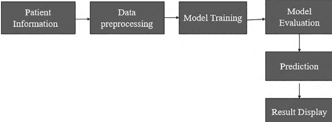

图 6.1 使用深度学习进行早期检测。

结果显示用于决策和解释。

使用深度学习，这种方法可以实现糖尿病的早期识别，从而促进主动的医疗保健管理和更好的患者预后。

#### 6.5.2 使用深度学习进行糖尿病治疗和规划

针对糖尿病的定制化治疗和方案，侧重于遗传方面、日常生活决策和病历等患者特征，是一种已被证明有益的交互方式。机器学习和深度学习方法将在未来糖尿病治疗中取得改进，因为它们非常擅长分析大型数据集并发现可用于个人护理计划设计的趋势。以下是深度学习在糖尿病治疗和规划中的应用方式（图 6.2）。

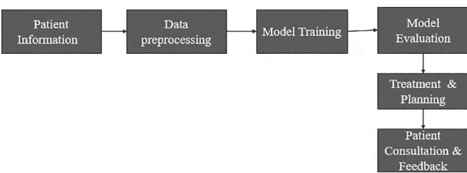

图 6.2 深度学习中的糖尿病治疗规划。


此图展示了一种基于深度学习的糖尿病治疗规划方法。医疗从业者可以利用患者数据和前沿机器学习算法，制定个性化的治疗方案，以最大限度地改善患者预后并提高生活质量。通过咨询与反馈的迭代流程，确保治疗方案不断改进和调整以适应患者不断变化的需求，从而实现更好的糖尿病管理和更高的患者满意度，这是最终结果。

##### 6.5.2.1 个性化治疗

深度学习算法能够解读多种患者数据集，涵盖基因构成、病史、生活方式和血糖监测数据，从而制定定制化的治疗方案。在深度学习模型中整合这些数据源，可以实现疾病状态监测，并识别有助于为个体患者精准选择药物、剂量和治疗方案的模式与关系。通过深度学习，可以实现诸如识别可能对特定类别抗糖尿病药物反应更好的患者，或可能从其他膳食方式或运动计划中获益的患者等场景。

##### 6.5.2.2 早期治疗

深度学习方法可以检测早期治疗反应，并识别可能需要修订治疗方案的患者。深度学习算法通过检查纵向患者数据（如血糖水平变化、用药依从性和临床结局）来检测疗法成功或失败的模式。这些信息可帮助医疗从业者快速干预，以提高治疗效果并避免问题。

##### 6.5.2.3 预测

深度学习算法可以基于糖尿病患者的特定特征和治疗策略预测长期结果。深度学习模型可以从海量患者结局数据库中发现疾病进展、并发症和死亡率的预测因子，使医疗服务提供者能够调整治疗方法以降低这些风险。通过提供个性化护理计划、优化血糖控制、协助治疗决策制定、促进治疗反应的早期检测以及预测长期结局，深度学习技术是优化糖尿病患者治疗和规划的有用工具。通过结合先进的计算方法和海量患者数据，深度学习有潜力改变糖尿病护理并改善患者预后。

#### 6.5.3 使用深度学习的糖尿病并发症分期

深度学习算法可以评估广泛的患者数据，如病历、实验室结果和影像学检查，以识别有发展糖尿病并发症高风险的患者。深度学习算法可以通过在数据中发现微小模式和相关性，预测糖尿病视网膜病变、肾病、神经病变和心血管疾病等问题的可能性。对高危个体进行早期诊断，可实施针对性治疗，如强化血糖控制、血压管理和生活方式改变，以避免或延迟问题的发生。通过评估纵向患者数据（如临床参数、生物标志物和影像学结果的变化），该技术可以追踪糖尿病并发症随时间的演变。深度学习模型可以通过识别指示疾病进展的变化，通知医疗专业人员需要加强监测、调整治疗或转诊至专科护理。例如，深度学习系统可以检查视网膜图像以检测糖尿病视网膜病变严重程度的微小变化，从而实现早期干预以防止视力丧失。深度学习为糖尿病各阶段的并发症预测、监测和控制提供了有用工具。通过利用现代计算方法和海量患者数据，深度学习有潜力改变糖尿病护理（图 6.3）。

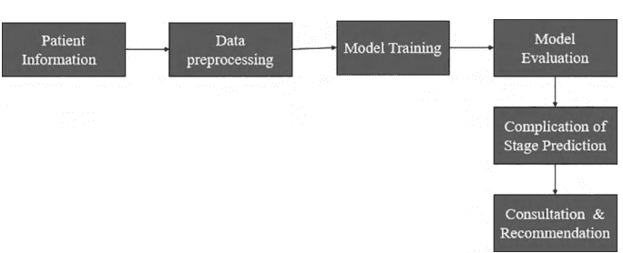

图 6.3 使用深度学习的糖尿病并发症分期。

正如本图所示，深度学习算法对糖尿病并发症分期进行了全面预测。通过使用先进的机器学习算法和患者数据，医疗专业人员可以精准预测和处理糖尿病并发症，从而在整个过程中改善患者预后和生活质量。会诊与反馈的迭代流程提高了患者对所定疗法的参与度和依从性，确保治疗方案量身定制并以患者为中心。总体而言，这种全面的策略使糖尿病及其后果的主动管理更加容易，并改善了持续的医疗保健结果。

### 6.6 结果与分析

当患者点击模型训练选项卡时，将出现下一个屏幕。它显示用于训练的导入数据。点击模型训练将创建并训练一种深度学习方法（图 6.4 和 6.5）。

该屏幕用于为患者记录表收集和开发统计数据。数据基于先前的假设在软件服务器上进行预处理。作为我们努力的结果，我们有一个可以根据个别患者特定需求量身定制的计划（图 6.6）。

要预测糖尿病，只需输入相应的患者信息并点击网站的“预测糖尿病”选项。当点击“通知训练集”选项卡时，将创建一个新的训练集。在输入患者疾病信息并点击“预测糖尿病”按钮后，患者的结果

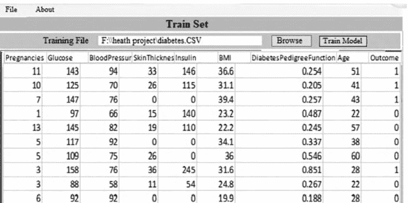

图 6.4 糖尿病数据集训练。

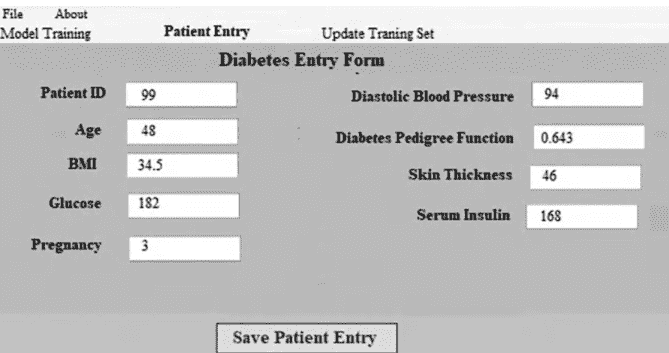

图 6.5 糖尿病预测。

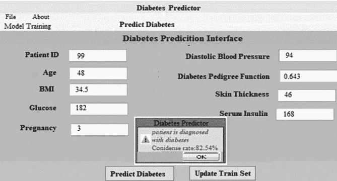

图 6.6 带百分比水平的糖尿病预测。

结果将显示为“D1: 糖尿病是”、“D2: 糖尿病否”，以及每个选定选项对应的预测值。图 6.3 显示了基于特定标准的糖尿病感染诊断可能性：“D1: 糖尿病是。”

### 6.7 挑战与未来方向

在糖尿病诊断和管理中应用深度学习面临若干必须解决的问题与不确定性，才能充分获益。一个关键问题是训练深度学习模型需要高质量、标准化的数据集。电子健康记录和医学影像等医疗数据可能包含不一致性、缺失值以及医疗机构间的异质性，从而限制深度学习算法的有效性和泛化能力。此外，深度学习模型的可解释性和透明度也是一个问题，尤其是在决策可能对患者预后产生重大影响的医疗环境中。确保深度学习预测的可解释性，对于与临床医生和患者建立信任以及在临床实践中推广这些技术至关重要。深度学习在糖尿病护理中的未来前景广阔。持续的研究致力于改进数据质量、模型可解释性和监管框架，将为在临床实践中负责任且有效地实施深度学习铺平道路。此外，研究人员、临床医生、政策制定者和行业利益相关方之间的合作对于解决这些问题并实现深度学习在糖尿病诊断和管理中的变革潜力至关重要。如果克服某些障碍，深度学习有潜力改变糖尿病护理、改善患者预后并降低全球医疗成本。

### 6.8 结论

在糖尿病诊断和管理中应用深度学习，是在降低医疗支出的同时改善患者护理的一条可行路径。深度学习技术为改善糖尿病护理中的早期识别、个性化治疗规划和并发症管理提供了前景，从而为患有这种慢性疾病的患者带来更好的结果。在本章中，我们探讨了深度学习如何帮助糖尿病护理，例如通过医学影像进行早期识别、基于患者数据的个性化治疗规划，以及用于并发症管理的预测建模。通过利用先进的计算技术和海量医疗数据，深度学习已显示出改变糖尿病诊断和管理的潜力。在临床实践中使用深度学习并非没有问题。解决数据质量、模型可解释性、监管合规性和伦理考量等问题，对于确保在糖尿病护理中负责任且有效地使用深度学习技术至关重要。通过先进的计算算法和跨学科团队合作，我们可以开启个性化、数据驱动医疗保健的新时代。


### 参考文献

- 1. G. Fico 等人，“将个性化医疗路径集成到糖尿病管理的 ICT 平台中：一项小规模探索性研究”，《IEEE 生物医学与健康信息学杂志》，第 20 卷，第 1 期，第 29–38 页，2016 年 1 月，doi: 10.1109/JBHI.2014.2367863.

- 2. S. G. Mougiakakou 等人，“SMARTDIAB：一种用于 1 型糖尿病患者智能监测、管理和随访的通信与信息技术方法”，《IEEE 生物医学信息学交易》，第 14 卷，第 3 期，第 622–633 页，2010 年 5 月，doi: 10.1109/TITB.2009.2039711.

- 3. J. Theis, W. L. Galanter, A. D. Boyd 和 H. Darabi，“利用流程挖掘/深度学习架构改善糖尿病 ICU 患者的院内死亡率预测”，《IEEE 生物医学与健康信息学杂志》，第 26 卷，第 1 期，第 388–399 页，2022 年 1 月，doi: 10.1109/JBHI.2021.3092969.

- 4. S. Sarathambekai 等人，“使用机器学习算法的糖尿病预测模型比较分析”，2022 年第 8 届先进计算与通信系统国际会议（ICACCS），印度科伊姆巴托尔，2022 年，第 261–265 页，doi: 10.1109/ICACCS54159.2022.9785280.

- 5. H. El Bouhissi, R. El-Qutaish, A. Ziane, K. Amroun, N. Yaya 和 M. Lachi，“迈向基于机器学习的糖尿病预测”，2023 年智能计算与应用国际会议（ICSCA），沙特阿拉伯海尔，2023 年，第 1–6 页，doi: 10.1109/ICSCA57840.2023.10087782.

- 6. M. A. Samir, Z. A. Mohamed, M. A. A. Hussein 和 A. Atia，“应用深度学习跟踪食物消耗和人类活动以实现无创血糖监测”，2021 年 IEEE 第 12 届普适计算、电子与移动通信年会（UEMCON），美国纽约，2021 年，第 0319–0324 页，doi: 10.1109/UEMCON53757.2021.9666662.

- 7. J. Kim 和 L. Tran，“基于卷积神经网络的集成学习用于光学相干断层扫描图像中视网膜疾病分类”，2020 年 IEEE 第 33 届计算机辅助医疗系统国际研讨会（CBMS），美国明尼苏达州罗切斯特，2020 年，第 532–537 页，doi: 10.1109/CBMS49503.2020.00106.

- 8. C. Santos, M. S. de Aguiar, D. Welfer 和 B. M. Belloni，“通过卷积神经网络检测糖尿病视网膜病变患者的眼底病变”，2021 年 IEEE 工程在医学与生物学学会第 43 届年会（EMBC），墨西哥，2021 年，第 2692–2695 页，doi: 10.1109/EMBC46164.2021.9630075.

- 9. T. Subha, N. Susila, R. Ranjana, V. Priya 和 V. Nithyashree，“使用模糊 C-Means 模型分析糖尿病视网膜病变及其成因”，2021 年第 4 届计算与通信技术国际会议（ICCCT），印度金奈，2021 年，第 527–532 页，doi: 10.1109/ICCCT53315.2021.9711840.

- 10. B. Sazdov 等人，“使用联邦学习预测医院再入院”，2023 年第 30 届系统、信号和图像处理国际会议（IWSSIP），北马其顿奥赫里德，2023 年，第 1–5 页，doi: 10.1109/IWSSIP58668.2023.10180282.

## 基于深度学习模型的糖尿病检测

M. Karthikeyan 和 R. Rengaraj

### 7.1 引言

在印度等发展中国家，糖尿病（DM）患者人数众多，这是因为肥胖和不健康生活方式的增加 [1]。2 型糖尿病可能导致微血管和大血管问题。最近，在印度，这些多器官问题已导致年轻时死亡的无条件概率 [1]。2 型糖尿病是印度医疗系统面临的最具挑战性的威胁之一。国际糖尿病联合会估计，2021 年有 7490 万糖尿病患者，预计到 2045 年将达到 1.249 亿 [2]。根据世界卫生组织（WHO），年龄（≥45 岁且很少锻炼）、体重指数（≥24 kg/m²）、葡萄糖耐受受损或空腹血糖受损、糖尿病家族史、高密度脂蛋白胆固醇低或高甘油三酯血症、高血压或心血管疾病以及妊娠期女性（年龄 ≥30 岁）的人群糖尿病高风险 [3]。世界卫生组织设定的 2030 年实现目标如下：

- 1. 80% 的糖尿病患者将被诊断 [4]。
- 2. 80% 的已诊断糖尿病患者应血糖控制良好 [4]。
- 3. 80% 的已诊断糖尿病患者应血压控制良好 [4]。
- 4. 60% 的 40 岁或以上的糖尿病患者必须接受他汀治疗 [4]。
- 5. 100% 的 1 型糖尿病患者必须能够获得负担得起的胰岛素治疗和血糖自我监测 [4]。

2 型糖尿病的临床检测使用大于阈值的空腹血浆葡萄糖水平。该血糖阈值水平可能因地区人群不同血糖风险水平而有所不同。尽管存在这些困难，但开发一种用于检测 2 型糖尿病的决策支持系统刻不容缓，以便在可能的早期阶段做出有意义的决策。这些限制促使需要一种简化的诊断流程来检测 2 型糖尿病。

随着最新技术的发展和人工智能（AI）在日常活动中的影响，机器学习（ML）算法的开发有助于在 2 型糖尿病检测中快速构建决策支持系统。多种基于神经网络的算法 [5]、深度神经网络 [6,7] 和常规 ML 模型 [8–17] 已用于 2 型糖尿病检测的研究。

考虑到文献中 2 型糖尿病检测面临的挑战和准确率以及现代 AI 工具的使用，迫切需要一种新的改进模型。因此，在本章中，我们提出了一种用于 2 型糖尿病检测的稳健深度学习模型（DLM），以构建高效的决策支持系统。本章的贡献概述如下：

- 1. 我们提出了一种用于 2 型糖尿病检测的简单 DLM。我们还探索了带有贝叶斯优化的超参数调整 ML 算法。对所考虑算法的性能指标进行了比较。
- 2. 该模型使用德国医院数据集进行训练，随后使用 PIMA 印度糖尿病数据集（PIDD）进行测试，展示了所提模型相较于可用 ML 的泛化优势。
- 3. 通过使用一个数据集训练模型，并用训练过程中未包含的另一个数据集进行测试，增强了迁移学习的概念。

本章其余部分结构如下：第 7.2 节介绍 DM 预测的文献。第 7.3 节介绍方法。第 7.4 节介绍所提 DLM。第 7.5 节介绍实验数据集。第 7.6 节解释结果和讨论。第 7.7 节总结本章。

### 7.2 相关工作

近年来，人工智能和机器学习领域在检测 2 型糖尿病可能性方面发挥了重要作用。许多算法和工具已被开发，展示了该研究领域的巨大潜力。我们将综述限制在与所提出问题密切相关的最新研究结果上。基于神经网络的预测在糖尿病研究中最近表现出预测准确率的提高。在文献 [6] 中，作者利用最小-最大归一化和自动编码器解决数据归一化、数据集不平衡和特征增强问题。多层感知机被用于分类，达到了 92.31% 的准确率 [6]。在文献 [5] 中，作者设计了一种基于人工反向传播共轭梯度神经网络的分类器，无需数据预处理即可达到 93% 的准确率。文献 [18] 报告了一种使用 k 近邻的改进基于神经网络的方法，达到了 98% 的 F1 分数。文献 [19] 的作者应用皮尔逊相关和中位数填补进行特征选择。他们的深度神经网络模型达到了 88.6% 的准确率 [18]。

与基于神经网络的方法相比，ML 分类模型取得了良好的预测准确率。在文献 [20] 中，作者评估了不同的 ML 分类器：光梯度提升机（LGBM）、线性回归（LR）和支持向量机（SVM），其中 LGBM 以 86% 的准确率优于其他模型。在文献 [18] 中，比较了决策树（DT）、随机森林（RF）、朴素贝叶斯（NB）、k 近邻（KNN）和自适应提升（AB）等 ML 算法的分类准确率。文献 [7] 的作者开发了一个准确率为 98.07% 的深度神经网络模型。在文献 [21] 中，特征选择方法


例如，采用了前向和后向特征选择策略来提高分类准确率。在参考文献[22]中，Pearson相关性和均值插值被用于特征选择和缺失值插值，并使用网格搜索进行超参数调优。在参考文献[21]中，对不同的分类模型：极端提升（XB）、AB、RF和K-NN进行了实验，其中XB达到了94.6%的准确率。

参考文献[23]的作者提出了一种二次生长深度神经网络（2GDNN），并在PIMA和医学城医院实验室数据集上达到了97%的准确率。参考文献[8]的作者使用了两个数据集，即PIMA印度数据集和德国医院数据集，来设计一个基于ML的分类器。为此，选择了不同的ML算法，即SVM、NB、KNN、RF、LR和DT [8]。研究结果表明，对于PIMA数据集，SVM表现最佳，准确率为74%；而KNN和RF在德国数据集上的表现更好，准确率为98.7% [8]。上述相关工作已在表7.1中总结。关于ML和基于深度学习的分类模型相关工作的详细综述以及关于DM的系统综述可参见参考文献[9–17,24]。

表7.1 之前里程碑分类模型总结

| 作者 | 分类模型类型 | 备注 |
| :--- | :--- | :--- |
| Maria Teresa García-Ordás et al. [6] | 多层感知机 | 移除了缺失值并达到了92.318% |
| Muhammad Mazhar Bukhari et al. [5] | 人工神经网络缩尺共轭梯度神经网络 | 达到了93%的准确率 |
| Kumarmangal Roy et al. [18] | KNN | 达到了98%的准确率 |
| Jobeda Jamal Khanam et al. [19] | 具有两个隐藏层的多层感知机和深度学习 | 达到了98%的准确率 |
| Talha Mahboob Alam et al. [20] | LGBM | 达到了86%的准确率 |
| Naz and Ahuja [7] | 深度学习方法 | 达到了98.07%的准确率 |
| Sivaranjani et al. [21] | RF, SVM | 特征选择和降维，准确率为83% |
| Hasan et al. [22] | XB, AB, RF, DT, 和 KNN | 达到了94.6%的准确率 |
| Kirti Kangra [8] | SVM, NB, KNN, RF, LR, 和 DT | 达到了98.7%的准确率 |
| Zaigham Mushtaq [9] | 基于投票的分类器 | 达到了82%的准确率 |

### 7.3 方法学

图7.1展示了用于DM检测的方法学示意图。该方法学包括用于缺失值检测的数据预处理 [23]。数据集被分为三类：训练、验证和测试。一半的数据用于训练，30%保留用于十倍交叉验证，剩余20%用于测试所开发的模型，如图7.2所示。通过ML算法的超参数调优来对模型进行精细调整。本工作中，基于DT、LR、NB、SVM、KNN和集成学习算法（ELA）等ML算法的分类模型被用于DM检测。这些ML分类模型的超参数使用贝叶斯优化进行调优。该优化的关键优势在于，在每次迭代中，参数选择都基于上一次迭代。与在每个阶段随机选择参数不同，该优化从不提供有前途解决方案的相关搜索空间中进行选择。因此，与随机搜索或网格搜索等其他调优方法相比，它需要的迭代次数更少。与使用随机或网格搜索方法对同一模型进行超参数调优相比，这提高了验证准确率并缩短了调优时间 [25]。

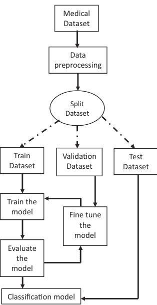

图7.1 方法学示意图。

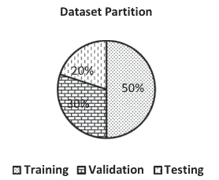

图7.2 数据集划分策略。

### 7.4 深度学习模型（DLM）

拟用于DM预测的DLM架构如图7.3所示。它由输入特征层组成，其后跟随带有批量归一化和整线性单元（ReLU）激活的全连接层。最后，拟议的DLM中包含softmax层和分类层。数据集包含八个输入特征，分别表示x₁ – 妊娠次数（pregnancies）、x₂ – 葡萄糖（glucose）、x₃ – 血压（blood pressure）、x₄ – 皮肤厚度（skin thickness）、x₅ – 胰岛素（insulin）、x₆ – 身体质量指数（BMI）、x₇ – 糖尿病谱系函数（diabetes pedigree function）以及x₈ – 年龄（age）。每条医疗记录的这八个输入参数作为输入特征层的输入。拟议模型有三个全连接层，每个层包含50个隐藏神经元。从图7.3可以看出，输入特征层的所有神经元都连接到全连接层的所有神经元。此方案一直延续到softmax层。进行批量归一化以使网络更快且更稳定。批量归一化的工作原理是通过减去批量均值并除以批量标准差来归一化前一激活层的输出 [26]。此步骤之后，结果由两个可学习参数（gamma和beta）进行缩放和偏移，这两个参数对每个层都是唯一的 [26]。ReLU是一种激活函数，它为DLM引入非线性特性，并解决了神经网络的梯度消失问题 [27]。全连接层的输出被馈送给softmax层，该层给出每个类的概率得分。基于此概率，分类层的输出为类别'1'或'0'。类别'1'代表DM，'0'代表非DM。

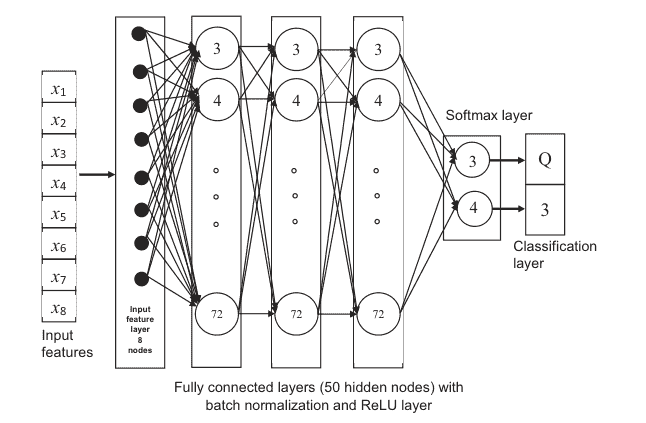

图7.3 用于DM预测的拟议DLM架构。

### 7.5 数据集

如表7.2所示，下载了两个类似的数据集用于开发和测试DLM。由德国法兰克福医院共享的数据集从Kaggle [28]下载。该数据集包含2000条DM测试读数，包含的参数如x₁ – 妊娠次数（pregnancies）、x₂ – 葡萄糖（glucose）、x₃ – 血压（blood pressure）、x₄ – 皮肤厚度（skin thickness）、x₅ – 胰岛素（insulin）、x₆ – 身体质量指数（BMI）、x₇ – 糖尿病谱系函数（diabetes pedigree function）、x₈ – 年龄（age）以及结果类别（Y, N）。为了与其他数据集具有相同的输出类别，将类别Y和N更改为1和0。这些数据集的主要目标是预测患者是否患有DM。

第二个数据集PIDD从Kaggle [29]下载。该数据集有768条DM测试读数，参数与前一个数据集相同。DM检测的目的是使用德国数据集构建一个用于训练和验证的简单DLM。开发的深度学习分类模型使用模型在训练和验证期间未见过的PIDD进行测试。这是一种迁移学习，其中训练好的DLM被重新用于新的数据集。

表7.2 数据集描述

| 属性 | 德国 | PIDD |
|---|---|---|
| 特征 | 9 | 9 |
| 样本数 | 2000 | 768 |
| 缺失值 | 0 | 0 |
| 目标类别 | 2 (Y, N) | 2 (0, 1) |

用于比较各种分类模型的性能指标包括分类准确率（CA）、精确率（P）、召回率（R）和F1-score（F1）。方程(7.1)–(7.4)给出了分类模型的性能指标。这里，真阳性（TP）表示患有DM的人数。真阴性（TN）表示没有患DM的人数。假阳性（FP）表示预测输出类别为DM，而实际输出类别为非DM的人数。假阴性（FN）表示预测输出类别为非DM，而实际输出类别为DM的记录数。

```
CA = \frac{TP + TN}{TP + FP + TN + FN} * 100 (7.1)
```

```
P = \frac{TP}{TP + FP} (7.2)
```

```
R = \frac{TP}{TP + FN} (7.3)
```

```
F1-score = 2 * \frac{precision * recall}{precision + recall} (7.4)
```

### 7.6 结果与讨论

#### 7.6.1 训练

分类模型使用德国医院数据集进行训练，并使用十倍交叉验证评估其性能。图7.4说明了拟议DLM的训练和验证准确率。图7.5描绘了拟议DLM的训练和验证损失。为了展示拟议DLM的鲁棒性，将其与ML算法进行比较。这些ML算法的超参数通过贝叶斯优化进行调优。在超参数调优期间，所有ML算法至少完成了30次目标函数评估。表7.3 展示了拟议DLM与 的准确率比较


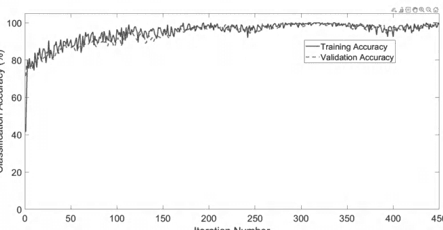

图 7.4 提议的 DLM 的训练和验证准确率

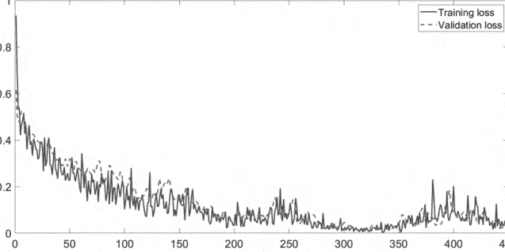

图 7.5 提议的 DLM 的训练和验证损失

### 表 7.3 德国医院数据集的验证准确率

| 分类模型 | TP | TN | FP | FN | 验证准确率 (%) |
|---|---|---|---|---|---|
| 决策树 | 609 | 1233 | 83 | 75 | 92.1 |
| 逻辑回归 | 382 | 1170 | 146 | 302 | 77.6 |
| 朴素贝叶斯 | 339 | 1178 | 138 | 345 | 75.8 |
| SVM | 645 | 1316 | 0 | 39 | 98 |
| KNN | 661 | 1303 | 13 | 23 | 98.2 |
| 集成学习 | 676 | 1280 | 36 | 8 | 97.8 |
| 提议的 DLM | 684 | 1316 | 0 | 0 | 100 |

与其他 ML 算法相比。此外，与 ML 算法相比，发现 TP、TN、FP 和 FN 值更好。图 7.6 显示了此处考虑的 ML 算法的受试者工作特性（ROC）曲线。曲线下面积（AUC）对 DT、SVM、KNN 和 ELA 来说良好。表 7.4 显示了训练期间各种分类模型之间性能指标的比较。对于同一数据集，提议的 DLM 优于其他 ML 模型和文献 [8] 中的结果。

表 7.4 显示了训练期间各种分类模型之间性能指标的比较。

#### 7.6.2 测试

使用德国医院数据集训练的分类模型已存储。这些模型使用 PIDD 进行测试。PIDD 数据集对模型来说是完全新的医疗记录，因为该数据集在训练期间未被使用。这样做是为了展示所开发模型在可靠检测准确性方面的鲁棒性和有效性，以及所提模型的泛化性和适应性。测试准确率结果和性能指标比较如表 7.5 和 7.6 所示。对于同一数据集，提议的 DLM 优于其他 ML 模型和文献 [8,23] 中的结果。提议的 DLM 未能分类十个样本。这十个样本编号及其异常参数如表 7.7 所示。表 7.7 中列出的参数具有不规则值，这可能成为实现 100% 测试准确率的障碍。PIDD 数据集的分类测试准确率为 98.7%，这证明了所提议 DLM 的鲁棒性、可靠性和有效性。

#### 7.6.3 未来工作

使用深度学习进行 DM 检测的未来工作范围有几个待进一步探索的领域。关键领域包括大型数据集的精度提升、早期预测和预防、与基于边缘计算的可穿戴设备集成，以及部署成本低廉到所有人都能负担得起。为了进一步探索 DLM（例如使用预训练模型实现），需要大型数据集。一旦从各地理位置收集到大型数据集可用，使用基于迁移学习的 DLM 就是可能的。此外，还有进一步的范围来研究儿童和青少年的 DM 检测。然后，可以进一步调查所提议 DLM 的性能。目标将是开发一个简单的模型，用于检测 DM，而不考虑性别、年龄或种族。

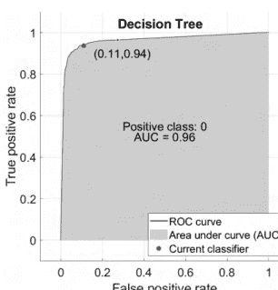

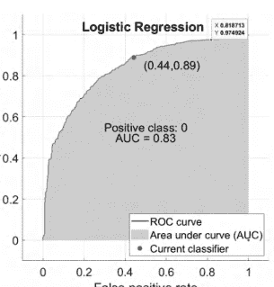

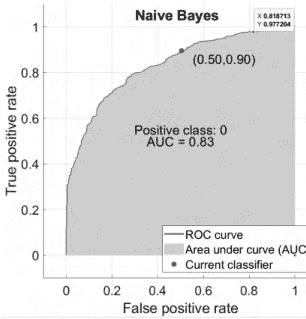

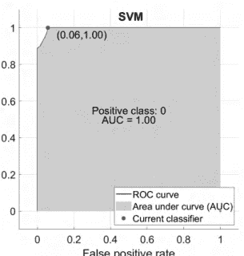

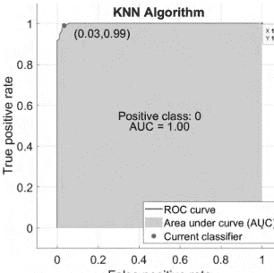

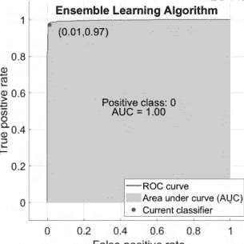

图 7.6 (a)–(f) 不同 ML 算法的 ROC 曲线。

### 表 7.4 德国医院数据集上不同分类模型的性能指标比较

| 分类模型 | 精确度 (%) | 召回率 (%) | F1-Score (%) |
| :--- | :--- | :--- | :--- |
| 决策树 | 88.01 | 89.04 | 88.52 |
| 逻辑回归 | 72.35 | 55.85 | 63.04 |
| 朴素贝叶斯 | 71.07 | 49.56 | 58.40 |
| SVM | 100.00 | 94.30 | 97.07 |
| KNN | 98.07 | 96.64 | 97.35 |
| 集成学习 | 94.94 | 98.83 | 96.85 |
| 2GDNN [23] | 97.35 | 96.67 | 96.97 |
| 提议的 DLM | 100.00 | 100.00 | 100.00 |

### 表 7.5 PIDD 的测试准确率

| 分类模型 | TP | TN | FP | FN | 测试准确率 (%) |
| :--- | :--- | :--- | :--- | :--- | :--- |
| 决策树 | 245 | 492 | 8 | 23 | 96 |
| 逻辑回归 | 152 | 449 | 51 | 116 | 78.3 |
| 朴素贝叶斯 | 124 | 453 | 47 | 144 | 75.1 |
| SVM | 249 | 500 | 0 | 19 | 97.5 |
| KNN | 252 | 494 | 8 | 14 | 97.14 |
| 集成学习 | 256 | 496 | 6 | 10 | 97.92 |
| 提议的 DLM | 261 | 497 | 3 | 7 | 98.7 |

### 表 7.6 PIDD 上不同分类模型的性能指标比较

| 分类模型 | 精确度 (%) | 召回率 (%) | F1-Score (%) |
| :--- | :--- | :--- | :--- |
| 决策树 | 96.84 | 91.42 | 94.05 |
| 逻辑回归 | 74.88 | 56.72 | 64.54 |
| 朴素贝叶斯 | 72.51 | 46.27 | 56.49 |
| SVM | 100.00 | 92.91 | 96.32 |
| KNN | 96.92 | 94.74 | 95.82 |
| 集成学习 | 97.71 | 96.24 | 96.97 |
| 2GDNN [23] | 97.34 | 97.25 | 99.01 |
| 提议的 DLM | 98.86 | 97.39 | 98.12 |

### 7.7 结论

本章中，我们提出了一个简单的 DLM 来检测 DM。该 DLM 在德国医院数据集和 PIDD 上检测 DM 表现出了显著的准确性。ML 算法的超参数调优采用了贝叶斯优化进行。所提模型使用

### 表 7.7 错分样本编号详情

| 序号 | 样本编号 | 实际输出类别 | 预测输出类别 | 异常参数 |
|:---:|:---:|:---:|:---:|:---|
| 1. | 8 | 0 | 1 | BMI |
| 2. | 21 | 0 | 1 | BMI |
| 3. | 31 | 0 | 1 | BMI |
| 4. | 7 | 1 | 0 | 血糖, 血压, BMI |
| 5. | 10 | 1 | 0 | 血糖, 糖尿病谱系函数 |
| 6. | 14 | 1 | 0 | BMI, 糖尿病谱系函数 |
| 7. | 16 | 1 | 0 | 血糖, BMI |
| 8. | 25 | 1 | 0 | 糖尿病谱系函数 |
| 9. | 221 | 1 | 0 | 血压 |
| 10. | 398 | 1 | 0 | 血压 |

使用德国医院数据集并进行十折交叉验证训练，并使用 PIDD 进行测试。训练和测试结果证明了与 ML 算法相比所提模型的优势。随着深度学习算法在实时医疗数据中的日益部署，DM 检测和诊断的未来前景广阔。

### 参考文献

- 1. R. Pradeepa, V. Mohan, 印度 2 型糖尿病流行病学, Indian J Ophthalmol. 69(11), 2932–2938 (2021). https://doi.org/10.4103/ijo.IJO_1627_21.
- 2. I. D. Federation, IDF 糖尿病图集, 第 10 版. 预印本 (2021). 国际糖尿病联盟, 比利时布鲁塞尔
- 3. H. Wu, S. Yang, Z. Huang, J. He, X. Wang, 基于数据挖掘的 2 型糖尿病预测模型, Inform Med Unlocked, 10, 100–107 (2018). ISSN 2352–9148, https://doi.org/10.1016/j.imu.2017.12.006.
- 4. 第七十五届世界卫生大会, 日内瓦。2022 年 5 月 22–28 日: 决议和决定, 附件. 日内瓦: 世界卫生组织 (2022) (WHA75/2022/REC/1; https://iris.who.int/handle/10665/365610).
- 5. M. M. Bukhari, B. F. Alkhamees, S. Hussain, A. Gumaei, A. Assiri, S. S. Ullah, 用于有效糖尿病预测的改进人工神经网络模型, Complexity, 2021, 文章 ID 5525271, 10 页 (2021). https://doi.org/10.1155/2021/5525271.
- 6. M. T. García-Ordás, C. Benavides, J. A. Benítez-Andrades, H. Alaiz-Moretón, I. García-Rodríguez, 使用带有过采样和特征增强的深度学习技术进行糖尿病检测, Comp Methods Programs Biomed, 202, 105968 (2021). https://doi.org/10.1016/j.cmpb.2021.105968.
- 7. H. Naz, S. Ahuja, 使用 PIMA 印度数据集进行糖尿病预测的深度学习方法. J Diabetes Metab Disord, 19, 391–403 (2020). https://doi.org/10.1007/s40200-020-00520-5.
- 8. K. Kangra, J. Singh, 糖尿病预测机器学习算法的比较分析, Bull Electr Eng Inform, 12(3), 1728–1737 (2023). ISSN:2302–9285, https://doi.org/10.11591/eei.v12i3.4412.
- 9. Z. Mushtag, M. F. Ramzan, S. Ali, S. Baseer, A. Samad, M. Husnain, 使用高度调优机器学习技术的基于投票分类的糖尿病预测, Mobile Inform Sys, 2022, 16 (2022). https://doi.org/10.1155/2022/6521532.
- 10. V. Rawat, S. Joshi, S. Gupta, D. P. Singh, N. Singh, 糖尿病早期诊断的机器学习算法: 一项比较研究, Mater Today Proc, 56(第 1 部分), 502–506 (2022). https://doi.org/10.1016/j.matpr.2022.02.172.
- 11. L. Ismail, H. Materwala, M. Tayefi, P. Ngo, A. P. Karduck, 基于人工智能机器学习的 2 型糖尿病: 方法与评估, Arch Comput Methods Eng, 29(1), 313–333 (2022). https://doi.org/10.1007/s11831-021-09582-x.
- 12. R. Patra, B. Khuntia, 使用 SDKNN 分类器技术对 Pima 印度糖尿病数据集进行分析和预测, IOP Conf Ser Mater Sci Eng, 1070(1), 1–14 (2021). https://doi.org/10.1088/1757-899X/1070/1/012059.
- 13. K. S. Kumari, K. Bhargavi, 使用机器学习技术对糖尿病进行性能分析, Turkish J Comput Math Educ, 12(6), 225–230 (2021).
- 14. F. Alaa, A. M. Al-bakry, 使用机器学习算法诊断糖尿病, Mater Today Proc, (2021). https://doi.org/10.1016/j.matpr.2021.07.196.
- 15. S. Rajendar, R. Thangaraj, J. Palanisamy, V. K. Kaliappan, 2 型糖尿病早期预测分类器模型的比较分析, Int J Adv Sci Technol, 29(7), 2184–2194 (2020).
- 16. R. Patil, S. Tamane, S. A. Rawandale, K. Patil, 2 型糖尿病早期检测的改进萤火虫-SVM 方法, Int J Electr Comput Eng, 12(1), 524–533 (2022), https://doi.org/10.11591/ijece.v12i1.pp524-533.
- 17. S. Samreen, 通过利用鸦群搜索特征工程和堆叠集成的机器学习流水线实现糖尿病内存高效、准确且早期诊断, IEEE Access, 9, 134335–134354 (2021). https://doi.org/10.1109/ACCESS.2021.3116383.
- 18. K. Roy, M. Ahmad, K. Waqar, K. Priyaah, J. Nebhen, S. S. Alshamrani, M. A. Raza, I. Ali, 使用带有缺失值的不平衡数据进行 2 型糖尿病分类的增强机器学习框架, Complexity, 2021, 21 (2021). https://doi.org/10.1155/2021/9953314.
- 19. J. J. Khanam, S. Y. Foo, 糖尿病预测机器学习算法比较, ICT Express, 7(4), 432–439 (2021). https://doi.org/10.1016/j.icte.2021.02.004.
- 20. T. M. Alam, M. A. Iqbal, Y. Ali, A. Wahab, S. Ijaz, T. I. Baig, A. Hussain, M. A. Malik, M. M. Raza, S. Ibrar, Z. Abbas, 糖尿病早期预测模型, Inform Med Unlocked, 16, 100204 (2019). https://doi.org/10.1016/j.imu.2019.100204.


- 21. S. Sivarajanji, S. Ananya, J. Aravinth, R. Karthika, 基于特征选择与降维的机器学习算法糖尿病预测, 2021年第7届先进计算与通信系统国际会议（ICACCS）, 印度科伊姆巴托尔, 2021, pp. 141–146, https://doi.org/10.1109/ICACCS51430.2021.9441935.

- 22. M. K. Hasan, M. A. Alam, D. Das, E. Hossain, M. Hasan, 基于不同机器学习分类器集成的糖尿病预测, IEEE Access, 8, 76516–76531 (2020). https://doi.org/10.1109/ACCESS.2020.2989857.

- 23. C. C. Olisah, L. Smith, M. Smith, 从数据预处理和机器学习角度看糖尿病预测与诊断, Comp Methods Programs Biomed, 220, 106773 (2022). https://doi.org/10.1016/j.cmpb.2022.106773.

- 24. J. Chaki, S. Thillai Ganesha, S. K. Cidham, S. Ananda Theertan, 基于机器学习和人工智能的糖尿病检测与自我管理：系统综述, J King Saud Univ Comput Inform Sci, 34(6, Part B), 3204–3225 (2022). https://doi.org/10.1016/j.jksuci.2020.06.013.

- 25. A. H. Victoria, G. Maragatham, 使用贝叶斯优化的超参数自动调谐. Evol Syst, 12, 217–223 (2021). https://doi.org/10.1007/s12530-020-09345-2.

- 26. S. Ioffe, C. Szegedy, 批量归一化：通过减少内部协变量偏移加速深度网络训练. arXiv:1502.03167 (2015).

- 27. K. Hara, D. Saito, H. Shouno, 深度学习中修正线性单元功能分析, 2015年国际神经网络联合会议（IJCNN）, 爱尔兰基拉尼 (2015), pp. 1–8. https://doi.org/10.1109/IJCNN.2015.7280578.

- 28. Kaggle, 糖尿病. https://www.kaggle.com/datasets/johndasilva/diabetes (2024年2月24日访问).

- 29. Kaggle, 皮马印第安人糖尿病数据集. https://www.kaggle.com/uciml/pima-indians-diabetes-database (2024年2月24日访问).

## 糖尿病检测与诊断中深度学习算法应用的全面综述

卡塔日娜·维尔托斯

### 8.1 引言

糖尿病是一种持续的代谢性疾病，妨碍胰腺产生胰岛素，导致血液中葡萄糖水平异常（高血糖）。当血糖水平长期保持高位时，血管会受到影响并最终受损。胰岛素对脂肪和蛋白质的正常代谢至关重要 [1]。如果不治疗，胰岛素水平不足会持续导致严重的健康并发症，如心脏病、肥胖、中风、肾衰竭、足部并发症、视力受损、神经损伤或认知问题 [2]。该疾病的复杂性体现在不同类型的糖尿病数量上，最常见的是1型糖尿病、2型糖尿病和妊娠糖尿病 [3]。1型糖尿病是一种自身免疫性疾病，由免疫系统破坏负责产生胰岛素的细胞（胰腺β细胞）引起 [4]。2型糖尿病占全球所有糖尿病的90%以上 [1]，并非自身免疫性疾病，而是一种身体会产生胰岛素但未能正确使用或其水平不足的状况 [5]。妊娠糖尿病在妊娠第二或第三孕期发展，通常在分娩后消失 [6]。

尽管如此，妊娠糖尿病的发生会增加日后患2型糖尿病的风险 [1]。

鉴于受影响人数众多且在全球持续上升，早期糖尿病检测研究领域具有重要意义 [7]。因此，有必要对最佳技术进行全面综述，并确定最新的顶尖方法。以下部分将讨论糖尿病检测中最新的深度学习方法及其在医疗系统中的可能实际应用。估计约有5.37亿20至70岁的成年人患有该疾病。这一数字预计将在2030年上升至6.43亿（11.3%），到2045年上升至7.83亿（12.2%）。此外，据信约有2.4亿人未被诊断且未接受任何医疗治疗 [1]（图8.1）。

可能的治疗方案的开发与持续改进，以及糖尿病的早期检测，对于最大限度地减少该疾病对慢性病患者健康和生活质量的影响至关重要 [8]。早期检测对于确保尽可能减少健康破坏并防止疾病对身体造成进一步危害至关重要，最终有助于提高患者的健康相关生活满意度 [9]。诊断方法的改进至关重要，因为估计多达一半的2型糖尿病未被诊断，导致许多不可逆的长期健康损伤、严重残疾甚至死亡 [1]。诊断程序通常基于血糖水平检测。根据世界卫生组织（WHO），空腹血糖水平等于或超过126 mg/dL（高血糖）表明患有糖尿病 [10]。然而，深度学习算法会同时考虑更多有洞察力的数据，例如病历、体重、年龄、心率变异性、遗传、视网膜图像、体格指数、脉搏率 [11]，或心电图信息 [12]。这种方法允许精确简洁的诊断，并可作为独立的决策工具或大大辅助人工审核。这些算法可以分析大量复杂数据，并能识别数据特征之间更微妙的关系，从而提供更深入的结果 [13]。

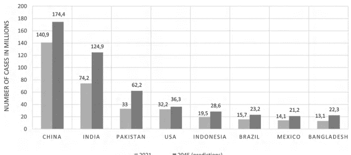

图8.1 2021年糖尿病患病率最高的国家（以百万人为单位）及2045年预测图。（创建此*图表*所用数据取自参考文献[1]中的表格。数据由作者处理和可视化。）

### 8.2 诊断方法的最新进展

人工智能技术不仅能有效早期检测新发病例，还能作为疾病实时治疗监测的稳健流程 [6]。在这些方法中，深度学习技术有望通过提供更稳健、更高效的方法来识别处于风险中的患者并促进更个性化治疗方案的发展，从而显著推动糖尿病检测、预测和管理领域的发展。在实践中实施这些方法对诊断过程有益，因为与传统机器学习方法相比，可以更有效地分析大规模复杂数据集。深度学习方法能提供更精确的结果，因为它们能识别人工审核不易察觉的模式。另一个优势是能够处理非结构化和不完整的数据 [14]。这些方法更具灵活性和敏捷性，允许对现实世界数据采取更全面的方法 [15]。深度学习算法，尤其是神经网络，如RNN、CNN和LSTM，可以有效处理时间序列数据，包括可穿戴设备的信号数据。通过适当利用以下方法，深度学习有助于实现糖尿病检测的自动化，从而实现更有效的疾病诊断和管理。

本章按以下部分组织。首先，在引言中，介绍了所观察问题的重要性和紧迫性。随后，在下一节中，收集了所有回顾的方法及其最引人注目的方法，并在比较表中列出了每个模型的相应准确率。然后，在讨论部分，描述了所有观察到的趋势和未来前景。最后，在结论部分，汇总并收集了最重要的细节。

### 8.3 方法

在使用深度学习算法进行糖尿病检测的研究领域中，大多数回顾的研究论文主要使用准确率指标来评估所提方法的有效性。为了保持后续比较的一致性，所呈现的主要指标也是准确率，即正确标记数据的总数。

```
Accuracy=(TP+TN)/(TP+FP+FN+TN)
```

其中TP – 真阳性，TN – 真阴性，FP – 假阳性，FN – 假阴性。

将其用作评估指标的主要优点是解释简便且统一；然而，在未解决所用数据集中类别不平衡的情况下，它可能被证明效率低下。否则，它提供了整体性能的有效衡量（图8.2）。

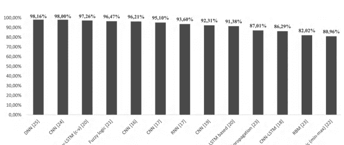

图8.2 文献综述中深度学习方法准确率图。


在文献 [16] 中，提出了一种医疗深度学习模型（MDML），并与现有方法进行了比较，取得了有希望的结果。Armghan 等人引入的方案达到了 96.21% 的准确率、91.53% 的精确率、94.21% 的召回率、97.98% 的 F1 分数和 89.90% 的诊断优势比 [16]。该想法的新颖之处在于提供一种用于分析生物传感器数据以检测糖尿病的工具，该工具基于卷积神经网络（CNN）和循环神经网络（RNN）的组合。这些传感器是促进一种极其灵敏的非侵入式方法（允许识别非常微妙的异常）的系统的一个组成部分。这些生物传感器旨在检测分子，然后将其转换为电信号，在主系统中进一步分析。获取的数据包括血糖、体温或心率。

在文献 [17] 中，分析基于健康患者和受影响患者的心电图（ECG）数据。在该研究中，卷积神经网络和 CNN-LSTM（长短期记忆）技术均已实现和测试，后者取得了更好的结果。考虑的主要特征是心率变异性（HRV）信号。Swapna 等人提出了一种混合神经网络方法，即五倍交叉验证 CNN-LSTM，达到了 95.1% 的准确率。该方法在受影响和健康患者的平衡比例下对 142 个数据集进行了测试。每个数据集包含 1000 个样本。在将数据初步转换为心率时间序列后，未执行其他预处理。

在文献 [18] 中，Alex 等人提出了一种一维 CNN（1D-CNN）用于预测糖尿病，最高结果为 86.29% 的准确率。此外，为识别缺失值中的离群值，采用了 Tukey 方法。为进行测试和评估，使用了一个流行数据集，即来自加州大学存储库的 Pima Indians 糖尿病数据集 [19]。它包括患者健康和诊断测量的信息，即血糖水平、患者怀孕次数、BMI、胰岛素水平、血压和年龄 [20]。该数据集包含 768 名女性的信息，其中 268 名患者被诊断患有糖尿病，500 名未受影响。为处理不平衡数据集，使用了合成少数类过采样技术（SMOTE）。它通过为少数类创建新样本来工作，从而生成一个平衡的数据集 [21]。

在文献 [22] 中，García-Ordás 等人提出了一种数据增强管道，使用一种称为变分自编码器（VAE）的过采样技术，结合稀疏自编码器（SAE）进行特征增强和 CNN。所提方法达到了 92.31% 的准确率。为了允许 SAE 和 CNN 之间进行相互反向传播反馈，两者进行了联合训练，这改善了特征增强过程中生成特征的质量。在测试中，使用了 Pima Indians 糖尿病（PID）数据库。根据作者的说法，由于数据集中现有特征的数量太少，无法有效训练神经网络，因此使用 SAE 生成了更多特征（从 8 个增加到 400 个）。

在文献 [23] 中，Rahman 等人实现了一个基于 Conv-LSTM 的模型和一个交叉验证 Conv-LSTM 模型，分别达到 91.38% 和 97.26% 的准确率。这些方法在广泛使用的 PID 数据库上进行了测试。作者采用了 Conv-LSTM，这以前未曾做过。此外，为了筛选出最重要的特征，应用了一种基于随机森林的 Boruta 方法。该算法仅为后续分析选择最相关的特征，即血糖、BMI 值、血压、胰岛素水平和年龄，同时忽略其余特征，因为它们对分类过程的意义较低。

在文献 [24] 中，引入了一种与余弦幅度方法相结合的模糊规则基模型。Aamir 等人在包含 768 条记录的 PID 数据库上实现并测试了这些模糊方法，记录包括健康患者和患糖尿病患者的数据。在所提算法的评估中，最佳算法达到了 96.47% 的准确率，表明具有高效性的良好前景。

在文献 [25] 中，Kim 等人提出了一种强健的方法，包含无监督和监督学习组件，即模糊 C 均值聚类和模糊 min-max 神经网络学习器。作者证明，与这些算法的分离实现相比，其模型优于先前已知的方法。在对流行 PID 数据库的评估中，其达到了 80.96% 的准确率。为处理缺失值的存在，研究人员使用了“填充平均值”机制。缺失值最普遍的特征为舒张压（35）、三头肌皮肤皱折厚度（221）和 2 小时血清胰岛素（375）。

在文献 [26] 中，比较和评估了受限玻尔兹曼机和反向传播在诊断糖尿病方面的有效性。数据经过了常规数据预处理，包括数据划分和归一化（min-max）。在 PID 数据库的测试中，两层随机神经网络（RBM）获得了 82.02% 的准确率，而源自多层感知器（MLP）算法的反向传播算法达到了 87.01% 的准确率。

在文献 [27] 中，Lee 等人提出了一种通过使用高频超声和深度学习技术进行糖尿病检测的创新方法，即一个基于 CNN 的模型，在效率评估中达到了 98% 的准确率。作者的根本想法源于观察到的现象：葡萄糖倾向于逐渐在红细胞中积聚，在其外层形成糖化血红蛋白。深度学习算法被应用于监测红细胞的变化，并检测这些变化与血糖水平及信号数据之间的任何关系。

在文献 [28] 中，Nadesh 等人实现了一个基于 PID 数据库的深度神经网络模型，作为糖尿病检测的一种无监督方法。在数据准备中，应用了许多技术，例如降维以帮助缓解可能的过拟合、过滤方法和包装方法，并且为确定最有价值的特征，使用了极度随机树（特征重要性 [28]）。特征重要性通过提供偏差减少，帮助建立对后续分类最具重要性的特征。所提方法在性能评估中获得了 98.16% 的准确率（表 8.1）。

### 8.4 讨论

由于检测和正确诊断糖尿病（尤其是早期）的过程可能具有挑战性，因此建立可靠且高效的方法至关重要。

采用深度学习方法（如 CNN、RNN、LSTM 功能和模糊逻辑）的效果和效益是显著的。例如，可以注意到深度学习方法在医学领域的应用兴趣增加、对人类专家的帮助以及其总体高性能，以及在该关注领域发表的研究论文数量不断增加（图 8.3）。

性能最好的模型基于混合方法，这类方法不仅组合和混合不同的深度学习算法，还结合不同的特征增强和预处理技术。通过试错，可以建立最佳组合，然后进一步改进。这些想法随后可以在实践中实施和利用，即在医疗保健领域改善糖尿病诊断过程，甚至实现有效的糖尿病前状态检测。

| 参考文献 | 年份 | 模型 | 技术 | 数据 | 准确率 (%) |
| :--- | :--- | :--- | :--- | :--- | :--- |
| Armghan 等人 [16] | 2023 | 医疗深度学习模型 (MDML) | CNN 和 RNN | 患者病历数据和生物传感器数据（即血糖水平和胰岛素水平） | 96.21 |
| Swapna 等人 [17] | 2018 | 五倍交叉验证 | CNN 和 CNN-LSTM | 健康和受影响患者的即时心率变化 – 心率变异性 (HRV) | 93.6 95.1 |
| Alex 等人 [18] | 2022 | 深度一维卷积神经网络 (DCNN) | 1D-CNN | 皮马印第安人糖尿病数据集 (PIDD) | 86.29 |
| García-Ordás 等人 [22] | 2021 | CNN 分类器，与 SAE 联合训练用于特征增强 | CNN 和稀疏自编码器 (SAE) | 皮马印第安人糖尿病数据集 (PIDD) | 92.31 |
| Rahman 等人 [23] | 2020 | 基于 Conv-LSTM 的模型和交叉验证 Conv-LSTM 模型 | 卷积长短期记忆 (Conv-LSTM) | 皮马印第安人糖尿病数据集 (PIDD) | 91.38 97.26 |
| Aamir 等人 [24] | 2021 | 模糊规则基模型 | 模糊逻辑 | 皮马印第安人糖尿病数据集 (PIDD) | 96.47 |
| Kim 等人 [25] | 2022 | 模糊 C 均值聚类组件（无监督）与模糊 min-max 神经网络（监督）的层级组合 | 模糊 min-max 神经网络 | 皮马印第安人糖尿病数据集 (PIDD) | 80.96 |
| Anggoro 等人 [26] | 2023 | 两层随机神经网络和监督学习算法 | 受限玻尔兹曼机 (RBM) 和反向传播 | 皮马印第安人糖尿病数据集 (PIDD) | 82.02 87.01 |
| Lee 等人 [27] | 2024 | CNN 模型 | CNN | 高频超声 (HFU) 信号数据 | 98.0 |
| Nadesh 等人 [28] | 2020 | 深度神经网络 | DNN | 皮马印第安人糖尿病数据集 (PIDD) | 98.16 |


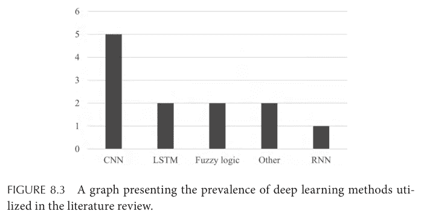

从所呈现的文献综述可以看出，最普遍且广泛采用的深度学习技术是 CNN 算法，其次是结合 LSTM、模糊逻辑和 RNN 的混合方法，然后是其他不太流行的方法，例如受限玻尔兹曼机（RBM）。

建立精简的系统非常重要，这些系统能够实现有效的患者健康监测、早期疾病检测和娴熟的治疗实施。根据参考文献 [16]，最突出的方法之一是利用生物传感器。这些传感器能够精确测量血糖水平。结合使用深度学习方法可以构建一个用于早期糖尿病检测的精简实时监测系统。这种特定方法对高风险患者尤其有益，即那些有糖尿病家族史、有糖尿病前期、超重、体力活动量低、患有妊娠糖尿病或年龄在 45 岁及以上的人 [29]。然而，作者认为，所提出的想法可能更适用于纯检测，而非确定糖尿病的严重程度或推荐最佳治疗策略。

尽管如此，所提出的解决方案是一种有前途的快速诊断方法。

另一个创新想法是 Lee 等人 [27] 提出的方法，其中实现了一种无需采血的非侵入性体内方法。它涉及，类似于另一篇研究论文 [16] 中生物传感器的情况，监测通过该检查获得的信号和数据的理念。这可能会在糖尿病患者每天应对疾病的方式中体现出深刻的变化，使他们不再需要通过侵入性工具和设备来监测当前的胰岛素水平。

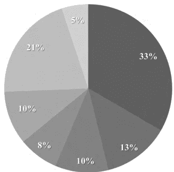

- 印度
- 西班牙
- 孟加拉国
- 巴基斯坦
- 沙特阿拉伯
- 韩国
- 印度尼西亚

图 8.4 基于文献综述展示了各国在糖尿病检测深度学习方法研究中百分比份额的饼图。

在应用的深度学习方法方面，另一个有趣且有前途的方法是基于模糊逻辑的分类，与其他解决方案相比，它相对容易理解。

所呈现的文献综述涵盖了 2018 年至 2024 年的作品。对深度学习方法在糖尿病检测领域应用感兴趣的作者数量相对较高。按地理来源分析研究论文的百分比分布可以看出，绝大多数文章的作者来自印度和韩国（图 8.4）。

### 8.5 结论

糖尿病是影响全球许多人的严重健康问题，这一问题需要得到有效解决。从所呈现的文献综述可以推断，在借助经过改进的深度学习方法（这些方法在评估中取得了高性能准确率）改进糖尿病检测和诊断过程方面，存在强劲且日益增长的兴趣。可以注意到，准确率最高的方法是 CNN，然后是诸如 Conv-LSTM 和模糊逻辑等混合方法，接着是 RNN。尽管如此，本综述中回顾的所有方法仍然取得了非常高的准确率，展示了精简的功能和强健的分类性能。对这一普遍问题最感兴趣的国家是印度和韩国，绝大多数论文均源自这两个国家。关于糖尿病检测的未来，有许多创新想法，其中之一是实施非侵入性健康状态监测系统，例如利用生物传感器或其他信号设备的功能。这些方法可以实现早期糖尿病检测或糖尿病前期状态检测，从而在疾病剧烈进展之前实施有效治疗，实际上将大大保障患者的健康。

## 致谢

作者们希望感谢西里西亚理工大学校长在 IDUB 倡议下为本研究项目提供的支持。

### 参考文献

- 1. Magliano, D. J., Boyko, E. J., & Atlas, I. D. (2021). 什么是糖尿病？在 IDF 糖尿病图谱 [Internet]。第 10 版。国际糖尿病联盟，比利时布鲁塞尔。
- 2. Goutham, S., Ravi, V., & Soman, K. P. (2018). 使用深度学习算法进行糖尿病检测。ICTExpress, 4, 243–246. DOI:10.1016/j.icte.2018.10.005.
- 3. Kaul, K., Tarr, J. M., Ahmad, S. I., Kohner, E. M., & Chibber, R. (2013). 糖尿病简介。在 Ahmad, S. I. (编), Diabetes: An Old Disease, a New Insight, 1–11. 纽约：Springer。
- 4. Kawasaki, E. (2014). 1型糖尿病与自身免疫。临床儿科内分泌学，23(4), 99–105.
- 5. Edelman, S. V. (1998). II型糖尿病。内医学进展，43, 449–500.
- 6. Agliata, A., Giordano, D., Bardozzo, F., Bottiglieri, S., Facchiano, A., & Tagliaferri, R. (2023). 机器学习作为2型糖尿病诊断的支持。分子科学国际期刊，24(7), 6775.
- 7. Rowley, W. R., Bezold, C., Arikan, Y., Byrne, E., & Krohe, S. (2017). 糖尿病 2030：来自昨天、今天和未来趋势的见解。人群健康管理，20(1), 6–12.
- 8. Fregoso-Aparicio, L., Noguez, J., Montesinos, L., & García-García, J. A. (2021). 2型糖尿病的机器学习与深度学习预测模型：系统综述。糖尿病学与代谢综合征，13(1), 1–22.
- 9. Megari, K. (2013). 慢性病患者的生活质量。健康心理学研究，1(3), e27.
- 10. WHO. 全球卫生观察站。https://www.who.int/data/gho/indicator-metadata-registry/imr-details/2380 (访问日期：19.02.2024).
- 11. Zou, Q., Qu, K., Luo, Y., Yin, D., Ju, Y., & Tang, H. (2018). 使用机器学习技术预测糖尿病。*遗传学前沿*, 9, 515.
- 12. Swapna, G., Vinayakumar, R., & Soman, K. P. (2018). 使用深度学习算法进行糖尿病检测。*ICT Express*, 4(4), 243–246.
- 13. Rawat, V., Joshi, S., Gupta, S., Singh, D. P., & Singh, N. (2022). 糖尿病早期诊断的机器学习算法：比较研究。*今日材料：会议录*, 56, 502–506.
- 14. Zhu, T., Li, K., Herrero, P., & Georgiou, P. (2020). 面向糖尿病的深度学习：系统综述。*IEEE 生物医学与健康信息学期刊*, 25(7), 2744–2757.
- 15. Tsiknakis, N., Theodoropoulos, D., Manikis, G., Ktistakis, E., Boutsora, O., Berto, A., ... & Marias, K. (2021). 基于眼底图像的糖尿病视网膜病变检测与分类的深度学习：综述。*生物医学与医学中的计算机*, 135, 104599.
- 16. Armgham, A., Logeshwaran, J., Sutharshan, S. M., Aliqab, K., Alsharari, M., & Patel, S. K. (2023). 使用深度学习进行糖尿病同步识别的生物传感器设计。*工程成果*, 20, 101382.
- 17. Swapna, G., Soman, K. P., & Vinayakumar, R. (2018). 使用 CNN 和 CNN-LSTM 网络及心率信号进行糖尿病自动检测。*程序计算机科学*, 132, 1253–1262.
- 18. Alex, S. A., Nayahi, J. J. V., Shine, H., & Gopirekha, V. (2022). 用于糖尿病预测的深度卷积神经网络。*神经计算与应用*, 34(2), 1319–1327.
- 19. Blake, C. L., & Merz, C. J. (1998) *UCI 机器学习数据库存储库*. 信息与计算机科学系，加州大学，欧文分校，加州。
- 20. Kaggle. 皮马印第安人糖尿病数据库。https://www.kaggle.com/datasets/uciml/pima-indians-diabetes-database (访问日期：07.03.2024).
- 21. Maniruzzaman, M., Kumar, N., Islam, S., Suri, H. S., El-Baz, A. S., Suri, J. S., & Abedin, M. M. (2017). 糖尿病数据分类的比较方法：机器学习范式。*生物医学中的计算机方法与方案*, 152, 23–34.
- 22. Garcia-Ordas, M. T., Benavides, C., Benitez-Andrades, J. A., Alaiz-Moretón, H., & García-Rodríguez, I. (2021). 使用带过采样和特征增强的深度学习技术进行糖尿病检测。*生物医学中的计算机方法与方案*, 202, 105968.
- 23. Rahman, M., Islam, D., Mukti, R. J., & Saha, I. (2020). 基于卷积 LSTM 的糖尿病检测深度学习方法。*计算生物学与化学*, 88, 107329.
- 24. Aamir, K. M., Sarfraz, L., Ramzan, M., Bilal, M., Shafi, J., & Attique, M. (2021). 用于糖尿病分类的模糊规则系统。*传感器*, 21(23), 8095.
- 25. Kim, K. B., Park, H. J., & Song, D. H. (2022). 结合监督和无监督模糊学习算法以实现稳健的糖尿病诊断。*应用科学*, 13(1), 351.


26. Anggoro, D. A., & Hajjati, S. (2023). 受限玻尔兹曼机与反向传播算法在糖尿病检测中性能指标水平的比较。伊拉克科学杂志, 64, 907–921.

27. Lee, J. E., Jeon, H. J., Lee, O. J., & Lim, H. G. (2024). 使用高频超声和卷积神经网络诊断糖尿病。超声, 136, 107167.

28. Nadesh, R. K., & Arivuselvan, K. (2020). 使用深度神经网络分类器预测2型糖尿病。认知计算工程国际期刊, 1, 55–61.

29. Centers for Disease Control and Prevention. 糖尿病风险因素。https://www.cdc.gov/diabetes/basics/risk-factors.html (访问日期：07.03.2024).

## 检查机器学习和深度学习在糖尿病检测与诊断中的作用

### 关键性回顾

C. Gunavathi, Akshat Bokdia,
and Siri R. Kulakarni

### 9.1 引言

糖尿病（DM）的检测和诊断已有显著发展，融合了传统和现代方法。血糖监测和临床检测等传统方法仍然是基础。然而，机器学习（ML）和深度学习（DL）的进步彻底改变了该领域。集成方法和不同分类器算法等技术增强了数据分析。同时，各种深度学习架构也被用于视网膜图像中的糖尿病视网膜病变检测等任务。传统方法与先进方法的这种整合有望实现更准确、更高效的糖尿病诊断和管理。

许多研究论文采用各种机器学习技术进行糖尿病检测和诊断。这些技术包括支持向量机（SVM）、决策树、逻辑回归、k近邻（KNN）和随机森林等分类方法。AdaBoost、梯度提升和袋装法等集成方法通过组合多个基学习器来提高模型性能。支持向量机用于分类任务，利用其有效处理高维数据和非线性关系的能力。决策树因其可解释性和处理类别数据的能力而被使用，而逻辑回归则应用于二分类任务。KNN算法因其简单性和基于相似性度量处理分类任务的有效性而被使用。随机森林算法因其鲁棒性和处理具有复杂关系的高维数据的能力而被采用。

深度学习技术在糖尿病检测和诊断中发挥着重要作用。许多现有研究利用各种深度学习架构，包括卷积神经网络（CNNs）、循环神经网络（RNNs）、长短期记忆网络（LSTMs）和自编码器。卷积神经网络对视网膜图像等基于图像的数据特别有效，利用其自动学习分层特征的能力。循环神经网络和长短期记忆网络应用于时间序列信号等顺序数据，使时间依赖性建模成为可能。自编码器用于特征学习和数据降维，这在从高维数据中提取特征方面很有用。还采用迁移学习技术，利用在大型数据集上预训练的深度学习（DL）模型来提高小型数据集上的性能。

多篇论文专门针对基于卷积神经网络的糖尿病检测和诊断方法。这些论文使用AlexNet、VGG、ResNet和Inception等卷积神经网络架构，这些架构在图像分类过程中表现出良好效果。迁移学习技术常被采用，即在大规模图像数据集（例如ImageNet）上预训练的卷积神经网络模型在糖尿病视网膜病变数据集上进行微调，以提高分类准确性。旋转、缩放和翻转等数据增强技术被应用，以增加训练样本的多样性并提高模型泛化能力。此外，注意力机制和集成学习技术被用于进一步提升基于卷积神经网络的模型在糖尿病视网膜病变检测中的性能。

用于分析的论文共同侧重于使用各种机器学习和深度学习技术进行糖尿病检测、诊断和预测。方法包括利用临床数据、视网膜图像、DNA序列、光容积脉搏波信号、足部热成像和心率变异性信号等多种数据模式。高度强调应用机器学习和深度学习算法来提高糖尿病诊断和预测的准确性。技术包括集成方法、混合模型、特征选择技术和增强方法，以提高模型性能。论文探讨了使用可穿戴传感器、生物传感器和电子鼻进行糖尿病早期检测和实时监测的潜力。目标是实现及时干预，特别是在危重症环境中，以减轻糖尿病的不良影响。

### 9.2 方法论

本节概述了用于识别与糖尿病检测和预测相关的相关研究工作的方法论，包括研究问题的制定、搜索策略和回顾结果。

#### 9.2.1 研究问题

本研究旨在解决以下研究问题：

- 机器学习和深度学习技术在糖尿病检测和预测中如何应用，对临床实践有何影响？
- 哪些因素影响糖尿病预测模型的准确性和有效性？
- 哪些机器学习算法和深度学习架构在糖尿病检测和预测中表现出卓越性能？
- 训练和评估糖尿病预测模型通常使用哪些数据集，它们如何影响模型性能？
- 机器学习和深度学习方法在为糖尿病患者提供准确预后方面的现状如何？

#### 9.2.2 搜索策略

相关研究文章的搜索是使用Litmaps（一种高级文献映射工具）进行的。系统地使用糖尿病/机器学习/深度学习/预测等相关关键词查询了各种学术库，包括PubMed、IEEE和Science Direct。搜索旨在检索使用机器学习或深度学习技术研究糖尿病检测和预测的文章。

#### 9.2.3 回顾结果

经过严格的筛选过程以确保与研究目标相关，初始文章库被缩减至41篇论文。筛选过程涉及基于标题、摘要和全文审查的相关性筛选。最终文章集代表了对使用机器学习（ML）和深度学习方法进行糖尿病检测和预测的当前文献的全面回顾。

#### 9.2.4 研究分析

在审查标题和摘要后，出于各种原因，从总共80篇文章中移除了部分文章。

以下因素导致文章被排除：

- i. 缺乏文本可访问性。
- ii. 缺乏深度学习或机器学习模型。
- iii. 仅关注抽象概念。
- iv. 审查学术作品。
- v. 仅海报或摘要。

#### 9.2.5 数据集

在糖尿病检测和预测领域，各种数据集为开发和评估机器学习和深度学习模型奠定了基础。这些数据集涵盖了适应每个研究个体目标的多样参数和模式。例如，经常使用皮马印第安人糖尿病数据库（PIDD）。其他数据集包括用于高血压风险分层的光容积脉搏波信号、足部热成像图像以及用于基于深度学习诊断的DNA序列。此外，来自预防性医疗检查、视网膜图像、心电图（ECG）信号和临床登记册的数据集进一步丰富了糖尿病检测和预测研究的多维格局。这些数据集为研究人员提供了用于训练和评估预测模型的宝贵资源，为糖尿病管理和早期干预策略的进步铺平了道路。


#### 9.2.6 数据预处理

数据预处理是数据分析流水线中的关键步骤，旨在清洗并将原始数据转换为机器学习模型可用的格式。它涉及处理缺失值、归一化、特征缩放和类别变量编码等任务。通过数据预处理，分析人员可以提升模型性能，并降低因数据不一致或不完整而导致错误的可能性。表 9.1 总结了被审查文章中使用的数据预处理技术。

特征选择是从数据集中识别并选取最相关特征的过程，旨在提升模型性能并减少过拟合。这涉及单变量选择、递归特征消除和特征重要性评分等技术。通过仅选取最具信息量的特征，特征选择有助于简化模型、降低计算复杂度并增强可解释性。表 9.2 汇总了被审查文章中使用的所有特征选择技术。

表 9.1 数据预处理技术

| 预处理技术 | 参考文献 |
| :--- | :--- |
| 模糊逻辑预处理 | Priyadarshini and Lakshmi Shrinivasan (2021) |
| 切比雪夫 II 型带通滤波、用于基线校正的三次样条估计以及 Savitzky-Golay 平滑滤波器 | Singh and Nirala (2023) |
| 基于奇异值分解 (SVD) 预测数据集中缺失值 | Nilashi et al. (2023) |
| 最小-最大归一化 | Kamble and Patil (2016) 和 García-Ordás et al. (2021) |
| 通过去除异常值和噪声来清洗生物传感器采集的原始数据，然后通过归一化对数据进行标准化 | Armghan et al. (2023) |
| 归一化和缩放等标准技术 | Rahman et al. (2020) |
| 异常值检测与剔除，以及使用多重链式方程 (MICE) 方法填补缺失值 | Kopitar et al. (2020) 和 Chowdary and Kumar (2021) |
| 使用多重插补处理缺失数据，随后对连续变量进行缩放，并将类别变量转换为虚拟变量 | Karmand et al. (2024) |
| 数据清洗、通过均值插补处理缺失值，以及对类别变量进行独热编码 | Utomo et al. (2024) |
| 使用生成对抗网络进行数据增强和插补 | Boughhareb et al. (2023) |
| 离散小波变换 (DWT) 和 Z-分数归一化 | Gudiño-Ochoa et al. (2024) |
| 数据归一化 | Chee et al. (2024) |
| Z-分数归一化，随后使用四分位距 (IQR) 方法进行异常值检测，并将其替换为中位数 | Reza et al. (2024) |
| 数据插补和归一化 | Lu et al. (2024) |
| 五阶巴特沃思滤波器、异常值检测和数据归一化 | Kim et al. (2024) |
| KNN 插补器 | Alnowaiser (2024) |
| 均值和众数插补 | Novianti and Alamsyah (2024) |

表 9.2 特征选择技术

| 特征选择技术 | 参考文献 |
| :--- | :--- |
| STEPDISC，一种逐步判别分析方法，用于为类别判别选取定量变量子集 | Nilashi et al. (2023) |
| 结合过滤法和包裹法的混合方法 | Armghan et al. (2023) |
| 基于随机森林的 Boruta 算法 | Rahman et al. (2020) |
| 过滤掉缺失值超过 50% 的变量，并选取与生理和生活方式因素相关的相关预测变量。 | Kopitar et al. (2020) |
| 随机森林算法 | Chowdary and Kumar (2021) |
| 与基于树的机器学习模型集成的递归特征消除 (RFE) | Karmand et al. (2024) |
| 单变量特征选择 | Gudiño-Ochoa et al. (2024) |
| 变量根据现有文献、数据完整性和多重共线性评估进行选择 | Lu et al. (2024) |

#### 9.2.7 研究中使用的技术

糖尿病检测与诊断相关论文中方法论的基础前提是：利用机器学习和深度学习算法，结合临床数据和影像技术等多种数据模态，提升糖尿病早期检测、诊断和预测的准确性与效率。通过运用先进的计算技术，并整合各类医学影像模态和遗传数据，目标在于促进及时干预和个性化治疗策略，从而最终改善糖尿病患者的健康结局。表 9.3–9.6 对现有研究论文中使用的机器学习、深度学习和 CNN 技术进行了完整汇总。

### 9.3 研究空白

#### 9.3.1 数据集规模与多样性

糖尿病检测与诊断领域的许多研究都指出了一个重大局限性，即使用小型或单一来源数据集。这一局限性削弱了研究结果的普遍性和可靠性，因为它们可能无法充分代表患者人群或临床场景的多样性。为弥补这一差距，未来研究应优先在更大、更多样化的数据集上进行验证，涵盖更广泛的人口统计因素、临床变量和地理区域。

#### 9.3.2 算法探索与优化

各篇论文中普遍存在的一个研究空白是，需要进一步探索深度学习架构、特征选择方法和优化技术。尽管许多研究取得了有前景的结果，但所提模型在特定数据集或人群之外的可扩展性和适用性仍存在不确定性。未来研究应着重于提升算法效率、优化模型参数，并在不同人群中评估性能，以确保糖尿病检测与诊断系统的稳健性和可靠性。

#### 9.3.3 临床可解释性与现实世界部署

尽管基于人工智能 (AI) 的糖尿病检测方法取得了进展，但在模型可解释性及其在实际临床环境中的适用性方面仍存在持续的差距。许多研究缺乏关于所提算法如何集成到现有临床工作流程中，或如何被医疗从业者有效利用的讨论。为弥补这一差距，未来研究应优先开发可解释的人工智能模型，并探索与临床决策支持系统无缝集成的策略，从而最终提升其在医疗实践中的实用性。

表 9.3 糖尿病检测的机器学习技术

| 参考文献 | 方法论 | 数据集 | 任务类型 | 指标 | 数值 |
|---|---|---|---|---|---|
| Nilashi et al. (2023) | 奇异值分解 (SVD)、自组织映射 (SOM) 聚类和深度信念网络 (DBN) 集成 | 皮马印第安人糖尿病数据库 (PIDD) | 检测 | 准确率 | 98.32% |
| Kamble and Patil (2016) | 受限玻尔兹曼机 | 未明确提及 | 检测 | 准确率 | 80.0% |
| Kopitar et al. (2020) | XGBoost, Glmnet | 电子健康记录数据 | 检测 | RMSE | 0.881%, 0.859% |
| Karmand et al. (2024) | 梯度提升机 (GBM) 模型 | 法萨成人队列研究 (FACS) 基线数据 | 检测 | 准确率、精确度、灵敏度、特异度、F1 分数、AUC | 0.92%, 0.53%, 0.24%, 0.98%, 0.33%, 0.75% |
| Utomo et al. (2024) | 基于 CatBoost 算法的机器学习模型 | 来自 MIT GOSSIS 计划的医疗数据 | 预测 | 准确率 | 83.7% |
| Gudiño-Ochoa et al. (2024) | XGBoost DNN | 自有数据收集 | 检测 | 准确率 | 95% 94.4% |
| Alnowaiser (2024) | XGBoost、随机森林和极端随机树分类器的三模集成 | 皮马印第安人糖尿病数据库 (PIDD) | 预测 | 准确率、精确度、召回率、F1 分数 | 97.49%, 98.16%, 99.35%, 98.84% |
| Noviyanti and Alamsyah (2024) | 随机森林模型 | 皮马印第安人糖尿病数据库 (PIDD) | 检测 | 准确率 | 87% |
| Olisah et al. (2022) | 随机森林、SVM、2GDNN | 皮马印第安人数据集和医学城医院实验室 (LMCH) 糖尿病数据集 | 预测 | 准确率、精确度、灵敏度、F1 分数 | 97.33%, 97.28%, 97.33%, 97.27% |


### TABLE 9.4 用于糖尿病检测的深度学习技术

| References | Methodology | Dataset | Performance Technique | Metric | Value |
|---|---|---|---|---|---|
| Priyadarshini and Shrinivasan (2021) | ANFIS与模糊逻辑集成 | 皮马印第安人糖尿病数据库 (PIDD) | 分类 | 准确率, 灵敏度, 特异度 | 86.48%, 92.78%, 73.08% |
| Armghan et al. (2023) | 高灵敏度生物传感器与医学DNN耦合 | 未明确提及 | 检测 | 准确率, 精确率, 召回率, F1分数 | 96.21%, 91.53%, 94.21%, 97.98% |
| Boughareb et al. (2023) | 混合GAN-ANN | 皮马印第安人糖尿病数据库 (PIDD) | 预测 | 准确率 | 94% |
| Gudiño-Ochoa et al. (2024) | XGBoost DNN | 自有数据集 | 检测 | 准确率 | 95%, 94.4% |
| Reza et al. (2024) | 三种神经网络架构的堆叠集成 | 皮马印第安人糖尿病数据库 (PIDD) | 分类 | 准确率, 精确率, 召回率, F1分数 | 95.5%, 94%, 97%, 96% |
| Lu et al. (2024) | DNN模型 | 加拿大初级医疗哨兵监测网络 (CPCSSN) 数据 | 检测 | 准确率 | 71% |
| Kim et al. (2024) | 基于ECG信号训练的深度学习模型 | 来源于SNUH-HSGC和SNUH-HPC | 检测 | AUROC | 0.816% |
| Nadesh and Arivuselvan (2022) | DNN | 皮马印第安人糖尿病数据集 (PIDD) | 分类 | 准确率 | 98.16% |
| Riyad et al. (2020) | Deepnet | 2013年至2015年间从沙特阿拉伯国家卫兵医院事务部 (MNGHA) 获取的数据集 | 预测 | 准确率, 精确率, 召回率, F-Measure, Phi系数 | 88.48%, 88.29%, 88.36%, 0.88%, 0.77% |
| Nagaraj and Deepalakshmi (2021) | ESVM, DNN | PIMA印第安人数据集 | 预测 | 准确率, 灵敏度, 特异度 | 98%, 99.43%, 95.70% |
| Suma et al. (2022) | 基于深度学习的目标检测算法 | 对120名成年患者进行的甲沟视频毛细血管镜检查 | 检测 | 准确率, 灵敏度, 特异度 | 88.22%, 89%, 89% |

| References | Methodology | Dataset | Performance Technique | Parameter | Values Obtained |
|---|---|---|---|---|---|
| Islam et al. (2021) | DiaNet模型（多阶段CNN） | QBB视网膜图像数据集 | 预测 | 准确率, 精确率, 召回率, 特异度, F1分数, AUC ROC | 84.47%, 83.59%, 85.86%, 83.06%, 84.71%, 84.46% |
| Swapna et al. (2018) | CNN和CNN+LSTM | 来自20名糖尿病患者和20名正常个体的ECG数据，使用Pan和Tompkins算法推导的心率变异信号 | 检测 | 准确率 (CNN+LSTM), 准确率 (CNN) | 95.91%, 93.6% |
| Aslan and Sabanci (2023) | ResNet18和ResNet50 CNN模型, SVM | PIMA数据集 | 预测 | 准确率, 精确率, 召回率, F1分数, MCC | 92.19%, 92.97%, 95.20%, 94.07%, 82.68% |
| Gayathri and Varun (2020) | CNN | 通用IDRiD, MESSIDOR, 和KAGGLE数据集 | 分类 | 准确率 | 99.89% |
| Aswiga et al. (2023) | CNN | 150个样本，包含38个与糖尿病相关的特征，包括年龄、Alb/Crea比、SGOT、SGPT等参数 | 检测 | 准确率 | - |
| Madan et al. (2022) | CNN和双向LSTM | 皮马印第安人糖尿病数据库 (PIDD) | 预测 | 准确率, 灵敏度, 特异度 | 98%, 97%, 98% |
| Nahiduzzaman et al. (2021) | CNN-SVD | APTOS-2019失明检测和Messidor-2数据集 | 特征提取和降维 | 准确率, AUC, F1分数, 召回率, 精确率 | 98.09%, 99.41%, 97%, 96%, 97% |
| Dayal et al. (2020) | CNN | | 检测 | | |
| Bhopte and Rai (2022) | CNN + LSTM | 皮马印第安人糖尿病数据集 (PIDD) | 预测 | 准确率, 精确率, 召回率, F1分数 | 89.30%, 87.80%, 84.10%, 85.58% |
| Macsik et al. (2022) | 局部二进制CNN | APTOS和EyePACS | 分类 | 准确率, AUC, 特异度, 灵敏度, NPV, PPV | 96.58%, 0.9871, 96.59%, 94.35%, 94.35%, 96.73% |
| Zanelli et al. (2023) | CNN | DB_DT2: 2型糖尿病PPG波形, DB_shape: 基于质量和形状分类的光电容积描记 (PPG) 波形, DB_HT: 高血压 (HT) PPG波形。 | 检测 | | |

### TABLE 9.6 用于糖尿病检测的卷积神经网络

| References | Methodology | Dataset | Performance Technique | Parameter | Values Obtained |
|---|---|---|---|---|---|
| El-Attar et al. (2022) | CNN+LSTM | GenBank中的人类胰岛素数据集 | 分类 | 准确率, 精确率, 灵敏度, 特异度, F1分数 | 99%, 98%, 100%, 98%, 99% |
| Lahmar and Idri (2022) | CNN和机器学习 | APTOS | 分类 | 准确率 | 96.22% |
| Albahli and Yar (2022) | CNN | 印度糖尿病视网膜病变图像数据集 (IDRiD) | 检测 | 准确率 | 89.69% |
| Ayat et al. (2024) | CNN+LSTM | 皮马数据集 | 分类 | 准确率 | 97% |
| Amalia et al. (2021) | CNN+LSTM | MESSIDOR | 检测 | 准确率 | 90.22% |
| Chee et al. (2024) | 使用步态加速度的CNN-LSTM | 来源于Sánchez-DelaCruz et al. (2019) | 检测 | 准确率 | 91.25% |
| Chowdary and Kumar (2021) | CLSTM LSTM | 皮马印第安人糖尿病数据库 (PIDD) | | 准确率 | 96.8% 92.5% |
| Rahman et al. (2020) | 卷积长短期记忆网络 | 皮马印第安人糖尿病数据库 (PIDD) | 检测 | 准确率 | 97.26% |
| Anaya-Isaza and Zequera-Diaz (2022) | ResNet50v2网络 | 糖尿病足并发症研究足底热像图数据库 | 检测 | 准确率 | 100% |
| García-Ordás et al. (2021) | CNN | 皮马印第安人糖尿病数据库 (PIDD) | 检测 | 准确率 | 92.31% |

#### 9.3.4 特征工程与预处理技术

糖尿病检测领域的多篇论文强调了精巧特征工程与预处理技术的重要性，以提升模型性能并解决数据相关挑战。然而，在理解这些技术引入的可解释性和潜在偏差方面仍存在差距。未来研究应优先探索透明的特征工程方法和严格的预处理流水线，以确保基于AI的糖尿病检测系统的可靠性和公平性。

#### 9.3.5 模型验证与泛化

基于AI的糖尿病检测研究中的一个关键挑战是，在外部数据集上验证所提模型及其在不同人群中的泛化能力。许多研究侧重于在特定数据集上实现高准确率，而未充分评估模型在实际临床环境中的鲁棒性。为弥补这一差距，未来研究应优先在多样化且具有代表性的数据集上进行验证，涵盖患者人口统计学、疾病严重程度和临床方案的差异。

#### 9.3.6 伦理与偏差考量

尽管基于AI的糖尿病检测系统具有潜在益处，但与偏差、公平性和透明度相关的重大伦理考量在当前研究中大多尚未得到解决。许多研究忽略了数据集特征和算法方法可能引入的潜在偏差，引发了对基于AI的医疗解决方案的可靠性和公平性的担忧。为降低这些风险，未来研究应优先考虑公平感知的AI技术、透明的报告实践以及跨学科合作，以确保糖尿病检测系统在临床实践中的伦理部署。

#### 9.3.7 应用特定挑战

聚焦于特定应用（如视网膜病变检测或生物传感器开发）的研究强调了需要量身定制解决方案的独特挑战。例如，图像质量、传感器灵敏度和模型可解释性是视网膜病变检测中的关键考量因素，而生物传感器开发可能需要解决与传感器精度和实时数据处理相关的挑战。为克服这些

针对特定应用的挑战，未来研究应优先考虑跨学科合作和领域特定专业知识，确保开发出针对特定临床场景的健壮有效的糖尿病检测解决方案。

#### 9.3.8 模型复杂度与可扩展性

文献中提出的许多基于AI的糖尿病检测模型具有高复杂度，引发了对其可扩展性和计算效率的担忧，尤其是在实时或资源受限的环境中。虽然复杂模型在基准数据集上可能达到高精度，但其在临床环境中的实用性可能受到计算限制和部署挑战的制约。为弥补这一差距，未来研究应探索轻量级模型架构、优化技术和可扩展的部署策略，以确保基于AI的糖尿病检测系统在现实世界医疗环境中的可行性和有效性。

#### 9.3.9 结果验证与解释

尽管糖尿病检测强调实现高精度，但许多研究缺乏支持模型输出的定性分析，并未能提供其发现的临床意义见解。这一差距削弱了研究结果的可解释性和实用性，阻碍了其在临床实践中的采用。为弥补这一差距，未来研究应优先考虑透明的报告实践、对模型输出的定性分析，并与医疗保健专业人员合作，以确保基于AI的糖尿病检测系统在现实世界临床环境中的相关性和适用性。

#### 9.3.10 数据可用性与可用性

基于AI的糖尿病检测研究中反复出现的挑战是医疗数据集的可用性和可用性有限。许多研究依赖于专有或受限数据集，阻碍了研究社区的协作和可重复性。为弥补这一差距，未来研究应优先考虑数据共享计划、开放访问存储库和标准化评估框架，以促进健壮且可推广的基于AI的糖尿病检测系统的开发和验证。通过解决这些挑战，研究人员可以加速向开发对糖尿病检测和诊断具有临床影响的解决方案取得进展。

### 9.4 结论

结论：DM预测与检测领域取得了显著进展，将血糖监测等传统方法与前沿的机器学习（ML）和深度学习（DL）技术相结合。通过集成集成方法、支持向量机、决策树以及CNN和RNN等深度学习架构，我们可以实现更准确的诊断和糖尿病并发症的早期检测。传统与现代方法的这种融合有望改善患者预后，并凸显了在糖尿病管理中继续开展研究和合作的重要性。

### 参考文献

- Albahli, S., and G. N. A. H. Yar. “使用自定义CNN分割病变以检测糖尿病视网膜病变。” Intelligent Automation & Soft Computing 33, no. 2 (2022): 837–853.
- Alnowaiser, K. “使用KNN插值特征和三集成模型改善糖尿病患者医疗预测。” IEEE Access 12 (2024): 16783–16793.
- Alshammari, R., N. Atiyah, T. Daghustani, and A. Alshammari. “使用deepnet改善糖尿病预测的准确性。” Online Journal of Public Health Informatics 12, no. 1 (2020): e11.
- Amalia, R., A. Bustamam, and D. Sarwinda. “使用卷积神经网络和长短期记忆网络检测糖尿病视网膜病变并生成描述。” Journal of Physics: Conference Series 1722, no. 1 (2021): 012010. IOP Publishing.
- Anaya-Isaza, A., and M. Zequera-Diaz. “使用深度学习和数据增强技术通过足部热成像检测糖尿病。” IEEE Access 10 (2022): 59564–59591.
- Armghan, A., J. Logeshwaran, S. M. Sutharshan, K. Aliqab, M. Alsharari, and S. K. Patel. “使用深度学习设计用于糖尿病同步识别的生物传感器。” Results in Engineering 20 (2023): 101382.
- Aslan, M. F., and K. Sabanci. “基于深度学习的糖尿病预测新方案：将临床数据转换为图像数据。” Diagnostics 13, no. 4 (2023): 796.
- Aswiga, R. V., M. Karpagam, M. Chandralekha, and S. Deena. “使用CNN自动检测和分类糖尿病。” Soft Computing：融合基础、方法与应用 27 (2023): 6869–6875.
- Ayat, Y., W. Benezkri, A. El Moussati, I. Mir, M. Benzaouia, and A. El Aouni. “基于CNN-LSTM的新型糖尿病分类方法：增强性能和准确性。” Diagnostyka 25 (2024). https://doi.org/10.29354/diag/183633.
- Bhopte, M., and M. Rai. “用于糖尿病预测的混合深度学习CNN-LSTM模型。” International Journal of Scientific Research & Engineering Trends 8 (2022): 444–447.
- Boughhareb, D., H. Bensalah, and H. Seridi. “用于糖尿病预测的基于混合GAN-ANN的模型。” International Journal of Scientific Research in Science and Technology 10, no. 14 (2023): 30–41.
- Chee, L. Z., S. Sivakumar, K. H. Lim, and A. A. Gopalai. “使用混合深度学习进行基于步态加速度的糖尿病检测。” Biomedical Signal Processing and Control 92 (2024): 105998.
- Chowdary, P. B. K., and R. U. Kumar. “使用基于卷积LSTM网络的深度学习技术检测糖尿病的有效方法。” International Journal of Advanced Computer Science and Applications 12, no. 4 (2021). https://doi.org/10.14569/IJACSA.2021.0120466.
- Dayal, K. V., P. Singh, N. Sharma, and K. B. Dubey. “使用CNN检测糖尿病视网膜病变。” International Research Journal of Engineering and Technology 7 (2020): 1131–1134.
- El-Attar, N. E., B. M. Moustafa, and W. A. Awad. “基于DNA序列的检测糖尿病的深度学习模型。” Intelligent Automation & Soft Computing 31, no. 1 (2022): 1–10.
- García-Ordás, M. T., C. Benavides, J. A. Benítez-Andrades, H. Alaiz-Moretón, and I. García-Rodríguez. “使用带有过采样和特征增强的深度学习技术进行糖尿病检测。” Computer Methods and Programs in Biomedicine 202 (2021): 105968.
- Gayathri, S., V. P. Gopi, and P. Palanisamy. “一种用于眼底图像糖尿病视网膜病变分类的轻量级CNN。” Biomedical Signal Processing and Control 62 (2020): 102115.
- Gudiño-Ochoa, A., J. A. García-Rodríguez, R. Ochoa-Ornelas, J. I. Cuevas-Chávez, and D. A. Sánchez-Arias. “使用TinyML驱动的电子鼻通过人类呼吸进行无创糖尿病检测。” Sensors 24, no. 4 (2024): 1294.
- Islam, M. T., H. R. H. Al-Absi, E. A. Ruagh, and T. Alam. “DiaNet：一种仅使用视网膜图像诊断糖尿病的基于深度学习的架构。” IEEE Access 9 (2021): 15686–15695.
- Kamble, T. P., and S. T. Patil. “使用深度学习方法进行糖尿病检测。” International Journal for Innovative Research in Science & Technology 2, no. 12 (2016): 342–349.
- Karmand, H., A. Andishgar, R. Tabrizi, A. Sadeghi, B. Pezeshki, M. Ravankhah, E. Taherifard, and F. Ahmadizar. “2型糖尿病筛查中的机器学习算法：Fasa成人队列研究的数据。” Endocrinology, Diabetes & Metabolism 7, no. 2 (2024): e00472.
- Kim, J., H.-L. Yang, S. H. Kim, S. Kim, J. Lee, J. Ryu, K. Kim et al. “使用心电图在非糖尿病人群中进行2型糖尿病发生长期风险评估的基于深度学习的方法：一项回顾性多中心研究。” EClinicalMedicine 68 (2024): 102445.
- Kopitar, L., P. Kocbek, L. Cilar, A. Sheikh, and G. Stiglic. “使用基于机器学习的预测模型早期检测2型糖尿病。” Scientific Reports 10, no. 1 (2020): 11981.
- Lahmar, C., and A. Idri. “使用CNN和机器学习对糖尿病视网膜病变进行分类。” Bioimaging 2 (2022): 52–62.
- Lu, K., P. Sheth, Z. L. Zhou, K. Kazari, A. Guergachi, K. Keshavjee, M. Noaeen, and Z. Shakeri. “使用机器学习识别加拿大人群中的糖尿病前期。” medRxiv (2024): 2024-02.
- Mácsik, P., J. Pavlovicova, J. Goga, and S. Kajan. “用于眼底图像糖尿病视网膜病变分类的局部二值CNN。” Acta Polytechnica Hungarica 19, no. 7 (2022): 27–45.
- Madan, P., V. Singh, V. Chaudhari, Y. Albagory, A. Dumka, R. Singh, A. Gehlot, M. Rashid, S. S. Alshamrani, and A. S. AlGhamdi. “一种在实时环境中使用CNN和双向LSTM的优化糖尿病预测模型。” Applied Sciences 12, no. 8 (2022): 3989.
- Nadesh, R. K., and K. Arivuselvan. “使用深度神经网络分类器预测2型糖尿病。” International Journal of Cognitive Computing in Engineering 1 (2020): 55–61.
- Nagaraj, P., and P. Deepalakshmi. “使用增强型SVM和深度神经网络学习技术进行糖尿病预测：一种早期糖尿病筛查的算法方法。” International Journal of Healthcare Information Systems and Informatics (IJHISI) 16, no. 4 (2021): 1–20.
- Nahiduzzaman, M., M. Robiul Islam, S. M. Riazul Islam, M. O. F. Goni, M. S. Anower, and K.-S. Kwak. “一种基于混合CNN-SVD的显著特征提取与选择方法，用于利用极端学习机算法对糖尿病视网膜病变进行分级。” IEEE Access 9 (2021): 152261–152274.
- Nilashi, M., R. A. Abumalloh, S. Alyami, A. Alghamdi, and M. Alriqz. “一种结合深度学习、奇异值分解和自组织映射方法的糖尿病诊断综合方法。” Diagnostics 13, no. 10 (2023): 1821.
- Noviyanti, C. N., and A. Alamsyah. “使用随机森林算法进行糖尿病早期检测。” Journal of Information System Exploration and Research 2, no. 1: (2024). https://doi.org/10.52465/joser.v2i1.245.
- Olisha, C. C., L. Smith, and M. Smith. “从数据预处理和机器学习角度进行糖尿病预测和诊断。” Computer Methods and Programs in Biomedicine 220 (2022): 106773.
- Priyadarshini, L., and L. Shrinivasan. “使用AI分类器进行糖尿病检测和诊断。”载于《控制论、认知与机器学习应用：ICCCMLA 2020论文集，2020年8月，印度果阿》，第185–190页。Springer Singapore (2021).
- Rahman, M., D. Islam, R. J. Mukti, and I. Saha. “一种基于卷积LSTM的糖尿病检测深度学习方法。” Computational Biology and Chemistry 88 (2020): 107329.
- Reza, M. S., R. Amin, R. Yasmin, W. Kulsun, and S. Ruhi. “使用堆叠集成方法结合PIMA和本地医疗数据改善糖尿病患者分类。” Heliyon 10, no. 2 (2024): e24536.


Sánchez-DelaCruz, E., R. Weber, R. R. Biswal, J. Mejía, G. Hernández-Chan, 和 H. Gómez-Pozos. “利用组装算法和深度学习对步态生物标志物进行分类：局部研究的结果。”计算机与数学医学方法 2019, no. 1 (2019): 3515268.

Suma, K. V., S. Selvi, P. Nanda, M. Shetty, M. Vikas, 和 K. Awasthi. “基于深度学习的甲沟毛细血管镜糖尿病检测方法。”在线与生物医学工程国际期刊 (iJOE) 18, no. 06 (2022): 95–109.

Swapna, G., K. P. Soman, and R. Vinayakumar. “使用 CNN 和 CNN-LSTM 网络及心率信号自动检测糖尿病。”计算机科学程序 132 (2018): 1253–1262.

Utomo, C. P., M. Fathurahman, and D. F. D. Saputra. “使用 CatBoost 算法对重症监护患者进行糖尿病预测。”AIP 会议论文集 2838, no. 1. AIP Publishing, 印度尼西亚苏拉卡塔 (2024).

Zanelli, S., M. A. El Yacoubi, M. Hallab, and M. Ammi. “从单个原始 PPG 波形使用轻型 CNN 检测 2 型糖尿病。”IEEE Access 11 (2023): 57652–57665.

## 糖尿病检测和诊断中的深度学习

Atianashie A. Miracle 和 Chukwuma Chinaza Adaobi

### 10.1 引言

首先，介绍“糖尿病”这一术语。根据作者的说法，糖尿病是一组以长期高血糖和碳水化合物代谢紊乱为特征的代谢性疾病。准确预后糖尿病至关重要，因为这将有助于医生预防重要微血管和大血管并发症的发展 (Rajagopal et al., 2022; Wei et al., 2022)。在现代“循证医学”时代，如果没有良好的科学证据证明其有效性，就开展新的干预或治疗将是不寻常的。它不同于预后，预后是疾病的可能结局。

我们旨在发现数据中最能预测疾病进展过程中的潜在风险、并发症及其发生的模式。近年来，深度学习在预后领域越来越受到关注和重视，特别是在诊断、治疗选择和结果预测方面。深度学习是一种特定的机器学习类型，其中计算机被设计为模拟人脑的工作方式，即通过增加概念层数来改进概念的模块化层次结构。它使计算机能够与周围环境交互，并使计算机能够从先前呈现的数据中学习 (Huang et al., 2015; Rawat et al., 2022; Suyanto et al., 2022)。这将使计算机能够识别诊断模式，并帮助早期发现某些状况。然而，支持向量机或随机森林等传统机器学习算法在特征选择部分需要专家输入。深度学习由于其高度分层的特征学习，允许在特征提取中投入最少的人力 (Maniruzzaman et al., 2017)。显然，与经典多元回归模型不同，深度学习模型可以高效地使用原始数据集，而无需预先指定分析变量。

### 10.1.1 糖尿病定义

糖尿病是一种慢性疾病，当胰腺不能产生足够的胰岛素，或身体不能有效利用其产生的胰岛素时会发生。胰岛素是一种调节血糖的激素。该病可能导致危险的并发症。糖尿病主要有三种类型：1 型、2 型和妊娠期糖尿病。1 型糖尿病的特征是胰岛素分泌不足。它是由自身免疫反应引起的，即身体的防御系统攻击产生胰岛素的细胞。2 型糖尿病比 1 型糖尿病常见得多，并且通常与我们遗传的基因和生活方式选择有关。无论哪种类型，糖尿病最常见的症状是血糖水平升高和频繁排尿。随着时间的推移，身体的胰岛素抵抗可能导致胰岛素受体效率降低。胰岛素抵抗是驱动该疾病的主要因素 (Li et al., 2022)。随着时间的推移，胰腺可能失去产生胰岛素的能力。胰岛素受体反应不足与胰岛素分泌减少相结合，导致慢性高血糖。

糖尿病是一场重大的公共卫生危机。截至 2019 年，国际糖尿病联盟 (IDF) 估计全球有超过 4.6 亿人患有糖尿病。此外，世界卫生组织报告称，该病症是导致死亡和残疾的主要原因，估计 2016 年全球有约 160 万人的死亡直接归因于糖尿病。培养对与糖尿病相关的病理生理事件的理解，为发现预防或管理手段提供战略目标。寻找有效治疗方法，最终找到糖尿病治愈方法的下一步是研究。运动科学家 Stephen Bradley 表示：“我们今天对 30 年前活过的蠕虫基因的了解，比对今天人类基因的了解还要多 (Marques et al., 2022; Singh & Singh, 2020)。还有很大的进步空间。”而且进展正在取得，部分归功于糖尿病研究社区。在使用不同技术和不同视角的研究的帮助下，读者正在了解更多与糖尿病相关的统计科学。而且糖尿病领域有许多不同类型的统计研究人员。其中一些人专注于方法论，例如生存分析或模式识别。另一些人则更侧重于应用工作，例如分析临床试验数据。每一项统计工作都在改善我们对疾病的理解以及预防和治疗糖尿病的能力方面发挥着重要作用。本章重点介绍深度学习在糖尿病预后中的应用 (Mohan et al., 2013; Nuankaew et al., 2021).

### 10.1.2 糖尿病中预后的重要性

将深度学习技术应用于糖尿病预后是一个相对新的领域。如果要为糖尿病患者及其临床医生实现这一快速发展领域的承诺，则有必要解决糖尿病及其预后所带来的一些特定挑战。这包括所收集数据的类型和质量的差异，理解如何整合不同的数据源，以及将新技术的使用与现有的医疗保健实践保持一致。这无疑是该领域令人兴奋的时代，在临床医生、研究人员和数据科学家之间进行适当协作的前提下，作者认为深度学习有潜力显著增强我们预测和预防糖尿病并发症的能力 (Opitz & Maclin, 1999; Podgorelec et al., 2002)。

尤其是，深度学习模型旨在从提供的数据中迭代学习。通过使用越来越复杂的算法和结构，深度学习模型可以识别数据中人类研究人员可能不易立即发现的复杂模式。这为提高预后模型的准确性提供了令人兴奋的机会，并且至关重要的是，可以更接近实现糖尿病患者的个性化预后。深度学习模型已经在多种疾病的结果预测准确性方面展现出显著改进 (Gnanadass, 2020; Hasan et al., 2020)。通过识别复杂和大型数据集中的重要信号和模式，这些模型可以识别预测变量和结局之间以前未见或未知的联系。

虽然预后的临床评估传统上由一系列人口统计学、临床和实验室变量所指导，但预后模型在糖尿病患者护理中的应用一直有限。这部分是由于可用模型的复杂性以及在常规实践中对其使用缺乏普遍熟悉程度。然而，大量健康数据（定义为可通过计算分析以揭示模式、趋势和关联的极大型数据集）日益普及，为预后研究领域开辟了新的可能性 (Sivaranjani et al., 2021)。尤其是，使用深度学习等机器学习方法已成为一个活跃的研究领域。统计学习研究的这一新分支被誉为有潜力彻底改变包括医学在内的许多领域。

准确估计和理解预后对于糖尿病患者的管理至关重要。在医学中，“预后”一词表示对疾病可能的病程、持续时间和结局的预测。对于糖尿病患者，预后有助于指导治疗选择的决策，并识别是否需要转诊至专科护理。重要的是，它还为患者提供关于疾病对其生活质量和寿命的潜在影响的信息。鉴于糖尿病患病率的增加以及患者面临的潜在并发症数量的增加，预后从未像现在这样重要。

### 10.1.3 深度学习在预后中的作用

糖尿病被视为一种复杂且异质的代谢性疾病，其预后可能涉及不同结局的预测，从低血糖等急性事件到视网膜病变等慢性并发症。针对所有这些不同结局以及可能与疾病进展相关的潜在因素，传统方法手动测试和识别不同预后因素之间的所有可能相互作用是不切实际的。正因如此，深度学习可能发挥关键作用，因为它能够识别复杂的相互作用，并且在处理标准临床数据和更先进数据方面具有灵活性 (Naz & Ahuja, 2020)。

另一方面，深度学习模型能够自动化识别不同预后


因素，并有潜力从标准临床数据和更前沿的数据（如遗传信息）中学习。这可以带来对糖尿病不同结局预后更准确的预测，并减少人工干预。标准临床数据是指我们身体因正常生理过程而产生的信息，包括体征、症状和实验室测量。相比之下，遗传数据是指隐藏在我们 DNA 中的疾病原因信息（Serda et al., 2013）。然而，不同类型的数据也有其复杂性，这需要使用 Hadoop 和 MapReduce 等大数据技术进行数据存储和处理，以及掌握并行处理算法知识，以充分发挥这些框架的能力。

传统上，医疗专业人员使用回归模型来识别预后因素并为糖尿病的不同结局创建风险评分。然而，这些模型高度依赖临床医生通过各种测试来近似不同预后因素的值并得出最终诊断。此外，这些模型通常假设某个预后因素的效应对于其他所有给定因素值都是相同的，但鉴于糖尿病及其自然病程的复杂性，这一假设在现实中往往并不成立（Khan et al., 2019; Olisah et al., 2022）。

深度学习是人工智能（AI）的一个子集，在医学领域（尤其是预后）显示出巨大的前景。深度学习算法基于神经网络的概念，旨在模拟人脑分析和处理信息的方式。这些算法通过在大量数据上进行训练来学习执行任务（例如进行预测）。深度学习模型识别输入数据中复杂模式的能力，使其非常适合糖尿病及其预后的多因素性质。

### 10.2 数据收集与预处理

接下来，展示了创建交互项新变量的示例。使用两个预测变量来创建交互项，所有这些变量（包括新的交互变量）都存储在一个新的数据框中。`names()` 函数用于相应地为新数据框分配名称，并显示新变量已成功添加。

之后，通过合并糖尿病类型中的因素创建了一个虚拟变量。然后删除原始变量，并将新的虚拟变量添加到数据集中。我使用 R 中的 model 和 boomSDE 包，分别基于 lasso 和每个多元回归来启发式地执行特征选择。通过检查摘要图，得出了最优模型，并可视化了主效应和交互效应。

在清理和插补过程中，变量 "date" 从数值类型转换为日期类型。识别日期缺失的数据条目，然后使用 `complete.cases()` 函数将其删除。此外，在数据集中还发现了一些近零方差预测变量。得益于 caret 包，它提供了一个名为 `nearZeroVar` 的函数，该函数使用最常见值的频率与第二常见值的频率之比。通过此方法，可以识别并从数据集中移除具有 95:5 比率的变量。

假设我们有来自两个来源（初级保健（PC）和医院专科（HS））6 个月数据的虚拟数据。创建了一个表格数据框，用于记录患者 ID、性别、年龄、糖尿病类型、测量日期、测量值、测量来源及其他一些特征。所有数据均为数值型和因子型，以便在后续的数据处理和分析阶段使用。初始数据框包含六个主要变量：ID、性别、年龄、糖尿病类型、测量日期和数值。

首先，我介绍用于数据处理的数据源及其特征。其次，我执行数据检查和清理过程，其中包括删除未使用的变量。最后，我通过创建交互项新变量的示例来演示特征工程。所有数据预处理都在 R 中完成，因为它拥有强大的数据处理包，如 "dplyr" 和 "data.table"，这些包简化了流程并使代码看起来简洁且系统化。

#### 10.2.1 相关变量的选择

为了训练机器学习模型来预测（或估计）结局，从业者会检查文献中广泛接受的糖尿病指标。从基于计算机的数据挖掘、生命表研究或医学中生成的统计数据来看，通常可以使用一份非常长的糖尿病相关指标列表。然而，理论知识和临床知识对于仅选择一子集相关指标以构建高效有效的预测模型至关重要。这是因为在模型中包含无关或冗余的指标会增加其复杂性和指标中的噪声水平，从而损害预测性能。另一方面，如果在最终模型中排除与疾病有强关联的指标，会引入偏差并降低预测准确性。因此，在本研究中，对用于预测特定糖尿病患者群体疾病进展的相关指标的选择给予了仔细考虑。专家系统最初从数据仓库中识别了总共 15 个指标。这些指标是从人口学、药物使用以及糖尿病特异性和共病指标领域中选择的（Khan et al., 2019）。从知识发现过程中推导出了一套关联规则，涉及糖尿病疾病代码共存的概率。例如，一条规则可能表明，对于患有糖尿病并被诊断出前列腺疾病的老年患者，有 40% 的机会同时患有阳痿。此类信息可以为医疗从业者提供宝贵的指导，帮助他们了解并为个别患者制定个性化护理计划。

#### 10.2.2 数据清理与插补

来自多重插补的完整数据集将堆叠在一起以供进一步分析。插补数据提供了更大的统计效力，并允许进行更完整的分析。然而，也建议包含一个敏感性分析部分，以说明如果使用不同的插补方法，结果可能会如何变化。通过这样做，研究结果的稳健性可以得到进一步证明。

我们在 R 中使用了 mice 包，并采用了预测均值匹配方法，该方法考虑了缺失变量与辅助变量之间的非线性关系。多重插补数据集的数量基于缺失信息的百分比来确定。插补后，我们检查了所有变量的插补值及其分布。此外，在分析中加入缺失指示符也很重要，以确保缺失数据机制是随机缺失。具体来说，比较原始变量与缺失指示符之间的缺失情况是有帮助的。通过留意这些重要的技术细节，可以更好地保证插补的高质量（Naz & Ahuja, 2020）。

在本研究中，我们使用了一种称为多重插补的方法，以有原则的方式处理缺失数据。处理缺失数据有不同的方法，例如完全病例分析（即仅在分析中使用没有缺失值的病例）和均值插补（即对于有缺失值的变量，填充该变量的均值）。然而，这些方法有局限性，可能导致有偏结果。多重插补是一种有效且灵活的处理缺失数据的方法。多重插补的核心思想是用一组可能值替换每个缺失值，以反映插补的不确定性。然后，对每个完整数据集进行分析，并合并结果以考虑由于缺失数据引起的不确定性。该方法提供无偏参数估计和一致的统计效力。

本研究使用的糖尿病数据集包含缺失值和不一致之处。为了获得可靠的结果，检测和纠正数据中的错误非常重要。首先，我们识别并删除了数据集中的重复条目。然后，我们检查了每个变量的类型和范围。例如，将日期变量转换为日期类型，并检查每个日期是否在合理范围内。直方图和箱线图等可视化有助于识别潜在的异常值。

#### 10.2.3 特征工程

特征工程将原始数据转换为机器学习模型更容易理解的格式，从而提升其性能和效率。虽然深度学习模型可以直接处理原始数据，但像随机森林这样的传统算法需要精心设计的特征才能发挥最佳效果。特征选择是关键步骤，涉及选择最相关的特征以提高模型准确性并降低复杂性。过滤法和包裹法等技术有助于识别这些关键特征。我们的工作为深度学习模型引入了一种新的纵向特征，为糖尿病研究中处理时间序列数据提供了新视角，展示了将领域知识与高级分析相结合以优化模型输入（Naz & Ahuja, 2020）。

### 10.3 深度学习模型

神经网络模型（尤其是针对糖尿病预后）通过在没有预定义假设的情况下捕捉复杂的生物学模式，优于传统统计模型。这些模型需要仔细优化和多样化的训练数据集，以实现高预后准确性。尽管存在对大型多样化数据集的需求等挑战，但神经网络在个性化糖尿病护理方面的潜力巨大，邀请进一步探索各种神经网络架构和优化技术，以改善糖尿病预后（Hasan et al., 2020）。


#### 10.3.1 神经网络架构

神经网络受人脑启发，擅长跨多层进行模式识别，使其适用于糖尿病预测等复杂预后任务。虽然神经网络的架构可能各不相同，但核心过程涉及输入数据通过多层以预测健康结果。这种灵活性允许开发针对糖尿病研究量身定制的高效模型，承诺更准确的预测，并为医疗预后的创新开辟道路（Podgorelec et al., 2002）。

#### 10.3.2 卷积神经网络（CNNs）

CNNs在糖尿病预后方面代表了飞跃，能够直接从原始数据学习，无需手动特征提取。这种方法简化了模型测试，并可能通过快速适应新的预测任务来简化糖尿病研究。尽管与其他领域相比，CNN在糖尿病研究中应用较少，但其日益增长的应用指向未来，它们可能成为推进预后方法的关键（Singh & Singh, 2020）。

#### 10.3.3 循环神经网络（RNNs）

RNNs在处理序列数据方面表现出色，通过考虑之前步骤的信息，使其成为糖尿病预后等时序敏感数据分析的理想选择。其独特架构使它们能够记住并利用过去数据，这是准确预测疾病随时间进展的关键特征。然而，短期记忆等挑战正通过网络设计的进步（如长短期记忆（LSTM）网络）得到解决，进一步提升了其预测能力（García-Ordás et al., 2021）。

#### 10.3.4 长短期记忆（LSTM）

LSTM是RNN的演进，旨在捕捉数据中的长期依赖，这对于基于历史患者数据准确预测糖尿病进展至关重要。其复杂的门控机制有助于防止梯度消失问题，确保在整个分析过程中保留相关信息。LSTM在各个领域都显示出前景，突显了其通过深度学习增强糖尿病预后的潜力（Li et al., 2022）。

### 10.4 训练与评估

有效的机器学习需要将数据分为训练集和测试集，以准确评估模型而不过拟合。采用Adam等优化技术和k折交叉验证等策略来改进模型性能。我们的研究利用这些方法确保我们的深度学习模型既准确又可靠，强调在医疗预后研究中严格培训和验证过程的重要性（Singh & Singh, 2020）。

#### 10.4.1 划分数据集

将数据集划分为训练集和测试集对于无偏模型评估至关重要，有助于减轻过拟合并确保模型能很好地泛化到新数据。我们的方法保持原始数据分布，确保模型在具有代表性的样本上进行训练和测试，这是开发可靠预后工具的基本步骤（Marques et al., 2022）。

#### 10.4.2 模型训练与优化

我们的模型优化方法包括分层数据集划分和网格搜索等穷尽搜索技术用于超参数调整，确保深度学习模型为糖尿病预后进行精细调制。通过采用交叉验证和探索各种优化算法，我们旨在构建能够进行准确预测的稳健模型（Huang et al., 2015）。

#### 10.4.3 预后性能指标

评估深度学习模型涉及灵敏度、特异性和准确性等指标，以及AUC-ROC和AUC-PR曲线，以全面衡量其预后性能。这些指标有助于理解模型预测糖尿病进展的能力，为现实世界应用中的阈值选择提供依据，并指导未来研究朝着根据临床需求平衡灵敏度和特异性的模型发展（Nuankaew et al., 2021）。

### 10.5 糖尿病预后中的深度学习应用

深度学习涉及使用越来越复杂的神经网络架构来寻找越来越微妙和有用的模式，这种AI在糖尿病预后领域显示出巨大潜力。深度学习算法越来越多地用于帮助确定糖尿病某些结局的可能性，包括心血管疾病风险，并为优化和个性化治疗提供洞察。这类研究通常涉及使用电子健康记录数据或临床试验患者的数据，并通常结合多种不同的数据来源，包括基因型、表型、蛋白质组学和代谢组学信息。由于糖尿病的复杂性和多因素性质，深度学习整合广泛预测因子的能力使其成为改善预后的特别令人兴奋的工具。这一点很重要，因为糖尿病预后（即疾病可能的进程和结果）至关重要。

了解预后有助于医生和患者做出关于哪些治疗最合适的决策。它也是有效管理疾病及其并发症的重要组成部分，因为能够预测哪些患者最容易出现特定并发症，有助于推动预防性护理并为个体患者定制治疗策略（Marques et al., 2022; Nuankaew et al., 2021）。目前，糖尿病预后包括使用风险量表和评分来尝试确定不同困难的可能性，例如用于评估心血管风险的UKPDS风险引擎，或用于监测并发症早期迹象的检查，例如眼部检查以寻找糖尿病视网膜病变的迹象（Suyanto et al., 2022）。然而，归根结底，这些方法只能提供患者出现问题的一般可能性的信息；它们无法提供关于个体患者精确风险或适当治疗的个性化信息或洞察。深度学习提供了改变这一现状的激动人心的机会，并利用现在以电子形式可用的大量患者数据，彻底改变我们处理糖尿病预后的方式。可能不久的将来，糖尿病护理专家可以结合传统方法和先进的深度学习输出，为每位患者提供真正个性化的风险评估，数据专门针对该个体的情况量身定制，治疗的下一步有其预测风险作为依据。

#### 10.5.1 糖尿病并发症早期检测

许多糖尿病并发症可以通过早期检测和适当治疗来预防或延迟。研究发现，周围神经病变和血管病变的存在对糖尿病患者最终截肢影响最大。因此，研究人员一直在研究使用生理数据进行并发症早期检测。随着可穿戴技术（如连续血糖监测仪）的发展，收集纵向数据以监测糖尿病及其相关并发症的进展是可行的。

深度学习在此领域的应用集中于时间序列数据的处理。传统方法使用快速傅里叶变换等算法，从时间序列波形中推导频率域指标。然而，此类算法需要大量手动预处理才能从波形中推导出正确的特征，且通常无法捕捉生理学的复杂动态（Li et al., 2022; Mohan et al., 2013）。随着深度学习模型的实施，可定制的手动特征提取的需求已被消除，因为神经网络能够直接从原始生理波形中学习时间特征和复合特征。研究人员将深度学习网络与传统机器学习在从眼底图像中分类视网膜病变方面的能力进行比较的工作就是一个例子。该研究发现，不仅深度学习网络相比传统方法取得了更优的分类性能，而且深度学习模型中采用的卷积神经网络的灵敏度也显著高于传统算法。

### 10.6 结论

本章通过深度学习的视角，照亮了糖尿病预后这一关键领域前进的道路。我们从基础目标出发，详细探讨了将深度学习与糖尿病研究相结合如何在患者护理中引发变革性进步。深度学习强大算法与对糖尿病的细致理解相融合，为创新开辟了新的前沿，为这类普遍疾病的管理和治疗中的突破性发展奠定了基础。当我们站在这个激动人心节点的边缘时，深度学习重塑糖尿病护理的潜力已经展开，标志着改进预后和个性化治疗策略新时代的开始。这一转变不仅为糖尿病患者带来了更光明的未来，也强调了在医疗保健中充分发挥技术潜力所需持续研究与合作的重要性。深度学习与糖尿病预后领域的历程强调


### 参考文献

- García-Ordás, M. T., Benavides, C., Benítez-Andrades, J. A., Alaiz-Moretón, H., & García-Rodríguez, I. (2021). 使用过采样和特征增强的深度学习技术进行糖尿病检测. *生物医学中的计算机方法与方案*, 202. https://doi.org/10.1016/j.cmpb.2021.105968.

- Gnandass, I. (2020). 机器学习算法预测妊娠糖尿病. *IEEE 潜能*, 39(6), 32–37. https://doi.org/10.1109/MPOT.2020.3015190.

- Hasan, M. K., Alam, M. A., Das, D., Hossain, E., & Hasan, M. (2020). 使用不同机器学习分类器集成进行糖尿病预测. *IEEE 访问*, 8, 76516–76531. https://doi.org/10.1109/ACCESS.2020.2989857.

- Huang, J., Li, Y. F., & Xie, M. (2015). 基于机器学习的软件成本估计数据预处理的实证分析. *信息与软件技术*, 67, 108–127. https://doi.org/10.1016/j.infsof.2015.07.004.

- Khan, R. M. M., Chua, Z. J. Y., Tan, J. C., Yang, Y., Liao, Z., & Zhao, Y. (2019). 从糖尿病前期到糖尿病：诊断、治疗和转化研究. *医学（立陶宛）*, 55(9). https://doi.org/10.3390/MEDICINA55090546.

- Li, B., Zhang, J., Yang, R., & Li, H. (2022). FM-Net：用于双平面X光片基础矩阵估计的深度学习网络. *生物医学中的计算机方法与方案*, 220. https://doi.org/10.1016/j.cmpb.2022.106782.

- Maniruzzaman, M., Kumar, N., Menhazul Abedin, M., Shaykhul Islam, M., Suri, H. S., El-Baz, A. S., & Suri, J. S. (2017). 糖尿病数据分类的比较方法：机器学习范式. *生物医学中的计算机方法与方案*, 152, 23–34. https://doi.org/10.1016/j.cmpb.2017.09.004.

- Marques, R., Andrade De Jesus, D., Barbosa-Breda, J., Van Eijgen, J., Stalmans, I., van Walsum, T., Klein, S., Vaz, P. G., & Sánchez Brea, L. (2022). 光学相干断层扫描中视神经头部区域的自动分割：一项方法学综述. *生物医学中的计算机方法与方案*, 220. https://doi.org/10.1016/j.cmpb.2022.106801.

- Mohan, V., Amutha, A., Ranjani, H., Unnikrishnan, R., Datta, M., Anjana, R. M., Staimez, L., Ali, M. K., & Narayan, K. M. V. (2013). 亚裔印度人青少年发病型2型糖尿病和糖尿病前期中β细胞功能与胰岛素抵抗的关联. *糖尿病技术与治疗*, 15(4), 315–322. https://doi.org/10.1089/DIA.2012.0259.

- Naz, H., & Ahuja, S. (2020). 使用PIMA印度数据集的糖尿病预测深度学习方法. Journal of Diabetes and Metabolic Disorders, 19(1), 391–403. https://doi.org/10.1007/S40200-020-00520-5.

- Nuankaew, P., Chaising, S., & Temdee, P. (2021). 基于平均加权客观距离的2型糖尿病预测方法. IEEE Access, 9, 137015–137028. https://doi.org/10.1109/ACCESS.2021.3117269.

- Olisah, C. C., Smith, L., & Smith, M. (2022). 从数据预处理和机器学习角度看糖尿病预测和诊断. Computer Methods and Programs in Biomedicine, 220, 106773. https://doi.org/10.1016/J.CMPB.2022.106773.

- Opitz, D., & Maclin, R. (1999). 流行集成方法：一项实证研究. Journal of Artificial Intelligence Research, 11, 169–198. https://doi.org/10.1613/jair.1613.GIR.614.

- Podgorelec, V., Kokol, P., Stiglic, B., & Rozman, I. (2002). 决策树：概述及其在医学中的应用. Journal of Medical Systems, 26(5), 445–463. https://doi.org/10.1023/A:1016409317640.

- Rajagopal, A., Jha, S., Alagarsamy, R., Quek, S. G., & Selvachandran, G. (2022). 一种用于糖尿病预测的新型混合机器学习框架，具有上下文自定义正则化和预测程序. Mathematics and Computers in Simulation, 198, 388–406. https://doi.org/10.1016/j.matcom.2022.03.003.

- Rawat, V., Joshi, S., Gupta, S., Singh, D. P., & Singh, N. (2022). 糖尿病早期诊断的机器学习算法：一项比较研究. Materials Today: Proceedings, 56, 502–506. https://doi.org/10.1016/j.matpr.2022.02.172.

- Singh, N., & Singh, P. (2020). 用于糖尿病预测的基于堆叠的多目标进化集成框架. Biocybernetics and Biomedical Engineering, 40(1), 1–22. https://doi.org/10.1016/j.bbe.2019.10.001.

- Sivaranjani, S., Ananya, S., Aravinth, J., & Karthika, R. (2021). 具有特征选择和降维的机器学习算法糖尿病预测. 2021年第7届先进计算与通信系统国际会议, ICACCS 2021, 141–146. https://doi.org/10.1109/ICACCS51430.2021.9441935.

- Suyanto, S., Meliana, S., Wahyuningrum, T., & Khomsah, S. (2022). 一种新的基于最近邻的糖尿病检测框架. Expert Systems with Applications, 199. https://doi.org/10.1016/j.eswa.2022.116857.

- Wei, H., Sun, J., Shan, W., Xiao, W., Wang, B., Ma, X., Hu, W., Wang, X., & Xia, Y. (2022). 环境化学物暴露动态与基于机器学习的糖尿病预测. Science of the Total Environment, 806. https://doi.org/10.1016/j.scitotenv.2021.150674.

## 糖尿病检测与管理的深度学习算法

Mohadeseh Zarei Ghobadi, Mohammad Dehghani, and Elaheh Afsaneh

### 11.1 引言

糖尿病是一种以血液中葡萄糖水平升高为特征的长期代谢性疾病。它主要分为三种常见类型：1型糖尿病（T1DM）、2型糖尿病（T2DM）和妊娠糖尿病（GDM）。每种类型都表现为脂质、蛋白质代谢和碳水化合物的失调 [1]。此外，还有特定的糖尿病类型，如新生儿糖尿病、青少年成年期发病糖尿病，以及在外分泌胰腺疾病或化学/药物诱导原因影响下发生的糖尿病 [2]。环境因素、病毒感染和妊娠期感染可促进 1型糖尿病的进展 [3]。2型糖尿病具有遗传成分，受影响个体的兄弟姐妹中患 2型糖尿病的风险更高。母亲 2型糖尿病病史、空腹血糖浓度异常或高体质指数（BMI）也会增加风险 [4]。妊娠糖尿病是指在妊娠期间首次被识别的葡萄糖不耐受。它影响约 7% 的妊娠，并对母亲和胎儿构成风险 [5]。

早期发现糖尿病对于实施生活方式改变和干预以预防或延迟其发病至关重要。各种筛查方法，包括糖化血红蛋白（HbA1c）、空腹血浆葡萄糖（FPG）和口服葡萄糖耐量试验（OGTT），可用于识别糖尿病前期或未确诊糖尿病患者 [6]。另一方面，包括机器学习和深度学习方法在内的计算方法可有助于该疾病的诊断、检测及其他相关方面。

### 11.2 深度学习

在机器学习的背景下，深度学习是一个围绕创建和训练由多层组成的人工神经网络（ANN）的独立且专业的领域。这些网络从原始输入中提取抽象特征，从而实现准确预测和明智决策。深度学习模型获取数据的分层表示，高效识别复杂模式和关系。这种能力带来了深刻的洞察和准确的解释 [7]。与需要领域特定知识和大量特征工程的传统机器学习方法相比，深度学习自动提取相关特征，简化了模型开发过程。深度学习模型可以直接从原始数据（包括图像、文本或音频）中跨不同模态学习信息性表示 [8]。

在本章中，我们探讨了糖尿病不同领域（如诊断、预测、治疗和监测）中各种深度学习算法的应用。卷积神经网络（CNN）、循环神经网络（RNN）、深度置信网络（DBN）和迁移学习是糖尿病工程各个方面广泛采用的深度学习技术，我们将在后续章节中讨论这些技术。

#### 11.2.1 卷积神经网络

CNN 是一类主要用于分析视觉数据的复杂机器学习模型。它们旨在自主从图像或类似网格状的输入数据中识别和提取有意义的特征。CNN 的架构和训练过程在用于糖尿病检测时，对实现精确可靠的结果至关重要。以下是专门针对糖尿病检测定制的 CNN 架构和训练的全面概述 [7]:


- (i) CNN的输入层接收各种类型的数据，例如视网膜图像或与糖尿病相关的临床记录；
- (ii) 卷积层使用可学习滤波器从输入数据中提取重要特征；
- (iii) 激活函数引入非线性以捕捉特征之间的复杂关系；
- (iv) 池化层是CNN系统中一个重要的层，用于降低特征图的维度；
- (v) 全连接层连接神经元，学习用于输出预测的高层次表示；
- (vi) 选择一个损失函数来量化预测输出与真实标签之间的差异；
- (vii) 执行反向传播和梯度下降以更新权重并最小化损失函数；
- (viii) 训练迭代涉及反复将数据馈送到网络中，计算梯度，并更新权重；
- (ix) 调整超参数以优化模型性能；
- (x) 训练好的模型在独立测试数据集上进行评估，采用准确率和精确率等评估指标；
- (xi) 一旦达到满意性能，训练好的CNN可以部署到生产环境中用于糖尿病诊断，确保输入数据的一致预处理。

##### 11.2.1.1 CNNs在糖尿病管理各个方面的应用

至今，CNNs已应用于糖尿病研究和管理的多个方面。以下是CNNs展现出前景的一些具体领域：

- **糖尿病视网膜病变检测**：CNNs分析视网膜图像以检测和分类糖尿病视网膜病变阶段，实现早期干预 [9,10]。
- **血糖监测**：CNNs分析血糖测量值和时间序列数据以预测血糖水平，便于个性化监测和胰岛素剂量调整 [11–13]。
- **风险预测与管理**：CNNs利用各种数据源预测T2DM等糖尿病或并发症的发生风险，帮助进行个性化风险评估和早期干预 [14]。
- **糖尿病足溃疡检测**：CNNs从图像中检测和分类糖尿病足溃疡，实现早期检测和监测以减轻并发症 [15]。

#### 11.2.2 循环神经网络

RNNs是一种深度学习架构，适合处理序列数据，包括糖尿病时间序列数据。RNNs可以捕捉时间依赖性，并从先前的输入中学习以预测或生成序列。RNNs在糖尿病检测中涉及的架构和训练步骤如下 [7,16,17]：

- (i) **输入**：RNNs接收诸如血糖测量值或胰岛素剂量等序列数据。数据经过预处理并表示为输入序列；
- (ii) **序列填充**：不同长度的序列被填充以确保大小一致，从而实现批处理；
- (iii) **隐藏状态**：隐藏状态捕捉网络的记忆和先前的序列信息，建模序列依赖性；
- (iv) **递归**：在每个时间步，RNNs通过融合输入数据和先前的隐藏状态来更新隐藏状态；
- (v) **训练**：RNNs使用合适的损失函数进行训练，将预测输出与真实标签进行比较。权重和偏差通过反向传播和梯度下降进行调整；
- (vi) **时间反向传播（BPTT）**：BPTT将反向传播扩展到RNNs，在所有时间步中传播错误。训练过程中的其余步骤与CNNs类似。

##### 11.2.2.1 RNNs在糖尿病管理各个方面的应用

RNNs在糖尿病相关任务中的性能受到多种因素的影响，例如数据质量和数量、模型架构、特征工程和优化技术。然而，RNNs已展示出其在改善糖尿病管理和辅助决策过程方面的潜力。以下是RNNs在糖尿病相关任务中的工作方式：

- **血糖水平预测**：RNNs利用过去的血糖读数来预测未来水平，捕捉模式和动态 [18,19]。
- **异常检测**：RNNs通过学习标准行为来检测异常血糖模式，帮助识别发作或异常模式 [20,21]。
- **糖尿病风险评估**：RNNs分析纵向数据，通过识别模式和风险因素来预测糖尿病风险和并发症 [22]。
- **疾病进展建模：** RNNs分析纵向数据来建模疾病进展，考虑人口统计信息、临床测量值和治疗史 [23]。

#### 11.2.3 深度置信网络

DBNs是糖尿病管理中有价值的算法，整合了临床、遗传和生活方式等多种数据模式。通过采用无监督学习，DBNs捕捉数据中的关系和结构，便于风险评估和疾病预测。

DBNs涉及的关键步骤如下 [24,25]：

- (i) **输入**：选择并预处理与个人相关的数值特征，包括年龄、性别、BMI、血压、血糖水平等；
- (ii) **可见层**：带有二进制单元的受限玻尔兹曼机（RBMs）表示观测变量并连接到输入数据；
- (iii) **隐藏层**：除了最后一个RBM之外，所有RBM都具有捕捉隐性表示的隐藏层；
- (iv) **RBM架构**：可见层和隐藏层之间存在带权重的连接，激活函数决定隐藏单元的激活；
- (v) **训练**：DBNs进行无监督训练，首先采用逐层预训练，然后使用监督学习算法进行微调以调整网络的偏差和权重；
- (vi) **推理**：训练好的DBNs用于糖尿病检测。输入数据通过可见层和隐藏层，产生用于分类或预测任务的输出。

##### 11.2.3.1 DBNs在糖尿病管理各个方面的应用

DBNs已在糖尿病检测的多个方面得到探索，包括风险预测、早期检测、分类和特征选择。以下是DBNs已应用的一些关键领域：

- **早期检测：** DBNs分析纵向健康记录和生物标志物变化，通过捕捉微妙模式和趋势来检测糖尿病早期阶段 [26,27]。
- **糖尿病管理：** DBNs识别糖尿病诊断的关键指标，如血糖浓度、BMI和年龄。它们提供关于预防教育、个性化措施和社区范围策略的建议，以改善管理 [28]。
- **糖尿病预测**：基于DBN的模型使用年龄、BMI、血压和血糖水平等临床特征来预测患糖尿病的风险 [29]。

#### 11.2.4 迁移学习

迁移学习是一种有价值的技术，利用预训练的深度学习模型来执行糖尿病的诊断和风险评估任务。它通过利用预训练模型获得的知识，提升了数据有限的模型的性能。该方法在糖尿病中的架构可概括如下 [30,31]：

- (i) **源任务**：源任务的标记数据集（S），包含输入特征（x）和目标标签（y），指示糖尿病的存在或不存在；
- (ii) **预训练模型**：在源任务上训练的预训练模型（M），由带有参数（$\theta_M$）的函数（$f_M$）表示；
- (iii) **目标任务**：目标任务的标记数据集（T），具有输入特征（x）和目标标签（y）；
- (iv) **微调**：通过更新其参数（$\theta_M$）来适应新任务，对预训练模型（M）在目标任务（T）上进行微调。微调后的模型表示为（$f_t$），带有更新后的参数（$\theta_T$）；
- (v) **特征提取**：将源任务数据集（S）中的输入特征（x）传递到预训练模型（M）中以提取高级特征（h）；
- (vi) **附加层**：添加额外层来处理提取的特征（h）并学习任务特定表示。输出表示为（$h'$），带有参数（$\theta'$）；
- (vii) **分类层**：一个最终层为目标任务预测目标标签（y），将附加层的输出（h'）映射到目标标签（$y'$），带有参数（$\theta''$）；
- (viii) **微调过程**：使用随机梯度下降（SGD）等优化算法，根据目标任务（T）的标记数据集更新参数（$\theta_M$、$\theta'$、$\theta''$）；
- (ix) **评估和测试**：微调后的模型在验证集上进行评估，并根据需要调整超参数。最后，模型在独立数据集上进行测试，以评估其在目标任务未见数据上的性能。

##### 11.2.4.1 迁移学习在糖尿病管理各个方面的应用

- **血糖预测**：它使用连续血糖监测数据来预测患者特异性血糖水平，实现个性化血糖管理和控制 [32]。


- 糖尿病视网膜病变检测：迁移学习提高了从视网膜图像中自动诊断和分类糖尿病视网膜病变的准确性，从而提高了识别视网膜异常的效率 [33,34]。

- 风险分层：迁移学习通过整合各种患者数据来评估糖尿病患者并发症的风险，从而实现早期干预和针对性管理策略以改善预后 [35]。

### 11.3 未来展望

在糖尿病管理中应用各种深度学习方法提供了几种有前景的未来视角。以下是深度学习可以发挥重要作用的一些关键领域：

- 1. 个性化血糖控制：模型为胰岛素剂量、膳食计划和运动方案提供定制建议，优化血糖控制。

- 2. 决策支持系统：深度学习集成到系统中，提供基于证据的建议和警报，以做出更好的治疗决策。

- 3. 风险分层和并发症预测：深度学习识别高危人群，从而实现早期干预和针对性预防措施。

- 4. 行为干预和依从性监测：深度学习监测行为和依从性，并提供个性化反馈以实现有效管理。

- 5. 远程医疗和远程监测：深度学习算法分析可穿戴设备数据，改善医疗可及性和患者预后。

- 6. 数据整合与知识发现：深度学习分析多样化数据集，发现用于个性化治疗的新关联和靶点。

- 7. 患者教育与赋权：深度学习开发用于个性化教育的智能工具，赋予患者做出知情决策的能力。

这些视角突显了深度学习在糖尿病管理、个性化护理、预防和患者赋权方面的潜力。技术和数据可用性的进步将增强其在糖尿病护理中的作用。

### 11.4 讨论

深度学习是人工智能的一个子集，通过分析多样化数据集，在糖尿病检测和诊断方面显示出巨大潜力。通过分析数据中的复杂模式和关系，包括年龄、BMI、家族史和生物标志物等因素，深度学习技术（尤其是CNN）可以预测个体患糖尿病的风险。此外，它们在从视网膜图像中自动检测糖尿病视网膜病变方面表现出色，有助于及时干预。为了达到最佳血糖控制，深度学习模型分析胰岛素剂量、连续血糖监测数据和膳食信息，以预测未来的血糖水平。这有助于就胰岛素剂量、膳食调整和生活方式改变做出明智决策。深度学习算法还通过分析各种数据来源，帮助早期检测神经病变和肾病等并发症，从而实现及时干预和预防措施。

此外，深度学习模型通过考虑个体患者数据（包括生活方式因素、病史、遗传信息和治疗反应）来生成个性化治疗建议。这种个性化方法有可能改善治疗效果和患者满意度。

尽管取得了进展，但在将深度学习应用于糖尿病时，仍有待克服的障碍。这些挑战包括对大型、多样化和带注释的数据集的需求、确保模型的可靠性和可解释性，以及解决算法偏见和数据隐私问题。总之，深度学习为糖尿病检测和诊断中的挑战提供了解决方案。它有助于风险预测、视网膜病变检测、血糖控制、并发症检测和个性化治疗。克服挑战将进一步增强其对糖尿病管理的影响。

### 11.5 结论

深度学习技术在糖尿病检测和诊断方面具有巨大潜力。它们可以预测糖尿病风险，自动化视网膜病变筛查，并预测血糖水平，帮助医疗专业人员提供个性化护理和早期干预。然而，需要进一步的研究、合作和整合到临床实践中，才能充分利用这些技术。克服挑战并推动该领域发展，将在未来带来更好的糖尿病管理和患者预后。

### 参考文献

- 1. DeFronzo RA, Ferrannini E, Groop L, Henry RR, Herman WH, Holst JJ, et al. 2型糖尿病。 *自然评论疾病入门* 2015;1(1):1–22.
- 2. Association AD. 2. 糖尿病分类与诊断：糖尿病医疗照护标准—2021。*糖尿病护理* 2021;44(Supplement_1):S15–S33.
- 3. Beyerlein A, Donnachie E, Jergens S, Ziegler A-G. 早期生活感染与1型糖尿病的发展。*美国医学会杂志* 2016;315(17):1899–901.
- 4. Lyssenko V, Almgren P, Anevski D, Perfekt R, Lahti K, Nissén M, et al. 2型糖尿病发病前胰岛素敏感性和分泌的预测因素及纵向变化。*糖尿病护理* 2005;54(1):166–74.
- 5. Choudhury AA, Rajeswari VDJB. 妊娠期糖尿病-一种代谢和生殖障碍。*生物医学与药物治疗* 2021;143:112183.
- 6. Afsaneh E, Sharifidini A, Ghazzaghi H, Ghobadi MZJD, Syndrome M. 机器学习和深度学习模型在糖尿病预测、诊断和管理中的最新应用：一篇全面综述。*糖尿病学与代谢综合征* 2022;14(1):1–39.
- 7. Goodfellow I, Bengio Y, Courville A. *深度学习*, Cambridge, MA: MIT Press, 2016.
- 8. Hatcher WG, Yu W. 深度学习调查：平台、应用和新兴研究趋势。*IEEE Access* 2018;6:24411–32.
- 9. Ting DSW, Cheung CY-L, Lim G, Tan GSW, Quang ND, Gan A, et al. 基于多民族糖尿病人群视网膜图像的糖尿病视网膜病变及相关眼病深度学习系统的开发与验证。*美国医学会杂志* 2017;318(22):2211–23.
- 10. Chia MA, Hersch F, Sayres R, Bavishi P, Tiwari R, Keane PA, et al. 原住民澳大利亚人糖尿病视网膜病变检测深度学习系统的验证。*英国眼科杂志* 2024;108(2):268–73.
- 11. Jaloli M, Cescon M. 基于CNN-LSTM深度神经网络的1型糖尿病血糖水平长期预测。*糖尿病科学与技术杂志* 2023;17(6):1590–601.
- 12. Alvarado J, Velasco JM, Chavez F, Fernández-de-Vega F, Hidalgo JI. 结合小波变换与卷积神经网络基于CGM数据的低血糖事件预测。*化学计量智能实验室系统* 2023;243:105017.
- 13. Lee JE, Jeon H-J, Lee O-J, Lim HG. 利用高频超声和卷积神经网络诊断糖尿病。Ultrasonics 2024;136:107167.
- 14. Alqushaihi A, Hasan MH, Abdulkadir SJ, Muneer A, Gamal M, Al-Tashi Q, et al. 基于深度卷积神经网络的贝叶斯优化2型糖尿病风险预测。Computers, Materials Continua 2023;75(2): 3223–3238.
- 15. Alzubaidi L, Fadhel MA, Oleiwi SR, Al-Shamma O, Zhang J. DFU_QUTNet：使用新型深度卷积神经网络的糖尿病足溃疡分类。Multimedia Tools Applications 2020;79(21–22):15655–77.
- 16. Sherstinsky AJ. 循环神经网络(RNN)和长短期记忆(LSTM)网络基础。Physica D: Nonlinear Phenomena 2020;404:132306.
- 17. Dhruv P, Naskar S. 使用卷积神经网络(CNN)和循环神经网络(RNN)的图像分类：一篇综述。Machine Learning Information Processing: Proceedings of ICMLIP 2020:367–81.
- 18. Zhu T, Li K, Chen J, Herrero P, Georgiou P. 1型糖尿病血糖预测的扩张循环神经网络。Journal of Healthcare Informatics Research 2020;4:308–24.
- 19. Martinsson J, Schliep A, Eliasson B, Mogren O. 使用循环神经网络的血糖预测及方差估计。Journal of Healthcare Informatics Research 2020;4:1–18.
- 20. Doike T, Hayashi K, Arata S, Mohammad KN, Kobayashi A, Niitsu K, editors. 用于低血糖预防的基于循环神经网络的机器学习血糖水平预测系统。2018年第16届IEEE新电路与系统国际会议(NEWCAS)，2018，IEEE，蒙特利尔，魁北克省，加拿大。
- 21. Kim D-Y, Choi D-S, Kim J, Chun SW, Gil H-W, Cho N-J, et al. 使用循环神经网络开发个体血糖预测模型。Sensors 2020;20(22):6460.
- 22. Cui S, Li C, Chen Z, Wang J, Yuan J. 基于循环神经网络和LSTM神经网络的钢铁工人血脂异常风险预测研究。IEEE Access 2020;8:34153–61.
- 23. Alaa AM, van der Schaar M. 疾病进展的注意力状态空间建模。神经信息处理系统进展。32：2019年神经信息处理系统年会，NeurIPS 2019，温哥华，BC，2019年12月8–14日。
- 24. Hinton GE, Osindero S, Teh Y-W. 深度信念网络快速学习算法。*神经计算* 2006;18(7):1527–54.
- 25. Salakhutdinov R, Hinton G, editors. 深度玻尔兹曼机。第12届人工智能与统计国际会议(AISTATS)论文集，2009，Clearwater Beach，FL，JMLR: W&CP 5卷，2009，PMLR。
- 26. Prabhu P, Selvabharathi S, editors. 糖尿病预测的深度信念神经网络模型。2019年第3届成像、信号处理与通信国际会议(ICISPC)，2019，IEEE，新加坡。


- 27. Rajavel R, Sundaramoorthy B, GRK, Ravichandran SK, Leelasankar K. 使用优化深度信念网络分类器的云启用糖尿病视网膜病变预测系统. Journal of Ambient Intelligence Humanized Computing 2023;14(10):1401–9.
- 28. Zhao Z, Liu Y, Sun H, Han X, Wang R, editors. 基于深度信念网络的糖尿病辅助诊断模型研究. Wireless and Satellite Systems: 10th EAI International Conference, WiSATS 2019, Harbin, China, January 12–13, 2019, Springer.
- 29. Lang L-Y, Gao Z, Wang X-G, Zhao H, Zhang Y-P, Sun S-J, et al. 基于深度信念网络的糖尿病预测模型. Journal of Computational Methods in Sciences Engineering 2021;21(4):817–28.
- 30. Tan C, Sun F, Kong T, Zhang W, Yang C, Liu C, editors. 深度迁移学习综述. Artificial Neural Networks and Machine Learning–ICANN 2018: 27th International Conference on Artificial Neural Networks, Rhodes, Greece, October 4–7, 2018, Proceedings, Part III 27, Springer.
- 31. Pan SJ, Yang Q. 迁移学习综述. IEEE Transactions on Knowledge Data Engineering 2009;22(10):1345–59.
- 32. Deng Y, Lu L, Aponte L, Angelidi AM, Novak V, Karniadakis GE, et al. 深度迁移学习和数据增量改善2型糖尿病患者的血糖水平预测. NPJ Digital Medicine 2021;4(1):109.
- 33. Al-Smadi M, Hammad M, Baker QB, Sa’ad A. 基于深度神经网络的迁移学习糖尿病视网膜病变分类方法. International Journal of Electrical Computer Engineering 2021;11(4):3492.
- 34. Khalifa NEM, Loey M, Taha MHN, Mohamed HNET. 医学糖尿病视网膜病变检测的深度迁移学习模型. Acta Informatica Medica 2019;27(5):327.
- 35. Lakshmi Prabha P, Jayanthy AK, Prem Kumar C, Ramraj B. 利用机器学习和迁移学习技术，通过超声图像测量颈内膜中层厚度来预测II型糖尿病患者的心血管风险. The Journal of Supercomputing 2021;77: 10289–10306.

## An Analysis of Deep Learning Models for Diabetic Retinopathy Detection and Classification Based on Fundus Image

Govind Narayan Patel, Lipika Dinda, Jitesh Pradhan, 和 B. Ramachandra Reddy

### 12.1 引言

数以百万计的人正在遭受糖尿病的困扰，这是一项重大公共卫生问题，预计到2045年将影响7亿人[1]。糖尿病视网膜病变（DR）是一种与糖尿病相关的非常常见的眼部疾病，影响至少三分之一患病者[2]。无论糖尿病病情多么严重，任何患者都可能患上糖尿病视网膜疾病，其特征是由于持续高血糖引起的逐渐发展的视网膜血管异常[3]。它是全球成年劳动年龄人群失明的主要原因，据估计患有DR的人数为9300万[4]。预计这些数字还会进一步增加，主要原因是发展中国家（印度、中国等）糖尿病发病率的上升[5,6]。

大多数DR患者在早期阶段没有症状：此时正在发生临床上未检测到的微血管异常和神经视网膜损伤[7]。因此，糖尿病患者必须接受常规眼科筛查，因为及时诊断和医疗干预至关重要[8]。由于治疗高脂血症、高血糖和高血压是唯一的预防措施，早期诊断DR变得更加重要[7]。此外，在高达98%的病例中，对当前可用的疗法（如糖尿病性黄斑病变和增殖性视网膜病变，在其初期阶段接受治疗）进行激光光凝治疗可显著降低失明风险。获得正确的护理和早期检测对于延迟甚至预防DR引起的失明至关重要[9,10]。尽管DR的第一阶段诊断可能基于电视网膜图、视网膜血管和视网膜血流直径的功能异常，但在医疗实践中，眼底图像的研究是初步诊断的主要重点[11,12]。眼底图像是评估DR程度最常用的方法之一，是一种简单、快速、易于获得且耐受性良好的成像技术[13]。眼底图像允许眼科医生以高分辨率观察视网膜病变，从而用于确认和评估DR疾病。然而，从眼底数据集图像中手动诊断DR需要经验丰富的眼科医生具备高度的经验和产出，尤其是在印度和非洲等偏远或人口稠密地区，预计未来几年患有DR和糖尿病的总人数将急剧上升，而眼科医生数量相对严重不足[14–17]。这促进了计算机辅助诊断技术的发展，这些技术将减少医疗专业人员识别DR所需花费的金钱、工作和时间。由于人工智能（AI）的最新进展以及计算能力和资源的扩展，现在可以设计用于精确识别和分类DR的深度学习系统。这里描述和评估了用于DR分类和检测的基于深度学习的最新技术，即2016年后发布的技术。

近年来，已有少数关于将深度学习技术应用于深度强化学习的综述文章发表[18–22]，但大多数文章仅涉及建模流程和数据分析的特定方面，如图12.1所示。这包括，例如，报告模型性能[21,22]或常见的预处理技术[19,20]，而文献[22]则省略了对公开可用资产的详细描述。需要更彻底、更协调的努力来评估这个极其活跃的研究领域中的技术实现和进步，正如这些分散的活动所需要的那样。为此，图12.1展示了分析流程的全面概述，其中包括对数据集和常用预处理流程的详细分析，还介绍了在现实世界医疗环境中使用过的模型，并提供了关于眼底图像分类和分割已发表深度学习模型构建的比较技术细节。

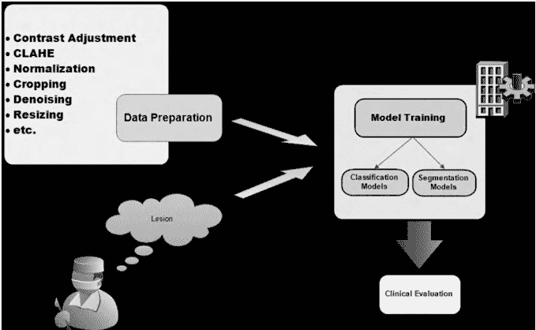

图 12.1 图像数据集分析。

### 12.2 糖尿病视网膜病变

当糖尿病视网膜病变（DR）最初表现时[23]，视网膜上可见微动脉瘤，这是由周细胞丢失和退化引起的，会扩张毛细血管壁[8]。当微动脉瘤或毛细血管壁破裂时，会发生视网膜内出血。硬性和软性渗出物、静脉珠状变、视网膜内微血管异常（IRMA）、减少或静脉环是非增殖性DR的进一步病变。根据Stitt等人[24]的说法，在缺血区域，IRMA表现为大口径迂曲动脉，可能是血管重塑的一种尝试。最后，新生血管形成的存在——基本上是由于缺血而从现有血管发展出的新视网膜血管——是区分增殖性和非增殖性DR的基础。糖尿病性黄斑水肿（DME）是失明最常见的原因，可发生在DR的任何阶段。水肿与以下异常相关：黄斑中心单个圆盘直径内的微动脉瘤或出血、位于黄斑中心圆盘直径内的渗出物、黄斑内的渗出物，以及黄斑中心圆盘直径内的视网膜厚度。

早期糖尿病视网膜病变研究，即ETDRS分级系统，被视为DR临床分级过程的基准；然而，其在日常临床实践中的实用性和易用性尚未得到证实。因此，为了增强患者筛查和护理人员沟通，已经提出了若干替代量表。迄今为止，由于多个国家创建了此类简化量表，尚不存在统一的全球DR严重程度量表。为此，全球糖尿病视网膜病变项目小组提出了国际临床糖尿病视网膜病变严重程度量表（ICRDSS），该量表将DR分为五个级别，如表12.1所示（图12.2）。

| 序号 | 疾病严重程度 | 散瞳眼底镜检查所见 |
|------|-------------|-------------------|
| 1 | 0 表示无糖尿病视网膜病变 | 无异常 |
| 2 | 1 表示轻度糖尿病视网膜病变 | 仅微动脉瘤 |
| 3 | 2 表示中度糖尿病视网膜病变 | 大于微动脉瘤，但不及NPDR（非增殖性糖尿病视网膜病变） |
| 4 | 3 表示重度糖尿病视网膜病变 | 没有增殖性视网膜病变症状的以下任一情况：
1. 四个象限中，每个象限超过20例视网膜内出血。
2. 两个或更多象限中出现明显的静脉珠状变。
3. 一个或多个象限中突出的视网膜内微血管异常（IRMA）。 |
| 5 | 4 表示增殖性糖尿病视网膜病变 | 以下任一或两项：
1. 新生血管形成
2. 视网膜前或玻璃体出血 |


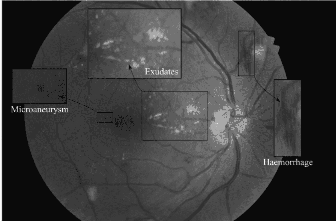

FIGURE 12.2 眼底图像上的糖尿病视网膜病变指示 [23]。

### 12.3 相关工作

有关自动检测DR的多项研究已在各类文献中发表。根据所采用的方法，自动DR检测大致可分为两类。第一类使用基于深度学习的DR检测依赖于自动化特征提取，而典型机器学习算法则需要使用图像处理中的外部特征提取方法（表 12.2）。

### 12.4 数据集描述

该数据集 [34] 包含 757 张眼底图像，源自巴拉圭眼科部门（表 12.3）。

### 12.5 深度学习分析

G.E. Hinton 最初于 2006 年提出 [35] 深度学习，作为机器学习过程的组成部分，专注于 DNN（深度神经网络）。这些网络受人类大脑启发，由多个神经元组成，形成了一个印象深刻且复杂的网络。深度学习网络可以对受监督和无监督两类进行训练。

TABLE 12.2 论文文献综述

| S. No. | 作者 | 技术 | 数据集 | 描述 |
| :--- | :--- | :--- | :--- | :--- |
| 1 | Varun Gulshan 等人 [25] | 使用深度学习识别可转诊糖尿病（DR）。 | Messidor-2 和 EyePACS-1 数据集 | 该算法检测可转诊糖尿病视网膜病变（RDR）的 ROC（受试者工作特征）曲线下面积，在 Messidor-2 上为 0.990（95% CI，0.986–0.995），在 EyePACS-1 上为 0.991（0.988–0.993，95% CI）。 |
| 2 | Kele Xu 等人 [26] | 五种不同的变换类型：旋转、翻转、剪切、重缩放和平移 | Kaggle 数据集的彩色眼底图像 | 以 94.5% 的准确率，他们考察了深度 CNN 方法在糖尿病视网膜病变中的应用。 |
| 3 | Sheikh Muhammad 等人 [27] | 具有两个全连接层和一个输出层的新型深度 CNN | Kaggle EyePACS 数据集 | 该设计产生了 0.844 AUC 和 0.851 QWK 分数。在初期阶段识别中，它表现出 98% 的灵敏度和 94% 的特异度。 |
| 4 | Carson Lam 等人 [28] | 展示了 CNN 在糖尿病视网膜病变识别中的应用。开发多项分类模型。 | Messidor-1 数据集和 Kaggle 数据集的彩色眼底图像 | 通过在 ImageNet 上对 AlexNet 和 GoogLeNet 模型进行迁移学习，二分类、三分类和四分类模型的峰值测试集准确率分别提高至 74.5%、68.8% 和 57.2%。 |
| 5 | Sara Hosseinzadeh Kassani 等人 [29] | 四种深度 CNN 提取器（ResNet50、原始 Xception 架构、InceptionV3 和 MobileNet）。 | Kaggle 数据集（APTOS 2019） | 改进的 Xception 深度 CNN 提高了 DR 分类，与原始 Xception 架构相比，分类准确率从 79.59% 提高到 83.09%，特异度从 86.32% 提高到 87.00%，灵敏度从 82.35% 提高到 88.24%。 |
| 6 | Anuj Jain 等人 [30] | 卷积神经网络（VGG19、Inception v3 和 VGG16） | 作为 Kaggle 比赛的一部分提供了 EyePACS 数据集。 | VGG19 的准确率为 76.9%，VGG16 为 71.7%，Inception v3 为 70.2%。 |
| 7 | BorysTymchenko 等人 [31] | 三种 CNN 架构的集成（SE-ResNeXt50、EfficientNet-B4 和 EfficientNet-B5） | APTOS 2019 数据集，Kaggle 数据集 | 提出的方法二次加权 Kappa 分数为 0.925466，在 2943 个竞争方法中排名第 54，灵敏度和特异度均为 0.99。 |
| 8 | Akhilesh Kumar Gangwar 等人 [32] | 使用 Inception-ResNet-v2 和自定义 CNN 构建的混合模型。 | Messidor-1 和 APTOS（2019）（Kaggle） | APTOS 数据集准确率为 82.18%，Messidor-1 数据集准确率为 72.33%。 |
| 9 | Pratt 等人 [33] | 除了利用 13 个 CNN 层外，还采用了数据增强方法。 | EyePACS DR 数据集 | 使用 80,000 张训练图像，在 5000 张图像上获得了 95% 的灵敏度。 |
| 10 | Lam 等人 [36] | 使用来自 ImageNet 数据集的模型进行迁移学习，包括 GoogleNet 和 AlexNet。 | Messidor-1 DR 数据集 | GoogleNet 达到的最高准确率为 66.03% |

| 序号 | 类别名称 | 图像数量 |
| :--- | :--- | :--- |
| 1 | 无糖尿病视网膜病变迹象 | 187 |
| 2 | 轻度非-PDR（NPDR） | 4 |
| 3 | 中度非增殖性糖尿病视网膜病变 | 80 |
| 4 | 重度非增殖性糖尿病视网膜病变 | 176 |
| 5 | 非常重度非增殖性糖尿病视网膜病变 | 108 |
| 6 | PDR（增殖性糖尿病视网膜病变） | 88 |
| 7 | 进展期增殖性糖尿病视网膜病变 | 114 |

深度学习领域涵盖多种网络类型，包括 RNN（循环神经网络）、CNN（卷积神经网络）、DBN（深度信念网络）、递归神经网络等众多类型。神经网络在向量表示、文本生成、句子分类与建模、词估计和特征分析等多种应用中发挥着关键作用。

#### 12.5.1 VGG-16

VGG-16 [36] 是一种专为图像分类任务精心设计的 CNN 架构，脱颖而出。VGG-16 源自牛津大学可视几何组，该术语专门指代具有 16 个权重层的神经网络，包含三个全连接层和 13 个卷积层。该架构因其在图像识别过程中的简洁性和卓越效果而广受认可。VGG-16 的设计原则包括使用步幅为 1 的 3×3 卷积滤波器、采用整流线性单元（ReLU）的激活函数，以及包含步幅为 2 的 2×2 最大池化层。VGG-16 以其简单而强大的结构闻名，是深度学习领域的基准模型，常用作分析其他复杂神经网络模型性能的标准（图 12.3、图 12.4 和表 12.4）。

#### 12.5.2 VGG-19

VGG-19 是一种 CNN 架构。它属于以图像分类任务的简洁性和有效性而著称的 VGG 家族。VGG-19 由 19 层组成，前 16 层为卷积层，随后是三个全连接层。卷积层分为五个块，每个块包含多个卷积层，后面跟着最大池化层。在整个网络中实现适度的 3×3 卷积滤波器，使设计更加复杂，同时保持相对简单。VGG-19 在众多基准数据集上表现优异，使其成为计算机视觉领域中研究和引用较多的模型（图 12.5、图 12.6 和表 12.5）。

混淆矩阵

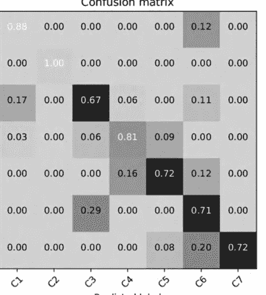

FIGURE 12.3 VGG-16 的混淆矩阵。

受试者工作特征曲线

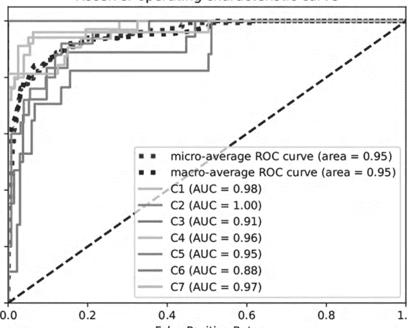

FIGURE 12.4 VGG-16 的受试者工作特征曲线。

TABLE 12.4 VGG-16 分类报告

| 类别 | 精确率 | 召回率 | F1 分数 | 支持数 |
| :--- | :--- | :--- | :--- | :--- |
| 0 | 0.88 | 0.88 | 0.88 | 34 |
| 1 | 1.00 | 1.00 | 1.00 | 1 |
| 2 | 0.63 | 0.67 | 0.65 | 18 |
| 3 | 0.84 | 0.81 | 0.83 | 32 |
| 4 | 0.78 | 0.72 | 0.75 | 25 |
| 5 | 0.46 | 0.71 | 0.56 | 17 |
| 6 | 1.00 | 0.72 | 0.84 | 25 |
| 微平均 | 0.77 | 0.77 | 0.77 | 152 |
| 宏平均 | 0.80 | 0.79 | 0.79 | 152 |
| 加权平均 | 0.80 | 0.77 | 0.78 | 152 |
| 样本平均 | 0.77 | 0.77 | 0.77 | 152 |

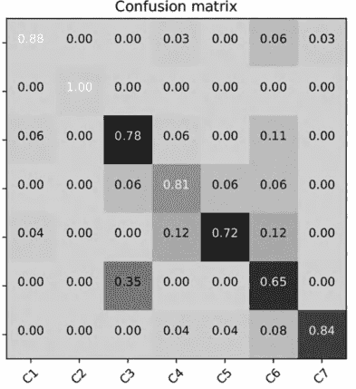

FIGURE 12.5 VGG-19 的混淆矩阵。

FIGURE 12.6 VGG-19 的受试者工作特征曲线。

TABLE 12.5 VGG-19 分类报告

| 类别 | 精确率 | 召回率 | F1 分数 | 支持数 |
| :--- | :--- | :--- | :--- | :--- |
| 0 | 0.94 | 0.88 | 0.91 | 34 |
| 1 | 1.00 | 1.00 | 1.00 | 1 |
| 2 | 0.64 | 0.78 | 0.70 | 18 |
| 3 | 0.81 | 0.81 | 0.81 | 32 |
| 4 | 0.86 | 0.72 | 0.78 | 25 |
| 5 | 0.50 | 0.65 | 0.56 | 17 |
| 6 | 0.95 | 0.84 | 0.89 | 25 |
| 微平均 | 0.80 | 0.80 | 0.80 | 152 |
| 宏平均 | 0.81 | 0.81 | 0.81 | 152 |
| 加权平均 | 0.82 | 0.80 | 0.80 | 152 |
| 样本平均 | 0.80 | 0.80 | 0.80 | 152 |

#### 12.5.3 ResNet-50

ResNet-50 是 ResNet [37] 架构的一个变体，是一种以 50 层为特征的 CNN。该模型包含 48 个 CNN 层，外加一个最大池化层和一个平均池化层。基于深度残差学习框架，ResNet-50 有效解决了极深 DNN 中遇到的梯度消失问题。ResNet-50 拥有略多于 2300 万个训练参数，与其他架构相比，尽管深度显著，但参数数量大幅减少。ResNet-50 的卓越性能仍在持续讨论中，但通过探索可以获得基本理解。


残差块的概念及其运行机制（图 12.7、12.8 和表 12.6）。

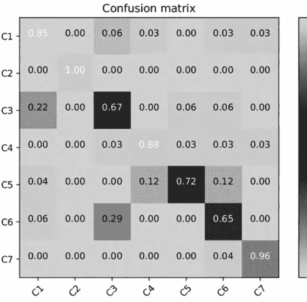

图 12.7 ResNet-50 的混淆矩阵。

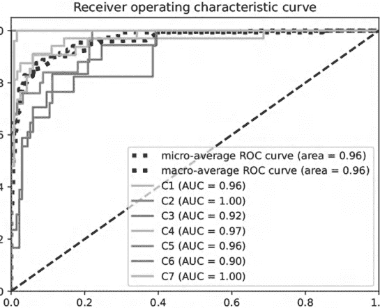

图 12.8 ResNet-50 的受试者工作特征曲线。

| 类别 | 精确率 | 召回率 | F1 分数 | 支持度 |
|---|---|---|---|---|
| 0 | 0.83 | 0.85 | 0.84 | 34 |
| 1 | 1.00 | 1.00 | 1.00 | 1 |
| 2 | 0.60 | 0.67 | 0.63 | 18 |
| 3 | 0.88 | 0.88 | 0.88 | 32 |
| 4 | 0.90 | 0.72 | 0.80 | 25 |
| 5 | 0.61 | 0.65 | 0.63 | 17 |
| 6 | 0.92 | 0.96 | 0.94 | 25 |
| Micro-average | 0.81 | 0.81 | 0.81 | 152 |
| Macro-average | 0.82 | 0.82 | 0.82 | 152 |
| Weight-average | 0.82 | 0.81 | 0.81 | 152 |
| Samples-average | 0.81 | 0.81 | 0.81 | 152 |

#### 12.5.4 DenseNet

在 DenseNet 中，每一层都会从前面的层接收额外输入，并将其特征映射发送到后续层级。

一种名为 DenseNet 的 CNN 架构被创建出来，旨在提高特征复用并解决梯度消失问题。

DenseNet 在层与层之间具有密集连接，因为每一层都会将其特征映射发送到后面的每一层，并从前面的每一层接收特征映射。

这种密集连接的结构促进了整个网络中的特征复用，有助于训练期间的梯度传播，并改善了信息流。

DenseNet 由密集块组成，每个密集块包含几个彼此直接连接的层。

这使得参数使用更加高效，模型性能更好。

它们广泛应用于分割、目标识别和图像分类等计算机视觉应用中（图 12.9、12.10 和表 12.7）。

#### 12.5.5 混合模型

为了更好的深度学习，一种将 ResNet-50 的残差连接与 VGG-16 的堆叠卷积层相结合的混合模型将融合丰富的特征提取。

融合过程中可能会使用注意力机制或特征映射拼接。

该模型将针对特定任务进一步优化和专业化，并带有自定义输出层。

混合模型旨在利用两种架构的互补能力，从而可能提高一系列计算机视觉应用的性能。

实验和微调对于最大化这种组合的性能至关重要（图 12.11、12.12 和表 12.8）。

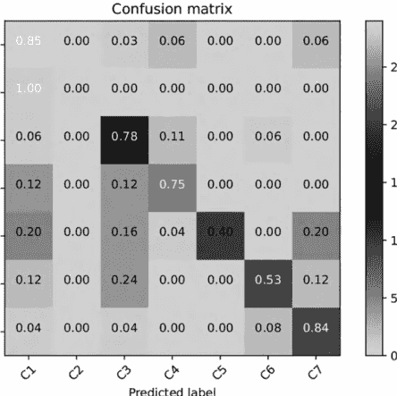

图 12.9 DenseNet 的混淆矩阵。

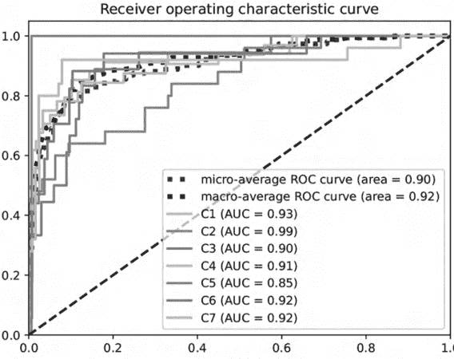

图 12.10 DenseNet 的受试者工作特征曲线。

| 类别 | 精确率 | 召回率 | F1 分数 | 支持度 |
|---|---|---|---|---|
| 0 | 0.67 | 0.85 | 0.75 | 34 |
| 1 | 0.00 | 0.00 | 0.00 | 1 |
| 2 | 0.50 | 0.78 | 0.61 | 18 |
| 3 | 0.83 | 0.75 | 0.79 | 32 |
| 4 | 1.00 | 0.40 | 0.57 | 25 |
| 5 | 0.75 | 0.53 | 0.62 | 17 |
| 6 | 0.70 | 0.84 | 0.76 | 25 |
| Micro-average | 0.70 | 0.70 | 0.70 | 152 |
| Macro-average | 0.64 | 0.59 | 0.59 | 152 |
| Weight-average | 0.75 | 0.70 | 0.70 | 152 |
| Samples-average | 0.70 | 0.70 | 0.70 | 152 |

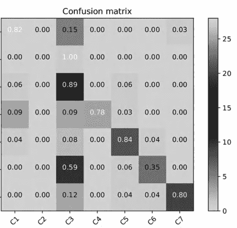

图 12.11 混合模型的混淆矩阵。

### 12.6 不同 DNN 模型之间的比较

表 12.9 展示了各种 DNN 模型的性能。VGG-16 模型达到了最高精度（95.21%）。第二高的是 VGG-19。混合模型（ResNet-50 和 VGG-16）的表现优于 ResNet-50，但不如 VGG-16。

图 12.12 混合模型的受试者工作特征曲线。

表 12.8 混合模型分类报告

| 类别 | 精确率 | 召回率 | F1 分数 | 支持度 |
|---|---|---|---|---|
| 0 | 0.85 | 0.82 | 0.84 | 34 |
| 1 | 0.00 | 0.00 | 0.00 | 1 |
| 2 | 0.40 | 0.89 | 0.55 | 18 |
| 3 | 1.00 | 0.78 | 0.88 | 32 |
| 4 | 0.84 | 0.84 | 0.84 | 25 |
| 5 | 0.75 | 0.35 | 0.48 | 17 |
| 6 | 0.95 | 0.80 | 0.87 | 25 |
| Micro-average | 0.76 | 0.76 | 0.76 | 152 |
| Macro-average | 0.68 | 0.64 | 0.64 | 152 |
| Weight-average | 0.83 | 0.76 | 0.77 | 152 |
| Samples-average | 0.76 | 0.76 | 0.76 | 152 |

表 12.9 不同 CNN 模型的比较分析

| 序号 | 模型名称 | Epoch 数量 | 训练和测试数据集比例 | 准确率 (%) |
|---|---|---|---|---|
| 1 | VGG-16 | 10 | 80:20 | 95.21 |
| 2 | VGG-19 | 10 | 80:20 | 94.21 |
| 3 | ResNet-50 | 10 | 80:20 | 93.22 |
| 4 | DenseNet121 | 10 | 80:20 | 75.86 |
| 5 | Hybrid model | 10 | 80:20 | 93.55 |

### 12.7 结论

众所周知，糖尿病患者的主要担忧是 DR，手动检测 DR 是劳动密集型的。

因此，我们创建了一种用于自动检测 DR 的架构。

为了确定在什么情况下哪种架构是最优的，我们比较了几种不同的结构。

VGG-16、VGG-19、ResNet-50、DenseNet121 和混合模型架构的准确率分别为 95.21%、94.21%、93.22%、75.86% 和 93.55%。

未来，我们宁愿使用生成对抗网络（GANs）来对数据进行过采样，而不仅仅是使用增强。

为了平衡信息及其分布，如果我们故意创建更多的视网膜病变图像，将非常有益。

为了提高性能，我们还希望探索组装各种迁移学习模型。

### 参考文献

- 1. Pirić, M., Šojat, D., Mišković, V., Šapina, M., Popović, Z., & Bačun, T. (2020). 2 型糖尿病男性和女性的血糖、肾功能和体重。*Medicinski Glasnik (Zenica)*, 17(2), 523–529.
- 2. Jenkins, A. J., Joglekar, M. V., Hardikar, A. A., Keech, A. C., O'Neal, D. N., & Januszewski, A. S. (2015). 糖尿病视网膜病变中的生物标志物。*The Review of Diabetic Studies: RDS*, 12(1–2), 159.
- 3. Janghorbani, M., Jones, R. B., & Allison, S. P. (2000). 糖尿病门诊就诊者中增殖性视网膜病变的发病率及风险因素及其与失明的关联。*Ophthalmic Epidemiology*, 7(4), 225–241.
- 4. Yau, J. W., Rogers, S. L., Kawasaki, R., Lamoureux, E. L., Kowalski, J. W., Bek, T., ... & Meta-Analysis for Eye Disease (META-EYE) Study Group. (2012). 糖尿病视网膜病变的全球患病率及主要风险因素。*Diabetes Care*, 35(3), 556–564.
- 5. Shaw, J. E., Sicree, R. A., & Zimmet, P. Z. (2010). 2010 年和 2030 年糖尿病患病率的全球估计。*Diabetes Research and Clinical Practice*, 87(1), 4–14.
- 6. Yang, W., Lu, J., Weng, J., Jia, W., Ji, L., Xiao, J., ... & He, J. (2010). 中国男性和女性中糖尿病的患病率。*New England Journal of Medicine*, 362(12), 1090–1101.
- 7. Safi, H., Safi, S., Hafezi-Moghadam, A., & Ahmadiieh, H. (2018). 糖尿病视网膜病变的早期检测。*Survey of Ophthalmology*, 63(5), 601–608.
- 8. Network, S. I. G. (2010). *肥胖症管理：国家临床指南*. Scottish Intercollegiate Guidelines Network: Edinburgh, 20.
- 9. Bresnick, G. H., Mukamel, D. B., Dickinson, J. C., & Cole, D. R. (2000). 一种针对糖尿病患者进行视力威胁性视网膜病变筛查的监测方法。*Ophthalmology*, 107(1), 19–24.
- 10. Hill, L., & Makaroff, L. E. (2016). 早期检测和及时治疗可以预防或延缓糖尿病视网膜病变。*Diabetes Research and Clinical Practice*, 120, 241–243.
- 11. Nguyen, T. T., Wang, J. J., Sharrett, A. R., Islam, F. A., Klein, R., Klein, B. E., ... & Wong, T. Y. (2008). 视网膜血管粗细与糖尿病及视网膜病变的关系：多民族动脉粥样硬化研究（MESA）。*Diabetes Care*, 31(3), 544–549.
- 12. Lechner, J., O'Leary, O. E., & Stitt, A. W. (2017). 与糖尿病视网膜病变相关的病理学。*Vision Research*, 139, 7–14.
- 13. Kwan, C. C., & Fawzi, A. A. (2019). 糖尿病性黄斑水肿和糖尿病视网膜病变中的成像与生物标志物。*Current Diabetes Reports*, 19(10), 95.
- 14. Raman, R., Ganesan, S., Pal, S. S., Kulothungan, V., & Sharma, T. (2014). 农村印度糖尿病视网膜病变的患病率及风险因素。SankaraNethralaya 糖尿病视网膜病变流行病学和分子遗传学研究 III（SN–DREAMS III），报告第 2 号。*BMJ Open Diabetes Research and Care*, 2(1), e000005.
- 15. Resnikoff, S., Felch, W., Gauthier, T. M., & Spivey, B. (2012). 全球执业和培训中的眼科医生数量：尽管拥有超过 20 万名从业者，但差距仍在扩大。*British Journal of Ophthalmology*, 96(6), 783–787.
- 16. Burgess, P. I., MacCormick, I. J. C., Harding, S. P., Bastawrous, A., Beare, N. A. V., & Garner, P. (2013). 非洲糖尿病视网膜病变和黄斑病变的流行病学：系统性综述。*Diabetic Medicine*, 30(4), 399–412.
- 17. Sivaprasad, S., Gupta, B., Crosby-Nwaobi, R., & Evans, J. (2012). 各种族群中糖尿病视网膜病变的患病率：全球视角。*Survey of Ophthalmology*, 57(4), 347–370.
- 18. Grzybowski, A., Brona, P., Lim, G., Ruamviboonsuk, P., Tan, G. S., Abramoff, M., & Ting, D. S. (2020). 用于糖尿病视网膜病变筛查的人工智能：综述。*Eye*, 34(3), 451–460.
- 19. Badar, M., Haris, M., & Fatima, A. (2020). 视网膜图像分析中深度学习的应用：综述。*Computer Science Review*, 35, 100203.
- 20. Asiri, N., Hussain, M., Al Adel, F., & Alzaidi, N. (2019). 基于深度学习的糖尿病视网膜病变计算机辅助诊断系统：调查。*Artificial Intelligence in Medicine*, 99, 101701.
- 21. Islam, M. M., Yang, H. C., Poly, T. N., Jian, W. S., & Li, Y. C. J. (2020). 视网膜底片照片中糖尿病视网膜病变检测的深度学习算法：系统性综述和元分析。*Computer Methods and Programs in Biomedicine*, 191, 105320.
- 22. Nielsen, K. B., Lautrup, M. L., Andersen, J. K., Savarimuthu, T. R., & Grauslund, J. (2019). 糖尿病视网膜病变筛查中的基于深度学习的算法：诊断性能的系统性综述。*Ophthalmology Retina*, 3(4), 294–304.


- 23. Tsiknakis, N., Theodoropoulos, D., Manikis, G., Ktistakis, E., Boutsora, O., Berto, A., ... & Marias, K. (2021). 基于眼底图像的糖尿病视网膜病变检测与分类深度学习：综述. 计算机生物学与医学, 135, 104599.

- 24. Stitt, A. W., O’Neill, C. L., O’Doherty, M. T., Archer, D. B., Gardiner, T. A., & Medina, R. J. (2011). 血管干细胞与缺血性视网膜病变. 视网膜与眼研究进展, 30(3), 149–166.

- 25. Gulshan, V., Peng, L., Coram, M., Stumpe, M. C., Wu, D., Narayanaswamy, A., ... & Webster, D. R. (2016). 用于视网膜眼底照片中糖尿病视网膜病变检测的深度学习算法的开发与验证. JAMA, 316(22), 2402–2410.

- 26. Xu, K., Feng, D., & Mi, H. (2017). 基于眼底图像的深度卷积神经网络糖尿病视网膜病变早期自动检测. 分子, 22(12), 2054.

- 27. Islam, S. M. S., Hasan, M. M., & Abdullah, S. (2018). 基于视网膜眼底图像的深度学习糖尿病视网膜病变早期检测与分级. arXiv 预印本 arXiv:1812.10595.

- 28. Lam, C., Yi, D., Guo, M., & Lindsey, T. (2018). 基于深度学习的糖尿病视网膜病变自动检测. AMIA 转化科学峰会论文集, 2018, 美国, 147.

- 29. Kassani, S. H., Kassani, P. H., Khazaeinezhad, R., Wesolowski, M. J., Schneider, K. A., & Deters, R. (2019年12月). 使用修改版 Xception 架构的糖尿病视网膜病变分类. 在 2019 IEEE 信号处理与信息技术国际研讨会 (ISSPIT), 阿拉伯联合酋长国 (第 1–6 页). IEEE.

- 30. Jain, A., Jalui, A., Jasani, J., Lahoti, Y., & Karani, R. (2019年4月). 糖尿病视网膜病变检测与严重程度分类的深度学习. 在 2019 第一届信息与通信技术创新国际会议 (ICIICT), 印度钦奈 (第 1–6 页). IEEE.

- 31. Tymchenko, B., Marchenko, P., & Spodarets, D. (2020). 糖尿病视网膜病变检测的深度学习方法. arXiv 预印本 arXiv:2003.02261.

- 32. Gangwar, A. K., & Ravi, V. (2021). 使用迁移学习和深度学习的糖尿病视网膜病变检测. 在 计算智能演进：智能计算前沿：理论与应用 (FICTA 2020), 印度 NIT 苏拉特卡尔 (第 1 卷, 第 679–689 页). Springer 新加坡.

- 33. Pratt, H., Coenen, F., Broadbent, D. M., Harding, S. P., & Zheng, Y. (2016). 用于糖尿病视网膜病变的卷积神经网络. 程序计算机科学, 90, 200–205.

- 34. Benítez, V. E. C., Matto, I. C., Román, J. C. M., Noguera, J. L. V., García-Torres, M., Ayala, J., ... & Grillo, S. A. (2021). 用于糖尿病视网膜病变研究的眼底图像数据集. 数据简报, 36, 107068.

- 35. Ain, Q. T., Ali, M., Riaz, A., Noreen, A., Kamran, M., Hayat, B., & Rehman, A. (2017). 基于深度学习技术的情感分析：综述. 国际高级计算机科学与应用期刊, 8(6), 41.

- 36. Mascarenhas, S., & Agarwal, M. (2021年11月). 图像分类中 VGG16、VGG19 和 ResNet50 架构框架的比较. 在 2021 多学科研究与应用颠覆性技术国际会议 (CENTCON), 印度班加罗尔 (第 1 卷, 第 96–99 页). IEEE.

- 37. Mandal, B., Okeukwu, A., & Theis, Y. (2021). 使用 ResNet-50 的蒙面人脸识别. arXiv 预印本 arXiv:2104.08997.


## Taylor & Francis

Taylor & Francis 集团

http://taylorandfrancis.com

## INDEX

- 准确率 33
- 激活函数 31
- 可调整边权重 39
- 自适应提升 94
- 自适应阈值 58
- 依从性监测 159
- APTOS 数据集 72
- 曲线下面积 (AUC) 101
- 人工智能 40

- 批量大小 32
- 行为风险因素监测系统 28

- 偏差缓解 23
- 二分类 32
- 血糖水平预测 39
- 血管分割 9
- 身体质量指数 (BMI) 92

- 心血管疾病 4
- 疾病控制与预防中心 28
- 脉络膜新生血管化 82
- 分类准确率 99
- 临床决策支持系统 19
- 临床评估 27
- 闭环胰岛素输送系统 19
- 并发症管理 89
- 条件自回归值 59
- 条件自回归风险值 59
- 混淆矩阵 33
- 连续血糖监测仪 13
- 卷积神经网络 7
- 代价函数 31

- Darknet 82
- 数据聚合 40

- 数据标注 23
- 数据平衡 30
- 数据清洗 145
- 数据保密性 40
- 数据插补 125
- 去中心化学习 40
- 决策支持系统 93
- 决策树 94
- 深度置信网络 157
- 深度学习 6
- DenseNet 176
- 糖尿病护理 15
- 糖尿病足溃疡 155
- 糖尿病性黄斑水肿 82
- 糖尿病肾病 4
- 糖尿病神经病变 4
- 糖尿病患者肾病 80
- 糖尿病患者神经病变 80
- 糖尿病视网膜病变 4
- 离散余弦变换 (DCT) 57
- 领域特定信息 35
- 药物发现与开发 19
- 动态图(s) 39
- 动态图节点 42

- 边缘设备 40
- 心电图 (ECG) 111
- 电子健康记录 10
- 集成学习 96
- 伦理考量 23
- 评估指标 32
- 可解释人工智能 17
- 极端提升 (XB) 95

- F1-分数 33
- 假阴性 99
- 假阳性 99

- 空腹血糖测试 5
- 特征选择 29
- 联邦学习 21
- 健身追踪器和智能手表 13
- GAM (神经网络模型) 42
- 门控循环单元 42
- 泛化 35
- 生成对抗网络 70
- 妊娠糖尿病 2
- 妊娠糖尿病 (GDM) 153
- 糖化血红蛋白 (HbA1c) 测试 6
- 梯度下降 31
- 图注意力网络 39
- 图卷积 42
- 图嵌入 42
- 图神经网络 39

- 医疗保健 3
- 医疗物联网 (HIoT) 58
- 出血和渗出识别 9
- 人在回路方法 17
- 高血糖 38
- 超参数调优 32
- 低血糖 38

- 图像分割 60
- 国际临床糖尿病视网膜病变严重程度分级 (ICRDSS) 167
- 国际糖尿病联合会 3
- 视网膜内微血管异常 (IRMA) 166
- IoT 56
- 不规则多变量时间序列 42

- Karhunen-Loeve 变换 (KLT) 57
- Keras 27
- k 近邻 57

- 光梯度提升机 94
- 线性回归 94
- 长短期记忆 (LSTM) 网络 11
- 损失函数 31

- 机器学习算法 81
- 大血管并发症 92

- 平均绝对相对差 45
- 记忆 35
- Messidor 72
- 微血管瘤检测 9
- 微控制器单元 40
- 微血管并发症 92
- 模型可解释性 89
- 模型优化 68
- 模型训练 31
- 模型权重 31
- 单基因糖尿病 3
- 多学科的 79
- 多层感知机 113
- 多模态深度学习 18
- 多任务学习 40
- 多变量时间序列 39

- 朴素贝叶斯 57
- 神经基扩展分析 39
- 神经网络 7
- 非增殖性糖尿病视网膜病变 71

- OhioT1DM 数据集 41
- 一维 CNN (1D-CNN) 111
- 眼底镜检 167
- 优化器 31
- 口服葡萄糖耐量试验 5
- 过拟合 31

- 受试者招募 40
- 患者教育与赋权 159
- 患者赋权 23
- 外周动脉疾病 4
- 个性化风险评估 12
- 个性化治疗建议 160

- PIMA 印第安糖尿病数据集 93
- 人群模型 40
- 精确率 33
- 预测 8
- 预测性血糖控制 19
- 隐私保护技术 23
- 增殖性糖尿病视网膜病变 71

- 随机森林 94
- 召回率 33
- 受试者工作特性 (ROC) 101
- 整流线性单元 (ReLU) 32


- 循环神经网络 7
- 远程监测 156
- 残差注意感知分割方法 (RA-UNet) 60
- ResNet-50 173
- 受限玻尔兹曼机 115
- 眼底 8
- 风险评估 33
- 鲁棒性 35
- 均方根误差 (RMSE) 45
- 序列架构 32
- 序列最小优化 57
- 牧羊鱼子酱优化 60
- 混合牧羊优化算法 58
- Sigmoid激活函数 70
- SMARTDIAB平台 81
- SoftMax激活函数 70
- 稀疏自编码器 (SAE) 112
- 支持向量机 94
- 合成数据生成 16
- 合成少数类过采样技术 (SMOTE) 111
- 远程医疗 159
- 时序注意力GRU模型 40
- 时序依赖 39
- TensorFlow 27
- 时间序列分析 39
- 迁移学习 68
- 真阴性 99
- 真阳性 99
- 双增长深度神经网络 (2GDNN) 95
- 1型糖尿病 2
- 2型糖尿病 2
- 验证 73
- 变分自编码器 (VAE) 111
- VGG-16 171
- VGG-19 171
- 虚拟糖尿病管理助手 19
- 可视化工具 17
- 可穿戴设备 40
- 世界卫生组织 92
- YOLOv4 82

