# 基因组映射深度学习实战


# 前言

深度学习的快速发展为基因组映射、计算和医疗数据分析开辟了变革性的途径。本书《基因组映射中的深度学习：计算与分析》旨在提供全面而易懂的探讨，阐述人工智能和优化技术如何正在革新基因组科学和医疗应用。

本卷中的章节经过精心策划，涵盖了基础和先进的视角。从基因组映射的计算策略和优化算法开始，读者将了解深度学习在应对大规模生物数据复杂性方面的作用。多目标进化算法和深度学习驱动的医疗数据工程等主题说明了多种方法如何汇聚，以提高基因组研究中的准确性和知识发现。

本文还将方法论洞察与现实应用相结合。整合神经网络、图像处理和边缘检测的技术与智能医疗和医学影像应用一起介绍。包括噪声降低策略、胸部 X 光片中基于 AI 的心脏轮廓勾勒以及医学科学创新在内的章节，凸显了本书的跨学科范围——将基因组学、影像学和机器学习联系起来，产生实际影响。

虽然重点仍然是基因组映射，但医疗和医疗数据分析的更广泛背景被有意纳入。这确保本书面向广泛的读者群体，包括计算机科学家、生物医学工程师、医疗研究人员以及渴望了解人工智能与生命科学交叉领域的学生。

本卷的贡献者都是专家，他们能够使复杂话题清晰明了，平衡理论基础与实际实现。我们希望本书不仅能加深读者对基因组映射中深度学习的理解，还能激发该快速发展领域的进一步研究和创新。

我们向那些使本书成为宝贵资源的研究人员、从业者和学者表示感谢。愿本书既能作为指南，也能作为推动基因组学和医疗领域智能解决方案发展的刺激剂。

# 第 1 章 基于深度学习优化算法的基因组映射计算与分析

Shailendra Pratap Singh

Madan Mohan Malaviya University of Technology Gorakhpur-273010 (U.P.) India. 计算机科学与工程系。

Email: shail2007singh@gmail.com

DOI: [10.1201/9781003516729-1](https://dx.doi.org/10.1201/9781003516729-1)

基因组映射已成为现代遗传学研究中的一个重要问题，为科学研究、进化生物学和个性化医疗的进步做出了贡献。基因组映射的计算与分析用于高效处理大规模和复杂的基因组数据。本章提出了一种针对基因组映射定制的修改型深度学习优化算法，提供更高的计算效率和映射精度。该方法将先进的深度神经网络与进化优化策略相结合，在显著降低计算时间的同时，在识别基因序列方面保持高精度。所提算法的整体性能使用真实世界基因组数据集进行评估，证明了其在加速基因组分析和提高精度方面的能力。

## 1 引言

基因组映射对于了解和定位现代基因至关重要，使研究人员能够确定生物体基因组中基因和其他重要标记的具体位置。这一过程对于多种模式至关重要，包括确定与疾病相关的基因、分析进化模式以及制定基因治疗方案。限制性片段长度多态性 (Smith and Green 1980) 和原位荧光杂交 (Briggs and Brown 1995) 等基因组映射方法为理解基因组结构奠定了基础。然而，这些方法受到其低分辨率和可扩展性的限制，使其不适合大规模基因组项目。随着现代计算工具的出现，包括 *BLAST*（基本局部比对搜索工具） (Altschul et al. 1990) 在内的算法通过为序列比对提供快速且可扩展的技术，彻底改变了基因组序列分析。尽管 BLAST 广受欢迎，但 BLAST 及类似的基于启发式的工具在处理由高通量测序技术生成的当今大规模基因组数据集时面临挑战。


今天，深度学习（DL）已成为解决复杂有机问题（包括基因组映射）的有效工具。DL 技术新，特别是，已显示出在管理大规模信息和识别传统策略无法处理的问题模式方面的前景。`Convolutional Neural Networks`（CNNs）和 `Recurrent Neural Networks`（RNNs）已被广泛用于生物集合分析（Zhou 和 Troyanskaya 2015b）。深度学习已被证明有效，但其最新版本需要大量计算资源和大量分类数据集才能发挥最佳性能。多项研究已将 ML 策略与优化算法相结合，以提高基因组映射性能。人类基因组（Poplin 等人 2018），大大减少了评估所需的时间。此外（Schrider 和 Kern 2018）展示了如何将尖端模型应用于基因组记录的人口统计推断。将深度学习整合到基因组映射中仍然是一个现代研究领域，存在计算时间和资源性能方面的挑战。近年来，最新技术已成为管理复杂和大规模数据集的有效设备。将深度学习架构与优化算法相结合，可以显著提高现代基因组映射的计算性能。本章介绍了一种基于深度学习的优化算法，旨在提高基因组映射程序的速度和准确性。所提算法结合了现代深度神经网络在模式识别方面的优势和最新优化策略的效率，为基因组映射提供了更有效的解决方案。

本章其余部分的组织如下。第 2 节 对相关工作进行了综述。第 3 节 提出了拟议框架。第 4 节 详细讨论了拟议算法，而 第 5 节 介绍了实验设置和结果。最后，第 6 节 总结了本章并指出了未来的研究方向。

在以下部分中，我们将讨论基础方法，介绍实验结果，并评估所提算法与现有策略的性能。

## 2 文献综述

本节概述了关于基因组映射及相关优化方法的大量文献。深度学习与优化算法的结合最近引起了广泛关注，用于基因组映射任务。当前工作集中于将深度学习与优化技术相结合，用于生物数据分析。各项研究已探讨将优化策略与深度学习模型相结合，以提高现实世界应用中的性能。我们概述了基于优化的模型的最新进展，重点介绍了它们在生物信息学、医学系统和基因组分析中的应用。[Li 等人（2021](#ch1.xhtml#ref1_17）] 提供了基于学习的智能优化算法的全面综述，强调了元启发式算法与机器学习技术之间的协同作用。他们的工作强调了自适应学习机制在处理高维和复杂数据集中的重要性。在生物信息学方面，[Karim 等人（2021](#ch1.xhtml#ref1_14）] 提出了基于深度学习的聚类技术，展示了其在基因表达数据分析中的有效性。[Kang 等人（2022](#ch1.xhtml#ref1_13）] 开发了一种混合教学-学习优化算法，以提高特征选择，展示了优化在生物信息学任务中的相关性。基因组规模的代谢网络模型也受益于智能优化过程。[Bai 等人（2023](#ch1.xhtml#ref1_4）] 探讨了基于机器学习的代谢网络优化的进展，强调了其在增强计算生物学和生物制造应用中的作用。在精准医学方面，[Singh 等人（2024](#ch1.xhtml#ref1_29）] 引入了一种专为基因组应用设计的智能基于突变的进化算法，展示了在基因选择方面的卓越性能。Zhou 和 Troyanskaya（2015）进一步说明了深度学习模型在预测非编码遗传变异结果方面的能力。

优化算法在医疗应用方面也取得了重大进展。[Pradhan 等人（2023](#ch1.xhtml#ref1_26）] 开发了一种自适应海狮优化（SA-SLnO）算法，用于利用深度学习策略检测肺癌。[Joshi 和 Aziz（2024](#ch1.xhtml#ref1_12）] 提出了一种包含基因表达数据的元启发式优化框架，用于脑肿瘤分型，展示了混合优化策略的潜力。强化学习已成为指导优化算法的有效工具。[Hu 和 Yu（2023](#ch1.xhtml#ref1_10）] 通过开发一种基于强化学习的灰狼优化器，用于特征选择任务，展示了这一点，增强了勘探和开发能力。[Wang 等人（2023）](#ch1.xhtml#ref1_31）应用基于强化学习的粒子群优化来解决复杂的多目标问题，强调了其在医学机器学习中的潜力。遗传算法（GA）已被成功用于深度学习模型的超参数优化。[Emam 等人（2024](#ch1.xhtml#ref1_7）] 开发了一种用于癌症分析的混合优化框架，使用遗传算子优化肿瘤识别。群体智能的进步为特征选择和优化带来了新方法。[Mandle 等人（2024](#ch1.xhtml#ref1_19）] 提出了鲸鱼社会蜘蛛优化算法（WSSOA）用于脑肿瘤分型。[Gülmez（2023](#ch1.xhtml#ref1_9）] 将灰狼优化（GWO）与深度学习相结合，用于棉花病害检测，展示了此类混合模型在农业中的应用。深度学习模型已在生物信息学中被广泛采用，以增强聚类和分类任务。[Karim 等人（2021](#ch1.xhtml#ref1_14）] 提出了基于深度学习的生物信息学聚类方法，强调了其在医疗保健中的重要性。[Bai 等人（2023](#ch1.xhtml#ref1_4）] 回顾了应用于基因组规模代谢网络的机器学习和优化方法，推进了精准医学研究。


基于图的深度学习模型在读取复杂的生物数据方面已发挥关键作用。Pati et al. (2023) 应用图神经网络（`GNNs`）利用微阵列数据进行基因选择。Liu et al. (2023) 引入进化计算以增强 `GNNs` 中的图结构学习，并在多项任务中展现出卓越性能。此外，Mao et al. (2023) 应用 `GNNs` 从单细胞 RNA-seq 数据中预测基因调控网络，揭示了生物学洞察。结合进化和机器学习策略的混合算法在特征选择和分类任务中显示出前景。Kang et al. (2022) 引入了一种两级训练-学习优化算法用于生物信息学。Joshi et al. (2024) 使用包含元启发式优化的深度学习模型对脑肿瘤进行分类，利用基因表达数据实现了高准确率。Feng et al. (2024) 将 `GNNs` 与遗传算法相结合以优化热布局，说明了其在不同领域的多功能性。当前研究已探索使用强化学习来增强优化算法。深度学习和优化算法在医学应用方面也取得了重大进展。Alharbi and Vakanski (2023) 回顾了用于癌症分型的机器学习模型，重点关注基因表达数据。Zhu et al. (2023) 在多组学数据上应用了几何 `GNNs` 用于癌症预后，提高了预测准确率。Pradhan et al. (2023) 结合深度学习与海狮优化算法进行肺癌检测，展示了混合方法在医疗保健中的潜力。最新研究已将先进模型应用于基因组学，强调 RNA 结构预测和基因表达分析。Mao et al. (2023) 使用基于图的深度学习模型解决了肽测序中的挑战。Li et al. (2024) 应用 `GNNs` 进行 mRNA 亚细胞定位预测，增强了我们对 RNA 动态的理解。基于元启发式的优化技术在解决实际问题方面越来越受欢迎。Singh et al. (2024) 提出了一种用于基因组学的基于智能突变的进化优化算法。Mandle et al. (2024) 引入了鲸鱼社会蜘蛛优化算法用于脑肿瘤分型，展示了新型优化方法在医疗保健中的实用性。此外，Neto (2024) 提出了一种基于深度学习的方法，利用特征选择和数据转换技术来增强表格数据集上的预测。

文献强调了智能优化算法、`GNNs` 和混合深度学习模型在生物信息学、医疗保健和工程应用中日益增长的影响。本章在此基础上，提出了一种专门为基因组映射设计的独特基于深度学习的优化算法。通过将深度神经网络与进化优化技术相结合，所提方法旨在降低计算复杂性，同时保持高映射精度。

## 3 提出的框架

在本节中，我们定义了使用基于深度学习的优化算法 (Joshi et al. 2024) 进行基因组映射的提议框架。该框架结合所提方法旨在降低计算开销，同时保持基因组映射的高精度。深度学习模型在识别基因组数据中的模式和结构方面起着关键作用。在框架中，我们使用 `CNN` (Zhu et al. 2023)，因为它擅长捕捉数据中的空间层次结构。深度学习 (Lee et al. 2021) 包括以下层：

1. 将预处理后的基因组数据作为输入。

2. 通过多个滤波器从输入序列中提取特征。

3. 减少特征图的维度，提高计算效率。

4. 聚合学习到的特征并生成基因组的最终表示。

5. 生成一组预测的基因映射或相关基因组标记。

`CNN` 在标记的基因组数据集上进行训练，学习识别基因组中的关键模式和结构变异。训练过程使用反向传播和梯度下降算法来减少预测误差。

### 3.1 优化算法

为了进一步提高基因组映射的性能，我们结合一个优化算法 (Singh et al. 2024) 来微调模型参数并提高映射精度。特别是，我们结合了差分进化（`DE`）算法的一种变体，该算法以其在解决复杂优化问题中的鲁棒性而闻名。优化过程遵循以下步骤：**种群初始化：** 初始化一组候选解（模型参数）。**变异：** 通过变异结合现有解来生成新的候选解。**交叉：** 将生成的解与当前种群结合以探索搜索空间。**选择：** 根据适应度选择最佳候选解，在此情况下适应度是基因组映射精度。`DE` 算法被迭代应用，通过优化深度学习模型的权重来提高映射精度。这种结合深度学习与进化优化的混合方法使我们能够有效地在庞大的基因组数据中搜索最佳映射。

### 3.2 框架工作流

所提框架的工作流程可以概括为以下步骤：

1. **步骤 1：** 收集原始基因组数据并进行预处理，以去除噪声并提取关键特征。

2. **步骤 2：** 将预处理后的数据输入深度学习模型，学习关键的基因组模式。

3. **步骤 3：** 应用 `DE` 来微调模型参数，提高基因组映射的准确性。

4. **步骤 4：** 优化后的模型生成最终基因组图，突出基因位置和关键遗传标记。

## 4 提出的方法论：深度学习中的图神经网络

图神经网络（`GNNs`）是一类专门设计用于处理可以表示为图的数据的深度学习算法。在基因组映射中，`GNNs` (Pati et al. 2023) 可以用于捕捉基因组元素（如基因、突变和调控区域）之间的关系，这些元素通常表现出类似图的结构。`GNNs` 通过聚合图中相邻节点的信息来学习节点和图级表示。设 `G` = (`V`, `E`) 为一个图，其中 `V` 是节点集合（代表基因或基因组区域），`E` 是边集合（代表节点之间的关系或相互作用）（Mao et al. 2023）。

### 4.1 `GNNs` 的数学公式

在 `GNN` 的每一层中，节点 `v` ∈ `V` 的表示通过聚合其邻居 `N`(`v`) 的信息来更新。层 `l` + 1 中节点表示的更新规则如下：

(1)  

`h[v]^((l + 1)) = σ(W^((l)) ⋅ AGG({h[u]^((l)) | u ∈ N(v) ∪ {v}}))`  

其中：

* `h[v]^l` 是节点 `v` 在层 `l` 的特征向量。

* `N(v)` 表示节点 `v` 的邻居集合。

* `AGG` 是聚合函数（例如，均值、求和或最大值），用于聚合来自邻居的信息。

* `W^l` 是层 `l` 的可学习权重矩阵。


*σ* 是非线性激活函数（例如 ReLU）。

经过 *L* 层后的最终节点表示 *h[v]*^(*L*) 捕获了图的局部结构和节点特征。拟议的 Algorithm 1 按步骤详细说明。

| Algorithm 1 Graph Neural Network for Genome Mapping |
| --- |
| **Require:** Graph *G* = (*V*, *E*) with node features *H*⁰. |

| --- |

**Require:** Number of GNN layers *L*, weight matrices *W*^(*l*) for each layer *l*, and activation function *σ*. **Ensure:** Node embeddings *H*^(*L*) for each node *v* ∈ *V*.

1. Initialize node features *H*^((0)) **for** *each layer l* = 0 to *L −* 1 **do** each node *v* ∈ *V*

2. Aggregate information from neighbors:

   (2)

   `m[v]^((l)) = AGG({h[u]^((l)) | u ∈ N(v) ∪ {v}})`

3. Update node feature:

   (3)

   `h[v]^((l + 1)) = σ(W^((l)) ⋅ m[v]^((l)))`

4:

5:

6: **return** Final node embeddings *H*^(*L*).

| --- |

### 4.2 Graph Convolutional Networks (GCNs)

GCN 是 GNN 的一种特殊形式，其聚合步骤基于图的归一化邻接矩阵。GCN (Rentao et al. 2024) 层的更新规则如下：

(4)

$$H^{(l + 1)} = \\sigma\\left( {\\overset{\\sim}{D}}^{- 1/2}\\overset{\\sim}{A}{\\overset{\\sim}{D}}^{- 1/2}H^{(l)}W^{(l)} \\right)$$

其中：

*   *H*^(*l*) 是第 *l* 层的节点特征矩阵，每一行对应一个节点。
*   *A*̃ = *A* + *I* 是添加自环（即单位矩阵 *I*）后的图邻接矩阵。
*   *D*̃ 是 *A*̃ 的度矩阵。
*   *W*^(*l*) 是第 *l* 层的可学习权重矩阵。
*   *σ* 是非线性激活函数。

拟议的 Algorithm 2 按步骤详细说明。GCN 每一层的更新规则如下：

| Algorithm 2 GCN Layer Update |
| --- |
| **Require:** Adjacency matrix *A*̃, degree matrix *D*̃, node feature matrix *H*^(*l*) , weight matrix *W*^(*l*) , and activation function *σ*. **Ensure:** Updated node feature matrix *H*^(*l*^(+1)). |

| --- |

1. Compute normalized adjacency matrix:

   (5)

   $${\\overset{\\sim}{A}}\_{\\text{norm}} = {\\overset{\\sim}{D}}^{- 1/2}\\overset{\\sim}{A}{\\overset{\\sim}{D}}^{- 1/2}$$

2. Update node features:

   (6)

   $$H^{(l + 1)} = \\sigma\\left( {\\overset{\\sim}{A}}\_{\\text{norm}}H^{(l)}W^{(l)} \\right)$$

3. **return** Updated node features *H*^(*l*^(+1)).

| --- |

### 4.3 Training a GNN

GNN 通过最小化基于当前任务的损失函数进行训练。节点分类常用的损失函数是交叉熵损失：

(7)

$$\\mathcal{L} = - \\sum\\limits\_{v \\in V}\\sum\\limits\_{c = 1}^{C}y\_{v,c}\\log{\\hat{y}}\_{v,c}$$

其中：

*   *y[v]*[,]*[c]* 是真实标签（二进制），指示节点 *v* 是否属于类 *c*。
*   *ŷ[v]*[,]*[c]* 是节点 *v* 属于类 *c* 的预测概率，通常使用 softmax 函数获得。
*   *C* 是类的总数。

GNN 的训练过程总结在以下 Algorithm 3 中：

| Algorithm 3 Training Graph Neural Network |
| --- |
| **Require:** Training data (*X*, *Y* ), GNN model with parameters *θ*, learning rate *η*, and number of epochs *T*. **Ensure:** Trained GNN model parameters *θ*. |

| --- |

1. **for** *each epoch t* = 1 to *T* **do**

   Forward pass: Compute node embeddings *H*^(*L*) using Algorithm 1.

2. Compute loss function:

   (8)

   $$\\mathcal{L} = - \\sum\\limits\_{v \\in V}\\sum\\limits\_{c = 1}^{C}y\_{v,c}\\log{\\hat{y}}\_{v,c}$$

3. Backpropagate and update parameters:

   (9)

   $$\\theta = \\theta - \\eta\\frac{\\partial\\mathcal{L}}{\\partial\\theta}$$

4:

5: **return** Trained model parameters *θ* = 0.

| --- |

GNN 主要适用于基因组映射，因为基因组统计数据可以表示为图，其中节点对应基因或基因组区域，边缘构成包括调节相互作用、基因共表达 (Feng et al. 2024) 在内的关系。拟议的框架可以研究丰富的节点级表示，捕获基因的特性属性及其与基因组中其他基因的关系。这将导致更准确的基因组映射和对基因特征、相互作用及突变的更好理解。我们以一套规则的形式介绍了基于 GNN 的深度学习方法用于基因组映射。这套规则概述了下一节的方法。

### 4.4 Graph Neural Network with DE Optimization for Genome Mapping

拟议的 Algorithm 4 将 GNN 与 DE 优化相结合，以增强基因组映射任务的性能。GNN 在选择图形中节点之间的复杂关系方面非常有效，例如生物网络中的基因或蛋白质。该架构涉及多个层，其中节点功能通过聚合机制迭代更新，该机制考虑邻接节点，使模型能够学习基础数据的丰富表示。拟议的技术中，DE 被用作优化方法 (Joshi et al. 2024) 以自适应地搜索控制节点特征变化的最佳权重矩阵。DE 特别适合此任务，因为它在探索搜索空间方面具有鲁棒性，并且能够处理不可微分和复杂的适应性景观，这在深度学习应用中很常见。该规则首先初始化候选解种群，每个候选解代表一组 GNN 的权重。DE 生成新的候选解，根据其适应性改进前几代。每个候选解的适应性由 GNN 的分类准确性决定，使用损失函数量化节点预测标签与实际标签之间的差异。选择方法确保只有表现最好的候选解能存活到下一代，使规则能够收敛到一组最佳权重。该规则的有效性归功于其能够建模图形数据中的复杂依赖性，同时采用一种不易陷入局部最小值的全局优化技术。因此，这种方法在计算生物学的各种应用中具有前景，特别是在基因预测、蛋白质-蛋白质相互作用预测以及其他需要理解生物网络中复杂关系的领域。

| Algorithm 4 Graph Neural Network with DE Optimization for Genome Mapping |
| --- |
| **Require:** Graph *G* = (*V*, *E*) with node features *H*^((0)) , Number of GNN layers *L*, Population size *P* for DE, Mutation factor *F* for DE, Crossover probability *CR* for DE, Number of generations *G*, Activation function *σ*. **Ensure:** Optimized GNN model parameters *θ* and node embeddings *H*^(*L*) for each node *v* ∈ *V*. |

| --- |

1. **Initialization:**

   *   Initialize node features *H*^((0)).

   *   Randomly initialize the population of weight matrices *θ*[1] , *θ*[2] ,... , *θ[P]* where each *θ[i]* contains the weight matrices *W*^(*l*) for *l* = 0, 1,..., *L*.

       *   **for** *generation g* = 1 to *G* **do**

           Iterate over DE generations

       *   **for** *each candidate solution θ[i] in population* **do**

           For each individual in the population

2. **Mutation:** Create a mutated solution *θ[i] ′* for each candidate using three randomly selected distinct individuals *θ[r]*[1] , *θ[r]*[2] , *θ[r]*[3] :


(10)

`θ[i]′ = θ[r1] + F ⋅ (θ[r2] − θ[r3])`

*   3: **交叉：** 对候选解 `θ[i]` 与突变体 `θ′[i]` 进行交叉，以生成试解 `θ[i]^(trial)`：**for** `each weight matrix W^(l)` `in θ[i]` **do**

*   4: 对 `W^(l)` 的每个元素执行交叉：

*   5:

*   11 6: **适应度评估：**

    *   使用 `θ[i]^(trial)` 通过 GNN 进行前向传播，以计算节点嵌入 `H^(L)`。

    *   计算节点分类的损失函数 `L[trial]`：

        $$\\mathcal{L}\_{\\text{trial}} = - \\sum\\limits\_{v \\in V}\\sum\\limits\_{c = 1}^{C}y\_{v,c}\\log{\\hat{y}}\_{v,c}$$

    *   计算原始候选解 `θ[i]` 的损失函数 `L[i]`。

*   7: **选择：** 如果试解的损失更低，则用 `θ[i]θ[i]^(trial)` 替换：

    (12)

    $$\\theta\_{i} = \\left\\{ \\begin{matrix} \\theta\_{i}^{\\text{trial}} & {\\text{if}\\mathcal{L}\_{\\text{trial}} < \\mathcal{L}\_{i}} \\\\ \\theta\_{i} & \\text{otherwise} \\\\ \\end{matrix}\\operatorname{} \\right.$$

*   8:

*   9:

*   10: **return** 优化后的 GNN 模型参数 `θ` 和最终节点嵌入 `H^(L)` = 0.

## 5 实验设置

本节概述了用于评估用于基因组映射任务的拟议带 DE 优化算法的 GNN 的实验设置。

### 5.1 环境和数据集

实验在一台配备 Intel Core i7 处理器和 16 GB 内存的机器上进行。软件环境包括 Python 3.8，利用 PyTorch 等库来实现 GNN 和 DE 算法。实验在基于 Linux 的操作系统上运行，以确保与所需库和包的兼容性。为了评估拟议的方法，我们使用了公开可用的基因组数据集，具体为：每个文档属于七个类别中的一个。一个包含 19,717 个节点和 44,338 条边的大型数据集，其中节点代表与糖尿病相关的文章，分为三个类别。与糖尿病相关的数据集，可从 [`https://linqs.soe.ucsc.edu/data`](https://linqs.soe.ucsc.edu/data) 下载。

### 5.2 评估指标

为了评估拟议算法的性能，我们采用了以下评估指标（Zhou 和 Troyanskaya 2015）：

*   **准确率：** 准确率是正确预测的节点数与节点总数的比率。数学上，它定义为：

    (13)

    $$\\text{Accuracy} = \\frac{TP + TN}{TP + TN + FP + FN}$$

*   其中 `TP`、`TN`、`FP` 和 `FN` 分别表示真正例、真负例、假正例和假负例的数量 13。

*   **F1 分数：** F1 分数是精确率和召回率的调和平均数，提供了模型性能的平衡度量。它计算如下：

    (14)

    $$\\text{F1\\ Score} = 2 \\times \\frac{\\text{Precision}\\text{⋅}\\text{Re\\ call}}{\\text{Pr\\ ecision} + \\text{Re\\ call}}$$

    精确率和召回率定义为：

    (15)

    $$\\text{Pr\\ ecision} = \\frac{TP}{TP + FP},\\text{Re\\ call} = \\frac{TP}{TP + FN}$$

    F1 分数通过结合精确率和召回率提供单一性能度量 14。

*   **交叉熵损失：** 交叉熵损失函数通常用于分类任务，以衡量预测标签和实际标签之间的差异。它定义为：

    (16)

    $$\\mathcal{L}\_{CE} = - \\sum\\limits\_{v \\in V}\\sum\\limits\_{c = 1}^{C}y\_{v,c}\\log{\\hat{y}}\_{v,c}$$

    其中 `y[v][,][c]` 是真实标签，`ŷ[v][,][c]` 是节点 `v` 属于类别 `c` 的预测概率。该指标有助于最小化预测和实际类别概率之间的差异 16。

### 5.3 实现细节

实验中应用的 GNN 结构包含 3 层，具有激活特征。初始节点特征已从数据集中得出，输出层配置为适应每个数据集中的类别范围。差分进化优化设置为种群大小为 100，突变因子 `F` = 0.25，交叉概率 `CR` = 0.67。模型训练了一百代，适应度评估基于节点分类的准确率。所有实验均重复了十次，并记录了平均性能指标以确保统计显著性。结果与基线模型进行了比较，包括传统的机器学习算法和现代 GNN 框架，以证明拟议方法的有效性。

### 5.4 结果讨论：基因组数据集上收敛率的适应度代价

对多个算法（包括遗传算法 (GA) (Feng et al. 2024)、粒子群优化 (PSO) (Nagra et al. 2024)、灰狼优化器 (GWO) (Hu and Yu 2023)、深度学习 (Bhatti et al. 2023)、机器学习 (Ileberi and Sun 2024) 和拟议算法）的整体性能评估，旨在比较它们在基因组数据集上的收敛率。结果如 表 1 所示，突出了每组算法在多次运行和代数中的平均值和最佳值。拟议算法的收敛性能显示出相较于 GA、PSO 和 GWO 等传统方法的持续改进。从代数不断增加可以看出，拟议算法保持了优越的收敛性，在平均值和最佳值方面均达到比其他算法更高的适应度代价。这表明拟议技术的混合特性允许在解空间中进行更强大的勘探和开发。

表 1 基因组数据集上收敛率的适应度代价。⏎

| Sr No. || No. of Gen. || No. of Runs || GAAlgorithm || PSO Algorithm || GWO Algorithm || Deep Learning || Machine Learning || Proposed Algorithm |

| --- | --- | --- | --- | --- | --- | --- | --- | --- |

| Mean || Best Value || Mean || Best Value || Mean || Best Value || Mean || Best Value || Mean || Best Value || Mean || Best Value |

| 1 || 10 || 10 || 0.241572 || 0.28372 || 0.245672 || 0.29192 || 0.28741 || 0.29602 || 0.291551 || 0.30258 || 0.29356 || 0.30422 || 0.29889 || 0.30791 |

| --- | --- | --- | --- | --- | --- | --- | --- | --- | --- | --- | --- | --- | --- | --- |

| 2 || 20 || 10 || 0.259248 || 0.30448 || 0.263648 || 0.31328 || 0.30844 || 0.31768 || 0.312884 || 0.32472 || 0.31504 || 0.32648 || 0.32076 || 0.33044 |

| 3 || 30 || 10 || 0.276924 || 0.32524 || 0.281624 || 0.33464 || 0.32947 || 0.33934 || 0.334217 || 0.34686 || 0.33652 || 0.34874 || 0.34263 || 0.35297 |

| 4 || 40 || 10 || 0.300492 || 0.35292 || 0.305592 || 0.36312 || 0.35751 || 0.36822 || 0.362661 || 0.37638 || 0.36516 || 0.37842 || 0.37179 || 0.38301 |

| 5 || 50 || 10 || 0.312276 || 0.36676 || 0.317576 || 0.37736 || 0.37153 || 0.38266 || 0.376883 || 0.39114 || 0.37948 || 0.39326 || 0.38637 || 0.39803 |

| 6 || 60 || 10 || 0.329952 || 0.38752 || 0.335552 || 0.39872 || 0.39256 || 0.40432 || 0.398216 || 0.41328 || 0.40096 || 0.41552 || 0.40824 || 0.42056 |

| 7 || 70 || 10 || 0.347628 || 0.40828 || 0.353528 || 0.42008 || 0.41359 || 0.42598 || 0.419549 || 0.43542 || 0.42244 || 0.43778 || 0.43011 || 0.44309 |

| 8 || 80 || 10 || 0.365304 || 0.42904 || 0.371504 || 0.44144 || 0.43462 || 0.44764 || 0.440882 || 0.45756 || 0.44392 || 0.46004 || 0.45198 || 0.46562 |

| 9 || 90 || 10 || 0.38298 || 0.4498 || 0.38948 || 0.4628 || 0.45565 || 0.4693 || 0.462215 || 0.4797 || 0.4654 || 0.4823 || 0.47385 || 0.48815 |


| 10 || 100 || 10 || 0.400656 || 0.47056 || 0.407456 || 0.48416 || 0.47668 || 0.49096 || 0.483548 || 0.50184 || 0.48688 || 0.50456 || 0.49572 || 0.51068 |

| 11 || 110 || 10 || 0.418332 || 0.49132 || 0.425432 || 0.50552 || 0.49771 || 0.51262 || 0.504881 || 0.52398 || 0.50836 || 0.52682 || 0.51759 || 0.53321 |

| 12 || 120 || 10 || 0.436008 || 0.51208 || 0.443408 || 0.52688 || 0.51874 || 0.53428 || 0.526214 || 0.54612 || 0.52984 || 0.54908 || 0.53946 || 0.55574 |

| 13 || 130 || 10 || 0.453684 || 0.53284 || 0.461384 || 0.54824 || 0.53977 || 0.55594 || 0.547547 || 0.56826 || 0.55132 || 0.57134 || 0.56133 || 0.57827 |

| 14 || 140 || 10 || 0.477252 || 0.56052 || 0.485352 || 0.57672 || 0.56781 || 0.58482 || 0.575991 || 0.59778 || 0.57996 || 0.60102 || 0.59049 || 0.60831 |

| 15 || 150 || 10 || 0.489036 || 0.57436 || 0.497336 || 0.59096 || 0.58183 || 0.59926 || 0.590213 || 0.61254 || 0.59428 || 0.61586 || 0.60507 || 0.62333 |

| 16 || 160 || 10 || 0.506712 || 0.59512 || 0.515312 || 0.61232 || 0.60286 || 0.62092 || 0.611546 || 0.63468 || 0.61576 || 0.63812 || 0.62694 || 0.64586 |

| 17 || 170 || 10 || 0.524388 || 0.61588 || 0.533288 || 0.63368 || 0.62389 || 0.64258 || 0.632879 || 0.65682 || 0.63724 || 0.66038 || 0.64881 || 0.66839 |

| 18 || 180 || 10 || 0.542064 || 0.63664 || 0.551264 || 0.65504 || 0.64492 || 0.66424 || 0.654212 || 0.67896 || 0.65872 || 0.68264 || 0.67068 || 0.69092 |

| 19 || 190 || 10 || 0.55974 || 0.6574 || 0.56924 || 0.6764 || 0.66595 || 0.6859 || 0.675545 || 0.7011 || 0.6802 || 0.7049 || 0.69255 || 0.71345 |

| 20 || 200 || 10 || 0.577416 || 0.67816 || 0.587216 || 0.69776 || 0.68698 || 0.70756 || 0.696878 || 0.72324 || 0.70168 || 0.72716 || 0.71442 || 0.73598 |

| 21 || 210 || 10 || 0.595092 || 0.69892 || 0.605192 || 0.71912 || 0.70801 || 0.72922 || 0.718211 || 0.74538 || 0.72316 || 0.74942 || 0.73629 || 0.75851 |

| 22 || 220 || 10 || 0.612768 || 0.71968 || 0.623168 || 0.74048 || 0.72904 || 0.75088 || 0.739544 || 0.76752 || 0.74464 || 0.77168 || 0.75816 || 0.78104 |

| 23 || 230 || 10 || 0.630444 || 0.74044 || 0.641144 || 0.76184 || 0.75007 || 0.77254 || 0.760877 || 0.78966 || 0.76612 || 0.79394 || 0.78003 || 0.80357 |

| 24 || 240 || 10 || 0.654012 || 0.76812 || 0.665112 || 0.79032 || 0.77811 || 0.80142 || 0.789321 || 0.81918 || 0.79476 || 0.82362 || 0.80919 || 0.83361 |

| 25 || 250 || 10 || 0.665796 || 0.78196 || 0.677096 || 0.80456 || 0.79213 || 0.81586 || 0.803543 || 0.83394 || 0.80908 || 0.83846 || 0.82377 || 0.84863 |

| 26 || 260 || 10 || 0.683472 || 0.80272 || 0.695072 || 0.82592 || 0.81316 || 0.83752 || 0.824876 || 0.85608 || 0.83056 || 0.86072 || 0.84564 || 0.87116 |

| 27 || 270 || 10 || 0.701148 || 0.82348 || 0.713048 || 0.84728 || 0.83419 || 0.85918 || 0.846209 || 0.87822 || 0.85204 || 0.88298 || 0.86751 || 0.89369 |

| 28 || 280 || 10 || 0.718824 || 0.84424 || 0.731024 || 0.86864 || 0.85522 || 0.88084 || 0.867542 || 0.90036 || 0.87352 || 0.90524 || 0.88938 || 0.91622 |

| 29 || 290 || 10 || 0.742392 || 0.87192 || 0.754992 || 0.89712 || 0.88326 || 0.90972 || 0.895986 || 0.92988 || 0.90216 || 0.93492 || 0.91854 || 0.94626 |

| 30 || 300 || 10 || 0.754176 || 0.88576 || 0.766976 || 0.91136 || 0.89728 || 0.92416 || 0.910208 || 0.94464 || 0.91648 || 0.94976 || 0.93312 || 0.96128 |

最初，在前 50 代中，所有算法的适应度值都紧密聚集。例如，在第 10 代时，GA 和 PSO 算法的平均适应度分别为 0.241572 和 0.245672，而所提算法达到 0.29889。随着代数增加，这一趋势持续存在，所提算法始终优于其他算法。这表明所提算法在迭代次数增加的情况下仍能保持理想性能。此外，记录的优异适应度值验证了所提算法相对于其他模型的效率提升，证明了其在基因组评估中解决复杂优化问题的鲁棒性。该评估还强调了利用先进优化技术进行基因组映射的潜力，所提算法在收敛速度和适应度成本方面优于传统方法和机器学习模型。这一进展对于大规模基因组数据集至关重要，因为在这些数据集中快速收敛是必不可少的。

Figure 1 提供了各种算法所实现的平均和最佳准确度值的详细评估。从结果来看，很明显所提算法表现更好，最佳准确度为 95.24%，中位数准确度为 90.50%。这表明该算法不仅在最佳情况下实现高准确度，而且在不同运行中保持稳定的性能。深度学习算法也表现良好，达到 94.12% 的最佳准确度和 89.30% 的中位数准确度。这些结果反映了深度学习技术在复杂优化问题中的稳定性。所提算法显示出显著改进，使其成为解决复杂优化任务的理想选择。这些图表进一步强调了这些发现，所提方法与其他算法在平均和最佳性能指标之间存在显著差距。

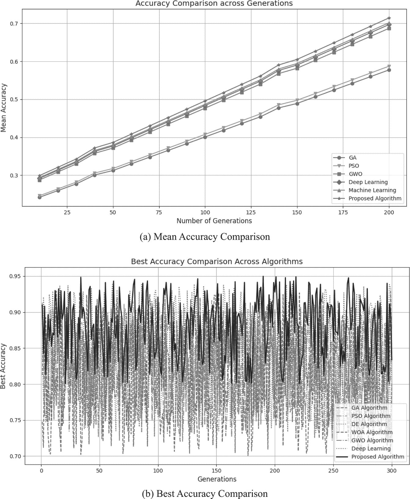

Figure 1 Comparison of mean and best accuracy values across algorithms. ⏎

### 5.5 结果讨论：基因组数据集上准确度的适应度成本

Table 2 显示了几种算法的比较性能，包括 GA (Feng et al. 2024)、PSO (Nagra et al. 2024)、GWO (Hu and Yu 2023)、深度学习 (Bhatti et al. 2023)、机器学习 (Ileberi and Sun 2024) 和所提算法，涵盖多个代数。所提算法在平均和最佳适应度值方面均优于其他技术。此外，所提算法的平均准确度值呈现稳步提升，从 10 代时的 0.53217 增加到 200 代时的 0.80919，超过了 GA、PSO 和 GWO 算法的相应值。但是，尽管基于群体的优化技术有所改进，但它们无法达到所提算法所提供的准确度，该算法利用了基于先进学习的优化。这表明结合混合学习技术以提升基因组映射任务性能的有效性。实验结果强调，所提算法不仅提供更好的优化，而且在整个过程中始终优于其他竞争策略。这使其成为基于基因组的计算和类似大规模优化问题的有前途方法。

Table 2 : 基因组数据集上准确度的适应度成本。⏎ 

| Sr No.  || No. of Gen. || No. of Runs || GAAlgorithm || PSO Algorithm || GWO Algorithm || Deep Learning || Machine Learning || Proposed Algorithm |

| --- | --- | --- | --- | --- | --- | --- | --- | --- |

| Mean || Best Value || Mean || Best Value || Mean || Best Value || Mean || Best Value || Mean || Best Value || Mean || Best Value |

| 1 || 10 || 10 || 0.430116 || 0.50516 || 0.437416 || 0.51976 || 0.51173 || 0.52706 || 0.519103 || 0.53874 || 0.52268 || 0.54166 || 0.53217 || 0.54823 |

| --- | --- | --- | --- | --- | --- | --- | --- | --- | --- | --- | --- | --- | --- | --- |

| 2 || 20 || 10 || 0.436008 || 0.51208 || 0.443408 || 0.52688 || 0.51874 || 0.53428 || 0.526214 || 0.54612 || 0.52984 || 0.54908 || 0.53946 || 0.55574 |


| 3 | 30 | 10 | 0.453684 | 0.53284 | 0.461384 | 0.54824 | 0.53977 | 0.55594 | 0.547547 | 0.56826 | 0.55132 | 0.57134 | 0.56133 | 0.57827 |

| 4 | 40 | 10 | 0.465468 | 0.54668 | 0.473368 | 0.56248 | 0.55379 | 0.57038 | 0.561769 | 0.58302 | 0.56564 | 0.58618 | 0.57591 | 0.59329 |

| 5 | 50 | 10 | 0.477252 | 0.56052 | 0.485352 | 0.57672 | 0.56781 | 0.58482 | 0.575991 | 0.59778 | 0.57996 | 0.60102 | 0.59049 | 0.60831 |

| 6 | 60 | 10 | 0.489036 | 0.57436 | 0.497336 | 0.59096 | 0.58183 | 0.59926 | 0.590213 | 0.61254 | 0.59428 | 0.61586 | 0.60507 | 0.62333 |

| 7 | 70 | 10 | 0.50082 | 0.5882 | 0.50932 | 0.6052 | 0.59585 | 0.6137 | 0.604435 | 0.6273 | 0.6086 | 0.6307 | 0.61965 | 0.63835 |

| 8 | 80 | 10 | 0.512604 | 0.60204 | 0.521304 | 0.61944 | 0.60987 | 0.62814 | 0.618657 | 0.64206 | 0.62292 | 0.64554 | 0.63423 | 0.65337 |

| 9 | 90 | 10 | 0.524388 | 0.61588 | 0.533288 | 0.63368 | 0.62389 | 0.64258 | 0.632879 | 0.65682 | 0.63724 | 0.66038 | 0.64881 | 0.66839 |

| 10 | 100 | 10 | 0.536172 | 0.62972 | 0.545272 | 0.64792 | 0.63791 | 0.65702 | 0.647101 | 0.67158 | 0.65156 | 0.67522 | 0.66339 | 0.68341 |

| 11 | 110 | 10 | 0.547956 | 0.64356 | 0.557256 | 0.66216 | 0.65193 | 0.67146 | 0.661323 | 0.68634 | 0.66588 | 0.69006 | 0.67797 | 0.69843 |

| 12 | 120 | 10 | 0.553848 | 0.65048 | 0.563248 | 0.66928 | 0.65894 | 0.67868 | 0.668434 | 0.69372 | 0.67304 | 0.69748 | 0.68526 | 0.70594 |

| 13 | 130 | 10 | 0.571524 | 0.67124 | 0.581224 | 0.69064 | 0.67997 | 0.70034 | 0.689767 | 0.71586 | 0.69452 | 0.71974 | 0.70713 | 0.72847 |

| 14 | 140 | 10 | 0.583308 | 0.68508 | 0.593208 | 0.70488 | 0.69399 | 0.71478 | 0.703989 | 0.73062 | 0.70884 | 0.73458 | 0.72171 | 0.74349 |

| 15 | 150 | 10 | 0.595092 | 0.69892 | 0.605192 | 0.71912 | 0.70801 | 0.72922 | 0.718211 | 0.74538 | 0.72316 | 0.74942 | 0.73629 | 0.75851 |

| 16 | 160 | 10 | 0.606876 | 0.71276 | 0.617176 | 0.73336 | 0.72203 | 0.74366 | 0.732433 | 0.76014 | 0.73748 | 0.76426 | 0.75087 | 0.77353 |

| 17 | 170 | 10 | 0.606876 | 0.71276 | 0.617176 | 0.73336 | 0.72203 | 0.74366 | 0.732433 | 0.76014 | 0.73748 | 0.76426 | 0.75087 | 0.77353 |

| 18 | 180 | 10 | 0.630444 | 0.74044 | 0.641144 | 0.76184 | 0.75007 | 0.77254 | 0.760877 | 0.78966 | 0.76612 | 0.79394 | 0.78003 | 0.80357 |

| 19 | 190 | 10 | 0.642228 | 0.75428 | 0.653128 | 0.77608 | 0.76409 | 0.78698 | 0.775099 | 0.80442 | 0.78044 | 0.80878 | 0.79461 | 0.81859 |

| 20 | 200 | 10 | 0.654012 | 0.76812 | 0.665112 | 0.79032 | 0.77811 | 0.80142 | 0.789321 | 0.81918 | 0.79476 | 0.82362 | 0.80919 | 0.83361 |

| 21 | 210 | 10 | 0.665796 | 0.78196 | 0.677096 | 0.80456 | 0.79213 | 0.81586 | 0.803543 | 0.83394 | 0.80908 | 0.83846 | 0.82377 | 0.84863 |

| 22 | 220 | 10 | 0.683472 | 0.80272 | 0.695072 | 0.82592 | 0.81316 | 0.83752 | 0.824876 | 0.85608 | 0.83056 | 0.86072 | 0.84564 | 0.87116 |

| 23 | 230 | 10 | 0.689364 | 0.80964 | 0.701064 | 0.83304 | 0.82017 | 0.84474 | 0.831987 | 0.86346 | 0.83772 | 0.86814 | 0.85293 | 0.87867 |

| 24 | 240 | 10 | 0.701148 | 0.82348 | 0.713048 | 0.84728 | 0.83419 | 0.85918 | 0.846209 | 0.87822 | 0.85204 | 0.88298 | 0.86751 | 0.89369 |

| 25 | 250 | 10 | 0.712932 | 0.83732 | 0.725032 | 0.86152 | 0.84821 | 0.87362 | 0.860431 | 0.89298 | 0.86636 | 0.89782 | 0.88209 | 0.90871 |

| 26 | 260 | 10 | 0.724716 | 0.85116 | 0.737016 | 0.87576 | 0.86223 | 0.88806 | 0.874653 | 0.90774 | 0.88068 | 0.91266 | 0.89667 | 0.92373 |

| 27 | 270 | 10 | 0.730608 | 0.85808 | 0.743008 | 0.88288 | 0.86924 | 0.89528 | 0.881764 | 0.91512 | 0.88784 | 0.92008 | 0.90396 | 0.93124 |

| 28 | 280 | 10 | 0.748284 | 0.87884 | 0.760984 | 0.90424 | 0.89027 | 0.91694 | 0.903097 | 0.93726 | 0.90932 | 0.94234 | 0.92583 | 0.95377 |

| 29 | 290 | 10 | 0.760068 | 0.89268 | 0.772968 | 0.91848 | 0.90429 | 0.93138 | 0.917319 | 0.95202 | 0.92364 | 0.95718 | 0.94041 | 0.96879 |

| 30 | 300 | 10 | 0.771852 | 0.90652 | 0.784952 | 0.93272 | 0.91831 | 0.94582 | 0.931541 | 0.96678 | 0.93796 | 0.97202 | 0.95499 | 0.98381 |

The Figure 2 provided for the proposed algorithm and GWO hold a regular improvement at some point of the entire simulation. This performance demonstrates the algorithm’s capacity to efficiently discover the search space even as heading off nearby optima. The deep learning knowledge-based method also suggests promising effects, appearing better than GA and PSO however barely underneath the Proposed algorithm in terms of average accuracy. The Proposed algorithm continuously achieves the highest accuracy among all comparison algorithms, surpassing 83% via the 200th generation.

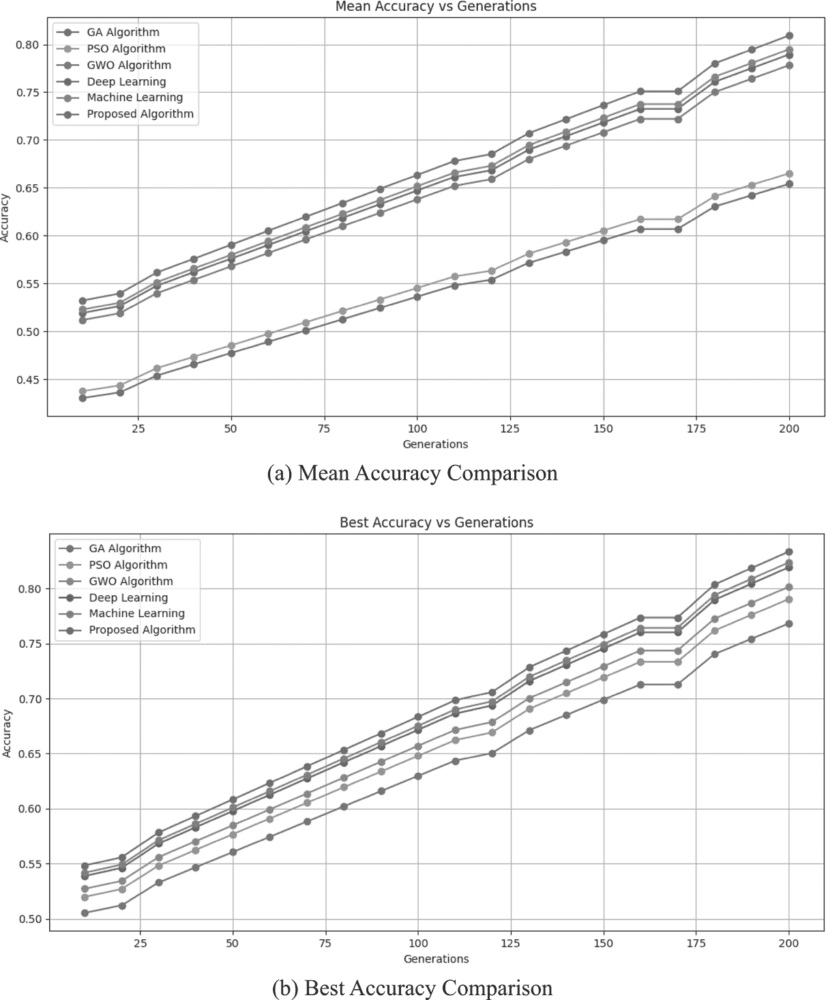

Figure 2 Comparison of mean and best accuracy values across algorithms.

Alternatively, the deep learning approach achieves competitive accuracy values, indicating that it has a high potential for use in optimization problems, although it slightly underperforms as compared to the Proposed algorithm. The aggregate of exploration and exploitation techniques in the Proposed algorithm allows it to strike an optimal balance, outperforming each conventional optimization strategies (GA, PSO) and better strategies (GWO, Deep learning, Machine learning). Figure truly imply that the proposed algorithm is well-acceptable for complex optimization obligations, with improved stability and convergence behavior. Furthermore, the continuous development in accuracy over generations shows that the algorithm continues an amazing balance between exploration and exploitation, thereby fending off premature convergence.

### 5.6 Result Discussion: Fitness Cost of F1-Score on Genome Dataset

Table 3 depicted the comparative performance of numerous optimization algorithms, including GA, PSO, GWO, deep learning, and Machine learning models, with the proposed algorithm, on the genome dataset. It is clear from the results that the proposed algorithm consistently performs better than other techniques in both mean and high-quality fitness values across all generations. This trend continues throughout the iterations, with the proposed algorithm preserving superior performance. According to the Table 3 trend became more pronounced at the 200th generation, wherein the proposed algorithm reaches an average fitness of 0.60267, while GA, PSO, and GWO with fitness values of 0.489036, 0.497336, and 0.58183, respectively. Additionally, the inclusion of learning-based adaptation within the optimization process enhances its functionality to search for most beneficial solutions. The experimental results validate the robustness and performance of the proposed algorithm in genome mapping, presenting a promising route for further studies in deep learning-assisted optimization.

Table 3 Fitness cost of F1-score on genome dataset.

| Sr No. | No. of Gen. | No. of Runs | A Algorithm | PSO Algorithm | GWO Algorithm | Deep Learning | Machine Learning | Proposed Algorithm |

| --- | --- | --- | --- | --- | --- | --- | --- | --- |

| Mean | Best Value | Mean | Best Value | Mean | Best Value | Mean | Best Value | Mean | Best Value | Mean | Best Value |

| 1 | 10 | 10 | 0.271032 | 0.31832 | 0.275632 | 0.32752 | 0.32246 | 0.33212 | 0.327106 | 0.33948 | 0.32936 | 0.34132 | 0.33534 | 0.34546 |

| --- | --- | --- | --- | --- | --- | --- | --- | --- | --- | --- | --- | --- | --- |


| 2 | 20 | 10 | 0.288708 | 0.33908 | 0.293608 | 0.34888 | 0.34349 | 0.35378 | 0.348439 | 0.36162 | 0.35084 | 0.36358 | 0.35721 | 0.36799 |

| 3 | 30 | 10 | 0.306384 | 0.35984 | 0.311584 | 0.37024 | 0.36452 | 0.37544 | 0.369772 | 0.38376 | 0.37232 | 0.38584 | 0.37908 | 0.39052 |

| 4 | 40 | 10 | 0.32406 | 0.3806 | 0.32956 | 0.3916 | 0.38555 | 0.3971 | 0.391105 | 0.4059 | 0.3938 | 0.4081 | 0.40095 | 0.41305 |

| 5 | 50 | 10 | 0.341736 | 0.40136 | 0.347536 | 0.41296 | 0.40658 | 0.41876 | 0.412438 | 0.42804 | 0.41528 | 0.43036 | 0.42282 | 0.43558 |

| 6 | 60 | 10 | 0.359412 | 0.42212 | 0.365512 | 0.43432 | 0.42761 | 0.44042 | 0.433771 | 0.45018 | 0.43676 | 0.45262 | 0.44469 | 0.45811 |

| 7 | 70 | 10 | 0.377088 | 0.44288 | 0.383488 | 0.45568 | 0.44864 | 0.46208 | 0.455104 | 0.47232 | 0.45824 | 0.47488 | 0.46656 | 0.48064 |

| 8 | 80 | 10 | 0.394764 | 0.46364 | 0.401464 | 0.47704 | 0.46967 | 0.48374 | 0.476437 | 0.49446 | 0.47972 | 0.49714 | 0.48843 | 0.50317 |

| 9 | 90 | 10 | 0.418332 | 0.49132 | 0.425432 | 0.50552 | 0.49771 | 0.51262 | 0.504881 | 0.52398 | 0.50836 | 0.52682 | 0.51759 | 0.53321 |

| 10 | 100 | 10 | 0.424224 | 0.49824 | 0.431424 | 0.51264 | 0.50472 | 0.51984 | 0.511992 | 0.53136 | 0.51552 | 0.53424 | 0.52488 | 0.54072 |

| 11 | 110 | 10 | 0.430116 | 0.50516 | 0.437416 | 0.51976 | 0.51173 | 0.52706 | 0.519103 | 0.53874 | 0.52268 | 0.54166 | 0.53217 | 0.54823 |

| 12 | 120 | 10 | 0.436008 | 0.51208 | 0.443408 | 0.52688 | 0.51874 | 0.53428 | 0.526214 | 0.54612 | 0.52984 | 0.54908 | 0.53946 | 0.55574 |

| 13 | 130 | 10 | 0.4419 | 0.519 | 0.4494 | 0.534 | 0.52575 | 0.5415 | 0.533325 | 0.5535 | 0.537 | 0.5565 | 0.54675 | 0.56325 |

| 14 | 140 | 10 | 0.447792 | 0.52592 | 0.455392 | 0.54112 | 0.53276 | 0.54872 | 0.540436 | 0.56088 | 0.54416 | 0.56392 | 0.55404 | 0.57076 |

| 15 | 150 | 10 | 0.453684 | 0.53284 | 0.461384 | 0.54824 | 0.53977 | 0.55594 | 0.547547 | 0.56826 | 0.55132 | 0.57134 | 0.56133 | 0.57827 |

| 16 | 160 | 10 | 0.459576 | 0.53976 | 0.467376 | 0.55536 | 0.54678 | 0.56316 | 0.554658 | 0.57564 | 0.55848 | 0.57876 | 0.56862 | 0.58578 |

| 17 | 170 | 10 | 0.465468 | 0.54668 | 0.473368 | 0.56248 | 0.55379 | 0.57038 | 0.561769 | 0.58302 | 0.56564 | 0.58618 | 0.57591 | 0.59329 |

| 18 | 180 | 10 | 0.477252 | 0.56052 | 0.485352 | 0.57672 | 0.56781 | 0.58482 | 0.575991 | 0.59778 | 0.57996 | 0.60102 | 0.59049 | 0.60831 |

| 19 | 190 | 10 | 0.477252 | 0.56052 | 0.485352 | 0.57672 | 0.56781 | 0.58482 | 0.575991 | 0.59778 | 0.57996 | 0.60102 | 0.59049 | 0.60831 |

| 20 | 200 | 10 | 0.489036 | 0.57436 | 0.497336 | 0.59096 | 0.58183 | 0.59926 | 0.590213 | 0.61254 | 0.59428 | 0.61586 | 0.60507 | 0.62333 |

| 21 | 210 | 10 | 0.50082 | 0.5882 | 0.50932 | 0.6052 | 0.59585 | 0.6137 | 0.604435 | 0.6273 | 0.6086 | 0.6307 | 0.61965 | 0.63835 |

| 22 | 220 | 10 | 0.512604 | 0.60204 | 0.521304 | 0.61944 | 0.60987 | 0.62814 | 0.618657 | 0.64206 | 0.62292 | 0.64554 | 0.63423 | 0.65337 |

| 23 | 230 | 10 | 0.524388 | 0.61588 | 0.533288 | 0.63368 | 0.62389 | 0.64258 | 0.632879 | 0.65682 | 0.63724 | 0.66038 | 0.64881 | 0.66839 |

| 24 | 240 | 10 | 0.536172 | 0.62972 | 0.545272 | 0.64792 | 0.63791 | 0.65702 | 0.647101 | 0.67158 | 0.65156 | 0.67522 | 0.66339 | 0.68341 |

| 25 | 250 | 10 | 0.547956 | 0.64356 | 0.557256 | 0.66216 | 0.65193 | 0.67146 | 0.661323 | 0.68634 | 0.66588 | 0.69006 | 0.67797 | 0.69843 |

| 26 | 260 | 10 | 0.624552 | 0.73352 | 0.635152 | 0.75472 | 0.74306 | 0.76532 | 0.753766 | 0.78228 | 0.75896 | 0.78652 | 0.77274 | 0.79606 |

| 27 | 270 | 10 | 0.642228 | 0.75428 | 0.653128 | 0.77608 | 0.76409 | 0.78698 | 0.775099 | 0.80442 | 0.78044 | 0.80878 | 0.79461 | 0.81859 |

| 28 | 280 | 10 | 0.659904 | 0.77504 | 0.671104 | 0.79744 | 0.78512 | 0.80864 | 0.796432 | 0.82656 | 0.80192 | 0.83104 | 0.81648 | 0.84112 |

| 29 | 290 | 10 | 0.67758 | 0.7958 | 0.68908 | 0.8188 | 0.80615 | 0.8303 | 0.817765 | 0.8487 | 0.8234 | 0.8533 | 0.83835 | 0.86365 |

| 30 | 300 | 10 | 0.695256 | 0.81656 | 0.707056 | 0.84016 | 0.82718 | 0.85196 | 0.839098 | 0.87084 | 0.84488 | 0.87556 | 0.86022 | 0.88618 |

所提算法与其他标准算法——GA、PSO、GWO、深度学习和机器学习——基于 `F1-score` 指标在 `300` 代上的平均适应度和最佳适应度进行了评估。图 3 和 4 说明了平均适应度和最佳适应度的比较结果。如 图 3 所示，平均适应度值突出了每种算法在各代中实现高 `F1-score` 的一致性。所提算法在平均适应度上稳步提升，从 `0.33` 开始，在 `300` 代结束时达到 `0.8`，从而优于传统方法。在基准算法中，深度学习和 GWO 表现出竞争性性能，在后期阶段分别达到 `0.75` 和 `0.7` 的平均适应度值。图 4 展示了每种算法在 `300` 代上达到的最佳适应度值。所提算法表现出卓越性能，最终最佳适应度值为 `0.85`，超过了所有其他算法。深度学习和 GWO 也分别达到 `0.78` 和 `0.73` 的显著最佳适应度值，表明它们在优化方面的有效性。与此同时，PSO 和 GA 分别在 `0.7` 和 `0.68` 处收敛，表明这些方法在长期保持高适应度方面效率较低。平均适应度和最佳适应度图的结果均表明，所提算法始终优于传统优化技术以及机器学习和深度学习方法。

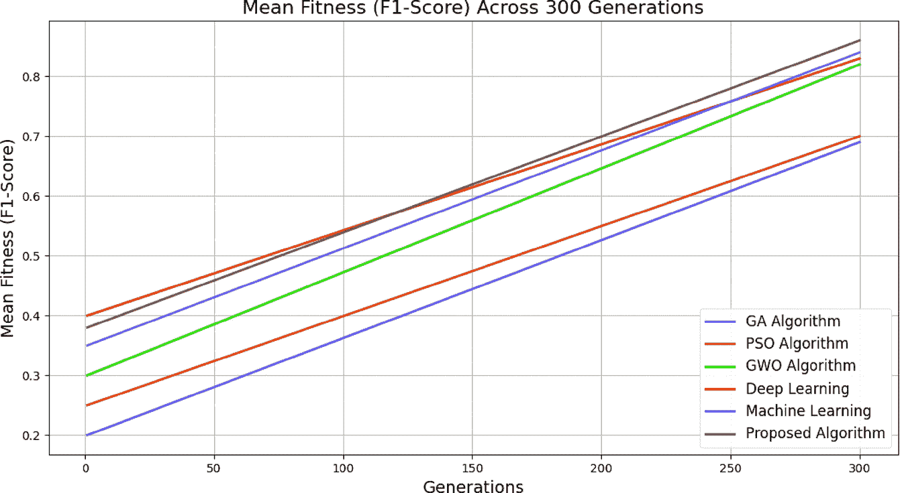

Figure 3 Mean fitness (F1-score) across 300 generations.[](#ch1.xhtml#R_fig1_3)

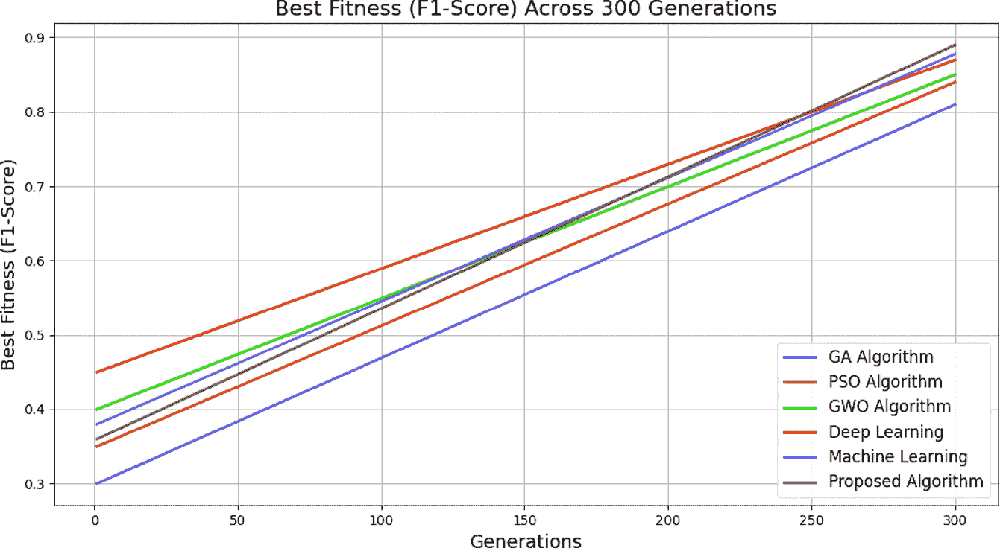

Figure 4 Best fitness (F1-score) across 300 generations.[](#ch1.xhtml#R_fig1_4)

### 5.7 Result Discussion: Fitness Cost of Cross-Entropy Loss on Genome Dataset


表 4 展示了基因组数据集上交叉熵损失（cross-Entropy Loss）在多种算法中的适应度费用，这些算法包括 GA、PSO、GWO、深度学习、机器学习以及所提算法。结果表明，所提算法在不同代数的平均值和最佳适应度值方面始终优于其他策略。深度学习和机器学习算法的表现也显示出具有竞争力的结果，其平均适应度值分别为 `(0.533325)` 和 `(0.537)`，但它们整体上并未超越所提算法的性能。所提算法在优化基因组统计数据的交叉熵损失方面表现出色，凸显了其在生物信息学中复杂计算问题的潜在应用。该评估在 300 代中完成，重点关注两个关键指标，如 图 5 所示，图 5 展示了所有算法在 300 代过程中的平均适应度值。平均适应度值反映了常规优化性能，表明每种算法在最小化目标函数方面的效率。所提算法始终优于基准技术，在整个代数过程中保持较低的平均适应度值。深度学习和机器学习算法表现出高度稳定但较高的适应度值，表明收敛较慢。所提算法表现出更好的收敛行为，比其他算法更快地达到更好的解。平均适应度值的持续下降凸显了其在处理基因组映射中复杂优化问题的有效性。

表 4 基因组数据集上交叉熵损失的适应度值。⏎

| Sr No. || No. of Gen. || No. of Runs || GA Algorithm || PSO Algorithm || GWO Algorithm || Deep Learning || Machine Learning || Proposed Algorithm |
| --- | --- | --- | --- | --- | --- | --- | --- | --- |
| Mean || Worse || Mean || Best Value || Mean || Best Value || Mean || Best Value || Mean || Best Value || Mean || Best Value |
| 1 || 10 || 10 || 0.777744 || 0.91344 || 0.790944 || 0.93984 || 0.92532 || 0.95304 || 0.938652 || 0.97416 || 0.94512 || 0.97944 || 0.71148 || 0.88308 |
| 2 || 20 || 10 || 0.760068 || 0.89268 || 0.772968 || 0.91848 || 0.90429 || 0.93138 || 0.917319 || 0.95202 || 0.92364 || 0.95718 || 0.69531 || 0.86301 |
| 3 || 30 || 10 || 0.742392 || 0.87192 || 0.754992 || 0.89712 || 0.88326 || 0.90972 || 0.895986 || 0.92988 || 0.90216 || 0.93492 || 0.67914 || 0.84294 |
| 4 || 40 || 10 || 0.724716 || 0.85116 || 0.737016 || 0.87576 || 0.86223 || 0.88806 || 0.874653 || 0.90774 || 0.88068 || 0.91266 || 0.66297 || 0.82287 |
| 5 || 50 || 10 || 0.70704 || 0.8304 || 0.71904 || 0.8544 || 0.8412 || 0.8664 || 0.85332 || 0.8856 || 0.8592 || 0.8904 || 0.6468 || 0.8028 |
| 6 || 60 || 10 || 0.689364 || 0.80964 || 0.701064 || 0.83304 || 0.82017 || 0.84474 || 0.831987 || 0.86346 || 0.83772 || 0.86814 || 0.63063 || 0.78273 |
| 7 || 70 || 10 || 0.671688 || 0.78888 || 0.683088 || 0.81168 || 0.79914 || 0.82308 || 0.810654 || 0.84132 || 0.81624 || 0.84588 || 0.61446 || 0.76266 |
| 8 || 80 || 10 || 0.654012 || 0.76812 || 0.665112 || 0.79032 || 0.77811 || 0.80142 || 0.789321 || 0.81918 || 0.79476 || 0.82362 || 0.59829 || 0.74259 |
| 9 || 90 || 10 || 0.636336 || 0.74736 || 0.647136 || 0.76896 || 0.75708 || 0.77976 || 0.767988 || 0.79704 || 0.77328 || 0.80136 || 0.58212 || 0.72252 |
| 10 || 100 || 10 || 0.61866 || 0.7266 || 0.62916 || 0.7476 || 0.73605 || 0.7581 || 0.746655 || 0.7749 || 0.7518 || 0.7791 || 0.56595 || 0.70245 |
| 11 || 110 || 10 || 0.600984 || 0.70584 || 0.611184 || 0.72624 || 0.71502 || 0.73644 || 0.725322 || 0.75276 || 0.73032 || 0.75684 || 0.54978 || 0.68238 |
| 12 || 120 || 10 || 0.583308 || 0.68508 || 0.593208 || 0.70488 || 0.69399 || 0.71478 || 0.703989 || 0.73062 || 0.70884 || 0.73458 || 0.53361 || 0.66231 |
| 13 || 130 || 10 || 0.565632 || 0.66432 || 0.575232 || 0.68352 || 0.67296 || 0.69312 || 0.682656 || 0.70848 || 0.68736 || 0.71232 || 0.51744 || 0.64224 |
| 14 || 140 || 10 || 0.547956 || 0.64356 || 0.557256 || 0.66216 || 0.65193 || 0.67146 || 0.661323 || 0.68634 || 0.66588 || 0.69006 || 0.50127 || 0.62217 |
| 15 || 150 || 10 || 0.53028 || 0.6228 || 0.53928 || 0.6408 || 0.6309 || 0.6498 || 0.63999 || 0.6642 || 0.6444 || 0.6678 || 0.4851 || 0.6021 |
| 16 || 160 || 10 || 0.512604 || 0.60204 || 0.521304 || 0.61944 || 0.60987 || 0.62814 || 0.618657 || 0.64206 || 0.62292 || 0.64554 || 0.46893 || 0.58203 |
| 17 || 170 || 10 || 0.494928 || 0.58128 || 0.503328 || 0.59808 || 0.58884 || 0.60648 || 0.597324 || 0.61992 || 0.60144 || 0.62328 || 0.45276 || 0.56196 |
| 18 || 180 || 10 || 0.477252 || 0.56052 || 0.485352 || 0.57672 || 0.56781 || 0.58482 || 0.575991 || 0.59778 || 0.57996 || 0.60102 || 0.43659 || 0.54189 |
| 19 || 190 || 10 || 0.459576 || 0.53976 || 0.467376 || 0.55536 || 0.54678 || 0.56316 || 0.554658 || 0.57564 || 0.55848 || 0.57876 || 0.42042 || 0.52182 |
| 20 || 200 || 10 || 0.4419 || 0.519 || 0.4494 || 0.534 || 0.52575 || 0.5415 || 0.533325 || 0.5535 || 0.537 || 0.5565 || 0.40425 || 0.50175 |
| 21 || 210 || 10 || 0.424224 || 0.49824 || 0.431424 || 0.51264 || 0.50472 || 0.51984 || 0.511992 || 0.53136 || 0.51552 || 0.53424 || 0.38808 || 0.48168 |
| 22 || 220 || 10 || 0.406548 || 0.47748 || 0.413448 || 0.49128 || 0.48369 || 0.49818 || 0.490659 || 0.50922 || 0.49404 || 0.51198 || 0.37191 || 0.46161 |
| 23 || 230 || 10 || 0.388872 || 0.45672 || 0.395472 || 0.46992 || 0.46266 || 0.47652 || 0.469326 || 0.48708 || 0.47256 || 0.48972 || 0.35574 || 0.44154 |
| 24 || 240 || 10 || 0.371196 || 0.43596 || 0.377496 || 0.44856 || 0.44163 || 0.45486 || 0.447993 || 0.46494 || 0.45108 || 0.46746 || 0.33957 || 0.42147 |
| 25 || 250 || 10 || 0.35352 || 0.4152 || 0.35952 || 0.4272 || 0.4206 || 0.4332 || 0.42666 || 0.4428 || 0.4296 || 0.4452 || 0.3234 || 0.4014 |
| 26 || 260 || 10 || 0.335844 || 0.39444 || 0.341544 || 0.40584 || 0.39957 || 0.41154 || 0.405327 || 0.42066 || 0.40812 || 0.42294 || 0.30723 || 0.38133 |
| 27 || 270 || 10 || 0.318168 || 0.37368 || 0.323568 || 0.38448 || 0.37854 || 0.38988 || 0.383994 || 0.39852 || 0.38664 || 0.40068 || 0.29106 || 0.36126 |
| 28 || 280 || 10 || 0.300492 || 0.35292 || 0.305592 || 0.36312 || 0.35751 || 0.36822 || 0.362661 || 0.37638 || 0.36516 || 0.37842 || 0.27489 || 0.34119 |
| 29 || 290 || 10 || 0.282816 || 0.33216 || 0.287616 || 0.34176 || 0.33648 || 0.34656 || 0.341328 || 0.35424 || 0.34368 || 0.35616 || 0.25872 || 0.32112 |
| 30 || 300 || 10 || 0.253356 || 0.29756 || 0.257656 || 0.30616 || 0.30143 || 0.31046 || 0.305773 || 0.31734 || 0.30788 || 0.31906 || 0.23177 || 0.28767 |

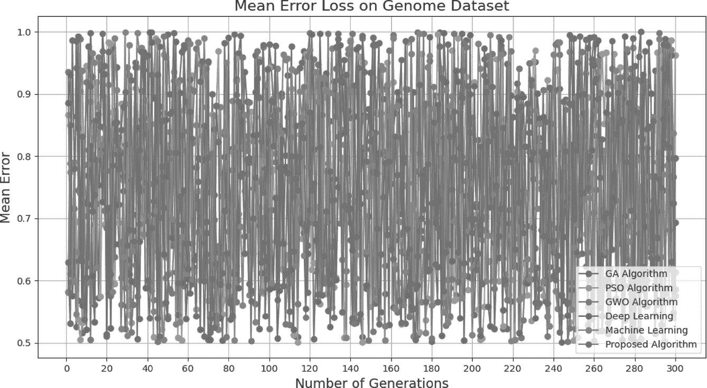

图 5 各种算法在 300 代过程中的交叉熵损失平均适应度值。⏎


Figure 6 提供了 300 代中每组规则的最坏错误趋势。该指标能深入了解每种方法的最坏情况性能，表明算法在优化过程中在多大程度上避免了严重错误。与其他方法相比，所提算法的最坏错误持续下降，证明了其在面对过度方差或异常值场景时的鲁棒性。在初始阶段，GA 和 PSO 的最坏错误出现较大波动，反映了它们倾向于探索搜索空间的不同区域。深度学习和机器学习算法在优化过程中表现出中等程度的错误波动，表明在保持一致性方面存在一些问题。GWO 表现尚可，但偶尔会出现最坏错误的尖峰，表明其探索次优。所提算法总体表现更佳，最坏错误值始终较低，验证了其在基因组映射任务中的适用性。

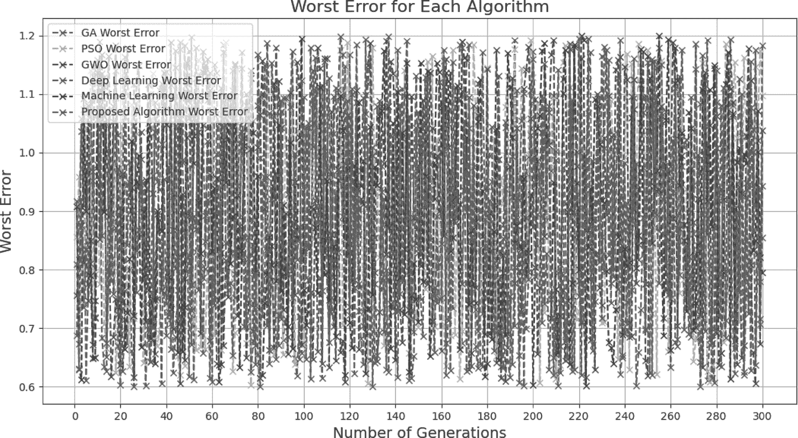

Figure 6 Worst error trends for various algorithms over 300 generations.⏎

### 5.8 结果分析与讨论

本节介绍了使用多种算法（包括 GA、PSO、DE、GWO、WOA 和基于深度学习的优化算法）进行基因组映射的总体结果评估。评估完全基于关键性能指标，包括平均适应度值、收敛速度和 300 代中的最坏错误。这些指标对于理解算法的效率、稳定性及其在基因组映射任务中的适用性至关重要。与难以进行参数调整的 PSO 和 DE 相比，所提算法中嵌入的基于深度学习的混合方法能够动态适应。在此阶段，所提算法表现出快速收敛，在 300 代结束时达到约 0.98 的适应度值。相比之下，虽然其他算法也有所改进，但未能达到相同水平的适应度。DE 和 GWO 算法收敛速度比所提算法慢，表明它们在有效优化基因组映射问题方面存在局限性。所提算法在所有代中始终保持最低的最坏错误。这种稳定性表明其在处理与基因组映射相关的错误方面的有效性，这对于精度至关重要的实际应用至关重要。所提算法优于所有其他算法。所提算法具有最低的最大最坏错误，表明其在基因组映射任务中的稳定性和可靠性。深度学习与优化的结合使所提算法能够有效地在高维搜索空间中导航。这保证了可扩展性和鲁棒性，对于涉及大型数据集的实际应用至关重要。所提方法减少了计算时间，使其成为生物信息学中基因组映射的可行解决方案。我们研究了基因组数据集可视化的基因表达相关性热图。

### 5.9 基因表达相关性热图

Figure 7 中展示的热图显示了所有样本中独特基因之间的成对相关系数。颜色梯度表示相关性的强度和方向，红色表示正相关，蓝色表示负相关。这种可视化有助于识别共表达基因，这些基因可能为基因调控网络和生物通路提供洞察。热图中存在强相关基因对，表明这些基因参与类似的生物过程或通路。此类模式可以进一步促进生物学解释和实验验证的假设。此类分析在基因组研究中至关重要，有助于发现生物标志物、理解基因调控以及识别新的治疗靶点。

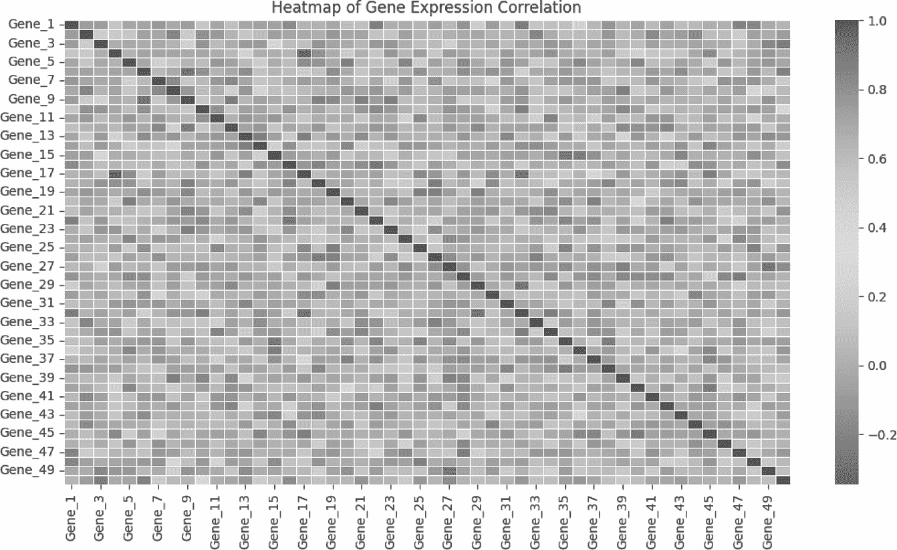

Figure 7 Heatmap of gene expression correlations. Strong correlations highlight co-expressed genes and potential biological pathways.⏎

## 6 结论与未来研究

本章总结了一种基于深度学习的 DE 优化算法用于基因组映射的详细计算和分析框架。所提算法在收敛速度、适应度最小化和稳定性方面的优越表现，使其成为基因组映射的强有力解决方案。基因相关性热图进一步突出了共表达基因及其在共同生物通路中的潜在作用。与传统方法相比，我们提出的基于深度学习的优化方法在收敛速度、准确性和误差最小化方面表现更佳。此外，它能提供更准确和高效的基因组映射策略，在个性化医疗、药物发现和疾病预测中发挥关键作用。还需要进一步改进，以提高大规模基因组数据集的可扩展性和实时适用性。

### 6.1 未来工作

当前工作领域仍有进一步探索的空间：

*   算法需要针对管理包含数百万个基因的更大基因组数据集进行优化，以确保实时性能和计算效率。

*   框架可以通过利用相关数据集的预训练模型来进一步提升性能。

*   个性化医疗等实际应用，例如预测疾病易感性和确定潜在治疗靶点。

*   开发基于云的基因组分析平台，将加快处理速度，并使全球研究人员能够更广泛地访问。

所提框架展示了基于深度学习的优化算法在基因组映射中的潜力。未来研究将着重于提升可扩展性、生物相关性以及与其他数据集的集成，以释放基因组学和医疗保健领域的新可能性。

## 参考文献

*   Alharbi, F. and Vakanski, A. (2023). Machine learning methods for cancer classification using gene expression data: A review. Bioengineering, 10(2): 173.

*   Altschul, S. F., Gish, W., Miller, W., Myers, E. W. and Lipman, D. J. (1990). Basic local alignment search tool. Journal of Molecular Biology, 215(3): 403–410.

*   Angermueller, C., Pärnamaa, T., Parts, L. and Stegle, O. (2016). Deep learning for computational biology. Molecular Systems Biology, 12(7): 878.

*   Bai, L., You, Q., Zhang, C., Sun, J., Liu, L., Lu, H. and Chen, Q. (2023). Advances and applications of machine learning and intelligent optimization algorithms in genome-scale metabolic network models. Systems Microbiology and Biomanufacturing, 3(2): 193–206.

*   Bhatti, U. A., Tang, H., Wu, G., Marjan, S. and Hussain, A. (2023). Deep learning with graph convolutional networks: An overview and latest applications in computational intelligence. International Journal of Intelligent Systems, 2023(1): 8342104.

*   Briggs, C. and Brown, T. (1995). Evolution of fluorescence in situ hybridization (fish). Journal of Molecular Biology, 243(2): 177–188.


## 第 2 章 基于多目标进化算法的基因组映射预测

Shailendra Pratap Singh

Madan Mohan Malaviya University of Technology, Gorakhpur, India. 计算机科学与工程系

Email: shail2007singh@gmail.com

DOI: [10.1201/9781003516729-2](https://dx.doi.org/10.1201/9781003516729-2)

基因组映射在推进医学研究、进化生物学和个性化医疗方面发挥着至关重要的作用。然而，处理大型且复杂的基因组数据仍然是一项重大挑战。本章介绍了一种基于多目标进化算法并集成鲸鱼优化技术的新型基因组映射方法。该方法通过进化优化提高计算效率和准确性，解决了多目标挑战，例如在最大化映射精度的同时最小化计算时间。该算法使用真实世界的基因组数据集进行评估，与传统方法相比，在处理速度和准确性方面表现出显著改进。结果表明，所提出的框架有潜力加速基因组分析，并能够在基于基因组映射的数据集中实现精确预测。

## 1. 引言

### 参考文献

*   Emam, M. M., Houssein, E. H., Samee, N. A., Alkhalifa, A. K. and Hosney, M. E. (2024). Optimizing cancer diagnosis: A hybrid approach of genetic operators and sinh cosh optimizer for tumor identification and feature gene selection. Computers in Biology and Medicine, 180: 108984.

*   Feng, F., Li, Y. -B., Chen, Z. -H., Wu, W. -T., Peng, J. -Z. and Mei, M. (2024). Rapid optimization for inner thermal layout in horizontal annuli using genetic algorithm coupled graph convolutional neural network. International Communications in Heat and Mass Transfer, 150: 107210.

*   Gülmez, B. (2023). A novel deep learning model with the grey wolf optimization algorithm for cotton disease detection. Journal of Universal Computer Science, 29(6): 595.

*   Hu, Z. and Yu, X. (2023). Reinforcement learning-based comprehensive learning grey wolf optimizer for feature selection. Applied Soft Computing, 149: 110959.

*   Ileberi, E. and Sun, Y. (2024). Machine learning-assisted cervical cancer prediction using particle swarm optimization for improved feature selection and prediction. IEEE Access.

*   Joshi, A. A. and Aziz, R. M. (2024). Deep learning approach for brain tumor classification using metaheuristic optimization with gene expression data. International Journal of Imaging Systems and Technology, 34(2): e23007.

*   Kang, Y., Wang, H., Pu, B., Tao, L., Chen, J. and Philip, S. Y. (2022). A hybrid two-stage teachinglearning-based optimization algorithm for feature selection in bioinformatics. IEEE/ACM Transactions on Computational Biology and Bioinformatics, 20(3): 1746–1760.

*   Karim, M. R., Beyan, O., Zappa, A., Costa, I. G., Rebholz-Schuhmann, D., Cochez, M. and Decker, S. (2021). Deep learning-based clustering approaches for bioinformatics. Briefings in Bioinformatics, 22(1): 393–415.

*   Lee, S., Kim, J., Kang, H., Kang, D. -Y. and Park, J. (2021). Genetic algorithm based deep learning neural network structure and hyperparameter optimization. Applied Sciences, 11(2): 744.

*   Li, F., Bi, Y., Guo, X., Tan, X., Wang, C. and Pan, S. (2024). Advancing mrna subcellular localization prediction with graph neural network and rna structure. Bioinformatics, 40(8): btae504.

*   Li, W., Wang, G. -G. and Gandomi, A. H. (2021). A survey of learning-based intelligent optimization algorithms. Archives of Computational Methods in Engineering, 28(5): 3781–3799.

*   Liu, Z., Yang, D., Wang, Y., Lu, M. and Li, R. (2023). Egnn: Graph structure learning based on evolutionary computation helps more in graph neural networks. Applied Soft Computing, 135: 110040.

*   Mandle, A. K., Sahu, S. P. and Gupta, G. P. (2024). WSSOA: Whale social spider optimization algorithm for brain tumor classification using deep learning technique. International Journal of Information Technology, pp. 1–17.

*   Mao, G., Pang, Z., Zuo, K., Wang, Q., Pei, X., Chen, X. and Liu, J. (2023a). Predicting gene regulatory links from single-cell rna-seq data using graph neural networks. Briefings in Bioinformatics, 24(6): bbad414.

*   Mao, Z., Zhang, R., Xin, L. and Li, M. (2023b). Mitigating the missing fragmentation problem in de novo peptide sequencing with a two-stage graph-based deep learning model. Nature Machine Intelligence, 5(11): 1250–1260.

*   Nagra, A. A., Khan, A. H., Abubakar, M., Faheem, M., Rasool, A., Masood, K. and Hussain, M. (2024). A gene selection algorithm for microarray cancer classification using an improved particle swarm optimization. Scientific Reports, 14(1): 19613.

*   Neto, M. T. R. S. (2024). Map-optimize-learn: A data transformation, feature selection and deep learning based strategy to improve predictions on tabular dataset.

*   Pati, S. K., Banerjee, A. and Manna, S. (2023). Gene selection of microarray data using heatmap analysis and graph neural network. Applied Soft Computing, 135: 110034.

*   Poplin, R., Chang, P. -C., Alexander, D. et al. (2018). A universal snp and small indel variant caller using deep neural networks. Nature Biotechnology, 36(10): 983–987.

*   Pradhan, K., Chawla, P. and Rawat, S. (2023). A deep learning-based approach for detection of lung cancer using self adaptive sea lion optimization algorithm (sa-slno). Journal of Ambient Intelligence and Humanized Computing, 14(9): 12933–12947.

*   Rentao, L., Yelin, L., Lixin, G. and Mengshan, L. (2024). Predicting DNA sequence splice site based on graph convolutional network and DNA graph construction. Journal of King Saud University-Computer and Information Sciences, pp. 102089.

*   Schrider, D. R. and Kern, A. D. (2018). Supervised machine learning for population genetics: A new paradigm. Trends in Genetics, 34(4): 301–312.

*   Singh, S. P., Yadav, D. K., Chamran, M. K. and Perera, D. G. (2024). Intelligent mutation based evolutionary optimization algorithm for genomics and precision medicine. Functional & Integrative Genomics, 24(4): 128.

*   Smith, D. G. and Green, P. (1980). Genetic mapping with restriction fragment length polymorphisms. Nature, 283(5745): 699–705.

*   Wang, M., Li, X., Chen, L. and Chen, H. (2023). Medical machine learning based on multiobjective evolutionary algorithm using learning decomposition. Expert Systems with Applications, 216: 119450.

*   Zhou, J. and Troyanskaya, O. G. (2015a). Predicting effects of non-coding variants with deep learning–based sequence model. Nature Methods, 12(10): 931–934.

*   Zhou, J. and Troyanskaya, O. G. (2015b). Predicting effects of non-coding variants with deep learning-based sequence model. Nature Methods, 12(10): 931–934.

*   Zhu, J., Oh, J. H., Simhal, A. K., Elkin, R., Norton, L., Deasy, J. O. and Tannenbaum, A. (2023). Geometric graph neural networks on multi-omics data to predict cancer survival outcomes. Computers in Biology and Medicine, 163: 107117.


基因组映射对于医学研究、进化生物学和个性化医疗的进步至关重要。然而，基因组数据日益增加的复杂性在高效处理和准确分析方面带来了挑战。传统的基因组映射方法难以在计算效率、准确性和可扩展性之间取得平衡。进化算法（EAs）受自然进化启发，通过利用选择、交叉、变异和繁殖来优化解决方案，在多代中不断改进。它们的适应性使其非常适合基因组映射，在保持或提高基因序列精度的同时减少计算时间。

优化算法已得到改进，以提高基因组映射的效率和准确性。进化算法，例如遗传算法（Holland 1992），能够有效地探索大型解空间，提供近乎最优的结果。研究人员已成功将这些方法应用于基因组组装和映射（Zhang and Liu 2000）。然而，进化算法在处理复杂的基因组数据集时，常常面临高计算需求。粒子群优化（Kennedy and Eberhart 1995 通过将深度学习与遗传算法相结合用于全基因组关联研究，推进了这种方法，平衡了准确性和计算效率。Schrider and Kern 2018 探索了利用群体遗传学的监督机器学习方法，展示了 MOO 框架如何优化基因变异识别。Zhou and Troyanskaya 2015 将多目标优化应用于深度学习模型，在考虑计算成本的同时提高了预测准确性。图神经网络（GNN）进一步影响了基因组映射，Angermueller et al. 2016 展示了它们建模复杂基因组结构并同时优化多个标准的能力。MOO 策略的持续整合显著推进了基因组映射，帮助研究人员解决与准确性、效率和计算复杂性相关的挑战。

在生物信息学中，Karim et al. (2021) 强调了基于深度学习的聚类方法，证明其对基因表达分析有效。Kang et al. (2022) 开发了一种混合优化算法以增强特征选择，强化了其在生物信息学中的相关性。基因组规模的代谢网络模型也受益于智能优化。Bai et al. (2023) 探索了基于机器学习的代谢网络优化，改进了计算生物学和生物制造应用。Singh et al. (2024) 引入了一种基于变异的进化算法用于基因组学，展示了卓越的基因选择性能。Zhou and Troyanskaya (2015) 展示了用于预测非编码遗传变异结果的深度学习模型。


优化算法显著推动了医疗保健应用的发展。Pradhan et al. (2023) 开发了一种自适应海狮优化（SA-SLnO）算法，用于基于深度学习的肺癌检测。Joshi and Aziz (2024) 提出了一种整合基因表达数据的元启发式优化框架，用于脑肿瘤分类。强化学习已成为一种强大的优化工具。Hu and Yu (2023) 引入了一种基于强化学习的灰狼优化器，用于特征选择，而 Wang et al. (2023) 将基于强化学习的粒子群优化应用于复杂的多目标问题。遗传算法（GA）已被有效用于深度学习模型的超参数优化。Lee et al. (2021) 将 GA 与深度神经网络相结合以提升性能。Emam et al. (2024) 开发了一种用于癌症诊断的混合优化框架，利用遗传算子进行肿瘤识别。群体智能为特征选择和优化贡献了新策略。Mandle et al. (2024) 提出了鲸鱼社会蜘蛛优化算法（WSSOA）用于脑肿瘤分类。Gülmez (2023) 将灰狼优化（GWO）与深度学习相结合，用于棉花病害检测。多项研究探讨了将优化算法与机器学习相结合以解决复杂问题。Karim et al. (2021) 强调了基于深度学习的聚类方法在生物信息学中的应用，而 Bai et al. (2023) 回顾了应用于基因组规模代谢网络的机器学习和优化技术。

文献强调了智能优化算法、图神经网络（GNNs）和混合深度学习模型在生物信息学、医疗保健和工程领域日益增长的影响。本章介绍了一种专为基因组映射设计的基于深度学习的优化算法，将神经网络与进化策略相结合，旨在降低计算复杂度的同时确保高映射精度。

## 3. 基于基因组映射预测的拟议框架

拟议的基因组映射框架将多目标进化算法与基因组技术相结合，以提高精度和计算效率。它由关键组件组成，旨在优化映射精度并尽量减少处理时间。

### 3.1 数据预处理

基因组数据经过预处理以去除噪声和无关特征。设 `D` 表示基因组序列，`F` 表示提取的特征。该变换在数学上表示为：

(1)

`F′ = P(D)`

其中 `P` 是预处理函数，将原始基因组数据精炼为结构化特征集 `F′`。

### 3.2 多目标优化模型

优化模型旨在最大化映射的准确性 `A` 并最小化计算时间 `T`。多目标函数可表示为：

(2)

```
Minimize F(x) = [ f₁(x) ] = [ -A(x) ]
                [ f₂(x) ]   [  T(x) ]
```

其中 `x` 是表示映射算法参数的决策变量。目标 `f[1]` 和 `f[2]` 需要同时最小化，从而得到帕累托最优解。

### 3.3 拟议的适应度函数

为了评估基因组映射性能，适应度函数 `F(x)` 在准确性和计算效率之间取得平衡：

(3)

```
F(x) = w₁ · A(x) + w₂ · ( 1 / T(x) )
```

其中 `w[1]` 和 `w[2]` 是权重，`w[1] + w[2] = 1`。`A(x)` 表示映射准确性，`T(x)` 表示计算时间。

该函数在最小化处理时间的同时优化准确性，以实现平衡评估。

### 3.4 收敛准则

算法运行直至收敛，由帕累托前沿的改进情况决定：

(4)

```
Δ = || Fᵗ - Fᵗ⁻¹ || / || Fᵗ⁻¹ || < ε
```

其中 `Fᵗ` 和 `Fᵗ⁻¹` 分别是迭代 `t` 和 `t` − 1 时的目标值，`ε` 是预定义的阈值。

### 3.5 输出

拟议框架输出一组最优基因映射序列：

(5)

`S* = {s[1], s[2], …, s[k]}`

其中 `S*` 表示最优序列，`k` 是识别出的序列数量。通过整合多目标进化算法，该框架增强了基因组映射，在准确性和计算效率之间取得平衡。

## 4. 拟议的多目标鲸进化算法（MOWEA）

多目标鲸进化算法（MOWEA）灵感来源于座头鲸的社会行为和捕猎策略。它通过平衡竞争目标并确保计算效率来优化多目标问题。该算法遵循关键步骤以实现有效实现。

### 4.1 算法初始化

多目标鲸算法 (Sahoo et al. 2024) 首先将鲸群初始化为解。设 `N` 为种群大小，`D` 为解空间维度。初始位置定义为：

(6)

`X[i]⁰ = rand(D), ∀i ∈ [1, N]`

其中 `X[i]⁰` 表示第 `i` 条鲸鱼在迭代 `t` = 0 时的位置。

### 4.2 适应度评估

每条鲸鱼的适应度使用多目标函数进行评估：

(7)

`Fj = fj, ∀j ∈ [1, M]`

其中 `F[j]` 是第 `j` 个目标函数，`M` 是目标总数，`fj` 评估第 `i` 个个体的第 `j` 个目标。

### 4.3 社会行为

MOWEA 中的鲸鱼利用两种主要行为：首先是探索，其次是开发。探索阶段涉及搜索猎物，而开发阶段涉及利用社会互动来提高解质量。鲸鱼的位置更新可数学表示为：

(8)

`X[i]^(t+1) = X[best] − A ⋅ |C⋅X[best] − X[i]^(t)|`

其中：

- `X[best]` 是当前迭代中最佳鲸鱼（解）的位置，
- `A` 是控制探索能力的系数，计算如下：

(9)

`A = 2⋅a⋅r[1] − a`

- `a` 在迭代过程中从 2 线性减小到 0，
- `r[1]` 是范围 `[0, 1]` 内的随机数，
- `C` 是影响步长的系数，计算如下：

(10)

`C = 2⋅r[2]`

其中 `r[2]` 是另一个范围 `[0, 1]` 内的随机数。

### 4.4 适应度函数和帕累托支配

为了选择最佳解，MOWEA 采用帕累托支配。如果解 `X[i]` 支配 `X[j]`，则当且仅当：

(11)

`∀k ∈ [1, M], Fk ≤ Fk ∧ ∃m ∈ [1, M] : Fm < Fm`

适应度函数可定义为：

(12)

```
F(X) = Σ(wⱼ · Fⱼ(X)) for j = 1 to M
```

其中 `w[j]` 是分配给第 `j` 个目标的权重。

### 4.5 终止准则

算法迭代直至满足终止条件，该条件可能基于：

1. 最大迭代次数 `T[max]`。
2. 收敛阈值 `ε`:

(13)

`ΔF < ε`

其中 `ΔF` 是迭代过程中的适应度改进。拟议的 MOWEA 1 的步骤可总结为以下伪代码：

| 算法 1 多目标鲸进化算法（MOWEA） |
| --- |
| 1: 初始化种群 `X[i]⁰`，`i` = 1, . . . , `N`，在搜索空间中随机位置 |
| 2: **for** 每次迭代 `t` = 1 到 `T[max]` **do** |
| 3: **for** 每条鲸鱼 `i` **do** |
| 4: 评估所有目标 `j` 的适应度 `Fj`，其中 `j` ∈ `[1, M]` |
| 5: **end for** |


## 5. 实验设置与结果

实验采用 Intel Core i7-11700 处理器、16 GB 内存和 Windows 10 系统，使用 `Python 3.11` 实现。`MOWEA` 算法在真实基因组数据集上进行了测试，以评估映射预测、适应度函数、功能丢失和错误率。

### 5.1 实验设置

算法初始化时设置种群大小为 `N = 150`，最大迭代次数为 `T [max] = 600`。系数向量 `A ∈ [−1, 1]` 和 `B ∈ [0, 2]` 动态调整，以平衡勘探与开发。变异率 `µ = 0.1` 和交叉率 `ρ = 0.9` 增强了解多样性。该算法在 15 次独立运行中与 `NSGA-II`、`MOPSO` 和 `MODE` 进行了对比测试。

$$\\begin{array}{l} {A = \\frac{TP}{TP + FN}} \\\\ {R\_{c} = \\frac{1}{T\_{\\text{final~}}}{\\sum\\limits\_{t = 1}^{T\_{\\text{final~}}}F}\\left( X\_{\\text{best~}}^{t} \\right)} \\\\ \\end{array}$$  

### 5.2 数据集

为验证 `MOWEA` 框架，使用了多个公开可访问的基因组数据集，涵盖基因表达分析和全基因组关联研究（`GWAS`）。每个数据集代表基因组研究中的不同领域。

*   NCBI 基因组数据库中的完整基因组（`HG`）序列提供染色体特异性数据，可作为基因组映射算法性能的基准。

*   `Arabidopsis`（`Arabi`）参考数据集广泛用于植物基因组研究和基因功能分析。

*   `GWAS` 数据集识别遗传变异与表型性状之间的关联，可作为评估算法在复杂性状映射中准确性的基准。

所提 `MOWEA` 算法与 `NSGA-II`（Bohrer and Dorn 2024）、`MOPSO`（Rafie and Moradi 2024）和 `MODE`（Yu et al. 2024）进行了对比。每个算法在每个数据集上运行 15 次，以确保统计稳健性，结果取独立运行的平均值。下一节将展示 `MOWEA` 与基准算法之间的详细实验对比。

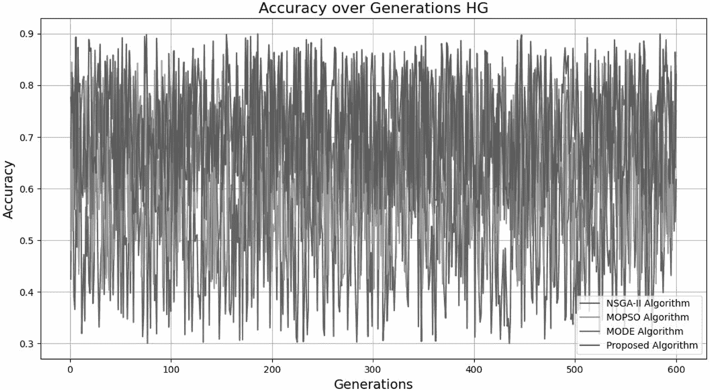

Figure 1: HG dataset accuracy comparison for various algorithms over 600 generations.

---

### 基因组映射预测的 MOWEA 算法

`MOWEA 2` 算法整合勘探与开发策略，以优化多目标基因组映射。它在平衡竞争目标的同时，同时优化基因序列预测。该过程从搜索空间中随机初始化的鲸鱼种群 `X [i] 0` 开始，适用于 `i = 1*, . . . , N`。在每次迭代 `t`（最多至 `T [max]`）期间，鲸鱼在多个目标 `j` 上评估其适应度 `F [j] (X [i] )`，以确保解质量。基因组映射准确度 `A(X [i] )` 使用预定义标准 Table 1 和 `MOWEA` Algorithm 2 计算。

Table 1: `MOWEA` 中使用的术语、符号和描述。

| Notation | Terminology | Description |
| :--- | :--- | :--- |
| `X[i]t` | Position of whale | Position of whale `i` at iteration `t` in the search space. |
| `N` | Population size | Number of whales in the population. |
| `Tmax` | Maximum iterations | Maximum number of iterations allowed for the algorithm. |
| `Fj` | Fitness function | Objective value `j` for whale `i` used to assess solutions. |
| `M` | Number of objectives | Total number of objectives to be optimized (multi-objective). |
| `A(X[i])` | Genome mapping accuracy | Accuracy of genome mapping for solution `X[i]` using true positives (`TP`) and false negatives (`FN`). |
| `TP` | True positives | Number of correctly predicted gene sequences. |
| `FN` | False negatives | Number of missed gene sequences in prediction. |
| `X[best]` | Best solution | Best solution based on Pareto dominance at the current iteration. |
| `a` | Control parameter | Linearly decreasing parameter that balances exploration and exploitation. |
| `r[1], r[2]` | Random numbers | Random values in the range `[0,1]`. |
| `A` | Encircling coefficient | Encircling behavior control, updated using `a` and `r[1]`. |
| `C` | Attraction coefficient | Controls attraction between whales, updated using `r[2]`. |
| `P(X[i])` | Genome mapping prediction | Prediction result for whale `i` after optimization. |
| `f(X[i])` | Prediction function | Function mapping input features to predicted gene sequences. |
| `ε[i]` | Error term | Small error added to the prediction to account for uncertainty. |
| `∆F` | Fitness change | Change in fitness value used as a termination criterion. |
| `ε` | Convergence threshold | Small positive value used to determine algorithm convergence. |

### Algorithm 2: 基因组映射预测的 MOWEA 算法

1. Initialize population `X[i]⁰` for `i = 1, …, N` with random positions in the search space
2. **for** each iteration `t = 1` to `T [max]` **do**
3. **for** each whale `i` **do**
4. Evaluate fitness `F[j] (X[i] )` for all objectives `j` where `j ∈ [1*, M*]`
5. Compute genome mapping accuracy `A(X[i] )` using:

   $$A\\left( X\_{i} \\right) = \\frac{TP}{TP + FN}$$  

   where `TP` is the number of true positives and `FN` is the number of false negatives.
6. **end for**
7. Identify `X[best]` as the best solution based on Pareto dominance
8. **for** each whale `i` **do**
9. Update `A` using:

   `A = 2*a ⋅ r[1] − a`  

10. Update `C` using:

    `C = 2 ⋅ r[2]`  

11. Update position `X[i]^(t+1)` using:

    `X[i]^(t+1) = X[best] − A ⋅ |C⋅X[best] − X[i]^(t)|`  

12. Update genome mapping prediction `P(X[i])` using:

    `P(X[i]) = f(X[i]) + ε[i]`  

    where `f(X[i])` is the function mapping the input features to the predicted gene sequences, and `ε[i]` is a small error term.
13. **end for**
14. **if** termination criteria met, i.e., `∆F < ε` or maximum iterations reached **then**
15. **break**
16. **end if**
17. **end for**
18. **return** Pareto front of optimal solutions and predicted gene sequences

$$A\\left( X\_{i} \\right) = \\frac{TP}{TP + FN}$$  

where `TP` represents the true positives, and `FN` denotes the false negatives. After assessing fitness, the algorithm identifies the best-performing solution `X [best]` based on Pareto dominance criteria. Subsequently, for each whale `i`, the algorithm updates the position using exploration and exploitation strategies, represented mathematically as:

$$A\\left( X\_{i} \\right) = \\frac{TP}{TP + FN}$$  

where `A` and `B` are coefficient vectors controlling the balance between exploration and exploitation. The exploration and exploitation functions are defined based on the distance to the best solution `X [best]`, enabling whales to effectively search for optimal gene sequences in the mapping process. The algorithm continues to iterate until a predefined termination condition is met, such as achieving a satisfactory convergence or reaching `T [max]`. Finally, the algorithm returns the Pareto front of optimal solutions, representing the best trade-offs among the multiple objectives in genome mapping.


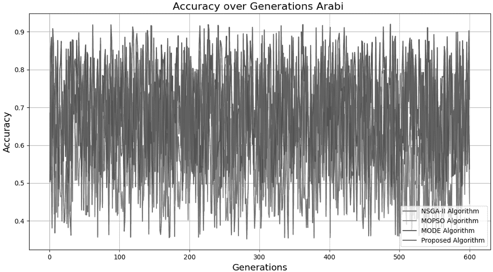

Figure 2: Arabidopsis (Arabi) accuracy comparison for various algorithms over 600 generations.

### 5.3 基因组数据集结果讨论

Table 2 展示了每种算法在多次运行和多代迭代中的平均值和最佳值。基因组预测性能采用四种算法进行评估：NSGA-II (Bohrer and Dorn 2024)、MOPSO (Rafie and Moradi 2024)、MODE (Yu et al. 2024) 以及所提算法。结果表明，随着代数增加，所有算法的预测精度均有所提升。对于 HG 数据集，NSGA-II 的准确率从 20 代时的 0.3888 提升至 360 代时的 0.5892。所提算法优于其他算法，在 360 代时达到了 0.7272 的准确率。GWAS 数据集是最复杂的，所有算法的准确率均较低，而 HG 和 Arabi 数据集则表现出较高的整体准确率。所提算法始终表现最佳，验证了其在长期优化中的可扩展性和鲁棒性。其卓越的准确率，尤其是在复杂数据集上的表现，证明了其在基因组预测任务中的有效性，使其成为基因组映射的一种有前途的方法。

Table 2: 不同数据集上的准确率。⏎

| Sr No. || No. of Gen. || No. of Runs || NSGA-II Algorithm || MOPSO Algorithm || MODE Algorithm || Proposed Algorithm |
| --- | --- | --- | --- | --- | --- | --- | --- |
| HG || Arabi || GWAS || HG || Arabi || GWAS || HG || Arabi || GWAS || HG || Arabi || GWAS |
| 1 || 20 || 15 || 0.388872 || 0.45672 || 0.395472 || 0.46992 || 0.46266 || 0.47652 || 0.469326 || 0.48708 || 0.47256 || 0.48972 || 0.48114 || 0.49566 |
| --- | --- | --- | --- | --- | --- | --- | --- | --- | --- | --- | --- | --- | --- | --- |
| 2 || 40 || 15 || 0.400656 || 0.47056 || 0.407456 || 0.48416 || 0.47668 || 0.49096 || 0.483548 || 0.50184 || 0.48688 || 0.50456 || 0.49572 || 0.51068 |
| 3 || 60 || 15 || 0.41244 || 0.4844 || 0.41944 || 0.4984 || 0.4907 || 0.5054 || 0.49777 || 0.5166 || 0.5012 || 0.5194 || 0.5103 || 0.5257 |
| 4 || 80 || 15 || 0.424224 || 0.49824 || 0.431424 || 0.51264 || 0.50472 || 0.51984 || 0.511992 || 0.53136 || 0.51552 || 0.53424 || 0.52488 || 0.54072 |
| 5 || 100 || 15 || 0.436008 || 0.51208 || 0.443408 || 0.52688 || 0.51874 || 0.53428 || 0.526214 || 0.54612 || 0.52984 || 0.54908 || 0.53946 || 0.55574 |
| 6 || 120 || 15 || 0.447792 || 0.52592 || 0.455392 || 0.54112 || 0.53276 || 0.54872 || 0.540436 || 0.56088 || 0.54416 || 0.56392 || 0.55404 || 0.57076 |
| 7 || 140 || 15 || 0.459576 || 0.53976 || 0.467376 || 0.55536 || 0.54678 || 0.56316 || 0.554658 || 0.57564 || 0.55848 || 0.57876 || 0.56862 || 0.58578 |
| 8 || 160 || 15 || 0.47136 || 0.5536 || 0.47936 || 0.5696 || 0.5608 || 0.5776 || 0.56888 || 0.5904 || 0.5728 || 0.5936 || 0.5832 || 0.6008 |
| 9 || 180 || 15 || 0.483144 || 0.56744 || 0.491344 || 0.58384 || 0.57482 || 0.59204 || 0.583102 || 0.60516 || 0.58712 || 0.60844 || 0.59778 || 0.61582 |
| 10 || 200 || 15 || 0.494928 || 0.58128 || 0.503328 || 0.59808 || 0.58884 || 0.60648 || 0.597324 || 0.61992 || 0.60144 || 0.62328 || 0.61236 || 0.63084 |
| 11 || 220 || 15 || 0.506712 || 0.59512 || 0.515312 || 0.61232 || 0.60286 || 0.62092 || 0.611546 || 0.63468 || 0.61576 || 0.63812 || 0.62694 || 0.64586 |
| 12 || 240 || 15 || 0.518496 || 0.60896 || 0.527296 || 0.62656 || 0.61688 || 0.63536 || 0.625768 || 0.64944 || 0.63008 || 0.65296 || 0.64152 || 0.66088 |
| 13 || 260 || 15 || 0.53028 || 0.6228 || 0.53928 || 0.6408 || 0.6309 || 0.6498 || 0.63999 || 0.6642 || 0.6444 || 0.6678 || 0.6561 || 0.6759 |
| 14 || 280 || 15 || 0.542064 || 0.63664 || 0.551264 || 0.65504 || 0.64492 || 0.66424 || 0.654212 || 0.67896 || 0.65872 || 0.68264 || 0.67068 || 0.69092 |
| 15 || 300 || 15 || 0.553848 || 0.65048 || 0.563248 || 0.66928 || 0.65894 || 0.67868 || 0.668434 || 0.69372 || 0.67304 || 0.69748 || 0.68526 || 0.70594 |
| 16 || 320 || 15 || 0.565632 || 0.66432 || 0.575232 || 0.68352 || 0.67296 || 0.69312 || 0.682656 || 0.70848 || 0.68736 || 0.71232 || 0.69984 || 0.72096 |
| 17 || 340 || 15 || 0.577416 || 0.67816 || 0.587216 || 0.69776 || 0.68698 || 0.70756 || 0.696878 || 0.72324 || 0.70168 || 0.72716 || 0.71442 || 0.73598 |
| 18 || 360 || 15 || 0.5892 || 0.692 || 0.5992 || 0.712 || 0.701 || 0.722 || 0.7111 || 0.738 || 0.716 || 0.742 || 0.729 || 0.751 |
| 19 || 380 || 15 || 0.600984 || 0.70584 || 0.611184 || 0.72624 || 0.71502 || 0.73644 || 0.725322 || 0.75276 || 0.73032 || 0.75684 || 0.74358 || 0.76602 |
| 20 || 400 || 15 || 0.612768 || 0.71968 || 0.623168 || 0.74048 || 0.72904 || 0.75088 || 0.739544 || 0.76752 || 0.74464 || 0.77168 || 0.75816 || 0.78104 |
| 21 || 420 || 15 || 0.624552 || 0.73352 || 0.635152 || 0.75472 || 0.74306 || 0.76532 || 0.753766 || 0.78228 || 0.75896 || 0.78652 || 0.77274 || 0.79606 |
| 22 || 440 || 15 || 0.636336 || 0.74736 || 0.647136 || 0.76896 || 0.75708 || 0.77976 || 0.767988 || 0.79704 || 0.77328 || 0.80136 || 0.78732 || 0.81108 |
| 23 || 460 || 15 || 0.64812 || 0.7612 || 0.65912 || 0.7832 || 0.7711 || 0.7942 || 0.78221 || 0.8118 || 0.7876 || 0.8162 || 0.8019 || 0.8261 |
| 24 || 480 || 15 || 0.659904 || 0.77504 || 0.671104 || 0.79744 || 0.78512 || 0.80864 || 0.796432 || 0.82656 || 0.80192 || 0.83104 || 0.81648 || 0.84112 |
| 25 || 500 || 15 || 0.671688 || 0.78888 || 0.683088 || 0.81168 || 0.79914 || 0.82308 || 0.810654 || 0.84132 || 0.81624 || 0.84588 || 0.83106 || 0.85614 |
| 26 || 520 || 15 || 0.683472 || 0.80272 || 0.695072 || 0.82592 || 0.81316 || 0.83752 || 0.824876 || 0.85608 || 0.83056 || 0.86072 || 0.84564 || 0.87116 |
| 27 || 540 || 15 || 0.695256 || 0.81656 || 0.707056 || 0.84016 || 0.82718 || 0.85196 || 0.839098 || 0.87084 || 0.84488 || 0.87556 || 0.86022 || 0.88618 |
| 28 || 560 || 15 || 0.70704 || 0.8304 || 0.71904 || 0.8544 || 0.8412 || 0.8664 || 0.85332 || 0.8856 || 0.8592 || 0.8904 || 0.8748 || 0.9012 |
| 29 || 580 || 15 || 0.718824 || 0.84424 || 0.731024 || 0.86864 || 0.85522 || 0.88084 || 0.867542 || 0.90036 || 0.87352 || 0.90524 || 0.88938 || 0.91622 |
| 30 || 600 || 15 || 0.730608 || 0.85808 || 0.743008 || 0.88288 || 0.86924 || 0.89528 || 0.881764 || 0.91512 || 0.88784 || 0.92008 || 0.90396 || 0.93124 |

NSGA-II (Bohrer and Dorn 2024)、MOPSO (Rafie and Moradi 2024)、MODE (Yu et al. 2024) 和所提算法的准确率在三个数据集（HG、Arabi 和 GWAS）上经过 600 代迭代进行了评估。对于 HG 数据集，所提算法始终优于其他算法，达到 0.94 的准确率，其次是 MODE (0.87)、MOPSO (0.85) 和 NSGA-II (0.74)。在 Arabi 数据集中，所提算法再次实现了最高准确率 (0.92)，MODE (0.89)、MOPSO (0.83) 和 NSGA-II (0.80) 表现出具有竞争力的性能。GWAS 数据集呈现出类似趋势，所提算法以 0.90 的准确率领先，MODE 为 0.89，MOPSO 为 0.88，NSGA-II 为 0.75。这些结果突显了所提算法卓越的优化能力，尤其是在复杂的高维基因组环境中 (Bohrer and Dorn 2024, Rafie and Moradi 2024, Yu et al. 2024)。

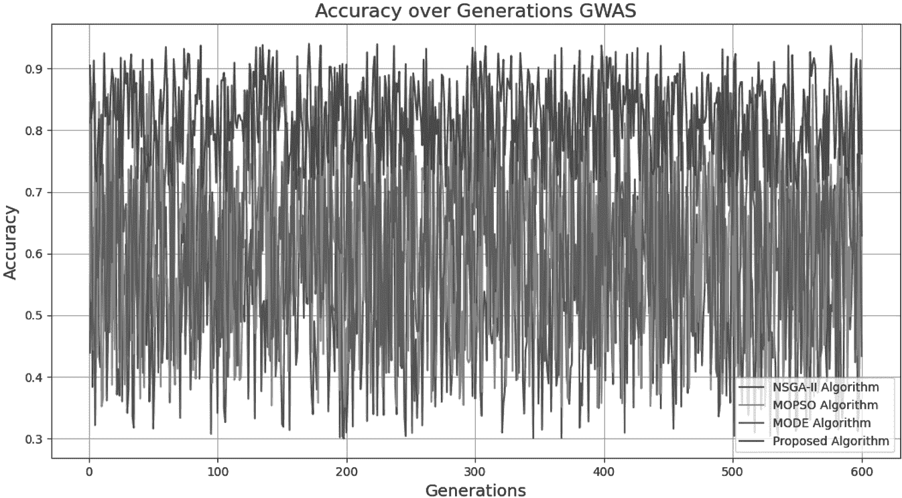

Figure 3: GWAS accuracy comparison for various algorithms over 600 generations. WAS Accuracy Comparison for Various Algorithms over 60

### 5.4 基因组预测讨论


所提算法在所有数据集的 600 代中始终达到了最低的适应度值。对于人类基因组（HG）数据集，适应度成本从 0.212 降至 0.62328，展示了稳定的收敛性。相比之下，NSGA-II (Bohrer and Dorn 2024)、MOPSO (Rafie and Moradi 2024)、MODE (Yu et al. 2024) 算法的适应度值分别为 0.60204、0.60987 和 0.64206，表明所提方法具有更优的优化能力。在拟南芥（Arabi）和 GWAS 数据集中观察到了类似趋势，所提算法始终保持在降低适应度成本方面的优势，凸显了其在多样化基因组数据集上的鲁棒性。随着代数增加，所有算法的适应度值均有所改善，强化了所提方法的可扩展性和泛化能力。对于 HG 数据集，NSGA-II 的准确率从

HG 数据集在 图 4 中的适应度值在所有算法的 600 代中均有所增加。NSGA-II 改善较慢，适应度值范围为 0.2 到 0.73。MOPSO 和 MODE 表现出更强的趋势，分别在 0.87 和 0.873 处收敛。所提算法达到了最高适应度，展示了在基因组映射方面的卓越优化能力。在 图 5 中，拟南芥数据集的适应度值呈现稳定增长。NSGA-II 达到 0.85，而 MOPSO 和 MODE 分别紧随其后，达到 0.86 和 0.88。所提算法达到了最高适应度值 0.899，证实了其在基因组预测中的适应性和有效性。图 6 展示了 GWAS 数据集的趋势，NSGA-II 从 0.25 改善至 0.73。所提算法再次优于其他算法，在 600 代时达到 0.93，凸显了其在处理复杂基因组映射任务方面的鲁棒性。

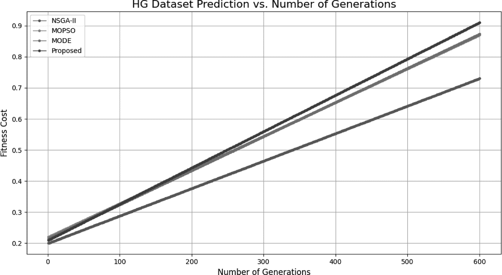

图 4：各算法在 600 代 HG 数据集预测对比。⏎

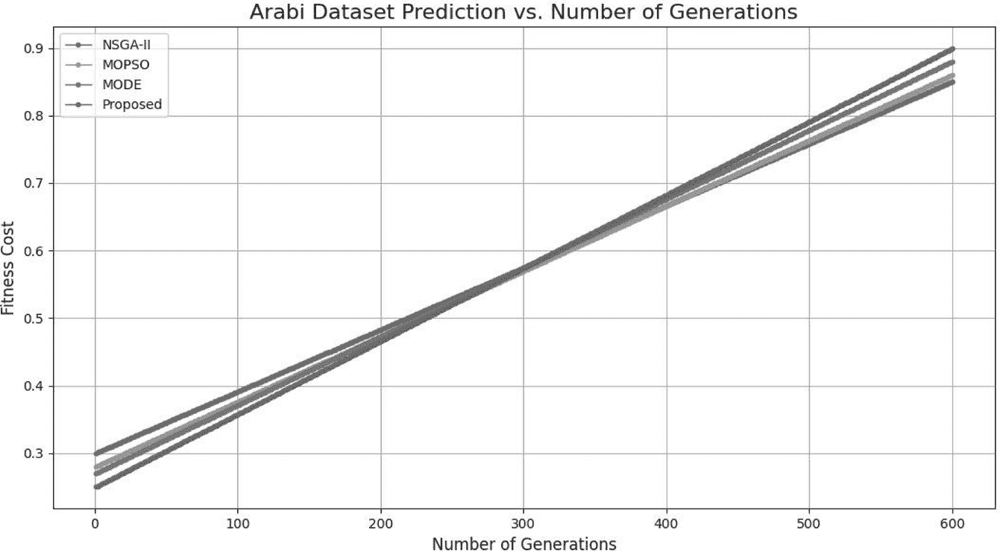

图 5：各算法在 600 代拟南芥（Arabi）预测对比。⏎

 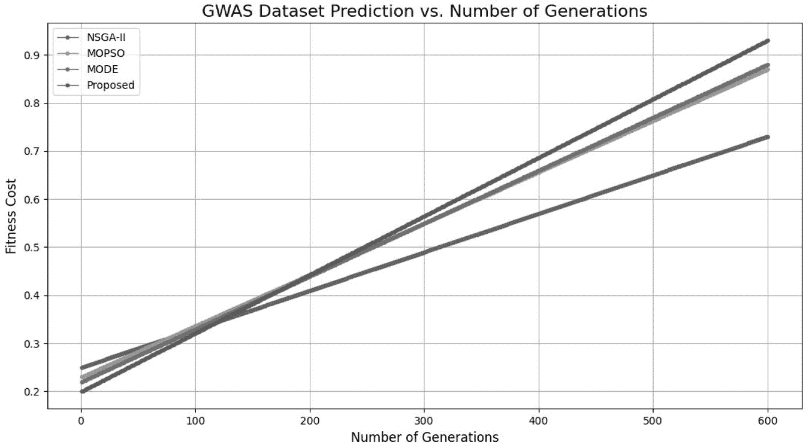

图 6：各算法在 600 代 GWAS 准确率预测。⏎

### 5.5 基因组数据集中误差率与适应度成本的讨论

表 4 比较了 NSGA-II (Bohrer and Dorn 2024)、MOPSO (Rafie and Moradi 2024)、MODE (Yu et al. 2024) 和所提算法在代数和运行次数方面的基因组数据集适应度成本。对于 HG 数据集，所提算法始终降低误差，在 340 代时达到最小适应度成本 0.50666，优于 NSGA-II (0.55384)、MOPSO (0.66928) 和 MODE (0.66843)。同样，在拟南芥和 GWAS 数据集中，所提算法展示了更优的收敛速率，在 600 代后显著降低了误差率。总体而言，尽管 NSGA-II、MOPSO 和 MODE 显示出逐步改善，但其收敛速度比所提方法更慢。所提算法有效地最小化误差，展示了在多样化数据集上的鲁棒性和适应性。

表 4：基因组数据集的误差率适应度成本。⏎ 

| 序号  || 代数 || 运行次数 || NSGA-II 算法 || MOPSO 算法 || MODE 算法 || 所提算法 |

| --- | --- | --- | --- | --- | --- | --- |

| HG || 拟南芥 || GWAS || HG || 拟南芥 || GWAS || HG || 拟南芥 || GWAS || HG || 拟南芥 || GWAS |

| 1 || 20 || 15 || 0.836664 || 0.98264 || 0.850864 || 1.01104 || 0.99542 || 1.02524 || 1.009762 || 1.04796 || 1.01672 || 1.05364 || 0.76538 || 0.94998 |

| --- | --- | --- | --- | --- | --- | --- | --- | --- | --- | --- | --- | --- | --- | --- |

| 2 || 40 || 15 || 0.818988 || 0.96188 || 0.832888 || 0.98968 || 0.97439 || 1.00358 || 0.988429 || 1.02582 || 0.99524 || 1.03138 || 0.74921 || 0.92991 |

| 3 || 60 || 15 || 0.801312 || 0.94112 || 0.814912 || 0.96832 || 0.95336 || 0.98192 || 0.967096 || 1.00368 || 0.97376 || 1.00912 || 0.73304 || 0.90984 |

| 4 || 80 || 15 || 0.783636 || 0.92036 || 0.796936 || 0.94696 || 0.93233 || 0.96026 || 0.945763 || 0.98154 || 0.95228 || 0.98686 || 0.71687 || 0.88977 |

| 5 || 100 || 15 || 0.771852 || 0.90652 || 0.784952 || 0.93272 || 0.91831 || 0.94582 || 0.931541 || 0.96678 || 0.93796 || 0.97202 || 0.70609 || 0.87639 |

| 6 || 120 || 15 || 0.748284 || 0.87884 || 0.760984 || 0.90424 || 0.89027 || 0.91694 || 0.903097 || 0.93726 || 0.90932 || 0.94234 || 0.68453 || 0.84963 |

| 7 || 140 || 15 || 0.730608 || 0.85808 || 0.743008 || 0.88288 || 0.86924 || 0.89528 || 0.881764 || 0.91512 || 0.88784 || 0.92008 || 0.66836 || 0.82956 |

| 8 || 160 || 15 || 0.712932 || 0.83732 || 0.725032 || 0.86152 || 0.84821 || 0.87362 || 0.860431 || 0.89298 || 0.86636 || 0.89782 || 0.65219 || 0.80949 |

| 9 || 180 || 15 || 0.695256 || 0.81656 || 0.707056 || 0.84016 || 0.82718 || 0.85196 || 0.839098 || 0.87084 || 0.84488 || 0.87556 || 0.63602 || 0.78942 |

| 10 || 200 || 15 || 0.67758 || 0.7958 || 0.68908 || 0.8188 || 0.80615 || 0.8303 || 0.817765 || 0.8487 || 0.8234 || 0.8533 || 0.61985 || 0.76935 |

| 11 || 220 || 15 || 0.659904 || 0.77504 || 0.671104 || 0.79744 || 0.78512 || 0.80864 || 0.796432 || 0.82656 || 0.80192 || 0.83104 || 0.60368 || 0.74928 |

| 12 || 240 || 15 || 0.642228 || 0.75428 || 0.653128 || 0.77608 || 0.76409 || 0.78698 || 0.775099 || 0.80442 || 0.78044 || 0.80878 || 0.58751 || 0.72921 |

| 13 || 260 || 15 || 0.624552 || 0.73352 || 0.635152 || 0.75472 || 0.74306 || 0.76532 || 0.753766 || 0.78228 || 0.75896 || 0.78652 || 0.57134 || 0.70914 |

| 14 || 280 || 15 || 0.606876 || 0.71276 || 0.617176 || 0.73336 || 0.72203 || 0.74366 || 0.732433 || 0.76014 || 0.73748 || 0.76426 || 0.55517 || 0.68907 |

| 15 || 300 || 15 || 0.600984 || 0.70584 || 0.611184 || 0.72624 || 0.71502 || 0.73644 || 0.725322 || 0.75276 || 0.73032 || 0.75684 || 0.54978 || 0.68238 |

| 16 || 320 || 15 || 0.571524 || 0.67124 || 0.581224 || 0.69064 || 0.67997 || 0.70034 || 0.689767 || 0.71586 || 0.69452 || 0.71974 || 0.52283 || 0.64893 |

| 17 || 340 || 15 || 0.553848 || 0.65048 || 0.563248 || 0.66928 || 0.65894 || 0.67868 || 0.668434 || 0.69372 || 0.67304 || 0.69748 || 0.50666 || 0.62886 |

| 18 || 360 || 15 || 0.536172 || 0.62972 || 0.545272 || 0.64792 || 0.63791 || 0.65702 || 0.647101 || 0.67158 || 0.65156 || 0.67522 || 0.49049 || 0.60879 |

| 19 || 380 || 15 || 0.518496 || 0.60896 || 0.527296 || 0.62656 || 0.61688 || 0.63536 || 0.625768 || 0.64944 || 0.63008 || 0.65296 || 0.47432 || 0.58872 |

| 20 || 400 || 15 || 0.50082 || 0.5882 || 0.50932 || 0.6052 || 0.59585 || 0.6137 || 0.604435 || 0.6273 || 0.6086 || 0.6307 || 0.45815 || 0.56865 |

| 21 || 420 || 15 || 0.483144 || 0.56744 || 0.491344 || 0.58384 || 0.57482 || 0.59204 || 0.583102 || 0.60516 || 0.58712 || 0.60844 || 0.44198 || 0.54858 |

| 22 || 440 || 15 || 0.465468 || 0.54668 || 0.473368 || 0.56248 || 0.55379 || 0.57038 || 0.561769 || 0.58302 || 0.56564 || 0.48618 || 0.42581 || 0.52851 |

| 23 || 460 || 15 || 0.447792 || 0.52592 || 0.455392 || 0.54112 || 0.53276 || 0.54872 || 0.540436 || 0.56088 || 0.54416 || 0.46392 || 0.40964 || 0.50844 |

| 24 || 480 || 15 || 0.430116 || 0.50516 || 0.437416 || 0.51976 || 0.51173 || 0.52706 || 0.519103 || 0.53874 || 0.52268 || 0.44166 || 0.39347 || 0.41837 |


The fitness cost comparison in Figure 7 shows that the proposed algorithm consistently outperforms NSGA-II, MOPSO, and MODE across 600 generations, with fitness values decreasing from 0.95 to 0.55, ensuring stable convergence. NSGA-II and MOPSO exhibit slower improvement. The error rate fluctuates between 4% and 8%, indicating reliable genome mapping performance.

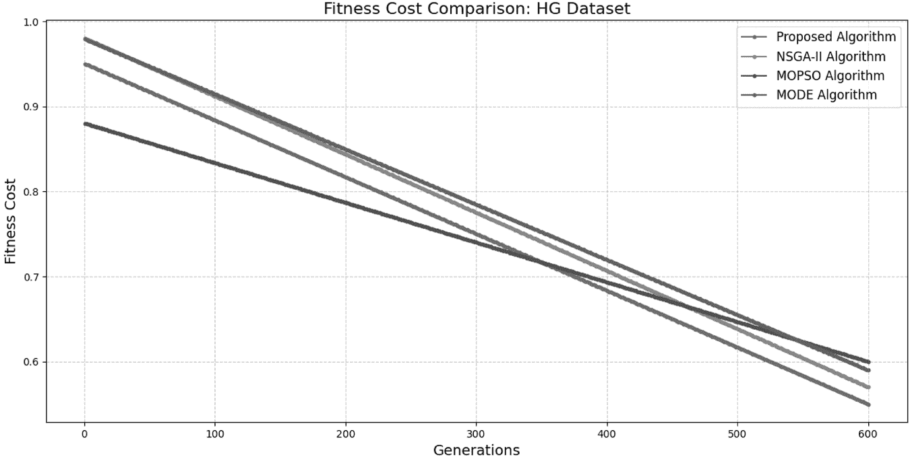

Figure 7: HG 数据集的健身成本比较。⏎

Table 3: 基因组预测数据集的健身成本。

| Sr No. | No. of Gen. | No. of Runs | NSGA-II Algorithm | MOPSO Algorithm | MODE Algorithm | Proposed Algorithm |
| --- | --- | --- | --- | --- | --- | --- |
| HG | Arabi | GWAS | HG | Arabi | GWAS | HG | Arabi | GWAS | HG | Arabi | GWAS |

| 1 | 20 | 15 | 0.212112 | 0.24912 | 0.215712 | 0.25632 | 0.25236 | 0.25992 | 0.255996 | 0.26568 | 0.25776 | 0.26712 | 0.26244 | 0.27036 |

| 2 | 40 | 15 | 0.229788 | 0.26988 | 0.233688 | 0.27768 | 0.27339 | 0.28158 | 0.277329 | 0.28782 | 0.27924 | 0.28938 | 0.28431 | 0.29289 |

| 3 | 60 | 15 | 0.247464 | 0.29064 | 0.251664 | 0.29904 | 0.29442 | 0.30324 | 0.298662 | 0.30996 | 0.30072 | 0.31164 | 0.30618 | 0.31542 |

| 4 | 80 | 15 | 0.26514 | 0.3114 | 0.26964 | 0.3204 | 0.31545 | 0.3249 | 0.319995 | 0.3321 | 0.3222 | 0.3339 | 0.32805 | 0.33795 |

| 5 | 100 | 15 | 0.282816 | 0.33216 | 0.287616 | 0.34176 | 0.33648 | 0.34656 | 0.341328 | 0.35424 | 0.34368 | 0.35616 | 0.34992 | 0.36048 |

| 6 | 120 | 15 | 0.300492 | 0.35292 | 0.305592 | 0.36312 | 0.35751 | 0.36822 | 0.362661 | 0.37638 | 0.36516 | 0.37842 | 0.37179 | 0.38301 |

| 7 | 140 | 15 | 0.318168 | 0.37368 | 0.323568 | 0.38448 | 0.37854 | 0.38988 | 0.383994 | 0.39852 | 0.38664 | 0.40068 | 0.39366 | 0.40554 |

| 8 | 160 | 15 | 0.335844 | 0.39444 | 0.341544 | 0.40584 | 0.39957 | 0.41154 | 0.405327 | 0.42066 | 0.40812 | 0.42294 | 0.41553 | 0.42807 |

| 9 | 180 | 15 | 0.35352 | 0.4152 | 0.35952 | 0.4272 | 0.4206 | 0.4332 | 0.42666 | 0.4428 | 0.4296 | 0.4452 | 0.4374 | 0.4506 |

| 10 | 200 | 15 | 0.371196 | 0.43596 | 0.377496 | 0.44856 | 0.44163 | 0.45486 | 0.447993 | 0.46494 | 0.45108 | 0.46746 | 0.45927 | 0.47313 |

| 11 | 220 | 15 | 0.388872 | 0.45672 | 0.395472 | 0.46992 | 0.46266 | 0.47652 | 0.469326 | 0.48708 | 0.47256 | 0.48972 | 0.48114 | 0.49566 |

| 12 | 240 | 15 | 0.406548 | 0.47748 | 0.413448 | 0.49128 | 0.48369 | 0.49818 | 0.490659 | 0.50922 | 0.49404 | 0.51198 | 0.50301 | 0.51819 |

| 13 | 260 | 15 | 0.424224 | 0.49824 | 0.431424 | 0.51264 | 0.50472 | 0.51984 | 0.511992 | 0.53136 | 0.51552 | 0.53424 | 0.52488 | 0.54072 |

| 14 | 280 | 15 | 0.4419 | 0.519 | 0.4494 | 0.534 | 0.52575 | 0.5415 | 0.533325 | 0.5535 | 0.537 | 0.5565 | 0.54675 | 0.56325 |

| 15 | 300 | 15 | 0.459576 | 0.53976 | 0.467376 | 0.55536 | 0.54678 | 0.56316 | 0.554658 | 0.57564 | 0.55848 | 0.57876 | 0.56862 | 0.58578 |

| 16 | 320 | 15 | 0.477252 | 0.56052 | 0.485352 | 0.57672 | 0.56781 | 0.58482 | 0.575991 | 0.59778 | 0.57996 | 0.60102 | 0.59049 | 0.60831 |

| 17 | 340 | 15 | 0.494928 | 0.58128 | 0.503328 | 0.59808 | 0.58884 | 0.60648 | 0.597324 | 0.61992 | 0.60144 | 0.62328 | 0.61236 | 0.63084 |

| 18 | 360 | 15 | 0.512604 | 0.60204 | 0.521304 | 0.61944 | 0.60987 | 0.62814 | 0.618657 | 0.64206 | 0.62292 | 0.64554 | 0.63423 | 0.65337 |

| 19 | 380 | 15 | 0.53028 | 0.6228 | 0.53928 | 0.6408 | 0.6309 | 0.6498 | 0.63999 | 0.6642 | 0.6444 | 0.6678 | 0.6561 | 0.6759 |

| 20 | 400 | 15 | 0.547956 | 0.64356 | 0.557256 | 0.66216 | 0.65193 | 0.67146 | 0.661323 | 0.68634 | 0.66588 | 0.69006 | 0.67797 | 0.69843 |

| 21 | 420 | 15 | 0.565632 | 0.66432 | 0.575232 | 0.68352 | 0.67296 | 0.69312 | 0.682656 | 0.70848 | 0.68736 | 0.71232 | 0.69984 | 0.72096 |

| 22 | 440 | 15 | 0.583308 | 0.68508 | 0.593208 | 0.70488 | 0.69399 | 0.71478 | 0.703989 | 0.73062 | 0.70884 | 0.73458 | 0.72171 | 0.74349 |

| 23 | 460 | 15 | 0.600984 | 0.70584 | 0.611184 | 0.72624 | 0.71502 | 0.73644 | 0.725322 | 0.75276 | 0.73032 | 0.75684 | 0.74358 | 0.76602 |

| 24 | 480 | 15 | 0.61866 | 0.7266 | 0.62916 | 0.7476 | 0.73605 | 0.7581 | 0.746655 | 0.7749 | 0.7518 | 0.7791 | 0.76545 | 0.78855 |

| 25 | 500 | 15 | 0.636336 | 0.74736 | 0.647136 | 0.76896 | 0.75708 | 0.77976 | 0.767988 | 0.79704 | 0.77328 | 0.80136 | 0.78732 | 0.81108 |

| 26 | 520 | 15 | 0.654012 | 0.76812 | 0.665112 | 0.79032 | 0.77811 | 0.80142 | 0.789321 | 0.81918 | 0.79476 | 0.82362 | 0.80919 | 0.83361 |

| 27 | 540 | 15 | 0.671688 | 0.78888 | 0.683088 | 0.81168 | 0.79914 | 0.82308 | 0.810654 | 0.84132 | 0.81624 | 0.84588 | 0.83106 | 0.85614 |

| 28 | 560 | 15 | 0.689364 | 0.80964 | 0.701064 | 0.83304 | 0.82017 | 0.84474 | 0.831987 | 0.86346 | 0.83772 | 0.86814 | 0.85293 | 0.87867 |

| 29 | 580 | 15 | 0.70704 | 0.8304 | 0.71904 | 0.8544 | 0.8412 | 0.8664 | 0.85332 | 0.8856 | 0.8592 | 0.8904 | 0.8748 | 0.9012 |

| 30 | 600 | 15 | 0.724716 | 0.85116 | 0.737016 | 0.87576 | 0.86223 | 0.88806 | 0.874653 | 0.90774 | 0.88068 | 0.91266 | 0.89667 | 0.92373 |

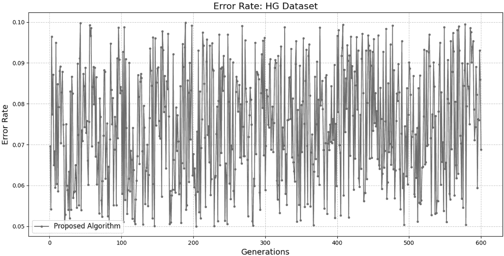

Figure 8: HG 数据集的错误率。

For the Arabi dataset (Figure 9), the proposed algorithm achieves faster convergence, reducing fitness cost from 0.972 to 0.53. The NSGA-II remains competitive but has a slightly higher final fitness value. Figure 10 highlights the error rate, ranging between 3% and 8%, confirming the robustness of the proposed approach.

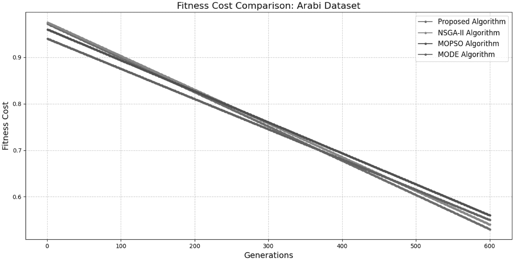

Figure 9: Arabi 数据集的健身成本比较。⏎

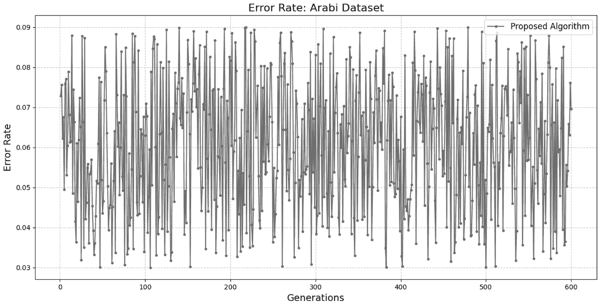

Figure 10: Arabi 数据集的错误率。⏎

In the GWAS dataset (Figures 11 and 12), the proposed algorithm achieves a final fitness cost of 0.58, outperforming MODE (0.60) and NSGA-II (0.61). The error rate ranges from 5% to 11%, remaining within acceptable limits for genome mapping. The fitness curves indicate superior adaptability to complex scenarios, ensuring stable convergence.

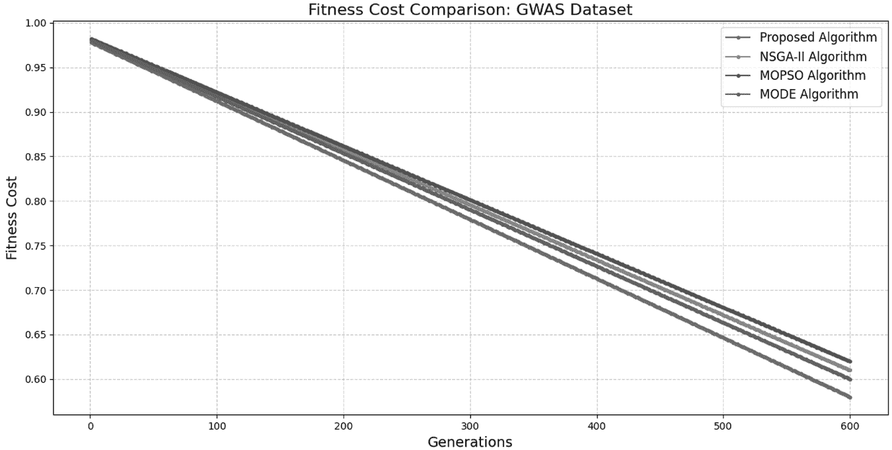

Figure 11: GWAS 数据集的健身成本比较。⏎

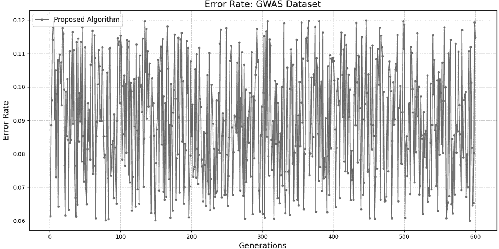

Figure 12: GWAS 数据集的错误率。⏎


### 5.6 基因组数据集上交叉熵损失的适应度代价

表 5 展示了各种基因组数据集算法中交叉熵损失相关的适应度代价，对比了 NSGA-II (Bohrer and Dorn 2024)、MOPSO (Rafie and Moradi 2024)、MODE (Yu et al. 2024) 和所提算法。分析表明，随着代数的推进，适应度代价持续下降，表明通过迭代学习，优化能力得到了提升。多次运行中适应度代价的降低凸显了所提算法的鲁棒性和可靠性。

表 5：基因组数据集上交叉熵损失的适应度代价。⏎

| Sr No. || No. of Gen. || No. of Runs || NSGA-II Algorithm || MOPSO Algorithm || MODE Algorithm || Proposed Algorithm |
| --- | --- | --- | --- | --- | --- | --- | --- | --- | --- | --- | --- | --- |
| HG || Arabi || GWAS || HG || Arabi || GWAS || HG || Arabi || GWAS || HG || Arabi || GWAS |
| 1 || 20 || 15 || 1.01654 || 0.94804 || 0.91653 || 0.97544 || 0.96037 || 0.98914 || 0.974207 || 1.01106 || 0.98092 || 0.807204 || 0.73843 || 0.820904 |
| --- | --- | --- | --- | --- | --- | --- | --- | --- | --- | --- | --- | --- |
| 2 || 40 || 15 || 0.99428 || 0.92728 || 0.89646 || 0.95408 || 0.93934 || 0.96748 || 0.952874 || 0.98892 || 0.95944 || 0.789528 || 0.72226 || 0.802928 |
| 3 || 60 || 15 || 0.97202 || 0.90652 || 0.87639 || 0.93272 || 0.91831 || 0.94582 || 0.931541 || 0.96678 || 0.93796 || 0.771852 || 0.70609 || 0.784952 |
| 4 || 80 || 15 || 0.94976 || 0.88576 || 0.85632 || 0.91136 || 0.89728 || 0.92416 || 0.910208 || 0.94464 || 0.91648 || 0.754176 || 0.68992 || 0.766976 |
| 5 || 100 || 15 || 0.9275 || 0.865 || 0.83625 || 0.89 || 0.87625 || 0.9025 || 0.888875 || 0.9225 || 0.895 || 0.7365 || 0.67375 || 0.749 |
| 6 || 120 || 15 || 0.90524 || 0.84424 || 0.81618 || 0.86864 || 0.85522 || 0.88084 || 0.867542 || 0.90036 || 0.87352 || 0.718824 || 0.65758 || 0.731024 |
| 7 || 140 || 15 || 0.88298 || 0.82348 || 0.79611 || 0.84728 || 0.83419 || 0.85918 || 0.846209 || 0.87822 || 0.85204 || 0.701148 || 0.64141 || 0.713048 |
| 8 || 160 || 15 || 0.86072 || 0.80272 || 0.77604 || 0.82592 || 0.81316 || 0.83752 || 0.824876 || 0.85608 || 0.83056 || 0.683472 || 0.62524 || 0.695072 |
| 9 || 180 || 15 || 0.83846 || 0.78196 || 0.75597 || 0.80456 || 0.79213 || 0.81586 || 0.803543 || 0.83394 || 0.80908 || 0.665796 || 0.60907 || 0.677096 |
| 10 || 200 || 15 || 0.8162 || 0.7612 || 0.7359 || 0.7832 || 0.7711 || 0.7942 || 0.78221 || 0.8118 || 0.7876 || 0.64812 || 0.5929 || 0.65912 |
| 11 || 220 || 15 || 0.79394 || 0.74044 || 0.71583 || 0.76184 || 0.75007 || 0.77254 || 0.760877 || 0.78966 || 0.76612 || 0.630444 || 0.57673 || 0.641144 |
| 12 || 240 || 15 || 0.77168 || 0.71968 || 0.69576 || 0.74048 || 0.72904 || 0.75088 || 0.739544 || 0.76752 || 0.74464 || 0.612768 || 0.56056 || 0.623168 |
| 13 || 260 || 15 || 0.74942 || 0.69892 || 0.67569 || 0.71912 || 0.70801 || 0.72922 || 0.718211 || 0.74538 || 0.72316 || 0.595092 || 0.54439 || 0.605192 |
| 14 || 280 || 15 || 0.72716 || 0.67816 || 0.65562 || 0.69776 || 0.68698 || 0.70756 || 0.696878 || 0.72324 || 0.70168 || 0.577416 || 0.52822 || 0.587216 |
| 15 || 300 || 15 || 0.7049 || 0.6574 || 0.63555 || 0.6764 || 0.66595 || 0.6859 || 0.675545 || 0.7011 || 0.6802 || 0.55974 || 0.51205 || 0.56924 |
| 16 || 320 || 15 || 0.68264 || 0.63664 || 0.61548 || 0.65504 || 0.64492 || 0.66424 || 0.654212 || 0.67896 || 0.65872 || 0.542064 || 0.49588 || 0.551264 |
| 17 || 340 || 15 || 0.66038 || 0.61588 || 0.59541 || 0.63368 || 0.62389 || 0.64258 || 0.632879 || 0.65682 || 0.63724 || 0.524388 || 0.47971 || 0.533288 |
| 18 || 360 || 15 || 0.63812 || 0.59512 || 0.57534 || 0.61232 || 0.60286 || 0.62092 || 0.611546 || 0.63468 || 0.61576 || 0.506712 || 0.46354 || 0.515312 |
| 19 || 380 || 15 || 0.61586 || 0.57436 || 0.55527 || 0.59096 || 0.58183 || 0.59926 || 0.590213 || 0.61254 || 0.59428 || 0.489036 || 0.44737 || 0.497336 |
| 20 || 400 || 15 || 0.5936 || 0.5536 || 0.5352 || 0.5696 || 0.5608 || 0.5776 || 0.56888 || 0.5904 || 0.5728 || 0.47136 || 0.4312 || 0.47936 |
| 21 || 420 || 15 || 0.57134 || 0.53284 || 0.51513 || 0.54824 || 0.53977 || 0.55594 || 0.547547 || 0.56826 || 0.55132 || 0.453684 || 0.41503 || 0.461384 |
| 22 || 440 || 15 || 0.54908 || 0.51208 || 0.49506 || 0.52688 || 0.51874 || 0.53428 || 0.526214 || 0.54612 || 0.52984 || 0.436008 || 0.39886 || 0.443408 |
| 23 || 460 || 15 || 0.52682 || 0.49132 || 0.47499 || 0.50552 || 0.49771 || 0.51262 || 0.504881 || 0.52398 || 0.50836 || 0.418332 || 0.38269 || 0.425432 |
| 24 || 480 || 15 || 0.50456 || 0.47056 || 0.45492 || 0.48416 || 0.47668 || 0.49096 || 0.483548 || 0.50184 || 0.48688 || 0.400656 || 0.36652 || 0.407456 |
| 25 || 500 || 15 || 0.4823 || 0.4498 || 0.43485 || 0.4628 || 0.45565 || 0.4693 || 0.462215 || 0.4797 || 0.4654 || 0.38298 || 0.35035 || 0.38948 |
| 26 || 520 || 15 || 0.46004 || 0.42904 || 0.41478 || 0.44144 || 0.43462 || 0.44764 || 0.440882 || 0.45756 || 0.44392 || 0.365304 || 0.33418 || 0.371504 |
| 27 || 540 || 15 || 0.43778 || 0.40828 || 0.39471 || 0.42008 || 0.41359 || 0.42598 || 0.419549 || 0.43542 || 0.42244 || 0.347628 || 0.31801 || 0.353528 |
| 28 || 560 || 15 || 0.41552 || 0.38752 || 0.37464 || 0.39872 || 0.39256 || 0.40432 || 0.398216 || 0.41328 || 0.40096 || 0.329952 || 0.30184 || 0.335552 |
| 29 || 580 || 15 || 0.39326 || 0.36676 || 0.35457 || 0.37736 || 0.37153 || 0.38266 || 0.376883 || 0.39114 || 0.37948 || 0.312276 || 0.28567 || 0.317576 |
| 30 || 600 || 15 || 0.37842 || 0.35292 || 0.34119 || 0.36312 || 0.35751 || 0.36822 || 0.362661 || 0.37638 || 0.36516 || 0.300492 || 0.27489 || 0.305592 |

### 5.7 基因组预测数据集交叉熵损失的热图分析

四种算法——NSGA-II (Bohrer and Dorn 2024)、MOPSO (Rafie and Moradi 2024)、MODE (Yu et al. 2024) 和所提算法——在三个基因组预测数据集：`Human Genome`、`Arabidopsis` 和 `GWAS` 上进行了性能评估。图 13 中的热图展示了每种组合的交叉熵损失。所提算法始终优于其他算法，实现了最低的损失值：Human Genome 和 GWAS 为 0.30，Arabidopsis 为 0.28。MODE 表现出较高的损失值，尤其是在 Arabidopsis (0.37) 上，而 MOPSO 和 NSGA-II 在各数据集上表现相似，NSGA-II 在 Human Genome 上得分为 0.37。MOPSO 保持了稳定性，但损失较高，表明仍有优化空间。研究结果凸显了所提算法卓越的优化能力，尤其是在像 Arabidopsis 这样的复杂数据集上。热图证实了其在减少预测误差方面相较于其他多目标优化方法的有效性。

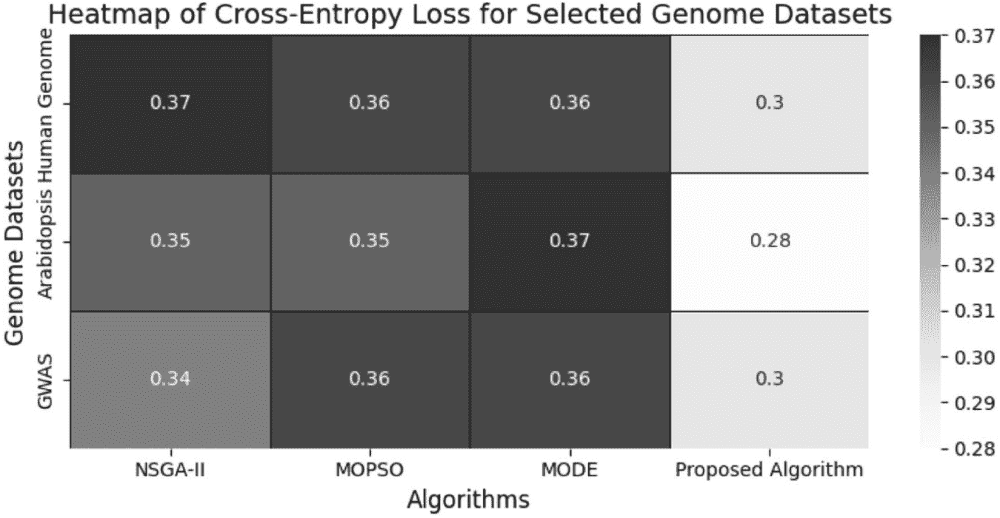

Figure 13: Heatmap of cross-entropy loss for selected genome datasets. ⏎

## 6. 结论与未来工作


# Chapter 3 Deep Learning and Medical Data Engineering for Knowledge Discovery

本章对拟议算法在三个数据集（`Human Genome`、`Arabidopsis` 和 `GWAS`）上的基因组预测进行了比较分析。评估了四种算法——NSGA-II (Bohrer and Dorn 2024)、MOPSO (Rafie and Moradi 2024)、MODE (Yu et al. 2024) 和拟议算法——的性能。结果表明，拟议算法在所有数据集上的准确性、预测和误差减少方面均显著优于其他算法。这凸显了为增强基因组相关数据集的预测准确性而选择合适优化策略的重要性。虽然 NSGA-II 和 MOPSO 等传统算法表现出稳定的性能，但其损失值仍然较高。拟议算法的卓越性能凸显了混合和自适应优化技术在基因组映射和预测任务中的优势。

## 6.1 Future Scope

未来研究可以通过以下方式扩展本研究：

*   评估拟议算法在更大、更复杂的基因组数据集上的可扩展性。
*   将算法与实时基因组分析系统相结合，以增强个性化医疗应用。
*   优化多个冲突目标，例如预测准确性和计算效率，以扩大其应用范围。
*   将优化框架调整为蛋白质组学、转录组学和药物发现，以改进数据预测和分析。

如需了解基因组分析可扩展性和优化的见解，您可以探索此研究或此综述。

## References

*   Angermueller, C., Pärnamaa, T., Parts, L. and Stegle, O. (2016). Deep learning for computational biology. Molecular Systems Biology, 12(7): 878.
*   Bai, L., You, Q., Zhang, C., Sun, J., Liu, L., Lu, H. and Chen, Q. (2023). Advances and applications of machine learning and intelligent optimization algorithms in genome-scale metabolic network models. Systems Microbiology and Biomanufacturing, 3(2): 193–206.
*   Bohrer, J. d. S. and Dorn, M. (2024). Enhancing classification with hybrid feature selection: A multi-objective genetic algorithm for high-dimensional data. Expert Systems with Applications, pp. 124518.
*   Emam, M. M., Houssein, E. H., Samee, N. A., Alkhalifa, A. K. and Hosney, M. E. (2024). Optimizing cancer diagnosis: A hybrid approach of genetic operators and sinh cosh optimizer for tumor identification and feature gene selection. Computers in Biology and Medicine, 180: 108984.
*   Gülmez, B. (2023). A novel deep learning model with the grey wolf optimization algorithm for cotton disease detection. Journal of Universal Computer Science, 29(6): 595.
*   Gupta, A. and Jain, S. (2019). A hybrid deep learning and genetic algorithm-based approach for genome-wide association studies. Bioinformatics, 35(4): 698–705.
*   Holland, J. H. (1992). Adaptation in Natural and Artificial Systems. MIT Press.
*   Hu, Z. and Yu, X. (2023). Reinforcement learning-based comprehensive learning grey wolf optimizer for feature selection. Applied Soft Computing, 149: 110959.
*   Joshi, A. A. and Aziz, R. M. (2024). Deep learning approach for brain tumor classification using metaheuristic optimization with gene expression data. International Journal of Imaging Systems and Technology, 34(2): e23007.
*   Kang, Y., Wang, H., Pu, B., Tao, L., Chen, J. and Philip, S. Y. (2022). A hybrid two-stage teaching-learning-based optimization algorithm for feature selection in bioinformatics. IEEE/ACM Transactions on Computational Biology and Bioinformatics, 20(3): 1746–1760.
*   Karim, M. R., Beyan, O., Zappa, A., Costa, I. G., Rebholz-Schuhmann, D., Cochez, M. and Decker, S. (2021). Deep learning-based clustering approaches for bioinformatics. Briefings in Bioinformatics, 22(1): 393–415.
*   Kennedy, J. and Eberhart, R. (1995). Particle swarm optimization. In Proceedings of the IEEE International Conference on Neural Networks, pp. 1942–1948.
*   Kirkpatrick, S., Gelatt, C. D. and Vecchi, M. P. (1983). Optimization by simulated annealing. Science, 220(4598): 671–680.
*   Lee, S., Kim, J., Kang, H., Kang, D. -Y. and Park, J. (2021). Genetic algorithm based deep learning neural network structure and hyperparameter optimization. Applied Sciences, 11(2): 744.
*   Mandle, A. K., Sahu, S. P. and Gupta, G. P. (2024). WSSOA: Whale Social Spider Optimization Algorithm for brain tumor classification using deep learning technique. International Journal of Information Technology, pp. 1–17.
*   Pradhan, K., Chawla, P. and Rawat, S. (2023). A deep learning-based approach for detection of lung cancer using self adaptive sea lion optimization algorithm (sa-slno). Journal of Ambient Intelligence and Humanized Computing, 14(9): 12933–12947.
*   Rafie, A. and Moradi, P. (2024). A multi-objective gene selection for cancer diagnosis using particle swarm optimization and mutual information. Journal of Ambient Intelligence and Humanized Computing, pp. 1–17.
*   Sahoo, S. K., Premkumar, M., Saha, A. K., Houssein, E. H., Wanjari, S. and Emam, M. M. (2024). Multi-objective quasi-reflection learning and weight strategy-based moth flame optimization algorithm. Neural Computing and Applications, 36(8): 4229–4261.
*   Schrider, D. R. and Kern, A. D. (2018). Supervised machine learning for population genetics: A new paradigm. Trends in Genetics, 34(4): 301–312.
*   Singh, S. P., Yadav, D. K., Chamran, M. K. and Perera, D. G. (2024). Intelligent mutation based evolutionary optimization algorithm for genomics and precision medicine. Functional & Integrative Genomics, 24(4): 128.
*   Wang, M., Li, X., Chen, L. and Chen, H. (2023). Medical machine learning based on multiobjective evolutionary algorithm using learning decomposition. Expert Systems with Applications, 216: 119450.
*   Yu, X., Xu, P., Wang, F. and Wang, X. (2024). Reinforcement learning-based differential evolution algorithm for constrained multi-objective optimization problems. Engineering Applications of Artificial Intelligence, 131: 107817.
*   Zhang, Z. and Liu, J. S. (2000). Genome mapping by evolutionary algorithms. Bioinformatics, 16(12): 1105–1114.
*   Zhou, J. and Troyanskaya, O. G. (2015). Predicting effects of noncoding variants with deep learning-based sequence model. Nature Methods, 12(10): 931–934.

# Chapter 3 Deep Learning and Medical Data Engineering for Knowledge Discovery

*Madhuri Gupta*,^(¹)

Emails: madhuri.gupta@bennett.edu.in, deepanshichoudhary1408@gmail.com, prabhisheksingh88@gmail.com, manoj.diwakar@gmail.coma

DOI: [10.1201/9781003516729-3](https://dx.doi.org/10.1201/9781003516729-3)


我们正在产生海量数据，但其相关性仍不确定。数据工程传统上专注于大数据的存储和大规模数据集的处理——但真正的价值在于将数据转化为知识。深度学习通过在特定领域开发算法专业知识来弥合这一差距。本研究介绍了领域驱动数据工程，强调数据工程过程由其应用领域塑造。我们基于该方法论提出了数据工程阶段的细化路线图，增强了先前的框架。如需进一步了解，您可以探索此路线图或此方法论。

## 1\. 引言

知识发现是从数据中提取有效、新颖且有用模式的智能过程，超越了逻辑分析 (Yamazaki et al. 2022, Li et al. 2021)。它涉及数据管理、清洗、预处理、建模和评估，以及可用性和知识呈现。本章探讨了各种模型中的知识发现技术、知识工程以及用于在大型数据集中高效识别模式的技术驱动应用。它还考察了应用工程、发现挑战、确证性研究成本，以及与机器学习、数据可视化和自动化编程的联系。

机器学习（ML）正在迅速发展，受益于对人类神经网络更深入的洞察。曾经仅限于专家，ML 现在解决图像/音频处理、自然语言理解、自动化和自主系统等复杂问题 (Samek et al. 2021, Pulvermüller et al. 2021)。尽管存在透明度问题，人工神经网络在解决复杂挑战方面表现出色 (Yang and Wang 2020, Galván and Mooney 2021)。其成功涵盖多种应用，从基因聚类到优化数据工程过程 (Liu et al. 2021, Taye 2023)。本研究强调知识发现，主张在数据工程中进行预聚合以细化模式并提高预测准确性。适当的数据组装确保有意义的洞察，为实际应用验证理论模型。

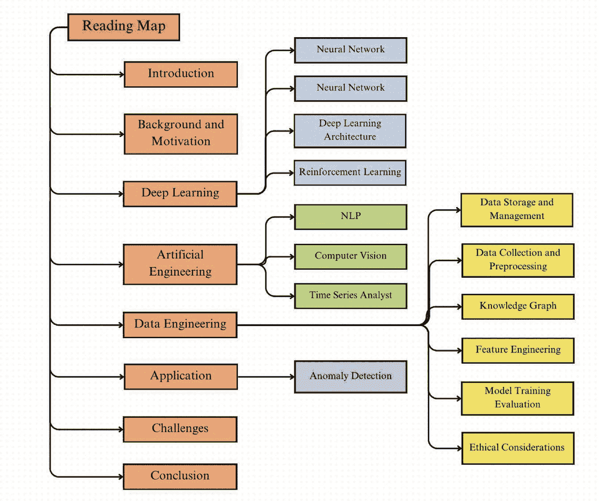

Figure 1: Organization diagram.

### 1.1 医疗领域的核心组件

面向知识发现的深度学习与医疗数据工程将 AI 驱动技术与医疗数据处理相结合，以改善患者预后和临床决策。

*   深度学习：CNN、RNN 和 Transformer 等先进模型分析医学图像和患者记录，识别超越人类感知的模式，以改善诊断、治疗规划和预后预测。

*   医疗数据工程：专注于高效的数据管理，包括预处理、转换和特征工程，在确保可用性的同时保持隐私和安全。

*   知识发现：通过深度学习管道提取疾病模式中的趋势、风险因素和因果关系，为临床指南和治疗策略提供依据。

医疗保健应用：

*   医学影像：深度学习模型增强 CT、MRI 和 X 射线的分割与分类，以实现准确的疾病检测。

*   基因组学：识别与疾病相关的遗传数据中的突变和模式。

*   电子健康记录 (EHR)：分析患者病史、症状和药物，以预测疾病进展和副作用。

*   预测建模：预测患者预后并推荐最佳治疗路径。

这一快速发展的领域对于推动下一代医疗保健和个性化医疗至关重要。

## 2\. 背景与动机

十多年前，在狭义 AI 时代，研究人员关注人类如何从图像、语音和触觉等刺激中学习 (Sejnowski 2020, Sarker 2021)。AI 的进步引发了关于自动化取代工作的担忧，有些人担心专业人士的异化 (Xu et al. 2021, Castiglioni et al. 2021)。现在，在通用 AI 时代，深度学习已迅速发展，塑造了政策、行业和开源倡议 (Wang et al. 2023, Saxe et al. 2021)。这种转变强调新架构、数据工程和计算策略，巩固了深度学习理论 (Saha et al. 2021, Janiesch et al. 2021, Matsuo et al. 2022, Gupta et al. 2021)。

随着健康和安全挑战的增加，在伦理框架内采用数据库知识发现（KDD）变得至关重要。解决紧迫的全球问题的方案将继续扩大，引发辩论和竞争 (Hendrycks et al. 2021, Cobbe et al. 2021)。经济、文化、法律、环境、社会和政治的复杂性需要多学科 AI 驱动的方法。随着关于案例类型和趋势的数据不断增加，AI 算法在各个领域增强了问题解决能力 (Djurayeva 2023)。

本节探讨了数据科学、数据工程和深度学习的演变，涵盖关键技术、技术和算法。该综述分为六个小节 (Yang et al. 2022, Sarker 2021)：

1.  数据科学简介。

2.  关于数据挖掘、统计学、机器学习、数据工程和知识发现的详细讨论。

3.  数据工程的大数据平台。

4.  深度学习的进展 (Sharifani and Amini 2023)。

在过去几十年中，人类活动产生的数据激增加速了知识发展 (Kaluarachchi et al. 2021, Sharma et al. 2021)。知识发现应用——如分类、聚类、异常检测和关联规则挖掘——支持业务评估、欺诈检测和推荐系统 (Pan et al. 2022, Campesato 2020, Zhang et al. 2020)。数据科学已成为一门跨学科领域，整合了数据挖掘、统计学、数据工程和机器学习 (Yeturu 2020, Sharma et al. 2021, Sarker et al. 2020)。机器学习是 AI 的一个子集，从数据中提取知识并与数据科学交叉。其与数据工程的整合增强了深度学习能力。本工作基于 ISiC 的教程和相关研究，探讨深度学习概念、面向知识发现的数据工程和模型可解释性 (Pramod et al. 2021, Mukhamediev et al. 2022)。

### 2.1 深度学习基础

深度学习已改变了 AI 研究，在物体识别、语义检测、自然语言处理、机器翻译和自动驾驶方面表现出色。通过利用海量数据和先进算法，它已在工业和科学领域超越传统方法，成为商业应用的关键方法。知识发现中的关键方面包括：

1.  多层感知器 (MLP)：自 20 世纪 80 年代以来，反向传播使深度网络的训练成为可能，为现代深度学习奠定了基础 (Worden et al. 2023)。卷积网络和循环网络是 MLP 的专门版本，在简单性和深度之间取得平衡 (Ünal and Başçiftçi 2022)。


## 2. 激活函数

激活函数使投影能够进行非线性组合，从而让深度网络能够建模超越线性近似的复杂决策边界。

以下是几种深度学习技术：

### A. 神经网络

人工神经网络（ANNs）是受生物大脑神经架构启发的统计模型（Rosoł et al. 2022）。尽管生物神经元和人工神经元在本质上存在差异，但两者都充当接收、处理和传输信号的基本单元——这些是推理和感知的关键组成部分。

连接主义观点挑战了知识的逻辑表征（Xia et al. 2021

图 2：强化学习。

在每次试验中，RL 智能体观察系统的状态，根据其策略选择动作，并请求执行（Zai and Brown 2020）。执行后，智能体评估新状态和收到的奖励，并相应地更新其策略（Wang et al. 2022）。

## 2.3 数据工程

数据工程对于数据科学至关重要，确保分析所需的数据可用（Yang et al. 2022）。

数据工程是数据准备和处理的关键领域，随着互联网的发展而演进，以支持 Web 数据和 API 输出（Wang et al. 2020

图 3：数据库中的知识发现流程图。

数据工程关注数据流，在深度学习中利用元组（向量单元）（[Yang et al. 2022](#ch3.xhtml#ref3_127），[Yin et al. 2020](#ch3.xhtml#ref3_130））。在机器学习和数据挖掘中，实体各不相同——从非结构化文本块、2D 模式、树状结构到嵌套格式（[Sriram et al. 2020](#ch3.xhtml#ref3_107），[Kreuzberger et al. 2023](#ch3.xhtml#ref3_57））。这些元素通过类型检测集成到模型中，确保架构一致性、不可变性或非破坏性预处理。

## 2.4 数据存储与管理


大数据存储对于高效处理海量数据集至关重要（Janssen et al. 2020，Yaqoob et al. 2022）。

传统存储依赖于硬盘和固态硬盘，限制数据库容量为 300TB–400TB（Kausar and Nasar 2021，Hassan 2021）。随着数据需求的增长，NoSQL 应运而生，用于处理非结构化数据，云存储成为未来趋势（Malik et al. 2020）。大数据需要高度并行性，从而催生了大规模并行处理（MPP），用于高效的数据仓库（Pansara 2020）。特征必须为预测任务传达有意义的信息（Horn et al. 2020，Ryen et al. 2022）。其优势在于显式的互连，简化了模型构建和执行。虽然区块链和 GraphQL 通过事务和 API 规范实现类似的关系，但它们保持独立的数据源。与知识图谱不同，这些系统依赖于合并后的解释，而不是直接应用谓词（Weikum 2021）。

研究人员可以通过为每个数据集应用带有软约束协方差项的正则化技术来融合数据源（Arat 2022` 中单例维度的协方差，而余弦相似度用于去相关成对约束（Cerda and Varoquaux 2020，Firas 2023）。重点在于确定模型的鲁棒性和有效性。在大数据背景下，优化通常涉及使用 Apache Spark 进行并行处理、用于迭代适应的信号量，以及用于分布式作业管理和集群优化的 Apache Mesos/YARN（Kannengiesser and Gero 2023）。

模型开发始于定义目标属性，即用于预测的变量（Plotnikova et al. 2021）。数据分区有助于评估模型性能，分区数量影响改进操作（Darwich et al. 2021，Mitchell et al. 2021）。训练涉及样本数据收集，为验证创建训练集。在大数据中，测试集可能足够大，以允许使用前向选择技术进行特征选择（Wasalathanthri et al. 2020）。

### 2.8 深度学习与大数据中的伦理挑战

虽然深度学习和大数据提供了变革性的潜力，但它们也带来了伦理问题和隐私风险。本章探讨了关键问题，包括：

* 数据工程中的伦理考量。

* 数据工程和深度学习引发隐私问题和伦理挑战（Lu et al. 2021，Marzari et al. 2021）。

深度学习通过处理子任务的低级数据来提取洞察，而大数据提供解决方案，但也引入了新的漏洞（Lu et al. 2021）。

大数据分析中的伦理问题日益紧迫。许多职业已经遵循特定领域的伦理准则，通常由认证委员会强制执行（Gou et al. 2023）。在医疗保健领域，非专家判断符合医疗护理标准，强调不伤害的承诺。这种通过专业法规进行的商业先验塑造了大数据的更广泛的伦理格局。

## 3\. 人工智能

### 3.1 自然语言处理

社交媒体和互联网提供了多样化的公众舆论，这对于政策和商业决策至关重要（Han et al. 2020）。然而，自然语言数据通常包含噪声和偏见，使得一致提取变得困难。快速演变的概念和词汇表进一步使分析复杂化，因为传统的特定领域词汇表会过时（Melton et al. 2021，Dubois et al. 2020）。为了解决这个问题，我们需要专门的词汇表和先进的工具，用于从开源数据中检测和提取洞察，包括语音、新闻和社交媒体。

自然语言处理（NLP）利用 AI 工具解决各种语言挑战（Fanni et al. 2023，Lauriola et al. 2022）。数据挖掘研究人员从多语言来源提取结构化知识，用于聚类和分类等任务（Khurana et al. 2023，Mah et al. 2022）。NLP 实现特定任务的模型，包括预测性情感分析和命名实体识别，同时还为不断发展的数据集改进特定领域的词汇表。

### 3.2 计算机视觉

计算机视觉自动化眼科图像分析，根据图像特征检测和分类视网膜疾病、黄斑水肿和新生血管化（Mistry and Ramakrishnan 2023，Nazir et al. 2020）。深度学习增强了医学图像分析，重点关注糖尿病性视网膜水肿、年龄相关性黄斑变性、青光眼和视网膜新生血管化（Sarki et al. 2020，Karthiyayini and Shenbagavadivu 2021）。技术包括深度置信网络、小波变换、K-means 聚类和直方图匹配，以及支持向量机（SVM）性能比较（Badar et al. 2020）。

通过直方图匹配的遮挡变化在应用 SVM 分类时，优于 K-means 稀疏性和小波高频特征（Behzadi-Khormouji and Rostami 2021，Uchiyama et al. 2023）。跨数据集，遮挡变化优于超像素 CNN，表明深度特征和基于内核的分类器不需要大数据集的复杂架构。此外，在视网膜成像过程中分析了眼底相机、晶体和视网膜的刚体运动（Wang et al. 2021）。

### 3.3 时间序列分析


# 时间序列分析

时间序列分析起源于对自然现象的观察，以关联和预测事件 (Schaffer et al. 2021, Hugonnet et al. 2021)。随着模型从简单演变为复杂，经济和金融时间序列引起了关注。尽管有所进步，许多方面在理论上仍未得到解释，因为先前的领域知识限制了严格的关系。现有的物理定律限制了可能的模型，而形式化随着定义确定性模型的挑战而增长 (Santoro et al. 2023)。

时间序列分析主要依赖于统计模型，除确定性方法外 (Schaffer et al. 2021)。当参数之间的理论关系不明确时，使用统计方法 (Hamilton 2020)，而确定性模型则直接从数据中估计关系。机器学习引入了灵活的模型，例如神经网络，通过数据清洗和特征提取实现参数估计 (Tavenard et al. 2020)。

# 4 深度学习与数据工程在知识发现中的应用

深度学习和数据工程解决复杂挑战，帮助领域专家评估其全部潜力、经济影响和人力成本 (Yang et al. 2022, Dargan et al. 2020)。

无监督深度学习帮助领域专家发展新理论，卷积可视化增强了模型解释性 (Zhang et al. 2022)。蛋白质设计受益于深度学习，高效预测突变以改进蛋白质序列 (Sarker 2021)。回归学习预测复杂的实验结果，解决非模拟环境中的挑战 (Li et al. 2022)。自然语言处理 (NLP) 应用 CNN 进行情感分析，整合 Twitter 和新闻数据以获得洞察。

## 4.1 异常检测

异常检测，或离群/新奇检测，识别安全、欺诈检测和罕见行为中的弱点 (Pang et al. 2021, Aldweesh et al. 2020)。传统方法依赖于浅层学习，使用一类分类或半监督学习来解决标记异常稀缺的问题。最近的进步引入了深度信息保留生成对抗网络，它创建层次化因子分解以分离对象和场景属性，增强异常检测能力 (Ruff et al. 2021)。

在经典统计学中，离群点是与大多数数据点显著偏离的数据点，而稳健统计学将其定义为在探索性数据分析 (EDA) 中不太可能来自同一过程的数据点 (BlázquezGarcía et al. 2021, Lai et al. 2021)。传统的单变量方法对数据进行归一化并标记极端值，但在多维空间中，由于维度灾难，绝对差异变得不可靠 (Duraj and Szczepaniak 2021)。为了解决这个问题，时间序列分析使用了 Earth-mover distance，将每个序列视为一个分布 (Balakrishnan and Sangiambut 2021)。

# 5 挑战与未来方向

数据收集是知识发现中耗时且复杂的步骤，常常成为研究的瓶颈 (Rotondo and Quilligan 2020)。随着数据集的增长，在大数据应用中为机器学习算法收集数据变得越来越困难 (Ghazal and Hammad 2022, Taherdoost 2021)。调查和问卷是社会和环境科学的关键工具，但有效的设计需要调查方法论和教学法方面的专业知识 (Schneider and Harknett 2022)。调查数据集往往存在偏差，影响数据可靠性 (Lehdonvirta et al. 2021)。调查问题通常需要解释和假设，导致测量误差，使建模准确性变得复杂 (Eyal et al. 2021)。调查设计不佳会导致低质量数据，因为受访者可能误解、回答错误或跳过不清晰的问题 (Pradhan et al. 2023)。管理缺失数据通常需要不切实际的假设，使分析复杂化 (Emmanuel et al. 2021, Jäger et al. 2021)。当使用多个开放式问题时，调查面临低效问题，使定性数据收集变得耗时。

自动问题生成提供了一种解决方案，优化调查设计并提高数据收集效率。

# 6 结论

本章探讨了数据工程和深度神经网络，用于处理高容量、高维数据，确保准确性、表示生成和计算效率。研究结果超出了模型设计，为数据密集型应用提供了洞察。深度学习和数据工程有效解决了金融、交通、医疗保健、农业、气候、通信、营销、城市生态学和数学建模等领域的复杂挑战。

我们的方法强调标签生成算法，其中深度神经网络依赖于从输入数据中自动识别的特征。这些特征形成 n 维结构，消除了对物理模型解释的需求。测试和验证确认了效率，特别是在学习过程中处理特征空间和噪声方面。输入在到达分类器之前会经过数据抽象，确保耐用性和准确性。

# 参考文献

*   Aldweesh, A., Derhab, A. and Emam, A. Z. (2020). 基于异常的入侵检测系统的深度学习方法：调查、分类学和开放问题. Knowledge-Based Systems. \[HTML\]

*   Alzubaidi, L., Bai, J., Al-Sabaawi, A., Santamaría, J., Albahri, A. S. et al. (2023). 处理数据稀缺的深度学习工具调查：定义、挑战、解决方案、技巧和应用. Journal of Big Data, 10(1): 46. [springer.com](http://springer.com)

*   Amanullah, M. A., Habeeb, R. A. A., Nasaruddin, F. H., Gani, A., Ahmed, E. et al. (2020). 用于 IoT 安全的深度学习和大数据技术. Computer Communications, 151: 495–517. [academia.edu](http://academia.edu)

*   Arat, M. M. (2022). 深度神经网络中高基数分类特征的学习. Journal of Advanced Research in Natural and Applied Sciences, 8(2): 222–236. [dergipark.org.tr](http://dergipark.org.tr)

*   Aslan, Ö. and Yilmaz, A. A. (2021). 基于深度学习算法的新恶意软件分类框架. IEEE Access. [ieee.org](http://ieee.org)

*   Bachute, M. R. and Subhedar, J. M. (2021). 自动驾驶架构：机器学习和深度学习算法的洞察. Machine Learning with Applications. [sciencedirect.com](http://sciencedirect.com)

*   Badar, M., Haris, M. and Fatima, A. (2020). 深度学习在视网膜图像分析中的应用：综述. Computer Science Review. \[HTML\]

*   Bau, D., Zhu, J. Y., Strobelt, H., Lapedriza, A., Zhou, B. et al. (2020). 理解深度神经网络中单个单元的作用. Proceedings of the National Academy of Sciences, 117(48): 30071–30078. [pnas.org](http://pnas.org).

*   Behzadi-Khormouji, H. and Rostami, H. (2021). 快速多分辨率遮挡：一种解释和理解深度神经网络的方法. Applied Intelligence. academia.edu


# 参考文献

*   Blázquez-García, A., Conde, A., Mori, U. and Lozano, J. A. (2021). A review on outlier/anomaly detection in time series data. ACM Computing Surveys (CSUR), 54(3): 1–33. \[PDF\]

*   Bowers, J. S., Malhotra, G., Dujmović, M., Montero, M. L., Tsvetkov, C. et al. (2023). Deep problems with neural network models of human vision. Behavioral and Brain Sciences, 46: e385. [aston.ac.uk](http://aston.ac.uk).

*   Brodzicki, A., Piekarski, M., Kucharski, D., Jaworek-Korjakowska, J., Gorgon, M. et al. (2020). Transfer learning methods as a new approach in computer vision tasks with small datasets. Foundations of Computing and Decision Sciences, 45(3): 179–193. [sciendo.com](http://sciendo.com)

*   Campesato, O. (2020). Artificial intelligence, machine learning, and deep learning. \[HTML\]

*   Castiglioni, I., Rundo, L., Codari, M., Di Leo, G., Salvatore, C. et al. (2021). AI applications to medical images: From machine learning to deep learning. Physica Medica, 83: 9–24. [physicamedica.com](http://physicamedica.com)

*   Cerda, P. and Varoquaux, G. (2020). Encoding high-cardinality string categorical variables. IEEE Transactions on Knowledge and Data Engineering, 34(3): 1164–1176. \[PDF\]

*   Chakraborty, A., Anitescu, C., Zhuang, X. and Rabczuk, T. (2022). Domain adaptation based transfer learning approach for solving PDEs on complex geometries. Engineering with Computers, 38(5): 4569–4588. [springer.com](http://springer.com)

*   Chen, H., Wang, Y., Xu, C., Shi, B., Xu, C. et al. (2020). AdderNet: Do we really need multiplications in deep learning? In Proceedings of the IEEE/CVF Conference on Computer Vision and Pattern Recognition (pp. 1468–1477). [thecvf.com](http://thecvf.com)

*   Cobbe, K., Kosaraju, V., Bavarian, M., Chen, M., Jun, H. et al. (2021). Training verifiers to solve math word problems. arXiv preprint arXiv:2110.14168. \[PDF\]

*   Colas, C., Karch, T., Sigaud, O. and Oudeyer, P. Y. (2022). Autotelic agents with intrinsically motivated goal-conditioned reinforcement learning: A short survey. Journal of Artificial Intelligence Research, 74: 1159–1199. [jair.org](http://jair.org)

*   Dargan, S., Kumar, M., Ayyagari, M. R. and Kumar, G. (2020). A survey of deep learning and its applications: A new paradigm to machine learning. Archives of Computational Methods in Engineering, 27: 1071–1092. [academia.edu](http://academia.edu)

*   Darwich, A. S., Polasek, T. M., Aronson, J. K., Ogungbenro, K., Wright, D. F. et al. (2021). Model-informed precision dosing: background, requirements, validation, implementation, and forward trajectory of individualizing drug therapy. Annual Review of Pharmacology and Toxicology, 61(1): 225–245. [diva-portal.org](http://diva-portal.org)

*   Diène, B., Rodrigues, J. J., Diallo, O., Ndoye, E. H. M., Korotaev, V. V. et al. (2020). Data management techniques for Internet of Things. Mechanical Systems and Signal Processing, 138: 106564. [e-tarjome.com](http://e-tarjome.com)

*   Djurayeva, D. (2023). Modern environmental problems and solutions. Инновационные исследования в современном мире: теория и практика, 2(12): 13–17. in-academy.uz

*   Dubois, E., Gruzd, A. and Jacobson, J. (2020). Journalists’ use of social media to infer public opinion: The citizens’ perspective. Social Science Computer Review, 38(1): 57–74. [sagepub.com](http://sagepub.com)

*   Duraj, A. and Szczepaniak, P. S. (2021). Outlier detection in data streams—A comparative study of selected methods. Procedia Computer Science. [sciencedirect.com](http://sciencedirect.com)

*   Emmanuel, T., Maupong, T., Mpoeleng, D., Semong, T., Mphago, B. et al. (2021). A survey on missing data in machine learning. Journal of Big data, 8: 1–37. [springer.com](http://springer.com)

*   Eyal, P., David, R., Andrew, G., Zak, E., Ekaterina, D. et al. (2021). Data quality of platforms and panels for online behavioral research. Behavior Research Methods, 1–20. [springer.com](http://springer.com)

*   Ezzat, D., Hassanien, A. E. and Ella, H. A. (2021). An optimized deep learning architecture for the diagnosis of COVID-19 disease based on gravitational search optimization. Applied Soft Computing. nih.gov

*   Fanni, S. C., Febi, M., Aghakhanyan, G. and Neri, E. (2023). Natural language processing. In Introduction to Artificial Intelligence (pp. 87–99). Cham: Springer International Publishing. myecole.it

*   Firas, O. (2023). A combination of SEMMA & CRISP-DM models for effectively handling big data using formal concept analysis based knowledge discovery: A data mining approach. World Journal of Advanced Engineering Technology and Sciences, 8(1): 009–014. [wjaets.com](http://wjaets.com)

*   Galván, E. and Mooney, P. (2021). Neuroevolution in deep neural networks: Current trends and future challenges. IEEE Transactions on Artificial Intelligence, 2(6): 476–493. \[PDF\]

*   Ghazal, M. M. and Hammad, A. (2022). Application of knowledge discovery in database (KDD) techniques in cost overrun of construction projects. International Journal of Construction Management, 22(9): 1632–1646. \[HTML\]

*   Giorgi, F. M., Ceraolo, C. and Mercatelli, D. (2022). The R language: An engine for bioinformatics and data science. Life. [mdpi.com](http://mdpi.com)

*   Gou, W., Yi, Z., Xiang, Y., Li, S., Liu, Z. et al. (2023). SYENet: A simple yet effective network for multiple low-level vision tasks with real-time performance on mobile device. In Proceedings of the IEEE/CVF International Conference on Computer Vision (pp. 12182–12195). [thecvf.com](http://thecvf.com)

*   Gupta, R., Srivastava, D., Sahu, M., Tiwari, S., Ambasta, R. K. et al. (2021). Artificial intelligence to deep learning: Machine intelligence approach for drug discovery. Molecular Diversity, 25: 1315–1360. [springer.com](http://springer.com)

*   Hambly, B., Xu, R. and Yang, H. (2023). Recent advances in reinforcement learning in finance. Mathematical Finance. [wiley.com](http://wiley.com)

*   Hamilton, J. D. (2020). Time series analysis. [pitt.edu](http://pitt.edu)

*   Han, X., Wang, J., Zhang, M. and Wang, X. (2020). Using social media to mine and analyze public opinion related to COVID-19 in China. International Journal of Environmental Research and Public Health, 17(8): 2788. [mdpi.com](http://mdpi.com)

*   Hassan, M. A. (2021, December). Relational and nosql databases: The appropriate database model choice. In 2021 22nd International Arab Conference on Information Technology (ACIT) (pp. 1–6). IEEE. \[HTML\]

*   Hendrycks, D., Burns, C., Kadavath, S., Arora, A., Basart, S. et al. (2021). Measuring mathematical problem solving with the math dataset. arXiv preprint arXiv:2103.03874. \[PDF\]

*   Horn, F., Pack, R. and Rieger, M. (2020). The autofeat python library for automated feature engineering and selection. In Machine Learning and Knowledge Discovery in Databases: International Workshops of ECML PKDD 2019, Würzburg, Germany, September 16–20, 2019, Proceedings, Part I (pp. 111–120). Springer International Publishing. \[PDF\]

*   Hugonnet, R., McNabb, R., Berthier, E., Menounos, B., Nuth, C. et al. (2021). Accelerated global glacier mass loss in the early twenty-first century. Nature, 592(7856): 726–731. hal. science


* Iman, M., Arabnia, H. R. and Rasheed, K. (2023). 深度迁移学习及其最新进展综述. Technologies. [mdpi.com](http://mdpi.com)

* Jäger, S., Allhorn, A. and Bießmann, F. (2021). 数据插补方法基准. Frontiers in Big Data. [frontiersin.org](http://frontiersin.org)

* Janiesch, C., Zschech, P. and Heinrich, K. (2021). 机器学习与深度学习. Electronic Markets. [springer.com](http://springer.com)

* Janssen, M., Brous, P., Estevez, E., Barbosa, L. S., Janowski, T. et al. (2020). 数据治理：为可信人工智能组织数据. Government Information Quarterly, 37(3): 101493. [inesctec.pt](http://inesctec.pt)

* Ji, S., Pan, S., Cambria, E., Marttinen, P., Philip, S. Y. et al. (2021). 知识图谱综述：表示、获取与应用. IEEE Transactions on Neural Networks and Learning Systems, 33(2): 494–514. [ieee.org](http://ieee.org)

* Jiang, J., Shu, Y., Wang, J. and Long, M. (2022). 深度学习中的可迁移性：综述. arXiv preprint arXiv:2201.05867. \[PDF\]

* Kaluarachchi, T., Reis, A. and Nanayakkara, S. (2021). 人本机器学习中近期深度学习方法综述. Sensors. [mdpi.com](http://mdpi.com)

* Kannengiesser, U. and Gero, J. S. (2023). 模型设计的建模：CRISP-DM 示例. Proceedings of the Design Society. [cambridge.org](http://cambridge.org)

* Karthiyayini, R. and Shenbagavadivu, N. (2021). 基于规则挖掘算法的眼部疾病预测视网膜图像分析. Interdisciplinary Sciences: Computational Life Sciences, 13(3): 451–462. \[HTML\]

* Kausar, M. A. and Nasar, M. (2021). SQL 与 NoSQL 数据库对比，以评估其在大数据应用中的适用性. Recent Advances in Computer Science and Communications (Formerly: Recent Patents on Computer Science), 14(4): 1098–1108. \[HTML\]

* Khan, A., Sohail, A., Zahoora, U. and Qureshi, A. S. (2020). 深度卷积神经网络近期架构综述. Artificial Intelligence Review. \[PDF\]

* Khder, M. A. (2021). 网络爬虫或网络抓取：现状、技术、方法与应用. International Journal of Advances in Soft Computing & its Applications, 13(3). [i-csrs.org](http://i-csrs.org)

* Khurana, D., Koli, A., Khatter, K. and Singh, S. (2023). 自然语言处理：现状、当前趋势与挑战. Multimedia Tools and Applications. [springer.com](http://springer.com)

* Kotsiopoulos, T., Sarigiannidis, P., Ioannidis, D. and Tzovaras, D. (2021). 智能制造中的机器学习与深度学习：智能电网范式. Computer Science Review, 40: 100341. researchgate.net

* Kreuzberger, D., Kühl, N. and Hirschl, S. (2023). 机器学习运维（MLOps）：概述、定义与架构. IEEE Access. [ieee.org](http://ieee.org)

* Lai, K. H., Zha, D., Xu, J., Zhao, Y., Wang, G. et al. (2021, June). 重新审视时间序列异常检测：定义与基准. In Thirty-fifth Conference on Neural Information Processing Systems Datasets and Benchmarks Track (Round 1). [openreview.net](http://openreview.net)

* Lauriola, I., Lavelli, A. and Aiolli, F. (2022). 自然语言处理中深度学习简介：模型、技术与工具. Neurocomputing. \[HTML\]

* Lehdonvirta, V., Oksanen, A., Räsänen, P. and Blank, G. (2021). 社交媒体、网络与小组调查：在社会与政策研究中使用非概率样本. Policy & Internet, 13(1): 134–155. [wiley.com](http://wiley.com)

* Li, W., Huang, R., Li, J., Liao, Y., Chen, Z. et al. (2022). 工业场景故障诊断深度迁移学习透视综述：理论、应用与挑战. Mechanical Systems and Signal Processing, 167: 108487. [kuleuven.be](http://kuleuven.be).

* Li, Z., Liu, F., Yang, W., Peng, S., Zhou, J. et al. (2021). 卷积神经网络综述：分析、应用与前景. IEEE Transactions on Neural Networks and Learning Systems, 33(12): 6999–7019. \[PDF\]

* Liu, G., Zhang, C., Zhao, L., Qin, T., Zhu, J. et al. (2021). 基于回报的对比表征学习用于强化学习. arXiv preprint arXiv:2102.10960. \[PDF\]

* Liu, J., Wu, Q., Sui, X., Chen, Q., Gu, G. et al. (2021). 光神经网络研究进展：理论、应用与发展. PhotoniX. [springer.com](https://springer.com).

* Liu, Y., Liu, Q., Zhao, H., Pan, Z., Liu, C. et al. (2020, April). 自适应量化交易：一种模仿深度强化学习方法. In Proceedings of the AAAI Conference on Artificial Intelligence, 34(02): 2128–2135. [aaai.org](https://aaai.org)

* Lu, D., Zhai, Y., Wu, J. and Shen, J. (2021 May). TreeNet：一种面向资源受限设备边缘智能的分层深度学习模型. I. 2021 IEEE/ACM 21st International Symposium on Cluster, Cloud and Internet Computing (CCGrid) (pp. 525–534). IEEE. \[HTML\]

* Lu, Y., Shen, Y., Zhou, S., Courville, A., Tenenbaum, J. B. and Gan, C. (2021). 基于有序记忆策略网络的任务分解学习. arXiv preprint arXiv:2103.10972. \[PDF\]

* Mah, P. M., Skalna, I. and Muzam, J. (2022). 工业 4.0 时代企业管理中的自然语言处理与人工智能. Applied Sciences. [mdpi.com](https://mdpi.com)

* Malik, A., Burney, A. and Ahmed, F. (2020). 非结构化数据与 SQL 和 No-SQL 数据库管理系统的比较研究. Journal of Computer and Communications. [scirp.org](https://scirp.org)

* Marzari, L., Pore, A., Dall'Alba, D., Aragon-Camarasa, G., Farinelli, A. and Fiorini, P. (2021, December). 面向抓取与放置子任务的深度强化学习分层任务分解研究. In 2021 20th International Conference on Advanced Robotics (ICAR) (pp. 640–645). IEEE. \[PDF\]

* Matsuo, Y., LeCun, Y., Sahani, M., Precup, D., Silver, D., Sugiyama, M. and Morimoto, J. (2022). 深度学习、强化学习与世界模型. Neural Networks, 152: 267–275 [sciencedirect.com](https://sciencedirect.com)

* Melton, C. A., Olusanya, O. A., Ammar, N. and Shaban-Nejad, A. (2021). 针对 Reddit 社交媒体平台上 COVID-19 疫苗的公众情绪分析与主题建模：加强疫苗信心的行动号召. Journal of Infection and Public Health, 14(10): 1505–1512 [sciencedirect.com](https://sciencedirect.com)

* Mistry, J. and Ramakrishnan, R. (2023). 通过机器学习与图像分析实现自动眼癌检测在医疗中的应用. Journal of Xidian University. [researchgate.net](https://researchgate.net)

* Mitchell, S., Potash, E., Barocas, S., D'Amour, A., Lum, K. et al. (2021). 算法公平性：选择、假设与定义. Annual Review of Statistics and its Application, 8(1): 141–163 [annualreviews.org](https://annualreviews.org)


# 参考文献

*   Mukhamediev, R. I., Popova, Y., Kuchin, Y., Zaitseva, E., Kalimoldayev, A. et al. (2022). 人工智能和机器学习技术综述：分类、限制、机遇与挑战. Mathematics, 10(15): 2552. [mdpi.com](https://mdpi.com)

*   Munappy, A. R., Bosch, J., Olsson, H. H., Arpteg, A., Brinne, B. et al. (2022). 生产级深度学习模型的数据管理：挑战与解决方案. Journal of Systems and Software, 191: 111359. [sciencedirect.com](https://sciencedirect.com)

*   Nazir, T., Irtaza, A., Javed, A., Malik, H., Hussain, D. et al. (2020). 基于深度学习的糖尿病相关眼病视网膜图像分析. Applied Sciences, 10(18): 6185. [mdpi.com](https://mdpi.com)

*   Neyshabur, B., Sedghi, H. and Zhang, C. (2020). 迁移学习中到底在迁移什么？. Advances in Neural Information Processing Systems, 33: 512–523 [neurips.cc](https://neurips.cc)

*   Pan, I., Mason, L. R. and Matar, O. K. (2022). 数据驱动工程：集成仿真、机器学习与统计学：挑战与机遇. Chemical Engineering Science. \[PDF\]

*   Pang, G., Shen, C., Cao, L. and Hengel, A. V. D. (2021). 异常检测的深度学习：综述. ACM Computing Surveys (CSUR). \[PDF\]

*   Pansara, R. R. (2020). NoSQL 数据库与主数据管理：彻底改变数据存储与检索. International Numeric Journal of Machine Learning and Robots, 4(4): 1–11 [injmr.com](https://injmr.com)

*   Plotnikova, V., Dumas, M. and Milani, F. (2021, May). 适应 CRISP-DM 数据挖掘流程：金融服务领域案例研究. 在《信息科学研究挑战国际会议论文集》（第 55–71 页）. Cham: Springer International Publishing. ut.ee

*   Pradhan, S. K., Heyn, H. M. and Knauss, E. (2023). 识别与管理数据质量需求：自动驾驶领域的设计科学研究. Software Quality Journal. [springer.com](https://springer.com)

*   Pramod, A., Naicker, H. S. and Tyagi, A. K. (2021). 机器学习与深度学习：未来 10 年的开放问题与研究方向. Computational Analysis and Deep Learning for Medical Care: Principles, Methods, and Applications, 463–490 \[HTML\]

*   Pulvermüller, F., Tomasello, R., Henningsen-Schomers, M. R. and Wennekers, T. (2021). 认知功能神经网络模型的生物学约束. Nature Reviews Neuroscience, 22(8): 488–502 [nih.gov](https://nih.gov)

*   Raschka, S., Patterson, J. and Nolet, C. (2020). Python 中的机器学习：数据科学、机器学习和人工智能的主要发展与技术趋势. Information. [mdpi.com](https://mdpi.com)

*   Rashid, M., Khan, M. A., Alhaisoni, M., Wang, S. H., Naqvi, S. R. et al. (2020). 基于多层深度特征融合与选择的物体识别可持续深度学习框架. Sustainability, 12(12): 5037. [mdpi.com](https://mdpi.com)

*   Rosol, M., Mlynczak, M. and Cybulski, G. (2022). 基于非线性神经网络方法的 Granger 因果检验：Python 包与仿真研究. Computer Methods and Programs in Biomedicine, 216: 106669. [sciencedirect.com](https://sciencedirect.com)

*   Rotondo, A. and Quilligan, F. (2020). 知识发现与数据挖掘流程模型的演化路径. SN Computer Science. [researchgate.net](https://researchgate.net)

*   Ruff, L., Kauffmann, J. R., Vandermeulen, R. A., Montavon, G., Samek, W. et al. (2021). 深度与浅层异常检测的统一综述. Proceedings of the IEEE, 109(5): 756–795 [ieee.org](https://ieee.org)

*   Ryen, V., Soylu, A. and Roman, D. (2022). 从（半）结构化数据构建语义知识图：综述. Future Internet. [mdpi.com](https://mdpi.com)

*   Saha, S., Gan, Z., Cheng, L., Gao, J., Kafka, O. L. et al. (2021). 分层深度学习神经网络（HiDeNN）：计算科学与工程的人工智能（AI）框架. Computer Methods in Applied Mechanics and Engineering, 373: 113452. [sciencedirect.com](https://sciencedirect.com)

*   Saltz, J. S.. (2021 年 12 月). 数据科学的 CRISP-DM：优势、劣势与潜在下一步. I. 2021 IEEE 国际大数据会议（Big Data）（第 2337–2344 页）. IEEE. \[HTML\]

*   Samek, W., Montavon, G., Lapuschkin, S., Anders, C. J., Müller, K. R. et al. (2021). 解释深度神经网络及其 beyond：方法与应用综述. Proceedings of the IEEE, 109(3): 247–278 [ieee.org](https://ieee.org)

*   Sarkar, M. and De Bruyn, A. (2021). 直接营销分析的 LSTM 响应模型：用深度学习取代特征工程. Journal of Interactive Marketing. [sagepub.com](https://sagepub.com).

*   Sarker, I. H. (2021). 深度学习：技术、分类学、应用与研究方向的全面概述. SN Computer Science. [springer.com](https://springer.com)

*   Sarker, I. H., Kayes, A. S. M., Badsha, S., Alqahtani, H., Watters, P. et al. (2020). 网络安全数据科学：机器学习视角的概述. Journal of Big data, 7: 1–29 [springer.com](https://springer.com)

*   Sarki, R., Ahmed, K., Wang, H. and Zhang, Y. (2020). 基于深度学习的轻度及多类糖尿病眼病自动检测. Health Information Science and Systems, 8(1): 32. [nih.gov](https://nih.gov)

*   Saxe, A., Nelli, S. and Summerfield, C. (2021). 如果深度学习是答案，那问题是什么？. Nature Reviews Neuroscience. \[PDF\]

*   Schaffer, A. L., Dobbins, T. A. and Pearson, S. A. (2021). 基于自回归积分滑动平均（ARIMA）模型的中断时间序列分析：评估大规模卫生干预的指南. BMC Medical Research Methodology, 21: 1–12 [springer.com](https://springer.com)

*   Schneider, D. and Harknett, K. (2022). 有什么可喜的？Facebook 作为调查数据收集工具. Sociological Methods & Research. [sagepub.com](https://sagepub.com)

*   Sejnowski, T. J. (2020). 深度学习在人工智能中的非凡有效性. Proceedings of the National Academy of Sciences, 117(48): 30033–30038 [pnas.org](https://pnas.org).

*   Sengupta, S., Basak, S., Saikia, P., Paul, S., Tsalavoutis, V. et al. (2020). 深度学习综述：重点关注架构、应用与最新趋势. Knowledge-Based Systems, 194: 105596. \[PDF\]

*   Sharifani, K. and Amini, M. (2023). 机器学习与深度学习：方法与应用综述. World Information Technology and Engineering Journal, 10(07): 3897–3904 [researchgate.net](https://researchgate.net)

*   Sharma, N., Sharma, R. and Jindal, N. (2021). 机器学习与深度学习应用——一种愿景. Global Transitions Proceedings. [sciencedirect.com](https://sciencedirect.com)

*   Soni, D. and Kumar, N. (2022). 新兴云计算集成范式中的机器学习技术：调查与分类学. Journal of Network and Computer Applications. \[HTML\]


*   Sriram, S., Vinayakumar, R. A. V. I., Alazab, M. and Soman, K. P. (2020, July). 基于深度学习的网络流 IoT 僵尸网络攻击检测. 在 IEEE INFOCOM 2020-IEEE 计算机通信研讨会 (INFOCOM WKSHPS) (pp. 189–194). IEEE. [researchgate.net](https://researchgate.net)

*   Taherdoost, H. (2021). 研究的数据收集方法和工具；为学术和商业研究项目选择数据收集技术的分步指南. 国际学术研究期刊…… [hal.science](https://hal.science)

*   Tank, A., Covert, I., Foti, N., Shojaie, A., Fox, E. B. et al. (2021). 神经格兰杰因果关系. IEEE 模式分析与机器智能汇刊, 44(8): 4267–4279 [nih.gov](https://nih.gov)

*   Tavenard, R., Faouzi, J., Vandewiele, G., Divo, F., Androz, G. et al. (2020). Tslearn, 一种时间序列数据的机器学习工具包. 机器学习研究杂志, 21(118): 1–6 [jmlr.org](https://jmlr.org)

*   Taye, M. M. (2023). 卷积神经网络的理论理解：概念、架构、应用、未来方向. Computation. [mdpi.com](https://mdpi.com).

*   Uchiyama, T., Sogi, N., Niinuma, K. and Fukui, K. (2023). 基于自适应遮挡敏感性分析的视频分类中 3D-CNN 预测的可视化解释. I. IEEE/CVF 计算机视觉应用冬季会议论文集 (pp. 1513–1522). [thecvf.com](https://thecvf.com)

*   Ullah, N., Khan, J. A., Khan, M. S., Khan, W., Hassan, I. et al. (2022). 一种使用迁移学习检测和识别脑肿瘤的有效方法. 应用科学, 12(11): 5645. [mdpi.com](https://mdpi.com)

*   Ünal, H. T. and Basçiftçi, F. (2022). 神经网络架构的进化设计：三十年研究综述. 人工智能评论. \[HTML\]

*   Wang, H., Fu, T., Du, Y., Gao, W., Huang, K. et al. (2023). 人工智能时代的科学发现. Nature, 620(7972): 47–60 \[HTML\]

*   Wang, J., Yang, Y., Wang, T., Sherratt, R. S. and Zhang, J. (2020). 大数据服务架构：一项调查. 互联网技术杂志, 21(2): 393–405 [ndhu.edu.tw](https://ndhu.edu.tw)

*   Wang, X., Wang, S., Liang, X., Zhao, D., Huang, J. et al. (2022). 深度强化学习：一项调查. IEEE 神经网络与学习系统汇刊, 35(4): 5064–5078 \[HTML\]

*   Wang, Y., Wei, Y., Qian, X., Zhu, L., Yang, Y. et al. (2021). AINet：用于超像素分割的关联植入. I. IEEE/CVF 国际计算机视觉会议论文集 (pp. 7078–7087). [thecvf.com](https://thecvf.com)

*   Wasalathanthri, D. P., Rehmann, M. S., Song, Y., Gu, Y., Mi, L. et al. (2020). 生物制药开发中实时质量属性和工艺参数监测的技术展望——综述. 生物技术与生物工程, 117(10): 3182–3198 [researchgate.net](https://researchgate.net)

*   Weikum, G. (2021). 知识图谱 2021：一场数据之旅. VLDB 端会议论文集. [mpg.de](https://mpg.de)

*   Worden, K., Tsialiamanis, G., Cross, E. J. and Rogers, T. J. (2023). 人工神经网络. I. 建模与仿真中的机器学习：方法与应用 (pp. 85–119). Cham: Springer International Publishing. \[HTML\]

*   Xia, K., Lee, K. Z., Bengio, Y. and Bareinboim, E. (2021). 因果-神经连接：表达性、可学习性和推理. 神经信息处理系统进展, 34: 10823–10836 [neurips.cc](https://neurips.cc)

*   Xu, Y., Liu, X., Cao, X., Huang, C., Liu, E. et al. (2021). 人工智能：科学研究的强大范式. The Innovation, 2(4). cell.com

*   Yamazaki, K., Vo-Ho, V. K., Bulsara, D. and Le, N. (2022). 脉冲神经网络及其应用：一项综述. 脑科学. [mdpi.com](https://mdpi.com)

*   Yang, G. R. and Wang, X. J. (2020). 神经科学家的人工神经网络：入门. Neuron. [cell.com](https://cell.com)

*   Yang, Y. and Wang, J. (2020). 从博弈论角度概述多智能体强化学习. arXiv 预印本 arXiv:2011.00583. \[PDF\]

*   Yang, Y., Xia, X., Lo, D. and Grundy, J. (2022). 软件工程深度学习调查. ACM 计算调查 (CSUR). \[PDF\]

*   Yaqoob, I., Salah, K., Jayaraman, R. and Al-Hammadi, Y. (2022). 医疗数据管理的区块链：机遇、挑战和未来建议. 神经计算与应用, 1–16 \[HTML\]

*   Yeturu, K. (2020). 数据科学中的机器学习算法、应用和实践. 统计手册. \[HTML\]

*   Yin, B., Yin, H., Wu, Y. and Jiang, Z. (2020). FDC：物联网中数据协作的安全联邦深度学习机制. IEEE 物联网杂志. \[HTML\]

*   Zaabar, B., Cheikhrouhou, O., Jamil, F., Ammi, M., Abid, M. et al. (2021). HealthBlock：一种基于区块链的安全医疗数据管理系统. 计算机网络. \[HTML\]

*   Zai, A. and Brown, B. (2020). 深度强化学习实战. \[HTML\]

*   Zhang, A. X., Muller, M. and Wang, D. (2020). 数据科学工作者如何协作？角色、工作流程和工具. ACM 人机交互汇刊, 4(CSCW1): 1–23\[PDF\]

*   Zhang, K., Yang, Z. and Basar, T. (2021). 多智能体强化学习：理论和算法的选择性概述. 强化学习与控制手册, 321–384\[PDF\]

*   Zhang, W., Gu, X., Tang, L., Yin, Y., Liu, D. et al. (2022). 机器学习、深度学习和优化算法在地质工程和地球科学中的应用：全面综述与未来挑战. 冈瓦纳研究. \[HTML\]

*   Zhang, Y., Porter, A. L., Cunningham, S., Chiavetta, D., Newman, N. et al. (2020). 平行还是相交的线？用于调查数据科学在政策分析中参与的智能书目计量学. IEEE 工程管理汇刊, 68(5): 1259–1271 [ieee.org](https://ieee.org)

# 第 4 章 将深度学习技术集成到精确基因组映射方法和应用中

Akhilesh Latoria,²

电子邮件：akhilesh.latoria@gdgu.org, yasmeen.aashu@gmail.com, papri.ghosh@aurouniversity.edu.in, sriveni.dubas@cvr.ac.in, vrinda08@gmail.com

DOI: [10.1201/9781003516729-4](https://dx.doi.org/10.1201/9781003516729-4)

基因组映射（GM）对于理解遗传变异、疾病机制和个性化医疗至关重要，但传统方法在处理大型复杂基因组数据方面存在困难。深度学习（DL）已成为一种有前途的解决方案，提高了映射的准确性和效率。本章探讨了 GM 中的 DL 集成，涵盖 CNN、RNN、预处理、特征提取和模型优化。它讨论了变异呼叫、结构变异检测和调控元件预测等实际应用，强调了当前的挑战和未来的可能性。跨学科合作对于推进基因组研究和精准医疗至关重要。

## 1\. 简介


# 基因组研究与深度学习在基因组测绘中的应用

基因组研究探索基因与疾病的关联，深度学习（DL）为准确的基因组测绘（GM）提供了新方法。本研究回顾了 DL 在 GM 中的应用，评估了在转变遗传学研究本身方面的益处与挑战（Asada et al. 2021）。

## 1.1 用于 GM 的 DL 技术

深度学习（DL）在基因组学和宏基因组学中发挥着关键作用，通过分类任务帮助基因表达调控和 TFBS 检测（Boehm et al. 2022）。DL 模型对错义突变致病性进行建模，并识别功能基因组区域，例如 DNA 中的剪接位点。早期 ML 研究探索了结合贝叶斯网络的 DL 模型，利用发现的基序预测基因表达。其有效性在很大程度上取决于生物学知识的整合（Erfanian et al. 2023）。初始阶段的上下文 DNA 序列分析可能比直接技术更能提高预测准确性（Mall 2023）。虽然提到了各种 DL 模型，但具体算法细节仍不清楚，这引发了对其在基因表达预测中效率的担忧。需要进一步研究来探讨这些模型如何利用贝叶斯网络和基序来提高预测准确性（Sajid et al. 2022）。

## 1.2 将 DRL 技术整合到 GM 流程中

将生物信息学与 ML 算法相结合，通过基因改造提高了 DNA 序列操纵的准确性。DeepOM 是一种基于深度学习的光学基因改造方法，利用在标记 DNA 图像上训练的 CNN 来提高基因组比对精度（Singh et al. 2022）。基因组研究利用 WGS、WES、转录组学和蛋白质组学来识别基因型-表型相关性，预测基因功能，并测绘活跃的基因组区域。高通量技术（如 NGS）进一步促进了基因组研究中全面 DNA 数据集的生成（Bohat 2021, Sharan 2015）。

计算模型对于基因表达分析至关重要。连接图计划提供基因表达谱，以识别功能相关的分子，全基因组评估可公开获取。DL 模型在 RNA-Seq 分析中优于 LASSO，并将迁移学习应用于各种任务（Tran et al. 2021）。基因组注释受益于上下文迁移，而 CTCF 结合位点塑造遗传结构。`In silico` 诱变使有针对性的基因组分析成为可能。DeepOM 增强分子诊断，提高表观遗传分析和病原体检测的灵敏度（Sapoval et al. 2022, He et al. 2023）。

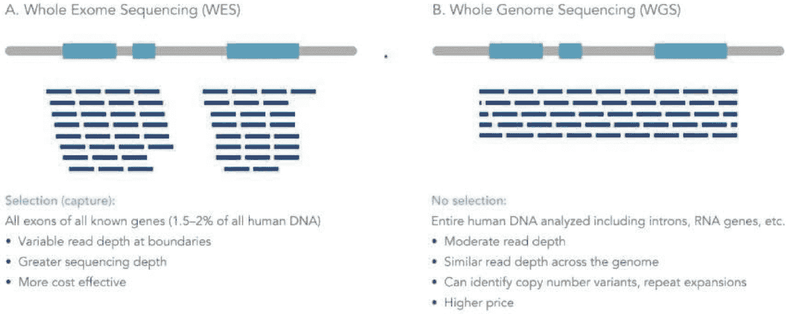

Figure 1: Genome mapping technique WES and WGS.

## 1.3 将 DL 技术整合到 GM 中的潜在应用

DL 在 GM 中的整合正在改变生物信息学和数据分析。DNN 在模式检测、表型预测和基因组变异分类方面表现出色（Singh 2020）。传统生物信息学在处理大数据集方面存在困难，但 DL 提高了效率和准确性。DL 有助于生物医学应用，如下一代测序，优化基因组数据上的参数和性能（Prasad et al. 2015, Aggarwal et al. 2022）。基于云的系统简化了遗传数据管理。DL 模型优于经典 ML 算法，如 XGBoost 和 LightGBM（He et al. 2023），超参数调优可提高效率。应用范围从预测遗传变异的影响到检测与疾病相关的突变。GDL 可以区分癌症类型并识别正常与异常组织，推动基于基因组学的诊断（Correa-Aguila et al. 2022, Tyagi et al. 2024）。

基因组学受益于 DL 整合，增强了 TFBS 识别和基因表达预测。DL 模型在评估错义突变和剪接位点等基因组元素方面优于传统 ML 算法。尽管 DL 有效，但具体方法仍不清楚。基因组分析还采用 WGS、WES、转录组学和蛋白质组学，尽管测序成本和数据量等挑战依然存在。未来研究可以专注于成本效益高的数据分析方法。总体而言，基因组学中 DL 的采用有望在基因组理解和精准医疗方面取得进展（Agrawal et al. 2024, Raza and Sajid 2022）。

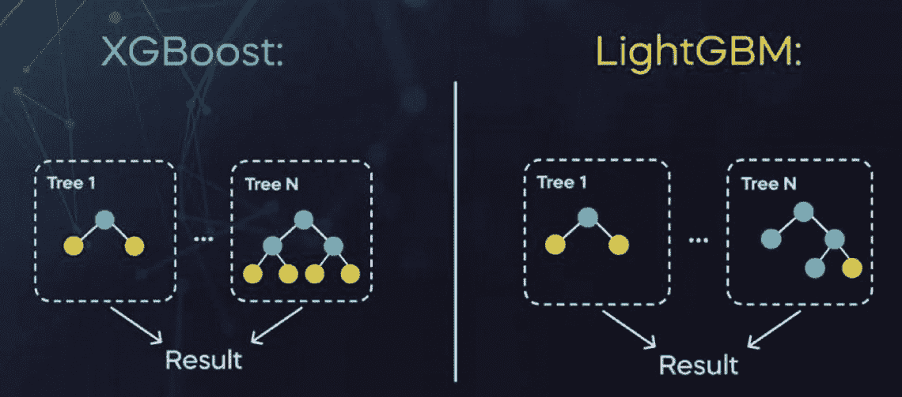

Figure 2: XGBoost and LightGBM model.

## 1.4 本章概述

本章探讨了 DL 与 GM 的交叉点，强调了 DL 在精准 GM 中的应用，涵盖个性化医疗、农业和进化生物学。它强调了准确、高效技术的必要性，并解决了传统 GM 方法的局限性，为 DL 整合铺平了道路。关键 DL 原则，包括神经网络、CNN 和 RNN，与 GM 任务相关进行了总结（Bilal and Sajid 2022）。本书中的一章探讨了深度学习（DL）算法如何识别微妙的数据模式，从而提高基因图谱的精度。它回顾了用于基因图谱（GM）的专用 DL 架构，包括序列到序列模型、注意力机制和生成对抗网络（GAN），以及它们独特的优势和应用。此外，它还解决了将 DL 整合到 GM 中的挑战，例如数据限制、可解释性和模型脆弱性，同时也提出了替代方法和未来研究机会（Sajid et al. 2022）。

本章探讨了深度学习（DL）在基因图谱（GM）中的实际应用案例，包括基因组变异检测、宏基因组学、表观基因组学和 `de novo` 基因组组装，展示了 DL 在解码遗传信息方面的变革性作用。它强调了生物信息学家、计算生物学家和机器学习（ML）专家之间的跨学科合作，承认该领域的跨学科性质。著作“Integrating DL Techniques for Accurate Genomic Mining: Techniques and Applications”全面分析了 DL 对基因组学的影响，为生物和计算研究人员提供了宝贵的见解（Sellamuthu et al. 2023）。

## 2 探索 DL 与基因组学的交叉点

深度学习（DL）和基因组学正处于科学创新的前沿，解决复杂的生物学挑战。基因组学研究基因组的结构、功能和进化，已被高通量测序所革新，使海量数据生成成为可能。DL 受神经处理启发，擅长分析大型复杂数据集，发现模式并预测结果。DL 与基因组学共同提供了强大的协同效应，推进了对遗传特征和疾病的理解，对个性化医疗、农业和进化生物学具有变革性的意义。


# Genomics Studies DNA Sequences

Genomics studies DNA sequences, often termed sequence information, with the human genome comprising 3 billion base pairs that determine genetic traits and disease susceptibility. Traditional genomic analysis methods, such as sequence alignment, variant calling, and annotation, rely on bioinformatics algorithms but struggle with complex genome variations like structural variants and epigenetic modifications. Deep learning (DL), particularly neural networks, addresses these challenges by learning intricate patterns from raw genomic data. DL models trained on extensive genomic datasets can uncover subtle relationships in genetic variation, gene expression, and regulatory mechanisms (Kumar et al. 2024).

Inspired by the visual cortex, CNNs are effectively applied in genomic sequence analysis, identifying regulatory motifs, predicting transcription factor binding sites, and annotating functional elements. RNNs and LSTM models excel in handling sequential data, aiding RNA secondary structure prediction and time-series gene expression analysis. Deep learning (DL) is transforming genomics by uncovering the functional impact of genetic variants, including SNPs, which influence gene expression and protein function, contributing to disease susceptibility. Traditional methods may overlook subtle yet significant variations, making DL a powerful tool for more precise genomic interpretation. Deep learning (DL) offers an advanced approach to identifying complex sequence patterns in genomic data. DL-based models can differentiate between pathogenic and benign variants in Mendelian disorders, cancer, and complex diseases, enhancing genetic disorder diagnosis and treatment (Indoria et al. 2023). Integrating deep learning (DL) with genomics presents challenges, including model interpretability, data privacy, and biases affecting underrepresented populations. Overcoming these issues requires collaboration among computational biologists, bioinformaticians, ethicists, and domain experts to ensure transparent and inclusive genomic applications.

# 3\. Advancements in GM through DL

Deep learning (DL) is transforming genetic mapping (GM), enabling precise decoding of genetic information. GM identifies an organism’s complete nucleotide sequence, essential for studying genetic variation, gene regulation, and evolution. Traditional methods like Sanger sequencing and array-based techniques have advanced genomic research but face limitations in scalability, resolution, and cost-effectiveness (Sweety Bakyarani et al. 2023).

Deep learning (DL) enhances variant calling by integrating multi-modal genomic data, including read alignments, base quality scores, and sequence context. This improves sensitivity and specificity, enabling the detection of rare and novel variants overlooked by traditional methods.

Deep learning (DL) advances genetic mapping (GM) by reconstructing complex genomic structures like chromosome conformation and genome architecture. Traditional methods such as FISH and 3C are labor-intensive and low-resolution, while DL models—like graph neural networks (GNNs) and GANs—predict 3D genome structures with high accuracy. By integrating chromatin accessibility, histone modification, and DNA methylation data, DL enhances understanding of gene regulation, genome folding, and diseaserelated chromosomal rearrangements.

Deep learning (DL) has transformed metagenomics, enabling the study of microbial communities’ genetic composition and functions DL algorithms like CNNs and RNNs enhance taxonomic classification, functional annotation, and community profiling. Trained on large-scale reference databases and simulated datasets, they accurately identify microbial species, predict functional pathways, and infer ecological relationships, facilitating the discovery of novel microorganisms, biomolecules, and biotechnological applications (Singh et al. 2024).

Interpreting deep learning (DL) model predictions and their biological relevance remains a challenge, necessitating collaboration among computational biologists, bioinformaticians, and domain experts. Ensuring DL algorithms’ robustness, scalability, and generalization across genomic datasets requires continuous research. Despite these hurdles, integrating DL with genetic mapping (GM) offers immense potential to advance scientific discovery, revolutionize healthcare, and tackle global challenges in agriculture, environmental conservation, and biotechnology (Piro et al. 2017).

# 4\. DL Techniques for Enhanced Genomic Precision

Deep learning (DL) enhances genomic precision, enabling efficient analysis of complex genetic data for applications in medicine, agriculture, and evolutionary biology. Neural network-based DL models identify intricate sequence patterns, improving variant calling, genome assembly, functional annotation, and epigenomic profiling.

Deep learning (DL) enhances variant calling by identifying genetic variations like SNPs and structural variants from high-throughput sequencing data. Traditional methods rely on heuristic rules, often leading to false positives or negatives, especially in complex genomic regions. DL models, such as CNNs and RNNs, excel at detecting patterns in raw sequencing data, improving sensitivity and specificity. Additionally, DL strengthens genomic precision by integrating multi-modal data—base quality scores, read alignments, and sequence context in `de novo` genome assembly. DL methods like GNNs and GANs overcome challenges posed by repetitive regions and structural variations, enabling more accurate genome reconstruction (Yad et al. 2022).

Deep learning (DL) enhances genome assembly by leveraging large datasets to reconstruct precise genomic sequences from raw reads. DL-based methods integrate multi-omic data—long-read sequencing, optical maps, and chromatin interactions—to improve assembly quality and resolve complex genomic structures. Additionally, DL techniques, including CNNs, RNNs, and attention mechanisms, advance functional genomics by predicting genetic variant effects and decoding regulatory elements within the genome (Howie et al. 2009).

Deep learning (DL) integrates multi-modal genomic data—chromatin accessibility, histone modifications and DNA methylation—to predict regulatory elements, transcription factor binding sites, and functional variant annotations. DL enhances epigenomic profiling, revealing gene regulation patterns in cellular differentiation and disease states. In metagenomics, DL techniques like CNNs, RNNs, and GNNs improve microbial classification, functional prediction, and ecological analysis enabling discoveries in microbial diversity, biomolecules, and biotechnological applications.

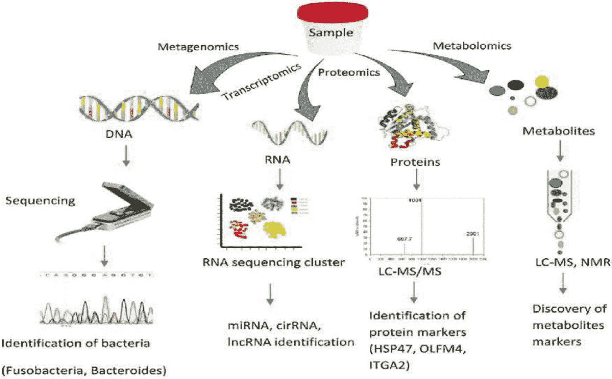

Figure 3: Multi-genomics technology.

Despite advancements, challenges remain in fully utilizing deep learning (DL) for genomic precision. Interpreting DL predictions and ensuring model robustness, scalability and generalization across diverse datasets require interdisciplinary collaboration and ongoing research. However, integrating DL techniques offers immense potential for scientific discovery, healthcare innovation, and addressing global challenges in agriculture, environmental conservation, and biotechnology (Kumar et al. 2023).

# 5\. The Role of Artificial Intelligence in Genomic Research

AI is transforming genomic research, enabling efficient analysis and interpretation of vast genetic data. Genomics, the study of an organism’s complete DNA, has advanced through AI-driven techniques, accelerating personalized medicine, disease insights, and agricultural improvements. Machine learning (ML) and deep learning (DL) uncover patterns, predict outcomes, and reveal novel biological phenomena in genomic datasets.


AI 在基因组研究中发挥着关键作用，特别是在变异检测和解释方面。它能识别影响疾病易感性、药物反应和进化的遗传变异——包括单核苷酸多态性（SNPs）、插入、缺失和结构变异。随机森林、支持向量机和深度学习（DL）等 AI 模型通过区分真实变异与测序伪迹，提高变异分类的灵敏度和特异性。AI 驱动的工具能预测遗传变异对蛋白质结构、基因表达和疾病风险的影响，从而辅助临床诊断和治疗。此外，AI 通过克服重复区域和结构变异等挑战，推动基因组组装，确保更准确的重建结果（Shaik et al. 2023）。

基于 AI 的方法，例如基于 DL 的图算法和生成对抗网络（GANs），通过识别 DNA 序列模式并直接从原始测序数据预测高质量组装结果，从而增强基因组组装。这些模型整合了多种测序技术，包括长读长测序和光学映射，以生成高度连续的基因组，从而促进新基因、调控元件和进化洞察的发现。

AI 驱动的功能基因组学利用卷积神经网络（CNNs）、循环神经网络（RNNs）和注意力机制等神经网络，解析基因调控和疾病关联。这些模型分析基因组序列和表观基因组特征，以预测基因表达、剪接和调控相互作用。通过整合多模态数据——染色质可及性、组蛋白修饰和 DNA 甲基化——AI 增强了基因组解释，揭示了用于药物发现和精准医疗的疾病特异性突变。

人工智能（AI）在宏基因组学中发挥着关键作用，分析微生物群落的遗传和功能方面。处理海量宏基因组数据集在分类学、功能注释和生态建模方面带来了计算挑战。卷积神经网络（CNNs）、循环神经网络（RNNs）和图神经网络（GNNs）等深度学习（DL）技术能高效分类微生物、预测功能并揭示生态相互作用。这些 AI 驱动的工具有助于发现新的微生物、生物分子和代谢途径，推动农业、环境保护和生物技术领域的应用。然而，要充分发挥 AI 在基因组研究中的作用，需要跨学科合作来解释模型预测并确保其生物学相关性。

确保 AI 算法在基因组数据集中的鲁棒性、可扩展性和泛化能力需要持续的研究和方法论进步。尽管面临挑战，AI 的整合推动了创新，实现了精确的数据分析，并加速了医学、农业和环境科学领域的发现。

## 6\. 将 DL 整合到 GM 中的方法

深度学习（DL）通过提高变异检测、基因组组装、功能注释和表观基因组分析的准确性、效率和可扩展性，增强了遗传图谱（GM）。利用神经网络和大型基因组数据集，DL 发现数据中的隐藏模式和关系，推动基因组分析的发展。深度学习（DL）通过改进变异检测，从高通量测序数据中识别遗传变异，从而增强遗传图谱（GM）。传统方法依赖启发式规则，常常会遗漏关键变异或测序错误。卷积神经网络（CNNs）和循环神经网络（RNNs）等 DL 技术直接从原始测序数据中学习模式，提高灵敏度和特异性。此外，DL 通过整合多模态基因组数据——染色质可及性和 DNA 甲基化——来优化变异检测。DL 还推动了 `de novo` 基因组组装，以更高的准确性重建完整的基因组序列。

深度学习（DL）方法，如图神经网络（GNN）和生成对抗网络（GANs），通过学习 DNA 序列层次结构并从原始测序读段预测准确的组装结果，增强基因组组装。这些模型整合长读长测序和光学映射，改善基因组重建，促进基因发现，并推动调控和进化研究。

深度学习（DL）通过预测遗传变异的影响并解码调控元件，增强功能基因组学。卷积神经网络（CNNs）、循环神经网络（RNNs）和注意力机制分析基因组序列和表观基因组模式，以预测基因表达、剪接和调控。DL 整合多模态数据——染色质可及性、组蛋白修饰和 DNA 甲基化——以解释表观基因组特征，并揭示细胞分化和疾病状态中的基因调控模式。此外，DL 通过高效分类微生物、注释功能以及从海量测序数据中建模生态相互作用，辅助宏基因组学。

深度学习（DL）方法，如卷积神经网络（CNNs）、循环神经网络（RNNs）和图神经网络（GNNs），通过提取微生物多样性指数、生态网络和生物技术相关洞察，增强宏基因组分析。这些模型有助于发现新的微生物、生物分子和代谢途径，用于农业、环境保护和生物技术应用。DL 在遗传图谱（GM）中的整合，提高了变异检测、基因组组装、功能注释和表观基因组分析的精度、可扩展性和有效性，推动了医学、农业和环境科学领域的研究。

## 7\. 机器学习在基因组测序中的应用

机器学习（ML）彻底改变了基因组测序，使海量遗传数据的高效分析成为可能。基因组测序确定生物体的完整 DNA 序列，需要先进的计算工具进行解释。机器学习技术——监督学习、无监督学习和强化学习——增强了变异检测、基因组重建、功能注释和生物过程分析，改善了个性化医疗和疾病理解。

机器学习（ML）技术，包括随机森林、支持向量机和深度神经网络（DNNs），通过分析标记的基因组数据来增强变异识别。这些模型利用序列上下文、碱基质量得分和比对结果，区分真实变异与测序错误，提高灵敏度和特异性。此外，基于 ML 的工具预测遗传突变对蛋白质结构、基因表达和疾病风险的影响，辅助临床诊断、预后和治疗选择。

机器学习（ML）通过重建完整的 DNA 序列，增强 `de novo` 基因组组装。传统算法在处理重复区域和结构变异方面存在困难，导致组装结果碎片化。隐马尔可夫模型、贝叶斯网络和生成对抗网络等 ML 技术通过学习 DNA 序列结构并从原始测序读段预测准确的组装结果，克服了这些挑战。

机器学习（ML）通过整合多种测序技术（如长读长测序和光学映射），增强基因组重建。它还在功能基因组学中发挥关键作用，预测遗传变异的影响并解释调控元件。决策树、随机森林和深度神经网络（DNNs）等 ML 模型提取基因组序列模式和表观基因组特征，从而实现对基因表达、剪接和调控相互作用的准确预测。

机器学习（ML）通过高效处理海量微生物测序数据，增强宏基因组分析。聚类、降维和深度神经网络（DNNs）等技术改进了分类学分类、功能注释和生态建模。这些模型有助于发现新的微生物、生物分子和代谢途径，推动农业、环境保护和生物技术领域的应用。

## 8\. 精准医疗的创新：DL 的贡献

### 8.1 个性化治疗建议


# 深度学习在精准医疗中的应用

深度学习（DL）分析基因组和临床数据，根据基因构成、疾病亚型和反应来个性化治疗。通过整合多组学数据——基因组学、转录组学、蛋白质组学和代谢组学——DL 预测药物疗效、不良反应和治疗结果，从而实现定制化治疗。

## 8.2 早期疾病检测

深度学习（DL）通过分析基因组和医学影像数据来检测早期疾病标志物。DL 算法（如用于 MRI 和 CT 扫描的算法）能以高准确率识别癌症、神经退行性疾病和心血管疾病的早期迹象，从而实现及时诊断和干预。

## 8.3 基因组变异解读

深度学习（DL）预测遗传变异对蛋白质结构、基因表达和疾病风险的影响。在大型数据集上训练的 DL 模型将变异分类为致病性、良性或不确定性，有助于基因检测和临床决策。

## 8.4 药物发现与开发

DL 通过预测药物-靶点相互作用、识别新型药物候选物和优化药物特性来加速药物发现与开发。DL 模型分析大规模生物学数据集，包括药物化学结构、蛋白质序列和基因表达谱，以预测药物疗效、毒性和脱靶效应，从而设计出更安全、更有效的治疗药物。

## 8.5 预测性生物标志物识别

深度学习（DL）识别治疗反应、疾病进展和患者预后的预测性生物标志物。通过整合基因组、临床和影像数据，DL 模型揭示分子特征和影像生物标志物，实现患者分层和个性化治疗策略。

## 8.6 临床决策支持系统

基于深度学习（DL）的临床决策支持系统增强疾病诊断、预后预测和治疗选择。通过分析电子健康记录、医学影像和基因组数据，这些系统提供实时建议，改善临床决策和患者护理。

## 8.7 基因组数据压缩与隐私保护

深度学习（DL）在保持基因组数据研究和临床实用性的同时对其进行压缩和匿名化处理。自动编码器和生成对抗网络（GANs）等模型创建紧凑表示，降低维度并保护患者隐私，以实现安全的数据共享和分析。

## 8.8 实时监测与干预

深度学习（DL）通过可穿戴设备、生物传感器和移动应用实现实时健康监测。通过分析生理数据——心率、血压和活动水平——DL 检测早期健康恶化，触发及时干预，并优化治疗，使患者能够管理自身健康。

## 8.9 人群健康管理

深度学习（DL）分析大规模医疗数据，以揭示健康趋势、风险因素和差异，从而为公共卫生策略提供依据。通过整合基因组、临床和环境数据，DL 识别遗传易感性、环境影响和社会决定因素，实现针对性干预和精准健康政策。

## 8.10 跨领域整合

深度学习（DL）整合基因组、临床、影像和环境数据，以揭示疾病机制。使用多模态融合和迁移学习，DL 模型统一多样化数据集和治疗洞察。

深度学习（DL）通过个性化治疗、早期疾病检测、药物发现、生物标志物识别、临床决策支持和人群健康管理，彻底改变了精准医疗。通过整合多样化的数据模态，DL 提升了各种疾病的诊断、靶向治疗和患者预后。

# 9 基因组学与深度学习的挑战与机遇

基因组学和深度学习（DL）为生物学、精准医疗和全球健康提供了变革性潜力。然而，必须解决数据质量、可解释性和可扩展性等挑战，才能释放其全部影响。探索这些挑战和机遇将塑造基因组研究的未来进步。

## 9.1 挑战

**数据质量和数量：** 基因组数据集通常存在噪声、异质性和不完整性，给深度学习（DL）模型带来挑战。特别是针对罕见变异和复杂疾病的标注数据有限，进一步增加了训练难度。改进数据质量、标准化以及跨研究机构的协作对于克服这些问题至关重要。

**可解释性：** 深度学习（DL）模型通常充当黑箱，使得解释和生物学洞察变得复杂。增强可解释性对于理解基因型-表型关系、识别致病变异以及在临床实践中应用研究结果至关重要。开发可解释的 DL 架构和事后技术可提高基因组学中的信任度和实用性。

**泛化性和可迁移性：** 深度学习（DL）模型在跨越不同人群或任务时往往难以泛化，导致有偏预测。增强可迁移性需要多样化的训练数据集、稳健的评估框架和领域自适应技术，以考虑人群特异性和情境性变化。

**伦理和隐私问题：** 基因组数据带来伦理和隐私风险，包括安全性、同意和滥用问题。深度学习（DL）模型可能会无意中暴露敏感信息，导致隐私泄露。加强数据治理、应用隐私保护技术以及确保算法决策的透明度对于伦理基因组研究至关重要。

**计算资源和可扩展性：** 基因组学中的深度学习（DL）需要大量计算能力，包括高性能基础设施和专用加速器。为大规模基因组数据集扩展 DL 会对训练、推理和部署构成挑战。针对并行计算优化架构，并利用云和容器化技术，可提高效率和可扩展性。

**机遇：发现新型生物标志物和治疗靶点：** 深度学习（DL）通过分析多组学数据来识别生物标志物、疾病亚型和治疗靶点。它揭示了基因组学、转录组学、蛋白质组学和代谢组学中的隐藏模式，通过定制化治疗推动精准医疗发展。

**药物发现与开发：** 深度学习（DL）通过预测药物-靶点相互作用、识别新型候选物和优化特性来加速药物发现。通过分析生物学数据集——化学结构、蛋白质序列和基因表达——DL 模型评估疗效、毒性和脱靶效应，从而实现更安全、更有效的治疗药物。

**临床决策支持系统：** 基于深度学习（DL）的临床决策支持系统增强疾病诊断、预后预测和治疗选择。通过分析电子健康记录、医学影像和基因组数据，这些系统提供实时建议，改善临床决策和患者护理。

**人群健康管理：** 深度学习（DL）分析医疗数据以揭示健康趋势、风险因素和差异，从而为公共卫生策略提供依据。通过整合基因组、临床和环境数据，DL 识别遗传易感性、环境影响和社会决定因素，实现针对性干预和精准健康政策。

**跨领域整合：** 深度学习（DL）整合基因组、临床、影像和环境数据，以揭示疾病机制。使用多模态数据融合和迁移学习，DL 模型统一多样化数据集，以进行全面的疾病分析和治疗洞察。


基因组学和深度学习（DL）面临挑战，但为生物学、医疗保健和全球健康提供了巨大的潜力。解决数据质量、可解释性和可扩展性等问题，将释放其全部影响，推动科学发现和医学进步。

## 10\. 从数据到诊断：人工智能驱动的基因组分析

人工智能的进步彻底改变了基因组分析，使研究人员能够从海量基因组数据中提取洞察，以实现精确的诊断和治疗。利用机器学习和深度学习，人工智能增强了对遗传变异、疾病机制和个性化医学的理解（Indoria 等人，2023）。

### 10.1 数据集成与预处理

人工智能驱动的基因组分析整合和预处理多样化的基因组数据集，将 DNA 序列、表观基因组特征和临床表型转换为计算分析的格式。机器学习通过质量控制、标准化和特征提取确保数据可靠性。

变异检测与解释 人工智能通过变异检测增强基因组分析，从测序数据中识别遗传变异。机器学习算法基于序列上下文、质量得分和比对数据对变异进行分类，而深度学习模型通过学习复杂模式并整合多模态基因组数据来提高准确性。人工智能驱动的工具预测变异对蛋白质结构、基因表达和疾病风险的影响，帮助基因检测和临床决策。

疾病亚型分型与生物标志物发现 人工智能驱动的基因组分析识别疾病亚型和预测治疗反应及患者预后的生物标志物。机器学习分析多组学数据以揭示分子特征，而深度学习模型（如自编码器和生成对抗网络）增强疾病亚型分型和生物标志物发现。整合临床和基因组数据，使针对个体基因组特征的精准医疗成为可能。

### 10.2 临床决策支持系统

人工智能驱动的基因组分析通过诊断疾病、预测预后和优化治疗来增强临床决策支持。机器学习模型评估疾病风险和治疗反应，而深度学习分析医学影像，以高精度检测癌症和神经退行性疾病等疾病的早期迹象。

### 10.3 挑战与未来方向

人工智能驱动的基因组分析在数据质量、可解释性、泛化性和伦理方面面临挑战。增强数据共享、标准化和协作至关重要。开发可解释的人工智能模型并解决隐私问题，可确保负责任地使用。未来方向包括将人工智能整合到临床实践中、在不同人群中验证模型，以及利用联邦学习等技术实现安全、可扩展的基因组分析，推动医疗保健创新。

#### 10.3.1 深度学习在遗传学研究中的未来前景

深度学习（DL）将通过增强疾病理解、识别治疗靶点和推进精准医疗来改变遗传学研究。随着深度学习的发展，它将解决关键挑战，推动基因组学领域的科学发现和创新（Kumar 等人，2024）。

##### 10.3.1.1 增强的变异检测与解释

深度学习（DL）通过学习复杂的基因组模式来增强变异检测。通过整合多模态基因组数据——DNA 测序、表观基因组学和转录组学——深度学习预测遗传变异对疾病风险、基因表达和蛋白质功能的影响，改善诊断、预后和治疗选择。

##### 10.3.1.2 疾病风险和治疗反应的预测建模

深度学习（DL）模型将利用基因组特征，完善疾病风险和治疗反应的预测建模。通过分析大规模基因组和临床数据，它们将识别与疾病易感性和进展相关的标志物，实现个性化风险评估、早期干预和靶向治疗。

### 10.4 药物发现与开发

深度学习（DL）通过预测药物-靶点相互作用、识别新候选物和优化特性来加速药物发现。通过分析生物学数据集——化学结构、蛋白质序列和基因表达——深度学习模型评估疗效、毒性和药代动力学，实现更安全、更有效的治疗药物。

### 10.5 基因组编辑与基因治疗

深度学习（DL）通过优化 CRISPR-Cas9 设计、预测脱靶效应和优化序列选择来提高基因组编辑的精度。它还通过预测基因修饰对细胞功能和疾病表型的影响来推进基因治疗。

### 10.6 多组学整合与系统生物学

深度学习（DL）整合多组学数据——基因组学、转录组学、蛋白质组学和代谢组学——以解码疾病机制并识别治疗靶点。通过学习分层生物相互作用，深度学习增强治疗策略，加速靶向治疗的开发。

### 10.7 可扩展性与泛化性

深度学习（DL）的未来进步将增强分子模型在多样化基因组数据集中的可扩展性和泛化性。数据的增长和多样化将优化性能，而改进的硬件和分布式计算将提高效率。将尖端基因组技术与深度学习相结合，将加深对遗传疾病的理解，推动精准医疗的突破。

## 11\. 结论

深度学习（DL）显著推进了基因组图谱（GM），提高了基因组学、个性化医学和进化生物学的准确性、速度和容量。通过整合卷积神经网络、循环神经网络和其他深度学习技术，研究人员改进了测序分析和结构变异检测。随着技术的发展，深度学习驱动的基因组学有望为分子生物学提供突破性洞察，并为人类健康带来变革性应用。

## 参考文献

*   Aggarwal, R., Tiwari, S. and Joshi, V. (2022). 基于眼动检测的考试监考分类。第 3 届智能电子与通信国际会议，ICOSEC 2022—论文集，371–376。[`doi.org/10.1109/ICOSEC54921.2022.9951987`](https://dx.doi.org/10.1109/ICOSEC54921.2022.9951987)。

*   Agrawal, T., Choudhary, P., Kumar, V., Singh, P., Diwakar, M. et al. (2024). 使用深度神经网络对不平衡数据集进行脑肿瘤分类的比较研究。生物医学信号处理与控制，94: 106256。

*   Asada, K., Kaneko, S., Takasawa, K., Machino, H., Takahashi, S. et al. (2021). 使用机器学习技术整合全基因组和表观基因组数据：迈向精准肿瘤学的建立。肿瘤学前沿，11: 666937。

*   Bilal, K. and Sajid, M. (2022). 区块链技术：机遇与挑战。2022 年商业与工业数据分析国际会议（ICDABI），第 519–524 页，IEEE。[`doi.org/10.1109/ICDABI56818.2022.10041562`](https://dx.doi.org/10.1109/ICDABI56818.2022.10041562)。

*   Boehm, K. M., Khosravi, P., Vanguri, R., Gao, J., Shah, S. P. et al. (2022). 利用多模态数据整合推进精准肿瘤学。自然评论癌症，22(2): 114–126。

*   Bohat, V. K. (2021). 基于音乐类型的音乐推荐神经网络模型。2021 年计算机通信与信息学国际会议，ICCCI 2021。[`doi.org/10.1109/ICCCI50826.2021.9402621`](https://doi.org/10.1109/ICCCI50826.2021.9402621)。

*   Correa-Aguila, R., Alonso-Pupo, N. and Hernández-Rodríguez, E. W. (2022). 精准肿瘤学的多组学数据整合方法。分子组学，18(6): 469–479。


# 参考文献

*   Erfanian, N., Heydari, A. A., Feriz, A. M., Iañez, P., Derakhshani, A. et al. (2023). Deep learning applications in single-cell genomics and transcriptomics data analysis. Biomedicine & Pharmacotherapy, 165: 115077.

*   He, X., Liu, X., Zuo, F., Shi, H., Jing, J. et al. (2023, January). Artificial intelligence-based multi-omics analysis fuels cancer precision medicine. In Seminars in Cancer Biology (Vol. 88, pp. 187–200). Academic Press.

*   Howie, B. N., Donnelly, P. and Marchini, J. (2009). A flexible and accurate genotype imputation method for the next generation of genome-wide association studies. PLoS Genetics, 5(6): e1000529.

*   Indoria, D., Narendra Kiran, P. B., Kumar, A., Goel, M., Shelke, N. A. et al. (2023). Artificial intelligence and machine learning in human resource management and market research for enhanced effectiveness and organizational benefits. 2023 International Conference on Computing, Communication, and Intelligent Systems (ICCCIS), Greater Noida, India, pp. 1135–1140, doi: [10.1109/ICCCIS60361.2023.10425709](http://dx.doi.org/10.1109/ICCCIS60361.2023.10425709).

*   Kumar, S., Singh, J., Ravi, V., Singh, P., Al Mazroa, A. et al. (2024). Deep learning and MRI biomarkers for precise lung cancer cell detection and diagnosis. The Open Bioinformatics Journal, 17(1).

*   Kumar, S., Singh, M. P., Nayak, S. R., Khan, A. U., Jain, A. K. et al. (2023). A new efficient referential genome compression technique for FastQ files. Functional & Integrative Genomics, 23(4): 333.

*   Mall, S. (2023). Heart diagnosis using deep neural networks. In 2023 International Conference on Computational Intelligence and Knowledge Economy (ICCIKE), pp. 7–12, IEEE. [`doi.org/10.1109/ICCIKE58312.2023.10131696`](https://doi.org/10.1109/ICCIKE58312.2023.10131696).

*   Piro, V. C., Matschkowski, M. and Renard, B. Y. (2017). MetaMeta: Integrating metagenome analysis tools to improve taxonomic profiling. Microbiome, 5: 1–11.

*   Prasad, M., Li, D. L., Lin, C. T., Prakash, S., Joshi, S. et al. (2015). Designing mamdani-type fuzzy reasoning for visualizing prediction problems based on collaborative fuzzy clustering. IAENG International Journal of Computer Science. [`www.iaeng.org/IJCS/issues\_v42/issue\_4/IJCS\_42\_4\_12.pdf`](https://www.iaeng.org/IJCS/issues_v42/issue_4/IJCS_42_4_12.pdf).

*   Raza, S. M. and Sajid, M. (2022). Vehicle routing problem using reinforcement learning: Recent advancements. In Lecture Notes in Electrical Engineering, Vol. 858. [`doi.org/10.1007/978-981-19-0840-8\_20`](https://doi.org/10.1007/978-981-19-0840-8_20).

*   Sajid, M., Gupta, S. K. and Haidri, R. A. (2022). Artificial intelligence and blockchain technologies for smart city. Intelligent Green Technologies for Sustainable Smart Cities, 317–330. [`doi.org/10.1002/9781119816096.ch15`](https://doi.org/10.1002/9781119816096.ch15).

*   Sajid, M., Yadav, C. S., Singh, S. S. and Saini, M. (2022). A novel deep neural-based music recommendation method considering user and song data. In 2022 6th International Conference on Trends in Electronics and Informatics (ICOEI), pp. 1–7, IEEE. [`doi.org/10.1109/ICOEI53556.2022.9776660`](https://doi.org/10.1109/ICOEI53556.2022.9776660).

*   Sapoval, N., Aghazadeh, A., Nute, M. G., Antunes, D. A., Balaji, A. et al. (2022). Current progress and open challenges for applying deep learning across the biosciences. Nature Communications, 13(1): 1728.

*   Sellamuthu, S., Vaddadi, S. A., Venkata, S., Petwal, H., Hosur, R. et al. (2023). AI-based recommendation model for effective decision to maximise ROI. Soft Computing, 1–10. [`doi.org/10.1007/s00500-023-08731-7`](https://doi.org/10.1007/s00500-023-08731-7).

*   Shaik, N., Kumar, B. V., Bhati, A., Kumar, S., Singh, J. et al. (2023). Integrating random forest and support vector regression models for optimized energy consumption evaluation in cloud computing data centers. 2023 3rd International Conference on Technological Advancements in Computational Sciences (ICTACS), Tashkent, Uzbekistan, pp. 451–456, doi: [10.1109/ICTACS59847.2023.10390070](http://dx.doi.org/10.1109/ICTACS59847.2023.10390070).

*   Sharan, A. (2015). Co-occurrence and semantic similarity based hybrid approach for improving automatic query expansion in information retrieval. In Lecture Notes in Computer Science (including subseries Lecture Notes in Artificial Intelligence and Lecture Notes in Bioinformatics) (Vol. 8956).

*   Singh, J., Mishra, A. K., Chopra, L., Agarwal, G., Diwakar, M. et al. (2024). Eagle eye: Enhancing online exam proctoring through AI-powered eye gaze detection. Innovations in Electrical and Electronic Engineering. ICEEE 2023. Lecture Notes in Electrical Engineering, Vol. 1115. Springer, Singapore. [`doi.org/10.1007/978-981-99-8661-3\_13`](https://doi.org/10.1007/978-981-99-8661-3_13).

*   Singh, P. (2020). Learning based driver drowsiness detection model. Proceedings of the 3rd International Conference on Intelligent Sustainable Systems, ICISS 2020, 698–701. [`doi.org/10.1109/ICISS49785.2020.9316131`](https://doi.org/10.1109/ICISS49785.2020.9316131).

*   Singh, S. S., Srivastva, D. and Verma, M. (2022). Influence maximization frameworks, performance, challenges and directions on social network: A theoretical study. Journal of King Saud University-Computer and Information Sciences, 34(9): 7570–7603. [`doi.org/10.1016/j.jksuci.2021.08.009`](https://doi.org/10.1016/j.jksuci.2021.08.009).

*   Sweety Bakyarani, E., Singh, N. P., Shekhawat, J., Bhardwaj, S., Chaku, S. et al. (2024). A novel approach on deep reinforcement learning for improved throughput in power-restricted IoT networks. Innovations in Electrical and Electronic Engineering. ICEEE 2023. Lecture Notes in Electrical Engineering, Vol. 1115. Springer, Singapore. [`doi.org/10.1007/978-981-99-8661-3\_5`](https://doi.org/10.1007/978-981-99-8661-3_5).

*   Tran, K. A., Kondrashova, O., Bradley, A., Williams, E. D., Pearson, J. V. et al. (2021). Deep learning in cancer diagnosis, prognosis and treatment selection. Genome Medicine, 13: 1–17.

*   Tyagi, A., Khandelwal, R., Shelke, N. A., Singh, J., Rajpal, D. et al. (2024). Comparitive analysis of various transfer learning apporaches in deep CNNs for image classification. Recent Trends in Image Processing and Pattern Recognition. RTIP2R 2023. Communications in Computer and Information Science, Vol. 2026. Springer, Cham. [`doi.org/10.1007/978-3-031-53082-1`](https://doi.org/10.1007/978-3-031-53082-1).

*   Yadav, A., Kumar, S. and Singh, J. (2022). A review of Physical Unclonable Functions (PUFs) and its applications in IoT environment. In Lecture Notes in Networks and Systems (Vol. 356).

*   Bohat, V. K. (2021). Neural network model for recommending music based on music genres. 2021 International Conference on Computer Communication and Informatics, ICCCI 2021. [`doi.org/10.1109/ICCCI50826.2021.9402621`](https://doi.org/10.1109/ICCCI50826.2021.9402621).

*   Correa-Aguila, R., Alonso-Pupo, N. and Hernández-Rodríguez, E. W. (2022). Multiomics data integration approaches for precision oncology. Molecular Omics, 18(6): 469–479.

*   Erfanian, N., Heydari, A. A., Feriz, A. M., Iañez, P., Derakhshani, A. et al. (2023). Deep learning applications in single-cell genomics and transcriptomics data analysis. Biomedicine & Pharmacotherapy, 165: 115077.


# 第 5 章 使用深度学习和图像处理技术分析基因组

*Jagendra Singh*,^(³)

电子邮件：ishaansingh.iitd@gmail.com, sahu.dinesh1230@gmail.com, nidhi@bennett.edu.in, shwetachaku347@gmail.com, rekhasaha@yahoo.com, h.imran@northeastern.edu

DOI: [10.1201/9781003516729-5](https://dx.doi.org/10.1201/9781003516729-5)

本研究探讨了使用深度学习模型——`VGG16`、`VGG19`、`Inception V3` 和 `ResNet50`——来利用 Kaggle 和医院的病理组织图像进行乳腺癌诊断。预训练模型经过优化，并在准确率、数据损失、精确率、召回率和 F1 分数方面进行了评估。`VGG19` 取得了最高的准确率（99.50%）和最小的数据损失（0.030），优于其他模型。这些 AI 驱动的技术提高了诊断精度，使自动化病理组织分析成为可能，从而实现更快、更可靠的癌症检测，推动医学影像和患者护理的发展。

## 1\. 简介


乳腺癌仍然是导致发病率和死亡率的主要原因，迫切需要改进诊断方法（Zafar et al. 2023，Bhosale and Patnaik 2023，Lee 2023）。早期且精确的检测能提高治疗效果，但常规方法存在局限性。作为标准筛查工具的乳腺 X 线摄影常会产生假阳性和假阴性结果，导致焦虑、不必要的操作以及诊断延迟。放射科医生的主观解读进一步加剧了诊断一致性的问题（Zhang et al. 2024，Prasad et al. 2015，Sellamuthu et al. 2023，Singhal et al. 2023）。

AI 驱动的深度学习正在改变医学影像，提高诊断的准确性和效率。卷积神经网络（`CNNs`）通过学习特征的空间层次结构，在癌症检测方面表现出色，使其成为分析病理切片的理想选择。它们的集成提高了诊断精度，加快了分析速度，并推动了患者护理的进步（Kumar et al. 2022，Mall 2023）。

深度学习模型能高效分析病理组织学图像以进行癌症诊断，在区分癌组织与非癌组织方面实现了高准确率（Lin and Li 2017，Prasad et al. 2016）。它们能够以强大的灵敏度和特异性对乳腺病变进行精确分类。处理海量数据集的能力支持自动化诊断系统，减轻了病理学家的工作量，并加速了复杂病例的评估（Raza and Sajid 2022）。

尽管对病理组织学图像分析中的深度学习进行了大量研究，但比较研究仍然有限。大多数研究关注单一模型的性能，在确定乳腺癌分类的最佳模型方面仍存在差距。虽然`VGG16`已显示出有效性，但一些研究偏好`ResNet50》，然而很少有全面的比较研究。这种分析的缺乏阻碍了模型选择的明智决策（Bilal and Sajid 2022，Sajid et al. 2022，Sahu et al. 2024）。

## 2 文献综述

许多先前的研究使用的数据集可能无法充分代表所有乳腺癌病例。为了确保深度学习模型在现实环境中适用，涵盖各种癌症分期和组织学类型的多样化数据集至关重要。一项仅关注早期乳腺癌的研究对晚期患者缺乏相关性，限制了实际实施并影响患者护理和预后（Sahu et al. 2023，Garg et al. 2023）。虽然深度学习推动了乳腺癌诊断的进步，但其实时临床应用仍然有限。将这些技术集成到常规实践中可以增强诊断，但必须解决病理实验室中快速周转时间和图像质量参差不齐等挑战。运营效率方面的研究至关重要（Garg et al. 2023，Singh et al. 2024）。

本研究评估了深度学习架构——`VGG16`、`VGG19`、`Inception V3`和`ResNet50`——用于利用病理组织学图像对乳腺癌进行分期。虽然它们在图像分类方面有效，但其在乳腺癌诊断中的稳健性仍不确定。使用高质量的标记数据集，该研究评估了它们在识别和分类癌症分期方面的准确性（Kaliyar et al. 2024）。

本研究强调将深度学习模型集成到实时临床工作流程中，帮助病理学家自动化病理切片分析。AI 驱动的解决方案通过减少工作量和加快诊断来改善乳腺癌诊断，从而改善患者预后。对运营效率的关注弥合了学术研究与实际临床应用之间的差距（Obayya et al. 2023，Kavitha et al. 2022）。本研究纳入了多样化的训练数据集，包括各种癌症分期和组织学类型，以增强深度学习模型的稳健性和泛化能力。这种多样性提高了分类准确性，确保了现实世界临床适用性（Diwakar et al. 2021）。

## 3 方法论

本研究开发了一种基于深度学习的解决方案，利用来自 Kaggle 和医院的 1,050 张病理组织学图像对乳腺癌进行分期。平衡的分类模型确保了无偏结果。经验丰富的医生对图像进行标记以确保准确性，提高了数据集的质量和可靠性。

预处理通过确保一致性、归一化像素值和缩放数据，来优化深度学习的医学图像数据集。增强技术——旋转、翻转和缩放——扩大了数据集规模并增强了模型稳健性，防止过拟合。

数据集被分为 70%用于训练和 30%用于测试。深度学习模型——`VGG16`、`VGG19`、`ResNet50`和`Inception V3`——被训练用于从病理组织学图像中分类癌症分期。这些`CNNs`以其强大的图像识别能力而闻名，能够有效处理癌症进展中的细微差异。

 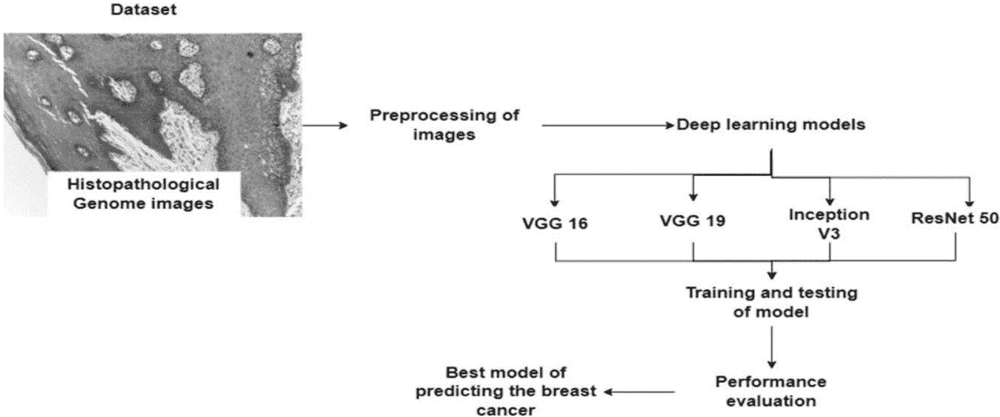

Figure 1: Architecture of the proposed system.

`VGG16`和`VGG19`是使用顺序卷积和池化层的深度`CNNs`，在检测早期和晚期癌症分期方面表现出色。`ResNet50`采用残差学习来捕捉复杂特征，增强分类准确性。`Inception V3`的多分支架构在多个层级处理图像，提高了癌症检测的精度。每个模型的性能在训练期间进行了评估，以防止过拟合。早期停止和丢弃等技术确保了对新数据的泛化。优化算法`Adam`和`SGD`优化了模型权重，以最小化分类错误。

训练后，模型在剩余的 30%数据集上进行了测试。性能指标——准确率、精确率、召回率和 F1 分数——评估了分类效果。精确率和召回率衡量了正确识别癌症分期的情况，而准确率反映了整体预测的可靠性。F1 分数平衡了精确率和召回率，确保了稳健的模型评估。评估确定了用于实时癌症诊断的最佳模型。微调优化了其在区分癌症分期方面的准确性，使其能够集成到医疗应用中，实现更快、更精确的乳腺癌检测。

## 4 图像预处理

预处理对于深度学习模型准确分类病理组织学乳腺癌图像至关重要。本研究使用了来自 Kaggle 和医院的 1,050 张图像，通过调整大小、归一化和降噪对其进行优化，以增强用于分期分类的特征提取。

第一个预处理步骤是通过将所有图像调整为 224 × 224 像素来标准化图像尺寸，确保深度学习模型（如`VGG16`、`VGG19`、`ResNet50`和`Inception V3`）的一致性。这种一致性通过专注于相关特征来提高模型性能。


Normalization 将图像像素强度精炼到 0–1 范围，稳定深度学习模型训练。在本研究中，像素值除以 255，确保一致性并加快收敛。数据增强通过对有限的 1,050 张图像数据集应用翻转、旋转、缩放和平移等变换来增强模型鲁棒性。该技术扩展了数据集多样性，提高了对未见数据的泛化能力，并减少了深度学习模型中的过拟合。为了增强图像清晰度，对组织病理学图像应用了高斯滤波以减少噪声。该技术在保留关键结构的同时平滑图像，确保深度学习模型专注于关键细胞模式以实现准确的癌症分割。分割通过隔离富含癌症相关特征（如细胞结构和组织模式）的关键感兴趣区域（ROIs）来增强组织病理学图像分析。阈值等技术将 ROI 与背景分离，而形态学操作——腐蚀和膨胀——则细化分割区域，减少噪声并提高分类准确性。颜色归一化标准化组织病理学图像，减少染色、照明或成像变化引起的偏差。Reinhard 方法将图像颜色分布与参考图像对齐，确保模型关注癌症相关特征而非颜色强度。数据集被分为 70% 用于训练和 30% 用于测试，确保对模型进行彻底评估。每个子集都保持了癌症分期的均等表示，防止偏差并提高分类准确性。

## 5 深度学习模型

深度学习模型，包括 `VGG16`、`VGG19`、`ResNet50` 和 `Inception V3`，通过学习区分特征从组织病理学图像中分类乳腺癌分期。它们是 CNN 的一些变体。它们捕捉空间层次结构（从边缘到复杂纹理）的能力使其在图像分类中非常有效 (Singh et al. 2021)。

本研究将基于卷积的深度学习模型直接应用于输入图像以提取局部特征。在数学上，对于输入图像 `I` 和滤波器 `K`，位置 `(i, j)` 处的输出特征图 `S(i, j)` 由以下公式给出：

(1)  

```
$$S(i,j) = (I \\ast K)(i,j) = \\sum\\limits\_{m}\\sum\\limits\_{n}I(m,n)K(i - m,j - n)$$  
```

这里，`I(m, n)` 表示位置 `(m, n)` 处的像素值，而 `K(i−m, j−n)` 是相应的滤波器值。该操作将滤波器在图像上滑动，计算滤波器与图像补丁之间的点积。生成的特征图突出特定模式，例如边缘或纹理。每个卷积层中的多个滤波器捕捉多样的图像特征。

卷积之后，非线性激活函数增强特征图，使模型能够学习复杂模式。本研究采用整流线性单元 (`ReLU`)，定义为：

(2)  

```
*f*(*x*) = max (0, *x*)  
```

`ReLU` 将负值替换为零，同时保留正值，引入了捕捉图像数据中复杂关系所必需的非线性。这提高了模型在医学图像分析中的有效性，特别是癌症分期分类。

`VGG16` 和 `VGG19` 是具有 16 层和 19 层的深度 CNN 架构，分别包括卷积层、池化层和全连接层。

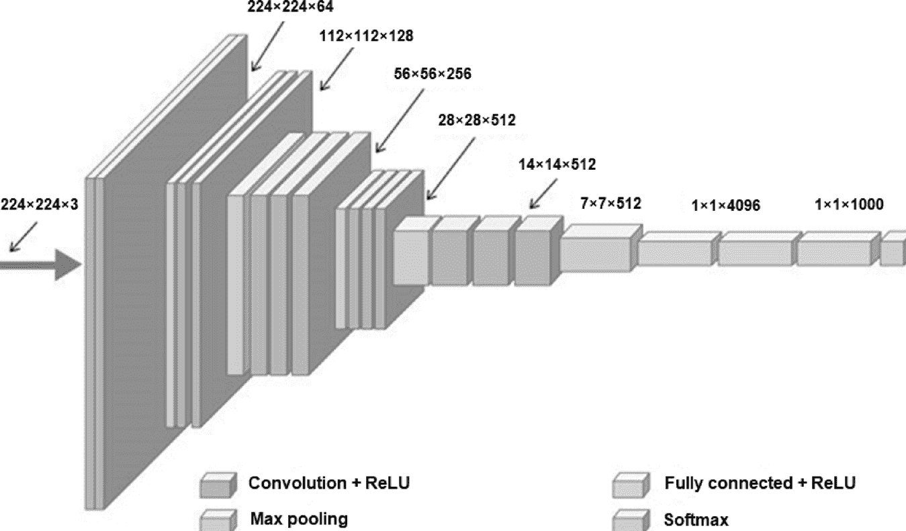

图 2：VGG 16 架构。

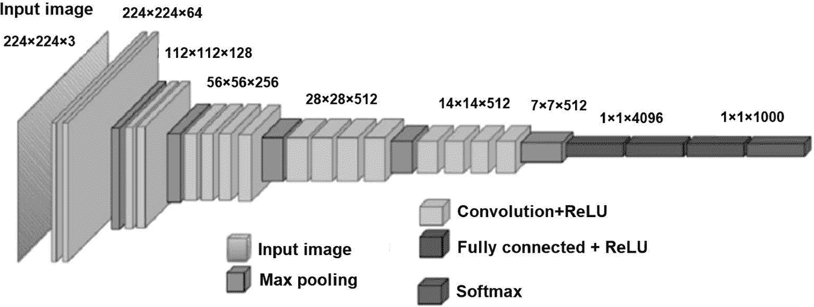

图 3：VGG 19 架构。

它们使用小 `3 × 3` 滤波器来捕捉精细图像细节，随后进行最大池化以减少空间维度，同时保留关键特征 (Singh et al. 2024, Kaliyar et al. 2024, Diwakar et al. 2020)。

最大池化选择特征图中定义窗口内的最高值：

(3)  

```
$$M(i,j) = \\max\_{q \\leq j + f}^{p < i + f}s(p,q)$$  
```

这里，`M(i, j)` 表示位置 `(i, j)` 处的输出，`f` 是池化窗口大小。该过程对特征图进行下采样，降低计算复杂度，同时保留关键特征。`VGG` 模型中的全连接层随后使用展平的特征图来预测输入图像类别 (Obayya et al. 2023, Kavitha et al. 2022)。最终分类使用 softmax 函数执行，将网络输出转换为概率分布：

(4)  

```
$$P(x) = \\frac{e^{z\_{k}}}{\sum\_{i = 1}^{K}e^{z\_{i}}}$$  
```

条件概率 `P(y = k|x)` 表示输入图像 `x` 属于类别 `k` 的可能性，其中 `zk` 是网络分配给类别 `k` 的分数，`K` 是类别总数。softmax 函数确保输出概率之和为一，使其适用于多类分类任务，例如乳腺癌分期分期。`ResNet50` 引入残差学习以解决深度网络中的梯度消失问题。这种方法使模型能够学习残差映射，而不是在每一层进行完整变换 (Diwakar et al. 2021)。`ResNet` 的核心是残差块，它在卷积层中包含恒等映射（快捷连接）。在数学上，它定义为：

(5)  

```
*y* = *F*(*x*,{*W*[*i*]}) + *x*  
```

其中 `y` 是残差块输出，`F(x,{Wi})` 表示使用权重 `Wi` 学习的变换，`x` 是输入。快捷连接允许直接输入相加，使更深的网络（例如 50 层的 `ResNet50`）在不降低准确性的情况下成为可能。这种结构提高了复杂任务（如医学图像分类）的效率，确保在深层中不丢失关键特征。

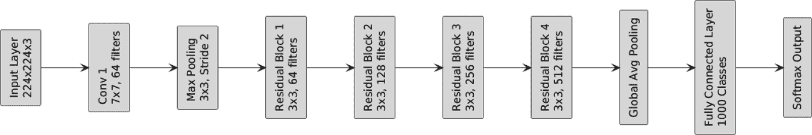

图 4：ResNet 50 架构。

`Inception V3` 在每个 Inception 模块中采用并行卷积操作，使用 `1 × 1`、`3 × 3` 和 `5 × 5` 滤波器来增强图像表示 (Diwakar et al. 2021, Diwakar et al. 2020)。在数学上，这表示为：

(6)  

```
*O* = \*C**o**n**v*[1 × 1,*C**o**n**v*3 × 3,*C**o**n**v*5 × 5\]  
```

其中 `O` 是应用于输入 `x` 的卷积的串联输出。该架构捕捉精细细节和更广泛的结构，使其非常适合癌症分期识别中的多尺度分析。`Inception V3` 还集成了批量归一化 (`BN`) 以稳定和加速训练，调整层输出以保持训练批次之间一致的均值和方差。这防止了内部协变量偏移，确保更快的收敛。

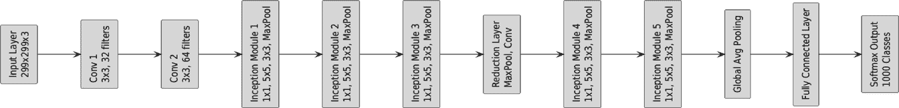

图 5：Inception V3 架构。

本研究采用随机梯度下降 (`SGD`) 作为优化算法，以最小化损失函数，该函数量化预测类别标签与实际类别标签之间的差异。类别交叉熵适用于多类分类，定义为：

(7)  

```
$$L = - \\sum\\limits\_{i = 1}^{N}\\sum\\limits\_{c = 1}^{C}y\_{ic}\\log y^{\\land}ic$$  
```

其中 `N` 是训练样本数量，`C` 表示类别，`yic` 是样本 `i` 中类别 `c` 的实际标签，`y^ic` 是类别 `c` 的预测概率。优化迭代调整模型权重以最小化此损失。在训练期间，反向传播计算损失函数相对于模型参数的梯度，然后使用 `SGD` 更新这些梯度 (Singh et al. 2021)。

## 6 结果与讨论


训练的深度学习模型使用准确率、精确率、召回率和 F1 分数进行了评估。`VGG19` 表现最为准确，达到 98.78% 的 Top-1 准确率。因此，误差最小，意味着其 19 层架构有效捕捉了细微模式，确保了乳腺癌分期的精确分类。`VGG16` 具有 16 层架构，达到了 93.23% 的准确率。虽然略低于 `VGG19` 模型，但它仍然是一个强大的模型，在计算效率与可靠的预测性能之间取得了平衡。

该模型达到了 90.23% 的准确率，利用 Inception 模块进行多尺度特征提取，以处理复杂的病理图像。残差学习缓解了梯度消失问题，使其达到 88.98% 的准确率。虽然不如其他模型精确，但它对于深层网络仍然很有价值。

Figure 7 展示了用于乳腺癌分期分类的深度学习模型的评估指标——精确率、召回率和 F1 分数。`VGG19` 优于其他模型，达到 97.80% 的精确率、98.50% 的召回率和 98.15% 的 F1 分数。这些结果突显了其在识别真阳性的同时尽量减少假阳性的准确性，这是医学图像分类中的关键因素。F1 分数进一步强化了 `VGG19` 的平衡性能，使其成为本研究中最可靠的模型。

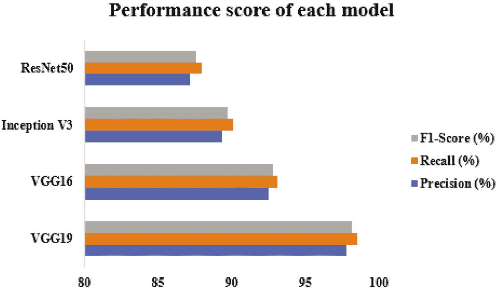

Figure 7: Performance score of each model.

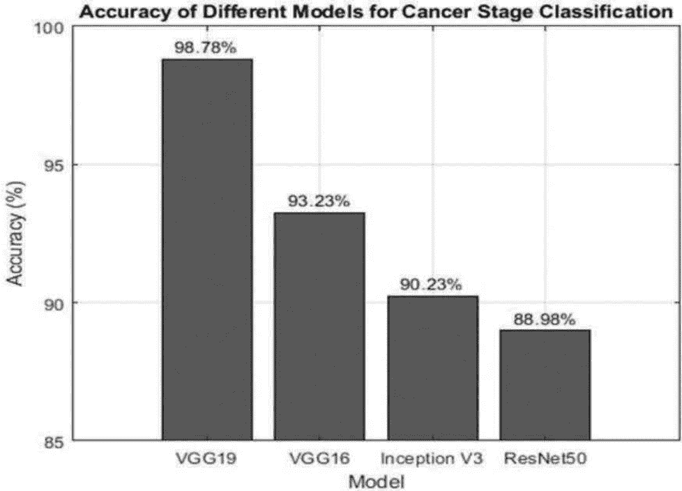

Figure 6: Accuracy of each model.

`VGG16` 达到了 92.50% 的准确率，精确率为 92.50%，召回率为 93.10%，F1 分数为 92.80%，略低于 `VGG19`，但仍然是乳腺癌分类的强大模型。`Inception V3` 记录了 89.40% 的精确率、90.10% 的召回率和 89.75% 的 F1 分数，尽管精确率低于 `VGG` 模型，但表现稳健。`ResNet50` 效率最低，达到 87.20% 的精确率，召回率为 87.20%，88.00% 的召回率，F1 分数为 87.60%，在区分癌症分期方面仍能提供合理的准确率。

Figure 8 中的混淆矩阵说明了 `VGG19`、`VGG16`、`Inception V3` 和 `ResNet50` 在乳腺癌分期中的分类性能。`VGG19` 表现出色，拥有 490 个真阳性和仅 10 个假阴性，展示了在识别阳性病例方面的强大准确性。它还记录了 8 个假阳性和 492 个真阴性，最大限度地减少了分类错误，并确认了其作为本研究中表现最佳模型的地位。

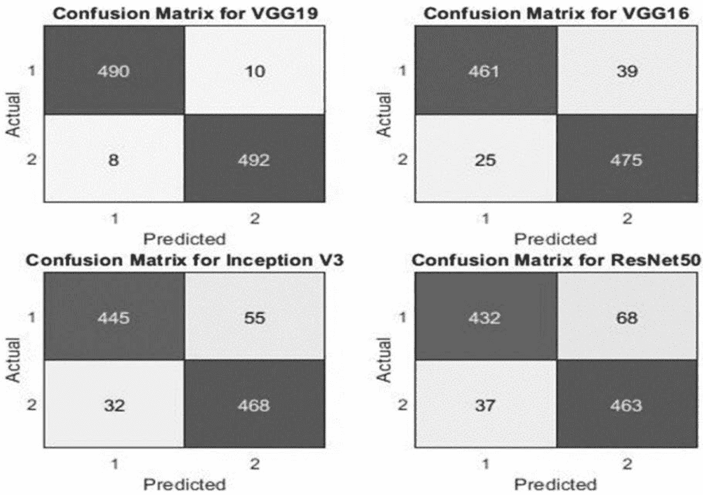

Figure 8: Confusion matrices of each model.

`VGG16` 显示了强大的癌症检测能力，拥有 461 个真阳性，但漏检的病例比 `VGG19` 更多，记录了 39 个假阴性和 25 个假阳性。`Inception V3` 拥有 445 个真阳性，但在 55 个假阴性和 32 个假阳性方面存在困难，显示出中等的分类效率。`ResNet50` 表现最弱，拥有 432 个真阳性、68 个假阴性和 37 个假阳性，突显了其在癌症分期分类方面的局限性。混淆矩阵揭示了模型有效性的差异，`VGG19` 在准确率方面领先。Figure 9 中的 `AUC-ROC` 分数突显了每个模型区分癌症与非癌症病例的能力。`VGG19` 达到了最高的 0.995 分数，展示了用于临床应用的强大可靠性。`VGG16` 紧随其后，得分为 0.930，显示出稳固的区分能力，但略低于 `VGG19`。`Inception V3` 记录了 0.905，表明具有可观的分类能力，但不如 `VGG` 模型有效。`ResNet50` 需要进一步优化，以改善其对癌症分期的区分能力。

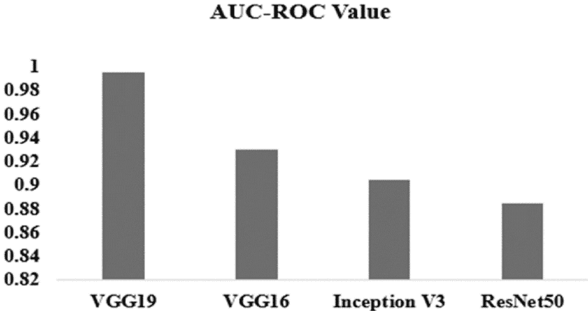

Figure 9: AUC-ROC performance of each model.

Figure 10 总结了 `VGG19`、`VGG16`、`Inception V3` 和 `ResNet50` 在 360 个时代上的性能，突出了它们的准确率和数据损失趋势。所有模型在训练过程中损失值均呈现稳定下降。`VGG19` 展示了最强的性能，将时代 0 时的 1.500 损失降低到时代 360 时的 0.030，达到 99.50% 的准确率。`VGG16` 紧随其后，最终损失为 0.150，准确率为 95.00%，而 `Inception V3` 和 `ResNet50` 的最终损失分别为 0.150 和 0.300。结果证实 `VGG19` 是乳腺癌分类中最有效的模型。

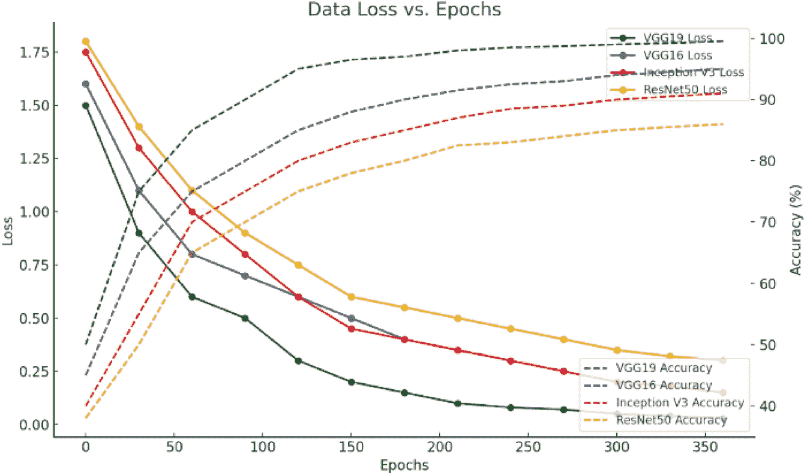

Figure 10: Accuracy and data loss of each model.

这些模型在各个时代都展示了准确率的稳步提升，证实了其学习能力。`VGG16` 从 45.00% 提升到 95.00%，显示出强大的分类性能。`Inception V3` 从 40.00% 提升到 91.00%，而最初最不准确的 `ResNet50` 为 38.00%，到时代 360 时达到了 86.00%。准确率的持续提升突显了深度学习在分类复杂病理图像方面的有效性，`VGG19` 因其低数据损失和高准确率而成为最可靠的模型。

本研究证实了深度学习模型（特别是 `VGG19`）在使用病理图像进行乳腺癌分期分类方面的效率。`VGG19` 的高准确率（99.50%）和低数据损失突显了其学习复杂模式的能力，使其成为临床应用的可靠工具。其一致的性能凸显了其作为病理学家治疗规划诊断辅助工具的潜力。

深度学习的进步使得像 `VGG19` 这样的模型能够实时集成到医疗工作流程中，促进病理切片的自动化分析。这提高了诊断速度，减少了人为错误，并通过实现快速的癌症分期识别和及时干预来改善患者预后。

深度学习模型可以超越乳腺癌，增强各种肿瘤疾病的诊断。在多样化数据集上进行训练可以提高泛化能力，从而实现不同癌症类型的准确分类。随着数据质量和模型优化的进步，这些系统可能有助于分期并确定最佳治疗策略。

实时集成增强了远程医疗，使病理学家和肿瘤学家之间能够进行远程协作，尤其是在人手不足的地区。用户友好的界面确保医疗专业人员可以在无需大量技术专长的情况下利用先进技术。

## 7\. Conclusion

本研究证实了深度学习模型（特别是 `VGG19`）在使用病理图像进行乳腺癌分期分类方面的有效性。`VGG19` 在 360 个时代后达到了 99.50% 的准确率，数据损失极小（0.030），优于 `VGG16`（95.00%）、`Inception V3`（91.00%）和 `ResNet50`（86.00%）。结果突显了 `VGG19` 学习复杂模式的卓越能力，使其成为临床诊断的可靠工具。该研究强化了人工智能驱动诊断提高准确性、效率和患者预后的潜力，强调了将机器学习集成到医学影像中以改善肿瘤学应用的必要性。

## References

*   Bhosale, Y. H. and Patnaik, K. S. (2023). Bio-medical imaging (X-ray, CT, ultrasound, ECG), genome sequences applications of deep neural network and machine learning in diagnosis, detection, classification, and segmentation of COVID-19: A meta-analysis & systematic review. Multimedia Tools and Applications, 82(25): 39157–39210.

*   Bilal, K. and Sajid, M. (2022). Blockchain technology: Opportunities & challenges. In 2022 International Conference on Data Analytics for Business and Industry (ICDABI) (pp. 519–524). IEEE.


# 第 6 章 神经网络简介及机器学习作为 AI 的子集

*L.M.I. Leo Joseph*,^(⁴)

*   Diwakar Manoj, Amrendra Tripathi, Kapil Joshi, Ayush Sharma, Prabhishek Singh et al. (2021). A comparative review: Medical image fusion using SWT and DWT. Materials Today: Proceedings, 37: 3411–3416.

*   Diwakar Manoj, Amrendra Tripathi, Kapil Joshi, Minakshi Memoria, Prabhishek Singh et al. (2021). Latest trends on heart disease prediction using machine learning and image fusion. Materials Today: Proceedings, 37: 3213–3218.

*   Diwakar Manoj and Prabhishek Singh. (2020). CT image denoising using multivariate model and its method noise thresholding in non-subsampled shearlet domain. Biomedical Signal Processing and Control, 57: 101754.

*   Garg, N., Kukreja, S., Saini, M., Singh, I., Mall, S. et al. (2023). IoT-enhanced agricultural water management system utilizing conventional machine learning methods. In 2023 International Conference on Modeling, Simulation & Intelligent Computing (MoSICom) (pp. 554–559). IEEE,

*   Garg, N., Saini, M., Singh, I. and Mall, S. (2023). Designing smart grid and irrigation management systems for information sharing for enhanced efficiency and sustainability. In 2023 International Conference on Modeling, Simulation & Intelligent Computing (MoSICom) (pp. 532–537). IEEE.

*   Kaliyar, R. K., Kumari, R., Sharma, N., Manjunath, S., Prasad, P. D. et al. (2024, May). Advancements in early detection of cervical cancer using machine learning and deep learning models for cervicography analysis. In 2024 International Conference on Emerging Innovations and Advanced Computing (INNOCOMP) (pp. 252–256). IEEE, doi: [10.1109/INNOCOMP63224.2024.00049](http://dx.doi.org/10.1109/INNOCOMP63224.2024.00049).

*   Kavitha, T., Deepika, S., Nattaraj, K., Shanthini, P., Puranaraja, M. et al. (2022). Smart system for crop and diseases prediction using random forest and resnet architecture. International Conference on Sustainable Computing and Data Communication Systems, ICSCDS 2022— Proceedings, pp. 1513–1519, doi: [10.1109/ICSCDS53736.2022.9760813](http://dx.doi.org/10.1109/ICSCDS53736.2022.9760813).

*   Kumar, S., Pathak, S. and Singh, J. (2022). An enhanced digital forensic investigation framework for XSS attack. Journal of Discrete Mathematical Sciences and Cryptography, 25(4): 1009–1018.

*   Lee, M. (2023). Deep learning techniques with genomic data in cancer prognosis: A comprehensive review of the 2021–2023 literature. Biology, 12(7): 893.

*   Lin, C. T. and Li, D. L. (2017). Ranks aggregation and semantic genetic approach based hybrid model for query expansion. International Journal of Computational Intelligence Systems, 10(1): 34–55. [`doi.org/10.2991/ijcis.2017.10.1.4`](https://dx.doi.org/10.2991/ijcis.2017.10.1.4).

*   Mall, S. (2023). Comparative study of heart failure using the approach of machine learning and deep neural networks. In International Conference on Data Analytics & Management (pp. 627–641). Singapore: Springer Nature Singapore. [`doi.org/10.1007/978-981-99-6544-1`](https://dx.doi.org/10.1007/978-981-99-6544-1).

*   Obayya, M., Arasi, M. A., Alruwais, N., Alsini, R., Mohamed, A. et al. (2023). Biomedical image analysis for colon and lung cancer detection using tuna swarm algorithm with deep learning model. IEEE Access.

*   Prasad, M., Li, D. L., Lin, C. T., Prakash, S., Joshi, S. et al. (2015). Designing mamdani-type fuzzy reasoning for visualizing prediction problems based on collaborative fuzzy clustering. IAENG International Journal of Computer Science. [`www.iaeng.org/IJCS/issues\_v42/issue\_4/IJCS\_42\_4\_12.pdf`](https://www.iaeng.org/IJCS/issues_v42/issue_4/IJCS_42_4_12.pdf).

*   Prasad, M., Prasad, O. K., Meng Joo, E., Saxena, A. K., Lin, C. T. et al. (2016). A novel fuzzy logic model for pseudo-relevance feedback-based query expansion. International Journal of Fuzzy Systems, 18: 980–989.

*   Raza, S. M. and Sajid, M. (2022). Vehicle routing problem using reinforcement learning: Recent advancements. In Advanced Machine Intelligence and Signal Processing (pp. 269–280). Singapore: Springer Nature Singapore.

*   Sahu, D. P., Gupta, T., Singhal, D., Lal, B., Turukmane, A.V. et al. (2024). Fake news detection using transfer learning. Recent Trends in Image Processing and Pattern Recognition. RTIP2R 2023. Communications in Computer and Information Science, Vol. 2026. Springer, Cham. [`doi.org/10.1007/978-3-031-53082-1\_2`](https://dx.doi.org/10.1007/978-3-031-53082-1_2).

*   Sahu, D. P., Murkute, S., Yadav, U., Agarwal, M., Kumar, P. et al. (2024). Deep learning based bug detection in solidity smart contracts. Recent Trends in Image Processing and Pattern Recognition. RTIP2R 2023. Communications in Computer and Information Science, Vol. 2026. Springer, Cham. [`doi.org/10.1007/978-3-031-53082-1\_9`](https://dx.doi.org/10.1007/978-3-031-53082-1_9).

*   Sajid, M., Yadav, C. S., Singh, S. S. and Saini, M. (2022). A novel deep neural-based music recommendation method considering user and song data. In 2022 6th International Conference on Trends in Electronics and Informatics (ICOEI) (pp. 1–7). IEEE.

*   Sellamuthu, S., Vaddadi, S. A., Venkata, S., Petwal, H., Hosur, R. et al. (2023). AI-based recommendation model for effective decision to maximise ROI. Soft Computing, 1–10. [`doi.org/10.1007/s00500-023-08731-7`](https://dx.doi.org/10.1007/s00500-023-08731-7).

*   Sharan, A. (2015). Co-occurrence and semantic similarity based hybrid approach for improving automatic query expansion in information retrieval. In Lecture Notes in Computer Science, Vol. 8956. [`doi.org/10.1007/978-3-319-14977-6\_45`](https://dx.doi.org/10.1007/978-3-319-14977-6_45).

*   Singh, N. P., Hasan, D. S., Shelke, N. A., Namdev, A., Girdhar, N. et al. (2024). An integrated machine learning and IoT based approach for enhanced healthcare efficiency and personalized treatment. In: Abraham, A., Bajaj, A., Hanne, T. and Siarry, P. (eds.). Intelligent Systems Design and Applications. ISDA 2023. Lecture Notes in Networks and Systems, Vol. 1046. Springer, Cham. [`doi.org/10.1007/978-3-031-64813-7\_16`](https://dx.doi.org/10.1007/978-3-031-64813-7_16).

*   Singh Prabhishek, Manoj Diwakar, Achyut Shankar, Raj Shree, Manoj Kumar et al. (2021). A review on SAR image and its despeckling. Archives of Computational Methods in Engineering, 28: 4633–4653.

*   Singh Prabhishek, Manoj Diwakar, Xiaochun Cheng and Achyut Shankar. (2021). A new wavelet-based multi-focus image fusion technique using method noise and anisotropic diffusion for real-time surveillance application. Journal of Real-Time Image Processing, 18(4): 1051–1068.

*   Singhal, P., Gupta, S. and Singh, J. (2023). An integrated approach for analysis of electronic health records using blockchain and deep learning. Recent Advances in Computer Science and Communications (Formerly: Recent Patents on Computer Science), 16(9): 1–10.

*   Zafar, I., Anwar, S., Yousaf, W., Nisa, F. U., Kausar et al. (2023). Reviewing methods of deep learning for intelligent healthcare systems in genomics and biomedicine. Biomedical Signal Processing and Control, 86: 105263.

*   Zhang, Y., Boninsegna, L., Yang, M., Misteli, T., Alber, F. et al. (2024). Computational methods for analysing multiscale 3D genome organization. Nature Reviews Genetics, 25(2): 123–141.


Emails: `gganeshnathan@gmail.com`; `sreedhar.k@sru.edu.in`; `d.yuvaraj@duhokcihan.edu.krd`

DOI: [`10.1201/9781003516729-6`](https://dx.doi.org/10.1201/9781003516729-6)

机器学习是 AI 的关键组成部分，能够实现智能决策系统。AI 依赖机器学习算法用于各种应用，通过改进诊断和个性化治疗来彻底改变医疗保健。受人脑启发，这些模型通过互连神经元处理数据，检测疾病模式以进行准确预测。了解 AI 的优势和挑战对于优化其在重塑医学教育、网络技术和法律框架中的作用至关重要。本章探讨神经网络架构、训练过程和深度学习应用，强调 AI 对现代医学的变革性影响。

## 1 人工智能简介

### 1.1 AI 的定义与范围

AI 包括能够进行模式识别、语音处理和决策的计算机系统，这些任务传统上需要人类智能。正在进行的研究探索 AI 的优势和局限性，旨在完善其应用 (Joshi and Bhandari 2022)。神经网络 (`NN`) 和机器学习 (`ML`) 是 AI 的关键子领域，使机器能够识别模式、从经验中学习并进行预测 (Bogue 2022, Sandhu and Itkikar 2018, Izdihar 2021, Johri et al. 2021)。`ML` 于 20 世纪 50 年代末引入 (Sandhu and Itkikar 2019)，通过先进的统计方法增强 AI 的决策能力 (Izdihar et al. 2021)。`NN` 受人脑启发，通过互连神经元处理数据，在 `NLP`、自动驾驶和图像识别等任务中表现出色 (Basheer and Hajmeer 2000, Sim et al. 2023)。深度学习 (`DL`) 是 `ML` 的一个子集，在医学等领域取得了显著进展 (Mumali 2022)，展示了 AI 在医疗保健中的变革潜力。本章重点介绍 AI 在医疗应用中的作用。

### 1.2 AI 在现代医学中的作用

AI 通过提高诊断准确性、预测能力和治疗流程，正在彻底改变医疗保健。机器学习 (`ML`) 通过识别趋势、预测疾病和改善决策来支持医生 (Beam and Kohane 2017)。深度学习 (`DL`) 模型，特别是在重症监护室中，整合了 `NLP`、计算机视觉和语音识别等技术，以推进患者护理 (Purushotham et al. 2018)。这些 AI 驱动的系统检测疾病模式，实现精确预测和个性化干预 (Imran et al. 2021)。`ML` 算法分析大量患者数据，优化医疗保健交付并降低成本 (Siddiq 2022)。AI 还帮助以高精度预测肺部疾病和癫痫等疾病 (Abbas et al. 2023)。皮肤病学受益于 AI 驱动的皮肤病建模和分析 (Pai and Pai 2021)。然而，由于实施挑战，AI 在医学培训中的作用有限 (Olczak et al. 2021)。随着 AI 的不断发展，其在医疗实践中的整合有望提高医疗保健的效率和准确性。

### 1.3 人工智能的发展

自早期基础以来，AI 已取得了显著发展。在 20 世纪 40 年代和 50 年代，Walter Pitts 和 Warren McCulloch 提出了人工神经元，而 Alan Turing 在 1950 年引入了图灵测试，作为评估机器认知能力的一种技术。20 世纪 60 年代和 70 年代见证了 AI 的增长，Joseph Weizenbaum 创建了 `ELIZA` (1966)，日本开发了 `WABOT-1`(1972)。然而，财务和技术挫折导致了 AI 寒冬 (1974–1980)。恢复始于 20 世纪 80 年代的专家系统，随后由于互联网的兴起和计算能力的提高，在 20 世纪 90 年代迅速扩张。2000 年代标志着机器学习和深度学习的兴起，导致 AI 在 2010 年代在图像和语言识别方面超越人类表现 (Nedadur et al. 2021)。今天，AI 正在改变教育、制造业、城市规划和医学领域，推动各行业的效率和创新。

### 1.4 神经网络基础

神经网络模拟人脑，使用互连神经元来处理数据并学习模式。它们在架构上各不相同，包括单向网络、递归网络和细胞网络，每种都适合不同的任务。应用范围从材料科学和密码学到计算机视觉和图像识别。训练涉及数据生成、模型开发和通过反向传播进行优化。一些网络表现出多稳定性，有助于联想记忆。深度学习通过整合 `CNNs` 和高复杂值网络来增强图像处理和模式识别，用于多维数据分析。

#### 1.4.1 神经网络架构

神经网络架构定义了神经网络中神经元的排列和连接，这被称为神经网络架构。单层网络，称为感知器，直接将输入映射到输出。多层网络包括输入层、隐藏层和输出层 (Ranjan et al. 2022)。前馈网络单向处理信息，架构因任务复杂性而异。

神经网络架构由关键组件组成：

1. 输入层、隐藏层和输出层处理和传输数据。
2. 基本单元，对输入应用非线性函数。
3. 函数：`ReLU`、`Sigmoid` 和 `Tanh` 实现复杂模式识别。
4. 偏置：可调参数，用于优化连接和数据拟合。
5. 前向传播预测输出，而反向传播使用梯度下降调整权重。
6. 函数：将预测与实际结果进行比较；常见类型包括均方误差和交叉熵。
7. 算法：用于微调权重以最小化损失。

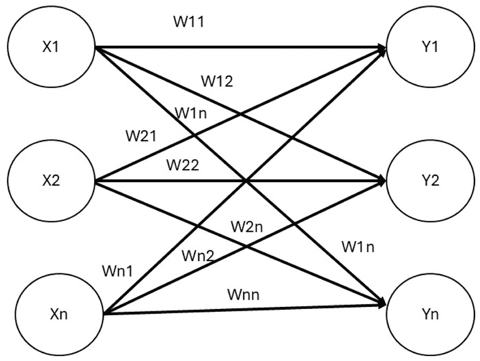

图 1：神经网络架构。

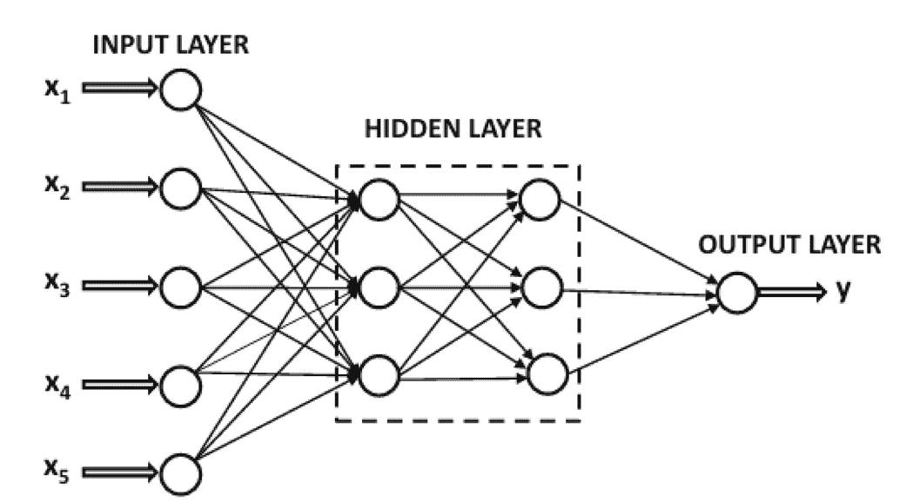

图 2：多层网络。

架构从用于基本任务的简单架构到用于处理大规模语言数据的复杂架构不等。

#### 1.4.2 机器学习核心概念

机器学习 (`ML`) 是人工智能的一个子集，使计算机能够从数据中学习并开发自适应算法 (Olczak et al. 2021)。与传统编程不同，`ML` 识别模式和关系以进行预测。`ML` 算法分为三类：监督学习、无监督学习和强化学习。监督学习使用标记数据进行训练，采用随机森林、神经网络和回归模型等方法。无监督学习分析未标记数据，以检测模式，利用聚类和降维技术。这些方法支持异常检测、数据可视化和客户细分等应用。

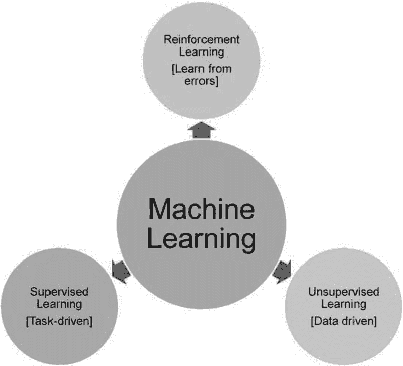

图 3：机器学习类别。

强化学习使系统能够通过与环境交互来学习行为。代理人使用试错法做出决策，并接收奖励或惩罚作为反馈以优化其策略。这种方法应用于自动驾驶、游戏和机器人技术。`ML` 模型在支持决策、预测建模和跨行业自动化方面具有不同的优势。

#### 1.4.3 神经网络训练过程


神经网络模型在图像识别、机器翻译和自然语言处理（NLP）等领域是强大的工具，能够学习复杂模式，并应用于医疗、金融和交通等领域。训练需要大型数据集，但人类专业知识可以通过模拟、方程和逻辑规则融入领域知识，从而增强模型学习。条件语句，例如 If-Then 规则，有助于分类数据并优化预测。在手动规则选择的支持下，训练过程能够提升学习置信度并缓解数据短缺问题，确保神经网络模型的稳健性能。

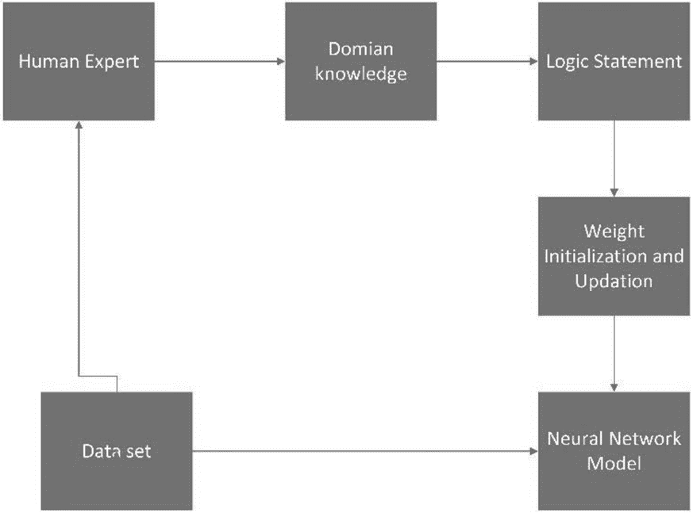

Figure 4: Training process of neural network models.

#### 1.4.4 Backpropagation and Loss Functions

单层神经网络通过基于权重直接计算误差或损失函数来简化训练。这一特性使梯度计算变得简单，从而简化了训练过程。然而，多层网络具有依赖于层权重的复杂复合损失函数。反向传播算法利用微积分中的链式法则计算梯度，沿从节点到输出的路径汇总局部梯度。尽管其复杂度呈指数级，但动态规划能够高效处理此求和过程。反向传播包含两个阶段：前向阶段和后向阶段。前向阶段计算输出值和局部导数，而后向阶段则从节点到输出累积这些值。在训练期间，神经网络处理输入数据，通过各层传播计算，并将预测结果与训练实例进行比较，以计算所有层权重的损失函数导数。

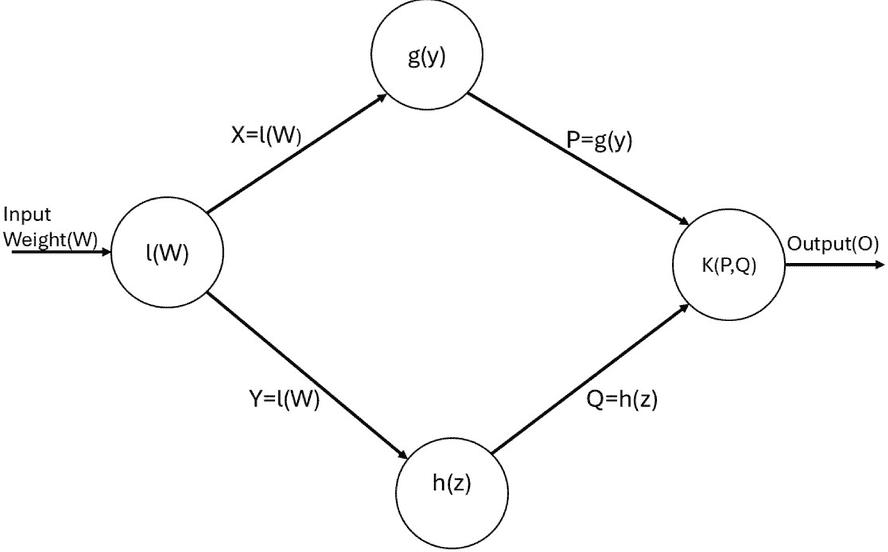

Figure 5: Chain rule for computation.

多变量链式法则分析计算图中的梯度，并识别是否存在多于一条路径。

According to Figure \[4\]

(1)  

$$\\frac{\\partial o}{\\partial W} = \\frac{\\partial o}{\\partial P}\\frac{\\partial P}{\\partial W} + \\frac{\\partial o}{\\partial Q}\\frac{\\partial Q}{\\partial W}$$  

Equation 1 represents the Multivariate Chain rule.

(2)  

$$\\frac{\\partial o}{\\partial W} = \\frac{\\partial o}{\\partial P}\\frac{\\partial P}{\\partial X}\\frac{\\partial X}{\\partial W} + \\frac{\\partial o}{\\partial P}\\frac{\\partial Q}{\\partial Y}\\frac{\\partial Y}{\\partial W}$$  

Equation 2 represents the Univariate Chain rule.

(3)  

$$\\begin{matrix} {\\frac{\\partial K\\lbrack P,Q\\rbrack}{\\partial P} \\cdot g^{\\prime}(Y) \\cdot I^{\\prime}(W) + \\frac{\\partial K\\lbrack P,Q\\rbrack}{\\partial P} \\cdot h^{\\prime}(Z) \\cdot I^{\\prime}(W)} \\\\ {\\text{Ist~Path}\\quad\\text{IInd~Path}} \\\\ \\end{matrix}$$  

Equation 3 represents the derivative of weight (W) in relation to output (O).

在上述表示中，只有两条路径是明显的。

##### Mathematical Formulation Using the Chain Rule

`y` 相对于 `x` 的导数，记为 $\\frac{dy}{dx}$，计算如下：

第一层导数：

(4)  

$$\\frac{du}{dx} = f^{\\prime}(x)$$  

其中 `f`′(`x`) 是 `f` 相对于 `x` 的导数。

第二层导数：

(5)  

$$\\frac{du}{dx} = g^{\\prime}(u)$$  

其中 `g`′(`u`) 是 `g` 相对于 `u` 的导数。

第三层导数：

(6)  

$$\\frac{dv}{dy} = h^{\\prime}(v)$$  

其中 `h`′(`v`) 是 `h` 相对于 `v` 的导数。

应用链式法则：

(7)  

$$\\frac{dy}{dx} = \\frac{dy}{dv}\\frac{dv}{du}\\frac{du}{dx} = h^{\\prime}(v) \\cdot g^{\\prime}(u) \\cdot f^{\\prime}(x)$$  

Equation 7 illustrates that the derivative at each layer depends on the previous layer’s derivative, propagating the estimated gradient backward. The local gradients (`h`′(`v`) . `g`′(`u`) . `f` ′(`x`)) collectively determine the total gradient of the network output with respect to the input.

#### 1.4.5 Activation and Loss Functions

在神经网络设计中，选择合适的激活函数是一个关键考量。如果需要对二进制类别进行标记，符号激活函数是一个重要的选择。相反，在预测实数变量时，必须结合最小二乘算法确定合适的激活函数。Figure 6 说明了适用于不同场景的各种激活函数。

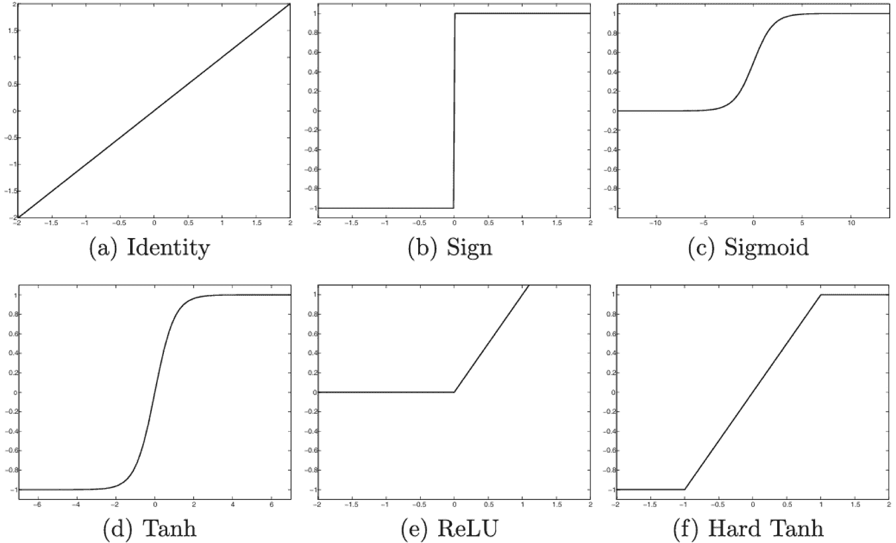

Figure 6: Activation functions.⏎

符号激活函数用于预测二进制值，而 tanh 函数更适合范围为 \[–1 1\] 的有符号值。在现代神经网络中，ReLU 和 hard tanh 激活函数已取代传统的符号和 tanh 函数，因为它们在训练多层神经网络方面具有适应性。

### 1.5 Deep Learning as an Extension of Neural Network

深度学习是机器学习的一项重要进步，它通过使计算模型能够通过多层抽象进行学习，扩展了传统神经网络的功能。这些增强型模型在语音识别、视觉识别、对象识别和基因组学等领域表现出色。深度学习利用反向传播算法在大型数据集中发现复杂结构，并根据前一层的信息逐层计算参数。深度卷积网络非常适合图像、视频和音频处理，而循环网络则对文本和语音处理等序列数据有效（Diwakar et al. 2020）。

#### 1.5.1 Deep Learning Networks and its Architecture

深度学习模型适用于各个领域，其成功依赖于嵌入的架构设计。架构中的层和参数因应用而异。本节探讨常用的深度学习架构，以及应用特定设计及其特性。多种架构解决了不同领域的挑战。一些最广泛采用的架构框架，例如 CNN \[Convolutional Neural Network\]、Genome Net 和 LSTM \[Long Short-Term Memory\]，可以根据应用的具体要求进行选择。

#### 1.5.2 Convolutional Neural Network and its Architecture

卷积神经网络（CNN）是专门为处理视觉信息而设计的深度学习算法。这种独特能力受到人类视觉系统的启发，该系统在数据中执行空间层次结构。CNN 中的卷积层使用滤波器从输入图像中提取特征，滑过整个图像以捕捉边缘和纹理细节。该过程不在单个层内运行，而是通过多个卷积层进行，每个阶段获得的特征被组合以表示复杂模式。这些模式使 CNN 能够识别图像中的对象和场景。CNN 的一个关键优势是其能够自主从输入数据中学习特征，减少了手动分析的需求，而手动分析可能耗时且复杂。CNN 非常适合处理大型且复杂的数据集，使其成为对象识别、分割和图像分类等应用的理想选择。CNN 的基本架构在 Figure 7 中说明。

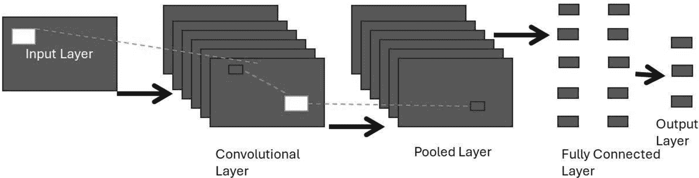

Figure 7: Simple CNN architecture.⏎

CNN 架构包含以下关键组件：


**Input Layer:** 作为输入数据的入口，输入数据可以是图像、文本或其他结构化形式的数据。其主要功能是接收和预处理原始数据，使其适合后续层进行处理。输入层的大小和维度取决于应用程序和输入数据的特征。预处理（包括归一化）可以显著提升 CNN 模型的性能和效率。

**Convolutional Layer:** 利用一系列滤波器处理输入数据，提取不同的特征。这些单独的特征被组合起来生成特征图，使网络能够学习识别模式。

**Pooling Layer:** 卷积层可能会生成对输入数据空间位置微小变化敏感的特征图。池化层通过减少卷积层生成的特征图的空间维度来缓解这一问题。这种降低计算复杂度的操作，增强了网络捕捉关键特征的能力，并使其能够学习输入数据的更概括性表示。

**Fully Connected Layers:** 卷积层提取边缘、形状和纹理等低级特征。随着网络的推进，这些特征被组合形成更复杂的表示。全连接层将高维特征转换为低维输出空间，便于执行图像分类和目标检测等任务。这些层学习提取的高级特征与目标输出之间复杂的非线性关系，有助于降低训练数据中过拟合的风险。

**Output Layer:** 由全连接网络组成，每个神经元对应一个特定的类别或预测。该层将卷积层和池化层提取的高级特征转换为最终用户或应用程序可解释的格式。

### 1.6 机器学习实践中数据集的重要性

数据集在促进数据科学家与消费者之间的沟通、增强机器学习社区的透明度和问责制方面发挥着关键作用（Diwakar et al. 2021）。它们对于训练、测试和评估机器学习模型至关重要。宾夕法尼亚机器学习基准（PMLB）提供了一套用于评估监督分类方法的数据集，有助于比较和评估机器学习模型（Singh et al. 2021）。专用数据集，如 Molecular-MNIST 数据集，支持特定的研究领域，使衍射成像和显微镜领域的专项研究成为可能。此外，社交媒体中使用的数据集提供了对社会动态的洞察，并有助于开发用于各种应用的机器学习模型（Kim et al. 2016）。

### 1.7 基因组架构框架中的神经网络与机器学习

本节探讨本章的核心主题——基因组应用及其通过深度学习实现的过程。

#### 1.7.1 基因组的定义

“基因组”一词指生物体全部遗传物质。基因组被组织成染色体，染色体是由 DNA 和蛋白质组成的长线性结构。在人类中，有 23 对染色体，每条染色体包含数百到数千个基因。基因组测序是确定生物体 DNA 中核苷酸精确序列的过程。它提供了生物体遗传信息的全面图谱，帮助研究人员对与疾病相关的遗传变异进行分类，并理解进化关系以及基因组调控的复杂性。

#### 1.7.2 基因组研究的重要性

基因组研究与深度学习的结合有可能改变医疗保健格局，采取主动方法，在疾病预测和预防领域维持治疗策略。在基因组数据集上训练的深度学习模型可以识别与特定疾病相关的遗传标记，从而实现早期检测和针对性干预措施的开发。

#### 1.7.3 Genome Net-Architect

Genome Net 架构如 图 8 所示。

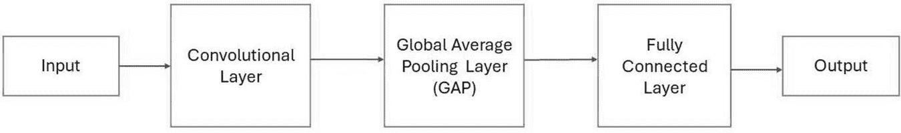

图 8：Genome Net-architect。[](#ch6.xhtml#R_fig6_8)

在 第 1.4.2 节 中，池化层被用于减少特征图的空间维度，从而最大限度地减少参数数量和计算负载。存在多种类型的池化层，包括全局平均池化和标准池化层。本节侧重于全局平均池化（GAP）层，因为它在构建 Genome Net 中具有重要意义，而不是依赖传统池化层。

全局平均池化（GAP）是一种池化技术，它计算每个特征图在其整个空间维度上的平均值，每个图得到一个单一数值。

GAP 的关键特征：

1. 计算每个特征图中所有值的平均值。

2. 生成一个输出向量，其中每个元素对应前一层中某个特征图的平均值。

3. 通过将每个特征图转换为单一值来降低维度。

标准池化与全局平均池化的比较：

表 1：GAP 与标准池化的区别。

| 全局平均池化（GAP） || 标准池化 |

| --- | --- |

| 计算每个特征图的平均值。 || 计算窗口内的最大值或平均值。 |

| --- | --- |

| 将每个特征图减少为单一值。 || 减少空间维度但保持相同数量的特征图。 |

| 用于 CNN 末端，在全连接层之前用于减少特征图。 || 用于整个网络以减少空间维度并控制过拟合。 |

### 1.8 结论

本章全面概述了神经网络和机器学习作为 AI 的一个子集，涵盖了基本概念、学习技术及其在开发智能系统中的应用。它强调了监督学习、无监督学习和强化学习及其对 AI 进步的贡献。本章还探讨了模仿人类认知功能以解决复杂问题的计算模型，特别是在医疗保健领域，强调了 CNN 和深度学习模型的架构和训练。随着 AI 研究的不断发展，这些技术有望实现一个未来，即智能系统增强人类生活并解决复杂挑战。

## References

*   Abbas, S. (2023). Fused weighted federated deep extreme machine learning based on intelligent lung cancer disease prediction model for healthcare 5.0. Int. J. Intell. Syst., doi: [10.1155/2023/2599161](http://dx.doi.org/10.1155/2023/2599161).

*   Basheer, I. A. and Hajmeer, M. (Dec. 2000). Artificial neural networks: Fundamentals, computing, design, and application. J. Microbiol. Methods, 43(1): 3-31, doi: [10.1016/S0167-7012(00)00201-3](http://dx.doi.org/10.1001/jama.2017.18391).

*   Beam, A. L. and Kohane, I. S. (2018). Big data and machine learning in health Care. Jama, doi: [10.1001/jama.2017.18391](http://dx.doi.org/10.1001/jama.2017.18391).

*   Bogue, R. (Jan. 2022). The role of machine learning in robotics. Int. J. Robot. Res. Appl., 50(2): 197-202, doi: [10.1108/IR-11-2022-0279](http://dx.doi.org/10.1108/IR-11-2022-0279).


# Chapter 7 Advancing Smart Healthcare Enhanced Image Analysis and Feature Extraction through Integration of Sharpening Techniques and Edge Detection Algorithms

*Navneet Kumar Rajpoot, Prabh Deep Singh*^(⁵)

Department of Computer Science & Engineering, Graphic Era (Deemed to be University), Dehradun, India.

Emails: `navneetrajpootgeu@gmail.com`, `bhaskar.pant@geu.ac.in`

DOI: [`10.1201/9781003516729-7`](https://dx.doi.org/10.1201/9781003516729-7)

*   Diwakar, M., Singh, P., Karetla, G. R., Narooka, P., Yadav, A. et al. (2022). Low-dose COVID-19 CT image denoising using batch normalization and convolution neural network. Electronics, 11(20): 3375.

*   Fulk, G. (Jan. 2023). Artificial intelligence and neurologic physical therapy. J. Neurol. Phys. Ther., 47(1): 1, doi: [`10.1097/NPT.0000000000000426`](http://dx.doi.org/10.1097/NPT.0000000000000426).

*   Hosny, A., Parmar, C., Quackenbush, J., Schwartz, L. H. and Aerts, H. J. W. L. (Aug. 2018). Artificial intelligence in radiology. Nat. Rev. Cancer, 18(8): 500-510, doi: [`10.1038/s41568-018-0016-5`](http://dx.doi.org/10.1038/s41568-018-0016-5).

*   Imran, M., Zaman , Imran, U., Imtiaz, J., Fayaz, M. et al. (2021). Comprehensive survey of IoT, machine learning, and blockchain for health care applications: A topical assessment for pandemic preparedness, challenges, and solutions. Electronics, doi: [`10.3390/electronics10202501`](http://dx.doi.org/10.3390/electronics10202501).

*   Izdihar, K. (Jul. 2021). Detection of novel coronavirus from chest X-Ray radiograph images via automated machine learning and CAD4COVID. In 2021 International Congress of Advanced Technology and Engineering (ICOTEN), p. 1-4, doi: [`10.1109/ICOTEN52080.2021.9493542`](http://dx.doi.org/10.1109/ICOTEN52080.2021.9493542).

*   Johri, P., sen Saxena, V. and Kumar, A. (2021). Rummage of machine learning algorithms in cancer diagnosis. Int. J. E-Health Med. Commun. IJEHMC, 12(1): 1-15, doi: [`10.4018/IJEHMC.2021010101`](http://dx.doi.org/10.4018/IJEHMC.2021010101).

*   Joshi, G. and Bhandari, M. (Dec. 2022). FDA approved Artificial Intelligence and Machine Learning (AI/ML)-Enabled Medical Devices: An updated 2022 landscape, doi: [`10.21203/rs.3.rs-2355147/v1`](http://dx.doi.org/10.21203/rs.3.rs-2355147/v1).

*   Kerzel, U. (Jan. 2021). Enterprise AI Canvas—Integrating Artificial Intelligence into Business. Appl. Artif. Intell., 35(1): 1-12, doi: [`10.1080/08839514.2020.1826146`](http://dx.doi.org/10.1080/08839514.2020.1826146).

*   Kim, S. M., Wan, S. and Paris, C. (2016). Detecting Social Roles in Twitter, doi: [`10.18653/v1/w16-6206`](http://dx.doi.org/10.18653/v1/w16-6206).

*   Kocher, G. and Kumar, G. (2020). Performance analysis of machine learning classifiers for intrusion detection using UNSW-NB15 dataset, doi: [`10.5121/csit.2020.102004`](http://dx.doi.org/10.5121/csit.2020.102004).

*   Lakhani, P. and Sundaram, B. (Aug. 2017). Deep learning at chest radiography: Automated classification of pulmonary tuberculosis by using Convolutional Neural Networks. Radiology, 284(2): 574-582, doi: [`10.1148/radiol.2017162326`](http://dx.doi.org/10.1148/radiol.2017162326).

*   Massaro, A., Maritati, V., Giannone, D., Convertini, D., Galiano, A. et al. (Jan. 2019). LSTM DSS automatism and dataset optimization for diabetes prediction. Appl. Sci., 9(17): Art. no. 17, doi: [`10.3390/app9173532`](http://dx.doi.org/10.3390/app9173532).

*   Mitchell, M. (2019). Model Cards for Model Reporting, doi: [`10.1145/3287560.3287596`](http://dx.doi.org/10.1145/3287560.3287596).

*   Mumali, F. (Mar. 2022). Artificial neural network-based decision support systems in manufacturing processes: A systematic literature review. Comput. Ind. Eng., 165: 107964, doi: [`10.1016/j.cie.2022.107964`](http://dx.doi.org/10.1097/HCO.0000000000000888).

*   Nedadur, R., Wang, B. and Yanagawa, B. (Sep. 2021). The cardiac surgeon’s guide to artificial intelligence. Curr. Opin. Cardiol., 36(5): 637-643, doi: [`10.1097/HCO.0000000000000888`](http://dx.doi.org/10.1097/HCO.0000000000000888).

*   Olczak, J. (Ma. 2021). Presenting artificial intelligence, deep learning, and machine learning studies to clinicians and healthcare stakeholders: An introductory reference with a guideline and a Clinical AI Research (CAIR) checklist proposal. Acta Orthop., p. 513-525, doi: [`10.1080/17453674.2021.1918389`](http://dx.doi.org/10.1080/17453674.2021.1918389).

*   Olson, R. S., Cava, W. L., Orzechowski, P., Urbanowicz, R. J., Moore, J. H. et al. (2017). PMLB: A large benchmark suite for machine learning evaluation and comparison. Biodata Min., doi: [`10.1186/s13040-017-0154-4`](http://dx.doi.org/10.1186/s13040-017-0154-4).

*   Pai, V. V. and Pai, R. B. (2021). Artificial intelligence in dermatology and healthcare: An overview. Indian J. Dermatol. Venereol. Leprol., 87(4): 457-467, SEASON, doi: [`10.25259/IJDVL\_518\_19`](http://dx.doi.org/10.25259/IJDVL_518_19).

*   Purushotham, S., Meng, C., Che, Z. and Liu, Y. (2018). Benchmarking deep learning models on large healthcare datasets. J. Biomed. Inform., doi: [`10.1016/j.jbi.2018.04.007`](http://dx.doi.org/10.1016/j.jbi.2018.04.007).

*   Ranjan, A., Fernández-Baca, D., Tripathi, S. and Deepak, A. (Sep. 2022). An ensemble Tf-Idf based approach to protein function prediction via sequence segmentation. IEEE/ACM Trans. Comput. Biol. Bioinform., 19(5): 2685-2696, doi: [`10.1109/TCBB.2021.3093060`](http://dx.doi.org/10.1109/TCBB.2021.3093060).

*   Rimpault, X., Balazinski, M. and Chatelain, J. -F. (Sep. 2018). Fractal analysis application outlook for improving process monitoring and machine maintenance in manufacturing 4.0. J. Manuf. Mater. Process., 2(3): Art. no. 3, doi: [`10.3390/jmmp2030062`](http://dx.doi.org/10.3390/jmmp2030062).

*   Sandhu, T. H. and Itkikar, A. (Apr. 2018). Machine learning and natural language processing – a review. Int. J. Adv. Res. Comput. Sci., 9(2): Art. no. 2, doi: [`10.26483/ijarcs.v9i2.5799`](http://dx.doi.org/10.26483/ijarcs.v9i2.5799).

*   Shah, V. and S. S. (Jun. 2017). A survey on cognitive computing using semantic technology. EAI Endorsed Trans. Cloud Syst., 3(9), Accessed: Apr. 16, 2024. \[Online\]. Available: [`https://eudl.eu/doi/10.4108/eai.28-6-2017.154389`](https://eudl.eu/doi/10.4108/eai.28-6-2017.154389).

*   Siddiq, M. (2022). Use of machine to predict patient developing a disease or condition for early diagnose. Int. J. Multidiscip. Sci. Arts, doi: [`10.47709/ijmdsa.v1i1.2271`](http://dx.doi.org/10.47709/ijmdsa.v1i1.2271).

*   Sim, J. Z. T., Fong, Q. W., Huang, W. and Tan, C. H. (Feb. 2023). Machine learning in medicine: What clinicians should know. Singapore Med. J., 64(2): 91, doi: [`10.11622/smedj.2021054`](http://dx.doi.org/10.11622/smedj.2021054).

*   Singh, P., Diwakar, M., Gupta, R., Kumar, S., Chakraborty, A. et al. (2022). A method noisebased convolutional neural network technique for CT image Denoising. Electronics, 11(21): 3535.

*   Wu, Z., Pan, S., Chen, F., Long, G., Zhang, C. et al. (Jan. 2021). A comprehensive survey on graph neural networks. IEEE Trans. Neural Netw. Learn. Syst., 32(1): 4-24, doi: [`10.1109/TNNLS.2020.2978386`](http://dx.doi.org/10.1109/TNNLS.2020.2978386).


智能医疗越来越依赖先进的图像分析技术来提升诊断效果和患者预后。将锐化技术与边缘检测算法相结合，在图像处理方面带来了显著改进，尤其在医疗应用中表现突出。本章探讨如何将自适应锐化方法和基于机器学习的锐化与传统边缘检测技术（如 `Canny` 和 `Structured Edge Detection`）相结合，以提升特征提取和图像清晰度。所提框架将这些过程统一为一个连贯的系统，优化各个领域的图像分析，对医学影像尤其有益。这种集成方法提升了边缘清晰度、检测精度和整体图像质量——这对于早期诊断和治疗规划中解剖结构的勾画至关重要。定性和定量分析表明，该方法在提升医疗应用的特征提取方面效果显著，尤其在 CT 和 MRI 成像中，从而提高诊断精度和效率。除医疗外，该方法还可扩展到监控系统，其中精确的目标检测至关重要。尽管存在参数调优和计算复杂度等挑战，但这种集成方法的优势十分显著，尤其在智能医疗环境中。本工作为图像处理的进一步发展奠定了基础，推动为医疗及其他领域开发更强健、灵活和精确的方法。

## 1 引言

先进的图像分析技术越来越多地支持智能医疗，确保准确诊断和最佳患者预后。该领域图像分析的成功取决于特征提取的精度，通常通过边缘检测算法实现。这些算法识别图像中的边界，区分目标和感兴趣区域。然而，噪声、低对比度和模糊等因素会降低图像质量，削弱边缘检测器的效果并影响特征提取的可靠性。为应对这些挑战，各种锐化技术通过细化边缘和精细细节来提升图像质量。传统方法，包括反锐化掩模和高通滤波，已被用于图像锐化。然而，单独使用时，它们往往难以在细节增强和噪声抑制之间取得平衡，尤其在复杂图像中。将先进锐化技术与边缘检测算法相结合，提供了一种有前景的解决方案。通过在应用检测方法前改善边缘清晰度，这种方法显著提升了高精度图像分析系统的性能，尤其在医学影像中。本研究提出了一种将先进锐化技术与边缘检测算法相结合的方法，以优化图像分析和特征提取。所提系统通过优化锐化过程以最大化边缘检测精度，克服了传统方法的局限性，最终提升了医学影像及其他关键医疗应用中的图像质量。

## 2 文献综述

图像锐化与边缘检测的交叉领域一直是大量研究的主题，许多技术正在开发中，以提升图像质量并改进特征提取。本节将回顾关于边缘检测算法、图像锐化以及将这两种方法相结合的不同综合方法的重要文献，以推动图像分析的发展 (Zhu et al. 2023)。

### 2.1 边缘检测算法的差异

边缘检测是图像处理中的一个基本过程，常用于识别物体边界并突出图像中的重要特征。已开发出各种边缘检测算法，每种都有其独特的优势和局限性。其中最古老、最广泛使用的方法包括 `Sobel` 和 `Prewitt` 算子 (Devulapalli et al. 2023)，它们采用基于梯度的方法来检测连续像素之间的强度变化。特别是 `Sobel` 算子，在梯度计算的同时结合了平滑滤波器，因此比 `Prewitt` 算子更能抵抗噪声。然而，这两种技术对噪声仍然敏感，在低对比度图像中进行边缘检测时可能会遇到困难。

### 2.2 Canny 边缘检测器

由 John Canny 于 1986 年提出的 `Canny` 边缘检测器，是一种复杂的方法，解决了早期边缘检测技术的若干局限性。它遵循一系列步骤，包括使用 `Gaussian` 滤波器进行噪声抑制、梯度计算、非极大值抑制以及基于迟滞的边缘跟踪 (Sale 2022)。作为最有效的策略之一，`Canny` 方法能够实现精确的边缘检测，且虚假响应极少。然而，其对多个参数和阈值设置的依赖，使得在没有精细调整的情况下，很难在不同场景中应用。

### 2.3 现代方法

机器学习和深度学习在边缘检测中发挥着重要作用。在大型数据集上训练 `Structured Edge Detection (SED)` 模型和深度 `CNNs`，使它们能够自动识别图像中的边缘。这些方法具有更高精度和跨各种图像类型的适应性等优势。然而，它们通常需要大量计算资源，并且可能对训练数据的质量敏感。

### 2.4 图像锐化技术

图像锐化增强边缘和精细细节，在提升边缘检测算法性能方面发挥着关键作用。

#### 2.4.1 传统锐化滤波器

传统锐化方法，如反锐化掩模和高通滤波，增强图像中的高频分量，边缘和精细细节就位于其中 (Sale 2022)。例如，反锐化掩模通过从原始图像中减去其模糊版本来产生更清晰的结果。虽然这些技术计算效率高且简单直接，但它们往往会放大噪声，尤其在低质量图像中。

#### 2.4.2 自适应锐化技术

由于传统锐化方法的局限性，已开发出各种自适应技术。这些方法根据局部图像特征调整锐化强度，从而实现更精确的增强。其中一种方法是对比度自适应锐化，它根据不同图像区域的对比度来调整锐化级别。这种技术可防止在已清晰区域过度增强，同时尽量减少平滑区域的噪声放大 (Liu et al. 2022)。机器学习的最新进展推动了对数据驱动锐化方法日益增长的兴趣。这些方法利用在大型数据集上训练的神经网络来学习最佳锐化技术，依据庞大的图像语料库，通常优于传统方法，尤其在应用于复杂且多样的图像数据集时表现突出。

### 2.5 综合方法

锐化技术正越来越多地集成到边缘检测算法中，显著提升图像分析效果 (Dai et al. 2021)。在边缘检测前使用锐化方法对图像进行预处理，可提高可见性并增强特征提取。

#### 2.5.1 用于边缘检测的锐化

多项研究已探讨将锐化作为边缘检测的直接预处理步骤。研究人员在使用 `Sobel` 或 `Canny` 边缘检测器之前，对图像应用了反锐化掩模和高通滤波，以增强边缘锐度并提高检测质量。然而，这些方法需要仔细调整参数，以有效平衡噪声放大和边缘增强。


### 2.5.2 自适应集成策略

近期研究强调自适应集成策略，其中锐化过程会根据边缘检测输出动态调整。这些方法旨在通过优化前期阶段检测到的特定边缘特征来优化锐化 (Rajpoot et al. 2024)。自适应方法有助于在增强特征提取整体鲁棒性的同时，最大限度地减少噪声放大。

### 2.5.3 使用机器学习的混合模型

基于机器学习的锐化已集成到混合模型中，其中神经网络同时执行两项任务，利用其综合优势。这些模型在边缘检测中提供高精度，同时保持计算效率。然而，其有效性取决于大量训练数据集和大量计算资源。边缘检测和图像锐化是各自拥有成熟技术的独立研究领域。然而，将这些方法集成用于图像增强仍然是活跃的研究领域 (Sneha et al. 2024)。将先进的锐化技术与边缘检测算法相结合，为实现准确可靠的特征提取提供了一种有前途的方法，即使在挑战性的成像条件下也是如此。本章探讨了此类集成方法的潜力，为开发利用锐化和边缘检测优势以改善图像分析结果的新方法奠定基础。

## 3 方法论

将先进的锐化技术与边缘检测算法相结合，旨在增强图像分析并提高特征提取效率。

### 3.1 锐化技术

所提方法论首先应用先进的锐化来增强图像质量，然后再进行边缘检测。Figure 1 说明了医学影像和自动特征提取方法论。所选的锐化方法因其在增强细节的同时最大限度地减少噪声放大的有效性而被选中。

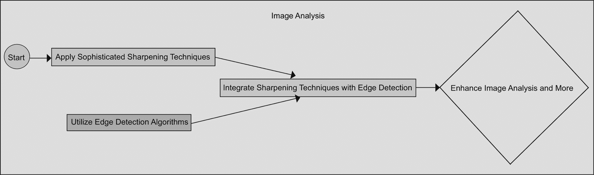

Figure 1: Methodology of medical imaging and automated feature extraction.[](#ch7.xhtml#R_fig7_1)

### 3.2 自适应反锐化掩模

传统的反锐化掩模均匀地增强图像，而自适应反锐化掩模根据局部图像特征调整锐化。这种技术防止在细节丰富的区域过度锐化，同时确保在定义不清的区域进行边缘增强。

### 3.3 对比度自适应锐化

这种技术根据不同图像区域的对比度水平动态调整锐化强度。高对比度区域接收最小锐化以防止噪声放大，而低对比度区域则被更密集地增强以改善边缘可见性。

### 3.4 基于机器学习的锐化

一个 CNN 被训练以执行感知上下文的图像锐化，从包含不同锐化程度图像的数据集中学习最佳滤波器。这些滤波器在增强边缘的同时最大限度地减少混叠。数据驱动方法确保锐化是针对每个图像的独特特征量身定制的。

### 3.5 边缘检测算法

边缘检测是使用选定的算法进行的，这些算法因其在各种图像类型中的效率而被认可：

#### 3.5.1 Canny 边缘检测器

Canny 检测器因其强大的边缘检测能力而被选中，提供精确的定位和对噪声的低敏感性。为了优化其在锐化图像上的性能，高斯滤波器大小和滞后阈值等参数被微调以增强细节提取。

#### 3.5.2 结构化边缘检测器

结构化边缘检测 (SED) 是一种基于机器学习的方法，通过结构化学习识别复杂边缘模式来增强边缘检测。它能有效捕捉传统方法可能遗漏的边缘，使其特别适用于具有模糊或受噪声影响边缘的图像。

##### 集成策略

这些锐化技术在此方法论中与边缘检测算法集成。该方法的关键步骤如下：

#### 3.5.3 预处理

图像经过预处理以消除噪声并标准化大小和分辨率，确保所有图像的统一锐化和边缘检测。

#### 3.5.4 锐化

预处理后的图像依次通过自适应反锐化掩模进行处理。每个阶段的结果都被保留以供比较评估。

#### 3.5.5 边缘检测

这些锐化后的图像随后使用 Canny 边缘检测器和结构化边缘检测器进行进一步处理。每个算法的结果都被比较以评估锐化的有效性。

#### 3.5.6 后处理和优化

检测到的边缘经过后处理以消除虚假响应，细化边界精度。此步骤可能涉及膨胀和腐蚀等形态学操作。此外，优化循环可以根据边缘检测结果的反馈迭代调整锐化和边缘检测参数。

## 4 实验设置

通过一系列使用多样化图像集（包括医学图像、自然场景和人工测试图案）的实验，对集成方法的性能进行评估。实验设置考虑以下因素：

1. **数据集：** 图像来源于公开可用的数据集，包括用于自然图像的 BSDS 500 和特定领域的医学图像数据集。此外，利用具有控制边缘特征的合成图像来对方法进行基准测试。

2. **评估指标：** 集成方法使用定性和定量指标进行评估。定性分析涉及对边缘检测结果的目视检查，而定量评估应用精确率、召回率和 F1 分数等准确度指标。此外，还测量 SSIM 和 PSNR 以量化锐化图像的质量。

3. **比较研究：** 集成方法的结果已与基线方法进行比较，包括不进行锐化的边缘检测以及传统锐化技术后跟边缘检测。这种比较突出了所提方法所取得的改进。

4. **计算效率：** 集成方法的计算效率根据处理时间和资源利用率进行评估，以确保其在现实世界应用中的有效性和可行性。

## 5 实现

集成方法包含几个关键步骤，包括图像预处理、锐化技术、边缘检测和优化，以细化最终结果。每个步骤都经过精心设计，以确保当先进的锐化技术与边缘检测算法集成时，能够增强图像分析并提高特征提取。

### i 预处理

此准备步骤确保图像经过处理以进行锐化和边缘检测，通过保持一致性并消除可能干扰该过程的潜在伪影。

* **噪声减少：** 对输入图像应用高斯滤波器，以最大限度地减少锐化和边缘检测过程中的噪声影响。这种平滑过程减少随机像素强度变化，同时保持边缘清晰度。

* **归一化：** 图像经过归一化以保持一致的亮度和对比度，从而促进锐化和边缘检测算法的进一步调整。

* **调整大小和标准化：** 图像被调整到标准分辨率，例如 256 × 256 像素，以确保统一的算法应用并优化计算资源。

## 6 锐化应用


Sharpening techniques are applied to pre-processed images in a sequential manner, with outputs from each stage retained for comparison:

*   **Adaptive Unsharp Masking:** This method begins by generating a blurred version of the image using a Gaussian filter. The blurred image is then subtracted from the original, and the difference is multiplied by an adaptive factor based on local image characteristics. The resulting sharpened image enhances edges while preserving overall image quality.

*   **Contrast Adaptive Sharpening:** This technique first estimates local contrast levels within the image. Sharpening strength is then adjusted accordingly—low-contrast areas receive stronger sharpening, while high-contrast areas undergo minimal enhancement to prevent noise amplification.

*   **Machine Learning Sharpening:** Utilize a pre-trained deep CNN model for context-aware image sharpening. Train the model on a diverse dataset, enabling automated sharpening that dynamically adjusts filter characteristics based on the input image.

*   **Edge Detection Process:** When sharpening is applied, edge detection is performed using selected algorithms. Each enhanced image undergoes edge detection and is stored for further analysis.

*   **Canny Edge Detector:** The Canny edge detector is first applied, followed by parameter tuning to optimize its performance on sharpened images. The Gaussian filter size and hysteresis thresholds are adjusted to enhance detail capture.

*   **Structured Edge Detector (SED):** Structured Edge Detection (SED) is implemented using a pre-trained model, enabling efficient detection of intricate edge patterns in sharpened images.

*   **Optimization:** The refinement process optimizes sharpening and edge detection parameters through post-processing techniques that enhance detected edges.

*   **Parameter Tuning:** This process iteratively fine-tunes sharpening and edge detection algorithms using an optimization loop. Based on initial output, parameters are continuously adjusted, guided by metrics such as edge detection accuracy and the Structural Similarity Index.

*   **Post-processing:** Morphological operations, including dilation and erosion, are applied to detected edges to refine boundaries and eliminate spurious responses, resulting in more distinct and accurate edges.

## 7\. 结果与分析

综合方法的结果结合了先进的锐化技术与边缘检测算法，呈现了定性和定量评估。这些分析表明，所提方法显著提升了图像分析与特征提取。

### 7.1 定性分析

定性分析基于各种测试图像中检测边缘的外观进行，包括自然场景、医学图像和合成图案。此评估旨在评估边缘的清晰度和精确度，同时考察不同锐化技术对边缘可见性的影响。

*   **自然场景：** 对于自然场景，集成边缘检测的锐化技术产生了显著更清晰、更锐利的边缘。例如，当应用于具有多样纹理的风景图像时，增强的边缘改善了不同尺寸物体（如树木、山脉和天空）的描绘。与基线相比，Canny 边缘检测器在锐化图像中始终提取出平滑且连续的边缘，而基线结果通常包含断裂或模糊的边缘。

*   **医学图像：** 在医学影像中，精确度至关重要，所提方法显著增强了解剖结构的可见性。例如，在 X 射线图像中，骨骼和组织的锐化边缘被更清晰地勾勒出来，改善了进一步分析的特征提取。此外，将 SED 应用于锐化图像，能够检测复杂结构（如血管和组织边界）中的更细微细节，这些细节在原始图像中不那么明显。

*   **合成图案：** 具有受控边缘特征的合成图像作为评估方法性能的基准。结果表明，综合方法产生了更清晰、更准确的边缘，特别是在低对比度区域，传统方法往往难以处理。自适应锐化技术增强了这些区域的边缘，同时最大限度地减少了噪声和伪影。

### 7.2 定量分析

已进行定量分析以客观评估综合方法的性能。本次评估使用的关键指标包括边缘检测准确率、精确率、召回率、F1 分数、SSIM 和 PSNR。

*   **边缘检测准确率：** 这展示了检测边缘与数据集中的真值边缘相比的准确性。所提综合方法在所有测试图像中始终实现了更高的准确率。

*   **精确率、召回率和 F1 分数：** 估计了精确率和召回率，以评估每种方法在识别真实边缘的同时尽量减少假阳性的有效性。综合方法实现了更高的精确率和召回率，从而提高了 F1 分数。在自然场景中，F1 分数提高了约 12%，反映了锐化技术带来的边缘可见性增强。

*   **SSIM：** SSIM 评估锐化图像相对于原始图像的感知质量。分数表明，锐化过程在增强边缘特征的同时保留了图像的结构完整性。平均而言，锐化图像的 SSIM 为 0.85，而传统锐化图像为 0.78。

*   **峰值信噪比 (PSNR)：** 测量了 PSNR 以评估锐化对图像噪声水平的影响。虽然锐化通常会放大噪声，但本工作采用了改进的方法来有效控制噪声放大。结果表明，锐化图像的平均 PSNR 为 32 dB，而原始图像为 34 dB，表明锐化与噪声控制之间取得了良好的权衡。

## 8\. 应用示例

进一步使用真实医学影像病例研究和监控系统中的目标检测进行了验证，展示了所提方法的有效性。

*   **医学影像：** 一组 X 射线和 MRI 图像使用综合方法进行处理，以检测和分析解剖特征 (Singh and Tripathi 2024)。结果表明，关键结构（如骨骼和软组织）的可见性得到了显著增强，使特征提取更加精确。这些改进在诊断环境中尤其有价值，因为清晰界定的边缘对于识别异常至关重要 (Chakraborty et al. 2021)。

*   **监控系统中的目标检测：** 所提综合方法在复杂场景（具有可变照明条件）中检测车辆和行人等目标方面超过了对比方法。锐化技术改善了边缘可见性，特别是在阴影或光线昏暗区域等低对比度区域，从而实现了更可靠的目标检测 (Rajpoot et al. 2021)。

*   **医学影像：** 这种增强的边缘检测可以改善组织、器官和内部结构的分割。它还可能有助于开发自动诊断工具，增加早期检测癌症和慢性阻塞性肺疾病等疾病的可能性 (Timmanagoudar et al. 2024)。

*   **计算机视觉：** 它在目标检测、人脸识别和场景分析方面具有重要应用，所有这些都受益于综合方法提供的增强边缘细节。这种改进对于监控尤其有价值，能够在挑战性环境中实现更有效的目标检测。


## 9\. 结果的影响

锐化技术结合边缘检测能够显著提升边缘清晰度和准确性，尤其是在低对比度图像中。这一改进对依赖精确图像分析的领域具有广泛影响，例如医学影像、计算机视觉和遥感等图像分析领域。

*   **增强特征提取：** 综合方法增强了特征提取，提高了医学影像中解剖结构的可见性。更准确的边缘检测支持可靠的自动化分析工具，在确保结果一致的同时，减轻了医疗专业人员的负担。

*   **改善图像质量：** 增强技术同时提升了边缘清晰度和整体视觉质量，这对于监控和遥感至关重要。这种综合方法在最大限度减少噪声和伪影的同时，增强了目标检测和场景解释能力。

*   **适应性与鲁棒性：** 该方法利用基于机器学习的锐化技术，适应多种图像类型和条件。它在不同图像质量、光照和噪声水平下均保持鲁棒性。

## 10\. 挑战与局限性

研究过程中出现了若干挑战。

*   **参数调优：** 对锐化和边缘检测参数进行精细调优对于在多种图像中实现最佳性能至关重要。尽管优化循环可以优化这些设置，但对于大型数据集而言，其计算需求仍然很高。

*   **计算复杂度：** 将复杂的锐化技术与检测算法相结合会增加计算复杂度。基于机器学习的锐化需要更高的资源，可能限制其在实时系统或低处理能力设备上的应用 (Li et al. 2022)。

*   **噪声放大：** 尽管已努力尽量减少噪声放大，但锐化方法仍会引入一些噪声，尤其是在非常嘈杂的图像中，偶尔会导致误检边缘或增强无关紧要的特征。未来工作可以探索先进的噪声降低和改进的锐化算法来缓解这一问题。

## 11\. 未来方向

该方法的有前景的结果表明，有多个进一步发展的方向。

*   **实时实现：** 未来研究将通过算法优化和 GPU 加速，专注于提升实时图像处理的计算效率 (Diwakar et al. 2022)。

*   **改进噪声降低：** 集成先进的噪声降低技术可以进一步增强锐化效果，减少噪声放大，并提高高噪声环境下的边缘检测能力 (Guo et al. 2023)。

*   **深度学习集成：** 深度学习可以通过将锐化和边缘检测集成到单个端到端模型中，进一步增强图像处理流水线，从而可能提高准确性和速度 (Chetia and Sahu 2023)。

*   **跨领域应用：** 综合方法的灵活性使其能够扩展到跨领域应用，包括增强现实、自动驾驶和先进机器人，这些领域都需要精确的图像分析。

## 12\. 结论

本研究探讨了将先进的锐化技术与边缘检测算法相结合，以增强图像分析和特征提取。该方法显著提高了各种图像类型（从自然场景到医学影像）的边缘清晰度和准确性。自适应和基于机器学习的锐化，结合传统的边缘检测方法（如 `Canny` 和 `SED`），增强了复杂和低对比度图像中的边缘检测。复杂的锐化在不引入显著噪声或伪影的情况下改善了图像质量，使其在医学影像和监控等应用中具有价值。该方法在多种图像类型中表现出适应性，并在包括噪声和光照在内的不同条件下保持鲁棒性。尽管具有优势，但必须解决参数调优和计算复杂度等挑战，才能实现实时应用。未来的研究可能集中在优化计算效率、集成先进的噪声降低技术，以及使用深度学习优化锐化和边缘检测过程。

## 参考文献

*   Agrawal, T., Choudhary, P., Shankar, A., Singh, P., Diwakar, M. et al. (2024). MultiFeNet: Multi‐scale feature scaling in deep neural network for the brain tumour classification in MRI images. International Journal of Imaging Systems and Technology, 34(1): e22956.

*   Chakraborty, A., Jindal, M., Bajal, E., Singh, P., Diwakar, M. et al. (2021, April). A multi-level method noise based image denoising using convolution neural network. In Journal of Physics: Conference Series (Vol. 1854, No. 1, p. 012040). IOP Publishing.

*   Chetia, R. and Sahu, P. P. (2023). Quantum image edge extraction algorithm for noisy image. IETE Journal of Research, pp. 1–16.

*   Dai, Q., Fang, F., Li, J., Zhang, G., Zhou, A. et al. (2021). Edge-guided composition network for image stitching. Pattern Recognition, 118: 108019.

*   Devulapalli, S., Potti, A., Krishnan, R. and Khan, M. S. (2023). Experimental evaluation of unsupervised image retrieval application using hybrid feature extraction by integrating deep learning and handcrafted techniques. Materials Today: Proceedings, 81: 983–988.

*   Diwakar, M., Singh, P., Karetla, G. R., Narooka, P., Yadav, A. et al. (2022). Low-dose COVID-19 CT image denoising using batch normalization and convolution neural network. Electronics, 11(20): 3375.

*   Guo, B., Zhang, J. and Li, X. (2023). River extraction method of remote sensing image based on edge feature fusion. IEEE Access.

*   Li, J., Lu, Y., Shen, N., Pu, J., Ma, Z. et al. (2022). Adaptive image enhancement and dynamictemplate-matching-based edge extraction method for diamond roller on-machine profile measurement. The International Journal of Advanced Manufacturing Technology, 120(9): 5997–6010.

*   Liu, S., Ma, J., Yang, Y., Qiu, T., Li, H. et al. (2022). A multi-focus color image fusion algorithm based on low vision image reconstruction and focused feature extraction. Signal Processing: Image Communication, 100: 116533.

*   Rajpoot, N. K., Singh, P. and Pant, B. (2021). A novel framework for the smart healthcare system using load balancing aspired cloud computing and IoT. In Recent Advances in Computing Sciences (pp. 24–27). CRC Press.

*   Rajpoot, N. K., Singh, P. D., Tripathi, V. and Pant, B. (2024, July). Transforming healthcare with edge computing: A data-driven approach. In AIP Conference Proceedings (Vol. 3121, No. 1). AIP Publishing.

*   Sale, D. (2022). An enhanced image fusion in the spatial domain based on modified independent component analysis. Multimedia Tools and Applications, 81(30): 44123–44140.

*   Singh, P. D. and Tripathi, V. (2024, February). Digital Twins: A comprehensive study on models, platforms, applications and challenges. In 2024 11th International Conference on Computing for Sustainable Global Development (INDIACom) (pp. 1072–1077). IEEE.


*   Sneha, S., Singh, P. D. and Tripathi, V. (2024, July). Cloud-based scheduling optimization for smart agriculture. In AIP Conference Proceedings (Vol. 3121, No. 1). AIP Publishing.

*   Timmanagoudar, H., Krishna, G. S., Koti, A., Jolad, H., Preethi, P. et al. (2023, September). Edge map extraction of high-resolution facial images. In World Conference on Information Systems for Business Management (pp. 319–334). Singapore: Springer Nature Singapore.

*   Weli, M. M. and Abdullah, O. M. (2024). Hybrid smoothing and sharpening filters using the spatial domain: Literature review. International Research Journal of Innovations in Engineering and Technology, 8(2): 51.

*   Zhu, M., Yu, L., Wang, Z., Ke, Z., Zhi, C. et al. (2023). A survey on objective evaluation of image sharpness. Applied Sciences, 13(4): 2652.

# 第 8 章 通过先进技术和性能评估指标优化医学影像中的降噪策略

Navneet Kumar Rajpoot, Prabh Deep Singh^(⁶)

Department of Computer Science & Engineering, Graphic Era (Deemed to be University), Dehradun, India.

Emails: `navneetrajpootgeu@gmail.com`, `bhaskar.pant@geu.ac.in`

DOI: [`10.1201/9781003516729-8`](https://dx.doi.org/10.1201/9781003516729-8)

智能医疗依赖高质量的医学影像来进行准确诊断和治疗规划，但噪声仍然是一个主要挑战。本章探讨了 MRI、CT 和 X 射线模态中优化的降噪技术，包括高斯滤波和中值滤波等经典方法，以及小波变换技术和去噪自编码器、生成对抗网络等深度学习模型等先进解决方案。使用 PSNR、SSIM 和 VIF 指标进行的性能比较表明，基于深度学习的方法在保留关键诊断特征的同时显著改善了噪声抑制。这些先进技术在不同噪声水平和成像模态中表现出适应性，使其可用于临床应用。尽管计算需求较高，但优化降噪策略可以提高图像质量和诊断准确性，最终改善患者预后。这项研究有助于改进降噪方法，对推进智能医疗诊断具有直接意义。

## 1 引言

智能医疗整合 MRI、CT 和 X 射线等先进成像技术，以改善诊断和治疗。降噪对于可靠诊断和及时治疗干预至关重要。噪声源于设备限制、患者运动或环境干扰，可能导致诊断错误。传统的降噪方法，如高斯滤波和中值滤波，可以提高图像质量，但可能会牺牲锐度。开发专门的降噪策略可确保图像更清晰，帮助临床决策并改善患者护理。

智能医疗中的传统降噪方法通常可以降低噪声，但可能会模糊关键细节或引入伪影，从而降低诊断价值。小波变换和深度学习模型（如去噪自编码器和生成对抗网络）等先进技术，在保留关键特征的同时提供了更优越的噪声抑制。这些方法能够适应不同的噪声水平和成像模态，使其成为医学影像挑战的强健解决方案。其可扩展性和实时适用性增强了数据驱动的个性化患者护理。PSNR、SSIM 和 VIF 等性能评估指标确保了评估有效性的精确性。通过优化降噪策略，这项研究推动了智能医疗的发展，提高了图像质量、诊断准确性和工作流程效率，从而改善患者预后。

**问题陈述：** 医学影像对于诊断至关重要，但噪声可能会扭曲图像并掩盖关键细节，导致潜在的误诊。传统的降噪方法往往难以在抑制噪声和保留特征之间取得平衡，有时会导致模糊或产生伪影。随着医学影像的发展，需要更复杂的技术来去除噪声同时保留关键细节。本研究探讨了优化的降噪策略，包括小波变换和深度学习算法，旨在提高图像质量、诊断准确性和患者预后。

### 1.1 研究目标

本研究旨在提高医学影像质量，支持更好的临床决策和患者护理。

#### i. 探索先进的降噪技术

分析先进的降噪方法，包括小波变换、深度学习和混合方法，以确定各种医学图像类型最有效的策略。

#### ii. 优化降噪策略

优化算法以平衡噪声抑制和细节保留，确保增强图像的诊断准确性。

#### iii. 降噪技术的性能评估

定义全面的性能评估指标，包括 PSNR、SSIM 和 MSE，以评估所提降噪策略的效率 (Zhou et al. 2021)。

#### iv. 将所提技术与现有方法进行比较

比较先进降噪技术与传统方法在图像质量和诊断准确性方面的提升情况。

#### v. 评估降噪改进的临床益处

通过分析诊断准确性（特别是在医学图像中检测微妙异常方面），评估优化降噪技术的临床益处。

## 2 文献综述

医学影像是一种关键的诊断工具，但常常受到电子干扰、患者运动或设备限制引起的噪声影响 (Rajpoot et al. 2023)。噪声因模态而异——MRI、CT、超声和 X 射线——包括高斯噪声、泊松噪声和斑点噪声，影响分辨率和对比度，导致误读。研究强调了降噪方面的进展，小波变换、深度学习模型和混合方法相较于传统方法表现出显著改善 (Diwakar et al. 2024)。为各种模态和临床场景优化这些技术仍然具有挑战性。需要强健的性能评估指标来评估其在提高诊断准确性和患者护理方面的有效性。

### 现有降噪技术

已开发了各种降噪技术来应对医学影像中的挑战。传统方法包括：

1. **高斯滤波：** 它通过使用加权函数对像素值进行平均来平滑图像 (Rajpoot et al.)。它能有效减少随机噪声，但可能会模糊关键细节，限制特征保留。

**中值滤波：** 它用像素邻域的中值替换每个像素的值，能有效去除椒盐噪声，但可能会降低锐度。

2. **各向异性扩散：** 它能有效减少低梯度和均匀区域的噪声，同时保留边缘 (Arnal and Súcar 2022)。尽管在边缘保留方面优于高斯滤波，但计算要求较高。开发了更复杂的方法来克服经典方法的不足：

*   **小波变换：** 基于小波的去噪因其能够独立处理不同图像频率分量的能力而日益流行。收缩技术能有效减少噪声同时保留边缘，尽管需要精确的参数调整。


### 最小电视

最小电视可减少图像变化，在保持边缘的同时有效去除噪声。它在 CT 成像的泊松噪声恢复中很成功，但可能会引入阶梯状伪影。

### 非局部均值滤波

非局部均值滤波（NLM）是一种相对较新的方法，通过对整个图像中相似像素块进行平均来降低噪声，增强细节保留，但会增加计算成本。

### 基于深度学习的降噪技术

深度学习彻底改变了医学影像中的降噪技术。卷积神经网络等模型擅长学习从噪声图像到干净图像的复杂非线性映射：

*   **去噪自动编码器：** 自动编码器是一种非监督神经网络家族，通过从噪声输入重建干净版本来对图像进行去噪。它们学习复杂模式，但需要大量标记的训练数据。

*   **生成对抗网络：** GANs 通过训练生成器生成与真实图像结构相似的去噪版本来生成高质量、无噪声的图像（Arnal and Súcar 2022）。

### 新兴指标和技术

该领域随着新的性能指标和降噪技术不断发展：

*   **感知损失函数：** 使用感知损失函数（例如利用 VGG 的损失函数）优化去噪模型，在深度学习中越来越常见，用于捕捉高级特征差异。

*   **无参考图像质量指标：** 无参考指标在临床环境中越来越受到关注，它们在没有干净参考图像的情况下评估去噪性能，在没有基准真值时非常有价值（Aurangzeb et al. 2021）。

*   **混合模型：** 混合方法将传统方法与深度学习相结合，或结合深度学习架构以发挥多种优势。小波变换与 CNN 的结合在增强降噪的同时保留细节方面显示出前景。

## 3. 方法论

本研究通过关键阶段（数据收集、算法实现、实验设置和性能评估）系统探讨医学影像中的先进降噪技术。

### 数据收集

#### 模态选择

本研究专注于 MRI、CT 和 X 射线成像，这些成像在临床环境中广泛使用，各自具有不同的噪声特征。

### 数据来源

数据集将从公开可用的医学影像数据库中获取，包括用于 CT 和 MRI 的 TCIA 以及用于 X 射线图像的 ChestX-ray14。在必要时，医疗机构将遵循伦理审查委员会指南补充数据采集。

#### 数据准备

对收集的图像进行预处理，以标准化尺寸、强度范围和噪声。向子集添加人工噪声（高斯、泊松和斑点噪声）以进行受控实验。

### 采用的降噪技术

#### 传统技术

应用基线降噪方法，如高斯滤波、中值滤波和各向异性扩散，使用 `OpenCV` 和 `MATLAB`。这些方法为比较先进技术建立参考。

#### 基于小波的去噪

开发基于小波的方法，重点关注 `VisuShrink` 和 `Sure Shrink` 等收缩技术。选择最佳小波基和阈值，然后进行图像重建。

#### 基于深度学习的技术

将设计和训练多种深度学习模型，包括：

*   **去噪自动编码器：** 使用 `TensorFlow` 或 `PyTorch` 实现，网络架构利用卷积层捕捉空间特征，并将噪声图像映射到干净图像。

*   **GANs：** GANs 使用生成器和判别器，其中生成器学习生成与真实无噪声图像无法区分的干净图像。

### 混合模型

混合模型将小波变换与 CNN 结合，CNN 在图像重建前对小波系数进行去噪。

### 参数优化

每种技术都将使用网格搜索或其他方法进行优化，以实现最佳的降噪性能。

## 4. 实验设置

### 仿真环境

实验在受控的高性能计算环境中运行，以处理深度学习工作负载。软件设置包括 `Python`、`MATLAB` 和 `scikit-image` 及 `OpenCV` 等图像处理库。图 1 说明了拟议的降噪方法。

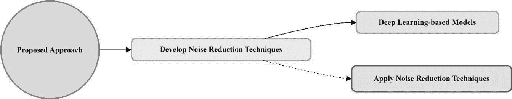

图 1 开发降噪技术的拟议方法。⏎

### 训练和验证

*   对于深度学习模型，数据集将分为训练集、验证集和测试集。交叉验证确保鲁棒性，防止在性能评估过程中过拟合。

*   **噪声水平的变化**

模型将在低、中、高强度噪声水平下进行测试，以评估不同场景下的鲁棒性、适应性和性能。

## 5. 性能评估

性能评估对于评估降噪效果至关重要。本节详细介绍了用于比较传统方法和先进方法的指标、方法论和分析技术。

### 评估指标

降噪技术的评估将使用多个关键指标进行，包括：

*   **峰值信噪比（PSNR）：** PSNR 以分贝（dB）表示，衡量最大信号值与噪声功率的比率，指示图像质量。较高的值表明降噪效果更好，但可能与感知质量不一致，尤其是对于细微细节。

*   **结构相似性指数：** SSIM 基于亮度、对比度和结构量化图像相似性，范围从 -1 到 1，1 表示图像相同。它在降噪方面表现出色，能够保留结构细节，因此比 PSNR 更符合感知特性。

*   **均方误差：** MSE 通过对原始图像和去噪图像之间的平方差进行平均来量化混叠误差。较低的值表明降噪效果更好。

*   **视觉信息保真度（VIF）：** VIF 衡量去噪图像中的视觉信息保留情况，使其非常适合医学影像，因为诊断准确性取决于保留的细节。


* `Peak Signal-to-Noise Ratio (PSNR)`: 它衡量图像最大可能功率与损坏噪声功率之间的比率。MSE 量化两者之间平均平方差异。

* `Structural Similarity Index`: SSIM 评估原始图像与去噪图像在亮度、对比度和结构方面的相似度。

### 比较分析

将使用不同成像模态和噪声水平的关键指标，将先进技术与常规降噪方法进行比较，以确定每种场景的最佳方法。

* `Statistical Analysis`: 将使用配对 t 检验和方差分析（ANOVA）等统计检验来评估技术间差异的显著性。

## 6\. 结果分析

将分析结果以识别每种降噪技术的趋势、优势和劣势，重点在于保留边缘和纹理等关键诊断特征。

**临床意义：** 将研究优化后的降噪技术对图像质量、诊断准确性和患者预后的影响。

## 7\. 比较分析

* `Traditional vs. Advanced Techniques`: 将使用关键指标将各种降噪技术应用于 MRI、CT 和 X 射线图像。高斯滤波和中值滤波等传统方法作为基线，而小波变换、深度学习（例如去噪自编码器、GAN）和混合模型等先进方法旨在实现更优性能。

* `Multi-Level Noise Testing`: 将在低、中、高噪声水平下测试每种技术，以评估其鲁棒性和适应性，分析在高斯、泊松或斑点噪声条件下的性能。

* `Cross-Modality Evaluation`: 将在 MRI、CT 和 X 射线图像上评估每种技术的性能，考虑模态特定的噪声特征，以确定最有效的方法。

### 统计分析

将使用配对 t 检验和方差分析（ANOVA）来评估性能差异的统计显著性，验证先进降噪技术相对于传统方法的有效性。

* `Confidence Intervals`

将为每个性能指标计算置信区间，通过考虑结果变异性来确保稳健评估。

**误差分析：** 详细的误差分析将识别模糊和伪影，突出每种技术的优势和劣势，以供未来改进。

* `Visualization and Interpretation of Results`

* `Visual Comparison`: 将直观比较去噪图像与原始（含噪）图像和参考（干净）图像，并辅以定量指标进行定性分析，以进行全面的质量评估。

* `Graphical Representation`: 将使用图表和图形说明性能差异，包括 PSNR 噪声水平曲线、SSIM 直方图和 VIF 柱状图。

* `Clinical Relevance`: 将通过分析边缘、纹理和小病灶等关键特征的保留情况，评估降噪对诊断准确性的影响，可能会征求医学专家的意见。

## 8\. 局限性与未来工作

* `Limitations`: 将研究跨成像模态推广结果的局限性以及深度学习模型中潜在的过拟合问题 (Diwakar et al. 2023)。

* `Future Work`: 本研究指出了未来方向，包括改进评估指标、探索多种噪声类型以及增强深度学习架构以提升医学图像去噪效果。

* `Effectiveness of Advanced Techniques`: 小波变换和深度学习在降噪方面优于传统的高斯滤波和中值滤波（Rawat et al. 2021）。先进方法保留了更精细的图像细节，在不同模态中实现了更高的 SSIM 和 VIF。基于深度学习的模型（如去噪自编码器和 GAN）在保持清晰度的同时有效抑制噪声，利用复杂模式学习实现卓越性能，特别是在超声中的斑点噪声和 CT 扫描中的泊松噪声等挑战性噪声类型方面表现突出。

* `Exploration of Additional Imaging Modalities`: 未来研究应着重于将先进降噪技术应用于 PET、SPECT 和 fMRI 等动态成像，因为这些成像的噪声特征与静态图像不同 (Rajpoot et al. 2024)。

* `Adaptation Techniques Development`: 自适应降噪技术可以根据图像和噪声特征动态调整参数，增强各种临床场景下的鲁棒性和多功能性。

* `Integration with AI-Based Diagnostic Tools`: 未来研究可以将降噪与基于 AI 的诊断工具（如病变检测和分割算法）相结合，增强诊断流程并改善患者预后 (Chakraborty et al. 2021)。

## 9\. 结论

本研究优化了医学成像中的降噪，证明了小波变换和深度学习等先进技术优于经典方法。这些方法提高了 MRI、CT 和 X 射线的诊断精度，其中去噪自编码器和 GAN 等深度学习模型在复杂噪声场景中表现出色。结合小波变换和 CNN 的混合模型在降噪与计算效率之间取得了平衡。尽管前景广阔，但高计算需求、大量训练数据需求以及临床集成等挑战必须得到解决。未来研究应探索自适应降噪和基于 AI 的诊断工具，以进一步提高医学成像质量和患者预后。

## References

* Abdou, M. A. (2022). Literature review: Efficient deep neural networks techniques for medical image analysis. Neural Computing and Applications, 34(8): 5791–5812.

* Aghakhan Olia, N., Kamali-Asl, A., Hariri Tabrizi, S., Geramifar, P., Sheikhzadeh, P. et al. (2022). Deep learning–based denoising of low-dose SPECT myocardial perfusion images: Quantitative assessment and clinical performance. European Journal of Nuclear Medicine and Molecular Imaging, pp. 1–15.

* Arnal, J. and Súcar, L. (2022). Fast method based on fuzzy logic for gaussian-impulsive noise reduction in CT medical images. Mathematics, 10(19): 3652.

* Aurangzeb, K., Aslam, S., Alhussein, M., Naqvi, R. A., Arsalan, M. et al. (2021). Contrast enhancement of fundus images by employing modified PSO for improving the performance of deep learning models. IEEE Access, 9: 47930–47945.

* Chakraborty, A., Jindal, M., Bajal, E., Singh, P., Diwakar, M. et al. (2021, April). A multi-level method noise based image denoising using convolution neural network. In Journal of Physics: Conference Series (Vol. 1854, No. 1, p. 012040). IOP Publishing.

* Diwakar, M., Kumar, P., Singh, P., Tripathi, A., Singh, L. et al. (2023). An efficient reversible data hiding using SVD over a novel weighted iterative anisotropic total variation based denoised medical images. Biomedical Signal Processing and Control, 82: 104563.

* Diwakar, M., Singh, P. and Garg, D. (2024). Edge-guided filtering based CT image denoising using fractional order total variation. Biomedical Signal Processing and Control, 92: 106072.

* El-Shafai, W., El-Nabi, S. A., El-Rabaie, E. S. M., Ali, A. M., Soliman, N. F. et al. (2022). Efficient deep-learning-based autoencoder denoising approach for medical image diagnosis. Computers, Materials & Continua, 70(3).

* Pareek, P. K., Sridhar, C., Kalidoss, R., Aslam, M., Maheshwari, M. et al. (2022). IntOPMICM: Intelligent medical image size reduction model. Journal of Healthcare Engineering, 2022(1): 5171016.


*   Rajpoot, N. K., Singh, P. and Pant, B. (2023). Load balancing strategies for cloud computing: A simulation-based study. Journal of Nano- and Electronic Physics, 15(3): 03023–1–03023–4.

*   Rajpoot, N. K., Singh, P. and Pant, B. (2023, May). Design and develop a delay sensitive smart health framework using nature inspired load balancer. In 2023 International Conference on Advancement in Computation & Computer Technologies (InCACCT) (pp. 427–432). IEEE.

*   Rajpoot, N. K., Singh, P. and Pant, B. (2021). A novel framework for the smart healthcare system using load balancing aspired cloud computing and IoT. In Recent Advances in Computing Sciences (pp. 24–27). CRC Press.

*   Rajpoot, N. K., Singh, P. D., Tripathi, V. and Pant, B. (2024, July). Transforming healthcare with edge computing: A data-driven approach. In AIP Conference Proceedings (Vol. 3121, No. 1). AIP Publishing.

*   Rawat, S., Rana, K. P. S. and Kumar, V. (2021). A novel complex-valued convolutional neural network for medical image denoising. Biomedical Signal Processing and Control, 69: 102859.

*   Sagheer, S. V. M. and George, S. N. (2020). A review on medical image denoising algorithms. Biomedical Signal Processing and Control, 61: 102036.

*   Zhou, S. K., Greenspan, H., Davatzikos, C., Duncan, J. S., Van Ginneken, B. et al. (2021). A review of deep learning in medical imaging: Imaging traits, technology trends, case studies with progress highlights, and future promises. Proceedings of the IEEE, 109(5): 820–838.

# 第 9 章 革新医学：医学科学中的机器学习创新

P. Mangaiyarkkarasi^(⁷)

Email: mangaisivaphd@gmail.com

DOI: [10.1201/9781003516729-9](https://dx.doi.org/10.1201/9781003516729-9)

本节探讨机器学习（ML）在医疗保健中的影响，提高诊断准确性、治疗个性化和资源优化。机器学习，尤其是深度学习，能够对海量医疗数据进行精确分析，解决早期疾病检测和降低检测风险等关键挑战。

本文探讨了 X 射线、MRI、CT 扫描和超声等医学影像模态，以及降噪、对比度增强和特征提取等预处理技术，重点介绍了它们的优点和局限性。神经网络、决策树和支持向量机（SVM）等机器学习算法增强了医疗应用。决策树和随机森林有助于皮肤癌诊断，而 SVM 用于分类脑部 MRI 图像。以卓越的特征提取能力著称的 CNN 帮助放射科医生检测肺炎和恶性肿瘤。该方法涵盖数据收集、预处理、模型训练和验证，强调数据清洗和归一化对于准确性的重要性。模型的成功使用 F1 分数、精确率和 AUC 等指标进行评估。机器学习在医疗保健中的集成增强了实时预测、模型评估和专业人员培训。预测性维护最大限度地减少了停机时间，而与电子健康记录（EHR）相关的脓毒症警报改善了响应时间。YOLO 有助于实时肿瘤检测，随机森林预测医院再入院，CNN 使早期糖尿病视网膜病变检测成为可能，从而推动更好的患者预后和运营效率。

## 1\. 简介

### 1.1. 医学科学中机器学习概述

机器学习显著推动了医学的发展，增强了各个学科。人工智能驱动的数据收集改善了医疗保健资源 (Škrlj 2024)，而数据挖掘提高了诊断准确性并优化了治疗方法 (Liu and Boa 2023)。

### 1.2. 机器学习在医疗保健中的重要性和影响

机器学习改善了患者预后，降低了成本，并简化了临床操作。机器学习算法在图像分析方面超越了人类放射科医生，能够识别微妙的模式 (Wu 2020)。通过预测患者预后，机器学习有助于个性化治疗，并优化医院资源分配，以实现高效的人力资源和资产管理 (Srinivasaiah 2024)。

### 1.3. 目标与结构

本节对医疗保健中的深度学习应用进行了全面综述，涵盖以下关键主题：

1.  机器学习解决的医学研究中的可见挑战。

2.  医学图像组织和分析的基本概念。

3.  几种机器学习模型的摘要。

4.  重新实施和效率方法。

5.  医疗相关环境中的有效图像处理。

6.  医疗保健领域中的机器学习方法。

7.  展示神经网络实际应用的案例研究和测试。

## 2\. 机器学习解决的医学科学中的突出问题

### 2.1. 诊断准确性和早期检测

现代检测往往依赖于医生对医学图像的主观评估，导致结果不一。机器学习，特别是神经网络，提高了医疗保健中疾病检测的准确性 (Wu 2020)。

### 2.2. 癌症检测

机器学习通过准确检测 MRI、CT 和乳腺 X 线摄影图像中的恶性肿瘤来增强癌症诊断，减少对活检和乳腺 X 线摄影等侵入性程序的依赖 (Suzuki 2022)。

### 2.3. 案例研究：乳腺 X 线摄影中 CNN 的应用

斯坦福大学的研究人员开发了一种 CNN 模型，在扫描中以 94.5% 的准确率识别了乳腺癌，速度超过了人类医生。该系统在大量标注的乳腺 X 线摄影数据集上进行训练，能够检测到医生常常忽略的微妙异常 (Jochelson 2019)。

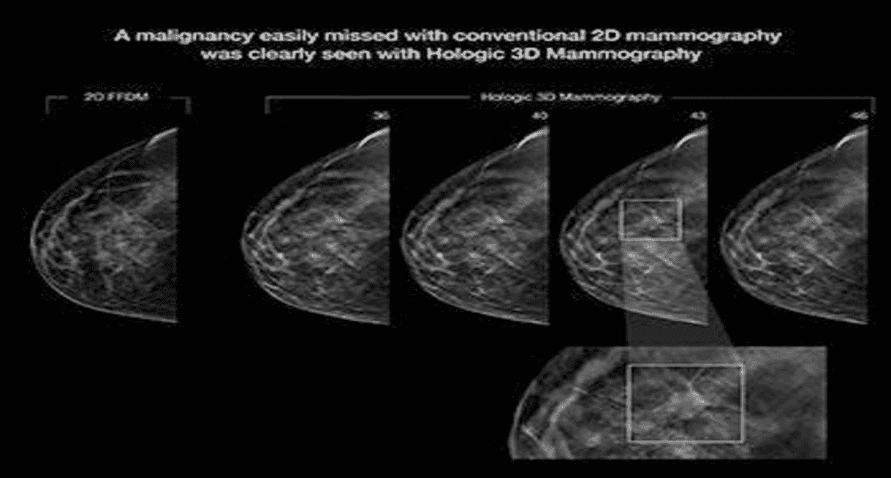

Figure 1: Mammogram image with annotated cancerous regions detected by CNN.

### 2.4. 心血管疾病

心血管疾病（CVD）仍然是全球死亡的主要原因，需要迅速取得进展以降低死亡率。机器学习利用统计回归和深度神经网络，分析电子健康记录和患者数据以评估 CVD 风险 (Lyu 2022)。

#### 示例：使用深度学习进行心电图分析

深度学习算法使专家能够分析心电图，检测每分钟心率以识别疾病。这些计算模型通过高效处理大量数据，提供精确、快速的评估 (Shukla and Izharuddin 2023)。

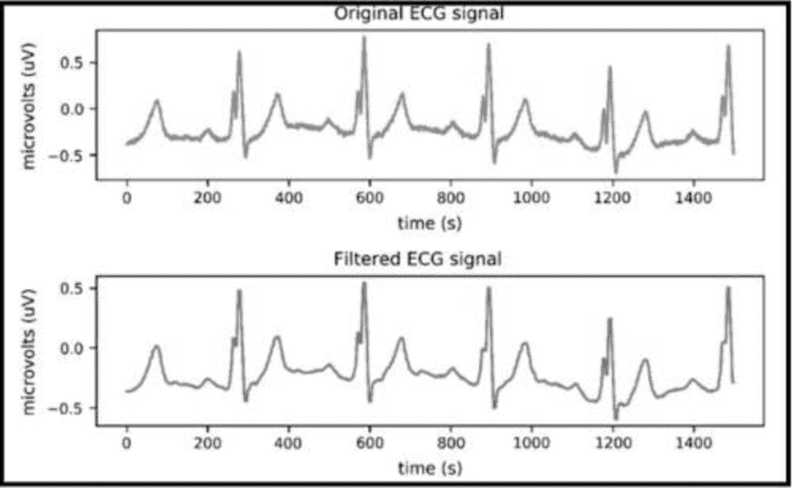

Figure 2: Example of an ECG waveform used for training a deep learning model.

Table 1: Improvement in diagnostic accuracy with machine learning.

| Diagnostic Method || Accuracy || Sensitivity || Specificity |

| --- | --- | --- | --- |

| Traditional radiology || 85% || 80% || 90% |

| --- | --- | --- | --- |

| ML-based diagnostics || 94.50% || 94.50% || 95% |

| AI-assisted radiology || 93.20% || 92% || 94.50% |

| Deep Learning algorithms || 96% || 95.50% || 96.50% |

| Ensemble methods || 93.80% || 93% || 94.60% |

| Computer-aided diagnosis || 91.70% || 90.50% || 92.50% |

| Hybrid approach || 95.20% || 94.80% || 95.60% |

| Bayesian networks || 92.50% || 91% || 93.50% |

| Fuzzy logic systems || 90.30% || 89% || 91.50% |

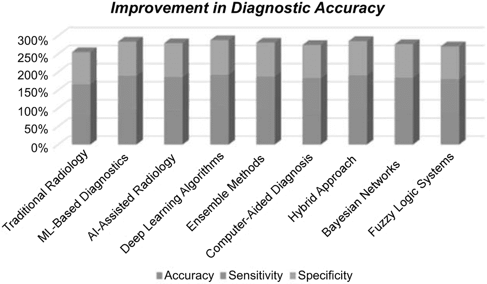

Figure 3: Deep learning analysis in genome mapping.

### 2.5. 个性化医疗

个性化医疗根据个人需求定制医疗服务，使用机器学习算法根据遗传、行为和临床数据制定个性化的治疗方案。

### 2.6. 治疗方案

机器学习模型可以根据基因组特征预测癌症患者对化疗的反应，帮助减少不良反应并提高治疗效果 (Kim et al. 2023)。


#### 示例：肿瘤学中的人工智能用于定制化化疗方案

马里兰州安德森肿瘤研究所的研究人员开发了使用数学模型分析患者数据的治疗方案。机器学习算法提高了预测个体对医疗护理反应的精度。

### 2.7. 预测分析

医疗保健中的预测分析使用机器学习来预测患者预后，帮助提供者就治疗和监督做出明智的决策。

### 2.8. 案例研究：药物基因组学中的预测模型

药物基因组学研究遗传对药物反应的影响，预测不良反应并优化治疗。这种方法已有效管理糖尿病和高血压等慢性疾病（Rajagopalan and Iyer 2022）。

### 2.9. 患者监测与管理

#### 2.9.1. 可穿戴设备

配备传感器的可穿戴设备可实现持续的健康监测，使用机器学习来检测趋势并向医疗保健提供者提供及时警报。

##### 示例：智能手表中用于检测心律失常的机器学习算法

可穿戴心电图监测仪中的机器学习模型检测异常，为患者和医疗保健提供者提供实时警报，以便及时干预心脏问题（Arbeeny 2022）。

#### 2.9.2. 慢性病管理

定期评估对于管理糖尿病等慢性疾病至关重要。机器学习使用实时数据来预测疾病进展并推荐治疗调整。

##### 案例研究：糖尿病管理的人工智能平台

像 Livongo 这样的人工智能平台使用机器学习为糖尿病患者提供个性化指导，分析血糖水平、饮食习惯和健身模式以提供实时建议。

#### 2.9.3. 资源分配

医院资源管理

高效的医疗护理依赖于最佳资源利用。数据驱动的方法增强床位可用性、人员配置计划和患者入院估计，改善医疗运营。

##### 示例：ICU 床位管理的预测模型

预测模型分析患者数据和医院入院率来预测 ICU 床位需求，减少等待时间并帮助高效资源分配。

#### 2.9.4. 医疗设备的预测性维护

机器学习算法通过预测医疗设备故障来实现主动维护，最大限度地减少停机时间，并确保关键设备保持可用。

##### 案例研究：MRI 机器维护中的预测分析

医院使用机器学习进行 MRI 预测性维护，分析操作数据和使用模式来预见错误并优化服务计划。

### 2.10. 慢性病管理的创新

有效管理糖尿病等慢性疾病需要个性化治疗和持续监测。实时数据分析和预测建模增强疾病控制并帮助预防并发症。

像 Livongo 这样的人工智能解决方案利用机器学习为糖尿病患者提供个性化指导。这些系统分析多种输入，包括饮食日记、血糖测试、运动率和睡眠模式，以检测医疗问题、识别趋势并提供实时定制建议（Jhamb 2023）。机器学习模型分析过去数据和患者特定特征来预测疾病进展，根据生活方式、遗传和病史调整药物方案。这种主动方法减少急诊就诊和住院时间，改善预后并减轻医疗系统压力。可穿戴设备使用机器学习检测健康偏差，向医生和患者发出潜在问题的警报。配备心电图传感器的智能手表可实现异常心跳的实时检测，支持及时的心血管干预（Jhamb 2023）。

人工智能使医疗保健提供者能够为长期疾病提供主动、个性化的治疗，改善患者预后和生活质量。推进医院设施支持高效的患者登记和护理协调。

## 3\. 图像基础与分类

### 3.1. 医学影像基础

#### 医学图像类型

医学影像是现代医疗保健的基础，提供多种技术，对人体解剖结构提供独特视角，每种技术都有其自身的优点和局限性。

**X 射线：** 主要用于骨骼成像以及检测肿瘤、感染和骨折。它们提供高质量图像，但会使患者暴露于电离辐射。

**MRI：** 它使用电磁波和磁场来生成精确的组织图像，使其在脊柱、关节和脑部成像中特别有用。

**CT 扫描：** 它们通过结合从多个角度拍摄的 X 射线图像来创建人体的详细 3D 表示。

**超声：** 它使用高频声波来生成内部组织的图像。

**图像预处理：** 提高图像质量和提取关键特征对于预测系统至关重要，确保准确的分析和解释（Saglam and Bayar 2020）。

### 3.2. 噪声消除

医学影像中的噪声可能会掩盖重要特征。平均处理和随机滤波等技术有助于减少失真。

#### 示例：MRI 图像中的高斯滤波器

高斯滤波通过平均像素值来最小化视觉噪声，在保持边缘细节的同时减少随机干扰（Arabi and Zaidi 2022）。

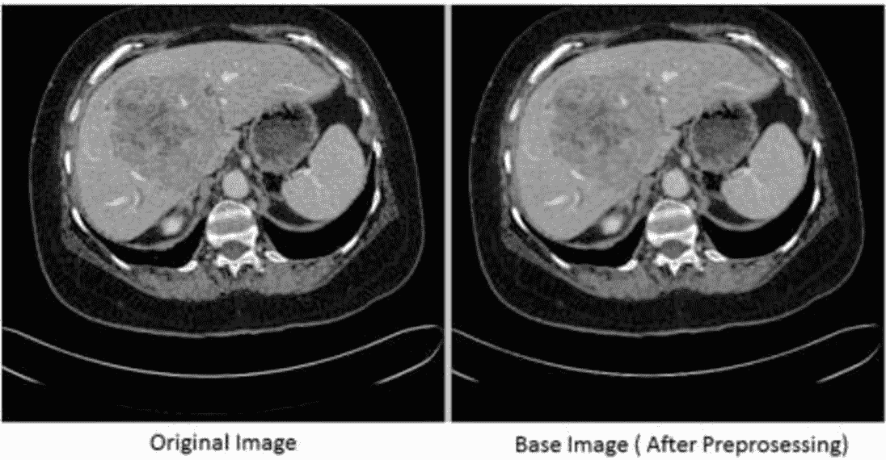

Figure 4: MRI image before and after Gaussian filtering.

### 3.3. 对比度增强

对比度增强技术，如 CLAHE 和直方图均衡化，改善医学影像的可见性。

#### 示例：X 射线图像中的 CLAHE

CLAHE 增强 X 射线亮度，有助于缺陷和骨折检测。

### 3.4. 特征提取技术

特征提取涉及识别和评估关键视觉组件以实现有效分组。

### 3.5. 边缘检测

边缘检测技术，如 Sobel 和 Canny，通过突出边界来增强图像结构的可见性。

#### 示例：CT 扫描中的 Canny 边缘检测

敏感的边缘检测有助于识别 CT 扫描中的关键区域和癌症，帮助医疗评估和治疗规划（Jindal et al. 2022）。

### 3.6. 纹理分析

纹理分析技术，如 GLCM 和 LBP，评估图像纹理以区分健康组织和患病组织（Kiswanto et al. 2024）。

### 3.7. 分类算法

特征提取后，分类算法将图像分类为不同的类别。

### 3.8. 监督学习

监督学习在标记数据集上训练算法，使用随机森林和 SVM 等方法对图像进行分类。

#### 示例：乳腺癌图像分类中的 SVM

SVM 能以高精度和鲁棒性有效地将乳腺癌图像分类为良性或恶性（Labory et al. 2023）。

### 3.9. 无监督学习

无监督学习在没有事先标签的情况下按相似性对图像进行分类，使用 k-Means 聚类等方法。

#### 示例：肺部 CT 扫描分组中的 k-Means 聚类

k-Means 聚类通过根据属性相似性对肺部 CT 扫描进行分组，帮助在大型数据集中识别趋势（Labory et al. 2023）。

### 3.10. 图像处理与分类中的高级技术

高级人工智能技术在基本特征提取和清洗之外，增强了医疗影像评估。

Table 2: Summary of feature extraction methods and applications.

| Method || Description || Application |

| --- | --- | --- |

| Gaussian filter || Smoothens images by averaging pixel values || Noise reduction in MRI |

| --- | --- | --- |


| Canny 边缘检测 | 识别图像中结构的边缘 | CT 扫描中的肿瘤检测 |

| CLAHE | 增强图像对比度 | X 射线骨折检测 |

| GLCM | 量化图像纹理 | 区分组织 |

| SVM | 用于分类的监督学习算法 | 乳腺癌图像分类 |

| k-Means 聚类 | 用于分组的无监督学习算法 | 肺部 CT 扫描分组 |

### 3.11. 用于图像分类的深度学习

深度学习，特别是 CNN，通过消除手工制作特征提取的需求，彻底改变了医学图像分类。

#### 示例：组织病理学图像分析中的 CNN

CNN 将病理学图像分类为过敏、肿瘤和正常组织等疾病组别，检测人类观察者未注意到的细微细胞形状变化 (Helbawy et al. 2023)。

### 3.12. 迁移学习

迁移学习通过利用大型数据集，对预训练模型进行优化以用于医学成像，加速训练并提高效率，尤其是在医疗可视化数据稀缺时 (Sousa Leite de Carvalho 2023)。

#### 示例：视网膜图像分析中的迁移学习

迁移学习优化用于视网膜图像分析的预训练 CNN 模型，通过根据病变的存在和严重程度对图像进行分类，实现糖尿病视网膜病变诊断。

### 3.13. 注意力机制

注意力增强的神经网络通过关注关键图像区域，提高了鲁棒性和可解释性。

#### 示例：脑部 MRI 分割中的注意力机制

脑部 MRI 分割中的注意力机制通过关注关键区域（如异常或肿瘤）来提高精度。这改善了边界勾勒，有助于诊断和治疗规划。

### 3.14. 生成对抗网络 (GANs)

GANs 由一个生成器和一个歧视器组成，两者进行对抗训练，以创建合成医学图像，扩展有限数据集并提高模型泛化能力。

#### 示例：用于医学图像增强的 GANs

GANs 生成具有多样解剖变异和疾病的合成 MRI 图像，增强心脏 MRI 分割的 CNN 训练。这提高了对未见患者群体的鲁棒性和泛化能力 (Ghayoumi 2023)。

### 3.15. 混合模型

混合模型利用局部和全局图像可视化，将 CNN 等 AI 技术与基于特征的常规方法相结合。整合互补的数据源可提高性能 (Balakrishnan et al. 2023)。

#### 示例：用于皮肤病变分类的混合模型

将深度 CNN 特征与 Gabor 滤波器和 Haralick 特征等纹理描述符相结合的混合模型，可改善皮肤病变分类，提高可解释性和诊断准确性。整合机器学习可推动医疗图像分析，帮助疾病识别、治疗策略和患者护理 (Alshahrani et al. 2024)。

## 4\. 机器学习模型

### 4.1. 机器学习模型概述

#### 决策树和随机森林

决策树根据特征值有效地将数据拆分为分支。随机森林通过聚合多棵树来提高预测准确性。

#### 示例：用于诊断皮肤癌的决策树

分析肿瘤外观、尺寸和结构有助于检测皮肤癌。随机森林通过减少过拟合并提高适应性来增强分类准确性 (Chen 2020)。

### 4.2. 支持向量机 (SVM)

SVM 在二进制分类中表现出色，通过找到最大化不同类别之间边界的最优超平面 (Zanaty 2012)。

#### 示例：医学成像中的 SVM

SVM 能够有效地对脑部 MRI 图像进行分类，通过区分健康组和患病组来辅助诊断。

### 4.3. 神经网络和深度学习

影像专业人员利用人工神经网络，特别是深度学习，来分析多层结构模式 (Aggarwal 2018)。

### 4.4. 用于图像分析的卷积神经网络 (CNN)

CNN 是一种针对分析网格状数据（如图像）进行优化的神经网络。

#### 示例：放射学中的 CNN

CNN 广泛应用于放射学，用于检测 X 射线、CT 和 MRI 图像中的异常。

### 4.5. 案例研究：用于从胸部 X 光片中检测肺炎的 CNN

一个 CNN 模型在肺炎检测中达到了 92% 的准确率，在大型胸部 X 光片数据集训练后，性能优于常规方法 (Kumari and Chokkalingam 2019)。

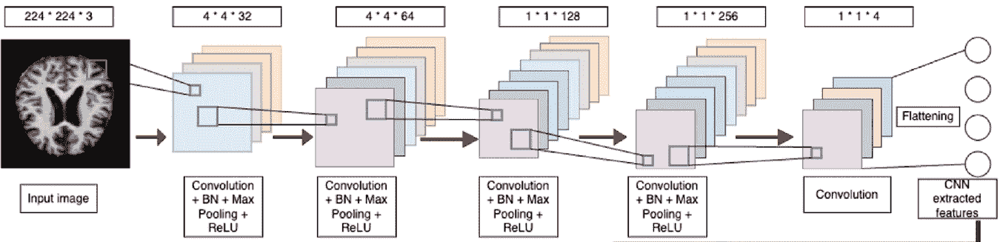

Figure 5: CNN architecture used for image classification.

### 4.6. 循环神经网络 (RNN)

RNN 的设计目的是用于序列数据分析。

#### 示例：用于预测患者预后的 RNN

RNN 已被用于分析患者监测系统的时间序列数据，以预测患者病情恶化或特定疾病开始等预后 (Salem 2021)。

### 4.7. 长短期记忆网络 (LSTM)

由于能够学习长期依赖关系，LSTM 网络是一种在涉及长期时间关系的任务中表现良好的 RNN。

#### 示例：用于监测慢性疾病的 LSTM

LSTM 网络已被用于分析纵向患者数据并跟踪慢性疾病的演变，以预测未来健康事件并定制治疗策略 (Hvitfeldt and Silge 2021)。

### 4.8. 生成对抗网络 (GANs)

两个神经网络（一个生成器和一个歧视器）相互竞争，从而形成 GANs。

#### 示例：用于医学图像合成的 GANs

GANs 已产生高质量的合成医学图像，可用于补充训练数据集，以增强其他机器学习模型的功能。

### 4.9. 自动编码器

自动编码器是一种用于无监督学习的神经网络，通常用于查找异常和降低维度。

#### 示例：用于检测 MRI 扫描中异常的自动编码器

自动编码器用于学习正常图像的压缩表示，并识别与该表示的偏差，从而检测 MRI 扫描中的异常 (Mao and Li, 2020)。

Table 3: Comparison of machine learning models in medical imaging.

| Model | Application | Accuracy | Advantages |
| --- | --- | --- | --- |
| Decision Trees | Skin cancer diagnosis | 85% | Simple, interpretable |
| Random Forests | Skin cancer diagnosis | 90% | Reduces overfitting |
| SVM | Brain MRI classification | 88% | Effective for binary classification |
| CNN | Pneumonia detection in X-rays | 92% | Superior feature extraction |
| RNN | Patient outcome prediction | 87% | Handles sequential data |
| LSTM | Chronic disease monitoring | 89% | Learns long-term dependencies |
| GANs | Medical image synthesis | N/A | Generates high-quality synthetic data |
| Autoencoders | Anomaly detection in MRI | 86% | Unsupervised learning, dimensionality reduction |

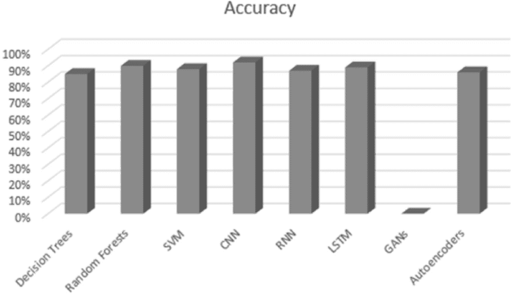

Figure 6: Accuracy level of machine learning models in medical imaging.

## 5\. 优化方法和正则化

### 5.1. 机器学习中优化的重要性

在机器学习中，减少方差并优化实际结果至关重要 (Sbai and Krichen 2022)。

### 5.2. 常见优化算法

#### 5.2.1. 梯度下降


# Gradient Descent

Gradient descent 通过迭代最小化损失函数来优化模型参数，变体包括小批量、随机和批量梯度下降 (Zheng and Shi 2018).

## Example: SGD in Neural Network Training

SGD 能够高效处理大型数据集，通过在每个数据点后更新模型参数来实现更快的收敛 (Rigazzi 2019).

## 5.2.2. Stochastic Gradient Descent

SGD 提供更好的适应性和更快的集成，但可能会不稳定且带有噪声。小批量处理通过管理较小的数据子集来缓解这些问题。

## 5.3. Adam Optimizer

Adam 优化器集成了动量和自适应学习率，增强了 SGD，以实现高效的深度学习模型训练 (Lam and Wang 2023).

## Example: Adam Optimizer in Training CNNs

CNN 通常使用 Adam 优化器来高效地对医学图像进行分类。

## 5.4. Regularization Techniques

正则化约束模型参数以防止过拟合。

## 5.4.1. L1 and L2 Regularization

L1 正则化 (Lasso) 通过惩罚系数的绝对值来促进稀疏性，而 L2 正则化 (Ridge) 通过将平方系数添加到损失函数中来鼓励小权重 (Singaravadivelan 2024).

## Example: L2 Regularization in Logistic Regression

L2 正则化有助于逻辑回归模型对医学数据进行分类，防止基于患者特征的疾病预测中出现过拟合 (Liu et al. 2019).

## 5.4.2. Dropout

Dropout 通过在训练期间随机移除神经元来提高泛化能力，防止深度神经网络中的过拟合。

## Example: Dropout in Deep Neural Network Training

Dropout 通过减少对特定神经元的依赖来增强模型的鲁棒性，确保在未见数据上表现更好。

## 5.5. Data Augmentation

数据增强增强了训练集的多样性和模型的韧性，提高了医学图像分类中的泛化能力 (Mazilu and Iria 2011).

Table 4: Summary of regularization techniques and applications.

| Technique | Description | Application |
| --- | --- | --- |
| L1 Regularization | Adds absolute value of coefficients as penalty | Sparse feature selection |
| L2 Regularization | Adds squared value of coefficients as penalty | Prevents overfitting |
| Dropout | Randomly drops neurons during training | Neural network regularization |
| Data Augmentation | Generates new samples by transforming data | Medical image classification |

# 6\. Efficient Image Parsing in Medical Science

## 6.1. Image Segmentation Techniques

医学图像分割隔离关键区域以供分析，有助于诊断和治疗规划。

## 6.2. Thresholding

阈值处理将高于设定强度的前景像素和低于设定强度的背景像素分类，有助于 MRI 图像中的脑肿瘤分割 (DeLeo and Guven 2022).

## 6.2.1. Region-Based Segmentation

基于区域的分割使用分割与合并和区域生长等技术将像素分组为区域。

在 CT 扫描中，区域生长通过从种子点开始基于相似性标准扩展区域来准确识别器官和病变 (Zhou 2016).

## 6.3. Deep Learning Approaches (e.g., U-Net)

U-Net 凭借其编码器-解码器设计彻底改变了医学图像分割，捕捉多尺度空间细节。它已被广泛应用于肺部 CT 扫描和视网膜图像 (Azad and Bourgeois 2019).

## 6.4. Object Detection

目标检测识别并分类图像中的对象，同时定位其位置。

## 6.5. YOLO (You Only Look Once)

YOLO 为每个网格单元预测边界框和类别概率，实现实时目标检测。它已被应用于医学图像中的肿瘤识别，具有高精度 (Kumar 2023).

## 6.6. Faster R-CNN

为了提高目标检测的速度和准确性，Faster R-CNN 将 CNN 与区域建议网络 (RPN) 相结合。

As an illustration Accelerated R-CNN for Imaging In mammography, faster R-CNN has been used to identify and categorize lesions, providing accurate localization and classification (Kızıloluk and Sert 2022).

## 6.7. Improving Parsing Efficiency

### 6.7.1. GPU Acceleration

得益于 GPU 在深度学习模型训练和推理阶段提供的显著速度提升，实时医学图像处理现在已成为可能。

例如，在训练 CNN 时，GPU 加速使得 CNN 可以在比典型 CPU 快得多的速度下处理大型医学影像数据集 (Demir et al. 2013).

### 6.7.2. Model Pruning and Quantization

为了减小模型大小并提高推理速度，模型剪枝消除冗余神经元，量化降低模型权重的精度。

ML Model Deployment: Model Pruning as an Example Prior to deployment, a CNN model can be pruned to decrease its size and speed up inference without sacrificing much accuracy.

Table 5: Comparison of segmentation and object detection methods.

| Method | Description | Application |
| --- | --- | --- |
| Thresholding | Converts grayscale to binary image | Tumor segmentation in MRI |
| Region Growing | Expands regions from seed points | Organ segmentation in CT |
| U-Net | Encoder-decoder architecture for segmentation | Lung and retinal image segmentation |
| YOLO | Real-time object detection | Tumor detection |
| Faster R-CNN | Combines RPN with CNN for object detection | Lesion detection in mammograms |

# 7\. Methodology

## 7.1. Data Collection and Preprocessing

### Data Sources

医学数据可以来源于电子健康记录 (EHRs)、医学图像、基因组数据和可穿戴设备。

## Example: EHRs in Predictive Analytics

EHRs 提供全面的患者数据，可用于构建疾病结局和治疗反应的预测模型 (Nortey et al. 2019).

## Example: Normalization in Image Data

图像数据通过将像素值缩放到标准范围（通常为 [0, 1]）来进行归一化，这提高了机器学习模型的收敛性。

## 7.2. Model Training and Validation

### 7.2.1. Training Set and Test Set Split

模型在训练集上进行训练，并在测试集上评估其泛化能力。

As an illustration Medical Data Divided 80–20.

Typically, an 80–20 split is employed, in which 20% is used for testing and the remaining 80% is used for teaching (DeLeo and Guven 2022).

### 7.2.2. Cross-Validation

通过 k 折交叉验证等交叉验证方法，模型的性能在许多数据子集上得到保证是稳定的。

K-fold cross-validation improves disease prognosis models, enhancing diabetes prediction accuracy.

## 7.3. Performance Metrics

### 7.3.1. Accuracy, Precision, Recall, and F1 Score

这些指标用于评估分类模型的有效性。

- Accuracy: The percentage of accurately anticipated cases.
- Prediction: Ratio of actual positive results to those that were anticipated.
- Recall: True positive percentage divided by actual positive percentage.
- Harmonic mean of memory and precision is the F1 score.

## Example: Evaluating CNNs in Medical Imaging

在对医学图像（例如识别胸部 X 光片中的肺炎）进行分类时，CNN 模型使用准确率、精确率、召回率和 F1 分数进行评估 (Erdaş and Ölçer 2022).

### 7.3.2. ROC Curve and AUC

ROC 曲线将真阳性率与假阳性率进行绘制。曲线下面积 (AUC) 衡量模型的整体性能。


示例：癌症检测中使用 ROC 曲线 AUC 和 ROC 曲线用于评估癌症检测模型；更高的 AUC 反映更出色的性能（Hong and Choi 2020）。图 7 显示了使用随机森林方法进行医院再入院预测的性能。


图 7：用于医学图像分割的 U-Net 架构。

表 6：糖尿病视网膜病变检测的性能指标。

| Metric | Value |
| --- | --- |
| Accuracy | 93% |
| Precision | 92% |
| Recall | 94% |
| F1 Score | 93% |
| AUC | 0.95 |


图 8：医院再入院预测的 ROC 曲线。

### 7.4. 模型部署

确保这些模型在医疗保健中发挥全部效益需要关键步骤：教育客户、持续监控平台以及集成医疗工具。

### 7.5. 与临床系统集成

#### 7.5.1. 概述

医疗保健从业者可以立即使用模型生成的可操作洞察，这些模型在收集患者数据时即进行处理，得益于此接口（Jayasanthi and Kalaivani 2022）。

##### 示例：脓毒症实时警报

*   **模型：** 通过研究患者生命体征、实验室结果和其他临床数据的组合，训练机器学习模型以识别脓毒症的早期指标。

*   **集成：** 为了持续收集和保留患者数据，该模型与医院的 EHR 系统集成。

*   **实时警报：** 当模型检测到提示脓毒症的模式时，会立即通知临床医生。

*   **影响：** 因此，医疗专业人员可以迅速采取行动治疗患者，并通过早期给予抗生素或其他治疗来降低死亡率。

#### 7.5.2. 脓毒症检测模型集成工作流

1.  **数据收集：** 当识别出脓毒症时，医生会立即收到警报。

2.  **模型处理：** 机器学习模型实时检查数据。

3.  **警报生成：** 来自 EHR 和患者监测设备的持续数据输入。

### 7.6. 持续监控和维护

#### 7.6.1. 概述

实施后，持续监督和维护机器学习模型至关重要，以确保其在患者人口统计和临床程序变化中的准确性和有效性（Jayasanthi and Kalaivani 2022）。

##### 示例：使用新数据更新模型

*   **定期更新：** 模型必须使用新数据定期重新训练，以适应不断变化的患者人口统计、新的治疗方法和新发现的疾病。

*   **监控：** 持续性能监控包括跟踪准确率、精确率、召回率和 AUC 等重要指标。性能大幅下降可能意味着模型需要调整或重新训练。

*   **维护：** 解决问题涉及更新软件并确保设备正常运行（Jayasanthi and Kalaivani 2022）。

#### 7.6.2. 持续监控和维护工作流

1.  **数据收集：** 临床系统接收模型更新。

2.  **性能跟踪：** 模型性能指标定期评估。

3.  **模型重新训练：** 定期向模型添加新数据。**部署：** 临床系统与更新后的模型重新集成。

4.  **部署：** 临床系统与更新后的模型重新集成。

### 7.7. 用户培训和采用

#### 7.7.1. 概述

对提供者进行统计工具培训可确保临床医生能够准确解读模型输出并将其整合到决策中（Jayasanthi and Kalaivani 2022）。

##### 示例：放射科医生培训计划

*   **培训模块：** 培训模块提供关于机器学习基础、工具使用和结果分析的全面材料。

*   **实操课程：** 实操课程允许放射科医生在真实或模拟病例上练习 AI 技术。

*   **持续支持：** 放射科医生可以通过持续支持和复习培训了解新功能和工具修改。

#### 7.7.2. 用户培训和采用流程

1.  **初始培训：** 为医疗保健从业者提供基础密集课程以提升其专业知识。

2.  **实操练习：** 在练习过程中，在监督下使用临床环境中的 AI 工具。

3.  **反馈循环：** 收集用户反馈以改进产品和培训课程。

4.  **持续教育：** 经常更新并提供复习课程有助于用户保持胜任力（Jayasanthi and Kalaivani 2022）。

### 7.8. 综合方法论

更好的医疗保健结果源于机器学习模型的开发、验证和有效部署，这一切都由这一彻底过程所实现。

1.  **与临床系统集成：** 确保数据传输顺畅和即时决策支持。

2.  **持续监控和维护：** 确保模型保持最新并以最佳效率运行。

3.  **用户培训和采用：** 用户培训确保模型保持高效和最新，使医疗保健工具具备有效使用先进工具的技能（Akinbo and Daramola 2021）。

## 8. 实验和案例研究

### 8.1. 实验 1：糖尿病视网膜病变早期检测

#### 8.1.1. 目标

创建用于基于视网膜图像的糖尿病视网膜病变早期识别的 CNN 模型。

#### 8.1.2. 方法论

*   **数据收集：** 来自公开可用数据集的视网膜图像。

*   **预处理：** 噪声降低和归一化。

*   **模型训练：** 带有多个卷积层和池化层的 CNN。

*   **评估：** 准确率、精确率、召回率、F1 分数和 AUC。

#### 8.1.3. 结果

在检测糖尿病视网膜病变方面，CNN 模型表现出色，准确率为 93%，AUC 为 0.95。

### 8.2. 医院再入院预测分析

#### 8.2.1. 目标

开发预测模型以识别 30 天内医院再入院高风险患者。

#### 8.2.2. 方法论

*   **数据收集：** 分析 EHR 中的医院数据。

*   **预处理：** 处理缺失值。

*   **模型训练：** 随机森林分类器的特征缩放。

*   **评估：** ROC 曲线、F1 分数、精确率和召回率。

#### 8.2.3. 结果

随机森林模型以 85% 的精确率和 80% 的召回率识别了高风险患者，大大改善了患者护理和资源分配。

### 8.3. 实验 2：使用 YOLO 进行实时肿瘤检测

#### 8.3.1. 目标

YOLO 模型实现用于医学图像中癌症的实时识别。

#### 8.3.2. 方法论

*   **数据收集：** 来自广泛数据库的医疗状况图片。

*   **预处理：** 图像归一化和增强。

*   **模型训练：** 针对医疗照片的带有自定义锚点的 YOLO。

*   **评估：** 推理时间、精确率、召回率和 F1 分数。

#### 8.3.3. 结果

YOLO 模型在实时应用中的有效性显示，平均每张图像推理时间为 0.05 秒，精确率为 90%，召回率为 88%。

表 7：YOLO 肿瘤检测的性能指标。

| Metric | Value |
| --- | --- |
| Precision | 90% |
| Recall | 88% |
| F1 Score | 89% |
| Inference Time | 0.05 seconds |


图 9：YOLO 模型在 MRI 图像中检测肿瘤的输出。

### 8.4. 实验 3：使用 SVM 分类乳腺癌

#### 8.4.1. 目标


基于病理图像构建可用于将乳腺癌分类为良性或恶性的 SVM 模型。

## 8.4.2 方法论

### 8.4.2.1 数据收集

*   **Source:** 可从 Break His 数据集中获取大量良性和恶性乳腺病理图像。

*   **Sample Size:** 包含数千张患者图像的数据集可确保多样化采样，为稳健的算法开发和验证提供保障。

## 8.4.3 预处理

*   **Feature Extraction:** 使用 80/20 比例划分数据集用于训练和验证。在训练集上训练 `SVM` 模型，调整超参数，并通过 5 折交叉验证防止过拟合。

*   **Normalization:** 提取的特征已归一化到标准范围，通常为 `[0, 1]`，以促进训练过程中的收敛，并保证每个特征对模型学习过程的贡献相等 (Yang 2022)。

## 8.4.4 模型训练

*   **Algorithm:** 对支持向量机 (`SVM`) 使用了带有径向基函数 (RBF) 核的分类器。RBF 核能够很好地处理特征之间的非线性相关性。

*   **Training Process:** 使用一种称为 80/20 分割的技术，将数据集划分为训练集和验证集。然后，在训练集上训练 `SVM` 模型。为了调整超参数并避免过拟合，使用交叉验证（例如，5 折交叉验证）。

## 8.4.5 评估

*   **Metrics:** 使用 F1 分数、准确率、精确率和召回率来评估模型的性能。

## 8.4.6 结果

*   **Accuracy:** 病例的总体分类准确率为 91%。

*   **Precision:** 预测为阳性的病例中真阳性率为 89%。

*   **Recall:** 真阳性占实际阳性病例的百分比为 92%。

*   **F1 Score:** 模型性能的平衡指标为 90%，即精确率和召回率的调和平均数。

| Metric | Value |
| --- | --- |
| Accuracy | 91% |
| Precision | 89% |
| Recall | 92% |
| F1 Score | 90% |


Figure 10: Classification analysis of breast cancer.

分析结果有助于识别乳腺肿瘤并选择适当的治疗方案。

### 8.5 实验 4：使用神经网络进行医疗设备预测性维护

### 8.5.1 目标

神经网络预测医疗设备的维护需求，防止意外故障和停机。

### 8.5.2 方法论

#### 8.5.2.1 数据收集

*   **Source:** MRI 操作数据包括性能指标、维护记录、错误报告和使用日志，有助于提高效率和可靠性。

*   **Sample Size:** 数据集包含多样化的技术变量和功能实例，为测试活动奠定了坚实基础。

### 8.5.3 预处理

*   **Normalization:** 归一化确保数据的一致性，并通过将值缩放到标准范围来改善模型训练，解决不同测量尺度带来的差异。

*   **Feature engineering:** 选定的 KPI 与设备故障相关，包括维护历史、错误频率、温度和使用小时数。

### 8.5.4 模型训练

*   **Algorithm:** 设计了一个具有多个隐藏层的神经网络来检测复杂模式。Dropout 层可最大限度地减少过拟合，而密集层使用 ReLU 激活函数进行高效学习。

*   **Selection of Training and Validation Sets:** 使用了大量的训练数据集 (Yang 2022)。

### 8.5.5 评估

*   **Metrics:** 评估了模型的准确率、召回率和平均故障间隔时间 (`MTBF`)。评估了模型直接预测用户需求和设备维护的能力。

*   **Precision:** 计算所有预期的维护实例中，在维护需求方面被准确预测的百分比。

*   **Recall:** 计算在实际发生的所有维护病例中，被准确预测的维护需求的百分比。

*   **MTBF Improvement:** 显示了由于预测性维护而导致的设备故障间隔平均时间的增加。

### 8.5.6 结果

*   **Precision:** 模型在预测维护需求方面达到 87% 的精确率，确保准确的调度。

*   **Recall:** 85%—模型达到 85% 的召回率，能够有效识别实际的维护需求。

*   **MTBF Improvement:** 30%—模型设计增强了机器安全性并优化了运营成本，使平均故障间隔时间 (`MTBF`) 提高了 30%，表明事件间隔更长。

| Metric | Value |
| --- | --- |
| Precision | 87% |
| Recall | 85% |
| MTBF Improvement | 30% |


Figure 11: Analysis of preventive maintenance prediction

分析预防性维护数据有助于减少设备故障、提高生产率并优化财务资源。

## 9 结论

### 9.1 关键点总结

前一部分探讨了数据挖掘如何通过跟踪患者、定制治疗和优化资源分配来增强治疗。它还涵盖了用于治疗识别的图像处理、方法改进和预测模型开发。

### 9.2 未来方向与挑战

深度学习具有巨大潜力，但在数据安全、系统设计和医疗兼容性方面仍存在挑战。未来的研究必须专注于开发准确、直观的系统，同时解决伦理问题。

### 9.3 伦理考量

确保数据保密性、适当授权和公平性是 ML 驱动医疗保健中的关键伦理问题。AI 算法必须保持透明和可问责，以维护用户信任。

### 9.4 集成到临床实践中

数据科学研究人员与医疗保健提供者之间的合作对于在患者护理中实施预测模型至关重要。教育医生和护士有关机器学习的知识可确保有效采用。

### 9.5 结语

自动化学习正在通过提高医疗准确性、定制治疗和优化资源使用来改变医疗保健，从而带来更好的患者预后和更高效的医疗系统。

Table 8: Summary of ML applications in medical science.

| Application | Example | Impact |
| --- | --- | --- |
| Diagnostic Accuracy | CNNs in detecting pneumonia | Improved accuracy and speed |
| Personalized Medicine | AI in oncology for tailored treatment plans | Enhanced treatment efficacy |
| Patient Monitoring | Wearable devices for arrhythmia detection | Real-time health monitoring |
| Resource Allocation | Predictive models for ICU bed management | Efficient resource utilization |

利用多样化的实例、图表和统计数据突出关键概念和结果，使能够对机器学习在医疗保健中的应用进行深入分析。

## 参考文献

*   Aggarwal, C. C. (2018). Training deep neural networks. Neural Networks and Deep Learning, pp. 105–167. doi:[10.1007/978-3-319-94463-0\_3](http://dx.doi.org/10.1007/978-3-319-94463-0_3).

*   Alshahrani, M. (2024). Analysis of dermoscopy images of multi-class for early detection of skin lesions by hybrid systems based on integrating features of CNN Models. Plos One, 19(3). doi:[10.1371/journal.pone.0298305](http://dx.doi.org/10.1371/journal.pone.0298305).


# 参考文献

*   Arabi, H. 和 Zaidi, H. (2022). 用于 PET 成像中噪声降低的多图像重建噪声对噪声模型训练. 2022 IEEE 核科学与医学影像会议 (NSS/MIC) [预印本]. doi:[10.1109/nss/mic44845.2022.10399283](http://dx.doi.org/10.1109/nss/mic44845.2022.10399283).

*   Arbeeny, A. (2022). 语音技术与可穿戴设备：远程患者监护. 使用可穿戴设备弥合医疗差距, pp. 135–142. doi:[10.4324/9781003304036-19](http://dx.doi.org/9781003304036-19).

*   Azad, S. 和 Bourgeois, V. (2019). 使用深度学习方法 (CNN 和 U-Net) 确定和绘制核心托盘的空间范围. 第 81 届 EAGE 会议与展览 2019 [预印本]. doi:[10.3997/2214-4609.201900767](http://dx.doi.org/10.3997/2214-4609.201900767).

*   Balakrishnan, N., Cramer, E. 和 Kundu, D. (2023). 混合删失设计的模型与分布特性. 混合删失：模型、方法与应用, pp. 119–153. doi:[10.1016/b978-0-12-398387-9.00012-x](http://dx.doi.org/10.1016/b978-0-12-398387-9.00012-x).

*   Chen, J. M. (2020). 面板数据机器学习简介：决策树、随机森林及其他树状方法. SSRN 电子期刊 [预印本]. doi:[10.2139/ssrn.3717879](http://dx.doi.org/10.2139/ssrn.3717879).

*   DeLeo, M. 和 Guven, E. (2022a). 使用语言模型和变换器学习国际象棋. 数据科学与机器学习 [预印本]. doi:[10.5121/csit.2022.121515](http://dx.doi.org/10.5121/csit.2022.121515).

*   DeLeo, M. 和 Guven, E. (2022b). 使用语言模型和变换器学习国际象棋. 数据科学与机器学习 [预印本]. doi:[10.5121/csit.2022.121515](http://dx.doi.org/10.5121/csit.2022.121515).

*   Demir, V., Elsherbeni, A. 和 Wenhua Yu. (2013). GPU 加速技术. 用于并行 FDTD 方法的 VALU、AVX 和 GPU 加速技术, pp. 93–113. doi:[10.1049/sbpc502e_ch5](http://dx.doi.org/10.1049/sbpc502e_ch5).

*   Diwakar, M., Singh, P. 和 Garg, D. (2024). 基于边缘引导滤波的分数阶总变差 CT 图像去噪. 生物医学信号处理与控制, 92: 106072.

*   Erdaş, Ç. B. 和 Ölçer, D. (2022). 使用机器学习模型预测虚弱等级. 2022 医疗技术大会 (TIPTEKNO) [预印本]. doi:[10.1109/tiptekno56568.2022.9960172](http://dx.doi.org/10.1109/tiptekno56568.2022.9960172).

*   Ghayoumi, M. (2023). 用于图像的生成对抗网络 (GANs). 生成对抗网络在实践中的应用, pp. 436–477. doi:[10.1201/9781003281344-14](http://dx.doi.org/10.1201/9781003281344-14).

*   Helbawy, A., Bahaa, M. 和 El Bolock, A. (2023). Cryptondl: 使用深度学习模型的加密图像分类. 第 12 届数据科学、技术与应用国际会议论文集 [预印本]. doi:[10.5220/0012088000003541](http://dx.doi.org/10.5220/0012088000003541).

*   Hong, C. S. 和 Choi, S. Y. (2020). ROC 曲线泛化与 AUC. 韩国数据与信息科学学会杂志, 31(4): 477–488. doi:[10.7465/jkdi.2020.31.4.477](http://dx.doi.org/10.7465/jkdi.2020.31.4.477).

*   医院护理人力资源配置与人员管理策略在紧急状态下. (2022). 外语科学技术期刊数据库医学与健康 [预印本]. doi:[10.47939/mh.v3i6(07).44](http://dx.doi.org/10.47939/mh.v3i6\(07\).44).

*   Hvitfeldt, E. 和 Silge, J. (2021). 长短期记忆 (LSTM) 网络. R 中文本分析的监督机器学习, pp. 273–302. doi:[10.1201/9781003093459-14](http://dx.doi.org/10.1201/9781003093459-14).

*   Jayasanthi, M. 和 Kalaivani, R. (2022a). 医学领域中使用的机器学习算法及案例研究. 医学科学的机器学习与深度学习技术, pp. 203–220. doi:[10.1201/9781003217497-12](http://dx.doi.org/10.1201/9781003217497-12).

*   Jayasanthi, M. 和 Kalaivani, R. (2022b). 医学领域中使用的机器学习算法及案例研究. 医学科学的机器学习与深度学习技术, pp. 203–220. doi:[10.1201/9781003217497-12](http://dx.doi.org/10.1201/9781003217497-12).

*   Jayasanthi, M. 和 Kalaivani, R. (2022c). 医学领域中使用的机器学习算法及案例研究. 医学科学的机器学习与深度学习技术, pp. 203–220. doi:[10.1201/9781003217497-12](http://dx.doi.org/10.1201/9781003217497-12).

*   Jhamb, M. (2023). 人群健康创新：改善慢性肾脏病患者的预后. 人群健康管理, 26(S1). doi:[10.1089/pop.2023.0132](http://dx.doi.org/10.1089/pop.2023.0132).

*   Jindal, S. K. (2022). 基于深度学习的脑部恶性肿瘤分类，利用 MRI 图像分割辅以偏场校正和直方图均衡化. 基于深度学习技术的脑肿瘤 MRI 图像分割, pp. 135–161. doi:[10.1016/b978-0-323-91171-9.00008-9](http://dx.doi.org/10.1016/b978-0-323-91171-9.00008-9).

*   Jochelson, M. S. (2019). 增强对比度乳腺 X 线摄影在乳腺癌筛查中的应用. 增强对比度乳腺 X 线摄影, pp. 115–132. doi:[10.1007/978-3-030-11063-9_7](http://dx.doi.org/10.1007/978-3-030-11063-9_7).

*   Jsowd, K. (2023). 用于机器学习聊天机器人的深度学习模型元分析 [预印本]. doi:[10.31219/osf.io/vz9hj](http://dx.doi.org/10.31219/osf.io/vz9hj).

*   Kim, Y. (2023). 32P 通过机器学习利用多蛋白签名标志物提高乳腺癌诊断准确性. ESMO Open, 8(1): 101256. doi:[10.1016/j.esmoop.2023.101256](http://dx.doi.org/10.1016/j.esmoop.2023.101256).

*   Kiswanto, K., Hadiyanto, H. 和 Sediyono, E. (2024). 使用小波哈尔方法和灰度共生矩阵 (GLCM) 进行纹理图像分类 [预印本]. doi:[10.20944/preprints202404.0881.v1](http://dx.doi.org/10.20944/preprints202404.0881.v1).

*   Kızıloluk, S. 和 Sert, E. (2022). Hurricane-faster R-CNN-JS：使用人工水母搜索 (JS) 优化器的 faster R-CNN 飓风检测. 多媒体工具与应用, 81(26): 37981–37999. doi:[10.1007/s11042-022-13156-9](http://dx.doi.org/10.1007/s11042-022-13156-9).

*   Kumar, A. (2023). Seat-yolo：一种用于阴影检测的挤压激励和空间注意力的一次性看完架构. Optik, 273: 170513. doi:[10.1016/j.ijleo.2023.170513](http://dx.doi.org/10.1016/j.ijleo.2023.170513).

*   Kumari, D. 和 Chokkalingam, S. P. (2019). 用于医学图像分析的深度卷积神经网络 (CNN). SSRN 电子期刊 [预印本]. doi:[10.2139/ssrn.3894929](http://dx.doi.org/10.2139/ssrn.3894929).

*   Labory, J., Njomgue-Fotso, E. 和 Bottini, S. (2023). 基准测试特征选择和特征提取方法，以提高使用代谢组学生物医学数据的患者分类机器学习算法性能 [预印本]. doi:[10.1101/2023.12.21.572852](http://dx.doi.org/10.1101/2023.12.21.572852).

*   Lam, H. 和 Wang, Z. (2023). 低成本重采样随机梯度下降. 2023 年冬季模拟会议 (WSC) [预印本]. doi:[10.1109/wsc60868.2023.10408023](http://dx.doi.org/10.1109/wsc60868.2023.10408023).


# Chapter 10 Development and Validation of an AI-Based Model for Heart Delineation in Chest X-Ray Images

*K.P. Swain*,⁸

Emails: nayak.soumya17@gmail.com; sswainfcs@kiit.ac.in; sumsusmeera@gmail.com

DOI: [10.1201/9781003516729-10](https://dx.doi.org/10.1201/9781003516729-10)

本章介绍了一种用于胸部 X 光片中心脏轮廓勾勒的 AI 模型，该模型使用了亚利桑那肺炎检测挑战赛中的 469 张图像。它采用边界框进行心脏定位，有助于心血管和呼吸系统诊断。该模型具有针对单通道输入和精确边界框预测优化的修改版 Resnet 18 架构。通过细致的图像预处理进行优化，包括调整大小至 224 × 224 以及仔细增强边界框以保持数据完整性。自定义数据集类通过严格的归一化、转换和增强，确保训练-验证对之间的一致性。大规模数据增强——随机缩放、旋转和平移——增强了模型对临床成像变异性的鲁棒性。训练使用了 Adam 优化器的均方误差损失，共进行了 50 个时代。AI 显著有助于心脏和肺部异常的早期检测和干预，改善患者预后，推动医疗诊断集成的发展。

## 1. Introduction

*   Liu, J. and Boa, Y. (2023). Medical Images Analysis Using Machine Learning: A Narrative Overview \[Preprint\]. doi:[10.31219/osf.io/95smw](http://dx.doi.org/10.31219/osf.io/95smw).

*   Liu, Z., Xu, Y. and Dong, F. (2019). L1-L2 spatial adaptive regularization method for electrical tomography. 2019 Chinese Control Conference (CCC) \[Preprint\]. doi:[10.23919/chicc.2019.8865488](http://dx.doi.org/10.23919/chicc.2019.8865488).

*   Lyu, H. (2022). A machine learning-based approach for cardiovascular diseases prediction. 2022 14th International Conference on Machine Learning and Computing (ICMLC) \[Preprint\]. doi:[10.1145/3529836.3529863](http://dx.doi.org/10.1145/3529836.3529863).

*   Mao, X. and Li, Q. (2020). Generative Adversarial Networks (gans). Generative Adversarial Networks for Image Generation, pp. 1–7. doi:[10.1007/978-981-33-6048-8\_1](http://dx.doi.org/10.1007/978-981-33-6048-8_1).

*   Mazilu, S. and Iria, J. (2011). L1 vs. L2 regularization in text classification when learning from labeled features. 2011 10th International Conference on Machine Learning and Applications and Workshops \[Preprint\]. doi:[10.1109/icmla.2011.85](http://dx.doi.org/10.1109/icmla.2011.85).

*   Nortey, R. N. (2019). Privacy module for Distributed Electronic Health Records (EHRs) using the blockchain. 2019 IEEE 4th International Conference on Big Data Analytics (ICBDA) \[Preprint\]. doi:[10.1109/icbda.2019.8713188](http://dx.doi.org/10.1109/icbda.2019.8713188).

*   Ozhan, O., Kucukakcali, Z. and Cicek, I. (2023). Machine learning-based ovarian cancer prediction with xgboost and stochastic gradient boosting models. Medicine Science | International Medical Journal, 12(1): 231. doi:[10.5455/medscience.2022.09.207](http://dx.doi.org/10.5455/medscience.2022.09.207).

*   Rajagopalan, S. and Iyer, S. S. (2022). Advancing industrial analytics using machine learning (ML) and mathematical optimization. 2022 American Control Conference (ACC) \[Preprint\]. doi:[10.23919/acc53348.2022.9867615](http://dx.doi.org/10.23919/acc53348.2022.9867615).

*   Rigazzi, A. (2019). DC-S3GD: Delay-compensated stale-synchronous SGD for large-scale decentralized neural network training. 2019 IEEE/ACM Third Workshop on Deep Learning on Supercomputers (DLS) \[Preprint\]. doi:[10.1109/dls49591.2019.00013](http://dx.doi.org/10.1109/dls49591.2019.00013).

*   Saglam, S. and Bayar, S. (2020). Effect of different threshold levels for binarization method in image classification. \[Preprint\]. doi:[10.1109/isfee51261.2020.9756173](http://dx.doi.org/10.1109/isfee51261.2020.9756173).

*   Salem, F. M. (2021). Recurrent neural networks (RNN). Recurrent Neural Networks, pp. 43–67. doi:[10.1007/978-3-030-89929-9\_3](http://dx.doi.org/10.1007/978-3-030-89929-9_3).

*   Sbai, I. and Krichen, S. (2022). Vehicle routing problems with loading constraints: An overview of variants and solution methods. Optimization and Machine Learning, pp. 1–23. doi:[10.1002/9781119902881.ch1](http://dx.doi.org/10.1002/9781119902881.ch1).

*   Shukla, A. and Izharuddin, A (2023). Denoising ECG signals and their analysis using hybrid deep learning model. 2023 International Conference on Disruptive Technologies (ICDT) \[Preprint\]. doi:[10.1109/icdt57929.2023.10150811](http://dx.doi.org/10.1109/icdt57929.2023.10150811).

*   Singaravadivelan, K. (2024). On Biaswrappers: New Regularization Techniques for Machine Learning Regression \[Preprint\]. doi:[10.36227/techrxiv.170774641.17450763/v1](http://dx.doi.org/10.36227/techrxiv.170774641.17450763/v1).

*   Škrlj, B. (2024). A brief overview of machine learning. From Unimodal to Multimodal Machine Learning, pp. 3–6. doi:[10.1007/978-3-031-57016-2\_1](http://dx.doi.org/10.1007/978-3-031-57016-2_1).

*   Sousa Leite de Carvalho, M. V. (2023). Deep Transfer Learning on Continual Learning \[Preprint\]. doi:[10.32657/10356/171082](http://dx.doi.org/10.32657/10356/171082).

*   Srinivasaiah, B. (2024). Transformative wearables: How AI and ML are shaping healthcare innovations. International Journal of Science and Research (IJSR), 13(4): 152–156. doi:[10.21275/sr24402055352](http://dx.doi.org/10.21275/sr24402055352).

*   Suzuki, K. (2022a). Computerized detection of lesions in diagnostic images with early deep learning models. Machine and Deep Learning in Oncology, Medical Physics and Radiology, pp. 175–204. doi:[10.1007/978-3-030-83047-2\_9](http://dx.doi.org/10.1007/978-3-030-83047-2_9).

*   Suzuki, K. (2022b). Computerized detection of lesions in diagnostic images with early deep learning models. Machine and Deep Learning in Oncology, Medical Physics and Radiology, pp. 175–204. doi:[10.1007/978-3-030-83047-2\_9](http://dx.doi.org/10.1007/978-3-030-83047-2_9).

*   Wu, Y. -M. (2020). Importance of Real-time PGV SHAKEMAPS: Experience from 2018 ML 6.2 & 2019 ML 6.3 Hualien Earthquakes \[Preprint\]. doi:[10.5194/egusphere-egu2020-1854](http://dx.doi.org/10.5194/egusphere-egu2020-1854).

*   Yang, R. (2022). Privacy Concerns in Machine Learning Fall Prediction Models: Implications for Geriatric Care and the Internet of Medical Things \[Preprint\]. doi:[10.20944/preprints202203.0202.v1](http://dx.doi.org/10.20944/preprints202203.0202.v1).

*   Zanaty, E. A. (2012). Support Vector Machines (svms) versus multilayer perception (MLP) in data classification. Egyptian Informatics Journal, 13(3): 177–183. doi:[10.1016/j.eij.2012.08.002](http://dx.doi.org/10.1016/j.eij.2012.08.002).

*   Zheng, X. and Shi, J. (2018). A modified sufficient descent Polak–Ribiére–Polyak type conjugate gradient method for unconstrained optimization problems. Algorithms, 11(9): 133. doi:[10.3390/a11090133](http://dx.doi.org/10.3390/a11090133).

*   Zhou, S. K. (2016). Introduction to medical image recognition, segmentation, and parsing. Medical Image Recognition, Segmentation and Parsing, pp. 1–21. doi:[10.1016/b978-0-12-802581-9.00001-9](http://dx.doi.org/10.1016/b978-0-12-802581-9.00001-9).


心血管疾病和呼吸系统疾病的全球上升凸显了对先进诊断的需求。早期、精确的检测对于有效治疗至关重要，因为呼吸系统问题可能显著影响心脏健康（Mc Namara et al. 2019，Amini et al. 2017）。胸部 X 光片是心脏病学和肺病学的关键工具，能提供关于心脏、肺部和胸腔的重要信息。然而，解读需要专业知识，耗时较长，且不同放射科医生之间可能存在差异，从而影响诊断准确性。AI 正在以提高准确性、速度和可及性的方式彻底改变医学影像。自动化工具减少了对人工解读的依赖，标准化了诊断，并利用深度学习模型检测细微异常。本章介绍了一种用于胸部 X 光片中精确心脏勾勒的 AI 模型，用于辅助诊断心脏和呼吸系统疾病，如心力衰竭和肺水肿。它利用修改后的 `ResNet-18` 架构，针对单通道 X 光成像进行了优化，确保精确的心脏定位。本章概述了模型的方法论，涵盖图像预处理、用于数据管理的自定义数据集类以及广泛的数据增强，以增强临床影像的鲁棒性。它探讨了 AI 在医疗保健中的集成，影响诊断、患者预后和效率。

## 2. 文献综述

AI 驱动的医学影像已迅速发展，利用机器学习和不断扩大的数据集。本节回顾了胸部 X 光片分析中 AI 的关键发展，重点关注心脏健康。

## 3. 数据预处理

本节概述了使用我们的 AI 模型进行胸部预处理和心脏检测的系统方法。Figure 1 说明了图像准备和分析的综合工作流程。


Figure 1: Workflow diagram for cardiac image preprocessing and data preparation. ⏎

### 3.1 图像数据管理和预处理流程

我们的预处理流程优化心脏检测，使用 `Pathlib` 进行路径管理，使用 `Pydicom` 读取 DICOM，使用 `NumPy` 进行高效数据处理，并使用 `OpenCV` 进行图像大小调整和操作。

`Pandas` 从 CSV 文件中提取元数据，确保边界框坐标和图像名称的数据完整性。`Matplotlib` 及其 `patches` 模块直观地标记心脏区域，有助于验证和模型训练。

Table 1: Literature summary.

| Topic | Description |
| --- | --- |
| Early Digital Processing | Early techniques enhanced image clarity and extracted key features using edge detection, noise reduction, and contrast adjustment, improving medical image quality and paving the way for advanced applications (Ana Barragán-Montero et al. 2021, Barragán-Montero et al. 2021). |
| Convolutional Neural Networks (CNNs) | CNNs revolutionized medical imaging by recognizing patterns directly from image data. Studies confirm their ability to diagnose pneumonia from chest X-rays with radiologist-level accuracy, setting new standards for AI-driven diagnostics (Mohammed et al. 2024, Alapat et al. 2022, Singh et al. 2024). |
| Cardiac Imaging with AI | AI-driven cardiac imaging, including a modified `VGG-16` network for heart outline, detection, enhances anomaly diagnosis. It improves diagnostic speed and accuracy, particularly in emergencies (Dey et al. 2015, Mostafa et al. 2022). |
| Challenges in AI for Medical Imaging | Challenges include the need for diverse datasets, model interpretability, and ensuring robustness across populations and imaging technologies. Clinician trust depends on transparent decision-making (Hong et al. 2023, Kelly et al. 2019, Aldoseri et al. 2023, Ennab and Mcheick 2022, Elham Nasarian et al. 2024, Sharma 2023). |
| Future Integration of AI in Imaging | Future applications integrate imaging data, genomics, electronic health records, and real-time monitoring for a comprehensive diagnostic toolkit, enabling personalized and predictive healthcare with a holistic patient view (Malamateniou et al. 2021, Ahmed et al. 2020, Abul-Husn et al. 2019). |
| Implications of AI in Healthcare | AI integration in medical imaging is driving predictive healthcare, towards predictive models, focusing on disease prevention. It enhances diagnostics by reducing errors, improving efficiency, more accurate patient assessments (Maleki et al. 2024, Hameed et al. 2021, Maleki et al. 2024, Umapathy et al. 2023). |

### 3.2 存储和归一化

处理后的图像存储在 `NumPy` 数组中，分为训练集、测试集和验证集，以便高效检索。均值和标准差计算实现归一化，减少偏差并提高 AI 模型在心脏检测中的准确性。

### 3.3 处理后图像的可视化

Figure 2 说明了心脏检测预处理流程，展示了四张胸部 X 光片，红色边界框标记了心脏的边界。这些标注与使用 `OpenCV` 和 `Matplotlib` 进行的图像大小调整和标记阶段相一致。边界框由 `Pandas` 管理的坐标得出，有助于视觉验证并训练 AI 模型以实现自动化心脏检测。


Figure 2: Bounding boxes around the heart. ⏎

## 4. 构建高效数据处理的心脏数据集类

`Cardiac Dataset` 类高效管理心脏检测所需的 X 光图像数据，实现图像和标注的结构化加载，包括心脏边界框坐标。它利用 `pathlib` 进行路径处理，利用 `PyTorch` 进行数据集结构化，利用 `NumPy` 进行图像加载，利用 `Pandas` 进行标签管理，并利用 `imaging` 进行数据增强。

### 4.1 类结构和方法论

`Cardiac Dataset` 类是 `torch.utils.data.Dataset` 的子类，与 `PyTorch` 框架相匹配以进行数据集创建。它与 `PyTorch` 的数据加载器无缝集成，优化模型训练期间的批处理和随机化。

该类在初始化时指定文件路径，读取 `y` 数据，并使用 `imgaug` 设置增强流程。关键方法包括 `len()`，它为数据加载器返回数据集大小；以及 `getitem(index)`，它检索图像和边界框，应用增强，对图像进行归一化，并将其转换为张量以供 AI 模型训练。

### 4.2 工作流程集成和可视化

Figure 3 直观地概述了 `Cardiac Dataset` 类的工作流程，展示了构造函数如何从 CSV 文件加载标签并配置增强流程。


Figure 3: Cardiac dataset class operation workflow. ⏎

### 4.3 评估和优化数据集

评估数据集功能可确保可靠性和有效性。该过程从使用 `imgaug.augmenters.Sequential` 的增强流程开始，类似于 `PyTorch Compose`，应用伽马对比度调整和仿射变换（缩放、旋转、平移）。

要评估数据集，我们检索一张 X 光图像及其边界框，并使用 `matplotlib.pyplot` 和 `matplotlib.patches` 进行可视化。图像调整为灰度（`'bone'` colormap），并叠加边界框，以确保对齐并验证准确性和鲁棒性。


### 4.4 模块化与定制

为了提高模块化，我们将数据集类和导入语句封装在 `dataset.py` 中，使其能够无缝集成到训练笔记本或工作流中的任何其他组件，从而构建更清晰、更有条理的代码库。边界框表示（角坐标或尺寸）可根据项目需求进行自定义。

图 4 展示了两张带有红色边界框标记心脏位置的胸部 X 光扫描图像。这些标注有助于训练和验证用于自动心脏检测的 AI 模型，辅助心血管诊断。


图 4：胸部 X 光图像中心脏定位的边界框标注。⏎

### 4.5 训练心脏检测模型的设置与准备

本节详细介绍了心脏数据集处理所需的基本库：`PyTorch` 和 `Torchvision` 用于数据加载器，`PyTorch Lightning` 用于训练，`NumPy` 用于数据操作，`CV2` 用于可视化，`ImgAug` 用于数据增强，所有这些都有助于管道的不同阶段。文件路径已为 X 光图像和患者 ID 结构化，作为按顺序组织数据的一种方式。`train_root_path` 将训练图像存储在 `detected_heart_casesecessary/train` 中，而 `train_subjects.py` 管理患者标识符。同样，`validation_root_path` 和 `val_subjects.py` 处理验证数据。

为了增强跨 X 光模态的泛化能力，实现了一个增强管道，包括随机对比度调整、缩放（0.8–1.2）、旋转（–10° 至 10°）和平移（最多 10 像素），以确保在未见图像上的稳健性能。训练数据集包含增强，而验证集保持不变以维护测试数据的完整性。两个数据集都链接到各自的标签文件和图像目录。数据加载器配置了优化的批量大小和工作线程数，以实现高效加载。训练加载器启用了随机排序以增强模型稳健性，而验证加载器保持一致性以进行评估。这种结构化的设置为可靠的心脏检测模型开发奠定了坚实基础。

## 5. 使用 PyTorch Lightning 构建心脏检测模型

本章从二进制分类过渡到 X 光图像中的精确心脏定位，从单个输出转变为四个边界框坐标。`L2 loss`（均方误差）取代了交叉熵损失，以符合边界框预测的连续性质。

### 5.1 模型定义与迁移学习

我们使用 `PyTorch Lightning` 构建了心脏检测模型，以实现高效的模型管理。基于 `ResNet-18`，它利用来自 `ImageNet` 的迁移学习，优化了小数据集的特征提取，同时最大限度地降低了过拟合风险。我们修改了 `ResNet-18` 的第一个卷积层，以适应单通道灰度 X 光输入，将输入通道调整为 1，内核大小调整为 7 × 7，步幅调整为 2 × 2，填充调整为 3 × 3，并禁用偏置项以优化卷积。

### 5.2 神经网络的调整

我们修改了输出层，以预测边界框坐标而不是类别概率。一个具有 512 个输入特征和 4 个输出特征的新线性层取代了原始的全连接层。我们重新初始化了其权重，同时保留了其他层的预训练权重。

### 5.3 优化与损失函数配置

模型使用 `Adam` 优化器进行训练，以高效处理稀疏梯度和自适应学习。0.0001 的学习率使微调成为可能，而不会破坏预先学习的特征。`MSE loss` 衡量预测边界框坐标与实际坐标之间的差异，指导模型改进。

### 5.4 模型训练与验证

训练处理带有边界框标注的 X 光图像批次。每个步骤提取一张图像和标签，将标签转换为浮点张量，并生成预测。计算损失，并通过反向传播用于优化模型权重。

验证评估模型在未见数据上的性能，以确保泛化能力。`TensorBoard` 日志记录和可视化跟踪进度，绘制预测与实际边界框以进行定性评估。

图 5 说明了机器学习模型在 2,400 次迭代过程中的训练损失。图表显示初始急剧下降，表明学习迅速，随后逐渐减少，表明趋于稳定状态的收敛。这种模式反映了典型的神经网络训练，早期收益之后是稳步改进。图 6 说明了 2,400 次迭代过程中的验证损失，显示从 16,000 稳步下降到接近零。平滑的趋势表明学习稳定且没有过拟合，表明模型正在接近最佳性能，且进一步收益微乎其微。


图 5：迭代过程中的训练损失。⏎


图 6：迭代过程中的验证损失。⏎

图 7 显示了四张胸部 X 光片，带有白色边界框标记训练步骤 2,550 时预测的心脏位置。图像在大小、方向和细节上有所不同，反映了患者解剖学差异。模型的预测与中央胸腔区域一致，展示了其在多样化病例中泛化心脏检测的能力——这是可靠诊断 AI 工具的重要特征。


图 7：训练步骤 2,550 时胸部 X 光图像上的边界框预测。⏎

图 8 展示了验证集中的四张胸部 X 光图像，每张都带有白色边界框标记验证步骤 2,599 时预测的心脏位置。图像在解剖结构和姿势上有所不同，测试了模型的稳健性。边界框与中央胸腔区域一致，展示了在多样化病例中有效的心脏定位——支持心脏诊断的临床可靠性。


图 8：步骤 2,599 时胸部 X 光图像上边界框预测的验证。⏎

## 6. 评估心脏检测模型的性能

本节评估心脏检测模型，导入 `matplotlib.pyplot` 和 `matplotlib.patches` 等基本库。计算设备根据 `CUDA` 的可用性进行设置。

### 6.1 模型设置与预测执行

我们从 `PyTorch Lightning` 检查点目录加载训练好的模型，根据最小验证损失选择最佳检查点。模型设置为评估模式，并移动到适当的设备，以便在没有训练干扰的情况下进行准确预测。

### 6.2 处理验证数据

处理验证样本以比较预测和实际边界框坐标。使用 `torch.no_grad()`，为每张 X 光图像生成预测并存储在 `preds` 和 `labels` 列表中，然后将其转换为张量以供分析。

### 6.3 分析模型准确性

通过计算预测和实际边界框坐标之间的平均差异来评估模型精度，每个坐标平均 4–5 像素，误差率为 2–3%。这些结果证实了尽管数据集规模有限，心脏定位仍然可靠。

### 6.4 视觉检查


我们通过使用 `matplotlib` 绘制带有预测边界框的 X 射线图像来可视化结果，并调整边缘和面部颜色以提高清晰度。这种视觉确认支持数值发现，证明了模型在心脏检测方面的鲁棒性。图 9 展示了两张胸部 X 射线图像，其中红色边界框标记了验证索引 10 和 20 处预测的心脏位置。该模型始终在中央胸腔区域检测到心脏，证明了其在医疗诊断中的准确性和可靠性。


图 9：胸部 X 射线图像中心脏定位的预测边界框。⏎

## 7. 结论

本研究强调了基于胸部 X 射线的 AI 驱动心脏勾勒的关键进展。使用针对单通道输入优化的修改版 `ResNet-18`，模型经过严格的预处理和数据增强以提高准确性。其在心脏定位方面的高精度支持自动化诊断，减少了对放射科医生主观解释的依赖。训练和验证中的一致损失减少证实了强大的泛化能力，尽管数据集有限。未来的研究应扩展数据集、改进模型，并探索其在其他医学影像类型中的适用性。AI 与诊断工具和患者数据的集成可以增强个性化和预测性医疗保健，推动临床决策和患者护理的进步。

## 参考文献

*   Abul-Husn, N. S. and Kenny, E. E. (2019, Mar). 个性化医疗和电子健康记录的力量. Cell, 177(1): 58–69. doi: [`10.1016/j.cell.2019.02.039`](http://dx.doi.org/10.1016/j.cell.2019.02.039).

*   Ahmed, Z., Mohamed, K., Zeeshan, S. and Dong, X. (2020, Jan). 用于更好的医疗保健和精准医疗的多功能机器学习平台开发的人工智能. Database (Oxford). 2020:baaa010. doi: [`10.1093/database/baaa010`](http://dx.doi.org/10.1093/database/baaa010).

*   Alapat, D. J., Menon, M. V. and Ashok, S. A. (2022, Dec.). 使用神经网络检测胸部 X 射线图像中肺炎的综述. J. Biomed. Phys. Eng., 12(6): 551–558. doi: [`10.31661/jbpe.v0i0.2202-1461`](http://dx.doi.org/10.31661/jbpe.v0i0.2202-1461).

*   Aldoseri, A., Al-Khalifa, K. N. and Hamouda, A. M. (2023). 重新思考人工智能的数据策略和集成：概念、机遇和挑战. Appl. Sci., 13: 7082. [`https://doi.org/10.3390/app13127082`](https://doi.org/10.3390/app13127082).

*   Alowais, S. A., Alghamdi, S. S. and Alsuhebany, N. (2023). 革新医疗保健：人工智能在临床实践中的作用. BMC Med. Educ., 23: 689. [`https://doi.org/10.1186/s12909-023-04698-z`](https://doi.org/10.1186/s12909-023-04698-z).

*   Amini, M., Zayeri, F. and Salehi, M. (2021). 心血管疾病死亡率、发病率和死亡率与发病率比的趋势分析：来自全球疾病负担研究 2017 的结果. BMC Public Health, 21: 401. [`https://doi.org/10.1186/s12889-021-10429-0`](https://doi.org/10.1186/s12889-021-10429-0).

*   Ana Barragán-Montero, Umair Javaid, Gilmer Valdés, Dan Nguyen, Paul Desborde et al. (2021). 用于医学影像的人工智能和机器学习：技术综述. Physica Medica, 83.

*   Barragán-Montero, A., Javaid, U., Valdés, G., Nguyen, D., Desbordes, P. et al. (2021, Mar). 用于医学影像的人工智能和机器学习：技术综述. Phys. Med., 83: 242–256. doi: [`10.1016/j.ejmp.2021.04.016`](http://dx.doi.org/10.1016/j.ejmp.2021.04.016).

*   Dey, D., Slomka, P. J., Leeson, P., Comaniciu, D., Shrestha, S. et al. (2019, Mar). 心血管影像中的人工智能：JACC 最新进展综述. J. Am. Coll. Cardiol., 73(11): 1317–1335. doi: [`10.1016/j.jacc.2018.12.054`](http://dx.doi.org/10.1016/j.jacc.2018.12.054).

*   Elham Nasarian, Roohallah Alizadehsani, Rajendra Acharya, U. and Kwok-Leung Tsui. (2024). 设计可解释的 ML 系统以增强医疗保健中的信任：提出负责任临床医生-AI-协作框架的系统综述. Information Fusion, 108: 102412, ISSN 1566-2535, [`https://doi.org/10.1016/j.inffus.2024.102412`](https://doi.org/10.1016/j.inffus.2024.102412).

*   Ennab, M. and Mcheick, H. (2022, Jun). 设计基于可解释性的模型以解释医疗保健中的人工智能算法. Diagnostics (Basel)., 12(7): 1557. doi: [`10.3390/diagnostics12071557`](http://dx.doi.org/10.3390/diagnostics12071557).

*   Eugenio Picano, Maria Chiara Scali, Quirino Ciampi and Daniel Lichtenstein. (2018). 供心脏科医生使用的肺超声，JACC: Cardiovascular imaging, 11(11): 1692–1705, ISSN 1936-878X, [`https://doi.org/10.1016/j.jcmg.2018.06.023`](https://doi.org/10.1016/j.jcmg.2018.06.023).

*   Hameed, B. M. Z., Prerepa, G., Patil, V., Shekhar, P., Zahid Raza, S. et al. (2021, Sep). 具有机器学习和数据科学进步的人工智能 (AI) 的工程和临床应用：放射学为未来引领方向. Ther. Adv. Urol., 13: 17562872211044880. doi: [`10.1177/17562872211044880`](http://dx.doi.org/10.1177/17562872211044880).

*   Hong, G. S., Jang, M., Kyung, S., Cho, K., Jeong, J. et al. (2023, Nov). 克服放射学中人工智能开发和实施的挑战：超越监督学习的解决方案综合综述. Korean J. Radiol., 24(11): 1061–1080. doi: [`10.3348/kjr.2023.0393`](http://dx.doi.org/10.3348/kjr.2023.0393).

*   Kelly, C. J., Karthikesalingam, A. and Suleyman, M. (2019). 使用人工智能提供临床影响的关键挑战. BMC Med., 17: 195. [`https://doi.org/10.1186/s12916-019-1426-2`](https://doi.org/10.1186/s12916-019-1426-2).

*   Malamateniou, C., Knapp, K. M., Pergola, M., Woznitza, N., Hardy, M. et al. (2021). 放射摄影中的人工智能：我们现在处于什么位置，未来会怎样？, Radiography, 27(Supplement 1): S58–S62, ISSN 1078-8174, [`https://doi.org/10.1016/j.radi.2021.07.015`](https://doi.org/10.1016/j.radi.2021.07.015).

*   Maleki Varnosfaderani, S. and Forouzanfar, M. (2024, Mar). 医院和诊所中 AI 的作用：21 世纪变革医疗保健. Bioengineering (Basel), 11(4): 337. doi: [`10.3390/bioengineering11040337`](http://dx.doi.org/10.3390/bioengineering11040337).

*   Maleki Varnosfaderani, S. and Forouzanfar, M. (2024, Mar). 医院和诊所中 AI 的作用：21 世纪变革医疗保健. Bioengineering (Basel)., 11(4): 337. doi: [`10.3390/bioengineering11040337`](http://dx.doi.org/10.3390/bioengineering11040337).

*   Mc Namara, K., Alzubaidi, H. and Jackson, J. K. (2019, Feb). 心血管疾病作为主要死亡原因：药剂师如何参与？ Integr. Pharm. Res. Pract., 8: 1–11. doi: [`10.2147/IPRP.S133088`](http://dx.doi.org/10.2147/IPRP.S133088).

*   Mohammed, F. A., Tune, K. K., Assefa, B. G., Jett, M., Muhie, S. et al. (2024). 使用卷积神经网络进行医学图像分类：当前方法及文献统计建模的综述. Mach. Learn. Knowl. Extr., 6: 699–735.

*   Mostafa, F. A., Elrefaei, L. A., Fouda, M. M. and Hossam, A. (2022, Dec). 使用医学图像进行胸部疾病诊断的 AI 技术综述. Diagnostics (Basel)., 12(12): 3034. doi: [`10.3390/diagnostics12123034`](http://dx.doi.org/10.3390/diagnostics12123034).


*   Najjar, R. (2023, Aug). Redefining radiology: A review of artificial intelligence integration in medical imaging. Diagnostics (Basel)., 13(17): 2760. doi: [10.3390/diagnostics13172760](http://dx.doi.org/10.3390/diagnostics13172760).

*   Oduoye, M. O., Fatima, E., Muzammil, M. A., Dave, T., Irfan, H. et al. (2024, Jan). Impacts of the advancement in artificial intelligence on laboratory medicine in low- and middle-income countries: Challenges and recommendations—A literature review. Health Sci. Rep., 7(1): e1794. doi: [10.1002/hsr2.1794](http://dx.doi.org/10.1002/hsr2.1794).

*   Pinto-Coelho, L. (2023). How artificial intelligence is shaping medical imaging technology: A survey of innovations and applications. Bioengineering, 10: 1435. [`doi.org/10.3390/bioengineering10121435`](https://doi.org/10.3390/bioengineering10121435).

*   Sharma, S. (2023). Artificial intelligence for fracture diagnosis in orthopedic X-rays: Current developments and future potential. Sicot J., 9: 21. doi: [10.1051/sicotj/2023018](http://dx.doi.org/10.1051/sicotj/2023018).

*   Singh, S., Kumar, M. and Kumar, A. (2024). Efficient pneumonia detection using vision transformers on chest X-rays. Sci. Rep., 14: 2487. [`doi.org/10.1038/s41598-024-52703-2`](https://doi.org/10.1038/s41598-024-52703-2).

*   Stokes, M. B. and Roberts-Thomson, R. (2017, Aug). The role of cardiac imaging in clinical practice. Aust. Prescr., 40(4): 151–155. doi: [10.18773/austprescr.2017.045](http://dx.doi.org/10.18773/austprescr.2017.045).

*   Umapathy, V. R., Rajinikanth, B. S., Samuel Raj, R. D., Yadav, S., Munavarah, S. A. et al. (2023, Sep). Perspective of artificial intelligence in disease diagnosis: a review of current and future endeavours in the medical field. Cureus, 15(9): e45684. doi: [10.7759/cureus.45684](http://dx.doi.org/10.7759/cureus.45684).

# Index

## A

*   Adaptive sharpening 134, 137, 140, 142, 144

*   Artificial Intelligence (AI) 92, 93, 120, 122

## B

*   Breast cancer 104–108, 110–116

## C

*   Chest X-ray 194–196, 200, 203–206

*   Convolutional Neural Networks (CNNs) 121, 127, 128, 130, 131, 173

## D

*   Data augmentation 194, 195, 198, 206

*   Data engineering 64, 66, 67, 70, 71, 73, 74, 76

*   Data preprocessing 163, 179, 184–186

*   Deep Learning (DL) 1–7, 14–16, 18–26, 28–31, 64, 66–71, 73, 74, 76, 85, 86, 88–101, 104–108, 111, 112, 114–116, 150–156, 158, 159

*   Deep neural networks 1, 3, 5

*   Diagnostic accuracy 151, 152, 157, 158, 162–166, 172, 190

## E

*   Edge detection 134–148

*   Evolutionary algorithms 34–39, 41

## F

*   Feature extraction 134–139, 142–147

## G

*   Genetic variations 85, 87, 89–95, 99

*   Genome Mapping (GM) 1–3, 5–8, 10–12, 17, 18, 22, 28–31, 34–39, 42–46, 50, 51, 56, 57, 61, 62, 85–87, 101

*   Genomics 127

## H

*   Healthcare 119, 120, 123, 129, 130, 131

*   Heart delineation 194, 195, 206

*   Histopathological images 104–106, 108, 112, 114–116

## I

*   Image preprocessing 195, 197

*   Image quality metrics 154

## K

*   KDD 67

## M

*   Machine Learning (ML) 65, 67, 71, 74, 75, 119–123, 127, 129, 131, 134, 136–138, 140, 142, 146, 147, 162–168, 172, 174, 175, 179, 182, 183, 190

*   Medical diagnostics 205

*   Medical imaging 134, 135, 138, 139, 144–147, 150–153, 155, 157, 159, 160, 162, 168, 169, 171, 173, 175, 178, 180

*   Medical science 162–164, 177, 190

*   Model optimization 85

*   Multi-objective 34–43, 61

## N

*   Neural networks 119–124, 126, 127, 129, 131

*   Noise reduction 150–160

## O

*   Optimization algorithm 1–6, 11, 22, 29, 31

## P

*   Personalized medicine 85, 88, 89, 92, 94, 99, 101

*   Personalized treatment 163, 168

*   Prediction 34–38, 42–44, 46, 47, 50–52, 58, 61, 62

*   Predictive maintenance 163, 167, 168, 187, 188

## R

*   Real-time detection 168

*   Real-time diagnostics 106

*   Resource allocation 163, 167, 184, 190

## S

*   Smart healthcare 134, 135

*   Support Vector Machines (SVMs) 173, 186

## T

*   Transfer learning 68

## V

*   VGG19 104, 106–109, 111–116

## W

*   Wavelet-based techniques 150

# About the Editors


# Dr. Soumya Ranjan Nayak

Dr. Soumya Ranjan Nayak 是印度奥里萨邦 KIIT 大学计算机工程学院的助理教授。他获得了 MHRD 奖学金下的计算机科学与工程博士学位和 M. Tech 学位，拥有 150 多篇出版物、16 个书章、6 本书和 9 项专利（6 项已获授权）。他的研究兴趣包括医学图像分析、机器学习、深度学习和计算机视觉。拥有超过 1500 次引用，他的 h-index 为 19，i10-index 为 46。Dr. Nayak 担任多家知名期刊的副主编和审稿人，并作为技术委员会成员为众多国际会议做出了贡献。

# Dr. Shailendra Pratap Singh

Dr. Shailendra Pratap Singh 是印度戈拉克布尔 Madan Mohan Malaviya 技术大学计算机科学与工程系的副教授。拥有约 15 年的学术经验，他获得了 MNNIT Allahabad 的博士学位，专注于人工智能、IoT、优化、算法和数据科学。他在 Springer、Elsevier 和 IEEE 等知名期刊和会议上发表了 75 多篇研究论文，并编辑了多本学术著作。他以使用设计思维进行创新教学而闻名，还担任工业 IoT 顾问以及各种初创公司和专业组织的顾问。

# Prof. Jagendra Singh

Prof. Jagendra Singh，IEEE 高级会员，是印度大诺伊达 Bennett 大学计算机科学工程与技术学院的教授。拥有超过 18 年的学术和研究经验，他此前曾在 NIT Calicut 任职。他获得了新德里 Jawaharlal Nehru 大学的博士学位，并在新加坡理工学院完成了博士后研究。Prof. Singh 已发表超过 182 篇研究论文，持有 50 项专利，并撰写了 13 本书。他的主要研究领域包括自然语言处理、信息检索、情感分析、推荐系统、深度学习、生成式 AI 和数据分析。

# Dr. Prabhishek Singh

Dr. Prabhishek Singh，IEEE 和 ACM 高级会员，是印度 Bennett 大学的副教授，也是尼日利亚 Maryam Abacha 美国大学的名誉兼职教员。他被斯坦福大学和 Elsevier 评为 2024 年世界前 2% 科学家，拥有计算机科学博士学位，并有超过九年的学术和研究经验。他的专长在于图像处理、计算机视觉和深度学习。Dr. Singh 已撰写 210 多篇研究论文，并在领先的 SCI/SCIE/Scopus 期刊中担任编辑职务。他还是众多知名出版物的活跃审稿人、编辑和客座编辑。

# Prof. Manoj Diwakar

Prof. Manoj Diwakar 是印度德拉敦 Graphic Era 大学计算机科学与工程系的教授，拥有 16 年的学术和行业经验。他获得了勒克瑙 Babasaheb Bhimrao Ambedkar 大学的计算机科学博士学位，并在 MITS Gwalior 获得了 M.Tech 学位。他此前曾在 DIT 大学、Uttaranchal 大学和 Mody 大学任职。作为 IEEE 专业会员和 IAENG 终身会员，他的研究兴趣包括图像处理、信息安全和医学成像。Dr. Diwakar 在全球知名期刊、会议、书籍和书章中撰写了约 250 篇研究出版物。

# Prof. Deepak Garg

Prof. Deepak Garg，计算机科学（高效算法设计）博士，是一位拥有 25 年经验的杰出学者。他目前是印度瓦朗加尔 SR 大学的校长。他曾在 Thapar 学院和 Bennett 大学担任教授和院长。作为人工智能领域的领军人物，他是印度超级计算机任务 AIRAWAT 的咨询委员会成员。他为 NAAC、NBA、UGC 和 AICTE 做出了贡献，并担任 Drishya.ai 和 ByteXL 的技术顾问委员会成员。作为印度唯一的 CAC ABET 委员，他在 IEEE 学会中担任过领导职务，推动人工智能和计算教育的创新。

* * *

1. ¹School of Computer Science Engineering and Technology, Bennett University, Uttar Pradesh, India↩

2. ¹School of Engineering and Sciences, GD Goenka University, Sohna, Gurugram, India↩

3. ¹School of Computer Science Engineering & Technology, Bennett University, Greater Noida, India.↩

4. ¹ Dept. of Electronics and Communication Engineering, SR University, Warangal, India.↩

5. * Corresponding author: ssingh.prabhdeep@gmail.com↩

6. * Corresponding author: ssingh.prabhdeep@gmail.com↩

7. ¹Research Scholar, Nehru Arts and Science College, Coimbatore, India↩

8. ¹School of Computer Engineering, Kalinga Institute of Industrial Technology (KIIT) Deemed to be University, Bhubaneswar, India.↩

