# 深度学习实战


# 前言

深度学习是机器学习领域最前沿且最先进的话题之一，在许多领域都有多种应用。从计算机视觉到药物发现和股市预测，它在许多领域展示了令人期待的结果。关于深度学习有很多书籍和文章讨论了它的算法、理论和应用。此外，由于其通过部署不同的数据类型解决不同问题的能力和潜力，许多研究人员以及计算机科学或相关领域的人士对在自己的项目中学习和使用深度学习架构感兴趣。

本书——**《深度学习实践》（Deep Learning in Practice）**——回顾了个人（机器学习和深度学习的初学者）在启动和实施新的深度学习项目时需要学习的基础知识和概念。这是一本实用书籍，包含许多编程代码示例和图表，帮助你更好地理解这些概念。书中介绍了在实现深度学习项目时 Python、NumPy、TensorFlow 和 Keras 中最需要的话题回顾。接下来，本书回顾了人工神经网络的基础以及一些最流行且令人兴奋的深度学习算法。第 7 章 展示了一个项目，该项目部署书中介绍的一些方法和算法来实现虚拟助手机器人。最后一章为你提供了一份指南，以探索适用于你项目的最优模型。

我希望本书的内容受到全球深度学习领域本科生、研究生和研究人员的欢迎，包括学术界和工业界的从业者。此外，我希望读者会发现书中章节有趣且具有启发性，引导他们学习更高级的概念（理论和实践观点）并发现更多深度学习的奥秘。

**Mehdi Ghayoumi**

**美国加州，洛杉矶**

**2021 年 8 月**

# 致谢

我首先想感谢我的家人。在某些日子，我觉得如果没有他们，我将无法完成这本书。

感谢所有分享反馈和灵感的老师和同事。

重要的是，如果没有我母亲 Khadijeh Ghayoumi 的祝福和支持，这本书是不可能的。

这本书献给我亲爱的父亲 Aliasghar Ghayoumi 的灵魂。

# 作者

**Mehdi Ghayoumi 博士**是康奈尔大学的课程导师，圣地亚哥大学计算机科学兼任教授。在此之前，他是比明顿州立大学助理教授，媒体实验室的动态负责人。他曾是肯基州大学的讲师，并在 2016 和 2017 年连续获得教学奖。

Ghayoumi 博士的研究领域包括机器学习、机器视觉、机器人和人机交互。他的研究重点是构建现实系统，他的项目应用于人机交互、制造业、生物识别和医疗保健。

他是多个会议、研讨会的技术委员会成员，以及机器学习、数学和机器人领域若干期刊的编辑成员，如 ICML、ICPR、HRI、FG、WACV、IROS、CIBCB 和 JAI。他的研究论文发表在以下领域的会议和期刊上，包括人机交互（HRI）、机器人科学与系统（RSS）、机器学习与应用国际会议（ICMLA）等。

# 第 1 章 引言


## 1.1 什么是学习？

对于学习有几种定义，也许我们可以说：“学习是通过学习或经验获得知识或技能。”人类需要提升自己的社交和个人状况与条件。为了这个目的，人们在每一刻都面临决策局面。对于每个人来说，获取新知识和学习新技能有助于做出更好的决策，并帮助人们在个人和职业取得成功。有许多关于人类学习过程的研究。这些研究中最重要的部分是发现如何在机器中模拟学习，以及如何使其更准确、更有效。

## 1.2 什么是机器学习？


如今以及在过去的几十年里，机器极大地帮助人类让生活更加舒适。人类总是想要解决的挑战之一是让机器更智能以更好地协助人类，研究人员正致力于这一目标，并试图找到让机器比以前更智能的方法。这些方法和研究包含了机器学习，它是计算机科学中近期受学术界和工业界人士关注的领域之一。在该领域已经发现并开发了许多算法和方法：一些传统的，如`支持向量机` (`SVM`) 或 `决策树` (`DT`)，以及一些新的，如`深度学习` (`DL`）。

## 1.3 什么是深度学习？

人工智能的研究方法之一是模仿人类行为，例如人类通过学习来构建可以学习的系统。因此，该领域的研究人员试图找到并设计模仿人类学习的方法。为了这一目的，研究人员和工程师开始研究以理解机器如何通过学习来使其功能更加智能。`人工神经网络` (`ANN`）是这些尝试中最著名的例子。例如，感知机（最早的 `ANN` 方法之一）模仿了人类的神经网络形成和处理过程。它被用作一些高级 `ANN` 方法（如深度学习 `DL`）的基础。

`DL` 是近期先进的机器学习算法之一。它的方法在许多领域显示了迷人的结果，特别是在数据为图像和音频的应用中。它模拟了人类大脑的学习风格。它的之所以被称为“深度”，是因为它使用了若干层并部署了更多数据特征细节进行学习。它的结构总共包含三部分：输入层、输出层和隐藏层。输出取决于架构中的几个参数，如：每层神经元的组合、权重、偏置和激活函数。所有的学习过程步骤分为两个主要阶段：通过将数据转换为线性或非线性模型来寻找模型，然后改进模型。

## 1.4 关于本书！

本书书回顾了 `DL` 算法的基础，并结合一些示例展示了主要的 `DL` 方法。它的设计目的是向你提供关于 `DL` 方法和算法的信息，并在最后介绍几个项目，帮助你学习并了解如何实现你的项目。我们在本书书中较少关注 `DL` 的数学和理论部分，而是向你展示如何在现实项目中使用 `DL` 算法。本书适合那些想要在项目中开始使用 `DL` 的人。全书共有八章，涵盖了以下目标：

### 1.4.1 引言

本章（当前章节）回顾了书的章节并对每章的内容进行了简要描述。

### 1.4.2 Python/NumPy

`Python` 是最有趣的编程语言之一，拥有许多用于应用的库，并且容易学习。此外，`NumPy` 的某些特性（特别是针对数组和矩阵）使得计算更快、更简单。本书对这些工具进行了快速回顾，以帮助读者更好地理解项目。

### 1.4.3 TensorFlow 和 Keras 基础

`TensorFlow` 是 Google 提供的著名的 `DL` 平台之一。本书对该平台进行了快速回顾，并通过一些示例学习如何定义 `tensors` 并简化实现。我们还通过示例快速回顾了 `Keras`。

### 1.4.4 人工神经网络 (ANNs)

为了学习，你应该了解 `ANNs` 的基础。我们回顾了一些 `ANNs` 并展示了相关架构。

### 1.4.5 深度神经网络 (DNNs)

本章提供了 `DNNs` 的基础和架构。

### 1.4.6 用于图像和数据的深度网络

本章提供了用于图像和数据的 `DL` 细节。

### 1.4.7 用于虚拟助手的深度网络

本章提供了用于虚拟助手应用的 `DL`。

### 1.4.8 寻找最佳模型

本章展示了如何寻找最佳模型。

# 第 2 章 Python/NumPy 基础

## 2.1 变量

`variable` 是存储数据的地方。它有一个名称来改变。语法如下：

```
variable = expression
```

有四种主要的变量类型：

### 2.1.1 Python 中的数据类型

| 类型 | 示例 1 | 示例 2 | 示例 3 |
| --- | --- | --- | --- |
| 整数 | 30 | 0 | -10 |
| 实数 | 3.14 | | |
| 字符串 | “Hello” | | |
| 布尔 | True | False | |

变量命名基于以下规则：
1. 只能包含数字、字母和下划线。
2. 不能以数字开头。
3. 区分大小写 (`caseSensitive`)。
4. 使用驼峰命名法 (`camelCase`)。
5. 永远不包含空格。
6. 多个单词经常使用下划线。

如果你不遵守这些规则，将会得到错误。在你的模块和项目中，变量名应该与其值具有某种意义。

### 2.1.2 关键字

你不能使用关键字命名变量。然而，当解释器给你错误时，你可以记住这些单词并检查列表。

表 2.2 Python 中的关键字

| Python 保留关键字 |
| --- |
| and | as | assert | break | class | continue |
| def | del | elif | else | except | exec |
| finally | for | from | global | if | import |
| in | is | lambda | nonlocal | not | or |
| pass | raise | return | try | while | with |
| yield | True | False | None |

### 2.1.3 运算符和操作数

我们用于计算的特殊符号是运算符，它们作用的值是操作数。数据类型有几种操作操作如下：

表 2.3 运算符及其操作

| 运算符 | 描述 | 示例 | 结果为 |
| --- | --- | --- | --- |
| + | 加法 | 7 + 3 | 10 |
| – | 减法 | 7–3 | 4 |
| \* | 乘法 | 7 * 3 | 21 |
| / | 除法（真） | 7 / 3 | 2.333333 |
| // | 除法（整） | 7 // 3 | 2 |
| % | 取模 | 7 % 3 | 1 |
| \*\* | 幂 | 7 \*\* 3 | 343 |


此外，运算符的优先级顺序如下：

表 2.4 优先级顺序

| 类别 | 示例 |
| --- | --- |
| 括号（分组） | `()` |
| 幂运算 | `a**b` |
| 正数、负数 | `+a`, `–a` |
| 乘法、除法、模 | `a * b`, `a / b`, `a // b`, `a % b` |
| 加法、减法 | `a + b`, `a – b` |

还有比较运算符，它们的输出为布尔值。以下是比较运算符：

表 2.5 比较运算符

| 运算符 | 含义 | 示例条件 | 结果 |
| --- | --- | --- | --- |
| `==` | 等于 | `5 == 5` | True |
| `!=` | 不等于 | `8!= 5` | True |
| `>` | 大于 | `3 > 10` | False |
| `<` | 小于 | `5 < 8` | True |
| `>=` | 大于或等于 | `5 >= 10` | False |
| `<=` | 小于或等于 | `5 <= 5` | True |

### 2.1.4 语句与表达式

由 Python 解释器执行的指令称为语句。某些示例如下：

1. `import` 语句，
2. 赋值语句，
3. `if` 语句，
4. `for` 和 `while` 语句。

变量、运算符和值（也包括函数）的组合需要被求值为表达式（解释器打印结果）。在这里，赋值是一个语句，对 `x` 和 `y` 有两次求值。对于赋值语句，如 `x = 7`，没有求值（这些是语句，直接执行）。此外，它的结果会创建一个从变量的引用。例如，`x` 指向 `7`，当我们使用 `print` 函数处理 `y` 时（Python 中一切皆为函数），我们可以看到它的值。

还有一些方法，如 `input` 函数（它允许提供一个提示字符串），可以用于获取用户数据以使程序更具交互性。

**示例**：

```python
m = input ("Please enter your favorite number")
```

在这里，这一行之后，解释器会等待输入值并将该值存入 `m`。

input 返回字符串（即使用户输入的是数字）。解决方案是使用 `int` 或 `float` 强制转换将字符串转换为整数或浮点数。

**示例**：

```python
n=int(m)
print(n)
```

`m` 的类型是字符串（即使用户输入数字），而 `n` 的类型是整数。你不能将字符转换为整数或浮点数。多次给变量赋值是有效的（当前值是最后一次赋值的值）。不同的变量可以引用内存中的同一位置。

### 2.1.5 序列

序列是“一组有序的元素”，或者“一组共同存储在集合中的项目项目”。

**示例**：

* 一组“范围”（range）数字，
* 字符串变量，
* 列表，
* 元组。

这些结构可以是序列也可以是非序列。

* 序列（可迭代类型）：
    * 字符串，
    * 列表、字典，
* 非序列（不可迭代类型）：
    * 布尔值，
    * 整数、浮点数。

### 2.1.6 For 循环

这种技术允许我们针对特定次数重复一段代码块（set）。这是一种确定循环，程序员在代码开始处定义循环的迭代次数。其语法如下：

```python
for a variable in sequence:
 # 每次循环执行的代码行
 …
 # 循环结束后的代码行
 …
```

总而言之，`for` 有两种类型：

1. for 循环（遍历序列/“可迭代对象”中的每一个项目）
2. 基于范围的 for 循环（遍历范围内的每一个项目）

对于 `range ()`，这些是参数：

```python
range () 根据某些参数生成一个数字序列。
range (int start, int stop, int step)
start: 开始于，
step: 每次的变化量，
stop: 直到但不包含。
```

`range()` 有三种类型：

* 单参数 `range` ➔ 结束值，
* 两个参数 `range` ➔ 起始值、结束值，
* 三参数 `range` ➔ 起始值、结束值和增量。

有两种变化类型：

* 正增量向前移动，
* 负增量向后移动。

### 2.1.7 While 循环

这是一种不确定循环，其迭代在循环块中检查。其语法如下：

（循环块将持续执行直到条件为真）

```python
while condition:
		statements
		…
```

### 2.1.8 字符串

字符串是由于一些片段（即字符）组成的数据类型之一。它是字符序列（如果长度为零，则为空字符串）。即使字符串的形式像数字，数学运算也对字符串不起作用（除 `+` 和 `*` 外，它们分别用于连接两个字符串和重复）。可以通过索引访问字符。从左到右从 `0` 开始，从右到左访问则从 `-1` 开始。字符串是 Python 中的一个对象，与其他对象一样，拥有一些方法。例如，`upper` 和 `lower` 是将字符串转换为大写和小写字符的方法。

表 2.6 字符串常用方法

| 方法 | 参数 | 描述 |
| --- | --- | --- |
| `upper` | 无 | 返回全大写的字符串 |
| `lower` | 无 | 返回全小写的字符串 |
| `capitalize` | 无 | 返回首字母大写的字符串 |
| `strip` | 无 | 移除首尾空白 |
| `lstrip` | 无 | 移除头部空白 |
| `rstrip` | 无 | 移除尾部空白 |
| `count` | 项目 | 返回项目出现的次数 |
| `replace` | 旧, 新 | 替换所有出现的项目 |
| `center` | 宽度 | 返回居中指定的字符串 |
| `ljust` | 宽度 | 返回左对齐的字符串 |
| `rjust` | 宽度 | 返回右对齐的字符串 |
| `find` | 项目 | 返回项目首次出现的索引，若未找到则返回 -1 |

我们使用比较运算符来比较字符串。输出为真或假。字符串是不可变的，你不能为它们赋值。然而，你可以通过使用 `+` 运算符来操作字符串。单词 `in` 和 `not in` 用于检查字符串是否是另一个字符串的子字符串。

### 2.1.9 列表

列表是带索引的数据（元素）集合。它类似于字符串，但这里的元素可以是 Python 中的任何类型。创建列表时，你可以使用方括号 `[]`。你可以通过索引访问列表元素，索引从 0 开始。你也可以像字符串一样使用负索引。你可以使用 `in` 和 `not in` 检查元素是否存在列表中。`+` 连接两个列表，`*` 实现列表重复。切片概念与字符串相同。通过使用 `del`，你可以从列表中删除元素。你可以使用比较运算符 `is` 或 `is not` 进行比较。你可以对列表名使用 `+` 和 `*` 来引用列表。有一些方法可以更方便地处理列表。表 2.7 显示了你在处理列表时可以使用的方法。

表 2.7 常用列表方法

| 方法 | 参数 | 结果 |
| --- | --- | --- |
| `append` | 项目 | 在末尾添加项目 |
| `insert` | 位置, 项目 | 在指定位置插入新项目 |
| `pop` | 无 | 删除并返回列表最后一个元素 |
| `pop` | 位置 | 删除并返回位置的元素 |
| `sort` | 无 | 修改为排序后的列表 |
| `reverse` | 无 | 按反顺序修改列表 |
| `index` | 项目 | 返回项目首次出现的位置 |
| `count` | 项目 | 返回项目出现的次数 |


| `remove` || `item` | 移除列表中第一次出现的元素 |

### 2.1.10 字典 (Dictionary)

它是一个无序、可变且索引的集合。你可以用花括号来表示它，键（key）和值（values）可以代表它的元素。

**示例**：

```
mydict = {
 "python": "best",
 "Programming": "1",
 "language": 1999
}
print(mydict)
```

**输出**：

```
{'language': 1999, 'Programming': '1', 'python': 'best'}
```

你可以通过键的值或使用 `get()` 来访问字典的值。

**示例**：

```python
print(mydict["python"])
```

**输出**：

```
best
```

通过键名，你可以为键分配新值：

**示例**：

```python
mydict["python"] = 1999
print(mydict["python"])
```

**输出**：

```
1999
```

你可以使用 `for` 循环来访问字典的键和值。

**示例**：

```python
for x in mydict:
 print(x)
```

**输出**：

```
Programming
python
language
```

### 2.1.11 元组 (Tuple)

`tuple` 是 Python 的一种集合，具有以下特征：有序的、不可变的，且你可以用圆括号 `()` 来表示它。

**示例**：

```python
mytuple = ("test", 7, "tuple")
print(mytuple)
```

**输出**：

```
('test', 7, 'tuple')
```

索引的指令与列表相同。

**示例**：

```python
mytuple = ("test", 7, "tuple")
print(mytuple[-1])
```

**输出**：

```
tuple
```

索引范围可以是正数也可以是负数。它包含 `start`（包含）和 `end`（不包含）。

**示例**：

```python
mytuple = ("test", 7, "tuple")
print(mytuple[1:3])
```

**输出**：

```
(7, 'tuple')
```

有一个改变元组值的小技巧。

**示例**：

```python
mytuple = ("test", 7, "tuple")
new_mytuple = list(mytuple)
new_mytuple[0] = "change"
mytuple = tuple(new_mytuple)
print(mytuple)
```

**输出**：

```
('change', 7, 'tuple')
```

你可以使用循环访问元组元素。

**示例**：

```python
mytuple = ("test", 7, "tuple")
for x in mytuple:
 print(x)
```

**输出**：

```
test
7
tuple
```

你不能删除元组中的某个元素，但你可以完全删除它。

**示例**：

```python
mytuple = ("test", 7, "tuple")
del mytuple
print(mytuple)
```

**输出**：

```
Traceback (most recent call last): File "./program.py", line 3, in NameError: name 'mytuple' is not defined
```

你可以使用 `+` 运算符将元组相加。

**示例**：

```python
tuple1 = ("test")
tuple2 = ("7")
tuple3= ("tuple")
tuple4= tuple1 + tuple2 + tuple3
print(tuple4)
```

**输出**：

```
test7tuple
```

你可以使用 `if` 和 `in` 来检查元素是否存在于元组中。

**示例**：

```python
mytuple = ("test", 7, "tuple")
if "test" in mytuple:
```

### 2.1.12 集合 (Set)

集合是一个无序、不重复且不可索引的集合。你可以用大括号来表示它。

**示例**：

```python
myset = {"apple", "banana", "cherry"}
print(myset)
```

你可以使用 `if` 和 `in` 来检查元素是否存在于集合中。

**示例**：

```python
myset = {"apple", "banana", "cherry"}
if "apple" in myset:
```

### 2.13 函数 (Function)

函数是一段代码，只有在被调用时才会运行。你可以使用 `def` 关键字定义函数。

**示例**：

```python
def myfunction():
  print("Hello")

myfunction()
```

你可以向函数传递参数。

**示例**：

```python
def myfunction(name):
  print("Hello " + name)

myfunction("John")
```

函数可以使用 `return` 语句返回一个值。

**示例**：

```python
def myfunction(x, y):
  return x + y

print(myfunction(5, 6))
```

你可以有默认值参数。

**示例**：

```python
def myfunction(country="Norway"):
  print("I love food in " + country)

myfunction()
myfunction("Brazil")
```

如果你不知道向函数传递多少参数，可以使用任意参数 `*args`。

**示例**：

```python
def myfunction(*args):
  for x in args:
    print(x)

myfunction("apple", "banana", "cherry")
```

你还可以使用关键字参数 `**kwargs`。

**示例**：

```python
def myfunction(**kwargs):
  for key, value in kwargs.items():
    print(key, ":", value)

myfunction(country="Norway", city="Oslo")
```

## 2.2 NumPy

NumPy 是一个用于 Python 处理数组、多维数组和矩阵的库。要使用 NumPy，你需要导入它：

```python
import numpy as np
```

### 2.2.1 创建数组

在使用数组之前，你应该先创建它。

**示例**：

```python
import numpy as np
a = np.array([1, 2, 3, 4])
```

### 2.2.2 ndarray

`ndarray` 是一个多维数组对象。它的维度可以通过 `ndim` 进行检查。

**示例**：

```python
import numpy as np
a = np.array([1, 2, 3, 4])
print(a.ndim)
```

### 2.2.3 访问元素

你可以通过索引访问数组元素。

**示例**：

```python
import numpy as np
arr1 = np.array([[[10, 20, 30, 40], [5, 6, 7, 8]], [9, 10, 11, 12], [2, 3, 4, 5]])
print(arr1[0, 0, 2])
```


第一个索引代表 `arr1` 中的第一个元素：

```
arr2=[[1, 2, 3, 4], [5, 6, 7, 8]]
```

**示例**：

第二个索引代表 `arr2` 中的第一个元素：

```
arr3=[1, 2, 3, 4]
```

**示例**：

最后一个索引代表 `arr3` 中的第三个元素：

```
3
```

### 2.2.4 数组切片 (Array Slicing)

以下是切片的通用语法：

```python
[start: end: step]
```

有一些默认值：

```
start: 零, end: 数组长度, step: 1
```

（此语法适用于 1D 数组）。

对于多 1D 的数组，在确定 `start`、`end` 和 `step` 之前，应该定义好要切片的数组元素。

**示例**：

```python
import numpy as np
myarr = np.array([10, 20, 30, 40, 50, 60, 70])
print(arr[1:4:1])
```

**输出**：

```
>>> [20 30 40]
```

对于 3D 维度，请看这个示例。在这里，第三个元素是 `[110,120,130,140,150]`，`0:4` 表示从第一个到第四个。

**示例**：

```python
import numpy as np
myarr = np.array([[10, 20, 30, 40, 50], [60, 70, 80, 90, 10], [110, 120, 130, 140, 150]])
print(myarr[2, 0:4])
```

**输出**：

```
>>> [110 120 130 140]
```

第一部分显示应该处理从第一个到第三个元素，而切片是从第二个元素到第三个元素。

**示例**：

```python
import numpy as np
myarr = np.array([[10, 20, 30, 40, 50], [60, 70, 80, 90, 100], [110, 120, 130, 140, 150]])
print(myarr[0:3, 1:3])
```

**输出**：

```
>>> [[20 30] [70 80] [120 130]]
```

### 2.2.5 数据类型 (Data Type)

这里是 NumPy 中的数据类型：

表 2.8 NumPy 中的数据类型

| 符号 | 类型 |
| --- | --- |
| i | 整数 |
| b | 布尔值 |
| u | 无符号整数 |
| f | 浮点数 |
| c | 复浮点数 |
| m | timedelta |
| M | datetime |
| O | 对象 |
| S | 字符串 |
| U | Unicode 字符串 |
| V | 用于其他类型的固定内存块 (void) |

### 2.2.6 数组数据检查 (Array Data Check)

你可以使用 `copy`、`view` 和 `base` 来拷贝当前值、拷贝最后值并检查每个数组的原始数据值。

**示例**：

```python
import numpy as np
myarr = np.array([10, 20, 30, 40, 50, 60, 70])
x = myarr.copy()
arr[0]=7
y = arr.view()
print(x)
print(y)
print(x.base)
print(y.base)
```

**输出**：

```
[10 20 30 40 50 60 70]
[7 20 30 40 50 60 70]
None
[7 20 30 40 50 60 70]
```

### 2.2.7 形状与重塑数组 (Shape and Reshape Array)

`shape` 数组的维度，而 `reshape` 改变数组维度的操作取决于数组的大小。

**示例**：

```python
import numpy as np
myarr = np.array([11, 12, 13, 14, 15, 16, 17, 18, 90, 100, 110, 120, 130, 140])
print(myarr.shape)
newarr1 = myarr.reshape(2, 7, 1)
newarr2 = myarr.reshape(1, 7, 2)
print(newarr1)
print(newarr2)
```

**输出**：

```
(14,)
[[[11] [12] [13] [14] [15] [16] [17]] [[18] [90] [100] [110] [120] [130] [140]]]
[[[11 12] [13 14] [15 16] [17 18] [90 100][110 120] [130 140]]]
```

### 2.2.8 迭代 (Iterating)

每个维度都通过 `for` 循环呈现。

**示例**：

```python
import numpy as np
myarr = np.array([[[10, 20, 30, 40], [50, 60, 70, 80]], [[90, 100, 110, 120], [130, 140, 150, 160]]])
for x in arr:
 for y in x:
 for z in y:
 print(z)
```

**输出**：

```
10,20,30,40,50,60,70,80,90,100,110,120,130,140,150,160
```

`nditer()` 执行相同的操作。

**示例**：

```python
import numpy as np
myarr = np.array([[[10, 20, 30, 40], [50, 60, 70, 80]], [[90, 100, 110, 120], [130, 140, 150, 160]]])
for x in np.nditer(myarr):
 print(x)
```

**输出**：

```
10,20,30,40,50,60,70,80,90,100,110,120,130,140,150,160
```

### 2.2.9 合并数组 (Joining Array)

合并数组的方法包括 `concatenate`、`stack` 堆叠、`hstack` 水平堆叠和 `vstack` 垂直堆叠。

**示例**：

```python
import numpy as np
arr1 = np.array([1, 2, 3])
arr2 = np.array([4, 5, 6])
res = np.concatenate((arr1, arr2))
print(res)
```

**输出**：

```
[1 2 3 4 5 6]
```

```python
import numpy as np
arr1 = np.array([1, 2, 3])
arr2 = np.array([4, 5, 6])
res = np.stack((arr1, arr2))
print(res)
```

**输出**：

```
[[1 4]
 [2 5]
 [3 6]]
```

```python
import numpy as np
arr1 = np.array([1, 2, 3])
arr2 = np.array([4, 5, 6])
res = np.hstack((arr1, arr2))
print(res)
```

**输出**：

```
[1 2 3 4 5 6]
```

```python
import numpy as np
arr1 = np.array([1, 2, 3])
arr2 = np.array([4, 5, 6])
res = np.vstack((arr1, arr2))
print(res)
```

**输出**：

```
[[1 2 3]
 [4 5 6]]
```

### 2.2.10 拆分数组 (Splitting Array)

`array_split` 将数组分为 `n` 份。

**示例**：

```python
import numpy as np
myarr = np.array([[10, 20], [30, 40], [50, 60], [70, 80], [90, 100], [110, 120], [130, 140]])
newarr = np.array_split(myarr, 2)
print(newarr)
```

**输出**：

```
[array([[10, 20], [30, 40], [50, 60], [70, 80]]), array([[90, 100], [110, 120], [130, 140]])]
```

### 2.2.11 搜索数组 (Searching Arrays)

`where()` 用于查找数组中元素的索引。

**示例**：

```python
import numpy as np
myarr = np.array([10, 20, 30, 40, 50, 60, 70, 20, 40, 50, 70])
x = np.where(myarr == 70)
print(x)
```

**输出**：

```
(array([6, 10], dtype=int64),)
```

### 2.2.12 排序数组 (Sorting Arrays)

`sort()` 将数组中的元素按顺序排列。

**示例**：

```python
import numpy as np
arr1 = np.array([3, 2, 0, 1])
arr2 = np.array([[3, 2, 4], [5, 0, 1]])
arr3 = np.array(['banana', 'cherry', 'apple'])
print(np.sort(arr1))
print(np.sort(arr2))
print(np.sort(arr3))
```

**输出**：

```
[0 1 2 3]
[[2 3 4] [0 1 5]]
['apple' 'banana' 'cherry']
```

### 2.2.13 过滤数组 (Filter Array)

使用布尔索引过滤数组元素。

**示例**：

```python
import numpy as np
arr = np.array([1, 2, 3, 4])
x = [True, False, False, True]
newarr = arr[x]
print(newarr)
```


你可以使用 `np.linalg.det` 来计算矩阵的行列式。

# 第 3 章 TensorFlow 和 Keras 基础

DOI: [10.1201/9781003025818-3](https://doi.org/10.1201/9781003025818-3)

## 3.1 TensorFlow 是如何工作的？

Google 在 Google Brain 创建了 TensorFlow。TensorFlow 是一个用于机器学习算法（尤其是深度神经网络）的数值计算框架。许多研究人员、程序员和数据科学家在他们的项目中使用它。TensorFlow 兼容 Linux、macOS 和 Windows 等多个操作系统，并运行于桌面端、云端（如 AWS 和 Google Cloud 等 Web 服务器）以及移动端（iOS 或 Android）上。表 3.1 了了 TensorFlow 与其他框架的比较。

表 3.1 最流行的深度学习框架

| 库 | 平台 | 编写语言 | 并行执行 | 训练模型 | CNN | RNN |
| --- | --- | --- | --- | --- | --- | --- |
| Torch | Linux, macOS, Windows | Lua | Yes | Yes | Yes | Yes |
| Kears | Linux, macOS, Windows | Python | Yes | Yes | Yes | Yes |
| Theano | 跨平台 | Python | Yes | Yes | Yes | Yes |
| TensorFlow | Linux, macOS, Windows, Android | C++,Python,CUDA | Yes | Yes | Yes | Yes |
| Microsoft Cognitive Toolkit | Linux, Windows, macOS with Docker | C++ | Yes | Yes | Yes | Yes |
| Caffe | Linux, macOS, Windows | C++ | Yes | Yes | Yes | Yes |
| MXNet | Linux, macOS, Windows, Android, ios, JavaScript | C++ | Yes | Yes | Yes | Yes |

TensorFlow 有两个版本（`1` 和 `2`）。TensorFlow 中的计算是以数据流图格式的，在每个图中，某些操作（如加法）由节点和边表示并定义数据。张量（多维数据）通过操作流并在下一个节点结束。TensorBoard 是 TensorFlow 的工具包，可以帮助我们可视化地跟踪 TensorFlow 的过程。TensorFlow 基于图计算设计，并有多个适用于不同 API 的库，对所有开发者开放（你可以在 GitHub 上查看 TensorFlow 的流行程度！）。这些特征使得 TensorFlow 设计深度学习算法最有趣的平台之一。它运行在不同单机或多机的 CPU 和 GPU 上。使用 TensorFlow 进行建模主要分为三个步骤：

1. 数据预处理，
2. 构建模型，以及
3. 训练和测试模型。

张量有两种类型：(1) `Constant` 和 (2) `Variable`，Tensor 具有某些特征：

- `Dimension`（维度）显示张量结构的数值。
- 图 3.1 显示了维度的三个示例。
  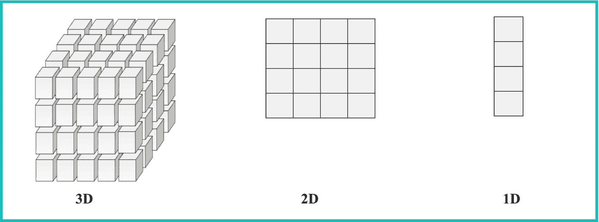
  图 3.1 三个张量维度的示例
- `Rank`（秩）是张量的方向数。标量的秩为 0（对于向量，它取决于维度）。例如，在图 3.1 中，1D 的秩为 1；2D 的秩为 2；3D 的秩为 3，依此类推。
- `Shape`（形状）是每个维度中的值个数。每个图叶子节点包含实际的张量。例如，图 3.1 中张量的形状为：
  - **3D**: (4,5,4)
  - **2D**: (4,4)
  - **1D**: 4
- `Size`（大小）是张量中的元素总数。例如，图 3.1 中张量的形状是：3D: 4\*5\*4=80，2D: 4\*4=16，1D: 4

## 3.2 张量 (Tensors)

张量是 TensorFlow 的基础，是一个 n 维矩阵。张量有三个主要属性：

1. 唯一标签 (name)，
2. 形状 (shape)，
3. 数据类型 (dtype)。

有三种类型的张量可以创建：

1. `tf.Variable`：变量，
2. `tf.constant`：常量，
3. `tf.SparseTensor`：稀疏张量。

TensorFlow 中的节点和边将当前节点中的缩放值传递到下一个节点。看这个例子：

K = (3x + y)/y

图 3.2 显示了一个计算图。在这个例子中，底层节点 `x` 乘以 3，`y` 加上 7，然后将其赋值给新节点。对于另一个节点，`y` 加上 7，值赋值给 `n`。新节点将传递到下一层进行新操作。

图 3.2 计算图示例
图 3.2 计算图示例

让我们通过一些示例进一步学习它。对于 0D 张量（标量）：

```python
r0_tensor = tf.constant(7)
print(r0_tensor)
```
**输出**:
```
tf.Tensor(7, shape=(), dtype=int32)
```

让我们创建一个 float 1D 张量：

```python
r1_tensor = tf.constant([1.0, 2.0, 3.0])
print(r1_tensor)
```
**输出**:
```
tf.Tensor([1., 2., 3.], shape=(3,), dtype=float32)
```

让我们创建一个 2D 张量：

```python
rank_2_tensor = tf.constant([[1, 2],[3, 4]], dtype=float16)
print(rank_2_tensor)
```
**输出**:
```
tf.Tensor([[1., 2.],[3., 4.]], shape=(2, 2), dtype=float16)
```

让我们创建一个 3D 张量：

```python
r3_tensor = tf.constant([[[1, 2, 3, 4, 5],[6, 7, 8, 9, 10]],11, 12, 13, 14, 15],[16, 17, 18, 19, 20]],21, 22, 23, 24, 25],[26, 27, 28, 29, 30]]])
print(r3_tensor)
```
**输出**:
```
tf.Tensor([[[1, 2, 3, 4, 5], [6, 7, 8, 9, 10]], [11, 12, 13, 14, 15], [16, 17, 18, 19, 20]], [[21, 22, 23, 24, 25], [26, 27, 28, 29, 30]]], shape=(3, 2, 5), dtype=int32)
```

使用 TensorFlow 查找矩阵的形状、大小和维度：

```python
r3D_tensor = tf.zeros([4, 5, 4])
print("Type of every element:", r3D_tensor.dtype)
print("Number of dimensions:", r3D_tensor.ndim)
print("Shape of tensor:", r3D_tensor.shape)
print("Elements along axis 0 of tensor:", r3D_tensor.shape[0])
print("Elements along the last axis of tensor:", r3D_tensor.shape[-1])
print("Total number of elements (4*4*5): ", tf.size(r3D_tensor).numpy())
```
**输出**:
```
Type of every element: <dtype: 'float32'>
Number of dimensions: 3
Shape of tensor: (4, 5, 4)
Elements along axis 0 of tensor: 4
Elements along the last axis of tensor: 4
Total number of elements (4*4*5): 80
```

## 3.3 TensorFlow

使用 TensorFlow 时有三个主要步骤：

1. 变量定义，
2. 计算定义，
3. 操作执行。

让我们通过一些示例更好地学习它们。

### 步骤 1：定义变量

```python
X1 = tf.constant([1, 3, 5])
X2 = tf.constant([2, 4, 6])
```

### 步骤 2：定义计算

```python
multiply= tf.multiply(X1, X2)
```

### 步骤 3：打印结果

```python
print(multiply)
```
**输出**:
```
tf.Tensor([2 12 30], shape=(3,), dtype=int32)
```

```python
a = tf.constant([[2, 5],[1, 4]])
b = tf.constant([[1, 1],[1, 1]])
print(tf.add(a, b), "\n")
print(tf.multiply(a, b), "\n")
print(tf.matmul(a, b), "\n")
```
**输出**:
```
tf.Tensor([[3 6][2 5]], shape=(2, 2), dtype=int32)
tf.Tensor([[2 5][1 4]], shape=(2, 2), dtype=int32)
tf.Tensor([[7 7][5 5]], shape=(2, 2), dtype=int32)
```

```python
a = tf.constant([[12, 10],[2.,10.]])
x = tf.constant([[1.,0.],[0.,1.]])
b = tf.Variable(2.)
y = tf.matmul(a, x) + b
print(y.numpy())
```
**输出**:
```
[[14. 12.] [4. 12.]]
```

## 3.4 使用 TensorFlow 构建神经网络

这里是 Zalando 的 Fashion-MNIST 数据集的示例（图 3.3）。它包含 70,000 张 10 个不同类别的图像，每张为 28×28 的服装图像。创建神经网络结构的步骤如下：


1. **步骤 1：** 导入数据，
2. **步骤 2：** 预处理数据，
3. **步骤 3：** 数据归一化，
4. **步骤 4：** 构建模型，
5. **步骤 5：** 训练并评估模型。

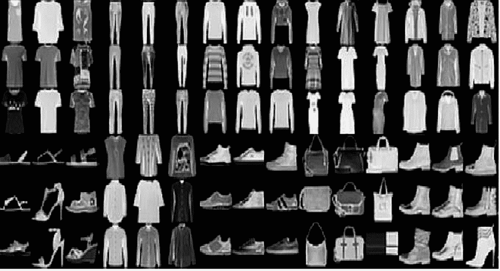

图 3.3 Fashion-MNIST 数据

### 3.4.1 导入数据

在第一步中，从 `scikitlearn` 导入库和数据集。

```
from __future__ import absolute_import, division, print_function, unicode_literals
import numpy as np
import tensorflow as tf
from tensorflow import keras as ks
```

### 3.4.2 加载并归一化数据

现在加载数据集并对数据进行归一化以获得训练效果。数据的归一化有助于计算并降低计算成本。它还可以提高结果的准确性。

```
from sklearn.preprocessing import MinMaxScaler
(training_images, training_labels), (test_images, test_labels) = ks.datasets.fashion_mnist.load_data()y_train = y_train.astype(int)
test_labels = test_labels.astype(int)
batch_size =len(training_images)
scaler= MinMaxScaler()
training_images = scaler.fit_transform(training_images.astype(np.float64))
test_images = scaler.fit_transform(test_images.astype(np.float64))
print('Training Images Dataset Shape: {}'.format(training_images.shape))
print('No. of Training Images Dataset Labels: {}'.format(len(training_labels)))
print('Test Images Dataset Shape: {}'.format(test_images.shape))
print('No. of Test Images Dataset Labels: {}'.format(len(test_labels)))
training_images = training_images / 255.0
test_images = test_images / 255.0
```

**输出：**

```
Training Images Dataset Shape: (60000, 28, 28)
No. of Training Images Dataset Labels: 60000
Test Images Dataset Shape: (10000, 28, 28)
No. of Test Images Dataset Labels: 10000
```

### 3.4.3 构建模型

你可以通过确定参数和超参数来定义模型。这些参数包括激活函数、数据形状和层。在这里，我们将数据形状设置为 28*28，隐藏层和输出激活函数设置为 `ReLU` 和 `softmax`。

```
input_data_shape = (28, 28)
hidden_activation_function = 'relu'
output_activation_function = 'softmax'
nn_model = ks.models.Sequential()
nn_model.add(ks.layers.Flatten(input_shape=input_data_shape, name='Input_layer'))
nn_model.add(ks.layers.Dense(32, activation=hidden_activation_function, name='Hidden_layer'))
nn_model.add(ks.layers.Dense(10, activation=output_activation_function, name='Output_layer'))
nn_model.summary()
```

**输出：**

```
Layer (type) Output Shape Param
================================================
Input_layer (Flatten) (None, 784) 0
Hidden_layer (Dense) (None, 64) 50240
Output_layer (Dense) (None, 10) 650
================================================
Total params: 50890
Trainable params: 50890
Non-trainable params: 0
```

### 3.4.4 训练并评估模型

在下一步中，你应该训练并评估模型。这里使用的优化器是 `ADAM`（你可以使用其他优化器）。

1. **步骤 1：** **训练**

使用训练数据训练模型。

```
optimizer = 'adam'
loss_function = 'sparse_categorical_crossentropy'
metric = 'accuracy'
nn_model.compile(optimizer=optimizer, loss=loss_function, metrics=metric)
nn_model.fit(training_images, training_labels, epochs=20)
```

**输出：**

```
1875/1875 [===========] - 2s 967us/step - loss: 0.1831 - accuracy: 0.9317 Epoch 19/20
1875/1875 [===========] - 2s ms/step - loss: 0.1779 - accuracy: 0.9339 Epoch 20/20
1875/1875 [===========] - 2s 978us/step - loss: 0.1765 - accuracy: 0.9345
```

2. **步骤 2：** **评估**

使用评估数据评估模型，这在测试真实世界问题之前为我们提供了模型估计：

```
training_loss, training_accuracy = nn_model.evaluate(training_images, training_labels)
print ('Training Data Accuracy {}'.format(round(float(training_accuracy),2)))
```

**输出：**

```
1875/1875 [============] - 2s 639us/step - loss: 0.1685 - accuracy: 0.9345
```
*(注：此处原文输出数值与训练训练略有差异，翻译时保持格式一致)*


Keras 是一个易于使用的 Python 库，它构建在 `TensorFlow` 等一些机器学习平台之上，用于创建深度学习模型。`CNN` 和 `RNN` 模型易用且实现快速。`TensorFlow` 同时提供了低层和高层 API，而 `Keras` 提供了底层支持。它还有助于减少计算成本。在这里，我们将回顾 `Keras` 的一些基础知识和核心概念，并通过示例进行解释。你也可以访问 `Keras` 网站 ([`keras.io/`](https://keras.io)) 获取更多细节和示例。开始使用 `Keras` 的要求如下：

1. Python 3.5 或更高版本
2. 带有 `NumPy` 的 `SciPy`
3. `TensorFlow`
4. 任意操作系统（Windows, Linux 或 Mac）

### 3.6.1 创建虚拟环境

创建虚拟环境有助于为不同的项目单独设置不同的安装包。例如，你可以在 `python3` 上安装它：

```
python3 -m venv kerasenv
```

### 3.6.2 激活环境

创建虚拟环境后，如果你想使用它，应该将其激活。

* Linux/Mac

```
$ cd kerasvenv kerasvenv $ source bin/activate
```

* Windows

```
.\env\Scripts\activate
```

### 3.6.3 Python 库

你可能在项目中需要这些 Python 依赖，并可以使用 `pip` 或 `pip3` 进行安装。在这里，我们通过示例回顾这些要求，并安装和使用 `Keras` 及其库。

* `Numpy`
```
pip install numpy
```

* `Pandas`
```
pip install pandas
```

* `Scikit-learn`
```
pip install -U scikit-learn
```

* `Matplotlib`
```
pip install matplotlib
```

* `Scipy`
```
pip install scipy
```

* `Seaborn`
```
pip pip install seaborninstall -U scikit-learn
```

现在你可以安装 `Keras` 了

```
pip install keras
```

如果你的系统中没有安装 `TensorFlow`，请安装它。

```
pip install TensorFlow
```

在完成项目的所有部分后，你可以退出环境。

```
deactivate
```

请检查你的 Python 版本以及使用 `pip` 或 `pip3` 的要求。创建、激活和退出虚拟环境有助于你为不同的项目组织代码和模块。

### 3.6.4 可用模块

当你计划使用 `Keras` 创建模型时，这些是 `Keras` 中你应该学习使用和设置的可用模块：

* `Regularizes`：正则化器列表。
* `Constraints`：约束条件列表。
* `Activations`：激活函数列表。
* `Losses`：损失函数列表。
* `Metrics`：指标函数列表。
* `Optimizers`：优化器函数列表。
* `Callback`：回调函数列表。
* `Text processing`：将文本转换为 `NumPy` 数组的函数。
* `Image processing`：将图像转换为 `NumPy` 的函数。
* `Sequence processing`：从给定输入数据生成基于时间的数据函数。
* `Backend`：后端库的功能（如 `TensorFlow`）。
* `Utilities`：深度学习中非常有用的工具函数。

### 3.6.5 导入库和模块

这里是一些库、模块以及导入命令。请在你的电脑上尝试这些代码。

* `NumPy`
```
Import numpy as np
```

* `Keras model module`
```
from keras.models import Sequential
```

* `Keras core layers`
```
from keras.layers import Dense, Dropout, Activation, Flatten
```

* `Keras CNN Layers`
```
from keras.layers import Convoluton2D, MaxPooling2D
```

* `Utilities`
```
from keras.utils import np_utils
```

这些是在使用 `Keras` 时我们几乎在所有项目中都会使用的最重要的库。

### 3.6.6 训练和预测模型

导入库后，我们应该训练并测试模型。这里是我们在 `Keras` 中可以使用的一些模块。

* `Compile`：
    它用于配置
    ```
    model.compile(loss='mean_squared_error', optimizer='sgd', metrics=['accuracy'])
    ```

* `Fit`：
    用于训练。
    ```
    model.fit(x_train, y_train, epochs=10, batch_size=32)
    ```

* `Evaluate`：
    用于。
    ```
    model.evaluate(x_test, y_test)
    ```

* `Predict`：
    用它。
    ```
    model.predict(x_test)
    ```


定义损失函数、优化器和指标，以编译并为训练做好准备。

```
model.compile(loss = keras.losses.categorical_crossentropy, optimizer = keras.optimizers.Adadelta(), metrics = ['accuracy'])
```

### 第 6 ：训练模型

使用训练数据训练模型。

```
model.fit(
 x_train, y_train,
 batch_size = 128,
 epochs = 12,
verbose = 1,
 validation_data = (x_test, y_test)
)
```

### 第 7 ：评估模型

使用评估数据对训练过的模型进行评估以检查模型。

```
score = model.evaluate(x_test, y_test, verbose = 0)
print('Test loss:', score[0])
print('Test accuracy:', score[1])
```

### 第 8 ：测试模型

在模型用于实际问题和数据之前，使用测试数据对评估过的模型进行测试。

```
pred = model.predict(x_test)
pred = np.argmax(pred, axis = 1)[:5]
label = np.argmax(y_test,axis = 1)[:5]
print(pred)
print(label)
```

# 第 4 章 人工神经网络（ANNs）基础与架构

DOI: [10.1201/9781003025818-4](https://doi.org/10.1201/9781003025818-4)

## 4.1 术语

在这里，我们回顾在第 4 章-第 8 章](#ch8.xhtml)中会用到的一些术语。

### 4.1.1 输入

学习算法（此处指神经网络）使用数据来训练模型。这些数据是输入数据，通常我们将它们显示为数据样本的向量 `x`。一组 `x` 向量构成了作为输入矩阵的 `X` (`N`)。每个向量样本 `x` 具有 `1…m` 个特征，这些特征是每个向量的数据值。例如，假设我们有 `N=1000` 个苹果，每个样本代表一个数据向量 `X = [x[1]=价格 x[2]=颜色 x[3]=形状]`。`m` 是向量数据样本中的特征数量，其值为 `3`。

### 4.1.2 权重

权重是学习算法在训练模型时更新的值。通常，每个 `w[ij]` 是两个节点之间（`i` 和 `j`）之间的向量权重。一组权重构成了我们用 `W` 表示的矩阵。

### 4.1.3 输出

最后一步的学习算法为我们提供一组数据作为输出。我们通常使用 `y` 将这些值显示为输出值向量 `y[j]`（`j =1…k`）。例如，如果输出是 `0`（苹果）和 `1`（非苹果），则 `y` 的维度为 `k=2`，这是一个分类问题。

### 4.1.4 目标

这些是维度与输出（`k`）相同的值，我们在监督学习中需要它们。此外，它们为我们提供了模型应该作为输出的正确值（目标）。

### 4.1.5 激活函数

我们使用一些数学函数让每层的输入通过（产生输出），并在达到超过阈值的值后进入下一层。我们将在详细讨论这一概念。

### 4.1.6 误差

误差是输出值与目标值之间的差异。我们用 `E` 表示它，学习目标是使其尽可能地变小。

### 4.1.7 训练集、测试集和验证集

我们将数据库分为三大类：用于教模型的训练数据、用于验证模型的验证数据以及用于检查模型的测试数据。

### 4.1.8 过拟合

当我们训练模型时，应该关注泛化能力。如果我们过度训练模型并使其变得复杂，模型可能无法很好地泛化，从而无法正确地拟合数据。我们不能使用训练数据，因为已经用它们来训练模型了。我们还需要测试数据来进行测试（我们可以用验证数据来实现此目的）。

### 4.1.9 欠拟合

欠拟合是过拟合相反的另一个概念，当学习模型无法模拟数据集值与目标之间的行为和关系时就会发生。

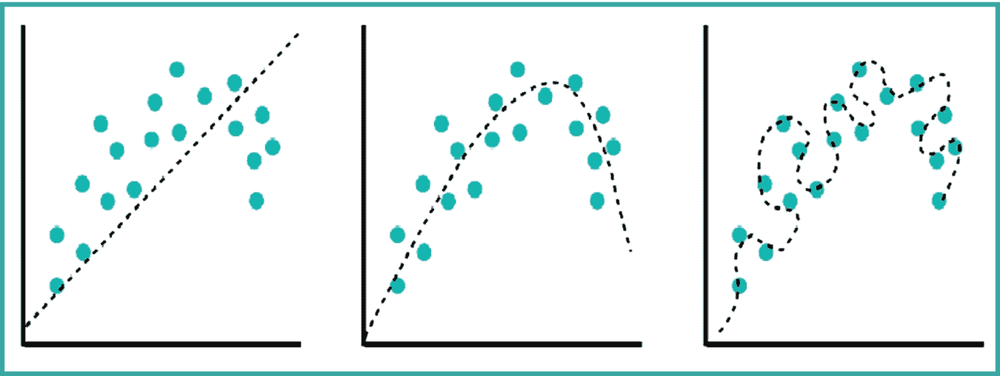

图 4.1 欠拟合（左侧）、正常（中间）和过拟合（右侧）。

### 4.1.10 混淆矩阵

有几种方法可以找到算法的准确率。混淆矩阵是可以用于分类问题的方法。要找到混淆矩阵，你可以创建一个方矩阵，在水平和垂直方向上都包含两个类别的值。我们可以假设表格顶部为预测值，左侧为目标值。例如，位置 `(i, j)` 处的值告诉我们当目标为 `i` 时，输出预测为类别 `j` 的次数。让我举一个例子来解释（如果我们有两个类别，那么就有如下所示的 2×2 表 4.1）。

表 4.1 两个类的混淆矩阵

| | | |
| :--- | :--- | :--- |
| **目标** | **C1** | **C2** |
| **C1** | 4 | 1 |
| **C2** | 2 | 7 |

（注：此处根据原文逻辑对表格内容进行了对齐翻译）


`Accuracy`=(敏感性+特异性)/2

此外，还有基于这四个值的另一种测量方法，其名为 `MCC`（马修斯相关系数），其计算方法如下：

$$\begin{matrix} \left. {}MCC\mspace{9mu} = \mspace{9mu}{}\left( {\left( {TP \times TN} \right) - \left( {FP \times FN} \right)} \right)/\left( \sqrt{\left( {TP + FP} \right) \times \left( {TP + FN} \right)} \right. \right. \\ \left. {\times \left( {TN + FP} \right) \times \left( {TN + FN} \right)} \right) \\ \end{matrix}$$ 

## 4.1.13 独热编码

假设数据集中存在分类特征（例如颜色），并且颜色有三个主要通道（`R`=红色、`G`=绿色和`B`=蓝色）。那么，你可以将这些字符串值编码为数字，以便在机器学习算法中使用这些数据。让我们来看这个例子：

* 红色 -> 0
* 绿色 -> 1
* 蓝色 -> 2

这些值是唯一的。在数据中，如果有 `k` 个特征（这里 `k=3`），就有 `k` 个唯一的数字，每个特征被分配给一个唯一的值。请看 表 4.3：

表 4.3 RGB 值的编码

| 颜色值 | 红色 | 绿色 | 蓝色 |
| --- | --- | --- | --- |
| 绿色 | 0 | 1 | 0 |
| 红色 | 1 | 0 | 0 |
| 蓝色 | 0 | 0 | 1 |
| 红色 | 1 | 0 | 0 |

```
输入是: {Green, Red, Blue, Red}，且
输出是: {(0,1,0), (1,0,0), (0,0,1), (1,0,0)}
```

请注意，这种方法会增加数据集的维度。例如，在上一个例子中，输入维度是 4×1，输出是 4×3。当我们处理真实数据时，输入维度可能很高，这会导致输出维度也非常高，从而增加计算量。

## 4.2 人工神经网络 (ANNs)

ANN 由 Warren McCulloch 和 Walter Pitts 于 1943 年引入，他们描述了动物大脑中生物神经元如何执行计算的计算模型。在 20 世纪 80 年代，人们通过研究和开发新的算法和架构对研究 ANN 产生了兴趣。随着这些研究的进行，其他一些强大的技术，例如`支持向量机` (`SVMs`）被提出，它们在某些实验中显示出比 ANN 的结果。最近，开发新一代 ANN（深度学习）使神经网络成为研究人员、科学家和工程师最热门的话题和工具之一，`ANN` 及其发展和扩展似乎将对技术的未来和人类生活产生更大的影响。在本章中，将介绍 ANN 的基础知识，以及一些著名的 ANN 架构及其公式。

### 4.2.1 生物神经元

人类和动物神经系统的基础元素是神经元细胞。它们包含细胞核（胞体）、许多称为树突的分支以及一个称为轴的延伸部分。神经元细胞从其他神经元接收信号（短电脉冲）。例如，当神经元接收到足够的阈值信号强度时，它会发射（传输）其信号。该领域仍有许多研究，试图寻找这些生物网络操作和功能的细节（图 4.2）。

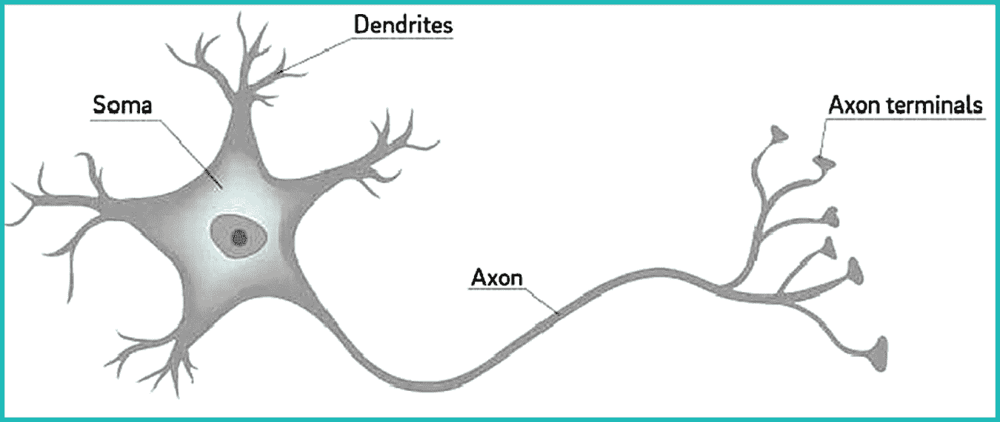

图 4.2 生物神经元细胞

### 4.2.2 人工神经元

人工神经元根据生物神经元细胞结构和过程的基础设计的。表 4.4 显示了其中一些基础及其在 ANN 中的相似组件。例如，神经元细胞通过树突和轴传输信号，而在 ANN 中，样本数据通过输入和输出进行传输。同样，胞体决定信号何时可以传输到轴上，而激活函数在 ANN 中执行类似的任务。神经元细胞的结构（如形状、大小和结构）可以定义细胞在网络传输信号中的能力和重要性。这在 ANN 中被模拟为权重，定义了网络中每个神经元的重要性。

表 4.4 生物神经元与人工神经元的相似性

| 生物神经元 | 人工神经元 |
| --- | --- |
| 树突 | 输入连接 |
| 胞体 | 激活函数 |
| 轴 | 输出 |
| 神经元大小 | 权重 |


## 4.3 激活函数

ANN 模拟线性和非线性。有多种激活函数，例如 `sigmoid` (`sig`)、双曲正切 (`tan`)、修正线性单元单元 (`ReLU`)、`leaky ReLU` 和 `softmax`。其中哪一个是最好的？

### 4.3.1 Sigmoid (sig)

`sigmoid` 的概率值在 0 到 1 之间。有很多模型，且 `sigmoid` 是可微的。图 4.4 显示了该函数。

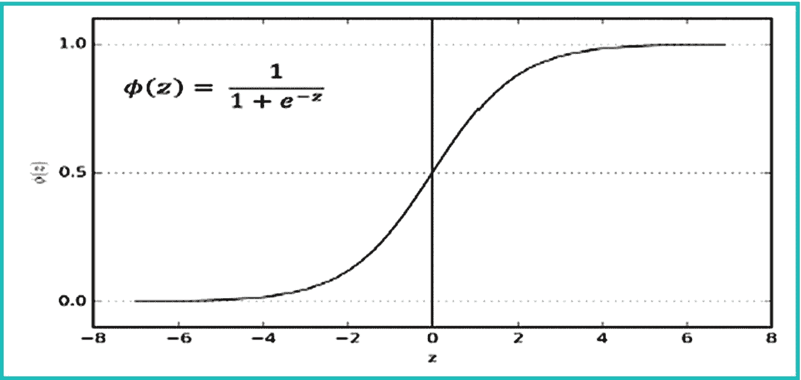

图 4.4 Sigmoid

### 4.3.2 双曲正切 (tan)

该激活函数的数值范围是 [-1, 1]，它将负值映射到负值，并在零附近映射。它也是可微的，主要用于分类。图 4.5 显示了它的形状。

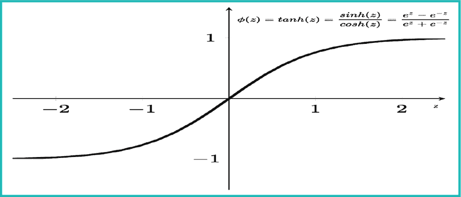

图 4.5 双曲正切

### 4.3.3 修正线性单元 (ReLU)

`ReLU` 的值范围是 0, 正大)，当 `z` 小于 0 时输出为 0，当 `z` 大于或等于 0 时等于 `z` (`max(0, z)` 并删除了所有负值)。因此，它有助于减少梯度消失问题；另一方面，使用 `ReLU` 的网络无法恰当映射负值。由于消除了梯度消失并降低了计算成本，它是深度学习算法中常用的优秀选择。[图 4.6 显示了 ReLU 的形状，如你所示，小于零的值为零，大于零的值保持为线性函数。

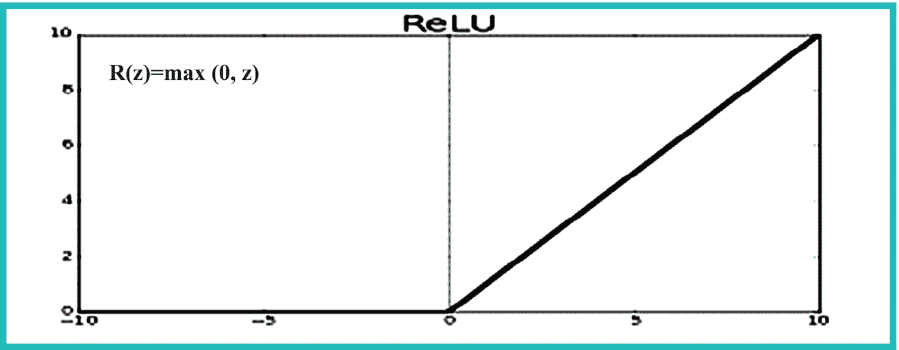

图 4.6 ReLU

### 4.3.4 Leaky ReLU

`ReLU` 函数的 Leaky ReLU 版本将负值映射到某些负值，将正值映射到正值。它的范围是 (-无穷大到正无穷大)。图 4.7](#ch4.xhtml#f4_7) 显示了它的形状。

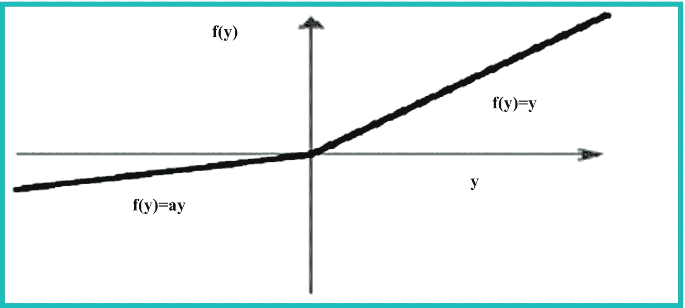

图 4.7 Leaky ReLU


Softmax 通常用于最后一层或输出层。它的输出是多个值，并且可以处理多分类问题。图 4.8 显示了 softmax 的工作原理。

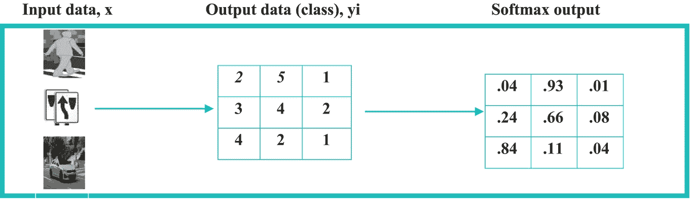

图 4.8 softmax 的工作原理！

Softmax 将每个类别的输出归一化到 0 到 1 之间（概率值除以总和）。

$$\left. S\left( y\_{i} \right) = e^{yi}/\\sum\limits\_{j = 1..n}e^{yj} \right.$$  

`S` 是 softmax 函数，`y` 是 `S` 的输入向量，具有 `n` 个元素（例如 `y`[`i]` 的值介于 (-inf, +inf) 之间），对应 `n` 个类别。`e` 是标准指数函数。

## 4.4 损失函数

损失函数（代价函数）是一个显示我们的预测模型与期望模型之间差异的函数。它通过计算损失值（预测输出与期望（目标）值之间的差）来提取。几种类型的损失函数分为三大类：

1. **回归损失函数**：如均方误差 `M`ean `S`quare `E`rror (MSE) 和绝对误差 `A`AE，

2. **分类损失函数**：如二分类交叉熵 (BCE)、负对数似然 (NL)、软间隔分类器 (SMC) 以及

3. **嵌入损失函数**：如平均绝对误差-MAE (`L[1]`)、均方误差- MSE (`L[2]`) 和余弦误差 `C`osine Error (CE)。

最流行的是交叉熵损失和均方误差- MSE (`L[2]`) 损失。

### 4.4.1 交叉熵损失

它是一个概率值，是预测代价与实际代价之间的差异。图 4.9 显示了它的图表。

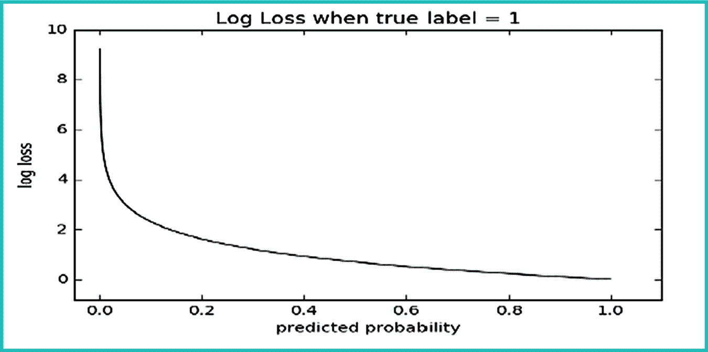

图 4.9 交叉熵损失图。

### 4.4.2 MSE (L[2]) 损失

`L2` 的计算方式如下：

$$MSE = \frac{\\sum\limits\_{i = 1}^{n}\left( {y - y\_{i}^{p}} \right)^{2}}{n}$$  

图 4.10 显示了代表 `MSE` 函数的 `L`[`2]` 图形，其中 `MSE` 损失在预测 = 100 时达到最小值。

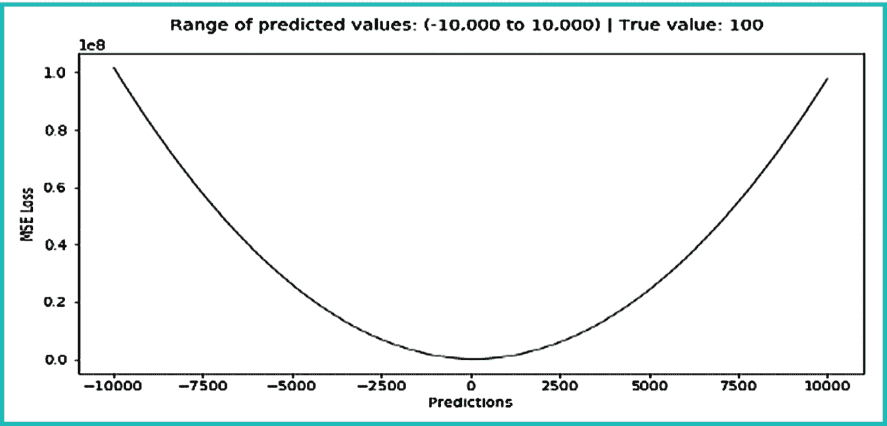

[图 4.10 MSE (L[2]) 损失图。](#ch4.xhtml#R_f4_10)

## 4.5 优化函数

三种最流行的优化算法是随机梯度下降 (SGD)、`Adagrad` 和 `Adam`。总来说，`SGD` 比其他算法快得多。速度和更好的结果（准确性）之间存在权衡。当数据增长时，模型变得更加复杂，此时选择优化函数就具有挑战性。在学习某些优化方法之前，我们应该了解两个概念：学习率和凸。

### 4.5.1 学习率

优化算法更新网络的权重和偏置，分为两类：固定学习率和自适应学习率。学习率是优化算法在训练阶段训练权重时使用的步长。其值很小，通常介于 0.0 到 1.0 之间，选择不当的值会影响训练。图 4.11 显示了其中一些情况。


图 11 不同的学习率值。

### 4.5.2 凸

如果我们在图上的任意两点之间连一条线，那么该线位于两点之间图形的上方或下方（图 4.12）。


图 12 顶部曲线是非凸的，底部的曲线是凸的。

### 4.5.3 梯度下降

梯度下降是最流行的优化方法之一，它沿着梯度方向给出最优值。当目标函数是凸时，这种方法是最通用且最流行的解决方案。它的问题之一是每一步的更新过程。当计算所有数据的梯度时，`GD` 的计算成本会变得很高，特别是当数据量很大时。包含噪声或偏置数据时，收敛也需要更多的时间。

### 4.5.4 随机梯度下降

梯度下降 (GD) 计算梯度以寻找局部最小值，而随机梯度下降 (SGD) 则随机更新训练样本的参数。它的计算效率很高，并不一定依赖于整个数据。它的问题是选择合适的学习率。

### 4.5.5 Adagrad

Adagrad 方法通过根据过去的梯度平方来自适应地调整学习率，不需要手动调整参数。这种方法对于处理稀疏数据非常有效。它的问题是学习率可能会不断减小，导致到后期可能停止学习。

### 4.5.6 Adam

`Adam` 结合了动量和自适应学习率，是目前深度学习中最常用的优化器之一。它通过计算梯度的一阶和二阶矩的移动平均来更新参数。这种方法在许多问题上都表现良好。


当我们选择线性激活函数时，它对反向传播不起作用，因为其导数是常数，它无法帮助我们在返回输入时更新权重并找到最佳权重。它对于非线性问题也不起作用，因为在任何架构中输出都是线性的（即使有多个神经元和层）。因此，它无法模拟问题的非线性行为。图 4.15 展示了其导数是常数且无法模拟非线性模型的线性函数。

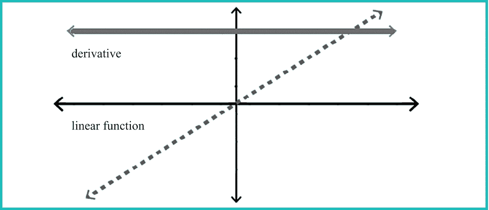

图 4.15 线性函数及其导数。

### 4.6.2 非线性函数

在现实世界的问题中，某些问题的行为具有非线性特征。部署非线性函数（激活函数 (AF)）有助于模拟这类模型。我们在上一节中讨论了其中一些。这里，我们介绍一种在神经网络中最流行的函数之一（sigmoid 函数）：

`f(x) = s(w×x+b)`

图 4.16 显示了如何使用 sigmoid 进行非线性模拟。除了提供平滑的梯度外，它还提供了清晰的预测（其值限制在 0 和 1 之间）。

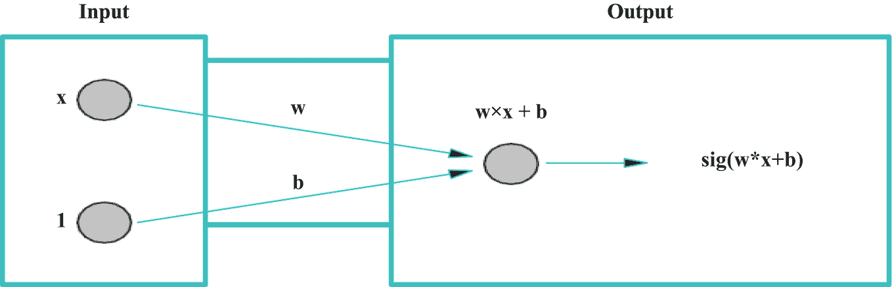

图 4.16 使用 sigmoid 进行非线性建模。

非线性激活函数涵盖了上一节提到的两个问题，以便部署于反向传播中并展示训练过程中更多神经元和层的效果，特别是在深度神经网络中。然而，它的计算成本很高，且在 `x` 的高值处梯度不发生（梯度消失问题）。我们可以使用 `ReLU` 函数，它涵盖了非线性且具有成本效益。它的问题仅在于网络无法学习这些数据的负值。然而，`Leaky ReLU` 没有为负值提供清晰的预测；而它解决了这个问题。

你可以在 图 4.17 中看到梯度消失问题，在 图 4.18 中看到负值的学习问题。

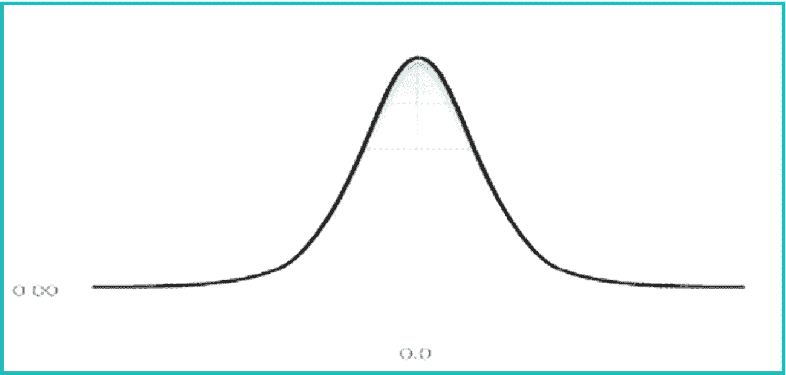

图 4.17 sigmoid 的导数。

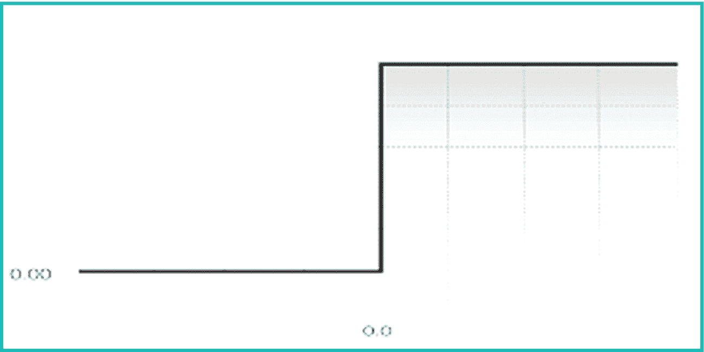

图 4.18 ReLU 的导数。

如你所见，`ReLU` 也可能包含一些问题和缺陷，而 `leaky ReLU` 可能解决了这些问题。

## 4.7 ANN 架构

### 4.7.1 前馈神经网络 (FFNNs)

FFNN 是一种在节点间连接中没有任何形式循环的人工神经网络。它的信息从一个方向流动（从输入层到隐藏层，再到输出层）。FFNN 是神经网络最简单的形式，信息仅在一个方向上进行处理。图 4.18 展示了 FFNN 的架构。

FFNN 是一个包含输入层、隐藏层和输出层的简单网络。每层神经元的组合将前向传播到下一层。然后它进入激活函数，输出及其组合是下一层的输入，该过程将持续于所有层，直到给出最终输出的最后一层。例如，如果网络如 图 4.19 所示有一个输入层、一个隐藏层和一个输出层，`X` 为样本输入向量，`X = (x[1], x[2])`，`W[h]=(w[h11],w[h12],w[h21],w[h22])` 为隐藏层的权重，`Wo=(w[o11], w[o12], w[o13], w[o21], w[o22], w[o23], w[o31], w[o32], w[o33])` 为输出层的权重，`a` 为激活函数，那么预测等于：

```
prediction=a(a(X*Wh)*Wo)
```

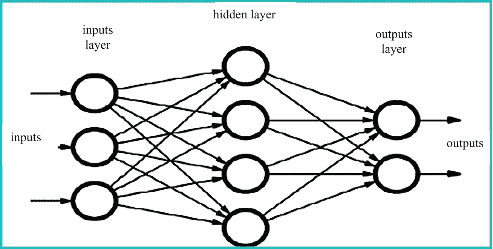

图 4.19 FFNN 架构。

这些是步骤：

1. **步骤 1：** 通过将 `X` 乘以隐藏权重 `W[h]` 计算进入隐藏层的加权输入。
2. **步骤 2：** 应用激活函数并将结果传递给下一层。
3. **步骤 3：** 对所有层重复步骤 1 和步骤 2。

该算法使用 `X` 数据计算数据组合 `(X)`、权重 `(W)` 和偏置 `(b)`，并通过所有层对其应用激活函数以获得输出。

#### 4.7.1.1 TensorFlow 示例

**步骤 1：** **导入库**
```
import tensorflow as tf
import numpy as np
from tensorflow import keras
```

**步骤 2：** **加载数据**
```
(x_train, y_train), (x_test, y_test) = keras.datasets.mnist.load_data()
```

**步骤 3：** **独热编码与归一化**
```
y_train = tf.to_hot(y_train, 10)
y_test = tf.to_hot(y_test, 10)
x_train = x_train / 255.0
x_test = x_test / 255.0
```

**步骤 4：** **构建模型**
```
model = keras.Sequential([
   keras.layers.Flatten(input_shape=(28,28)),
   keras.layers.Dense(256, activation='relu'),
   keras.layers.Dense(32, activation='relu'),
   keras.layers.Dense(10, activation='softmax')])
```

**步骤 5：** **模型摘要**
```
model.summary()
```

**步骤 6：** **编译模型**
```
model.compile(loss='categorical_crossentropy', metrics=['accuracy'], optimizer='adam')
```

**步骤 7：** **训练模型**
```
n_val = 5000
n_train = 60000
n_test = 10000
batch_size = 100
epochs = 100
steps_per_epoch = (n_train-n_val)/batch_size
validation_split = n_val/n_train
validation_steps = int(n_val / batch_size)
test_steps = int(n_test/batch_size)
history = model.fit(x_train, y_train, epochs=epochs, steps_per_epoch=steps_per_epoch, validation_split=validation_split, validation_steps=validation_steps, callbacks=[tensorboard_callback])
```

**步骤 8：** **测试模型**
```
score = model.evaluate(x_test, y_test, steps=test_steps, verbose=0)
print('Test loss:', score[0])
print('Test accuracy:', score[1])
```

### 4.7.2 反向传播

反向传播是一种监督学习算法，需要通过训练数据进行训练。以下是实现反向传播算法的步骤：

1. **步骤 1：** **前向传播**：数据向量 `x` 通过通过神经网络并产生输出 `f(x)`。每一层的激活函数可以不同也可以相同，但最后一层除外，它根据模型和问题类型（分类或回归）控制输出类型。图 4.20 展示了一个反向传播网络的示例。

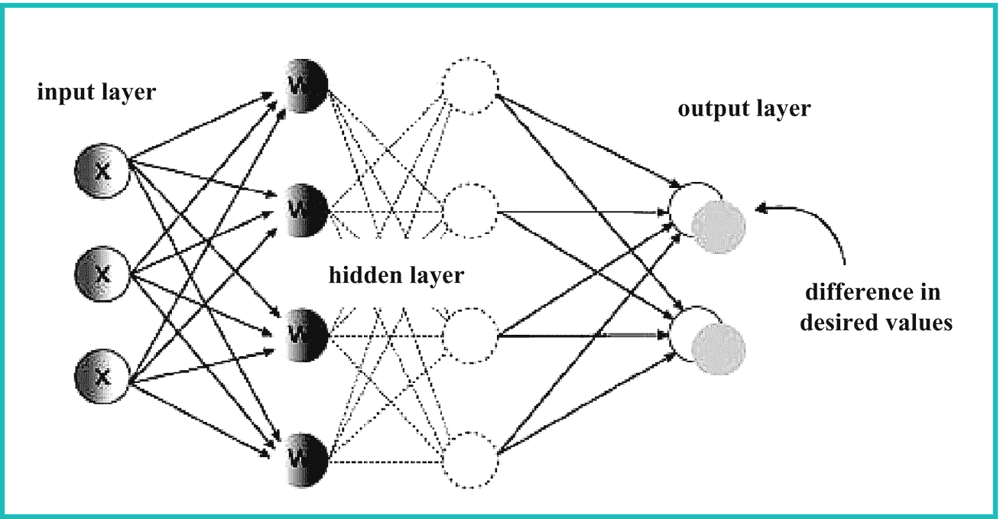


## 2. 第 2 步：反向传播：使用梯度更新所有层的权重（使用第 1 步输出的误差来更新所有网络权重，从最后一层到前面的层）。最后一层使用链式法则和梯度计算新权重，并一直持续到第一层（输入层 (`w[1]`））。

## 4.7.3 单层感知机
它由 Frank Rosenblatt 于 1964 年在康奈尔大学发明。它是最简单的前馈神经网络，且不包含任何隐藏层。单层感知机只能学习线性函数。图 4.21 展示了它的架构。

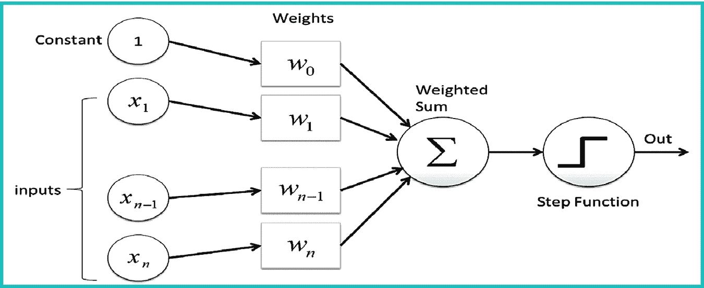

图 4.21 单层感知机。

## 4.7.4 多层感知机 (MLP)
MLP 拥有多个隐藏层，主要用于分类问题。它被用于学习非线性函数。这些网络由三部分组成：输入层、隐藏层和输出层（图 4.22）。

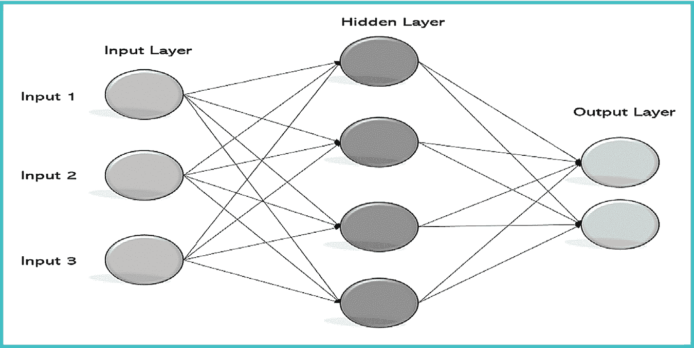

图 4.22 多层感知机。

### 4.7.4.1 TensorFlow 中的 MLP 示例

1. **第 1 步：导入库**
```
import tensorflow as tf
import numpy as np
from tensorflow import keras
```

2. **第 2 步：加载数据**
```
from keras.datasets import mnist
(x_train, y_train), (x_test, y_test) = mnist.load_data()
```

3. **第 3 步：数据热热与归一化**
```
y_train = tf.one_hot(y_train, 10)
y_test = tf.one_hot(y_test, 10)
x_train = x_train / 255.0
x_test = x_test / 255.0
```

4. **第 4 步：构建模型**
```
model = keras.Sequential([
   keras.layers.Flatten(input_shape=(28, 28)),
   keras.layers.Dense(128, activation='relu'),
   keras.layers.Dropout(.2, input_shape=(2,)),
   keras.layers.Dense(32, activation='relu'),
   keras.layers.Dropout(.2, input_shape=(2,)),
   keras.layers.Dense(10, activation='softmax')])
```

5. **第 5 步：模型总结**
```
model.summary()
Model: "sequential"
Layer (type) Output Shape Param #
====================================================
flatten_4 (Flatten) (None, 784) 0
____________________________________________________
dense_12 (Dense) (None, 128) 100480
____________________________________________________
dropout_5 (Dropout) (None, 128) 0
____________________________________________________
dense_13 (Dense) (None, 32) 4128
____________________________________________________
dropout_6 (Dropout) (None, 32) 0
____________________________________________________
dense_14 (Dense) (None, 10) 330
====================================================
Total params: 104,938
Trainable params: 104,938
Non-trainable params: 0
```

6. **第 6 步：编译模型**
```
model.compile(loss='categorical_crossentropy', metrics=['accuracy'])
```

7. **第 7 步：训练模型**
```
n_val = 5000
n_train = 60000
n_test = 10000
batch_size = 100
epochs = 100
steps_per_epoch = int((n_train-n_val)/batch_size
validation_split = n_val/n_train
validation_steps = int(n_val / batch_size)
test_steps = int(n_test/batch_size)
history = model.fit(x_train, y_train, epochs=epochs, steps_per_epoch=steps_per_epoch, validation_split=validation_split, validation_steps=validation_steps, callbacks=[tensorboard])
```

8. **第 8 步：测试模型**
```
score = model.evaluate(x_test, y_test, steps=test_steps, verbose=0)
print('Test loss:', score[0])
print('Test accuracy:', score[1])
```

# 第 5 章 深度神经网络 (DNN) 基础与架构

DOI: [10.1201/978100302518](https://doi.org/10.1201/978100302518)

## 5.1 深度神经网络
在你从事深度学习时，有一些概念是你需要了解的。本章将回顾深度学习模型、概念和定义。

### 5.1.1 什么是深度学习？
深度学习算法（人工神经网络的一个子集）处理不同的数据类型。深度学习通过不同的单元（神经元）来处理数据。深度学习算法（人工神经网络的一个子集）通过不同的层来处理数据。“深度”指的是层数。深度学习具有许多层和超参数，有助于更好地学习。深度学习结构通过许多层（通常是深度）来解决现实问题。

### 5.1.2 深度学习需要
深度学习需要大量的数据，计算成本很高。通过解决这两个挑战（大量数据和高计算成本），我们可以更有效地部署深度学习。

### 5.1.3 如何高效部署 DL？
在训练好模型后，有一些高效部署的关键点：
1. 拥有正确且适当的数据，
2. 进行正确且必要的数据预处理，
3. 选择正确的特征，
4. 选择合适的算法，
5. 设置正确的网络参数，
6. 设置正确的超参数，
7. 定义正确的层。

在这里，我们介绍了一些开始从事深度学习前需要了解的定义和概念。

### 5.1.4 梯度消失
使用深度学习的挑战之一是梯度消失问题。梯度是一种优化技术，当网络权重变为负值时，随着时间的推移，权重值将变得非常小并接近零（对于接近零的权重值，它们的梯度为零）。这就是问题所在：网络无法更新，并会停留在某一点。因此，它的名字梯度消失，因为在这种情况下梯度不再起！有几种解决方案，例如使用消除负值的整流线性单元 (`ReLU`)。

### 5.1.5 通道
深度学习中的输入数据可能有不同的通道。例如，如果数据是图像并使用 RGB（彩色图像的标准），这些数据就有三个通道（红、绿、蓝）。

### 5.1.6 嵌入
嵌入将输入数据（如图像、文本和音频）表示为向量。例如，我们将图像等数据嵌入到公共空间，而在情感分析中，嵌入过程将单词转换为向量。

### 5.1.7 微调
这是一种为任务初始化网络参数的方法，然后用新任务更新这些参数。例如，NLP 系统中有预训练的词嵌入（如词到向量），其参数可以针对特定任务（如内容分析或情感分析）进行更新。

### 5.1.8 数据增强
使用某些方法（取决于数据类型）从原始数据生成新数据是深度学习的挑战之一。例如，翻转和旋转是创建新数据的两种方法。

### 5.1.9 泛化


NN 的性能主要取决于其泛化潜力，这有助于模型泛化，并赋予其处理新数据的能力。作为人工神经网络（ANN），深度学习网络更好地涵盖泛化以提高模型的灵活性。有几种方法如正则化可以增加泛化能力。

### 5.1.10 正则化

这是一种通过在学习过程中进行一些微调，使模型泛化得更好且更灵活的方法。我们在接下来的章节中讨论的某些正则化方法包括 `L[1]`、`L[2]` 和 dropout。

## 5.1.11 L[1] 和 L[2]

这些是最流行的正则化方法。在这里，通常我们会添加一个正则化项（regularization term）并更新代价函数。

```
Cost function = Loss + Regularization term
```

通过增加这些值，权重值将会降低，以使模型更简单并泛化得更好。有两个主要的项：`L[1]` 和 `L[2]`。`L[2]` 是：

```
Cost function = Loss + Lambda/2m × ∑ ||w||2
```

lambda 是超参数。`L[2]` 被称为权重衰减方法。它使权重趋于零但不为零。此外，`L[1]` 是：

```
Cost function = Loss + lambda/2m × ∑ ||w||
```

通常，我们更倾向于使用 `L[2]` 而不是 `L[1]`，除非我们计划进一步压缩模型（因为在 `L[1]` 中，权重可能会减至零）。

## 5.1.12 Dropout

Dropout 的原理是在训练步骤中掩码（丢弃）网络中的某些节点（我们将在本章稍后详细解释这一概念）。

## 5.1.13 端到端学习

深度学习支持端到端学习，有助于更有效地解决问题。例如，使用传统的 AI 方法或人工神经网络识别脸部需要经过裁剪、平移、检测和识别等步骤。然而，当你使用深度学习时，不需要这些步骤，网络中的层会自动从数据中提取特征（第 7 章 提供了深度学习进行人脸识别的实现示例）。

## 5.2 深度学习应用

深度学习具有为复杂的现实问题建模的能力。它的算法不仅用于图像、音频或某些信号数据的分类。深度学习算法被应用于许多领域，如：

* 自驾驶汽车，
* 自然语言处理，
* 内容分析，
* 视觉识别，
* 时尚，
* 聊天机器人，
* 虚拟代理，
* 文本生成，
* 手写体生成和机器翻译，
* 广告，以及
* 欺诈检测。

有很多部署深度学习的研究和项目，从医学图像分析到药物发现和基因组分析。根据数据的性质，问题的现实问题可以通过深度学习解决；例如进行实时人类行为分析、语言翻译和预测自然灾害。自动驾驶是 `google`、`apple`、`tesla` 和 `uber` 等许多大型投资的热点之一。金融行业是另一个使用深度学习进行交易欺诈检测的领域。它为金融和保险机构节省了数十。通过使用客户交易和信用评分等信息，系统分类并检测欺诈（图 5.1）。


图 5.1 深度学习技术的若干应用。

如今，我们在日常生活中使用了如 `Alexa`、`Siri` 和 `google assistance` 等虚拟助手服务。这些产品为你提供如所需的歌曲或餐厅等智能服务，并以智能的方式与你互动。它们理解人类语言并为你提供智能且自主的响应。它们还为你提供一些服务，如阅读或撰写电子邮件以及整理文档（图 5.2）。


图 5.2 医疗保健是深度学习的新应用之一。

我们在第 7 章中回顾虚拟助手机器人的实现步骤（图 5.3）。


图 5.3 虚拟助手机器人使用深度学习方法。

## 5.3 深度学习算法与体系

当我们有一个具有多层隐藏层的简单神经网络时，我们就有了深度神经网络（DNN）。

图 5.4 显示了一个 DNN 示例。它包含一个输入层、一个输出层四个隐藏层。在这里，我们展示了一个使用 `TensorFlow` 处理 MNIST 数据集的 DNN 示例。图像大小为 28×28，隐藏激活函数为 `ReLU`，输出激活函数为 `SoftMax`。

```
#MNIST 示例
# 输入数据以及网络参数和超参数
input_data_shape = (28, 28)
hidden_activation_function = ReLU
output_activation_function = SoftMax
# 定义模型
dnn_model = models.Sequential()
### 输入层
dnn_model.add(layers.Flatten(input_shape=(28, 28), name='Input_layer'))
# 第一层隐藏层
dnn_model.add(layers.Dense(256, activation='relu', name='Hidden_layer_1'))
# 第二层隐藏层
dnn_model.add(layers.Dense(192, activation='relu', name='Hidden_layer_2'))
# 第三层隐藏层
dnn_model.add(layers.Dense(128, activation='relu', name='Hidden_layer_3'))
# 第四层隐藏层
dnn_model.add(layers.Dense(64, activation='relu', name='Hidden_layer_4'))
### 输出层
dnn_model.add(layers.Dense(10, activation='softmax', name='Output_layer'))
### 模型摘要
dnn_model.summary()
```

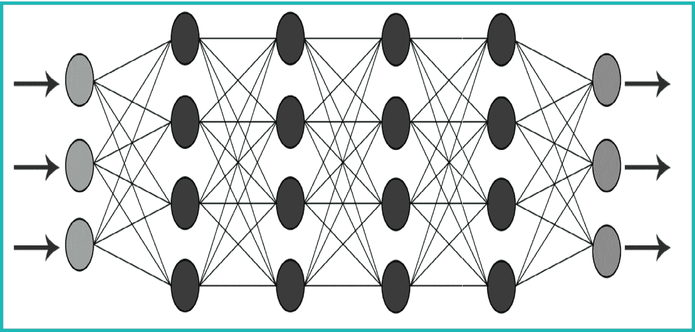

图 5.4 具有四个隐藏层的 DNN

### 5.3.1 卷积神经网络 (CNN)

CNN 是流行的深度学习算法之一，包含四个主要部分：

* 卷积滤波器，
* 池化或下采样，
* 激活（转换）函数，
* 全连接层。

它在视觉分类中表现出良好的的结果。它的基础是卷积函数（滤波器），其中每个神经元连接到这些滤波器的输出作为感受野。我们将在本章后续详细讨论这类深度学习算法（图 5.5）。


图 5.5 CNN 寻找数据的特征。

### 5.3.2 循环神经网络 (RNN)

RNN 是一种通常用于时间序列预测问题的神经网络。它使用随机梯度下降进行训练。RNN 通过前馈处理数据并通过反向传播将输出值返回给隐藏层和输入层（存储过去的数据用于预测）。

RNN 有许多应用，例如根据之前的事件和数据预测事件（如股市数据），并有两个主要类型：

* 双向 RNN，
* 深度 RNN。

RNN 在所有层共享相同的参数。它在长期处理方面表现并不理想，且不能具有深度层。图 5.6 显示了一个 RNN 架构，并展示了输出层如何与隐藏层连接。

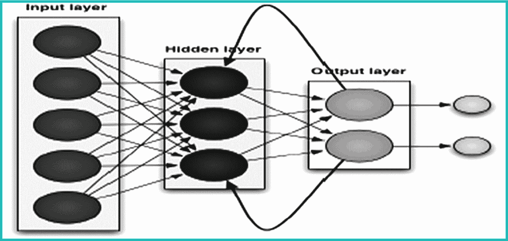

图 5.6 RNN 使用之前的层特征


正如我们在上一节中提到的，`RNN` 在长期处理中无法正常工作。`LSTM` 是 `RNNs` 的一种，它使用反向传播并使用内存块而不是神经元来连接层层。它适用于语言翻译、情感分析、股市预测和图像描述等许多应用（图 5.7）。

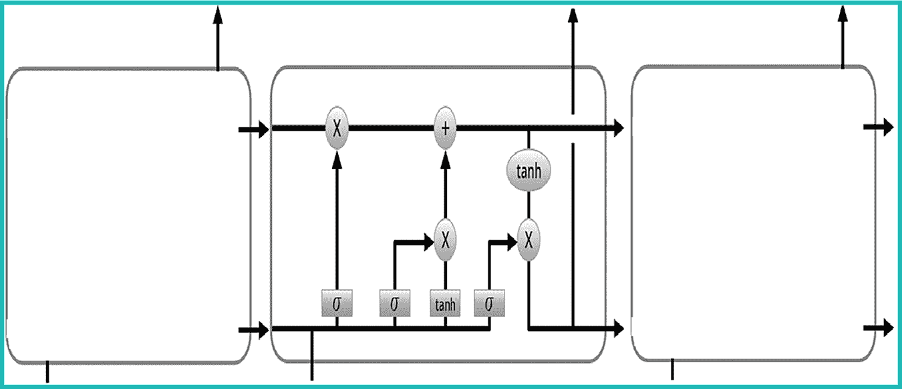

图 5.7 LSTM 是一种使用反向传播并具有记忆的 RNNs

### 5.3.4 生成对抗网络 (GANs)

`GAN` 是一种通过自学习生成新数据的无监督学习算法。它的算法有两个模块：第一个是`generator`，用于生成新样本；第二个是`discriminator`，用于对原始数据和新数据（假数据）进行分类（这两个模块相互竞争）。

这些模型使用不同的损失函数（其计算量很高），如果其中一个失败，整个网络就会失败。`generator` 和 `discriminator` 的权重可以通过迭代进行更新。图 5.8 显示了 `GAN` 网络的通用结构。

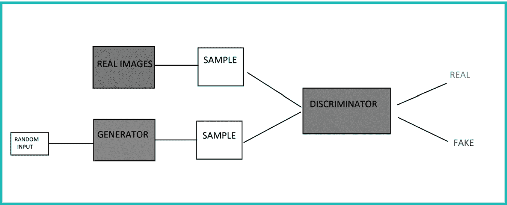

图 5.8 GAN 网络架构

### 5.3.5 残差神经网络学习 (ResNets)

`ResNet` 用于一些其他方法（如 `CNNs`）无法很好处理复杂问题。它有几个残差模块（层），这些层具有多个对输入数据进行操作的功能。与 `RNNs` 相比，它更准确、更轻量。图 5.9 和 图 5.10 显示了普通网络和 `ResNet` 网络的架构。你可以看到这两个网络有多不同。

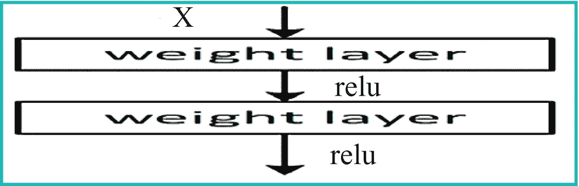

图 5.9 普通网络架构

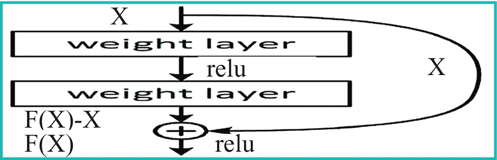

图 5.10 ResNet 网络架构

## 5.4 卷积神经网络 (CNNs)

### 5.4.1 CNN 层

#### 5.4.1.1 卷积层

`CNN` 的主要部分是卷积层。当卷积函数处理并移动过整个数据矩阵（例如图像）时，输出会被卷积（过滤）。`stride` 是卷积函数每次移动的数值（特定的滑进距离）。例如，`stride` 为 `2` 意味着卷积窗口向右或向下移动两个元素（这里是像素）（默认是从左到右、从上到下移动）。`CNN` 通过使用 `kernels`（与卷积窗口大小相同）并将窗口中的图像像素值乘以 `kernel` 值来执行过滤。要创建一个 `CNN`，你需要知道并确定滤波器的数量、`kernel size` 和 `strides`。

如果 `kernel` 滤波器的大小为 `4×4=16`，那么每个神经元（有一个偏置加 16 个权重）都会连接到感受野。它可以有几个卷积层，其输出是特征图。图 5.11 显示了 `3×3` 过滤器是如何工作的。它在原始输入图像上移动，其值与图像值的掩码部分相乘。例如，这里第一个输出的卷积结果为 `-2`。此外，图 5.12](#ch5.xhtml#f5_12) 显示了原始图像的最终输出。你可以看到每一层滤波器的输出。

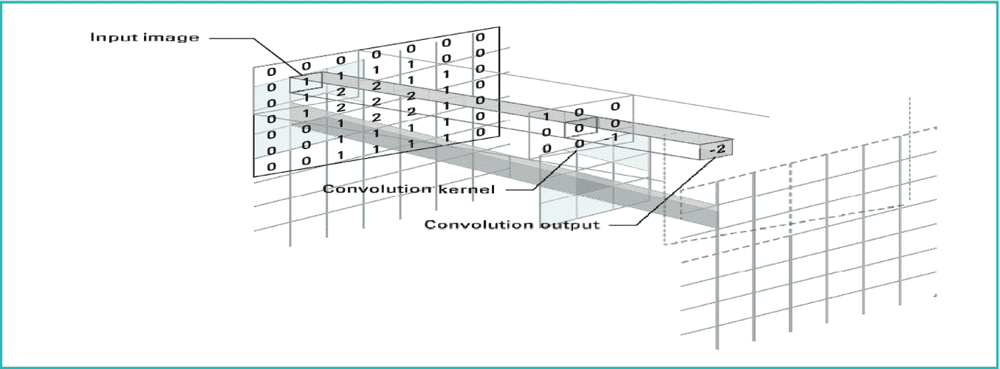

图 5.11 使用 3×3 过滤器卷积

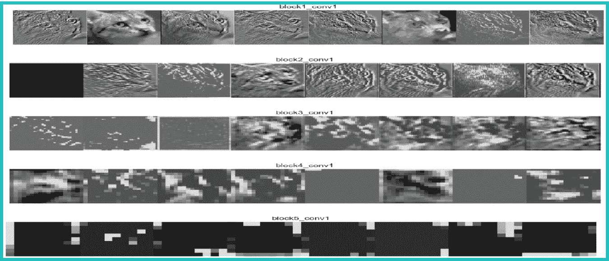

图 5.12 滤波器的输出

#### 5.4.1.2 池化层

`CNNs` 还有池化层（例如 `max-pooling`、`min pooling` 和 `average pooling`），用于寻找子区域并减少计算时间（图 5.13）。

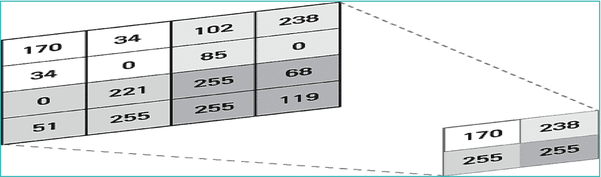

图 5.13 最大池化

池化层的功能取决于池化窗口的大小和池化的类型。它在卷积输出上操作以减小尺寸，从而减少后续的操作量。

#### 5.4.1.3 Dropout

它有助于网络进行记忆和泛化，以便用于不同的应用。有时，通过移除一些神经元，在保持模式的同时的同时保持泛化能力，有助于网络性能。这些节点可以通过将它们关闭来移除。这种方法通过创建一个随机矩阵并将其相乘来关闭或开启节点（图 5.14）。

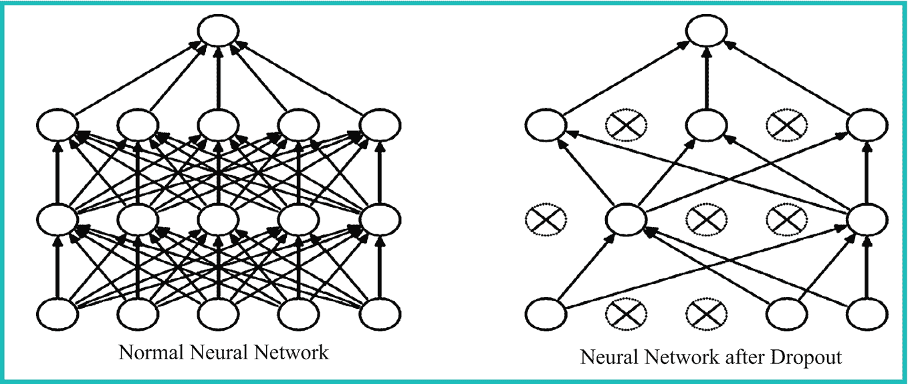

图 5.14 Dropout 示例

#### 5.4.1.4 归一化

归一化技术用于使算法更具泛化性。例如，如果数据呈正态分布，通过减去均值然后除以标准差来处理数据。深度网络数据处于四维向量 `(N, C, H, W)`，其中 `N` 是批量，`C` 是通道，`H` 和 `W` 是空间宽高（图 5.15）。

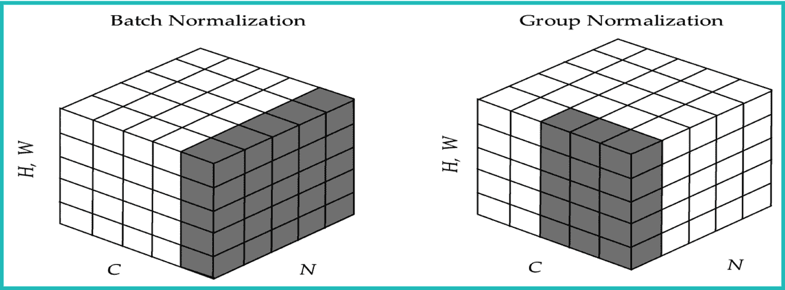

图 5.15 批量归一化与归一化

#### 5.4.1.5 全连接层

连接层是指当前层的所有节点都连接到下一层。在 `DL` 模型中，最后几层全连接以构建输出，通常是概率值（例如 `SoftMax` 激活）。图 5.16 显示了 `CNN` 中的层（最后一个全连接层也是分类层）。

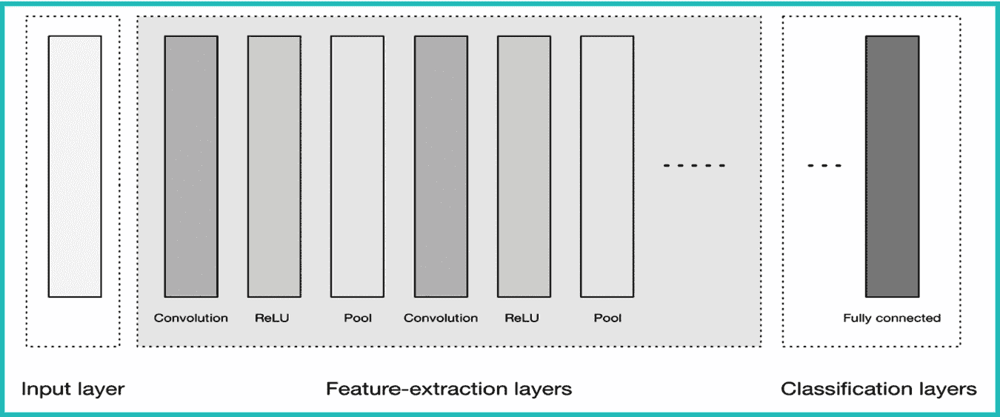

图 5.16 全连接层

### 5.4.2 设计 CNN

在这里我们实现 `LeNet5` 架构。让我们解释一下 `LeNet5`。它有一系列卷积和池化层。它有两个全连接层和一个分类层。所有其他 `CNN` 架构几乎都有这些实现步骤。让我们代码步骤：

1. **第一步**：在第一步中，你需要确定实现所需的库并导入它们。这些库可以帮助你的代码更健壮、更准确，并降低计算成本。

```
import TensorFlow as tf
import NumPy as np
from tensorflow.examples.tutorials.mnist import input_data
```

2. **第二步**：设置训练和测试步骤的样本数、图像大小以及类别数量。

```python
batch_size = 128
test_size = 256
img_size = 28
num:classes = 10
# 定义数据的占位符和标签的 y
X = tf.placeholder("float", [None, img_size, img_size, 1])
Y = tf.placeholder("float", [None, num:classes])
```

3. **第三步**：收集数据并创建训练和测试分类。


```python
mnist = mnist_data.read_data_sets("data/")
Xtr, Ytr, Xte, Yte = mnist.train.images, mnist.train.labels, mnist.test.images, mnist.test.labels
Xtr = Xtr.reshape(-1, img_size, img_size, 1)
Xte = Xte.reshape(-1, img_size, img_size, 1)
#Initialize the weights
def init_weights(shape):
    return tf.Variable(tf.random:normal(shape, stddev=0.01))
#Weights for layer 1-4
w1 = init_weights([3, 3, 1, 32])
w2 = init_weights([3, 3, 32, 64])
w3 = init_weights([3, 3, 64, 128])
w4 = init_weights([128 * 4 * 4, 625])
#The output layer is
w_o = init_weights([625, num:classes])
```

### 步骤 4: 定义模型。

```python
p_keep_conv = tf.placeholder("float")
p_keep_hidden = tf.placeholder("float")
def model(X, w, w2, w3, w4, w_o, p_keep_conv, p_keep_hidden):
   conv1 = tf.nn.conv2d(X, w,strides=[1, 1, 1, 1], padding='SAME')
   conv1 = tf.nn.relu(conv1)
   conv1 = tf.nn.max_pool(conv1, ksize=[1, 2, 2, 1] ,strides=[1, 2, 2, 1], padding='SAME')
   conv1 = tf.nn.dropout(conv1, p_keep_conv)
   conv2 = tf.nn.conv2d(conv1, w2,strides=[1, 1, 1, 1],padding='SAME')
   conv2 = tf.nn.relu(conv2)
   conv2 = tf.nn.max_pool(conv2, ksize=[1, 2, 2, 1],strides=[1, 2, 2, 1],padding='SAME')
   conv2 = tf.nn.dropout(conv2, p_keep_conv)
   conv3 = tf.nn.conv2d(conv2, w3,strides=[1, 1, 1, 1],padding='SAME')
   conv3_a = tf.nn.relu(conv3)
   FC_layer = tf.nn.max_pool(conv3, ksize=[1, 2, 2, 1],strides=[1, 2, 2, 1], padding='SAME')
   FC_layer = tf.reshape(FC_layer, [-1,w4.get_shape().as_list()[0]])
   FC_layer = tf.nn.dropout(FC_layer, p_keep_conv)
   output_layer = tf.nn.relu(tf.matmul(FC_layer, w4))
   output_layer = tf.nn.dropout(output_layer, p_keep_hidden)
   result = tf.matmul(output_layer, w_o)
   return result
```

### 步骤 5: 训练并评估模型。

```python
py_x = model(X, w, w2, w3, w4, w_o, p_keep_conv, p_keep_hidden)
Y_ = tf.nn.softmax_cross_entropy_with_logits(py_x, Y)
cost = tf.reduce_mean(Y_)
optimizer = tf.train.RMSPropOptimizer(0.001, 0.9).minimize(cost)
predict_op = tf.argmax(py_x, 1)
with tf.Session() as sess:
   tf.initialize_all_variables().run()
   for i in range(100):
       training_batch = zip(range(0, len(Xtr), batch_size), range(batch_size, len(Xtr)+1, batch_size))
       for start, end in training_batch:
       sess.run(optimizer, feed_dict={Xtr[start:end],Ytr[start:end],p_keep_conv: 0.8, p_keep_hidden: 0.5})
       test_indices = np.arange(len(Xte))
       np.random.shuffle(test_indices)
       test_indices = test_indices[0:batch_size]
       print(i, np.mean(tf.argmax(Yte[test_indices], axis=1) == sess.run(predict_op, feed_dict={Xte[test_indices], Yte[test_indices], p_keep_conv: 1.0, p_keep_hidden: 1.0}))
```

## 5.5 循环神经网络 (RNN)

对于序列数据问题，使用神经网络不是很好的解决方案，而 RNN 是很好的答案。RNN 的应用之一是判断句子的情感极性。

### 5.5.1 循环网络架构

深度学习结构的发展使得 RNN 架构成为最有趣的神经网络之一。RNN 处理序列中的每个元素，将其保持在内存中，然后处理序列中的下一个元素。RNN 中的神经元单元连接到自身。

### 5.5.2 长短期记忆 (LSTM)

RNN 在迭代一个节点时遇到的挑战之一是权重变小，导致梯度消失。此外，短期记忆是另一个挑战：

- 短记忆（输入数据）
- 长记忆（从内存中选择数据）

通过这种，LSTM 可以消除梯度消失。

### 5.5.3 设计 RNN (LSTM)

在这里，我们使用 TensorFlow 和 Keras 实现 MNIST 分类的 RNN (LSTM)。实现步骤如下：

### 5.5.3.1 导入库

第一步是导入 `NumPy`、`TensorFlow` 和 `Keras` 等库。

```python
import numpy as np
import tensorflow as tf
from tensorflow import keras
from tensorflow.keras import layers
```

### 5.5.3.2 加载并归一化数据集

使用 `MNIST` 作为数据库，加载它进行训练和测试，然后进行归一化（这里的最大值为 255）。

```python
#加载数据
mnist = keras.datasets.mnist
#找到训练和测试数据
(x_train, y_train), (x_test, y_test) = mnist.load_data()
#归一化数据
x_train, x_test = x_train / 255.0, x_test / 255.0
sample, sample_label = x_train[3], y_train[3]
```

### 5.5.3.3 构建模型

每个 MNIST 数据（这里的图像数据）大小为 28×28，数据集中的任何 batch 都是形状为 (batch_size, 28, 28) 的张量。这里的标签在 0 到 9 之间（10 个标签）。

```python
batch_size = 64
input_dim = 28
units = 64
output_size = 10
def build_model(allow_cudnn_kernel=True):
   if allow_cudnn_kernel:
   lstm_layer = keras.layers.LSTM(units, input_shape=(None, input_dim))
   else:
   lstm_layer = keras.layers.RNN(keras.layers.LSTMCell(units), input_shape=(None, input_dim) )
   model = keras.models.Sequential([ lstm_layer, keras.layers.BatchNormalization(), keras.layers.Dense(output_size),])
   return model
```

### 5.5.3.4 训练模型

使用所需的参数（如损失函数、优化器和指标）编译模型，然后使用测试数据值训练模型。

```python
model = build_model(allow_cudnn_kernel=True)
model.compile(loss=keras.losses.SparseCategoricalCrossentropy(from_logits=True),optimizer="adam",metrics=["accuracy"])
model.fit(x_train, y_train, validation_data=(x_test, y_test), batch_size=batch_size, epochs=100)
```

**输出**:

```
Epoch 1/10
938/938 [==============================] - 12s 13ms/step - loss: 0.3543 - accuracy: 0.8882 - val_loss: 0.1381 - val_accuracy: 0.9555
…
```

### 5.5.3.5 评估模型

使用一些样本数据检查并评估模型（图 5.17）。

```python
import matplotlib.pyplot as plt
with tf.device("CPU:0"):
   cpu_model = build_model(allow_cudnn_kernel)
   cpu_model.set_weights(model.get_weights())
   result = tf.argmax(cpu_model.predict_on_batch(tf.expand_dims(sample, 0)), axis=1)
   print( "预测结果是: %s, 目标结果是: %s" % (result.numpy(), sample_label)
   plt.imshow(sample, cmap=plt.get_cmap("gray"))
```

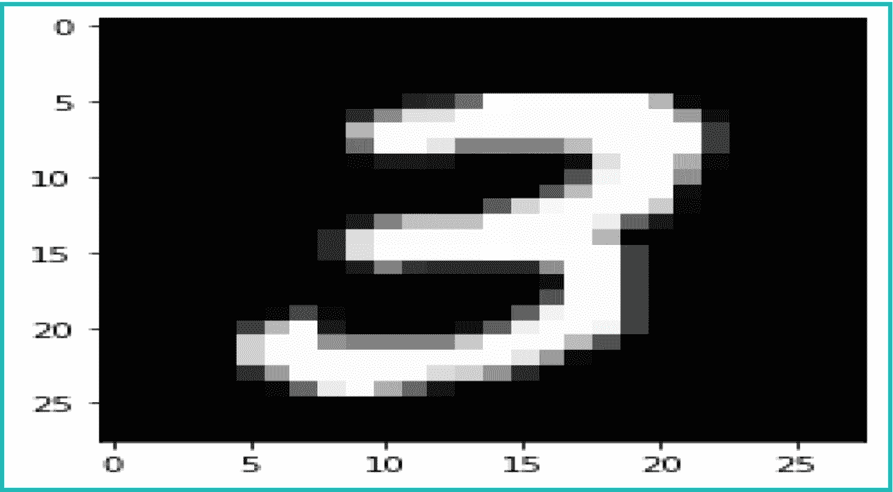

图 5.17 预测输出

**输出**:

```
预测结果是: [3], 目标结果是: 3
```

## 5.6 生成对抗网络 (GAN)

对于具有顺序数据数据的问题，使用普通神经网络不是很好的解决方案，而 RNN 是很好的答案。RNN 的应用之一是判断句子的情感是积极的还是消极的。

### 5.5.1 循环网络架构

深度学习结构的发展使得 RNN 架构成为最有趣的神经网络之一。RNN 处理序列中的每个元素，将其保持在内存中，然后处理序列中的下一个元素。RNN 中的神经元单元连接到自身。

### 5.5.2 长短期记忆 (LSTM)

RNN 在迭代一个节点时遇到的挑战之一是权重变小，导致梯度消失。此外，短期记忆是另一个挑战：

- 短记忆（输入数据）
- 长记忆（从内存中选择数据）

通过这种，LSTM 可以消除梯度消失。

### 5.5.3 设计 RNN (LSTM)

在这里，我们使用 TensorFlow 和 Keras 实现 MNIST 分类的 RNN (LSTM)。实现步骤如下：

### 5.5.3.1 导入库

第一步是导入如 `NumPy`、`TensorFlow` 和 `Keras` 等库。

```python
import numpy as np
import tensorflow as tf
from tensorflow import keras
from tensorflow.keras import layers
```

### 5.5.3.2 加载并归一化数据集

使用 `MNIST` 作为数据库，加载它进行训练和测试，然后进行归一化（这里的最大值为 255）。

```python
#加载数据
mnist = keras.datasets.mnist
#找到训练和测试数据
(x_train, y_train), (x_test, y_test) = mnist.load_data()
#归一化数据
x_train, x_test = x_train / 255.0, x_test / 255.0
sample, sample_label = x_train[3], y_train[3]
```


3. 训练学习算法以找到训练模型，
4. 使用验证数据找到更好的模型，以及
5. 使用测试数据对模型进行测试。

判别模型学习如何寻找类别之间的边界，而生成模型学习每个类别的分布。判别模型不适用于无监督学习，并且需要更多数据来进行更好的训练，而生成模型可以用于无监督学习。我们可以将生成目标和判别目标总结如下：

1. **生成目标**：
   * 最大化使判别器将伪数据误分类为真实数据的相似性。
2. **判别目标**：
   * 优化真实数据与伪数据之间的差异（训练损失接近 0.5）。

这些是生成器的工作步骤：

1. 生成一些样本（例如，一些初始噪声数据），
2. 选择一种神经网络算法（例如 `CNN`），以及
3. 训练生成器。

卷积神经网络（`CNN`）可以作为一个判别器，你可以按照如下方式实现：

1. 选择 `CNN` 来分类真伪，
2. 拥有一个真实数据集并从生成器获取伪数据，
- 在真实数据和伪数据上训练 `CNN`，以及
- 学习平衡判别器训练与生成器训练——如果判别器非常强大，生成器将会发散。

### 5.6.2 用于时尚数据集的 GAN

在这里我们展示一个 GAN 以学习它的工作原理。这些是通用步骤：

1. 加载数据集，
2. 数据预处理，
3. 定义判别器模型，
4. 定义生成器模型，
5. 组合生成器和判别器模型，
6. 训练模型，以及
7. 预测（生成数据）。

在开始第一步之前，如之前提到的最好导入一些库和平台以方便计算，如 NumPy、TensorFlow 和 Keras。

```python
import numpy as np
from matplotlib import pyplot as plt
from tensorflow.keras.models import Model, save_model, load_model
from tensorflow.keras.layers import Conv2D, Conv2DTranspose, BatchNormalization, LeakyReLU, Dropout, Flatten, Dense, Reshape, Input, Embedding, Concatenate
from tensorflow.keras.utils import plot_model
from tensorflow.keras.optimizers import Adam
from tensorflow.keras.losses import BinaryCrossentropy
```

### 5.6.2.1 加载数据集

我们在这里使用的数据集 fashion MNIST。

```python
from keras.datasets.fashion_mnist import load_data
(real_train_images, real_train_labels), (real_test_images, real_test_labels) = load_data()
print('Train', real_train_images.shape, real_train_labels.shape)
print('Test', real_test_images.shape, real_test_labels.shape)
```

输出为：

```
Train (60000, 28, 28) (60000,)
Test (10000, 28, 28) (10000,)
```

### 5.6.2.2 数据预处理

在这步中，你应该对数据进行一些处理，如归一化数据、选择真实数据、生成随机噪声和选择伪数据。

1. 归一化处于 `0` 到 `255` 之间和 `-1` 到 `1` 之间的数据：
```python
def prepare_real_samples(samples):
   prepared_samples = samples.astype('float32')
   prepared_samples = (prepared_samples - 127.5) / 127.5
   return prepared_samples
```
2. 选择真实样本：
```python
def generate_real_batch(samples, orig_labels, n_samples):
   indices = np.random.randint(0, samples.shape[0], n_samples)
   batch_images = samples[indices]
   batch_labels = orig_labels[indices]
   batch_labels = np.full(n_samples, REAL_LABEL_VALUE)
   return batch_images, batch_labels
```
3. 生成随机噪声作为生成器的输入：
```python
def generate_noise_vector(noise_dim, n_samples):
   noise_vector = np.random.normal(size=(n_samples, noise_dim))
   return noise_vector
```
4. 选择伪样本：
```python
def generate_fake_batch(generator, noise_dim, n_classes, n_samples):
   noise_vector, original_classes = generate_noise_vector(noise_dim, n_samples)
   batch_images = generator.predict([noise_vector, original_classes])
   batch_labels = np.full(n_samples, FAKE_LABEL_VALUE)
   return batch_images, batch_labels
```

### 5.6.2.3 定义判别器模型

你应该在这一步中定义判别器。

```python
def create_discriminator(in_shape=(28, 28, 1), n_classes=10, label_smoothing=0):
   label_input = Input(shape=(1,))
   embedding_input = Embedding(n_classes, LABEL_EMBEDDING_SIZE)(label_input)
   embedding_input = Dense(in_shape[0] * in_shape[1])(embedding_input)
   embedding_input = Reshape((in_shape[0], in_shape[1], 1))(embedding_input)
   image_input = Input(shape=in_shape)
   merge = Concatenate()([image_input, embedding_input])
   feature_extractor = Conv2D(128, (3, 3), strides=(2, 2), padding='same')(merge)
   feature_extractor = LeakyReLU(alpha=0.2)(feature_extractor)
   feature_extractor = Conv2D(128, (3, 3), strides=(2, 2), padding='same')(feature_extractor)
   feature_extractor = LeakyReLU(alpha=0.2)(feature_extractor)
   feature_extractor = Flatten()(feature_extractor)
   feature_extractor = Dropout(0.4)(feature_extractor)
   out_layer = Dense(1, activation='sigmoid')(feature_extractor)
   model = Model([image_input, label_input], out_layer)
   opt = Adam(learning_rate=0.0002, beta_1=.5)
   loss = BinaryCrossentropy(label_smoothing=label_smoothing)
   model.compile(loss=loss, optimizer=opt, metrics=['accuracy'])
   return model
```

你可以看到模型摘要：

```python
discriminator = create_discriminator(INPUT_SHAPE, N_CLASSES)
discriminator.summary()
```

Layer (type) | Output Shape | Param # | Connected to
============================================================
input_1 (InputLayer) | [(None, 1)] | 0 |
embedding (Embedding) | (None, 1, 50) | 500 | input_1[0][0]
dense (Dense) | (None, 1, 784) | 9984 | embedding[0][0]
input_2 (InputLayer) | [(None, 28, 28, 1)] | 0 |
reshape (Reshape) | (None, 28, 28, 1) | 0 | dense[0][0]
concatenate (Concatenate) | (None, 28, 28, 2) | 0 | input_2[0][0]
conv2d (Conv2D) | (None, 14, 14, 128) | 2432 | concatenate[0][0]
leaky_re_lu (LeakyReLU) | (None, 14, 14, 128) | 0 | conv2d[0][0]
conv2d_1 (Conv2D) | (None, 7, 7, 128) | 147584 | leaky_re_lu[0][0]
leaky_re_lu_1 (LeakyReLU) | (None, 7, 7, 128) | 0 | conv2d_1[0][0]
flatten (Flatten) | (None, 6272) | 0 | leaky_re_lu_1[0][0]
dropout (Dropout) | (None, 6272) | 0 | flatten[0][0]
dense_1 (Dense) | (None, 1) | 6273 | dropout[0][0]

### 5.6.2.4 定义生成器模型


```python
def create_generator(noise_dim = 100, dense_layer_nodes = LATENT_DENSE_SIZE, n_classes = 10):
   label_input = Input(shape = (1,))
   embedding_input = Embedding(n_classes, LABEL_EMBEDDING_SIZE)(label_input)
   embedding_input = Dense(LATENT_LOW_RES_VALUE * LATENT_LOW_RES_VALUE)(embedding_input)
   embedding_input = Reshape((LATENT_LOW_RES_VALUE, LATENT_LOW_RES_VALUE, 1))(embedding_input)
   latent_input = Input(shape=(noise_dim,))
   noise_input = Dense(dense_layer_nodes)(latent_input)
   noise_input = LeakyReLU(alpha = 0.2)(noise_input)
   noise_input = Reshape(GENERATOR_INITIAL_SHAPE)(noise_input)
   merge = Concatenate()([noise_input, embedding_input])
   gen = Conv2DTranspose(128, (4,4), strides = (2,2), padding = 'same')(merge)
   gen = LeakyReLU(alpha = 0.2)(gen)
   gen = Conv2DTranspose(128, (4,4), strides = (2,2), padding = 'same')(gen)
   gen = LeakyReLU(alpha = 0.2)(gen)
   out_layer = Conv2D(1, (7, 7), activation = 'tanh', padding = 'same')(gen)
   return Model([latent_input, label_input], out_layer)
```

你可以看到模型摘要：

```python
generator = create_generator(NOISE_DIM, LATENT_DENSE_SIZE, N_CLASSES)
generator.summary()
plot_model(generator, to_file = 'generator_plot.png', show_shapes = True, show_layer_names = True)
```

该模型是：

```
Layer (type)	Output Shape	Param #	Connected to
=============================================================================
input_4 (InputLayer)	[(None, 100)]	0
_____________________________________________________________________________
input_3 (InputLayer)	[(None, 1)]	0
_____________________________________________________________________________
dense_3 (Dense)	(None, 6272)	633472	input_4[0][0]
_____________________________________________________________________________
embedding_1 (Embedding)	(None, 1, 50)	500	input_3[0][0]
_____________________________________________________________________________
leaky_re_lu_2 (LeakyReLU)	None, 6272)	0	dense_3[0][0]
_____________________________________________________________________________
dense_2 (Dense)	(None, 1, 49)	2499	embedding_1[0][0]
_____________________________________________________________________________
reshape_2 (Reshape)	(None, 7, 7, 128)	0	leaky_re_lu_2[0][0]
_____________________________________________________________________________
reshape_1 (Reshape)	(None, 7, 7, 1)	0	dense_2[0][0]
_____________________________________________________________________________
concatenate_1 (Concatenate)	(None, 7, 7, 129)	0	reshape_2[0][0]
_____________________________________________________________________________
conv2d_transpose (Conv2DTrans)	(None, 14, 14, 128)	264320	concatenate_1[0][0]
_____________________________________________________________________________
leaky_re_lu_3 (LeakyReLU)	(None, 14, 14, 128)	0	conv2d_transpose[0][0]
_____________________________________________________________________________
22d_transpose_1 (22D))(None, 28, 28, 128))2222222akyaky_____0


leaky_2_lu_4 (LeakyReLU, 2None, 28, 28,)	22222_transpose_1[0][0]
________________222)
conv2d_2 (Conv2D)	(None, 28, 28, 1)	6273	leaky_re_lu_4[0][0]
=============================================================================
Total params: 1,169,336
Trainable params: 1,169,336
Non-trainable params: 0
```

#### 5. 合并生成器与判别器

在这一步，你需要定义合并生成器和判别器的函数：

```python
def create_gan(generator, discriminator, label_smoothing=0):
   discriminator.trainable = False
   generator_input = generator.input
   generator_output = generator.output
   gan_output = discriminator([generator_input, generator_output])
   opt = Adam(lr = 0.0001)
   loss = BinaryCrossentropy(label=label_smoothing)
   gan.compile(loss = loss, optimizer = opt, metrics = ['accuracy'])
   return gan
```

你可以看到 GAN 的摘要：

```python
gan = create_gan(generator, discriminator)
gan.summary()
```

GAN 模型是：


```python
def train_gan(gan, generator, discriminator, latent_dim, epochs, batches_per_epoch, batch_size, initial_image_noise, verbose=1):
   image_noise_decrement = initial_image_noise / epochs
   image_noise_magnitude = initial_image_noise
   if verbose > 0:
   print(f"Beginning training... {epochs} epochs, each with {batches_per_epoch} batches of {batch_size}")
   print(f"Latent vector size {latent_dim}")
   print(f"Image noise initial magnitude: {image_noise_magnitude}, decay: {image_noise_decrement}")
   print("Training... ")
   print("Metrics: Discriminator Real, Discriminator Fake, Generator")
   for i in range(epochs):
   train_gan_single_epoch(gan, generator, discriminator, latent_dim, batches_per_epoch, batch_size, image_noise_magnitude, verbose=verbose)
   print('the epoch is: ', i)
   image_noise_magnitude -= image_noise_decrement
   if verbose >= 1:
   fake_images, fake_labels, fake_classes = generate_fake_batch(generator, latent_dim, N_CLASSES, 10)
   disc_fake_classifications = discriminator.predict([fake_images, fake_classes])
fake_images = (fake_images + 1) / 2
   print(f'After {(i+1)*BATCHES*BATCH_SIZE} samples.')
   print('Image labels are D(image) and Class(image)')
   print(' Generated Images and Discriminator Output:')
   for i in range(10):
   ax = plt.subplot(2, 5, i+1)
   ax.axis('off')
   ax.set_title(f'{disc_fake_classifications[i][0]:.2f}, {fake_classes[i]}')
   plt.imshow(fake_images[i].reshape(INPUT_SHAPE[0], INPUT_SHAPE[1]))
   plt.tight_layout()
   plt.show()
   print(' Real Images and Discriminator Output:')
   real_images, real_batch_labels, real_classes = generate_real_batch(prepared_real_images, real_train_labels, 10)
   disc_real_classifications = discriminator.predict([real_images, real_classes])
   real_images = (real_images + 1) / 2
   for i in range(10):
   ax = plt.subplot(2, 5, i+1)
   ax.axis('off')
   ax.set_title(f"{disc_real_classifications[i][0]:.2f} {real_classes[i]}")
   plt.imshow(real_images[i])
   plt.tight_layout()
   plt.show()
```

现在你可以训练模型了：

```python
EPOCHS = 50
BATCHES = 50
BATCH_SIZE = 128
IMAGE_NOISE_START = .1
LABEL_SMOOTHING_MAGNITUDE = .1
# 训练 50 个 epoch
discriminator = create_discriminator(INPUT_SHAPE, N_CLASSES, label_smoothing = LABEL_SMOOTHING_MAGNITUDE)
generator = create_generator(NOISE_DIM, LATENT_DENSE_SIZE, N_CLASSES)
gan = create_gan(generator, discriminator, label_smoothing = LABEL_SMOOTHING_MAGNITUDE)
train_gan(
   gan,
   generator,
   discriminator,
   NOISE_DIM,
   EPOCHS,
   BATCHES,
   BATCH_SIZE,
   IMAGE_NOISE_START,
   verbose=2
)
save_model(generator, 'cgan_model100.h5')
```

### 5.6.2.7 预测（生成数据）

```python
model = load_model('cgan_model100.h5')
fig = plt.figure()
fig.set_size_inches(16, 16)
# 显示图像
def plot(examples, n):
   for i in range(n * n):
   plt.subplot(n, n, 1 + i)
   plt.axis('off')
```


如果每一层中存在某些模式，它们的输出值就会较高；如果模式不存在，每层的输出值就会较小。值越高，概率就越大。例如，假设我们正在开发一个脸识别系统；某一层会在输出中寻找如鼻子、嘴唇、眼睛和嘴巴等脸部区域模式。如果网络发现更多模式，那么将图像分类为脸的概率就会增加。相反，缺少这些模式会降低图像中存在脸的概率。图 6.4 显示了从原始图像中提取的不同特征图（8 张特征图）。更多的层和更多的滤波器会产生更多的特征图并提高准确率（并非总是如此！）。

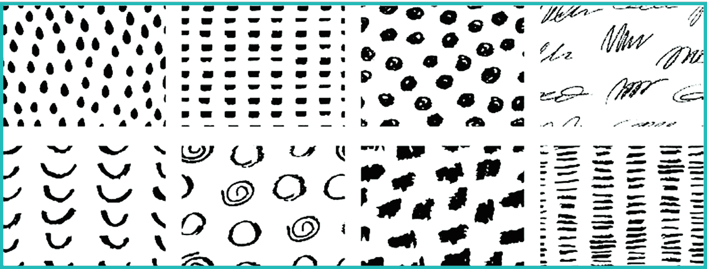

图像中的不同模式

用于图像分析应用的深度学习（DL）方法主要有两种类型：监督学习和无监督学习。此外，我们根据这两种学习方法对图像分析中最常用的深度学习进行了分类：

1. **监督学习**
    * 目标检测，
    * 图像分类，以及
    * 图像分割。
2. **无监督学习**
    * 图像生成

这些应用有不同的算法。表 6.1 显示了其中一些方法和算法。

图像分析最常用的深度学习方法表](#ch6.xhtml#R_t6_1)

| 任务 || 模型架构 | 框架 |
| --- | --- | --- |
| 目标检测 | R-FCN, Faster R-CNN | TensorFlow |
| 图像分类 | VGG, Inception, ResNet | TensorFlow, PyTorch, Keras |
| 图像分割 | 通用分割：DeepLab, PSPNet 医疗图像分割：U-Net, HyperDense-Net 分割：Mask RCNN | TensorFlow, PyTorch |
| 图像生成 | DCGAN, CycleGAN, ProGAN, BigGAN | \- |

### 6.2.1 滤波器参数

某些滤波器参数如尺寸、类型和步长可以更改，并影响学习过程和网络性能。在这里我们更详细地回顾这些参数，以了解它们是如何改变网络性能的。

### 6.2.1.1 滤波器的数量和类型

正如我们所提到的，滤波器的输出是特征图。每个滤波器都设计用于提取和检测特定的模式。例如，某些滤波器用于提取线条，而另一些用于提取颜色。滤波器可以更具定制性，例如提取垂直线或水平线。滤波器的类型（提取特征的类型）取决于问题类型和数据类型。我们可以在每层中使用尽可能多的滤波器，但关键点在于每层滤波器越多，分类就越准确（并非总是如此），但另一方面，它会增加计算成本。目前还没有任何经验法则可以表明滤波器数量与性能之间的关系。这来自于实验，并且在不同问题之间可能会有所不同。你可以通过更多的测试来为你的架构（基于你的问题）找到这些数值。当你开始创建架构时，可以从基础网络架构开始，然后通过添加和更改滤波器的数量和类型，为你的问题找到最佳架构。请记住，CNN 中有一些经过验证且广为人知的架构，你可以用于你的问题。出于学习目的，我们建议你针对一个问题，然后创建基础网络并尝试寻找它的瓶颈以提高其性能。现在，尝试使用一种流行的训练好的 CNN 算法或预训练网络进行结果，并比较你的结果。

### 6.2.1.2 滤波器尺寸

滤波器的尺寸可以小也可以大！最流行的尺寸是`3×3`。通过选择更大的尺寸，可能会找到更大的模式（为了保持输出尺寸）。滤波器可以更具定制性，例如提取垂直线或水平线。滤波器的类型（提取特征的类型）取决于问题和数据类型。我们可以在每层中使用尽可能多的滤波器，但关键点在于每层滤波器越多，分类就越准确（并非总是如此），但另一方面，它会增加计算成本。目前还没有任何经验法则可以表明滤波器数量与性能之间的关系。这来自于实验，并且在不同问题之间可能会有所不同。你可以通过更多的测试来为你的架构（基于你的问题）找到这些数值。当你开始创建架构时，可以从基础网络架构开始，然后通过添加和更改滤波器的数量和类型，为你的问题找到最佳架构。请记住，CNN 中有一些经过验证且广为人知的架构，你可以用于你的问题。出于学习目的，我们建议你针对一个问题，然后创建基础网络并尝试寻找它的瓶颈以提高其性能。现在，尝试使用一种流行的训练好的 CNN 算法或预训练网络进行结果，并比较你的结果。

（注：原文 Stride and Padding 处存在部分重复和逻辑混乱，翻译已根据语意对齐）

### 6.2.1.3 步长与填充

步长是滤波器在图像上移动的步数。填充是在图像边缘添加像素的操作，以防止在卷积过程中图像尺寸缩小，并允许滤波器提取边缘的特征。


该层没有学习参数，但具有计算开销，可能会影响学习性能。因此，明智地选择池化层的大小并将其正确地放在架构中的合适位置可以提高性能。

### 6.2.2.4 全连接层 (FC)

所有的输入和输出都有可分离的权重。因此，基于输入和输出加上偏置的权重数为：

```
((C × P) + 1 × C)
```

当前层的神经元数量为 `C` 或输出 `(O)`，前一层的神经元数量为 `P` 或输入 `(I)`。每一层的输出为：

```
input_size 减 (filter_size 减 1)
```

例如，如果输入是一个图像且图像大小为 `28×28`，滤波器大小为 `3×3`，那么该层的输出为：

```
(28 − (3 − 1)) = 26
```

让我们来看一个通用的模型示例。如果输入是一个大小为 `28×28` 形状为 `28×28×1` 的图像，它没有参数。

假设这些值为：

```
stride=1,
kernel_ size=3×3,
第一层的滤波器数量 =32,
那么参数的数量为：
((kernel_size) × stride + 1) × number of filters)
C1: 3×3×1+1×32
= 320
```

在下一层中，我们已经从上一层获得了 32 个学习到的滤波器，那么可训练参数的数量为：

$$\begin{array}{l} {C\_{2}:3\\mspace{9mu} \times \\mspace{9mu} 3\\mspace{9mu} \times \\mspace{9mu} 32\\mspace{9mu} + \\mspace{9mu} 1\\mspace{9mu} \times \\mspace{9mu} 32\\mspace{9mu} = \\mspace{9mu} 9,248} \\\\ {C\_{3}:3\\mspace{9mu} \times \\mspace{9mu} 3\\mspace{9mu} \times \\mspace{9mu} 32\\mspace{9mu} + \\mspace{9mu} 1\\mspace{9mu} \times \\mspace{9mu} 64\\mspace{9mu} = \\mspace{9mu} 18,496} \\\\ \\end{array}$$


以此此类推。总参数是所有这些值的总和。例如，在这三层中，有 28,064 个参数：

```
C1 + C2 + C3 = 320 + 9,248 + 18,496 = 28,064
```

计算网络参数的数量是验证良好网络架构的一部分。使用摘要构建模型后，你可以在 `TensorFlow` 中详细检查每一层的参数数量。我们计划回顾最流行的 CNN 架构类型。如前所述，你可以从零开始创建架构，然后将你的结果与这些常见架构进行比较，并选择最好的。

### 6.2.3 Imagenet 挑战

自 2010 年以来，一项名为 `ImageNet 大规模视觉识别挑战` (`ILSVRC`) 的竞赛被设计用于测试不同的算法。首次分类率为 25%，最佳成绩属于 `AlexNet`，它实现了 10% 的错误率（然而，最近的先进算法显示了更好的结果）。此外，还有一个包含超过 1400 万张图像的视觉数据库，人们用它比较自己的结果。

### 6.2.4 CNN 架构

本节介绍了一些最流行的 CNN 算法。有几种性能不同的架构。这些架构之间最显著的区别在于：

* 层数
* 每层中的元素
* 层之间的连接

这三个参数定义了你的模型，并包含了网络参数和超参数。

### 6.2.4.1 LeNet-5 (1998)

该网络是 1998 年提出的最简单的深度神经网络之一，共有七层：

* 两个卷积层
* 三个全连接层
* 两个池化层

它的第一个应用是手写识别（`3+2=7` 层），它大约有 6,000 个参数（`6×32=6,144`）。`图 6.8` 详细展示了它的架构。让我们进一步讨论它的滤波器和参数。如果 `stride` 为 1，总参数为：

```
(n + 2p − f)/s + 1 × (n + 2p − f)/s + 1 × Nc
```

其中：

* `Nc`: 是通道数（用于卷积的滤波器数量）
* `p`: 填充（LeNet-5 中没有填充）
* `s`: 步长


那么参数的数量为：

$$\begin{array}{l} \left. \left( {32 + 0 - 5} \right)/1 + 1 \times \left( {32 + 0 - 5} \right)/1 + 1 \times 6 \right. \\ {= 28 \times 28 \times 6 = 4,704} \\ \end{array}$$


### 6.2.4.2 AlexNet (2012)

Alex 是在 ImageNet 中提出的第一个并在 2012 年赢得该比赛的深度学习方法之一。你可以在 `图 6.9` 中看到它的 DL 架构。它的架构类似于 `LeNet`，但层更多（更深）。

他们提出了丢弃（dropout）技术来降低计算开销，并与其他方法相比取得了更好的结果。他们还在方法中使用了 `ReLU` 来提高性能。他们使用了最大池化层来使方法运行更快。它的架构有八层，包括：

* 五个卷积层
* 三个具有 6000 万个参数的全连接层
* `ReLU`


### 6.2.4.3 GoogleNet/Inception-v1 (2014)

GoogleNet 是一个总共 22 层的 CNN。提供了预训练版本，你可以下载并使用。`图 6.10` 展示了它的架构。


它以少于 7% 的错误率获得了 ILSVRC 2014。它的架构使用了诸如批归一化等技术将参数减少到 400 万到 500 万。此外，它包含了一些 `inception`（来自下一个版本）模块，每层包含并行卷积滤波器。如 `图 6.10` 所示，它的网络非常深，准确率更高，但计算开销更高。

### 6.2.4.4 VGGNet-16 (2014)

VGGNet-16 是一种 2014 年提出的 CNN，其架构包含 16 层。它在 ImageNet 测试图像上实现了 92.7% 的准确率。它是通过替换大卷积滤波器对 `AlexNet` 的改进。它的训练非常慢，权重很大。它已被用于许多图像分类问题并显示了非常的结果。你可以使用当前的深度学习平台如 `TensorFlow`、`Keras` 或 `Pytorch` 实现它。`图 6.11` 展示了它的架构。它的架构包括：

* 13 个卷积层
* 三个全连接层

它有 1.3 亿个参数，占用 500 MB 空间（提高性能最简单的方法可能是增加层数）。


### 6.2.4.5 Inception-v3 (2015)

它是 `Inception-v1` 的下一代（在 `Inception-v2` 在对损失函数进行微调并使用批归一化等其他技术之后）。它有 2400 万个参数，是一种用于图像分析和物体分类的 CNN。由 Google 在 2015 年提出，并在 ImageNet 数据集上显示了非常的结果。`图 6.12` 展示了它的架构，是 Google 提出的第一个算法的第三个版本。


它包含 46 个卷积层、两个全连接层以及两个 SoftMax 层。尽管，如你在图 6.12 中所示，架构中某些部分的卷积层具有不同层次，它们的输出总和构成了下一层的输入。此外，还有一个连接层为下一层准备了这些输入。

### 6.2.4.6 ResNet (2015)

仅通过增加网络深度，准确率的提升无法超过一个阈值。这个由微软提出的网络通过捷径连接（残差）来解决 ResNet 问题，以构建更深的网络。ResNet 在 2015 年的 ILSVC 中获得冠军，其 152 层的网络错误率低于 3.6%。这是一种非常深的 CNN 方法。图 6.13 展示了三种架构，并将 VGG-19 与 34 层平层网络和 34 层残差网络进行比较，以说明这种复杂性。它已应用于多个计算机视觉领域。

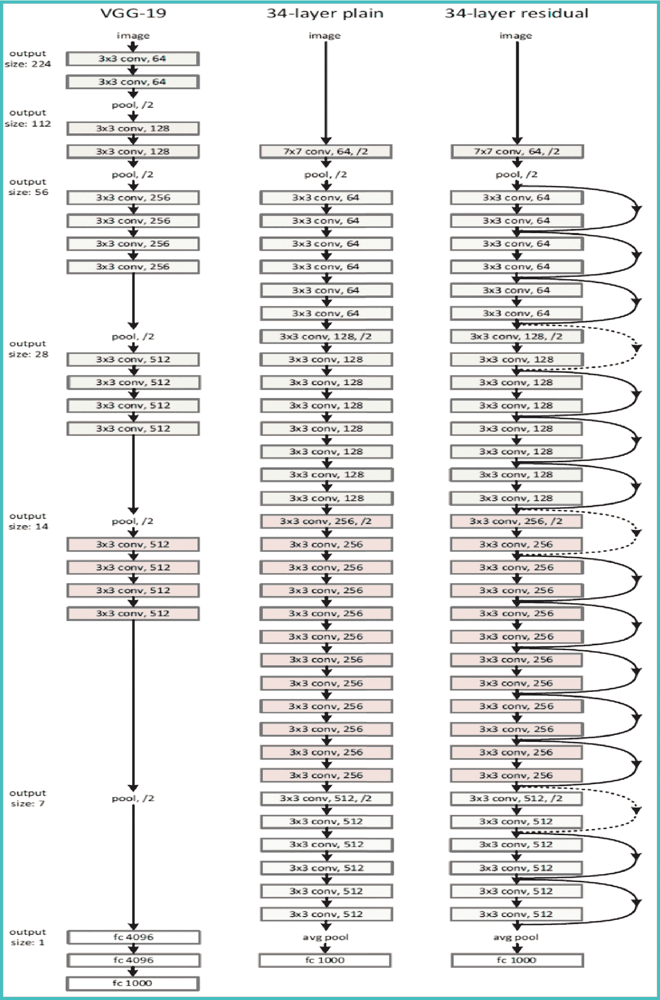

图 6.13 ResNet 网络。

### 6.2.4.7 Inception-v4 (2016)

Inception-v3 的改进版是谷歌在 2016 年提出的 Inception-v4，其架构具有以下变化：

* stem 模块变化，
* 更多的 inception 模块，以及
* 每个模块使用相同数量的过滤器。

这是一种卷积神经网络架构，降低了 inception-v3 的复杂性，但其性能与 V3 相当。它在 2016 年的 ImageNet 上实现了 3.08% 的 top-5 错误率。它已应用于多个计算机视觉领域并取得了良好的结果。你可以使用 TensorFlow、Keras 和 Pytorch 等多个 DL 平台实现它。图 6.14 展示了它的架构。

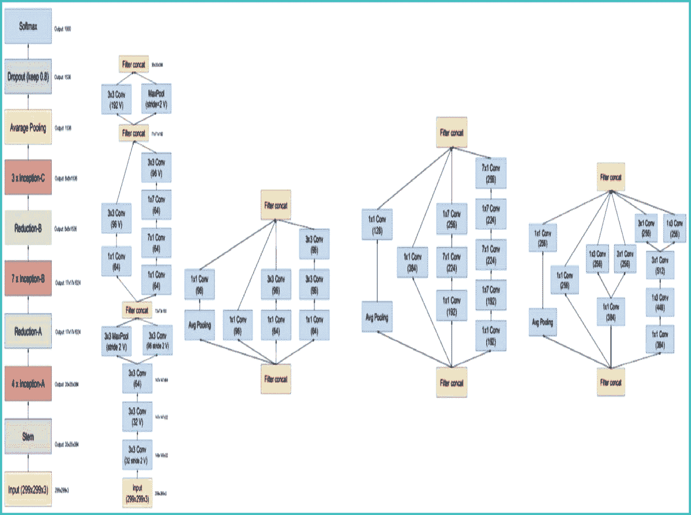

图 6.14 Inception-v4 网络。

## 6.3 使用 CNN 实现模型的通用策略

使用深度学习（DL）构建模型有一些通用的步骤，首先我们回顾一下这些步骤。现在，你应该考虑计划在模型中使用的架构。我们在上一节中讨论了最流行的 CNN 架构。然后，你可以轻松地使用 Keras 部署所有模型，比较结果，并在你的模型中选择合适的架构。使用 CNN 实现模型分为五个步骤：

1. **第 1 步**：导入库，
2. **第 2 步**：加载数据，
3. **第 3 步**：定义模型，
4. **第 4 步**：训练模型，以及
5. **第 5 步**：测试模型。

### 6.3.1 导入库

在任何程序中，第一步都是导入库以便在程序中使用它们的方法。

### 6.3.2 加载数据并创建数据

在任何程序中，第一步都是导入库以便在程序中使用它们的方法。（此处省略了原文中大量重复的句子）

### 6.3.3 构建模型

### 6.3.4 训练模型

### 6.3.5 测试模型

## 6.4 使用 CNN 进行目标识别

### 6.4.1 导入库

### 6.4.2 加载数据并生成数据集

### 6.4.3 构建模型


```
model = Sequential()
model.add(Conv2D(filters=32, kernel_size=(4,4), strides=(1,1), padding='valid', input_shape=(32,32,3), activation="relu"))
model.add(Conv2D(filters=32, kernel_size=(4,4), strides=(1,1), padding='valid', input_shape=(32,32,3), activation="relu"))
model.add(MaxPool2D(pool_size=(2, 2)))
model.add(Flatten())
model.add(Dense(256,activation="relu"))
model.add(Dense(10, activation="softmax"))
model.compile(loss="categorical_crossentropy", optimizer="adam", metrics=['accuracy'])
```

我们可以如下如下检查模型架构和参数：

```
model.summary()
Model: "sequential"
______________________________________________________
Layer (type)  Output Shape Param #
======================================================
conv2d (Conv2D) (None, 29, 29, 32) 1568
______________________________________________________
max_pooling2d (MaxPooling2D) (None, 14, 14, 32) 0
______________________________________________________
conv2d_1 (Conv2D) (None, 11, 11, 32) 16416
______________________________________________________
max_pooling2d_1 (MaxPooling2 (None, 5, 5, 32) 0
______________________________________________________
flatten (Flatten) (None, 800) 0
______________________________________________________
dense (Dense) (None, 256) 205056
______________________________________________________
dense_1 (Dense) (None, 10) 2570
======================================================
Total params: 225,610
Trainable params: 225,610
Non-trainable params: 0
```

### 6.4.4 训练模型

使用 Keras 和 TensorFlow 训练模型，通过设置一些 epoch 等参数和超参数，并定义优化器类型、损失函数和准确率指标。

```
early_stop = EarlyStopping(monitor="val_loss", patience=2)
model.fit(X_train,y_cat_train, epochs = 15, validation_data = (X_test, y_cat_test), callbacks = [early_stop])
```

### 6.4.5 测试模型

在最后一步，你可以使用测试数据测试模型并评估你的模型。这里模型可以使用猫数据进行测试，也可以使用文件夹中的测试数据作为测试数据。

```
metrics = pd.DataFrame(model.history.history)
model.evaluate(X_test, y_cat_test, verbose = 0)
predictions = model.predict_classes(X_test)
plt.figure(figsize=(12,10))
sns.heatmap(confusion_matrix(y_test, predictions), annot=True)
```

图 6.16 显示了通过测试数据测试的训练模型的混淆矩阵。 图 6.16

## 6.5 使用 CNN 进行图像分类

CNN 的另一个应用是图像分类。在这里，我们通过示例解释使用 CNN 进行图像分类的步骤。

### 6.5.1 导入库

在示例中，我们使用 TensorFlow、Keras 和 matplotlib 来实现网络和可视化。

```
import tensorflow as tf
from tensorflow.keras import datasets, models
import matplotlib.pyplot as plt
```

### 6.5.2 加载数据

在这一步中，我们加载数据库 `cifar10` 分类（训练数据和测试数据）并归一化。

```
(train_images, train_labels), (test_images, test_labels) = datasets.cifar10.load_data()
# 将像素值归一化到 0 和 1 之间
train_images, test_images = train_images / 255.0, test_images / 255.0
class_names = ['airplane', 'bird', 'cat', 'deer', 'frog', 'horse', 'ship', 'truck']
plt.figure(figsize=(10,10))
for i in range(25):
    plt.subplot(5,5,i+1)
    plt.xticks([])
    plt.yticks([])
    plt.grid(False)
    plt.imshow(train_images[i], cmap=plt.cm.binary)
    plt.xlabel(class_names[train_labels[i][0]])
plt.show()
```

### 6.5.3 构建模型

我们的模型有三个卷积层，我们使用最大池化和 ReLU 作为下采样方法和激活函数。

```
model = models.Sequential()
model.add(layers.Conv2D(32, kernel_size=(3, 3), activation='relu', input_shape=(32, 32,3)))
model.add(layers.MaxPooling2D(pool_size=(2, 2)))
model.add(layers.Conv2D(64, kernel_size=(3, 3), activation='relu'))
model.add(layers.MaxPooling2D(pool_size=(2, 2)))
model.add(layers.Conv2D(128, kernel_size=(3, 3), activation='relu'))
model.add(layers.MaxPooling2D(pool_size=(2, 2)))
model.add(layers.Dropout(0.2))
model.add(layers.Flatten())
model.add(layers.Dense(256, activation='relu'))
model.add(layers.Dense(128, activation='relu'))
model.add(layers.Dense(10, activation='softmax'))
```

这里是模型的摘要，显示了网络结构、总参数和可训练参数。

```
model.summary()
______________________________________________________
Layer (type)  Output Shape Param #
======================================================
conv2d (Conv2D) (None, 30, 30, 32) 896
______________________________________________________
max_pooling2d (MaxPooling2D) (None, 15, 15, 32) 0
______________________________________________________
conv2d_1 (Conv2D) (None, 13, 13, 64) 18496
______________________________________________________
max_pooling2d_1 (MaxPooling2D) (None, 6, 6, 64) 0
______________________________________________________
conv2d_2 (Conv2D) (None, 4, 4, 128) 73856
______________________________________________________
max_pooling2d_2 (MaxPooling2D) (None, 2, 2, 128) 0
______________________________________________________
dropout (Dropout) (None, 2, 2, 128) 0
______________________________________________________
flatten (Flatten) (None, 512) 0
______________________________________________________
dense (Dense) (None, 256) 131328
______________________________________________________
dense_1 (Dense) (None, 128) 32896
______________________________________________________
dense_2 (Dense) (None, 10) 1290
======================================================
Total params: 258,762
Trainable params: 258,762
Non-trainable params: 0
```

### 6.5.4 训练模型

在这一步中，通过确定优化器、损失函数和准确率指标等参数来编译并训练模型。

```
model.compile(optimizer='adam',loss='sparse_categorical_crossentropy', metrics=['accuracy'])
history = model.fit(train_images, train_labels, epochs=10, validation_data=(test_images, test_labels))
```

### 6.5.5 测试模型

我们在这一步中通过测试数据对模型进行评估。

```
test_loss, test_acc = model.evaluate(test_images, test_labels, verbose=2)
```

## 6.6 图像分割

图像分割是将图像分割有意义的部分，有助于更好地更好地分析图像。多种传统的图像分割方法根据图像颜色、强度或纹理进行分割。图像分割是 CNN 的图像分析应用之一。在这里，我们实现一个示例来展示 CNN 如何帮助我们进行图像分割。

### 6.6.1 导入库

在本节中，我们使用 TensorFlow、python 和 matplotlib 库来完成模型的生成和可视化。

```python
#导入库
from tensorflow_examples.models.pix2pix import pix2pix
import tensorflow_datasets as tfds
from IPython.display import clear_output
import matplotlib.pyplot as plt
```

### 6.6.2 加载数据并生成数据集

在这一步中，我们应该加载并将其划分为训练和测试数据，调整数据大小，找到正确的掩码并归一化数据。


```
# load the data
def load_image_train(datapoint):
 input_image1 = tf.image.resize(datapoint['image'], (128, 128))
input_mask1 = tf.image.resize(datapoint['segmentation_mask'], (128, 128))
 if tf.random.uniform(()) > 0.5:
 input_image1 = tf.image.flip_left_right(input_image1)
 input_mask1 = tf.image.flip_left_right(input_mask1)
 input_image1, input_mask1 = normalize(input_image1, input_mask1)
 return input_image1, input_mask1
train_lenght1 = info.splits['train'].num:examples
# define the dataset categories
batch_size= 64
buffer_size = 1000
steps_per_epoch = train_lenght1 // batch_size
train = dataset['train'].map(load_image_train, num:parallel_calls=tf.data.experimental.AUTOTUNE)
test = dataset['test'].map(load_image_test)
train_dataset = train.cache().shuffle(BUFFER_SIZE).batch(BATCH_SIZE).repeat()
train_dataset = train_dataset.prefetch(buffer_size=tf.data.experimental.AUTOTUNE)
test_dataset = test.batch(BATCH_SIZE)
```

### 6.6.3 分割图 (Segmentation Map)

在这里我们根据输入图像定义真实掩码（mask）。图 6.18 显示了图像的原始和真实掩码。

```
#set the output display
def display(display_list):
 plt.figure(figsize=(15, 15))
 title1 = ['Input Image', 'True Mask', 'Predicted Mask']
 for i in range(len(display_list)):
 plt.subplot(1, len(display_list), i+1)
 plt.title1(title1[i])
 plt.imshow(tf.keras.preprocessing.image.array_to_img(display_list[i]))
 plt.axis('off')
 plt.show()
for image, mask in train.take(24):
 sample_image, sample_mask = image, mask
display([sample_image, sample_mask])
```

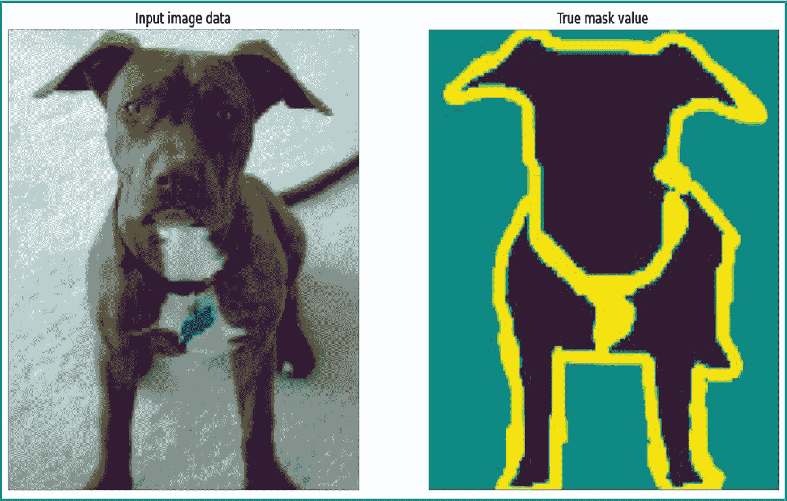

图 6.18 输入图像的掩码值

### 6.6.4 构建模型 (Make the Model)

现在我们定义一个包含卷积层和池化层的模型。输入图像有三个通道，尺寸为 128×128。

```
OUTPUT_CHANNELS = 3
base_model = tf.keras.applications.MobileNetV2(input_shape=[128, 128, 3], include_top=False)
# Use the activations of these layers
layer_names = [
 'block_1_expand_relu',
 'block_3_expand_relu'
 'block_6_expand_relu',
 'block_13_expand_relu'
 'block_16_project'
]
layers = [base_model.get_layer(name).output for name in layer_names]
# Create the feature extraction model
down_stack = tf.keras.Model(inputs=base_model.input, outputs=layers)
down_stack.trainable = False
up_stack = [
 pix2pix.upsample(512, 3),
pix2pix.upsample(256, 3),
 pix2pix.upsample(128, 3),
 pix2pix.upsample(64, 3),
]
def unet_model(output_channels):
 inputs = tf.keras.layers.Input(shape=[128,128,3 ])
 x = inputs
# Downsampling
 skips = down_stack(x)
 x = skips[-1]
 skips = reversed(skips[:-1])
# Upsampling
 for up, skip in zip(up_stack, skips):
 x = up(x)
 concat = tf.keras.layers.Concatenate()
 x = concat([x, skip])
# This is the last layer
 last = tf.keras.layers.Conv2DTranspose(
 output_channels, 3, strides= 2,
 padding= 'same' )
 x = last(x)
 return tf.keras.Model(inputs=inputs, outputs=x)
base_model.summary()
```

模型摘要显示了网络架构以及可训练参数和总参数的数量。这里的网络很大，但追踪其结构非常有意思。


由于提供的文本是一个深度模型的结构摘要（Model Summary），为了确保可读性和符合规范，我将其整理为标准的 Markdown 表格，并对层名、类名及表达式进行了反引号处理。

# 模型层结构摘要

| 层 (类型) | 输出形状 | 参数量 | 连接到 |
| :--- | :--- | :--- | :--- |
| `input_1` (`InputLayer` ) | `(None, 128, 128, 3)` | 0 | |
| `Conv1_pad` (`ZeroPadding2D` ) | `(None, 129, 129, 3)` | 0 | `input_1[0][0]` |
| `Conv1` (`Conv2D` ) | `(None, 64, 64, 32)` | 864 | `Conv1_pad[0][0]` |
| `bn_Conv1` (`BatchNormalization` ) | `(None, 64, 64, 32)` | 128 | `Conv1[0][0]` |
| `Conv1_relu` (`ReLU` ) | `(None, 64, 64, 32)` | 0 | `bn_Conv1[0][0]` |
| `expanded_conv_ depthwise` (`Depthw` ) | `(None, 64, 64, 32)` | 288 | `Conv1_relu[0][0]` |
| `expanded_conv_ depthwise_BN` (`Bat` ) | `(None, 64, 64, 32)` | 128 | `expanded_conv_depthwise[0][0]` |
| `expanded_conv_ depthwise_relu` (`R` ) | `(None, 64, 64, 32)` | 0 | `expanded_conv_depthwise_BN[0][0]` |
| `expanded_conv_ project` (`Conv2D` ) | `(None, 64, 64, 16)` | 512 | `expanded_conv_depthwise_relu[0][0]` |
| `expanded_conv_ project_BN` (`Batch` ) | `(None, 64, 64, 16)` | 64 | `expanded_conv_project[0][0]` |
| `block_1_expand` (`Conv2D` ) | `(None, 64, 64, 96)` | 1536 | `expanded_conv_project_BN[0][0]` |
| `block_1_expand_BN` (`BatchNormali` ) | `(None, 64, 64, 96)` | 384 | `block_1_expand[0][0]` |
| `block_1_expand_ relu` (`ReLU` ) | `(None, 64, 64, 96)` | 0 | `block_1_expand_BN[0][0]` |
| `block_1_pad` (`ZeroPadding2D` ) | `(None, 65, 65, 96)` | 0 | `block_1_expand_relu[0][0]` |
| `block_1_depthwise` (`DepthwiseCon` ) | `(None, 32, 32, 96)` | 864 | `block_1_pad[0][0]` |
| `block_1_depthwise _BN` (`BatchNorm` ) | `(None, 32, 32, 96)` | 384 | `block_1_depthwise[0][0]` |
| `block_1_depthwise_ relu` (`ReLU` ) | `(None, 32, 32, 96)` | 0 | `block_1_depthwise_BN[0][0]` |
| `block_1_project` (`Conv2D` ) | `(None, 32, 32, 24)` | 2304 | `block_1_depthwise_relu[0][0]` |
| `block_1_project_ BN` (`BatchNormal` ) | `(None, 32, 32, 24)` | 96 | `block_1_project[0][0]` |
| `block_2_expand` (`Conv2D` ) | `(None, 32, 32, 144)` | 3456 | `block_1_project_BN[0][0]` |
| `block_2_expand_ BN` (`BatchNormali` ) | `(None, 32, 32, 144)` | 576 | `block_2_expand[0][0]` |
| `block_2_expand_ relu` (`ReLU` ) | `(None, 32, 32, 144)` | 0 | `block_2_expand_BN[0][0]` |
| `block_2_depthwise` (`DepthwiseCon` ) | `(None, 32, 32, 144)` | 1296 | `block_2_expand_relu[0][0]` |
| `block_2_depthwise_BN` (`BatchNorm` ) | `(None, 32, 32, 144)` | 576 | `block_2_depthwise[0][0]` |
| `block_2_depthwise_ relu` (`ReLU` ) | `(None, 32, 32, 144)` | 0 | `block_2_depthwise_BN[0][0]` |
| `block_2_project` (`Conv2D` ) | `(None, 32, 32, 24)` | 3456 | `block_2_depthwise_relu[0][0]` |
| `block_2_project_ BN` (`BatchNormal` ) | `(None, 32, 32, 24)` | 96 | `block_2_project[0][0]` |
| `block_2_add` (`Add` ) | `(None, 32, 32, 24)` | 0 | `block_1_project_BN[0][0]`, `block_2_project[0][0]` |
| `block_3_expand` (`Conv2D` ) | `(None, 32, 32, 144)` | 3456 | `block_2_add[0][0]` |
| `block_3_expand_BN` (`BatchNormali` ) | `(None, 32, 32, 144)` | 576 | `block_3_expand[0][0]` |
| `block_3_expand_ relu` (`ReLU` ) | `(None, 32, 32, 144)` | 0 | `block_3_expand_BN[0][0]` |
| `block_3_pad` (`ZeroPadding2D` ) | `(None, 33, 33, 144)` | 0 | `block_3_expand_relu[0][0]` |
| `block_3_depthwise` (`DepthwiseCon` ) | `(None, 16, 16, 144)` | 1296 | `block_3_pad[0][0]` |
| `block_3_depthwise_BN` (`BatchNorm` ) | `(None, 16, 16, 144)` | 576 | `block_3_depthwise[0][0]` |
| `block_3_depthwise_ relu` (`ReLU` ) | `(None, 16, 16, 144)` | 0 | `block_3_depthwise_BN[0][0]` |
| `block_3_project` (`Conv2D` ) | `(None, 16, 16, 32)` | 4608 | `block_3_depthwise_relu[0][0]` |
| `block_3_project_BN` (`BatchNormal` ) | `(None, 16, 16, 32)` | 128 | `block_3_project[0][0]` |
| `block_4_expand` (`Conv2D` ) | `(None, 16, 16, 192)` | 6144 | `block_3_project_BN[0][0]` |
| `block_4_expand_BN` (`BatchNormali` ) | `(None, 16, 16, 192)` | 768 | `block_4_expand[0][0]` |
| `block_4_expand_ relu` (`ReLU` ) | `(None, 16, 16, 192)` | 0 | `block_4_expand_BN[0][0]` |
| `block_4_depthwise` (`DepthwiseCon` ) | `(None, 16, 16, 192)` | 1728 | `block_4_expand_relu[0][0]` |
| `block_4_depthwise_ BN` (`BatchNorm` ) | `(None, 16, 16, 192)` | 768 | `block_4_depthwise[0][0]` |
| `block_4_depthwise_ relu` (`ReLU` ) | `(None, 16, 16, 192)` | 0 | `block_4_depthwise_BN[0][0]` |
| `block_4_project` (`Conv2D` ) | `(None, 16, 16, 32)` | 6144 | `block_4_depthwise_relu[0][0]` |
| `block_4_project_ BN` (`BatchNormal` ) | `(None, 16, 16, 32)` | 128 | `block_4_project[0][0]` |
| `block_4_add` (`Add` ) | `(None, 16, 16, 32)` | 0 | `block_3_project_BN[0][0]`, `block_4_project_BN[0][0]` |
| `block_5_expand` (`Conv2D` ) | `(None, 16, 16, 192)` | 6144 | `block_4_add[0][0]` |
| `block_5_expand_BN` (`BatchNormali` ) | `(None, 16, 16, 192)` | 768 | `block_5_expand[0][0]` |
| `block_5_expand_ relu` (`ReLU` ) | `(None, 16, 16, 192)` | 0 | `block_5_expand_BN[0][0]` |
| `block_5_depthwise` (`DepthwiseCon` ) | `(None, 16, 16, 192)` | 1728 | `block_5_expand_relu[0][0]` |
| `block_5_depthwise_ BN` (`BatchNorm` ) | `(None, 16, 16, 192)` | 768 | `block_5_depthwise[0][0]` |
| `block_5_depthwise_ relu` (`ReLU` ) | `(None, 16, 16, 192)` | 0 | `block_5_depthwise_BN[0][0]` |
| `block_5_project` (`Conv2D` ) | `(None, 16, 16, 32)` | 6144 | `block_5_depthwise_relu[0][0]` |
| `block_5_project_ BN` (`BatchNormal` ) | `(None, 16, 16, 32)` | 128 | `block_5_project[0][0]` |
| `block_5_add` (`Add` ) | `(None, 16, 16, 32)` | 0 | `block_4_add[0][0]`, `block_5_project_BN[0][0]` |
| `block_6_expand` (`Conv2D` ) | `(None, 16, 16, 192)` | 6144 | `block_5_add[0][0]` |
| `block_6_expand_ BN` (`BatchNormali` ) | `(None, 16, 16, 192)` | 768 | `block_6_expand[0][0]` |
| `block_6_expand_ relu` (`ReLU` ) | `(None, 16, 16, 192)` | 0 | `block_6_expand_BN[0][0]` |
| `block_6_pad` (`ZeroPadding2D` ) | `(None, 17, 17, 192)` | 0 | `block_6_expand_relu[0][0]` |
| `block_6_depthwise` (`DepthwiseCon` ) | `(None, 8, 8, 192)` | 1728 | `block_6_pad[0][0]` |
| `block_6_depthwise_ BN` (`BatchNorm` ) | `(None, 8, 8, 192)` | 768 | `block_6_depthwise[0][0]` |
| `block_6_depthwise_ relu` (`ReLU` ) | `(None, 8, 8, 192)` | 0 | `block_6_depthwise_BN[0][0]` |
| `block_6_project` (`Conv2D` ) | `(None, 8, 8, 64)` | 12288 | `block_6_depthwise_relu[0][0]` |
| `block_6_project_ BN` (`BatchNormal` ) | `(None, 8, 8, 64)` | 256 | `block_6_project[0][0]` |
| `block_7_expand` (`Conv2D` ) | `(None, 8, 8, 384)` | 24576 | `block_6_project_BN[0][0]` |
| `block_7_expand_BN` (`BatchNormali` ) | `(None, 8, 8, 384)` | 1536 | `block_7_expand[0][0]` |
| `block_7_expand_ relu` (`ReLU` ) | `(None, 8, 8, 384)` | 0 | `block_7_expand_BN[0][0]` |
| `block_7_depthwise` (`DepthwiseCon` ) | `(None, 8, 8, 384)` | 3456 | `block_7_expand_relu[0][0]` |
| `block_7_depthwise_ BN` (`BatchNorm` ) | `(None, 8, 8, 384)` | 1536 | `block_7_depthwise[0][0]` |
| `block_7_depthwise_ relu` (`ReLU` ) | `(None, 8, 8, 384)` | 0 | `block_7_depthwise_BN[0][0]` |
| `block_7_project` (`Conv2D` ) | `(None, 8, 8, 64)` | 24576 | `block_7_depthwise_relu[0][0]` |
| `block_7_project_ BN` (`BatchNormal` ) | `(None, 8, 8, 64)` | 256 | `block_7_project[0][0]` |
| `block_7_add` (`Add` ) | `(None, 8, 8, 64)` | 0 | `block_6_project_BN[0][0]`, `block_7_project_BN[0][0]` |
| `block_8_expand` (`Conv2D` ) | `(None, 8, 8, 384)` | 24576 | `block_7_add[0][0]` |
| `block_8_expand_BN` (`BatchNormal` ) | `(None, 8, 8, 384)` | 1536 | `block_8_expand[0][0]` |
| `block_8_expand_ relu` (`ReLU` ) | `(None, 8, 8, 384)` | 0 | `block_8_expand_BN[0][0]` |
| `block_8_depthwise` (`DepthwiseCon` ) | `(None, 8, 8, 384)` | 3456 | `block_8_expand_relu[0][0]` |
| `block_8_depthwise_BN` (`BatchNorm` ) | `(None, 8, 8, 384)` | 1536 | `block_8_depthwise[0][0]` |
| `block_8_depthwise_ relu` (`ReLU` ) | `(None, 8, 8, 384)` | 0 | `block_8_depthwise_BN[0][0]` |
| `block_8_project` (`Conv2D` ) | `(None, 8, 8, 64)` | 24576 | `block_8_depthwise_relu[0][0]` |
| `block_8_project_ BN` (`BatchNormal` ) | `(None, 8, 8, 64)` | 256 | `block_8_project[0][0]` |
| `block_8_add` (`Add` ) | `(None, 8, 8, 64)` | 0 | `block_7_add[0][0]`, `block_8_project_BN[0][0]` |
| `block_9_expand` (`Conv2D` ) | `(None, 8, 8, 384)` | 24576 | `block_8_add[0][0]` |
| `block_9_expand_BN` (`BatchNormal` ) | `(None, 8, 8, 384)` | 1536 | `block_9_expand[0][0]` |
| `block_9_expand_ relu` (`ReLU` ) | `(None, 8, 8, 384)` | 0 | `block_9_expand_BN[0][0]` |
| `block_9_depthwise` (`DepthwiseCon` ) | `(None, 8, 8, 384)` | 3456 | `block_9_expand_relu[0][0]` |
| `block_9_depthwise_BN` (`BatchNorm` ) | `(None, 8, 8, 384)` | 1536 | `block_9_depthwise[0][0]` |
| `block_9_depthwise_ relu` (`ReLU` ) | `(None, 8, 8, 384)` | 0 | `block_9_depthwise_BN[0][0]` |
| `block_9_project` (`Conv2D` ) | `(None, 8, 8, 64)` | 24576 | `block_9_depthwise_relu[0][0]` |
| `block_9_project_ BN` (`BatchNormal` ) | `(None, 8, 8, 64)` | 256 | `block_9_project[0][0]` |
| `block_9_add` (`Add` ) | `(None, 8, 8, 64)` | 0 | `block_8_add[0][0]`, `block_9_project_BN[0][0]` |
| `block_10_expand` (`Conv2D` ) | `(None, 8, 8, 384)` | 24576 | `block_9_add[0][0]` |
| `block_10_expand_ BN` (`BatchNormal` ) | `(None, 8, 8, 384)` | 1536 | `block_10_expand[0][0]` |
| `block_10_expand_ relu` (`ReLU` ) | `(None, 8, 8, 384)` | 0 | `block_10_expand_BN[0][0]` |
| `block_10_depthwise` (`DepthwiseCo` ) | `(None, 8, 8, 384)` | 3456 | `block_10_expand_relu[0][0]` |
| `block_10_depthwise_ BN` (`BatchNormal` ) | `(None, 8, 8, 384)` | 1536 | `block_10_depthwise[0][0]` |
| `block_10_depthwise_ relu` (`ReLU` ) | `(None, 8, 8, 384)` | 0 | `block_10_depthwise_BN[0][0]` |
| `block_10_project` (`Conv2D` ) | `(None, 8, 8, 96)` | 36864 | `block_10_depthwise_relu[0][0]` |
| `block_10_project_ BN` (`BatchNormal` ) | `(None, 8, 8, 96)` | 384 | `block_10_project[0][0]` |
| `block_10_add` (`Add` ) | `(None, 8, 8, 96)` | 0 | `block_9_add[0][0]`, `block_10_project_BN[0][0]` |
| `block_11_expand` (`Conv2D` ) | `(None, 8, 8, 576)` | 55296 | `block_10_add[0][0]` |
| `block_11_expand_ BN` (`BatchNormal` ) | `(None, 8, 8, 576)` | 2304 | `block_11_expand[0][0]` |
| `block_11_expand_ relu` (`ReLU` ) | `(None, 8, 8, 576)` | 0 | `block_11_expand_BN[0][0]` |
| `block_11_depthwise` (`DepthwiseCo` ) | `(None, 8, 8, 576)` | 5184 | `block_11_expand_relu[0][0]` |
| `block_11_depthwise_ BN` (`BatchNormal` ) | `(None, 8, 8, 576)` | 2304 | `block_11_depthwise[0][0]` |
| `block_11_depthwise_ relu` (`ReLU` ) | `(None, 8, 8, 576)` | 0 | `block_11_depthwise_BN[0][0]` |
| `block_11_project` (`Conv2D` ) | `(None, 8, 8, 96)` | 55296 | `block_11_depthwise_relu[0][0]` |
| `block_11_project_ BN` (`BatchNormal` ) | `(None, 8, 8, 96)` | 384 | `block_11_project[0][0]` |
| `block_11_add` (`Add` ) | `(None, 8, 8, 96)` | 0 | `block_10_add[0][0]`, `block_11_project_BN[0][0]` |
| `block_12_expand` (`Conv2D` ) | `(None, 8, 8, 576)` | 55296 | `block_11_add[0][0]` |
| `block_12_expand_ BN` (`BatchNormal` ) | `(None, 8, 8, 576)` | 2304 | `block_12_expand[0][0]` |
| `block_12_expand_ relu` (`ReLU` ) | `(None, 8, 8, 576)` | 0 | `block_12_expand_BN[0][0]` |
| `block_12_depthwise` (`DepthwiseCo` ) | `(None, 8, 8, 576)` | 5184 | `block_12_expand_relu[0][0]` |
| `block_12_depthwise_ BN` (`BatchNormal` ) | `(None, 8, 8, 576)` | 2304 | `block_12_depthwise[0][0]` |
| `block_12_depthwise_ relu` (`ReLU` ) | `(None, 8, 8, 576)` | 0 | `block_12_depthwise_BN[0][0]` |
| `block_12_project` (`Conv2D` ) | `(None, 8, 8, 96)` | 55296 | `block_12_depthwise_relu[0][0]` |
| `block_12_project_ BN` (`BatchNormal` ) | `(None, 8, 8, 96)` | 384 | `block_12_project[0][0]` |
| `block_12_add` (`Add` ) | `(None, 8, 8, 96)` | 0 | `block_11_add[0][0]`, `block_12_project_BN[0][0]` |
| `block_13_expand` (`Conv2D` ) | `(None, 8, 8, 576)` | 55296 | `block_12_add[0][0]` |
| `block_13_expand_BN` (`BatchNormal` ) | `(None, 8, 8, 576)` | 2304 | `block_13_expand[0][0]` |
| `block_13_expand_ relu` (`ReLU` ) | `(None, 8, 8, 576)` | 0 | `block_13_expand_BN[0][0]` |
| `block_13_pad` (`ZeroPadding2D` ) | `(None, 9, 9, 576)` | 0 | `block_13_expand_relu[0][0]` |
| `block_13_depthwise` (`DepthwiseCo` ) | `(None, 4, 4, 576)` | 5184 | `block_13_pad[0][0]` |
| `block_13_depthwise_ BN` (`BatchNormal` ) | `(None, 4, 4, 576)` | 2304 | `block_13_depthwise[0][0]` |
| `block_13_depthwise_ relu` (`ReLU` ) | `(None, 4, 4, 576)` | 0 | `block_13_depthwise_BN[0][0]` |
| `block_13_project` (`Conv2D` ) | `(None, 4, 4, 160)` | 92160 | `block_13_depthwise_relu[0][0]` |
| `block_13_project_ BN` (`BatchNormal` ) | `(None, 4, 4, 160)` | 640 | `block_13_project[0][0]` |
| `block_14_expand` (`Conv2D` ) | `(None, 4, 4, 960)` | 153600 | `block_13_project_BN[0][0]` |
| `block_14_expand_ BN` (`BatchNormal` ) | `(None, 4, 4, 960)` | 3840 | `block_14_expand[0][0]` |
| `block_14_expand_ relu` (`ReLU` ) | `(None, 4, 4, 960)` | 0 | `block_14_expand_BN[0][0]` |
| `block_14_depthwise` (`DepthwiseCo` ) | `(None, 4, 4, 960)` | 8640 | `block_14_expand_relu[0][0]` |
| `block_14_depthwise_ BN` (`BatchNormal` ) | `(None, 4, 4, 960)` | 3840 | `block_14_depthwise[0][0]` |
| `block_14_depthwise_ relu` (`ReLU` ) | `(None, 4, 4, 960)` | 0 | `block_14_depthwise_BN[0][0]` |
| `block_14_project` (`Conv2D` ) | `(None, 4, 4, 160)` | 153600 | `block_14_depthwise_relu[0][0]` |
| `block_14_project_ BN` (`BatchNormal` ) | `(None, 4, 4, 160)` | 640 | `block_14_project[0][0]` |
| `block_14_add` (`Add` ) | `(None, 4, 4, 160)` | 0 | `block_13_project_BN[0][0]`, `block_14_project_BN[0][0]` |
| `block_15_expand` (`Conv2D` ) | `(None, 4, 4, 960)` | 153600 | `block_14_add[0][0]` |
| `block_15_expand_ BN` (`BatchNormal` ) | `(None, 4, 4, 960)` | 3840 | `block_15_expand[0][0]` |
| `block_15_expand_ relu` (`ReLU` ) | `(None, 4, 4, 960)` | 0 | `block_15_expand_BN[0][0]` |
| `block_15_depthwise` (`DepthwiseCo` ) | `(None, 4, 4, 960)` | 8640 | `block_15_expand_relu[0][0]` |
| `block_15_depthwise_ BN` (`BatchNormal` ) | `(None, 4, 4, 960)` | 3840 | `block_15_depthwise[0][0]` |
| `block_15_depthwise_ relu` (`ReLU` ) | `(None, 4, 4, 960)` | 0 | `block_15_depthwise_BN[0][0]` |
| `block_15_project` (`Conv2D` ) | `(None, 4, 4, 160)` | 153600 | `block_15_depthwise_relu[0][0]` |
| `block_15_project_ BN` (`BatchNormal` ) | `(None, 4, 4, 160)` | 640 | `block_15_project[0][0]` |
| `block_15_add` (`Add` ) | `(None, 4, 4, 160)` | 0 | `block_14_add[0][0]`, `block_15_project_BN[0][0]` |
| `block_16_expand` (`Conv2D` ) | `(None, 4, 4, 960)` | 153600 | `block_15_add[0][0]` |
| `block_16_expand_ BN` (`BatchNormal` ) | `(None, 4, 4, 960)` | 3840 | `block_16_expand[0][0]` |
| `block_16_expand_ relu` (`ReLU` ) | `(None, 4, 4, 960)` | 0 | `block_16_expand_BN[0][0]` |
| `block_16_depthwise` (`DepthwiseCo` ) | `(None, 4, 4, 960)` | 8640 | `block_16_expand_relu[0][0]` |
| `block_16_depthwise_ BN` (`BatchNormal` ) | `(None, 4, 4, 960)` | 3840 | `block_16_depthwise[0][0]` |
| `block_16_depthwise_ relu` (`ReLU` ) | `(None, 4, 4, 960)` | 0 | `block_16_depthwise_BN[0][0]` |
| `block_16_project` (`Conv2D` ) | `(None, 4, 4, 320)` | 307200 | `block_16_depthwise_relu[0][0]` |
| `block_16_project_ BN` (`BatchNormal` ) | `(None, 4, 4, 320)` | 1280 | `block_16_project[0][0]` |
| `Conv_1` (`Conv2D` ) | `(None, 4, 4, 1280)` | 409600 | `block_16_project_BN[0][0]` |
| `Conv_1_bn` (`BatchNormalization` ) | `(None, 4, 4, 1280)` | 5120 | `Conv_1[0][0]` |
| `out_relu` (`ReLU` ) | `(None, 4, 4, 1280)` | 0 | `Conv_1_bn[0][0]` |

## 参数统计
- 总参数: 2,257,984
- 可训练参数: 412,800
- 非可训练参数: 1,845,184


### 6.6.5 训练模型

现在，我们可以使用训练数据并设置优化器、损失函数和准确率指标等参数来训练模型。

```python
#define the model parameters and train it
model = unet_model(OUTPUT_CHANNELS)
model.compile(optimizer= 'adam', loss=tf.keras.losses.SparseCategoricalCrossentropy(from:logits=True),metrics&['accuracy'])
```

### 6.6.6 测试模型

我们分两个阶段对模型进行测试。在第一阶段，正如图 6.19:
 pred_mask = tf.argmax(pred_mask, axis=-1)
pred_mask = pred_mask[..., tf.newaxis]
 return pred_mask[0]
def show_predictions(dataset=None, num=1):
 if dataset:
  for image, mask in dataset.take(num):
   pred_mask = model.predict(image)
   display([image[0], mask[0], create_mask(pred_mask)])
 else:
  display([sample_image, sample_mask,
  create_mask(model.predict(sample_image[tf.newaxis, ...]))])
show_predictions()
EPOCHS = 25
VAL_SUBSPLITS = 5
VALIDATION_STEPS = info.splits['test'].num:examples//BATCH_SIZE//VAL_SUBSPLITS
model_history = model.fit(train_dataset, epochs=EPOCHS,
 steps_per_epoch=STEPS_PER_EPOCH,
 validation_steps=VALIDATION_STEPS,
 validation_data=test_dataset,
 callbacks=[DisplayCallback()])
```
对于 3000 次迭代后的预测掩码，我们可以得到更好的输出。

```python
import numpy as np
loss = model_history.history['loss']
val_loss = model_history.history['val_loss']
n=np.shape(loss)
print(n)
m=(np.ones(n)-loss)
epochs = range(EPOCHS)
plt.figure()
plt.plot(epochs, m, 'g', label='accuracy')
plt.title1('accuracy')
plt.xlabel('Epoch')
plt.ylabel('accuracy Value')
plt.ylim([0, 1])
plt.legend()
plt.show()
```

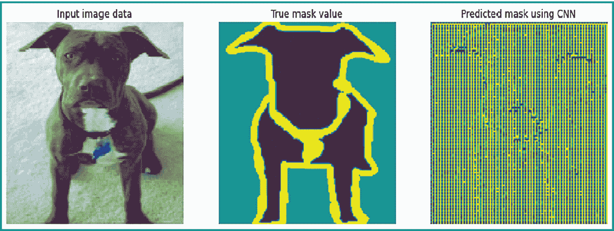

图 6.19 一次迭代后使用 CNN 的预测掩码。

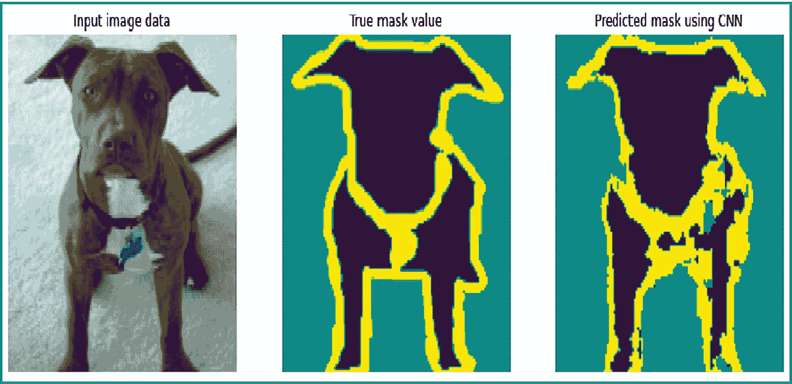

图 6.20 3000 次迭代后使用 CNN 的预测掩码。

## 6.7 使用 CNN 进行目标识别

目标识别是图像分析的一个领域，其目标是找到图像中的物体。人类可以轻松识别图像中的不同物体，但要让机器的准确率达到接受水平需要大量的努力。

### 6.7.1 导入库

在这里，我们使用 python、NumPy、matplotlib 和 TensorFlow 库进行计算、可视化和网络建模。

```python
from IPython import display
from matplotlib import pyplot as plt
import numpy as np
import os
import pandas as pd
from skimage.transform import resize
import tarfile
import sys
sys.path.append("..")
import tensorflow as tf
from tensorflow import keras
from tensorflow.keras import activations, layers, losses, optimizers, regularizers
```

### 6.7.2 加载数据并生成数据集

这里从一个链接加载数据集，然后设置数据数据的大小。

```python
lfw_url = "http://vis-www.cs.umass.edu/lfw/lfw-deepfunneled.tgz"
```

### 6.7.3 构建模型

在此步中，我们通过添加层来创建模型。有两个函数：生成器（generator）和判别器（discriminator）。

#### 6.7.3.1 生成器函数

现在，我们创建生成器：

```python
CODE_SIZE = 256
def generator():
 model = keras.Sequential()
 model.add(layers.Input(shape=(CODE_SIZE,)))
 model.add(layers.Dense(1152))
 model.add(layers.ReLU())
 model.add(layers.Reshape((6, 6, 32)))
 model.add(layers.Conv2DTranspose(64, (3, 3), strides=2, padding='same', activation='relu'))
 model.add(layers.Conv2DTranspose(128, (3, 3), strides=2, padding='same', activation='relu'))
 model.add(layers.Conv2DTranspose(32, (3, 3), strides=2, padding='same', activation='relu'))
 model.add(layers.Conv2DTranspose(3, (3, 3), strides=1, padding='same', activation='sigmoid'))
 return model
```

#### 6.7.3.2 判别器函数

现在，我们创建判别器：

```python
def discriminator():
 model = keras.Sequential()
 model.add(layers.Input(shape=IMAGE_SHAPE))
 model.add(layers.Conv2D(32, (3, 3), strides=2, padding='same', activation='relu'))
 model.add(layers.MaxPool2D())
 model.add(layers.Conv2D(64, (3, 3), strides=2, padding='same', activation='relu'))
 model.add(layers.MaxPool2D())
 model.add(layers.Conv2D(128, (3, 3), strides=2, padding='same', activation='relu'))
 model.add(layers.Flatten())
 model.add(layers.Dense(256, activation='tanh'))
 model.add(layers.Dense(1, activation='sigmoid'))
 return model
```

最后，你可以调用生成器并检查其摘要。

```python
keras.backend.clear_session()
gen = generator()
gen.summary()
print("Inputs :", gen.inputs)
print("Outputs:", gen.outputs)
assert gen.output_shape[1:] == IMAGE_SHAPE, "generator must output an image of %s, but instead it produces %s"%(IMAGE_SHAPE,gen.output_shape[1:])
```


```
Model: "sequential_1"
______________________________________________________
Layer (type)	Output Shape	Param #
======================================================
conv2d (Conv2D)	(None, 34, 34, 32)	896
______________________________________________________
conv2d_1 (Conv2D)	(None, 30, 30, 32)	25632
______________________________________________________
conv2d_2 (Conv2D)	(None, 28, 28, 64)	18496
______________________________________________________
max_pooling2d (MaxPooling2D)	(None, 14, 14, 64)	0
______________________________________________________
conv2d_3 (Conv2D)	(None, 12, 12, 64)	36928
______________________________________________________
conv2d_4 (Conv2D)	(None, 8, 8, 128)	20498
______________________________________________________
conv2d_5 (Conv2D)	(None, 6, 6, 128)	14754
______________________________________________________
flatten (Flatten)	(None, 4608)	0
______________________________________________________
dense_1 (Dense)	(None, 256)	117904
______________________________________________________
dense_2 (Dense)	(None, 1)	257
======================================================
Total params: 1,614,625
Trainable params: 1,614,625
Non-trainable params: 0
```

### 6.7.4 训练模型

我们可以在这一步中训练模型。

```
epoch = tf.Variable(0)
ckpt = tf.train.Checkpoint(epoch=epoch, disc=disc, gen=gen, disc_opt=disc_opt, gen_opt=gen_opt)
manager = tf.train.CheckpointManager(ckpt, directory="./checkpoints", max_to_keep=10)
status = ckpt.restore(manager.latest_checkpoint)
```

### 6.7.5 生成图像

我们可以在这一步中生成图像。图 6.21 显示了网络生成的图像。训练轮数（epochs）越多，结果越好。

```
for _ in range(30000):
  codes = sample_codes(100)
  images = sample_images(100)
  for n in range(5):
    disc_opt.minimize(lambda: disc_loss(images, codes), disc.trainable_weights)
    gen_opt.minimize(lambda: gen_loss(codes), gen.trainable_weights)
  if epoch.numpy() % 100 == 0:
    display.clear_output(wait=True)
    print("Epoch:", epoch.numpy())
    plot_images(2, 3)
    plot_probas(1000)
    manager.save()
    epoch.assign_add(1)
```


# 第 7 章 用于虚拟助手机器人的深度神经网络 (DNNs)

DOI: [10.1201/978100302518-7](https://doi.org/10.1201/978100302518-7)

## 7.1 虚拟助手机器人

本章介绍了一个包含四种不同深度学习应用的项目。该项目的目标是实现一个虚拟助手机器人，帮助医疗环境中的专家。医疗行业的助手机器人提供一系列基本服务，包括为用户（包括临床医生、患者和访客）递送物品（例如食物、药品）、执行精确或危险的手术、提醒护士处理医疗紧急情况、消毒工具和病房。通过消毒病房和房内的所有工具，它们降低了污染或感染疾病的风险。此外，部署这些机器人可以使医疗任务对患者来说更加准确、安全，并降低整体成本。本章讨论并介绍了问题细节、步骤以及一些代码部分。该项目包含四个模块：

1. 人脸检测与识别，
2. 使用语音进行情感识别，
3. 语音转文本，以及
4. 情感分析。

图 7.1 显示了项目的总体架构。虚拟机器人通过摄像头和麦克风获取音频和视觉数据，并与用户交互。


图 7.1 项目架构。

## 7.2 人脸检测与识别

### 7.2.1 架构

在图像中检测并识别人脸有多种研究方法。人脸识别的想法是寻找编码图像向量之间的相似性（将每幅图像转换为一个数值向量（编码））。这意味着，如果你传入同一个人的两张图像，输出向量应该非常相似；如果你传入两个不同人的图像，输出向量应该是不同的。有多种用于人脸识别的深度学习模型，如 `DeepFace`、`VGGFace` 和 `Face Net`（图 7.2）。此外，你可以找到实现人脸识别的五个主要步骤：

1. **步骤 1**：人脸检测，
2. **步骤 2**：关键点检测，
3. **步骤 3**：编码人脸，
4. **步骤 4**：损失函数，以及
5. **步骤 5**：人脸匹配。


图 7.2 使用深度学习的人脸识别步骤。

### 7.2.2 人脸检测

在第一步中，通过 `Viola-Jones` 在文中检测人脸。人脸检测算法之一 `Haar`。本节介绍了使用 CNN 进行人脸检测的步骤和代码（图 7.3）。

（注：原文中缺少图像引用）

#### 7.2.2.1 导入库

导入一些库以便计算和绘图。主要库是 `TensorFlow`、`matplotlib` 和 `NumPy`，它们有助于创建网络、绘图和计算。

```python
import TensorFlow as ft
import matplotlib.pyplot as plt
import NumPy as np
tf.enable_eager_execution()
import functools
```

#### 7.2.2.2 数据集

在这一步中，选择一个数据库（有很多数据库）来创建训练、验证和测试数据。然后，可以使用 `Keras` 库来导入并创建数据。

```python
import keras
training_data = tf.utils.get_file(...)
```

#### 7.2.2.3 定义 CNN 模型和训练

使用 `Keras` 定义 CNN 模型并确定：

* 参数，
* 超参数，如 dropout 值或激活（转换）函数，
* 每个层的特征，如卷积大小和步长大小。

以下是使用 `TensorFlow` 和 `Keras` 定义 CNN 模型的代码：

```python
def classifier():
    Conv2D = functools.partial(tf.keras.layers.Conv2D, padding='same', activation='relu')
    BatchNormalization = tf.keras.layers.BatchNormalization
    Flatten = tf.keras.layers.Flatten
    Dense = functools.partial(tf.keras.layers.Dense, activation='relu')
    model = tf.keras.Sequential([
        Conv2D(filters=1*n_filters, kernel_size=[5,5], strides=[1,1]), BatchNormalization(),
        Conv2D(filters=2*n_filters, kernel_size=[5,5], strides=[1,1]), BatchNormalization(),
        Conv2D(filters=4*n_filters, kernel_size=[3,3], strides=[1,1]), BatchNormalization(),
        Conv2D(filters=6*n_filters, kernel_size=[3,3], strides=[1,1]), BatchNormalization(),
        Flatten(), Dense(1, activation=None), tf.keras.layers.Dropout(0.5)
    ])
    return model
```


```
batch_size = 24
num:epochs = 100
learning_rate = 1e-2
# optimizer definition
optimizer = tf.train.AdamOptimizer (learning_rate = learning_rate)
# the loss definition
loss_history = util.LossHistory (smoothing_factor = 0.99)
# the training loop!
for epoch in range (num:epochs):
  custom:msg = util.custom:progress_text ("Epoch: %(epoch).0f Loss: %(loss)2.2f")
  bar = util.create_progress_bar (custom:msg)
  for idx in bar (range (loader.get_train_size ()//batch_size)):
# convert the images to tensors
  x, y = loader.get_batch (batch_size)
  x = tf.convert_to_tensor (x, dtype=tf.float32)
  y = tf.convert_to_tensor (x, dtype=tf.float32)
  with tf.GradientTape () as tape:
  logits = standard_classifier (x)
 # compute the loss
  loss_value = tf.nn.sigmoid_cross_entropy_with_logits(labels = y, logits = logits)
  custom:msg.update_mapping(epoch = epoch, loss = loss_value.numpy().mean())
# backpropagation
  grads = tape.gradient(loss_value, standard_classifier.variables)
  optimizer.apply_gradients (zip(grads,standard_classifier.variables) global_step = tf.train.get_or_create_global_step())
  loss_history.append(loss_value.numpy().mean())
  return loss_history.get()
```

### 7.2.2.5 评估性能

使用验证数据来评估模型的性能。

```
# 在数据集的一个子集上评估
(batch_x, batch_y) = loader.get_batch(5000)
y_pred_standard = tf.round(tf.nn.sigmoid(standard_classifier.predict(batch_x)))
acc_standard = tf.reduce_mean(tf.cast(tf.equal(batch_y, y_pred_standard), tf.float32))
```

### 7.2.3 关键点检测

在这一步中，算法会寻找人脸关键点/姿态。它需要这些点来进行人脸对齐（在这里，我们已经收集了数据并检测到了人脸）(图 7.4）。


图 7.4 关键点检测

#### 7.2.3.1 CNN 模型

有不同的 CNN 方法来寻找关键点。VGG-16 是最早的 CNN 方法之一，在这里我们使用它的架构来寻找关键点。

```
model = Sequential()
model.add (Conv2D(filters =16, kernel_size = 3, activation = 'relu', input_shape = (28, 28, 1)))
model.add (MaxPooling2D(pool_size = 2))
model.add (Conv2D(filters = 32, kernel_size = 3, activation = 'relu'))
model.add (MaxPooling2D(pool_size = 2))
model.add (Conv2D(filters = 64, kernel_size = 3, activation = 'relu'))
model.add (MaxPooling2D(pool_size = 2))
model.add (Conv2D(filters = 128, kernel_size = 3, activation = 'relu'))
model.add (MaxPooling2D(pool_size = 2))
model.add (Conv2D(filters = 256, kernel_size = 3, activation = 'relu'))
model.add (MaxPooling2D(pool_size = 2))
model.add (Flatten())
model.add (Dense(512, activation = 'relu'))
model.add (Dropout(0.2))
model.add (Dense(30))
model.summary()
```

输出是网络的模型摘要，显示了层和参数。

```
Layer (type)  Output Shape Param #
======================================================
conv2d_70 (Conv2D) (None, 94, 94, 16) 160
______________________________________________________
max_pooling2d_62 (MaxPooling) (None, 47, 47, 16) 0
______________________________________________________
conv2d_71 (Conv2D) (None, 45, 45, 32) 4640
______________________________________________________
max_pooling2d_63 (MaxPooling) (None, 22, 22, 32) 0
______________________________________________________
conv2d_72 (Conv2D) (None, 20, 20, 64) 18496
______________________________________________________
max_pooling2d_64 (MaxPooling) (None, 10, 10, 64) 0
______________________________________________________
conv2d_73 (Conv2D) (None, 8, 8, 128) 73856
______________________________________________________
max_pooling2d_65 (MaxPooling) (None, 4, 4, 128) 0
______________________________________________________
conv2d_74 (Conv2D) (None, 2, 2, 256) 295168
______________________________________________________
max_pooling2d_66 (MaxPooling) (None, 1, 1, 256) 0
______________________________________________________
flatten_5 (Flatten) (None, 256) 0
______________________________________________________
dense_10 (Dense) (None, 512) 131584
______________________________________________________
dropout_5 (Dropout) (None, 512) 0
______________________________________________________
dense_11 (Dense) (None, 30) 15390
======================================================
Total params: 539, 294
Trainable params: 539, 294
Non-trainable params: 0
```

#### 7.2.3.2 模型训练

现在编译并训练模型：

```
epochs = 10
batch_size = 32
filepath = 'model_'
```

#### 7.2.3.3 测试性能

在对测试图像进行特征提取后，算法使用某些阈值比较和度量学习来进行人脸匹配。这些技术将训练数据库中的编码向量与测试数据库人脸的编码向量进行比较，以识别身份。准确率可以使用不同的指标来计算（我们之前讨论过（图 7.8））。


让我们看看如何使用音频（语音）数据部署深度学习来进行情感识别。此步的输出将传递到下一个步骤进行情感分析。当你对数据进行一些预处理并创建一个初始训练模型时，这会有帮助。在导入必要的库后，创建架构五个主要步骤：

1. 数据收集
2. 数据预处理
3. 模型训练
4. 模型评估
5. 评估训练好的模型。

### 7.3.1 数据收集

有几个经过验证的数据集，如 RAVDESS（视听数据集）。然而，如果你计划运行特定的项目，最好收集自己的数据集。根据你计划分类的输出和特征（你的数据应该包含这些特征），你可以决定数据收集的类型。例如，对于图像，有一些如 3D 数据或室内和室数据的标准（此步提取数据值）。例如，在 RAVDESS 数据集（图 7.9
count = 0
for i in dir_list1:
 file_list = os.listdir('path' + i)
 for f in file_list:
  nm = f.split('.')[0].split('-')
  path = ‘path’ + i + '/' + f
  if int(actor)%2 == 0:
   gender = "female"
  else:
   gender = "male"
  src = int(nm[1])
  emotion = int(nm[2])
  if nm[3] == '01':
   intensity = 0
  else:
   intensity = 1
  if nm[4] == '01':
   statement = 0
  else:
   statement = 1
  if nm[5] == '01':
   repeat = 0
  else:
   repeat = 1
  if nm[6]:
   actor = int(nm[6])
  data_df.loc[count] = [path, src, actor, gender, intensity, statement, repeat, emotion]
  count += 1
```

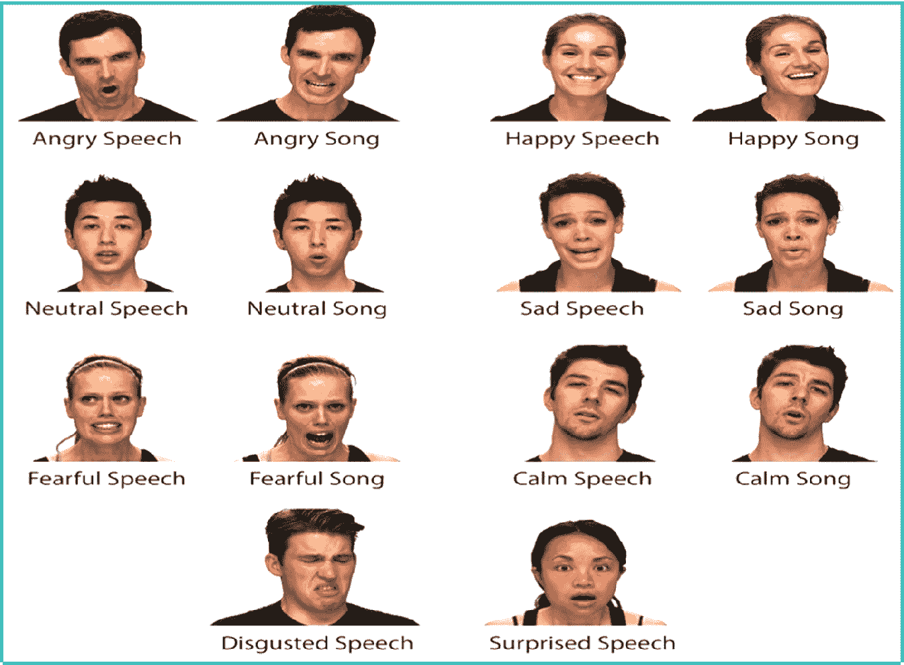

### 7.3.2 数据预处理

在这一步中，对数据进行一些预处理以为训练做好准备。这可能包括数据清洗、特征提取、标注和数据增强。

#### 7.3.2.1 标注

如果数据来自数据库，它们通常是有标注的，如果你计划收集自己的数据，你应该对它们进行标注。标注取决于问题的类型以及你想分类的特征。例如，在这个项目中，标签如下：:

```python
label_list = []
for i in range(len(data_df)):
 if data_df.emotion[i] == 1:
  lb = "_neutral"
 elif data_df.emotion[i] == 2:
  lb = "_calm"
 elif data_df.emotion[i] == 3:
  lb = "_happy"
 elif data_df.emotion[i] == 4:
  lb = "_sad"
 elif data_df.emotion[i] == 5:
  lb = "_angry"
 elif data_df.emotion[i] == 6:
  lb = "_fearful"
 elif data_df.emotion[i] == 7:
  lb = "_disgust"
 elif data_df.emotion[i] == 8:
  lb = "_surprised"
 else:
  lb = "_none"
 label_list.append(data_df.gender[i] + lb)
```

### 7.3.3 特征提取

为了训练，提取一些区分声音差异的音频特征。音频中的原始数据在时域中，通过如 `FFT` 等函数，你可以将其转换到频域。音频信号具有一些特征，如频率（频域）、梅尔频率倒谱 (`MFC`）或梅尔频率倒谱系数 (`MFCCs`）（声音的纹理），你可以提取它们并将其作为训练的特征向量。像 `librosa` 这样的标准库可以帮助你进行一些分析，例如加载数据和查找采样率：

```python
data = pd.DataFrame(columns=['feature'])
for i in tqdm(range(len(data_df))):
 X, sample_rate = librosa.load(data_df.path[i], res_type='kaiser_fast', duration=input_duration, sr=22050, offset=0.5)
 sample_rate = np.array(sample_rate)
 mfccs = np.mean(librosa.feature.mfcc(y=X, sr=sample_rate, n_mfcc=13), axis=0)
 feature = mfccs
 data.loc[i] = [feature]
```

#### 7.3.3.1 数据增强

在深度学习中，你需要大量的数据来训练模型（数据总是会有局限性）。你可以使用数据增强技术来生成新数据并增加数据库的大小。对于音频信号，你可以进行一些任务，如添加噪声、使用 `NumPy` 进行偏移以及使用 `Librosa` 改变速度。

```python
def noise(data):
  noise_amp = 0.005*np.random.normal(size=data.shape[0])
  data = data.astype('float64') + noise_amp
  return data

def shift(data):
  s_range = int(np.random.uniform(low=-5, high=5)*500)
  return np.roll(data, s_range)

def speedN(data):
  length_change = np.random.uniform(low=0.8, high=1)
  speed_fac = 1.0 / length_change
  tmp = np.interp(np.arange(0,len(data)),speed_fac,np.arange(0,len(data))),data
  minlen = min(data.shape[0], tmp.shape[0])
  data[0:minlen] = tmp[0:minlen]
  return data
```

### 7.3.4 模型训练

这一步中，你可以定义模型和优化器用于 `CNN` 模型。现在可以使用部分数据集（原始数据集的 70% 到 80%）来训练模型：

```python
model = Sequential()
model.add(Conv1D(256, 5, padding='same',input_shape=(X_train.shape[1],1)))
model.add(Activation('relu'))
model.add(Conv1D(256, 5, padding='same'))
model.add(BatchNormalization())
model.add(Activation('relu'))
model.add(Dropout(0.25))
model.add(MaxPooling1D(pool_size=(8)))
model.add(Conv1D(128, 5, padding='same'))
model.add(Activation('relu'))
model.add(Conv1D(128, 5, padding='same'))
model.add(Activation('relu'))
model.add(Conv1D(128, 5, padding='same'))
model.add(BatchNormalization())
model.add(Activation('relu'))
model.add(Dropout(0.25))
model.add(MaxPooling1D(pool_size=(8)))
model.add(Conv1D(64, 5, padding='same'))
model.add(Activation('relu'))
model.add(Conv1D(64, 5, padding='same'))
model.add(Activation('relu'))
model.add(Flatten())
model.add(Dense(14))
model.add(Activation('softmax'))
opt = keras.optimizers.SGD(lr=0.0001, momentum=0.0, decay=0.0, nesterov=False)
```

这里是模型摘要：


```
Layer (type)    Output Shape             Param #
======================================================
conv1d_8 (Conv1D) (None, 259, 256) 1536
______________________________________________________
activation_9 (Activation) (None, 259, 256) 0
______________________________________________________
conv1d_9 (Conv1D) (None, 259, 256) 327936
______________________________________________________
batch_normalization_2 (Batch) (None, 259, 256) 1024
______________________________________________________
activation_10 (Activation) (None, 259, 256) 0
______________________________________________________
dropout_2 (Dropout) (None, 259, 256) 0
______________________________________________________
max_pooling1d_2 (MaxPooling1) (None, 32, 256 0
______________________________________________________
conv1d_10 (Conv1D) (None, 32, 128) 163968
______________________________________________________
activation_11 (Activation) (None, 32, 128) 0
______________________________________________________
conv1d_11 (Conv1D) (None, 32, 128) 82048
______________________________________________________
activation_12 (Activation) (None, 32, 128) 0
______________________________________________________
conv1d_12 (Conv1D) (None, 32, 128) 82048
______________________________________________________
activation_13 (Activation) (None, 32, 128) 0
______________________________________________________
conv1d_13 (Conv1D) (None, 32, 128) 82048
______________________________________________________
batch_normalization_3 (Batch) (None, 32, 128) 512
______________________________________________________
activation_14 (Activation) (None, 32, 128) 0
______________________________________________________
dropout_3 (Dropout) (None, 32, 128) 0
______________________________________________________
max_pooling1d_3 (MaxPooling1) (None, 4, 128) 0
______________________________________________________
conv1d_14 (Conv1D) (None, 4, 64) 41024
______________________________________________________
activation_15 (Activation) (None, 4, 64) 0
______________________________________________________
conv1d_15 (Conv1D) (None, 4, 64) 20544
______________________________________________________
activation_16 (Activation) (None, 4, 64) 0
______________________________________________________
flatten_1 (Flatten) (None, 256) 0
______________________________________________________
dense_1 (Dense) (None, 14) 3598
______________________________________________________
activation_17 (Activation) (None, 14) 0
======================================================
Total params: 806, 286
Trainable params: 805, 518
Non-trainable params: 768
```

该模型应使用训练数据进行训练：

```
model.compile(loss = 'mean_squared_error', optimizer = 'sgd', metrics = [metrics.categorical_accuracy])
lr_reduce = ReduceLROnPlateau(monitor = 'val_loss', factor = 0.9, patience = 20, min_lr = 0.01)
mcp_save = ModelCheckpoint('C:/model/Model.h5', save_best_only = True, monitor = 'val_loss', mode = 'min')
cnnhistory= model.fit(x_traincnn, y_train, batch_size = 16, epochs = 50,validation_data = (x_testcnn, y_test), callbacks = [mcp_save, lr_reduce])
```

### 7.3.5 模型评估

现在，你可以使用验证集和测试数据集来验证和评估你的模型。你可以更改之前步骤（1-3）中的不同参数和超参数，以达到所需的准确率、优化模型并移动到下一步。

```
data_test = pd.DataFrame(columns=['feature'])
for i in tqdm(range(len(data_df))):
 X, sample_rate = librosa.load(data_df.path[i], res_type = 'kaiser_fast',duration = input_duration,sr = 22050*2,offset = 0.5)
 sample_rate = np.array(sample_rate)
 mfccs = np.mean(librosa.feature.mfcc(y = X, sr = sample_rate, n_mfcc = 13), axis = 0)
feature = mfccs
 data_test.loc[i] = [feature]
test_valid = pd.DataFrame(data_test['feature'].values.tolist())
test_valid = np.array(test_valid)
test_valid_lb = np.array(data_df)
lb = LabelEncoder()
test_valid_lb = np_utils.to_categorical(test_valid)
test_valid = np.expand_dims(test_valid, axis=2)
```

### 7.3.6 测试模型

获取准确率后，你可以为新数据保存你的模型。

## 7.4 语音转文本

你可以使用验证集和测试数据集验证你的模型。你可以更改之前步骤（1-3）中的不同参数和超参数，以达到所需的准确率、优化模型并移动到下一步。

有几个步骤：

1. `步骤 1`：特征提取，
2. `步骤 2`：构建模型，
3. `步骤 3`：解码。


### 7.4.1 特征提取

你可以使用验证集和测试数据集验证你的模型。你可以更改之前步骤（1-3）中的不同参数和超参数，以达到所需的准确率、优化模型并移动到下一步。

RNN 的输出是包含所有输入的概率向量。可以使用之前步骤中的 `librosa` 等库来提取特征。这里的特征是 `频谱图` 和 `梅尔频率谱系数 (MFCCs)`。输出是一个 `二维张量`，其中第一维度是`时间`，第二维度是`频率`。

### 7.4.2 深度神经网络建模

如果你了解网络的基本设计，就可以为你的项目创建自己的模型。它是序列化的，如果我们有 `n` 个时间槽，说话者每次都会发字母中的一个。共有 28 个字符，包括 26 个字母、一个空格字符 (" ") 和一个单引号 (`'`)。图 7.10 展示了输出层的详细描述。

### 7.4.3 解码

在这一步中，编码数据需要转换为第一步中编码的原始格式。以下是使用 `Keras` 构建 RNN 的示例代码。

```
from keras import backend as K
from keras.models import Model
from keras.layers import (BatchNormalization, Conv1D, Dense, Input, TimeDistributed, Activation, Bidirectional, SimpleRNN, GRU, LSTM)
def rnn_model(input_dim, output_dim = 26):
# 主音频输入
input_data = Input(name='the_input', shape = (None, input_dim))
# 添加递归层
simp_rnn = GRU(output_dim, return_sequences = True, implementation = 2, name = 'rnn')(input_data)
# 添加 softmax 激活层
y_pred = Activation('softmax', name = 'softmax')(simp_rnn)
# 指定模型
 model = Model(inputs = input_data, outputs = y_pred)
 model.output_length = lambda x: x
 print(model.summary())
 return model
```

### 7.4.4 预测计算

你可以写一个函数来解码你的音频模型的预测结果。

## 7.5 情感分析


情感分析有许多应用。例如，假设一家公司创建了一个产品，他们想了解用户反馈以改进他们的产品。方法之一是通过 Twitter 和 Facebook 等社交媒体评论来检查客户反馈。例如，如果有成千上万关于客户反馈的文字，进行情感分析有助于获得关于产品正面或负面的总体意见。为了进行情感分析，你应该了解文本处理。文本是另一种类型的数据（在这里是输出）。在这一步中，我们使用这些文本数据（在上一步提取的）来进行一些情感分析，以决定或生成报告。你需要了解两个定义：a) 词袋（bag of the word）：它是词的序列；b) 词嵌入（word embedding）：它是将词向量的过程。如果你有一个词袋，使用像 `MLP` 等方法对于这个目的并不好。你可以使用深度神经网络将词的序列转换为向量（编码），然后将向量转换为所需格式的序列（解码）。将每个词转换为向量后，对于一组词，有一个矩阵（矩阵的每一行都是表示一个词的向量）。现在算法寻找词出现的概率以及该词周围的词。然后通过使用 `SoftMax`，它将每个词的值和概率转换为一个概率。相同语境中的词具有相似的向量。例如，与 kitchen 和 history 相比，kitchen 和 oven 是相似的。

DAN 有两个主要部分：

- `encoder`（编码器）：根据编码类型将输入序列转换为向量，以及
- `decoder`（解码器）：编码器将向量传递给解码器，由它将向量转换为所需的输出。

实现此目的有多种方法，其中一种是深度平均网络（DAN）。该网络对句子中的所有词进行词嵌入，平均这些向量（编码），然后将它们放入网络中。网络的输出是一个标量（解码），决定句子的值是正面还是负面。在 DAN 中，我们首先得到词序列，然后将这些词转换为向量，找到这些向量的平均值，并将该向量传递给网络，使用随机梯度下降 (`SGD`）等方法进行训练。然而，DAN 在输出上有一个问题，它没有考虑顺序。例如，当句子为：The fire destroyed the houses，输出可能是：The houses destroyed fire，这两者的概念是不同的。为了这个目的，我们可以使用神经网络。

使用 DAN 进行情感分析的步骤如下：

1. 加载数据集，
2. 创建 DAN 网络，
3. 训练网络，以及
4. 评估模型。

### 7.5.1 加载数据集

这一步中，加载数据集，将数据放入训练和测试类别中，并将它们标记为正面和负面。为词嵌入过程创建一个词字典。你需要一个函数将词转换为向量。评论的训练和测试可以存储为数据框（data frame），词汇存储为具有键（词）和值（索引）的字典。词汇用于寻找词袋特征。

例如，对于负面评论和正面评论：

```
my_vocab = {'Deep': 0, 'learning': 1, 'in': 2, 'practice': 3}
my_sentence = ' I love to learn deep learning in practice and do my machine learning project.'
```

你可以创建一个函数来提取特征，例如词在句子中的出现次数。

```
my_featurs = generate_featur(my_vocab)
```
这里的输出应该是：
```
array (1, 2, 1, 1)
```

这意味着句子中有**一个** deep、**两个** learning、**一个** in 和**一个** practice。

### 7.5.2 创建一个 DAN 网络

定义两个函数：

1. `average` 函数接收张量作为输入，每个张量是评论的词袋表示，其输出是平均评论的张量。
2. `forward` 函数接收作为评论词袋表示的张量并调用 `average` 函数找到平均评论，将其发送到层以寻找模型。

### 7.5.3 训练网络

在此阶段，你可以通过训练数据调用 DAN 网络来找到训练好的网络。

### 7.5.4 评估模型

现在，你可以使用测试数据评估你训练的模型。

# 第 8 章 寻找最佳模型

DOI: [10.1201/9781003025818-8](https://doi.org/10.1201/9781003025818-8)

## 8.1 数据预处理

本章的目标是学习如何找到误差最小的最佳模型。在第一步中，让我们回顾一下项目中需要的数据类别。总而言之，我们可以将原始数据分为三类：

1. 训练数据，
2. 验证数据，以及
3. 测试数据。

我们已经讨论了这三类，并且你知道它们的定义。这里的关键点是每个类别的比例，例如有 70%的训练、15%的验证和 15%的测试。如果在测试数据上测试的模型达到了理想的准确率，我们就可以在新的现实数据中使用它。这些比例不是固定的，你可以更改并检查结果以找到最佳比例。图 8.1

## 8.2 什么是好模型？

评估模型的第一步是计算准确率或找出误差。当误差很高（准确率很低）时，意味着模型运行不正常且没有覆盖目标。有多种方法和标准寻找准确率（找出误差）。检查模型有两种类型的误差：验证误差和测试误差。为了判断一个模型是否良好，你可以从验证误差入手。它取决于你拥有的数据，并检查这些数据评估模型有多有效。在开始，最好使用验证误差来检查模型，以找到测试的最佳模型。如果验证误差很高或不满足你的需求，那么该模型还不够好。为了解决这个问题，你应该在第一步中对验证误差进行分解：

```
Validation Error = Noise + Bias + Variance
```


$$\begin{matrix} {\\mathbb{E}\\left\\lbrack \\left( {h\\_{D}\\left( X \\right) - y} \\right)^{2} \\right\\rbrack\\mspace{9mu} = \\mspace{9mu}\\mathbb{E}\\left\\lbrack \\left( {h\\_{D}\\left( X \\right) - \\overline{h}\\left( X \\right)} \\right)^{2} \\right\\rbrack + \\mathbb{E}\\left\\lbrack \\left( {\\overline{h}\\left( X \\right) - \\overline{y}\\left( X \\right)} \\right)^{2} \\right\\rbrack} \\ {+ \\mspace{9mu}\\mathbb{E}\\left\\lbrack \\left( {\\overline{y}\\left( X \\right) - y\\left( X \\right)} \\right)^{2} \\right\\rbrack} \\ \\end{matrix}$$ 

## 8.3 什么是噪声？

大量的无意义信息使得数据不可靠。这是是因为数据损坏以及用户无法感知或解释的数据。这些信息会影响训练过程，并导致训练出的模型和结果不准确。

问题是：我们如何找到原因，解决方案又是什么？当噪声非常高或达到不可接受的值时，它的重要性有多大（请记住，通常问题中的噪声大致是常数）。在第一步中，让我们计算噪声。

为了计算噪声，请看以下内容：

`Note=𝔼[(y^−X)−y(X))²]=1/n*(∑[i =0 : m]) (y−x[i])−y(x[i]))²)`

其中：

`y−X = 1 * p(y=1|X) + 2 * p(y=2|X)`

为了更好地理解，假设有一个数据库 `D={(x[1],y[1]),...,(x[n],y[n])}`，其分布为 `P(X,Y)`。这里每一对 `(x[i], y[i])`（对于 `i=1…n`）都是每个样本的特征向量，其中 `x[1]…x[n]` 是样本数据，`y[i]` 是标签。

例如，如果样本是苹果，那么 `x[1]` 就是第一个样本，`y[1]` 是显示该样本是或否苹果的值。`x[1]` 是特征向量，在这里例如是价格、形状和颜色（所以这里的 `x` 维度是 `3`）。`y¯(x)` 是期望标签，`y(x)` 是标签，而 `x ={x[1],…x[n]}`。有时噪声存在于数据中，在这种情况下，你可以在使用数据训练之前对数据进行一些预处理（如去噪）。但如果你在完成所有预处理后发现噪声值仍然很高，你就应该寻找其他原因来减少或消除噪声。

导致高噪声的两个主要原因是：

* 错误的标注和
* 错误的特征提取。

针对这两个原因，有两个解决方案：

* 重新标注数据和
* 更改特征并进行特征提取。

记住，这里的定义是针对单个数据样本的，而不是关于数据的本质。图 8.3 显示了完全损坏图像的图像数据噪声。

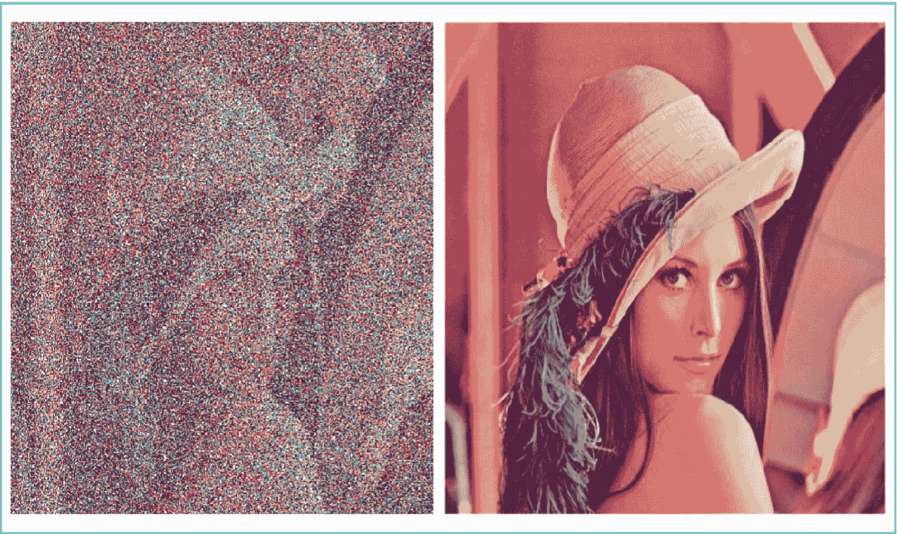

图 8.3 数据上的噪声可以改变结果（这里，噪声是数据的本质，可以通过对数据进行一些预处理来消除）。

### 8.3.1 标注

当噪声很高时，可能是标注不正确，你需要重新标注。让我们通过一个例子来详细说明。如果你把橙子数据标注为苹果，你就有了错误的标注数据，这会导致训练出现问题，就像噪声一样导致模型不准确。要解决这个问题，请采取以下步骤：

* 检查标签
* 找到错误的标注数据
* 重新标注数据
* 计算噪声以检查噪声值的变化

如果你在最后一步之后发现噪声发生了变化并减少，那么标注就是主因；否则，我们应该寻找其他消除噪声的原因。图 8.4 显示了错误的标注如何产生噪声并增加误差值。


图 8.4 错误的标注数据可以使噪声值很高（这是我们讨论的内容）。

### 8.3.2 特征

导致高噪声的另一个原因是错误的特征提取。当噪声很高时，可能是特征不正确，你需要更改特征。让我们通过一个例子来详细说明。如果你选择了错误的特征，你就有了错误的特征提取，会导致训练出现问题。要解决这个问题，请采取以下步骤：

* 检查特征
* 找到错误的特征提取
* 重新提取特征
* 计算噪声以检查噪声值的变化

如果你在最后一步之后发现噪声发生了变化并减少，那么特征提取就是主因；否则，我们应该寻找其他消除噪声的原因。

## 8.4 什么是偏差？

偏差是误差的另一个。当我们讨论偏差时，意味着模型没有准确地表示底层数据。这可能是因为模型太简单或特征错误。

## 8.5 什么是方差？

方差指的是模型预测随不同训练集变化的程度。高方差表明模型过拟合了训练数据中的特定噪声。


方差 `(σ2)` 是误差的另一部分。方差是衡量数据中样本每个值离整个数据集平均值远程度的方法。通常情况下，在计算时，首先从每个样本值中减去平均值，然后将平方和除以整个数据中样本值的个数。在这里，我们将方差视为误差的一部分，如果方差很高，则意味着很大一部分误差是由此引起的，然后尝试寻找方法来它（图 8.8）。有一些减少方差的方法，例如装袋法（bagging）或选择良好的数据集。`y¯(𝐱)` 是期望标签，`y(cX)` 是标签，`𝐱={x[1],…,o[n]}` 和 `m` 是分类器的数量，`D[i]` 是数据集，而 `h[Di]` 是 `Di` 的训练分类器。详细查看公式：

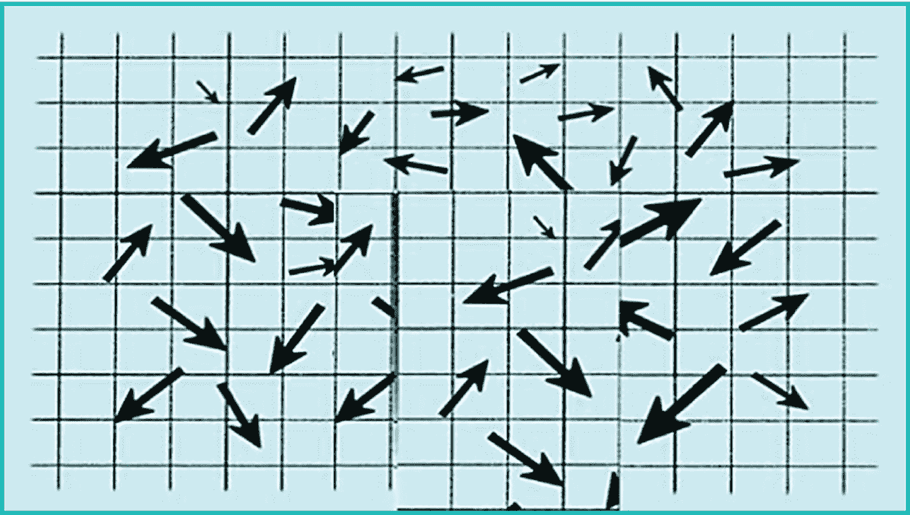

图 8.8 高方差改变了准确率。

`Variance` = `𝔼(h[D−h^−(X))²]`

$$\\mathbb{E}\_{D}\leftlbrack \left( {h\_{D}\left( X \right) - h^{-}\left( X \right)} \right)^{2} \rightrbrack \approx 1/m\left( {\\sum\limits\_{i = 1:m}\left( {h\_{Dj}\left( X_{i} \right) - h^{-}\left( X_{i} \right)} \right)^{2}} \right)$$

其中：

$$h^{-}\left( X \right) \approx 1/m\left( {\\sum\limits\_{i = 1:m}h\_{Di}\left( X \right)} \right)$$

`y^−(X)` = 1 * `p(y=1|X)` + 2 * `p(y=2|X)`

### 8.5.1 新数据集

你可以更改数据集并找到不同的数据集，或者对数据进行更多预处理，如数据增强和其他处理。然后计算方差，检查新数据如何改变方差，并检查这种变化如何使训练后的模型更好（图 8.9）。

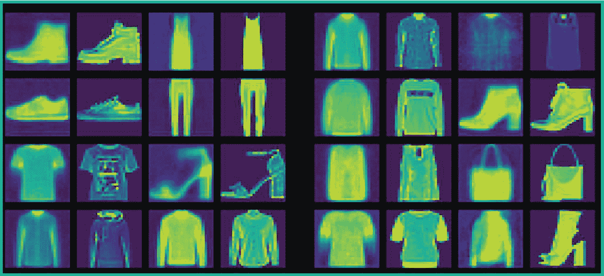

图 8.9 不同的数据集或进行数据增强等数据预处理可以改变方差。

### 8.6 偏差/方差

现在让我们看看偏差与方差之间的关系，以及它们的值如何接近目标。总之，偏差与方差的权衡有四种主要状态（`L: 低, B: 偏差, V: Variance, H: 高`）。

1. LB/LV
2. HB/LV
3. LB/HV
4. HB/HV

图 8.10 显示了这四种状态。问题是，噪声值是多少，它与这两个参数之间是什么关系？噪声是数据的一部分，正如第一步提到的，你可以对数据进行一些预处理以消除或减少噪声，然后检查特征或标签等其他原因，查看它们是否被正确选择并采取正确的行动。正如在图 8.10 所示所示，最佳状态是 LB/LV（低偏差和低方差），此时值非常接近目标。

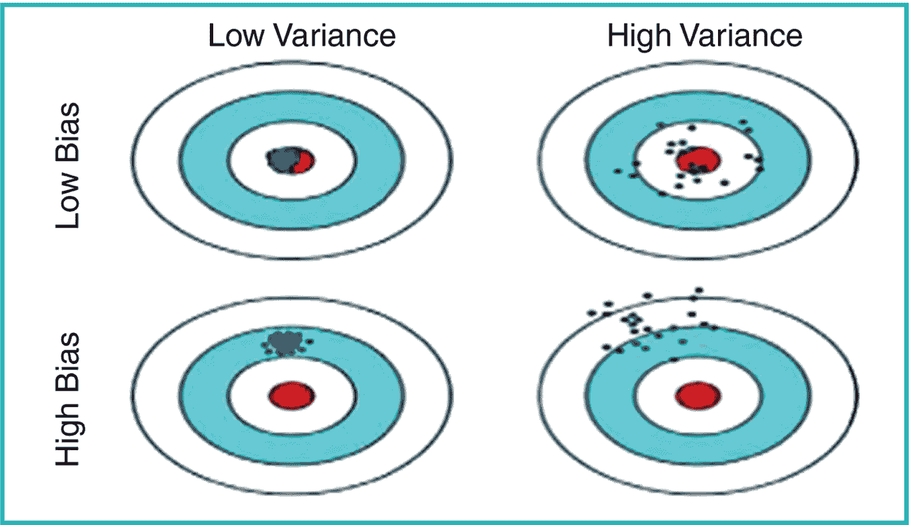

图 8.10 偏差/方差的变化。

另一个问题是我们如何找到偏差和方差的最佳值？图 8.11 展示了偏差与方差之间的权衡以及它们与模型复杂性的关系。

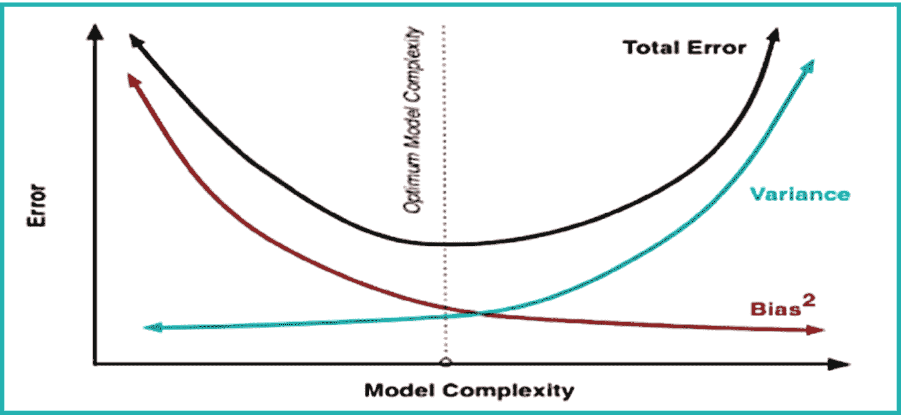

图 8.11 偏差/方差权衡。

这对应于最小总值，总值等于偏差和方差之和。虚线显示了最优模型复杂性的点。图 8.11 中的点是总误差的最佳值。因此，你可以在模型中找到偏差和方差值，然后找到总误差开始增加的点。

根据之前的讨论，在找到偏差和方差值以及这两个值之间的关系后，如果方差或偏差很高，你应该根据数值采取适当的行动。

图 8.12

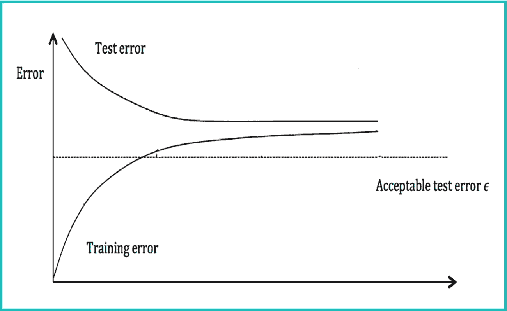

图 8.12

### 8.7.1 高方差

当数据分散时会发生高方差。当方差很高时，意味着很大一部分误差是由此引起的，然后尝试寻找方法减少它。有一些减少方差的方法，例如装袋法（bagging）或选择良好的数据集。

### 8.7.2 高偏差

当偏差很高时，模型太简单，无法捕捉潜在模式。你可以通过增加模型复杂性或添加更多特征来解决这个问题。


12. Deng, J., Dong, W., Socher, R., Li, L.-J., Li, K., and Fei-Fei, L., (2009). *ImageNet: 大规模分层图像数据库*, 2009 IEEE 计算机视觉与模式识别会议 (CVPR09), 第 248–255 页。

13. Donahue, J., 等， (2015). *用于视觉识别与描述的长短期卷积神经网络*, CVPR.

14. Dong, S., McKenna, S., and Psarrou, A., (2000). *动态视觉：从图像到人脸识别*, 帝国学院出版社。

15. Erhan, D., Bengio, Y., Courville, A., and Vincent, P., (2009). *深度网络高层特征可视化*, 蒙特利尔大学，第 1341 。

16. Fei-Fei, L., Fergus, R., and Perona, P., (2006). 物类别的单样本学习, *IEEE 模式分析与机器智能汇报*, 28(4), 第 594–611 页。

17. Ghayoumi, M., (2015). *多模态生物识别系统融合方法及其应用综述*, 第 14 届国际计算机与信息科学会议。

18. Ghayoumi, M., (2017). 面部表情深度学习的快速回顾, *通信与计算机杂志*. doi:`10.17265/1548-7709/2017.01.004`

19. Ghayoumi, M., and Bansal, A. K., (2017). *基于面部关键点二面群的情绪分析*, 计算机科学与工程国际杂志 (IJASCSE)。

20. Ghayoumi, M., 等，(2006a). *使用自适应学习率的自组织网络进行彩色图像分割*, 波兰国际信息技术杂志，第 72–80 页。

21. Ghayoumi, M., 等，(2006b). *基于模糊方法的立体视觉中图像相关误差减少及其在笛卡尔机器人上的应用*, 第 19 届澳大利亚人工智能联合会议 (AI2006)。

22. Ghayoumi, M., 等，(2016a). 驱动情绪的多模态整合形式化方法, *视觉语言与感知系统杂志*, 第 48–54 页。

23. Ghayoumi, M., 等，(2016b). 具有优化手势识别系统的跟随者机器人, *机器人：科学与系统*.

24. Ghayoumi, M., 等，(2016c). 使用卷积神经网络的机器人情绪架构, *机器人：科学与系统*.

25. Ghayoumi, M., 等，(2016d). *使用卷积神经网络的机器人情绪*, 第八届社会机器人国际会议。

26. Ghayoumi, M., 等，(2016e). 用于机器人情绪的多模态卷积神经网络模型, FTC.

27. Ghayoumi, M., 等，(2017). 利用深度学习结合对其他模态的部分整合进行面部表情分析以检测情绪。博士论文。

28. Ghayoumi, M., 等，(2018a). *用于物体识别的局部敏感哈希 (LSH) 和 CNN*, ICMLA.

29. Ghayoumi, M., 等，(2018b). 社交机器人情绪的认知架构, HRI.

30. Ghayoumi, M., 等，(2019). 用于社交机器人学习与交互的模糊知识库架构, *Ai-HRI.*

31. Goodfellow, I., Bengio, Y., and Courville, A., (2016). *深度学习*, 麻理工学院出版社。

32. Goodfellow, I., and Fridman, L., (2019). *生成对抗网络*, 人工智能播客。

33. Goodfellow, I. J., (2014). *关于生成模型估计的可区分性标准*, 国际表示学习会议，工作坊轨道。

34. Graves, A., (2014). 使用循环神经网络生成序列, arXiv:1308.0850v5.

35. Graves, A., and Jaitly, N., (2014). 向循环神经网络的端到端语音识别, ICML.

36. Hinton, G. E., (2007). *在大脑中进行反向传播*, NIPS’2007 深度学习工作坊邀请演讲。

37. Hochreiter, S., and Schmidhuber, J., (1997). 长短期记忆网络, *神经计算*, 9(8)。

38. Hoon Ahn, B., (2020). Chameleon: 用于加速深度网络编译的自适应代码优化, ICLR.

39. Hornik, K., Stinchcombe, M., and White, H., (1989). 多层前馈网络是通用近似器, *神经网络*, 2.

40. Huszar, F., (2015). 如何（不）训练你的生成模型：调度、似然性, arXiv:1511.05101.

41. Ioffe, S., and Szegedy, C., (2015). 批量归一化：通过减少协方差漂移加速深度训练, ICML.

42. Jarrett, K., Kavukoglu, K., Ranzato, M., and LeCun, Y., (2009). 用于物体识别的最佳多阶段架构是什么?, ICCV.

43. Jastrzebski, S., (2020). 深度神经网络优化轨迹上的收支点, 国际学习算法会议 (ICLR)。

44. Kaiming, H., 等，(2016). 深度残差学习, 2016 IEEE 计算机视觉与模式识别会议 (CVPR).

45. Karpathy, A., and Fei-Fei, L., (2015). 用于描述的深度语义对齐, arXiv:1412.2306.

46. Karpathy, A., Johnson, J., and Fei-Fei, L., (2015). 视觉的可视化与理解。

47. LeCun, Y., (1989). 卷积神经网络, 蒙特利尔大学`http://www.cs.utoronto.ca/cifar10`

48. Krizhevsky, A., (2010). CIFAR-10, 技术报告, 蒙特利尔大学。

49. Krizhevsky, A., Sutskever, I., and Hinton, E., (2012). 使用卷积网络进行 ImageNet 分类, NIPS

50. LeCun, Y., (1989). 泛化与网络设计, CRG-89。

51. LeCun, Y., Bengio, Y., and Hinton, G., (2015). 深度学习, 自然, 出版集团。

52. LeCun, Y., Kavukoglu, K., and Farabet, C., (2010). 卷积网络及其应用, IEEE 国际电路与系统会议 (ISCAS), 第 253–256 页。

53. Leung, K. S., Jin, H., and Xu, Z., (2004). 基于信息动态路由的视觉注意力神经生物模型, *神经计算学*.

54. Maclaurin, D., Duvenaud, D., and Adams, R., (2015). 基于梯度的超参数优化, arXiv:1502.03492.

55. Martín, A., Paul B., Jianmin C., Zhifeng C., 等，(2016). TensorFlow: 用于大规模机器学习的系统, 第 12 次 USENIX 操作系统设计与实现。

56. Merity, S., (2019). 单头注意力 RNN：停止思考, `https://arxiv.org/pdf/1911.1423.pdf`

57. Mingxing, T., and Le, Q. V., (2019). EfficientNet: 重新考虑卷积神经网络的模型扩展, `https://arxiv.org/pdf/1905.11946.pdf`

58. Mitchell, T. M., (1997). *机器学习*, 麦格罗, 纽约。

59. Mnih, V., 等，(2015). 通过深度强化学习实现人类级控制, *自然*, 518。

60. Mordvintsev, A., Olah, C., and Tyka, M., (2015). 深度想象：深入探索神经网络, Google 研究博客。

61. Murphy, K. P., (2012). *机器学习：概率视角*, 麻理工学院出版社。

62. Nakkiran, P., (2019). 深度双重下降：为什么更大的模型和更多的数据反而有害, `https://arxiv.org/pdf/1912.02292.pdf`

63. Nesterov, Y., (2004). *凸优化入门讲座：基础课程*, 应用优化, Kluwer 学术出版社。

64. Olshausen, B. A., Anderson, C. H., and Van Essen, D. C., (1993). 一基于信息动态路由的视觉注意和不变模式识别神经生物模型, *神经科学杂志*, 13(11)。


65. Pascanu, R., Mikolov, T., and Bengio, Y., (2013). *训练循环神经网络的困难性*，ICML’2013.
66. Quiroga, R. Q., Reddy, L., Kreiman, G., Koch, C., and Fried, I., (2005). 人类脑中单个神经元的不不变视觉表示，*Nature*, 435(7045).
67. Radford, A., Jozefowicz, R., and Sutskever, I., (2017). 学习生成评论并发现情感，arXiv 预印 arXiv:1704.01444.
68. Rockafellar, R. T., (1997). *凸分析*, 普斯顿数学里程碑。
69. Russel, S. J., and Norvig, P., (2003). *人工智能：一种现代方法*, Prentice-Hall。
70. Schmidhuber, J., (2015). 神经网络中的深度学习，[`arxiv.org/pdf/1404.7828.pdf`](https://arxiv.org)。
71. Simonyan, K., Vedaldi, A., and Zisserman, A., (2013). 卷积网络内部：可视化图像分类模型和显著性图，arXiv 预印 arXiv:1312.6034.
72. Simonyan, K., and Zisserman, A., (2015). *用于大规模图像识别的极深卷积网络*，ICLR。
73. Srivastava, N., (2013). 使用 Dropout 改进神经网络，硕士论文，多伦多大学。
74. Sutskever, I., Martens, J., and Hinton, G., (2011). *使用循环神经网络生成文本*，第 28 届国际机器学习会议论文。
75. Sutskever, I., Vinyals, O., and Le, Q. V., (2014). 基于神经网络的序列序列学习，arXiv.org > cs > arXiv:1409.3215.
76. Szegedy, C., Liu, W., Jia, Y., Sermanet, P., Reed, S., Anguelov, D., Erhan, D., Vanhoucke, V., Rabinovich, A., 等，(2015). 卷积的加深，doi:[10.1109/cvpr.2015.7298594](http://dx.doi.org/10.1109/cvpr.2015.7298594)。
77. Taigman, Y. 等，(2014). *DeepFace：缩小人脸验证中与人类水平性能的差距*，CVPR。
78. Toshev, A., and Szegedy, C., (2014). DeepPose：通过深度神经网络进行人体姿态估计，CVPR。
79. Uria, B., Murray, I., and Larochelle, H., (2014). *一种深度且易的估计器*，ICML’2014.
80. Volodymyr, M., Koray, K., David, S., Joel, V., 等，(2015). *通过强化学习实现人类级控制*，Macmillan。
81. Weston, J., Chopra, S., and Bordes, A., (2014). 记忆网络，arXiv 预印 arXiv:1410.3916.
82. Xu, K., Ba, J., Kiros, R., Courville, A., Salakhutdin, R., Zemel, S., and Bengie, Y., (2015). *显示、关注并描述：神经字幕生成*，ICML’2015，arXiv:1502.03044。
83. Yan, H., (2020). *神经微分方程的鲁棒性*，ICLR。
84. Ye, Ch., (2020). *网络卷积*，ICLR。
85. Yosinski, J., Clune, J., Bengio, Y., and Lipson, H., (2014). *深度网络中特征的可迁移性如何*，NIPS’2014。
86. Zeiler, M., and Fergus, R., (2013). *可视化与理解卷积网络*，欧洲计算机视觉会议，页 818–833。[`arxiv.org/pdf/1311.2901`](https://arxiv.org)。

## 网站

- [`colah.github.io/`](https://colah.github.io/)
- [`cs231n.github.io/neural-networks-3/`](https://cs231n.github.io/neural-networks-3/)
- [`github.com/meln-ds/Facial-Image-Generation`](https://github.com/meln-ds/Facial-Image-Generation)
- [`keras.io/api/utils/`](https://keras.io/api/utils/)
- [`probml.github.io/pml-book`](https://probml.github.io/pml-book)
- [`towardsdatascience.com/comparative-performance-of-deep-learning-algorithms-using-numpy-24ce255e2`](https://towardsdatascience.com/comparative-performance-of-deep-learning-algorithms-using-numpy-24ce255e2)
- [`web.stanford.edu/~hastie/ElemStat`](https://web.stanford.edu/~hastie/ElemStat)
- [`www.bdhammel.com/learning-rates/`](https://www.bdhammel.com/learning-rates/)
- [`www.cs.cornell.edu/courses/cs4780/2018fa`](https://www.cs.cornell.edu/courses/cs4780/2018fa)
- [`www.cs.cornell.edu/courses/cs4780/2018fa/lectures/`](https://www.cs.cornell.edu/courses/cs4780/2018fa/lectures/)
- [`www.python.org/`](https://www.python.org/)
- [`www.tensorflow.org/guide/`](https://www.tensorflow.org/guide/)
- [`www.w3schools.com/python/`](https://www.w3schools.com/python/)

## 索引

### A

- 准确率指标 (accuracy metrics), 54–55
- 激活函数 (activation function), 51
    - ReLU (ReLu), 59
    - Sigmoid (sigmoid), 58
    - Tanh (tanh), 59
- Adagrad, 64
- Adam, 64
- 架构 (architecture)
    - 人工神经网络 (ANNs), 2–75
    - 深度神经网络 (DNNs), 77–107
- 数组 (array), 18
- 数据 (data)
    - 数据增强 (augmentation), 79
    - 导入 (importing), 35–36
    - 加载 (loading), 125, 127, 130, 133, 147
    - 加载/归一化 (loading/normalizing), 36
    - 预处理 (preprocessing), 99–100, 175–176
- 数据集 (dataset), 39, 55, 94, 98, 127, 133, 147, 156, 162, 172, 183
    - 生成 (generating), 125, 127, 130, 133, 147
- 决策树 (decision tree), 1
- 深度学习 (DL), 1–2, 77–80
    - 算法 (algorithms), 82–87
    - 应用 (applications), 80–82
    - 部署 (deployment), 78
    - 框架 (frameworks), 30
    - 图像分析 (image analysis), 109
- 深度神经网络 (DNNs), 77–80
    - 卷积神经网络 (CNNs), 84–93

### B

- 反向传播 (backpropagation), 72
- 批归一化 (batch normalization), 89
- 偏置 (bias), 180–182
- 偏置/方差 (bias/variance), 184–185
- 生物神经元 (biological neuron), 57

### C

- 类别 (categories), 125
- 比较运算符 (comparison operators), 7
- 混淆矩阵 (confusion matrix), 53–54
- 凸 (convex), 63
- 卷积层 (convolutional layer), 115–116
- 卷积神经网络 (CNNs), 84–93
    - 架构 (architecture), 118–124
    - 构建 (building), 39–42
    - 设计 (designing), 90–93
    - 通用策略 (general strategies), 125–126
    - 图像分析 (image analysis), 110–124
    - 图像分类 (image classification), 130–133
    - 层 (layers), 87–90
    - 目标识别 (object recognition), 126–130, 146–151
- 卷积层 (convolution layer), 87
- 交叉熵损失 (cross-entropy loss), 61


- 深度学习应用，80–82
- 深度学习架构，82–87
- 生成对抗网络 (GANs), 96–107
- 图像分析，109
- 循环神经网络 (RNNs), 93–95
- 虚拟助手机器人，153–173
- 密集层，40–41
- 字典，11–12
- 判别器函数，148–150
- 丢弃法 (dropout),80, 88–89

## E

- 嵌入 (embedding),79
- 情感识别，162–169
    - 数据预处理，164
    - 数据集搜集，162–164
    - 特征提取，165–168
    - 模型评估，168–169
    - 模型测试，169
- 端到端学习，80
- 环境，激活，42
- 错误，51
- 评估，176–177

## F

- 人脸检测/识别，154–161
    - 架构，154
    - 人脸检测，155–158
    - 人脸编码，161
    - 陆标点检测，158–160
    - 欺骗检测，160
    - 测试，161
    - 训练，161
- 假阴性 (FN),54
- 假阳性 (FP),54
- 特征提取，165, 170
- 前馈神经网络 (FFNNs),68–72
    - 过滤器参数
        - 数量/类型，113–114
        - 尺寸，114
        - 步长/填充，114–115
- 寻找问题，185–187
- 微调，79
- 全连接层 (FC),90, 117–118
- 函数
    - 激活，58–60
    - 线性/非线性，65–67
    - 损失，61–62
    - 优化，62–65

## G

- 一般化，79
- 生成对抗网络 (GANs),85–86
    - 定义，96–97
    - 时尚类数据集，97–98
- 生成器函数，147–148
- 梯度下降 (GD),63–64

## I

- 图像分析
    - 与 CNN，110–124
    - 深度学习，109
    - 图像分类，130–133
    - 目标识别，126–130, 146–151
    - 分割，133–145
- imagenet 大规模识别挑战 (ILSRC),118
- 图像生成，151
- 导入库，44–46, 70, 73, 94, 125, 127, 130, 133, 146, 155
- Inception-v3 (2015),121
- Inception-v4 (2016),124
- 输入层，39–40, 115
- 输入，51

## K

- Keras
    - 实现示例，46–49
    - 导入库/模块，44–45
    - 模块，44
    - 设置/安装，42–46

## L

- L1/L2，79–80
- 学习
    - 深度学习，2
    - 定义，1–4
    - 机器学习，1
    - 速率，62–63
- LeNet-5 (1998),118–119
- 列表，11
- 长短期记忆 (LSTM),85
- 循环，9–10

## M

- 机器学习，1
- MNIST (数据集),47–49
- 模型
    - 构建，36–37
    - 制作，126–130, 128, 131, 135, 147
    - 测试，41, 49, 71, 75, 126, 129, 133, 144, 159
    - 训练/评估，37, 41
    - 训练/预测，45–46
- 模型选择
    - 偏差，180–182
    - 偏差/方差，184–185
    - 数据预处理，175–176
    - 评估，176–177
    - 寻找问题，185–187
    - 噪声，177–180
    - 方差，182–184
- 多层感知器 (MLP),73–75

## N

- 噪声，177–180
- 非线性函数，67
- numpy,18–28
    - 数组，18–27
    - 数据类型，21
    - 决定式，28
    - 点积，28
    - hstack/vstack，27
    - 数学函数，28
    - ndarray，18–19

## O

- 对象编程 (OOP),18
- One 热编码，55–56
- 运算符，6–7
- 输出，51
- 过拟合，52

## P

- 参数
    - 过滤器，113–115
    - 数量，114
- 池化层，88, 116
- 运算符，6–7
- python
    - 数据类型，5
    - 字典，11–12
    - 文件，17
    - for 循环，9
    - 函数，17
    - 关键字，6
    - 列表，11
    - numpy，18–28
    - 对象，18
    - 运算符，6–7
    - 序列，8–9
    - 语句/表达式，7–8
    - 字符串，10–11
    - 元组，13–16
    - 变量，5–6
    - while 循环，10

## R

- 随机数
    - 生成，27
    - 模块，25–26
- 倒流线性单元 (ReLu),59–60
- 循环神经网络 (RNNs),84–85
    - 架构，93
    - 设计，94–96
    - 长短期记忆 (LSTM),93–94
- 正则化，79
- 残差神经网络学习 (ResNets),86
- ResNet (2015),122–123
- 罗森布特，Frank，72

## S

- 分割，133–145
    - map 134
- 自，18
- 情感分析，171–173
- 序列，8–9
- 单层感知器，72–73
- 语音转文本，169–171
- 随机梯度下降 (SGD),64
- 字符串，10–11


* 支持向量机 (SVM), 1, 56

## T

* 目标 (targets), 51
* TensorFlow, 29
    * , 31–34
    * 使用其构建 CNN, 39–42
    * 使用其构建神经网络, 35–38
    * FFN 示例, 70–72
    * MLP 示例, 73–75
    * 使用, 34–35
* 测试数据, 52
* 训练数据, 52
* 真阴性 (TN), 54
* 真阳性 (TP), 54
* 元组 (tuple), 13–16

## U

* 欠拟合, 52

## V

* 验证数据, 52
* 梯度消失, 78
* 方差, 182–184
* VGGNet-16 (2014), 121
* 虚拟助手机器人, 153–154
    * 情感识别, 162–169
    * 人脸检测/识别, 154–161
    * 情感分析, 171–173
    * 语音转文字, 169–171
* 创建虚拟环境, 42

## W

* 权重, 51

