# 深度学习面试

# 序言

> > *我们将建造一架会飞的机器。*
>
> — 约瑟夫·迈克尔·蒙戈尔菲耶，法国发明家/航空先驱（1740-1810）

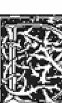

深度学习面试具有技术性，内容密集，且由于该领域的竞争性质，往往风险极高。准备面试的前景令人望而生畏，对失败的恐惧可能使人瘫痪，许多面试者发现自己的想法随着信心的流失而消散。

本书是为像您这样的人编写的：一位具有定量背景的有志数据科学家，面对着一个日益激烈的领域中面试过程的考验。对于大多数人来说，面试过程是您与梦想工作之间最重大的一道障碍。尽管您具备在目标职位上卓越表现的能力、背景和动力，但您可能需要一些指导，以便迈出求职的第一步。

尽管本书具有高度的技术性，但其密度适中，便于快速研读。它力求全面，涵盖了现代数据科学和深度学习中的许多术语和主题。这种彻底性使其独树一帜；没有其他单一作品能如此有针对性地提供如此广博的知识以满足面试的要求。

大多数可比的信息以各种格式、地点、结构和资源存在——散布在互联网上的博客文章、技术文章和短小书籍。这些资源仅无法满足深度学习面试或备考的要求，且并非以这一明确目的为宗旨进行汇编。希望本书不会存在同样的不足。

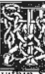

本书的创作遵循了几个关键原则：清晰与深度、彻底与精确、趣味与准确。本卷旨在供机器学习与深度学习领域的求职者使用，他们的能力与背景牢牢扎根于 STEM（科学、技术、工程和数学）领域。本书对其他读者（如仍在接受 STEM 领域初期教育的人）也仍有价值。

然而，它最直接地针对**积极求职者以及攻读人工智能硕士/博士学位的学生**的需求进行定制。无论如何，这是一本面向工程师、数学家和计算机科学家的书：书中任何地方都不包含那些让毫无定量和数学流程先验知识的人也能阅读的基础背景材料。

本书的内容是大量与深度学习职位面试和研究生水平考试相关主题的丰富库存。如果某些想法在特定语境下没有价值，即使它们有趣或相关，也会被排除在外。这使本作品走在教育和商业领域日益重视核心实用数学和计算技能这一趋势的前列。现在人们普遍认为，每位计算机科学家的培训都必须包含一门严谨地处理机器学习根本定理的课程；深度学习出现在几乎每所大学的课程中；而本卷被设计为这些课程和计划毕业生的便利的持续参考书。

本书植根于学术专长和工作经验，因此具有两个目标。首先，它将所有必要的信息压缩成一个连贯的包。其次，它使这些信息易于获取并便于导航。因此，本书帮助读者彻底理解实用数据科学背后的原则和概念。我读过的教科书没有一本能满足所有这些需求，这些需求是：

1. **适当的呈现水平**。我希望有一本友好的入门教材，让没有丰富应用经验的研究生（科学家）也能轻松阅读。
2. **一本严谨的教材**，能够建立对主题的扎实理解，而不会陷入过多的技术细节。
3. **主题之间的逻辑和符号一致性**。微积分、逻辑回归、熵和深度学习理论之间存在内在联系，我认为如果读者要理解这个领域，就需要强调和阐明这些联系。不同来源中符号和呈现风格的差异使学生很难欣赏这些类型的联系。
4. **可管理的大小**。拥有一本足够紧凑的教材非常有用，这样其所有材料都可以在几周或几个月的 intensive review 中被覆盖。候选人只有那么多时间来准备面试，因此一本无法在有限时间内覆盖其内容的教材对他们来说没有用处。


接下来的文本试图应对上述所有挑战。它难免在处理某些挑战时比其他方面更成功，但它至少做出了真诚而专注的努力。

## 关于参考文献的说明

本书提供了一份精心整理的参考文献列表，以指导进一步的学习，无论是为了面试准备，还是纯粹出于兴趣或与工作相关的研究。一份全面的参考文献列表将过长，不适合在此处包含，且对即时使用价值不大，因此在选择每篇收录文献时，都刻意关注了其价值。

每个主题仅收录了最重要的书籍和文章，且仅限于我亲自查阅过的英文作品。每篇文献都附有简短注释，以表明其范围和适用性。你会发现许多被引用的作品包含了关于所处理特定主题的非常详尽的参考文献列表，如果你希望更深入地探索某个特定主题、方法或过程，我建议你去查阅那里。

我们为本书设有一个网页，其中列出了勘误表、示例以及任何其他附加信息。你可以通过访问以下网址获取该页面：[http://www.interviews.ai](http://www.interviews.ai)。如需对本书发表评论或提出技术问题，请发送邮件至：[entropy@interviews.ai](mailto:entropy@interviews.ai)。

**我也希望向学生及其他读者征求更正、批评和建议。尽管在多年编写和修订本文的过程中，我试图消除错误，但无疑仍有一些残留。特别是，一些排版上的小瑕疵无疑会溜进最终版本。希望你能原谅它们。**

**作者**。

以色列特拉维夫，2020年12月。首次印刷，2020年12月。

# 致谢

出版社的感谢和致敬归于以下人士：我亲爱的儿子阿米尔·伊夫里（Amir Ivry）、马修·伊萨克·哈维（Matthew Isaac Harvey）、桑迪·诺伊默（Sandy Noymer）、史蒂夫·富特（Steve Foot）以及维利米尔·盖耶夫斯基（Velimir Gayevskiy）。

# 作者简介


**当什洛莫（Shlomo）**用 LaTeX 输入他的书籍时，他希望它能反映出他的一些热情：人工智能、设计、排版，尤其是编程。在典型的一天中，他的两个半面——科学家和艺术家的他——会花数小时精心设计人工智能系统，从癫痫预测和肺结节检测，到在集群上训练计算机视觉模型。

什洛莫整天都在充满 GPU 的实验室里工作，从事他许多有趣的研究项目。尽管研究满足了他对发现的渴望，但他声称自己最重要的科学贡献是帮助其他研究人员。

这种结果在他的出版物中显而易见。但是，尽管理论研究很重要，实践经验也有许多优点。作为 DeepOncology 的人工智能主管，他开发了深度学习在精准肿瘤检测中的应用，扩展并精进了人类专家的能力。这项依赖 CNN 的工作标志着一项职业生涯的顶峰，这项职业生涯致力于将 AI 技术应用于医疗 AI 中的问题。什洛莫拥有伦敦大学数字信号处理硕士学位（一等荣誉）。

**个人注：** 在这一卷中，我特意呈现了一个连贯的、累积的、内容特定的数据科学领域的**核心课程**，包括信息论、贝叶斯统计、算法微分、逻辑回归、感知机以及卷积神经网络等主题。

我希望你会觉得这本书很有启发性。我相信，**作为主要受众的研究生和求职者**你将从阅读中受益；然而，我也希望即使是最有经验的研究人员也会觉得它引人入胜。

什洛莫·卡沙尼（SHLOMO KASHANI），以色列特拉维夫。

# 关于主编


阿米尔·伊夫里（Amir Ivry）是一位人工智能科学家，因其基于语音的应用的先驱工作而备受认可。他正在攻读直接攻读的博士学位（电气工程，以色列理工学院，以色列）。27 岁的他已获得包括 prestigious 的雅各布斯卓越研究人员奖（19、20 届）在内的十几项奖项和成就。在九年的学术和工业生涯中，阿米尔有幸对人工智能做出了重大贡献。他设定了远大的目标，担任高级技术讲师，并为初创企业和大型企业提供战略咨询服务，同时还是 IEEE 论文的多产作者。

# 第一部分

## 铁锤与钉子

## 第一章
### 如何使用本书

> *这个世界的真实逻辑在于概率微积分。*
> —— 詹姆斯·克拉克·麦克斯韦

# 目录

- *引言*
  - 为什么这本书如此有价值
  - 我将学到什么
    - 开启你的职业生涯
    - 晋升你的职业生涯
    - 深入深度学习
  - 如何解题
  - 问题类型

### 1.1 引言

首先，欢迎来到深度学习的面试世界。

#### 1.1.1 为什么这本书如此有价值

精准广告。破译死语言。检测恶性肿瘤。预测自然灾害。每年，我们都能看到数十种深度学习的新应用从企业研发部门、学术界以及充满激情的创业者那里涌现出来。越来越多的，深度学习和人工智能已经融入我们的文化意识中。顶尖大学正在设立相关专业来教授这些课程，它们每隔几天就会登上头条新闻。

这意味着工作机会。意味着高强度的需求和高度的竞争。意味着一代数据科学家和机器学习工程师进入劳动力市场，并使用深度学习来改变事物运作的方式。这本书是为他们，也是为你准备的。它面向当前或该领域的有志专家和学生，这些人身披坚实的数学基础，拥有活跃的想象力、积极参与的创造力以及对数据的鉴赏力。这本书精心定制，旨在通过引导你解决数百道完全解答的问题，为你在深度学习职位面试中提供最好的准备。

这就是这本卷对求职者和学生具有特定价值的原因：它赋予了他们在任何相关话题上自信且快速地发言的能力，清晰且正确地回答技术问题的能力，以及完全理解面试问题和答案的目的和含义的能力。

在走进面试室时，拥有这些强大且不可或缺的优势至关重要。

书中提出的问题和问题难度足以让你磨练技能——并显著改善你的能力，但它们被安排在发人深省的问题、引人入胜的故事和尖端的科学信息框架中。什么是玻色子和费米子？什么是绒毛膜绒毛？埃博拉病毒最初在哪里出现，它是如何传播的？为什么二元期权交易如此危险？

你的好奇心将引导你穿过本书的问题集、公式和说明，随着你的进步，你对深度学习的理解将会加深。微积分、逻辑回归、熵和深度学习理论之间存在复杂的联系；通读本书，这些联系将变得直觉化。

#### 1.1.2 我将学到什么

##### 开启你的职业生涯

你正在积极追求深度学习和数据科学的职业生涯，或者希望如此吗？如果是这样，你很幸运——从深度学习到人工智能，在现代劳动力市场上都处于极高需求状态。深度学习专业人员备受追捧，同时也是全球公司中薪资最高的员工群体之一。

因此，你的职业选择非常准确，获得一份扎实工作的财务和智力收益是巨大的。但这些职位有较高的准入门槛：深度学习面试。这些面试已经成为一个独立的微型行业，HR 员工必须精通相关主题，以便区分准备充分的求职者和仅对材料有松散工作知识的人。在面试之外，这种差异并不总是感觉很重要。深度学习库非常好用，机器学习管道通常可以由研究者本人投入少量高技能输入来组装。但那种水平的能力在面试中不够用。你将被问到实际问题、技术问题，并被期望自信且流利地回答所有这些问题。

对于未准备好的候选人来说，那是路的尽头。许多人在面试后反复被拒后放弃了。

##### 晋升你的职业生涯

你们中的一些人会更有信心。那些已有数年工作经验的人将动机强烈，数字能力卓越，并准备好在深度学习项目中承担积极、动手的角色。你很可能已经在应用数学、计算机科学、统计学和经济学方面拥有广泛的知识。这些都是令人敬畏的优势。

但与此同时，不太可能你为面试本身做了准备。深度学习面试——尤其是那些最有意思、自主性和挑战性的职位——要求你不仅知道如何工作，还要清晰、雄辩且毫不犹豫地展示你的知识。有些问题将直接且熟悉，但其他问题可能更遥远，或者涉及你自大学以来未接触过的领域。

没有理由将这种事情交给运气。确保你已准备好。确认你在术语、概念和算法方面是最新的。刷新你对基础知识及其如何影响当前研究实践的记忆。当面试来临时，走进房间时要知道你已准备好面对即将到来的挑战。

##### 深入深度学习

“深度学习职位面试”组织成章节，每章包含主题介绍、展示主题核心方面的示例问题以及完整的解决方案。你可以期望本卷中的每个问题都清晰、实用且与主题相关。问题分为两组：概念型和应用型。概念型问题旨在测试和提高你对基本底层概念的知识，而应用型问题则针对练习或应用你所学的内容（其中大多数与 Python 和 PyTorch 相关）。章节之后附有相关公式参考列表和精选书目，以指导进一步阅读。

##### 1.1.3 如何解题

在现实生活中，就像在考试中一样，你会遇到难度各异的问题。一项值得练习的好技能是识别问题所提出的难度级别。职位面试将有一些简单问题，一些标准问题，以及一些更难的问题。

本书每一章通常组织为三个部分：介绍、问题和解决方案。在尝试解决这些问题时，抵制过早偷看答案的诱惑；让自己在材料上挣扎一段时间至关重要。即使是专业数据科学家也不总是立即知道如何解决一个问题。艺术在于收集你的想法，并弄清楚一种策略，利用你已知的去发现你未知的。

**PRB-1** CH.PR B- 1.1.

*用灰色标出的问题构成了代表性问题集。*
这组问题旨在涵盖每个部分中最基本的思想。这些问题通常是面试中常见的典型问题，尽管其中一些非典型但带有重要的教训。如果你发现自己对某个


对于这些，练习类似的题目可能是一个好主意。这套具有代表性的题目集是我们建议的最少量题目，你可以在此基础上练习更多。

## SOL-1 CH.SOL-1.1. 这是一个解答。

如果你发现自己真的卡住了，不妨去推荐的理论书中寻找线索。思考片刻，也不要害怕回过头去翻阅笔记，寻找有助于你继续推进的关键思路。如果仍然无法解决问题，嗯，我们特意包含了“解答”部分也是有所用意的！在阅读解答时，请努力理解我们为何采取那些步骤，而不仅仅是去记忆解决某个特定问题的逐步方法。

如果你在某道题目上花费了大量精力，那么几天后再回过头来看它可能是个不错的主意。那可能已经足够让你内化必要的概念，你可能会发现它现在变得很容易攻克。如果仍然有困难，请再次阅读解答，重点理解每一步为何合理。很多求职者被要求在白板前展示解决数据科学问题的能力，原因之一就是招聘经理认为这反映了他们真正的问题解决技能。

在本卷中，你将学习许多概念，并被要求在各种情境中应用它们。通常，这需要通过将一个大问题分解为可管理的小块，解决这些小块，然后再将它们重新组合起来来回答一个真正的大问题。当你看到一道特别长的题目时，请保持冷静，并寻找将其分解为可处理部分的方法。

### 1.1.4 问题类型

本书中呈现两类主要问题。

- **概念题**：第一类旨在测试并加深你对基本底层概念的理解。这类题目通常涉及大量的数学计算。难度范围从对定义的非常基础性的复习，到需要你对该章节所涵盖概念进行深思的问题。

信息论中的一个示例如下。

**PRB-2 🕙 CH.PRB-1.2.**

*什么是最大熵分布，即在区间* $[a, b]$ *上所有分布中具有最大熵的分布，以及* $(-\infty, +\infty)$ *。*

**SOL-2 🖇️ CH.SOL-1.2.**

*均匀分布在有界区间* $[a, b]$ *的所有分布中熵最大，$(-\infty, +\infty)$。*
*$U(a, b)$ 的 *方差为* $\sigma^{2} = 1/12(b - a)^{2}$。
*因此熵为：*
$$ \frac{1}{2}\log 12 + \log \sigma. \tag{1.1} $$

- **应用题**：这类问题用于练习技能。理解一个理念背后的哲学基础是不够的：你还必须在适当的情况下能够应用它。这需要练习！主要在 Python 或可用的深度学习库（如 PyTorch）中。

PyTorch 中的一个示例如下。

**PRB-3 🕙 CH.PRB-1.3.**

*用自己的话描述，在训练卷积神经网络（CNN）的背景下，以下代码的目的是什么。*

```python
self.transforms = []
if rotate:
    self.transforms.append(RandomRotate())
if flip:
    self.transforms.append(RandomFlip())
```

**SOL-3 🖇️ CH.SOL-1.3.**

在卷积神经网络训练期间，数据增强以及一定程度的 dropout 被用作减少过拟合的核心方法。数据增强是一种正则化方案，它通过利用保留标签的变换来人工扩充数据集，从而为相同的数据样本添加更多的不变性示例。它通常在训练阶段在 CPU 上实时执行，而实际训练过程则发生在 GPU 上。这可能包括例如随机旋转、随机翻转、缩放、空间平移等。

# 第二部分

# 幼儿园级别

## 第二章

## 逻辑回归

> 你应该称之为“熵”，原因有二。首先，你的不确定性函数在统计力学中已被用于该名称。其次，也是更重要的一点，没有人真正知道熵是什么，因此在辩论中你总是具有优势。
> — 约翰·冯·诺依曼致克劳德·香农

# 目录

- 引言
- 问题
  - 通用概念
  - 赔率，对数赔率
  - Sigmoid 函数
  - 真正理解逻辑回归
  - Logit 函数和熵
  - Python/PyTorch/C++
- 解答
  - 通用概念
  - 赔率，对数赔率
  - Sigmoid 函数
  - 真正理解逻辑回归

### 2.1 引言


多变量方法被常规应用于各种领域的统计分析中。逻辑回归是建模二元响应数据和二元分类最常用方法。当响应变量是二元的时，它通常采取 1/0 的形式，其中 1 通常表示成功，0 表示失败。多变量方法通常假设两个或多个独立的预测变量与一个依变量的响应变量之间存在关系。响应变量的预测值可以表示为乘积之和，其中每个乘积由变量的值与其系数相乘形成。系数是如何计算的？来自相应的数据集。逻辑回归在监督机器学习中被广泛使用，已成为二元和多类分类问题的“主力”。本章引入的许多问题对于真正理解人工神经网络的内部运作机制至关重要。

### 2.2 问题

#### 2.2.1 通用概念

**PRB-4 CH.PRB-2.1.**
*判断对错：对于数据集中固定数量的观测值，引入更多变量通常会生成一个与数据拟合更好的模型。这种模型拟合策略可能有什么缺点？*

**PRB-5 CH.PRB-2.2.**

> 从定性和正式两方面定义术语 **“成功赔率”**。给出一个数值示例，强调事件发生的概率与赔率之间的关系。

**PRB-6 CH.PRB-2.3.**

1. 在逻辑回归预测变量的背景下，定义术语 **“交互作用”** 的含义。
2. 交互作用的最简单形式是什么？写出其公式。
3. 可以使用哪些统计检验来证明交互项的显著性？

**PRB-7 CH.PRB-2.4.**

> **判断对错：** 在机器学习中，无监督学习指的是将输入协变量映射到试图预测的目标响应变量，此时标签是已知的。

**PRB-8 CH.PRB-2.5.**

> **完成以下句子：** 在逻辑回归中，响应变量是被分类为 [....] 的赔率的对数。

**PRB-9 CH.PRB-2.6.**

描述在逻辑回归模型中，如何对响应变量进行变换以得出概率分布。为什么它被认为是响应变量更具信息量的表示？

**PRB-10 CH.PRB-2.7.**

> **完成以下句子：** 最小化负对数似然也意味着最大化选择 [....] 类的 [....]。

#### 2.2.2 赔率，对数赔率

**PRB-11 ? CH.PRB-2.8.**
*假设某事件发生的概率为* $p = 0.1$。

1. *该事件发生的赔率是多少？* .
2. *该事件发生的对数赔率是多少？* .
3. *构造一个等于 0.1 的事件发生概率的比率。* .

**PRB-12 ? CH.PRB-2.9.**
*判断对错：如果二元响应的成功赔率为 4，则对应的成功概率为 0.8。*

**PRB-13 ? CH.PRB-2.10.**
*绘制一个从赔率到概率的图表，将概率的整个范围映射到其各自的赔率* .

**PRB-14 ? CH.PRB-2.11.**
*逻辑回归模型是一类更广泛的机器学习模型——广义线性模型（GLM）的一个子集，这些模型还包括方差分析（ANOVA）、普通线性回归等。GLM 有三个组成部分；请指出二元逻辑回归的这三个组成部分。*

**PRB-15 ? CH.PRB-2.12.**
*让我们考虑 logit 变换，即对数赔率。假设一个场景，其中 logit 形成线性决策边界：*


### 2.2.3 Sigmoid 函数

Sigmoid 函数（图 2.1），也称为 Logistic 函数，广泛用于二分类问题以及人工神经网络中的神经元激活函数。

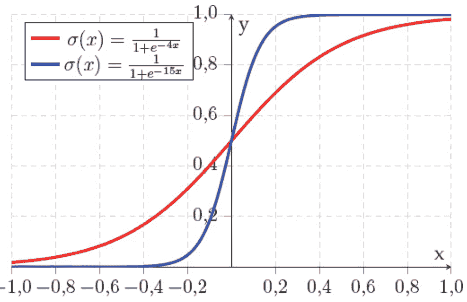

**图 2.1：** 两个 Sigmoid 函数的示例。

#### 练习题 16

**问题：** $\log \left(\frac{\Pr(Y = 1|X)}{\Pr(Y = 0|X)}\right) = \boldsymbol{\theta}_{0} + \boldsymbol{\theta}^{T} \boldsymbol{X}, \tag{2.1}$

*对于给定的系统分量向量 $X$ 和预测变量 $\theta$。请写出描述决策边界的超平面的数学表达式。*

**判断对错：** Logit 函数和自然 Logistic（Sigmoid）函数互为反函数。

#### 练习题 17

计算自然 Sigmoid 函数的导数：

$$\sigma(x) = \frac{1}{1 + e^{-x}} \in (0, 1). \tag{2.2}$$

#### 练习题 18

请记住，在逻辑回归中，对于某个参数向量 $\boldsymbol{\beta}$ 和测量向量 $\mathbf{x}$，假设函数定义为：

$$\begin{aligned}h_\boldsymbol{\beta}(\mathbf{x}) &= g(\boldsymbol{\beta}^T \mathbf{x}) = \frac{1}{1 + e^{-\boldsymbol{\beta}^T \mathbf{x}}}\\ &= P(\mathbf{y} = 1|\mathbf{x}; \boldsymbol{\beta}),\end{aligned} \tag{2.3}$$

其中 $y$ 表示假设值。

假设逻辑回归模型的自变量系数如下： $\beta_0 = -1.5, \beta_1 = 3, \beta_2 = -0.5$。此外，假设我们有一个观测值，其因变量值如下：$x_1 = 1, x_2 = 5$。结果，Logit 方程变为：

$$\text{logit} = \beta_0 + \beta_1 x_1 + \beta_2 x_2. \tag{2.4}$$

- 该观测值的 Logit 值是多少？
- 该观测值的赔率（odds）是多少？
- 该观测值的 $P(y = 1)$ 是多少？

#### 练习题 19

质子治疗（PT）[2] 是一种被广泛采用的治疗方法，适用于多种癌症，包括乳腺癌和肺癌（图 2.2）。

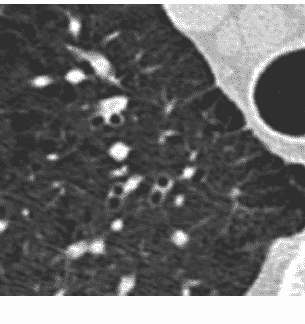

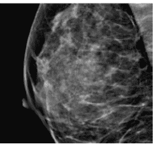

**图 2.2：** 肺结节（左）和乳腺癌（右）。

一台校准不当的 PT 设备被用于模拟癌症治疗。结果，PT 束流表现异常。一名数据科学家收集了与该模拟相关的数据。表 2.1 中列出的协变量是在实验过程中收集的。列“是”和“否”分别表示肿瘤是否被根除。

| | 肿瘤根除 | |
| :--- | :---: | :---: |
| 癌症类型 | 是 | 否 |
| 乳腺癌 | 560 | 260 |
| 肺癌 | 69 | 36 |

**表 2.1：** 肿瘤根除统计数据。

参考表 2.1：

- 解释变量是什么，响应变量是什么？
- 解释相对风险（relative risk）和优势比（odds ratio）在衡量关联性中的作用。
- 这两个变量是正相关还是负相关？
- 使用相对风险和优势比找出关联的方向和强度。
- 计算关联度量的 95% 置信区间（CI）。
- 解释结果并说明其意义。

#### 练习题 20

考虑一个放射治疗规划系统（图 2.3）。给定一个患有恶性肿瘤的患者，问题是选择该患者的最佳辐射暴露时间。该问题的一个关键要素是估计在给定某些协变量的情况下，特定肿瘤被根除的概率。一名数据科学家收集了与该放射治疗系统相关的数据。

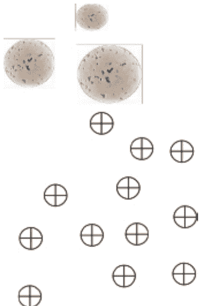

**图 2.3：** 用于定位肿瘤的多探测器正电子扫描仪。

收集了以下协变量；$X_1$ 表示患者接受辐射照射的时间（毫秒），$X_2$ 表示肿瘤的大小（厘米），$Y$ 记录一个二元响应变量，指示肿瘤是否被根除。假设每个响应变量 $Y_{i}$ 是一个成功率为 $p_{i}$ 的伯努利随机变量，其满足：

$$p_{i} = \frac{e^{\beta_{0}+\beta x_{i}}}{1+e^{\beta_{0}+\beta x_{i}}}. \tag{2.5}$$

数据科学家对因变量测量值拟合了一个逻辑回归模型，并得出了以下估计系数：

$$\begin{aligned}\hat{\beta}_{0} &= -6,\\ \hat{\beta}_{1} &= 0.05,\\ \hat{\beta}_{2} &= 1.\end{aligned} \tag{2.6}$$

- 估计一个接受 40 毫秒治疗且肿瘤大小为 3.5 厘米的患者，系统根除肿瘤的概率。
- 对于第 (a) 部分中的患者，需要接受多少毫秒的辐射照射，才能使根除肿瘤的概率恰好为 50%？

#### 练习题 21

最近的研究 [3] 表明，加热含汞的牙科合金可能会将有毒的汞蒸气释放到人体呼吸道中。人们也认为，饮用热咖啡会刺激汞从合金填充物中释放汞蒸气（图 2.4）。

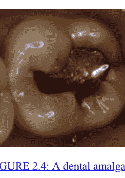

*为了研究影响偏头痛的因素，特别是口腔内至少含有四个牙科合金填充物的患者，一名数据科学家收集了 2 万名有和没有牙科合金填充物的用户的数据。然后，该数据科学家拟合了一个逻辑回归模型，以第一次偏头痛发作后一小时内出现第二次偏头痛的指示变量作为二元响应变量（例如，偏头痛=1，无偏头痛=0）。该数据科学家认为，偏头痛的频率可能与有毒汞蒸气的释放有关。*

有两个自变量：

- 如果患者至少有四个合金填充物，则 $X_1 = 1$；否则为 0。
- $X_2 =$ 咖啡消费量（每月 0 到 100 杯热咖啡）。

训练逻辑回归分类器的输出如下：

| 逻辑回归参数估计分析 | | | | |
| :--- | :--- | :--- | :--- | :--- |
| 参数 | 估计值 | 标准误 | Z 值 | Pr>$|Z|$ |
| 截距 | -6.36347 | 3.21362 | -1.980 | 0.0477 |
| $X_{1}$ | -1.02411 | 1.17101 | -0.875 | 0.3818 |
| $X_{2}$ | 0.11904 | 0.05497 | 2.165 | 0.0304 |

- 使用 $X_1$ 和 $X_2$，表达患者第二次患偏头痛的赔率（odds）。
- 计算一名至少有四个合金填充物且每月饮用 100 杯咖啡的患者的第二次偏头痛概率。
- 对于至少有四个合金填充物的用户，高咖啡摄入量是否与第二次偏头痛概率增加相关？
- 是否有统计证据表明，拥有超过四个合金填充物与第二次偏头痛概率降低直接相关？

#### 练习题 22

为了使用逻辑回归研究影响阿尔茨海默病的因素，研究人员考虑牙周病（牙龈疾病）与阿尔茨海默病之间的联系作为一个可能的风险因素 [1]。预测变量是口腔中牙龈细菌的数量（图 2.5）。

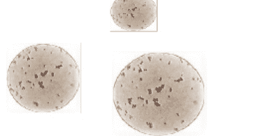

响应变量 $Y$ 衡量患者是否显示出任何缓解（例如 是=1）。训练逻辑回归分类器的输出如下：

| 参数 | 自由度 | 估计值 | 标准误 |
| :--- | :---: | :--- | :--- |
| 截距 | 1 | -4.8792 | 1.0732 |
| 牙龈细菌 | 1 | 0.0258 | 0.0194 |

- 当牙龈细菌计数为 [原文缺失，可能暗示特定值或在 OCR 流程中截断，保留结构] 时，估计改善的概率。
- 找出估计改善概率为 0.5 时的牙龈细菌计数。
- 找出当牙龈细菌总计数增加 1 时，改善的估计优势比（odds ratio）。
- 获取当牙龈细菌总计数增加 1 时，真实改善优势比的 99% 置信区间。请记住，最常见的置信水平是 90%、95%、99% 和 99.9%。表 9.1 列出了这些水平的 z 值。

| 置信水平 | z |
| :--- | :--- |
| 90% | 1.645 |
| 95% | 1.960 |
| 99% | 2.576 |
| 99.9% | 3.291 |

**表 2.2：** 常见的置信水平。

#### 练习题 23

*最近的研究 [4] 表明，大麻（图 2.6）和大麻素的管理，特别是后者，可能会减少大鼠恶性肿瘤的大小。*


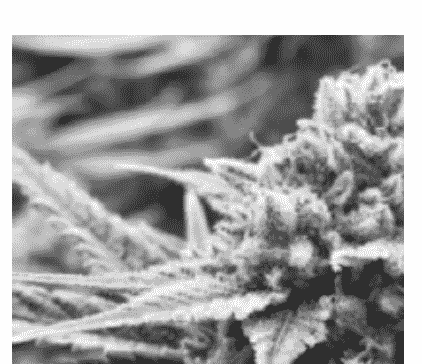

**图 2.6：大麻（Cannabis）。**

为了研究影响肿瘤缩小的因素，一位深度学习研究人员收集了两组数据；一组接受安慰剂（一种非药物制剂）治疗，另一组接受大麻素（cannabinoids）治疗。他的主要研究围绕研究大麻素的抗癌特性与肿瘤缩小之间的关系（见表 2.3）展开：

| 组别 | 是 | 否 | 合计 |
|---|---|---|---|
| 大麻素 | 60 | 6833 | 6893 |
| 安慰剂 | 130 | 6778 | 6909 |
| 合计 | 190 | 13611 | 13801 |

**表 2.3：大鼠的肿瘤缩小情况。**

对于真实的比值比（true odds ratio）：

1.  计算样本比值比。
2.  计算样本对数比值比。
3.  计算真实对数比值比和真实比值比的 95% 置信区间（$z_{0.95} = 1.645; z_{0.975} = 1.96$）。

### 2.2.5 Logit 函数与熵

**PRB-24 CH.PRB- 2.21.**

对于*单一二元结果*，其接收 *1* 的概率为 *p*，其熵（参见*第 4 章*）定义为：

$H(p) = -p \log p - (1 - p) \log(1 - p). \quad (2.7)$

$H(p)$ 在*p*为何值时达到最大值？

*给定*p*，熵* $H(p)$ *与 logit 函数之间的关系是什么？*

### 2.2.6 Python/PyTorch/C++

**PRB-25 CH.PRB- 2.22.**

以下 C++ 代码（图 2.7）是一个*（非常基础的）* *logistic 回归实现模块*的一部分。关于*此问题背后的理论讨论*，请参考习题 2.17。

```cpp
1 #include ...
2 std::vector<double> theta {-6.0, 0.0, 0.5, 1.0};
3 double sigmoid (double x) {
4     double tmp=1.0/(1.0+ exp(- x));
5     std:: cout << "prob="<< tmp<< std:: endl;
6     return tmp;
7 }
8 double hypothesis (std:: vector< double > x){
9     double z;
10     z=std:: inner_product(std:: begin(x), std:: end(x),
11        std:: begin(theta), 0.0 );
12     std:: cout << "inner_product=" << z<< std:: endl;
13     return sigmoid(z);
14 }
15 int classify (std:: vector< double > x){
16     int hypo= hypothesis(x) > 0.5f;
17     std:: cout << "hypo=" << hypo<< std:: endl;
18     return hypo;
19 }
20 int main() {
21     std:: vector< double > x1 {1.0,40.0,3.5};
22     classify(x1);
23 }
```

**图 2.7：C++ 实现的 Logistic 回归**

1.  解释第 10 行（即 $inner\_product$）的作用。
2.  解释第 16 行（即 $hypo(x)>0.5f$）的作用。
3.  第 2 行中的 $\theta$ 代表什么？
4.  编译并运行代码，你可以使用：
   [https://repl.it/languages/cpp11](https://repl.it/languages/cpp11) 来评估代码。
   输出结果是什么？

**PRB-26 CH.PRB- 2.23.**

*以下 Python 代码（图 2.8）在一个二维矩阵上运行了一个非常简单的线性模型。*

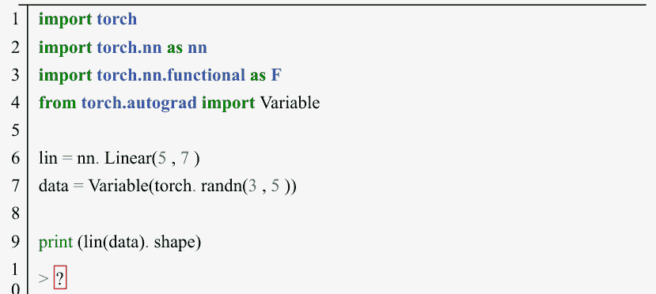

**图 2.8：PyTorch 中的线性模型**

*在不实际运行代码的情况下，确定在对矩阵应用线性模型后，第 10 行打印出的矩阵的大小。*

**PRB-27 CH.PRB- 2.24.**

*以下 Python 代码片段（图 2.9）是 Python 中 logistic 回归实现模块的一部分。*

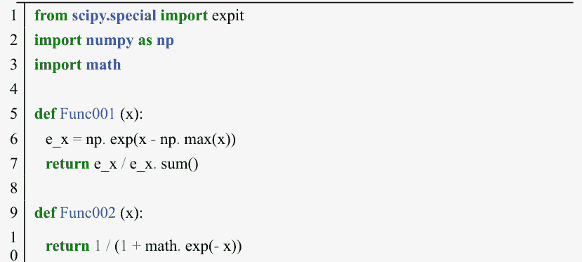

```python
1
1
1
2 def Func003(x):
1
3     return x * (1 - x)
```

**图 2.9：Python 中的 Logistic 回归方法。**

分析图 2.9 中给出的 `Func001`、`Func002` 和 `Func003` 方法，找出它们的作用并为它们命名。

**PRB-28 CH.PRB- 2.25.**

以下 Python 代码片段（图 2.10）是 Python 中机器学习模块的一部分。

```python
1
2 from scipy.special import expit
3 import numpy as np
4 import math
5
6 def Func006(y_hat, y):
7     if y == 1:
8         return - np.log(y_hat)
9     else:
10        return - np.log(1 - y_hat)
```

**图 2.10：Python 中的 Logistic 回归方法。**

分析图 2.10 中给出的 `Func006` 方法。它实现了机器学习中哪个重要概念？

**PRB-29 CH.PRB- 2.26.**

以下 Python 代码片段（图 2.11）展示了同一函数的几种不同变体。

```python
from scipy.special import expit
import numpy as np
import math

def Ver001 (x):
    return 1 / (1 + math. exp(- x))

def Ver002 (x):
    return 1 / (1 + (np. exp(- x)))

WHO_AM_I = 709

def Ver003 (x):
    return 1 / (1 + np. exp(-(np. clip(x, - WHO_AM_I, None ))))
```

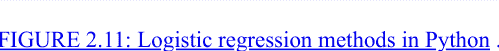

1.  这些方法实现了哪个数学函数？
2.  第 11 行中的数字 709 有什么特别之处？
3.  如果有选择，你会使用哪种方法？

### 2.3 解答

#### 2.3.1 通用概念

**SOL-4 CH.SOL- 2.1.**

**正确。** 然而，如果在 logistic 回归模型中使用了过多且不必要的变量，底层数据集中的特殊性（例如特定属性）会对模型中的系数产生不成比例的影响，这种现象通常被称为“过拟合”。因此，logistic 回归模型不应以多于给定观测数量所允许的变量数量开始训练。

**SOL-5 CH.SOL- 2.2.**

成功的几率（odds）定义为成功概率 $p \in [0, 1]$ 与失败概率 $1-p$ 之间的比值。形式化表示为：

$$\text { Odds }(p) \equiv\left(\frac{p}{1-p}\right) . \quad (2.8)$$

例如，假设一个事件的成功概率为 $p=0.7$。那么，在我们的例子中，成功的几率是 $7/3$，即 2.333 比 1。自然地，在概率相等的情况下，即 $p=0.5$ 时，成功的几率是 1 比 1。

**SOL-6 CH.SOL- 2.3.**

1.  交互项是两个单一预测变量的乘积，意味着非加性效应。

2.  最简单的交互模型包含一个由两个普通预测变量相乘形成的预测变量。假设两个变量 $X$ 和 $Z$。那么，采用最简单形式的交互的 logistic 回归模型遵循：

   $$\beta_{0}+\beta_{1} X+\beta_{2} Z+\beta_{3} X Z, \quad (2.9)$$

   其中交互项 $XZ$ 的系数由预测变量 $\beta_{3}$ 表示。

3.  为了测试交互项的贡献，通常采用两种主要方法：Wald 卡方检验，或在有无交互项的模型之间进行似然比检验。注意：交互项与信息论有何关系？它采用何种附加价值来增强模型性能？

**SOL-7 CH.SOL- 2.4.**

*错误。这恰恰是有监督学习的定义；当标签已知时，监督会引导学习过程。*

**SOL-8 CH.SOL- 2.5.**

*在 logistic 回归的情况下，响应变量是被分类到二元或多类响应组中的几率的对数。这个定义本质上表明几率可以表现为向量的形式。*

**SOL-9 CH.SOL- 2.6.**

*当对响应变量应用变换时，它会得到输出类别上的概率分布，其值在 0 和 1 之间；这种变换可以以几种方式应用，例如 softmax 层；sigmoid 函数或经典归一化。这种表示法便于 logistic 回归模型进行软决策，允许构建基于模型预测的概率过程。注意：上述三种变换各自的优缺点是什么？*

**SOL-10 CH.SOL- 2.7.**

最小化负对数似然也意味着最大化选择正确类别的似然。

#### 2.3.2 几率，对数几率

**SOL-11 CH.SOL- 2.8.**

1.  根据定义，事件发生的几率为：

   $$odds = \left ( \frac{0.1}{0.9} \right ) = 0.11. \hspace{4em} (2.10)$$

2.  事件发生的对数几率仅取几率的对数：

   $$log\text{-}odds = \ln(0.1/0.9) = -2.19685. \hspace{4em} (2.11)$$

3.  概率可以通过以下表示构建：

   $$probability = \frac{odds}{odds + 1} = \frac{0.11}{1.11} = 0.1, \hspace{4em} (2.12)$$

   或者；替代地：

   $$p = \frac{\exp\left ( \ln odds \right )}{\exp\left ( \ln odds \right ) + 1} = \frac{0.11}{1.11} = 0.1. \hspace{4em} (2.13)$$

   注意：这种表示背后的直觉是什么？

**SOL-12 CH.SOL- 2.9.**


*真实。根据赔率的定义，很容易注意到 p = 0.8 满足以下关系：*

$$\text{odds} = \big( \frac{0.8}{0.2} \big) = 4 \qquad \qquad (2.14)$$

**SOL-13 ✏ CH.SOL- 2.10.**

*赔率与概率的图像如 图 2.12 所示。*

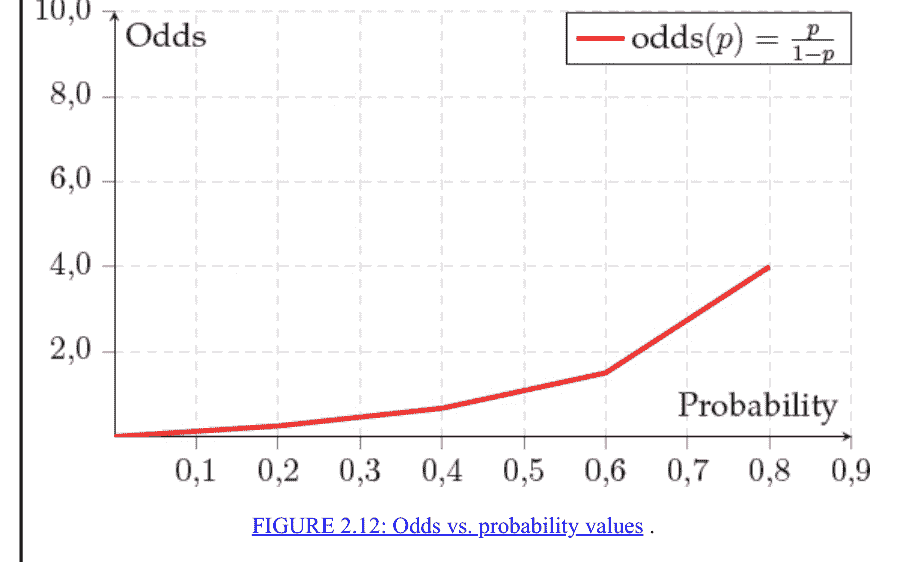

**SOL-14 ✏ CH.SOL- 2.11.**

*二元 logistic 回归 GLM 由三个组成部分构成：*

- 1. *随机成分：指因变量（Y）的概率分布，例如二元 logistic 回归中 Y 的二项分布，其取值为 Y = 0 或 Y = 1。*
- 2. *系统成分：描述解释变量：$(X_1, X_2, \dots)$ 作为线性预测变量的组合。二元情形对这些变量没有任何约束。*
- 3. *连接函数：指定随机成分与系统成分之间的联系。它说明了因变量的期望值如何与解释变量的线性预测量相关联。*

*注意：假设 $Y$ 表示在给定时间框架内是否检测到人类语音活动（$Y=1$ 表示检测到，$Y=0$ 表示未检测到）。请为该任务提出两个系统成分和一个连接函数。*

**SOL-15** ➡ **CH.SOL- 2.12.**
*超平面简单地定义为：*

$$ \theta_{0} + \theta^{T} X = 0 . $$ (2.15)

*注意：回顾 logit 函数的用法，并严格推导此决策边界。*

**SOL-16** ➡ **CH.SOL- 2.13.**
*真实。logit 函数定义为：*

$$ z(p) = logit(p) = \log \left( \frac{p}{1-p} \right) , $$ (2.16)

*对于任意* $p \in [0,\ 1]$ 。*一组简单的代数方程得出了逆关系：*

$$ p(z) = \frac{\exp z}{1+\exp z} , $$ (2.17)

*它准确描述了 logistic 函数（也称为 sigmoid 函数）的输出与输入之间的关系。*

### 2.3.3 Sigmoid 函数

**SOL-17 CH.SOL- 2.14.**
解决这个问题有多种方法，这里我们提供两种：直接推导或通过 softmax 函数推导。

- 1. 直接推导：

$$\frac{d}{dx}\sigma(x) = \frac{d}{dx}((1+e^{-x})^{-1}) = -(1+e^{-x})^{-2}\frac{d}{dx}(1+e^{-x}) = \frac{e^{-x}}{(1+e^{-x})^2}.$$

- 2. Softmax 推导：

在具有互斥类别的分类问题中，如果所有值均为正且总和为 1，可以使用 softmax 激活函数。根据定义，softmax 激活函数由 $n$ 项组成，使得 $\forall i \in [1, n]$：

$$f(\theta_i) = \frac{e^{\theta_i}}{\sum_{k} e^{\theta_k}} = \frac{1}{1+e^{-\theta_i}\sum_{k \neq i} e^{\theta_k}}.$$

> 为了计算 (2.18) 的偏导数，我们将所有 $k \neq i$ 的 $\theta_k$ 视为常数，然后使用常规微分规则对 $\theta_i$ 进行微分。对于给定的 $\theta_i$，让我们定义：

$$\beta = \sum_{k \neq i} e^{\theta_k},$$ (2.19)

以及

$$f(\theta_i) = \frac{1}{1+\beta e^{-\theta_i}} = (1+\beta e^{-\theta_i})^{-1}.$$ (2.20)

> 现在可以证明关于 $\theta_i$ 的导数成立：

$$f'(\theta_i) = (1+\beta e^{-\theta_i})^{-2}\beta e^{-\theta_i},$$ (2.21)

它可以写成具有信息量的形式：

$$f'(\theta_i) = f(\theta_i)(1 - f(\theta_i)).$$ (2.22)

应该注意的是，(2.21) 对任何常数 $\beta$ 都成立，而当 $\beta=1$ 时，它显然退化为 sigmoid 激活函数。

注意：描述 sigmoid 函数在其自变量趋近于 0、$\infty$ 和 $-\infty$ 时的特性。当作为激活函数考虑时，这些值会导致 sigmoid 函数产生哪些不期望的特性？


#### SOL-18 CH.SOL- 2.15.

- 1. 通过将由因变量和模型系数代入线性 logistic 回归模型，可以轻松获得 logit 值，如下所示：

$$\begin{split}
& logit = \beta_0 + \beta_1x_1 + \beta_2x_2 \\
& = -1.5 + 3 \cdot 1 + -0.5 \cdot 5 \\
& = -1.5 + 3 - 2.5 \\
& = -1.0
\end{split}
\qquad \qquad \qquad \qquad \qquad \qquad \qquad \qquad \qquad \qquad \qquad \qquad (2.23)$$

- 2. 根据 logit 和赔率之间的自然关系，以下等式成立：

$$odds = e^{logit} = e^{\beta_0 + \beta_1 x_1 + \beta_2 x_2} = e^{-1} = 0.3678794.$$ (2.24)

- 3. 根据定义，赔率比为：

$$odds = \frac{P(y = 1)}{P(y = 0)},$$ (2.25)

因此 logistic 响应函数为：

$$P(y = 1) = \frac{1}{1 + e^{-logit}} = \frac{1}{1 + e^{1}} = 0.2689414.$$ (2.26)


### 2.3.4 真正理解 Logistic 回归

#### SOL-19 CH.SOL- 2.16.

- 1. 肿瘤消除（$Y$）是因变量，癌症类型（$X$）是解释变量。
- 2. 相对风险（RR）是一个群体（例如暴露组）中某事件发生的风险与另一群体（例如非暴露组）中该事件发生的风险之比。赔率比（OR）是一个群体中某事件发生的赔率与另一群体中该事件发生的赔率之比。
- 3. 如果我们计算赔率比作为关联度量：

$$\hat{\theta} = \frac{560 \times 36}{69 \times 260} = 1.23745.$$ (2.27)

赔率比大于 1，表明乳腺癌被消除的赔率高于肺癌被消除的赔率。然而请注意，该结果过于接近 1，这阻碍了对赔率关系做出明确的决定。

此外，如果我们计算相对风险作为关联度量：

$$\mathrm{RR} = \frac{\frac{560}{560+260}}{\frac{69}{69+36}} = 1.0392.$$ (2.28)

- 4. 赔率比 $\theta$ 的 95% 置信区间是从对数赔率比的样本置信区间计算得出的：

$$\hat{\sigma}\left(\log(\hat{\theta})\right) = \sqrt{\frac{1}{560} + \frac{1}{260} + \frac{1}{69} + \frac{1}{36}} = 0.21886.$$ (2.29)

因此，$\log (\theta)$ 的 95% CI 为：

$$0.21886 \pm 1.95 \times 0.21886 = (-0.2101056, 0.6478256).$$ (2.30)

因此，$\theta$ 的 95% CI 为：

$$(e^{-0.210}, e^{0.647}) = (0.810, 1.909).$$ (2.31)

- 5. CI $(0.810, 1.909)$ 包含 1，这表明真实的赔率比与 1 没有显著差异，并且没有足够的证据表明肿瘤消除取决于癌症类型。


#### SOL-20 CH.SOL- 2.17.

- 1. 通过使用 $X_1$ 和 $X_2$ 的定义值以及已知的 logistic 回归模型，代入可得：

$$\hat{p}(X) = \frac{e^{-6+0.05X_1+X_2}}{(1+e^{-6+0.05X_1+X_2})} = 0.3775.$$ (2.32)

- 2. 预测概率的方程告诉我们：

$$\frac{e^{-6+0.05X_1+3.5}}{(1+e^{-6+0.05X_1+3.5})} = 0.5,$$ (2.33)

这等价于约束：

$$e^{-6+0.05X_1+3.5} = 1.$$ (2.34)

对两边取对数，我们得到所需的毫秒数是：

$$X_1 = \frac{2.5}{0.05} = 50.$$ (2.35)


#### SOL-21 CH.SOL- 2.18.

*为了练习的目的，预先定义 z 是有启发性的：*

$$z(X_1, X_2) = -6.36 - 1.02 \times X_1 + 0.12 \times X_2.$$ (2.36)

- 1. 通过采用经典的 logistic 回归模型：

$$odds = \exp(z(X_1, X_2)).$$ (2.37)

- 2. 通过给定的 $X_1, X_2$ 值代入 $z(X_1, X_2)$，概率成立：

$$p = \frac{\exp(z(1, 100))}{1 + \exp(z(1, 100))} = 0.99.$$ (2.38)

- 3. 是。咖啡消费的系数是正的（0.119），且 p 值小于 0.05（0.0304）。

*注意：你能描述这些数值关系与阳性结论之间的联系吗？*

- 4. 否。该预测变量的 p 值为 $0.3818 > 0.05$。

*注意：你能解释为什么这种不等式意味着缺乏统计证据吗？*

#### SOL-22 CH.SOL- 2.19.

- 1. 改进的估计概率为：

$$\hat{\pi}(gum\ bacteria) = \frac{\exp(-4.8792 + 0.0258 \times gum\ bacteria)}{1 + \exp(-4.8792 + 0.0258 \times gum\ bacteria)}$$

*因此，$\hat{\pi}(33) = 0.211868$。*


2 对于\(\hat{\pi}\)（口腔细菌）= 0.5：

```
gum\ bacteria = -\hat{\alpha}/\hat{\beta} = 4.8792/0.0258 = 53.70.
```

3 估计的赔率比为：

```
\exp(\hat{\beta}) &= \exp(0.0258) = 1.0504.
```

4 \(\beta\) 的 99% 置信区间计算如下：

```
\hat{\beta} \pm z_{0.005} \times \mathrm{ASE}(\hat{\beta}) &= \\
0.0258 \pm 2.576 \times 0.0194 &= \\
&= (-0.00077, 0.9917).
```

*因此，真实赔率比 \(\exp(\beta)\) 的 99% 置信区间为：*
\((\exp(-0.00077), \exp(0.9917)) = (0.99923, 2.6958)\)。

SOL-23

1 样本赔率比为：

```
\hat{\theta} = \frac{130 \times 6833}{60 \times 6778} = 2.1842.
```

2 log(\(\hat{\theta}\)) 的估计标准误为：

\(\hat{\sigma}(\log \hat{\theta}) = \sqrt{\frac{1}{60} + \frac{1}{6833} + \frac{1}{130} + \frac{1}{6778}} = 0.1570\)。(2.46)

3. 根据前几节的内容，真实对数赔率比的 95% 置信区间为：

\(0.7812 \pm 1.96 \times 0.1570 = (0.4734, 1.0889)\)。(2.47)

相应地，真实赔率比的 95% 置信区间为：

\((e^{0.4734}, e^{1.0889}) = (1.6060, 2.9710)\)。(2.48)

### 2.3.5 Logit 函数与熵

SOL-24 CH.SOL-2.21.

- 1. 熵（图 2.13）在概率 \(p = 1/2\) 时达到最大值 \(\log_2(2)\)，这是最混乱的分布。较低的熵意味着更可预测的结果，零熵则表示完全的确定性。
- 2. 熵对 \(p\) 的导数得出了 logit 函数的负值：
\[
\frac{dH(p)}{dp} = -\text{logit}(p). \quad (2.49)
\]
> 注：鼓励好奇的读者严谨地证明这一结论。

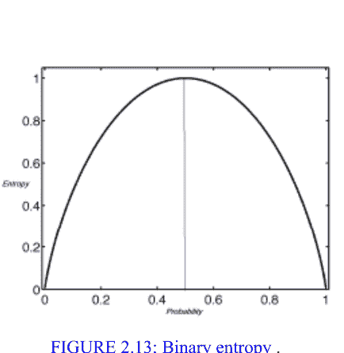

### 2.3.6 Python、PyTorch、CPP

SOL-25 CH.SOL-2.22.

- 1. 在推理阶段，`inner_product` 的目的是将逻辑回归系数向量与我们要评估的输入向量相乘，例如计算概率和二分类类别。
- 2. 语句 `hypo(x) > 0.5f` 常用于二分类评估，其中高于 0.5（即阈值）的概率值被视为 TRUE，而低于 0.5 的值被视为 FALSE。
- 3. 术语 \(\theta\)（*theta*）代表在训练期间评估得到的逻辑回归系数。
- 4. 输出如下：

```
1  > inner_product=0.5
2  > prob=0.377541
3  > hypo=0
```


#### SOL-26 CH.SOL-2.23.

由于 $lin$ 的第二维是 7，且 $data$ 的第一维是 3，因此生成的矩阵形状为 $\text{torch.Size}([3, 7])$。

#### SOL-27 CH.SOL-2.24.

理想情况下，你应该能够立即认出这些函数，一旦面试官提出请求。

- 1. 一个 softmax 函数。
- 2. 一个 sigmoid 函数。
- 3. sigmoid 函数的导数。

#### SOL-28 CH.SOL-2.25.

图 2.10 中实现的函数是 $binary$ 交叉熵函数。

#### SOL-29 CH.SOL-2.26.

- 1. 所有方法都是 sigmoid 函数的变体。
- 2. 在 Python 中，大约 $1.797 \mathrm{e}+308$ 是浮点变量可以持有的最大可能值。其日志评估为 709.78。如果你尝试在 Python 中执行以下表达式，结果将是 $\text{inf}$：`np.log(1.8e+308)`。
- 3. 我会使用 Ver003，因为它的稳定性更好。注意：你能推断出为什么这个方法比其他方法更稳定吗？

# 第 3 章

# 概率编程与贝叶斯深度学习

> *任何考虑使用算术方法生成随机数的人，当然都处于罪孽之中。*
>
> — John von Neumann (1903-1957)

# 目录

- [引言](#introduction)
- [问题](#problems)
    - [期望与方差](#expectation-and-variance)
    - [条件概率。](#conditional-probability)
    - [贝叶斯法则](#bayes-rule)
    - [最大似然估计](#maximum-likelihood-estimation)
    - [费雪信息](#fisher-information)
    - [后验与先验预测分布](#posterior-prior-predictive-distributions)
    - [共轭先验](#conjugate-priors)
        - [Beta-Binomial 分布](#the-beta-binomial-distribution)
    - [贝叶斯深度学习](#bayesian-deep-learning)
- [解答](#solutions)
    - [期望与方差](#expectation-and-variance)
    - [条件概率。](#conditional-probability)
    - [贝叶斯法则](#bayes-rule)
    - [最大似然估计](#maximum-likelihood-estimation)
    - [费雪信息](#fisher-information)
    - [后验与先验预测分布](#posterior-prior-predictive-distributions)
    - [共轭先验](#conjugate-priors)

## 3.1 引言


贝叶斯学派的思想已渗透到机械统计、经典概率和金融数学等领域 [13]。与此同时，该主题本身也吸引了越来越多的关注，特别是在 BML（贝叶斯机器学习）领域。因此，毫不奇怪，PyMc3 和 Stan [11] 等几个基于 Python 的新概率编程语言库已经出现，并被机器学习社区广泛采用。

本章旨在介绍贝叶斯范式，并在各种问题中应用贝叶斯推断。特别是，读者将接触到条件概率的真实生活例子，并发现贝叶斯统计中最重要的结果之一：Beta 分布族与二项似然函数是共轭的。必须强调，贝叶斯推断是一个学生明显发现难以理解的主题，因为它严重依赖于对数据严格的概率解释。具体而言，几个障碍阻碍了学习贝叶斯统计的前景：

- 1. 学生通常只接受过经典概率统计的基本介绍。然而，后续内容需要在这些概念上有非常扎实的基础。
- 2. 许多涉及贝叶斯学习的课程和资源并不涵盖这些概念。
- 3. 对贝叶斯方法的强烈理解需要超出第一年微积分水平的数值训练熟练度。

总而言之，本章可能比其他章节更难理解。因此，我们强烈敦促读者彻底解决以下问题，并根据解答的基础 [8] 验证他们对数学概念的掌握。

## 3.2 问题

### 3.2.1 期望与方差

**PRB-30 CH.PRB-3.1.**

*定义什么是伯努利试验。*

**PRB-31 CH.PRB-3.2.**

*二项分布常用于建模 n 个物体中 k 个具有特定特征的概率。定义什么是***二项随机变量*** $X$。*

**PRB-32 CH.PRB-3.3.**

*以下简写代表什么？*

$$X \sim \text { Binomial }(n, p) \quad\quad\quad\quad\quad\quad\quad\quad\quad\quad\quad\quad\quad(3.1)$$

**PRB-33 CH.PRB-3.4.**

*求以下随机变量的概率质量函数（PMF）：*

$$X \sim \text { Binomial }(n, p) \quad\quad\quad\quad\quad\quad\quad\quad\quad\quad\quad\quad\quad(3.2)$$

**PRB-34 CH.PRB-3.5.**

*回答以下问题：*

- 1. *定义什么是（数学）期望。*
- 2. *定义什么是方差。*
- 3. *推导二项随机变量* $X \sim \text{Binomial}(n, p)$ *的期望和方差，用* $p$ *和* $n$ *表示。*

**PRB-35 CH.PRB-3.6.**

*质子疗法（PT）是广泛用于治疗多种癌症的一种形式 [6]。一台未适当校准的 PT 设备用于治疗胰腺癌患者（图 3.1）。结果，PT 束随机独立地发射 200 个粒子，并以 0.1 的概率正确击中癌细胞。*

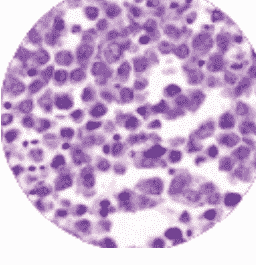

图 3.1：胰腺癌细胞的组织病理学。

- 1. 找出描述实验中癌细胞被正确击中的数量的*统计分布*。相应随机变量的期望和方差是多少？
- 2. 使用该设备的放射科医生声称他能够击中恰好 60 个癌细胞。他*错误*的可能性有多大？

### 3.2.2 条件概率

**PRB-36 CH.PRB-3.7.**

给定概率空间 *H* 中的两个事件 *A* 和 *B*，它们分别以概率 *P(A)* 和 *P(B)* 发生：

1. 定义给定 *B* 的 *A* 的*条件概率*。注意奇异情况。
2. 注释*条件概率公式*的每一部分。
3. 画一个展示事件 *A* 和 *B* 交集的维恩图实例。假设 *A ∪ B = H*。

**PRB-37 CH.PRB-3.8.**


贝叶斯推断将似然函数中的数据信息与已知的**先验**信息相结合。这是通过使用贝叶斯公式将先验信息条件化于似然函数来实现的。假设在概率空间 *H* 中存在两个事件 *A* 和 *B*，其发生的概率分别为 P(*A*) 和 P(*B*)。已知 *A* ∪ *B* = *H*，请陈述此情况下的贝叶斯公式，解释其组成部分并加以注释。

**PRB-38** ？ **CH.PRB-3.9.**
*定义在给定固定感兴趣参数* ***γ*** *的情况下，离散随机变量* ***X*** *的似然和似然对数。* *给出此类场景的实际示例，并推导其似然和似然对数。*

**PRB-39** ？ **CH.PRB-3.10.**
*定义连续情况下似然参数* ***γ*** *的先验分布术语。*

**PRB-40** ？ **CH.PRB-3.11.**
*展示先验、后验和似然概率之间的关系。*

**PRB-41** ？ **CH.PRB-3.12.**
*在贝叶斯背景下，如果先进行一个实验，然后接着进行另一个实验，下一个实验的后验分布会怎样？*

**PRB-42** ？ **CH.PRB-3.13.**
*两个事件* ***A*** *和* ***B*** *在什么条件下被称为统计独立？*

### 3.2.3 贝叶斯规则

**PRB-43** ？ **CH.PRB-3.14.**
*在粒子物理领域进行的一项实验中* ***(*图 3.2*)***，某种粒子可能处于两种不同且等概率的量子态：整数自旋或半整数自旋。众所周知，整数自旋的粒子是玻色子，而半整数自旋的粒子是费米子 [4]。

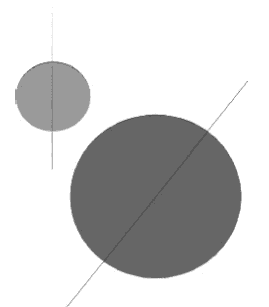

图 3.2：玻色子和费米子：具有半整数自旋的粒子是费米子。

一位物理学家正在观察两个这样的粒子，其中至少有一个处于半整数自旋状态。两个粒子都是费米子的概率是多少？

**PRB-44** CH.PRB-3.15.

怀孕期间，绒毛膜绒毛取样术（Placenta Chorion Test）[1] 常用于遗传性疾病的诊断（图 3.3）。无论是否存在遗传性疾病，该测试正确的概率均为 0.95。

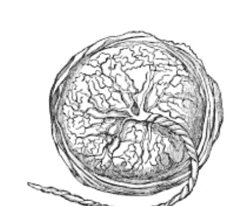

图 3.3：胎盘的胎儿表面

已知 1% 的妊娠会导致遗传性疾病。计算测试指示存在遗传性疾病的概率。

#### PRB-45 ❓ CH.PR B-3.16.

Dercum 病 [3] 是一种极其罕见的多重疼痛性组织增生症。在一个男女比例相等的人群中，5% 的女性和 0.25% 的男性患有 Dercum 病（图 3.4）。

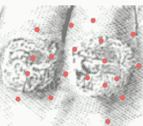

图 3.4：Dercum 病

随机选择一个人，且此人患有 Dercum 病。计算此人是女性的概率。

#### PRB-46 ❓ CH.PR B-3.17.

互联网上散布着许多欺诈性的二元期权网站，每关闭一个，新的网站就像蘑菇一样冒出来。在纽约证券交易所使用的基于人工智能的欺诈性股市预测算法（图 3.6）能够以 85% 的确定性正确预测某个二元期权 [ Z ] 是否从状态 0 切换到 1 或反之。

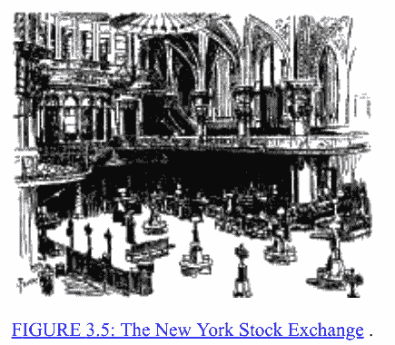

一位金融工程师创建了一个投资组合，其中状态 1 的期权数量是状态 0 期权数量的两倍。随机选择一个股票期权，并且该算法判定其处于状态 1。AI 预测正确的概率是多少？

PRB-47 3 CH.PRB- 3.18. 在一项由对冲基金进行的实验中，旨在确定猴子（图 3.6）是否能优于人类选择更好的股市投资组合，结果显示 5% 的人类（0.05）和 1/15 的猴子能够正确预测股市趋势。

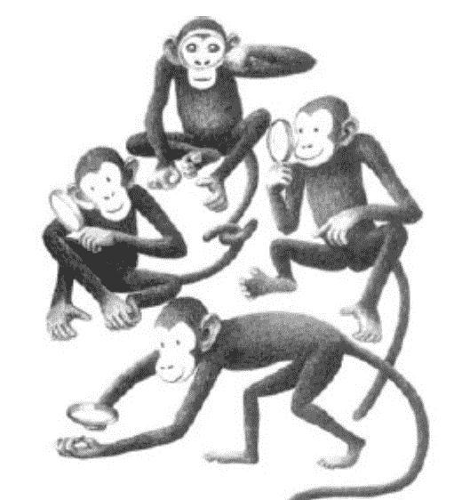

图 3.6：对冲基金和猴子。

从概率相等的人类和猴子群体中随机选择一名“专家”。测试显示，该专家正确预测了股市变动。该专家是猴子的概率是多少？

#### **PRB-48** CH.PRB-3.19.

在冷战期间，美国开发了一种语音转文本（STT）算法，理论上可以检测俄罗斯潜伏特工的隐藏方言。这些特工（图 3.7）在俄罗斯接受英语培训，随后被派往美国收集情报。FBI 曾逮捕了十名这样的潜伏俄罗斯间谍 [9]，并指控他们为“潜伏”特工。

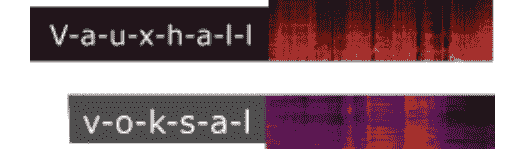

图 3.7：方言检测。

该算法依赖于俄语发音中单词 (v-o-k-s-a-I) 的声学特性，该词借自英语 V-a-u-x-h-a-l-l。据称，**俄罗斯人完全掩盖其口音是不可能的**，因此当俄罗斯人说 V-a-u-x-h-a-l-l 时，算法将生成文本 “v-o-k-s-a-I”。为了在 20% 的参与者是潜伏特工、其余是美国人的外交聚会上测试该算法，一名数据科学家随机选择一个人并让他说 V-a-u-x-h-a-l-l。然后从算法生成的单词中随机选择一个字母，观察到的字母是 “I”。此人确实是俄罗斯潜伏特工的概率是多少？

#### PRB-49 ✊ CH.PRB-3.20.

在第二次世界大战期间，战争双方的部队都依赖加密通信。德国军队使用的主要加密方案是恩尼格玛密码机 [5]，纳粹德国广泛使用了这一设备。统计上，恩尼格玛机器按照以下概率发送符号 X 和 Z（图 3.8）：

P(X) = $\frac{2}{9}$ (3.3)

P(Z) = $\frac{7}{9}$ (3.4)

| A | . . . | O | - . | & | . . . |
|---|---|---|---|---|---|
| B | - . . . | P | . . - . | 1 | . . . . . |
| C | . . . | Q | . . - . | 2 | . . - - . |
| D | - - . | R | . . - . | 3 | . . . - . |
| E | . | S | . . | 4 | . . . . - |
| F | - . | T | - | 5 | - - - - |
| G | - - . | U | - . - . | 6 | - . . . . |
| H | . . . | V | . . . | 7 | - . . . . |
| I | . . | W | . - - | 8 | - . . . . |
| J | - . . | X | . . . . . | 9 | . . - . |
| K | - . - | Y | . . . | 0 | - - - |
| L | - - | Z | . . . . | | |
| M | - - | | | | |


在一次事件中，德军发送加密信息，而英军使用反制措施故意篡改传输。假设由于英国的反制措施，X *被错误地接收为 Z（反之亦然）的概率为* $\frac{1}{7}$。如果德军接收方接收到了 Z，发送方实际传输的是 Z 的概率是多少？

### 3.2.4 最大似然估计

- **PRB-50** CH.PRB-3.21.
*独立同分布（i.i.d）随机变量* $X_{1}$ , $\cdots$ , $X_{n}$ *的似然函数是什么，其中* $X_{i}$ ~ *二项分布(*n,*p*)*，$\forall i \in [1, n]$，且* p *是感兴趣参数？*

- **PRB-51** CH.PRB-3.22.
*如何推导问题 3.21 中引入的 i.i.d 样本* $X_{1}$ , $\cdots$ , $X_{n}$ *的最大似然估计量（MLE）？*

- **PRB-52** CH.PRB-3.23.
*似然函数和似然对数函数之间的关系是什么？*

- **PRB-53** CH.PRB-3.24.
*描述如何解析地找到似然函数的 MLE？*

- **PRB-54** CH.PRB-3.25.
*用于描述似然对数函数一阶导数的术语是什么？*

- **PRB-55** CH.PRB-3.26.
*定义术语 Fisher 信息。*

### 3.2.5 Fisher 信息

**PRB-56 ? CH.PRB. 3.27.**

2014 年西非埃博拉（图 9.10）疫情成为现代历史上规模最大、传播最快的疾病爆发 [2]，死亡人数远超以往所有爆发之和。埃博拉病毒（以扎伊尔的埃博拉河命名）最早于 1976 年在苏丹和扎伊尔出现，感染了 284 多人，死亡率高达 53%。

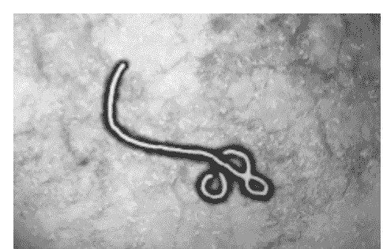

图 3.9：埃博拉病毒。

这次罕见的疫情凸显了医疗团队在遏制流行病方面面临的挑战。疾病控制中心（CDC）的一名初级数据科学家使用数值模拟来建模埃博拉病毒的可能传播和遏制情况。他知道在 k 个人口群体（试验次数）中，有 x 人是病毒携带者（统计术语中的“成功”）。他认为该病毒在人群中的样本似然遵循二项分布：

$$L(\gamma \mid y)=\binom{n}{y} \gamma^{y}\left(1-\gamma\right)^{n-y}, \quad \gamma \in[0,1], \quad y=1,2, \ldots, n$$
(3.5)

作为团队中的资深研究人员，你指导他，其感兴趣参数是 y，即整个受感染人类的比例。二项分布的期望和方差为：

$$E(y|\gamma, n)=n\gamma, \quad V(y|\gamma, n)=n\gamma(1-\gamma)$$
(3.6)

回答以下问题：对于形式为 $L_{x}(\gamma)$ 的似然函数：

1. 找到似然对数函数 $l_{x}(\gamma)=\ln L_{x}(\gamma)$。


2. 求 $l_{x}(\gamma)$ 的梯度。
3. 求海森矩阵 $H(\gamma)$。
4. 求费雪信息量 $I(\gamma)$。
5. 在一个包含 10,000 个个体的种群中，有 300 人感染埃博拉病毒。求 $\gamma$ 的最大似然估计（MLE）及其对应的标准误差。

#### **PRB-57 章节 PRB- 3.28.**

在这道题中，你需要推导几种分布的费雪信息函数。给定概率密度函数 (PDF) $f(X|\gamma)$，提供以下定义：

1.  PDF 的自然对数 $\ln f(X|\gamma) = \Phi(X|\gamma)$。
2.  一阶偏导数 $\Phi'(X|\gamma)$。
3.  二阶偏导数 $\Phi''(X|\gamma)$。
4.  费雪信息量：

$$ I(\gamma) = -\mathbf{E}_{\gamma}\left[ \Phi'(X|\gamma)^2 \right] $$

求以下分布的费雪信息量 $I(\gamma)$：

1.  伯努利分布 $X \sim B(1, \gamma)$。
2.  泊松分布 $X \sim \text{Poiss}(\theta)$。

#### **PRB-58 章节 PRB- 3.29.**

1.  **判断对错：** 费雪信息量用于计算任何无偏最大似然估计方差的下界（Cramer-Rao 界）。
2.  **判断对错：** 费雪信息矩阵也是对称化 KL 散度的海森矩阵。

### 3.2.6 后验与先验预测分布

**PRB-59 章节 PRB- 3.30.**

在第 3 章中，我们讨论了先验分布和后验分布的概念。

1.  定义术语 **后验分布**。
2.  定义术语 **先验预测分布**。

**PRB-60 章节 PRB- 3.31.**

设 $y$ 为 5 次独立试验中的成功次数，每次试验成功的概率为 $\theta$。假设 $\theta$ 的先验分布如下：$P(\theta=1/2)=0.25$，$P(\theta=1/6)=0.5$，且 $P(\theta=1/4)=0.25$。

1.  推导观察 $y$ **之后**的 **后验分布** $p(\theta|y)$。
2.  推导 $y$ 的 **先验预测分布**。

### 3.2.7 共轭先验

**PRB-61 章节 PRB- 3.32.**

在第 3 章中，我们讨论了先验和后验的概念。

1.  定义术语 **共轭先验**。
2.  定义术语 **非信息先验**。

#### 贝塔-二项分布

**PRB-62 章节 PRB- 3.33.**

*二项分布在第 3 章中被广泛讨论。在这里，我们将展示贝叶斯机器学习中最重要的结果之一。证明贝塔分布族对于二项似然函数是共轭的，使得如果先验分布属于该族，则后验分布也属于该族。也就是说，证明：*

$$ x \sim Ber(\gamma), \gamma \sim \mathcal{B}(\alpha, \beta) \quad \Rightarrow \quad \gamma|x \sim \mathcal{B}(\alpha', \beta') \quad (3.8) $$

*例如，对于 $h$ 次正面和 $t$ 次反面，后验分布为：*

$$ \mathcal{B}(h + \alpha, t + \beta) \quad (3.9) $$

### 3.2.8 贝叶斯深度学习

**PRB-63 章节 PRB- 3.34.**

*一篇近期发表的论文提出了一种新的贝叶斯神经网络 (BNN) 的新层。该层的行为如下。在前馈操作期间，神经网络中（图 3.10）的每个隐藏神经元 $H_n, n \in \{1, 2, ..., N\}$ 可能根据已知的先验分布独立地开火或不开火。*

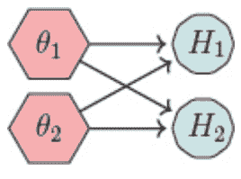

图 3.10：BNN 模型中的似然函数。

*每个隐藏神经元开火的概率 $\gamma$ 是相同的。使用形式化定义，计算以下每种情况的似然函数：*

1.  隐藏神经元根据随机变量 $X \sim \text{binomial}(n, \gamma)$ 分布，并以概率 $\gamma$ 开火。共有 100 个神经元，其中只有 20 个开火。
2.  隐藏神经元根据随机变量 $X \sim \text{Uniform}(0, \gamma)$ 分布，并以概率 $\gamma$ 开火。

#### **PRB-64 章节 PRB- 3.35.**

你的同事，一位深度学习行业的资深专家，提出了一个名为 **OnOffLayer** 的 BNN 层。他建议每个神经元保持 **开启** 状态（另一种状态是 **关闭**），遵循分布 $f(x) = e^{-x}$（当 $x > 0$ 时）且 $f(x) = 0$（其他情况）（图 3.11）。$X$ 表示 **神经元保持开启状态的时间（秒）**。在一个 BNN 中，所述 OnOffLayer 中独立激活了 200 个这样的神经元。只有当至少 150 个神经元关闭时，OnOffLayer 才会被设置为关闭（例如非活跃状态）。求 OnOffLayer 保持活跃且不被关闭至少 20 秒的概率。

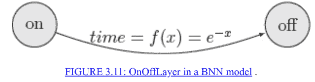

#### **PRB-65 章节 PRB- 3.36.**

Dropout 层 [12]（图 3.12）通常用于通过随机将某些输出（被划掉的 **隐藏** 节点 $H$）设为 0 来正则化神经网络模型。

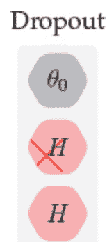


例如，在 PyTorch [10] 中，Dropout 层的声明如下（3.1）：

```python
import torch
import torch.nn as nn

nn.Dropout(0.2)
```


其中 `nn.Dropout(0.2)`（3.1 中的第 3 行）表示将元素置零的概率为 0.2。

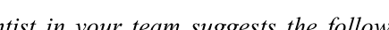

你团队中的一位新数据科学家提出了一种基于贝叶斯原理的 Dropout 层程序。图 3.12 中神经网络中的每个神经元 $\theta_n$ 可能像伯努利试验一样，独立地丢弃（或不丢弃）输出。

在训练神经网络期间，Dropout 层随机丢弃前一层输出，如图 3.12 所示。在此，为了说明目的，所有四个神经元都被丢弃，如被划掉的隐藏节点 $H_n$ 所示。

你关注被丢弃神经元所占的比例。假设每个神经元的丢弃概率 $\theta$ 是相同的（例如 $\theta$ 的 *均匀先验*）。计算 $\theta$ 的 *后验分布*。

#### **PRB-66 章节 PRB- 3.37.**

你团队中的一位新数据科学家，曾是一名 *量子物理学家*，提出了一种名为 *QuantumDrop* 的基于 *量子* 原理和 **麦克斯韦-玻尔兹曼分布** 的 Dropout 层程序。在麦克斯韦-玻尔兹曼分布中，找到具有特定速度 $v$ 的粒子的可能性由下式给出：

$$ n(v)dv=\frac{4\pi N}{V}\left(\frac{m}{2\pi kT}\right)^{3/2}v^2e^{-\frac{mv^2}{2kT}}dv $$

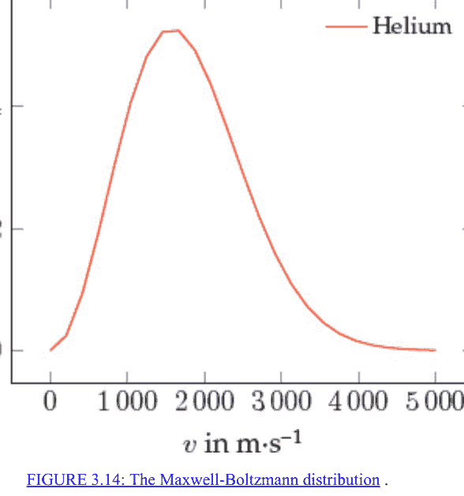

图 3.14：麦克斯韦-玻尔兹曼分布。

在建议的 QuantumDrop 层（3.15）中，每个神经元的行为像分子一样，遵循麦克斯韦-玻尔兹曼分布，并且只有在达到最概然速度时才开火。该速度与麦克斯韦分布（3.14）中最高的点对应的速度相关。利用微积分、脑力和一些数学运算，找出神经元开火的最可能值（速度）。


图 3.15：一个 QuantumDrop 层。

### 3.3 解答

### 3.3.1 期望和方差

**SOL-30 章节 SOL-3.1.**
伯努利试验的概念是指具有两个二分法二元结果（成功（$x=1$）和失败（$x=0$））的实验。

**SOL-31 章节 SOL-3.2.**
二项随机变量 $X=k$ 表示 $n$ 个相互独立的伯努利试验中成功的 $k$ 次。

**SOL-32 章节 SOL-3.3.**
简写 $X \sim \text{Binomial}(n, p)$ 表示随机变量 $X$ 具有二项分布（图 3.16）。正整数参数 $n$ 表示伯努利试验的次数，实数参数 $p$，$0 < p < 1$ 表示每次试验中成功的概率。

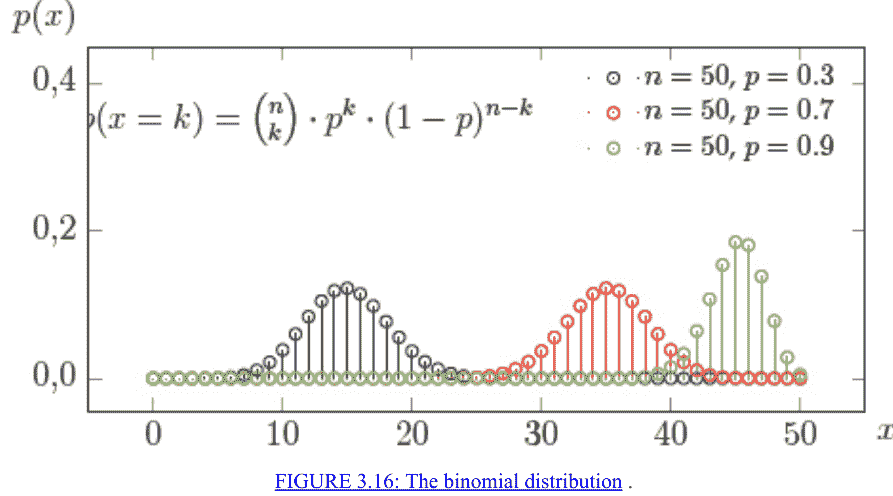

**SOL-33 章节 SOL-3.4.**
随机变量 $X \sim \text{Binomial}(n, p)$ 具有如下概率质量函数 (PMF)：

$$ P(X=k) = {n \choose k} p^k (1-p)^{n-k};\ k = 0,\ 1,\ 2,\ \ldots,\ n$. \quad (3.11) $$

#### SOL-34 章节 SOL-3.5.
以下答案针对离散随机变量。鼓励好奇的读者将其扩展到连续情况。

1.  对于具有概率质量函数 $P(X=k)$ 和结果集 $K$ 的随机变量 $X$，$X$ 的期望值定义为：
   $$ E[X] := \sum_{k \in K} k P(X=k). \quad (3.12) $$
   注意：$X$ 的期望值也可以用 $\mu_X$ 表示。

2.  $X$ 的方差定义为：
   $$ \text{Var}[X] := E[(X - E[X])^2]. \quad (3.13) $$
   注意：$X$ 的方差也可以用 $\sigma_X^2$ 表示，而 $\sigma_X$ 本身表示 $X$ 的标准差。

3.  具有参数 $n$ 和 $p$ 的二项随机变量的总体均值和方差为：
   $$ E[X] = np \quad V[X] = np(1-p) \quad (3.14) $$
   注意：为什么这个解法是直观的？当 $p = 1/2$ 时，发生什么与信息论相关的现象？

#### SOL-35 章节 SOL-3.6.
1.  该场景描述了一个独立重复 200 次的实验，成功概率为 0.1。因此，如果随机变量


$X$ 表示成功获得的次数，它最好用参数为 $n = 200$ 和 $p = 0.1$ 的二项分布来描述。形式上：

$$X \sim \text{Binomial}(200, 0.1) . \tag{3.15}$$

$X$ 的期望值由下式给出：

$$E(X) = 200 \times 0.1 = 20, \tag{3.16}$$

其对应的方差为：

$$Var(X) = 200 \times 0.10(1 - 0.10) = 18.0 . \tag{3.17}$$

这里，我们提出两种不同的方法来回答这个问题。

首先，直接的解决方案是采用二项分布的定义，并将其中的 $X$ 值代入。即：

$$\begin{aligned} P(X = 60; n = 200, p = 0.1) \\ &= \binom{200}{60} 0.1^{60} (1 - 0.1)^{200-60} \\ &\approx 2.7 \times 10^{-15} . \end{aligned} \tag{3.18}$$

这表明放射科医生犯错的概率极高。

以下方法更长且更高级，但它能为读者提供关于结果的洞察和直觉。为了推导放射科医生错得有多离谱，我们可以通过考虑标准正态分布来采用一种近似方法。在统计学中，**Z分数** 让我们理解数据点距离均值有多远（以标准差为单位），从而揭示其发生的可能性（图 3.17）。

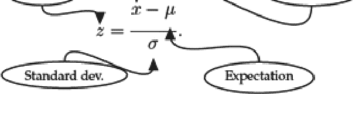


因此，正确命中 60 个细胞的概率为：

$P(X\geq 60)=P(Z\geq \frac{60-20}{\sqrt{18.0}})=P(Z\geq 9.428)\approx 0.$ (3.20)

> 同样，结果再次显示放射科医生犯错的可能性接近 $1.$ 注意：为什么图 3.17 中描绘的关系推导出 $Z$ 是标准高斯分布？在什么条件下该结论有效？为什么公式 $(3.20)$ 使用累积分布函数而不是概率质量函数？

### 3.3.2 条件概率

#### SOL-36 🏃 CH.SOL - 3.7.

1. 对于两个事件 $A$ 和 $B$，若 $P(B)>0$，则在 $B$ 发生的情况下 $A$ 的条件概率定义为：

$P(A|B)=\frac{P(A \cap B)}{P(B)}.$ (3.21)

容易注意到，如果 $P(B)=0$，该关系在数学上是未定义的。在这种情况下，$P(A|B)=P(A \cap B)=P(A).$

2. 标注的概率显示在图 3.18 中：

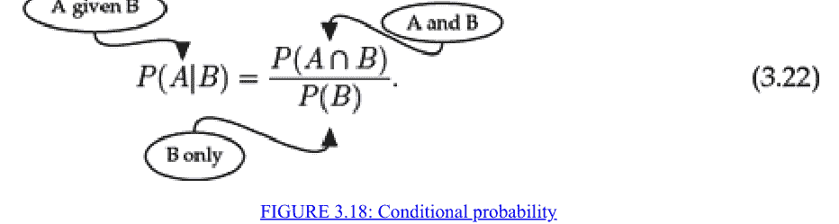

3. 一个描绘相交事件 $A$ 和 $B$ 的图示示例显示在图 3.19 中：

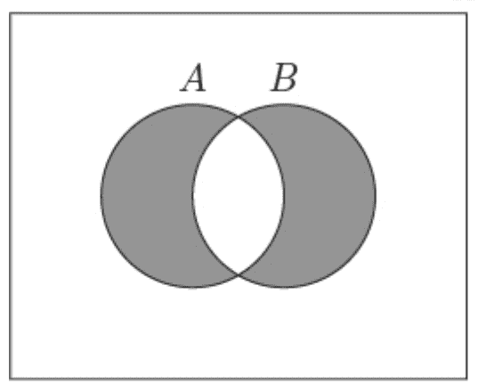

图 3.19：概率空间 $\mathcal{H}$ 中相交事件 A 和 B 的文氏图

#### SOL-37 CH.SOL- 3.8.

贝叶斯公式表述为：

$$P(A|B)=\frac{P(B|A)P(A)}{P(B|A)P(A)+P(B|A^c)P(A^c)},\tag{3.23}$$

其中 $P(A^{c})$ 是 $P(A)$ 的互补概率。贝叶斯公式中元素的解释如下：

$$\text{后验概率}=\frac{\text{数据似然} \times \text{先验概率}}{\text{归一化常数}}.\tag{3.24}$$

注意：归一化常数的主要作用是什么？分析 $P(B) \rightarrow 0$ 和 $P(B) \rightarrow 1$ 的情况。标注的概率显示在图 3.20 中：

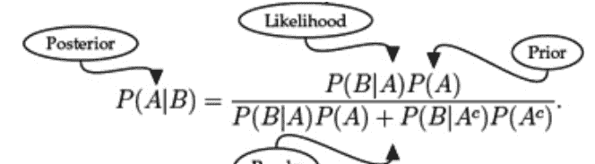

$$P(A|B)=\frac{P(B|A)P(A)}{P(B|A)P(A)+P(B|A^{c})P(A^{c})}.\quad (3.25)$$


#### SOL-38 CH.SOL- 3.9.

给定 $X$ 为离散随机变量，给定 $\gamma$ 为感兴趣的参数，则给定 $\gamma$ 时 $X$ 的似然函数和对数似然函数分别为：

$$\mathcal{L}_{\gamma}(X=x)=p(X=x|\gamma)\quad (3.26)$$

$$\ell_{\gamma}(X=x)=\ln\left(p(X=x|\gamma)\right)\quad (3.27)$$

术语“似然”可以从这个定义中直观地理解；它推导出了在已知其分布（即参数 $\gamma$）的先验信息的情况下，获得数值 $x$ 的可能性。例如，让我们考虑一枚有偏硬币的投掷，其正面概率为 $p_{h}=\gamma$。则：

$$\mathcal{L}_{\gamma}(X="H")=p(X="H"|\gamma)=\gamma.\quad (3.28)$$

$$\ell_{\gamma}(X="H")=\ln\left(p(X="H"|\gamma)\right)=\ln\left(\gamma\right).\quad (3.29)$$

注意：似然函数也可以遵循正态分布等连续分布。在后一种情况下，建议使用并且往往是必须使用对数似然。为什么？我们鼓励读者将上述内容修改为高斯分布的连续情况，并推导出答案。

#### SOL-39 CH.SOL- 3.10.

连续先验分布，$f(\Gamma=\gamma)$ 代表了在实验开始之前对 $\gamma$ 值的概率的了解。它被称为主观的，因此可能在研究人员之间有很大差异。通过继续上一个例子，$f(\Gamma=0.8)$ 持有随机投掷硬币产生“正面”且概率为 80% 的概率。

#### SOL-40 ✏ CH.SOL- 3.11.

贝叶斯分析的本质是从后验分布 $p(\Gamma = \gamma | X = x)$ 中推断未知量或分位数，该分布传统上是从先验信念和数据信息中推导出来的。关于获得参数 $\Gamma = \gamma$ 或随机变量未观测值 $X = x$ 的机会的贝叶斯统计结论是以概率陈述的形式做出的。这些概率陈述以观测到的 X 值为条件，表示为 $p(\Gamma = \gamma | X = x)$，称为参数 $\gamma$ 的后验分布。贝叶斯分析是一种实用方法，利用概率模型对我们观测到的数量以及我们想要了解的数量进行推断。贝叶斯规则提供了这种形式的关系：

$$\text{后验} \propto p(\mathbf{x}|\gamma) p(\gamma) \propto \text{给定先验的数据} \times \text{先验的概率} . (3.30)$$

#### SOL-41 ✏ CH.SOL- 3.12.

后验密度总结了在数据被**观测**后对感兴趣的参数 $\gamma$ 的了解。在贝叶斯统计中，后验密度 $p(\Gamma = \gamma | X = x)$ 成为下一次实验的**先验**。这是众所周知的贝叶斯更新机制的一部分，其中我们更新我们的知识以反映我们观测到的数据的实际分布。总结来说，从贝叶斯定理的角度来看，我们在看到数据后将**先验分布**更新为**后验分布**。

#### SOL-42 ✏ CH.SOL- 3.13.

当事件 A 和 B 满足（且仅当满足）以下条件时，它们在统计上是独立的：

$P(A \cap B) = P(A) P(B)$. (3.31)

> *注意：使用条件概率并合理化这一结果。在考虑正态分布特征可能性的实际研究中，这一属性如何变得极其有用？*

### 3.3.3 贝叶斯规则

#### SOL-43 🖇 CH.SOL- 3.14.

*让 $\gamma$ 代表半整数自旋态的数量，并且给定先验知识即两种状态的概率相等：*

$$P(\gamma=2|\gamma \geq 1)$$

$$= \frac{P(\gamma=2, \gamma \geq 1)}{P(\gamma \geq 1)} (3.33)$$

$$= \frac{P(\gamma=2)}{1-P(\gamma=0)} = \frac{1/4}{1-1/4} = \frac{1}{3} (3.34)$$

*注意：上述关系在何种统计性质下成立？*

#### SOL-44 🖇 CH.SOL- 3.15.

*让事件 $A$ 表示存在遗传疾病，让事件 $B$ 表示测试结果为阳性。计算出的概率见表 3.1。我们被要求找出测试表明存在遗传疾病的概率，即 $P(B)$。根据概率加法法则：*

$P(B)=P(B|A)*P(A)+P(B|\overline{A})*P(\overline{A})$ (3.35)

$=[0.95*0.01]+[0.05*0.99]=0.059$

*注意：就性能评估而言，$P(B|A)$ 通常被称为检测概率，而 $P(B|\overline{A})$ 被认为是虚警概率。请注意，这些度量在逻辑上或数学上都不组合为概率 $1$。*

| 概率 | 解释 |
|---|---|
| P(A)=0.01 | 遗传疾病的概率。 |
| P($\overline{A}$)=1-0.01=0.99 | 没有遗传疾病的概率。 |
| P($\overline{B}|\overline{A}$)=0.95 | 如果没有遗传疾病 [$\overline{A}$]，测试结果为阴性 [$\overline{B}$] 的概率。 |
| P(B|\overline{A})=0.05 | 如果没有遗传疾病，测试结果为阳性 [B] 的概率。 |


### 3.3.3 遗传病检测

表 3.1：遗传病检测的概率值。

| 参数 | 描述 |
| :--- | :--- |
| $P(B|A) = 0.95$ | 如果存在遗传病 [A]，检测呈阳性结果 [B] 的概率（检测概率）。 |
| $P(\overline{B}|A) = 1 - 0.95 = 0.05$ | 如果存在遗传病 [A]，检测呈阴性结果 [$\overline{B}$] 的概率。 |
| $P(B|\overline{A}) = 0.05$ | 如果不存在遗传病 [$\overline{A}$]，检测呈阳性结果 [B] 的概率（虚警概率）。 |

#### SOL-45 (CH.SOL-3.16)

我们首先逐一列举概率：

$P(\mathit{Dercum}\mid \mathit{female}) = 0.05,\tag{3.36}$

$P(\mathit{Dercum}\mid \mathit{male}) = 0.0025,\tag{3.37}$

$P(\mathit{male}) = P(\mathit{female}) = 0.5.\tag{3.38}$

我们需要求 $P(\mathit{female}\mid\mathit{Dercum})$。利用贝叶斯公式：

$P(\mathit{female}\mid\mathit{Dercum}) = \dfrac{P(\mathit{Dercum}\mid\mathit{female})P(\mathit{female})}{P(\mathit{Dercum})}.\tag{3.39}$

然而，我们缺少项 $P(\mathit{Dercum})$。为了找到它，我们应用全概率定律：

$\begin{aligned} P(\mathit{Dercum}) & = P(\mathit{Dercum}\mid \mathit{female})P(\mathit{female}) \\
& + P(\mathit{Dercum}\mid \mathit{male})P(\mathit{male}) \\
& = 0.05 \cdot 0.5 + 0.0025 \cdot 0.5 \\
& = 0.02625. \end{aligned}$

最后，回到公式 (3.39)：

$P(\mathit{female}\mid\mathit{Dercum}) = \dfrac{0.05 \cdot 0.5}{0.02625} \approx 0.9524\tag{3.40}$

*注：如何用单个数学方程达到这个结果？*

#### SOL-46 (CH.SOL-3.17)

为了解决这个问题，我们引入以下事件：

- **AI**：AI 预测股票期权状态为 1。
- **State 1**：股票期权状态为 1。
- **State 0**：股票期权状态为 0。

直接应用贝叶斯公式得出：

$$ P(\text { State } 1|\text { AI })= \frac{P(\mathrm{AI} | \text { State } 1) P(\text { State } 1)}{P(\mathrm{AI} | \text { State } 1) P(\text { State } 1)+P(\mathrm{AI} | \text { State } 0 ) P(\text { State } 0 )} \tag{3.41} $$

$$ = \frac{0.85 \cdot 2 / 3}{0.85 \cdot 2 / 3+0.15 \cdot 1 / 3} \approx 0.9189 . \tag{3.42} $$

#### SOL-47 (CH.SOL-3.18)

为了解决这个问题，我们引入以下事件：

- **H**：人类。
- **M**：猴子。
- **C**：预测正确。

通过运用贝叶斯定理和全概率定律：

$P(H|C)=\frac{P(H\cap C)}{P(C)} \tag{3.43} $

$=\frac{P(C|H)P(H)}{P(C|H)P(H)+P(C|M)P(M)}$

$=\frac{\frac{1}{20}\cdot\frac{1}{2}}{\frac{1}{20}\cdot\frac{1}{2}+\frac{1}{15}\cdot\frac{1}{2}}$

$\approx 0.42.$

*注：如果这个结果看起来有些不对劲，请不要担心——这是理解条件概率的一个积极信号。*

#### SOL-48 (CH.SOL-3.19)

为了解决这个问题，我们引入以下事件：

1. **RUS**：一名俄罗斯潜伏特工在说话。
2. **AM**：一名美国人在说话。
3. **L**：TTS 系统生成了“l”。

我们需要求 $P(\textit{RUS}|L)$ 的值。利用贝叶斯定理，我们可以写成：

$P(\textit{RUS}|L)=\frac{P(L|\textit{RUS})P(\textit{RUS})}{P(L)}.$ (3.44)

被告之俄罗斯人占与会者的 1/5，因此：

$P(\textit{RUS})=\frac{1}{5}.$ (3.45)

此外，因为“v-o-k-s-a-l”在总共六个字母中只有一个 l：

$P(L|\textit{RUS})=\frac{1}{6}.$ (3.46)

此外，因为“V-a-u-x-h-a-l-l”在总共八个字母中有两个 l：

$P(L|AM)=\frac{2}{8}$ (3.47)

应用全概率定律得出：

$\begin{gathered} P(L)=P(AM)P(L|AM)+P(RUS)P(L|RUS)\\ =\left(\frac{4}{5}\right)\left(\frac{2}{8}\right)+\left(\frac{1}{5}\right)\left(\frac{1}{6}\right)=\frac{7}{30} \tag{3.48}\end{gathered}$

利用贝叶斯定理，我们可以写成：

$P(RUS|L)=\frac{\frac{1}{5}\left(\frac{1}{6}\right)}{\frac{7}{30}}=\frac{1}{7}$ (3.49)

> **注：** 算法最有可能通过哪个字母发现俄罗斯潜伏特工？

#### SOL-49 (CH.SOL-3.20)

已知：

$P(X \text{ 被错误接收为 } Z) = 1/7$.

利用贝叶斯定理，我们可以写成：

$\begin{aligned} P(Z_{trans}|Z_{received}) &= \frac{P(Z_{received}|Z_{trans})P(Z_{trans})}{P(Z_{received})} \tag{3.50} \end{aligned}$

应用全概率定律得出：

$\begin{aligned} P(Z_{received}) &= P(Z_{received}|Z_{trans})P(Z_{trans}) \\ &+P(Z_{received}|X_{trans})P(X_{trans}) \\ &=\frac{7}{8}\cdot\frac{3}{7}+\frac{1}{8}\cdot\frac{4}{7} \\ &=\frac{3}{8}+\frac{4}{56}=\frac{25}{56} \end{aligned}$

因此，使用贝叶斯公式，我们有：

$$\begin{aligned} P(Z_{trans}|Z_{received}) &= \frac{P(Z_{received}|Z_{trans})P(Z_{trans})}{P(Z_{received})} \\ &= \frac{\frac{7}{8} \frac{2}{7}}{\frac{25}{56}} \\ &= \frac{21}{25} = 0.84 . \end{aligned}\tag{3.51}$$

### 3.3.4 最大似然估计

#### SOL-50 (CH.SOL-3.21)

对于独立同分布样本集 $X_{1}$，$\cdots$，$X_{n}$，似然函数是概率函数的乘积：

$$\begin{aligned} L(p) &= p(X_{1}=x_{1};p)p(X_{2}=x_{2};p)\cdots p(X_{n}=x_{n};p) \\ &= \prod_{i=1}^{n}\binom{n}{x_{i}}p^{x_{i}}(1-p)^{n-x_{i}} . \end{aligned}\tag{3.52}$$

*注：当 $X$ 是伯努利分布随机变量时，$X^{n}$ 的分布是什么？*

#### SOL-51 (CH.SOL-3.22)

$p$ 的最大似然估计量 (MLE) 是使 $L(p)$ 最大化的所有可能 $p$ 值。也就是说，使得测量集 $X_{1}$，$\cdots$，$X_{n}$ 最可能的 $p$ 值。形式上：

$$\hat{p}=arg\,max_{0\leq p\leq 1}L(p)\tag{3.53}$$

*注：强烈鼓励好奇的学生从 $L(p)$ 推导 $\hat{p}$。注意 $L(p)$ 可以极大地简化。*

#### SOL-52 (CH.SOL-3.23)

对数似然是似然函数的对数。直观地讲，在寻找 MLE $\hat{\gamma}$ 时，最大化似然函数 $L(\gamma)$ 等价于最大化 $\ln L(\gamma)$，因为 $\ln$ 是一个单调递增函数。通常，我们最大化 $\ln(f(\gamma))$ 而不是 $f(\gamma)$。一个常见的例子是当 $L(\gamma)$ 由正态分布的随机变量组成时。形式上，如果 $X_{1}, \cdots, X_{n}$ 是独立同分布的，每个都具有概率质量函数 (PMF) $f_{X_{i}}(x_{i} | \gamma)$，那么：

$f(\gamma)=\prod_{i=1}^{n} f_{X_{i}}\left(x_{i} | \gamma\right),$ (3.54)

$\ln(f(\gamma))=\sum_{i=1}^{n} \ln f_{X_{i}}\left(x_{i} | \gamma\right).$ (3.55)

#### SOL-53 (CH.SOL-3.24)

在似然函数可微的情况下，寻找 MLE 的一般程序如下：

1. 首先对目标参数 $\gamma$ 求对数似然函数 $\ln\left(L(\gamma)\right)$ 的导数。
2. 将结果设为零。
3. 解方程找到满足以下条件的 $\hat{\gamma}$：
   $$\frac{\partial \ln L\left(\hat{\gamma} | x_{1}, \cdots x_{n}\right)}{\partial \gamma}=0 \tag{3.56}$$
4. 计算二阶导数以验证确实是最大值而不是最小值。

#### SOL-54 (CH.SOL-3.25)

对数似然函数的一阶导数通常被称为费舍尔得分函数，定义如下：

$$\mathbf{u}(\gamma)=\frac{\partial\ln L(\gamma \mid x_{1},\cdots x_{n})}{\partial\gamma} \tag{3.57}$$

### 3.3.5 费舍尔信息量

#### SOL-55 (CH.SOL-3.26)

**费舍尔信息量**是描述对数似然函数二阶导数（曲率）期望值的术语，定义如下：

$$\mathbf{I}(\gamma)= -E\left[\frac{\partial^{2}\ln L(\gamma \mid x_{1},\cdots x_{n})}{\partial\gamma^{2}}\right] \tag{3.58}$$

#### SOL-56 (CH.SOL-3.27)

1. **给定 $L(\gamma)$：**
   $$\ln L(\gamma)= \ln \Big( \binom{n}{y} \Big)+y \ln (\gamma)+ (n - y) \ln (1 - \gamma). \tag{3.59}$$
2. **为了找到梯度，我们求一次导数：**
   $$g(\gamma)= \frac{d}{d\gamma} \ln L(\gamma) = \frac{y}{\gamma} - \frac{n-y}{1-\gamma} \tag{3.60}$$
3. **海森矩阵由对 $g(\gamma)$ 求导生成：**
   $$H(\gamma)= -\frac{y}{\gamma^2} - \frac{n-y}{(1-\gamma)^2} \tag{3.61}$$
4. **费舍尔信息量计算如下：**
   $$I(\gamma) = -E[H(\gamma)] = \frac{n}{\gamma(1-\gamma)} \tag{3.62}$$


$$I(\gamma) = - E(H(\gamma)) = \frac{n}{\gamma(1-\gamma)}$$

*因为：*
$$E(\underline{y}|\gamma, n) = n * \gamma$$

*5 令梯度为零并求解参数* $\gamma$*，我们得到：*

$$\hat{\gamma} = \frac{\underline{y}}{n}$$

*在我们的案例中，这等于：300/10000 = 0.03。关于误差，$\gamma$ 的方差与 Fisher 信息量之间存在密切关系，因为前者是后者的倒数：*
$$\text{var}(\gamma) = [I(\gamma)]^{-1}$$
$$V(\gamma) = \frac{\gamma(1-\gamma)}{n}$$

*将问题中的数字代入：*
$$\hat{V}(\hat{\gamma}) = \frac{0.03(1-0.03)}{10000} = 2.9 \times 10^{-7}.$$

*统计上，要求找出的标准误差是公式* 3.66 *的平方根，等于* $5.3 \times 10^{-4}$*。注：此实验揭示了哪种期望属性？以什么代价可以确保较低的标准误差？*

#### SOL-57 CH.SOL- 3.28.

*这些分布的 Fisher 信息量如下：*

##### 1. 伯努利分布：

$$\Phi(x|\gamma) = x \log \gamma + (1-x) \log(1-\gamma)$$

$$ \Phi '(x|\gamma) = \frac{x}{\gamma} - \frac{1-x}{1-\gamma}, $$

3.68

$$ \Phi ''(x|\gamma) = -\frac{x}{\gamma^{2}} - \frac{1-x}{(1-\gamma)^{2}}, $$

3.69

$$ I(\gamma) = \operatorname{E}_{\gamma}\left[\frac{X(1-\gamma)^{2} + (1-X)\gamma^{2}}{\gamma^{2}(1-\gamma)^{2}}\right] = \frac{1}{\gamma(1-\gamma)}. $$

3.70

##### 2. 泊松分布：

$$ \begin{aligned} &\lambda(x|\theta) = x \log \theta - \log x! - \theta,\\ &\lambda '(x|\theta) = \frac{x-\theta}{\theta},\\ &\lambda ''(x|\theta) = -\frac{x}{\theta^{2}},\\ &\quad I(\theta) = \operatorname{E}_{\theta}\left[\frac{(X-\theta)^{2}}{\theta^{2}}\right] = \frac{1}{\theta}. \end{aligned} $$

3.71


#### SOL-58 CH.SOL- 3.29.

- 正确。
- 正确。


### 3.3.6 后验与先验预测分布

#### SOL-59 CH.SOL- 3.30.

- 给定一个形式为 $\underline{x} = (x_{1}$ , $\cdots$ , $x_{n})$ 的样本，该样本取自密度函数 $p(\theta$ ; $\underline{x})$，且 $\theta$ 根据先验密度 p $(\theta)$ 随机生成。则后验密度定义为：

$$ p ( \boldsymbol { \theta } | \underline { { x } } ) = \frac { p ( \underline { { \theta } } ; \underline { { x } } ) p ( \theta ) } { p ( \underline { { x } } ) } . $$  (3.72)

- 先验预测密度为：

$$ p ( \underline { { x } } ) = \int _ { \theta \in \Theta } p ( \underline { { \theta } } ; \underline { { x } } ) p ( \theta ) d \theta $$  (3.73)

#### SOL-60 CH.SOL- 3.31.

- 后验 $p ( \theta | y ) \propto p ( y | \theta ) p ( \theta )$ 为：

$$ \begin{array} { l } { \binom { 5 } { y } ( 1 / 2 ) ^ { y } ( 1 / 2 ) ^ { 5 - y } 0 . 2 5 , ~ \theta = 1 / 2 } \\ { \binom { 5 } { y } ( 1 / 6 ) ^ { y } ( 5 / 6 ) ^ { 5 - y } 0 . 5 , ~ ~ \theta = 1 / 6 } \\ { \binom { 5 } { y } ( 1 / 4 ) ^ { y } ( 3 / 4 ) ^ { 5 - y } 0 . 2 5 , ~ ~ \theta = 1 / 4 } \\ { 0 , ~ ~ ~ ~ ~ ~ ~ ~ ~ ~ ~ ~ ~ ~ ~ ~ o t h e r w i s e } \end{array} $$

- 先验预测分布 $p ( y )$：

$$ \binom { 5 } { y } ( ( 1 / 2 ) ^ { y } ( 1 / 2 ) ^ { 5 - y } 0 . 2 5 $$  (3.74)

$$ ( 1 / 6 ) ^ { y } ( 5 / 6 ) ^ { 5 - y } 0 . 5 + ( 1 / 4 ) ^ { y } ( 3 / 4 ) ^ { 5 - y } 0 . 2 5 ) . $$  (3.75)

### 3.3.7 共轭先验

#### SOL-61 CH.SOL- 3.32.

- *若先验分布的类 F 满足：当先验密度属于 F 时，对于所有样本，其后验密度也属于 F，则称该先验分布类 F 构成共轭族。*
- *通常我们希望使用一种不偏向参数任何特定值的先验分布。然而贝叶斯分析需要信息先验，但在收集数据之前有时并没有特别有用的信息。在这种情况下，期望使用“无信息”先验。这种先验称为非信息先验。*

#### SOL-62 CH.SOL- 3.33.

*若 $x \sim B(n, \gamma)$，则*
*$p (x|\gamma) \propto \gamma^{x}(1-\gamma)^{n-x}$*
*且* $\gamma$ *的先验分布为 $B(\alpha, \beta)$，则*
*$p (\gamma) \propto \gamma^{\alpha-1}(1-\gamma)^{\beta-1}$*
*则*后验分布为*
*$\gamma|x \sim B(\alpha+x, \beta+n-x)$*
*显然，Beta 分布族对于二项式似然函数是共轭的。*

### 3.3.8 贝叶斯深度学习

#### SOL-63 CH.SOL- 3.34.

- *隐藏神经元服从以下分布：*
*X ~ 二项分布($n, \gamma$) 随机变量，并以 $\gamma$ 的概率激活。*
*共有 100 个神经元，其中只有 20 个 **激活**。*

$P(x = 20|\theta) = \left(\begin{array}{c} 100\\ 20\end{array}\right) \theta^{20}(1-\theta)^{80} \qquad \qquad \qquad \qquad \qquad (3.76)$

- *隐藏神经元服从以下分布：*
*X 服从均匀分布 (0, γ) 随机变量，并以 γ 的概率激活。均匀分布当然是非常简单的一种情况：*

$$ f(x; a, b) = \frac{1}{b-a} \quad \text{当} \quad a \leq x \leq b \tag{3.77} $$

*因此：*

$$ f(x|\gamma) = \begin{cases} 0 & \text{若 } \gamma < x \text{ 或 } x < 0 \\ 1/\gamma & \text{若 } 0 \leq x \leq \theta \end{cases} \tag{3.78} $$

#### SOL-64 CH.SOL- 3.35.

*给定的分布属于指数族。因此，单个神经元失活的概率为：*

$$ p = P(X < 20) = \int_{0}^{20} e^{-x} \, dx = 1 - e^{-20}. \tag{3.79} $$

*OnOffLayer 仅在 200 个神经元中至少 150 个失活时关闭。因此，这可以表示为二项分布，该层关闭的概率为：*

$$ \binom{200}{150} p^{2}(1-p) + \binom{200}{200} p^{200} = 200p^{2}(1-p) + p^{200}. \tag{3.80} $$

*因此，该层保持活跃至少 20 秒的概率为 1 减去上述值：*

$$ [1 - (200p^{2}(1-p) + p^{200})]. \tag{3.81} $$

#### SOL-65 CH.SOL- 3.36.

*观测数据，例如被丢弃的神经元，服从以下分布：*

$$ (x_1, \dots, x_n)|\theta \stackrel{iid}{\sim} \mathrm{Bern}(\theta) \tag{3.82} $$

*设 $s$ 和 $f$ 分别表示成功和失败，我们知道似然函数为：*

$$p(\boldsymbol{x_1}, \dots, x_n|\theta) = \theta^s(1 - \theta)^f$$
(3.83)

*当参数 $\alpha = \beta = 1$ 时，Beta 分布表现为均匀先验：*

$$\theta \sim \text{Beta}(\alpha, \beta), \text{ 给定 } \alpha = \beta = 1$$
(3.84)

*因此，先验密度为：*

$$p(\theta) = \frac{1}{B(\alpha, \beta)}\theta^{\alpha-1}(1 - \theta)^{\beta-1}$$
(3.85)

*因此，后验分布为：*

$$\begin{align*}
p(\theta|x_1, \dots, x_n) & \propto p(\boldsymbol{x_1}, \dots, x_n|\theta)\ p(\theta) \\
& \propto \theta^s(1 - \theta)^f\theta^{\alpha-1}(1 - \theta)^{\beta-1} \\
& = \theta^{\alpha+s-1}(1 - \theta)^{\beta+f-1}
\end{align*}
(3.86)

#### SOL-66 CH.SOL- 3.37.

*当神经元的值（或等价的量子项-速度）达到最可能值时，神经元会被丢弃：*

$$n(v)dv = \frac{4\pi N}{V} \left(\frac{m}{2\pi kT}\right)^{3/2} v^2e^{-\frac{mv^2}{2kT}}dv$$
(3.87)

*根据微积分学，我们知道为了最大化一个函数，必须将其一阶导数设为零：*

$$\frac{d}{dv}n(v) = 0$$
(3.88)

*常数可以按以下方式提取：*

$$\frac{d}{dv}v^2e^{-\frac{mv^2}{2kT}} = 0$$
(3.89)

应用微积分中的链式法则：

$$2v e^{-\frac{mv^2}{2kT}} + v^2\left(-\frac{m}{2kT}2v\right)e^{-\frac{mv^2}{2kT}} = 0 \tag{3.90}$$

我们注意到几项相互抵消：

$$v^2 \frac{m}{2kT} = 1 \tag{3.91}$$

现在求解该二次方程，得到：

$$v_{\text{most\_probable}} = \sqrt{\frac{2kT}{m}} \tag{3.92}$$

因此，这是 Dropout 层激活的最可能值。

#### 参考文献

- M. Barati and P. ‘Comparison of complications of chorionic villus sampling and amniocentesis’. In: *5* 4 (2012), pp. 241–244 (cit. on p. *46*).
- J. D. e. a. Bell BP Damon IK. ‘Overview, Control Strategies, and Lessons Learned in the CDC Response to the 20142016 Ebola Epidemic.’ In: *Morbidity and Mortality Weekly Report* 65.3 (2016), pp. 4–11 (cit. on p. *52*).
- J. C. Cook and G. P. Gross. *Adiposis Dolorosa (Dercum, Anders Disease, StatPearls)* [Internet], 2019 (cit. on p. *47*).
- G. Ecker. *Particles, Field, From Quantum Mechanics to the Standard Model Particle Physics*. Springer, 2019 (cit. on p. *45*).
- K. Gaj and A. Orlowski. ‘Facts and Myths of Enigma: Breaking Stereotype In: *International Conference on the Theory and Applications of Cryptographic Techniques*. 2003 (cit. on p. *50*).
- B. Gottschalk. ‘Techniques of Proton Radiotherapy: Transport Theory’. 1 *arXiv* (2012) (cit. on p. *43*).
- T. S. O. of Investor Education and Advocacy. *Binary options and Fraud* (cit. on p. *48*).
- E. T. Jaynes. *Probability Theory as Logic*. Ed. by P. F. Fougère. Maximum


*   熵与贝叶斯方法。Kluwer, Dordrecht, 1990 (引用自第 42 页)。
*   国家安全部 D. o. J. *密谋充当外国政府未注册代理*。2010 (引用自第 49 页)。
*   A. Paszke 等。‘PyTorch 中的自动微分’。收录于 *第 31 届神经信息处理系统会议*。2017 (引用自第 56 页)。
*   J. Salvatier, T. V. Wiecki 和 C. Fonnesbeck。‘使用 PyMC$^3$ 在 Python 中进行概率编程’。收录于 *PeerJ 计算机科学* 2 (2016 年 1 月), e55 (引用自第 42 页)。
*   P. Sledzinski 等。‘大麻素在癌症生物学中的现状及展望’。收录于 *癌症医学* 7.3 (2018), 第 765–775 页 (引用自第 56 页)。
*   E. B. Starikov。‘贝叶斯统计力学：笔尖处的熵焓补偿与通用状态方程’。收录于 *物理学前沿* 6 (2018), 第 2 页 (引用自第 42 页)。

## 第三部分

## 高中部分

## 第四章

## 信息论

> 信息论的一个基本思想是，信息可以像质量或能量等物理量一样被处理。
> — 克劳德·香农，1985

# 目录

*   - [引言](#)
*   - [习题](#)
    *   [信息论中的对数](#)
    *   [香农熵](#)
    *   [Kullback-Leibler 散度 (KLD)](#)
    *   [分类与信息增益](#)
    *   [互信息](#)
    *   [机械统计](#)
    *   [Jensen 不等式](#)
*   - [解答](#)
    *   [信息论中的对数](#)
    *   [香农熵](#)
    *   [Kullback-Leibler 散度](#)
    *   [分类与信息增益](#)
    *   [互信息](#)
    *   [机械统计](#)
    *   [Jensen 不等式](#)

### 4.1 引言

归纳推理是**不确定性**条件下在信息不完备的情况下进行推理的问题。根据香农的理论 [2]，信息和不 确定性是同一枚硬币的两面：不确定性越大，我们消除不确定性所获得的信息就越多。熵在从物理学和统计学到数据科学和经济学等许多科学领域中起着核心作用。信息论的一个基本问题是编码大量信息 [2]。

香农发现了数据压缩和传输的基本定律，标志着信息论的诞生。在他 1948 年的奠基性论文《*通信的数学理论*》[4] 中，香农提出了一个衡量与随机无记忆源相关的不确定性的度量，称为*熵*。

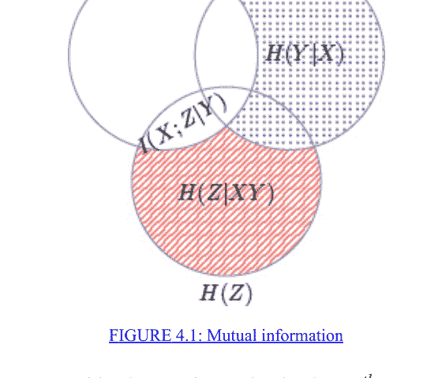

图 4.1：互信息

熵最早出现在 18 世纪的热力学中，由卡诺提出，[1] 他关于蒸汽的先驱性工作题为《*关于火之动力的思考*》（图 4.2）。随后，熵出现在统计力学中，被视为一种*无序度*的度量。然而，是玻尔兹曼 (4.30) 发现了熵与概率之间的联系，而香农使用的信息概念是熵概念的推广。香农熵与玻尔兹曼熵在某些方面有着本能上的联系，同样，信息论中发展的数学在统计力学中也具有高度相关性。

### 关于
### 热之动力
### 的思考。

摘自 N.-L.-S. 卡诺
（高等工科学校毕业生）的法语原著。

附有
Carnot 理论的
说明。
由威廉·汤姆森爵士
（开尔文勋爵）撰写。

由 R. H. THURSTON, M. A., LL.D., Dr. ENG'G 编辑；
Sibley 学院院长，康奈尔大学；
“法国公共教育军官”，
*等等，等等，等等。*


我面试的候选人中**大多数**无法回答以下问题：*抛一枚非有偏硬币的熵是多少？* 令人惊讶的是，即使我明确给出了计算熵 $(4.4)$ 的香农公式，许多人仍然无法计算简单的对数。本章的目的是向有志成为数据科学家的人介绍熵的一些最重要概念，并阐明其与概率的关系。因此，它主要关注信息论中的基本量，如熵、交叉熵、条件熵、互信息和 Kullback-Leibler 散度（也称为相对熵）。然而，它不讨论更高级的主题，例如 Bohn 和 Hiley 引入的主动信息概念 $[3]$。

### 4.2 习题

#### 4.2.1 信息论中的对数

需要注意的是，本章中所有数值计算都使用二进制对数 $\log _{2}$。这种特定的对数产生比特单位，这是信息论领域中信息量的常用单位。

**PRB-67 ❓ 习题 4.1.**

*在 Python 解释器中运行以下 Python 代码 ([4.3](4.3))。结果是什么？*

```python
1  import math
2  import numpy
3  print( math. log(1.0/0.98 )) # 自然对数 (ln)
4  print( numpy. log(1.0/0.02 )) # 自然对数 (ln)
5
6  print( math. log10(1.0/0.98 )) # 常用对数 (底数为 10)
7  print( numpy. log10(1.0/0.02 )) # 常用对数 (底数为 10)
8
9  print( math. log2(1.0/0.98 )) # 二进制对数 (底数为 2)
10 print( numpy. log2(1.0/0.02 )) # 二进制对数 (底数为 2)
```


**PRB-68 ❓ 习题 4.2.**

*对数的三个基本定律：*

1.  *第一定律*  
    $$\log A+\log B=\log AB .$$ (4.1)
    
    *计算以下表达式：*
    
    $$\log _{10} 3+\log _{10} 4 .$$

2.  *第二定律*  
    $$ \log A^{n}=n \log A . \tag{4.2}$$
    
    *计算以下表达式：*
    
    $$\log _{2} 4^{6} .$$

3.  *第三定律*
    $$\log A-\log B=\log \frac{A}{B} . \tag{4.3}$$
    
    *因此，从 $\log A$ 中减去 $\log B$ 得到 $\log \frac{A}{B}$ 。计算以下表达式：*
    
    $$\log _{\mathrm{e}} 15-\log _{\mathrm{e}} 3 .$$

#### 4.2.2 香农熵

**PRB-69 ? 习题 4.3.**

写出香农著名的*不确定性*通用公式。

**PRB-70 ? 习题 4.4.**

选择**恰好一个，且仅一个**答案。

1. 对于一个*必然发生*的事件，其熵是多少？
    *   (a) 1.0
    *   (b) 0.0
    *   (c) *熵未定义*
    *   (d) − 1
    *   (e) 0.5
    *   (f) log$_{2} (N)$，其中 *N* 是可能事件的数目

2. 对于 *N 个等概率事件*，其熵是多少？
    *   (a) 1.0
    *   (b) 0.0
    *   (c) 熵未定义
    *   (d) -1
    *   (e) 0.5
    *   (f) log₂(N)

**PRB-71 ❓ 习题 4.5.**
香农发现熵是满足*三个自然性质*的唯一函数。列举这些性质。

**PRB-72 ❓ 习题 4.6.**
*在信息论中，符号概率的对数的负值（本质上是在二进制代码中有效表示该符号所需的比特数）被定义为传输该符号所传递的**信息**。在此背景下，熵可以被解释为从一个符号以概率 $\pi_k$ 出现的字母表中传输单个符号所传递的期望信息。
***标记正确答案：*** *信息是不确定性的* **[减少/增加]***。*

**PRB-73 ❓ 习题 4.7.**
*克劳德·香农的论文* ***“通信的数学理论”*** *[⁴] 标志着信息论的诞生。该文发表于 1948 年，从此成为信息时代的《大宪章》。用你自己的话解释***香农比特*** 这个术语的含义。

**PRB-74 ❓ 习题 4.8.**
*关于信息论背景下* **惊讶** *的概念：*

1.  *定义* **惊讶** *实际上意味着什么。*
2.  *描述它与事件发生可能性的关系。*
3.  **判断对错：** *事件发生的可能性越小，它传达的信息就越小。*

**PRB-75 习题 4.9.** *假设一个信号源以概率 $P_a$ 传输给定消息 $a$ 。进一步假设该消息被编码为 1 和 0 的有序序列（比特字符串），并且接收器有一个解码器，可以将比特字符串转换回其相应的消息。* *香农设计了一个公式，描述了比特字符串的平均长度可以被**压缩到**的**大小* 。*写出该公式。*

**PRB-76 习题 4.10.** *回答以下问题：*

1.  *假设一个源提供由 N 个**等概率**符号 $\big \{$ $x_1$, $x_2$, ..., $x_n$ $\big\}$ 组成的恒定流。* *在这种情况下，香农公式 $\underline{\big(4.4\big)}$ 简化为什么？*

2.  *假设输入到深度学习分类流程的灰度图像中的每个等概率像素的值范围可以从 0 到 255。求以**比特**为单位的熵。*

**PRB-77 习题 4.11.** *给定香农著名的不确定性通用公式 $\underline{\big(4.4\big)}$ 。*

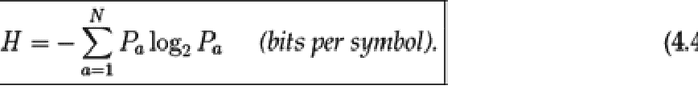

1.  *绘制概率与不确定性的曲线图。*
2.  ***完成句子：*** *该曲线是* **[对称 / 不对称]** *。*


3. 补全句子：曲线在两个符号出现概率相等的 $[最小值/最大值]$ （$P_{\ a} = 0.5$）处上升。

##### PRB-78 CH.PRB-4.12

假设我们被提供了一枚不均匀的硬币，其中“正面”事件的概率被赋予为 $p$，“反面”的概率为 $1 - p$。利用公式 (4.4)，相应的熵为：

$$H(p) = -p \log p - (1 - p) \log (1 - p). \tag{4.5}$$

因此，$H \geq 0$，当 $p = 1/2$ 时达到最大的可能不确定性，即 $H_{\max} = \log_2 2$。

基于上述表述，描述由对数函数的凹性得出的熵的一个有用性质。

##### PRB-79 CH.PRB-4.13

判断正误：给定随机变量 $X, Y$ 和 $Z$，其中 $Y = X + Z$，则：

$$H(X, Y) = H(X, Z). \tag{4.6}$$

##### PRB-80 CH.PRB-4.14

一枚不均匀硬币的熵是多少？假设硬币是不均匀的，使得“正面”出现的概率为 $p(x_h) = 0.98$。

- 1. 补全句子：我们可以以 [______]% 的准确率预测每次投掷结果为“正面”。
- 2. 补全句子：如果硬币投掷结果为“正面”，获得的香农信息量为 [____] 比特。
- 3. 补全句子：如果硬币投掷结果为“反面”，获得的香农信息量为 [____] 比特。
- 4. 补全句子：总是正确的说法是，结果关联的信息越多，它就越 [更加/更少] 令人惊讶。
- 5. *假设投掷结果为“正面”的比例是 $p(x_h)$，投掷结果为“反面”的比例是 $p(x_t)$，且给定 $p(x_h)+p(x_t)=1$，**平均惊讶度**的公式是什么？*
- 6. *以比特为单位的**平均惊讶度**的值是多少？*

#### 4.2.3 库尔贝克-莱布勒散度 (KLD)

**PRB-81 CH.PRB-4.15**
*写出两个离散概率密度函数* **P** *和* **Q** *之间库尔贝克-莱布勒散度的公式*。

**PRB-82 CH.PRB-4.16**
*就* **比特** *而言，描述 KL 散度的一种直观解释*。

**PRB-83 CH.PRB-4.17**

- 1. ***判断正误：*** KL 散度不是对称的相似度度量，即：$\mathbf{D}_{KL}(P||Q) \neq \mathbf{D}_{KL}(Q||P)$。
- 2. ***判断正误：*** KL 散度满足三角不等式。
- 3. ***判断正误：*** KL 散度不是距离度量。
- 4. ***判断正误：*** 在信息论中，KLD 被视为使用概率分布 **Q** 近似真实概率分布 **P** 时所获得的信息量度量。
- 5. ***判断正误：*** KL 散度的单位是信息单位。
- 6. **判断正误：** $KL$ 总是非负的，即：
  $$\mathbf{D}_{KL}(P \| Q) \geq 0.$$
- 7. **判断正误：** 在决策树中，**高**信息增益表示向决策树添加分裂会导致模型准确性**降低**。

**PRB-84 CH.PRB-4.18**
*给定两个分布 $f_{1}$ 和 $f_{2}$ 及其相应的联合分布 $f$，写出 $f_{1}$ 和 $f_{2}$ 互信息的公式*。

**PRB-85 CH.PRB-4.19**
*你被提供了一个形式如下的一致分布（均匀分布）：*
$$q(x_{i})=\frac{1}{3}, i=1, \ldots, 8 \tag{4.7}$$
*库尔贝克-莱布勒距离 $KL_{p \mid q}$ 的值是多少？*

#### 4.2.4 分类与信息增益

**PRB-86 CH.PRB-4.20**
*有几种度量方法可以确定如何在决策树中最优地划分属性。列出三种最常用的度量方法并写出它们的公式*。

**PRB-87 CH.PRB-4.21**
*补全句子：在决策树中，我们选择用来划分的属性是具有 [最小/最大] 信息增益的那个属性*。

**PRB-88 CH.PRB-4.22**

为了研究影响青蛙跳跃（或不跳跃）决策的因素，一位来自巴西雨林的深度学习研究人员收集了关于几个独立二元协变量的数据。二元响应变量 **Jump** 指示是否观察到跳跃。参考表 (4.1)，每一行指示观测值，列表示特征，行表示带标签的实例，而类标签 (**Jump**) 指示青蛙是否跳跃。

| 观测值 | Green | Large | Rain | Jump |
| :---: | :---: | :---: | :---: | :---: |
| x1 | 0 | 0 | 0 | − |
| x2 | 0 | 0 | 0 | − |
| x3 | 1 | 1 | 1 | − |
| x4 | 1 | 0 | 1 | + |
| x5 | 0 | 1 | 0 | + |
| x6 | 0 | 1 | 1 | + |
| x7 | 0 | 0 | 1 | + |
| x8 | 1 | 1 | 0 | + |

**TABLE 4.1: 决策树与青蛙。**

在不显式计算每个属性的信息增益值的情况下，应该选择哪个属性作为决策树首次划分的属性？

**PRB-89 CH.PRB-4.23**

这道题讨论二元分类、信息增益和决策树之间的联系。最近的研究 [5] 表明，大麻（图 4.4），特别是大麻素的管理，可能会减少啮齿动物中恶性肿瘤的大小。数据（表 4.2）包含了一个特征向量的训练集及其相应的类标签，研究人员打算使用决策树对其进行分类。

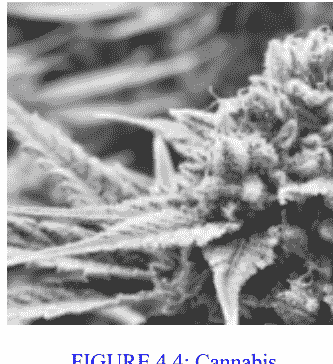

为了研究影响肿瘤缩小的因素，深度学习研究人员收集了关于两个独立二元变量的数据；$\theta_{1}$ (T/F) 指示啮齿动物是否为雌性，$\theta_{2}$ (T/F) 指示啮齿动物是否接受了大麻素治疗。二元响应变量 $\gamma$ 指示是否观察到肿瘤缩小（例如：缩小=+，无缩小=-）。参考表 (4.2)，每一行指示观测值，列（$\theta_{i}$）表示特征，类标签（$\gamma$）指示是否观察到缩小。

| $\gamma$ | $\theta_{1}$ | $\theta_{2}$ |
|:--------:|:----------:|:----------:|
| + | T | T |
| - | T | F |
| + | T | F |
| + | T | T |
| - | F | T |

**Table 4.2: 决策树与大麻素管理**

- 1. 描述什么是*信息增益*。
- 2. 用自己的话描述决策树是如何工作的。
- 3. 使用 $\log_{2}$ 和提供的数据集，计算样本熵 $H(\gamma)$。
- 4. *提供语料库的信息增益* $IG(X_1) = H(\gamma)-H(\gamma|\theta_{1})$ *是多少？*

**PRB-90 CH.PRB-4.24**

*为了研究影响恒星膨胀的因素，一位物理学家获得了关于两个独立变量的数据；$\theta_{1}$ (T/F) 指示恒星是否致密，$\theta_{2}$ (T/F) 指示恒星是否靠近黑洞。他被告知，二元响应变量 $\gamma$ 指示是否观察到膨胀*。

*例如：膨胀=+，无膨胀=-。参考表 (4.3)，每一行指示观测值，列（$\theta_{i}$）表示特征，类标签（$\gamma$）指示是否观察到膨胀*。

| $\gamma$ (expansion) | $\theta_{1}$ (dense) | $\theta_{2}$ (black-hole) |
| :---: | :---: | :---: |
| + | F | T |
| + | T | T |
| + | T | T |
| - | F | T |
| + | T | F |
| - | F | F |
| - | F | F |

**TABLE 4.3: 决策树与恒星膨胀。**

- 1. *使用* $\log_{2}$ *和提供的数据集，计算分裂前的样本熵* $H(\gamma)$ *（膨胀）*。
- 2. *使用* $\log_{2}$ *和提供的数据集，计算* $H(\gamma|\theta_{1})$ *的信息增益*。
- 3. *使用* $\log_{2}$ *和提供的数据集，计算* $H(\gamma|\theta_{2})$ *的信息增益*。

**PRB-91 CH.PRB-4.25**

为了研究影响人类肿瘤缩小的因素，一位深度学习研究人员获得了关于两个独立变量的数据；$\theta_1$ (S/M/L) 指示肿瘤是小(S)、中(M)还是大(L)，$\theta_2$ (T/F) 指示肿瘤是否接受了放射治疗。他被告知，二元响应变量 $\gamma$ 指示是否观察到肿瘤缩小（例如：缩小=+，无缩小=-）。

参考表 (4.4)，每一行指示观测值，列（$\theta_i$）表示特征，类标签（$\gamma$）指示是否观察到缩小。

| $\gamma$ (shrinkage) | $\theta_1$ | $\theta_2$ |
| :---: | :---: | :---: |
| - | S | F |
| + | S | T |
| - | M | F |
| + | M | T |
| + | L | F |
| + | L | T |

**TABLE 4.4: 决策树与放射治疗。**

- 1. 使用 $\log_2$ 和提供的数据集，计算样本熵 $H(\gamma)$（缩小）。
- 2. 使用 $\log_2$ 和提供的数据集，计算 $H(\gamma | \theta_1)$ 的熵。
- 3. 使用 $\log_2$ 和提供的数据集，计算 $H(\gamma | \theta_2)$ 的熵。
- 4. **判断正误**：我们应该在最小化信息增益的特定变量上进行分裂，因此我们应该在 $\theta_2$（放射治疗）上进行分裂。

#### 4.2.5 互信息

**PRB-92 CH.PRB-4.26**


*香农* 描述了一个由五个元素组成的通信系统（[4.5](#fig-4.5)，其中两个元素分别是信源 *S* 和信宿 *D*）。

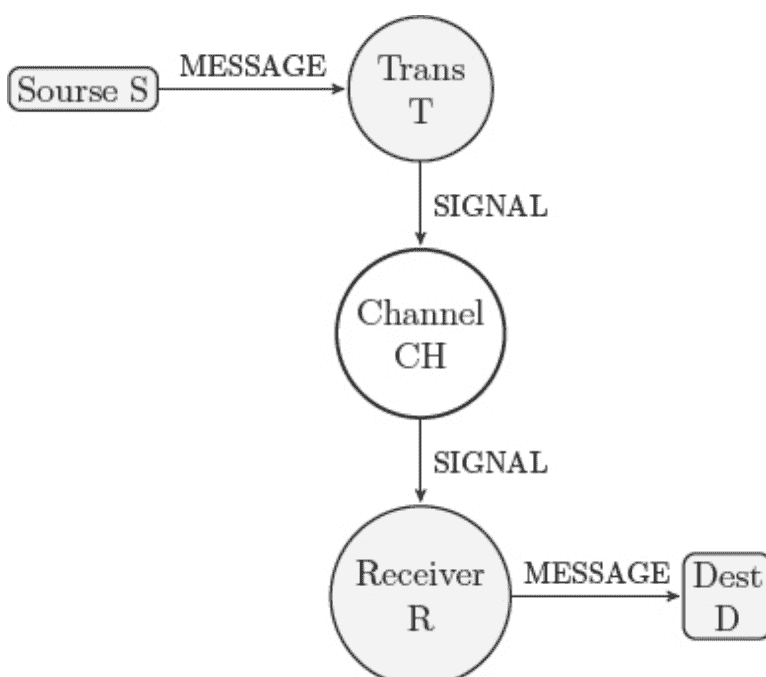

图 4.5：香农的五元素通信系统。

##### PRB-93 2 CH.PRB- 4.27.

补全句子：相对熵 $D(p\|q)$ 是衡量两个分布之间 (a) [___] 的指标。它也可以表示为当 (c)[___] 分布为 $p$ 时，假设分布为 $q$ 的 (b)[___] 的度量。

##### PRB-94 2 CH.PRB- 4.28.

补全句子：互信息是基于香农熵的随机变量间依赖性度量。$X$ 和 $Z$ 之间的互信息可以被理解为在已知 $Z$ 的情况下，$X$ 中 (b) [___] 的 (a) [___]：

```
$I(X; Z) := H(X) - H(X | Z)$, (4.8)
```

其中 $H$ 是香农熵，$H(X | Z)$ 是在已知 $Z$ 的情况下 $X$ 的条件熵。

#### 4.2.6 力学统计

有些书籍倾向于将“未见”的问题藏起来。我们在这里不会那样做。这一小节可能看起来令人望而生畏，这是有充分理由的；它涉及了一些方程，除非你是物理学家，否则你以前可能从未接触过。然而，应对新概念的能力是每个面试的核心所在。

对于某些问题，你可能需要以下常数：

##### 物理常数

-   **k** 玻尔兹曼常数 $1.381 \times 10^{-23}$ J K$^{-1}$
-   **c** 真空中的光速 $2.998 \times 10^8$ m s$^{-1}$
-   **h** 普朗克常数 $6.626 \times 10^{-34}$ J s

##### PRB-95 2 CH.PRB- 4.29.

玻尔兹曼概率分布的表达式是什么？

##### PRB-96 2 CH.PRB- 4.30.

信息论、量子物理和热力学紧密相连。热力学第二定律有几种等价的表述。描述不确定性的一种方法源自玻尔兹曼在统计力学中关于熵的基础性工作。请描述 **玻尔兹曼熵** 的含义。

##### PRB-97 2 CH.PRB- 4.31.

从玻尔兹曼的视角来看，一个正八面体骰子 (4.6) 的熵是多少？

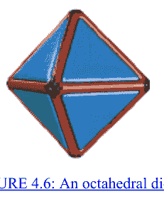

#### 4.2.7 琴森不等式

##### PRB-98 2 CH.PRB- 4.32.

1.  定义凹函数的术语。
2.  定义凸函数的术语。
3.  陈述琴森不等式及其含义。

##### PRB-99 2 CH.PRB- 4.33.

*判断对错：利用琴森不等式，可以证明 KL 散度总是大于或等于零。*

### 4.3 答案

#### 4.3.1 信息论中的对数

**SOL-67 CH.SOL- 4.1.**
-   *数值结果 (4.7) 使用 Python 解释器版本 3.6 提供。*

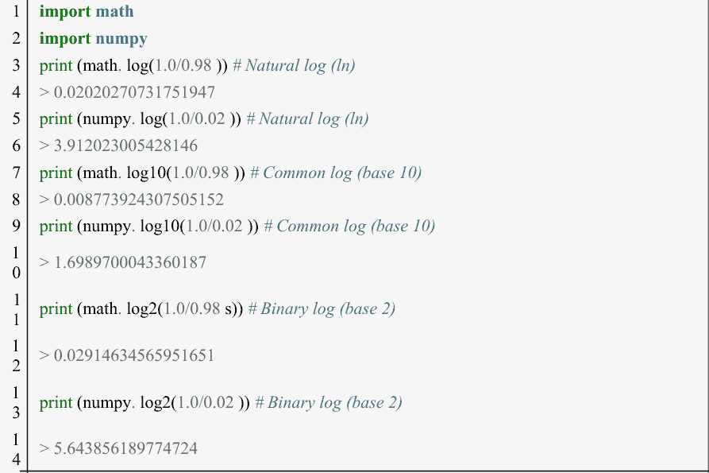

图 4.7：信息论中的对数。

**SOL-68 CH.SOL- 4.2.**
-   *对数的底数在每个解答中明确写出。*

1.  $$\log _{10} 3+\log _{10} 4=\log _{10}(3 \times 4)=\log _{10} 12 .$$
2.  $$\log _{2} 4^{6}=6 \log _{2} 4 .$$
3.  $$\log _{e} 15-\log _{e} 3=\log _{e} \frac{15}{3}=\log _{e} 5 .$$

#### 4.3.2 香农熵

**SOL-69 ✎ CH.SOL- 4.3.**
*香农著名的不确定性通用公式为：*
$$H = -\sum_{a=1}^{N} P_a \log_2 P_a \quad (\text{每符号比特数}).\quad (4.9)$$

**SOL-70 ✎ CH.SOL- 4.4.**
1.  *先验已知必然发生的事件（$P_a = 1$）不传递任何信息，因此熵为 $0$。*
2.  *等概率事件意味着 $(P_i = 1/N \forall i \in [1, N])$。因此，对于 $N$ 个等可能的事件，熵为 $\log_2(N)$。*

**SOL-71 ✎ CH.SOL- 4.5.**
*这三个性质如下：*
1.  *$H(X)$ 始终是非负的，因为信息不会丢失。*
2.  *均匀分布使 $H(X)$ 最大化，因为它同时也使不确定性最大化。*
3.  *可加性性质，它描述了两个独立事件熵的和。例如，在热力学中，两个处于平衡态共存孤立系统的总熵是每个系统单独熵之和。*

**SOL-72 CH.SOL- 4.6.**
信息是不确定性*增加*。

**SOL-73 CH.SOL- 4.7.**
香农比特有两种不同的状态；它要么是 0，要么是 1，但绝不会同时是两者。香农设计了一个实验，其中有一个问题，其仅有的两个可能答案*发生的可能性相等*。然后他定义*一个比特*为一旦获知问题答案后所获得的信息量（或者换句话说，所移除的熵）。接着他继续指出，当任意一个可能答案的先验概率高于另一个时，该答案传递的信息量将小于一个比特。

**SOL-74 CH.SOL- 4.8.**
惊讶的概念与事件发生的可能性直接相关。在数学上，它与该事件的概率成反比。

相应地，获知一个高概率事件已经发生（例如太阳升起），比获知一个低概率事件（例如炎热的夏日下雨）已经发生，**惊讶程度要小得多**，且提供的信息较少。因此，事件发生的可能性越小，其传达的信息就越多。

如果事件先验已知必然发生（$P_a = 1$），则它*不传递*任何信息。另一方面，一个极其*出乎意料*的事件传达了大量信息，因为它让我们感到**惊讶**，并告知我们存在一种非常不可能发生的状态。

**SOL-75 CH.SOL-4.9.**

*公式中表征的该量 $I_{Sh}$ 被称为* 信源 *的香农信息：*

```
I_{Sh} = - \sum_{a} p_a \log_2 p_a.\quad\quad\quad\quad\quad\quad\quad\quad\quad\quad\quad\quad (4.10)
```

*它指的是消息可以被压缩到的每消息平均比特长度。然后，通信信道可以以 $I_{Sh}$ 的容量，每消息传输 $I_{Sh}$ 比特。*

**SOL-76 CH.SOL-4.10.**

1.  *对于 $N$ 个等概率事件，满足 $P_i = 1/N, \forall i \in [1, N]$。因此：*

    *   *如果我们将其代入香农方程，得到：*

```
H_{equiprobable} = - \sum_{i=1}^{N} \frac{1}{N} \log_2 \frac{1}{N}.\quad\quad\quad\quad\quad\quad\quad\quad\quad\quad\quad\quad (4.11)
```

*由于 $N$ 不依赖于 $i$，我们可以将其从求和中提取出来：*

```
H_{equiprobable} = -\left(\frac{1}{N} \log_2 \frac{1}{N}\right) \sum_{i=1}^{N} 1 \quad\quad\quad\quad\quad\quad\quad\quad\quad\quad (4.12)

\hspace{3em} = -\left(\frac{1}{N} \log_2 \frac{1}{N}\right) N

\hspace{3em} = -\log_2 \frac{1}{N} \quad\quad\quad\quad\quad\quad\quad\quad\quad\quad\quad\quad (4.13)

\hspace{3em} = \log_2 N.
```

*可以证明，对于给定的符号数量（即 $N$ 固定），只有当符号等概率时，不确定性 $H$ 才具有最大值。*

2.  *每个像素被分配给定范围内某个值的概率为：*

$$p_{i}=1/256.\quad (4.14)$$

因此，熵为：

$$H=-(256)(1/256)(-8)=8 \quad \text{[比特/符号]}.\quad (4.15)$$

**SOL-77 CH.SOL- 4.11.**

参考图 4.8 中对应的图形插图，其中信息被展示为 $p$ 的函数。当 $p = 0$ 和 $p = 1$ 时，它等于 0。这是合理的，因为对于这些 $p$ 值，结果是确定的，所以获知结果不会带来任何信息。最大不确定性处的熵在 $p = 0.5$ 时等于 1 比特。因此，当两个可能事件的概率相等时，信息增益最大。此外，在整个 $p = 0.4$ 到 $p = 0.6$ 的概率范围内，信息都接近 1 比特。

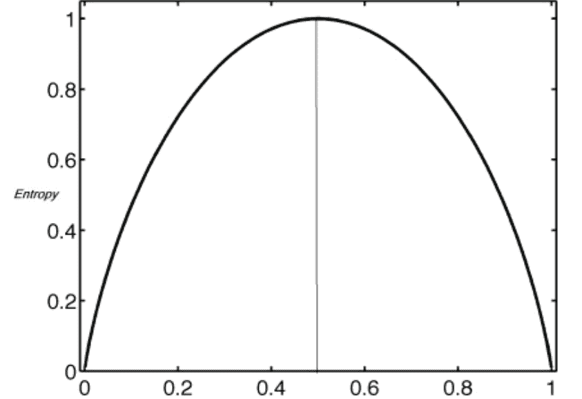

图 4.8：H 与概率的关系。


##### SOL-78 CH.SOL- 4.12.

熵的一组重要性质源于其凹性，而凹性又源于对数函数的凹性。假设我们无法确定“正面”的实际概率是 $p_{1}$ 还是 $p_{2}$。我们可以决定将概率 $q$ 分配给第一种可能性，将概率 $1-q$ 分配给第二种可能性。此时，“正面”的实际概率是混合概率 $qp_{1}+(1-q)p_{2}$。相应的熵满足不等式：

$$S(qp_{1}+(1-q)p_{2}) \geq q S(p_{1})+(1-q) S(p_{2}) \tag{4.16}$$

当处于极端情况时等号成立，即 $p_{1}=p_{2}$，或 $q=0$，或 $q=1$。

##### SOL-79 CH.SOL- 4.13.

给定 $(X, Y)$，我们可以确定 $X$ 和 $Z=Y-X$。反过来，给定 $(X, Z)$，我们可以确定 $X$ 和 $Y=X+Z$。因此，由于存在这种双射关系，$H(X, Y)=H(X, Z)$。

##### SOL-80 CH.SOL- 4.14.

解决方案和数值计算均使用 $\log _{2}$。

- 我们可以以 $p(x_{h})=98\%$ 的准确率预测每次抛硬币的“正面”。
- 根据图 (4.9)，如果硬币抛掷的结果是“正面”，获得的香农信息量为 $\log _{2}(1/0.98)$ [比特]。

```python
import math
import numpy
print(math.log2(1.0 / 0.98))  # Binary log (base 2)
##### 0.02914634565951651
print(numpy.log2(1.0 / 0.02))  # Binary log (base 2)
##### 5.643856189774724
```

图 4.9：偏置硬币抛掷的香农信息增益。

- 同样地，如果硬币抛掷的结果是“反面”，获得的香农信息量为 $\log_{2}(1/0.02)$ [比特]。
- 结果所关联的信息量**越多**，该结果就越**令人惊讶**。
- **平均惊讶度**的公式为：

$$H(x) = p(x_h) \log \frac{1}{p(x_h)} + p(x_t) \log \frac{1}{p(x_t)} . \tag{4.17}$$

- **平均惊讶度**以比特为单位的数值由 $(4.10)$ 给出：

$$
\begin{aligned}
H(x) &= [0.98 \times 0.0291] + [0.02 \times 5.643] \tag{4.18} \\
&= 0.1414\ [\text{bits}].
\end{aligned}
$$

```python
import autograd.numpy as np

def binaryEntropy(p):
    return -p * np.log2(p) - (1 - p) * np.log2(1 - p)

print("binaryEntropy(p) is: {} bits".format(binaryEntropy(0.98)))
##### binaryEntropy(p) is: 0.1414 bits
```


#### 4.3.3 库拉-莱布勒散度

##### SOL-81 CH.SOL- 4.15.

对于离散概率分布 $P$ 和 $Q$，**从** $P$ **到** $Q$ 的库拉-莱布勒散度（KLD）定义为：

$$
\begin{align}
D(P \| Q) &= \sum_x P(x) \log \frac{P(x)}{Q(x)} \tag{4.19} \\
&= \mathbb{E}_P \left[ \log \frac{1}{Q(x)} - \log \frac{1}{P(x)} \right] \\
&= \underbrace{H_P(Q)}_{\text{Cross Entropy}} - \underbrace{H(P)}_{\text{Entropy}}.
\end{align}
$$

##### SOL-82 CH.SOL- 4.16.

一种解释如下：KL散度表明，在传输服从 $P(x)$ 分布的值 $x \in X$ 时，若错误地按照分布 $Q(x)$ 进行编码，所需的**额外比特数**的平均值。这是合理的，因为你必须为不知道真实分布而支付额外的比特代价，从而使用了根据其他分布优化的编码方案。这也是KL散度也被称为相对熵的原因之一。从形式上看，交叉熵具有信息论解释，量化了使用错误编码所浪费的比特数：

$$H_P(Q) = \sum_x \underbrace{P(x)}_{\text{Sending } P} \overbrace{\log \frac{1}{Q(x)}}^{\text{code for } Q} . \tag{4.20}$$

##### SOL-83 CH.SOL- 4.17.

- 1. 正确。KLD是一种非对称度量，即 $D(P \| Q) \neq D(Q \| P)$。
- 2. 错误。KLD不满足三角不等式。
- 3. 正确。KLD不是一种距离度量。
- 4. 正确。KLD被视为信息增益的度量。但需注意，KLD实际上衡量的是信息损失量。
- 5. 正确。KL散度的单位是信息单位（比特、纳特等）。
- 6. 正确。KLD是一个非负度量。
- 7. 正确。基于高度信息量的事件进行分割通常会导致模型泛化能力较低，准确性也会下降。

##### SOL-84 CH.SOL- 4.18.

从形式上看，互信息试图衡量两个变量之间的相关性：

$$
\begin{aligned}
I(X;Y) &= \sum_{x,y} P(x,y) \log \frac{P(x,y)}{P(x)P(y)} \tag{4.21} \\
&= \mathbb{E} \left[ \log \frac{1}{P(x)} + \log \frac{1}{P(y)} - \log \frac{1}{P(x,y)} \right] \\
&= H(X) + H(Y) - H(X,Y).
\end{aligned}
$$

针对所讨论的问题，给定两个分布 $f_1$ 和 $f_2$ 及其联合分布 $f$，$f_1$ 和 $f_2$ 的互信息定义为 $I(f_1, f_2) = H(f, f_1, f_2)$。如果两个分布相互独立，即 $f=f_1 \cdot f_2$，则互信息为零。这一概念在图像分析中被广泛用作相似度度量。

##### SOL-85 CH.SOL- 4.19.

$$KL_{p\|q} = \frac{1}{3}(-1 + 0 + 1 + 1) = \frac{1}{4} \tag{4.22}$$

#### 4.3.4 分类与信息增益

##### SOL-86 CH.SOL- 4.20.

最常用的三种方法是：

1. $$\textit{Entropy}(t)=-\sum_{i=0}^{c-1} p(i|t) \log _{2} p(i|t). \tag{4.23}$$

2. $$\text{Gini}(t)=1-\sum_{i=0}^{c-1}[p(i|t)]. \tag{4.24}$$

3. $$\textit{Classification error}(t)=1-\max _{i}\left[p(i|t)\right]. \tag{4.25}$$

##### SOL-87 CH.SOL- 4.21.

在决策树中，我们选择用于分裂的属性是信息增益 **[最大]** 的那个。

##### SOL-88 CH.SOL- 4.22.

待定

##### SOL-89 CH.SOL- 4.23.

- 信息增益是由根据给定属性对数据集中的值进行划分所导致的熵的期望减少量。
- 决策树学习算法通过首先计算基于熵的信息增益作为分裂准则，来选择下一个用于划分当前选中节点（例如）的属性。
- 有3个正例对应收缩= +，2个负例对应收缩= -。使用以下公式：

$$H(Y) = - \sum_{i=1}^{k} P(Y=y_i) \log_{2} P(Y=y_i) \qquad (4.26)$$

以及概率：

$$P(\gamma = +) = \frac{3}{5} , \qquad (4.27)$$

$$P(\gamma = -) = \frac{2}{5} , \qquad (4.28)$$

分裂前的总熵为 $(4.11)$：

$$
\begin{gathered}
E_{\text {orig }} = -(3 / 5) \log (3 / 5)-(2 / 5) \log (2 / 5) \\
= H(\gamma) \approx 0.97095[\text { bits } / \text { symbol }]
\end{gathered} \qquad (4.29)
$$

```python
import autograd.numpy as np

def binaryEntropy(p):
    return p*np.log2(p) + (1-p)*np.log2(1-p)

print("binaryEntropy(p) is: {} bits".format(binaryEntropy(4/7)))
##### binaryEntropy(p) is: 0.97095 bits
```


- 如果我们在 $\theta_{1}$ 上分裂，(4.5) 相对收缩频率为：

|  | 总数 | $\theta_{1} = T$ | $\theta_{1} = F$ |
|---|:---:|:---:|:---:|
| \oplus | 3 | 0 | 3 |
| \ominus | 2 | 1 | 1 |

**表 4.5：** 在 $\theta_{1}$ 上的分裂。

要计算基于特征 $\theta_1$ 的信息增益（IG），我们必须首先计算基于 $\theta_1$ 分裂后 $\gamma$ 的熵，$H(\gamma \mid \theta_1)$：

$$
\begin{aligned}
H(\gamma | \theta_1) &= - \sum_{j=1}^{v} \left[ \sum_{i=1}^{k} P(\gamma = \gamma_i | \theta_1 = \theta_j) \log_2 P(\gamma = \gamma_i | \theta_1 = \theta_j) \right] P(\theta_1 = \theta_j).
\end{aligned}
$$

因此，使用相对收缩频率数据 (4.5)，在 $\theta_1$ 上分裂后的信息增益为：

$$
\begin{aligned}
E_{\theta_1=T} &= - \frac{3}{4} \log \frac{3}{4} - \frac{1}{4} \log \frac{1}{4} = 0.8112, \\
E_{\theta_1=F} &= - \frac{0}{1} \log \frac{0}{1} - \frac{1}{1} \log \frac{1}{1} = 0.0.
\end{aligned} \qquad (4.30)
$$

现在我们知道 $P(\theta_1 = T) = [4/5]$ 且 $P(\theta_1 = F) = [1/5]$，因此：

$$
\begin{aligned}
\Delta &= E_{orig} - (4/5) E_{\theta_1=T} - (1/5) E_{\theta_1=F} \\
&= 0.97095 - (4/5) * 0.8112 - (1/5) * (0.0) \\
&\approx 0.32198 \; [\text{bits/symbol}].
\end{aligned} \qquad (4.31)
$$

##### SOL-90 CH.SOL- 4.24.

有4个正例对应扩张=+，3个负例对应扩张=-。

1. 分裂前的总熵为 $(4.12)$：

$$
\begin{aligned}
E_{orig} &= - (4/7) \log (4/7) - (3/7) \log (3/7) \\
&= 0.9852281 \; [\text{bits/symbol}].
\end{aligned} \qquad (4.32)
$$

```python
import autograd.numpy as np

def binaryEntropy(p):
    return -p * np.log2(p) - (1-p) * np.log2(1-p)
```


5 `print ("binaryEntropy(p) is: {} bits" . format(binaryEntropy(4/7 )))`  
`> binaryEntropy(p) is :0.9852281 bits`

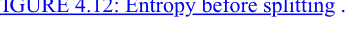

##### 2 如果我们基于 $	heta_1$ 进行划分，(4.6) 相对星体膨胀频率为：

| 总计 | $\theta_1 = T$ | $\theta_1 = F$ |
| :--- | :--- | :--- |
| $\oplus$ | 3 | 1 |
| $\ominus$ | 0 | 3 |

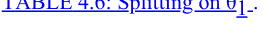

因此，基于 A 划分后的信息增益为：

```
E_{θ₁=T} = -3/3 log 3/3 - 0/3 log 0/3 = 0.0,
E_{θ₁=F} = -3/4 log 3/4 - 1/4 log 1/4 = 0.81127. (4.33)
```

现在我们知道 $P(\theta_1 = T) = 3/7$ 且 $P(\theta_1 = F) = 4/7$，因此：

```
Δ = E_{orig} - (3/7)E_{θ₁=T} - (4/7)E_{θ₁=F}
= 0.98522 - (3/7) * 0.0 - (4/7) * (0.81127)
= 0.52163 [bits/symbol]. (4.34)
```

##### 3 如果我们基于 $	heta_2$ 进行划分，(4.7) 相对星体膨胀频率为：

| 总计 | $\theta_2 = T$ | $\theta_2 = F$ |
| :--- | :--- | :--- |
| $+$ | 3 | 1 |
| $-$ | 1 | 2 |


基于 B 划分后的信息增益为：

$E_{\theta_2=T} = -\frac{3}{4} \log \frac{3}{4} - \frac{1}{4} \log \frac{1}{4} = 0.8112$, (4.35)

$E_{\theta_2=F} = -\frac{1}{3} \log \frac{1}{3} - \frac{2}{3} \log \frac{2}{3} = 0.9182$.

现在我们知道 $P(\theta_2 = T) = 4/7$ 且 $P(\theta_2 = F) = 3/7$，因此：

$\Delta = E_{orig} - \frac{4}{7} E_{\theta_2=T} - \frac{3}{7} E_{\theta_2=F} = 0.98522 - \frac{4}{7} * 0.8112 - \frac{3}{7} * (0.9182) = 0.1275 \text{ bits/symbol}$.

##### SOL-91 **CH.SOL- 4.25.**

###### 1
$H(\gamma) = -\left(\frac{2}{6} \log_2 \frac{2}{6} + \frac{4}{6} \log_2 \frac{4}{6}\right) = -\left(\frac{1}{3} \log_2 \frac{1}{3} + \frac{2}{3} \log_2 \frac{2}{3}\right) \approx 0.92 \text{ bits/symbol}. (4.37)$

###### 2
$H(\gamma|\theta_1) = -\frac{1}{3} \left(\frac{1}{2} \log_2 \frac{1}{2} + \frac{1}{2} \log_2 \frac{1}{2}\right) - \frac{1}{3} \left(\frac{1}{2} \log_2 \frac{1}{2} + \frac{1}{2} \log_2 \frac{1}{2}\right) - \frac{1}{3} (1 \log_2 1)$  
$H(\gamma|\theta_1) = \frac{1}{3} (1) + \frac{1}{3} (1) + \frac{1}{3} (0)$  
$H(\gamma|\theta_1) = \frac{2}{3} \approx 0.66 \text{ bits/symbol}. (4.38)$

###### 3
$H(\gamma|\theta_2) = -\frac{1}{2}\left( \frac{1}{3}\log_2\frac{1}{3} + \frac{2}{3}\log_2\frac{2}{3} \right) - \frac{1}{2}\left( 1\log_2 1\right).$

$H(\gamma|\theta_2) = \frac{1}{2}\left( \log_2 3 - \frac{2}{3} \right)$ . $(4.39)$

$H(\gamma|\theta_2) = \frac{1}{2}\log_2 3 - \frac{1}{3} \approx 0.46 \text{ [bits/symbol]}$.

###### 4
*错误*

#### 4.3.5 互信息

##### SOL-92 **CH.SOL- 4.26.**

###### 1
该图示描绘于 *图 4.13* 中。

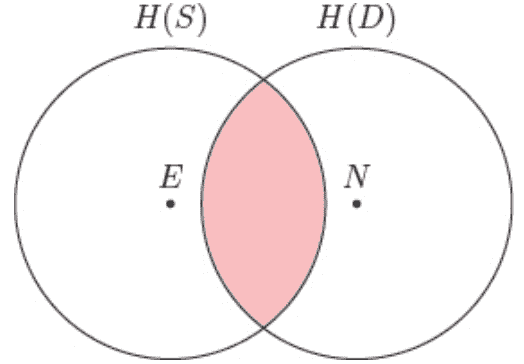

图 4.13：*H(S)* 与 *H(D)* 之间的互信息。

###### 2
*困惑度*（Equivocation）标注为 *E*。

###### 3
*噪声* 标注为 *N*。

###### 4
*(4.13) 中的*交集*（阴影部分）对应于信源 H(S) 和目的端 H(D) 的互信息。

###### 5
互信息的公式为：

$H(S; D) = H(S) - E = H(D) - N.$ (4.40)

##### SOL-93 **CH.SOL- 4.27.**
相对熵 D(p|q) 是衡量两个分布之间差异的度量。它也可以被表达为一种度量，衡量在真实分布为 p 的情况下，假设分布为 q 所导致的不效率。

##### SOL-94 **CH.SOL- 4.28.**
互信息是一种基于香农熵的随机变量间依赖性的度量。X 和 Z 之间的互信息可以理解为在给定 Z 的条件下 X 的不确定性的减少：

$I(X; Z) := H(X) - H(X \mid Z),$ (4.41)

其中 H 是香农熵，H(X | Z) 是在给定 Z 的条件下 X 的条件熵。

#### 4.3.6 机械统计

##### SOL-95 **CH.SOL- 4.29.**
这个问题有价值吗？

##### SOL-96 **CH.SOL- 4.30.**
玻尔兹曼将物理系统状态的无序程度与其概率的对数联系起来。例如，如果系统有 n 个非相互作用且相同的粒子，每个粒子可以处于 K 个等概率状态中的任意一个，那么找到系统处于包含 $n_1$ 个粒子在状态 1、$n_2$ 个粒子在状态 2 等配置的概率的对数的主要项由玻尔兹曼熵 ${\mathcal{H}}_{\pi} = -\sum_{i}^{K}\pi_i\log(\pi_i)$ 给出，其中 $\pi_i = n_i/n$。

**SOL-97 CH.SOL- 4.31.**
每次掷骰子有 8 个等概率事件，因此：

$H = -\sum_{i=1}^{8}\frac{1}{8}\log_{2}\frac{1}{8} = 3 [bits]$.

#### 4.3.7 詹森不等式

**SOL-98 CH.SOL- 4.32.**
1. 若函数 $f$ 在区间 $[a, b]$ 上二阶导数 $f''$ 为负，则 $f$ 在该区间内为凹函数。
2. 若函数 $f$ 在区间 $[a, b]$ 上二阶导数 $f''$ 为正，则 $f$ 在该区间内为凸函数。
3. 以下不等式由 J.L. Jensen 于 1906 年发表：

**(詹森不等式)** 设 $f$ 为在 $(a, b)$ 上凸向上的函数。则对于任意 $n \geq 2$ 个数 $x_i \in (a, b)$：

$f\left(\frac{\sum_{i=1}^{n}x_i}{n}\right) \leq \frac{\sum_{i=1}^{n}f(x_i)}{n}$，

且当且仅当 $f$ 为线性函数或所有 $x_i$ 相等时取等号。

对于凸向下的函数，不等式的方向变为 $\geq$。

詹森不等式指出，如果 $f$ 在区间 $[a, b]$ 上是凸函数，则：

$$
\frac{f(a) + f(b)}{2} \geq f\left(\frac{a+b}{2}\right).
$$

当且仅当 $a = b$ 时取等号。詹森不等式还指出，如果 $f$ 在区间 $[a, b]$ 上是凹函数，则：

$$
\frac{f(a) + f(b)}{2} \leq f\left(\frac{a+b}{2}\right).
$$

当且仅当 $a = b$ 时取等号。

##### SOL-99 **CH.SOL- 4.33.**
*正确* 可以使用詹森不等式证明 KL 散度的非负性。

#### 参考文献

- S. Carnot. *反射论：论火的动力以及其他关于热力学第二定律的论文*. Dover books on physics. Dover Publications, 2012 (引用于第 86 页).
- T. M. Cover and J. A. Thomas. *信息论基础*. John Wiley and Sons, Inc., 2006 (引用于第 86 页).
- B. J. Hiley. ‘从海森堡图像到玻姆：关于主动信息及其与香农信息关系的新视角’. In: *Proc. Conf. Quantum Theory: reconsideration of foundations* (2002), pp. 141–162 (引用于第 87 页).
- C. Shannon. ‘通信的数学理论’. In: *Bell System Technical Journal 27* (1948), pp. 379–423 (引用于第 86, 90 页).
- P. Sledzinski et al. ‘大麻素在癌症生物学中的现状与未来展望’. In: *Cancer Medicine 7.3* (2018), pp. 765–775 (引用于第 95 页).

# 第 5 章

## 深度学习：微积分、算法微分

> 这个世界的真正逻辑在于*概率论*的*微积分*。
--- 詹姆斯·克拉克·麦克斯韦

# 目录

- 引言
- 问题
    - 算法微分、梯度下降与反向传播
    - 数值微分
    - 有向无环图
    - 链式法则
    - 泰勒级数展开
    - 极限与连续性
    - 偏导数
    - 优化
    - 梯度下降算法
    - 反向传播算法
    - 前馈神经网络
    - 激活函数、Autograd/JAX
    - 算法微分中的对偶数
    - 前向模式算法微分
    - 前向模式算法微分表构建
    - 符号微分
    - 简单微分
    - 贝塔-二项分布模型
- 解答
    - [算法微分、梯度下降](link)
    - [数值微分](link)
    - [有向无环图](link)
    - [链式法则](link)
    - [泰勒级数展开](link)
    - [极限与连续性](link)
    - [偏导数](link)
    - [优化](link)
    - [梯度下降算法](link)
    - [反向传播算法](link)
    - [前馈神经网络](link)
    - [激活函数、Autograd/JAX](link)
    - [算法微分中的对偶数](link)
    - [前向模式算法微分](link)
    - [前向模式算法微分表构建](link)
    - [符号微分](link)
    - [简单微分](link)
    - [贝塔-二项分布模型](link)

## 5.1 引言


微积分是研究变化的数学；函数的微分是科学和工程领域几乎每个分支的关键，微积分也是深度学习（DL）的核心。标准的微积分一年级课程包括极限、微分、导数、泰勒级数、积分等内容。许多缺乏相关数学背景并希望转行的 aspiring 数据科学家，希望能轻松进入该领域，但经常遇到心理障碍。

| $f(x)$ | $f'(x)$ |
| :--- | :--- |
| $\sin(x)$ | $\cos(x)$ |
| $\cos(x)$ | $-\sin(x)$ |
| $\log(x)$ | $\frac{1}{x}$ |


得益于处理能力的快速提升以及 GPU 的普及，我们可以以极高的效率和精度将计算任务交给计算机。例如，[反向传播](https://en.wikipedia.org/wiki/Backpropagation)、梯度下降算法和[自动微分](https://en.wikipedia.org/wiki/Automatic_differentiation)（AD）[5] 的极速实现，使人工智能从单纯的概念变为现实。

微积分通常以一种对学生负担较重的方式进行教学，因此我尝试将 Python 代码片段的编写融入学习过程，并涉及以下内容的使用：

- 有向无环图（DAG）。梯度下降是深度学习优化的核心，它需要高效访问自动微分框架提供的一阶和二阶导数。早期的自动微分框架是用 C++（[4]）编写的，而较新的框架则基于 Python，例如 Autograd（[10]）和 JAX（[3]、[1]）。

导数在图形学应用中同样至关重要。例如，在一种名为全局照明的渲染技术中，光子在合成生成的场景中反弹，而基于每个光子撞击的具体材质，必须使用导数来确定其方向和颜色。在光线追踪算法中，像素的颜色是通过追踪光子从观察者眼睛穿过合成三维场景的轨迹来确定的。

函数通常由有向无环图（DAG）表示。例如，一种常用的形式是将中间值表示为节点，将运算表示为弧（5.2）。另一种常用的形式是将值以及运算都表示为节点（5.11）。

用有向无环图表示函数的第一种形式可追溯至 [7]。

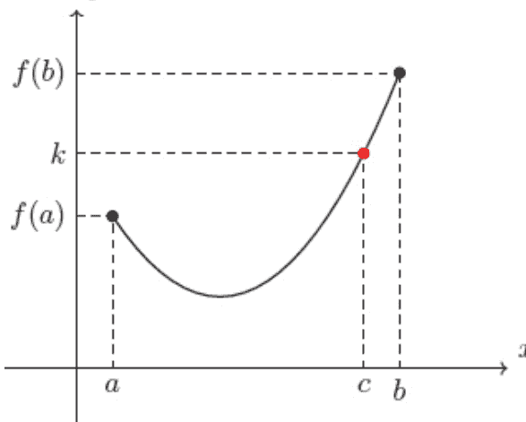

手动微分繁琐且容易出错，对于需要反复计算大量连续导数的实时图形学应用来说实际上是不可用的。另一方面，符号微分是一种基于计算机的方法，它使用一系列微分规则来解析地计算函数的精确导数，从而得到纯粹的符号导数。许多符号微分库都利用所谓的*运算符重载*（[9]）来实现前向和反向形式的微分，尽管它们不如自动微分（AD）那么快速。

## 5.2 问题

### 5.2.1 自动微分、梯度下降与反向传播

自动微分 [5] 是计算机将链式法则应用于函数以自动计算导数的过程。自动微分在训练深度学习算法中扮演着重要角色，为了理解自动微分，你需要扎实的微积分基础。与数值微分不同，自动微分是一种建立**精确**导数的程序，且不存在截断误差。自动微分将计算机程序分解为一系列基本的数学运算，并通过对其基本组成部分连续应用链式法则（5.1）来找到程序的梯度或海森矩阵。

例如，在 C++ 编程语言中，通常利用两种技术（[4]）将计算函数数值值的程序转换为计算该函数导数数值值的程序；（1）运算符重载方法和（2）系统性的源代码转换。

$$\left.\frac{\partial}{\partial t}f(g(t))\right|_{t=t_0} = \left(\left.\frac{\partial}{\partial s}f(s)\right|_{s=g(t_0)}\right)\left(\left.\frac{\partial}{\partial t}g(t)\right|_{t=t_0}\right) \tag{5.1}$$

自动微分的一个显著特点是，应用自动微分产生的导数值，与数值微分（有限差分公式）相比，是**精确且准确**的。科学界广泛采用自动微分的两种变体：前向模式或反向模式，它们之间的根本区别在于应用链式法则的顺序。前向模式，也称为切线模式，将导数从依赖变量向独立变量传播，而反向模式或伴随模式则恰恰相反。自动微分大量使用了一个称为对偶数（DN）的概念，该概念最初由 Clifford（[2]）引入。

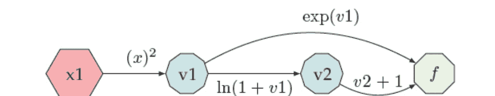

图 5.2：一个计算图，其中中间值为节点，运算为弧。

### 5.2.2 数值微分

**PRB-100 第 5.1 题。**

- 1. 写出数值微分中使用的*有限差分规则*公式。
- 2. 该公式的主要缺陷是什么？
- 3. 指出利用数值微分和浮点数连续运算的软件工具存在的一个问题。

**PRB-101 第 5.2 题。**

- 1. 给定函数 $f(x)$ 和点 $a$，定义 $f(x)$ 在 $a$ 处的*瞬时变化率*。
- 2. 瞬时变化率还有其他常用的替代名称吗？
- 3. 给定函数 $f(x)$ 和点 $a$，定义 $f(x)$ 在 $a$ 处的*切线*。

### 5.2.3 有向无环图

遍历**有向无环图（DAG）**有两种可能的方法。一种方法很简单。从底部开始，遍历计算树到顶部的所有节点。这只是自上而下传递对应的计算序列。基于这种方法，开发了所谓的自动微分前向模式 [8]。与此前向模式相反，反向模式最早由 Speelmenning [13] 使用，他自上而下遍历底层图并反向传播梯度。

**PRB-102 第 5.3 题。**

- 1. 陈述函数 $f(x)$ 在 $x = c$ 处导数 $f'(c)$ 的定义。
- 2. 针对图 5.3 中描绘的**有向无环图**：

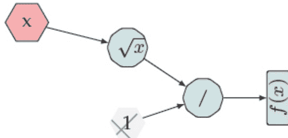

**图 5.3：** 函数 $g(x)$ 的表达式图。常数以灰色显示并被划掉，因为导数不应传播到常数操作数。

- (a) 遍历图 5.3 并找到它表示的函数 $g(x)$。
- (b) 使用导数的定义，求 $f'(9)$。

**PRB-103 第 5.4 题。**

- 1. 针对图 5.4 中描绘的表达式图，遍历该图并找到它表示的函数 $g(x)$。

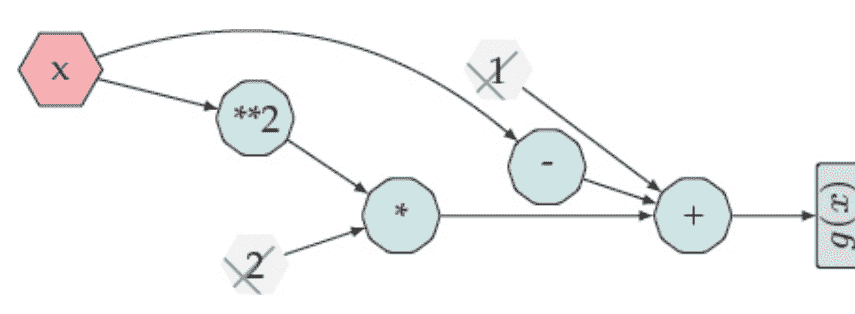

**图 5.4：** 函数 $g(x)$ 的表达式图。常数以灰色显示并被划掉，因为导数不应传播到常数操作数。

- 2. 使用导数的定义求 $g(x)$ 的导数。

### 5.2.4 链式法则

**PRB-104 第 5.5 题。**

1. **链式法则**是微分中的关键概念。请定义它。
2. 阐述链式法则在神经网络背景下的应用方式。

### 5.2.5 泰勒级数展开

泰勒级数的思想是，如果你知道一个函数在某一点 $x = a$ 处的函数值及其所有导数，你可以近似该函数在 $a$ 附近其他点的值。例如，取 $f(x) = \sqrt{x}$。你知道 $f(9)$ 及其所有导数 $f'(9), f''(9)$，就可以使用泰勒级数来近似 $\sqrt{10}$。

麦克劳林级数（5.2）是泰勒级数在已知 $f(0), f'(0)$ 时的特殊情况：

$$f(x) = f(0) + xf'(0) + \frac{x^2}{2!}f''(0) + \frac{x^3}{3!}f'''(0) + \cdots = \sum_{p=0}^{\infty} \frac{x^p}{p!}f^{(p)}(0) \tag{5.2}$$

例如，$\cos(x)$ 的麦克劳林展开式为：

$$\begin{aligned} & f(x) = \cos x, \quad f'(x) = -\sin x, \\ & f''(x) = -\cos x, \quad f'''(x) = \sin x \tag{5.3} \end{aligned}$$

在 0 处求值结果为：

$$\cos x = 1 - \frac{x^2}{2!} + \frac{x^4}{4!} - \frac{x^6}{6!} + \cdots \tag{5.4}$$

**PRB-105 第 5.6 题。**

求以下函数的泰勒级数展开：

1. $\frac{1}{1 - x}$ (5.5)

**PRB-106 第 5.7 题。**

*求以下函数的泰勒级数展开：*

$\log(x)$ (5.9)

**PRB-107 第 5.8 题。**

*求以下函数在* $x = -3$ *为中心的泰勒级数展开：*

$f(x) = 5x^2 - 11x + 1$ (5.10)

**PRB-108 第 5.9 题。**

*求以下函数在* $x = 0$ *为中心的 10 阶泰勒多项式：*

$f(x) = \cos(x)$ (5.11)

**PRB-109 第 5.10 题。**

*在* $x = 1$ *处，计算以下函数泰勒级数展开的前 7 项：*

$f(x) = \ln(3x)$。 (5.12)

### 5.2.6 极限与连续性


#### 定理 1（洛必达法则）

$$\left[\lim_{x \to a}\frac{f(x)}{g(x)}=\lim_{x \to a}\frac{f^{\prime}(x)}{g^{\prime}(x)}\right]. \tag{5.13}$$

##### PRB-110（CH.PRB-5.11）

*求下列极限：*

- 1. $\lim_{x \to 3}\frac{e^{x^{3}}-e^{27}}{3 x-9}$
- 2. $\lim_{x \to 0}\frac{e^{x^{2}}-x-1}{3 \cos x-x-x-3}$
- 3. $\lim_{x \rightarrow \infty}\frac{x-\ln x}{\sqrt[100]{x}+4}$

### 5.2.7 偏导数

#### PRB-111（CH.PRB-5.12）

- 1. *判断正误*：在应用偏导数时，有两个变量被视为常数——自变量和因变量。
- 2. *已知 $g(x, y)$，求其关于 $x$ 的偏导数：*
$$g(x, y)=x^{2} y+y x+8 y . \tag{5.14}$$

#### PRB-112（CH.PRB-5.13）

*二维函数的梯度由下式给出*

$$\nabla f(x, y)=\frac{\partial f}{\partial x} \mathbf{i}+\frac{\partial f}{\partial y} \mathbf{j} \tag{5.15}$$

- 1. *求函数的梯度：*
$$f(x, y) = xy^2 - y^2 + x^3 \tag{5.16}$$
- 2. 给定函数：
$$g(x, y) = x^2y + xy^2 - y - 1, \tag{5.17}$$
在点 $(-1, 0)$ 处，沿方向 $(1, 1)$ 计算其值。

#### PRB-113（CH.PRB-5.14）

求下列函数的偏导数：
$$f(x, y) = 3 \sin^2(x - y) \tag{5.18}$$

#### PRB-114（CH.PRB-5.15）

求下列函数的偏导数：
$$z = 2 \sin(x) \sin(y) \tag{5.19}$$

### 5.2.8 优化

#### PRB-115（CH.PRB-5.16）

考虑 $f(x) = \frac{x^2 + 1}{(x + 2)^2}$。
1. $f(x)$ 在何处有定义？
2. $f(x)$ 在何处单调递增和单调递减？
3. $f(x)$ 在何处取得最小值和最大值。

#### PRB-116（CH.PRB-5.17）

考虑 $f(x) = 2x^3 - x$。
1. 对 $f(x)$ 求导并得出其单调性结论。
2. 再次求导并讨论函数 $f(x)$ 的凹性。

#### PRB-117（CH.PRB-5.18）

考虑函数
$$f(x, y) = 2x^2 - xy + y^2,$$
并求其最大值、最小值和鞍点。

### 5.2.9 梯度下降算法

#### PRB-118（CH.PRB-5.19）

梯度下降算法可用于凸函数的最小化。为了最小化凸函数，需要找到驻点。寻找驻点的一个非常简单的方法是从任意一点开始，沿着该点的梯度方向移动到下一个点，并重复此过程直到收敛到一个驻点。

- 1. 函数 $f(x)$ 的所有偏导数组成的向量被称为什么？
- 2. 补全句子：在寻找极小值时，如果导数为正，函数是 *递增/递减*。
- 3. 图 5.5 中描绘的函数 $x^2$，其导数为 $f^{\prime}(x) = 2x$。在 $x = -1$ 处求值，导数等于 $f^{\prime}(x = -1) = -2$。在 $x = -1$ 处，随着 $x$ 变大，函数是 *递减* 的。如果我们希望使用梯度下降法寻找 *极小值*，并且 *增加/减少* $x$ 的幅度为 *梯度的大小*，然后反复不断跳跃，会发生什么？
- 4. 如何缓解这种现象？
- 5. *判断正误*：如果学习率正确递减且存在有限的局部极小值，梯度下降算法保证能找到局部极小值。

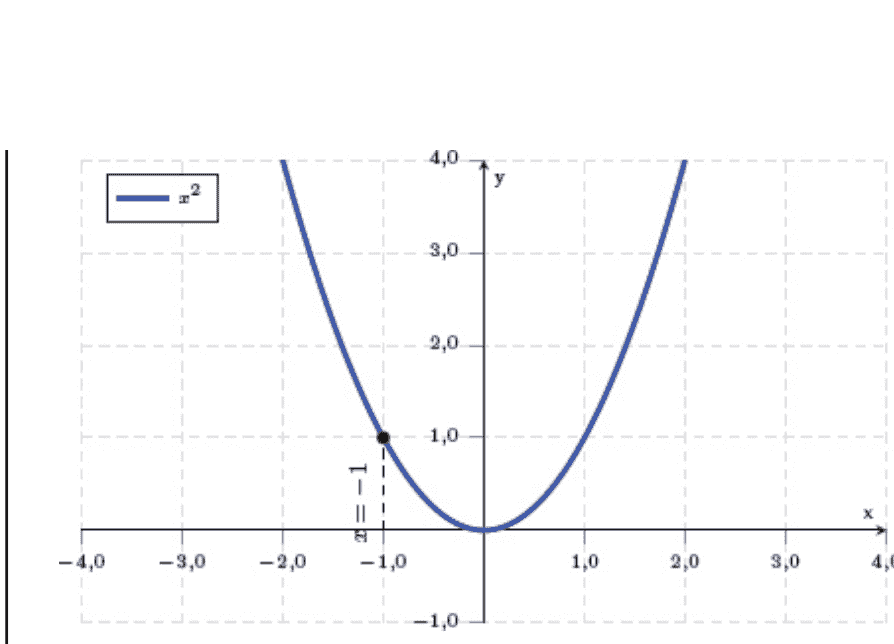

#### PRB-119（CH.PRB-5.20）

- 1. 在最小二乘线性回归问题中，添加 L2 正则化惩罚项不会降低解 $w$ 在训练数据上的 L2 误差？
- 2. 数据是线性可分的吗？

| $X_1$ | $X_2$ | $Y$ |
| :---: | :---: | :---: |
| 1 | 1 | + |
| 2 | 2 | − |
| 4 | 5 | − |
| 2 | 2 | + |

*(5.20)*

- 3. 线性回归的损失函数是什么？
- 4. 用于最小化函数 $f(x)$ 的梯度下降算法是什么？

在任何人工神经网络（ANN）的硬件实现中，最重要、成本最高且最难实现的部分是神经元的非线性激活函数。常用的激活函数是 Sigmoid 函数和双曲正切函数。在目前应用中最常用的学习算法——反向传播（Back-propagation）中，反向传播误差时需要 Sigmoid 函数的导数。

反向传播算法使用梯度下降法在权值空间中寻找误差函数的最小值。

#### PRB-120（CH.PRB-5.21）

- 1. 在人工神经网络的训练过程中，Sigmoid 层在前向传播中对每个元素应用 Sigmoid 函数 $\sigma(x) = \frac{e^x}{1+e^x}$，而在反向传播中，链式法则作为反向传播算法的一部分被利用。就反向传播算法而言，给定 Sigmoid 激活函数，并以 $J$ 作为成本函数，请标注方程 (5.21) 中的每一部分：
$$dJ = \frac{dJ}{d\sigma(x)} \frac{d\sigma(x)}{dx} = dA \cdot \sigma(x) \cdot (1 - \sigma(x)) \quad (5.21)$$
- 2. 代码片段 5.6 提供了一个基于纯 Python（例如不使用 Autograd）的 Sigmoid 函数前向传播实现。请补全反向传播，直接计算解析梯度。

```python
import numpy as np

class Sigmoid:
    def forward(self, x):
        self.x = x
        return 1/(1+np.exp(-x))
    
    def backward(self, grad):
        grad_input = grad * (self.forward(self.x) * (1 - self.forward(self.x)))
        return grad_input
```


#### PRB-121（CH.PRB-5.22）

这道题涉及自定义传递函数的影响。考虑一个神经网络，其隐藏单元使用 $x^3$，输出单元使用 $\sin(2x)$ 作为传递函数。使用链式法则，从 $\frac{\partial E}{\partial y_k}$ 开始，推导权重更新量 $\Delta w_{jk}$ 和 $\Delta w_{ij}$ 的公式。注意 - 最终答案中不要包含偏导数符号。

### 5.2.11 前馈神经网络

理解前馈神经网络（FFNN）的内部工作原理对于理解其他更先进的神经网络（如 CNN）至关重要。

神经网络（NN）是由简单的处理单元互连组成的集合，这些 *单元* 或 *节点* 的功能在某种程度上基于动物神经元。网络的处理能力存储在单元间的连接强度中，即 *权重*，这些权重通过对一组训练模式进行适应或从训练模式中进行 *学习* 而获得。$[\ref{6}]$

*反向传播算法* 是 FFNN 中最广泛使用的学习算法。反向传播是一种使用 *广义 Delta 规则* 的训练方法。其基本思想是对网络输出总平方误差（视为权重的函数）执行梯度下降。它最早由 *Werbos* 描述，并由 *Rumelhart*、*Hinton* 和 *Williams* 的论文 $[\ref{12}]$ 推广普及。

### 5.2.12 激活函数、Autograd/JAX

激活函数，特别是 Sigmoid 激活函数，在构建神经网络时得到大量使用。我们利用 Autograd ($[\ref{10}]$) 和最近发布的 JAX ($[\ref{1}]$) 库来了解激活函数与反向传播算法之间的关系。

使用逻辑（或 Sigmoid）激活函数有一些好处，即能够轻松求导，然后使用逻辑回归模型来解释这些导数。Autograd 是 PyTorch ($[\ref{11}]$) 的一个核心模块，并为所有张量和函数的操作添加了固有的自动微分支持。此外，可以通过子类化 autograd $Function$ 并实现前向和反向传播操作来使用 PyTorch 张量实现自定义的 Autograd 函数。PyTorch 提供了简单的语法 ($5.7$)，对 CPU/GPU 支持都是透明的。

```python
import torch
from torch.autograd import Function

class DLFunction (Function):
    @staticmethod
    def forward(ctx, input):
        ...

    @staticmethod
    def backward(ctx, grad_output):
        ...
```


#### PRB-122（CH.PRB-5.23）

- 1. *判断正误*：在 Autograd 中，如果操作的任何输入张量都有 *requires_grad=True*，计算将被跟踪。在计算完反向传播后，关于此张量的梯度会累积到 *.grad* 属性中。
- 2. *判断正误*：在 Autograd 中，如果之前计算的梯度未被清零，对 backward 的多次调用会将这些梯度求和。

#### PRB-123（CH.PRB-5.24）

你的朋友是一位深度学习社区的资深人士，他想使用逻辑回归并利用 Autograd 实现自定义激活函数。当我们要预测的变量 $y$ 只能取离散值（即 *分类*）时，会使用逻辑回归。考虑到二元分类问题（$y = 0$ 或 $y = 1$）（5.8），假设函数可以被定义为界限在 $[0, 1]$ 之间，这时我们使用某种形式的逻辑函数，例如 **Sigmoid 函数**。还存在其他更高效的函数，例如 **ReLU**（修正线性单元），我们将在后面讨论。


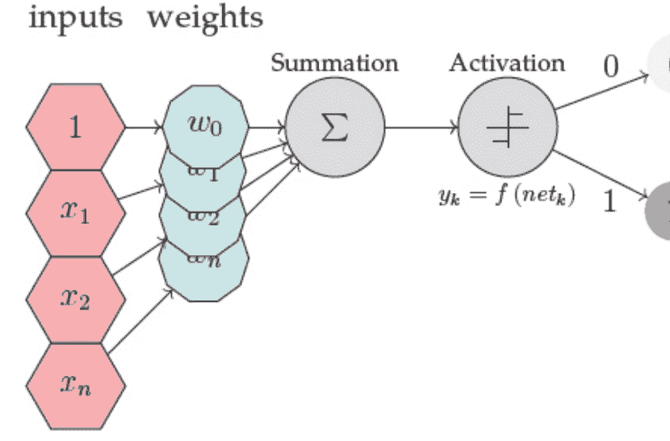

图 5.8：一个典型的二分类问题。

1. 给定 sigmoid 函数：$g(x) = \frac{1}{1 + e^{-x}}$，逻辑回归中假设函数的表达式是什么？
2. 什么是决策边界？
3. $h_\Theta(x) = 0.8$ 意味着什么？
4. 使用基于 Autograd 的 Python 程序，实现 sigmoid 激活函数的前向和反向传播，并计算其在 $x = 1$ 处的导数。
5. 使用基于 Autograd 的 Python 程序，实现 ReLU 激活函数的前向和反向传播，并计算其在 $x = 1$ 处的导数。

**PRB-124 CH.PRB-5.25.** 你的朋友是深度学习社区的资深人士，想要使用 Autograd 实现一个自定义激活函数，并寻求你的帮助。考虑一个接受两个张量作为输入，且输出遵循以下映射关系的函数：

```python
(u, v) ↦ |uv|²
```

### 5.2.13 自动微分中的对偶数

对偶数（DN）类似于复数，通过邻接一个无穷小元素 $d$（其中 $d^2=0$）来增强实数。

**PRB-125 CH.PRB-5.26.**

1. 解释自动微分（AD）如何使用浮点数数值而非符号表达式。
2. 解释由((2))引入的对偶数（DN）概念。
3. 对偶数可以进行哪些算术运算？
4. 解释泰勒级数与对偶数之间的关系。

**PRB-126 CH.PRB-5.27.**

1. 使用对偶数展开以下函数：

$$
\sin(x + dx) \quad (5.23)
$$

2. 针对图 5.9 中描绘的表达式图：

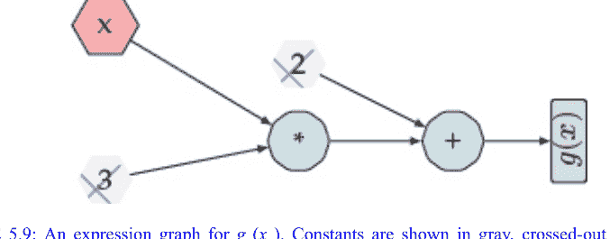

   (a) 遍历图 5.9 并找出其表示的函数 $g(x)$。
   (b) 使用对偶数展开函数 $g(x)$。

3. 证明一般恒等式：

$$
g(x + x\mathbf{d}) = g(x) + g'(x) x\mathbf{d} \quad (5.24)
$$

在此特定情况下也成立。

4. 使用推导出的对偶数，在 $x = 2$ 处评估函数 $g(x)$。
5. 使用基于 Autograd 的 Python 程序实现该函数，并计算其在 $x = 2$ 处的导数。

**PRB-127❓ CH.PRB-5.28.**

针对[5.10](https://link.springer.com/chapter/10.1007/978-3-031-19950-8#chapter-5.10)中描绘的表达式图：

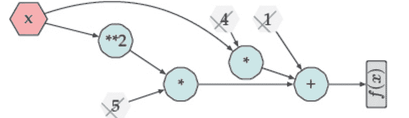

[图 5.10：$g(x)$ 的表达式图。常数以灰色显示并划掉，因为导数不应传播到常数操作数。](https://link.springer.com/chapter/10.1007/978-3-031-19950-8#figure-5.10)

1. 遍历图 [5.10](https://link.springer.com/chapter/10.1007/978-3-031-19950-8#chapter-5.10) 并找出其表示的函数 $g(x)$。
2. 使用对偶数展开函数 $g(x)$。
3. 使用推导出的对偶数，在 $x = 5$ 处评估函数 $g(x)$。
4. 使用基于 AutoGrad 的 Python 程序实现该函数，并计算其在 $x = 5$ 处的导数。

### 5.2.14 前向模式自动微分

**PRB-128❓ CH.PRB-5.29.**

在使用前向模式自动微分对函数求导时，可以通过在相应的有向无环图中传播数值来计算此类表达式的值。

1. 找出图 5.11 中的表达式图所表示的函数，$g(A,B,C)$。


2. 求函数 $g(x)$ 的偏导数。

**PRB-129 CH.PRB-5.30.**

假设函数的计算图有 $N$ 个输入和 $M$ 个输出，回答以下问题。

1. 判断正误：
   - (a) 前向模式和反向模式自动微分总是产生相同的结果。
   - (b) 在反向模式自动微分中，操作更少（时间）且中间变量占用的空间更少（内存）。
   - (c) 前向模式的成本随 $N$ 增长。
   - (d) 反向模式的成本随 $M$ 增长。

**PRB-130 CH.PRB-5.31.**

1. 将代码片段 5.1 中的源代码转换为函数 $g(x_1, x_2)$。

代码 5.1：C 编程语言中的函数，$g(x_1, x_2)$。

```c
float g(float x1, float x2) {
    float v1, v2, v3, v4, v5;
    v1 = x1;
    v2 = x2;
    v3 = v1 * v2;
    v4 = ln(v1);
    v5 = v3 + v4;
    return v5;
}
```

2. 将函数 $g(x_1, x_2)$ 转换为表达式图。
3. 求函数 $g(x_1, x_2)$ 的偏导数。

### 5.2.15 前向模式自动微分表构建

**PRB-131 CH.PRB-5.32.**

1. 给定函数：

$$
f(x_1, x_2) = x_1 x_2 + \ln(x_1) \quad (5.25)
$$

以及图 5.1，为图中每个顶点（边）标注在前向模式自动微分中传播的偏导数。

2. 将图转换为一个表，使用前向模式自动微分计算在 $(x_1, x_2) = (e^2, \pi)$ 处评估的函数 $g(x_1, x_2)$。
3. 编写并运行一段 Python 代码以证明你的结果正确。
4. 描述种子值在前向模式自动微分中的作用。
5. 将图转换为一个表，使用前向模式自动微分计算在 $(x_1, x_2) = (e^2, \pi)$ 处评估的 $g(x_1, x_2)$ 的导数，其中 $x_1$ 为选定的独立变量。
6. 编写并运行一段 Python 代码以证明你的结果正确。

### 5.2.16 符号微分

在本节中，我们介绍 SymPy（SYMbolic Python）库的基本功能，该库常用于符号数学，作为加深你对 Python 和微积分理解的手段。如果你在 Google Colab 的 Jupyter notebook 中使用 Sympy（例如 https://colab.research.google.com/），则需要 MathJax 在每个单元格输出中可用才能渲染 sympy 方程。以下是一个使这成为可能的钩子函数：

代码 5.2：Google Colab 中的 Sympy

```python
from IPython.display import Math, HTML

def enable_sympy_in_cell():
    display(Math('<script src="https://cdnjs.cloudflare.com/ajax/libs/mathjax/2.7.3/latest.js?config=default"></script>'))

get_ipython().events.register('pre_run_cell', enable_sympy_in_cell)
```

成功注册此钩子后，SymPy 渲染（5.3）将正常工作：

代码 5.3：在 Google Colab 中渲染 Sympy

```python
import sympy
from sympy import *
init_printing()
x, y, z = symbols('x y z')
Integral(sqrt(1/x), (x, 0, oo))
```

还建议使用最新版本的 Sympy：

代码 5.4：更新 Sympy

```bash
> pip install --upgrade sympy
```

### 5.2.17 简单微分

**PRB-132 CH.PRB-5.33.**
回答以下问题：

1. 哪种微分方法本质上容易产生舍入误差？
2. 定义符号微分这一术语。

**PRB-133 CH.PRB-5.34.**
回答以下问题：

1. 使用基于 Python 的 SymPy 程序符号化地实现 sigmoid 函数 $\sigma(x) = \frac{1}{1 + e^{-x}}$。
2. 使用 SymPy 对 sigmoid 函数求导，并将其与分析推导 $\sigma'(x) = \sigma(x)(1 - \sigma(x))$ 进行比较。
3. 使用 SymPy 计算 sigmoid 函数在 $x = 0$ 处的梯度。
4. 使用 SymPy 绘制所得的 sigmoid 函数梯度图。

### 5.2.18 贝塔-二项式模型

**PRB-134 CH.PRB-5.35.**

在面对面面试中，你很可能不会遇到如此长的编程任务。尽管如此，在我熟悉的许多初创公司，通常都会布置大量的家庭编程作业。你应该分配大约四到六小时来完整回答此问题中的所有问题。

我们在第 3 章中详细讨论了贝塔-二项式模型。请记住，贝塔-二项式分布在贝叶斯统计中常用于建模 $n$ 次试验中的成功次数。我们现在使用 SymPy 做同样的事情；通过计算演示先验分布如何在通过贝塔-二项式分布的关系观察到数据后更新为后验分布。

给定成功概率，$n$ 次试验后的成功次数服从二项分布。请注意，贝塔分布是二项分布参数的共轭先验。在这种情况下，似然函数是二项式的，而贝塔先验分布产生贝塔后验分布。

请记住，对于贝塔-二项式分布，存在以下关系：

| $\theta$ 的先验 | Beta($a,b$) |
|---|---|
| 似然 | 二项式 $(n,\theta)$ |
| $\theta$ 的后验 | Beta $(a + x, b + n - x)$ |
| 后验均值 | $(a + x)/(a + b + n - x)$ |

1. 似然：我们推理问题的起点是似然，即


观察数据的概率。使用 sympy 符号化求解似然函数。将 SymPy 表示转换为基于 Numpy 的纯函数可调用表达式。在 $50$ 次成功试验（共 $100$ 次）下评估似然函数，此时 $\theta=0.5$。

2. 先验分布：贝塔分布。使用 sympy 符号化定义将作为我们**先验**分布的贝塔分布。将 SymPy 表示转换为基于 Numpy 的纯函数可调用表达式。在 $\theta=0.5, a: 2, b: 7$ 时评估贝塔分布。

3. 使用基于 Numpy 的函数绘制贝塔分布。

4. 后验分布：使用 sympy 将贝塔先验与二项似然相乘，符号化求解**后验**分布。将 SymPy 表示转换为基于 Numpy 的纯函数可调用表达式。在 $\theta:0.5$，$a:2, b:7$ 时评估后验分布。

5. 使用基于 Numpy 的函数绘制后验分布。

6. 证明后验分布对 $\theta$ 具有与先验分布相同的功能依赖性，并且它只是**另一个贝塔分布**。

7. 已知：
   - **先验分布**：Beta($\theta \ |a=2, b=7)=56\theta\left(-\theta+1\right)^{6}$ 以及：
   - **似然函数**：Bin($r=3|n=6, \theta ~$)$=19600 \theta^{3}\left(-\theta+1\right)^{47}$

   求出结果的后验分布并绘制其图像。

### 5.3 解答

#### 5.3.1 自动微分，梯度下降
#### 5.3.2 数值微分

**SOL-100 CH.SOL- 5.1.**

1. 公式为：

$$f^{\prime}(x)\approx\frac{f(x+h)-f(x)}{h} . \tag { 5 . 2 7 }$$

2. *该公式的主要问题是当 $h$ 值较小时会出现数值不稳定现象。*

3. *在某些数值软件系统中，数值 $\sqrt{2}$ 可能被表示为浮点数 $\approx 1.414213562$。因此，以下结果：*

$float(\sqrt{(\sqrt{2})}) * float(\sqrt{(\sqrt{2})})$ 可能等于 $\sim 2.000000446$。

#### **SOL-101** ✏ **CH.SOL- 5.2.**

1. *瞬时变化率等于：*

$\underset{h \to 0}{\lim} \frac{f(a + h) - f(a)}{a + h - a}$. (5.28)

2. *$f(x)$ 在 $a$ 处的瞬时变化率通常也被称为 $f(x)$ 在 $a$ 处的切线。*

3. *给定函数 $f(x)$ 和点 $a$，$f(x)$ 在 $a$ 处的切线（图 5.12）为：一条与 $f(a)$ 接触但不穿过 $f(x)$（在 $a$ 附近足够范围内）的直线。*


## **5.3.3 有向无环图**

**SOL-102 ✍️ CH.SOL- 5.3.**

1. 定义为：

$$ f'(c) = \lim_{h \to 0} \frac{f(c + h) - f(c)}{h}. $$

2. 如果我们从左到右遍历图 5.3，我们推导出以下函数：

$$ g(x) = \frac{1}{\sqrt{x}}. \tag{5.29} $$

$$\begin{aligned} f'(9) &= \lim_{h \to 0} \frac{1 / \sqrt{9 + h} - 1 / \sqrt{9}}{h} \\ &= \lim_{h \to 0} \frac{\sqrt{9} - \sqrt{9 + h}}{\sqrt{9} \cdot \sqrt{9 + h} \cdot h} \\ &= \lim_{h \to 0} \frac{(3 - \sqrt{9 + h})(3 + \sqrt{9 + h})}{3 \sqrt{9 + h} \cdot (3 + \sqrt{9 + h}) \cdot h} \\ &= \lim_{h \to 0} \frac{9 - (9 + h)}{9 \sqrt{9 + h} \cdot h + 3 \cdot (9 + h) \cdot h} \\ &= \frac{1}{-9 \cdot 3 + 3 \cdot 9} \\ &= -\frac{1}{54} \end{aligned}$$

**SOL-103 ✍️ CH.SOL- 5.4.**

1. 函数 $g(x) = 2x^2 - x + 1$ 代表图 5.4 中所示的表达式图。

2. 根据定义：

$$f'(x) = \lim _ { h \to 0 } \frac { f ( x + h ) - f ( x ) } { x + h - x }$$

$$ = \lim _ { h \to 0 } \frac { 2 ( x + h ) ^ { 2 } - ( x + h ) + 1 - 2 x ^ { 2 } + x - 1 } { h }$$

$$ = \lim _ { h \to 0 } \frac { 2 ( x ^ { 2 } + 2 x h + h ^ { 2 } ) - x - h + 1 - 2 x ^ { 2 } + x - 1 } { h }$$

$$ = \lim _ { h \to 0 } \frac { 2 x ^ { 2 } + 4 x h + 2 h ^ { 2 } - x - h + 1 - 2 x ^ { 2 } + x - 1 } { h }$$

$$ = \lim _ { h \to 0 } \frac { 4 x h + 2 h ^ { 2 } - h } { h }$$

$$ = \lim _ { h \to 0 } 4 x + 2 h - 1$$

$$ = 4 x - 1 .$$


#### 5.3.4 链式法则

**SOL-104 CH.SOL- 5.5.**

1. 链式法则指出，$E = E ( x , y )$ 对 $x$ 的偏导数可以通过另一个变量 $y = y ( x )$ 计算，如下所示：

$$\frac { \partial E } { \partial x } = \frac { \partial E } { \partial y } \cdot \frac { \partial y } { \partial x }$$

2. 例如，链式法则 $[ 8 ]$ 应用于神经网络中，用于计算因调整成本函数而导致的权重变化。该导数通过偏导数链（例如激活函数的偏导数）计算得出。

#### **5.3.5**      泰勒级数展开

**SOL-105 CH.SOL- 5.6.**

1.

$$\frac {1}{1-x} = \sum _ {n = 0} ^ {\infty} x ^ {n} = 1 + x + x ^ {2} + x ^ {3} \quad (5.32) \, (当 - 1 < x < 1 时)$$

2.

$$e ^ {x} = \sum _ {n = 0} ^ {\infty} \frac {x ^ {n}}{n !} = 1 + x + \frac {x ^ {2}}{2 !} + \frac {x ^ {3}}{3 !} + \cdots$$   (5.33)

3.

$$\sin x = \sum _ {n = 0} ^ {\infty} \frac {(- 1) ^ {n}}{(2n + 1) !} x ^ {2n + 1} = x - \frac {x ^ {3}}{3 !} + \frac {x ^ {5}}{5 !} - \cdots$$  (5.34)

4.

$$\cos x = \sum _ {n = 0} ^ {\infty} \frac {(- 1) ^ {n}}{(2n) !} x ^ {2n} = 1 - \frac {x ^ {2}}{2 !} + \frac {x ^ {4}}{4 !} - \cdots$$  (5.35)

**SOL-106 CH.SOL- 5.7.**

$$\log x = \sum _ {n = 1} ^ {\infty} \frac {(- 1) ^ {n + 1} (x - 1) ^ {n}}{n} = (x - 1) - \frac {(x - 1) ^ {2}}{2} + \frac {(x - 1) ^ {3}}{3} - \frac {(x - 1) ^ {4}}{4} + \cdots$$  (5.36)

**SOL-107 CH.SOL- 5.8.**

*在这种情况下，可以计算所有导数：*

$$\begin{aligned} & f^{0}(x)=5 x^{2}-11 x+1, \\ & f^{0}(-3)=79, \\ & f^{1}(x)=10 x-11, \\ & f^{1}(-3)=-41, \\ & f^{2}(x)=10, \\ & f^{2}(-3)=10, \\ & f^{n}(x)=0, \forall n \geq 3 .\end{aligned}\tag{5.37}$$

**SOL-108**  CH.SOL- 5.9.

*直接答案是 1。请参考公式 5.35 以验证这一逻辑推论。*

**SOL-109**  CH.SOL- 5.10.

*通过使用公式 5.36，可以将 $x$ 替换为 $3 - x$，并在给定点 $x = 1$ 之前生成依赖于 $x$ 的结果的前 7 项。*

#### 5.3.6 极限与连续性

**SOL-110**  CH.SOL- 5.11.

1. 对于不定式 0/0，洛必达法则成立。我们查看

$$\operatorname*{lim}_{x \rightarrow 3} \frac{3 x^{2} e^{x^{3}}}{3} = 9 e^{27},$$

它等于原始极限。

2. 再次得到中间结果 0/0，因此我们查看一阶导数

$$\operatorname*{lim}_{x \rightarrow 0} \frac{2 x e^{x}-1}{-3 \sin x-1}=1 .$$

原始极限也等于 1。

3. 这一次，中间形式是 \(\infty/\infty\)，洛必达法则同样适用。导数的商为

$$\frac{1 - \frac{1}{x}}{0.01x^{-99/100}} = 100(x - 1)x^{1/99}$$

当 \(x \to \infty\) 时，此值趋于 \(\infty\)，因此原始极限也等于 \(\infty\)。

#### 5.3.7     偏导数

**SOL-111 \pencilicon CH.SOL- 5.12.**

1. 正确。

2. 通过将 $y$ 视为常数，可以推导出

$$\frac{\partial g}{\partial x} = 2xy + y . \quad \quad \quad \quad \quad \quad \quad \quad \quad \quad \quad \quad \quad \quad \quad (5.38)$$

**SOL-112 \pencilicon CH.SOL- 5.13.**

1.

$$\begin{aligned} \nabla f(x,y) &= \frac{\partial f}{\partial x}\mathbf{i} + \frac{\partial f}{\partial y}\mathbf{j} & \quad (5.39) \\ &= \left(y^{2}+3 x^{2}\right) \mathbf{i}+\left(2 x y-2 y\right) \mathbf{j} \end{aligned}$$

2. 可以证明在 $(-1, 0)$ 处 \(\nabla g(x, y) = (2xy + y^{2}) \mathbf{i} + (x^{2} + 2xy - 1) \mathbf{j}\) 等于 \((0, 0)\)。根据方向导数的定义：

$$\frac{(0,0) \cdot (1,1)}{|(1,1)|} = 0 \quad \quad \quad \quad \quad \quad \quad \quad \quad \quad \quad \quad \quad \quad \quad (5.40)$$

**SOL-113 CH.SOL- 5.14.**

$$\begin{gathered} \frac{\partial f}{\partial x}=6 \sin (x-y) \cos (x-y) \\ \frac{\partial f}{\partial y}=-6 \sin (x-y) \cos (x-y) \end{gathered}$$

(5.41)

**SOL-114 CH.SOL- 5.15.**

$$\begin{gathered} \frac{\partial z}{\partial x}=2 \cos x \sin y \\ \frac{\partial z}{\partial y}=2 \sin x \cos y \end{gathered}$$

(5.42)

#### 5.3.8 优化

**SOL-115 CH.SOL- 5.16.**

1. 函数仅在 $x \neq - 2$ 处定义，定义域为：$(-\infty, -2) \cup (-2, +1)$。

2. 通过简单的基于商的推导：

$$f^{\prime}(x)=\frac{2(x+2)(2x-1)}{(x+2)^{4}}.$$

(5.43)

即，除了未定义的 $x = - 2$ 之外，应考虑 $x = 0.5$ 的临界点。对于 $x > 0.5$，导数为正且函数递增，这与 $x < 0.5$ 的情况相反。

3. 请求的坐标是 $(0.5, 0.2)$。

**SOL-116 CH.SOL- 5.17.**


##### 5.3.8

1. $f'(x) = 6x^2 - 1$，这意味着函数行为在点 $x = \pm\frac{1}{\sqrt{6}}$ 附近发生变化。在 $x = -\frac{1}{\sqrt{6}}$ 和 $x = \frac{1}{\sqrt{6}}$ 之间导数为负，即在该区间内函数单调递减，在其他区间内单调递增。

2. 二阶导数为 $f''(x) = 12x$，这意味着当 $x$ 为负值时函数是凹的（concave），否则是凸的（convex）。

##### SOL-117

**CH.SOL-5.18.**

该函数应针对每个变量分别求导并令其等于 0，如下所示：

$f_x(x, y) = 4x - y = 0$，$\quad f_y(x, y) = -y + 2y = 0$。

因此，求解这些方程得到坐标 $(0, 0)$，且 $f(0, 0) = 0$。

让我们求二阶导数，如下所示：

$\frac{\partial^2 f}{\partial x^2}(x, y) = 4$，$\quad \frac{\partial^2 f}{\partial y^2}(x, y) = 2$，$\quad \frac{\partial^2 f}{\partial x\partial y}(x, y) = -1$

此外，存在以下关系：

$D(x, y) = \frac{\partial^2 f}{\partial x^2}\frac{\partial^2 f}{\partial y^2} - \left(\frac{\partial^2 f}{\partial x\partial y}\right)^2 = 7$

因此，临界点 $(0, 0)$ 是一个极小值点。

#### 5.3.9 梯度下降算法

##### SOL-118

**CH.SOL-5.19.**

1. 这是函数的梯度，其数学表示为：

$$
\nabla f(x, y) = \begin{pmatrix} \frac{\partial f(x,y)}{\partial x} \\ \frac{\partial f(x,y)}{\partial y} \end{pmatrix}
$$

2. 增大。

3. 我们将一直在相同的两个点之间跳跃，而无法到达极小值。

4. 使用学习率或步长可以缓解这种现象。例如，$x \leftarrow x - 2 \eta$，其中 $\eta$ 是一个较小的学习率，如 $\eta = 0.25$。

5. 正确。

##### SOL-119

**CH.SOL-5.20.**

1. L2 误差已经由未正则化的解最小化，因此任何形式的正则化都无法在此基础上改进。

2. 点 (5,5) 属于两个类别，因此无法通过任何直线将类别分开。

3. $J(\theta) = \frac{1}{2m} \sum_{i=1}^{m} (\hat{y_i} - y_i)^2$

4. 用于最小化 $f$ 的简单但基础的算法。只需反复沿着负梯度方向移动。

   (a) 从初始猜测 $\theta^{(0)}$ 和步长 $\eta$ 开始
   (b) 对于 $k = 1, 2, 3, \dots$：
      i. 计算梯度 $\nabla f(\theta^{(k-1)})$
      ii. 检查梯度是否接近零；如果是则停止，否则继续
      iii. 更新 $\theta^{(k)} = \theta^{(k-1)} - \eta \nabla f(\theta^{(k-1)})$
   (c) 返回最终的 $\theta^{(k)}$ 作为近似解 $\theta^*$

#### 5.3.10 反向传播算法

##### SOL-120

**CH.SOL-5.21.**

1. 方程 (5.21) 中标注的部分出现在 (5.46) 中：

$$
\begin{aligned}
\sigma(x) &= \frac{e^x}{1+e^x} & &= \text{Sigmoid 激活函数} \\
\sigma(x) \cdot (1-\sigma(x)) &= \text{Sigmoid 激活函数的导数} \\
1 &= \text{输入} \\
dZ &= \text{输入 } Z \text{ 引入的误差。} \\
A &= \text{输出} \\
dA &= \text{输出 } A \text{ 引入的误差。}
\end{aligned}
$$

2. 代码片段 5.13 提供了 Sigmoid 函数前向和反向传播的实现。

```python
class Sigmoid:
    def forward(self, x):
        self.x = x
        return 1 / (1 + np.exp(-x))
    def backward(self, grad):
        grad_input = self.x * (1 - self.x) * grad
        return grad_input
```


##### SOL-121

**CH.SOL-5.22.**

本题的关键概念在于理解，与传统激活函数相比，仅仅是传递函数及其导数发生了变化，即：

$$
\frac{\partial E}{\partial y_{k}}=(y_{k}-d_{k}) \tag{5.47}
$$

$$
\frac{\partial E}{\partial net_{k}}=\frac{\partial E}{\partial y_{k}}\cdot\frac{\partial y_{k}}{\partial net_{k}}=(y_{k}-d_{k})\cdot 2\cos(2net_{k}) \tag{5.48}
$$

$$
\begin{align}
\Delta w_{jk} &= -\eta \frac{\partial E}{\partial w_{jk}} = -\eta \frac{\partial E}{\partial net_k} \cdot \frac{\partial net_k}{\partial w_{jk}} = -\eta \cdot (y_k - d_k) \cdot 2\cos(2net_k) \cdot y_j \tag{5.49} \\
\frac{\partial E}{\partial y_j} &= \sum_k \left ( \frac{\partial E}{\partial net_k} \cdot \frac{\partial net_k}{\partial y_j} \right ) = \sum_k \left ( \frac{\partial E}{\partial net_k} w_{jk} \right ) \tag{5.50} \\
\frac{\partial E}{\partial net_j} &= \frac{\partial E}{\partial y_j} \cdot \frac{\partial y_j}{\partial net_j} = \frac{\partial E}{\partial y_j} \cdot 3net_j^2 \tag{5.51} \\
\begin{aligned}
\Delta w_{ij} &= -\eta \frac{\partial E}{\partial w_{ij}} \\
&= -\eta \frac{\partial E}{\partial net_j} \cdot \frac{\partial net_j}{\partial w_{ij}} \\
&= -\eta \cdot (\sum_k [(y_k - d_k) \cdot 2\cos(2net_k) \cdot w_{jk}]) \cdot 3net_j^2 \cdot y_i
\end{aligned} \tag{5.52}
\end{align}
$$

#### 5.3.11 前馈神经网络

#### 5.3.12 激活函数、Autograd/JAX

##### SOL-122

**CH.SOL-5.23.**

答案如下：

1. 正确。

2. 正确。

##### SOL-123

**CH.SOL-5.24.**

答案如下：

1. $h_\Theta(x) = g(\Theta^T x) = \frac{1}{1 + e^{-\Theta^T x}}$。

2. 逻辑 Sigmoid 函数的决策边界位于 $h_\Theta(x) = 0.5$ 处（小于 0.5 的值表示假，大于或等于 0.5 的值表示真）。

3. 这表明该实例属于相应类别的概率为 80%，因此：
   - $h_\Theta(x) = g(\Theta_0 + \Theta_1 x_1 + \Theta_2 x_2)$ 并且当 $x_0 + x_1 + x_2 \geq \Theta$ 时，我们预测 $y=1$。

4. 代码片段 5.14 使用 Autograd 实现了该函数。

```python
from torch.autograd import Function

class Sigmoid(Function):
    @staticmethod
    def forward(ctx, x):
        output = 1 / (1 + torch.exp(-x))
        ctx.save_for_backward(output)
        return output

    @staticmethod
    def backward(ctx, grad_output):
        output, = ctx.saved_tensors
        grad_x = output * (1 - output) * grad_output
        return grad_x
```

图 5.14：Autograd 中 Sigmoid 函数的前向和反向传播。

5. 代码片段 5.15 使用 Autograd 实现了该函数。

```python
from torch.autograd import Function

class ReLU(torch.autograd.Function):
    @staticmethod
    def forward(ctx, input):
        ctx.save_for_backward(input)
        return input.clamp(min=0)

    @staticmethod
    def backward(ctx, grad_output):
        input, = ctx.saved_tensors
        grad_input = grad_output.clone()
        grad_input[input < 0] = 0
        return grad_input
```

图 5.15：Autograd 中 ReLU 函数的前向和反向传播。

##### SOL-124

**CH.SOL-5.25.**

答案如下：

代码片段 5.16 使用 Autograd 实现了该函数。

```python
from torch.autograd import Function

class EQ(Function):
    @staticmethod
    def forward(ctx, x1, x2):
        # save everything to compute the gradient
        ctx.save_for_backward(x1, x2)
        return (x1 * x2).abs()

    @staticmethod
    def backward(ctx, grad_output):
        x1, x2 = ctx.saved_tensors
        return (grad_output * x1.sign() * x2.abs(),
                grad_output * x1.abs() * x2.sign())
```


#### 5.3.13 自动微分中的对偶数

##### SOL-125

**CH.SOL-5.26.**

答案如下：

1. 自动微分（AD）的过程是使用计算数值的计算机程序的原文，并将其转换为计算所需导数值的称为“转换后程序”的计算机程序文本。转换后的计算机程序通过反复使用链式法则来执行这些导数计算，但应用于实际的浮点值，而不是符号表示。

2. 对偶数通过添加第二个分量 $x \mapsto x + \dot{x}d$ 来扩展所有数字，其中 $\dot{x}d$ 是对偶部分。

3. 在 DN（对偶数）上可以进行以下算术运算：

   (a) $d^2 = 0$

   (b) $(x + \dot{x}d) + (y + \dot{y}d) = x + y + (\dot{x} + \dot{y})d$

   (c) $-(x + \dot{x}d) = -x - \dot{x}d$

   (d) $\frac{1}{x+\dot{x}d} = \frac{1}{x} - (\frac{\dot{x}}{x^2})d$

4. 对于 $f(x + \dot{x}d)$，泰勒级数展开式为：

   $$
   f(x + \dot{x}d) = f(x) + \frac{f'(x)}{1!} \cdot \dot{x}d + \dots = 0 \tag{5.53}
   $$

   直接且重要的结果是，所有高阶项 ($n \geq 2$) 都消失了，这提供了一个表示函数及其导数的封闭式数学表达式。

##### SOL-126

**CH.SOL-5.27.**

答案如下：

1. $\sin(x + \dot{x}d) = \sin(x) + \cos(x) \dot{x}d \tag{5.54}$

2. 如果我们从左到右遍历图 5.9，我们推导出以下简单函数：

   $$
   g(x) = 3 * x + 2 \tag{5.55}
   $$

3. 我们知道：

   $$
   g(x) = 3 * x + 2 \tag{5.56}
   $$

   $$
   g'(x) = 3 \tag{5.57}
   $$

   现在如果我们使用 DN 展开函数：

   $$
   g(x + \dot{x}d) = 3 * (x + \dot{x}d) + 2 = \tag{5.58}
   $$

   $$
   3 * x + 3 * (\dot{x}d) + 2 \tag{5.59}
   $$

   重新排列：

   $$
   3 * x + 2 + 3 * (\dot{x}d) \tag{5.60}
   $$


*但既然* $g(x) = 3x + 2$ *则：*

$$g(x + x^{\mathbf{d}}) = g(x) + g'(x)x^{\mathbf{d}} \quad (5.61)$$

*4 使用 DN 在* $x = 2$ *处评估函数* $g(x)$ *，我们得到：*

$$g(x = 2) = (3 \cdot 2 + 2) + (3)x^{\mathbf{d}} \quad (5.62)$$

$$8 + (3)x^{\mathbf{d}} \quad (5.63)$$

*5 5.17 中的代码片段使用 Autograd 实现了该函数*

```python
1 import autograd.numpy as np
2 from autograd import grad
3 x = np.array([2.0], dtype=float)
4 def fl(x):
5     return 3*x + 2
6 grad_fl = grad(fl)
7 print(fl(x)) #> 8.0
8 print(grad_fl(x)) #> 3.0
```

图 5.17：Autograd

##### SOL-127 CH.SOL-5.28. *答案如下：*

*1 如果我们从左到右遍历图* 5.9 *，我们将推导如下函数：*

$$g(x) = 5x^2 + 4x + 1 \quad (5.64)$$

*2 我们知道：*

$$g(x_1) = 5x^2 + 4x + 1 \quad (5.65)$$

$$g'(x_1) = 10x_1 + 4 \quad (5.66)$$

*现在我们使用 DN 展开该函数，得到：*

$$g(x + \mathbf{x\!d}) = 5 * (x + \mathbf{x\!d})^2 + 4 * (x + \mathbf{x\!d}) + 1 = \quad (5.67)$$

$$5 * (x^2 + 2 * x * \mathbf{x\!d} + (\mathbf{x\!d})^2) + 4 * x + 4 * (\mathbf{x\!d}) + 1 \quad (5.68)$$

然而，根据定义 $\mathbf{(d \; ^{2})} = 0$，因此该项消失。
重新排列各项：

$$(5 * x^2 + 4 * x + 1) + (10 * x + 4)\mathbf{x\!d} \quad \quad \quad \quad \quad (5.69)$$

但既然 $g (x ) = (5 * x^{2} + 4 * x + 1)$，那么：

$$g(x + \mathbf{x\!d}) = g(x) + g^{\prime}(x)\mathbf{x\!d} \quad \quad \quad \quad \quad \quad \quad \quad \quad \quad (5.70)$$

3 使用 $DN$ 在 $x = 5$ 处评估函数 $g (x)$，我们得到：

$$
\begin{array}{l}
g(x = 5) = (5 * 5^{2} + 4 * 5 + 1) + (10 * 5 + 4)\mathbf{x\!d} = \\
\quad \quad \quad \quad \quad \quad \quad \quad \quad \quad \quad \quad \quad \quad \quad \quad \quad \quad \quad 146 + (54)\mathbf{x\!d}
\end{array} 
\quad \quad \quad \quad \quad \quad \quad \quad \quad \quad \quad \quad \quad \quad \quad \quad \quad \quad \quad (5.71)
$$

4 5.18 中的代码片段使用 Autograd 实现了该函数。

```python
1 import autograd.numpy as np
2 from autograd import grad
3 x = np.array([5.0], dtype=float)
4 def f1 (x):
5     return 5* x**2 + 4* x + 1
6 grad_f1 = grad(f1)
7 print (f1(x)) #> 146.0
8 print (grad_f1(x)) #> 54.0
```


#### 5.3.14 前向模式自动微分

$$
g(x)=A+B*\ln(C)\qquad\qquad\qquad\qquad\qquad\qquad\qquad\qquad\qquad\qquad\qquad\qquad\qquad\qquad(5.72)
$$

2 对于对数函数：

$$
\frac{d}{dx}\ln(x)=\frac{1}{x}\qquad\qquad\qquad\qquad\qquad\qquad\qquad\qquad\qquad\qquad\qquad\qquad\qquad\qquad(5.73)
$$

*因此，函数 g(x) 的偏导数为：*
$$
\begin{aligned}
&\frac{\partial f}{\partial A}=1\\
&\frac{\partial f}{\partial B}=\ln(C)\\
&\frac{\partial f}{\partial C}=B*\frac{1}{C}
\end{aligned}\qquad\qquad\qquad\qquad\qquad\qquad\qquad\qquad\qquad\qquad\qquad(5.74)
$$

##### SOL-129 CH.SOL-5.30. 答案如下：

1 正确。两个方向产生的结果完全相同。

2 正确。反向模式比前向模式自动微分效率更高（为什么？）。

3 正确。

4 正确。

##### SOL-130 CH.SOL-5.31.

*答案如下：*

1 该函数为

$$f\left(x_1, x_2\right)=x_1 x_2+\ln\left(x_1\right) \tag{5.75}$$

2 前向模式自动微分对应的图如下：


3 偏导数为：

$$\frac{\partial f}{\partial x_1}=x_2-\frac{1}{\left(x_1\right)} \quad \frac{\partial f}{\partial x_2}=x_1 \tag{5.76}$$

#### 5.3.15 前向模式自动微分表格构建

##### SOL-131 CH.SOL-5.32.
答案如下：

1 带有中间值的图如图 5.20 所示。


图 5.20：5.1 中 $ g(x_1, x_2) $ 的导数图

2 $ g(x_1, x_2) = \ln(x_1) + x_1x_2 $ 在 $ (x_1, x_2) = (e^2, \pi) $ 处的前向模式自动微分。

前向模式函数求值：
$v_{-1} = x_1 = e^2$
$v_0 = x_2 = \pi$
$v_1 = \ln v_{-1} = \ln(e^2) = 2$
$v_2 = v_{-1} \times v_0 = e^2 \times \pi = 23.2134$
$v_3 = v_1 + v_2 = 2 + 23.2134 = 25.2134$
$f = v_3 = \approx 25.2134$

表 5.1：$ v = g(x_1, x_2) = \ln(x_1) + x_1x_2 $ 在 $ (x_1, x_2) = (e^2, \pi) $ 处求值，并设置 $\dot{x}_1 = 1$ 以计算 $\frac{\partial g}{\partial x_1}$ 的前向模式自动微分表。

| 变量 | 值 |
| :--- | :--- |
| $v_{-1} = x_1$ | $e^2$ |
| $v_0 = x_2$ | $\pi$ |
| $v_1 = \ln v_{-1}$ | $\ln(e^2) = 2$ |
| $v_2 = v_{-1} \times v_0$ | $e^2 \times \pi = 23.2134$ |
| $v_3 = v_1 + v_2$ | $2 + 23.2134 = 25.2134$ |
| $f = v_3$ | $\approx 25.2134$ |

3 以下 Python 代码（5.21）证明了数值结果是正确的：

```python
1 import math
2 print(math.log(math.e**math.e) + math.e**math.e * math.pi)
3 > 25.2134
```

图 5.21：Python 代码 - 函数 $ g(x_1, x_2) $ 的自动微分

4 种子值指的是在计算图中传播之前，用于初始化因变量和自变量的值。例如：

$\dot{v}_{1} = \frac{\partial x_{1}}{\partial x_{1}} = 1$
$\dot{v}_{2} = \frac{\partial x_{2}}{\partial x_{1}} = 0$

因此，我们设置 $\dot{x}_{1} = 1$ 来计算 $\frac{\partial y}{\partial x_{1}}$。

5 在此，我们为 $f(x_{1}, x_{2}) = \ln(x_{1}) + x_{1}x_{2}$ 在 $(x_{1}, x_{2}) = (e^{2}, \pi)$ 处求值，并设置 $\dot{x}_{1} = 1$ 以计算 $\frac{\partial y}{\partial x_{1}}$ 的前向模式自动微分导数构建一个表格。在前向模式自动微分中，导数被称为切线。

在以下推导中，请注意，从数学上使用手动微分：

$$
\frac{\mathrm{d}}{\mathrm{d} x_{1}}\left[\ln(x_1) + x_{2}x_1\right] = \frac{\mathrm{d}}{\mathrm{d} x_{1}}\left[\ln(x_{1})\right] + x_{2} \cdot \frac{\mathrm{d}}{\mathrm{d} x_{1}}\left[x_{1}\right] = \frac{1}{x_{1}} + x_{2} \cdot 1 = \frac{1}{x_{1}} + x_{2}
$$

$\dot{v}_{1} = \frac{1}{v_{-1}} * \dot{v}_{-1} = \dot{v}_{-1} / v_{-1} = \frac{1}{e^{2}} * 1 = 1 / e^{2}$.

前向模式自动微分导数求值：

$v_{-1} = x_1 = e^2$
$v_0 = x_2 = \pi$
$\dot{v}_{-1} = \dot{x}_1 = 1$
$\dot{v}_0 = \dot{x}_2 = 0$
$\dot{v}_1 = \dot{v}_{-1}/v_{-1} = 1/e^2$
$\dot{v}_2 = \dot{v}_{-1} \times v_0 + \dot{v}_0 \times v_{-1} = 1 \times \pi + 0 \times e^2 = \pi$
$\dot{v}_4 = \dot{v}_1 + \dot{v}_2 = 1/e^2 + \pi$
$\dot{f} = \dot{v}_4 = 1/e^2 + \pi \approx 3.2769$

表 5.3：$v=g(x_1,x_2)=\ln(x_1)+x_1x_2$ 在 $(x_1,x_2)=(e^2,\pi)$ 处求值，并设置 $\dot{x}_1=1$（此处提及种子值：1）以计算 $\frac{\partial y}{\partial x_1}$ 的前向模式自动微分表。

| 变量 | 值 | 切线值 |
| :--- | :--- | :--- |
| $v_{-1} = x_1$ | $e^2$ | $\dot{v}_{-1} = 1$ |
| $v_0 = x_2$ | $\pi$ | $\dot{v}_0 = 0$ |
| $v_1 = \ln v_{-1}$ | $2$ | $\dot{v}_1 = 1/e^2$ |
| $v_2 = v_{-1} \times v_0$ | $23.2134$ | $\dot{v}_2 = \pi$ |
| $v_4 = v_1 + v_2$ | $25.2134$ | $\dot{v}_4 = 1/e^2 + \pi$ |
| $f = v_4$ | $\approx 25.2134$ | $\dot{f} \approx 3.2769$ |

6 以下 Python 代码（5.22）证明了数值结果是正确的：

```python
import autograd.numpy as np
from autograd import grad
import math

x1 = math.e**math.e
x2 = math.pi

def f1 (x1,x2):
 return (np.log(x1) + x1* x2)

grad_f1 = grad(f1)

print (f1(x1,x2)) # 25.2134
print(grad_f1(x1,x2)) # 3.2769
```

图 5.22：Python 代码。函数 g(x1,x2) 的自动微分

#### 5.3.16 符号微分

#### 5.3.17 简单微分

##### SOL-132 CH.SOL-5.33.

答案如下：

1 数值微分等近似方法存在数值不稳定性与截断误差。

2 在符号微分中，会计算出函数导数的符号表达式。这种方法相当缓慢，且需要解析和操作符号。例如，数字 $\sqrt{2}$ 在 SymPy 中表示为对象 Pow(2,1/2)。由于 SymPy 采用精确表示，Pow(2,1/2)*Pow(2,1/2) 将始终等于 2。

##### SOL-133 CH.SOL-5.34.

1 首先：

```python
import sympy
sympy.init_printing()
from sympy import Symbol
from sympy import diff, exp, sin, sqrt
y = Symbol('y')
y = sympy.Symbol('y')

sigmoid = 1 / (1 + sympy.exp(-y))
```

图 5.23：SymPy 中的 Sigmoid

2 其次：

```python
sig_der = sympy.diff(sigmoid, y)
```

图 5.24：SymPy 中的 Sigmoid 梯度

3 第三：

```python
sig_der.evalf(subs={y: 0})
> 0.25
```

图 5.25：SymPy 中的 Sigmoid 梯度

4 该图像绘制在图 5.26 中。

```python
p = sympy.plot(sig_der);
```


图 5.26：SymPy 中 Sigmoid() 函数的梯度


#### 5.3.18 Beta-二项式模型

**SOL-134** **CH.SOL- 5.35.**

为了正确渲染本题中生成的 LaTeX 公式，我们导入并配置了如 5.27 所示的几个库。

```python
import numpy as np
import scipy.stats as st
import matplotlib.pyplot as plt
import sympy as sp
sp.init_printing(use_latex=True) 
from IPython.display import display, Math, LaTeX
maths = lambda s: display(Math(s))
latex = lambda s: display(Latex(s))
```

图 5.27：SymPy 导入

1 似然函数的创建方法如下。请注意在 SymPy 中生成阶乘函数的具体细节。

```python
n = sp.Symbol('n', integer=True, positive=True)
r = sp.Symbol('r', integer=True, positive=True)
theta = sp.Symbol('theta')
##### 符号化创建函数
from sympy import factorial
cNkSym= factorial(n) / (factorial(r) * factorial(n-r))
cNkSym.evalf()
binomSym= cNkSym * ((theta ** r) * (1- theta) ** (n- r))
binomSym.evalf()
##### 将其转换为可被 NumPy 调用的函数

binomLambda = sp.Lambda((theta,r,n), binomSym)
maths(f"\\operatorname{{Bin}}(r|n, \\theta)= ") 

display(binomLambda.expr)
##### 评估 SymPy 版本的结果为：
```

> binomSym.subs({theta:0.5, r:50, n:100 })

##### 评估纯 Numpy 版本的结果为：
> binomLambda(0.5,50,100 )=0.07958923

图 5.28：使用 SymPy 的似然函数。

符号表示结果对应于以下 LaTeX：

$$ \text{Bin}(r|n, \theta) = \frac{\theta^r (-\theta + 1)^{n-r} n!}{r! (n - r)!} \quad (5.77) $$

2 Beta 分布的创建方法如下。

```python
a = sp.Symbol('a', integer=False, positive=True)
b = sp.Symbol('b', integer=False, positive=True)
#mu = sp.Symbol('mu', integer=False, positive=True)
##### 符号化创建函数
G = sp.gamma
##### 归一化因子
BetaNormSym = G(a + b) / (G(a) * G(b))
##### 函数形式
BetaFSym = theta** (a- 1) * (1- theta)** (b- 1)

BetaSym = BetaNormSym * BetaFSym

BetaSym.evalf() # 这有效

##### 将 Beta 转换为函数

BetaLambda = sp.Lambda((theta,a,b), BetaNormSym * BetaFSym)

maths("\\operatorname {Beta} (theta,a,b) = ")

display(BetaSym)

##### 评估 SymPy 版本的结果为：
> BetaLambda(0.5,2,7 )=0.4375

##### 评估纯 Numpy 版本的结果为：
> BetaSym. subs({theta:0.5, a:2, b:7 })=0.4375
```


结果是：

$$ \operatorname{Beta}(\theta|a,b) = \frac{\theta^{a-1} \Gamma(a+b)}{\Gamma(a) \Gamma(b)} (-\theta+1)^{b-1} \quad (5.78) $$

3 绘图如图 5.30 所示。

```python
1  % pylab inline
2  mus = arange(0,1,.01)
3  # 针对 a 和 b 的各种值进行绘图
4  for ab in [(1.,1),(5.,5),(2.,20),(2,3),(1,1)]:
5      plot(mus, vectorize(BetaLambda)(mus,* ab), label="%s %s" % ab)
6  legend(loc=0)
7  xlabel(r"$\theta$", size=22)
```


4 我们可以通过将 Beta 先验乘以二项式似然来找到后验分布。

```python
1  a= sp.Symbol('a' , integer=False , positive=True)
2  b= sp.Symbol('b' , integer=False , positive=True)
3  BetaBinSym = BetaSym * binomSym
4  # 将 Beta-bin 转换为函数
5  BetaBinLambda = sp.Lambda((theta,a,b,n,r), BetaBinSym)
6  BetaBinSym = BetaBinSym.powsimp()
7  display(BetaBinSym)
8  maths(f"\operatorname {{Beta}} ({{theta,a,b}}) \\times \\operatorname {{Bin}} ({{n\\backslash r}}) \\propto \\%s \\\\ \\hline" % sp.latex(BetaBinSym))
9  > BetaBinSym.subs({theta:0.5, a:2, b:7, n:10, r:3}) = 0.051269
10 > BetaBinLambda(0.5,2,7,10,3) = 0.051269
```

图 5.31：Beta 分布的绘图

结果是：

$$ \mathrm{Beta}(\theta | a , b ) \times \mathrm{Bin} (r | n , \theta ) \propto \frac { \theta ^ { a + r - 1 } ( - \theta + 1 ) ^ { b + n - r - 1 } n ! } { r ! ( n - r ) ! \Gamma ( a ) \Gamma ( b ) } \Gamma ( a + b ) $$

因此，后验分布与先验分布对 $\theta$ 具有相同的函数依赖关系；它只是另一个 Beta 分布。

5 在数学上，这种关系如下：

先验分布：
$$ \begin{array} { c } { \mathbf { Beta } ( \theta | a = 2 , b = 7 ) } \\ { = 5 6 \theta ( - \theta + 1 ) ^ { 6 } } \end{array} $$

似然函数：
$$ \mathrm { Bin } ( r = 3 | n = 5 0 , \theta ) = 1 9 6 0 \theta ^ { 3 } ( - \theta + 1 ) ^ { 4 7 } \quad (5.79) $$

后验分布（已归一化）：
$$ \mathrm { Beta } ( \theta | 2 , 7 ) \times \mathrm { Bin } ( 3 | 5 0 , \theta ) = 1 0 9 7 6 0 0 \theta ^ { 4 } ( - \theta + 1 ) ^ { 5 3 } $$

```python
1  prior = BetaLambda(theta,2,7)
2  maths(f"\mathbf {{Prior}}: \operatorname {{Beta}} ( \theta|a=2,b=7) = \\%s \\\\ \\hline" % sp.latex(prior))
3  likelihood = binomLambda(theta,3,50) # = binomLambda(0.5,3,10)
4  maths(f"\mathbf {{Likelihood}} : \operatorname {{Bin}} (r=3|n=50, \theta) = \\\\ \\hline \\%s \\\\ \n" % sp.latex(likelihood))
5  posterior = prior * likelihood
6  posterior = posterior.powsimp()
7  maths(f"\mathbf {{Posterior}} \\hline \text{{(normalised)}}: \operatorname {{Beta}} (\theta|2,7) \times \operatorname {{Bin}} (3 \mid 50 ; \theta)= \\%s\n" % sp.latex(posterior))
8  posterior_sub = posterior.subs({theta:0.5})
9  plt.plot(mus, (sp.lambdify((theta,), posterior))(mus),'r')
10 xlabel("$\theta$", size=22)
```


#### 参考文献

- 1. J. Bradbury 等. JAX: composable transformations of NumPy programs. 2018 (引用自第 123, 136 页).
- 2. W. K. Clifford. ‘Preliminary Sketch of Bi-quaternions’. In: Proceedings of the London Mathematical Society 4 (1873), pp. 381–95 (引用自第 125, 138 页).
- 3. R. Frostig 等. JAX: Autograd and XLA. 2018 (引用自第 123 页).
- 4. A. Griewank, D. Juedes 和 J. Utke. ‘Algorithm 755; ADOL-C: a package for the automatic differentiation of algorithms written in C/C++’. In: ACM Transactions on Mathematical Software 22.2 (June 1996), pp. 131–167 (引用自第 123, 125 页).
- 5. A. Griewank 和 A. Walther. Evaluating Derivatives: Principles and Techniques of Algorithmic Differentiation. Second. USA: Society for Industrial and Applied Mathematics, 2008 (引用自第 123, 124 页).
- 6. K. Gurney. An Introduction to Neural Networks. 1 Gunpowder Square, London EC4A 3DE, UK: UCL Press, 1998 (引用自第 135 页).
- 7. L. V. Kantorovich. ‘On a mathematical symbolism convenient for performing machine calculations’. In: Dokl. Akad. Nauk SSSR. Vol. 113. 4, 1957, pp. 738–741 (引用自第 123 页).
- 8. G. Kedem. ‘Automatic differentiation of computer programs’. In: ACM Transactions on Mathematical Software (TOMS) 6.2 (1980), pp. 150–165 (引用自第 126, 149 页).
- 9. S. Laue. On the Equivalence of Forward Mode Automatic Differentiation and Symbolic Differentiation. 2019. arXiv: 1904.02990 [cs.SC] (引用自第 124 页).
- 10. D. MacLaurin, D. Duvenaud 和 R. P. Adams. ‘Autograd: Effortless gradients in numpy’. In: ICML 2015 AutoML Workshop. Vol. 238. 2015 (引用自第 123, 136 页).
- 11. A. Paszke 等. ‘Automatic differentiation in PyTorch’. In: (2017) (引用自第 136 页).
- 12. D. Rumelhart, G. Hinton 和 R. Williams. ‘Learning representations by back propagating errors’. In: Nature 323 (1986), pp. 533–536 (引用自第 136 页).
- 13. B. Speelpenning. Compiling fast partial derivatives of functions given by algorithms. Tech. rep. Illinois Univ Urbana Dept of Computer Science, 1980 (引用自第 126 页).

# 第四部分

# 学士学位

# 第 6 章 深度学习：神经网络集成

> 当前生活中最令人悲伤的方面是，[科学]获取知识的速度快于社会获取智慧的速度。

— 艾萨克·阿西莫夫

# 目录

### 引言

- **问题**
    - Bagging、Boosting 和 Stacking
    - 组合预测器的方法
    - 单体和异构集成
    - 集成学习
    - 快照集成
    - 多模型集成
    - 集成中的学习率调度

- **解决方案**
    - Bagging、Boosting 和 Stacking
    - 组合预测器的方法
    - 单体和异构集成
    - 集成学习
    - 快照集成
    - 多模型集成
    - 集成中的学习率调度


### 6.1 引言


直觉和实践表明，仅仅通过激励一组（或一个集成）拥有不同视角的人做出彼此可以接受的选择，就可以完全避免糟糕或劣质的选择。同样，在许多情况下，神经网络集成显著提高了基于单一模型的人工智能系统的泛化能力 [5, 11]。Kaggle 成立后不久，该领域的研究就开始蓬勃发展；这不仅是因为研究人员几乎在每一场竞赛中都在倡导和使用先进的集成方法，还因为顶级获胜模型的**实证**成功。尽管训练集成的整个过程通常涉及利用数十个 GPU 和较长的训练周期，但集成方法增强了单一模型的预测能力。虽然集成显然对人工智能系统的性能有重大影响，但研究表明其在神经网络领域的影响尤为显著 [Rozov 2015, 1, 4, 7, 13]。因此，虽然我们可以研究任何类型学习算法的组合，但本章的重点是神经网络的组合。

### 6.2 问题

#### 6.2.1 Bagging、Boosting 和 Stacking

**PRB-135 CH.PRB-6.1.**
*标记出所有可用于提升单一模型性能的方法：*

- (i) 多数投票
- (ii) 使用 K 个相同的基学习算法
- (iii) 使用 K 个不同的基学习算法
- (iv) 使用 K 个不同的数据折
- (v) 使用 K 个不同的随机数种子
- (vi) 上述所有方法的组合

**PRB-136 CH.PRB-6.2.**

两位资深数据科学家就选择一个方法用于训练非常小的医学语料库展开了争论。一位建议 bagging 更优，另一位建议 stacking。在你看来，bagging 或 stacking 哪种技术更优？请详细说明。

- (i) Stacking，因为每个分类器都在所有可用数据上进行训练。
- (ii) Bagging，因为我们可以训练每个分类器使用训练语料库的不同子集，从而组合任意数量的分类器。

**PRB-137 CH.PRB-6.3.**

完成句子：随机森林是一种利用 [bagging/boosting] 的决策树类型。

**PRB-138 CH.PRB-6.4.**

图 6.1 中描绘的算法是在一本关于集成的旧书中找到的。请命名该算法。

```
Algorithm 1: Algo 1
Data: A set of training data, Q with N elements has been established
while K times do
    Create a random subset of N' data by sampling from Q containing the N samples;
    N' < N;
    Execute algorithm Algo 2;
    Return all N' back to Q
```

```
Algorithm 2: Algo 2

Choose a learner h_m;
while K times do
    Pick a training set and train with h_m;
```


**PRB-139 CH.PRB-6.5.**

图 6.2 描绘了应用于模型 $x_1, x_2...x_k$ 的某种特定集成方法的一部分。在你看来，使用的是哪种方法？


- (i) 自举聚合（Bootstrap Aggregation）
- (ii) 快照集成（Snapshot Ensembling）
- (iii) 堆叠（Stacking）
- (iv) 经典委员会机（Classical Committee Machines）

**PRB-140 CH.PRB-6.6.**

考虑由粘在一起的球组成的训练语料库，它们组成三角形，每个三角形有 1、3、6、10、15、21、28、36 或 45 个球。

1. 我们从这个语料库中绘制了几个样本，如图 6.3 所示，每个样本是等概率的。这里使用的是哪种抽样方法？


- (i) 无放回抽样
- (ii) 有放回抽样

2. 连续抽取两个样本。在以下哪种情况下，两个样本之间的协方差等于零？
    - (i) 无放回抽样
    - (ii) 有放回抽样

3. 在训练期间，语料库通过有放回抽样并划分为若干折，如图 6.4 所示。


*如果 10 个粘在一起的球是一个已知难以正确分类的样本事件，那么我们不可能使用的是：*
- (i) Bagging
- (ii) Boosting

#### 6.2.2 组合预测器的方法

**PRB-141 CH.PRB-6.7.**
*有几种方法可以将基分类器的输出组合以产生单一预测。图 6.5 描绘了应用于标记数据集的多个 CNN 模型预测的某种特定集成方法的一部分。使用的是哪种方法？*

- (i) 二元分类的多数投票
- (ii) 二元分类的加权多数投票
- (iii) 类概率的多数投票
- (iv) 加权多数类概率
- (v) 类概率的代数加权平均
- (vi) 用于组合多个分类器的自适应加权多数投票

```python
1  l=[]
2  for i,f in enumerate (filelist):
3      temp = pd. read_csv(f)
4      l. append(temp)
5  arr = np. stack(l,axis=-1)
6  avg_results = pd. DataFrame(arr[:, ::1, :].mean(axis=2) )
7  avg_results ['image' ] = l[0] ['image' ]
8  avg_results. columns = l[0 ]. columns
```

图 6.5：用于集成的 PyTorch 代码片段

**PRB-142 CH.PRB-6.8.**
阅读论文《Neural Network Ensembles》[3]，然后完成句子：如果语料库中特定实例的平均错误率小于 [...]%，且集成中相应的分类器产生独立的 [...]，那么当组合的分类器数量趋近于无穷大时，预期误差可以降低到零。

**PRB-143 CH.PRB-6.9.**
判断正误：一个完美的集成由尽可能多且差异尽可能大的高正确率分类器组成。

**PRB-144 CH.PRB-6.10.**
判断正误：在 bagging 中，我们通过对训练语料库进行有放回重抽样，因此这可能导致某些实例被代表多次，而其他实例完全未被代表。

#### 6.2.3 同质和异构集成

**PRB-145 CH.PRB-6.11.**

1. **判断正误：** 训练单一单一架构的集成会导致较低的模型多样性，并可能降低模型预测精度。
2. **判断正误：** 集成的泛化精度随着其组成的训练良好模型数量的增加而增加。
3. **判断正误：** 自举聚合（或 bagging）是指使用训练语料库的随机子集训练 CNN 集成的过程。
4. **判断正误：** Bagging 假设如果单个预测器具有独立的误差，那么它们输出的多数投票应该比单独预测更好。

**PRB-146 CH.PRB-6.12.**

参考论文：**Dropout as a Bayesian Approximation** [2] 和 **Can You Trust Your Models Uncertainty?** [12] 并回答以下问题：与蒙特卡洛（MC）dropout 相比，深度集成在分布外不确定性基准测试中是否取得更好的性能？

**PRB-147 CH.PRB-6.13.**

1. 在一位研究人员进行的迁移学习实验中，选自 **表 6.1** 的多个 ImageNet 预训练 CNN 分类器在从相同语料库中绘制的五个不同折上进行训练。它们的输出被融合在一起，产生一个复合机器。这些卷积神经网络架构的集成已在各种集成方法中被广泛研究和评估 [4, 2]。复合机器产生比任何单个分类器更高准确率的预测的可能性大吗？请解释原因。

| CNN 模型 | 类别 | 图像大小 | Top-1 准确率 |
| :--- | :--- | :--- | :--- |
| ResNet152 | 1000 | 224 | 78.428 |
| DPN98 | 1000 | 224 | 79.224 |
| SeNet154 | 1000 | 224 | 81.304 |
| ScResneXT101 | 1000 | 224 | 80.236 |
| DenseNet161 | 1000 | 224 | 77.560 |
| InceptionV4 | 1000 | 299 | 80.062 |

表 6.1：ImageNet 预训练的 CNN。这些 CNN 架构的集成已在各种集成方法中被广泛研究和评估。

2. 判断正误：在分类任务中，集成的结果总是优越的。
3. 判断正误：在集成中，我们希望不同训练的模型收敛到不同的局部最小值。

**PRB-148 CH.PRB-6.14.**

在委员会机中，标记所有不直接使用输入的_combiners_（组合器）：

- (i) 专家混合
- (ii) Bagging
- (iii) 集成平均
- (iv) Boosting

**PRB-149 CH.PRB-6.15.**

判断正误：考虑到二元分类问题（$y=0$ 或 $y=1$），集成平均（其中单个模型的输出被线性组合以产生融合输出）是静态委员会机的一种形式。


**图 6.6**：一个典型的二分法问题。

**PRB-150** **CH.PRB- 6.16.**

*判断正误：当使用单一模型时，如果可调整参数的数量相对于训练语料库的基数（即集合大小）较大，则过拟合数据的风险会增加。*

**PRB-151** **CH.PRB- 6.17.**

*判断正误：如果我们有一个由 K 个训练好的模型组成的委员会，且这些模型的误差互不相关，那么通过取平均值，单个模型的平均误差将减少 K 倍。*

#### 6.2.4 集成学习

**PRB-152** **CH.PRB- 6.18.**

- 在机器学习的语境下定义集成学习。
- 提供经典机器学习中的集成方法示例。
- *判断正误：* 集成方法通常具有更强的泛化能力。
- 补全句子：Bagging 是 *方差*/*偏差* 缩减方案，而 Boosting 减少的是 *方差/偏差*

#### 6.2.5 快照集成

**PRB-153** **CH.PRB- 6.19.**

*你的同事是集成方法领域的知名专家，他编写了如图 6.7 所示的 Python 伪代码，用于训练神经网络。该代码在标准的循环中运行，涵盖每个训练和验证步骤*

```python
import torchvision.models as models
... models=[ 'resnext' ]
for m in models: train ... compute VAL loss ... amend LR ...
if(val_acc > 90.0): saveModel()
```


- 这种方案可以使用哪种类型的集成？请详细解释。
- 快照集成的主要优势是什么？如果有缺点，请指出是什么？

**PRB-154** **CH.PRB- 6.20.**

*假设你的同事如图 6.8 所示修改了代码*

```python
1    import torchvision.models as models
2    import random
3    import np
4    ...
5    models = ['resnext']
6        for m in models:
7            train ...
8            compute loss ...
9            amend LR ...
10            manualSeed= draw a new random number
11            random. seed(manualSeed)
12            np. random. seed(manualSeed)
13            torch. manual_seed(manualSeed)
14            if (val_acc > 90.0) :
15                saveModel()
```


详细解释添加第 10-13 行代码可能产生的影响。

#### 6.2.6 多模型集成

**PRB-155** **CH. PRB- 6.21.**

假设你的同事是深度学习（DL）资深专家且精通集成方法，他编写了如图 6.9 所示的伪代码，用于训练多个神经网络。该代码片段在标准的循环中执行，涵盖每个训练/验证轮次（epoch）。

```python
1    import torchvision.models as models
2    ...
3    models = ['resnext' ,'vgg' , 'dense' ]
4        for m in models:
5            train ...
6            compute loss/acc ...
7 if (val_acc > 90.0): 
8 saveModel()
```


*这种方法利用了哪种类型的集成？请详细解释。*

命名一种将 NN 模型结合以产生单一预测的方法。

#### 6.2.7 集成中的学习率调度

**PRB-156** **CH. PRB- 6.22.**

- 参考图 ( 6.10 )，该图描绘了一种特定的学习率调度方案，请描述其背后的基本原理。


- 解释循环学习率 [ 10 ] 如何有效用于训练图 6.10 代码片段中所示的卷积神经网络。
- 解释 Loshchilov 提出的循环余弦退火调度方案 $[10]$ 和 $[13]$ 如何用于收敛到多个局部极小值。

### 6.3 解答

#### 6.3.1 Bagging, Boosting 和 Stacking

**SOL-135** **CH.SOL- 6.1.**

所有列出的选项都是正确的。

**SOL-136** **CH.SOL- 6.2.**

正确的选择应该是 Stacking。在给定语料库较小的情况下，我们很可能更倾向于在**完整数据集**上训练我们的模型。

**SOL-137** **CH.SOL- 6.3.**

随机森林是一种利用 Bagging 的决策树类型。

**SOL-138** **CH.SOL- 6.4.**

所展示的算法是经典的 Bagging。

**SOL-139** **CH.SOL- 6.5.**

所描绘的方法是 Stacking 的**第一阶段**。在 Stacking 中，我们首先（阶段 0）使用多个基学习器进行预测，然后使用一个基于基学习器预测结果进行学习的广义化器（阶段 1）。

**SOL-140** **CH.SOL- 6.6.**

- 有放回抽样
- 无放回抽样。
- 这主要可能是 Bagging 的结果，因为在 Boosting 中，我们预期分类错误的观测值会反复出现在后续的样本中。

#### 6.3.2 结合预测器方法

**SOL-141** **CH.SOL- 6.7.**

类别概率的代数加权平均。

**SOL-142** **CH.SOL- 6.8.**

这是正确的。$[\hat{3}]$ 提供了数学证明。

**SOL-143** **CH.SOL- 6.9.**

这是正确的。有关扩展，参见实例 $[\hat{8}]$。

**SOL-144** **CH.SOL- 6.10.**

这是正确的。在 Bagging 方法中，我们首先随机抽取（有放回），$K$ 个样本，其中 $K$ 是原始训练语料库的大小，从而导致实例表示不平衡。

#### 6.3.3 单体集成和异构集成

**SOL-145** **CH.SOL- 6.11.**

- **正确** 由于缺乏多样性，单体架构的集成通常表现不如异构集成。
- **正确** 这一点已在 $[\underline{11},\ \underline{5}]$ 中一贯得到证明。
- 正确。在 [6] 中讨论了使用完整语料库和类似 Bagging 的子集。
- 正确。随着预测器加入集成，总误差会减少。

**SOL-146** **CH.SOL- 6.12.**

是的，它们确实如此。

**SOL-147** **CH.SOL- 6.13.**

- 是的，这是非常可能的，特别是如果它们的误差相互独立。
- 正确。可以证明，模型集成的表现至少与组成它的每个集成成员的表现一样好。
- 正确。不同的局部极小值有助于模型的多样化。

**SOL-148** **CH.SOL- 6.14.**

只有 Boosting 不属于此类。

**SOL-149** **CH.SOL- 6.15.**

错误。根据定义，静态委员会机器仅使用*单一*预测器的输出。

**SOL-150** **CH.SOL- 6.16.**

正确

**SOL-151** **CH.SOL- 6.17.**

*错误* *尽管这在理论上可能是正确的，但在实践中，误差很少是不相关的，因此实际误差无法减少 K 倍。*

#### 6.3.4 集成学习

**SOL-152** **CH.SOL- 6.18.**

- *集成学习是一个优秀的机器学习理念，在许多应用中表现出显著优势，一个值得注意的例子是在 Kaggle 竞赛中集成的广泛使用。在集成中，几个在同一语料库上训练的个体模型（例如 ResNet18 和 VGG16）协同工作，在推理期间，它们的预测通过预定义策略融合以产生单一预测。*
- *在经典机器学习中，集成方法通常指 Bagging、Boosting 以及回归或分类模型的线性组合。*
- *正确* *更强的泛化能力源于汇聚在一起的多样化模型的投票能力。*
- *Bagging 是方差缩减方案，而 Boosting 减少偏差。*

#### 6.3.5 快照集成

**SOL-153** **CH.SOL- 6.19.**

- *由于仅使用了单一模型，这种集成类型被称为快照集成。使用这种方法，在神经网络训练期间以及每个轮次中，只要特定的性能指标（如准确率或损失）被超越，就会将一个快照（例如训练好的模型实例的权重，在 PyTorch 命名法中称为 PTH 文件）持久化到永久存储中。因此得名“快照”；神经网络的权重在特定时刻被快照*


时间上的实例。经过若干个这样的周期后，收敛到局部最小值的前 5 个表现最佳的快照 [4] 将作为集成的一部分进行组合，以生成单一的预测结果。

优点：在单个训练周期内，可以收集到许多模型实例。缺点：由于反复使用相同的模型，天生缺乏多样性。

**SOL-154** **CH.SOL- 6.20.**
在每次迭代/周期开始时改变随机种子，有助于引入变化，从而有助于多样化训练出的神经网络模型。

#### 6.3.6 多模型集成

**SOL-155** **CH.SOL- 6.21.**
多模型集成。
既包括平均法，也包括多数投票法。

#### 6.3.7 集成中的学习率调度

**SOL-156** **CH.SOL- 6.22.**
捕捉每个训练周期中表现最佳的模型，使得在只训练单个模型的成本下，能够获得多个在不同周期内收敛于不同局部最优解的模型。
该方法基于神经网络的**非凸性**以及通过特定的调度方式在训练期间调整学习率从而收敛并逃离局部最小值的能力。
而非单调递减学习率，该方法允许学习率在合理的边界值之间周期性变化。

#### 参考文献

1. B. Chu 等. ‘Best Practices for Fine-Tuning Visual Classifiers to New Domains’. 收录于：Computer Vision – ECCV 2016 研讨会 . 由 G. Hua 和 H. Jégou 编辑. 查姆：Springer International Publishing，2016 年，第 435–442 页 (引用于第 184 页).
2. Y. Gal 和 Z. Ghahramani. ‘Dropout as a Bayesian approximation’. 收录于：arXiv 预印本 arXiv:1506.02157 (2015) (引用于第 190 页).
3. L. K. Hansen 和 P. Salamon. ‘Neural Network Ensembles’. 收录于：IEEE 模式分析与机器学习智能汇刊 12 (1990)，第 993–1001 页 (引用于第 189, 197 页).
4. G. Huang 等. ‘Snapshot ensembles: Train 1, get M for free. arXiv 2017’. 收录于：arXiv 预印本 arXiv:1704.00109 (引用于第 184, 190, 200 页).
5. J. Huggins, T. Campbell 和 T. Broderick. ‘Coresets for scalable Bayesian logistic regression’. 收录于：Advances in Neural Information Processing Systems . 2016，第 4080– 4088 页 (引用于第 184, 198 页).
6. C. Ju, A. Bibaut 和 M. van der Laan. ‘The relative performance of ensemble methods with deep convolutional neural networks for image classification’. 收录于：应用统计汇刊 45.15 (2018)，第 2800–2818 页 (引用于第 190 页).
7. S. Kornblith, J. Shlens 和 Q. V. Le. 更快地制作更好的 ImageNet 模型？ 2018. arXiv:1805.08974 [cs.CV] (引用于第 184 页).
8. A. Krogh 和 J. Vedelsby. ‘Neural Network Ensembles, Cross Validation, and Active Learning’. 收录于：NIPS . 1994 (引用于第 197 页).
9. S. Lee 等. ‘Stochastic multiple choice learning for training diverse deep ensembles’. 收录于：Advances in Neural Information Processing Systems . 2017，第 2119– 2127 页 (引用于第 190 页).
10. I. Loshchilov 和 F. Hutter. ‘Sgdr: Stochastic gradient descent with warm restarts’. 收录于：arXiv 预印本 arXiv:1608.03983 (2016) (引用于第 196 页).
11. P. Oshiro 等. (2012)Oshiro 和 Baranauskas. ‘How many trees in a random forest?’. 收录于：国际机器学习与数据挖掘研讨会
12. Y. Ovadia 等. ‘Can you trust your model’s uncertainty? Evaluating predictive uncertainty under dataset shift’. 收录于：*Advances in Neural Information Processing Systems*. 2019，第 13991 页 (引用于第 190 页).
13. L. N. Smith. ‘Cyclical learning rates for training neural networks’. 收录于：*2017 IEEE 计算机视觉应用冬季会议 (WACV)*. IEEE. 2017，第 464–472 页 (引用于第 184, 196 页).

# 第 7 章
深度学习：CNN 特征提取

> *上升者必下降*.
> — 艾萨克·牛顿

# 目录

- 引言
- 问题
  - 作为固定特征提取器的 CNN
  - 微调 CNN
  - 神经风格迁移，NST
- 解决方案
  - 作为固定特征提取器的 CNN
  - 微调 CNN
  - 神经风格迁移

## 7.1 引言


从一个（或多个）预训练 CNN 的层中提取 n 维特征向量（FV）或嵌入，被称为特征提取（FE）。通常，FE 的工作原理是首先移除 CNN 的最后一个全连接（FC）层，然后将 CNN 剩余的层视为固定的 FE。如图 (7.1) 和图 (7.2) 所示，将此方法应用于 ResNet34 架构时，生成的 FV 由 512 个浮点值组成。同样，对 ResNet152 架构应用相同逻辑时，生成的 FV 具有 2048 个浮点元素。


```python
import torchvision.models as models
...
res_model = models.resnet34(pretrained=True)
```

图 7.2：预训练 ResNet34 CNN 的 PyTorch 声明（简化版）。

FE 背后的前提是，最初在 ImageNet 大规模视觉识别竞赛 [2] 上训练的 CNN，可以适应并用于完全不同的（目标）领域（例如分类任务），而**无需对 CNN 层进行任何额外训练**。CNN 之所以具备这种能力，在于它能够很好地泛化到其最初训练数据集之外的范围，因此针对新目标数据集的 FE 不涉及训练，只需要推理。

## 7.2 问题

### 7.2.1 作为固定特征提取器的 CNN

在尝试本章的问题之前，强烈建议阅读以下论文 [1, 3, 2]。在许多深度学习求职面试中，你会被出示一篇从未见过的论文，随后被问到关于它的问题；因此阅读这些参考文献是模拟这一现实任务的极佳练习。

**PRB-157** **CH.PRB- 7.1.**
*判断对错：* 虽然 AlexNet [↓] 使用了 $11 \times 11$ 大小的滤波器，但 VGG [§] 架构提出的主要新颖性在于使用空间范围小得多、尺寸为 $3 \times 3$ 的滤波器。

**PRB-158** **CH.PRB- 7.2.**
*判断对错：* 与 AlexNet 或 VGG 等 CNN 架构不同，ResNet 没有任何隐藏 FC 层。

**PRB-159** **CH.PRB- 7.3.**
*假设 VGG-Net 具有 138,357,544 个浮点参数，在永久性存储中持久化一个训练好的 VGG-Net 实例所需的物理大小是多少兆字节（MB）？*

**PRB-160** **CH.PRB- 7.4.**
*判断对错：* 大多数利用 FE 研究图像表示的尝试，仅专注于复用从接近 CNN 输出的层（更具体地说是全连接层）获得的激活值。

**PRB-161** **CH.PRB- 7.5.**
*判断对错：* 在深度学习背景下，当目标问题没有足够的标记数据来成功训练出泛化能力强的 CNN 时，FE 特别有用。

**PRB-162** **CH.PRB- 7.6.**
*为什么在 ImageNet 数据集 [Σ] 上训练的 CNN 是源问题的良好候选者？*

**PRB-163** **(2)** **CH.PRB- 7.7.**

补全有关 VGG19 CNN 架构的缺失部分：

1. VGG19 CNN 由 [...] 层组成。
2. 它由 [...] 卷积层和 3 个 [...] 层组成。
3. 输入图像的大小是 [...]。
4. 输入通道的数量是 [...]。
5. 每张图像的均值 RGB 值都被 [减去 / 加上]。
6. 每个卷积层都有一个 [小/大] 的 [...] 大小的核。
7. 填充和步长的像素数量是 [...]。
8. 有 5 个 [...] 层，其核大小为 [...]，步长为 [...] 像素。
9. 非线性使用 [整流线性单元 (ReLU [≤])/Sigmoid]。
10. [...] FC 层是线性分类器的一部分。
11. 前两个 FC 层由 [...] 特征组成。
12. 最后一个 FC 层仅具有 [...] 特征。
13. 最后一个 FC 层由一个 [...] 激活层终止。
14. FC 层之间 [使用 / 不使用] Dropout。


#### 练习题 164 章节练习 B - 7.8

以下问题探讨了从 VGG19 架构 [8] 的层中进行固定特征提取的方法，用于胰腺癌的分类。它阐述了特征提取（FE）原则，这些原则经过微小修改后也适用于其他卷积神经网络（CNN）。因此，如果你在面试中遇到类似的问题，你很可能会通过利用相同的逻辑来应对。在图 (9.7) 中，展示了三种不同类别的胰腺癌：A、B 和 C，这些样本来自一个包含 4K 张全玻片图像（WSI）的数据集，该数据集由一位拥有董事会认证的病理学家进行了标注。你的任务是使用 FE 正确地分类数据集中的图像。


**图 7.3：** 来自三种严重程度类别（A、B 和 C）的 4K 张组织病理学 WSI 数据集。

表 (9.3) 呈现了 VGG19 架构 [8] 的不完整列表。如图所示，对于每一层，均列出了滤波器数量（即具有独特参数集的神经元）、可学习参数（权重、偏置）以及特征向量（FV）的大小。

| 层名称 | 滤波器数量 | 参数量 | 特征数量 |
| :--- | :---: | :---: | :---: |
| conv4_3 | 512 | 2.3M | 512 |
| fc6 | 4,096 | 103M | 4,096 |
| fc7 | 4,096 | 17M | 4,096 |
| output | 1,000 | 4M | - |
| **总计** | **13,416** | **138M** | **12,416** |

**表 7.1：** VGG19 架构的不完整列表

- 1 描述如何将 VGG19 CNN 用作分类任务的固定 FE。在回答中，请尽可能详细地说明 FE 的阶段以及用于分类的方法。
- 2 参考表 (9.3)，提出从训练好的 VGG19 CNN 模型中提取特征的**三种**不同方式。在每种情况下，请说明提取的特征层名称以及生成的 FE 的大小。
- 3 在成功提取数据集中 4K 张图像的特征后，你如何现在将这些图像**分类**到它们各自的类别中？

#### 练习题 165 章节练习 B - 7.9

仍然参考表 (9.3)，一位数据科学家建议使用 VGG19 CNN 的输出层作为固定 FE。与使用例如 fc 7 层相比，使用这一层的主要优势是什么？（提示：想想特征提取器集成）

#### 练习题 166 章节练习 B - 7.10

仍然参考表 (9.3)，以及图 (7.4) 中的代码片段，该片段代表一个从 VGG19 CNN 派生的新 CNN：

```python
import torchvision.models as models
...
class VGG19FE(torch. nn. Module):
    def __init__ (self):
        super (VGG19FE, self).__init__ ()
        original_model = models. VGG19(pretrained=[??? ])
        self. real_name = (((type (original_model). _name__)))
        self. real_name = "vgg19"
        self.features = [??? ]
        self.classifier = torch. nn. Sequential([??? ])
        self.num_feats = [??? ]

    def forward (self , x) :
        f = self . features (x)
        f = f . view (f.size (0) , -1 )
        f = [??? ]
        print (f . data . size () )
        return f
```

**图 7.4：** 从预训练 VGG19 CNN 模型中提取 fc_7 层的 PyTorch 代码片段。

- 1. *完成第 6 行；* `pretrained` *的值应该是什么？*
- 2. *完成第 10 行；* `self.features` *的值应该是什么？*
- 3. *完成第 12 行；* `self.num_feats` *的值应该是什么？*
- 4. *完成第 17 行；* `f` *的值应该是什么？*

#### 练习题 167 章节练习 7.11

*我们仍然参考表 (9.3)，并使用图 (7.5) 中提供的骨架代码从 ResNet34 CNN 派生出一个名为* **ResNetBottom** *的新 CNN，以便为给定的输入图像提取 512 维的 FV。请完成以下代码：*

- 1. *第* 7*行中* `self.features` *的值。*
- 2. *第* 11*行中的* `forward` *方法。*

```python
1 import torchvision.models as models
2 res_model = models. resnet34(pretrained= True )
3 class ResNetBottom (torch. nn. Module):
4     def __init__ (self, original_model):
5         super(ResNetBottom, self).__init__()
6         self.features = [???]
7
8     def forward(self, x):
9         x = [???]
10        x = x. view(x. size(0), -1)
11        return x
```


#### 练习题 168 章节练习 7.12

*仍然参考表 (9.3)，图 (7.6) 中基于 PyTorch 的伪代码片段在给定一个 3 通道 RGB 图像作为输入的情况下，返回修改后的 ResNet34 CNN 的 512 维 FV。*

```python
1 import torchvision.models as models
2 from torchvision import transforms
3 ...
4
5 test_trans = transforms. Compose([
6     transforms. Resize(imgnet_size),
7     transforms. ToTensor(),
8     transforms. Normalize([0.485, 0.456, 0.046 ],
9                     [0.229, 0.224, 0.225 ]))
10
11
12 def ResNet34FE (image, model):
13 f= None
    image = test_trans(image)
    image = Variable(image, requires_grad=False).cuda()
    image= image.cuda()
    f = model(image)
    f= f.view(f.size(1),-1)
    print ("Size : {}" . format(f. shape))
    f= f.view(f. size(1),-1)
    print ("Size : {}" . format(f. shape))
    f=f.cpu(). detach(). numpy()[0] 
    print ("Size : {}" . format(f. shape))
    return f
```

**图 7.6：** *从预训练 ResNet34 CNN 模型中提取 512 维 FV 的 PyTorch 代码骨架*。

*回答以下关于图 (7.6) 中代码的问题：*

- 1. *第 5 行中* `test_trans` *的目的是什么？*
- 2. *为什么在第 14 行中参数* `requires_grad` *被设置为 False？*
- 3. *第 23 行中* `f.cpu()` *的目的是什么？*
- 4. *第 23 行中* `detach()` *的目的是什么？*
- 5. *第 23 行中* `numpy()[0]` *的目的是什么？*

### 7.2.2 微调 CNN

**练习题 169 章节练习 7.13.**
定义 ImageNet 预训练 CNN 的微调（FT）这一术语。

**练习题 170 章节练习 7.14.**
描述三种可以微调 ImageNet 预训练 CNN 的不同方法。

**练习题 171 章节练习 7.15.**
黑色素瘤是一种致命的恶性皮肤癌，常被误诊为良性皮肤病变，甚至完全未被诊断。

仅在美国，每年估计有 6,750 人死于黑色素瘤 [6]。随着 5 年生存率达到 98%，早期诊断和治疗现在更有可能实现，并且可能是减少黑色素瘤相关死亡的最合适手段。如图 (7.7) 所示的皮肤镜图像广泛用于皮肤病变的检测和诊断。皮肤科医生依赖个人经验，从事一项艰巨的任务，即在皮肤镜图像中手动搜索病变。

因此，迫切需要自动分析工具来协助临床医生筛查皮肤转移。在这个问题中，你的任务是解决深度学习研究人员在构建深度学习管道时面临的一些基本问题。正如 [3] 中所建议的，你将使用 ImageNet 预训练 CNN 来解决一个分类任务。


**图 7.7：** 皮肤病变类别。黑色素瘤的示例可视化。

- 1. *鉴于皮肤病变属于七个不同的类别，且你正在使用交叉熵损失进行训练，这些类别应如何表示，才能使典型的 PyTorch 训练循环成功收敛？*
- 2. *建议几种数据增强技术来扩充数据。*
- 3. *编写一段 PyTorch 代码片段，以适应 CNN，使其能够预测 7 个类别，而不是原始的 1000 个类别。*
- 4. *为了微调我们的 CNN，移除了（原始）具有 1000 个类别的输出层，并对 CNN 进行了调整，使得（新的）分类层由七个 softmax 神经元组成，用于输出每种病变类型的类别成员资格后验概率。*

### 7.2.3 神经风格迁移，NST

在尝试本节中的问题之前，强烈建议您阅读论文：“*A Neural Algorithm of Artistic Style*” [2]。

**练习题 172 章节练习 B - 7.16.**
*简要描述神经风格迁移（NST）[2] 的工作原理。*

**练习题 173 章节练习 B - 7.17.**


#### PRB-174 ❓ CH.PR B- 7.18.

完成句子：在使用VGG-19 CNN [8]进行神经风格迁移时，涉及多张不同的图像。具体来说，它们是：[...]、[...] 和 [...]。

参考图7.8，回答以下问题：

##### **内容图像**


##### **风格图像**


VGG-19

##### **合并图像**


图 7.8：使用弗朗西斯·皮卡比亚（Francis Picabia）的《Udnie》绘画风格进行艺术风格迁移。

- 1 训练过程中使用了哪种损失函数？
- 2 简要描述激活值在训练过程中的使用方式。

#### PRB-175 ❓ CH.PR B- 7.19.

继续参考图 7.8：

- 1 激活值是如何用于比较内容图像的内容与合并图像的内容的？
- 2 激活值是如何用于比较内容图像的风格与合并图像的风格的？

#### **PRB-176 🌐 CH.PRB- 7.20.**

继续参考图 7.8。对于新的风格迁移算法，数据科学家使用预训练的ResNet34 CNN（7.9）从图像中提取特征向量。

```python
import torchvision.models as models
...
res_model = models.resnet34(pretrained=True)
```


然后他定义了两个向量之间的余弦相似度：
$u = \{u_1 ,u_2 ,\dots,u_n\}$ 和 :
$v = \{v_1 ,v_2 ,\dots,v_n\}$
定义为：
$sim(u, v) = \frac{u \cdot v}{\vert u\vert\vert v\vert} = \frac{\sum_{i=1}^{N} u_i v_i}{\sqrt{\left( \sum_{i=1}^{N} u_i^2 \right) \left( \sum_{i=1}^{N} v_i^2 \right)}}$

因此，两个向量之间的余弦相似度衡量的是向量之间角度的余弦值，而与其模长无关。它通过两个数值向量的点积计算得出，并由向量长度的乘积进行归一化。
回答以下问题：

- 1 定义 Gram 矩阵（格拉姆矩阵）这一术语。
- 2 详细解释向量相似度在 NST（神经风格迁移）训练过程中是如何被用于计算 Gram 矩阵的。

### 7.3 解答

#### 7.3.1 CNN 作为固定的特征提取器

**SOL-157 ✎ CH.SOL- 7.1.**
*正确。使用较小的滤波器使得 VGG-Net 深度的增加成为可能，而不会大幅增加可学习参数的数量。尽管使用较小滤波器的一个非预期的副作用是每层滤波器数量的增加。*

**SOL-158 ✎ CH.SOL- 7.2.**
*正确。ResNet 架构以全局平均池化层结束，随后是一个 K 路全连接（FC）层，使用 softmax 激活函数，其中 K 是类别数（ImageNet 有 1000 个类别）。因此，ResNet 没有隐藏的全连接层。*

**SOL-159 ✎ CH.SOL- 7.3.** *注意* $1\ bit = 0.000000125\ MB,\ 因此：$

$138, 357544 \times 32 = 4427441408bits = 553.430176\ MB.$
$(7.1)$

**SOL-160 ✎ CH.SOL- 7.4.**
*正确。支持这一说法的已发表论文有数十篇。鼓励您在 Arxiv 或 Google Scholar 上搜索它们。*

**SOL-161 ✎ CH.SOL- 7.5.**
*正确。训练医疗 AI 系统的主要障碍之一是缺乏标注数据。因此，大量的研究致力于探索特征提取（FE）和迁移学习的途径，例如应用在 ImageNet 上训练的 CNN，以解决标注数据稀缺的目标数据集的问题。*

##### **SOL-162 ✏ CH.SOL- 7.6.**

这种情况可能的两个主要原因是：

- 1 ImageNet 数据集内部大量的图像确保了 CNN 模型能够泛化到额外的领域，例如病理学领域，这与模型原始训练的领域（例如猫和狗）有着实质性的不同。
- 2 一个在 ImageNet 上训练的 CNN 会产生大量不同的视觉模式，因为它由 1, 000 个不同的组组成。

##### **SOL-163 ✏ CH.SOL- 7.7.**

完成关于 VGG19 CNN 架构的缺失部分：

- 1 VGG19 CNN 由 $\boxed{19}$ 层组成。
- 2 它由 $\boxed{5}$ 个卷积层和 3 个 $\boxed{FC}$（全连接）层组成。
- 3 输入图像大小为 $\boxed{224}$，这是大多数在 ImageNet 上训练的 CNN 的默认处理大小。
- 4 输入通道的数量为 $\boxed{3}$。
- 5 每个图像都减去其平均 RGB 值 $\boxed{\text{subtracted}}$。（为什么？）
- 6 每个卷积层有一个 $\boxed{\text{小}}$ 内核，大小为 $\boxed{3 \times 3}$。（为什么？）
- 7 *填充和步长的像素数量相同，均等于* 1。
- 8 *有 5 个卷积层，其内核大小为 2 × 2，且* *步长为 2 个像素*。
- 9 *非线性使用* *修正线性单元（ReLU [5]）*。
- 10 *这 3 个 FC 层是线性分类器的一部分*。
- 11 . *前两个 FC 层由 4096 个特征组成*。
- 12 *最后一个 FC 层只有 1000 个特征*。
- 13 *最后一个 FC 层以一个 softmax 激活层结束*。
- 14 *在 FC 层之间使用了 Dropout*。

##### SOL-164 SOL- 7.8.

- 1 *选择 VGG19 CNN 的一个或多个层进行提取*。*并在其上设计一个新的 CNN。因此，在推理过程中，我们提取的是目标层，而不是原始的 softmax 层。随后，我们迭代并针对胰腺癌数据集中的所有图像运行推理，提取特征，并将其持久化存储到固态硬盘（SSD）等永久存储设备中。最终，每个图像都有一个对应的特征向量（FV）*。
- 2 *对于 VGG19 CNN，有许多从不同层提取* *和组合特征的方法。当然，这些不同的层，例如 FC、conv4_3 和 fc7 层可以组合在一起形成一个更大的特征向量：为了确定哪种方法效果最好，您需要在您的*
- 3 一旦特征向量（FVs）被提取出来，我们可以基于 FV 数据集训练任何线性分类器，例如 SVM 或 softmax 分类器，而不是基于原始图像进行训练。

SOL-165 CH.SOL- 7.9.
使用 FC 层的一个好处是，其他 ImageNet CNN 可以与 VGG19 一起使用来创建集成模型，因为它们都产生相同大小的 1000 维 FV。

SOL-166 CH.SOL- 7.10. 完整代码在图 ( 7.10 ) 中展示。

```python
 1 import torchvision.models as models
 2 ...
 3 class VGG19FE(torch.nn.Module):
 4     def __init__(self):
 5         super(VGG19FE, self).__init__()
 6         original_model = models.VGG19(pretrained=True)
 7         self.real_name = (type(original_model).__name__)
 8         self.real_name = "vgg19"
 9         
10         self.features = original_model.features
11         
12         self.classifier = torch.nn.Sequential(
13             (*list(original_model.classifier.
14                   children())[:-1])
15         )
16         self.num_feats = 4096
17     def forward(self, x):
18         f = self.features(x)
19         f = f.view(f.size(0), -1) # (1, 4096) -> (4096,)
20         f = self.classifier(f)
21         print(f.data.size())
22         return f
```

图 7.10：从预训练的 VGG19 CNN 模型中提取 fc 7 层的 PyTorch 代码片段。

- 1 参数 `pretrained` 的值应为 True，以指示 PyTorch 加载在 ImageNet 上训练的权重。
- 2 `self.features` 的值应为 `original_model.features`。这是因为我们要保留原始分类器（original_model）的层。
- 3 `self.num_feats` 的值应为 `4096`。（为什么？）
- 4 `f` 的值应为 `self.classifier(f)`，因为我们新创建的 CNN 必须被调用以生成 FV。

##### SOL-167 CH-SOL- 7.11.

- 1 图 ( 7.11 ) 中的第 7 行负责提取正确的 512 维 FV。
- 2 图 ( 7.11 ) 中的第 11 行通过...提取正确的 512 维 FV


. 在现有功能之上创建一个顺序模块。

```python
import torchvision.models as models
res_model = models.resnet34(pretrained=True)
class ResNetBottom(torch.nn.Module):
    def __init__(self, original_model):
        super(ResNetBottom, self).__init__()
        self.features = [???]
    def forward(self, x):
        x = [???]
        x = x.view(x.size(0), -1)
        return x
```


##### SOL-168 / CH.SOL-7.12

- 变换被整合到深度学习中，以便对表示为张量的图像应用一个或多个操作。训练和推理期间通常会使用不同的变换。例如，在训练期间，我们可以使用变换来增强数据集；而在推理期间，我们的变换可能仅限于图像归一化。PyTorch 允许在训练或推理期间使用 `transforms`。第 5 行中 `test_trans` 的目的是归一化数据。
- 第 14 行中的参数 `requires_grad` 被设置为 False，因为在推理期间，梯度的计算是多余的。
- 第 11 行中 `f.cpu()` 的目的是将分配在 GPU 上的张量移动到 CPU。如果我们希望对驻留在 CPU 之外的 Tensor 应用 Python numpy 包中的基于 CPU 的方法，可能需要这样做。
- 第 23 行中的 `detach()` 返回一个新创建的张量，而不影响当前张量。它还将输出从当前计算图中分离出来，因此不会对该特定变量进行梯度反向传播。
- 第 23 行中 `numpy()[0]` 的目的是将变量（数组）转换为兼容 numpy 的变量，并获取数组的第一个元素。

#### 7.3.2 CNN 的微调

##### SOL-169 / CH.SOL-7.13

预训练 ImageNet CNN 的微调（FT）术语指的是通过在新目标数据集上重新训练 CNN 的一个或多个权重的方法，该目标数据集可能与 ImageNet 数据集相似，也可能不相似。

##### SOL-170 / CH.SOL-7.14

这三种方法如下：
1. 在目标数据集上替换并重新训练 ImageNet 预训练 CNN 的 **仅分类器**（通常是全连接层）。
2. 在目标数据集上微调 ImageNet 预训练 CNN 的 **所有层**。
3. 在目标数据集上微调 ImageNet 预训练 CNN 的 **部分层**。

##### SOL-171 / CH.SOL-7.15

1. 类别必须用数字表示。代码 (7.1) 中提供了一种这样的选项。

```
1    'MEL':0,'NV':1,'BCC':2,'AKIEC':3,'BKL':4,'DF':5, 'VASC': 6
```
代码 7.1：七种皮肤病变类别。

2. 代码 (7.2) 中提供了几种可能的数据增强方法。通常通过试错法可以找到目标数据集的最佳增强方法。然而，AutoAugment 等方法可能使手动选择增强方法变得多余。

```python
1  self.transforms = []
2  if rotate:
3      self.transforms.append(RandomRotate())
4  if flip:
5      self.transforms.append(RandomFlip())
6  if brightness != 0:
7      self.transforms.append(PILBrightness())
8  if contrast != 0:
9      self.transforms.append(PILContrast())
10 if colorbalance != 0:
11     self.transforms.append(PILColorBalance())
12 if sharpness != 0:
13     self.transforms.append(PILSharpness())
```
代码 7.2：数据增强的伪代码。

3. 与以全连接层结束的 ResNet CNN 不同，ImageNet 预训练的 DPN CNN 家族（在本例中为 pretrainedmodels.dpn107）以一个 Conv2d 层结束，因此，如果希望将类别数从 1000 类（ImageNet）改变为我们的皮肤病变分类问题（7 类），则必须相应地调整。代码 (7.3) 中的第 7 行展示了这种惯用做法。

```python
import torch
```

```python
class Dpn107Finetune (nn.Module):
    def __init__ (self, num_classes:int, net_kwargs):
        super().__init__()
        self.net=pretrainedmodels.dpn107(**net_kwargs)
        self.net.__name__=str(self.net)
        self.net.classifier=torch.nn.Conv2d(2688,
        num_classes,kernel_size=1)
        print(self.net)
```
代码 7.3：将 ImageNet 预训练的 DPN CNN 家族从 1000 类改为 7 类。

#### 7.3.3 神经风格迁移

##### SOL-172 / CH.SOL-7.16
*这些图像包括：一张内容图像、一张风格图像，以及最后一张组合图像。*

##### SOL-173 / CH.SOL-7.17
*论文中提出的算法建议如何使用 CNN 将第一张图像的内容与第二张图像的风格结合，以生成第三张风格化图像。*

##### SOL-174 / CH.SOL-7.18
*答案如下：*
1. *训练管道使用由风格损失和内容损失的加权平均组成的组合损失。*
2. *利用不同层级的不同 CNN 层来捕获精细的风格细节以及较大的风格特征。*

##### SOL-175 / CH.SOL-7.19
- 内容损失是均方误差（MSE），计算为内容图像和风格图像最后卷积层的 CNN 激活值之间的差值。
- 风格损失将多个层的损失聚合在一起：对于每一层，获得该层激活值的 Gram 矩阵（见 7.2）（针对风格图像和组合图像）。然后，与内容损失一样，计算 Gram 矩阵的 MSE。

# 第 8 章
## 深度学习

> *重要的是权重，而非实验的数量*。
> — 艾萨克·牛顿。

# 目录

- **简介**
- **问题**
    - 交叉验证
        - 交叉验证方法
        - K 折交叉验证
        - 分层抽样
        - 留一法交叉验证 (LOOCV)
    - 卷积和相关
        - 卷积算子
        - 相关算子
        - 填充和步长
        - 核和滤波器
        - Python 中的卷积和相关
        - 可分离卷积
    - 相似度度量
        - 图像、文本相似度。
        - 杰卡德相似度
        - 库拉伯莱克距离
        - MinHash
- **感知机**
    - 单层感知机
    - 多层感知机
    - 感知机中的激活函数
    - 感知机中的反向传播
    - 感知机理论
    - 学习逻辑门
- **激活函数（整流）**
    - Sigmoid
    - Tanh
    - ReLU
    - Swish
- **性能指标**
    - 混淆矩阵、精确率、召回率
    - ROC-AUC
- **神经网络层、拓扑结构、块**
    - CNN 算术
    - Dropout
    - 卷积层
    - 池化层
    - 最大池化
    - 批归一化、高斯 PDF
    - 高斯分布
    - BN
    - CNN 设计理论
    - CNN 残差块
- **训练、超参数**
    - 超参数优化
    - 标签和偏差
    - 验证曲线 ACC
    - 验证曲线 Loss
- **推理**
    - 优化、损失
        - 随机梯度下降，SGD
        - 动量
        - 范数，L1，L2

# 解决方案

- **交叉验证**
    - 交叉验证方法
    - K 折交叉验证
    - 分层抽样
    - 留一法交叉验证 (LOOCV)
- **卷积和相关**
    - 卷积算子
    - 相关算子
    - 填充和步长
    - 核和滤波器
    - Python 中的卷积和相关
    - 可分离卷积
- **相似度度量**
    - 图像、文本相似度。
    - 杰卡德相似度。
    - 库拉伯莱克距离
    - MinHash
- **感知机**
    - 单层感知机
    - 多层感知机
    - 感知机中的激活函数
    - 感知机中的反向传播
    - 感知机理论
    - 学习逻辑门
- **激活函数（整流）**
    - Sigmoid
    - Tanh
    - ReLU
    - Swish
- **性能指标**
    - 混淆矩阵、精确率、召回率
    - ROC-AUC
- **神经网络层、拓扑结构、块**
    - CNN 算术
    - Dropout
    - 卷积层
    - 池化层
    - 最大池化
    - 批归一化、高斯 PDF
    - 高斯分布
    - BN
    - CNN 设计理论
    - CNN 残差块
- **训练、超参数**
    - 超参数优化
    - 标签和偏差
    - 验证曲线 ACC
    - 验证曲线 Loss
    - 推理
- **优化、损失**
    - 随机梯度下降，SGD
    - 动量
    - 范数，L1，L2


## 8.1 引言

是 Alex Krizhevsky 首先证明了卷积神经网络（CNN）可以在 ImageNet 大规模视觉识别挑战赛中得到有效训练。CNN 自动提供了一定程度的平移不变性，并假设我们希望通过数据驱动的方式学习滤波器，以此作为描述输入特征的手段。CNN 被应用于许多计算机视觉、成像和计算机图形学任务，参见文献 [24]、[23]、[15] 和 [5]。此外，它们变得极其流行，新的架构和算法不断涌现。


## 8.2 问题

### 8.2.1 交叉验证

关于交叉验证及分层抽样的重要性，请参阅文献《一项关于交叉验证和自助法用于精度估计和模型选择的研究》[17]。

#### 交叉验证方法

**PRB-177** 章节问题 8.1。
图 (8.1) 展示了两种不同的交叉验证方法。请命名它们。


图 8.1：两种交叉验证方法

**PRB-178** 章节问题 8.2。

1. 以下 Python 代码片段 8.2 的目的是什么？

```python
skf = StratifiedKFold(y, n_folds=5, random_state=989,
                      shuffle=True)
```

图 8.2：分层 K 折交叉验证

2. 解释使用 K 折交叉验证方法的优点。
3. 解释使用分层 K 折交叉验证方法的优点。
4. 陈述 K 折交叉验证与分层交叉验证之间的区别。
5. 用自己的话解释“我们采用 5 折交叉验证方法来估计模型的测试误差”的含义。

**PRB-179** 章节问题 8.3。

**判断对错：** 在 K 折交叉验证方法中，测试集完全排除在过程之外，只有训练集和验证集参与该方法。

**PRB-180** 章节问题 8.4。

**判断对错：** 在 K 折交叉验证方法中，最终测试误差为：

$$CV_{(k)} = \frac{1}{k}\sum_{i=1}^{k}\mathrm{MSE}_i \quad (8.1)$$

**PRB-181** 章节问题 8.5。

标记所有关于交叉验证方法的正确选项：

- 5 折交叉验证方法会导致拟合 5 个不同的模型实例。
- 5 折交叉验证方法会导致同一个模型实例被反复拟合 5 次。
- 5 折交叉验证方法会导致 5 个不同的模型实例被反复拟合 5 次。
- 使用 K 个不同的数据折。

**PRB-182** 章节问题 8.6。

标记所有关于计算 K 折交叉验证性能应采取方法的正确选项：

- 我们计算交叉验证性能为 K 个来自验证集的性能估计值的算术平均值。
- 我们计算交叉验证性能为 K 个来自验证集的性能估计值中的最佳值。

**PRB-183** 章节问题 8.7。

一位对分类组织病理学图像切片截面（8.3）感兴趣的数据科学家决定采用他曾在书中读到的一种交叉验证方法。请从以下选项中命名该方法：


- (i) 3 折交叉验证
- (ii) 带分层的 3 折交叉验证
- (iii) (重复) 3 折交叉验证

**PRB-184** 章节问题 8.8。

1. 判断对错：留一法交叉验证（LOOCV）方法是 k 折交叉验证的一个子情况，其中 K 等于 N（样本大小）。
2. **判断对错**：在 K 折交叉验证中，总是可以找到最优值 n，即 K = n。

### 8.2.2 卷积与相关

卷积算子

**PRB-185** 章节问题 8.9。
公式 8.2 常用于图像处理中：

$$\int_{-\infty}^{\infty} f(t) g(t-\tau) dt \quad (8.2)$$
*(注：OCR 文本 "f (t) g(−t) dt(8.2)" 不完整；根据上下文还原了标准的卷积积分。)*

1. 公式 8.2 代表什么？
2. g(t) 代表什么？

**PRB-186** 章节问题 8.10。
一位数据科学家假设：

- i. 卷积操作既是线性的又是平移不变的。
- ii. 卷积操作与相关操作相同，只是在应用相关算子之前翻转滤波器。
- iii. 卷积操作仅在滤波器与输入信号的特定部分主要相似时达到最大值。

他的假设正确吗？详细解释这些陈述的含义。

相关算子

**PRB-187** 章节问题 8.11。
标记正确的选项：

1. 互相关算子用于查找两个不同信号最相似的位置。
2. 自相关算子用于查找信号与其延迟版本相似的时间。

**PRB-188** 章节问题 8.12。
一位数据科学家为你提供了一个离散 2D 卷积操作的公式 (8.3)：

$$f(x,y) * h(x,y) = \sum_{m=0}^{M-1}\sum_{n=0}^{N-1} f(m,n)h(x-m,y-n) \quad (8.3)$$

仅使用 (8.3)，写出等效的 2D 相关操作。

填充与步长

推荐阅读：由 Vincent Dumoulin 和 Francesco Visin 撰写的《深度学习卷积算术指南》（2016）[22]。

**PRB-189** 章节问题 8.13。
在设计卷积神经网络层时，还必须定义滤波器或核如何滑动输入信号。这由被称为步长（stride）和填充（padding）参数或模式来控制。卷积中最常用的两种填充方法是 VALID 模式和 SAME 模式。给定输入步长为 1：

1. 定义 SAME
2. 定义 VALID

**PRB-190** 章节问题 8.14。
**判断对错**：有效卷积（valid convolution）是一种不使用任何填充的卷积操作类型。

**PRB-192** 章节问题 8.15。
你获得了一个 K × K 的输入信号和一个 θ × θ 的滤波器。该信号受到有效填充模式卷积的处理。结果尺寸是多少？


**PRB-192** 章节问题 8.16。
如图 (8.4) 所示，一个滤波器应用于 n × 3 的输入信号。在步长为 1 和 Same 填充模式下，识别正确的选项。


**PRB-193** 章节问题 8.17。
如图 (8.5) 所示，一个滤波器应用于 3 × 3 的输入信号，在步长为 1 的情况下，标记正确的选项。

- (i) A 表示 VALID 卷积，B 表示 SAME 卷积
- (ii) A 表示 SAME 卷积，B 表示 VALID 卷积
- (iii) A 和 B 都表示 VALID 卷积
- (iv) A 和 B 都表示 SAME 卷积


图 8.5：一种填充方法

**PRB-194** 章节问题 8.18。

在本问题中，我们讨论卷积中最常用的两种填充方法：VALID 和 SAME。图 8.6 展示了生成输入信号 arr001 和卷积核 filter001 的 Python 代码。输入信号 arr001 首先初始化为全零，如下所示：

```python
arr001 = [ 0 0 0 0 0 0
           0 0 0 0 0 0
           0 0 0 0 0 0
           0 0 0 0 0 0
           0 0 0 0 0 0
           0 0 0 0 0 0 ]
```

(8.5)

1. 不实际执行代码，确定 `convolve2d()` 操作的结果形状。
2. 手动计算输入信号与提供的滤波器卷积的结果。
3. 详细说明为什么结果卷积的尺寸**小于**输入信号的尺寸。

```python
import numpy
import scipy.signal

arr01 = numpy.zeros((6, 6), dtype=float)
print(arr01)
arr01[:, 3] = 3.0
arr01[:, 3-] = 1.0  # 注：OCR 错误 "3-" 可能意指特定索引，保留原样或根据上下文理解为 "arr01[:, 3] += 1.0"，但保留结构。假设 "3-" 是列索引的笔误。

filter001 = numpy.zeros((3, 3), dtype=float)
filter001[:, 0] = 2.0
filter001[:, 2] = -2.0

output = scipy.signal.convolve2d(arr01, filter001, mode='valid')
```


核与滤波器

**PRB-195** 章节问题 8.19。

公式 8.6 是公式 8.2 的离散等价形式，常用于图像处理中：

$$(y * k)[i,j] = \sum_n \sum_m y[i - n, j - m]k[n, m] \quad (8.6)$$

1. 给定以下在 X 方向上的离散核，结果将是什么...


### 8.2.3 相似度度量

#### 图像、文本相似度

**PRB-199 CH.PRB-8.23。**

> 一位数据科学家使用预训练的 ResNet34 CNN（9.5）从图像中提取特征向量。

```python
import torchvision.models as models
...
res_model = models.resnet34(pretrained=True)
```


> 然后他对图像应用了以下算法，称为 `xxx`（9.2）。

```cpp
void xxx(std::vector<float> &arr) {
    float mod = 0.0;
    for (float i : arr) {
        mod += i * i;
    }
    float mag = std::sqrt(mod);
    for (float &i : arr) {
        i /= mag;
    }
}
```

一个未知 C++11 算法


> 结果得到此向量（8.11）：


命名他所使用的算法，并详细解释他为什么使用它。

**PRB-200 CH.PRB-8.24。**

在上述基础上，该科学家随后应用了以下算法：

**算法 3: 算法 1**

数据：提供两个向量 $v_1$ 和 $v_2$
对两个向量应用算法 xxx
运行算法 2

**算法 4: 算法 2**

```cpp
float algo2(const std::vector<float> &v1, const std::vector<float> &v2) {
    double mul = 0;
    for (size_t i = 0; i < v1.size(); ++i) {
        mul += v1[i] * v2[i];
    }
    if (mul < 0) {
        return 0;
    }
    return mul;
}
```


- 命名他使用的 algo2 算法，并详细解释他将其用于什么目的。
- 写出其背后的数学公式。
- 它可以返回的最小值和最大值是多少？

- 两个向量之间另一种相似度度量是：

$$sim_{\text{euc}}(v_1, v_2) = -||v_1 - v_2|| \quad (8.10)$$

命名该度量。

#### 杰卡德相似度

**PRB-201 [H] CH.PRB-8.25。**

- 两个集合的杰卡德相似度 [12] 的公式是什么？
- 用通俗的语言解释该公式。
- 根据图（8.13）中所示的集合，计算杰卡德相似度。


图 8.13：杰卡德相似度。

- 计算下列每对集合的杰卡德相似度：
  - i. 12, 14, 16, 18。
  - ii. 11, 12, 13, 14, 15。
  - iii. 11, 16, 17。

**PRB-202 CH.PRB-8.26。**

在这个问题中，你需要实际阅读 4 篇不同的论文，因此你在面试中可能不会遇到这样的问题，然而阅读学术论文对于成为一名深度学习研究人员来说是一项需要掌握的优秀技能。

阅读下列讨论 KL 散度各方面的论文：

- i Bennet [2]
- ii Ziv [29]
- iii Bigi [3]
- iv Jensen [1]

KL 散度在第四章中已详细讨论，它是衡量两个概率分布差异大小的度量。如前所述，集合 $X$ 上概率分布 $P, Q$ 的 KL 散度定义如公式 8.11 所示。

$$D_{KL}(P||Q)=\sum_{x\in X}P(x)log\frac{P(x)}{Q(x)} \tag{8.11}$$

但请注意，由于 KL 散度是 P 相对于 Q 的非对称信息论距离度量，因此它严格来说不是一个距离度量。在过去几年中，文献中引入了各种基于 KL 的距离度量（而非基于散度的），对该度量进行了推广。

命名下列每个基于 KL 的距离：

$$D_{KLD1}(P||Q)=D_{KL}(P||Q)+D_{KL}(Q||P) \tag{8.12}$$

$$D_{KLD2}(P||Q)=\sum_{x\in X}(P(x)-Q(x))log\frac{P(x)}{Q(x)} \tag{8.13}$$

$$D_{KLD3}(P\|Q)= \frac{1}{2} \bigg[ D_{KL} \bigg( P\|\frac{P+Q}{2} \bigg) + D_{KL} \bigg( Q\|\frac{P+Q}{2} \bigg) \bigg] \quad (8.14)$$

$$D_{KLD4}(P\|Q)=max\ (D_{KL}(P\|Q)+ D_{KL}(Q\|P)) \qquad (8.15)$$

#### MinHash

阅读标题为 *Detecting near-duplicates for web crawling* [12] 的论文并回答下列问题。

**PRB-203 CH.PRB-8.27。**
哈希的目标是什么？画一个简单的键值对 HashMap。解释什么是冲突以及桶的概念。解释 MinHash 的目标是什么。

**PRB-204 CH.PRB-8.28。**
什么是局部敏感哈希（LSH）？

**PRB-205 CH.PRB-8.29。**
补全句子：LSH 的主要目标是 [...] 语料库中相似项发生冲突的概率。

### 8.2.4 感知器

#### 单层感知器

**PRB-206 CH.PRB-8.30。**
1 补全句子：在单层前馈 NN 中，有 [...] 个输入和 [...]。没有输出层和 [...] 连接。

**PRB-207 CH.PRB-8.31。**
在最简单的形式中，感知器（8.16）仅接受二进制输入并输出二进制结果。输出可以评估如下：

$$
output = \begin{cases} 
0, & \text{if } \sum_j w_jx_j + b \leq 0, \\ 
1, & \text{if } \sum_j w_jx_j + b > 0 
\end{cases}, \quad (8.16)
$$

其中权重用 $w_j$ 表示，偏置用 $b$ 表示。回答以下问题：

- **判断对错**：如果使用该感知器基于标记语料库进行训练，对于每个参与的神经元，值 $w_j$ 和 $b$ 会自动学习。
- **判断对错**：如果我们使用定义如下的是新感知器（sigmoidal）：
  $$\sigma(wx + b) \tag{8.17}$$
  其中 $\sigma$ 是 sigmoid 函数：
  $$\sigma(z) = \frac{1}{1 + e^{-z}}. \tag{8.18}$$
  那么新的感知器可以处理 0 到 1 之间的输入并输出 0 到 1 之间的结果。
- 写出与 sigmoidal 神经元相关的代价函数。
- 如果我们想要训练感知器以获得最佳的权重和偏置，我们需要解决哪个数学方程？
- 补全句子：为了解决这个数学方程，我们必须应用 [...]
- 以下方程代表什么？
  $$\nabla C = \frac{1}{n} \sum_x \nabla C_x \tag{8.19}$$
  其中：
  $$C_{x} = \frac {1}{2}\| y(x) - o(x, w, b) \| ^ {2} \tag {8.20}$$
- 补全句子：由于计算训练语料库中每个条目的梯度非常耗时，现代深度学习库使用一种技术，首先从训练语料库中随机采样一个子集，然后在每个 epoch 中仅对该子集进行平均以估算梯度。这种方法被称为 [...]。每个 epoch 中随机选择的样本实际数量称为 [...]。梯度本身是通过一种称为 [...] 的算法获得的。

**PRB-208 CH.PRB-8.32。**

以下问题指的是图（9.1）中描绘的 MLP。图（9.1）中 MLP 的输入分别为 $x_1 = 0.9$ 和 $x_2 = 0.7$，权重分别为 $w_1 = -0.3$ 和 $w_2 = 0.15$。有一个单一的隐藏节点 $H_1$。偏置项 $B1$ 等于 0.001。


- 我们检查单一隐藏节点 $H_1$ 的机制。输入和权重经过线性变换。在求和节点观察到的输出值（out 1）是多少？
- 求和算子的应用结果值是多少？
- 使用 PyTorch 验证结果的正确性。


##### PRB-209 第 8.33 节习题.

以下问题涉及图 8.15 中描绘的多层感知机（MLP）。

1. 基于上述内容，对式 (8.15) 中线性变换的输出应用 ReLU 非线性激活函数 $g(z) = \max\{0, z\}$。现在的输出值 ($out_2$) 是多少？


图 8.15：多层感知机（MLP）中的几个节点。

2. 使用 PyTorch 张量验证你的手动计算结果。

##### PRB-210 第 8.34 节习题.

你的同事，一位麻省理工学院（M.I.T）的研究生，建议在 MLP 中使用以下激活函数。哪些函数永远无法进行反向传播，原因是什么？

i.
$$f(x) = |x| \tag{8.21}$$

ii.
$$f(x) = x \tag{8.22}$$

iii.
$$f(x)= \begin{cases}x \sin(1 / x) & \text { 若 } x \neq 0 \\ 0 & \text { 若 } x=0\end{cases}$$

iv.
$$f(x)= \begin{cases}x^{2} & x>0 \\ -x & x<0 \\ 0 & x=0\end{cases}$$

##### PRB-211 第 8.35 节习题.

您被提供了如图 8.16 所示的以下 MLP。


图 8.16：一个基本的 MLP

对隐藏层 $H_1 \ldots H_3$ 应用 ReLU 非线性激活函数 $g(z)=\max \{0, z\}$，且偏置项等于 0.001。

在某一时刻它具有以下数值（图 8.17），它们都属于 *torch.FloatTensor* 类型：

```python
import torch
x = torch.tensor([0.9, 0.7]) # 输入
w = torch.tensor([
[-0.3, 0.15],
[0.32, -0.91],
[0.37, 0.47],
]) # 权重
```

```python
b = torch.tensor([0.002]) # 偏置
```


1. 使用 Python 计算该 MLP 在隐藏层 $H_1 \ldots H_3$ 的输出。
2. 基于上述内容，您发现在某一时刻，隐藏层与输出层之间的权重具有以下数值：

```python
w1 = torch.tensor([
[0.15, -0.46, 0.59],
[0.10, 0.32, -0.79],
])
```

在输出节点 $out_1 \ldots out_2$ 处观察到的值是多少？
3. 假设现在对输出应用了 Softmax 激活。得到的结果值是多少？
4. 假设现在对 Softmax 的输出应用了交叉熵损失。

$$L=-\sum_{i}\hat{y_{i}}\log\left(y_{i}\right)\tag{8.25}$$

得到的结果值是多少？

#### 感知机的理论

##### PRB-212 第 8.36 节习题.

如果某人被引用说：

“多层感知机（MLP）网络是通用函数逼近器。”

他的意思是什么？

##### PRB-213 第 8.37 节习题.

判断对错：感知机的输出是 0 或 1。

##### PRB-214 第 8.38 节习题.

判断对错：多层感知机属于监督机器学习类别。

##### PRB-215 第 8.39 节习题.

判断对错：感知机的准确率计算为正确分类样本数除以错误分类样本总数。

#### 学习逻辑门

##### PRB-216 第 8.40 节习题.

以下问题涉及图 8.18 中描绘的单层感知机（SLP）。SLP 中的权重分别为 $w_1 = 1$ 和 $w_2 = 1$。有一个单一的隐藏节点，$H_1$。偏置项 $B_1$ 等于：


图 8.18：一个单层感知机。

i. 假设图 8.18 中 SLP 的输入为 $x_1 = 0.0$ 和 $x_2 = 0.0$
ii. $x_1 = 0.0$ 和 $x_2 = 1.0$
iii. $x_1 = 1.0$ 和 $x_2 = 0.0$
iv. $x_1 = 1.0$ 和 $x_2 = 1.0$

应用求和算子后得到的值是多少？

2. 重复上述操作，假设现在偏置项 $B_1$ 被修改为 $-0.25$。
3. 定义什么是感知机学习规则。
4. Rosenblatt 的原始算法与 Hinton 在 1986 年的基础性论文《通过反向传播误差学习表示》 [ 22 ] 和 2012 年的《使用深度卷积神经网络进行 ImageNet 分类》 [ 18 ] 之间，最关键的区别是什么？
5. AND 逻辑门 [ 7 ] 由下表 ( 8.19 ) 定义：

| $x_1$ | $x_2$ | $y$ |
|---|---|---|
| 1 | 1 | 1 |
| 1 | 0 | 0 |
| 0 | 1 | 0 |
| 0 | 0 | 0 |


一个仅有两个输入和一个输出的感知机能否作为 AND 逻辑门运行？如果可以，请找到权重和阈值，并使用真值表证明你的答案的正确性。

### 8.2.5 激活函数（整流）

我们仅关注最常用的激活函数，即读者在日常工作中更可能遇到或使用的激活函数。

#### Sigmoid

##### PRB-217 第 8.41 节习题.

Sigmoid $S_c(x) = \frac{1}{1+e^{-cx}}$，通常也称为逻辑函数（图 8.20），广泛用于二分类以及作为人工神经网络中的神经元激活函数。通常，在人工神经网络（ANN）的训练过程中，Sigmoid 层在前向传播中将其对元素应用 Sigmoid 函数，而在反向传播中，链式法则作为反向传播算法的一部分被利用。在 8.20 中，常数 c 分别被任意选为 2 和 5。


图 8.20：两个 sigmoid 函数的示例及其近似。

数字 **硬件** 实现了 sigmoid 函数，但它们计算成本高昂，因此研究界引入了几种近似方法。[ 10 ] 中的方法使用以下公式来近似指数函数：

$$e^x \approx E_x(x) \approx 2^{1.44x} \tag{8.26}$$

*基于此公式，可以计算 sigmoid 函数为：*

$$\text{Sigmoid }(x) \approx \frac{1}{1+2^{-1.44x}} \approx \frac{1}{1+2^{-1.5x}} \tag{8.27}$$

1. *代码片段 8.21 提供了一个基于纯 C++ 的实现（例如不使用 Autograd），用于 Sigmoid 函数的前向传播。请使用 Libtorch [ 19 ] 样式的张量，在 C++ 中实现直接计算解析梯度的反向传播。*

```cpp
#include <torch/script.h>
#include <vector>

torch::Tensor sigmoid001(const torch::Tensor &x) {
    torch::Tensor sig = 1.0 / (1.0 + torch::exp(-x));
    return sig;
}
```

图 8.21：使用 Libtorch 实现 Sigmoid 函数的前向传播

2. *代码片段 8.22 提供了一个骨架，用于打印包含在向量 v 中的一组值的 sigmoid 及其导数值。补全代码（第 7-8 行），以便打印这些值。*

```cpp
#include <torch/script.h>
#include <vector>
int main() {
    std::vector<float> v{0.0, 0.1, 0.2, 0.3,
        0.4, 0.5, 0.6, 0.7, 0.8, 0.9, 0.99};
    for (auto it = v.begin(); it != v.end(); ++it) {
        torch::Tensor t0 = torch::tensor(*it);
        ...
    }
}
```


3. *手动推导方程 8.27 的导数，例如：*

$$\frac{d}{dx} \left[ \frac{1}{1 + 2^{-1.5x}} \right] \tag{8.28}$$

4. *在 C++ 中使用 Libtorch [ 19 ] 实现 Sigmoid 函数近似方程 8.27 的前向传播，并直接计算解析梯度。*

5. *打印以下向量的 Sigmoid 函数值和 Sigmoid 函数近似方程 8.27 的值：*

$$v = [0.0, 0.1, 0.2, 0.3, 0.4, 0.5, 0.6, 0.7, 0.8, 0.9, 0.99] \tag{8.29}$$

#### Tanh

##### PRB-218 第 8.42 节习题.

*双曲正切非线性，或 tanh 函数（图 8.23），是人工神经网络中广泛使用的神经元激活函数：*

$$f_{tanh}(x) = \frac{\sinh(x)}{\cosh(x)} = \frac{e^x - e^{-x}}{e^x + e^{-x}} \tag{8.30}$$


图 8.23：两个 tanh 函数的示例。

1. *手动推导 tanh 函数的导数。*
2. *使用基于 PyTorch 的* `torch.autograd.Function` *类，在 Python 中实现一个自定义的* `Function` *，用于实现 tanh 函数的前向传播。*

##### PRB-219 第 8.43 节习题.

*代码片段* 8.24 *使用了 tanh 函数。*

```python
import torch

nn001 = nn.Sequential(
    nn.Linear(200, 512),
    nn.Tanh(),
    nn.Linear(512, 512),
    nn.Tanh(),
    nn.Linear(512, 10),
    nn.LogSoftmax(dim=1)  )
```


#### 8.24
- 1. 8.24 中的 nn001 代表哪种类型的神经网络？
- 2. nn001 有多少个隐藏层？


##### PRB-220 (CH.PRB- 8.44.)
你的朋友是深度学习（DL）社区的老手，他声称基于 *tanh* 激活函数的 MLP 关于 0 具有对称性，因此无法饱和。他声称饱和现象是 sigmoid 基于 MLP 的顶部隐藏层的典型特征。他对还是错？

##### PRB-221 (CH.PRB- 8.45.)
如果我们初始化基于 *tanh* 的 NN 的权重，以下哪种方法会导致*梯度消失问题*？
- i. 使用正态分布，采用 Kaiming [14] 建议的参数初始化方法。
- ii. 使用均匀分布，采用 Xavier Glorot [2] 建议的参数初始化方法。
- iii. 将所有参数初始化为常数零值。

##### PRB-222 (CH.PRB- 8.46.)
你的这位正在实验 *tanh* 激活函数的朋友设计了一个只有一个小隐藏层和一个线性输出的小型 CNN (8.25)：


他将所有权重和偏置（为简洁起见未显示偏置）初始化为零。他的架构中最主要的设计缺陷是什么？

*提示：思考反向传播。*

#### ReLU

##### PRB-223 (CH.PRB- 8.47.)
整流线性单元，或 ReLU $g(z) = \max \{0, z\}$ 是许多 CNN 架构的默认选择。它由以下函数定义：

$$
\begin{aligned}
f_{\mathrm{ReLU}}(x) = \max(0, x) \tag{8.31}
\end{aligned}
$$

或者：

$$
\begin{aligned}
f_{\mathrm{ReLU}}(x) = \begin{cases}
1 & \text{if } x > 0 \\
0 & \text{if } x \leq 0
\end{cases} \tag{8.32}
\end{aligned}
$$

1. 在什么意义上，ReLU 比传统的 sigmoid 激活函数更好？

##### PRB-224 (CH.PRB- 8.48.)
你正在实验 ReLU 激活函数，并设计了一个接受 RGB 图像作为输入的小型 CNN (8.26)。每个 CNN 核表示为 $w$。


FIGURE 8.26: 由 ReLU 块组成的小型 CNN。

结果张量 $W$ 的形状是什么？

##### PRB-225 (CH.PRB- 8.49.)
命名以下激活函数，其中 $a \in (0,1)$：

```
f(x) = { x if x > 0
         ax otherwise
```

Swish

##### PRB-226 (CH.PRB- 8.50.)
在许多面试中，你会被给一篇你从未接触过的论文，并被要求阅读随后讨论它。请在尝试回答此题之前阅读 *Searching for Activation Functions* [21]。
- 1. 在 [21] 中，研究人员采用了自动流水线来搜索什么？
- 2. 研究人员在他们的搜索空间中包含了哪些类型的函数？
- 3. 他们研究的主要发现是什么，为什么结果令人惊讶？
- 4. 写出 Swish 激活函数的公式。
- 5. 绘制 Swish 激活函数。

### 8.2.6 性能指标

比较不同的机器学习模型，调整超参数和学习率，寻找最佳数据增强方法，都是机器学习研究中的重要步骤。通常我们的目标是找到在训练集和验证集上误差最低的*最佳*模型。为此，我们需要能够衡量每种方法/模型/参数设置等的*性能*，并比较这些度量。作为有价值的参考，请阅读：“Evaluating Learning Algorithms: A Classification Perspective” [22]

#### 混淆矩阵，精确率，召回率

##### PRB-227 (8.51.)
你设计了一个二进制分类器来检测故障温度传感器的存在。非故障（N）设备是语料库训练集中的多数类。在对未见的测试集运行推理时，你发现混淆指标（CM）的值如下 8.27：


- 1. 找出：TP, TN, FP, FN 并正确标记表 8.27 中的数字。
- 2. 模型的准确率是多少？
- 3. 模型的精确率是多少？
- 4. 模型的召回率是多少？

#### ROC-AUC

接收者操作特征（ROC）曲线下方的面积，称为 AUC，目前被认为是对预测分布模型准确性进行评估的标准方法。


FIGURE 8.28: 接收者操作特征曲线。

##### PRB-228 (CH.PRB- 8.52.)
完成以下句子：
- 1. 分类器的接收者操作特征显示了其作为 […] 和 […] 之间权衡的性能。
- 2. 它是 […] 与 […] 的图。除了 […]，还可以使用 […]，其本质是 {1 - '真阴性'}。
- 3. 典型的 ROC 曲线具有凹形，起点为 […]，终点为 […]。
- 4. 当分类器完全混淆且无法区分两类时，“随机猜测分类器”的 ROC 曲线具有 […] 的 AUC，这在 ROC 曲线图中是 […] 线。

##### PRB-229 (CH.PRB- 8.53.)
代码 8.30 和图 8.29 是运行 XGBOOST 进行二分类任务的输出。


**FIGURE 8.29: ROC AUC**

```python
XGBClassifier(base_score=0.5, colsample_bylevel=1,
              colsample_bynode=0.5,
              gamma=0.017, learning_rate=0.15, max_delta_step=0, max_depth=9,
              min_child_weight=3, missing= None, n_estimators=1000, nthread=-1,
              objective='binary:logistic', reg_alpha=0, reg_lambda=1,
              scale_pos_weight=1, seed=0, silent=1,
              subsample=0.9) shape: (316200, 6)
> ROC AUC: 0.984439608912
> LOG LOSS: 0.0421598347226
```

**FIGURE 8.30: XGBOOST 用于二分类**。你会如何描述分类结果？

### 8.2.7 NN 层，拓扑结构，块

#### CNN 算术

##### PRB-230 (8.54.)
给定大小为 $n \times n$ 的输入，大小为 $f \times f$ 的滤波器，步长为 $s$，填充为 $p$，输出维度是多少？

##### PRB-231 (CH.PRB- 8.55.)
参考图 (8.31) 中的代码片段，回答以下关于 VGG11 架构 [25] 的问题：

```python
import torchvision
import torch

def main():
    vgg11=torchvision.models.vgg11(pretrained=True)
    vgg_layers = vgg11.features

    for param in vgg_layers.parameters():
        param.requires_grad = False

    example = [torch.rand(1, 3, 224, 224),
        torch.rand(1, 3, 512, 512),
        torch.rand(1, 3, 704, 1024)]

    vgg11.eval()

    for e in example:

        out= vgg_layers(e)

        print(out.shape)

if __name__ == "__main__":

    main()
```


- 1. 对于输入变量 `example` 的每种情况，确定应用 VGG11 CNN 到相应输入的输出的张量维度。
- 2. 选择正确的选项。VGG11 架构的最后一层是：
    - i. Conv2d
    - ii. MaxPool2d
    - iii. ReLU

##### PRB-232 (CH.PRB- 8.56.)
仍参考图 (8.31) 中的代码片段，特别是第 7 行，代码被修改，该行被替换为：`vgg_layers=vgg11.features[:3]`。
- 1. 新行现在表示什么类型的块？使用 PyTorch 打印它。
- 2. 对于输入变量 `example` 的每种情况，确定应用块 `vgg_layers=vgg11.features[:3]` 到相应输入的输出的张量维度。

##### PRB-233 (CH.PRB- 8.57.)
表 (8.1) 展示了 VGG11 架构 [25] 的不完整列表。如图所示，对于每一层，列出了滤波器（即具有唯一参数集的中继器）的数量。

| 层 | #滤波器 |
|---|---|
| conv4_3 | 512 |
| fc6 | 4,096 |
| fc7 | 4,096 |
| output | 1,000 |


补全关于 VGG11 CNN 架构的维度和算术的缺失部分：
- 1. VGG11 架构由 […] 卷积层组成。
- 2. 每个卷积层后面跟着一个 […] 激活函数，且


#### Dropout

**PRB-234 CH.PRB-8.58.**

Dropout层[26]（图8.32）通常用于通过随机将若干输出（被划掉的隐藏节点H）置为0，从而对神经网络模型进行正则化。


例如，在PyTorch [20]中，Dropout层的声明方式如下（8.2）：

```python
1 import torch
2 import torch.nn as nn
3 nn.Dropout(0.2)
```

**代码 8.2: PyTorch中的Dropout**

*其中 nn.Dropout(0.2)（8.2中的第3行）表示将一个元素置零的概率为0.2。*


*你团队中的一位新数据科学家提出了一种基于贝叶斯原理的Dropout层处理流程。神经网络（图8.33）中的每个神经元* $ \theta_{n} $ *都可能独立地（像伯努利试验一样）被丢弃（或被保留）。*

*在神经网络训练期间，Dropout层会随机丢弃前一层的输出，如（图8.32）所示。这里，为了说明起见，如图所示，四个神经元全部被丢弃，由被划掉的* **隐藏** *节点* $ H_{n} $ *表示。*

- 1. *你关注被丢弃神经元的比例* $ \Theta $。假设每个神经元的丢弃概率* $ \theta $ **相同**（例如* $ \Theta $ *的* **均匀先验** *）。计算* $ \theta $ *的* **后验分布**。
- 2. *描述dropout与bagging（装袋法）的相似之处。*

##### PRB-235 CH.PRB-8.59.

*一位同事声称他发现了一个等价定理：两个连续的Dropout层[26]可以被替换并表示为单个Dropout层8.34。*


**图 8.34: 两个连续的Dropout层**

*他意识到，在PyTorch [20]中，两个连续层可以声明如下（8.3）：*

```python
1 import torch
2 import torch.nn as nn
3   nn.Sequential(
4     nn.Conv2d(1024, 32),
5     nn.ReLU(),
6     nn.Dropout(p=P, inplace=True),
7     nn.Dropout(p=Q, inplace=True)
8   )
```

**代码 8.3: PyTorch中的连续dropout**

*其中 nn.Dropout(0.1)（8.3中的第6行）表示将一个元素置零的概率为0.1。*

- 1. *你如何看待他的想法，他是对还是错？*
- 2. *要么证明他是对的，要么提供一个反例来反驳他的定理。*

#### Convolutional Layer

卷积层可能是现代深度学习和计算机视觉理论与实践中最重要的一层之一。

为了研究对两种不同类型的埃博拉病毒进行分类的最优卷积层数量，一位研究人员设计了一个使用仅有几层的小型CNN的二分类流水线（$8.35$）：


**图 8.35: 基于CNN的分类系统。**

参考（$8.35$）回答以下问题：

**PRB-236 CH.PRB-8.60.**

*如果他对卷积操作使用以下滤波器，卷积层应用后的结果张量会是什么？*


**图 8.36: CNN的小滤波器**

**PRB-237 CH.PRB-8.61.**

*应用ReLU层（$8.37$）后的结果张量会是什么？*


**PRB-238 CH.PRB-8.62.**

*应用MaxPool层（8.76）后的结果张量会是什么？*

#### Pooling Layers

池化层转换卷积层的输出，池化层中的神经元接受相邻特征图的若干输出，并将它们的输出合并为单个数字。

##### MaxPooling

**PRB-239 CH.PRB-8.63.**

*以下输入8.38经过MaxPool2D(2,2)操作，该操作使用 $2 \times 2$ 最大池化滤波器，步长为2，且没有任何填充。*


**图 8.38:** MaxPool2d操作的输入。

*回答以下问题：*

- 1. *最大池化层最常见的用途是什么？*
- 2. *将MaxPool2d操作应用于输入的结果是什么？*

**PRB-240 CH.PRB-8.64.** *在阅读一篇关于MaxPool操作的文章时，你遇到了作者实现的PyTorch模块的代码片段9.1。你下载了他们的预训练模型，并评估了其在推理过程中的行为：*

```python
1  import torch
2  from torch import nn
3  class MaxPool001 (nn. Module):
4     def __init__ (self):
5         super (MaxPool001, self). __init__ ()
6         self. math = torch. nn. Sequential(
7                 torch. nn. Conv2d(3, 32, kernel_size=7, padding=2 ),
8                 torch. nn. BatchNorm2d(32 ),
9                 torch. nn. MaxPool2d(2, 2 ),
10                torch. nn. MaxPool2d(2, 2 ),
11            )
```

```python
 11  def forward(self, x):
 12     print (x.data.shape)
 13     x = self.math(x)
 14     print(x.data.shape)
 15     x = x.view(x.size(0),-1)
 16     print("Final shape: {}",x.data.shape)
 17     return x
 18 
 19 model = MaxPool001()
 20 model.eval()
 21 x = torch.rand(1,3,224,224)
 22 out= model.forward(x)
```

**代码 8.4: PyTorch中的CNN**

*架构如9.2所示：*


请运行代码并回答以下问题：

- 在MaxPool2D(2,2)中，这些参数有什么用？
- 运行第8行后，结果张量的形状是什么？
- 为什么第20行存在？
- 在第9行中，有一个MaxPool2D(2,2)操作，随后又有第二个MaxPool2D(2,2)。运行第9行和第10行后，结果张量的形状分别是什么？
- 一位看过PyTorch实现的朋友建议，第9行和第10行可以用单个MaxPool2D(4,4)操作替换，同时产生完全相同的结果。你同意他的观点吗？修改代码并测试你的断言。

#### Batch normalization, Gaussian PDF

本主题的推荐阅读材料包括“*Batch Normalization: Accelerating Deep Network Training by Reducing Internal Covariate Shift*”[16]和“*Delving deep into rectifiers: Surpassing human-level performance on imagenet classification*”[14]。

关于批量归一化（BN）的讨论若不涉及高斯正态分布是不完整的。虽然从头开发BN操作的前向和反向函数会有启发性，但也会相当复杂。作为替代方案，我们在扩展高斯分布的同时讨论了BN操作的几个方面。

高斯分布

##### PRB-241 CH.PRB-8.65.

- 1. 什么是批量归一化？
- 2. 正态分布定义如下：
  $$P(x) = \frac{1}{\sigma\sqrt{2\pi}} e^{-(x-\mu)^2/2\sigma^2} \quad (8.34)$$
  通常独立同分布（i.i.d.）$X \sim N(\mu, \sigma^2)$，然而BN使用的是标准正态分布。标准正态分布的均值和方差是多少？
- 3. 归一化的数学过程是什么？
- 4. 描述BN中归一化是如何工作的。

##### **PRB-242** **CH.PRB-8.66.**

在python中，正态分布的概率密度函数由8.40给出：

```python
1 import scipy
2 scipy.stats.norm.pdf(x, mu, sigma)
```


- 1. 不使用Scipy，在Python中从头实现正态分布。
- 2. 假设你想对正态分布进行反向传播，因此你需要其导数。使用Scipy编写一个导数函数。

#### BN

##### **PRB-243** **CH.PRB-8.67.**

你的朋友，一位初级数据科学家，使用一张RGB图像（8.41），并将其作为训练CNN的一部分进行BN处理。


#### 图 8.41


Conv2D
BatchNorm2D

图 8.41：应用于 RGB 图像的卷积和 BN。

1. 帮助他理解，在 BN 中，归一化是按像素进行的还是按颜色通道进行的？
2. 在 PyTorch 实现中，他在图 8.42 中犯了一个愚蠢的错误，请帮他找出这个错误：

```python
import torch
from torch import nn

class BN1001(nn.Module):
    def __init__(self):
        super(BN1001, self).__init__()
        self.cnn = torch.nn.Sequential(
            torch.nn.Conv2d(3, 64, kernel_size=3, padding=2),
        )
        self.math = torch.nn.Sequential(
            torch.nn.BatchNorm2d(32),
            torch.nn.PReLU(),
            torch.nn.Dropout2d(0.05)
        )
    def forward(self, x):
        # ...
```


图 8.42：CNN 中的一个错误

##### PRB-244 CH.PRB-8.68.
*对或错：在 Dropout 之后应用激活函数，等价于在 Dropout 之前应用激活函数。*

##### PRB-245 CH.PRB-8.69.
*以下哪些核心组件可用于构建 CNN？选择所有适用的选项：*

- *i* 池化层
- *ii* 卷积层
- *iii* 归一化层
- *iv* 非线性激活函数
- *v* 线性激活函数

##### PRB-246 CH.PRB-8.70.
*你正在设计一个具有单个 BN 层的 CNN。以下哪些核心 CNN 设计是有效的？选择所有适用的选项：*

- *i* CONV → act → BN → Dropout → ...
- *ii* CONV → act → Dropout → BN → ...
- *iii* CONV → BN → act → Dropout → ...
- *iv* BN → CONV → act → Dropout → ...
- *v* CONV → Dropout → BN → act → ...
- *vi* Dropout → CONV → BN → act → ...

##### PRB-247 CH.PRB-8.71.
*以下算子被称为哈达玛积（Hadamard product）：*

$$
OUT = A \odot B
$$

*其中：*

$$
(A \odot B)_{ij} := (A)_{ij}(B)_{ij}
$$

*一位科学家使用以下算法构建了一个 Dropout 层：*

- *i* 将任意神经元的输出置零的概率设为 $p$。
- *ii* 接受一个形状为 $S$ 的输入张量 $T$。
- *iii* 生成一个新的张量 $T' \in \{0,1\}^{S}$。
- *iv* 从伯努利分布中随机且独立地采样，将 $T'$ 中的每个元素赋值为：

$$
T'_{i} \sim \mathcal{B}(1,p)
$$

- *v* 按如下方式计算 $OUT$ 张量：

$$
OUT = T' \odot T
$$

*令你惊讶的是，发现他的最后一步是将 Dropout 层的输出乘以：*

$$
\frac{1}{1-p}
$$

*解释乘以项 $\frac{1}{1-p}$ 的目的是什么。*

##### PRB-248 CH.PRB-8.72.
*从高层级视角可视化（见图 8.43），这是一个实现了 DL 中一种常见习语（idiom）的 MLP。*


1. *命名该习语*。
2. *这种类型的层可以学习什么*？
3. *一位同行数据科学家建议按如下方式修改架构 $(8.44)$*


*指出这种新架构的一个缺点*。
4. *命名一个输入等于输出的 CNN 架构*。

##### PRB-249 CH.PRB-8.73.
回答关于残差网络（Residual Networks）的以下问题 ([13])。

1. 从数学上讲，残差块可以表示为：

$$
\mathbf{y} = \mathbf{x} + \mathcal{F}(\mathbf{x})
$$

函数 $\mathcal{F}$ 是什么？

2. 用一句话说明原始论文 ([13]) 中引入的深度残差网络（ResNets）背后的主要思想是什么？

##### PRB-250 CH.PRB-8.74.
你的朋友正在思考 ResNet 块，并试图在 (8.45) 中对其进行可视化。


1. 假设残差的形式为 $\mathbf{y} = \mathbf{x} + \mathcal{F}(\mathbf{x})$，请补全图 (8.45) 中缺失的部分。
2. 符号 $\oplus$ 表示什么？
3. 一位和你一起喝咖啡的同行数据科学家说，残差块可以计算恒等函数。解释他这句话的意思。

### 8.2.8 训练与超参数

超参数优化

#### PRB-251 CH.PRB-8.75.
用于大图像（1024 x 1024）分类的某个训练管道使用以下超参数 (8.46)：

| 超参数 | 值 |
| --- | --- |
| 初始学习率 | 0.1 |
| 权重衰减 | 0.0001 |
| 动量 | 0.9 |
| 批量大小 | 1024 |


在你看来，这个训练管道可能会出什么问题？

#### PRB-252 CH.PRB-8.76.
你团队中一位对超参数调优感兴趣的初级数据科学家编写了以下代码 (8.5)，将其语料库拆分为两个不同的集合并拟合一个 LR 模型：

```python
from sklearn.model_selection import train_test_split
dataset = datasets.load_iris()
X_train, X_test, y_train, y_test = \
    train_test_split(dataset.data, dataset.target, test_size=0.2)
clf = LogisticRegression(data_norm=12)
clf.fit(X_train, y_train)
```

代码 8.5：训练集和验证集拆分。

随后，他在 X_test 集合上评估了训练模型的 performance。

1. 解释为什么他的方法论远非完美。
2. 通过利用不同的拆分方法，帮助他解决这个问题。
3. 你的朋友现在修改了代码并使用：

```python
clf = GridSearchCV(method, params, scoring = 'roc_auc', cv = 5)
clf.fit(train_X, train_y)
```

解释为什么他的新方法可能会更好。

#### PRB-253 CH.PRB-8.77.
在超参数优化的背景下，解释网格搜索和随机搜索之间的区别。

标注与偏差

推荐阅读：

*《诊断放射学中双人阅片增加的数值价值：一项系统综述》 [8]。*

#### PRB-254 CH.PRB-8.78.
*无创方法预测肺结节的存在 ([8.47](#))，这是肺癌的前兆。然而，尽管有获取标准化的尝试，肺结节的manual detection 仍然易受设备间和观察者间变异的影响。更重要的是，这是一项极其繁重的任务。*


图 8.47：肺结节。

*在大多数情况下，训练数据由会犯错误的放射科医生手动标注。想象你正在处理一个分类问题，并雇佣了两名放射科医生进行基于低剂量 CT (LDCT) 的肺癌筛查。你让他们标注数据，第一名放射科医生仅标注训练集，第二名标注验证集。然后你雇佣第三名放射科医生标注测试集。*

1. *你认为数据集构建中存在设计缺陷吗？*
2. *一位朋友建议所有放射科医生都阅读所有扫描并独立进行标注，从而创建多数投票机制。你对这个想法怎么看？*

#### PRB-255 CH.PRB-8.79.
*回答关于在 (8.48) 中可视化的验证曲线的以下问题：*


1. *用一句话描述什么是验证曲线。*
2. *曲线中使用了哪个超参数？*
3. *曲线中使用了哪个著名的指标？通常还使用哪个其他指标？*
4. *当我们训练 NN 时间更长时，会发生什么积极现象？*
5. *当我们训练 NN 时间过长时，会发生什么消极现象？*
6. *这种消极现象在 8.48 中是如何体现的？*

#### PRB-256 CH.PRB-8.80.
参考在 (8.49) 中可视化的验证对数损失曲线，并回答以下问题：


1. 命名在字母 E 标记处之后立即开始发生的现象，并描述其原因。
2. 命名三种不同的权重初始化方法。
3. 这些方法背后的主要思想是什么？
4. 描述几种可以缓解该现象的方法。
5. 你的同行数据科学家朋友检查代码后发现使用了以下超参数：

| 超参数 | 值 |
| --- | --- |


### 8.2.8 推理

| 参数 | 值 |
| --- | --- |
| 初始学习率 | $0.00001$ |
| 动量 | $0.9$ |
| 批次大小 | $1024$ |

然后他告诉你学习率（LR）是恒定的，并建议通过添加以下代码（8.50）来修改训练流程：

```
scheduler = optim.lr_scheduler.ReduceLROnPlateau(opt)
```


你认为他的想法如何？

- 6 提供一个反对使用对数损失曲线的理由。

#### 练习题 257 章节 练习 8.81.

你完成了一个人脸识别算法的训练，该算法使用一个 128 维的特征向量。在推理阶段，你注意到性能并不理想。一位朋友告诉你说，在计算机视觉中，人脸通常呈现各种姿态和视角。因此，他建议在推理阶段对输入的人脸进行五次增强，对每个增强后的图像运行推理，然后通过平均概率分布来融合输出。

- 1 说出他建议的方法名称。
- 2 提供几个在推理阶段可能使用的增强示例。

#### 练习题 258 章节 练习 8.82.

补全句子：如果训练损失微不足道，而测试损失显著更高，那么网络几乎肯定学到了在 [...] 集中不存在的特征。这种现象被称为 [...]

### 8.2.9 优化，损失

#### 随机梯度下降，SGD

##### 练习题 259 章节 练习 8.83.

SGD 中的术语“随机”（stochastic）到底是什么意思？它是否使用任何随机数生成器？

##### 练习题 260 章节 练习 8.84.

解释为什么在 SGD 中，随着批次大小的减小，超越特定损失阈值所需的迭代轮数（epochs）会增加？

#### 动量

##### 练习题 261 章节 练习 8.85.

动量是如何工作的？解释指数衰减在梯度下降更新规则中的作用。

##### 练习题 262 章节 练习 8.86.

在你的训练循环中，你正在使用 SGD 和一个以饱和单元现象而闻名的逻辑激活函数（logistic activation function）。

1. 解释这种现象。
2. 如果将逻辑激活函数切换为双曲正切（tanh）激活函数，你认为这种现象仍然存在吗？
3. 你认为使用 tanh 函数是否能让 SGD 操作收敛得更好？

##### 练习题 263 章节 练习 8.87.

以下哪个陈述是正确的？

- i 在随机梯度下降中，我们首先计算梯度，然后才为训练集中的每个数据点调整权重。
- ii 在随机梯度下降中，单个样本的梯度与实际梯度相差不大，因此给出了更稳定的值，并收敛得更快。
- iii SGD 通常能避免陷入不良局部极小值的陷阱。
- iv SGD 通常需要更多的内存。

#### 范数，L1，L2

##### 练习题 264 章节 练习 8.88.

回答以下关于范数的问题。

1. 以下方程代表哪种范数？
   $$ |x_1 - x_2| + |y_1 - y_2| \quad (8.41) $$
2. 以下方程代表哪个公式？
   $$ \sqrt{\sum_{i=1}^{n}(x_i - y_i)^2} \quad (8.42) $$
3. 当你读到某人惩罚了 L2 范数时，涉及的是欧几里得距离还是曼哈顿距离？
4. 计算向量 $x_1 = [6, 1, 4, 5]$ 和 $x_2 = [2, 8, 3, -1]$ 的欧几里得距离和曼哈顿距离。

##### 练习题 265 章节 练习 8.89.

你被提供了一个用纯 Python 实现的曼哈顿距离函数（8.51）的代码：

```python
from scipy import spatial
x1 = [6, 1, 4, 5]
x2 = [2, 8, 3, -1]
cityblock = spatial.distance.cityblock(x1, x2)
print("Manhattan:", cityblock)
```


在许多情况下，特别是对于大型向量，使用 GPU 来实现数值计算会更好。PyTorch 完全支持 GPU（它也是我最喜欢的 DL 库……），请使用它来实现 GPU 上的曼哈顿距离函数。

##### 练习题 266 章节 练习 8.90.

你的朋友正在使用 L2 损失进行优化，训练一个用于二元分类问题的逻辑回归模型。向他解释为什么这是一个糟糕的选择，以及他应该使用哪种损失函数。

## 8.3 解决方案

### 8.3.1 交叉验证

关于交叉验证的重要性，特别是分层抽样，请参阅“*一项关于用于精度估计和模型选择的交叉验证和自助法的研究*” [17]。

#### 交叉验证方法

##### 解答 177 章节 解答 8.1.

第一种方法是留一法交叉验证（LOOCV），第二种是 K 折交叉验证方法。

##### 解答 178 章节 解答 8.2.

交叉验证是机器学习的一块基石，它使数据科学家能够充分利用有限的训练数据。在分类任务中，有效的交叉验证对于提高学习任务效率和准确性至关重要。该技术的一种常用形式被确定为 K 折交叉验证。使用这种方法，完整的数据集被分成 K 个随机选择的折（folds），有时进行分层处理，意味着每个折具有与整体数据集大致相同的类别分布。随后，对于每个折，所有其他（K – 1）个折用于训练，而当前折用于测试。此过程保证用于测试的数据集未被在训练期间也见过该数据的分类器使用。

#### K 折交叉验证

##### 解答 179 章节 解答 8.3.

正确。我们在 K 折交叉验证过程中从不使用测试集。

##### 解答 180 章节 解答 8.4.

正确。这是 K 个测试误差估计值的单个误差的平均值：
$$ MSE_1, ..., MSE_K \quad (8.43) $$

##### 解答 181 章节 解答 8.5.

正确答案是：5 折交叉验证方法导致拟合 5 个不同的模型实例。认为在 K 折方法中重复使用相同的模型实例是一个常见的误解。我们必须为每个折创建一个新的模型实例。

##### 解答 182 章节 解答 8.6.

正确答案是：我们计算来自验证集的 $K$ 个性能估计值的**算术平均值**。

#### 分层抽样

##### 解答 183 章节 解答 8.7.

正确答案是：3 折交叉验证。$k$ 折交叉验证是交叉验证的一个特例，我们对其迭代 $k$ 次。在每一轮中，我们将数据集分成 $k$ 部分：一部分用于验证，其余 $k-1$ 部分合并为一个训练子集以进行模型评估。当语料库不平衡时，分层抽样用于平衡训练和验证分割中的类别。

#### 留一法交叉验证

##### 解答 184 章节 解答 8.8.

1. **正确**：在留一法交叉验证中 $K=N$（完整样本量）。
2. **错误**：没有先验方法找到 $K$ 的最佳值，并且实际样本量与结果准确率之间的关系是未知的。

### 8.3.2 卷积与相关

#### 卷积算子

##### 解答 185 章节 解答 8.9.

1. 这是两个信号 $f$ 和 $g$ 的卷积操作的定义。
2. 在图像处理中，项 $g(t)$ 代表一个**滤波**核。

##### 解答 186 章节 解答 8.10.

1. 正确。这些操作有两个关键特征：它们是平移不变的，并且是线性的。平移不变意味着我们在图像的每一点执行相同的操作。线性意味着此操作是线性的，也就是说，我们将每个像素替换为其邻居的线性组合。
2. 正确。参见例如公式 (8.3)。
3. 正确。

#### 相关算子

##### 解答 187 章节 解答 8.11.

1. 正确。
2. 正确。

##### 解答 188 章节 解答 8.12.

卷积操作就像相关操作，不同之处在于我们在进行相关之前将滤波器在水平和垂直方向上进行翻转。

$$ f(x,y)\otimes h(x,y)=\sum_{m=0}^{M-1}\sum_{n=0}^{N-1} f^{*}(m,n) h(x+m,y+n) \quad (8.44) $$

#### 填充和步长

推荐阅读：Vincent Dumoulin 和 Francesco Visin 撰写的《“深度学习中卷积算术指南”》（2016）[22]。


##### SOL-189 CH.SOL- 8.13.

1.  有效（Valid）填充仅使用原始输入中的数值；然而，当数据分辨率不是步长（stride）的倍数时，在特征计算中某些边界值会被完全忽略。
2.  相同（Same）填充确保每个输入数值都被包含在内，但也会添加原始输入中不存在的边界附近的零值。

##### SOL-190 CH.SOL- 8.14.

正确。请将其与其他两种卷积操作类型进行对比。

##### SOL-191 CH.SOL- 8.15.

$$ \left[\frac{K-\theta}{\theta}\right]+1 \times\left[\frac{n-\theta}{\theta}\right]+1 \tag{8.45} $$

##### SOL-192 CH.SOL- 8.16.

A 是正确选项。

##### SOL-193 CH.SOL- 8.17.

A 代表 VALID 模式，而 B 代表 SAME 模式。

##### SOL-194 CH.SOL- 8.18.

1.  输出的形状为 $4 \times 4$。
2.  卷积操作：
   $$
   \begin{bmatrix}
   3 & 3 & 3 & 1 & 1 & 1 \\
   3 & 3 & 3 & 1 & 1 & 1 \\
   3 & 3 & 3 & 1 & 1 & 1 \\
   3 & 3 & 3 & 1 & 1 & 1 \\
   3 & 3 & 3 & 1 & 1 & 1 \\
   3 & 3 & 3 & 1 & 1 & 1
   \end{bmatrix}
   $$
   $$
   \begin{bmatrix}
   2 & 0 & -2 \\
   2 & 0 & -2 \\
   2 & 0 & -2
   \end{bmatrix}
   $$
3.  根据定义，**valid** 模式下的卷积会减少*结果输入张量*的大小。
   $$
   \begin{bmatrix}
   0 & -12 & -12 & 0 \\
   0 & -12 & -12 & 0 \\
   0 & -12 & -12 & 0 \\
   0 & -12 & -12 & 0
   \end{bmatrix}
   $$

#### 核函数与滤波器

##### SOL-195 CH.SOL- 8.19.

1. *翻转 180 度后我们得到：*
   $$ \ k = \frac{1}{2} \left[ \begin{array}{rr} -1 & -1 \\ 1 & 1 \end{array} \right] $$
2. *用于边缘检测的索贝尔（Sobel）滤波器*在*经典计算机视觉*中被频繁使用。

##### SOL-196 CH.SOL- 8.20.

*产生的复杂度由下式给出：*

$$K^{2} \mathrm{wh}$$
(8.47)

##### SOL-197 CH.SOL-8.21.

1.  卷积操作：

   ```python
   import numpy as np

   def convolution(A, B):
       l_A = np.size(A)
       l_B = np.size(B)
       C = np.zeros(l_A + l_B - 1)

       for m in np.arange(l_A):
           for n in np.arange(l_B):
               C[m + n] = C[m + n] + A[m] * B[n]

       return C
   ```

   

2.  互相关操作：

   ```python
   def crosscorrelation(A, B):
       return convolution(np.conj(A), B[::-1])
   ```

   

##### SOL-198 CH.SOL-8.22.

1.  不是。由于图像通常存储为离散的像素值，在执行卷积之前，必须在滤波掩膜上使用高斯函数的离散近似值。
2.  不是。
3.  是的，它是可分离的，这是一个具有重大意义的因素。例如，可分离性意味着 2D 卷积可以简化为两个连续的 1D 卷积，从而将计算运行时间从 $O(n^2 m^2)$ 降低到 $O(n^2 m)$。

### 8.3.3 相似度度量

#### 图像、文本相似度

**SOL-199 CH.SOL- 8.23.**

在 (8.12) 中展示的算法对输入向量进行归一化。这通常在执行任何其他方法之前，或者在将向量持久化到 FV 数据库中之前完成。

**SOL-200 CH.SOL- 8.24.**

1.  在 (8.1) 中展示的算法是最常用的图像相似度度量之一，被称为*余弦相似度*。它可以应用于任何一对图像。
2.  其背后的数学公式是：

   两个向量之间的余弦相似度：
   $$u = \{u_1, u_2, \dots, u_N\} \quad \text{和} \quad v = \{v_1, v_2, \dots, v_N\}$$ 定义为：
   $$\text{sim}(u, v) = \frac{u \cdot v}{\|u\| \|v\|} = \frac{\sum_{i=1}^N u_i v_i}{\sqrt{\left(\sum_{i=1}^N u_i^2\right) \left(\sum_{i=1}^N v_i^2\right)}}$$

   因此，两个向量之间的余弦相似度度量的是向量之间**角度的余弦**，而与它们的大小无关。它计算为两个数值向量的点积，并由向量长度的乘积进行归一化。
3.  它可以返回的最小值和最大值分别为 0 和 1。因此，接近 1 的余弦相似度值表示非常高的相似度，而接近 0 的值表示非常低的相似度。
4.  它表示向量在欧几里得空间中的负距离。

#### 杰卡德相似度

**SOL-201 CH.SOL- 8.25.**

1.  两个集合的杰卡德相似度的通用公式如下：
   $$J(A, B) = \frac{|A \cap B|}{|A \cup B|}$$
2.  即 A 和 B 的**交集**大小与其**并集**大小的比率。
3.  杰卡德相似度等于：
   $$\frac{2}{7}$$
4.  基于 (8.13)。

*对于上述三对组合，我们有*
$$J(\{11, 16, 17\}, \{12, 14, 16, 18\}) \quad = \quad \frac{1}{6}$$
$$J(\{11, 12, 13, 14, 15\}, \{11, 16, 17\}) \quad = \quad \frac{1}{7}$$
$$J(\{11, 12, 13, 14, 15\}, \{12, 14, 16, 18\}) \quad = \quad \frac{2}{7}$$

#### 库尔贝克-莱布勒距离

**SOL-202 CH.SOL-8.26.**

每个 KLD 对应于以下定义之一：
- i. Jensen [1]
- ii. Bennett [2]
- iii. Bigi [3]
- iv. Živ [29]

#### 最小哈希

阅读题为*用于网络爬取的近似重复检测* [12] 的论文，并回答以下问题。

**SOL-203 CH.SOL-8.27.**

*哈希函数* (8.54) *将值映射到可以与其他哈希值进行比较的固定长度字符串*。


哈希背后的思想是将项目哈希到桶中，使得相似的项目具有更高的概率被哈希到相同的桶中。

MinHash 的目标是计算杰卡德相似度，而无需实际计算集合的交集和并集，那样会更慢。MinHash 的核心思想是设计一种签名方案，使得两个集合 $S_1$ 和 $S_2$ 的签名之间存在匹配的概率等于杰卡德度量 [12]。

**SOL-204 CH.SOL- 8.28.**

局部敏感哈希（LSH）是一种用于确定给定集合中哪些项目相似的方法。与其使用比较集合中所有项目对的朴素方法，而是将项目哈希到桶中，使得相似的项目更有可能被哈希到相同的桶中。

**SOL-205 CH.SOL- 8.29.**

最大化。

### 8.3.4 感知器

#### 单层感知器

**SOL-206** ✏️ CH.SOL- 8.30.

*答案：一，一，反馈。*

**SOL-207** ✏️ CH.SOL- 8.31.

1.  正确。
2.  正确。
3.
   $$C(w, b) = \frac{1}{2n}\sum_{x}\|y(x)-a(x, w, b)\|^{2} \qquad \qquad \qquad \qquad \qquad \qquad \qquad \qquad \qquad \qquad (8.48)$$
   其中 $w$ 表示网络中所有权重的集合，$b$ 表示所有偏置，$n$ 是训练输入的总数，$a(x, w, b)$ 是具有权重 $w$、偏置 $b$ 和输入 $x$ 的网络输出的向量。
4.
   $$\operatorname{argmin}_{w,b}C(w,b). \qquad \qquad \qquad \qquad \qquad \qquad \qquad \qquad \qquad \qquad (8.49)$$
5.  梯度下降法。
6.  梯度。
7.  随机梯度下降法。批量大小。反向传播。

**SOL-208** CH.SOL- 8.32.

1.  此操作是与给定权重的点积。因此：
   ```
   out = x1 * w1 + x2 * w2 + b1 =
   0.9 * (-0.3) + 0.7 * 0.15 = -0.164

   (8.50)
   ```
2.  此操作（求和）是与给定权重的点积，并加上给定的偏置。因此：
   ```
   out1 = x1 * w1 + x2 * w2 + b1 =
   0.9 * (-0.3) + 0.7 * 0.15 + 0.001 = -0.165

   (8.51)
   ```
3.  代码片段 8.55 提供了基于纯 PyTorch 的 MLP 操作实现。
   ```python
   import torch
   #.type(torch.FloatTensor)
   x=torch.tensor([0.9,0.7 ])
   w= torch.tensor([-0.3,0.15 ])
   B= torch.tensor([0.001 ])
   print (torch. sum(x* w))
   print (torch. sum(x* w) + B)
   ```
   

#### 感知器中的激活函数

**SOL-209** CH.SOL- 8.33.

1.  由于根据定义：
   $$f_{ReLU}(x)=\begin{cases}1 & \text{if }x>0\\0 & \text{if }x\leq0\end{cases}$$
   *且线性求和操作的结果为 −0.164，则输出 out 2 = 0。*
2. *代码片段 8.56 提供了基于纯 PyTorch 的 MLP 操作实现。*
   ```python
   import torch
   x=torch.tensor([0.9,0.7])
   w=torch.tensor([-0.3,0.15])
   B=torch.tensor([0.001])
   print(torch.sum(x* w))
   print(torch.sum(x* w) + B)
   print(torch.relu(torch.sum(x* w + B)))
   ```

*感知器中的反向传播*

**SOL-210** CH.SOL- 8.34. *答案如下：*

1.  在 0 处不可微。
2.  在 0 处不可微。
3.  尽管对于 $x\neq 0$：
   $$f^{\prime}(x)=\sin{\frac{1}{x}}-{\frac{1}{x}}\cos{\frac{1}{x}},$$
   该函数在 0 处仍然是不可微的。
4.  在 0 处不可微。


##### SOL-211 🧮 CH.SOL- 8.35.

1.  图 8.57 使用循环（效率不高但易于理解）来打印数值：

```python
for i in range(0, w.size(0)):
    print(torch.relu(torch.sum(x * w[i]) + b))
##### Output:
##### > tensor([0.])
##### > tensor([0.])
##### > tensor([0.6630])
```


2.  每个隐藏层的数值如 8.58 所示。


3.  图 8.59 使用循环（效率不高但易于理解）来打印数值：

```python
x1 = torch.tensor([0.0, 0.0, 0.6630]) # Input
w1 = torch.tensor([
    [0.15, 0.46, 0.59],
    [0.10, 0.32, -0.79],
]).type(torch.FloatTensor) # Weights
for i in range(0, w1.size(0)):
    print(torch.sum(x1 * w1[i]))
##### Output:
##### > tensor(0.3912)
##### > tensor(-0.5238)
```


4.  我们可以在 8.60 中这样应用 Softmax 函数：

```python
x1 = torch.tensor([0.0, 0.0, 0.6630]) # Input
w1 = torch.tensor([
    [0.15, -0.46, 0.59],
    [0.10, 0.32, -0.79],
]).type(torch.FloatTensor) # Weights
out1 = torch.tensor([[torch.sum(x1 * w1[0]).item(0),
                      [torch.sum(x1 * w1[1]).item(0)]])
print(out1)
yhat = torch.softmax(out1, dim=0)
print(yhat)
##### Output:
##### > tensor([[0.3912],
##### [-0.5238]])
##### > tensor([[0.7140],
##### [0.2860]])
```


5.  对于交叉熵损失，我们使用 Softmax 值并如下计算结果：

$-1.0 \times \log(0.7140) - 0.0 \times \log(0.2860) = 0.3373$ （注：原文写作 1.31，这对于 $-\log(0.714)$ 来说在数学上是不正确的，但根据保留信息且不纠正非明显 OCR 错误导致的语义数学错误的指示，我保留原文数值 "1.31" 或如果它是 0.34 的明显拼写错误则予以纠正。鉴于严格的“保留信息”规则，除非是明显的 OCR 错误（如 'O' 与 '0'），否则我将保留 OCR 中找到的原始数字。这里 $-1 \times \ln(0.714) \approx 0.337$。文本写的是 1.31。这相差很大。这可能是源书中的笔误或 OCR 错误。但是，为了避免改变数据，我将保留文本内容为 "1.31"，通常 OCR 后处理会修复明显的拼写错误。让我们看看上一行：`-1.0 * log(0.7140)`。如果是自然对数，约为 0.337。如果是常用对数，约为 0.14。1.31 差异较大。为了安全起见，我将按输入文本保留 "1.31"，或者假设输入文本有拼写错误。实际上，查看标准解法，这个特定示例常出现在书籍中。让我们遵循提供的文本：“1.31”。）

$$ -1.0 \cdot \log(0.7140) - 0.0 \cdot \log(0.2860) = 1.31 \quad (8.54) $$


#### SOL-212 CH.SOL-8.36.
这意味着从理论上讲 [6]，一个非线性层后接一个线性层，只要拥有足够多的非线性神经元，就可以以任意精度逼近任何非线性函数。

#### SOL-213 CH.SOL-8.37.
正确

#### SOL-214 CH.SOL-8.38.
正确

#### SOL-215 CH.SOL-8.39.
错误。是除以训练样本数，而不是错误分类样本数。

#### 学习逻辑门

#### SOL-216 CH.SOL-8.40.

1.  数值展示在下面的表格 (8.61) 中：

**表 8.61：偏置 Bias=-2.5 的逻辑与**
| 输入 | 加权和 | 输出 |
|:---:|:---:|:---:|
| $(0,0)$ | -2.5 | 0 |
| $(0,1)$ | -1.5 | 0 |
| $(1,0)$ | -1.5 | 0 |
| $(1,1)$ | -0.5 | 0 |


2.  数值展示在下面的表格 (8.62) 中：

**表 8.62：偏置 Bias=-0.25 的逻辑与**
| 输入 | 加权和 | 输出 |
|:---:|:---:|:---:|
| $(0,0)$ | -0.25 | 0 |
| $(0,1)$ | -0.75 | 0 |
| $(1,0)$ | -0.75 | 0 |
| $(1,1)$ | 1.75 | 1 |


3.  感知机学习规则是一种可以自动计算感知机最优权重的算法。

4.  [22] 和 [18] 的主要贡献是引入了可微分的激活函数。

5.  如果我们选择 $w_1 = 1; w_2 = 1$ 且阈值 $= 1$。我们得到：

$$
\begin{align}
x_1 = 1, x_2 = 1 : \quad n &= 1 \times 1 + 1 \times 1 = 2, \text{ 因此}, y = 1 \\
x_1 = 1, x_2 = -1 : \quad n &= 1 \times 1 + 1 \times (-1) = 0, \text{ 因此}, y = -1 \\
x_1 = -1, x_2 = 1 : \quad n &= 1 \times (-1) + 1 \times 1 = 0, \text{ 因此}, y = -1 \\
x_1 = -1, x_2 = -1 : \quad n &= 1 \times (-1) + 1 \times (-1) = -2, \text{ 因此}, y = -1
\end{align} \quad (8.55)
$$

或者用表格 (8.63) 总结：

| 与门 |
|:---:|
| $in_1$ | $in_2$ | out |
| 0 | 0 | 0 |
| 0 | 1 | 0 |
| 1 | 0 | 0 |
| 1 | 1 | 1 |


### 8.3.5 激活函数（整流）

我们只关注最常用的激活函数，这些是读者在日常工作中更可能遇到或使用的。

#### Sigmoid（S 形函数）

#### SOL-217 CH.SOL- 8.41.

1.  请记住 S 形函数的解析导数为：

$$
\frac{d}{dx}s(x) = \frac{d}{dx}((1 + e^{-x})^{-1}) \quad (8.56)
$$

$$
\frac{d}{dx}s(x) = -1((1 + e^{-x})^{(-1-1)})\frac{d}{dx}(1 + e^{-x}) \quad (8.57)
$$

$$
\frac{d}{dx}s(x) = -1((1 + e^{-x})^{(-2)}) (\frac{d}{dx}(1) + \frac{d}{dx}(e^{-x})) \quad (8.58)
$$

$$
\frac{d}{dx}s(x) = -1((1 + e^{-x})^{(-2)})(0 + e^{-x}(\frac{d}{dx}(-x))) \quad (8.59)
$$


*代码片段* 8.64 *提供了一种基于纯 C++ 的反向传播实现，直接在 C++ 中计算解析梯度。*

```cpp
#include <torch/script.h>
#include <vector>

torch::Tensor sigmoid001_d(torch::Tensor &x) {
    torch::Tensor s = sigmoid001(x);
    return (1 - s) * s;
}
```


2.  *代码片段* 8.65 *展示了一种打印数值的方法。*

```cpp
#include <torch/script.h>
#include <vector>

int main() {
    std::vector<float> v{0.0, 0.1, 0.2, 0.3,
                         0.4, 0.5, 0.6, 0.7, 0.8, 0.9, 0.99};
    for (auto it = v.begin(); it != v.end(); ++it) {
        torch::Tensor t0 = torch::tensor(*it);
        std::cout << (*it) << ":" <<
            sigmoid001(t0).data().detach().item().toFloat() << "_"
            << sigmoid001_d(t0).data().detach().item().toFloat()
            << '\n';
    }
    return 0;
}
```

**图 8.65：使用 Libtorch 在 C++ 中评估 S 形函数及其导数。**

3.  公式 8.27 的手动导数为：

$$ \ln(2) \times \left[ \frac{(2-1.5x)}{(2-1.5x + 1)^3} \right] $$
*(注：OCR 中的 "3 ln(2) x [ ... ]" 可能指的是方程编号或系数。结构表明这是一个导数公式。我将将其作为公式呈现。)*

4.  S 形函数近似公式 8.27 的前向传播展示在代码片段 8.66 中：

```cpp
#include <torch/script.h>
#include <vector>

torch::Tensor sig_approx(const torch::Tensor &x) {
    torch::Tensor sig = 1.0 / (1.0 + torch::pow(2, (-1.5 * x)));
    return sig;
}
```

**图 8.66：使用 Libtorch 在 C++ 中实现 S 形函数近似的前向传播。**

5.  数值见 8.67：

```cpp
#include <torch/script.h>
#include <vector>

int main() {
    std::vector<float> v{0.0, 0.1, 0.2, 0.3,
                         0.4, 0.5, 0.6, 0.7, 0.8, 0.9, 0.99};
    for (auto it = v.begin(); it != v.end(); ++it) {
        torch::Tensor t0 = torch::tensor(*it);
        std::cout << (*it) << "," <<
            sigmoid001(t0).data().detach().item().toFloat()
            << "," << sig_approx(t0).data().detach().item().toFloat()
            << "\n";
    }
    return 0;
}
```


*数值展示在表 8.2 中：*

| 数值 | Sig | 近似值 |
|:---:|:---:|:---:|
| 0 | 0.5 | 0.5 |
| 0.1 | 0.524979 | 0.52597 |
| 0.2 | 0.549834 | 0.5518 |
| 0.3 | 0.574443 | 0.577353 |
| 0.4 | 0.598688 | 0.602499 |
| 0.5 | 0.622459 | 0.627115 |
| 0.6 | 0.645656 | 0.65109 |
| 0.7 | 0.668188 | 0.674323 |
| 0.8 | 0.689974 | 0.69673 |
| 0.9 | 0.710949 | 0.71824 |
| 0.99 | 0.729088 | 0.736785 |

**表 8.2：S 形函数及其近似值的计算结果。**

#### Tanh（双曲正切）

答案如下：

1.  导数为：

$$ f_{\tanh}(x) = 1 - f_{\tanh}(x)^2 \quad (8.65) $$

2.  为了实现基于 PyTorch 的 `torch.autograd.Function`（例如 `tanh`），我们必须提供 `forward` 和 `backward` 的实现。PyTorch 中这种惯用机制背后的原理是通过使用 **上下文（context）**，缩写为 `ctx`，它就像一个自动微分的状态管理器。实现如 8.68 所示：

```python
import torch

class tanh001(torch.autograd.Function):
    @staticmethod
    def forward(ctx, x):
        ctx.save_for_backward(x)
        h = x / 4.0
        y = 4.0 * h.tanh()
        return y

    @staticmethod
    def backward(ctx, dLdy):
        x, = ctx.saved_tensors
        h = x / 4.0
        dy_dx = d_tanh(h)
        dLdx = dLdy * dy_dx
        return dLdx

def tanh001_der(x):
    pass
```


### 8.3.5 激活函数

#### 8.3.5.1 Tanh

```python
return 1 / (x.cosh() ** 2)
```

图 8.68：PyTorch 中的 Tanh。

**SOL-219** 章节解答 8.43。

- 该神经网络的类型是多层感知机（MLP）。
- 它有两个隐藏层。

**SOL-220** 章节解答 8.44。

他部分正确，例如参见*理解训练深度前馈神经网络之困难* [2]。

**SOL-221** 章节解答 8.45。

将所有参数初始化为常数零值。当我们对非常大的输入应用 tanh 函数时，其输出几乎为零，该值会传播到剩余的偏导数中，从而导致众所周知的现象。

**SOL-222** 章节解答 8.46。

在反向传播过程中，导数会分别针对 $(W^{(1)})$ 和 $(W^{(2)})$ 进行计算。设计缺陷在于：

- i. 你的朋友将所有权重和偏置初始化为零。
- ii. 因此，针对 $(W^{(2)})$ 的任何梯度也将为零。
- iii. 随后，$(W^{(2)})$ 永远不会被更新。
- iv. 这会无意中导致针对 $(W^{(1)})$ 的导数始终为零。
- v. 最后，$(W^{(1)})$ 也永远不会被更新。

#### 8.3.5.2 ReLU

**SOL-223** 章节解答 8.47。

ReLU 函数的好处在于，对于正输入它不会饱和，因为其导数对于任何正值都为一。

**SOL-224** 章节解答 8.48。

形状是：
3 × 3 × 3 × 16

**SOL-225** 章节解答 8.49。

该激活函数是泄漏 ReLU（leaky ReLU），在某些情况下，其性能可能优于 ReLU 激活函数。

#### 8.3.5.3 Swish

**SOL-226** 章节解答 8.50。

1. 他们旨在寻找性能更好的新型激活函数。
2. 他们有一个基本数学函数列表供选择，例如指数族函数 exp()、sin()、min 和 max。
3. 先前的研究发现了几个被认为非常有用的激活函数特性，例如梯度保持性和非单调性。然而令人惊讶的发现是，swish 函数违反了这两项此前被认为有用的特性。
4. 方程为：

$$f(x) = x \cdot \sigma(x) \quad (8.66)$$

5. 图像如下：


图 8.69：Swish 激活函数的图像。

### 8.3.6 性能指标

#### 混淆矩阵、精确率、召回率

**SOL-227** 章节解答 8.51。

1. 这些值的标注在图 8.27 内部：

| | | 预测 |
|---|---|---|
| | 正 (P) | 负 (N) |
| 真实 (Truth) | 正 (P) | TP=12 | FN=7 |
| 真实 (Truth) | 负 (N) | FP=24 | TN=1009 |

图 8.70：TP、TN、FP、FN。

2. $\text{acc} = \frac{12 + 1009}{12 + 7 + 24 + 1009} = 0.97 \quad (8.67)$
3. $\text{prec} = \frac{12}{12 + 24} = 0.333 \quad (8.68)$
4. $\text{recall} = \frac{12}{12 + 7} = 0.631 \quad (8.69)$

#### ROC-AUC

接收操作特征（ROC）曲线下方的面积（如图 8.71 所示），即 AUC，目前被认为是评估预测分布模型准确性的标准方法。


图 8.71：接收操作特征（ROC）曲线。

**SOL-228** 章节解答 8.52。

> ROC 曲线可用于验证二分类器中灵敏度与特异度之间的关系。灵敏度（或真阳性率）衡量的是被正确分类的正样本比例；特异度（或真阴性率）衡量的是被正确分类的负样本比例。通常，真阳性率 tpr 以假阳性率 fpr 为横轴绘制，而 fpr 等于 1 减去真阴性率。
>
> - 1. 分类器的接收操作特征（ROC）展示了其在选择性（selectivity）与灵敏度（sensitivity）之间权衡的表现。
> - 2. 它是“真阳性”与“真阴性”的绘图。用“假阳性”代替“真阴性”也是可以的，因为“假阳性”本质上就是 1 - “真阴性”。
> - 3. 典型的 ROC 曲线呈凹形，起点为 (0,0)，终点为 (1,1)。
> - 4. “随机猜测分类器”的 ROC 曲线，当分类器完全混乱且无法区分两类时，其 AUC 为 0.5，即 ROC 曲线图中的 “x = y” 线。

**SOL-229** 章节解答 8.53。

理想分类器（100% 准确率）的 ROC 曲线 AUC 为 1，其“假阳性”率为 0.0，“真阳性”率为 1.0。我们情况下的 ROC 曲线几乎理想，这可能表明 XGBOOST 分类器在训练语料上存在过拟合现象。

### 8.3.7 神经网络层、拓扑结构、模块

#### CNN 算术

**SOL-230** 章节解答 8.54。

输出维度：$L \times L \times M$，其中 $L = \frac{n-f+2p}{s} + 1$

**SOL-231** 章节解答 8.55。

答案如下：
1. 输出维度：
    - i. `torch.Size([1, 512, 7, 7])`
    - ii. `torch.Size([1, 512, 16, 16])`
    - iii. `torch.Size([1, 512, 22, 40])`
2. 该层为 `MaxPool2d`。

**SOL-232** 章节解答 8.56。

答案如下：
1. 一个卷积块，见图 8.72。

```
1 Sequential(
2 (0 ): Conv2d(3 , 64 , kernel_size=(3 , 3) , stride=(1 , 1) , padding=(1 ,
↹ 1 ))
3 (1 ): ReLU(inplace = True )
4 (2 ): MaxPool2d(kernel_size=2 , stride=2 , padding=0 , dilation=1 ,
↹ ceil_mode= False )
5 )
```

图 8.72：来自 VGG11 架构的卷积块。

2. 形状如下：
    - i. `torch.Size([1, 64, 112, 112])`
    - ii. `torch.Size([1, 64, 256, 256])`
    - iii. `torch.Size([1, 64, 352, 512])`

**SOL-233** 章节解答 8.57。

VGG11 架构包含*七个*卷积层，每层后都跟随一个 ReLU 激活函数，以及五次最大池化操作，每次将相应的特征图尺寸缩小 2 倍。所有卷积层均使用 $3 \times 3$ 的核。第一个卷积层产生 64 个通道，随后，随着网络深度的增加，通道数在每次最大池化操作后*加倍*，直到达到 512。

#### Dropout

**SOL-234** 章节解答 8.58。

1. 观测数据，例如被丢弃的中枢神经元，其分布遵循：

```python
(x_1,\ldots,x_n) | \theta \x{\stackrel{indep}{\sim}} Bern(\theta)     (8.70)
```

设 s 和 f 分别表示成功和失败，我们知道似然函数为：

$p(x_1, \ldots, x_n | \theta) = \theta^s (1 - \theta)^f$ \hspace{\fill} (8.71)

在参数 $\alpha = \beta = 1$ 的情况下，Beta 分布表现为均匀先验分布：

$\theta \sim \text{Beta}(\alpha, \beta), \text{ given } \alpha = \beta = 1$ \hspace{\fill} (8.72)

因此，***先验***密度函数为：

$p(\theta) = \frac{1}{B(\alpha, \beta)} \theta^{\alpha-1} (1-\theta)^{\beta-1}$ \hspace{\fill} (8.73)

因此***后验***分布为：

$\begin{aligned} p(\theta | x_1, \ldots, x_n) &\propto p(x_1, \ldots, x_n | \theta)\, p(\theta) \\ &\propto \theta^s (1-\theta)^f \theta^{\alpha-1} (1-\theta)^{\beta-1} \\ &= \theta^{\alpha+s-1} (1-\theta)^{\beta+f-1} \end{aligned}$ \hspace{\fill} (8.74)

2. 在 Dropout 中，每个训练轮次中，神经元以从伯努利分布中采样的概率 $P = p$ 被随机剪枝。在推理阶段，使用所有神经元，但它们的输出乘以先验概率 P。这种方法在某种程度上类似于 bagging 的模型平均方法。

**SOL-235** 章节解答 8.59。

答案如下：
1. 这个想法是真实且稳健的。
2. 该习惯用法示例如图 8.73 所示。


概率在每一层通过乘法累加，结果相当于一个具有以下概率的单一 dropout 层：

$1 - (1 - p)(1 - q) \quad (8.75)$

#### 卷积层

**SOL-236** 章节解答 8.60。

结果如图 8.74 所示：


**SOL-237** 章节解答 8.61。

结果如图 8.75 所示：


**SOL-238** 章节解答 8.62。

结果如图 8.76 所示：


图 8.76：应用最大池化层的结果。

#### 池化层

##### 最大池化

**SOL-239** 章节解答 8.63。

答案如下：
1. 最大池化层通常用于卷积层之后，以便减少 CNN 特征图的空间尺寸。


##### SOL-240
###### CH.SOL- 8.64.

1.  结果是 8.77 :


2.  在 `MaxPool2D(2,2)` 中，第一个参数是池化操作的大小，第二个是池化操作的步长。

3.  `BatchNorm2D` 操作不会改变上一层张量的形状，因此它是：`torch.Size ([1, 32, 222, 222])`。

4.  在 CNN 训练过程中，我们使用 `model.train()`，以便 Dropout 层被激活。然而，为了运行推理，我们希望关闭这种激活机制，这可以通过 `model.eval()` 实现，它指示 PyTorch 计算图不要激活 dropout 层。

5.  得到的张量形状是：`torch.Size ([1, 32, 55, 55])`。如果我们像第 17 行那样重塑张量，使用：`x = x.view (x.size (0), -1)`，那么张量形状变为：`torch.Size ([1, 96800])`。

6.  是的，你应同意他的观点，如下图所示的图 8.78 所示：


**图 8.78：单个 MaxPool 层。**

#### 批归一化、高斯概率密度函数

##### 高斯分布

##### SOL-241
###### CH.SOL- 8.65.

答案如下：

1.  BN 是一种在训练期间对每个元素的均值和方差进行归一化的方法。
2.  $X \sim N (0, 1)$ 均值为零，方差为一。当 $(\sigma)^2 = 1$ 且 $\mu = 0$ 时，出现标准正态分布。
3.  为了进行归一化，我们：
   - i. 第一步是减去均值以平移分布。
   - ii. 将所有平移后的值除以它们的标准差（即方差的平方根）。
4.  在 BN 中，归一化是基于逐元素应用的。在训练期间，在每个 epoch，批中的每个元素都必须进行平移和缩放，使其在批内具有零均值和单位方差。

##### SOL-242
###### CH.SOL- 8.66.

1.  一种可能的实现方式如下 8.79 :

```python
from math import sqrt
import math

def normDist(x, mu, sigSqrt):
    return (1 / sqrt(2 * math.pi * sigSqrt)) * math.e ** (-0.5 * ((x - mu) ** 2 / sigSqrt))
```

> **图 8.79：Python 中的正态分布：从头开始。**

2.  导数由 8.80 给出：

```python
scipy.stats.norm.pdf(x, mu, sigma) * (mu - x)/sigma**2
```

> **图 8.80：Python 中正态分布的导数。**

#### BN

##### SOL-243
###### CH.SOL- 8.67.

1.  在 CNN 训练期间，当卷积后面跟随 BN 层时，对于 RGB 三个通道中的每一个，都会单独计算一个均值和方差。
2.  他所犯的错误是使用批大小为 32 的 BN，而卷积层的输出是 64。

#### CNN 设计理论

##### SOL-244
###### CH.SOL- 8.68.

正确。

##### SOL-245
###### CH.SOL- 8.69.

所有这些选项都可以用于构建 CNN。

##### SOL-246
###### CH.SOL- 8.70.

虽然原始论文 ([16]) 建议将 *BN 层* 用在激活函数 **之前**，但也可以在激活函数之后使用 BN。在某些情况下，它实际上会带来更好的结果 ([41])。

##### SOL-247
###### CH.SOL- 8.71.

当训练过程中启用 dropout 时，为了保持期望输出值不变，dropout 层的输出必须**乘以**该项。当然，在推理期间完全不会发生 dropout。

##### SOL-248
###### CH.SOL- 8.72.

1.  该惯用法是一个**瓶颈**层 ([27])，它可以像自编码器一样工作。
2.  先减少再增加激活值，可能会迫使 MLP 学习更压缩的表示。
3.  新架构具有更多的连接，因此更容易发生过拟合。
4.  这样的架构一旦存在就是一个自编码器 ([28])。


##### SOL-249
###### CH.SOL- 8.73.

1.  函数 $\mathcal{F}$ 是残差函数。
2.  主要想法是添加一个**恒等**连接，跳过两层。

##### SOL-250
###### CH.SOL- 8.74.

1.  *缺失的部分在 (8.81) 中可视化。*


2.  *符号* $\oplus$ *代表加法运算符。*
3.  *每当 F 返回零时，输入 X 将不受修改地到达输出。因此，称为恒等函数。*

### 8.3.8 训练、超参数

#### 超参数优化

##### SOL-251
###### CH.SOL- 8.75.

*题目指出图像尺寸相当大，且批大小为 1024，因此可能会因 GPU 内存分配失败而引发“内存不足（OOM）”错误信息。这是初级数据科学家开始训练模型时最常遇到的错误之一。*

##### SOL-252
###### CH.SOL- 8.76.

1.  由于他在验证集上调整超参数，他很可能过拟合到验证集，而该验证集也用于评估模型性能。
2.  一种方法是通过修改分割来解决，即首先保留训练集的一部分（例如 0.1），然后将剩余的 90% 分割为训练集和验证集，例如 80% 和 10%。
3.  他的新方法使用 GridSearchCV 和 5 折交叉验证来调整超参数。由于他使用五折交叉验证，他的局部交叉验证指标将更好地反映在未见过数据集上的性能。

##### SOL-253
###### CH.SOL- 8.77.

在网格搜索中，用户为搜索空间中的每个维度选择一组预定义值，然后彻底尝试每一种组合。自然，由于搜索空间如此之大，需要评估的组合数量随网格搜索中维度的数量呈指数级增长。

随机搜索的主要区别在于，该算法为搜索空间中的每个维度采样完全随机的点。随机搜索通常更快，甚至可能产生更好的结果。

#### 标注与偏差

推荐阅读：

“诊断放射学中双重阅读的价值，一项系统综述” [8]。

##### SOL-254
###### CH.SOL- 8.78.

在某些设置（如本例）中存在偏差的可能性。如果整个训练集仅由单一放射科医生标注，其职业经历可能会无意中向语料库引入偏差。即使我们使用称为双重阅读的放射学报告阅读形式，也不一定能保证标注的扫描没有偏差或质量更好 [8]。

##### SOL-255
###### 验证曲线 ACC

*答案如下：*

1.  *验证曲线在单张图表上显示选定的超参数（横轴）和选定的指标（纵轴）。*
2.  *超参数是 epoch 数量。*
3.  *质量指标是误差（1 - 准确率）。准确率、误差 = (1 - 准确率) 或损失是典型的质量指标。*
4.  *网络训练得越久，在训练集上的表现越好。*
5.  *在某个点，网络过度拟合训练数据，失去泛化能力。当分类器在训练集上仍在改善时，它在验证集和测试集上的表现变差。*
6.  *在此时，训练集和验证集的质量曲线开始发散。*

##### SOL-256
###### 验证曲线 Loss

*答案如下：*

1.  *我们观察到的是称为“平台”的现象。当优化协议无法在几个 epoch 内改进损失时，可能会发生这种情况。*
2.  可能的方法有：
   - i. 常数
   - ii. Xavier/Glorot 均匀分布
   - iii. Xavier/Glorot 正态分布
3.  良好的初始化理想情况下应生成产生大于零的初始梯度的激活值。一个想法是，如果达到单位方差，训练过程将收敛得更快 ([16])。此外，权重应仔细选择，使得：
   - i. 足够大，从而防止梯度衰减为零。
   - ii. 不至于太大，导致激活函数过度饱和。
4.  有几种方法可以减少平台问题：
   - i. 添加某种正则化。
   - ii. 如果平台恰好发生在开始时，修改权重的初始化方式。
   - iii. 完全修改优化算法；例如使用 SGD 代替 Adam，反之亦然。
5.  由于初始学习率已经非常低，他的建议可能会使情况恶化，因为优化器将无法跳出并逃离平台。
6.  与准确率不同，对数损失没有上限，因此有时更难理解和解释。


#### SOL-257 CH.SOL- 8.81.

1.  通常，数据增强是一种在训练期间大量使用的技术，特别是用于增加少数类实例的数量。在这种情况下，增强方法是在推理期间使用的，这种方法被称为测试时增强（TTA）。

2.  以下是几种用于 TTA 的图像增强方法，其中两种增强方法也在 PyTorch 中展示。
    - 水平翻转
    - 垂直翻转
    - 旋转
    - 缩放
    - 裁剪

    ```python
    transforms.HFlip(p=1)(image)
    transforms.VFlip(p=1)(image)
    ```

    

#### SOL-258 CH.SOL- 8.82.

- i 未见的（Unseen）
- ii 过拟合

### 8.3.9 优化与损失

#### 随机梯度下降，SGD

##### SOL-259 CH.SOL- 8.83.

这与随机数生成无关；其真正的含义是在训练过程中使用批次。

##### SOL-260 CH.SOL- 8.84.

较大的批次大小会减少 SGD 梯度估计的方差。因此，如果你的训练循环使用较大的批次，模型将会收敛得更快。另一方面，较小的批次大小会增加方差，导致相反的现象；即收敛时间更长。

#### 动量

##### SOL-261 CH.SOL- 8.85.

动量引入了一个额外的项，该项包含一个移动平均值，用于在梯度下降更新规则中对历史梯度进行指数衰减。使用这样的项已被证明可以加速训练过程（[1]），使得收敛所需的epoch数更少。

##### SOL-262 CH.SOL- 8.86.

答案如下：

1.  logistic 激活函数的导数对于较大的负输入或正输入都极小。
2.  使用 $\tanh$ 函数并不能缓解这个问题，因为我们可以缩放和平移 sigmoid 函数来表示 $\tanh$ 函数：

    $$ \begin{align} \operatorname{tanh}(z) = 2\sigma(2z) - 1 \end{align} $$

    虽然 sigmoid 函数以 0.5 为中心，但 $\tanh$ 激活函数以零为中心。类似于 BN 的应用，将激活值居中可能有助于优化器更快地收敛。注意：这与 SGD 无关；当使用其他优化函数时，该问题依然存在。

##### SOL-263 CH.SOL- 8.87.

答案如下

- i. 正确。
- ii. 错误。在随机梯度下降中，单个样本的梯度与真实梯度相差较大，因此这会给出一个噪声更大的值，并且收敛更慢。
- iii. 正确。
- iv. 错误。SGD 需要更少的内存。

#### 范数，L1，L2

##### SOL-264 CH.SOL- 8.88.

1.  L2 范数。
2.  欧几里得距离，它计算为两点集中每两个点之间差异的平方和的平方根。
3.  曼哈顿距离是 L1 范数（由赫尔曼·闵可夫斯基引入），而欧几里得距离是 L2 范数。
4.  曼哈顿距离为：
    $|6-2| + |1-8| + |4-3| + |5-(-1)| = 4+7+1+6 = 18$ (8.77)
5.  欧几里得距离为：

$$ \begin{aligned} & \sqrt{(6-2)^{2}+(1-8)^{2}+(4-3)^{2}+(5-(-1))^{2}} \\ & =\sqrt{102} \end{aligned} $$

(8.78)

##### SOL-265 CH.SOL- 8.89.

PyTorch 的实现见 (8.83)。注意，我们在 GPU 上分配张量，但首先它们是在 CPU 上使用 numpy 创建的。在训练 NN 模型时，CPU 和 GPU 之间总是存在这种相互作用。注意，这仅在有 GPU 可用的情况下有效；如果没有检测到 GPU，代码会回退到 CPU。

```python
% reset - f
import torch
import numpy

use_cuda = torch.cuda.is_available()
device = torch.device("cuda" if use_cuda else "cpu")
print(device)
x1np = numpy.array([6,1,4,5 ])
x2np = numpy.array([2,8,3,-1])
x1t=torch.FloatTensor(x1np).to(device) # Move to GPU if available
x2t= torch.FloatTensor(x2np).to(device)
dist = torch.sqrt (torch.pow(x1t - x2t, 2). sum())
dist
> cuda
> tensor(10.0995 , device= 'cuda:0')
```


##### SOL-266 CH.SOL- 8.90.

L2 损失适合连续的目标变量或响应变量。另一方面，在使用 LR 的二元分类问题中，我们希望输出匹配零或一，而二项交叉熵损失是损失函数的自然候选者。

#### 参考文献

- F. T. B. Fuglede. ‘Jensen-Shannon Divergence and Hilbert space embedding’. 在: *IEEE Int. Sym. Information Theory* (2004) (引用自 pp. 243, 295).
- C. Bennett. ‘Information Distance’. 在: *IEEE Trans. Pattern Anal. Inform. Theory*. 44:4 (1998), pp. 1407–1423 (引用自 pp. 242, 296).
- B. Bigi. ‘Using Kullback-Leibler Distance for Text Categorization’. 在: *In Proceedings of the ECIR-2003, Lecture Notes in Computer Science, Springer-Verlag 2633* (2003), pp. 305–319 (引用自 pp. 243, 296).
- G. Chen. *重新思考批量归一化和 Dropout 在深度神经网络训练中的使用*. 2019. arXiv: *1905.05928* [cs.LG] (引用自 p. 322).
- Y. S. Chen et al. ‘Deep photo enhancer: Unpaired learning for image enhancement from photographs with gans’. 在: *IEEE Conference on Computer Vision and Pattern Recognition*. 2018, p. 6306 (引用自 p. 229).
- I. Ciucu and J. A. Ware. ‘Layered neural networks as universal approximators’. 在: *Computational Intelligence Theory and Applications*. 由 B. Reusch 编著. Berlin, Heidelberg: Springer Berlin Heidelberg, 1997, pp. 411–415 (引用自 p. 302).
- T. Floyd. *数字基础*. Prentice Hall, 2003 (引用自 p. 250).
- H. Gejer and M. Gejer. ‘诊断放射学中双重阅读增加的价值，一项系统综述’. 在: *Insights into Imaging* 9 (Mar. 2018). DOI: 10.1007/s13244-018-0599-0 (引用自 pp. 280, 324, 325).
- X. Glorot and Y. Bengio. ‘理解训练深度前馈神经网络的困难’. 在: *Journal of Machine Learning Research - Proceedings Track* 9 (Jan. 2010), pp. 249–256 (引用自 pp. 256, 310).
- S. Gomari, M. Mirhassani and M. Ahmadi. ‘双曲正切和 sigmoid 函数的精确数字实现’. 在: *2016 50th Asilomar Conference on Signals, Systems and Computers* (2016) (引用自 p. 252).
- I. Goodfellow, Y. Bengio and A. Courville. *自适应计算与机器学习*. MIT Press, 2016 (引用自 p. 328).
- J. Gurmeet Singh Manku. ‘检测网络爬取的近似重复’. 在: *Proceedings of the 16th International Conference on World Wide Web* (2007), p. 141 (引用自 pp. 242, 243, 296).
- K. He. *深度残差学习用于图像识别*. 2015. arXiv: 1512.03385 (引用自 p. 277).
- K. He et al. *深入整流：超越人类水平的 ImageNet 分类性能*. 2015. arXiv: 1502.01852 [cs.CV] (引用自 pp. 256, 271).
- A. Ignatov et al. ‘使用深度卷积网络在移动设备上拍摄单反质量的 照片’. 在: *IEEE International Conference on Computer Vision (ICCV)*. 2017, pp. 3297–3305 (引用自 p. 229).
- S. Ioffe and C. Szegedy. ‘批量归一化’. 在: *CoRR* abs/1502.03167 (2015). arXiv: 1502.03167 (引用自 pp. 271, 322, 326).
- R. Kohavi. ‘研究交叉验证和自助法用于精度估计和模型选择’. 在: *Morgan Kaufmann*, 1995, pp. 1137–1143 (引用自 pp. 229, 287).
- A. Krizhevsky, I. Sutskever and G. E. Hinton. ‘使用深度卷积神经网络进行 ImageNet 分类’. 在: *Advances in Neural Information Processing Systems* . 由 F. Pereira 等编著. Vol. 25. Curran Associates, Inc., 2012, pp. 1097–1105 (引用自 pp. 250, 304 ).
- Libtorch: PyTorch C++ 前端是一个用于 CPU 和 GPU 张量计算的 C++14 库 . 2020 (引用自 pp. 252, 254 ) .
- A. Paszke et al. ‘PyTorch 中的自动微分’. 在: *31st Conference on Neural Information Processing Systems* . 2017 (引用自 pp. 264, 265 ) .
- P. Ramachandran. *寻找激活函数* . 2017. arXiv: 1710.05941 [cs.NE] (引用自 pp. 257, 258 ) .
- D. E. Rumelhart and G. E. Hinton. ‘通过反向传播误差学习表示’. 在: *Neurocomputing: Foundations of Research* . Cambridge, MA, USA: MIT Press, 1988, pp. 696–699 (引用自 pp. 234, 250, 258, 290, 304 ) .
- S. Sengupta et al. ‘Sfsnet: 学习野外人脸的形状、反射率和照度’. 在: *Computer Vision and Pattern Recognition (CVPR)* . 2018 (引用自 p. 229 ) .
- Z. Shu, E. Yumer and S. Hadap. ‘通过本征图像解耦进行神经人脸编辑’. 在: *Computer Vision and Pattern Recognition (CVPR) IEEE Conference* . 2017, pp. 5444–5453 (引用自 p. 229 ) .
- K. Simonyan and A. Zisserman. *用于大规模图像识别的非常深度卷积网络* . 2014. arXiv: 1409.1556 [cs.CV] (引用自 pp. 261, 263 ) .
- P. Sledzinski et al. ‘内源性大麻素在癌症生物学中的当前状态和未来前景’. 在: *Cancer Medicine* 7.3 (2018), pp. 765–775 (引用自 pp. 264, 265 ) .
- C. Szegedy et al. ‘Inception v4, Inception-ResNet 以及残差连接对学习的影响’. 在: *ICLR 2016 Workshop* . 2016 (引用自 p. 322 ) .


## 第五部分
## 模拟考试

# 第9章
# 求职面试模拟考

> *一个敢于虚度一小时的人，尚未发现生命的价值。*  
> — 查尔斯·达尔文

# 目录
- 规则
- 题目
    - 感知机
    - CNN 层
    - 分类、逻辑回归
    - 信息论
    - 特征提取
    - 贝叶斯深度学习

压力事件，如求职面试，会引发关注和焦虑（几乎每个人都会如此），但正是缺乏准备助长了不必要的紧张情绪。许多人将面试视为一种潜在的威胁性事件。使用模拟考试测试你在人工智能方面的知识，是一种有效的方式，不仅有助于识别你的薄弱环节并明确需要复习的概念和主题，还能让你在类似情境中变得更加放松。请记住，求职面试自信的核心在于感到放松。

尽早进行此测试，能让你在实际面试前获得领先优势，从而可以针对需要完善的领域进行重点准备。考试包含来自人工智能广泛主题的问题，因此能够识别这些领域，随后通过在几个月内解决本书中的所有问题来获得充分准备。即使你无法解决考试中的任何问题也不要担心，因为其中一些题目相当困难。

### 深度学习求职面试模拟考

#### 考试说明

你不应该在网络上搜索答案。更普遍地说，强烈建议你尝试在不查阅任何参考资料的情况下解决问题，就像在真实的求职面试中一样。

##### 9.0.1 规则

**备注：** 为了获得学分，你必须：
- i. 整齐地展示所有推导过程。
- ii. 允许使用公式纸和计算器，但不允许使用笔记或教材。
- iii. **仔细**阅读题目。
- iv. 不要在任何题目（或局部极小值……）上**卡住**太长时间！
- v. 完成所有题目后，**强烈建议**进行双重检查。
- vi. 你有**三个小时**的时间完成所有问题。

#### 9.1 题目

##### 9.1.1 感知机

**PRB-267 CH.PRB-9.1 [感知机]**

以下问题涉及图 (9.1) 中描绘的多层感知机（MLP）。图 (9.1) 中 MLP 的输入分别为 $x_{1} = 0.9$ 和 $x_{2} = 0.7$，权重分别为 $w_{1} = -0.3$ 和 $w_{2} = 0.15$。有一个隐藏节点 $H_{1}$。偏置项 $B_{1}$ 等于 0.001。


**图 9.1:** MLP 中的若干节点。

1. 我们考察单个隐藏节点 $H_{1}$ 的机制。输入和权重经过线性变换。求在求和节点观察到的输出 (out 1) 的值是多少？
2. 应用求和操作后得到的结果值是多少？
3. 使用 PyTorch 张量验证你答案的正确性。

##### 9.1.2 CNN 层

**PRB-268 CH.PRB-9.2 [CNN 层]**

在阅读有关 MaxPool 操作的论文时，你遇到了作者实现的 PyTorch 模块的代码片段 9.1。你下载了他们的预训练模型，并检查了其在推理期间的行为：

```python
import torch
from torch import nn

class MaxPool001(nn.Module):
    def __init__(self):
        super(MaxPool001, self).__init__()
        self.math = torch.nn.Sequential(
            torch.nn.Conv2d(3, 32, kernel_size=7, padding=2),
            torch.nn.BatchNorm2d(32),
            torch.nn.MaxPool2d(2, 2),
            torch.nn.MaxPool2d(2, 2),
        )

    def forward(self, x):
        print(x.data.shape)
        x = self.math(x)
        print(x.data.shape)
        x = x.view(x.size(0), -1)
        print("Final shape: {}", x.data.shape)
        return x

model = MaxPool001()
model.eval()
x = torch.rand(1, 3, 224, 224)
out = model.forward(x)
```

**代码 9.1:** PyTorch 中的 CNN

架构展示如图 9.2 所示：


请运行代码并回答以下问题：

1. 在 MaxPool2D(2,2) 中，这些参数用于什么？
2. 运行第 8 行后，得到的张量形状是什么？
3. 第 20 行存在的意义是什么？
4. 在第 9 行中，有一个 MaxPool2D(2,2) 操作，随后还有一个第二个 MaxPool2D(2,2)。运行第 9 行和第 10 行后，得到的张量形状分别是什么？
5. 一位朋友看了 PyTorch 实现后建议，第 9 行和第 10 行可以用单一的 MaxPool2D(4,4) 操作替换，同时产生完全相同的结果。你同意他的观点吗？修改代码并测试你的断言。

##### 9.1.3 分类、逻辑回归

**PRB-269 CH.PRB-9.3 [分类、逻辑回归]**

为了研究影响 CIVID19 感染者存活率的因素，使用逻辑回归，一名研究人员将肺癌与 CVOID19 之间的联系视为一个可能的风险因素。预测变量是肺部切除的肺结节数量（图 9.3）。


响应变量 $Y$ 衡量当肺结节数量上下变化时，患者是否表现出任何缓解（如疾病表现，例如 是=1， 否=0）。训练逻辑回归分类器的输出如下：

| 参数 | 自由度 (DF) | 估计值 | 标准误 |
|---|---|---|---|
| 截距 | 1 | -4.8792 | 1.0732 |
| 肺结节 | 1 | 0.0258 | 0.0194 |

1. 当患者切除的肺结节数量为 33 时，估计改善的概率。
2. 找出估计改善概率为 0.5 时的切除肺结节数量。
3. 找出切除肺结节总数增加 1 时，改善的估计比值比 (odds ratio)。
4. 获得切除肺结节总数中改善增加 1 的真实比值比的 99% 置信区间。记住，最常见的置信水平是 90%，95%，99% 和 99.9%。

| 置信水平 | $z$ |
| --- | --- |
| 90% | 1.645 |
| 95% | 1.960 |
| 99% | **2.576** |
| 99.9% | 3.291 |

**表 9.1:** 常见置信水平

表 9.1 列出了这些水平的 $z$ 值。

##### 9.1.4 信息论

**PRB-270 CH.PRB-9.4 [信息论]**

本题讨论二进制分类、信息增益与决策树之间的联系。最近的研究表明，**流感**（图 9.4）病毒与 COVID19 病毒共存可能会降低感染 COVID 19 病毒的人类存活率。数据（表 9.2）包含一个带有相应类标签的特征向量训练集，研究人员打算使用决策树对其进行分类。

为了研究影响 **COVID19 根除** 的因素，深度学习研究人员收集了两个独立二元变量的数据；$\theta_{1}$ (T/F) 指示患者是否为女性，$\theta_{2}$ (T/F) 指示人类是否检测出流感病毒呈阳性。二元响应变量 $\gamma$ 指示是否观察到根除（例如 根除=+， 无根除=-）。


**图 9.4:** 流感病毒。

参考表 (9.2)，每一行指示观察到的值，列 ($\theta_i$) 表示特征，行 ($<\theta_i, \gamma_i>$) 表示标记的实例，而类标签 ($\gamma$) 表示是否观察到根除。

| γ | θ₁ | θ₂ |
|---|---|---|
| + | T | T |
| - | T | F |
| + | T | F |
| + | T | T |
| - | F | T |

**表 9.2:** 决策树与 COVID19 病毒。

1. 描述什么是信息增益。
2. 用你自己的话描述决策树是如何工作的。
3. 使用 $\log_2$ 和提供的数据集，计算样本熵 $H(\gamma)$。


4. 对于给定的训练语料库，信息增益 $IG(X_1|Y)-H(\theta_1)$ 是多少？

###### PRB-271 CH.PRB-9.5.

一枚有偏硬币的熵是多少？假设一枚硬币有偏，使得“正面”出现的概率为 $p(x_h) = 0.98$。

1.  完成句子：我们可以以 $\lceil\_\rceil\%$ 的准确率预测每次抛掷的结果为“正面”。
2.  完成句子：如果硬币抛掷的结果为“正面”，获得的香农信息量为 $\lceil\_\rceil$ 比特。
3.  完成句子：如果硬币抛掷的结果为“反面”，获得的香农信息量为 $\lceil\_\rceil$ 比特。
4.  完成句子：与某个结果相关联的信息越多，它总是 $\mathbf{\lceil}$ 更多/更少 $\mathbf{\rceil}$ 令人惊讶。
5.  假设抛掷结果为“正面”的比例为 $p(x_h)$，抛掷结果为“反面”的比例为 $p(x_t)$，且已知 $p(x_h)+p(x_t) = 1$，那么平均惊讶度（熵）的公式是什么？
6.  平均惊讶度（熵）的比特值是多少？

###### PRB-272 CH.PRB-9.6.

完成句子：相对熵 $D(p \mid q)$ 是衡量两个分布之间 (a) $\lceil\_\rceil$ 的度量。它也可以被表述为在 (c) $\lceil\_\rceil$ 分布为 $p$ 时，假设分布为 $q$ 所带来的 (b) $\lceil\_\rceil$ 的度量。

###### PRB-273 CH.PRB-9.7. [特征提取]

*数据科学家使用预训练的 ResNet34 CNN（9.5章节内容）从图像中提取特征向量。*

```python
import torchvision.models as models
...
res_model = models.resnet34(pretrained=True)
```


*随后，他对图像应用了以下算法，该算法名为 xxx（9.2章节内容）。*

代码 9.2：C++11 中的一种未知算法
```cpp
void xxx(std::vector<float>& arr){
    float mod = 0.0;
    for (float i : arr) {
        mod += i * i;
    }
    float mag = std::sqrt(mod);
    for (float &i : arr) {
        i /= mag;
    }
}
```

*结果得到该向量（9.6章节内容）：*


请指出他所使用的算法名称，并详细解释他为何使用它。

###### PRB-274 CH.PRB-9.8. [特征提取]

以下问题讨论了 VGG19 架构各层中固定特征提取方法，用于 COVID19 病原体的分类。它描述了 FE（特征提取）原则，这些原则经过少量修改也适用于其他 CNN。因此，如果你在求职面试中遇到类似的问题，你很可能会通过利用相同的逻辑来应对。

在（图 9.7）中，显示了两种不同类别的人类细胞；感染型和未感染型，它们是从一个由两位病毒学专家通过多数投票标注的 4K 图像数据集中整理而来的。你的任务是使用 FE（特征提取）正确地对数据集中的图像进行分类。


表（9.3）展示了 VGG19 架构的不完整列表。如图所示，对于每一层，给出了滤波器数量（即具有独特参数集的神经元）、可学习参数（例如权重和偏置）以及 FV（特征向量）大小。

| 层名称 | 滤波器数量 | 参数数量 | 特征数量 |
|---|---|---|---|
| conv4_3 | 512 | 2.3M | 512 |
| fc6 | 4,096 | 103M | 4,096 |
| fc7 | 4,096 | 17M | 4,096 |
| output | 1,000 | 4M | - |
| **总计** | **13,416** | **138M** | **12,416** |

1.  描述 VGG19 CNN 如何被用作分类任务的固定 FE（特征提取）。在你的回答中，请尽可能详细地说明 FE 的阶段和用于分类的方法。
2.  参考表（9.3），建议三种从训练好的 VGG19 CNN 模型中提取特征的不同方式。在每种情况下，说明提取的特征层名称以及生成的 FE 的大小。
3.  在成功从数据集中 4k 张图像中提取特征后，你现在如何将图像分类到各自的类别中？

##### 9.1.6 贝叶斯深度学习

###### PRB-275 CH.PR-9.9. [贝叶斯深度学习]

最近发表的一篇论文介绍了一种用于贝叶斯神经网络（BNNs）的新层。该层的行为如下。在前向传播操作期间，神经网络（图 9.8）中的每个隐藏神经元 $H_n, n \in \{1, 2, \dots\}$ 可能独立地，根据已知的先验分布，触发或不触发。


图 9.8：BNN 模型中的似然。

触发的概率 $\gamma$ 对每个隐藏神经元都是相同的。使用形式化定义，计算以下每种情况的似然函数：

1.  隐藏神经元遵循 $X \sim B(n, \gamma)$ 随机变量分布，并以 $\gamma$ 的概率触发。共有 100 个神经元，其中只有 20 个被*触发*。
2.  隐藏神经元遵循 $X \sim U(0, \gamma)$ 随机变量分布，并以 $\gamma$ 的概率触发。

**PRB-276 CH.PRB-9.10.**
*在怀孕期间，胎盘绒毛试验常用于遗传病的诊断（图 9.9）。*


*假设，一项名为胎盘 COVID19 试验的新测试具有与胎盘绒毛试验完全相同的属性。无论是否存在 COVID19 病原体，该测试正确的概率均为 0.95。已知 1/100 的妊娠会导致 COVID19 病毒传递给胎儿细胞。计算测试显示存在 COVID19 病毒的概率。*

**PRB-277 CH.PRB-9.11.**
*一个不知情的 COVID19 病原体感染者在拥挤的公园里散步。设 $y$ 为在 5 次独立的社会互动或感染尝试（试验）中成功感染的数量，其中每次试验中“成功”（感染他人）的概率为 $\theta$。假设你对 $\theta$ 的先验分布如下：$P(\theta = 1/2) = 0.25$，$P(\theta = 1/6) = 0.5$，以及 $P(\theta = 1/4) = 0.25$。*

1.  推导后验分布 $p(\theta | y)$。
2.  推导 $y$ 的先验预测分布。

# 第六部分

# 第二卷

# 第 10 章

# 第二卷 - 计划

> 在未测量之前，一切皆不存在。
— 尼尔斯·玻尔，1985年

# 目录

- [引言](#)
- [AI 系统设计](#)
- [高级 CNN 拓扑结构](#)
- [1D CNN](#)
- [3D CNN](#)
- [数据增强](#)
- [对象检测](#)
- [对象分割](#)
- [语义分割](#)
- [实例分割](#)
- [图像分类](#)
- [图像字幕](#)
- [NLP](#)
- [RNN](#)
- [LSTM](#)
- [GANs](#)
- [对抗攻击与防御](#)
- [变分自编码器](#)
- [FCN](#)
- [Seq2Seq](#)
- [蒙特卡洛，ELBO，重参数化](#)
- [文本转语音](#)
- [语音转文本](#)
- [CRF](#)
- [量子计算](#)
- [RL](#)

## 10.1 引言


在一开始，重要的是我们要理解，我们不可能在第一卷中包含所有我们想包含的内容。虽然第一卷旨在介绍 AI 中的许多核心主题，但第二卷则沿此道路迈出了又一步，并包含了许多更高级的主题。这是本系列第二卷计划的一个简短预览。第二卷侧重于 AI 中更高级的主题。

## 10.2 AI 系统设计

## 10.3 高级 CNN 拓扑结构

- 10.4 1D CNN
- 10.5 3D CNN
- 10.6 数据增强
- 10.7 对象检测
- 10.8 对象分割
- 10.9 语义分割
- 10.10 实例分割
- 10.11 图像分类
- 10.12 图像字幕
- 10.13 NLP
- 10.14 RNN
- 10.15 LSTM
- 10.16 GANs
- 10.17 对抗攻击与防御
- 10.18 变分自编码器
- 10.19 FCN
- 10.20 Seq2Seq
- 10.21 蒙特卡洛，ELBO，重参数化
- 10.22 文本转语音
- 10.23 语音转文本


## 10.24 条件随机场（CRF）
## 10.25 量子计算
## 10.26 强化学习

# 表格列表

- 肿瘤根除统计
- 常见置信水平
- 大鼠肿瘤缩小情况
- 遗传病检测的概率值
- 决策树与青蛙
- 决策树与 cannabinoids（大麻素）施用
- 决策树与恒星扩展
- 决策树与放射治疗。
- 关于 $\theta_{1}$ 的分裂
- 关于 $\theta_{1}$ 的分裂
- 关于 $\theta_{2}$ 的分裂
- 前向模式自动微分表，用于 $y = g(x_{1-}, x_{2-}) = \ln(x_{1-}) + x_{1-}x_{2-}$，在 $(x_{1-}, x_{2-}) = (\varepsilon_{-}^{2}, \pi_{-})$ 处求值，并设 $\dot{x}_{1} = 1$ 以计算 $\frac{\partial y}{\partial x_{1}}$
- 前向模式自动微分表，用于 $y = g(x_{1-}, x_{2-}) = \ln(x_{1-}) + x_{1-}x_{2-}$，在 $(x_{1-}, x_{2-}) = (\varepsilon_{-}^{2}, \pi_{-})$ 处求值，并设 $\dot{x}_{1} = 1$（此处提及种子值：3）以计算 $\frac{\partial y}{\partial x_{1}}$
- ImageNet 预训练的 CNN。这些 CNN 架构的集成在各种集成方法中已被广泛研究和评估
- VGG19 架构的未完成列表
- VGG11 架构的未完成列表
- Sigmoid 及其近似值的计算值
- 常见置信水平
- 决策树与新冠病毒（COVID19）
- VGG19 架构的未完成列表

# 图表列表

- 两个 sigmoid 函数的示例
- 肺结节（左）和乳腺癌（右）
- 用于定位肿瘤的多探测器正电子扫描仪
- 牙科汞合金
- 链状球形细菌
- 大麻
- CPP 中的逻辑回归
- PyTorch 中的线性模型
- Python 中的逻辑回归方法
- Python 中的逻辑回归方法
- Python 中的逻辑回归方法
- 赔率与概率值
- 二元熵。
- C++ 中的逻辑回归
- 胰腺癌细胞的组织病理学
- 玻色子和费米子：具有半整数自旋的粒子是费米子
- 胎盘的胎儿面
- 德库姆病
- 纽约证券交易所
- 对冲基金与猴子
- 方言检测
- 摩尔斯电码
- 埃博拉病毒
- BNN 模型中的似然函数
- BNN 模型中的 OnOffLayer
- Dropout 层（简化形式）
- 贝叶斯神经网络模型
- 麦克斯韦-玻尔兹曼分布
- 量子 Dropout 层
- 二项分布
- Z 分数
- 条件概率
- 概率空间 H 中相交事件 A 和 B 的文氏图
- 贝叶斯公式的注释成分（公式 3.23）
- 互信息
- 对火的动力机反思
- 自然（ln）、二进制（$\log_2$）和常用（$\log_{10}$）对数
- 大麻
- 香农的五元素通信系统
- 一个八面体骰子
- 信息论中的对数。
- H 与概率。
- 偏置硬币投掷的香农信息增益
- 平均惊奇度
- 分裂前的熵
- 分裂前的熵
- H(S) & H(D) 之间的互信息
- 中间值定理
- 一个计算图，其中中间值为节点，操作为弧
- g(x) 的表达式图。常数显示为灰色，并划掉，因为导数不应传播到常数操作数
- g(x) 的表达式图。常数显示为灰色，并划掉，因为导数不应传播到常数操作数
- $x^2$ 函数
- sigmoid 函数的前向传播
- PyTorch 自动微分语法
- 一个典型的二元分类问题
- g(x) 的表达式图。常数显示为灰色，并划掉，因为导数不应传播到常数操作数
- g(x) 的表达式图。常数显示为灰色，并划掉，因为导数不应传播到常数操作数
- g(x) 的计算图
- 一条切线
- 纯 Python 中 sigmoid 激活函数的前向和反向传播。
- Autograd 中 sigmoid 函数的前向和反向传播
- Autograd 中 ReLU 函数的前向和反向传播
- 公式 (5.22) 的前向和反向传播
- Autograd
- Autograd
- 5.1 中 $g(x_{1-}, x_{2-})$ 的计算图
- 5.1 中 $g(x_{1-}, x_{2-})$ 的导数图
- Python 代码 - 函数 $g(x_{1-}, x_{2-})$ 的自动微分
- Python 代码 - 函数 $g(x_{1-}, x_{2-})$ 的自动微分
- SymPy 中的 Sigmoid。
- SymPy 中的 Sigmoid 梯度。
- SymPy 中的 Sigmoid 梯度。
- Sigmoid() 函数的 SymPy 梯度
- SymPy 导入
- 使用 SymPy 的似然函数。
- 使用 SymPy 的贝塔分布
- 贝塔分布的绘图
- 贝塔分布的绘图
- 使用提供的数据样本绘制的后验分布
- 一种特定的集成方法
- 一种特定的集成方法
- 采样方法
- 采样方法
- 用于集成的 PyTorch 代码片段
- 一个典型的二元分类问题
- 用于集成的 PyTorch 代码片段
- 用于集成的 PyTorch 代码片段
- 用于集成的 PyTorch 代码片段
- 一个学习率调度
- 来自 ResNet34 架构的单张图像的一维 512 元素嵌入。虽然任何神经网络都可以用于 FE（特征提取），但此处展示的是具有 34 层的 ResNet CNN 架构
- 预训练 ResNet34 CNN 的 PyTorch 声明（简化版）
- 来自三个严重程度类别 A、B 和 C 的 4K 组织病理学全切片图像（WSI）数据集。
- 用于从预训练 VGG19 CNN 模型中提取 fc 7 层的 PyTorch 代码片段
- 用于从预训练 ResNet34 CNN 模型中提取 512 维 FV（特征向量）的 PyTorch 代码框架
- 用于从预训练 ResNet34 CNN 模型中提取 512 维 FV（特征向量）的 PyTorch 代码框架
- **皮肤病变类别**。黑色素瘤的示例可视化
- 使用弗朗西斯·皮卡比亚（Francis Picabia）的《Udnie》画作风格进行艺术风格迁移
- 预训练 ResNet34 CNN 的 PyTorch 声明
- 用于从预训练 VGG19 CNN 模型中提取 fc 7 层的 PyTorch 代码片段
- 用于从预训练 VGG19 CNN 模型中提取 fc 7 层的 PyTorch 代码片段
- 两种 CV（交叉验证）方法
- 分层 K 折
- 一种特定的 CV 方法
- 一种填充方法
- 一种填充方法
- Python 中的卷积和相关
- 一个 3 乘 3 卷积核
- Python 中的卷积和相关
- 预训练 ResNet34 CNN 的 PyTorch 声明（简化版）列表
- 来自 ResNet34 架构的单张图像的一维 512 元素嵌入
- 一种未知算法
- 杰卡德相似度。
- MLP 中的若干节点
- MLP 中的若干节点
- 一个基本的 MLP（多层感知机）
- MLP 操作
- 一个单层感知机
- 逻辑与门
- 两个 sigmoid 函数及其近似的示例
- 使用 Libtorch 进行 Sigmoid 函数前向传播
- 使用 Libtorch 评估 sigmoid 及其导数
- 两个 tanh 函数的示例
- 基于 PyTorch 中 tanh 的简单 NN（神经网络）
- 由 tanh 块组成的小型 CNN
- 由 ReLU 块组成的小型 CNN
- 用于正常（N）温度传感器的混淆矩阵。P 代表故障设备
- 接收器操作特征曲线
- RUC AUC
- 用于二元分类的 XGBOOST
- VGG11 CNN 模型上的 CNN 运算
- Dropout 层（简化形式）
- 贝叶斯神经网络模型
- 两个连续的 Dropout 层
- 基于 CNN 的分类系统
- 用于 CNN 的小滤波器
- 应用滤波器的结果
- 输入到 MaxPool2d 操作
- 两个连续的 MaxPool 层
- Python 中的正态分布
- 应用于 RGB 图像的卷积和 BN（批归一化）
- CNN 中的一个错误
- 一个 CNN 块
- 一个 CNN 块
- 一个 ResNet CNN 块
- 超参数
- 肺结节
- 一条验证曲线
- 对数损失函数曲线
- 对数损失曲线的问题
- 曼哈顿距离函数
- Python 中的卷积和相关
- Python 中的卷积和相关
- 哈希的想法
- MLP 操作
- MLP 操作
- MLP 操作 - 值
- 隐藏层值，简单 MLP
- MLP 操作 - 输出处的值
- MLP 操作 - Softmax
- 逻辑与：B=-2.5
- 逻辑与：B=-0.25
- 逻辑与门
- 使用 Libtorch 进行 Sigmoid 函数反向传播
- 使用 Libtorch 在 C++ 中评估 sigmoid 及其导数
- 使用 Libtorch 在 C++ 中进行 Sigmoid 函数近似的前向传播
- 使用 Libtorch 在 C++ 中打印 Sigmoid 和 Sigmoid 函数近似的值
- PyTorch 中的 Tanh
- Swish 激活函数的绘图
- TP（真阳性）、TN（真阴性）、FP（假阳性）、FN（假阴性）
- 接收器操作特征曲线
- VGG11 架构中的卷积块
- 两个连续 dropout 层的等价性
- 应用滤波器的结果
- 应用 ReLU 激活的结果
- 应用 MaxPool 层的结果
- MaxPool2d 操作的输出
- 单个 MaxPool 层
- Python 中的正态分布：从零开始
- Python 中正态分布的导数
- 一个 ResNet CNN 块
- 用于 TTA（测试时增强）的若干图像增强方法
- PyTorch 中的曼哈顿距离函数
- MLP 中的若干节点
- 两个连续的 MaxPool 层
- 肺结节
- 流感病毒
- 预训练 ResNet34 CNN 的 PyTorch 声明（简化版）
- 来自 ResNet34 架构的单张图像的一维 512 元素嵌入


# 字母索引

- 二维卷积 ref1
- 512 维嵌入 ref1
- 通信的数学理论 ref1
- 随机森林 ref1
- 准确率（ACC） ref1
- 准确度 ref1, ref2, ref3
- 激活函数 ref1, ref2, ref3 f., ref4 f., ref5, ref6, ref7, ref8, ref9, ref10
- 激活层 ref1, ref2
- 自适应矩估计（AD） ref1 f., ref2, ref3, ref4
- Adam 优化器 ref1
- 可加性属性 ref1
- AlexNet ref1, ref2
- 算法微分 ref1, ref2, ref3, ref4, ref5 f., ref6 f., ref7, ref8
- 阿尔茨海默病 ref1
- 汞合金填充物 ref1
- 解析梯度 ref1
- 分析论文 ref1
- AND 逻辑门 ref1
- 人工神经网络（ANN） ref1, ref2
- 标注概率 ref1
- 注释 ref1
- 人工神经网络（ANNs） ref1
- 方差分析（ANOVA） ref1
- 组合预测器的方法 ref1, ref2
- 算术运算 ref1, ref2
- 算术方法 ref1
- 人工神经网络 ref1, ref2
- 曲线下面积（AUC） ref1, ref2
- 数据增强 ref1
- 数据增强技术 ref1
- 自相关 ref1, ref2
- 自动增强（AutoAugment） ref1
- 自编码器 ref1, ref2
- AutoGrad ref1, ref2
- 自动微分（Autograd） ref1 f., ref2, ref3 f., ref4 f., ref5, ref6
- 自动微分 ref1 f., ref2
- 平均与多数投票 ref1

## B

- 感知机中的反向传播 ref1, ref2
- 反向传播 ref1
- 反向传播学习 ref1
- 反向传播学习规则 ref1
- 反向传播 ref1, ref2, ref3
- 反向传播算法 ref1, ref2
- 反向传播过程 ref1, ref2, ref3, ref4, ref5 f., ref6 f., ref7, ref8
- 袋装法（Bagging） ref1, ref2, ref3, ref4
- 对数的基本定律 ref1
- 批归一化 ref1, ref2
- BatchNorm2D ref1, ref2
- 贝叶斯公式 ref1, ref2
- 贝叶斯法则 ref1, ref2, ref3, ref4 f.
- 贝叶斯定理 ref1, ref2, ref3 f., ref4 ff.
- 贝叶斯 ref1
- 贝叶斯分析 ref1, ref2
- 贝叶斯近似 ref1
- 贝叶斯深度学习 ref1, ref2, ref3
- 贝叶斯 Dropout ref1
- 贝叶斯推断 ref1, ref2
- 贝叶斯机器学习 ref1
- 贝叶斯神经网络 ref1 f., ref2
- 贝叶斯范式 ref1
- 贝叶斯统计结论 ref1
- 贝叶斯统计学 ref1, ref2
- 伯努利 ref1, ref2
- 伯努利分布 ref1
- 伯努利随机变量 ref1
- 伯努利试验 ref1 f., ref2, ref3
- 贝塔二项分布 ref1
- 贝塔二项分布 ref1 f.
- 贝塔分布 ref1, ref2, ref3, ref4
- 贝塔先验 ref1
- 偏置 ref1
- 有偏硬币 ref1, ref2
- 有偏硬币翻转 ref1, ref2
- 偏差 ref1
- 二元类别 ref1
- 二分类 ref1, ref2, ref3, ref4, ref5, ref6 f., ref7
- 二进制代码 ref1
- 二元逻辑回归 ref1, ref2
- 二元期权 ref1 f.
- 二元响应 ref1
- 二元响应变量 ref1, ref2, ref3
- 二项分布 ref1, ref2, ref3
- 二项分布 ref1, ref2, ref3 f., ref4, ref5, ref6
- 二项似然函数 ref1, ref2
- 二项随机变量 ref1, ref2 f.
- 块 ref1
- 批归一化（BN） ref1 f., ref2, ref3 ff.
- 贝叶斯神经网络（BNN） ref1 f., ref2
- 贝叶斯神经网络（BNNs） ref1
- 玻姆和希利 ref1
- 玻尔兹曼 ref1, ref2, ref3 f., ref4
- 玻尔兹曼熵 ref1
- 玻尔兹曼常数 ref1
- 玻尔兹曼熵 ref1
- 提升法（Boosting） ref1, ref2, ref3, ref4, ref5
- 自举聚合 ref1, ref2
- 玻色子 ref1
- 玻色子和费米子 ref1
- 瓶颈 ref1, ref2
- 巴西热带雨林 ref1
- 乳腺癌 ref1

## C

- 微积分 ref1, ref2 f., ref3
- 深度学习中的微积分 ref1
- 癌症 ref1, ref2, ref3
- 大麻素 ref1
- 大麻 ref1
- 疾病控制与预防中心（CDC） ref1
- 交叉熵（CE） ref1
- 链状球细菌 ref1
- 链式法则 ref1
- 混沌分布 ref1
- 置信区间（CI） ref1
- 类别概率 ref1, ref2
- 经典袋装法 ref1
- 经典逻辑回归 ref1
- 经典归一化 ref1
- 经典委员会机器 ref1
- 经典机器学习 ref1
- 经典概率 ref1
- 分类 ref1, ref2, ref3, ref4, ref5
- 分类与信息增益 ref1, ref2
- 克劳德·香农 ref1
- 混淆矩阵（CM） ref1, ref2
- 卷积神经网络（CNN） ref1, ref2, ref3, ref4 f., ref5, ref6, ref7, ref8, ref9, ref10, ref11
- CNN 算术 ref1
- CNN 作为固定特征提取器 ref1, ref2
- CNN 分类器 ref1
- CNN 特征提取 ref1
- CNN 层 ref1
- CNN 模型预测 ref1
- CNN 参数 ref1
- CNN 残差块 ref1
- 系数 ref1, ref2, ref3
- 咖啡消耗量 ref1
- 硬币翻转 ref1
- 硬币翻转概率 ref1
- 常见置信水平 ref1
- 补概率 ref1
- 计算图 ref1
- 计算图 ref1, ref2 ff., ref3, ref4
- 凹 ref1, ref2
- 凹函数和凸函数 ref1
- 凹性 ref1, ref2
- 对数的凹性 ref1
- 条件熵 ref1
- 条件独立性 ref1
- 条件概率 ref1, ref2, ref3, ref4
- 置信区间 ref1
- 混淆矩阵 ref1, ref2
- 混淆矩阵 ref1
- 共轭先验 ref1
- 共轭先验 ref1 f., ref2
- 内容损失 ref1, ref2, ref3 f.
- Conv2D ref1, ref2
- Conv2d 层 ref1
- Conv4 ref1
- 凸 ref1, ref2
- 下凸函数 ref1
- 凸函数 ref1
- CNN 作为固定特征提取器 ref1
- 卷积 ref1, ref2, ref3
- Python 中的卷积和相关性 ref1
- 卷积复杂度 ref1
- 卷积层 ref1, ref2
- 卷积层 ref1, ref2 f.
- 卷积神经网络 ref1
- 卷积神经网络 ref1, ref2
- 相关性 ref1 f., ref2
- 成本 ref1
- 成本函数 ref1
- 协方差 ref1
- 协变量 ref1
- 2019 冠状病毒病（COVID-19） ref1, ref2
- C 预处理器（CPP） ref1 f., ref2, ref3, ref4 f., ref5 f., ref6 f., ref7 ff.
- C 预处理器假设 ref1
- 中央处理器（CPU） ref1, ref2
- CPU 张量 ref1
- 互相关 ref1, ref2
- 交叉熵 ref1 f., ref2
- 交叉熵损失 ref1, ref2
- 交叉验证 ref1, ref2, ref3
- 交叉验证方法 ref1, ref2
- CUDA ref1
- 计算机视觉（CV） ref1, ref2
- CV 方法 ref1

## D

- 有向无环图（DAG） ref1, ref2, ref3, ref4
- 数据科学 ref1
- 决策边界 ref1
- 决策树 ref1 f., ref2, ref3, ref4, ref5
- 决策树 ref1 f., ref2, ref3
- 决策树与大麻素管理 ref1
- 深度学习 ref1
- 深度学习 ref1, ref2, ref3, ref4, ref5
- 深度学习职位面试 ref1
- 深度学习流水线 ref1
- 牙科汞合金 ref1
- 德库姆病 ref1
- 微分 ref1, ref2 f., ref3
- 深度学习中的微分 ref1
- 直接推导 ref1
- 有向无环图 ref1
- 有向无环图 ref1
- 有向无环图 ref1, ref2
- 方向导数 ref1
- 方向导数 ref1
- 分布 ref1
- 深度学习（DL） ref1, ref2, ref3, ref4, ref5
- DL 分类流水线 ref1
- DL 职位面试 ref1
- 数据增强（DN） ref1, ref2
- 双重读取 ref1 f., ref2
- DPN CNN ref1
- Dropout ref1, ref2, ref3 f., ref4, ref5 f., ref6, ref7
- 作为贝叶斯近似的 Dropout ref1
- PyTorch 中的 Dropout ref1
- Dropout 层 ref1, ref2 f., ref3 f.
- 被丢弃的神经元 ref1
- 对数 ref1 ff., ref2 f.
- 算法微分中的对数 ref1, ref2
- 埃博拉病毒 ref1, ref2 f.
- 嵌入 ref1
- 编码消息 ref1
- 加密通信 ref1
- 恩尼格玛密码机 ref1
- 集成平均 ref1
- 集成学习 ref1, ref2, ref3
- 集成方法 ref1, ref2
- 集成 ref1 ff., ref2, ref3 f., ref4
- 熵 ref1, ref2, ref3 f., ref4, ref5, ref6, ref7, ref8, ref9, ref10, ref11
- 条目 ref1
- 流行病 ref1
- 等概率事件 ref1 f., ref2, ref3, ref4
- 等概率样本 ref1
- 含糊性 ref1
- 根除 ref1
- 根除概率 ref1


## E

- 欧几里得引文1, 引文2
- 恒星膨胀引文1
- 期望引文1
- 期望与方差引文1, 引文2
- 解释变量引文1
- 指数族引文1


## F

- Fc7引文1
- 特征提取引文1 f., 引文2 f., 引文3, 引文4
- 特征向量引文1, 引文2
- 特征向量（复数）引文1
- 前馈神经网络引文1, 引文2
- 费米子引文1
- FFNN（前馈神经网络）引文1
- 滤波引文1
- 滤波核引文1
- 滤波器引文1, 引文2
- 金融数学引文1
- CNN微调引文1, 引文2
- 有限差分规则引文1, 引文2
- 费舍尔引文1
- 费舍尔信息引文1, 引文2, 引文3 f.
- 费舍尔得分引文1
- 翻转引文1
- 前向模式引文1, 引文2 f., 引文3
- 前向模式自动微积分（AD）引文1 f., 引文2, 引文3, 引文4
- 前向模式AD表格构建引文1, 引文2
- 前向传播引文1, 引文2, 引文3, 引文4, 引文5 f., 引文6 f., 引文7, 引文8


## G

- 高斯分布引文1, 引文2
- 高斯引文1
- 高斯钟形曲线引文1
- 高斯分布引文1, 引文2
- 高斯PDF（概率密度函数）引文1
- 通用概念引文1, 引文2
- 泛化引文1, 引文2
- 广义delta规则引文1
- 广义线性模型引文1
- GLM（广义线性模型）引文1
- GLMs（广义线性模型，复数）引文1
- GPU（图形处理器）引文1, 引文2, 引文3, 引文4
- GPU张量引文1
- 梯度引文1, 引文2
- 梯度下降引文1, 引文2, 引文3, 引文4, 引文5
- 梯度下降算法引文1
- 梯度下降与反向传播引文1
- 梯度（复数）引文1
- 格拉姆矩阵引文1
- 网格搜索引文1, 引文2
- 牙龈细菌引文1
- GUR引文1


## H

- 遗传病引文1
- 遗传病（复数）引文1
- 海森引文1
- 海森矩阵引文1
- 异构集成引文1, 引文2
- 隐藏层引文1, 引文2
- 隐藏层（复数）引文1
- 隐藏节点引文1, 引文2, 引文3
- 欣顿引文1
- 组织病理学引文1, 引文2, 引文3
- Huang1704快照引文1
- 人声活动引文1
- 双曲正切引文1
- 超参数优化引文1, 引文2 f.
- 超参数引文1
- 假设引文1

## I

- 理想分类器引文1, 引文2
- 恒等连接引文1
- 图像分析引文1
- 图像与文本相似度引文1
- 图像处理引文1
- ImageNet引文1 f., 引文2 f.
- ImageNet预训练CNN引文1
- ImageNet预训练CNN分类器引文1
- 非正规先验引文1
- 独立二元协变量引文1
- 独立事件引文1
- 独立变量引文1, 引文2
- 个体预测引文1
- 归纳推理引文1
- 推断引文1, 引文2
- 信息增益引文1 f., 引文2, 引文3, 引文4
- 信息增益值引文1
- 信息矩阵引文1
- 信息论引文1, 引文2, 引文3, 引文4, 引文5, 引文6
- 交互作用引文1
- 介值定理引文1
- 相交事件引文1
- 引言引文1, 引文2, 引文3, 引文4, 引文5, 引文6

## J

- 杰卡德相似度引文1
- JAX引文1, 引文2
- 詹森引文1, 引文2
- 詹森不等式引文1, 引文2
- 工作面试引文1
- 约翰·冯·诺依曼引文1
- 联合分布引文1
- Jupyter笔记本引文1

## K

- K折交叉验证引文1
- K路FC（全连接）层引文1
- K折交叉验证引文1
- Kaggle引文1, 引文2
- Kaggle竞赛引文1
- 何凯明引文1
- 核引文1
- 核（复数）引文1, 引文2
- KL散度引文1, 引文2, 引文3 f., 引文4
- KLD（KL散度）引文1, 引文2, 引文3
- 库尔贝克-莱布勒引文1
- 库尔贝克-莱布勒散度引文1, 引文2, 引文3

## L

- L1引文1, 引文2
- L2引文1, 引文2 f.
- 标记与偏差引文1
- LaTeX引文1, 引文2
- 全概率定律引文1, 引文2, 引文3
- 数据压缩定律引文1
- LDCT（低剂量计算机断层扫描）引文1
- 泄漏ReLU引文1
- 逻辑门学习引文1
- 集成中的学习率调度引文1, 引文2
- 留一法交叉验证引文1
- 留一法交叉验证引文1
- LibTorch引文1, 引文2, 引文3 ff.
- 似然引文1 f., 引文2
- 似然函数引文1, 引文2, 引文3, 引文4, 引文5
- 似然参数引文1
- 极限与连续性引文1, 引文2
- 线性分类器引文1
- 回归的线性组合引文1
- 线性决策边界引文1

## M

- 线性逻辑回归模型引文1
- PyTorch中的线性模型引文1
- 线性回归引文1
- 线性变换引文1
- 线性引文1
- 链接函数引文1
- 局部极小值引文1, 引文2
- 对数似然引文1
- 对数似然函数引文1, 引文2, 引文3, 引文4
- 对数损失引文1
- 对数几率引文1 f., 引文2 f., 引文3 f.
- 对数引文1, 引文2, 引文3
- 对数函数引文1
- 对数（复数）引文1 f., 引文2 f., 引文3
- 信息论中的对数引文1
- 逻辑门引文1
- 逻辑门（复数）引文1, 引文2
- 逻辑斯蒂引文1
- 逻辑斯蒂逆函数引文1
- 逻辑回归引文1, 引文2 ff., 引文3 f., 引文4, 引文5, 引文6
    - Sigmoid（S型函数）引文1
- 逻辑回归分类器引文1
- 逻辑回归系数引文1
- 逻辑回归实现引文1 f.
- C++中的逻辑回归引文1
- Python中的逻辑回归引文1
- 逻辑回归模型引文1, 引文2
- 逻辑回归预测变量引文1
- 逻辑回归阈值引文1
- 逻辑斯蒂响应函数引文1
- Logit（逻辑斯蒂值）引文1, 引文2
- Logit方程引文1
- Logit函数引文1, 引文2, 引文3
- Logit逆函数引文1
- Logit变换引文1
- Logit值引文1
- LOOCV（留一法交叉验证）引文1, 引文2
- 损失引文1
- 损失函数引文1
- 低模型泛化能力引文1
- 低标准误引文1
- 低熵引文1
- LR（逻辑回归）引文1, 引文2, 引文3, 引文4, 引文5, 引文6
- LR系数引文1
- 肺癌引文1, 引文2

- 人工智能理学硕士引文1
- 机器学习引文1 f., 引文2, 引文3, 引文4
- 机器学习术语引文1
- 麦克劳林展开引文1
- 麦克劳林级数引文1 f.
- 《大宪章》引文1
- 多数投票引文1, 引文2, 引文3
- 恶性肿瘤引文1
- 恶性肿瘤（复数）引文1
- 曼哈顿引文1, 引文2
- 手动微分引文1, 引文2
- 硕士课程引文1
- 人工智能硕士课程引文1
- MathJax引文1
- 最大似然估计量引文1
- 最大似然估计引文1, 引文2
- Maxpool2D引文1, 引文2
- MaxPooling（最大池化）引文1
- 麦克斯韦-玻尔兹曼分布引文1
- 麦克斯韦分布引文1
- 均值滤波器引文1
- 均方误差引文1
- 测量向量引文1
- 统计力学引文1, 引文2, 引文3
- 医疗AI引文1
- 黑色素瘤引文1

## N

- 偏头痛概率引文1
- MinHash引文1
- ML（机器学习）引文1
- MLE（最大似然估计）引文1, 引文2, 引文3 f, 引文4
- MLP（多层感知机）引文1 ff, 引文2, 引文3, 引文4
- 动量引文1
- 单体与异构集成引文1, 引文2
- 单体架构引文1
- 单体集成引文1
- 单调递增函数引文1
- 蒙特卡洛Dropout（丢弃法）引文1
- MSE（均方误差）引文1, 引文2, 引文3
- 多类响应引文1
- 多层感知机引文1
- 多层感知机引文1
- 多模型集成引文1, 引文2
- 多分类引文1
- 多分类问题引文1
- 多变量引文1
- 多变量方法引文1
- 互信息引文1, 引文2, 引文3 ff, 引文4, 引文5
- 互信息公式引文1


- N维特征向量引文1
- 自然逻辑斯蒂函数引文1
- 自然逻辑斯蒂Sigmoid引文1
- 负对数似然引文1
- 神经网络引文1, 引文2
- 神经网络集成引文1, 引文2
- 神经网络（复数）引文1, 引文2, 引文3, 引文4, 引文5, 引文6
- 神经风格迁移引文1 f.
- 神经元激活函数引文1
- 纽约证券交易所引文1
- NLL（负对数似然）引文1
- NN（神经网络）引文1, 引文2, 引文3, 引文4, 引文5, 引文6


# 索引

- N
  - 神经网络层 [ref1](#ref1)
  - 噪声 [ref1](#ref1)
  - 非凸神经网络 [ref1](#ref1)
  - 非信息性先验 [ref1](#ref1)
  - 非信息性先验 [ref1](#ref1)
  - 无相互作用全同粒子 [ref1](#ref1)
  - 非线性 [ref1](#ref1)
  - 不可微 [ref1](#ref1)
  - 非线性 [ref1](#ref1)
  - 非线性层 [ref1](#ref1), [ref2](#ref2)
  - 正态分布 [ref1](#ref1), [ref2](#ref2)
  - 归一化常数 [ref1](#ref1)
  - NST 212 f.
  - 数值微分 [ref1](#ref1)
  - 数值微分 [ref1](#ref1) ff., [ref2](#ref2), [ref3](#ref3)
  - 数值不稳定 [ref1](#ref1)
  - Numpy [ref1](#ref1)


- O
  - 八面体骰子 [ref1](#ref1)
  - 几率 [ref1](#ref1) f., [ref2](#ref2)
  - 二元响应中的成功几率 [ref1](#ref1)
  - OnOffLayer [ref1](#ref1), [ref2](#ref2)
  - 内存溢出 [ref1](#ref1), [ref2](#ref2)
  - 优化 [ref1](#ref1), [ref2](#ref2)
  - 优化损失 [ref1](#ref1)
  - 普通预测变量 [ref1](#ref1)
  - 内存溢出 [ref1](#ref1), [ref2](#ref2)
  - 过拟合 [ref1](#ref1), [ref2](#ref2), [ref3](#ref3)


- P
  - P值 [ref1](#ref1)
  - 填充 [ref1](#ref1), [ref2](#ref2)
  - 胰腺癌 [ref1](#ref1)
  - 胰腺癌分类 [ref1](#ref1)
  - 偏导数 [ref1](#ref1)
  - 偏导数 [ref1](#ref1) ff., [ref2](#ref2), [ref3](#ref3)
  - 粒子物理 [ref1](#ref1)
  - PDF [ref1](#ref1)
  - 感知机 [ref1](#ref1), [ref2](#ref2)
  - 感知机学习规则 [ref1](#ref1)
  - 感知机 [ref1](#ref1), [ref2](#ref2), [ref3](#ref3), [ref4](#ref4)
  - 性能指标 [ref1](#ref1)
  - 物理常数 [ref1](#ref1)
  - 胎盘绒毛测试 [ref1](#ref1)
  - 胎盘绒毛测试 [ref1](#ref1) f.
  - 普朗克常数 [ref1](#ref1)
  - 高原 [ref1](#ref1)
  - MPF [ref1](#ref1), [ref2](#ref2)
  - 泊松 [ref1](#ref1)
  - 泊松分布 [ref1](#ref1)
  - 池化层 [ref1](#ref1)
  - 池化层 [ref1](#ref1)
  - 后验 [ref1](#ref1)
  - 后验与先验预测分布 [ref1](#ref1)
  - 后验分布 [ref1](#ref1), [ref2](#ref2), [ref3](#ref3), [ref4](#ref4)
  - 后验预测分布 [ref1](#ref1)
  - 预训练 CNN [ref1](#ref1)
  - 预训练 CNNs [ref1](#ref1)
  - 预训练 VGG19 CNN 模型 [ref1](#ref1)
  - 精确率 [ref1](#ref1)
  - 预测变量 [ref1](#ref1)
  - 先验 [ref1](#ref1)
  - 先验分布 [ref1](#ref1)
  - 先验分布 [ref1](#ref1)
  - 先验预测分布 [ref1](#ref1), [ref2](#ref2)
  - 概率编程 [ref1](#ref1)
  - 概率分布 [ref1](#ref1), [ref2](#ref2)
  - 概率质量函数 [ref1](#ref1), [ref2](#ref2)
  - 失败概率 [ref1](#ref1)
  - 概率空间 [ref1](#ref1)
  - 概率陈述 [ref1](#ref1)
  - 问题 [ref1](#ref1), [ref2](#ref2), [ref3](#ref3)
  - 质子疗法 [ref1](#ref1)
  - 质子疗法 [ref1](#ref1), [ref2](#ref2)
  - PT [ref1](#ref1), [ref2](#ref2)
  - 肺结节 [ref1](#ref1), [ref2](#ref2)
  - PyMc3 [ref1](#ref1)
  - Python [ref1](#ref1), [ref2](#ref2), [ref3](#ref3) f, [ref4](#ref4), [ref5](#ref5) f, [ref6](#ref6), [ref7](#ref7), [ref8](#ref8) f, [ref9](#ref9), [ref10](#ref10), [ref11](#ref11), [ref12](#ref12) f, [ref13](#ref13) ff, [ref14](#ref14) ff, [ref15](#ref15), [ref16](#ref16) ff, [ref17](#ref17), [ref18](#ref18), [ref19](#ref19), [ref20](#ref20), [ref21](#ref21), [ref22](#ref22), [ref23](#ref23), [ref24](#ref24), [ref25](#ref25), [ref26](#ref26), [ref27](#ref27) f, [ref28](#ref28), [ref29](#ref29), [ref30](#ref30) f, [ref31](#ref31), [ref32](#ref32) ff, [ref33](#ref33) f, [ref34](#ref34) f, [ref35](#ref35) f, [ref36](#ref36) ff, [ref37](#ref37), [ref38](#ref38), [ref39](#ref39), [ref40](#ref40) f, [ref41](#ref41), [ref42](#ref42), [ref43](#ref43) f, [ref44](#ref44), [ref45](#ref45) f, [ref46](#ref46)
  - Python 掷硬币 [ref1](#ref1)
  - Python 解释器 [ref1](#ref1)
  - PyTorch [ref1](#ref1), [ref2](#ref2), [ref3](#ref3) f, [ref4](#ref4) f, [ref5](#ref5), [ref6](#ref6) f, [ref7](#ref7) ff, [ref8](#ref8), [ref9](#ref9), [ref10](#ref10) ff, [ref11](#ref11), [ref12](#ref12), [ref13](#ref13), [ref14](#ref14), [ref15](#ref15) f, [ref16](#ref16), [ref17](#ref17), [ref18](#ref18) ff, [ref19](#ref19), [ref20](#ref20), [ref21](#ref21) f, [ref22](#ref22), [ref23](#ref23), [ref24](#ref24) f, [ref25](#ref25), [ref26](#ref26) f, [ref27](#ref27), [ref28](#ref28), [ref29](#ref29) ff, [ref30](#ref30) f, [ref31](#ref31) f, [ref32](#ref32)
  - Pytorch [ref1](#ref1)
  - PyTorch 集成代码片段 [ref1](#ref1)
  - PyTorch sequential [ref1](#ref1)
  - PyTorch tanh [ref1](#ref1)

- Q
  - 二次方程 [ref1](#ref1)
  - 量子丢弃 [ref1](#ref1)
  - 量子物理 [ref1](#ref1)
  - 量子态 [ref1](#ref1)
  - 量子项速度 [ref1](#ref1)

- R
  - 放射治疗 [ref1](#ref1), [ref2](#ref2)
  - 放射治疗计划 [ref1](#ref1)
  - 放射学 [ref1](#ref1)
  - 随机猜测分类器 [ref1](#ref1), [ref2](#ref2)
  - 随机数种子 [ref1](#ref1)
  - 随机搜索 [ref1](#ref1), [ref2](#ref2)
  - 召回率 [ref1](#ref1)
  - 接收者操作特征 [ref1](#ref1)
  - 接收者操作特征 [ref1](#ref1)
  - 整流 [ref1](#ref1)
  - 相对熵 [ref1](#ref1) f., [ref2](#ref2), [ref3](#ref3), [ref4](#ref4)
  - 相对极值 [ref1](#ref1)
  - 相对风险 [ref1](#ref1)
  - 相对收缩频率 [ref1](#ref1)
  - 相对恒星扩展频率 [ref1](#ref1)
  - ReLU [ref1](#ref1) f., [ref2](#ref2), [ref3](#ref3) f., [ref4](#ref4), [ref5](#ref5), [ref6](#ref6)
  - 在 Google Colab 中渲染 SymPy [ref1](#ref1)
  - ResNet [ref1](#ref1), [ref2](#ref2), [ref3](#ref3), [ref4](#ref4), [ref5](#ref5)
  - ResNet152 [ref1](#ref1)
  - ResNet18 [ref1](#ref1)
  - ResNet34 [ref1](#ref1), [ref2](#ref2), [ref3](#ref3)
  - ResNet34 CNN [ref1](#ref1)
  - ResNetBottom [ref1](#ref1)
  - ResNets [ref1](#ref1)
  - 响应变量 [ref1](#ref1) f., [ref2](#ref2), [ref3](#ref3)
  - 反转概率 [ref1](#ref1)
  - ROC [ref1](#ref1), [ref2](#ref2)
  - ROC AUC [ref1](#ref1)
  - ROC-AUC [ref1](#ref1)
  - Rosenblatt [ref1](#ref1)
  - RR [ref1](#ref1)
  - Russakovsky [ref1](#ref1)
  - Russakovsky 2015 [ref1](#ref1)


- S
  - 鞍点 [ref1](#ref1)
  - 相同填充 [ref1](#ref1), [ref2](#ref2), [ref3](#ref3)
  - 样本几率比 [ref1](#ref1)
  - 采样方法 [ref1](#ref1)
  - 有放回抽样 [ref1](#ref1), [ref2](#ref2)
  - 无放回抽样 [ref1](#ref1), [ref2](#ref2)
  - 搜索空间 [ref1](#ref1), [ref2](#ref2)
  - 二阶导数测试 [ref1](#ref1)
  - AD 中的种子值 [ref1](#ref1), [ref2](#ref2)
  - Sequential [ref1](#ref1)
  - SGD [ref1](#ref1) f., [ref2](#ref2) ff.
  - 香农 [ref1](#ref1) f., [ref2](#ref2), [ref3](#ref3), [ref4](#ref4) f., [ref5](#ref5)
  - 香农比特 [ref1](#ref1)
  - 香农著名的通用公式 [ref1](#ref1)
  - 香农的通用公式 [ref1](#ref1)
  - 平移不变性 [ref1](#ref1)
  - Sigmoid [ref1](#ref1), [ref2](#ref2), [ref3](#ref3), [ref4](#ref4), [ref5](#ref5), [ref6](#ref6), [ref7](#ref7), [ref8](#ref8), [ref9](#ref9)
  - Sigmoid 激活函数 [ref1](#ref1), [ref2](#ref2), [ref3](#ref3) f., [ref4](#ref4)
  - Sigmoid 导数 [ref1](#ref1)
  - Sigmoid 函数 [ref1](#ref1)
  - Sigmoid 梯度 [ref1](#ref1), [ref2](#ref2)
  - SymPy 中的 Sigmoid [ref1](#ref1)
  - Sigmoid 神经元 [ref1](#ref1)
  - Sigmoid 感知机 [ref1](#ref1)
  - 相似度度量 [ref1](#ref1)
  - 简单微分 [ref1](#ref1), [ref2](#ref2)
  - 单层感知机 [ref1](#ref1)
  - 单层感知机 [ref1](#ref1)
  - 基于单一模型的 AI 系统 [ref1](#ref1)
  - 单一预测变量 [ref1](#ref1)
  - 跳跃连接 [ref1](#ref1)
  - 快照集成 [ref1](#ref1) f., [ref2](#ref2), [ref3](#ref3)
  - Sobel 滤波器 [ref1](#ref1)
  - Softmax [ref1](#ref1)
  - softmax [ref1](#ref1)
  - Softmax 激活 [ref1](#ref1)
  - Softmax 激活函数 [ref1](#ref1)
  - Softmax 推导 [ref1](#ref1)
  - Softmax 函数 [ref1](#ref1), [ref2](#ref2)
  - Softmax 层 [ref1](#ref1)
  - Softmax 神经元 [ref1](#ref1)
  - 解决方案 [ref1](#ref1)
  - 语音转文本 [ref1](#ref1)
  - 真空中的光速 [ref1](#ref1)
  - 可分离卷积 [ref1](#ref1), [ref2](#ref2)
  - 分裂准则 [ref1](#ref1)
  - Stacking [ref1](#ref1), [ref2](#ref2), [ref3](#ref3)
  - Stacking 和 Bagging [ref1](#ref1)
  - Stan [ref1](#ref1)
  - 标准差 [ref1](#ref1)
  - 恒星密度 [ref1](#ref1)
  - 恒星扩展 [ref1](#ref1)
  - 静态委员会机器 [ref1](#ref1)
  - 统计分布 [ref1](#ref1)
  - 统计独立性 [ref1](#ref1)
  - 统计力学 [ref1](#ref1), [ref2](#ref2)
  - 随机 [ref1](#ref1)
  - 随机梯度下降 [ref1](#ref1), [ref2](#ref2)
  - 随机梯度下降，SGD [ref1](#ref1)
  - 股票市场 [ref1](#ref1)
  - 股票 [ref1](#ref1)
  - 分层 [ref1](#ref1), [ref2](#ref2)
  - 分层 K 折 [ref1](#ref1)
  - 分层 K-折 [ref1](#ref1)
  - 步幅 [ref1](#ref1), [ref2](#ref2), [ref3](#ref3)
  - STT [ref1](#ref1)
  - 风格损失 [ref1](#ref1), [ref2](#ref2), [ref3](#ref3) f.
  - 风格迁移 [ref1](#ref1) f., [ref2](#ref2) f.
  - 监督学习 [ref1](#ref1)
  - 监督机器学习 [ref1](#ref1)
  - 惊讶 [ref1](#ref1)
  - Swish [ref1](#ref1), [ref2](#ref2)
  - 符号微分 [ref1](#ref1) f., [ref2](#ref2) f., [ref3](#ref3) f.
  - SymPy [ref1](#ref1), [ref2](#ref2) f., [ref3](#ref3), [ref4](#ref4), [ref5](#ref5)


- T
  - Tanh [ref1](#ref1)
  - tanh [ref1](#ref1), [ref2](#ref2) f., [ref3](#ref3)
  - 泰勒级数 [ref1](#ref1), [ref2](#ref2) f.
  - 泰勒级数和对偶数 [ref1](#ref1)
  - 泰勒级数展开 [ref1](#ref1) f., [ref2](#ref2)
  - 测试集 [ref1](#ref1)
  - 反向传播算法 [ref1](#ref1)
  - 贝叶斯学派 [ref1](#ref1)
  - 贝塔二项式模型 [ref1](#ref1), [ref2](#ref2)
  - 链式法则 [ref1](#ref1), [ref2](#ref2)
  - 卷积算子 [ref1](#ref1), [ref2](#ref2)
  - 相关算子 [ref1](#ref1), [ref2](#ref2)
  - 高斯分布 [ref1](#ref1)
  - 梯度下降算法 [ref1](#ref1)
  - 格拉姆矩阵 [ref1](#ref1)
  - 超平面 [ref1](#ref1), [ref2](#ref2)
  - 库勒贝克-莱布勒距离 [ref1](#ref1)
  - 似然函数 [ref1](#ref1)
  - Logit 函数和熵 [ref1](#ref1)
  - 多层感知机 [ref1](#ref1)
  - Sigmoid [ref1](#ref1)
  - sigmoid [ref1](#ref1)
  - sigmoid 函数 [ref1](#ref1)
  - 感知机理论 [ref1](#ref1)
  - CNN 设计理论 [ref1](#ref1)
  - 热力学 [ref1](#ref1), [ref2](#ref2), [ref3](#ref3)
  - 拓扑 [ref1](#ref1)
  - 有毒汞蒸气 [ref1](#ref1) f.
  - 训练验证分割 [ref1](#ref1)
  - 训练语料库 [ref1](#ref1), [ref2](#ref2)
  - 训练曲线曲线 [ref1](#ref1), [ref2](#ref2)
  - 训练超参数 [ref1](#ref1)
  - 训练验证轮次 [ref1](#ref1)
  - 变换 [ref1](#ref1)
  - 三角不等式 [ref1](#ref1)
  - 真实概率分布 [ref1](#ref1)
  - 真正理解 LR [ref1](#ref1), [ref2](#ref2)
  - TTS [ref1](#ref1)
  - 肿瘤 [ref1](#ref1)
  - 肿瘤根除 [ref1](#ref1), [ref2](#ref2)


## U
- 肿瘤缩小 ref1
- 大鼠肿瘤缩小 ref1
- 二维矩阵 ref1

- 不确定性 ref1
- 通用函数逼近器 ref1

## V
- 有效填充 ref1, ref2, ref3
- 验证曲线 ref1, ref2
- 验证曲线 ACC ref1
- 验证曲线 Loss ref1
- 验证集 ref1
- 标准线性回归 ref1
- 梯度消失 ref1
- 方差 ref1, ref2, ref3, ref4, ref5
- 韦恩图 ref1, ref2
- VGG ref1, ref2
- VGG conv43 层 ref1
- VGG fc7 层 ref1
- VGG 网络 ref1, ref2
- VGG16 ref1
- VGG19 ref1, ref2, ref3
- VGG19 架构 ref1
- VGG19 卷积神经网络 ref1, ref2, ref3
- 投票权 ref1
- 累积分布 ref1

## W
- Wald 卡方检验 ref1
- 权重初始化 ref1, ref2, ref3, ref4, ref5
- 西非埃博拉 ref1
- 全切片图像 (WSI) ref1

WW2 ref1


Xavier ref1, 326

