# 大气 PM 预测的深度学习方法：Transformer 与 CNN-LSTM-Attention 的对比研究


# 用于大气 PM₂₅预测的深度学习方法：Transformer 与 CNN-LSTM 注意机制的对比研究

Bowen Cui a¹, Minyi Liu a¹, Shangjian Li b¹, Zhifan Jin c², Yu Zeng a¹, Xiaoling Lin b¹

* * 福州理工大学环境与城市建设学院，福州，350108，中国
* 福州理工大学数学与数学学院，福州，350108，中国
* c 福州环境监测中心，福州，350118，中国
* f 福州环境影响评估技术中心，福州，350003，中国


# 摘要

本文首次开发了一种基于 Transformer 的方法来预测北京 12 个监测站的逐小时 PM₂₅ 浓度。引入了卷积神经网络短期记忆注意力机制（CNN-LSTM attention）与 Transformer 模型进行对比。通过对长时间序列和未来预测进行实验，评估了模型在一段时间内的性能和泛化能力。结果显示，Transformer 的均方差评分（EVS）、R² 绝对误差、均方误差（MSE）和 R 值分别比 CNN-LSTM attention 高出12%、6% 和 30%。结果表明，Transformer 在预测精度方面优于 CNN-LSTM 模型。捕获转换注意力机制能够识别受天气气象条件影响的模式以及季节性显著变化的趋势，特别是在污染状况更为复杂的秋冬季节。Transformer 在克服学习独立性问题方面具有明显优势，为空气质量的长期预测提供了新方法。

# 1. 引言

自 2013 年《大气污染防治行动计划》实施以来，中国的空气质量得到了极大改善，但某些城市的 PM₂₅ 浓度仍超过了世界卫生组织的建议限制（10 μg/m³）。中国在改善秋冬季节空气质量方面仍面临挑战，此时北方地区的污染浓度有时会超过建议限制（Guo et al., 2014）。在中国已广泛观察到主要由 PM₂₅ 驱动的区域污染（Zheng et al., 2008; Zhou et al., 2016）。空气质量监测站密集分布在城市地区，可以为公众提供实时空气质量数据，但公众需要更准确的空气质量预测。关键在于利用一个或多个监测站的监测数据来预测污染物浓度（Xu et al., 2021）。空气质量预测中使用了统计和确定性方法。如多元线性回归（Vloshchinski et al., 2011）和自回归移动平均模型（ARMA）（（Kumar and Jain, 2010）等方法被用于短期空气质量预测。然而，线性模型无法解决大气污染物和气象因素对污染物浓度的复杂非线性影响。此外，光化学模型方法仅关注于可直接测量的单一污染物，且计算量巨大。此外，单独开发的物理模型由于条件设置不当甚至缺乏模型参数，无法准确预测非线性的空气污染过程。


* 通讯作者。

* 电子邮件：linaxy@fjut.edu.cn (X. Lin)。

* 1 处贡献。


# B. Cui 等人


神经网络（NNs）被用作强大的机器学习（ML）模型用于自然语言处理（Han et al., 2016）和空气质量预测（Fan et al., 2017; Ma and Zhang, 2016; Wang et al., 2019; Xing et al., 2020）。神经网络可以通过其端到端的学习能力从输入数据中自动提取特征并预测目标数据（Huang et al., 2021; Mehmod et al., 2022），它们可以部署为一种有效模型，对对系统中的复杂关系进行建模，并从测量数据估计环境污染物的浓度。

卷积神经网络（CNNs）可以根据特征的空间分布，以类似于地图的方式处理来自多个监测站的数据（Zhu and Xie, 2022），并提供比全神经网络（NNs）更高的预测精度（Wu et al., 2018）。混合空气质量指数（AQI）已通过空间分解用于空气质量预测，某些算法在京显示出良好的 AQI 预测性能（Gu and Lin, 2019）。为了观察学习空气污染长期依赖关系的能力，引入了循环神经网络（RNNs）（Li et al., 2021）。

循环神经网络（RNNs）被认为在建模空气质量变化方面优于人工神经网络（NNs）。另一方面，RNNs 的有效性能受到其无法捕捉空间依赖性的限制。最近在利用空间特征的研究中（Fan et al., 2017; Tao et al., 2019; Wen et al., 2019），结合了 RNNs 和 CNNs 来捕获与空气污染相关的污染物的时空特征，例如各种化学物种（SWCs）和 PM2.5 的浓度，但 RNNs 的预测精度取决于观测输入的数量（Kocijan et al., 2018; Li et al., 2021）。

某些气象因素驱动空气质量评估模式，表明需要使用不同的模型对不同因素进行建模。在大气污染中，污染可能受到气象因素、气象过程、大气现象和其他因素的影响。这些可能是局部的也可能是广泛的，影响因素与污染物浓度之间存在复杂的关系。此外，空气质量还随着序列依赖关系而变化。随着时间的推移，空气质量将经历周期性变化，表明需要根据污染物数据以及其他气象因素的已知模式快速预测未来的空气质量。虽然许多 ML 模型可以提高预测精度，但它们没有解决这些模型预测的滞后或长期依赖性问题（Zhang et al., 2016）。

深度学习（DL）技术，如 LSTM（Wang et al., 2019）和 GRU（2018）是有效的，并且从时间序列数据中提取更多信息。Wang等人开发了一种时空整合模型，根据气象因素和格兰杰因果关系预测北京的空气质量（Cho et al., 2014）。然而，发现对长期时间依赖建模会降低 DL 模型在提供可靠预测方面的性能。

Transformer 模型是一种序列到序列模型，由 Google 研究人员于 2017 年提出。此类模型是深度学习中基于注意力机制的机制，不涉及任何卷积和循环单元（Dosovitskiy et al., 2020; Han et al., 2021; Vaswani et al., 2017）。该模型的输出在理解和生成复杂数据方面优于其他神经网络，如卷积和循环神经网络。然而，Transformer 受限于训练数据的规模和模型的大小，这有利于高效训练并允许捕捉远距离特征。Transformer 在克服学习独立性问题方面具有明显优势，为空气质量的长期预测提供了新方法。Transformer 能够在在大尺度范围内捕捉长程特征（Li et al., 2019）。Transformer 可用于多种时间序列的空气质量预测（Li et al., 2021）。Transformer 通过连续注意力机制对输入和输出序列中的相对位置进行建模（Wen et al., 2022）。最近的研究表明，Transformer 可以对连续数据建模依赖关系（Chen et al., 2022; Sun et al., 2021; Manshu et al., 2022）。Transformer 可以被更好地理解为一种学习不同标记之间路径的模型，其中模型学习依赖的能力内在。在 CNN 和 RNN 中，路径长度随两点之间的距离而增加，但在 Transformer 中，路径长度是恒定的。因此，自注意力机制允许模型捕捉两个位置之间的关联，这使得 Transformer 的路径长度恒定（Chomomsky et al., 2005; Touvron et al., 2017）。

Transformer 已应用于空气质量预测（Zhu et al., 2022; Li et al., 2022）。然而，由于传统模型在建模长期序列和时间依赖性方面的局限性，它们无法捕捉空气质量污染物的复杂模式。因此，Transformer 可以更好地预测空气质量。

自注意力机制可以同时捕捉不同的气象模式，模型中的多头注意力机制可以使模型自注意力以识别依赖关系（Shen et al., 2018; Wu et al., 2021）。Transformer 模型已成功应用于时间序列预测，我们考虑将此类模型用于大气空气质量预测。

根据气象因素的分布和部署的污染因素的特征强度，开发了一种用于空气质量预测的模型。与传统 Transformer 不同，Transformer 经过优化，以在编码器中整合时空特征。


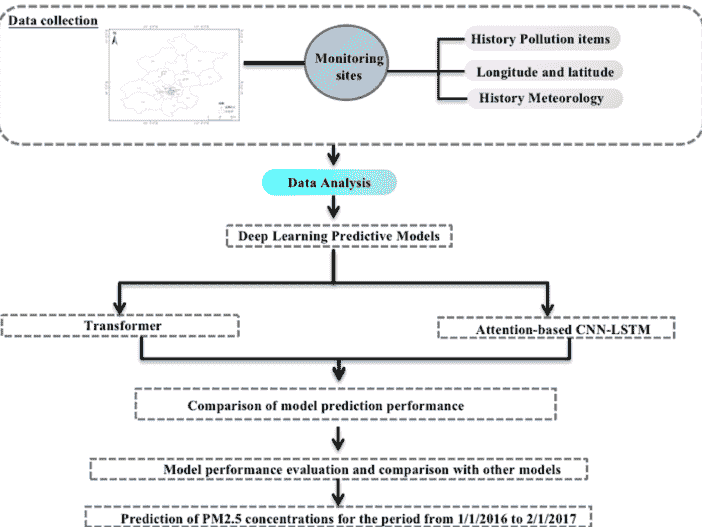

图 1. PM2.5 预测模型框架。

# 2. 材料与方法

## 2.1. 研究区域与数据

北京位于中国华北，是中国经济、社会和文化中心（39.90°N, 116.40°E）；北接燕山脉，西邻太行山，因此地形呈现西北高、东平坦的特点。作为中国主要的重工业基地，北京每年进行大量的煤燃烧。北京特殊的地质和气候条件限制了污染物的扩散和扩散，导致了北京污染物浓度的升高。本研究从中国气象数据网（http://data.cmc.gov.cn）获取了 2013 年 1 月 1 日至 2017 年 1 月 1 日期间 12 个大气空气质量监测站的小时空气质量数据和气象数据。

数据的属性如表 1 所示。这些数据集根据模型需求转换为不同的输入维度。为了展示和理解，利用 2013-2017 年获取的监测数据计算了每个站的平均 PM2.5 浓度，并按季节进行了季节性划分（图）。利用 2013-2017 年 12 个站过去 24 小时的小时监测数据作为输入，估计了 2017 年每个季节的平均 PM2.5 浓度。

## 2.2. 数据分析

季节性变化的污染因子和气象条件是考虑 PM2.5 浓度时需要的主要因素之一。在本研究中，

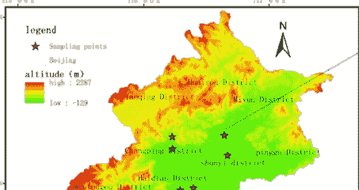

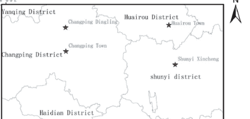

图 2. 站点分布。

B. Cu 等人。


# 表 1

研究中的变量描述。

| 类别 | 变量 | 单位 |
| --- | --- | --- |
| 污染 | PM2.5 | µg/m³ |
| | SO2 | µg/m³ |
| | NO2 | µg/m³ |
| | PM10 | µg/m³ |
| | O3 | µg/m³ |
| 气象条件 | TEMP | °C |
| | PRESS | hPa |
| | DOWNP | % |
| | RAIN | mm |
| | 风速 | m/s |

自相关性小于 0.05 则拒绝原假设，即存在自相关性。在图 4 中，PM2.5 浓度呈现出周期性和强自相关性，表明之前收集的 PM2.5 浓度数据可以有效用于后续污染预测并在本研究中构建模型。然而，成分在 2013 年 7 月至 2014 年 1 月以及 2017 年 7 月之间发生了显著变化，表明除了污染因子和气象条件的影响外，可能存在极端天气，这给准确预测 PM2.5 浓度带来了挑战。

TEMP，温度；PRESS，气压；RAIN，雨量；WINDSP，风速；DEWP，露点。

 2013 年 1 月至 2017 年 2 月 12 个站的气象数据。图 4 展示了原始数据使用局部加权回归和散点平滑（LOESS）方法进行季节趋势分解的示意图，该方法将时间序列分为趋势、季节和随机部分。原始数据的季节性通过自相关函数 (ACF) 和偏自相关函数 (PACF) 进行测量。在表 2 中，p 值较低，有更多证据表明应拒绝原假设。1 阶、2 阶和 3 阶自相关的 p 值均大于 0.05，不存在自相关。如果 4 阶或更高的 p 值为

## 2.3. 基于 Transformer 的 PM2.5 输入参数全局敏感性

PM2.5 浓度受许多因素影响，包括气象监测数据，四个季节的 PM2.5 浓度存在差异，春夏季浓度高于秋季。气象条件在气溶胶的形成和转化中起着重要作用。化学因素也是前体。因此，温度、湿度、风速、风向、气压和降水量是模型预测的重要气象参数。此外，考虑到二氧化硫 (SO2)、二氧化氮 (NO2)、一氧化碳 (CO) 和臭氧 (O3) 可能协同污染以提高 PM2.5 浓度，两者均被采用

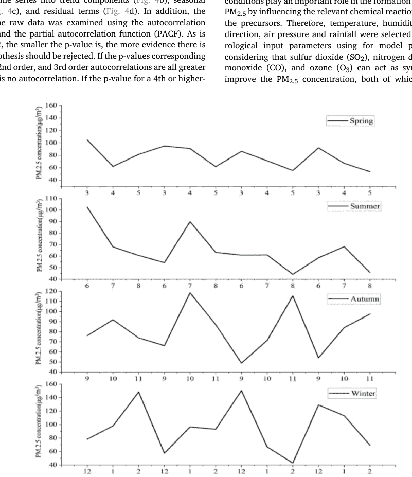

图 3. 各季节 PM2.5 浓度的趋势。

C. Bai 等人。


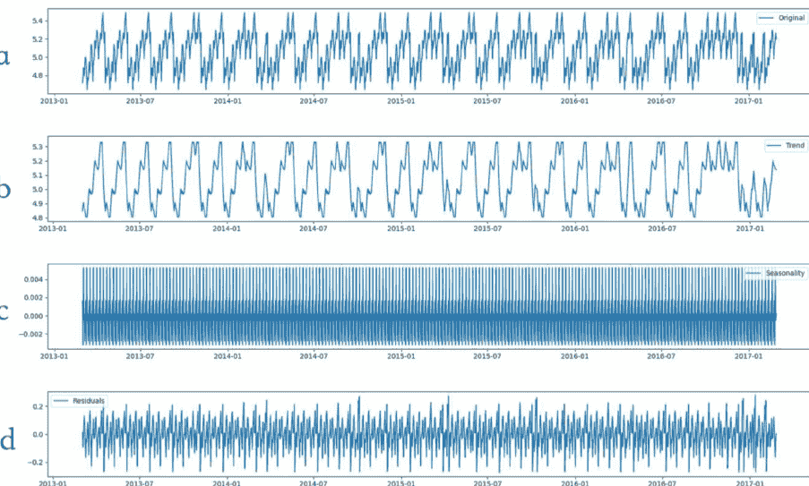

图 4. 分解后的时间序列。STL，基于 lo 的季节趋势分解。(a) 原始，(b) 趋势成分，(c) 季节成分，(d) 残差项。

| 滞后阶 | AC 值 | PAC 值 | O 统计量 | p 值 |
|---|---|---|---|---|
| 1 阶 | 0.999 | 0.967 | 8054.040 | 0.040 |
| 2 阶 | 0.918 | -0.262 | 1538.357 | 0.020 |
| 3 阶 | 0.871 | 0.050 | 21846.725 | 0.020 |
| 4 阶 | 0.826 | -0.033 | 27728.011 | 0.000 |
| 5 阶 | 0.784 | -0.031 | 33026.299 | 0.000 |
| 6 阶 | 0.742 | -0.033 | 37768.603 | 0.000 |
| 7 阶 | 0.702 | 0.014 | 42039.552 | 0.000 |
| 8 阶 | 0.668 | -0.062 | 48589.811 | 0.000 |
| 9 阶 | 0.641 | 0.041 | 49396.794 | 0.000 |


# B. Cui 等


图 6. 注意力机制的计算图。

多头注意力机制允许模型不仅关注序列的位置，还关注不同的头，从而使得多头注意力（SHA）层可以作为序列输入。为了考虑污染因子与气象条件之间的关系，多头注意力机制将每个注意力位置、特征和值视为整体。在文中，注意力层用于最大模型捕捉长程依赖的能力：

## 1. CNN 注意力单元

该单元基于卷积模块并包含注意力机制以提取具有显著影响的特征。CNN模块由多个层组成，每层包含卷积、归一化和一个线性层。注意力机制由部分组成：一个用于特征聚合，另一个用于恢复，并与CNN的输出集成。在文中，CNN模型是原始序列数据，而注意力机制比CNN更强大。CNN的输出与注意力机制的输出进行逐元素相乘，每个特征的重要性由注意力机制决定。

```
$MultiHead(Q, K, V) = Concat(head^1, ..., head^h)W^O$
```

其中 $head = Attention(Q^Q, KW^K, VW^V)$，$W^Q, W^K, W^V \in \mathbb{R}^{d \times d_k}$ 且 $W^O \in \mathbb{R}^{d_k \times d}$，$h$ 是多头注意力机制：

## Encoder 编码器

在本研究中，编码器由 $N=6$ 个相同的单元组成，每个单元包含两个连接前一层输入的子层，然后对每层进行归一化。每个子层的输出如公式 (7) 所示，其中子层 ($y$) 是 $x$ 的函数。我们在所有层中使用残差连接来产生输出：$d = 512$

```
$Output = LayerNorm(x + Sublayer(x))$
```

## LSTM 单元

门用于控制LSTM提取时间序列中的模式。LSTM的结构由输入门、遗忘门和输出门组成。单元中的信息是否保留由遗忘门决定。输入中的新信息和特征提取的程度由输入门控制。输出门只传递隐藏状态。用于计算LSTM的公式为：

```
$f_t = \sigma(W_f \cdot [h_{t-1}, x_t] + b_f)$
```

```
$i_t = \sigma(W_i \cdot [h_{t-1}, x_t] + b_i)$
```

```
$\tilde{c}_t = tanh(W_c \cdot [h_{t-1}, x_t] + b_c)$
```

```
$c_t = f_t \cdot c_{t-1} + i_t \cdot \tilde{c}_t$
```

```
$h_t = o_t \cdot tanh(c_t)$
```

## LSTM-注意力单元

基于带有注意力机制的卷积和LSTM模型构建了 $PM_{2.5}$ 浓度预测模型。研究中称为CA如图如图所示。CA由CNN注意力单元和LSTM组成。CA单元集成连续重叠序列作为数据输入，而LSTM使用CA单元的输出作为其输入。其预测由LSTM单元的最终层得出：


图 7. CNN-LSTM注意力模型。CNN-LSTM卷积神经网络短期记忆机制。

$z_i = o_i * \tanh(A_i)$

其中$z_i$和$x_i$ 分别是$t$时刻和$t-1$时刻的输出；$q_i$是$t$时刻的输入；$f_i, l_i$ 和 $o_i$是遗忘门、输入门和输出门的输出，$A_i$是激活函数。其中$y_i$和$y_i'$分别是目标值和输出模型，$y_i$是目标值的平均值。

## 评估

使用$R^2$、MAE和MSE评估性能。越接近1性能越好。这些指标的计算方法如下：

$R^2 = 1 - \frac{\sum(y_i - \hat{y}_i)^2}{\sum(y_i - \bar{y})^2}$

$MAE = \frac{1}{n} \sum|y_i - \hat{y}_i|$

$MSE = \frac{1}{n} \sum(y_i - \hat{y}_i)^2$

## 结果与讨论

### 3.1 训练与结果

Transformer和CNN-LSTM模型的结果如图8所示。CNN-LSTM-注意力模型能够有效捕捉每个方向的浓度梯度，像Transformer模型一样，它很好地预测1000分钟之后的时间点。然而，图a和b显示，在前1000分钟内，PM2.5浓度与Transformer模型一致，表明Transformer在捕捉因子与气象因子之间的隐藏关系方面更为有效。

### 3.2 性能预测

使用2013年1月到2015年2月的小小时数据作为学习数据来训练模型，并预测2016年1月到2017年2月的小小时数据。学习数据按季节划分为：春季（3-5月）、夏季（6-8月）、秋季（9-11月）和冬季（12月-2月）组，用于测试模型。从图10可以看出，每个面板顶部的曲线展示了PM2.5浓度值，使用CNN-LSTM模型的预测值以及使用Transformer模型的预测值在整个范围内提供了更准确的预测。需要注意的是，PM2.5污染与局部天气条件密切相关，特别是在秋季，气团持续时间短且风速低，不利于污染物的扩散，导致PM2.5浓度的升高。图9c中红色虚线圈出的数据显示Transformer模型准确预测了


B. Cu 等人


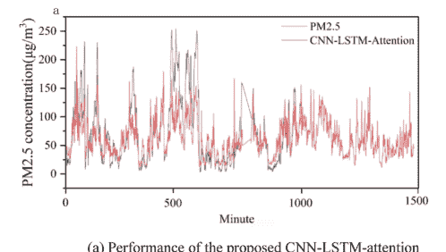

(a) CNN-LSTM-attention 模型的性能：分别代表 0000-1500 小时的预测性能和未来预测。

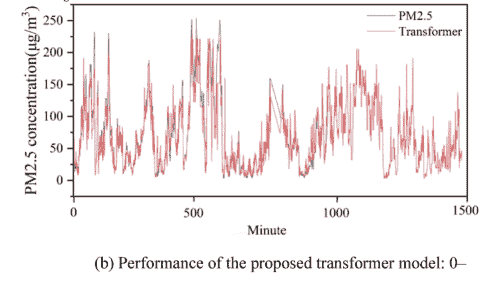

(b) transformer 模型的性能：分别代表 0000-1500 小时的预测性能和未来预测。

图 9. (a) CNN-LSTM-attention 模型的性能：0000-1500 小时的预测性能和未来预测。(b) transformer 模型的性能：分别代表 0000-1500 小时的预测性能和未来预测。

秋冬 PM2.5 浓度发生变化的小时。该模型在秋季 0-500 小时（红色虚线圈出）和冬季 500-1000 小时（红线圈出）期间具有良好的预测性能。Transformer 模型的拟合优度 (R²) 为 94.4%，比 CNN-LSTM-attention 模型高出 10.8%，表明 Transformer 模型在秋冬季节具有更好的预测性能。这表明 Transformer 模型在关注局部信息和捕获污染物变化方面具有良好的预测性能，并且在不同情况下的空气质量预测方面具有良好的性能。

## 3.3. transformer 与其他模型的比较

目标区域的污染物浓度在全年趋于稳定，除非天气发生显著变化（低风速），这会导致空气输送污染物的能力下降，从而导致污染物积聚，加剧了局势。在某些季节，气象条件导致污染在数据中表现出显著变化。基于历史数据预测条件剧烈变化的大气污染物浓度，存在仅与历史数据具有一般相关性的问题。

## 4. 结论

在这项研究中，我们开发了一种基于 Transformer 的长期 PM2.5 预测方法，并从 RMSE、MAE 和 R² 方面将其性能与 CNN-LSTM-attention 模型进行了比较，以确定模型如何捕获污染因素与气象条件之间的关系。我们使用了 2013 年至 2017 年北京获取的历史数据。结果显示，Transformer 模型可以有效克服以往预测的局限性、在使用物理和机器学习时遇到的问题以及时间顺序信息。此外还应用了 LSTM 和 XGBoost 模型。

Cut 等人


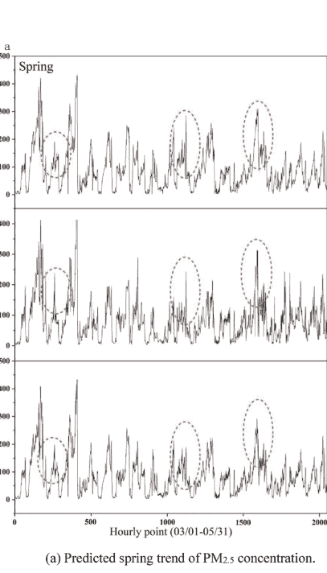

(a) PM2.5 浓度的春季预测趋势。

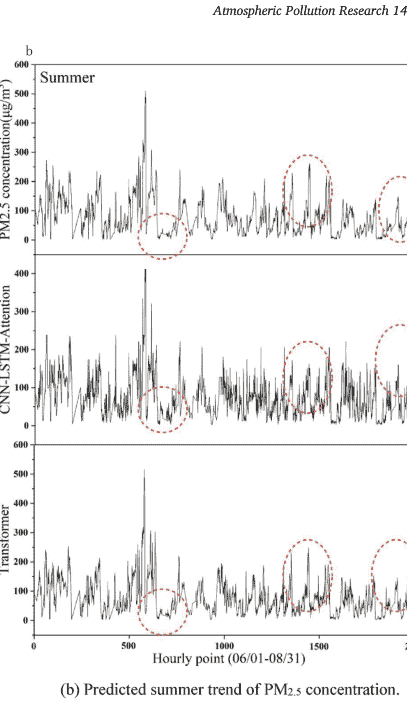

(b) PM2.5 浓度的夏季预测趋势。

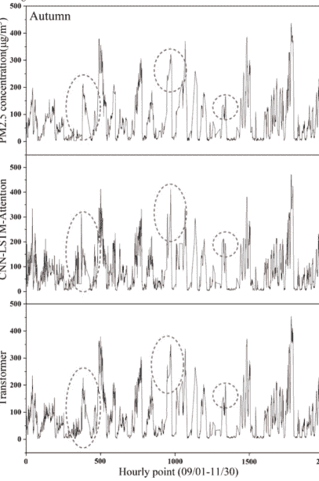

(c) PM2.5 浓度的秋季预测趋势。

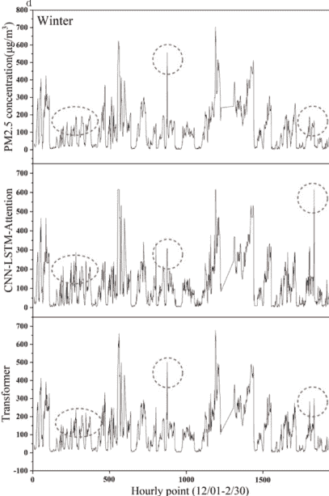

(d) PM2.5 浓度的冬季预测趋势。

图 10. (a) PM2.5 浓度的春季预测趋势。(b) PM2.5 浓度的夏季预测趋势。(c) PM2.5 浓度的秋季预测趋势。(d) PM2.5 浓度的冬季预测趋势。

B. Cu 等人


## 表 5

| 方法 | 解释方差 | R² | MAE (10⁻²) | MSE (10⁻²) |
| :--- | :--- | :--- | :--- | :--- |
| XGBOOST | 0.805 | 0.6592 | 0.270 | 0.170 |
| CNN-LSTM | 0.744 | 0.6582 | 0.348 | 0.334 |
| CNN-Attention | 0.836 | 0.8362 | 0.216 | 0.161 |
| Attention | 0.946 | 0.923 | 0.112 | 0.052 |

Transformer 模型在关注局部信息和捕获污染物变化方面具有良好的预测性能，并且在不同情况下的空气质量预测方面具有良好的性能。

Transformer 模型在关注局部信息和捕获污染物变化方面具有良好的预测性能，并且在不同情况下的空气质量预测方面具有良好的性能。

B. Cu 等人：方法。B. Cu 等人：方法。B. Cu 等人：方法、数据管理。B. Cu 等人：方法。

作者声明
B. Cu 等人：方法、数据收集、撰稿准备。
B. Cu 等人：方法。
B. Cu 等人：方法、审稿。
B. Cu 等人：方法。

资助
本研究由 2022-0004 号科学技术计划、2022-00055 号福建省科技基金资助。

利益冲突
作者声明他们没有已知利益冲突。

致谢
不适用。

参考文献
Abdi 等人
Verga 等人
Wang 等人
Wen 等人
Wen 等人
Wu 等人
Xiang 等人
Xu 等人
Yadousef 等人
Zhang 等人

