# 边缘计算设备上的深度学习：算法与架构设计挑战


本页故意留空


# 前言

我们最早在2010年开始从事基于边缘计算的机器学习领域的工作。在项目资助下，我们试图在集成电路芯片上加速支持向量机算法，以支持指纹识别等嵌入式应用。近年来，随着深度学习和集成电路技术的发展，基于边缘计算设备的人工智能应用，如智能终端、自动驾驶和AIOT，层出不穷。然而，嵌入式人工智能应用的实现涉及数学、计算机科学、计算机体系结构以及电路与系统设计等多学科知识。因此，我们产生了编写一本专著的想法，专注于相关技术的研究进展，以便于相关领域的研究生和工程师理解和学习。

基于嵌入式设备的深度学习应用开发正面临深度神经网络算法高复杂性的理论瓶颈。实现各种快速发展的深度学习模型的轻量化，是未来实现AIOT无处不在的人工智能的关键之一。近年来，我们一直专注于为嵌入式设备开发自动化深度学习工具。本书涵盖了嵌入式深度学习中目前正在发展的一些前沿技术，并介绍了一些核心算法，包括轻量级神经网络设计、模型压缩、模型量化等，旨在为读者设计嵌入式深度学习算法提供参考。

基于嵌入式设备的深度学习应用开发正面临后摩尔时代集成电路技术发展受限的技术挑战。为应对这一挑战，本书提出并详细阐述了一种算法-硬件协同设计的新范式，以实现嵌入式设备中神经网络计算的能效比和性能优化。我们将开发的DANoC稀疏编码神经网络芯片作为示例，介绍存内计算的新技术，希望能为嵌入式设计专家提供启发。我们相信，在后摩尔时代，跨越算法、软件和硬件多个层次的系统协同设计方法将逐渐成为嵌入式智能...


...设计以满足在有限硬件资源条件下的高实时性和低功耗设计要求。

由于时间限制和作者知识有限，内容中可能存在一些疏漏，敬请读者谅解。

周西川

# 致谢

首先，我们要感谢所有参与相关工作的学生对本书所作的贡献，包括张帅、刘魁、丁睿、李胜利、梁松红、胡雨然等。

我们借此机会感谢家人、朋友和同事在撰写本专著过程中的支持。我们也要感谢我们的机构——重庆大学微电子与通信工程学院，为开展智能边缘计算研究提供了支持条件。

本书的主要内容由一系列研究整理而成，部分获得中国国家自然科学基金会（编号：61971072 和 62001063）的支持。

我们非常感谢爱思唯尔和清华大学出版社的编辑人员和美工人员，在撰写本书过程中为我们提供了所需的所有支持与帮助。

本页故意留空

# 第一部分

## 引言

本页故意留空

# 第1章

## 引言

## 1.1 背景

当前，人类社会正在迅速进入万物互联时代。基于智能嵌入式设备的物联网应用正在爆发式增长。全球移动通信系统协会（GSMA）发布的报告《移动经济2020》显示，2019年全球物联网连接设备总数达120亿台[1]。预计到2025年，全球物联网连接设备的总规模将达到246亿台。智能终端、智能语音助手和智能驾驶等应用将极大地提高人类社会的组织效率并改变人们的生活。随着人工智能技术向无处不在的智能方向快速发展，智能终端设备将进一步深入渗透到人类社会。

回顾人工智能的发展历程，在1936年的关键时间点上，英国数学家艾伦·图灵提出了一种理想的计算机模型——通用图灵机，为十年后诞生的ENIAC（电子数值积分计算机）提供了理论基础。同期，受人脑行为启发，美国科学家约翰·冯·诺依曼撰写了专著《计算机与大脑》[2]，并为ENIAC提出了一种改进的存储程序计算机，即冯·诺依曼架构，这成为计算机乃至人工智能系统的原型。

人工智能最早的描述可以追溯到1950年的图灵测试[3]。图灵指出：“如果一台机器通过特定设备与人对话，且不与外界通信，而人无法可靠地判断对话对象是机器还是人，那么这台机器就具有人类智能。”“人工智能”一词实际上出现在1956年约翰·麦卡锡主持的达特茅斯研讨会上[4]。“人工智能之父”将其定义为“制造智能机器的科学与工程”。人工智能的提出开辟了一个新领域。此后，学术界也相继提出了人工智能的研究成果。经过几次历史性的发展周期，当前，人工智能已进入机器学习的新时代。

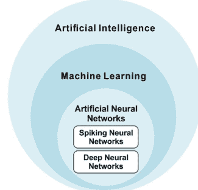

图 1.1 深度学习相关研究领域关系图。

如图1.1所示，机器学习是人工智能理论研究的一个子领域，近年来发展迅速。阿瑟·塞缪尔于1959年提出了机器学习的概念，并构想建立一种理论方法，“使计算机能够在不依赖某些编码指令的情况下自主学习和工作”[5]。机器学习领域的一个代表性方法是俄罗斯统计学家弗拉基米尔·瓦普尼克于1995年提出的支持向量机[6]。作为一种数据驱动方法，基于统计的SVM拥有完善的理论支持和出色的模型泛化能力，并广泛应用于人脸识别等场景。

人工神经网络（ANN）是实现机器学习的方法之一。人工神经网络利用生物神经网络的结构和功能特征，构建用于估计或近似函数的数学模型。ANN是受构成动物大脑的生物神经网络启发而设计的计算系统。ANN基于一组称为人工神经元的连接单元或节点，这些单元大致模拟了生物大脑中的神经元。人工神经网络的概念可以追溯到沃伦·麦卡洛克和沃尔特·皮茨于1943年提出的神经元模型（MP模型）[7]。在该模型中，输入的多维数据与相应的权重参数相乘并累加，累加值通过特定的阈值函数计算后输出预测结果。后来，弗兰克·罗森布拉特于1958年构建了一个具有两层神经元的感知机系统[8]，但感知机模型及其后续改进方法在解决高维非线性问题方面存在局限性。直到1986年，多伦多大学计算机科学系教授杰弗里·辛顿发明了用于人工神经网络参数估计的反向传播算法[9]，并实现了多层神经网络的训练。

作为神经网络技术的一个分支，深度学习技术近年来取得了巨大成功。算法里程碑出现在2006年。辛顿发明了玻尔兹曼机，并成功解决了训练多层神经网络时梯度消失[10]的问题。至此，人工神经网络正式进入了“深度”时代。2012年，纽约大学扬·勒库恩教授发明的卷积神经网络[11]及其变体极大地提高了机器学习方法在大规模图像数据库上的分类准确率，并在随后几年达到并超越了人类的图像识别水平，为深度学习技术的大规模工业应用奠定了技术基础。当前，深度学习技术正在飞速发展，并在机器视觉[12]和语音处理[13]等细分领域取得了巨大成功。尤其是在2016年，基于深度学习技术构建的戴米斯·哈萨比斯的AlphaGo人工智能以4:1击败了围棋世界冠军李世石，标志着人工智能已进入快速发展的新时代。

## 1.2 应用与趋势

物联网技术被认为是推动下一轮工业变革的重要力量之一。物联网概念最早由麻省理工学院的凯文·阿什顿于2009年提出。他指出：“计算机可以通过射频传输和传感器技术观察和理解世界，即赋予计算机自身收集信息的手段”[14]。各种传感器收集的海量数据连接到网络后，人与万物之间的联系得以加强，从而扩展了互联网的边界，并大幅提高了工业生产效率。在新的“工业技术变革浪潮”中，智能

终端设备无疑将发挥重要作用。作为物联网连接的载体，智能感知终端设备不仅实现数据采集，还具备前端和本地数据处理能力，能够实现数据隐私保护以及感知语义信息的提取与分析。

随着智能终端技术的提出，人工智能（AI）与物联网（IoT）领域逐渐融合为人工智能物联网（AI&IoT 或 AIoT）。一方面，人工智能的应用规模正在逐步扩大，并依托物联网渗透到更多领域；另一方面，物联网设备需要嵌入式智能算法来从传感器数据的前端采集中提取有价值的信息。智能物联网（AIoT）概念于2018年左右由产业界提出[15]，旨在基于物联网终端的边缘计算实现万物数字化和智能化。面向AIoT的智能终端应用正处于快速发展期。根据艾瑞咨询的一份第三方报告，2015年至2019年中国市场AIoT融资总额约为290亿美元，增长了73%。

AIoT智能终端应用的第一个特征是数据量大，因为边缘侧拥有大量设备和大规模数据。Gartner的报告显示，2019年全球约有34万辆自动驾驶汽车，预计到2023年，将有超过74万辆具备数据采集能力的自动驾驶汽车在各种应用场景中运行。以特斯拉为例，配备八个外置摄像头和一块强大的片上系统（SOC）[16]，自动驾驶汽车可以支持端到端的机器视觉图像处理，以感知道路状况、周围车辆和环境。据报道，特斯拉Model 3的一台前置摄像头（分辨率为1280 × 960）一分钟可产生约473 GB的图像数据。据统计，目前，特斯拉已收集超过100万条视频数据，并标注了视频中60亿个物体的距离、加速度和速度信息。数据量高达1.5 PB，为提升自动驾驶人工智能模型性能提供了良好的数据基础。

AIoT智能终端应用的第二个特征是高延迟敏感性。例如，自动驾驶汽车的车载ADAS对从图像采集和处理到决策的响应时间有严格要求。例如，特斯拉自动驾驶紧急刹车系统的平均响应时间为0.3秒（300 ms），而熟练驾驶员也需要大约0.5秒到1.5秒。借助数据驱动的机器学习算法，特斯拉于2019年提出的车载系统HW3每秒处理2300帧（fps），是HW2.5的110 fps图像处理能力的21倍。

AIoT智能终端应用的第三个特征是高能效比。因为嵌入式人工智能应用领域[17]中的可穿戴智能设备和智能音箱主要由电池驱动，所以功耗和续航能力至关重要。大多数智能音箱采用语音唤醒机制，可根据人声关键词的识别实现从待机状态到工作状态的切换。基于高能效比的嵌入式语音识别人工智能芯片，新型智能音箱可以在待机功耗为0.05 W的情况下实现语音唤醒。在典型的离线人机语音交互应用场景中，芯片的功耗也可以控制在0.7 W以内，为电池驱动系统长时间工作提供了条件。例如，亚马逊智能音箱在始终监听模式下可实现8小时的电池续航，而优化后的智能音箱续航时间可长达3个月。

从未来发展趋势来看，人工智能物联网的发展目标是实现无处不在的普适智能[18]。普适智能技术旨在解决嵌入式智能设备在大数据量、高时延敏感性和高能效比方面的核心技术挑战，并最终实现万物数字化和智能化[19]。发展的基础是理解人工智能技术发展带来的效率提升与个人隐私保护之间的法律和伦理关系，以便在保障个人隐私的前提下提高社会生产效率和人们生活的便利性。我们认为，人工智能物联网的普适智能计算将成为推动新一轮工业技术革命的关键技术。

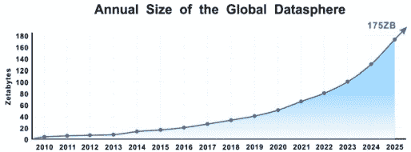

图 1.2 全球数据增长预测。

## 1.3 概念与分类

### 1.3.1 预备概念

数据、算力和算法被视为推动人工智能发展的三要素，这三要素的发展已成为深度学习技术爆发的助推器。首先，获取数据（尤其是带标签的大规模数据）的能力是深度学习技术发展的前提。据统计，2020年全球互联网数据量已超过30 ZB [20]。如果不进行数据优化和压缩，单是预计的存储成本就会超过6万亿元人民币，相当于2020年挪威和奥地利GDP之和。随着物联网和5G技术的进一步发展，将带来更多数据源和传输层容量的提升。可以预见，数据总量将以更高速度继续快速增长。预计到2025年，数据总量将达到175 ZB，如图1.2所示。数据量的增加为深度学习模型性能提升提供了良好基础。另一方面，数据量的快速增长也对模型训练的计算性能提出了更高要求。

其次，人工智能发展的第二要素是计算系统。计算系统是指实现人工智能系统所需的硬件计算设备。计算系统有时被描述为支撑人工智能应用的“引擎”。在人工智能深度学习时代，计算系统已成为基础设施资源。2016年，当谷歌的人工智能AlphaGo [21]击败韩国棋手李世石时，人们感叹人工智能的强大，而其背后巨大的“代价”鲜为人知：一场围棋比赛消耗了1202个CPU、176个高性能GPU以及惊人的233 kW功率。

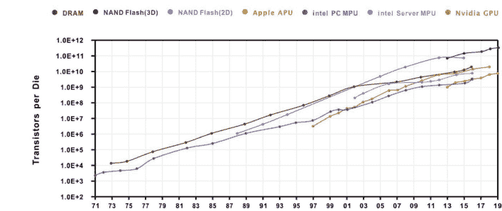

图 1.3 晶体管数量发展趋势。

从计算系统的发展角度来看，VLSI芯片的发展是提升AI计算性能的根本动力。好消息是，尽管半导体行业的发展有周期性波动，但半导体行业著名的“摩尔定律”[22]已经经受了50年的考验（图1.3）。摩尔定律在VLSI芯片领域仍然保持，这在很大程度上是因为GPU的快速发展弥补了CPU发展缓慢的不足。我们可以从图中看到，2010年GPU晶体管数量的增长超过了CPU，CPU晶体管数量开始落后于摩尔定律，而深度学习专用ASIC和FPGA异构AI计算加速器等硬件技术[23]的发展为人工智能计算能力的提升注入了新的动力。

最后但同样重要的是，人工智能发展的第三要素是算法。算法是一系列明确定义、可由计算机执行的有限指令序列，通常用于在有限时间内解决一类特定问题。过去10年中基于深度学习的算法与应用的性能突破是AI技术里程碑式发展的重要原因。那么，在万物互联时代，深度学习算法的未来发展趋势是什么？这是学术界和工业界讨论的核心问题之一。普遍共识是，深度学习算法将朝着高效率方向发展。


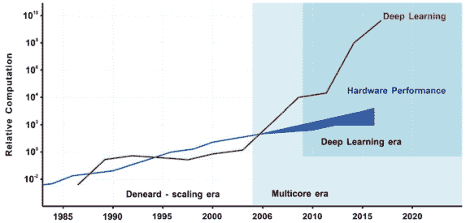

图 1.4 深度学习模型的算力需求与算法对比

OpenAI（一个开放的人工智能研究机构）指出，“先进人工智能所需的计算资源大约每三个半月翻一番”。自2012年以来，训练大型AI模型所需的计算资源增加了300,000倍，年均增长11.5倍。硬件计算性能的增长率仅达到年均增长1.4倍。另一方面，高效深度学习算法效率的提升每年平均可节省约1.7倍的计算资源。这意味着，随着我们不断追求算法性能的持续提升，计算资源需求的增加可能会超过硬件计算性能的发展速度，如图1.4所示。一个实际例子是2020年发布的用于自然语言处理的深度学习模型GPT-3 [24]。仅模型训练和计算资源部署的成本就已达到约1300万美元。如果计算资源成本呈指数级增长，那么就难以实现可持续发展。如何解决这一问题是人工智能向普适智能发展过程中的关键问题之一。

### 1.3.2 深度学习的两个阶段：训练与推理

深度学习通常分为两个阶段：训练和推理。首先，基于已知数据估计神经网络模型参数的过程称为训练。训练有时也被称为参数学习的过程。在本书中，为避免歧义，我们使用“训练”一词来描述参数估计过程。训练过程中所需的数据称为训练数据集。训练算法通常被描述为一个优化任务。通过梯度下降 [25] 估计训练样本集上数据标签预测误差最小的模型参数，并通过正则化 [26] 获得泛化性能更好的神经网络模型。

在第二阶段，训练好的神经网络模型被部署到系统中，以实时预测传感器获取的未知数据的标签。该过程称为推理过程。模型的训练与推理就像同一枚硬币的两面，属于不同阶段且密切相关。模型的训练质量决定了模型的推理准确率。

为方便理解本书后续内容，我们将训练和推理过程中涉及的机器学习主要概念总结如下。

- **数据集。** 数据集是具有相似属性或特征及其标签的已知数据的集合。在深度学习中，传感器获取的语音、图像等信号通常转换为向量、矩阵或张量等数据表达形式。数据集通常分为训练数据集和测试数据集，分别用于神经网络模型参数的估计和神经网络推理性能的评估。

- **深度学习模型。** 在本书中，我们将从已知数据 x 到待估计标签 y 的函数 f(x; θ) 命名为模型，其中 θ 是神经网络内部参数的集合。值得注意的是，在深度学习中，模型的参数和函数形式多种多样且规模庞大。通常难以写出函数的解析形式。此处仅提供形式定义。

- **目标函数。** 深度学习模型训练过程被定义为一个优化问题。优化问题的目标函数通常包括两部分：损失函数和正则化项。损失函数用于描述神经网络模型在训练样本上的标签预测平均误差。通过最小化损失函数，可以提高模型在训练样本集上的准确率。正则化项通常用于控制模型的复杂度，以提高模型对未知数据标签的预测准确率和泛化性能。

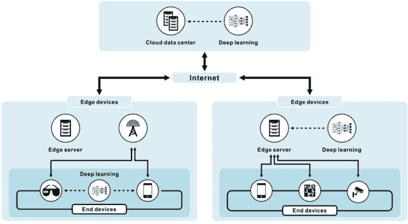

图 1.5 云和边缘的应用场景

### 1.3.3 云和边缘设备

边缘计算 [27] 是指一种概念，即分布式架构将中心节点的大规模计算分解和切割为更小、更易于管理的部分，并分散到边缘节点进行处理。边缘节点更靠近终端设备，具有更高的传输速度和更低的时延。如图 1.5 所示，云是指远离用户的中央服务器。用户可以随时随地通过互联网访问这些服务器，以实现信息查询和共享。边缘是指靠近用户侧的基站或服务器。从图中可以看出，监控摄像头、手机和智能手表等终端设备 [28] 更靠近边缘。对于深度学习应用，如果推理阶段可以在边缘完成，那么传输时延问题可能得到解决，且边缘计算在数据源或用户附近提供服务，不会引起隐私泄露问题。数据显示，未来几年云算力将呈线性增长，复合年增长率为 4.6%，而边缘的需求呈指数增长，复合年增长率为 32.5%。

边缘计算终端是指专注于用户终端实时、安全、高效特定场景数据分析的智能设备。边缘计算终端在人工智能物联网（AIoT）领域拥有巨大的发展前景。物联网行业的大量传感器设备需要高频采集各种类型的数据。边缘计算设备可以集成数据采集、计算和执行，有效避免将数据上传到云计算的成本和时延，提高用户数据的安全性和隐私保护。根据IDC调查，2020年物联网行业产生的45%的数据将在网络边缘进行处理，未来几年这一比例将继续扩大。“2021边缘计算技术白皮书”指出，边缘计算智能终端的典型应用场景包括智能车联网/自动驾驶、工业互联网和智慧物流。超低时延、海量数据、边缘智能、数据安全和云边协同等价值将促使更多企业选择边缘计算。

## 1.4 挑战与目标

近年来，深度学习在机器视觉和语音识别领域取得了突破。然而，由于标准深度神经网络的训练和推理涉及大量参数和浮点计算，通常需要在资源密集型云服务器和设备上运行。然而，该解决方案面临以下两个挑战。

- (1) 隐私问题。将用户数据（如照片和语音）发送到云端会引起严重的隐私泄露问题。欧盟、美国等地已对向云端发送用户数据建立了严格的法律管理和监控体系。

- (2) 高时延。许多智能终端应用对从数据采集到处理完成的端到端时延有极高要求。然而，端-云协作架构存在数据传输时延不确定的问题，难以满足自动驾驶等高时效性智能应用的需求。

边缘计算有效解决了上述问题，并逐渐成为研究热点。最近，边缘计算在技术上取得了一些突破。一方面，算法设计公司开始寻求更高效、更轻量的深度学习模型（如MobileNet和ShuffleNet）。另一方面，硬件技术公司，尤其是芯片技术公司，已大力投资于专用神经网络计算加速-


...代芯片（例如NPU）。如何通过优化算法和硬件架构，尽量降低资源受限边缘设备上的资源消耗，对5G乃至6G时代AIoT的发展与应用具有重大意义。

基于智能终端的深度学习边缘计算技术将有效解决上述深度学习云计算的技术挑战。本书聚焦于深度学习边缘计算技术，从算法、硬件和应用三个层面，介绍如何在嵌入式智能终端上设计、优化和部署高效的神经网络模型。在算法技术方面，介绍了边缘深度学习的神经网络算法，包括轻量级神经网络结构设计、剪枝和压缩技术。硬件技术详细阐述了边缘深度学习的硬件设计与优化方法，包括算法与硬件协同设计、存储器近计算以及集成学习的硬件实现。关于应用程序，各部分简要介绍了应用程序。此外，作为综合示例，本书末尾将以独立部分介绍智能监控摄像头的应用，该部分集成了算法创新和硬件架构创新。

## 1.5 图书大纲

本书旨在全面覆盖基于边缘的神经计算领域的最新进展，包括算法模型和硬件设计。为了反映市场需求，本书试图系统总结边缘深度学习的相关技术，包括算法模型、硬件架构和应用。通过算法-硬件-代码协同设计，可在边缘计算设备上最大化深度学习模型的性能。

本书结构如下。按内容划分，包含三部分九个章节。第1部分为绪论，包含两章（第1章～第2章）；第2部分为模型与算法，包含三章（第3章～第5章）；第3部分为架构优化，包含四章（第6章～第9章）。

第1章（绪论）主要描述人工智能的发展过程、相关应用及发展前景，介绍深度学习领域的一些基本概念和术语，最后概述本书的研究内容与贡献。

第2章（深度学习基础）阐述深度学习的相关基础，包括前馈神经网络、卷积神经网络和循环神经网络的架构，以及网络模型的训练过程，以及深度神经网络在AIoT设备上的性能与挑战。

第3章（模型设计与压缩）探讨当前的轻量级模型设计与压缩方法，包括通过介绍一些经典轻量级模型来实现高效轻量级网络设计，以及通过详细介绍模型剪枝和知识蒸馏两种典型方法来实现模型压缩。

第4章（混合精度模型编码与量化）基于无线通信中的信号压缩理论，从神经网络激活量化与编码的角度，提出了一种混合精度量化与编码的按位瓶颈方法，可将神经网络激活从浮点类型量化为低精度定点类型。ImageNet及其他数据集上的实验表明，通过最小化每层的量化失真，按位瓶颈编码方法在低精度激活下实现了最先进的性能。

第5章（二进制神经网络模型编码）聚焦于二进制神经网络模型，并提出一种硬件友好的方法，以提升具有二进制权重和激活的高效深度神经网络的性能。元胞二进制神经网络包含多个并行的二进制神经网络，通过组稀疏正则化和知识蒸馏优化侧向连接。CIFAR-10和ImageNet数据集上的实验表明，通过引入优化的组稀疏侧向路径，元胞二进制神经网络可获得优于其他二进制深度神经网络的性能。

第6章（二进制神经网络计算架构）从硬件加速设计的角度，提出一种全流水线BNN加速器，该加速器具有袋装集成单元，用于聚合多个BNN流水线以实现更好的模型精度。与其他方法相比，该设计在MNIST数据集上大大改善了内存占用和能效比。

第7章（稀疏二进制片上网络的算法与硬件协同设计）从算法与硬件协同设计的角度，提出一种面向硬件的深度学习算法——深度自适应网络方法，以探索神经网络连接之间的稀疏性。为了充分利用算法优化的优势，我们提出了一种基于稀疏映射内存的高效硬件架构。与传统的片上网络架构不同，片上深度自适应网络（DANoC）紧密结合通信与计算，以避免板载存储器与片上计算单元之间参数传输造成的巨大功耗损失。实验结果表明，与最先进的方法相比，该系统具有更高的精度和效率。

第8章（目标跟踪的硬件架构优化）从算法与硬件协同设计的角度，基于纹理与动态压缩感知特征及椭圆匹配算法，提出一种用于目标跟踪的低成本、高速VLSI系统。该系统引入了以存储器为中心的架构模式、多级流水线和并行处理电路，在消耗最小硬件资源的同时实现高帧率。基于FPGA原型系统，在100 MHz时钟频率下，实现了每秒600帧的处理速度，并保持稳定的跟踪结果。

第9章（SensCamera：一种基于学习的智能摄像头原型）从算法与硬件协同设计的角度，提供一个边缘计算终端示例——智能监控摄像头原型系统，集成了算法创新和硬件架构创新。首先，我们提出一种硬件友好的算法，即一种用于统一目标检测与图像压缩的高效卷积神经网络。该算法利用卷积计算执行近似等距压缩感知，并发明了一种新的非相干卷积方法来学习采样矩阵，以实现压缩感知的近似等距特性。最后，通过面向硬件的算法优化，一种基于独立硬件构建的智能摄像头原型可用于每秒对20～25帧视频图像进行目标检测和图像压缩，功耗为14瓦。

## 参考文献

- [1] Intelligence-GSMA, 2020年移动经济, 技术报告, GSM协会, 伦敦, 2020.
- [2] J. von Neumann, 计算机与大脑, 耶鲁大学出版社, 2012.
- [3] B.G. Buchanan, 人工智能简史（非常简短）, 《人工智能杂志》26 (2005) 53–60.
- [4] J. McCarthy, M. Minsky, N. Rochester, C.E. Shannon, 关于达特茅斯人工智能夏季研究项目的提案, 1955年8月31日, 《人工智能杂志》27 (2006) 12–14.
- [5] A.L. Samuel, 基于跳棋游戏的机器学习研究, 《IBM研发期刊》3 (1959) 210–229.
- [6] C. Cortes, V. Vapnik, 支持向量网络, 《机器学习》20 (3) (1995) 273–297.
- [7] W.S. McCulloch, W. Pitts, 神经活动中内在观念的逻辑演算, 《数学生物物理学通报》5 (4) (1943) 115–133.
- [8] F. Rosenblatt, 感知器：大脑中信息存储与组织的概率模型, 《心理学评论》65 (6) (1958) 386.
- [9] D.E. Rumelhart, G.E. Hinton, R.J. Williams, 通过误差反向传播学习表征, 《自然》323 (6088) (1986) 533–536.
- [10] G.E. Hinton, S. Osindero, Y.-W. Teh, 深度信念网络的快速学习算法, 《神经计算》18 (7) (2006) 1527–1554.
- [11] Y. LeCun, L. Bottou, Y. Bengio, P. Haffner, 应用于文档识别的基于梯度的学习, 《IEEE学报》86 (11) (1998) 2278–2324.
- [12] A. Voulodimos, N. Doulamis, A. Doulamis, E. Protopapadakis, 面向计算机视觉的深度学习：简要综述, 《计算智能与神经科学》 (2018).
- [13] H. Purwins, B. Li, T. Virtanen, J. Schlüter, S.-y. Chang, T. Sainath, 面向音频信号处理的深度学习, 《IEEE信号处理选定主题期刊》13 (2019) 206–219.
- [14] K. Ashton, 等, “物联网”之物, 《RFID期刊》22 (7) (2009) 97–114.
- [15] A. Ghosh, D. Chakraborty, A. Law, 物联网中的人工智能, 《CAAI智能技术事务》3 (4) (2018) 208–218.
- [16] S. Ingle, M. Phute, 特斯拉自动驾驶：半自动驾驶，未来自动驾驶的进步, 《国际工程与技术研究期刊》3 (9) (2016) 369–372.
- [17] B. Sudharsan, S.P. Kumar, R. Dhakshinamurthy, AI视觉：具有目标检测自定义技能和高级语音交互能力的智能音箱设计与实现, 载于: 《先进计算国际会议论文集》, 2019, 第97–102页.
- [18] D. Saha, A. Mukherjee, 普适计算：21世纪的范式, 《计算机》36 (3) (2003) 25–31.
- [19] M. Satyanarayanan, 普适计算：愿景与挑战, 《IEEE个人通信》8 (4) (2001) 10–17.
- [20] D. Reinsel, J. Gantz, J. Rydning, 2025数据时代：数据向生命关键型的演变，不要关注大数据，而应关注大量数据, 技术报告, IDC, Seagate, 2017.
- [21] S.D. Holcomb, W.K. Porter, S.V. Ault, G. Mao, J. Wang, DeepMind及其AlphaGo Zero AI概述, 载于: 《大数据与教育国际会议论文集》, 2018, 第67–71页.
- [22] R. Schaller, 摩尔定律：过去、现在与未来, 《IEEE光谱》34 (1997) 52–59.
- [23] D. Han, S. Zhou, T. Zhi, Y. Chen, T. Chen, 人工智能芯片综述, 《计算机研究与发展》56 (1) (2019) 7.
- [24] T.B. Brown, B. Mann, N. Ryder, M. Subbiah, J. Kaplan, 等, 语言模型是少样本学习者, arXiv:2005.14165 [abs].
- [25] J. Zhang, 基于梯度下降的深度学习模型训练优化算法, arXiv:1903.03614 [abs].
- [26] J. Kukacka, V. Golkov, D. Cremers, 深度学习的正则化：一种分类法, arXiv:1710.10686 [abs].


[27] W. Shi, J. Cao, Q. Zhang, Y. Li, L. Xu, 边缘计算：愿景与挑战, IEEE Internet of Things Journal 3 (5) (2016) 637–646.

[28] J. Chen, X. Ran, 基于边缘计算的深度学习：综述, Proceedings of the IEEE 107 (8) (2019) 1655–1674.

# 第 2 章

## 深度学习基础

## 2.1 前馈神经网络

前馈神经网络（或全连接神经网络）是人工智能领域发明的最早的神经网络模型之一 [1]。它能够通过输入数据自主学习以完成特定任务。这里我们以计算机视觉领域的核心问题之一——图像分类 [2] 为例，说明前馈神经网络的原理。所谓分类问题是在固定的分类标签集合前提下，为每个输入数据分配一个标签。前馈神经网络的任务是预测给定图像的分类标签。预测的方式是以向量形式给出图像在每个分类标签下的得分（预测概率），这也是前馈神经网络的输出。显然，得分最高的标签即为网络预测该图像所属的类别。如图 2.1(b) 所示，预测过程是一个简单的线性映射与激活函数 \(\sigma\) 的组合，

\[
f(\mathbf{x}; \mathbf{W}, \mathbf{b}) = \sigma(\mathbf{Wx} + \mathbf{b}), \quad (2.1)
\]

其中图像数据 \(\mathbf{x} \in \mathbb{R}^d\)，\(d\) 为图像的像素元素个数。该线性函数的参数为矩阵 \(\mathbf{W} \in \mathbb{R}^{c \times d}\) 和列向量 \(\mathbf{b} \in \mathbb{R}^c\)，其中 \(c\) 表示类别的数量。参数 \(\mathbf{W}\) 称为权重，\(\mathbf{b}\) 称为偏置向量。显然，权重和偏置影响前馈神经网络的性能，正确预测与这两个矩阵向量的取值密切相关。根据矩阵运算规则，输出将是大小为 \(c \times 1\) 的列向量，即前面提到的 \(c\) 个类别的得分。

前馈神经网络的结构受到人脑神经元系统 [3] 的启发。大脑的基本计算单元是神经元。人脑神经元系统中有 800 亿个神经元，它们通过大约 \(10^{14}\) 到 \(10^{15}\) 个突触相连。如图所示，每个神经元通过其树突接收输入信号，然后沿着其

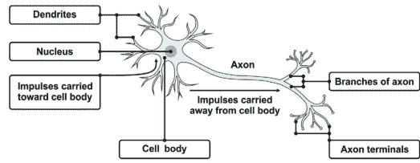

(a) 人脑的神经元系统

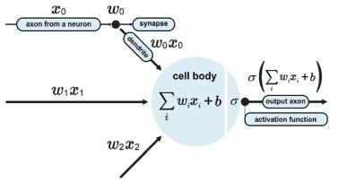

(b) 前馈神经网络中的神经元

图 2.1 人脑神经元结构与人工神经网络的对应关系。

唯一的轴突。轴突末端逐渐分支，并通过突触与其他神经元的树突相连。在人工神经元的计算模型中，沿轴突传播的信号（相当于输入 x）根据突触强度（相当于权重 W）与其他神经元的树突（相当于矩阵运算 Wx）相互作用。突触强度可以控制一个神经元对另一个神经元的影响强度以及影响方向：兴奋（正权重）或抑制（负权重）该神经元。树突将信号传递给细胞体，信号在细胞体中被相加。

综上所述，人脑系统的工作方式与我们刚刚提到的线性映射类似，但关键点随之而来。只有当细胞体中的总和超过某个阈值时，神经元才会被激活并向其轴突输出一个电脉冲。在神经元动力学中，漏y积分-发火（LIF）模型 [4] 常用于描述这一过程。该模型根据突触输入和接收到的注入电流来描述神经元的膜电位。简单来说，两个神经元之间的通信需要一个尖峰作为标记。当前一个神经元的突触发出

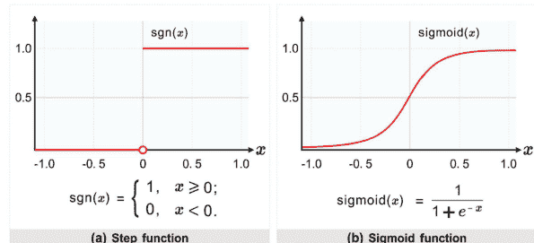

图 2.2 两种激活函数（阶跃函数和 Sigmoid 函数）的示意图。

发出一个电流，膜电位上升。一旦膜电位超过给定阈值，就会产生一个尖峰，并且膜电位会被重置。显然，这一尖峰产生过程类似于基于阈值的函数。如果电流低于阈值，则不会产生尖峰；如果电流高于阈值，则会产生尖峰，这类似于阶跃函数的特性。

受人脑神经元这一特性的启发，提出了激活函数 [5] 的概念。激活函数使神经网络具有非线性，从而可以解决线性回归无法处理的一些问题。刚刚提到的阶跃函数可以处理二元分类问题（输出“是”或“否”）。对于更多类别，我们需要一个中间激活值或对激活程度的准确描述，而非简单地划分为 100% 或 0。在此背景下，提出了 Sigmoid 等传统激活函数，它将输入归一化到 (0, 1)，实现非线性，并具有中间激活值。公式和曲线如图 2.2 所示。

通常，典型的前馈神经网络在输入层和输出层之间具有一个或多个额外的神经元层，称为隐藏层。隐藏层的存在是为了更详细地识别和划分输入数据的特征 [6]，从而做出正确预测。我们根据物理特征将分类问题划分为多个子问题，隐藏层中的每个神经元负责处理这样一个子问题。图 2.3 展示了一个三层前馈神经网络。第一层是输入层，包含三个神经元；

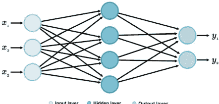

图 2.3 三层前馈神经网络示意图。

第二层是隐藏层，包含四个神经元；第三层是输出层，包含两个神经元。相邻两层的神经元互相连接，同一层内的神经元不相连。以网络的输入层和隐藏层为例，说明全连接的公式：

\[
\hat{y}_j = \text{sigmoid}(\sum_{i=1}^3 w_{ij}x_i + b_j), \quad (2.2)
\]

其中 \(w_{ij}\) 表示输入层第 \(i\) 个神经元与隐藏层第 \(j\) 个神经元之间的权重值，\(x_i\) 表示输入列向量第 \(i\) 个元素的数值。将这两个值相乘并加上隐藏层每个神经元的偏置 \(b_j$，得到的结果由激活函数 Sigmoid 处理，从而可得到隐藏层每个神经元的输出 \(\hat{y}_j\)。

在实际应用中，可以增加隐藏层的数量，隐藏层的连接方式也会发生变化，这即是后文将提到的深度神经网络。

## 2.2 深度神经网络

### 2.2.1 卷积神经网络

如前一节所述，前馈神经网络的输入是向量数据，将在多个隐藏层中进行特征提取。每个隐藏层由多个神经元组成，每个神经元与前一层的所有神经元相连。最后的全连接层称为输出层，其输出值被视为分类中不同类别的得分值


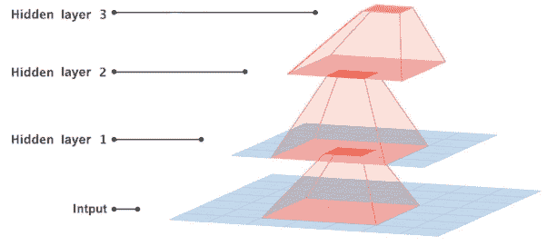

图 2.4 卷积操作感受野示意图。

问题。此类网络结构在面对大尺寸图像输入时存在明显缺陷。隐藏层之间的全连接结构导致网络参数数量急剧增加，这不仅大大降低了训练速度，还可能导致网络过拟合并严重损害模型性能。可以通过增加网络层数来提高拟合精度，但随着层数增加，梯度消失等问题容易出现，使得网络难以训练收敛。

研究发现，人脑的图像识别模式对改进人工神经网络结构具有指导意义。人脑首先感知图像中的每个局部特征，然后进行更高层次的整合以获取全局信息。这是利用图像中观测对象的稀疏连接性，即图像中的局部像素之间关系密切，而相距较远的像素之间相关性较弱。像人脑一样，我们只需在隐藏层感知图像的局部特征，然后在更高层整合局部信息，即可识别完整图像。

近年来，研究人员发现，信号处理领域广泛使用的卷积算子可以完成这一过程。对于一维时间序列信号，卷积是一种特殊的积分运算。当扩展到二维图像时，会使用一种称为卷积核的矩阵来替代一维情况中参与卷积的信号 [7]。我们让隐藏层中的每个卷积核仅连接到输入数据的一个局部区域，连接的空间尺寸称为神经元的感受野。

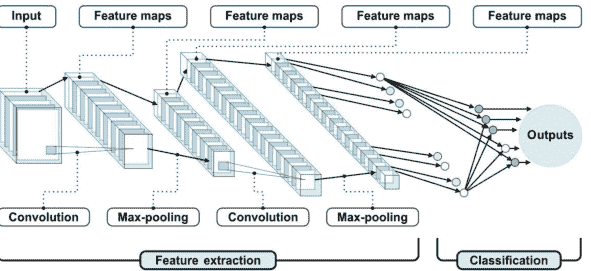

图 2.5 典型卷积神经网络结构示意图。

感受野可以理解为神经元所能“看到”的区域大小 [8]。神经元越深，其能看到的输入区域就越大。如图 2.4 所示，第一个隐藏层中每个神经元的感受野为 3，第二个隐藏层中每个神经元的感受野为 5，第三个隐藏层中每个神经元的感受野为 7。隐藏层离输入层越远，能够获得的特征越多，实现了从局部特征到整体感知的控制。

卷积核相当于一种映射规则：将原始图像像素点的值与卷积核在对应位置的值相乘，然后按权重将得到的值相加。这一过程类似于在图像中搜索某类模式以提取图像特征。显然，这种滤波器无法提取所有特征，需要一组不同的滤波器。

卷积神经网络是一种具有卷积运算和深度结构的前馈神经网络 [9]。如图 2.5 所示，其结构包括用于特征提取的多个卷积层、用于减少计算量的池化层，以及用于分类的全连接神经网络层。下面将详细阐述各层的原理。

卷积层是卷积神经网络中包含若干卷积单元的隐藏层，用于特征提取。如上所述，卷积的特征是稀疏连接和参数共享。卷积层的结构如图 2.6 所示。左侧的方形窗口是前述

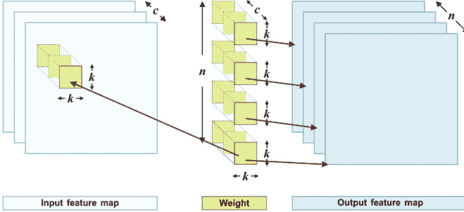

图 2.6 卷积运算示意图，其中 c 为输入特征图通道数，n 为卷积核数量，k × k 为卷积核尺寸。

所述卷积核，也称为滤波器或权重。权重窗口在输入特征图上滑动，并与特征图计算卷积以获得输出特征图。滤波器可以共享，在每次卷积计算中，只有滤波器窗口内的特征图数据参与运算。这基于图像视觉的两个考虑：首先，只有局部神经元很重要，相距较远的神经元之间的连接可以忽略；其次，同一图片的模式可能出现在图像的任何位置，需要通过在输入数据上滑动使用相同的权重进行计算。稀疏连接和参数共享机制减少了模型的参数数量，并提高了深度神经网络的可训练性。

在卷积层中，输出特征图的大小由卷积核尺寸、步长和零填充决定。步长是卷积核每次滑动时移动的像素值。零填充是指在输入特征图边缘填充 0，用于控制输出数据量的空间尺寸。值得注意的是，这三个变量均为深度神经网络模型的超参数。与可通过训练获得的参数（如权重和偏置）不同，超参数是基于经验确定的变量，例如此处提到的卷积核尺寸和卷积核深度，以及稍后将提到的模型训练学习率和迭代超参数。

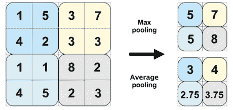

图 2.7 两种不同类型池化（最大池化和平均池化）的示意图。

池化层是深度神经网络中用于抽象信息的隐藏层。池化也是减少模型计算量的一种方法，可以增大感受野并降低优化难度和参数量。图 2.7 显示了两种常见的池化操作 [10]。对于每个特征图通道，执行窗口滑动操作，对窗口内的数据实现最大池化（取最大值）或平均池化（取平均值），以减少数据量、防止过拟合并提高模型泛化能力。通常，池化步长大于 1，用于减小特征图的规模。如图 2.7 所示，4 × 4 特征图通过一个步长为 2 的 2 × 2 池化层，输出尺寸为 2 × 2。

卷积神经网络作为深度学习的重要支撑技术，推动了人工智能的发展。卷积算子能够有效提取空间信息，广泛应用于视觉图像领域，包括图像识别 [11]、图像分割 [12]、目标检测 [13] 等。在模型推理阶段，将图像数据输入网络，通过多个大模块的计算进行多级特征提取，并使用全连接层输出类别预测结果。在模型训练阶段，对于给定的输入数据，计算标签预测结果与真实标签之间的误差。然后，利用反向传播算法计算每个参数的误差梯度。最后，利用梯度下降算法更新参数。上述迭代步骤重复多次，逐步降低神经网络预测误差，直至收敛。与传统前馈神经网络相比，卷积神经网络通常具有更好的预测精度，是最重要的深度神经网络结构之一。

### 2.2.2 循环神经网络

上述深度前馈神经网络和卷积神经网络都有一个共同特征：它们的网络结构按顺序排列，第 $l$ 层的神经元仅接收来自第 $(l-1)$ 层神经元的信号，且没有反馈结构。然而，在某些特定任务中，为了更好地捕捉输入向量的时序特征，有时需要组合序列输入。例如，在语音信号处理中，如果需要对一个句子进行精确翻译，则显然不可能逐个单词分别翻译。相反，需要将单词连接起来形成序列，然后处理整个时序序列。本节描述的循环神经网络（RNN）[14] 是一种处理时序数据并具有反馈的神经网络结构。

RNN 源于 20 世纪 80 年代和 90 年代 [15]，是一种以序列数据为输入、在序列演进方向添加反馈并将所有节点链接成链的递归神经网络。传统前馈神经网络难以建立时相关模型，而 RNN 可以整合输入单元和前序时刻节点的信息，使信息能够跨越时间节点持续发挥作用。这意味着网络具有记忆功能，在自然语言处理、翻译、语音识别和视频处理中非常有用。

图 2.8 显示了标准 RNN 的基本结构。左侧是折叠图，右侧是按时间顺序展开的结构图。可以看出，RNN 的循环体结构位于隐藏层中。该网络结构揭示了 RNN 的本质：前一时刻的网络信息会作用于下一时刻的信息，即前一时刻的历史信息通过权重连接到下一时刻的神经元。如图所示，在 RNN 网络中，**x** 表示输入，**h** 表示隐藏层单元，**o** 表示输出，**y** 表示训练标签，**t** 表示时间，**U** 是输入层到隐藏层的参数，**V** 是隐藏层到输出层的参数，**W** 是循环层参数。如前所述，时刻 $t$ 处 **h** 的性能不仅由……


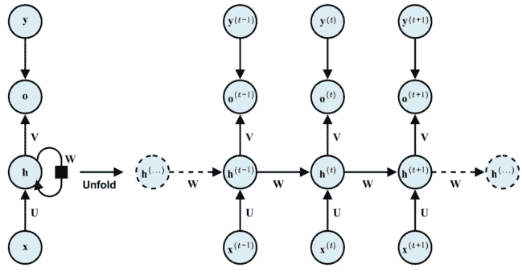

图 2.8 RNN 的示意图及其对应的展开形式。

该时刻的输入，还受前一时刻的影响：

```
$\mathbf{h}^{(t)} = \tanh(\mathbf{U}\mathbf{x}^{(t)} + \mathbf{W}\mathbf{h}^{(t-1)} + \mathbf{b})$.
```

时刻 $t$ 的输出为

```
$\mathbf{o}^{(t)} = \mathbf{V}\mathbf{h}^{(t)} + \mathbf{c}$.
```

模型预测的最终输出为

```
$\mathbf{y} = \sigma(\mathbf{o}^{(t)})$.
```

值得注意的是，对于过长的语音序列，由于反向传播模型训练过程中存在梯度消失问题，RNN 仅具有短期记忆。长短期记忆网络（LSTM）[16] 和门控循环单元（GRU）[17] 是解决 RNN 短期记忆问题的两种方案，它们引入门控机制来调节信息流。以 LSTM 结构为例，它包含遗忘门、输入门和输出门，用于保留或删除输入信息并记录关键信息。LSTM 在长期记忆任务中表现良好，但该结构也导致参数更多，使训练更加困难。与 LSTM 相比，结构相似的 GRU 使用单一门来完成遗忘和选择信息阶段，在减少参数的同时实现与 LSTM 相同的性能，在计算资源和时间开销受限的条件下被广泛使用。

## 2.3 学习目标与训练过程

### 2.3.1 损失函数

深度学习模型训练与参数估计通常基于特定损失函数（或目标函数，本书统称为损失函数）的优化。在模型优化理论中，损失函数是一种将一个或多个变量的值映射到实数域的函数。对于神经网络模型的训练，我们使用损失函数来衡量预测值与真实标签之间的不一致程度，这是一个非负实值函数，因此训练集所有样本的损失函数通常表示为

```
\( J(\theta) = \mathbb{E}_{(x,y)\sim P_{data}} \mathcal{L}(x, y; \theta) \)
\( = \mathbb{E}_{(x,y)\sim P_{data}} \mathcal{L}(f(x; \theta), y), \) (2.6)
```

其中 L 是每个样本的损失函数，\( f(x; \theta) \) 是当 x 为输入时模型预测的输出，P_data 是经验分布，E 表示期望，y 是所有数据标签的向量，\( \theta \) 表示神经网络的所有参数。损失函数的输出越小，预测值与数据标签之间的差距越小，模型性能越好。最重要的是，损失函数是可微的，可用于求解优化问题。

在模型训练阶段，数据输入模型后，通过前向传播得到预测值，然后损失函数计算预测值与数据标签之间的差异，即损失值。模型通过反向传播更新参数以减小损失值，从而使模型生成的预测值接近数据的真实标签，以达到学习目的。在以下章节中，我们主要介绍两种经典预测任务（分类和回归）中的两种损失函数。

交叉熵损失函数 [18] 是当前深度神经网络中最常用的分类目标函数之一，它是一种基于概率分布度量的损失函数。在信息论中，熵用于描述不确定性的度量。交叉熵最初用于估计平均编码长度，在机器学习中，它用于评估当前训练得到的概率分布与真实分布之间的差异。对于单个样本，交叉熵损失函数的形式为

$$\mathcal{L} = - \sum_{k=1}^{C} y_k \log \hat{y}_k,$$ (2.7)

其中 $C$ 表示输出类别的数量，$\hat{y}_k$ 表示神经网络的第 $k$ 个输出元素（$k \in 1, 2, \dots, C$），对应的数据标签为 $y_k$。如果是对应的类别，则 $y_k$ 为 1；否则，$y_k$ 为 0。

与分类任务中数据标签的二元性（离散类型）不同，回归任务中数据标签的每个维度都是实数（连续类型）。在回归任务中，预测误差常用于衡量模型预测值与数据标签的接近程度。假设回归问题中第 $i$ 个输入特征 $\mathbf{x}_i$ 对应的真实标签为 $\mathbf{y}_i = [y_{1i}, \dots, y_{ik}, \dots, y_{iM}]^T$，且 $M$ 是标签向量的总维度，则网络回归预测值 $\hat{y}_{ik}$ 及其实际标签 $y_{ik}$ 在第 $k$ 个维度上的预测误差为

$$\mathcal{L}_{ik} = y_{ik} - \hat{y}_{ik}.$$ (2.8)

回归任务中常用的损失函数是 L1 [19] 和 L2 [20]。$N$ 个样本的 L1 损失函数定义为

$$\mathcal{L} = \frac{1}{N} \sum_{i=1}^{N} \sum_{k=1}^{M} |\mathcal{L}_{ik}|.$$ (2.9)

损失函数有多种类型，包括基于特定任务的损失函数，如上述分类和回归任务，以及基于距离度量和概率分布的损失函数。例如，均方误差损失函数 [21] 以及 L1 和 L2 损失函数基于距离度量，而交叉熵损失函数和 Softmax 损失函数 [22] 基于概率分布。损失函数的选择需要考虑数据特征，在某些情况下，还应添加一些正则项以提高模型性能。

### 2.3.2 正则化

在模型训练中，通过增加训练迭代次数或调整超参数设置，可以不断降低训练样本上的损失值。然而，训练样本标签的预测准确率可能不断提高，但测试样本标签的预测准确率却下降而非上升，这种现象称为过拟合。因此应使用正则化方法来提高模型的泛化能力并避免过拟合。

正则化是一种旨在减少泛化误差（即模型在测试样本上的误差）以校正模型的方法。在传统机器学习算法中，泛化能力主要通过限制模型复杂度来提高。一般来说，模型复杂度与权重参数 **W** 的数据量呈线性关系：**W** 的数据量越大，复杂度越高，模型也越复杂。因此，限制模型复杂度的自然做法是减少权重参数 **W** 的数量，即使 **W** 中某些元素为零或限制非零元素的数量。使神经网络的参数 \(\theta\) 包含所有神经网络层的权重系数。通过向损失函数添加参数惩罚 \(\Omega(\theta)\) 可以限制模型参数的复杂度。正则化损失函数表示为

\(\tilde{\mathcal{L}}(\mathbf{x}, \mathbf{y}; \theta) = \mathcal{L}(\mathbf{x}, \mathbf{y}; \theta) + \alpha \Omega(\theta),\)

其中 \(\alpha \in [0, \infty)\) 是超参数，用于权衡正则项 \(\Omega\) 与标准目标函数 \(\mathcal{L}(\mathbf{x}, \mathbf{y}; \theta)\) 的相对贡献。将 \(\alpha\) 设置为 0 表示无正则化，\(\alpha\) 越大，相应的正则化贡献越大。

通过引入正则项，我们希望限制向量 **W** 中非零元素的数量，使权重参数尽可能小并接近 0。最常用的正则化惩罚是 L2 范数，它通过对所有参数应用逐元素平方惩罚来抑制大值权重。L2 参数范数惩罚也称为权重衰减 [23]，这是一种正则化策略，通过向目标函数添加正则项 \(\Omega = \frac{1}{2}\|\mathbf{W}\|_2^2\) 使权重更接近原点。

### 2.3.3 基于梯度的优化方法

如前所述，机器学习中的模型训练通过最小化损失函数来实现。在正常情况下，损失函数非常复杂，难以求出最小值的解析表达式。梯度下降 [24] 是为解决此类问题而设计的。为便于理解，让我们举个例子，并将


将求解损失函数最小值的过程比作“站在斜坡上某处寻找最低点”。我们不知道最低点的确切位置，梯度下降策略是沿着下降方向迈出小步，在长时间向下行走后，很有可能最终抵达最低点附近。我们选择下降方向为梯度的负方向，因为每一点的梯度负方向都是该点处函数最陡的下降方向。深度神经网络通常使用梯度下降来更新参数，并通过引入随机性、调整学习率等方法，希望网络能够避免陷入不佳的局部最小点并收敛到更好的点。这是梯度下降的传统思想。

随机梯度下降（SGD）是更新参数最常用的方法之一。在该方法中，通过使用整个数据集的小批量随机样本数据来计算损失函数相对于参数的梯度。SGD 通常将整个数据集分成若干个小批量样本数据，然后对输入进行迭代并计算损失和梯度，最后更新参数。设置神经网络参数 \(\theta\)，并从训练集中收集包含 \(N\) 个样本的一小批 {\(\mathbf{x}_1, \mathbf{x}_2, \dots, \mathbf{x}_N\)}，其中 \(\mathbf{x}_i\) 对应标签 \(\mathbf{y}_i\)。以下方程展示了梯度下降的计算原则 [25]。

### 梯度计算

```
\(\hat{\mathbf{g}} \leftarrow \frac{1}{m} \nabla_{\boldsymbol{\theta}} \sum_i \mathcal{L}(f(\mathbf{x}_i; \boldsymbol{\theta}), \mathbf{y}_i).\quad (2.11)\)
```

### 应用更新

```
\(\boldsymbol{\theta} \leftarrow \boldsymbol{\theta} - \varepsilon \hat{\mathbf{g}}.\quad (2.12)\)
```

其中 \(\hat{\mathbf{g}}\) 表示损失函数相对于参数 \(\theta\) 的梯度，\(\varepsilon\) 称为学习率，是控制参数更新步长的超参数。学习率过大将在最小值附近波动但无法收敛，学习率过小会导致收敛花费更多时间，因此收敛速度较慢。学习率可以通过经验或算法进行调整。例如，当遇到平坦或高曲率区域时，学习过程可能会变慢。可以向 SGD 添加动量算法以提高收敛速度。目前，还有自适应矩估算（Adam）算法 [26] 和 RMSProp 算法 [27] 等自适应算法，它们可以从梯度和学习率两方面进行优化，以取得良好效果。

在深度学习中，由于网络层数和参数数量庞大，梯度计算十分复杂。反向传播算法 [28] 广泛用于神经网络参数的梯度计算。反向传播算法的原理是通过链式法则逐层计算损失函数相对于每个权重参数的梯度。然后基于链式法则，从最后一层开始进行逆向迭代，并在每次迭代结束时更新模型的权重参数。在模型训练过程中，通过输入不同批次的数据不断更新权重参数，直到损失函数值收敛，从而得到更好的参数解。

## 2.4 计算复杂度

从复杂度角度来看，设计 CNN 网络时应考虑两个因素。一是网络所需的计算量，二是模型参数的规模以及每一层的输入和输出特征。前者决定网络训练或推理的速度，通常用时间复杂度衡量，后者决定计算设备需要多少内存，通常用空间复杂度衡量。

算法的时间复杂度是一个描述给定规模输入算法运行时间的函数。它可以描述代码执行时间随数据量增加而变化的趋势。通常来说，算法的时间复杂度可以理解为完成一组特定算法所花费的总时间。在特定设备上，时间由算法执行所需的计算总量决定。深度学习算法计算量测量中常用的单位是所需浮点运算次数和 FLOPS。每秒浮点运算次数（FLOPS）是衡量计算机性能的指标，在需要浮点计算的科学计算领域很有用。对于此类情况，它比每秒指令数是一个更准确的衡量指标。目前，大多数卷积神经网络的总计算量可达几十甚至几百 GigaFLOPs，例如常见的卷积神经网络模型 MobileNet-V2 [29] 和 ResNet-50 [30]，其总计算量在 33.6 GFLOPs 到 109.8 GFLOPs 之间，这使得部署在边缘的神经网络难以完成实时推理。

空间复杂度是指解决计算问题的一个实例所需的内存空间量，作为输入特征的函数，通常以计算机内存单位来衡量。在计算机内部，信息以二进制形式存储、计算和传输。存储的最基本单位是比特和字节。

在卷积神经网络中，空间复杂度主要由各层参数的大小决定。卷积层的参数主要由卷积核的大小和数量决定，而全连接层的参数由输入神经元和输出神经元的数量决定。以 2012 年 ImageNet 图像分类挑战赛的冠军模型 AlexNet [31] 为例，它包含五个卷积层，参数大小分别为 35 KB、307 KB、884 KB、1.3 MB 和 442 KB，以及三个全连接层，参数大小分别为 37 MB、16 MB 和 4 MB。AlexNet 的参数总大小约为 60 MB，其中全连接结构无疑增加了参数规模，贡献了 57 MB 的参数。AlexNet 之后出现的一些 CNN 模型表现更好，但由于其空间复杂度高，难以部署在边缘计算终端上。

## 参考文献

- [1] D. Svozil, V. Kvasnicka, J. Pospichal, 多层前馈神经网络简介, Chemometrics and Intelligent Laboratory Systems 39 (1) (1997) 43-62.
- [2] B.D. Ripley, 用于分类的神经网络及相关方法, Journal of the Royal Statistical Society: Series B (Methodological) 56 (3) (1994) 409-437.
- [3] R. Sylwester, 神经元的庆典：教育者的人脑指南, ERIC, 1995.
- [4] A.N. Burkitt, 集成-发火神经元模型综述：I. 齐次突触输入, Biological Cybernetics 95 (1) (2006) 1-19.
- [5] F. Agostinelli, M. Hoffman, P. Sadowski, P. Baldi, 学习激活函数以改进深度神经网络, arXiv:1412.6830 [abs].
- [6] G. Huang, Y. Chen, H.A. Babri, 单隐藏层前馈神经网络的分类能力, IEEE Transactions on Neural Networks 11 (3) (2000) 799-801.
- [7] Y. Pang, M. Sun, X. Jiang, X. Li, 网络中的网络的卷积中卷积, IEEE Transactions on Neural Networks and Learning Systems 29 (5) (2017) 1587-1597.
- [8] W. Luo, Y. Li, R. Urtasun, R. Zemel, 深度卷积神经网络中的有效感受野理解, in: 神经信息处理系统国际会议论文集, 2016, pp. 4905-4913.


- [9] S. Albawi, T.A. Mohammed, S. Al-Zawi, 卷积神经网络的理解，载于：工程与技术国际会议论文集，2017，pp. 1–6.

- [10] D. Yu, H. Wang, P. Chen, Z. Wei, 卷积神经网络的混合池化，载于：粗集与知识技术国际会议论文集，2014.

- [11] S. Hijazi, R. Kumar, C. Rowen 等，使用卷积神经网络进行图像识别，Cadence 设计系统公司（2015）1–12.

- [12] H. Ajmal, S. Rehman, U. Farooq, Q.U. Ain, F. Riaz, A. Hassan, 基于卷积神经网络的图像分割：综述，载于：模式识别与跟踪 XXIX 会议论文集，2018.

- [13] Z. Wang, J. Liu, 基于卷积神经网络的目标检测综述，载于：中国控制会议论文集，2017，pp. 11104–11109.

- [14] Z.C. Lipton, 用于序列学习的循环神经网络的批判性回顾，arXiv:1506.00019 [abs].

- [15] J.J. Hopfield, 具有涌现集体计算能力的神经网络与物理系统，美国国家科学院院刊 79 (8) (1982) 2554–2558.

- [16] S. Hochreiter, J. Schmidhuber, 长短期记忆，神经计算 9 (8) (1997) 1735–1780.

- [17] R. Dey, F.M. Salem, 门控循环单元 (GRU) 神经网络的门变体，载于：IEEE 美国中西部电路与系统国际研讨会论文集，2017，pp. 1597–1600.

- [18] D.M. Kline, V. Berardi, 重新审视神经网络分类器训练中的平方误差和交叉熵函数，神经计算与应用 14 (2005) 310–318.

- [19] M.W. Schmidt, G. Fung, R. Rosales, L1 正则化的快速优化方法：一项比较研究与两种新方法，载于：欧洲机器学习会议论文集，2007.

- [20] P. Bühlmann, B. Yu, 基于 L2 损失的提升方法：回归与分类，美国统计协会杂志 98 (462) (2003) 324–339.

- [21] S. Singh, D. Singh, S. Kumar, 用于反向传播神经网络中字符识别的修正均方误差算法，以降低训练和仿真时间成本，载于：智能计算前沿：理论与应用国际会议论文集，2013.

- [22] W. Liu, Y. Wen, Z. Yu, M. Yang, 卷积神经网络的大边界 Softmax 损失，arXiv:1612.02295 [abs].

- [23] A. Krogh, J. Hertz, 简单的权重衰减可以提高泛化能力，载于：神经信息处理系统国际会议论文集，1991.

- [24] E. Dogo, O. Afolabi, N. Nwulu, B. Twala, C. Aigbavboa, 基于梯度下降的卷积神经网络优化算法比较分析，载于：计算技术、电子与机械系统国际会议论文集，2018，pp. 92–99.

- [25] Y. Bengio, I. Goodfellow, A. Courville, 深度学习，第 1 卷，MIT 出版社，美国马萨诸塞州，2017.

- [26] D.P. Kingma, J. Ba, Adam：一种随机优化方法，arXiv:1412.6980 [abs].

- [27] G. Hinton, N. Srivastava, K. Swersky, RMSProp：将梯度除以其近期幅度的运行平均值，机器学习神经网络，Coursera 讲座 6e (2012) 13.

- [28] D.E. Rumelhart, G.E. Hinton, R.J. Williams, 通过误差反向传播学习表征，自然 323 (6088) (1986) 533–536.

- [29] M. Sandler, A.G. Howard, M. Zhu, A. Zhmoginov, L.-C. Chen, MobileNetV2：反向残差与线性瓶颈，载于：IEEE 计算机视觉与模式识别会议论文集，2018.

- [30] K. He, X. Zhang, S. Ren, J. Sun, 面向图像识别的深度残差学习，载于：IEEE 计算机视觉与模式识别会议论文集，2016.

- [31] A. Krizhevsky, I. Sutskever, G.E. Hinton, 基于深度卷积神经网络的 ImageNet 图像分类，ACM 通讯 60 (2012) 84–90.

# 第 2 部分

## 模型与算法

本页故意留空

# 第 3 章

## 模型设计与压缩

## 3.1 背景与挑战

尽管卷积神经网络在计算机视觉和自然语言处理等领域取得了良好效果，但由于其参数量巨大，对于许多基于嵌入式设备的应用来说望而生畏。目前，深度学习模型需要大量的计算资源和内存，通常伴随着巨大的能耗。当我们需要在计算资源有限的终端设备上部署模型以进行实时推理时，大型模型成为最大的瓶颈。深度神经网络的训练和推理通常高度依赖于高性能 GPU。特征的巨大规模和模型参数的激增也大大增加了时间。以 AlexNet [1] 为例，这是一个包含 6000 万个参数的网络。使用 NVIDIA K40 在 ImageNet 数据集上训练整个模型需要两到三天。事实上，Denil 等人 [9] 已表明，深度神经网络正面临严重的过度参数化问题，且参数的小子集可以完全重建其余参数。例如，拥有 50 个卷积层的 ResNet-50 [10] 处理图像需要超过 95 MB 的存储内存和超过 38 亿次浮点乘法运算。在丢弃一些冗余权重后，网络仍能正常工作，但可以节省超过 75% 的参数和 50% 的计算时间。这表明模型参数中存在巨大的冗余，揭示了模型压缩的可行性。

在深度神经网络研究领域，模型压缩与加速已受到研究人员的高度关注，并在过去几年中取得了重大进展。近年来，智能可穿戴设备和 AIoT 的重大进展为研究人员提供了前所未有的机遇，以应对将深度学习系统部署到内存、CPU、能量和带宽等资源有限的便携设备上的基本挑战。高效的深度学习方法可以对分布式系统、嵌入式设备和用于人工智能的 FPGA 产生重大影响。为了设计和压缩高效的深度神经网络模型，在本章中，我们将首先分析近年来几类典型的轻量级神经网络模型，然后讨论神经网络的模型压缩技术，包括模型剪枝和知识蒸馏。

## 3.2 轻量级神经网络设计

轻量级模型旨在从网络结构设计方面降低模型参数和计算复杂度，同时保持模型性能，这是深度学习研究的热点。在精度相同的情况下，更小的 CNN 架构将消耗更少的资源，更适合部署在内存和计算资源有限的嵌入式边缘终端设备上。在本节中，我们主要关注网络结构设计，并简要介绍轻量级网络，包括以下几类轻量级模型。

### 3.2.1 SqueezeNet

加州大学伯克利分校和斯坦福大学的研究人员于 2016 年首次提出了一种名为 SqueezeNet 的小型 CNN 架构 [11]，这是早期专注于轻量级网络的研究之一。他们将网络参数数量减少到 0.5 MB 以下，比 AlexNet 小 510 倍，但精度与 AlexNet 相同。为此，他们采用了三种策略来减少参数数量并保持精度。

- 策略 1：用 1 × 1 卷积替换 3 × 3 卷积，从而将卷积核的参数数量减少 9 倍。
- 策略 2：通过挤压层减少 3 × 3 滤波器的输入通道数量。
- 策略 3：延迟下采样。层数越高，特征图越大，有利于提高模型精度。

SqueezeNet 中的基本单元称为 Fire 模块。Fire 模块由一个挤压层和一个扩展层组成，如图 3.1 所示。挤压层仅使用 1 x 1 卷积核来实现策略 1，而扩展层使用 1 x 1 和 3 x 3 的卷积组合。模块中有三个可调参数，即，挤压层中 1 x 1 卷积核的数量 s1、扩展层中 1 x 1 卷积核的数量 e1 以及 3 x 3


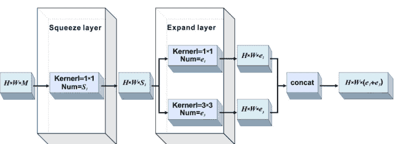

图 3.1 Fire Module 的结构 [11].

Expand 层中的卷积核 \(e_3\)。令 \(s_1 < e_1 + e_3\) 以限制 \(3 \times 3\) 卷积的输入通道数以实现策略 2。在 Squeeze 层和 Expand 层之间使用 ReLU 函数进行激活。

SqueezeNet 由多个与池化层相结合的 Fire Module 组成。一个完整的 SqueezeNet 网络有 10 层，其中第一层是卷积层，第二到第九层是 Fire Module，且 Fire Module 中的滤波器数量逐层增加。第十层的卷积层后面跟着一个全局 AvgPool 层。最后，分类结果由 softmax 函数输出。第一层、第四层和第八层后面跟着使用 MaxPool 方式的下采样模块。需要注意的是，SqueezeNet 的网络结构中没有全连接层。实验结果表明，SqueezeNet 的 Top-1 和 Top-5 性能均优于 AlexNet [1]，但模型大小从 240 MB 减小到 4.8 MB，使得可以在嵌入式边缘设备上部署 SqueezeNet。SqueezeNet 的参数较少，但更深的网络导致测试时间增加。然而，SqueezeNet 开创了轻量级模型的研究，随后相关领域涌现出更多高性能模型。

### 3.2.2 MobileNet

2017 年，Google 的研究人员实现了一种基于深度可分离卷积的新精简网络架构，称为 MobileNet [12]。深度可分离卷积可以分解为两个较小的卷积操作，即深度卷积和逐点卷积，如图 3.2 所示。深度卷积与标准卷积的区别在于，对于标准卷积，其卷积核作用于所有输入通道。深度卷积是深度层面的操作，其中每个卷积核只作用于一个输入通道。这种方法也称为分组卷积。然而，由于通道数太少，这也导致特征图维度过少，而逐点卷积是指使用多个 1 × 1 卷积核来提升特征图的维度，同时在特征图之间交换信息。

深度可分离卷积是指使用 3 × 3 深度卷积对不同输入通道进行卷积，然后通过 1 × 1 逐点卷积融合输出，如图 3.3 所示。需要注意的是，深度卷积和逐点卷积后面都跟着批归一化 BatchNorm 和激活函数 ReLU。尽管深度可分离卷积的结果与普通卷积相同，但参数数量和计算量减少到标准卷积计算量的约八分之一。

MobileNetV1 [12] 总共包含 28 层，其中 13 层是深度可分离卷积层。对于部分深度卷积，步长设置为 2 进行下采样，最终通过 softmax 层输出预测结果。MobileNet 还引入了两个超参数，即宽度乘数和分辨率乘数，以降低模型复杂度。对于深度可分离卷积层，输入和输出通道数乘以宽度乘数以均匀压缩网络，而分辨率乘数可以通过降低分辨率来减少资源消耗。

实验表明，MobileNetV1 的计算量少于 GoogleNet [13]，但分类性能更好。VGG-16 [14] 需要进行 30 倍的计算量才能获得比 MobileNetV1 高仅 1% 的准确率。然而，由于在低维上执行 ReLU 计算容易导致信息丢失，作者提出了一种改进的 MobileNetV2 结构 [15]。与 MobileNetV1 相比，MobileNetV2 在深度卷积之前添加了一个逐点卷积，旨在增强特征维度，同时，移除了第二个逐点卷积后的 ReLU 激活函数，因为第二个逐点卷积的主要功能是降维。

MobileNet 的有效性已在广泛的应用中得到证明，在目标检测和人脸识别等领域表现良好。然而，MobileNet 将 95% 的计算时间和 75% 的参数用于 1 × 1 卷积，网络结构还需要进一步改进。

### 3.2.3 ShuffleNet

如上所述，1 × 1 逐点卷积增加了网络的计算复杂度，而分组卷积会导致通道间的信息阻塞。为解决这些问题，Megvii 的研究人员提出了通道混洗（channel shuffle），这是一种用于辅助信息流和增强特征映射的操作，在此基础上他们建立了一种高效的网络架构 ShuffleNet [16]。

传统的深度可分离卷积由一个 3 × 3 深度卷积和 1 × 1 逐点卷积组成。然而，大量的 1 × 1 逐点卷积导致卷积间的直接信息交流较差，从而造成精度损失。因为每个通道只能对应有限的卷积核，输出特征集的表达能力大大降低。这种 1 × 1 卷积结构也称为瓶颈。为解决这个问题，ShuffleNet 使用了通道混洗。如图 3.4 所示，通道混洗的过程等同于在分组卷积后重新组织特征图，并在打乱顺序后对特征图进行分组，以确保不同组之间的信息流。

ShuffleNet 的基本单元在残差单元的基础上进行了改进。这个基本残差单元如图 3.5(a) 所示，即先执行 1 × 1 卷积，然后执行 3 × 3 深度卷积以减少计算量，最后通过 1 × 1 卷积将输入直接相加到输出，这与 MobileNetV2 改进的深度可分离卷积层类似。引入通道混洗后，该模块被插入到第一个逐点卷积和深度卷积之间，形成 ShuffleNet 的基本结构，如图 3.5(b) 所示。对于每个残差单元，只需在第一个逐点卷积后添加通道混洗即可。当 stride = 2 时，输入与输出不匹配，解决方案是在原始输入上执行步长为 2 的平均池化，然后将特征图连接到输出，如图 3.5(c) 所示。

基于上述设计的基本单元，ShuffleNet 网络的总体结构如下：输入图像首先经过普通卷积层和最大池化层，然后依次通过三个 Stage 结构。每个 Stage 由多个堆叠的 ShuffleNet 基本单元组成，其中第一个基本单元的步长为 2，如图 3.5(c) 所示，随后的基本单元步长均为 1，如图 3.5(b) 所示。完成三个 Stage 后，使用全局池化将特征图大小降至 1 × 1，最后通过 softmax 层输出预测结果。在相同的计算资源限制下，ShuffleNet 可以使用更丰富的特征图。实验表明，在一定范围内，组数越多，ShuffleNet 的分类能力越强，但组数过多也会导致网络饱和甚至精度下降。

### 3.2.4 EfficientNet

经验表明，为了提高网络的准确率和速度，需要平衡宽度、深度和分辨率这三个维度。那么，如何同时平衡这三个维度，以在约束条件下获得最佳网络架构呢？以往的方法基本上是调整这三个维度中的一两个，通过实验确定最优网络结构。很明显，手动获得的最优网络结构很可能只是局部最优。因此，Tan 等人 [17] 研究了模型缩放，并提出了 EfficientNet，它通过神经网络架构搜索（NAS）同时平衡这三个维度，以找到最优网络架构。

模型缩放如图 3.6 所示，复合缩放主要由三个维度决定，包括宽度、深度和


分辨率，其中（a）是基线网络架构，（b）、（c）和（d）分别说明宽度、深度和分辨率的缩放，（e）说明宽度、深度和分辨率的复合缩放。例如，图3.6(b)可以解释为宽度扩大2倍。图3.6(c)可以解释为深度扩大2倍。图3.6(d)可以解释为分辨率扩大2倍，且所有卷积层的缩放保持一致。

EfficientNet首先确定搜索参数为宽度、深度和分辨率这三个维度，目标是搜索出这三个参数的一组最优解，并将其应用于所有卷积层。由于计算资源有限，NAS实际上是一个带约束的多目标优化问题。作者指出，如果只缩放一个维度，则模型的精度很快就会饱和，因为宽度、深度和分辨率是相互关联的。EfficientNet模型分两个主要步骤构建：首先，使用强化学习方法生成基线模型Efficient-B0，然后使用复合缩放方法同时缩放这三个相互关联的维度。优化模型如下所示：

```
depth : d = \alpha^{\phi}, \quad \quad \quad \quad \quad \quad \quad \quad \quad \quad \quad \quad \quad \quad \quad \quad \quad \quad \quad \quad \quad \quad \quad \quad \quad \quad (3.1)
width : w = \beta^{\phi},
resolution : r = \gamma^{\phi},
s.t. \quad \alpha \cdot \beta^2 \cdot \gamma^2 \approx 2,
\alpha \ge 1, \beta \ge 1, \gamma \ge 1,
```

其中，复合参数 \phi 用于在资源约束下控制整体模型缩放，而 \alpha、\beta 和 \gamma 指定如何将这些资源分别分配给宽度、深度和分辨率。搜索策略是将 \phi 设置为 1，然后通过小型网格搜索获得三个最优缩放系数 \alpha、\beta 和 \gamma。接着固定 \alpha、\beta 和 \gamma，并缩放 \phi 以获得从 Efficient-B1 到 Efficient-B7 的一系列模型。

然而，EfficientNet存在一些问题，例如，在更大图像上训练速度较慢，并且由于深度可分离卷积的参数比普通卷积少，保存的变量更多，导致训练变慢。因此，为EfficientNetV2 [18]提出了训练感知NAS，它在搜索空间中使用Fused MBconv，将MBconv中的3 × 3深度可分离卷积和1 × 1卷积合并为普通的3 × 3卷积，以减少搜索
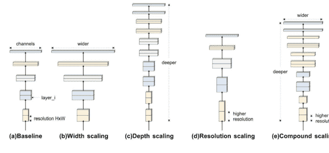

| | EfficientNet | EfficientNetV2 |
|---|---|---|
| 搜索空间 | MBconv | MBconv, Fused MBconv |
| 搜索策略 | 网格搜索 | 随机搜索 |
| 性能评估策略 | FLOPS | 时间, 参数 |

空间。此外，由于搜索空间减小，搜索可以使用随机搜索来完成。EfficientNet和EfficientNetV2的对比如表3.1所示。实验表明，与ResNet [10]、DenseNet [19]、Inception [13]和NASNet [20]相比，EfficientNet在更少参数的情况下实现了更高的精度。

## 3.3 模型压缩

随着深度学习的快速发展，深度神经网络模型中使用的参数越来越多。在ImageNet挑战赛 [1] 中取得优异成绩的模型都拥有海量参数，例如拥有5000万参数的ResNet-50模型 [10] 和拥有1.3亿参数的VGG-16模型 [14]。此外，自然语言处理领域GPT模型 [21] 的参数数量已从GPT1的1.1亿扩展到GPT3的1750亿。拥有海量参数的大模型不仅在训练期间消耗大量资源，还阻碍了部署到手机和机器人等移动设备。在人工智能与物联网（AIoT）的背景下，模型压缩的需求变得更加迫切。只有通过减少模型参数、微型化模型结构并降低神经网络模型推理的计算量，模型才能部署到终端设备上。

模型压缩是指将大型复杂模型转换为小型精简模型，使其能够实现与大模型相似的性能。目前，与模型压缩相关的技术主要包括但不限于以下方法。

- 低秩分解 [22,23]：卷积神经网络的卷积核是一个4D张量，该权重矩阵通常是稠密且低秩的，包含大量冗余信息。通过低秩分解，可以将稠密矩阵分解为若干小规模矩阵，从而实现模型压缩。然而，矩阵分解的成本较高，卷积核矩阵的逐层分解不利于全局参数的压缩，而且现在网络中更常使用1 × 1小卷积核，这不利于低秩分解方法，难以实现模型压缩。

- 模型剪枝 [2–8,24–26]：在预训练大模型的基础上，设计网络参数重要性的评价标准以衡量其重要性，并移除一些不重要的参数，以加快网络速度并提升泛化能力。

- 知识蒸馏 [27–29]：通常，大模型倾向于是一个复杂网络或几个网络的集合，具有良好的性能和泛化能力，而由于网络规模较小，小模型的表达能力有限。因此，可以利用大模型学到的知识来指导小模型的训练，使小模型具有与大模型相同的性能，但参数数量大大减少，从而实现模型压缩，即将预训练的大教师模型的知识精炼为轻量级学生模型。

- 参数量化 [30,31]：通过牺牲一定精度来减少网络参数的空间和计算开销。例如，典型的32位浮点网络参数可以用更低的位宽（1位、2位、8位、16位）来表示，包括权重、激活值、梯度和误差。参数量化会导致部分信息丢失，从而造成最终模型性能下降，但它也有明显优势：(1) 参数存储
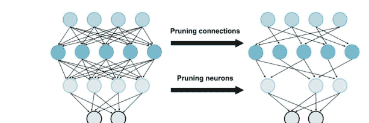

图3.7 模型剪枝示意图 [26]。

空间和内存占用可以显著降低，(2) 计算可以加速，并且设备功耗可以降低。

接下来，我们将介绍模型剪枝和知识蒸馏，并在后续章节中详细描述参数量化。

### 3.3.1 模型剪枝

模型剪枝是模型压缩领域的一种经典技术，如图3.7所示。如前所述，在深度神经网络中，许多参数是冗余的，对训练期间的误差降低和模型泛化影响甚微，因此移除这些参数对网络性能不会产生显著影响。谷歌在Inception V3模型上进行了实验，以探索参数稀疏度与性能之间的关系 [32]。实验表明，当稀疏度为50%时，模型性能几乎保持不变；当稀疏度为87.5%时，ImageNet上的分类精度仅下降了2%。同样，他们发现，在小型模型MobileNet上，稀疏宽MobileNet模型在相同参数数量下显著优于非稀疏窄MobileNet模型。这些实验无疑表明了模型剪枝的必要性和可行性。剪枝不仅可以降低模型复杂度，还能有效防止过拟合并提升模型泛化能力。

模型剪枝可以在训练期间或训练后进行。对于卷积神经网络，模型剪枝大致可分为两类：权重剪枝 [26] 和滤波器剪枝 [25]。权重剪枝是指移除低于某个阈值的所有权重连接。滤波器剪枝是指滤波器的重要性


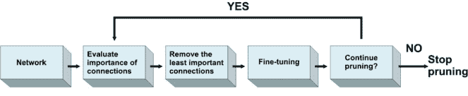

图 3.8 权重剪枝流程。

在卷积神经网络中进行排序，并移除不重要的滤波器。滤波器的重要性可以通过 L1 和 L2 范数来计算。虽然各种剪枝方案的算法细节各不相同，但所使用的基本框架是相似的。模型剪枝算法分为两种：一种是在预训练模型基础上根据参数重要性进行剪枝，然后进行微调训练；另一种是在模型上执行稀疏正则化约束，并在训练过程中执行模型剪枝。

宋韩等人 [26] 首先提出了一种完全移除低于某个阈值的权重连接的方法，因为权重值过低意味着该连接不重要。他们的剪枝策略主要包括四个步骤。

- 第一步是训练初始模型，得到密集网络模型；
- 第二步是测量权重连接的重要性；
- 第三步是从网络中删除权重低于阈值的所有连接，将密集网络转换为稀疏网络；
- 第四步是对网络进行微调并学习稀疏连接的最终权重。

在这些步骤中，第二、第三和第四步可以重复迭代，以获得最优模型。具体过程如图 3.8 所示。关键步骤为：(1) 如何衡量连接的重要性，以及 (2) 如何恢复剪枝后的模型性能。

实验结果表明，该方法将 AlexNet 的参数数量减少了 9 倍，VGG-16 的参数数量减少了 13 倍，且没有任何精度损失。然而，该剪枝算法存在缺陷：剪枝后不规则的网络分布导致 CPU 缓存与内存之间频繁切换，从而限制了加速效果。此外，用于剪枝的大部分权重参数来自全连接层，但全连接层对总浮点运算的贡献很小，因此计算时间可能不会显著减少。

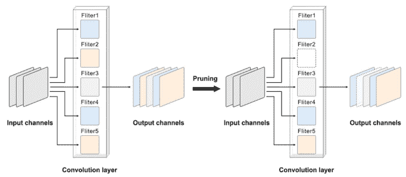

图 3.9 滤波器剪枝示意图。

针对权重剪枝方法的问题，李等人 [25] 尝试直接在滤波器（卷积核）层面进行剪枝，即从网络中移除滤波器的特征图及其连接。与权重剪枝相比，这种方法不会导致稀疏连接模式。需要注意的是，卷积层中卷积核与特征图之间存在明显冗余，且卷积层占据了神经网络中大部分浮点计算，因此通过减少矩阵乘法次数可以直接实现加速目标。滤波器剪枝如图 3.9 所示。当卷积层的一个卷积核被剪除时，对应的特征图消失，输出通道的减少导致下一层卷积通道维度的减少。该算法的核心是确定滤波器的重要性。他们采用的策略是通过权重衡量每个滤波器的重要性，即对每个滤波器，将所有对应权重的绝对值相加（即 L1 范数），然后剪除排序结果值最小的滤波器及其相关连接和通道。具体剪枝过程如下：

- 训练初始模型；
- 计算所有卷积核的权重绝对值之和并进行排序；
- 剪除权重绝对值之和最小的卷积核及其对应特征图，并从下一卷积层移除与被剪除特征图相关的卷积核；
- 最后，为第 i 层和第 (i + 1) 层创建新的卷积核矩阵，并将剩余卷积核权重复制到新模型中；
- 对重新训练的网络进行微调。

对于上述权重剪枝，逐层进行迭代训练和损失补偿。然而，对于滤波器，逐层剪枝和保留会花费大量时间，因此有必要同时剪除多个层的滤波器。在实验阶段，VGG-16 的浮点运算次数减少了 34.2%，参数减少了 64.0%，错误率也降低了。

滤波器剪枝算法基于权重来衡量其对网络的贡献，但实际上，在采用大压缩比的情况下，直接丢弃这些权重会对网络精度造成不可逆的损害。上述的权重剪枝和滤波器剪枝均在权重层面进行衡量。还有其他方法可以实现模型剪枝，例如数据驱动剪枝 [33,34]。

### 3.3.2 知识蒸馏

在模型压缩背景下，我们希望将计算资源需求较低的模型部署到边缘设备上，但从零开始训练小型模型以实现大型模型（超参数化模型）强大的学习能力和精度是困难的。虽然大多数人认为模型的参数数量决定了模型能够捕获的知识量，但实际上，模型参数数量与捕获知识量之间的关系呈现出一种接近边际收益逐渐递减的曲线。因此，一个想法是通过某些技术手段将复杂模型学到的知识迁移到小型紧凑模型中，使小型模型能够达到与大型模型相似的性能。知识蒸馏技术正是基于这种迁移学习的理念。

知识蒸馏的必要性主要体现在三个方面。

- 第一个是模型性能与规模之间的相关性。一般来说，在同一数据集驱动下，大型模型可以比小型模型实现更好的性能，这也是深度神经网络层数越来越多、参数规模越来越大的原因。
- 第二个是数据规模有限。涉及用户隐私信息的一些数据集通常非常昂贵，往往无法支持从零开始训练网络。在这种情况下，有必要在大型数据集上预训练一个通用模型，因为通过预训练模型可以提取数据的底层知识，而这些底层细节是通用的。
- 第三个是实际需求。在某些仅涉及特定类别的实际场景（垂直领域）中，将在大型数据集（例如包含 1000 个类别的 ImageNet）上预训练的通用模型的知识直接迁移到小型模型，比从零开始训练小型模型更有意义且效果更好。

经典知识蒸馏算法是一种“教师–学生”模型 [35]，其中“教师”是知识输出者，即上述复杂模型或由几个单独训练的模型组成的模型集，以下称为“NET-T”；“学生”是知识接收者，对应一种小型模型，以下称为“Net-S”。知识蒸馏过程主要分为三个阶段：首先，使用完整数据集在高性能 GPU 上训练 Net-T；其次，建立 Net-S 与 Net-T 之间的对应关系；最后，将已获得泛化能力的 Net-S 部署到应用中。根据迁移知识的类型，知识蒸馏可分为三类 [36]：基于响应的迁移 [27,37–39]、基于特征的迁移 [25,40–42] 和基于关系的迁移 [29]。

基于响应的迁移中最经典的算法由 Hinton 等人 [27] 提出，他们将 softmax 函数的概率输出视为一种有价值的知识，并希望将其作为匹配目标，使 Net-S 和 Net-T 的输出分布足够接近。然而，传统机器学习算法采用的硬目标直接将 Softmax 分类概率的最大值作为模型预测标签，忽略了其他概率的标签，这可能会降低蒸馏模型的泛化能力。因此，Hinton 等人提出了软目标的概念，通过引入超参数 T 来控制预测概率的熵分布，改进了原始函数。T 越高，预测概率分布越平滑，而且


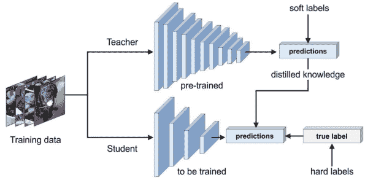

图 3.10 基于输出迁移的知识蒸馏示意图 [27]。

负标签所携带的信息会被相对放大，因此模型训练会更加关注负标签。该改进函数称为 softmax-T 函数，形式为

$$q_i = \frac{\exp(z_i/T)}{\sum_j \exp(z_j/T)}.$$ (3.2)

基于预训练的教师模型 Net-T 和待训练的学生模型 Net-S，蒸馏过程如图 3.10 所示。

- 首先，将训练数据集同时以高温 \( T = t \) 输入到 Net-T 和 Net-S 中，Net-T 和 Net-S 的 softmax-T 函数输出构成交叉熵，作为损失函数的第一部分 \( \mathcal{L}_{\text{soft}} \)。
- 然后，将 Net-S 在常温 \( T = 1 \) 下的 softmax 函数输出作为损失函数的第二部分 \( \mathcal{L}_{\text{hard}} \)。
- 总损失函数 \( \mathcal{L} \) 由 \( \mathcal{L}_{\text{soft}} \) 和 \( \mathcal{L}_{\text{hard}} \) 组成，并以 \( \mathcal{L} \) 作为 Net-S 的损失函数来训练 Net-S。

Hinton 通过实验指出，知识蒸馏使学生模型能够获取教师模型的知识，从而提升小模型的效果。Hinton 等人提出的这一方法对后续知识蒸馏研究产生了深远影响，并且还提出了一些输出迁移的改进形式。例如，Ying Zhang 等人 [37] 提出了一种互助学习模型，使 Net-S 在训练过程中能够相互学习和指导。经典的蒸馏算法是一条单向通道，将知识从 Net-T 传递到 Net-S，而互助学习使

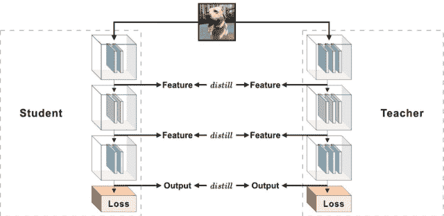

图 3.11 基于特征迁移的知识蒸馏示意图。

每个 Net-S 的损失函数由传统监督学习损失和模仿损失组成，并要求 Net-S 的预测概率保持一致。

基于输出迁移的知识蒸馏方法难以控制学生模型对中间细节特征的学习，并会导致训练不稳定。一种更直观的方法是对 Net-T 模型和 Net-S 模型的中间特征施加约束，以确保 Net-S 模型能够尽可能准确地继承 Net-T 的所有知识。这种蒸馏称为特征迁移。特征迁移并非直接将 softmax 的输出作为目标蒸馏到小模型，而是强调 Net-S 学习 Net-T 网络结构的中间层，即在中间特征层和输出端同时进行知识蒸馏，如图 3.11 所示。

输出迁移已考虑到 Net-S 的参数数量少于 Net-T，但对于层数更多且每层神经元更少的 Net-S（这种结构称为窄深网络），Hinton 的方法仍需扩展。因此，Romero 等人 [28] 提出了一种训练窄深网络的方法。通过引入 Net-T 隐藏层输出变量 Hints 来指导 Net-S 的学习过程，Net-S 的隐藏层可以学习 Net-T 隐藏层的预测输出。在这种蒸馏模式下的 Net-S 称为 FitNet。

整个训练过程分为两个阶段，如图 3.12 所示。Net-T 模型中间层的权重表示为 \( \mathbf{W}_H \)，表示指导，而 Net-S 模型中间层

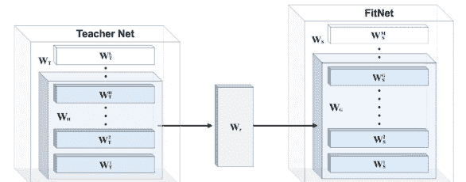

图 3.12 FitNet 知识蒸馏示意图 [28]。

的权重表示为 \( \mathbf{W}_G \)，表示被指导。第一阶段是匹配中间层 \( \mathbf{W}_H \) 和 \( \mathbf{W}_G \) 的特征。由于两个特征的输出尺寸不同，使用映射函数 \( \mathbf{W}_r \) 实现尺寸匹配，然后通过最小化 \( \mathbf{W}_H \) 和 \( \mathbf{W}_G \) 之间的差异来实现中间层特征的知识蒸馏。在此阶段，FitNet 前 \( g \) 层的参数在 Net-T 前 \( h \) 层参数的指导下进行训练。第二阶段与上述输出迁移相同，通过训练得到 Net-S 所有层的参数 \( \mathbf{W}_S \) 和 \( \mathbf{W}_G \)。

实验结果表明，特征迁移方法能够提供更多的教师模型知识，并比输出迁移方法更好地提升学生模型的泛化能力。此外，FitNet 作为一种模型压缩算法，在速度和精度之间取得了出色的平衡，在参数减少 36 倍的条件下，模型性能仅下降 1.3%。然而，值得注意的是，基于提示的隐藏层特征映射实际上是一种正则化表示，因此设置的 \( \mathbf{W}_G \) 层数越深，FitNet 越容易受到过度正则化的影响。其他关于特征迁移的研究也从隐藏层入手，例如，将卷积神经网络隐藏层输出的特征图传递到 Net-S，并计算并降低 Net-T 和 Net-S 中特征图的差异 [40]。

## 参考文献

- [1] A. Krizhevsky, I. Sutskever, G.E. Hinton, 基于深度卷积神经网络的ImageNet图像分类, 《计算机协会通讯》 60 (2012) 84–90.
- [2] H. Yang, S. Gui, Y. Zhu, J. Liu, 基于稀疏-量化联合学习的自动神经网络压缩：一种约束优化方法, 载于: IEEE计算机视觉与模式识别会议论文集, 2020.
- [3] Y. Guo, H. Yuan, J. Tan, Z. Wang, S. Yang, J. Liu, GDP: 通过可微分极化门实现的稳定神经网络剪枝, 载于: 国际计算机视觉会议, 2021.
- [4] X. Ding, G. Ding, X. Zhou, Y. Guo, J. Han, J. Liu, 用于剪枝非常深神经网络的全局稀疏动量SGD, 神经信息处理系统 (2019).
- [5] J. Shen, H. Wang, S. Gui, J. Tan, Z. Wang, J. Liu, UMEC: 面向高效推荐系统的统一模型与嵌入式压缩, 载于: 国际学习表征会议, 2021.
- [6] H. Yang, Y. Zhu, J. Liu, ECC: 基于双线性回归模型的平台无关能量约束深度神经网络压缩, 载于: IEEE计算机视觉与模式识别会议论文集, 2019, pp. 11206–11215.
- [7] H. Wang, S. Gui, H. Yang, H. Yang, J. Liu, Z. Wang, GAN 瘦身：基于统一优化框架的全方位GAN压缩, 载于: 欧洲计算机视觉会议, Springer, Cham, 2020, pp. 54–73.
- [8] S. Gui, H. Wang, H. Yang, C. Yu, Z. Wang, J. Liu, 兼具对抗鲁棒性的模型压缩：统一优化框架, 神经信息处理系统进展 (2019) 1285–1296.
- [9] M. Denil, B. Shakibi, L. Dinh, M. Ranzato, N.D. Freitas, 深度学习中的参数预测, 载于: 国际神经信息处理系统会议论文集, 2013.
- [10] K. He, X. Zhang, S. Ren, J. Sun, 面向图像识别的深度残差学习, 载于: IEEE计算机视觉与模式识别会议论文集, 2016.
- [11] F.N. Iandola, M. Moskewicz, K. Ashraf, S. Han, W. Dally, K. Keutzer, SqueezeNet: 参数减少50倍且模型大小小于1MB的AlexNet级精度, arXiv: 1602.07360 [abs].
- [12] A.G. Howard, M. Zhu, B. Chen, D. Kalenichenko, W. Wang, T. Weyand, M. Andreetto, H. Adam, MobileNets: 面向移动视觉应用的高效卷积神经网络, arXiv:1704.04861 [abs].
- [13] C. Szegedy, W. Liu, Y. Jia, P. Sermanet, S.E. Reed, D. Anguelov, D. Erhan, V. Vanhoucke, A. Rabinovich, 卷积网络更深, 载于: IEEE计算机视觉与模式识别会议论文集, 2015.
- [14] K. Simonyan, A. Zisserman, 面向大规模图像识别的非常深层卷积网络, arXiv:1409.1556 [abs].
- [15] M. Sandler, A.G. Howard, M. Zhu, A. Zhmoginov, L.-C. Chen, MobileNetV2: 倒残差与线性瓶颈, 载于: IEEE计算机视觉与模式识别会议论文集, 2018.
- [16] X. Zhang, X. Zhou, M. Lin, J. Sun, ShuffleNet: 面向移动设备的极高效卷积神经网络, 载于: IEEE计算机视觉与模式识别会议论文集, 2018.
- [17] M. Tan, Q. Le, EfficientNet: 重新思考卷积神经网络的模型缩放, 载于: 国际机器学习会议论文集, 2019.
- [18] Q.V. Tan, Mingxing and Le, EfficientNetV2: 更小的模型和更快的训练, arXiv: 2104.00298 [abs].
- [19] D. Singh, V. Kumar, M. Kaur, 基于密连卷积网络的COVID-19筛查模型, 应用智能 (2021) 1–8.
- [20] B. Zoph, V. Vasudevan, J. Shlens, Q.V. Le, 面向可扩展图像识别的可迁移架构学习, 载于: IEEE计算机视觉与模式识别会议论文集, 2018.


- [21] A. Radford, K. Narasimhan, T. Salimans, I. Sutskever, 基于生成式预训练的语言理解改进。可用: https://www.cs.ubc.ca/~amuham01/LING530/papers/radford2018improving.pdf, 2018年.
- [22] V. Sindhwani, T. Sainath, S. Kumar, 用于小型深度学习的结构变换, 在: 神经信息处理系统国际会议论文集, 2015.
- [23] E.L. Denton, W. Zaremba, J. Bruna, Y. LeCun, R. Fergus, 利用卷积网络内的线性结构实现高效评估, 在: 神经信息处理系统会议与研讨会论文集, 2014.
- [24] S. Srinivas, R.V. Babu, 深度神经网络的无数据参数剪枝, 在: 英国机器视觉会议论文集, 2015.
- [25] H. Li, A. Kadav, I. Durdanovic, H. Samet, H. Graf, 用于高效 ConvNet 的滤波器剪枝, arXiv:1608.08710 [abs].
- [26] S. Han, J. Pool, J. Tran, W. Dally, 学习高效神经网络的权重与连接, arXiv:1506.02626 [abs].
- [27] G.E. Hinton, O. Vinyals, J. Dean, 蒸馏神经网络中的知识, arXiv: 1503.02531 [abs].
- [28] A. Romero, N. Ballas, S. Kahou, A. Chassang, C. Gatta, Y. Bengio, FitNets: 给精简深度网络的提示, arXiv:1412.6550 [abs].
- [29] Y. Liu, J. Cao, B. Li, C. Yuan, W. Hu, Y. Li, Y.-f. Duan, 基于实例关系图的知识蒸馏, 在: IEEE 计算机视觉与模式识别会议论文集, 2019.
- [30] Y. Gong, L. Liu, M. Yang, L.D. Bourdev, 使用矢量量化压缩深度卷积网络, arXiv:1412.6115 [abs].
- [31] J. Wu, C. Leng, Y. Wang, Q. Hu, J. Cheng, 移动设备的量化卷积神经网络, 在: IEEE 计算机视觉与模式识别会议论文集, 2016.
- [32] M. Zhu, S. Gupta, 剪还是不剪：探索剪枝在模型压缩中的效果, arXiv:1710.01878 [abs].
- [33] H. Hu, R. Peng, Y.-W. Tai, C.-K. Tang, 网络修剪：一种面向高效深度架构的数据驱动神经元剪枝方法, arXiv:1607.03250 [abs].
- [34] P. Molchanov, S. Tyree, T. Karras, T. Aila, J. Kautz, 用于资源高效推理的卷积神经网络剪枝, arXiv:1611.06440 [abs].
- [35] T. Matiisen, A. Oliver, T. Cohen, J. Schulman, 教师–学生课程学习, IEEE 神经网络与学习系统汇刊 31 (2020) 3732–3740.
- [36] J. Gou, B. Yu, S. Maybank, D. Tao, 知识蒸馏：综述, arXiv:2006.05525 [abs].
- [37] Y. Zhang, T. Xiang, T.M. Hospedales, H. Lu, 深度互学, 在: IEEE 计算机视觉与模式识别会议论文集, 2018.
- [38] T. Furlanello, Z.C. Lipton, M. Tschannen, L. Itti, A. Anandkumar, 重生神经网络, 在: 机器学习国际会议论文集, 2018.
- [39] R. Tang, Y. Lu, L. Liu, L. Mou, O. Vechtomova, J.J. Lin, 从 BERT 向简单神经网络蒸馏特定任务知识, arXiv:1903.12136 [abs].
- [40] S. Zagoruyko, N. Komodakis, 更加关注注意力：通过注意力迁移提升卷积神经网络性能, arXiv:1612.03928 [abs].
- [41] J. Yim, D. Joo, J.-H. Bae, J. Kim, 知识蒸馏的馈赠：快速优化、网络最小化与迁移学习, 在: IEEE 计算机视觉与模式识别会议论文集, 2017.
- [42] G. Chen, W. Choi, X. Yu, T. Han, M. Chandraker, 利用知识蒸馏学习高效目标检测模型, 在: 神经信息处理系统国际会议论文集, 2017.

# 第4章

## 混合精度模型编码与量化

## 4.1 背景与挑战

本章基于我们的相关出版物[1]。面向高效神经计算的混合精度激活压缩研究是一个新兴的热门话题，其在各种边缘计算和计算机视觉应用中揭示了巨大的潜力[2–5]。针对神经网络激活量化，已提出随机和确定性两种方法[6–9]，这些方法在训练神经网络的同时采用各种量化函数来降低激活表示的精度。尽管激活精度的损失会导致分类准确度的显著下降，但通过减少所需的位数，具有量化激活的深度神经网络可以相较于标准浮点实现，将内存和时间效率提高几个数量级[7,10–12]。

激活量化研究的一个挑战是缺乏理论基础[13]。现有方法的性能取决于其量化策略的选择，且在给定平均码率的情况下，无法确定表示精度的最小损失。最近，信息论概念因其有助于更好地理解深度学习优化过程的潜力而受到关注[14,15]。这些方法的关键思想是使用短码 X̂ 来保持信号 X 最有价值的信息。在深度神经网络的背景下，X̂ 是量化激活信号，我们将此问题形式化为寻找一个能保留关于 X 最大信息的短码 X̂，即如何通过深度神经网络中的“瓶颈”来最小化信号量化造成的信息损失。

基于信息论的神经编码新兴研究是一个有趣的话题，它试图回答关于深度网络设计原则的基本问题，例如最优架构和最优量化方案。最近提出的带有信息瓶颈的深度神经网络通常具有用于*特征级*压缩的编码器–解码器架构，将神经网络视为压缩与预测之间的权衡[14,16]。就我们所知，这项工作是首次尝试进行逐位压缩，以应对在最小化码率的同时最优保持激活完整性的挑战。

尽管信息论推动了相关研究，但基于确定性或随机模型的激活量化研究近期也受到越来越多的关注。Lee 等人[17]按照通道级分布对神经网络进行了量化。Zhao 等人[18]使用异常通道分割来消除量化造成的异常值影响。最小均方误差[19]和互补方法[20]均用于减少量化误差。同时，数据驱动的激活量化研究也在蓬勃发展。Qiu 等人[21]提出了一种使用深度生成模型以定点数编码激活的 Fisher 向量方法。Jacob 等人[22]使用迭代方法将激活和权重均量化为 8 位整数。Li 等人[23]提出了一种基于熵的可解释量化方法。与基于信息论的方法相比，这些方法通常基于量化函数的不同假设，许多研究者使用了不可导的量化操作[21–23]，这可能导致不可解释且次优的结果。

从技术角度来看，本章介绍了基于*速率失真理论*[24]的逐位瓶颈方法。作为一种有损数据压缩操作，逐位瓶颈方法试图通过最小化量化失真来确定激活中最显著的位。为此，逐位瓶颈方法在压缩激活的最大码率约束下，直接最小化量化失真。具体地，逐位瓶颈优化被表述为稀疏凸优化问题，旨在在受限码率下最小化失真。由于不显著位的系数通常接近于零，激活可以以逐位的方式得到最优压缩。

本章的贡献有三点。首先，它提出了一种基于信息论的方法——逐位瓶颈（Bitwise Bottleneck），用于*逐位激活量化*与压缩，这是首次针对 DNN 激活量化优化*逐位瓶颈*的尝试。其次，不同瓶颈的码率可以通过峰值信噪比（PSNR）损失阈值这一单个超参数自适应调节，使所提方法能够针对不同应用灵活地在效率与准确度之间进行权衡。最后，逐位瓶颈最小化了损失


由激活量化引起的信息损失；因此，所提出的方法在获得超过六倍的内存和计算效率提升的同时，几乎没有分类准确率损失。

## 4.2 速率失真理论与稀疏编码

最近，将信息理论应用于深度神经网络激活压缩越来越受到关注。通过将深度神经网络解释为一种有损数据压缩方法，深度神经网络的黑盒可能被打开，其性能可以由广泛应用于电信领域的速率失真理论工具进行优化 [15]。

### 4.2.1 速率失真理论

设随机变量 \(\mathbf{X}^{(l)} \in \mathbb{R}^{P \times Q \times K}\) 为与第 \(l\) 层关联的浮点神经网络激活张量，其中 \(P\)、\(Q\)、\(K\) 分别为第 \(l\) 层的高度、宽度和特征图数量。常见的量化函数 \(\mathcal{Q}\) 可表示为

```
\(\hat{\mathbf{X}}^{(l)} = \mathcal{Q}(\mathbf{X}^{(l)}),\) \tag{4.1}
```

其中 \(\hat{\mathbf{X}}^{(l)}\) 是浮点激活的定点表示。有损数据压缩的目标是在最大码率约束下实现最小失真。设 \(g\) 为指示给定数据位数的函数。根据速率失真理论，典型的有损数据压缩方法试图在最大位数 \(\eta\) 约束下最小化失真函数 \(d\)，如下所示：

```
\(\min_{\mathcal{Q}(\cdot)} \mathbb{E}(d(\mathbf{X}^{(l)}, \mathcal{Q}(\mathbf{X}^{(l)}))) \quad \text{s.t. } \mathbb{E}(g(\hat{\mathbf{X}}^{(l)})) \le \eta.\) \tag{4.2}
```

在实践中，由于量化函数 \(\mathcal{Q}\) 具有整数输出，因此其不可微且非凸，这使得 Eq. (4.2) 难以求解。与通常将次优解视为最终解的基于舍入的量化方法不同，本章试图通过将 Eq. (4.2) 重新表述为稀疏编码问题来寻找最优解。

### 4.2.2 基于位宽瓶颈编码的激活量化

在实践中，我们可以使用训练样本集来近似 Eq. (4.2) 的解。假设 \(\mathbf{X}_i^{(l)} \in \mathbb{R}^{P \times Q \times K}\) 是第 \(i\) 个样本由第 \(l\) 层输出的浮点激活张量

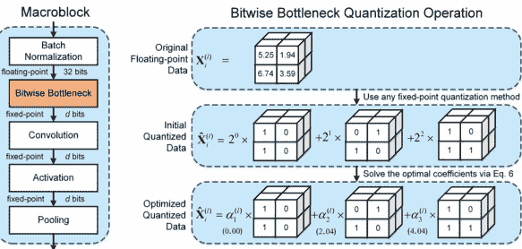

**图 4.1** 位宽瓶颈方法示意图。位宽瓶颈操作可以插入到卷积神经网络中用于激活量化。所提方法的思想是用可变系数替代标准量化的常量级别（在本示例中为 2 的幂）。通过利用位宽系数的稀疏性，瓶颈可以减少激活表示所需的位数。

该张量与第 \(l\) 层输出的第 \(i\) 个样本相关联。图 4.1 说明了位宽瓶颈方法。从形式上讲，假设 \(\hat{\mathbf{X}}_i^{(l)}\) 是 \(\mathbf{X}_i^{(l)}\) 的 D 位定点近似，如 Eq. (4.3) 所定义，其中 \(\hat{\mathbf{X}}_{ij}^{(l)} \in \{0, 1\}^{P \times Q \times K}\) 是一个三维二进制张量，表示 \(\hat{\mathbf{X}}_i^{(l)}\) 的第 \(j\) 位。

```
\(\hat{\mathbf{X}}_i^{(l)} = \mathcal{Q}(\mathbf{X}_i^{(l)}) = 2^0 \hat{\mathbf{X}}_{i1}^{(l)} + 2^1 \hat{\mathbf{X}}_{i2}^{(l)} + \dots + 2^{D-1} \hat{\mathbf{X}}_{iD}^{(l)}\) (4.3)
```

其中，每个位宽数据矩阵被分配一个常数系数 \(2^0, \dots, 2^{D-1}\)。在实践中，这种位宽激活表示允许定点数据的计算以位宽方式实现。计算和内存复杂度与不同表示的位数成正比。

从技术上讲，Eq. (4.3) 的二进制量化本质上假设激活表示中的 D 位都需要，尽管不同位包含不同但固定的信息量。通过去除此假设，所提方法用变量 \(\boldsymbol{\alpha}^{(l)} \in \mathbb{R}^D\) 替代固定系数，如下所示：

```
\(\hat{\mathbf{X}}_i^{(l)} = \mathcal{Q}(\mathbf{X}_i^{(l)}) = \alpha_1^{(l)} \hat{\mathbf{X}}_{i1}^{(l)} + \alpha_2^{(l)} \hat{\mathbf{X}}_{i2}^{(l)} + \cdots + \alpha_D^{(l)} \hat{\mathbf{X}}_{iD}^{(l)}.\) (4.4)
```

位宽瓶颈方法将神经网络设计视为压缩与预测之间的权衡，该方法假设

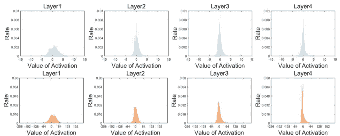

(a) 激活分布

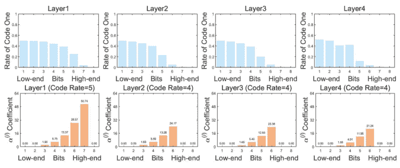

(b) 每位 1 码率与 \(\alpha^{(l)}\) 系数

**图 4.2** 特征维度 vs. 位宽激活稀疏性。(a) ResNet50 [25] 在 CIFAR10 数据集上前四层的实数值（上）和量化（下）激活分布。(b) 量化激活每位的平均 1 码率（上）和估计系数 \(\alpha^{(l)}\)（下）。看来不同层的最优码率取决于激活稀疏度的水平，且位宽瓶颈方法可以自适应地移除激活表示中接近零的高位和低信息量的低位。

位宽瓶颈可以利用激活表示中的稀疏性，从而在不损害分类准确率的前提下降低激活表示的精度。图 4.2 说明了 ResNet50 [25] 在 CIFAR10 数据集上前四层的激活分布。看来不同层的激活是稀疏的，但稀疏度因层而异。图 4.2(b) 说明了激活表示中每位的平均 1 码率（上图）。尽管如图 4.2(a) 所示特征维度稀疏度发生变化，但激活表示高位上的位宽稀疏度更容易检测。因此，我们可能能够估计与最显著位相关的最优稀疏系数 \(\boldsymbol{\alpha}^{(l)}\)。

根据速率失真理论（Eq. (4.2)），位宽瓶颈试图在少于 \(\eta\) 个位宽系数非零的条件下，通过最小化 \(N\) 个训练样本上的标准平方失真率来寻找最优量化方案，

```
\(\begin{aligned} \arg \min_{\boldsymbol{\alpha}^{(l)}} \sum_{i=1}^N \|\mathbf{X}_i^{(l)} - \sum_{j=1}^D \alpha_j^{(l)} \hat{\mathbf{X}}_{ij}^{(l)}\|_2^2 \quad \text{s.t.} \quad \|\boldsymbol{\alpha}^{(l)}\|_0 \le \eta, \end{aligned} \quad (4.5)\)
```

其中，由初始量化操作计算得到的 \(\hat{\mathbf{X}}_{ij}^{(l)}\) 通常被称为量化 *码本*。在实践中，可以应用不同的初始量化操作，且 Eq. (4.3) 是舍入量化方法的一个简单示例。注意的是，由于 \(\boldsymbol{\alpha}^{(l)}\) 中非零系数的数量等于定点表示中的位数，Eq. (4.5) 的约束函数实际上限制了量化表示中的最大位数，如速率失真理论所要求。最近的研究表明，Eq. (4.5) 在满足稀疏性要求时等价于以下基于 L1 范数的问题，从而得到稀疏解 [26]：

```
\(\begin{aligned} \arg \min_{\boldsymbol{\alpha}^{(l)}} \sum_{i=1}^N \|\mathbf{X}_i^{(l)} - \sum_{j=1}^D \alpha_j^{(l)} \hat{\mathbf{X}}_{ij}^{(l)}\|_2^2 \quad \text{s.t.} \quad \|\boldsymbol{\alpha}^{(l)}\|_1 \le \eta. \end{aligned} \quad (4.6)\)
```

位宽瓶颈操作求解 Eq. (4.6) 以确定稀疏显著位并导致最小失真。在实践中，Eq. (4.6) 通常通过求解其拉格朗日形式来计算，如下所示：

```
\(\begin{aligned} \arg \min_{\boldsymbol{\alpha}^{(l)}} \sum_{i=1}^N \|\mathbf{X}_i^{(l)} - \sum_{j=1}^D \alpha_j^{(l)} \hat{\mathbf{X}}_{ij}^{(l)}\|_2^2 + \lambda \|\boldsymbol{\alpha}^{(l)}\|_1, \end{aligned} \quad (4.7)\)
```

其中 \(\lambda\) 是用于控制优化误差率与码率之间权衡的超参数。Eq. (4.6) 通常会导致系数 \(\boldsymbol{\alpha}^{(l)}\) 的稀疏解，因此在推理阶段会移除与零系数相关的激活位。为了避免由浮点数引起的昂贵计算，我们在重新训练过程中对系数向量 \(\boldsymbol{\alpha}^{(l)}\) 进行量化；因此，计算效率可以显著提高。


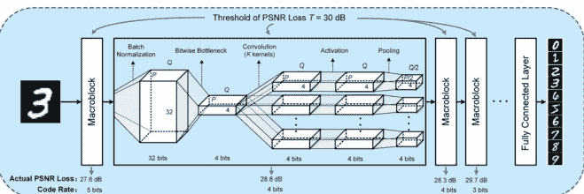

图 4.3 具有比特瓶颈层的深度神经网络。第二个宏块已扩展并详细显示。通过设置PSNR损失阈值这一单个超参数，不同宏块中的比特瓶颈可以被训练，以灵活地用不同的最优编码速率对归一化激活进行量化。

## 4.3 比特瓶颈量化方法

在本节中，我们介绍具有比特瓶颈的神经网络以及稀疏比特瓶颈的训练算法。

### 4.3.1 具有比特瓶颈的神经网络

如公式 (4.6) 所示，比特瓶颈操作计算压缩激活表示中不同位所关联的最优系数，以便在给定最大编码速率的情况下实现最小失真。本节展示了比特瓶颈在深度神经网络中的工作原理。

图 4.3 展示了具有比特瓶颈的高效神经计算示例。整个网络基于经典ResNet构建，尽管比特瓶颈操作可以轻松集成到不同的网络中。在实践中，比特瓶颈操作可以插入深度神经网络的宏块中。一个典型的宏块包含一个比特瓶颈层、一个卷积层、一个池化层（可选）、一个批量归一化层和一个激活层。得益于比特瓶颈层，该层将归一化浮点激活转换为压缩定点激活，卷积层可以用高效的定点逐位乘法替代计算开销大的浮点乘法。

在深度神经网络中插入比特瓶颈的好处有两方面。从内存效率的角度来看，与使用32位单精度激活表示的标准深度神经网络相比，比特瓶颈可以将激活压缩

算法 4.1：训练算法。

```
Input: Pretrained floating-point CNN model Θ, threshold of
PSNR loss T, number of layers L, number of training
samples N, number of bits for initial quantization D;
Output: An Optimized Quantized model Θ̂;
1 Obtain the floating-point activation tensors X₁⁽¹⁾, ..., Xᵢ⁽ᴸ⁾ of Θ for
each sample;
2 for l = 1, ..., L do
3   while t⁽ˡ⁾ < T do
4     for i = 1, ..., N do
5       Obtain the codebook X̂ᵢ₁⁽ˡ⁾, X̂ᵢ₂⁽ˡ⁾, ..., X̂ᵢᴰ⁽ˡ⁾ by initial
      quantization of Xᵢ⁽ˡ⁾;
6       Obtain the coefficient vector α⁽ˡ⁾ via Eq. (4.6) and
      restore X̂ᵢ⁽ˡ⁾ via Eq. (4.4);
7       Compute the PSNR loss between X̂ᵢ⁽ˡ⁾ and Xᵢ⁽ˡ⁾ as tᵢ⁽ˡ⁾;
8     end
9     t⁽ˡ⁾ = max(tᵢ⁽ˡ⁾) for each i = 1, ..., N;
10    Increase λ;
11  end
12 end
13 Insert the bottleneck layers into Θ as a new model Θ̂;
14 Refine and quantize the weights and the vector α⁽ˡ⁾ of Θ̂ by
    backpropagation until reaching convergence.
```

为任意低精度（1到8位），使内存效率提高32到4倍。从*计算效率*的角度来看，单精度浮点乘法通常比定点乘法需要多得多的硬件资源和计算时间。通过在卷积层之前使用比特瓶颈层（如图 4.1 所示），深度神经网络的推理延迟可能降低超过90%，如早期研究 [27] 所示。

### 4.3.2 训练稀疏比特瓶颈

在实践中，神经网络中激活的稀疏程度可能因层而异。希望不同宏块使用不同的量化精度。作为所提方法的一个优势，不同比特瓶颈的最优编码速率可以通过调节单个超参数来近似，该超参数是峰值信噪比（PSNR）损失的阈值。PSNR的测量定义为 PSNR = 10log<sub>10</sub>((2<sup>D</sup>-1)<sup>2</sup>/MSE)，其中 MSE = 1/(P×Q×K)||X<sub>i</sub><sup>(t)</sup> - Σ<sub>j=1</sub><sup>D</sup>α<sub>ij</sub><sup>(t)</sup>X̂<sub>ij</sub><sup>(t)</sup>||<sub>2</sub><sup>2</sup>。通过增加超参数λ并将PSNR损失与阈值进行比较，每一层可以独立近似各自可接受的最小编码速率。关于训练算法的更多详细信息可参见算法 4.1。

图 4.2 展示了训练具有多个比特瓶颈的神经网络的示例性例子。仔细观察图像可发现三个有趣的发现。首先，存在比特稀疏性的统计现象。具体来说，神经网络不同层的激活表示的高位在统计上接近于零，这验证了我们的假设。其次，不同层的最优编码速率取决于激活稀疏程度。例如，ResNet50的第一个宏块的激活比接下来的三个宏块的激活稀疏度低，从而导致更高的可接受最小编码速率。第三，似乎比特瓶颈可以自适应地减少激活表示中接近零的高位和信息量较少的低位的系数 α<sub>j</sub><sup>(t)</sup>。

## 4.4 高效图像分类的应用

在本节中，我们通过一些实验展示所提方法在高效图像分类中的有效性。

### 4.4.1 实验设置

实验在三个标准基准上进行：MNIST [28]、CIFAR10 [29] 和 ImageNet (ILSVRC2012) [30] 数据集。MNIST数据集包含28×28单色图像，含有60,000个训练样本和10,000个测试样本。CIFAR10数据集包含32×32彩色图像，含有50,000个训练样本和10,000个测试样本，共有10个类别。ImageNet数据集包含128万个训练样本、50,000个验证样本、100,000个测试样本和1000个类别。

所提比特瓶颈方法需要一个初始量化操作，以计算第一步的二进制激活码本。

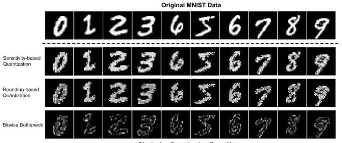

图 4.4 比特瓶颈层可以使用5位表示压缩图像，并与标准舍入基础量化和灵敏度基础量化方法进行比较。显示了压缩图像与原始图像之间逐像素绝对差值的误差图。

第二步。采用了两种不同的初始量化方法，包括迭代舍入方法 [31] 和DoReFa-Net方法 [8]。迭代舍入方法在迭代反向传播训练过程中对激活进行量化，该方法广泛用于深度神经网络量化。为验证我们的方法，使用测试数据集上的标准平均分类准确率作为评估标准。所提方法的结果基于ResNet50实现，所有对比方法也均基于ResNet50，以公平比较。

所有实验均在配备Intel i7-7800X CPU和2块NVIDIA TITAN Xp GPU的计算机上进行。类似于其他研究，所提方法采用基于反向传播的训练过程来优化和量化深度神经网络的权重参数及系数 α<sup>(l)</sup>。在实验中，应用ADAM [32]算法实现反向传播过程，学习率为0.0001，批量大小为64。我们在MNIST和CIFAR10数据集上重新训练了4000次迭代，在ImageNet数据集上训练了5个epoch。

### 4.4.2 可视化与分析

在MNIST数据集上进行了一组实验，以分析和可视化所提方法与初始及其他量化方法相比的性能。比特瓶颈


将定点表示的码率从初始量化长度 $D$ 位降低到有效码率 $d$，即向量 $\boldsymbol{\alpha}^{(\mathit{l})}$ 中非零系数的数量（公式 (4.6)）。图 4.4 展示了在 MNIST 数据集上 5 比特激活量化导致的激活完整性损失。比较了拟议方法与基准量化方法之间压缩图像数据与原始图像数据之差的绝对值。总之，与标准基于舍入的方法（$42.02 \pm 0.54$ dB）和基于灵敏度的方法（$34.94 \pm 0.84$ dB）相比，拟议的 **按位瓶颈** 方法在激活量化中显示了最高的 PSNR（$47.30 \pm 0.51$ dB）[33]。

图 4.5(a) 展示了有效码率 $d$ 与在 MNIST 数据集上达到的平均 PSNR 之间的关系。总体而言，与经典的基于舍入的量化和基于灵敏度的量化方法相比，拟议的 **按位瓶颈** 方法实现了高 1.98 dB 至 12.44 dB 的 PSNR。当选择不同数量的非零系数时，PSNR 的优势保持一致，这可以由超参数 $\lambda$ 控制，如图所示。

与其他激活量化方法类似，在激活量化过程后应用了反向传播重新训练过程，以细化重量参数和通过基于舍入的方法量化为 $D$ 位的系数 $\boldsymbol{\alpha}^{(\mathit{l})}$。图 4.5(b) 展示了使用反向传播达到的最终分类精度。在非零系数 $d$ 的各种数量下，评估了 MNIST 和 CIFAR10 数据集上的平均精度。实验结果表明，当激活量化使用的位数少于四位时，拟议方法优于基准方法。当数据集更复杂时，基于舍入的量化导致的精度损失会变得更糟，而当用于激活表示的位数多于三位时，**按位瓶颈** 方法与浮点模型相比几乎没有精度损失。

**按位瓶颈** 方法的特点是能够自动确定不同层的有效码率。通过设置激活量化可接受的 PSNR 损失阈值，按位瓶颈可以通过稀疏优化估计最小有效码率。图 4.5(c) 展示了 PSNR 损失阈值、不同层间的平均有效码率和分类精度之间的关系。如在 CIFAR10 数据集上的实验所示，当 PSNR 损失阈值增加时，分类精度会下降。然而，

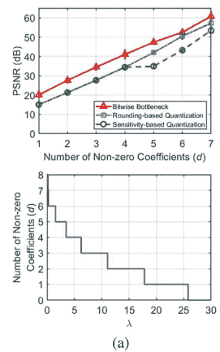

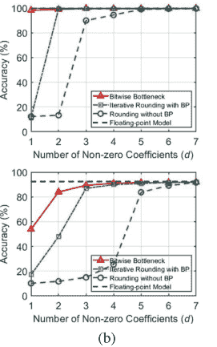

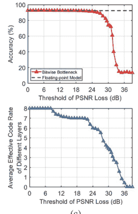

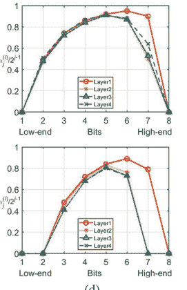

图 4.5 (a) PSNR 与有效码率（等于 $\alpha^{(l)}$ 中非零系数的数量）之间的关系，以及有效码率与 $\lambda$ 值之间的关系。(b) 带按位瓶颈的深度神经网络在 MNIST（上）和 CIFAR10（下）数据集上的精度，可以使用不同的有效码率 d 压缩深度神经网络的激活。(c) 使用按位瓶颈根据不同的 PSNR 损失阈值压缩 8 比特定点激活时，不同层的精度和平均有效码率的变化。(d) 不同 PSNR 损失阈值下的 $\alpha_f^{(l)}/2^{l-1}$ 比率（T = 26 上，T = 30 下）。

当 PSNR 损失小于 24 dB 时，几乎未检测到分类精度下降（小于 1%）。当用于激活表示的平均位数少于 6 位时，精度开始下降。

按位瓶颈方法将激活量化任务视为压缩与预测之间的权衡。图 4.5(d) 展示了量化激活中每个比特的 \(\alpha_j^{(0)}/2^{j-1}\) 比率，其中 \(2^{j-1}\) 是公式 (4.3) 的自然系数，反映了第 \(j\) 个比特包含多少信息。图像中可以发现两个有趣的观察结果。首先，瓶颈移除了激活表示的低位比特，从而使按位压缩导致的信息损失最小化。其次，尽管高位比特包含更多信息，但它们也被瓶颈移除了，这是由高位比特中的按位稀疏性引起的（如图 4.2 所示）。

### 4.4.3 与最先进的方法的比较

拟议方法在 ImageNet 数据集上与最先进的激活量化方法进行了评估。将原始浮点模型和拟议的 **按位瓶颈** 方法与 DSQ [34]、ACIQ [20]、Focused Compression [35]、Integer-only [22]、UNIQ [36]、INQ [37]、DoReFa-Net [8] 和 Iterative Rounding [31] 方法进行了比较。采用 8 dB 和 16 dB 的 PSNR 损失阈值对激活进行量化，从而得到平均有效码率分别为 5.0（±1）位和 4.0（±1）位。初始量化采用了 DoReFa-Net [8] 的量化方法。使用标准 TensorFlow 量化工具将权重量化为 8 位，并将 \(\alpha^{(l)}\) 的所有系数量化为 6 位。

在我们的实验中发现，大多数量化方法在使用 6 到 8 位激活表示时可以实现与浮点模型几乎相同的精度，但在 5 位及以下时精度开始明显下降。表 4.1 汇总了 ImageNet 数据集上的分类精度结果。如表所示，5 位激活表示的 top-1 精度损失最高可达 3.5%，4 位激活表示的 top-1 精度损失在 1.8% 至 5.6% 之间。然而，**按位瓶颈** 方法在 5 位和 4 位时可以实现可忽略的精度损失。4 位时的精度损失为 0.8%，比初始量化方法（DoReFa-Net）高出 4.7%。此外，**按位瓶颈** 方法超越了使用 8 位激活的 Integer-only 方法以及使用 32 位浮点激活的 INQ 和 Focused Compression 方法。

| 方法 | 年份 | 权重 | 激活 | Top-1 精度 (%) | Top-5 精度 (%) |
| :--- | :--- | :--- | :--- | :--- | :--- |
| 浮点模型 | 2016 | 32 | 32 | 75.6 | 92.8 |
| **按位瓶颈** | – | 8 | 5 | **75.7** | **92.7** |
| DSQ | 2019 | 8 | 5 | 75.2 | 92.5 |
| 聚焦压缩 | 2019 | 5 | 32 | 74.9 | 92.6 |
| 仅整数 | 2018 | 8 | 8 | 74.9 | – |
| INQ | 2017 | 5 | 32 | 74.8 | 92.5 |
| DoReFa-Net（初始量化） | 2016 | 8 | 5 | 73.8 | 91.7 |
| 迭代舍入 | 2014 | 8 | 5 | 72.1 | 90.4 |
| **按位瓶颈** | – | 8 | 4 | **74.8** | **92.2** |
| DSQ | 2019 | 8 | 4 | 73.8 | 91.7 |
| UNIQ | 2018 | 4 | 8 | 73.4 | – |
| ACIQ | 2019 | 8 | 4 | 71.8 | – |
| DoReFa-Net（初始量化） | 2016 | 8 | 4 | 70.1 | 89.3 |
| 迭代舍入 | 2014 | 8 | 4 | 70.0 | 89.4 |

### 4.4.4 效率提升

从降低计算复杂度的角度来看，当神经网络以按位方式实现时，较低的码率会导致线性减少的按位操作数。以 8 比特定点表示为例，每个定点操作可以通过 8 个按位操作实现，如果截断 1 位，则操作数可减少 12.5%。此外，当使用专用硬件实现时，减少单个位也会使硬件资源需求减少 12.5%。总体而言，与 32 比特激活表示相比，按位瓶颈可以在不损害深度神经网络性能的情况下将计算效率提升超过 6.4 倍。此外，考虑到权重被量化为 8 位，计算效率提升可达 25.6 倍。

从降低内存占用的角度来看，降低激活码率会线性地减少内存需求。标准神经网络的激活通常由 32 比特浮点数表示，占用 4 字节内存。然而，按位瓶颈可以将它们压缩到少于 5 位而不会损害


分类准确率，运行内存可降低 84%。

## 参考文献

- [1] X. Zhou, K. Liu, C. Shi, H. Liu, J. Liu, 基于信息理论的位级瓶颈优化高效混合精度激活量化，在: AAAI人工智能会议论文集, 卷 35, 2021, 页 3590–3598.
- [2] C. Chen, A. Seff, A. Kornhauser, J. Xiao, DeepDriving: 面向自动驾驶直接感知的负担能力学习，在: IEEE国际计算机视觉会议论文集, 2015, 页 2722–2730.
- [3] B. Wu, F. Iandola, P.H. Jin, K. Keutzer, SqueezeDet: 用于自动驾驶实时目标检测的统一、小型、低功耗全卷积神经网络，在: IEEE计算机视觉与模式识别会议论文集, 2017, 页 129–137.
- [4] C. McCool, T. Perez, B. Upcroft, 轻量级深度卷积神经网络混合模型：应用于农业机器人，IEEE机器人与自动化期刊 2 (3) (2017) 1344–1351.
- [5] H. Xu, Y. Gao, F. Yu, T. Darrell, 基于大规模视频数据集的端到端驾驶模型学习，在: IEEE计算机视觉与模式识别会议论文集, 2017, 页 2174–2182.
- [6] S. Gupta, A. Agrawal, K. Gopalakrishnan, P. Narayanan, 有限数值精度下的深度学习，在: 国际机器学习会议论文集, 2015, 页 1737–1746.
- [7] M. Courbariaux, Y. Bengio, J.P. David, BinaryConnect: 传播过程中使用二值权重训练深度神经网络，在: 国际神经信息处理系统会议论文集, 2015, 页 3123–3131.
- [8] S. Zhou, Y. Wu, Z. Ni, X. Zhou, H. Wen, Y. Zou, DoReFa-Net: 使用低位宽梯度训练低位宽卷积神经网络，arXiv:1606.06160 [abs].
- [9] J. Wu, C. Leng, Y. Wang, Q. Hu, J. Cheng, 移动设备的量化卷积神经网络，在: IEEE计算机视觉与模式识别会议论文集, 2016, 页 4820–4828.
- [10] M. Kim, P. Smaragdis, 位级神经网络，arXiv:1601.06071 [abs].
- [11] M. Courbariaux, I. Hubara, D. Soudry, R. El-Yaniv, Y. Bengio, 二值化神经网络：将权重和激活限制为+1或-1的深度神经网络训练，arXiv:1602.02830 [abs].
- [12] M. Rastegari, V. Ordonez, J. Redmon, A. Farhadi, XNOR-Net: 使用二值卷积神经网络进行ImageNet分类，在: 欧洲计算机视觉会议论文集, 2016, 页 525–542.
- [13] V. Sze, Y.-H. Chen, T.-J. Yang, J.S. Emer, 深度神经网络的高效处理：教程与综述，IEEE论文集 105 (12) (2017) 2295–2329.
- [14] N. Tishby, N. Zaslavsky, 深度学习与信息瓶颈原理，在: IEEE信息理论研讨会论文集, 2015, 页 1–5.
- [15] R. Shwartz-Ziv, N. Tishby, 通过信息揭开深度神经网络的黑盒，arXiv:1703.00810 [abs].
- [16] B. Dai, C. Zhu, D. Wipf, 使用变分信息瓶颈压缩神经网络，arXiv:1802.10399 [abs].
- [17] J.H. Lee, S. Ha, S. Choi, W.-J. Lee, S. Lee, 深度神经网络快速部署的量化，arXiv:1810.05488 [abs].
- [18] R. Zhao, Y. Hu, J. Dotzel, C. De Sa, Z. Zhang, 使用异常通道分割改进神经网络量化，arXiv预印本，arXiv:1901.09504, 2019.
- [19] E. Kravchik, F. Yang, P. Kisilev, Y. Choukroun, 用于高效推理的神经网络低位量化，在: IEEE国际计算机视觉会议论文集, 2019.
- [20] R. Banner, Y. Nahshan, D. Soudry, 用于快速部署的卷积网络训练后4位量化，在: 国际神经信息处理系统会议论文集, 2019, 页 7948–7956.
- [21] Z. Qiu, T. Yao, T. Mei, 深度量化：使用深度生成模型编码卷积激活，在: IEEE计算机视觉与模式识别会议论文集, 2017, 页 6759–6768.
- [22] B. Jacob, S. Kligys, B. Chen, M. Zhu, M. Tang, A. Howard, H. Adam, D. Kalenichenko, 用于仅整数算术高效推理的神经网络量化与训练，在: IEEE计算机视觉与模式识别会议论文集, 2018, 页 2704–2713.
- [23] Y. Li, S. Lin, B. Zhang, J. Liu, D. Doermann, Y. Wu, F. Huang, R. Ji, 利用核稀疏性和熵实现可解释CNN压缩，在: IEEE计算机视觉与模式识别会议论文集, 2019, 页 2800–2809.
- [24] T. Berger, 速率-失真理论，Wiley电信百科全书, 2003, https://doi.org/10.1002/0471219282.eot142.
- [25] K. He, X. Zhang, S. Ren, J. Sun, 面向图像识别的深度残差学习，在: IEEE计算机视觉与模式识别会议论文集, 2016, 页 770–778.
- [26] R.G. Baraniuk, 压缩感知 [讲义], IEEE信号处理杂志 24 (4) (2007) 118–121.
- [27] X. Zhou, S. Li, F Tang, S. Hu, Z. Lin, L. Zhang, DANoC: 芯片上深度神经网络的高效算法与硬件协同设计，IEEE神经网络与学习系统汇刊 29 (2018) 3176–3187.
- [28] Y. LeCun, L. Bottou, Y. Bengio, P. Haffner, 等, 梯度学习在文档识别中的应用，IEEE论文集 86 (11) (1998) 2278–2324.
- [29] A. Krizhevsky, G. Hinton, 等, 从微小图像中学习多层特征，技术报告, Citeseer, 2009.
- [30] J. Deng, W. Dong, R. Socher, L.-J. Li, K. Li, L. Fei-Fei, ImageNet: 一个大规模层次图像数据库，在: IEEE计算机视觉与模式识别会议论文集, 2009, 页 248–255.
- [31] M. Courbariaux, Y. Bengio, J.-P. David, 使用低精度乘法训练深度神经网络，arXiv:1412.7024 [abs].
- [32] D.P. Kingma, J. Ba, Adam: 随机优化方法，arXiv:1412.6980 [abs].
- [33] Y. Li, S. Zhang, X. Zhou, F. Ren, 通过位级敏感性和数据剪枝构建紧凑二值神经网络，Neurocomputing 398 (2020) 45–54.
- [34] R. Gong, X. Liu, S. Jiang, T. Li, P. Hu, J. Lin, F. Yu, J. Yan, 可微分软量化：连接全精度与低位神经网络，在: IEEE国际计算机视觉会议论文集, 2019, 页 4852–4861.
- [35] Y. Zhao, X. Gao, D. Bates, R. Mullins, C.-Z. Xu, 稀疏CNN的聚焦量化，在: 国际神经信息处理系统会议论文集, 2019, 页 5585–5594.
- [36] C. Baskin, E. Schwartz, E. Zheltonozhskii, N. Liss, R. Giryes, A.M. Bronstein, A. Mendelson, UNIQ: 神经网络量化的均匀噪声注入，arXiv:1804.10969 [abs].
- [37] A. Zhou, A. Yao, Y. Guo, L. Xu, Y. Chen, 增量网络量化：迈向低精度权重的无损CNN，arXiv:1702.03044 [abs].

# 第 5 章
## 二值神经网络的模型编码
## 5.1 背景与挑战

深度神经网络（DNNs）在多种不同的视觉任务中取得了巨大成功。然而，由于计算工作量和内存占用增加，这些强大网络的部署面临巨大挑战，尤其是在资源有限的设备上。

为应对这一挑战，已提出许多模型压缩和加速方法以减少内存和计算需求，例如网络剪枝 [1]、权重分解 [2]、轻量级网络设计 [3,4]、知识蒸馏 [5] 和网络量化 [6–8]。借助这些高效方法，可以将强大的 DNNs 部署到嵌入式设备上，用于计算机视觉和自动驾驶等不同应用 [9]。

作为压缩模型的极端版本，二值神经网络（BNNs）将 DNN 的全精度权重和激活限制为 {-1, +1} 的离散二值 [7]。因此，从理论上讲，DNN 推理所需的内存可减少高达 32 倍。采用 BNN 方法后，浮点乘法等耗能操作可以被高效的位级操作替代。然而，BNNs 通常会导致分类准确率显著下降。例如，使用 XNOR-Net 方法的二值 AlexNet 相比其全精度基线模型，Top-1 准确率降低了 12.4% [10]。

提高准确率的一种策略是在 BNNs 中引入更多二值参数。ABC-Net [11] 通过多个二值基的线性组合来近似全精度对应物。沿着类似思路，Group-Net [12] 提出组合多个同构二值分支以重建全精度组。另一方面，BENN [13] 建议在多个并行 BNNs 上使用如 bagging 等集成方法。

近期，关于具有二值权重和激活的硬件友好型轻量级神经网络的研究越来越受到关注。BinaryNet [7] 将权重和激活均量化为 1 位值，并开始


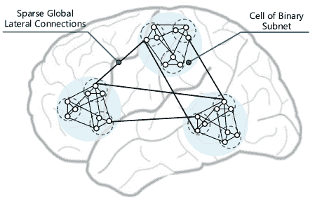

**图 5.1** 脑启发的细胞二进制神经网络（CBN-Net）示意图，该网络由多个二进制子网络单元组成。不同子网络单元之间通过可学习的稀疏全球侧向连接相连。

关于 BNNs 的研究。为降低量化误差，XNOR-Net [10] 提出引入通道缩放因子，而 DoReFa-Net [14] 则使用层缩放因子。Bireal-Net [15] 提出在 BNNs 中插入固定快捷连接。环形 BNN [16] 提出了一种卷积核多样性更高的循环卷积，增强了 BNNs 的表征能力。此外，ABC-Net [11]、BENN [13] 和 Group-Net [12] 均利用多个二进制基础模块或模型，以牺牲计算效率为代价提高分类精度。综上所述，二进制神经网络的性能逐渐提升；然而，由于模型容量降低，BNNs 与高精度深度神经网络 [17] 之间仍存在显著的性能差距。

在本章中，我们提出了一种旨在探索 BNN 最优网络结构以提高分类精度的另一种策略。如图 5.1 所示，所提出的细胞二进制神经网络（CBN-Net）具有三个受人脑启发的特性。首先，与由多个子网络 [18] 组成的人类视觉神经网络类似，CBN-Net 也是一种由多个子网络单元组成的层次网络。其次，研究表明，大脑皮层中不同的神经子网络由稀疏的全球侧向树突连接 [19]。同样，CBN-Net 的不同子网络通过按源神经元不同层分组的稀疏全球侧向连接相连。第三，与现有的具有固定网络结构的 BNNs 不同，CBN-Net 中侧向连接的结构如同人脑一样是可学习的 [20]。（参见图 5.2。）

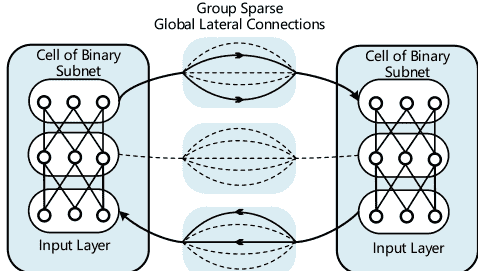

**图 5.2** 所提 CBN-Net 的一个玩具示例，由两个具有二进制权重和激活值的前馈子网络单元组成。假设不同子网络间水平层之间的通道全局连接为组稀疏，因此只有小比例的层和神经元通道在侧向连接。虚线表示已移除的稀疏连接。

## 5.2 二进制神经网络基础

对于大多数二进制神经网络，卷积层中的权重和输入使用 sign 函数进行二值化。我们将卷积滤波器表示为 \(\mathbf{W} \in \mathbb{R}^{c_{out} \times c_{in} \times r \times r}\)，其中 \(c_{out}\) 是滤波器数量，\(c_{in}\) 是输入通道数，\(r\) 是滤波器大小。权重二值化过程为 \(\mathbf{B}_w = \text{sign}(\mathbf{W})\)，其中 \(\mathbf{B}_w \in \{+1, -1\}^{c_{out} \times c_{in} \times r \times r}\) 表示二进制权重，\(\text{sign}(\cdot)\) 对正输入生成 \(+1\)，对负输入生成 \(-1\)。为了将卷积神经网络约束为具有二进制权重，我们使用二值滤波器 \(\mathbf{B}_w\) 和缩放因子 \(\alpha \in \mathbb{R}\) 来估计实值权重滤波器 \(\mathbf{W}\)，使得 \(\mathbf{W} \approx \alpha \mathbf{B}_w\)。\(\mathbf{X}\) 和 \(\mathbf{W}\) 的卷积操作 (*) 可近似为

\(\mathbf{X} * \mathbf{W} \approx (\mathbf{X} \oplus \mathbf{B}_w)\alpha, \tag{5.1}\)

其中 \(\oplus\) 表示不含任何乘法的卷积。由于权重值为二进制，我们可以通过加法和减法实现卷积。与单精度滤波器相比，二进制权重滤波器将内存使用量降低了 \(32\times\)。为估计二进制权重 \(\mathbf{B}_w\)，我们假设 \(\mathbf{W}\) 和 \(\mathbf{B}_w\) 是 \(\mathbb{R}^n\) 中的向量，其中 \(n = c \times r \times r\)。为寻找 \(\mathbf{W} \approx \alpha \mathbf{B}_w\) 的最优估计，我们求解以下优化问题：

$$\mathcal{L}(\mathbf{B}_w, \alpha) = ||\mathbf{W} - \alpha \mathbf{B}_w||^2,\quad \alpha^*, \mathbf{B}_w^* = \arg \min_{\alpha, \mathbf{B}_w} \mathcal{L}(\mathbf{B}_w, \alpha).$$ (5.2)

展开 Eq. (5.2)，得到以下方程：

$$\mathcal{L}(\mathbf{B}_w, \alpha) = \alpha^2 \mathbf{B}_w^T \mathbf{B}_w - 2\alpha \mathbf{W}^T \mathbf{B}_w + \mathbf{W}^T \mathbf{W}.$$ (5.3)

由于 \(\mathbf{B}_w \in \{+1, -1\}^n\)，\(\mathbf{B}_w^T \mathbf{B}_w = n\) 是常数，而 \(\mathbf{W}^T \mathbf{W}\) 也是常数，因为 \(\mathbf{W}\) 是已知变量。令 \(c = \mathbf{W}^T \mathbf{W}\)。现在我们可以将 Eq. (5.3) 改写为 \(\mathcal{L}(\mathbf{B}_w, \alpha) = \alpha^2 n - 2\alpha \mathbf{W}^T \mathbf{B}_w + c\)。\(\mathbf{B}_w\) 的最优解可通过最大化以下受约束优化问题得到（注意，Eq. (5.2) 中 \(\alpha\) 为正值，因此在最大化时可忽略）：

$$\mathbf{B}_w^* = \arg \max_{\mathbf{B}_w} \{ \mathbf{W}^T \mathbf{B}_w \} \quad \text{s.t. } \mathbf{B}_w \in \{+1, -1\}^n.$$ (5.4)

该优化问题可通过令 \(W_i \ge 0\) 时 \(\mathbf{B}_i = +1\)、\(W_i < 0\) 时 \(\mathbf{B}_i = -1\) 来求解，因此最优解为 \(\mathbf{B}_w^* = \text{sign}(\mathbf{W})\)。为求缩放因子 \(\alpha^*\) 的最优值，我们对 \(\mathcal{L}\) 关于 \(\alpha\) 求导并令其为零：

$$\alpha^* = \frac{\mathbf{W}^T \mathbf{B}_w^*}{n}.$$ (5.5)

将 \(\mathbf{B}_w^*\) 替换为 \(\text{sign}(\mathbf{W})\)，得到

$$\alpha^* = \frac{\mathbf{W}^T \text{sign}(\mathbf{W})}{n} = \frac{\sum |\mathbf{W}_i|}{n} = \frac{1}{n} ||\mathbf{W}||_1,$$ (5.6)

因此，二进制权重滤波器的最优估计可通过对权重值取符号简单实现。最优缩放因子为权重绝对值的平均值。

同一卷积层的输入特征图由 \(\mathbf{X} \in \mathbb{R}^{c_{in} \times h \times m}\) 表示，其中 \(c_{in}\) 是输入通道数，\(h\) 和 \(m\) 分别为特征图的高度和宽度。我们可以以类似方式对输入 \(\mathbf{X}\) 进行二值化，得到由 \(\mathbf{B}_x = \text{sign}(\mathbf{X})\) 表示的二值特征图。现在，我们拥有二进制权重和激活值，因此浮点运算可被高效的逻辑运算取代，即 XNOR-POPCOUNT 操作 $\otimes$ [10]:

$\mathbf{Y} = \alpha(\mathbf{B}_w \otimes \mathbf{B}_x),$

其中 $\mathbf{Y} \in \mathbb{R}^{c_{out} \times h \times m}$ 为二进制卷积层的输出，$\alpha$ 为缩放因子。在训练过程中，我们可以采用一种称为直通估计器（Straight Through Estimator, STE）的广泛使用的方法，通过 sign 函数反向传播梯度，如下所示：

$\frac{\partial \mathcal{L}}{\partial \mathbf{W}} \approx \text{clip}\left( \frac{\partial \mathcal{L}}{\partial \mathbf{B}_w}, -1, +1 \right),$

其中 clip 是分段线性函数 [21]，\(\mathcal{L}\) 是二进制神经网络的总损失函数，\(\mathbf{W}\) 在训练中作为待优化的隐式权重使用。

## 5.3 带侧向连接的细胞二进制神经网络

在本节中，我们详细介绍带侧向连接的细胞二进制神经网络，包括细胞二进制神经网络、组稀疏正则化、损失函数及训练过程。

### 5.3.1 细胞二进制神经网络

如图 5.3 所示，二进制神经网络的结构从使用单一流水线 [7] 演变为采用并行集成流水线 [13] 以实现更准确的分类。作为演化的第三步，所提 CBN-Net 试图探索连接不同子网络单元的最优侧向结构，以进一步提高二进制神经网络的分类精度。

形式上，CBN-Net 由多个二进制子网络组成，上标 $i$ 表示第 $i$ 个二进制子网络，上标 $j$ 表示第 $j$ 个二进制子网络，上标 $k$ 表示第 $k$ 个二进制层。对于第 $i$ 个子网络，我们用 $\mathbf{X}^{(i,k)}$ 表示第 $k$ 层的输入，用 $\mathbf{Y}^{(i,k)}$ 表示输出。第 $i$ 个子网络到第 $j$ 个子网络在第 $k$ 层的侧向连接包含通道权重 $\overline{W}^{(i,j,k)} = [\overline{W}_1^{(i,j,k)}, \overline{W}_2^{(i,j,k)}, \dots, \overline{W}_{c_{out}}^{(i,j,k)}]$，其中 $c_{out}$ 是通道数。

CBN-Net 利用受大脑启发的全球侧向连接，将特征水平传输到不同子网络。第 $i$ 个


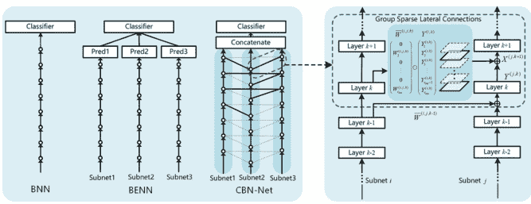

图 5.3 细胞式二元神经网络的架构。左侧子图对比了不同架构的二元神经网络。虚线方框内的 CBN-Net 横向连接在右侧放大显示。右侧子图说明了由组稀疏横向连接定义的通道逐点乘法操作。虚线连接为近零稀疏连接。

第 \((k+1)\) 层第 \(j\) 个子网的输入通道 \(\mathbf{X}_t^{(j,k+1)}\) 可能取决于不同子网第 \(k\) 层的第 \(t\) 个输出通道，如图 5.3 所示：

```
\(\mathbf{X}_t^{(j,k+1)} = \mathbf{Y}_t^{(j,k)} + \sum_i^{i \neq j} \overline{W}_t^{(i,j,k)} \mathbf{Y}_t^{(i,k)}, \quad (5.9)\)
```

其中，矩阵 \(\mathbf{Y}_t^{(i,k)}\) 是输出张量 \(\mathbf{Y}^{(i,k)}\) 的第 \(t\) 个通道。通过加权横向连接，其他二元子网的输出特征可以丰富下一层的输入特征。

### 5.3.2 组稀疏正则化

值得注意的是，在图 5.3 中，受大脑启发的横向连接被假设为 *稀疏*。此外，由于深度神经网络中的不同层在图像分类任务中可能发挥不同作用，CBN-Net 的横向连接被假设相对于不同源层为 *分组* 的。组稀疏特性可以显著降低额外横向连接造成的计算复杂度。

为了提高二元神经网络的分类精度，CBN-Net 采用可学习的横向连接权重 \(\overline{\mathbf{W}}\)，并试图探索由横向连接权重描述的最佳路由路径。从技术上讲，采用基于 L21 范数的组稀疏正则化项：

\(\| \overline{\mathbf{W}} \|_{2,1} = \sum_{k=1}^{N} \sum_{i \neq j} \| \overline{W}^{(i,j,k)} \|_2,\)

其中，\(i\) 和 \(j\) 表示二元子网的索引，\(N\) 是二元卷积层的总数。

根据 Eq. (5.10)，与同一源层关联的所有横向连接权重被视为一组；因此，通过正则化最小化 Eq. (5.10)，CBN-Net 可以实现优化的组稀疏横向连接，其中连接层数和传输通道数均可显著减少。从技术上讲，Eq. (5.10) 被采用为正则化项并纳入损失函数。在训练过程中，通过最小化损失函数，可以剪除具有近零权重的冗余横向连接，从而提高计算和内存效率。

### 5.3.3 损失函数

将全精度深度神经网络二值化的一个挑战是低精度量化引起的输出分布偏移。为应对这一挑战，我们提出利用知识蒸馏（Knowledge Distillation，KD）[5]，该方法使用全精度基线 *教师* 模型来帮助训练 *学生* 二元神经网络。更具体地说，为了优化 CBN-Net 的横向连接，教师模型与学生模型之间的输出分布差异表述为以下损失函数：

\(\mathcal{L}_{\text{KD}} = \rho \mathcal{L}_{\text{KL}}(\widehat{\mathbf{Y}}^{s_\theta}, \widehat{\mathbf{Y}}^{t_\theta}) + (1 - \rho) \mathcal{L}_{\text{CE}}(\widehat{\mathbf{Y}}^{s_\theta}, \mathbf{Y}^g),\)

其中，\(\widehat{\mathbf{Y}}^{s_\theta}\) 和 \(\widehat{\mathbf{Y}}^{t_\theta}\) 分别是由学生模型 \(s_\theta\) 和教师模型 \(t_\theta\) 生成的软标签，\(Y^g\) 是真实标签，\(\rho\) 是软比率，用于控制这两个损失之间的权重。从技术上讲，我们的研究使用 Kullback–Leibler (KL) 散度来定义第一个损失 \(\mathcal{L}_{\text{KL}}\)，并使用交叉熵（Cross-Entropy，CE）来定义第二个损失 \(\mathcal{L}_{\text{CE}}\)。在详细编写 \(\mathcal{L}_{\text{KD}}\) 之前，我们首先定义深度神经网络的 softmax 输出为

\(\hat{p}_d = \frac{e^{\hat{y}_d/T}}{\sum_{d=1}^D e^{\hat{y}_d/T}},\)

其中，温度 \(T\) 用于软化概率，\(d\) 是类索引，\(D\) 是类的总数。假设 \(\hat{p}_d^{t_g} \in \mathbb{R}\) 和 \(\hat{p}_d^{s_g} \in \mathbb{R}\) 分别是教师模型和学生模型在第 \(d\) 类的 softmax 输出，\(p_d^{s_g} \in \mathbb{R}\) 是当 \(T=1\) 时 \(\hat{p}_d^{s_g}\) 的特例。给定一张输入图像，\(\mathcal{L}_{\text{KD}}\) 的总损失函数可写为

```
\(\mathcal{L}_{\text{KD}} = \rho T^2 \sum_{d=1}^D (\hat{p}_d^{t_g} \log \frac{\hat{p}_d^{t_g}}{\hat{p}_d^{s_g}}) - (1 - \rho) \sum_{d=1}^D y_d^g \log p_d^{s_g},\) (5.13)
```

其中，\( y_d^g \) 是真实标签向量的第 \( d \) 个元素。如 [5] 所建议，我们将 Eq. (5.13) 中的第一个损失乘以 \( T^2 \)，以在学习过程中保持这两个损失函数的影响处于同一水平。

值得注意的是，我们仅优化学生网络中的参数，而教师网络的参数在训练期间固定，因此 Eq. (5.13) 中包含教师模型的项 \( \rho T^2 \sum_{d=1}^D \hat{p}_d^{t_g} \log \hat{p}_d^{t_g} \) 可以在反向传播阶段省略。最后，我们推导出知识蒸馏损失函数为

```
\(\mathcal{L}_{\text{KD}} = -\rho T^2 \sum_{d=1}^D \hat{p}_d^{t_g} \log \hat{p}_d^{s_g} - (1 - \rho) \sum_{d=1}^D y_d^g \log p_d^{s_g}.\) (5.14)
```

正如 Eq. (5.14) 所示，知识蒸馏由两个由软比率 \( \rho \) 平衡的交叉熵损失组成。将 Eq. (5.10) 中的组稀疏正则化项与知识蒸馏相结合，我们得出用于训练 CBN-Net 的最终损失函数如下：

```
\(\mathcal{L} = \mathcal{L}_{\text{KD}} + \gamma \left\| \overline{\mathbf{W}} \right\|_{2,1},\) (5.15)
```

其中，\( \gamma \) 是控制组稀疏横向连接稀疏度的超参数。

### 5.3.4 训练过程

对于反向学习过程，已有文献 [17] 报道了优化二元神经网络面临的挑战。正如 MeliusNet [22] 所声称的，更多的梯度流路径可能有助于二元模型更快收敛，我们认为横向连接构建的路径可能具有类似的能力。具体来说，第 \( k \) 层第 \( j \) 个子网通过的第 \( l \) 个输出通道的梯度

### Algorithm 5.1: 细胞式二元神经网络前向传播和反向传播过程的关键步骤。

- 1 Require: 教师模型 t<sub>g</sub>，损失函数 L，软比率 ρ，正则化系数 γ，温度 T，学习率 η。
- 1: **前向传播：**
- 2: 对于每个子网 j 和层 k，获取输出：**Y**<sup>(j,k)</sup> (Eq. (5.7)) 并计算下一层的输入：**X**<sup>(j,k+1)</sup> (Eq. (5.9))；
- 3: 计算包含知识蒸馏和正则化项的损失函数：L = L<sub>KD</sub> + γ || W ||<sub>2,1</sub> (Eq. (5.15))。
- 4: **反向传播：**
- 5: 对于每个子网 j 和层 k，计算 W<sup>(j,k)</sup> 的梯度：∂L/∂W<sup>(j,k)</sup> (Eqs. (5.8) 和 (5.17))；
- 6: 对于每个子网对 i,j 和层 k，计算 W<sup>(i,j,k)</sup> 的梯度：∂L/∂W<sup>(i,j,k)</sup> (Eq. (5.18))。
- 7: **参数更新：**
- 8: 更新学生模型的参数：W<sup>(j,k)</sup> ← W<sup>(j,k)</sup> - η ∂L/∂W<sup>(j,k)</sup>, W<sup>(i,j,k)</sup> ← W<sup>(i,j,k)</sup> - η ∂L/∂W<sup>(i,j,k)</sup>。

定义如下：

```
\frac{\partial \mathcal{L}}{\partial y_t^{(j,k)}} = \frac{\partial \mathcal{L}}{\partial x_t^{(j,k+1)}} \frac{\partial x_t^{(j,k+1)}}{\partial y_t^{(j,k)}} + \sum_{i}^{i \neq j} \frac{\partial \mathcal{L}}{\partial x_t^{(i,k+1)}} \frac{\partial x_t^{(i,k+1)}}{\partial y_t^{(j,k)}}, (5.16)
```

其中，\( y_t^{(j,k)} \) 是 \( Y_t^{(j,k)} \) 的元素。我们可以观察到，输出特征 \( y_t^{(j,k)} \) 的梯度由来自自身子网和其他子网的反向梯度组成。然后，我们将 Eq. (5.9) 带入 Eq. (5.16)，最终反向梯度计算形式可重写为

```
\frac{\partial \mathcal{L}}{\partial y_t^{(j,k)}} = \frac{\partial \mathcal{L}}{\partial x_t^{(j,k+1)}} + \sum_{i}^{i \neq j} \overline{W_t}^{(i,j,k)} \frac{\partial \mathcal{L}}{\partial x_t^{(i,k+1)}}, (5.17)
```

其中，\( y_t^{(j,k)} \) 的梯度是其自身梯度与来自其他子网的加权梯度之和。

CBN-Net 试图探索由通道权重 \( \overline{W_t}^{(i,j,k)} \) 定义的最优横向结构，以提高分类精度。为了


估计与横向连接相关的最优权重 $\overline{W}_t^{(i,j,k)}$，从技术角度看，其梯度可按以下方式计算：

\[
\frac{\partial \mathcal{L}}{\partial \overline{W}_t^{(i,j,k)}} = \sum_{x_t^{(j,k+1)}} \frac{\partial \mathcal{L}}{\partial x_t^{(j,k+1)}} \frac{\partial x_t^{(j,k+1)}}{\partial \overline{W}_t^{(i,j,k)}}, \quad (5.18)
\]

其中，对第 $t$ 个通道的所有条目求和 $\sum_{x_t^{(j,k+1)}}$，第二项可通过公式 (5.9) 计算得到。我们方法的训练过程关键步骤如算法 5.1 所示。借助这种新型二进制网络结构，我们可以端到端地训练出高度准确的二进制神经网络。

## 5.4 应用于高效图像分类

在本节中，我们在两个基准数据集 CIFAR-10 [23] 和 ILSVRC12 ImageNet [24] 上对所提出的 CBN-Net 进行了实验。同时，将其分类性能与其他最先进的二进制神经网络进行了比较。

### 5.4.1 数据集与实验设置

**CIFAR-10.** CIFAR-10 数据集 [23] 包含 60,000 张 32×32 RGB 彩色图像，共有 10 个类别，每个类别 6000 张图像。其中 50,000 张图像用于训练，10,000 张图像用于测试模型性能。与以往工作类似，我们采用了包括随机裁剪和翻转在内的数据增强策略，并在训练集和测试集上都应用了张量归一化。

**ImageNet.** ILSVRC 2012 ImageNet [24] 是一个大规模数据集，包含 1000 个类别，包括 120 万张高分辨率自然图像用于训练，50k 张图像用于测试。训练期间应用了最常用的数据增强策略，如随机裁剪、翻转和 PCA 噪声。测试时，我们在 224 × 224 中心裁剪的测试图像上报告了评估结果。

**实现细节.** 所有实验均使用 PyTorch [25] 实现，并在一台配备 4 块 NVIDIA RTX 2080Ti GPU 的单台计算机上进行。

对于 CIFAR-10 实验，我们选择 ResNet-20 作为基准模型。训练阶段，初始学习率为 0.1，批量大小为 128。动量为 0.9 的 SGD 优化器被用作基础优化器，权重衰减设为 $1 \times 10^{-4}$，并采用余弦退火调度器来调整学习率。知识蒸馏所用的教师模型使用了两个带有横向连接的 ResNet-20 子网。

对于 ImageNet 实验，我们选择 ResNet-18 作为基准模型，并使用 ResNet-50 作为知识蒸馏的教师模型。考虑到计算资源有限，我们只使用了两个子网来构建 CBN-Net。采用动量为 0.9 的 SGD 优化器，批量大小为 256，权重衰减设为 0。我们使用预训练的二进制 ResNet-18 初始化 CBN-Net 中的每个子网，并对整个模型进行了 45 个时代的微调。初始学习率设为 0.01，并分别在第 15 个和第 30 个时代乘以 0.1。

### 5.4.2 消融测试

在 CIFAR-10 数据集上进行了一组消融测试实验，以评估所提 CBN-Net 的有效性。我们将二进制 Bireal-Net 作为基准模型，该模型基于 ResNet-20 骨干网络。我们设置软比率 \(\rho = 0.99\) 和温度 \(T = 5\)，并将所有模型训练了 400 个时代。

**无横向连接的退化 CBN-Net:** 首先，我们将具有一个单一前馈流水线的基准模型扩展为包含 \(K\) 个子网的退化版 CBN-Net。无横向连接且无知识蒸馏的退化 CBN-Net (NLC&NKD) 以端到端的方式进行训练。图 5.4 比较了全精度 (FP) 模型、二进制基准模型、二进制集成神经网络和 CBN-Net (NLC&NKD) 的平均准确率。当子网数量从 2 变化到 6 时，退化 CBN-Net (NLC&NKD) 取得了 86.87% ~ 88.60% 的平均准确率，始终优于对比方法；然而，与全精度模型相比，准确率仍下降了约 3%。

**知识蒸馏的有效性:** 其次，通过采用知识蒸馏损失函数，我们改进了带有两个子网的退化 CBN-Net，并评估了 CBN-Net (NLC&KD)，其中超参数 \(\rho\) 设为 0.99，$T$ 设为 5。知识蒸馏所用的教师模型使用了两个带有横向连接的 ResNet-20 子网。图 5.5 比较了 CBN-Net (NLC&NKD) 和带有知识蒸馏的 CBN-Net (NLC&KD) 的准确率增长曲线。

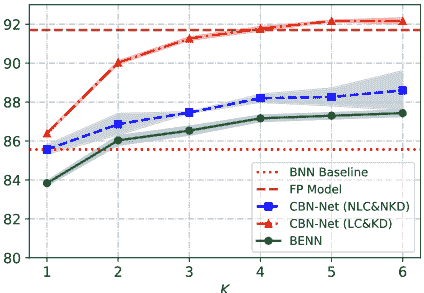

图 5.4 二进制神经网络基准模型、无横向连接且无知识蒸馏的退化 CBN-Net (NLC&NKD)、BENN、CBN-Net (LC&KD) 以及全精度模型在 CIFAR-10 数据集上随子网数量 K 的变化准确率。

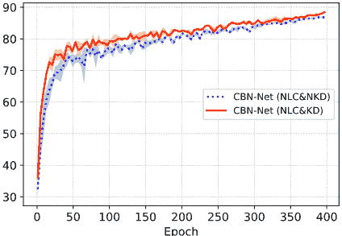

图 5.5 无横向连接但带有知识蒸馏的退化 CBN-Net (NLC&NKD) 和 CBN-Net (NLC&KD) 在 CIFAR-10 数据集上的准确率。

CBN-Net (NLC&KD) 受益于教师模型提供的信息丰富的监督信号，在训练过程中与 CBN-Net (NLC&NKD) 相比，验证准确率提高了约 1%。

如表 5.1 所示，CBN-Net (NLC&KD) 在 CIFAR-10 数据集上取得了 88.53% 的平均准确率，比退化 CBN-Net (NLC&NKD) 的平均准确率提高了 1.32%。

**横向连接的有效性:** 第三，我们通过在两个二进制子网之间引入横向连接，进一步改进了退化 CBN-Net，

| 方法 | K | \(\gamma\) | \(\rho\) | Acc(%) |
| :--- | :--- | :--- | :--- | :--- |
| FP 模型 | - | - | - | 91.7 (最佳) |
| BNN 基准模型 | 1 | - | - | 85.55 (85.48±0.10) |
| CBN-Net (NLC&NKD) | 2 | 0 | 0 | 87.36 (87.21±0.12) |
| CBN-Net (NLC&KD) | 2 | 0 | 0.99 | 88.73 (88.53±0.14) |
| CBN-Net (LC&KD) | 2 | 10^{-4} | 0.99 | 90.14 (90.05±0.09) |
| CBN-Net (LC&KD) | 5 | 10^{-4} | 0.99 | **92.21** (92.19±0.01) |

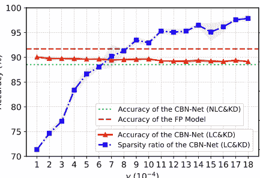

图 5.6 随正则化系数 \(\gamma\) 变化的 CIFAR-10 数据集上兼具横向连接和知识蒸馏的 CBN-Net (LC&KD) 的准确率和稀疏比率。

以构建所提的 CBN-Net (LC&KD)。图 5.6 展示了具有不同正则化系数 \(\gamma\) 的 CBN-Net (LC&KD) 的稀疏比率和验证准确率，其中稀疏比率表示近乎为零的横向权重所占横向连接的比例。当 \(\gamma\) 从 \(1.0 \times 10^{-4}$ 变化到 \(1.8 \times 10^{-3}$ 时，横向连接的平均稀疏比率从 0% 增加到 89.83%；然而，模型的平均准确率几乎保持在 90% 不变，这意味着对于精确分类，大约超过 80% 的横向连接是冗余的。此外，可以看出，当正则化系数 \(\gamma\) 甚至大于 \(1.8 \times 10^{-3}$ 时，CBN-Net (LC&KD) 可能退化为 CBN-Net (NLC&KD)，这意味着在学习过程中所有横向连接都被剪除了。

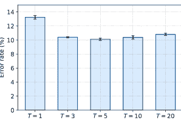

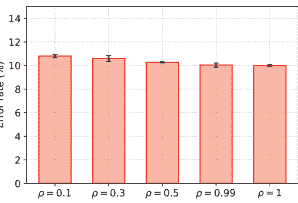

图 5.7 (a) 当 \(\rho = 0.99$ 时，CBN-Net (LC&KD) 随不同温度 \( T \) 变化的误差率。(b) 当 \( T = 5 \) 时，CBN-Net (LC&KD) 随不同软比率 \( \rho \) 变化的误差率。

尽管 CBN-Net 通过知识蒸馏从全精度模型学习，但令人惊讶的是，当添加少量更多子网时，它可以超越全精度基准模型。如图 5.4 所示，当 \( K \) 大于 4 时，CBN-Net (LC&KD) 的平均准确率超过了全精度 ResNet-20。详细结果见表 5.1；带有五个子网的 CBN-Net (LC&KD) 取得了 92.19% 的平均准确率，高于全精度 ResNet-20 (91.7%)。

**超参数分析:** 最后，我们评估了带有两个子网以及不同软比率 \(\rho\) 和温度 \(T\) 超参数的 CBN-Net (LC&KD)。在这些实验中，我们固定了正则化系数 \(\gamma = 1.0 \times 10^{-4}\)。

如图 5.7 所示，我们首先固定 \(\rho = 0.99$ 并将 \( T \) 在 1 到 20 的范围内进行调谐，以观察 \( T \) 的影响。当 \( T = 5 \) 时，获得了最低平均误差率 10.08%，这减少了由二进制量化引起的输出分布偏移。当 \( T = 1 \) 时，获得了最高平均误差率，这表明软化的概率对于 BNN 中的知识蒸馏是有用的。

另一方面，我们固定 \( T \) 为 5 并将 \(\rho\) 在 0.1 到 1.0 的范围内进行调谐，以分析 \(\rho\) 的影响。当 \(\rho = 0.1$ 时，获得了最高误差率 10.80%，这意味着，潜在地，KL 损失比 CE 损失更重要。因此，我们建议使用较大的软比率值，例如 \(\rho = 0.99$，以获得更好的性能，这与 [26] 一致。

**与 CIFAR-10 上 SOTA 的比较:** 表 5.2 将 CBN-Net 与其他基于 ResNet-20 的最先进的二进制神经网络，如 DoReFa [14]、DSQ [27]、IR–Net [28]、RBNN [29] 进行了比较，


表 5.2 与 CIFAR-10 上 SOTA 方法的分类性能对比。我们对本方法的训练过程运行多次，并报告“最佳（均值±标准差）”准确率。

| 网络结构 | 方法 | W/A | 准确率(%) |
| :--- | :--- | :--- | :--- |
| ResNet20 | 全精度模型 | 32/32 | 91.7 (最佳) |
| | DoReFa | 1/1 | 79.3 (最佳) |
| | DSQ | 1/1 | 84.1 (最佳) |
| | IR-Net | 1/1 | 86.5 (最佳) |
| | RBNN | 1/1 | 87.8 (最佳) |
| | CBN-Net (K = 2) | 1/1 | 90.14 (90.05±0.09) |
| | **CBN-Net (K = 5)** | 1/1 | **92.21** (92.19±0.01) |
| VGG-Small | 全精度模型 | 32/32 | 91.7 (最佳) |
| | LAB | 1/1 | 87.7 (最佳) |
| | XNOR | 1/1 | 89.8 (最佳) |
| | BinaryNet | 1/1 | 89.9 (最佳) |
| | IR-Net | 1/1 | 90.4 (最佳) |
| | RBNN | 1/1 | 91.3 (最佳) |
| | **CBN-Net (K = 2)** | 1/1 | **92.97** (92.77±0.17) |

以及基于 VGG-Small 的 LAB [30]、XNOR、BinaryNet、IR-Net 和 RBNN。可以清楚地看到，所提 CBN-Net 以相对较大的优势超越了其他最新二元神经网络，并且在 ResNet-20 (92.21%) 和 VGG-Small (92.97%) 骨干网络上均优于全精度模型的分类准确率。

### 5.4.3 ImageNet 上的实验

我们在大规模 ImageNet 数据集上验证了所提方法。表 5.3 列出了其他最新二元神经网络，包括 BWN [10]、XNOR、BinaryNet、DoReFa-Net、HWGQ [31]、TBN [32]、量化网络 [33]、Bireal-Net、XNOR++ [34]、Bop [35]、IR-Net、RBNN、LNS [36] 和 ReActNet [37]。

表 5.3 中所有对比方法均基于同一骨干网络 ResNet-18 的相同二元配置。我们使用 ReActNet [37] 的预训练参数对 CBN-Net 进行初始化。如表 5.3 所示，所提 CBN-Net 的最佳 Top-1 准确率 (66.8%) 高于其他具有二元权重和激活的最新二元神经网络。有趣的是，发现 CBN-Net 甚至超越了一些量化模型，包括 HWGQ 和 TBN，这些模型采用了更高精度的表示。

表 5.3 ImageNet 数据集上与 SOTA 方法的准确率对比。"W" 和 "A" 分别指权重和激活的位宽。

| 方法 | 年份 | W/A | Top-1 |
| :--- | :--- | :--- | :--- |
| ResNet18 | 2016 | 32/32 | 69.6% |
| BWN | 2016 | 1/32 | 60.8% |
| BinaryNet | 2016 | 1/1 | 42.2% |
| DoReFa-Net | 2016 | 1/1 | 52.5% |
| XNOR-Net | 2016 | 1/1 | 51.2% |
| HWGQ | 2017 | 1/2 | 59.6% |
| TBN | 2018 | 1/2 | 55.6% |
| Bireal-Net | 2018 | 1/1 | 56.4% |
| XNOR++ | 2019 | 1/1 | 57.1% |
| 量化网络 | 2019 | 1/1 | 53.6% |
| Bop | 2019 | 1/1 | 54.2% |
| IR-Net | 2020 | 1/1 | 58.1% |
| LNS | 2020 | 1/1 | 59.4% |
| RBNN | 2020 | 1/1 | 59.9% |
| ReActNet | 2020 | 1/1 | 65.9% |
| **CBN-Net (K = 2)** | 2021 | 1/1 | **66.8%** |

### 5.4.4 复杂度分析

我们在 ImageNet 数据集上评估了所提 CBN-Net 的计算复杂度，并将其与其他二元神经网络进行了比较。表 5.4 列出了 ImageNet 数据集上 Top-1 准确率超过 60% 的最新二元神经网络，包括 ABC-Net、BENN、Group-Net 和环形二元神经网络 [16]。这些方法通常在效率和准确率之间进行权衡，并使用多个子网或二元矩阵基来减少分类准确率的下降。

计算复杂度通过总运算次数 (OPs) 进行衡量，OPs 由浮点运算和二元运算组成，我们采用了与 [37] 相同的 OPs 估计程序。总体而言，与这些方法相比，CBN-Net 的 Top-1 分类准确率提高了 1.8% 至 5.7%。此外，与最新二元神经网络相比，CBN-Net 在推理 OPs 方面是最高效的方法。值得注意的是，即使包含两个子网，由于其二元表示和二元运算，CBN-Net 仍比全精度网络高效 5.58× 至 8.62×。

表 5.4 ImageNet 数据集上与 SOTA 方法的复杂度对比。

| 方法 | 年份 | 权重位 × 数量 | 激活位 × 数量 | 存储 (Mbit) | OPs (MOPs) | Top-1 |
|---|---|---|---|---|---|---|
| ResNet-18 | 2016 | 32 | 32 | 374 | 1810 | 69.6% |
| ABC-Net | 2017 | 1 × 5 | 1 × 5 | 88.45 | 300.06 | 65.0% |
| BENN | 2019 | 1 × 6 | 1 × 6 | 201.94 | 983.91 | 61.1% |
| Group-Net | 2019 | 1 × 4 | 1 × 4 | 85.43 | 654.51 | 64.2% |
| 环形二元神经网络 | 2020 | 1 × 4 | 1 × 4 | 66.58 | 242.56 | 61.4% |
| CBN-Net (K = 2) | 2021 | 1 × 2 | 1 × 2 | 67.02 | 209.97 | 66.8% |

## References

- [1] S. Han, H. Mao, W.J. Dally, 深度压缩：通过剪枝、训练量化和 Huffman 编码压缩深度神经网络，载于：国际学习表征会议论文集，2015，第 1–14 页。
- [2] E.L. Denton, W. Zaremba, J. Bruna, Y. LeCun, R. Fergus, 利用卷积网络内的线性结构进行高效评估，载于：神经信息处理系统国际会议，2014，第 1269–1277 页。
- [3] X. Zhang, X. Zhou, M. Lin, J. Sun, ShuffleNet：一种用于移动设备的极高效卷积神经网络，载于：IEEE 计算机视觉与模式识别会议论文集，2018，第 6848–6856 页。
- [4] M. Tan, Q.V. Le, EfficientNet：重新思考卷积神经网络的模型缩放，arXiv:1905.11946 [abs]。
- [5] G. Hinton, O. Vinyals, J. Dean, 蒸馏神经网络中的知识，载于：国际神经信息处理系统会议论文集，2014，第 1–9 页。
- [6] S. Gupta, A. Agrawal, K. Gopalakrishnan, P. Narayanan, 有限数值精度下的深度学习，载于：国际机器学习会议论文集，2015，第 1737–1746 页。
- [7] I. Hubara, M. Courbariaux, D. Soudry, R. El-Yaniv, Y. Bengio, 二元化神经网络，载于：国际神经信息处理系统会议论文集，2016，第 4107–4115 页。
- [8] X. Zhou, K. Liu, C. Shi, H. Liu, J. Liu, 带位宽信息瓶颈的神经网络激活量化，arXiv:2006.05210 [abs]。
- [9] X. Zhou, Y. Peng, C. Long, F. Ren, C. Shi, MoNet3D：面向实时准确单目 3D 物体定位，载于：国际机器学习会议论文集，2020，第 11503–11512 页。
- [10] M. Rastegari, V. Ordonez, J. Redmon, A. Farhadi, XNOR-Net：使用二元卷积神经网络进行 ImageNet 分类，载于：欧洲计算机视觉会议论文集，2016，第 525–542 页。
- [11] X. Lin, C. Zhao, W. Pan, 迈向精确的二元卷积神经网络，载于：国际神经信息处理系统会议论文集，2017，第 345–353 页。
- [12] B. Zhuang, C. Shen, M. Tan, L. Liu, I. Reid, 用于精确图像分类和语义分割的结构化二元神经网络，载于：IEEE 计算机视觉与模式识别会议论文集，2019，第 413–422 页。
- [13] S. Zhu, X. Dong, H. Su, 二元集成神经网络：每个网络更多位，还是每个位更多网络？，载于：IEEE 计算机视觉与模式识别会议论文集，2019，第 4923–4932 页。
- [14] S. Zhou, Y. Wu, Z. Ni, X. Zhou, H. Wen, Y. Zou, DoReFa-Net：使用低位宽梯度训练低位宽卷积神经网络，arXiv:1606.06160 [abs]。
- [15] Z. Liu, B. Wu, W. Luo, X. Yang, W. Liu, K.-T. Cheng, Bi-real Net：通过改进的表示能力和高级训练算法增强 1-bit CNN 的性能，载于：欧洲计算机视觉会议论文集，2018，第 722–737 页。
- [16] C. Liu, W. Ding, X. Xia, B. Zhang, J. Gu, J. Liu, R. Ji, D. Doermann, 环形二元卷积网络：通过环形反向传播增强 1-bit DCNN 的性能，载于：IEEE 计算机视觉与模式识别会议论文集，2019，第 2691–2699 页。
- [17] H. Qin, R. Gong, X. Liu, X. Bai, J. Song, N. Sebe, 二元神经网络：一项综述，模式识别 105 (2020) 107281。


- [18] M. Wilms, S.B. Eickhoff, L. Hömke, C. Rottschy, M. Kujovic, K. Amunts, G.R. Fink, 人类视觉区域 V1、V2、V3d、V3v 和 V4(v) 的功能与细胞结构图谱比较, NeuroImage 49 (2) (2010) 1171-1179.

- [19] N. Milosevic, D. Ristanovic, 脊髓神经元树突分支的分形特性, Neuroscience Letters 396 (3) (2006) 172-176.

- [20] K. Friston, 大脑中的学习与推理, Neural Networks 16 (9) (2003) 1325-1352.

- [21] Y. Bengio, N. Leonard, A. Courville, 用于条件计算的随机神经元梯度估计或传播, arXiv:1308.3432 [abs].

- [22] J. Bethge, C. Bartz, H. Yang, Y. Chen, C. Meinel, MeliusNet：二进制神经网络能否达到 MobileNet 级别的精度?, arXiv:2001.05936 [abs].

- [23] A. Krizhevsky, G. Hinton, et al., 从微小图像中学习多层特征, 技术报告, 2009.

- [24] J. Deng, W. Dong, R. Socher, L.-J. Li, K. Li, L. Fei-Fei, ImageNet：大规模层次化图像数据库, 载于: IEEE 计算机视觉与模式识别会议论文集, 2009, 第 248-255 页.

- [25] A. Paszke, S. Gross, F. Massa, A. Lerer, J. Bradbury, G. Chanan, T. Killeen, Z. Lin, N. Gimelshein, L. Antiga, et al., PyTorch：一种命令式风格的高性能深度学习库, 载于: 神经信息处理系统国际会议论文集, 2019, 第 8026-8037 页.

- [26] G. Ji, Z. Zhu, 宽神经网络中的知识蒸馏：风险界、数据效率与不完美教师, arXiv:2010.10090 [abs].

- [27] R. Gong, X. Liu, S. Jiang, T. Li, P. Hu, J. Lin, F. Yu, J. Yan, 可微软量化：连接全精度与低位神经网络, 载于: IEEE 国际计算机视觉会议论文集, 2019, 第 4852-4861 页.

- [28] H. Qin, R. Gong, X. Liu, M. Shen, Z. Wei, F. Yu, J. Song, 面向精确二进制神经网络的前向和后向信息保留, 载于: IEEE 计算机视觉与模式识别会议论文集, 2020, 第 2250-2259 页.

- [29] M. Lin, R. Ji, Z. Xu, B. Zhang, Y. Wang, Y. Wu, F. Huang, C.-W. Lin, 旋转二进制神经网络, 载于: 神经信息处理系统国际会议论文集, 2020, 第 1-12 页.

- [30] L. Hou, Q. Yao, J.T. Kwok, 损耗感知的深度网络二值化, 载于: 表征学习国际会议论文集, 2016, 第 1-11 页.

- [31] Z. Cai, X. He, J. Sun, N. Vasconcelos, 基于半波高斯量化的低精度深度学习, 载于: IEEE 计算机视觉与模式识别会议论文集, 2017, 第 5918-5926 页.

- [32] D. Wan, F. Shen, L. Liu, F. Zhu, J. Qin, L. Shao, H. Tao Shen, TBN：具有三值输入和二值权重的卷积神经网络, 载于: 欧洲计算机视觉会议论文集, 2018, 第 315-332 页.

- [33] J. Yang, X. Shen, J. Xing, X. Tian, H. Li, B. Deng, J. Huang, X.-s. Hua, 量化网络, 载于: IEEE 计算机视觉与模式识别会议论文集, 2019, 第 7308-7316 页.

- [34] A. Bulat, G. Tzimiropoulos, XNOR-Net++：改进的二进制神经网络, 载于: 英国机器视觉会议论文集, 2019, 第 1-12 页.

- [35] K. Helwegen, J. Widdicombe, L. Geiger, Z. Liu, K.-T. Cheng, R. Nusselder, 潜在权重不存在：重新思考二值化神经网络优化, 载于: 神经信息处理系统国际会议论文集, 2019, 第 7533-7544 页.

- [36] K. Han, Y. Wang, Y. Xu, C. Xu, E. Wu, C. Xu, 通过带噪监督学习训练二进制神经网络, 载于: 机器学习国际会议论文集, 2020, 第 4017-4026 页.

- [37] Z. Liu, Z. Shen, M. Savvides, K.-T. Cheng, ReActNet：迈向具有广义化激活函数的精确二进制神经网络, 载于: 欧洲计算机视觉会议论文集, 2020.

# PART 3

## 架构优化

# 二进制神经网络计算架构

## 6.1 背景与挑战

本章基于我们的相关出版物 [1]。过去几年，卷积神经网络 (CNN) 的应用呈急剧增长，CNN 非常适合各种深度学习任务，尤其是计算机视觉 [2–4]。然而，由于高计算复杂度和大型网络模型大小的限制，它不能方便地部署在移动平台上。为克服这些问题，通过利用神经网络压缩技术，我们可以减小神经网络的大小并提高计算速度。作为压缩神经网络的极端解决方案，二进制神经网络 (BNN) 最早由 Courbariaux 和 Bengio [5] 于 2016 年提出。

BNN 将权重和激活都限制为 +1 和 –1，可以将传统全精度 CNN 的模型大小大幅减小 32×。它为低功耗和内存需求的硬件实现带来了极大便利。基于这些优势，已提出多种 BNN 硬件加速器。文献 [6] 中的一个 BNN 加速器开启了 BNN FPGA 加速的研究，并探索了一种 HLS 异构方法以最大化系统吞吐量。文献 [7] 提出了 FINN，这是一个使用灵活异构架构构建快速灵活 FPGA 加速器的框架。文献 [8] 提出了一个框架，作为第一个完全二值化神经网络加速器架构，其中所有层都被二值化。这些工作显示出非常有前景的性能和能效比。

然而，在他们的工作中，模型性能只能通过复杂的网络模型来保证，这导致了大的内存占用和功耗，并且缺乏对降低 BNN 硬件内存成本的更有前景的优化。在本章中，将 BNN 的集成技术引入硬件实现。基于袋装集成方法，介绍了袋装二进制神经网络加速器 (BBNA)，它是一个完全流水线的 BNN 加速器，带有用于聚合多个 BNN 以实现更好模型精度的袋装单元，即，一个较小的网络可以比远大于它的网络更准确。这意味着我们可以在内存受限的嵌入式设备上部署较小的网络模型，其精度与更大的模型相似，从而大幅节省内存。BBNA 设计了一个袋装处理单元 (PE) 以支持 BNN 的不同聚合方法。高度并行的处理单元具有灵活的数据流架构，适用于不同的特征图大小。BBNA 使用流水线来提高整体系统的数据吞吐量和处理速度。BBNA 基于 Stratix-V GXA7 FPGA 平台的 FPGA 原型实现。它可以在极低内存成本和功耗下实现高性能。最后，在 DE5-net 板上设计了一个基于 BBNA 的原型系统演示，以展示其实用性和可用性。

## 6.2 集成二进制神经计算模型

### 6.2.1 卷积神经网络

典型卷积神经网络 (CNN) [9] 的模型结构如图 6.1 所示。CNN 是一种具有可训练参数的多级结构，其中每一级的输入和输出由一组二维向量组成，称为特征图 (fmaps)。在 CNN 中，每个输出特征图 (ofmap) 代表从输入特征图 (ifmap) 提取的某些特征信息。通常，典型 CNN 的每一级结构依次由一个 CONV 或全连接 (FC) 层、一个批量归一化 (BN) 层、一个激活层，以及必要时的一个池化层组成。

CONV 层的输入和输出是一组特征图，每个特征图包含不同的特征信息，这些特征图使用一组训练过的滤波器，以步幅方式滑动窗口，在滤波器与 ifmap 对应位置的像素之间进行乘累加 (MAC) 操作来卷积 ifmaps。池化层可以

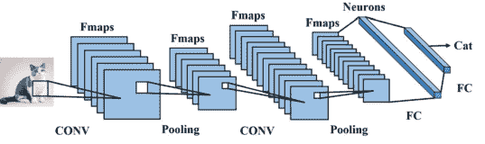

图 6.1 典型 CNN 的模型结构，始终包括输入、多个卷积 (CONV) 和池化层、全连接 (FC) 层以及输出。


被视为一种降低数据维度的下采样过程。全连接层（FC）在权重与通过展平方式从最终卷积层形成的一维向量之间执行线性变换。仅包含全连接层的网络通常称为多层感知机（MLP）。

卷积操作（CONV operation）后通常紧跟批量归一化操作（BN operation），它可以对每一层的输入分布进行归一化，从而缩短训练时间并提升网络的泛化能力。随后，激活函数紧接在 BN 之后，它通过 ReLU、sigmoid 等特殊函数为网络引入拟合非线性的能力。

### 6.2.2 二进制神经网络

复杂的 CNN 能够为困难的机器学习任务提取复杂的特征信息。尽管如此，网络模型越复杂，由于巨大的内存和功耗，将其部署到嵌入式移动设备上的难度就越大。二进制神经网络（BNN）是最极端的方案，它将权重和激活值均限制为 ±1，其量化方法实现为概率性或确定性符号函数 [5]。

为了在硬件上仅用 1 bit 存储权重，我们分别通过仿射变换将 −1 转换为 0，将 1 转换为 1，这可以将 MAC 操作转换为 XNOR 和 popcount 操作，即在权重与输入之间执行按位 XNOR，并统计 XNOR 操作后中间结果中 1 的个数。BNN 的卷积表达式为

\(\mathbf{Y} = \mathbf{B}_x \otimes \mathbf{B}_w + \mathbf{b},\quad (6.1)\)

其中 \(\otimes\) 表示 XNOR-POPCOUNT 操作，\(\mathbf{B}_x\) 是二进制输入，\(\mathbf{B}_w\) 是与该输入关联的二进制权重，\(\mathbf{b}\) 是神经元偏置。

BN 操作和二值化激活函数紧跟在卷积层之后。BNN [5] 的符号激活函数定义为

\(\mathbf{B}_y = sign(\mathbf{Y}) = \begin{cases} +1, & \mathbf{Y} \ge 0, \\ -1, & \mathbf{Y} < 0. \end{cases}\quad (6.2)\)

这意味着我们只需提取中间结果的符号位即可实现非线性激活。进一步，为了便于硬件实现，我们将 BN 和激活相结合，可以表示为

\(\mathbf{B}_y = \text{sign}(\mathbf{Y}_{bn}) = \text{sign} \left( \gamma \left( \frac{\mathbf{Y} - \mu}{\sigma} \right) + \beta \right), \quad (6.3)\)

其中 \(\mathbf{Y}_{bn}\) 表示根据 [10] 的 BN 层输出。等式 (6.3) 等价于以下表达式：

\(\mathbf{B}_y = \text{sign} \left( \frac{\gamma}{\sigma} \left( \mathbf{Y} + \left( - \mu + \frac{\sigma}{\gamma} \beta \right) \right) \right), \quad (6.4)\)

其中 \(\mu\) 和 \(\sigma\) 分别是每个小批量（即卷积层输出）的均值和标准差，\(\gamma\) 和 \(\beta\) 是可训练的缩放和平移因子。有趣的是，\(\gamma\) 和 \(\sigma\) 在推理阶段为正常数，因此我们只需在训练后计算整数偏置 \((-\mu + (\sigma/\gamma)\beta)\)，这样就只需使用加法器即可完成 BN 和激活操作。

### 6.2.3 集成二进制神经网络

得益于极低的算法复杂度和内存需求，BNN 为更多移动设备分享深度学习发展带来的红利开辟了新窗口。然而，1 位权重和激活值的 BNN 因其表征能力较弱，精度会出现严重下降。为提升模型性能，Zhu 等人 [11] 提出了二进制集成神经网络（BENN），它通过袋装法（bagging）和提升法（boosting）等集成学习方式，将多个单比特 BNN 聚合起来，以实现优于多比特量化网络的性能。BENN 还显著增强了原始弱 BNN 的内在稳定性和鲁棒性，这两者主要分别体现在训练精度的大幅波动和模型过拟合问题上。

袋装法已引入我们的硬件架构；带袋装法的 BNN 示意图如图 6.2 所示。为遵循袋装法的自助采样原理 [12]，每个 BNN 分类器的 \(M\) 个训练样本从总训练集 \(D\) 中有放回地随机采样，这些样本被假设为独立同分布样本。经过 \(K\) 次独立训练后，我们可以得到 \(K\) 个弱 BNN 分类器。在推理阶段，我们采用两种不同的投票机制

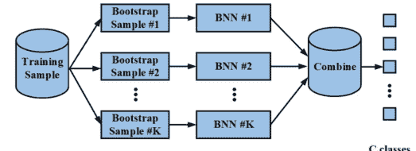

Figure 6.2 带袋装法的 BNN 示意图。基于不同训练样本训练 K 个独立的 BNN 分类器，得到 K 个弱分类器，然后将其组合以形成最终分类器。

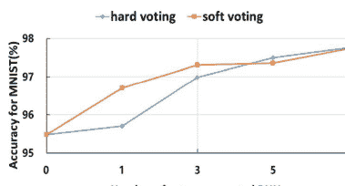

Figure 6.3 基于单个 BNN 并在更改额外聚合 BNN 数量时，64-128-128 BMLP 模型在 MNIST 上的精度。

以融合 $K$ 个 BNN 分类器的意见，从而获得最终分类标签。一种是硬投票，它选择大多数认同的标签作为最终标签；另一种是在对所有分类器的 softmax 概率取平均后选择最佳标签，这称为软投票。

我们在 64-128-128 袋装 MLP（BMLP）上评估了袋装法，这是一种用于 MNIST 手写数据集的三层全连接神经网络，除第一层有 64 个神经元外，每层均有 128 个神经元。我们就模型精度比较了不同聚合 BNN 数量下的两种投票方法。如图 6.3 所示，采用软投票的模型始终比硬投票更精确，当我们将额外聚合的 BNN 数量从 0 增加到 7 时，精度从 95.5% 提升到 97.7%。有趣的是，当我们将袋装法应用于其他一些模型时，情况恰恰相反，因此我们的硬件架构同时支持硬投票和软投票，以满足不同网络下的各种任务需求。

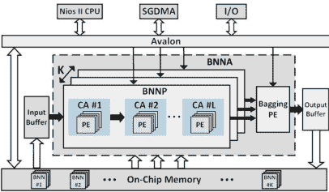

Figure 6.4 整体系统架构。

## 6.3 架构设计与优化

### 6.3.1 整体架构

如图 6.4 所示，BBNA 采用了基于数据流的架构，主要由 K 个独立的 BNN 流水线（BNNPs）和袋装处理单元（bagging PE）组成。每个 BNNP 执行一个集成 BNN 的操作。袋装处理单元负责在推理阶段聚合 K 个 BNNPs 的输出。考虑到资源利用率和功耗，我们通过多个并行 BNNPs 的聚合来实现袋装法，而不是复用单个 BNNP，后者会在每次推理时一次性从片上内存加载不同集成 BNN 的参数，并在所有推理完成后合并所有输出。

每个 BNNP 包含多个带有多个处理单元（PE）的计算阵列（CA）。每个 CA 专用于 BNN 对应的宏层，并通过高速 Avalon Streaming（Avalon-ST）总线级联。NIOS II 处理器用于灵活配置所有 CA 的架构，并通过 Avalon 存储器映射（Avalon-MM）接口对其进行控制。所有 BNN 的参数和中间结果存储在片上内存中，这可以消除片外内存访问，从而极大地降低功耗并提高吞吐量。

另一方面，挂载在 Avalon 总线上的 I/O 外设（例如，通用异步接收/发送器（UART））可帮助我们构建基于 BBNA 的原型系统。此外，我们可以利用散列-聚合 DMA（SGDMA） IP 核完成高速输入数据处理，将输入数据的格式转换为高速 I/O 设备所需的格式，同时也能提高 CPU 的工作效率。

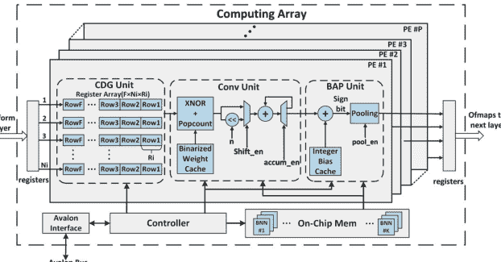

Figure 6.5 CA 和 PE 的框图。

### 6.3.2 计算阵列架构

CA 的内部框图如图 6.5 所示。在所有子模块之间采用了完全流水线的数据通路组织，以减少路径延迟并提高处理吞吐量。同时，我们的加速器具有多种用于实现通用性和可配置性的设计。每一层的计算由控制器控制，该控制器通过 Avalon 接口连接到 Avalon 总线。不同的 PE 以交替方式从上一层的输出寄存器缓冲区加载相同的 ifmaps，并计算每个独立通道的 ofmap，然后将中间结果写入寄存器缓冲区以供后续计算。

CA 的核心组件是多个高度并行的 P 个 PE 单元，负责 BNN 中 C/F 层的计算。PE 包含几个部分：计算数据生成器（CDG）单元、卷积（Conv）单元以及批量归一化、激活和池化（BAP）单元。CDG 单元用于缓存并生成后续 Conv 单元所需的计算数据。它由对应 ifmaps 通道的 Ni 个移位寄存器缓冲区组成，每个缓冲区包含长度为 Ri 的 F 行连续数据。为提高可重配置性，我们将 F 和 Ni 均设计为可配置参数，Ri 也可以根据每一层的 ifmap 大小进行配置。行数 F 通常等于卷积核的大小，因此如果采用流式架构，即每个时钟周期将像素数据推入寄存器缓冲区，那么我们


一旦 F 行 ifmaps 到达，每个时钟周期即可将数据获取到 Conv 单元。否则，如果架构不是流式的，则我们也可以从中间缓存中每个时钟周期加载 F 行 ifmaps。在这种情况下，我们可以进一步增加 \(R_i\) 以提高系统带宽。例如，在第一个周期中，当 \(F\) 为 3 且 ifmap 大小为 \(28 \times 28\) 时，我们可以将 \(R_i\) 设置为 56；计算前四行 ofmaps 需要前六行 ifmaps，因此与 \(R_i\) 为 28 时相比，带宽增加了一倍。对于 FC 层，我们只需将寄存器缓冲区展平为一维向量并将其馈入 Conv 单元。

BNN 将卷积的原始 MAC 操作映射为 XNOR 和 Popcount 操作。Popcount 操作依赖于 6 输入 3 输出的查找表（LUT），这非常适合 FPGA 资源。XNOR 和 Popcount 模块的结果用作随后移位器和累加器的输入。需要累加器，因为 PE 无法始终一次完成对任意网络模型的计算。此外，带有移位器和累加器的 PE 可以满足多位计算的情况，例如网络的第一层，这通常是多位 RGB 图像，因为移位器能够根据二进制的位权重实现 \(n\) 次移位。它也适用于采用各种位宽量化策略的其他神经网络。随后，BN 和二值化激活通过整数加法和提取符号位来完成。最后，激活输出流入池化单元，该单元将最大池化操作转换为布尔 OR 操作，因为激活值仅为 0 或 1。

### 6.3.3 装袋处理单元

装袋 PE 的架构如图 6.6 所示，由硬投票（HV）和软投票（SV）单元组成。HV 单元用于统计 C 个标签的各自投票数。Softmax 分类器有序地对 BNN 输出（记为 o1, ..., oc）进行分类以获得最佳标签，然后控制器激活相应标签的累加器。具体来说，为了避免得票相同的标签，累加器的输入是根据每个分类器的性能分配给它的权重，而不是 1。最后，比较器选择得票最多的标签作为最终标签，而 SV 单元则直接对 BNN 的原始输出进行操作，并计算每个标签在 \(K\) 次累加后的平均值。

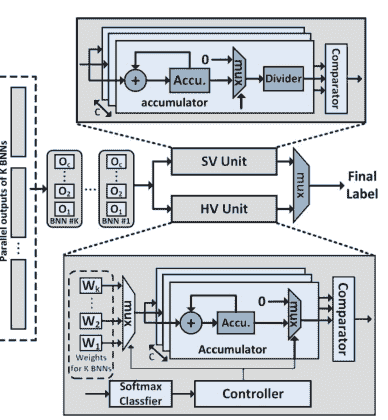

图 6.6 装袋 PE 的架构。

## 6.4 二进制计算架构的应用

### 6.4.1 实验设置

为了更好地评估 BBNA 架构，除了前面提到的 64-128-128 BMLP 网络外，我们还使用一个 BNNP 实现了一个不带装袋的小型二进制 CNN（BCNN），它有两个带有 32 和 64 个卷积滤波器的 CONV 层和一个具有 128 个神经元的 FC 层。所有 CONV 层都按 C-B-A-P（CONV、BN、激活、池化）顺序应用结构，并具有 5 × 5 滤波器。两种模型的基准均为 MNIST 手写数据集，包含 60 K 个 28 × 28 灰度图像用于训练和 10 K 个图像用于测试 [2]。我们在硬件上部署的 BBNA-BMLP 聚合了八个 BNNPs 并使用硬投票，它仅有 0.61 Mbit 参数和 1.22 M 次操作，并实现了 97.7% 的准确率。BBNA-BCNN 具有更复杂的网络，有 21.74 M 次操作和 0.45 Mbit 参数，并实现了超过 99.2% 的准确率。

我们在 DE5-net 板卡上使用 Intel Stratix-V GXA7 FPGA 实现了两种模型的 FPGA-based 原型。两种模型均使用 Verilog HDL 实现，并由 Intel Quartus Prime 17.1 进行综合、布局布线，并使用 TimeQuest Timing Analyzer 工具将系统时钟限制为 200 MHz。我们使用功率计来测量板卡的功耗。

### 6.4.2 性能评估与对比

如表 6.1 所示，我们将 BBNA 架构与两个常见平台和两个基于 FPGA 的 BNN 加速器进行了对比。两个常见平台为 Intel 8700K CPU 和 NVIDIA GTX 2080 Ti GPU，两者均在 MNIST 上运行与我们的 BBNA 相同的 LeNet 网络。随后，我们将架构与 FINN [7] 的 LFC-max 进行了对比，它是一个 1024-1024-1024 二值化 MLP，以及 FP-BNN [13] 的 MLP MNIST，后者具有相同的层数，但每层都有 2048 个神经元。

尽管功耗低一个数量级且时钟频率更低，BBNA-BCNN 相对于 CPU 和 GPU 仍分别实现了约 89× 和 1.4× 更好的性能。此外，其在 CPU 和 GPU 上的能效比分别提高了 620× 和 26×。

与 FINN [7] 的 LFC-max 相比，当我们都使用 MLP 模型时，我们的 BBNA-BMLP 节省了 79% 的内存占用，且准确率仅有微幅下降，这要归功于集成方法带来的模型性能改进，这对内存受限设备是一大利好。此外，我们的模型在能效上优于 FINN。

FP-BNN [13] 的 MLP MNIST 设计是使用高成本的 Stratix-V FPGA 平台实现的，这与我们的平台类似。在 MNIST 上准确率相近的情况下，我们的 BBNA-BMLP 实现了更好的性能，并显著节省了超过 94% 的内存成本。由于 CNN 具有更好的模型性能，BBNA-BCNN 拥有更高的准确率。此外，由于内存占用更低，我们的模型能效提高了约 1.9×。

### 6.4.3 原型系统演示

图 6.7 展示了我们的原型系统演示，该系统由 PC 主机计算机和 FPGA 从机计算机组成，两台计算机通过 RS-232 串行端口进行通信和数据传输。我们可以通过 PyQt5 框架实现的图形用户界面（GUI）向 FPGA 发送任意数量的 MNIST 图像。然后，NIOS II CPU 将这些图像转换为符合 Avalon-ST 协议的数据流，并将其发送到 BBNA 以加速计算。计算完成后，CPU 可通过中断提取结果并将其返回到 PC。此演示展示了我们设计的实用性和可用性。

**表 6.1 与其他 BNN 平台的对比。**

| 平台 | 设备 | 时钟 (MHz) | 数据集 | 准确率 (%) | 内存 (Mbit) | 性能 (GOPS) | 能效 (GOPS/W) |
|---|---|---|---|---|---|---|---|
| CPU | Intel i7-8700k | 3.7k | MNIST | 99.3 | - | 62 | 0.71 |
| GPU | Nvidia GTX2080 Ti | 1.35k | MNIST | 99.3 | - | 3861 | 17 |
| FINN [7] | Zynq XC7Z045 | 200 | MNIST | 98.4 | 2.9 | 9086 | 402 |
| FP-BNN [8] | Stratix-V 5GSGD8 | 150 | MNIST | 98.2 | 10.01 | 5905 | 225 |
| BBNA-BMLP | Stratix-V 5SGXMA7 | 200 | MNIST | 97.7 | 0.61 | 7373 | 424 |
| BBNA-Lenet | Stratix-V 5SGXMA7 | 200 | MNIST | 99.2 | 0.56 | 5546 | 430 |

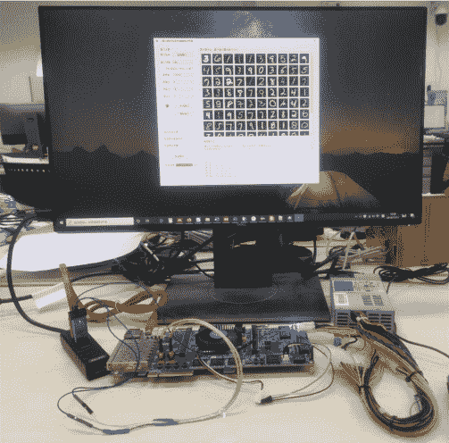

图 6.7 原型系统演示。

## 参考文献

- [1] S. Liang, Y. Lin, W. He, L. Zhang, M. Wu, X. Zhou, 一种节能的装袋二进制神经网络加速器，载于：IEEE 第 3 届电子技术国际会议论文集，2020，第 174–179 页。
- [2] Y. LeCun, L. Bottou, Y. Bengio, P. Haffner, 应用于文档识别的基于梯度的学习，IEEE 学报 86 (11) (1998) 2278–2324。
- [3] A. Krizhevsky, I. Sutskever, G.E. Hinton, 基于深度卷积神经网络的 ImageNet 分类，载于：神经信息处理系统国际会议论文集，第 25 卷，2012，第 1097–1105 页。
- [4] A. Loquercio, A.I. Maqueda, C.R. Del-Blanco, D. Scaramuzza, DroNet：通过驾驶学习飞行，IEEE 机器人与自动化期刊 3 (2) (2018) 1088–1095。
- [5] M. Courbariaux, I. Hubara, D. Soudry, R. El-Yaniv, Y. Bengio, 二值化神经网络：使用权重和激活受限于 +1 或 −1 的深度神经网络训练，arXiv:1602.02830 [abs]。
- [6] R. Zhao, W. Song, W. Zhang, T. Xing, J.-H. Lin, M. Srivastava, R. Gupta, Z. Zhang, 使用可软件编程的 FPGA 加速二值化卷积神经网络，载于：ACM/SIGDA 现场可编程门阵列国际研讨会论文集，2017，第 15–24 页。
- [7] Y. Umuroglu, N.J. Fraser, G. Gambardella, M. Blott, P. Leong, M. Jahre, K. Vissers, FINN：一种用于快速、可扩展二值化神经网络推理的框架，载于：ACM/SIGDA 现场可编程门阵列国际研讨会论文集，2017，第 65–74 页。


- [8] P. Guo, H. Ma, R. Chen, P. Li, S. Xie, D. Wang. FBNA：一种全二值化神经网络加速器，载于：现场可编程逻辑与应用国际会议论文集，2018，页 51–513.

- [9] W. Liu, Z. Wang, X. Liu, N. Zeng, Y. Liu, F.E. Alsaadi. 深度神经网络架构及其应用综述，Neurocomputing 234 (2017) 11–26.

- [10] H. Yonekawa, H. Nakahara. 基于片上存储器的二值化卷积深度神经网络及在FPGA上应用免批归一化技术，载于：IEEE国际并行与分布式处理研讨会论文集，2017，页 98–105.

- [11] S. Zhu, X. Dong, H. Su. 二值化集成神经网络：每个网络更多位还是每个位更多网络？，载于：IEEE计算机视觉与模式识别会议论文集，2019，页 4923–4932.

- [12] L. Breiman. Bagging预测器，Machine Learning 24 (2) (1996) 123–140.

- [13] S. Liang, S. Yin, L. Liu, W. Luk, S. Wei. FP-BNN：FPGA上的二值化神经网络，Neurocomputing 275 (2018) 1072–1086.

本页故意留空

# 稀疏二值化网络片上算法与硬件协同设计

## 7.1 背景与挑战

本章基于我们相关的出版物[1]。在过去几年中，深度神经网络在特征提取和模式识别方面展现了卓越性能[2–5]。然而，由于有限硬件资源与高计算性能需求之间的矛盾，为嵌入式实时应用实现大规模深度神经网络仍然是一项挑战[6]。例如，研究表明，非受监督的深度置信网络（Deep Belief Network, DBN）在高光谱遥感图像分类方面达到了最先进的精度[4]。然而，从技术角度将DBN部署用于实时处理遥感图像是不切实际的，因为卫星或无人机携带的嵌入式系统通常在存储空间、计算资源和功率预算方面受到限制。

前馈DBN的基本计算涉及连接权重与输入数据之间大量高精度乘法，可在强大计算机上使用中央处理器（Central Processing Unit, CPU）集群或通用图形处理器（General-Purpose Graphics Processing Unit, GPU）实现[7]。然而，当硬件中的内存和计算资源有限时，一种更高效的算法将是理想的选择，该算法专为高效硬件计算设计，仅需要简单的定点计算和远少得多的参数，从而允许使用片上系统（System on Chip, SoC）实现更大规模的网络以进行实时模式识别。

本章中，我们针对嵌入式实时图像分类中广泛应用的深度置信网络，提出了一种算法与硬件协同设计。为了实现高效的硬件实现，一个重要的算法考虑因素是神经连接的数量。经典深度置信网络中相邻层之间的神经元是全连接的（图7.1），导致高内存和计算复杂度[8]。第二个算法考虑因素是数据表示，这是精度与成本之间的必要权衡。研究表明，深度置信

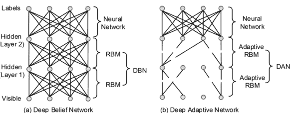

图7.1 用于模式识别应用的典型深度神经网络。深度置信网络的神经元在相邻层之间是全连接的，而在深度自适应网络中，大多数神经连接（零权重）可以被移除，保留的连接可以用单位整数表示，这对于硬件实现来说效率高得多。

采用有限精度参数训练的网络会遭受显著的精度损失[9–11]。为应对这些挑战，我们提出了一种名为深度自适应网络（Deep Adaptive Network, DAN）的高效训练算法，以探索神经连接的稀疏性。DAN自适应地将与可忽略神经元相关的连接权重值减为零（图7.2），并使用单位整数对保留连接的小部分进行稳健量化。设计了一种基于新型稀疏映射存储器（Sparse-Mapping-Memory, SMM）的架构，以将深度自适应网络集成到片上（Deep Adaptive Network on Chip, DANoC）。DANoC协处理器的特点总结如下。

- 存储高效：DAN算法移除了大多数神经连接。实验表明，在不降低分类精度的情况下，可移除超过80%的神经连接。保留的连接权重可以稳健量化并用单位整数表示。与单精度DBN相比，所提方法可将内存和计算资源减少高达99.9%。

- 功耗高效：高存储效率使得DANoC能够将所有参数保留在片上，并减少片上存储器与DANoC协处理器之间耗电量大的传输操作。此外，DANoC采用事件驱动架构，仅当输入可见单元为1时，计算核心才会被激活。

- 计算高效：单位表示使得DANoC能够用快速

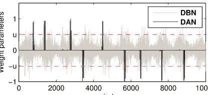

图7.2 使用MNIST数据集训练的DBN和DAN的连接权重。DAN权重是稀疏的，并分为三组，即零权重、正权重和负权重，从而得到稳健的阈值结果和单位表示（±1）。

- 可扩展且流水线化：DANoC硬件以三种方式具有灵活性和可扩展性。首先，多层稀疏神经核心可以串联为流水线，形成多层深度神经网络。其次，多个流水线集成在一个芯片上以实现并行加速。第三，稀疏神经核心的硬件实现经过优化，并设计为四级子流水线，适用于高吞吐应用。

通过算法与硬件优化，DANoC可实现每秒超过2000亿次有效运算的最先进性能，功耗低于2瓦。

我们的方法通过基于混合范数的正则化方法来探索神经连接的稀疏性。通过基于L1范数的正则化实现稀疏性是一种标准方法。一个著名的例子是Yuan和Lin提出的组lasso方法[12]。我们的方法可以被视为针对深度神经网络的组lasso扩展。不同于组lasso，我们的工作使用混合范数正则化来压缩权重参数，这使我们能够控制行稀疏性与列稀疏性之间的权衡，以实现最高压缩率。

其他尝试已被用于将稀疏性引入深度神经网络。Ranzato [13] 提出了一种深度编码器-解码器架构以学习稀疏表示。Lee [14] 开发了一种深度置信网络的变体，用于学习输入图像的稀疏表示，并发现所选稀疏特征具有与视觉区域V2相似的一些特性。Ji [15] 基于率-畸变理论提出了一种稀疏响应深度置信网络，该网络试图使用尽可能少的比特对原始数据进行编码。一般来说，这些研究关注输出激活的稀疏性；然而，出于为硬件实现学习高效架构的动机，我们的工作专注于探索神经连接的稀疏性。

先前的研究曾尝试将三值神经连接纳入传统神经网络[16,17]。最近，人们日益关注在算法层面为嵌入式应用压缩深度神经网络。例如，Han [18] 提出了一种两步训练流程，用于移除神经网络中的小连接权重。Chen [19] 使用哈希函数根据不同的权重值将神经连接分组到不同的哈希桶中。Han和Mao [20] 提出了一种三步方法，在深度神经网络的训练过程中对连接权重进行剪枝、量化和编码。Courbariaux [21] 提出了一种训练过程，以学习权重和激活值被约束为+1或−1的深度神经网络。Rastegari [22] 提出了一种二值化深度神经网络，在训练过程的每次迭代中对权重参数进行量化。一般来说，这些算法试图减少表示参数所需的比特数量，以牺牲分类精度为代价，实现了1.2到49倍的内存效率提升。

作为一种更高效的策略，DAN算法还允许将连接和激活值表示为单位整数。此外，DAN学习稀疏神经网络的最优架构，其中大多数神经连接被移除。Alvarez [23] 和Pan [24] 最近展示了类似的思想，他们提出了不同的正则化方法，在训练期间将深度网络中的神经元连接数量减少多达80%。Wen [25] 提出了一种结构化稀疏学习方法，从更大的深度神经网络中学习紧凑结构，并将计算成本降低了5.1倍。作为我们两步（正则化-量化）策略的结果，DAN硬件可以实现160到640倍的压缩率，同时仍能与最先进的方法相比实现具有竞争力的高精度。

由于深度学习方法的快速发展，实现专用硬件以加速神经网络计算的研究正在蓬勃发展。Himavathi和Byungik分别展示了使用现场可编程门阵列（Field Programmable Gate Array, FPGA）的数字实现[6,8,26]。Sanni [27] 展示了一种基于FPGA的深度置信


采用随机计算的网络。Zhang 等人 [28] 定量分析了卷积神经网络（CNN），并使用 FPGA 器件实现了量化 CNN。最近，Gokhale [29] 实现了一个基于 FPGA 的协处理器，用于加速移动应用中的深度神经网络。这些硬件设计与算法研究独立进行，通常为嵌入式实现采用不同的量化方法，这节省了内存占用，但导致分类精度显著下降。另一方面，所提出的 DANoC 系统从算法到硬件进行了优化，在不降低分类精度的情况下，硬件效率提高了三个数量级以上。

## 7.2 算法设计与优化

在本节中，我们介绍所提出的面向硬件的无监督深度学习算法。作为背景知识，我们首先介绍著名深度置信网络的训练算法。

### 7.2.1 深度置信网络与受限玻尔兹曼机

深度置信网络（DBN）通过堆叠多层受限玻尔兹曼机（RBM）构建，并将前一层 RBM 的输出作为下一层 RBM 的输入（图 7.1）。发现，高层 RBM 倾向于为分类编码信息性抽象。标准 RBM 由两层单元组成。首先，定义矩阵 \(\mathbf{W} \in \mathbb{R}^{n \times d}\) 作为连接权重，其中 \(w_{ij}\) 表示可见单元 \(v_i\) 与隐藏单元 \(h_j\) 之间的连接。其次，参数 \(b_j\) 和 \(c_i\) 分别为隐藏单元和可见单元的偏置。给定隐藏单元 \(\mathbf{h}\)、可见单元 \(\mathbf{v}\) 以及偏置 \(\mathbf{b}\) 和 \(\mathbf{c}\) 的向量形式，配置 \((\mathbf{v}, \mathbf{h})\) 的能量可表示为

$$
E(\mathbf{v}, \mathbf{h}) = -\mathbf{b}^{\mathbf{T}}\mathbf{h} - \mathbf{c}^{\mathbf{T}}\mathbf{v} - \mathbf{v}^{\mathbf{T}}\mathbf{Wh}.
$$

与一般玻尔兹曼机类似，隐藏和可见向量的概率分布定义为

$$
p(\mathbf{v}, \mathbf{h}) = \frac{1}{Z} e^{-E(\mathbf{v}, \mathbf{h})}, Z = \sum_{\mathbf{v}, \mathbf{h}} e^{-E(\mathbf{v}, \mathbf{h})}.
$$

根据公式 (7.2)，可见向量的边缘概率为

$p(\mathbf{v}) = \frac{1}{Z} \sum_{\mathbf{h}} e^{-E(\mathbf{v}, \mathbf{h})}.$ (7.3)

由于同一层中两个隐藏单元之间没有直接连接，因此条件于 **v** 的隐藏单元相互独立。同样，条件于 **h** 的可见单元也相互独立。条件于可见层的二进制隐藏层的单元是独立的伯努利随机变量。第 \(j\) 个隐藏单元的二进制状态 \(h_j\) 按以下概率设置为 1

$p(h_j = 1 | \mathbf{v}) = \delta(\sum_i w_{ij}v_i + b_j),$ (7.4)

其中 \(\delta(x) = 1/(1 + \exp(-x))\) 是 Sigmoid 激活函数。同样，如果可见单元是二进制的，那么条件于隐藏层的可见单元也是独立的伯努利随机变量。在这种情况下，第 \(i\) 个可见单元的二进制状态 \(v_i\) 按以下概率设置为 1

$p(v_i = 1 | \mathbf{h}) = \delta(\sum_j w_{ij}h_j + c_i).$ (7.5)

另一方面，如果可见单元具有实数值，那么条件于隐藏层的可见单元是独立的高斯随机变量，定义为

$p(v_i | \mathbf{h}) = \mathcal{G}(\sum_j w_{ij}h_j + c_i, 1),$ (7.6)

其中 \(\mathcal{G}\) 表示高斯分布。假设 \(\boldsymbol{\theta} = \{\mathbf{W}, \mathbf{b}, \mathbf{c}\}\) 是 RBM 的参数集。由于 RBM 是生成模型，可以通过对训练样本的对数似然进行随机梯度下降来计算参数 [30]。网络分配给样本 \(\mathbf{v}^{(k)}\) (\(k = 1, ..., K\)) 的概率通过对所有可能的隐藏向量求和给出

$\arg \min_{\boldsymbol{\theta}} - \sum_k \log( \sum_{\mathbf{h}} e^{-E(\mathbf{v}^{(k)}, \mathbf{h}^{(k)})} ).$ (7.7)

通过求解公式 (7.7)，可以离线计算参数并用其配置 RBM。训练 RBM 后，可以通过以逐层方式训练的多层 RBM 堆叠构建 DBN。

### 7.2.2 自适应受限玻尔兹曼机

为了高效的硬件实现，提出了一种稀疏加权的 RBM 变体，名为自适应 RBM（AdaRBM），它在公式 (7.7) 中添加了一个额外的正则化项以自适应地缩小权重。正则化基于定义的混合矩阵范数

$$
\|\mathbf{W}\|_M = \sum_i (\sum_j |w_{ij}|^2)^{1/2}, \quad (7.8)
$$

其中索引 \(i\) 和 \(j\) 被区别对待。很容易证明混合范数是合法的矩阵范数，并且它不同于标准的 L1 和 L2 矩阵范数，即 \(\|\mathbf{W}\|_{L_1} = \sum_i \sum_j |w_{ij}|\) 和 \(\|\mathbf{W}\|_{L_2} = (\sum_i \sum_j w_{ij}^2)^{1/2}.\)

公式 (7.8) 中定义的混合矩阵范数将矩阵中所有行的向量范数相加；因此，最小化混合范数会减小矩阵行的长度。值得注意的是，缩小过程并不均匀地应用于所有行。在随机梯度下降过程中，较短的行比权重较大的行缩小得更快。结果是，短行中的权重在有限次迭代后趋于缩小为零。同样，最小化转置矩阵 \(\mathbf{W}^T\) 的混合范数可以将较短列中的权重减小为零。为了实现最大压缩率，AdaRBM 试图通过最小化同时在较短行和列中缩小权重参数

$$
\mathcal{R}_s(\mathbf{W}) = \lambda (\gamma \|\mathbf{W}\|_M + (1-\gamma)\|\mathbf{W}^T\|_M), \quad (7.9)
$$

其中 \(\lambda\) 控制权重参数的稀疏性，\(\gamma\) 控制行稀疏性与列稀疏性之间的平衡。形式上，AdaRBM 训练算法试图通过将正则化项纳入公式 (7.7) 的标准 RBM 中来求解

$$
\underset{\theta}{\text{arg min}} - \sum_k \log (\sum_{\mathbf{h}} e^{-E(\mathbf{v}^{(k)}, \mathbf{h}^{(k)})}) + \lambda (\gamma \|\mathbf{W}\|_M + (1-\gamma)\|\mathbf{W}^T\|_M). \quad (7.10)
$$

### 7.2.3 训练算法

公式 (7.10) 的目标函数是对数似然项与正则化项之和。对数概率与

### **算法 7.1:** 自适应 RBM 的训练算法。

- 1: 给定 \(\langle v_i h_j \rangle_{\text{model}}\) 表示运行 Gibbs 链所定义的分布，参数可使用对比散度规则更新为
  $$w_{ij} \Leftarrow w_{ij} + \epsilon (\langle v_i h_j \rangle_{\text{data}} - \langle v_i h_j \rangle_{\text{model}})$$
  $$b_j \Leftarrow b_j + \epsilon (\langle h_j \rangle_{\text{data}} - \langle h_j \rangle_{\text{model}})$$
  $$c_i \Leftarrow c_i + \epsilon (\langle v_i \rangle_{\text{data}} - \langle v_i \rangle_{\text{model}}),$$
  其中 \(\epsilon\) 是学习率，\(\langle \cdot \rangle_{\text{model}}\) 是重构数据上的期望；

- 2: 使用 \(\mathcal{R}_s(\mathbf{W})\) 的梯度更新 \(w_{ij}\)，如下
  $$w_{ij} \Leftarrow w_{ij} - \lambda (\gamma \frac{w_{ij}}{\alpha + \sqrt{\sum_i w_{ij}^2}} + (1 - \gamma) \frac{w_{ij}}{\alpha + \sqrt{\sum_j w_{ij}^2}}),$$
  其中 \(\alpha\) 是一个小常数，用于避免分母为零。

- 3: 检查约束并重复更新过程，直到达到收敛。

正则化项关于参数的导数可以表示为

\(\frac{\partial \log p(\mathbf{v})}{\partial w_{ij}} = \langle v_i h_j \rangle_{\text{data}} - \langle v_i h_j \rangle_{\text{model}} + \frac{\partial \mathcal{R}_s(\mathbf{W})}{\partial w_{ij}}, \quad (7.11)\)

\(\frac{\partial \log p(\mathbf{v})}{\partial b_j} = \langle h_j \rangle_{\text{data}} - \langle h_j \rangle_{\text{model}}, \quad (7.12)\)

\(\frac{\partial \log p(\mathbf{v})}{\partial c_i} = \langle v_i \rangle_{\text{data}} - \langle v_i \rangle_{\text{model}}, \quad (7.13)\)

\(\frac{\partial \mathcal{R}_s(\mathbf{W})}{\partial w_{ij}} = \lambda (\gamma \frac{w_{ij}}{\sqrt{\sum_i w_{ij}^2}} + (1 - \gamma) \frac{w_{ij}}{\sqrt{\sum_j w_{ij}^2}}), \quad (7.14)\)

其中 \(\langle \cdot \rangle_p\) 表示分布 \(p\) 的期望。不幸的是，与 RBM 训练过程类似，上述方程无法求解，因为期望的计算非常困难；然而，我们


可以使用带有吉布斯采样的对比度差异（CD）以迭代方式逼近最优参数 [30]。在每次迭代中，我们应用对比度差异更新规则，随后按照算法 7.1 进行正则化项的一步梯度下降。根据公式 (7.14)，重量参数的收缩过程是不均匀的。经过几百次迭代后，短行和短列中的重量可以被减小到接近零，从而得到稀疏重量参数。值得注意的是，混合范数正则化在零点处不可微。在实践中，可以在分母中加入一个小常数，例如 \(\alpha = 0.01\)，以提高训练算法的鲁棒性。

与 DBN 类似，可以堆叠多层 AdaRBM 来构建 DAN，并且 DAN 也可以以逐层的方式进行训练。具体来说，我们可以在训练数据上使用 CD 训练底层 AdaRBM。在参数冻结并推断隐藏单元值后，这些推断值可以用作输入数据来训练网络的下一层。

由堆叠 AdaRBM 构建的深度自适应网络（Deep Adaptive Network）旨在实现高效的硬件实现。从技术上讲，AdaRBM 的参数通过四步过程离线计算，并用于配置 DANoC 硬件原型。

- 单精度稀疏参数根据算法 7.1 计算；
- 重量参数使用小正值 u 进行阈值处理，并移除绝对值较小的重量；
- 保留的正负重量分别表示为 +1 和 −1；
- 激活值使用零和一进行二值化。

### 7.2.4 深度自适应网络的特性

深度自适应网络学习了一种面向硬件的高效网络架构，具有两个特性。

- DAN 的神经连接是稀疏的。DAN 自适应地将与可忽略可见单元相关的连接权重减小到零，这些权重可以被移除以实现高效的硬件实现。

- DAN 隐藏单元的激活值是稀疏的。具体来说，在训练阶段，AdaRBM 使用 \(p(h_j = 1|\mathbf{v})\) 作为到下一层的第 \(j\) 个输出激活值。由于重量矩阵的短列被减小为零向量，与零列相关的输出激活值变得接近与可见单元无关的常数 \(\delta(b_j)\)。这一特性可能使下一层 AdaRBM 的连接权重更加稀疏。

## 7.3 近内存计算架构

DANoC 系统是一种基于现成 FPGA 器件构建的深度自适应网络的高效、高吞吐量和可扩展硬件原型。硬件的基本构建块是稀疏神经核心（Sparse Neural Core，SNC），其采用基于高效稀疏映射内存（Sparse-Mapping-Memory，SMM）的架构。图 7.4 展示了一个设计用于

| 可见单元 | 长度 | 起始地址 |
|---|---|---|
| 1 | 0 | - |
| 2 | 1 | 0x00 |
| 3 | 0 | - |
| 4 | 2 | 0x01 |
| 5 | 0 | - |
| 6 | 0 | - |
| 7 | 0 | - |
| 8 | 1 | 0x03 |
| 9 | 1 | 0x04 |
| 事件 | 地址映射表 | |

| 隐藏单元 | | 权重 | 组大小 |
|---|---|---|---|
| 0x00 | c | -1 | 2 |
| 0x01 | c | 1 | 1 |
| | g | 1 | 3 |
| 0x03 | d | -1 | 4 |
| 0x04 | h | 1 | 1 |
| | | 权重表 | |

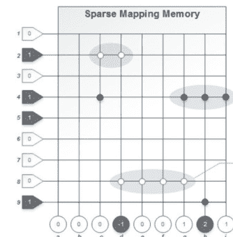

图例：
- 可见单元 1 激活
- 可见单元 2 未激活
- 神经元状态为 2 并产生尖峰
- 神经元状态为 1 并保持静态

图 7.4 稀疏神经核心中的稀疏映射内存（SMM）。每个 SMM 由两个表组成，用于维护组地址和非零重量组。

实现一个具有九个可见单元和九个隐藏单元的稀疏连接 AdaRBM。SMM 中的每个交叉点表示第 \(i\) 个可见单元（左侧）和第 \(j\) 个隐藏单元（下方）之间的连接权重 \(w_{ij}\)。从功能角度来看，每个核心的输入数据作为编码地址事件进行处理。当第 \(i\) 个可见单元为一时，地址事件 \(i\) 激活，这会触发查找操作；否则，地址事件 \(i\) 未激活，核心将检查下一个可见单元以寻找活跃的地址事件。在找到非零可见单元之前，不会触发任何查找操作。输入数据流中的零被省略，只有单元的一的尖峰才能激活核心。

第 \(i\) 个地址事件的查找操作包含三个步骤。首先，传入的事件激活地址映射表，该表读出起始地址 \(i\) 和重量组的长度。如果第 \(i\) 个可见单元未连接到任何隐藏单元，则核心继续检查下一个可见单元。其次，与可见单元 \(i\) 连接的所有隐藏单元的二进制权重从重量表中读出。然后，每个隐藏单元使用 \(w_{ij}\) 更新神经状态表中的状态值 \(s_j\)。当神经状态超过其阈值 \(b_j\) 时，神经元产生一个尖峰，其神经状态重置为 0；该尖峰随后被编码并作为地址事件发送到下一个稀疏神经核心。二进制表示使 DANoC 能够使用功率高效的阈值操作来实现 Sigmoid 激活函数。

AdaRBM 的权重衰减优化导致行方向和列方向上的稀疏权重矩阵。SNC 的硬件设计利用二维稀疏性来提高硬件效率。由于 SNC 仅在存在与给定可见单元相关的连接时才激活查找操作，行方向稀疏性使 DANoC 能够通过忽略大部分其关联连接已全部移除的可见单元来节省时间和功率。另一方面，列方向稀疏性使行中的非零权重聚合在一起。因此，稀疏映射内存的重量表可以通过按组保存和读取权重来减少内存消耗和计算时间。

DANoC 协处理器的框图如图 7.5 所示。片上系统包含三个主要组件：两个主机 ARM Cortex A9 处理器、一个协处理器和一个外部内存控制器。协处理器由一系列流水线稀疏神经核心和一个控制模块组成。DANoC 中可以并行实现多个深度神经网络流水线。每个流水线包含多个级联的稀疏神经核心，每个核心可以配置为 AdaRBM 层或分类器层。DANoC 使用各自的片上块 RAM 来实现地址映射表、重量表、神经状态表和阈值表。这些块 RAM 的访问被协调为四阶段子流水线以最大化吞吐量。

DANoC 芯片的内存复杂度主要由重量表的大小决定，其与 n × d × σ × log(s)/s 成正比，其中 n × d 是权重矩阵的大小，σ 是保留连接的比率，s 是重量组的平均大小。在实践中，与标准单精度 DBN 相比，DANoC 可以节省 99.3% 到 99.9% 的重量内存。DAN 算法实现的二进制表示使 DANoC 能够用功率高效的累加器替代复杂的浮点乘数器。此外，由于二进制累加器的延迟显著低于浮点乘数器


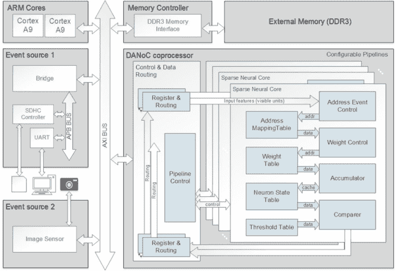

图 7.5 片上自适应神经网络（DANoC）的框图，由两个主机处理器、一个协处理器和一个外部存储器控制器组成。协处理器由一组流水线深度神经网络组成，每个流水线由多个稀疏神经核心组成。每个核心可配置为 AdaRBM 或神经网络分类器。

此外，DANoC 可以实时处理输入的遥感和视频图像，而不会阻塞流水线。

DANoC 原型使用 Xilinx Zynq FPGA 器件实现，这是一种可编程片上系统（SoC）（图 7.6）。ARM 主机处理器工作频率为 800 MHz，协处理器在 SoC 中工作频率为 100 MHz。Zynq7Z020 FPGA 具有 4.9 Mb 片上块 RAM。硬件原型包含 1 GB 533 MHz DDR3 板载内存和 3.8 GB/s 全双工内存带宽。整个板子的峰值功耗为 8 瓦，FPGA 器件的功耗小于 2 瓦。选择 Zynq 平台是因为其性能随流水线数量的增加而线性增长。为评估 DANoC 的可扩展性，使用 Xilinx Zynq7100 FPGA 实现了高端版本的 DANoC 协处理器，该 FPGA 包含 26.5 Mb 片上块 RAM，并允许我们在单芯片上最多适配 30 个流水线。


**图 7.6** 用于分类手写数字图像的 DANoC 硬件原型。每张图像的分类包含 128 万次操作，DANoC 可在 0.24 ms 内处理一张图像，基于低价 Zynq7Z020 的 DANoC 在 495 mW 下实现了有效的 319 GOPS。

主机 ARM 处理器负责解析深度网络并控制输入和配置数据传输到协处理器。协处理器在可编程逻辑上实现，并通过 AXI 总线与主机处理器接口。输入数据被编码为地址事件，每个时钟周期流入一个数据字到协处理器。数据字被组织为数组，一次流入一行。这些数据字在图像或视频的情况下可以是像素。DDR 存储器控制器将流水线与外部存储器接口。其目的是路由独立的数据流并向 DANoC 流水线馈送数据。路由器实现为交叉开关，允许协处理器一次访问多个内存缓冲区，并进行全双工数据事务。

## 7.4 片上自适应深度网络的应用

在本节中，我们使用三种不同的应用评估 DAN 算法和 DANoC 硬件原型，即识别手写数字图像、分类高光谱遥感图像，以及基于视频的自动驾驶玩具车应用。

### 7.4.1 实验设置与度量

我们在四个步骤中实现具有二进制连接和激活的稀疏连接 DAN。在每个步骤中，前馈神经网络变得更加高效。为区分这些网络，我们列出了不同精度的 DAN：

- DAN：单精度 DAN；
- DAN_t：单精度 DAN，其大多数与零权重相关的连接已被移除；
- DAN_b：具有二进制连接权重的定点 DAN；
- DAN_b：具有二进制连接权重和二进制激活的定点 DAN。

为评估神经连接的稀疏性，我们使用保留权重的比例 \(\sigma\) 作为稀疏度量，该比例由阈值 \(u\) 控制，公式为

\(\sigma = 1 - \frac{\mathcal{N}(u)}{\text{total number of weights}} \times 100\%, \quad (7.15)\)

其中 \(\mathcal{N}(u)\) 表示绝对值小于 \(u\) 的权重数量。具体而言，稀疏度量 \(\sigma \in [0, 1]\) 在 \(u = \max_{ij} |w_{ij}|\) 时达到 0。\(\sigma\) 度量是效率与分类精度之间的重要权衡，对于所研究的数据集，\(\sigma\) 的典型范围是 5%–25%。

### 7.4.2 MNIST 手写图像

MNIST 是一个基准图像分类数据集 [31]。它包含 60000 个训练集和 10000 个测试集的 \(28 \times 28\) 灰度图像，表示 0 到 9 的数字（图 7.7）。构建了两个网络，即 DAN（784-800-800-10）和 DBN（784-800-800-10），用于从 MNIST 数据集的图像中提取特征。我们使用 60000 个图像的训练集同时拟合 DAN 和 DBN。然后对 DAN 的参数进行阈值处理和二值化。将各自的神经网络分类器连接到 DAN 和 DBN。实验表明，仅保留 25% 连接的 DAN_t 具有与全连接的原始 DBN（98.84%）几乎相同的分类精度（98.83%）。

图 7.7 说明了具有二进制连接权重的 DAN_b。子图（b）显示了权重参数。子图（a）显示了推断值。作为混合范数权重衰减和阈值过程的结果，第一层和第二层 AdaRBM 的权重矩阵变得非常稀疏，且非零权重倾向于聚类为不同的组。


**图 7.7** 从 MNIST 数据集学习得到的稀疏连接二进制权重深度自适应网络（DAN$_b$）。将神经网络分类器连接到深度自适应网络，以识别给定图像的标签（0–9）。

我们将参数 \(\lambda\) 从 \(10^{-1}\) 变化到 \(10^{-8}\) 以评估其与分类精度的关系。我们的实验随机选择 10000 个图像进行训练，并在其余图像上测试 DAN、DBN、带 L$_1$-norm 权重衰减的 DBN（DBN$_1$）和带 L$_2$-norm 权重衰减的 DBN（DBN$_2$）。实验进行十次，图 7.8(a) 显示了平均精度。当 \(\lambda\) 小于 \(10^{-4}\) 时，DAN、DBN 和 DBN$_2$ 似乎具有相似的分类精度；然而，DBN$_1$ 的精度明显较低。

由于参数 \(\lambda\) 控制深度自适应网络中权重参数的稀疏性，它可能影响硬件实现的效率。图 7.8(b) 显示了保留权重比例 \(\sigma\) 与 \(\lambda\) 值之间的关系。设置了典型阈值 \(u = 0.1\) 和 \(\gamma = 0.5\)。结果显示，当 \(\lambda\) 从 \(10^{-8}\) 变化到 \(10^{-1}\) 时，保留权重的比例从约 50% 显著下降到 5% 以下。实验还表明，DAN 的第二层比第一层稀疏 15% 以上。

我们进行了一项实验，以说明参数 \(\gamma\) 如何控制权重矩阵的行方向稀疏性和列方向稀疏性之间的权衡。检查了不同 \(\gamma$ 值下的 DAN$_t$ 权重。我们比较了行方向矩阵范数 \(\|\mathbf{W}\|_M\) 和列方向矩阵范数 $\|\mathbf{W}^{\mathrm{T}}\|_{\mathrm{M}$，并有两个观察结果。首先，$\|\mathbf{W}^{\mathrm{T}}\|_{\mathrm{M}}$ 随 $\gamma$ 增加而增加，而 $\|\mathbf{W}\|_{\mathrm{M}}$ 随 $\gamma$ 增加而下降。这一观察与 Eq. (7.10) 的优化公式一致。其次，第二层 AdaRBM 的权重矩阵混合范数比第一层 AdaRBM 小约 20%。这一观察表明第二层权重可能比第一层权重更稀疏，与图 7.8(b) 的结果一致。


图 7.8 (a) 随 $\lambda$ 从 $10^{-1}$ 变化到 $10^{-8}$ ($\gamma = 0.5$)，DBN 和 DAN 的分类精度变化。DBN$_1$ 和 DBN$_2$ 分别是带有 L$_1$ 和 L$_2$ 范数权重衰减的单精度 DBN。（b）DAN 中每一层的保留权重比例 ($\sigma$%) 由参数 $\lambda$ 控制 ($\alpha = 0.1, \gamma = 0.5$)。

图 7.9(a) 比较了由 DBN 和不同精度的 DAN 预处理的经典神经网络分类器的精度。为比较量化对所研究方法的影响，DBN 的权重与 DAN 使用相同的设置进行阈值处理和量化。实验表明，一般而言，DAN 在二进制量化操作下是稀疏且稳健的。当保留权重比例 $\sigma$ 从 0% 变化到 5% 时，DAN$_{\mathrm{b}}$ 的分类精度迅速攀升至 90% 以上。然而，仅保留 5% 连接时，DBN（54.2%）、DBN$_1$（19.2%）和 DBN$_2$（67.4%）的分类精度表现出显著更差的结果。当保留超过 10% 的连接时，DAN$_{\mathrm{b}}$ 的分类精度似乎几乎没有下降。此外，偏差结果表明，当保留权重比例下降时，DBN$_1$、DBN$_2$ 和 DAN 均比原始 DBN 相对更稳定。当保留超过 15% 的权重时，DAN 的偏差迅速减小。


图 7.9 (a) 采用不同权重衰减方法的 DAN 和 DBN 的分类准确率。连接权重经过阈值处理，保留 \(\sigma\%\) 的显著权重，并使用单比特整数表示。(b) DBN 和 DAN 的权重参数所需内存。

为实现更高的硬件效率，DAN 可以使用二值激活和二值权重。图 7.9(a) 还展示了采用二值激活对分类准确率的影响。DAN_B 的激活值使用常数 0.5 进行阈值处理和二值化。如图 7.9(a) 所示，由 DAN_B 处理的神经网络分类器的准确率显著高于 DBN。通过采用二值权重和激活，DANoC 协处理器可以用简单的定点累加器替代复杂的浮点乘法器，并使用简单的阈值操作实现 Sigmoid 激活函数。

通过采用稀疏二值连接，DAN 的内存效率比单精度 DBN 提高了 99.3% (\(\sigma = 20\%\)) 至 99.9% (\(\sigma = 5\%\))。图 7.9(b) 显示了 DAN 和原始 DBN 所用内存的理论结果。随着神经元数量的增加，深度神经网络的内存复杂度也会增加。现有的 DBN 通常使用 32 位表示实现；然而，利用稀疏二值权重，DAN_B 可以将内存效率提高两到三个数量级。

### 7.4.3 高光谱遥感图像

第二个实验将 DAN 算法和 DANoC 系统应用于高光谱遥感领域。与可见光图像不同，高光谱图像包含整个电磁谱范围的信息。图 7.10 显示了 Pavia Center


图 7.10 Pavia Center 图像及每个像素的地面真实标签。Pavia Center 数据集包含 120 万个样本。基于 DBN 的每个样本分类包含 1090 万次操作，基于 Zynq7100 的 DANoC 在 1.9 瓦功耗下实现 2036 个有效 GOPS。

| 数据集 | 波段 | 样本（百万） | 特征 | 类别 |
|---|---|---|---|---|
| Indian Pines | 224 | 0.02 | 2016 | 16 |
| Salinas | 224 | 0.11 | 2016 | 16 |
| Pavia University | 103 | 0.37 | 927 | 9 |
| Pavia Center | 102 | 1.20 | 918 | 9 |

该数据集包含 120 万个样本。图像中的每个像素记录了 102 个光谱波段，涵盖 401 nm 至 889 nm 的波长。分类的目标是确定与每个像素关联的九个标签。

我们的实验考察了四个著名的高光谱图像数据集（表 7.1）。所有考察的数据集均从高光谱网站 [32] 下载。Indian Pines 场景由 AVIRIS 传感器采集，包含 21025 个样本和 224 个光谱反射波段，波长范围为 0.4 × 10−6 至 2.5 × 10−6 米。每个像素的标签属于十六个类别。Salinas 数据集由 224 波段 AVIRIS 传感器在加利福尼亚州萨利纳斯谷地上空采集，具有高空间分辨率（3.7 米像素）。覆盖区域包含 11110 个 16 类样本。与 Pavia Center 数据集类似，Pavia University 数据集有九个类别和 37 万个样本，记录了 103 个光谱波段。

与传统技术不同，高光谱成像可以同时获取空间和光谱数据，从而产生高维样本。对于实际的遥感应用，每个类别的标记训练样本数量通常少于几百个。

| 作者 | 方法 | Salinas | Indian Pines | Pavia University |
|---|---|---|---|---|
| Zhou | DANoC 硬件<sup>a</sup> | 94.19 | 89.03 | 95.33 |
| Yue [33] | CNN 回归 | - | - | 95.18 |
| Yuan [34] | CART kNN | 89.00 | 81.00 | 89.00 |
| Wang [35] | 稀疏编码 | - | 93.11 | 90.41 |
| Kuo [36] | 核 SVM | - | 88.70 | 94.00 |
| Ramzi [37] | AdaBoost SVM | 93.12 | 91.59 | 94.28 |
| Li [38] | 马尔可夫随机场 | - | - | 94.96 |
| Plaza [39] | 多项式回归 | - | 76.71 | 76.03 |
| Li [40] | Tikhonov 方法 | - | 89.00 | 92.00 |
| Chen [41] | 自编码器 | - | - | 98.52 |
| Liu [42] | 自编码器 | 95.50 | - | 96.40 |
| Zhao [43] | BLDE+CNN | - | - | 96.98 |

<sup>a</sup> DANoC 硬件采用二值连接和激活实现 DAN。被比较的方法通常使用 32 位浮点表示实现。

标记训练样本的匮乏会导致监督方法的分类准确率显著下降，这一现象称为 Hughes 现象。因此，在高光谱分类前通常会应用无监督特征提取过程。最近，遥感领域对应用深度学习算法进行高光谱分类表现出浓厚兴趣，DBN 已被报道为从高光谱图像提取特征的最先进方法 [4]。然而，将 DBN 部署为实时处理遥感图像通常是一项挑战，因为卫星或无人机携带的嵌入式系统通常硬件资源有限。在本实验中，我们表明高效的 DAN 算法和 DANoC 系统可以为高光谱图像分类提供与最先进方法相竞争的结果（表 7.2）。

图 7.11 展示了我们基于 DAN 的空间-光谱样本分类过程，包含四个步骤：（1）应用归一化和白化以降低特征之间的相关性；（2）选择目标像素的邻域（红色方形），并将空间-光谱样本展平并排列为向量；（3）训练并构建 DAN 以从高维向量中提取特征；（4）使用神经网络分类器对提取的特征进行分类。

给定目标像素，构建一个由九个像素组成的邻域，以形成高维空间-光谱样本。


图 7.11 使用所提深度自适应网络对高光谱数据进行空间-光谱分类。高光谱数据中的每个像素记录了 102 个光谱波段，涵盖 401 nm 至 889 nm 的波长。

不同深度神经网络分别在 Indian Pines 数据集（1800–2000–2000）、Salinas 数据集（1836–2000–2000）、Pavia Center 数据集（918–1000–1000）和 Pavia University 数据集（927–1000–1000）上进行训练，用于特征选择。我们的实验将所提方法与深度置信网络（DBN）、主成分分析（PCA）和独立成分分析（ICA）进行比较，这些方法均已被证明对处理高光谱数据有效。考察了不同的分类器，包括神经网络分类器（NN）、逻辑回归分类器（LR）、支持向量机（SVM）、朴素贝叶斯（NB）和决策树（DT）。所有被比较的分类器均使用 WEKA 软件 [44] 实现。为计算分类准确率，我们随机选择了 50% 的无标签高光谱样本来训练无监督 DAN、PCA 和 ICA，并使用其余样本进行测试。分类器使用训练集中随机选择的 25% 标签进行训练。实验重复十次，计算了平均分类准确率和标准差。表 7.3 的实验结果表明，DAN 算法在考察的三个数据集中实现了所有被比较方法中最高的分类准确率（90.90% 至 99.59%）。

表 7.2 将 DANoC 系统中实现的二值 DAN 与最新高光谱研究 [33–40] 报告的最优结果进行比较。所有这些研究都使用相同的空间-光谱样本和相似的实验设置。DANoC 系统似乎可以通过利用大量无标签样本，与最先进的方法取得相竞争的结果。值得注意的是，DAN 甚至超越了包括 CNN 在内的一些基于深度学习的方法。由于标记训练样本有限且昂贵，


| 方法 | 印第安松林 | 萨利纳斯 | 帕维亚中心 | 帕维亚大学 |
|---|---|---|---|---|
| DAN + 神经网络 | **90.90** ±0.06 | _95.52_ ±0.03 | **99.59** ±0.23 | **96.72** ±0.12 |
| DBN + 神经网络 | _90.31_ ±0.17 | **96.02** ±0.13 | _99.50_ ±0.13 | _95.89_ ±0.08 |
| PCA + 线性回归 | 66.76 ±0.16 | 93.14 ±0.07 | 99.13 ±0.03 | 93.48 ±0.07 |
| PCA + 朴素贝叶斯 | 62.11 ±0.21 | 90.35 ±0.10 | 96.06 ±0.09 | 83.2 ±0.13 |
| PCA + 决策树 | 68.18 ±0.16 | 89.32 ±0.08 | 97.57 ±0.05 | 88.78 ±0.02 |
| PCA + SVM | 68.77 ±0.23 | 93.35 ±0.22 | 99.16 ±0.05 | 93.3 ±0.15 |
| ICA + 线性回归 | 68.26 ±0.16 | 93.51 ±0.07 | 99.32 ±0.03 | 93.69 ±0.07 |
| ICA + 朴素贝叶斯 | 66.41 ±0.21 | 93.44 ±0.10 | 99.38 ±0.07 | 85.94 ±0.09 |
| ICA + 决策树 | 59.71 ±0.18 | 90.47 ±0.09 | 96.02 ±0.05 | 87.87 ±0.13 |
| ICA + SVM | 68.26 ±0.22 | 93.51 ±0.22 | 99.32 ±0.28 | 93.3 ±0.21 |

在遥感应用中，缺乏标记的训练数据会降低监督学习方法的性能。

通过算法级和硬件级优化，DANoC 协处理器在性能上与最先进的硬件实现[27–29,45]不相上下。在我们的硬件实验中，DANoC 系统的性能是根据标准深度置信网络所需的乘法数量来估算的。两个版本的 DANoC 系统使用 Zynq7Z020 和 Zynq7100 FPGA 器件实现。如表 7.4 所示，低成本的 Zynq7Z020 DANoC 实现了每秒每瓦 615 到 841 亿次操作的高性能，这使得 DANoC 芯片每秒可以处理 31.2 到 53.9 千个高光谱样本。Zynq7100 DANoC 芯片实现的峰值性能为每秒 2077 亿次有效操作，这是最新 FPGA 基础硬件实现中的最先进水平（表 7.5）。高性能在低于 2

表 7.4 DANoC 硬件原型的性能。

| 数据集 | 管道数量 | 吞吐量（每秒千个样本） | 有效性能（GOPS/瓦特） | 单芯片性能（GOPS） | 管道数量 | 吞吐量（每秒千个样本） | 有效性能（GOPS/瓦特） | 单芯片性能（GOPS） |
| :--- | :---: | :---: | :---: | :---: | :---: | :---: | :---: | :---: |
| MNIST | 5 | 60.1 | 774 | 381 | 25 | 300.5 | 992 | 1903 |
| 印第安松林 | 1 | 31.2 | 615 | 237 | 5 | 156.0 | 714 | 1185 |
| 萨利纳斯 | 1 | 31.2 | 615 | 238 | 5 | 156.0 | 714 | 1189 |
| 帕维亚中心 | 4 | 53.8 | 833 | 407 | 20 | 215.2 | 1073 | 2036 |
| 帕维亚大学 | 4 | 53.9 | 841 | 415 | 20 | 215.6 | 1079 | 2077 |
| 机器人汽车（标志/道路） | 3/3 | 52.5/75.2 | 677 | 319 | 15/15 | 262.5/376.0 | 879 | 1593 |

*表格分为左右两部分：左侧为 Zynq7Z020 @ 410–495 mw，右侧为 Zynq7100 @ 1760–1930 mw*

| 作者 | 类型 | 平台 | 速度（GOPS） | 功率（mW） | 精度 |
| :--- | :--- | :--- | :--- | :--- | :--- |
| 本工作 | FPGA | Zynq7Z020 | 415 | 495 | 定点 1 |
| | FPGA | Zynq7100 | 2077 | 1930 | 定点 1 |
| Sanmi [27] | FPGA | Kintex7350 | - | - | 定点 12 |
| Zhang [28] | FPGA | Virtex7 | 612 | 18610 | 定点 32 |
| Gokhale [29] | FPGA | Zynq7Z045 | 227 | 4000 | 定点 16 |
| Li [45] | FPGA | StratixV | 410 | 1114 | 定点 16 |
| Du [46] | 布局 | 65 nm | 194 | 320 | 定点 16 |
| Pham [47] | 布局 | 45 nm SOI | 320 | 600 | 定点 1 |
| Cavigelli [48] | 硅 | 65 nm | 196 | 510 | 定点 12 |
| Andri [49] | 硅 | 65 nm | 423 | 153 | 定点 1 |

瓦的芯片级功耗，比基于 CPU 和 GPU 的解决方案高效几个数量级。

### 7.4.4 视频图像的实时分析

除了遥感应用（这是我们的主要动机）之外，我们还评估了 DANoC 硬件用于实时视频处理。在这项实验中，一个 DANoC 硬件原型被安装在一辆用于自动驾驶的玩具机器人汽车上（图 7.12）。该机器人汽车配备两台 640×480 视频摄像头，分别通过 USB 端口连接到硬件板。一台摄像头用于跟踪道路，另一台用于识别 12 种交通标志。视频流被捕获并在运行于 ARM 主机处理器的软件中被阈值处理为二进制帧。然后将图像帧分割为 16×16（道路）和 32×32（交通标志）窗口，步长为 8 像素，图像被排列为二进制流并路由到 DANoC 协处理器以进行特征提取和分类。分类结果随后发送回主机处理器以自动控制玩具机器人汽车。

DANoC 协处理器中实现了两种类型的 DAN 管道，用于识别交通标志和道路。每个管道使用两个稀疏神经内核来实现堆叠的 DAN，并使用一个内核来实现神经网络分类器。八段在不同光照条件和摄像头角度下录制的视频片段用于离线训练和测试 DAN 算法。实验表明，DANoC 协处理器在识别 12 种交通标志方面的正确率为 98.2%，在识别道路方面的正确率为 98.9%。DANoC 系统的性能是根据相同配置的标准深度置信网络所需的乘法数量来估算的。


图 7.12 一辆配备 DANoC 硬件原型的自动驾驶机器人汽车。该机器人汽车有两台摄像头；一台用于跟踪道路（左侧），另一台用于识别交通标志（右侧）。DANoC 中集成了两种深度神经网络，分别在识别 12 种交通标志方面达到 98.2% 的正确率，在识别道路方面达到 98.9% 的正确率。基于 Zynq7100 的 DANoC 协处理器实现了每秒 1593 亿次操作的最先进峰值性能，并能够实时处理 67 帧 640×480 视频。

配备六条深度神经网络管道的 Zynq7Z020 DANoC 在 478 mW 功耗下实现每秒 319 亿次操作。高性能的基于 Zynq7100 的 DANoC 可在单个 FPGA 芯片上集成多达 30 条管道，从而能够以每秒 1593 亿次有效操作的峰值性能实时处理 67 帧图像。

## 参考文献

- [1] X. Zhou, S. Li, F. Tang, S. Hu, Z. Lin, L. Zhang, DaNoC: 片上深度神经网络的高效算法与硬件协同设计，IEEE Transactions on Neural Networks and Learning Systems 29 (7) (2017) 3176–3187.
- [2] G. Hinton, L. Deng, D. Yu, G.E. Dahl, A.-r. Mohamed, N. Jaitly, A. Senior, V. Vanhoucke, P. Nguyen, T.N. Sainath, 等，语音识别中用于声学建模的深度神经网络：四个研究团队的共同观点，IEEE Signal Processing Magazine 29 (6) (2012) 82–97.
- [3] G.E. Hinton, R.R. Salakhutdinov, 使用神经网络降低数据维度，Science 313 (5786) (2006) 504–507.
- [4] Y. Chen, X. Zhao, X. Jia, 基于深度置信网络的高光谱数据谱空间分类，IEEE Journal of Selected Topics in Applied Earth Observations and Remote Sensing 8 (6) (2015) 2381–2392.
- [5] O. Vinyals, S.V. Ravuri, 将多层感知机与深度置信网络串联特征用于鲁棒 ASR 的比较，收录于：IEEE 国际声学、语音和信号处理会议论文集，2011 年，第 4596–4599 页.
- [6] L.P. Maguire, T.M. McGinnity, B. Glackin, A. Ghani, A. Belatreche, J. Harkin, FPGA 上大规模脉冲神经网络实现面临的挑战，Neurocomputing 71 (1–3) (2007) 13–29.
- [7] N. Lopes, B. Ribeiro, GPU 上多层前馈网络的评估，International Journal of Neural Systems 21 (01) (2011) 31–47.
- [8] S. Himavathi, D. Anitha, A. Muthuramalingam, 使用层复用在 FPGA 中实现前馈网络以有效利用资源，IEEE Transactions on Neural Networks 18 (3) (2007) 880–888.
- [9] S. Draghici, 使用有限精度权重的神经网络的能力，Neural Networks 15 (3) (2002) 395–414.
- [10] J.L. Holi, J.-N. Hwang, 神经网络硬件实现的有限精度误差分析，IEEE Transactions on Computers 42 (3) (1993) 281–290.
- [11] S. Gupta, A. Agrawal, K. Gopalakrishnan, P. Narayanan, 有限数值精度下的深度学习，收录于：国际机器学习会议论文集，2015 年，第 1737–1746 页.
- [12] M. Yuan, Y. Lin, 带分组变量的回归中的模型选择与估计，Journal of the Royal Statistical Society: Series B (Statistical Methodology) 68 (1) (2006) 49–67.
- [13] M. Ranzato, Y.-L. Boureau, Y. LeCun, 等，深度置信网络的稀疏特征学习，Advances in Neural Information Processing Systems 20 (2007) 1185–1192.
- [14] H. Lee, C. Ekanadham, A. Ng, 视觉区域 V2 的稀疏深度置信网络模型，收录于：神经信息处理系统国际会议论文集，第 20 卷，2007 年，第 873–880 页.
- [15] N.-N. Ji, J.-S. Zhang, C.-X. Zhang, 基于速率失真理论的稀疏响应深度置信网络，Pattern Recognition 47 (9) (2014) 3179–3191.
- [16] S. Abramson, D. Saad, E. Marom, 使用 CHIR 算法训练具有三值权重的网络，IEEE Transactions on Neural Networks 4 (6) (1993) 997–1000.
- [17] F. Aviol, E. Mayoraz, 具有三值权重的前馈神经网络的构造性训练算法，收录于：欧洲人工神经网络研讨会论文集，第 94 卷，1994 年，第 123–128 页.
- [18] S. Han, J. Pool, J. Tran, W.J. Dally, 高效神经网络中同时学习权重和连接，收录于：神经信息处理系统国际会议论文集，第 1 卷，2015 年，第 1135–1143 页.
- [19] W. Chen, J. Wilson, S. Tyree, K. Weinberger, Y. Chen, 使用哈希技巧压缩神经网络，收录于：国际机器学习会议论文集，2015 年，第 2285–2294 页.
- [20] S. Han, H. Mao, W.J. Dally, 深度压缩：使用剪枝、训练量化和 Huffman 编码压缩深度神经网络，arXiv:1510.00149 [abs].
- [21] M. Courbariaux, I. Hubara, D. Soudry, R. El-Yaniv, Y. Bengio, 二值化神经网络：使用权重和激活受限于 +1 或 -1 来训练深度神经网络，arXiv:1602.02830 [abs].
- [22] M. Rastegari, V. Ordonez, J. Redmon, A. Farhadi, XNOR-Net：使用二值卷积神经网络进行 ImageNet 分类，收录于：欧洲计算机视觉会议论文集，2016 年，第 525–542 页.
- [23] J.M. Alvarez, M. Salzmann, 学习深度网络中的神经元数量，收录于：神经信息处理系统国际会议论文集，2016 年，第 2270–2278 页.
- [24] W. Pan, H. Dong, Y. Guo, DropNeuron：简化深度神经网络的结构，arXiv:1606.07326 [abs].


- [25] W. Wen, C. Wu, Y. Wang, Y. Chen, H. Li, 深度神经网络中的结构化稀疏性学习, in: 神经信息处理系统国际会议论文集, 2016, pp. 2082–2090.

- [26] B. Ahn, 使用专用硬件架构计算深度置信网络, in: 国际神经网络联合会议论文集, 2014, pp. 141–148.

- [27] K. Sanni, G. Garreau, J.L. Molin, A.G. Andreou, 基于随机计算的字符识别深度置信网络架构的 FPGA 实现, in: 信息科学与系统年会论文集, 2015, pp. 1–5.

- [28] C. Zhang, P. Li, G. Sun, Y. Guan, B. Xiao, J. Cong, 面向深度卷积神经网络的 FPGA 加速器设计优化, in: ACM/SIGDA 现场可编程门阵列国际研讨会论文集, 2015, pp. 161–170.

- [29] V. Gokhale, J. Jin, A. Dundar, B. Martini, E. Culurciello, 面向深度神经网络的 240 G-ops/s 移动协处理器, in: IEEE 计算机视觉与模式识别会议论文集, 2014, pp. 682–687.

- [30] G.E. Hinton, 受限玻尔兹曼机训练实用指南, in: 神经网络：技巧与窍门, 2012, pp. 599–619.

- [31] Y. LeCun, L. Bottou, Y. Bengio, P. Haffner, 基于梯度的学习在文档识别中的应用, IEEE 论文集 86 (11) (1998) 2278–2324.

- [32] ECU 高光谱网站, URL http://www.ehu.eus/ccwintco/index.php?title=Hyperspectral_Remote_Sensing#Pavia_Centre_scene.

- [33] J. Yue, W. Zhao, S. Mao, H. Liu, 使用深度卷积神经网络的高光谱图像谱空间分类, 遥感快报 6 (6) (2015) 468–477.

- [34] Y. Yuan, G. Zhu, Q. Wang, 基于多任务稀疏追踪的高光谱波段选择, IEEE 地球科学与遥感汇刊 53 (2) (2014) 631–644.

- [35] Z. Wang, N.M. Nasrabadi, T.S. Huang, 基于带拉普拉斯特征正则化的任务驱动字典学习的半监督高光谱分类, IEEE 地球科学与遥感汇刊 53 (3) (2014) 1161–1173.

- [36] B.-C. Kuo, H.-H. Ho, C.-H. Li, C.-C. Hung, J.-S. Taur, 面向高光谱图像分类的基于核的带 RBF 核的 SVM 特征选择方法, IEEE 应用地球观测与遥感精选主题期刊 7 (1) (2013) 317–326.

- [37] P. Ramzi, F. Samadzadegan, P. Reinartz, 应用于波段簇的 AdaBoostSVM 技术的高光谱数据分类, IEEE 应用地球观测与遥感精选主题期刊 7 (6) (2013) 2066–2079.

- [38] W. Li, S. Prasad, J.E. Fowler, 使用高斯混合模型和马尔可夫随机场的高光谱图像分类, IEEE 地球科学与遥感快报 11 (1) (2013) 153–157.

- [39] M. Khodadadzadeh, J. Li, A. Plaza, J. Bioucas-Dias, 面向高光谱图像分类的基于子空间的多项逻辑回归, IEEE 地球科学与遥感快报 11 (12) (2014) 2105–2109.

- [40] W. Li, S. Prasad, J.E. Fowler, L.M. Bruce, 面向高光谱图像分析的局部保持降维与分类, IEEE 地球科学与遥感汇刊 50 (4) (2011) 1185–1198.

- [41] Y. Chen, Z. Lin, X. Zhao, G. Wang, Y. Gu, 基于深度学习的高光谱数据分类, IEEE 应用地球观测与遥感精选主题期刊 7 (6) (2014) 2094–2107.

- [42] Y. Liu, G. Cao, Q. Sun, M. Siegel, 通过深度网络和超像素分割的高光谱分类, 国际遥感杂志 36 (13) (2015) 3459–3482.

- [43] W. Zhao, S. Du, 面向高光谱图像分类的谱空间特征提取：一种降维与深度学习方法, IEEE 地球科学与遥感汇刊 54 (8) (2016) 4544–4554.

- [44] M. Hall, E. Frank, G. Holmes, B. Pfahringer, P. Reutemann, I.H. Witten, WEKA 数据挖掘软件：更新, ACM SIGKDD 探索通讯 11 (1) (2009) 10–18.

- [45] N. Li, S. Takaki, Y. Tomioka, H. Kitazawa, 基于 FPGA 的高速目标识别深度卷积神经网络多级数据流实现, in: IEEE 西南图像分析与解释研讨会论文集, 2016, pp. 165–168.

- [46] Z. Du, R. Fasthuber, T. Chen, P. Ienne, L. Li, T. Luo, X. Feng, Y. Chen, O. Temam, ShiDianNao：将视觉处理移至传感器更近处, in: 国际计算机体系结构年会论文集, 2015, pp. 92–104.

- [47] P.-H. Pham, D. Jelaca, C. Farabet, B. Martini, Y. LeCun, E. Culurciello, NeuFlow：数据流式视觉处理系统级芯片, in: IEEE 国际中西部电路与系统研讨会论文集, 2012, pp. 1044–1047.

- [48] L. Cavigelli, L. Benini, Origami：一种 803 GOPs/s/w 卷积网络加速器, IEEE 视频技术电路与系统汇刊 27 (11) (2016) 2461–2475.

- [49] R. Andri, L. Cavigelli, D. Rossi, L. Benini, YodaNN：一种基于二进制权重的超低功耗卷积神经网络加速器, in: IEEE 计算机学会超大规模集成年会论文集, 2016, pp. 236–241.

# 第 8 章

## 面向目标跟踪的硬件架构优化

## 8.1 背景与挑战

本章基于我们的相关出版物 [1]。目标跟踪是计算机视觉领域非常活跃的一个方向。它广泛应用于各种应用，例如智能视频监控、工业自动化、车辆导航和机器人控制 [2–4]。其中许多应用要求实时性能，这对计算和存储资源有限的边缘计算或嵌入式平台提出了挑战。因此，有必要为高速目标跟踪定制低成本的 VLSI 系统。

近年来，许多目标跟踪 VLSI 系统已被提出 [5–12]。然而，其中大多数仅基于空间纹理特征 [5–9] 表示目标对象，未能充分利用固有的运动信息来简化跟踪过程或提高对环境变化的鲁棒性。一些研究人员提出了基于运动能量特征的目标跟踪芯片 [11] 以增强跟踪鲁棒性。通过一堆 3D 时空 Gabor 滤波器提取此类运动特征计算量很大，需要大量的计算和内存资源，这不适用于边缘或嵌入式应用。为了实现灵活且鲁棒的跟踪，一些 VLSI 芯片采用带有片上微处理器单元（MPU） [5,11] 的硬件-算法协同设计范式。跟踪工作量的大部分由 MPU 软件以串行方式处理，导致性能瓶颈。为克服这一问题，一些工作大量使用并行阵列协处理器将处理速度提高到 >1000 帧/秒 [9,10]。然而，这种细粒度并行处理器消耗大量计算资源并占用高内存带宽，不适合低成本的边缘计算或嵌入式系统。

本章介绍了一种具有统一纹理和动态压缩特征的低成本高速目标跟踪 VLSI 系统，用于通过快速椭圆模板匹配实现鲁棒跟踪来表示目标。动态运动特征通过简单的时空滤波提取：2D 空间 DoG 滤波，随后是参数化逐像素时域高通滤波，该方法简单且可配置，以适应不同的运动场景。我们评估滤波顺序以优化内存需求、提高 VLSI 系统性能，并尽可能节省硬件资源。

- 我们采用一种以内存为中心的 VLSI 架构，内存消耗适中且仅包含少量计算单元，因为在现代纳米半导体技术中，计算单元的成本远高于内存。
- 我们在特征提取、目标模板匹配和模板更新过程中引入多级流水线和并行处理电路，以提高系统吞吐量。
- 经过精心设计和优化，以进一步降低计算电路的资源消耗。

## 8.2 算法

### 8.2.1 目标跟踪算法

图 8.1 说明了用于高速低成本 VLSI 实现的拟议目标跟踪算法。假设第一帧中目标的大小和位置已知。对于每个新帧，应用逐像素时域高通滤波器以获取运动信息 [12]，

\(\mathbf{H}[t] = c\mathbf{H}[t - 1] + (1 + c)(\mathbf{P}[t] - \mathbf{P}[t - 1])/2, \quad (8.1)\)

其中 **P** 和 **H** 分别表示输入和高通滤波后的图像，\(0 < c < 1\) 是可针对各种运动场景配置的滤波系数，\(t\) 表示离散帧时间。空间 2D 高斯差分（DoG）滤波器是抑制高频噪声和空间直流分量的先决条件，这些分量可能在光照变化下干扰运动特征。

然后我们分别从原始图像和滤波图像中提取样本（即与目标大小相同的图像区域）的纹理和动态压缩特征。每个压缩特征分量是样本区域内一对矩形补丁之间像素强度求和的差值。每个补丁的偏移和缩放在跟踪前随机选择并在整个过程中保持不变。同一组补丁参数适用于所有样本。我们的统一压缩特征向量是纹理和动态


图 8.1 所提出的目标跟踪算法流程。

压缩特征。这些特征可通过积分图 [13] 快速计算。图像 P(x, y) 的积分图 IP(x, y) 定义如下，并通过迭代计算：

IP(x, y) = \sum_{b=0}^{y} \sum_{a=0}^{x} P(a, b) \quad (8.2) = IP(x, y - 1) + IP(x - 1, y) - IP(x - 1, y - 1) + P(x, y),

其中，若 x < 0 或 y < 0，则 IP = 0。因此，图像 P(x, y) 上两个补丁 (x_l^(g), x_r^(g), y_u^(g), y_d^(g)) (g = 1, 2；下标 l/r 和 u/d 分别表示补丁的最左/最右列和最上/最下行) 中的一个特征分量 v 可仅通过八次加减运算简单得到：

v = \sum_{b=y_u^(1)}^{y_d^(1)} \sum_{a=x_l^(1)}^{x_r^(1)} P(x, y) - \sum_{b=y_u^(2)}^{y_d^(2)} \sum_{a=x_l^(2)}^{x_r^(2)} P(x, y) \quad (8.3) = (IP(x_r^(1), y_d^(1)) - IP(x_l^(1) - 1, y_d^(1)) - IP(x_r^(1), y_u^(1) - 1) + IP(x_l^(1) - 1, y_u^(1) - 1)) + (-IP(x_r^(2), y_d^(2)) + IP(x_l^(2) - 1, y_d^(2)) + IP(x_r^(2), y_u^(2) - 1) - IP(x_l^(2) - 1, y_u^(2) - 1))。

为预测当前帧中的目标位置，我们计算前一帧目标位置周围样本的统一压缩特征，并采用椭圆特征模板匹配过程。一个样本与目标物体之间的匹配程度，按该样本与正/负模板（后文即将说明）之间的椭圆距离之比来度量，如下所示：

$$S = \frac{\sum_{m=1}^M (v_m - \mu_m^p)^2 / (\sigma_m^p)^2}{\sum_{m=1}^M (v_m - \mu_m^n)^2 / (\sigma_m^n)^2}, \quad (8.4)$$

其中，M 为统一特征向量维度，$v_m$ 为样本特征向量的第 m 个分量，$(\mu_m, \sigma_m)$ 为模板的第 m 个分量，上标 $p/n$ 表示正/负模板。椭圆匹配的低计算开销对于确保实时低成本硬件实现至关重要。目标与背景上下文的结合提高了跟踪的稳定性和精度。

为在线更新模板，我们在当前目标位置附近以半径 R1 的圆上均匀抽取正样本，并在距目标位置足够远的内半径 R2、外半径 R3 的环形区域中均匀抽取负样本（背景）。正负样本的数量均设为 $K = 2^5 = 32$，从而可用更简单的右移器替代昂贵的硬件除法器。正/负模板遵循相同的更新策略，即使用从各自正/负样本中提取的统一压缩特征，如下所示：

$$\mu_m[t] = \gamma \mu_m[t-1] + \frac{1 - \gamma}{K} \sum_{k=1}^K v_m[k][t], \quad (8.5)$$

$$
\sigma_m^2[t] = \frac{\gamma}{K} \sum_{k=1}^K (v_m[k][t-1] - \mu_m[t])^2 + \frac{1 - \gamma}{K} \sum_{k=1}^K (v_m[k][t] - \mu_m[t])^2,
$$

其中，k 为样本索引，$0 < \gamma < 1$ 为更新率。

### 8.2.2 时空滤波的内存优化

为提取统一压缩特征，我们可自然地按上述顺序安排时空滤波顺序：空间 2-D DoG 滤波、时域高通滤波和图像积分（D-H-I 序列）。


图 8.2 两种滤波序列的估计内存成本比较。

因此，需要两个内存块来缓冲原始图像和时域高通滤波后的图像（即 Eq. (8.1) 中的 **P** 和 **H** 图像），以供后续使用，另外两个存储区用于纹理积分图和动态积分图。DoG 滤波器在像素流处理架构中不需要图像缓冲区，如第 8.3 节将说明。的确，如果我们仔细安排滤波序列并充分利用所有涉及滤波器的线性特性，可优化掉大量内存需求。在此基础上，我们最终找到了最优的 I-HD 序列：先计算输入的积分图，再执行时域高通滤波，并将空间 DoG 滤波器嵌入其中，如下所示：

$$
IH[t] = \alpha IH[t - 1] + (1 + c)\mathrm{DoG}((IP[t] - IP[t - 1])/2), \quad (8.6)
$$

其中，**IP** 表示原始输入图像的积分（即纹理积分图），**IH** 是动态积分图。这样一来，**IP** 可同时用于纹理和动态特征提取，我们只需两个存储区来缓冲 **IP** 和 **IH** 图像。我们在图 8.2 中估算了针对典型 640 × 480 × 8 位图像的两种滤波序列的内存消耗。I-HD 序列可节省约 39% 的内存资源。

## 8.3 硬件实现与优化

### 8.3.1 VLSI 架构

图 8.3 显示了所提出的目标跟踪 VLSI 系统架构。特征提取模块包括图像积分器和一个可配置的时空滤波器，该滤波器是紧密嵌入空间 DoG 滤波器的像素级时域高通滤波器。特征匹配模块由用于特征模板的匹配引擎和更新引擎组成。这些计算模块经过优化和最小化，以构建一个


图 8.3 所提出的目标跟踪 VLSI 架构。

低成本的以内存为中心的架构，因为在现代纳米半导体技术中，内存单元远比计算资源便宜。采用多级流水线和并行处理电路，以在这种最小化计算资源的前提下提升系统吞吐量。

### 8.3.2 块电路设计

为在降低系统成本的同时，通过并行电路实现精细流水线以提升处理速度，我们精心设计并优化了计算模块电路。图 8.4 显示了特征提取模块的电路细节，该模块基于像素流处理结构，以最小化计算单元，且速率与实时图像传感器匹配 [12]。

图 8.4(a) 为输入图像积分器。行缓冲区用于缓存当前积分图最新获取的像素的一行，以供迭代使用。4 输入加法器按 Eq. (8.2) 计算积分图。它每个时钟周期可输出一个 IP 像素。

图 8.4(b) 展示了嵌入空间 DoG 滤波器的像素级时域高通滤波器电路，该电路计算 Eq. (8.6)。滤波器系数 c 为无符号 8 位，可配置以灵活调整通带，适应各种运动场景。滤波器从图像积分器接收纹理积分图 (IP) 的无符号 32 位像素流，生成动态积分图 (IH) 的有符号 40 位（含 8 位小数）像素流，并沿流更新 IP 和 IH 存储器。它使用 10 级（每级一个时钟周期）像素级流水线，实现像素流处理并匹配图像积分器的高吞吐量。


图 8.4 特征提取模块的电路。(a) 输入图像积分器。(b) 像素级时空滤波器。(c) 时空滤波器内部嵌入的空间 2-D DoG 滤波器电路的进一步展开。

图 8.4(c) 进一步展开了 7 级流水线 DoG 滤波器电路。它计算两个具有不同截止频率和核大小的空间 2-D 高斯滤波器结果之间的差值。行缓冲区缓存 (IP[t] − IP[t − 1])/2 像素流的最新行，并由两个并行高斯滤波器共享。此外，每个 2-D 高斯滤波器核心被分解为水平和垂直 1-D 高斯滤波器，以节省计算资源 [12]。1-D 高斯权重经过优化，并限制在 {1, 2, 4, 6} 集合中。因此，用此类滤波器权重对输入图像进行卷积，可通过简单的移位器和加法器轻松完成，而无需昂贵的乘法器。

每个 1-D 高斯滤波器中使用 3 级流水线加法器树。请注意，特征提取模块仅负责生成和缓存 IP 和 IH 积分图，因为特征匹配模块可在特征匹配和模板更新期间访问这些存储器时，即时通过对积分图进行少量简单运算来获得压缩特征。这种按需计算


图 8.5 特征匹配模块的电路。(a) 特征模板匹配引擎。(b) 特征模板更新引擎。

该范式消除了候选样本及正/负样本大量压缩特征向量的内存和时间开销。

图 8.5(a) 是计算公式 (8.4) 的特征模板匹配引擎的电路。用前一帧中跟踪目标中心的 20×20 像素区域来在当前帧中搜索目标。该区域中的每个像素位置都被视为目标候选样本的中心。

匹配引擎具有 8 级特征级流水线，用于加速公式 (8.4) 中被除数和除数的求和项的计算。一个流水线阶段包含八个时钟周期。如上所述，压缩特征是从积分图中按需串行计算的，这由第一个流水线阶段中的累加器在八个时钟周期内完成。除法器占用四个阶段，在流水线工作时始终忙碌。其他组件各占用一个阶段，但在其各自阶段中仅忙碌一个时钟周期。流水线之后，计算公式 (8.4) 的最终结果还需要 33 个额外时钟周期。沿纹理和动态特征维度以及正负模板的操作被并行化，以进一步提高处理速度。

图 8.5(b) 显示了计算公式 (8.5) 的特征模板更新引擎的电路，具有相似的流水线和并行结构。在我们的设计中，R1、R2 和 R3 分别设置为 4、15 和 25，且 \(0 < \gamma < 1\) 被编码为无符号 8 位小数。该引擎以逐维方式对所有正负样本的提取特征更新模板参数 \(\mu_m\) 和 \(\sigma_m^2\)。它为 \(\mu_m\) 具有一个两级（每级 8 个时钟周期）特征级流水线，为 \(\sigma_m^2\) 具有一个三级（每级 1 个时钟周期）特征级流水线。更新在纹理和动态维度之间以及 \(\mu_m\) 和 \(\sigma_m^2\) 之间并行进行，尽管存在微小滞后，因为更新 \(\sigma_m^2\) 需要更新后的 \(\mu_m\)。

## 8.4 应用实验

在本节中，我们进行了软件仿真实验，以展示我们提出的用于稳健跟踪的统一压缩特征的效果：仅使用纹理压缩特征、仅使用动态压缩特征，以及使用提出的统一纹理和动态压缩特征。

图 8.6(a) 显示了一个动态压缩特征图（即 **IH** 积分图），其时空滤波器系数设置为 \(c = 187 \times 2^{-8}\)。图 8.6(a) 中有一辆从右向左移动的汽车，动态特征图很好地捕捉到了它。图 8.6(b) 和 (c) 分别使用无环境光照变化和显著环境光照变化的视频。图 8.6(b) 中使用三种特征表示得到的跟踪结果相互接近。然而，在图 8.6(c) 中，仅使用纹理或动态压缩特征的跟踪结果出现较大偏差，而统一


图 8.6 (a) 动态压缩特征图。(b) 和 (c) 三种特征表示下的跟踪结果比较：仅纹理压缩特征（STCF-红）、仅动态压缩特征（SDCF-绿）以及我们的统一纹理和动态压缩特征（UTDCF-蓝）。

压缩特征仍能正常工作。这表明统一压缩特征对光照变化具有鲁棒性。

提议的物体跟踪 VLSI 系统的 FPGA 原型已在 ZC706 平台上实现。对于典型的 320×240 输入图像分辨率，FPGA 资源消耗列于表 8.1 中。逻辑资源消耗非常小，内存消耗适中。内存使用量随图像分辨率增加而增加，因为需要存储纹理和动态积分图像。然而，在现代纳米技术下，半导体内存的制造成本远低于逻辑资源。由于更高图像分辨率导致的更多内存消耗不会显著增加整体系统成本。原型运行于 100-MHz 时钟频率，

| 设备 | 切片寄存器 | 切片查找表 | DSPs | 块 RAM |
|---|---|---|---|---|
| Zynq-7045 | 16947 (3.9%) | 20873 (9.5%) | 48 (5.3%) | 161 (29.5%) |


图 8.7 我们跟踪 VLSI 系统 FPGA 原型的实验结果。(a) 示例视频结果。(b) 五个 OTB 视频上的跟踪精度。在常用的 20 像素阈值下的特定精度指标在图例中说明。

这相当于 320×240 图像的 600 帧/s。其峰值功耗为 768 mW（由 Xilinx Vivado 工具估算）。

图 8.7(a) 给出了原型在 OTB 数据集上的示例视频中的定性跟踪结果。跟踪目标位置基本上跟上了实况真值。图 8.7(b) 演示了另外五个 OTB 视频上的定量结果。精度指整个视频中正确跟踪帧的百分比。如果在某一帧中，我们原型预测的目标位置与实况真值之间的距离（以像素计）超过某个阈值，则该帧被视为跟踪错误 [8]。表 8.2 进一步比较了我们系统与 [8] 中的硬件实现在五个视频上的跟踪精度。这些结果表明，我们的系统在 Tiger1 和 David 视频上的表现较差。这两个视频分别经历快速尺度变化或大规模遮挡，但我们的简单统一压缩特征不是尺度不变或尺度自适应的，且我们的快速模板更新方案无法区分遮挡并在遮挡前冻结目标模板。图 8.8 可视化了我们系统与最先进算法 [14] 在更多 OTB 视频片段上的更多跟踪结果比较。虽然

表 8.2 硬件实现的精度比较（阈值 = 20）。

| 视频 | David | FaceOcc1 | FaceOcc2 | Tiger1 | Coupon |
|---|---|---|---|---|---|
| 参考文献 [8] | 0.88 | 0.12 | 0.44 | 0.37 | 0.40 |
| 我们的 | 0.79 | 0.18 | 0.62 | 0.19 | 0.43 |


图 8.8 提议方法与流行算法的跟踪结果比较。

图 8.8(a) 出现部分遮挡，图 8.8(d) 有小尺度变化，所提方法在大多数帧中实现了良好的跟踪性能。

表 8.3 将所提 VLSI 系统与之前的硬件设计 [7–9, 11, 15] 进行比较。[11] 中的硬件系统采用硬件–软件协同设计，因此帧率较低。[9] 中使用大规模并行阵列协处理器实现了非常高的 1000 帧/s 帧率，但这导致计算资源消耗巨大并占用高内存带宽，不适合嵌入式应用。在 [15] 中，提取了复杂特征以实现稳健跟踪。它依赖昂贵的先进 ASIC 技术来维持实时性能。工作 [7–9, 15] 仅使用空间纹理特征来表示目标，而未探索目标的运动信息。我们的 VLSI 系统使用鲁棒且计算简单的统一纹理和动态压缩特征来表示目标，在仅消耗少量逻辑资源和适量内存资源的同时，实现了相对较高的 600 帧/s 稳健跟踪。与复杂的跟踪方法 [15,16] 相比，我们的简单跟踪算法有助于实现边缘计算设备和嵌入式系统所需的高速、低成本硬件实现，但代价是牺牲了对跟踪过程中的快速尺度变化或大规模遮挡的适应性，如图 8.7(b) 和表 8.2 所示。这是我们硬件系统的主要应用局限性。


表 8.3 物体跟踪硬件实现对比。

| | 特性 | 帧率 (帧/秒) | 图像分辨率 | 时钟频率 (MHz) | 功耗效率 (nJ/pixel) |
|---|---|---|---|---|---|
| Stratix-III [8] | 方向边缘 | 150 | 640 × 480 | 60 | N/A |
| Arria-V [9] | 灰度级 LBP | 2800 | 128 × 128 | 100 | N/A |
| 28nm ASIC [15] | 光流+深度 | 30 | 1920 × 1080 | 180 | 12.22 |
| Virtex-4 [7] | LBP+HOG | 60 | 640 × 480 | 25 | N/A |
| Virtex-5 [11] | 定向能量 | 30 | 640 × 480 | 24 | N/A |
| Zynq-7045 | | 630 | 320 × 240 | | |
| (本文) | UTDCF | 253 | 640 × 480 | 100 | 15.87 |

本章介绍了一种基于简单且鲁棒的统一纹理与动态压缩特征以及椭圆匹配的低成本高速物体 VLSI 系统。该系统架构采用以存储器为中心的范式、多级流水线和并行处理电路，旨在尽可能降低硬件成本的同时提高跟踪速度。所提 VLSI 系统的 FPGA 原型机采用少量计算资源和适度的内存消耗实现。在 100-MHz 时钟频率下，它可以处理分辨率为 320 × 240 的图像，处理速度为 600 帧/秒。所提原型机的跟踪结果以及与先前工作的对比表明，我们的跟踪系统适用于高速低成本嵌入式视觉跟踪应用。

## References

- [1] W. He, J. Zhang, Y. Lin, X. Zhou, P. Li, L. Liu, N. Wu, C. Shi, 基于统一纹理与动态压缩特征的低成本高速物体跟踪 VLSI 系统, IEEE Transactions on Circuits and Systems. II, Express Briefs 68 (3) (2020) 1013–1017.
- [2] A. Yilmaz, O. Javed, M. Shah, 物体跟踪：一项综述, ACM Computing Surveys 38 (4) (2006).
- [3] H. Yang, L. Shao, F. Zheng, L. Wang, Z. Song, 视觉跟踪的最新进展与趋势：综述, Neurocomputing 74 (18) (2011) 3823–3831.
- [4] J.K. Sunkara, M. Santhosh, S.B. Cherukuri, L.G. Krishna, 物体跟踪技术与性能度量——概念性综述, 载于：International Conference on Power, Control, Signals and Instrumentation Engineering 论文集, 2017, pp. 2297–2305.
- [5] S.-A. Li, C.-C. Hsu, W.-L. Lin, J.-P. Wang, 粒子滤波器的硬件/软件协同设计及其在物体跟踪中的应用, 载于：International Conference on System Science and Engineering 论文集, 2011, pp. 87–91.
- [6] J.U. Cho, S.H. Jin, X. Dai Pham, J.W. Jeon, J.E. Byun, H. Kang, 一种基于粒子滤波器的实时物体跟踪系统, 载于：IEEE International Conference on Intelligent Robots and Systems 论文集, 2006, pp. 2822–2827.
- [7] T. Sledević, A. Serakıs, D. Plonis, 基于 LBP、HOG 和运动检测的 FPGA 选定物体跟踪, 载于：IEEE Workshop on Advances in Information, Electronic and Electrical Engineering 论文集, 2018, pp. 1–5.
- [8] P. Zhao, H. Zhu, H. Li, T. Shibata, 一种采用多候选位置生成的基于方向边缘的实时物体跟踪系统, IEEE Transactions on Circuits and Systems for Video Technology 23 (3) (2012) 503–517.
- [9] Y. Yang, J. Yang, L. Liu, N. Wu, 基于分层并行视觉处理器和灰度级 LBP 算法的高速目标跟踪系统, IEEE Transactions on Systems, Man, and Cybernetics: Systems 47 (6) (2016) 950–964.
- [10] J. Yang, C. Shi, L. Liu, N. Wu, 异构视觉芯片和基于 LBP 的高速跟踪算法, Electronics Letters 50 (6) (2014) 438–439.
- [11] E. Norouznezhad, A. Bigdeli, A. Postolà, B.C. Lovell, 基于局部定向能量特征及其硬件/软件实现的鲁棒物体跟踪, 载于：International Conference on Control, Automation, Robotics and Vision 论文集, 2010, pp. 2060–2066.
- [12] C. Shi, G. Luo, 面向智能图像传感器的流式运动放大内核, IEEE Transactions on Circuits and Systems. II, Express Briefs 65 (9) (2017) 1229–1233.
- [13] K. Zhang, L. Zhang, M.-H. Yang, 快速压缩跟踪, IEEE Transactions on Pattern Analysis and Machine Intelligence 36 (10) (2014) 2002–2015.
- [14] 视觉跟踪器基准, URL http://www.visual-tracking.net.
- [15] Z. Li, J. Wang, D. Sylvester, D. Blaauw, H.S. Kim, 一种用于统一光流和带半全局匹配的立体深度的 1920 × 1080 25 帧/秒 2.4-TOPS/W 低功耗 6-D 视觉处理器, IEEE Journal of Solid-State Circuits 54 (4) (2019) 1048–1058.
- [16] B. Chen, D. Wang, P. Li, S. Wang, H. Lu, 实时“演员-评论家”跟踪, 载于：European Conference on Computer Vision 论文集, 2018, pp. 318–334.

本页故意留空

# 第 9 章

## SensCamera：一种基于学习的智能相机原型

## 9.1 模式识别之外的挑战

随着集成电路和嵌入式计算技术的进步，具有强大物体检测功能的无线智能相机已被广泛应用于不同领域 [1,2]。作为最先进的方法之一，卷积神经网络 (CNN) 在物体检测方面已被证明非常成功，激发了人们对基于卷积神经网络的智能相机在不同应用（如入侵检测 [3–5]）中实现的浓厚兴趣。

基于卷积神经网络的早期物体检测方法包含一个区域提取阶段，从目标图像中选出成千上万个区域用于物体检测，这会导致高计算开销，例如著名的区域卷积神经网络 (R-CNN) [6]。最近，提出了一组高效的物体检测卷积神经网络架构，包括 Fast R-CNN [7]、Faster R-CNN [8]、单射多框检测 (SSD) [9] 和 YOLO 模型 [10]。受这些工作的启发，基于 CNN 的物体检测的计算复杂度已大大降低，这使得使用无线嵌入式设备实现基于 CNN 的计算机视觉应用成为可能。

研究 [11] 首先使用卷积运算进行压缩感知，但仍使用随机感知矩阵以确保不相干条件。最近，一组基于学习的方法使用一组训练样本来估计确定性感知矩阵。作为早期尝试，NuMax 方法可以通过求解半定规划 (SDP) 问题来估计线性近等距感知矩阵 [12]。Baldassarre 等人 [13] 提出了一种基于学习的子采样方法，可以通过求解组合优化问题来估计感知矩阵。Blasiok 等人 [14] 将 NuMax SDP 问题放宽为特征值问题，并针对包含数千个样本的较大数据集提出了 ADAGIO 方法。

最近，一些研究人员试图使用卷积神经网络来解决压缩感知的不同问题。Mousavi 等人 [15] 提出使用卷积神经网络从随机欠采样测量中恢复原始信号。随后，Mousavi 等人 [16] 通过使用卷积神经网络来压缩和恢复信号，改进了他们的方法。Lu 等人 [17] 为图像压缩提出了类似的想法。Iliadis 等人 [18] 提出使用深度全连接网络进行视频图像恢复。Ren 等人 [19] 提出了一种遵循拉普拉斯金字塔概念的渐进式重建方法。Wu 等人 [20] 通过元学习提高了重建的性能和速度。Chen 等人 [21] 采用多层残差编码方案，以提高基于压缩感知的图像编码的率失真性能。Zhou 等人 [22] 开发了一种多通道深度网络，用于基于块的图像压缩感知，利用块间相关性。我们所提方法与这些研究的主要区别在于，压缩卷积网络 (CCN) 并非用于图像压缩或恢复的网络，而是一种网络增强方法，使物体检测网络在不降低性能的情况下获得图像压缩能力。

基于物体检测的智能相机已应用于许多物联网 (IoT) 场景，例如家庭 [23]、交通 [24]、工厂 [25] 和停车场 [4,26]，这些场景中通常会遇到大量数据。因此，只应传输那些感兴趣的帧。在此情况下，需要检测来找到那些感兴趣的帧，而图像压缩则用于数据传输。例如，在家庭监控中，大多数情况下相机不应将正常图像传输给房主，除非检测到某些事件，如入侵、人员跌倒等。此外，在工厂质量检测线上，相机被部署用于质量检测。只有在检测到不合格产品时，它们才会传输图像信息。

从系统角度来看，无线智能相机通常使用可重现现场可编程门阵列 (FPGA) 和片上系统 (SoC) 实现。近年来，已引入多个面向基于 CNN 的图像分类应用的硬件加速嵌入式系统 [27–31]。然而，与图像分类任务不同，物体检测计算量大得多且耗能更高，因为需要评估大量可能的物体候选区域。直到最近，研究人员才能够使用嵌入式系统实现轻量级基于 CNN 的物体检测算法 [32,33]。


实现图像压缩的传统方法是使用额外的逻辑设备，如图像/视频编码方法 [34–37]，这可能会增加系统层面的成本和计算复杂度。为应对这一挑战，本文提出了一种统一的目标检测和图像压缩的高效方法。基本思想是优化并重复使用卷积神经网络的卷积操作，以同时进行特征提取和图像压缩；因此，不需要额外的计算开销，节省了无线计算机视觉应用程序的成本和计算占用。

所提出的方法基于现代压缩感知技术。通过求解不定线性方程组，已证明图像信号的稀疏性使其能够从更少的样本中恢复 [38]。要恢复压缩图像，压缩感知理论要求满足足够的不连贯性条件，该条件通过等距属性 [39,40] 应用。在前端，传统的压缩感知方法使用随机矩阵进行数据嵌入，这可以以高概率满足不连贯性条件 [41–44]。

将压缩感知集成到深度学习框架中并非易事。所提出的不连贯卷积操作是确定性的，可以从样本中学习，这与随机卷积操作的工作 [11] 不同。为了准确恢复图像，必须满足不连贯性条件，因此所提出的方法定义了感知矩阵和基矩阵之间相干性的放宽度量。通过在正则化训练过程中最小化相干性度量，可以更高质量地压缩原始图像。与我们的会议版本 [45] 相比，本文更加全面，包含了硬件和系统层面的创新，并涵盖了用于视频监控应用的无线智能相机原型的设计工作。图 9.1 展示了使用我们构建的原型无线智能相机实现的典型目标检测应用。该原型名为 SensCamera。

从算法角度来看，采用不连贯卷积方法有几个优点。首先，通过从大规模训练集中学习近似等距感知矩阵，压缩图像的重建峰值信噪比 (PSNR) 比标准 JPEG 和传统的压缩感知方法 [14,46] 高 2.7–5.2 dB。其次，由于神经网络推理阶段没有计算开销和额外延迟，所提出的方法比传统方法 [13] 效率提高了 3 倍以上。第三，它基于用于训练深度神经网络的反向传播，因此在估计近似等距感知矩阵方面，它比 NuMax [12] 和 ADAGIO [14] 算法高效得多。所提出的方法将数据驱动的压缩感知方法扩展到大规模数据集。


图 9.1 使用无线智能相机进行监控的典型场景。一个或多个相机系统可以部署在前端，以执行图像采集、压缩和目标检测。压缩后的连续图像通过 WIFI 传输到后端服务器，在服务器上对图像进行解压缩以供可视化和进一步分析。

从系统角度来看，应用 SensCamera 有两个主要优点。首先，通过支持前端的目标检测，智能相机只有在检测到某个事件时才需要激活无线图像传输。以典型的人脸检测应用为例，SensCamera 原型只有在检测到人脸时才开始传输图像帧，这可以大幅节省通信流量和数据存储需求。其次，SensCamera 可以在没有计算开销的情况下压缩检测到的视频图像，从而进一步提高计算效率。整个系统由一台或多台无线相机和一台后处理计算机组成，后处理计算机通过 WIFI 发射器接收相机传来的压缩图像。

主要贡献如下。

- 提出了一种新型的硬件友好型压缩卷积网络 (CCN)，可以在单个网络中同时实现目标检测和图像压缩。
- 提出了一种新型的不连贯卷积正则化，用于学习感知矩阵，以实现压缩感知的近似等距属性。
- 设计了一种高效的原型无线智能相机 (SensCamera)，可以压缩视频图像并降低传输消耗，而无需引入额外的计算开销。

## 9.2 压缩卷积网络模型

SensCamera 旨在通过预训练的卷积神经网络执行目标检测和图像压缩，该网络由一个专用 FPGA 设备实现和加速。为降低计算开销、功耗和通信带宽，我们发明了一种支持压缩感知的卷积神经网络，该网络可以重复使用卷积操作来进行图像压缩和特征提取。首先，我们简要介绍标准的压缩感知方法。

### 9.2.1 标准压缩感知

压缩感知是一种用于已知为稀疏信号的低速率采样方法。假设信号 x 是一个 N 维向量，可以使用感知矩阵 \(\Phi \in \mathbb{R}^{M \times N}\) 进行采样，如下所示：

```
y = \Phi x. \qquad \text{(9.1)}
```

常数 M 决定采样率。因为在压缩感知中 M 小于 N，所以公式 (9.1) 是不定方程，信号 x 无法从 \(\Phi\) 和 y 唯一恢复。然而，稀疏性假设允许使用一组稀疏系数 \(s \in \mathbb{R}^N\) 和基矩阵 \(\Psi \in \mathbb{R}^{N \times N}\) 表示信号 x，即 x = \(\Psi s\)。那么我们有 y = \(\Phi \Psi s = \Theta s\)，其中 \(\Theta = \Phi \Psi\) 是一个 M x N 测量矩阵。由于 s 是稀疏的，可以通过求解 L1 范数最小化问题来获取 s 的值，如下所示：

```
s = \min_s \|s\|_1, \quad \text{s.t. } \|y - \Theta s\|_2 < \xi. \qquad \text{(9.2)}
```

求解公式 (9.2) 后，可以用 \(\hat{x} = \Psi s\) 近似原始信号 x。

通常，根据公式 (9.1) 和 (9.2)，压缩感知的主要目标之一是学习感知矩阵 \(\Phi\)。研究主要集中在两个方面。

- 1. **不连贯性条件。** 要找到公式 (9.2) 的唯一最稀疏解，应构建 $\Phi$ 以满足不连贯性条件，即矩阵 $\Phi$ 和 $\Psi$ 应该不连贯 [47]。
- 2. **确定性感知矩阵。** 在实际应用中，我们可以使用随机或确定性感知矩阵 $\Phi$。对于随机方法，已证明具有高斯项的矩阵满足不连贯性条件。然而，最近的研究表明，通过从数据中学习确定性感知矩阵，可以以更高质量重建压缩图像 [13]。

我们提出的方法试图找到最优的感知矩阵 \(\Phi\)，以满足给定基矩阵 \(\Psi\)（例如，离散小波变换 (DWT) 矩阵）的不连贯条件。我们通过数据驱动的深度学习方法计算近似等距感知矩阵。

### 9.2.2 压缩卷积网络框架

目标检测的目标是在单张图像中识别多个对象。返回每个对象的类别置信度和边界框。到目前为止，已提出许多基于卷积神经网络的目标检测框架 [8–10]。不同的框架通常具有不同类型的层和不同的参数，然而，典型的卷积神经网络框架使用一系列模块的管道进行图像分类和目标检测。

图 9.2 展示了我们提出的 CCN 模型的框架，主要包括两个分支：图像压缩和目标检测。目标检测分支采用标准卷积神经网络，例如 YOLOv2 [10]，包括二十三个常规卷积层、一个重组层、五个最大池化层和一个 soft-max 层。图像压缩分支包括一个 *压缩卷积层* 和一个带有量化操作的均匀池化层。基于目标检测结果，压缩图像数据连同每个对象的类别置信度和边界框可以传输到后端服务器以执行后续任务。

我们创新性地将目标检测卷积神经网络模型的 *第一层* 重复用作 *压缩卷积层* 以执行图像压缩。请注意，我们提出的图像压缩分支可以集成到任何针对各种应用（例如，检测、分类、分割等）设计的卷积神经网络中。

从功能角度来看，所提出的 CCN 在推理阶段同时执行图像压缩和目标检测。


图 9.2 用于统一目标检测和图像压缩的原型压缩卷积网络。与基于标准卷积神经网络的目标检测模型相比，第一个卷积层经过修改和优化，用于可恢复数据嵌入和图像压缩。与最佳内核关联的压缩卷积层输出被子采样和量化，用作压缩图像数据，并在检测到入侵等特定事件时传输到后端服务器以进行图像重建。

具体来说，给定一张测试图像，在压缩卷积层之后构建的均匀池化层对图像特征进行子采样。然后我们采用 DSQ 量化方法将子采样特征转换为定点表示 [48]。压缩特征既可用于目标检测，也可用于图像恢复。

所提方法与其他基于 CNN 的框架的主要区别在于压缩卷积层，它是原始框架的第一层。我们所提的压缩卷积层 (CCL) 基本上是一个 3 × 3 卷积层，并针对压缩感知进行了优化。作为一种数据驱动方法，CCL 使用确定性卷积操作进行可恢复数据嵌入。卷积操作经过优化以满足不相干性条件，从而采样特征图可以通过正则匹配追踪 [49] 等重建算法重建原始图像。

### 9.2.3 通过卷积操作进行数据嵌入

在本小节中，我们专注于估计确定性感知矩阵。如文献 [11] 所示，卷积操作可以视为一种线性嵌入操作。令 W ∈ R^3×3 为压缩卷积层的核矩阵，令 X ∈ R^P×Q 为输入图像数据的任意通道。给定 N = P × Q，X 可以被向量化并表示为 x ∈ R^N。由于卷积神经网络中的卷积操作 ⊗ 仅包含一阶乘法，因此可以将其重新表述为线性嵌入操作，如下所示：

```
vec(W * X) \doteq \Phi x = y, (9.3)
```

其中 * 是卷积操作，vec(·) 是向量化操作，\(\Phi \in \mathbb{R}^{N \times N}\) 是由核矩阵 **W** 决定的相关方形嵌入矩阵，而 **y** 是卷积操作的向量化输出。

由于卷积神经网络模型中的核矩阵是从训练样本中学习得到的，感知矩阵 \(\Phi\) 由迭代训练决定。基于核矩阵 **W** 定义列向量 \(\mathbf{w} \in \mathbb{R}^{2Q+3}\)，记作 \(\mathbf{w}^T = [w_1, w_2, w_3, \mathbf{0}, w_4, w_5, w_6, \mathbf{0}, w_7, w_8, w_9]\)，其中 \(w_1, \dots, w_9\) 是核矩阵 **W** 的九个元素。与该核相关的嵌入矩阵可以表示为：

```
\(\Phi = \left( \begin{array}{ccccc} \mathbf{w}^T & \mathbf{0} & \cdots & \mathbf{0} & \mathbf{0} \\ 0 & \mathbf{w}^T & \cdots & \mathbf{0} & \mathbf{0} \\ \vdots & \vdots & \ddots & \vdots & \vdots \\ \mathbf{0} & \mathbf{0} & \cdots & \mathbf{w}^T & 0 \\ \mathbf{0} & \mathbf{0} & \cdots & \mathbf{0} & \mathbf{w}^T \end{array} \right)_{N \times N}, (9.4)\)
```

其中 **0** 和 0 分别是零行向量和标量零。嵌入矩阵 \(\Phi\) 是一个稀疏矩阵，每行包含 3 × 3 个非零元素。

值得注意的是，式 (9.3) 和 (9.1) 具有相同的线性形式，但不同于标准压缩感知，卷积神经网络的卷积操作不会降低数据维度。为了将图像压缩到维度 \(M (M \ll N)\)，在压缩卷积层之后插入一个 *均匀池化层* 以进行降维。在实践中，选择单个特征图进行子采样，并以等概率逐行均匀提取 \(M \times N\) 个元素。

### 9.2.4 相干性正则化

在本小节中，我们专注于解决不相干性条件。作为一种数据驱动方法，式 (9.3) 使用从样本中学习得到的确定性感知矩阵 \(\Phi\)。根据压缩感知定理，\(\Phi\) 应满足不相干性条件，即感知矩阵 \(\Phi\) 与基矩阵 \(\Psi$ 不相干。令 \(\varphi_i^T\) 为 \(\Phi\) 的第 *i* 行，令 \(\psi_j\) 为 $\Psi$ 的第 *j* 列。$\Phi$ 与 $\Psi$ 之间的相干性定义为

\(\mu(\Phi, \Psi) = \max | < \varphi_i, \psi_j > | = \max | \varphi_i^T \psi_j |.\) (9.5)

在压缩感知框架内，$\Phi$ 与 $\Psi$ 之间低相干性意味着恢复信号所需的样本更少。对于数据驱动方法，在训练过程中最小化相干性是直观的。然而，由于式 (9.5) 中的相干性不可微，我们将其放宽为以下形式：

\(\mathcal{R}_{\mathbf{W}}(\Phi) = \sum_{ij} < \varphi_i, \psi_j > = \sum_{ij} | \varphi_i^T \psi_j |.\) (9.6)

由于基矩阵 $\Psi$ 通常是预定义的常数矩阵，例如离散小波变换 (DWT) 矩阵，式 (9.6) 中定义的 *相干性测度* 是矩阵变量 $\Phi$ 的加权 L1 范数。鉴于 $\Phi$ 由核矩阵 $\mathbf{W}$ 决定，如式 (9.4) 所示，函数 \(\mathcal{R}_{\mathbf{W}}\) 对 \(\mathbf{W}\) 可微；因此我们可以使用式 (9.6) 作为正则化，并通过最小化 \(\mathcal{R}_{\mathbf{W}}\) 来估计感知矩阵 \(\Phi\)。

在实践中，相干性正则化项 \(\mathcal{R}_{\mathbf{W}}\) 用于估计压缩卷积层的核。\(\mathbf{W}\) 和 \(\Phi\) 的值通过梯度下降训练过程计算得出。通过降低 \(\Phi\) 与 \(\Psi\) 之间的相干性，迭代训练过程可以计算出用于有效压缩感知的近似等距感知矩阵 \(\Phi\)。

在我们的框架中，相干性正则化仅优化第一层权重。假设 \(\mathbf{W}^{(k)}\) 是第一层中的第 $k$ 个卷积核，训练整个检测网络的总损失可定义如下：

\(\mathcal{L}_{\text{total}} = \mathcal{L}_{\text{detection}} + \beta \cdot \sum_k \mathcal{R}_{\mathbf{W}^{(k)}}(\Phi)\)
\(= \mathcal{L}_{\text{detection}} + \beta \cdot \sum_k \sum_{ij} | \varphi_i^{(k)\text{T}} \psi_j |,\) (9.7)

其中 $\mathcal{L}_{\text{detection}}$ 是检测项的损失函数，$\beta$ 是权衡参数。相干性测度项被加入以提高第一层压缩感知的性能。对于不同的网络，$\mathcal{L}_{\text{detection}}$ 来源于所提出的文献并具有不同形式，但我们所提出的相干性正则化项是相同的。在我们的实验中，我们在 YOLOv2 [10] 和 SSD [9] 框架上进行了测试。

## 9.3 硬件实现与优化

作为我们的一项贡献，我们设计了 SensCamera，这是一种原型无线智能相机系统，经过优化可实时执行高效的视频图像压缩和目标检测。通过重新配置深度神经网络软件，SensCamera 可应用于不同的应用。

**智能相机硬件平台。** 智能相机原型采用 Intel Arria10 SX160 FPGA 器件实现，这是一种可编程片上系统 (SoC)。使用 Intel FPGA 器件的无线 SensCamera 系统架构如图 9.3 所示。SoC 中的 CPU 工作频率为 1.2 GHz，FPGA 拥有 8.8 Mb 片上随机存取存储器。NPU 模块是一种商用可得的 Rainman 加速器，采用 FPGA 器件实现，连接到具有 3.8-GB/s 全双工内存带宽的 1 GB 533-MHz 板载内存。SensCamera 原型中内置了一个 1280×720 像素图像传感器和一个无线 WIFI 发射器。

SensCamera 使用现成的硬件平台构建。图 9.4 显示了智能硬件原型及输出图像


图 9.3 使用 Intel FPGA 器件实现的无线 SensCamera 系统架构。现成的 CNN 推理硬件加速器，即神经处理单元，被部署并复用于目标检测和图像压缩。


图 9.4 原型 SensCamera 系统是一款专为人脸检测和其他目标检测应用构建的无线智能相机。使用 FPGA 器件实现的压缩卷积网络对图像传感器捕获的数据流执行连续目标检测和图像压缩。

SensCamera。智能相机硬件板基于带有双 ARM CPU 和商用神经处理单元 (NPU) 的 Intel FPGA 器件，用于加速预训练卷积神经网络的推理阶段。拟议算法的计算逻辑使用专用硬件在 NPU 中实现。NPU 的设计规格超出本文范围；更多详细信息可参见 [50]。双 ARM 处理器用于解析深度神经网络并控制数据流。输入图像数据流式传输到 NPU 以进行目标检测和图像压缩。然后，压缩后的图像和检测结果（例如，边界框）传回 CPU 进行封装和无线传输。

## 9.4 SensCamera 的应用

开展了一组实验，以评估拟议方法在目标检测和图像压缩方面的效果。还评估了拟议算法在原型 SensCamera 系统上运行的硬件性能。实验表明，与常规方法相比，拟议方法在目标检测中实现了具有竞争力的高精度和高效率，同时具有更好的图像压缩性能。

### 9.4.1 实验设置

为了评估拟议方法的有效性，我们的数值实验在两个流行的基于 CNN 的目标检测框架 YOLO [10] 和 SSD [9] 上考察了拟议的非相干卷积方法。YOLO 模型有 23 层，第一层有 32 个卷积核。SSD 模型有 22 层，第一层有 64 个卷积核。对于每个框架，使用预训练卷积神经网络参数作为初始设置。我们进一步在 VOC (2007+2012) 训练集（16551 张图像）和 COCO 训练集（118287 张图像）上采用拟议的一致性正则化对网络进行了 200000 次迭代的训练。我们采用随机梯度下降 (SGD) 优化器进行优化，初始学习率为 0.0001，动量为 0.9。一致性正则化的权衡参数 β 设置为 0.0005。均匀池化层的特征量化为 1 到 5 位，以比较不同的压缩比。

我们在四个数据集上评估了拟议的目标检测和图像压缩方法：VOC (2007+2012)、COCO、BSD100 和 Set11 [51]。VOC 和 COCO 均为广泛用于评估目标检测方法的数据集。VOC 数据集包含 21530 张图像，包括 27450 个标注对象和 6929 个分割。COCO 数据集包含 200000 张图像，共有 80 个类别。BSD100 是一个包含 100 张图像的小数据集，常用于评估计算开销大的数据驱动压缩感知方法。Set11 是一个包含 11 张图像的标准数据集，广泛用于评估图像压缩和重建性能。至于测试，对于图像压缩，我们在 VOC (2007+2012)（4952 张图像）、BSD100（100 张图像）和 Set11（11 张图像）测试集上进行了实验，仅使用在 VOC (2007+2012) 训练集上训练的模型。对于目标检测，我们分别在 VOC (2007+2012) 测试集（4952 张图像）和 COCO 测试集（40670 张图像）上进行了实验。

为了将 CCN 与其他图像压缩方法进行比较，我们的实验采用了不同的度量指标，包括峰值信噪比 (PSNR) 和结构相似性指数 (SSIM)。给定 8 位位深，有损图像和视频压缩中 PSNR 的值通常分布在 30 dB 到 50 dB 之间。对于某些物联网应用，20 dB 到 25 dB 的范围对无线传输来说也是可接受的。SSIM 用于测量两个图像在亮度、对比度和结构方面的相似性。PSNR 和 SSIM 均广泛用于评估图像压缩质量。对于目标检测，我们在 VOC 和 COCO 测试数据集上计算并比较了平均平均精度 (mAP)、Top-5 准确率和召回率。

CCN 与 NuMax [12] 和 ADAGIO [14] 方法相似，它们都是数据驱动的近等距数据嵌入方法。通常，我们可以应用不同的后端图像重建算法来恢复这些方法压缩的数据。尽管这可能不是最佳方案，但为了公平比较，我们使用了标准的正交匹配追踪 (OMP) 算法进行图像重建。如 [49] 所述，离散小波变换 (DWT) 矩阵被用作 OMP 算法重建图像的基矩阵 \(\Psi\)。在我们的实验中，OMP 算法的块大小设置为默认值 \(16 \times 16\)。

### 9.4.2 图像压缩性能

我们在 VOC、BSD100 和 Set11 数据集上比较了 CCN 与其他方法的图像压缩性能。我们比较了使用高斯随机矩阵 (GAUSS) 的常规方法、随机卷积方法 (RandConv) [11] 和基于稀疏矩阵的方法 (CS-SM) [46]。此外，作为一种数据驱动方法，CCN 还与 NuMax [12] 和最近提出的 ADAGIO [14] 算法进行了比较。CCN 使用压缩卷积层的一个卷积核进行数据嵌入。使用标准 OMP 算法重建图像 [49]。

| 数据集 | VOC 训练集 | VOC 测试集 | BSD100 |
|---|---|---|---|
| PSNR | 27.10 ± 3.90 | 26.54 ± 3.71 | 26.56 ± 2.98 |

表 9.1 是在 VOC 和 BSD100 数据集上以 0.33 采样率进行的 YOLO 框架泛化实验。对于 VOC 训练集，我们获得 27.10 dB PSNR；VOC 测试集为 26.54 dB；BSD100 数据集为 26.56 dB。它在训练集上确实表现最好，这与数据驱动机制相关联，而它在测试集和 BSD100 数据集上也取得了相似性能。尽管我们的方法以数据驱动方式计算压缩感知矩阵，但该压缩感知矩阵仍然具有满秩和近等距特性，这是压缩感知的基本原理 [39,40]。得益于满秩和近等距特性，压缩感知模块可以很好地泛化，无论训练集与其他数据集之间的分布偏移如何，这与其他数据驱动压缩感知方法 [41–44] 的做法相同。

表 9.2 总结了在 VOC 和 BSD100 数据集上以固定 0.33 采样率进行的实验结果。为了比较，评估了 YOLO 的原始卷积核用于数据嵌入。实验表明，YOLO 模型第一卷积层中最佳卷积核为压缩感知实现了 25.3 dB 平均 PSNR，比随机卷积方法 (RandConv) [11] 高出 2.1 dB。通过引入一致性正则化，CCN-YOLO 卷积的平均 PSNR 达到了 26.5 dB。总体而言，CCN-YOLO 在 VOC 数据集上比其他压缩感知方法高出 2.7 dB (≈ 26.54 – 23.89)，在 BSD100 数据集上高出 5.2 dB (≈ 26.56 – 21.32)。CCN-SSD 模型也取得了类似结果，在 VOC 和 BSD100 数据集上实现了 25.2 dB 平均 PSNR 和 0.79 dB 平均 SSIM，高于对比方法。

图 9.5 比较了四个用于人员检测的典型 VOC 图像的结果。PSNR/SSIM 测量值显示在每个子图下方。总体而言，CCN-YOLO 相比其他方法表现出更高的 PSNR/SSIM。CCN 压缩的图像看起来也更好，噪声更小。对图像细节的进一步检查表明，CCN 图像在包含复杂纹理的区域通常具有更高的清晰度。


表 9.2 在固定采样率 0.33 下的 BSD100 和 VOC 数据集上的图像恢复质量。

| 数据集 | \multicolumn{2}{c}{BSD100} | \multicolumn{2}{c}{VOC} |
|---|---|---|---|---|
| 方法 | PSNR | SSIM | PSNR | SSIM |
| CCN-YOLO | 26.56 ± 2.98 | 0.8192 ± 0.0550 | 26.54 ± 3.71 | 0.8786 ± 0.0745 |
| CCN-SSD | 25.19 ± 3.05 | 0.7872 ± 0.0620 | 25.46 ± 3.52 | 0.8253 ± 0.0524 |
| ADAGIO | 22.42 ± 1.75 | 0.6055 ± 0.0632 | 23.89 ± 3.38 | 0.6325 ± 0.0618 |
| RandConv | 22.31 ± 1.91 | 0.6243 ± 0.0642 | 22.21 ± 2.93 | 0.6608 ± 0.0671 |
| CS-SM | 21.39 ± 2.86 | 0.5954 ± 0.0941 | 21.46 ± 3.74 | 0.6217 ± 0.0521 |
| GAUSS | 21.32 ± 2.93 | 0.5921 ± 0.0976 | 22.48 ± 4.18 | 0.6409 ± 0.1188 |


图 9.5 将所提 CCN 方法与不同压缩感知方法进行比较，这些方法使用高斯随机矩阵（GAUSS）、随机卷积（RandConv）、CS-SM 和 ADAGIO 子采样策略，采样率为 0.33。每个子图下方显示了 PSNR/SSIM 图像质量测量值。

与其他数据驱动的压缩感知方法相比，所提 CCN 在训练过程中的时间效率也更高。我们在一台配备 Intel i7-6800k CPU 和 32 GB 内存的计算机上进行了数值实验。BSD100 的图像有 38400 个像素，这使得在常规计算机上运行 NuMax 算法变得困难。对于 NuMax 算法，我们将图像分割为 16 × 16 块。表 9.3 列出了 CCN-YOLO、CCN-SSD、ADAGIO 和 NuMax 的训练时间。NuMax 训练耗时超过 4000 秒，尽管该数据集仅包含 100 张图像。ADAGIO 算法通过将 SDP 问题放松为特征值问题来优化 NuMax 算法。然而，当使用超过 100 张图像进行训练时，其效率仍低于所提 CCN。由于内存和时间复杂度无法承受，ADAGIO 算法不适用于大规模 COCO 数据集。

表 9.3 检查的数据驱动压缩感知方法在 BSD100 图像集上的训练时间（秒）。

| 图像数量 | 10 | 20 | 40 | 100 |
|---|---|---|---|---|
| NuMax | 267 | 838 | 1537 | 4460 |
| ADAGIO | 0.743 | 2.041 | 7.263 | 45.782 |
| CCN-YOLO | 3.034 | 6.072 | 12.325 | 31.069 |
| CCN-SSD | 2.710 | 5.419 | 10.835 | 27.016 |


图 9.6 VOC 数据集训练过程中相干度测量和平均 PSNR 的变化。为节省空间，此处仅显示 PSNR 最高的前两个内核。

所提方法的相干度测量在实验中也得到了检验。图 9.6 显示了 CCN 在 VOC 数据集上训练过程中相干度测量和平均 PSNR 的变化。当正则化权重设置为 0.0005 时，相干度测量在最初两千次迭代中持续下降，压缩图像的 PSNR 提高了 1.2 dB 到超过 4.0 dB。图 9.6 显示了压缩卷积层中前两个内核得到的结果。此实验可能证明相干度正则化对图像压缩的有效性。


图 9.7 检查的方法在 BSD100 数据集上的图像重建 PSNR。

图 9.7 比较了采样率从 0.1 到 0.5 的不同压缩感知方法。NuMax 和 ADAGIO 算法需要求解半定规划和特征值问题，这些问题难以应用于大规模数据集，因此此实验仅在小型 BSD100 数据集上进行。总体而言，CCN 在 BSD100 数据集上实现了最高的平均 PSNR。

我们还将 CCN 方法与标准 JPEG 和 JPEG2000 方法进行了图像压缩比较。通过设置不同的量化比特深度来实现不同的压缩比。在我们的实验中，采样率固定为 0.33，并针对 0.02–0.10 压缩比分别采用一至五比特的不同量化比特深度。表 9.4 列出了不同压缩比下的图像重建 PSNR 和 SSIM。与 JPEG 方法相比，CCN 的重建 PSNR 高 0.37 dB（≈ 33.31 – 32.94）至 3.49 dB（≈ 26.13 – 22.64），并且 CCN 在低压缩比下与 JPEG2000 具有可比的性能。

表 9.4 在 Set11 数据集上比较 CCN 方法与标准 JPEG 和 JPEG2000 方法的图像重建 PSNR/SSIM（采样率固定为 0.33，量化比特深度从一比特到五比特）。

| 压缩比 | 方法 | Monarch | Barbara | Boats | Cameraman | House | Lena | 平均 |
| :--- | :--- | :--- | :--- | :--- | :--- | :--- | :--- | :--- |
| 0.02 | CCN-YOLO | 24.55/0.7275 | 24.99/0.7245 | 26.55/0.7566 | 25.64/0.8200 | 28.91/0.8366 | 26.16/0.7459 | 26.13/0.7685 |
| | JPEG | 21.12/0.6259 | 21.92/0.5364 | 22.84/0.6189 | 22.27/0.6036 | 25.01/0.7293 | 22.69/0.6096 | 22.64/0.6206 |
| | JPEG2000 | 24.01/0.7605 | 25.40/0.7042 | 26.86/0.7549 | 25.64/0.7495 | 31.15/0.8302 | 27.50/0.8058 | 26.76/0.7675 |
| 0.04 | CCN-YOLO | 28.06/0.8282 | 28.25/0.8452 | 30.33/0.8483 | 28.95/0.8884 | 32.89/0.9090 | 30.11/0.8518 | 29.76/0.8618 |
| | JPEG | 23.80/0.7340 | 25.02/0.7086 | 27.29/0.7804 | 26.19/0.7876 | 32.08/0.8497 | 28.21/0.8188 | 27.10/0.7799 |
| | JPEG2000 | 27.47/0.8668 | 28.83/0.8528 | 30.33/0.8557 | 28.87/0.8251 | 34.63/0.8744 | 30.83/0.8797 | 30.16/0.8591 |
| 0.06 | CCN-YOLO | 30.66/0.8861 | 29.82/0.8992 | 32.53/0.8964 | 30.75/0.9220 | 35.88/0.9454 | 32.53/0.9051 | 32.03/0.9050 |
| | JPEG | 27.02/0.8430 | 27.38/0.8347 | 29.97/0.8554 | 28.29/0.8485 | 34.43/0.8899 | 31.02/0.8927 | 29.69/0.8607 |
| | JPEG2000 | 29.93/0.9016 | 31.51/0.9057 | 32.92/0.9055 | 30.93/0.8770 | 36.45/0.9023 | 33.29/0.9184 | 32.51/0.9018 |
| 0.08 | CCN-YOLO | 32.04/0.9154 | 30.31/0.9169 | 33.58/0.9166 | 31.43/0.9351 | 37.17/0.9592 | 33.63/0.9254 | 33.03/0.9276 |
| | JPEG | 28.82/0.8875 | 29.62/0.8908 | 31.93/0.8963 | 29.82/0.8800 | 35.61/0.9098 | 32.75/0.9225 | 31.42/0.8978 |
| | JPEG2000 | 31.81/0.9321 | 33.40/0.9351 | 34.90/0.9328 | 32.75/0.9049 | 37.82/0.9310 | 35.29/0.9382 | 34.33/0.9290 |
| 0.10 | CCN-YOLO | 32.43/0.9253 | 30.46/0.9215 | 33.77/0.9218 | 31.64/0.9394 | 37.65/0.9632 | 33.89/0.9302 | 33.31/0.9336 |
| | JPEG | 30.29/0.9156 | 31.54/0.9232 | 33.42/0.9195 | 31.18/0.9028 | 36.87/0.9297 | 34.33/0.9415 | 32.94/0.9221 |
| | JPEG2000 | 33.31/0.9441 | 34.73/0.9477 | 36.23/0.9471 | 34.46/0.9268 | 39.27/0.9482 | 36.66/0.9506 | 35.78/0.9441 |

### 9.4.3 目标检测性能

对两种广泛应用的基于 CNN 的目标检测框架，即 YOLO [10] 和 SSD [9]，进行了检验，以评估所提方法在目标检测中的表现。表 9.5 汇总了推理精度和速度的结果，并与不同的 R-CNN、SSD 和 YOLO 模型变体进行了比较。为了更好地比较推理速度，在配备 Intel i7-6800k CPU 和 32 GB 内存的计算机上评估了所提方法每秒处理的帧数。

表 9.5 将所提 CNN 与其他基于 CNN 的目标检测方法进行比较。列出了 VOC 和 COCO（IOU=0.5）上的平均平均精度（mAP (%)）精度测量值以及每秒帧数（FPS）效率测量值。

| 训练集 | 方法 | mAP | FPS |
|---|---|---|---|
| VOC 2007+2012 | Fast R-CNN | 70.0 | 0.5 |
| | Faster R-CNN ResNet | 76.4 | 5 |
| | SSD | 74.3 | 46 |
| | YOLOv1 | 63.4 | 45 |
| | YOLOv2 | 78.6 | 40 |
| | **CCN-YOLO** | **78.1** | **40** |
| | **CCN-SSD** | **74.0** | **46** |
| COCO trainval | Fast R-CNN | 35.9 | 0.5 |
| | Faster R-CNN ResNet | 45.3 | 5 |
| | SSD | 41.2 | 46 |
| | YOLOv2 | 44.0 | 40 |
| | **CCN-YOLO** | **43.8** | **40** |
| | **CCN-SSD** | **41.1** | **46** |

实验表明，一般而言，引入图像压缩不影响目标检测性能。具体而言，CCN-YOLO 模型在 VOC 数据集上实现了 78.1% 的平均平均精度（mAP），与原始 YOLOv2 模型几乎相同。在 VOC 数据集的前五类上，CCN-YOLO 还实现了 92.8% 的具有竞争力的平均精度和 86.6% 的可比召回率。考虑到 YOLOv2 模型在 VOC 数据集上的前五类平均精度和召回率分别为 93.3% 和 86.8%，与原始 YOLO 模型相比，CCN 几乎没有性能损失。CCN-SSD 模型也发现了类似结果，与 VOC 和 COCO 数据集上的原始 SSD 模型相比，其精度和推理速度几乎没有损失。

### 9.4.4 SensCamera 系统性能

所提 CCN 是一种支持压缩感知的卷积神经网络。实验表明，作为一种统一方法，CCN 的效率比使用不同组件进行压缩感知和目标检测的常规实现高出三倍。表 9.6 比较了所比较方法的图像压缩和目标检测的组合延迟。所提方法与常规策略进行了比较，常规策略为 YOLO 模型或 SSD 模型


## 表 9.6 拟议单阶段 CNN 方法与常规双阶段方法的推理时间（秒）对比

| 块大小 | 16 x 16 | 32 x 32 | 64 x 64 | 128 x 128 |
| :--- | :--- | :--- | :--- | :--- |
| **CCN-YOLO** | 2.82 | 2.82 | 2.82 | 2.82 |
| 原始 YOLO | 2.81 | 2.81 | 2.81 | 2.81 |
| GAUSS+YOLO | 8.81 | 9.25 | 11.65 | 14.15 |
| ADAGIO+YOLO | 8.81 | 9.24 | 11.67 | 14.13 |
| CS-SM+YOLO | 8.80 | 9.21 | 11.47 | 13.69 |
| **CCN-SSD** | 2.45 | 2.45 | 2.45 | 2.45 |
| 原始 SSD | 2.44 | 2.44 | 2.44 | 2.44 |
| GAUSS+SSD | 8.44 | 8.88 | 11.28 | 13.78 |
| ADAGIO+SSD | 8.44 | 8.87 | 11.30 | 13.76 |
| CS-SM+SSD | 8.43 | 8.84 | 11.10 | 13.32 |

与使用不同类型感知矩阵的压缩感知模块并行执行目标检测。值得注意的是，传统的压缩感知方法在前端进行数据嵌入时需要 O(M×N/B) 次浮点乘法，这些策略的复杂性取决于块大小 B。另一方面，CCN 模型需要的乘法运算少得多，其效率比传统方法高 3.1–5.5 倍。

SensCamera 被实现为一个集成 CCN-SSD 算法的原型无线智能摄像头系统，用于目标检测和图像压缩。该摄像头配备了一颗 1280×720 像素的 RGB 图像传感器，可以每秒 25 帧（FPS）的速度捕获视频图像。视频图像逐帧流入 FPGA 设备，该设备针对 CCN-SSD 算法的功耗高效实现进行了优化。实验表明，原型 SensCamera 可处理 20–25 FPS，足以满足广泛的物联网和监控应用需求。进一步检查表明，FPS 性能指标部分受图像中检测到的潜在目标数量的影响。

图 9.8 展示了 SensCamera 实时运行以进行目标检测和图像压缩。得益于算法级和硬件级优化，SensCamera 的峰值功耗低至 13.97 瓦。CCN-SSD 算法的 FPGA 实现平均消耗 7.2 瓦。


图 9.8 SensCamera 能够在功耗低于 14 W 的情况下，对 1280 × 720 视频图像进行近乎实时的目标检测和图像压缩。

## 参考文献

- [1] S. Fleck, W. Strasser, 基于智能相机的监控系统及其在辅助生活中的应用, Proceedings of the IEEE 96 (10) (2008) 1698–1714.
- [2] J.F. Ramonowich, 使用智能相机改进监控的方法和装置, US Patent 8,531,521 (September 2013).
- [3] Y. Sun, Y. Chen, X. Wang, X. Tang, 基于联合识别–验证的深度学习面部表示, in: Proceedings of International Conference on Neural Information Processing Systems, 2014, pp. 1988–1996.
- [4] G. Amato, F. Carrara, F. Falchi, C. Gennaro, C. Vairo, 使用智能相机网络和深度学习进行停车场占用检测, in: Proceedings of IEEE Symposium on Computers and Communication, 2016, pp. 1212–1217.
- [5] A. Loquercio, A.I. Maqueda, C.R. Del-Blanco, D. Scaramuzza, DroNet：通过驾驶学习飞行, IEEE Robotics and Automation Letters 3 (2) (2018) 1088–1095.
- [6] R. Girshick, J. Donahue, T. Darrell, J. Malik, 用于精确目标检测和语义分割的丰富特征层次, in: Proceedings of IEEE Conference on Computer Vision and Pattern Recognition, 2014, pp. 580–587.
- [7] R. Girshick, Fast R-CNN, in: Proceedings of IEEE International Conference on Computer Vision, 2015, pp. 1440–1448.
- [8] S. Ren, K. He, R. Girshick, J. Sun, Faster R-CNN：面向带区域建议网络的实时目标检测, IEEE Transactions on Pattern Analysis and Machine Intelligence 39 (6) (2015) 1137–1149.
- [9] W. Liu, D. Anguelov, D. Erhan, C. Szegedy, S. Reed, C.-Y. Fu, A.C. Berg, SSD：单发多框检测器, in: Proceedings of European Conference on Computer Vision, 2016, pp. 21–37.
- [10] J. Redmon, A. Farhadi, YOLO9000：更好、更快、更强, in: Proceedings of IEEE Conference on Computer Vision and Pattern Recognition, 2017, pp. 7263–7271.
- [11] J. Romberg, 基于随机卷积的压缩感知, SIAM Journal on Imaging Sciences 2 (4) (2009) 1098–1128.
- [12] C. Hegde, A.C. Sankaranarayanan, W. Yin, R.G. Baraniuk, NuMax：一种用于学习近似等距线性嵌入的凸方法, IEEE Transactions on Signal Processing 63 (22) (2015) 6109–6121.
- [13] L. Baldassarre, Y.H. Li, J. Scarlett, B. Gözcü, I. Bogunovic, V. Cevher, 基于学习的压缩子采样, IEEE Journal of Selected Topics in Signal Processing 10 (4) (2016) 809–822.
- [14] J. Blasiok, C.E. Tsourakakis, Adagio：快速数据感知的近似等距线性嵌入, in: Proceedings of IEEE International Conference on Data Mining, 2016, pp. 31-40.
- [15] A. Mousavi, R.G. Baraniuk, 学习反演：通过深度卷积网络进行信号恢复, in: Proceedings of IEEE International Conference on Acoustics, Speech and Signal Processing, 2017, pp. 2272–2276.
- [16] A. Mousavi, G. Dasarathy, R.G. Baraniuk, DeepCodec：通过深度卷积神经网络进行自适应感知和恢复, arXiv:1707.03386 [abs].
- [17] X. Lu, W. Dong, P. Wang, G. Shi, X. Xie, ConvCSNet：一种基于深度学习的卷积压缩感知框架, arXiv:1801.10342 [abs].
- [18] M. Iliadis, L. Spinoulis, A.K. Katsaggelos, 用于视频压缩感知的深度全连接网络, Digital Signal Processing 72 (2018) 9–18.
- [19] K. Xu, Z. Zhang, F. Ren, LAPRAN：一种用于灵活压缩感知重建的可拉普拉斯金字塔重建生成对抗网络, in: Proceedings of the European Conference on Computer Vision, 2018, pp. 485–500.
- [20] Y. Wu, M. Rosca, T. Lillicrap, 深度压缩感知, in: Proceedings of the International Conference on Machine Learning, 2019, pp. 6850–6860.
- [21] Z. Chen, X. Hou, L. Shao, C. Gong, X. Qian, Y. Huang, S. Wang, 用于图像编码的压缩感知多层残差系数, IEEE Transactions on Circuits and Systems for Video Technology 30 (4) (2019) 1109–1120.
- [22] S. Zhou, Y. He, Y. Liu, C. Li, J. Zhang, 用于基于块图像压缩感知的多通道深度网络, IEEE Transactions on Multimedia 23 (2021) 2627–2640.
- [23] S. Tanwar, P. Patel, K. Patel, S. Tyagi, N. Kumar, M.S. Obaidat, 一种面向智能家居的基于物联网的高级安全警报系统, in: Proceedings of International Conference on Computer, Information and Telecommunication Systems, 2017, pp. 25–29.
- [24] S. Latif, H. Afzaal, N.A. Zafar, 面向智慧城市的智能交通监控与指导系统, in: Proceedings of International Conference on Computing, Mathematics and Engineering Technologies, 2018, pp. 1–6.
- [25] S.-H. Lee, C.-S. Yang, 面向智能工业相机传感器的实时目标识别与计数系统, IEEE Sensors Journal 17 (8) (2017) 2516–2523.
- [26] G. Amato, P. Bolettieri, D. Moroni, F. Carrara, L. Ciampi, G. Pieri, C. Gennaro, G.R. Leone, C. Vairo, 一种用于停车监控的无线智能相机网络, in: Proceedings of IEEE Globecom Workshops, 2018, pp. 1–6.
- [27] V. Gokhale, J. Jin, A. Dundar, B. Martini, E. Culurciello, 一款面向深度神经网络的 240 G-ops/s 移动协处理器, in: Proceedings of IEEE Conference on Computer Vision and Pattern Recognition, 2014, pp. 682–687.
- [28] C. Zhang, P. Li, G. Sun, Y. Guan, B. Xiao, J. Cong, 深度卷积神经网络 FPGA 加速器设计优化, in: Proceedings of ACM/SIGDA International Symposium on Field-Programmable Gate Arrays, 2015, pp. 161–170.
- [29] N. Li, S. Takaki, Y. Tomioka, H. Kitazawa, 一种基于 FPGA 的高速目标识别深度卷积神经网络多级数据流实现, in: Proceedings of IEEE Southwest Symposium on Image Analysis and Interpretation, 2016, pp. 165–168.
- [30] J. Qiu, J. Wang, S. Yao, K. Guo, B. Li, E. Zhou, J. Yu, T. Tang, N. Xu, S. Song, 等, 用于卷积神经网络的嵌入式 FPGA 平台深度挖掘, in: Proceedings of ACM/SIGDA International Symposium on Field-Programmable Gate Arrays, 2016, pp. 26–35.


- [31] X. Zhou, S. Li, F. Tang, S. Hu, Z. Lin, L. Zhang, DaNoC: 深度神经网络片上高效算法与硬件协同设计, IEEE Transactions on Neural Networks and Learning Systems 29 (7) (2017) 3176–3187.
- [32] R. Zhao, X. Niu, Y. Wu, W. Luk, Q. Liu, 嵌入式FPGA平台上基于CNN的目标检测算法优化, 载于: 应用可重构计算国际研讨会论文集, 2017, pp. 255–267.
- [33] H. Mao, S. Yao, T. Tang, B. Li, J. Yao, Y. Wang, 面向嵌入式系统的实时目标检测, IEEE Transactions on Emerging Topics in Computing 6 (3) (2016) 417–431.
- [34] T. Wiegand, G.J. Sullivan, G. Bjontegaard, A. Luthra, H.264/AVC视频编码标准概述, IEEE Transactions on Circuits and Systems for Video Technology 13 (7) (2003) 560–576.
- [35] G.J. Sullivan, J.-R. Ohm, W.-J. Han, T. Wiegand, 高效视频编码(HEVC)标准概述, IEEE Transactions on Circuits and Systems for Video Technology 22 (12) (2012) 1649–1668.
- [36] Y. Chen, D. Mukherjee, J. Han, A. Grange, Y. Xu, Z. Liu, S. Parker, C. Chen, H. Su, U. Joshi, et al., AV1视频编解码器核心编码工具概述, 载于: 图像编码研讨会论文集, 2018, pp. 41–45.
- [37] D. Mukherjee, J. Bankoski, A. Grange, J. Han, J. Koleszar, P. Wilkins, Y. Xu, R. Bultje, 最新开源视频编解码器VP9——概述与初步结果, 载于: 图像编码研讨会论文集, 2013, pp. 390–393.
- [38] E.J. Candès, J. Romberg, T. Tao, 鲁棒不确定性原理: 基于高度不完整的频率信息进行精确信号重构, IEEE Transactions on Information Theory 52 (2) (2006) 489–509.
- [39] D.L. Donoho, 压缩感知, IEEE Transactions on Information Theory 52 (4) (2006) 1289–1306.
- [40] E.J. Candès, M.B. Wakin, 压缩采样导论, IEEE Signal Processing Magazine 25 (2) (2008) 21–30.
- [41] E.J. Candès, T. Tao, 基于随机投影的近似最优信号恢复: 通用编码策略?, IEEE Transactions on Information Theory 52 (12) (2006) 5406–5425.
- [42] X. Song, X. Peng, J. Xu, G. Shi, F. Wu, 面向云端无线图像传输的分布式压缩感知, IEEE Transactions on Multimedia 19 (6) (2017) 1351–1364.
- [43] Z. Chen, X. Hou, X. Qian, C. Gong, 基于扰乱块压缩感知的高效鲁棒图像编码与传输, IEEE Transactions on Multimedia 20 (7) (2017) 1610–1621.
- [44] X. Yuan, R. Haimi-Cohen, 基于压缩感知的图像压缩: 与JPEG的端到端比较, IEEE Transactions on Multimedia 22 (11) (2020) 2889–2904.
- [45] X. Zhou, L. Xu, S. Liu, Y. Lin, L. Zhang, C. Zhuo, 用于统一目标检测与图像压缩的高效压缩卷积网络, 载于: AAAI人工智能会议论文集, 第33卷, 2019, pp. 5949–5956.
- [46] A. Gilbert, P. Indyk, 基于稀疏矩阵的稀疏恢复, Proceedings of the IEEE 98 (6) (2010) 937–947.
- [47] R. Baraniuk, 压缩感知[讲义], IEEE Signal Processing Magazine 24 (2007) 118–121.
- [48] R. Gong, X. Liu, S. Jiang, T. Li, P. Hu, J. Lin, F. Yu, J. Yan, 可微分软量化: 连接全精度与低比特神经网络, 载于: 国际计算机视觉会议论文集, 2019, pp. 4852–4861.
- [49] J.A. Tropp, A.C. Gilbert, 通过正交匹配追踪从随机测量中恢复信号, IEEE Transactions on Information Theory 53 (12) (2007) 4655–4666.
- [50] CoreRain, 雨人加速器, 来源: http://www.corerein.com/product.
- [51] K. Kulkarni, S. Lohit, P. Turaga, R. Kerviche, A. Ashok, ReconNet: 来自压缩感知测量的非迭代图像重建, 载于: IEEE计算机视觉与模式识别会议论文集, 2016, pp. 449–458.

# Index

- A
  - 加速芯片, 14
  - 二进制累加器, 122
  - 准确率
    - 分类, 5, 49, 63, 68, 69, 71, 75, 76, 79, 80, 83, 89, 112, 114, 115, 125
    - 退化, 45
    - 损失, 44, 69, 71, 173
    - 边际损失, 71
    - 模型, 97, 101
  - 激活
    - 逐位, 62
    - 函数, 21, 42, 99
    - 完整性, 60
    - 完整性损失, 69
    - 层, 65, 98
    - 损失, 59
    - 神经网络, 15, 61
    - 量化, 59–61, 69, 71
    - 量化方法, 69, 71
    - 量化过程, 69
    - 表示, 59, 62, 63, 67, 71
    - 稀疏性, 67
    - 值, 21, 48, 104
  - 自适应RBM (AdaRBM), 117
    - 层, 122
    - 训练算法, 117
  - AlexNet参数, 50
  - 人工智能 (AI), 3–6, 8, 10, 14, 19, 39
    - 先进, 10
    - AlphaGo, 8
    - 应用领域, 7
    - 芯片, 7
    - 算力, 9
    - 发展, 8, 9, 26
    - 模型, 6
    - 研究机构 OpenAI, 10
    - 系统, 3, 8
    - 技术, 3, 7
  - 人工智能物联网 (AIoT), 6, 7, 12, 14, 39, 47
    - 设备, 15
    - 融资, 6
    - 智能终端应用, 6, 7
  - 人工神经网络 (ANN), 4, 5, 23
  - 人工神经元, 4, 20

- B
  - 套袋二进制神经网络 (BBNA), 97, 98, 106
    - 架构, 105, 106
    - 设计, 98
  - 套袋多层感知机 (BMLP), 101
    - 模型, 101
    - 网络, 105
  - 批归一化 (BN) 层, 65, 98, 100
  - 二值化激活, 104
    - 函数, 99
  - 二进制
    - 累加器, 122
    - 激活, 125, 128
    - 激活码本, 67
    - AlexNet, 75
    - 多个基础模块, 76
    - 配置, 89
    - 稀疏连接, 128
    - 连接权重, 125
    - 卷积层, 79, 81
    - DAN, 131
    - 深度神经网络, 15, 114
    - 特征图, 78
    - 滤波器, 77
    - 隐藏层, 116
    - 输入, 99
    - 矩阵, 90
    - 模型, 82
    - 性能神经网络, 76
    - 量化, 62, 88
    - 量化操作, 127
    - 表示, 122
    - 状态, 116
    - 流, 134
    - 子网络, 79–81, 87
    - 权重, 15, 75, 77, 78, 89, 99, 121, 128
    - 权重滤波器, 77, 78
  - 二进制集成神经网络 (BENN), 100
  - 二进制神经网络 (BNN), 15, 75–77, 79–82, 84, 88–90, 97–100, 102, 104
  - BinaryNet, 89
  - 生物
    - 神经网络, 4
    - 神经元, 19
  - 逐位
    - 激活, 62
    - 激活量化, 60
    - 瓶颈, 60, 64, 65, 67–69
      - 方法, 60, 62, 67, 69, 71
    - 编码, 61
    - 编码方法, 15
    - 用于DNN激活量化, 60
    - 层, 65, 66
    - 方法, 60, 69, 71
    - 操作, 64, 65
    - 优化, 60
    - 量化方法, 65
    - 稀疏, 66
      - 压缩, 60, 71
    - 稀疏性, 63, 67, 71
  - BNN管道 (BNNP), 102, 105

- C
  - 计算数据生成器 (CDG) 单元, 103
  - 蜂窝二进制神经网络, 15, 76, 79
  - 中央处理器 (CPU), 111
  - 通道混洗, 44
  - 芯片
    - DANoC, 122, 132
    - 目标跟踪, 139
  - 循环卷积, 76
  - 分类
    - 准确率, 5, 49, 63, 68, 69, 71, 75, 76, 79, 80, 83, 89, 112, 114, 115, 125
    - 准确率损失, 59, 61
    - 标签, 19, 101
    - 性能, 84
  - 分类器层, 122
  - 编码率, 60, 61, 64, 65, 67, 69
  - 相干性
    - 测量, 157, 163, 170
    - 正则化, 162, 163, 166, 168, 170
  - 按列
    - 稀疏权重矩阵, 122
    - 稀疏性, 113, 122, 126
  - 组合优化问题, 155
  - 压缩
    - 激活, 60
    - 激活表示, 65
    - 图像, 69, 157, 158, 160, 166, 170
  - 压缩
    - 算法, 56
    - 逐位, 60, 71
    - 方法, 15, 71
    - 模型, 47, 48
    - 压缩率, 113, 114
    - 神经网络压缩技术, 40
  - 压缩比 (CR), 52, 164, 166, 171
  - 压缩
    - 特征, 145, 147
    - 感知, 155, 157, 159, 161–163, 166, 168, 169, 171, 173
    - 感知性能, 163
  - 压缩卷积层 (CCL), 160–164, 167, 170
  - 压缩卷积网络 (CCN), 156, 158–160
  - 计算
    - 复杂度, 97, 157
    - 卷积, 25
    - 逻辑, 165
    - 模型, 20
    - 神经网络, 48, 114
    - 要求, 75
    - 时间, 39, 43
  - 计算
    - 瓶颈, 113
    - 复杂度, 33, 40, 43, 62, 80, 90, 111, 155
    - 成本, 114
    - 效率, 61, 64, 66, 72, 76
    - 效率改进, 72
    - 开销, 155, 157–159
    - 问题, 34
    - 资源, 111, 112
    - 时间, 122
  - 计算机
    - 内存, 34
    - 性能, 33
    - 视觉, 19, 39, 59, 75, 97, 139, 155, 157
  - 计算阵列 (CA), 102, 103
  - 可配置
    - 参数, 103
    - 时空滤波器, 143
  - 连接权重, 80, 81, 111, 112, 114, 115, 119, 121
    - 二进制, 125
  - 对比散度 (CD), 119
  - CONV层, 98–100, 105
  - 卷积
    - 计算, 25
    - 滤波器, 105
    - 分组, 43, 44
    - 核, 51, 103, 163, 166
    - 层, 65, 66
    - 神经网络, 160
    - 操作, 24, 41, 155, 157, 159, 161, 162
    - 算子, 23, 26
  - 卷积
    - 通道, 51
    - 组合, 40
    - 滤波器, 77
    - 核, 23–25, 40, 41, 44, 48, 51
    - 核矩阵, 48
    - 核大小, 25
    - 层, 24, 25, 34, 39, 41, 42, 44, 46, 51, 77, 78, 160, 161, 168
    - 操作, 77
    - 结构, 44
  - 卷积神经网络 (CNN), 5, 15, 22, 24, 26, 27, 33, 34, 39, 48, 49, 77, 97, 98, 115, 155, 157, 160–162
  - 交叉熵 (CE), 29, 54, 81
    - 损失, 88
    - 损失函数, 29, 30

- D
  - 数据
    - 特征, 30
    - 标签, 29, 30
    - 优化, 8
  - 决策树 (DT), 131
  - 深度自适应网络 (DAN), 112, 119, 120, 126
    - 算法, 112, 114, 124, 128
    - 离线算法, 134
    - 二进制, 131
    - 管道, 134
    - 权重, 120
  - 片上深度自适应网络 (DANOC), 16, 112, 124
    - 芯片, 122, 132
    - 协处理器, 112, 122, 123, 128, 132, 134
    - 特征提取协处理器, 134
    - 硬件, 113, 134
    - 硬件原型, 119, 124, 134
    - 管道, 124
    - 原型, 123
    - 系统, 120, 128, 130–132, 134
  - 深度信念网络 (DBN), 111–113, 115, 131, 132, 135
  - 深度学习, 9–11, 13–15, 26, 33, 47, 100, 131
    - 算法, 9, 130
    - 算法计算, 33
    - 应用, 12
    - 方法, 114
    - 云计算, 14
    - 边缘计算技术, 14
    - 时代, 8
    - 方法, 39
    - 模型, 10, 11, 13, 39
    - 模型性能改进, 8
    - 模型训练, 11, 29
    - 优化过程, 59
    - 性能, 14
    - 系统, 39
    - 任务, 97
    - 技术, 5, 8
  - 深度网络, 55, 114, 124


## E

### 集成（Ensemble）
- 二进制神经计算，98
- 二进制神经网络，100, 102
- 流水线，79

## F

### 特征（Feature）
- 压缩的，161
- 提取，22, 24, 26, 111, 140, 157, 159
- 函数的，4
- 映射，43

### 特征图（Feature map (fmap)）
- 25, 26, 40, 42, 44, 45, 51, 61, 78, 98, 147, 161, 162
- 通道，26
- 数据，25

### 特征方向的（Featurewise）
- 压缩，60
- 稀疏性，63

### 前馈神经网络（Feedforward neural network）
- 15, 19, 21, 22, 24, 26, 27, 125

### 现场可编程门阵列（Field Programmable Gate Array (FPGA)）
- 114, 156
- 芯片，135
- 设备，115, 123, 132, 164, 165, 174

### 滤波器（Filter）
- 二进制的，77
- 系数，144
- 系数可配置的，140
- 多样性，76
- 特征图，51
- 剪枝，49, 51, 52
- 剪枝算法，52
- 大小，77
- 权重，145
- 窗口，25

### 滤波序列（Filtering sequence）
- 143

### 每秒帧数（Frames per second (FPS)）
- 173, 174

### 全精度（Full-precision (FP)）模型
- 85

### 全连接层（Fully connected layer）
- 22, 26, 34, 51

### 全连接（Fully connected (FC)）层
- 98, 99, 104, 105

## G

### 门控循环单元（Gated recurrent unit (GRU)）
- 28

### 高斯滤波器（Gaussian filters）
- 145

### 泛化（Generalization）
- 能力，4, 26, 31, 48, 49, 53, 56, 99
- 性能，11

### 梯度（Gradient）
- 计算，32, 33, 83
- 下降，11, 31, 32, 117, 119, 163
- 下降算法，26

### 图形用户界面（Graphical user interface (GUI)）
- 106

### 图形处理单元（Graphics Processing Unit (GPU)）
- 111

### 实地标签（Ground truth label）
- 81, 82

### 组（Group）
- 卷积，43, 44
- 稀疏侧向连接，81, 82
- 稀疏性，80
- 权重，122

## H

### 硬投票（Hard voting (HV)）单元
- 104

### 硬件（Hardware）
- 协作设计，14, 16
- 计算性能，10
- DANoC，113, 134
- 实现，14, 97, 100, 113, 114, 126, 143, 149, 164
- 性能，166

### 隐藏层（Hidden layer）
- 21–24, 26, 27, 55, 116
- 二进制的，116

### 人脑（Human brain）
- 3, 20, 23, 76, 77
- 神经系统，19
- 神经元，21

### 人类神经系统（Human neuronal system）
- 19

### 超参数（Hyperparameters）
- 25

## I

### ImageNet
- 15, 53, 67, 84, 89
- 数据集，15, 39, 68, 71, 90
- 实验，85

### 不连贯性条件（Incoherence condition）
- 155, 160–162

### 不连贯卷积（Incoherent convolution）
- 方法，157, 166
- 操作，157
- 正则化，159

### 独立成分分析（Independent Component Analysis (ICA)）
- 131

### 输入特征图（Input feature map (ifmap)）
- 78, 98, 103, 104

### 物联网（Internet of Things (IoT)）
- 3, 5, 6, 8, 13, 156

### 可解释量化（Interpretable quantization）
- 60

### 不规则网络分布（Irregular network distribution）
- 50

### 迭代超参数（Iteration hyperparameters）
- 25

## K

### 核（Kernel）
- 矩阵，162, 163
- 权重，52

### 知识蒸馏（Knowledge Distillation (KD)）
- 15, 40, 48, 49, 52–56, 75, 81, 82, 85, 88
- 在 BNNs 中，88
- 损失函数，82, 85
- 过程，53

### Kullback-Leibler (KL)
- 散度，81
- 损失，88

## L

### 标签（Label）
- 分类，19, 101
- 数据，29, 30
- 向量，30

### 层（Layer）
- 激活，65, 98
- 批归一化，65, 98
- 位级瓶颈，65
- 分类器，122
- 卷积，65, 66
- 卷积的，24, 25, 34, 39, 41, 42, 44, 46, 51, 77, 78, 160, 161, 168
- 全连接，22, 26, 34, 51
- 神经网络，24
- 可见的，116

### 层级缩放因子（Layerwise scaling factor）
- 76

### 学习率（Learning rate）
- 32, 68, 84, 85, 166

### LeNet 网络（Lenet network）
- 106

### 轻量级（Lightweight）
- 模型，40, 41
- 网络，40
- 网络设计，75
- 神经网络，40
- 学生模型，48

### 逻辑回归（Logistic Regression (LR)）分类器
- 131

### 长短期记忆网络（Long short-term memory (LSTM)）
- 28

### 查找表（Look-up table (LUT)）
- 104

### 损失（Loss）
- 准确率，44, 69, 71, 173
- 激活，59
- 补偿，52
- 数据压缩，60, 61
- 函数，11, 29–33, 54, 55, 79, 81, 82, 163

## M

### 最大压缩率（Maximum compression rate）
- 117

### 平均平均精度（Mean average precision (mAP)）
- 167, 173

### 存储器（Memory）
- 带宽，139, 150
- 存储体，143
- 块，143
- 缓冲区，124
- 单元，144
- 复杂度，62, 122, 128
- 计算机，34
- 消耗，122, 140, 143, 148, 152
- 效率，65, 66, 81, 114, 128
- 高效的，112, 128
- 占用空间，49, 115
- 功能，27
- 占用，75
- 时空滤波优化，142
- 要求，72, 140, 143
- 资源，139, 143, 150
- 空间，34, 111
- 用量，148

### MNIST
- 数据集，15, 67–69, 120, 125
- 手写数据集，101, 105
- 手写图像，125
- 图像，106

### MobileNet
- 13, 41–43

### 模型（Model）
- 准确率，97, 101
- 压缩，47, 48
- 计算，20
- MobileNet，49
- 网络，15, 50, 97–99, 104
- 优化理论，29
- 参数，11, 31, 39, 40
- 性能，23, 40, 52, 84, 97, 100
- 预测标签，53
- 剪枝，15, 40, 48, 49, 52
- 训练，8, 31, 33, 54

### 运动（Motion）
- 能量特征，139
- 特征，139, 140

### 多通道深度神经网络（Multichannel deep neural network）
- 156

### 多层（Multilayer）
- 深度神经网络，113
- 神经网络，5

### 多层感知机（Multilayer perceptron (MLP)）
- 99, 106

### 多个（Multiple）
- 二进制基本模块，76
- 二进制子网络，7
- 层，119
- 层滤波器，52
- 并行 BNNs，75
- 流水线，113, 122

### 乘累加（Multiplication and accumulation (MAC)）
- 操作，98, 99, 104

## N

### 朴素贝叶斯（Naive Bayes (NB)）
- 131

### 负（Negative）
- 标签，54
- 权重，20, 119

### 网络（Network）
- 神经算法，14
- 架构，16, 41, 43, 45, 46
- 神经分类器，125, 127, 128, 130, 131, 134
- 神经压缩技术，97
- 神经连接，16
- 深度，55, 114, 124
- 设计，15
- 神经推理性能，11
- 信息，27
- 层，23, 33
- 神经级别，31
- 模型，15, 50, 97–99, 104
- 神经模型，10, 11, 14, 29, 40
- 神经，11, 13, 19, 21, 29–31, 51, 59, 60, 62, 65–67, 75, 76, 97, 111, 114, 157, 159, 173
- 目标检测，156
- 参数，40, 48
- 参数计算开销，48
- 性能，49
- 神经预测误差，26
- 剪枝，75
- 饱和，45
- 稀疏，50
- 结构，23, 27, 40, 43, 45, 76, 77, 84
- 结构设计，40
- 神经结构，27
- 神经技术，5
- 训练过的，164
- 训练，33

### 网络架构搜索（Network architecture search (NAS)）
- 45, 46

### 神经（Neural）
- 连接，111, 112, 114, 119
- 连接稀疏性，112–114, 125
- 状态，122
- 状态表，122

### 神经网络（Neural network (NN)）
- 11, 13, 19, 21, 29–31, 51, 59, 60, 62, 65–67, 75, 76, 97, 111, 114, 157, 159, 173
- 激活，15, 61
- 激活量化，59
- 算法，14
- 架构，45
- 分类器，125, 127, 128, 130, 131, 134
- 压缩技术，97
- 计算，48, 114
- 连接，16
- 梯度计算参数，33
- 推理性能，11
- 层，24
- 级别，31
- 模型，10, 11, 14, 29
- 模型，40
- 预测误差，26
- 递归的，27
- 标准的，72
- 结构，27
- 技术，5

### 神经处理单元（Neural processing unit (NPU)）
- 165

### 神经元动力学（Neuronal dynamics）
- 20

### 非导数量化操作（Nonderivative quantization operation）
- 60

### 非线性激活（Nonlinear activation）
- 99

## O

### 目标检测（Object detection）
- 应用，157
- 方法，155
- 分支，160
- 卷积神经网络，155, 160
- 功能，155
- 方法，166
- 网络，156
- 性能，171
- 结果，160

### 目标跟踪（Object tracking）
- 16, 139, 143
- 算法，140
- 芯片，139
- VLSI，139, 148

### 最优（Optimal）
- 码率，67
- 参数，119
- 权重，84

### 优化（Optimization）
- 位级瓶颈，60
- 针对目标跟踪，16
- 方法，14
- 参数，26
- 问题，11, 29
- 稀疏，69
- 任务，11

### 正则匹配追踪（Orthogonal matching pursuit (OMP)）
- 167

### 输出特征图（Output feature map (ofmap)）
- 25, 98, 103, 104, 164

## P

### 参数（Parameters）
- 二进制的，75
- 模型，11, 31, 39, 40
- 网络，40, 48
- 最优，119
- 优化，26
- 预训练的，89
- 稀疏性，49
- 权重，31, 33, 68, 69, 113, 114, 117, 119, 120, 125, 126

### 峰值信噪比（Peak signal-to-noise ratio (PSNR)）
- 60, 67, 69, 157, 164, 167, 168, 170, 171

### 感知特征（Perception features）
- 16

### 性能（Performance）
- 突破，9
- 分类，84
- 计算机，33
- 深度学习，14
- 退化，48
- 评估，106
- 硬件，166
- 指标，174
- 模型，23, 40, 52, 84, 97, 100
- 网络，49
- 目标检测，171

### 无处不在的智能（Pervasive intelligence）
- 3, 7, 10

### 流水线阶段（Pipeline stage）
- 147

### 流水线的（Pipelined）
- 加法器树，145
- 稀疏神经核心，122

### 逐点卷积（Pointwise convolution）
- 41–44

### 池化（Pooling）
- 层，24, 26, 41, 65, 98, 161, 164, 166
- 步长，26

### Popcount
- 模块，104
- 操作，99, 104

### 功耗（Power consumption）
- 7, 49, 97–99, 102, 105, 113, 123, 149, 159

### 预训练的（Pretrained）
- 卷积神经网络，159, 165
- 卷积神经网络参数，166
- 大型教师模型，48
- 参数，89
- 教师模型，54


## P

- 预训练模型, 50
- 主成分分析 (PCA), 131
- 处理单元 (PE), 98, 102–104
- 原型设计
  - SensCamera 系统, 166, 174
  - 无线智能相机, 157, 159, 164
  - 无线智能相机系统, 174
- 剪枝
  - 算法, 50
  - 训练期间, 50
  - 滤波器, 49, 51, 52
  - 模型, 15, 40, 48, 49, 52
  - 网络, 75
  - 过程, 51
  - 策略, 50
  - 权重, 49, 51, 52

## Q

- 量化
  - 激活, 59–61, 69, 71
  - 方法, 68
  - 二值, 62, 88
  - 码本, 64
  - 失真, 15, 60
  - 误差, 60, 76
  - 函数, 60
  - 技术, 68, 69, 71
  - 网络, 89
  - 操作, 64, 67
  - 精度, 67
  - 方案, 59, 64
  - 策略, 59
- 量化激活, 59, 71

## R

- 循环层参数, 27
- 循环神经网络 (RNN), 15, 27, 28
- 正则化项, 11, 81, 117–119, 163
  - 稀疏, 80, 82
- 正则化损失函数, 31
- ReLU
  - 激活, 43
  - 计算, 43
  - 函数, 41
- 保留
  - 连接权重, 112
  - 权重, 125–127
- 受限玻尔兹曼机 (RBM), 115
  - 训练过程, 118
- 重新训练的网络, 52
- 舍入量化, 64
- 行稀疏性, 122, 126

## S

- 分散收集 DMA (SGDMA), 102
- SensCamera, 157–159, 164, 166, 174
  - 原型, 158, 164
  - 系统, 173
- 感知矩阵, 159, 160, 162–164
- SGD 优化器, 84, 85
- ShuffleNet, 13, 43, 44
- 信号
  - 压缩理论, 15
  - 量化, 59
- 简单统一压缩特征, 149
- 单发检测 (SSD), 155, 163, 166, 171
- 智能相机, 155, 158
  - 硬件板, 165
  - 硬件平台, 164
  - 原型, 164
- 软投票 (SV) 单元, 104
- Softmax 层, 42, 45
- 稀疏
  - 激活, 120
  - 二值连接, 128
  - 位级瓶颈, 65
  - 编码, 61
  - 系数, 64, 159
  - 连接, 24, 25, 50, 51
  - 凸优化问题, 60
  - 编码, 61
  - 全局侧向连接, 76
  - 全局侧向树突, 76
  - 映射内存, 122
  - 矩阵, 162, 167
  - 网络, 50
  - 神经网络, 114
  - 优化, 69
  - 正则化, 79, 80
  - 正则化项, 80, 82
  - 表示, 113
  - 有效位, 64
  - 解, 64
  - 权重, 128
  - 权重参数, 119
  - 宽 MobileNet 模型, 49
- 稀疏神经核心 (SNC), 113, 120, 122, 134
- 稀疏映射内存 (SMM), 112, 120
- 稀疏连接
  - AdaRBM, 121
  - DAN, 125
- 稀疏性
  - 激活, 67
  - 位级, 63, 67, 71
  - 组, 80
  - 级别, 66
  - 度量, 125
  - 比率, 87
  - 要求, 64
- 时空
  - 滤波器系数, 147
  - 滤波, 139, 142
  - Gabor 滤波器, 139
- 挤压层, 40, 41
- SqueezeNet, 40, 41
  - 网络结构, 41
  - 性能, 41
- 标准
  - 卷积, 41
  - 卷积计算, 42
  - 神经网络, 72
- 随机梯度下降 (SGD), 32, 116, 166
- 直通估计器 (STE), 79
- 结构相似性指数 (SSIM), 167, 168, 171
- 学生
  - 模型, 54, 55, 81, 82, 86
  - 网络, 82
- 子采样特征, 161
- 支持向量机 (SVM), 131
- 片上系统 (SoC), 6, 111, 123, 156, 164

## T

- 教师
  - 模型, 54, 81, 82, 86
  - 网络, 82
- TensorFlow 量化, 71
- 纹理特征, 139, 150
- 可训练参数, 98
- 已训练
  - 滤波器, 98
  - 网络, 164
  - 神经网络, 11

## U

- 无处不在的普适智能, 7
- 统一压缩
  - 特征, 142, 147, 148
  - 特征向量, 140
- 通用异步收发传送器 (UART), 102
- 无监督特征提取过程, 130

## V

- 验证准确率, 86, 87
- 很大规模集成 (VLSI)
  - 架构, 140, 143
  - 芯片, 9, 139
  - 实现, 140
  - 系统, 16, 139, 148, 150
  - 系统架构, 143
  - 系统性能, 140
- 视频
  - 压缩, 167
  - 图像压缩, 164
- 可见
  - 层, 116
  - 单元, 115, 116, 119, 121, 122
- VOC
  - 数据集, 166, 168, 170, 173
  - 训练集, 168

## W

- 权重
  - 二值化, 77
  - 系数, 31
  - 连接, 49, 50
  - 衰减, 31
  - 分解, 75
  - 组, 122
  - 矩阵, 48, 119, 122, 126
  - 最优, 84
  - 参数, 31, 33, 68, 69, 113, 114, 117, 119, 120, 125, 126
  - 用于剪枝的参数, 50
  - 参数层, 33
  - 剪枝, 49, 51, 52
  - 剪枝方法, 51
  - 值, 22, 78
- 无线
  - SensCamera 系统, 164
  - 智能相机, 155, 156
  - 智能相机原型, 157

## X

- XNOR, 89, 99, 104

## Z

- 零填充, 25

# 边缘计算设备上的深度学习

周习川, 刘海军, 施聪 和 刘计

最大化边缘计算设备上的深度学习性能

# 主要特色

- 专注于硬件架构和嵌入式深度学习，包括神经网络
- 将神经网络算法与硬件设计优化方法相结合，用于深度学习，并涉及现实世界应用
- 探讨边缘计算如何解决与使用云相关的隐私、延迟和功耗问题
- 描述如何最大化边缘计算设备上的深度学习性能
- 介绍神经网络压缩编码、深度学习算法、芯片协同设计和智能监控的最新研究

《边缘计算设备上的深度学习》专注于硬件架构和嵌入式深度学习，包括神经网络。本书通过介绍边缘深度学习的神经网络算法和硬件设计优化方法，帮助研究人员最大化移动计算及其他应用中边缘深度学习模型的性能。本书分为三部分：第一部分介绍核心概念；第二部分介绍理论和算法；第三部分详细介绍架构优化。本书为希望通过算法-硬件协同设计最大化边缘计算设备上深度学习模型性能的研究人员提供了解决方案。每个部分都介绍了应用，书末以智能监控相机作为综合示例，融合了算法和硬件架构的创新。对于该领域的计算机科学家、研究人员和工程师而言，本书是一本总结边缘深度学习技术的重要资源。

# 作者简介

周习川是中国重庆大学微电子与通信工程学院教授兼副院长，以及重庆大学脑启发智能科学研究所创始教授。他在智能边缘计算领域做出了原创性贡献，在国际知名期刊和会议上发表了60多篇论文。他曾获得中国电子学会杰出研究员奖。

刘海军是中国重庆大学微电子与通信工程学院研究助理。他的主要研究兴趣包括计算机视觉和机器学习中的度量学习、深度学习和稀疏表示。他已发表30多篇论文。

施聪是中国重庆大学微电子与通信工程学院研究教授。他的研究重点是基于AI的视觉处理片上系统及算法硬件协同设计技术。他已发表30多篇论文。

刘计是快手公司AI平台部门负责人兼西雅图AI实验室主任。他此前曾任美国罗切斯特大学计算机科学系教员。他的研究包括机器学习、优化、计算机视觉、强化学习等领域。他已发表100多篇论文。

