# 深度学习：研究与应用（计算智能前沿）


# 前言

深度学习（DL）是机器学习（ML）研究的一个新领域，其引入的目标是使 ML 更接近其最初的目标之一，即人工智能（AI）。DL 是作为一种 ML 方法开发的，用于处理复杂的输入-输出映射。虽然传统的 ML 方法能够成功解决最终值是输入数据简单函数的问题，但 DL 技术能够捕捉空气压力录音与英文单词、数百万像素与文本描述、与品牌相关的新闻与未来股票价格，以及几乎所有现实世界问题之间的复杂关系。DL 框架使用多层非线性处理单元的级联来进行特征提取和转换。每个连续层使用前一层的输出作为输入。学习可以是受监督的（例如，分类）和/或无监督的（例如，模式分析）。这些算法通过使用某种形式的梯度下降通过反向传播进行训练，学习多个层次的表示，这些表示对应于不同的抽象级别。主要组件包括人工神经网络的多个隐藏层和一组命题公式。其他变体也很流行，其中潜在变量在深度生成模型中按层组织。代表性示例包括深度置信网络和深度玻尔兹曼机。DL 是各个学科中最先进的系统，特别是计算机视觉、自动语音识别和人类动作识别。

本卷包含七篇内容详实的章节，报告了 DL 研究和应用的最新趋势。

第 1 章介绍了不同供应商市场提供的各种云平台。IBM 提供的 ML 平台——数据科学体验（Data Science Experience）在此研究领域中被考虑。在本节之前，讨论了 AI、ML 和 DL 及其关系的概述。本章还考虑了流行 DL 架构的初步比较讨论。

与传统的 ML 算法不同，在传统算法中，人类学习更多的特征提取，而机器只是进行数字计算，DL 算法非常有前景，因为它们彻底改变了数据处理的方式。基于人工神经网络的强大概念，这些学习算法学习表示数据，或者如果我们重新表述，可以从原始数据中提取特征。DL 为端到端系统铺平了道路，其中一个学习算法完成所有任务。卷积神经网络（CNN）近年来声名鹊起，尤其是在计算机视觉领域，在某些情况下，其性能已超越人类。在第 2 章中，作者试图揭示 CNN 的工作原理，并使用天文学领域的一个新颖应用进行说明。此外，本章还调查了网络正在学习哪些特征。

光学字符识别系统已被用于提取扫描文档或图像中包含的文本。该系统包含两个步骤：字符检测和识别。需要一个分类算法来根据特征识别字符。字符可以使用神经网络来识别。多层感知机（MLP）为字符分类提供了可接受的识别准确率。此外，CNN 和循环神经网络（RNN）正在提供高精度的字符识别。MLP、RNN 和 CNN 在训练阶段可能会受到大量计算的影响。在第 3 章中，实现了一个 CNN 来识别 MNIST 数据库中的数字，并在 MLP、RNN 和 CNN 之间建立了比较研究。

DL 技术对 AI 研究产生了巨大影响。它们改进了传统的 ML 技术，传统技术需要人类专业知识进行特征工程。通过去除一个人为因素，它们在 AI 领域向前迈出了一步。不过，它们并没有完全消除人类，因为人类仍然需要设计架构和清理数据。DL 技术已在语音识别、机器翻译、图像识别和目标检测等领域取得了突破性成果。第 4 章简要概述了当今使用的各种 DL 技术。描述了使 DL 更有效的技术。还介绍了一些有趣的应用。

使用智能计算技术进行手写文档分析是当今一个要求很高的研究领域，考虑到其在识别个人及其特征方面的用处，特别是那些患有阅读障碍、书写障碍和帕金森病等典型残疾的人。笔迹分析属于笔迹学的广泛范畴，有助于我们了解作者的心理、情感表达以及明显的障碍。由于草书性质的广泛谱系和书写风格的高度不一致，与传统的笔迹学技术相比，现代手写分析技术需要对不同模式更加稳健和敏感。智能计算技术的必要性在于，它能够智能地分析手写文本，以找出儿童或成人手写中较细微方面的相似性，这些人患有某种学习/书写障碍。DL 技术被选为技术工具，用于识别和分类患有发育性书写障碍的儿童手写的共同特征。变分自编码器，一种深度无监督学习技术，据称将在此使用。第 5 章报告了成功提取大量可区分的手写特征，这些特征在临床上被证明是书写障碍的症状。音频信号处理及其分类可以追溯到上个世纪。从语音识别到说话人识别，从语音转文本到音乐生成，该领域使用隐马尔可夫模型、带有长短期记忆层的 RNN、深度卷积神经网络以及用于音乐和语音生成的最新 WaveNet 模型等算法取得了许多进展。这些算法在音频信号处理并应用有效的特征提取技术后进行应用。第 6 章详细解释了什么是音频信号以及如何处理它。它还涵盖了各种特征提取技术和分类算法。最后，探讨了该领域 DL 的当前应用和潜力。


在深度学习（DL）中，数据通过输入层和输出层之间的前馈网络中的多个层进行传输。在循环网络中，数据可能多次通过某个层。通过时间反向传播（BPTT）技术用于训练循环网络（RNN）。BPTT 的基本思想是将循环网络转换为展开的前馈网络（多层网络），其中使用常规反向传播学习进行梯度计算。在此过程中，展开网络的每个层代表一个时间步。第 7 章的目标是将 BPTT 的概念整合到模糊时间序列预测框架中。该模型将一系列先前的值作为输入（模糊输入）输入到展开网络的不同层，并产生模糊输出。使用温度数据集来评估模型的性能，BPTT 的预测精度优于反向传播神经网络模型。

本卷面向不同大学的计算机科学、电气工程和信息科学专业的学生，以满足其部分课程要求。如果本卷能为学术和科学界所用，编辑将认为此举成果丰硕。编辑谨借此机会，向所有参与本书项目的撰稿作者和审稿人表示衷心的感谢，感谢他们的合作。同时，也感谢 Cambridge Scholar Publishing Ltd. 同意出版本卷。

India, Czech Republic and Egypt Siddhartha Bhattacharyya

September, 2019 Vaclav Snasel

Aboul Ella Hassanien

Satadal Saha

B. K. Tripathy

# 贡献者名单

**Amit Adate**

维洛尔技术学院计算机科学与工程学院 维洛尔，泰米尔纳德邦，印度

email2amitadate@gmail.com

**Dhruv Arya**

维洛尔技术学院计算机科学与工程学院 维洛尔，泰米尔纳德邦，印度

aryadhruv@gmail.com

**Siddhartha Bhattacharyya**

CHRIST（被认定为大学）班加罗尔，卡纳塔克邦，印度

dr.siddhartha.bhattacharyya@gmail.com

**Ankita Bose**

维洛尔技术学院，维洛尔，泰米尔纳德邦，印度

a1997bose@gmail.com

**Mahua Bose**

加尔各答大学计算机科学与工程系 纳迪亚，西孟加拉邦，印度

e\_cithi@yahoo.com

**Swagatam Das**

印度统计研究院 加尔各答，西孟加拉邦，印度

swagatamdas19@yahoo.co.in

**Shatabhisa Dey**

RCC 信息技术学院 加尔各答，西孟加拉邦，印度

shatabhisa.97@gmail.com

**Soumyajit Goswami**

IBM 印度私人有限公司，盐湖城，第五区 加尔各答 700091，西孟加拉邦，印度

soumyajit\_goswami@yahoo.com

**Ranjan Jana**

RCC 信息技术学院 加尔各答，西孟加拉邦，印度

ranjan.rcciit@gmail.com

**Karan Maheshwari**

维洛尔技术学院计算机科学与工程学院 维洛尔，泰米尔纳德邦，印度

karan@cognet.ai

**Kalyani Mali**

加尔各答大学计算机科学与工程系 纳迪亚，西孟加拉邦，印度

kalyanimali1992@gmail.com

**Anirban Mukherjee**

RCC 信息技术学院 加尔各答，西孟加拉邦，印度

anirbanm.rcciit@gmail.com

**Rajib Saha**

RCC 信息技术学院 加尔各答，西孟加拉邦，印度

rajibsaha\_4u@yahoo.co.in

**Aditya Shaha**

维洛尔技术学院计算机科学与工程学院 维洛尔，泰米尔纳德邦，印度

aditya.shaha.p@gmail.com

**Rajkumar Rajasekaran**

维洛尔技术学院计算机科学与工程学院 维洛尔，泰米尔纳德邦，印度

rrajkumar@vit.ac.in

**Avik Sarkar**

RCC 信息技术学院 加尔各答，西孟加拉邦，印度

avik.ron20@gmail.com

**B. K. Tripathy**

维洛尔技术学院信息技术与工程学院 维洛尔，泰米尔纳德邦，印度

tripathybk@rediffmail.com

## 1 深度学习——人工智能的前沿方法

Soumyajit Goswami IBM 印度私人有限公司，盐湖城，第五区，加尔各答，西孟加拉邦，印度

## 摘要

本章介绍了市场上不同供应商提供的各种云平台。IBM 提供了一个机器学习（ML）平台“IBM Watson Studio”（原名“数据科学体验”），本章将其作为研究领域进行讨论。阐述了人工智能、机器学习和深度学习（DL）及其关系的概述。还讨论了流行的深度学习架构及其基本比较。

关键词：人工智能，机器学习，深度学习，IBM Watson Studio（原名数据科学体验或 DSX），

## 1.1 引言

深度学习（DL）是人工智能（AI）的一个子领域，是目前研究和工业界最具前景的领域。尽管 DL 是一个非常现代的主题，但它已经被多家科技巨头用于满足其需求。例如，Google 的语音和图像识别算法 \[1]; Netflix 和 Amazon 使用它来决定 \[2\] 一个人在不久的将来想要观看或购买哪个视频，MIT 研究人员的即将发布的预测 \[3]，以及 Facebook 使用它来为广告商预测未来行为 \[4\]。UCLA 的研究人员制造了一台先进的显微镜，可产生高维数据集，用于训练 DL 网络以在组织样本中识别癌细胞 \[5\]。简而言之，如今只要涉及自动化，它就无处不在。


在本章的以下部分中，讨论了 `DL`、机器学习（`ML`）和 `AI` 之间的关系。第 1.3 节简要介绍了人工神经网络（`ANN`）及其分类和不同的学习技术。作为 `ANN` 分类的一部分，讨论了前馈神经网络（`FFNNs`）和循环神经网络（`RNNs`）及其用途。而在学习技术部分，简要考虑了监督学习、无监督学习和强化学习。第 1.4 节保留用于讨论 `DL`。本节清楚地说明了为什么使用“深度”一词。已识别出多个要点，使 `DL` 成为最先进的技术。在第 1.6 节中，详细描述了不同的激活函数，例如 sigmoid 激活函数、双曲正切激活函数、修正线性单元（`ReLU`）激活函数和 softmax 激活函数。文献中有许多 `DL` 架构可供使用。其中少数变得非常流行，并提供高精度，从而实现更好的性能。本节讨论了受限玻尔兹曼机（`RBM`）、深度置信网络（`DBN`）、自编码器（`AE`）和卷积神经网络（`CNN`）的概念。在第 1.6 节中，介绍了来自不同组织的多个 `ML` 平台。它们都提供带有高性能图形处理单元（`GPUs`）的云基础设施，以加快 `DL` 网络对海量数据的训练，从而将训练时间从几周缩短到几小时。本章的最后一节专门用于描述使用 IBM `ML` 平台——IBM Watson Studio（以前称为数据科学体验或 `DSX`）的不同步骤。

## 1.2 AI versus ML versus DL

`AI` 是计算机科学的一个子类别，用于处理计算机中智能活动的模拟。`AI` 是一种计算机系统，可以完成通常需要人类洞察力的任务。通常，规则引擎主导 `AI` 系统，一个好的 `AI` 系统应当具备基于一系列有意义的 IF–THEN 语句的智能规则引擎。自 20 世纪 50 年代以来，`AI` 已成功应用于视觉感知、语音识别、决策以及语言之间的翻译。`AI` 和 `ML` 经常被混用，尤其是在大数据领域。

如 图 1.1 所示，`DL` 被视为 `ML` 的一个子类别，而 `ML` 又是 `AI` 的一个子类别。换句话说，所有 `DL` 都是 `ML`，但并非所有 `ML` 都是 `DL`，以此类推。

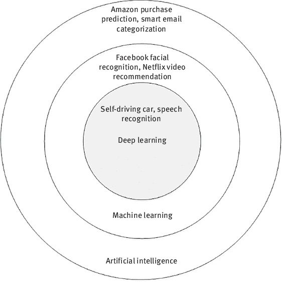

Figure 1.1: Relationship between AI, ML, and DL.

`ML` 兴起于 20 世纪 80 年代，是 `AI` 的一个子集，但具有动态性，不需要人工干预即可进行某些更改。符号逻辑是 `AI` 的一个示例，但不被视为 `ML`。根据 Tom Mitchel 给出的定义 \[6，“如果计算机程序在任务类别 T 和性能度量 P 方面，其在 T 中的任务上的性能（由 P 衡量）随着经验 E 的增加而提高，则称其从经验 E 中学习。” 在 `ML` 程序中，无需遵循 IF–THEN 规则引擎，而是可以根据所接触的数据自行调整，这被称为学习。学习可分为三种类型，如后续部分所述。

由于 `DL` 是 `AI` 和 `ML` 的子集，`AI` 和 `ML` 的所有特性都固有地传播到 `DL`。它处理应用于 `ANN` 的大量数据。统计数据表明，累积的数据量将从 4.4 波特字节增长到 2020 年的大约 44 波特字节。这就是为什么有时它被称为深度神经网络。

## 1.3 Artificial neural network

`ANN` 是一种信息处理系统，与生物神经元具有多种共同的性能特征。`ANN` 的特征如下 \[7\]

1. 神经元之间的设计模式，称为架构；

2. 确定连接权重的技术，称为学习算法；

3. 其激活函数。

如 图 1.2 所示的人工神经元是 `ANN` 的基本构建块或处理单元。

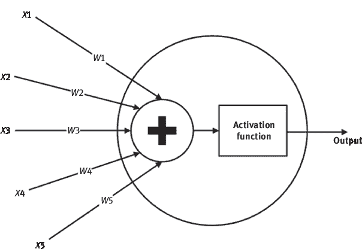

Figure 1.2: An artificial neuron.

### 1.3.1 Classification of ANN

主要，`ANN`s 可分为两类 \[7\]: `FFNN`s 和 `RNN`s。

#### 1.3.1.1 Feedforward neural network

`FFNN` 中信号的移动仅在前向路径上进行。由于没有反馈回路，其行为独立于历史输入，仅对当前输入做出反应。`FFNN` 主要有两种类型，如下所示。

##### 1.3.1.1.1 Single-layer feedforward network

这是分层网络的最简单形式（图 1.3），只有一个源节点的输入层，映射到计算节点的输出层。其输入通过一系列单层权重与输出相关联。自适应线性神经元、Hopfield 网络和学习向量量化是单层前馈网络的常见示例。

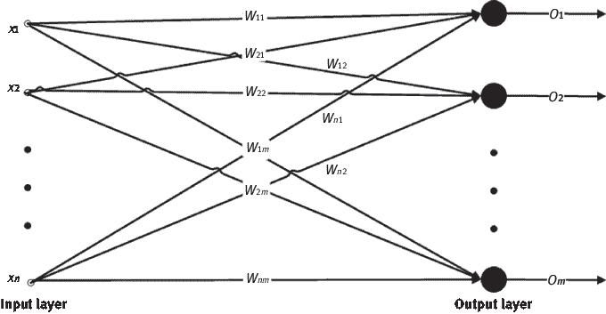

Figure 1.3: Single-layer feedforward network.

##### 1.3.1.1.2 Multilayer feedforward network

这种前馈网络具有一个输入层、一个输出层和一个或多个隐藏层。通过如 图 1.4 所示连接这些神经元，网络能够评估更高阶的信息。

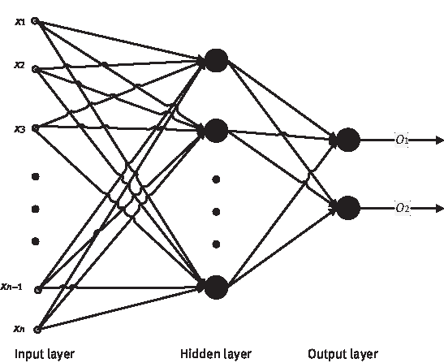

Figure 1.4: Multilayer feedforward network.

#### 1.3.1.2 Recurrent neural network

在 `RNN` 的架构中（图 1.5），应至少有一个反馈回路（也可以是自反馈）。基于反馈模式，有多种循环网络。在特定情况下，网络可以具有一个神经元层，每个神经元将其输出信号反馈到所有其他神经元的输入。其他类型的循环网络可能具有带有隐藏神经元的自反馈回路。Hopfield 网络、双向联想记忆、盒中脑状态和自适应共振理论是 `RNN` 的几个示例。

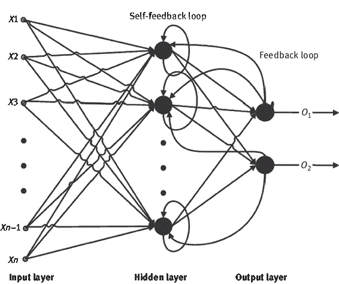

Figure 1.5: Recurrent network.

### 1.3.2 ANN learning

从环境中获取知识并通过学习提高网络性能是神经网络（`NN`）最重要的特性。该过程指示以下操作顺序 \[7\]:

* 受环境刺激

* 作为刺激的结果改变自由参数

* 以更好的方式响应环境

#### 1.3.2.1 Unsupervised learning


## 1.3.2 学习方式

## 1.3.2.1 无监督学习

在无监督学习（Figure 1.6）中，不需要外部训练者即可完成学习过程。输入被提供给网络，但没有所需的输出。网络必须自行决定使用哪些特征来组装输入数据。竞争学习规则是执行无监督学习的一种方式。如果一个神经网络有两层——输入层和竞争层，输入层神经元收集馈送数据，而竞争层由相互竞争的神经元组成，只有竞争的胜利者存活，其他神经元根据“胜者全拿”方法关闭。另一种无监督学习类型是 Hebbian，即相关权重调整。


Figure 1.6: Block diagram of unsupervised learning.

## 1.3.2.2 监督学习

如果神经网络的所需输出已知并馈送到网络中，则该网络的学习方法称为监督学习。网络随后处理输入并将其生成的输出与预期输出进行比较。然后计算差分误差，使系统调节权重以控制网络。随着权重不断精细调整，此方法会重复发生。

监督学习技术（Figure 1.7$\Delta w_{ij} = - \eta \frac{\delta E_i}{\delta w_{ij}}$

距离 `η` 是神经网络中的标准参数，称为学习率。

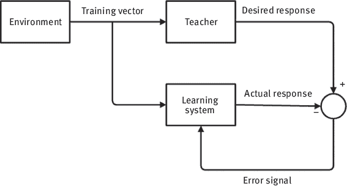

Figure 1.7: Block diagram of supervised learning.

## 1.3.2.3 强化学习

在强化学习中，网络的学习是通过与情况或环境的持续协作实现的。Figure 1.8 显示了典型强化学习网络的框图，该网络围绕一个训练者构建，训练者将从环境中收集的强化信号转换为称为启发式强化信号的高级信号。

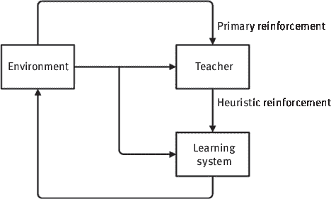

Figure 1.8: Block diagram of reinforcement learning.

## 1.4 深度学习

深度学习（DL）是机器学习（ML）的一个类别，其中网络或模型直接从数据集学习 \[8\]。“深度”一词表示网络中的层数——更深的网络包含许多层。传统神经网络仅包含两层或三层，而深度网络可以包含数百层，如 Figure 1.9 所示。除了层数之外，没有具体定义可以将网络归类为“深度” \[9\]。学习技术与 ML 和 ANN 相似，如前所述。DL 特别适合识别现代智能应用 \[10\]，例如人脸识别、文本翻译、语音识别以及包括车道分类和交通标志识别在内的高级驾驶辅助系统。

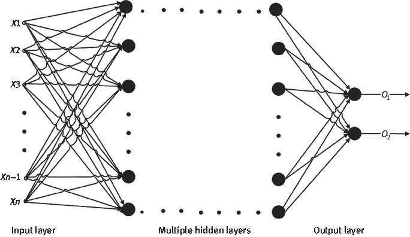

Figure 1.9: Block diagram of deep learning network.

## 1.4.1 什么使 DL 成为最先进的技术？

*   先进的工具和技术大大提高了 DL 算法的准确性。通过在相同问题和相同数据集上与 ML 进行比较，已证明 DL 大幅减少了误差百分比。

*   DL 可以处理大规模数据集，从而有目的地改进网络的训练。在当今世界，数据并不匮乏。如 Figure 1.10 所示，在大量数据存在的情况下，DL 远优于 ML。

*   高性能 GPU 加快了 DL 网络的训练，处理大量数据，将训练时间从几周缩短到几小时。GPU 可在任何 DL 云平台上使用。

许多由专家开发和认可的标准模型可在云平台上使用，以便在任何 DL 网络中为任何目的重复使用。

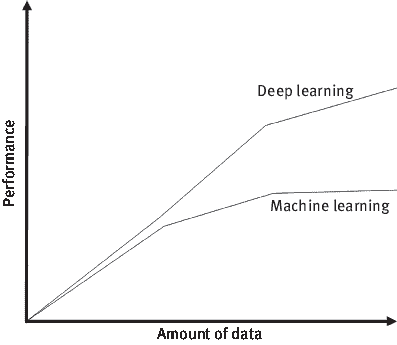

Figure 1.10: Performance comparison between ML and DL.

## 1.4.2 激活函数

激活函数或传递函数 \[11, 12\] 将神经网络节点的输入信号转换为输出信号，该输出信号被视为网络下一层的输入。它将非线性引入网络，使网络更强大，并增加从数据中学习复杂和复杂事物的能力。因此，为任何网络选择合适的激活函数非常重要，因为它可以显著改变网络的行为。下面描述了流行的激活函数。在所有方程中，`f'(x)` 被视为 `f(x)` 的导数，其中 `x` 是输入信号。

## 1.4.2.1 Sigmoid 激活函数

Sigmoid 函数定义为

(1.2)$\begin{matrix} & {f(x) = \frac{1}{1 + e^{- x}}} \\\\ & {f^{\prime}(x) = f(x)(1 - f(x))} \\\\ \end{matrix}$

Sigmoid 函数曲线看起来像 S 形，如 Figure 1.11 所示。该函数介于 0 和 1 之间。我们可以找到 Sigmoid 曲线在任意两点处的斜率；因此，它是可微的。

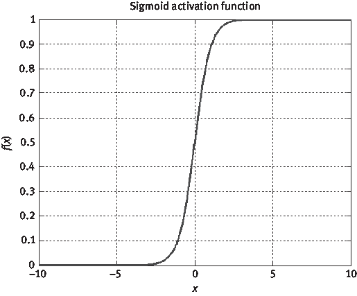

Figure 1.11: Sigmoid activation function.

## 1.4.2.2 双曲正切激活函数

双曲正切函数定义为

(1.3)$\begin{matrix} & {f(x) = \tanh(x) = \frac{2}{1 + e^{- 2x}} - 1} \\\\ & {f^{\prime}(x) = 1 - f{(x)^{2}}} \\\\ \end{matrix}$

如 Figure 1.12 所示，“tanh”函数也看起来像 S 形。该函数介于 -1 和 1 之间。它也是可微的。

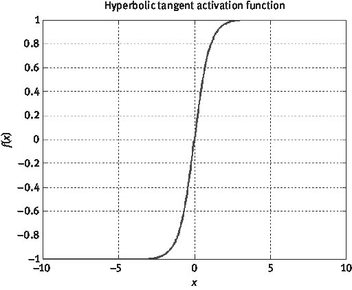

Figure 1.12: “tanh” activation function.

## 1.4.2.3 ReLU 激活函数

目前，ReLU 是使用最广泛的激活函数。如 Figure 1.13 所示，定义为

(1.4)$f(x) = 0, \text{for } x < 0; \quad x, \text{otherwise}$

(1.4)$f'(x) = 0, \text{for } x < 0; \quad 1, \text{otherwise}$

该函数介于 0 和无穷大之间。它也是可微的。

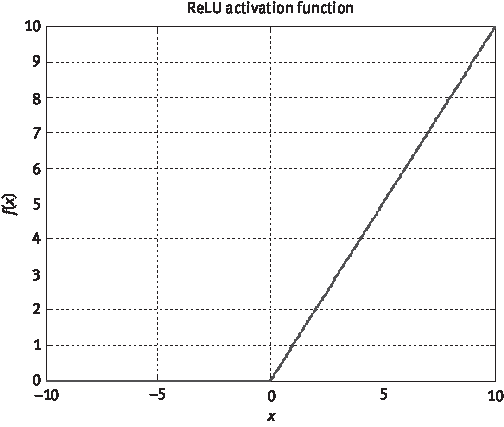


Figure 1.13: 整流线性单元激活函数。

## 1.4.2.4 Softmax 激活函数

Softmax 函数是一种 Sigmoid 函数，可以处理分类问题中的多类问题。Softmax 函数的输出相当于一个概率分布。它可以定义为

(1.5)$f(x)|_{j = 1}^{k} = \frac{e^{x_{j}}}{\sum_{k = 1}^{k}e^{x_{k}}}$

## 1.4.3 流行的 DL 架构

文献中有许多 DL 架构可供使用。其中少数变得非常流行，并以更好的性能提供高精度 [12]。

## 1.4.3.1 受限玻尔兹曼机

RBMs 由于其历史重要性和相对简单性，在 DL 网络中被广泛使用。它由 Geoff Hinton 发明，用于降维、分类、回归、协同过滤、特征学习和主题建模。玻尔兹曼机 (BMs) 是 RBMs 的主要构建块。BMs 可以设计为具有双向关联随机处理组件的 NN。RBMs 是浅层的两层 NN，用于建立 DBN。如 Figure 1.14 所示，它只有两层——可见层（或输入层）和隐藏层。可见层的每个节点都连接到隐藏层的每个节点，但任何特定层中任何节点之间都没有连接。这是 RBM 网络中的限制。

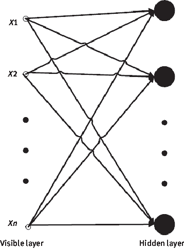

Figure 1.14: RBM 的结构。

近年来，不同研究人员引入的少数修改版 RBM 包括判别式 RBM、条件 RBM 和基于温度的 RBM。

## 1.4.3.2 深度置信网络

DBN 也属于同一类 RBM 堆栈，因为这里任何单层的节点也不会互连。由 Hinton 于 2006 年构建的 DBN 用于识别、聚类和生成图像、视频序列和运动捕获数据。

为了最大限度地提高 DBN 的灵活性，Arel 在 2010 年提出了一种新型卷积 DBN 原型。它可以提取高维图像的特征。DBN 的结构已在 Figure 1.15 中演示。

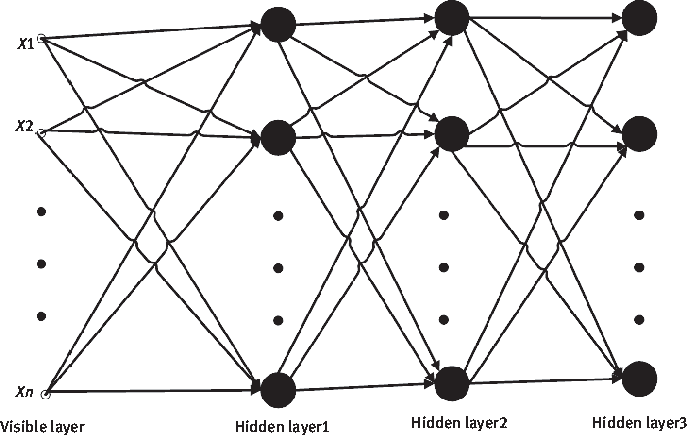

Figure 1.15: 深度置信网络的结构。

## 1.4.3.3 自动编码器

AE 由两个对称的 DBN 组成，如 Figure 1.16 所示。第一个 DBN 执行编码操作，第二个执行解码操作。它已成功应用于图像搜索、数据压缩、信息检索等。

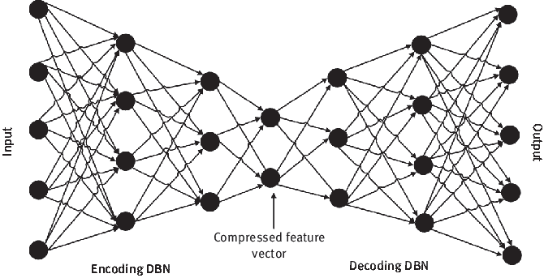

Figure 1.16: 自动编码器的结构。

作为实际示例，28 × 28 像素（即 784 个像素）图像数据集可以作为 AE 的输入。编码半部分的第一层通常保留略大一组参数。本质上，编码器将包含以下参数集：

784 (input) ----> 1000 ----> 500 ----> 250 ----> 100 ----> 30 (compressed vector)

同样，解码器将包含以下参数集：

30 (compressed vector) ----> 100 ----> 250 ----> 500 ----> 1000 ----> 784 (output)

为了提高 AE 的能力，存在各种类型的 AE，例如去噪自动编码器、稀疏自动编码器、变分自动编码器和收缩自动编码器。

## 1.4.3.4 卷积神经网络

两个函数 `f(t)` 和 `g(t)` 的卷积算子可以定义如下：

(1.6)$f(t) \ast g(t)\overset{\Delta}{=}\int_{-\infty}^{\infty}{f(\tau)g(t - \tau)d\tau =}\int_{-\infty}^{\infty}{f(t - \tau)g(\tau)d\tau}$

其中 `τ` 是表示时间的虚拟变量。

这种数学运算已用于 CNN，并在处理具有网格状拓扑的 2D 数据方面表现良好。CNN 的主要应用领域包括图像分类、聚类、对象识别、行为识别、光谱图上的声音表示以及手写文档的自然语言处理。CNN 的图像识别功能主要应用于自动驾驶汽车、机器人、无人机、安全、医疗诊断以及视障人士的治疗。

卷积网络分析图像的方式与 RBM 不同。虽然 RBM 需要重新创建并识别每幅图像的所有特征，但卷积网络将图像分块分析。卷积网络将普通彩色图像视为一个矩形框，其宽度和高度由像素数量衡量，深度为三层，每层对应红绿蓝中的一个颜色。换句话说，卷积网络将图像视为一个 3D 对象。

文献中有几种修改版的 CNN，与传统 CNN 相比表现出更好的性能。RBM 和 CNN 的组合，称为卷积 RBM，提供了更高的收敛速度，并降低了负似然函数的值。

## 1.5 多个组织的 ML 平台

| Company | ML platform | URL |
| --- | --- | --- |
| IBM | IBM Watson Studio (formerly, Data Science Experience) | [`www.ibm.com/cloud/watson-studio`](https://www.ibm.com/cloud/watson-studio) |
| Amazon | SageMaker | [`aws.amazon.com/sagemaker/`](https://aws.amazon.com/sagemaker/) |
| Microsoft | Azure Machine Learning Studio | [`studio.azureml.net/`](https://studio.azureml.net/) |
| SKIL | Skymind Intelligence Layer | [`docs.skymind.ai/docs`](https://docs.skymind.ai/docs) |
| Google | Cloud AI | [`cloud.google.com/products/machine-learning/`](https://cloud.google.com/products/machine-learning/) |
| Cloudera | Data Science Workbench | [`www.cloudera.com/products/data-science-and-engineering/data-science-workbench.html`](https://www.cloudera.com/products/data-science-and-engineering/data-science-workbench.html) |
| Databricks | MLlib | [`docs.databricks.com/spark/latest/mllib/index.html`](https://docs.databricks.com/spark/latest/mllib/index.html) |
| Dataiku | Collaborative Data Science Platform | [`www.dataiku.com/`](https://www.dataiku.com/) |

## 1.6 IBM Watson Studio (formerly, Data Science Experience)

2016 年，IBM 推出了 DSX [13]，后改为 Watson Studio，旨在解决数据科学生命周期的每个阶段，通过配置 Spark、R、Python、Scala 和其他 ML 语言，提供笔记本、协作空间、教程和 ML 模型。DSX 还通过支持数据科学家熟悉的工具（如 Jupyter、RStudio、Notebooks 和 Apache Spark）来帮助他们创建复杂的 ML 模型并将这些模型部署到生产环境中。Figure 1.17 显示了 IBM Watson Studio 中项目和服务子部分的几个快照。项目用于组织资源以实现特定目标。它可以包括数据、协作者以及笔记本和模型等分析资产。管理员可以将任意数量的服务与项目关联。可以关联的服务类型包括

* IBM Apache Spark 计算服务
* Amazon Elastic MapReduce 计算服务
* IBM Analytics Engine 计算服务
* Cognos Dashboard Embedded
* IBM Watson Machine Learning
* IBM Streaming Analytics
* Watson Natural Language Classifier
* Visual Recognition
* Watson Assistant
* Watson Discovery
* Watson Knowledge Studio
* Watson Language Translator
* Natural Language Understanding
* Watson Personality Insights
* Watson Speech to Text
* Watson Text to Speech
* Watson Tone Analyzer


图 1.17：IBM Watson Studio 子部分。(a) 项目（新建和现有）子部分，(b) 创建新项目，以及 (c) 服务（新建和现有）子部分。

一旦项目创建完成，管理员可以向其中添加数据资产以便处理该数据。数据资产可以从本地文件、社区和数据库连接中添加。项目中的所有协作者均自动获得访问项目中数据的授权。将原始数据添加到项目后，数据需要进行精炼，这包括清洗和整形。清洗可以通过删除不正确、不完整、格式不当或重复的数据来完成。而数据整形可以通过过滤、排序、合并或删除列，以及执行操作来完成。精炼后的数据即可用于分析和可视化 \[14\]。

## 1.7 结论

在本章中，已说明 AI、ML 和 DL 之间关系的概述。同时，讨论了在现代将 DL 视为最先进技术的原因。重点是突出市场上不同供应商提供的不同云平台。在第 1.6 节中，已描述了使用 IBM Watson Studio 进行 ML 的不同步骤，包括数据集管理和清洗原始数据。未来研究可以考虑对多个组织提供的 ML 平台在性能、准确性、24 × 7 可用性和用户友好性方面进行比较讨论。

## 参考文献

\[1\][`www.forbes.com/sites/bernardmarr/2017/08/08/the-amazing-ways-how-google-uses-deep-learning-ai/#509e1a7b3204`](https://www.forbes.com/sites/bernardmarr/2017/08/08/the-amazing-ways-how-google-uses-deep-learning-ai/%23509e1a7b3204) →

\[2\][`www.techtimes.com/articles/3442/20140213/netflix-deep-learning-based-ai-will-tell-you-what-you-want-to-watch-but-do-we-need-one.htm`](https://www.techtimes.com/articles/3442/20140213/netflix-deep-learning-based-ai-will-tell-you-what-you-want-to-watch-but-do-we-need-one.htm) →

\[3\][`www.digitaltrends.com/computing/mit-future-video/`](https://www.digitaltrends.com/computing/mit-future-video/) →

\[4\][`theintercept.com/2018/04/13/facebook-advertising-data-artificial-intelligence-ai/`](https://theintercept.com/2018/04/13/facebook-advertising-data-artificial-intelligence-ai/) →

\[5\][`www.systematics.co.il/wp-content/uploads/Deep\_Learning\_ebook.pdf`](https://www.systematics.co.il/wp-content/uploads/Deep_Learning_ebook.pdf) →

\[6\][`www.cs.ubbcluj.ro/~gabis/ml/ml-books/McGrawHill%20-%20Machine%20Learning%20-Tom%20Mitchell.pdf`](https://www.cs.ubbcluj.ro/~gabis/ml/ml-books/McGrawHill%20-%20Machine%20Learning%20-Tom%20Mitchell.pdf) →

\[7\]Haykin Simon S. Neural networks and learning machines. Pearson, Upper Saddle River, 2009, 3. a, b, c

\[8\]Deng L. A tutorial survey of architectures, algorithms, and applications for deep learning. APSIPA transactions on signal and information processing, 2014, 3. →

\[9\]Deng L., Dong Y. Deep learning: Methods and applications. Foundations and Trends® in Signal Processing, 2014, 7, 3–4, 197–387. →

\[10\]Liu W., Zidong W., Xiaohui L., Nianyin Z., Yurong L., & Fuad E. A. A survey of deep neural network architectures and their applications. Neurocomputing, 2017, 234, 11–26. →

\[11\]Schmidhuber J. Deep learning in neural networks: An overview. Neural networks, 2015,61, 85–117. →

\[12\]Bishop Ch. M. Pattern recognition and machine learning (information science and statistics). 2006. a, b

\[13\][`hortonworks.com/blog/exciting-data-science-experience-hdp/`](https://hortonworks.com/blog/exciting-data-science-experience-hdp/) →

\[14\]Kanit W., Smilkov D., Wexler J., Wilson J., Mané D., Fritz D., Krishnan D., Viégas F.B., & Wattenberg M. Visualizing dataflow graphs of deep learning models in TensorFlow. IEEE transactions on visualization and computer graphics, 2018, 24, 1, 1–12. →

# 2 卷积神经网络：自底向上的方法

Karan Maheshwari 维洛尔理工学院计算机科学与工程学院，维洛尔，印度。Aditya Shaha 维洛尔理工学院计算机科学与工程学院，维洛尔，印度。Dhruv Arya 维洛尔理工学院计算机科学与工程学院，维洛尔，印度。Rajkumar Rajasekaran 维洛尔理工学院计算机科学与工程学院，维洛尔，印度。B. K. Tripathy 维洛尔理工学院信息技术与工程学院，维洛尔，印度。

## 摘要

自所谓的深度学习（DL）时代开启以来，世界发生了许多变化。与传统机器学习算法不同，在传统算法中，人类更多地进行特征提取，而机器仅仅进行数字计算；DL 算法非常有前景，因为它们彻底改变了我们处理数据的方式，并且已能够做出类似人类的决策。基于人工神经网络的强大概念，这些学习算法学习表示数据，或者换句话说，可以从原始数据中提取特征。DL 为端到端系统铺平了道路，其中一个学习算法完成所有任务。卷积神经网络近年来声名鹊起，尤其是在计算机视觉领域，在某些情况下其性能已超越人类。已经对 convNets 进行了大量工作，在本章中，我们将揭示卷积神经网络的工作原理，并将使用天文学领域的一个新颖应用进行说明，即使用原始图像作为输入进行星系分类，并根据其形状对其进行分类。此外，我们还将调查网络正在学习哪些特征。我们还将讨论 DL 如何取代其他形式的学习，以及一些围绕卷积神经网络的最新算法创新。

关键词：深度学习（DL），卷积神经网络，星系分类，人工神经网络，反卷积，

## 2.1 引言


# 宇宙探索与数据分析的演进

人类始终在思考自己在宇宙中的位置。自人类诞生以来，我们总是仰望星空，对太阳、月亮、星辰和宇宙提出各种定性问题。宇宙是如何诞生的？我们的宇宙未来将如何？这是众多尚未得到清晰解答的问题中的两个。科学界存在许多理论，但尚未达成共识。二十世纪初的天文学家和科学家非常重视数据。对他们而言，收集数据意味着手动记录地球上的观测结果，这无疑是一个耗时且昂贵的过程，但却是研究宇宙的唯一手段。他们认为，拥有更多数据就能回答所有迫在眉睫的问题。如今，科学家拥有的数据远超其处理能力。每天都有 PB（1 PB = 10⁶ GB = 10¹² KB）的数据被下载并归档到数据坟墓中，我们相信之所以称其为数据坟墓不言而喻。今天，科学家们一致认为，我们无法立即回答与自身存在相关的问题，但随着数据的增加，我们将能获得更多关于外部不同天文现象和事件的信息。基于这些信息，我们可以制定新理论，这些理论可能引领我们走向了解宇宙起源的道路。在现代计算技术和太空望远镜数据采集出现之前，宇宙学家曾依赖粗糙的技术分析手动记录的数据。

这一切始于 19 世纪，当时哈佛学院天文台台长爱德华·皮克林希望利用当时新发现的技术（恒星光谱学）对整个天空进行测量，并组建了一支专注且坚定的“人类机器”团队，根据光谱线中不同元素的存在对恒星进行分类。经过多次尝试和错误的组合，他们最终找到了至今仍在使用的 OBAFGKM 恒星分类方案。在 1911–1915 年间，这些人类计算机每年对大约 50,000 颗恒星进行分类，从而形成了亨利·德雷珀星表（HDR）。这种手动分类的工作量本身就是一项伟大的壮举，但尽管付出了艰苦的努力，任何手动方法都无法应对当前的数据速率。

随着第一台太空望远镜（哈勃太空望远镜，1990 年）的发射，随后又发射了许多其他望远镜，随着技术的发展，科学家和工程师开发了用于从天空记录数据的新一代技术。因此，现在数据非常丰富。

今天，当太空望远镜扫描包含大约一万亿颗恒星的天空时，即使以那些人类计算机难以置信的分类速度，对十亿颗恒星（仅占总数的 0.1%）进行分类也需要大约 16,000 年。

简而言之，我们希望用两个问题及其解决方案来概括整个时代：

1. 第一个问题是，数据是通过手工或从地球拍摄照片以粗糙的方式记录的，因此由于大气中的灰尘和污染，数据高度失真且不准确。解决这个问题的方法是发射太空望远镜，这导致了第二个问题的出现。

2. 随着太空望远镜的发射，数据采集速率急剧上升，对于人类来说，手动分类如此大量的数据已不可能，因为这将需要数千年才能完成。解决这个问题的方法正是本章所关注的内容。

为了解决第二个问题，我们需要工具，或者更确切地说，我们需要程序，这些程序可以在发生异常时预测异常，或者通过做出决策或在数据中寻找模式来对数据进行分类和聚类，例如，对星系的形状进行分类。在半个世纪内，我们将迎来从差分机发明到今天的 200 年计算史，在此期间，计算能力已经增长到如此程度，以至于我们拥有可以自主做出决策的计算机。正如柏拉图所说，需求是发明之母，机器学习（ML）领域也是如此，因为我们需要能够自主学习以预测/分类/寻找模式的程序，或者更确切地说，我们需要能够执行所谓的人类机器在大量数据上所执行任务的程序，例如，星系分类。因此，我们可以正式地说，ML 是一种在任务（t）上随着经验（e）的增加而改进其性能度量（p）的程序 [1]。ML 是一组基于统计学和微积分原理的不同技术，允许我们创建程序，这些程序无需显式编码即可执行需要人类水平决策和智能的任务。不同 ML 算法的示例包括回归、逻辑回归、人工神经网络（ANNs）、支持向量机、聚类等等。使用这些技术，我们要么试图预测某个实体的值（例如，房价预测），要么试图对某个实体进行分类（例如，肿瘤类别预测），基于我们称为数据特征的某些因素。例如，假设我们想要预测房子的价格/类别。这个价格/类别将取决于许多因素（特征），例如房子大小（x[1]）、地段（x[2]）、卧室数量（x[3]）和楼层数量（x[4]）。所有这些特征都成为我们的输入数据，并对房价或类别产生不同的贡献；因此，它们的贡献可以分别表示为 w[1]、w[2]、w[3] 和 w[4]。房子的实际价格/类别可以表示为 y，预测的价格/类别可以表示为 y'。

我们可以根据算法的学习方式对这些算法进行分组。

1. 监督式 ML 算法：在这里，数据由 x[1]、x[2]、…、x[n] 和 y 组成。算法的目标是通过学习 w[1]、w[2]、, w[n] 来正确预测 y'，这些权重映射了 x 和 y 之间的关系。算法在标记的 y 提供的监督下学习，通过优化基于误差（y-y'）的权重来实现。这个误差用于根据不同的学习策略（例如，反向传播）和权重更新规则（例如，梯度下降）来调整 w[1]、w[n]。

2. 无监督式 ML 算法：在这里，数据仅由 x[1]、x[2]、…、x[n] 组成。算法的目标是将数据聚类或分组到用户预设的不同数量的类别（y[1]、y[2]..）中。这些算法基于数据本身（x[1]、x[2]、…、x[n]）进行内部表示或对数据进行聚类。这里没有提供监督，因为我们没有标签 y 的值。

因此，可以理解，代表数据的特征非常重要，因为如果我们使用无法正确代表数据的不正确特征，那么我们的预测 y' 将是不正确的。因此，在传统的 ML 算法中，这仅仅成为优化由该领域人类专家提取或设计的特征权重的任务，如图 2.1 所示。

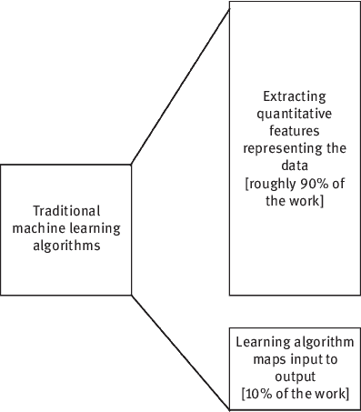

Figure 2.1: Machine learning in practice.

因此，在这些方法中，人类对问题的了解多于机器。在我们看来，在传统的 ML 中，近 90% 的工作是由人类完成的，以找出定义数据的特征，其余 10% 的工作是由计算机完成的，即数值优化。计算机擅长数值优化。ML 不应仅仅意味着给定权重的数值优化，我们希望计算机能够从原始数据中自动提取特征。当前的深度学习（DL）算法正是如此。DL 算法基于受人类认知启发的 ANNs 概念。


## 2.2 卷积运算

我们知道大脑处理信息，计算大量数据，并保留短期和长期记忆。人脑通过五个感觉器官获取原始输入并处理信息。ANN（人工神经网络）的概念正是由此而来。在 ANN 中，科学界一直试图模拟人脑的工作原理。大脑有其基本构建单元，负责从五种感官（来自外部世界）获取输入，并向身体发送指令。类比于 ANN 模型中发生计算的地方，其构建单元是神经元或神经细胞。神经元负责接收输入信号，并将这些输入映射到目标响应。同样，ANN 拥有一个由互连神经元组成的密集网络，每个连接都有突触权重。输入信号通过这个密集网络传播，并映射到目标响应。表 2.1 和 (图 2.2) 展示了生物神经元与人工神经元之间的比较。

表 2.1: 生物神经元与人工神经网络的对比。

| 生物神经元 || 人工神经元 |

| --- | --- |

| 神经细胞 || 神经元 |

| --- | --- |

| 树突 || 输入信号 |

| 突触 || 权重 |

| 胞体 || 净输入 |

| 轴突 || 输出 |

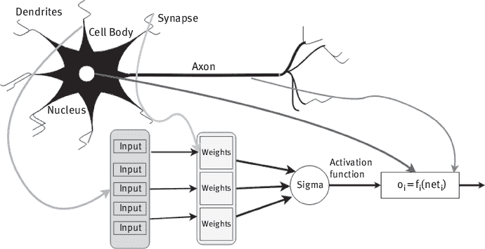

图 2.2: 生物神经元与人工神经网络的对比。

在普通神经网络中，我们使用诸如梯度下降等权重更新规则来更新参数 `w^([L]^)`，该规则通过反向传播误差来最小化每次迭代后的损失。

在 DL（深度学习）中，我们拥有一个由神经元层组成的密集网络，原始输入按层级顺序逐层线性和非线性处理（图 2.3）。DL 是表示学习的一个子领域。神经网络试图自动学习良好的特征或表示，而深度神经网络（DNN）或 DL 算法（基于 ANN）则试图从原始输入 `x` 学习（多级别的）表示和输出。DL 并不仅仅意味着使用神经网络，而是意味着我们拥有多层表示。卷积神经网络（CNN）（Le Cunn 1989）是一种此类 DL 架构，已知其适用于以网格方式结构化的数据（图 2.3）。

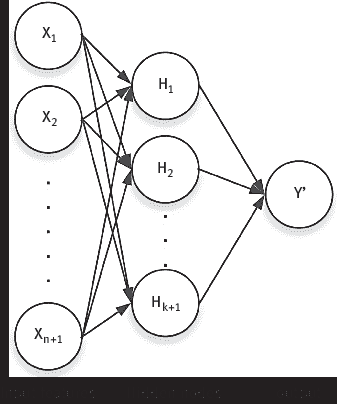

图 2.3: 人工神经网络。

`Z[L] = W[L]A[L−1] + B[L] A[L] = g(Z[L])`

`L` 是某个层 `1 ≤ L ≤ N`

现在回到我们使用 DL 算法替代人工分类星系图像的任务，我们需要知道图像识别的基础是什么。图像是一个二维函数 `f(x,y)`，其中 `x` 和 `y` 是空间坐标，`f` 在任何坐标对 `(x,y)` 处的幅度称为该点图像像素的强度。因此，通俗地说，我们可以说图像是一个 `m × n` 维矩阵，可以被视为一个二维网格。当我们谈论图像时，我们将所有原始像素视为图像的特征。对于物体/图像分类任务，研究人员长期以来依赖于物体的边缘。图像的边缘图给出了物体的大致轮廓或形状，在物体分类中非常有用。在许多计算机视觉任务中，我们首先通过将滤波器传遍图像来检测图像中的边缘。图 2.4 展示了滤波器如何传遍图像。

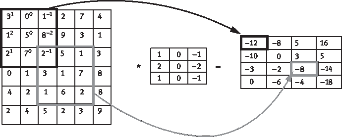

图 2.4: 图像上 Sobel 滤波器的应用。

此处使用的滤波器是 Sobel 滤波器。我们可以说，滤波器可以被视为一组权重，它将输入 `A^([L−1]^)` 映射到输出 `Z^([L]^)]`。将滤波器传遍图像的效果在 图 2.5 中显示，其中使用 Sobel 滤波器检测了猫的边缘。

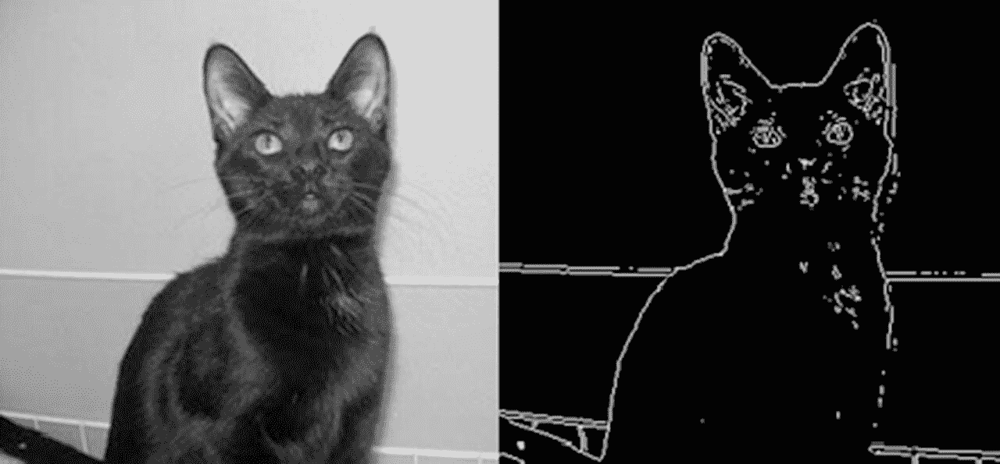

图 2.5: 应用 Sobel 滤波器后的猫图像输出。

像 Sobel 滤波器一样，有许多不同类型的滤波器可以在各种场景中使用。读者脑海中应该会出现一个问题：如何选择最优滤波器。如前所述，ML 算法学习参数 `W`，将输入 `X` 映射到输出 `Y`。因此，我们可以将物体识别任务视为一个受监督的 ML 问题，并学习能给出正确特征（边缘）的最优滤波器，这些特征可进一步用于分类物体。CNN 学习正确的一组滤波器，以提取用于分类物体的正确特征。在下一节中，我们给出了 CNN 的数学概述。名称表明 CNN 使用名为卷积的数学算子。这种卷积运算与数学或信号处理教科书中定义的不同。DL 社区实际上使用互相关（逐元素乘积之和），但按惯例称为 CNN，在本章中，我们将遵循该惯例。如前所述，卷积运算可以在任何以网格格式排列的数据上执行。例如，音频数据（一维网格，随时间或文本序列测量幅度）和图像（二维网格，每个位置 `x`、`y` 代表一个像素）。因此，使用正确的滤波器（可通过受监督的 ML 学习），我们可以学习提取正确的特征。

让我们看看卷积运算是如何工作的。

## 2.2 卷积运算

在板球比赛中，我们根据球员的平均表现来评判其优劣。这只不过是球员在所有参加的比赛中得分的平均值。现在假设我们作为板球队的教练，被指派从一群球员中选出最佳球员，我们可以使用卷积运算来帮助我们。卷积运算只是球员最近 `n` 场比赛得分的加权和。

因此，我们的责任是选择那些不仅表现一直很好，而且在最近过去也表现良好的球员。因此，球员在最近过去得到的得分应比在遥远过去得到的得分赋予更高的权重。因此，我们使用加权和来计算球员的表现。

设过去比赛的权重应小于最近比赛的权重。那么比赛的权重如 表 2.2 所示：

表 2.2: 过去七场比赛分配的权重。

| 比赛 1 (`w[1]`) || 比赛 2 (`w[2]`) || 比赛 3 (`w[3]`) || 比赛 4 (`w[4]`) || 比赛 5 (`w[5]`) || 比赛 6 (`w[6]`) || 比赛 7 (`w[7]`) |

| --- | --- | --- | --- | --- | --- | --- |

| 0.01 || 0.01 || 0.02 || 0.02 || 0.04 || 0.4 || 0.5 |

| --- | --- | --- | --- | --- | --- | --- |

球员得到的得分如 表 2.3 所示。

表 2.3: 球员过去得到的得分。

| `X[1]` || `X[2]` || `X[3]` || `X[4]` || `X[5]` || `X[6]` || `X[7]` || `X[8]` || `X[9]` || `X[10]` || `X[11]` || `X[12]` |

| --- | --- | --- | --- | --- | --- | --- | --- | --- | --- | --- | --- |

| 100 || 110 || 120 || 140 || 170 || 180 || 190 || 210 || 220 || 240 || 250 || 270 |

| --- | --- | --- | --- | --- | --- | --- | --- | --- | --- | --- | --- |


在对这些分数应用卷积操作后，我们得到的值如 表 2.4 所示。

表 2.4：卷积操作的结果。

| `S[1]` || `S[2]` || `S[3]` || `S[4]` || `S[5]` || `S[6]` |

| --- | --- | --- | --- | --- | --- |

| 181.1 || 196.7 || 211.2 || 226.9 || 241.3 || 256.9 |

| --- | --- | --- | --- | --- | --- |

例如，`S[6]` 是通过以下方式得到的

`S[6] = X[12]w[7] + X[11]w[6] + X[10]w[5] + X[9]w[4] + X[8]w[3] + X[7]w[2] + X[6]w[1]`

因此，卷积操作现在为我们提供了一个更小的空间，从较大的运行空间中提取了重要的性能细节。现在，这个空间可以用于对球员性能进行更彻底的比较。

在上述卷积操作中，我们使用的核（权重）是一维的，因为我们的输入是一维的。卷积的相同概念可以通过使用二维核扩展到二维输入（如图像）：

$$
S(i,j) = (K * I)(i,j) = \sum_{m} \sum_{n} I(i + m, j + n) K(m, n)
$$

在上述方程中，我们通过应用大小为 `(m × n)` 的核 `K` 对图像 `I` 应用卷积操作。图 2.6 [2] 显示了在大小为 (3 × 4) 的图像上应用大小为 (2 × 2) 的核进行的卷积操作。从上面的示例中我们可以看到，通过在一维输入上应用一维核，我们得到一维输出。

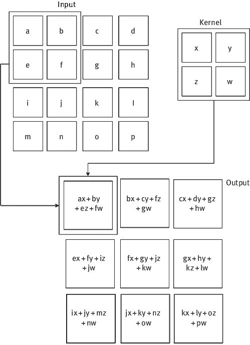

图 2.6：大小为 (4 × 4) 的图像与核 (2 × 2) 的卷积操作。

同样，通过在二维输入（通常是灰度图像）上应用二维核，我们得到二维输出。那么，当我们有三维输入（如 RGB 图像）时会怎样呢？在具有三个通道（`image[width] × image[height] × 3`）的 RGB 图像中，我们需要一个具有相同通道数的核。它将与具有三个通道的滤波器进行卷积。读者应注意，每个单独的滤波器通道与相应的输入通道进行卷积，所有通道的输出被求和为单个输出。因此，我们得到二维输出。在大多数 CNN 中，我们使用 `K` 个三维滤波器，并得到三维输出，其中第三维将是 `K`，即滤波器的数量。这在 图 2.7 中有所说明。

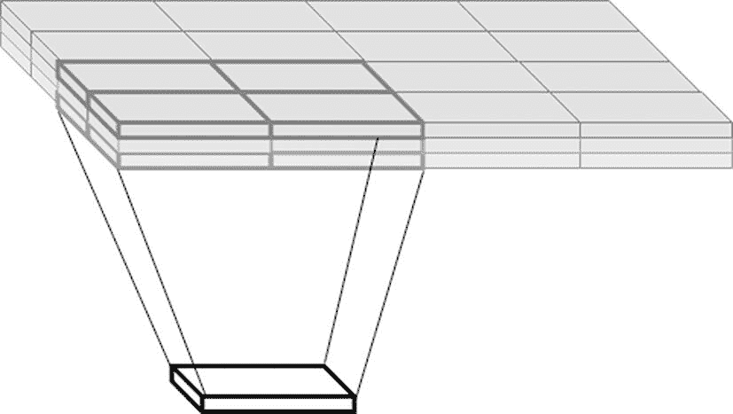

图 2.7：三维图像的卷积操作。

## 2.3 输入维度、输出维度和滤波器维度之间的关系

现在，我们脑海中可能会出现一个问题：如何在不实际应用滤波器的情况下预测输出的维度？这个问题的答案在于输入维度、输出维度和滤波器维度之间存在的数学关系。那么，让我们先通过回答一个简单问题来开始推导这个关系。为什么输出大小小于输入大小？答案是图像上有某些像素，我们无法在那里放置核，因为这样会超出图像边界（图 2.8 和 图 2.9）。

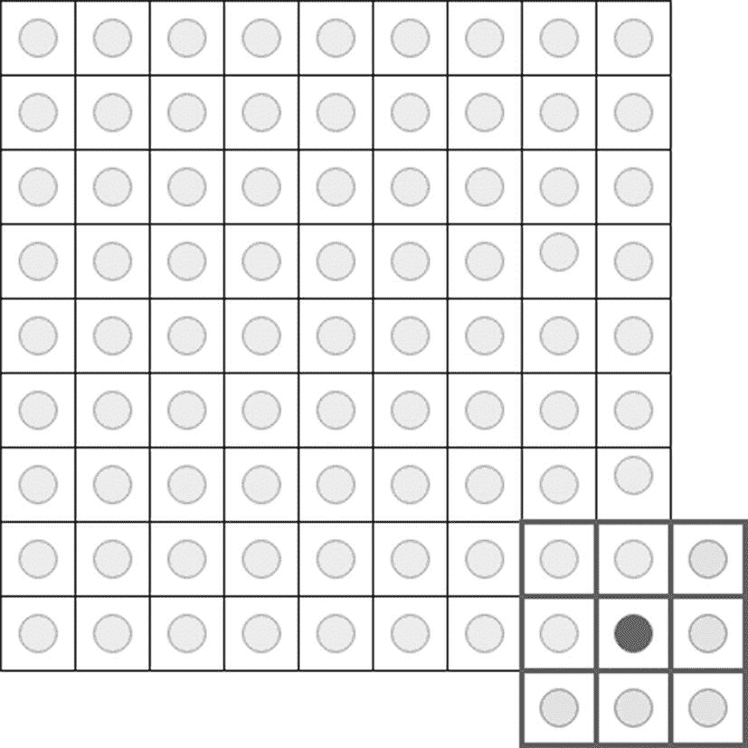

图 2.8：核大小为 (3 × 3) 的图像卷积操作。

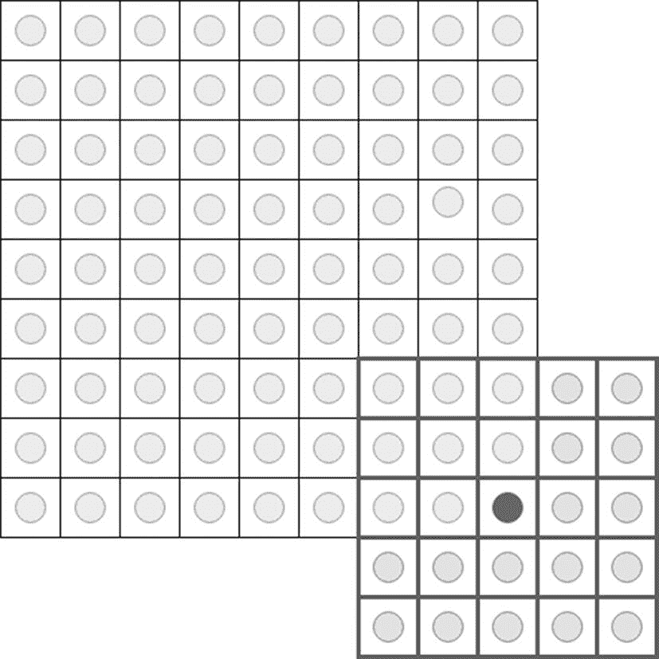

图 2.9：核大小为 (5 × 5) 的图像卷积操作。

为了避免这种情况，我们可以在应用卷积操作前对图像进行填充，但这仍然会增加图像的维度。因此，对于 (3 × 3) 核，填充将使图像的维度增加 (2 × 2)。但是，如果我们增加核的大小呢？例如，对于 (5 × 5) 核，我们需要通过填充 (4 × 4) 来增加图像的大小。因此，一般来说，我们可以看到，对于大小为 `F` 的核进行卷积操作，我们需要在图像的两侧各进行 `F`–1 的填充。换句话说，我们无法计算图像两侧 `F`–1 个像素的卷积。因此，图像的大小将减少 `F`–1。让图像的高度和宽度分别为 `H` 和 `W`。输出的高度和宽度分别为 `H[o]` 和 `W[o]`。因此，图像的输出维度将为

`H[o] = H − F + 1`
`W[o] = W − F + 1`

正如我们在上面的示例中所看到的，为了计算所有像素的卷积，我们需要对图像进行填充，而填充图像会使图像的维度增加两倍的填充大小（上下）。因此，填充后输出的维度将为

`H[o] = H + 2*P − F + 1`
`W[o] = W + 2*P − F + 1`

如果我们用值为零的像素在图像周围进行填充，则称为零填充。很多时候，我们可以通过添加存在于边界的像素层来进行填充。由于填充用于控制输出的大小，因此根据输出大小有两种常用类型。如果输出大小等于输入大小，则我们称之为相同填充（same padding）。如果输入没有填充，则我们称该方案为有效填充（valid padding）。除了这两种类型，我们始终可以定义自己的自定义填充大小。

填充的原因是（1）角落的信息，因为滤波器只通过一次，（2）如果没有填充，输出将变得非常小。因此，为了控制输出的大小，我们采用填充。

那么，如果我们不想计算图像中所有像素的卷积操作，而是想计算交替像素，或者可能是两个交替像素或 k 个交替像素的卷积呢？为了解决这个问题，我们引入步长的概念。步长只不过是在应用卷积操作时我们采取的一个步长。在正常情况下，我们有一个大小为 1 的步长，在这种情况下，我们为每个像素计算卷积。为了计算交替像素的卷积，我们可以有一个步长为 2，依此类推。

那么，步长的应用将如何影响我们的输出维度呢？因为我们现在计算的是交替像素的卷积，输出大小必然会减少输入大小的一半。因此，当我们应用步长 `k` 时，输出大小将减少输入大小的 (1/`K`) 倍。因此，当我们使用大小为 `P` 的填充和步长 `S` 时，计算输出维度的公式为

```
Ho = (H + 2P - F) / S + 1
Wo = (W + 2P - F) / S + 1
```

## 2.4 CNN 的特性

现在我们知道什么是卷积算子，以及卷积操作如何改变输出维度，是时候提出一个非常根本的问题了。什么是 CNN？我们为什么使用 CNN，它们与普通的前馈神经网络有什么不同？

让我们逐一回答这些问题。卷积网络只是在至少一个层中使用卷积代替一般矩阵乘法的神经网络 [2]。但是，我们为什么要使用卷积操作？我们为什么要从 ANNs 中使用的矩阵乘法操作转向卷积操作？

卷积操作具有以下好处，有助于我们改进机器学习过程：

* 稀疏交互

* 参数共享

* 等变表示

## 2.4.1 稀疏连接


# 2.4 卷积神经网络基础

在上述示例中，我们使用了小于图像尺寸的卷积核。通过使用较小尺寸的卷积核，我们能够捕捉邻域中的有意义信息，并仅存储这些有意义信息以供后续处理。这与我们在板球队选拔示例中看到的情况类似。我们从 12 场比赛的数组中捕捉有意义的表现细节，并将其存储在大小为 6 的数组中，这比原始数据小得多，也帮助我们了解球员在最近 6 场比赛中的表现。

同样，在图像的情况下，相邻像素在检测边缘等特征时贡献更大。正如我们在上面的示例中看到的，(3 × 3) Sobel 滤波器能够捕捉高维图像的边缘。但是，我们如何通过使用较小的卷积核来实现稀疏连接呢？

考虑以下情况。我们要设计一个数字识别软件，每张图像的大小为 (4 × 4)。因此，总共有 16 个像素。假设我们使用人工神经网络 (ANN) 来解决这个问题。那么输入层有 16 个值。假设隐藏层有 4 个神经元。因此，将隐藏层连接到输入层所需的连接数为 16 × 4 = 48（图 2.12）。现在，如果我们使用大小为 (2 × 2) 卷积核的 CNN，所需的连接数为 4 × 9 = 36（图 2.13）。

要计算上述图像的卷积操作，我们需要将卷积核与图像相乘。

因此，在 CNN 中，使用 (2 × 2) 卷积核时，输出将是一个包含神经元 {`K[1]`, `K[2]`, `K[3]`, `K[4]`, `K[5]`, `K[6]`, `K[7]`, `K[8]`, `K[9]`} 的九神经元隐藏层（图 2.10）。

`K[1] = 1 × w[1] + 2 × w[2] + 5 × w[3] + 6 × w[4]`

图 2.10：在 (4 × 4) 图像上使用 (2 × 2) 卷积核。

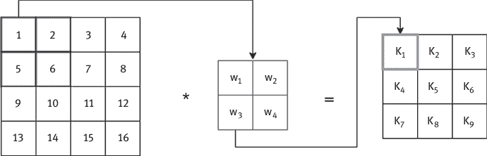

因此，稀疏连接显著减少了计算隐藏层输出所需的计算量。稀疏连接的另一个问题是：“我们是否因为不让某些神经元相互作用而丢失了信息？”这个问题的答案可以借助图 2.11 和参考文献 [2] 来解释。

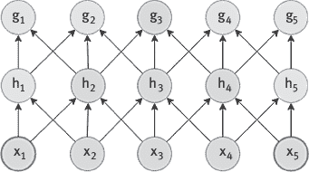

图 2.11：稀疏连接神经元之间的交互。

输入层中的神经元 {`x[1]`, `x[2]`} 和 {`x[4]`, `x[5]`} 由于稀疏连接，在第一个隐藏层中没有相互作用。但它们间接地通过神经元 {`h[2]`, `h[3]`, `h[4]`} 在第二个隐藏层的神经元 `g[3]` 处相互作用。因此，深层 CNN 可以借助卷积核高效地描述输入大部分之间的交互。

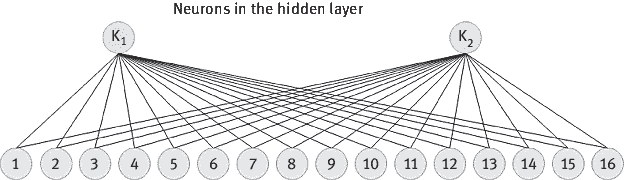

图 2.12：人工神经网络中的密集连接。

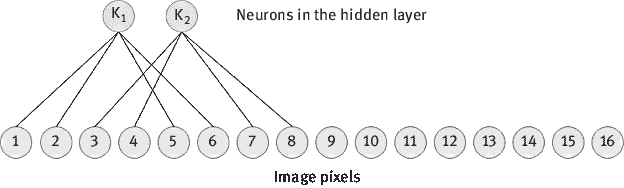

图 2.13：卷积神经网络中的稀疏连接。

## 2.4.2 接收场

直接影响高亮节点 s3 (`x[1]`, `x[2]`, `x[3]`, `x[4]`, `x[5]`) 的节点称为 s3 的接收场。卷积网络深层单元的接收场大于浅层单元的接收场。这意味着，尽管卷积网络中的直接连接非常稀疏，但深层单元正在接收来自所有或大部分输入的输入。这就是为什么深层学习复杂特征（高级特征），因为它们的接收场覆盖了整个输入图像（大于低层的接收场）（图 2.14）。

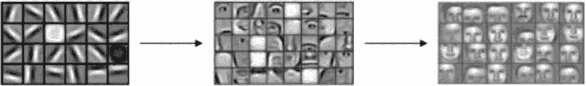

图 2.14：深层学习高级特征和浅层学习低级特征的示意图。

## 2.4.3 参数共享

在上面的示例中，如果我们观察，计算隐藏层中每个神经元输出所需的参数是相同的。对于计算神经元 `K[11]` 的输出，所需的参数是 {`W[1]`, `W[2]`, `W[3]`, `W[4]`}。同样，对于 `K[12]`、`K[13]` 和 `K[14]`（图 2.15）。但在完全连接的 ANN 中，每个神经元都有一组不同的参数附加到它上面。

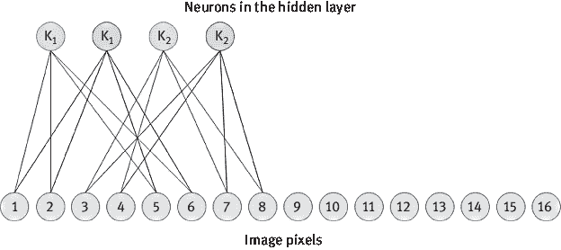

图 2.15：带有多个滤波器的参数共享。

参数共享的直观解释可以通过一个示例来说明。假设我们想要检测图像中的所有边缘。那么，我们将用于检测所有边缘的滤波器将是相同的。我们不会对图像的一部分使用 Sobel 滤波器，而对其他部分使用 Canny 边缘检测器。

通过共享参数，网络参数的数量显著减少。因此，存在欠拟合的可能性。我们可以在单个层中使用多个滤波器来避免欠拟合。同样的直观解释是，仅使用 Sobel 滤波器我们无法准确确定相似的物体，因为大多数汽车都有相同的形状。因此，为了确定不同的汽车，我们需要加入一些其他滤波器，这些滤波器将学习图像的一些其他区分特征。

## 2.4.4 平移等变性

为了理解卷积算子如何对平移具有等变性，我们首先需要了解什么是平移。平移意味着图像中的每个点/像素都向同一方向移动了相同的幅度。平移可以通过这个简单的图 2.16 来描绘。

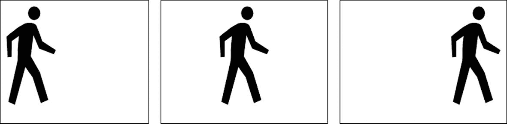

图 2.16：图像中的平移。

当变换的效果在算子输出中可见时，该算子被认为对变换具有等变性。等变性不应与不变性混淆。如果变换对输入的影响对算子输出没有任何影响，则该算子对变换具有不变性。卷积算子是平移等变的，但是关于如何在 CNN 中获得平移不变性的机制没有确定的解释 \[3\]。在论文 \[4\] 中，平移不变性被归因于连续卷积层中神经元接收场大小的逐渐增加。然而，论文 \[5\] 表明池化操作是导致平移不变性的原因。在 \[3\] 中，作者开发了一个名为平移敏感度图的工具，用于可视化和量化各种架构中的平移不变性。观察到，与数据增量相比，架构选择对网络平移不变性的影响较小。

卷积天然不具备对某些其他变换（例如图像的缩放或旋转变化）的等变性。处理这类变换需要其他机制。

## 2.5 构建 CNN


# 2.5 CNN 的基本模块

We’ve seen how convolution operation works, but in a CNN we don’t just convolve the image. In every CNN, Convolution is the first step. In the second step we add bias (constant) to the convolved image, which then passes through a nonlinear function like ReLU. This stage is also known as the detector stage as it detects the features of the image. In the third step the nonlinear output undergoes a pooling function. In Figure 2.17, we have illustrated the steps involved in the fundamental block of the CNN.

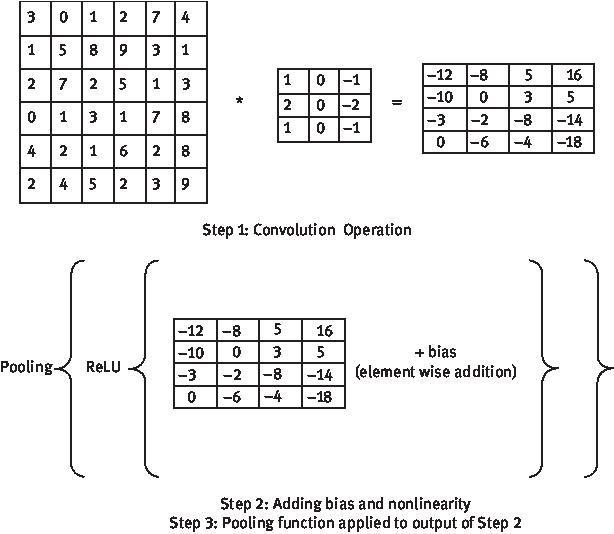

Figure 2.17: An illustration of the steps involved in the fundamental block of the CNN.

## 2.5.1 Pooling in CNN

The role of the pooling function is to summarize the information the detected features hold. Obviously, there have been architectures using different permutations of these steps where certain times multiple convolution operations are performed without using pooling. Computer vision community is highly active and comes up with different state of the art architectures, and these topics are out of the scope of this chapter.

Now let’s see how exactly these pooling functions work. As mentioned earlier, the task of these pooling functions is to give summary of the detected features and there are different variants of these functions. Commonly used forms are max pooling and average pooling. In max pooling as the name suggests we pass the maximum value of the feature to the output. In average pooling the average of all the features is passed to the output. Pooling is performed by passing a pooling filter across the image and producing the output according to the type of function defined. Example of max pooling can be illustrated in the following Figure 2.18.

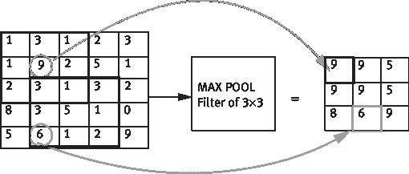

Figure 2.18: Illustration of max pooling.

We saw that convolution operation follows the property of equivariance to translation. Likewise, the pooling function helps the output become invariant to changes in translation in the input. All variations of pooling help make the network invariant to minute translations of the input. Researchers use combination of convolution and pooling functions to make the networks robust to small changes in images. One point the reader should note that is pooling operations are sensitive to changes in scale and rotation. Figures 2.19 shows how max pooling is invariant to translation. As observed in the figure below all the entities in the input is translated to right by 1 unit, but only half of the entities in the output are changed.

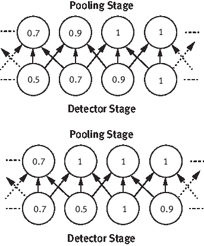

Figure 2.19: Pooling stage.

## 2.5.2 Building block of CNN

The building blocks of a CNN are explained with help of Figure 2.20–2.21 and the table 2.5 provides a detailed layer-wise description of the Le-Net Architecture.

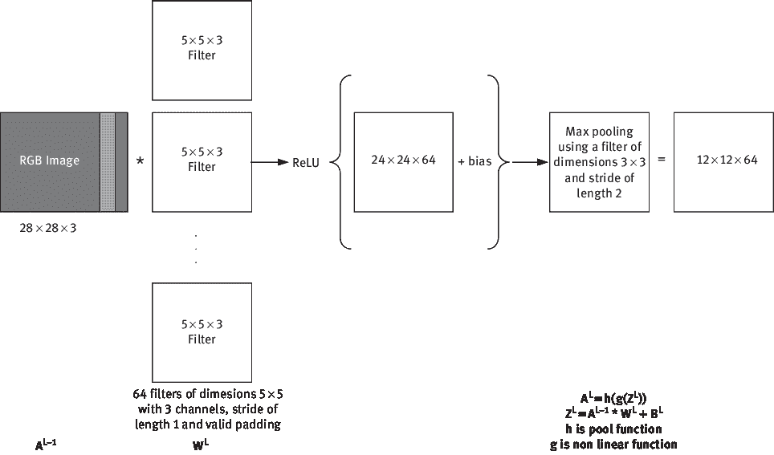

Figure 2.20: A fundamental building block of the convolutional neural network.

```
A^(L-1) = Image[width] × Image[height] × Image[channel]
W^(L) = Filter[width] × Filter[height] × I[channel] × F[number of filters]
Z^L = A^(L-1) * W^L + B^L
A^L = Pool(ReLU(Z^L))
A^L is of dimension Output[width] × Output[height] × Output[channel]
```

## 2.6 Complete CNN

## 2.6.1 Le-Net architecture

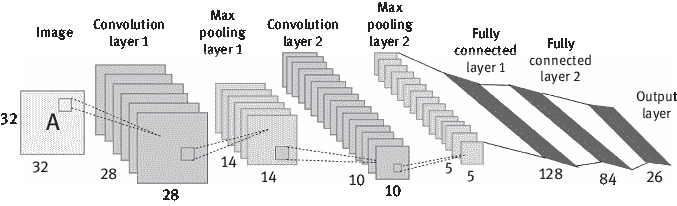

Figure 2.21: The Le-Net architecture.

Table 2.5: Detailed layer-wise description of Le-Net.

| Input layer  |

| --- |

| Convolution layer  || Stride = 1  

Kernel size = 5,  

Number of kernels = 6,  

Padding = 0  || Output dimension = `(32 - 5) / 1 + 1 = 28 × 28 × 6`  || Number of parameters = `5 × 5 × 6 × 1 = 150`  |

| --- | --- | --- | --- |

| Max pooling layer  || Stride = 2,  

kernel size = 2,  

Number of kernels = 6,  

Padding = 0  || Output dimension = `(28 - 1) / 2 + 1 = 14 = 14 × 14 × 6`  || Number of parameters = `0`  |

| Convolution layer  || Stride = 1,  

Kernel size = 5  

Number of kernels = 16,  

Padding = 0  || Output dimension = `(14 - 5) / 1 + 1 = 10 × 10 × 16`  || Number of parameters = `5 × 5 × 16 × 6 = 2,400`  |

| Max pooling layer  || Stride = 2,  

Kernel size = 2, Number of kernels = 16,  

Padding = 0  || Output dimension = `(10 - 1) / 2 + 1 = 5 = 5 × 5 × 16`  || Number of parameters = `0`  |

| Fully connected layer 1  || Size = 120  || Output dimension = `120 × 1`  || Number of parameters = `120 × 5 × 5 × 16 = 48,120`  |

| Fully connected layer 2  || Size = 84  || Output dimension = `84 × 1`  || Number of parameters = `84 × 120 + 84 = 10,164`  |

| Output layer  || Size = 26  || Output dimension = `26 × 1`  || Number of parameters = `84 × 26 + 26 = 2,210`  |

## 2.7 What is the network learning?

Now that we know how CNNs work, let’s try applying them. We have trained a CNN for classifying images of cats and dogs. The network seems to be performing poorly on the test set and we want to find out the reason behind it. We will explore some techniques in this section which will help us in understanding what the CNN has actually learned about a given problem.

Practitioners in the field of image processing have traditionally relied on using filters designed specifically for the task. We have seen how Sobel filters can be used to detect edges. Similarly, there are many filters which detect specific features. In the previous decade, in most image categorization pipelines, multiple such filters were used to extract features from images. The practitioner usually knew what specific feature that they were getting. For example, one might use a vertical edge detecting filter to detect road markings. Being able to understand what features are being extracted makes the decision-making process easy to understand.

In CNNs, we have thousands of filters. Furthermore, these filters are generated by the training procedure. Only the dimensionality of the filters is fixed manually. With so many filters being used, one very natural question comes to mind – what specific features from the image are being used while categorizing the image? The answer to this question helps us in debugging our CNN.

## 2.7.1 Visualizing the first layer

One simple way of discerning the types of features being extracted is to look at the filters being used. We can understand these filters by visualizing them. Simply plotting the weights gives us good insights into what features of the input image are being looked at by the filter. The filters from the first convolution layer of our cats and dogs classifier have been visualized in Figure 2.22. The first layer of this network used 64 7 × 7 by three (for the three channels) filters. The 64 filters can be seen in the figure. Note how many filters are performing the task of edge detection. In particular, the third last filter seems to be looking at oriented edges at a 135° angle horizontally. Some filters are looking for circles in specific channels.

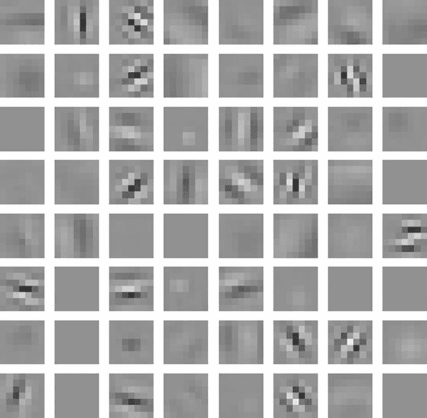


Figure 2.22: 猫狗分类器第一层的滤波器。

网络在第一层寻找如此原始的特征并不奇怪。20 世纪 60 年代，神经生理学家托斯滕·威塞尔（Torsten Wiesel）和大卫·休贝尔（David Hubel）对大脑工作原理的研究得出了一些相似的结果。他们发现，猫的大脑在视觉皮层的前几层也会寻找定向光条等原始特征。

可视化网络其他层的权重无法让我们深入了解决策过程。这是因为第一层之后的层观察的是前一层的输出，而不是输入图像。即使我们可视化这些层，生成的图像也不会直观。

调试网络的另一种方法是找出网络在输入图像中关注的区域。也就是说，对于任何输入图像，我们都想找出导致特定分类的图像区域。这可能有助于我们更深入地了解分类器。

## 2.7.2 显著性图

显著性图 \[6\] 用于找出导致特定分类的图像部分。它们通过计算输入图像相对于目标类别的梯度来工作。请注意，这与我们的训练过程不同，在训练过程中，我们计算权重相对于损失函数的梯度。当我们计算权重相对于目标类别的梯度时，我们试图找出应该在多大程度上以及向哪个方向改变它们，以增加预测该类别的概率。被增加的权重对于该特定目标类别很重要。同样，当我们计算图像相对于目标类别的梯度时，我们会找出对于该特定目标类别很重要的像素。猫图像相对于目标类别“猫”的网络梯度已在 Figure 2.23 中显示。原始图像中高重要性的像素在显著性图中由白点表示。请注意，猫的项圈不被网络视为分类的重要特征。这可能是因为输入数据集包含带有项圈的狗和猫的图像。因此，项圈不是一个区分特征。

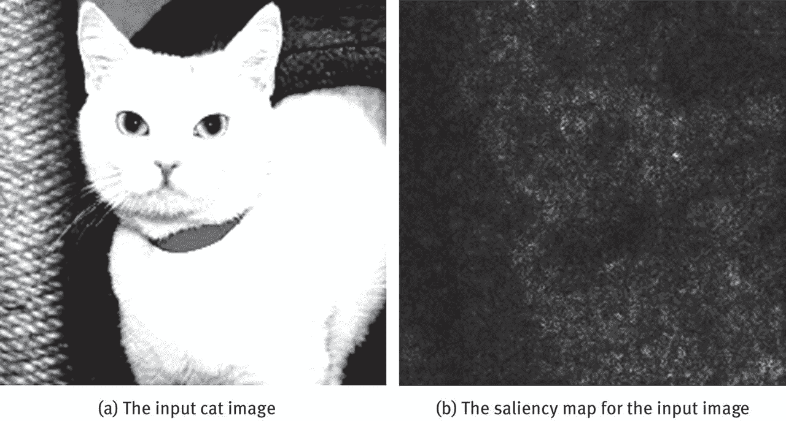

Figure 2.23: 输入图像及其显著性图：(a) 输入猫图像和 (b) 输出图像的显著性图。

显著性图在调试错误分类时特别有用。它们可以帮助我们发现虚假相关性。如果训练数据集中所有狗的图像都包含交通信号灯，网络可能会学会将所有包含交通信号灯的图像都分类为狗。通过查看错误分类图像的显著性图，可以轻松发现这一点。显著性图将清楚地显示交通信号灯在将图像分类为狗中起着作用。

## 2.8 转置卷积

我们现在知道如何将 128 × 128 × 3 的图像映射为 64 × 64 × 12 的特征图。我们可以通过在输入特征图边缘添加单位填充，然后在其上使用 12 个大小为 3 × 3 × 3 的内核来轻松实现这一点。但是，我们的卷积操作无法将 64 × 64 × 12 的特征图映射为 128 × 128 × 3 的特征图。也就是说，它无法执行逆操作。让我们以分辨率为 2,000 × 1,000 的电视为例。我们想要在该电视上显示分辨率为 1,000 × 500 的图像。为了进行全屏显示，我们需要将图像从 1,000 × 500 × 3 上采样到 2,000 × 1,000 × 3。有许多算法可以执行此上采样操作。我们可以使用线性和立方等许多插值操作的变体来实现上采样。在本节中，我们将介绍一种操作，该操作将允许神经网络执行上采样。

让我们考虑一个大小为 4 × 4 的特征图。当我们在其上使用步长为 1 的 3 × 3 内核时，我们得到一个形状为 2 × 2 的输出特征图。这在 Figure 2.24 中显示。为了恢复 4 × 4 的输入卷，我们在对 2 × 2 特征图应用大小为 2 的零填充后，使用大小为 3 × 3 的内核。相应的转置卷积操作已在 Figure 2.25 中描绘。令 *s* 为步长，*k* 为内核大小（假设为方形内核），*p* 为输入图像中的零填充。然后，当 *s* = 1 且 *p* = 0 时，为了恢复原始输入图像，我们为转置卷积设置 *s*′ = *s*、*k*′ = *k* 和 *p*′ = *p*。可以参考 \[7\] 以获取更深入的转置卷积算术讨论。转置卷积操作已用于可视化 CNN 中后层的特征图 \[8\]。转置卷积层也被用于超分辨率 \[9\] 和语义分割 \[10\] 等应用中。

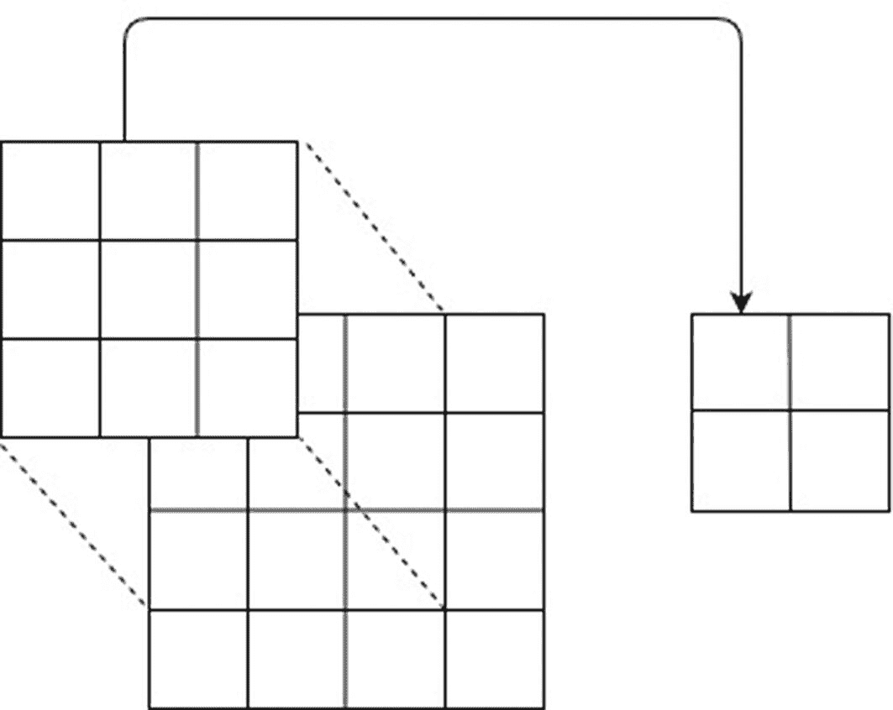

Figure 2.24: 3 × 3 内核在 4 × 4 特征图上卷积。

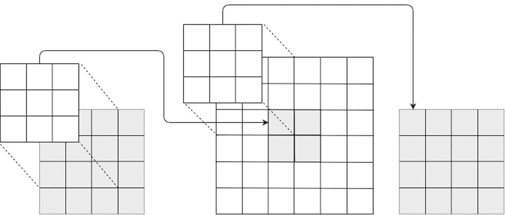

Figure 2.25: 转置反卷积操作。

## 2.9 CNN 的应用

在本节中，我们将回顾 CNN 在不同领域应用方面的最新进展。

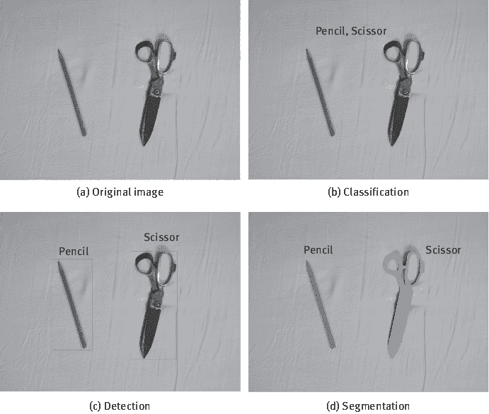

Figure 2.26: 分类、检测和分割之间差异的示意图。

1. 定位：定位是找出图像中对象位置的任务，前提是我们知道要寻找什么类型的对象。这与检测不同，检测涉及查找图像中所有感兴趣的对象并为其贴标签。定位通常涉及预测对象周围的边界框。由 Girschik 等人开发的边界框回归 \[11\] 已被用于定位并取得了一定成功。这涉及在 CNN 的最后一层预测边界框的坐标。如果事先知道对象的数量和每个对象的类型，可以通过设置多个并行全连接层来扩展此技术，以预测每个对象的边界框。


## 2. 检测

在大多数场景中，例如自动驾驶汽车的障碍物检测，待检测对象的数量事先是未知的。检测既涉及图像中对象的定位，也涉及对其进行标记。该领域已取得了许多进展。在 \[11\] 中，作者提出了一种称为基于区域的卷积神经网络（R-CNNs）的方法。在此方法中，使用一个网络来提议图像中的感兴趣区域。这些感兴趣区域随后被传递给一个 CNN 分类器，以预测区域中对象的类别。R-CNNs 的一个更快版本在 \[12\] 中提出，其中在使用 CNN 生成整个图像的特征图后，进行区域提议。其他方法，例如你只看一次 \[13\] 和单射检测 \[14\] 已被开发。这些方法要快得多，因为它们只需将图像通过 CNN 一次。

## 3. 语义分割

语义分割涉及为图像中的每个像素分配一个类别。Long 等人在 \[10\] 中提出了一种称为全卷积网络的模型，该模型在语义分割方面取得了突破性结果。该模型首先使用卷积操作将图像映射到特征图，然后使用转置卷积操作将此特征图映射回与输入图像具有相同高度和宽度的图。最终输出的深度等于类别的数量。因此，输出特征图中第 *i* 行、第 *j* 列和深度 *d* 处的点的值有助于我们计算输入图像 *I* 中像素 *I[ij]* 属于类别 *d* 的概率。图 2.15–2.26 说明了定位、检测和分割。

## 4. 语音识别

CNN 的应用不仅限于视觉数据。CNN 也被应用于语音和文本处理。语音识别是识别语音中的单词和短语并将其存储为机器可读格式的任务。大多数方法，例如在 \[15\] 中，将音频信号的帧传递给 CNN。CNN 使用随时间的池化操作。CNN 已被证明在语音识别方面与循环神经网络（RNNs）相当。

## 5. 视觉问答（VQA）

在 VQA 中，我们的代理人需要回答与图像相关的问题。这些任务需要对图像有更深入的理解；简单的标题并不那么有用。代理人还需要进行复杂的推理。许多现代方法，例如 \[16\]，使用 CNN 将图像映射到特征向量，并使用 RNN 为给定的文本问题生成答案。这种系统的优点是它可以端到端训练。

## 2.10 结论与未来工作

在本章中，我们介绍了强大的 CNNs（CNN）。CNN 使我们能够克服在构建 DNN 时面临的许多问题。它们已在许多领域找到应用，例如图像分类、对象检测、分割、文本分类和语音识别。最近开发的生成对抗网络（GANs）\[17\] 为 CNN 的应用开辟了新的可能性。Radford 等人 \[18\] 提出了一种结合 GANs 和 CNNs 的架构。这在涉及图像的生成任务中取得了许多令人印象深刻的突破。在 \[9\] 中，作者使用了这种 CNN 和 GAN 的组合来将图像放大到更高分辨率。在将图像从一个领域映射到另一个领域方面，即使没有配对数据集，也取得了很大进展 \[19\]。胶囊网络 \[20\] 建立在 CNNs 之上，是提取等变特征的一种尝试。CNN 是一个活跃的研究领域，具有突破性结果的新应用不断被发现。

## 参考文献

\[1\]Mitchell T. M. Machine learning. WCB, 1997. →

\[2\]Goodfellow I., Bengio Y., & Courville A. Deep Learning. MIT Press, 2016. a, b, c

\[3\]Kauderer-Abrams E. Quantifying Translation-Invariance in Convolutional Neural Networks. 2017. a, b

\[4\]Gens R., Pedro M. D. Deep symmetry networks. Advances in Neural Information Processing Systems, 2014. →

\[5\]Jaderberg M., Simonyan K., & Zisserman A. Spatial transformer networks. Advances in Neural Information Processing Systems, 2015. →

\[6\]Simonyan K., Vedaldi A., Zisserman A. Deep inside convolutional networks: Visualising image classification models and saliency maps. arXiv preprint arXiv:1312.6034, 2013. →

\[7\]Dumoulin V., Visin F. A guide to convolution arithmetic for deep learning. arXiv preprint arXiv:1603.07285, 2016. →

\[8\]Zeiler M. D., & Fergus R. Visualizing and understanding convolutional networks. European conference on computer vision, Springer, Cham, September 2014, 818–833. →

\[9\]Ledig C., Theis L., Huszr F., Caballero J., Cunningham A., Acosta A., & Shi W. Photo-Realistic Single Image Super-Resolution Using a Generative Adversarial Network. CVPR, July 2017, 2(3), 4. a, b

\[10\]Long J., Shelhamer E., & Darrell T. Fully convolutional networks for semantic segmentation. Proceedings of the IEEE conference on computer vision and pattern recognition, 2015, 3431–3440. a, b

\[11\]Girshick R., Donahue J., Darrell T., & Malik J. Rich feature hierarchies for accurate object detection and semantic segmentation. Proceedings of the IEEE conference on computer vision and pattern recognition, 2014, 580–587. a, b

\[12\]Girshick R. Fast R-CNN. Proceedings of the IEEE international conference on computer vision, 2015, 1440–1448. →

\[13\]Redmon J., Divvala S., Girshick R., & Farhadi A. You only look once: Unified, real-time object detection. Proceedings of the IEEE conference on computer vision and pattern recognition, 2016, 779–788. →

\[14\]Liu W., Anguelov D., Erhan D., Szegedy C., Reed S., Fu C. Y., & Berg A. C. Ssd: Single shot multibox detector. European conference on computer vision, Springer, Cham, October 2016, 21–37. →

\[15\]Palaz D., Collobert R. Analysis of cnn-based speech recognition system using raw speech as input. Proceedings of INTERSPEECH, 2015, EPFL-CONF-210029. →

\[16\]Malinowski M., Rohrbach M., & Fritz M. Ask your neurons: A neural-based approach to answering questions about images. Proceedings of the IEEE international conference on computer vision, 2015, 1–9. →


\[17\]Goodfellow I., Pouget-Abadie J., Mirza M., Xu B., Warde-Farley D., Ozair S., & Bengio Y. Generative adversarial nets. Advances in Neural Information Processing Systems, 2014, 2672–2680. →

\[18\]Radford A., Metz L., Chintala S. Unsupervised representation learning with deep convolutional generative adversarial networks. arXiv preprint arXiv:1511.06434, 2015. →

\[19\]Zhu J. Y., Park T., Isola P., & Efros A. A. Unpaired image-to-image translation using cycle-consistent adversarial networks. arXiv preprint, 2017. →

\[20\]Sabour S., Frosst N., & Hinton G. E. Dynamic routing between capsules. Advances in Neural Information Processing Systems, 2017, 3856–3866. →

# 3 使用卷积神经网络进行手写数字识别

Ranjan Jana RCC Institute of Information Technology, Kolkata, West Bengal, India Siddhartha Bhattacharyya CHRIST (Deemed to be University), Bangalore, Karnataka, India Swagatam Das Indian Statistical Institute, Kolkata, West Bengal, India.

## 摘要

光学字符识别（OCR）系统已被用于从扫描文档或图像中提取文本。该系统包含两个步骤：字符检测和识别。字符识别需要一种基于特征的分类算法。字符可以使用神经网络进行识别。多层感知器（`MLP`）为字符分类提供了可接受的识别精度。此外，卷积神经网络（`CNN`）和循环神经网络（`RNN`）正在提供高精度的字符识别。`MLP`、`RNN` 和 `CNN` 在训练阶段可能会面临大量计算的问题。`MLP` 能以良好的精度解决不同类型的问题，但由于其密集的网络连接，耗时巨大。`RNN` 适用于序列数据，而 `CNN` 适用于空间数据。在本章中，一个 `CNN` 被实现用于从 MNIST 数据库中识别数字，并在 `MLP`、`RNN` 和 `CNN` 之间建立了比较研究。`CNN` 为数字识别提供了更高的精度，并且相对于 `MLP` 和 `RNN`，训练系统所需的时间最少。`CNN` 给出了更好的结果，精度高达 98.92%，因为使用的 MNIST 数字数据集是空间数据。

关键词：`convolutional neural network`, `deep neural network`, `handwritten digit recognition`, `multilayer perceptron`, `optical character recognition`, `recurrent neural network`

## 3.1 引言

光学字符识别（`OCR`）将手写文本图像或印刷文本图像转换为普通文本。文本图像通常来自文本文档的图像 \[1\]。`OCR` 是许多计算机视觉问题中的重要领域，例如自动车牌识别、名片信息提取，以及护照、支票和发票文档的数据录入。`OCR` 大多是一个离线过程，它将静态文档中的文本转换出来。手写的运动可用于手写字符识别 \[2\]。在在线字符识别中，除了使用字符或单词的形状外，还可以使用笔的方向和压力作为额外信息，以使过程更加高效。`OCR` 是一种机制，用于分类文本图像中属于的字符或单词。文本图像中的字符识别通过字符分割、特征提取和特征分类进行处理。多层感知器（`MLP`）的引入在计算机视觉的数据分类中是一场突破 \[3\]，尽管 `MLP` 的性能完全取决于用于分类的对象的适当特征 \[4, 5\]。经典的机器学习技术已被深度神经网络（`DNN`s）所革新。该网络在原始像素数据上工作，以提取用于分类的适当特征 \[6\]。`DNN` 设计有大量的隐藏层和连接。因此，网络有大量的参数，并且需要大量的训练样本来防止过拟合。`DNN` 架构主要分为卷积神经网络（`CNN`）和循环神经网络（`RNN`），以解决各种计算机视觉任务的问题。对于提取位置不变特征，通常使用 `CNN`，而 `RNN` 用于对序列数据中的网络进行建模 \[7\]。与完全连接的神经网络相比，`CNN` 具有较少的参数 \[8\]。`CNN` 能够通过改变隐藏层的数量和每层的可训练参数数量来对数据进行建模 \[9\]。`CNN` 可以利用局部感受野和时间下采样，在输入和输出之间设计多功能的非线性关系，以提供一定程度的平移、旋转和畸变不变性 \[10\]。在神经网络中，`CNN` 是由输入层和输出层之间的一系列卷积层和池化层组成的。在网络的最后一层执行完全连接层，以生成输入数据的唯一表示。在本章中，对 `MLP`、`RNN` 和 `CNN` 方法在 MNIST 数据集上的性能进行了比较。`CNN` 相比于 `MLP` 和 `RNN` 提供了更好的结果。

本章的组织如下。手写数字识别的动机在 第 3.2 节 中讨论。相关工作在 第 3.3 节 中介绍，`MLP`、`CNN` 和 `RNN` 架构的概述在 第 3.4 节 中讨论。系统的实现细节在 第 3.5 节 中描述。实验结果在 第 3.6 节 中展示。最后，结论在 第 3.7 节 中得出。

## 3.2 手写数字识别的动机

手写字符识别技术始于 1980 年左右。使用分类器进行手写数字识别的任务在机器学习中具有重要意义。手写字符识别通常对于邮政邮件分拣的邮政编码识别、银行支票处理、手写填写表格中的数字条目提取以及任何车辆的车牌识别非常重要。手写数字在大小、对齐和粗细方面有所不同，即使对于同一位书写者也是如此。不同个体对同一数字的书写也不同，这会影响数字的外观。因此，要实现手写字符识别，需要面对许多挑战。数字识别中的常见问题是预测数字，尽管它们相似，例如 3 和 5、9 和 4、8 和 9、5 和 6，如 图 3.1 所示。本章的目的是实现一种方法，用于识别大小、粗细和方向各异的手写数字。

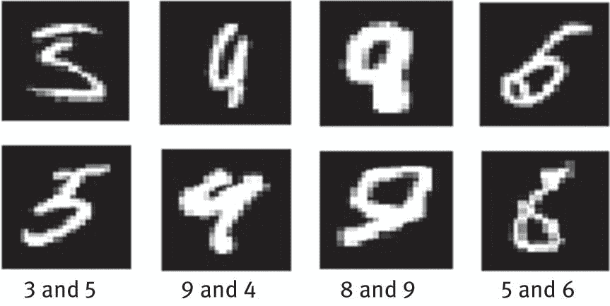

Figure 3.1: Similarity of digits.

## 3.3 Related work


# Arica 和 Vural 提出了一种离线字符识别系统

Arica 和 Vural 提出了一种离线字符识别系统，通过使用最少的预处理操作来限制关键信息的丢失 \[11\]。他们使用了一种高效的分割算法，用于从灰度图像中检测字符边界、倾斜角度、上下基线、笔画宽度和高度。隐马尔可夫模型（`HMM`）用于估计系统参数以及某些特征空间参数。`HMM` 用于根据字符形状特征确定字符的等级。Khedher 等人描述了，选择良好的特征可以为任何字符识别系统提供更好的准确性 \[12\]。他们讨论了如何为识别阿拉伯手写字符选择不同的良好特征。他们使用了手写字符的真实样本。阿拉伯数字的平均识别准确率为 88%，阿拉伯字母的平均识别准确率为 70%。Hanmandlu 和 Murthy 实现了一种模糊模型，以隶属度值的形式用于识别手写英文和印地语数字 \[13\]。模糊集中的隶属函数通过熵的优化进行调整。该模型对印地语数字的准确率为 95%，对英文数字的准确率为 98.4%。Arora 等人实现了一个用于识别天城文的系统 \[14\]。从阴影、直线拟合、交点和链码直方图中提取了四个特征，采用了盒法。阴影特征从图像的所有部分提取，而链码直方图、交点和直线拟合特征则通过将图像分割为子图像来提取。该系统使用了 4,900 个天城文字符进行测试，准确率为 92.8%。Kimura 实现了一个用于字符识别的系统，该系统使用基于遗传算法的特征选择 \[15\]。他选择基因的方式是使训练数据的识别率不超过预定义阈值。因此，该系统被采用为选择特征数量的缩减比率。Graves 和 Schmidhuber 开发了一种多维 `RNN` 模型用于阿拉伯手写字符识别。他们参加了 2007 年的 ICDAR 单词识别竞赛，在 IFN/ENIT 数据集上的准确率为 91% \[16\]。`MLP` 被 Pal 和 Singh 用于识别手写英文字符 \[17\]。他们使用字符边界追踪和傅里叶描述子提取特征。该系统通过比较字符的特征和形状来分类每个字符。他们进行了调查，以通过使用优化的隐藏层数量来获得更好的字符分类准确率。他们报告了手写英文字符的 94% 识别准确率。Pradeep 等人提取了用于离线字符识别的对角特征 \[18\]。该系统基于神经网络模型，他们使用了两种方法，分别使用 54 个特征和 69 个特征来实现此识别系统。他们报告称，使用 54 个特征时离线字符识别的准确率为 97.8%，使用 69 个特征时为 98.5%。Neves 等人提出了一种使用支持向量机的离线手写数字识别系统，并声明其准确率优于 `MLP` \[19\]。实验在 NIST SD19 标准数据集上进行。他们报告称，`MLP` 能够区分非线性可分类，但由于陷入局部最小值而无法实现最优解。因此，`MPL` 可能无法为数字识别提供更高的准确率。Gaurav 和 Bhatia 提出了一种处理各种预处理技术的技术，这些技术包括倾斜检测和校正、对比度拉伸、转换为二值图像、噪声去除、分割和形态学操作，用于字符识别 \[20\]。该技术用于包含不同强度彩色背景的手写文档。他们得出结论，单一技术不足以从不同强度的背景图像中识别字符。深度学习因其在计算机视觉和机器学习中的稳定性能，被广泛应用于各种应用领域 \[21\]。Hu 等人使用 `DNN` 和 `CNN` 实现了 OCR 系统和人脸识别系统，其准确率优于其他系统。`DNNs` 和 `CNNs` 为深度学习应用的扩展提供了巨大机会。他们使用该系统来解决约旦安全问题中的人脸识别问题。他们在人脸识别方面取得了巨大成功。Ghazi 和 Ekenel 展示了 VGG-Face 模型和轻量化 CNN，并在五个基准数据集上进行了测试。他们报告称，即使面部或字符的对齐度较低，预处理也可以提高性能 \[22\]。该方法在 MNIST 数据集上的准确率高达 98.46%，表现出良好的性能。使用 CNN 时，不需要图像/数据预处理和手工制作的特征提取。Younis 和 Alkhateeb 在约旦大学不同人员拍摄的人脸数据集上，使用深度 `CNN` 实现了一个人脸识别系统 \[23\]。他们在 Tensorflow 和 Keras 环境中实现了该系统。经过 80 个 epoch 后，人脸分类的准确率是可以接受的，这花费的时间非常少。

## 3.4 MLP、CNN 和 RNN 概述

`MLP` 网络在模式识别领域已被使用很长时间，它使用手工制作的特征进行模式分类。为特定应用选择最佳特征需要花费大量时间。最佳特征也称为手工制作的特征。手工制作的特征完全依赖于某些应用，但可能不适用于其他应用。深度学习（`DL`）是神经网络领域的一场革命，它使用大量层来训练网络以实现更好的准确率。`DL` 包含一个输入层、一系列隐藏层和一个输出层，用于特征提取和特征分类。`DL` 试图通过多阶段特征学习过程自动提取更多特征。研究人员提出了许多神经网络，作为现有模型的修改或新模型。他们通常推荐 `MLP`、`CNN` 和 `RNN`，以在广泛的应用领域中获得稳定性能。

## 3.4.1 多层感知机


# 感知机是一种简单的神经网络模型

感知机是一种简单的神经网络模型。它是复杂神经网络的先驱。它试图像生物大脑一样解决难题。神经网络的力量来自于其能够从训练数据中正确建模系统，并对数据分类进行输出预测。从这个意义上说，神经网络科学地学习映射。这类网络能够学习任何映射函数。任何神经网络的预测能力都来自于网络的多层结构。MLP 的架构由一个输入层、一个输出层和多个隐藏层组成，如 图 3.2. 所示。该架构在不同尺度上学习特征，并将其组合为高阶特征。例如，架构先学习线条，再从线条集合中学习形状。MLP 是一种高效的分类器。在训练期间，输入被分配了一个类别，以便网络训练系统。网络能够非常高效地从输入数据集到输出数据集学习映射，用于数据分类。

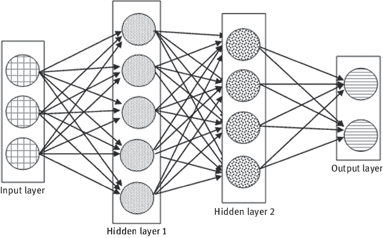

Figure 3.2: Basic architecture of MLP.

## 3.4.2 卷积神经网络

CNN 是计算机视觉中一种高效的神经网络架构。它用于自动提取特征，然后对提取的特征进行分类。该架构在图像的原始像素上使用一系列滤波器来提取高级、中级和低级特征，然后根据提取的特征对图像进行分类。CNN 使用输入数据的小方块来保持像素之间的空间关系，以提取特征。特征在整个图像上提取，以允许图像中的对象进行平移或偏移。CNN 架构由一系列不同的层组成，这些层将输入数据转换为输出数据。该架构由输入层、输出层和隐藏层组成，如 图 3.3. 所示。隐藏层分为两个模块。第一个模块用于特征提取，第二个模块用于特征分类。第一个模块由重复的卷积层和池化层组成。第二个模块由多个全连接层组成。最后一个全连接层中的节点数由目标类别的数量决定。这一层称为输出层。

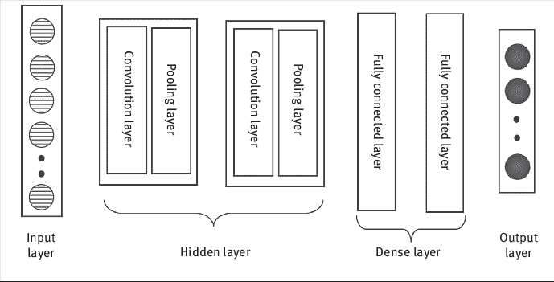

Figure 3.3: Basic architecture of CNN.

## 3.4.2.1 卷积层

卷积层是 CNN 的主要层。该层由一组卷积滤波器组成，用于执行一些数学运算以在输出映射中生成一个值。在前向传递中，每个滤波器在整个图像子区域上进行卷积。它只是输入图像/数据子区域的值与卷积滤波器的值之间的点积。它生成卷积滤波器的二维激活映射，以检测特定类型的特征。卷积层的输出数据大小取决于滤波器的大小、步长的值和零填充。卷积层中连接到输入数据相同子区域的神经元数量由滤波器的大小控制。这些神经元学习在输入数据中激活不同的特征。对于第一个卷积层，输入数据是输入图像的原始像素，神经元学习激活输入图像中边缘的存在。卷积操作的步骤称为步长，它控制卷积层输出数据的大小。如果步长为 n，则卷积滤波器一次移动 `n` 个像素。对于较小的步长值，滤波器会重叠感受野并产生较大的输出数据大小。零填充用于用零填充输入数据的边缘。它需要保持输出数据大小与输入数据大小相同。每个卷积层对输出映射应用修正线性单元 (ReLU)，从而在架构中引入非线性。ReLU 应用逐元素激活，而不影响卷积层的感受野。该层中最常用的非线性激活函数是 `f(x) = tanh(x)`、`f(x) = max(0,x)` 和 `f(x) =(1+e^(−x))^(−1)`。

## 3.4.2.2 池化层

池化层对前一个卷积层生成的输入数据执行非线性下采样操作。该层在两个连续的卷积层之间执行。它是一种压缩提取特征并减少训练数据过拟合的过程。最常见的是，池化层使用 2 × 2 滤波器和步长为 2 进行下采样。因此，这种技术丢弃了 75% 的激活值。虽然有几种非线性函数可用，但最大池化是池化操作中最常用的非线性函数。在此层中，输入数据被分割为若干个方形子区域，并生成每个子区域的最大值。池化背后的逻辑是，图像/数据中特征的实际位置不那么重要。该层为架构提供了另一种形式的平移不变性。

## 3.4.2.3 全连接网络 (FCN) 层

在重复的卷积层和池化层之后，一个或多个 FCN 层执行特征分类。在此，当前层的每个节点都连接到前一层的每个节点。最终 FCN 层中的节点数由目标类别的数量决定。软最大值激活函数用于为目标类的每个节点生成 0 到 1 之间的值。软最大值函数生成图像/数据属于每个目标类别的概率。所有软最大值的总和为 1。

## 3.4.3 循环神经网络

RNN 能够为其内部记忆记住输入到输出的映射。网络包含至少一个反馈连接用于记忆，如 图 3.4. 所示。延迟单元用于将 RNN 的输出引入循环回到网络中以进行记忆。RNN 将最近的过去数据插入当前状态。因此，RNN 既有当前输入数据，也有最近的过去输入数据。该网络是一种为序列数据提出的特殊神经网络。该网络允许展示时间序列数据的动态行为。RNN 架构使用其记忆来处理输入数据序列。RNN 是带有架构中循环的前馈 MLP。因此，一层的每个神经元可以将其信号传递到下一层。一层的输出可能作为下一个输入数据的输入反馈到该层。RNN 中的递归连接允许对任何输入数据序列获得广泛抽象的知识。RNN 更适用于连续手写字符识别或语音识别。

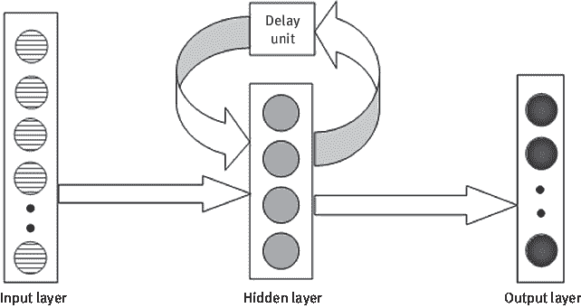

Figure 3.4: Basic architecture of RNN.

## 3.5 实现


手写数字识别已被应用于从扫描文档或图像中提取文本。字符识别需要一种基于模式的分类算法。DNN 在机学习领域已证明其出色的性能 \[22, 23\]。DNN 由大量的隐藏层和连接组成。因此，DNN 中可训练参数的数量巨大。需要大量样本来训练系统以防止过拟合。而 CNN 与 DNN 相比，隐藏层较少，参数数量也较少。因此，CNN 训练系统所需的样本数量较少。CNN 在架构形成过程中可以改变每一层的隐藏层数量和可训练参数数量。因此，CNN 架构被规划用于手写数字识别。这里，使用 MNIST 现实世界数据库来检查系统的性能。

## 3.5.1 使用的数据库

在本章中，MNIST 手写数字数据库用于训练和测试系统。MNIST 手写数字图像的尺寸已被归一化并预处理。因此，用户不需要对图像进行预处理。MNIST 训练集和测试集示例包含来自约 250 名书写者的数据。MNIST 数据库包含 60,000 张用于训练的手写数字图像和 10,000 张用于测试的手写数字图像 \[24\]。每张手写数字图像包含 28×28 像素，每个像素的值在 0（背景）和 255（前景）之间，如 Figure 3.5. 所示。数据库包含训练集图像文件、训练集标签文件、测试集图像文件和测试集标签文件。像素值在每个图像文件中按行排列。在图像文件中，一张图像的所有像素值都排列在一行中。因此，每个图像文件包含 784 列，对应 28×28 像素。在标签文件中，标签值包含 10 列。对于任何数字的特定实例，适当列的标签值设置为 1，其他列设置为 0。

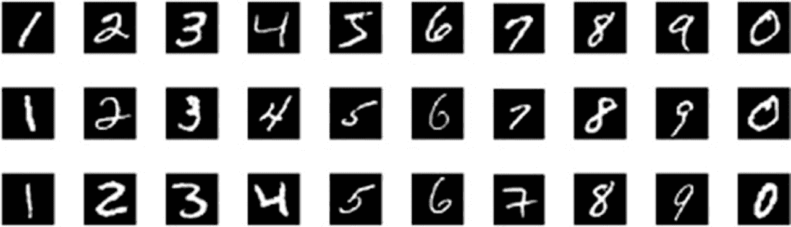

Figure 3.5: Examples of MNIST dataset.

## 3.5.2 拟议 CNN 架构的设计

在这项工作中，实现了两种 CNN 架构用于 MNIST 数字识别。每种架构包含两个隐藏层或卷积层。ReLU 激活函数在每次卷积操作后应用，以实现系统的非线性。第一个 CNN 架构命名为“CNN Method 1”，并按以下详细信息实现。CNN Method 1 使用两个隐藏层或卷积层来实现 MNIST 数据集的数字识别。输入图像大小为 28 × 28，即总共 784 个像素。因此，输入层有 784 个输入。最初，使用 32 个大小为 5 × 5 的滤波器进行卷积操作，不使用填充，步幅等于 1。卷积操作输出 32 个大小为 24 × 24 的层。然后，使用 2 × 2 最大滤波器进行下采样操作。这种下采样减少了 75% 的数据量，生成的输出包含 32 个大小为 12 × 12 的层。之后，使用 64 个大小为 7 × 7 的滤波器进行另一次卷积操作，使用零填充，步幅等于 1。卷积操作输出 64 个大小为 12 × 12 的层。之后，使用 2 × 2 最大滤波器进行另一次下采样操作。这种下采样再次减少了 75% 的数据量，生成的输出包含 64 个大小为 6 × 6 的层。然后，连接一个具有 2,304 个输入节点（64 × 6 × 6 个节点）和 1024 个输出节点的 FCN 层。然后，连接另一个具有 10 个输出节点的 FCN 层，用于 10 个数字。

第二个 CNN 架构命名为“CNN Method 2”，并包含以下详细信息。CNN Method 2 使用两个隐藏层或卷积层来实现 MNIST 数据集的数字识别，如 Figure 3.6. 所示。

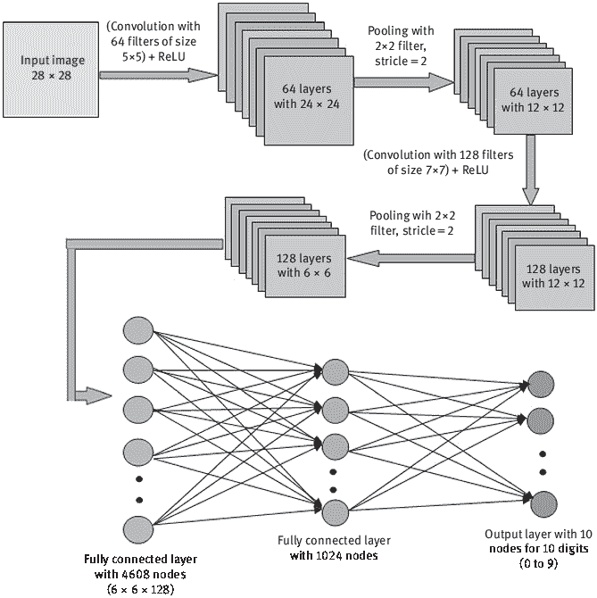

Figure 3.6: Architecture of proposed CNN Method 2.

输入图像大小为 28 × 28，即总共 784 个像素。因此，输入层有 784 个输入。最初，使用 64 个大小为 5 × 5 的滤波器进行卷积操作，不使用填充，步幅等于 1。卷积操作输出 64 个大小为 24 × 24 的层。然后，使用 2 × 2 最大滤波器进行下采样操作。这种下采样减少了 75% 的数据量，生成的输出包含 64 个大小为 12 × 12 的层。之后，使用 128 个大小为 7 × 7 的滤波器进行另一次卷积操作，使用零填充，步幅等于 1。卷积操作输出 128 个大小为 12 × 12 的层。之后，使用 2 × 2 最大滤波器进行另一次下采样操作。这种下采样再次减少了 75% 的数据量，生成的输出包含 128 个大小为 6 × 6 的层。然后，连接一个具有 4608 个输入节点（128 × 6 × 6 个节点）和 1024 个输出节点的 FCN 层。然后，连接另一个具有 10 个输出节点的 FCN 层，用于 10 个数字。

## 3.6 实验结果

最初，实现了一个 MLP 用于数字识别。MLP 在输入层中有 784 个节点，因为 MNIST 的每个图像都有 784 个像素（28 × 28 像素）。使用 2.2 吉赫兹的至强处理器和 128 GB 内存来训练和测试系统。与 CNN 和 RNN 相比，MLP 需要花费大量时间，如 Table 3.1 所示。

Table 3.1:Accuracy of RNN and CNN.

| Steps  || CNN implemented by Younis and Alkhateeb \[23\] || RNN |

| --- | --- | --- |

| Accuracy || Training time (in seconds) || Accuracy || Training time (in seconds) |

| 10,000 || 94.97% || 1354 || 86.67% || 148 |

| --- | --- | --- | --- | --- |

| 20,000 || 97.03% || 2698 || 93.55% || 295 |

| 30,000 || 97.60% || 4050 || 95.99% || 443 |

| 40,000 || 97.99% || 5391 || 96.55% || 589 |

| 50,000 || 98.25% || 6738 || 97.01% || 736 |

| 60,000 || 98.41% || 8083 || 97.21% || 883 |

| 70,000 || 98.53% || 9436 || 97.30% || 1029 |

| 80,000 || 98.59% || 10782 || 97.55% || 1178 |

| 90,000 || 98.67% || 12132 || 97.79% || 1322 |

| 100,000 || 98.80% || 13,502 || 97.76% || 1,476 |

| 110,000 || 98.85% || 14,821 || 97.96% || 1,620 |

MLP 的实验结果需要 5371 秒才能在 MNIST 数字分类中达到 92.44% 的准确率。要达到相同的准确率，训练 RNN 需要 295 秒，训练由 Younis and Alkhateeb 实现的 CNN 需要 1354 秒。关于随时间变化的准确率比较研究表明，RNN 训练系统的速度比 CNN 快，如 Figure 3.7. 所示。但是，如果训练时间非常高，CNN 有能力训练更多。

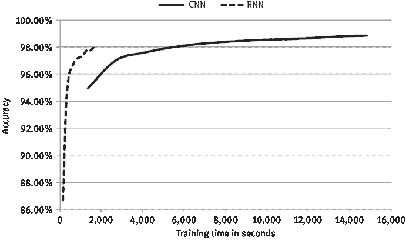

Figure 3.7: Accuracy vs. training time for CNN and RNN.


实验结果显示了两种拟议的 CNN 方法与之前的 CNN 方法相对于步骤数的准确率和训练时间，如 表 3.2 所示。拟议的“CNN 方法 2”在 110,000 步之后，其准确率（98.92%）高于之前的 CNN 方法和拟议的“CNN 方法 1”。但是，考虑训练时间，拟议的“CNN 方法 1”的性能是最快的，如 图 3.8 所示。虽然之前的 CNN 和拟议的两个 CNN 的参数不同，但所有系统的准确率相对于训练系统的步骤数是相似的，如 图 3.9 所示。由于书写风格不当，系统在某些情况下的预测似乎不正确，如 表 3.3 所示。

表 3.2：之前的 CNN 和拟议的 CNN 的准确率。

| 步骤 || CNN 方法 2 || CNN 方法 1 || CNN 由 Younis 和 Alkhateeb 实现 \[23\] |

| --- | --- | --- | --- |

| || 准确率 || 训练时间（秒） || 准确率 || 训练时间（秒） || 准确率 || 训练时间（秒） |

| 10,000 || 95.37% || 2,337 || 95.20% || 796 || 94.97% || 1,354 |

| --- | --- | --- | --- | --- | --- | --- |

| 20,000 || 97.13% || 4,613 || 96.99% || 1,571 || 97.03% || 2,698 |

| 30,000 || 97.92% || 6,867 || 97.70% || 2,342 || 97.60% || 4,050 |

| 40,000 || 98.23% || 9,196 || 98.05% || 3,132 || 97.99% || 5,391 |

| 50,000 || 98.42% || 11,456 || 98.29% || 3,907 || 98.25% || 6,738 |

| 60,000 || 98.50% || 13,706 || 98.39% || 4,671 || 98.41% || 8,083 |

| 70,000 || 98.66% || 16,037 || 98.51% || 5,469 || 98.53% || 9,436 |

| 80,000 || 98.79% || 18,276 || 98.61% || 6,228 || 98.59% || 10,782 |

| 90,000 || 98.79% || 20,632 || 98.72% || 7,036 || 98.67% || 12,132 |

| 100,000 || 98.84% || 22,852 || 98.78% || 7,789 || 98.80% || 13,502 |

| 110,000 || 98.92% || 25,127 || 98.85% || 8,564 || 98.85% || 14,821 |

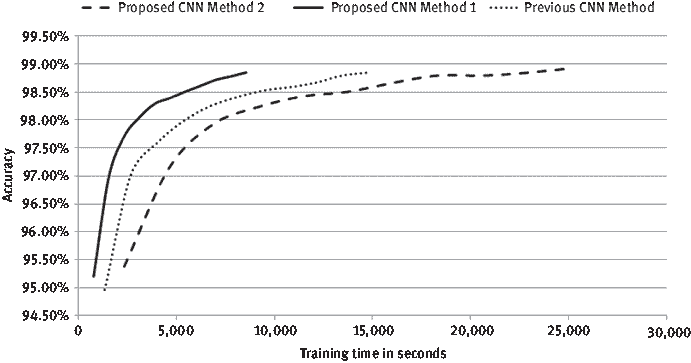

Figure 3.8: Accuracy versus training time.

表 3.3：一些被错误分类的图像。

| 样本 MNIST |

| --- |

| 图像 || 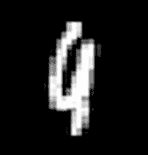 ||  ||  ||  ||  ||  ||  ||  |

| 实际数字 || 9 || 2 || 7 || 3 || 4 || 5 || 2 || 6 |

| --- | --- | --- | --- | --- | --- | --- | --- | --- |

| 预测数字 || 4 || 7 || 2 || 5 || 9 || 3 || 7 || 1 |


Figure 3.9: Accuracy vs. number of steps for training the CNN.

## 3.7 结论

本章讨论了用于识别 MNIST 字符数据集手写字符的 MLP、RNN 和 CNN。使用两种 CNN 方法实现的手写数字识别采用了不同的参数。从实验结果可以看出，CNN 在识别手写字符方面更准确。拟议的“CNN 方法 2”提供了 98.92% 的准确率，而拟议的“CNN 方法 1”为 MNIST 字符数据集提供了 98.85% 的准确率。实验结果表明，与其他方法相比，拟议的“CNN 方法 2”在准确率方面更好，而拟议的“CNN 方法 1”在训练时间方面更好，适用于 MNIST 数据集。通过使用更多数量的滤波器，系统的准确率将更好。但是，训练时间将非常高。为了进一步改进，需要增加训练系统的步骤数。

## 参考文献

\[1\]Arica N. & Vural F.T.Y. 面向脱机手写的字符识别概述。IEEE Transactions on Systems, Man and Cybernetics – Part C: Applications and Reviews, 2001, 31(2), 216–233. →

\[2\]Tappert C.C., Suen C.Y., & Wakahara T. 在线手写识别的最新技术。IEEE Transactions on Pattern Analysis and Machine Intelligence, 1990, 12(8), 787–808. →

\[3\]Quiles M.G. & Romero R.A.F. 基于多层感知机的计算机视觉系统用于控制移动机器人。International Congress of Mechanical Engineering, OuroPreto, Brazil, November, 2005. →

\[4\]Ruck D.W., Rogers S.K., & Kabrisky M. 使用多层感知机进行特征选择。Journal of Neural Network Computing, 1990, 2(2), 40–48. →

\[5\]Yang J.B., Shen K.Q., Ong C.J., & Li X.P. MLP 神经网络的特征选择：使用概率输出的随机排列。IEEE Transactions on Neural Networks, 2009, 20(12), 1911–1922. →

\[6\]Lee H., Grosse R., Ranganath R., & Ng A.Y. 用于可扩展无监督学习的分层表示的卷积深度置信网络。International Conference on Machine Learning, ACM, 2009, 609–616. →

\[7\]Vu N.T., Adel H., Gupta P., & Schutze H. 结合循环神经网络和卷积神经网络用于关系分类。NAACL HLT, 2016,534–539. →

\[8\]Le Cun Y., Bottou L., Bengio Y., & Haffner P. 应用于文档识别的基于梯度的学习。Proceedings of the IEEE, 1998, 86(11),2278–2324. →

\[9\]Krizhevsky A., Sutskever I., & Hinton G.E. 使用深度卷积神经网络的 Imagenet 分类。Advances in neural information processing systems, 2012,1097–1105. →

\[10\]Le Cun B.B., Denker J.S., Henderson D., Howard R.E., Hubbard W., & Jackel L.D. 使用反向传播网络的手写数字识别。Advances in neural information processing systems, Citeseer, 1990. →

\[11\]Arica N. & Vural F.T.Y. 连笔手写的光学字符识别。IEEE Transactions on Pattern Analysis and Machine Intelligence, June, 2002, 24(6), 801–113. →

\[12\]Khedher M.Z., Abandah G.A., & Al-Khawaldeh A.M. 优化特征选择以识别手写阿拉伯字符。Proceedings of World Academy of Science Engineering and Technology, February 2005, 4. →

\[13\]Hanmandlu M. & Ramana Murthy O.V. 基于模糊模型的手写数字识别。Pattern Recognition, 2007, 40, 1840–1854. →

\[14\]Arora S., Bhattacharjee D., Nasipuri M., Basu D.K., & Kundu M. 结合多种特征提取技术用于手写 Devnagari 字符识别。IEEE Region 10 and the Third international Conference on Industrial and Information Systems, Kharagpur, India, December 2008. →

\[15\]Kimura Y. 使用遗传算法进行字符识别的特征选择。Fourth International Conference on Innovative Computing, Information and Control, IEEE, 2009. →

\[16\]Graves A. & Schmidhuber J. 使用多维循环神经网络的脱机手写识别。Advances in Neural Information Processing Systems 22, NIPS'22, Vancouver, MIT Press, 2009, 545–552. →


\[17\]Pal A. & Singh D. Handwritten English character recognition using neural. Network International Journal of Computer Science & Communication, July–December, 2010, 1(2), 141–144. →

\[18\]Pradeep J., Srinivasan E., & Himavathi S. Diagonal based feature extraction for handwritten alphabets recognition system using neural network. International Journal of Computer Science & Information Technology (IJCSIT), February 2011, 3, 1. →

\[19\]Neves R.F.P., Filho A.N.G.L., Mello C.A.B., & Zanchettin C. A SVM based off-line handwritten digit recognizer. International Conference on Systems, Man and Cybernetics, IEEE, Brazil, October 2011, 510–515. →

\[20\]Gaurav K. & Bhatia P.K. Analytical review of preprocessing techniques for offline handwritten character recognition. International Conference on Emerging Trends in Engineering & Management, 2013. →

\[21\]Hu G., Yang Y., Yi D., Kittler J., Christmas W., Li S.Z., & Hospedales T. When face recognition meets with deep learning: An evaluation of convolutional neural networks for face recognition. IEEE International Conference on Computer Vision Workshops, Santiago, Chile, 13–16 Dec 2015, 142–150. →

\[22\]Ghazi M.M. & Ekenel H.K. A comprehensive analysis of deep learning based representation for face recognition., IEEE Conference on Computer Vision and Pattern Recognition (CVPR) Workshops, 2016, 34–41. a, b

\[23\]Younis K.S. & Alkhateeb A.A. A new implementation of deep neural networks for optical character recognition and face recognition., Proceedings of the New Trends in Information Technology, Jordan, 25–27 April 2017. a, b, c, d

\[24\]LeCun Y., Cortes C., & Burges C.J.C. [`http://yann.lecun.com/exdb/mnist/`](http://yann.lecun.com/exdb/mnist/) →

# 4 深度神经网络学习对人工智能研究的影响

Amit Adate Vellore Institute of Technology, Vellore, India, School of Computer Science and Engineering. Dhruv Arya Vellore Institute of Technology, Vellore, India, School of Computer Science and Engineering. Aditya Shaha Vellore Institute of Technology, Vellore, India, School of Computer Science and Engineering. B. K. Tripathy Vellore Institute of Technology, Vellore, India, School of Information Technology and Engineering.

## 摘要

深度学习技术对人工智能研究产生了巨大影响。它们改进了传统的机器学习技术，后者在特征工程方面需要人类专业知识。通过去除一个人为因素，它们在人工智能领域向前迈出了一步。不过，它们并没有完全去除人类。人类仍然需要用于设计架构和清理数据。深度学习技术在语音识别、机器翻译、图像识别和目标检测等领域取得了突破性成果。本章简要介绍了当前使用的各种深度学习技术。描述了使深度学习更有效的技术。还介绍了一些有趣的应用。

关键词：深度学习，人工智能，人工神经网络，深度学习应用

## 4.1 引言

模拟人脑功能是人工智能研究的核心挑战。人脑能够创建其所观察世界的复杂模型，并从中进行外推。此外，其功能非常稳健。大脑只需几次经验就能了解新实体。人类看一次香蕉，就能识别出不同形状和大小的香蕉。人工智能研究人员几十年来一直在尝试解决此类问题。计算和存储能力的提高使研究人员能够提出处理超高维输入的方法。高质量数据集的可用性也帮助了深度学习研究。本章简要介绍了深度学习方法。这些方法在讨论时考虑了深度学习对人工智能研究和应用的影响。首先，简要描述了一些深度学习模型，然后讨论了导致深度学习成功的一些技术。接下来，介绍了有助于深度学习模型开发的一些框架，随后介绍了一些有趣的应用。最后，介绍了深度学习的一些研究领域，这些领域可能成为未来几年的重点。

## 4.2 卷积神经模型

卷积神经网络（CNN）是一类深度神经网络（DNN），其构建目的是实现最小预处理。尽管它们在图像处理领域表现出色，但也可用于分析任何时间序列数据。CNN 的成功可归因于其所需的预处理相对较少，这减少了人力以及手工设计特征所需的领域知识。CNN 中神经元之间的连接模式受动物视觉皮层的启发，其中神经元仅对视觉场固定区域（称为感受野）内的刺激作出反应。在卷积运算中，第一个参数是输入（公式中的函数 `x`），第二个参数是核（公式中的 `w`）。输出称为特征图。我们不再为输入空间手工制作特征，而是学习作为特征提取器的卷积运算权重：

(4.1) $P_{new}s(t) = \sum_{a = 0}^{n}x(a)w(t - a)$

可以等价地写成

(4.2) $s(t) = (x * w)(t)$

其中 `*` 是卷积算子。

CNN 与传统神经网络的不同之处在于，它们具有稀疏连接、权重共享和平移等变性的特性 \[1\]。最近，CNN 已成功应用于目标检测、图像分类、分割、文本分类、语音识别等许多领域。

## 4.3 循环神经网络

大多数机器学习模型并非为处理序列数据而设计。这并不意味着它们完全无法处理序列数据。支持向量机、全连接前馈神经网络等可以训练来处理固定大小的序列数据。然而，问题就在这里，这使得我们难以处理具有长期依赖关系的数据。大多数文本都存在此类依赖关系。为对长度为 100 的文本进行分类而训练的神经网络无法处理长度为 200 的文本。此外，大多数现有模型在设计时假设数据点之间相互独立。显然，对于所有单元之间都存在依赖关系的有效数据来说，这不是一个有效的假设。

循环神经网络（RNN）在一定程度上克服了这些问题。正如其名称所暗示的那样，这些网络中的计算单元具有循环连接。这些网络一次处理一个单元的序列数据。它们为每个步骤维护一组激活，并能够在这些步骤之间有选择地传递信息。它们在设计时就考虑了序列数据。


# RNNs 和生成模型

设长度为 `T` 的输入序列用 `X` = {`x1`, `x2`, … , `xt`, … , `xT`} 表示。一般 RNN 由以下方程表示：

(4.3) `s[t] = F(s[t − 1], x[t], θ)`

这里 `s[t]` 是 RNN 在时间 `t` 时的内部状态，`θ` 是 RNN 的权重集合。更具体的表示如下：

(4.4) `s[t] = W[rec]σ(s[t − 1]) + W[in]x[t] + b`

其中 `σ` 是对输入逐元素操作的非线性函数。一般情况下的参数 `θ` 由权重矩阵 `W[rec]`、`W[in]` 和偏置 `b` 组成。通常，`s[0]` 初始化为零。从方程中可以清楚地看出，当前状态既依赖于当前输入 `x[t]`，也依赖于前一时间步的状态 `s[t][−1]`。这两者对当前状态的影响程度，分别直接取决于权重 `W[in]` 和 `W[rec]`。

虽然 RNN 表现良好，但 `[2]` 表明它们不能很好地捕捉长期依赖关系。此外，RNN 很难训练。它们也使用反向传播进行训练。在这种情况下，我们对序列进行梯度反向传播，因此称之为“通过时间反向传播”。梯度是通过将网络展开为多层网络来计算的。它们会受到梯度爆炸和梯度消失问题的影响，即梯度在展开网络的初始层中变得过大或过小。梯度爆炸问题可以通过裁剪超过某个阈值的梯度来解决 `[3]`。然而，梯度消失问题更难处理。这主要是因为短期依赖的梯度较高，而只有长期依赖的梯度较低。这就是经典 RNN 无法建模长期依赖关系的原因。一种称为长短期依赖网络的 RNN 变体在 `[4]` 中被引入。这种变体通过显式添加操作来允许隐藏状态的修改、保留和删除。这使其特别适合处理长期依赖关系，从而解决了梯度消失问题。

传统上，n-gram 模型一直用于文本处理。隐马尔可夫模型（HMM）也用于此目的。然而，HMM 的工作基于一个基本假设：文本序列可以建模为马尔可夫模型，即我们可以到达的下一个状态仅依赖于前一个状态。在大多数应用中，一个 `n`-gram 被视为一个状态。然而，该模型无法捕捉文本中的长期依赖关系。此外，随着隐藏状态数量的增加，HMM 在计算上变得难以求解。RNN 比 HMM 及其变体（如 LSTM）更通用，而 LSTM 可以捕捉长期依赖关系。这使得它们成为文本分类等任务的首选模型。

## 4.4 生成对抗网络

一般来说，生成模型学习任务的底层概率分布。生成只是从学习到的分布中采样数据点。假设某些数据 `D` 的底层概率分布为 `p[D]`，生成模型 `M` 的任务是以 `p[M]` 的形式估计该分布。

一种最近引入的生成模型是生成对抗网络（GAN）`[5]`。该模型通过使用两个竞争的神经网络（即生成器 `G` 和判别器 `D`）来工作。生成器试图将训练数据的概率分布 `p[D]` 建模为 `p[G]`，而判别器则学习区分生成器生成的样本和训练数据中的样本。两个网络都随机初始化，并且在开始时各自任务表现都非常差。然而，随着时间的推移，两个网络都会在各自的任务上变得更好，因为当建模分布 `p[G]` 与 `p[D]` 非常相似时，判别器开始以相等的概率随机预测真实或假样本。这类似于一名业余画家学习模仿梵高，而另一个人同时学习识别假梵高画作。当业余画家的水平与梵高一样好时，另一个人将无法区分这些画作。

正式地说，生成器是一个可微函数 `G`，判别器是一个可微函数 `D`。设 `z` 是从概率分布 `p[z]` 中采样的一些噪声，`p[D]` 是训练数据的概率分布。生成器和判别器的极小极大博弈可由以下方程表示：

(4.5) `min_G max_D V(D,G) = E_{x ~ PD}(x)[log D(x)] + E_{x ~ p_(x)}[log(1 - D(G(z)))]`

Radford 等人 `[6]` 展示了如何将 CNN 用作生成器和判别器函数。他们移除了所有池化层，并在生成器中使用转置卷积进行上采样。这在与图像相关的生成任务中取得了令人印象深刻的结果。在过去几年中，CNN 在 GAN 研究中的应用变得非常普遍。

GAN 会遭受模式崩溃问题。我们之前使用的损失函数不能确保 GAN 能够生成多种样本。它可能学会生成少数几个满足其损失函数（即能够击败判别器）的样本。这是非常不希望的。GAN 在其他方面也很难训练。有时它们无法收敛，模型参数会持续振荡。如果判别器在其工作上变得太好，生成器的梯度会减小，从而停止学习。平衡每次训练生成器时训练判别器的次数至关重要。Wasserstein GAN 在 `[7]` 中被引入，通过使用不同的损失函数克服了一些这些问题。条件 GAN 在 `[8]` 中被引入，在判别器中使用数据类别信息。这使它们能够更好地捕捉多模态数据表示。Zhu 等人在 `[9]` 中引入了 Cycle GAN，它允许在不存在这些领域配对数据集的情况下，将一个图像领域映射到另一个领域。例如，即使我们没有该特定车型的蓝色图像，这也允许我们将红色汽车的图像转换为蓝色汽车的图像。关于 GAN 的详细概述可以在 `[10]` 中找到。

## 4.5 变分自编码器

变分自编码器（VAE）`[11]` 是另一种生成模型。自编码器是具有编码器–解码器结构的网络。编码器接收一个数据点并将其映射到一个较小的向量，该向量称为数据的潜在表示。然后，解码器接收这个较小的向量并尝试将其映射回原始数据点。编码器和解码器一起训练，通过最小化原始输入与解码器输出之间的均方误差。编码器学习压缩数据，解码器学习解压缩数据。


现在，如果我们取任何与隐式表示维度相同的随机向量，并将其传递给解码器，我们应该能得到原始数据空间中的一个数据点。我们实际上是在执行生成任务。然而，隐式空间并不连续，许多随机向量由解码器重建的数据将不现实。本质上，变分自编码器是确保隐式表示（隐藏层）的激活值连续的自编码器。这是通过让编码器输出两个维度为 `d` 的向量，而不是一个维度为 `d` 的向量来实现的。这两个向量分别表示均值和标准差，并分别用 `μ` 和 `σ` 表示。然后我们采样一个维度为 `d` 的随机向量 `H`，并对每个元素 `h[i]` 执行以下操作：

(4.6) `z[i] = σ[i] * h[i] + μ[i]`

我们得到一个向量 `Z`，然后由解码器将其解码回去。请注意，即使在不同时间给出相同的输入，该向量 `Z` 也不会相同。这是因为采样的向量 `H` 会有所不同。对于训练，隐式表示与单位高斯分布之间的库尔贝克–莱布勒散度被最小化，输出与输入之间的均方误差也同时被最小化。整个流程已在 图 4.1。 中可视化。关于 VAE 的优秀教程可以在 \[12\] 中找到。


Figure 4.1: Variational autoencoder.

## 4.6 深度强化学习

强化学习文献中充斥着当与查找表一起使用时能保证收敛到最优解的算法。这些强化学习算法针对的是底层马尔可夫决策过程（MDP）具有有限状态和动作的情况进行分析。然而，查找表对于具有连续（无限）状态或动作的高维 MDP 来说扩展性不佳，这是由于维度灾难。因此，必须使用像 sigmoidal、多层感知机、径向基函数或基于内存的学习网络这样的函数近似器。

在 [53] 中，Widrow 等人引入了 ADALINE 算法的一种强化学习变体，其中自适应逻辑单元从反馈中学习不一定线性可分的决策函数。Barto, Andrew G. 等人在 [54] 中提出，具有延迟后果的决策任务可以准确地表述为序列决策问题，并通过动态规划求解。他们表明，自适应神经网络（ANN）将成功用于近似解决此类问题所需的函数。动态规划方法，在状态有限且离散的情况下，依赖于评估函数的查找表表示来找到连续迭代中状态的值。但是，当状态空间连续时，状态空间的离散化会导致状态空间中出现指数级的状态。然而，随着深度学习知识的进步，ANN 正在被用于泛化函数近似。

## 4.6.1 深度 Q 网络

一种成功地使用强化学习和神经网络作为函数近似器，从图像中学习控制策略的重要学习算法就是深度 Q 学习。它使用了带有 Q 学习变体的 CNN。该模型的输入是原始像素形式的图像，输出是预测用于估计未来奖励的值函数。直接将深度学习作为函数近似器应用的问题是：

1. 深度学习需要大量人工标注的数据，而强化学习使用通常稀疏、嘈杂且延迟的标量奖励。

2. 大多数深度学习算法假设数据是从独立同分布中采样的，然而在强化学习中，接收到的奖励高度相关，并且随着智能体学习新行为，数据分布会发生变化。

深度 Q 网络（DQN）使用了经验重放机制，从之前的转换中随机采样，以解决相关数据和非平稳分布的问题。经验重放将智能体在每个时间步的经验 `ϵ[t] = (s[t],a[t],r[t],s[t+1])` 存储在数据集 `D = ϵ[1], … ϵ[N]` 中，该数据集在许多回合中收集到重放内存 13。因此，深度 Q 学习不是在每个奖励信号后进行更新，而是从经验重放中随机抽取小批量进行更新。一旦更新执行完毕，智能体根据 `ϵ − greedy` 策略选择并执行动作。

执行批量更新解决了直接将 Q 学习与 CNN 作为函数近似器应用时面临的许多问题。

1. 执行批量更新是高效的。

2. 由于数据之间存在强相关性，从连续样本中学习是低效的。我们可以通过随机采样来打破相关性，从而降低更新的方差。

3. 传统方法使用在策略学习，其中当前参数决定了参数训练的下一个数据样本。然而，当学习过程中训练分布发生变化时，参数陷入局部最小值的风险更高。经验重放对许多先前状态的行为分布进行平均，从而平滑学习并避免次优解。经验重放使用离策略学习。

深度 Q 学习算法从经验重放中均匀采样。采用这种采样方法，转换的重放频率与其被体验的频率相同，与其重要性无关。在 14 中，作者开发了一个框架，其中重要的转换被更频繁地重放，从而使学习更高效。在此更新中需要解决的一个重要概念是如何确定转换的重要性。重放的重要性可以由智能体从当前状态采取该转换所学到的程度来定义。这可以使用转换的 TD 误差 `δ` 的幅度来衡量，它指示值与预期值的差异程度。然而，当底层奖励嘈杂时，TD 误差可能是不准确的估计。

策略搜索方法是强化学习，旨在通过无梯度或基于梯度的方法直接寻找底层策略。传统上，进化算法被用于解决这些问题，它们是无梯度策略搜索算法。在进化方法中，会考虑一群智能体的表现来评估性能。这些方法在小规模种群中效果良好，但在智能体数量庞大或智能体具有多个参数时会变得难以处理。然而，如果神经网络权重表示可以压缩，进化模型可以用于训练大型网络。在 15 中，作者将网络权重表示为傅里叶类型系数，从而对权重使用压缩编码。这种方法成功地用于训练具有非常大网络的任务，因为高维输入空间。

## 4.7 使深度学习发挥作用

## 4.7.1 正则化


作物的质量和产量始终对那些大部分人口依赖农业的国家至关重要。随着模型变得越来越复杂，过拟合现象变得越来越普遍。过拟合是指模型在测试数据上表现良好，但无法推广到测试数据的情况。如果保持其他条件不变，模型复杂度越高，过拟合越严重。虽然 `L1`/`L2` 正则化已被广泛使用，但下面介绍了另外两种正在使用的技术：

1. Dropout：Dropout `[16]` 是一种正则化技术，其中网络连接以一定概率 `p` 被丢弃。这确保了网络不会过度依赖这些连接。

2. Batch normalization：批归一化 `[17]` 的工作原理是先计算网络中隐藏层在批次上的激活值的均值和标准差。然后，通过从批次激活值中减去均值并除以计算出的标准差来对批次激活值进行归一化。在这些层中引入了两个新参数 `γ` 和 `β`。这些参数用于对归一化后的激活值 `x̂` 进行缩放和平移：

    (4.7) `y = x̂γ + β`

3. 这也对网络产生了一定的正则化效果。

## 4.7.2 迁移学习

深度学习的成功部分归功于大型数据集和大量计算能力的可用性。VGG `[18]` 等深度神经架构如果没有大型数据集进行训练，则毫无用处。然而，在数据收集困难或昂贵的领域，大型数据集通常不可用。迁移学习使得深度学习能够在小数据集上工作。其假设是，深度学习模型在训练任务时会隐式地学习提取可重用特征。当两个领域相似时，在一个领域的数据集上训练的模型可以通过微调用于另一个领域。常见的迁移学习方法首先在像 ImageNet `[19]` 这样的大型数据集上训练一个模型（通常是深度 CNN）。这使得 CNN 能够学习提取许多面向图像任务共有特征的滤波器。然后，将网络的最后一个全连接层替换为另一个全连接层，其输出神经元数量等于目标数据集中的类别数量。随后，在目标数据集上重新训练网络。在重新训练阶段，被训练的层数可以不同。可以选择只训练最后一层，并将网络的其余部分用作特征提取器。整个网络也可以重新训练。在过去十年中，迁移学习取得了一些令人印象深刻的结果。

## 4.8 深度学习框架

随着许多深度学习框架的兴起，深度学习研究变得更加容易。网络设计师不需要显式指定如何计算梯度，这些框架会自动为他们完成这项任务。这里介绍的大多数框架都是开源的。此外，其中大多数依赖于 CUDA `[20]` 进行 GPU 处理。所有这些框架都使用某种形式的自动微分。下面简要介绍了一些流行的深度学习框架：

1. Theano：Theano `[21]` 是一个开源项目，由蒙特利尔学习算法研究所开发。它从 2008 年一直处于活跃开发状态，直到 2017 年发布最终版本 1.0.0。本质上，该库允许在 GPU 和 CPU 上定义和执行数学表达式。与这里介绍的大多数其他库一样，它是用 C++ 实现的。它提供了一个与 Python 中流行的线性代数框架 NumPy 类似的 API。

2. Tensorflow：Tensorflow `[22]` 的设计考虑了机器学习模型的部署。它内置了支持将工作负载分布到多个计算节点。在 Tensorflow 中，必须先定义并编译计算图。之后，可以输入数据并执行图。

3. Keras：Keras `[23]` 是为了更容易地进行深度学习模型实验而构建的。它内置了多种深度学习架构。它提供了比 Tensorflow 或 Theano 等框架更高层次的抽象。Keras 只是一个包装器，实际计算委托给底层计算库。用户可以选择 Theano 或 Tensorflow 作为后端。

4. PyTorch：PyTorch `[24]` 是一个相对较新的框架，由 Facebook AI 研究开发。它与 Keras 相似，旨在易于进行实验。与 Tensorflow 不同，PyTorch 不要求用户在执行前先编译计算图。虽然 PyTorch 不是为部署到生产环境而开发的，但最近的版本添加了功能，使 PyTorch 模型更适合生产。这些新增功能以即时编译（JIT）编译器的形式出现，允许在执行前编译和优化计算图，就像 Tensorflow 一样。PyTorch 的另一个重要特性是它允许以面向对象的方式定义神经网络。

5. Others：在过去几年中，开发了许多其他深度学习框架。计算网络工具包 `[25]` 由微软开发。其他一些值得注意的框架是 MXNet `[26 27]`。

## 4.9 深度学习的工程应用

深度学习技术在一系列工程应用中的成功已有详细记录。DNNs 正在为自然语言处理、语音识别、目标检测等领域量身定制。在本节中，我们介绍了一些因深度学习而取得进展的有趣工程应用。

在从真彩色图像中找到最优聚类数量方面仍有研究空间，未来量子启发算法将为在短时间内高效解决多目标优化问题打开大门。


# 深度学习应用领域

## 1. 风格迁移

风格迁移是指将一幅图像以另一幅画作的风格重新绘制。过去，这曾是受过训练的艺术家的专属领域，而卷积神经网络（CNNs）使其变得更加普及。在深度学习之前，算法必须为每种特定风格单独构建。Gatys 等人在其开创性工作中展示了如何将图像的风格与图像的内容分开捕捉。具体而言，他们使用 CNNs 作为特征提取器，其中任何特定层的激活的格拉姆矩阵代表了输入图像相对于该层的风格。人们理解，随着深入 CNN，会捕捉到更多语义特征。他们使用网络早期层的激活作为内容参考。在这种方法中，风格迁移涉及优化一个随机初始化的图像，使其具有与风格图像相似的激活格拉姆矩阵，以及与所需内容图像在早期层中相似的激活。请注意，网络仅用作特征提取器，未进行优化。这种方法的一个缺点是耗时较长，因为对于每个内容图像，优化过程都必须重新执行。Johnson 等人使用了 Gatys 等人提出的方法来训练神经网络进行风格迁移。在这种方法中，一个 CNN 用于特征提取且未优化，而另一个 CNN 用于将内容图像转换为风格化图像。损失是通过特征提取网络计算的，风格迁移网络进行优化。这种方法比 Gatys 等人的方法快得多，因为风格迁移只需要通过一个 CNN 进行一次传递。

## 2. 超分辨率

超分辨率是指为给定的一组低分辨率输入图像获得更高分辨率（HR）图像的任务。单图像超分辨率是一个有趣的问题，其中我们只有一个输入图像。有趣的是，并没有所谓的正确答案，因为关于缺失像素的信息大多未在输入中捕获。一个输入图像可以对应许多高分辨率输出图像。在文献中，作者提出了一种称为超分辨率 CNN 的模型，该模型可以端到端训练用于单图像超分辨率。他们首先使用双立方插值对输入图像进行上采样，然后将其传递给一个 CNN，该网络在最终层提供一个特征图，其尺寸与所需 HR 图像相同。CNN 被训练以最小化输出与目标之间的均方误差。作者在后续工作中改进了他们的模型，其中他们同时处理输入图像的所有三个通道。Kim 等人提出反复多次使用相同的卷积层。他们表明，尽管这样的网络难以训练，但性能收益是显著的。

## 3. 自动语音识别

自动语音识别用于自动将音频映射到文本。Graves 等人使用了深度 RNN 架构来完成此任务。他们使用了连接主义时序分类损失，这很有用，因为它允许我们训练 RNN，其中输入和输出序列的对齐是未知的。这在语音识别中会发生，其中音频片段的多个时间步对应同一个字母。Zhao 等人提出了一种结合 RNN 和 CNN 的架构用于自动语音识别。这使网络能够捕捉输入的频率和时间依赖性。网络在语音的频谱图上进行训练，这使得 CNN 适合这项工作。

## 4. 图像识别、目标检测与分割

CNNs 已被用作特征提取器，用于在文献中查找面部之间的相似性。这已被用于进行人脸识别。网络被训练将图像映射到向量，使得同一个人的图像向量彼此接近，而不同人的图像向量彼此远离。部署时，网络将输入图像映射到向量化表示，并计算其与存储向量之间的距离。这里需要注意的是，网络不需要专门针对要识别的人脸进行训练。高质量数据集（如 COCO、ImageNet 和 PASCAL VOC）的可用性为目标检测和分割研究提供了动力。文献中提出的完全卷积网络（Fully CNNs）在目标分割方面取得了突破性结果。基于区域的卷积网络（Region-based convolutional network）在目标检测领域具有开创性意义。YOLO 和 Fast R-CNN 在推理过程中都更快。单发检测（SSD）是另一种更快的方法，它在此基础上构建并取得了令人印象深刻的结果。

## 5. 文本转语音合成

深度学习使得从文本合成自然声音的音频成为现实。早期，为了生成听起来有些自然的音频，必须为每种类型的声音精心维护一个大型数据库。Wavenet 是一项突破性工作，它使用完全卷积网络从文本合成音频。网络基于正在训练的说话人的身份进行条件设置，这使得单个网络可以拥有多种类型的声音。在文献中，作者提出了另一种音频合成方法，该方法使用 RNN 而不是卷积网络。他们使用分层架构，其中不同层的网络以不同的时间分辨率对输入进行采样。Tacotron 是另一种使用编码器-解码器架构的神经音频合成模型。


## 6. 机器翻译（序列到序列）

将一系列输入映射到另一系列的编码器–解码器方法，在 \[47\] 中使用循环网络，在机器翻译领域具有开创性意义。神经机器翻译方法已变得普遍。在 \[47\] 中，使用了两个 `LSTM`（一种 `RNN` 的变体类型）网络——一个编码器和一个解码器。编码器接收文本序列并迭代将其映射为向量。然后，解码器接收输入序列的这种向量化表示，并迭代生成新序列。所提方法在英语到法语翻译任务中表现良好。这种技术的一个重要好处是，模型可以端到端训练。这种方法并不完美，对于长序列无法工作。在 \[48\] 中，作者认为固定长度向量可能无法捕获翻译所需的所有信息。他们建议存储输入序列中每个输入单元生成的激活，并在解码时引用。他们使用一种注意力机制，允许解码器优先处理与正在生成的单词更相关的激活。该模型也可以端到端训练。

## 7. 玩视频游戏（Atari 游戏）

在 \[13\] 中，Minh 等人表明 `DQN` 模型能够成功地在 49 个 Atari 游戏中的 41 个上达到人类水平的性能。`DQN` 使用深度 `Q-learning` 算法，这是 `Q-learning` 算法的一种变体，它使用经验回放来解决神经 `Q-learning` 面临的问题。在 \[14\] 中，作者通过优先经验回放扩展了 `DQN`，其中更新中的回放频率取决于其 `TD` 误差。

## 8. 工作与推理

关于推理和知识表示的大部分文献使用基于符号逻辑的方法。目前，正在进行研究以训练一个 `DNN` 模型，该模型将能够以基本本体推理的形式执行逻辑推理 \[49\]。

## 4.10 结论

在深度学习领域正在进行大量研究。这主要得益于深度学习在其应用的所有领域所取得的令人印象深刻的结果。

随着 `DNNs` 在各种应用中的使用增加，对能够设计特定于任务的架构的从业者的需求也在增加。这也引发了对神经架构搜索和超参数优化算法的兴趣，这些算法自动化了这一过程。大多数神经架构搜索技术使用进化算法或强化学习。特别是，\[50\] 展示了如何使用强化学习搜索神经架构。该领域一个令人兴奋的方法是可微分架构搜索 \[51》，顾名思义，它假设架构空间是连续的。这允许使用基于梯度的技术。

该领域最近的一项进展是引入了胶囊网络 \[52\]。这种基于 `CNNs` 的神经网络架构能够学习等变表示。也就是说，即使图像被缩放、旋转或倾斜，它们也可以轻松处理输入。正在进行研究，以使神经决策过程更易于理解。在安全关键型应用中部署神经网络等黑盒引发了若干担忧。由于该领域正在取得快速进展，深度学习领域非常令人兴奋。由于新架构、训练技术和数据集，突破性结果正在非常一致地取得。

## 参考文献

\[1\]Goodfellow I., Bengio Y., Courville A., & Bengio Y. Deep learning, Vol. 1, Cambridge, MIT press, 2016. →

\[2\]Bengio Y., Simard P., & Frasconi P. Learning long-term dependencies with gradient descent is difficult. IEEE Transactions on Neural Networks, 1994, 5(2), 157–166. →

\[3\]Pascanu R., Mikolov T., & Bengio Y. Understanding the exploding gradient problem. CoRR, abs/1211.5063, 2012. →

\[4\]Hochreiter S. & Schmidhuber J. Long short-term memory. Neural Computation, 1997, 9(8), 1735–1780. →

\[5\]Goodfellow I., Pouget-Abadie J., Mirza M., Xu B., Warde-Farley D., Ozair S., Courville A., & Bengio J. Generative adversarial nets. Advances in Neural Information Processing Systems, 2014, 2672–2680. →

\[6\]Radford A., Metz L., & Chintala S. Unsupervised representation learning with deep convolutional generative adversarial networks. arXiv preprint arXiv:1511.06434, 2015. →

\[7\]Arjovsky M., Chintala S., & Bottou L. Wasserstein gan. arXiv preprint arXiv:1701.07875, 2017. →

\[8\]Mirza M. & Osindero S. Conditional generative adversarial nets. arXiv preprint arXiv:1411.1784, 2014. →

\[9\]Zhu J.-Y., Park T., Isola P., & Efros A.A. Un-paired image-to-image translation using cycle-consistent adversarial networks. arXiv preprint, 2017. →

\[10\]Creswell A., White T., Dumoulin V., Arulkumaran K., Sengupta B., & Bharath A.A. Generative adversarial networks: An overview. IEEE Signal Processing Magazine, 2018, 35(1), 53–65. →

\[11\]Kingma D.P. & Welling M. Auto-encoding variational bayes. arXiv preprint. arXiv:1312.6114, 2013. →

\[12\]Doersch C. Tutorial on variational autoencoders. arXiv preprint arXiv:1606.05908, 2016. →

\[13\]Mnih V., Kavukcuoglu K., Silver D., Graves A., Antonoglou I., Wierstra D., & Riedmiller M. Playing atari with deep reinforcement learning. arXiv preprint arXiv:1312.5602, 2013. a, b

\[14\]Schaul T., Quan J., Antonoglou I., and Silver D. Prioritized experience replay. In the International Conference on Learning Representations (ICLR), 2016. a, b

\[15\]Koutnk J., Cuccu G., Schmidhuber J., & Gomez F. Evolving large-scale neural networks for vision-based reinforcement learning. Proceedings of the 15th annual conference on Genetic and evolutionary computation. ACM, July 2013, 1061–1068. →

\[16\]Hochreiter S. & Schmidhuber J. Long short-term memory. Neural Computation, 1997, 9(8), 1735–1780. →

\[17\]Ioffe, S., & Szegedy, C. Batch Normalization: Accelerating Deep Network Training by Reducing Internal Covariate Shift. In Proceedings of the 32nd International Conference on International Conference on Machine Learning, 2015, 37, 448–456. →

\[18\]Simonyan K. & Zisserman A. Very deep convolutional networks for large-scale image recognition. arXiv preprint, arXiv:1409.1556, 2014. →

\[19\]Russakovsky O., Deng J., Su H., Krause J., Satheesh S., Ma S., Huang Z. et al. Imagenet large scale visual recognition challenge. International Journal of Computer Vision, 2015, 115(3), 211–252. a, b


\[20\]Nickolls J., Buck I., Garland M., & Skadron K. Scalable parallel programming with CUDA, ACM SIGGRAPH 2008 classes, ACM, 2008, 16. →

\[21\]Bergstra J., Breuleux O., Bastien F., Lamblin P., Pascanu R., Desjardins G., & Bengio Y. Theano: A CPU and GPU math compiler. Python. In Proc. 9th Python in Science Conf, June 2010, 1. →

\[22\]Abadi M., Barham P., Chen J., Chen Z., Davis A., Dean J., Devin M. et al. Tensorflow: a system for large-scale machine learning. OSDI, 2016, 16, 265–283. →

\[23\]Chollet F. Keras, 2015. →

\[24\]Paszke A., Gross S., Chintala S., & Chanan G. Pytorch: Tensors and dynamic neural networks in python with strong gpu acceleration. 2017. →

\[25\]Yu D. & Huang X. Microsoft Computational Network Toolkit (CNTK). A Tutorial Given at NIPS. 2015. →

\[26\]Chen T., Li M., Li Y., Lin M., Wang N., Wang M., Xiao T., Xu B., Zhang C., & Zhang Z. MXNet: A flexible and efficient machine learning library for heterogeneous distributed systems. arXiv preprint arXiv:1512.01274, 2015. →

\[27\]Jia Y., Shelhamer E., Donahue J., Karayev S., Long J., Girshick R., Guadarrama S., & Darrell T. Caffe: Convolutional architecture for fast feature embedding. Proceedings of the 22nd ACM international conference on Multimedia. ACM, 2014, 675–678. →

\[28\]Gatys L.A., Ecker A.S., & Bethge M. A neural algorithm of artistic style. arXiv preprint arXiv:1508.06576, 2015. `a`, `b`

\[29\]Johnson J., Alahi A., & Fei-Fei L. Perceptual losses for real-time style transfer and super-resolution. European Conference on Computer Vision. Springer, Cham, 2016, 694–711. →

\[30\]Dong C., Change Loy C., He K., & Tang X. Learning a deep convolutional network for image super-resolution. European conference on computer vision. Springer, Cham, 2014, 184–199. →

\[31\]Dong C., Change Loy C., He K., & Tang X. Image super-resolution using deep convolutional networks. IEEE Transactions on Pattern Analysis and Machine Intelligence, 2016, 38(2), 295–307. →

\[32\]Kim J., Kwon Lee J., & Mu Lee K. Deeply-recursive convolutional network for image super-resolution. Proceedings of the IEEE conference on computer vision and pattern recognition. 2016, 1637–1645. →

\[33\]Graves A., Mohamed A., & Hinton G. Speech recognition with deep recurrent neural networks. Acoustics, Speech and Signal Processing. IEEE, 2013, 6645–6649. →

\[34\]Graves A., Fernández S., Gomez F., & Schmidhuber J. Connectionist temporal classification: labelling unsegmented sequence data with recurrent neural networks. Proceedings of the 23rd international conference on Machine learning. ACM, 2006, 369–376. →

\[35\]Zhao Y., Jin X., & Hu X. Recurrent convolutional neural network for speech processing. Acoustics, Speech and Signal Processing (ICASSP), 2017 IEEE International Conference. March 2017, 5300–5304. →

\[36\]Koch G., Zemel R., & Salakhutdinov R. Siamese neural networks for one-shot image recognition, ICML Deep Learning Workshop, 2015, 2. →

\[37\]Lin T.-Y., Maire M., Belongie S., Hays J., Perona P., Ramanan D., Dollár P., & Zitnick C.L. Microsoft coco: Common objects in context. European conference on computer vision, Springer, Cham, 2014, 740–755. →

\[38\]Everingham M., Van Gool L., Williams C.K., Winn J., & Zisserman A. The pascal visual object classes (voc) challenge. International Journal of Computer Vision, 2010, 88(2), 303–338. →

\[39\]Long J., Shelhamer E., & Darrell T. Fully convolutional networks for semantic segmentation. Proceedings of the IEEE conference on computer vision and pattern recognition. 2015, 3431–3440. →

\[40\]Girshick R., Donahue J., Darrell T., & Malik J. Rich feature hierarchies for accurate object detection and semantic segmentation. Proceedings of the IEEE conference on computer vision and pattern recognition, 2014, 580–587. →

\[41\]Redmon J., Divvala S., Girshick R., & Farhadi A. You only look once: Unified, real-time object detection. Proceedings of the IEEE conference on computer vision and pattern recognition, 2016, 779–788. →

\[42\]Girshick R. Fast r-cnn. Proceedings of the IEEE international conference on computer vision. 2015, 1440–1448. →

\[43\]Liu W., Anguelov D., Erhan D., Szegedy C., Reed S., Fu C., & Berg A.C. Ssd: Single shot multibox detector. European conference on computer vision. Springer, Cham, 2016, 21–37. →

\[44\]Van Den Oord A., Dieleman S., Zen H., Simonyan K., Vinyals O., Graves A., Kalchbrenner N., Senior A., & Kavukcuoglu K. Wavenet: A generative model for raw audio, CoRR abs/1609.03499, 2016. →

\[45\]Mehri S., Kumar K., Gulrajani I., Kumar R., Jain S., Sotelo J., Courville A., & Bengio Y. SampleRNN: An unconditional end-to-end neural audio generation model. arXiv preprint, arXiv:1612.07837, 2016. →

\[46\]Wang Y., Skerry-Ryan R.J., Stanton D., Wu Y., Weiss R.J., Jaitly N., Yang Z. et al. Tacotron: Towards end-to-end speech synthesis. arXiv preprint arXiv:1703.10135, 2017. →

\[47\]Sutskever I., Vinyals O., & Le Q.V. Sequence to sequence learning with neural networks. Advances in Neural Information Processing Systems, 2014, 3104–3112. `a`, `b`

\[48\]Bahdanau D., Cho K., & Bengio Y. Neural machine translation by jointly learning to align and translate. arXiv preprint arXiv:1409.0473, 2014. →

\[49\]Hohenecker P. &Lukasiewicz T. Ontology Reasoning with Deep Neural Networks. arXiv preprint arXiv:1808.07980, 2018. →

\[50\]Bello, I., Zoph, B., Vasudevan, V., & Le, Q. V. Neural optimizer search with reinforcement learning. In Proceedings of the 34th International Conference on Machine Learning. 2017, 70, 459–468. →

\[51\]Liu H., Simonyan K., & Yang Y. Darts: Differentiable architecture search. arXiv preprint arXiv:1806.09055, 2018. →

\[52\]Sabour S., Frosst F., & Hinton G.E. Dynamic routing between capsules. Advances in Neural Information Processing Systems, 2017, 3856–3866. →

\[53\]Widrow, Bernard, Narendra K. Gupta, and Sidhartha Maitra. “Punish/reward: Learning with a critic in adaptive threshold systems.” IEEE Transactions on Systems, Man, and Cybernetics 5, 1973: 455–465. 

\[54\]Barto, Andrew G., Richard S. Sutton, and Christopher JCH Watkins. “Sequential decision problems and neural networks.” Advances in neural information processing systems. 1990. 

# 5 Extraction of Common Feature of Dysgraphia Patients by Handwriting Analysis Using Variational Autoencoder


# Rajib Saha RCC Institute of Information Technology, Kolkata, West Bengal, India

# Anirban Mukherjee RCC Institute of Information Technology, Kolkata, West Bengal, India

# Avik Sarkar RCC Institute of Information Technology, Kolkata, West Bengal, India

# Shatabhisa Dey RCC Institute of Information Technology, Kolkata, West Bengal, India

## 摘要

如今，利用智能计算技术进行手写文档分析是一个备受关注的研究领域，考虑到其在识别个人及其特征方面的实用性，特别是对于患有阅读障碍、书写障碍和帕金森病等典型残疾的人。书写分析属于笔迹学的广泛范畴，有助于我们了解书写者的心理学、情感表达以及明显的障碍。由于草书性质的广泛谱系和书写风格的高度不一致，现代书写分析技术需要比传统的笔迹学技术对不同模式更加稳健和敏感。计算技术的必要性就在这里，它应该能够智能地分析手写文本，以找出儿童或成人手写中较细微方面的相似性，这些人群存在某种学习/书写障碍。深度学习技术被选为技术工具，用于识别和分类患有发育性书写障碍儿童手写的常见特征。变分自编码器，一种深度无监督学习技术，目前为此目的而使用。本章报告了大量可区分的手写特征的成功提取和解释，这些特征在临床上被证明是书写障碍的症状。

关键词：特征提取，书写障碍，书写分析，变分自编码器

## 5.1 引言

如今，有如此多的电子设备/工具可用，它们通常被用作阅读和写作的数字平台，以及沟通的媒介。然而，今天，传统媒介如印刷书籍、学习材料和手写文档仍然被广泛使用，并且作为学习或沟通媒介非常流行。通过手写在纸上进行沟通仍然是最基本的模式，尽管使用触控笔在数字屏幕上书写是另一种有用的模式。因此，书写技能需要在每个人年幼时作为基础教育的一部分来掌握。书写是一项涉及感知、注意力相关、语言和精细运动技能的复杂任务。据称，书写是所有其他教育任务（如记笔记、自我表达和写作）的基础。儿童的学业和行为进步与阅读和写作技能的及时和显著发展密切相关。每个人的书写在质量和数量方面都会随时间演变。尽管接受了适当的书写训练，世界上相当一部分儿童仍未掌握该技能，并在建立自己的书写方面遇到困难。这导致认知表现下降、自尊心减弱等。因此，在尽可能早的阶段检测和纠正任何书写困难至关重要。

大多数因运动或感觉运动弱点或障碍而面临显著书写挑战的个体被认为患有书写障碍 \[1》，这是一种神经系统疾病。前缀“dys”意味着存在损害，而根词“graph”指的是手在书写字母时的功能，同样，后缀“ia”意味着患有某种状况。因此，书写障碍可以定义为手写字母受损的独特状况，即残疾书写。

书写障碍一词通常归因于在书写的以下方面存在缺陷的个体：

1. 拼写准确性

2. 语法和标点准确性

3. 书面表达的清晰度或组织性

这种神经退行性疾病通常在儿童开始接触书写的初期阶段发展。它也可能在严重的神经创伤后发生，或者可能出现在患有身体障碍（如 ADHD、妥瑞氏症、学习障碍或阿斯伯格综合征等自闭症谱系障碍）的患者身上。除此之外，个体可能在没有任何其他残疾的情况下患有书写障碍。人们相信他们是受诅咒基因的受害者。

书写障碍的一些一般症状如下：

1. 字母大小写（大写/小写）不一致

2. 字母的大小和形状不规则，且常常不完整

3. 奇怪的握笔姿势

4. 拼写错误（有时）

5. 书写和抄写速度的显著变化

6. 对行和空格的使用不佳

7. 不情愿或拒绝完成书写任务

8. 书写时手和/或手臂感到身体疼痛

书写障碍可以广泛分为五种类型，即阅读障碍性书写障碍、运动性书写障碍、空间性书写障碍、语音性书写障碍和词汇性书写障碍。就本研究而言，阅读障碍性、运动性和空间性书写障碍是主要关注的对象，因为这些类型以书写差为特征。阅读障碍性书写障碍影响个体的自发书写和拼写。运动性书写障碍的特征是书写差（无论是自发书写还是抄写），接近于难以辨认和倾斜的书写，这可能归因于缺乏精细运动技能。空间性书写障碍患者通常在保持行的均匀倾斜度和单词之间的均匀间距方面面临困难。然而，患者可能患有多种类型的书写障碍，症状可能因人而异。

VAE（变分自编码器）已在本章中使用。VAE \[2》只不过是一种神经网络模型，它能立即适应并采用推理模型来推断图像数据中不易察觉的特征，并启动生成模型以从这些推断出的特征生成图像。此前，作者 \[3》已成功使用 MNIST（手写数字数据集）生成具有相似书写特征的不同字符簇。此外，当使用字母数据集时，VAE 可以生成字符，该数据集的类别比 MNIST 更多。因此，同样的过程已应用于当前数据集以生成生成模型。然而，数据集中的书写特征无法被完美捕捉，因为与 MNIST 的手写数字相比，它们更加复杂，因为字符图像被映射为一维向量。

## 5.2 背景

除了少数不幸的儿童，大多数儿童能够掌握复制或记录自己想法所需的书写技能。他们的书写清晰可辨，书写过程 \[4, 5》是舒适且轻松进行的。在六岁左右，儿童开始习惯字母的形式，大约 2 年的正规教育提供书写经验，这导致在 8 岁左右形成稳定且有效的书写 \[6》。现在，那些未能在该年龄之前采用和发展书写熟练度的儿童面临发育性书写障碍 \[7, 8》。


# 发育性书写障碍简介

根据先前的研究，认为书写障碍在智商水平平均的儿童中很常见，并且也出现在未被诊断出任何神经系统或知觉运动障碍的儿童中。

患有神经发育障碍的儿童患发育性书写障碍的风险非常高 \[9\]。在学龄儿童中，风险相对较低，百分比在 10% 到 30% 之间 \[8\]。临床已证实，书写困难会对个人的整体学业表现、心理和行为产生严重影响 \[10\]。因此，尽早发现发育性书写障碍非常重要，以防止成年后出现不可控制和不希望的表现 \[11\]。

科学研究证实，自动化系统在识别书写过程并对其进行评估，以区分患有书写障碍儿童的书写特征方面具有实用性 \[8, 12, 13, 14\]。然而，正如所认为的那样，深度学习的概念将对特征方面提供更多启示，并对诊断和识别书写障碍患者的书写缺陷更为有效。

此前，基于 HPSQ 总分估计的书写障碍自动评分系统已使用机器学习概念开发，该系统实现了书写参数化技术和同书写者归一化方法。

# 变分自编码器 (VAE)

首次，在本章中，VAE（一种用于压缩数据的深度学习技术）被用于识别书写障碍患者的常见书写特征。深度学习是无监督学习的一个子集，也称为分层学习，对机器学习领域产生了巨大影响 \[15\]。AE 通常由前馈神经网络的密集、完全连接层组成；它由编码器网络和解码器网络组成。编码器被比作卷积神经网络 (CNN)。输入在自编码器内部的几个隐藏层“h”中进行处理。输入被编码为更小的表示作为输出。从特定层接收到的输出包含足够合适的信息，以便在网络的下一层中处理以产生所需的输出格式。它同时同化一个推断模型来推断图像数据的隐式特征，并理解一个生成模型，用于从这些推断的隐式特征生成图像。输入图像由 VAE 编码和解码。在此之后，实现聚类，这可能导致信息丢失。数据集中包含的各种字符之间的相似性和不相似性表现为字符聚类的输出。手动识别手写体比机器识别要容易得多，因为手写体因人而异。

VAE 被认为是一种神经网络，可以将图像加密为 `z` 实数的潜在空间中的一个方向。对于从 `z` 维正态分布中收集的样本，该方向被假设为任意的。然后，解码器网络解码编码后的向量表示并获得原始图像。可以从分布中绘制随机样本并将其输入解码器网络，其中潜在空间是 `z` 维正态分布。从此可以获得新图像，这些图像不存在于我们训练过的数据集中。编码器的架构在 Figure 5.1 中表示。


Figure 5.1: The simplest form of representation of the encoder architecture.

VAE 的关键方面在于，其潜在表示 `y` ∈ℙ^K 源自特定的高斯分布（即，`p(y) = N(y| μ, Σ)`，其中 `μ` 表示均值，`Σ` 表示协方差）。VAE 以无监督方式训练，因为输出基本上是输入的重建版本。让我们考虑给定的训练数据集为 `S = {s[n]}[n][=1]^N`，VAE 包含一个概率编码器 `qθ(y|s)`，用于为给定的输入数据集 `s` 找到潜在表示 `y`。它还包含一个概率解码器 `pϕ(s|y)`，用于为特定的潜在表示重建输入数据，其中 `θ` 表示编码器的网络参数，`ϕ` 表示解码器的网络参数。

优化编码器和解码器中参数 `θ` 和 `ϕ` 的变分下界 `LVAE` 发生在学习 VAE 时。

(5.1)
```
L_VAE(θ, ∅) = ∑_{n-1}^{n} - E_y ~ qθ(y|s_n)[log p∅(s_n|y) + KL(qθ(y|s_n)||p(y))]
```

这里，第一项是重建误差，通过对 `y` 的分布取期望来计算，而第二项表示正则化项，即估计分布 `qθ(y|s[n])` 与真实分布 `p(y)` 之间的库尔贝克–莱布勒 (KL) 散度。这种散度是使用 `q` 来表示 `p` 时丢失的信息量的度量。参数的估计可以使用自编码变分贝叶斯算法完成 \[16\]。

编码器和解码器的图形表示分别在 Figure 5.2(a) 和 (b) 中给出。


Figure 5.2: (a) The encoder is used to compress data into latent space (`y`). (b) The decoder is used for reconstruction of given data which is a hidden representation.

编码器被认为是一种神经网络，其输入是数据点 `s`，输出是隐藏表示 `y`，具有权重和偏差 `θ`。具体来说，让我们考虑 `y` 是一个手写数字的 15x15 像素照片。编码器将 225 维的数据“编码”到潜在（隐藏）表示空间 `y` 中，该空间的维度远小于 225。这通常被称为“瓶颈”，因为编码器必须能够将数据高效压缩到这个低维空间中。

从 Figure 5.2，我们可以考虑或假设编码器表示为 `qθ(y|s)`。我们知道，低维空间是任意的：`qθ(y|s)`（即高斯概率密度）的参数是编码器的输出。可以对该分布进行采样，以获取表示 `y` 的噪声值。


解码器也是一个神经网络，其输入为表示 `y`，输出是数据的概率分布参数，并具有权重和偏差 `ϕ`。解码器被表示为 `pϕ(s|y)`。以手写数字为例执行时，假设图像为黑白图像，且每个像素的表示形式为 0 或 1 (Figure 5.3)。


Figure 5.3: Illustration of the cited example.

单个像素的概率分布可以使用伯努利分布来表示。数字的隐式表示 `y` 作为输入传递给解码器，由此得到的输出是 225 个伯努利参数，分别对应图像中的 225 个像素。解码器将 `y` 中的实数值解码为 0 到 1 之间的 225 个实数值。由于从较低维度转换到较高维度，会发生信息丢失 \[17\]。

VAE 的要求如下：

1. 必须使用两个可处理的分布：

   1. 初始分布 `p(y)` 必须易于采样。

   2. 条件似然 `p(s|y,θ)` 应该可计算。

2. 在实践中，这意味着这两个分布很少复杂，例如，均匀分布、高斯分布，甚至各向同性高斯分布。

一旦图像在 VAE 中被编码和解码，就涉及图像重建。为了提取相似特征/特性，需要执行聚类。

层次聚类是一种统计聚类分析过程，涉及以层次形式构建聚类。在这里，分割和合并以贪婪的方式确定。层次聚类后得到的结果以树状图表示。如果需要对一组 `M` 个项目及其 `M × M` 距离（或相似度）矩阵进行聚类，则层次聚类过程需要执行以下操作：

1. 首先，将每个 `M` 个项目分配给其自身的聚类；也就是说，对于 `M` 个项目，将形成 `M` 个聚类，每个聚类仅包含单个项目。假设聚类之间的距离（与相似度）等于它们所包含的项目之间的距离（相似度）。

2. 接下来，需要计算并合并最近（最相似）的聚类对为单个聚类，从而使聚类数量减少 1。

3. 接下来，需要计算新形成的聚类与每个旧聚类之间的距离（相似度）。

4. 重复步骤 2 和 3，直到所有项目被聚类为单个大小为 `M` 的聚类。

VAE 与标准自动编码器的独特之处在于它们具有连续的隐式空间，允许轻松的随机采样和插值。这一特性使它们成为有效的生成模型。这避免了由于隐式空间不连续而产生不现实输出。

## 5.3 提出的工作和方法论

本章旨在彻底研究从患有书写障碍的儿童中获取的手写体。借助深度学习作为技术工具，从收集的样本中推导出了一些独特存在的特征或模式。这些可区分的特征在医学领域进一步被识别为书写障碍的症状。因此，可以在早期阶段检测出书写障碍，从而有助于采取治疗护理等补救措施。

本研究的最初步骤是收集患有书写障碍的儿童的手写体，然后将收集的文档扫描以便继续进行。考虑到的假设如下：

* 扫描已完美执行，因此引入的倾斜是作者的责任

* 盐椒噪声 \[18, 19\] 和背景噪声 \[18, 19\] 可能存在，这些噪声可能是在扫描过程之前或之后产生的

拟议工作的步骤如下：

## 5.3.1 预处理

为了最大限度地提高处理效率并减少代码终端阶段的复杂性，进行图像预处理 \[20, 21\] 以获得更高质量的图像。手写体分析执行的预处理步骤包括二值化 \[22, 23\] 和噪声去除。中值滤波技术 \[24\] 被采用用于盐椒噪声去除 \[18, 19, 24, 25, 26\]，而图像二值化使用 Otsu’s \[22\] 阈值技术进行。在二值化中，从灰度图像中获得二值图像。

## 5.3.2 行分割

所获得的二值图像用于行分割。本工作实现将图像转换为灰度图像，然后进行反向二值化，从而得到深色背景和浅色文本。得到的图像被膨胀，并使用 OpenCV 库的 `findContours()` 函数来查找轮廓。找到的每个轮廓都作为点向量存储。函数 `RETR_EXTERNAL` 仅返回最外层轮廓，这是实现的检索模式。在 `CHAIN_APPROX_SIMPLE` 函数中，水平、垂直和对角线段被压缩并减少到仅其端点，如采用的近似方法所做。例如，直立三角形轮廓被编码为 3 个点。

**行分割算法**

STEP 1:

: 将样本书写加载为图像。

STEP 2:

: 将图像转换为灰度图像。

STEP 3:

: 使用适当阈值将灰度图像转换为二值图像并反转图像。

STEP 4:

: 使用 5 × 150 全一矩阵内核膨胀二值图像。

STEP 5:

: 从膨胀后的图像中查找轮廓，并仅考虑最外层标志。

STEP 6:

: 使用这些轮廓提取图像的所需区域，并将其保存为图像，这些图像基本上是书写中的行。

## 5.3.3 单词分割

单词分割是通过在上述分割的行上应用所述方法来执行的，字符由此使用每个单独的单词进行分割。

**单词分割算法**

STEP 1:

: 将样本行加载为图像。

STEP 2:

: 将图像转换为灰度图像。

STEP 3:

: 使用适当阈值将灰度图像转换为二值图像并反转图像。

STEP 4:

: 使用 5 x 35 全一矩阵内核膨胀二值图像。

STEP 5:

: 从膨胀后的图像中查找轮廓，并仅考虑最外层标志。

STEP 6:

: 使用这些轮廓提取图像的所需区域，并将其保存为图像，这些图像基本上是行中的单词。

## 5.3.4 字符分割

字符由此使用每个单独的单词，采用与行分割相同的方法进行分割。

**字符分割算法**

STEP 1:

: 将样本单词加载为图像。

STEP 2:

: 使用双三次插值对 4 × 4 像素邻域中包含单词的轮廓进行大小调整。

STEP 3:


将图像转换为灰度图。

## STEP 4

使用合适的阈值将灰度图像转换为二值图像，并反转图像。

## STEP 5

使用 5 x 5 全 1 矩阵作为内核对二值图像进行膨胀处理。

## STEP 6

从膨胀后的图像中查找轮廓，仅考虑最外层轮廓。

## STEP 7

使用这些轮廓从图像中提取感兴趣区域，并将其保存为图像，这些图像基本上是单词中的字符。

## 5.3.5 VAE 的实现

经过字符分割后得到的图像被输入到 VAE 中，图像在经过编码和解码后被重建。

所遵循的步骤如下：

## STEP 1

读取图像。

## STEP 2

将图像转换为所需通道和大小的合适格式。

## STEP 3

将图像像素强度值存储在数组中。

## STEP 4

将数组塑形以匹配 VAE 模型的输入形状。

## STEP 5

将数据分割为训练集和测试集。

## STEP 6

使用全连接层构建编码器模型，模型中使用全连接层来计算均值和方差。

## STEP 7

构建解码器，一个带有全连接层的序贯模型。

## STEP 8

使用编码器和解码器的输入和输出形状来构建自动编码器。

## STEP 9

使用负对数正态损失函数编译模型。

## STEP 10

中间隐藏层使用 KL 表示均值层和方差层。模型作为一个整体进行训练，并且在每个时代的每个数据批次中，均值和方差通过反向传播进行更新。

一旦从 VAE 中获得结果，就会进行聚类。聚类有助于在同一聚类中分组相似属性。因此，生成的聚类将持有清晰的图像，这对于从中得出重要结论将有所帮助。在理想情况下，预期如果我们形成所有英文字母图像的聚类，我们将获得 26 个不同的聚类。但是，在患有书写障碍的儿童的书写分析中，可以肯定且可预测的是，所有 26 个字母的聚类数量将少于 26。形成的聚类数量的显著减少将为得出书写中存在的明显缺陷特征铺平道路。

整个方法论在 图 5.4 所示的流程图中进行了说明。


图 5.4: 整个过程的流程图。

## 5.4 结果与讨论

本章中涉及的每个步骤的输出都用示例输出表示，随后是对推断的讨论。

## 5.4.1 行分割输出

如前所述，行分割作为第一个主要步骤执行。从书写障碍患者的手写样本中获得的少数分割行显示在 图 5.5(a)–(h)。


图 5.5: 行分段快照 (a)–(h)。

## 5.4.2 单词分割输出

行分割后，它被用作下一步（即单词分割）的输入。单词分割算法处理分割后的行，并将其进一步分割为更小的段。每个患者的分割单词被存储，其中少数样本显示在 图 5.6。


图 5.6: 单词分段快照。

## 5.4.3 字符分割输出

每个分割后的单词进一步分割以获取手写样本中存在的每个字符。图 5.7 显示了字符分割输出的快照，包含少数分割后的手写字符。


图 5.7: 字符分割输出快照。

## 5.4.4 使用 VAE 进行重建的输出

分割后的字符被传递通过 VAE 以提取共同特征。VAE 将分割后的字符作为输入，并通过智能选择性丢弃无关信息，仅使用相关信息来重建图像。这种重建如 图 5.8 所示，是使用编码器和解码器网络完成的。经过 500 个时代后，在 1,050 个字符的训练样本集上获得结果；损失为 0.2573，验证损失为 0.2648。


图 5.8: 使用 VAE 重建分割后的字符。

重建后的图像被聚类，以便松散地对它们进行分组，使得当图像作为二维平面上的数据点表示时，它们彼此具有较高的相似性。此类聚类样本显示在 图 5.9–5.12。


图 5.9: 包含患者书写的大部分字符“e”的聚类表示。


图 5.10: 包含患者书写的大部分字符“”的聚类表示。


图 5.11: 包含患者书写的大部分字符“o”的聚类表示。


图 5.12: 包含字符“t”和“w.”的聚类表示。

现在可以从所获得的输出中得出的推断如下：

1. 图 5.13 中的三张手写字母图像（在所有图像中数量非常少），大体证明患有书写障碍的儿童握笔姿势奇怪，他们在书写时确实面临握笔困难，因此与正常个体的书写相比，字母或字符的形成明显奇特且不规范。


图 5.13: 扭曲字符快照。

这反过来使得手写难以辨认。奇怪的握笔姿势的结果是，书写者在书写时施加的压力不一。因此，患有书写障碍的人施加的压力远大于幸运者，并且在手写样本中明显不一致。事实上，人们很容易理解为什么书写障碍患者的书写速度非常慢。在数据收集过程中，注意到一个正常个体平均需要 50 秒才能完成的段落，书写障碍患者平均需要 2.5 分钟才能完成。

2. 手写中的歧义：


## 5.5 结论

在本章中，提出了使用 VAE 通过手写分析提取书写痉挛患者常见特征的方法。该方法可用于早期诊断疾病。这是一种成本效益高且非侵入性的诊断方法或诊断工具。虽然未识别出作为书写痉挛确凿迹象的特定模式，但研究结果可用于测试患者的认知技能。如果样本是在配备电子平板电脑上收集的，研究本可以更有效，以便可以精确记录压力、时间和其他因素。未来可以通过添加更多功能（如监控、跟踪疾病的逐渐进展，以及识别患者在获取样本时所处的阶段）来修改研究，以便尽早检测病情的改善或恶化。这只能持续到患者保持正常功能能力的阶段。书写痉挛患者在终末期会出现功能能力受损，可以肯定他们将无法提供足够的数据来使用此模型进行分析。

该研究还可以应用于提取其他神经退行性疾病的特征，只需对实现进行轻微修改，以确定手写分析是否可用作早期诊断方法。该研究还将受益于大量训练集和动态数据收集的可用性。这将有助于更好的图像重建。动态收集将为更准确的聚类提供更精确的参数。

## References

在获得的聚类中，外观相似的字母被归为一起；例如，让我们考虑 Figure 5.14，其中“l”、“e”和“c”被患者混淆和混乱。具体来说，他们无法找出并识别特定字符，因此在抄写时，他们试图画出他们所看到的东西，而不是理解字符是什么，然后将其写下来。


Figure 5.14: Snapshot representing ambiguous writing.

## 3. Failure to distinguish between similar characters present adjacent to each other

在 Figure 5.15 中的原始单词是“little”、“lull”、“alumnae”、“will”；由于“le”、“ul”、“mn”和“il”相似且相邻，对他们来说无法识别，结果导致混淆，他们形成的单词难以辨认。


Figure 5.15: Snapshot representing failure to distinguish between similar characters.

## 4. Similar alphabets contained in the same word gets interchanged often

在 Figure 5.16 所示的示例中，原始单词是“bad”和“guy”。由于“b”和“d”、“y”和“g”虽然不完全相同，但看起来非常相似，因此在书写痉挛患者书写时，它们的位置被互换。虽然这种错误并非对所有患者都相同，但在大多数患者中相当常见。


Figure 5.16: Snapshot representing interchanged letters.

## 5. Unclear and disconnected writing with errors in spellings


Figure 5.17: Snapshot representing disconnected writing.

这是大多数人的一个共同方面；通常单词的字符是断开的，写得很远，变成两个不同的单词（如 Figure 5.17 所示），没有意义并导致拼写错误。

尽管手写可以作为检测书写痉挛的有形工具，但某些字符可能会产生误导。并非所有字迹潦草的患者都是书写痉挛患者，也并非所有书写痉挛患者都有极其潦草的字迹。正常人可能比书写痉挛患者有更差的字迹。

还观察到，“i”、“s”和其他一些字母被完美书写，聚类在整个过程中都相同，如 Figure 5.18 所示。


Figure 5.18: Snapshot of “i” and “s” present in the collected samples.

在研究了如此多的手写样本后，注意到严重书写痉挛的患者甚至无法写出一个完整的句子，几乎不可能理解到底写了什么，如 Figure 5.19 所示。


Figure 5.19: Handwriting of a patient with severe dysgraphia.

在收集手写样本时，发现一个孩子患有非常严重和严重阶段的疾病。不幸的是，疾病更加复杂，因为受试者还患有另一种神经退行性疾病。他一开始不愿意写；经过一段时间的劝说后，他同意写，但他无法完成一个句子，并开始惊慌地哭泣。

大多数这些患者共同的心理是他们极不愿意和不愿写作。写作时，他们对自己的字迹格外小心，并试图为自己糟糕和不清晰的字迹提供合适的理由。他们的倾向是仔细观察给定的样本，并写出看起来完全相同的东西。并非所有，但大多数观察到的患者在写作时处于激动状态。少数人还抱怨手痛。这证实了关于书写痉挛患者心理学的理论。

如前所述，书写痉挛的类型和存在于儿童中的症状各不相同，一个人可能患有不止一种类型。机器对类型的分析目前似乎无法实现。

在农业领域，由于作物疾病导致的产量损失是一个关键挑战。因此，植物病害检测已建立了一种思想，即如果疾病被早期发现，生产质量可以得到改善。相关文献中规定了不同的机器学习技术，这些技术在植物病害检测中非常有用。这些各种机器学习方法的示例包括 ANN、SVM、k-means 聚类、K-NN 等。单独，这些基于机器学习方法的应用被阐述用于分割、分类和聚类。疾病识别的实验结果表明，所提出的方法是一种主要受到赞赏的方法，可以以微小的计算努力支持疾病检测。

本章的延期将强调将决策支持系统与其他机器学习技术相结合的重要性，这可能提供更准确的作物疾病早期检测。未来工作还针对机器学习仅开发用于理解和处理各种农业相关自然现象的领域。此外，机器推导的决策应转换为人类可读文本或当地语言，以便农民可以理解并与机器合作。


\[1\] [`www.nature.com/npjdigitalmed`](http://www.nature.com/npjdigitalmed) →

\[2\] Saha P., Das S.K., & Nandy S. Variational autoencoder coupled with deep generative neural network for the identification of handwritten digits. International Journal of Applied Engineering Research, ISSN 0973-4562, 2018, 13(10), 8014–8017. →

\[3\] Kingma D.P. & Welling M. Auto-encoding variational Bayes, arXiv:1312.6114v10, 2014. →

\[4\] Rosenblum S., Weiss P., & Parush S. Product and process evaluation of handwriting difficulties. Educational Psychology Review, 2003, 15(1), 41–81. →

\[5\] Erhardt R.P. & Meade V. Improving handwriting without teaching handwriting: The consultative clinical reasoning process. Australian Occupational Therapy Journal, 2005, 52(3), 199–210. →

\[6\] Rosenblum S. & Gafni-Lachter L. Handwriting proficiency screening questionnaire for children (HPSQ-C): Development, reliability, and validity. The American Journal of Occupational Therapy: official publication of the American Occupational Therapy Association, 2015, 69(3), 6903220030. →

\[7\] O’Hare A. Hands up for handwriting. Developmental Medicine & Child Neurology, 2004, 46(10), 651–651. →

\[8\] Kushki A., Schwellnus H., Ilyas F., & Chau T. Changes in kinetics and kinematics of writing during a prolonged writing task in children with and without dysgraphia. Research in Developmental Disabilities, 2011, 32(3), 1058–1064. `a`, `b`, `c`

\[9\] Fuentes C.T., Mostofsky S.H., & Bastian A.J. Perceptual reasoning predicts handwriting impairments in adolescents with autism. Neurology, 2010, 75(20), 1825–1829. →

\[10\] Peverly S.T., Vekaria P.C., Reddington L.A., Sumowski J.F., Johnson K.R., & Ramsay C.M. The relationship of handwriting speed, working memory, language comprehension and outlines to lecture notetaking and test-taking among college students. Applied Cognitive Psychology, 2013, 27(1), 115–126. →

\[11\] Martins M.R.I., Bastos J.A., Cecato A.T., de Lourdes Souza Araujo M., Magro R., & Alaminos V. Screening for motor dysgraphia in public schools. Jornal de Pediatria, 2013, 89(1), 70–74. →

\[12\] Rosenblum S., Dvorkin A.Y., & Weiss P.L. Automatic segmentation as a tool for examining the handwriting process of children with dysgraphic and proficient handwriting. Human Movement Science, 2006, 25(45), 608–621. →

\[13\] Rosenblum S., Goldstand S., & Parush S. Relationships among biomechanical ergonomic factors, handwriting product quality, handwriting efficiency, and computerized handwriting process measures in children with and without handwriting difficulties. The American Journal of Occupational Therapy, 2006, 60(1), 28–39. →

\[14\] Rosenblum S., Parush S., & Weiss P. The in air phenomenon: Temporal and spatial correlates of handwriting process. Perceptual Motor Skills, 2003, 96, 933–954. →

\[15\] Deng L. & Yu D. Deep learning: Methods and applications. Foundations and Trends® in Signal Processing, 2014, 7(3–4), 197–387. →

\[16\] Kingma D.P. & Welling M. Auto-encoding variational bayes, arXiv preprint arXiv:1312.6114v10, 2013. →

\[17\] [`https://jaan.io/what-is-variational-autoencoder-vae-tuto`](https://jaan.io/what-is-variational-autoencoder-vae-tuto) →

\[18\] Farahmand A., Sarrafzadeh A., & Shanbehzadeh J. Document image noise and removal methods. Proceedings of the International Multi Conference of Engineers and Computer Scientists, Hong Kong, 2013, I. `a`, `b`, `c`

\[19\] Story G., O’Gorman L., Fox D., Schaper L., & Jagadish H. The rightpages image-based electronic library for alerting and browsing. IEEE Computer Society Press Los Alamitos, CA, USA, 1991, 25(9), 17–26. `a`, `b`, `c`

\[20\] Nicolas S., Paquet T., & Heutte L. Text line segmentation in handwritten document using a production system. Proceedings of the 9th Int’l Workshop on Frontiers in Handwriting Recognition, 2004, IEEE, 3. →

\[21\] Bin Abdl K.M. & Mohd Hashim S.Z., Handwriting identification: A direction review. IEEE International Conference on Signal and Image Processing Applications, 2009, 978-1-4244-5561-4/09. →

\[22\] Otsu N. A threshold selection method from Gray level histogram. IEEE Transaction on system, Man, Cybernetics, 1979, SMC-9, 62–66. `a`, `b`

\[23\] Niblack W. An Introduction to Digital Image Processing. New Jersey Prentice-Hall, Englewood Cliffs, 1986. →

\[24\] Premchaiswadi N., Yimgnagm S., & Premchaiswadi W. A scheme for salt and pepper noise reduction and its application for OCR systems. WSEAS Transactions on Computers, 2010, 9, 351–360. `a`, `b`

\[25\] Plamondon R. & Srihari S.N. On-line and off-line handwriting recognition. A Comprehensive Survey. IEEE Transactions on Pattern Analysis and Machine Intelligence, 2000, 22, 1. →

\[26\] Solihin Y. & Leedham C.G. Noise and Background Removal from Handwriting Images, IEEE, 1997. →

# 6 Deep Learning for Audio Signal Classification

Ankita Bose VIT University, Vellore, Tamil Nadu, India B. K. Tripathy VIT University, Vellore, Tamil Nadu, India

## Abstract


音频信号处理及其分类可追溯到上个世纪。从语音识别到说话人识别，再从语音转文本到音乐生成，该领域利用隐马尔可夫模型、带长短期记忆层的循环神经网络（LSTM）、深度卷积神经网络（DCNNs）以及最近用于音乐和语音生成的基于 WaveNet 的最先进模型等算法，取得了许多进展。这些算法在音频信号处理并应用有效特征提取技术之后使用。如今，设备配备了个人助手，用户可以通过文本输入或语音输入与之交互。大多数应用程序也推出了语音搜索功能，而有些可以从视频中生成转录文本并在播放时识别歌曲标题。对完美的不懈追求也促成了混合模型的出现，这些模型结合了监督学习和无监督学习技术，以实现更好的特征提取。处理频谱和时序数据的能力使 DCNNs 有别于深度神经网络，也使其成为处理语音数据的合适选择，因为词与音素之间的相关性是此类数据的特征。卷积神经网络的潜力巨大，并正在扩展到环境声音分类、音乐和乐器声音处理与分类以及大词汇量连续语音识别等领域。因此，本章详细介绍了什么是音频信号以及如何对其进行处理。它还将介绍各种特征提取技术和分类算法。最后，将探讨当今该领域深度学习的应用及其潜力。

关键词：`audio signal`, `feature extraction`, `speech processing`, `deep learning`, `applications of audio signal processing`

## 6.1 简介

语言是人类最重要的发明之一，没有它，交流将不可能实现。使用任何语言的语音都是最有效、最快速的交流方式，因为没有其他方法能在传递信息的同时准确地传达情感。计算机在各个方面都在与人类竞争，无论是处理速度还是准确性。人工智能带来的革命使计算机能够理性思考，并在理性与人类行为之间保持平衡。为了实现这一目标，计算机需要具备人类天生拥有的感官——视觉、听觉、味觉、嗅觉和触觉。视觉已经融入计算机，即众所周知的计算机视觉 \[1\]。为了实现味觉，正在研发人工舌头 \[2\]，某些传感器可以检测气体的存在，从而指示嗅觉。对于触觉，科学家已经开发出人工皮肤 \[3\]，这就留下了这样一个问题：为了让计算机像人类一样听和说，已经做了什么。因此，我们来到了处理音频信号的讨论，以使计算机能够理解音频数据并像人类一样做出反应。音频的语境不仅限于语音，还可能是鸟鸣、雨声、引擎轰鸣、婴儿啼哭、长笛音乐，或任何其他无限的可能性。识别处理了哪种音频的应用在多个领域都很有用，例如聊天机器人 \[4\]、监控、环境声音分类 \[5\](这可以帮助从受害者最后一次电话中检测场景类型)、乐器分类 \[6\] 或音乐流派分类 \[7\]、语音转文本转换器（STT） \[8\] 等等。学习处理音频数据还能为不会演奏乐器的人生成音乐，或为说话有困难的人生成语音（文本转语音转换器） \[9\]。学习过程分为两个主要步骤：用于特征提取的信号处理和分类。用于分类的最佳特征是梅尔频率倒谱系数（MFCCs） \[10\]，而分类算法随着时间的推移从隐马尔可夫模型（HMMs）改进为深度卷积神经网络（DCNNs）。最早使用的模型是 HMM \[11\]，但它存在局限性 \[12\]，最显著的是其假设：在时间 *t* 处于某个给定状态的概率仅取决于时间 *t*–1 的状态。通过在循环神经网络（RNNs）中使用长短期记忆层（LSTMs） \[13\] 解决了这一问题，同时也使用了受限玻尔兹曼机（RBMs） \[14\] 以达到相同目的，但 DCNNs \[5\] 被证明能取得最佳效果。虽然所有这些技术都用于分类，但用于语音或音乐生成的最佳模型被证明是 WaveNets。借助这些模型，开发出了语音搜索、转录生成、歌曲搜索（Shazm，通过识别音频来判断正在播放的歌曲）、听写、个人助手或有声书等应用。随着语料库中越来越多的书面或音频形式数据可用，语言识别和视频聊天中的实时翻译正在成为可能。将训练数据中的标记视频和音频分类相结合，可以实现视频中声音的标注（对聋人有帮助）。从语音中检测情感和上下文识别是复杂问题，可以通过结合音频数据分类和自然语言处理（NLP）来解决。

## 6.2 音频信号处理及其重要性


# 第六章 音频信号处理简介

第五代计算机预计能够自主思考、分析和行动。我们更倾向于下达指令并获得快速响应。谁能想到说出“OK Google, play me some JAZZ”就能为你播放爵士音乐，而无需专门搜索该流派。你也可以告诉 Alexa（亚马逊推出的个人助理）为你打开风扇，而无需离开沙发的舒适环境。这些迷人的进步得益于音频信号处理。它不仅可用于炫酷的应用，环境声音分类 \[15\] 还使得可以知道信号录制的环境类型。这有助于从最后一次电话中定位受害者，或对视频进行标注。已有实验对不同鸟类的声音、婴儿哭声 \[16\] 进行分类以区分正常和病理性哭声、分类乐器、识别说话人等。研究音频信号的各种特征，结合特征提取和使用机器学习算法进行适当训练，使这一切成为可能。下一节将详细介绍音频信号的细节。Figure 6.1 显示了一个音频波形。


Figure 6.1: An audio waveform.

## 6.2.1 音频信号

声音的基本定义是，它是一种振动，基本上沿任何介质纵向传播，并在固体中既作为纵向波也作为横向波传播。在 *纵向波* 中，介质的粒子沿波传播方向振动，方向可能相同或相反。这种运动导致压缩和稀疏区域，从而引起压力变化区域，因此这些波也被称为 *压力波或压缩波*，如 Figure 6.2 所示。


Figure 6.2: Depiction of a longitudinal wave.

另一方面，在 *横向波* 中，介质中的粒子沿垂直于波传播方向的方向移动，如 Figure 6.3 所示。波按各种特征定义——对于纵向波，粒子浓度最高的区域称为 *压缩*，粒子浓度最低的区域称为 *稀疏*；对于横向波，*波峰* 是粒子最大向上运动的区域，*波谷* 是粒子最大向下运动的区域。运动相对于粒子的静止位置。对于任何波，两个连续波峰或波谷之间，或两个压缩或稀疏之间的距离称为波长。波的 *频率* 是单位时间内通过介质中固定点的波数。波长越短，频率越高，音频的 *音高* 也越高。高音频比低音频听起来更尖锐。波的 *振幅* 是粒子从其平均或静止位置的最大位移，是 *响度* 和 *强度* 的度量。振幅越大，声音听起来越响。区分 *音符* 和 *噪音* 的是其波形的有序重复性。以间隔重复的波形比不规则且不重复的波形更悦耳，后者构成非常令人不快的噪音。声音波的 *音色* 或 *音质* 由波形决定。在频率不变的情况下，如果波形改变，会感知到不同音高的不同声音；这一特性在电子音乐中被更多探索，通过调制波形产生各种声音。前述内容只是对波形结构的简要概述。关于人类如何听觉的机制细节，请参阅 \[17\]。音量、噪音和声音感知的主观性在不同个体之间有所差异，与本文讨论的各种音频信号处理技术用于特征提取和分类的背景无关。下一节将详细介绍音频波的各种特征及其提取方法。


Figure 6.3: Depiction of a transverse wave.

## 6.2.2 特征提取方法

机器通过训练来学习。首先让它们熟悉需要处理的输入类型，并告知其确切含义。这是描述监督学习的最简单方式。因此，在音频分类中，分类算法会输入一组与每个音频片段对应的相关特征，以及一个标签，指示原始音频中的单词、句子或音乐音符。当需要分类新样本时，程序从新样本中提取特征，并输出这些特征所属的最近类别。音频特征大致可分为 *物理* 和 *感知* 特征 \[18\]。每个大类别可进一步细分为时域、频域、小波域、图像域和倒谱域。在许多音频分类系统中，有一个环节会从人类那里获取相关性反馈，因此，必须考虑感知特征，因为人类感知声音的方式与声音的物理特性截然不同。因此，要么提取感知特征，要么提取与感知特征相关的信号特征 \[19\]。


# 音频信号特征概述

## 感知特征

对心理声学的深入研究以及人类听觉信号处理的初级阶段构成了感知特征的基础。内耳中的耳蜗充当交叉带通滤波器。为了在现实世界中对其进行建模，所提议的方法包括伽马托恩滤波器 \[20, 21, 22]，以及使用离散傅里叶变换的简单实现等，由此提取的特征被称为耳蜗图。另一个这样的特征是相关图，它负责捕捉信号中的基频和高次谐波的本质 \[23]，这有助于音频分割。另一方面，模块谱能够检测扩展持续时间中的方差，这有助于在语音信号中保留音素或音节结构；这是通过对时间轴沿着每个频率分量应用某种变换来完成的 \[24]。上述特征模拟了外耳。为了模拟内耳的复杂性，使用多尺度表示 \[25, 26]。因此，感知特征可以被视为能够传达声音同义性显著印象的简单次要特征。响度、尖锐度以及光谱质心或光谱通量和粗糙度等光谱特征，只是众多此类特征中的几个；MFCC 是其中最重要和最广泛使用的特征之一，将在本章后面详细阐述。

## 物理特征

物理特征在本质上更具数学性，提取技术大多直接应用于原始信号，而不将其转换到其他领域或应用滤波器，这与感知特征相反。此类特征包括能量的大小、波形在每个周期内振幅的变化 \[27]、此类变化的持续时间，或波形大小的均方根。这些特征也可以是基于节奏的，并使用不同的方法计算，包括查找频率带中输出包络的峰值，或查找脉冲清晰度或带周期性，仅举几例。另一组物理特征是基于频率的，包括光谱通量、线谱频率、光谱峰值和光谱质心，光谱质心定义为光谱能量的重心，导致频率值的平均值。频率特征还包括音高剖面、谐波性、抖动以及许多其他光谱特征，将在本章后面详细阐述。小波变换在表示不连续函数方面优于傅里叶变换（FT），因为它们能够精确地重构和重建有限、非周期和非平稳信号。因此，基于小波的特征，如赫斯特参数特征和基于匹配追踪的加博特征，作为声乐和音乐音频信号的适当特征集。图像处理技术用于从音频信号的时频图（以图像形式）中提取特征。这些特征被称为图像谱图。其他物理特征包括倒谱特征以及来自特征空间、相空间和声环境特征的特征。

音频信号特征的分类体系分支到非常详细的程度，每个类别下都有各种类型的特征，感兴趣的读者可以参考 \[18] 以获取更多详细信息。在本章中，仅提及并详细介绍了用于音频分类和学习的最常见和最广泛使用的特征。

## 6.2.3 梅尔频率倒谱系数 (MFCCs)

MFCCs 是最广泛使用的感知特征，因为它们成功地简洁地体现了语音幅度谱。这些特征是在对音频信号应用一系列函数后获得的，如文中所述 \[10, 28]。

它始于应用一个滤波器，该滤波器放大信号中的高频部分，从而提高这些部分的能量。放大后，整个信号被分割成小帧，通常范围在 20ms 到 40ms 之间。这样做是因为音频信号在不断变化，但在短时间内统计变化不大，因此所选范围是合适的，因为更小的范围无法为良好的光谱估计提供足够的样本。接下来的过程是应用汉明窗函数，它消除了边缘效应并同化了彼此靠近的所有频率线。这样做是为了模拟人耳的耳蜗，耳蜗无法区分彼此非常接近的频率，从而保持了该技术的感知特性。汉明窗的输出在等式 (6.1) 中表示。

(6.1) `y(n) = x(n) × w(n)`

在等式 (6.2) 中，`N` 表示每个帧中的样本数，在等式 (6.1) 中，`y(n)` 是输出信号。输入信号由 `x(n)` 表示，`w(n)` 表示汉明窗操作。时间信号由其组成频率组成，对时间信号进行傅里叶变换（FT）可得到频率域中的相应复值函数。该变换由等式 (6.3) 表示。

(6.3) $F\\left( \\xi \\right) = \\!\\!\\int\\limits\_{- \\infty}^{\\infty}\\!\\! f\\left( x \\right)e^{- 2\\pi ix\\xi}dx$

在上述方程中，ξ 是任何实数，Ƒ(ξ) 表示函数 f(x) 的傅里叶变换。因此，在窗口处理后，对结果信号应用傅里叶变换，因此现在处理的对象是频率表示。应用傅里叶变换后的结果信号用等式 (6.4) 表示。结果帧的基于周期图的功率谱估计，由 `Pi` 表示，由等式 (6.5) 给出。

(6.4) $S\_{i}\\left( k \\right) = \\sum\\limits\_{n = 1}^{N}s\_{i}\\left( n \\right)y\\left( n \\right)e^{- j2\\pi kn/N\\ }\\ 1 \\leq k \\leq K$

(6.5) $P\_{i}\\left( k \\right) = \\frac{1}{N}\\left| {S\_{i}\\left( k \\right)} \\right|\\ ^{2}$

在上述方程中，`i` 是帧的总数，`n` 表示每个帧中的样本，`N` 是一个帧中的样本总数，`K` 表示傅里叶变换的长度。`y(n)` 是窗口处理后获得的输出信号。让我们假设前 `C` 个系数用于进一步处理（用法将在后面展示）。耳蜗无法区分彼此非常接近的频率线的能力在高频处更加明显。梅尔尺度有助于将这种行为融入提取的特征中，使其类似于人类处理音频的方式。梅尔变换由等式 (6.6) 给出。

(6.6) $M\\left( {\\, f} \\right) = 1125 \\times {ln}\\left( {1 + \\frac{f}{700}} \\right)$

在上述方程中，`f` 是以赫兹表示的频率。为了在梅尔尺度上表示功率谱，对其应用滤波器组。Figure 6.4 展示了滤波器组和窗口分段的演示。


Figure 6.4: Plot of Mel filterbanks.


## 6.3 用于音频信号处理和分类的算法时间线

音频信号处理和分类的研究已开展很长时间，始于二十世纪初。语音识别（SR）是其他音频处理技术中主要关注的领域。环境声音分类和音乐处理是近年来才引起关注的。花费了多年研究才达到用于音频分类的神经网络方法，该方法优于当时所有其他已知技术。在此之前，HMM 和其他概率模型既用于分类也用于生成。本节将详细阐述这些模型及其局限性。

## 6.3.1 隐马尔可夫模型

HMM 是用于序列的随机模型。HMM 的主要功能包括词性（POS）标注、SR 和命名实体标注等。HMM 源自马尔可夫链模型（MCM），后者由一组状态 `Q` = {`q`[0,]`q`[1],`q`[2], …, `q[N]`}、一个转移矩阵 `A`（如 eq. (6.9) 所示）以及一个起始状态（`q[0]`）和一个最终状态（`q[N]`）组成。

(6.9)$A = \\ \\begin{bmatrix} a\_{11} & \\ldots & a\_{1N} \\\\ \\vdots & \\ddots & \\vdots \\\\ a\_{N1} & \\cdots & a\_{NN} \\\\ \\end{bmatrix}$

在上述方程中，`a[ij,]`, 即第 `i^(th)` 行和第 `j^(th)` 列的元素，表示从状态 `i` 到状态 `j` 的转移概率。从一个状态到所有其他状态的概率之和为 1，因此矩阵中每一行的和为 1。MCM 的主要特性是，处于某个特定状态的概率仅取决于前一个状态；如 eq. (6.10) 所示。

(6.10)*P*\[`X`[`t` + 1] = `x`[`t` + 1]|`X`[`t*] = `x`[`t*], `X`[`t` − 1] = `x`[`t` − 1], …, `X`[0] = `x`[0]\] = *P*\[`X`[`t` + 1] = `x`[`t` + 1]|`X`[`t*] = `x`[`t*]\]

当模型中的所有状态对我们完全可见，并且需要计算一系列事件的概率时，MCM 很有用。Figure 6.5 显示了一个简单的马尔可夫模型。


Figure 6.5: A five state Markov model with state transition probabilities.

但是有许多事件对我们来说并不完全可见，例如，如果我们要从门窗紧闭的房间里预测外面的天气，或者我们要预测从一个装有多种颜色球的球罐中抽出的球的颜色。为了能够预测这些事件，引入了 HMM。HMM 中有 `N` 个隐藏状态 – {`S`[1],`S`[2], …, `S[N]`}，在大多数情况下，每个状态都可以从其他状态到达。时刻 `t` 的状态由 `q[t]` 表示。每个状态包含 `M` 个观测值 – {`v`[1],`v`[2], …, `v[M]`}。状态转移矩阵由 eq. (6.9) 表示，对 MCM 和 HMM 都通用。除此之外，HMM 还有一个观测符号概率分布 `B` = {`b[y]`(x)}，它表示在状态 `q[y]` 中观测值 `v[x]` 的可能性，其中 1 ≤ x ≤ `M` 且 1 ≤ `y` ≤ `N`，如 eq. (6.11) 所示。

(6.11)*b*`y` = *P*\[`v`[`x*] *a**t* *t*|`q`[`t*]\=`S`[`y*]\]

最后，它由初始状态概率组成，表示在时刻 `t` = 1（即起点）处于某个特定状态的可能性。这由 `π` 表示，并通过 eq. (6.12) 解释。

(6.12) `π`[`i*] = *P*\[`q`[1]\=`S`[`i*]\] ; *w**h**e**r**e* 1 ≤ `i*` ≤ `N*`

包含 `N`、`M`、`A`、`B` 和 `π` 的整个模型由 `λ` 表示，并如 Figure 6.6 所示。它用于解释或说明任何一组观测序列，例如，给定 `λ`，HMM 可用于计算从明天开始连续三天下雨的概率。HMM 解决三个主要问题：

### Problem 1:

计算在给定 `λ` 的情况下，持续时间 `T` 内观测序列 `O` = {`O`[1],`O`[2], …, O`[T]`} 的概率。解决此问题且计算量最少的最高效解决方案由 `forward–backward algorithm` \[29, 30\] 给出。

### Problem 2:

在给定模型 `λ` 的情况下，选择一个状态序列 `Q` = {`q`[1],`q`[2], …, `q[T]`}，以最好地解释观测序列 `O`。Viterbi 算法最好地解决了此问题 \[31, 32\]。

### Problem 3:

调整模型参数以最大化给定观测的概率，即 `P(O|λ)`。此问题由 Baum–Welch 方法 \[33\] 或梯度技术 \[34\] 解决。


Figure 6.6: An hidden Markov model with hidden states depicted in `X` and visible states depicted in `Y`. The hidden state probabilities are given in `a` and probability of a visible state from a hidden state is given in `b`.


# HMMs 可以是受约束或不受约束的

Ergodic HMMs 是指从每个状态都可以转移到其他状态的 HMM，因此它们是不受约束的。其他 HMM 变体是左-右(LR)模型，其中从状态 `j` 到状态 `i` 的转移受到约束，即，如果 j<i，则 `a[ij]` = 0。有时，状态之间的跳跃次数也受到约束，即，如果 j<i 且 j ≥ i+ℋ，则 `a[ij]` = 0，其中 ℋ 是跳跃次数。受约束的 HMM 还包括并行 LR 模型，该模型由 2 个并行 LR HMM 之间的交叉耦合链接形成。它们比典型的 LR 模型更宽松，因为它们允许并行路径。

# HMM 在 SR 中的应用

在本章中，我们将更多地讨论 HMM 在 SR 中的应用。每个语音处理分类算法都基于提取的特征工作。HMM 已被证明适用于使用线性预测编码 (LPC) 提取的特征。遵循一系列步骤 \[35\] 来计算 LPC 系数，这些系数对声道进行建模并捕获发音。因此，它们也被称为语音属性。这些系数后来还可用于重新生成原始音频，因此它作为语音压缩算法效果很好。LPC 给出形成连续值向量的系数；但要将这些系数用作 HMM 的特征，需要离散值，为此执行向量量化 (VQ) 步骤 \[36, 37\]。首先，将解释 HMM 在识别单个单词中的作用，然后是连续 SR \[37\]。

在 HMM 方面，任何说出的单词都可以看作是一组观测值 `O`，它对应于 VQ 的输出。由于 SR 与说话人无关，音频样本来自大约 `K` (通常 K=100) 个说话人。然后计算给定模型下观测序列 `O^((k))` 的概率，重点在于最大化乘积，如 eq. (6.13) 所示。这是使用 Baum–Welch 算法 \[33\] 完成的。

(6.13)$P = \\prod\\limits\_{k = 1}^{K}P(O^{(k)}|\\lambda)$

求出观测序列的概率然后类似于问题 1。该过程分为两个部分——训练和识别。在训练期间，为词汇表中存在的每个单词构建一个模型，而在识别测试观测值时，评估每个模型生成给定观测序列的概率，并将测试用例分类为相应模型给出最高概率的单词。该概率 `P(O|λ)` 如 eqs. (6.14)–(6.17) 所示计算（所有符号和符号均符合前面已描述的标准 HMM 模型）。

(6.14)*α**t* = *P*(*O*[1], *O*[2], …, *O*[*t*], *q*[*t*]\= *S*[*i*]|*λ*) (6.15)∴ *α*1 = *π*[*i*]*b**i*; 1 ≤ i ≤ N (6.16)$\\alpha\_{t + 1}\\left( j \\right) = \\left\\lbrack {\\sum\\limits\_{i = 1}^{N\\ }\\alpha\_{t}\\left( i \\right)a\_{ij}} \\right\\rbrack b\_{j}\\left( O\_{t + 1} \\right);\\ 1 \\leq j \\leq N,\\ 1 \\leq t \\leq T - 1$ (6.17)$P(O|\\lambda) = \\sum\\limits\_{i = 1}^{N\\ }\\alpha\_{T}\\left( i \\right)$

在 (14) 中，给出了一个表达式，用于找出在特定状态 `S[i]` 处结束于时间 `t` = `T`（即观测的总持续时间）的观测序列的概率。该概率针对模型中的每个状态进行计算。训练涉及调整模型参数，以最大化每个模型对其所代表的每个单词的概率，为此使用问题 2 和问题 3 的解决方案。训练在不再获得概率显著增加或经过一定数量的迭代后终止。为了改进每个模型，需要调整状态数量、初始状态转移概率矩阵以及状态中观测的概率等参数，以达到完美的准确性。在训练阶段的每次迭代中，这些值都会被修改。

除了单个单词识别，HMM 还对连续 SR 有所贡献。任何句子 `ς` 都是由单词组成的连续语音。在这种情况下，特征是由声学处理器 (AP) (Jelinek 1976) 输出的一系列音素 `℘`。要决定哪个句子最可能导致 `℘`，取决于语言解码器，这是通过计算概率 `P(ς |℘)` 来完成的，如 eq. (6.18) 所示。

(6.18)${By\\, Bayes\\, Theorem}:P(\\varsigma|\\wp)\\ = \\frac{P(\\wp\\ |\\varsigma)P\\left( \\varsigma \\right)\\ }{P\\left( \\wp \\right)}$

在上述方程中，`P(ς)` 是先验概率，应该由语言模型 (LM) 计算。HMM 就派上用场了，因为它充当前面提到的 LM。Raleigh 语言是实现该过程的一种实现，适用于相对简单的语言模型。它作为一个图执行，每个分支都有一个状态转移概率，而边缘上的框中包含的单词列表作为转换输出的选择。然后使用 AP 提取每个单词的特征，并构建相应的 HMM，该模型将给出 1 个输出或根本没有输出。接下来，使用 Viterbi 算法找到从开始处开始的最可能状态路径。该路径对应的单词被视为输出。

HMM 在引入后相当长一段时间内一直占据主导地位，因为它在某些类型的 SR 中表现出色。但事实证明，构建此类模型时所做的一些基本假设是其局限性的原因。主要的马尔可夫假设，即处于特定状态的概率仅取决于其前一状态，这是不准确的，因为在语音信号的情况下，依赖性通常延伸超过一个状态。此外，后续观测值相互独立且其分布可以由自回归或高斯密度很好地表示的假设，往往会导致错误的结果。

## 6.3.2 长短期记忆-循环神经网络


# 语言处理与循环神经网络

在语言中，最小单位是音素。音素组合形成单词，单词再组合形成句子，许多句子共同构成上下文。因此，不能仅通过监听某个时间帧的音素来确定整个单词，因为前后的发音共同构成了有意义的单词。同样，为了确定给定句子或文本片段的上下文（这是 NLP 的重要应用），必须考虑该句子之前和之后的所有数据。RNNs 曾广泛用于 SR 任务，但它们不擅长建模音素或单词之间的依赖关系。这是因为每当考虑的帧增加时，就会出现消失和爆炸梯度下降问题。长短期记忆-循环神经网络（LSTM-RNNs）通过捕捉扩展时间帧上的依赖关系，在 SR 中取得了令人印象深刻的结果，成为解决方案。

LSTM 单元的主要部分包括输入门（i）、遗忘门（f）和输出门（o）。由于网络具有循环性质，输出门的连接被指向输入层，如 Figure 6.7 所示。本质上，遗忘门控制数据流以避免冗余或重复，即在给定先前输入的情况下，防止相似单词重复出现以保留含义。记忆（c）也被纳入 LSTM 中，如 Figure 6.7 所示，以便能够记住之前遇到的单词，从而坚持上下文。由 LSTM 单元组成的单层在 SR 任务中效果不佳，因此将多个隐藏层的 LSTM 堆叠在一起，这被称为 deep-LSTMs \[38\]。在 SR 中，通过结合声学模型（AM）和语言模型（LM），两者均使用 LSTM-RNNs 构建，获得了可观的准确性。

任何 LSTM-RNN 模型的输入集合，表示为 `x={x[1],x[2],…,x[T]}`，在 LM 的情况下可以是离散单词集合，在 AM 的情况下可以是 MFCC 向量。通过 `t={1,2,…,T}` 计算的隐藏序列表示为 `h={h[1],h[2],…,h[T]}`，输出表示为 `y={y[1],y[2],…,y[T]}`。


Figure 6.7: Detailed representation of a simple recurrent network unit (left) and long short-term memory unit (right).

隐藏单元和输出单元的计算如 eqs. (6.19) 和 (6.20) 所示，其中 `Ƕ(.)` 是用于计算每个隐藏 LSTM 单元值的更复杂操作的简单表示，`W` 表示整个权重集合；在任何点 `W[ab]` 表示 `a` 和 `b` 单元之间的权重，可以是 `i`、`f`、`o`、`c`、`x` 和 `h` 中的一个，`b` 是偏置项。

```
(6.19) h[t] = Ƕ(W[xh]x[t] + W[hh]h[t-1] + b[h]) 
(6.20) y[t] = (W[hy]h[t] + b[y])
```

`Ƕ` 到先前提到的门的函数的分解如 eqs. (6.21)–(6.25) 所示，这也解释了 LSTM 单元内数据流。

```
(6.21) i[t] = σ(W[xi]x[t] + W[hi]h[t-1] + W[ci]c[t-1] + b[i])
(6.22) f[t] = σ(W[xf]x[t] + W[hf]h[t-1] + W[cf]c[t-1] + b[f])
(6.23) c[t] = f[t]c[t-1] + i[t]tanh(W[xc]x[t] + W[hc]h[t-1] + b[c])
(6.24) o[t] = σ(W[xo]x[t] + W[ho]h[t-1] + W[co]c[t] + b[o])
(6.25) h[t] = o[t]tanh(c[t])
```

涉及 LSTM 的各种架构已被提出 \[13, 38\]，并且对所提议架构进行了详细的比较研究，由 \[39\] 进行，该研究表明双向 LSTM-RNNs（BLSTM-RNNs）在音素识别方面效果最好，因此我们将更详细地阐述 BLSTMs 的训练和框架，BLSTMs 也考虑未来上下文，如前所述所必需。方程式 (6.26) 和 (6.27) 显示了 `h^←` 和 `h^→` 的计算，分别表示后向和前向序列。

```
(6.26) h[t]^→ = Ƕ(W[xh^→]x[t] + W[h^→h^→]h[t-1]^→ + b[h^→])
(6.27) h[t]^← = Ƕ(W[xh^←]x[t] + W[h^←h^←]h[t-1]^← + b[h^←])
(6.28) y[t]^() = W[h^→y]h[t]^→ + W[h^←y]h[t]^← + b[y]
```

在深度 LSTM-RNNs 中，所有 `N` 层的隐藏单元计算保持不变，如 (29) 所示，其中 `h⁰ = x`，输出取决于来自最终隐藏层的输入，如 (30) 所示。在深度 BLSTMs 中，每个隐藏层包含前向和后向序列：`h^(n←)` 和 `h^(n→)`，每个层接收来自前一层两个序列的输入。

```
(6.29) h[t]^(n) = Ƕ([h^(n-1)h^(n)]h[t]^(n-1) + W[h^(n)h^(n)]h[t-1]^(n) + b[h]^(n))
(6.30) y[t]^() = W[h^(N)y]h[t]^(N) + b[y]
```

网络被训练以直接从声学输入 `x` 预测音素。给定输入序列的所有可能音素的条件概率 `Pr(y|x)` 被计算，目标输出序列 `z` 的对数概率 `log Pr(z|x)` 然后通过时间反向传播相对于网络权重进行微分，并使用梯度下降进行优化。在 \[38\] 中，建议通过将输出音素条件化为声学输入和前一时间步的音素来改进正常概率计算。

## 6.3.3 受限玻尔兹曼机与深度信念网络

受限玻尔兹曼机（RBMs）是概率神经网络模型，已被证明在对象识别、电话识别方面表现良好，并且能更好地学习图像和声音数据的表示。由于我们专注于音频信号处理，我们将更详细地介绍 RBMs 在语音处理中的应用，即电话识别 \[40\]。RBM 由单层二进制可见单元 `ʋ` 和另一层二进制隐藏单元 `ɧ` 组成。它被称为受限，是因为其二部性质，即没有层内连接。采样和分片是任何分类技术的先决条件。同样，`ʋ` 包含 `ȵ` 样本的特定片段。整个模型可以表示为 `ϴ = {ձ,ճ,ω}`。联合架构的能量在 eq. (6.31) 中给出，其中 `ʋ[i]` 和 `ɧ[j]` 分别是可见层和隐藏层中的单元，`ձ[i]` 是可见层中第 `i` 个单元的偏置，而 `ճ[j]` 是隐藏层中第 `j` 个单元的偏置，`ω[ij]` 是可见层中第 `i` 个单元和隐藏层中第 `j` 个单元之间的权重。

```
(6.31) $E\\left( {ʋ,ɧ} \\right) = - \\sum\\limits\_{i\\,\\epsilon\\, visible}^{}ձ\_{i}v\_{i} - {}\\sum\\limits\_{j\\,\\epsilon\\, hidden}^{}ճ\_{j}ɧ\_{j} - {}\\sum\\limits\_{i,j}^{}ʋ\_{i}ɧ\_{j}\\omega\_{ij}$
```

使用 (31) 中的能量函数，分配给可见单元以及所有可见和隐藏单元对的概率分别在 eqs. (6.32) 和 (6.33) 中给出。

```
(6.32) $P\\left( {ʋ|\\theta} \\right) = \\frac{\\sum\_{ɧ}e^{- E{({ʋ,ɧ})}}}{\\sum\_{\\nu,ɧ}e^{- E{({ʋ,ɧ})}}}$
(6.33) $P\\left( {ʋ,ɧ|\\theta} \\right) = \\frac{e^{- E{({ʋ,ɧ})}}}{\\sum\_{\\nu,ɧ}e^{- E{({ʋ,ɧ})}}}$
```


# 受限玻尔兹曼机

由于单元包含二进制值，任何隐藏单元和可见单元为 1 的概率由等式 (6.34) 和 (6.35) 给出，其中 `σ(ϰ) = (1 + e^−)^(−1)`。

(6.34) `P(ɧ[j] = 1|ʋ; θ) = σ(∑[i ϵ visible] ʋ[i] ω[ij] + ճ[j])`  
(6.35) `P(ʋ[i] = 1|ɧ; θ) = σ(∑[j ϵ hidden] ɧ[i] ω[ij] + ձ[j])`

如果 RBM 需要复制类标签与数据的联合分布，则类标签的二进制表示向量 `ȴ` 与可见单元向量连接，并考虑标签的能量函数在等式 (6.36) 中给出。

(6.36) `$E\\left( {ʋ,ɧ,ȴ} \\right) = - \\sum\\limits\_{i\\,\\epsilon\\, visible}{ձ\_{i}ʋ\_{i}} - \\sum\\limits\_{j\\,\\epsilon\\, hidden}{ճ\_{j}ɧ\_{j}} - \\sum\\limits\_{y\\,\\epsilon\\, labels}{ɕ\_{y}ȴ\_{y}} - {}\\sum\\limits\_{i,j}{v\_{i}ɧ\_{j}\\omega\_{ij}} - \\sum\\limits\_{j,y\\,\\epsilon\\, labels}{ȴ\_{y}ɧ\_{j}\\omega\_{ij}}$`

特定单元对应的标签被激活的概率由等式 (6.25) 给出，`P(ȴ|ʋ)` 由等式 (6.38) 给出。在等式 (6.36) 和等式 (6.37) 中，`ɕ` 是与每个标签相关的偏置。

(6.37) `$P(ȴ\_{y} = 1{|ɧ};\\,\\theta) = {softmax}\\left( {\\sum\\limits\_{j\\,\\epsilon\\, hidden}ɧ\_{j}\\omega\_{yj} + ɕ\_{y}} \\right)$`  
(6.38) `$P(ȴ|ʋ) = \\frac{\\sum\_{ɧ}e^{- E{({ʋ,ɧ,ȴ})}}}{\\sum\_{l,ɧ}e^{- E{({ʋ,ɧ,ȴ})}}}$`

接下来，RBM 使用生成式或判别式方法进行训练，如 图 6.8 所示，其中 `V-H` 和 `v-h` 分别对应判别式和生成式模型的 `ʋ-ɧ`，而 `W` 对应 `ω`。`generative` 方法更多是一种快捷方法，可大幅加快训练速度。它仅在梯度上应用一次对比度差异（CD）近似，如等式 (6.39) 所示，其中 `< . >[data]` 表示期望，表示训练集中 `ʋ[i]` 和 `ɧ[j]` 同时等于 1 的次数，`< . >[1]` 表示应用 CD[1] 后的期望。

(6.39) `ω[ij] = <ʋ[i]ɧ[j]>[data] − <ʋ[i]ɧ[j]>[1]`

判别式方法用于训练 RBM 权重，以便它们作为深度置信网络权重的初始值。对于由 (36) 描述的模型，权重更新如等式 (6.40) 所示；但为了使模型泛化良好并防止过拟合，使用 `ȴ` 和 `ʋ` 的函数 `f(ȴ,ʋ)` 的梯度来更新权重。(41) 中的 `Ƌ` 是控制其关联项影响的参数。

(6.40) `$\\Delta\\omega\_{ij}\\, = \\sum\\limits\_{j\\, \\in \\, hidden}^{}\\sigma\\left( {ճ\_{j} + \\omega\_{jy} + \\sum\\limits\_{i\\, \\in \\, visible}^{}{\\upsilon\_{i}\\omega\_{ij}}} \\right)\\, ʋ\_{i}\\, - \\!\\!\\!\\!\\sum\\limits\_{\\substack{{y \\in labels}, \\\\ j \\in hidden}}^{}\\!\\sigma\\left( {ճ\_{j} + \\omega\_{jy} + \\sum\\limits\_{i\\, \\in \\, visible}^{}ʋ\_{i}\\omega\_{ij}} \\right)P(ȴ|ʋ)ʋ\_{i}$`  
(6.41) `f(ʋ,ȴ) = ƌP(ȴ|ʋ) + P(ʋ|ȴ)`

RBM 的另一种变体是均值-协方差 RBM（mcRBM），它在标准 TIMIT 数据集上获得了最低的错误率之一，该数据集最广泛用于语音识别。mcRBM 由两类隐藏单元组成——精度单元和均值单元。精度单元用于强制平滑度约束，因此，它们对偏离约束限度的样本是活跃的。因此，活跃的精度单元定义了特定于样本的协方差矩阵。有关 mcRBM 结构的更多信息可以在 [41] 中找到。


图 6.8：一个无限逻辑信念网，其中模型的生成部分由向下箭头表示。向上箭头表示属于模型判别部分的参数。


一种看待深度置信网络（`DBNs`）的方法是，它们是像 图 6.9 所示的层叠在一起的 `RBMs` 层。当用于电话识别 \[40\] 时，此类模型能给出非常准确的结果，其效果甚至优于 `RNNs`。训练具有多个隐藏层的 `DBNs` 并不容易，因为很难确定隐藏层中变量的后验分布。在评估了马尔可夫链蒙特卡洛算法 \[42\] 和 `CD` 之后，`DBNs` 最优的训练方法被证明是互补先验算法与醒觉-睡眠算法相结合 \[43\]。`DBN` 由多个隐藏层组成，其中最顶层的两层具有无向连接，而其余层具有生成权重和识别权重，即分别在向上和向下方向具有特定的定向权重。用于训练它的贪婪算法（`GA`）的工作原理是序列中的每个模型从其前一个模型中学习。一层的输入是前一层的输出，该输出通过对数据表示向量执行非线性变换获得。结果，堆栈中的各个模型对实际数据具有不同的表示。模型中的所有层都具有相同数量的单元。图 6.9(b) 显示了迄今所述的 `DBN` 模型。前两层之间的权重是基于这样一个假设学习的：较高层中的参数将为 `W[0]` 制定一个互补先验 \[43\]。为了构建 `H[1]`（即第一个隐藏层）的向量输入，`V[0]` 中的数据通过 `W[0]^(*T*)` 进行映射。这是一个生成模型，可以通过使用 `GA` 来完善，该算法指出——`W[0]` 是在假设所有其他权重矩阵被锁定后学习的，之后 `W[0]` 被固定，`W[0]^(*T*)` 用于为 `H[1]` 生成向量，即使较高层权重的连续变化表明该假设不正确。然后，较高层的权重矩阵彼此锁定，但与 `W[0]` 保持无绑定，并为使用 `W[0]^(*T*)` 生成的较高层数据学习一个 `RBM` 模型，以重建原始输入数据向量。`GA` 对较高层权重矩阵所做的任何更改都会导致生成模型的改进。`GA` 递归测试，`CD` 用于学习绑定权重，同时与底层的权重分离。以这种方式，权重被逐层高效地确定，尽管不是最优的，因为模型可能会遭受欠拟合。为了解决这个问题，使用了反向拟合，它是醒觉-睡眠算法的一种变体 \[44\]。在从 `GA` 学习初始权重后，用于推理的识别权重和用于定义模型的生成权重被分离以进行进一步训练。在自底向上传递中，识别权重有助于随机确定隐藏单元的状态，生成权重根据最大似然算法进行修改，而 `RBM` 两个最顶层之间的权重则通过根据倒数第二层的后验分布进行拟合来调整。在自顶向下传递中，通过生成权重进行映射以随机激活底层中的单元，同时仅修改识别权重。顶部的 `RBM` 可以在其平衡分布处稳定下来，或者在开始自顶向下阶段之前经历几个阶段的 `CD` 才能达到平衡。后者在生成数据的不同模式方面证明更好。


图 6.9：深度置信网络作为受限玻尔兹曼机的堆栈。

在电话识别的情况下，反向传播 `DBNs` 给出了最佳结果，即在 TIMIT 数据集上具有最低的电话误差率（`PER`）。作为第一个可视层的输入，`MFCCs` 及其一阶和二阶时间导数用于每个帧。`BP-DBNs` 的初始权重训练遵循逐层 `CD` 方法，并添加一个最终输出层，然后使用反向传播歧视性地微调模型参数。输出单元的数量等于类标签的二进制表示的维度，该维度是任意决定的。模型生成的输入语音片段的 ɖ 维表示 ɚ 以及模型参数 ϴ，给定类 ɮ 的转换后的后验概率分布向量 ɔ[ɮ]，分配给每个类 ɮ 的概率在等式 (6.42) 中给出。

(6.42) $P(ɮ|{{\\theta,}ᶕ})\\, = \\frac{e^{ͻɮᶕ}}{\\sum\_{ƈ\\, \\in \\, classes}e^{ͻ\_{ƈ}ᶕ}}$

最佳结果由一个四层 `BP-DBN` 给出，每层包含 2048 个单元，并附加一个 128 个单元的输出层。

## 6.3.4 WaveNets

`WaveNets` 是概率模型 \[9\]，在语音和音乐生成方面表现出最先进的性能，同时在电话识别等歧视性任务中也表现出色。`WaveNets` 生成的音频比当前的串联和参数方法听起来更自然，因为单个模型可以成功捕捉不同说话人的特征，并根据任何特定说话人生成语音。与在提取特征上进行训练的其他模型不同，`WaveNets` 在原始音频波形上进行训练。生成特定波形的联合概率表示为每个样本在所有先前样本条件下的概率的乘积，如等式 (6.43) 所示。

(6.43)$p\\left( \\psi \\right) = \\ \\prod\\limits\_{t = 1}^{T}p(\\psi\_{t}|\\psi\_{1},\\ldots,\\ \\psi\_{t - 1})$

上述原理使用许多层因果卷积神经网络（`CaCNNs`）来实现，没有池化层，且输入和输出层的时间维度相等。模型的输出使用 softmax 层计算，该层给出一个分类分布，指示样本 `ψ[t]` 被生成的概率。在训练期间，参数被调整以实现数据的最大对数似然。根据 (31)，很明显，在训练期间，由于 `ψ` 已知，可以并行计算每个时间步预测样本的条件概率。音频生成是一个序列现象，每个生成的样本都反馈到网络中以对后续时间步进行预测。尽管由于没有循环连接，`CaCNNs` 的训练时间比 `RNNs` 短，但需要更多的隐藏层或更大的滤波器来增加感受野。增加感受野长度对于在训练期间捕捉语音和音乐信号中的依赖关系非常重要，以确保自然的语音和和谐的音乐生成。为了减少由额外隐藏层产生的计算量，在每一层中引入了扩张因子（`Df`），同时保持模型中总层数不变。在扩张 `CaCNNs` 中，滤波器的长度小于其应用的区域，它通过跳过特定数量的中间输入值来工作，如 图 6.10 所示。`Df` 指示要跳过的值的数量，并有助于在不添加更多隐藏层的情况下增加感受野。


Figure 6.10: 带有扩张的因果卷积神经网络。

标准 CaCNN 的 `Df` 等于 1，如 Figure 6.11 所示。在比较 Figures 6.10 和 6.11 的 CaCNN 时可以观察到，在隐藏层数量保持不变的情况下，Figure 6.10 中 CaCNN 的感受野是 Figure 6.11 中 CaCNN 感受野的三倍多，这是因为前者在每一层中引入了扩张。通常 `Df` 会在层数上呈指数增长到某个点，然后循环再次开始。一个在 ˪ 层上分别具有 `Df` 为 1,ϝ,ϝ²,ϝ³, …, ϝ^(˪-1) 的 CaCNN 块，其感受野为 2ϝ^(˪-1)，由于感受野增加以及中间隐藏层捕获非线性的能力，其表现优于 (1 x ϝ^(˪-1)) 卷积模型。


Figure 6.11: 不带扩张的标准因果卷积神经网络。

原始音频使用 16 位表示，提供 65,536 种可能性，这使其成为计算密集型任务，因此对数据应用如 eq. (6.44) 所示的 μ-law 变换，将其缩减为 256 种可能性，现在可以使用 8 位表示而不牺牲信号的原始性。输出中的条件概率随后使用 softmax 分布表示，其效果优于高斯尺度混合，因为前者不对数据的形状做任何先验假设。

(6.44)$f\\left( \\psi\_{t} \\right) = sign\\left( \\psi\_{t} \\right)\\frac{{ln}\\left( {1 + \\ \\mu\\left| \\psi\_{t} \\right|} \\right)}{\\ln\\left( {1 + \\ \\mu} \\right)},\\ where - 1 < \\psi\_{t} < 1\\ and\\ \\mu = 255$

第 k 层中每个神经元的激活由 eq. (6.45) 给出，其中 `*` 是卷积算子，`ʘ` 是逐元素乘积算子，`f` 表示滤波器，`g` 表示门控。权重矩阵 `W` 是可学习参数，也称为卷积滤波器，`σ(.)` 是 sigmoid 函数。这种激活形式对于音频信号相比于线性 `ReLU` 激活层效果显著更好。

(6.45) `z` = tanh (`W`[*f*, `k`]\**ψ*)`ʘ` `σ`(`W`[*g*, `k`]\**ψ*)

Figure 6.12 显示了上述模型的整体表示。从 (43) 可以看出，WaveNet 可以受外部因素 `Ɛ` 条件约束，例如说话人身份、文本以及音乐标签，如流派或乐器类型，如 eq. (6.46) 所示。WaveNet 可以进行两种类型的条件约束——全局条件约束，即一个外部因素对所有时间步都有完全影响；以及局部条件约束，即外部因素是时间相关的，需要进行上采样变换以补偿其较低的采样率，即 `y = f(Ɛ)`。全局和局部条件约束的激活分别由 eqs. (6.47) 和 (6.48) 给出，其中 `V`[\*,`k`]^() 是可训练参数，`V`[\*,`k`]^(*T*)`ɛ` 是在整个时间持续时间中使用的向量。

(6.46)$p\\left( {\\psi|ɛ} \\right) = \\ \\prod\\limits\_{t = 1}^{T}p(\\psi\_{t}|\\psi\_{1},\\ldots,\\ \\psi\_{t - 1},\\ ɛ)$ (6.47)`z` = tanh (`W`[*f*, `k`]\**ψ*`+`V`[*f*, `k`]^(*T*)`ɛ`*)`ʘ` `σ`(`W`[*g*, `k`]\**ψ*`+`V`[*g*, `k`]^(*T*)`ɛ`) (6.48)`z` = tanh (`W`[*f*, `k`]\**ψ*`+`V`[*f*, `k`]^(*T*)\**y`*)`ʘ` `σ`(`W`[*g*, `k`]\**ψ*`+`V`[*g*, `k`]^(*T*) \* `y`) 

Figure 6.12: WaveNet 架构的整体表示。

当用于语音生成且不将其条件约束于文本时，它生成听起来像语音但不包含任何实际单词的音频，因为它不知道要说什么。但该模型可以用于基于说话人身份生成类似语言的声音，说话人身份是独热编码并在训练和生成期间输入模型。单个 WaveNet 模型能够以如此高的准确性生成不同说话人的声音，表明其内部架构在捕获多个说话人特征方面非常高效。对于文本转语音（TTS），WaveNet 在输入文本提取的基本频率对数以及语言特征上进行训练。与 LSTM-RNN 参数模型和 HMM 驱动的连接模型相比，在北美英语和普通话中测试时，这显著提高了平均意见分数结果（表明生成的语音听起来有多自然）。对于音乐生成，WaveNet 可以在标注了相关信息（如流派、情绪、音量和节奏）的音乐数据集上进行训练，这些信息可在生成期间用作条件约束因素。音乐生成的一般观察是，较长的感受野对于捕获音符之间的音乐依赖关系至关重要，并能产生更悦耳的作品。还进行了实验将 WaveNet 应用于 SR 领域，将原始音频作为输入，通过在现有模型中添加池化层然后是普通卷积层来稍微修改模型，并训练其完美完成两项任务：预测下一帧和分类当前帧。与任何以原始音频作为输入并在 TIMIT 数据集上训练的模型相比，WaveNet 具有最低的 PER 率。如 \[45 所示，可以通过使用并行架构来优化训练 WaveNet 所需的时间。

## 6.4 当前应用

如前所述，音频信号处理是 AI 的组成部分，并对其进步做出了巨大贡献。它具有广泛的应用——作为银行、旅游网站、消息应用程序中个人助理的聊天机器人；使用环境声音分类将视频中不同区域标记为所发出的声音，或通过处理音频片段来检测周围环境；音乐流派分类可以帮助分类任何新的未标记音乐，相同的模型可用于分类婴儿的不同哭声类型以识别其需求，或根据它们发出的声音预测不同类型的动物或鸟类。语音或音乐生成也可用于生成特定上下文的文本或特定流派的音乐，这些可用于故事制作应用程序或音乐应用程序。本节简要介绍了其中几个应用。

## 6.4.1 语音转文本转换器


# STTs 在几乎所有应用中都被使用

如今，STTs 在几乎所有应用中都被用作语音搜索工具、视频转录生成或字幕。它也可以被无法使用双手书写的残障人士作为口述工具使用。长期以来，使用期望-最大化算法训练的 `HMMs` 结合高斯混合模型一直无人能敌 \[46\]。随着多年来越来越高效的机器学习（`ML`）算法和硬件的发明，深度神经网络（`DNNs`）击败了所有现有方法 \[8\]。迄今为止，最好的 STT 是由 Google 使用参数模型 \[47\] 和串联模型 \[48\] 构建的。STT 最基本的操作是音素检测，然后由连接的音素序列形成特定单词。任何 SR 的开始都从特征提取开始，可以是 `MFCCs` 或 `LPCs`，之后应用各种分类算法。关于构建 STT 所使用的 `HMMs` 和 `LSTM-RNNs` 等模型的详细描述已在前面的章节中给出，`waveNets` 是性能最好的模型。语言通常具有特定的语言特征，如语法以及双字频、三字频等统计特征。这些特征是语言的特征，可以被学习，因此被称为语言模型或语言模型。为了增强 STT，有时将声学概率与语言概率相结合，并将两者的结果相乘来确定所说的单词。尽管现有模型已经给出了足够好的结果，但人们正在努力改进连续 SR 的性能。图 6.13 展示了语音识别模块的全面视图。


Figure 6.13: Speech recognition module.

## 6.4.2 音频分类

预测来自模糊片段（如繁忙道路、机场或公交车内部）的环境类型，根据鸟鸣声预测鸟类物种，预测给定歌曲的流派，或任何输出需要是不同标签的任务，都属于此领域。它在监控 \[49\] 和上下文感知计算 \[50\] 等多个领域都有帮助。无论是歌曲还是任何声音，属于特定类别的每个音频信号都有共同特征，这些特征可能人耳无法感知，但可以被特征提取算法检测到。在音乐流派分类中，提取 `MFCCs` 并输入深度前馈神经网络，针对作为类标签输入的流派（经过 one-hot 编码）进行训练。`MFCCs` 结合音色特征也能取得非常好的分类准确率 \[7\]。在 \[51\] 中，一种称为 Daubechies 小波系数直方图的新特征提取方法被设计出来，并与线性判别分析和支持向量机等分类算法进行了测试；由此获得的分类结果比前面提到的方法更准确。在环境声音分类中，再次提取 `MFCCs`，这次选择 `DCNNs` \[5\]，因为它们在这种分类中效果最好，其中不同的类别（如机场、公交车、繁忙街道、购物中心和火车站）再次经过 one-hot 编码并充当输出标签。类似的方法可以用于任何其他类型的分类，例如乐器分类，其中提取特征并输入神经网络模型以进行监督训练。

## 6.4.3 语音和音乐生成

AI 在音乐生成领域取得了巨大进步，模型在大型音乐数据集上训练，以便能够自主生成新音乐。`WaveNets` 在竞争中脱颖而出，在音乐或语音生成方面都能取得可观的结果。基于文本的语音生成用于有声书等应用，足够灵活，可以生成不同的声音。它还有助于沟通，当一个人不知道正确发音但知道如何拼写该语言中的任何单词时。它也有助于发音澄清或学习新语言。迄今为止，`TTS` 主要通过播放人工发音的预录音来实现。在服务器上存储此类音频文件并在用户请求时获取它们，既需要大量存储空间，又会增加响应时间，前者是更大的问题。用基于文本的声音生成算法替代该机制是一个相当不错的解决方案。同样，音乐生成可以基于多个因素，如节奏、流派和乐器，这对那些不会演奏乐器但有音乐品味的人有帮助。一些已融入 AI 并成功运行的音乐软件包括 Orb Composer、IBM Watson Beat、OrchExtra、Google Magenta 的 NSynthSuper、ChucK 和 Jukedeck。

## 6.4.4 语言翻译

当发生跨文化会议或前往语言不通的另一个目的地旅行时，语言翻译变得极其重要。因此，人们最常使用 Google 翻译。人工智能在语言翻译方面的应用是通过序列到序列学习 \[52\] 实现的，其中使用了深度 `LSTM-RNNs` 并取得了与最先进技术相当的优异结果。任何要翻译的句子或单词都被视为查询序列，需要将其映射到目标语言中的目标序列。另一种解决翻译问题的方案是使用 RNN 编码器-解码器 \[53\]。它们能够很好地掌握合理的短语和句子表示。

## 6.4.5 个人助手

自从 Apple 推出其个人助手 Siri 以来，顶级组织之间一直存在着推出自己高效聊天机器人的激烈竞争。因此，Amazon 的 Alexa 和 Google 的 Google Home 已进入战场。这些机器人不仅仅是简单的问答系统，其扩展功能允许它们链接到其他应用程序，例如电力控制，从而使它们能够与智能家居架构协作。用户可以命令它们播放音乐、开启/关闭电器、向它们提问、与它们互动、进行友好交谈、拨打电话或预约，以及许多其他事情。为了能够提供此类服务，个人助手设备必须使用应用程序编程接口链接到外部模块。一些常用的个人助手在图 6.14 中有所展示。


Figure 6.14: Personal assistants that made it big.


这些天，即使是银行、医院或旅游网站都有自己的聊天机器人，任何用户都可以与之交互以解决自己的疑问。在这种情况下，聊天机器人充当问答模型 \[54, 55, 56, 57\]。在这些模型中，有多个组件协同工作——输入设备用于获取语音输入或文本输入，处理单元将输入转换为计算机可理解的形式，转换单元，以及数据库。在处理单元中，如果输入是文本形式，则有机制来理解所使用的语言，这是通过字符编码和其他元数据的信息来完成的。对于语音输入，处理是使用前面提到的语音识别器完成的。输入处理后，会部署执行域分类的算法，这些算法有助于理解查询及其所属的上下文 \[58, 59\]。然后将自然语言问题转换为数据库将响应的查询语言，例如结构化查询语言。然后从数据库中检索信息作为查询的答案，并通过 TTS 转换 \[60\] 以语音形式或文本输出形式输出到用户界面。这在 图 6.15 中进行了总结。


Figure 6.15: Summary of a question–answer model.

## 6.5 未来展望

随着该领域大量研究的开展，我们可以期待未来出现相当神奇的应用。现有的架构虽然不错，但在认知能力和准确性方面仍有很长的路要走。与语音和翻译相关的大部分工作仍需要扩展到不同语言以及同一语言的各种口音。正在探索更多种类的深度架构，以完善与机器对话的艺术。随着新的和改进的硬件可用，存储相关问题得到解决，并行架构允许极快的处理时间。因此，ML 架构的训练将随着时间的推移变得更加完美。随着更多信息的可用，NLP 正在达到新的高度；很快人们将在聊天机器人中找到朋友，并且将商业化个人助手，这些助手可以协助教师、医生，甚至对他们构成严峻竞争。

## 6.6 结论

本章主要集中于描绘关于音频信号及其处理方法的清晰图景，并最终理解它。物理学很久以前就阐明了声音的细微之处，而只有在 AI 兴起后，才最近开始努力让计算机理解声音——无论是语音、音乐还是噪音。过去尝试了许多算法和模型，但由于硬件限制和标记数据的可用性，无法构建高效的算法来识别或理解声音。鉴于音频信号相当复杂，简单的算法不足以捕捉其特征或复杂性。今天，大量数据的可用性激发了无数领域的研究，并且公正地说，“数据是新的货币。”新的和改进的硬件以及数据使研究人员能够设计高效的算法，这些算法可以更好地处理音频信号。深度架构始终表现更好，因为它们能够研究数据之间的高阶依赖性——这一点已被该领域无数研究证明，其中一部分已在本章中提及并详细说明。正如研究所示，DNN 在准确性方面击败了其他预先存在的模型，并能更好地建模 AI。目前，它们在图像分类方面表现最佳，并被用于多个领域，如自动驾驶汽车、医疗保健，并在脑机接口和音频分类等领域表现相当出色。音频处理是基本的人类感官之一，借助 DNN，它正在被成功地融入机器中，为更完整的 AI 做出贡献。

## 参考文献

\[1\]Bradski, G., Kaehler, A. Learning OpenCV. 1st Edition. Learning. 2008. https://doi.org/10.1109/MRA.2009.933612. →

\[2\]Wide, P., Winquist, W., Bergsten, P., & Petriu, E.M. The human-based multisensor fusion method for artificial nose and tongue sensor data. IEEE Transactions on Instrumentation and Measurement, 1998. https://doi.org/10.1109/19.746559. →

\[3\]Efimenko, K., Rackaitis, M., Manias, E., Vaziri, A., Mahadevan, L., & Genzer, J. Nested self-similar wrinkling patterns in skins. Nature Materials, 2005. https://doi.org/10.1038/nmat1342. →

\[4\]Li, J., Monroe, W., Ritter, A., Jurafsky, D., Galley, M., & Gao, J. Deep Reinforcement Learning for Dialogue Generation. Proceedings of the 2016 Conference on Empirical Methods in Natural Language Processing, 2016. https://doi.org/10.18653/v1/D16-1127. →

\[5\]Salamon, J., & Bello J.P. Deep convolutional neural networks and data augmentation for environmental sound classification. IEEE Signal Processing Letters, 2017. https://doi.org/10.1109/LSP.2017.2657381. a, b, c

\[6\]Martin, K.D., & Kim, Y.E. Musical instrument identification: a pattern-recognition approach. The Journal of the Acoustical Society of America, 1998. https://doi.org/10.1121/1.424083. →

\[7\]Tzanetakis, G., and Cook, P. Musical genre classification of audio signals. IEEE Transactions on Speech and Audio Processing, 2002. https://doi.org/10.1109/TSA.2002.800560. a, b

\[8\]Hinton, G., Deng, L., Yu, D., Dahl, G.E., Mohamed, A., Jaitly, N., Senior, A. et al. Deep neural networks for acoustic modeling in speech recognition. IEEE Signal Processing Magazine, 2012. https://doi.org/10.1109/MSP.2012.2205597. a, b

\[9\]van den Oord, A., Dieleman, S., Zen, H., Simonyan, K., Vinyals, O., Graves, A., Kalchbrenner, N., Senior, A., & Kavukcuoglu, K. WaveNet: a generative model for raw audio. Conference on Neural Information Processing Systems 2016, 1–15. https://doi.org/10.1109/ICASSP.2009.4960364. a, b

\[10\]Muda, L., Begam, M., & Elamvazuthi, I. Voice recognition algorithms using mel frequency cepstral coefficient (MFCC) and dynamic time warping (DTW) techniques. JOURNAL OF COMPUTING, VOLUME 2, ISSUE 3, 2010, 2(3), 138–43. https://doi.org/10.5815/ijigsp.2016.09.03. a, b

\[11\]Juang, B.H., & Rabiner, L.R. Hidden Markov models for speech recognition. Technometrics, 1991. https://doi.org/10.1080/00401706.1991.10484833. →

\[12\]Chakraborty, Ch., & Talukdar, P.H. Issues and limitations of HMM in speech processing: a survey. International Journal of Computer Applications, 2016. →


## 参考文献

[13] Sak, H., Senior, A., & Beaufays, F. Long short-term memory based recurrent neural network architectures for large vocabulary speech recognition. Interspeech. 2014. https://doi.org/arXiv:1402.1128. a, b

[14] Lee, H., Pham, P., Largman, Y., & Ng, A. Unsupervised feature learning for audio classification using convolutional deep belief networks. Nips, 2009. https://doi.org/10.1145/1553374.1553453. →

[15] Piczak, K.J. Environmental Sound Classification with Convolutional Neural Networks. IEEE International Workshop on Machine Learning for Signal Processing, MLSP, 2015. https://doi.org/10.1109/MLSP.2015.7324337. →

[16] Reyes-Galaviz, O., Arch-Tirado, E., & Reyes-Garcia, C.A. Classification of Infant Crying to Identify Pathologies in Recently Born Babies with ANFIS. Computers Helping People with Special Needs. 2004, vol. 3118 of Lecture Notes in Computer Science, 408–415. Doi: 10.1007/978-3-540-27817-7\_60. →

[17] Alberti, P.W. The Anatomy and Physiology of the Ear and Hearing. Occupational Exposure to Noise: Evaluation, Prevention and Control, 2001. →

[18] Alías, F., Socoró, J., & Sevillano, X. A Review of Physical and Perceptual Feature Extraction Techniques for Speech, Music and Environmental Sounds. Applied Sciences, 2016. https://doi.org/10.3390/app6050143. a, b

[19] Richard, G., Sundaram, S., & Narayanan, S. An Overview on Perceptually Motivated Audio Indexing and Classification. Proceedings of the IEEE, 2013. https://doi.org/10.1109/JPROC.2013.2251591. →

[20] Katsiamis, A.G., Drakakis, E.M. & Lyon, R.F. Practical gammatone-like filters for auditory processing. Eurasip Journal on Audio, Speech, and Music Processing, 2007. https://doi.org/10.1155/2007/63685. →

[21] Patterson, R.D., Robinson, K., Holdsworth, J., McKeown, D., Zhang, C., & Allerhand, M., Complex sounds and auditory images. Simulation. 1992. https://doi.org/10.1016/B978-0-08-041847-6.50054-X. →

[22] Slaney, M. An Efficient Implementation of the Patterson-Holdsworth Auditory Filter Bank. Apple Computer Perception Group Tech Report. 1993. →

[23] Wang, D., & Brown, G.J. Computational auditory scene analysis: principles, algorithms, and applications. Neural Networks, IEEE Transactions, 2008. https://doi.org/10.1109/TNN.2007.913988. →

[24] Thompson, J.K., & Atlas, L.E. A Non-Uniform Modulation Transform for Audio Coding with Increased Time Resolution. 2003 IEEE International Conference on Acoustics, Speech, and Signal Processing, 2003. Proceedings. ICASSP ’03. [`doi.org/10.1109/ICASSP.2003.1199990`](https://doi.org/10.1109/ICASSP.2003.1199990). →

[25] Mesgarani, N., Slaney, M., & Shamma, S.A. Discrimination of speech from nonspeech based on multiscale spectro-temporal modulations. IEEE Transactions on Audio, Speech and Language Processing, 2006. https://doi.org/10.1109/TSA.2005.858055. →

[26] Yang, X., Wang, K., & Shamma, S.A. Auditory representations of acoustic signals. IEEE Transactions on Information Theory, 1992. https://doi.org/10.1109/18.119739. →

[27] Mitrović, D., Zeppelzauer, M., & Breiteneder, C. Features for content-based audio retrieval. Advances in Computers, 2010. https://doi.org/10.1016/S0065-2458(10)78003-7. →

[28] Logan, B. Mel Frequency Cepstral Coefficients for Music Modeling. International Symposium on Music Information Retrieval, 2000. https://doi.org/10.1.1.11.9216. →

[29] Baum, L.E., Eagon, J.A. An inequality with applications to statistical estimation for probabilistic functions of Markov processes and to a model for ecology. Bulletin of the American Mathematical Society, 1967. https://doi.org/10.1090/S0002-9904-1967-11751-8. →

[30] Baum, L.E., Sell, G.R. Growth transformations for functions on manifolds. Pacific Journal of Mathematics, 1968. https://doi.org/10.2140/pjm.1968.27.211. →

[31] Forney G.D. Jr. The Viterbi Algorithm. Proceedings of the IEEE, 1973. https://doi.org/10.1109/PROC.1973.9030. →

[32] Viterbi, A.J. Error bounds for convolutional codes and an asymptotically optimum decoding algorithm. IEEE Transactions on Information Theory, 1967. https://doi.org/10.1109/TIT.1967.1054010. →

[33] Dempster, A.P., Laird, N.M., & Rubin, D.B. Maximum likelihood from incomplete data via the EM algorithm. Journal of the Royal Statistical Society. Series B, 1977. https://doi.org/10.2307/2984875. a, b

[34] Levinson, S.E., Rabiner, L.R., & Sondhi, M.M. An introduction to the application of the theory of probabilistic functions of a Markov process to automatic speech recognition. Bell System Technical Journal, 1983. https://doi.org/10.1002/j.1538-7305.1983.tb03114.x. →

[35] O’Shaughnessy, D. Linear predictive coding. IEEE Potentials, 1988. https://doi.org/10.1109/45.1890. →

[36] Makhoul, J., Roucos, S., & Gish, H. Vector Quantization in Speech Coding. Proceedings of the IEEE, 1985. https://doi.org/10.1109/PROC.1985.13340. →

[37] Rabiner, L.R., Levinson, S.E., & Sondhi, M.M. On the application of vector quantization and hidden Markov models to speaker‐independent, isolated word recognition. Bell System Technical Journal, 1983. https://doi.org/10.1002/j.1538-7305.1983.tb03115.x. a, b

[38] Graves, A., Mohamed, A., & Hinton, G. Speech Recognition with Deep Recurrent Neural Networks. ICASSP, IEEE International Conference on Acoustics, Speech and Signal Processing – Proceedings, 2013. https://doi.org/10.1109/ICASSP.2013.6638947. a, b, c

[39] Graves, A., & Schmidhuber, J. Framewise phoneme classification with bidirectional LSTM and other neural network architectures. Neural Networks, 2005. https://doi.org/10.1016/j.neunet.2005.06.042. →

[40] Mohamed, A., Dahl, G., & Hinton, G. Deep Belief Networks for Phone Recognition. NIPS 22 Workshop on Deep Learning for Speech Recognition, 2009. https://doi.org/10.4249/scholarpedia.5947. a, b

[41] Dahl, G., Abdel-Rahman M., & Hinton, G. Phone recognition with the mean-covariance restricted boltzmann machine. NIPS, 2010. https://doi.org/10.1586/ern.12.52. →

[42] Neal, R.M. Connectionist learning of belief networks. Artificial Intelligence. 1992. https://doi.org/10.1016/0004-3702(92)90065-6. →

[43] Hinton, G.E., Osindero, S., & The, Y.W. A fast learning algorithm for deep belief nets. Neural Computation, 2006. https://doi.org/10.1162/neco.2006.18.7.1527. a, b


# 7 时间反向传播算法在温度预测中的应用

Mahua Bose 卡利亚尼大学计算机科学与工程系，西孟加拉邦，印度，卡利亚尼 Kalyani Mali 卡利亚尼大学计算机科学与工程系，西孟加拉邦，印度，卡利亚尼

## 摘要

在深度学习中，数据在输入层和输出层之间的前馈网络中通过多个层进行传输。在循环网络中，数据可能多次通过一个层。时间反向传播（BPTT）技术用于训练循环网络（`RNN`）。BPTT 的基本思想是将循环网络转换为展开的前馈网络（多层网络），其中使用常规反向传播学习进行梯度计算。在这里，展开网络的每一层代表一个时间步。本研究的目标是将 BPTT 的概念集成到模糊时间序列预测框架中。该模型将先前值的序列作为输入（模糊输入）传递到展开网络的不同层，并产生模糊输出。使用温度数据集来评估模型的性能，BPTT 的预测精度优于反向传播神经网络模型。

关键词：`fuzzy set`, `layer`, `neural network`, `order`, `unfolding`

## 7.1 引言

深度学习技术适用于图像和语音处理、模式识别、生物信息学等不同领域。最近，它也被用于季风降雨预测 `[1, 2]`。本研究的目标是在模糊时间序列（`FTS`）预测的背景下应用深度学习。


# FTS 预测

FTS 预测是传统时间序列预测的一个分支，其中观测值为模糊集 \[3\]，并在当前观测值与前一观测值之间建立关系。该主题 \[4, 5, 6\] 最早于 1993 年和 1994 年提出。随后，其简化形式 \[7\] 于 1996 年提出。在一阶预测模型中，当前状态仅依赖于前一状态。在高阶预测模型中，当前状态依赖于多个前一状态。FTS 模型已应用于各种应用领域，例如学生入学人数 \[5, 6, 7, 8, 9, 10\]、温度 \[10, 11\]、失业率 \[8\]、股票交易所 \[8, 9, 10, 11, 12, 13, 14\] 等等。

许多研究者已成功将反向传播神经网络（BPNN）集成到模糊预测模型中 \[9, 10, 11, 12, 13, 14\]。在过去，对于使用 BPNN 的高阶模型，不同时期的值会一次性一起输入到输入层，并且只有一个隐藏层。但在本工作中，不同时期的输入被输入到网络的不同层，而不是同一层。这是所提方法与现有基于神经网络的高阶 FTS 模型之间的主要区别。BPTT 算法有许多变体。不同类型的 BPTT 算法的描述见 Williams 和 Zipser 于 1995 年发表的著作 \[15\]。在 epochwise BPTT 算法中，权重更新仅在每个训练示例序列结束时进行（该序列称为一个 epoch）。epochwise BPTT 模型和实时 BPTT 模型中梯度值的计算相同。但它们之间的基本区别在于，在 epochwise BPTT 中，除了 ∂ 值外，每个中间步骤的误差也被考虑。在截断 BPTT 算法中，记为 BPTT（*h*），仅使用前 *h* 个时间步的数据值。

本章介绍了截断性质的 epochwise BPTT 模型。该模型将前序列值作为输入（模糊输入）输入到展开网络的不同层。阶数与网络中的时间步数（或层数）相同。该模型称为 TBPTT（*h*1，*h*2）。其中，*h*1 是前向传递中的步数，*h*2 是后向传递中的步数。在本研究中，*h*1 = *h*2。

本工作按以下章节介绍：在 第 7.2 节 中介绍了 BPTT 模型的描述。第 7.3 节 描述了整个方法。实验结果的比较显示在 第 7.4 节。结论在 第 7.5 节 中介绍。

## 7.2 时间反向传播的基本概念

时间反向传播的基本原理 \[16, 17\] 是在时间步 1、2、…、*T* 展开网络，以存储更长的历史信息。展开技术将循环网络转换为具有多步计算的等效前馈网络。展开网络使用反向传播进行训练，每个等效连接权重的所有副本应相同。权重更新是使用每层计算的梯度之和完成的 \[Figure 7.1\]。

基本算法：

1. 展开循环网络，任意层数（在前向传递中）。
2. 反向传播误差（在后向传递中）。
3. 每个展开阶段的权重变化（每个折叠上的等效连接的连接权重）相加，以得到一组权重变化。


Figure 7.1: Example of unrolling.

BPTT 算法有许多变体。在本研究中，将采用 Epochwise BPTT \[15\] 进行预测。让我们考虑一个展开网络。时间 *t* + 1 时第 *n* 个处理节点的输出表示为，

(7.1)$S\_{n}\\left( {t + 1} \\right) = \\!\\sum\\limits\_{l \\in u}{w\_{nl}y\_{l}\\left( t \\right) +}\\!\\sum\\limits\_{l \\in I}{w\_{nl}x\_{l}\\left( {t + 1} \\right)}$ 

在每个节点中，时间 *t* + 1 时的输出是当前输入 *x*（*t* + 1）和前一输出值 *Y*（*t*）的函数。*x*[l]（*t*）表示时间 *t* 时第 *n* 个节点的外部输入信号。元素 *w*[nl] 表示从第 *l* 个节点到第 *n* 个节点的链路上的权重。输入节点集合由 *I* 表示，*u* 表示循环层中的节点集合。每个处理节点应用逻辑函数：

(7.2)*Y**n* = *f**n*) (7.3)*f*[*n*]^′(*S**n*) = *Y**n*\1−*Y*[*n*\] 

Epochwise BPTT 过程通过重复 eqs. (7.4) 和 (7.5) 进行。

(7.4)$\\in\_{n}\\left( {t;\\, F} \\right) = \\,\\left\\{ \\begin{matrix} \\begin{matrix} \\begin{matrix} {e\_{n}\\left( {t;\\, F} \\right)\\ \\ \\!\\quad\\quad\\quad\\quad\\quad\\quad\\quad\\quad{if}\\ t = T} \\\\ \\end{matrix} \\\\ {e\_{n}\\left( {t;\\, F} \\right) + \\sum\\limits\_{l \\in u}{w\_{ln}\\partial\_{l}\\left( {t + 1;F} \\right)\\,\\,\\,\\,{if}\\ t < T}} \\\\ \\end{matrix} \\\\ \\end{matrix} \\right.$ (7.5)∂*n* = *f*[*n*]^′(*S**n*)∈*n* 

对于第 *n* 个节点，时间 “*t*” 时的误差“*e*”是通过从目标中减去实际输出来计算的。

每个连接权重 *w[ij]* 按以下方式更新：

(7.6)$\\left( {\\partial F/\\partial w\_{ij}} \\right) = \\left( {learning\\, rate} \\right) \\ast \\sum\\limits\_{t = 0}^{T - 1}x\_{j}\\left( t \\right)\\partial\_{i}\\left( {t + 1,F} \\right)$ 

方程中的“*x*“项表示时间 *t* 时网络的处理节点输出或外部输入节点。最终时间步由 *T* 表示。

## 7.3 拟议方法


# 基于时代的 BPTT 算法用于高阶 FTS 预测

在本研究中，时代 BPTT 算法 \[15\] 用于预测高阶 FTS。计算通过将反向传播的信息截断到预定义的时间步数来完成。因此，该模型是时代 BPTT 和截断 BPTT \[Figure 7.2\] 的组合。所提议的基于 BPTT 的方法步骤如下。


Figure 7.2: Epochwise BPTT (truncated).

## Step 1

应用模糊 C 均值 (FCM) 算法 \[18\] 创建 "`k`" 个簇，并获取每个数据点在每个簇中的模糊隶属度值。

## Step 2

选择先前时间步数 "`h`"。在此，这等于模型的阶数。

## Step 3

应用如下所述的时代 BPTT 的截断版本。

让我们考虑，数据点总数（总时间段）为 "`MAX`"，先前时间步数为 "`h`"。展开网络的每一层将模糊隶属度值作为输入。

### Algorithm

3.1. 初始激活 = 0；迭代 = 0。

3.2. `t` = 1；

3.3. 重复步骤 3.4–3.9，直到 `t` ≤ `MAX`-`h`

3.4. `t`[0] = `t`；重复步骤 3.5–3.6，直到 `t`[0] < `t` + `h`

3.5. 使用 eqs. (7.1)–(7.3) 在前向传递中计算输出值。

3.6. `t`[0] = `t`[0] + 1。

3.7. 在反向方向继续，重复 eqs. (7.4) 和 (7.5)。

3.8. 使用 eq. (7.6) 更新每个连接权重。

3.9. `t` = `t` + 1。

3.10. Iteration = Iteration + 1

3.11. 如果 Iteration < 最大迭代次数，则转到步骤 3.2，否则停止。

## Step 4

去模糊化：

让我们考虑数据集中创建了 `m` 个簇。如果输出隶属度值为 `µ`[1], `µ`[2], … … …, `µ[m]`，且相应的簇中心为 `c`[1], `c`[2], … … …, `c[m]`。则，

(7.7)${Output} = \\frac{\\sum\_{i = 1}^{m}c\_{i}\\mu\_{i}}{\\sum\_{i = 1}^{m}\\mu\_{i}}$

### Example

让我们考虑温度（八月）数据集。模糊 C 均值算法被应用于创建三个簇。隶属度值显示在 Table 7.1。在此情况下，输入单元和处理单元的数量均为三。现在，对于五阶模型，先前时间步数 `h` = 5。

现在，将以下隶属度值序列输入系统。展开网络的每一层代表一个时间步。三个隶属度值中的每一个都通过三个节点输入到网络的输入层中。

| Time | External input |
| --- | --- |
| `t` = 1 | (0.71 0.25 0.04) |
| `t` = 2 | (0.01 0.05 0.95) |
| `t` = 3 | (0.01 0.05 0.95) |
| `t` = 4 | (0 0.02 0.98) |
| `t` = 5 | (0.02 0.11 0.87) |

最终输出与 `T` = 6 处的值进行比较，即，(0.03 0.22 0.75)。进行反向传播并更新权重。然后，将下一个序列输入系统。

Table 7.1: A fraction of August data set.

| Days | Data | Membership values in cluster |
| --- | --- | --- |
| 1 | 27.1 | 0.71 | 0.25 | 0.04 |
| 2 | 28.9 | 0.01 | 0.05 | 0.95 |
| 3 | 28.9 | 0.01 | 0.05 | 0.95 |
| 4 | 29.3 | 0 | 0.02 | 0.98 |
| 5 | 28.8 | 0.02 | 0.11 | 0.87 |
| 6 | 28.7 | 0.03 | 0.22 | 0.75 |
| 7 | 29 | 0 | 0.01 | 0.99 |
| 8 | 28.2 | 0.02 | 0.91 | 0.07 |
| 9 | 27 | 0.82 | 0.15 | 0.03 |
| 10 | 28.3 | 0.03 | 0.81 | 0.15 |
| 11 | 28.9 | 0.01 | 0.05 | 0.95 |
| 12 | 28.1 | 0.01 | 0.97 | 0.02 |
| 13 | 29.9 | 0.05 | 0.13 | 0.82 |
| 14 | 27.6 | 0.1 | 0.85 | 0.05 |
| 15 | 26.8 | 0.96 | 0.03 | 0.01 |
| 16 | 27.6 | 0.1 | 0.85 | 0.05 |
| − | − | − | − | − |
| Time | External input |
| `t` = 2 | (0.01 0.05 0.95) |
| `t` = 3 | (0.01 0.05 0.95) |
| `t` = 4 | (0 0.02 0.98) |
| `t` = 5 | (0.02 0.11 0.87) |
| `t` = 6 | (0.03 0.22 0.75) |

最终输出与 `T` = 7 处的值进行比较，即，(0 0.01 0.99)。进行反向传播并更新权重。然后，将下一个序列输入系统，依此类推。

设三个簇的中心分别为 26.59、27.95 和 29.1，相应簇中的输出隶属度为 0.035354、0.388622 和 0.626119。然后，通过 eq. (7.7) 计算输出。

Output = ((26.59\*0.035354) + (27.95\*0.388622) + (29.1\*0.626119)) / ((0.035354 + 0.388622 + 0.626119)) = 28.59.

## 7.4 Experimental results and discussion

## 7.4.1 Description of datasets

实验使用四个真实世界数据集进行：台北，台湾的日平均温度数据集（六月、七月、八月和九月）(Tables 7.2–7.5).

Table 7.2: Actual and predicted values in °C for June dataset.

| Day | Actual | Predicted | Day | Actual | Predicted |
| --- | --- | --- | --- | --- | --- |
| 1 | 26.1 | | 16 | 28.8 | 28.09 |
| 2 | 27.6 | − | 17 | 29 | 29.12 |
| 3 | 29 | − | 18 | 30.3 | 28.2 |
| 4 | 30.5 | − | 19 | 30.2 | 28.37 |
| 5 | 30 | − | 20 | 30.9 | 29.77 |
| 6 | 29.5 | − | 21 | 30.8 | 29.42 |
| 7 | 29.7 | 29.68 | 22 | 28.7 | 29.51 |
| 8 | 29.4 | 29.42 | 23 | 27.8 | 29.82 |
| 9 | 28.8 | 29.07 | 24 | 27.4 | 28.19 |
| 10 | 29.4 | 28.87 | 25 | 27.7 | 27.84 |
| 11 | 29.3 | 28.97 | 26 | 27.1 | 28.07 |
| 12 | 28.5 | 29.097 | 27 | 28.4 | 28.44 |
| 13 | 28.7 | 29.04 | 28 | 27.8 | 28.86 |
| 14 | 27.5 | 28.41 | 29 | 29 | 28.94 |
| 15 | 29.5 | 28.34 | 30 | 30.2 | 28.94 |

Table 7.3: Actual and predicted values in °C for July dataset.

| Day | Actual | Predicted | Day | Actual | Predicted |
| --- | --- | --- | --- | --- | --- |
| 1 | 29.9 | | 17 | 28.7 | 28.37 |
| 2 | 28.4 | − | 18 | 29.9 | 28.82 |
| 3 | 29.2 | − | 19 | 30.8 | 29.26 |
| 4 | 29.4 | − | 20 | 31.6 | 29.59 |
| 5 | 29.9 | − | 21 | 31.4 | 30.64 |
| 6 | 29.6 | − | 22 | 31.3 | 30.76 |
| 7 | 30.1 | 29.61 | 23 | 31.3 | 30.76 |
| 8 | 29.3 | 29.46 | 24 | 31.3 | 30.77 |
| 9 | 28.1 | 29.71 | 25 | 28.9 | 30.72 |
| 10 | 28.9 | 28.48 | 26 | 28 | 30.71 |
| 11 | 28.4 | 28.98 | 27 | 28.6 | 28.11 |
| 12 | 29.6 | 29.49 | 28 | 28 | 28.55 |
| 13 | 27.8 | 29.1 | 29 | 29.3 | 29.35 |
| 14 | 29.1 | 29.6 | 30 | 27.9 | 29.09 |
| 15 | 27.7 | 29.08 | 31 | 26.9 | 28.57 |
| 16 | 28.1 | 28.61 | − | − | − |

Table 7.4: Actual and predicted values in °C for August dataset.

| Day | Actual | Predicted | Day | Actual | Predicted |
| --- | --- | --- | --- | --- | --- |
| 1 | 27.1 | | 17 | 27.9 | 27.79 |
| 2 | 28.9 | − | 18 | 29 | 28.39 |
| 3 | 28.9 | − | 19 | 29.2 | 28.09 |
| 4 | 29.3 | − | 20 | 29.8 | 28.6 |
| 5 | 28.8 | − | 21 | 29.6 | 28.58 |
| 6 | 28.7 | 28.59 | 22 | 29.3 | 28.53 |
| 7 | 29 | 28.54 | 23 | 28 | 28.56 |
| 8 | 28.2 | 28.51 | 24 | 28.3 | 28.58 |
| 9 | 27 | 28.56 | 25 | 28.6 | 27.91 |
| 10 | 28.3 | 27.93 | 26 | 28.7 | 28.47 |
| 11 | 28.9 | 27.79 | 27 | 29 | 28.45 |
| 12 | 28.1 | 28.46 | 28 | 27.7 | 28.53 |
| 13 | 29.9 | 28.59 | 29 | 26.2 | 28.6 |
| 14 | 27.6 | 27.94 | 30 | 26 | 27.87 |
| 15 | 26.8 | 28.57 | 31 | 27.7 | 27.76 |
| 16 | 27.6 | 27.77 | − | − | − |

Table 7.5: Actual and predicted values in °C for September dataset.

| Day | Actual | Predicted | Day | Actual | Predicted |
| --- | --- | --- | --- | --- | --- |


## 7.4.2 性能评估

本研究中采用了五阶、六阶、七阶和八阶 FTS 模型。此处，先前时间步数的数量等同于所采用的阶数，即，对于五阶模型，`h = 5`。在第一步中，模糊 C-Means 算法被应用于为每个数据集创建不同数量的聚类，并使用 BPTT 模型定义模糊逻辑关系。模糊度指数 `m = 2`；对于温度数据集，error = 0.005。每个数据集中使用的聚类数量显示在 表 7.6–7.9，其中包含样本内数据的 RMSE。

外部输入节点的数量等于所采用的聚类数量。外部输入节点的数量和计算单元的数量相等。每个数据集的迭代次数为 100，学习率 = 0.5。

表 7.6: 使用 BPTT 模型对六月数据集进行误差估计。

| Error || Number of clusters || Order |
| --- | --- | --- |
| 5th || 6th || 7th || 8th |
| RMSE || 4 || 1.17 || 0.99 || 1.03 || 1.07 |
| 5 || 1.08 || 1.1 || 1.4 || 1.02 |
| 6 || 1.09 || 1.15 || 1.27 || 1.13 |
| Theil’s `U` statistic || 4 || 0.021 || 0.02 || 0.02 || 0.02 |
| 5 || 0.019 || 0.019 || 0.025 || 0.018 |
| 6 || 0.019 || 0.02 || 0.022 || 0.02 |

预测值是通过采用不同的序列长度（先前时间步数）和聚类组合计算得出的。然后，通过使用均方根误差（RMSE）和 Theil’s U 统计量 [19] 计算预测误差。观察发现，预测的准确性取决于所创建的聚类数量和模型的阶数（所使用的层数）。对于每个数据集，仅显示预测值（对应于最小 RMSE）(表 7.2–7.5)。

(7.8) `${RMSE} = {}\\sqrt{\\frac{\sum\_{i = 1}^{n}\left( {A - P} \right)^{2}}{n}}` (7.9) `${U = \\left( {\sqrt{\sum\limits\_{i = 1}^{n}\left( {A - P} \right)^{2}}\\,} \\right)/\\left( {\left( \\sqrt{\sum\limits\_{i = 1}^{n}A^{2}} \\right) + \\left( \\sqrt{\sum\limits\_{i = 1}^{n}P^{2}} \\right)} \\right)}`

其中，`A` 和 `P` 分别代表实际值和预测值。观测数量为 `n`。

使用 BPTT 模型对六月数据集进行的误差估计显示在 表 7.6。使用四个聚类，有四个隶属度值，这些值作为四个外部输入输入到系统中。如果我们使用五阶模型，则展开网络中的层数为五（即，`h = 5`），先前五个周期的隶属度值被输入到网络的每一层中。在这种情况下，RMSE 值为 1.17。同样，其他值是通过使用不同的序列长度（先前时间步数）和聚类组合计算得出的。

六月数据集 (表 7.6) 在六阶（`h = 6`）下使用四个聚类产生最小 RMSE (0.99)。使用七月数据集 (表 7.7)，在六阶下使用六个聚类获得最小 RMSE (1.13)。对于八月数据集 (表 7.8)，在五阶（`h = 5`）下使用三个聚类获得最小 RMSE (0.98)。使用九月数据集 (表 7.9)，在七阶下使用七个聚类和八个聚类获得最小 RMSE (1.23)。在八阶下使用八个聚类时，RMSE 也是 1.23。

表 7.7: 使用 BPTT 模型对七月数据集进行误差估计。

| Error || Number of clusters || Order |
| --- | --- | --- |
| 5th || 6th || 7th || 8th |
| RMSE || 4 || 1.18 || 1.19 || 1.23 || 1.31 |
| 5 || 1.15 || 1.14 || 1.14 || 1.15 |
| 6 || 1.18 || 1.13 || 1.34 || 1.34 |
| Theil’s `U` statistic || 4 || 0.02 || 0.02 || 0.021 || 0.022 |
| 5 || 0.021 || 0.02 || 0.02 || 0.02 |
| 6 || 0.02 || 0.019 || 0.023 || 0.023 |

表 7.8: 使用 BPTT 模型对八月数据集进行误差估计。

| Error || Number of clusters || Order |
| --- | --- | --- |
| 5th || 6th || 7th || 8th |
| RMSE || 3 || 0.98 || 1.01 || 1.02 || 1.06 |
| 4 || 1.13 || 1.18 || 1.16 || 1.12 |
| 5 || 1.05 || 1.09 || 1.13 || 1.14 |
| Theil’s `U` statistic || 3 || 0.017 || 0.018 || 0.018 || 0.019 |
| 4 || 0.02 || 0.021 || 0.021 || 0.02 |
| 5 || 0.019 || 0.019 || 0.02 || 0.02 |

表 7.9: 使用 BPTT 模型对九月数据集进行误差估计。

| Error || Number of clusters || Order |
| --- | --- | --- |
| 5th || 6th || 7th || 8th |
| RMSE || 6 || 1.44 || 1.38 || 1.3 || 1.28 |
| 7 || 1.32 || 1.36 || 1.23 || 1.3 |
| 8 || 1.32 || 1.48 || 1.23 || 1.23 |
| Theil’s `U` statistic || 6 || 0.025 || 0.026 || 0.023 || 0.023 |
| 7 || 0.024 || 0.024 || 0.022 || 0.022 |
| 8 || 0.024 || 0.027 || 0.022 || 0.022 |

实验结果表明，预测的准确性取决于所创建的聚类数量和模型的层数（即阶数）。如果 `U` 的值 (eq. (7.9)) 接近于零，则可获得良好的预测准确性。

使用温度数据集的高阶 BPNN 模型 [11] 的性能也在 表 7.10 中提供。在此模型中，有一个输入层和一个隐藏层。先前时间段的值被一次性一起输入（输入节点的数量等于时间段的数量）。使用相应区间的中点作为输入。在此情况下，六月和七月的数据集被划分为 17 个区间。八月和九月的数据集分别被划分为 20 个和 21 个区间。

表 7.10: 温度数据上 BPNN 模型的误差估计 [11]。

| Error || Month || Order |
| --- | --- | --- |
| 5th || 6th || 7th || 8th |
| RMSE || June || 1.23 || 1.27 || 1.22 || 1.25 |
| July || 1.33 || 1.36 || 1.37 || 1.47 |
| August || 1.05 || 1.03 || 1.02 || 1.03 |
| September || 1.35 || 1.43 || 1.39 || 1.57 |
| Theil’s `U` statistic || June || 0.021 || 0.022 || 0.021 || 0.022 |
| July || 0.023 || 0.024 || 0.024 || 0.026 |
| August || 0.019 || 0.019 || 0.018 || 0.019 |
| September || 0.019 || 0.026 || 0.025 || 0.028 |

从比较研究（使用 RMSE 值）与 BPNN 模型来看，可以看出，使用模糊输入的 BPTT 模型对三个数据集（六月、七月和九月）产生了更好的结果。对于八月数据集，改进幅度较小 (Figure 7.3)。


Figure 7.3: RMSE values: BPNN versus BPTT.


实际值和预测值在 表 7.2–7.5 中以 ^∘C 为单位。表 7.2–7.5 中的预测值基于样本内数据。因此，前几天的值不存在。例如，对于六月数据集，使用前六天（六阶模型）的温度值（隶属度）来预测第七个值。可以从上个月的数据中获得月份前几天（七月、八月和九月）的预测值。这些样本外观测值分别显示在 表 7.11 和 7.12 中。七月、八月和九月数据集的估计 RMSE 值分别为 1.01、0.71 和 1.81。表 7.11–7.12 中的实际值和预测值以 ˚C 为单位。

表 7.11: 使用拟议模型对样本外数据（七月和八月的前几天）的性能。

| Day  || July || August |

| --- | --- | --- |

| Actual || Predicted || Actual || Predicted |

| 1 || 29.9 || 28.86 || 27.1 || 28.4 |

| --- | --- | --- | --- | --- |

| 2 || 28.4 || 29.51 || 28.9 || 28.89 |

| 3 || 29.2 || 29.24 || 28.9 || 28.53 |

| 4 || 29.4 || 27.93 || 29.3 || 28.97 |

| 5 || 29.9 || 28.64 || 28.8 || 29.56 |

| 6 || 29.6 || 29.43 || 28.7 || 28.77 |

| 7 || 30.1 || 29.18 || 29 || 29.24 |

| 8 || 29.3 || 29.22 || 28.2 || 29.43 |

| 9 || 28.1 || 29.14 || 27 || 29.08 |

| 10 || 28.9 || 29.25 || 28.3 || 29.29 |

表 7.12: 使用拟议模型对样本外数据（九月的前几天）的性能。

| Day  || September |

| --- | --- |

| Actual || Predicted |

| 1 || 27.5 || 27.71 |

| --- | --- | --- |

| 2 || 26.8 || 28.41 |

| 3 || 26.4 || 28.14 |

| 4 || 27.5 || 27.78 |

| 5 || 26.6 || 27.94 |

| 6 || 28.2 || 28.36 |

| 7 || 29.2 || 27.56 |

| 8 || 29 || 28.56 |

| 9 || 30.3 || 28.61 |

| 10 || 29.9 || 28.59 |

本文研究的是单变量模型。在每个温度数据集（表 7.2–7.5）中，最大值与最小值之间的差异很小，即数据范围较小。但是，对于差异较大的应用，在聚类之前需要对数据进行预处理。在这种情况下，在聚类之前需要计算连续值之间的差异。差分有助于减少聚类的数量。如果时间序列包含趋势、季节效应等模式，则需要对数据进行预处理。

使用 BPTT 的缺点是大序列的内存需求。让我们讨论两种模型的时间复杂度和空间复杂度相关问题。对于具有 `n` 个输入层节点、`h` 个隐藏层节点和 `m` 个输出层节点的 BPNN 模型，第一层和第二层分别有 `h(n + 1)` 和 `m(h + 1)` 个链接权重。对于每个时代，空间和时间复杂度均为 `O(h · (m + n))` [20]。

让我们假设隐藏层节点数和输入节点数分别为 `n` 和 `m`。时代长度由 `h` 表示。对于完全连接网络，可调整权重的数量 = `n (n + m)`，单位之间非零权重的数量 = `n²`。如果考虑每个时间段的期望输出值，那么时代级 BPTT 的空间复杂度为 `O(nh)`，平均时间复杂度（每个时间步）为 `O(n²)` [15]。

## 7.5 结论

拟议模型可以处理不同数量的聚类和阶数。除了温度数据外，该预测模型还适用于其他数据集。未来，该技术还可以扩展到对多个观测值进行预测。未来还可以研究使用可变/动态序列长度（先前时间步）[21] 而不是固定序列长度的应用。这种方法也适用于解决复杂和动态的现实世界问题，例如生物信息学中的序列分类，其中需要包含多个变量的大型数据库。其他信号分析应用包括地震学和语音处理领域。

## 参考文献

[1]Misra S., Sarkar S., & Mitra P. Statistical downscaling of precipitation using long short-term memory recurrent neural networks. Theoretical and applied climatology, 2018, 134(3–4), 1179–1196. →

[2]Saha M., Mitra P., & Ravi N. Deep learning for predicting the monsoon over the homogeneous regions of India. Journal of earth system science, 2017, 126(54), 1–18. →

[3]Zadeh L.A. Fuzzy set. Information and control, 1965, 8, 338–353. →

[4]Song Q., & Chissom B.S. Fuzzy time series and its models. Fuzzy sets and systems, 1993a, 54, 269–277. →

[5]Song Q., & Chissom B.S. Forecasting enrollments with fuzzy time series –Part I. Fuzzy sets and systems, 1993b, 54, 1–9. a, b

[6]Song Q., & Chissom B.S. Forecasting enrollments with fuzzy time series –Part II. Fuzzy sets and systems, 1994, 64, 1–8. a, b

[7]Chen S.M. Forecasting enrollments based on fuzzy time series. Fuzzy sets and systems, 1996, 81, 311–319. a, b

[8]Lu W., Chen X., Pedrycz W., Liu X., & Yang J. Using interval information granules to improve forecasting in fuzzy time series. International journal of approximate reasoning, 2015, 57, 1–18. a, b, c

[9]Chen M.Y. A high-order fuzzy time series forecasting model for internet stock trading. Future generation of computer system, 2014, 37, 461–467. a, b, c

[10]Bose M., & Mali K. Fuzzy time series forecasting model using particle swarm optimization and neural network. Soft Computing for Problem Solving, Advances in Intelligent Systems and Computing, Springer, Singapore, 2019, 816. a, b, c, d

[11]Singh P., & Borah B. High-order fuzzy-neuro expert system for daily temperature Forecasting. Knowledge-based systems, 2013, 46, 12–21. a, b, c, d, e

[12]Huarng K., & Yu H.K. The application of neural networks to forecast fuzzy time series. Physica A, 2006, 363(2), 481–491. a, b

[13]Aladag C.H. Using multiplicative neuron model to establish fuzzy logic relationships. Expert systems with applications, 2013, 40(3), 850–853. a, b

[14]Aladag C.H., Basaran M.A., Egrioglu E., Yolcu U., & Uslu V.R. Forecasting in high order fuzzy time series by using neural networks to define fuzzy elations. Expert with applications, 2009, 36, 4228–4231. a, b


\[15\]William R.J., & Zipser D. Gradient-based learning algorithms for recurrent networks and their computational complexity, Chauvin & Rumelhart, eds., Backpropagation: Theory, Architectures and Applications, New York, 1995, 433–486. a, b, c, d

\[16\]Rumelhart D.E., & McClelland J.D. ed. Parallel Distributed Processing, MIT press, Cambridge, USA, 1986. →

\[17\]Werbos P.J. Backpropagation through time: What it does and how to do it. Proceedings of the IEEE, 1990, 78(10), 1550–1560. →

\[18\]Bezdek J.C. Pattern recognition with fuzzy objective function algorithms, Plenum Press, New York, USA, 1981. →

\[19\]Theil H. Applied Economic Forecasting, Rand McNally, 1966. →

\[20\]Alpaydin E. Introduction to Machine Learning, 2nd, The MIT Press, 2010. →

\[21\]Grau, I., Nápoles, G., Bonet, I., & García, M. M. Backpropagation through Time Algorithm for Training Recurrent Neural Networks using Variable Length Instances. Computación y Sistemas, 2013, 17(1), 15–24. 

# 索引

*   激活函数
*   自适应线性神经元（ADALINE）
*   Amazon
*   人工智能（AI）
*   人工神经网络（ANN）
*   自动编码器（AE）
*   反向传播神经网络
*   时间反向传播
*   卷积神经网络（CNN）
*   数据科学体验（DSX）
*   反卷积
*   深度信念网络（DBN）
*   深度学习
*   深度学习应用
*   深度神经网络（DNN）
*   德尔塔规则
*   发育性书写障碍
*   Facebook
*   特征提取
*   前馈神经网络（FFNNs）
*   模糊时间序列
*   星系分类
*   Google
*   梯度下降规则
*   图形处理单元（GPUs）
*   笔迹分析
*   手写数字识别
*   Hebbian
*   Hopfield 网络
*   双曲线
*   IBM
*   最小均方（LMS）
*   机器学习
*   MIT
*   多层感知机
*   Netflix
*   光学字符识别
*   循环神经网络（RNNs）
*   强化
*   Relu
*   受限玻尔兹曼机（RBM）
*   RMSE
*   Sigmoid
*   模拟
*   Softmax
*   先进的
*   随机的
*   监督的
*   Theil’s U 统计量
*   UCLA
*   无监督的
*   变分自编码器
*   Watson Studio

