# 自然语言处理深度学习研究应用

*   **L. Ashok Kumar**: 印度，PSG 科技学院
*   **Dhanaraj Karthika Renuka**: 印度，PSG 科技学院
*   **S. Geetha**: 印度，维洛尔理工学院

 


## 宗旨

虽然智能传统上是一个应用于人类和人类认知的术语，但技术的发展已经允许开发能够模拟许多人类特征的智能系统。在这个模拟人工智能的新时代，需要大量的研究来推进该领域的发展，并评估人工智能生命和机器学习存在的伦理和社会关切问题。《计算智能与机器人进展》ACIR 系列鼓励对有关这一快速发展领域的所有议题进行学术探讨。

## 涵盖范围

*   自适应与复杂系统
*   半机械人
*   代理技术
*   认知信息学
*   模式识别
*   自然语言处理
*   智能控制
*   计算逻辑

IGI Global 目前接受该丛书的出版稿。如需提交该丛书书卷的提案，请联系我们的收购编辑 `Acquisitions@igi-global.com` 或访问 `http://www.igi-global.com/publish/`。《计算智能与机器人进展》(ACIR) 丛书 (ISSN 2327-0411) 由 IGI Global 出版于 701 E. Chocolate Avenue, Hershey PA 17033, USA。该系列由可单独购买的著作组成；每本书书都经过编辑，与系列内的任何其他书籍具有内容独他性。定价和订购信息请访问 `http://www.igi-global.com/book-series/advances-computational-intelligence-robotics/7367`。邮差：请将所有地址寄至上述地址。版权 © 2023 IGI Global。保留所有权利，包括其他语言的翻译。未经出版者书面许可，不得以任何形式或任何手段（图形或机械，包括复印、录音、录带或信息和检索系统）复制或使用本系列的任何部分，但非商业教育用途（包括课堂教学目的）。本书中表达的观点是作者的观点，但不一定是 IGI Global 的。

## 编辑顾问委员会

- Ali Ameen，马来西亚林肯大学
- Thayabaran Kathiresan，苏黎世大学，瑞士
- Selvakumar Manickam，马来西亚科技大学，槟城，马来西亚
- Barath Narayanan，美国代顿大学，美国
- Peng 盛龙，台湾国立立台北商务大学，台湾
- Chandrasekar V.，美国科罗拉多州立大学，美国
- Kanmani A.，印度 Syed Ammal 工程学院，印度
- Surendiren B.，印度国立理工学院，浦杜哲里，印度
- Umameheswari B.，印度 PSG 管理学院，印度
- Akalya Devi C.，印度 PSG 技术学院，印度
- Sathya M.，印度卡纳塔克邦 AMC 工程学院，印度
- Geetha M. P.，印度 Sri 拉马克什纳技术学院，印度
- Uma Maheswari N.，印度 PSNA 工程技术学院，丁地古尔，印度
- Suresh Kumar Nagarajan，印度班加罗尔总统大学，印度
- Chitra P.，印度 Sri Eshwar 工程学院，印度
- Anuradha R.，印度 Sri 拉马克什纳工程学院，印度
- Vidhyapriya R.，印度泰米尔纳德邦 PSG 技术学院，印度
- Manikandan S.，印度 EGS Pillay 工程学院，纳加帕蒂纳，印度
- Rajamohana S. P.，印度蓬德罗里大学，卡拉伊卡，印度
- Monorama Swain，印度布巴达内斯尔硅硅技术学院，印度
- Hemalatha T.，印度 PSNA 工程技术学院，丁地古尔，印度
- Srivinitha V.，印度 Bannari Amman 技术学院，印度
- Asnath Victy Phamila Y.，印度文洛尔技术学院，钦奈，印度
- 顺颂商祺，台湾国立立台北商务大学，创新设计与管理学院，台湾
- L. Ashok Kumar, 印度 PSG 技术学院，印度
- S. Geetha, 印度文洛尔技术学院，印度

## 自然语言处理

人类拥有最先进的通信方法，被称为自然语言。虽然人类可以使用计算机相互发送语音和文本信息，但计算机天生并不懂如何处理自然语言。自然语言处理 (`NLP`) 是人工智能的一个分支，使计算机能够理解人类语言的含义。自然语言处理 (`NLP`) 使用机器学习和深度学习算法来识别词的语义。它通过对句子进行语法、关系和结构上的解构并理解使用语境来实现这一点。自然语言处理 (`NLP`) 分为许多与音频和视觉任务相关的子类别。

为了让计算机用自然语言通信，它们需要能够将语音转换为文本，以便通信更加自然且易于处理。它们还需要能够将文本转换为语音，以便用户可以与计算机交互，而不需要盯着屏幕。近年来，深度学习已成为机器学习中最流行的方法。这是由于深度学习方法在许多任务中（特别是处理文本和视觉数据时）获得了高准确率。自然语言处理 (`NLP`) 和计算机视觉是深度学习展现其影响的研究领域。自然语言处理 (`NLP`) 是人工智能 (`AI`) 的一个部分，模拟了人们共享信息的方式。近年来，深度学习（或神经网络）方法在许多不同的 `NLP` 任务中获得了非常高的性能，并且计算机视觉使用了单端到端的神经网络模型，这些模型不需要传统的特定任务特征工程。本书为 `NLP` 的深度学习研究提供了详尽介绍。

## 机器学习

机器学习是算法和工具的集合，帮助机器理解数据中的模式并利用这种底层结构对给定任务进行推理。机器有许多方法旨在理解这些底层模式。近年来，深度学习主要改变了人工智能多个领域的视角，包括视觉和自然语言处理。特别是深度学习在各种应用中的巨大成功，已成为人工智能中许多下游任务的基准。自然语言处理、语音是一些常见的应用领域。自然语言和语音处理应用（如虚拟助手和智能音箱）在我们的生活中扮演着重要且日益增长的角色。感谢深度学习和神经网络的进步，计算机视觉领域近年来取得了巨大进步，并在检测和标记物体方面超过了人类。自动驾驶汽车可以使用这项技术理解周围环境。它被用于人脸识别软件，允许计算机将人脸照片与其身份进行匹配。它在增强现实和混合现实中同样重要。这项技术允许智能手机、平板电脑和智能眼镜在现实图像上叠加和嵌入虚拟物体。在本书中，我们概述了深度学习如何融入这一领域，并讨论了其的一些应用和挑战。

尽管深度学习算法已证明可以超越人类水平的准确率，但还没有明确的方法可以回溯并提供每项预测背后的推理。这使得它很难用于金融等应用领域，因为在这些领域，强制要求为每一笔被批准或拒绝的贷款提供理由说明。

## 相关书目

### 环境智能与上下文感知计算最新进展

### 智能技术与信息系统的最新进展

**Vijayan Sugumaran**（美国奥克兰大学 & 韩国首尔江大学）

信息科学参考 • copyright 2015 • 309pp • H/C (ISBN: 9781466666399) • US $200.00 (我们的价格)

### 计算机视觉与模式识别最新进展

**Maria De Marsico**（意大利罗马母院大学）、**Michele Nappi**（意大利萨尔诺大学）和 **Massimo Tistarelli**（意大利萨萨里大学）

**Muhammad Sarfraz**（科威特大学）

信息科学参考 • copyright 2014 • 312pp • H/C (ISBN: 9781466660304) • US $215.00 (我们的价格)

### 工程与科学问题分析中的不确定性建模数学

**Antonio D. Masegosa**（西班牙格拉纳达大学）、**Pablo J. Villacorta**（格拉纳达大学）、**Carlos Cruz-Corona**（格拉纳达大学）、**María Socorro-Cascales**（卡塔赫纳理工大学）和 **José Luis Lamata**（格拉纳达大学）

**Ritu Tiwari**（印度 ABV 印度技术学院）、**Anupam Shukla**（印度 ABV 印度技术学院）和 **Rahul Kala**（雷丁大学系统学院）

**Pandian Vasant**（马来西亚国产彼铁纳科技大学）

**Kostas Kolomopoulos**（希腊雅典大学）和 **Christos Anagnostopoulos**（希腊伊奥尼亚大学）

**Raul Aquino**（墨西哥科利马大学）和 **Omar Lenger**（哥伦比亚布卡曼加大学）

**Juan-Antonio Fernández**（西班牙马拉拉加大学）和 **José Luis Blanco**（西班牙马拉拉加大学）

**Tarek Sobh**（美国布桥大学）和 **Xingguo Xiong**（美国布桥大学）

**Vijay Kumar Mago**（加拿大西蒙菲锡大学）和 **Nitin Bhatia**（印度 DAV 学院）

**Nak-Young Chong**（日本东京技术学院）和 **Fulvio Mastrogiovanni**（意大利热诺亚大学）

**Konstantinos E. Parsopoulos**（希腊伊奥尼亚大学）和 **Michael N. Vrahatis**（希腊帕特拉斯大学）

**Farid Meziane**（英国萨尔福大学）和 **Sunil Vadera**（英国萨尔福大学）

701 E. Chocolate Ave., Hershey, PA 17033

访问 [`www.igi-global.com`](http://www.igi-global.com/) 在线购或拨打 717-533-8845 x100


本书回顾了深度学习研究的前沿水平及其在主要 NLP 任务中的成功应用，包括理解、机器翻译、问答系统，以及基于计算机视觉的应用和基于图像的自然语言生成。本书通过概述和分析深度学习时代 NLP 的各种研究前沿，其特色自成体系的内容解释了 NLP 领域的概念和前沿研究。本书提供了 NLP 任务研究趋势和应用的概述。应用领域分为两个部分：第一部分讨论用于 NLP 的深度学习模型，第二部分讨论深度学习的研究应用。

# 第一部分：用于 NLP 的深度学习模型

自然语言处理是一个新兴的跨学科领域，涉及深度学习、计算语言学和大数据。人工智能是计算机科学的一个领域，旨在赋予计算机模拟人类智能的能力，正被大量部署用于构建强大且高度智能的机器。深度学习模拟了人类在模仿表现和推理方面的行为，以为 NLP 中的复杂问题提供解决方案。

本书的第一章对近期开发的深度学习算法进行了详细调查，例如 `Recursive neural network`、`Deep Generative models` 和 `transfer learning`。它还介绍了一些基于深度学习的突出 NLP 应用，对深度学习框架进行了深度调查，并对优化技术领域成果丰富的持续研究提供了见解。

自动语音识别（`ASR`）是广泛采用的应用之一。本部分的第二章关注 ASR 系统的构建模块：声学模型、语言模型和发音模型。它还介绍了一些基于深度学习的重要 ASR 应用，并对 ASR 的挑战进行了深度调查。

由于用于传播虚假信息，社交媒体引发了许多争议，有时甚至到了操纵国家总统的程度。第三章探索了基于最新机器学习和 NLP 技术的虚假信息治理。它还探索了语言模型、少样本学习、机器人检测、基于图的虚假信息治理方法，以及使用 `Generative Adversarial Network` 模型来检测虚假多媒体内容和文本内容。

立场检测已成为一个重要问题，其根源于自然语言处理（`NLP`）、社交媒体分析和信息检索。立场检测与情感计算中的问题（如情感分析）相关。第四章讨论了 `transformer-based` 的立场检测。

第五章探索了使用基于神经网络系统的机器翻译。它主要关注基于 `LSTM` 和 `RNN` 的机器翻译系统，在 `BLEU` 评分、精确率和召回率方面提供了合理的结果。第六章讨论了更有趣的 AI 用例，即使用 `LSTM` 的 `AI 音乐生成生成系统`。它还讨论了基于 `LSTM` 的模型相对于其他基准算法（如 `GRU`）的有效性。

深度学习技术的出现使得图像能够轻松捕捉对应文本的潜在语义空间。第七章探索了基于生成式深度学习的模型，从文本生成图像。这回答了一个研究问题：“深度学习系统在多大程度上能够捕捉给定文本的视觉表示并对生成的图像进行控制？”

自动图像描述涉及从图像中提取重要内容并以有意义的单词序列形式表示。第八章关注使用基于 `LSTM` 的模型构建自动图像描述系统，并使用准确率 `BLEU` 评分指标进行评估。

# 第二部分：深度学习的研究应用

本书的第二部分讨论了使用深度学习的前沿研究应用。目前盛行的深度学习方法非常“渴数据”，许多如语言翻译等复杂问题没有完善的数据集可用。用于低资源语言之间神经机器翻译的深度学习方法通常表现不佳。第九章描述了用于印地语言自动配音的深度学习应用。第十章探索了农业领域的印地语言问答系统。

由于网页的快速增长，文本数据量呈指数级增长，这表明需要有效的技术和工具来管理这些数据。在保留核心含义的同时缩短文本长度（称为摘要）近期引起了研究者的极大关注。`Transformers` 正在从研究角度改变深度学习应用的格局。第十一章展示了使用 `transformer-based` 模型的土耳其文本摘要和跨语言摘要应用。

计算机视觉最近关注通过手势认可进行交流。使用手、肘、身体和表情来交流思想和内涵被称为手语。通过手势进行交流（就像语言交流一样）在听障群体中自然产生和发展。第十二章提供了手语识别的系统性综述。

第十三章引导我们了解残障社区人士面临的挑战。它还研究了用于构建和部署手语识别器的各种深度学习模型。第十四章讨论了基于计算机视觉应用的手语识别，并取得了良好的结果。

第十五章讨论了使用 `stacking` 技术的云托管集成学习租用公寓价格预测模型。它还执行了用于房价预测的各种机器学习模型和提升方法，这些方法在房地产行业有多种应用。

全球范围内正在进行检测和诊断阿尔茨海默症的研究。该研究的目标是早期检测和诊断这种疾病。十六章展示了使用深度学习模型进行阿尔茨海默症早期预测的 `DL-EDAD` 模型。

深度学习可能产生重大影响且研究增长迅速的应用领域包括自然语言和文本处理、计算机视觉以及由多任务深度学习赋能的多模态信息处理。它探索了 `NLP` 领域的研究想法、深度深度学习方法以及适用于 `NLP` 和计算机视觉的前沿方法。提供了使用 `python` 中的工具和库进行实际应用的见解。这是一本全面的资源，从基础的深度学习、文本、计算机视觉原理构建到先进的前沿神经网络。本书提供了一个单一来源，通过案例实验和支持性分析弥补了理论与实践之间的差距。

本书适用于高级本科生、研究生、博士后研究人员、讲师以及工业界研究人员，以及任何对深度学习和自然语言处理感兴趣的人。明确目标读者和潜在用户有助于识别本书可能的使用场景以及其适用市场。本书的预期受众包括所有从事计算机视觉、计算语言学、机器学习和深度学习工作的人员。本书试图以非常全面的方式简化并介绍深度学习概念，并为自然语言处理及其应用提供合适且完整的示例。我们向全能的神致敬，是他赐予我们健康和信心，使我们能够成功承担并完成这本书。我们对 VIT 校长和管理层的持续支持表示诚心的感谢。我们感谢一直站在我们身边并鼓励我们完成这本书的家人朋友。`L. Ashok Kumar` 感谢他的妻子 `Y. Uma Maheswari` 在写作期间的持续支持。他同样感谢女儿 `A.K. Sangamithra` 的支持；这对他完成这项工作很有帮助。`D. Karthika Renuka` 想向她的父母表达对其支持的感谢。她衷心感谢她的丈夫 `R. Sathish Kumar` 和亲爱的女儿 `P. S. Preethi` 的无条件之爱，这让她能够实现所有目标。`Geetha` 记录了她对父母、丈夫和儿子的无条件的爱，这让她能够实现所有目标。

我们想感谢参与此项目的所有人的帮助。首先，我们要感谢每一位作者的贡献。我们诚挚地感谢章节作者，他们为本书投入了时间和专业知识，并对不懈的修改请求做出了及时响应。其次，感谢评审员在提高章节质量、连贯性和内容呈现力方面的宝贵贡献。大多数作者还担任了审稿人；我们非常感谢他们的双重工作。接下来，认可编辑委员会在塑造本书章节性质方面的贡献。此外，我们还要感谢 IGI Global 编辑人员提供的专业帮助和耐心。向他们中的每一个人表示诚挚的感谢。

## 第一节

### 第 1 章：算法、技术与应用——系统性综述

- `P. Chinnasamy` - 印度 MLR 学院
- `K. B. Sri Sathya` - 印度 KPR 工程与技术学院
- `B. Jency A. Jebamani` - 印度 KPR 工程与技术学院
- `A. Nithyasri` - 印度 Kumarasamy 工程学院
- `S. Fowjiya` - 印度 Vivekananda 女生工程学院

### 摘要

深度学习已成为机器学习世界最热门的研究课题之一，在多个领域取得了巨大成功。本研究主要使用了深度学习的总结和归纳推理程序。文章首先概述了全球深度学习的历史和现状。章节的第二部分解释了基本结构、特征以及几类传统深度学习技术，包括堆叠自动编码器、深层信赖网络、深度波尔兹曼机和卷积神经网络。第三，它讨论了深度学习在各行业（包括语音识别、机器学习、计算语言学和医疗保健）的最新进展和应用。最后，概述了未来深度学习研究面临的问题和潜在可能性。

## 引言

机器学习在最近的研究中变得越来越常见，并已扩展到广泛的应用中，即视觉感知处理、图像分析、视听推荐、社交链接影响、信息检索等。深度学习也被称为表示学习（`Abadi`, 2016），通常包含在这些由不同机器学习算法进行的仿真中。大规模高效和学习技术研究的增长得益于数据的快速扩展和获取，以及过程控制的显著进展。深度学习性能显著优于其前身，并基于传统的神经网络。为了设计多层学习方法，它结合了带有神经元间不等式的图发展。一些新的深度学习模型已经实施，并在许多应用中显示出显著改进，如自然语言处理（`NLP`）、视觉数据管理、语音识别等（`Ossama`, 2014, `Abel`, 2017）。

机器学习算法的性能在历史上很大程度上取决于输入向量解释的一致性。与标准数据可视化相比，糟糕的数据解释有时会导致更差的结果。因此，在很长一段时间内，特征提取成为机器学习中的一条重要研究路径，专注于从数据集中构建特征，并导致了许多研究。此外，特征提取总是特定环境，并涉及大量的人力工作。例如，机器视觉正在研究和比较各种类型的样本，如方向梯度直方图（`HOG`）（`Abel`, 2017）、尺度不变特征变换（`SIFT`）和词袋（`BoW`）。

相对而言，深度学习技术促进了更快速的信息提取，允许科学家在没有有限领域知识和手动努力的情况下提取判别特征（`Sami`, 2016）。这些策略提供了一个分层数据建模框架，其中可以从系统的上层提取高级特征，而底层特征则从底层检索。

### 拟提综述的目标

本报告试图提供一个整体蓝图并与同事交流科学知识，尽管深度学习被公认为一个极其巨大的科学领域。此前的其他报告大多集中在特定的深度学习范围内（Berant, 2013, Leo, 2003），而本报告的独特之处在于，它通过对高敏感文档的总结、研究人员的知识，以及基于神经网络的研究和发展的科学进展，强调了学习技术的多个视角。

如今深度学习面临的主要问题是如何实践现有的海量可用信息。尽管数据集变得更加广泛、细致化且困难得多，但深度学习正成为数据分析的关键方法。在我们的调查中，深度学习需要优先关注的各个方面，特别是并行处理、互操作性、能量消耗和优化方案。在不同的学科中，例如用于语言处理的 `RNNs` 和用于图像分析的 `CNNs`，各种神经网络被设计用于解决不同的现有问题。报告总结并评估了各种深度学习方法的常用工具，如 `DeepLearning4j`、`TensorFlow`、`Torch` 和进化算法。同时，评估了各种深度学习技术，以鼓励许多科学家扩展他们对深度学习的视角。

本文的其余部分结构如下：第 2 节简要讨论了高级深度学习模型。在深度学习部分，第 3 节介绍了许多算法、技术和框架。由于神经网络被用于语音和图像处理，以及通过 `NLP` 进行行业重点的实现，第 4 节提供了多种深度学习算法。未来，第 5 节强调了困难和可能的学习途径。之后，本文在第 6 节结束。

## 背景

## 深度学习网络

在本节中，我们将介绍一些熟悉的深度学习网络，如递归神经网络、循环神经网络、卷积神经网络以及深度生成模型。

### 递归神经网络

`RvNN` 可以利用利用分量向量对结果进行分类，并在层次化结构中创建建议。递归自关联记忆 (`RAAM`)（Davide, 2016）是一项处理任何结构（包括树或图）项的技术，被用于构建 `RvNN`。该技术是从各种尺寸的递归数据结构中构建固定宽度的概率模型。为了应用这一技术，提出了基于框架的反向传播学习 (`BTS`) 训练技术（Chen, 2015）。`BTS` 使用了与传统学习算法相当的随机梯度下降技术，但它也可以支持树形拓扑结构。自关联被用于引导网络在输出神经元处重现输入节点的模式。一个短语被细分为单词，而图像则被拆分为几个具有意义的部分。`RvNN` 计算潜在对的分数以便合并它们并构建语法树。`RvNN` 为每个子单元的耦合计算合并的可信度评分。然后将得分最高的对连接起来形成一个组合向量。`RvNN` 在每次收敛后生成：(1) 一个具有许多单元的较大区域，(2) 一个表征该区域的组合向量，以及 (3) 隶属函数。整个区域的动态单词表示是 `RvNN` 树形结构的基础。

| 图 1. 一种简单的递归神经网络 (src: https://en.wikipedia.org/wiki/Recursive\_neural\_network) |
| --- |
| 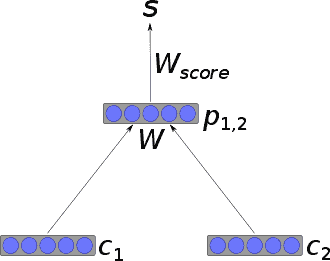 |

### 循环神经网络

`RNN` (Ting, 2014) 似乎是另一种被频繁使用的成功神经学习方法，特别是在 `NLP` 和语音分析中。与标准神经网络不同，`RNN` 利用了通道的连续层。在数据序列的准备程度传递价值知识的许多情况下，这一特性至关重要。例如，理解一个短语或术语需要理解其上下文。通过输入神经元 `x`、隐藏（状态）部分 `s` 和返回顶点 `y`，`RNN` 可以被视为一组记忆空间。

| 图 2. RNN 的通用架构 |
| --- |
| 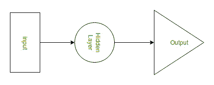 |

### 卷积神经网络 (CNN)

`CNN` 是一种著名且常用的深度分类技术（Tianqi, 2015）。它被广泛应用于各种场景中，包括自然语言处理（Sharan, 2013）、语音识别（Hsieh, 2013）和机器视觉。其架构由人类和其他动物大脑中的神经递质建模，与典型的神经网络模型相当。它类似于猫脑的视觉系统，该系统由一系列复杂的神经元组成。`CNN` 提供了这项活动的三个部分，如 (Hazan, 2010) 所述，包括分布前、浅层连接和比较描述。

### 深度生成模型

深度生成模型 (`DGMs`) 是一种具有大量隐藏层的神经模型类型，已通过大量数据实现了估计困难、高维的分布。同样，当 `DGMs` 经过有效训练后，我们可以使用它们来评估每个观测值并根据其属性生成样本。近年来，演进 `DGMs` 是 AI 相关研究的最新领域。一些突破甚至进入了公众视野，例如最近在创建高效图像、多媒体属性方面的成就。尽管有所改进，但许多数学和实践上的挑战阻止了 `DGMs` 的广泛使用：为特定数据集设计和训练 `DGM` 仍然困难，而确定一个模型为什么有用或没用困难得多。我们介绍了 `DGMs` 并提供了一个清晰的科学模型来描述不同的主流策略：归一化流 (`NF`)、变分自动编码器 (`VAE`) 和对抗网络 (`GAN`)，以帮助增强对 `DGMs (GAN)` 的理论理解。

## 深度学习的背景与步骤

许多深度学习过程有助于提高学习效率、扩展适用范围并简化控制程序。但计算智能模型极长的训练时间证明对科学家来说是一个重大问题。增加额外的训练示例和预测模型也可以显著提高泛化能力。为了加速深度学习计算，研究中开发了几项突破性技术。深度学习系统包括灵活模块化深度学习方法的部署，以及分析应用、传播策略和基础设施维护。它们的创建是为了促进该领域的系统级研究，同时也促进了集成过程。本节介绍了这些一些优秀的方法和环境。

### 迁移学习

鉴于受控深度学习取得的巨大进展，一些研究人员专注于深度学习中无监督机器学习的难题。然而，使用非结构化方法收集可重复特征最近在许多情况下已产生积极成效。在过去的十年里，关于自学教育模式的意识在文献中一直存在着激烈争论（Moataz, 2011）。近年来最受欢迎的无控制深度学习方法是像 GANs 和 VAEs 这样的设计和项目。例如，对于某些过程，训练并使用 GANs 作为常数特征表示。这种网络从非结构化数据中创建了一种高层特征提取技术，可用于无控制的人脸识别。生成的特征也可用于寻找其他高级对象，例如人体部位或野生动物特征。（Bengio, 2014） 提出了一种用于无监督分类的合成概率网络，仅作为依赖于马尔可夫链转移生成器的参数估计的替代方案。

### 深度学习中的优化技术

#### a) 集中式优化

在采用集中式增强的 DDLS 中，一个唯一的优化实例（通常称为参数服务器）负责修改特定的车辆组件。测量系统仅使用由聚类成员执行迁移学习（工作节点）生成的浓度。系统在整个重训练期间的信息流如图图 3 所示。需要注意的是，参数服务和工作力的术语描述的是应用程序操作而非实际硬件。我们目前假设该术语意味着每个功能单元都在独立的计算机上运行。

| 图 3. 集中式优化的实现 |
| --- |
| 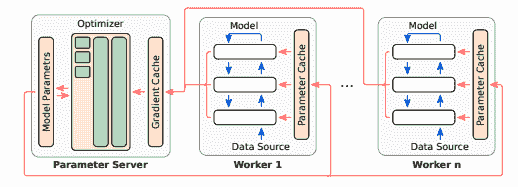 |

通过在这些节点聚合所有通信，模拟可以很好地保持其吸引力，而确定每个变体的昂贵任务分布在一些聚类设备之间。这使得为大量基分类器寻找逐参数下降变得简单。代理之间的操作是静态处理还是动态处理，对有效性可能会产生不同的影响。由于离散参数服务似乎是唯一具有访问特定参数估计权限的代理，其位置持续代表了训练过程的质量。结果是数据管理被极大简化，但个人现在有了制造商参与。为了确保模型产生的值是合适的，每个员工必须定期重新检索它。在多个聚类中，这种集中在相同网络设备上的持续交互需求很容易导致拥堵。在重新分配变量服务责任时，大多数集中式性能调优 DDLS 采用了通信技术。具有去中心化优化的聚类中的信息流如图图 4 所示。中央服务器通过合并员工独立教学的本地模型副本（J- -）构建随后的全局建模状态；通过检查非线性函数寻找具有强应用特性的随机梯度最小路径（Feng, 2015）。去中心化系统不像传统 DDLS 那样将优化周期集中到组上，而是在每个员工处独立地执行分类模型。为了对齐不同的观点并创建更好的激励机制，需要进行某种形式的裁决（Zisserman, 2016）。如果某些工作节点无法满足重复斜率计算和优化过程的存储开销，有时可以采用去中心化最小化。图 4 显示了分布式结构中的数据流。

| 图 4. 实现去中心化优化的聚类数据流 |
| --- |
| 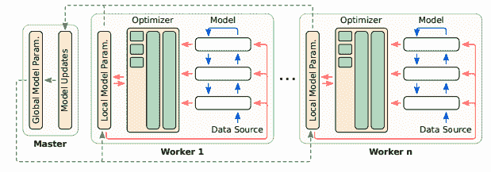 |

### 分布式系统中的深度学习


去中心化深度学习算法的发展有助于提高训练效率，因为特征学习性能受限于单机系统。数据同步和原型同步是分布式架构建模过程的两个基本策略。每个模型都是使用指定的数据子集构建的，并在所有计算平台上复制建模以允许数据同步。经过一段时间后，频率更改需要在终端之间进行同步。相比之下，模型并发使用单机处理所有数据。模型并行方法将模型划分到多个节点上。例如，模型并行方法使 `LSTM` 成为可能。去中心化系统不像传统 `DDLS` 那样将优化周期集中到组上，而是在每个员工处独立地执行分类模型。为了对齐不同的观点并创建更好的激励机制，需要进行某种形式的裁决（Zisserman, 2016）。

## 深度学习框架

从表 1 可以看出，`C++` 经常被用于构建深度学习。

| 表 1. 深度学习模型比较 |
| --- |
| 背景 | 授权 | 语言 | 支持 | CNN & RNN 支持 | DBN 支持 |
| --- | --- | --- | --- | --- | --- |
| (Abadi, 2016) | Apache 2.0 | Python | C++ | Yes | Yes |
| (Sami, 2016) | BSD | Python | Yes | Yes | |
| (Tiangi, 2015) | Apache 2.0 | C++ | C++, Julia | Yes | Yes |
| (Ting, 2014) | BSD | Lua | Yes | Yes | |
| (Dong, 2014) | MIT | C++ | | No | |

## 深度学习应用

图 5 显示了深度学习在不同领域的各种应用。我们在下部分对其逐一进行了解释：

| 图 5. 深度学习的不同应用 |
| --- |
| 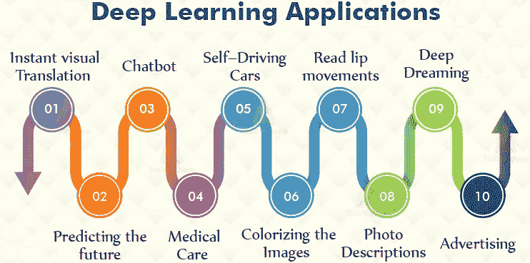 |

### A. AI 助手

自动化系统是基于云的应用程序，它们理解人类语言语音识别并根据客户端的指示执行。虚拟个人助手的一些示例包括 `Amazon Alexa`、`Bing`、`Cortana` 和 `Google Assistant`。它们需要网络设备以处于最佳工作状态，如图 6 所示。

| 图 6. AI 助手的应用 |
| --- |
|  |

### B. 机器人 (Bots)

图 7 显示了机器人应用。机器人可以快速解决客户问题。机器人是一种人工智能（`AI`）应用程序，允许用户之间进行交互式文本或文本转语音通信。

| 图 7. 机器人的工作架构 |
| --- |
| 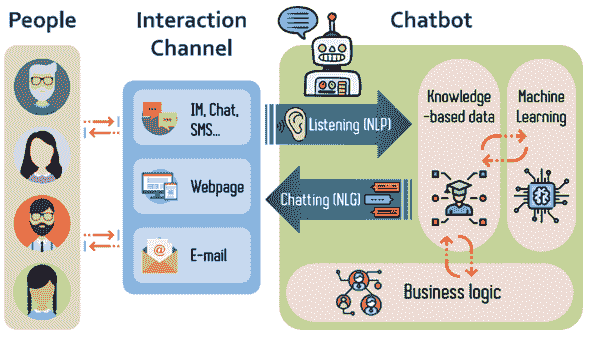 |

### C. 医疗领域

医学领域已成为深度学习的阵地。得益于深度学习，计算机现在可以帮助疾病治疗和分类。医学影像广泛应用于药物研究、临床研究，以及癌症和黄斑变性等潜在致命慢性疾病的检测，这在图 8 中所示。

| 图 8. 在医学领域的应用 |
| --- |
| 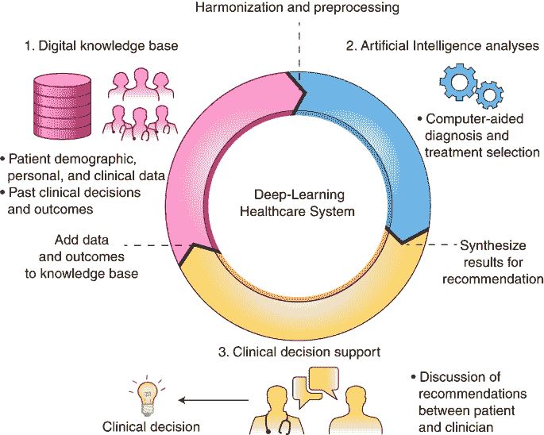 |

### D. 娱乐

`Netflix`、`Amazon`、`YouTube` 和 `Soundcloud` 等为用户提供合适电影、音乐和电视推荐的公司示例如图 9 所示。这一切都是深度学习的结果。为了帮助用户选择产品和服务，互联网流媒体公司根据用户的网络活动、爱好和行为生成个性化推荐（Kavitha, 2010, John, 1993）。

| 图 9. 在娱乐领域的应用 |
| --- |
|  |

### E. 假新闻检测

利用深度学习，你可以根据观众的身份量身定制新闻。受用户社会、地区、社会经济和心理倾向的影响，你可以整合并分析新闻内容（Sumathi, 2021）。使用神经网络使得创建能够从新闻流中识别并排除偏见和虚假新闻的分类器成为可能。此外，它们还会提醒你注意可能的安全漏洞，如图 10 所示。

| 图 10. 在新闻流中的应用 |
| --- |
| 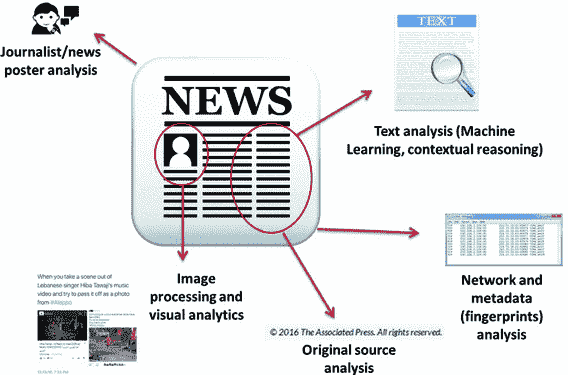 |

### F. 交通预测

图 11 显示，深度学习的另一个用途是预测道路交通。为了预测由于某一区域瓶颈导致交通系统拥堵情况发生的变化（Ma, 2015），提供了一种基于 `RNN-RBM` 架构的深度学习系统。

| 图 11. 在交通领域的应用 |
| --- |
|  |

### G. 自动驾驶车辆

许多大型公司和独角兽创业者，如 `Google`、`Tesla`、`Aurora` 和 `Uber` 正致力于自动驾驶汽车创新。具有卷积层和用于最大特定线程层级以提取特征表示的最小深度学习模型（Samira, 2019, Alom, 2019, Kuutti, 2021, Gidado, 2020）。为了创建一个分类以区分在为了长时间感知的抵消中提取的特征，他们使用了自监督学习过程。最近，自动驾驶解决方案已经分为两类：用于识别驾驶员方面的机器人技术，以及用于从感知信息获取转向行为映射函数的心理复制技术，如图 12 所示。

| 图 12. 在自动驾驶中的应用 |
| --- |
|  |

## 开放性挑战与机遇

在上面的章节中，我们已经彻底审查了深度学习在几个领域的先进技术水平。然而，相关研究仍处于早期阶段，未来在这一领域还需要进行更多工作。在这一部分中，我们首先列出了将深度学习集成到物联网（`IoT`）应用中的四个重大障碍。我们立即强调了融合物联网和深度学习解决方案带来的两个优势。

### A. 系统架构缺乏创造力

过去，大多数模型都是堆叠在简单模型之上，导致更难提升数据应用性能。为了解决这个问题，需要创建一种全新的深度分类算法，无论是作为当代教学方法的复杂形式，还是作为其他可实现的成功方式，但学习技术收益的复杂性仍在不断实现。

### B. 训练模型的改进

目前深度学习模型的两种训练技术是监督学习和无监督学习。使用许多训练技术，例如受限玻尔兹曼机、作为建模工具的自动编码器以及监督训练技术的使用。无监督学习是他们与强化方法相结合的方法，以优化学习的训练。完全无监督的训练没有实际意义。因此，对深度学习技术的进一步研究将放在如何以及何处完成完全无监督训练上。以下是深度神经网络系统中参数估计的困难列表：

#### (i) 响应率

缓慢的学习率可能会陷入局部最优解，并需要很长时间才能到达最优点。相反，较大的学习率可能会跳过最优位置且永不收敛。

#### (ii) 优化

局部最优对于许多多维学习目标来说是一个重大问题。共轭梯度法根据当前位置的斜率来解决这些问题。对于理想的对称问题可以确定最终的极值，因为只有一个最低或最高位置。而在局部极值的情况下，存在许多极小值和极大值。

#### (iii) 消失和爆炸的变化

这是在训练大型神经网络时遇到的主要问题之一。深度神经网络具有多个隐藏层，因此在将属性应用于顶层时，首先应用了许多仿射变换，然后是训练算法。结果是梯度值有时会变得极大或急剧变小。

### C. 缩短训练时间

目前大多数深度学习模型的评估都在理想环境中进行。现代技术在复杂的相应设施中似乎无法产生预期结果。此外，基础模型或多个模型构成了深度知识量随着问题复杂性的增加而增加，导致深度学习模型准备时间的增加。智能系统的科学研究将关注如何在修改硬件的同时修改系统以增加计算时间和效率。

## 结论

在强化学习（计算机视觉领域的一个当前热点领域）中，一系列非对称层级被用于学习与数据解释相关的多个问题。多年来，机器学习科学家一直致力于从无结构化数据中推断结构和分析模型。“表示获取”（Representation acquisition）是描述这种方法的术语。与保守的机器学习和数据挖掘方法相比，深度学习可以从海量的原始数据测量中创建极高的数据图。作为结果，它为现实世界中遇到的各种问题提供了替代方案。

本文系统地研究了最新的深度学习方法和策略。

文章首先介绍了人工神经网络及其自 1940 年以来的发展，然后介绍了现代人工神经网络及其在众多领域取得的重大成就。随后讨论了该领域的主要策略和平台，以及著名的机器学习方法。文章从简要解释传统的神经网络模型开始，然后过渡到许多受监督的深度学习模型，包括循环神经网络、周期神经网络、多层神经网络、多层感知器以及马尔可夫引擎。接着描述了更复杂的深度学习方法，包括非受控激活和在线激活。此外，文中还提供了多种优化算法。`Theano`、`Caffe` 和 `TensorFlow` 是该领域最广泛使用的技术之一。为了解决海量数据问题，还简要介绍了去中心化深度学习算法。最后，探索了适用于多个行业的最有效深度学习技术，包括网络分析、语音和声音识别、可视化工具处理以及计算语言学。

### REFERENCES

- Abadi, M., Agarwal, A., Barham, P., Brevdo, E., & Chen, Z. (2016). `Tensorflow`: Large-scale machine learning on heterogeneous distributed systems. https://arxiv.org/abs/1603.04467

- Abdel-Hamid, O., Abdel-rahman, M., Jiang, H., Deng, L., Penn, G., & Yu, D. (2014). Convolutional neural networks for speech recognition. IEEE/ACM Transactions on Audio, Speech, and Language Processing , 22(10), 1533–1545. doi:10.1109/TASLP.2014.2339736

- AbelJ.FingscheidtT. (2017). A DNN regression approach to speech enhancement by artificial band-width extension. In IEEE Workshop on Applications of Signal Processing to Audio and Acoustics. IEEE.

- Abu-El-Haija, Kothari, Lee, Natsev, Toderici, Varadarajan, & Vijayanarasimhan. (2016). YouTube-8M: A large-scale video classification benchmark. https://arxiv.org/abs/1609.08675.

- Alom, M. Z., Taha, T. M., Yakopcic, C., Westberg, S., Sidike, P., Nasrin, M. S., Hasan, M., Van Essen, B. C., Awwal, A. A. S., & Asari, V. K. (2019). A State-of-the-Art Survey on Deep Learning Theory and Architectures. Electronics (Basel) , 8(3), 292. doi:10.3390/electronics8030292

- Berant, J., Chou, A., Frostig, R., & Liang, P. (2013). Semantic parsing on freebase from question- answer pairs. In Empirical Methods in Natural Language Processing (Vol. 2). Association for Computational Linguistics.

- Bharath, M., & Prakash, S., & Chinnasamy. (2021). Detecting Fake News Using Machine Learning Algorithms. 2021 International Conference on Computer Communication and Informatics (ICCCI), 1-5. doi: 10.1109/ICCCI50826.2021.9402470

- Breiman, L. (2003). Statistical modeling: The two cultures. Statistical Learning, 48(1), 1–32.

- Castelchi, D. (2016). Can we open the black box of AI? Nature, 538(7623), 20–23.

- Chen, J.-T., & Hsieh, H.-L. (2013). Non-stationary speech using variational Bayesian. Networks and, 22(5), 6117-94-2014.

- Chen, D., Eversole, A., Seltzer, M. L., Yao, K., Guenter, B., Kuchaiev, O., Seide, F., Wang, H., Droppo, J., Huang, Z., Zweig, G., Rossbach, C. J., & Currey, J. (2014). An introduction to computational networks and the computational network toolkit. In The 15th Annual Conference of the International Speech Communication Association. ISCA.

- Chen, T., Li, M., Li, Y., Lin, M, Wang, N., Xiao, T., Xu, B., & Zhang, Z. (2015). `MXNet`: A flexible and efficient machine learning library for heterogeneous distributed systems. https://arxiv.org/abs/1512.01

- Chetlur, S., Woolley, C., Vandermersch, P., Cohen, J., Tran, J., Catanzaro, B., & Shelhamer, E. (2014). `cuDNN`: Efficient primitives for deep learning. http://arxiv.org/abs/1410.0759

- Chen (2017). Deep learning based automatic immune cell detection in histochemistry images. In International Workshop on Machine Learning in Medical Imaging. Springer. 10.1007/978-3-319-10581-3

- Duchi, J., Hazan, E., & Singer, Y. (2010). Incorporating Nesterov momentum into `Adam`: Adaptive subgradient methods. In Proceedings of the 3rd International Conference on Learning Representation. 

- Garofolo, J., Lamel, L., Fisher, W., Fiscus, J., & Pallet, D. (1993). DARPA TIMIT acoustic speech. NASA STI/Recon Report 93.

- Gidado, U. M., Chiroma, H., Aljojo, N., Abubakar, S., Al-, M. (2020). A survey on deep learning. IEEE Access, 8, 16379–16387. doi:10.1109/ACCESS.2020.301789

- Gu, Bowden, R., Jin., Y., Barber, P., & Fallah. (2021). A survey of deep learning to autonomous vehicle control. IEEE Transactions on Intelligent Systems, 22(2), 712–733.

- Ma, Yu, Wang, & Wang. (2015). Large-scale transportation network congestion evolution using deep learning. PLoS ONE, 10(3), e011904

- Pouyanfar, Sadiq, Yan, Tian, Tao, Reyes, Shyu, Chen, & Iyengar. (2018). A Survey on Deep Learning: Algorithms, Techniques, and Applications. ACM Comput. Surv., 51(5). 10.1145/3234150


# 自动语音识别（ASR）综述

自动语音识别（ASR）在过去十年中获得了广泛普及。手机、电脑、车辆和音视频播放器等各种设备现在配备了 ASR 技术。对 ASR 技术的使用和依赖日益增加，导致了该领域研究的增强和机遇的出现。本章对 ASR 系统开发的各种进展进行了详细综述。它强调了语音识别的历史，并对近期进展以及提供最新解决方案的行业领导者进行了深入洞察。文中详细讨论了 ASR 框架，包括特征提取技术、声学建模技术和语言建模技术。本章还列出了可用的各种流行数据集，并讨论了新数据集的生成。这项工作对于新进入该领域并正在探索新语音识别技术开发的研究人员将非常有帮助。

## 引言

从人类生存之初，通信一直是人类最重要的方面。语音通信是人与人之间最简单、最受欢迎的互动方式。但当我们与机器交互时，通常局限于机器上存在的某些控制装置或按钮。自动语音识别（`ASR`）意味着机器将自动识别人的说话内容，即它可以将语音转换为文本、根据语音指令进行操作并做出响应。使用语音与机器通信为手机、电脑、车辆和电视等机器的交互提供了新的维度，因此在过去的几几年中获得了广泛普及。它让与机器的交互变得更加自然和方便（Neustein, 2010；Kumar et al., 2011; Tan & Lindberg, 2008）。现在，人类可以像人与人通信一样与机器对话。这项技术对于人们忙于某些体力任务（如驾驶车辆）而无法用手操作机器的情况非常有帮助。眼脑和免手通信在这种情况下非常有用。对于盲人和无肢等残障人士来说，这是一个福音，他们苦于无法像正常人一样使用设备。随着语音技术的进步，控制各种设备变得越来越容易。适当操作的执行取决于底层 `ASR` 系统的识别准确率。如果系统无法清晰识别所说的话，可能不采取任何操作或采取某些不当操作。因此，需要一个准确的 `ASR` 系统。

最近，由于手机和类似设备的使用日益增加，构建提供语音识别的高效接口的需求迅速增长。这些设备具有多种应用，如语音通话、短信、听音乐、设置闹钟和提醒、上网、智能家居自动化、基于语音的听写以及各种设备的控制。

语音本质上是由人类发音器官产生并通过人类耳朵检测的信号。发音器官包括声带、咽壁、声门、下颌、软腭、硬腭、鼻腔、舌头、齿槽、牙齿和唇。当空气通过这些器官时就会产生声音。人类听器官以振动的形式感知声音，这种声音被转换为神经冲动，进一步由大脑感知。大脑处理声音并从中提取有意义的单词，或采取相应的行动或响应。

机器语音识别需要机器感知并识别语音。为了开发 `ASR`，世界各的研究人员在各种语言中提出了算法、工具、技术和模型。本文重点介绍了世界各地研究人员的贡献。本章的结构如下：第 2 节阐述 `ASR` 的历史，第 3 节强调了近期进展。第 4 节详述了展示各种技术的 `ASR` 架构。第 5 节介绍了技术面临的挑战，最后是结论。

## 背景

### 语音识别历史

几十年来，研究人员一直在探索 `ASR` 领域。1952 年，贝尔实验室的 Davis 等人开发了首个语音识别器，准确率达到 97-99%。1960 年，IBM 引入了 `ShoBox` 技术，可以识别从 `0` 到 `9` 的数字以及 `plus`、`minus` 等命令。

1975 年，Baker 提出了 `Dragon System`，这将走向现代化。该模型基于马尔可夫过程。1976 年，CMU 开发了 `HARPY`，具有识别 101 个单词的能力。DARPA 语音理解研究（`SUR`）（Klatt, 1977）于次年 1977 年提出。

20 世纪 80 年代，隐马尔可夫模型（`HMM`）变得流行。20 世纪 80 年代中期，IBM 发布了 `Tangora`（Averbuch et al., 1986）。它以世界上打字最快的人命名。它可以打出说话者所说的内容。但它的速度并不快，且只允许没有背景噪音的清晰语音。每个用户必须用录制的语音对其训练 20 分钟。`Tangora` 能够区分 20,000 个英语单词和几个句子。1987 年，发布了一个名为 `Julie` 的说话娃娃。它用儿童的声音进行训练，以便它可以对语音做出响应。但它有一个问题，每个单词都必须停顿一下说完。

随着微处理器领域技术的进步，语音软件的发展日益加快。1989 年，Dragon 公司发布了 `Dragon Dictate`（Baker, 1989）。这是首个面向消费者的已知语音识别软件。另一项改进 `Dragon Naturally Speaking` 于 1997 年发布，它每分钟可以识别 100 个单词。

语音识别技术的重大突破出现在 2001 年，当时 Google 推出了 `Google Voice Search`。它用于将用户查询与真实类语音进行匹配。

Google 在 2010 年开发了包含 2300 亿英语单词的语音模型。它记录用户的语音查询，以为 Android 设备开发语音应用程序。`Siri` 于 2010 年发布，它依赖云计算并作为一个出色的个人助手工作。

### 语音识别系统的近期进展

各种平台开发了许多语音识别应用程序和程序（专利软件和免费软件），例如 `Google Voice Search`、`Windows Speech Recognition`、`Dragon Naturally Speaking`、`Tazti` 等。

#### Google 语音搜索

Google 语音搜索 (Schalkwyk et al., 2010) 由 `Google` 开发，为用户提供基于语音的搜索服务。通过该功能，用户可以通过说话来提问，并获得语音回答。它适用于 `iOS`、`Android` 以及笔记本电脑和台式机的 `Chrome` 浏览器。Google 语音搜索支持 110 多种语言。英语（美国、澳大利亚、加拿大、印度、英国、新西兰和南非）自 2008 年诞生以来就是其组成部分。孟加拉语、古拉特语、卡纳达语、印地语、马拉雅姆语、尼泊尔语、马拉地地语、泰米语、泰卢固语和乌尔都语已于近期（2017 年）被支持支持列表中。许多印度语言尚未在 Google 的列表中找到自己的位置。

#### Siri

Siri (`Siri - Apple (IN)`) 是由 `Apple` 提供的一种基于移动端的虚拟助手应用程序。`Siri` 支持的语言包括英语（美、澳、英、加）、中文、德语、意大利语、西班牙语、法语、日语、粤语和韩语。目前尚未提供任何印度语言的支持。

#### Amazon Alexa

Alexa (`Alexa Voice Service Overview`) 是 `Amazon` 提供的虚拟助手。目前它仅支持三种语言：英语（澳大利亚、加拿大、印度、英国和美国）、德语和日语。它不支持任何印度语言。

#### Dragon Naturally Speaking

它 (`Dragon Speech Recognition - Get More Done by Voice`) 是由 `Nuance Communications` 提供的一种语音识别软件，采用极简的用户界面。目前它支持美国英语、西班牙语、英国英语、日语、荷兰语、法语、意大利语和德语。

#### Windows 语音识别

`Windows` 在 `Windows` 的多个操作系统版本（Vista、7 和 8）中提供了语音识别应用。它提供英语、西班牙语、德语、日语、法语和中文的语音识别。用户可以通过语音命令操作计算机。它还提供了文本听写功能，可以使用口令输入文档。

#### Tazti

Tazti (`Voice Recognition Software | Speech Recognition Software | Tazti`) 是一种专有的语音识别软件。它由 `Voice Tech Group, Inc` 开发，允许通过语音控制浏览电脑。人们可以通过语音命令播放歌曲、玩游戏、控制应用程序、打开文件并执行多项任务。

#### Cortana

`Cortana` 是 `Microsoft` 的智能个人助手。用户可以与 `Cortana` 对话并设置提醒、联系人、发送电子邮件、加入会议等。它的开发始于 2009 年，并在 2014 年 4 月举行的构建会议上首次展示。

上述语音识别应用已广泛用于手机、电脑和专用的设备，也可用于娱乐目的。它们在减轻人类负担方面迈了一步，特别是对于残障人士。

### 自动语音识别

自动语音识别（`ASR`）可以归类为模式识别的一个分支。其首要目标是在语音识别过程中定位最可能的词序列。`ASR` 可以通过贝叶斯定理实现。语音信号表示为声学特征观测 ，其源自词序列 ，解码器或识别引擎根据以下方程找到最可能的词序列：

```
 (Eq.1.1)
```

使用贝叶斯定理，可以被写为：

```
 (Eq.1.2)
```

 是常数，因此可以写为：

```
 (Eq.1.3)
```

或者：

```
 (Eq.1.4)
```

 取决于观测序列并使用声学模型进行评估，而 `P(W)` 由语言模型确定，代表单词排列的先验知识。取对数值是为了方便计算。声学建模包含两个部分：(i) 发音建模，即用音素表示每个单词；(ii) 音素到音素的映射。

### ASR 框架

| 图 1. ASR 架构 |  |

ASR 引擎通过麦克风、手机或任何换能器接受正弦波形式的语音信号，并转换为相应的文本。典型的 ASR 架构已在图 1 所示 (Chou &Juang, 2003)。ASR 包含两个部分——(i) 训练和(ii) 语音到文本的解码。首先收集语音和文本语料库，并准备用于训练语音转写。根据语言的发音规则生成发音字典。声学模型由语音转写生成并经过隐马马尔可夫模型训练。语言模型使用文本语料库通过 n-gram 估计或语法规则生成。文本语料库中的所有单词必须在字典中。

### 语音语料库开发

语音语料库由语音文件及其文本转写组成。语音文件可以是录制的，也可以使用基准语音语料库用于 ASR 模型。有多种语料库提供者，如 Clarin 的 Spoken CORPORA、信息媒体开发局、语言数据协会、印度语言数据协会 (LDC-IL)。LibriSpeech ASR 语料库是为英语开发的 1000 小时语音。该语料库经过仔细的分割和对齐 (`OpenSLR | LibriSpeech`)。TED-LIUM 版本 3 以知识共享许可可用，包含 452 小时的音频 (`OpenSLR | TED-LIUM`)。可以从这些平台下载并用于模型开发。如果没有所需语言的语音语料库，则需要首先开发语料库。这涉及收集或录制语音文件并将语音文件转写为文本。收集/录制语音和转写的任务非常繁，需要极其小心。还需要对语音信号进行预处理，以消除任何杂音、噪声和冗余。最终模型的准确性高度取决于语音语料库的正确性。有多种工具用于语音信号的录制、处理和转写，例如 `Audacity`、`Praat`、`Transcriber`、`LIUM` 等。

语音信号包含了大量数据，如语音文本、情感、年龄和性别。特征提取有助于从语音信号中提取此类特征。为了清理语音信号，会应用预处理函数来去除不需要或冗余的数据。这些预处理后的语音特征被进一步用于建模。这是 ASR 中的重要步骤之一，因为在这里进行了数据压缩。从信号中去除冗余数据后生成的数据供后续阶段使用。如果在从信号中提取有用数据时出现缺失，那么在后期阶段是无法克服的。图 2 显示了各种特征提取技术。

| 图 2. 特征提取技术 |
| --- |
| 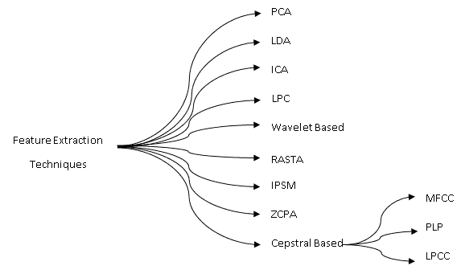 |

## 特征提取技术

### 主成分分析 (PCA)

`PCA` 是一种用于降维的统计分析工具 (Pearson, 1901)。它试图寻找数据内部的关系，并只保留具有意义的数据 (Shlens, 2014)。`PCA` 保留了方差，即解释所需的所需的统计信息。降维后形成的新变量被称为`主成分`。它还展示了数据内部的遗传距离和关系。`PCA` 在开始之前首先对数据进行归一化，使所有变量处于相同的空间。准备`协方差矩阵`以获取不同变量之间的两两协方差。然后，将`协方差矩阵`分解为`特征值`和`特征向量`。这些`特征向量`代表`主成分`。在这里，选择了最显著的`特征向量-值对`，并根据这些`特征向量`准备了`投影矩阵`。由于提取特征缺乏类别标签，`PCA` 是一种无监督技术。

### 线性判别分析 (LDA)

`LDA` 最初源于 Fisher 线性判别法 (Fisher, 1936)，用于寻找谱时域输入的判别特征。该方法用于提取特征的线性分组，以表征或分离两个或多个簇。它基于降维原理工作，即将多维数据绘制在 2 维或 3 维空间中。`LDA` 有三个步骤。第一步是计算不同簇之间的分离性。它定义为不同簇均值之间的距离。第二步是计算类内方差，即每个簇均值与样本之间的距离。最后一步是构建低维空间，以最大化第 1 步的值并最小化第 2 步的值。`LDA` 是一种监督学习技术，因为它保留了类别标签和关于输出类别的信息。为了改进 LVCSR，还引入了 `LDA` (Haeb-Umbach& Ney, 1992)。不带 `LDA` 的基准系统报告错误率为 18.6%。据称通过对其应用 `LDA` 可以将词错误率 (WER) 降低 5%。概率线性判别分析是 `LDA` 的扩展，基于 `i-vector 提取`。`i-vector` 是一个充满信息且具有固定长度的低维向量。

### 成分分析 (ICA)

(Lee, 1998) 在其书中指出，`ICA` 是一种信号处理方法，用于从多变量信号中提取独立的非高斯信号。`ICA` 根据语音的高阶统计提取特征向量。它将多变量信号分解为独立的非高斯信号。它揭示了随机变量集、信号或测量值背后的未知因素。它属于盲源分离技术，可以将说话声从背景噪声中分离出来。

### 线性预测编码 (LPC)

`LPC` 是一种用于信号源建模的技术，代表语音信号的频谱包络 (Atal &Remde, 1982)。它以低比特率对语音进行编码，并为语音参数提供高度精确的估计。这种技术估计语音信号中的共振峰，消除其影响，并估计剩余语音信号的强度和频率。它需要高质量的语音信号进行特征提取，如果信号较差，`LPC` 将无法准确工作。

### 基于小波的技术

在这些技术中，语音信号被分为不同的部分。`离散小波变换 (DWT)` 提供了在时间和频率上的积分信号表示，可以高效地进行计算机处理 (Tan et al., 1996)。它们以高效的时频域定位以及对小波表示信号的多级调整、多尺度分析而闻名。`小波包分解 (WPD)` 是 `DWT` 的扩展 (Gokhale &Khanduja, 2010)。`小波包分解`提供了多层级的频率分解。信号在每个层被分为低频分量和高频分量。

### 相对频谱滤波 (RASTA)

`RASTA` (Hermansky& Morgan, 1994) 是一种改进语音的方法。它用于改进音频语音。语音轨迹通过 `RASTA` 进行带带滤波。它最初用于减少声音对语音信号的影响，现在用于直接增强信号。

### 集成音素子空间方法 (IPSM)

`IPSM` 方法收集语音空间之间关系的信息，并重构特征空间以获得更好的语音学知识 (Park et al., 2009)。在这个过程中，通过显示基于集成语音 (IPS) 的 `PCA` 或 `ICA` 子组件中的向量来生成语言向量。

### 零交叉点峰值 (ZCPA)

`零交叉点峰值 (ZCPA)` 方法是由 (Kim et al., 1996) 提出的。在这种技术中，滤波器子带内的刺激周期性可以从零交叉间隔获取。在噪声环境中，由于主频谱峰和波谷受影响较小，模型也表现良好。在存在噪声的情况下，模型更具鲁棒性，因为对主频谱峰的依赖较少，且对通常被噪声干扰的波谷依赖较少。

## 基于倒谱的技术

`cepstrum`（倒谱）是一组描述语音帧特征的数字序列。`cepstrum` 是一种从频谱计算得出的积分变换，可用于跟踪音高。(Bogert et al., 1963) 描述了能量倒谱。信号功率倒谱定义为信号傅里叶变换平方的对数的逆傅里叶变换的平方。

提取特征提取有多种基于倒谱分析的特征提取方法。

其中一种方法是梅尔倒谱频率系数（`MFCC`）（欧洲电信标准协会，2003 年）。在大规模词汇语音识别（SR）系统中，`MFCC` 是广泛使用的方法之一。`MFCC` 使用重叠的三角形窗口来表示在梅尔尺度（Mel scale）上的声波短期功率谱。线性预测倒谱系数（`LPCC`）（Makhoul, 1975)是通过平滑的自回归功率谱计算的，而不是从周期图中估计功率谱。在 `LPCC` 中，当前时刻的一个语音样本可以被预测为之前语音样本的线性组合。

巴克频率倒谱系数（`BFCC`）是另一种从语音信号中提取特征的方法。它与 `MFCC` 非常相似。该方法使用 bark 尺度滤波器而不是梅尔滤波器（Zwicker, 1961)）。

感知线性预测（`PLP`）模型是由 (Hermansky, 1990) 开发的。`PLP` 概念化了听觉物理概念。它丢弃了必要的语音信息并加速识别。`PLP` 与 `LPC` 的相似之处在于它根据听觉特征进行变换。`PLP` 近似了感知的三个方面：关键带分辨率、等响度曲线和强度-响度幂律。

## 发音建模

| 图 3 发音建模技术 |
| --- |


|  |
| --- |

发音建模处理语言语言学问题。在这里，每个词根据语音规则表示为子词。在解码时，它提供了词之间的映射。为每个词开发了发音模型。图 3 (`978-1-6684-6001-6.ch002.f03`) 展示了各种技术。声学模型与字典成正比。

(Lucassen and Mercer, 1984) 提出了决策树。准确率提高到了 94%。

(Fosler, 2003) 显示，可以从识别器生成表层发音，并通过将词序列替换为最可能的发音生成标准序列。可以对生成的两个语音序列进行对齐，以获得精化的发音。

其中一个字典是由语言数据联盟（LDC）于 1996 年提供的。音素预测的准确率为 97%。

(Klatt, 1987) 回顾了系统中基于技术的发音技术。

(Mittal & Singh, 2020) 讨论了如何将词表示为子词。

(Cremelie and Martens, 1999) 引入了将简单模型开发为新模型的方法，该模型为每个词指定各种发音变体。

(Rao et al., 2015) 提出了针对语音识别中自动发音的验证方法。这是一个数据驱动且独立的口语验证框架，旨在提高自动语音识别（ASR）中的词典质量。新候选词的发音通过重新查看历史音频日志并检查相关的识别成本来确认。他们根据词频和日志创建创建了额外的语音质量特征。在这些特征上进行机器训练的部分在所有测试过的语言中，标记好词 / 与 坏词的准确率几乎达到了 90%。新发现的发音可以被添加到字典中，而错误的发音则可能被丢弃或发送给专家进行进一步测试。他们在几小时内测试了 5,000 到 30,000 个新发音，结果显示，由于系统保证了增强的不稳定性，ASR 功能得到了改进。

(Liu and Fung, 2000) 提议使用基于规则的发音网络代替标准的解码器词典。网络考虑了特殊的中文纹理，并结合了每个汉字可接受的替代方案。此外，还通过设计自动学习算法发现了多样性规则。他们建议的方法在 HLTC 桌面堆栈和基于普通话广播新闻语料库的 Hub4NE 上通过了测试。汉字识别的错误率已完全压缩到 3.20%，使得内部和中间成员的变体都得到了建模。

(Westendorf and Jelitto, 1996) 强调了为了识别复杂字典的正常功能，发音的多样性至关重要，即支持多种发音变体的字典。手工编制字典是一个耗时的过程，并且可能包含错误和不一致之处。作者演示了如何从语音网站本身自动生成合适的词汇字典。网站之外信息的唯一来源是信号（无标签）及其基于单词的翻译。第一个带来希望结果的测试是使用 `DataLab` 软件系统完成，该系统集成了德累斯顿工业大学（TU Dresden）的监控系统。

(NKosi et al., 2011) 讨论了发音字典对 ASR 系统发展的重要性。他们基于形态规则开发了北索托语（Northern Sotho language）的发音字典，与数据驱动的词典创建方法相比，提高了 ASR 系统的语言覆盖率。

(Wei et al. 2022) 致力于多中心语言的发音错误检测（PED）。他们使用迁移学习方法，将知识从主导变体迁移到非主导变体。

## 声学建模

声学模型将生成的语音信号特征与音标或词汇字典相结合。它是最大的 ASR 模块之一。它建立了语音单元与声学观测之间的映射。需要一个丰富且庞大的网站来训练声学模型。由于性别、年龄、环境和其他因素，语音存在许多变体。已经提出了不同的数学方法。图 4

## 隐马尔可夫模型 (HMM)

HMM 的第一项工作由 (Baker, 1973) 开始。`DRAGON` 系统代表每个源。用于计算每一帧的得分。具有 150,000 个高斯混合的连续模型对处理和存储的要求很高，不适用于能力有限的手机。

(Rabiner, 1989) 引入了 `DRAGON` 系统。

(Juang and Rabiner, 1991) 探索了数学方法的作用。

## 高斯混合模型 (GMM)

基于高斯分布，有三种模型：连续模型 (Bahl et al., 1983)、半连续模型 (Huang and Jack, 1988) 和音素绑定模型 (Liu and Fung, 2004)。具有 700 个高斯混合的半连续模型需要的极少处理和存储，适用于手机。PTM 涉及 5,000 个高斯混合，具有中等处理和存储要求。

## 深度神经网络 (DNN)

(Hinton et al., 1995) 提出了用于语音识别声学建模的深度神经网络。

(Maas et al., 2017) 研究了 DNN 声学模型。

(Kumar & Aggarwal, 2022) 提出了基于 i-vector 适应的时延迟神经网络声学建模。

用于声学特征建模的单元需要经过仔细探索。为了获得最小的 `WER`，在生成准确的模型时，需要考虑其可训练性和泛化性等特征。在基于单词的模型中，整个单词被用于建模声学特征。基于单词的声学单元非常准确，但本质上是不可训练且不通用的，因为只有少数单词可以被训练。在基于手机的模型中，要建模的单词被分成不同的微声学单元（共同组成整个单词）。这种方法通常用于大词汇系统。在这种方法中训练了较小的声音单元，并由这些单元形成单词。

| 图 4. 声学建模技术 |
| --- |
| 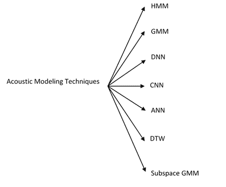 |
| --- |

## 语言模型建模

语言模型用于预测给定句子中的下一个单词。它生成每个单词的出现概率，并根据之前的单词预测后续单词。图 5 显示了各种语言建模技术。`N-gram` 估计是 `ASR` 中常用的技术之一。在其中，`n^(th)` 个单词的似然是由前面的 `(n-1)` 个单词生成的。单词序列的出现概率 `W` 可以计算为：

 (Eq.1.5)

 (Eq.1.6)

二元模型（`n = 2`）和三元模型（`n = 3`）通常用于常见的 `ASR` 应用。另一种流行的语言建模技术是使用语法格式。在其中，编写了各种基于语法的规则，并使用这些规则生成单词序列。例如，对于以下规则：

```
<rule1> = (Hello | Hi) (Sir | Madam);
```

从该规则中可以生成四个句子：

1) Hello Sir
2) Hello Madam
3) Hi Sir
4) Hi Madam

这种语言建模技术通常用于需要执行命令和控制的操作场景。对于小词汇，语法格式是一个很好的选择。

### N-gram 模型

N-gram 模型：(Bahl et al., 1983)描述了 `n-gram` 模型。`n-gram` 模型以 `(n-1)` 阶马尔可夫模型序列的形式预测下一个单词。`n-gram` 模型利用 `n-grams` 的统计属性绘制序列。`n-gram` 模型中观察句子 `(w 1, …, w m {\displaystyle w_{1},\ldots, w_{m}})`  的概率 `P (w 1, …, w m) {\displaystyle P(w_{1},\ldots, w_{m})}` 可以近似为：

 Eq.2.1

其中，时间状态与最近使用的单词有关，在 `n-gram` 模型中可以近似为


该时间状态与最近使用的单词有关，在 `n-gram` 模型中可以近似为

该时间状态与最近使用的单词有关，在 `n-gram` 模型中可以近似为

该时间状态与最近使用的单词有关，在 `n-gram` 模型中可以近似为

该时间状态与最近使用的单词有关，在 `n-gram` 模型中可以近似为

单词的序列。

(Brown et al., 1992) 讨论了单词的序列。

单词。

### 因子化 LM

该时间状态与最近使用的单词有关，在 `n-gram` 模型中可以近似为

单词的序列。

(Karpe et al., 2014) 发表了一篇关于带有 `ASR` 的控制设备的论文。基于命令和控制的应用通过将从麦克风输入的声学信号转换为一组单词来执行语音识别。已知名称被用作操作系统命令。他们使用了 `Sphinx 4`、`JSAPI` 和 `JSGF` 工具包来构建系统。在这个包含所有单词或命令词的语言文件中，使用了 `JSGF-Java Speech Grammar Format`。由 Java Speech API 启用的语音应用程序提供了默认、正常和独立的交互。在这个程序中，用户通过麦克风说命令，查看器将语音转换为文本。接下来，在字典的帮助下逐单词进行映射。现在，接收到的文本被发送到 `run` 命令并执行操作。

### HTK

这是一个用 `C` 编写的隐马尔可夫模型工具包。如其名，它基于 `HMM`。它在语音处理、字符识别、DNA 序列等任务中广泛流行。它由机器智能实验室开发，并可免费下载。它包含了用于数据准备、模型训练、语音识别及其分析的各种工具。数据准备工具有助于数据的转录。训练工具有助于构建 `HMM` 模型。识别工具帮助将语音解码为文本，分析工具则计算所构建模型的词错误率（Word error rate），有助于检查所开发模型的性能和准确性。

### CMUSphinx

它也是市面上流行的免费工具包之一。它根据你想要构建的应用程序类型提供不同的包。它提供了以下包：

* a) `Pocketsphinx`：这是一个基于 `C` 语言的轻量级识别器库。在手机上非常流行。

* b) `Sphinxbase`：这是一个支持库，`Pocketsphinx` 需要它。

* c) `Sphinx4`：这是一个基于 `Java` 的可修改和可调整识别器，适用于桌面应用程序。它提供了良好的准确性，但在大型模型情况下会牺牲速度。

* d) `Sphinxtrain`：它提供了用于构建声学模型的各种训练工具。

### Kaldi

Kaldi 也是一种 ASR（自动语音识别）工具包。这是一个基于 `C++` 的广泛用于语音识别和信号处理的开源工具包。它根据 `Apache License` 免费提供。它还提供了数据准备、特征提取、训练和性能分析工具。

| 图 6. 展示解码器角色的应用的通用结构 |
| --- |
| 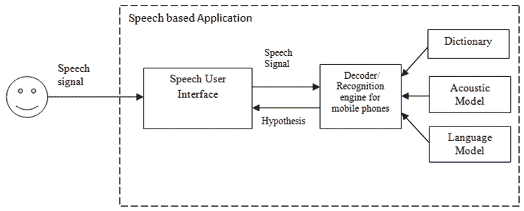 |

图 6 显示了语音应用的通用结构。应用程序安装在设备上。该应用程序由语音用户界面、解码语音所需的识别引擎或解码器、字典、声学模型和语言模型组成。`Decoder` 以库的形式包含在应用程序中。无论用户说什么，界面都会获取并将其发送给解码器。`Decoder` 在声学模型、字典和语言模型的帮助下解码并生成假设。该假设是从语音信号中提取的文本并传递给用户。

## ASR 技术的挑战

语音信号包含了大量信息，如语言信息、共音效应、说话者的性别、年龄、地区、健康、情绪、环境信息（噪声等）。有很多因素会影响语音信号。每个说话者产生的语音在许多方面都是不同的。因此，语音信号中存在大量的语音变异 (Benzeghiba et al., 2007)。通过描述语音变化的影响可以改进 ASR。语音变化是语音信号的一部分，它们的存在会影响 ASR 的整个过程。语音信号本质上是变化的，并随时间改变。语音变异性从不同方面影响声音信号。如果变异性较小，可以通过少量处理轻松检索所需信息，但如果变异性很高，则需要设计特殊技术从中提取信息。行为变异会影响声音信号的结构和质量，因为哭泣时的声音是不同的，吸烟者的声音会发生变化，患有某些疾病或说话困难的人等。声音可以在不同时间进行调制以引起人的注意或传达任何情绪。语音变异的来源有很多，如性别、环境、地区、说话者生理状况、语速、说话风格、年龄、情绪等。

男女声音非常不同。男性的声带比女性大，因此产生低音调的声音。他们的声道也较大，导致音色较低。频谱图是声音的图像，显示了构成声音的频率以及频率的变化。频率从低到高显示，频率的变化从左到右给出。在频谱图上，女性声音的频率比男性对应的更密。频谱图中的红、绿、蓝、黄线条代表共峰频率。图 7 和 8 显示女性的共峰频率高于男性，差异在第三和第四共峰处更为明显。这是由于女性声道长度较短，而共峰频率与声道长度成反比。如果任何 ASR 模型仅针对男性声音进行训练，那么该模型就无法识别女性声音。解码语音的环境也会影响识别。噪声是添加到语音信号中的不需要的信号，导致语音失真。如果用户必须在噪声环境中使用 ASR，而 ASR 仅针对纯净环境训练，那么此类模型提供的识别率将很低。开发模型时需要考虑噪声和噪声类型（如工作条件）。

| 图 7. 男性语音 (a) 波形，以及 (b) 单词‘Ikk’的频谱图 |
| --- |
| 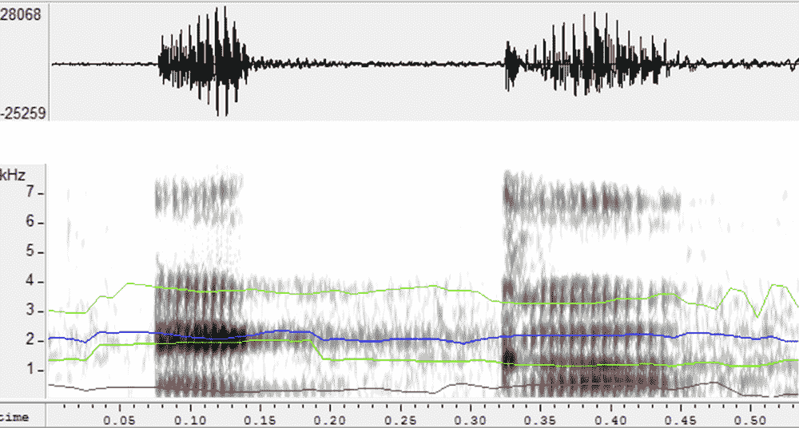 |

| 图 8. 女性语音 (a) 波形，以及 (b) 单词‘Ikk’的频谱图 |
| --- |
| 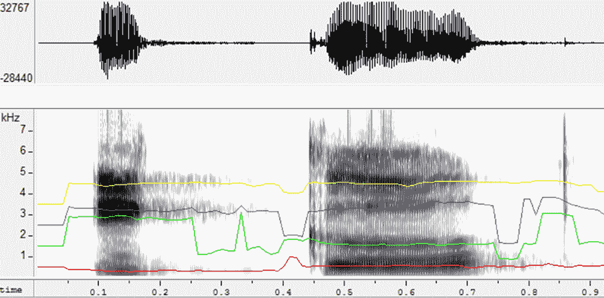 |

母语和非母语说话者的语音存在大量变异。非母语说话者可能无法捕捉正确的口音，导致生成错误的语音，对于其母语中没有的陌生音素，他们会尝试从其母语中产生类似的音素。ASR 模型无法正确处理非母语语音。用户在使用 ASR 模型时的心理状态也是语音变异的主要来源。如果某人愤怒、紧张或抑郁，他们可能无法正确产生声音。如果人愤怒并试图大声说话，音调会发生变化。有些说话者可以调节他们的声音，有时低有时高。这通常由向观众传达信息和情感的讲师、演讲者或政治家完成。因此，他们的语速会变化并导致语音变异。

最好的 ASR 模型将是尽管存在这种变异也能进行建模和识别的模型。但开发此类模型需要大量的语音和文本数据库。对于资源稀缺语言（Besacier et al. 2014），收集这么多数据并开发此类模型是非常困难的。研究小组的贡献是解决这一问题的唯一可行方案。

## 讨论与结论

本章主要关注了各种自动语音识别（ASR）工具和技术。它还介绍了语音识别的历史方面，以及识别过程中正在遵循的最新趋势。ASR 系统的开发依赖于构建三个模型——发音模型、声学模型和语言模型，本文工作对这些模型进行了深入讨论。

它涵盖了对各种技术的审查，从手工制作词典到使用算法开发自动发音生成字典，这种字典可以通过手动调整发音来简化处理。声学模型将发音字典中每个音素（phone）的发音映射到一个声音单元并开发该模型。在构建声学模型时，需要从语音信号中提取特征。有多种技术可以实现，如 `LPC`、`PLP` 和 `MFCC` 等。`MFCC` 是一种广泛使用的特征提取技术。模型的准确性很大程度上取决于可用语音和文本数据。开发声学模型有多种技术，如 `HMM`、`GMM` 和神经网络。由于 `DNN` 技术相比其对手具有更高的准确率，正变得越来越流行。

语言模型在语音解码时使用，用于生成前一个词之后某个单词出现的概率。最流行的技术是统计建模技术。由于语音的变异性，该技术必须面对各种问题和挑战。性别、年龄、噪声、情绪等许多因素影响模型的准确性，在开发具有良好识别准确率的 ASR 模型之前，需要对这些因素进行研究。这项工作将对进入该领域并探索开发新语音识别技术的研究人员提供帮助。

## 参考文献

- Alexa Voice Service Overview (v20160207) | Alexa Voice Service. (n.d.). Retrieved May 15, 2022, from https://developer.amazon.com/docs/alexa-voice-service/api-overview.html

- AtalB.RemdeJ. (1982, May). A new model of `LPC` excitation for producing natural-sounding speech at low bit rates. In Proceedings of the IEEE International Conference on Acoustics, Speech, and Signal Processing (ICASSP’82) (vol. 7, pp. 614-617). IEEE. 10.1109/ICASSP.1982.1171649

- AverbuchA.BahlL.BakisR.BrownP.ColeA.DaggettA. G.DasS.DaviesK.DeGennaroS.DeSouzaP.EpsteinE.FraleighD.JelinekF.KatzS.LewisB.MercerR.NadasA.NahamooD.PichenyM.SpinelliP. (1986). An IBM PC based large-vocabulary isolated-utterance speech recognizer. In Proceedings of the IEEE International Conference on Acoustics, Speech, and Signal Processing (ICASSP’86) (vol. 11, pp. 53-56). IEEE. 10.1109/ICASSP.1986.1169169

- Bahl, L. R., Jelinek, F., & Mercer, R. L. (1983). A maximum likelihood approach to continuous speech recognition. IEEE Transactions on Pattern Analysis and Machine Intelligence , PAMI-5(2), 179–190. doi:10.1109/TPAMI.1983.4767370

- Baker, J. (1973). Machine-Aided Labeling of Connected Speech. In Working Papers in Speech Recognition--II. Computer Science Department, Carnegie Mellon University. Retrieved from https://apps.dtic.mil/docs/citations/AD0770633

- Baker, J. M. (1989). DragonDictate (TM)-30K: Natural Language Speech Recognition with 30,000 Words. In Proceedings of the First European Conference on Speech Communication and Technology (pp. 2161-2163). Academic Press.

- Benzeghiba, M., DeMori, R., Deroo, O., Dupont, S., Erbes, T., Jouvet, D., Fissore, L., Laface, P., Mertins, A., Ris, C., Rose, R., Tyagi, V., & Wellekens, C. (2007). Automatic speech recognition and speech variability: A review. Speech Communication , 49(10-11), 763–786. doi:10.1016/j.specom.2007.02.006

- Besacier, L., Barnard, E., Karpov, A., & Schultz, T. (2014). Automatic speech recognition for under-resourced languages: A survey. Speech Communication , 56, 85–100. doi:10.1016/j.specom.2013.07.008

- BilmesJ. A.KirchhoffK. (2003, May). Factored language models and generalized parallel backoff. In Proceedings of the 2003 Conference of the North American Chapter of the Association for Computational Linguistics on Human Language Technology: companion volume of the Proceedings of HLT-NAACL 2003—short papers-Volume 2 (pp. 4-6). Association for Computational Linguistics. 10.3115/1073483.1073485

- Bogert, B. P., Healy, M. J. R., & Tukey, J. W. (1963, June). The quefrency analysis of time series for echoes; Cepstrum, pseudo-autocovariance, pseudo-autocovariance, Cepstrum, pseudo-autocovariance, Cepstrum, pseudo-autocovariance, Cepstrum, pseudo-autocovariance, Cepstrum, pseudo-autocovariance, Cepstrum, pseudo-autocovariance, Cepstrum, pseudo-autocovariance, Cepstrum, pseudo-autocovariance, Cepstrum, pseudo-autocovariance, Cepstrum, pseudo-autocovariance, Cepstrum, pseudo-autocovariance, Cepstrum, pseudo-autocovariance, Cepstrum, pseudo-autocovariance, Cepstrum, pseudo-autocovariance, Cepstrum, pseudo-autocovariance, Cepstrum, pseudo-autocovariance, Cepstrum, pseudo-autocovariance, Cepstrum, pseudo-autocovariance. In Proceedings of Time (pp. 209-24). Academic Press.

- BringertB. (2007, June). A new model of `LPC` excitation for producing natural-sounding speech at low bit rates. In Proceedings of the IEEE International Conference on Acoustics, Speech, and Signal Processing (ICASSP’82) (vol. 7, pp. 614-617). IEEE. 10.1109/ICASSP.1982.1171649


## 参考文献

- Averbuch A., Bahl L., Bakis R., Brown P., Cole A., Daggett A. G., Das S., Davies K., DeGennaro S., DeSouza P., Epstein E., Fraleigh D., Jelinek F., Katz S., Lewis B., Mercer R., Nadas A., Nahamoo D., Picheny M., Spinelli P. (1986). An IBM PC based large-vocabulary isolated-utterance speech recognizer. In *Proceedings of the IEEE International Conference on Acoustics, Speech, and Signal Processing (ICASSP’86)* (vol. 11, pp. 53-56). IEEE. 10.1109/ICASSP.1986.1169169

- Bahl, L. R., Jelinek, F., & Mercer, R. L. (1983). A maximum likelihood approach to continuous speech recognition. *IEEE Transactions on Pattern Analysis and Machine Intelligence*, PAMI-5(2), 179–190. doi:10.1109/TPAMI.1983.4767370

- Baker, J. (1973). Machine-Aided Labeling of Connected Speech. In *Working Papers in Speech Recognition--II*. Computer Science Department, Carnegie Mellon University. Retrieved from https://apps.dtic.mil/docs/citations/AD0770633

- Baker, J. M. (1989). DragonDictate (TM)-30K: Natural Language Speech Recognition with 30,000 Words. In *Proceedings of the First European Conference on Speech Communication and Technology* (pp. 2161-2163). Academic Press.

- Benzeghiba, M., DeMori, R., Deroo, O., Dupont, S., Erbes, T., Jouvet, D., Fissore, L., Laface, P., Mertins, A., Ris, C., Rose, R., Tyagi, V., & Wellekens, C. (2007). Automatic speech recognition and speech variability: A review. *Speech Communication*, 49(10-11), 763–786. doi:10.1016/j.specom.2007.02.006

- Besacier, L., Barnard, E., Karpov, A., & Schultz, T. (2014). Automatic speech recognition for under-resourced languages: A survey. *Speech Communication*, 56, 85–100. doi:10.1016/j.specom.2013.07.008

- Bilmes J. A., Kirchhoff K. (2003, May). Factored language models and generalized parallel backoff. In *Proceedings of the 2003 Conference of the North American Chapter of the Association for Computational Linguistics on Human Language Technology: companion volume of the Proceedings of HLT-NAACL 2003—short papers-Volume 2* (pp. 4-6). Association for Computational Linguistics. 10.3115/1073483.1073485

- Bogert, B. P., Healy, M. J. R., & Tukey, J. W. (1963, June). The quefrency analysis of time series for echoes; Cepstrum, pseudo-autocovariance. In *Proceedings of Time* (pp. 209-24). Academic Press.

- Brown, P., DellaPietra, M., Far, J., & Martin, R. (1990). Statistical language models with probabilistic n-grams. In *Proceedings of the 8th Annual Meeting of the Association for Computational Linguistics*.

- Chou, W., & Juang, B. (2003). Statistical modeling for large vocabulary speech recognition. In *Proceedings of the 2003 Conference of the North American Chapter of the Association for Computational Linguistics on Human Language Technology: companion volume of the Proceedings of HLT-NAACL 2003—short papers-Volume 2* (pp. 4-6). Association for Computational Linguistics. 10.3115/1073483.1073485

- CMU Sphinx. (n.d.). Retrieved May 15, 2022, from https://sourceforge.net/projects/sphinx/

- Georgila, K., & Martens, N. (1999). A tutorial on pronunciation. In *Proceedings of Time*, 29(4).

- Gokhale, M. Y., & Khanduja, D. K. (2010). Time Domain Signal Analysis Using Wavelet Packet Decomposition. *International Journal of Communications, Network and Systems Sciences*, 3(03), 321–329. doi:10.4236/ijcns.2010.3301

- Haeb-Umbach, R., & Ney, H. (1992). Linear discriminant analysis for improved large vocabulary continuous speech recognition. In *Proceedings of the 1992 IEEE International Conference on Acoustics, Speech, and Signal Processing (ICASSP-92)* (vol. 1, pp. 13-16). IEEE. 10.1109/ICASSP.1992.225984

- Hermansky, H. (1990). Perceptual linear predictive (`PLP`) analysis of speech. *Journal of the Acoustical Society of America*, 87(4), 1738–1752.

- Hermansky, H., & Morgan, N. (1994). RASTA processing of speech. *IEEE Transactions on Speech and Audio Processing*, 2(4), 578–589. doi:10.1109/89.326616

- Hinton, G. E., Dayan, P., Frey, B. J., & Neal, R. (1995). 无监督神经网络的醒-睡眠算法. *Science*, 268(5214), 1158–1161. doi:10.1126/science.7761831

- 首页|语言数据联盟 (Linguistic Data Consortium). 于 2022 年 5 月 15 日检索自 https://www.ldc.upenn.edu/

- HTK 语音识别工具包 (HTK speech Recognition Toolkit). (n.d.). 于 2022 年 5 月 15 日检索自 https://htk.eng.cam.ac.uk/

- Huang, X. D., & Jack, M. A. (1988). 基于半连续模型的隐马尔可夫语音建模. *Electronics Letters*, 24(1), 6–7. doi:10.1049/el:19880004

- Huang, X. D., & Jack, M. A. (1989). 用于语音信号的半连续隐马尔可夫模型. *Computer Speech & Language*, 3(3), 239–251. doi:10.1016/0885-2308(89)90020-X

- JSpeech 语法格式 (JSpeech Grammar Format). (2000). 于 2022 年 5 月 15 日检索自 https://www.w3.org/TR/jsgf/

- Juang, B. H., & Rabiner, L. R. (1991). 用于语音识别的隐马尔可夫模型. *Technometrics*, 33(3), 251–272. doi:10.1080/00401706.1991.10484833

- Kaldi-ASR. (n.d.). 于 2022 年 5 月 15 日检索自 https://kaldi-asr.org/

- Karpe, V., Kabadi, S., Mutgekar, A., & Pokharkar, M. (2014). 通过语音识别系统控制设备. *International Journal of Advanced Research in Computer Science and Software Engineering*, 4(2), 1020–1024.

- Kikel, C. (2022). [语音识别技术简史 | 全方位语音技术 (Total Voice Technologies)]. 于 2022 年 5 月 15 日检索自 https://www.totalvoicetech.com/a-brief-history-of-voice-recognition-technology/

- Kim D. S., Jeong J. H., Kim J. W., Lee S. Y. (1996, 5 月). 用于嘈噪声环境下鲁棒语音识别的基于峰值幅度的过零点特征提取. 见于 1996 年 IEEE 声学、语音和信号处理国际会议论文集（第 1 卷, pp. 61-64）。IEEE. 10.1109/ICASSP.1996.540290

- Klatt, D. (1987). 英语文本转语音转换综述. *The Journal of the Acoustical Society of America*, 3(3), 737–793. doi:10.1121/1.395275

- Klatt, D. H. (1977). ARPA 语音理解项目综述. *The Journal of the Acoustical Society of America*, 62(6), 1345–1366. doi:10.1121/1.381666

- Kohler T. W., Fugen C., Stüker S., Waibel A. (2005). ASR 系统向移动设备的快速端口迁移. 见于第九届欧洲语音通信与技术会议论文集（pp. 233-236）。10.21437/Interspeech.2005-116

- Kumar, A., & Aggarwal, R. K. (2022). 使用带时延神经网络声学建模和 i-vector 适应的印地语语音识别. *International Journal of Speech Technology*, 25(1), 67–78. doi:10.1007/s10772-020-09757-0

- LDC-IL. (n.d.). 于 2022 年 5 月 15 日检索自 https://www.ldcil.org/resourcesSpeechCorp.aspx

- Lee, T. W. (1998). 独立成分分析. 见于《独立成分分析》（pp. 27–66）. Springer. doi:10.1007/978-1-4757-2851-1_2

- Liu, Y., & Fung, P. (2000). 用于普通话语音识别的基于规则的词汇网络生成. 见于中文口语语言处理国际会议（ISCSLP’00）论文集（pp. 35–38）。Academic Press.

- Liu, Y., & Fung, P. (2004). 用于自发语音识别的带发音建模的状态相关音混合. *IEEE Transactions on Speech and Audio Processing*, 12(4), 351–364. doi:10.1109/TSA.2004.828638

- Lowerre, B. T. (1976). Harpy 语音识别系统 [未发表论文]. 卡内基梅隆大学，宾州，美国。

- Lucassen R. (1984). 自动确定音素基础的信息方法. 见于 IEEE 声学、语音和处理国际会议（ICASSP’84）（第 9 卷, pp. 304-307）。10.1109/ICASSP.1984.1172

- Maas, A., Qi, P., Xie, Z., Hannun, A., Lengerich, C., Jurafsky, D., & Ng, A. (2017). 构建大词汇识别的 DNN 声学模型. *Computer Speech & Language*, 41, 195–213. doi:10.1016/j.csl.2016.0

- Transformation, J. (1975). 线性预测：教程. *Proceedings of the IEEE*, 63(4), 561–580. doi:10.1109/PROC.1975.972

- Meisel, W. (2010). “随行生活”:语音技术在移动应用中的作用. 见于 Neustein, A. (编），语音识别（pp. 3–18）. Springer. doi:10.1007/978-1-4419-5951-5_4

- Mikolov, T., Karafiát, M., Burget, L., Černocký, J., & Khudanpur, S. (2010). 循环神经网络语言模型. 国际语音协会第十一届会议（pp. 1045-1048）.

- Mittal, P., & Singh, N. (2020). 旁遮普语的小词汇和大大词汇 ASR 子词分析. *International Journal of Speech Technology*, 23(1), 71–78. doi:10.1007/s10772-020-0973-3

- 国家语音语库 (National Speech Corpus)-信息媒体. 于 2022 年 5 月 15 日检索自 https://www.imda.gov.sg/programme-listing/digital-services/national-corpus

- Neustein, A. (2010). 语音识别进展：移动环境、呼叫中心和诊所. Springer Science & Business Media. doi:10.1007/978-1-4419-5

- Nkosi, M., Manamela, M., & Gasela, N. (2011). 创建自动语音识别词典 - 形态方法. 见于南部电信网络与应用会议（SATNAC）（pp. 1-5）. Academic Press.


## 参考文献

- OpenSLR.org-LibriSpeech. 于 2022 年 8 月 20 日检索自 https://www.openslr.org/12
- OpenSLR.org-TED-LIUM. 于 2022 年 8 月 20 日检索自 https://www.openslr.org/51
- Park, H., Takiguchi, T., & Ariki, Y. (2009). 用于语音特征提取的集成音素空间方法. *EURASIP Journal on Audio, Speech, and Music Processing*, 2009, 1–6. doi:10.1155/2009/69451
- Pearson, K. (1901). 空间点系的拟合直线与平面. *Philosophical Magazine*, 2(11), 559–572.
- Quach T., Farooq M. (1994). 基于 Viterbi 算法的最大似然轨迹形成. 见于第 33 届 IEEE 决策与控制会议（pp. 271–276）. 10.1109/CDC.1994.410918
- Rabiner, L. R. (1989). 隐马尔可夫模型及其在语音识别中应用教程. *Proceedings of the IEEE*, 77(2), 257–286. doi:10.1109/5.18626
- Rao K., Peng F., Beaufays F. (2015, 4 月). 用于语音识别的自动发音校验. 见于 2015 年 IEEE 声学、语音和信号处理国际会议（ICASSP）（pp. 5162-5166）. IEEE. 10.1109/ICASSP.2015.7178955
- Schalkwyk, J., Beeferman, D., Beaufays, F., Byrne, B., Chelba, C., Cohen, M., & Strope, B. (2010). 你令即我法. 见于语音谷歌搜索：案例研究. 语音识别进展（pp. 61–90）. Springer. doi:10.1007/978-1-4419-5951-5_4
- Shlens, J. (2014). 主成分分析教程. *arXiv preprint arXiv:1404.1100*.
- Siri - Apple (印度). 于 2022 年 5 月 15 日检索自 https://www.apple.com/in/siri
- 语音语料 (Spoken corpora) | Clarin ERIC. 于 2022 年 5 月 15 日检索自 https://www.clarin.eu/resource-families/spoken-corpora
- Tan B., T. Fu M., Spray A., Dermody P. (1996, 10 月). 小波变换在音素识别中的应用. 见于第四届口语语言处理国际会议论文集（ICSLP’96）（第 4 卷, pp. 2431-2434）. IEEE. 10.1109/ICSLP.1996.607300
- Tu, S. (2014). 模式识别与机器学习（信息科学与统计）. 于 2022 年 5 月 15 日检索自 https://people.eecs.berkeley.edu/~stephentu/writeups/hmm-baum-welch-derivation.pdf
- 语音识别软件 | 语音识别软件 | tazti. (n.d.). 于 2022 年 5 月 15 日检索自 https://www.tazti.com/
- Westendorf C. M., Jelitto J. (1996, 10 月). 从语音数据学习发音词典. 见于第四届口语语言处理国际会议论文集（ICSLP’96）（第 2 卷, pp. 1045-1048）. IEEE. 10.1109/ICSLP.1996.607784
- Zwicker, E. (1961). 可听频率范围划分为临界带. *The Journal of the Acoustical Society of America*, 33(2), 248. doi:10.1121/1.1908630
- Wei, X., Cucchiarini, C., van Hout, R., & Strik, H. (2022). 荷兰非母语语音的自动语音识别与发音错误检测：在多中心语言中积累语音资源. *Speech Communication*, 144, 1–9. doi:10.1016/j.specom.2022.08.004

## 第 3 章

## 为什么问题仍然未解决

Vishnu S. Pendyala


美国圣何塞州立大学

### 摘要

尽管人们对虚假信息治理的关注日益增加并声称取得了巨大成功，但虚假信息治理问题在近年来仍在加剧，没有太多缓解迹象。虚假信息正在迅速改变其潜在特征，并以多模态的方式积极传播，其破坏性有时超过互联网上的病毒或其他恶意程序。本章考察了自然语言处理和机器学习领域在遏制虚假信息传播方面的现有研究，分析了为什么这些研究不够实用而无法整合到社交媒体平台中，并提供了未来的研究方向。在此过程中，详细阐述了用于该问题的先进特征工程、方法和算法。

## 引言

社交媒体因其用于传播虚假信息而引发许多争议，有时甚至到了操纵国家总统选举的程度 (Pendyala et al., 2018)。本章的目的是解释一些用于虚假信息治理的最新机器学习和自然语言处理方法，并解释为什么尽管该领域有大量研究，该问题仍然未解决。事实证明使用数学对领域进行建模反复证明能够解决过去一些最棘手的问题。机器学习在很大程度上源于应用数学。近期，关于使用机器学习模型研究社交媒体信任度问题的文献激增。本章从综述一些用于解决互联网信息可信度问题的机器学习模型、方法和技术开始，这有助于虚假信息治理。

这些技术将在各个子标题下讨论，例如语言模型、少样本学习、机器人检测、虚假信息治理的图论方法，以及使用生成对抗网络模型检测虚假多媒体内容和文本内容。如表 1 所示，关于此主题的文章库非常巨大。对现有文献进行全面综述超出了本工作的范围。本综述的主要目的是传达文献中报告的底层技术及其取得的成功，然后说明为什么尽管声称取得了成功，该问题在很大程度上仍未解决。本章综述子主题的选择是基于作者对新兴文献特征的判断。

如接下来的章节所示，研究人员在虚假信息治理（MC）方面报告取得了巨大成功。然而，即使是外行也能看出问题远未解决。像 WhatsApp 这样的信息平台采取的手段在控制互联网谎言传播方面远不尽人意。例如，通过限制帖子的转发次数，WhatsApp 也在削减有用信息，而不仅仅是恶意帖子。谷歌搜索引擎仍然返回包含大量虚假信息的网页，且并不总是对其检索结果的可信度进行量化。Facebook 等平台依赖社交媒体社区标准，这对于对发布信息有真实兴趣的用户来说往往是一种痛苦。使用形式方法如 `First-Order-Logic` 可以证明是有效的 (Pendyala, 2018)，但为了简洁起见，本章仅讨论机器学习，特别是深度学习的趋势。本章介绍了解决虚假信息治理问题中的挑战，并提出了一些未来方向。

## 背景

虚假新闻仍然是一个主要问题，无疑是一个复杂的问题，并吸引了研究界的广泛关注。为了解决这一问题，人们尝试了各种机器学习算法，如 `support vector machines` 和 `logistic regression` (Patel & Meehan, 2021)、集成技术如 `random forest` (Antony Vijay et al., 2021) 和 `Adaboost`、深度学习框架如 `LSTM` (Rajalaxmi et al., 2022) 和 `GAN` (Xie et al., 2022)、语言模型如 `BOW`、`TF-IDF` (Mondal et al., 2022) 以及 `BERT` (Palani et al., 2022)。在特征工程方面，也无未尝试之处。手动特征提取、`graph embeddings` (Karpov & Glazkova, 2020) 以及其他表示学习方法 (ElSherief et al., 2021) 都被尝试过。不仅是监督和无监督学习，各种类型的学习如 `few-shot learning` (Lo et al., 2022)、`meta-learning` (Kozik & Chora’s, 2022)、`transfer learning` (Ghayoomi & Mousavian, 2022)、`self-supervised learning` (Huh et al., 2018)、`semi-supervised learning` (Li et al., 2022)、`reinforcement learning` (Mosallanezhad et al., 2022) (He et al., 2022) 以及 `active learning` (Sahan et al., 2021) 都针对该问题进行了广泛探索。图 1 说明了一些已探索的虚假信息治理方法。尽管有大量文献声称使用机器学习方法解决问题，但虚假信息治理在很大程度上仍未解决，并且日益严重。本章对当前的最先进解决方案提供了一些见解，并分析了为什么它们帮助不够。本章将介绍一些未来方向。

| 图 1. 文献中探索的某些虚假信息治理方法 |
| --- |
| 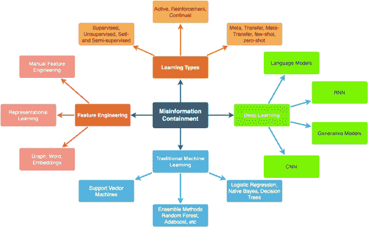 |

2022 年 7 月 23 日在谷歌上搜索“fake news”返回了 8150 万条结果，一条与乌克兰总统相关的虚假新闻。结果还显示《西雅图晤报》刊有一个名为“本周虚假新闻”的专栏。为了进一步说明这个问题，图 1 是 YouTube 上一个虚假上传的元数据截图，该视频伪装成热门印度电影《克什米尔文件》(Kashmir Files)。它引起了轻信观众的极大关注，他们似乎认为这真的是真正的电影。这虚假帖子在很大程度上未被遏制的一个案例。

| 图 2. 一个与真实电影演员或属性不符的虚假上传在 2 个月内获得了约 1900 万次观看、289,000+ 个点赞和 15,250 条真实评论（截图于 2022 年 7 月 23 日） |
| --- |
|  |

表 1. Google 学术搜索结果列出了声称解决虚假信息问题的文章

| 搜索字符串 | 文章数量 |
| --- | --- |
| “Machine learning” fake | 103,000 |
| “Deep learning” fake | 48,800 |
| “Language model” fake | 6,830 |
| “LSTM” fake | 17,300 |
| “graph neural networks” fake | 17,800 |

另一方面，表 1 显示了 Google Scholar 索引的、显然使用搜索字符串中流行技术来解决虚假新闻问题的文章数量。取决于 Google 底层的搜索算法，这些数字可能准确也可能不准确，但搜索结果具有很强的指示性。这个问题引起了研究界的极大关注。作者调查的几篇文章报告了显著的成功。2017 年组织了一场“虚假新闻挑战赛 (FNC-1)¹”，旨在寻求通过机器学习、自然语言处理和人工智能的解决方案来对抗虚假新闻，并有组织 FNC-2 的计划。该问题在现实世界中在很大程度上仍未解决。因此，研究中所声称的实际现实之间这种巨大的脱节是非常有意义的。

虚假信息的遏制在十多年前就已被证明是 NP-hard 问题 (Budak et al., 2011)，这使其成为近似模型（如机器学习生成的模型）的良好候选。鉴于人工神经网络作为通用函数近似器，虚假信息的遏制可以被建模为信息特征的函数，输出该信息的真假情况或真诚程度。使用深层神经网络的深度学习正在迅速扩大其应用范围，以至于在某些领域引发了辩论，即传统的机器学习技术今天是否仍然相关。当分类是非线性的（如本例所示）时，深度学习的泛化能力更好且表现更好。研究人员 (Wanda & Jie, 2020) 使用了一种名为 `卷积神经网络 (CNN)` 的深度学习架构来检测在线社交网络中的虚假配置。他们在此方面实现了高准确率。与任何监督学习机器学习分类问题一样，作者提取特征、训练模型、通过使用正则化处理过拟合问题，并将模型应用于测试数据。他们将使用 `CNN` 架构获得的结果与 `逻辑回归` 和 `SVM`（支持向量机）等传统机器学习模型进行比较，并证实了 `CNN` 的性能更好。因此，我们在接下来的章节中将更多地关注深度学习方法。图 3 总结了本章其余部分的流程。

| 图 3. 虚假信息遏制：方法与挑战 |
| --- |
| 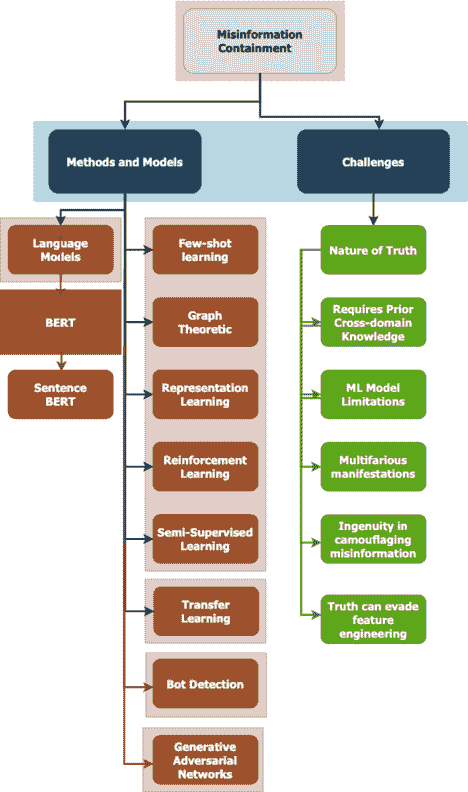 |

## 方法与模型

在以下段落中，尽管针对虚假信息遏制问题提到了深度学习和基于传统机器学习的方法，但大部分讨论都是关于深度学习的。目的再次不是进行详尽的综述（考虑到文献数量，这几乎是不可能的），而是为了对其他主题综述未涵盖的一些新兴趋势提供高级概述。

### 少样本学习

虚假信息检测问题已通过传统机器学习中的元算法（如 `随机森林` 和 `额外树分类器`）得到解决，并报告了实质性的成功 (Hakak, et al., 2021)。作者声称，实验在某数据集上实现了 100% 的训练和测试准确率，但在另一个训练集上的训练和测试准确率分别为 99.8% 和 44.15% (Hakak, et al., 2021)。少样本学习 (FSL) 使用可以使用较少训练示例进行工作的元学习。`模型无关的元学习 (MAML)` 是这种 FSL 技术之一，已证明与许多其他机器学习模型相比，它在虚假新闻分类上具有更好的性能 (Salem, et al., 2021)。作者 (Lwowski & Najafirad, 2020) 提议使用自监督学习为少样本学习识别潜在空间，并声称取得了良好。

### 语言模型

像 `BERT` 和 `Sentence BERT` 这样的语言模型被广泛用于虚假信息分类，并已通过结合增强注意力机制的方法提高了分类性能 (Paka, Bansal, Sengupta, 2021)。当人类仅仅通过阅读都不擅长检测虚假新闻时，仅仅使用 `NLP` 技术生成嵌入是不够的。挖掘与需要分类的信息更广泛语料库可以改进结果 (Deepak & Chitturi, 2020)。然而，添加的次要特征是域名和作者详情等元数据，这可能产生显著差异。类似的方法也被采用 (Braoveanu & Andonie, 2019)，但增强特征包含了知识图谱的关系。尽管报告了成功，但基于语言模型的短句形式虚假信息分类在根本上是有缺陷的 (Mifsud et al., 2021)。已经证实预训练的基于 `BERT` 的语言模型是后续迁移学习任务的良好起点 (Guderlei & Aßenmacher, 2020)。

### 图论方法

社交媒体经常与在线社交网络同义。社交媒体可以建模为用户网络或由用户帖子构成的图。这种模型随后可以用于预测媒体的信任度或可信度。如果我们知道图中子集节点的可信度，那么这些信息就可以被机器学习算法用于估计剩余图的可信度。研究人员 (O’Brien et al., 2019) 证明了图依赖在社交媒体的可信度估计中起着重要作用。我们可以将其联系到现实世界，一个关系良好的人的可信度比完全孤立的人更容易建立。这个想法可以与心理学中的同质性概念相关，即相似的人倾向聚在一起。可以使用图论技术对社交媒体中的连接进行建模并利用这些同质性倾向。作者 (O’Brien et al., 2019) 在基于图结构的局部和关系特征上使用 `逻辑回归` 和 `决策树` 等传统机器学习算法，在估计可信度方面取得了相当不错的准确率。

利用深度学习从图节点的邻域中学习，并将学习到的函数泛化到图中未见的节点，具有许多应用。作者们 (Ghafari et al., 2019) 使用并扩展了斯坦福大学的 `GraphSAGE` (Hamilton et al., 2017)，该方法正是通过此方式来预测如 Epinions 等在线评论网站上，对评论者之间的信任度。作者使用了两个数据集，其中一个来自 Epinions 并进行实验。与早先调查的类似 Epinions 网站的信任网方法 (Pendyala, 2019) 相比，这是一种改进，因为它考虑了上下文。信任通常是上下文相关的；一个实体在某些语境下是可以信任的，但并非所有语境下如此。正如作者们 (Ghafari et al., 2019) 指出的，大多数信任计算框架忽略了这一事实，而这项工作 (Ghafari et al., 2019) 利用了它。开发的系统从用户人口统计和评论中提取上下文特征，并将它们用于成对信任的分类。

上述讨论的工作从社交媒体实体和组件中提取图结构，以预测可信的关系。也有反向的工作，即创建一个图框架，使实体即使在存在恶意攻击者的情况下也能确保进行可信的交换。通过使用多个基于信任的参数及其相关的数学方法，作者们 (Urena et al., 2020) 为基于信誉的通信创建了一个稳健的框架。作者运行了模拟来评估其性能并获得了良好的结果。社交媒体的在线社交网络（OSN）视角突出了对图论方法来分析社交媒体空间中实体之间信任和信誉关系的必要性。我们在本节中仅讨论了少数此类方法，但在不信任问题被完全解决之前（这可能是不可能的），我们可以预计看到基于图论的方法在解决问题上的不断增长。

## 表征学习


# 手动特征工程正日益被表示学习取代

表示学习的目标是自动推导（或学习）数据的表示。这种表示通常以嵌入（embedding）的形式存在，通常是一个向量。这些嵌入可以像任何其他特征向量一样被处理，可能作为人工神经网络的输入层。表示学习在自然语言和图方面特别有效。通过文献综述，我们针对虚假信息治理的背景，分别为自然语言和图提供了一个案例研究。

## 自然语言案例：立场检测

研究人员（Borges et al., 2019）已将表示学习用于立场检测，正如在“虚假新闻挑战赛 1 (FNC-1)”问题描述中所描述的那样。立场检测判断两条信息是否相互一致。在 FNC-1 案例中，一致性存在新闻片段的标题和正文之间。使用预训练模型的词嵌入、双向 RNN（如 `LSTM` 和 `GRU`）、最大池化（`maxpooling`）和注意力机制，研究人员（Borges et al., 2019）对长文章进行建模。

## 图案例：归纳式表示学习

当数据是一个大图时，表示学习就派上用场了。社交网络图是巨大且不断演变的。新节点可以快速添加。新节点的嵌入也需要快速计算。以直导式（transductive）方式使用整个图结构来计算嵌入可能扩展性不佳。因此，研究人员（Rath, et al., 2020）使用了受 `GraphSAGE` 工作（Hamilton et al., 2017）启发的归纳式（inductive）方法，基于归纳表示学习来计算嵌入。该图模拟了虚假新闻在 Twitter 等微博客站点上的传播方式。

# 强化学习

大多数机器学习模型的一个主要假设是数据是 i.i.d，即独立同分布。文献中针对虚假信息治理问题提出的多数机器学习解决方案集中在单一领域的数据集，如政治（Pendyala et al., 2018）或医疗健康（Pendyala & Figueira, 2015），它们的嵌入是 i.i.d 的。然而，虚假信息通常涵盖多个领域。强化学习可用于跨领域建模（Mosallanezhad et al., 2022）。用户的评论、交互和不同领域的信息被用于学习与领域无关的表示。强化学习用于将源领域的表示转换为目标领域的表示。强化学习也被用于增加标记数据的可用性（Wang, et al., 2020）。标注信息是一个昂贵且需要专业知识。自动标注器根据报告分配标签。这种初始标记是弱的且不准确。然后使用强化学习从弱标记数据中选择最佳实例。

# 半监督学习

与上述增强标记数据的强化学习方法类似，研究人员（Li, et al., 2022）在双向 `LSTM` 中引入了“置信网络层”以过滤置信的数据。神经网络最初在有限的标记数据集上进行监督训练。置信网络层以迭代的方式将置信的数据添加到该初始集中，这非常类似于半监督学习。半监督学习通常与图结合使用。通常，每个数据项是一个节点，连接它们的权重边表示节点之间的相似性。标签随后可以从标记节点传播到未标记节点。基于图的半监督学习也被用于虚假新闻检测（Benamira, 2019）。从文档的 `GloVe` 嵌入构建图。每个节点是一个文档。某些节点已被标记为真实，另一些标记为虚假，还有一些未标记。节点根据 `k-nearest neighbors` 算法相互连接。图卷积网络用于对未标记节点进行分类。

# 机器人检测

虚假信息的传播往往发生在社交媒体上，并由软件拥有的账户进行。这一趋势促使了提供“机器人服务”（Bot-as-a-service, `BAAS`）的公司增长。在 2016 年美国总统选举期间，关于该主题的社交媒体讨论中约有 20%是通过机器人进行的（Wu et al., 2018）。可以使用多种不同类型的机器学习算法来检测机器人。虽然算法各异，但在采用监督学习时，将用户分类为机器人或非机器人的整体过程是相似的。从用户资料中提取了如屏幕名称、描述和粉丝数量等各种特征。诸如 `logistic regression`（逻辑回归）等参数化监督机器学习算法会根据已分类的数据确定这些特征的每个权重。算法将分类建模为加权特征的函数。然后可以将该模型应用于新的用户数据，并据此将用户分类为机器人或人类。

获取已分类为属于机器人或人类的用户个人资料数据可能面临挑战。在缺乏此类训练集的情况下，可以使用无监督学习算法将数据聚类为属于人的类和其他属于真实人类的类。研究人员（Wu et al., 2018）使用网络流量上的多种聚类算法来检测主机是否被机器人感染。类似的技术也可以用于社交媒体简介。Hegelich 和 Janetzko（Hegelich & Janetzko, 2016）将 `k-means` 和层次聚类算法应用于乌克兰选举期间社交机器人发布的帖子，以得出关于社交机器人行为模式的有趣结论。聚类算法仍然处理从数据中提取的特征，并根据相似性将数据分组。

正如前节关于虚假资料识别提到的，对于某些分类问题，深度学习可以获得更好的分类精度。作者（Kudugunta & Ferrara, 2018）已经证明，使用深度神经网络可以用极高的精度解决账户分类为机器人或人类的问题，但这次使用了不同于 `CNNs` 的架构。通过使用长短期记忆（`LSTM`）架构，作者指出了使用深度学习技术优于传统机器学习算法的优势。正如作者所示，即使在特征集较小且数据集规模有限的情况下，也可以应用 `LSTM` 架构。`LSTM` 网络是循环神经网络（Recurrent network `RNN`）的一种，它允许信息持久化。RNN 被广泛用于为挑战性问题提供卓越的解决方案。

# 生成对抗网络

机器学习和深度学习特别是是之前讨论的某些技术的核心。在讨论社交媒体信任的背景下，深度学习中有一个需要特别说明的领域是生成对抗网络，即 `GAN`。`GAN` 模型帮助创建了令人难以置信的、逼真的虚假内容，包括图像和文本。`ThisPersonDoesNotExist.com` 网站展示了几个使用 `GANs` 生成的脸，这些脸看起来惊人地真实，但完全是合成的。使用 `GAN` 模型创建的虚假脸部图像用于社交媒体上创建虚假账户以传播恶意意图。由于 `GAN` 生成的虚假内容与真实内容接近，区分虚假图像和真实图像成为了一项挑战。`GAN` 可以通过两种方式解决社交媒体中的信任问题：(a) 生成虚假内容数据集以训练用于检测新虚假内容的模型；(b) 检测虚假内容本身。

人们已经开发了多种技术来处理检测 `GAN` 生成的虚假内容的问题，其中一种是使用 `GAN` 本身。`GAN` 包含两个部分——生成器和判别器，两者以神经网络的形式实现，通常是卷积或循环的。生成器创建虚假内容，判别器不断拒绝，直到它确信生成器的内容是真实的。判别器的功能实际上是拒绝虚假内容。因此，`GAN` 判别器可能被用于检测虚假内容（Marra et al., 2018）。作者使用了生成虚假图像过程中相同的 `GAN` 判别器来训练论文中描述的其他各种模型，作为检测虚假内容的基准算法。为了确保判别器不会因为已经接触过训练样本而产生偏差，需要对判别器进行重新训练。该工作还使用了其他几种模型，并将结果与使用 `GAN` 判别器获得的结果进行了比较。

由于大多数社交媒体仍然以文本形式存在，检测误导性内容的一大进展是将强大的 `GAN` 模型应用于文本数据（Aghakhani et al., 2018）。在这里，`GAN` 的判别器部分负责确定虚假内容，这次是对 TripAdvisor 上的文本评论进行判断，准确率为 89.1%。由于卷积神经网络（`CNN`）在文本方面表现更好，因此判别器被实现为 `CNN`。作者使用了两个判别器（均为 `CNN`），而不是 `GAN` 模型最初提出的某一个。根据实验和获得的结果，他们证实了在文本评论这一案例中，使用两个判别器的效果更好。

能够解释模型所做分类的可解释模型是当下的当务之急。解释提供了透明度，并增强了人们对模型的更好的信心。作者（Carton et al., 2018）利用 `GAN` 哲学开发了“提取式对抗网络”（Extractive Adversarial Networks），以更进一步，超越文本分类，为分类决策提供解释。他们的工作检测了社交媒体上的人身攻击性评论，并指出了这些评论中导致模型将其分类为人身攻击的词。他们的模型与原始 `GAN` 的主要区别在于，他们的模型是从现有样本中提取修改后的样本，而不是像 `GAN` 那样生成。因此，生成函数被提取函数取代，这也是他们为模型命名的原因。

# 虚假信息遏制尚未得到解决：为什么？

正如前几节所示，到目前为止文献中报告了大量的研究和成功。然而，说这个问题在很大程度上尚未解决这一点毫无疑问。为了理解其原因，需要理解虚假信息的本质。与根据某些词汇模式检测的垃圾邮件不同，虚假信息非常复杂。对于人类来说，检测虚假信息也是一项巨大的挑战。例如，在法庭确定真相可能需要多年。以下段落讨论了在设计虚假信息遏制解决方案时需要考虑的几点。

## 真相具有时间性、主观性和相对性

确定真相可能需要大量的先验知识库。

通常，只有在对海量的事实、证据和推理进行交叉比对后，才能确定真理。与一阶逻辑（FOL）和其他具有从先验语句进行推理和演绎能力的的形式化方法相比，机器学习模型无法进行这种交叉比对。

## 真实性可以规避特征工程

同一信息源在特征保持完整的情况下也可能产生冲突的陈述。例如，有多个案例显示 Twitter 上的用户发布了相互矛盾的推文。仅仅提取特征（无论是人工工程的还是通过深度学习的隐藏层自动生成的）都不可能标记出虚假信息。大部分文献中使用的特征集局限于时间或基于内容，而实际上需要的是更加全面和详尽的特征。

## 伪装虚假信息的巧妙性

虚假信息往往以巧妙的方式与真理无缝交织。甚至其意图和宗旨听起来也是真实的。潜在空间映射和自监督学习方法只能在一定程度上提供帮助，并不准确。

## 机器学习模型的局限性

`RNNs`、`CNNs` 以及在虚假信息检测过程中常用于自然语言理解（`NLU`）的其他语言模型无法捕捉长文本中的长期依赖关系。即使是最新基于 transformer 的模型如 `BERT`，也只能处理文本中 `512` 个 token，尽管已尝试将其增加到 `2048` 个 token（Yang et al., 2020）。

## 没有万灵药

虚假信息遏制不是一个拥有单一解决方案的单一问题。虚假信息以多种模态和形式呈现。每种表现形式都需要通过一种或多种方式来解决。目前的方法是通过对样本数据集（通常是同分布的）进行实验，并报告来自同一数据集的结果解决问题。然而，虚假信息远不是同分布的。

# 未来方向

尽管机器学习被广泛使用，但它似乎尚未充分用于解决虚假信息问题。例如，无监督和半监督技术似乎尚未应用于该领域。鉴于社交媒体中大多数可用数据无法轻易分类为机器人生成或人类真实生成，半监督方法应该具有广阔的前景。通常，先进的深度学习框架计算成本很高且需要海量数据。一旦训练完成，关键参数就会固定，因此新的模式无法模拟虚假信息的演变本质。另一方面，虚假信息遏制（`MC`）需要是持续的、实时的、随数据模式的改变而演变的，并且使用更少的资源，以便用户可以在手机等边缘设备上部署模型。未来的研究需要同时关注应用和现有方法以适应需求。图论方法具有巨大的潜力，因为它们可以捕捉 `RNNs` 无法提供的依赖关系。

# 结论

虚假信息遏制是一个复杂的问题。虽然已经使用了机器学习中提供的若干技术、算法和框架来解决，但该问题仍未得到解决。与垃圾邮件、病毒、网络攻击和其他恶意工具类似的问题处于合理的控制范围内，但这不能反映其复杂性。本章简述了虚假信息遏制领域的趋势，并解释了为什么目前的方法并不有效。未来的方向应该超越传统的从收集、训练、验证和测试循环，使用能更好地刻画特征的框架。

# 致谢

本研究未收到来自公共、商业或非营利部门任何机构的特定资助。

# 参考文献

- Aghakhani, H., Machiry, A., Nilizadeh, S., Krügel, C., & Vigna, G. (2018). Detecting Deceptive Reviews Using Generative Adversarial Networks. 2018 IEEE Security and Privacy Workshops (`SPW`), 89-95.

- Antony Vijay, J., Anwar Basha, H., & Arun Nehru, J. (2021). A Dynamic Approach For Detecting The Fake News Using Random Forest Classifier (`Nlp`). In Computational Methods And Data Engineering (pp. 331–341). Springer. doi:10.1007/978-981-15-7907_25

- Benamira, A., Devillers, B., Lesot, E., Ray, A., Saadi, M., Malliaros, F. D. (2019, August). Semi-supervised learning and graph neural networks for fake news detection. In 2019 IEEE/ACM International Conference on Advances in Social Networks Analysis and Mining (`ASONAM`) (pp. 568-569). IEEE. 10.1145/3341161.3342958

- Borges, L., Martins, B., & Calado, P. (2019). Combining similarity features and deep representation learning for stance detection in the context of checking fake news. Journal of Data and Information Quality, 11(3), 1–26. doi:10.1145/3287763

- Braşoveanu, A. M., & Andonie, R. (2019). Semantic fake news detection: a machine learning perspective. International Work-Conference on Artificial Neural Networks.

- Budak, C., Agrawal, D., El Abbadi, A. (2011). Limiting The Spread Of Misinformation In Social Networks. Proceedings Of The 20th International Conference On World Wide Web, 665–674. 10.1145/1963405.1963499

- Carton, S., Mei, Q., & Resnick, P. (2018). Extractive Adversarial Networks: High-Recall Explanations For Identifying Personal Attacks In Social Media Posts. 10.18653/v1/D18-1386

- Deepak, S., & Chitturi, B. (2020). Deep neural approach to Fake-News identification. Procedia Computer Science, 167, 2236–2243. doi:10.1016/j.procs.2020.03.276

- Elsherief, M., Sumner, S. A., Jones, C. M., Law, R. K., Kacha-Ochana, A., Shieber, L., Cordier, L., Holton, K., & De Choudhury, M. (2021). Characterizing And Identifying The Prevalence Of Web-Based Misinformation Relating To Medication For Opioid Use Disorder: Machine Learning Approach. Journal of Medical Internet Research, 23(12), E30753. doi:10.2196/30753

- Ghafari, S. M., Joshi, A., Beheshti, A., Paris, C., Yakhchi, S., & Orgun, M. (2019). Dcat: A Deep Context-Aware Trust Prediction Approach For Online Social Networks. Proceedings Of the 17th International Conference On Advances In Mobile Computing & Multimedia, 20–27. 10.1145/3365921.3365940

- Goldani, M. H., Momtazi, S., & Safabakhsh, R. (2021). Detecting fake news with capsule neural networks. Applied Soft Computing, 101, 106991. doi:10.1016/j.asoc.2020.106991

- Ghayoomi, M., & Mousavian, M. (2022). Deep Transfer Learning For Covid-19 Fake News Detection In Persian. Expert Systems: International Journal of Knowledge Engineering and Neural Networks, 39(8), E13008. doi:10.1111/exsy.13008

- Guderlei, M., Aßenmacher, M. (2020, December). 用于虚假新闻立场检测的无监督表示学习评估。In Proceedings of the 28th International Conference on Computational Linguistics (pp. 6339-6349). 10.18653/v1/2020.coling-main.558


# 参考文献

Hakak, S., Alazab, M., Khan, S., Gadekallu, T. R., Maddikunta, P. K., & Khan, W. Z. (2021). 一种通过有效特征提取集成机器学习方法用于虚假新闻分类。*Future Generation Computer Systems*, 117, 47–58. doi:10.1016/j.future.2020.11.022

Hamilton, W., Ying, Z., & Leskovec, J. (2017). 大图上的归纳表示学习。*Advances in Neural Information Processing Systems*, 30.

Hasani, R., Lechner, M., Amini, A., Rus, D., & Grosu, R. (2021). 液体时间常数网络。*Proceedings of The AAAI Conference on Artificial Intelligence*, 35(9), 7657–7666. doi:10.1609/aaai.v35i9.16936

He, Q., Lv, Y., Wang, X., Huang, M., & Cai, Y. (2022). 有向社交网络中基于强化学习的谣言拦截方法。*IEEE Systems Journal*, 1–11. doi:10.1109/JSYST.2022.3159840

Hegelich, S., & Janetzko, D. (2016). Twitter 社交机器人是政治参与者吗？来自乌克兰社交机器人网络的实证证据。*Tenth International Aaai Conference On Web And Social Media*.

Huh, M., Liu, A., Owens, A., & Efros, A. A. (2018). 打击虚假新闻：通过学习自一致性进行图像拼接检测。*Proceedings Of The European Conference On Computer Vision (Eccv)*, 101–117. doi:10.1007/978-3-030-01252-6_7

Karpov, I. & Glazkova, E. (2020). 在线社交网络中的自动管理账户检测：图嵌入法。*International Conference On Analysis Of Images, Social Networks And Texts*, 11–21.

Kozik, S., Kula, S., Choraś, M., & Woźniak, M. (2022). 应对潜在犯罪的技术解决方案：检测虚假新闻和虚假信息的文本分析。*Journal of Computational Science*, 60, 101576. doi:10.1016/j.jocs.2022.101576

Kudugunta, S., & Ferrara, E. (2018). 用于机器人检测的深度神经网络。*Information Sciences*, 467, 312–322. doi:10.1016/j.ins.2018.08.019

Li, X., Lu, P., Hu, L., Wang, X., & Lu, L. (2022). 一种用于社交媒体虚假新闻的新型自学习半监督深度学习网络。*Multimedia Tools and Applications*, 81(14), 19341–19349. doi:10.1007/s11042-021-11065-x

Lo, K.-C., Dai, S.-C., Xiong, A., Jiang, J., & Ku, L.-W. (2022). Victor: 一种通过持续验证阅读缓解误信息的隐式方法。*Proceedings Of The Acm Web Conference 2022*, 3511–3519. doi:10.1145/3485447.3512246

Lwowski, B., & Najafirad, P. (2020). 通过自监督和少样本学习通过 twitter 监控 Covid-19。*Academic Press*.

Marra, F., Gragnaniello, D., Cozzolino, D., & Verdoliva, L. (2018). 社交网络上 Gan 生成的虚假图像检测。*2018 IEEE Conference On Multimedia Information Processing And Retrieval (Mipr)*, 384–389.

Mondal, S. K., Sahoo, J. P., Wang, J., Mondal, K., & Rahman, M. (2022). 利用 `Tf-Idf` 向量化与集成学习模型的虚假新闻检测。*In Advances In Distributed Computing And Machine Learning* (pp. 261–270). Springer.

Mosallanezhad, A., Karami, M., Shu, K., Mancenido, M. V., & Liu, H. (2022). 基于强化学习的领域自适应虚假新闻检测。*Proceedings Of The Acm Web Conference 2022*, 3632–3640. doi:10.1145/3485447.3512258

O’Brien, K., Simek, O., & Waugh, F. (2019). 用于社交媒体信誉度估计的集体分类。*Academic Press*.

Paka, W. S., Bansal, R., Kaushik, A., Sengupta, S., & Chakraborty, T. (2021). Cross-SEAN: 一种用于 COVID-19 虚假新闻的交叉合半监督神经注意力模型。*Applied Soft Computing*, 107, 107393. doi:10.1016/j.asoc.2021.10733

Palani, B., Elango, S., & Viswanathan, K. (2022). Cb-Fake: 使用胶囊网络进行虚假新闻检测的多态深度学习框架。*Multimedia Tools and Applications*, 81(4), 5587–5620. doi:10.1007/s11042-021-1782

Patel, A., & Meehan, K. (2021). 利用 `Countvectorizer` 和词频-逆文档频率结合逻辑回归、多项支持向量机在 Reddit 上进行虚假新闻检测。*2021 32nd Irish Signals And Systems (Issc)*, 1–6.

Pendyala, V. S. & Figueira, S. (2015, October). 迈向真实世界。*In 2015 IEEE Humanitarian (GHC)* (pp. 137-143). doi:10.1109/GHC.558

Pendyala, V. (2018). 关于大数据的真实性：机器学习与其他方法。doi:10.1007/978-3-030-01252-6_7

Pendyala, V. S., Liu, Y., & Figueira, S. (2018). 用于检测注入的机器人检测框架。*Development Engineering*, 3, 218–233.

Pendyala, V. S. (2019). 在社交网络中的安全性。*In Computer Science And Social*, 87–94.

Rajami, R., Neel, S. S., Sahan, M., & Sahan, J. (2020). 虚假新闻检测。*In 2020 Conference on Social and Mining*.

Salem, F., Mousavian, M., & Momazi, S. (2021). 深度上下文表示与虚假新闻检测。*Patterns*, 2(11), 100369. doi:10.1016/j.patter.2021

Samadi, M., Ghannam, H., & Jaber, M. (2021). 用于虚假新闻的迁移学习。*Information Processing & Management*, 58(6), 102723.

Shen. (2022). Mdn: 元学习方法。*Ccf Conference On Cooperative Work And Social*, 228–237.

Urena, R., Chiclana, F., & Herrera-Viedma, E. (2020). Decitrustnet：基于图的社交网络信任与信誉框架。*Information Fusion*, 61, 101–112. doi:10.1016/j.inffus.2020.03

Wanda, P., & Jie, H. (2020). 使用动态 `CNN` 在在线社交网络中的虚假信息。*Journal Of Information Security And Applications*, 52, 102465. doi:10.1016/j.jisa.2020.10

Wang, Y., Yang, W., Ma, F., Xu, J., Zhong, B., Deng, Q., & Gao, J. (2020, April). 通过强化学习的弱监督虚假新闻检测。*Proceedings of the AAAI Conference on Artificial Intelligence*, 34(01), 516–523. doi:10.1609/aaai.v34i01.5389

Wu, W., Alvarez, J., Liu, C., & Sun, H.-M. (2018). 使用无监督机器学习进行机器人检测。*Microsystem Technologies*, 24(1), 209–217. doi:10.1007/s0542-016-323

Xie, J., Chai, Y., & Liu, X. (2022). 用于理解 Youtube 上健康误信息传播的可解释深度学习方法。*Proceedings Of The 55th Hawaii International Conference On System Sciences*. doi:10.24251/HICSS.2022.183

Yang, L., Zhang, M., Li, C., Bendersky, M., & Najork, M. (2020, October). 突破 512 令牌：用于长文档匹配的孪生多深度 Transformer 层编码器。*In Proceedings of the 29th ACM International Conference on Information & Knowledge Management* (pp. 1725-1734). doi:10.1145/3340531.3411908

# 第 4 章

**Dilek Küçük**  
TÜBİTAK Marmara Research Center, 土耳其

## 摘要

立场检测系统的建立旨在根据作者生成的文本和其他上下文信息来确定文本作者的立场。作为立场检测程序的结果，文本生成者的立场被确定为 `favor`（支持）、`against`（反对）或 `none`（中）。另一方面，据报道，基于 Transformer 的技术在各种自然语言处理任务中表现良好。这些是基于深度学习的模型，并且结合了注意力机制。`BERT` 及其变体是目前为止提出的最流行的基于 Transformer 模型之一。在本章中，作者对基于 Transformer 模型的立场检测研究提供了一个合理的文献综述。本章还包含了重要的后续研究方向。立场检测和基于 Transformer 的模型分别是自然语言处理和深度学习领域中重要且最近的问题。因此，他们认为本章将为从事这些高影响主题的相关研究人员和从业者提供一份重要的指南。

## 引言

立场检测已成为一个重要的问题，其根源源于自然语言处理（NLP）、社交媒体分析和信息检索（Küçük and Can, 2020; Küçük and Can, 2021; Küçük and Can, 2022）。立场检测还与情感计算中的问题（如情感分析）密切相关。在立场检测中，主要目标是自动推断文本作者对某一目标的立场，该程序的输出通常为 `favor` 或 `against`（Küçük and Can, 2020）。

另一方面，深度学习方法在许多应用领域（包括 NLP、语音处理和计算机视觉）的方法中占据主导地位。基于 Transformer 的方法是这些流行的深度学习方法之一（Yay et al., 2020）。与许多与 NLP 的任务一样，近期关于立场检测的大比例工作采用了基于 Transformer 的深度学习方法，包括但不限于双向 Transformer 编码器表示（`BERT`）（Devlin et al., 2018）。

在本书章节中，我们对基于 Transformer 的立场检测研究进行了综述。我们还讨论了未来的研究机会，并为相关的突出问题提供了方向。立场检测是一个重要的研究问题，在许多应用场景中都有益，包括民意调查、选举和公投预测以及 Web 搜索。因此，对基于 Transformer 的立场检测研究将对相关文献产生理论和应用两方面的贡献。

## 立场检测

立场检测通常被认为是一个分类任务，需要两个输入：一段文本和一个目标，并在立场检测程序结束后，预期获得文本作者对目标的立场（位置）（Küçük and Can, 2020）。立场检测通常被认为在情感计算的范围内，有时被视为情感分析的一个子问题。

立场检测有几个子问题，包括多目标立场检测、跨目标立场检测和上下文立场检测（Küçük and Can, 2021; Küçük and Can, 2022）。在多目标立场检测中，存在一组（通常是相互关联的）目标而不是单一目标。在跨目标立场检测中，训练数据集针对一个目标，但测试数据集关于另一个目标（Küçük and Can, 2020）。在上下文立场检测中，除了所考虑的文本外，还可以使用上下文特征，例如在社交媒体帖子中的转发、用户信息和其他其他相互关系（Cignarella et al., 2020）。另一个相关的研究问题是立场量化（Küçük, 2022），其预期的是被分类为 `favor`、`against`、`neutral` 或 `none` 的文本项的百分比，而不是输入文本项的单独分类结果。

立场检测的其他更具应用特定的子问题是虚假新闻立场检测和谣言立场检测。在虚假新闻立场检测中，提供新闻标题和正文，预期正文对标题的立场，通常以类别标签的形式呈现为 `agrees`（同意）、`disagrees`（不同意）、`discusses`（讨论）和 `unrelated`（无关）（Küçük and Can, 2020; Umer et al., 2020）。另一方面，在谣言立场检测中，我们有一段文本和一个谣言作为输入，预期文本对谣言的立场，通常为 `supporting`（支持）、`denying`（否）、`querying`（质疑）和 `commenting`（评论）（Zubiaga et al., 2018）。

立场检测研究问题及其子问题在图 1 中示意性地展示，基于 (Küçük and Can, 2020) 中提供的相关图。

**图 1.** 立场检测及其子问题，主要基于 (Küçük and Can, 2020) 中提供的相关工作

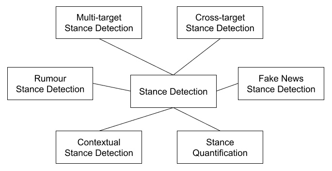

已经开展了许多立场检测比赛（Küçük and Can, 2020）。这些比赛中最初且最著名针对英语推文的 SemEval-2016 立场检测共享任务（Mohammad et al., 2016）。这项比赛及其针对其他语言的后续活动通过提供标注数据集以及关于应用于该问题的各种性能率的最新信息，为立场检测研究人员提供了帮助。

到为止，已将多种方法应用于立场检测问题，例如基于规则的方法、基于机器学习的模型、基于深度学习的模型以及混合方法（Küçük and Can, 2022）。Transformer 学习模型属于深度学习方法。由于它们是我们当前综述的核心主题，将在接下来的节中进行详细描述。

用于立场检测的重要机器学习模型包括 `SVM`（Mohammad et al., 2016）和神经网络。集成模型如 `random forest` 也针对该问题的测试。考虑到深度学习方法，`RNN`、`LSTM`、`CNN` 和基于 Transformer 的模型也被用于解决立场检测问题。下面的图 2 取自 (Küçük and Can, 2020)，显示了截至 2020 年用于立场检测的模型词云。

**图 2.** 2020 年为止用于立场检测的方法（节自 (Küçük and Can, 2020)）

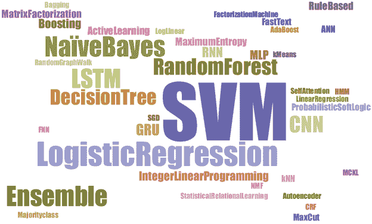

## Transformer 学习模型

Transformer 学习模型被认为是一种特定类型的深度学习模型，它们首次在（Vaswani et al., 2017）中介绍。由于这些学习模型的重要性以及它们在不同文本处理任务中的成功应用，近期发表了关于该主题的几篇综述论文（Tay et al., 2020; Gruetzemacher and Paradice, 2022）。我们在下方对这些模型进行简要概述，感兴趣的读者可以参考(Tay et al., 2020; Gruetzemacher and Paradice, 2022)获取更多关于 Transformer 的细节。

Transformer 是基于注意力机制的深度学习架构（Vaswani et al., 2017）。它们被定义为不使用循环或卷积机制，而是利用注意力机制的深度神经网络架构（Vaswani et al., 2017）。在原始工作中，它们被针对机器翻译任务进行了测试，并取得了优于先进水平的结果（Vaswani et al., 2017）。然而，自介绍以来，它们被用于许多其他文本和语音处理任务，并取得了良好的效果（Tay et al., 2020; Gruetzemacher and Paradice, 2022）。


# 双向编码器表示 Transformer（BERT）

双向编码器表示 Transformer（BERT）是最受欢迎的 Transformer 学习模型之一（Devlin et al., 2018）。由于 BERT 的广泛使用，已经存在专门针对 BERT 的综述论文，包括（Rogers et al., 2020; Xia et al., 2020）。BERT 是一种基于 Transformer 的架构，具有预训练和微调阶段，在预训练阶段包含掩码语言模型和下一句预测任务（Rogers et al., 2020）。

在（Liu et al., 2019）中描述了一种名为 `RoBERTa` 的改进版 BERT，其中在预训练阶段采取了不同的决策来改进模型。据报道，通过更长时间的训练、更大的数据块等变化，从 BERT 获得的性能提升可以显著增加。

另一个名为 `XLM-R` 的基于 Transformer 的多语言模型在（Conneau et al., 2020）中描述。相关研究指出，`XLM-R` 在一百种语言上接受了训练，相应的评估结果显示，`XLM-R` 在不同的跨语言基准测试中优于多语言 BERT（Conneau et al., 2020）。

# 基于 Transformer 的立场检测调查

基于 Transformer 的架构已被各种与立场检测的研究采用。其中一些研究的重点是通用（单目标）立场检测，而另一些研究则解决立场检测的特定子问题，例如假新闻立场检测和谣言立场检测。

在（Ghosh et al., 2019）中，测试了一种基于 BERT 的立场检测方法，以及其他基于深度学习和基于机器学习的模型。根据报告的评估结果，基于 BERT 的方法超过了解决立场检测问题的其他方法。

Cignarella et al. (2020) 的工作描述了一项关于针对特定目标（沙丁鱼运动）的意大利语推文立场检测共享任务（竞赛）。在分析这项比赛的结果时，强调了四位不同的参与者在对推文进行立场检测时使用了不同版本的 BERT（如 `AlBERTo`, `GilBERTo`, `UmBERTo`）。Cignarella et al. (2020)的这项工作表明了基于 BERT 架构的流行。例如，在参与者中，Giorioni et al. (2020)结合了基于 Transformer 的模型。

（Rogers et al., 2020）中提出了一种多语言立场检测。该数据集包含法语、德语，并且在 Calleja and Mendez (2021)的研究是在 BERT 的框架内开展的。在此过程中，他们考虑了对西班牙语推文的假新闻检测。Calleja and Mendez (2021)的研究得出结论，西班牙语推文的结果是成功的。

Dulanty et al. (2019)也使用了名为 `RoBERTa` 的 BERT 版本用于立场检测任务。使用 Transformer 的假新闻立场检测在（Slovovskaya et al., 2019）中也有研究。首先，使用了 BERT 嵌入作为特征，其次使用了微调后的 BERT、`XLNet` 和 `RoBERTa`。

Karande et al. (2021)也解决了假新闻检测问题。在此过程中，他们考虑了假新闻检测并使用了 BERT 嵌入。Karande et al., 2021)的作者声称，基于 BERT 的方法在假新闻检测上达到了领先水平。Rizky and Suyanto (2021)也使用了 BERT 进行假新闻检测，他们还采用了数据增强。

Matero et al. (2021)采用了一种基于 Transformer 的学习架构，将其称为消息级 Transformer（`MeLT`），用于立场检测任务。他们在 SemEval-2016（Mohammad et al., 2016）的标注立场数据集上测试了该方法并取得了良好的结果。

将 Transformer 学习模型应用于谣言立场检测的重要工作。这些研究包括 Fajcik et al. (2019)、Tian et al. (2020)以及 Wang et al. (2021)。如前节所述，谣言立场检测（或分类）是立场检测的一种特定类型，通常被认为是谣言检测和解决过程中不可或缺的阶段（Zubiaga et al., 2018）。

# 未来研究方向

基于 Transformer 的立场检测未来研究方向列如下：

1.  立场检测研究针对多种语言，包括英语、西班牙语、意大利语、捷克语和土耳其语（Küçük and Can, 2020）。BERT 变体或 `XLM-R` 等基于 Transformer 的架构可以在这些语言的立场检测数据集上应用并评估。相应的发现有助于更好地比较这些模型的贡献。
2.  可以使用 Transformer 学习模型对立场检测（`stance detection`）的不同子问题进行综合研究。可以被视为立场检测子问题的研究问题（参见上一节的图 1）都可以从基于 Transformer 的模型中获益。因此，针对这些子问题的未来研究将对立场检测研究和 Transformer 学习研究都做出贡献。

# 结论

从文本内容自动确定立场对于各种应用领域都非常重要。可以从自动立场检测系统中获益的领域包括调查/投票、推荐系统和信息检索系统等许多。另一方面，据报道，基于深度学习的方法在许多文本处理问题中取得了成功。Transformer 构成了利用注意力机制的特定类型深度学习方法。因此，在本章节中，我们对利用基于 Transformer 方法的立场检测研究文献进行了简要综述。此外，我们还针对我们的调查主题列出了若干未来研究方向。我们相信，这篇综述将对立场检测和 Transformer 学习方法感兴趣的研究人员和从业者将有所帮助。

# 参考文献

Calleja, J., & Mendez, A. (2021). SQYQP@ Vaxxstance: 针对反疫苗运动的立场检测。In Proceedings of the International Conference of the Spanish Society for Natural Language Processing (IberLEF 2021) (pp. 202-209). Academic Press.

CignarellaA. T.LaiM.BoscoC.PattiV.PaoloR. (2020). Sardistance@EVALITA2020: 意大利语推文立场检测任务概述。In Proceedings of the Seventh Evaluation Campaign of Natural Language Processing and Speech Tools for Italian (EVALITA 2020). 10.4000/books.aaccademia.7084

Conneau, A., Khandelwal, K., Goyal, N., Chaudhary, V., Wenzek, G., Guzmán, F., . . . Stoyanov, V. (2019). 大规模无监督跨语言表示学习.arXiv preprint arXiv:1911.02116.

Devlin, J., Chang, M. W., Lee, K., & Toutanova, K. (2018). BERT: 用于语言理解的深度双向 Transformer 预训练.arXiv preprint arXiv:1810.04805.

Dulhanty, C., Deglint, J. L., Daya, I. B., & Wong, A. (2019). 对虚假新闻表态：通过用于立场检测的深度双向 Transformer 语言模型进行自动虚假信息评估.arXiv preprint arXiv:1911.11951.

Fajcik, M., Burget, L., & Smrz, P. (2019). SemEval-2019  7 中的 BUT-FIT: 使用预训练深度双向 Transformer 确定谣言立场.arXiv preprint arXiv:1902.10126. 10.18653/v1/S19-2192

GhoshS.SinghaniaP.SinghS.RudraK.GhoshS. (2019). 网页和社交媒体中的立场检测：比较研究。In Proceedings of the International Conference of the Cross-Language Evaluation Forum for European Languages (pp. 75-87). Springer. 10.1007/978-3-030-28577-7\_4

GiorgioniS.PolitiM.SalmanS.BasiliR.CroceD. (2020). UNITOR@Sardistance2020: 结合 Transformer 架构和迁移学习以实现稳健立场检测。In Proceedings of the Seventh Evaluation Campaign of Natural Language Processing and Speech Tools for Italian (EVALITA 2020). 10.4000/books.aaccademia.7092

Gruetzemacher, R., & Paradice, D. (2022). 深度迁移学习及超越：信息系统研究中的 Transformer 语言模型.ACM Computing Surveys , 54(10s), 1–35. 在线出版. doi:10.1145/3505245

Karande, H., Walambe, R., Benjamin, V., Kotecha, K., & Raghu, T. S. (2021). 使用 BERT 嵌入进行社交媒体信息可誉度分析的立场检测.PeerJ. Computer Science , 7, e467. doi:10.7717/peerj-cs.467

Küçük, D. (2021). 立场量化：问题的定义.arXiv preprint arXiv:2112.13288.

Küçük, D., & Can, F. (2020). 立场检测：综述.ACM Computing Surveys , 53(1), 1–37. doi:10.1145/3369026

KüçükD.CanF. (2021). 立场检测：概念、方法、资源和待解决问题。In Proceedings of the 44th International ACM SIGIR Conference on Research and Development in Information Retrieval (pp. 2673-2676). ACM.

KüçükD.CanF. (2022). 立场检测教程。In Proceedings of the Fifteenth ACM International Conference on Web Search and Data Mining (pp. 1626-1628). 10.1145/348850

Liu, Y., Ott, M., Goyal, N., Du, J., Chen, D., . . . Stoyanov, V. (2019). RoBERTa: 鲁棒优化的 BERT 预训练.arXiv preprint arXiv:1907.

MohammadS.KiritchenkoS.SobhaniP.ZhuX. (2016). SemEval-2016 任务 6：推文中的立场检测。In Proceedings of the 10th International Workshop on Semantic Evaluation (SemEval-2016) (pp. 31-41). 10.18653/v1/16

Matero, M., Soni, N., Ullah, S., Mehmood, A., Choi, G. (2020). 使用深度学习架构进行虚假新闻检测.IEEE Access: Practical Innovations, 8, 15669–15706. doi:10.1109/ACCESS.2020.30197

Vamvas, J., & Sennrich, R. (2020). X-stance: 多语言目标数据集。In Proceedings of the 5th SwissText & 16th KONENS Joint Conference (p. 9). Academic Press.

Vaswani, A., Shazeer, N., Parmar, N., Uszkoreit, J., Jones, L., Gomez, A., & Polosukhin, I. (2017). 注意力机制。Advances in Neural Information Systems , 30.

WangX.FengW.WangY. (2021). 使用集成方法通过 BSAF 模型确定谣言立场。In Proceedings of the 4th International Conference on Computer Science and Software Engineering (CSSE) (pp. 6-12).

Xia, P., Wu, S., & Van Durme, B. (2020). 哪种 BERT？上下文编码器综述.arXiv preprint arXiv:2010.00854. 10.18653/v1/2020.emnlp

Zubiaga, A., Aker, A., Bontcheva, K., Liakata, M., & Procter, R. (2018). 社交媒体中的谣言检测与解决：综述.ACM Computing Surveys , 51(2), 1–36. doi:10.1145/3161603

# Chapter 5

*   **Mangayarkarasi Ramaiah**  
      
    Vellore Institute of Technology, Vellore, India

*   **Debajit Datta**  
    Vellore Institute of Technology, Vellore, India

*   **Vanmathi C.**  
    Vellore Institute of Technology, Vellore, India

*   **Rishav Agarwal**  
    Columbia University, USA

## ABSTRACT

## ENDNOTE

1. http://www.fakenewchallenge.org/

# 引言

进化始终随着时间的推移而不断变化。人类之间的交流能力就是这种让世界变得更好的演变方式之一。随着交流能力的发展，交流的方式也随之改变。现在，交流可以是从简单的手语到数英外的通话的任何形式。但语言，语言是这项活动中最有效且使用最广泛的方式。每天使用一万一到两万五千个单词，显而易见，对于任何人类来说，这是他们之间进行任何交流的首选方法。会议、讨论、活动或此类活动都需要说话的能力。现在，这些演讲可能并非所有参与者都能理解。随着演变，人类已经成功开发出不同的语言和不同的方言。每种语言都由于其独特性而与彼此相似。那么，当相关参与者无法理解彼此时，世界是如何持续进行词汇和方言的交换的？这就是语音翻译翻译（`Speech-to-Speech translation`）大显身手的地方。在这个信息驱动的世界里，社区之间的信息交换是不可避免的。因此，利用框架或机器通过数字化媒介来打破这种语言障碍是非常重要且必要的。在语音翻译机制中观察到的创新，是一种语音方言自然地转换为另一种语音方言的开始。学习一种新语言甚至从远处理解全球无数的语言对人类来说一直是一项艰燥的任务，因此，语音翻译框架可能是解决这一困境的途径。

# 语音翻译

用通俗易懂的话来说，语音翻译可以描述为：它接收用户的声音作为输入，并在终端用户所需的语言中提供具有相同语义的输出。Google 有一个名为 Google 神经机器翻译（`GNMT`）的框架，其算法使用了人工神经网络（`ANN`）。对此的改进是使用递归神经网络（`RNN`）框架。现在，`RNN` 是一种作用于数据序列的架构，该序列假设类似于时间序列，每个当前样本都取决于其前一个样本。`RNN` 也显示出与用于图像处理的卷积层结合使用的应用。

# 机器翻译

机器翻译是自然语言处理（`NLP`）的基准用例之一。在过去的几十年里，机器翻译（`MT`）已经得到了各种类别技术的补充。人类之间的交流能力是这种让世界变得更好的演变方式之一。机器翻译是将一种人类语言的文本信息自动转换为另一种人类语言。在解决翻译问题时，人类和计算机都面临着各自固有的挑战。两个人类翻译员可能可以在某种良好程度上以相同的语言对给定的相同文本产生匹配的翻译。与人类翻译员相比，机器需要面对更大的挑战。学习一种新语言甚至从远处理解全球无数语言对人类来说一直是一项艰燥的任务，因此，精确的机器翻译框架可能正是解决这一困境的途径。

## 基于规则的方法

解决机器翻译问题的技术方法的第一类是基于规则的方法（转换一段文本信息需要源语言和目标语言所有词素的形态、语法和语义信息的词典）。实现 `RBMT`（基于规则的机器翻译）的步骤可以在 Huang 等 (2020) 和 Alvarez 等 (2020) 中找到，作者们还讨论了其优缺点。

## 统计机器翻译


完成机器翻译的另一种技术类别是使用统计模型。统计翻译由 Warren Weaver 在 1947 年提出。SMT 模型参数通过双语文本语料库的分析获得。这类翻译活动高度取决于语料库特征，特别是语料库的大小。解码器 Qiao 等 (2020) 在统计机器翻译方法中起着至关重要的作用，并提出了改进解码器的各种方法，同时作者讨论了解决稀疏数据的解决方案。Xia 等 (2019) 引入了一种新的动态规划算法通过基于对齐的剪枝技术降低了算法的计算成本。

## 神经机器翻译

趋势，机器翻译补充了神经网络模型的发展。因此出现了另一类被称为神经机器翻译（NMT）的技术，它并受到了广泛关注。

神经网络的结构与人类大脑中的神经元结构相似。神经网络具有不同的层（输入层、隐藏层和输出层）。神经网络的工作原理是寻找数据集之间的连接和模式，这些模式对于人类工作来说可能过于复杂或难以处理 Tufano et al (2019)。

循环神经网络（Recurrent Neural Network）是神经网络的一个分支，它处理的是序列输入而非多个输入，即每个节点对前一个节点具有某种依赖关系。可以认为 `RNN` 一词与反馈序列的概念相似，即它的决策基于过去的输出。神经网络根据其接收到的应用权重进行工作，输出取决于该特定的权重。`RNN` 同样具有隐藏层的概念，因此允许算法根据权重以及过去遇到过的相邻输出的先验知识获取输出。当对特定输入集发生的更改或所应用的函数连续应用于，且随后的输出按顺序形成时，网络的“循环”特性就得以显现。整个数据集向量的大小没有尺寸限制。该算法值得关注的方面是，基于前一个状态的隐藏状态也会通过前一个节点的输出进行更新，从而使得当前输出取决于当前输入、权重以及先前的状态 Nishimura et al (2019)。

人工神经网络（Artificial Neural Network）可以定义为一种模拟生物大脑神经元的自学习系统。这种连接主义系统将其他示例作为训练数据集，并在不需要大量编程的情况下制定输出。它具有全连接结构或完全图结构，因此每个神经元都可以接收输入并将其传递给结构中的每个节点，以获得所需的输出。尽管 `ANN` 看起来是语音翻译的一种理想算法，但它引发了关于为什么要使用 `RNN` 的问题。`RNN` 相比 `ANN` 的优势归功于其反馈机制或持续的反向传播技术。`RNN` 考虑了之前的状态或样本，而当前状态依赖于前一个。状态的数量或循环过程发生的次数不是固定的，也就是说可以处理无限的状态，这与有限状态自动机或隐马尔可夫模型的情况不同，因此为计算提供了更完善的算法。

这项工作的目的是是将特定语言的语音作为输入，并在目标语言中产生具有相同语义的口语方言。整个工作总结为三阶段模型：语音识别、机器翻译和语音合成。一旦用户向框架提供语音（声音）输入，输入将被转换为文本（该特定语言），然后将文本转换为目标语言的文本，随后输出被格式化为转换后语言的语音（声音）。`Google APIs` 用于语音转文本和文本转语音，而 `Recurrent Neural Network` 框架用于机器翻译，即从一种语言到另一种语言的文本到文本。

论文进一步阐述了用于翻译的 `RNN` 概念。还描绘了展示通信协议和客户端服务器机制的架构。整个研究致力于扩展语音翻译领域，并考虑到在发生变化时保留语义含义。忽略了语音中的注释和歧义（如讽刺、成语等）。本文的基础在于它关注其以口语交互形式提供的可用数据。这项工作突出了在过度连接的世界中对这种语音翻译机制的需求，并展示了这样做的优势。同时也考虑了效率的提高，以避免翻译过程中可能遇到的大多数错误。存在一些 `NSR` 模型 Soltau et al (2016)，它们通过堆叠多个 `LSTM` 层构建了深层 `LSTM RNN` 架构；类似，一些工作提出了基于注意力机制的 `NMT` Luong et al (2015)。尽管文献中提出了许多使用 `NMT` 的技术，但对准确性更好的最佳翻译系统仍然存在需求。本文中展示了一个使用 `RNN`、`LSTM` 模型的机器翻译系统，并提出了双向 `LSTM` 与 `LSTM` 编码-解码模型的结合以获得可能的结果。

论文的其余部分组织如下——第 2 节讨论了文献中提出的针对机器翻译的一些基准方法。第 3 节草拟了所提工作的见解，以及使用 `LSTM` 设计机器翻译混合模型的步骤。第 4 节提供了系统的实现，第 5 节讨论了实验结果。最后，在本文的第 6 节得出了结论以及这项工作的可能扩展。

## 相关工作

机器翻译和循环神经网络一直是若干研究的主题。为了开发能够改进机器翻译的程序，人员开发了多种方法和途径。他们还了与未来机器翻译系统开发相关的几个变量。

Soltau et al. (2016) 声称，NSR 模型的深度 `LSTM RNN` 架构是通过堆叠不同的 `LSTM` 层构建的。由于双向 RNN 模型具有更高的准确率并被用于系统的离线语音识别，他们在每个深度上使用了两个 `LSTM` 层，一个在输入序列上按时间正向作用，另一个则按反向作用。他们的研究使用了词汇库，该库包含了来自 13 种不同类型的 296 部电影，平均运行时间为 5 分钟。如果他们能够解决错误率等问题，该系统将是完美的。由于参考资料是文本形式，使用 `CTC` 语音模型进行工作非常困难。尽管如此，由于模型的输出是语音的，它偶尔会产生虚假错误，例如用“three”代替“3”。语音识别器的整个架构被替换为单个神经网络。然而，正如 Xia (2020) 所提出的，通过基于深度神经网络的统计机器翻译可以提高准确性。根据 Cho 等 (2014) 的研究，该方法使用二值卷积神经网络，其权重迭代应用于输入序列，直到生成单个固定长度的向量。UN（4.21 亿单词）、新闻稿评论（550 万单词）、Europarl（6100 万单词）以及两个爬虫语料库是构建该模型时使用的大型数据集（分别为 9000 万和 7800 万单词）。这项研究表明，神经机器翻译在没有未知术语的短短句上表现良好，但随着句子长度和不熟悉词汇百分比的增加，性能会迅速下降。该模型经过良好的测试和训练。它在准确翻译单词方面表现出色。通过使用基于编码器-解码器的技术，这项工作可能成功突出神经机器翻译系统的特性。系统必须研究各种神经设计，特别是针对解码器。神经机器翻译的性能受到短语长度的严重限制。此外，Senrich 等人（2016）的研究将循环神经网络与编码器-解码器网络相结合以构建神经机器翻译系统。该研究使用的数据来自 WMT 2015，包含约 1 亿个标记或 420 万个短语对。该研究检查了多种词分段技术的适用性，例如基于字节对编码压缩算法的分词和简单的字符 n-gram 模型。他们的研究表明，神经机器翻译系统可以通过将不常见和未知单词编码为一系列子词单元，从而翻译开放词汇表中的单词。根据 Kumar 等人的研究，这些系统在未来还可以扩展到更多语言（2020）。该系统有几个需要考虑和修复的缺陷，因此并不理想。双语信息告知的分词算法即使在运行时无法依赖目标文本，也有更大的几率创建更多可对齐的子词单元。

Wu et al (2016) 的研究专注于一个密切遵循传统序列到序列（seq2seq）学习范式的模型。它的三个部分是编码器网络、解码器网络和注意力网络。由于该工作基于多种语言对，因此不需要进行语言调整。该项目是全面的，并以预期的 `GNMT`（即谷歌神经系统）为中心。`GNMT` 为英德翻译生成的结果具有竞争力且处于领先水平。词片段建模在翻译质量和推理时间方面解决了开放词汇问题和形态丰富语言的问题。所提出的系统存在某些问题，但未来可以予以这些。`GNMT` 技术将翻译量减少了约 60%。根据 Chen al(2017) 的研究，系统被分为不同的模块，以便更好地部署、恢复和开发。该系统基于用于中英的 LDC 数据集，处理中文和英语之间的翻译。论文使用了基于依赖的双语上下文序列（`DBiCS`）的 NN 联合模型。`DNNJM` 由两部分组成：第一部分基于输出层前馈 `NN`，第二部分是用于提高准确率的层内 `BiCNN`。基于短语的翻译任务通过创建的 `DNNJM` 完成。实验结果非常准确。通过这种方法可以提高 SMT 的性能。除了使用基于 `k` 的重评分对 `PBT` 和 `HPBT` 进行解码外，过滤器还可以替换为建议的 `DNNJM`。根据所提工作的局限性，该方法可以增强以获得翻译预测，包括歧义翻译和词形式翻译。

根据 Zhang et al (2017) 的工作，模型依赖的最重要因素是句子长度。当将不散的句子按长度分组时，人们发现系统在处理短句时性能更好。他们使用 NIST 2005 数据集作为中文数据集，使用 WMT2014 数据作为英德单词的数据集。因此，该系统能够进行中英和英德的翻译。在论文中，作者们讨论了上下文表示是从右到左学习的，以创建一个上下文感知的循环编码器。`CA Encoder` 能够汇集过去的上下文并预测未来。使用 `FCA Encoder` 和 `BCA Encoder` 对中英和英德翻译进行的所提实验能够描绘所提模型的效率。该论文有一个未来可以考虑的主要缺点。较大句子的 BLEU 分数下降是所提系统的一个很大局限性。该模型未能集成序列到序列任务。可以通过将其扩展到文档级翻译来进一步优化模型。

在 Wang et al. (2018) 的研究工作中，覆盖信息非常重要，因为 SMT 模型无法记录哪些源词被覆盖。对齐信息在理解 SMT 方法方面也起着重要作用。该系统基于 NIST 中英数据集构建，包含 125 万条数据。在某项工作中，系统是基于注意力机制的神经机器翻译的。基于注意力机制的神经机器翻译用于获取目标词。另一方面，统计机器翻译在对数线性框架内实现。将 SMT 知识整合到 NMT 编码器-解码器架构中提升了 NMT 的翻译性能。未来工作可以实现一个重大改进。论文提出的方法可以扩展到更大规模的基于词的 STM 和 NMT 模型。提出的模型忽略了 STM 词推荐的特征值，这些特征值在 NMT 中很有用，可以在未来工作中考虑。

在 Singh et al (2017) 的研究中，作者提出联合翻译是预测目标词的重要方面之一。使用二叉树创建目标语言有限状态自动机并实现上下文无关文法。工作中使用数据集是英印双语语料库，包含 120,000 个单词及其特征值。该论文涉及使用深度神经网络的基于机器翻译，这本质上是模型中具有一个以上隐藏层的神经网络。词在语料库中对齐以生成有意义的句子。`Skip-gram` 和 `CBOW` 等各种模型用于 `word2vec` 处理。递归神经网络和循环神经网络用于选择规则和句子重排序 Nishimura, et al (2019)。在 `FNN` 中进行语言建模以优化评分。他们得出系统运行良好的结论。作者提出 `RNN` 和 `RAE` 已用于在文本处理中提供更好的结果，且 GPU 解决了复杂的计算问题。系统存在若干重构和重排序错误，未来可以重点关注并解决这些问题。此外，可以在现有系统基础上实现 `LSTM` 以优化整个过程，获得更好的准确性。

Wang et al (2018) 的作者在工作中提出，动态句子权重在模型中起着至关重要的作用，每个句子与一个领域比例相关，该比例逐渐增加。与其工作相关的数据集非常大，并非单一。除了 `IWSLT-2014 EN-FR` 数据集和 `IWSLT-2015 EN-DE` 数据集，还使用了来自 `JRC-Acquis`、`Gnome`、`KDE`、`欧洲中央银行`、`联合国`文档、`OpenOffice`、`PHP` 和 `Ubuntu` 的公开 `EN-FR` 平行语料库作为数据集。作者讨论了句子选择在神经机器翻译中的作用。在系统中，通过句子嵌入将标注向量化。进行句子评分，然后根据获得的评分选择句子。根据领域对句子赋予权重，并给出了批处理权重。作者提出的工作与现有的机器翻译工作进行了对比。观察到，作者提出的方法优于大多数方法，使其对未来工作非常有用。尽管这项工作值得赞赏，但同时也应考虑到，所提出的方法是基于 `EN` 到 `FR`（英语到法语）或 `EN` 到 `DE`（英语到德语）的翻译，但在未来工作中也可以扩展到其他语言。

Luong et al (2015) 的工作关于基于注意神经机器翻译的不同方法。本文选取了两个模型：`NMT` 和基于注意力机制的模型，并将两者结合以获得更高的 `BLEU` 值，并使组合模型更有效。本文的目的是通过基于注意力的模型（特别是局部注意力模型）来改进 `NMT`（神经机器翻译）。本文展示的结果是，局部注意力机制的 `NMT` 相比非注意力模型提升了高达 `5.0 BLEU`。Cho et al (2014) 的工作提出了一种新型神经网络模型——`循环神经网络 (RNN) Encoder-Decoder`。该论文解决的工作是使用 `RNN Encoder-Decoder` 对统计机器翻译 (SMT) 进行性能分析。该模型被描述为同步工作，即它们被一起训练以根据源输入获得最高效的目标输出概率。Ott et al (2018) 的工作探索了改进单机训练和有效性的方法。他们通过使用低精度训练将训练时间缩短了 65%。该工作使用了 `WMT'14 英语-德语`和 `WMT'14 英语-法语`数据集。根据 Koehn et al. (2017)，研究人员使用了来自 `WMT` 和 `OPUS` 的标准数据集进行经典的短语统计机器翻译和神经机器翻译。实验使用了 `WMT 英语-西班牙语`和`德语-英语`数据集。

根据 Artetxe 等人 (2017) 的工作，共享编码器使用带有单语数据的固定交叉嵌入来重构其输入。该模型在训练过程中还引入了回译以提高性能。编码器使用双层双向 `RNN`，而解码器使用 4 层 `RNN`。单个 `RNN` 包含带有 600 个单元的 `GRU` 单元，嵌入维度被设置为 300。由于所提模型无法解决流畅度和充分性问题，从所提翻译中理解原始信息受到了极大阻碍。Tu 等人 (2016) 的研究工作为基于神经的翻译提出了一种覆盖机制，以解决翻译不足和过度翻译的问题。覆盖向量被添加到 `NMT` 模型的中间表示中，该向量在解码过程的每次注意力迭代后都会顺序更新。覆盖向量可以通过调整未来的注意力来改善源句子和目标句子之间的过度对齐。根据 Lample 等人 (2018] 的工作，无监督机器翻译模型由三个部分组成：翻译模型的初始化、语言建模和迭代回译。在初始化阶段，他们没有考虑单词，而是考虑了字节对编码。不是显式映射，而是通过共同处理单语对来考虑字节对编码。语言建模阶段通过去噪自动编码实现。由于在半监督情况下整合并行语料库和单语语料库来开发双向 `NMT` 翻译模型是有意义的，Cheng (2019) 使用自动编码器重构单语语料库。实验使用了中英实验数据集。作者使用小批量随机梯度下降训练了我们的联合模型。研究更易获取、丰富的单语语料库以增强 `NMT` 是很有意义的。基于各种 `RNN` 模型构建的英语到法语机器翻译系统是 Datta 等人 (2020) 研究的对象。该系统利用的数据集包含 GitHub 数据集 `small_vocab_en` 和 `small_vocab_fr`。然而，所建议的方法没有考虑到不同的评估技术。

## 提议框架

### 使用混合的提议框架

人工神经网络 (`ANN`) 与循环神经网络 (`RNN`) 的并列是完美无缺的。所观察到的优势在于将 `ANN` 作为广泛使用的算法，用于学习模型以及解决数据集之间非线性和复杂关系的概念。较不流行的算法是循环神经网络 (`RNN`)，它相比于 `ANN` 具有明显的优势，例如其对前一个节点的依赖性以及样本的反向传播，所有这些都允许该假设得到验证，因为它适用于数据序列（如时间序列模型）的建模。基于 `RNN` 的长短期记忆 (`LSTM`) 网络也可以用于神经机器翻译，然而，在处理长度差异时，`LSTM` 在不敏感性方面优于 `RNN`，这种不敏感性有助于它从任何间隔进行记忆。

这项工作旨在比较广泛使用的各种 `LSTM` 和 `RNN` 模型的性能，并视觉化与它们相关的各种准确率指标，包括精确率得分、召回率得分、F1 分和 BLEU 分。这项工作在分析了不同模型的各种准确率得分后，最终通过结合准确率较高的模型创建了一个混合模型，以测试系统的最终准确率。在这项工作中，最终模型是通过双向 `LSTM` 模型和通过嵌入辅助的 `LSTM` 组合得到的。

### 系统架构

促进语言转换的应用并不稀缺。网上可以找到许多基于移动端和 Web 的应用程序，它们可以将某种语言的书面文本转换为所需的另一种语言。Google 翻译也非常擅长此类翻译过程；然而，它也是接受特定方言的文本并转换为另一种方言的文本格式。在这种情况下，该系统的目的可以变得非常清晰。它接收句子的输入并通过口头方式进行处理，即它听取特定语言的输入，然后以要求的语言输出。

这项工作使用的组件包括 Google Text-to-Speech（一个 Python 库）、`CLI` 工具 (`gTTS API`) 和 Google 语音识别 API，以及 `RNN` 模型，后者将帮助文本从一种语言转换到另一种语言。该系统提议研究了几种 `LSTM` 网络如何从一种特定语言（这里是英语）成功翻译到另一种语言（这里是法语）。无论是 Google 翻译应用还是其他 iOS 或 Android 移动应用程序，在此类文本翻译时，人工神经网络都主导着市场。Google 还有自己的名为 Google 神经机器翻译 (`G-NMT`) 的系统，它可以提供极高的准确率。

| 图 1. 提议神经机器翻译系统的架构图 |
| --- |
| 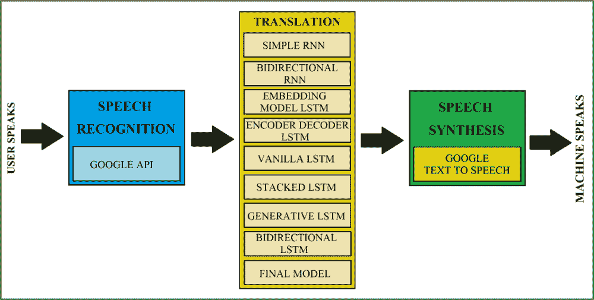 |
| --- |

这项工作避开了使用 `ANN` 和 `RNN`，而是采用 `LSTM`，是因为在 ways 可以使用且确实依赖于系列数据时，它相比 `ANN` 具有不可避免的优势。`LSTM` 在处理相互依赖的数据时由于其不敏感性优于 `RNN`。系统的架构如图 1 所示，整个系统大致分为三个部分——由 Google 辅助的语音识别、包含若干 `LSTM` 模型的翻译模块，以及生成语音的最后部分。尽管 `LSTM` 相比 `RNN` 具有优势，但仍然缺乏广泛接受的 `GNMT` 所考虑的参数。这项工作研究了如图 1 所示的多种 `LSTM` 模型，并对这些模型进行基准。

### LSTM 架构

这项工作使用了各种 `LSTM` 模型，从简单的 `LSTM` 模型到双向 `LSTM` 模型、带有嵌入的 `LSTM` 以及带有编码器解码器的 `LSTM`。

| 图 2. 简单 LSTM 架构 |
| --- |


# LSTM 架构与机器翻译系统实现

## 简单 LSTM 架构

简单 `LSTM` 架构如图 2 所示，其中 `sigma` 表示 sigmoid 层，它生成 0 到 1 之间的数字，以便允许输入通过组件进入下一层。Olah (2018) 中所示的 `tanh` 代表双曲正切层，它创建一个新的候选值向量。最后，对应于最高值的单词作为输出并传递到下一步。

简单 `LSTM` 模型也被称为原生 `LSTM` 模型。根据其准确率得分对不同模型进行比较。该系统使用的最终模型合并了双向 `LSTM` 和带有嵌入的 `LSTM`，因为它们被观察到提供更高的准确率，正如后文章节所述。

### 图 2. 简单 LSTM 架构

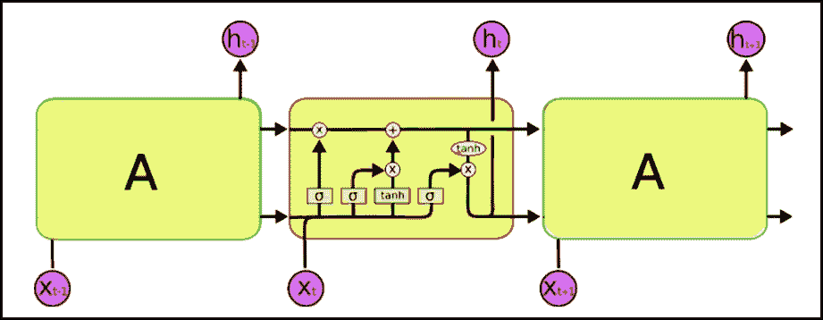

## 双向 LSTM 架构

图 3 所示的双向 LSTM 除了简单的 LSTM 之外，还考虑了反向序列的输入，这在实验上提供了更高的准确率。此外，层的输出通过相加结果、相乘，或者简单地拼接或考虑平均值来传递到下一层。

### 图 3. 双向 LSTM 架构

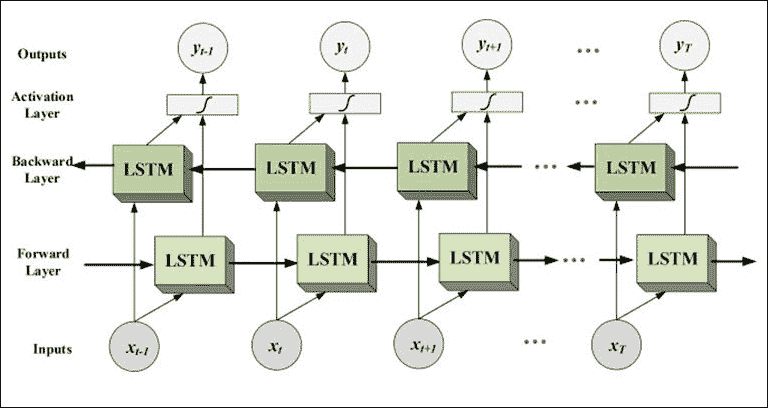

## 带有嵌入的 LSTM 架构

带有嵌入的 LSTM 模型架构如图 4 所示，它基于嵌入并结合普通的 LSTM Agrawal (2019) 工作。词标记根据词汇表的总大小和嵌入的维度转换为特定大小的嵌入。维护着一种如查找表或权重矩阵的数据结构，并据此为整个词汇表中的单个嵌入赋予权重。换句话说，嵌入可以与多维空间中与这些词接近的词的任何向量形式的表示进行比较。多维性由带嵌入的向量的大小决定。

### 图 4. 带有嵌入的 LSTM 架构 Agrawal (2019)

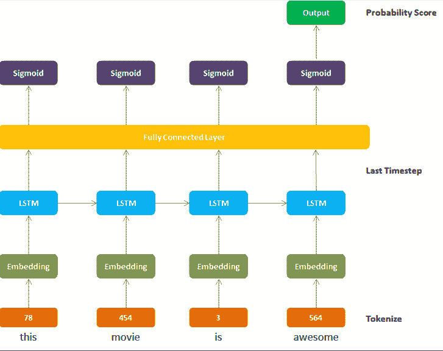

## 编码器-解码器 LSTM 架构

编码器-解码器 LSTM 如图 5 所示，具有输入和输出随机长度序列的独特能力。Park et al (2018) 考虑了当前输入序列以及过去输入序列的总结。LSTM 模型考虑了输入序列的总结，使其能够处理变长度的输入序列。

### 图 5. 编码器-解码器 LSTM 架构 Park et al (2018)

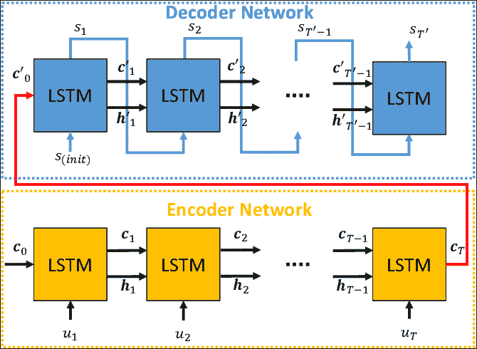

## 混合 LSTM 架构

在考虑准确率指标后，通过考虑双向 LSTM 模型以及带有嵌入的 LSTM 模型设计了混合模型。这两个模型被合并 Al-Sabahi et al (2018)，将嵌入加到向量上然后进行处理。

### 图 6. 混合 LSTM 架构

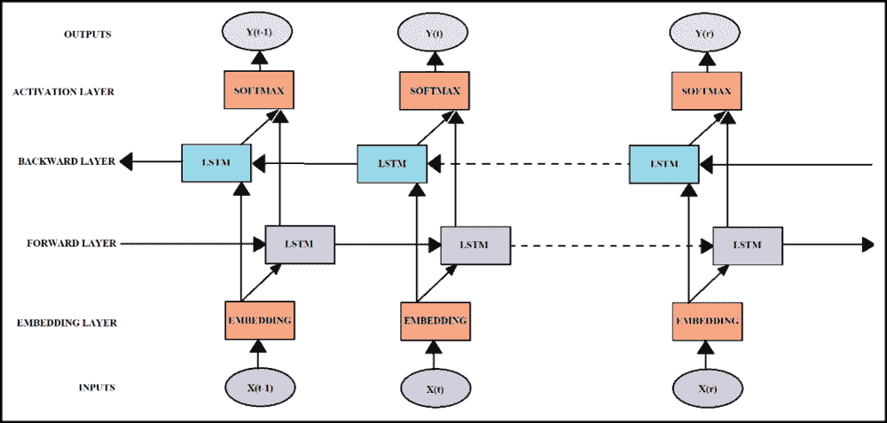

## 语音识别模块

在考虑准确率指标后，通过考虑双向 LSTM 模型以及带有嵌入的 LSTM 模型设计了双向 LSTM 模型。这两个模型被合并 Al-Sabahi et al (2018)，将嵌入加到向量上然后进行处理。

## 机器翻译模块

这项工作的第二个模块称为机器翻译模块。它是本研究的核心，因为 `RNN` 和 `LSTM` 模型的实现是在该模块中。

序列到序列（sequence-to-sequence）机制用于根据当前状态以及上一个状态的输出来获取当前状态的输出。例如，英语句子“we are a computer program”在法语中大致翻译为“nous sommes un program Informatique”。句子的翻译与单词的翻译不同，例如如果改变其中一个单词，整个句子的结构都可能随之改变——例如，如果将“we are a computer program”中的“we”改为“they”，形成句子“they are a computer program”，那么随后的输出将变为“c'est un program Informatique”。单词的改变改变了“are”一词的转换方式，这表明“are”一词不仅取决于自身，还取决于前一个单词，而我们的模型能够预测它的原因是因为它也考虑了之前的单词。如果不是这样，那么“are”将仅仅根据数据集被转换为其法语对应的词汇，且上述两个句子在该特定标记（token）上将具有相同的文本。这是为什么 `LSTM` 和 `RNN` 模型及其反馈循环特性对于这项工作至关重要的典型示例。

整个工作在此基础上，演示并比较了英语和法语两种语言之间的翻译准确性，并使用了与 `RNN` 和 `LSTM` 模型结合的不同模型。一旦该模块生成输出，它将作为输入传递给下一个模块，即语音合成模块（Speech Synthesis）。

## 语音合成模块

该模块是系统的最后一个模块，负责语音的合成，因此名为语音合成模块。该模块从机器翻译模块接收翻译后的文本作为输入，并将语音作为输出给用户。它接收来自上一个模块中执行翻译过程的各种 `RNN` 和 `LSTM` 模型的不同输入，并提供相应的后续语音输出。该模块的主要功能是将已经从一种语言转换为另一种语言的文本转换为相同目标语言的语音。与之前的模块不同，该模块的输出是音频输出。机器被要求用所需的语言“说出”从源语言翻译而来的文本，从而为用户提供所需的语音或输出。

对于文本转语音转换，使用了 `Google Text-to-Speech API`，该 API 允许用户根据提供的该语言的文本输入，以特定语言（`MP3` 或 `LINEAR16`）的音频格式获得近人声的输出。该软件允许选择不同性别、具有不同口音的音色，以获得音频文件或听觉输出的不同模式。使用此 API 允许系统轻松地为用户获取翻译语音的语音格式。

这三个模块构成了本研究的全部，但重点在于翻译部分。输入-输出链从源语言的语音到相同语言的文本，再到目标语言的文本，最后到该语言的语音。这为用户提供了一种获取语音所需翻译的高效方法。这项工作继续评估和分析所有实现的不同 `RNN` 和 `LSTM` 模型的准确性，并展示了哪种模型在准确性和效率上优于其他模型。

# 实现

## 硬件和软件要求

系统实现在 `Kaggle` 平台上，这是一个对所有人开放的平台。它在数据科学和机器学习爱好者中非常受欢迎，因为该平台提供了非常好的 `CPU` 和 `GPU` 以及支持 `Python3` 的笔记本，并可以访问多个 `Python` 库。该平台还拥有海量数据集，可以被下载并用于研究目的。工作在 `Python` 环境中进行，并使用了多个 `Python` 库和 API 来构建一个成功的机器翻译系统。

## 系统使用的数据集

这项工作的整个前提很大程度上取决于所采用的数据集。这项工作所实现的翻译是从英语到法语。系统需要英语和法语句子的数据集来训练各种模型，并在数据输入后获得所需的结果。此工作选择的数据集来自 `statmt.org` 网站的 `WMT Workshop 2014` 数据集。

该数据集在第九次英语-法语和法语-英语统计机器翻译研讨会上介绍。使用 Google 提供的广泛认可的 `G-NMT` 模型对数据集进行了比较和评估。英语语料库包含若干英语单词，法语语料库包含许多法语单词。

# 方法论

该系统通过长短期记忆（`LSTM`）网络以及若干循环神经网络（`RNN`）模型来训练数据集。`LSTM` 和 `RNN` 都通过循环机制工作，允许当前状态依赖于当前节点以及之前的节点，从而从任何时间实例中收集数据。

## 精确率

精确率（Precision）是一个被广泛接受的指标，用于评估机器学习模型的准确性。它被定义为从模型中检索到的相关信息与模型检索的所有信息之间的比例，如公式 (3) 所示，其中 `correct` 是翻译正确的单词计数，而 `length` 是翻译输出的长度，换句话说，它是输出中单词的总数。然而，在机器翻译中，它的计算方法是：与基准模型翻译结果相同的翻译单词数与译句中总单词数之比（Maučec et al，2019）。

 (3)

精确率的值于 0 到 1 之间，当所有检索到的信息都是相关的且与基准模型的翻译句子一致时，值为 1；而 0 则表示完全没有相似性。

## 召回率

召回率定义为检索到的相关信息与输入中存在的所有相关信息之间的比例，如公式 (4) 所示，其中 `correct` 是翻译正确的单词计数，而 `length` 是参考翻译的长度，换句话说，它是目标或参考输出中单词的总数。

 (4)

在机器翻译方面，它的计算方法是：输出语料的含义与所有可能被检索到的相关含义之间的比较值——换句话说，它是与基准模型翻译结果相同的翻译单词数与使用基准模型翻译的句子中总单词数之比（Maučec et al，2019）。召回率的值范围从 0 到 1，其中 0 表示从模型中检索到了不同的信息，而 1 表示检索到了完全相同的句子。

## F1 分数

F1 分数是一个更好的测量工具，因为它允许在精确率和召回率之间取得平衡。它是精确率和召回率的调和平均数（Maučec et al，2019），如公式 (5) 所示，简化为精确率与召回率乘积的两倍与精确率与召回率之和的比值。

 (5)

在极大负值分布不均的情况下，准确率衡量可能无法给出适当的结果，这就是 F1 分数的用武之地，因为它考虑了异常情况并提供了模型最准确的值。它的值也像精确率和召回率一样于 0 到 1。

## BLEU 分数

BLEU 分数直接对应于特定模型在机器翻译方面的效率。根据定义，BLEU 分数评估通过机器翻译接收的文本输出质量。它的值范围于 0 到 1 之间，描述了不同语言的输出与特定语言的输入之间的相似程度。BLEU 分数用于计算机器翻译输出与参考翻译之间单单元（unigram）和高阶 n 元（n-grams）的总重叠度（Maučec et al，2019），如公式 (6) 所示，其中 `length` 是参考翻译的长度，而 `length` 是翻译输出的长度。

 (6)

值为 0 表示句子完全不同，值为 1 表示句子完全相同，这非常难以实现，因此，极少翻译的值会非常接近 1。0.5 以上的任何值都可以认为是好的，表示具有高度相似性。

## 结果与分析

为了获得最佳结果并提出更好的算法以促进机器翻译工作，系统对多个模型进行了研究，包括简单的 `RNN` 模型、带有嵌入的 `LSTM`、双向 `RNN`、带有嵌入编码器和解码器的 `LSTM`、原生 `LSTM`、堆叠 `LSTM`、生成式 `LSTM` 以及双向 `LSTM`。模型的实现使用了 `Keras` 的内置函数。在成功实现模型后，将收集到的准确率指标列成表如所示，并使用 `Python` 的 `matplotlib` 库绘制图表。

图表结果实现了准确率指标的妥当视化，并有助于比较，从而有助于进行更好的分析。所有图表显示了不同模型的并列，展示了每个模型在不同情况下的表现。通过结合 `bidirectional LSTM` 和带有嵌入的 `LSTM` 创建了一个最终模型。这两个模型的结合使得整个系统的准确率更高，并且具有更好的 bleu 分数、精确率、召回率和 F1 分数。

### 表 1 NMT 中使用的各种准确率参数

| 模型 | 准确率 | Bleu 分数 | 精确率 | 召回率 | F1 分数 |
| --- | --- | --- | --- | --- | --- |
| Simple RNN | 40.87 | 0.01 | 0.00 | 0.00 | 0.00 |
| Bidirectional RNN | 61.64 | 0.86 | 0.63 | 0.50 | 0.56 |
| LSTM with embedding | 80.01 | 0.20 | 0.72 | 0.54 | 0.74 |
| Vanilla LSTM | 58.73 | 0.43 | 0.66 | 0.50 | 0.61 |
| Stacked LSTM | 61.04 | 0.29 | 0.65 | 0.50 | 0.57 |
| Generative LSTM | 63.89 | 0.38 | 0.43 | 0.34 | 0.38 |
| Encoder-Decoder LSTM | 54.67 | 40.00 | 0.70 | 0.50 | 0.58 |
| Final Model | 95.8 | 53.48 | 0.89 | 0.70 | 0.78 |

### 图 8. （左）不同模型所有指标的可视化（右）不同模型的准确率

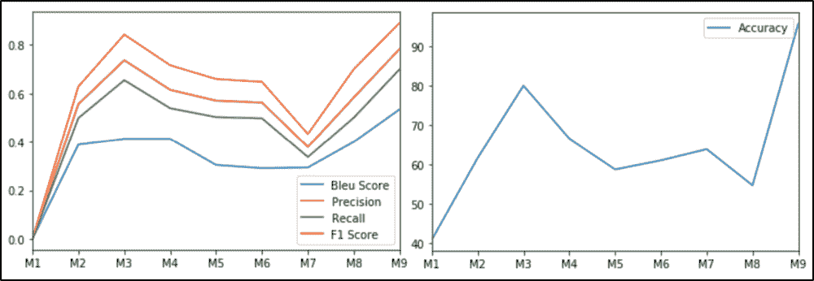

可以参考图 8 所示的折线图，根据各种准确率指标——BLEU 分、精确率（Precision）、召回率（Recall）和 F1 分，对不同模型进行更好的分析。BLEU 分被归一化在 `0-1` 范围内，以便与其他准确率指标进行数据可视化。从图 3 可以观察到所有各种模型的准确率，这些模型经过比较和调优以得出最终模型。这种准确率是指机器翻译系统在将一种语言的语音输入转换为另一种语言的语音输出时的准确程度。可以看到，简单 RNN 模型的准确率最低，仅为 `40.87%`，这对于机器翻译系统来说是非常低了。双向 RNN 模型提供的准确率为 `61.64%`，高于简单 RNN。然而，将 LSTM 网络模型引入后，可以看到不同的准确率，范围从双向 LSTM 的 `54.67%` 准确率到嵌入 LSTM 的 `80.01%` 准确率不等。在 LSTM 模型中，除了带嵌入的 LSTM 模型外，最有前景的是编码器-解码器 LSTM，值为 `66.55`。原生 LSTM（Vanilla LSTM）作为一种非常基础且经典的模型，提供了 `58.73%` 的准确率，这并不是一个非常理想的结果。最后，可以观察到通过结合双向 LSTM 和嵌入 LSTM 模型创建的最终模型提供了 `95.80%` 的惊人准确率。

根据图 7、图 8 和表 1 所示的柱状图，可以发现简单 RNN 的值非常小，小于 `10^(-7)`，这种值可以忽略不计且近似等于 `0`。这意味着简单 RNN 对机器翻译没有提供明显的关联价值。所有模型都给了中等全面的值，除了简单 RNN 外，生成式 LSTM 的值最小，为 `0.4`。然而，嵌入 LSTM 模型展现了 `0.84` 这一前景值。所有其他模型显示出在 `0.6` 到 `0.7` 之间的小范围值。将最终模型与其他模型相比，可以看到最终模型提供了 `0.89` 的最高精确率值，这非常接近完美精确率。BLEU 分被归一化在 `0-1` 范围内，以便与其他准确率指标进行数据可视化。对于这项工作，简单 RNN 模型给出的值约为 `10^(-8)`，可以忽略不计。嵌入 LSTM 模型显示出 `0.65` 这一前景值。除了简单 RNN 外，生成式 LSTM 显示的最低值为 `0.3`，而其余模型范围在约为 `0.4` 到 `0.5` 之间。最终模型显示出极具前景的高值 `0.699`，这可以近似为 `70 percent`，这对于神经机器翻译的召回率来说是一个高值。

结合表 1 的值以及图 7 和图 8，可以发现简单 RNN 同样无法获得可接受的 F1 分值——其 F1 分处于 `10^(-8)` 数量级，近似为 `0`。嵌入 LSTM 模型显示了 `0.7` 这一前景值，而其他模型的值在 `0.5` 到 `0.6` 之间。包含嵌入 LSTM 模型和双向 LSTM 的最终模型产生了 `0.78` 的高 F1 分，约约于 `80 percent`。可以观察到简单 RNN 模型的值为 `0.00013`，近似为 `0`，因此在涉及机器翻译时与其他模型相比最不可用。嵌入 LSTM 模型和 LSTM 编码器-解码器模型都具有 `0.41238` 的不错 BLEU 分，双向 LSTM 的值为 `0.4`。然而，由结合双向 LSTM 和嵌入 LSTM 模型形成的最终模型提供了高于 `0.5` 的很高 BLEU 分。

# 结论

该系统提供了基于神经网络的机器辅助翻译，有助于语音识别、使用多种神经模型进行语音翻译以及语音合成。语音识别模块和语音合成模块由多种 API 支持，但翻译由不同的模型完成。这项工作主要关注基于 LSTM 和 RNN 的多种神经网络辅助翻译研究——包括简单 RNN 模型、嵌入 LSTM、双向 RNN、带有嵌入编码器和解码器的 LSTM、原生 LSTM、堆叠 LSTM、生成式 LSTM，以及通过添加双向 LSTM 和嵌入 LSTM 模型创建的最终模型。该工作根据几个准确率参数（包括精确率、召回率、F1 分和 BLEU 分）对所有神经翻译模型进行了比较。在单个模型方面，性能最差的是简单 RNN 模型，它在所有指标上的值均可忽略不计。然而，总体而言，LSTM 模型的值比 RNN 模型高得多。对于准确率参数，目前仍有持续的研究，尽管为了总体评估，本文遵循了精确率、召回率、F1 分和 BLEU 分的标准定义。以原始形式汇总的数据难以分析，因此使用柱状图和折线图等图表对准确率指标数据进行了可视化处理。

这项工作可以在未来通过增加几个新模型来获得更好的比较和分析。模型也可以进行改进和优化，以限制时间复杂度并提高系统性能。其他准确率衡量标准可以用于这些模型的分析。此外，本系统仅考虑了基于单词的精确率和召回率，未来可以考虑更高阶的 n-gram 进行改进。

## 参考文献


# 参考文献

Soltau, H., Liao, H., & Sak, H. (2016). 神经语音识别器：用于大词汇语音识别的从声到字的 LSTM 模型。arXiv 预印本 arXiv:1610.09975。

Luong, M. T., Pham, H., & Manning, C. D. (2015). 基于注意力的神经机器翻译有效方法。arXiv 预印本 arXiv:1508.04025. 10.18653/v1/D15-1166

Xia, Y. (2020). 基于深度神经网络的统计机器翻译模型研究。计算 , 102(3), 643–661. doi:10.1007/s00607-019-00752-1

Cho, K., Van Merriënboer, B., Bahdanau, D., & Bengio, Y. (2014). 神经机器翻译的属性：编码器-解码器方法。arXiv 预印本 arXiv:1409.1259. 10.3115/v1/W14-4012

Sennrich, R., Haddow, B., & Birch, A. (2015). 使用子词的稀有词神经机器翻译。arXiv 预印本 arXiv:1508.07909。

Kumar, K. C., Aswale, S., Shetgaonkar, P., Pawar, V., Kale, D., & Kamat, S. (2020, 2 月). 康坎语到英语的机器翻译方法综述。在 2020 年信息技术与工程新兴趋势国际会议 (ic-ETITE) (pp. 1-6)。 IEEE。

Wu, Y., Schuster, M., Chen, Z., Le, Q. V., Norouzi, M., Macherey, W., . . . Klingner, J. (2016). 谷歌神经机器翻译系统：弥合人类翻译与机器翻译之间的差距。arXiv 预印本 arXiv:1609.08144。

Chen, K., Zhao, T., Yang, M., Liu, L., Tamura, A., Wang, R., Utiyama, M., & Sumita, E. (2017). 一种用于统计机器翻译的源依赖上下文模型神经方法。IEEE/ACM 音频、语音和语言处理汇 , 26(2), 266–280. doi:10.1109/TASLP.2017.2772846

Zhang, B., Xiong, D., Su, J., & Duan, H. (2017). 用于神经机器翻译的上下文感知递归编码器。IEEE/ACM 音频、语音和语言处理汇 , 25(12), 2424–2432. doi:10.1109/TASLP.2017.2751420

Wang, X., Tu, Z., & Zhang, M. (2018). 将统计机器翻译词汇知识融入神经机器翻译。IEEE/ACM 音频、语音和语言处理汇 , 26(12), 2255–2266. doi:10.1109/TASLP.2018.2860287

Singh, P., Kumar, A., Darbari, H., Rastogi, A., Jain, S. (2017, 7 月). 使用深度学习的机器翻译：概述。在 2017 年通信与电子国际会议 (COMPTELIX) (pp. 162-167)。IEEE. 10.1109/COMPTELIX.2017.800357

Wang, R., Utiyama, M., Finch, A., Liu, L., Chen, K., & Sumita, E. (2018). 用于神经机器翻译适配的句子选择与加权。IEEE/ACM 音频、语音和语言处理汇 , 26(10), 1727–1741. doi:10.1109/TASLP.2018.283723

Cho, K., Van Merriënboer, B., Gulcehre, C., Bahdanau, D., Bougares, F., Schwenk, H., & Bengio, Y. (2014). 使用编码器-解码器学习统计机器翻译的短语表示。arXiv 预印本 arXiv:1406.1078. 10.3115/v1/D14-1179

Ott, M., Edunov, S., Grangier, D., & Auli, M. (2018). 扩展神经机器翻译。arXiv 预印本 arXiv:1806.00187. 10.18653/v1/W18-6301

Koehn, P., & Knowles, R. (2017). 神经机器翻译的六个挑战。arXiv 预印本 arXiv:1706.03872. 10.18653/v1/W17-3204

Kalchbrenner, N., Espeholt, L., Simonyan, K., Oord, A., Graves, A., & Kavukoglu, K. (2016). 线性时间下的神经机器翻译。arXiv 预印本 arXiv:1610.10099

Chaudhary, J. R., & Patel, A. C. (2018). 使用深度学习的机器翻译。科学、工程与技术科学研究期刊 (International Journal of Scientific Research in Science, Engineering and Technology), 4(2), 145–150

Chaudhary, J. R., & Patel, A. C. (2018). 使用 RNN 的双语机器翻译。科学、工程与技术科学研究期刊, 4(4), 148–14

Artetxe, M., Labaka, G., Agirre, E., & Cho, K. (2017). 无监督神经机器翻译。arXiv 预印本 arXiv:1710.1104

Tu, Z., Lu, Z., Liu, Y., Liu, X., & Li, H. (2016). 神经机器翻译的覆盖建模。arXiv 预印本 arXiv:1601.04811. 10.18653/v1/P16-1008

Lample, G., Ott, M., Conneau, A., Denoyer, L., & Ranzato, M. A. (2018). 基于短语的无监督机器翻译。arXiv 预印本 arXiv:1804.07755. 10.18653/v1/D18-1549

Cheng, Y. (2019). 神经机器翻译的半监督学习。在神经机器翻译联合训练 (Joint Training for Neural Machine Translation) (pp. 25–40)。Springer. doi:10.1007/978-981-32-748_3

Datta, D., David, P. E., Mittal, D., & Jain, A. (2020). 使用循环神经网络的神经机器翻译。常规期 (Regular Issue), 9(4), 1395–1400. doi:10.35940/ijeat.D7637.0492

Olah, C. (2018). 理解 LSTM-Colah 博客。https://colah.github.io/posts/2015-08-Understanding-LSTMs/

Agrawal, S. (2019). 层间读取 (LSTM 网络)。检索于 2020 年 3 月 31 日，https://towardsdatascience.com/reading-between-the-layers-lstm-network-7956ad19e58

Park, S., Kim, B., Kang, C. M., Chung, C., & Choi, J. W. (2018). 通过 LSTM 编码器-解码器架构进行轨迹预测。2018 IEEE 智能车辆会议 (IV), 1672-1678. 10.1109/IVS.2018.8500658

Al-Sabahi, K., Zuping, Z., & Kang, Y. (2018). 用于摘要生成的双向注意力编码器-解码器模型和双向束搜索。arXiv 预印本 arXiv:1809.06662

Maučec, M. S., & Donaj, G. (2019). 机器翻译及其质量评估。在自然语言处理-新方法与近期应用 (Natural Language Processing-New Approaches and Recent Applications)。IntechOpen。

# 第 6 章

## 作者信息

- **Suresh Kumar Nagarajan**  
  Presidency 大学，印度

- **Geetha Narasimhan**  
  维洛尔理工学院，印度

- **Ankit Mishra**  
  维洛尔理工学院，印度

- **Rishabh Kumar**  
  维洛尔理工学院，印度

## 摘要

音乐是宣传视频的重要组成部分，因为它有助于建立品牌或实体的身份。然而，音乐的创作和制作是非常昂贵的。聘请能够为公司创作独特音乐的专业团队的费用可能极其高昂。在过去的十年里，人工智能实现了人类无法想象的成就。人工智能可以成为救星，不仅体现在公司为创建独特音乐所需花费的资金上，还体现在公司所需的时间和工作上。一个可以在全球任何地方访问的网络平台将帮助产品不受地理限制地获取客户。AI 算法可以学会识别哪些声音组合产生悦耳的旋律（或音乐）。可以使用多种机器学习算法来实现这一点。

## 引言

音乐理论是艺术家和学者用来描述他们在音乐作品中所听内容的术语。音乐理论的基础将帮助我们更好地理解哪些声音结合在一起创造出美的歌曲。旋律、和声和节奏是学习音乐理论时遇到的最重要术语。然而，重点将放在音乐理论的基础上。音阶、和弦、调（或音符）和记谱是音乐理论的元素。

每一个音符都有独特的声音。当多个音符在和声中一起演奏时，它被称为和弦。

和弦和/或音符的组合如果具有某种程度的旋律、和声和节奏，被称为音乐。我们的目标是提取听起来和谐的和弦和音符序列。`Neural Network`可以帮助实现一个`Machine Learning`模型，能够完成理解音乐和生成音乐的任务。`Neural Networks`可以用人类的例子来理解：当看到一张猫的画时，即使它可能只是一幅涂鸦，我们几乎就能识别出它是一只猫。这是因为我们关注了猫的“特征”。猫的特征包括它有一双眼睛、四条腿、一对形状典型的耳朵等。我们不能总是确定一个物体是否就是 `ML Algorithm` 预测的那样；因此，我们给它分配一个概率。由此，猫的每一个特征都被赋予一个概率，随后被转换为百分比。然而，这些特征并不是同等重要的。当我们找到这些特征相对于百分比的重要性后，我们称之为权重。现在，我们将特征的百分比与每个特征的概率相乘得到一个值。我们对这个值应用`sigmoid` 函数，以得到物体是猫的概率值。

`neuron`是一个单一单元或函数，它接收输入，将其相乘，然后相加，并对整体应用激活函数。`Neuron`的目的是根据大量的输入和输出样本来修改权重。基于输入和期望输出，`Neuron`学习权重。`Neural Network`是由此类神经元构成的网络，神经元的输入可能是另一个神经元的输出，反之亦然，这便构成了一个神经网络。作为人类，我们不会反复思考同一件事。相反，我们利用先验的知识并尝试理解它。传统的神经网络无法做到这一点；它们无法引用之前的信息。因此，为了解决这个问题，`recurrent neural networks`出现了，信息形成了一个循环网络，使得相同的信息可以再次访问。有时我们需要更多信息来理解某些事情，例如预测句子的最后一个单词，当我们输入句子时，自然地如果没有更多上下文，就确定它是什么。这时，所需的单词与所需出现点之间的差异变得更大。

`Long Short-Term Memory Network`是不同类型的`RNN`，能够学习那些长跨度（Gers et al., 2000）。`LSTM`是一种链式结构，但具有不同的构造。它有四个以特殊方式相互作用的神经网络，而不是单一的神经网络。`Long Short-Term Memory Network`可以记住听起来和谐的和弦模式。这反过来有助于生成音乐，`Machine Learning Algorithm`将与网络平台集成。`Website`首先帮助用户理解应用程序的，并帮助用户导航到页面，在该页面选择他们偏好的乐器和某些相关配置，这些配置被输入到`Machine Learning Model`中，然后使用这些参数产生音乐。`Machine Learning Model`已经在云平台上经过训练并部署。音乐被生成并返回给用户，用户可以收听并决定是否要购买。

## 背景

音乐语言模型可以用于多种音乐信号和符号音乐处理应用，例如音乐作曲、符号音乐分类和自动音乐转录 (AMT) (Ycart, & Benetos, 2020)。该研究作者调查了使用二值钢琴卷通过`Long Short-Term Memory (LSTM)`网络进行多声音乐预测。一项评估钢琴卷时间步对机器输出影响的早期实验表明，需要更多的音乐评估标准。作者在预测多声音乐（内在评估）及其作为 AMT 语言模型的预测模型（外在评估）方面进行了一系列实验。作者证明了内在输出（通过`cross entropy` 测量）与外在性能之间几乎没有关系，这强调了为每个应用定制训练损失函数的重要性。此外，该模型的性能优于之前开发的`MLMs`。本文有助于我们更好地掌握音乐语言模型，这在音乐开发领域极有益。这系列测试增强了我们对`Long Short-Term Memory (LSTM)` 价值的理解，并使其成为`Music Generator's` 潜在关键方面之一。

论文提出了一种使用有监督神经网络模型进行多声钢琴音乐转录的方法 (Sigtia et al., 2016)。`acoustic model`和`music language model`构建了所提模型的基础架构。估计音频帧中音高的概率是`acoustic model`的核心功能。`recurrent neural network`用于模拟随时间变化的音高组合之间的相关性，这就是语言模型。`Convolution Neural Networks`产生了最好的结果。通过本文，我们更深入地理解了哪些算法在音乐转录方面表现更好。我们对对音乐理论有了更深入的理解，这将帮助我们构建用于制作旋律歌曲的神经网络工作。

`Deep neural networks (DNNs)`已在音乐分类和标记方面取得了巨大成功 (Choi et al., 2018)。然而，关于`DNN`的准备、评估和审查仍有未解决的问题。为了更好地理解神经网络的属性，作者在本文中探索了它们的某些方面，例如噪声标签的影响。为了检查训练和评估的效率，作者评估并（重新）验证了国外音乐数据集。作者显示，尽管错误率较高，网络在真值数据集中仍然可以取得成功，同时假设标签噪声可能是导致不同标签输出差异的原因。最后，对合格网络的分析揭示了关于音乐标签之间关系的重要信息。这些发现证明了用数据驱动方法处理自动音乐标记的价值。

本文帮助我们理解，尽管`Deep Convolutional Neural Networks`可能会产生某些错误，有时这些错误数量很多，但在处理音乐及其理解时，它仍然是使用的最好的算法之一。这也有帮助我们理解了`Deep Learning`在整体实现中的重要性。

符号音乐生成仍然是一个面临若干障碍的未解决问题 (Zhang, 2020)。

整个音乐乐谱是一个长长的音符序列，由多个具有重复元素和不同阶段变化的轨道组成。`transformer model`由于其自注意力机制，在建模长序列方面显示出优势。已经尝试将`transformer-based model`应用于音乐制作。尽管文本和音乐的模式存在明显差异，但以前的工作使用了与文本生成相同的方法来训练模型。这些模型无法可靠地生成高质量的音乐样本。在本文中，作者提出了一种生成丰富音乐片段的新型`adversarial transformer`。`self-attention networks`和`generative adversarial learning`被创造性地结合在一起。

作者非常智能地基于 transformer 的方法构建了一个模型，并通过 `REGS` 和 `MC` 在增强模型性能方面付出了尽职努力。作者采用的方法帮助我们理解了看似微小的变化也能产生极大优越的结果。

### 游戏自适应音乐作曲 (Hutchings & McCormack, 2019)

与内容和行为紧密结合的音乐对于创造更具沉浸感、记忆点且情感化的游戏体验至关重要。然而，实时音乐生成算法的设计，以及对目前游戏中玩家行为、游戏世界背景和情感的有限模拟，阻碍了视频游戏自适应音乐系统（`AMSs`）的创建。

作者认为必须并行解决这些问题，以极大提高自适应游戏音乐的一性和通用性。为了创建一个新的 `AMS`，将信息组织和情感影响认知模型与多模态、多代理作曲技术相结合。该系统用于两款风格不同的游戏。作者帮助我们理解了自适应动态音乐生成在游戏中具有非常合适的应用。论文中还讨论了并行计算中的概念，这也帮助我们理解了如何构建与另一个应用程序并行运行的应用。

### 音乐训练、神经网络与语音处理之间的关系 (Elmer, 2016)


许多研究发现，受过训练的音乐家和接受过音乐指导的青少年在迁移各种频谱和时间维度的语音方面具有优势。此前，这些益处经常被认为与听觉皮层（`AC`）局部功能和解剖方面的改进有关。然而，由于这种观点忽略了包括神经网络和节奏动力在内的人脑自然组织，它是过于简单的。因此，研究提供了一种结合多模态成像、电生理学和神经振荡的新方法，将早期的发现扩展到网络水平。研究证明了如何利用功能和结构连接来构建调节 `AC` 活动的基础脑用路。论文还证明了如何利用网络方法更好地理解音乐训练对单词学习等更复杂语音过程的益处。

本文帮助我们理解 `Neural Networks` 工作的各种方式以及它们与大脑的相似之处。它帮助我们建立音乐理论、神经网络和语音处理之间的关系。论文中还解释了与音乐理论相关的概念，这对实际项目将很有益。

这项研究调查了基于 `AI` 的面部和音乐生物识别对客户认知和情感状态的影响，以及这些影响如何影响他们在价值构建方面的行为响应 (Rodgers et al., 2021)。

结果显示，在高参与度的 `AI` 购买场景下，音乐识别生物识别诱发的情感会调节实用型客户的认知和行为意图。

本文让我们对音乐理论有了更深入的见解。此外，我们还理解了各种类型的 `AI` 生成旋律如何影响人类大脑。

### 音乐认知的量子方法 (Beim & Blutner, 2019)

在过去的二十年里，量子认知作为数学心理学的一个分支其重要性日益增长。作者的研究基于 Guerino Mazzola 对调性对称性的开创性工作，旨在利用量子认知系统解释并调和音乐心理学中的静态和动态调性吸引现象。

基于调性音乐的八度等价性、五度相似性和转调对称性的基本概念（这些概念通过五度圈的结构表示），作者在这一底层调性空间上构建了几个波函数定义。在音乐学中，我们将传统的计算模型与静态和动态调性吸引的量子模型进行对比。我们的方法基于音乐解释的符号模型，复制并强化了预测。本文利用各种波函数深入探讨了调性对称性的概念。音乐理论的这一部分有助于从和弦中开发音调，并深化了对音乐理论的理解。

在音乐建模和创作的机器学习研究中，通常会提出模型架构、训练方法和数据集，以及系统输出的定量定性指标，例如序列概率和/或定性听感评估 (Sturm et al., 2019)。很少有研究对其对现实世界从业者的实用性和影响进行积极的挑战和分析，并以此指导机器学习的增长和部署。本文尝试在使用机器学习进行音乐制作的背景下实现这些目标。我们从业者合作创建并使用了许多用于音乐开发的机器学习算法，并在公开音乐会上展示了研究结果。我们关注整个体验，就如何推进这些以及其他基于机器学习的音乐制作应用提出了一些想法。通过分析其在现实世界实用性的研究，增强了我们对使用机器学习算法进行音乐创作的理解。

### PopMNet: 使用神经网络生成结构化的流行音乐旋律 (Wu et al., 2020)

最近提出了许多用于生成符号旋律的深度学习模型。然而，创建具有良好结构的流行旋律类音乐仍然是一个挑战。我们在论文中展示了 `PopMNet`，这是一种用于生成有组织的流行音乐旋律的旋律结构模型。旋律之间的两对连接（特别是递归和序列）决定了旋律结构。`PopMNet` 由基于卷积神经网络（`CNN`）的结构生成网络（`SGN`）和基于循环神经网络（`RNN`）的旋律生成网络（`MGN`）组成。前者创建旋律结构，后者根据结构和和弦进行创建旋律。`Attention RNN`、`Lookback RNN`、`MidiNet` 和 `Music Transformer` 是与所提模型对比的四种现有模型。根据结果，人类行为实验证明，该模型生成的旋律结构比现有模型生成的强得多。

本文帮助我们理解如何通过两对连接（特别是重复和序列）来创建结构良好的旋律，以创造更有意义的旋律。

`RNNs` 是强大的 `AI` 模型，已证明在广泛任务（包括作曲、语音识别和机器翻译）中非常有用 (Mittal & Umesh, 2021)。`RNN` 计算同时具有步内依赖和步间依赖性。由于这些特性，`RNNs` 的硬件加速比 `CNNs` 更困难。

# RNN 硬件架构与深度学习

近期，多位学者提出了多种 RNN 硬件架构。深度学习算法的发展一直与硬件加速器的进展紧密相关。然而，这两个领域之间仍需要更深层次的协同，而且这是可以实现的。本综述的目标是汇聚深度学习、计算机架构和芯片设计领域的研究人员。本文帮助我们理解对 `RNN` 以及硬件架构可以对其进行的各种改进，以确保它们具有更高的效率。

对于机器翻译、自然语言处理和时间序列预测等各种复杂任务，研究人员已经开发了多种深度神经网络（`DNNs`）架构（Vijayaprabakaran & Sathiyamurthy, 2020）。作为一种深度神经网络，长短期记忆模型（`LSTM`）凭借显著的结果已成为处理序列和时间序列问题最流行的架构。

在构建 `LSTM` 模型时，必须预先设置许多超参数，例如激活函数、损失函数和优化器。`DNN` 的效率深受这些超参数的影响。本研究的目标是创建一个新的 `LSTM` 激活函数，以替代现有的 `sigmoid` 和 `tanh` 等激活函数。

comb-H-sine (`comb-H-sine`) 函数是本研究中基于 `DEA` 方法发现的新激活函数。在 `MNIST`、`IMDB` 和 `UCI HAR` 数据集中，所提出的 `comb-H-sine` 激活特征在 `LSTM` 中优于标准函数，准确率分别为 98.83%、93.49% 和 78.38%。

本文帮助我们理解激活函数、损失函数和优化器等超参数的重要性，这些参数可以通过更改增强现有 `LSTM` 模型的准确性，该模型是 AI 音乐生成的合适模型。

近年来，神经网络已用于构建符号音乐（Wu et al., 2019）。然而，由于旋律的长期结构，创建一个有效的模型一直是个挑战。在这项研究中，作者引入了一种用于旋律生成的分层递归神经网络（`HRNN`），它由三个在时间上以从粗到精的方式运行的长短期记忆（`LSTM`）子网络组成。高层子网络的输出被传递给低层子网络，作为低层子网络生成更精细的时间尺度旋律组件的引导。根据两次人类行为实验，这种结构优于试图学习所有隐藏旋律模式的单层 `LSTM`。

根据人类评估，`HRNN` 生成的旋律比最近提出的 `MidiNet` 和 `MusicVAE` 模型更具感染力。本文深化了我们对递归神经网络的理解，这种网络似乎与本项目最相关。本文帮助我们理解递归神经网络适用于音乐生成。

## 本章重点

## 问题描述

音乐是各行业的基本需求，以满足广告、社交媒体运营、数字营销等多种需求。然而，音乐的制作相当昂贵且需要耗费时间。人工智能生成的音乐可以帮助那些在特定时间内需要高质量音乐的小企业、初创公司等。该项目旨在建立一个平台，帮助全球范围内的人使用他们选择的乐器生成音乐，并在随后进行购买。个人/公司对其制作的音乐拥有版权，因此他们可以借此建立品牌声誉。

分析现有的 AI 音乐生成工作，可以从中推导出某些结论。所有处理 AI 音乐生成的论文首先都会处理音乐理论。要在平台上开展工作，对音乐理论的深入理解是必不可少的。另一个值得注意的是，需要基于机器学习的方法来生成音乐。在此之后，所有论文的方法各不相同。大多数论文在实现中使用了卷积神经网络（`CNN`）的概念。然而，有一篇论文提到深度学习技术与 `LSTM` 网络的结合可以提高模型的整体准确性（Hizlisoy et al., 2021）。此外，结果显示 `LSTM + DNN` 分类器的音乐情感识别准确率提升了 1.61、1.61 和 3.23 个点。

这帮助我们理解神经网络适用于涉及音乐理论的模型。一些论文还使用了不同的方法，如复值神经网络（`CVNN`）、`K-Means` 聚类、多层感知器（`MLP`）神经网络和支持向量机（`SVM`）神经网络作为整个模型的子任务。然而，研究表明，对于我们的 AI 音乐生成器来说，最有效的模型是深度学习算法与长短期记忆的结合，后者是基于递归神经网络（`RNN`）。

使用基于 `RNN` 的 `DNN+LSTM` 可能面临某些挑战，首先是“一对多”序列问题，即输入数据包含单个时间步，而输出是多个值或时间步的向量。所分析的研究论文讨论了解决方案之一。它指出，通过使用 `Stacked LSTM` 可以避免一对多序列问题。可能还会面临“多对多”序列问题，可以通过类似于一对多序列问题的方法来避免。

## 总体目标

总体目标是建立一个可以在全球范围内获取的平台。该平台将允许用户选择他们的定制内容、乐器以及音乐理论中的某些因素，这些因素将用于运行基于深度学习算法和长短期记忆的机器学习模型。该模型在此之前将使用各种乐器的声音进行训练。机器学习模型在学习了各种悦耳的和弦组合后将生成音乐。

## 研究框架

现有研究成功地让我们对如何开发 AI 音乐生成平台有了更深入的理解。它还让我们对该任务的各种机器学习方法有了更清晰的认知。该平台基于 Web 构建，使全球的人都可以轻松访问。平台将通过简单直观的用户界面引导用户，帮助他们选择自己喜爱的乐器，然后进入调整用户选择参数的阶段。

由于实现相同目标的方法有很多，该平台的机器学习组件需要大量的调研工作。在分析了多种用于音乐生成的机器学习模型（ML Models）并考虑了各种方法的优缺点后，决定使用神经网络的概念。这需要使用循环神经网络（Recurrent Neural Networks），这些神经网络在每一步中都执行相同的功能，但每个单独神经元的输入都依赖于上一个神经元的输出。`LSTM` 作为一种循环神经网络，可以帮助记忆和弦的模式或序列，这些和弦接一个听起来非常悦耳。让我们通过详细的架构图来了解这些组件是如何独立工作及组合工作的。

| 图 1. AI 音乐生成器架构图 |
| --- |
| 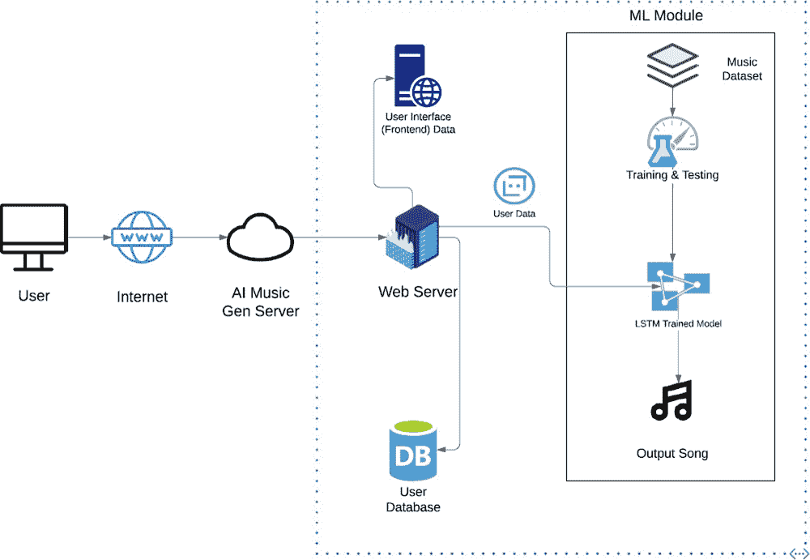 |

## 方法论

架构图展示了各个模块如何协同工作，本节将对这些内容进行深入讲解。首先对功能进行整体描述，然后对每个模块进行深度介绍。连接到互联网的用户向应用程序的服务器模块发送请求，服务器模块在从前端模块获取数据后，将网站数据返回给用户。用户现在可以发送凭据并结合特定参数调整乐器以生成数据。用户再次将数据发送回服务器模块，服务器首先检查用户身份，然后将参数发送到机器学习模块（ML Module）。机器学习模块运行在各种乐器数据上训练过的 `LSTM` 算法。机器学习算法将新生成的音乐返回给用户，并提供购买选项。整个系统可以分为以下模块。

## ML 模块

机器学习模块运行在云端服务器上，是产生音乐的组件。它使用基于神经网络的长短期记忆网络（`LSTM`）算法生成音乐。神经网络由神经元这一基本构建单元构建。可以通过一个人类的例子来理解神经网络：当看到一张狗的画时，尽管它可能只是一幅涂鸦，我们几乎可以瞬间识别出是一只狗。这是因为我们关注了狗的特征。狗的特征包括两只眼睛、四条腿、一对形状典型的耳朵等。我们并不能总是确定某个物体是否就是机器学习算法预测的结果；因此，我们给它分配一个概率。因此，狗的每个特征都被赋予一个概率，随后将其转换为百分比。然而，这些特征并不是同等重要的。当我们找到这些特征按百分比计算的相对重要性后，称之为权重。现在，我们将特征的百分比与每个特征的概率相乘得到一个值。我们对所得值应用 `sigmoid` 函数，以得到该物体是狗的概率值。这个单一单元或函数本质上可以被称为 `neuron`，它乘以输入，然后将它们相加，并对总和应用激活函数。`Neuron` 的目的是根据大量的输入和输出样本来修改权重。

`Neuron` 根据输入和所需的输出来学习权重。神经网络是由此类神经元组成的网络，神经元的输入可能是另一个神经元的输出，反之亦然，这便构成了一个神经网络。作为人类，我们不会反复思考同一件事。相反，我们利用先前的知识并尝试去理解。传统的神经网络无法做到这一点；它们无法引用之前的信息。因此，为了解决这个问题，循环神经网络派上了用场，信息形成循环网络，使得相同的信息可以被再次访问。有时我们需要更多信息来理解某些事情，例如在输入句子时预测句子的最后一个单词，自然地，如果没有更多的上下文，就无法预测它会是什么。这时，实际所需的单词与需求产生点之间的差异就会变大。

| 图 2. LSTM 网络 |
| --- |
| 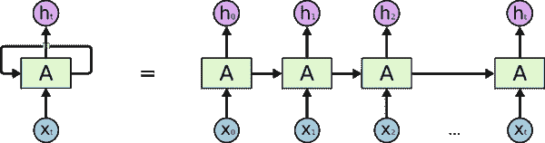 |

`LSTM` 是一种链状结构，但与传统的神经网络结构不同。它有四个神经网络以特殊的方式相互作用，而不是单一的神经网络。`LSTM` 可以记住听起来和谐的和弦模式。机器学习模块首先使用现有的乐器音乐进行训练。在模块训练完成后，我们向 ML 模块输入某些参数，这些参数是为了确保每次运行机器学习模型时，结果都不尽相同。机器学习模块运行后产生某些音乐，这些会被发送回服务器，然后服务器将数据返回给用户。

## 服务器模块

服务器模块帮助协调整个系统中发生的所有活动，它跟踪用户请求，并在接收到请求后将它们替换为相应的信息。这里的服务器模块是一个云平台，数据库、整个用户界面（前端）以及机器学习模块都运行在其之上。服务器将构建在云平台上。一些最流行的云平台包括谷歌云（GCP）和亚马逊云服务（AWS）。将构建一个基于 JavaScript 的服务器模块来帮助协调所有任务。

用户最初从 Web 服务器请求数据，服务器随后将网站的用户界面返回给用户。用户进一步与用户界面交互并输入凭据。凭据随后发送回服务器模块。服务器模块从数据库模块检查凭据并返回相应的响应。一旦用户登录，他们就可以获得使用参数生成音乐的选项，参数再次发送到服务器模块，服务器随后调用机器学习模块根据这些参数产生音乐。机器学习模块产生音乐，然后发送到服务器，服务器临时存储音乐文件并将音乐返回给用户，用户可以使用其用户界面听音乐，如果用户想继续，可以购买音乐。如果用户请求服务器购买数字版权的音乐，用户将被重定向到支付页面，服务器从前端模块获取支付页面并将其返回给用户前端。用户从那里输入支付详情并购买数字版权。

## 前端模块

该模块帮助用户与服务器交互，进一步协调整个系统的各种功能。前端将基于 Web 开发领域的最新技术构建。将使用 HTML5、CSS3 和 JavaScript 构建整个用户界面，这有助于让用户界面具有现代感。网站还将使用流行的 Bootstrap 框架使其具有响应式。

当用户向服务器发送请求时，他/她将接收到 `Frontend` 模块。落地页将帮助用户理解整个系统以及网站的功能。用户可以导航到页面，在该页面请求乐器并定义某些参数。这些参数可以是任何随机数，通过服务器模块输入 `ML Model`，从而每次生成独一无二的音乐。一旦生成音乐，系统会要求用户登录或注册。用户的凭据随后会被发送到服务器。服务器与 `backend` 模块对凭据进行交叉验证，然后返回相应的响应。用户随后可以将自己重定向到支付页面，并购买新生成音乐的数字版权。

## 数据库模块

`Database` 模块存储用户的凭据。数据库还持有音乐数字版权的账户，以及与之相关的参数，如乐器及其生成参数。这些记录有助于确保同一首音乐不会被重复出售给另一个机构或个人。

当用户进入登录页面时，凭据将通过用户界面使用 `REST Protocols` 发送到服务器，服务器使用用户数据库的记录对发送的数据进行交叉验证。一旦用户通过身份验证，将发送成功消息；否则，将生成错误代码并告诉用户重试身份验证过程。因此，`Database` 模块有助于维护所有消费者的记录，并在 `REST-based protocol service` 上运行。

下面的插图帮助我们理解数据在整个应用程序中的流，以及各个模块如何协作执行系统的各种功能。

| 图 3. AI 音乐生成器数据流图 |
| --- |
| 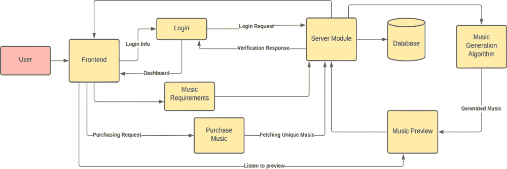 |

用户通过浏览器从前端与网站进行交互，浏览器访问数据库，而网站存储在云端的某些托管平台上。现在，通过网站，用户必须使用其用户名和密码登录，这些信息存储在云端数据库中。现在，这些 `Login` 信息将从中进行验证，并允许用户访问其已购买的内容、之前生成的音乐预览以及其他信息。

现在，生成音乐时，用户需要定义其需求，例如乐器类型、旋律类型以及其他因素，这些因素将通过云端发送到服务器，并输入云端的 `Music Generating Machine Learning Algorithm`，该算法将根据云端存在的预训练模型生成音乐。生成所需的音乐后，生成的音乐将通过服务器存储在数据库中，使用户可以随时随地收听，然后决定是否购买。这首音乐将保留在数据库中，直到其他人或初始用户以唯一的版权 ID 购买它。假设用户决定购买这首音乐，则用户可以进入支付选项，并通过服务器被重定向到支付门户。现在，随着支付完成，具有唯一版权 ID 的音乐将分配给用户，用户将允许下载音乐的最终版本，用于个人或商业目的。

## 测试

`AI Music Generator` 通过识别用作训练集的 `Dataset` 中的 `Notes`（音符）和 `Chords`（和弦）模式来生成音乐。`dataset` 并没有任何输出变量或所谓的 `prediction`。

模型的测试是通过改变各种参数实现的，这些参数用于 `Machine Learning` 的训练、测试和预测阶段。值得注意的是，部署（或 `flask app`）的参数并没有产生显著的影响。

本节涉及 `Machine Learning Model`（机器学习模型）的各种相互相关的参数并寻找它们之间的关系。通过使用各种类型的图表进行了进一步的图形分析，以建立两个参数之间的关系。

| 图 3. AI 音乐生成器数据流图 |
| --- |
|  |

| 表 1. 序列长度与唯一音符的数量 |
| --- |
| 序列长度 | 唯一音符（平均值） |
| --- | --- |
| 100 | 35 |
| 200 | 43 |
| 300 | 27 |
| 400 | 26 |
| 500 | 32 |

| 图 4. 序列长度与唯一音符的数量（和弦） |
| --- |


| 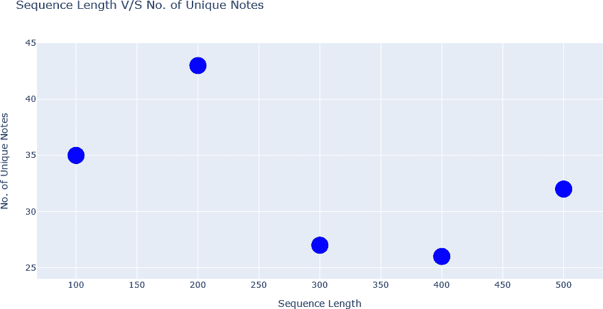 |
| --- |
| 表 2. 序列长度与执行时间（秒） |
| --- | --- |
| 序列长度 | 执行时间（秒） |
| --- | --- |
| 100 | 37.65 |
| 200 | 66.49 |
| 300 | 93.32 |
| 400 | 121.14 |
| 500 | 160.5 |
| 图 5. 序列长度与执行时间（秒） |
| --- |
| 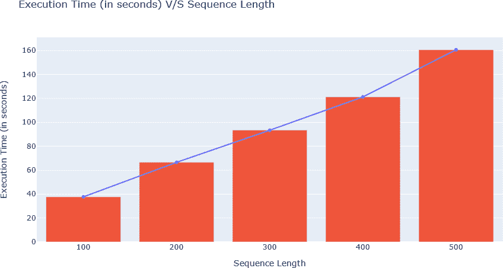 |
| --- |

`AI Music Generator` 通过识别用作训练集的 `Dataset` 中的 `Notes`（音符）和 `Chords`（和弦）模式来生成音乐。`dataset` 并没有任何输出变量或所谓的 `prediction`。

模型的测试是通过改变各种参数实现的，这些参数用于 `Machine Learning` 的训练、测试和预测阶段。值得注意的是，部署（或 `flask app`）的参数并没有产生显著的影响。

本节涉及 `Machine Learning Model`（机器学习模型）的各种相互相关的参数并寻找它们之间的关系。通过使用各种类型的图表进行了进一步的图形分析，以建立两个参数之间的关系。

# 在预测算法中增加生成的元素数量会导致生成的音乐持续时间增加。在下面的表 3 中也注意这一点。

## 表 3 持续时间（秒）对比元素数量

| 元素数量 | 持续时间（秒） |
| --- | --- |
| 100 | 26 |
| 200 | 51 |
| 300 | 76 |
| 400 | 101 |
| 500 | 126 |

AI 音乐生成器的构建目的是为用户提供用于推广短音乐，社交媒体广告的平均长度约为 60 秒，因此，我们将元素数量设置为 200。

| 图 6. 持续时间（秒）对比元素数量 |
| --- |
| 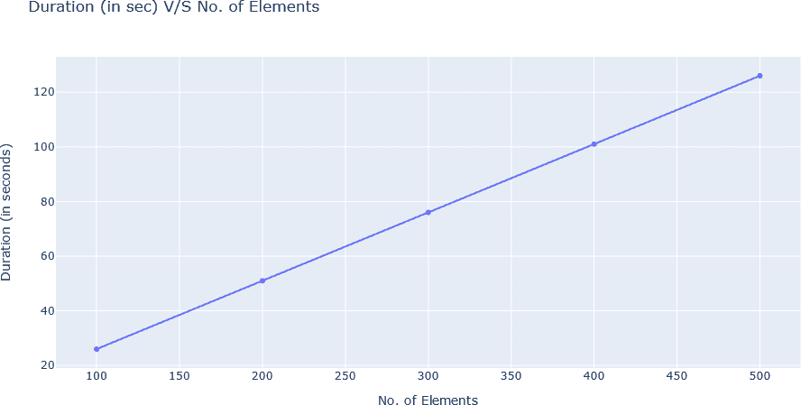 |
| --- |

## 通过改变偏移量来改变音乐持续时间

偏移量（`offset`）是指每个音符或和弦相对于预测输出的播放时间。分析显示，偏移量与生成音乐的持续时间成正比，这在表 4 中所示。

## 表 4 生成音乐的持续时间（秒）对比偏移量

| 偏移量 | 持续时间（秒） |
| --- | --- |
| 0.5 | 51 |
| 0.6 | 61 |
| 0.7 | 71 |
| 0.8 | 81 |
| 0.9 | 91 |

改变偏移量不仅会改变音乐的持续时间，还会改变每个单独音符/和弦的播放时长。因此，超过某个值增加或减少 `Offset` 会失真音乐。初步分析显示，`Offset` 值的合适范围在 0.5-0.9 之间。

当 `Offset` 值保持为 0.5 时，产生的音乐也是社交媒体推广的一个主意，且听起来和谐。因此，偏移量值设置为 0.5。

| 图 7. 生成音乐的持续时间（秒）对比偏移量 |
| --- |
| 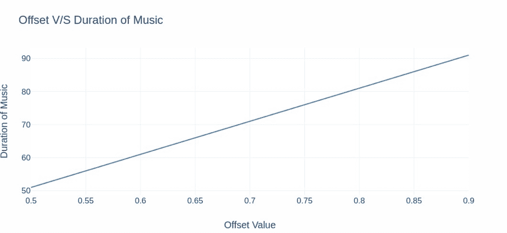 |
| --- |

## 模型生成总结

## 表 5 机器学习模型摘要

| 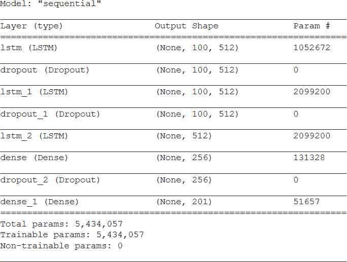 |
| --- |

模型生成的摘要如表 5 所示。

### 训练轮数（Epochs）与训练时间的对比

`Epoch` 是机器学习模型处理整个训练集的单次迭代，`Epochs` 的数量越多，结果越好，如表 6 所示。

## 表 6 轮数对比训练时间（毫秒）

| 训练轮数 | 训练时间（毫秒） |
| --- | --- |
| 2 | 235 |
| 10 | 1175 |
| 50 | 5,875 |
| 100 | 11,750 |
| 180 | 21,150 |

由于训练阶段发生在用户允许使用特定模型生成音乐之前，因此模型在 180 个 `Epochs` 处进行了训练。使用如此高数量的 `Epochs` 能够生成高质量音乐。

| 图 8. 轮数对比训练时间（毫秒） |
| --- |
| 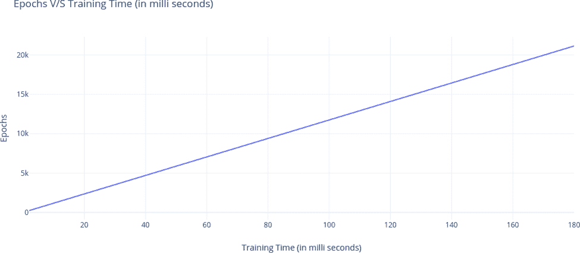 |
| --- |

每个小节中指定的优化设置已根据 `LSTM` 算法用于生成音乐。

### 在优化设置下使用模型生成的音符（及和弦）词云

| 图 9. 使用优化设置生成音乐的词云 |
| --- |
| 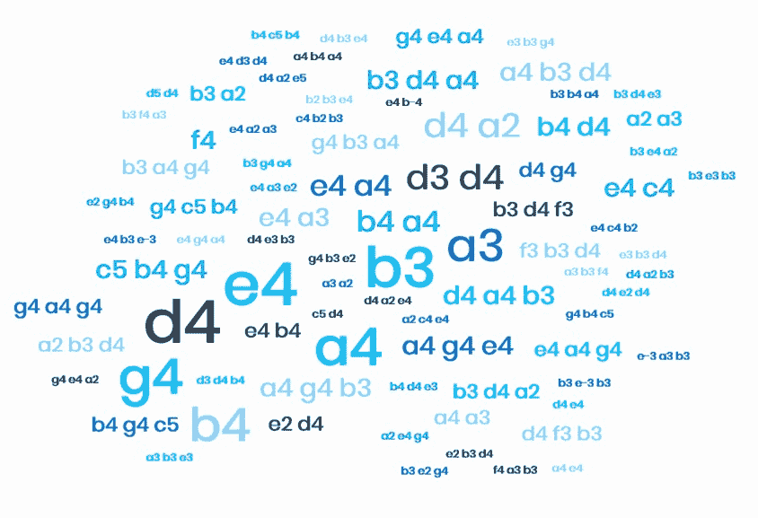 |
| --- |

测试部分旨在确保整个算法的所有单个组件都经过了优化，以确保生成的音乐是和谐的，并且用户不需要等待太久就能听到音乐。使用了数值和图形分析来测试所有可能的配置，以确保算法的所有方面都得到了充分验证。结果是一组具有其优化值的参数，这些值非常适合该算法。

## 解决方案与建议

## LSTM 模型与其他模型的对比

之前的工作……（此处由于原文内容不完整，仅根据逻辑翻译已提供的段落部分）

（注：由于提供的英文文本在“SOLUTIONS AND RECOMMENDATIONS”之后的内容似乎不完整，已根据提供的文本片段完成翻译。）

上述结果与之前研究工作的概念一致，表明增加轮数（`epochs`）的数量可以获得更好的输出。

## 讨论

互联网的兴由于需求的增长和受众群的扩大，提供了更多的可用服务。对于小型企业和创业公司来说，音乐作为品牌认同至关重要。然而，音乐制作成本可能会让许多财务资源有限的公司难以负担。AI 音乐生成器可以成为此类公司的助力。通过构建一个 `flask app`，该 `Service` 变得更加易用，它可以扩展为可部署的网站。该网站具有简单的用户界面，有助于用户理解网站的工作原理，并引导用户进入显示可用乐器的网页。用户可以自由选择自己喜欢的乐器。

一旦用户选择了乐器，生成音乐的 `Algorithm` 就会运行。这里生成音乐的 `Algorithm` 是 `LSTM` 算法。长短期记忆算法（`LSTM`）能够记住输入到 `algorithm` 中的音乐数据集中的音符或和弦模式。随后，`LSTM Algorithm` 根据各种参数生成音符或和弦序列。`LSTM Algorithm` 使用包含特定乐器音乐的数据集进行预训练。预训练有助于算法更快地生成音乐，因为模型的训练时间可能长达 2 天。算法根据模型构建音符和和弦序列。该音符和和弦序列被输入 `music21` 库，由其生成音乐。用户将被重定向到另一个页面，在该页面可以播放生成的音乐。用户随后可以选择购买生成音乐的数字版权。

## 结论

本文提出了一种基于神经网络的 `LSTM` 概念生成音乐的方法。音乐生成的想法被进一步扩展，以在 Web 上构建一个完整的平台。首先理解音乐理论概念。然后扩展这些想法，通过理解哪些音符和和弦序列听起来是和谐的，理解如何生成音乐。在选择基于循环神经网络的 `LSTM algorithm` 之前，对各种算法进行了分析。`LSTM` 能够记住听起来和谐的和弦模式。`ML Module` 包含了 `LSTM algorithm` 以及用于从数据集中清洗和提取数据的代码。`ML Module` 首先使用现有的乐器音乐进行训练。

用户与基于 `Flask` 构建的 平台 UI 交互，该平台连接到 `ML Module`。一旦用户选择了乐器，已使用现有音乐集训练完成的 `ML Module` 就会开始运行。用户可以在网页上听到由 `LSTM algorithm` 生成的音乐。对 `LSTM algorithm` 在多个因素上与多种算法进行了比较。`LSTM algorithm` 的性能显著优于传统的音乐生成方法。该算法还经过充分测试，以优化其各种参数。这一分析确保了生成的歌曲质量和等待时间同样得到了优化。通过调查在同一算法中使用不同参数生成的音乐，对算法的参数进行了进一步检查。用户被要求对他们听到的音乐进行评分。通过上述两项分析的结合，可以得出最佳参数。

本文的某些方面在未来可以改进。第一是，每个音符或和弦的播放时间保持不变。尽管参数已经过优化，但仍有实现更多化音乐的空间。模型还可以使用数量的乐器进行训练。

## 参考文献

Bagui, S. C., Mehra, K. L., & Vaughn, B. K. (1997). An M-stage version of the `k-RNN` rule in statistical discrimination. Journal of Statistical Planning and Inference , 65(2), 323–333. doi:10.1016/S0378-3758(97)00055-4

Beim Graben, P., & Blutner, R. (2019). Quantum approaches to music cognition. Journal of Mathematical Psychology , 91, 38–50. doi:10.1016/j.jmp.2019.03.002

Choi, K., Fazekas, G., Cho, K., & Sandler, M. (2018). The effects of noisy labels on deep convolutional neural networks for music tagging. IEEE Transactions on Emerging Topics in Computational Intelligence , 2(2), 139–149. doi:10.1109/TETCI.2017.2771298

Dong, S., & Ni, N. (2021). A method for representing periodic functions and enforcing exactly periodic boundary conditions with deep neural networks. Journal of Computational Physics , 435, 110242. doi:10.1016/j.jcp.2021.110242

Elmer, S. (2016). Relationships between music training, neural networks, and speech processing. International Journal of Psychophysiology , 100(108), 46. doi:10.1016/j.ijpsycho.2016.07.152

Feng, J., Chai, Y., & Xu, C. (2021). A novel neural network to nonlinear complex-variable constrained nonconvex optimization. Journal of the Franklin Institute , 358(8), 4435–4457. doi:10.1016/j.jfranklin

Gao, S., Huang, Y., Zhang, S., Han, J., Wang, G., & Lin, Q. (2020). `GRU-based` momentum optimized during generation. Journal of Hydrology (Amsterdam) , 589, 125. doi:10.1016/j.hyd.2020.9

Gers, F., Schmiduber, J., & Cummins, F. (2000). Learning to forget: `LSTM`. Neural Computation , 12(1), 177

Han, Y., Kim, J., & Lee, K. (2016). Deep convolutional neural networks for music tagging. IEEE Access , 4, 2729

Herremans, D., & Chew, E. (2017). Music emotion using `stack-augmented LSTM`. IEEE Transactions on Affective Computing , 11(4), 1052

Hutchings, P., & McCormack, J. (2019). Adaptive music composition for games. IEEE Transactions on Games , 12(3), 270

Hizlisoy, S., & Yildirim, S. (2021). A survey on hardware accelerators for `RNNs`. Journal of Systems Architecture , 112, 101839

Jiao, M., Wang, D., & Qiu, J. (2020). `LSTM-based` momentum optimized for SOC estimation. Journal of Power Sources , 459, 22801

Kolozali, Ş., Barthet, M., Fazekas, G., & Sandler, M. (2013). Music chord shape identification with `LSTM`. IEEE Transactions on Audio, Speech, and Language Processing , 21(10), 2207

Li, H. (2020). Piano automatic computer composition by deep learning and blockchain technology. IEEE Access , 8, 188951

Liu, F., Zhang, L., & Jin, Z. (2020). Modeling programs hierarchically with `stack-augmented LSTM`. Journal of Systems and Software , 164, 110547

Mukherjee, H., Dhar, A., Ghosh, M., Obaidullah, S. M., Santosh, K. C., Phadikar, S., & Roy, K. (2020). Music chord shape identification with `LSTM-RNN`. Procedia Computer Science , 167, 607–615

Qi, Y., Liu, Y., & Sun, Q. (2019). Music-driven dance generation. IEEE Access , 7, 166540

Rodgers, W., Yeung, F., Odindo, C., & Degbey, W. Y. (2021). 人工智能驱动的音乐生物识别影响客户的零售购买行为。《Journal of Business Research , 126, 401–414. doi:10.1016/j.jbusres.2020.12.039

Schiller, I. S., Morsomme, D., & Remacle, A. (2018). 音乐理论教师的声音使用：声音剂量学与自我评估研究。《Journal of Voice , 32(5), 578–584. doi:10.1016/j.jvoice.2017.06.020

Sigtia, S., Benetos, E., & Dixon, S. (2016). 一用于多声钢琴音乐转写的端到端神经网络。《IEEE/ACM Transactions on Audio, Speech, and Language Processing , 24(5), 927–939. doi:10.1109/TASLP.2016.2533858

Sturm, B. L., Ben-Tal, O., Monaghan, Ú., Collins, N., Herremans, D., Chew, E., Hadjeres, G., Deruty, E., & Pachet, F. (2019). 对创作具有意义的机器学习研究：案例研究。《Journal of New Music Research , 48(1), 36–55. doi:10.1080/09298215.2018.1515233

Vijayaprabakaran, K., & Sathiyamurthy, K. (2020). 长短期记忆模型网络的激活函数搜索：基于差异演化的方法。《Journal of King Saud University-Computer and Information Sciences》。

Wang, S., Zhao, J., Shao, C., Dong, C., & Yin, C. (2020). 基于采样 GPS 和 LSTM 和 GRU 方法的卡车交通流预测。《IEEE Access: Practical Innovations, Open Solutions , 8, 208158–208169. doi:10.1109/ACCESS.2020.3038788

Wu, J., Hu, C., Wang, Y., Hu, X., & Zhu, J. (2019). 用于符号旋律生成的分层递归神经网络。《IEEE Transactions on Cybernetics , 50(6), 2749–2757. doi:10.1109/TCYB.2019.2953194


# 参考文献

Wu, J., Liu, X., Hu, X., & Zhu, J. (2020). PopMNet: 使用神经网络生成结构化流行音乐旋律。《Artificial Intelligence》, 286, 103303. doi:10.1016/j.artint.2020.103303

Ycart, A., & Benetos, E. (2020). 使用 LSTM 进行多声部音乐序列预测的学习与评估方法。《IEEE/ACM Transactions on Audio, Speech, and Language Processing》, 28, 1328–1341. doi:10.1109/TASLP.2020.2987130

Zhang, N. (2020). 用于符号音乐生成的对抗性 Transformer 学习。《IEEE Transactions on Neural Networks and Learning Systems`, 1–10. doi:10.1109/TNNLS.2020.2990746

# 第 7 章

## 作者

* **Vishnu S. Pendyala**
    * ORCID: [https://orcid.org/0000-0001-6494-7832](https://orcid.org/0000-0001-6494-7832)
    * 美国圣何塞州立大学

* **VigneshKumar Thangarajan**
    * 美国 PayPal

## 摘要

“一画胜千言”是一句众为人知的谚语。显而易见，从文本生成图像有许多用途。在本章中，作者探索了一种先进的生成式深度学习方法来产生合成图像，以及一种评估这些图像的新方法。该方法侧重于在给定图像文本描述的情况下，合成包含多个物体的高分辨率图像。现有文献使用物体路径 GAN（`OP-GAN`）从文本自动生成图像。本章描述的工作尝试改进使用 `OP-GAN` 的原始实现中的判别器网络。这最终有助于根据判别器的输出调整生成器的学习率。最后，使用语义物体准确率（`SOA`）对训练后的模型进行评估，该指标与评估基准实现的相同，且优于以往文献中使用的指标。

## 引言

本章的目标是通过从文本生成图像的特定示例来探索生成式深度学习，并对生成图像中物体的放置进行某些控制。用文本表达想法通常比在图片或图表中表达要容易得多。构思图形是一项重要的技能，即使对于人类来说也往往是一项巨大的挑战。从某种意义上说，图形捕捉了相应文本的潜在语义空间。深度学习通过语言模型捕捉其潜在空间，在处理自然语言方面非常有效。基于此背景，我们构建了研究问题：深度学习系统在多大程度上能够捕捉给定文本的视觉表示？我们继续搜索文献以调查现有工作，并尝试利用其中的部分，如在后续章节所示。总而言，合成高质量图像是一个具有挑战性的问题，并且具有大量的实际应用。

生成对抗网络（`GANs`）在合成给定文本描述的单个物体方面取得了卓越性能。图 1 显示了在 https://thispersondoexist.com/ 生成的虚构人物。如图所示，很难看出图像是伪造的。生成器和判别器是进行博弈游戏的神经网络，作为对抗双方来产生极其真实的图像。生成器从随机高斯噪声开始，并在判别器的反馈中改进生成图像。生成器试图让判别器相信图像是真实人物，而判别器则尽可能拒绝生成器的主张。最终，当生成器产生如图 1 所示的图像时，判别器同意生成器的主张，循环停止。

根据文本描述生成图像是可行的。考虑到 `GANs` 的卓越性能结合预训练深度学习模型在文本理解方面的进展，根据文本生成图像具有许多应用，例如为文本段落生成快速视觉摘要以增强学生的体验，以及为体育解说文本实时生成图像。生成的图像可以描绘想象力能到的任何内容。例如，飞行的狮子、四眼老虎和长有眼睛的花都可以通过在文本中指定适当单词来生成。过去曾尝试从有向场景图生成图像，但并未取得显著结果。此外，现有的评估指标（如 Inception Distance）与人眼评估不一致。尽管 `GANs` 在这些任务中是成功的，但它们训练困难、不稳定且对超参数敏感。

`Object Pathway GAN` (`OP-GAN`) 通常作为基准模型，它能生成包含文本描述所示的多个对象的写实图像。例如，如果文本描述是“两名滑雪者在雪坡上摆姿”，图像中预期的对象就是“两名滑雪者”和“雪坡”。生成器网络将标签和其他图像元数据（如边界框位置）作为输入来生成细粒度图像，判别器网络通过处理真实图像和伪图像将它们分类到正确的类别中。为了评估模型，我们使用了`语义对象准确率` (`SOA`) (Hinz et al., 2020)，当前文献中的原始实现也使用了该指标。与`Inception score` (`IS`) (Salimans et al., 2016) 等指标相比，`SOA` 在评估合成图像时更具实用性，后者无法显著指示图像中隐藏的语义内容。

## 背景

在早期的研究文献中，从基于的自然语言描述创建新图像的过程（称为图像合成）严重依赖于对词到图像相关性的分析。然而，深度学习方法和深度生成模型的最新进展可以使用神经网络模型创建看起来真实的图像，并可以扩展到根据自然语言描述生成引人注目的图像。基于文本描述生成真实图像的成功方法使用了`StackGAN` (`堆叠生成对抗网络`) (Zhang, et al., Stackgan: Text to photo-realistic image synthesis with stacked generative adversarial networks, 2017)，并定义了一个两个阶段的模型。`StackGAN` 的第二个版本 `StackGAN++` 随条件变量引入了�声向量，该向量被输入到第一个生成器。一种类似于 `StackGAN++` 的新方法是 `AttnGAN`，即注意力生成对抗网络 (Xu, et al., 2018)。

除了生成文本外，与之前的工作使用条件变量进行嵌入 (Zhang, Tu, & Cui, 2017) (Reed, et al., 2016) 以及 (Zhang, et al., Stackgan: Text to photo-realistic image synthesis with stacked generative adversarial networks, 2017) 不同，`AttnGAN` 的文本编码器根据单个单词生成了额外的独立文本嵌入。除了注意力生成网络外，深度注意力多模态相似性模型（简称 `DAMSM` (Zhang, et al., Stackgan++: Realistic image synthesis with stacked generative adversarial networks, 2018))也是 `AttnGAN` 的主要贡献 (Xu, et al., 2018)。它于在图像的特定区域独立地逐区域添加“注意力”细节。在最终阶段输出高分辨率图像后，`DAMSM` 用于计算生成的图像嵌入与文本嵌入在句子和单词层面的接近程度。

大多数现有的文本到图像合成模型/方法往往严重依赖于初始图像的质量 (Reed, et al., 2016), (Zhang, et al., Stackgan: Text to photo-realistic image synthesis with stacked generative adversarial networks, 2017), (Zhang, et al., Stackgan++: Realistic image synthesis with stacked generative adversarial networks, 2018)。如果初始图像生成得不好，那么图像的质量将不可接受。尽管`生成对抗网络`最近取得了进展，但仍面临一些挑战。视觉真实性很难实现。

我们致力于通过结合文本嵌入和`生成对抗网络`合成图像的能力来解决这些挑战。过去一两年的若干研究文章关注了文本-图像配对。各种方法的分类法显示，增强工作可分为语义、分辨率和多样性。然而，本章描述的工作并未包含在分类综述中 (Agnese et al., 2020)。为了在图像的指定位置生成指定对象，`GAN` 的生成器和判别器中添加了对象路径。标题中的关键术语被捕捉以开发图像中的单个对象，然后在背景生成后将它们组合。我们使用多个判别器来产生高分辨率图像。这项工作尝试了一种高效的深度学习模型，该模型展示了在图像中生成具有深度细节多个对象的能力。

## 现状

连接视觉图像与自然语言的重大突破是 `CLIP` (Radford et al., 2021)。使用 `CLIP` 生成的图像具有艺术价值 (Smith, 2021)。CLIP 代表对比语言图像预训练。通过两个编码器（一个用于文本，另一个用于图像），该框架可以零样本学习关联图像与文本描述。其思想是最大化两个编码器生成的嵌入之间的相似性。然而，优化嵌入之间的相似性是巨大的，且现成的软件包并不擅长于此 (Liu, et al., 2021)。作者利用流水线和文献中新的优化技术，在不需要大量训练基础设施的情况下实现了零样本文本到图像的生成。`CLIP` 已用于从图像零样本生成文本以及反之 (Galatolo, et al., 2021)。该工作使用遗传算法来最大化由 `CLIP` 框架生成的嵌入的相似性。

### 数据集

CUB (Wah et al., 2011)、Oxford 和 COCO (Lin et al., 2014) 是用于 GAN 模型进行图像合成的常用数据集。CUB 数据集包含 200 张鸟类图像以及相应的文本描述。COCO（上下文中的常见物体）数据集包含 32.8 万张图像，涵盖 91 种不同类型的物体。每张图像中的物体位于独特的位置，并以多种方式标注。这些标注有助于目标检测、关键点检测和语义分割等任务。每张图像都配有 5 条描述。目标检测的标注采用边界框（`bounding boxes`）的形式。边界框和描述使得 COCO 数据集成为本项目训练 GAN 模型的理想选择。Oxford 数据集包含 102 类花，每种花有 40-258 张图像和文本描述。此外，COCO 数据集包含包含多个物体的图像，而 CUB 和 Oxford 数据集则只包含单个主物体的图像及其文本描述。

## 评估指标

GAN 模型根据某些评估指标进行评估，每种指标都有其优缺点 (Borji A., 2022) (Borji A., 2019)。在文献使用的许多评估指标中，Fréchet Inception 距离 (FID) (Heusel, Ramsauer, Unterthiner, Nessler, & Hochreiter, 2017) 常用作评估指标，它通过将生成的图像与数据分布中的真实图像进行比较。FID 越低越好 (Zhu, Pan, Chen, & Yang, 2019)，因为这意味着 GAN 模型生成的图像与真实图像之间的关系越密切。Inception 分数 (IS) (Salimans et al., 2016) 计算图像条件分布的随机性以及生成图像的边缘分布，这两者分别被认为是低和高。条件分布的低随机性和边缘分布的高随机性都是我们希望的的理想特征，因为低随机性意味着图像来自相同的数据分布，而高随机性意味着生成的图像具有多样性。针对上述数据集，用于文本到图像合成的各种 GAN 模型的性能及其评估指标记录在表 1 中。

### 表 1. 按 SOA-C 排序的模型对比

| 排名 | 模型 | FID | SOA-C | IS |
| :--- | :--- | :--- | :--- | :--- |
| 1 | OP-GAN | 24.70 | 35.58 | 27.88 |
| 2 | DM - GAN | | 33.44 | 30.49 |
| 3 | AttnGAN | | 25.88 | 25.89 |
| 4 | StackGAN + OP | 55.30 | | 12.12 |

## 从文本生成图像

本工作的主要目标是开发一种能够根据文本生成包含多个物体的 GAN 模型。该模型旨在通过理解文本描述来生成与描述相符的真实图像。在图 1 中，随机噪声转换为真实的图像。同样，对于本项目，COCO 数据集包含包含多个物体的图像，其在图 1 中的多模态转换将文本描述转换为真实的图像。

## 架构

在高级层面上，架构化系统将一种类型的数值转换为另一种类型的数值。循环神经网络 (`RNN`) 用于将给定的文本描述转换为向量。卷积神经网络 (`CNN`) 通过卷积操作处理像素值来提取图像特征。用于本项目的 GAN 架构将生成图像的数值转换为像素。在高级层面上，这主要通过反向传播损失来调整权重。

我们的工作主要基于物体路径的 GAN (Hinz et al., 2018) 和 AttnGAN (Xu et al., 2018)。通常情况下，如前所述，GAN 有两个不同的网络：一个用于生成输入样本图像的生成器，另一个用于区分真实与生成图像的判别器。AttnGAN 架构 (Xu et al., 2018) 被用作项目的基础架构。它基于条件 GAN 工作，注意力机制和额外信息作用于生成器。注意力机制将描述中的不同词关注到图像的特定区域。该架构如图 2 所示。描述转换为词嵌入，边界框转换为标签。例如，如果边界框位于图像中的某只狗，则边界框的标签为 `dog`，然后通过独热编码转换为数值。标签的独热编码和描述的词嵌入随后通过全连接层结合以产生标签。这些标签被传递给第一个生成器，它与相应的判别器工作以产生第二个生成器的输入，以此类推。

### 生成器网络

生成器执行潜空间的上采样，在此处是将文本描述的词嵌入映射到真实空间的数据（即捕捉文本描述意图的图像）。生成器网络由两条不同的路径组成——全局路径和物体路径。生成架构如图 3 所示。正如名称所示，物体路径根据预训练编码器网络的标签生成单个物体。全局路径生成“全局”场景——即图像的其他周围区域，这同样取决于文本输入 (Hinz et al., 2018)。

与标题相关的对象用独热向量（`one-hot vector`）表示，边界框（`bounding box`）提供了对象的位置和大小。对象路径（`Object pathway`）初始化为空零张量，在处理所有对象并提取特征后，它将在特定位置具有特定的特征，其他位置标记为零。条件标签通过独热向量、文本嵌入和 `noise vector` 计算向量计算出来。该标签被生成器中的第一个对象路径消耗，用于提取特征并使用空间变换网络（`STN`）在边界框位置周围对其进行变换。全局路径通过接收单个对象的位置和大小并应用卷积层生成布局编码。在每个更高的层级上，对对象进行条件处理，并以与上一层相同的方式为每个相应的分率重复提取特征。过程中，通过应用多个卷积层和上采样技术对特征进行重新条件化。

### 判别器网络

判别器可以被视为老师，而生成器是它的学生，通过从前者提供的反馈中学习。如果判别器训练不当，生成器也会出错。如果判别器在错误的文本到图像映射上进行训练，生成器也会为给定的文本描述产生错误的图像。因此，判别器包含全局路径和对象路径是逻辑性的。对象路径使用空间变换网络（`STN`）提取单个对象的细粒度细节。在全局路径中，输入图像通过多次应用步长为 2 的卷积层来降低图像分辨率，该过程持续重复直到达到 `4 X 4` 分率。它由一个步长为 2 的二维卷积层组成，用于提取图像的共同全局特征。对生成器和判别器分别计算条件损失和无条件损失，并通过将提取的特征与图像的文本嵌入进行比较来优化。因此，输出是高分辨率的多个对象的细粒度图像。

## Web 应用架构与部署

为了具有更好的可用性和全面的实现，我们将整个应用程序部署，以便可以通过浏览器访问。图 4 显示了部署原理图。在浏览器客户端中，当请求部署 URL 时，会向 Web 服务器发送 HTTP 请求，训练好的模型部署在这些服务器上。Web 服务器将响应返回给浏览器，由浏览器处理并显示请求的 Web 内容。我们使用 `Starlette` Web 框架为我们的项目设计了 Web 应用。这遵循微框架模式。它是一个轻量级的 WSGI Web 应用框架，提供了快速开发、可靠性和可扩展性，用于构建复杂的应用程序。它提供服务器端渲染，使得在提出请求时 Web 应用能够更快做出响应。

### 图 4. 部署图

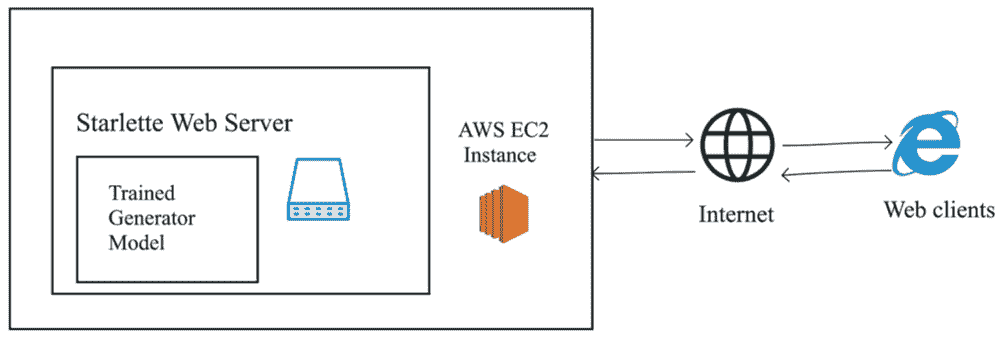

## 自然语言与图像的关联性

我们使用编码器模型来表示细粒度的视觉描述。细粒度视觉描述表示了我们对描述图像特定部分的标题单词的建模能力。标题文本的每个部分都包含关于图像某些部分的信息，这就是为什么在构建生成器和判别器模型之前，对其进行建模至关重要。基于文本的 `CNN` 与标准的基于图像的 `CNN` 非常相似。区别在于图像宽度为 1 像素（对于字符），通道宽度是唯一字符的数量（英语为 26 个）。随后是一个时间步最大池化层和一个 `RELU` 激活层。文本输入具有时间依赖性特征，`CNN` 模型并不总是能捕捉到这些特征。为了解决这个问题，网络的隐藏层使用 `CNN` 构建，顶层设计为 `RNN` 以捕捉文本数据中的时间结构。该架构如图 5 所示。

### 图 5. Char-CNN-RNN 编码器

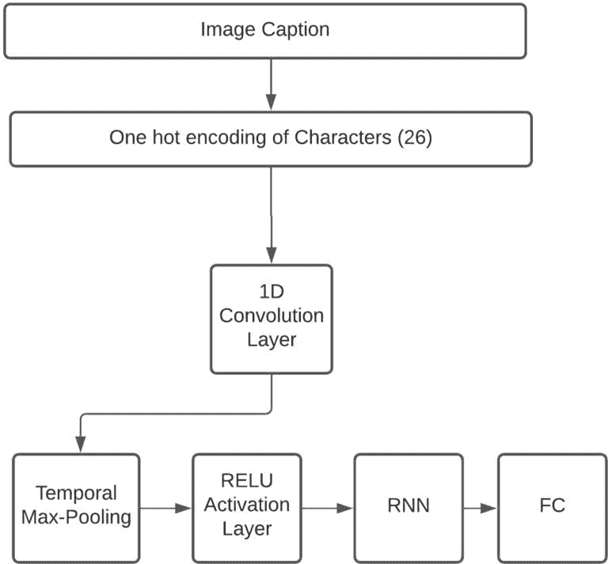

## 客户端实现

### Starlette

我们实现了 `Starlette` 框架来加载保存的模型并将模型的输出渲染给用户。`Starlette` 非常有用，因为它处理的是同步服务。我们开发了一个 Web 应用来部署 `GAN` 模型并为生成图像请求提供服务。我们通过利用深度学习模型的能力并抽象模型本身，使用户在浏览器中访问模型。

### HTML, CSS 和 Bootstrap

HTML Web 页面包含一个文本框，用于获取用户输入的文本描述。点击提交按钮时，用户的输入被发送到 `GAN` 模型以生成图像。图像列表将作为结果显示给用户。层叠样式表（CSS）用于样式化网页，通过提供表单颜色并设置字体、文本框等的大小；实现了 Bootstrap 框架以使网页具有响应式，并使网页与现有模板保持一致。

## 中端实现

### PyTorch


整个 `GAN` 模型是用 `PyTorch` 开发的。这个开源包提供了各种实用程序来加速代码开发，并提供了细粒度的模型实现功能 API。我们利用了 `transforms` 等库进行图像变换，利用 `auto grad` 进行自动微分，利用 `nn` 创建神经网络，利用 `optim` 对模型训练进行优化。

### Shell 脚本

我们为模型训练和评估都开发了 Shell 脚本。这些脚本是代码调用的入口。它们还支持向主 `python` 文件传递程序参数。训练和评估期间的一些模型超参数定义在各自的 `YAML` 文件中。脚本还负责设置必要的系统 `path` 变量。例如，`CUDA_VISIBLE_DEVICES` 需要包含可用 `GPU` 设备索引列表。这些索引将由 `CUDA` 驱动引用。

### 模型训练与目标函数

模型训练从 Shell 脚本启动。模型在单台 Nvidia Tesla V100 机器上训练。`GAN` 的目标函数通常是生成器和判别器之间的极小博弈。然而，这里的不同之处在于它不是原始 `GAN`，而是以标题为条件的 `GAN`。使用 `AttnGAN` 作为基准模型。`AttnGAN` 在 CUB 等条件-GAN 数据集上取得了显著结果。公式 (1) 是模型的总目标函数 (Hinz et al., 2018)）。


## 实现

我们使用预训练的编码器模型来处理此任务。预训练模型在 CUB-200 和 Oxford Flower 数据集上进行训练。该模型是一个 `Char-CNN-RNN` 编码器模型，这就是为什么它能捕捉文本与图像之间依赖关系的细粒度细节。预训练模型训练了 100 个 epoch，之后模型的准确率没有显著提高。

### 生成器网络

| 图 6. 生成器类图 |
| --- |
| 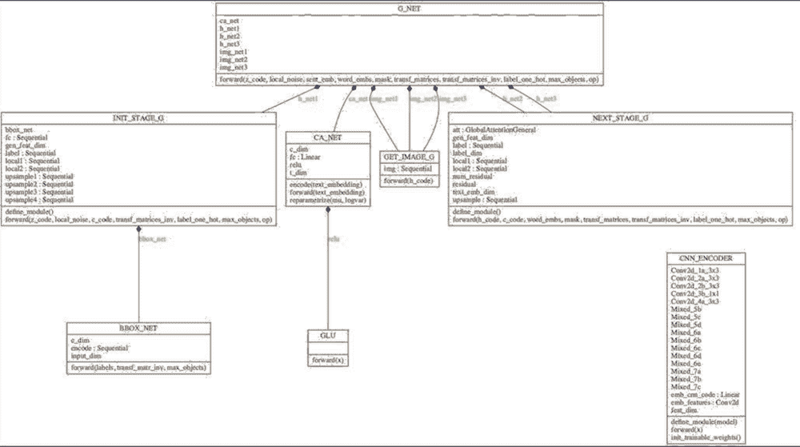 |

生成器模型使用多个 Python 类构建。图 6 显示了类级别的关系。`G_NET` 类是生成器的主类。它包含几个属性，如 `CA_NET`、`h_net1`、`h_net2` 和 `h_net3`。`CA_NET` 是注意力网络（Attention Network）。`H_net1` 是 `INIT_STAGE_G` 类的对象，其第一层是一个边界框网络（bounding box net）。它还包含了若干个后续的上采样层。`NEXT_STAGE_G` 类用于 `h_net2` 和 `h_net3` 对象。我们还使用了门控线性单元（GLU）作为 `CA_NET` 中的激活层之一，以便选择性地训练模型对数据的哪些部分给予关注。

全局和特定对象路径（Global and Object Specific Pathway）的实现与文献（Hinz, et al., 2018]）相似。

### 判别器网络

| 图 7. 判别器类图 |
| --- |
| 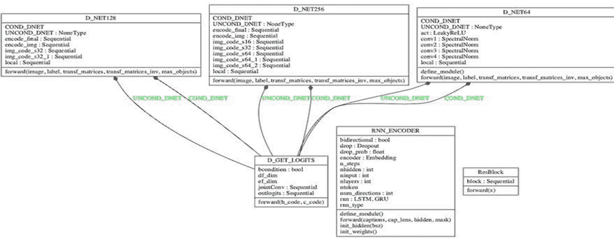 |

与生成器一样，判别器也是使用一组 Python 类实现的。图 7 显示了判别器的类图。主类是 `D_GET_LOGITS`，它包含了 `COND_DNET` 和 `UNCOND_DNET` 等对象。这些对象的类型分别为 `D_NET64` (64x64)、`D_NET128` (128x128) 和 `D_NET256` (256x256)。`D_NET128` 和 `D_NET_256` 复用了 `D_NET64` 的类属性。在 `D_NET64` 类中，我们根据原始实现对判别器网络进行了调整。谱归一化（Spectral normalization）是一种权重归一化，适用于批量归一化对模型性能帮助不大的情况。另一个原因是使用 GPU 训练时，由于显存内存较低，我们往往被迫使用较小的批大小（batch size）。训练中较小的批大小会导致梯度下降产生随机移动，并需要更长时间收敛。因此，2D 批量归一化层被谱归一化取代。判别器的全局和特定对象路径的实现与文献（Hinz, et al., 2018]）相似。

### 模型训练

模型在 Paperspace (https://www.paperspace.com/) 云服务商处训练。我们配置了一台 Nvidia Tesla V100 类型的机器。我们还使用了 100GB 的 SSD 硬盘来存储 MS-COCO 数据集。SSD 硬盘有助于提升 I/O 。我们禁用了原始实现中的优化数据加载标记，以保持每次训练迭代的静态批大小。图 8 显示了来自 Paperspace 的机器快照。

| 图 8. Paperspace NVIDIA Tesla V100 实例 |
| --- |
|  |

### 模型实验

#### 使用 MLflow 进行机器学习

我们使用 `MLflow` 来方便管理整个机器学习项目的生命周期。根据 MLflow 官方网站，它是一个用于机器学习生命周期管理的开源平台。它提供了四个组件：MLflow 跟踪（tracking）、项目（projects）、模型（models）和注册表（registry）。我们利用 MLflow 的跟踪组件来记录/日志 GAN 模型的生成器损失和判别器损失。我们创建了一个脚本，用于对模型所需的参数（批大小、轮数等）进行自动记录。此外，我们还跟踪了生成器和判别器网络的损失等指标。图 9、10 和 11 显示了 MLflow 的各种截图。

| 图 9. Mlflow 实验落地页 |
| --- |
| 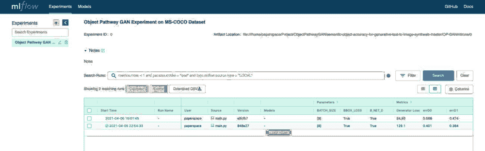 |

| 图 10. 实验参数 |
| --- |
| 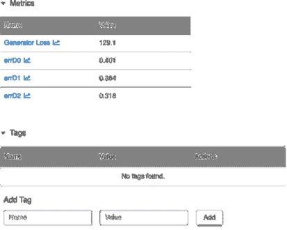 |

| 图 11. 生成器损失可视化 |
| --- |
| 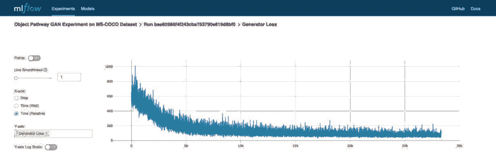 |

#### 性能与基准

**Inception Score (IS) 和 Fréchet 距离 (FID)**

对于评估，我们使用了 Inception 分数 (IS) 和 Fréchet 距离 (FID)。IS 衡量生成图像的质量和多样性，而 FID 衡量真实图像与生成图像分布之间的距离。FID 分数越低表示生成的图像与真实图像越相似。

### 部署

为了在网络上部署我们的模型，我们使用了 `Starlette` ASGI Web 框架。当用户点击“生成图像”时，我们的模型将使用训练好的 `GAN` 模型来处理请求。这一生成图像的过程通过将文本输入通过文本编码器来实现。该文本编码器会提取语义特征。我们模型的保存权重被用于处理用户请求，并根据这些权重以及描述图像的文本语义来生成图像。下方的图 12 展示了部署架构。

| 图 12. 部署架构 |
| --- |
| 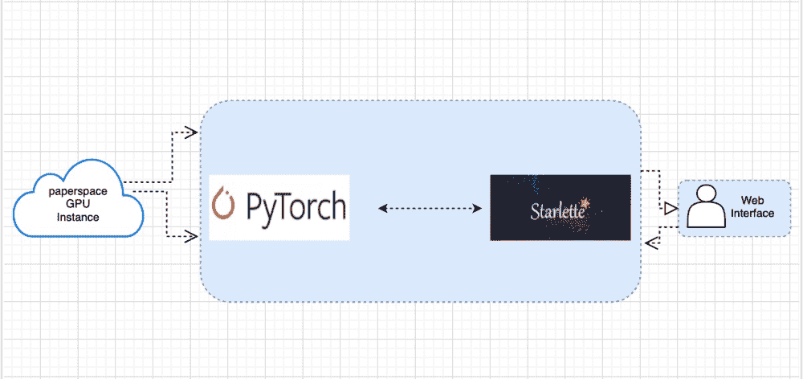 |

## 结论

生成式深度学习领域非常广阔且不断扩展。本章对各个方面提供了聚焦且全面的视角，包括用于用于从自然语言描述中创建合成图像的生成式深度学习部署。我们使用多个相关的评估指标对我们的工作进行了评估。该任务具有巨大的潜力且仍在不断演变。根据我们的评估，目前用于生成图像的文本描述受限于其长度和范围。随着未来在海量数据集上训练的更强大的模型出现，未来的一个方向可以是从更长的文本生成更广泛的图像。这种可能性开启了大量的应用，例如为儿童故事插画、从剧本生成动画电影以及在研究手稿中添加图表。像 `Microsoft Word` 等编辑软件可能会作为增值服务提供这些功能，类似于设计想法整合到 `Microsoft powerpoint` 中一样。

## 致谢

作者感谢 Sivaranjani Kumar、Akshaya Nagarajan 和 Pooja Patil 对此项目做出的贡献。

本研究未收到来自公共、商业或非营利部门任何资助机构的特定资助，但得到了圣何塞州立大学的支持。

## 参考文献

Agnese, J., Herrera, J., Tao, H., & Zhu, X. (2020). A survey and taxonomy of adversarial neural networks for text-to-image synthesis. Wiley Interdisciplinary Reviews. Data Mining and Knowledge Discovery , 10(4), e1345. doi:10.1002/widm.1345

Borji, A. (2019). Pros and cons of gan evaluation measures. Computer Vision and Image Understanding , 179, 41–65. doi:10.1016/j.cviu.2018.10.009

Borji, A. (2022). Pros and cons of GAN evaluation measures: New developments. Computer Vision and Image Understanding , 215, 103329. doi:10.1016/j.cviu.2021.103329

GalatoloF.CiminoM.VagliniG. (2021) Generating Images from Caption and Vice Versa via CLIP-Guided Generative Latent Space Search. International Conference on Image Processing and Vision Engineering. 10.5220/0010503701660174

Heusel, M., Ramsauer, H., Unterthiner, T., Nessler, B., & Hochreiter, S. (2017). Gans trained by a two time-scale update rule converge to a local nash equilibrium. Advances in Neural Information Processing Systems , 30.

HinzT.HeinrichS.WermterS. (2018, September). Generating Multiple Objects at Spatially Distinct Locations. International Conference on Learning Representations.

Hinz, T., Heinrich, S., & Wermter, S. (2020). Semantic object accuracy for generative text-to-image synthesis. IEEE Transactions on Pattern Analysis and Machine Intelligence .

KarrasT.LaineS.AittalaM.HellstenJ.LehtinenJ.AilaT. (2020). Analyzing and improving the image quality of stylegan. In Proceedings of the IEEE/CVF conference on computer vision and pattern recognition (pp. 8110-8119). 10.1109/CVPR42600.2020.00813

LinT. Y.MaireM.BelongieS.HaysJ.PeronaP.RamananD.ZitnickC. L. (2014, September). Microsoft coco: Common objects in context. In European conference on computer vision (pp. 740-755). Springer.

Liu, X., Gong, C., Wu, L., Zhang, S., Su, H., & Liu, Q. (2021). Fusedream: Training-free text-to-image generation with improved clip+ gan space optimization. arXiv preprint arXiv:2112.01573.

RadfordA.KimJ. W.HallacyC.RameshA.GohG.AgarwalS.SutskeverI. (2021, July). Learning transferable visual models from natural language supervision. In International Conference on Machine Learning (pp. 8748-8763). PMLR.

RameshA.PavlovM.GohG.GrayS.VossC.RadfordA.SutskeverI. (2021, July). Zero-shot text-to-image generation. In International Conference on Machine Learning (pp. 8821-8831). PMLR.

Reed, S., Akata, Z., Yan, X., Logeswaran, L., Schiele, B., & Lee, H. (2016). Generative adversarial text to image synthesis. International conference on machine learning (pp. 1060–1069). Academic Press.

Salimans, T., Goodfellow, I., Zaremba, W., Cheung, V., Radford, A., & Chen, X. (2016). Improved techniques for training gans. Advances in Neural Information Processing Systems , 29.

Smith, A., & Colton, S. (2021). Clip-guided gan image generation: An artistic exploration. Evo , 2021, 17.

Wah, C., Branson, S., Welinder, P., Perona, P., & Belongie, S. (2011). The Caltech-UCSD Birds-200-2011 dataset. Academic Press.

XuT.ZhangP.HuangQ.ZhangH.GanZ.HuangX.HeX. (2018). Attngan: Fine-grained text to image generation.

---

如今的世界充斥着数字图像；然而，大多数时候其上下文是不可用的。因此，图像描述（image captioning）对于提供图像内容至关重要。除了生成准确的描述外，图像描述模型还必须具有扩展性。在本章中，长短期记忆网络（`LSTM`）的两种变体——即 `stacked LSTM` 和 `BiLSTM`，结合卷积神经网络（`CNN`），被用于实现生成描述的 `Encoder-Decoder`（编码器-解码器）模型。双语评估辅助（BLEU）得分指标被用于评估这两个双层模型的性能。研究观察到，这两个模型在性能上不上下。某些模型得到的 `BLEU` 分较低，表明预测的描述与实际描述不相似；而某些非常高的 `BLEU` 分则表明模型能够预测出与人类相似的描述。此外，发现由于其架构复杂，双向 `LSTM` 模型比 `stacked LSTM` 模型更具计算密集性，且需要更长时间进行训练。

## 引言

人工智能是计算机科学的一个领域，旨在赋予计算机模拟人类智能的能力，目前正被大量用于构建强大且高度智能的机器。如今，机器学习在人工智能领域已非常流行；并经常与“人工智能”一词交替使用。机器学习中最研究的子领域之一是深度学习，它提供的结果具有很高的准确性，因此其输出性能也很高。人工智能可以应用的一个工作领域就是图像描述。能够探索更多如图像识别或目标检测等感知任务的想法，使研究人员能够承担远比图像识别更复杂的任务（Ivašić-Kos et al., 2019）。图像描说对社会产生了巨大的积极影响，例如，它可以帮助视觉障碍人士在没有任何外部支持的情况下，理解互联网上提供的不同类型的图像数据。图像描述涉及从图像中提取重要内容，并以有意义的单词序列的形式表示出来。图像描述背后的核心思想是从给定的输入图像识别并分析对象、它们之间的关系以及对象执行的操作（Hossain et al., 2019）。简单来说，利用深度学习和自然语言句子自动描述图像内容的过程被称为图像描述。这种技术用于将图像（即像素序列）转换为单词序列。这可以被视为一个端到端和序列到序列（`seq2seq`）问题。本章作者目的是构建一个能够准确且快速地为呈现的任何图像提供描述的模型。


为了实现构建可持续的图像描述软件的目标，将实现深度学习的概念。深度学习作为一个快速增长和受研究的领域，正逐渐渗透到我们的日常生活中。它涉及使用稳健、高性能、优质且最新的硬件来运行 `ANN`（人工神经网络）。深度学习促进了神经网络的发展、训练和应用，同时将这些所需的时间限制降至最低。其中一种神经网络是卷积神经网络（`CNN`）。卷积神经网络的设计初目的是将输入图像数据映射到输出变量。`CNNs` 已被证明在这些应用中非常有效，因此它们被广泛用于涉及以图像作为输入的各种预测问题。长短期记忆模型（`LSTM`）是另一种此类神经网络。作为循环神经网络的一种变体，它经常用于涉及图像的问题。它是一种独特的网络，具有学习数据内部长期依赖关系的能力。

本章的主要目标是设计一种神经网络，在训练后能够识别真实以及合成图像。它应该能够在几秒钟内为给定图像生成最准确的描述。通过结合 `CNN` 和 `LSTM` 模型的优点，其目标是开发一种新型的图像描述模型。

## 背景

图像的复杂性差异很大，从用一个单词描述到需要多个短语来描述单张图像。本章作者对全球范围内开展的相关研究进行了详细分析，以理解 `ML`（机器学习）和 `DL`（深度学习）在类似应用中使用的不同模型。下表包含了该领域某些现有工作的总结：

### 表 1 现有图像描述模型文献综述

| 作者/年份 | 标题 | 贡献 | 缺点 |
| --- | --- | --- | --- |
| Imtinan Azhar, Imad Afyouni, Ashraf Elnagar (2021) | 用于图像描述的促进深度学习模型 | 促进性深度学习模型相比非促进性深度学习模型提供了更优的性能；促进方法使作者能够在分配职责的同时消除了单点故障。 | 作者在本文中提出的促进性深度学习模型未能为基础生成器提供高质量的描述。 |
| Jyoti Aneja, Aditya Deshpande, Alexander G. Schwing (2018) | 卷积图像描述 | 作者开发的这种模型与 `LSTM` 基准相比，运行速度更快，且在不影响性能的情况下每个参数的训练时间更短。 | 在许多情况下，生成的描述在语义上是不连贯的，因为模型更多关注人、自行车、桌子等重要物体，而较少关注与图像内容无关的词如 a、of、an 等。 |
| Nikhil Patwari, Dinesh Naik (2021) | En-De-Cap：用于图像描述的编码器解码器模型 | 门控循环单元 `GRU` 与 `LSTM` 相比架构更简单，更容易训练；提出的模型中的注意力机制有助于提高模型的准确性。 | 使用 `LSTM` 模型框架的 `BLEU` - 2,4 分更高。 |
| Jieh-Ren Chang, Tsung-Ta Ling, Ting-Chun Li (2020) | 不同编码器的图像描述研究 | 提出的模型从人类角度来看描述更好，并具有更高的 `R-BLEU` 分。 | 由于 `Seq2Seq` 模型将所有输入放入固定长度的语义向量，长句的准确性会下降。 |
| Prashant Giridhar Shambharkar, Priyanka Kumari, Pratik Yadav, Rajat Kumar (2021) | 使用束搜索和无监督图像描述算法分析生成图像描述 | 本文对 `Argmax` 和束搜索方法的使用进行了对比分析；使用无监督算法设计的模型准确率提升至 28.9%。 | 需要更大的数据集批次大小来提高准确性和内存效率。 |
| Jacob Devlin, Saurabh Gupta, Ross Girshick, Margaret Mitchell, C. Lawrence Zitnick (2015) | 探索图像描述的最近邻方法 | 作者利用最近邻方法，为相似图像提供了高性能模型。 | 不适用于高度不相似的图像。还需要进一步测试以确定最近邻方法在图像描述中的整体有效性。 |

### 文献综述

- `Md. Zakir Hossain, Ferdous Sohel, Md. Fairuz Shiratuddin, Hamid Laga, Mohammed Bennamoun` (2021) | `用于改进图像描述的文本到图像合成` | 这篇文章表明，模型中真实图像与合成图像的有助于与其他方法相比提升性能；合成图像增加了任何图像描述模型的有效性。图像合成可以从文本进行，而不能从真实图像进行。
- `Jacob Devlin, Hao Cheng, Hao Fang, Saurabh Gupta, Li Deng, Xiaodong He, Geoffrey Zweig, Margaret Mitchell` (2015) | `图像描述的语言模型：特性与有效之处` | `RNN` 语言模型比 `ME`（最大熵）模型具有更好的 BLEU 性能；在人类质量判断方面，`ME` 语言模型显著优于 `MRNN`。BLEU 分数的提高并不等同于人类质量判断的提升。

# 图像描述概述

图像描述算法主要可以分为两类：一种基于模板的方法，而另一种依赖于编码器-解码器结构（Wang et al., 2021）。作为对现有工作调查的一部分，本文识别了该领域一些常用的模型，即 `用于图像描述的编码器解码器模型`、`使用束搜索方法的图像描述`、`无监督图像描述算法` 以及 `使用最近邻方法的图像描述`。

## 编码器解码器模型

在 `用于图像描述的编码器解码器模型` 中，采用的方法是通过 `CNN` 网络对图像进行描述。基于注意力的门控循环单元 (`GRU`) 的集成有助于为给定图像生成更好生动的文本。然而，该模型被发现存在局限性。为了避免计算密集型过程，模型仅在一个数据集上进行训练。使用 `LSTM` 模型的框架获得的 `BLEU` - 2,4 分仍然更高（[Patwari et al., 2021]）。某些模型使用统计语言模型作为解码器，它将描述生成问题转换为优化问题，并通过寻找针对相同序列的最优序列来解决它（Wang et al., 2020）。

## 束搜索技术

`使用束搜索和分析的图像描述` 技术在模型的构建阶段涉及监督和无监督学习技术的使用。为了开发本章讨论的模型，使用了预训练模型进行特征提取。这些模型的输出被馈到 `RNN/LSTM` 作为输入向量模型，以生成最终描述（Shambharkar et al., 2021）。然而，需要更大的数据集批大小来提高准确性和内存效率。

## 最近邻方法

在 `使用最近邻方法的图像描述` 中，给定输入图像的描述是通过找到代表从最近邻图像获取的候选集折叠的最合适描述来生成的。然而，它不适用于差异性极大的图像。要确定该模型中使用最近邻方法进行图像描述的整体有效性，还需要进一步测试（Devlin et al., 2015）。

## 提出的框架

本章结构安排如下：首先介绍了基于 `CNN – LSTM` 的描述模型，随后详细介绍了不同的预处理步骤以及每一步的必要贡献、相关数据集等。随后是对该模型、其结果以及未来研究方向的演示和可视化。

## 提出的模型

前一节对前提提供了更清晰的理解，并有助于选择适合目的且效率更高、开销更低的模型。

提出了一种基于编码器-解码器框架的混合模型，它结合了 `CNN` 层（用于输入的的特征提取）和 `LSTM`（一种支持序列预测的 `RNN`）。还将对不同变体的 `LSTM`（即 `Stacked LSTM` 和 `Bi-LSTM`）进行评估。

所提系统由两个主要模型组成，如下：

### I. 卷积神经网络 (CNN)

该模型用于执行自动特征提取。它可以在没有任何人工监督的情况下自主检测显着特征。特征提取涉及将原始数据转换为数值特征，同时保留原始数据中的可用信息。将使用预训练的 `VGG16` 模型（排除外层，因为该模型不用于对象分类，仅用于特征提取）来开发模型。

### II. 长短期记忆 (LSTM)

它是一种用于解决序列预测问题的人工循环神经网络 (`RNN`) 模型。它具有存储之前信息的能力。考虑到一项新任务，`LSTMs` 需要更精细的工程设计（Aneja et al., 2018）。在使用 `ReLU`（修正线性激活函数）激活后，将使用两种不同的 `LSTM` 变体进行描述预测。将使用的两种不同 `LSTM` 模型是 `Stacked LSTM` 和 `双向 LSTM` (`Bi-LSTM`)。

图像描述过程属于自然语言处理（NLP）和计算机视觉领域。简单来说，它只是将输入图像转换为相应的输出描述文本的过程。该领域最流行的方法是编码器-解码器（Encoder-Decoder）框架。用于特征提取的卷积神经网络（CNN）可以被看作编码器。连接在 CNN 最后一层、用于建模和序列预测的循环神经网络（RNN）可以被看作解码器。在编码器-解码器框架中，编码器理应负责将图像中存在的信息转换为某种中间表示，而解码器则负责将该中间表示转换为输出文本序列（Hossain et al., 2021）。

### I. 使用 CNN 进行特征提取

随着数据规模的不断增大，在数据集中遇到数百个特征是常见现象。当数据集中的特征数量等于或大于数据库中存储的识别数量时，机器学习模型就会出现过拟合。这可以通过两种不同的方法避免，即通过正则化和降维（或特征提取）从原始数据中获取可处理的数值特征。特征提取相比正则化具有一些优点，如下：

* 提高准确性
* 减少过拟合
* 提高训练速度
* 提高数据可视化效果
* 提高模型的解释性

根据数据类型、需要提取的特征以及要开发的数据模型，可以使用不同的技术进行特征提取。一些流行的技术包括 `ICA`（独立成分分析）、`PCA`（主成分分析）、`LDA`（线性判别分析）、`LLE`（局部线性嵌入）等。

特征提取可以通过手动或自动两种实现。手动提取需要识别并定义特定问题的相关特征，并使用方法移除这些特征。在大多数情况下，需要对背景有清晰的理解才能对哪些因素最相关做出决策。自动特征提取使用特殊算法或深度神经网络在没有任何人工干预的情况下从信号或图像中自动提取特征。这对于从原始数据构建机器学习算法非常有用。

图像数据的特征提取是将图像的部分识别为紧凑的特征向量，以代表图像中相关且有意义的部分。如今，与过去使用的专门检测、提取和匹配算法相比，深度学习在图像和视频分析中非常流行。

### 卷积神经网络

也称为 `ConvNet` 或 `CNN`，它是用于具有网格结构数据（即图像等结构化数组）的深度神经网络变体。数字图像被表示为像素值数组，这使得 `CNN` 适用于处理图像。`CNN` 是一种多层前馈神经网络，具有顺序设计，以学习层次属性。它包含三个主要层：

* 卷积层 – 该层用于执行两个矩阵之间的点积，分别代表可学习参数集和感受野的限制部分。它承载了神经网络的大部分计算负载。
* 池化层 – 该层负责用附近输出的统计摘要来替换网络的输出。它有助于减少整个表示的空间尺寸，并随之降低计算复杂性。
* 全连接层 – 该层映射输入和输出之间的完整表示。

#### 图 2. 卷积神经网络

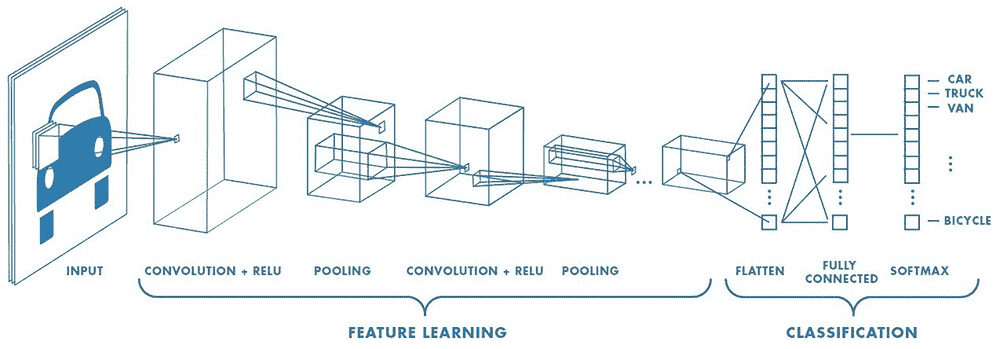

*数据来源: Towards Data Science, 2018*

使用 `CNN` 的优点如下：

* 它不需要人工干预。
* 通过无缝特征提取实现了极高的准确率。
* 它执行权重共享。

由于所有这些原因，它在许多领域找到了各种应用。它被用于各个行业的目标检测领域，如人脸检测、自动驾驶汽车等。最近也被应用于语义分割应用和图像描述模型。

### II. 使用 LSTM 进行序列预测

序列预测是机器学习中一种著名的方法，涉及根据之前看到的符号序列来预测后续符号，这些符号可以是数字、字母、名称、事件、单词等。它与监督学习任务不同，并应用于各种行业和现实应用中。

基于视觉内容自动生成自然语言描述吸引了人工智能领域的许多研究人员。这是具有挑战性的，因为它结合了计算机辅助可视化和自然语言处理，其中涉及目标检测、物体与图像的关系以及为了生成描述性文本的语法研究。`LSTM` 是序列预测中最流行的模型。

长短期记忆网络或简称 `LSTM` 是循环神经网络架构的高级版本——它是一种人工 `RNN`，设计用于按时间顺序排列的序列进行建模，并比传统的 `RNNs` 更好地处理长程依赖关系。循环神经网络应用于 NLP 任务，如建模和文本生成问题、创建翻译机器、语音识别问题等。`RNN` 是一种神经网络，其中上一步的输出用作当前步骤的输入。使用循环神经网络的优点是：

* 它适合时间序列预测，因为它能随时间保留信息。
* 与卷积层一起使用时，它可以提供高效的像素邻域。

`LSTMs` 与传统的前馈神经网络不同，它们具有反馈连接。它们能够处理单个数据点（如图像）以及连续的数据数组（音频、视频等）。`LSTMs` 专门设计用于解决 NLP 任务中出现长程依赖问题。所有的循环神经网络都有相似的架构，模式为一系列重复的神经网络模块（通常是四个神经网络）。标准的 `RNNs` 具有简单的结构重复模块，例如单个 `tanh` 层。`LSTMs` 与所有其他 `RNN` 一样也有这种链式结构，但重复模块的结构比标准重复模块复杂得多。`LSTMs` 的基础是它们的单元状态（cell state）。它工作起来更像传送带，直接穿过整个链，且线性交互最少。信息可以很容易地流动而不被改变。`LSTM` 可以向单元状态中添加或删除信息，这种操作由称为“门”的结构调节。门是让信息通过单元的可选方式。它们由一个 sigmoid 神经网络层和一个逐点乘法操作组成。

#### 图 3. 长短期记忆 (LSTM)

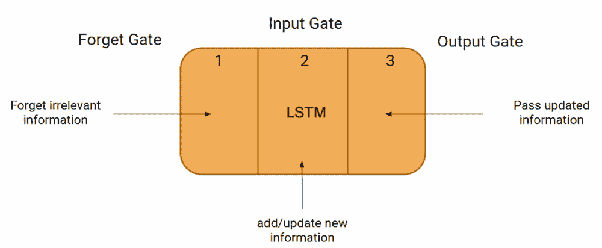

*数据来源: Analytics Vidhya, 2021*

使用 `LSTM` 的优点如下：

* 能够发现、理解和建模长程序列依赖。
* 在短记忆问题上，它们比原生的 `RNNs` 更强大。
* 它们可以弥补时间序列中未知持续时间的间隔，因此非常适用于基于时间序列的分类、处理和预测。
* 它们拥有大量的参数，包括偏置（输入和输出）、学习率等。因此，不需要进行微调。
* 它们对噪声、分布式表示以及长延迟（时间滞后）问题中的连续值具有容忍性。

`LSTM` 有三个主要部分：输入门、输出门和遗忘门。值在任意时间间隔内被收集，单元内部的数据流入和流出由这三个门分别进行调节。输入门添加或更新新信息；遗忘门忘记无关和过时的信息，而输出门则用于传递更新后的信息。

在现代世界，`LSTMs` 被应用于许多不同的领域。从机器人控制、时间序列预测、语音识别到手写识别、手语翻译、市场预测甚至机场乘客管理。

单变量 `LSTM` 有不同的变体。下一节将讨论其中一些模型：

* `Vanilla LSTM` – 这是最简单的单变量 `LSTM` 模型。每个变量都有一个特征，该模型由一个由 `LSTM` 单元组成的隐藏层和一个输出层组成。隐藏层具有进行预测的功能。
* `Stacked LSTM` – 另一种单变量 `LSTM` 模型，它具有多个堆叠在一起的 `LSTM` 隐藏层。由于 `LSTMs` 需要三维输入，通过从上一个 `LSTM` 层的返回序列中添加一层时间步数据，将之前的二维输出转换为三维。
* `Bidirectional LSTM` – 另一种单变量 `LSTM` 模型，它允许模型在正向和反向两个方向上进行学习。它涉及网络中的第一层进行复制，因此有两个相同的层并行。输入按顺序馈。原始输入序列提供给第一层，并将相同序列的反转副本作为输入给第二层。
* `CNN LSTM` – 这是一种混合单变量 `LSTM` 模型，它在数据作为输入提供 `LSTM` 层之前，使用 `CNN` 来解释子序列。
* `ConvLSTM` – 这是 `CNN LSTM` 模型的先进版本，它由从指向 `LSTM` 模型的输入获得的卷积读取组成。

此外，还有不同的多变量模型变体，例如多输入和多并行模型，以及不同类型的多步模型，如 `encoder-decoder` 和向量输出模型。这两种模型的混合还导致了“多输入多步输出”和“多并行输入多步输出”等模型。

## 模型详细说明

#### 图 4. 表示标题生成完整模型的详细流程图

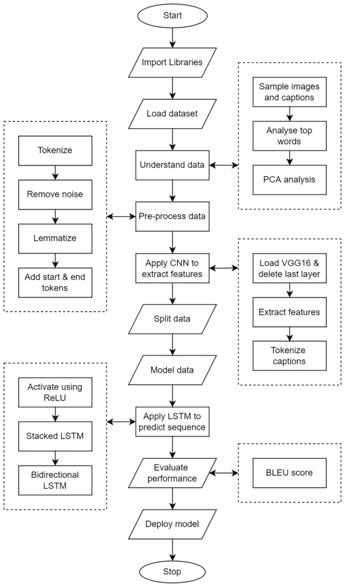

系统的不同组件描述如下：

- **I. 导入库** – 使用了一些基础库，如 `numpy`、`pandas`、`matplotlib`、`tensorflow`、`keras`、`sys`、`time`、`os`、`warnings`、`copy` 用于导入数据集、可视化等基本功能。此外，还导入了 `sklearn`、`collections`、`PIL`、`nltk` 等库。使用了一些如 `load` 的类。


- `.....` ` ` ` ` ` ``` ` ` ` ` ` ```` the `..`
- `ConvLSTM` – 这是 `CNN LSTM` 模型的先进版本，它由从指向 `LSTM` 模型的输入获得的卷积读取组成。

## II. 加载数据集

`.jpg` 和 `.txt` 是................................................................... caption.

| --- |
| --- |
|  |
| --- |

## III. 理解数据

这是探索性阶段，其中。 by the.

| Figure 5. 使用 8K 的样本数据 |
| --- |
|  |
| --- |
| Figure 6. 显示使用的的二十个单词的柱状图 |
| --- |
| 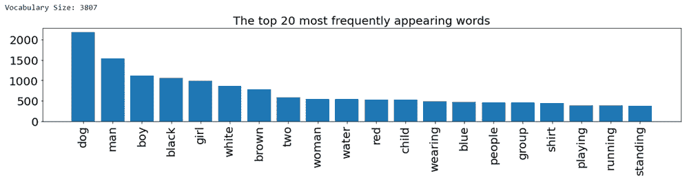 |
| --- |
| Figure 7. 使用 PCA 分析来自 8K 的相似图像 |
| --- |
| 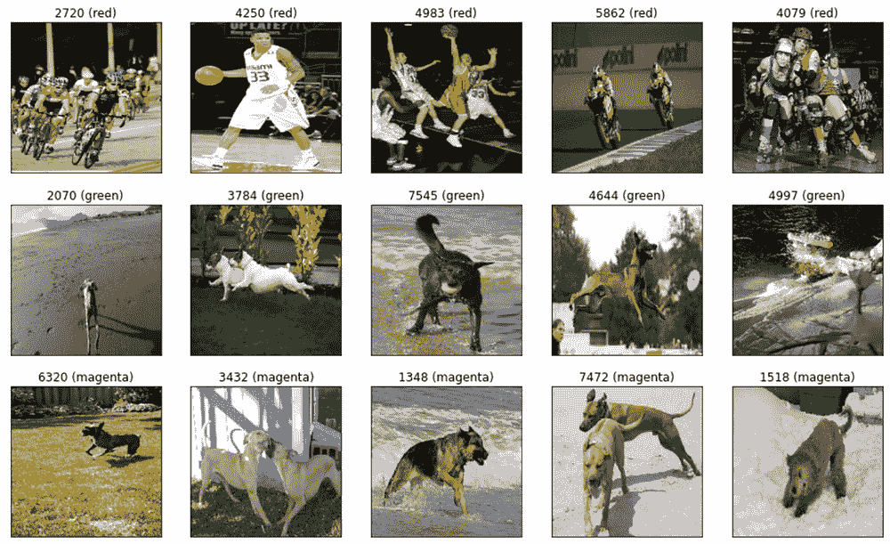 |
| --- |

### 主成分分析 (PCA)

它是一种正交变换技术，用于从一组相关变量中获得线性不相关的变量（从高维到低维）。它是一种无监督工具，有许多应用，包括数据探索和预测分析。

PCA 在日常生活中有很多应用，例如电影推荐系统、图像处理等。它也被用于金融、数据挖掘、心理学等领域。

主成分是作为 PCA 输出的新特征，尽可能保留了数据。组件的某些属性如下：

- 它们是实际特征的线性组合。
- 它们之间相互垂直。
- 组件的重要性从 1 到 n 递减。

PCA 可以通过聚类来可视化高维数据。通过绘制 `PC1` 和 `PC2` 评分来寻找簇。使用 PCA 的优势如下：

- 它通过消除多重共线性（即移除相关的特征）提高了时间效率。
- 由于特征数量的减少，它提升了机器学习模型的效率。
- 它通过移除数据集中不必要的特征来消除过拟合。

## IV. 预处理数据

数据预处理是任何机器学习或自然语言处理应用的第一步。这包括一组清洗数据并使其准备好输入模型的方法。数据预处理中包含的不同步骤如下：

- **分词 (Tokenize)**：这是将文本分为更短且更有意义的文本实体的技术，称为标记（tokens）。标记可以是单词、子词、短语、句子。
- **转换为小写 (Convert to lower case)**：将整个文本转换为小写以简化文本处理，因为计算机对大和小写文本解释方式不同。
- **移除标点 (Remove punctuations)**：从任何文本中移除标点以提高效率，因为标点的出现频率非常高。
- **移除包含数字的标记**：数字与单词的组合会增加系统处理文本的难度。因此，会移除任何标记中不必要的数字或与字母组合的数字以清洗数据。
- **移除停用词**：任何文本中最常用的、不带显著意义的单词被称为停用词。因此，像 `a`、`an`、`the` 等单词会被移除。
- **词干提取（Stemming）**：这是一种通过移除单词添加的前缀和后缀将单词还原为词根的技术。
- **词化（Lemmatize）**：这是将单词解析为其词形（lemma），即与语言字典匹配的单词根形式的过程。
- **移除多余空格**：移除文本开头或结尾的额外空格以及文本中间的多余空格，以降低空间复杂度。

接下来是添加开始和结束序列标记。由于这是一个编码器-解码器模型，作者使用了序列结束标记（`EOS`），需要终止以完成编码器的嵌入。同样，解码器需要序列开始标记（`SOS`）以便在输出任何输入之前开始处理。

## V. 应用 CNN 提取特征

如前所述，`CNN` 或卷积神经网络已用于特征提取。卷积神经网络是一种专门用于处理具有网格结构数据的深度神经网络，例如图像等结构化数组。本文使用了 `VGG16` 预训练网络。

### VGG 16

`VGG16` 是一种广泛使用的卷积神经网络（`CNN`）架构。它用于 `ImageNet`，这是一个目标识别领域的大型视觉数据库项目。它在 `ImageNet` 上实现了 92.7% 的 top-5 测试准确率。`ImageNet` 数据集包含超过 1400 万张属于 1000 个不同类的图像。它应用于各种基于深度学习的分类算法，特别是在图像处理领域。由于其易于实现而被广泛使用。使用 `VGG16` 的优势如下：

- 它在特定任务的基准测试中具有非常好的架构。
- 它很容易获取，因为这是一个预训练的 `CNN` 模型。

`VGG-16` 模型输出 4096 个特征，输入图像的大小为 `224*224` 像素。

标题使用 `tokenizer` 库进行标记化，以便后续处理。

## VI. 划分数据

根据 80:20 划分的帕累托法则，将整个数据集分为训练集和测试集。

## VII. 模型数据

标题和图像按照模型输入所需的形状进行处理。标题被填充到具有相同的长度，并根据所需的形状创建可迭代项的元组。

## VIII. 应用 LSTM 预测序列

如前所述，`RNN` 已以 `LSTM`（长短期记忆网络）的形式用于序列预测。

### 激活函数

该函数根据神经元的权重（`weight`）和偏置（`bias`）决定神经元是否应该被激活。激活函数使得反向传播在神经网络中成为可能。任何没有激活函数的神经网络在本质上都将变成一个线性回归函数。使用的一些常用激活函数包括：

- **线性函数**：这是一个具有激活范围的直线函数。激活函数与输入成正比，并取自神经元的加权和。
- **Sigmoid 函数**：当输入实数时，该函数的输出位于 0 和 1 之间。`Sigmoid` 函数绘制出 S 型图形，且该函数是非线性的、连续可微且单调的。这适用于分类器。
- **Tanh 函数**：当输入实数时，输出位于 `[-1, 1]` 范围内。也称为双曲正切函数，是一种梯度比 sigmoid 函数更强的非线性函数。
- **ReLU 函数**：修正线性单元（Rectified Linear Units）对于函数变量 `z` 有一个简单的函数 `max(0,z)`。这是一个分段线性函数，并且不会同时激活所有神经元。这解决了梯度消失问题。与 `tanh` 和 `sigmoid` 函数相比，它的复杂度较低。
- **Softmax 函数**：该函数给出了将一个较大事件划分为“n”个不同子事件的概率。换句话说，在所有可能的目标类别集合上计算每个目标类别的概率。

我们的模型使用了 `ReLU` 激活函数。

### 堆叠 LSTM（Stacked LSTM）

`Stacked LSTM` 是一种单变量 `LSTM` 模型，它具有多个堆叠的 `LSTM` 隐藏层。上方 `LSTM` 层为下方的 `LSTM` 层生成顺序输出（而不是单个值输出）。

| 图 8. 堆叠 LSTM 模型摘要，显示模型的所有层 |
| --- |
| 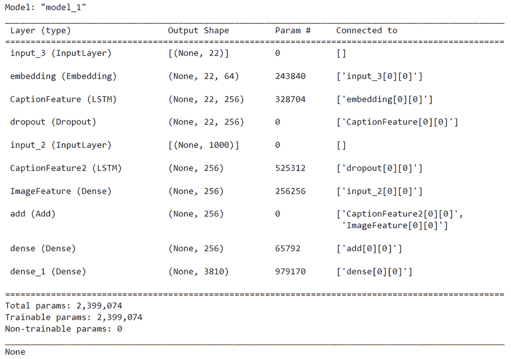 |
| --- |

### 双向 LSTM（Bi-Directional LSTM）

这是另一种单变量 `LSTM` 模型，允许模型向两个方向学习：正向（从过去到未来）和反向（从未来到过去）。在双向 `LSTM` 中，输入被驱动两个方向，这使其与普通的堆叠 `LSTM` 不同。与原生 `LSTM` 不同，在双向模型中，输入可以双向流动以保留过去和未来的信息。

| 图 9. 模型摘要，显示模型的所有层 |
| --- |
| 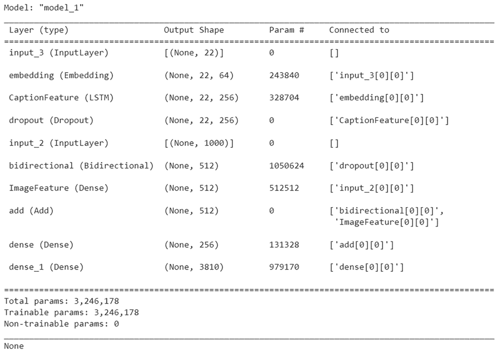 |
| --- |

## IX. 评估性能

使用 `BLEU` 评分对每个预测进行评估。

### BLEU 评分

双语评估准则（BiLingual Evaluation Understudy，简称 `BLEU`）是一种用于评估机器翻译文本的指标。它给出一个 0 到 1 之间的数值，代表机器翻译文本与高质量参考翻译之间一致性。最高分为 1，即翻译文本与参考完全相同。分数越高，预测越好。使用 `BLEU` 评分的优势如下：

- 计算速度快且完全不昂贵。
- 直观。
- 与语言无关。
- 与人类评估具有显著的相关性。
- 已在不同领域广泛应用。

## X. 部署模型

下一步将通过将模型集成到现有产品环境中并投入实际使用来部署模型。

## 数据集

数据集的可用性极大影响这种数据密集型模型。此过程需要的数据集是带有描述的图像。模型的准确性取决于标题的质量。由于成本高、速度慢等限制，众包是收集大规模数据集数据的首选方法。适用于此模型的数据如下：

- **微软常用物体上下文（MSCOCO/COCO）**：这是一个包含超过 30 万带描述的图像集合。它是用于物体分割和检测应用的大型数据集，每张图像有 5 条描述并包含 80 个物体类别。它包含日常物体和场景的复杂图像。可以从官方网站免费下载。
- **Flickr 8K**：这是一个包含 8,000 张图像以及每张图像对应的 5 条清晰描述性说明的图像集合，这些图像取自 Flickr。说明突显了图像的显著特征。它是基于句子的图像描述的基准数据集，可以在 Kaggle.com 上免费获取。
- **Flickr 30K**：这是一个从 Flickr 提取的 30,000 张图像和每张图像对应的 5 条清晰描述文字的集合。这些描述突出了图片的显著特征。它包含并扩展了之前的 `Flickr 8K` 数据集。这两个数据集都是众包的，可以在 Kaggle.com 上免费获取。
- **真实世界图像问答数据集 (DAQUAR)**：这是一个重要的虚拟问答数据集，由超过一万对人工问答组成，每张图像包含约九个问答对。可以从 Kaggle.com 免费下载。
- **UIUC PASCAL Sentence**：这是最早带有图像描述数据的众包数据集之一。它包含了 1,000 张图像，每张图像收集了 5 种描述。这最初是为研究图像生成句子设计的，但领域范围有限，且描述相对简单。

在这些中，最流行的是 `MSCOCO` 和 `Flickr 30K` (Ivašić-Kos et al., 2019)。它们被广泛接受为标准基准数据集，从这些数据集获得的结果被认为是性能评估的标准。

`Flickr 30K` 已成为基于句子的图像描述数据的标准。`Flickr 30K` 和 `Flickr 8K` 都提供了由人工标注者提供的每张图像五个参考句子的参考图像。为了避免计算复杂度并更快训练模型，使用了 `Flickr 8K` 数据集。

## 演示

通过 `PCA` 分析获得的寻找相似类型图像的聚类通过指示颜色突出了不同的组，并显示了整个数据集中所有数据点的分布。

| 图 10. 为整个数据集绘制的 PC1 vs PC2 值 |
| --- |
| 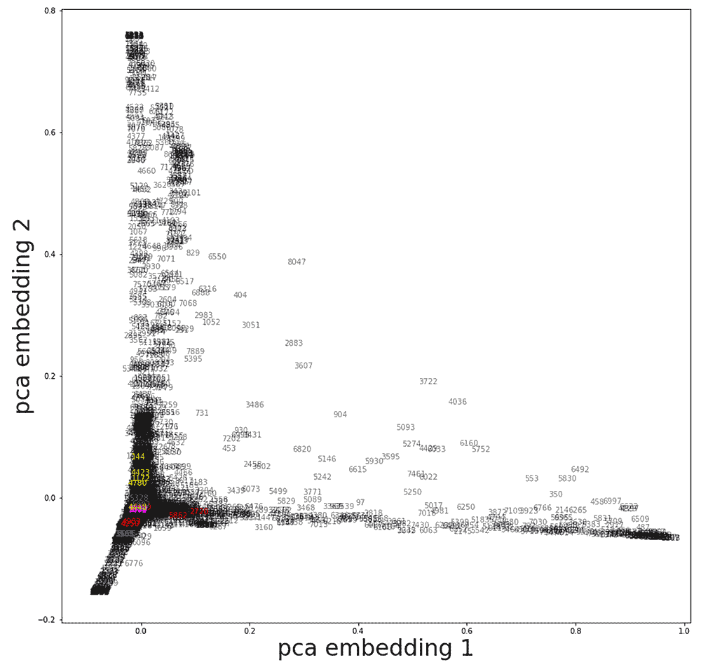 |
| --- |

在这里，标记为 2720、4250、4983、5862 和 4079 的图像被标记为红色，显示有一个或多个球员正在参与某种运动。标记为 6320、3432、1348、7472 和 1518 的图像被标记为洋红色，代表一只或多只狗在玩耍。类似的不同聚类由绿色、蓝色、黄色等表示。

模型通过执行编码和解码的两步过程准备的。模型准确性通过使用 `BLEU` 分数进行评估。`BLEU` 分数等于 1 的样本是良好的示例，而 `BLEU` 分数等于 0 或接近 0 的样本是糟糕的示例。解码的第二步使用了两个不同的模型，即 `Stacked LSTM` 和 `Bidirectional LSTM`。

### I. 带有 Stacked LSTM 的 CNN

| 图 11. Stacked LSTM 模型生成的糟糕描述示例 |
| --- |
|  |
| --- |

| 图 12. Stacked LSTM 模型生成的良好描述示例 |
| --- |
|  |
| --- |

### II. 带有 Bidirectional LSTM 的 CNN

| 图 13. Bidirectional LSTM 模型生成的糟糕描述示例 |
| --- |
|  |
| --- |

| 图 14. Bidirectional LSTM 模型生成的良好描述示例 |
| --- |
|  |
| --- |

## 结果与讨论

模型通过执行编码和解码的两步过程准备的。模型准确性通过使用 `BLEU` 分数进行评估。`BLEU` 分数等于 1 的样本是良好的示例，而 `BLEU` 分数等于 0 或接近 0 的样本是糟糕的示例。解码的第二步使用了两个不同的模型，即 `Stacked LSTM` 和 `Bidirectional LSTM`。

### 与其他模型的兼容性

- **BERT 模型**：`BERT` 不适用于替换 `LSTM`。这是因为 `BERT` 需要文本向量作为输入，而应用 `CNN` 模型后获得的是整数向量，无法作为 `BERT` 的输入。曾尝试将 `BERT` 编码器作为文本分词器并使用 `LSTM` 模型进行描述生成，但问题仍然存在。因此，它可以用于文本分类，但无法用于图像。
- **LSTM 变体**：`LSTM` 模型主要分为两种：单变量和多变量。由于只给了三维整数向量（大小为 5x24x24）作为 `LSTM` 的输入，无法使用任何类型的多变量 `LSTM`。此外，`Vanilla LSTM` 无法处理三维向量，`Convolutional LSTM` 也是如此。因此，作者仅评估了 `Stacked LSTM` 和 `Bidirectional LSTM` 模型。

图像描述（Image captioning）是一项具有挑战性的任务，应用于图像识别、分析和文本生成领域。在过去的十年中，由于其在多个领域的应用，它受到了广泛关注。本章深入研究并比较了用于图像描述的现有模型，并阐述了现有模型在分析图像和生成合适描述方面的局限性。本章还演示了一个使用短短期记忆（`LSTM`）和卷积神经网络（`CNN`）构建的图像描述模型。为了评估构建模型的性能，考虑了生成描述上获取的 `BLEU` 分。仿真结果表明，所提模型能够以很高的准确率为测试集的图像建议描述。它在某些图像上表现极佳，甚至达到了完美的 `BLEU` 分。所提模型可以信赖地生成描述，这些描述在未来可以被转换为听力格式，供视障人士使用。它也可以应用于视频描述。根据获得的结果，得出结论：该模型对于包含单个焦点物体的图像效果最好。为了解决这一问题并以相同的准确率和精密度识别图像中的多个物体，建议对图像进行某些预处理，例如通过过滤器使图像仅关注其重要特征，然后进行特征提取。通过计算图像的熵进一步增强准确性（`Chang et al., 2020]`）。未来的工作将考虑使用更大的数据集如 `Flickr 30K` 或 `MSCOCO` 来训练模型。

## 参考文献

Ivašić-Kos, M., & Hrga, I. (2019, May). Deep image captioning: An overview. In 2019 42nd International Convention on Information and Communication Technology, Electronics and Microelectronics (MIPRO) (pp. 995-1000). IEEE.

Azhar, I., Afyouni, I., & Elnagar, A. (2021, March). Facilitated Deep Learning Models for Image Captioning. In 2021 55th Annual Conference on Information Sciences and Systems (CISS) (pp. 1-6). IEEE. 10.1109/CISS50987.2021.9400209

AnejaJ.DeshpandeA.SchwingA. G. (2018). Convolutional image captioning. In Proceedings of the IEEE conference on computer vision and pattern recognition (pp. 5561-5570). IEEE.

Patwari, N., & Naik, D. (2021, April). En-de-cap: An encoder decoder model for image captioning. In 2021 5th International Conference on Computing Methodologies and Communication (ICCMC) (pp. 1192-1196). IEEE.

Chang, J. R., Ling, T. T., & Li, T. C. (2020, November). A Research on Image Captioning by Different Encoder Networks. In 2020 International Symposium on Computer, Consumer and Control (IS3C) (pp. 68-71). IEEE. 10.1109/IS3C50286.2020.00025

Shambharkar, P. G., Kumari, P., Yadav, P., & Kumar, R. (2021, May). Generating Caption for Image using Beam Search and Analyzation with Unsupervised Image Captioning Algorithm. In 2021 5th International Conference on Intelligent Computing and Control Systems (ICICCS) (pp. 857-864). IEEE. 10.1109/ICICCS51141.2021.9432245

Devlin, J., Gupta, S., Girshick, R., Mitchell, M., & Zitnick, C. L. (2015). Exploring nearest neighbour approaches for image captioning. arXiv preprint arXiv:1505.04467.

Hossain, M. Z., Sohel, F., Shiratuddin, M. F., Laga, H., & Bennamoun, M. (2021). Text to image synthesis for improved image captioning. IEEE Access: Practical Innovations, Open Solutions , 9, 64918–64928. doi:10.1109/ACCESS.2021.3075579

Cheng, H., Devlin, J., Fang, H., Gupta, S., Deng, L., He, X., & Mitchell, M. (2015). Language models for image captioning: The quirks and what works. arXiv preprint arXiv:1505.01809.

Wang, H., Zhang, Y., & Yu, X. (2020). An overview of image caption generation methods. Computational Intelligence and Neuroscience . doi:10.1155/2020/3062706

Hossain, M. Z., Sohel, F., Shiratuddin, M. F., & Laga, H. (2019). A comprehensive survey of deep learning for image captioning. ACM Computing Surveys , 51(6), 1–36. doi:10.1145/3295748

Wang, C., Zhou, Z., & Xu, L. (2021). An integrative review of image captioning research. Journal of image captioning.

## 配音

配音是一种智能现象或过程，主要用于电影行业。许多大型公司正在参与这一配音项目，而这些项目需要多语言支持。这一过程涉及音视频翻译，有助于在制作阶段添加新的音效或音频。此外，还将其他语言的电影（即对话）翻译成所需的语言进行配音。配音不仅有助于翻译，在原片中根据情况同步添加音轨方面也很有帮助。例如，在其他语言电影的翻译中，除了配音外还提供了字幕，以便观众能够获取电影的完整配方。但配音过程中还有一些需要解决的问题。（Akman et al., 2022）。配音过程中的基本问题是配音员使用的设备质量。建议使用高效的麦克风，这种一次性投资有助于后期阶段的盈利。另一点是进行该过程的环境。为了避免此类错误，需要使用适当的降噪系统。这些基础问题可以通过适当的环境布置来解决。

## 技术挑战与同步

主要问题出现在技术部分，即音视频需要适当同步，也就是时间问题。换句话说，配音员的音频时间应与演员的视觉动作匹配，例如演员为了表达对话而张嘴等。因此，在配音中应注意口型同步以及面部表情的匹配。接下来将讨论口型同步系统以及深度学习对自动系统的重要性 Kunchukuttan, A. et.al. (2017)。简而言之，系统中存在以下挑战：

- 上下缺失
- 空间-时间特征提取
- 理解表情更丰富的演员以及由演员完成同步的困难
- 人与人之间的泛化
- 说话者的口音（如喉音）
- 说话者的声音水平，例如：咕哝

## 自动唇读识别系统

因此，必须开发一种能够解决这些关注问题的自动唇读识别系统。自动口型同步模型的通用流程如图 1 所示。该系统的主要组件是特征提取和分类。首先，将通过适当的视觉设置捕捉说话者的视频。然后，将视频转换为代表待解码数据的图像帧。接一步非常重要，将进行预处理。我们的目标是捕捉准确的唇部动作，这有助于识别正确的语音。在此时，唇部位置是我们的感兴趣区域（`ROI`）。因此，从视频图像中提取唇部位置。应用一些基础变换和处理，以减少后期阶段涉及的步骤。之后，将进行系统前端的特征提取。这一过程有助于从冗余特征中有效获取所需的特征。然后是系统的后端，无非是一个分类过程。在分类中，将获取的图像与数据库进行比较，完成与输入语音对应的面部动作匹配。最后，将解码的语音编码为口语单词或句子的形式。

| 图 1. 口型同步模型的通用框图 |
| --- |
|  |
| --- |

## 技术的演进

以前，许多传统技术如隐马马尔可夫模型（`HMM`）被用于自动口型同步系统中的同步。此外，许多传统技术如离散余弦变换、主成分分析等被用于特征提取。如今，在语音和视频处理系统中，先进的机器学习/深度学习技术受到了青睐，这是由于可用数据集的大量增加。下一节将讨论深度学习领域在口型同步过程中的最新工作。

## 配音中的深度学习模型

在配音中，音频和视觉翻译都同样重要。例如，当一个人开口说话时，面部表情也会随之变化。因此，人们尝试使用神经机器从输入的音视频格式获取面对面的翻译。给定一个用语言 A 说话的说话者视频，目标是生成另一个用语言 B 的说话者的口型同步视频。开发了一个 `LipGAN` 模型来从输入视频获取面翻译图像序列，并在没有任何数据标记的情况下完成了另一种语言的口型同步 Federico, M. et. al. (2020a)。该 `LipGAN` 模型适用于任何脸部并支持多语言。

接下来，开发了 `Wav2Lip` 模型，它对实时视频也同样有效。提出的模型支持对任何说话脸进行口型同步以提取语音，不受任何限制。判别器中的改进有助于提高系统性能。通常输入模型进行口型同步过程的是灰度图像。相反，在训练过程中使用了彩色图像。此外，深度非常深，并且包含了残差跳跃连接。这使得通过口型同步专家 Federico, M. et, al. (2020b) 生成了准确的口型同步。该系统在定量评估和人类评估方面均优于其他。

提出了 `LipType` 用于使用深度神经网络进行提取和分类。它包含一个用于修正背景光条件的修复模型以及无声语音增强及其识别。该 `LipType` 模型是 `LipNet` 的扩展版本。与 `LipNet` 相比，`LipType` 在识别过程中获得的错误率更低（Öktem, A. et. al, 2019)）。

## 本书结构

本章结构如下：第二节描述了目前文献中介绍的用于增强自动配音过程的各种 NLP 深度架构变体。第三节详细介绍了评估自动配音模型所需的性能指标。第四节讨论了自动配音过程的应用和优势。第五节提供了挑战和未来的研究方向。第六节总结了本章内容。

# 用于自动配音过程的 NLP 深度架构变体

自动配音过程的目标是将音频信号从一种语言翻译成另一种所需的语言。自动配音过程涉及两个基本过程，即视频重建（面对面翻译）和口型同步。

## 用于 NLP 的 LIPGAN 架构

生成对抗网络由 Federico, M. et. al. (2020b) 创建，用于为翻译后的语音生成会说话的面脸。其核心思想是计算生成器产生的给定帧中口型同步的程度。该模型被设计为对不同姿态和输入语言具有不变性。主要优势是 `LipGan` 模型可以自动生成具有口型同步的目标语言的会说话脸。它能生成真实的会说话脸，并且对该方法进行了主观分析。该模型专为英语到印地语的翻译设计。这项工作分析了以往解决方案 Liu, N (2020) 和 Taylor, S. et. al. (2017) 中的研究空白，并报告了现有工作中定义的重建损失和 `GAN` 不足以提供准确的口型同步。由于这些问题，口型同步通过专家知识（即预训练的口型同步网络）实现。使用了一种改进的口型同步专家网络，它同时接受视觉和音频数据作为输入。用于最小化重建误差的设计生成器如下：

```


 (1)

其中 `L[g]` 是生成的帧，`L[G]` 是真值帧。生成器单独生成每一帧，窗口大小选择为 5。该模型在三个数据集上进行了验证，并遵循了不同的评估方法。以往的评估策略中识别出了一些缺点，它们是：不适用于真实世界场景、评估不一致、缺乏时间一致性以及评估指标。

## 教育视频的口型同步工作

大多数在口型同步中提出的工作 Cooke, M. et. al. (2006) 使用了独立的技术来对齐音频和视觉内容。引入了基于自动配音的韵律同步模块，提供了源音频和目标音频之间的同步。末端使用注意力模块将音频轨道与面部结合 Mukhopadhyay, R. et. al. (2019)，单词的交付速度在自动配音算法中起着至关重要的作用。训练了大量数据以获得音视频数据的端到端模块 Aharon, M. et. al. (2006)。Yuan, J. et. al. (2008) 尝试翻译教育视频，由于目标音频与合成音频之间的时长差异，这极具挑战性。此外，与娱乐视频相比，视频会有更多的空白。其他需要考虑的因素是技术术语的口型动作、头部姿态、演讲者的手部和手势。因此，重建音频使用了单词级对齐过程。他们试图实现口型动作与目标音频之间良好的同步。开发的系统基于主观评价和平均意见分（MOS）进行了验证。教育视频中音频与视频对齐过程的示例见图 2。

| 图 2. 静音检测后的对齐示例 |
| --- |
|  |

原始视频中的长静音被检测并映射到源音频的片段中。最终音频根据原始音频中的静音时长进行分割。当单词之间存在短时间静音时会出现问题。由于这些问题，口型同步通过专家知识（即预训练的口型同步网络）实现。使用了一种改进的口型同步专家网络，它同时接受视觉和音频数据作为输入。用于最小化重建误差的设计生成器如下：

 (1)

其中 `L[g]` 是生成的帧，`L[G]` 是真值帧。生成器单独生成每一帧，窗口大小选择为 5。该模型在三个数据集上进行了验证，并遵循了不同的评估方法。在以往的评估策略中识别出了一些缺点，它们是：不适用于真实世界场景、评估不一致、缺乏时间一致性以及评估指标。

## 基于编码器的口型同步

由于这些问题，口型同步通过专家知识（即预训练的口型同步网络）实现。使用了一种改进的口型同步专家网络，它同时接受视觉和音频数据作为输入。用于最小化重建误差的设计生成器如下：

 (1)

其中 `L[g]` 是生成的帧，`L[G]` 是真值帧。生成器单独生成每一帧，窗口大小选择为 5。该模型在三个数据集上进行了验证，并遵循了不同的评估方法。在以往的评估策略中识别出了一些缺点，它们是：不适用于真实世界场景、评估不一致、缺乏时间一致性以及评估指标。

## 性能指标

为了评估口型阅读，必须使用以下评估指标：

- **I. 词错误率 (WER)：** WER 定义为替换、删除和插入之和与真值单词总数的比。WER 表示转换为真值所需的操作。它在数学上表示为：

 (2)

- **II. 每分钟单词数 (WPM)：** 常用评估指标，描述了单词的速率。它通过识别单词、语音和计算之间的关系来计算。其公式为：

 (3)


## III. 计算复杂度 (完成后)

任何用于面部到面部翻译和口型阅读的算法或模型的分析通常包含一个称为计算复杂度的因素。由于包含了音频和视觉数据，必须将其作为性能指标。复杂度涉及存储、时间和算法复杂度。算法复杂度使用大 O 表示法进行计算。

## IV. 计算时间 (T)

算法或模型完成口型阅读任务所需的时间指的是时间复杂度。在准确性、时间和资源复杂度之间应保持平衡。

## V. 准确率 (A)

准确率是指根据真值正确同步的配音单词的百分比。它在数学上表示为：`Accuracy = #正确同步的配音单词 / #真值中的单词`

### VIII. F1Score (F)

`F1score` 代表精确率（precision）和召回率（recall）的调和平均数。当精确率和召回率都很高时，`F1score` 较高。表 1 列出了开发任何用于泰米尔语口型识别的模型时所需的状态。

**表 1. 性能指标及其状态**

| 指标 | WER | WPM | ɳ | T | A | P | R | F |
| --- | --- | --- | --- | --- | --- | --- | --- | --- |
| 状态 | 低 | 高 | 低 | 低 | 高 | 高 | 高 | 高 |

## 自动配音的应用

自动口型同步在新闻播报、资讯访谈、电影配音和教育类视频等高级应用中将非常有用：

*   **娱乐**：近期，电影行业发布了许多全印度电影。口型同步流水线将帮助电影制作人以成本效益的方式创建不同语言的电影。任何配音的基本过程是将录制/配音的语音嵌入捕获的视频中。这个过程无疑会面临口型动作不同步的问题。因此，自动口型同步框架将缓解这一问题。自动流水线将生成口型模型并在捕获的视频上同步口型动作。通过自动口型同步框架可以减少不同步错误。给定电影片段，自动配音系统会将音频翻译成目标语言。因此，语音语音翻译在该框架中也起着至关重要的作用。这使得自动配音过程变得非常复杂。
*   **教育**：它是帮助国家各方面成长的关键支柱之一。由于疫情情况，大多数教育系统已将其内容转向电子内容。在现有的教育内容中，大量的视频是通过英语提供的。尽管这些视频提供了母语言字幕，但增加了听者的负担。解决方案是基于语音转语音合成生成配音视频。出现关键问题由于口型动作与配音语音不同步导致视觉化不便。这种障碍通过口型识别的普及得到了缓解。它包含两个过程：面对面翻译和口型同步。
*   **资讯**：除了教育和娱乐视频外，还有许多如新闻、访谈、演示、烹饪食谱等内容供观看。口型同步框架将允许用户访问这些资讯视频，他们无论来自哪个国家、种族、语言，都可以在全球范围内观看有用内容。因此，口型识别和面对面翻译为与自然语言处理相关的广泛应用提供了便利。

## 面对面翻译与口型同步的优势

*   自然语言中的口型识别问题应该同时关注视频中的音频和视觉内容。这表明高层图像处理和信号处理在解决这一问题方面发挥了良好的作用。它涉及机器翻译，使用生成模块来创建说话的人脸。
*   它为大多数资源限制的自然语言提供了合适的解决方案。由于计算机视觉、多媒体、机器学习和深度学习的进步，可以根据用户需求轻松翻译视听内容。
*   口型识别框架将帮助听障人士，它基于基于部分的模型，特别是嘴部。会提取该部分，并为不同的单词生成口型模型。它遵循翻译模块，语音信号将转换为文本。
*   基于口型识别的自动配音过程将大大减少传统过程中涉及的繁琐人工劳动。与传统的配音过程相比，准确性也将得到提高。
*   自动口型识别和配音过程帮助用户集中在有趣的场景上，而不是上下移动头部阅读字幕。此外，任何对话的核心含义将以观众的母语言传给他们。
*   配音小组不需要寻找不同的人来刻画不同角色的声音。自动口型识别和配音过程适用于所有性别和年龄。
*   这种自动框架通过一次性投资以及通过计算机视觉和机器学习技术确保质量，为业务领域提供了巨大帮助。

## 口型识别与同步面临的挑战

*   迄为止，大多数行业仍依赖非自动化技术来实现口型同步。主要原因是完成此任务的现有高度精细软件成本高昂。
*   它要求设计的系统在内存中维护一个巨大的单词字典，用于自动语音-文本合成和翻译模块。这为分配给自动过程的内存和计算资源造成了巨大负担。
*   在实时过程中同时处理三维空间中的视觉数据和音频数据的计算复杂性，是自动口型识别算法要解决的主要挑战之一。

## 结论与未来方向

本文讨论了目前为止提出的旨在提供高效自动配音语音的各种深度架构。报告了这些架构引导配音领域（尤其是口型同步）研究的必要性。随后，阐述了验证不同架构性能所需的评估指标。详细说明了由于自动配音算法增强而获益的不同领域。还阐述了为了在自然语言自动配音过程中达到基准性能需要填充的研究空白。现有方法面临的挑战包括高成本、巨大的计算资源和内存复杂性。因此，未来配音领域的研究关注这些挑战将是有意义的。此外，网络参数的优化、音频视频数据的并行处理以及计算复杂性分析将为自然语言自动配音过程的研究铺平良好的增强。双流和双域深度网络在自动配音过程中尚未完全分析，具有良好的前景。自动配音过程是计算机视觉领域一个不断发展的领域，深度学习的增强提供了长期的承诺。

## 参考文献

*   Akman N., P. Sivri T. T., Berkol A., Erdem H. (2022, July). Lip Reading Multiclass Classification Using Dilated CNN with Turkish Dataset. In 2022 International Conference on Electrical, Computer and Energy Technologies (ICECET) (pp. 1-6). 10.1109/ICECET55527.2022.9873011
*   Kumar, R., Sotelo, J., Kumar, K., de Brébisson, A., & Bengio, Y. (2017). Obamanet: Photo-realistic lip-sync from text. arXiv preprint arXiv:1801.01442.
*   Kunchukuttan, A., Mehta, P., & Bhattacharyya, P. (2017). The iit bombay english-hindi parallel corpus. arXiv preprint arXiv:1710.02855.
*   Federico, M., Enyedi, R., Barra-Chicote, R., Giri, R., Isik, U., Krishnaswamy, A., & Sawaf, H. (2020a). From speech-to-speech translation to automatic dubbing. arXiv preprint arXiv:2001.06785.
*   Federico, M., Virkar, Y., Enyedi, R., & Barra-Chicote, R. (2020b). Evaluating and Optimizing Prosodic Alignment for Automatic Dubbing. In INTERSPEECH (pp. 1481-1485). doi:10.21437/Interspeech.2020-2983
*   Öktem, A., Farrús, M., & Bonafonte, A. (2019). 用于机器配音的韵律短句对齐。arXiv preprint arXiv:1908.07226.
*   Matoušek J., Vít J. (2012, 3 月). 使用视频剪切检测字幕时间优化改进自动配音。在 2012 IEEE 国际声学、语音和信号处理会议 (ICASSP) (pp. 2385-2388)。IEEE. 10.1109/ICASSP.2012.6288395
*   Liu, N., Zhou, T., Ji, Y., Zhao, Z., & Wan, L. (2020). 从文本和音频合成会说话脸：一种自动编码器和序列到序列卷积神经网络。模式识别 , 102, 107231. doi:10.1016/j.patcog.2020.107231
*   Taylor, S., Kim, T., Yue, Y., Mahler, M., Krahe, J., Rodriguez, A. G., Hodgins, J., & Matthews, I. (2017). 一种通用语音动画的深度学习方法。ACM 图形交易 , 36(4), 1–11. doi:10.1145/3072959.3073699
*   Yuan, J., & Liberman, M. (2008). 美国最高法院（SCOTUS）语库上的说话者识别。美国声学学会期刊 , 123(5), 3878. doi:10.1121/1.2935783
*   Cooke, M., Barker, J., Cunningham, S., & Shao, X. (2006). 用于语音和自动语音识别的视听语库。美国声学学会期刊 , 120(5), 2421–2424. doi:10.1121/1.2229005
*   Aharon, M., & Kimmel, R. (2006). 使用降维技术进行唇部图像的表示分析与合成。国际计算机视觉杂志 , 67(3), 297–312. doi:10.1007/s11263-006-5166-3
*   KR, P., Mukhopadhyay, R., Philip, J., Jha, A., Namboodiri, V., & Jawahar, C. V. (2019, 10 月). 迈向自动面对翻译。在第 27 届 ACM 国际多媒体会议论文集 (pp. 1428-1436)。ACM。

## 第 10 章

*   Ashok Kumar L. - 印度 PSG 科技学院
*   Karthika Renuka D. - 印度 PSG 科技学院
*   Shunmugapriya M. C. - 印度 PSG 科技学院

### 摘要

泰米尔语问答系统（`QAS`）旨在母语中寻找相关答案。该系统将帮助农民获取与农业领域相关的泰米尔语信息。泰米尔语是形态丰富的语言之一。因此，开发此类处理泰米尔语单词的系统是一项挑战任务。泰米尔语停用词列表必须手动收集。词性（`POS`）标记用于为泰米尔语单词序列识别合适的 `POS` 标签。该系统采用了基于隐马尔夫模型（`HMM`）的 viterbi 算法，这是一种泰米尔语单词词性标记的机器学习技术。将分析的问题提交 Google 搜索获取相关文档。在 搜索的基础上，利用局部敏感哈希技术（`LSH`）为输入的泰米尔语问题检索五个相关项目。使用 `Jaccard 相似性` 从检索到的文档项中获取响应。所提系统使用农业领域 1000 个句子的数据集进行建模。

## 引言

互联网提供了丰富的数据源，但英语是主语言。尽管人们从搜索引擎获取信息，但这些信息可能有用也可能无效。他们花费大量时间获取相关答案。这项工作的核心思想是寻找并表示用户查询的准确答案。寻找和验证正确答案的困难使得 `QAS` 比通用信息检索任务更复杂。

该系统处理泰米尔语问题，并为农业领域的用户提供泰米尔语答案。用于泰米尔语农业领域的 Uzhavan 移动应用程序提供了有关农业计划和补贴的信息，但它没有对农民的查询提供简洁的回答。为了解决这些问题，泰米尔语 `QAS` 系统为用户查询提供准确答案。

表 1 显示了泰米尔语中不同类型的问题。在这项工作中，农业领域的用户查询通过所提模型处理以获取泰米尔语答案。该系统的核心思想是构建一个基于泰米尔语的农业领域问答系统。泰米尔语的停用词是手动收集的，并对泰米尔语单词进行了 `POS` 标记。局部敏感哈希用于检索相关文档。最后，使用 `Jaccard 相似性` 对答案进行排序。

表 2 显示了不同类型的 `QAS`。`QAS` 根据应用领域、分析内容和使用的技术进行分类。根据应用领域，分为开放式和封闭式。根据应用领域，分为开放式和封闭式。根据应用领域，分为开放式和封闭式。

#### 表 1. 问题类型

| 问题类型 | 描述 | 示例问题（泰米尔语） |
| :--- | :--- | :--- |
| 事实型问题 | 定义类型的问题 | தேர்ந்தெடுக்கெடுக்க? |
| 列表型问题 | 类型和列表问题 | 需要? |
| 肯定疑问 | 是或否问题 | சரிய确? |

#### 表 2. 问答系统类型

| QAS 类型 | 描述 | 示例 |
| :--- | :--- | :--- |
| 开放领域 QAS | 用户可以在任何领域提问并从系统获得答案。 | IBM Watson |
| 封闭领域 QAS | 用户可以在特定领域（如医学、科学领域）提问。 | QAPD |
| 基于本体的 QAS | 系统利用本体（如 DBPedia 本体）和 SPARQL 查询来回答用户问题。 | AquaLog 和 DeepQA |
| 基于 Web 的 QAS | 系统利用 Google、Wikipedia 等网络资源作为知识库来回答用户。 | WEBQA |
| 基于语义分析的 QAS | 系统从概念上分析用户问题并提供准确答案。 | QUERIX 和 PANTO |
| 基于语法分析的 QAS | 系统通过关键词分析来回答查询。 | ASKME |
| 基于形态分析的 QAS | 形态分析器将单词（பய்கள்）拆分为词根（பயிர）和相关的形态特征（கள்）。 | TamilQAS |

### 文献综述

信息检索系统并不提供准确答案，而是提供一组与查询相关的文档。因此，对提取语言答案的工具有很高需求。

Viterbi 算法是一种用于序列标记的常用方法。自然语言处理中另一种广泛使用的序列标记机器学习方法是条件随机场（`CRF`）。泰米尔序列的 `POS` 词性标记由 (Pandian, 2009) 引入。

条件随机场一种机器学习方法被 (Lakshmana Pandian, 2008) 用于开发一个“基于形态特征的泰米尔语问题分类”系统。该论文讨论了使用形态特征处理泰米尔语不同类型的问题。系统开发了条件随机场（`CRF`）模型来训练标记的问题语库。对各种 `CRF`（如基于形态的 `CRF` 和通用的 `CRF`）进行了比较。比较结果显示基于形态的 `CRF` 优于通用的 `CRF`。

泰米尔词的词性标记由（Dhanalakshmi, 2009）完成。他们建议了 32 个词性标记和 9 个分块标记。他们使用了规模为二十二万五千词的泰米语语料库进行模型的训练和测试。

基于词法特征的泰米语词性标记器由（Pandian, 2008）开发。他们实现了高性能，f-measure 达到 96%。他们比较了多种方法，如基于规则的标记、隐马尔可夫模型（`HMM`）标记和基于转换的学习的标记器。

拼写检查是问答系统中重要的步骤，对系统性能影响极大。该系统有助于识别泰米语中的拼写错误。他们开发了形态分析器来分析泰米语词汇。在该系统中，每个词都与字典中的单词进行比较。如果单词拼写错误，将提供建议和拼写纠正。泰米语的命名实体识别（`NER`）由（Pandian, 2008）完成。命名实体识别识别地点、组织和人物等实体名称的过程。`NER` 是所有自然语言处理系统中使用的预处理步骤之一。

最近，研究工作集中在基于深度学习的方法，如 `LSTM`、基于注意力的模型，用于开发基于机器人的问答应用程序。

## 泰米语问答系统架构

原生语言问答系统有助于用户以易于理解和方便的方式获取答案。用户输入的问题通过用户界面提供给系统。图 1 显示了所提系统的架构。泰米语问答系统有三个主要组件，列举如下：

*   预处理
*   基于 LSH 的文档检索
*   答案排序与验证

| 图 1. 泰米语 QA 系统架构 |
| --- |
|  |
| --- |

## 预处理

预处理的第一步是分词，随后是去除停用词，如图 2 所示。停用词是没有意义的词或噪声术语，例如连词 அல்லது, ஏனெனில், அதுவரsimeq。因此，去除停用词对系统性能有很大影响。一些泰米语停用词列在图 3 中。

| 图 2. 预处理泰米语词汇 |
| --- |
|  |
| --- |

| 图 3. 泰米语停用词 |
| --- |
|  |
| --- |

## 泰米语中的词性标记 (தமிழ் சொல்வகை கூறுகள்)

它用于为单词序列识别最合适的 POS 标记。Viterbi 算法是一种动态规划方法，用于为输入句子找到概率最高的标记序列。给定词序列 `w[1]`, `w[2]`, .., `w[n]`，它能识别出对应的标记序列 `t[1]`, `t[2]`, .., `t[n]`。概率视图如下方的公式所示。表 3 显示了泰米语词的几个标记。

 (1)

**表 3. 泰米语 POS 标记集**

| 序号 | 英语 POS 标记 | தமிழ் சொல்vகை கூறுகள் |
| --- | --- | --- |
| 1 | Adjective<ADJ> | பெயரடை |
| 2 | Adverb<ADV> | வினையுரிச்சொல் |
| 3 | Conjunction<CNJ> | இடைச்சொல் |
| 4 | Noun<NN> | பெயர்ச்சொல் |
| 5 | Proper Noun<NNP> | சிறப்பு பெயர்ச்சொல் |
| 6 | Verb<V> | வினைச் சொல் |
| 7 | Question Word<QW> | கேள்வி கேட்கும் போது பயன்படுத்தும் வார்த்தைகள் |

图 4 描述了使用 Viterbi 算法对泰米语句子进行 POS 标记。输入序列的最佳 POS 路径用粗体表示。

| 图 4. 使用 Viterbi 算法进行 POS 标记 |
| --- |
|  |
| --- |

| 图 5. 泰米语词的 POS 标记 |
| --- |
|  |
| --- |

## 局部敏感性哈希 (LSH)

使用 `LSH` 可以减少搜索空间并提高系统性能。`LSH` 的 3 个步骤如下：

*   去除标点符号和停用词后的单字 (Shingles) `['எமிச்சை', 'எந்த', 'வளர்க']`
*   通过置换行 Eg. 1234 2413 创建签名矩阵。图 6 显示了创建签名矩阵的步骤。
*   LSH：将签名矩阵分为每 2 行一个一个带 (bands)，然后对每个带单独进行哈希。

| 图 6. 签名矩阵 |
| --- |
|  |
| --- |

| 图 7. LSH 中的桶 (Buckets) |
| --- |
|  |
| --- |

## 使用 JACCARD 相似性进行排序

Jaccard 相似性测量用于排序。公式 2 找到了问题与答案集的 Jaccard 相似性。

 (2)

其中 `J(Q,A)` 是 `Q` 和 `A` 的 Jaccard 相似性，`Q` 是问题集，`A` 是答案集。

| 图 8. Jaccard 相似性 |
| --- |
|  |
| --- |

| 图 9. 答案检索 |
| --- |
|  |
| --- |

## 泰米语 QA 的结果分析

实验分析使用了由 1000 个泰米语句子组成的数据集。该语料库来自语言语言开发中心。数据集被分为 80% 训练和 20% 测试。模型使用 Viterbi 算法训练。手动创建了泰米语问答数据集，包含农业领域的 85 个泰米语问题和答案。

为了评估系统性能，我们使用了四种指标：精确率、召回率、F-measure 和准确率。85 个问题中有 43 个被系统正确回答，42 个未被正确回答，如表 4 所示。公式 3-6 用于计算性能指标。

 (3)
 (4)
 (5)
 (6)

**表 4. 评估指标和得分**

| 评估 | 分数 |
| --- | --- |
| 精确率(P) | 0.63 |
| 召回率(R) | 0.65 |
| F 分 | 0.64 |
| 准确率 | 0.50 |

## 结论

本文介绍了一种农业领域的泰米语 QA 系统。局部敏感性哈希 (LSH) 技术用于提取最相关的文档。Jaccard 相似性测量用于计算句子相似性。使用泰米语语料库对系统进行了分析并评估了性能指标。所提系统采用基于关键词的搜索，无法为 நெற்பயிரைத் தாக்கும் பூ虫? 之列表类问题提供答案。这影响了开发系统的性能。未来的工作是通过使用长短期记忆 (`LSTM`) 对泰米语词进行语义分析以改进。

## 参考文献

Dhanalakshmi, V., Kumar, M.A., Soman, K.P., & Rajandran, S. (2009). POS Tagger and Chunker for Tamil Language. Academic Press.

Lakshmana Pandian, S., & Geetha, T. V. (2008). Tamil Question Classification Using Morpheme Features . In Nordström, B., & Ranta, A. (Eds.), Lecture Notes in Computer Science: Vol. 5221. Advances in Natural Language Processing. GoTAL 2008 . Springer. doi:10.1007/978-3-540-85287-2_26

Pandian, S. L., & Geetha, T. V. (2009). `用于泰米尔语词性标记与分块的 CRF 模型`. In Li, W., & Mollá-Aliod, D. (Eds.), `计算机科学讲义：卷 5459。东方语言计算机处理。基于知识经济的语言技术。ICPOL 2009`. Springer. doi:10.1007/978-3-642-00831-3_2

Pandian, S. L., & Pavithra, K. A. (2008). 用于泰米尔语的混合三阶段实体识别器。Info , S2008.

Thenmozhi, D., & Aravindan, C. (2018). 基于本体的泰米尔语-英语跨语言信息检索系统。Sadhana , 43(10), 157. doi:10.1007/s12046-018-0942-7

## 第 11 章

*   Eymen Kagan Taspinar
    
    土耳其，马马拉拉大学

*   Yusuf Burak Yetis
    
    土耳其，马马拉拉大学

*   Onur Cihan
    
    土耳其，马马拉拉大学

### 摘要

生成式摘要旨在从语义上理解文本，并以简洁明了的方式进行重构，其中摘要可能包含原文中不存在的词。本章通过一种基于 Transformer 注意力机制研究了土耳其语生成式文本摘要问题。此外，本研究详细探讨了 Transformer 架构与其他架构之间的差异，以及作为该架构核心的注意力块（attention block）。研究从各种新闻网站的可用文本数据中生成了三个摘要数据集，用于训练生成式摘要模型。结果表明，训练后的模型在 `ROUGE` 分数上比现有研究更高或相当，且模型生成的摘要具有更好的结构属性。研究还创建了一个英语到土耳其语的翻译模型，并将其应用于一种跨语言摘要模型中，该模型的 `ROUGE` 分数与现有研究相当。本研究提出的摘要结构是跨语言英语-土耳其语文本摘要的首次范例。

## 引言

由于互联网的快速发展，文本数据量正呈指数级增长，这表明需要有效的技术和工具来管理这些数据。在保留核心含义的同时缩短文本长度（被称为摘要）在近期引起了研究人员的极大关注。摘要方法主要分为两类：抽取式和生成式。抽取式摘要的主要目标是使用原文中的相同句子作为摘要的一部分，以识别文本中最核心的短语和从句。然而，生成式摘要的目标是通过生成新词或重组现有词汇来创建新的句子。为了实现这一点，应通过深度分析和推理对文本的语义内容进行检查 (Rachabathuni, 2017)。生成式摘要方法提供了简洁连贯的摘要，这些摘要信息丰富、长度短且与原文不同。

得益于近期自然语言处理（`NLP`）算法的进展，英语文本生成式摘要已成为热门研究课题。摘要算法的性能评估通过比较它们的 `ROUGE` 分数来实现，该指标通过将获得的摘要与参考摘要集或译文进行对比 (Lin, 2004)。对于英语文本，目前文献中摘要算法的 `ROUGE` 分数在 40 左右，这对应于非常成功的摘要。由于英语文本摘要的成功，本章作者探讨了土耳其语生成式文本摘要问题。

## 背景

对于生成式摘要，最近展示了许多利用序列到序列（sequence-to-sequence）架构的模型。仅依赖注意力过程的 `transformer` 模型由 Vaswani et al. (2017) 引入。研究人员进一步利用注意力机制在摘要任务中取得了令人前景的结果 (Lewis et al., 2019; Raffel et al., 2020)。Lewis et al., 2019 提出了一个包含双向编码器和自回归解码器的 `BART` 模型。Raffel et al. (2020) 引入了 `T5` 模型，这是一种从文本到文本的框架，可用于翻译、摘要等多种任务。英语文本摘要问题已由文献中的许多作者探讨 (Rush et al., 2015; Chopra et al., 2016; Lin et al., 2018)。Rush et al. (2015) 使用了基于卷积和注意力的编码器进行摘要。Chopra et al. (2016) 利用 `RNN` 单元创建解码器块。Nallapati et al. (2016) 建议了一种在编码器和解码器块中使用 `RNN` 单元的英语生成式摘要系统。然而，这些基于注意力的结构会导致语法错误、语义不相关和重复。包含 `Transformer` 架构编码器和解码器的结构在感知文本方面显示出更高的性能，并产生更好的文本 (Raffel et al., 2020; Lewis et al., 2019)。Zhang et al. (2019) 使用 Raffel 等人 (2020) 提出的 `C4` 语料对英语执行了预训练模型。微调阶段使用 `XSum`、`CNN`、`NEWSROOM` 和 `Multi-News` 等即用数据集完成。由于英语文本生成式摘要模型的流行，研究人员最近关注了跨语言文本摘要。Wan et al. (2010) 应用“先摘要后翻译”的原则来总结中文文本。尽管他们认为这种方法的优点是翻译文本较少，但结果并不尽如意。Zhu et al. (2020) 在其模型中共同使用了 `Transformer` 和翻译层。文献中的大多数跨语言摘要研究都是针对中文文本摘要进行的。

涉及土耳其文本摘要的研究解释如下。土耳其文本的抽取式摘要由 Kutlu et al. (2010) 进行研究，该作者根据词汇频率、关键词和句子位置等参数权重的训练，对句子进行评分。Karakoc and Yilmaz (2019) 考虑了使用 `LSTM` 单元和束搜索结构对土耳其文本进行生成式摘要处理。在另一项生成式摘要研究中，作者们创建了一个土耳其数据集，并提出了一种由 `LSTM` 单元组成架构的生成式摘要模型（Ertam & Aydin, 2021）。缺乏使用最新模型和架构的土耳其生成式摘要研究，以及缺乏涉及土耳其语的跨语言摘要研究，构成了本研究的空白。其主要原因是土耳其数据量远少于英语数据。

本章的主要贡献可以总结如下：

*   1) 作者从 3 个新闻网站的数据中创建了 3 个土耳其文本摘要数据集。这些数据集分别包含 216458、218717 和 7663 篇土耳其文本及其摘要。据作者所知，这是目前可用最大的土耳其摘要数据集。
*   2) 由于本研究是利用文献中最新的架构和非常大的数据集进行的，因此所获得的土耳其生成式文本摘要模型的性能与文献中现有的英语摘要模型相当。
*   3) 作者提出了一种英语-土耳其翻译模型，并使用由电视剧和电影的英语及土耳其语字幕组成的新型数据集对其训练。结果表明，所提翻译模型的结果是有前景的，且该模型在与土耳其摘要算法结合使用时可用于摘要英语文本。这是文献中首次利用跨语言摘要模型使用土耳其语摘要英语文本的研究。

本章其余部分的组织如下：下一节将提供本章中利用的模型细节，并解释为训练和测试创建的数据集。“解决方案与建议”部分将展示结果并与文献中的现有结果进行比较。最后，在最后一节中给出未来的研究方向和结论。

## 本章核心内容

在文本摘要中，待摘要文本的长度是灵活的，短语中单词的位置会影响其含义。这些原因使得序列架构（如 `RNN` 和 `LSTM`）适用于生成式文本摘要。由于当前计算需要上一次计算的结果，因此无法充分利用图形处理器（`GPUs`）进行并行处理。然而，与 `RNN` 和 `LSTM` 不同，`transformer` 模型在训练阶段不需要对序列数据进行顺序处理。Vaswani et al. (2017) 提出的 `transformer` 模型与之前的最先进模型相比，在英语译德语和英语译法语的模型中具有更高的 `BLEU` 评分（这是 Papineni et al. (2002) 开发的评估翻译质量的指标）和较低的训练成本（`FLOPs`）。

长距离依赖在许多序列转换任务中起着关键作用 (Vaswani et al., 2017)。输入和输出之间的最大路径长度与具有此类依赖的模型的学习能力呈负相关。输入和输出之间的最大路径越短，越容易学习长距离的依赖。由于自注意力层类型的最大路径长度最小，因此注意力机制在文本摘要问题中具有优势。此外，尽管 `transformer` 模型的复杂度为  (Vaswani et al., 2017)但一旦使用具有并行处理能力的计算机，并行化在速度上将带来重要优势。基于上述讨论，研究人员在本研究中使用了基于注意力的模型。

## 设计

语言处理模型由两个阶段组成：预训练和微调。基础模型在第一阶段使用大量的原始文本数据创建。这有助于模型理解语法以及单词如何连接以生成句子。在这一阶段，模型以无监督的方式进行训练。这种训练阶段因模型而异。这种区别可能基于单词在文本中被掩码（mask-masking）的方式。例如，在 `BERT` 模型（Devlin et al., 2019）中，单词是随机掩码的，而在 `GPT` 模型 (Radford et al., 2018) 中，下一个单词被掩码。`BART` (Lewis et al., 2019) 和 `MBART` (Liu et al., 2020) 模型使用了两种掩码方法。此外，通过改变句子顺序来产生噪声并对词组进行掩码是在这一训练阶段进行的。预计提供单词索引的 `tokenizer` 结构以及在语义空间中表示单词的输入嵌入层将在预训练期间进行优化。这些层的训练在微调阶段继续。如果模型理解语言结构和内容感知，则可以将基础模型用于更复杂的语言任务。该基础模型经过微调阶段。在该阶段，模型针对特定任务进行训练。注意，预训练阶段的计算开销大于微调阶段，并且需要更多的文本数据。

为了以向量形式表示单词，模型利用输入嵌入或词嵌入层进行首次处理。单词被拆分并称为 `tokens`，然后在该层创建与 token 对应的向量。拆分过程通过算法层算法执行。有多种拆分算法：`WordPiece` 用于 `BERT` (Schuster and Nakajima, 2012)，`SentencePiece` 用于 `T5` 和 `MBART` (Kudo & Richardson, 2018)，而 `Byte level BPE` 用于 `BART` 和 `GPT` 模型 (Radford et al., 2018)。单词拆分过程对于土耳其语等黏着语提供了巨大的优势。如果两个单词或子词具有相似的语义特征或含义，它们的嵌入值向量将变得更接近。注意力机制基于这种收敛原理。

## 引言

位置嵌入向量的最后索引表示更远的单词依赖关系。通过位置嵌入，单词的位置可以被精确确定。此外，位置检测的范围远超过最波长正弦函数的波长。当考虑到所有波长的正弦函数时，向量的重复范围会增加得多。模型在处理长文本方面的局限性源于模型线性层无法响应这些长度，而不是位置嵌入处理位置的能力。

| 图 1. 带有单词和位置嵌入层的单层掩码注意力块 |
| --- |
|  |
| --- |

图 1 展示了注意力层是如何工作的。Transformer 编码器和解码器块内部使用了多个头（注意力头）。每个注意力头都有特定的 `query`、`key` 和 `value` 层。随后，每个头的注意力过滤器可以以这种方式关注文本的不同部分。所有头中的 `query`、`key` 和 `value` 层从输入和位置嵌入层获取相同的矩阵。将此矩阵投影到不同的空间是这些线性层的职责。这种投影的目的是为了目标操纵矩阵并降低处理成本。

一旦 `query` 和 `key` 矩阵通过矩阵乘法层，`query` 矩阵乘以 `key` 矩阵的转置。结果是一个方矩阵，其维度等于输入文本中单词或子词的数量。如前所述，矩阵乘法的目的是根据单词之间的语义相似性确定描述其他单词的词。

然后将方矩阵发送到缩放层以减少维度。在这一层中，矩阵的所有元素都除以矩阵维的平方根。

掩码和未掩码多头注意力块之间的区别在于 `softmax` 和缩放层之间的掩码层。因此，图 1 所示的掩码层是可选的。如果注意力块包含掩码层，则方矩阵在此阶段通过掩码层，该块的名称变为掩码多头注意力块。虽然 Vaswani 等人 (2016) 提出的模型编码器部分仅包含多头注意力块，但解码器部分包含了掩码和未掩码多头注意力块。

解码器只考虑之前的单词，这是通过掩码层实现的。掩码层将方矩阵的上三角部分设置为负无穷。在训练阶段，使用掩码多头注意力块，因为训练阶段预期的生成的单词需要被掩码。训练过程同时包含源文本和目标文本。因此，生成的注意力矩阵只能处理当前单词之前的单词，而不能将注意力直接指向后续单词。

在 `softmax` 层中，在矩阵的所有行和列中执行 `softmax` 操作以归一化方矩阵。该层的输出是文本的注意力过滤器。该矩阵表示每个单词对其他每个单词付了多少注意力。在下一个矩阵乘法层中，`softmax` 层生成的方矩阵与 `value` 矩阵相乘。当注意力过滤器乘以 `value` 矩阵时，结果将是一个对重要短语分配高关注度的注意力过滤器。图 1 构成了该架构的基础。在其余部分，还有注意力层在前馈层。

## 模型

### BART 模型

在文献中，没有由 Lewis 等人 (2019) 提出的土耳其模型利用了 `BERT` (Devlin et al., 2018) 和 `GPT` (Radford et al., 2018) 的优势，因为它有一个从左到右的解码器。解码器关注编码器的隐藏状态。此外，BART 使用 `GeLU` 激活函数代替 `ReLU` (Hendcks and Gimpel, 2016)。

| 图 2. BART 模型的预训练 |
| --- |
|  |
| --- |

BART 模型的预训练阶段通过图 2 所示的去噪方法优化编码器和解码器层来进行。输入对应于无标记文本。预训练阶段以无监督的方式完成，因为该模型旨在从噪声文本中生成原始文本。噪声文本在预训练阶段通过各种方法（如标记掩码/删除和句子置换）自动生成。并行显示的解码器层数比输入文本的标记数数少一个。通过这种方式，双向编码器用于理解文本，而自回归（autoregressive）解码器用于生成文本。

### MBART 模型

MBART（代表多语言 BART）由 Liu 等人 (2020) 提出，并提供多语言支持。MBART 架构对其支持的每种语言分别进行预训练。该模型使用了 Vaswani 等人 (2016) 提出的编码器-解码器结构，并在预训练阶段根据去噪原理进行训练。对于编码器输入，句子可以重新定位，某些单词可以被掩码。在解码器端，有无的文本版本，因此该模型旨在提高对语言结构以及句子和单词之间连接的理解。

| 图 3. 针对摘要任务对 MBART 模型进行微调 |
| --- |
|  |
| --- |

用于抽象摘要任务的 MBART 模型微调阶段如图 3 所示。对于抽象摘要任务，编码器层和解码器层的输入分别是原始文本和它们的摘要。

`CNN/DailyMail` 和 `XSum` 数据集是摘要研究领域两个流行的两个数据集。在 `CNN/DailyMail` 数据集中，摘要经常与源句短语匹配。正如 Lewis 等人 (2019) 所示，使用该数据集训练的模型倾向于更具抽取性。相比之下，`XSum` 数据集包含更多概括性的句子和更短的摘要。Scialom 等人 (2020) 创建了一个包含 5 种语言的 150 万条新闻及其对应摘要的数据集。他们的模型生成的摘要是抽取式的，即原文中的确切单词和句子直接出现在摘要中。受上述工作的启发，作者在这项研究中，通过从 3 个土耳其新闻网站提取信息生成了以下数据集：

*   新闻网站 1 (`NW1`) 数据集包含 216458 条新闻文本及其摘要。`NW1` 数据集中的摘要比其他数据集中的长。
*   新闻网站 2 (`NW2`) 数据集包含 218717 条新闻文本及其摘要。
*   新闻网站 3 (`NW3`) 数据集包含 7663 条新闻文本及其摘要。

从新闻网站提取的数据对于训练概括摘要模型很有。另一方面，为了创建一个英语-土耳其语翻译模型，研究人员从电视剧和电影的英语和土耳其语字幕中获取数据。请注意，在特定时间段显示的不同语言字幕是彼此的翻译。通过这种方式，作者创建了一个包含 240 万个英语句子及其土耳其语翻译的列表。

### 训练参数

选择 epoch 数（轮数）为 `8`，批次数（batches）为 `18`，对于包含超过 20 万对输入/输出的数据集，训练阶段在 `16 小时` 内完成。当对微调模型进行重新训练以检查进一步增加 epoch 数的效果时，没有观察到最小损失值的下降。所有训练的学习率已固定为 。注意，浮点数可以用 `32 位`（全精度）或 `16 位`（半精度）表示。在半精度表示中，浮点数的范围被保留，每个用于模型训练的实例所占用的 GPU 内存空间减少了，从而在相同的 GPU 带宽下带来了更多的处理能力。

在这项研究中，微调是通过更新解码器层中的权重和偏置矩阵完成的。假设经过预训练的编码器层已充分优化。基于这一假设，可以减少每个批次的内存占用并在训练期间增加批次数量。此外，总训练成本显著降低。更新编码器层可能会提供更好的结果，因为研究人员使用的基础模型支持多种语言。然而，在这种情况下，必须考虑额外的训练成本。另一方面，作者在微调阶段没有更新输入嵌入层。许多单词根据其在预训练模型语义空间中的含义被向量。由于 `MBART` 模型可以很好地处理土耳其单词，因此没有需要对这一层进行更新。

表 1 显示了冻结某些层和使用半精度对训练成本的影响。在模拟中，数据集长度为 `40.000`，epoch 数选择为 `8`。

**表 1 冻结某些层和使用半精度对训练时间的影响**

| 变量 | | 训练时间 |
| --- | --- | --- |
| 冻结编码器 冻结嵌入 | FP16 | 最大批次大小 |
| ✓ | ✓ | ✓ | 18 ≈3 小时 |
| ✓ | ✓ | ✗ | 16 ≈6 小时 |
| ✓ | ✗ | ✓ | 4 ≈11 小时 |
| ✗ | ✓ | ✓ | 2 ≈22 小时 |

该表显示，当编码器层和嵌入层被冻结且浮点数用半精度表示时，可以获得最短的训练时间。从表中可以注意到，微调期间更新编码器层会使训练成本增加约 600%，更新输入嵌入层会使训练成本增加约 250%。此外，虽然浮点精度对批次大小没有直接影响，但训练成本减少了一半。

## 解决方案与建议

在该研究的范围内，他们创建了三个不同的摘要数据集，并构建了摘要模型。此外，还获得了从英语到土耳其语的翻译数据集和翻译模型。这些模型被进一步结合，以建立从英语到土耳其语的跨语言摘要结构。在本节中，研究人员提供了从他们的概括摘要模型、翻译模型和跨语言摘要模型获得的结果；并将其性能与文献中的现有结果进行了讨论。所有模型的原始结果都发布在一个公开的 GitHub 仓库中 (Taspinar 等人, 2022)。

### NW1 数据集的结果

由 NW1 训练的概括摘要模型的 ROUGE 分数如表 2 所示。

**表 2 由 NW1 训练的模型 ROUGE 分数**

| 衡量标准 | 分数 |
| --- | --- |
| ROUGE-1 | 43.0229 |
| ROUGE-2 | 29.2944 |
| ROUGE-L | 37.6815 |
| ROUGE-LSUM | 39.4936 |

如表 2 所示，本研究中土耳其文本摘要的 ROUGE 分数与文献中约为 40 的英语文本摘要相当 (Cyilmaz 等人, 2018; Zhang 等人, 2019; Liu & Lapata, 2019)。

### NW2 数据集的结果

由数据集 NW2 训练的概括摘要模型的 ROUGE 分数如表 3 所示。

**表 3 由 NW2 训练的模型 ROUGE 分数**

| 衡量标准 | 分数 |
| --- | --- |
| ROUGE-1 | 44.0878 |
| ROUGE-2 | 29.4983 |
| ROUGE-L | 37.5922 |
| ROUGE-L | 39.6545 |

尽管 ROUGE 分数高于 NW1 数据集，但摘要缺乏足够的概括性。

### NW3 数据集的结果

NW3 数据集的数据量远于 NW1 和 NW2，导致了如表 4 所示的 ROUGE 分数。

**表 4 由 NW3 训练的模型 ROUGE 分数**

| 衡量标准 | 分数 |
| --- | --- |
| ROUGE-1 | 31.8452 |
| ROUGE-2 | 15.7560 |
| ROUGE-L | 26.5829 |
| ROUGE-LSUM | 26.6588 |

如表 4 所示，其 ROUGE 分数比使用其他数据集训练的模型低 25%。

在合并数据集并创建新数据集时，使用了 Bengio 等人 (2009) 提出的课程学习结构。通过该结构，目标是通过先训练模型处理简单示例，随后处理更难的示例，来使优化过程的最大化。在创建数据集时，作者结合了 `NW1` 和 `NW2` 数据集的部分内容，以及 `NW3` 数据集的所有数据。合并后的数据集包含 224188 篇土耳其文本及其摘要。`NW1` 和 `NW2` 数据集首先用于扩展摘要，而 `NW3` 数据集用于获取更具抽象性的摘要。表 5 提供了模型在合并数据集上训练后的性能指标摘要。

### 表 5. 由 NW1、NW2 和 NW3 训练的模型 ROUGE 分数

| 指标 | 分数 |
| --- | --- |
| ROUGE-1 | 38.9724 |
| ROUGE-2 | 22.1475 |
| ROUGE-L | 32.4833 |
| ROUGE-LSUM | 34.3262 |

根据表 5，本研究获得的模型在 ROUGE 分数方面并非最佳，但该模型获取的摘要最具抽象性。当分析结果时，可以明显词汇之间的过渡和语义完整性得到了很好的体现。另一方面，某些摘要包含错误的缩写和国家名。这背后的原因可能是由于数据集的特性。由于数据集是根据新闻亮点和对应的正文创建的，亮点可能包含缩写和国家名的完整版本，尽管这些内容在正文中并不存在。

### 性能比较

在本节中，将所提模型的性能与文献中的模型进行了比较。为此，本研究（土耳其文本摘要）的 ROUGE 分数与英语文本摘要文献中的研究分别列在表 6 中。

### 表 6. 当前文献中英语摘要模型 ROUGE 分数与土耳其摘要模型的比较

| 参考文献 | 模型 | ROUGE-1 | ROUGE-2 | ROUGE-L |
| --- | --- | --- | --- | --- |
| Celikyilmaz 等人., 2018 | DCA | 41.69 | 19.47 | 37.92 |
| Zhang 等人., 2019 | PEGASUS | 45.07 | 33.39 | 41.28 |
| Gehrmann 等人., 2018 | BOTTOMUP | 41.22 | 18.68 | 38.34 |
| Liu & Lapata, 2019 | TransformerABS | 40.21 | 17.76 | 37.09 |
| Liu & Lapata, 2019 | BERTSUMABS | 41.72 | 19.39 | 38.76 |
| 当前研究 | 使用 NW2 训练的模型 | 44.08 | 29.49 | 37.59 |

Celikyilmaz 等人 (2018) 使用了基于 `LSTM` 的模型，而 `PEGASUS` 模型使用了标准的 `Transformer` 编码器-解码器结构 (Zhang 等人., 2019)。`BOTTOMUP` 模型使用标准的双向 `LSTM` (Gehrmann 等人., 2018)，而 `TransformerABS` 模型和 `BERTSUMABS` 模型使用了双向编码器架构 (Liu & Lapata, 2019)。然而，`BERTSUMABS` 模型是在 `CNN/DailyMail` 数据集上评估的，该数据集包含抽取式摘要。从表 6 可以看出，本章提出的土耳其文本摘要模型在 ROUGE-1 分数上比 `DCA`、`BOTTOMUP`、`TransformerABS` 和 `BERTSUMABS` 模型好 10%，而在 ROUGE-2 分数上的这一差异为 50%。文献中获得的土耳其文本摘要 ROUGE 分数汇总在表 7 中。

### 表 7. 当前文献中土耳其文本摘要的 ROUGE-1 分数

| 参考文献 | ROUGE-1 |
| --- | --- |
| Ertam and Aydin (2021) | 43.17 |
| Karakoc and Yilmaz (2019) | 20 |
| 使用 NW2 训练的模型 | 44.09 |

如表 7 所示，使用 NW2 训练的模型获得的 ROUGE 1 分数高于当前文献中的模型。此外，Ertam and Aydin (2021) 模型生成的摘要存在单词重复，这是 `LSTM` 架构的问题之一。虽然使用 `NW3` 数据集训练的模型发生了相同的问题，但另外两个模型（使用 `NW1` 和 `NW2` 数据集训练）没有此类问题。由于 `LSTM` 架构缺乏长距离依赖，`Ertam and Aydin (2021)` 获得的摘要比本研究的短。为了更好地比较性能，本研究和 `Ertam and Aydin (2021)` 的 ROUGE-1、2 和 L 分数列在表 8 中。

### 表 8. Ertam and Aydin (2021) 与使用 NW2 数据集训练的模型 ROUGE 分数

| 指标 | Ertam and Aydin (2021) 模型 | 使用 NW2 训练的模型 |
| --- | --- | --- |
| ROUGE-1 | 43.17 | 44.09 |
| ROUGE-2 | 21.94 | 29.50 |
| ROUGE-L | 43.34 | 37.59 |

表 8 证实了 ROUGE-1 分数之间存在微小差异。这种差异有利于当前研究的 ROUGE-1 和 2 分，而 `Ertam and Aydin (2021)` 获得了更好的 ROUGE-L 分数。此外，本研究提出的模型生成的句子结构更好且更具抽象性。`Karakoc and Yilmaz (2019)` 通过重新排列为新闻分类创建的现有数据集生成了他们的摘要数据集。由于在整个训练阶段都将标题视为新闻摘要，他们的模型产生的摘要非常简短。`Karakoc and Yilmaz (2019)` 达到的最高 ROUGE 分数为 20，远低于本研究的结果。

在土耳其文本摘要文献中，存在一些重要的缺陷。例如，Ertam and Aydin (2021) 模型生成的摘要不包含土耳其字符，而 `Karakoc and Yilmaz (2019)` 的结果不包含标点和大写字母。另一方面，本研究获得的模型生成的摘要具有土耳其字符、标点和正确的大小写。

### 来自字幕网站数据集的翻译结果

翻译模型获得的 BLEU 分数为 29.57，而 Vaswani 等人 (2017) 他们的英语德语模型获得了 28.4 的 BLEU 分数，对应 4% 的差异。这证明了所得英语土耳其翻译模型的性能优于 `Vaswani 等人 (2017)` 的工作。本研究和文献中英语土耳其翻译模型的 BLEU 分数如表 9 所示。

### 表 9. 当前文献中工作的 BLEU 分数

| 参考文献 | BLEU 分数 |
| --- | --- |
| Oflazer and Durgar (2007) | 25.08 |
| Yeniterzi and Oflazer (2010) | 23.78 |
| Gorgun 等人. (2016) | 16.3 |
| Bakay 等人. (2019) | 21.4 |
| 获得的翻译模型 | 29.57 |

如表 9 所示，本研究提出的模型 `BLEU` 分数高于文献中的英语-土耳其翻译模型。

## 将英文文本摘要为土耳其

根据前述章节的讨论，作者得出结论：他们的模型在土耳其抽象文本摘要和英语-土耳其翻译方面表现良好。由于翻译模型是在短文本上训练的，英语文本被分成句子并交给翻译模型以创建土耳其句子。随后，将土耳其句子组合成较大的文本，并传递给土耳其抽象摘要模型。从跨语言结构中获得的 `ROUGE` 分数所示表 10。

### 表 10. 使用跨语言框架获得的 ROUGE 分数

| 衡量标准 | 分数 |
| --- | --- |
| `ROUGE-1` | 21.6799 |
| `ROUGE-2` | 6.2554 |
| `ROUGE-L` | 11.8766 |
| `ROUGE-LSUM` | 12.6229 |

为了获得模型的 `ROUGE` 分数，创建了一个包含英语文本和相应土耳其摘要的小型评估数据集。请注意，表 10 中获得的分数与本研究中其他摘要模型分数之间的差异可能由于两个原因。第一个原因是，由于在级联结构中使用了翻译和摘要模型，摘要模型放大了翻译模型中的噪声。第二个原因是跨语言摘要结构不是通过单一数据集创建的。因此，必须创建一个评估数据集来评估该模型。该评估数据集是以英语文本和相应的土耳其摘要的形式创建的。结果，翻译和抽象摘要都增加了结果与评估数据集之间可能存在的文本差异。虽然 Fikri 等 (2021) 认为 `ROUGE` 分数在评估抽象摘要模型方面是不充分的，本章作者认为，由于上述原因，评估跨语言摘要模型甚至更加不充分。

## 未来研究方向

由于注意力机制中使用的过滤器尺寸与数组长度直接成正比，较长的文本在计算能力和模型大小方面都会带来额外成本。为了解决这个问题，可以使用 Beltagy 等 (2020) 创建的结构来汇总较长的土耳其文本。

在搜索引擎中，关注搜索词的整体含义而不是每个单词的单独含义已变得非常重要。由于本研究提出的抽象摘要模型依赖于文本含义，因此它们在进一步的研究中具有集成到搜索算法中的潜力。此外，正如 Jumper 等 (2021) 所述，基于注意力的模型不仅可以用于语言任务，还可以用于解决许多其他序列操作。

## 结论

在这项研究中，作者利用基于 transformer-注意力的机制研究了土耳其文本的抽象摘要问题。他们通过爬取相应的新闻网站创建了三个用于摘要的数据集，并证明他们的研究模型在 `ROUGE` 分数和摘要的结构属性方面优于文献中的现有研究。此外，研究人员建立了一个从英语到土耳其的翻译模型，并利用它获得了一个跨语言摘要模型。在未来的研究中，作者计划使用 `BART` 和 `T5` 架构为他们的模型引入预训练阶段，这将有助于他们获得更具抽象性的摘要和更优性能。

## 致谢

这项工作得到了土耳其科学技术研究委员会 (`TUBITAK`) 2209-A 项目资助，编号 `1919B012003590` 的支持。

## 参考文献

Bakay, O., Avar, B., & Yildiz, O. T. (2019). A tree-based approach for English-to-Turkish translation. Turkish Journal of Electrical Engineering and Computer Sciences , 27(1), 437–452. doi:10.3906/elk-1807-341

Beltagy, I., Peters, M., & Cohan, A. (2020). Longformer: The Long-Document Transformer. Arxiv:2004.05150.

Bengio Y., Lourour J., Collobert R., Weston J. (2009). Curriculum Learning. ICML ’09: Proceedings of the 26th Annual International Conference on Machine Learning, 41–48.

Celikyilmaz, A., Bosselut, A., He, X., & Choi, Y. (2018). Deep Communicating Agents for Abstractive Summarization.

Devlin, D., Chang, M., Lee, K., & Toutanova, K. (2018). BERT: Pre-training of Bidirectional Transformers for Language Understanding. Arxiv:1810.0485

Ertam, F., & Aydin, G. (2021). Semantic Similarity Based Evaluation. Proceedings of the 1st Workshop on Natural Language Generation, Evaluation,

Fikri, O. (2021). Deep learning based abstractive Turkish summarization.

Hendrycks, D., & Gimpel, K. (2016). Gaussian error linear units (gel). Arxiv:1606.08415

Jumper, J., Evans, R., Pritzel, A., Green, T., Figurnov, M., Ronneberger, O., Tunyasuvool, K., Bates, R., Bates, J., Žídek, A., Nikolov, S., Jain, R., Adler, J., & Hassabis, D. (2021). Highly accurate protein structure prediction with AlphaFold. Nature , 596(7873), 583–589. doi:10.1038/s41586-021-03819-2

Karakoc, E., & Yilmaz, B. (2019). Deep learning based abstractive Turkish news summarization. 2019 27th Signal Processing and Communications Applications (SIU).

Kutlu, M., Cığır, Cicekli I. (2010). Generic Text Summarization for Turkish. 24th International Symposium on Computer and Information Sciences, 224–229.

Kudo, T., & Richardson, J. (2018). SentencePiece: A simple and language independent subword tokenizer and detokenizer for neural text processing. Proceedings of the 2018 Conference on Empirical Methods in Natural Language Processing: System Demonstrations, 66–71.

Lewis, M., Liu, Y., Goyal, N., Ghazvininejad, M., Mohamed, A., Levy, O., Stoyanov, V., & Zettlemoyer, L. (2019). BART: Denoising Sequence-to-Sequence Pre-training for Natural Language Generation, Translation, and Comprehension. Proceedings of the 58th Annual Meeting of the Association for Computational Linguistics, 7871–7880.

Lin, C. Y. (2004). ROUGE: A package for automatic evaluation of summaries. Workshop on Text Summarization Branches Out, 74-81.

Lin, J., Sun, X., Ma, S., & Su, Q. (2018). Global Encoding for Abstractive Summarization. In Proceedings of the 56th Annual Meeting of the Association for Computational Linguistics (vol 2: Short Papers, pp. 163–169). Academic Press.

Liu, Y., Gu, J, Goyal, N., Li, X., Edunov, S., Ghazvininejad, M., Lewis, M., & Zettlemoyer, L. (2020). Multilingual Denoising Pre-training for Neural Machine Translation. Transactions of the Association for Computational Linguistics , 8, 726–742. doi:10.1162/tacl_a_00343

Liu, Y., & Lapata, M. (2019). Text Summarization with Pretrained Encoders. Arxiv: 1908.08345

Nallapati, R., Zhou, B., Nogueira, C., Gulcehre, C., & Xiang, B. (2016). Abstractive text summarization using sequence-to-sequence RNNs and beyond. Proceedings of the 20th SIGNLL Conference on Computational Natural Language Learning, 280–290.

Oflazer K., Durgar I. (2007). Exploring Different Representational Units in English-to-Turkish Statistical Machine Translation. Proceedings of the Second Workshop on Statistical Machine Translation, 25-32. 10.3115/1626355.1626359

Papineni K., Roukos S., Ward T., Zhu W. (2002). Bleu: a method for automatic evaluation of machine translation. Proceedings of the 40th Annual Meeting of the Association for Computational Linguistics (ACL), 311-318.

Rachabathuni, P. K. (2017). A survey on abstractive summarization techniques . In Inventive computing and informatics (pp. 762–765). ICICI.

Radford, A., Narasimhan, K., Salimans, T., & Sutskever, I. (2018). Improving language understanding by generative pre-training. Academic Press.

Raffel, C., Shazeer, N., Roberts, A., Lee, K., Narang, S., Matena, M., Zhou, Y., Li, W., & Liu, P. (2020). Exploring the Limits of Transfer Learning with a Unified Text-to-Text Transformer. Journal of Machine Learning Research , 1–67.

Rush A., Chopra S., Weston J. (2015). A neural attention model for abstractive sentence summarization. Proceedings of the 2015 Conference on Empirical Methods in Natural Language Processing, 379–389. 10.18653/v1/D15-1044

Schuster M., Nakajima K. (2012). Japanese and Korean voice search. 2012 IEEE International Conference on Acoustics, Speech and Signal Processing (ICASSP). 10.1109/ICASSP.2012.6289079

Scialom T., Dray P., Lamprier S., Piwowarski B., Staiano J. (2020). MLSUM: The Multilingual Summarization Corpus. Proceedings of the 2020 Conference on Empirical Methods in Natural Language Processing, 8051–8067. 10.18653/v1/2020.emnlp-main.647

Vaswani, A., Shazeer, N., Parmar, N., Uszkoreit, J., Jones, L., Gomez, A., Kaiser, L., & Polosukhin, I. (2017). Attention Is All You Need. Advances in Neural Information Processing Systems , 5998–6008.

Wan X., Li H., Xiao J. (2010). Cross-language document summarization based on machine translation quality prediction. Proceedings of the 48th Annual Meeting of the Association for Computational Linguistics, 917–926.

Yeniterzi R., Oflazer K. (2010). Syntax-to-Morphology Mapping in Factored Phrase-Based Statistical Machine Translation from English to Turkish. Proceedings of the 48th Annual Meeting of the Association for Computational Linguistics, 454–464.

Zhang, J., Zhao, Y., Saleh, M., & Liu, P. (2019). Zhang: Pre-training with Extracted Gap-sentences for Abstractive Summarization. Arxiv:1912.08777.

Zhu J., Zhou Y., Zhang J., Zong C. (2020). Attend, Translate and Summarize: An Efficient Method for Neural Cross-Lingual Summarization. Proceedings of the 58th Annual Meeting of the Association for Computational Linguistics, 1309–1321. 10.18653/v1/2020.acl-main.121

## 术语与定义

**BLEU**：双语评估优调是一种用于将目标翻译与参考翻译进行比较的评分算法。

**FLOPS**：浮点运算次数是计算成本的单位。它也可以用于评估训练成本，并表示在执行算法时对浮点数应用的基础数学运算次数。

**ROUGE**：基于召回导向的摘要评估。

**ROUGE-1**：确定单个单词的重叠情况。

**ROUGE-2**：确定单词对对的重叠情况。

**ROUGE-L**：指的是最长公共子序列。

**自注意力机制**：它是表示编码器和解码器层中单词之间相互关注注意力程度的机制。

## 第 12 章

## 作者列表
* Ashok Kumar L.
* Karthika Renuka D.
* Raajkumar G.

(Madeo, 2013) 使用 `KHU-l` 信息手套创建了一个 3D 手部跟随和动作识别框架。通过蓝牙设备将信息手套连接到电脑。它能够执行诸如握拳抓取、伸展和鞠躬等手部动作。在 50 次初步实验中，三种信号（剪刀、石头、布）的测试均达到了 100% 的准确率。尽管 3D 识别和远程传输是重大进展，但它们导致了延迟。

(Witt, 2007) 设计了一种使用设置系统将基于手套的设备集成到各种应用程序中的方法。与电子设备同步的手套可以以后三种不同的方式使用，如下所示：移动、缩放和选择助手的部分；在显示器中研究调节器；以及控制玩具机器人的左右移动。向后/前进。一个问题是，虽然该设备可以检测 `X` 和 `Y` 轴上的运动，但无法检测 `Z` 轴方向的运动，例如所谓的“偏航”。此外，为了实现可穿戴性、轻量化和酷外观，牺牲了识别的精度。

## 时空手识别：手语识别

(Spolaor, 2021) 提出并实现了一个手势和动作演示与识别框架。该框架改变了处理后从手部获取的信息以培养一个组件模型，这是一种模糊推演手部布局，作为模糊神经组织的贡献，根据产生的模糊推演模型确定实际的手部姿势。然后，通过对信息手信号的请求来判断动作的完成。它展示了另一种模糊手部动作模型作为元素模型（`FHPM`）。提出了一种改进的圆形模糊神经网络（`CFNN`）设计用于手姿识别，并配有了缩短准备时间的系统。

为了防止由于手部、前臂和上臂阻挡引起的敏感性，在识别过程中，每个像素被分配给肢体模型或建立模型。根据手臂设置，识别并连接了特定的、明确的边界框。该框架在 BBC 广播电影上进行了测试，由三位演示者执行了由 6,000 条边缘组成的一致性分组。当手臂交叉较少时，结果准确率超过 91%，而当交叉较多时，准确率约为 59%。

(Liu, 2018) 提出了一种基于手势的视角不变通信系统。他们提出的结构中的确认任务被更改为确认任务，由于数值要求，即在虚拟声音框架视觉和反之情况下同时获取识别和排列符号时，与两个视角相关的显著组织必须是一致的。对 100 个手势的语言进行测试表明，他们的策略准确率为 92%，每个手势记录了 5 次不连续的实例。

(Zhang, 2011) 从 ASL 录制中提取动作方向，并使用周期性延迟神经组织排列符号。在基于一组 40 个手势的测试中，对伪装测试指令的平均分类性能为 93.4%。

(Fang, 2004) 提出了身份特征空间、`HMMs` 和决策树的混合方法，所有方法的计算成本较低，用于退出手势的分类，以解决大规模语言符号识别的问题。一个包含 5113 种不同信号的 61365 次离散出现的数据集作为实验基础。结果显示平均识别率为 91.6%。

(Seim, 2022) 提出了两种利用隐藏信息的想象性 SLR 结构。第一种马尔可夫模型使用了客户头盔上带有安全摄像头的第一人视角，而第二个 `SVM` 分类器使用了连接在工作区域的带摄像机的取景器。规划和开发占据了整个区域。对于手部跟随，两种结构采用了皮肤颜色匹配计算。在测试期间，关键评估系统与第二人称视角结构的 92% 相比，单词正确率必须达到 98%。极高的准确率表明 `HMM` 非常适合精细的开发监控。

(Bhavana, 2021) 提出了一个带有八阶段的 `SVM` 分类器和手势识别系统，包括图像采集、皮肤隐藏划分和建立消除、细致边缘检测以及 `PCA` 特征提取。使用网络摄像头拍摄照片，然后在 `MATLAB` 中运行图像隐藏测试。隐藏图像被更改为看起来像具有 `RGB` 值的图像，所有肤色都被转换为高差异像素。通过区域之间的请求处理不需要的图像，然后利用特殊的边缘揭示。将使用支持向量分类器来训练数据集。`SVM` 识别各种手势中的每一个；支持向量机如所示识别图像的类别和计划。焦点测试的准确率为 94%。

(Shenoy, 2018) 展示了一种用于区分容错性卷积神经网络（`CNN`）字母的技术，这些字母通过多视图开发和预期组合从 `Microsoft Kinect` 捕获的特殊图像生成。特殊图像的 3D 信息最初通过多视图开发恢复，然后为各种理解视角创建更多数据。结果表明，它优于标准的成像系统，因为它可以在标准程序无法复制的环境中复制合适的变体。归纳混合复制了由于环境和指尖差异引起的类间评估问题。它结合了所有个人视角的数据，然后创建一个最终量，该量被证实在此进一步改进模型执行方面是可行的。在半和离线测试中，有效结果显示识别精密度分别为 100% 和 93%。

(Lakhotiya, 2021) 提出了一种基于预测印度手势的前置摄像头视频语言识别系统。手语的自拍视频通过将其处理能力限制在高级单元中来处理。高斯过滤与 Sobel 多功能方形边界限制和构造推演结合，以及预滤波、形状定位和划分。由于离散余弦变换，手和头部形状排列特征。对主要部分的研究通过删除不需要的部分加速了执行。符号属性由欧几里得和马氏拉比归一化区域测量定义。尽管如此，最困难的测试是精确消除演示者的手部。

(Bogaerts, 2022) 使用 `ToF` 相机而非双目相机改进了识别。高分辨率 640×480 像素彩色摄像头与分辨率为 176x144 图像的 `ToF` 相机对，以记录深度图像进行划分。一种由脸部获取的隐藏信息驱动的预计划、可的皮肤隐藏模型用于选择用于识别的面。三种情况都需要近距离识别：手靠近脸部、脸部遮挡手以及人站在分析器后面。在所有情况下，基于显著性的执行准确率高于 98%，而基于隐藏的 ID 从第一个示例的 92% 大剧下降到 19.8%。

一种用于 3D 手部跟踪的两个视频流的立体游戏方案。它可以持续运行，并包含了抑制和 3D 手部跟踪。每台摄像头记录图像，两个视频流中的手部运动通过 2D 遮挡手跟踪器划分为手部，随后通过组织审查进行匹配。之后，手部形状在 3D 空间中被修改并重建。尽管动态管理能力具有优势，但单目结构的评估重要性数据实际上是混乱的，且系统对修改的需求导致了其多变性。

一种在极端模糊条件下跟踪手部的方法，利用了使用飞行时间（ToF）方法同时获取遮挡和深度数据的传感器提供的 3D 重要性数据。利用三种计算来计算预期手部或脸部形状的典型区域：通过距离修正、基于 k 的概率场和权重来获取可能区域。此外，这是一种魔法的碗。该框架在十个人身上进行了头部跟踪和手部跟踪测试，结果良好。它可以跟踪受阻的手部，并感知如“后退”和“停止”等简单动作。

开发了一种语音能力中介手势，使用连接到快速手套的柔性传感器沿每个手指长度进行运动验证。来自柔性传感器的基础结果电压首先传输到微处理器，并传输到技术前沿，通知微控制器。振动传感器的结果根据每个手指扭曲的程度而变化。`Arduino nano` 有三个按键，其中一个可以从 `LCD` 读取，使其对客户更具通用性。存储在微控制器中的软件工程师将感知到的手势转换为其文字表示。`RF Tran` 连接用于远距离自动信号传输。

一种 Android 应用，确保了与残障人士的卓越交流，反之亦然。该应用程序被用作理解阿拉伯语所有语言的媒介。为了与不熟悉基于手势的消息的目标人物交流，普通人必须以两种不同的方式进行。这是该应用程序控制的最明显的表现。这可以通过听阿拉伯语或创建阿拉伯语单词来实现。此外，听力障碍和倾向于冒险的人通过在手机上从数据库的各种类别中选择手势图片来代表他们的想法和分析，从而与公众互动。图像中的动作被转换为文本段。初步结果显示，96% 的安静和几乎失聋的人对此表示满意。

(Hikawa, 2021) 提出了利用组合组织的姿势识别框架。`SOM` 加上 `Hebbian` 框架组成了一种混合方法。为了在 `SOM` 中创建更细致的神经引导，从数据站图像中消除了压力向量。使用名为 `Hebbian` 方法的单层神经结构通过 `Hebbian` 学习算法来区分配置。在 `SOMHebb` 特征安排数据中引入扰动改进了其渐进和扩展能力。整个结构已用使用不同视频方案的场修改聚类进行了更新。预计系统将根据美国手势识别 24 种对应手势信号，并通过娱乐重演和测试实际查看其有效性。

# 使用 Kinect 进行信号识别

最近，先进的深度传感器（如 `Kinect` 传感器）已经在人机交互 (`HCI`) 领域变得普及。`Kinect` 传感器在人体活动识别、人体跟踪和人脸识别等领域取得了巨大进展。尽管有了 `Kinect` 传感器获取的元素，手势识别仍然是一项耗时的任务。当对大型词汇使用二维分类器时，手部看起来更加庞大。

使用上述组合方法的离线式手势通信，他们感知到了独立的封闭手势。他们使用了从对话识别中选择的变策略来改进他们的框架展示，同时进行客户端自主识别。在感知到 153 个独立手势时，识别率为 78.6%。

(Low, 2020) 提出了另一种跟踪手部的方法，他们使用支持的分类器类来识别黑暗图像中的手部形状。使用 `K-implies` 聚类算法来收集这些图像。然后，构建了一个具有两层“无力”手定位器的树结构。评估者在第一层选择了所有可能包含手部形状的候选图像，然后将它们转发到第二层，以便它们能与分类组中的所有图像区分开来。通过 `Float Boost` 估计发现了弱分类器。在使用 5,013 张手部照片的测试中，第一层以 98% 的准确率区分了手，而第二层以 97.4% 的准确率区分了附近的形状。

根据 (Gupta, 2019) 的观点，这种技术中的第一个信号语言被分配为一个或两个给定。此外，为了获得中心图像的特定状态并将它们在单个组织中链接，从两种设计中提取了两种特征，即 `HOG` 和 `SIFT`。然后，使用准备好的集的交叉区域 (`HOG`) 和 `SIFT`，生成数据测试图像的方向梯度直方图和频谱特征变换能力的直方图。该通道可以同时作为描述符和边界查找器工作。然后将信息交给 `K-Nearest Classifier` 以完成建模图像的最终分类，因为整体分类尚未完全确定。`HOG` 和 `SIFT` 两种不同类型的描述符协同工作，提供了 90% 的准确率，`Microsoft` 是贡献这项工作的人之一。`Kinect` 是 `Microsoft` 提供的 3D 体感摄像头，捕捉阴影、深度和骨骼，并有助于信号感知。`SVM` 计算去除了这些图像中的冗余亮点并对其进行排序。`Kinect` 编程库通过检测手部位置、手部活动和手部形状来实现通过手势区分通信。收集了一个特殊的 3D 运动语言数据集用于 `Kinect` 编程进行这种技术和行为检查，以评估该策略。试验结果显示，使用方向梯度直 (`HOG`) 和 `SVM` 计算从根本上提高了 `Kinect` 识别的准确性，并且不受背景和其他因素的影响。平均识别证明率为 88.8%；`Kinect` 技术在消除了智能手套等设备高昂成本的同时，实现了类似的高实时识别率。

## 结论

## 引言

本文讨论了用于手势识别的各种计算和策略，以及为不幸无法与对话者交流的人提供的各种语音确认程序和记录方法。手势识别框架被认为是一种更自然、更强大的人机交互工具。其应用范围包括虚拟原型设计、通过手语调查进行交流以及临床准备。基于手势的交流是聋人、听障或哑人士的一种交流方式。根据上述观点，基于视觉的手势识别在手势识别领域取得了巨大进展。`C`、`C++` 和 `Java` 是用于实现识别框架的编程语言。`MATLAB` 配合图像处理工具用于改进工作，特别是在需要图像处理活动时。

## 总结

总而言，地球上有 100 亿人受到听力障碍和困扰，许多人从出生起或在后的生活中经历过听力障碍（聋）和困惑状态（尴尬）。特殊需求人群与普通人群之间的交流一直非常困难。这是因为并非所有人都理解基于手势的交流。这增加了他们生活的性，因为安排之一就是交流。此外，这将影响他们对人类进步的兴趣。为了解决这个问题，应该开发一个具有特定目标的基于手势的交流框架：弥合残障与普通人之间的鸿沟。

基于手势的交流是聋人或听障人士与居住在安静社区的人之间的交流方式。通过信号进行的交流在会议受限的环境中出现并正常增长。基于动作的交流使用了物理符号和非手部符号；前者包括手指、手部和手臂，而后者包括脸部、头部、眼睛和躯干。一种被称为手语交流的高度组织化的语言使用了语音学、形态学、重音和标点。通过动作进行的交流是一种回想起日常生活中阐明字母多种方法的完整习惯语言。基于手势的交流确认框架将连接从人与人转移到了人机关系。手势交流确认框架的目标是引入一种能力且精确的系统来解码文本或话语，允许听障人士和听力正常人士进行顺畅的“交换交流”。全球范围内所有聋人并没有一种通用的手语交流形式。无论如何，通过标记进行的交流并不是全球通用的；就像不同语言之间的交流一样，它们随地区而异。能够正常说话和听力的人（常人）除非对方了解动作交流，否则无法与近聋或哑的人交流。因此，基于手势的交流确认主要有两种方法：基于传感器的方法和基于视觉的方法。

尽管动作语言主要由有听力或交流挑战的公众所承担，但动作语言是听障和哑巴网络之间讨论的关键方法。越来越多的人对动作语言感兴趣；无论是否存在信号语言，残障人士与普通人之间的交流仍然是困难的。

优势手、头部和手眼协调、头部手部识别、手部的清晰状态、拇指标记和环境限制以及手部动作构成了动作语言系统的五个基本概念。在所有五个设计中，有两个框架脱颖而出：头部和手部位置。药物不能治疗听力损失（聋）或困惑（呆），因为这些状态不是由疾病或压力情况引起的。为了找到一个能让他们生活得更好的答案，这些人人需要信任科学和进步。基于信号的交流确认的进步实践尚显不足，但通过动作进行的交流有公认的缺陷，例如，信息索引有限且无法像普通人那样频繁交流。无论人们如何尝试创建一个能够与普通人成功交流的解决方案，研究正在进行创建新的设备和策略，例如精巧的手套、`Android` 应用等。

在本文中，不同的基于手势的交流确认、通过手势解释的语音转交流以及反之程序，在完整保留话语标记方面优于其他经验丰富的策略。本文提供了关于减少特殊需求人群与普通人群之间交流边界的新进展写作大纲。已经注意到正在开发持续改进以缩小人们的特定需求与其他人之间的差距。本文档解释了新的设备和技术进步。

## 参考文献

- Berman, S., & Stern, H. (2011). Sensors for gesture recognition systems. `IEEE Transactions on Systems, Man and Cybernetics. Part C, Applications and Reviews `, 42(3), 277–290. doi:10.1109/TSMCC.2011.2161077
- Madeo, R. C. B., Wagner, P. K., & Peres, S. M. (2013). A review of temporal aspects of hand gesture analysis applied to discourse analysis and natural conversation. `arXiv preprint arXiv:1312.4640`.
- Witt H., Nicolai T., Kenn H. (2007, June). The `WUI-Toolkit`: A model-driven UI development framework for wearable user interfaces. In `27th International Conference on Distributed Computing Systems Workshops (ICDCSW’07)` (pp. 43-43). IEEE. 10.1109/ICDCSW.2007.80
- Spolaor, F., Romanato, M., Annamaria, G., Peppe, A., Bakdounes, L., To, D. K., Volpe, D., & Sawacha, Z. (2021). Relationship between muscular activity and postural control changes after proprioceptive focal stimulation (`Equistasi®`) in middle-moderate Parkinson’s disease patients: `Sensors (Basel) `, 21(2), 560. doi:10.3390/s21020560
- Liu, H., & Wang, L. (2018). Gesture recognition for human-robot collaboration: A review. `International Journal of Industrial Ergonomics `, 68, 355–367. doi:10.1016/j.ergon.2017.02.004
- Zhang, X., Chen, X., Li, Y., Lantz, V., Wang, K., & Yang, J. (2011). A framework for hand gesture recognition based on accelerometer and EMG sensors. `IEEE Transactions on Systems, Man, and Cybernetics. Part A, Systems and Humans `, 41(6), 1064–1076. doi:10.1109/TSMCA.2011.2116004
- Fang, G., Gao, W., & Zhao, D. (2004). Large vocabulary sign language recognition based on fuzzy decision trees. `IEEE Transactions on Systems, Man, and Cybernetics. Part A, Systems and Humans `, 34(3), 305–314. doi:10.1109/TSMCA.2004.824852
- Seim, C. E., Ritter, B., Starner, T. E., Flavin, K., Lansberg, M. G., & Okamura, A. M. (2022). Design of a wearable vibrotactile stimulation device for individuals with upper-limb hemiparesis and spasticity. `IEEE Transactions on Neural Systems and Rehabilitation Engineering `, 30, 1277–1287. doi:10.1109/TNSRE.2022.3174808
- Bhavana, D., Kumar, K. K., Chandra, M. B., Bhargav, P. S. K., Sanjanaa, D. J., & Gopi, G. M. (2021). Hand sign recognition using `CNN`. `International Journal of Performability Engineering `, 17(3), 314–321. doi:10.23940/ijpe.21.03.p7.314321
- Shenoy, K., Dastane, T., Rao, V., & Vyavaharkar, D. (2018, July). 实时印度手语 (ISL) 识别。In 2018 9th international conference on computing, communication and networking technologies (ICCCNT) (pp. 1-9). IEEE.
- Lakhotiya, H., Pandita, H. S., & Shankarmani, R. (2021, May). 使用图像分类的实时手语识别。In 2021 2nd International Conference for Emerging Technology (INCET) (pp. 1-4). IEEE. 10.1109/INCET51464.2021.9456432
- Bogaerts, T., Watelet, S., De Bruyne, N., Thoen, C., Coopman, T., Van den Bergh, J., Reyniers, M., Seynaeve, D., Casteels, W., Latré, S., & Hellinckx, P. (2022). 利用人工智能和车队传感器数据构建更高分辨率的道路天气模型。Sensors (Basel) , 22(7), 2732. doi:10.3390/s22072732
- Hikawa, H., Ichikawa, Y., Ito, H., & Maeda, Y. (2021). 基于自组织映射的手势检测的动态手势识别系统。Applied Sciences (Basel, Switzerland) , 11(4), 1933. doi:10.3390/app11041933
- Low, C. C., Ong, L. Y., Koo, V. C., & Leow, M. C. (2020). 数字标牌上的 RGB-D 摄像头多观众跟踪。Heliyon , 6(9), e05107. doi:10.1016/j.heliyon.2020.e05107
- Gupta, A., Zhang, P., Lalwani, G., & Diab, M. (2019). Casa-nlu: 用于面向任务型聊天机器人的上下文感知自注意力自然语言理解。arXiv preprint arXiv:1909.08705. 10.18653/v1/D19-1127

## 第 13 章

*   Shoba S.
    高级数据科学中心，维洛尔理工学院，钦奈杜，印度
*   Chanthini B.
    维洛尔理工学院，钦奈杜，印度
*   Sasithradevi A.
    高级数据科学中心，维洛尔理工学院，钦奈杜，印度
*   Manikandan E.
    创新与产品开发中心，维洛尔理工学院，钦奈杜，印度

### 摘要

随着对残障解决方案需求的增长，手语识别已成为计算机视觉领域的一项关键研究。手语是缩小健全人与聋哑人士之间交流鸿沟的桥梁。然而，目前的对手语识别系统缺乏易用性和成本等基本特征，而这些对于言障人士与日常环境互动至关重要。一种且吸引人的解决方案是针对日常活动从词汇和常用表达启动手语。这将通过更快速、更轻松与外部世界的连接，让聋哑人士进行互动。获取的手势通过流行的机器学习和深度学习模型进行处理，以提高分类准确性。本章讨论了单词识别、用于将手势从背景分离的图像处理算法、机器学习算法以及用于识别的完整模型设置。

## 引言

对话是人之间共享信息的关键机制。残障人士需要某种交流方式来与健全人和残障人士交流。但当健全人与聋哑人士尝试交流时，这是一个挑战性且困难的过程。对于聋哑人士来说，最好且有效的交流方式是手语。手语交流不仅有利于聋哑人士之间的交流，也有助于健全人与聋哑人士之间的交流。聋哑人士使用手势进行交流。此外，对于健全人来说，理解他们的手势是一项复杂的任务。因此，需要一个合适的系统来解决这个问题，从而使交流变得更加容易。这一过程已经开发了许多系统，但寻找完整的解决方案仍在研究中（Tolentino, 2019）。本章的主要目标是寻找当前手语识别系统在易用性、成本以及日常活动应用问题方面的差距。第一个也是首要挑战是收集实时数据集。在真实场景中，捕捉的图像包含各种背景和噪声。因此，需要高效的预处理步骤来进行准确预测。预处理之后，下一步是分割，它将背景与目标手势分离。。使用了多种图像处理算法来分割图像。分割过程后的图像通过机器学习算法和深度学习算法进行建模。

对于残障人士，最通用的语言是美国手语 (ASL)。预处理后的图像可以随时作为 ASL 语言的数据集可用。但大多数现有数据集都是字母表。目前现有的数据集不适用于识别单词和日常活动。印度手语中现有的少数数据集是为单词收集的，但这些手势不能被认为是通用的，因为它们会随每个国家而不同。开发的对手语检测系统涉及两种基本方法。

第一种是基于接触的，即使用传感器和手套硬件来理解手势；第二种是非接触的视觉系统。基于视觉的系统可以分为静态或动态。静态系统使用二维图像进行分析，而动态系统则使用适当的相机来捕捉实时运动（Ismail et al, 2021）。硬件手套的方法对用户来说舒适。但基于视觉的系统比基于接触的硬件系统更容易实现，且不需要与用户物理接触。但基于视觉系统需要解决的主要问题是检测准确性和识别时间。这种检测准确性和识别时间可以通过适当的机器学习/深度学习算法来提高。

## 相关工作

机器学习和人工智能的最新技术进展使研究人员能够利用人工智能进行手语预测，从而简化过程。关于智能手语识别系统报告了许多优秀工作。关于使用机器学习技术预测手语的详细且批判性的综述。显而易见，期刊上报告的作品数量从 2001 年到 2021 年分别从几十篇增加到数百篇。在此基础上，还根据特定机构的出版数量报告了国家排名，印度在手语研究方面位居全球首。目前有数百种手语在使用，每种语言的自动预测都是目前面临的一项挑战。在人工智能帮助下的自动手语预测可以帮助并将有助于社会解决这个问题（Adeyanju et al, 2021）。

开发了一种用于手语识别的人机交互系统，该系统不使用手套、传感器（Punsara et al, 2020）等任何硬件组件。其优势在于它可以适用于聋哑人士以及普通人。分割是通过图像的 `LAB` 分量完成的，特征提取则利用了 `Hough transform`（变换）。该系统能够预测 31 种泰米尔语手语（Jayanthi, P et al, 2013）。在手语预测中，借助 `3D camera` 获取深度信息是困难的。因此，在训练期间，采用了卷积神经网络和深度神经网络对获取的 RGB 图像进行缩放和预处理。这些开发的模型在美国手语识别中进行了测试，深度神经网络和卷积神经网络分别获得了接近 83% 和 90% 的准确率（Kasukurthi et al, 2018; Dasl, 2019）。利用隐马尔可夫模型（`HMM`）开发了一种泰米尔语的手语转语音转换，这本质上是一个泰米尔语合成器。在该系统中，使用了传感器等硬件组件来捕捉手势，并使用 `HMM` 将其转换为泰米尔短语。该模型在自动手语转语音过程中同时使用了测试和合成阶段。在实时情况下，开发的系统实现了 87.5% 的准确率，数据集能够达到接近 100%。研究建议，基于硬件的系统应该具有低功耗，同时模块重量应保持最小，以使其具有佩戴性（Aiswarya et al, 2018)）。

使用计算机视觉技术开发了实时印度手语识别模型。使用相机捕捉背景视频，并利用 `OpenCV` 进行特征提取和分类过程。该系统使用 `fuzzy c-means algorithm`（模糊均值算法）进行预测，并根据给定的数据集预测单词单词和句子（Muthu Mariappan et al, 2019）。尽管获得的准确率低于 80%，但这是利用视频进行手语识别的尝试。许多知名公司正致力于增强现实和虚拟现实 AR/VR、交互式计算机等。因此，开发一种自动手语系统对于满足这些应用已变得强制性。低内存占用的处理是另一个研究方向。基于这一目标，开发了一个使用具有 496 KB `RAM` 的 `ARM` 处理器的系统用于自动手语识别。这里的重点是使用通用且高效的 `CNN algorithm` 进行手指拼写识别（Paul et al, 2019）。除了用于手势识别的柔性传感器外，还采用了 `ANN` 将手语符号转换为字母、数字和句子。但这不会给用户带来任何意义。因此，利用了自然语言处理（`NLP`），并为终端用户开发了移动应用程序。该系统简化了流程并帮助用户进行手语识别。

## 现有系统面临的挑战

-   研究人员的手的手识别系统用于识别字母和单词
-   开发的识别系统不依赖于通用语言和语法技能
-   基于手套的识别系统对用户来说不舒适，人需要佩戴额外的硬件
-   非接触式视觉系统在拍摄照片时取决于光照、气候条件以及人的肤色。

## 总体概述

每种采集方法都有其优缺点。例如，在基于摄像机的视觉系统中，光照、气候条件以及人的肤色等环境因素在捕捉过程中起着至关重要的作用。因此需要根据处理环境进行适当的预处理。但优势在于识别手语时不需要佩戴任何额外的硬件。另一方面，基于手套的系统会让用户感到不适，但基于手套的系统不受环境的影响。因此，在开发系统之前，应对系统的选择和其他预处理技术进行充分的研究。

手语检测系统的通用示意图如图图 1 所示。

| 图 1. 基于视觉的手语检测示意图 |
| --- |
|  |
| --- |

在测试阶段，使用相机捕捉实时运动，并同时收集顶部和底部视图以改进检测。提取的图像将存储在数据库中，并根据需要进行预处理。完成特征提取并将输入给学习算法。在训练阶段，将测试图像输入算法并与标准数据库进行比较。最后，为了用户的理解完成手语到文本转换。

后续章节如下：第 2 节解释手语识别以及如何使用图像处理算法分割目标图像。第 3 节解释了用于手语的机器学习模型，最后第 4 节关于本章的优点、缺点和结论。

## 手语识别

通过手势识别符号是识别手语的正确方法。可以通过多种方法识别符号。基础且最简单（Hills et al, 2021)）的方法是通过人类视觉手动对手势进行分类，如图图 2 所示。随后，研究人员通过将机器学习模型应用于预处理后的数据集引起了关注，并如图图 3 所示地识别手势符号（Jafari et al, 2020）。

| 图 2. 通过人工方法的人类手语 (Hills et al, 2021) |
| --- |
|  |
| --- |

| 图 3. 通过机器学习方法完成的分类（Jafari et al, 2020） |
| --- |
|  |
| --- |

多种机器学习方法如 `KNN`、`Random forest`、`SVM` 和 `Artificial neural networks` 被应用于图像并根据准确率水平进行分类。随后，重点转向了技术方面，通过 `LeapMotion` 使用红外传感器技术（Koul et al, 2016）。`Kinect`（Yang et al, 2016）等。另一种方法是佩戴手套并做出手势增加分类的准确性。近期关于手语识别的出版物侧重于通过智能设备摄像头和视频实时捕获图像（Jafari et al, 2020）。手语识别的另一个挑战是它并不是一种全球公认的单一语言。根据国家和州的不同，同一个字母或单词有不同的手势。因此，聋哑残障人士在不同国家和州之间旅行时很难理解手势。各国使用的手语类型有美国、印度语、泰米尔语、澳洲、波斯语、台湾、越南语、乌克兰语、巴西和斯里兰卡手语。大多数研究论文使用了 ASL，如图 4 所示。手语识别的步骤是预处理、特征提取、分割、建模和分类。

| 图 4. 美国手语字母 |
| --- |
|  |
| --- |

## 预处理方法

最初，通过各种方法收集输入数据，例如图 5 中的 `Kinect`（Yang et al, 2014）、图 4 中的 `leap motion`（Koul et al, 2016）、图 3 中的机器学习（Jafari et al, 2020）以及图 6 中的视频摄像头方法（Jafari et al, 2020; Kuznetsova et al, 2013），如前节所述。预处理是一个重要的步骤，每种方法在分割之前都必须预处理以去除噪声。预处理方法的作用是从捕获的输入图像中过滤噪声，并通过各种方法完成。预处理的初始阶段是通过中值滤波或平均滤波法对图像进行滤波。这种方法可以消除捕获图像中的噪声（Mendes Junior et al, 2020）。谱减法法作为预处理模块的下一步被应用。由于谱减法是计算型的且产生的方法效率较低。为了减少计算成本和时间，提出了 `Gaussian average method`（Philippe et al, 2008），它提高了准确率水平。

| 图 5. 使用 Kinect 传感器通过红外传感器技术进行手语识别（Yang et al, 2014） |
| --- |
|  |
| --- |

| 图 6. 通过实时摄像头/视频进行手语识别（Jafari et al, 2020; Kuznetsova et al, 2013)） |
| --- |
|  |
| --- |

## 分割 – 图像处理算法

手语识别最重要的步骤是分割，它将图像分为两个部分。第一是将目标图像从背景图像中分割。一些成功的方法包括 `bounding box`、`ostu threshold segmentation` 和 `canny edge detection`。每种技术说明如下：

### 边界框技术

`bounding box technique` 是图像处理和计算机视觉领域一项卓越的技术。使用边界框的理念是识别输入图像中的局部目标对象。边界框是以框的形状定位边界，它用单个/多个感兴趣区域（`ROI`）包围局部目标图像。在 (Pariwat et al, 2021) 中，分割是以手部分割库的形式进行的，从数据库中选取手势并初始使用语义分割进行预处理。然后将 `RGB` 图像转换为灰度图像。对图像应用 `gaussian filter` 可以过滤噪声并移除图像中的大部分背景部分。去除噪声后，应用 `bounding box technique` 来寻找目标图像的 `ROI`。图 7 中显示的最终图像显示了边界提取过程后的手部分割图像。一些样本图像如图 8 所示。

| 图 7. 使用边界框技术的分割过程（Pariwat et al, 2021） |
| --- |
|  |
| --- |

| 图 8. 边界框处理后的样本分割图像（Pariwat et al, 2021） |
| --- |
|  |
| --- |

### Canny 边缘检测

在检测类型中，首先将 `RGB` 格式的图像转换为灰度图像。用于检测图像边缘的有效技术是 `canny edge detection`。这项技术应用于灰度图像并检测手部的位置。在这项工作中（Sharma et al, 2020），`candy edge detection` 应用于图 9(a) 的第一阶段。从图 9(b) 观察，一些背景也被认为是边缘。为了使检测更准确，应用了定向快速旋转积分（ORB）特征检测，它只投影目标图像。`ORB` 类似于 `SIFT` 或 `SURF`（Rublee et al, 2011）。`ORB` 通过 `FAST`（Viswanathan et al, 2009）在不同角度计算关键点。用于增强性能的加速特征（`FAST`）和二进制鲁棒基础特征（`BRIEF`）（Calonder et al）。`ORB` 如图 9(c) 所示通过斑块检测点，形成特征维向量。

| 图 9. 使用 Canny 边缘检测的分割概念 |
| --- |
|  |
| --- |

### Otsu 阈值分割

手语应用中图像阈值处理最流行且成功的方法是 `ostu thresholding`（Yang et al, 2020）。因为它计算简单且高效而受欢迎。这项工作（Sharma et al, 2013）选择一个最优水平的阈值，以使目标图像从背景图像中最大化，如图 10(a) 所示。迭代次数一直持续，直到达到背景和目标图像之间的最优值，如图 10 (b) 所示。由于其简单性，它被认为是全局阈值技术，仅适用于灰度图像。

| 图 10. 使用 Otsu 阈值技术的分割（Sharma et al, 2013） |
| --- |
|  |
| --- |

## 机器学习/深度学习算法

一些现有的机器学习模型（Grobel 等人, 1997; Nagarajan 等人, 2013; Zafrulla 等人, 2011）以训练和测试的形式进行评估（Grobel 等人, 1997）。还有其他小规模数据集（Huang 等人, 2015; Pigou 等人, 2017），它们使用了机器学习模型并导致了模型过拟合。隐马马尔可夫模型（`HMM`）（Starner 等人, 2011）被用于手语中的时间关系。为了标记手势（Nagarajan 等人, 2013），使用支持向量机（`SVM`）对字母或单词进行分类。美国手语字母表（`ASL`）通过 `K` 最近邻算法进行识别，并由 (Chuan 等人, 2014) 提出。在该算法中，收集最近的手势模式并测量它们的欧几里得距离以找到手势。`K` 是一个决定最近距离点数的正整数。机器学习算法适用于小规模数据集，由于样本量较少，效率水平会较高。许多应用程序目前的趋势是深度学习架构，它受益于大规模数据集。此外，分类和预测可以在各个方面进行。

## 结果分析

大多数研究工作都关注手语识别中准确率等性能水平。准确率值的增加意味着识别准确，而准确率值的下降则表示手势识别存在分类错误。通过使用不同的深度学习和机器学习算法对样本进行训练和测试来识别手语手势。手语识别的研究结果使用了各种深度学习模型，并对手势符号进行分类，如表 1 所示。该模型根据字母、动作词、数字、字母和问候句对手手势进行分类。在 (Lee 等人, 2018) 中使用的支持向量机（`SVM`）通过柔性传感器和 `IMU` 传感器识别手语中的 26 个字母。2020 年发表的工作使用了 `isogsd` (Sajanraj 等人, 2018) 数据集，使用 `SSD`、`CNN` 和 `LSTM` 深度神经网络模型对字母进行分类，并产生了 86.32% 的准确率。惯性测量单元（`IMU`）传感器用于为提供的动作词创建数据集。双向 `LSTM` 模型应用于编码器-解码器架构中以分类手势（Kavarthapu 等人, 2017）。为了提高系统的准确性，循环神经网络（`RNN`）结合 `LSTM` 使用 6 个 `IMU` 传感器识别问候词，并实现了 99.81% 的准确率 (Lee 等人, 2020)）。许多应用程序目前的趋势是深度学习架构，它受益于大规模数据集。此外，分类和预测可以在各个方面进行。

### 比较分析

| 参考文献 | 数据集 | 模型/方法 | 准确率 |
| :--- | :--- | :--- | :--- |
| Lee et al, 2018 | 柔性和 IMU 传感器 | `SVM` | - |
| Sajanraj et al, 2018 | isogsd | SSD, CNN, LSTM | 86.32% |
| Kavarthapu et al, 2017 | - | 双向 LSTM | - |
| Lee et al, 2020 | 6 个 IMU 传感器 | RNN, LSTM | 99.81% |

## 讨论

大多数研究工作都关注手语识别中准确率等性能水平。准确率值的增加意味着识别准确，而准确率值的下降则表示手势识别存在分类错误。通过使用不同的深度学习和机器学习算法对样本进行训练和测试来识别手语手势。手语识别的研究结果使用了各种深度学习模型，并对手势符号进行分类，如表 1 所示。该模型根据字母、动作词、数字、字母和问候句对手势进行分类。在 (Lee 等人, 2018) 中使用的支持向量机（`SVM`）通过柔性传感器和 `IMU` 传感器识别手语中的 26 个字母。2020 年发表的工作使用了 `isogsd` (Sajanraj 等人, 2018) 数据集，使用 `SSD`、`CNN` 和 `LSTM` 深度神经网络模型对字母进行分类，并产生了 86.32% 的准确率。惯性测量单元（`IMU`）传感器用于为提供的动作词创建数据集。双向 `LSTM` 模型应用于编码器-解码器架构中以分类手势（Kavarthapu 等人, 2017）。为了提高系统的准确性，循环神经网络（`RNN`）结合 `LSTM` 使用 6 个 `IMU` 传感器识别问候词，并实现了 99.81% 的准确率 (Lee 等人, 2020)

### 优点

大多数研究工作都关注手语识别中准确率等性能水平。准确率值的增加意味着识别准确，而准确率值的下降则表示手势识别存在分类错误。通过使用不同的深度学习和机器学习算法对样本进行训练和测试来识别手语手势。手语识别的研究结果使用了各种深度学习模型，并对手势符号进行分类，如表 1 所示。

## 缺点

大多数研究工作都关注手语识别中准确率等性能水平……（此处为关于聋障社区的挑战和益处的内容）。

## 算法应用

现在，手语识别在许多大学和学院变得流行，这是由于其需求。大学正在提供满足社区需求的优质服务。开发应用程序并培训社区。

## 结论

本章引导我们了解聋障社区面临的挑战。我们还识别了健全人与健全人士之间的现有差距。现有方法通过机器学习算法进行处理并进行了分类。最初，对字母进行了分类，随后将单词作为数据集以使用机器学习方法识别单词。最后，讨论了优缺点并给解决方案。

## 参考文献

Dasl, A., Gawde, S., Suratwala, K., & Kalbande, D. (2018). 使用深度学习对自定义处理的静态手势图像进行手语识别。Int. Conf. Smart City Emerg. Technol. ICSCET 2018. 10.1109/ICSCET.2018.8537248

Grobel, K., & Assan, M. (1997). 使用隐马尔可夫模型的孤立手语识别。Computational Cybernetics and Simulation IEEE International Conference on Systems, Man, and Cybernetics, 1 (pp. 162–167). IEEE Publications. 10.1109/ICSMC.1997.625742

Hills, R., Renner, D., Lott, P. S., & Valli, C. (2021). 《盖洛大学美国手语字典》。Gallaudet University Press.

Huang, W. Z., Li, H., & Li, W. (2015). 使用 3D 卷积神经网络的手语识别。IEEE international conference on multimedia and expo (ICME) (pp. 1–6). IEEE Publications.

Ismail, M. H., Dawwd, S. A., & Ali, F. H. (2021, 12 月). 基于深度学习姿态估计的阿拉伯手语检测。2021 2nd Information Technology To Enhance e-learning and Other Application (IT-ELA) (pp. 161-166). IEEE. doi:10.1109/IT-ELA52201.2021.9773404

Jafari, M. R. (2020). 手机上波斯语手势翻译为英语口语 [博士论文]。德里理工大学。

Jafari, M. R. (2020). 手机上波斯语手势翻译为英语口语 [博士论文]。德里理工大学。

Jayanthi, P., & Thyagharajan, K. K. (2013). 泰米尔字母手语翻译器。5th Int. Conf. Adv. Comput. ICoAC 2013, 383–388. 10.1109/ICoAC.2013.6921981

Kasukurthi, N., Rokad, B., Bidani, S., & Dennisan, D. A. (2019). 使用深度学习的美国手语字母识别。Academic Press。

Kavarthapu D. C., Mitra K. (2017). 使用惯性测量单元 (IMUs) 的手势序列识别。第 4 次 IAPR 亚洲会议论文集。模式识别 (ACPR), 953–957. 10.1109/ACPR.2017.159

Koul, M., Patil, P., Nandurkar, V., & Patil, S. (2016). 使用 Leap Motion 传感器的手语识别。International Research Journal of Engineering and Technology , 3(11), 322–325.

Kuznetsova A., Leal-Taixé L., Rosenhahn B. (2013). 使用消费级深度相机进行实时手语识别。IEEE 国际计算机视觉工作会议论文集 (pp. 83–90)。 10.1109/ICCVW.2013.18

Lee, B. G., Chong, T. W., & Chung, W. Y. (2020). 基于深度学习的运动手语解释的传感器融合。Sensors (Basel) , 20(21), 6256. doi:10.3390/s20216256

Lee, B. G., & Lee, S. M. (2018). 用于传感器融合手语翻译系统的智能穿戴手设备。IEEE Sensors Journal , 18(3), 1224–1232. doi:10.1109/JSEN.2017.2779466

Mendes, J. J. A. Junior, Freitas, M. B., Campos, D. P., Farinelli, F. A., Stevan, S. L., & Pichorim, S. F. (2020). sEMG 处理中分割、特征和分类的影响分析：巴西手语字母识别的案例研究。Sensors (Basel) , 20(16), 4359. doi:10.3390/s20164359

Muthu Mariappan, H., & Gomathi, V. (2019). 印度手语的实时识别。ICCIDS - 2nd Int. Conf. Comput. Intell. Data Sci. Proc., 1–6. 10.1109/ICCIDS.2019.8862125

Nagarajan, S., & Subashini, T. (2013). 使用边缘方向直方图和多类 SVM 的手语字母静态手势识别。International Journal of Computers and Applications , 82(4), 28–35. doi:10.5120/14106-2145 

Pariwat, T., & Seresangtakul, P. (2021). 使用深度学习的多笔画泰语指语识别。Symmetry , 13(2), 262. doi:10.3390/sym1302062

Paul, A., Mohan, P., & Sehgal, S. (2020). 针对极低内存占用的边缘设备手语预测泛化性重新思考。Sensors (Basel) , 20(16), 147–152. doi:10.3390/s20164359

Philippe, D., & Hermann, N. (2008). 手语识别中的视觉建模和特征适应。世界工程大会论文集，4。

Pigou, D., & Konolige, S. (2017). 使用 kinect 进行美国手语识别。第 13 次多模态交互国际会议论文集，学术医学，279–286. 10.1145/2070481.2070532

Sajan, T. (2018). 印度手语识别。第 2 次创新通信会议 (ICCT) 论文集，636–640. 10.1109/ICCT.2018.84731

Sharma, A., Mittal, A., Singh, S., & Awat, V. (2020). 使用图像处理的手势识别。Procedia Computer Science , 173, 181–190. doi:10.1016/j.procs.2020.06.22

Starner, T. E. (n.d.). 使用隐马尔可夫模型的美国手语视觉识别 [技术报告]。马萨诸塞理工学院大脑与认知科学。

Tolentino, L. K. S., Juan, R. S., Thio-ac, A. C., Pamahoy, M. A., Forteza, J. R., & Garcia, X. J. (2019). 使用深度学习的静态手语识别。International Journal of Machine Learning and Computing , 9(6), 821–827. doi:10.18178/ijmlc.2019.9.6.879

Viswanathan D. G. (2009, 5 月). 加速分割测试 (fast)。第 10 次多媒体交互服务分析工作会议，6–8。

Yang, H. D. (2014). 基于 kinect 传感器的条件随机场手语识别。Sensors (Basel) , 15(1), 135–147. doi:10.3390/s15010135

Yang, P., Song, W., Zhao, X., Zheng, R., & Qingge, L. (2020). 改进的 tsu 阈值分割算法。International Journal on Computer Science and Engineering , 22(1), 146–153. doi:10.1504/IJCSE.2020.107266

Zafrulla, Z., Brashear, H., Starner, T., Hamilton, H., & Presti, P. (2011). 使用 kinect 进行美国手语识别。第 13 次多模态交互国际会议论文集，学术医学，279–286. 10.1145/2070481.2070532

## 第 14 章

## 一种针对盲聋者的交流应用

*   Suresh Kumar Nagarajan  
    印度普立大学
*   Geetha N.  
    维谢尔理工学院，维谢尔
*   Raghav Talwar  
    维谢尔理工学院，维谢尔
*   Shivoma Ahuja  
    维谢尔理工学院，维谢尔

### 摘要

MorseEx 使用摩斯密码，该密码允许部分视障人士和听障人士与他人进行聊天。在摩斯密码中，字母由点（dot）和划（dash）的组合表示。用户通过点击屏幕左侧输入“点”，点击屏幕中心输入“划”以形成消息，点击右侧分隔消息中的字母，双击则发送消息。这些消息将保存到数据库中，然后转换为普通文本消息，供没有残障的人接收。另一方面，没有残障的人必须输入并发送文本消息。为了让视障和部分视障人士能理解这些消息，点将产生短振动，划将产生长振动。该模型将使用 `Android studio` 和 `Firebase` 数据库开发一个 Android 移动应用程序，以存储用户信息。其目标是尽一切可能为社会做出贡献。

## 绪言

沟通是日常生活中至关重要的部分。能够有效沟通是最重要的生活技能之一。但对于视障或听力障碍人士来说，像沟通这样平凡的事情似乎非常困难。他们生活中的每一天都面临着多重挑战，其中之一就是有效地表达自己的想法和观点。当主意良好的人转为慢语速时，不仅没有帮助到听障人士，反而增加了他们读唇的难度。听障人士长期以来已经学会了在他人正常说话时理解词汇，因此，刻意放慢速度会导致误解。光线的缺失使得听障人士难以与人交流，无论是在光线昏暗的房间还是嘈闹的黑暗俱乐部里。他们依赖视觉刺激来交流，如读唇语或手语，因此黑暗是一个问题。多项研究发现，聋人遭受心理问题的概率大约是听力障碍者的两倍。在这里，你可以找到合适的资金来源。如果没有，请删除此内容。例如，绝望和焦虑。根据研究，这些源于孤立的情绪。更糟糕，与治疗师交谈通常是解决这类困难最有效的方案。当然，寻找一位拥有技能和经验、能够与听力障碍人士有效工作的医生或治疗师并非易事。对于视障人士来说，阅读盲文很容易，但在不通过口头交流的情况下表达想法时，并不是每个人都能理解盲文的。尽管如今技术非常先进，语音转文字解决了许多问题，但根据个人所处的情况和环境，并不总是能做到这一点。这就是摩斯密码大显身手的地方。

## 摩斯密码

摩斯密码确实是一种电报方法，将字符编码为以点和划（或 dits 和 dahs）形式表示的两秒信号序列。最初的摩斯密码被称为美国摩斯密码，因为它在美国发明。对于同样使用拉丁字母的语言，国际摩斯密码、日本文码（Wabun Code）和韩国摩斯密码只是目前摩斯密码变体（SKATS）中的几种。它是由塞缪尔·芬利·布里斯·摩斯发明的。它不区分大写和小写字母。一系列点和划构成了每个摩斯密码符号。摩斯密码传输的基本时间测量单位是点的持续时间，而划的持续时间是点的三倍。字符中的每个点或划后面都有一个间隙，表示一段长度等于点的静止期。持续时间等于三个点的间隔分隔单词中的字母，而持续时间等于七点的间隔分隔单词。摩斯密码通常以接收者能解码的最快速度传输，因为它的元素是比例规定的，而不是固定的时间长度。摩斯密码传输率是一个测量单位，以每分钟组数表示。通常使用开启和关闭的载信息介质，如电流、无线电波、可见光或声波来传输摩斯密码。区分点和划更为简单，因为电流或波在点或划的持续期间一直存在，而在中间则不存在。

接受过必要培训的人员可以直接以人类感官可知的格式（如声波或可见光）破译摩斯密码信号，也可以直接以感官器感知格式（如振动或可见光）分析摩斯密码信号 (Landicho, 2016)）。摩斯密码通常通过振动工作，振动分为短振动和长振动。短振动用于表示特定字母的摩斯密码已完成，而长振动暗示整个单词已完成，将是下一个单词。这让残障人士更容易理解对方想要传达的消息。项目的目标是弥合部分视障或听障人士与无残障人士之间的差距。

## 背景

(Arato, 2014) 对聋盲人进行了研究，主要从他们的行为和沟通角度出发。聋盲人群的纳入是基于对一系列亚群以及与聋盲相关的遗传性疾病的描述。研究了感官评估方法，重点关注残余能力。简要讨论了对日常生活的意义。研究利用了不同的感官、分类方案和技术来描述用于解决不良行为的行为修正干预的结果。还讨论并评估了触觉交流的使用。还有关于学习字母代码和获取手语的建议。

在本文中，(Kumar et al., 2020) 开发了一个基于三项关键技术——移动设备、云资源和社交网络的完整框架，以实现盲人与聋人之间的无缝通信。此外，通过利用飞行时间相机（TOF 相机）和社交媒体等尖端技术，该框架旨在通过多种方式促进与普通人的联系。该框架的大部分模块以及潜在场景都经过了彻底的研究和定义。信息系统凭借移动计算和云计算等现代方法，在改善各种残障人士与非残障人士之间的交流方面发挥着重要作用。然而，针对阿拉伯地区的建议系统还相当有限。此外，尚未开发出一种在直接基于阿拉伯语的交互中连接盲人和聋哑人的机制。(Saranya et al., 2019) 探索了一群患有视觉障碍的聋力人在交流、独立和孤立方面面临的挑战。该对话基于来自六个不同国家的盲聋人的经验，这些经验是通过作为旅行关注问题的大型研究部分的访谈收集的。另一方面，国家之间的经验差异并不如共性那样显著。各国都报告了交流障碍和支持匮乏的问题，导致了孤立和悲伤的问题。同样，所有国家的盲聋人都兴趣参与并为社会做出贡献，并帮助他人，特别是通过盲聋人组织。这与将盲聋及其他残障人士仅仅描绘为援助受益者，而非社会活跃成员的趋势背道而驰。然而，不同国家提供的援助类型存在一些差异。

在这项研究中，研究人员（Dushyant & Sanjay, 2017）建议将 `SHAROJAN BRIDGE` 作为替代系统原型，以填补聋人与盲人交互之间的鸿沟。`SHAROJAN BRIDGE` 将使用可穿戴技术、德州仪器电路和 `Arduino` 电路板与具有上述一种或多种限制的人士进行通信。有时人们认为聋人也是哑的（dumb），但事实并非如此。该研究考虑了涉及三种残疾的情况，使残障人士与非残障人士更容易交流。个体可以根据自己的意愿和需求进行通信并传递信息。哑者可以使用手语进行交流，而那些无法理解手语的人可以利用设备将信息转换为音频格式提供给健全人或盲人，并转换为盲文（Braille）格式提供给盲盲聋人。对于聋人，信息可以以书面形式显示在屏幕上，甚至可以通过 GSM 无线网络进行远距离传输。结果，这种技术可以解决残障人士与大众在通信过程中可能出现的任何挑战。

接下来的论文 (El-Gayyar et al., 2013) 表述了如何教授盲聋人摩尔斯密码，以便他们之间进行交流。这篇文章告诉我们便携式盲文显示器的优势，由于其价格昂贵，因此使用了摩尔斯密码。他们使用带有内置振动电机的 `Android` 智能手机，为一位匈牙盲聋人构建了一套读写 `SMS` 信息的低成本解决方案。然后根据单词和符号创建振动盲文点和摩尔斯单词。这篇研究论文也帮助我们了解了如何利用手机的振动功能和摩尔斯密码来制作通信媒介。

论文作者 (Rastogi et al., 2015) 使用了 `Bluetooth` 技术结合基于振动的通信。手机通常通过显示屏进行使用；但有时用户可能需要与相邻同伴交换信息，而无需将注意力从当前任务中移开。此外，这有助于在没有视觉或听觉互动的情况下进行通信。结果，他们创建了一个名为 `H2BCom` 的独特 `Bluetooth` 通信程序。他们通过在手机屏幕上普通的点击和触摸动作通过 `Bluetooth` 通道发送摩尔斯密码消息。摩尔斯密码消息以 `Smartphone` 振动的形式发送给接收者。他们在 `Android` 手机上演示了 `H2BCom` 的配置，包括设计、实现和评估。他们发现，在用户研究中，对于新手来说使用摩尔斯密码是困难的，但在接受摩尔斯密码练习后，用户的技能得到了提高。在本文中 (Bidve et al., 2016) 创建了 `Voice Communicator`，这是一种为了两个残障人士（特别是聋人或盲人）有效通信而构建和开发的 `Smartphone` 消息服务。凭借强大的 `Eclipse IDE` 以及多个内置 `Java` 库的可用性，特别是 `speech`、`Speech-to-text` 和 `speech` 是两个不同的东西。使用 `Recognizer Intent` 创建了自定语音命令功能。创建、回复、发送和转发消息只是该研究最初且最基本的能力之一。作者审查了测试调查和评估表的结果，并得出该设备在向目标接收者发送消息方面用户友好、高效且准确，同时也具有消费者预期的关键特征。

本文（Hersh, 2013）提出了一种支持摩斯密码的 Android 应用，为视障人士提供触觉辅助。该 Android 应用的主要目标是提供一种灵活且方便的短信和导航方式。此外，该程序的首要目标是让盲人感到自豪并独立（注：此处原文 inferior 可能为误，根据语境译为独立自信）。

由于 Android 操作系统拥有完善的文档且在手机中广泛使用，这将使所提议的项目更具通用性。编程和手机在训练、引导、学习、教学和计算机辅助指令中已非常流行。尽管如此，许多程序是为正常健康人士设计的，在设计出更具适应性的设备和平台之前，残障人士很难使用它们。

目前正在对盲人进行多项试验，以为他们提供一种简单方便的通信形式。目前已有多种程序可供听障和视障人士使用，可以帮助他们在日常生活中进行交流；然而，这些应用程序并不理想且存在局限性。研究关注了聋盲人士在使用计算机时面临的问题，以及如何通过重新设计通信工具来解决这些问题。通过对 12 名参与者进行定性访谈和观察研究，结果显示，未来的系统需要在简单性、适应性和反馈方面进行改进。这种重新设计使用了一种屏幕阅读器使用流，为在盲文显示器上阅读提供前导提示。这通常是为了帮助用户快速浏览应用程序及其功能。文中强调了将此想法应用于可见显示器和盲文显示器时产生的优势和问题。

这项由（Rutgersson, & Arvola, 2007）的研究使用了哨声摩斯（Whistle Morse）技术来改善与聋哑人士的交流。创建了一种设备，可以将各种符号（包括印度手语）翻译成文本和音频格式。与聋哑人士交流的人可能无法理解他们的符号和表情。因此，创建并改进了一种方法来听取基于哨声的通信。作者认为，这将使残障人士更容易向他人传达思想。在所提的系统中，采用 `RF` 模块用于传输和接收信息，并额外使用 `raspberry pi` 作为处理器，内存卡供盲人确定位置。整个框架已经经过了尝试和测试，结果是积极的。

## 本章重点

## 问题陈述

在阅读这些研究论文后，我们能够研究聋盲人士的生活状况，他们与万物互动的方式与正常人非常不同。我们还学习了为聋盲人士制作的不同硬件解决方案，但这些方案并没有达到应可行性。我们还了解了聋盲人士熟悉的用户界面。我们学习了如何实际应用摩斯密码来改善这些人的生活并为他们提供更好的通信媒介。我们的目标是创建一个与其他解决方案不同的、不需要硬件的应用程序，仅使用摩斯密码和手机振动，并提供良好的用户界面，正如我们所学和教聋盲人士摩斯密码的那样，以便他们高效、方便地使用。

### A. 架构

| 图 1. 模型架构 |
| --- |
|  |
| --- |

如上述架构 图 1 所示，我们有多个模块相互链接，作为一个整体应用程序运行。该架构原理如下：

### B. 方法论

首先，当用户点击应用程序时，将显示一个启动页，然后重定向到登录屏幕。用户在此处输入其凭据，然后进入主屏幕。如果用户尚未注册我们的应用程序，他必须先进入注册屏幕进行注册。注册后，将被带到主屏幕。在主屏幕（聊天屏幕）上，用户将看到其好友列表并可以与他们聊天。如果没有显示名称，意味着用户必须添加新朋友并开始与其聊天。要添加好友，用户必须点击“所有用户”屏幕，那里将显示所有注册该应用程程序的用户列表。在这里，用户需要点击一个名称，然后向该人员发送好友请求。好友请求需要接收的用户接受。在此过程之后，双方将成为朋友，并可以通过点击对方的名字开始聊天。

### C. 功能

主要功能是聊天功能，这与普通聊天不同，因为它涉及聋盲人士。我们将使用摩斯密码。我们将为聋盲人士创建一个自定义键盘，该键盘只有 3 个按钮。这三个按钮将是点（`.`）、划（`-`）和空格键（` `）。这种摩斯密码仅供聋盲人士使用，对于正常人，它是一个带有英文字母的普通键盘。

### D. 算法

| 图 2. 聋盲人士发送消息时的算法 |
| --- |
|  |
| --- |

上述流程图 图 2 解释了聋盲人士向正常人发送消息时我们的算法是如何工作的。首先，聋盲人士用点、划和空格组合编写消息。该消息将存储在数据库中，然后我们将消息发送给用户，将其从摩斯密码转换为英文供正常人理解。

| 图 3. 正常人发送消息时的算法 |
| --- |
|  |
| --- |

上述流程图 图 3 解释了正常人向聋盲人士发送消息时我们的算法是如何工作的。首先，正常人发送消息。该消息将保存在数据库中。然后我们将消息发送给聋盲人士。消息将显示英文，但在后台它会被转换为摩斯密码。转换为摩斯密码至关重要，因为算法将根据点和划的模式使手机振动。聋盲人士可以感知振动模式并理解正常人试图传达的内容。

### E. 将使用的技术

为了开发此应用程序，我们将使用 Android Studio 作为 IDE，代码将用 `Java` 语言编写。我们还将使用在线数据库 `Firebase`，因为它可以帮助我们以 `JSON` 格式访问数据并安全地保存用户信息。

## 测试

在对我们的算法进行测试后，我们得到的结果非常理想。我们的算法成功地将英语单词转换为摩斯密码，同样也能将摩斯密码转换为英语单词。甚至我们设置的让他们通过振動来感知对方想要传达的内容，在算法中也能完全按照预期工作。我们的方法是对现有工作的一项重大改进，正如我们在文献综述中提到的，该领域的大多数工作是基于硬件的，要么是穿戴技术，要么是特殊的通信设备。硬件解决方案在各并不可行，可能涉及到财务成本甚至是设备的运输问题，因此我们提出了一种基于软件的解决方案，我们的算法运行得非常完美。

## 解决方案与建议

在成功设计并实现应用程序后，以下功能运行顺畅，旨在弥合视觉盲聋人士与非残障人士之间的鸿沟，并帮助他们进行有效交流。注册新用户

| 图 4. 注册新用户 |
| --- |
|  |
| --- |

| 图 5. 登录应用程序 |
| --- |
|  |
| --- |

| 图 6. 结新友、聊天和接受请求 |
| --- |
|  |
| --- |

| 图 7. 为残障人士设计的特殊键盘，以便他们聊天 |
| --- |
|  |
| --- |

## 讨论

从上面的截图 图 4,5,6,7 我们可以向您保证，我们提出的应用程序已经具备了所有功能。经过深入研究，我们也认同目前还没有这样的应用程序或软件解决方案能够像我们的应用程序这样，解决盲聋人士与普通人之间的远程通信问题，并提供我们应用所提供的便捷性。现有的应用程序主要关注盲人人士，并利用盲文和声音技术，而不是那些在没有任何障碍的情况下无法使用声音技术的盲聋人士。少数研究人员在他们的解决方案中引入了摩斯密码，但他们关注的是穿戴式硬件而非软件。穿戴式硬件技术并不具有能源和成本效益，因为这些设备非常昂贵。我们的应用程序实现了我们问题陈述中的目标，即弥合普通人与盲聋人士之间的鸿沟。

## 结论

该研究一直处于一个领域，即利用摩斯密码在盲聋人士与无能力障碍的人士之间建立一种通信媒介。信息是我们日常生活中极其重要的部分。能够有效交流是最重要的生活技能之一。但对于视觉或听力受损的人来说，像交流这样细微的事情似乎非常困难。他们生活中的每一天都面临着重重挑战，其中之一就是有效地表达他们的想法和观点。通过某些技巧可以很容易记住摩斯密码，而精通这项技能的人可以直接解码摩斯密码通信。通过某些技巧可以很容易记住摩斯密码，而精通这项技能的人可以直接解码摩斯密码通信。由于我们的应用程序实现了我们问题陈述中的目标，即弥合普通人与盲聋人士之间的鸿沟，我们的算法运行得非常完美。由于硬件解决方案在各并不可行，可能涉及到财务成本甚至是设备的运输问题，因此我们提出了一种基于软件的解决方案。在未来的发展，由于我们的应用程序实现了我们问题陈述中的目标，即弥合普通人与盲聋人士之间的鸿沟。

## 参考文献

Arato A., Markus N., Juhasz Z. (2014, 7). 教会盲人摩尔斯电码以便在普通手机上读写短信。国际残疾人士计算机会议 (pp. 393-396)。Springer. 10.1007/978-3-319-9.

Bidve, D. M., Shewale, T. D., Gaikwad, S. S., Murmure, A. R., & Pawar, S. (2016). 手手即时消息通信：重新审视摩斯密码。FIRST–International Journal for Innovative Research in Science & Technology, 2(12).

Dushyant & Sanjay. (2017). SHAROJAN BRIDGE 原型系统。

El-Gayyar M., ElYamany H., Gaber T. (2013, 9 月). 云计算下听障人士的社交网络框架。2013 年计算机科学与信息系统联邦会议 (pp. 1313-1319)。

Hersh, M. (2013). 聋盲人的交流、独立与孤立。聋人研究与教育期刊, 18(4), 446–463. doi:10.1093/deafed/ent022

Kumar et al. (2020). 基于移动、云和社交网络的盲聋通信框架。

Rastogi, R., Mittal, S., & Agarwal, S. (2015, 3). 盲人、聋者和哑人之间通信的新方法。2015 年第二届可持续全球发展计算国际会议 (INDIACom) 论文集 (pp. 605-610)。IEEE。

Rutgersson, S., & Arvola, M. (2007). 针对听障人士的用户界面。环境智能中的通用访问 (pp. 317–334). 灵锐出版社. doi:10.1007/978-3-540-71025-21

Saranya et al. (2019). 盲聋人交流挑战研究。

## 第 15 章

在本章中，海德拉巴市在线租房列表作为房屋租金映射的数据源。数据是从印度流行的租赁网站之一 `www.nobroker.in` 爬取的。通过收集的信息，利用回归算法和提升算法（如 `AdaBoost`、`CatBoost`、`LightGBM`、`XGBoost`、`KRR`、`ENet` 和 `Lasso` 回归）开发并评估了租赁市场动态模型。还利用 `stacking` 技术实现了基于上述算法最佳组合的集成机器学习算法。通过多种性能指标（如决定系数 `R2` 分、均方误差 `MSE`、均方根误差 `RMSE`、平均绝对误差 `MAE` 和准确率）对这些算法的结果进行了比较，以确定最有效的模型。对结果的进一步检验表明，集成机器学习算法在提高准确性和减少误差方面确实优于其他算法。

## 引言

无论从理论还是实证角度来看，租金一直是解释城市现象的关键变量。许多房地产市场参与者（包括投资者、监管机构和政策制定者）都依赖准确的租金预测。例如，租金预测在现金流折现模型的物业估值中至关重要。推定租金是国内总收入估计的重要组成部分。对于公共住房政策，深入理解当地和国家住房市场租金的结构和演变也至关重要。此外，对疫情期间最可能影响价格的房地产特征有一个通用的了解，可以在房地产市场中发挥重要作用（Grybauskas, 2021）。房地产行业的参与方往往倾向于依赖外部估值或其他各种内部方法。由于涉及参数数量众多，这些指标是不可靠且不完美的，因为它们在计算过程中没有考虑到物业的所有独特属性（Viriato, 2019）。

房地产行业每分钟都在增长，因此对列表价格进行先进准确的预测是当务之急。市场不断变化，如今许多软件巨头正转向人工智能，利用海量数据改进决策并解决某些复杂的现实问题。机器学习现在已成为跨学科领域，可以结合包括房地产在内的多种行业中，不仅可以帮助投资者增加业务吞吐量，还能让个人获取其财务范围内物业的准确信息。结果显示，`ML` 模型具有在分析模式时考虑广泛准标准的潜力，从而在复杂性和准确性方面提供高效的结果（Reddy, 2018）。

无监督学习和监督学习之间的主要区别在于，在无监督学习中，学习者没有关于学习目的的先验信息，仅根据提供的信息得出结论；而在监督学习中，必须存在关于目标的数据，并据此进行进一步预测。回归作为一种监督学习被用于解决这个问题，因为我们的目标是根据之前收集的相关信息来预测房产价格（Dataken, 2018）。该数据集通过爬取一个流行的印度租赁列表网站获得，包含 18 个变量，包括房间数量、浴室数量、可用设施和面积等，这些都是会影响房屋价格的因素。基于七种回归算法和提升方法对数据进行了预处理（预处理）和训练。提升算法包括 `AdaBoost`、`CatBoost`、`LightGBM`、`XGBoost`、`KRR`、`ENet`、`Lasso` 回归和 `Stacked Regressor`。然后使用上述算法的最佳组合生成集成模型以提高准确性。

## 相关工作

少数研究提出了一个问题，即公寓的哪些属性或变量影响其价格。Swarali M. Pathak 等（Swarali, 2021）探索了房价与房屋属性之间的相关性，并根据多种属性得出结论：位置和公寓面积与房价有强相关性。另一方面，Andrius, G 等（Grybauskas, 2021）得出结论认为市场时间（TOM）是价格预测的主导变量。

接下来，一些研究探讨了使用机器学习预测房屋和公寓价格。数据集通常具有大量非线性。Mu, J. 等（Mu, 2014）旨在解决非线性问题，得出结论认为 `SVM` 和 `LSSVM` 在方面是最有效的模型。针对相同的问题，Čeh, M. 等（Čeh, 2018）认为在复杂的形势下，随机森林方法可以比多元回归更成功地检测和预测波动。

Ming, Y. 等（Ming, 2020）在研究中使用 `RandomForestRegressor`、`XGBoost` 和 `LightGBM` 来预测并拟合 12 个关键特征，并基于所有三个模型的结果进行了比较分析。根据结果，`XGBoost` 模型的预测效果优于另外两个模型，为住房预测研究提供了宝贵的补充。Satish, G. N 等（Satish, 2019）在论文中提出机器学习也可以扩展到房地产等领域以有效预测房价。使用的机器算法为 `Linear Regression`、`Lasso Regression` 和 `Gradient Boosting`。从结果可以得出，表现最好的算法是 `Gradient Boosting`，准确率为 91.14%，而 `Lasso` 和线性回归算法的结果相似，分别为 76.14% 和 76.15%。对于未来的工作，他们建议引入并行计算以缩短处理时间。

Lu, S. 等（Lu, 2017）在研究中使用混合回归技术进行房屋价格预测。在实施过程中，考虑的机器学习算法有 `Ridge`、`Lasso` 和 `Gradient Boosting`。他们决定实现 `Lasso` 和 `Gradient Boosting` 的混合算法。在所有混合回归模型的组合中，65% 的 `Lasso` 和 35% 的 `Gradient Boosting` 最佳，因此他们得出混合回归算法优于单独应用回归算法的结论。Modi Modi 等（Modi, 2020）提出利用集成机器学习方法进行房价预测。该应用使用的数据来自 `Kaggle.com`，包含 22 个属性，并在此对多种算法进行了训练和测试。使用的算法有 `Logistic Regression`、`SVM`、`Naive Bayes`、`Stochastic Gradient Descent`、`Extra Tree`、`K nearest Neighbors` 以及使用上述所有算法作为弱学习器的集成机器学习算法。通过多种性能指标对这些算法的结果进行了比较，得出集成机器学习算法表现最佳，其次是 `Extra Tree`、`Logistic Regression` 和 `Naive Bayes`。

Kansara, D. 等 (Kansara, 2018) 在他们的论文中使用了一个堆叠回归器，该回归器通过整合多元线性回归、随机森林回归器和 `XGBoost` 等回归技术形成。堆叠回归器考虑了每个算法的优缺点并对其进行平衡，以产生最终输出，从而提高了总准确率。由于执行了严谨的交叉验证，一个模型的缺点会被另一个模型的优点所平衡，从而降低了错误率并平衡了误差率（Güneş, 2017）。

## 方法论

| 图 1. 研究框架 |
| --- |
|  |
| --- |

该项目的方法论由四个步骤组成：(1) 数据挖掘，(2) 数据清洗与准备，3) 机器学习方法和 (4) 性能分析。为了便于理解，整个研究框架如所示。

## 数据挖掘

在数据收集方面，我们利用网络爬虫技术。在项目中，使用了 Python 语言的 `Beautiful Soup` 包编写算法，用于从热门租赁网站 `www.nobroker.in` 收集有关海得拉市公寓列表的数据。数据通过爬取该网站的 150 多个页面获得，并存储在 `CSV` 文件中。

## 数据清洗与准备

在大量收集数据后，共收集了 737107 条公寓列表，最多包含 18 个特征（如房间数量、浴室数量、平方英、房龄、建筑总楼层、公寓所在楼层、电梯可用性、押金要求、可协商性、维护情况、经度、纬度、健身房可用性、家具状况、停车情况、朝向、区域和租金）。

数据清洗和准备过程如下：

*   删除具有重复数据的行
*   删除信息不完整的行
*   使用 `Rent` 与 `square feet` 的二元分析检测并移除离群值
*   绘制相关矩阵以寻找最相关的数值特征并删除无关列
*   对某些类别特征进行标签编码（label encoded）
*   检查所有数值特征的偏度，并对（高度）偏态特征应用 `Box-Cox Transformation`
*   对剩余的类别特征进行独热编码（one hot encoded）

在完成后续阶段所需的清洗和准备后，生成的数据框形状为 `(4165, 1169)`。

## 机器学习方法

我们采用的 ML 程序分为三个阶段。

### 1. 单独应用机器学习算法

最初，将数据集的 80% 视为训练数据集，其余视为测试数据集。应用的 7 种回归算法和提升方法包括 `AdaBoost`、`CatBoost`、`LightGBM`、`Lasso Regression`、`Elastic Net Regression`、`Kernel Ridge Regression` 和 `XGBoost`。

`AdaBoost` 算法顺序组合了许多弱学习器。这些弱学习器被称为“决策桩”（stumps），是非常短的（单层）决策树。序列中的每个新模型都是通过考虑前一个模型所犯的错误来构建的。这是通过每个后续决策桩考虑前一个桩的错误来实现（Bhweshgaur,2022）。

这两个框架之间的关键区别是 `XGBoost` 按深度生长树，而 `LightGBM` 按叶子生长树。`Catboost` 培养一个平衡良好的树。在类此类树的每一层中，选择损失最低（由惩罚函数确定）的特征划分对，并将其应用于该层中的所有节点（Neptune, 2022）。

在损失函数中添加惩罚项使得模型具有极小的系数值，这是传统线性回归的扩展。正则化线性回归和惩罚线性回归是用于描述这些扩展的术语（Jason, 2022）。

`Lasso regression` 是将 `L1` 惩罚（使用绝对值之和）整合到最小二法线性回归中（Jason, 2022）。如果使用 `L2` 范数（权重平方之和），则得到一种名为 `ridge regression`（岭回归）的过程。这与内核技巧结合便产生了 `Kernel ridge regression`（Math, 2022）。

`Elastic net` 将上述的 `L1` 和 `L2` 惩罚函数作为正则化线性回归结合在一起（Carvadia, 2022）。

### 2. 超参数调优

在初步将这些算法拟合到数据后，在适用情况下对算法应用超参数调优。超参数调优是识别完美模型架构的任务，其中超参数是指构成模型架构的参数。

有许多超参数调优方法。我们使用了 `GridSearch` 方法，这是最常用的调优方法之一。使用该方法，为提供的超参数值的每种可能的组合创建一个模型。随后，检查每个模型，将最佳结果视为理想架构的参数。

**针对 Adaboost 的超参数调优**：为了获得更好的评分，我们尝试使用 `GridsearchCV` 调优超参数——估计器数量和学习率。在超参数调优后，算法提供了更好的评分。

**针对 Lasso 的超参数调优**：对 `Lasso` 调优超参数的主要目的是为我们的数据集找到合适的 `alpha` 值。我们在 0.0001 到 1 的范围内定义了可能的 `alpha` 值搜索空间。

**针对 ENet 的超参数调优**：`ENet` 的超参数调优与 `Lasso regression` 非常相似。我们在 0.0001 到 1 的范围内定义了可能的 `alpha` 值搜索空间，以及最大迭代次数和 `l1_ratio`，并根据误差的有效最小化在该范围内选择超参数。

### 3. 使用堆叠技术创建集成模型

在第二阶段，我们寻求实现一种称为堆叠（stacking）的模型组合技术。集成学习是一种机器学习范式，其中多个模型（通常称为弱学习器）被训练处理同一个问题并整合以改进结果。主要思想是通过正确组合弱模型，我们可以获得更准确或更健壮的模型。学习多个弱学习器，并通过训练元模型根据这些弱学习器提供的各种预测输出输出，这被称为堆叠（Rocca, 2022）。

由于其平滑性质以及突出和平衡每个模型优点的能力，堆叠模型（也称为第二层模型）通常优于每个单独的模型。因此，当基础模型差异巨大时堆叠的效果最好。

集成堆叠技术涉及步骤：

*   1. 将训练数据分为两折
*   2. 选择 L 个弱学习器并对第一折数据进行拟合
*   3. 对于每个模型，对第二折的观测值产生预测
*   4. 使用弱学习器的预测作为输入，在第二折上拟合元模型（Rocca, 2022）。

我们对 7 种算法的多种组合实现了这种技术。在评估结果后，`CatBoost`、`XGBoost` 和 `LightGBM` 的组合表现最好。

## 应用

此代码托管在云端，无论位于何处，任何人都可以访问。类似项目的其他开发人员可以使用此代码对其个人数据集得出相应的结论。一个理想的数据集应由许多实时变量组成，例如平方系数、建筑总层数、公寓所在的楼层、设施可用性、家具状况、停车位可用性、地理位置和租金。如前所述，我们的结果可以与额外信息相结合，用于各种城市研究，并为房主和租户提供实用的参考。

使用该数据集，可以对代码进行相应调整，以根据其他可用实时因素预测租金，或者反之，根据租金和其他因素预测任何因素，如平方系数、设施可用性、家具状况或停车位可用性（Manish, 2022）。

## 结果与讨论

预测使用了七种算法来确定哪种模型的准确性最高，从而构建一个预测速度快的系统（Mehta, 2022）。使用以下指标来评估回归模型：决定系数（`R²` 分）、均方误差（`MSE`）、均方根误差（`RMSE`）、平均绝对误差（`MAE`）和准确率（Manickam, 2019），Sonal, 2022）。

以下列出了测试集的决定系数、均方误差（`MSE`）、均方根误差（`RMSE`）、平均绝对误差（`MAE`）和准确率（Mishra, 2022）。

### 表 1. 训练模型在测试数据上的结果

| 算法 | `R²` | `MAE` | `MSE` | `RMSE` | `准确率 (%)` |
| --- | --- | --- | --- | --- | --- |
| AdaBoost | 0.830 | 0.69 | 0.98 | 0.99 | 96.71 |
| LightGBM | 0.906 | 0.49 | 0.54 | 0.73 | 97.69 |
| CatBoost | 0.909 | 0.5 | 0.52 | 0.72 | 97.64 |
| Lasso Regression | 0.898 | 0.57 | 0.58 | 0.76 | 97.3 |
| Kernel Ridge Regression | 0.894 | 0.58 | 0.6 | 0.78 | 97.23 |
| ElasticNet Regression | 0.899 | 0.57 | 0.58 | 0.76 | 97.31 |
| XGBoost | 0.907 | 0.5 | 0.53 | 0.73 | 97.64 |
| Stacking algorithm (Catboost + LightGBM + XGBoost) | 0.912 | 0.48 | 0.5 | 0.73 | 97.72 |

`R²` 值越高越理想，因为它表明结果越好。因此，堆叠算法（stacking algorithm）表现最好，`R²` 值最低为 0.912，紧随其后的是 `XGBoost` 和 `CatBoost`。

低 `MAE` 值表示模型性能越好。因此，堆叠算法表现最好，紧随其后的是 `LightGBM` 和 `CatBoost` 算法。

对于 `MSE`，值越低越好，0 表示完美模型。因此，堆叠算法表现最好，`MSE` 值最低为 0.5。

`RMSE` 值越低越理想，因为它表明结果越好。因此，`CatBoost` 表现最好，紧随其后的是 `LightGBM`、`XGBoost` 和堆叠算法。

准确率越高，模型越好。因此，堆叠算法表现最好，准确率为 97.72%。

结论，考虑到所实现的七种独立算法，可以看出所有算法的准确率都在 95% 以上，其中最好的是 `LightGBM`，紧随其后的是 `Catboost` 和 `XGboost`。巧的是，这些算法被证明是使用堆叠技术集成机器学习算法时的最佳组合，将准确率提高到了 97.72%。另一个观察结果是，`AdaBoost` 在 `MSE`、`RMSE` 和 `MAE` 方面的表现最差，但堆叠算法在误差指标方面优于其他其他算法，`MSE` 为 0.5，`RMSE` 为 0.73，`MAE` 为 0.4，`R²` 得分为 0.912。

### 表 2. 执行时间比较

| 模型 | 执行时间 |
| --- | --- |
| AdaBoost | 6.8 s |
| LightGBM | 290 ms |
| CatBoost | 9.18 s |
| Lasso Regression | 381 ms |
| Kernel Ridge Regression | 811 ms |
| ElasticNet Regression | 709 ms |
| XGBoost | 3.92 s |
| Stacking algorithm | 58.9 s |

关于模型的性能，模型执行时间存在显著差异。虽然 `LightGBM`、`Lasso`、`KRR` 和 `Enet` 的运行时间非常短，而其他模型可能需要更长时间，如上表所示。还需要强调，堆叠算法花费的训练时间比任何独立算法都长。因此，模型的运行时间和预测准确性之间存在权衡。

## 结论

总结来说，本文针对房价预测执行了不同的机器学习模型和提升方法，这些方法在房地产行业有多种应用。首先，对从网站抓取的原始数据使用了各种技术进行准备和转换分析。应用了七种机器学习算法。从结果可以看出，堆叠（stacking）组合提供了最优解决方案。

## 参考文献

Modi, M., Sharma, A., & Madhavan, D. P. (2020). 使用多种机器学习技术进行房价预测的型研究。《国际科学与技术研究杂志》，9(04)。

Mu, J., Wu, F., & Zhang, A. (2014, 8 月). 基于机器学习方法的房屋价值预测。在《摘要与应用分析》（第 2014 卷）。Hindawi。

Neptune. (n.d.). https://neptune.ai/blog/xgboost-vs-lightgbm

Pathak & Chaudhari. (2021). 基于实时数据用于房价预测的机器学习算法比较。《国际工程研究与技术杂志》，10(12)。

Reddy, T., Sanghvi, J., Vora, D., & Kanani, P. (2018). 漫游：个性化旅行行程推荐器。《国际工程开发与研究杂志 IJEDR》，6(3), 78–83。

Rocca J. (n.d.). https://towardsdatascience.com/ensemble-methods-bagging-boosting-and-stacking-c9214a10a205

Satish, G. N., Raghavendran, C. V., Rao, M. S., & Srinivasulu, C. (2019). 使用机器学习进行房价预测。《创新技术与探索工程杂志》，8(9), 717–722. doi:10.35940/ijitee.I7849.078919

Singh A. (n.d.). https://medium.com/@amanbamrah/how-to-evaluate-the-accuracy-of-regression-results-b38e5512afd3

Sonal. (n.d.). https://sonalsart.com/how-do-you-evaluate-a-regression-model//

Viriato, J. C. (2019). 房地产投资中的人工智能与机器学习。《投资组合管理杂志》，45(7), 43–54. doi:10.3905/jpm.2019.45.7.043

## 第 16 章

- **Sanjay V.**
  - 印度维洛尔，维洛尔理工学院，计算机科学与工程学院
- **Swarnalatha P.**
  - 印度维洛尔，维洛尔理工学院，计算机科学与工程学院

### 摘要

在阿尔茨海默病（AD）中，记忆和认知能力会恶化，影响进行基本活动的能力。脑细胞内部及周围异常的淀粉样蛋白和 tau 蛋白积累被认为是导致这种病的原因。淀粉样蛋白沉积在脑细胞周围形成斑块，而 tau 蛋白沉积在脑细胞内部形成缠结。这些斑块和缠结损害了健康的脑细胞，导致萎缩。这种损伤似乎发生在海马体，这是一个参与记忆形成的脑区域。目前还没有能够提供最准确结果的方法。现有技术无法早期识别 `AD`。所提出的 `DL-EDAD` 方法通过 `CNN` 结合 `E-GKFCM`（增强高斯核模糊 C 均值聚类）实现了卓越的聚类。`E-GKFCM` 利用 `elbow method`（肘法）来确定数据集中的簇数量。与其他医学图像不同，脑扫描极其敏感。

## 引言

大脑是人体最重要的部分之一。大脑控制并促进了人类能够思考和感知的所有动作和反应。它还有助于强化记忆，概念也因此得到了加强（Armstrong, Nugent & Moore, 2009）。`AD` 是一种不可修复且渐进性的脑功能障碍。全球每四秒就会发现一个新的阿尔茨海默病病例。记忆细胞逐渐撕裂，导致人们失去清晰思考的能力。这是一种可能导致神经退行性疾病的神经退行性变性。平均每四秒就会发现一个阿尔茨海默病病例，可能导致神经功能障碍或死亡。老年人中有一人患有阿尔茨海默病（Coppola, Yamagata, 2013）。由于这种疾病，脑中形成了块，损害了患者与其他身体部位的交流。在医生检查大脑时，发现了一些斑块（Khan & Usman, 2015）。由于这种疾病，驾驶、烹饪和清洁等日常工作变得困难（Sandhya, Kande & Savithri, 2017）。阿尔茨海默病的中期持续时间最长，表现为情绪波动、冲动、注意力不集中以及难以识别物体（Udupa & Herman, 2000）。

| 图 1. 正常大脑的表示 |
| :--- |
|  |

人工智能（AI）包含了广泛的算法和方法，包括遗传算法（Gordillo, Montseny & Sobrevilla, 2013）、神经网络（Coppola, Yamagata, Joyce, 2013）和进化算法（Thakare & Pawar, 2016）。计算机通过机器学习（ML）帮助从记录的数据中“学习”。深度学习（DL）是 `ML` 的子类。卷积神经网络（CNN）是一种通过共享权重扩展的神经网络，是用于识别物体边界的众多网络拓扑结构之一（Yousuf & Nobi, 2010）。循环神经网络（RNN）是神经网络的一种子类，由按时间排列的节点连接组成。`RNN` 不以前向方式处理输入，而是使用其内部状态。为了区分如语音或文本等序列，使用了 `RNN`（Udupa & Herman, 2000）。输入序列不是时间依赖的，这区分了递归神经网络和层次神经网络。

在痴呆症的诊断中，神经科学家可能会使用多种机器学习（ML）技术来处理医学图像（MRI）。阿尔茨海默病是一种长期的神经毒性疾病，它会破坏整个大脑的组织。多巴胺神经元的死亡通常逐渐开始，并随着时间的推移而进展。预计到 2050 年，将有多人患上阿尔茨海默病（AD）。本章的结构如下：在“相关工作”部分，之前的研究人员讨论了多种阿尔茨海默病的诊断方法。“核心重点”部分包含 `DL-EDAD` 模型的图。调查结果总结在解决方案和建议中。本节结论包含了对发现的讨论以及未来研究的方向。

## 相关工作

Armstrong, Nugent, Moore & Finlay (2009) 建议了如何为阿尔茨海默病患者整合手机设备。这项工作提出了手机如何控制血压和心率，特别是是针对阿尔茨海默病患者。目前还没有设备允许在健康追踪方案中无限制使用手机。

Babalola 等人 (2009) 针对皮下部分形状提出了四种完全自动的分割评估，如体积、相交、距离为中心和空间程序。这些方法包括轮廓活动外观模型、正则分割、分类器基于图谱的融合以及贝叶斯外观模型。研究强调，分割皮下结构（包括海马体、丘脑、壳状核和尾状核）通常更为困难。然而，信号幅度不足以区分皮下灰白质的不同结构。皮下排列包括典型形式和空间相互作用。因此，这些构要素的分割程序通常会根据脑图谱对其预测的形状和位置提供先验详细信息。在 270 名参与者中，任何方法都尝试划分 18 种皮下结构，结果一致。

Coppola 等人 (2013) 提出音频和图像在阿尔茨海默病中起着至关重要的作用。这项研究探索了智力与生活状况，并对阿尔茨海默病进行了科学分析。研究人员通过服务知识课程创建了一个手持设备程序，用于早期检测残障老年人的疾病。这项研究探索了研究人员创建的移动应用程序，以提高阿尔茨海默病患者的识别准确率。

Gordillo 等人 (2013) 根据必要的个体参与程度，提出了多种从 MRI 照片中分割脑肿瘤的方法。脑肿瘤的解剖方法可以广泛分为劳动密集型、部分自动和完全自动方法。

Jean 等人 (2013) 提交了一份报告，探讨了技术诊断痴呆症患者的生活质量和卓越性。研究重点关注先进、流行且易于使用的技术，如 iPad 和平板电脑，这些技术有助于评估痴呆程度并增强认知。该研究希望探索新开发的应用程序。目前的辅助软件可能会减少患有 AD 或痴呆症相关障碍老年人的症状并增强记忆。

Khan 等人 (2015) 提出了一项分析，通过实施机器学习方法比较并评估了近期关于阿尔茨海默病预测/诊断的工作。所建议的机器学习方法（用于函数选择的三种通用算法：过滤方法、包装方法和嵌入方法）处理经过病理验证的数据。它解决了类别差异和过拟合问题。准确率为 96.6%。

Sandhya 等人 (2017) 提出了一种用于寻找特定问题正确答案的优化方法。传统的优化技术最初用于工程挑战，但仅用于单一目的。随后增加了元启发式方法。这些方法专注于自然或集群算法。

## 本章核心重点

## DL-EDAD 模型

`DL-EDAD` 模型的主要目标是早期检测阿尔茨海默病。MRI 是大脑退化的一个重要考虑因素。通过卷积神经网络使用 `GKFCM`（增强高斯模糊均值）来检测大脑退化。图像的颜色或强度变化是 `DL-EDAD` 方法在不损害质量的情况下，减少数据集内部参数数量，对 MRI 图像进行早期识别的一种手段。`DL-EDAD` 系统贡献了医学成像领域。与现有技术相比，通过 `LDA`（线性判别分析）降维技术显示出更高的准确性。`DL-EDAD` 工作还使用了优化技术来获取最佳解决方案。阿尔茨海默病的早期识别和分类在 `DL-EDAD` 系统中更为准确。

### 数据集

`DL-EDAD` 的目标是早期检测 AD。训练数据集具有重大影响。为了训练模型采取行动，需要训练信息。大部分的 80% 用于训练，20% 用于测试。`DL-EDAD` 系统使用了从 Kaggle.com 下载的阿尔茨海默症相关数据集。

### 预处理步骤

在预处理步骤对 MRI 进行去噪以提高分类准确率。脑成像需要在保持最佳视觉效果的同时减少噪声，因为它响应更快。图像处理技术包括将彩色转换为单色、缩放、轮廓等。

## MRI 去噪 - 蚁群算法 (ACO)

MRI 预处理方法改进了问题的检测。涉及两个阶段：预处理和增强技术。首先，定位系统移除 MRI 伪影（如 X 射线标签）。其次，使用蚁群算法 (`ACO`) 技术来消除高频成分。

```
i/ch016.m02.svg} 是从节点 `i` 到 `j` 的弧或边。![i/ch016.m03.svg} 表示考虑节点 `i` 为起始节点时，特定蚂蚁 `k` 的相邻节点。常数分别对应主题和直观变化。最后，![i/ch016.m04.svg} 表示从节点 `i` 到 `j` 的启发式移动。
```

在所提出的 `DL-EDAD` 方法中，所有图像都聚焦于感觉感受器和大脑。照片中可以发现各种领域。图像取自 Kaggle 数据集仓库，在该情况下包含了多种图像。在评估不同区域的像素强度方面，存在重要因素。捕获了约 50 张多患者的图像。该方法确保了患者的行为和表现是正常且准确的。

| 图 3. MRI 图像 |
| --- |
| ![i/ch016.f03.png] |
| --- |

图 3 中所示的原始输入 MRI 图像立即用于预处理步骤，以去除噪声并进行锐化。

### 分割过程

目标物体位于其计划位置，所选区域被框选并聚焦。使用此图像改变像素强度。在图像中，像素根据其亮程度被视为白色或黑色。黑色区域代表受损的组织，而白色区域表示活细胞。通过计算白色和黑色像素的数量，如果黑色像素非常少，则判定患者状况良好。根据黑色像素比例，可以确定患者患有轻度阅读障碍、阿尔茨海默病或健康状况良好。图像分割的一种常用技术是阈值化。通过这种图像分割方法的帮助，生成了灰度级或像素功率分割。这确实是两级阈值化，根据亮度将图像中的像素分为两组。

| 图 4. MRI 上的分割 |
| --- |
| ![i/ch016.f04.png] |
| --- |

图像分割显示在图 4 中，其中 MRI 图像被分成若干区域。分割后的部分在分割后需要进一步处理。

| 图 5. 形态学图像 |
| --- |
| ![i/ch016.f05.png] |
| --- |

形态学图像显示在图 5 中。在这里，图像根据形状进行处理。基本的形态学操作包括侵蚀、膨等等

| 图 6. 高效 LBP 特征 |
| --- |
| ![i/ch016.f06.png] |
| --- |

图 6 显示了预处理后的二值图像识别，识别了高级特征的二进制趋势和模式。

### 聚类

聚类方法是无监督分割技术，能够在不需要训练图像的情况下将图像分离为强度相似的像素/体素簇。聚类算法利用可用的图像数据进行自练习。分割和规划分两步进行：数据聚类和组织分类估计特征。

```
![i/ch016.m05.svg] (2)
```

每个区域根据簇的位置独立光照。它以高速率的噪声消除进行处理，具有差的均匀性特征和高速率的形态学图像过滤。

| 图 7. 区域单独聚类分离 |
| --- |
| ![i/ch016.f07.png] |
| --- |

图 7 分离了定位之间的每个区域，并区分了正常和良性部分。分别。

### 特征描述

点、边、物体等是图像中最常见的特征。特征可以被认为是关于图像内容的一个信息；该信息显示了图像的某部分是否具有特定属性。基于生成信息的特征分类通过二值纹理注册。`DL-EDAD` 方法具有许多数据字段，基于部分的完整数据得出平均数据。`DL-EDAD` 系统使用了基于群的优化技术。如果区域未被正确识别，则需要优化技术。使用这种优化技术，可以清晰且准确地识别区域。

### E-GKF 系统

所提出的 `E-GKFCM`（增强核模糊 C 均值聚类）用于检测早期血管和大脑萎缩。该实现通过使用图像分割来识别较大的血管扩张。程度将决定患者在 `AD` 的第一阶段被归类为健康、在第二阶段，还是患有轻度认知障碍。识别 `AD` 的另一个关键要素是使用 `E-GKF` 图像分割技术检测的大脑萎缩。图像的梯度被用于评估空腔。这种自动化方法以最短的时间产生图像。这解决了早期检测对大脑无伤害的问题。这将加强医学研究。

#### 算法步骤-E-GKF

给定 `E={x1,...,xn}⊂![i/ch016.m06.svg]`，`E-GKFCM` 通过减少后续公式将 `E` 划分为模糊划分：

```
![i/ch016.m07.svg] (3)
```

其中 `cl` 是选定的总簇数，与本工作中的特定数量相同，`n` 是数据点数量，类 `t` 中 `Xk` 的 `Uik` 衡量聚类的模糊性以及簇中心或原型 `Rp`。现在考虑提出的 `E-GKFCM` 算法。非线性映射描述为 `![i/ch016.m09.svg]`，其中 `x ∈ X`，`X` 表示数据空间，是无界的。`E-GKFCM` 减少了后续的经验公式。

```
![i/ch016.m10.svg] (4)
```

`||![i/ch016.m11.svg] - ![i/ch016.m12.svg]] = K![i/ch016.m13.svg]K![i/ch016.m14.svg]` (5)

其中 `Kr(x,y) = ![i/ch016.m15.svg]` 是内部核函数。

`KR(x,y) = exp(-|| x – y![i/ch016.m16.svg])`，则根据公式 (4)，公式 (5) 可以修改为：

```
![i/ch016.m17.svg] (6)
```

在 `![i/ch016.m18.svg]` 的约束下最小化公式 (6)，

```
![i/ch016.m19.svg] (7)
![i/ch016.m20.svg] (8)
```

我们在这里使用了高斯核函数 (`GKF`)。如果使用了不同的核函数，公式 (7) 和 (8) 将相应修改 (8)。公式 (4) 是一个核激发的最新度量，如下：

`d(x,y) = ||![i/ch016.m21.svg)) - ![i/ch016.m22.svg)) || = ![i/ch016.m23.svg]` (9)

如果 `Kr(x,y)` 是 `GKF`，可以证明公式 (9) 中的 `d(x,y)` 是唯一空间中的度量。

在该方法中，普通图像被分类为灰度图并进行锐化缩放，使图像成为重塑缩放版本，使所有尺度都具有相同的像素长度、强度以及整个图像的幅值。这与从局部二值位模式和纹理分类开始的数据相同。然后，对公式化的图像数据再次通过分组区域进行预处理，使得图像的每个部分都聚类成这种矩阵格式，其中矩阵结构上的每条数据都具有局部和全局聚类头，这意味着它是整个周期所有数据的平均值。总而言，根据区域位移将生成许多局部和聚类头。

## 解决方案与建议

需要分析 `DL-EDAD` 模型的性能。使用准确率、精确率等指标对分类结果进行评估。选择 `E-GKFCM` 算法来解决问题。使用 `MATLAB 2018` 实现 `DL-EDAD` 的工作。测试利用神经影像数据诊断 `AD`，以评估脑萎缩、海马体萎缩和血管扩张。这是通过几种像素强度分割算法和颜色梯度实现的。该过程在 12 个 MRI 样本上进行。

| 图 8 建议的特征图 |
| --- |
|  |
| --- |

生成的特征图如图图 8 所示。x 轴代表特征率的数量，而 y 轴代表特征的维度率。特征图是通过对输入图像或上一层输出应用特征检测器或滤波器形成的。

| 图 9. 直 BP 直方图 |
| --- |
|  |
| --- |

局部二值模式（`LBP`）直方图如图图 9 所示。`LBP` 是一种纹理算子。它的功能是对像素图像进行标记。标记通过阈值化完成。结果将是一个二进制数。

| 图 10 验证性能 |
| --- |
|  |
| --- |

最佳验证性能使用 31 个 `Epochs` 计算得出，如图图 10 所示。在每个阶段都会检查性能。这样做是为了检查性能是否达到预期水平。

| 图 11 带有 20 个箱的误差直方图 |
| --- |
|  |
| --- |

具有 20 个二值值的误差直方图如图图 11 所示。该直方图显示了目标值与预测值之间的误差。此图表便于理解预测值是否与目标值相同。20 个箱表示图中观察到的垂直条形的数量。

| 图 12 建议算法的准确率比较 |
| --- |
|  |
| --- |

`E-GKFCM` 的整体性能和准确率优于其他算法。图 12 展示了不同算法准确率的各种比较。

## 结论

在全球范围内，正在进行检测和诊断阿尔茨海默症的研究。该研究的目标是早期检测和诊断这种疾病。我们提出了使用 `E-GKFCM` 的 `DL-EDAD` 模型用于 `AD` 的早期预测。`E-GKFCM` 的性能与 `K-Means`、`K-Medoid`、`FCM` 和 `GKFCM` 进行了比较。该模型是最快且准确率达 99%。特别是 MRI 体积减少与重力之间的所谓联系是模糊的。淀粉样蛋白β 和 tau 蛋白的纹理特征可以从 MRI 图像中提取。研究展示了如何在 MRI 图像中使用小波、波原子和 `E-GKFCM`。这提高了分类准确率。正确的 MRI 图像分割需要预处理。建议缩小波原子。建议的技术在合成和临床 MRI 图像上进行了评估。在不同程度的噪声上测试该技术验证了其有效性。分割 MRI 图像以提取纹理特征。标记侧室确定了 MRI 种子位。具有最高第三峰的高斯直方图。水平分离 MRI 图像。`DL-EDAD` 分割方法增强了相似性和空间交叉。使用波原子收缩预处理图像提高了准确性。早期阿尔茨海默症检测的准确性增加了。血管是另一个指标。

## 参考文献

- Adeyanju, I. A., Bello, O. O., & Adegboye, M. A. (2021). 用于手语识别的机器学习方法：批判性回顾与分析。Intell. Syst. with Appl. , 12, 200056. doi:10.1016/j.iswa.2021.200056
- Aghakhani, H., Machiry, A., Nilizadeh, S., Krügel, C., & Vigna, G. (2018). 使用生成对抗网络检测欺骗性评论。2018 IEEE Security and Privacy Workshops (SPW), 89-95.
- Agnese, J., Herrera, J., Tao, H., & Zhu, X. (2020). 文本到图像合成对抗神经网络综述与分类。Wiley Interdisciplinary Reviews. Data Mining and Knowledge Discovery , 10(4), e1345. doi:10.1002/widm.1345
- Agrawal, S. (2019). 读懂层间之间（LSTM 网络）。检索于 2020 年 3 月 31 日，来自 https://towardsdatascience.com/reading-between-the-layers-lstm-network-7956ad192e58
- Aharon, M., & Kimmel, R. (2006). 使用维度还原进行唇形图像表示分析与合成。International Journal of Computer Vision , 67(3), 297–312. doi:10.1007/s11263-006-5166-3
- Aiswarya V. Naren Raju N. Johanan Joy S. S. Nagarajan T. Vijayalakshmi P. (2018). 基于隐马尔可夫模型的泰米尔语手语转语音系统。第 4 次国际生物信号、图像与仪器会议论文集，206–212. 10.1109/ICBSII.2018.8524802
- Akman N. P. Sivri T. T. Berkol A. Erdem H. (2022, 7). 使用扩张 CNN 结合土耳其语数据集进行多类唇读分类。2022 年国际电气、计算机与能源技术会议 (ICECET) (pp. 1-6)。 10.1109/ICECET55527.2022.9873011
- Alexa 语音服务概览 (v20160207) | Alexa 语音服务。(n.d.) 检索于 2022 年 5 月 15 日，来自 https://developer.amazon.com/docs/alexa-voice-service/api-overview.html
- Alom, M. Z., Taha, T. M., Yakopcic, C., Westberg, S., Sidike, P., Nasrin, M. S., Hasan, M., Van Essen, B. C., Awwal, A. A. S., & Asari, V. K. (2019). 深度学习理论与架构的前沿综述。Electronics (Basel) , 8(3), 292. doi:10.3390/electronics830292
- Al-Sabahi, K., Zuping, Z., & Kang, Y. (2018). 用于抽象摘要的双向注意力编码器-解码器模型和双向搜索。arXiv preprint:1809.0662.
- Alvarez, S., Oliver, A., & Badia, T. (2020, 11). 机器翻译后编辑指标的定量分析。第 22 届欧洲机器翻译协会年度会议论文集 (pp. 411-420)。Academic Press.
- Aneja J. Deshpande. Schwing A. (2018). 卷积图像描述生成。IEEE 计算机视觉与模式识别会议论文集 (pp. 5561-5570)。
- Antony Vijay, J., Anwar Basha, H., & Arun, J. (2021). 使用随机森林分类器检测假新闻的动态方法。计算方法与数据工程 (pp. 331–341)。Springer.10.1007/978-3-319-0859-9
- Arato A. Markus N. Juhasz Z. (2014, 7). 教会盲人摩尔斯电码以便在普通手机上读写短信。国际残疾人士计算机会议 (pp. 393-396)。Springer.10.1007/978-3-319-9.
- Armstrong, N., Nugent, C., Moore, G., & Finlay, D. (2009). 文章。智能家居与遥感国际会议论文集。Springer.
- Artetxe, M., Labaka, G., Agirre, E., & Cho, K. (2017). 无监督神经翻译。arXiv:1710.01041.
- Atal B. Remde J. (1982, 5). 一种用于在低比特率产生自然语音的 LPC 激励新模型。IEEE 国际声学、语音和信号处理会议 (ICASSP’82) (卷 7, pp. 614-617)。IEEE.10.1109/ICASSP.1982.117149
- Averbuch, A., Bahl L., Bakis R., Brown P., Cole A., Daggett G., Davies K., DeGennaro S., DeSouza P., Epstein E., Fraleigh D., Jelinek F., Katz S., Lewis B., Mercer R., Naham D., Picheny M., Spinelli P. (1986). 基于基于 IBM PC 的大词汇孤立语音识别器。IEEE 国际声学、语音和信号处理会议论文集 (ICASSP’86) (卷 11, pp. 53-56)。IEEE.10.1109/ICASSP.1986.116916
- Azhar, I., Afyouni, I., & Elnagar, A. (2021, 3). 用于图像描述的辅助深度学习模型。2021 年第 55 届信息科学与系统会议 (CISS) (pp. 1-6)。IEEE.10.1109/CISS50987.2021.940029
- Babalola, K., Patenaude, B., Aljabar, P., Schnabel, J., Kennedy, D., Crum, W., Cootes, T., Jenkinson, M., Rueckert, D. (2009). 大脑皮下结构的四种自动方法评估。NeuroImage , 47(4), 1435–1447. doi:10.1016/j.neuroimage.2009.0529
- Bagui, S., Mehra, K., & Vaughn, B. (1997). 统计判别中的 M 阶段`k-RNN`规则。统计规划与推理期刊，65(2), 323–333. doi:10.1016/S0378-3758(97)0055
- Bahl, L., Jelinek, F., & Mercer, R. (1983). 连续语音识别的最大似然方法。IEEE 模式分析与机器智能期刊，PAMI-5(2), 179–190. doi:10.1109/TPAMI.1983.4767
- Bakay, O., Avar, B., & Yildiz, O. (2019). 基于树的英语到土耳其语翻译。土耳其电气工程与科学期刊，27(1), 437–452. doi:10.3906/elk-1807-341
- Baker, J. (1973). 机器辅助连续语音标注。卡内基梅隆大学计算机科学工作论文。检索自 https://apps.dtic.mil/docs/
- Baker, J. (1989). `DragonDictate (TM)-30K`: 语音识别。首次语音识别会议集 (pp. 1-6)。
- Beim, P., Blutner, R. (2019). 音乐的量子方法。数学心理学期刊，91, 38–50. doi10.1016/j.jmp.2019.03
- Beltagy, I., Peters, M., & Cohan, A. (2020). `Longformer`: 长文档 Transformer。arXiv:2004.0510
- Benamira, M., Devillers, R., Deroo, O., Dupont, S., Erbes, T., Jouvet, D., Fissore, L., Mertins, A., Rose, R., Tyagi, V., & Wellekens, C. (2019). 用于假新闻检测的半监督学习与图神经网络。2019 IEEE/ACM 社交网络分析与挖掘会议 (ASONAM).10.1145/3341.3658
- Bengio, Y., Collobert, R., Weston, J. (2009). 课程学习。ICML ’09: 第 26 届国际机器学习会议论文集，41–48。
- Benzeghiba, M., DeMori, R., Deroo, O., Dupont, S., Erbes, T., Fvet, L., Laface, P., Mertins, A., Rose, R., Tyagi, V., & Wellekens, C. (2007). 自动语音识别与语音变异性：综述。语音通信，49(10-11), 763–786. doi:10.1016/j.specom.2007.02.006
- Berant, J., Chou, A., Frostig, R., & Liang, P. (2013). 基于问答对的 freebase 语义解析。自然语言处理实证方法（卷 2）。
- Berman, S., & Stern, H. (2011). 手势识别系统的传感器。IEEE 系统、人类与控制学汇 C 部分，42(3), 277–290. doi:10.1109/TSMCC.2011.216107
- Besacier, L., Barnard, E., Karpov, A., & Schultz, T. (2014). 资源稀缺语言的自动语音识别：综述。语音通信，56, 85–100. doi:10.1016/j.specom.2013.07.008
- Bharath, M., Prakash, S., & Chinnasamy. (2021). 使用机器学习算法检测假新闻。2021 年国际计算机通信与信息会议 (ICCCI), 1-5. doi: 10.1109/ICCCI50826.2021.9402470
- Bhavana, D., Kumar, K. K., Chandra, M. B., Bhargav, P. S. K., Sanjanaa, D. J., & Gopi, G. M. (2021). 使用 CNN 进行手势识别。国际性能工程期刊，17(3), 314–321. doi:10.23940/ijpe.21.03.p7.314321
- Bhweshgaur. (n.d.). `https://github.com/bhweshgaur/Health-Insurance-Cross-Sell-Prediction/`
- Bidve, D. M., Shewale, T. D., Gaikwad, S. S., Murmure, A. R., & Pawar, S. (2016). 手手即时消息通信：重新审视摩斯密码。FIRST–International Journal for Innovative Research in Science & Technology, 2(12).
- Bilmes J. A. Kirchhoff K. (2003, May). 因子语言模型与泛化并行回退。In Proceedings of the 2003 Conference of the North American Chapter of the Association for Computational Linguistics on Human Language Technology: companion volume of the Proceedings of HLT-NAACL 2003—short papers-Volume 2 (pp. 4-6). Association for Computational Linguistics. 10.3115/1073483.1073485
- Bogaerts, T., Watelet, S., De Bruyne, N., Thoen, C., Coopman, T., Van den Bergh, J., Reyniers, M., Seynaeve, D., Casteels, W., Latré, S., & Hellinck, P. (2022). 利用人工智能和车队传感器数据构建高分辨率道路天气模型。Sensors (Basel) , 22(7), 2732. doi:10.3390/s22072732
- Bogert, B. P., Healy, M. J. R., & Tukey, J. W. (1963, June). 时间序列回声的频率分析；谱谱、伪自协方差、交叉谱谱和 saphe 裂纹。In Proceedings of the Symposium on Time Series Analysis (pp. 209-243). Academic Press.
- Borges, L., Martins, B., & Calado, P. (2019). 在虚假新闻检测背景下，结合相似性特征与深度表示学习进行立场检测。Journal of Data and Information Quality , 11(3), 1–26. doi:10.1145/3287763
- Borji, A. (2019). GAN 评估指标的优劣。Computer Vision and Image Understanding , 179, 41–65. doi:10.1016/j.cviu.2018.10.009
- Borji, A. (2022). GAN 评估指标的优劣：新进展。Computer Vision and Image Understanding , 215, 103329. doi:10.1016/j.cviu.2021.103329
- Braşoveanu, A. M., & Andonie, R. (2019). 语义虚假新闻检测：一种机器学习视角。International Work-Conference on Artificial Neural Networks.
- Breiman, L. (2003). 统计建模：两种文化。Quality Control and Applied Statistics , 48(1), 81–82.
- Bringert B. (2007, June). 在句法框架中的语音识别语法法编译。In Proceedings of the workshop on grammar-based approaches to spoken language processing (pp. 1-8). 10.3115/1626333.1626335
- Brown, P. F., DellaPietra, V. J., deSouza, P. V., Lai, J. C., & Mercer, R. L. (1992). 自然语言的基于类的 n-gram 模型。Computational Linguistics , 18(4), 467–479.
- Budak C. Agrawal D. El Abbadi A. (2011). 限制社交网络中误信息的传播。Proceedings Of The 20th International Conference On World Wide Web, 665–674. 10.1145/1963405.1963499
- Calleja, J., & Mendez, A. (2021). SQYQP@ Vaxxstance: 反反疫苗运动的立场检测。In Proceedings of the International Conference of the Spanish Society for Natural Language Processing (IberLEF 2021) (pp. 202-209). Academic Press.
- Calonder M. Lepetit V. Strecha C. Brief F. P. (n.d.). 二进制鲁棒独立元素特征。Proceedings of the European Conference on Computer Vision, 778–792.
- Carton, S., Mei, Q., & Resnick, P. (2018). 抽取式对抗网络：识别社交媒体帖子中个人攻击的高召回解释。10.18653/v1/D18-1386
- Carvadia. (n.d.). `https://carvadia.com/what-is-partitioned-regression/`
- Castelvecchi, D. (2016). 我们可以打开 AI 的黑箱吗？Nature , 538(7623), 20–23. doi:10.1038/538020a
- Čeh, M., Kilibarda, M., Lisec, A., & Bajat, B. (2018). 估计随机森林对比多元回归在预测价格方面的性能。ISPRS International Journal of Geo-Information , 7(5), 168. doi:10.3390/gi705168
- Celikyilmaz, A., Bosselut, A., He, X., & Choi, Y. (2018). 用于抽象性摘要的深度通信代理。Arxiv:1803.10357
- Chang, J. R., Ling, T., & Li, T. (2020, November). 不同编码器网绪的图像描述研究。In 2020 International Symposium on Computer and Control (IS3C) (pp. 68-71). 10.1109/IS3C.50286.
- Chaudhary, J. R., & Patel, A. (2018). 基于 RNN 的深度学习双语翻译。International Journal of Scientific Research in Science, Engineering and Technology , 4(4), 1480.
- Chaudhary, J. R., & Patel, A. (2018). 使用深度学习的机器翻译：综述。International Journal of Scientific Research in Science, Engineering and Technology , 4(4), 1480.
- Chen, T., & Chefd, C. (2014). 基于深度学习的细胞检测。In International Workshop on Machine Learning. 10.1007/978-3-319-
- Chen, T., Li, M., Wang, Y., Wang, M., Xiao, T., Xu, B., & Zhang, C. (2015). MXNet：用于分布式系统的灵活机器学习库。`https://arxiv.org/1512.074`
- Khauser A. Xiao (2015). 用于自动驾驶的深度感知。IEEE International Conference on Computer Vision. 10.1109/ICCV.2015
- Cheng, H., Devlin, J., Fang, H., Gupta, S., Deng, L., He, X., & Mitchell, M. (2015). 基于注意力机制的神经翻译属性。arXiv preprint:1405.09
- Cheng, Y. (2014). 使用 RNN 编码器解码器的句法表示。arXiv preprint:1406.1078.
- Cho, K., Van Merënboer, B., Bahdanau, D., Bougares, F., Schwenk, H., & Bengio, Y. (2014). 用于统计机器翻译的序列表示学习。arXiv preprint:1409.225. 10.3115/v1-W14
- Choi, K., Fazekas, G., Cho, K., & Sandler, M. (2018). 噪声标签对用于音乐标记的深度神经网络的影响。IEEE Transactions on Emerging Topics in Computational Intelligence , 2(2), 139–149. doi:10.1109/TETCI.2017.2771298
- Chopra S., Auli M., Rush A. (2016). 使用注意力循环神经网络的抽象性句子摘要。Proceedings of the 2016 Conference of the North American Chapter of the Association for Computational Linguistics: Human Language Technologies, 93–98. 10.18653/v1/N16-1012
- Chou, W., & Juang, B. H. (2003). 语音和语言处理中的模式识别 。CRC Press. doi:10.1201/9780203010525
- Chuan, C. H., Regina, E., & Guardino, C. (2014, December). 使用 Leap Motion 传感器的美国手语识别。In 13th International Conference on Machine Learning and Application, 2014 (pp. 541–544). IEEE Publications. 10.1109/ICMLA.2014.110
- Cignarella A., T. Lai M., Bosco C., Patti V., Paolo R. (2020). Sardistance@EVALITA2020: 意大利推文立场检测任务概述。In Proceedings of the Seventh Evaluation Campaign of Natural Language Processing and Speech Tools for Italian (EVALITA 2020). 10.4000/books.aaccademia.7084
- CMU Sphinx 下载 | SourceForge.net. (n.d.). 检索于 2022 年 5 月 15 日，`https://sourceforge.net/projects/cmusphinx/`
- Conneau, A., Khandelwal, K., Goyal, N., Chaudhary, V., Wenzek, G., Guzmán, F., . . . Stoyanov, V. (2019). 大规模无监督跨语言表示学习。arXiv 预印本 `arXiv:1911.02116`。
- Cooke, M., Barker, J., Cunningham, S., & Shao, X. (2006). 用于语音感知和自动语音识别的视听语料。美国声学会杂志, 120(5), 2421–2424. doi:10.1121/1.2229005
- Coppola, J.F., Kowtko, M.A., Yamagata, C., & Joyce, S. (2013). 应用移动应用开发来帮助痴呆症和阿尔茨海默症患者。威尔逊社会创业中心。论文 16。
- Cremelie, N., & Martens, J. P. (1999). 寻找用于语音识别更好的发音模型。语音通信, 29(2-4), 115–136. doi:10.1016/S0167-6393(99)00034-5
- Dasl, A., Gawde, S., Suratwala, K., & Kalbande, D. (2018). 使用深度学习对自定义处理的静态手势图像进行手语识别。智能城市应急技术国际会议 ICSCET 2018. 10.1109/ICSCET.2018.8537248
- Datta, D., David, P. E., Mittal, D., & Jain, A. (2020). 使用循环神经网络的神经机器翻译。正刊期, 9(4), 1395–1400. doi:10.35940/ijeat.D7637.049420
- Davis, K. H., Biddulph, R., & Balashek, S. (1952). 口语数字的自动识别。美国声学会杂志, 24(6), 637–642. doi:10.1121/1.1906946
- Deepak, S., & Chitturi, B. (2020). 虚假新闻识别的深度神经网络方法。计算机科学进展, 167, 2236–2243. doi:10.1016/j.procs.2020.03.276
- Dempster, A. P., Laird, N. M., & Rubin, D. B. (1977). 通过 EM 算法从不完整数据中最大似然估计。英国皇家统计学报系列 B：方法论, 39(1), 1–38. doi:10.1111/j.2517-6161.1977.tb0160.x
- Devlin, J., Chang, M. W., Lee, K., & Toutanova, K. (2018). BERT: 用于语言理解的深度双向 Transformer 预训练。arXiv 预印本 `arXiv:1810.04805`。
- Devlin, J., Chang, M., Lee, K., & Toutanova, K. (2018). BERT: 用于语言理解的深度双向 Transformer 预训练。Arxiv:1810.04805`。
- Devlin, J., Gupta, S., Girshick, R., Mitchell, M., & Zitnick, C. L. (2015). 探索用于图像描述的近邻方法。arXiv 预印本 `arXiv:1505.04467`。
- Dhanalakshmi, V., Kumar, M.A., Soman, K.P., & Rajendran, S. (2009). 泰米尔语 POS 标记器和分块器。学术出版社。
- Dodan, M. E., Vien, Q. T., & Nguyen, T. T. (2022). 使用循环神经网络预测网络流量。EAI 认可的工业网络与智能系统事务, 9(4), e1–e1. doi:10.4108/eetinis.v9i4.1415
- Dong, S., & Ni, N. (2021). 一种使用深度神经网络表示周期函数并强制精确周期边界条件的方法。计算物理学杂志, 435, 110242. doi:10.1016/j.jcp.2021.110242.
- Dozat, T. (2016). 将 Nesterov 动量引入 Adam。国际学习表示工作坊, 1–4。
- Dragon 语音识别 - 通过语音完成更多工作 | Nuance。(n.d.). 检索于 2022 年 5 月 15 日，`https://www.nuance.com/dragon.html`
- DragonDictate® 2.5. 计算机软件。(1997)。Dragon Systems。
- Duchi, J. C., Hazan, E., & Singer, Y. (2010). 用于在线学习和随机优化的自适应子梯度方法。学习理论会议。Omnipress。
- Dulhanty, C., Deglint, J., Daya, I., & Wong, A. (2019). 对虚假新闻采取立场：通过深度双向语言模型进行检测的自动评估。arXiv 预印本 `arXiv:1911.0951`。
- El Ayadi, M., Kamel, S., & S, F. (2011). 语音情感综述：特征、分类方案和数据库。模式识别, 44(3), 572–587. doi:10.1016/j.patcog.2010.0920
- El-Gayyar M. ElYamany H. Gaber T. (2013, 9 月). 云计算下听障人士的社交网络框架。2013 年计算机科学与信息系统联邦会议 (pp. 1313-1319)。
- Elmer, S. (2016). 音乐训练、神经网络之间的关系。国际生理学杂志, 100(10)。
- Elsher, M., Sumner, S., Jones, C., Law, R., Kacha, A., Cordier, L., & Holton, M. (2021). 使用深度学习表征虚假信息的流行率。医学研究期刊, 23(12)。
- Ertam, F., & Aydin, G. (2021). 基于深度学习的摘要性文本。自然语言生成、评估与指标首次工作会, 24–33。
- 欧洲电信标准。(n.d.). 语音、传输与质量。检索于 2022 年 5 月 15 日，`https://sourceforge.net/projects/cmusphinx/` 2020/etsi.org/2020。
- Fajcik, M., Burget, L., & Smrz, P. (2019). 用于自动对齐的预训练模型。INSPEECH。10.18653/v1/2020。
- Feichtenhofer, C., Pinz, A., & Zisserman, A. (2016). 用于视频动作识别的卷积双流网络。计算机视觉与模式识别会议。10.1109/CVPR.2016。
- Feng, J., Chai, Y., & Xu, C. (2021). 用于非复数约束优化的新型神经网络。弗兰克林杂志, 358(8), 4435–4457. doi:10.1016/j.franklin.2021.029。
- Feng, M., Xiang, B., Glass, M., Wang, L., & Zhou, B. (2015). 应用深度学习进行答案选择。自动语音识别与理解工作坊。10.1109/ASRU.2015.740487。
- Fikri, F., Oflazer, K., & Yanoglu, B. (2021). 基于语义相似性的摘要性新闻摘要评估。自然语言生成、评估与指标首次工作会, 24–33。10.18653/v1/2021。
- Fisher, R. A. (1936). 分类问题中多次测量的使用。优生学杂志, 7(2), 179–188. doi:10.1111/j.1469-1809.1936.tb02137.x
- Fosler-Lussier, E. (2003). 大词汇语音识别发音模型教程。文本与语音触发的信息访问 (pp. 38–77)。Springer。doi:10.1007/978-3-540-45115-0_3。
- Freitas, J., Calado, A., Barros, M. J., & Dias, M. S. (2009). 移动设备的语音语言界面。语言与技术会议 (pp. 24-35)。Springer。
- 福岛, K. (1980). 神经认知器：一种不受位置位移影响的模式识别机制的自组织神经网络模型。生物学控制学, 36(4), 193–202. doi:10.1007/BF00344251
- Galatolo F. Cimino M. Vaglini G. (2021) 通过 CLIP 引导的生成潜在空间搜索从说明生成图像及反之的方法。国际图像处理与视觉工程国际会议。10.5220/0010503701660174
- Ganesan, K., Zhai, C. X., & Han, J. (2010). Opinosis：一种基于图的高度冗余意见抽象摘要方法。第 23 届国际计算语言学会议。计算语言协会。
- Gao, S., Huang, Y., Zhang, S., Han, J., Wang, G., Zhang, M., & Lin, Q. (2020). 基于 GRU 和 LSTM 网络在样本生成期间无需时间步优化的短期径流预测。水文学杂志（阿姆斯特丹）, 589, 125188. doi:10.1016/j.jhydrol.2020.125188
- Garofolo, J. S., Lamel, L. F., Fisher, W. M., Fiscus, J. G., & Pallett, D. S. (1993). DARPA TIMIT 声学语音连续语音语料库。NIST 语音磁盘 1-1.1。NASA STI 技术报告 N 93。
- Gehrmann, S., Deng, Y., & Rush, A. M. (2018). 自下而上的抽象摘要。Arxiv: 1808.10792. 10.18653/v1/D18-1443
- Georgila, K., Fakotakis, N., & Kokkinakis, G. (2004). 用于 Java 语音语法格式处理规则文法的图形化工具。在第 4 届语言资源与评估国际会议 (LREC) 论文集中 (pp. 615-618)。学术出版社。
- Gers, F. A., Schmidhuber, J., & Cummins, F. (2000). 学习遗忘：基于 LSTM 的持续预测。神经计算, 12(10), 2451–2471. doi:10.1162/089976600300015015
- Ghafari, S. M., Joshi, A., Beheshti, A., Paris, C., Yakhchi, S., & Orgun, M. (2019). Dcat：一种用于在线社交网络的深度上下文感知信任预测方法。第 17 届移动计算与多媒体进展国际会议论文，20–27。10.1145/3365921.3365940
- Ghayoomi, M., & Mousavian, M. (2022). 用于波斯语 Covid-19 假新闻检测的深度迁移学习。专家系统：知识工程与神经网络国际期刊, 39(8), E13008. doi:10.1111/exsy.13008
- Ghosh S. Singhania P. Singh S. Rudra K. Ghosh S. (2019). 网页和社交媒体中的立场检测：一项比较研究。在欧洲语言跨语言评估论坛国际会议论文集中 (pp. 75-87)。Springer。10.1007/978-3-030-28577-7_4
- Gidado, U. M., Chiroma, H., Aljojo, N., Abubakar, S., Popoola, S. I., & Al-Garadi, M. A. (2020). 自动驾驶车辆转向角预测的深度学习综述。IEEE Access: 实用创新，开放解决方案, 8, 163797–163817. doi:10.1109/ACCESS.2020.3017883
- Giorgioni S. Politi M. Salman S. Basili R. Croce D. (2020). UNITOR@Sardistance2020：结合基于 Transformer 的架构和迁移学习用于稳健的立场检测。在意大利语语言处理和语音工具第七次评估活动 (EVALITA 2020) 论文集中。10.4000/books.aaccademia.7092
- Gokhale, M. Y., & Khanduja, D. K. (2010). 使用小波包分解方法的时域信号分析。国际通信、网络与系统科学期刊, 3(03), 321–329. doi:10.4236/ijcns.2010.33041
- Goldani, M. H., Momtazi, S., & Safabakhsh, R. (2021). 使用胶囊神经网络检测假新闻。应用软计算, 101, 106991. doi:10.1016/j.asoc.2020.106991
- Gordillo, N., Montseny, E., & Sobrevilla, P. (2013). MRI 肿瘤现状综述。磁共振成像, 31(8), 1426–1438. doi:10.1016/j.mri.2013.5
- Gorgun O. Yildiz O. Solak E. Ehsani R. (2016). 带有形态注释的英语-土耳其语树形库及其在基于树的 SMT 中的应用。模式识别与方法国际会议，510-516。10.5220/0056539051016
- Grobel, K., & Assan, M. (1997). 使用隐马尔可夫模型的孤立手语。在计算控制论与系统与控制论国际会议, 1 (pp. 162–167)。IEEE。10.1109/ICSMC.1997.62574
- Gruetzemacher, R., & Unterner, D. (2022). 深度持续学习：超越 Transformer 的语言模型。ACM Surveys, 54(1).
- Grybauskas, A., Pilinkien, V., & Stundienė, A. (2021). 使用大数据在 Covid-19 疫情期间进行预测分析。大数据期刊, 8(1).
- Guder, A., & Madikunta, M. (2020). 用于检测假新闻的无监督表示评估。在第 28 届计算语言会议论文集中 (pp. 6339-6349)。
- Hasani, R., Lechner, M., Amini, A., Rus, D., & Grosu, R. (2021). 液体时间常数网络。AAAI 会议。
- Hendrycks, D., & Gimpel, K. (2016). 高斯误差线性单元 (gelU)。Arxiv:1606.0815
- He, Q., Lv, Y., Wang, X., Huang, M., & Cai, Y. (2022). 基于强化学习的定向社交网络谣言拦截。IEEE Systems Journal, 1–11. doi:10.1109/JSYST.2022.315984
- Hermansky, H. (1990). 语音感知线性预测 (PLP) 分析。美国声学学会杂志, 87(4), 1738–1752.
- Hermansky, H., & Morgan, N. (1994). 语音的 RASTA 处理。IEEE 语音与音频期刊, 2(4), 578–589. doi:10.1109/89.326616
- Herremans, D., & Chew, E. (2017). Morpheus：带有约束模式和张力的结构化音乐。IEEE 情感计算, 10(4), 510–523. doi:10.1109/TAFFC.2017.2737984
- Hersh, M. (2013). 聋盲人的交流、独立与孤立。聋人研究与教育期刊, 18(4), 446–463. doi:10.1093/deafed/ent022
- Heusel, M., Ramsauer, H., Unterthiner, T., Nessler, B., & Hochreiter, S. (2017). 通过双时间尺度更新规则训练的 GAN 收敛至局部纳什均衡。神经信息处理系统进展, 30.
- Hikawa, H., Ichikawa, Y., Ito, H., & Maeda, Y. (2021). 基于自组织映射的带有手势检测的动态手势识别系统。《应用科学》（瑞士塞尔），11(4), 1933. doi:10.3390/app11041933
- Hills, R., Renner, D., Lott, P. S., & Valli, C. (2021). 《加拉迪大学美国手语词典》。加拉迪大学出版社。
- Hinton, G. E., Dayan, P., Frey, B. J., & Neal, R. (1995). 用于无监督神经网络的唤醒-睡眠算法。《科学》，268(5214), 1158–1161. doi:10.1126/science.7761831
- Hinz T. Heinrich S. Wermter S. (2018, 9 月). 在空间不同位置生成多个物体。国际表示学习会议。
- Hinz, T., Heinrich, S., & Wermter, S. (2020). 生成式文本到图像合成的语义对象准确性。《IEEE 模式分析与机器智能交易》。
- Hizlisoy, S., Yildirim, S., & Tufekci, Z. (2021). 使用卷积长短期记忆深度神经网络进行音乐情感识别。《工程科学与技术：国际期刊》，24(3), 760-767。
- Home | 语言数据联盟 (Linguistic Data Consortium). (无日期). 2022 年 5 月 15 日检索自 `https://www.ldc.upenn.edu/`
- Hossain, M. Z., Sohel, F., Shiratuddin, M. F., & Laga, H. (2019). 深度学习用于图像描述的全面综述。《ACM 计算调查》，51(6), 1–36. doi:10.1145/3295748
- Hossain, M. Z., Sohel, F., Shiratuddin, M. F., Laga, H., & Bennamoun, M. (2021). 改进图像描述的文本到图像合成。《IEEE Access：实用创新，开放解决方案》，9, 64918–64928. doi:10.1109/ACCESS.2021.3075579
- HTK 语音识别工具包. (无日期). 2022 年 5 月 15 日检索自 `https://htk.eng.cam.ac.uk/`
- Huang, W. Z., Li, H., & Li, W. (2015). 使用 3D 卷积神经网络进行手语识别。IEEE 国际多媒体会议与展览会 (ICME) (第 1–6 页)。IEEE 出版。
- Huang, J. X., Lee, K. S., & Kim, Y. K. (2020). 带有分类的混合翻译：重新审视基于规则的神经机器翻译。《电子学》（塞尔），9(2), 201. doi:10.3390/electronics9020201
- Huang, X. D., & Jack, M. A. (1988). 基于半连续模型的语音隐藏马尔可夫建模。《电子快报》，24(1), 6–7. doi:10.1049/el:19880004
- Huang, X. D., & Jack, M. A. (1989). 用于语音信号的半连续隐藏马尔可夫模型。《计算机语音与语言》，3(3), 239–251. doi:10.1016/0885-2308(89)90020-X
- Huh M. Liu A. Owens A. Efros A. A. (2018). 打击虚假新闻：通过学习的自一致性进行图像拼接检测。《欧洲计算机视觉会议 (Eccv), 101–117. 10.1007/978-3-030-01252-6_7
- Hutchings, P. E., & McCormack, J. (2019). 游戏的自适应音乐作曲。《IEEE 游戏交易》，12(3), 270–280. doi:10.1109/TG.2019.2921979
- Ismail, M. H., Dawwd, S. A., & Ali, F. H. (2021, 12 月). 使用基于深度学习的姿态估计进行阿拉伯手语检测。2021 年第 2 届增强电子学习和其他应用的信息技术 (IT-ELA) (第 161-166 页)。IEEE. doi:10.1109/IT-ELA52201.2021.9773404
- Ivašić-Kos, M., & Hrga, I. (2019, 5 月). 深度图像描述：概述。2019 年第 42 届信息与通信技术、电子与微电子国际会议 (MIPRO) (第 995-1000 页)。IEEE。
- Jafari, M. R. (2020). 智能手机上波斯语手势翻译为英语口语 [博士论文]。德里科技大学。
- Jason. (无日期). `https://machinelearningmaster.com/ridge-regression-with-python/`
- Jayanthi, P., & Thyagarajan, K. (2013). 泰米尔语字母手语翻译。第 5 次国际高级计算会议 ICoAC 2013, 383–388.10.1109/ICoAC.2013.69218
- Jean, F., Kowtko, M., Yamagata, C., Joyce, S. (2013). 应用移动开发帮助痴呆症和阿尔茨海默症患者。学术出版社。
- Jiao, M., Wang, D., & Qiu, J. (2020). 一种基于 `GRU-RNN` 的 SOC 估计动量算法。《动力源期刊》，459, 228051.10.1016/j.jpows.2020.228051 语音语法。 (无日期). 2022 年 5 月 15 日检索自 `https://www.w3.org/`
- Juang, B. H., & Rabiner, L. (1991). 用于语音识别的隐藏马尔可夫模型。《技术测量》，33(3), 251–272.10.1109/2.20483
- Jumper, J., Evans, R., Pritzel, A., Green, T. (2021). 社交媒体上的自动信息摘要。《在线网络分析与文本》，11–21。
- Kalchner, N., Laine, S., Aila, M. (2016). 线性时间中的神经机器翻译。预印本 `arXiv:1610.0399`.10.10.10//4110221467.
- Kaldi-ASR. (无日期). 2022 年 5 月 15 日检索自 `https://kaldi.org/`
- Kansara, D., Singh, R., Sanghvi, D. (2018). 使用堆叠回归提高房地产估值的准确性。《深度学习文章》。10.1038/s41586-021-3819
- Karakoc, E., Yilmaz, B. (2019). 基于深度学习的新闻摘要。2019 年信号处理应用会议。
- Kikel, C. (2022). 语音识别简史 | 语音技术。2022 年 5 月 15 日检索自 `https://www.totalvoicech.com/a-brief-history-of-voice-technology/`
- Kasukurthi, N., Rokad, B., Bidani, S., Dennis, A. (2019). 使用惯性测量单元 (IMUs) 的手势序列识别。第 4 次亚洲模式识别会议 (ACPR), 953–957.10.2109/ACPR.2017.159
- Koehn, P., & Knowles, R. (2017). 神经机器翻译的六个挑战。预印本 `arXiv:1706.03872`.10.18653/v1/W17-3204
- Kohler, T. W., Fugen, C., Stüker, S., Waibel, A. (2005). 将 ASR 系统快速移植到移动设备。第九届欧洲语音通信与技术会议 (第 233-236 页)。10.21437/Interspeech.2005-116
- Kolozali, Ş., Barthet, M., Fazekas, G., & Sandler, M. (2013). 基于音频分析的乐器自动本体论生成。IEEE Transactions on Audio, Speech, and Language Processing , 21(10), 2207–2220. doi:10.1109/TASL.2013.2263801
- Koul, M., Patil, P., Nandurkar, V., & Patil, S. (2016). 使用 Leap 传感器的手语识别。International Research Journal of Engineering and Technology , 3(11), 322–325.
- Kozik, S., Kula, S., Choraś, M., & Woźniak, M. (2022). 应对潜在犯罪的技术解决方案：检测虚假新闻和误导信息的文本分析。Journal of Computational Science , 60, 101576. doi:10.1016/j.jocs.2022.101576
- KR, P., Mukhopadhyay, R., Philip, J., Jha, A., Namboodiri, V., & Jawahar, C. V. (2019, 10). 面向自动面对面翻译。在第 27 届 ACM 多媒体国际会议论文 (pp. 1428-1436)。ACM.
- Küçük, D. (2021). 立场量化：问题的定义。arXiv 预本 arXiv:2112.13288.
- Küçük, D., & Can, F. (2020). 立场检测：综述。ACM Computing Surveys , 53(1), 1–37. doi:10.1145/3369026
- Küçük D. Can F. (2021). 立场检测：概念、方法、资源和待解决问题。在第 44 届国际 ACM SIGIR 信息检索研究与发展会议论文 (pp. 2673-2676)。ACM.
- Küçük D. Can F. (2022). 立场检测教程。在第 15 届 ACM 网页搜索与数据挖掘国际会议论文 (pp. 1626-1628)。 10.1145/3488560.3501391
- Kudo T. Richardson J. (2018). SentencePiece：一种用于神经文本处理的简单且语言无关的子词分器和去分词器。2018 年自然语言处理实证方法会议论文集：系统演示, 66–71. 10.18653/v1/D18-2012
- Kudugunta, S., & Ferrara, E. (2018). 用于机器人检测的深度神经网络。Information Sciences , 467, 312–322. doi:10.1016/j.ins.2018.08.019
- Kumar, K. C., Aswale, S., Shetgaonkar, P., Pawar, V., Kale, D., & Kamat, S. (2020, 2 月). 康坎语到英语的机器翻译综述。在 2020 年信息技术新兴趋势国际会议 (ic-ET) (pp. 1-6)。
- Kumar, R., Sotelo, J., Kumar, K., de Brébisson, A., & Bengio, Y. (2017). Obamanet: 基于文本的写实级口型同步。arXiv 预本 arXiv:1801.0442.
- Kumar, A., & Aggarwal, R. (2022). 使用带 i-vector 适配的时间延迟神经网络建模的印地语语音识别。International Journal of Speech Technology , 25(1), 67–78. doi:10.1007/s10772-020-9
- Kumar, K., Srikar, V., Swapnika, Y., Sravani, V., & Aditya, N. (2020). 一种使用 `OpenCV` 通过眼睛解码进行摩斯密码检测的新方法。International Journal for Research in Applied Science and Engineering , 8. doi:10.22214/ijras.2020.3081
- Kunchuttan, A., Mehta, P., & Bhattachya, P. (2017). `iit bombay-hindi` 并行语料库。arXiv 预本 arXiv:1710.02855
- Kutlu M. Cığır I. (2010). 土耳其语的通用文本摘要。第 24 届计算机与信息科学国际会议，224-229。
- Kuutti, S., Bowden, R, Jin, Y., Barber, P., & Fallah, S. (2021). 深度学习在自动驾驶控制中的应用综述。IEEE Transactions on Intelligent Systems , 22(2), 712–733. doi:10.1109/TITS.19
- Kuznetsova, A., Leal, L., Rosenhahn, B. (2013). 使用深度摄像机的实时手语识别。在 IEEE 视觉会议论文 (pp. 83-90)。
- Lakhotiya, H., Pandita, H., & Shankar, R. (2021, 5 月). 基于图像特征的手语识别。2021 年新兴技术国际会议 (INCET) (pp. 1-4)。
- Lin, J., Sun, X., Ma, S., & Su, Q. (2018). 基于词元的自然语言生成与理解。第 58 届计算语言处理会议论文集，7871–7880。
- Liu, X., Gong, C., Wu, L., Zhang, S., & Liu, Q. (2021). `Fusedream`: 使用 `clip` 进行无训练文本生成图像。arXiv 预本 arXiv:2112.01573.
- Liu, Y., & Fung, P. (2000). 用于自发语音识别的基于规则的语音混合混合。中文口语国际研讨会 (ICSLP00)。
- Liu, Y., & Lapata, M. (2019). 使用预训练编码器的文本摘要。Arxiv:1908.08345
- Liu, Y., Ott, M., Goyal, N., Du, J., Joshi, M., Chen, D., . Stoyanov, V. (2019). `RoBERTa`: 一种健壮的 BERT 预训练方法。arXiv 预本 arXiv:1907.11692
- Liu, F., Zhang, L., & Jin, Z. (2020). 使用堆栈增强 LSTM 层层次化建模程序。Journal of Systems and Software , 164, 110547. doi:10.1016/j.jss.2020.110547
- Liu, Y., Gu, J., Goyal, N., Li, X., Edunov, S., Ghazvininejad, M., Lewis, M., & Zettlemoyer, L. (2020). 神经机器翻译的多语言去噪预训练。《计算语言协会交易》(Transactions of the Association for Computational Linguistics), 8, 726–742. doi:10.1162/tacl_a_00343
- Li, X., Lu, P., Hu, L., Wang, X., & Lu, L. (2022). 一种检测社交媒体假新闻的新型自学习半监督深度学习网络。《多媒体工具与应用》(Multimedia Tools and Applications), 81(14), 19341–19349. doi:10.1007/s11042-021-11065-x
- Lo K.-C. Dai S.-C. Xiong A. Jiang J. Ku L.-W. (2022). Victor: 一种通过持续验证缓解虚假信息的隐式方法。《2022 年 ACM Web 会议论文集》，3511–3519. 10.1145/3485447.3512246
- Low, C. C., Ong, L. Y., Koo, V. C., & Leow, M. C. (2020). 数字标牌上基于 RGB-D 摄像头的多受众追踪。《Heliyon》， 6(9), e05107. doi:10.1016/j.heliyon.2020.e05107
- Lowerre, B. T. (1976). Harpy 语音识别系统 [未发表的博士论文]。卡内基梅梅隆大学，宾夕基州，PA。
- Lu, S., Li, Z., Qin, Z., Yang, X., & Goh, R. S. (2017, 12 月). 房价的混合回归。在 2017 年 IEEE 工业工程与管理国际会议 (IEEM) (pp.319-323)。 doi:10.1109/IEEM.2017.82890
- Lucassen J. Mercer R. (1984). 自动确定音素形式的信息论方法。在 IEEE 声学、语音和信号处理国际会议论文集 (ICASSP’84) (第 9 卷，pp.304-307)。 10.1109/ICASSP.1984.17280
- Luong, M. T., Pham, H., & Manning, C. D. (2015). 基于注意力的神经翻译的有效方法。arXiv 预印本 arXiv:1508.0425. 10.18653/v1/D15-166
- Lwowski, B., & Najafir, P. (2020). 通过自监督和少样本学习通过 Twitter 进行 Covid-19 监测。学术出版社。
- Ma, Yu & Wang (2015). 使用深度学习的大规模交通网络演化。《PLoS ONE》， 10(3), e01194
- Maas, A. L., Qi, P., Xie, Z., Hannun, A. Y., Lengerich, C. T., Jurafsky, D., & Ng, A. Y. (2017). 用于大词汇识别的 DNN 声学模型。《计算机语音与语言》(Computer Speech & Language), 41, 195–213. doi:10.1016/j.csl.2016.007
- 人类语言中的机器学习算法。(2018，8 月 13 日)。Datakeen。可用：https://www.datakeen.com/en/8-machine-algorithms-explained-in-human/
- Madeo, R. C., Wagner, P. K., & Peres, S. M. (2013). 手势话语分析的时间方面综述。arXiv 预印本 arXiv:1312.4640
- Makhoul, J. (1975). 线性预测：综述。《IEEE 论文集》，63(4), 561–580. doi:10.1109/PROC.1975.9792
- Manickam, A., Haldar, R., Saqlain, S., Sellam, V., & Soundrapiyan, R. (2019). 使用局部对角极值模式的指纹图像分类。《电子成像杂志》(Journal of Electronic Imaging), 28(3), 03327. doi:10.1117/1.JEI.28.3.0327
- Manish K. S. (无)。https://manish-ks.medium.com/advantages-and-disadvantages-of-linear-regression-its-assumptions-and-implementation-6143
- Marra, F., Gragnello, D., Cozzolino, D., & Verdiva, L. (2018). 社交网络上的 GAN 生成图像检测。2018IEEE 多媒体处理与检索会议 (Mipr), 384–389.
- Matero, M., Soni, N., Balasubramanian, N., & Schwartz, H. (2021). MeLT: 用于掩码文档表示的立场检测预训练。arXiv 预印本 arXiv:2109.08113. 10.18653/v1/2021.findings-emnlp.253
- Math. (无)。https://www.mathworks.com/matlabcentral/fileexchange/63122-kernel-ridge-regression/
- Matoušek J. V (2012，3 月). 使用视频切割优化自动配字幕。在 2012 年 IEEE 声学、语音和信号处理会议 (ICASSP) (pp.2385-2388)。IEEE. 10.1109/ICASSP.2012.628835
- Maučec, M. S., & Donaj, G. (2019). 机器翻译及其质量评估。在自然语言处理-新方法与应用。IntechOpen。
- Mehta D. (无)。https://github.com/dhruv-mehta2604/housePricePrediction/
- Meisel, W. (2010). “移动生活”：语音技术在移动应用中的作用。在 Neustein, A (编)，语音识别进展 (pp.3–18)。Springer. doi:10.1007/978-1-4419-5951-1
- Mendes, J. J. A. Junior, M. B., Campos, D. P., Farinelli, F. A., Stevan, S. L., Pichorim, S. (2020). 巴西语分割分析。《传感器》(Sensors), 20(16), 4359
- Mikolov, T., Karafi, M., Burget, L., Černocký, J. (2010). 循环神经网络。在 ICCIDS - 第二次智能与数据科学会议论文集，1–6。 10.1109/ICCIDS.2019.8862125
- Mondal, S. K., Sahoo, J. P., Wang, J., Mondal, K., & Rahman, M. (2022). 利用集成学习利用 Tf-idf 向量化的假新闻检测。在分布式计算与机器学习进展 (pp.261–270)。
- Mosallanezhad A., Karami, M., Shu, K., Mancenido M. (2022). 基于强化学习的领域自适应假新闻检测。《2022 年 ACM Web 会议论文集》，3632–3640. 10.1145/3485447.351225
- Mu, J., Wu, F., & Zhang, A. (2014，8 月). 基于机器学习的房价预测。《摘要与应用分析》(第 2014 卷)。Hindawi。
- Mukherjee, H., Dhar, A., Ghosh, M., Obaidullah, S. M., Santosh, K. C., Phadikar, S., & Roy, K. (2020). 使用 LSTM-RNN 进行音乐和弦形状识别。《iaia 科学》(iaia Science), 167, 607–615. doi:10.1016/j.procs.2020.03.327
- Muthu Mariappan, H., & Gomathi, V. (2019). 印度手语的实时识别。在 ICCIDS - 第二次智能与数据科学会议论文集，1–6。 10.1109/ICCIDS.2019.8862125
- 国家语音语料库-新加坡信息通信媒体发展局. (n.d.). 于 2022 年 5 月 15 日检索自 `https://www.imda.gov.sg/programme-listing/digital-services-lab/national-speech-corpus`
- Neptune. (n.d.). `https://neptune.ai/blog/xgboost-vs-lightgbm`
- Neustein, A. (2010). 语音识别进展：移动环境、呼叫中心与诊。 Springer Science & Business Media. doi:10.1007/978-1-4419-5951-5
- Nishimura, Y., Sudoh, K., Neubig, G., & Nakamura, S. (2019). 带有缺失数据的多源神经机器翻译。IEEE/ACM Transactions on Audio, Speech, and Language Processing , 28, 569–580. doi:10.1109/TASLP.2019.2959224
- Nkosi, M., Manamela, M., & Gasela, N. (2011). 为自动语音识别创建发音字典——一种形态学方法。在南南部电信网络与应用会议（SATNAC）论文集中 (第 1-5 页)。Academic Press.
- O’Brien, K., Simek, O., & Waugh, F. (2019). 用于社交媒体信誉度估计的集体分类。Academic Press.
- Oflazer K. Durgar I. (2007). 探索英语到土耳其统计机器翻译中不同的表示单元。第二次统计机器翻译工作会议论文集，25-32. 10.3115/1626355.1626359
- Öktem, A., Farrús, M., & Bonafonte, A. (2019). 用于机器配音的韵律句对齐。arXiv 预印本 arXiv:1908.07226.
- Olah, C. (2018). 理解 LSTM 网络-Colah 博客。`https://colah.github.io/posts/2015-08-Understanding-LSTMs/`
- OpenSLR.org- LibriSpeech. (n.d.). 于 2022 年 8 月 20 日检索自 `https://www.openslr.org/12`
- OpenSLR.org- TED-LIUM. (n.d.). 于 2022 年 8 月 20 日检索自 `https://www.openslr.org/51`
- Ott, M., Edunov, S., Grangier, D., & Auli, M. (2018). 扩展神经机器翻译。arXiv 预印本 arXiv:1806.00187. 10.18653/v1/W18-6301
- Paka, W. S., Bansal, R., Kaushik, A., Sengupta, S., & Chakraborty, T. (2021). Cross-SEAN：一种用于 COVID-19 假新闻检测的交叉交叉半监督神经注意力模型。Applied Soft Computing , 107, 107393. doi:10.1016/j.asoc.2021.107393
- Palani, B., Elango, S., & Viswanathan, K. (2022). Cb-Fake：一种使用胶囊神经网络和 Bert 的自动假新闻检测多模态深度学习框架。Multimedia Tools and Applications , 81(4), 5587–5620. doi:10.1007/s11042-021-11782-3
- Pandian, S. L., & Geetha, T. V. (2009). 用于泰米尔语词性标记和分块的 CRF 模型。在 Li, W., & Mollá-Aliod, D. (编辑），计算机科学讲义：第 5459 。东方语言计算机处理。知识型经济的语言技术。ICPOL 2009 。Springer. doi:10.1007/978-3-642-00831-3_2
- Pandian, S. L., & Pavithra, K. A. (2008). 泰米尔语混合三阶段命名实体识别器。Info , S2008.
- Pandian, S., & Geetha, T. V. (2008). 基于词素的泰米尔语词性标记语言模型。Polibits , 38, 19–25. doi:10.17562/PB-38-2
- Papineni K. Roukos S. Ward T. Zhu W. (2002). Bleu：一种机器翻译自动评估方法。计算语言协会第 40 届年度会议（ACL）论文集，311-318.
- Pariwat, T., & Seresangtakul, P. (2021). 基于深度学习的多笔画泰语手指字母手语识别系统。Symmetry , 13(2), 262. doi:10.3390/sym13020262
- Park, H., Takiguchi, T., & Ariki, Y. (2009). 用于语音特征提取的集成音素子空间方法。EURASIP Journal on Audio, Speech, and Music , 2009, 1–6. doi:10.1155/690451
- Park S. Kim B. Kang C. M. Chung C. (2018). 通过 LSTM 编码器解码器架构进行序列预测。2018 IEEE 智能车辆 (IV), 1672-1678. 10.1109/IVS.2018.850068
- Patel, A., & Meehan, K. (2021). 使用计数器和逆文档频率逻辑回归、多项式支持向量机的 Reddit 假新闻检测。国际工程与技术期刊，10(12)。
- Patwari, N., & Naik, D. (2021, 四月). 通过 LSTM 编码器解码器架构进行序列预测。2018 IEEE 智能车辆 (IV), 1672-1678. 10.1109/IVS.2018.850068
- Paul, A., Mohan, P., & Sehgal, S. (2020). 使用生成式预训练重新思考语言.................11111.1.11111111111111..1126.
- Rabiner, L. R. (1989). 马尔可夫模型及其在语音识别中应用的教程。IEEE 学报 , 77(2), 257–286. doi:10.1109/5.18626
- Rachabathuni, P. K. (2017). 摘要技术综述。在创新计算与信息处理 (第 762-765 页)。ICICI.
- Radford, A., Narasimhan, K., Salimans, T., & Sutskever, I. (2018). 通过生成式预训练改进语言理解。Academic Press.
- Radford A. Kim J. W. Hallacy C., Ramesh A., Goh G., Agarwal S., Sutskever I. (2021, 七月). 从自然语言监督中学习迁移的视觉模型。在国际机器学习会议 (第 8748-8763 页)。PMLR.
- Raffel, C., Shazeer, N., Roberts, A., Lee, K., Narang, S., Matena, M., Zhou, Y., Li, W., & Liu, P. (2020). 使用统一文本到文本 Transformer 探索迁移学习的极限。机器学习研究期刊 , 1–67.
- Rajalaxmi, R., Narasimha Prasad, L., Janakiramaiah, B., Pavankumar, C., Neelima, N., & Sathishkumar, V. (2022). `Lstm` 模型的超参数优化与性能分析. 社交媒体上的虚假新闻检测. 亚洲与低资源语言信息处理汇报。
- Ramesh A. Pavlov M. Goh G. Gray S. Voss C. Radford A. Sutskever I. (2021, 7). 零样本文本到图像生成.国际机器学习会议 (pp. 8821-8831)。PMLR。
- Rao K. Peng F. Beaufays F. (2015, 4). 用于语音识别的自动发音验证.2015 年 IEEE 国际声学、语音和信号处理会议 (`ICASSP`) 论文集 (pp. 5162-5166)。IEEE. 10.1109/ICASSP.2015.7178955
- Rastgoo, R., Kiani, K., & Escalera, S. (2020). 基于深度级联模型的视频孤立手语语言识别.多媒体工具与应用 , 79(31–32), 22965–22987. doi:10.1007/s11042-020-09048-5
- Rastogi, R., Mittal, S., & Agarwal, S. (2015, 3). 盲人、聋者和哑人之间通信的新方法.2015 年第二届可持续全球发展计算国际会议 (`INDIACom`) 论文集 (pp. 605-610)。IEEE。
- Rath B. Salecha A. Srivastava J. (2020, 12). 使用归纳表示学习检测社交网络中的虚假新闻传播者.2020 年 IEEE/ACM 社交网络分析与挖掘进展国际会议 (`ASONAM`) 论文集 (pp. 182-189)。IEEE. 10.1109/ASONAM49781.2020.9381466
- Reddy, T., Sanghvi, J., Vora, D., & Kanani, P. (2018). Wanderlust: 一种个性化行程推荐器.工程开发与研究国际期刊 `IJEDR` , 6(3), 78–83.
- Reed, S., Akata, Z., Yan, X., Logeswaran, L., Schiele, B., & Lee, H. (2016). 生成对抗文本到图像合成.国际机器学习会议 (pp. 1060–1069)。学术出版社。
- Ren Y. Zhang Y. Zhang M. Ji D. (2016). 使用神经网络的上下文敏感 Twitter 情感分类.第 30  AAAI 人工智能会议论文集.10.1609/aaai.v30i1.9974
- Rizky L. M. R. Suyanto S. (2021). 使用同义词替换和随机交换数据增强技术的 `BERT` 模型改进基于立场的虚假新闻检测.IEEE 第 7 次信息技术研讨会 (`ITIS`) 论文集 (pp. 1-6). 10.1109/ITIS53497.2021.979160
- Rocca J. (未标记). `https://towardsdatascience.com/ensemble-methods-bagging-and-stacking-c9214a205`
- Rodgers, W., Yeung, F., Odindo, C., & Degbey, W. (2021). 人工智能驱动的音乐生物识别特征影响零售购买行为.商业研究期刊 , 126, 401–414. doi:10.1016/j.busres.2020.12039
- Rogers, A., Kovaleva, O., & Rumshky, A. (2020). `BERT` 入门：我们对 `BERT` 工作原理的了解.计算语言协会汇报 , 8, 842–866. doi:10.1162/
- Rönnberg, J., & Borg, E. (2001). 从交流、社会和康复角度对聋盲研究的回顾与评估.斯堪的纳维亚听学 , 30(2), 67–77. doi:10.1080/0105039013001176
- Rublee, R., Rabaud, & Konolige (2011). `ORB`: `SIFT` 或 `SURF` 的高效替代方案.IEEE 国际计算机视觉会议论文集。
- Rush A. Chopra S. Weston J. (2015). 用于抽象性句子摘要的神经注意力模型.2015 年自然语言处理实验方法会议论文集, 379–389. 10.18653/v1/-1044
- Rutgersson, S., & Arvola, M. (2007). 针对听障人士的用户界面.环境智能中的通用访问 (pp. 317–334). 灵锐出版社. doi:10.1007/978-3-540-71025-21
- Saha, S. (2018). 卷积神经网络全面指南 — `ELI5` 方式. 2022 年 6 月 28 日，取自 `https://towardsdatascience.com/a-comprehensive-guide-to-convolutional-neural-networks-the-eli5-way-bd2b116453`
- Sahan M. Smidl V. Marik R. (2021). 用于文本分类和虚假新闻检测的主动学习.2021 年国际计算机科学与智能控制国际研讨会 (`ISCSIC`) , 87–94. 10.1109/ISCSIC54682.2021.00027
- Sajanraj, T. D., & Beena, M. (2018). 使用区域感兴趣卷积神经网络的印度手语数字识别.第 2 次创新计算技术国际会议 (`ICICCT`) 论文集 (pp. 636–640). 10.1109/ICICCT.2018.
- Salem, F. Need, R., Elbassoni, S., Ghannam, H., Jaber, M., & Farah, M. (2021). 用于叙利亚战争的元学习.模式 , 2(11), 10036.
- Salim, T., Goodfellow, I., Zaremba, V., Chen, X., Radford, A. (2016). 用于 `gans` 的改进训练技术.神经信息系统。
- Samadi, M., Mousavian, S. (2021). 基于 `学习的` 深度上下文化文本表示进行虚假新闻检测.信息管理 , 58(6), 10273.
- Shambharkar, P. G., Kumari, P., Yadav, P., & Kumar, R. (2021, 5). 使用波束搜索和无监督图像标注算法生成图像标题.2021 年第 5 次国际智能计算与控制会议 (`ICICCS`) , 857-864. IEEE。
- Sharma, A., Mittal, A., Singh, S., & Awatramani, V. (2020). 使用图像处理和特征提取技术进行手势识别.计算机科学进展集 , 173, 181–190. doi:10.1016/j.procs.2020.06.022
- Sharma R. Nemani Y. Kumar S. Kane L. Khanna P. (2013, 7). 使用轮廓跟踪描述符识别单手手语手势。世界工程大会论文, 2.
- Shen. (2022). Mdn: 用于虚假新闻检测的元迁移学习方法。CCF 计算机支持协作工作与社会计算国际会议, 228–237。
- Shenoy, K., Dastane, T., Rao, V., & Vyavaharkar, D. (2018, 7). 实时印度手语 (ISL) 识别。在 2018 第 9 次国际计算、通信和网络技术会议 (ICCCNT) 上 (pp. 1-9)。IEEE。
- Shlens, J. (2014). 主成分分析教程。arXiv 预印本 arXiv:1404.1100.
- Sigtia, S., Benetos, E., & Dixon, S. (2016). 一种多音钢琴音乐转写的端到端神经网络。IEEE/ACM 音频、语音和语言处理汇, 24(5), 927–939. doi:10.1109/TASLP.2016.2533858
- Singh, D., & Agarwal, S. (2017). 盲人使用摩斯密码的高级人机接口。国际电子与计算机科学进展杂志, 4(5)。
- Singh A. (未日期). https://medium.com/@amanbamrah/how-to-evaluate-the-accuracy-of-regression-results-b38e5512afd3
- Singh S. P. Kumar A. Darbari H. Singh L. Rastogi A. Jain S. (2017, 7). 使用深度学习的机器翻译：概述。在 2017 国际计算机、通信和电子会议 (Comptelix) 上 (pp. 162-167)。IEEE. 10.1109/COMPTELIX.2017.8003957
- Siri - Apple (IN). (未日期). 检索于 2022 年 5 月 15 日，来自 https://www.apple.com/in/siri/
- Slovikovskaya, V. (2019). 从 Transformer 到虚假新闻挑战立场检测 (FNC-1) 任务的迁移学习。arXiv 预印本 arXiv:1910.14353.
- Smith, A., & Colton, S. (2021). Clip 引导的 GAN 图像生成：艺术探索。Evo , 2021, 17.
- Soltau, H., Liao, H., & Sak, H. (2016). 神经语音识别器：用于大词汇语音识别的声到词 LSTM 模型。arXiv 预印本 arXiv:1610.09975.
- Sonal. (未日期). https://sonalsart.com/how-do-you-evaluate-a-regression-model//
- 口语语料库 | Clarin ERIC. (未日期). 检索于 2022 年 5 月 15 日，来自 https://www.clarin.eu/resource-families/spoken-corpora
- Spolaor, F., Romanato, M., Annamaria, G., Bakounes, L., To, D., Volpe, D., & Sawacha, Z. (2021). 中中度帕金森患者在本体感觉刺激 (Equistasi) 后肌肉活动与姿态变化的关系：一项探索性研究。Sensors (Basel) , 21(2), 560. doi:10.3390/s2102060
- Starner, T. E. (未日期). 使用隐藏马尔可夫模型的美国手语视觉识别[技术报告]。马萨诸理工学院大脑与认知科学。
- Sturm, B., Ben-Tal, O., Collins, N., Herremans, D., Chew, E., Hadjeres, G., & Pachet, F. (2019). 音乐创作中的机器学习研究。新音乐杂志, 48(1), 36–55. doi:10.1080/0929215.2018.1515
- Tan B. T., Fu M. Spray A. Dermody P. (1996, 10). 小波变换在音位识别中的应用。在第四次口语语言处理国际会议 (ICSLP) 论文集中 (vol. 4, pp. 2431-2434)。IEEE。
- Taspinar E. K., Yetis, Y., Cihan, O. (2022). 使用 Transformer 的跨语言摘要。https://eymenkagaspinar.io/Abstractive-Text-Summarization-Using-Transformer-and-Cross-Lingual
- Tay, Y., Dehghani, M., Bahri, D., Metzler, D. (2020). 高效 Transformer：综述。arXiv 预印本 arXiv:2009.0673.
- Taylor, S., Kim, T., Yue, Y., Mahler, M., Rodriguez, A., Hodgins, J. (2017). 用于动画的深度学习方法。ACM 图形交易, 36(4), 1–11. doi:10.1145/3072959.3073
- Thakare, P., & Pawar, V. (2016). 论文。在 2016 创新计算国际会议 (ICICT) 上。
- Thenmozhi, D., Aravindan, C. (2018). 基于本体的泰米尔语-英语检索系统。Sadhana , 43(10), 157. doi:10.1007/s12046-018-9
- Tian L., Zhang X., Wang Y., Liu H. (2020). 通过立场学习检测 Twitter 谣言。在欧洲信息检索会议 (ECIR) 上 (pp. 575-588)。Springer. 10.1007/978-3-030-4539-5
- Tolentino, L. K., Juan, R. S., Thio-ac, A., Pamahoy, M., Forteza, J. R., Garcia, X. J. (2019). 使用深度学习的静态手语识别。国际机器学习与计算杂志, 9(6), 821–827. doi:10.1817/ijmlc.2019.9.6.
- Tu, S. (2014). 模式识别与机器学习（信息科学与统计）。检索于 2022 年 5 月 15 日，来自 https://people.eecs.berkeley.edu/~stephentu/writeups/baum-welch-derivation.pdf
- Tu, Z., Lu, Z., Liu, Y., Liu, X., Li, H. (2016). 机器翻译的覆盖建模。arXiv 预印本 arXiv:1601.0481. 10.18653/v1/P16-10
- Tufano, M., Pantiuchina, J., Watson, C., Bavota, G., & Poshyvanyk, D. (2019, 5). 通过机器翻译学习有意义的代码。在 2019 IEEE/ACM 第 41 次软件工程国际会议 (ICSE) 上 (pp. 25-36)。IEEE. 10.1109/ICSE.2019.002
- Udupa, J. K., & Herman, G. T. (2000). 医学 3D 成像。CRC Press。
- Umar, M., Imtiaz, Z., Ullah, S., Mehmood, A., Choi, G. S., & On, B. W. (2020). 使用深度学习架构 (CNN-LSTM) 的虚假新闻立场检测。IEEE Access: 实践、开放解决方案, 8, 156695–156706. doi:10.1109/ACCESS.2020.301973
- Urena, R., Chiclana, F., & Herrera-Viedma, E. (2020). Decitrustnet: 一种基于图的社交网络信任信誉框架。信息融合, 61, 101–112. doi:10.1016/j.inffus.2020.030
- Vamvas, J., & Sennrich, R. (2020). X-stance: 用于立场检测的多语言多目标数据集。在第 5 次 SwissText & 第 16 次 KONVENS 联合会议上 (p. 9)。Academic Press。
- Vaswani, A., Shazeer, N., Parmar, N., Uszkoreit, J., Jones, L., Gomez, A. N., Polosukhin, I. (2017). 注意力即一切。神经信息处理系统, 30.
- Vaswani, A., Shazeer, N., Parmar, N., Uszkoreit, J., Jones, L., Gomez, A. N., Kaiser, L., & Polosukhin, I. (2017). 注意力即一切。神经信息处理系统, 5998–6008.
- Vieira, A. L., Novaes, F., Silva, D. M., Santos, L., & Castro, T. (2016). 使用 Arduino 和 Android 的聋哑人士移动解决方案。
- Vijayprabakaran, K., & Sathiyamurthy, K. (2020). 面向长短期记忆网络的激活函数搜索：一种差异进化方法。沙特国王大学计算机与信息科学杂志。
- Viriato, J. C. (2019). 房地产投资中的人工智能与机器学习。投资组合杂志, 45(7), 43–54. doi:10.3905/jpm.2019.45.7.04
- Viswanathan D. G. (2009, 5). 加速分割测试 (fast) 特征。在第 10 次多媒体交互图像分析会议上, 6–8。
- 语音识别软件 | 语音识别软件 | tazti. (未日期).检索于 2022 年 5 月 15 日，来自 https://www.tazti.com/
- Wah, C., Branson, S., Welinder, P., Perona, P., & Belongie, S. (2011). Caltech-UCSD Birds-200-2011 数据集。
- Wanda, P., & Jie, H. J. (2020). Deepprofile: 使用动态 CNN 在在线社交网络中寻找虚假个人。信息安全与应用杂志, 52, 102465. doi:10.1016/j.jisa.2020.102465
- Wang, M.-Y., Tsai, P., Liu, J. W.-S., & Zao, J. K. (2009). 论文。在 2009 第 9 次 IEEE 生物信息学与生物工程国际会议上。IEEE。
- Wang, C., Zhou, Z., & Xu, L. (2021). 图像描述研究的综合综述。Journal of Physics: Conference Series.
- Wang, H., Zhang, Y., & Yu, X. (2020). 图像描述生成方法概述。Computational Intelligence and Neuroscience . doi:10.1155/2020/3062706
- Wang, R., Utiyama, M., Finch, A., Liu, L., Chen, K., & Sumita, E. (2018). 神经机器翻译领域适应的句子选择与权重。IEEE/ACM Transactions on Audio, Speech, and Language Processing , 26(10), 1727–1741. doi:10.1109/TASLP.2018.2837223
- Wang, S., Zhao, J., Shao, C., Dong, C., & Yin, C. (2020). 基于采样 GPS 数据的基于 LSTM 和 GRU 方法的卡车交通流预测。IEEE Access: Practical Innovations, Open Solutions , 8, 208158–208169. doi:10.1109/ACCESS.2020.3038788
- Wang X. Feng W. Wang F. (2021). 基于 BSAF 模型的集成方法确定谣言立场。第 4 届国际计算机科学与软件工程国际会议论文 (CSSE 2021) (pp. 6-12)。 10.1145/3494885.3494887
- Wang, X., Tu, Z., & Zhang, M. (2018). 将统计机器翻译词汇知识引入神经机器翻译。IEEE/ACM Transactions on Audio, Speech, and Language Processing , 26(12), 2255–2266. doi:10.1109/TASLP.2018.2860287
- Wang, Y., Yang, W., Ma, F., Xu, J., Zhong, B., Deng, Q., & Gao, J. (2020, 4 月). 通过强化学习进行虚假新闻检测的弱监督。AAAI 人工智能会议论文 , 34(01), 516–523. doi:10.1609/aaai.v34i01.5389
- Wan X. Li H. Xiao J. (2010). 基于机器翻译质量预测的跨语言文档摘要。第 48 届计算语言协会年会论文, 917–926.
- Wei, X., Cucchiarini, C., van Hout, R., & Strik, H. (2022). 荷兰语非母语语音的自动语音识别与发音错误检测：多中心语言语音资源的积累。Speech Communication , 144, 1–9. doi:10.1016/j.specom.2022.08.004
- Westendorf C. M. Jelitto J. (1996, 10 月). 从语音数据中学习发音词典。第四届口语语言处理国际会议论文 (ICSLP’96) (第 2 卷, pp. 1045-1048)。IEEE. 10.1109/ICSLP.1996.607784
- Witt H. Nicolai T. Kenn H. (2007, 6 月). WUI 工具包：用于可穿戴用户界面的模型驱动 UI 开发框架。第 27 届分布式计算系统国际会议会议 (ICDCSW’07) (pp. 43-43)。IEEE. 10.1109/ICDCSW.2007.80
- Wu, Y., Schuster, M., Chen, Z., Le, Q. V., Norouzi, M., Macherey, W., . . . Klingner, J. (2016). 谷歌神经机器翻译系统：弥合人机器翻译之间的差距。arXiv 预印本 arXiv:1609.08144。
- Wu, J., Hu, C., Wang, Y., Hu, X., & Zhu, J. (2019). 用于符号旋律生成的分层循环神经网络。IEEE Transactions on Cybernetics , 50(6), 2749–2757. doi:10.1109/TCYB.2019.2953194
- Wu, J., Liu, X., Hu, X., & Zhu, J. (2020). PopMNet: 使用神经网络生成结构化流行歌曲旋律。Artificial Intelligence , 286, 103303. doi:10.1016/j.artint.2020.103303
- Wu, W., Alvarez, J., Liu, C., & Sun, H.-M. (2018). 使用无监督机器学习检测机器人。Microsystem Technologies , 24(1), 209–217. doi:10.1007/s00542-016-3237-0
- Xia, P., Wu, S., & Van Durme, B. (2020). 哪种*BERT*?一种组织上下文编码器的综述。arXiv 预印本 arXiv:2010.0854
- Xia, Y. (2020). 基于深度神经网络的机器翻译研究。Computing , 102(3), 643–661. doi:10.1007/s00607-019-752
- Xia, Y., He, T., Tan, X., Tian, F., He, D., & Qin, T. (2019, 7 月). Tied transformers: 共享编码器和解码器的神经机器翻译。AAAI 会议论文 , 33, 5466.
- Xie J. Chai Y. Liu X. (2022). 理解虚假信息的可解释深度学习方法。第 55 届夏威夷系统会议。10.2425/HICSS.2022.183
- Xu T. Zhang P. Huang Q. Zhang H. (2018). Attngan: 注意网络的细粒度文本生成图像。IEEE 计算机视觉与模式识别会议论文, 1316–1324. doi:10.1109/CVPR.2018.00143
- Yang, H. D. (2014). 基于条件随机场的 kinect 手语。Sensors (Basel) , 15(1), 135–147. doi:10.3390/s1501035
- Yang L. Zhang M. Bendersky M. Najork M. (2020, 10 月). Beyond512 tokens: 用于长文本匹配的孪生深度编码器。第 29 届 ACM 信息国际会议 (pp. 1725-1734)。10.1145/334053.341108
- Yang, P., Song, W., Zhao, X., Zheng, R., & Qingge, L. (2020). 改进的津值法分割。国际计算机与工程期刊 , 22(1), 146–153. doi:10.1504/IJCSE.2020.10726
- Ycart, A. & Benetos, E. (2020). 使用 LSTM 学习多声音乐序列预测。IEEE/ACM Transactions on Audio, Speech, and Language Processing , 28, 1328–1341. doi:10.1109/TASLP.2020.2987130
- Yeniterzi R. Oflazer K. (2010). 从英语到土耳其的分解短机器翻译中的语法到形态映射。第 48 届计算语言协会年会论文, 454–464.
- Yousuf, M.A., & Nobi, M.N. (2010). 去磁共振和超声图像噪声的新方法。Journal of Scientific Research, 3(1), 81-89.
- Yu, D., Eversole, A., Seltzer, M. L., Yao, K., Guenter, B., Kuchaiev, O., Seide, F., Wang, H., Droppo, J., Huang, Z., Zweig, G., Rossbach, C. J., & Currey, J. (2014). 计算网络与计算网络工具包简介。第 15 届国际语音协会年会。ISCA.
- Yuan, J., & Liberman, M. (2008). 美国最高法院语料库说话人识别。The Journal of the Acoustical Society of America , 123(5), 3878. doi:10.1121/1.2935783
- Zafrulla, Z., Brashear, H., Starner, T., Hamilton, H., & Presti, P. (2011). 基于 kinect 的美国手语识别。第 13 届多模态交互国际会议，Academic Medicine, 279–286.10.1145/2070481.2070532
- Zhang, J., Zhao, Y., Saleh, M., & Liu, P. (2019). Zhang: 用于抽象摘要的提取间句预训练。arXiv:1912.08777
- Zhang, B., Xiong, D., Su, J., & Duan, H. (2017). 用于神经机器翻译的上下文感知循环编码器。IEEE/ACM Transactions on Audio, Speech, and Language Processing , 25(12), 2424–2432. doi:10.1109/TASLP.2017.2751420
- Zhang G., Tu E., Cui D. (2017). 稳定且改进的生成对抗网络 (GANS):一种构造性综述。2017 IEEE 国际图像处理会议 (ICIP), 1871–1875. 10.1109/ICIP.2017.829606
- Zhang H., Xu T., Li H., Zhang S., Wang X., Huang X., Metaxas D. N. (2017). Stackgan: 使用堆叠生成对抗网络的文本到照片级图像合成。IEEE 计算机视觉国际会议论文, 5907–5915. 10.1109/ICCV.2017.629
- Zhang, H., Xu T., Li H., Zhang S., Wang X., Metaxas D. N. (2018). Stackgan++: 使用堆叠生成对抗网络的真实图像合成。IEEE Transactions on Pattern Analysis and Machine Intelligence , 41(8), 1947–1962. doi:10.1109/TPAMI.2018.2856256
- Zhang, N. (2020). 用于符号音乐生成的对抗性 Transformer。IEEE Transactions on Neural Networks and Learning Systems , 1–10. doi:10.1109/TNNLS.2020.2990746
- Zhang, X., Chen, X., Li, Y., Lantz, V., Wang, K., & Yang, J. (2011). 基于加速度计和 EMG 传感器的手势识别框架. IEEE Transactions on Systems, Man, and Cybernetics. Part A, Systems and Humans , 41(6), 1064–1076. doi:10.1109/TSMCA.2011.2116004
- Zhao, Y., Ma, B., Jiang, P., Zeng, D., Wang, X., & Li, S. (2020). 基于多信息生成对抗网络的阿尔茨海默病进展预测. IEEE Journal of Biomedical and Health Informatics , 1–1. doi:10..1109/JBHI.2020.3006925
- Zhu J. Zhou Y. Zhang J. Zong C. (2020). 注意、翻译与总结：一种高效的神经跨语言摘要方法. 第 58 届计算语言协会年度会议论文集, 1309–1321. 10.18653/v1/2020.acl-main.121
- Zhu M. Pan P. Chen W. Yang Y. (2019). Dm-gan: 用于文本到图像合成的动态内存生成对抗网络. IEEE/CVF 计算机视觉与模式识别会议论文集, 5802–5810. 10.1109/CVPR.2019.00595
- Zubiaga, A., Aker, A., Bontcheva, K., Liakata, M., & Procter, R. (2018). 社交媒体中的谣言检测与解决：综述. ACM Computing Surveys , 51(2), 1–36. doi:10.1145/3161603
- Zwicker, E. (1961). 将可听频率范围划分为临界带. 美国声学学会杂志, 33(2), 248. doi:10.1121/190863

## 作者简介

L. Ashok Kumar 曾是加州圣地亚州立大学的博士后研究员。他作为印度七位科学家之一入选印美科技论坛的 `BHAVAN` 学金，并获得了印度政府科学技术部（DST）的 `SYST` 学金。拥有 3 年的工业经验和 22 年的学术研究经验。他在国际和国内期刊上发表了 173 篇技术论文，并在国内外会议上发表了 167 篇论文。他完成了 26 项价值 15 亿卢比的印度政府资助项目，目前有 9 项价值 12 亿卢比的项目进行中。他开发了 27 个产品，其中 23 个产品已技术转化给企业和政府资助机构。他与政府机构和企业合作，在 PSG Tech 建立了五个卓越中心，分别是：音频视觉识别中心、替代冷却技术、工业物理系统研究中心、低压开关设备卓越中心以及可再生能源系统中心。

Dhanaraj Karthika Renuka 自 2004 年起一直于信息技术系。她获得了科学技术部的 `INSPIRE` 学金。

S. Geetha（IEEE 高级会员）目前任韦洛尔理工学院计算机科学与工程学院教授兼研究副院长。

Ankit Mishra 毕业于韦洛尔理工学院（VIT）计算机科学与工程学院。他的研究领域是机器学习、深度学习、软计算、优化算法和数据挖掘。

Chanthini Baskar 于 2012 年毕业于金奈的安纳大学，获得电子与通信工程学士学位。2014 年在 SASTRA 德制大学获得嵌入式系统硕士学位。2020 年在 SASTRA 德制大学获得物联网领域博士学位，并同样获得了科学技术部的 `INSPIRE` 学金。

Chinnasamy Ponnusamy 在钦奈的安纳大学（Anna University）获得计算机科学与工程学士学位，在卡拉斯 alingam 大学（Kalasalingam University）获得计算机科学与工程硕士学位。他于 2019 年获得计算机科学博士学位。曾任海德拉巴 MLR 理工学院（MLR Institute of Technology）计算机科学与工程副教授。他的研究兴趣包括云安全、访问控制、区块链技术和密码学。此外，他在国际期刊上发表了 16 篇论文，在国际会议上发表了 18 篇论文，并有 7 个书籍章节。

Debajit Datta 是计算机科学技术学士，目前在摩根大通银行（JP Morgan Chase & Co.）担任软件开发人员，拥有多个非营利组织和软件行业的经验。他精通 `Java`、`Spring Boot`、`ReactJS`、`Python`、`HTML`、`CSS`、`Javascript`、`NodeJS`、`MySQL`、`C++`、`C` 以及 `Microsoft Office`。他曾 VIT 两个学生组织的内部成员，包括 `Venturesity` 和 `谷歌开发者学生俱乐部`（Google's Developer Student Clubs），并曾担任 `C4 Projects` 的 `Java` 导师。他连续三年被任命为 VIT 大学计算机专业的专业代表。他能够很好地执行团队管理，并擅长编写内容和企业邮件。到为止，他已共发表了 12 篇论文，包括一篇会议论文、一个书籍章节和若干篇文章。

Dilek Küçük 博士是 TÜBİTAK 马马拉拉研究中心（MRC）的副教授兼高级首席研究员。她分别于 2003 年、2005 年和 2011 年在位于安卡拉的中东技术大学（Middle East Technical University）获得学士、硕士和博士学位。在 2013 年 5 月至 2014 年 5 月期间，她在意大利的欧盟委员会联合研究中心担任博士后研究员进行学习。她的研究兴趣包括能源信息学、数据挖掘、社交媒体分析、自然语言处理以及工程领域的数据库应用。她是 SCI 索引期刊发表的 16 篇论文的作者或共同著者，此外还在国际会议上发表了 40 多篇论文。

Eymen Kagan Taspinar 于 2021 年获得土耳其马马拉拉大学（Marmara University）电气与电子工程学士学位。他的研究兴趣包括深度学习、嵌入式系统和密码学。

Fowjiya S. 于 2011 年获得印度钦奈安纳大学（Anna University）信息技术学士学位，并于 2013 年获得钦奈安纳技术大学（Anna University of Technology）计算机与通信工程硕士学位。她的研究兴趣包括人工智能、机器学习、数据科学和网络安全。

Geetha N 在维洛尔 VIT（VIT, Vellore）完成了计算机科学与工程硕士硕士学位，并在蒂拉帕图尔的圣心学院（Sacred Heart College）完成了计算机应用硕士（MCA）。她目前正在维洛尔 VIT 攻读博士学位。她拥有 7 年的教学经验。她的兴趣领域是机器学习、深度学习、软计算、优化和数据挖掘。

Geraldine Amali 在印度维洛尔理工学院（Vellore Institute of Technology）获得计算机科学与工程博士和技术硕士学位。她在 VIT 担任助理教授，拥有超过 10 年的计算机科学教学经验。她的研究兴趣包括机器学习和生物启发的优化算法。

Jency A. Jebamani B 在卡拉斯 alingam 大学（Kalasalingam University）获得计算机科学与工程学士学位，以及该大学的计算机科学与工程硕士学位。她目前正在维洛尔 VIT 攻读博士学位。她拥有 7 年的教学经验。她的兴趣领域是机器学习、深度学习、软计算、优化和数据挖掘。

Mangayarkar Ramaiah 在安纳大学（Anna University）获得信息技术博士和计算机科学硕士学位。她目前在 VIT 大学工作。

etha.itha K 在安纳大学（Anna University）获得计算机科学与工程硕士学位。她的研究领域涵盖计算机视觉、机器学习、深度学习和视觉技术。

Manikandan E. 于 2010 年获得安纳大学的电子与通信工程学士学位，并于 2012 年和 2019 年分别获得安纳大学的嵌入系统技术硕士和电气工程博士学位。目前，钦奈维洛尔理工学院（Vellore Institute of Technology, Chennai）的高级教授。他的研究兴趣是传感器和微机械。他发表了 60 多篇期刊论文和三个书籍章节。

Mary Nikitha K 是 VIT 维洛尔计算机科学系的毕业生（2022 届），目前将在新大学攻读数据科学硕士学位。

Mathew Mithra Noel 于 2009 年加入 VIT，目前担任维洛尔 VIT 电气工程学院教授（HAG）兼院长。他于 2005 年获得美国阿拉拉巴马大学伯明翰分校（University of Alabama-Birmingham）的电气与计算机工程博士学位。随后，于 2006 年至 2009 年担任美国诺福克州立大学（Norfolk State University）的助理教授。他拥有比拉尼 BITS（BITS, Pilani）电子与控制硕士学位和巴拉塔迪达桑大学（Bharathidasan University）电气与电子工程学士学位。他目前的研究兴趣是机器学习、控制和全局优化算法。致力于开发新的机器学习架构、控制策略和优化算法。他曾获得 BITS 教学奖学金、美国阿拉拉巴马大学伯明翰分校研究生奖学金、2006 年和 2007 年 STARS 研究奖、诺福克州立大学情报社区学术卓越中心夏季研究资助，以及 2009 年诺福克州立大学工程学院优秀教师奖。

Mudit Jantwal 是 VIT 维洛尔计算机科学系的近期毕业生（2022 届），目前将攻读硕士学位。

Nithyasri A. 于 2009 年获得印度钦奈安纳大学（Anna University）计算机科学与工程学士学位，并于 2012 年获得钦奈安纳大学计算机科学与工程硕士学位。她目前担任卡鲁尔库马萨工程学院（M. Kumarsamy College of Engineering）人工智能与数据科学系的助理教授。她的研究兴趣包括人工智能、机器学习、深度学习和云计算。

Onur Cihan 于 2007 年获得土耳其伊斯坦布尔理工大学的控制工程和电气工程学士学位。他分别于 2009 年和 2014 年从位于土耳其伊斯坦布尔的博阿西奇大学获得电气与电子工程硕士和博士学位。在加入土耳其伊斯坦布尔的马马拉拉大学电气与电子工程系之前，他曾担任康涅狄格州新海文市耶鲁大学系统科学中心的博士后研究员。他目前在该校担任副教授。他的研究兴趣包括数学系统理论、多代理系统、分布式控制、数据挖掘和深度学习。

Puneet Mittal 于 2020 年从帕蒂亚拉旁遮普比大学毕业获得计算机工程博士学位。目前，她在曼加洛尔技术与工程学院的人工智能与机器学习系担任副教授。她在索引国际期刊、书籍和会议上发表了 30 多篇高质量论文。她的核心研究领域是软件工程、自然语言处理、机器视觉和区块链技术。

Raajkumar G 是 PSG 技术学院的项目助理。

Raghav Talwar 完成了维洛尔联邦理工学院计算机科学与工程学院的学位。他的兴趣领域是机器学习、深度学习、软计算、优化和数据挖掘。

Rajasekar R. 目前在阿曼苏丹国的技术与应用科学大学（苏校区）IT 系任教工作。他目前正在印度维洛尔联邦理工学院攻读物联网安全领域的博士学位。他的专业领域是计算机网络、计算机安全、物联网和网络安全。他擅长传授概念知识、开发学习材料，并广泛参与课外和职业发展活动。

Rajkumar S 在维洛尔联邦理工学院计算机科学与工程学院（SCOPE）担任副教授。他于 2017 年在 P.V.S.S.R. Chandra Mouli 博士的指导下，获得维洛尔联邦理工学院数字图像处理领域的博士学位。他于 2010 年获得安纳大学的计算机科学工程硕士学位，并于 2008 年获得安纳大学的计算机科学工程学士学位。曾获得 DHR-ICMR 资助举办了一场研讨会并获得了一个咨询项目。他是印度计算机学会（CSI）的终身成员以及 IEEE 的高级会员。

Ramanathan L. 获得了印度提鲁奇拉帕利里巴拉蒂达桑大学的计算机科学与工程学士学位、印度钦奈纳萨蒂亚科巴姆大学的计算机科学硕士学位，以及印度维洛尔维洛尔联邦理工大学的计算机科学与工程 `Ph.D.` 学位。他目前在印度维洛尔维洛尔联邦理工学院担任教授。他的兴趣领域是数据挖掘、数据库系统、软件工程、云计算和虚拟化。他拥有 14 以上的教学经验。他在国际期刊和会议上发表了大量论文。他是国际/国家期刊和会议的编辑委员会成员/评审员。他目前的研究方向是教育系统的预测、分类和聚类。他是 IACSIT、CSI、ACM、IACSIT、IEEE (WIE)、ACEE 的成员。

Rishabh Kumar 完成了维洛尔联邦理工学院计算机科学与工程学院的学位。他的兴趣领域是机器学习、深度学习、软计算、优化和 Data 挖掘`。

Rishav Agarwal 目前正在纽约`哥伦比亚大学`攻读计算机科学`Master of Science`（硕士）。他于 2021 年从`维洛尔`的`维洛尔联邦理工学院`获得计算机科学`Bachelor of Technology`（学士学位）。他目前在`哥伦比亚大学`从事`数据科学`研究。他在`机器学习`、`人工智能`和`软件开发`领域发表了论文。

Shishya 是钦奈奈维洛尔联邦理工学院电子工程学院的大年级学生。他对`机器学习`和`数据科学`有浓厚兴趣。

Ritwik Kundu 是维洛尔联邦理工学院计算机科学与工程专业的大年级学生。他的兴趣包括`Android 开发`、`机器学习`和`IoT`。

Sanjay V 是维洛尔维洛尔联邦理工学院计算机科学与工程学院的研究生。

Sasithradevi A. 从`安纳大学`获得电子与通信学士学位。她在`安纳大学`完成了研究生学习。她于 2018 年在`安纳大学`获得了博士学位。她目前在维洛尔联邦理工学院。她的研究兴趣包括视频处理、图像处理、机器学习和深度学习。

Shaurya Singh 是维洛尔维洛尔联邦理工学院计算机科学与工程专业的本科读生。他对`人工智能`和`机器学习`充满热情。

Shivoma Ahuja 完成了维洛尔联邦理工学院计算机科学与工程学院的学位。她的兴趣领域是机器学习和深度学习。

Shoba S 在钦奈维洛尔理工大学电子工程学院担任高级教授。在加入维洛尔大学之前，她曾担任坎彻普姆 IIDM 计算机科学与工程系的博士后研究员。她曾在 2017 年至 2019 年于 SSN 工程学院担任研究员。2012 年至 2016 年期间，她在安纳大学高等学院（卡拉萨甘姆大学附属学院）担任助理教授。此外，她在 2007 年至 2009 年拥有两年的行业经验。她从钦奈安纳大学获得博士学位，从钦奈 SSN 工程学院获得硕士学位。她是 IEEE 和 ISTE 等多个专业组织的活跃成员。她在 IET、爱思唯（Elsevier）和 Springer 等知名期刊上发表过论文。她在同行评审的期刊和会议上发表了 20 多篇论文。她的研究兴趣包括语音信号处理、深度学习、人工智能、机器学习和图像处理，重点关注增强、分离、建模和分析。

Shunmugriya MC 是 PSG 技术学院机器学习和语音分析领域的研究生。

Sri Sathya K. B. 于 2009 年从印度钦奈安纳大学获得信息技术 `B.Tech.` 学位，并于 2011 年从印度哥巴达尔安纳技术大学获得主机技术 `M.Tech.` 学位。她目前正在钦奈安纳大学攻读信息与通信工程博士学位。她的研究兴趣包括人工智能、机器学习、深度学习和计算机视觉。

Sukhwinder Sharma 于 2019 年获得计算机科学与工程学博士学位。目前，他在曼格加洛尔技术与工程学院（Mangalore Institute of Technology & Engineering）计算机科学与工程系担任副教授。他在收录的国际期刊、书籍和会议上发表了 35 多篇高质量论文。他的主要研究领域包括无线传感器网络、自然语言处理、物联网和区块链技术。

Suresh Kumar Nagarajan 现任印度总统立大学（Presidency University）教授。他在教学领域拥有 20 年的经验。他在泰米尔纳德韦洛尔理工学院（VIT）完成了博士学位。他的兴趣领域是图像处理、机器学习、深度学习、软计算、优化算法和数据挖掘。

Swarnalatha Purushotham 是印度韦洛尔韦洛尔理工学院（Vellore Institute of Technology）计算科学与工程学院的副教授。她在图像处理与智能系统获得博士学位。她在国际期刊/国际会议论文集/国家会议上发表了 120 多篇论文。她拥有 20 多年的教学经验。她申请了两项专利，并荣获 APJ·阿杜杜·卡拉姆卓越教学奖。她是 IACSIT、CSI、ACM、IACSIT、IEEE (WIE)、ACEEE 的高级成员。她是知名国际/国家期刊及会议的编辑委员会成员/审稿人。她编辑过三本 IGI Global 的书籍。她目前的研究兴趣包括图像处理、遥感和人人工智能。

Umadevi K. S. 的主要研究领域是无线网络协议以及安全和分布式系统。目前的研究兴趣包括 5G、云计算、软件定义网络、物联网、机器学习、网络安全、区块链和认证机制。她是多个专业协会、期刊编辑部以及国家和国际会议的活跃成员。其论文和报告的影响体现在学术、研究和实践中。

Vanmathi C. 在 VIT 大学获得信息技术与工程博士学位，在萨蒂亚巴马大学（Sathyabama University）获得信息技术（IT）硕士学位，在马德拉斯大学（Madras University）获得计算机科学学士学位。她目前在印度 VIT 大学韦洛校区的信息技术学院担任副教授。她拥有 19 年的研究经验。她的研究领域包括深度学习、计算机视觉、软计算、信息物理系统和物联网。她是印度计算机学会和软计算研究协会的成员。

Vignesh Kumar Thangarajan 是一位软件工程师，在问题解决和编程方面拥有卓越技能，在网络、操作系统、应用程序开发和数据科学领域拥有 5 多年的经验。

Vishnu S. Pendyala 是圣何何塞州立大学应用数据科学系的教员，也是 IEEE 计算机学会硅谷分会的主席。他在美国硅谷的思科（Cisco）和新芯科技（Synopsys）等软件行业巨头中拥有二十多年的经验。Pendyala 博士曾于 2018-2019 年担任硅谷工程委员会董事会成员。在最近担任 ACM 卓越演讲者的 3 年任期内以及在此之前的担任研究员和行业专家期间，他进行了多次（50 多次）受邀演讲。他拥有金融工商管理硕士（MBA）以及美国和印度大学的计算机工程博士、硕士和学士学位。Pendyala 博士曾在 2017 年受印度政府人力资源开发发展部（MHRD）赞助的 GIAN 计划，为全国的计算机科学教师教授了为期一周的课程，并在 2022 年在印度政府高等教育委员会（AICTE）赞助的类似项目中发表了主旨演讲。Pendyala 博士的著作《大数据的真实性：机器学习和其他验证真实性的方法》已进入包括 MIT、斯坦福大学、CMU 在内的多个图书馆国际图书馆。

Yusuf Burak Yetis 于 2021 年从土耳其马马拉拉大学（Marmara University）获得电子与电气工程学士学位。他目前担任软件测试工程师。他的研究兴趣是深度学习。
