# 深度学习 超级 VIP 速查表


## 1 卷积神经网络

### 1.1 概述

传统 CNN 的架构 – 卷积神经网络，也称为 CNNs，是一种特定类型的神经网络，通常由以下层组成：

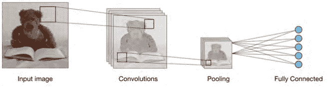

卷积层和池化层可以根据下一节中描述的超参数进行微调。

### 1.2 层类型

卷积层 (CONV) – 卷积层 (CONV) 使用滤波器，在扫描输入 I 及其维度时执行卷积操作。其超参数包括滤波器大小 F 和步长 S。结果输出 O 被称为特征图或激活图。

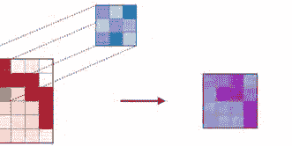

*Remark:* 卷积步骤也可以推广到 1D 和 3D 情况。

池化 (POOL) – 池化层 (POOL) 是一种下采样操作，通常在卷积层之后应用，可实现一定的空间不变性。特别是，最大池化和平均池化是特殊的池化类型，分别取最大值和平均值。

| | Max pooling | Average pooling |
|---|---|---|
| Purpose | Each pooling operation selects the maximum value of the current view | Each pooling operation averages the values of the current view |
| Illustration | max pooling illustration | avg pooling illustration |
| Comments | - Preserves detected features
- Most commonly used | - Downsamples feature map
- Used in LeNet |

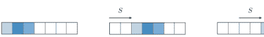

零填充 – 零填充表示在输入边界的每一侧添加 P 个零的过程。此值可以手动指定，也可以通过下面详细说明的三种模式之一自动设置：

| | Valid | Same | Full |
|---|---|---|---|
| Value | P = 0 | P_start = [ S⌈I/S⌉ - I + F - S / 2 ]  P_end = [ S⌈I/S⌉ - I + F - S / 2 ] | P_start ∈ [0,F-1]  P_end = F - 1 |
| Illustration | zero padding valid illustration | zero padding same illustration | zero padding full illustration |
| Purpose | - No padding
- Drops last convolution if dimensions do not match | - Padding such that feature map size has size ⌈I/S⌉
- Output size is mathematically convenient
- Also called 'half' padding | - Maximum padding such that end convolutions are applied on the limits of the input
- Filter 'sees' the input end-to-end |

全连接 (FC) – 全连接层 (FC) 在展平的输入上操作，其中每个输入都连接到所有神经元。如果存在，FC 层通常位于 CNN 架构的末端，可用于优化诸如类别分数等目标。

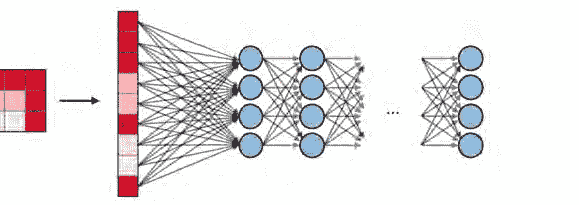

### 1.3 滤波器超参数

卷积层包含滤波器，了解其超参数背后的含义很重要。

滤波器的维度 – 大小为 F × F 且应用于包含 C 个通道的输入的滤波器是一个 F × F × C 体积，对大小为 I × I × C 的输入执行卷积，并生成大小为 O × O × 1 的输出特征图（也称为激活图）。

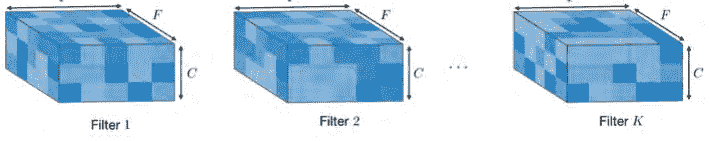

*Remark:* 应用 K 个大小为 F × F 的滤波器会得到大小为 O × O × K 的输出特征图。

步长 – 对于卷积或池化操作，步长 S 表示窗口在每次操作后移动的像素数。

### 1.4 调整超参数

卷积层中的参数兼容性 – 记 I 为输入体积大小的长度，F 为滤波器的长度，P 为零填充量，S 为步长，则该维度上特征图的输出大小 O 由以下公式给出：

$$O = \frac{I - F + P_{start} + P_{end}}{S} + 1$$

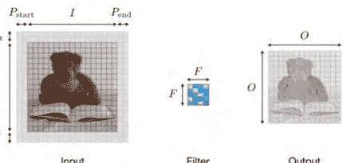

*Remark:* 通常，P_start = P_end ≡ P，在这种情况下，我们可以用 2P 替换公式中的 P_start + P_end。

理解模型的复杂度 – 为了评估模型的复杂度，通常有用的是确定其架构将拥有的参数数量。在卷积神经网络的给定层中，其做法如下：

| | CONV | POOL | FC |
|---|---|---|---|
| Illustration | F×F filter ×K ⊗C | F max | N_in → N_out |
| Input size | I×I×C | I×I×C | N_in |
| Output size | O×O×K | O×O×C | N_out |
| Number of parameters | (F×F×C+1)·K | 0 | (N_in+1)×N_out |
| Remarks | - One bias parameter per filter
- In most cases, S<F
- A common choice for K is 2C | - Pooling operation done channel-wise
- In most cases, S=F | - Input is flattened
- One bias parameter per neuron
- The number of FC neurons is free of structural constraints |

感受野 – 第 k 层的感受野是输入中每个第 k 个激活图像素可以“看到”的面积，记为 R_k × R_k。令 F_j 为第 j 层的滤波器大小，S_i 为第 i 层的步长值，并约定 S_0 = 1，则第 k 层的感受野可以用以下公式计算：

R_k = 1 + Σ_{j=1}^{k} (F_j - 1) Π_{i=0}^{j-1} S_i

在下面的示例中，我们有 F_1 = F_2 = 3 且 S_1 = S_2 = 1，这给出 R_2 = 1+2·1+2·1 = 5。

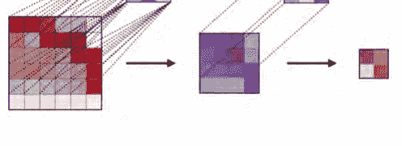

### 1.5 常用激活函数

整流线性单元 – 整流线性单元层 (ReLU) 是一个激活函数 g，用于体积的所有元素。它旨在为网络引入非线性。其变体在下表中进行了总结：

| ReLU | Leaky ReLU | ELU |
|---|---|---|
| g(z)=max(0,z) | g(z)=max(εz,z) with ε≪1 | g(z)=max(α(e^z-1),z) with α≪1 |
| Plot | Plot | Plot |
| Non-linearity complexities biologically interpretable | Addresses dying ReLU issue for negative values | Differentiable everywhere |

Softmax – Softmax 步骤可以看作是一个广义的逻辑函数，以分数向量 x ∈ R^n 作为输入，并在架构末尾通过 softmax 函数输出输出概率向量 p ∈ R^n。其定义如下：

```
p = [p1; ...; pn]   where   p_i = e^{x_i} / Σ_{j=1}^{n} e^{x_j}
```

### 1.6 目标检测

模型类型 – 有 3 种主要的目标识别算法，其预测的性质不同。它们在下表中进行了描述：

| Image classification | Classification w. localization | Detection |
|---|---|---|
| Teddy bear image | Teddy bear with bounding box | Teddy bear with bounding box and label |
| - Classifies a picture
- Predicts probability of object | - Detects object in a picture
- Predicts probability of object and where it is located | - Detects up to several objects in a picture
- Predicts probabilities of objects and where they are located |
| Traditional CNN | Simplified YOLO, R-CNN | YOLO, R-CNN |

检测 – 在目标检测的上下文中，根据我们只是想定位对象还是在图像中检测更复杂的形状，使用不同的方法。两个主要方法总结在下表：

| 边界框检测 | 标志点检测 |
|---|---|
| 检测图像中对象所在的部分 | - 检测对象的形状或特征（例如眼睛）
- 更精细 |
|  |  |
| 中心为 $(b_x,b_y)$、高度 $b_h$ 且宽度 $b_w$ 的框 | 参考点 $(l_{1x},l_{1y}),...,(l_{nx},l_{ny})$ |

交并比 – 交并比，也称为 IoU，是一种量化预测边界框 $B_p$ 相对于实际边界框 $B_a$ 定位正确程度的函数。其定义为：$\text{IoU}(B_p,B_a)=\frac{B_p\cap B_a}{B_p\cup B_a}$

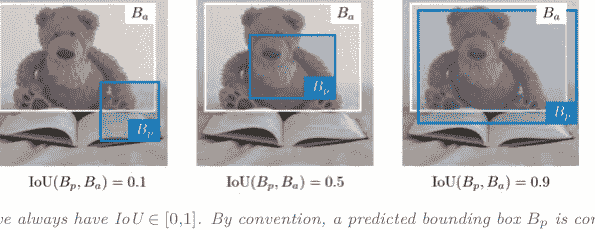

> 备注：我们始终有 $IoU\in[0,1]$。按照惯例，如果 $IoU(B_p,B_a)\ge0.5$，则预测边界框 $B_p$ 被认为是可以接受的。

锚框 – 锚框是一种用于预测重叠边界框的技术。实际上，网络允许同时预测多个框，其中每个框预测都被限制为具有一组给定的几何属性。例如，第一预测可能是一个具有给定形状的矩形框，而第二预测将是具有不同几何形状的另一个矩形框。

非极大值抑制 – 非极大值抑制技术旨在通过选择最具代表性的框来移除同一对象的重复重叠边界框。在移除所有预测概率低于 0.6 的框之后，只要仍有框剩余，就重复以下步骤：

- 第 1 步：选取预测概率最大的框。
- 第 2 步：丢弃与前一个框的 IoU ≥ 0.5 的任何框。

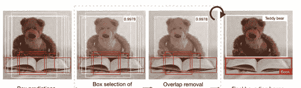

YOLO – You Only Look Once（只看一次）是一种执行以下步骤的目标检测算法：

- 第 1 步：将输入图像划分为 $G\times G$ 网格。
- 第 2 步：对于每个网格单元，运行一个 CNN 预测如下形式的 $y$：$y=[p_c,b_x,b_y,b_h,b_w,c_1,c_2,...,c_p,...]^T\in\mathbb{R}^{G\times G\times k\times(5+p)}$ 重复 $k$ 次，其中 $p_c$ 是检测到对象的概率，$b_x,b_y,b_h,b_w$ 是检测到的边界框的属性，$c_1...c_p$ 是检测到的 $p$ 个类别之一的独热表示，$k$ 是锚框的数量。
- 第 3 步：运行非极大值抑制算法以移除任何潜在的重复重叠边界框。

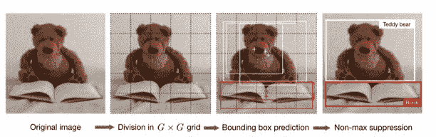

> 备注：当 $p_c=0$ 时，网络不会检测到任何对象。在这种情况下，对应的预测 $b_x,...,c_p$ 必须被忽略。

R-CNN – 基于卷积神经网络的区域（Region with Convolutional Neural Networks，R-CNN）是一种目标检测算法，首先对图像进行分割以找到潜在的相关边界框，然后运行检测算法在这些边界框中找到最可能的物体。

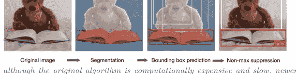

> 备注：尽管原始算法计算成本高且速度慢，但新架构使算法运行更快，例如 Fast R-CNN 和 Faster R-CNN。

#### 1.6.1 人脸验证与识别

模型类型 – 两种主要模型类型总结在下表中：

| 人脸验证 | 人脸识别 |
|---|---|
| - 这是正确的人吗？
- 一对一查找 | - 这是数据库中 K 个人中的一个吗？
- 一对多查找 |
| 带有熊插图的查询/参考图 | 带有熊插图的查询/数据库图 |

一次学习 – 一次学习是一种人脸验证算法，使用有限的训练集学习一个相似度函数，用于量化两个给定图像的差异。应用于两张图像的相似度函数通常记为 d(image 1, image 2)。

孪生网络 – 孪生网络旨在学习如何对图像进行编码，然后量化两张图像的差异。对于给定的输入图像 x^(i)，编码后的输出通常记为 f(x^(i))。

三元组损失 – 三元组损失 ℓ 是在三张图像 A（锚点）、P（正例）和 N（负例）的嵌入表示上计算的损失函数。锚点和正例属于同一类别，而负例属于另一类别。令 α ∈ ℝ⁺ 为间隔参数，该损失定义如下：

ℓ(A,P,N) = max(d(A,P) − d(A,N) + α, 0)

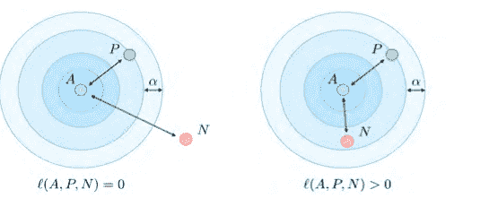

#### 1.6.2 神经风格迁移

动机 – 神经风格迁移的目标是基于给定的内容 C 和给定的风格 S 生成图像 G。

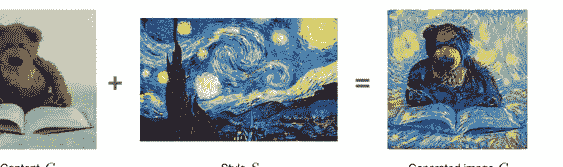

激活 – 在给定层 l 中，激活记为 a^[l]，其维度为 n_H × n_w × n_c

内容代价函数 – 内容代价函数 J_content(C,G) 用于确定生成的图像 G 与原始内容图像 C 的差异。其定义如下：

J_content(C,G) = ½ ||a^[l](C) − a^[l](G)||²

风格矩阵 – 给定层 l 的风格矩阵 G^[l] 是一个 Gram 矩阵，其中其每个元素 G^[l]_kk' 量化通道 k 和 k' 的相关程度。它相对于激活 a^[l] 定义如下：

G^[l]_kk' = Σ_{i=1}^{n_H^[l]} Σ_{j=1}^{n_w^[l]} a_{ijk}^[l] a_{ijk'}^[l]

> 备注：风格图像和生成图像的风格矩阵分别记为 G^[l](S) 和 G^[l](G)。

风格代价函数 – 风格代价函数 J_style(S,G) 用于确定生成的图像 G 与风格 S 的差异。其定义如下：

J_style^[l](S,G) = 1/(2 n_H n_w n_c)² ||G^[l](S) − G^[l](G)||_F² = 1/(2 n_H n_w n_c)² Σ_{k,k'=1}^{n_c} (G^[l]_kk'(S) − G^[l]_kk'(G))²

总体代价函数 – 总体代价函数定义为内容代价函数和风格代价函数的组合，按参数 α、β 加权，如下所示：

J(G) = α J_content(C,G) + β J_style(S,G)

> 备注：α 值越高，模型越关注内容；而 β 值越高，模型越关注风格。

#### 1.6.3 使用计算技巧的架构

生成对抗网络 – 生成对抗网络，也称为 GANs，由生成模型和判别模型组成，其中生成模型旨在生成最真实的输出，该输出将被输入到旨在区分生成图像和真实图像的判别模型中。

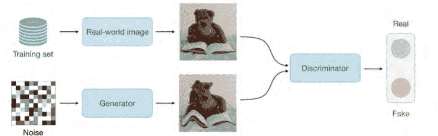

备注：使用 GAN 变体的用例包括文本到图像、音乐生成和合成。

ResNet – 残差网络架构（也称为 ResNet）使用残差块，残差块具有大量层，旨在降低训练误差。残差块具有以下特征方程：

```
a^{[l+2]} = g(a^{[l]} + z^{[l+2]})
```

Inception 网络 – 该架构使用 Inception 模块，旨在尝试不同的卷积以提高其性能。特别是，它使用 1 × 1 卷积技巧来降低计算负担。

* * *

## 2 循环神经网络

### 2.1 概述

传统 RNN 的架构 – 循环神经网络，也称为 RNNs，是一类允许将先前输出用作输入同时具有隐藏状态的神经网络。它们通常如下所示：

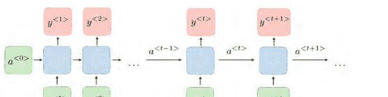

对于每个时间步 t，激活 a^{<t>} 和输出 y^{<t>} 表达如下：

```
a^{<t>} = g1(W_aa a^{<t-1>} + W_ax x^{<t>} + b_a)   and   y^{<t>} = g2(W_ya a^{<t>} + b_y)
```

其中 W_ax、W_aa、W_ya、b_a、b_y 是在时间上共享的系数，g1、g2 为激活函数

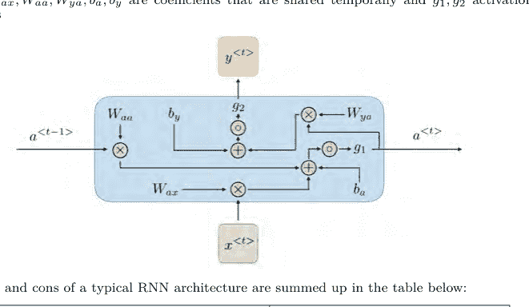

典型 RNN 架构的优缺点总结在下表中：

| 优点 | 缺点 |
|---|---|
| - 可以处理任意长度的输入
- 模型大小不随输入大小增加
- 计算考虑历史信息
- 权重在时间上共享 | - 计算速度慢
- 难以访问很久以前的信息
- 不能为当前状态考虑任何未来输入 |

RNN 的应用 – RNN 模型主要用于自然语言处理和语音识别领域。不同的应用总结在下表中：


| RNN 类型 | 插图 | 示例 |
|---|---|---|
| 一对一 $T_x = T_y = 1$ | [插图] | 传统神经网络 |
| 一对多 $T_x = 1, T_y > 1$ | [插图] | 音乐生成 |
| 多对一 $T_x > 1, T_y = 1$ | [插图] | 情感分类 |
| 多对多 $T_x = T_y$ | [插图] | 命名实体识别 |
| 多对多 $T_x \neq T_y$ | [插图] | 机器翻译 |

```
$$\frac{\partial \mathcal{L}^{(T)}}{\partial W} = \sum_{t=1}^{T} \left.\frac{\partial \mathcal{L}^{(T)}}{\partial W}\right|_{(t)}$$
```

### 2.2 处理长期依赖

- 常用激活函数 – RNN 模块中常用的激活函数如下所述：

| Sigmoid | Tanh | RELU |
|---|---|---|
| $g(z) = \frac{1}{1 + e^{-z}}$ | $g(z) = \frac{e^{z} - e^{-z}}{e^{z} + e^{-z}}$ | $g(z) = \max(0,z)$ |
| [图] | [图] | [图] |

- 梯度消失/爆炸 – 在 RNN 的上下文中经常会遇到梯度消失和爆炸现象。之所以会发生，是因为难以捕捉长期依赖，因为乘性梯度相对于层数而言可能呈指数级减小/增大。

- 梯度裁剪 – 这是一种用于应对在反向传播过程中有时会遇到的梯度爆炸问题的方法。通过限制梯度的最大值，该现象在实践中得到控制。

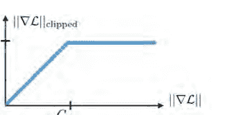

- 门的类型 – 为了补救梯度消失问题，在某些类型的 RNN 中使用了特定的门，通常具有明确定义的目的。它们通常记为 $\Gamma$ 且等于：

```
$$\Gamma = \sigma(W x^{<t>} + U a^{<t-1>} + b)$$
```

其中 $W, U, b$ 是门特定的系数，$\sigma$ 是 sigmoid 函数。主要的门总结在下表中：

- 损失函数 – 在循环神经网络的情况下，所有时间步的损失函数 $\mathcal{L}$ 基于每个时间步的损失定义如下：

```
$$\mathcal{L}(\widehat{y},y) = \sum_{t=1}^{T_y} \mathcal{L}(\widehat{y}^{<t>}, y^{<t>})$$
```

- 通过时间反向传播 – 反向传播在每个时间点进行。在时间步 $T$，损失 $\mathcal{L}$ 相对于权重矩阵 $W$ 的导数表示如下：

| 门类型 | 作用 | 用在 |
|---|---|---|
| 更新门 Γ_u | 现在过去信息应占多大比重？ | GRU, LSTM |
| 相关门 Γ_r | 丢弃先前信息？ | GRU, LSTM |
| 遗忘门 Γ_f | 是否擦除单元？ | LSTM |
| 输出门 Γ_o | 透露单元的多少？ | LSTM |

GRU/LSTM – 门控循环单元（GRU）和长短期记忆单元（LSTM）解决了传统 RNN 遇到的梯度消失问题，其中 LSTM 是 GRU 的推广。下面是总结各架构特征方程的表格：

| | 门控循环单元（GRU） | 长短期记忆（LSTM） |
|---|---|---|
| \tilde{c}^{<t>} | tanh(W_c[Γ_r * a^{<t-1>}, x^{<t>}] + b_c) | tanh(W_c[Γ_r * a^{<t-1>}, x^{<t>}] + b_c) |
| c^{<t>} | Γ_u * \tilde{c}^{<t>} + (1 - Γ_u) * c^{<t-1>} | Γ_u * \tilde{c}^{<t>} + Γ_f * c^{<t-1>} |
| a^{<t>} | c^{<t>} | Γ_o * c^{<t>} |
| 依赖关系 | [GRU 依赖图] | [LSTM 依赖图] |

> *备注：符号 * 表示两个向量之间的逐元素乘法。*

RNN 的变体 – 下表总结了其他常用的 RNN 架构：

| 双向（BRNN） | 深层（DRNN） |
|---|---|
| [包含 y^{<t>}, a^{<t>}, x^{<t>} 的双向 RNN 图] | [多层深层 RNN 图] |

### 2.3 学习词表示

本节中，我们记 V 为词表，|V| 为其大小。

#### 2.3.1 动机与记号

表示技术 – 两种主要的词表示方式总结在下表中：

| 1-hot 表示 | 词嵌入 |
|---|---|
| [包含 book、soft、teddy bear 的 1-hot 3D 图] | [包含 book、soft、teddy bear 的词嵌入 3D 图] |
| - 记作 o_w
- 朴素方法，无相似性信息 | - 记作 e_w
- 考虑词相似性 |

嵌入矩阵 – 对于给定的词 w，嵌入矩阵 E 是一个将其实值表示 o_w 映射到其嵌入 e_w 的矩阵，如下所示：

```
e_w = E o_w
```

> *备注：嵌入矩阵的学习可使用目标/上下文似然模型进行。*

#### 2.3.2 词嵌入

Word2vec – Word2vec 是一个旨在通过估计给定词被其他词包围的可能性来学习词嵌入的框架。流行模型包括 skip-gram、negative sampling 和 CBOW。

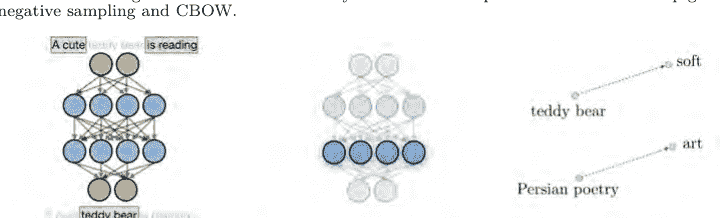

Skip-gram – skip-gram word2vec 模型是一个监督学习任务，通过评估任何给定目标词 t 与上下文词 c 同时出现的可能性来学习词嵌入。记 θ_t 为与 t 相关的参数，概率 P(t|c) 给出为：

```
$P(t|c)=\frac{\exp(\theta_t^T e_c)}{\sum_{j=1}^{|V|}\exp(\theta_j^T e_c)}$
```

*备注：softmax 部分分母中对整个词表求和使该模型计算成本高昂。CBOW 是另一个 word2vec 模型，使用周围词来预测给定词。*

- **负采样** – 它是一组使用逻辑回归的二元分类器，旨在评估给定上下文和给定目标词同时出现的可能性，模型在 k 个负例和 1 个正例的集合上训练。给定上下文词 c 和目标词 t，预测表示为：

```
$P(y=1|c,t)=\sigma(\theta_t^T e_c)$
```

*备注：该方法比 skip-gram 模型计算成本更低。*

- **GloVe** – GloVe 模型，全称为 global vectors for word representation，是一种使用共现矩阵 X 的词嵌入技术，其中每个 X_{i,j} 表示目标 i 与上下文 j 同时出现的次数。其成本函数 J 如下：

```
$J(\theta)=\frac12\sum_{i,j=1}^{|V|}f(X_{ij})(\theta_i^T e_j + b_i + b'_j - \log(X_{ij}))^2$
```

这里 f 是一个加权函数，使得 $X_{i,j}=0 \Longrightarrow f(X_{i,j})=0$。

```
$e_w^{(final)}=\frac{e_w+\theta_w}{2}$
```

*备注：学习到的词嵌入的各个分量不一定可解释。*

### 2.4 比较词

- **余弦相似度** – 词 w1 和 w2 之间的余弦相似度表示如下：

```
$\text{similarity}=\frac{w_1\cdot w_2}{||w_1||\,||w_2||}=\cos(\theta)$
```

*备注：θ 是词 w1 和 w2 之间的夹角。*

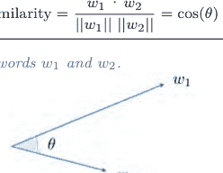

- **t-SNE** – t-SNE（t-分布随机邻域嵌入）是一种旨在将高维嵌入降维到低维空间的技术。实践中，它通常用于在 2D 空间可视化词向量。


### 2.5 语言模型

- **概述** – 语言模型旨在估计句子 P(y) 的概率。

- **n-gram 模型** – 该模型是一种朴素方法，通过在训练数据中计数其出现次数来量化表达式在语料中出现的概率。

- **困惑度** – 语言模型通常使用困惑度指标进行评估，也称为 PP，可解释为按词数 T 归一化的数据集的逆概率。困惑度越低越好，定义如下：

```
$PP=\prod_{t=1}^{T}\left(\frac{1}{\sum_{j=1}^{|V|} y_j^{(t)}\cdot \hat{y}_j^{(t)}}\right)^{\frac1T}$
```

*备注：PP 通常用于 t-SNE。*

### 2.6 机器翻译

- **概述** – 机器翻译模型与语言模型相似，只是前面放置了一个编码器网络。因此，有时也被称为条件语言模型。目标是找到一个句子 y 使得：

```
$y=\arg\max_{y^{<1>},...,y^{<T_y>}} P(y^{<1>},...,y^{<T_y>}|x)$
```

- **束搜索** – 它是一种启发式搜索算法，用于机器翻译和语音识别，以找到给定输入 x 的最可能的句子 y。

- 步骤 1: 找到 top B 个可能的词 y^{<1>}
- 步骤 2: 计算条件概率 y^{<k>}|x,y^{<1>},...,y^{<k-1>}
- 步骤 3: 保留 top B 个组合 x,y^{<1>},...,y^{<k>}

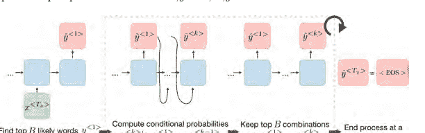


*备注：如果束宽设为 1，则等价于朴素贪心搜索。*

*备注：注意力分数通常用于图像描述和机器翻译。*

- 束宽 – 束宽 $B$ 是束搜索的参数。$B$ 的大值会带来更好的结果，但性能更慢且内存占用增加。$B$ 的小值会导致结果变差，但计算量较少。$B$ 的标准值约为 10。

- 长度归一化 – 为了提高数值稳定性，束搜索通常应用于以下归一化目标，通常称为归一化对数似然目标，定义为：

Objective = $\frac{1}{T_y^{\alpha}} \sum_{t=1}^{T_y} \log \left[ p(y^{<t>}|x,y^{<1>},...,y^{<t-1>}) \right]$

*备注：参数 $\alpha$ 可视为软化因子，其值通常在 0.5 和 1 之间。*

- 错误分析 – 当得到一个很差的预测翻译 $\hat{y}$ 时，可以通过以下错误分析来思考为什么我们没有得到一个好的翻译 $y^*$：

| 情况 | $P(y^*|x) > P(\hat{y}|x)$ | $P(y^*|x) \leqslant P(\hat{y}|x)$ |
|---|---|---|
| **根本原因** | 束搜索有误 | RNN 有误 |
| **补救措施** | 增加束宽 | - 尝试不同的架构
- 正则化
- 获取更多数据 |

- Bleu 分数 – 双语评估替代品 (bleu) 分数通过计算基于 $n$-gram 精度的相似度分数来量化机器翻译的好坏。其定义如下：

bleu score = $\exp\left( \frac{1}{n} \sum_{k=1}^{n} p_k \right)$

其中 $p_n$ 是仅针对 $n$-gram 的 bleu 分数，定义如下：

$p_n = \frac{\sum_{\text{n-gram}\in\hat{y}} \text{count}_{\text{clip}}(\text{n-gram})}{\sum_{\text{n-gram}\in\hat{y}} \text{count}(\text{n-gram})}$

*备注：可能对较短的预测翻译应用简洁性惩罚，以防止 BLEU 分数人为膨胀。*

### 2.7 注意力

- 注意力模型 – 该模型允许 RNN 关注输入中被认为重要的特定部分，这在实践中提高了所得模型的性能。通过记 $\alpha^{<t,t'>}$ 为输出 $y^{<t>}$ 应给予激活 $a^{<t'>}$ 的注意力量以及 $c^{<t>}$ 为时间 $t$ 的上下文，我们有：

$c^{<t>} = \sum_{t'} \alpha^{<t,t'>} a^{<t'>}$ 且 $\sum_{t'} \alpha^{<t,t'>} = 1$


- 注意力权重 – 输出 $y^{<t>}$ 应给予激活 $a^{<t'>}$ 的注意力量由 $\alpha^{<t,t'>}$ 给出，计算如下：

$\alpha^{<t,t'>} = \frac{\exp(e^{<t,t'>})}{\sum_{t''=1}^{T_x} \exp(e^{<t,t''>})}$

*备注：计算复杂度相对于 $T_x$ 为二次方。*

## 3 深度学习技巧与窍门

### 3.1 数据处理

数据增强 – 深度学习模型通常需要大量数据才能正确训练。利用数据增强技术从现有数据中获取更多数据通常很有用。主要的总结在下表中。更具体地说，给定以下输入图像，我们可以应用以下技术：

| 原图 | 翻转 | 旋转 | 随机裁剪 |
|---|---|---|---|
| - 未做任何修改的图像 | - 相对于保持图像含义不变的轴进行翻转 | - 以轻微角度旋转
- 模拟错误的水平校准 | - 随机聚焦图像的某一部分
- 可以连续进行多次随机裁剪 |

| 颜色偏移 | 噪声添加 | 信息丢失 | 对比度变化 |
|---|---|---|---|
| - RGB 的细微差别略有改变
- 捕捉光照曝光可能产生的噪声 | - 添加噪声
- 对输入质量变化更具容忍度 | - 忽略图像的部分
- 模拟图像部分可能丢失的情况 | - 亮度变化
- 控制因一天中的时间而产生的曝光差异 |

批归一化 – 它是一个使用超参数 γ、β 对批次 {x_i} 进行归一化的步骤。通过记 μ_B、σ_B² 为我们希望校正到的批次的均值和方差，其做法如下：

```
x_i ← γ (x_i - μ_B) / sqrt(σ_B² + ε) + β
```

它通常在全连接/卷积层之后、非线性层之前进行，旨在允许更高的学习率并减少对初始化的强烈依赖。

### 3.2 训练神经网络

#### 3.2.1 定义

训练周期 – 在训练模型的上下文中，epoch 指模型遍历整个训练集一次以更新其权重的一次迭代这一术语。

小批量梯度下降 – 在训练阶段，更新权重通常不是一次性基于整个训练集，也不是基于单个数据点，因为计算复杂或噪声问题。相反，更新步骤是在小批量上进行的，其中批次中的数据点数量是我们可调的超参数。

损失函数 – 为了量化给定模型的性能，通常使用损失函数 L 来评估模型输出 z 在多大程度上正确预测了实际输出 y。

交叉熵损失 – 在神经网络的二元分类上下文中，交叉熵损失 L(z,y) 通常使用，定义如下：

```
L(z,y) = - [ y log(z) + (1 - y) log(1 - z) ]
```

#### 3.2.2 寻找最优权重

反向传播 – 反向传播是一种通过考虑实际输出和期望输出来更新神经网络中权重的方法。相对于每个权重 w 的导数使用链式法则计算。

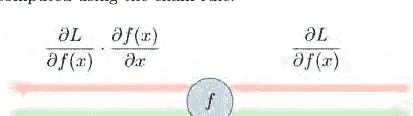

使用此方法，每个权重按以下规则更新：

```
w ← w - α ∂L(z,y)/∂w
```

更新权重 – 在神经网络中，权重更新如下：

- 第 1 步：取一批训练数据并执行前向传播以计算损失。
- 第 2 步：反向传播损失以获得相对于每个权重的损失梯度。
- 第 3 步：使用梯度更新网络的权重。

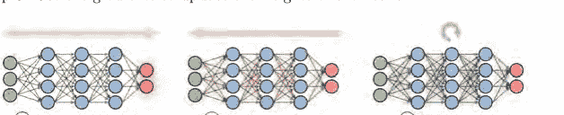

### 3.3 参数调优

#### 3.3.1 权重初始化

- Xavier 初始化 – 而不是以纯随机方式初始化权重，Xavier 初始化能够使初始权重考虑到架构特有的特征。

- 迁移学习 – 训练深度学习模型需要大量数据，更重要的是需要大量时间。利用在庞大数据集上训练了数天/数周的预训练权重并将其用于我们的用例通常很有用。根据我们手头的数据量，有以下几种利用方式：

| 训练规模 | 示意图 | 说明 |
|---|---|---|
| 小 |  | 冻结所有层，在 softmax 上训练权重 |
| 中 |  | 冻结大部分层，在最后几层和 softmax 上训练权重 |
| 大 |  | 通过用预训练权重初始化来训练各层和 softmax 的权重 |

#### 3.3.2 优化收敛

- 学习率 – 学习率，通常记为 α 或有时为 η，表示权重更新的速度。它可以是固定的，也可以自适应地改变。目前最流行的方法称为 Adam，这是一种自适应学习率的方法。

- 自适应学习率 – 在训练模型时让学习率变化可以减少训练时间并改善数值最优解。虽然 Adam 优化器是最常用的技术，但其他方法也可能有用。它们总结在下表中：

| 方法 | 说明 | w 的更新 | b 的更新 |
|---|---|---|---|
| 动量 | - 减弱振荡
- SGD 的改进
- 需调优 2 个参数 | $w - \alpha v_{dw}$ | $b - \alpha v_{db}$ |
| RMSprop | - 均方根传播
- 通过控制振荡加快学习算法 | $w - \alpha \frac{dw}{\sqrt{s_{dw}}}$ | $b \leftarrow b - \alpha \frac{db}{\sqrt{s_{db}}}$ |
| Adam | - 自适应矩估计
- 最流行的方法
- 需调优 4 个参数 | $w - \alpha \frac{v_{dw}}{\sqrt{s_{dw}} + \epsilon}$ | $b \leftarrow b - \alpha \frac{v_{db}}{\sqrt{s_{db}} + \epsilon}$ |

Remark: 其他方法包括 Adadelta、Adagrad 和 SGD。

### 3.4 正则化

- Dropout – Dropout 是神经网络中用于防止过拟合训练数据的一种技术，以概率 p > 0 丢弃神经元。它迫使模型避免过度依赖特定特征集。

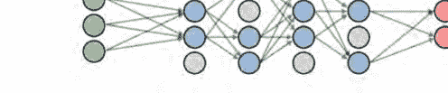

Remark: 大多数深度学习框架通过 'keep' 参数 1 − p 来参数化 dropout。

- 权重正则化 – 为了确保权重不过大且模型不过拟合训练集，通常对模型权重执行正则化技术。主要的总结在下表中：

| LASSO | Ridge | Elastic Net |
|---|---|---|
| - 将系数收缩至 0
- 适用于变量选择 | 使系数变小 | 变量选择与小系数之间的权衡 |
| $... + \lambda ||\theta||_1$ $\lambda \in \mathbb{R}$ | $... + \lambda ||\theta||_2^2$ $\lambda \in \mathbb{R}$ | $... + \lambda \big[(1-\alpha)||\theta||_1 + \alpha||\theta||_2^2\big]$ $\lambda \in \mathbb{R}, \alpha \in [0,1]$ |


- 早停 – 这种正则化技术会在验证损失达到平台期或开始增加时立即停止训练过程。

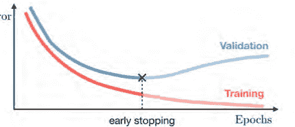

### 3.5 良好实践

- 在小批量上过拟合 – 在调试模型时，通常进行快速测试以查看模型架构本身是否存在任何重大问题。特别是，为了确保模型能够得到正确训练，会将一个小批量数据传入网络，查看其是否能够在该小批量上过拟合。如果不能，意味着模型要么过于复杂，要么不够复杂，甚至无法在小批量上过拟合，更不用说正常大小的训练集了。

- 梯度检查 – 梯度检查是在神经网络反向传播实现过程中使用的一种方法。它将给定点处的解析梯度值与数值梯度值进行比较，并起到正确性 sanity-check 的作用。

| | 数值梯度 | 解析梯度 |
|---|---|---|
| **公式** | $\frac{df}{dx}(x) \approx \frac{f(x+h)-f(x-h)}{2h}$ | $\frac{df}{dx}(x) = f'(x)$ |
| **注释** | - 成本高；损失需要在每个维度上计算两次
- 用于验证解析实现的正确性
-在选择 $h$ 时存在权衡，不能太小（数值不稳定）也不能太大（梯度近似不佳） | - '精确'结果
- 直接计算
- 用于最终实现 |

* * *
