# 深度学习系统

# 参考文献
# 作者简介

# 前言
书中许多概念相互依赖，并且经常以迭代的方式引入，并引用详细阐述该概念的章节。如果你是该领域的新手，请完整阅读导论章节以及每章的引言部分和结尾段落，以把握一些关键要点。然后再回头完整阅读每一章。线性代数、微积分、编程、编译器和计算机体系结构方面的背景知识对某些部分可能有帮助，但不是必需的。本书的组织结构如下：

第 1 章 从对书中详细阐述的核心概念的介绍开始。我们回顾深度学习（DL）的历史和应用。我们讨论在多个领域工业界和学术界采用的各种拓扑类型。我们还提供了一个训练简单 DL 模型的示例，并介绍了一些架构设计考虑因素。

第 2 章 涵盖生产中使用的模型的构建模块。我们描述这些构建模块中哪些是计算受限，哪些是内存带宽受限。

第 3 章 涵盖受益于 DL 最多的应用、工业界采用的主流模型，以及未来几年可能被商业采用的学术趋势。我们回顾推荐系统、计算机视觉、自然语言处理（NLP）和强化学习（RL）模型。

第 4 章 涵盖领域专家为成功采用 DL 算法应遵循的训练流程。我们回顾数据科学家采用的拓扑设计考虑因素，例如权重初始化、目标函数、优化算法、使用有限数据集训练、处理数据不平衡以及在有限内存下训练。我们还描述了训练模型的反向传播算法背后的数学细节。

第 5 章 涵盖在数据中心和边缘设备（称为联邦学习）中采用的分布式算法。我们讨论数据并行和模型并行方面的进展和挑战。我们还回顾通信原语和 `AllReduce` 算法。

第 6 章 涵盖生产和学术界中使用的较低数值格式。这些格式相对于标准 32 位单精度浮点数可以提供计算性能优势，有时以较低的统计性能（准确性）为代价。我们还讨论进一步减少内存占用量的剪枝和压缩技术。

第 7 章 涵盖硬件架构设计。我们回顾计算机体系结构的基础、计算能力增长放缓的原因以及部分缓解这种放缓的方法。我们解释屋顶线模型以及用于服务和多节点训练的重要硬件特性。我们还讨论 CPU、GPU、CRGAs、FPGAs、DSPs 和 ASICs 及其优缺点，以及市场上或正在开发的知名 DL 处理器和平台。

第 8 章 涵盖高级语言和编译器。我们回顾语言类型并解释编译过程的基础。我们讨论将程序转换为 `LLVM` 内部表示（`IR`）的前端编译器以及 `LLVM` 后端编译器。我们还描述了 DL 工作负载的标准编译器优化传递。

第 9 章 涵盖框架和 DL 编译器。我们详细回顾 TensorFlow 和 PyTorch 框架，并讨论正在开发的各种 DL 编译器。

第 10 章 以对未来机遇和挑战的展望作结。我们讨论利用机器学习算法推进 DL 系统栈各个部分的机遇。我们讨论一些挑战，例如安全、可解释性和这些系统的社会影响。我们还提供一些结论性意见。

# 致谢
撰写本书的任务如果没有许多人的支持是不可能完成的。为了避免无意中遗漏某些人，我想感谢以下人士在指导、时间以及讨论和改进内容方面的帮助。

感谢 Morgan & Claypool 的 Michael Morgan 邀请我撰写本书，以及 Natalie Enright Jerger、Christine Kiilerich 和 C.L. Tondo 在写作和出版过程中给予的持续鼓励和出色支持。感谢 Parthasarathy Ranganathan 的指导以及介绍我认识 Michael 和 Natalie。

感谢 Cliff Young、Natalie Enright Jerger、Nikhil Murthy、Nicholas Lee 和 Joanne Yuan 提供了详细的评论，这些评论对改进整部手稿非常宝贵。

感谢 Robert Zak、Wolff Daniel Dobson、Vinay Phegade、Roman Dubtsov、Kreig DuBose、Matthew Brookhart、Chinnikrishna Kothapalli、Steven (Cap) Rogers、Dheevatsa Mudigere、Carlos Escapa、Tatiana Shpeisman、Vijayakumar (Kumar) Bhagavatula、Mourad Gouicem、AG Ramesh、Jian Hui Li、Romir Desai、Vadim Pirogov、Michael Goldsmith、Chris Browning、Gal Novik、Sherine Abdelhak、Abigail Wen、Md Faijul Amin、Tristan Webb、Marcel Nassar、Koichi Yamada、Anna Bethke、Ivan Kuzmin、Anahita Bhiwandiwalla、Mariano Phelipp、Brian Retford、Tiffany Shih、Jayaram Bobba、Edward Groden、Anthony Reina、Bin Wei、Jacek Czaja、Etay Meiri、Luke Ge、Ran Cohen、Derek Osborne、Jayarama Shenoy、Michael Greenfield、Madhusudhan Rangarajan、Eric Lin、Lei Xia、Albert Hu、Brinda Ganesh、Diego Caballero、Tatyana Primak、Naveen Mellempudi、Mohammad Ashraf Bhuiyan、Rajesh Poornachandran、Rinat Rappoport、Xin Wang、Yoann Foucher、Pujiang He、Jun Jin、Eric Gardner、Adam Straw、Scott Cyphers、Brian Golembiewski、Clayne Robison、Sangeeta Bhattacharya、Ravi Panchumarthy、Patric Zhao、Derssie Mebratu、Anisha Gartia、Shamima Najnin、Rajendrakumar Chinnaiyan、Zhenlin Luo、Chris Banyai、Vinod Devarampati、Alex Heinecke、Evarist Fomenko、Milind Pandit、Lei Shao、Yong Wu、Sameh Gobriel、Andrey Nikolaev、Nawab Ali、Bernhard Friebe、Nikhil Deshpande、Shashikant Kale、Amir Gholaminejad、Indu Kalyanaraman 以及 Greg Leeming 对本书与其各自专业领域相关的部分提出的优秀评论、为确保正确性进行的讨论，或对早期草稿的校对以提高清晰度。感谢 Roberto Gauna 和 Travis Belnap 在制作和改进许多插图方面的帮助。

我最深的感谢献给 Mary-Kathryn，她坚定不移的友谊和热情的支持使本书的写作成为可能。我的第二大感谢献给我们的孩子 Isabel、Tomas 和 David，他们激励着我，并且在 Papi 忙于写作无法陪他们玩耍时，表现出了耐心和宽容。本书献给你们。愿人工智能和深度学习系统的进步让你们和你们这一代人的世界变得更美好。

# 免责声明
书中表达的观点仅代表我个人，不代表英特尔公司、以前的雇主或被致谢者的观点。有关软件和硬件产品的细节来自公开披露的信息，可能不代表这些产品的最新状态。

# 勘误
请将您的评论和勘误提交至 `deep.learning.systems@gmail.com`。提前感谢您抽出时间做出贡献。

Andres Rodriguez

October 2020

# 第 1 章

## 引言
深度学习（DL）模型是一个将输入数据映射到输出预测的函数。为了提高复杂任务中预测的准确性，DL 模型在训练期间尤其需要更多的计算、内存、带宽和功耗。用于训练和部署最先进模型所需的计算量每 ~3.4 个月翻一番 \[DH18\]。所需计算量至少随准确率按四次多项式增长，对于某些任务则按九次多项式增长 \[TGL+20\]。这种对计算的渴求远远超过了硬件中计算增长的轨迹，并且不可持续。此外，主内存带宽正成为一个更重要的瓶颈；计算能力增长远快于内存带宽，许多算法已经受带宽限制。

计算增长的演变正在推动 DL 架构的创新。晶体管设计和制造的改进不再带来此前每两年一次的 2× 通用计算增长。暗硅的数量，即晶体管无法在标称电压下运行的比例，正在增加。这促使人们利用晶体管构建特定领域的电路。

数据科学家、优化（性能）工程师和硬件架构师必须在设计 DL 系统时进行协作，以保持当前的创新步伐。他们需要了解算法趋势并以 3–5 年为视野设计 DL 系统。这些设计应在通用计算和特定领域计算之间取得平衡，并适应未知未来的模型。

DL 系统的特性因最终用户和运行环境而大不相同。正在尝试各种新拓扑（也称为 DL 算法或神经网络）的研究人员比训练和部署已建立拓扑的工程师需要更高的灵活性和可编程性。此外，即使是已建立的拓扑，其计算特征也大不相同。例如，图像分类模型的计算与数据比可能比语言翻译模型高三个数量级。

需要专门硬件、更高带宽、压缩、稀疏性、更小的数值表示、多芯片通信和其他创新来满足 DL 计算的需求。每获得 2× 的性能提升都需要新的硬件、编译器和算法协同创新。

软件编译器的进步对于支持 DL 硬件的寒武纪大爆发以及有效地将模型编译到不同的硬件目标至关重要。编译器对于降低评估或采用各种硬件设计的成本至关重要。良好的编译器会生成运行高效且执行迅速的代码。也就是说，生成的代码利用了硬件的计算能力和内存层次结构，使计算单元具有高利用率。有关于此方面的若干工作已在 第 9 章 中详细说明，正在进行中。

本书的目的有二：（1）提供对 DL 算法设计、训练和应用、编译器技术以及加速 DL 系统的关键处理器特性的扎实理解，（2）促进 DL 系统的协同创新和进步。

在本章中，我们介绍了贯穿全书的基本概念。我们回顾了 DL 算法的历史、应用和类型。我们提供了一个训练简单模型的示例并介绍了其中的一些架构设计考虑。我们还介绍了在本书部分内容中使用的数学符号。

## 1.1 深度学习在行动
DL 模型已紧密集成到现代社会的各个领域。推荐模型推荐要点击的广告、要购买的产品、要观看的电影、要添加的社交联系人以及要阅读的新闻和社交帖子。语言模型促进不同语言使用者之间的交流。语音识别和语音生成推动了自动化助手中的人机交互。排序模型改善搜索引擎结果。序列模型增强导航系统中的路线规划。视觉模型检测 MRI 和 X 射线胶片中的人物、动作和恶性细胞。

其他 DL 应用包括药物发现、阿尔茨海默病诊断预测、小行星识别、GUI 测试、欺诈检测、交易和其他金融应用、中微子探测、机器人、音乐和艺术生成、游戏、电路设计、代码编译、高性能计算系统故障检测等。

尽管在多个预测领域取得了巨大成功，DL 算法仍存在局限性。它们在某些行为预测中尚未可靠，例如识别再犯率、职业成功、恐怖主义风险和有风险的儿童 \[Nar19\]。功能有限的其他领域包括个性化助手和聊天机器人。

另一个局限在于通用人工智能（`AGI`），有时被称为强人工智能。`AGI`是指机器表现出人类智能特征，例如意识和自我意识。机器达到这一能力的大致时间由约翰·冯·诺伊曼命名为奇点。人工智能社区对奇点到来的时间存在不同意见，从本世纪晚些时候到永不实现不等。鉴于其极具推测性，`AGI`在此不再进一步讨论。

`DL` 的采用仍处于起步阶段。存在一些更简单的机器学习算法，它们所需数据和计算量较少，已在各行业广泛采用来分析数据并做出预测。其中包括线性回归、逻辑回归、XGBoost 和 Light-GBM（如果您不熟悉这些算法也不必担心）。在流行的 Kaggle 挑战中获胜的解决方案大多数都涉及这些计算上更简单的算法。

Nevertheless, 对 `DL` 的兴趣极高，其采用速度正在迅速增长。拥有仓库规模计算机（`WSC`）\[BHR18\]的高科技公司，此后称为超大规模公司或超大规模运营商，主要将 `DL` 用于生产中的以下工作负载（按重要性排序）：

1\. 推荐（由于变现收益）用于个性化广告、社交媒体内容和产品推荐。

2\. 自然语言处理（`NLP`）用于虚拟助手（Alexa、Siri、Cortana、G-Assistant 和 Duer）的人机交互以及聊天机器人/服务机器人，用于对抗语言毒性、语言翻译，以及作为推荐工作负载的预处理步骤。

3\. 计算机视觉用于生物识别、自动驾驶、图像着色、医学诊断和艺术生成。

推荐器拓扑对多个超大规模运营商至关重要；它们与收入产生的联系比计算机视觉和 `NLP` 拓扑更紧密。数据中心中专门用于推荐器的服务器总数可能高于 `NLP` 和计算机视觉。例如，在 Facebook，推荐模型占所有训练周期的 50% 以上，占其所有推理周期的 80% 以上 \[Haz20, NKM+20\]。

计算机视觉拓扑在企业数据中心和客户端设备（如手机）中被广泛采用。当公司开始采用 `DL` 时，它们通常从计算机视觉拓扑开始。这些拓扑是最成熟的，并且相比非 `DL` 方法提供了显著的提升。鉴于该领域有多个开源数据集可用，压倒性多数的学术论文集中在计算机视觉：82%；相比之下，`NLP` 为 16%，推荐器为 2%，这是由于公开数据集有限 \[Haz20\]。

模型训练和服务具有不同的要求。训练可能计算密集。例如，流行的图像分类 `ResNet-50` 模型大约需要 1 Exa（`10¹⁸`）次操作，按今天的标准来说已算很小 \[YZH+18\]。训练更大得多的 `Megatron-LM` 模型需要 12 Zetta（`12 × 10²¹`）次操作 \[SPP+19\]。其他模型，例如某些推荐器，具有独特的挑战，通常不仅需要高计算，还需要大内存容量以及高网络和内存带宽。

在训练过程中，多个样本并行处理，提高了数据重用和硬件利用率。除了受内存容量限制的工作负载外，大多数大型模型训练都在 `GPUs` 上进行，因为它们相比 `CPUs` 具有更高的每秒总操作数、更高的内存带宽和软件生态系统。

服务，也称为推理、预测、部署、测试或评分，通常是更广泛应用的一部分。虽然一次推理周期所需的计算量与训练相比很少，但在一个模型整个生命周期内用于该模型推理的总计算量远超训练。

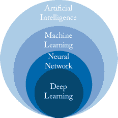

图 1.1：深度学习是神经网络的子集，神经网络是机器学习的子集，机器学习是人工智能的子集。

服务通常受延迟限制。产品推荐、搜索结果、语音助手查询以及自动驾驶汽车中的行人检测需要在预先指定的延迟约束内得到结果。因此，在服务期间，通常只处理一个或几个样本以满足延迟要求。将单个数据样本的服务计算有效地并行化到大量核心上具有挑战性。因此，`GPUs`（以及在较小程度上 `CPUs`）在服务期间会遭受较差的计算利用率。硬件架构师有机会设计更好的低延迟处理器并最小化空闲计算周期，详见 第 7 章。

数据中心中的服务通常在 `CPUs` 上进行，因为它们具有更高的可用性、更高的核心频率以及对小批量更高的计算利用率。鉴于使用单个数据样本时的并行化挑战，`CPU` 中较少但更快的核心可能比 `GPU` 中众多较慢的核心更有优势。使用更多核心可以进一步降低延迟，但会以较低的核心利用率为代价（由于核心间通信开销）。然而，随着模型增长并需要更多计算，一些公司正在转向 `GPUs` 或尝试为推理使用专用处理器。此外，低功耗（更小）的 `GPUs` 或具有可视化的 `GPUs` 会减少分配给工作负载的核心数量，从而提高核心利用率。

## 1.2 AI、ML、NN 和 DL

术语 artificial intelligence（`AI`）、machine learning（`ML`）、neural network（`NN`）和 deep learning（`DL`）经常被互换使用。虽然没有达成一致的标准定义，但以下内容是常见的，并在 图 1.1 中有所体现。

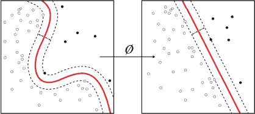

图 1.2：机器学习算法将输入数据映射到一个空间或流形，在该空间或流形中数据可以用线性分类器进行分类。来源：\[Wik11\]（CC BY-SA 4.0）。

`AI` 是任何能够学习、行动或适应的程序或系统。`AI` 近期的流行源于 `ML` 算法的进步，特别是 `DL`。`ML` 模型是一个学习函数的程序，该函数将输入数据（或从输入数据中提取的特征）映射到期望输出。几何上，这种映射是从数据不可线性分离的向量空间到数据可线性分离的向量空间，如 图 1.2 所示。这些向量空间正式称为希尔伯特空间或流形。模型的映射函数或统计性能（准确率）通常随着数据的增加而提高。

`NN` 模型，也称为人工神经网络（`ANNs`），通常由称为层的简单非线性函数堆叠而成，以表示复杂函数或映射。堆叠多个线性函数会得到一个可以用一层表示的线性函数，从而抵消多层映射的好处。因此需要非线性函数。`DL` 模型，有时称为深度神经网络（`DNNs`），是具有超过三层的 `NN` 模型，并且是端到端可微分的。传统的机器学习（非 `NN` ML）模型和具有 1–3 层的 `NN` 模型也称为浅层模型。

传统 `ML` 与大多数 `DL` 之间的区别在于，传统 `ML` 依赖领域专家为给定任务指定关键特征。相比之下，`DL` 通常以需要更多数据和计算为代价来学习这些特征。几十年来，计算机视觉专家花费了大量精力研究图像特征以改进检测 \[FGM+10\]。具有有限计算机视觉专业知识的 `DL` 从业者证明 `NNs` 能够在每一层学习复杂度递增的特征，并在图像检测和分类任务中超越最先进技术 \[KSH12\]。

DL 模型尽管需要更多的数据和计算资源，但在特征关系无法合理近似的工作负载中，相较于传统 ML 模型具有特别优势，例如视觉、文本或语音数据。传统 ML 模型在表格或结构化数据中仍然很受欢迎，在这些数据中特征关系可以被近似，例如使用贝叶斯模型手动编码层级关系（如果您不熟悉贝叶斯模型，请不要担心）\[DWO+19\]。

## 1.3 神经网络简史

神经网络在 1960 年代被推广并用于二分类。它们的流行度在 1970 年代下降，因为神经网络未能兑现炒作的承诺。神经网络的兴趣在 1980 年代中期增加，当时反向传播算法（详见第 4 章）被重新发现，促进了多层神经网络的训练以学习更复杂的分类器。在 1990 年代中期，大多数人工智能的关注点转向了支持向量机（SVMs），这是一类具有理论性能边界的机器学习算法。神经网络社区将 1970 年代称为第一次人工智能寒冬，将 1990 年代中期到 2000 年代初称为第二次人工智能寒冬，原因是神经网络的资金和进展有限（这些应称为神经网络寒冬，因为人工智能比神经网络更大）。

在过去十年中，随着神经网络在许多技术上表现远超其他技术，特别是视觉和自然语言处理任务，兴趣得以重新燃起。这种近期成功归因于更快更便宜的硬件、更大规模的数据集、改进的算法和开源软件\[SAD+20\]。来自竞争公司的研究人员经常发布他们的算法和训练方法（但通常不发布训练好的模型或数据集）；因此，他们在彼此的知识之上构建并加速进展。

## 1.4 学习类型

机器学习算法通常分为四种学习类型或类别：有监督、无监督、半监督和强化学习（RL），如图 1.3 所示并在下面讨论。尽管名称如此，所有这些学习都是“有监督的”，因为它们需要人类明确定义决定好坏的成本函数。请注意，另一种对机器学习算法进行分类的方式是判别式或生成式。判别式算法学习将输入数据映射到概率分布。生成式算法学习数据的统计特性并生成新数据。

### 1.4.1 有监督学习

有监督学习是工业界最常用的类型，原因在于其货币化优势，并且它是本书中介绍的模型的主要但非唯一重点。有监督学习使用带注释或标记的数据进行训练，这意味着训练数据集中每个数据样本的真实值或模型期望输出是已知的。训练涉及学习一个近似将输入映射到期望输出的函数。该函数可以是回归函数或分类函数。回归函数具有数值或连续输出，例如房屋价格（输入数据将是房屋特征，如房屋大小和当地学校评级）。分类函数具有离散或类别输出，例如{car, pedestrian, road}（输入数据将是图像像素）。工业界使用的 DL 模型大多数用于分类任务。图 1.3a 展示了一个分类示例，其中显示了三个不同类别之间的学习线性决策边界。绿色圆圈、红色叉号和蓝色星号代表从每个类别样本中提取的二维特征。

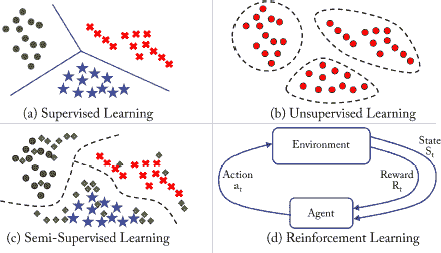

图 1.3：四种类型的机器学习算法。

有监督学习任务的示例，输入数据和标签为（任务：输入数据 标签）：

•图像分类：像素 图像中物体的类别标签

•图像检测：像素 图像中每个物体的边界框以及这些物体的类别标签

•推荐系统：购物历史、IP 地址、产品 购买的产品

•机器翻译：源语言句子 目标语言句子

•语音识别：声波 书面文本

•语音生成或文本转语音（TTS）：书面文本 声波

•回归分析：房屋大小、当地学校评级 房屋价格

### 1.4.2 无监督学习和自监督学习

无监督学习在无标签数据中学习模式。图 1.3b 展示了在无标签数据上的聚类示例，其中显示了学习到的聚类。自监督学习是无监督学习的一个子集，包括学习嵌入以及预测文本或图像中缺失的词或像素。例如，10,000 词语言中的每个词可以表示为一个 10,000 维向量，除了特定词的索引位置为一外，其余全为零。该向量称为独热向量，显示在图 1.4 中。自监督学习模型可以学习将此稀疏向量映射到小而稠密的向量表示。其他示例包括为社交网络中的人员和大型目录中的产品学习稠密向量表示。这些稠密向量表示通常是监督学习模型的输入。

图 1.4：独热向量。所有条目均为零，除了对应该词的向量条目为一。

### 1.4.3 半监督学习

半监督学习结合了有监督学习和无监督学习的技术。图 1.3c 展示了一个小的标记数据集通过更大的未标记数据集增强，以改进（相对于有监督学习算法）类别之间的决策边界。虽然过去十年大多数成功都来自有监督学习，但鉴于每天产生的大量未标记数据，半监督学习是一个有前景的方法。此外，为了借鉴人类学习的灵感，儿童似乎主要使用未标记数据学习。然而，在工业界的采用有限。

### 1.4.4 强化学习

RL 用于教智能体根据一系列行动后收到的奖励执行某些行动。智能体的目标是最大化奖励。图 1.3d 描绘了智能体与环境的交互。智能体根据给定行动的结果获得奖励。RL 算法有三种类型：Q 学习、策略优化和基于模型，详见第 3.4 节。

## 1.5 拓扑类型

一种*拓扑*是表示神经网络结构或架构的计算图，如图 1.5 所示。节点表示对张量（多维数组）的操作，而边决定节点之间的数据流和数据依赖关系。

在商业应用中使用的主要拓扑类型是多层感知机（MLPs）、卷积神经网络（CNNs）、循环神经网络（RNNs）和 Transformer 网络。这些拓扑在下面介绍，并在第 3 章中详细说明。研究中常见的其他拓扑类型，在商业应用中也有一定采用，包括图神经网络（GNNs）、对抗网络（ANs）和自编码器（AEs）。贝叶斯神经网络（BNNs）和脉冲神经网络（SNNs）仅限于研究。

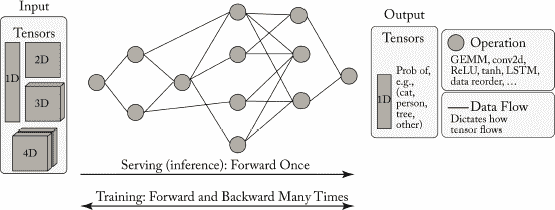

图 1.5：计算图接收张量输入并产生张量输出。服务通常涉及一次前向传播。训练涉及多次前向和反向迭代循环。

### 1.5.1 多层感知机

前馈神经网络（`FFNN`）是一个有向无环图（`DAG`），它包含输入层、输出层以及一个或多个称为隐藏层的中间层。输入层的节点没有父节点，输出层的节点没有子节点。输入要么从数据中学习，要么从数据中提取。这些模型是超大规模公司最广泛使用的模型，尤其（但不仅限于）用于推荐系统。

`MLP` 是一种 vanilla `FFNN`，具有仿射层，也称为全连接层，每层后跟一个激活函数。仿射层由单元组成，这些单元将前一层的加权输出或激活线性组合并加上偏置（偏置被视为另一个权重）。使用多层使 `MLP` 模型能够表示复杂的非线性函数 \[HSW89\]。从几何上看，`MLP` 模型试图通过多次非线性变换将一个向量空间映射到另一个向量空间，在该空间中数据是线性可分的，如 图 1.2 所示。在这个新的流形中，最后一个 `FFNN` 层是一个线性分类器，用于分离不同类别的大部分数据。

图 1.6 显示了一个用于数字分类的四层 `MLP`，其中第 0 层具有 `D^((0)) = 784` 个单元，对应每个像素（输入图像为 28 × 28 像素），第 1 层和第 2 层为隐藏单元，分别具有 `D^((1)) = 128` 和 `D^((2)) = 32` 个单元，第 3 层具有 `D^((3)) = 10` 个单元，对应 10 个可能的数字，其中 `D^((l))` 为第 `l` 层的单元数或维度。在 第 1.6 节 中，我们详细说明如何训练该模型。实际上，`CNN` 模型是数字分类的更好选择；我们使用 `MLP` 模型通过一个简单示例来介绍这种拓扑结构。

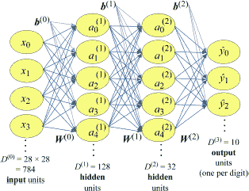

图 1.6：具有四层的 `MLP`：输入层、两个隐藏层和输出层。该模型将 784 个像素值映射到 10 个可能类别上的概率分布。

### 1.5.2 卷积神经网络

`CNN` 是一种特殊的 `FFNN`，广泛用于计算机视觉应用，例如图像分类、图像检测、图像相似性、语义分割、人体姿态估计、动作识别和图像特征提取。商业应用包括人脸识别、视觉搜索、用于文档扫描的光学字符识别、X 射线肿瘤检测、药物发现和 MRI 分析。图 1.7 显示了 `CNN` 的输入和各层的输出激活。卷积单元在 第 2.3 节 中详细解释，生产中使用的各种 `CNN` 模型在 第 3.2 节 中讨论。

`CNN` 也用作图像特征提取器；其中一层最后层的输出（通常是倒数第二层）被用作表示图像的特征向量。该向量成为其他算法的输入，例如用于生成图像文本描述的 `RNN`，或用于学习玩视频游戏的强化智能体，或使用视觉相似性的推荐系统。

### 1.5.3 循环神经网络

`RNN` 是一个有向图，其节点沿时间或上下文序列排列以捕捉时间依赖关系。`RNN` 模型用于语言任务和时间序列预测中常见的序列数据。商业应用包括股价预测、文本摘要、下词推荐、语言翻译、简单聊天机器人任务、图像描述生成、语音识别和情感分析。

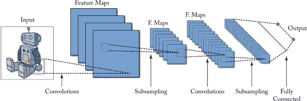

图 1.7：具有若干层的 `CNN` 模型将输入图像映射到多个可能标签上的概率分布。来源：\[Wik15\]（CC BY-SA 4.0）。

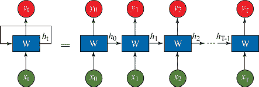

图 1.8：`RNN` 拓扑可以用具有所有层相同权重 `W` 的 `FFNN` 拓扑表示。

与 `MLP` 和 `CNN` 模型不同，`RNN` 的输入和输出长度可以变化。例如，在机器翻译中，输入句和输出句的词数不同。`RNN` 可以展开并表示为在各层共享相同权重的 `FFNN`，如 图 1.8 所示。

`RNN` 模型可以堆叠多层，也可以是双向的，如 图 1.9 所示。`RNN` 模型的主要构建块是循环单元，它捕捉对来自之前步骤的聚合相关数据的表示或“记忆”。根据所使用的循环单元类型，`RNN` 模型主要有三种类型：vanilla `RNN`、`LSTM` 和 `GRU` 单元，详见 第 2.5 节。在文献中，术语 `RNN` 指的是 `vanilla RNN`，或更广泛地指这三种类型的模型。在本书中，当指 vanilla `RNN` 模型时，我们明确使用术语 vanilla `RNN` 以避免混淆。`LSTM` 和 `GRU` 模型通常因其优越的统计性能而优于 vanilla `RNN` 模型。

`RNN` 模型有两个重大挑战：（1）捕捉长序列中的依赖关系；（2）并行化计算（由于序列性质，给定时间步的输出依赖于前一时间步）。使用 第 2.8 节 中详细说明的注意力层可以缓解这些挑战。将堆栈中第一层的多个序列输出连接起来并将其作为输入传递给堆栈中的第二层，可以提高多层模型的计算效率 \[HSP+19\]。

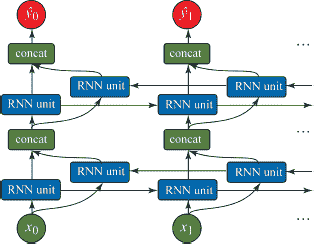

图 1.9：具有两层的双向 `RNN` 模型。

### 1.5.4 Transformer 网络

Transformer 模型使用注意力模块学习输入的各个部分如何影响输出。这些模型也称为基于注意力的模型，已在与 `RNN` 类似的语言任务中得到广泛采用。它们以额外的计算为代价缓解了上一节中讨论的 `RNN` 的挑战。注意力模块可以捕捉长序列中的依赖关系。Transformer 模型一次性消耗整个序列，并使用多个 `FFNN` 与注意力模块并行，以学习对应于输入和输出之间影响的一组权重 \[VSP+17\]。例如，在机器翻译中，注意力权重捕捉输出（目标）语言中每个词如何同时受邻近词和输入（源）语言中词的影响。注意力模块在 第 2.8 节 中进一步解释，生产中使用的各种基于 Transformer 的模型在 第 3.3 节 中讨论。

### 1.5.5 图神经网络

`NNs` 在使用 `MLPs` 时对组织为向量的数据进行操作，使用 `CNNs` 时对网格或晶格进行操作，使用 `RNNs` 和 `Transformers` 时对序列或链进行操作。`GNN` 是 `MLP`、`CNN`、`RNN` 和 `Transformer` 的泛化，它在图上而不是张量上操作，如 图 1.10 所示。图由节点（也称为顶点）和表示节点之间关系的边组成。`GNN` 节点学习邻近节点属性。图在许多应用中很常见，例如在社交网络中表示人员及其连接，在分子生物学中表示原子和键，在推荐系统中表示用户、项目和评分，在电信中表示网络，以及在药物发现中表示化合物结构和蛋白-酶相互作用。图之图也很常见；一个例子是使用网页文档图进行网页文档分类，其中边是超链接，每个节点都是一个图，其中每个文档都有 `XML`-formatted 元素。`GNNs` 提供了在图上学习和进行预测的结构，通常使用稀疏标记数据。鉴于 `GNNs` 中邻接矩阵的稀疏表示，推进非顺序内存访问检索的工作以加速 `GNNs` 是有益的。

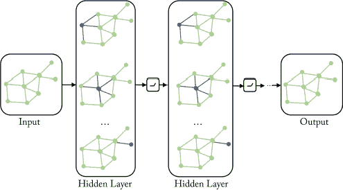

图 1.10：`GNN` 在图上而不是张量上操作。此 `GNN` 有四层，输入层、输出层和两层隐藏层。基于 \[Jad19\]。

`GNNs` 于 2009 年引入，并在学术界最近经历了天文数字般的增长 \[SGT+09\]。鉴于许多现实世界的图应用，预计未来几年行业将快速增长。大型推荐系统，例如 Pinterest 的 `PinSage`，已经使用 `GNNs` \[YKC+18\]。超大规模公司正在开发平台，例如阿里巴巴的 `AliGraph`、微软的 `NeuGraph` 和亚马逊的 `Deep Graph Library` (`DGL`) 以促进 `GNN` 行业采用 \[ZZY+19, MYM+19, WVP+19\]。`PyTorch Geometric` (`PyG`) 主要针对学术研究 \[FL19\]。

### 1.5.6 对抗网络

`AN` 或生成对抗网络 (`GAN`) 由两个子网络组成：判别器和生成器，如 图 1.11 所示 \[GPM+14\]。在训练期间，它们在 minimax 游戏中竞争。生成器学习生成与训练集统计相对应的原始数据。判别器将候选评估为真实或合成（生成）。生成器的目标是提高判别器的错误率。它生成数据以欺骗判别器将其分类为真实。判别器最初使用训练数据集进行训练。然后在与生成器竞争时进行调整。随着模型的训练，生成的数据变得更像真实，判别器在识别合成数据方面有所改进。

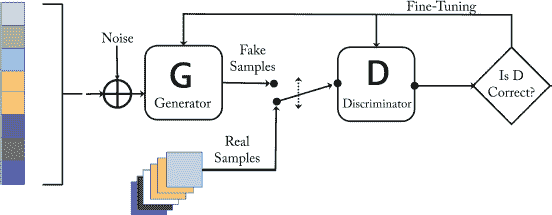

图 1.11：生成对抗网络具有判别器和生成器网络，它们相互竞争。基于 \[Gha17\]。

Yann LeCun，很可能是最杰出的 `DL` 科学家，将 `GANs` 描述为“过去二十年机器学习中最酷的想法” \[Lec16\]。`GANs` 最初是为无监督学习提出的，现在它们被用于所有类型的学习。Wasserstein `GAN` (`WGAN`) 提高了学习模型的稳定性，Weng 提供了 `WGAN` 中使用的数学的详细解释 \[ACB17, Wen17\]。

`GANs` 也用于粒子物理和宇宙学中的基于物理的模型模拟，将模拟时间减少了几个数量级 \[PdO+18, RKL+18\]。第 3.2 节.5 讨论了各种 `GANs` 用于图像生成的用途。

### 1.5.7 自动编码器

`AE` 是一类无监督学习拓扑，学习输入的低维表示（编码）。`AE` 学习在输出层重构输入数据，并使用瓶颈层（通常是最中间的层）的输出作为低维表示。单位数通常在每一层中减少，直到瓶颈层，如 图 1.12 所示。

`AEs` 用于 (1) 作为输入数据的紧凑（压缩）表示；(2) 作为分类问题的预处理步骤，其中数据首先被编码然后传递给分类器；(3) 在数据匹配问题中通过比较两个数据样本的编码；(4) 通过学习从噪声输入到干净输出的映射来去噪数据；以及 (5) 作为生成模型，使用解码器生成数据（称为变分自动编码器（ `VAE`））。

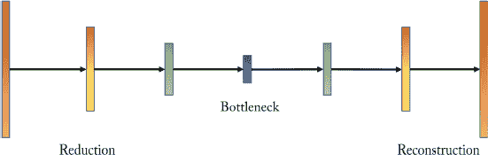

图 1.12：自动编码器学习在输出层重构输入数据。瓶颈层的输出通常用作输入的低维表示。

### 1.5.8 贝叶斯神经网络

`BNN` 结合了 `NN` 和贝叶斯模型的优势来估计 `NN` 预测的不确定性 \[Nea95\]。典型的 `NNs` 使用单值权重，而 `BNNs` 使用每个权重上的概率分布；也就是说，`BNNs` 提供每个权重不确定性的估计，可用于性能保证并提高可解释性。然而，分析计算和更新每个分布是极其昂贵的。近似先验和后验分布是研究中的一个活跃领域，变分推断是一个常见的算法（在其他地方讨论）\[BCK+15\]。尽管在学术界很受欢迎，由于目前在生产中缺乏采用，`BNNs` 不再进一步介绍。

### 1.5.9 脉冲神经网络

`SNN` 受到自然神经元使用尖峰传输信息的方式的启发 \[NMZ19\]。`SNNs` 代表了一类完全不同的 `NNs`，其区别在于局部学习规则，通常不包含在 `DL` 文献中。`SNNs` 的主要优势是使用专用硬件即神经形态处理器具有更低功耗的潜力，例如英特尔的 `Loihi`、IBM 的 `TrueNorth` 和 aiCTX 的动态神经形态异步处理器 (`DYNAP`) 处理器 \[RJP19\]。由于其统计性能较差以及与其他类型 `NNs` 相比应用有限，`SNNs` 目前未在生产中使用，因此不再进一步讨论。

## 1.6 训练和部署一个简单的神经网络

`NN` 拓扑由层数、每层的单元数和每层的激活函数组成。训练模型需要选择和调整以下超参数：`NN` 拓扑、初始化权重的方法、目标函数、批大小以及优化算法和相应的学习率 (`LR`)。请注意，在 `DL` 文献中（以及本书中），*超参数* 是数据科学家调整的旋钮，而 *参数* 是模型权重。各种工作负载中使用的拓扑类型在 第三章 中讨论，训练步骤在下面介绍并在 第四章 中详细说明。准备训练数据集以及使用不平衡数据集训练，其中训练样本在类别之间分布不均匀，在 第 4.5 节 中讨论，并且可能有助于识别训练数据集中某些偏差的方法在 第 10.4 节 和 第 10.5 节 中讨论。像 `TensorFlow` 和 `PyTorch` 这样的软件库促进了 `NNs` 的训练和部署，并在 第九章 中讨论。在多个节点之间进行分布式训练可以减少总训练时间 (`TTT`)，详细说明在 第五章。

# 训练与服务系统
训练系统旨在在不牺牲精度的情况下减少训练时间。服务或推理系统旨在在延迟要求约束下最大化吞吐量。产品推荐、搜索结果、语音助手查询以及自动驾驶汽车中的行人识别都需要实时（低延迟）结果。通常，仅使用一个数据样本或一个微批次来满足特定应用的延迟要求。鉴于从内存读取的每个字节对应的计算量更少，GPU 和 CPU 在服务时的运算强度或计算效率低于训练时。

## 命名法
命名说明：在本书中，batch（文献中有时称为 `mini-batch`）指的是从 1 到整个数据集的训练样本子集。`full-batch` 指由整个训练数据集组成的批次。`micro-batch` 指包含 1–8 个样本的批次。`large-batch` 指批次大小大于 1,000 个样本但小于整个训练数据集。`node-batch` 指分布式训练中在单个节点上处理的批次，详见 第 5 章。

在本节剩余部分，我们介绍 `NNs` 的一些组件，并使用一个简单示例描述训练过程。训练和服务模型的主要计算操作是乘法和加法，通常以组形式计算并表示为矩阵。

## 训练过程
一旦拓扑结构定义完成，训练就涉及学习一组良好的权重值。监督学习的训练步骤通常如下：

### 监督学习步骤
1. 通常通过从零均值高斯分布或均匀分布中采样来初始化模型的权重或参数。
2. 将训练样本或更常见的一批样本前向传播通过网络以计算输出。
3. 使用预期输出（由训练标签已知）与实际输出之间的差异度量来评估成本或惩罚。
4. 将成本相对于各层权重和激活的梯度反向传播。
5. 使用计算得到的梯度更新模型的权重。
6. 返回步骤 2，或在验证误差小于某个阈值或不再下降时停止。

### 迭代与轮次
在训练期间，数据集以批次形式处理。对一批样本完成步骤 2–6 的一个循环称为 `iteration`，而对整个训练数据集完成一个循环称为 `epoch`。例如，如果数据集有 `1*M` 个样本，而批次有 100 个样本，则完成一个 epoch 需要 `10*K` 次迭代。

训练模型可能需要数十个 epoch 才能学习到一组良好的权重。训练后，使用验证数据集测量验证（也称为样本外）性能。验证数据集包含训练期间未使用且已标记的数据，应尽可能与模型部署时遇到的服务数据相似。该验证数据集上的性能是部署性能的良好指标，有助于判断模型是否对训练数据集过拟合。过拟合发生在模型学习到训练数据特有的特征时，因此无法泛化到训练数据集之外的数据。用于缓解过拟合的正则化技术在 第 4.1 节 中讨论。

## 服务 / 推理
在服务期间，模型处理一个微批次。数据通过网络前向传播以计算输出。服务也称为推理，因为模型正在推断数据样本的标签。上述步骤 2 即为推理；也就是说，推理是训练过程中的一个步骤，但通常使用更小的批次大小并采用一些特定于服务的优化。

## 示例：MNIST 手写数字分类
以下示例说明了训练过程。任务是使用 `MLP` 模型 \[LBB+98\] 对 MNIST 数据集中的手写数字进行分类。图 1.13 显示了 MNIST 数据集中 70,000 张灰度 28 × 28 像素图像的一个小子集。通常使用 MNIST 时，60,000 张图像用于训练，10,000 张图像用于验证。实际上，`CNN` 模型更适合图像分类，但这里使用简单的 `MLP` 模型来介绍一些基本概念。

`MLP` 中的每一层由单元（神经元）组成，这些单元将来自前一层的加权输出或激活与偏置权重线性组合，如 图 1.14 所示的一个单元。该仿射变换的输出传递给非线性激活函数 `g(·)`。`activation function` 指非线性函数，`activation input` 是激活函数的输入，而 `activation`（`activation output` 的简称）指激活函数的输出。常见的激活函数有修正线性单元 (`ReLU`) 及其变体、`sigmoid` 及其泛化 `softmax`，以及双曲正切 (`tanh`)，这些都详细说明在 第 2.1 节 中。

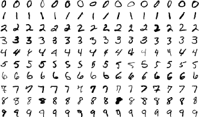
图 1.13：MNIST 数据集的示例。每个数字图像有 28 × 28 像素。来源：\[Wik17\] (CC BY-SA 4.0)。

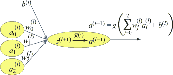
图 1.14：在层 (`l` + 1) 的神经单元对来自前一层 (`l`) 的激活的加权和应用非线性变换或函数。

## MLP 架构
用于此数字分类任务的 `MLP` 模型，如 图 1.6 所示，输入层 (`Layer 0`) 有 784 个单元，对应于每张图像中的像素值数量。输出层有 10 个单元，对应于可能的 0–9 标签的概率分布。该 `MLP` 有两个隐藏层，分别有 128 和 32 个单元。隐藏层数量和每层单元数量的选择需要实验。在 第 4.5 节 中，我们讨论选择合适拓扑的技术。

## 前向传播细节
为了训练模型，28 × 28 图像像素值被重新排列为 784 × 1 向量并归一化为零均值和单位范数（归一化的好处在 第 2.6 节 中解释）。这是 `NN` 的输入，可视为 `Layer 0` 的激活。`Layer 1` 中单元 `i` 的输入 `z[i]^{(1)}` 是 `Layer 0` 激活的加权和加上偏置。单元 `i` 的激活 `a[i]^{(1)}` 是其激活输入 `z[i]^{(1)}` 的非线性变换：

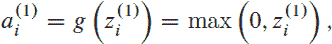

其中 `g(·)` 是 `ReLU` 激活函数，且

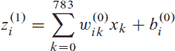

是仿射变换的输出（也称为 `Layer 1` 中的激活输入），其中 `x[k]` 表示第 `k` ϵ \[0,783\] 个像素值。在此示例中，`Layer 1` 和 `Layer 2` 的激活函数为 `ReLU`，输出层的激活函数为 `softmax`。`ReLU` 函数将负值置零并保持正值不变。`softmax` 函数用于输出层，将一组值映射为概率分布，其中值均在 0 到 1 之间且总和为 1。第 `i` 个输出值可按如下方式计算：

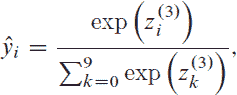

其中 `ŷ[i]` 表示输入图像对应类别 `i` 的概率。`softmax` 层中没有偏置项。

该 `softmax` 输出与真实值进行比较。对于此任务，真实值是一个 one-hot 向量，其中非零索引对应于正确的类别标签。交叉熵损失为：

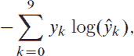

其中 `log` 表示自然对数（以 `e` 为底的 `log`），`y[k]` 在样本属于类别 `k` ϵ \[0, 9\] 时为 1，否则为 0，而 `ŷ[k]` 是模型预测样本属于类别 `k` 的概率。图 1.15 描绘了对应于数字 4 的样本图像的期望输出和实际输出 `ŷ`。在图中，模型的输出 `ŷ` 错误地表明数字 8 是最可能的推断结果。需要额外的训练迭代来降低此损失。

关于所有层激活和权重的代价梯度，是利用链式法则从最后一层开始逐层向后计算，直到第一层。因此得名反向传播。梯度提供了每个权重和激活对代价贡献的度量。实际上，给定批次和给定层的全部激活是同时使用矩阵代数计算的。对于这些计算，数据科学家使用针对特定硬件目标优化的软件库。

在训练期间，激活值会被保存以用于反向传播计算。因此，训练所需的硬件内存容量大于推理所需的硬件。所需内存与批次大小成正比。

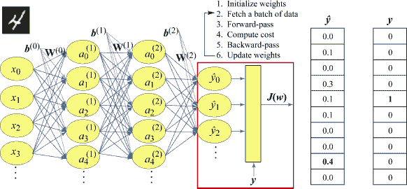

图 1.15：大小为 1 的批次包含数字 4 的样本图像，被传入模型。实际输出 `ŷ` 和期望输出（真实值）`y` 用于计算代价 `J(w)`。在此示例中模型表现不佳，预测数字 8 的概率为 40%，数字 4 的概率为 10%。交叉熵损失为 – `log(0.1)`。

## 1.7 内存与计算分析

训练过程需要内存用于 (1) 模型权重、(2) 所有激活值（包括输入数据的批次）以及 (3) 用于梯度计算的两个连续梯度激活层。服务过程需要内存用于 (1) 模型以及 (2) 两个连续的激活层（包括输入批次）。

前一节中 `MLP` 模型中权重 `N[w]` 的数量，包括偏置，为：

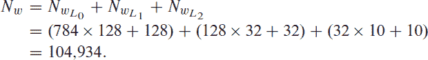

如果每个权重使用 4 字节表示，该小型模型需要 420 KB 内存。注意，在某些文献中，使用基于 2 的度量，其中千字节 (KiB)、兆字节 (MiB) 和吉字节 (GiB) 分别表示 2¹⁰、2²⁰ 和 2³⁰ 字节。因此，420 KB 约为 410 KiB。

激活总数 `N[a]` 是各层激活之和：

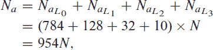

其中 `N` 为每个批次中的图像数量。梯度计算所需的两个最大梯度激活层 `N[g]` 的大小为：

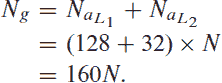

因此，使用每个值 4 字节，训练的总内存需求为：

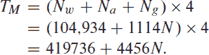

假设批次 `N` = 128，训练所需内存为 1.0 MB。

使用每个值 4 字节，推理的总内存需求为：

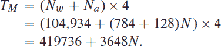

假设批次 `N` = 1，推理所需内存为 424 KB。

## 1.8 硬件设计考虑

DL 平台的主要组件包括众多的乘法和加法单元、足够的内存容量、向计算单元提供数据的高速内存带宽、用于分布式计算的高速节点间带宽以及运行所需的功率。处理最先进的模型越来越需要这些组件。硬件设计需要在数值格式、存储和内存层次结构、功耗限制、面积限制、精度要求、硬件或软件管理的缓存或 scratchpad、对稠密和稀疏计算的支持、专用到通用计算比例、计算与带宽比例以及芯片间互连等巨大空间中仔细平衡这些组件。硬件需要灵活性和可编程性来支持一系列 DL 工作负载并实现高工作负载性能。本节将介绍其中一些组件，并在 第 7 章 中进一步展开。

训练和服务的核心计算是乘法和加法。相对于主内存带宽和本地内存，计算成本较低。摩尔定律持续带来可在给定面积内集成晶体管数量的指数增长。因此，一组乘累加 (`MAC`) 单元所需的硅面积正在减小。虽然硬件公司通常强调每秒理论最大操作数 (`ops`)（`ops/s` 或 `OPS`），但最显著的瓶颈通常是主内存带宽和本地内存容量。如果带宽不足，受带宽限制的工作负载（也称为带宽受限）的整体计算效率或利用率（已用计算周期占总计算容量的百分比）会很低，增加计算能力并不会改善其性能。让数据靠近计算可以缓解此瓶颈。按访问时间递减、芯片面积递增的顺序，存储类型为非易失性内存（闪存、磁盘）、DRAM（HBM2/E、GDDR6、DDR4、LPDDR4/5）、SRAM（scratchpad、缓存）和寄存器。DRAM 通常称为主内存，SRAM 为本地内存。

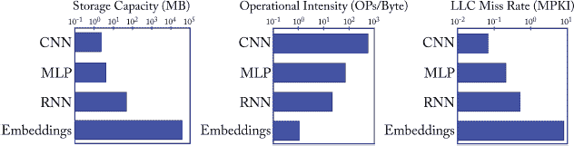

图 1.16：典型的 `CNNs`、`MLPs`、`RNNs` 和嵌入在存储、操作强度和内存访问不规则性方面相差数个数量级。基于 \[Haz20\]。

平衡平台的设计因具有多样化计算、内存和带宽需求的工作负载谱系而变得复杂。例如，Facebook（以及其他超大规模厂商类似）使用的 `CNNs`、`MLPs`、`RNNs` 和嵌入在这些需求上相差数个数量级，如 图 1.16 \[Haz20\] 所示。操作强度是衡量从内存读取每字节执行的运算次数。按每千条指令失误次数 (`MPKI`) 衡量的最后一级缓存 (`LLC`) 失误率是分析本地内存 (`SRAM`) 使用效率的标准指标，也可作为工作负载不规则内存访问模式的指标。

数值格式是另一个设计考虑因素，可能影响计算（速度）性能和统计（精度）性能。图 1.17 显示了各种数值格式，详见 第 6.1 节。使用更少字节的数值表示可以提高每周期操作数并降低功耗，但可能导致统计性能下降。训练使用单精度浮点 (`fp32`)，半精度浮点 (`fp16`) 和 bfloat16 (`bf16`) 正在迅速普及。推理使用 `fp16` 和 `bf16`，8 位整数 (`int8`) 在某些应用中也在普及。一个研究领域是开发能够使用 8 位更好地表示值的数值表示，例如 `fp8`，在 第 6.1 节 中讨论，并且可以在硅上高效实现。减少内存和带宽需求的其他技术包括增加稀疏性和压缩数据。

`MAC` 单元计算两个值的乘积并将其累加到累积和中。输出（累加）的数值格式可能与输入不同。涉及点积的计算，如矩阵乘法和卷积，通常使用 `MACs`。描述 `MAC` 单元时使用的记法为 `MAC-input-format`  `MAC-accumulate-format`。例如，`int8`  `int32` 表示 `int8` 值相乘并作为 `int32` 值累加。在大数值格式中累加值可以缓解数值溢出。

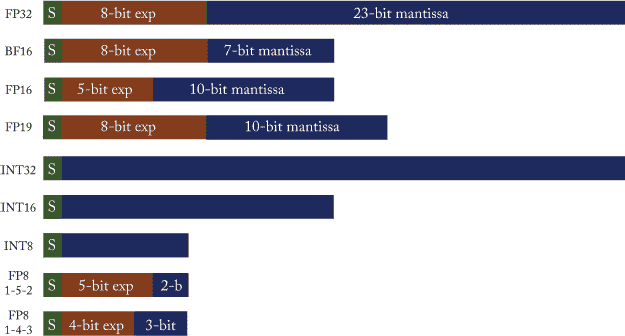

图 1.17：数值格式。绿色为符号位。棕色为指数位。蓝色为尾数位。

不同硬件用途有不同的要求。表 1.1 显示了超大规模厂商常见用途的高层要求：拓扑设计、训练已建立的生产模型（Trn. Prod.）、数据中心推理（Inf. DC）和边缘推理（Inf. Edge）。在表中，格式指的是表示权重和激活值的位数。训练在传输和存储激活值方面比推理需要更多的内存和带宽。另一个未在 表 1.1 中显示的用例是硬件设计，它需要可重构硬件（例如，`FPGAs`）或硬件模拟器。

## 1.9 软件栈

软件对 `DL` 系统至关重要。软件栈组织如下：

•部署和训练管理系统；
•框架、推理引擎和图编译器；

表 1.1：根据用途的硬件特性

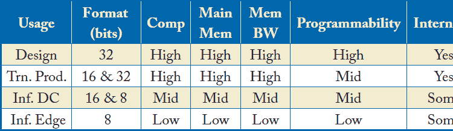

•`DNN` 原语库和张量编译器；
•指令集架构（`ISA`）；以及
•操作系统。

软件栈的主要设计目标是在各种模型和硬件设备上实现易用性和高性能。

部署和训练管理系统促进模型在流水线各阶段的迁移：数据准备、拓扑探索、实验跟踪、模型打包、大规模模型部署和再训练。管理系统旨在满足数据科学家和基础设施团队的需求。它提供协作且安全的环境，并可访问最新的 `ML` 库，例如 `TensorFlow` 和 `PyTorch`。

软件栈的核心是编译器，用于将程序员的高层代码转换为可在目标设备上高效运行的可执行代码。框架和推理引擎（`IEs`），例如 `TensorFlow`、`PyTorch`、`OpenVINO` 和 `TensorRT`，为 `DL` 模型中使用的算子提供高层抽象。它们使用图优化器（内置或外部）来优化模型。框架的调度器依赖于低层的 `DL` 和数学库，例如 `oneDNN`（以前称为 `Intel MKL-DNN`）、`Nvidia cuDNN`、`Eigen` 或 `OpenBLAS`，或在张量编译器中对标准 `DL` 函数进行优化。框架还具有代码生成路径，可使用其他编译器（如 `LLVM`）补充这些库。

`ISA` 定义了抽象计算机架构的算子、数据类型和内存管理。`ISA` 的特定实现称为 *微架构*。例如，Intel 和 AMD CPU 在不同的微架构实现和 CPU 世代中使用 `x86` 或 `x86-64` `ISA`。程序在特定 `ISA` 的所有微架构实现之间是二进制兼容的。不同的微架构可能具有不同的特性，从而影响其性能，例如指令延迟和缓存层次结构。特定的微架构可以有不同频率和缓存大小的多种版本。

操作系统（`OS`）管理计算设备中的所有硬件和软件；它将计算和内存等硬件资源分配给软件应用程序。操作系统的概述超出了本书的范围。

第 8 章 介绍编程语言和编译器技术，而 第 9 章 详细说明了流行的 `DL` 图和张量编译器。第 10 章 突出了超大规模厂商用于管理训练和部署的高层平台。

## 1.10 记号

本节参考了本书通篇使用的记号，用以表示输入数据、标签、权重、仿射变换、激活值和输出。请回想，训练和推理中的计算操作归结为乘法和加法。线性代数用于将一组乘法和加法表示为单个矩阵-矩阵或矩阵-向量或向量-向量操作。虽然有帮助，但不需要线性代数背景；读者可以忽略方程，而对本书其他部分的影响不大。

在 `DL` 文献中，仿射变换的输出可以等价地表示为以下两种形式之一

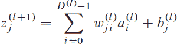

或为

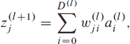

其中偏置项 *b*[*i*]^((*l*)) 在第二个方程中作为附加权重包含在内，并对应有 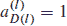附加到激活值上。本书使用第一种记号并明确单独表示偏置。使用的附加记号如下：

•括号中的上标表示层数
•方括号中的上标表示样本编号
•下标表示矩阵或向量中的索引
•粗体小写表示向量
•粗体大写表示矩阵
•x^(\[*n*\]) 和 y^(\[*n*\])：分别表示第 *n* 个样本的输入特征和期望输出（真实值）
•(x^(\[0\]), y^(\[0\])),…, (x^(\[*N*–1\]), y^(\[*N*–1\]))：包含 *N* 个样本的训练数据
•*y* ϵ {0, 1}：用于二分类
•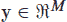：通常是一个向量，在对应其类别分配的条目处为一，其余位置为零，用于 *M*\-元（*M* > 2）分类
•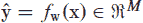：模型的输出
•*D*^((*l*))：第 *l* 层的单元数（维度），*l* ϵ \[0, *L* – 1\]，其中 *L* 为层数（注意对于 *M*\-元分类，*D*^((*L*–1)) = *M*）
•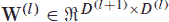：从第 *l* 层到第 *l* + 1 层的权重（不包括偏置），其中
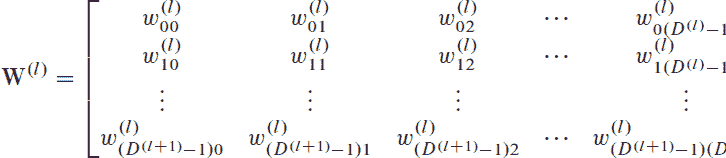
•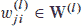：从第 *l* 层输出 *i* 到第 *l* + 1 层输入 *j* 的权重，其中 *i* ϵ \[0, *D*^((*l*)) – 1\]，且 *j* ϵ \[*D*^((*l*+1)) – 1\]
•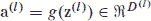：第 *l* ϵ \[0, *L* – 1\] 层的激活值
•a^((0)) = x：`NN` 输入（通常已归一化）
•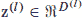：输入到第 *l* ϵ \[1, *L* – 1\] 层的激活值
•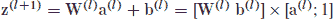，其中 \[**W**^((*l*)) b^((*l*))\] 表示将 b^((*l*)) 右侧附加到矩阵 **W**^((*l*)) 上的矩阵，而 \[a^((*l*)); 1\] 表示将 1 底部附加到向量 a^((*l*)) 上的向量
•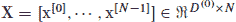
•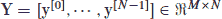
•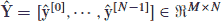
•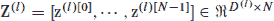
•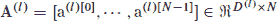
•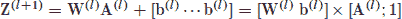

# 第 2 章

## 构建模块

在商业应用中使用的四种主要 `NN` 拓扑类型是：多层感知器（`MLPs`）、卷积神经网络（`CNNs`）、循环神经网络（`RNNs`）和基于变换器的拓扑。这些拓扑是 *有向图*，具有节点和边，其中节点表示算子，边表示节点之间的数据依赖关系，如 图 1.5 所示。

节点也称为原语（primitive function 的简称）、层、表达式或核，是拓扑的构建块。虽然研究人员开发的函数数量不断增长，例如流行的 `TensorFlow` 框架支持超过 1,000 个算子，但在商业应用中使用的函数数量相对较少。这些函数的例子有 `ReLU`、`sigmoid`、双曲正切、`softmax`、`GEMM`、卷积和 `batch normalization`。

计算函数有三种类型：稠密线性函数（例如 `GEMM` 和卷积）、非线性函数（例如 `ReLU` 和 `sigmoid`）以及归约函数（例如池化）。稠密线性函数通常实现为矩阵式算子，非线性函数实现为逐元素算子。归约函数将输入向量归约为一个标量值。

矩阵运算算子计算密集型，且（取决于硬件和数据重用量）可能受计算限制（在某些 GPU 文献中称为 Math bound）。逐元素算子计算轻量且受内存带宽限制。这些函数的输入从内存中读取，结果写回内存；没有数据重用。

提高模型计算效率的常见技术是将计算轻量的逐元素算子融合到计算密集型的矩阵运算算子中。因此，中间结果不会写入主内存再读回。逐元素计算在矩阵运算计算之后立即进行，此时数据仍在寄存器或靠近计算单元的存储中。第 8 章详细介绍了这一技术以及通过软件优化提高效率的其他技术。

在本章和下一章中，我们采用自底向上的方法。本章介绍在超大规模企业中流行模型使用的标准原语。下一章讨论使用这些原语构建的实际模型和应用。喜欢自顶向下方法的读者可以先阅读第 3 章，以便在深入本章的构建块之前更好地了解模型和应用的类型。回顾第 1.10 节中引入的记号有助于理解本章中呈现的方程。

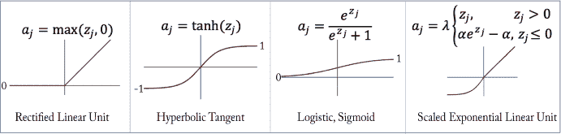

图 2.1：DL 工作负载中使用的一些激活函数`a[j] = g(z[j])`的示例。

## 2.1 激活函数

激活函数是对层输入张量的每个元素应用的非线性函数。最流行的激活函数是整流线性单元（ReLU）。ReLU 函数及其梯度计算成本低。一些模型在使用 ReLU 函数时收敛更快\[KSH12\]。ReLU 还增加了稀疏性，这可能带来计算和内存节省\[GBB11\]。

ReLU 的主要缺点是负激活的梯度为零，对应的权重在反向传播期间不会改变。这被称为死亡 ReLU，并促使了 ReLU 的变体，例如 Leaky ReLU（LReLU）、参数化 ReLU（PReLU）、缩放指数线性单元（SELU）以及在某些基于注意力的模型中采用的高斯误差线性单元（GELU）\[HZR+15, KUM+17, HG16\]。另一个变体是 ReLU6，它将最大 ReLU 输出限制为 6，并且在使用小数值表示时可能改善统计性能。这些变体并不总是带来更优的统计性能，需要通过实验来评估其益处。

`k`-胜者通吃（`k`-WTA）激活函数保留层中最大的`k`个激活值，其余置零。通常为每个层选择不同的`k`以在各层间保持恒定的稀疏比率，例如 80%\[XZZ20\]。

sigmoid 和双曲正切（tanh）激活函数，如图 2.1 所示，常用于 RNN 模型。它们的主要缺点是对于大正或负激活，梯度非常小。在反向传播期间，各种小梯度的乘积由于计算机中有限的数值表示而导致值消失。这被称为梯度消失问题。较不易受梯度消失影响的 RNN 模型变体在第 2.5 节中讨论。

双曲正切相对于 sigmoid 函数的一个好处是它保持零均值分布。除非期望输出是概率分布，否则应优先使用它而不是 sigmoid。sigmoid 函数通常用作二元分类输出层的激活函数，因为输出在 0 到 1 之间，可以表示概率。

softmax 是 sigmoid 的推广，用于多类分类。它同时使用逐元素和归约算子。输出被解释为概率分布，所有值在 0 到 1 之间且总和为 1。第`i`个输出值可计算为：

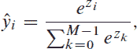

其中`M`是类别数。softmax 层的激活输入`z`称为`logit`向量或分数，对应于未归一化的模型预测，不应与 logit（sigmoid）函数混淆。

对大 logit 应用指数函数会放大数值误差。因此，在使用 softmax 函数之前，通常的做法是从所有 logit 中减去最大 logit `m`\[BHH20\]。结果在数学上等价：

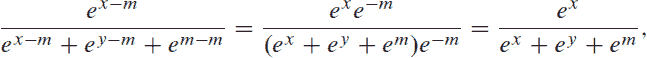

其中`x`、`y`和`m`是三个 logit。

## 2.2 仿射

仿射变换（也称为全连接、前馈或 GEMM 层）提供输入的加权和加上偏置。图 2.2 说明了仿射变换

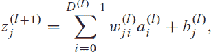

及其后续的非线性激活

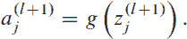

仿射变换可表述为对一批样本和层中所有单元的通用矩阵乘法（GEMM），如第 1.10 节中的最后一个方程所示。仿射变换在 DL 文献中被称为线性原语（略微滥用术语，因为线性函数不应有偏置）。

即使在大型网络中偏置项对性能影响可能可以忽略，也始终建议使用偏置；移除偏置几乎没有计算或内存节省。注意，当仿射层后接批归一化（BN）层（在第 2.6 节中讨论）时，偏置没有统计影响，因为 BN 会抵消偏置。

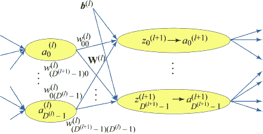

图 2.2：仿射层及其后续非线性函数。

## 2.3 卷积

卷积核（通常称为滤波器）在计算机视觉中被广泛采用，并与 2D 图像、3D 体素图像（如 MRI 扫描）以及 3D 时序图像或视频一起使用。对于输入值中存在与空间或时间邻近性相关关联的任务，例如图像、视频和频谱图（在第 2.4 节中讨论），可以使用卷积核。

卷积在 DL 和信号处理文献中的含义不同。DL 文献中使用的卷积算子，以及本书中使用的，是权重与输入激活（卷积层输入值）之间的互相关算子。每个卷积输出值是滤波器与输入子集的点积。整个卷积输出通过将该滤波器在输入的所有子集上滑动来计算。

使用一个滤波器的 1D 卷积如下：

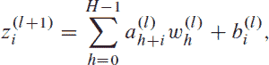

其中`H`是滤波器`w^(l)`的长度。该方程可轻松扩展到 DL 中更常见的 2D 卷积。通常每个层使用多个滤波器。图 2.3 说明了`K`个 1D 卷积和`K`个 2D 卷积（为简化图示省略了偏置）。

如果输入未填充或滤波器滑动之间存在步幅，则输出会变小。常用做法是用零扩展或填充输入以使输出尺寸与输入尺寸匹配（假设步幅为 1）。另一种填充技术是使用部分卷积，它生成更合适的填充，并在其他地方讨论\[LRS+18\]。

## 2D 卷积

为了演示二维卷积，假设（为说明目的）一个 6 × 6 的灰度输入张量（实际上输入通常大得多）和一个 5 × 5 的滤波器，如 图 2.4 所示。输入用零填充以确保输出大小等于输入大小。二维输出数组的左上角值是 5 × 5 滤波器与零填充输入张量中左上角 5 × 5 像素（标记为红色）的点积。注意，在本书和深度学习文献中，点积的定义包括两个二维数组的哈达玛积（逐元素乘法）的聚合和。下一个输出值使用输入张量中的下一个 5 × 5 值计算（标记为绿色）。这种模式在整个输入数组中继续，以计算所有输出值。

图 2.3：(a) `K` 个一维卷积和 (b) `K` 个二维卷积。所有滤波器的结果沿新的维度拼接。因此，`K` 个二维卷积的输出张量的深度（通道数）为 `K`。

图 2.4：二维卷积操作。输出张量（右）中的左上角值是滤波器（中）的值与输入张量（左）红色方块中的左上角值的点积。输入张量首先进行零填充，以便输出张量的高度和宽度维度等于输入张量的维度。鸣谢：Joanne Yuan。

图 2.5：对具有 `C` 个通道的 `H` × `W` 输入进行 `K` 个二维卷积。每个滤波器也有 `C` 个通道。输出张量有 `K` 个通道，每个通道对应每个滤波器与输入张量的卷积输出。

一个 `H` × `W` 彩色图像有 3 个通道（红、绿、蓝），也称为特征通道或张量深度。图像的维度表示为 3 × `H` × `W`。滤波器的通道数与输入相同，如 图 2.5 所示。假设有 `K` 个 5 × 5 滤波器，每个有 3 个通道（表示为 3 × 5 × 5），则 `K` 个二维卷积中的每一个都是 3 × 5 × 5 滤波器与输入在高度和宽度上移动的所有 3 × 5 × 5 子集之间的点积。在二维卷积中，滤波器不会在深度（通道）上移动。注意，滤波器大小通常仅用其高度和宽度描述；深度可以推断：它是输入张量的通道数。

卷积层有一组滤波器，每个滤波器检测输入中的不同特征。为了说明，假设输入是一个 3 × 224 × 224 张量，且该层有一组 64 个滤波器。每个滤波器产生一个 224 × 224 输出。每个输出包含对应滤波器在输入中检测到的特征。聚合的层输出是一个 64 × 224 × 224 张量，且下一卷积层中的所有滤波器都有 64 个通道。

实际上，卷积层通常使用 4D 输入、滤波器和输出张量。张量在（1D）内存中排列的常用方式称为 *data layout*，对于输入张量为 `NCHW` 或 `NHWC`，其中 `N` 是批次中的样本数，`C` 是输入深度（或等价地，通道数或特征数），`W` 是输入宽度，`H` 是输入高度。滤波器排列为 `RSCK` 或 `KCRS`，其中 `K` 是滤波器数（也称为输出特征通道数），`R` 是滤波器高度，`S` 是滤波器宽度。`NCWH` 和 `KCRS` 中的 `C` 相同。注意，`KCRS` 在某些文献中有时表示为 `OIHW`，但本书不使用以避免与输入张量中使用的 `H` 和 `W` 混淆。在上面的示例中，输入的 `NCHW` 维度为 1 × 3 × 224 × 224，滤波器的 `KCRS` 维度为 64 × 3 × 5 × 5，输出的  维度为 1 × 64 × 224 × 224。

卷积沿七个维度计算：批次大小 `N`、输出通道 `K`、输入通道 `C`、输出高度 、输出宽度 、滤波器高度 `R` 和滤波器宽度 `S`。它可以天真地实现为七个 `for loops`，如算法 2.1 所示，其中 `k`、 和  表示输出张量 `Z` 的通道、高度和宽度索引。为简单起见，步幅假定为 1。还有更高效的实现，考虑了设备的内存层次结构和并行计算能力 \[DAM+16\]。

卷积滤波器可以通过复制部分输入值实现为 `GEMM`，如 图 2.6 所示，并将滤波器转换为向量。这称为基于 `im2col-` 的卷积实现。这种实现使得可以使用 `GEMM` 库（通常经过良好优化）。然而，它以输入张量的额外内存需求和转换输入的额外计算周期为代价。相反，一个仿射层可以用卷积层表示，其中 `C` 是输入激活的数量，`K` 是输出激活的数量，`H` = `W` = 1，且 `R` = `S` = 1，使用 `NCHW` 和 `KCRS` 数据布局表示。

此外，卷积操作还可以在 Winograd 域中实现，也可以在傅里叶域中利用快速傅里叶变换（`FFT`）算法实现 \[HR15, LG16\]。`oneDNN` 和 `cuDNN` 支持 Winograd 卷积，这对于 3 × 3 卷积可能有益（最大理论增益为常规卷积的 2.25 倍）。然而，使用 Winograd 变换可能会降低计算的数值精度，从而影响模型的整体精度 \[LG16\]。稀疏化 Winograd 域（增加 Winograd 域中零值的数量）可以带来更高的增益，但也会带来更高的精度损失 \[LPH+18\]。Winograd 需要额外的内存并消耗更多带宽；因此，当计算资源充足时，转换开销可能导致整体性能更慢。`FFT` 主要有利于大滤波器尺寸，而这在深度学习中并不常见。因此，基于 Winograd 和 FFT 的卷积在生产中很少使用。

图 2.6：卷积操作可以实现为矩阵乘法。在这个简单示例中，输入未进行零填充，因此输出维度小于输入维度。

第 3.2 节 在讨论有影响力的计算机视觉拓扑结构时介绍了卷积的其他变体，包括 1 × 1 卷积、分组卷积和深度可分离卷积。

## 2.4 池化

池化或子采样会减小输入张量在高度和宽度上的大小，通常不会影响通道数。池化通常跟随卷积层。常见的实现称为 `max pooling`，即在小区域中选择最大值。二维池化层使用 2 × 2 的不重叠区域，并将张量大小减小 4 倍，如 图 2.7 所示。

池化的主要好处是池化层之后的滤波器在原始输入图像上具有更大的感受野或覆盖范围。例如，一个 3 × 3 滤波器在经过一个 2 × 2 池化层后映射到输入图像的 6 × 6 部分。模型中更深层的 3 × 3 滤波器，在经过五层卷积和池化层后，映射到输入图像的 96 × 96（注意 3 × 2⁵ = 96）部分，并且可以学习更复杂的特征。池化的另一个好处是它减少了运算次数。

其他池化形式包括 `average pooling`、`stochastic pooling` 和 `spatial pyramid pooling` (`SPP`)。`average pooling` 和 `stochastic pooling` 与 `max pooling` 相似。`average pooling` 计算小区域中值的平均值。`stochastic pooling` 根据小区域中值的分布采样一个值 \[ZF13\]。`SPP` 在最后一个卷积层之后使用，以在输入图像尺寸不固定时生成固定长度的输出 \[HZR+15\]。在 第 3.2 节.3 中，我们提供了 `SPP` 在图像分割生产模型中使用的示例。

图 2.7：(左) 1 × 20 × 6 × 6 张量（采用 `NCHW` 布局）输入到 2 × 2 池化层后产生 (右) 1 × 20 × 3 × 3 张量输出。鸣谢：Joanne Yuan.

## 2.5 循环单元
存在三种主要的循环单元类型：普通 `RNN`、长短期记忆 (`LSTM`) 和门控循环单元 (`GRU`) \[GSK+17, CGC+14\]。每个单元都有一个内部向量或单元状态，有时称为记忆（不要与处理器的内存混淆）。在每个时间步，输入可能会修改此记忆。

`LSTM` 和 `GRU` 单元具有软门控，用于控制内部单元状态如何被修改，如 图 2.8 所示。这些门控使 `NN` 能够在多个时间步中保留信息。`LSTM` 单元的采用最广泛，与 `GRU` 单元性能相当，并且通常在统计上优于普通 `RNN` 单元。

`LSTM` 和 `GRU` 单元在循环组件之间不使用激活函数。因此，在反向传播期间梯度不会趋向于消失。`LSTM` 和 `GRU` 单元包含门控，使其能够控制信息流。`LSTM` 有一个“遗忘”门用于刷新记忆单元的值，一个“输入”门用于向记忆单元添加新输入，以及一个“输出”门用于从记忆单元获取值。通过将门输入值与 sigmoid 函数的输出值（门）相乘来实现这种门控，该值对应于 0 到 1 之间的数字。请注意，输入、输出和记忆单元都是向量，并且每个向量的值使用唯一的门控值。

图 2.8：`LSTM` 和 `GRU` 单元具有软门控，用于控制记忆单元值如何被修改。基于 \[Phi18\]。

图 2.9：以两个权重为函数的成本空间，(左) 未归一化数据和 (右) 归一化数据。每个轮廓代表具有相等成本的一组权重，最小值位于内部轮廓中。归一化数据会导致学习更快，因为每个参数可以做出相似的贡献。

## 2.6 归一化
一种常见的 `ML` 技术，可通过减去数据的均值并除以标准差来归一化输入数据，从而改善训练。归一化可改善单层模型的学习，因为每个参数可以对学习做出相似的贡献，如 图 2.9 所示。仔细归一化某些层的输入也是有益的。

网络中每一层的输入分布可能差异很大，导致某些梯度对学习过程影响很小。归一化激活函数的输入或输出可提高训练稳定性，使训练更大模型成为可能，并加快收敛速度。其原因是给定层中权重的梯度在某种程度上与该层输入的幅度成正比。具有相似幅度的梯度 (1) 在通过深度网络反向传播时减少爆炸和消失梯度的影响，以及 (2) 防止部分导数使整体梯度向特定方向偏移。

图 2.10：不同的归一化方法在张量的不同部分上进行归一化。用绿色着色的张量值按其均值和方差进行归一化。基于 \[WH18\]。

归一化激活最常用的技术是批量归一化、批量重归一化、层归一化和组归一化，如 图 2.10 所示。实践中，我们建议在批大小大于或等于 32 的非循环模型中使用批量归一化，否则使用组归一化。

### 批量归一化 (`BN`)
`批量归一化 (BN)` 是一种突破性技术，使训练更深、更准确的模型成为可能，并在生产中被广泛采用 \[IS15\]。`BN` 可以应用于激活函数的输入或输出。基于经验数据，后者是推荐的，并在下面的分析中使用。

Layer `l` 中的激活 `a^{(l)}` 通过一批样本的均值 `E` 和方差 `V` 进行归一化。每个 `BN` 层有两个可训练参数：`γ` 和 `β`，用于缩放然后平移归一化后的激活。这些参数提供了对 `BN` 层中归一化程度的灵活性，以最大化统计性能。请注意，数据科学家可以移除全连接或卷积层中的偏置项而不会产生统计影响，因为平移项 `β` 有效地抵消了偏置项。

在训练过程结束时，每个 `BN` 层的均值和方差使用整个训练集或大代表性子集的统计数据计算。这些值是固定的，并在服务期间使用；它们不会在每个服务批次中重新计算。在推理期间，`BN` 输出为：

其中 `g(·)` 是激活函数，和 。也就是说，在推理期间，`BN` 可以直接合并到权重中，通过将它们乘以  在前面的卷积或全连接层中，并将偏置 `b'` 添加到激活中。

批量归一化有两个缺点。首先，它需要使用足够样本的批次进行训练（通常为 32 个或更多），以捕获代表整个训练集的足够统计数据。这一要求限制了当每个设备的批次较小时的分布式训练算法。其次，批量归一化不能用于循环层，因为统计数据随每个循环步骤而变化，但 `BN` 参数在所有步骤中共享。批量重归一化、层归一化和组归一化解决了这些缺点。

### 批量重归一化
约束 `BN` 的均值和标准差以减少批大小较小时的较大差异 \[Iof17\]。批量重归一化允许使用小批次进行训练。

### 层归一化
计算数据样本中一层中的所有激活值的均值和标准差。因此，不同数据样本具有不同的归一化项 \[BKH16\]。

### 组归一化
是层归一化的推广。它使用通道组的均值和方差，而不是所有通道的均值和方差 \[WH18\]。组的数量是用户选择的超参数。这两种方法也包括与批量归一化相同的两个可训练参数。经验结果表明，组归一化在小批大小下比 `BN` 工作好得多，而在大批大小下仅略差于 `BN` \[WH18\]。

### 局部响应归一化 (`LRN`)
使用小邻域中的统计数据对值进行平方归一化 \[KSH12\]。`LRN` 不是可训练层。它在批量归一化被广泛采用之前用于较旧的模型中。

## 2.7 嵌入

## 嵌入

嵌入（也称为编码或思想向量）是数据样本的低维稠密向量表示。它通常用作语言或推荐模型的输入。嵌入层将高维稀疏数据映射到嵌入。为说明目的，假设一个词典有 10,000 个词。10,000 维向量中除对应索引处为一外其余全为零，表示一个词。这称为独热向量。无监督学习算法，例如 `word2vec` 或 `GloVe`，可以学习将词语料库映射到低维稠密表示 \[MSC+13, PSM14\]。其他用途是为社交网络中的人或大型目录零售业务中的产品学习稠密表示。在图像中，`CNN` 模型的最后一层或倒数第二层的激活通常用于嵌入图像。

嵌入通常表现出数据关联，相似词的向量嵌入彼此更接近。例如，使用它们学习到的向量表示，，如 图 2.11 所示。

图 2.11：3D 词嵌入。词嵌入通常捕捉词关联。基于 \[Goo20\]。

## 2.8 注意力

注意力层学习输入向量如何影响每个输出向量，如 图 2.12 所示。某些注意力层还捕捉邻近输出向量之间的相互影响。注意力层在语言模型中很受欢迎，用于确定输入和输出词元之间的关联 \[VSP+17\]。词元是一个词、一个子词或一个符号，例如问号。注意力层在计算上可能很昂贵，因为每一层可能需要为每种输入和输出词元的组合计算一个注意力值。这种额外的计算可能会使某些工作负载的服务延迟增加到超出给定应用可接受的范围。尽管如此，使用注意力层可以提高统计性能。

注意力层还用于某些推荐器中，以学习捕捉用户之间影响的上下文向量。它们还用于图像描述，以使解码器专注于图像的相对部分 \[CZZ+19, YHG+15\]。注意力可以提高可解释性。注意力层可用于观察和解释输入特征如何影响特定输出。

## 2.9 Dropout

Dropout 设计用于减少过拟合，并且可在全连接非循环层中使用。在训练期间，层中一定百分比的权重在一次迭代中被忽略（丢弃），如 图 2.13 所示。在每次迭代中，随机忽略一组新的权重，这通过减少权重之间的合作来减少过拟合。在推理期间，所有权重都使用。

`RNN`-based 模型可以在嵌入层之后以及 `RNN` 堆栈之间使用 dropout。虽然如果在所有时间步中丢弃同一组权重，则 dropout 可以跨时间单元使用，但通常不使用。`CNN`s 层通常不使用 dropout，因为这些层本身权重就很少。

图 2.12：基于注意力的模型捕捉每个输出词元如何受到所有输入词元的影响。蓝色和绿色矩形分别是对应编码器和解码器的单元。为了生成法语单词 *suis*，注意力权重对于对应的英语单词 *am* 最高。基于 \[Syn17\]。

图 2.13：（左）Dropout 之前的原始模型。（右）在每次训练迭代中，层中有一部分权重被丢弃。

在实践中，归一化技术更常用于减少过拟合，较新的模型不使用 dropout。根据经验评估，归一化和 dropout 不应联合使用，因为它们会产生负面的收敛影响 \[LCH+19\]。

### SLIDE

`SLIDE` 是 dropout 的扩展 \[CMF+20\]。在 dropout 中，权重是随机丢弃的。在 `SLIDE` 中，产生小激活的权重被丢弃。`SLIDE` 中丢弃权重的百分比可以为 90–95%，而在 dropout 中通常为 50%。因此，在每次训练迭代中只有最相关的权重得到更新。`SLIDE` 解决的挑战是预测哪些权重向量会产生大激活。`SLIDE` 使用局部敏感哈希（`LSH`）来选择与输入激活向量相似的向量权重。

`SLIDE` 对 `CPU` 有亲和性，主要有两个原因。首先，`LSH` 依赖于分支，而 `CPU` 在这方面经过了很好的优化。其次，`LSH` 表需要很大的内存容量，这也更有利于 `CPU`。正在进行研究以使哈希在 `GPU` 上更高效 \[AFO18\]。

与 dropout 类似，`SLIDE` 主要对具有许多单元的全连接、非循环层有益，因为这些层通常过度参数化并且可以被大量稀疏化。特别是对于极端分类任务（常见于推荐系统）中进入 `softmax` 层的仿射层，其中 `softmax` 具有数十万个单元。与 dropout 类似，联合使用 `SLIDE` 和归一化不被推荐。最后，`SLIDE` 相对较新，尚未在生产环境中采用。需要进一步的工作来促进采用。

在本章中，我们详细介绍了商业应用中使用的拓扑的标准构建块并解释了其目的。这些构建块或层具有不同的硬件需求。通常，嵌入层需要大内存和内存带宽，卷积层需要大量计算，而循环层需要大量内存带宽。我们引入了图的概念，其中节点和边作为拓扑的表示。一种标准的图优化技术，详细说明在 第 8 章 中，是将密集线性节点，如 `GEMM` 和卷积，与逐元素节点，如 `ReLU`，合并以减少内存访问并提高性能。我们建议当批量大小大于或等于 32 时对非循环层使用 `batch normalization`，否则使用 `group normalization`。此外，归一化优于 dropout，并且两者不应联合使用。在下一章中，我们将讨论由这些构建块组成的奠基性拓扑及其在超大规模公司中的应用。

# 第 3 章

## 模型与应用

`DL` 模型在生产中使用的主要工作负载类型是推荐系统、计算机视觉和 `NLP`。

推荐系统通常是超大规模公司中最普遍的模型类别，因为它们产生的收入显著。神经（`DL`-based）推荐器通常有两个主要组件：嵌入层和 `NN`，通常是 `MLP`。嵌入层将高维稀疏数据映射到低维稠密数据。例如，一个电影推荐器可能有一个包含 1 亿用户的数据库，每个用户对 10,000 部可用电影中的几部进行评分。该数据集是稀疏的，因为大多数用户只观看电影的很小一部分。嵌入层将这种稀疏表示映射为稠密表示，然后传递给 `MLP`。标准的推荐模型是 `Wide &Deep` (`W&D`)、神经协同过滤（`NCF`）、深度与交叉网络（`DCN`）、深度兴趣演化网络（`DIEN`）和深度学习推荐模型（`DLRM`），在 第 3.1 节 中介绍。

计算机视觉模型具有多个卷积层，通常随后是归一化函数，例如 `batch normalization`，和非线性激活函数，例如 `ReLU`。标准的计算机视觉模型是 `Inception`、`ResNet`、`MobileNet`、`UNet`、`Mask-RCNN`、`SSD`、`YOLO`、`DCGAN` 和 `StyleGAN`，在 第 3.2 节 中介绍。

## 引言

NLP 包括自然语言理解（`NLU`）、语音识别、语音生成和语音到语音翻译。许多这些工作负载使用嵌入层将 `tokens` 或 `words`（表示为 `one-hot vectors`）映射到低维稠密表示中。one-hot 向量词表示是一个高维向量，除对应词索引处为一外，其余全为零。

NLP 模型主要有两种类型：基于 `RNN`（包括基于 `LSTM` 和基于 `GRU`）和基于 Transformer 的模型。基于 `RNN` 的模型通常与基于 Transformer 的模型相比延迟更低，后者需要显著更多的计算，但通常具有更高的统计性能。标准的 NLP 模型有 `sequence-to-sequence`、`Transformer-LT`、`BERT`、`Deep Speech 2` 和 `Tacotron`，在 第 3.3 节 中有所介绍。

一些工作负载使用多模态模型，其中统一输出结合了多个模型的最后层。例如，自主驾驶车辆可能会使用结合雷达、LiDAR 和视觉输入的多模态模型。人 ID 模型可能会结合语音 ID 模型和人脸 ID 模型。其他工作负载可能会顺序使用模型。例如，推荐器可能会在搜索查询中使用语言模型作为预处理步骤，或者图像描述符可能会先使用计算机视觉模型再使用语言模型。

我们在 第 3.4 节 中讨论了在学术界流行且在工业界有一定采用的 `RL` 拓扑结构。多个应用可能受益于 `RL`，包括硬件和软件设计（参见 第 10.1 节）。`RL` 拓扑结构非排他性地归为三类算法：`Q-learning`、策略优化和基于模型的方法。最著名的是基于模型的 `AlphaGo`，它击败了围棋世界冠军李世乭 \[SHM+16\]。

在所有这些工作负载中，确定在计算和内存预算内满足精度要求的最佳模型需要实验。此外，每个拓扑结构的设计可能需要大量的工程工作。最近出现了被称为 `AutoML` 的新技术，其中包括神经架构搜索（`NAS`），它可以自动为特定任务和硬件目标开发拓扑结构，在以更高的计算为代价的同时减少手动工程工作。第 10.1 节 讨论了 `NAS` 技术。

## 3.1 推荐系统拓扑结构

推荐系统，也称为推荐引擎或推荐器，是超大规模公司中最重要的 `DL` 算法类型。它们可以提供显著的变现机会；其效用和市场影响不容小觑。尽管其重要性，只有 2% 的 `DL` 论文关注推荐器，且已发表的结果通常不可复现 \[DCJ19\]。

推荐系统分为两种方法，两种方法的混合也很常见。

(1) 基于内容系统根据用户的个人资料和其用户-项目交互向用户推荐项目。

(2) 协同过滤根据相似用户的用户-项目交互向用户推荐项目。

输入可以是结构化数据，如数据库，或非结构化数据，如文本和图像。`CNNs` 和 `RNNs` 可分别应用于图像和文本，以提取特征输入到推荐器中。推荐的项目可以是点击的广告、购买的商品、观看的视频、收听的歌曲、添加的社交联系人以及阅读的新闻和社交媒体帖子。推荐系统基于用户特征、项目特征、用户-项目评分以及上下文（如时间、日期和季节）推荐项目。用户-项目评分可以根据用户-项目交互是显式的还是隐式的。隐式反馈包括阅读新闻文章、收听歌曲或观看片段所花费的时间。关于上下文感知推荐系统（`CARS`）最新进展的细节可在其他地方找到 \[RD19\]。

用户-项目组合总数可达千万亿级，添加上下文会进一步增加该数字。Netflix 约有 2 亿用户和超过 13,000 部作品 \[Lov19\]。Google Play 超过 10 亿用户和超过 100 万款应用 \[CKH+16\]。eBay 有超过 1.8 亿买家和超过 13 亿商品 listings \[Don19, Pad19\]。阿里巴巴有 20 亿产品，每天服务多达 5 亿客户 \[Fel19\]。如此庞大的目录导致硬件平台上的内存大小瓶颈。如果每个组合需要一个字节，则总用户-项目组合将需要 1 艾字节内存，这是最大超算 Summit 总存储量的 4 倍。eBay 将项目聚类到类别中并利用用户-类别（而非用户-项目）来减少组合数量 \[Bro19\]。

而不是对可能数十亿的项目进行排序，大规模推荐系统将过程分为两个阶段以满足延迟要求并减少计算量。首先，召回（候选生成）阶段选择可能引起用户兴趣的若干项目。其次，排序阶段对每个项目进行评分并选择向用户展示的项目 \[Bro19\]。召回步骤选择一组项目（例如 1000 个）可能对特定用户感兴趣，每个项目均表示为向量。代表用户的向量与每个 1000 个项目向量之间的点积被计算。产生最高点积的项目随后被推荐给用户。

尽管采用了两阶段方法，大规模推荐系统的重大挑战是所需的大量内存，特别是用于嵌入用户和项目特征的嵌入表。百度 `Phoenix Nest` 在线广告推荐模型可超过 10 TB，远超 `GPU` 的容量。因此，在百度的 `AIBox` 上，模型被划分为 `CPU` 上的嵌入和 `GPU` 上的 `NN` \[ZZX+19\]。

基于内容的推荐器使用每个项目的特征（称为元数据，如电影类型和 IMDb 评分）并根据与用户喜欢的其他项目的相似性推荐项目。每个用户的个人资料是根据其喜好学习得出的，并用于评估召回项目以做出推荐。其他特征可以包括书面评论、电影摘要和静止图像的嵌入表示（使用 `RNN`、`CNN` 或手工设计特征）。基于内容的推荐器不使用其他用户的信息或评分。

协同过滤（`CF`）基于多个用户的用户-项目交互推荐项目。协同过滤不使用项目的元数据或领域知识；相反，它学习所有特征向量。这消除了手动选择特征的依赖，但代价是需要更多数据。`rating matrix` `R`，也称为效用矩阵或用户交互矩阵，包含各种用户和项目的评分。协同过滤学习用户矩阵 `U` 和项目矩阵 `V`，分别由相同维度的用户和项目特征向量组成，使得 `R` 与稠密矩阵 = `UV^(*T*)` 之间的平方差最小化。这称为矩阵分解。 提供了项目和用户之间相似性的度量。实际上，对于大型评分矩阵，仅使用一部分条目。交替最小二乘（`ALS`）算法可以通过交替固定一个矩阵并调整另一个矩阵来最小化误差，从而执行矩阵分解。奇异值分解（`SVD`）是另一种常用的矩阵分解算法。

图 3.1：(左) 线性模型和 (右) 深度学习模型。基于 \[CKH+16\]。

## 神经推荐器
神经推荐器通常采用混合方法。它们使用跨多个用户和项目对的大型数据集进行训练。标准神经推荐器包括 `Wide and Deep (W&D)`、`Neural collaborative filtering (NCF)`、`Deep Interest Evolution Network (DIEN)` 和 `Deep Learning Recommender Model (DLRM)`。`GNNs` 也在推荐器中逐渐得到采用。其他推荐器包括用于编码隐式评分或反馈的 `autoencoders`、`GANs` 以及用于应对项目和用户偏好动态变化的 `deep RL` \[LKH+18, WYZ+17, ZZZ+18\]。

### Wide & Deep (W&D)
`Wide & Deep (W&D)` 将线性模型（称为 wide）的输出与深度模型结合，如 图 3.1 所示 \[CKH+16\]。这最初是为了改进 Google Play 的应用推荐而开发的。给定输入向量，被推荐的应用被选中的概率为：

其中 `σ` 是 logit 函数，`b` 是偏置项，`ø(x)` 是线性模型上的特征，`fdeep` 是深度模型，`w[wide]` 是线性模型的权重向量，而 `W[deep]` 是深度模型的权重集合。输入向量 `x` 包含用户特征（例如，国家、语言、人口统计数据）、上下文特征（例如，设备、一天中的小时和一周中的天数）以及项目特征（例如，应用年龄和应用的历史统计数据）。稀疏离散高维类别特征向量被嵌入到低维稠密表示中，并作为一个输入向量连接起来输入到 `MLP` 中。

与 `W&D` 类似的模型有用于 YouTube 推荐的 `MLP` 模型，该模型融合了混合专家 ML 技术，以及 `DeepFM` 模型，该模型将其输入与其“wide”和“deep”部分共享 \[CAS16, ZHW+19, GTY+17\]。另一个类似的模型是用于广告点击预测的 `Deep & Cross Network (DCN)`。它应用特征交叉，并且与 `W&D` 不同，不需要手动选择要交叉的特征。

### Neural Collaborative Filtering (NCF)
`Neural Collaborative Filtering (NCF)` 是一种基于 `CF` 的推荐器，它概括了流行的矩阵分解算法 \[HLZ+17\]。单层线性 `NN` 可以表示矩阵分解。`NCF` 在此线性 `NN` 上增加了多层，如 图 3.2 所示，以对数据中的复杂非线性进行建模，从而改进学习到的特征和推荐。

图 3.2：一个神经协同过滤（`NCF`）模型，具有一个用于用户的嵌入层和一个用于项目的嵌入层，以及一个 `MLP` 模型。基于 \[HLZ+17\]。

### Deep Interest Evolution Network (DIEN) and Behavior Sequence Transformer (BST)
`Deep Interest Evolution Network (DIEN)` 和 `Behavior Sequence Transformer (BST)` 在阿里巴巴的淘宝上用于推荐广告 \[ZMF+18, CZL+19\]。它们分别使用基于 `GRU` 和基于 `transformer` 的拓扑结构来随时间建模用户行为。一个类似的模型 `Recurrent Recommender Network (RRN)` 使用 `LSTM` 单元 \[WAB+17\]。

### Deep Learning Recommendation Model (DLRM)
`Deep Learning Recommendation Model (DLRM)` 是 Facebook 使用的一类模型。`DLRM` 改进了类别特征的处理 \[NMS+19\]。嵌入向量对的点积和处理后的稠密特征通过另一个 `MLP` 进行后处理，如 图 3.3 所示，以预测事件概率。由于嵌入表非常庞大，可以使用在 第 6 章 中讨论的模型并行来缓解内存限制。Facebook 还提出了使用非易失性内存（`NVM`）作为主要存储介质，并使用 `DRAM` 作为常用嵌入向量的缓存 \[ENG+18\]。

### Graph Neural Networks (GNNs)
在 第 1.5 节.5 中介绍的 `Graph Neural Networks (GNNs)` 正日益受到大规模推荐系统的青睐。行业平台包括 Pinterest 的 `PinSage`、阿里巴巴的 `AliGraph`、微软的 `NeuGraph` 和亚马逊的 `Deep Graph Library (DGL)` \[YKC+18, ZZY+19, MYM+19, WVP+19, FL19, Fey20\]。

图 3.3：一个 `Deep Learning Recommendation Model (DLRM)`，具有稠密特征、多个用于稀疏特征的嵌入层以及多个 `MLP` 拓扑结构。基于 \[NMS+19\]。

## 3.2 Computer Vision Topologies
计算机视觉拓扑结构是企业业务中最广泛采用的拓扑类型。商业应用包括图像/视频标记、人脸识别、自主导航、视频摘要、医学图像分析和使用光电、合成孔径雷达（`SAR`）和高光谱图像的自动目标识别。

在采用 `DL` 之前，计算机视觉从业者花费了大量精力设计从数据样本中提取的特征。特别是对于图像分类，从业者开发了（如果您不熟悉这些算法也不必担心）局部二值模式（`LBP`）、方向梯度直方图（`HOG`）和加速稳健特征（`SURF`）\[OPM02, BTV06\]。类似于 `Gabor` 滤波器，这些特征试图捕捉像素或一组像素周围的梯度信息，本质上充当边缘检测器 \[Gab46\]。然后这些特征被传递给分类器，例如 `SVM`。提取特征比将原始像素输入浅层分类器获得更好的性能。

2012 年，Krizhevsky 等人开发了现在被称为 `AlexNet` 的拓扑结构并在 `ImageNet` 挑战赛中取得决定性胜利，引起了计算机视觉和其他社区的关注 \[RDS+15, KSH12\]。计算机视觉社区迅速采用 `DL` 技术，导致图像分类错误每年降低（参见 图 3.4，并注意 `AlexNet` 引入的 2011–2012 年的跃升）。鉴于更新的改进模型，商业应用不再使用 `AlexNet`，但由于其历史意义而被提及。

`CNN` 模型学习在每个连续层中检测具有增加的层次复杂性的特征。有趣的是，计算机视觉模型第一层的权重学习到的特征与数十年研究中开发的特征相似，也与哺乳动物初级视觉皮层使用的特征相似。也就是说，第一层的权重在训练模型后通常会成为边缘检测器。Zeiler 和 Fergus 2013 年论文中的第二幅图（此处未复制）显示了各个层中某些特征图专门检测的内容 \[ZF13\]。`CNN` 模型与哺乳动物视觉皮层之间的一个区别（众多区别之一）是 `CNN` 更依赖纹理特征而非形状特征 \[GRM+18\]。通过扰动每张图像的纹理来扩充训练数据集会增加对形状特征的依赖并提高模型的性能。

图 3.4：2010–2017 年在 `ImageNet-lK` 数据集上的 `Top-5` 分类错误。自 2012 年以来，所有顶级结果都使用了 `DL`。基于 \[Zis18\]。

本节详细描述的计算机视觉任务包括分类、目标检测、语义分割、验证和图像生成。未讨论的其他任务包括动作识别、图像去噪、超分辨率和风格迁移。

### 3.2.1 Image Classification
图像分类的任务是预测图像的类别标签。一种常见的预处理技术是将所有训练和测试图像调整为相同大小且为正方形。衡量准确度的两个常见指标是 `Top-1` 和 `Top-5`。`Top-1` 准确率要求模型的最高猜测（对应于最高 logit）是正确的。`Top-5` 要求模型的 top 5 猜测之一是正确的。`Top-5` 有助于考虑标签中的不确定性。图 3.4 说明了 2010 年至 2017 年在 `ImageNet` 1,000 类（`i1k`）数据集上的 `Top-5` 分类错误。自 2012 年以来，所有顶级结果都使用了 `DL`。

# 关键神经网络图像分类器

关键神经网络图像分类器包括 `AlexNet`、`VGG`、`Inception`、`ResNet`、`DenseNet`、`Xception`、`MobileNet`、`ResNeXt` 和 `NAS`。这些拓扑结构家族引入了下面讨论的新层，例如 inception、残差、分组卷积和深度可分离卷积层，并引入了新的技术，例如分解。

图 3.5：`AlexNet` 拓扑的所有层。基于 \[Has18\]。

图 3.6：将 5 × 5 滤波器分解为两个连续的 3 × 3 滤波器保持相同的感受野。

### `AlexNet`
`AlexNet` 如 图 3.5 所示，与用于数字识别的 1998 年 `LeNet-5` 拓扑结构相似，但层数和单元更多。此外，`AlexNet` 使用 `ReLU` 而不是 logit 激活函数，并使用最大池化而不是平均池化 \[LBB+98\]。

### `VGG`
`VGG` 是一个与 `AlexNet` 相似但层数更多且仅使用 3 × 3 卷积滤波器的拓扑结构家族 \[SZ14\]。`VGG` 将 5 × 5 分解为两个连续的 3 × 3 层以减少参数数量，如 图 3.6 所示。分解保持相同的感受野覆盖。减少的参数数量缓解了过拟合，有利于使用更多层的拓扑结构。

### `Inception-v1`
`Inception-v1`，也称为 `GoogleNet`，引入了 inception 模块，该模块由多个不同大小的滤波器组成，这些滤波器处理相同的输入，如 图 3.7 所示 \[SVI+15, SLJ+14\]。这些滤波器提取多级特征，其输出被拼接。inception 模块推广了 1 × 1 滤波器的使用，这会修改通道数。`Inception` 用 2D 特征图上的全局平均池化替换拓扑结构末端的全连接层，这显著减少了总参数数量。

图 3.7：Inception-v1 模块。对输入张量应用不同大小的滤波器并将输出拼接。

图 3.8：将 5 × 5 滤波器分解为 5 × 1 和 1 × 5 滤波器保持相同的感受野。

### `Inception-v3`
`Inception-v3` 引入了将 `n` × `n` 卷积滤波器分解为 1 × `n` 后跟 `n` × 1 滤波器的分解，如 图 3.8 所示。这种分解保持相同的感受野，并将权重数量从 `n`² 减少到 2`n`。`Inception-v3` 还对 one-hot 标签向量添加了一种称为 *label smoothing* 的正则化，通过用一个小的 `epsilon` 值替换零。`Inception-v3` 如同 `Inception-v2`（也称为 Batch-Normalization Inception）一样，使用批归一化 \[IS15\]。

在 `VGG` 中引入并在 `Inception-v3` 中改进的另一种技术是在连续层中加倍通道数并将特征图的长宽减半。这种模式有三种实现方式。第一，卷积后接池化，以较大张量输入的卷积为代价。第二，池化后接卷积，以表达能力较弱的层为代价。第三（推荐），两个并行块：（1）步长为 2 的卷积块，保持相同的通道数；以及（2）池化层，如 图 3.9 所示。

图 3.9：高效的网格尺寸缩减。通道数加倍，高度和宽度减半。

图 3.10：残差层具有跳过连接，可绕过某些层。（左）具有两个卷积层的残差层。（右）残差模块将张量减少到 64 个通道（从 256 个通道）以减少 3 × 3 卷积的数量，然后将输出扩展回 256 个通道。

图 3.11：深度可分离卷积是深度卷积，其中每个输入通道都与不同的滤波器卷积，然后进行逐点卷积。

### `ResNet`
`ResNet` 是一个推广了具有跳过连接的层（也称为残差层）的模型家族。跳过连接绕过其他层，如 图 3.10 所示 \[HZR+15\]。其动机是，与学习从 `x` 到  的直接映射相比，学习  更容易，后者是 `x` 与  之间的差异或 *residual*。然后  可以通过添加该残差来计算。使用残差层，结合批归一化，允许训练超过 1000 层的过度深模型。梯度可以通过快捷连接反向传播；从而缓解了 第 2.1 节 中引入的梯度消失问题。深层 `ResNets` 使用瓶颈单元来减少计算量，如 图 3.10 右侧所示。

### `DenseNet`
`DenseNet` 将每一层连接到每一层 \[HLv+16\]。每一层的输入是所有先前层的所有特征图的拼接，这具有很大的内存占用。另一方面，`DenseNet` 比其他性能相似的模型需要更少的权重。

### `Xception`
`Extreme Inception (Xception)` 结合了 `VGG`、`Inception` 和 `ResNet` 的设计原则，并引入了 *depthwise separable convolutions*，如 图 3.11 所示。在深度可分离卷积中，跨通道相关性和空间相关性被分别映射 \[Cho16\]。也就是说，每个输入通道都与不同的滤波器卷积，结果使用称为 *pointwise convolution* 的 1 × 1 滤波器进行聚合。

### `MobileNet`
`MobileNet`、`MobileNet-v2` 和 `MobileNet-v3` 针对具有有限功率、计算和内存的硬件，例如手机。这些模型使用深度可分离卷积块，中间没有池化层。`MobileNet-v2` 使用残差连接，并在深度可分离卷积之前添加通道扩展卷积层，如 图 3.12 中步长为 1 所示 \[HZC+17\]。`MobileNet-v3` 使用 `AutoML`，该技术在 第 10.1 节 中讨论。这些模型不仅部署在手机上，也部署在数据中心。

图 3.12：步长为 1 时具有任意输入张量大小的 MobileNet 模块，（左）v1 和（右）v2。

### `ResNeXt`
`ResNeXt` 重新引入了分组卷积（最初由 `AlexNet` 用于将模型分布到两个 GPU）\[XGD+17\]。在分组卷积中，滤波器分为组，每个组对输入张量的特定通道进行操作。分组卷积张量通常表示为 5D 张量，其中组 id 作为额外维度。深度可分离卷积是分组卷积的特例，其中组数等于输入张量的通道数。
`ResNeXt` 用残差分组卷积替换残差卷积块，如 图 3.13 所示，并且组的每条路径包含相同的拓扑结构。这些卷积促进了在多个设备上的训练和服务，因为组中的每个卷积都可以独立于其他卷积进行。`ResNeXt` 在 Facebook 上使用或曾使用 \[PNB+18\]。

### `NAS`
`NAS` 是一个学习拓扑结构和权重以针对特定硬件目标的算法家族，例如 `NASNet` 和 `EfficientNet` \[TL19\]。`EfficientNet` 最初在 `TPUs` 上使用，但也可以与其他硬件一起使用。鉴于其较长的训练时间和数据中心中多样化的硬件集群（多个世代的 `CPUs` 和 `GPUs`），基于 `NAS` 的模型在行业中的采用仍然有限。

### 3.2.2 目标检测

## 目标检测

目标检测涉及在图像中查找或定位感兴趣的对象并为其分配类别标签。传统上，目标检测需要两步方法：区域提议步骤和分类步骤。输入图像被放大和缩小，称为 *图像金字塔*，以检测各种尺寸的对象。新的神经网络可以同时完成这些步骤，从广泛采用的单次检测器（`SSD`）和只看一次（`YOLO`）模型开始。尽管相对较老，这些模型因其即插即用特性仍在使用于生产中，其中目标检测器可以使用最新的 `CNN` 分类器作为基础网络。

图 3.13：`ResNeXt` 模块及其等效表示。`ResNeXt` 使用残差组卷积，更易于在计算单元之间并行化。基于 \[XGD+17\]。

目标检测模型使用统一的加权成本函数，考虑定位和分类任务。此外，目标检测器为给定对象生成多个边界框，并使用非极大值抑制（`NMS`）去除大部分边界框。

衡量检测精度的最常用指标是平均精度均值（`mAP`）。平均精度（`AP`）是精度-召回曲线下的面积，范围从 0 到 1，1 表示对某一类别的完美检测。`mAP` 是所有类别的 `AP` 的均值。

关键的神经目标检测器包括 `Faster-RCNN`、`YOLO`、`SSD`、`RetinaNet` 和 `EfficientDet`。

### `Faster-RCNN`
`Faster-RCNN` 使用两步方法，包括区域提议网络（`RPN`）和分类网络 \[RHG+15\]。在 `Faster-RCNN` 中，这两个网络共享一个基础 `CNN` 网络或主干架构，从而减少冗余计算的数量。基础 `CNN` 模型从图像中提取特征图，这些特征图传递给 `RPN` 以生成和细化候选边界框，如 图 3.14 所示。所有边界框随后被重塑为相同大小并传递给分类器。特征金字塔网络（`FPN`）改进了这一拓扑；预测发生在高分辨率和低分辨率特征图上 \[LGH+16\]。

### `YOLO`
`YOLO` 将图像划分为 7 × 7 网格 \[RDG+16\]。每个网格单元负责 2 个边界框。每个边界框由对象的 (`x`, `y`) 中心坐标以及宽度、高度和置信度组成。也就是说，每个边界框有 5 个值。每个网格单元的输出是 5 个值乘以 2 个边界框加上给定输入的每个类别标签的概率。如果有 20 个类别，则每个网格单元具有输出向量 5 × 2 C 20 = 30，并且给定 7 × 7 个单元，则输入图像的总输出值数为 7 × 7 × 30 = 1470，如 图 3.15 所示。实际上，网格单元数和边界框数是超参数。输入图像通过在图像分类任务上预训练的 `CNN` 映射到输出，例如 `ImageNet` 数据集。`YOLOv2` 和 `YOLOv3` 通过在三个尺度上检测、使用更深的 `CNN` 拓扑以及为每个边界框提供类别分数而改进 \[RF18\]。

图 3.14：(左) `Faster-RCNN` 拓扑在特征图上生成感兴趣区域并联合处理它们。(右) 特征金字塔网络（`FPN`）拓扑可与 `Faster-RCNN` 拓扑或其他模型一起使用，以更好地检测不同尺度的对象。

### `Single-shot detector (SSD)`
`Single-shot detector (SSD)` 使用图像分类模型，例如 `VGG` 或 `MobileNet`，作为基础网络并在模型上附加额外层 \[LAE+15\]。边界框从预定义的锚框开始。在每个附加层中，模型细化或预测边界框坐标，每个坐标都有相应的分数。大部分计算都在基础网络中。

### `RetinaNet`
`RetinaNet` 是第一种优于两阶段检测方法的单阶段检测器模型。之前单阶段检测器在精度上落后的主要原因是极端的类别不平衡（背景类别样本远多于其他类别）。`RetinaNet` 使用 `focal loss` 函数来缓解这种类别不平衡 \[LGG+17\]。`focal loss` 将损失降低到已很好分类的示例。

### `EfficientDet`
`EfficientDet` 是基于 `EfficientNet` 的可扩展检测器系列。它使用金字塔网络进行多尺度检测 \[TPL19\]。

图 3.15：`YOLO` 模型可以将输入图像映射到 7 × 7 × 30 网格输出。基于 \[Tsa18\]。

### 3.2.3 分割

分割是目标检测的一种更通用且更具挑战性的形式，其中图像中的每个像素都有对应的类别标签。行业中广泛采用的模型包括 `Mask-RCNN` 和 `DeepLabv3`，在生物医学应用中包括：`U-Net`、`3D-UNet` 和 `V-Net`。

### `Mask R-CNN`
`Mask R-CNN` 通过添加一个单独的输出分支来预测所有类别的掩码，从而扩展 `Faster-RCNN` \[HGD+17\]。该分支与边界框预测分支并行。与 `Faster-RCNN` 类似，基础网络的选择是灵活的。

### `DeepLabv3`
`DeepLabv3` 使用 `atrous convolution`，也称为空洞卷积、孔算法或 up-conv，通过上采样权重滤波器来增加特征图的大小，即在滤波器中每个权重之间插入一个或多个零 \[CPS+17\]。`Atrous convolution` 与空间金字塔池化（`SPP`）结合称为 Atrous SPP（`ASPP`），并显示在 图 3.16 中。`ASPP` 可以考虑图像中不同对象的尺度。

### `U-Net`
`U-Net` 是一个编码器-解码器 `CNN` \[RFB15\]。它使用卷积来减小感受野的大小，然后使用转置卷积（或上采样）来增加大小。`U-Net` 还在编码器和解码器堆栈中的镜像层之间具有跳跃连接。这种类型的模型被称为全卷积网络（`FCN`）\[LSD14\]。`U-Net` 可以使用多重平移和旋转的数据增强在少量图像上进行训练。

### `3D U-Net` 和 `V-Net`
`3D U-Net` 和 `V-Net` 是为从体数据中进行体素（3D 像素）分割而设计的 3D 卷积网络 \[CAL+16, MNA16\]。由于激活值较大，这些模型通常需要仅在服务器 CPU 上可用的巨大内存进行训练。模型并行技术（在 第 5.2 节 中讨论）可应用于在 GPU 和加速器上训练。

图 3.16：`Atrous` 或空洞卷积可以保持或增加特征图的大小。基于 \[CPS+17\]。

### `Detectron`
`Detectron` 是 Facebook 开发的流行开源平台 \[WKM+19\]。`Detectron` 使用 `PyTorch` 实现并包含各种目标检测和分割算法的实现，这促进了社区采用 \[WKM+19\]。

### 3.2.4 验证

验证任务是确定样本是否属于特定集合。集合大小可能为一，例如有权访问个人银行账户的人的集合，或为多，例如有权进入建筑物的人的集合。`Siamese networks` 是为此任务设计的。

### `Siamese networks`
`Siamese networks` 学习两个输入图像之间的相似性函数 \[BGL+93\]。它们可以通过将锚图像与正样本图像和负样本图像进行比较来训练，或者更精确地说，比较从图像中提取的特征向量之间距离的度量。目标是同时最小化锚图像与正样本图像特征之间的距离并最大化锚图像与负样本图像特征之间的距离。

尽管 `Siamese networks` 已有数十年历史，但它们可以使用现代技术来提高性能。例如，`CNN` 模型可以是 `Siamese network` 的组件。`CNN` 模型在各种图像外观上进行训练并用于从图像中提取特征 \[ZK15\]。

### 3.2.5 图像生成

## 图像生成

图像生成的任务需要对特定领域的图像分布进行建模，例如手写数字（最终目标是建模所有自然图像的分布）。图像生成主要是一种无监督学习任务，在学术界使用，并在工业界部分应用于图像去模糊、压缩和补全。用于图像生成的主要算法类型包括自回归和 GAN 模型，具体包括 `PixelRNN`、`PixelCNN`、`DCGAN`、`3D GAN`、`StackedGAN`、`StarGAN`、`SyleGAN` 和 `Pix2pix`。

图 3.17：`3D-GAN` 生成器接收一个随机向量 `z` 并生成 3D 图像。基于 \[WZX+16\]。

`PixelRNN` 和 `PixelCNN` 是自回归模型，分别使用循环和卷积层沿两个轴预测像素。这些模型在每个像素位置为每个 RGB 图像通道的 256 种可能值生成条件分布 \[vKK+16\]。

`DCGAN` 和 `3D GAN` 结合 `CNNs` 和 `GANs` 生成 3D 物体，如 图 3.17 所示 \[RMC15, WZX+16\]。这些 GAN 通过从低维空间采样并将样本传递给生成器来学习生成高质量物体。`Stacked GANs` 在多个 GAN 堆栈上训练，从而实现更高质量的图像生成 \[HLP+17\]。

`StarGAN` 和 `StyleGAN` 生成逼真图像。例如，在面部数据集上训练时，它们可以调整潜在因子生成人脸，如雀斑、发色、性别、眼镜和面部形状 \[CCK+17, KLA19\]。

`Pix2pix` 是一种对抗网络，它学习从输入图像到输出图像的映射，并学习用于训练该映射的成本函数。它可以从标注地图生成逼真图像，对灰度图像上色，填补图像中的空白，去除图像背景，并从草图生成图像 \[IZZ+16\]。

其他在该领域具有影响力但目前尚未广泛商业应用的计算机视觉拓扑结构包括用于人脸识别和验证的 `FaceNet`、用于边缘设备图像分类的 `SqueezeNet` 和 `ShuffleNet`、用于高精度图像分类的 `SENet`、用于图像超分辨率的 `SRGAN`，以及用于从 LiDAR 点云进行道路物体分割的 `SqueezeSegV2` \[SKP15, HSW+18, IHM+16, ZZL+17, HSA+19, LTH+16, WZZ+19\]。`OpenPose` 用于姿态估计并已有一定应用；Wrnch.AI 使用修改后的专有模型从 2D 视频检测运动学。

## 3.3 自然语言处理拓扑结构

NLP 被认为是一个 AI 完备问题（需要人类水平的智能来解决），因为理解语言所需的复杂性。NLP 是实现自动推理的必要步骤，即利用存储的知识生成额外知识 \[Yam12\]。学术界和工业界在近年取得了巨大进展。

传统的 NLP 系统通常使用隐马尔可夫模型 (`HMM`)（如果您不熟悉 `HMM`，不必担心）。`HMM` 需要语言专家编码语法和语义规则，提供详细的本体，解析数据，为单词标注适当的词性，并迭代对齐输入和输出。神经 NLP 模型可以使用词典或语言词汇以及庞大的数据语料库学习特定任务，而无需显式编程语言规则。评估 NLP 模型性能的流行基准是通用语言理解评估 (`GLUE`) 基准 \[SMH+18\]。

超大规模计算提供商使用 NLP 算法执行 NLU、语音识别、语音生成和语音到语音翻译任务。NLU 任务包括语言翻译、情感分析、自动文档摘要、图像描述、文档聚类和问答。语音识别和语音合成被 AI 助手用作 NLP 系统的一部分，例如 Apple Siri、Amazon Alexa、Google Assistant、Microsoft Cortana 和 Baidu DuerOS。语音到语音翻译用于在不同语言之间解释语音，要么作为三个独立阶段（语音到文本、文本翻译和文本到语音），要么作为组合模型。NLP 算法促进人机交互，增强机器理解人类语言的能力，并改善人际沟通，使没有共同语言的人之间能够交流。

### 3.3.1 自然语言理解

NLU 处理机器阅读理解。神经机器翻译 (`NMT`) 是使用 `NN` 将源语言书面文本映射到目标语言的 NLU 任务。`NMT` 拓扑结构和技术也用于其他 NLU 任务，几乎无需或无需改动，例如对书面产品评论的情感进行分类的情感分析、问答系统、文档摘要，以及将图像的向量表示“翻译”为描述或标题的图像描述。

神经 NLU 模型可以基于 `RNN`、基于 `CNN` 和基于 Transformer。它们由接收源句子的编码器和输出目标句子的解码器组成。解码器的任务是根据之前的输出和输入预测下一个输出词（或子词）。在解码阶段，目标输出词可以从 `softmax` 输出中贪婪选择，或使用 *beam search* 方法如下：从时间 `t` 的 `M` 个 `softmax` 输出中选择 top `n` 个候选词，并将其用作下一个时间步的输入。这导致在 `t` + 1 时产生 `nM` 个输出候选。从这 `nM` 组中选择 top `n`，并在每个后续时间步中迭代重复该过程。在最后一个时间步中，从 `nM` 个选择中选出一个输出。常见的选择是 `n` = 10，以在速度和准确性之间取得平衡。图 3.18 描绘了 `n` = 2 的 beam search。

图 3.18：使用 beam size 为 2 的 beam search。除了解码时间步 0 的初始解码器输入外，每个时间步都使用来自前一时间步的 2 个最可能的输出（下划线）作为输入。在时间 `t` = 4 时，beam search 得到句子：“I am playing the piano with …” 和 “I am playing the piano ‹eos› …”，其中 `‹eos›` 是句末标记。

机器翻译中目标句子的质量通常使用 `BLEU` 分数报告，该分数是机器翻译与专业人工翻译之间相似性的度量，按序列长度归一化。其他质量指标已被提出 \[NDC+17\]。

训练期间的一个实现挑战是可变序列长度。使用恒定序列长度对序列进行批处理，并对短序列进行填充或对长序列进行截断至预定长度，使批次中每个样本长度相同，可缓解此挑战。

输入到 `NN` 的称为 tokens。虽然早期的 NLU 拓扑结构使用单词作为 tokens，但大多数较新的拓扑结构使用学习到的子词 \[SHB15\]。一种算法将单词分割为受固定词汇量限制的子词（子词的最大数量）。这些子词通常可解释，模型可以使用这些子词泛化到训练期间未见的新词。子词对于低资源语言至关重要，即数据语料库较小的语言。使用子词而非单词的缺点是序列包含更多 tokens，需要更多计算。

多语言 NMT 涉及学习一个用于多个语言对的模型。它们对低资源语言尤其有帮助。使用它们替代更简单的成对语言模型时需要谨慎，以避免牺牲高资源语言对翻译的性能 \[ABF+19\]。已证明联合学习合并语言中的子词是有益的 \[SHB15\]。Google 使用基于 Transformer 的多语言 NMT 模型支持 100 种语言之间的翻译 \[ABF+19\]。

图 3.19：问答系统的编码器和解码器 `LSTM` 单元。输入句子由 `thought vector` 表示。

## 基于 RNN

在服务期间，由于其顺序特性，基于 `RNN` 的模型难以并行化。相比 GPU 拥有更少但更强大的核心的服务器 CPU 对于基于 `RNN` 的推理效果良好 \[ZRW+18\]。这些模型通常受内存带宽限制，导致大量计算能力未被使用。有些工作表明其实现可以被修改为更受计算限制 \[Vil18\]。`ShaRNN` 提供了一个具有小内存占用 `RNN` 模型的示例，这对于边缘部署很有用 \[DAM+19\]。

尽管基于 Transformer 的模型在商业应用中得到采用，但基于 `RNN` 的模型由于其足够的统计性能和低延迟，以及基于 Transformer 的模型更大的内存和计算需求，仍在商业上继续使用 \[Mer19\]。

### 序列到序列 (S2S)

`S2S` 是第一个被广泛采用的 NMT 模型，并为仍在生产中使用的类似模型提供了基础 \[SVL14\]。编码器 `LSTM` 单元的输入为 (1) 上一个 `LSTM` 单元的状态，(2) 上一个 `LSTM` 单元的输出，以及 (3) 当前词元，如 图 3.19 所示。`thought vector` 是最后一个 `LSTM` 编码器单元的 `state vector` 和 `output vector` 的拼接。这个 `thought vector` 是源句子的编码。解码器将 `thought vector` 作为第一个解码器 `LSTM` 单元的输入并生成目标词。每个后续单元以前一个单元的输出作为其输入。该循环持续进行，直到 `LSTM` 输出句末词元。实际上，以反向顺序生成目标句子通常会得到更好的翻译质量。

原始 S2S 拓扑的变体包括具有多层堆叠的双向 `LSTM` 层和双向注意力的模型 \[SKF+16\]。`NMT` 一词有时被错误地用作 S2S 或 GNMT 的同义词。

### 谷歌神经机器翻译 (GNMT)

`GNMT` 是最流行的基于 `RNN` 的模型 \[WSC+16\]。`GNMT` 通过在多种语言上同时训练学习更好的 `thought vector`，并结合注意力模块来应对长句子 \[LPM15\]。`GNMT` 的主要思想是 `thought vector` 应该与源语言和目标语言无关，因为它捕获的是含义，而含义应独立于语言。

## 基于 CNN

使用 `CNN` 相对于 `RNN` 可能具有计算优势，因为它们更容易并行化并且具有更高的操作强度（在 第 7.3 节 中讨论）。另一个优点是它们以层次方式提取特征，可能更好地捕捉数据中的复杂关系。

Bai 等人证明，基于 `CNN` 的模型在各种 NLP 长序列任务上优于基于 `RNN` 的模型 \[BKK18\]。同样，Facebook 证明基于 `CNN` 的模型在统计性能相似的情况下（在 CPU 和 GPU 上均如此）相比 `GNMT` 具有计算优势 \[GAG+17\]。当在相同大小的模型上训练时，基于 `CNN` 的模型优于 `GNMT`。

`CNN` 模型也已被用作图像描述的预处理步骤，通过提取相关特征 \[VTB+14\]。特别是，`CNN` 模型中倒数第二个激活输出通常用作特征向量。该向量是对图像的编码，并传递给 NLU 解码器以生成描述。注意力可以通过使解码器关注输入图像的某些部分来改善描述 \[YHG+15\]。

## 基于 Transformer

基于 `Transformer` 的模型使用注意力模块而不使用任何 `RNN` 单元。第一个基于 Transformer 的模型 `Transformer-LT` 由 Google 在 2017 年论文 *Attention is All You Need* 中提出，并已被证明在各种 NLP 任务上统计上优于基于 `RNN` 的方法 \[VSP+17, KCH+19\]。这些模型比 `RNN` 更容易并行化，可以学习更长期的依赖关系，并且具有更高的算术强度。

Transformer 主要由一组具有相同结构但权重值不同且带有跳跃连接的编码器和解码器块组成，如 图 3.20 所示。每个编码器块由两个主要层组成：`self-attention` 和 `feedforward` 层，其中 `self-attention` 块有助于考虑输入句子的上下文。每个解码器块由三个主要层组成：`self-attention`、`encoder-decoder attention` 和 `feedforward` 层。在解码器中，`encoder-decoder attention` 使解码器能够关注编码器表示的关键部分。词（或实际中的子词）被嵌入到向量中。编码器堆栈处理这些向量，解码器堆栈处理其输出。该架构在每一层之后添加跳跃连接并进行归一化。目标输出词是使用 `beam search` 方法从 `softmax` 输出中选择的。

### Transformer 的双向编码器表示 (BERT)

`BERT` 是由 Google 开发的双向 Transformer 模型，并在超大规模公司中得到广泛采用 \[DCL+18\]。`BERT` 使用从网络抓取的大量未标注文本语料库（而非为特定任务标注的语料库）在多个 NLP 任务上取得了最先进的结果。`BERT` 之前的标准嵌入模型，如 `word2vec` 或 `GloVe`（在 第 2.7 节 中讨论），学习的是无上下文的词嵌入，而 `BERT` 使用上下文学习更好的嵌入。`BERT` 由 Google 搜索使用，以更好地理解长搜索查询从而提高结果质量 \[Nay19\]。

图 3.20：(a) Transformer 由多个编码器和解码器块组成；(b) 每个块都有一个注意力层（解码器有两个）和一个前馈层；以及 (c) 整个具有 `N` × 块的 Transformer 模型。基于 \[Ala18, VSP+17\]。

`BERT` 使用两个自监督学习任务进行训练。在一个任务中，模型根据其前后词的上下文预测随机遮蔽的词。在第二个任务中，模型预测第二句话是否在原始段落中跟随第一句话。

`BERT` 和其他基于 Transformer 的模型在 图 3.21 中显示，最突出的模型在 表 3.1 中突出显示。通常，新模型能更好地捕捉词元之间的依赖关系 \[YDY+19\]。

大型基于 Transformer 的模型需要相当大的电力和计算资源进行训练和部署。尽管超大规模公司广泛使用它们，但由于训练成本，在没有 WSC 的公司中它们并不常见。此外，更大的基于 Transformer 的模型可能无法满足某些应用中严格的低延迟推理要求。

表 3.1：突出的基于 Transformer 的模型

Hugging Face Transformers、Facebook Fairseq 和 AWS Sockeye 2 库包含多个基于 Transformer 的模型以促进更广泛的采用 \[DDV+20\]。未来的模型可能会在庞大昂贵的模型和更小高效的模型之间取得平衡，这些模型由中型公司和大学训练并采用，且具有更小的服务延迟。其中包括更小的类似 BERT 的模型，例如 Google 的 `ALBERT`、Hugging Face 的 `DistilBERT` 以及加州大学伯克利分校的 `Q-BERT`。其他解决方案用轻量卷积替换计算昂贵的层、调整注意力层的数量，或在推理期间移除大部分注意力层以降低服务延迟 \[LCG+19, SDC+19, SDY+19, WFB+19, SGB+19, MLN19\]。

### 3.3.2 语音识别

自动语音识别 (`ASR`) 是将声学声波转换为书面文本的任务。`ASR` 与声纹识别不同，后者的任务是根据声音识别个人。`ASR` 的主要挑战之一是语音的各个方面的组合空间，例如语速、口音、音高、音量和背景噪声。此外，部署 `ASR` 模型需要在实时中以可靠的准确度解码声学信号。神经 `ASR` 方法已成功利用大型数据集克服了这些挑战，而无需发音模型、`HMMs` 或传统 `ASR` 系统的其他组件。Nassif 等人提供了对各种神经 `ASR` 系统的系统性综述 \[NSA+19\]。

图 3.21：多个基于 Transformer 的模型及其随时间变化的参数数量。基于 \[San19\]。

`ASR` 系统和其他语音相关系统通常将声学声波转换为频谱图或 Mel 频谱图表示。频谱图是声学信号的二维频率-时间表示，使用短时间间隔内的频率，如 图 3.22 所示。在图中，颜色表示特定时间间隔内特定频率的振幅。Mel 频谱图是频谱图，其中频率使用 mel 尺度进行缩放，以更好地匹配人耳听觉系统的频率分辨率。

`Deep Speech 2 (DS2)` 由百度开发，是首个主要的神经 `ASR`。它为其他模型提供了基线。`DS2` 使用频谱图作为一系列 `CNN` 和 `RNN` 层的输入 \[AAB+15\]。`CNN` 层将频谱图输入视为图像。

图 3.22：频谱图是声学信号的二维频率-时间表示，其中捕获了短时间间隔的频率。来源：\[Wik18\] (CC BY-SA 4.0)。

`Listen, Attend, and Spell (LAS)` 由 Google 开发。该模型使用 `SpecAugment` 进行数据增强。`SpecAugment` 在频谱图上使用图像增强技术 \[CJL+16, PCZ+19\]。`LAS` 系统具有编码器和解码器。编码器是金字塔 `RNN`。解码器是基于注意力的 `RNN`，它根据所有先前的字符和整个声学序列发出每个字符。

`RNN-Transducer (RNN-T)` 处理输入样本并流式输出字母字符。它不使用注意力。对于移动设备，Google 开发了一种量化 `RNN-T` 模型，该模型可在 Google Pixel 设备上实时运行，并与 `Gboard` 应用一起部署，内存占用为 80 MB \[HSP+19, Sch19\]。

`Wav2letter++` 是 Facebook 开发的开源神经 `ASR` 框架；它使用全卷积模型 `ConvLM` \[PHX+18, ZXL+18\]。Facebook 还展示了 Transformer 在 `ASR` 中的使用 \[WML+19\]。

### 3.3.3 文本到语音

文本到语音 (`TTS`) 是从文本合成语音的任务。最知名的 `TTS` 系统可能是已故 Stephen Hawking 教授使用的系统。`TTS` 系统通常由三个阶段组成：（1）文本分析模型，（2）声学模型，以及（3）称为声码器的音频合成模块。传统上，音频合成模块将从用户收集的短语音片段组合起来形成完整的语句。使用这些片段使得修改音调或声音特征变得困难，并导致类似机器人的合成。

神经 `TTS` 系统现在能够生成类人语音，其质量以 `MOS`（平均意见评分）衡量，这是一种对声音质量的人类评估。神经 `TTS` 模型可以学习生成具有不同特征的声音。它们还可以被调整以从图像生成音乐和语音。Facebook 使用自动字幕帮助视障用户浏览其新闻 feed 并听到每张图像的机器生成字幕 \[WWF+17\]。例如，Google Duplex 在 Pixel 手机上使用神经 `TTS` 模型联系餐厅进行预订 \[LM18\]。

部署在生产环境中的主要神经语音合成系统是 `WaveNet`、`Parallel WaveNet` 和 `WaveRNN`，并且需要文本到语言特征的预处理步骤。`Tacotron 2` 提供了一个完整的端到端文本到语音生成器。`Deep Voice 3` 和 `ClariNet` 是由百度开发的语音合成器（不是端到端 `TTS`），具有影响力且可能用于生产。基于 `GAN` 的 `TTS` 尽管早期对如何使用 `GANs` 处理离散值尚不明确，但在学术界开始受到关注 \[BDD+20\]。

Google 的 `WaveNet` 是基于 `PixelCNN` 模型的声码器自回归模型 \[vDZ+16\]。它根据所有先前的音频样本和输入的语言特征预测每个音频样本的分布。这些特征源自输入文本，包含音素、音节和单词信息。为了处理原始音频生成所需的长程时序依赖关系，`WaveNet` 使用堆叠的扩张因果卷积，使其感受野随深度呈指数增长。

`WaveNet` 由于音频样本的顺序生成而存在较高的服务延迟。`WaveNet` 使用 8 位整数值时间步（而不是音频中常见的 16 位）以降低延迟并使 `softmax` 输出更易处理。

Google 的 `Parallel WaveNet` 使用知识蒸馏来训练与 `WaveNet` 的前馈网络 \[vLB+17, HVD15\]。知识蒸馏（详见 第 6.4 节）使用教师模型训练更小、更高效的学生模型。`FFNN` 易于并行化，并且与 `WaveNet` 相比，可实时生成语音样本且准确率损失极小。Google Assistant 使用 `Parallel WaveNet`。

Google 的 `Tacotron 2` 是一种生成式端到端模型，使用音频和文本对进行训练，可直接从字符合成语音，并结合流行的 `WaveNet` 和 `Tacotron` 方法生成类人语音 \[SPW+17, WSS+17\]。具体来说，`Tacotron 2` 使用 `CNN` 和 `LSTM` 层将字符嵌入编码为 Mel 频谱图，捕捉具有各种语调的音频。该 Mel 频谱图随后使用 `WaveNet` 模型作为声码器转换为波形。该系统可以被调整以生成不同说话人声音的语音音频 \[JZW+18\]。说话人编码器网络可以使用目标说话人的几秒参考语音为给定说话人生成向量表示。`Tacotron 2` 网络被调整为根据该向量表示生成语音。

Google 的 `WaveRNN` 使用双 `softmax` 层高效预测 16 位音频样本；每个 `softmax` 层预测 8 位。为了在移动 CPU 上实现实时推理，小模型权重会被剪枝（移除或强制设为零）\[KES+18\]。`LPCNet` 是 `WaveRNN` 的变体，通过结合线性预测与 `RNN` 实现更高质量 \[VS19\]。

`Deep Voice 3 (DV3)` 由百度提出是一个生成式端到端模型合成器，类似于 Tacotron 2 \[PPG+17\]。主要区别在于 Tacotron 2 使用全卷积拓扑将字符嵌入映射到 Mel 频谱图。这种卷积拓扑提高了计算效率并减少了训练时间。

图 3.23：强化学习可用于学习平衡杆。来源：\[Wik12\] (CC BY-SA 1.0)。

`ClariNet` 由百度提出在 DV3 的基础上扩展为文本到波形拓扑，并使用类似的 WaveNet 蒸馏方法 \[PPC18\]。

### 3.3.4 语音到语音翻译

语音到语音翻译是在语言对之间生成口译语音的任务。该任务可以分为三个独立阶段完成：`ASR`、`MT` 和 `TTS`。合并这些阶段的部分或全部可以避免误差累积并可能降低推理延迟，但由于数据有限而具有挑战性。Google 开发了一种数据增强流程以提高语音到译文 (`ST`) 系统的性能 \[JJM+18\]。Google 后来开发了 Translatotron，这是一种端到端直接语音到语音翻译的基于注意力的序列到序列模型 \[JWB+19\]。

在不久的将来，没有共同语言的人可能使用神经语音到语音口译员实时交流。生成的声音可能保持与输入声音相同的语音特征或选择其他声音 \[JZW+18\]。

## 3.4 强化学习算法

`RL` 用于根据奖励教会智能体执行特定动作。智能体的目标是采取能够最大化累积奖励的必要动作。一个简单的任务是小车平衡杆，如 图 3.23 所示，其中奖励取决于杆的高度。智能体控制小车并学习平衡杆以最大化奖励。

`RL` 的主要学术用途是在游戏领域，其中错误的金钱成本极小或为零。`RL` 在 Atari 游戏、Doom、Super Smash Bros、星际争霸 2、Dota、Dota 2、国际象棋和围棋中击败了人类专家 \[MKS+15, FWT11, VBC+19\]。OpenAI Five 团队击败了 DOTA 2 的职业人类冠军，并展示了 `RL` 在复杂任务、团队合作和模拟环境中的策略制定方面的应用 \[BBC+19\]。

在生产中，Covariant 在机器人中使用 `RL` 加速仓库运营；它是少数成功在物理智能体上商业使用 `RL` 的例子之一。JPMorgan 内部的 `RL` 系统 `LOXM` 用于训练交易智能体 \[Mos17, BGJ+18\]。Facebook 使用开源的 `ReAgent`（前称 `RL Horizon`）平台进行个性化通知和推荐 \[GCL+19\]。Microsoft 收购了 `Bonsai` 平台，旨在构建自主工业系统。Intel 开发了 `Coach` 平台，支持多种 `RL` 算法和集成环境，并集成到 Amazon Sage-Maker `RL` 中。DeepMind 构建了 `TRFL` 平台，Google 构建了 `Dopamine` 平台（均基于 `TensorFlow`），加州大学伯克利分校发布了 `Ray` 并附带 `RLlib` 强化学习库以加速 `RL` 研究 \[CMG+18, MNW+18\]。各种平台的比较可在其他地方找到 \[Win20\]。针对深度 `RL` 的硬件已为边缘应用开发 \[KKS+19\]。

训练物理智能体在物理世界中通过允许其犯数百万次错误是不切实际的。相反，物理仿真引擎模拟真实世界环境来训练智能体。这些模拟器包括 DeepMind Control Suite 环境、`MuJoCo` 运动环境以及 OpenAI `Gym`，后者标准化了仿真环境 API 并对该领域产生了重大影响 \[TYD+18\]。其他动态仿真包括 `Bullet`、`Havoc`、`ODE`、`FleX` 和 `PhysX` \[ETT15\]。然而，需要更逼真的模拟器将学习成果迁移到物理智能体。这些智能体随后在物理世界中进行微调。或者，将仿真与一些真实世界 rollout 交替进行对简单任务有效 \[CHM+19\]。

`RL` 的其他挑战是调试和奖励选择。对于某些任务，需要确保奖励与程序员对智能体的最终目标保持一致 \[AC16, BEP+18\]。`RL` 调试困难，因为学习缺乏可能由多种因素导致，例如次优奖励、稀疏奖励下的大探索空间，或代码问题。作为一般指导，最好从简单算法开始并逐步增加复杂度。更简单的蒙特卡洛树搜索或遗传算法可以处理简单任务。

`RL` 算法通常在 CPU 上运行多个智能体；每个核心一个 \[CLN+17\]。最近的工作，例如 OpenAI Rapid 系统，表明同时利用 CPU 和 GPU 可以提高性能 \[SA19\]。

`RL` 算法的三个家族，如 图 3.24 所示，分别是 `Q-learning`、策略优化和基于模型的方法。

`Q-learning`，也称为 `value-based`，学习智能体状态和动作的质量。DeepMind 于 2013 年通过 Deep Q-network (`DQN`) 算法推广了 `Q-learning`，该算法在各种 Atari 游戏中表现出优于之前 `RL` 方法的性能（不久后，Google 收购了 DeepMind，现为 Alphabet 下 Google 的姊妹公司）\[KSe+13\]。使用多种 `Q-learning` 模型比使用单一 `Q-learning` 模型获得更好的性能 \[HMv+17\]。

图 3.24：深度 `RL` 算法的家族。基于 \[Ope18\]。

`Policy optimization`，也称为 `on-policy`，学习策略函数并随机选择输出动作。策略是智能体的策略。策略函数将输入状态映射到动作分布，DL 模型可以表示该函数。

策略优化由 Policy Gradient (`PG`) 算法推广，该算法显示出优于 `DQN` 的性能 \[MKS+15\]。空间最初通过随机动作进行探索。导致正奖励的动作更有可能被再次采取。

主要挑战是稀疏延迟奖励，正式称为信用分配问题。智能体在采取若干动作后才会收到奖励。奖励可以是正的或负的。根据奖励，所有采取的动作都被视为好或坏，即使只有其中一些对获得奖励至关重要。鉴于奖励稀疏，策略优化需要大量训练样本。或者，手动塑造特定任务的奖励可以指导学习行为。Trust Region Policy Optimization (`TRPO`) 通常优于原版 `PG`，因为它保证了策略的单调改进 \[SLM+17\]。`TRPO` 与 `DDPG` 以及其他基于 `PG` 的算法（如 Proximal Policy Optimization (`PPO`) 和使用 Kronecker 分解信任区域的 Actor-Critic (`ACKTR`)）的比较可在其他地方找到 \[HIB+19\]。

各种算法结合了 `Q-learning` 和策略优化方法。最流行的是 `A3C` 和 `DDPG` \[MBM+16, LHP+19\]。Asynchronous Actor-Critic Agents (`A3C`) 使用基于策略的 actor 和基于值的 critic 来衡量所选动作的好坏。Deep Deterministic Policy Gradients (`DDPG`) 使用连续（而非离散）动作。虽然 `TRPO`、`DDPG` 和 `A3C` 通常是很好的算法，但需要实验来确定最适合特定任务的算法。

基于模型的算法使用包含其环境规则的模型。智能体使用该模型推断各种动作集合的结果，并选择奖励最大的集合。基于模型的算法用于像国际象棋和围棋这样的游戏中，在这些游戏中游戏规则是已知的。DeepMind 的 AlphaGo、AlphaGo Zero、AlphaZero 和 MuZero 使用基于模型的算法 \[SHM+16, SSS+17, SSS+18, SAH+20\]。通过试错学习模型会引入偏差，并且推断结果中的误差会在预测时域内累积。基于模型的策略优化（`MBPO`）使用模型与策略优化相结合来缓解累积误差 \[JFZ+19\]。

在本章中，我们详细介绍了超大规模计算公司中通常使用深度学习模型的 workload 类型：推荐系统、计算机视觉和自然语言处理。我们讨论了在这些 workload 中使用的常见拓扑结构。尽管在学术界的采用率最低，但顶级超大规模计算公司广泛使用推荐模型。我们强调了强化学习中可能很快转向商业应用的热门学术趋势。在下一章中，我们回顾如何训练拓扑结构，包括数据科学家如何利用现有拓扑结构来指导相关应用的拓扑设计。

# 第 4 章

## 训练模型

在计算和功耗预算内训练模型以实现高统计性能需要考虑多个设计因素。这些包括定义拓扑结构、准备数据集、正确初始化模型权重、选择优化算法和目标函数、减小模型大小以及评估训练好的模型。训练过程可能在计算和内存方面都很密集，本章和接下来的两章中讨论了一些技术来减少训练时间并缓解内存瓶颈。

在第 1.6 节中，我们介绍了训练步骤。当验证误差小于某个阈值或在多次迭代后不再继续下降时，训练停止。验证误差每 `n` 次训练迭代计算一次，其中 `n` 由数据科学家选择。它被用作衡量模型部署后性能的指标。

在反向传播步骤中，计算得到的梯度提供了每个权重对成本贡献的度量。术语 cost、loss、penalty、error 和 objective function 有时可以互换使用。在本书中，`loss` 表示单个数据样本的期望输出与实际输出之间差异的度量，而 `cost`、error 和 objective function 同义地表示一批样本的损失之和。常见目标函数的例子分别是用于分类和回归任务的交叉熵误差（在第 4.4 节中讨论）和均方误差（`MSE`）。

在本章剩余部分，我们详细说明如何训练模型以实现低训练误差和低测试误差。我们回顾了改进第 1.6 节中概述的每个训练步骤性能的技术。我们提供了经验丰富的数据科学家在工业界处理不平衡数据集、设计新拓扑结构、解决训练错误以及利用现有预训练模型的方法。我们还讨论了减少内存瓶颈的方法。用于减少训练时间的分布式训练算法在第 6 章中讨论。对第 1.10 节中介绍的符号进行回顾有助于理解本章中呈现的方程。

## 4.1 从训练到生产数据集的泛化

设计良好且训练有素的模型在训练期间未使用过的生产数据上具有良好的性能。也就是说，模型能够从训练数据集泛化到生产或测试数据集。具体来说，模型在训练集和测试集上都有较低的错误率。相反，测试错误率高的模型不可靠。在本节中，我们描述了高测试错误率的来源，具体包括欠拟合、过拟合和尖锐最小值，以及如何减少这种误差。红色点代表模型的预测。

图 4.1：（a）四个训练样本（蓝色点）和一个验证样本（绿色点）。（b）四阶多项式函数训练误差为零但验证误差很高。（c）更简单的 first-order 多项式函数验证误差较低。红色点代表模型的预测。

欠拟合发生在模型太小、学习能力不足，无法正确学习数据的一般特征时。欠拟合的症状是训练误差高和测试误差高。缓解欠拟合的最佳技术是使用更复杂的模型。在深度学习中，这意味着通过添加更多层和更多权重来增加拓扑的表征能力。

过拟合发生在模型学习能力过强，学习到训练数据样本中的噪声或训练集特有的其他特征时。当使用训练样本不足的庞大模型时就会发生过拟合。过拟合的症状是训练误差低而测试误差高。图 4.1 使用线性回归——一种简单的机器学习算法——通过一个玩具 1D 示例说明了过拟合。图 4.1a 显示了四个训练样本（蓝色点）和一个训练期间未使用的验证样本（绿色点）。x 轴是一个特征，例如房屋大小，y 轴是标签，例如房屋价格。三阶或更高阶的多项式函数可以完美地穿过四个训练数据点。该插图使用四阶多项式以便简单可视化。图 4.1b 显示模型没有训练误差但验证误差更高（红色点和绿色点之间的平方距离）。更简单的 first-order（仿射）函数不能完美地穿过所有训练数据点，但验证误差较低，如图 4.1c 所示。红色点显示每个模型对验证样本的预测，绿色点是该样本的真实值。复杂模型过拟合了训练样本；与更简单的模型相比，它训练误差为零但验证误差很高。因此，在此示例中，更简单的模型更受青睐。

图 4.2 说明了随着模型复杂度的增加，训练误差和验证误差会发生什么变化。随着复杂度的增加，训练误差会下降，而验证误差先下降后上升。虚线左侧复杂度的模型欠拟合，虚线右侧复杂度的模型过拟合。最佳点就在虚线上，此时模型验证误差最低。该模型足够复杂以学习数据的特征从而避免欠拟合，又足够简单以避免过拟合。

图 4.2：模型复杂度的理想水平是验证误差最低的地方。

验证误差比训练误差重要得多，因为它代表模型在生产中部署时的预期误差。在机器学习理论中，最小化这些误差被称为偏差-方差权衡。高训练误差表示高偏差或欠拟合。高验证误差和低训练误差表示高方差或过拟合。在开处方之前，始终必须确定性能不佳的来源（过拟合或欠拟合）。

各种 DL 拓扑结构特有的一种有趣且反直觉的现象是深度双下降，如 图 4.3 \[NKB+20\] 所示。随着拓扑复杂度的增加（即模型深度增加），验证误差首先遵循预期的轨迹先下降后上升，但随后又开始再次下降。也就是说，在某些情况下，增加拓扑大小可以降低测试误差。其确切原因尚不明确，因为复杂模型应导致过拟合。一个暂定的（手挥式）原因是非常大的拓扑结构可以探索更大的解空间，从而获得更优的解。理解这一现象及其对推荐训练技术的影响仍是正在进行的研究。大多数从业者会安全地忽略这一现象或并不知晓它。

泛化能力差的另一个来源可能是尖锐最小值 \[HS97\]。这一假设基于经验证据。图 4.4 用一个仅使用一个权重或特征（`x`-轴）的玩具 1D 示例说明了这一直觉。训练涉及迭代更新模型并移动到解空间中训练误差更低的区域。训练代价函数（实线蓝色）与测试代价函数（虚线绿色）相似但略有不同。这种差异是因为测试样本与训练样本相似但不完全相同。在此示例中，平坦最小值解和尖锐最小值解具有相同的训练误差但不同的测试误差。这些误差由 `y`-轴上的 `J(w)` 表示。平坦最小值解的测试误差较低，而尖锐最小值解的测试误差较高（绿色点）。平坦度的度量是 Hessian 的迹；较小的迹表示平坦最小值 \[DYC+19\]。

图 4.3：某些 DL 拓扑结构中观察到的深度双下降的说明；随着复杂度的增加，验证误差先下降后上升，如预期那样，但随后又开始再次下降。基于 \[NKB+20\]。

图 4.4：在此玩具示例中，相对于测试数据集的代价函数相对于训练数据集的代价函数略有偏移。尖锐最小值解具有较高的测试误差。平坦最小值具有较小的测试误差。基于 \[KMN+17\]。

虽然平坦最小值对未见数据泛化更好，但尖锐最小值并不一定表示过拟合，平坦最小值也不一定表示验证误差低 \[ML18\]。此外，导致平坦最小值的函数可以被改变为导致尖锐最小值，而不影响验证误差，证明上述假设并不总是成立 \[DPB+17\]。

有各种技术可以改善泛化，通常通过简化（正则化）模型。最常见的方法如下：

### 更大的数据集
更大的数据集是避免过拟合的最佳技术。上面的玩具示例仅使用四个样本来训练四阶多项式。在保持相同模型复杂度（四阶多项式）的情况下添加更多样本会产生更接近仿射的函数，从而更好地泛化到训练集之外的数据。OpenAI 建议对于 NLP 模型，每当数据集翻倍时将参数数量增加 2.55× 以提高学习能力并避免过拟合/欠拟合 \[KMH+20\]。

### 权重衰减
权重衰减（也称为 `L`[2]-正则化）惩罚权重的幅度并减少过拟合。在上面的四阶多项式示例中，这将惩罚系数的幅度并产生更接近仿射的函数。目标函数通过添加惩罚项来纳入权重衰减：

其中 `λ` ≥ 0 是正则化因子，`w` 是模型权重（回归示例中多项式的系数）。偏置权重与 `activations` 没有乘性交互；因此，它不被正则化。注意，`L`[1]（而不是如上所示的 `L`[2]）正则化较少见。

### 更小的批次
更小的批次可改善泛化 \[ML18\]。一次训练迭代涉及处理一批数据。较大的批次在计算上可能有优势（它们具有更高的数据重用），但通常大批次会导致尖锐最小值。理想情况是中等大小的批次，模型收敛到平坦最小值并具有高计算利用率。找到合适的批次大小需要实验。

### 更好的优化器
能找到验证误差更低的解的更好优化器。在 第 4.3 节 中，我们讨论了梯度下降优化器以及其他不易产生尖锐最小值解的优化器，例如 LARS、LAMB 和 RangerLARS。

### 拓扑剪枝
拓扑剪枝意味着将部分较小的权重强制为零或移除模型的部分。在 第 6.3 节 中，我们更详细地讨论剪枝。

### 标签平滑正则化（LSR）
标签平滑正则化（LSR）通过向所有零条目添加一个小的 `ϵ`/`M` 值来修改 ground-truth one-hot 向量，其中 `M` 是类别数，`ϵ` 是一个较小的值，例如 `ϵ` = 0.1 \[SVI+15\]。one-hot 向量中的“1”条目被更改为 1 – `ϵ` 以保持有效的概率分布。减小最大 logit 与其他 logit 之间的差异会降低模型的置信度，并导致对非训练样本的更好适应。

### 提前停止
提前停止意味着当验证误差开始增加时训练停止。同样，模型在验证数据集上每 `n` 次训练迭代评估一次并保存，选择验证误差最低的模型。对使用提前停止存在不同意见。当计算资源充足以尝试多种权重惩罚时，不使用提前停止的权重衰减正则化可以带来更好的结果。实际上，提前停止是一种简单有效的减少过拟合的技术且常用。注意，相关的是，Hoffer 等人证明了当验证误差已趋于平稳但训练误差继续下降时，额外的训练周期可以带来更好的泛化 \[HHS17\]。

### 模型集成
模型集成是指为特定任务训练一组模型。在推理期间，使用模型的预测组合，例如平均值。组合预测可降低每个模型过拟合的影响。更正式地说，模型集成可降低验证误差的方差。

此外，正规化和 dropout（在 第 2.6 节 和 第 2.9 节 中讨论）是其他形式的正则化，可减少过拟合。

## 4.2 权重初始化
训练模型是为特定任务的拓扑学习权重值的过程。训练开始时模型权重的初始化可以显著影响学习（训练收敛），特别是对于更深的网络。

将所有权重初始化为相同的值会导致权重具有相同的更新，从而阻止学习。权重（包括偏置）通常从随机分布中采样。它们被初始化使得 `activations` 的分布在层间具有单位方差。这种初始化降低了在反向传播步骤中跨多层乘以梯度时出现爆炸或消失梯度的可能性。

## 权重初始化

一种简单的初始化方法是为每层使用不同的标准差，从零均值正态（高斯）分布或均匀分布中采样。当激活函数为 `ReLU` 时，常用的选择是 `Kaiming` 初始化：权重从标准差为  的正态分布中采样，其中 `D^{(l)}` 是层 `l` 中的单元数 \[HZR+15\]。推荐使用截断正态分布（分布的两侧被截断）以防止权重初始化时幅度过大。`Kaiming` 初始化允许训练更深的网络。在该技术发展之前，著名的 `VGG` 论文的作者细致地分步骤初始化了更大的 `VGG` 网络的各层。使用 `Kaiming` 的初始化后，这不再需要。

对于 sigmoid 或双曲正切层，首选 `Xavier` 初始化 \[GB10\]。层 `l` 处的权重从均匀分布 `U(–k, k)` 中采样，其中

这些初始化技术可以改编用于训练超网络，即生成主网络权重的元神经网络 \[CFL20\]。

## 偏置初始化

通常将偏置权重初始化为零。例外情况如下：

• 在不平衡数据集（负样本远多于正样本）上训练的二分类模型的最后一层的偏置应初始化为 \[Kar19\]

• 在不平衡数据集上训练的回归模型的最后一层的偏置应初始化为期望的均值输出值。或者，对数据目标进行归一化，并将偏置初始化为 0。

• `LSTM` 遗忘门的偏置应初始化为 1，以防止训练开始时 `LSTM` 单元遗忘。模型需要一些训练周期来学习遗忘 \[GSC99,JZS15\]。

• `LSTM` 输入和输出门的偏置应初始化为 – 1，以使初始记忆单元激活值趋向于零 \[HS97\]。

• `ReLU` 层的偏置可以初始化为正值，以减少可能导致死亡 `ReLU` 现象的零激活数量 \[Ste19\]。然而，其益处尚未得到广泛探索。

## 4.3 优化算法：最小化代价

在监督式深度学习中，输入数据通过模型前向传播，并将输出与期望输出（真实值）进行比较以计算惩罚或代价。对于给定的拓扑结构和数据集，存在一个代价（目标函数）景观，即与所有可能的权重值相关联的代价。训练拓扑结构的目标是找到一组权重（模型），使其代价较低。

优化算法迭代更新权重以降低代价。有用的优化器能高效搜索高维解空间并收敛到代价低、平坦的最小值。在深度学习中，权重（参数）空间通常从数百万到数百亿维不等，且其目标函数大致为凸函数，山谷底部有墙壁或障碍 \[XAT+18\]。山谷底部有多个局部最小值。由于训练中的随机性，给定拓扑在每次训练运行中会收敛到不同的局部最小值。有趣的是，不同的最小值解通常具有相当的统计性能（代价）。

生产中最常用的优化器是带动量的随机梯度下降（`SGDM`）和 `Adam`，有时分别偏好于计算机视觉和 NLP 模型。在介绍它们之前，我们首先介绍梯度下降和随机梯度下降（`SGD`），以说明 `SGDM` 和 `Adam` 的实用性。我们还讨论了 `LARS` 和 `LAMB`，它们推动了大批量训练的使用。这些优化器使用反向传播步骤计算的梯度来更新模型权重。在下一节中，我们将详细介绍如何计算梯度。正交技术，如下所述的 `SWA` 和 `LookAhead`，可以与优化器结合使用以找到更好的最小值。

在梯度下降（`GD`）中，也称为最速下降，使用数据集中所有样本来计算目标函数。权重通过沿梯度相反的方向移动来更新，即朝向局部最小值移动。目标函数 `J(w)` 使用数据集中 `N` 个样本的所有损失之和计算得出。权重集按如下方式更新：

其中 `w` 表示模型中的所有权重，`α` 是学习率（`LR`）。请注意，实践中会使用权重衰减项（参见 第 4.1 节）；为简化记号，本节所有方程中均已排除该项。

`LR` 控制模型对梯度的响应变化，是为数值稳定性而调优的最关键超参数 \[Ben12\]。在 第 4.5 节.4 中，我们提供了调优此项及其他超参数的建议。图 4.5 显示了在 1D 空间中使用不同 `LR` 的 `GD` 更新玩具示例。较高的 `LR` 可能导致模型发散，代价增加而非减少。较小的 `LR` 可能导致收敛步数和训练时间超过所需。良好的 `LR` 会导致向最小值做出适当进展（图中绿色箭头）。

在 `SGD` 中，或更精确地说，迷你批量梯度下降（`MBGD`）中，数据集被划分为若干批次。在统计学文献中，`SGD` 指批量大小为 1 的 `MBGD`，但在大多数深度学习文献和本书中，`SGD` 指批量大小小于训练数据集的任意大小的 `MBGD`。当批量大小等于全批量时，`SGD` 变为 `GD`，一个 epoch 等于一次训练迭代。在 `SGD` 中，用于更新模型的梯度是相对于迷你批量（而不是整个数据集）计算的，如 图 4.6 所示，其余方面 `SGD` 和 `GD` 的实现是等价的。

`GD` 和大批量 `SGD` 有两个主要挑战。首先，每一步或每次迭代计算成本高昂，因为它需要在大量样本上计算代价。其次，优化器可能收敛到尖锐的最小值解（而不是如先前认为的那样卡在鞍点），该解通常泛化能力不强，如 图 4.4 所示 \[ML18, YGL+18, DPG+14\]。

图 4.5：使用 `LR` 过大或过小（红色箭头）的梯度下降更新，以及（绿色箭头）足够好的情况。

海森矩阵（这在 1D 中是二阶导数）可用于分析目标函数沿各个维度的曲率，以确定解是否处于平坦或尖锐的最小值。较小的绝对特征值表示对应维度上更平坦的曲率，而平均海森迹提供了所有维度上平均曲率的度量；较高的迹值表示尖锐的最小值 \[DYC+19\]。

收敛到尖锐最小值的算法原因尚不明确。一种假设是目标函数具有许多尖锐的最小值，梯度下降并不探索优化空间，而是朝向其起始位置正下方的局部最小值移动，该最小值通常是尖锐的 \[KMN+17\]。这一假设与目标函数大致为凸的假设相冲突 \[XAT+18\]。需要进一步研究以更好地理解原因。

# 批大小与优化器

## 批大小的影响
批大小是一个重要的超参数需要调优。更大的批大小具有更高的计算利用率，因为数据重用更多；也就是说，更大批量的计算与数据读取比率更高。然而，使用非常大的批次会遇到与 `GD` 相同的挑战，并且需要细致的调优以避免收敛到尖锐的最小值。仍然，使用微批次并不理想，因为计算资源通常被低利用。此外，微批次没有足够的统计信息来正确使用批归一化 \[Iof17\]。存在一个批大小的最佳点，它足够大以高效利用硬件计算单元，又足够小使模型能够在无需太多超参数调优的情况下正确收敛到平坦的最小值。

## 缩放区域
Shallue 等人通过多个模型和数据集的实证研究表明，对于给定的优化器和模型，存在三种批大小区域。存在完美缩放区域，其中批大小和 `LR` 成比例增加，而训练迭代次数成比例减少。存在收益递减区域，其中增加批大小会减少迭代次数，但不成比例。还有停滞区域，其中增加批大小几乎没有或没有益处。停滞发生是因为使用大批量计算的梯度方差较低。它们已经非常接近 `GD` 梯度，进一步增加批大小也不会导致显著不同的梯度。此外，如前所述，非常大的批次可能会收敛到尖锐的最小值。图 4.7 展示了他们在三个流行模型和数据集上的部分结果，而 表 4.1 总结了图中的结果 \[SLA+19\]。在 第 4.5 节.4 中，我们讨论了超参数调优，其中包括选择批大小。

图 4.6：数据集被拆分为 `M` 个批次，并且权重向量（在此玩具示例中为两个维度）使用相对于批次相关成本计算的梯度进行更新。朝向最小值（内部椭圆）的进展并不平滑（与 `GD` 不同），但比 `GD` 更快：对于每 1 次 `GD` 步，`SGD` 需要 `M` 步。

表 4.1：在 图 4.7 中观察到的三个模型中的批大小缩放区域

## 学习率调度
训练迭代（平均而言）应降低训练误差。训练误差 plateau 表明解正在沿目标函数的边缘弹跳并且不再收敛。降低 `LR` 可以帮助误差继续下降并收敛到更接近局部最小值的解。更好的方法可能是使用在用户设定的高低 `LR` 之间循环的 `LR`，以更好地探索解空间，尤其是在训练后期 \[LH17, Smi17, IPG+19\]。每个学习周期都从高 `LR` 开始，随着每次迭代而降低。达到低 `LR` 后，另一个学习周期开始（在高 `LR`）。该技术可应用于所有优化器。

图 4.7：对于三个模型，实现预期训练和验证误差所需的训练步数作为批大小的函数。虚线表示完美缩放。有关高层总结，请参阅 表 4.1。来源：\[SLA+19\] (CC BY-SA 4.0)。

图 4.8：具有峡谷的 2D 空间的玩具示例。(a) `SGD` 进展缓慢。(b) `SGDM` 朝向最小值的进展更快。基于 \[Orr99\]。

## SGDM
`SGDM` 相比单独的 `SGD` 提高了收敛速度 \[Qia99\]。文献中声称使用 `SGD` 的大多数训练实际上使用了 `SGDM`。也就是说，在已发表的文献中，术语 `SGD` 通常是 `SGDM` 的别名，但在本章中不使用以避免混淆。`SGD` 单独在峡谷中进展缓慢（某一维度的偏导数远高于其他维度的区域），如 图 4.8 所示。峡谷在优化数百万维时很常见，这在 `DL` 模型中很常见。

`SGDM` 在过去梯度的指数衰减平均值的方向上加速 `SGD`，也称为一阶矩或矩，并抑制振荡。不是直接修改权重，梯度修改该矩，然后该矩用于按如下方式更新权重：

其中 `m` 是（指数衰减）平均梯度或一阶矩，由动量项 `β` 衰减，通常设置为 `β = 0.9`，`m` 初始化为 `m = 0`，而 `α` 是需要调优的 `LR`。`SGDM` 在工业界被广泛采用，尤其是在计算机视觉模型中，并且在学习率正确调优时在多个任务中表现良好。

## Adam
自适应矩估计 (`Adam`) 比动量对不同的 `LR` 更稳健，因此需要更少的 `LR` 调优 \[KB17\]。`Adam` 为每个参数计算自适应 `LR`。具体来说，`Adam` 使用平均梯度（与 `SGDM` 相同）除以称为二阶矩或方差的平均梯度平方进行归一化。因此，每个权重都使用不同的 `LR` 按如下方式更新：

其中 `m` 和 `v` 是第一和第二矩估计，和  分别是偏差校正后的第一和第二矩估计，`g²` 是 `g` 的逐元素平方，向量除法是逐元素除法 `m` 和 `v` 都初始化为 ，并且 `ϵ` > 0 通常设置为 `β[1] = 0.9`、`β[2] = 0.999`，且 `ϵ = 0.001`，指数项 `t` 是训练迭代次数，而 `α` 是需要一些调优的 `LR`。

直观上，梯度的方差很小意味着梯度指向相似的方向，这增加了方向正确的信心。因此，使用更大的 `LR` 在该方向上迈出更大的步伐。方差很大时则相反：迈出较小的步伐。

从 `SGD` 切换到 `Adam` 时，正则化超参数需要调整，因为 `Adam` 需要更多的正则化 \[LH19\]。虽然原始论文使用了 `ϵ = 10^(–8)`，我们推荐 `ϵ = 10^(–3)` 以防止在  极小时出现巨大的步长，这通常发生在训练后期 \[KB17\]。

`Adam` 在工业界被广泛采用，尤其是在 NLP 模型中，并且在经验上在多个任务中表现良好，尽管在更简单的凸优化任务中未收敛到最优解 \[RKK19\]。与较新的技术相比，当 `LR` 调优良好时，`SGDM` 在各种任务中继续表现良好或更好。`SGDM` 通常比 `Adam` 收敛和泛化更好，尽管训练时间更长 \[WRS+18, KS17\]。一些从业者由于收敛速度而开始使用 `Adam` 进行训练，并由于收敛质量而以 `SGDM` 结束。

## RAdam
校正 Adam (`RAdam`) 是对 `Adam` 的简单改进，在 `Adam` 和 `SGDM` 之间切换 \[LJH+19\]。`RAdam` 根据方差置信度动态打开或关闭自适应 `LR`。因此，`Adam` 因用于计算方差的有限数据点而可能出现的初始训练不稳定性，通过这种开关自适应 `LR` 得到缓解。`RAdam` 在对方差获得信心时使用校正的自适应 `LR`；否则，它会回退到 `SGDM`。

All the above optimizers share a common challenge that `LARS` and `LAMB` addresses. To maintain stability, weights with a small magnitude should have a small weight update magnitude, and vice versa. However, every layer in a model often has vastly different  ratios. A small ratio can lead to training instability (divergence), and a large ratio can lead to slow learning. `LARS` and `LAMB` improve training stability by normalizing the step size in each layer. This additional stability allows training with large-batches (up to some size determined experimentally).

Layer-wise Adaptive Rate Scaling (`LARS`) uses a local LR `α^(l)` proportional to the ratio of the magnitude of the weights to the magnitude of the gradients \[YGG17\]. `LARS` is applied to `SGD` as follows:

where `α[0]` is the global LR.

`LARS` can be used with `SGDM` or with `Adam`, known as `LAMB` \[YLR+20\]. `LAMB` was successfully used by Google to train `BERT` and `ResNet-50` with batch size `32K` with little hyperparameter tuning. The `Adam` equations are modified as follows in `LAMB`:

Other influential optimizers are `AdaGrad` (in particular, for sparse data), `RMSProp`, `AdaDelta`, `Nadam`, `Nesterov` accelerated gradient (`NAG`), `AdamW`, `AMSGrad`, and `Novo-Grad` \[DHS11, HSS12, Zei12, Doz16, BLB17, LH19, RKK19, GCH+20\]. 图 4.9 shows an estimated pedigree of optimizers. These are first-order optimizers. `AdaHessian` is a second-order optimizer that converges to a better minimum than first-order optimizers without the prohibited computational cost of other second-order optimizers \[YGS+20\]. Given the promising results, `AdaHessian` adoption may grow.

Stochastic weight averaging (`SWA`) and LookAhead (`LA`) are complementary techniques that improve generalization by converging to a better (flatter) minimum \[IPG+19, ZLH+19\]. The motivation for `SWA` is that during the later training iterations, `SGD` bounces between the borders of a wider minimum. The average of the bounces is a better solution. `SWA` maintains a separate set of averaged weights `w[SWA]` in addition to the regular set of weights `w` used by the optimizer. `w[SWA]` is initialized with `w` after completing at least 75% of the training iterations. Then, after completing several iterations, `w[SWA]` is updated as follows:

图 4.9: A pedigree of optimization algorithms.

where `n[cycle]` is the number of completed cycles after initializing `w[SWA]`, and `w` is the model learned by the optimizer. One cycle consists of multiple iterations, typically one epoch, but this can vary depending on the dataset’s size.

For training, `SWA` requires `sizeof(w[SWA])` additional memory, which is relatively small compared to the activations and requires negligible additional computations to update. No additional memory or computations is required for serving.

LookAhead (`LA`) follows a similar approach to `SWA` \[ZLH+19\]. The primary difference is that the optimizer updates its weights to `w[LA]` after some iterations: `w := w[LA]`. That is, the moving average `w[LA]` changes the optimization trajectory.

`Ranger` is a combination of `RAdam` and `LA`, and `RangerLARS` applies `LARS` techniques to `Ranger` \[Wri19\]. We recommend using `Ranger` as the go-to optimizer and `RangerLARS` when using large batches.

## 4.4 反向传播

The rediscovery of the backpropagation algorithm in the 1980s facilitated multilayer `NN` training. Backpropagation provides an efficient way to compute the gradients, which are then used by the optimization algorithm. This section introduces some of the mathematics behind back-propagation to demystify the learning process; for a reader who may not be interested in all these details, the main takeaway is that backpropagation boils down to multiplications and additions.

The cross-entropy cost function, also known as the log-cost or logistic cost, is as follows:

where `N` is the number of samples in a training batch,  is 1 if sample `n` belongs to class `k` and 0 otherwise,  is the model’s prediction (as a probability) that sample `n` belongs to class `k`. The intuition is that when the model predicts a low probability for the correct class, the cost for that sample is high and vice versa. When , as  approaches zero, the loss approaches infinity. Note that in practice, the cost function includes a weight decay penalty (shown here but often omitted to simplify the notation):

where `λ ≥ 0` is the regularization factor.

This objective function is minimized using an optimizer from 第 4.3 节 chosen by the data-scientist. The input to the optimizer is the gradient or partial derivatives of the cost with respect to each weight :

which needs to be computed for all the weights in a layer and for all the layers of the topology. Each partial derivative is a metric of how a change in the respective weight changes the cost. The optimizer specifies how to nudge each weight to decrease the cost.

图 4.10 illustrates how backpropagation works in a toy model to compute one such partial derivative, specifically , where  to simplify the notation. This partial derivative depends on the next layer’s gradient, which depends on the following layer’s gradient, and so on. The partial derivative in the color boxes are computed from the forward propagation equations, and their numerical values can be plugged into the chain of equations to determine . Note that the hidden layer assumes a `ReLU` activation function. In practice, the partial derivatives for an entire layer are computed as a group using matrix algebra.

图 4.10: Using the chain rule to compute the partial derivative of the cost with respect to a weight in the model. For simplicity, the bias is omitted from the figure.

## 4.5 训练技术

Training a model involves preparing the dataset and tuning various hyperparameters, such as choosing a topology, selecting an optimizer, and specifying a batch size. In this section, we describe general guidelines in dataset preparation, topology design, and debugging training. These guidelines are based on the current best heuristics rather than a closed-form optimal solution. Thus, experimentation may be required to determine if a guideline is beneficial to a specific training task.

### 4.5.1 训练数据集

训练的第一步是手动分析数据集中的样本，以确保样本（或大多数样本）未损坏、无重复且具有正确的标签，并识别类别不平衡。类别不平衡意味着训练样本在各类别之间分布不均。例如，用于训练放射影像肿瘤分类器的数据集可能包含的无肿瘤图像比有肿瘤图像更多。一种简单的方法是对代表性不足的类别进行过采样，或使用诸如 `SMOTE` 或 `ADASYN` 等技术人工增加其样本，这些技术在其他地方有讨论 \[CBH+11, HBG+08\]，并且始终分析生成的样本以确保其真实性。另一种方法是欠采样代表性过剩的类别，同时保留更难分类的样本。选择更难分类样本的一种方法是训练多个模型，每个模型使用代表性过剩类别的一个子集，并选择被误分类的样本。处理类别不平衡是一个开放的研究领域。对于不平衡数据集的任务，使用 `F1` 分数等指标比分类率更好，以避免陷入准确率悖论，即分类器始终预测过采样的类别。此外，请回顾 第 4.2 节 中提到的类别不平衡会影响最后一层的偏置初始化。

训练数据集应划分为训练集、验证集（也称为样本外集或开发集）和测试集。训练集用于训练模型，验证集用于观察模型在训练集之外的数据上的统计性能。超参数是基于验证集上的性能进行调优的。测试集只应在模型和超参数锁定后使用一次，在从未用于训练或调优模型的数据上进行，以估计部署中的性能。训练-验证-测试的百分比划分取决于训练数据集的总体大小以及训练数据与部署数据之间的相似性。假设所有训练样本都来自同一分布，对于包含 10,000 个样本的数据集，适当的百分比划分是 80-15-5，对于包含 100 万个样本的数据集是 95-4-1，对于包含 1 亿个样本的数据集是 99.0-0.9-0.1。验证集和测试集应从与服务数据相同的分布中采样；也就是说，它们应与生产中使用的训练数据尽可能相似，以便正确调优模型参数。任何过采样都应在划分训练数据集之后进行，以避免数据样本同时出现在训练集和验证集中。

对训练集进行预处理通常涉及减去均值并归一化方差。至关重要的是，对训练集使用的任何统计数据和技术也应用于验证集和部署中。特别是，如果从训练样本中减去训练集的均值，则应在验证集和部署中减去相同的 *训练* 均值。当不同团队训练和部署模型时，有时会被忽略在部署数据中镜像预处理训练步骤，从而导致性能低于预期。

数据增强是计算机视觉、语音识别和语言处理任务中增加数据集大小的常见技术。在语音识别中，每个样本可以通过在时域和频域中遮罩或修改样本来增强，例如通过时间掩码和频率掩码以及时间扭曲 \[PCZ+19\]。在计算机视觉中，每个样本可以左右翻转、在各种位置裁剪并略微旋转。常见的做法是对每个样本进行 10 次增强，从而人为地将数据集增加一个数量级。在语言处理中，可以通过使用句子中某些词的同义词复制句子来增强数据集。

准备训练集的最后一步是打乱顺序而不破坏与标签的关联，并在所有预处理步骤后手动重新分析一些增强样本以确保它们仍然有效。在每个 epoch 之间重新洗牌训练数据通常没有帮助。

### 4.5.2 设计拓扑结构

设计特定任务拓扑的推荐方法是先从简单拓扑开始，然后再增加复杂性。请注意，对于某些任务，其他机器学习算法，例如线性回归或 `XGBoost`（如果您不熟悉这些算法，请不必担心），所需的计算量显著更少，可能就足够了。

在设计阶段，使用 `fp32` 和相对较小的批大小可确保遇到的问题与较小的数值表示或较大的批大小无关。请注意，随着行业对 `bf16` 健壮性的信心增强，设计阶段可能会转向 `bf16`。在增加复杂性之前，设计者应验证模型正确地：
1. 消耗数据；
2. 生成有效输出；
3. 产生预期的成本；
4. 使用真实数据训练时学习到比使用随机数据或全零数据更好的模型；并且
5. 在用极小数据集训练时过拟合，例如使用两个样本。

然后设计者应逐步增加复杂性，增加更多单元和层，每次重新验证正确性。请注意，无法对少量数据样本过拟合（训练误差接近或等于零）的拓扑和训练过程可能表明存在错误。

第 4.5 节.3 详细说明了当模型行为不符合预期时调试步骤。数据科学家应在整个训练过程中监控训练和验证误差。通过向拓扑添加更多层和单元，训练误差应下降；否则，这可能表明存在错误。这种每一步验证的方法避免了拥有一个充满难以调试问题的庞大复杂拓扑。找到并解决较小拓扑中的问题要容易得多。请注意，引入批归一化层需要将批大小增加到 ~32，因为批归一化在微小批上效果不佳。更好的方法是使用组归一化（参见 第 2.6 节）或其他可以在微批上使用的归一化技术。

一种实用的方法是逐层构建拓扑，以实现针对相关任务和数据集大小设计的现有拓扑（参考实现）。另一种方法，详细说明在 第 4.5 节.4 中，是从现有拓扑开始，适应所需任务并调优超参数。在这两种方法中，拓扑的深度和大小取决于数据集的大小。在这两种方法中，遵循 第 4.5 节.3 中概述的调试步骤，当模型行为不符合预期时，每一步验证对于成功设计至关重要。

另一个建议是逐步构建一个过拟合训练数据集的更深模型，然后使用正则化技术，例如权重衰减，来减少过拟合。在此过程中，数据科学家密切监控训练和验证误差并修改拓扑以降低验证误差。训练误差较高表明需要更大的拓扑。验证误差较高表明需要正则化或更大的训练数据集。此外，服务硬件的约束，例如内存大小，应纳入设计过程。

在正则化之前过拟合有两个目的。首先，它表明模型足够大，可以捕捉数据集中的复杂性。其次，它是验证训练过程是否正确工作的方法。请注意，数据增强是一种保留到最终设计阶段的正则化形式。

在设计阶段，建议使用 `Adam` 优化器和恒定的 `LR`（而不是衰减的 `LR`）。更高级的优化器，例如 `RangerLARS`，以及更高级的 `LR` 技术，例如循环 `LR`，应在拓扑设计最终确定后进行探索。请注意，设计阶段的每一步可能都需要找到新的 `LR`，因为更深的模型通常需要更大的 `LR`。

### 4.5.3 调试训练

调试训练可能极具挑战性。训练管道的不同部分存在多种错误来源，从数据处理和拓扑定义到优化器和数值表示 \[Kar19\]。当模型训练情况不如预期时，以下步骤可以帮助确定并修复错误：

1\. 使用 `fp32` 以确保较小的数值表示不是错误的原因。

2\. 在所有预处理步骤后可视化样本，以确保没有引入不合理的失真。

3\. 验证验证数据集使用与训练集相同的统计数据和技术进行预处理，包括张量布局。

4\. 检查是否同时使用了 dropout 和归一化层；否则，永久移除 dropout 层。

5\. 使用较小的批量大小进行训练；如果存在 `batch normalization` 层，则使用批量大小约为 32，或更好的是用 `group renormalization` 替换 `batch normalization`。

6\. 使用可视化工具，例如 `Tensorboard`，可视化每一层的激活输出，以确保其合理；例如，`CNN` 模型中的第一层通常学习检测边缘。

7\. 暂时将训练样本数量减少到两个样本，以验证模型能够快速过拟合到这些训练样本。

8\. 验证初始成本是否符合直觉，例如，使用平衡数据集的 0 到 9 位数字分类，其初始成本应约为 – ln(1/10) × `N` = 2.3*`N`，批量大小为 `N`。

9\. 验证常规训练数据是否比随机或零输入训练数据产生更高的统计性能；否则，这表明模型正在破坏数据或忽略数据。

10\. 可视化并寻找被错误预测样本中的模式。

11\. 使用固定的随机种子以精确重现代码中的相同行为，并在查找错误时逐层和逐操作进行调试，以找到观察到的行为与预期行为不同的位置。

12\. 尝试各种 `weight decay` 惩罚并观察训练行为是否按预期变化：如果模型过拟合，更强的正则化（更高的惩罚）应增加训练误差并降低测试误差。

13\. 使用恒定和循环 `LR` 尝试各种 `LRs`，绘制训练和验证误差与迭代次数的关系图，并观察误差的行为是否符合预期。

14\. 如果许多梯度值为零导致学习不正常，则用 `LeakyReLU` 替换 `ReLU`。

15\. 如果输出不严格需要在 0 到 1 之间，则用双曲正切函数替换所有 `sigmoid` 函数；将 `sigmoid` 函数限制为在 `LSTM` 门中表示概率以及二元分类模型的最后一层。

16\. 裁剪高梯度值。

17\. 暂时移除归一化层以验证归一化是否掩盖了一些难以找到的错误。

18\. 确保使用正确的 API，例如，负对数似然损失和交叉熵损失有时会被错误地互换。

### 4.5.4 超参数调优

在本节中，我们提供调优超参数的建议：`LR`、批量大小、`weight decay` 和 `optimizer`。我们还描述了超参数如何影响彼此。所有推荐的超参数都需要通过实验进行适当调优。通常，经过几次训练迭代后，好的超参数集合会缩小到少数几个，可以通过额外的训练迭代进一步缩小。也就是说，并不需要也不实际对每个超参数进行完整训练。

`LR` 是最重要的需要调优的超参数 \[Ben12\]。在整个训练过程中调整 `LR` 有多种技术，包括以下：

•Constant: 对所有迭代使用相同的 `LR`。

•Stepwise decreasing: 在设定的 epoch 数后迭代降低 `LR`。

•Polynomial decay: 在每次迭代中略微降低 `LR`。

•Cyclical: 迭代地降低然后增加 `LR`。

•Cyclically decreasing: 对某些迭代迭代地降低 `LR` 然后重置。

训练新拓扑的目标是实现较低的验证误差。训练新拓扑的推荐方法如下：（1）使用相对较小的批量大小（如果存在 `batch normalization` 层，则使用批量大小 ~32 或用 `group normalization` 替换 `BN`）；（2）测试各种初始 `LRs`，例如 ，并选择一个足够大且不会导致训练误差发散的 `LR` \[ML18\]；（3）训练模型直到训练和验证误差趋于平稳 \[HHS17\]；并且（4）将 `LR` 降低 10 倍并返回到步骤（3），重复几次，直到降低 `LR` 不再减少误差。可选地，在训练的最后阶段，切换到循环 `LR`，其中 `LR` 降低然后再次增加。

训练已知验证误差的已建立拓扑的目标是减少训练时间。建议使用批量大小完美缩放区域中的最大批量大小（参见 表 4.1）。该批量大小的估计值为每个梯度分量的方差之和除以梯度的全局范数。直觉是，使用微批量计算的梯度具有高方差，反之亦然；因此，良好的批量大小使梯度方差与梯度本身处于相同的尺度 \[MKA+18\]。

此外，推荐初始的逐渐预热阶段。如果目标初始 `LR` 为 `α[0]`，优化器应首先使用 `LR` 为 `α[0]/20`，并在线性地在前 ~ 10% 的 epoch 中增加此 `LR` 直到达到 `α[0]`。然后优化器应继续使用规定的 `LR` 训练技术。预热阶段的动机是帮助训练在小 `LR` 下立即开始收敛，然后增加 `LR` 以实现更快的进展。

对于已建立的模型，使用多项式衰减 `LR` 是常用的 `LR` 技术：

其中 `α[0]` 是初始 `LR`，`t` 是当前迭代，`T` 是总迭代次数。最后，在最后 ~20% 的训练 epoch 中应用循环 `LR` 可以有所帮助。

推荐的优化器是用于大批量的 `RangerLARS`（`LARS` + `RAdam` + `LookAhead`）以及用于小批量和中等批量大小的更简单的 `Ranger`（`RAdam` + `LookAhead`）\[Wri19\]。

另一个关键超参数是 `L2`-正则化或 `weight decay` `λ`。推荐尝试的值为 。模型过拟合越多，就越需要正则化。此外，第 4.3 节 中优化算法中使用的其他参数，例如 `βs`，可能需要一些调优 \[Smi17\]。诸如数据增强、减少的数值表示（详见 第 6.1 节）、权重剪枝（详见 第 6.3 节）和更大的 `LRs` 等技术有助于正则化。使用这些技术可降低所需的 `weight decay` 值。AutoML 技术（在 第 10.1 节 中介绍）也可用于超参数调优。

## 4.6 通过微调进行迁移学习

# 通过微调进行迁移学习

通过微调进行迁移学习在众多行业中被广泛采用。其思想是利用在特定 `source` 任务中获得的知识应用于不同的 `destination` 任务。为说明这一点，不同图像具有共同的特征，从边缘开始并随着复杂度增加。可以在大图像数据集上训练模型，然后通过仅替换并对模型的 `fine-tuning`（重新训练）上层来用于具有较小数据集的另一任务；两个任务都可以使用相同的低级特征。整个模型使用预训练权重作为未替换层的初始权重，而被替换的层则使用传统的权重初始化技术（在 第 4.2 节 中讨论）。

与超大规模企业相比，大多数公司拥有较小的数据集。幸运的是，社区中有模型动物园，其中包含使用大型数据集训练的模型。拥有较小数据集的行业和学术界可以使用这些预训练模型并对其进行微调以用于相关任务。微调现有模型极大地降低了训练大型模型的门槛，并大幅提高了 DL 的采用率。

## 微调指南

以下是一些微调指南，摘要显示在 图 4.11 中。

• `source` 和 `destination` 模型应共享下层和中间层；只有上层被替换或重新初始化。
• 需要替换或重新初始化的层数取决于两个因素：
1. `source` 任务与 `destination` 任务之间的相似性；任务越相似，应重新初始化的层越少；并且
2. `source` 和 `destination` 数据集大小之间的差异；差异越小，应替换或重新初始化的层越多。
• 当 `source` 数据集远大于 `destination` 数据集时，微调效果最佳；如果 `destination` 数据集与之相同或更大，则为 `destination` 任务训练新模型是更好的方法。
• 用于微调这些模型的初始 `LR` 应比用于预训练层训练原始模型的初始 `LR` 小 `10–100×`。对于被替换或重新初始化的层应使用常规 `LR`。
• 应将原始大型数据集上的相同数据预处理技术应用于用于微调和验证的数据集。

图 4.11：关于何时以及微调什么的高层指导。当新任务的数据集与原始数据集相似时，只应重新训练最后的上层。当数据集不同时，则需要训练更多层。如果新任务的数据集足够大，则最好重新训练整个模型。

### 示例：猫 vs. 狗 分类器

作为一个简单示例，以下步骤可用于设计和训练猫 vs. 狗分类器（实际上，更近期的模型具有更好的统计性能）：
1. 将预训练 `VGG16` 模型的最后一层从 `4096 × 1000` 替换为 `4096 × 2`，如 图 4.12 所示，因为 `source` 数据集有 1000 个类别，但此任务只有 2 个。
2. 初始化最后一层并为剩余层使用预训练权重。
3. 冻结或将除最后一层外的所有层的 `LR` 降低 `100×`。
4. 使用目标数据集训练拓扑结构（请注意，现代笔记本电脑已足以满足此任务的计算能力）。

微调在对模型进行某些修改后也很常见，例如在剪枝或量化权重之后（在 第 6 章 中讨论）。还有其他类型的迁移学习技术，例如域适应、{zero, one, few}-shot 学习和多任务学习 \[PY10, KL19, WYK+19, Rud17\]。这些技术在行业中的采用有限。

## 4.7 训练时内存受限

训练所需的内存远多于推理。在一次前向传播迭代期间，需要存储所有层的激活值以便在反向传播期间计算梯度。内存容量可能成为训练大型模型时的瓶颈，尤其是在 GPU 和加速器上。本节回顾缓解内存瓶颈的技术。

最直接的技术是减小批大小。激活值的大小与批大小成正比。然而，对于具有 `batch normalization` 层的模型，批大小小于 32 不被推荐。一种解决方案是用 `group normalization` 技术替换 `batch normalization` 并使用微批。

图 4.12：在 `ImageNet-1 K` 数据集上初始训练的 `VGG-16` 模型用于狗 vs. 猫分类任务的微调。

下一种最佳技术是 `gradient checkpoint`，该技术于 2000 年提出，并在该技术于 2016 年重新出现后在学术界获得关注，并在工业界得到一定采用 \[GW00, CXZ+16\]。`Gradient checkpoint` 以额外的计算为代价减少内存需求。

而不是存储所有层的激活值，只存储某些层的激活值。例如，具有 `100` 层的模型可以每 `10` 层保存一次激活值。这些层被称为检查点，检查点之间的层组称为段。在反向传播期间，会为特定段重新计算激活值。重新计算它们的过程称为 `rematerialization`。在给定时间内存中的激活值是（1）检查点激活值和（2）一个段的激活值。在具有 `100` 层和 `10` 个检查点的示例中，任何时候存储的激活值仅占全部激活值的 ~`20%`。计算成本是额外的一次前向传播。在具有高计算能力但内存受限的 GPU 或加速器上，这种额外的计算可能比从主机存储和获取激活值所需的时间和功率更少。

实际上，均匀划分检查点不是一个好的做法。每个段中激活值的总大小和前向传播的计算成本可能差异很大。此外，应避免在跳跃连接中使用检查点。选择能够在各段之间均匀划分激活值总大小的最佳检查点层数是一个 NP 完全问题。Jain 等人提出了 `Checkmate`，这是一个为特定硬件目标查找检查点的系统。`Checkmate` 使用现成的混合整数线性规划求解器结合硬件成本模型来查找合适的检查点 \[JJN+19\]。

另一种技术是以 16 位（而不是 32 位）存储激活值。这可将内存和带宽使用量减少多达 2 倍。NN 对噪声具有鲁棒性，使用半精度激活值计算梯度通常不会影响统计性能。相关技术是存储压缩激活值 \[JJN+19\]。

最后一种技术是深度平衡 (`DEQ`)，其中模型的深度可以变化，同时保持所需内存恒定。内存相当于单层激活值 \[BKK19\]。`DEQ` 以额外的计算为代价减少内存需求。该技术在工业界尚未得到采用。

在本章中，我们描述了如何训练一个能够泛化并避免欠拟合和过拟合的模型。我们解释了如何在不同层中初始化权重。我们详细介绍了 `SGD` 并回顾了各种变体。我们建议对于小到中等批次使用 `Ranger`，对于大批次使用 `RangerLARS`，或者对于训练新手来说，`Adam` 文档完善且易于入门。我们指出，虽然使用大批次可以提高硬件利用率，但小批次可能泛化更好，并提供了关于选择批次大小的指导。我们将反向传播算法分解为一系列乘法和加法，这促使硬件中需要专门的矩阵乘法器。我们提供了拓扑设计的指导方针，并推荐了数据科学家在设计和调试阶段应使用的超参数。我们解释了如何在以增加计算为代价的情况下缓解训练阶段的内存容量瓶颈。对于数据集较小的公司，我们建议修改现有模型并为特定任务进行微调。在下一章中，我们将探讨如何通过在各个计算节点之间分配计算和内存需求来加速训练。

# 第 5 章
## 分布式训练

训练最先进模型所需的计算量呈指数级增长，每 ~3.4 个月翻一番（远低于摩尔定律 1.5–2 年的辉煌时期）[DH18]。训练大型模型可能面临两个主要挑战：（1）所需的内存超过可用量，以及（2）单节点上的训练时间可能过长。例如，在 Google  commonly 使用的生产模型训练在单个专用 DL 处理器 (`TPU v2`) 上需要 2–16 个月 [JYK+20]。在多个节点之间分配计算或内存需求可以缓解这些挑战，并且已成为训练大规模生产模型的常态。英特尔、Nvidia、AMD、Google、Graphcore、Cerebras Systems 等硬件设计师，详见 第 7.7 节，正在或已经开发专用、可扩展的多节点训练平台。

用于图像分类的流行 `ResNet-50` 模型训练需要约 10¹⁸（1 exa）次操作，按今天的标准来说算是很小的，可以在 8 个 `V100` GPU 上在 2 小时内完成训练，在 2048 个 `V100` GPU 上 75 秒内完成 [YZH+18, Nvi20c, YKT+18]。训练更大的 83 亿参数 `Megatron-LM` 模型需要 12 × 10²¹（12 zetta）次操作，在数百个计算节点上可能需要数天 [SPP+19]。训练拥有 6000 亿参数的庞大 `GShard` 模型在 2048 个 `TPU v3` 加速器上需要 4 天 [LLX+20]。

将训练工作负载分布到多个节点的主要技术是数据并行和模型并行（包括流水线并行），如图 图 5.1 所示，以及它们的混合。此外，联邦学习是边缘（客户端/IoT）设备中的一种数据并行分布式训练形式。数据并行和模型并行受益于节点之间高带宽互连。在数据并行中，一个批次（本章中称为 `global-batch`）被拆分到工作节点中并称为 `node-batch`，每个节点都在同一模型上工作。节点之间通信权重更新。在模型并行中，模型被拆分到工作节点中，节点之间通信激活值。模型并行通常在内存需求超过节点内存时使用。在混合并行中，数据并行用于节点组（`super-nodes`）之间，模型并行用于每个 `super-node` 内部。

数据并行在工业界更常用，但随着模型规模的增长，混合并行正成为最先进模型的常态。在本章剩余部分，我们将描述数据并行和模型并行、它们在数据中心训练中的典型用途及其局限性。我们还讨论联邦学习，并回顾各种通信原语。

图 5.1：（a）在模型并行中，模型分布在多个计算节点中。（b）在数据并行中，训练数据集被拆分到多个计算节点中，每个节点都有完整的模型。

## 5.1 数据并行

使用数据并行的分布式训练在超大规模公司中被广泛采用，以减少总训练时间（`TTT`）。它是联邦学习的基础，详见 第 5.3 节，用于边缘设备分布式训练。在数据并行中，每个批次被拆分到工作节点中。每个工作节点根据其 `node-batch` 计算梯度，并将其通信给根节点，或在没有根节点时，与其他工作节点通信。

同步 `SGD`（`Sync SGD`）要求在每次迭代结束时所有工作节点具有相同的权重。在各个节点上使用 `Sync SGD` 得到训练好的模型与在单个节点上使用 `SGD` 并使用 `global-batch`（即合并所有 `node-batches` 的批次）得到的结果完全相同。一种简单的通信策略是让每个工作节点将节点梯度通信给称为 `parameter server`（`PS`）的根节点。`PS` 聚合节点梯度，更新全局模型权重，并向所有工作节点广播（发送）更新后的全局模型。主要缺点是等待接收节点梯度带来的同步开销，特别是由于拖后腿（最慢）的工作节点或较慢的网络链路。实际上，使用了更先进的通信策略，并在 第 5.4 节 中进行了讨论。

异步 `SGD`（`Async SGD`）在更新全局模型之前不强制同步，从而缓解了 `Sync SGD` 中的同步开销。然而，`Async SGD` 存在其他挑战。`Async SGD` 需要对优化超参数（如动量常数）进行更多调优，需要更多迭代才能训练完成，并且当工作节点数量超过 8 时，其收敛性能通常比 `Sync SGD` 差 [MZH+16]。收敛受影响是因为全局模型接收到停滞（较旧且相关性较低）的节点梯度。此外，`Async SGD` 无法达到单节点 `SGD` 的性能，因此更难以调试。`Async SGD`（与 `Sync SGD` 不同）通常无法扩展到超过 8 个节点（通常 2 或 4 就是极限）。`Async–Sync SGD` 混合方法可以奏效，其中节点被聚类为最多 8 个组。组内的更新是同步的，组间的更新是异步的。超过 8 个组会降低性能。`Async` 在多个节点上使用且影响最小的主要例外情况是大型推荐系统中的嵌入层（有时是紧随其后的层），因为更新只影响嵌入条目的有限子集。请注意，在 `Sync SGD` 和 `Async SGD` 文献中以及本节中，术语 `SGD` 通常是 第 4.3 节 中讨论的所有 `SGD` 扩展的别名，例如 `SGDM`、`Adam` 和 `LARS`。本节其余部分重点关注 `Sync SGD`。

理想情况下，总训练时间 `TTT` 随着计算节点数量的增加成比例减少，这称为完美线性扩展。也就是说，节点数量翻倍，`TTT` 减半。然而，有算法和通信挑战阻碍了完美扩展：
1. 大批次需要额外的几个训练 epoch 才能收敛到平坦的最小值。
2. 最大批次大小存在限制，这会减少训练迭代次数。
3. 节点越多，通信开销越大。

以下方法可以缓解其中一些挑战。

A large global-batch is essential so that the node-batch is sufficiently large for high compute utilization among the worker nodes. However, there is a limit on the maximum batch size that decreases the training iterations. Experimentation with careful `LR` turning is required to find that batch size, as discussed in 第 4.3 节 and 4.5.4. Also, using an optimizer more robust to large-batches, such as `LAMB`, and a warmup phase is recommended.

Communication overhead also hurts the scaling performance: the more nodes and more data, the higher the communication time. After a point, the execution time is dominated by communication time and cancels out the savings from the additional compute. The following reduces this overhead (these techniques also apply to federated learning):

1\. 通过节点内的计算隐藏（重叠）节点间的通信（节点到节点的高带宽是有益的）；

2\. 在通信前压缩梯度（相关工作使用 1 位和 2 位来通信梯度） \[LHM+18, SFD+14, WXY+17\]；

3\. 在同步前计算更多本地迭代；

4\. 忽略停滞的节点并使用 ~95% 的节点更新全局梯度（这在某些通信原语中不可行）；和

5\. 稀疏化梯度，即仅传输幅度最大的梯度并在本地累积其余部分 \[AHJ+18\]。

You et al. achieved extensive scaling using some of these techniques. They partitioned a `32K` batch size using `1K` CPU nodes and achieved the fastest `ResNet-50` `TTT` at the time \[YZH+18\]. Similarly, You et al. achieved record scaling and `TTT` on the `BERT` model on a `TPUv3 Pod` (1024 chips) \[YLR+20\]. Today, `ResNet-50` can be trained in several days on one `V100` GPU node or in ~2 minutes (~1 epoch per second on `ImageNet-1k`) using 3456 `V100` GPU nodes or using a `TPUv3 Pod` with no accuracy drop \[MSU+19, YKC+18\].

## 5.2 模型并行

The adoption of model parallelism in production is expanding as the size of the models (and the size of the embedding layers in recommenders) continues to grow, and the memory required for training transcends the capacity of a single GPU or accelerator node. Today, models with hundreds of millions of weights are common in production, and new models are approaching one trillion weights \[LLX+20\].

In model parallelism, the model (the weights) is partitioned and distributed among the nodes. There are two main partitioned strategies: parallel layers and sequential (pipeline) layers, the latter one shown in 图 5.1b. In both strategies, each node processes the entire batch and communicates the activation in the forward propagation and the activation gradients in the backward propagation. Partitioning the layers with a balanced load (known as `device placement`) is an NP-complete problem. Dynamic programming and RL can improve device placement \[HNP+18, MGP+18\]. Optimal device placement is a topic of ongoing research. Other less common strategies are partition across channels or partition across spatial axes in CNNs using a modified convolution operator \[GAJ+18, DMM+19, JZA18, JGK18\].

Model parallelism with parallel layers runs simultaneously on separate nodes and occasionally communicate their activations. The original design of the legendary AlexNet topology used this approach with two GPUs to mitigate the memory limitations of a single GPU \[KSH12\]. The current model parallelism algorithms can often scale up to 4 or 8 nodes with careful tuning. Embedding layers in recommender systems, such as Facebook’s DLRMs, can scale to more nodes \[NKM+20\].

When dozens or hundreds of nodes are available to train large size models, a hybrid model–data parallelism can be optimal. This hybrid approach was used by Google to train the 11 billion weights `T5-Transformer` on TPUs-v3 and by Nvidia to train the 8.3 billion weights `Megatron-LM` model on `V100` GPUs \[RSR+19, SPP+19\]. The Mesh TensorFlow (`mtf`) library supports hybrid parallelism and uses an integer linear programming (`ILP`) algorithm to determine the partition \[SCP+18\].

### 5.2.1 管道并行

Pipeline parallelism is a type of model parallelism (although some literature treats it as separate). Each layer or group of sequential layers is placed on a separate node. Consecutive batches are put into the pipeline to keep it full. The communication between the nodes is limited to the activations of the layers where the partitions occur and their respective activation gradients. The downside of pipeline parallelism is that the updates use stalled weights with similar issues as `Async SGD`. Chen et al. proposed using the momentum to estimate the weight and scaled to 4 GPU nodes with no convergence degradation \[CYC19\]. Cerebras System proposed a linear predictor to mitigate staleness and scaled to 169 nodes on the `ResNet-110` model with the `CIFAR-10` dataset, a small research dataset \[KCV+20\]. Additional algorithmic advancements are required to mature pipeline parallelism to scale to hundreds of nodes on production models and datasets.

There is limited support for efficient pipeline parallelism (and model parallelism in general) in the major frameworks. To improve pipelining, Google introduced `GPipe` \[HCB+19\]. `GPipe` splits a batch into micro-batches to reduce idle time in the model pipeline and accumulates the gradients across the micro-batches to maintain statistical consistency. The user specifies how to partition the model, that is, which portions of the model are allocated to which nodes. Similarly, Microsoft uses `PipeDream` and `DeepSpeed` for GPU pipelining \[HNP+18\]. Graphcore supports pipelining with gradient checkpoint (discussed in 第 4.7 节).

## 5.3 联邦学习

Federated learning is a decentralized learning methodology introduced by Google and is an extension to data parallelism \[MMR+17\]. The goal of federated learning is to use a large number of local client devices, such as mobile phones, to train a model without transmitting the training data. Federated learning is gaining adoption in the industry due to the data privacy and network bandwidth benefits. It is used to train the word predictor in Google `Gboard` and URL predictor in `Firefox` \[HRM+19, Har18\].

In federated learning, as illustrated in 图 5.2, an untrained or partially trained global model is pushed from a centralized global server to a large number of local client devices. Each device trains the model for multiple epochs using its local data and then transmits the updated local model to the central server within a given time window. All the devices train for the same local epochs and with the same batch size. The number of local iterations per epoch varies as it depends on the size of the local training dataset. The global server updates the global model as an average of the local models (more on this below). The server then broadcasts this new global model back to the client devices, and the process repeats. The number of epochs, batch size, and number of clients requires tuning for best performance.

Federated learning is especially useful when the client device has sensitive or private data the user does not want to share with an external server, or when the cost or the power to transmit the training data is higher than processing locally. Examples include mobile phone apps, health care patient data, companies’ emails, and manufacturing equipment data. Some organizations (e.g., a hospital) can be thought of as a device client among a group (e.g., a group of hospitals) in federated learning.

### 图 5.2：联邦学习
(a) 未训练的全局模型（由绿色点表示）被广播到客户端设备。 (b) 训练在每个客户端设备中进行，只有更新后的客户端模型（由各种几何图形表示）被传输到云端以更新全局模型。 (c) 更新后的全局模型（由灰色五边形表示）被广播到所有客户端设备，并重复该过程。基于 \[Sas19\]。

联邦学习是 Sync SGD 的一种广义形式，但不同于每次迭代后同步，权重在若干个本地 epoch 后同步。同步越不频繁，模型出现收敛问题的可能性越大。然而，频繁的同步会消耗大量网络带宽，而在某些设备上这是被禁止的。联邦学习的主要挑战是在减少同步频率（通过增加本地 epoch 数量）的同时保持预期的训练收敛。

另外两个挑战也可能影响收敛。首先，每个设备中的数据通常不是独立同分布（IID）的；客户端内部的数据比跨客户端的数据更相似，且客户端之间的样本数量各不相同。这种非 IID 违反了将训练数据集中样本的顺序随机化的指导原则，以使每个批次具有 IID 样本。

其次，本地设备在计算能力和网络可靠性方面存在异构性。特别是，手机在内存、计算和网络连接方面差异很大，全球约三分之二的在用手机超过六年旧 \[Haz18\]。

服务器使用按各设备中训练样本数量加权的本地模型平均值来计算全局模型更新。另一种更稳定的方法是随机选择客户端（假设候选池很大），选择概率与各设备中的训练样本数量成正比，并使用未加权的平均值来计算全局模型更新 \[LSZ+19\]。

联邦学习系统使用比所需更多的客户端来训练本地模型，以减轻设备和网络不可靠性的影响。系统可能会指派 300 台设备训练本地模型，但只需要收集 256 台设备的本地模型。假设每台设备使用本地批量大小为 16，则全局批量大小为 256 × 16 = 4096，这可能是某些拓扑结构的极限（收敛到足够最小值的最大批量大小）。

一种提高对非 IID 批次和无法完成本地 epoch 数量的本地模型的鲁棒性的简单技术是使用近端项。该项是对偏离全局模型的显著偏差在目标函数中的一个小可调惩罚。请注意，通信一个未完成请求的 epoch 的本地模型比忽略它更好 \[LSZ+19\]。

通过旋转量化并通信权重变化可以减少通信开销 \[KMY+17\]。随机应用的掩码可以进一步减少通信参数的数量。传统的数据压缩技术也可以使用。这些技术也适用于传统的 Sync SGD 数据并行以减少网络流量，但在联邦学习中由于通信成本更高而更为关键。数据中心中使用的优化技术，如 LAMB 和 RangerLARS，可以应用于联邦学习以增加客户端设备数量并加速训练。此外，TensorFlow 提供了一个 API，可通过几行额外代码模拟联邦学习。

## 需谨慎的领域

三个需谨慎的领域如下：

1. 训练和通信模型可能很昂贵（以电池和数据消耗计）。这些开销可通过将训练限制在设备插入电源且处于空闲时进行，并在设备使用免费无线连接时通信本地模型来缓解。
2. 尽管未传输训练数据，仍可从本地模型中提取有关本地训练数据的某些信息 \[HAP17\]。为了保护隐私，例如，Google 使用安全聚合，只有当多个模型可供服务器使用时，本地模型才会被解密并平均 \[BIK+17\]。OpenMined 在 PyTorch 之上开发了 PySyft 以提高隐私性。 第 10.3 节 讨论了维护隐私的其他正在进行的工作。
3. 计算和内存能力有限的老旧设备，以及偏远地区的设备可能无法按比例贡献于整体训练。这种不平衡导致模型学习出偏向更富裕人群的特征。需要进一步工作来缓解此问题。

## 5.4 集体通信原语

存在各种通信函数，被称为集体通信原语，以及库实现。这些原语用于数据并行中通信然后聚合本地梯度，用于模型并行中通信激活及其各自的梯度，并在模型并行与数据并行之间转换时正确地重新排列数据。一些常见的集体通信原语如下：

- **Broadcast**：根节点中的 `M` 个元素被复制到其他 `P` – 1 个处理器节点，如 图 5.3a 所示。
- **Scatter**：根节点中的 `M` 个元素被分区，每个包含 `M/(P - 1)` 个元素的分区被复制到不同的处理器节点，如 图 5.3b 所示。
- **Reduce**：根节点从其他 `P` – 1 个处理器节点各接收 `M` 个元素，并在每个 `P` – 1 个元素上执行归约操作，如求和、最大值、最小值、平均值或乘积。
- **Gather**：根节点从其他 `P` – 1 个处理器节点各接收 `M/(P - 1)` 个元素并将它们连接起来（相当于 图 5.3b 箭头反向）。
- **AllReduce**：等价于 Reduce + Broadcast 的结果。
- **AllToAll**：每个节点中的 `M` 个元素被分区，每个包含 `M/(P - 1)` 个元素的分区被复制到不同的处理器节点，其中接收到的分区被连接。等价于所有节点的 Scatter 和 Gather 的结果，如 图 5.3c 所示。
- **AllGather**：等价于 Gather + Broadcast 的结果。
- **ReduceScatter**：等价于 Reduce + Scatter 的结果。

`AllReduce`、`AllToAll` 和 `AllGather` 原语不需要专用的根节点。虽然它们的最终结果等价于依次使用两个更简单的原语，但它们通常使用更高效的实现。本节后面我们将分析各种 `AllReduce` 实现。

MPICH、OpenMPI、Intel MPI 和 MVAPICH 库使用消息传递接口（MPI）标准规范实现原语。MPI 是一个库规范，在传输层运行，由 MPICH 和其他库在 C/C++ 和 Fortran 中实现，具有消息传递标准和 API。在 MPI 规范中，每个处理器节点都有唯一的地址空间。关于集体通信原语的文献非常丰富，包括它们针对交换网络连接的集群的优化以及对 MPI 用法的研究 \[TRG05, LMM+19\]。

### 图 5.3
(a) 广播原语将根节点中的一组元素复制到其他节点。 (b) Scatter 原语将根节点中一组元素的单独分区复制到其他节点。请注意，反转箭头会得到 Gather 原语。 (c) All-to-all 原语（也称为转置）将每个节点中一组元素的单独分区复制到其他节点，其中接收到的分区被连接。

# 分布式训练通信

## 库和框架

提供更高层通信功能、基于现有原语库或重新实现它们的库有：Horovod、Nvidia’s NCCL、Facebook 的 Gloo、Intel 的 oneCCL，以及学术界的 SparCML 和 Blink \[SDB18, RAA+19, WVP+19\]。Horovod 在 GPU 和 CPU 分布式训练中得到广泛的工业界采用。它得到多种 DL 库的支持，包括 TensorFlow、PyTorch 和 MXNet。Horovod 在 GPU 上使用 NCCL，在 CPU 上使用 oneCCL、MPI 和 Gloo。Uber 开发并将 Horovod 贡献给了 LF AI 基金会。

## 常用通信原语

分布式训练中使用最常见的原语（按此顺序）是 AllReduce、AllToAll 和 AllGather。AllReduce 用于在数据并行中聚合局部梯度。AllToAll 用于在模型并行中交换激活值和激活梯度，以及在模型并行与数据并行之间转换。AllGather 用于按指定顺序拼接激活值或梯度，例如在 Gshard 中将分片（破碎）张量更改为复制张量 \[LLX+20\]。

## 同步 SGD 数据并行

在同步 SGD 数据并行中，AllReduce 的最终结果是所有节点都接收到所有局部权重梯度的聚合和；即归约发生在节点之间。例如，在典型卷积层的反向传播过程中，权重梯度张量为 4 维（核数量、通道数量、核高度和核宽度），AllReduce 原语会在所有节点之间聚合 4 维张量并广播总和。在同步 SGD 中，AllReduce 是必要的，以确保每个训练迭代结束时所有节点的权重相同。AllReduce 算法在实现此 Reduce+Broadcast 的具体机制上有所不同，但结果相同。

图 5.4：各种 AllReduce 算法。

## AllReduce 算法分析

在以下分析中，我们根据节点数量、延迟和带宽检查四种 AllReduce 算法：参数服务器（PS）、AllReduce-Ring、AllReduce-Butterfly 和 AllReduce-Tree，显示在 图 5.4 中。我们假设有 `P` 个节点连接在 1 跳全互联（完全连接）的物理网络中：每个节点到节点的链路具有相同的延迟 `L`，与通信节点数量无关。我们还假设链路是双向的，任意两个节点之间每个方向的带宽为 `B`，并且节点可以同时发送和接收消息而不影响单向性能。术语 *node* 和 *processor* 可互换使用，而 *rank* 指节点 ID 从 0 到 `P - 1`。请注意，物理网络拓扑会影响哪种算法最优。例如，在具有环形物理网络拓扑的系统上运行 AllReduce-Ring 算法，远好于在相同环形物理拓扑上运行 AllReduce-Butterfly 算法，因为负载不会在链路之间平衡。第 7.5 节 讨论了物理互连和物理网络拓扑。

请注意网络延迟和带宽之间的区别。延迟 `L` 是从一个节点到另一个节点通信一个字节所需的时间。带宽 `B` 是每秒可以通过网络移动的字节数（网络管道的宽度）每个方向。将 `M` 字节的消息从一个节点传输到另一个节点的总执行时间 `T` 为：

其中 `T' = M/B` 是不考虑延迟时移动数据所需的时间。上述等式忽略了软件开销以及接收节点聚合（求和）`M` 个元素所需的时间。

### 参数服务器

PS 执行一次 reduce-sum 然后是广播操作，需要两步。总执行时间为：

数据单向移动，完全连接的物理网络中大部分链路未被使用。

### AllReduce-Ring

AllReduce-Ring 在 1 跳全互联物理网络中需要两步。第 1 步中，每个节点将消息分解为 `P` 个较小的包，并向其他 `P - 1` 个节点中的每个节点发送大小为 `M/P` 的消息，接收节点聚合消息。第 2 步中，每个节点向其他 `P - 1` 个节点中的每个节点广播聚合后的大小为 `M/P` 的消息。总执行时间为：

数据使用完全连接的物理网络中的所有链路双向移动。

### AllReduce-Tree

AllReduce-Tree 以树形模式执行归约和广播操作，需要 `2 · log(P)` 步（`log` 为以 2 为底且带下取整运算符）。总执行时间为：

在每个链路中同时使用两棵树可以减少时间，每棵树处理一半数据。每个包的大小为 `M/2`。类似的方法是 Two-Tree 算法，也称为 Double Binary Tree \[SST09\]。使用双向链路的总执行时间为：

完全连接的物理网络中大部分链路未被使用。

### AllReduce-Butterfly

AllReduce-Butterfly 需要 `log(P)` 步。为简单起见，我们假设 `P` 是 2 的幂。在每一步中，按蝴蝶模式与邻居交换一个包。更精确地说，在步骤 `s` ϵ \[0, `log(P)` – 1\] 时，节点 `p` ϵ \[0, `P - 1`\] 向节点  发送并接收大小为 `M` 的包。使用双向链路的总执行时间为：

分析表明，对于同构的全互联物理拓扑，当 `P > 2` 时，AllReduce-Ring 的执行时间最低。这种同构性对于 1 跳连接是典型的，其中两个节点通过一个网络交换机通信，例如 CPU 机架或 DGX-2 系统。大多数 CPU 机架设计即使在机箱内 CPU 消息传递时也依赖于机顶（ToR）交换机。对于具有内部交换机的机箱，上述分析仅适用于机箱内的 CPU。在 DGX-2 系统中，GPU 节点具有 300 GB/s 双向 NVLink 链路（每个方向 150 GB/s）（请注意，DGX-2 系统中的 GPU 节点还通过 PCIe 具有一条额外的、虽然更小的 32 GB/s 双向链路）。

## 大规模训练与异构链路

大规模分布式训练跨越需要多跳的节点通常涉及多个通信原语。否则，延迟最大且带宽最小的链路将决定原语的延迟和带宽。例如，跨多个 DGX-2 系统扩展的常见方法是：在每个 DGX-2 内使用 AllReduce-Ring，然后在 DGX-2 系统之间使用 AllReduce-Ring，然后在每个 DGX-2 内广播。类似的方法也可以用于 CPU 服务器机架。

Wang et al. 开发了一种名为 Bling 的集合通信库，可高效使用异构链路 \[WVP+19\]。Bling 使用一组生成树来查找各种并行传递消息的路径，并在存在异构网络链路的情况下显示出优于其他库的性能。

在本章中，我们针对训练某些模型面临的三个挑战进行了讨论：所需内存超过可用量、训练时间过长，以及训练数据分散在多个边缘设备上。我们详细介绍了数据并行和模型并行。数据并行在工业界更常用，并且得到主要框架的支持。然而，一些阻碍包括庞大模型内存受限、大模型通信延迟高、为扩展而需要的大全局批次，以及小节点批次效率低下。模型并行可用于大型模型，但通常扩展仅限于八个节点，最优的模型拆分方式是一个 NP 完全问题。主要框架对高效模型并行的支持有限。流水线并行存在权重停滞问题，我们讨论了一些部分缓解该问题的工作。混合并行正成为最先进模型的常态。数据并行用于超节点组之间，而模型并行则在每个超节点内部使用，每个超节点包含 4–8 个节点。在下一章中，我们将探讨在生产中使用的各种数值表示格式以及学术探索中的格式，以及用于减小模型内存占用压缩技术。

# 第 6 章

## 减小模型大小

计算机使用一组二进制数字或位来表示实数值，通常为 8、16、32 或 64 位。使用的位数越多，数值的范围和精度或表示就越高。模型的数值格式会影响其计算和统计性能。使用较小的数值表示可以提高每个周期的操作数，并减少内存、内存带宽、网络带宽和功耗。特别是，如果工作负载受内存带宽限制（受内存带宽瓶颈制约），减小数值表示可以缓解此类瓶颈并提高计算性能。如果它受计算限制（受可用计算资源瓶颈制约），硬件设计师可以将更多的小数值格式乘法器打包到给定的芯片面积中以提高计算性能。然而，使用较小的数值表示可能会导致某些模型的统计性能下降。

图 1.17 显示了各种数值格式及其各自的 `sign`、`exponent` 和 `mantissa` 位数。`exponent` 位决定范围，而 `mantissa` 位决定精度。例如，`fp32` 和 `bf16` 具有相同的范围因子，但 `fp32` 提供更高的精度。

减小模型大小使用的四种主要技术有：
1. 减小数值表示；
2. 对模型的部分进行修剪（剪枝）并压缩修剪后的模型；
3. 将知识蒸馏到更小的模型；以及
4. 使用奖励小模型的 `NAS`。

虽然大多数商业应用对训练和推理工作负载使用 `fp32`，但较低的数值格式正在迅速普及。具体而言，用于训练和推理的半精度浮点 (`fp16`) 和 bfloat16 (`bf16`)，以及对于部分工作负载的推理 `int8`，所有这些均对 `MAC` 操作使用 32 位累加。使用 `bf16` 或 `fp16` 乘法器配合 `fp32` 累加器进行训练和推理时，精度损失可以忽略不计或没有。使用 `int8` 乘法器配合 `int32` 累加器进行某些推理工作负载时，精度损失为少量到最小。请注意，即使硬件不支持 16 位乘法，将激活值以 16 位格式存储也能将内存和带宽消耗减少近 2×，\[Dev17\]。

训练所需的数值表示比推理更大，特别是为了捕捉梯度和权重更新的动态范围。图 6.1 显示了来自 `ResNet-110` 张量在两个不同训练周期中的以 2 为底的对数绝对值直方图，并说明了权重更新值的更大范围。

图 6.1：使用 `CIFAR` 数据集在两个不同训练周期中 `ResNet-110` 的权重、激活值和权重更新的分布。改编自 \[KWW+17\]，经作者许可。

一个活跃的研究领域是开发能更好地用 8 位和 4 位表示数值且易于在硅中实现的数值表示。使用较小的数值表示仍可改善训练和推理，即使硬件在较小表示下不支持更高的每周期峰值操作，因为内存带宽节省可加速受内存带宽限制的层，而这类层很常见。

模型通常是过参数化的，这有助于训练并提供在训练后减小模型大小的机会。训练好的模型通常有几个较小的权重。将其强制设为零可以在最小或没有统计影响的情况下带来计算优势。此过程称为 `pruning`，结果得到稀疏模型。模型稀疏性有两种类型，在 第 6.3 节 中讨论，分别是结构化和非结构化。

稀疏模型的一个关键好处是压缩性能提升。压缩以一定的解压缩额外计算为代价减少了内存占用和内存带宽消耗。此额外解压缩的时间通常少于传输未压缩数据的额外时间；因此，压缩是有利的。

可以训练一个小模型来产生大型训练模型的输出。大型训练模型（教师模型）的知识被蒸馏到较小模型（学生模型）中。这种方法称为知识蒸馏。

在 第 6.1 节 中，我们回顾了在生产中采用的各种 16 位和 8 位数值格式，以及其他有前景的格式。在 第 6.2 节 中，我们讨论了将模型从 `fp32` 量化到 `int8` 的技术。在 第 6.3 节 中，我们回顾了修剪和压缩技术。在 第 6.4 节 中，我们更详细地解释了知识蒸馏。

## 6.1 数值格式

最流行且被广泛采用的格式是训练和推理均使用的 `fp32`。行业正转向用于训练和推理的 `fp16` 和 `bf16`，以及对于部分工作负载的推理 `int8`。Nvidia 引入了一种非标准的 `fp19` 格式（有时称为 `bfloat19`）用于矩阵乘法，它结合了 `bf16` 的范围和 `fp16` 的精度。Intel 和 IBM 探索了非标准的 `fp8` 格式。图 1.17 显示了各种数值格式及其各自的 `sign`、`exponent` 和 `mantissa` 位数。`mantissa` 也称为 `significand`，不应与对数文献中指对数的分数部分的术语 `mantissa` 混淆。

展望不同的硬件用途，可在各种开发阶段使用或可使用的数值格式如下：
• 拓扑研究和拓扑设计：`fp32`；
• 数据中心训练生产模型：`fp32`、`bf16`、`fp16` 和 `fp19`；有限的 `fp8`；
• 数据中心部署生产模型：`fp16`、`bf16` 和 `fp8`；部分 `int8`；极其有限的 `int4`；以及
• 边缘设备部署生产模型：`fp16`（取决于功耗限制）、`int8` 和 `fp8`；部分 `int4`。

DL 库，如 `TensorFlow`、`PyTorch`、`MXNet`、`OpenVINO` 和 `TensorRT`，支持 `int8`、`fp16`、`bf16` 和 `fp32`。其他格式要获得采用，需要硬件和框架支持。

## 数值格式比较
表 6.1 显示各种数值格式的范围、浮点数的最小和最大正值，以及最大数值误差。`fp8-ibm` 指 IBM 引入并在下面讨论的 8 位浮点格式。`u{4, 8}` 表示 {4, 8} 位无符号整数，`s{4, 8,16, 32}` 表示 {4, 8, 16, 32} 位有符号整数，而 (`n[S]`, `n[E]`, `n[M]`) 分别表示浮点格式的符号位、指数位和尾数位数。因此，(1, 8, 23) 表示具有一个符号位、8 个指数位和 23 个尾数位的格式，对应于 `fp32`。指数位决定范围，尾数位决定精度。给定浮点表示的最大数值误差是该浮点数乘以

表 6.1：不同数值格式的比较。给定浮点表示的最大数值误差是该浮点数乘以 `Maximun Error`。

或整数表示的 0.5。

## 使用 16 位精度训练
使用 16 位（具体为 `bf16` 或 `fp16`）训练模型通常需要以下内容：
- 使用 16 位操作数的 MAC 运算累加到 `fp32`，并且在累加运行总和后将累加结果转换为 16 位（注意硬件逻辑可能累加到更低位寄存器，例如 (1, 8, 21) 以降低成本）；
- 归约（求和）累加到 `fp32` 并将结果转换为 16 位；
- 激活函数使用 `fp32` 或 16 位；
- 激活值以 16 位存储；
- 用于权重更新的 `fp32` 权重的副本（更新使用 16 位梯度）；以及
- 将更新后的权重转换为 16 位的副本用于下一次迭代。

前三点也适用于使用 16 位或 8 位格式的推理。在这两种情况下，建议累加到更大的数值格式以避免数值溢出（表示法：MAC 源 MAC 目标）：{`fp16`, `bf16`} `fp32`，以及 `int8` `s32`（有符号 `int32`）。

## 16 位浮点 bfloat (`bf16`)
`bf16` 由 Google 引入作为脑浮点。模型对加性噪声具有鲁棒性，事实上，在训练模型时以权重衰减正则化的形式添加噪声是一种常见做法，如 第 4.1 节 中所述。将 `fp32` 中的尾数位从 23 减少到 `bf16` 中的 7 可以解释为向模型注入噪声。`bf16` 保持与 `fp32` 相同的范围因子，尤其有助于支持梯度的范围。实验表明，使用 `bf16` 训练的模型与使用 `fp32` 训练的模型在相同迭代次数下具有几乎相同的精度，且无需更改任何超参数，也无需缩放目标函数成本 \[KMM+19\]。然而，可能存在某些异常模型，这些观察结果对它们不适用。此外，当类别数大于 2^(`nM`) 或 127 时，应对成本函数使用 `fp32`。此外，虽然单独的 softmax 可以使用 `bf16`，但各种实现会将 softmax 函数和成本函数结合起来。这些实现应使用 `fp32`。

虽然 `bf16` 主要为训练而设计（大指数用于表示梯度），它也用于推理，与 `fp32` 相比具有类似的计算增益。Google TPU v2–4、Habana Gaudi AI 处理器、第三代 Intel Xeon 可扩展处理器（代号 Cooper Lake）、基于 Arm 的 Neoverse N2 “Zeus” CPU 以及 Nvidia A100 GPU 均具有 `bf16` 乘法器。

## 16 位浮点半精度 (`fp16`)
`fp16` 用于推理和训练，后者通常需要一种称为 `loss-scaling` 的技术。在训练期间，尤其是在早期阶段，许多激活梯度的幅度通常会低于 `fp16` 支持的范围而被截断为零，并且 `fp16` 的上部范围未被利用。缩放损失（更准确地说是成本或目标函数）缓解了这种无法表示极小值的能力，并使使用更高范围成为可能。具体来说，成本被一个 ≫ 1 的值缩放，而不会使激活梯度溢出 `fp16` 的上部范围。然后在权重更新之前用相同的因子对权重梯度进行反缩放。此外，将 0–255 RGB 输入图像值归一化为 0–1 并在激活中添加批归一化可降低溢出风险 \[Wu19\]。Nvidia GPU、AMD Radeon GPU、华为 Atlas 和 Ascend 处理器以及 Graphcore Colossus 具有 `fp16` 乘法器。

`bf16` 相对于 `fp16` 的主要优势是避免实现 `loss-scaling` 的需要，而后者需要经验调优。这一优势对于需要动态损失缩放（和动态调优）的模型（如 GNMT 和 Transformer）而言尤为显著，因为在整个训练过程中梯度分布存在很大变化，这增加了软件复杂性 \[MSD+19\]。一些工具，例如 OpenSeq2Seq，可以为某些模型自动执行动态损失缩放 \[KGG+18\]。

`bf16` 相对于 `fp16` 的缺点是尾数位少 3 位；可能有一些对精度敏感的工作负载会受益于这些位。`bf16` 的上部范围值未被使用，这引发了对大多数训练工作负载是否需要 8 个指数位的问题。例如，Facebook 在 DLRM 训练中使用 `fp16`（而不是 `bf16`）来存储嵌入层（不用于 MAC 运算）（嵌入层的 MAC 运算在 `fp32` 中进行）\[ZYY18\]。在设计训练处理器时，建议同时支持 `fp16` 和 `bf16`（使用 19 位 (1, 8, 10) `fp19` 浮点电路单元），以便于从仅支持一种格式（`fp16` 或 `bf16`）的现有硬件过渡。

## 具有 19 位浮点的 TensorFloat-32 (`tf32`)
`tf32` 由 Nvidia 在 Ampere 架构开始引入。TensorFloat-32 使用 `fp19` MAC 运算并进行 `fp32` 累加。除矩阵乘法中使用的 MAC 运算外，所有操作和存储均在 `fp32` 中进行。这些 `fp32` MAC 运算被 `fp19` MAC 运算取代，并通过专用张量核加速。这种替换可以对框架终端用户隐藏，看起来一切都在 `fp32` 中运行。`fp32` 到 `fp19` 的转换（截断最后 13 个尾数位）和 `fp19` MAC 运算由 CUDA 编译器管理，并由 cuDNN 和 cuBLAS 等低级库隐藏。`fp19` MAC 运算的精度不保证与 `fp32` MAC 运算相同。然而，使用 `bf16`（可映射到 `fp19`）的实证证据表明，对于 DL 工作负载，精度差异不显著；尽管可能存在未知异常值 \[KMM+19\]。

`tf32` 的主要优势是易于采用。它无需更改 DL 库（除启用标志外）即可开箱即用。缺点是与 16 位格式相比缺乏内存或带宽节省，而这通常是更大的瓶颈。

## 整数-16 (`int16`)
已在某些模型上证明了无需超参数调优即可进行 `int16` 训练 \[KWW+17, DMM+18\]。张量中权重、激活值、权重梯度和激活梯度的分布可以使用 `int16` 和整个张量的一个共享标量来表示。该标量会动态调整以最大化范围并最小化溢出。权重和激活分布在连续训练迭代中不会迅速变化。梯度分布变化更快。程序可以监控分布并根据需要为每个张量调整指数。

对于训练，`int16` 在生产环境中未被使用；由于管理 `int16` 的共享指数带来的额外复杂性，特别是对于梯度张量，`bf16` 和 `fp16` 相对于 `int16` 更受青睐。对于推理，`int16` 有一定采用。Habana Goya 使用 `int16` 用于需要比 `int8` 更高精度的工作负载（Habana Goya 也支持其他格式）\[Hab19\]。

## 8 位整数 (`int8`)

8 位整数 (`int8`) 正迅速在 *某些* 推理工作负载中获得采用。使用 `int8` 通常会因从 32 位量化到 8 位的信息损失而降低统计性能。对于某些应用，统计性能的轻微下降是不可接受的，因为它可能产生负面的货币影响。特别是，不相关的产品推荐结果会导致购买量减少。有关减少统计损失的技术在 第 6.2 节 中讨论。请注意，使用 `int8` 进行训练仅限于对工业界不相关的少数简单模型的学术研究。

大多数 `int8` 量化技术存在两个主要挑战。首先，`int8` 的均匀分布不允许更细粒度的表示来更好地表示高密度区域中的值，而大多数信息存在于该区域。更好的方法是使用非均匀数值格式，在高密度区域具有高粒度，在低密度区域具有低粒度。这减少了 32 位到 8 位的信息损失。一些提案，例如 `fp8`，将在下面讨论。

其次，为了最大化 `int8` 的计算优势，需要预先计算激活值的量化因子，但这需要开发人员付出额外努力。生产数据中激活值的分布可以使用与生产数据特征相似的数据样本来估计。这要求对模型进行量化的开发人员能够访问类似生产的数据样本。

尽管存在这些挑战，`int8` 仍被所有主要用于推理的硬件所支持。Google 在 TPU 上对某些 MLP-、CNN- 和 LSTM- 基模型在生产中使用 `int8`，并在 Google Pixel 手机上对 RNN 模型的语音识别使用 `int8`。Facebook（以及许多其他公司）也在各种工作负载中使用 `int8` \[JYP+17, HSP+19, PNB+18\]。Facebook 还展示了在不影响统计性能的情况下将嵌入层量化为 4 位以提供推荐。

特别是，`int8` 推理已被证明可在各种 CNN 模型上工作 \[GMY+19\]。然而，即使是 MobileNet 和 ResNeXt 等某些 CNN 模型，以及 BERT 等各种非 CNN 模型，也更容易受到量化带来的信息损失影响，需要额外努力才能达到可接受的统计性能 \[SDY+19\]。可接受的退化程度各不相同，对于大多数公司，超过 1% 的退化是不可接受的，低于 0.5% 是可接受的，介于两者之间取决于应用。推荐系统由于货币化影响，其更严格的阈值约为 0.01%。

## 8 位浮点 (`fp8`)

8 位浮点 (`fp8`) 由 Microsoft 在 FPGA 中使用，要么使用 2 个或 3 个尾数位（Microsoft 也使用 `fp9`）。研究人员在某些 ASIC 中实现了 `fp8`，例如深度学习神经处理单元（LNPU），以演示在移动设备上 *训练* 模型（LNPU 使用 `fp8` 和 `fp16` 混合精度训练）\[CFO+18, LLH+19\]。Intel 和 IBM 证明 `fp8` 乘法（分别累加到 `fp32` 和 `fp16`）可用于训练和推理，对各种工作负载的性能损失不显著 \[CBG+20, MSD+19, SCC+19\]。

目前没有标准化的 `fp8` 格式。最常见的格式是 (1, 5, 2) 和 (1, 4, 3)。(1, 5, 2) 格式更好地表示梯度的动态范围。使用 8 位格式进行训练的一个特定挑战在于 RNN 和没有归一化层的模型，因为它们更容易出错。梯度误差在 RNN 中会迅速增加，而典型的归一化缺乏可能导致张量值分布不规则。

IBM 提出了用于前向和反向传播的混合 (1, 4, 3) 和 (1, 5, 2) 方法，使用损失缩放和随机舍入，并将输入和最后一层保持在 `fp16` \[SCC+19\]。(1, 4, 3) 格式使用 -4 固定指数偏差进行修改，将覆盖范围偏移 2^(–4)，以更好地与权重和激活的分布对齐。该格式在 表 6.1 中称为 `fp8-ibm`。该格式有两个主要挑战。首先，一些模型，例如 GNMT 和 Transfomer，需要动态损失才能正确收敛，这增加了软件复杂性。其次，与 `fp16` 相比，对小值的表示更有限（(1, 5, 2) 中最小正值为 1.5 × 10^(–5)，而 (1, 5, 10) 中为 6.0 × 10^(–8)），通常会导致下溢。

Intel 提出了两种方法，均使用 (1, 5, 2) 格式。一种方法使用每个张量的移位和缩放（移位和压缩 FP8（S2FP8））参数来表示广泛的值。S2FP8 消除了损失缩放、随机舍入以及第一层和最后一层使用 `fp32` 的需求。主要权重和累加在 `fp32` 中 \[CBG+20\]。然而，S2FP8 需要跟踪张量分布中的统计信息（类似于 `int16` 训练）并更新移位和缩放参数，这增加了软件复杂性。

另一种方法使用增强的损失缩放来改善值的范围并减少 `fp8` 训练中常见的下溢。该方法使用损失缩放，并为缩放因子设置动态增加的最小阈值。使用最小阈值会忽略虚假溢出以保持更高的损失缩放值。然而，该方法需要观察训练成本以确定何时调整该阈值。

`fp8` 相对于 `int8` 推理的一个显著优势是避免了量化的复杂性。当前缺点是支持 `fp8` 格式的硬件和软件有限。次要缺点是 NaN 被过度表示，在 (1, 5, 2) 和 (1, 4, 3) 格式中分别消耗 256 个值中的 6 个（2%）和 14 个（6%）。

已发表的 `fp8` 经验结果表明，对于反向传播，(1, 5, 2) 比 (1, 4, 3) 更受青睐。对于推理（前向传播），IBM 演示了使用指数偏移的 (1, 4, 3) 具有更优的统计性能，尽管结果主要针对卷积模型。Intel 在 ResNet、GNMT、Transformer 和 NCF 上演示了 (1, 5, 2) 用于前向和反向传播。已发表的结果表明，CNN 模型可以从 (1, 4, 3) 中额外的尾数位中获益更多，而非 CNN 模型可以从 (1, 5, 2) 中额外的指数位中获益更多。尽管如此，这些研究中的模型数量相对较少，要得出可靠结论仍需进一步工作。

## 4 位整数 (`int4`)

最近的 Nvidia GPU 中提供 `int4` 支持。`int4` 推理在某些 CNN 模型上的采用可能在边缘设备上缓慢增长，例如在移动电话中，功耗和内存有限。数据中心中的采用可能几乎为零到非常有限，仅限于对极低范围和精度容忍的工作负载，并限于使用无符号 `int4` 表示来自 ReLU 函数的激活（权重保持在 `int8`）。正在进行的研究旨在改进 `int4` 量化 \[CWV+18, Don19, GMY+19\]。

## 24 位浮点 (`fp24`)

24 位浮点 (`fp24`)（1, 8, 15）由阿里巴巴神经处理单元（NPU）用于 CNN 模型的逐元素和归约算子（矩阵算子使用 `int8` `int16`）\[JHJ+20\]。

## Posit
`Posit` 是相对较新的一种格式，与 IEEE 浮点标准不同。这种格式所需的功耗和芯片面积比 IEEE 浮点格式低 \[Gus17, Joh18\]。它不会过度表示 NaN，并提供其他优点和缺点 \[dDF+19\]。然而，该格式在学术界的采用极少，在工业界则没有采用。

## Log-domain
`Log-domain` 是另一种非线性量化形式，已被证明可在更小的数值格式下保持统计性能 \[LMC+17\]。该格式在学术界的采用有限，在工业界则没有采用。

## Binary and ternary
`Binary`（1 位）和 `ternary`（2 位表示 –1、0 和 1）在研究中被使用，特别是在前向传播中表示权重 \[ROR+16, HS14\]。

## Die Cost
构建乘法器的芯片成本，以及使用乘法器的功耗成本，均随尾数位数呈二次增长，并随指数位数线性增长。因此，`bf16` 乘法器比 `fp16` 乘法器更便宜。然而，面积成本仍在快速下降，因此这种差异不应成为深度学习硬件设计决策中的主要因素。可使用性和软件开发成本是更关键的因素。

为了便于从仅支持一种格式（`fp16` 或 `bf16`）的硬件过渡，我们建议设计支持 `bf16` 和 `fp16` 两种格式的硬件，使用 19 位（1, 8, 10）浮点单元（`FPU`）。同样，我们建议使用 9 位（1, 5, 3）`FPU` 支持两种（1, 5, 2）和（1, 4, 3）`fp8` 格式。据 IBM 称，同时支持两种格式仅需比支持一种格式大 5% 的单元 \[SCC+19\]。

## 6.2 QUANTIZATION METHODOLOGY
使用 `int8` 可以在以一些（1）额外开发和（2）统计性能损失为代价的情况下提高计算性能。本节将解释量化方法并分享可以减轻统计性能损失并减少开发过程的技术。

假设一个经过训练的 `fp32`、`fp16` 或 `bf16` 模型，将其量化为 `int8` 的简单技术如下：对于每个权重张量，最大绝对值映射到 ±127。对于激活张量，使用称为 `calibration dataset` 的生产数据代表性样本来收集激活统计信息，以找到样本中每个张量的激活值分布。量化因子为：

其中 `T[a,w]` 是对应于权重 `w` 或激活 `a` 的张量（请记住，神经网络的输入可以被视为第 0 层的激活）。量化值如下：

其中函数 `Φ(·)` 四舍五入到最接近的整数。

以下技术可以提高 `int8` 推理精度。请注意，即使使用这些技术，相对于 `fp32` 精度的损失对于某些应用来说仍可能不可接受。

### Asymmetric quantization
非对称量化使用标量和移位因子，可以改善激活的量化。请注意，权重通常近似为零均值，应使用对称量化。最小激活值映射到 –128，最大值为 127。

### Threshold calibration
阈值校准需要类似部署的数据（未标记数据也可以）且不需要额外的反向传播。将最大绝对值映射到 ±127（或在非对称量化中将最小值和最大值分别映射到 –128 和 127）可能会导致可用 256 个 `int8` 值利用率低下，当异常值远大于其他数字时。举例说明，假设最大数字是次大值的 10 倍大。那个数字被映射到 127，其余值只能映射到 \[–13, 13\]。最好忽略异常值并找到使重构误差回到 `fp32` 最小的阈值。另一种适用于某些 CNN 模型的方法是截断异常值，以最小化由较大数值表示张量分布与量化张量分布之间的 KL 散度衡量的信息损失 \[Mig17\]。请注意，KL 散度最小化的是层中的误差度量，可能无法最小化整个模型的精度误差。实际上，仅使用捕获 99% 或 99.9% 值的阈值即可获得更优的性能精度。

### Quantization aware training (QAT)
量化感知训练（QAT）需要标记数据（训练数据）和反向传播。QAT（与训练后量化相反）在强制量化同时微调模型，已被证明可以提高精度。在每次训练迭代中，目标量化层的权重和激活都会被伪量化以模拟 `int8` 值。反向传播中使用的成本基于量化值。梯度和权重更新以单精度计算。另一个优点是 QAT 消除了阈值校准步骤的需求，因为 QAT 最小化了量化值的重构误差。

### Selective quantization
选择性量化需要标记数据但不需要反向传播。某些层，如 softmax、tanh、sigmoid、深度可分离卷积、GELU 以及输入和输出层，对量化更敏感，应保持在较大的数值格式以减少精度损失 \[Wu19\]。通过以较大数值格式累积 logits 并在量化前减去最大值，可以略微降低 softmax 的敏感性 \[BHH20\]。GELU 的激活输出可以被裁剪，例如裁剪到 10，以便某些 `int8` 值可以表示 GELU 的负激活值。

分析 Hessian 矩阵迹的近似值被推荐用于评估层的敏感性。该技术可用于将某些层的数值格式减少到 4 位而精度损失最小 \[DYC+19\]。其他可靠性较低但计算速度更快的评估敏感性指标是 KL 散度，以及与重构的 `fp32` 模型的均方根误差（RMSE）。强化学习可以促进为特定硬件目标设计针对延迟、能耗和精度优化的量化模型。选择性量化的可能算法如下：

该算法确定可以量化的层。请注意，一个挑战是交错使用大数值格式和小数值格式的层可能会因多次转换的开销而导致更高的计算成本。

### Cross-layer range equalization
跨层范围均衡是一种无数据量化（不需要数据也不需要反向传播）。各层之间的权重范围被均衡化，并在假设层之间使用分段线性激活函数（如 ReLU）的条件下对激活范围进行约束 \[NvB+19\]。该约束被许多 CNN 模型满足，但不被非 CNN 模型满足。该技术用于高通神经处理 SDK。

### Channel-wise quantization
通道级量化使用每个通道的量化因子，而不是整个张量的一个因子。

### Stochastic rounding
在乘以量化因子后使用随机舍入（而非最近值舍入）可以提高性能 \[WCB+18\]。举例说明，而不是将数字 1.2 舍入为 1，它以 80% 的概率舍入为 1，以 20% 的概率舍入为 2。

### Unsigned int8 ReLU activations
无符号 `int8` ReLU 激活使用无符号 `int8` 表示，而非有符号 `int8`，来表示 ReLU 函数的激活。使用有符号 `int8` 会浪费一半的值，因为所有激活值都是非负的。

技术 QAT、选择性量化、通道级量化和随机舍入也有利于 `fp8` \[CBG+20\]。

## 6.3 PRUNING AND COMPRESSION

## 剪枝

训练好的模型通常有若干权重近似为零。剪枝它们，即将所有小于某个很小 `ϵ` 值的权重强制设为零，会得到一个稀疏模型。选择 `ϵ` 的合适值需要实验。剪枝已使用了数十年以减小模型大小。一个有趣的（但可能只是巧合的）旁注是，修剪生物神经元对健康发育很重要 \[Iva71, LDS89, JS18, Wal13\]。虽然剪枝可以利用稀疏算子减少运算次数，但剪枝的主要好处是通过压缩减少内存占用并缓解内存带宽限制。请注意，文中讨论的 `AutoML` 第 10.1 节 可用于学习紧凑的拓扑结构 \[HLL+19\]。

进行一定程度的剪枝通常对统计性能影响很小，这取决于剪枝的量。在某些情况下，它可能会提高性能，因为剪枝是一种正则化形式。能够在不影响统计性能的情况下剪枝模型意味着模型是过参数化的。一个假设是，过参数化模型需要更好地探索解空间并找到更平坦的最小值。在模型训练后，其中许多参数不再需要。一个相关的假设是彩票票据：大型模型中存在较小的模型（彩票赢家），其性能与大型模型相同或更好 \[FC19\]。

图 6.2：通过移除接近零的权重（连接）来剪枝模型。

模型稀疏性有两种类型：结构化和非结构化。结构化稀疏学习 (`SSL`) 会剪掉整个向量、数组或张量。`SSL` 减少了整体参数数量和计算量；例如，通过移除卷积滤波器 \[MHP+17\]。已开发出各种 `SSL` 技术 \[WWW+16, HGD+17, ZTZ+18, ZDH19, HZS+19, LSZ+19\]。在 CPU 和 GPU 上，结构化稀疏（与非结构化稀疏不同）可以减少运算次数。

非结构化稀疏在不影响张量整体结构的情况下剪掉张量中的值，如 图 6.2 所示。当稀疏度大于 90% 时，非结构化稀疏剪枝模型可以利用 Nvidia `cuSPARSE` 和 Intel `oneMKL` 库中的 `BLAS` 函数。然而，大多数稀疏模型的稀疏度不足以显著受益于这些库中的稀疏 `GEMM` 函数。另外，Google、DeepMind 和斯坦福开发了技术，在 Nvidia V100 GPU 上实现了 1.2×–2.1× 的加速和高达 12.8× 的内存节省，而在中等稀疏的 `Transformer` 和 `MobileNet` 模型上不会牺牲精度 \[GZY+20\]。

大多数生产硬件设计用于密集矩阵运算。支持稀疏操作数的硬件有限；一个例子是 `LNPU` 设备 \[LLH+19\]。Nvidia A100 GPU 支持细粒度结构稀疏，提供 2× 的计算能力。

剪枝的技术有：
- 使用更大的权重衰减进行训练以使更多权重接近零；
- 对剪枝后的模型进行微调（需要标记数据和反向传播） \[HPN+17\]；和
- 在训练过程中进行剪枝：在每次训练迭代时将小权重设为零 \[LCZ+19\]。

对于功耗受限的边缘设备，可能需要能量感知的剪枝；即剪掉消耗能量最多的层 \[YCS17\]。

剪枝后的模型对对抗攻击的鲁棒性较差。当 `NN` 的输入被精心篡改，人类无法察觉变化，但模型产生完全不同的输出时，就会发生对抗攻击。例如，模型会高置信度地预测一张肉眼无法察觉被篡改的公交车图像是一只鸵鸟。对抗训练模型压缩 (`ATMC`) 和防御量化是提供剪枝与确保对这些攻击鲁棒性之间平衡的技术 \[GWY+19, LGH19\]。

模型压缩以额外的解压缩计算为代价减少内存和带宽需求。这些额外计算所需的时间通常相对于因带宽限制减少而节省的时间来说很小。因此，压缩通常是有利的。请注意，未压缩的非结构化稀疏模型和密集模型具有相同的内存占用，因为存储未压缩的零值所需的位数与任何其他值相同。压缩算法，例如 `Huffman coding`，使用 1 位来编码常见值，例如零值。另一种技术是将相似值聚类并将其量化为少量比特，每个组都有一个量化因子 \[HKK16\]。

具有 `ReLU` 函数的模型具有稀疏激活，且该稀疏性在模型更深层的激活中增长。在前向传播训练阶段，在存储稀疏激活（以供反向传播阶段使用）之前对其进行压缩，可以缓解带宽瓶颈。

## 6.4 知识蒸馏

知识蒸馏 (`KD`) 是一种模型压缩技术，基于 Bucila 等人的工作，并正在快速普及 \[HVD15, BCN06\]。`KD` 减少了特定任务的内存和计算需求，且不需要解压缩步骤。`KD` 与迁移学习相关。来自复杂模型（教师模型）的知识被蒸馏到更简单的模型（学生模型）。学生模型使用比教师模型更小的数据集和更大的 `LR` 进行训练。

训练好的教师模型在学生训练数据集上生成软化概率输出。学生模型被训练以产生与教师软化概率输出相似的输出，如 图 6.3 所示。软化 `softmax`，也称为 softmax 温度，首先将 `logits` 除以某个值 `T > 1`（称为温度），然后再对其进行归一化。输出是一个软化概率分布，能更好地捕捉类别相似性。为了说明，在数字分类中，对于输入图像为数字 7 的情况，软化输出应对 7 具有最高值，同时对看起来像 7 的数字，如手写数字 1 和 9，也具有相对较高的值。学生模型被训练以学习（1）使用 softmax 温度的软化输出，以及（2）使用常规 `softmax` 的 one-hot 真实标签向量。softmax 温度还为模型提供正则化 \[YTL+19\]。

图 6.3：知识蒸馏。大型教师模型将知识蒸馏到较小的学生模型。学生模型使用来自教师模型的常规 softmax 和软化 softmax 进行学习。基于 \[Int18\]。

`KD` 背后的直觉是，教师模型需要更复杂的模型来学习各种类别之间的关系。真实标签 one-hot 向量不编码类别相似性，并将每个类别视为完全独立。教师模型向学生模型提供类别关系。因此，学生模型无需从头学习它们，可以使用更简单的拓扑结构。

该工作的扩展是深度互学习 (`DML`)，其中一组学生通过共享其 `softmax` 输出协作学习并相互教学，以及教师助手 (`TA`)，用于将来自较大教师模型的知识蒸馏到中间大小的 TA 模型再到较小学生模型 \[ZXH+17, MFL+19\]。

在本章中，我们详细介绍了生产中使用的各种数值格式、研究人员正在探索的格式以及用于减小模型内存占用量的压缩技术。 使用更小的数值表示可以提高每个周期内的操作数，并减少内存、内存带宽、网络带宽和功耗。 然而，这也可能导致统计性能下降，特别是对于某些 `int8` 模型。 我们讨论了量化技术的进展以缓解这种精度损失，并发现基于 Hessian 的分析是确定哪些层可量化的有前景的方法。 跨数值格式的硬件支持是至关重要的硬件设计决策之一。 我们建议训练处理器主要同时支持 `bf16` 和 `fp16`，因为相对于仅支持一种格式而言芯片面积成本很小，并且支持一些 `fp32`；推理处理器主要支持 `fp16`、`bf16` 以与训练格式兼容、`int8` 和 `fp8` 以及一些 `fp32`。 在下一章中，我们回顾计算机架构的基础知识，并讨论各种 DL 硬件设计。

# 第 7 章

## 硬件

DL 平台的主要组件是众多的乘法和加法单元、足够的内存容量、为计算单元提供数据的高速内存带宽、用于分布式计算的高速节点间和服务器间带宽，以及运行所需的电力。 DL 硬件架构的权衡取决于目标工作负载和运行环境。 庞大的设计空间包括数值格式、内存层次结构、功耗限制、面积限制、软件或硬件管理的缓存/ scratchpad、对稠密和稀疏计算的支持、特定领域与通用计算比例、计算与带宽比例、芯片间和服务器间互连，以及可编程性。

算术逻辑单元 (`ALUs`) 的成本正在下降，计算能力增长速度快于内存带宽，如 图 7.1 所示，该图展示了顶级超级计算机。 执行 DL 工作负载的主要硬件瓶颈是：
- 主内存带宽；
- 局部 (`SRAM`) 内存；以及
- 功耗（主要来自数据移动）。

摩尔定律继续带来可在给定面积内集成的晶体管数量的指数增长，尽管速度比以前慢。 计算机架构师正在寻找从这种指数增长中提取性能的新方法。 然而，由于这种指数增长，计算和内存容量增长速度远快于内存带宽，而内存带宽是许多 DL 工作负载的瓶颈。 相对于计算而言带宽增长缓慢的现象被称为内存墙或带宽墙，在此情况下计算单元因等待数据而空闲 \[WM95, RKB+09\]。

随着晶体管尺寸缩小，其功率密度不再保持恒定而是增加，这被称为 Dennard 缩放的终结（在 第 7.1 节 中讨论）\[DGY+74\]。 暗硅的数量正在增加，暗硅是指晶体管无法在标称电压下运行的部分。 这种暗硅促使人们利用晶体管构建多核处理器和特定领域电路。 一些现有的提高性能的技术是（在 第 7.4 节 中详细说明）：
- 使用内存层次结构以促进数据重用；
- 增加内存带宽；

图 7.1：计算能力增长速度快于内存带宽，以顶级超级计算机的容量衡量。基于 \[LHL+18\]。

- 将内存放置在靠近计算单元的位置以减少访问时间和能量；
- 应用单指令多数据；
- 减少数值表示并压缩数据；以及
- 使用专用逻辑或专用加速器。

每项创新都是一次性收益；也就是说，每项创新只带来一次性能提升，因为这些创新并不能解决 Dennard 缩放问题。 从时钟速度角度来看，设备并没有变得更快。

按访问时间递减、芯片面积递增的顺序，存储类型为：非易失性内存（闪存、磁盘）、`DRAM`（`HBM2/E`、`GDDR6`、`DDR4`、`LPDDR4/5`）、`SRAM`（scratchpad、缓存）和寄存器，均在 第 7.2 节 中讨论。 `DRAM` 通常被称为主内存，`SRAM` 为局部内存。

表 7.1 比较了冯·诺依曼架构中各种算子的能量消耗，包括数据获取。 `DRAM` 访问可能消耗多两个数量级的功率和处理周期相对于局部 `SRAM`。 尽量减少 `DRAM` 访问对于提高性能和降低功耗至关重要。

更小的数值表示计算单元需要更少的面积和能量；因此，可以在给定的芯片上添加更多单元。 浮点乘法器所需的面积随尾数位数呈二次增长，随指数位数呈线性增长。

在 第 1.8 节 中，我们介绍了（1）不同 DL 用途的高层需求：硬件设计、拓扑设计、生产环境中的训练、数据中心中的服务以及边缘设备中的服务；以及（2）训练和

表 7.1：45 nm 技术节点下各种算子单元所需的能量和硅面积。引自 \[Hor14\] 和 \[Dal16\]。

| **算子：** || **能量 (pJ)** || **面积 (`μm`²)** |
| --- | --- | --- |
| 8b 加 || 0.03 || 36 |
| 16b 加 || 0.05 || 67 |
| 32b 加 || 0.1 || 137 |
| 16b FP 加 || 0.4 || 1,360 |
| 32b FP 加 || 0.9 || 4,184 |
| 8b 乘 || 0.2 || 282 |
| 32b 乘 || 3.1 || 3,495 |
| 16b FP 乘 || 1.1 || 1,640 |
| 32b FP 乘 || 3.7 || 7,700 |
| 32b SRAM 读 (8 KB) || 5 || N/A |
| 32b DRAM 读 || 640 || N/A |

服务生产硬件。 训练需要在所有层之间存储和检索激活值，这通常涉及从 `DRAM` 读出和写入数 GB 的数据（激活值）。 在训练 CNN 时，激活值的大小通常比模型大小对总内存需求的影响更大。 例如，`U-Net`（用于医学 3D 图像分类）有 20 million 权重，但需要 256 GB 内存。 相反，`Megatron-LM-1.2B` 有 1.2 billion 权重，但仅需 32 GB 内存。 鉴于数据传输量大，使用高带宽 `DRAM`，例如 `HBM2E`，对训练任务是有益的。 一个有利的设计选择是在训练和推理中放置足够的 `SRAM` 以存储模型以及两个连续层相关的激活值。 请注意，激活值的大小与批大小成正比，而批大小在推理时通常很小。

尽可能地，数据中心管理人员希望拥有一个同质且易于管理的的数据中心，仅在绝对必要时才利用专用加速器。 然而，鉴于计算需求的指数增长和 Dennard 缩放的终结，对专用 DL 处理器的需求正在增加。 硬件设计师应了解超大规模厂商看重的内容：
1. 每瓦性能和每成本性能；
2. 从现有硬件/软件系统到新系统的最小迁移工作；
3. 可编程性和易用性；以及
4. 高利用率（设备不会经常空闲）。

灵活性是在设计深度学习硬件时一个至关重要的考虑因素，特别是因为设计在产品部署前大约两到三年就基本确定了，这在快速发展的领域中是一个挑战。

近期的算法进展包括深度可分离卷积、扩张卷积、残差连接、ReLU 变体以及图神经网络。

新模型具有不规则的内存访问模式、更复杂的控制流，以及随不同输入数据而变化的动态计算图，无法在编译时进行优化。

这些模型可以从更高的通用计算能力中受益。

具有可预测访问模式且主要为稠密线性代数的模型可从专用矩阵乘法器中受益。

请注意，如图 1.16 所示，不同工作负载所需的计算和带宽可能存在显著差异。

以下是在数据中心生产工作负载中用于训练和推理硬件的重要硬件特性。

软件同样重要，并在第 8 章和第 9 章中讨论。

训练的硬件特性如下：
- 大量的 `bf16`  `fp32`、`fp16`  `fp32`，以及足够的 `fp32`  `fp32` MAC；
- 芯片内互连（IDI）带宽高，用于多核 GEMM 以及广播/归约集合操作；
- 足够大的 SRAM 用于存储权重和部分激活值；
- 高 DRAM 带宽用于存储和读取激活值，或 alternatively，更大的 SRAM 容量；
- 服务器内部节点间带宽高，用于 (1) 多节点 GEMM，(2) 大型嵌入层中的广播/归约集合操作，以及 (3) 跨节点的分布式训练（在没有加速器的服务器上，节点可以是一个插槽或一组核心）；并且
- 用于分布式训练的高服务器间带宽。

用于推理：
- 充足的 `fp16`  `fp32`、`bf16`  `fp32`、`int8`  `int32`、`fp8`  `fp32` 以及一些 `fp32`  `fp32` MAC；
- 用于多核 GEMM 和广播/归约集合操作的多核通信的高 IDI 带宽；
- 足够大的 SRAM 用于存储权重和部分激活值；并且
- 用于媒体分析工作负载的视频解码器（对视频帧进行推理）。

成熟的硬件公司和多家初创公司已经开发或正在开发专用处理器和平台，包含 CPU、GPU、FPGA、CGRA、DSP、ASIC 以及它们的混合体。

未来几年深度学习处理器的数量可能会扩大，随后趋于整合。

大多数处理器由于两个原因不会在市场上取得成功。

首先，多款高度专业化的处理器导致每个处理器的产量有限，这限制了规模经济，并可能限制获取最先进制造工艺的机会。

市场需求进一步受限，因为一些需要大量处理器的超大规模厂商已经或正在自行构建。

其次，深度学习工程师不太可能学习多种编程范式。

成功的公司很可能是那些提供具有成本效益、可编程且平衡的平台，并在通用与特定领域计算比例等不同需求之间具有一定灵活性的公司。

在本章剩余部分，我们回顾计算机架构和硬件设计的基本概念，讨论各种类型的存储器，并解释工作负载屋顶线分析。

最后，我们比较各种深度学习处理器和平台及其优缺点。

## 7.1 摩尔、登纳德和阿姆达尔

对更多计算、内存和带宽的需求正在增长，而指数级计算增长却在放缓。

在本节中，我们回顾这种放缓的原因以及硬件厂商部分缓解这些问题的方式。

计算和存储的核心是硅制成的晶体管门。

晶体管门构成逻辑门，例如与门、或门和非门，进而构成更复杂的逻辑。

晶体管门通过使用电压对栅极电容进行充电或放电来打开和关闭，以阻断（绝缘）或允许（导通）电流通过。

电容与晶体管的长度和宽度相关。

一方面，电容越小，晶体管所需的电压越低，运行速度越快。

另一方面，电压越低，栅极关闭得越不紧密，泄漏电流越多。

此外，随着晶体管尺寸缩小，沟道长度（栅极下源极与漏极之间的区域）和绝缘层厚度都会减小，这增加了源漏之间的电子隧穿效应。

这种隧穿导致电流泄漏，正如下面所讨论的，这是计算增长放缓的主要原因。

### 戈登·摩尔

**戈登·摩尔**于 1975 年预测，在未来几年内，相同芯片面积内可容纳的晶体管数量将每两年翻一番（修正了他 1965 年每年翻一番的预测），这是通过改进技术和创新技术实现的 \[Moo75, Moo65\]。

这一观察被称为 *摩尔定律*，并在数十年内持续成立。

今天，指数增长仍在继续，尽管周期已超过两年。

主要好处是处理器成本更低、每单位面积晶体管和逻辑更多从而更强大的处理器，或两者兼有。

### 罗伯特·登纳德

**罗伯特·登纳德** 等人证明，随着晶体管缩小，其功率密度保持大致恒定 \[DGY+74\]。

这被称为 *登纳德缩放*。

与摩尔定律结合，每两年在相同功耗预算下，每单位面积的晶体管数量翻倍，并且以高 40% 的频率运行（详见下文）。

登纳德缩放因电流泄漏在 2000 年代中期失效。

总消耗功率（以瓦特或焦耳每秒计）是动态（或开关）功率和静态（或泄漏）功率之和。

登纳德缩放仅考虑动态功率，其定义如下：

其中 是打开或关闭晶体管栅极所需的能量（以焦耳计），`Q` 是活动晶体管数量（此处假设所有晶体管均处于活动状态），`C` 是电容，`V` 是电压，`f` 是频率。

将晶体管尺寸按 `κ` > 1 *缩小*，面积按 `κ²` 缩小，电容、充放电时间（频率的倒数）和电压按 `κ` 缩小。

在相同面积下活动晶体管数量为 `κ²`，动态功率保持恒定：

为说明，如果晶体管尺寸按  缩放（按摩尔预测），则在相同动态功率和面积下，晶体管数量翻倍，频率提高 40%。

静态功率为：

其中 `I[leakage]` 为泄漏电流。

登纳德缩放由于静态功率增加在 2000 年代中期结束。

今天，减小晶体管电压会增加电流泄漏并提高功率密度。

而不是提高每秒时钟周期数（更高频率），今天的重点是提高每周期指令数（IPC）或每周期操作数；即在每个周期内完成更多工作。

降低电压会使 *静态* 功率呈指数增长。

提高电压会使 *动态* 功率呈指数增长，如图 7.2 所示。

存在一个理想电压，可使静态功率和动态功率之和最小化。

电流通过其路径中所有逻辑门的传播时间 `T[prop]` 必须小于 1 个时钟周期。当频率超过某个 `f[min]` 时，需要更高的电压来更快地驱动晶体管门。这种电压的增加与频率的增加大致呈线性比例关系，如 图 7.3 所示。在 `f[min]` 下工作的电压为 `V[min]`。将频率提高到超过 `f[min]` 会使功耗按频率增加的立方增长：。

功率会产生热量，过多的热量会损坏电路。系统可在不损坏电路的情况下运行的最大功率是有限的，这限制了最大频率。事实上，在过去十年中，高端服务器处理器的最大频率变化不大。服务器仍继续在 2–4 GHz 范围内运行。限制最大频率的另一个原因与电路中电流动行的最大距离有关。信号行进这段距离所需的时间必须小于一个时钟节拍，当在高频率下运行大电路时，这可能成为一个问题。

图 7.2：各种电压下的总功耗需求（红色曲线）。低电压会导致由于电流泄漏而产生较高的静态功耗。高电压会导致较高的动态功耗。存在一个最佳电压 `V*`，在此电压下总功耗最小。

图 7.3：将频率提高到超过 `f[min]` 会线性增加所需的电压，并且（未显示）使动态功耗立方增加。

暗硅增加的主要贡献因素是单位面积晶体管数量的指数增长、电流泄漏和功耗限制。多核处理器和专用计算是缓解暗硅的两种方法。这些方法使计算能力的持续增长成为可能，但代价是带来了两个新的挑战：阿姆达尔定律和内存墙。

**吉恩·阿姆达尔** 形式化了仅改进程序一部分时的加速，称为阿姆达尔定律。它用于确定并行计算的局限性 \[Amd67\]。对特定工作负载使用 `N` > 1 个核心所能获得的最大加速为

其中 `P` 是可并行化的工作负载百分比。接近这一最大加速需要非平凡的 *并行编程*，并且有专门的计算机科学领域致力于此。即使假设 `P` = 1，在通用多核上实现完美的线性扩展也是不可能的。存在核心间带宽限制和缓存一致性开销，后者会随着核心数量增加而增长。

这些限制和开销是减少基于硬件的缓存一致性范围的动机，并使用针对尴尬并行（并行元素之间通信/同步最少）工作负载且操作可预测的领域特定 DL 处理器。解决方案仍然需要一种操作正确数据的方法，这推动了应用特定硬件与基于软件的“一致性” \[AVG+15, TKT+16, ADC11\] 的结合。

图 7.4 提供了微处理器趋势的高层次视图。单位面积的晶体管数量继续呈指数增长，逻辑核心的数量也在沿着同样的增长路径发展；新的晶体管主要用于额外的核心。未来，核心数量的增长可能会放缓，更多晶体管将被用于领域特定加速。虽然频率已经趋于平稳，但单线程性能仍在继续提升，这得益于更好的指令流水线、改进的分支预测、乱序执行、更大的指令向量和专用执行单元，从而带来更高的 IPC。

## 7.2 内存与带宽

内存带宽的增长明显慢于计算能力的增长。从内存读取数据所需的时间通常是性能的主要制约因素。此外，鉴于当前趋势，计算（OPS）与数据传输（每秒字节数）之间的差距正在扩大，这可能导致计算能力未被充分利用。例如，Nvidia T4 卡支持高达 130 `int8` TeraOPS（TOPS），带宽为 320 GB/s \[Nvi20b\]。为了保持完全利用率，T4 处理器必须对每个读取字节平均执行 406 次操作。减少对内存带宽依赖的一种方法是使用缓存存储层次结构，将频繁或立即访问的元素存储在更靠近计算单元的位置。缓存的效率取决于工作集是否具有能够利用这些层次结构的空间或时间局部性。关于如何排列矩阵以适应各种内存缓存并实现高数据重用的丰富文献，称为 *分块* 和 *缓存* \[Gvd08, CWV+14, GAB+18, ZRW+18\]。

图 7.4：微处理器的趋势。来源：\[Rup20\]（CC BY-SA 4.0 license）。

内存可以用其容量（字节）和数据传输速率或带宽（每秒字节数）来描述。带宽（`BW`）可按如下方式计算：

其中 `f[mem]` 为内存频率，现代处理器中接口通常为 2（双通道配置），而每时钟传输次数对于在时钟上升沿和下降沿均传输的内存（如 DDR）为 2，否则为 1。实际上，有效的每时钟传输次数可能略低且取决于工作负载；在 DRAM 中，它取决于读写事务的分布。

按访问时间递增顺序使用的内存类型，以及等价地按内存密度（每硅面积字节数）递增顺序和每字节货币成本递减顺序如下：
1. 处理器寄存器；
2. SRAM：scratchpad、缓存（通常有多级）；以及
3. DRAM：HBM2/E、GDDR6、DDR4/5、LPDDR4/5。

随机存取存储器有两种类型：动态 RAM（DRAM）和静态 RAM（SRAM）。SRAM 使用双稳态电路设计，速度更快但更昂贵，每个位需要四个到六个晶体管。DRAM 速度较慢但成本更低，每个位仅需要一个晶体管（和一个电容器），因此具有更高的内存密度。电容器存储电荷（即位）。读取存储的位会消耗该电荷，需要在读周期后写入以保存值。即使在没有读写活动的情况下，DRAM 内存也必须频繁刷新，以避免电荷泄漏（泄漏速率取决于温度和器件）导致信息丢失。刷新涉及读取数据并立即将其写回同一区域（因为 DRAM 读操作是破坏性的）。SRAM 不需要频繁的读写。DRAM 和 SRAM 都是易失性存储器；即断电时存储的位会丢失。

SRAM 配置主要有两种类型：缓存和 scratchpads \[LAS+07\]。缓存是隐式寻址（不由软件直接寻址）的硬件管理内存。scratchpad（也称为流式内存）是显式寻址的软件管理内存。缓存常见于 CPU 和 GPU，以支持通用工作负载。scratchpad 常见于嵌入式和专用硬件，如 ASIC 和 DSP，用于基于静态图的负载以降低功耗。

缓存具有额外的逻辑电路以确保缓存一致性并改善局部性，以确定保留哪些数据（这些数据称为 *热* 条目或工作集）以及替换哪些数据。这种逻辑使软件（程序员或编译器）免于直接管理缓存内存访问。然而，这以每次数据访问更高的能量成本和更低的内存密度为代价。这种额外的逻辑对于不规则的访问模式是有益的，例如在 GNN、嵌入层和 DL 动态图模型中。

# 缓存层级与内存系统

## 缓存层级

可能存在不同层级的缓存。现代 CPU 具有三级缓存：`L1`、`L2`（中级缓存（`MLC`））和 `L3`（末级缓存（`LLC`））。`L1` 是最小且最接近计算单元的存储器，因此访问时间最快。CPU 处理器具有两种不同的 `L1` 缓存：数据缓存单元（`DCU` 或 `L1d`）和指令缓存单元（`ICU` 或 `L1i`）。数据和指令在 `L2` 和 `L3` 中共享缓存。现代 GPU 具有 2 级缓存。从主内存加载到缓存层级的内存规范块（块）称为缓存行。请注意，在稀疏步长内存访问中，加载整个缓存行可能会浪费带宽和存储空间。

## 缓存替换策略

不同架构使用不同的缓存替换策略算法，甚至同一架构内的不同缓存层级也可能使用不同的策略。虽然微架构使用的具体策略并不总是公开，但最近最少使用（`LRU`）驱逐策略的变体很常见，例如自适应替换缓存（`ARC`）。`LRU` 表示缓存会在添加新页面时跟踪并驱逐最近最少访问的页面。`ARC` 跟踪频繁使用、最近使用和最近被驱逐的页面。

## 软件缓存提示

虽然缓存由硬件管理，但有一些工作通过软件提示来增强缓存控制。一个例子是使用 `CLDEMOTE` 指令，它提示硬件将给定的缓存行降级到离处理器更远的缓存，以加快其他核心对缓存行的访问（`L1` 缓存是特定核心独有的）。

## 暂存内存

暂存存储器具有简单的内存结构，以复杂的软件为代价提供更好的效率；它管理所有内存访问和替换策略。暂存存储器通常比缓存更高效，通常每次内存访问需要 1–2 个时钟周期。暂存存储器具有可寻址存储，并需要显式的软件控制直接内存访问（`DMA`）传输来按正确顺序协调所有数据移动。然而，内存访问与 `ALU` 或 `FPU` 逻辑输入或输出不匹配可能会导致性能下降数个数量级。因此，暂存存储器通常仅限于具有静态图的 `DL` 工作负载，其中所有数据访问都是可预测的并在编译时确定。在大规模生产中，节省一些功耗和执行时间在模型生命周期内具有乘数效益，这可能超过软件复杂性成本。

## 混合内存系统

混合内存系统同时使用缓存和暂存存储器配置。Nvidia 架构（不包括 Pascal）将部分缓存内存配置为暂存存储器，以实现应用特定的局部性和通信优化。请注意，Nvidia 将暂存存储器和缓存分别称为共享内存和自动内存。有研究致力于统一配置以获得两者的优点，例如 Stash 和 Buffets \[KSA+15, PSC+19\]。

## 缓存类型与关联性

存在三种类型的缓存，具有不同的速度和冲突权衡。缓存冲突发生在内存中的不同缓存行映射到同一缓存条目时，从而驱逐并替换现有的缓存条目。放置取决于内存地址。

- `Fully Associative` 将内存中的缓存行放置在缓存的任意条目中；这具有最慢的访问时间但最小化冲突。
- `Direct Mapped` 将内存中的缓存行放置在缓存的特定条目中；这具有最快的访问时间但最大化冲突。
- `N-way Set-Associative` 将内存中的缓存行放置在缓存的 `N` 个条目中的任意一个；这在访问时间和冲突之间提供了折中。

实际上，生产中大多数 CPU 缓存都是 `N-way` 集合关联缓存。理解缓存关联性可以指导 `DL` 拓扑的设计。为说明，`fp32` `GEMM` 的前导维度为 1024（用于具有 1024 个单元的 `RNN` 层），会导致 CPU 中出现高缓存冲突；现代 CPU 中更好的前导维度是 1040，如 第 7.2 节.1 中所述。

## DRAM 技术

`DRAM`，更准确地说，今天是同步 `DRAM`，在价格和硅面积上更便宜，但在能耗和访问时间方面相比 `SRAM` 显著更昂贵。生产中使用了各种类型的 `DRAM`：双倍数据速率（`DDR`）、高带宽内存（`HBM`）、图形 DDR（`GDDR`）和低功耗 DDR（`LPDDR`），以及每种类型内的各种世代 \[GLH+19\]。`DDR` 内存会在时钟信号的上升沿和下降沿均获取数据。市场采用率极低的其他 `DRAM` 类型有混合内存立方体（`HMC`）和宽 I/O（`WIO`）。

### DDR

`DDR4` 是使用最广泛的 `DRAM`。它可用于服务器、工作站、笔记本电脑以及一些推理加速器，例如 Habana Goya。增加主内存通道数可提高带宽并部分缓解内存墙 \[Hor14, PRH+17\]。然而，封装上可能的焊球或引脚最大数量限制了通道数。`DDR5` 是 `DDR` 的最新一代，提供更高的带宽和密度。代号为 Sapphire Rapids 的 Intel 处理器和（可能）代号为 Genoa 的 AMD 处理器应支持 `DDR5`。

图 7.5：`HBM` 内存通过中介层连接到处理器。（a）俯视图。（b）侧视图。基于 \[Sam16\]。

### HBM

`HBM2` 是面向训练、高性能计算和加密货币挖矿的 GPU 和加速器的事实标准 `DRAM` 内存。它可用于 Nvidia {P, V, A}100 GPU 和 Habana Gaudi。Google TPU v2 和 v3（以及可能的 v4）使用 `HBM`，但未公开具体的 `HBM` 世代。

`HBM2` 具有每堆叠 8 通道的 1024 位宽接口，并在最新规范中具有 ~2.4 GT/s 的传输速率（每个总线通道传输 ~2.4 Gbps），每个 `DRAM` 堆叠或封装的总带宽为 307 GB/s。它提供更高的带宽并使用更少的功率相对于其他 `DRAM` 内存。`HBM` 内存通过专用硅芯片中介层连接到处理器并安装在封装基板中，如 图 7.5 所示。更短的连线允许在更低功耗下实现更高带宽。鉴于 `HBM` 使用堆叠的内存芯片，它被称为 2.5D 内存。`HBM` 的一个问题是制造中介层的成本高，部分原因是 2.5D 相对较新的内存技术。成本可能会随着技术获得广泛采用而下降。

### GDDR

`GDDR6` 用于最新的游戏显卡和数据中心推理 GPU，例如 Nvidia T4，并可能扩展到其他推理加速器。与 `HBM` 相比，`GDDR` 更便宜且延迟更低，但带宽和内存密度也更低。

图 7.6：8 路集合关联缓存具有 64 个集合的表示。

### LPDDR

`LP-DDR4` 和 `LP-DDR4X` 广泛用于低功耗设备，例如手机。`LPDDR` 具有短连线，因此响应延迟低。最新一代 `LP-DDR5` 可用于最新的手机，并扩展到其他设备，例如平板电脑、超薄笔记本电脑、汽车以及暂定的 `DL` 推理处理器。

### 7.2.1 集合关联缓存

理解集合关联缓存可以指导 `DL` 拓扑的设计。在 `N-way` 集合关联缓存中，缓存被组织成多个集合，每个集合有 `N` 条缓存行。主内存中的每个位置映射到给定集合的 `N` 条不同缓存行中的任意一条。来自主内存地址的索引位决定集合。访问已满集合中的缓存行会驱逐已存在的 `N` 个条目之一。请注意，直接映射缓存也可以称为 `1-way` 集合关联缓存。

在 `N-way` 关联缓存中，集合数是 `S[N] = sizeof(cache)/(N × sizeof(cache line))`，其中 `W[N] = sizeof(cache)/N` 是映射到同一集合的主内存地址的间隔。也就是说，模 `W[N]` 相等的地址共享相同的缓存集合。

## 缓存行与主导维度

图 7.6 说明了 8 路组相联的 `L1` 缓存中缓存行的情况，`S[N]` = 64 组，在现代 CPU 中很常见。每个缓存行 64 字节，总缓存大小为 64 × 64 × 8 = 32`KiB` (`Ki` = 2¹⁰)，映射到同一组的内存地址间隔为 `W[N]` = 32`Ki`/8 = 4096 字节。需要注意的是，在本文讨论中，`L1` 缓存指的是 `L1d`（数据）缓存。

以下分析假设程序中使用的矩阵在主内存中按列主序组织。也就是说，沿矩阵列的连续值在内存中也是连续的。此外，每列中的元素数量（即行数）称为矩阵的主导维度。

数据重用对于提高矩阵乘法（`GEMM`）性能至关重要。`GEMM` 算子中的常见技术是按适合缓存的块访问矩阵数据，并在访问另一块之前对这些值进行多次计算。然而，当主导维度为 1024 个 `fp32` 值（4096 字节）的矩阵映射到 `L1` 缓存时，给定行的所有元素都映射到同一缓存组，访问该行的 8 个元素后，该组已满。访问该行中的另一个值时，会驱逐一个缓存行。具体来说，当主导维度为 1024 且访问 16 行 × `k` 列的块时（即 16*`k`* `fp32` 值），整个块仅映射到一个组（16 个 `fp32` 值是 64 字节或一个缓存行）。如果 `k` > 8，矩阵块每次被访问时都会从缓存中驱逐，导致缓存未命中增加，使缓存效果降低并减少 `GEMM` 性能。使用主导维度 512 或 256，16 × `k` 块分别映射到 2 或 4 个组（共 64 个），从而导致 `GEMM` 性能略有改善但仍然很差。

在本例的 `L1` 缓存中，最佳主导维度是 1040 和 1008，因为访问的矩阵块分布在各个缓存组中。对于使用 `fp32` 的数据科学家，建议使用以 16 的倍数（一个缓存行）作为主导维度的矩阵大小，但不是 256 的倍数。该建议可以影响高效 `DL` 拓扑的设计，例如设计具有 1008 个单元的 `RNN` 层，而不是 1024。

更一般地，对于给定的矩阵，主导维度应是能放入一个缓存行的值的数量的倍数，但不应是 `W[N]`/4 的倍数，特别是不应是 `W[N]` 的倍数。`GEMM` 软件库，例如 `oneMKL`，可以通过人为修改矩阵大小来部分缓解不良的主导维度，从而更有效地使用缓存。

## 7.3 屋顶线建模

屋顶线建模估计计算内核或一组内核在特定硬件上能达到的最大性能 \[WWP09\]。简单的屋顶线模型有三个组成部分：

1. 处理器的峰值性能，单位为每秒操作数（ops/s 或 `OPS`）；
2. 内存带宽，单位为每秒字节数（B/s）；和
3. 内核算术强度（ops/B）。

处理器的峰值性能取决于频率、核心数量、每个核心每个周期操作数以及硬件效率。虽然某些分析使用理论峰值，但最好使用包含处理器效率的观测或估计实际峰值性能。该效率可以根据高度优化的工作负载的历史数据估计，或通过运行微内核套件（如 `CS Roofline Toolkit`）来估计。这种实际峰值性能取决于处理器而与内核无关。同样地，运行微内核套件或适当的流式基准测试可以提供更准确的可观测带宽，这比理论最大带宽更具参考价值。

图 7.7：屋顶线模型模拟特定硬件上特定内核可达到的最大 `OPS`。内核 1 已得到良好优化并接近屋顶线运行。内核 2 和 3 远低于屋顶线，需要更好的软件优化以更有效地使用计算资源。

算术强度，也称为操作强度（`OI`），是计算内核所需操作数与从 `DRAM` 内存读取的字节数之比。文献通常使用 `AI` 缩写算术强度，但我们使用 `OI` 以避免与 `artificial intelligence` 混淆。操作数取决于内核，通常与处理器无关。字节数取决于内核和本地 `SRAM` 内存大小；较大的 `SRAM` 有利于数据重用。

假设系统没有 `SRAM` 以说明最差情况的 `OI`。如果每个操作数都从 `DRAM` 读取，每个结果都写入 `DRAM`，则每个操作（两次读取和一次写入）的算术强度为 1/(3 × `sizeof` (datatype))。在理想情况下，操作数和结果都适合 `SRAM`，`OI` 为：

在文献中，`OI` 分析有时假设这种最佳情况，使 `OI` 与硬件无关。然而，实际上 `OI` 取决于内存层次结构。

图 7.7 显示了一张屋顶线图。内核可达到的最大 `OPS` 为 min(`bandwidth` × `OI`, `peak OPS`)。可达到 `OPS` 受 `bandwidth` × `OI` 约束的内核为 `bandwidth bound`，而受 `peak OPS` 约束的内核为 `compute bound`。对于带宽受限的内核，增加计算能力不会提高性能。屋顶线与计算时间的关系如下：假设通信和计算完美重叠，执行内核所需的时间 `T` 为：

数据重用是实现高 `OI` 的关键。数据重用意味着在多个周期中重用操作数或结果。内核函数的 `OI` 会因数据重用量的不同而有很大差异。传统的 `CNN` 内核具有较高的 `OI`（~1000 ops/B），而用于 `MLP`、`RNN` 或其他全连接层的 `GEMM` 内核通常具有较低的 `OI`（~10 ops/B）（参见 图 1.16）。

`C = A × B` `GEMM` 操作的 `OI`，假设数据适合 `SRAM`，其中 A ∈  且  为：

其中分子中的 2 用于计入乘法和加法，分母中 2*`MN`* 中的 2 用于计入从主内存读取和写入矩阵 `C`。一个实际例子是从具有 `M` 个单元的层到具有 `K` 个单元的层的全连接层，使用批量大小 `N`，且矩阵 `A` 为权重矩阵。同样地， 卷积操作的 `OI`，假设操作数适合 `SRAM`，其中 、 和 ，为：

逐元素算子没有数据重用且 `OI` 非常低。通过将逐元素算子与计算密集型算子（如 `GEMM` 和卷积）融合（合并），`OI` 可以提高。例如，`ReLU` 算子可以在输出数据仍在寄存器中时应用于卷积操作的输出，然后再将其写回缓存或主内存。

即使操作数不能完全放入 `SRAM`，`GEMM` 和卷积算子仍可利用数据重用。在上述 `C = A × B` `GEMM` 操作中，矩阵 `B` 中的每个值都被重用 `M` 次：矩阵 `B` 中行 `k` ∈ [0, `K` – 1] 的每个值都与矩阵 `A` 中对应列 `k` 的所有 `M` 个值相乘。`C` 中的每个值在累积 `K` 个乘积时被重用 `K` 次。权重重用（矩阵 `A` 中的数据）与批量大小 `N` 成正比；批量大小 `N` = 1 时，`GEMM` 操作中没有权重重用。

在卷积算子中，存在更多的数据复用。一个滤波器的权重  可以在输入张量 `X` 的 `N` 维度上复用。或者，单个样本中的激活值  可以在所有权重 `Y` 上复用。

图 7.8：不同架构的泛化，提供硬件效率与软件灵活性（易于编程）之间的权衡。实际上，实际的权衡取决于特定的微架构。

## 7.4 处理器设计

存在各种具有不同指令集、内存和计算设计的架构。本节回顾指令集，以及 DL 中使用的处理器类型，具体包括 `CPUs`、`GPUs`、`FPGAs`、`CGRAs`、`DSPs` 和 `ASICs`，它们可以单独使用或作为异构设计的组件。鉴于 `CPUs`、`GPUs` 和 `ASICs` 的普遍性，大部分重点放在这些处理器上。这些类型的架构在灵活性（通用计算）和性能（专用计算）之间取得平衡，如 图 7.8 所示，涵盖了泛化架构。实际上，实际的权衡取决于特定的微架构；例如，最近的 Nvidia 微架构具有用于矩阵乘法的专用（类似 ASIC）计算单元，这提高了峰值 OPS，但以更高的软件复杂性为代价。本节介绍每种处理器的关键特性，并在 第 7.6 节 中讨论生产和开发中的主要处理器。

指令集架构（`ISA`）定义了抽象计算机架构的运算符、数据类型和内存管理。具有不同频率和内存大小的不同处理器可以实现相同的 `ISA` 并执行相同的二进制文件。具体的实现称为微架构。例如，`x86` `ISA` 在 Intel、AMD 和 Centaur 微架构中的实现不同。处理器包含执行指令集的电路逻辑。`ASICs` 具有通常不公开共享的独特 `ISAs`。

指令集的两种通用类型是复杂指令集计算机（`CISC`）和精简指令集计算机（`RISC`）。`CISC` `ISA` 旨在每条指令执行多个低级操作。`RISC` `ISA` 比 `CISC` `ISA` 更小、更简单，旨在提供更高的 IPC 率。最常见的指令集及其典型使用设备如下：

- `CISC` `x86` `ISA` in computer processors from laptops to supercomputers;
- `RISC` `Arm` `ISA` in smartphones with some adoption in laptops and single-board computers and starting to enter the server market by Ampere, AWS-Graviton, Marvell, and Huawei;
- `RISC` open-sourced `RISC-V` `ISA` in academia with some small traction in production at Alibaba and SiFive; and
- `RISC` `Power` `ISA` in IBM POWER microprocessors and some supercomputers.

在硬件中并行化内核有不同的方法，例如使用 `SIMD`/`SIMT` 指令、多核或脉动阵列架构。此外，在 第 6.3 节 中讨论的模型并行技术可以将内核的计算分布到多个节点中。

单指令多数据（`SIMD`）和单指令多线程（`SIMT`）（由 Nvidia 提出）分别由 `CPU` 和 `GPU` 向量处理器使用。在 `CPUs` 中，`SIMD` 指令会并发应用于核心中执行单元（`EU`）内相应寄存器中的所有值。举例来说，一个 `AVX-512` 指令执行单元（`EU`）可能取两个 512 位输入寄存器，每个寄存器有 16 个 `fp32` 值，并计算寄存器之间的逐元素乘积，并将得到的 16 个 `fp32` 值存储在另一个 512 位寄存器中。`GPUs` 通过 `SIMT` 推广 `SIMD`；而不是将指令应用于寄存器中的数据，`GPUs` 将指令应用于多个线程（Nvidia `GPUs` 中的 warp 或 32 个线程，以及 AMD `GPUs` 中的 wavefront 或 64 个线程）。具体来说，`GPUs` 使用合并加载，其中同一缓存行中的不同值会被并发访问并由 warp 或 wavefront 中的线程使用。

`SSE`, `MMX`, `AVX`, `AVX-2`, and `AVX-512` (sometimes called `AVX-3`) are `SIMD` instruction extensions to the `x86` `ISA`, and `NEON` and the Scalable Vector Extensions (`SVE`) are `SIMD` instruction extensions to the `Arm` `ISA` (do not worry if you are unfamiliar with these `ISAs`). The primary differences between these `ISA` extensions are the number of supported instructions and the data size that the instruction can be concurrently applied. For example, `AVX-512` has more instructions than `AVX-2` and concurrently operates on 512 bits, whereas `AVX-2` operates on 256 bits.

Nvidia 提供了一种伪汇编语言虚拟 `ISA`，称为并行线程执行（`PTX`）。编译器，例如 `GCC`（在 第 8.2 节 中详细说明），生成 `PTX` 代码。`PTX` 代码需要使用 Nvidia 的 `NVCC` 编译器来访问称为 `SASS` 的物理 `ISA` 以生成可执行二进制文件 [Nvi15]。最近的 AMD `GPUs` 使用 `Vega` `ISA`、`RDNA` `ISA` 或 `CDNA` `ISA`。

同时多线程（`SMT`），Intel 处理器中称为超线程，用于在 `CPUs` 中在一个核心中运行两个（可能四个或更多）线程，以更好地利用否则可能空闲的 `EUs`。然而，对于经过良好优化的内核，`EU` 可能不会空闲，使用两个线程可能不会带来显著的性能提升。在高 OI 内核中，启用 `SMT` 可能会由于线程切换开销而降低性能。需要进行实验来评估 `SMT` 在特定工作负载上的增益或损失。

另一组旨在利用指令级并行的指令是超长指令字（`VLIW`）指令，其中多个指令并行执行。`VLIW` 处理器在编译器可以提取所需并行级别的规则、可预测代码下工作最佳。已退役的 Itanium，以及今天的 Habana AI 处理器以及 Google 的 `TPU` v2（也许还有 v3 和 v4）使用 `VLIW` `SIMD` 向量处理器。

数据流并行使用脉动阵列架构（也称为数据流架构或数据流处理器），具有多个简单的处理引擎（`PEs`）。`PE` 执行简单的计算，例如 `MAC`，并将结果传递给其邻居 `PE`。所有 `PEs` 上的收集工作导致高吞吐量。鉴于简单的电路设计，数据流架构可以节能。在脉动阵列中，`PEs` 以网格模式连接；较短的线路连接附近的 `PEs`，并以比较长线路低得多的功耗提供高带宽。数据流并行被采用在下面讨论的专用硬件中，包括添加到 `CPUs` 和 `GPUs` 的特定领域电路，例如 Intel 的 `AMX` 和 Nvidia 的张量核心。数据流处理器在规则、可预测的代码下工作最佳。使用脉动阵列架构（以及 `SIMD` 和 `SIMT`）接近峰值性能，需要考虑内存层次结构的高成熟编译器或程序。内存访问与脉动数据流处理器之间的一点不匹配可能导致慢几个数量级的性能。

## 中央处理器（CPU）
由 RAM、寄存器和执行单元组成。RAM 既保存程序指令也保存数据。与 GPU 或专用 DL 加速器相比，服务器 CPU 通常具有更快但更少的核心。它可能更好地平衡复杂的工作负载：可并行化的代码可以受益于众多的 CPU 核心，而串行代码可以受益于单核高频率性能。请注意，根据 Amdahl 定律，执行时间不会随着核心数量的增加而线性下降。CPU 提供最大灵活性，通常比其他硬件更简单编程。它具有内置逻辑来利用控制流，包括分支预测。这种灵活性是以更高的功耗为代价的，用于在每个核心中解码和执行指令。对于具有静态图的尴尬并行工作负载，并不需要 CPU 的许多功能，而专用处理器应提供更高的每瓦性能。

## 图形处理器（GPU）
由 RAM、寄存器和计算单元组成。GPU 旨在处理尴尬并行任务，最初针对图像处理，通过同时对每个像素或像素组应用算子，后来针对 DL 矩阵乘法和卷积。CPU 与 GPU 核心之间的区别在于，CPU 核心可以独立于其他核心解码和执行指令。GPU 核心执行与其组中其他核心相同的指令，Nvidia 和 AMD 分别将其称为 warp 和 wavefront。CPU 核心比 GPU 核心提供更多灵活性，而 GPU 核心比 CPU 核心提供更高的能源效率。

CPU 核心是一个独立的处理器，具有专用 ALU、控制逻辑、带专用 `L1` 缓存的本地 SRAM，以及仅在 SMT 线程之间共享的多个寄存器（当 SMT 启用时）。GPU 核心不能独立于其他核心运行；它具有专用寄存器但没有专用 SRAM；相反，它与 warp 或 wavefront 中的所有核心共享内存。鉴于 GPU 核心的限制，一些文献将其称为线程。warp 或 wavefront 可以被视为具有大规模 SMT 能力的核心。与 CPU 相比，GPU 使用更大的寄存器文件，其大小与 CPU 的 LLC 相似，以支持大规模 SMT 实现更高吞吐量，但以更高的延迟为代价。

图 7.9： 在相同功耗范围内，内存设计从使用（左）HBM 和小型本地 SRAM 到使用（右）占用大部分硅面积的多个 SRAM 单元且无 DRAM。蓝色矩形代表内存，黄色矩形代表计算单元。

典型的瓶颈是有限的内存带宽。增加每个计算单元或 PE 关联的 SRAM 可以缓解此问题。设计选择范围从 Nvidia 的 V100 具有大容量 HBM2 和小型本地 SRAM，到 Graphcore 的 Colossus 无 DRAM 且大型 SRAM 单元占用大部分硅面积，如 图 7.9 所示，以及新兴的内存内处理技术。设计选择会影响实现高效率所需的批大小。具有更多本地 SRAM 的硬件可以在小批大小下实现更高的计算利用率，这有利于训练和推理。小批大小的训练需要更少的超参数调优即可收敛。小批大小（通常批大小为一）的推理是常见的，以满足延迟约束。

## 现场可编程门阵列（FPGA）
是一种具有一些小型计算元素（逻辑块）的硬件，例如内存、寄存器、查找表和宏函数，其互连可重配置且可编程。这种可编程性有利于适应需要不同硬件特性的新工作负载。此外，FPGA 在构建之前用于模拟 ASIC 和其他处理器设计。FPGA 的两个挑战是重新编程逻辑门所需的时间较长（数分钟到数小时）以及 DL 软件工具有限。

## 粗粒度可重构阵列（CGRA）
也是一种可编程硬件 \[LZL+19\]。CGRA 可以被视为具有更粗重构能力的 FPGA。因此，理论上，CGRA 提供更易于编程但与 FPGA 相比灵活性较低。在实践中，CGRA 由于软件工具有限而采用有限。

## 数字信号处理器（DSP）
是一种专用、低延迟微处理器，具有针对信号处理中频繁使用的功能（如卷积）优化的专用 ISA。现代 DSP 是模块化的，因为它们可能具有一致的基础 ISA，以及特定于处理类型的扩展 ISA（例如，针对图像、音频和网络信号）。与 CGRA 不同，DSP 不可重配置。DSP 可编程但需要良好的编译器以获得高性能。DSP 通常与其他硬件组合在异构设计中使用。

## 专用集成电路（ASIC）
为特定应用提供最佳性能，但灵活性最低。ASIC 具有有限的控制逻辑，依赖程序员或编译器管理数据移动。实现高利用率需要经验丰富的低级程序员或成熟的 DL 编译器。当前的 DL 编译器仍不成熟，需要大量时间将内核映射到硬件中高效执行。鉴于软件复杂性，ASIC 最适合规则、可预测的代码。一些更新的模型具有动态图和复杂的数据路径，很难高效编译。ASIC 通常作为 DL 设计的一部分与其他架构一起使用，以处理计算密集型算子。

大多数 ASIC 使用数据流架构进行 MAC 计算。推荐的 ASIC 高层设计是将尽可能多的晶体管打包到芯片中用于 MAC 算子（芯片尺寸和功耗受部署环境限制）以支持矩阵式算子。然后，使用部分硅用于逐元素算子、矩阵转置和 I/O，并将大部分剩余部分用于 SRAM。处理器应在 `V[min]` 电压或略高于该电压下运行，以确保每瓦最高 ops/s。超过 `f[min]` 增加频率会使功耗随频率增加的立方而增加（参见 第 7.1 节）。

实现 MAC 的数据流并行有各种方法。Chen 等人和 Sze 等人提供了对各种数据流架构的详细综述 \[CES17, SCY+20\]。这些架构具有通过网络芯片（NoC）连接的 PE 阵列，并具有全局 SRAM 内存，如 图 7.10 所示，为 3 × 3 阵列（实际上，阵列更大）。PE 阵列从全局 SRAM 获取激活（Act）、权重和累积和。每个 PE 包含执行 MAC 操作的 ALU 或 FPU 逻辑、本地控制单元，并可能具有本地 SRAM 暂存垫（Spad）。MAC 单元将一组权重和激活相乘，并将结果加到累积的部分和上。

有四种数据流架构类型：无本地重用、权重驻留、输出驻留和行驻留 \[CES17\]。

### 无本地重用
通过不具有本地 PE 内存来最大化全局 SRAM 的大小。权重和激活从全局 SRAM 传递到每个 PE，并将累积和传递给沿 PE 行的邻居，如 图 7.11 所示。

### 权重驻留
通过将权重存储在 `PE`’s 本地内存中最大化权重复用。激活被广播到相关的 `PEs`，累积和从每个 `PE` 沿着一行 `PEs` 流向其邻居，如 图 7.12 所示。这种数据流适用于复用权重的传统卷积层。对于全连接层或权重复用有限的卷积层（如 1 × 1 卷积或深度可分离卷积）效率不高。

图 7.10：具有 3 × 3 `PE` 阵列的加速器芯片。每个 `PE` 都有一个 `MAC` 单元，用于将一组权重和激活相乘并将结果加到累积和中。基于 \[SCY+17\]。

图 7.11：无本地复用数据流架构。基于 \[SCY+17\]。

### 输出驻留
通过将累积和存储在 `PE`’s 本地内存中最大化累积和的复用。权重被广播到所有相关的 `PEs`。激活从每个 `PE` 沿着一行 `PEs` 流向其邻居，如 图 7.13 所示。

### 行驻留
最大化权重和激活之间的复用。累积和从底部流向顶部列，如 图 7.14 所示。Row-Stationary 由 Chen 等人提出，为卷积和全连接层提供了最佳的每瓦性能 \[CES17, CES16\]。

操作可能无法均匀分布在阵列中的所有 `PEs` 上。`dMazeRunner` 高效地探索了在数据流加速器中拆分计算内核的各种方式 \[DKA+19\]。

ASICs 也可以定制以更好地支持稀疏矩阵乘法。Nvidia 研究人员展示了 `ExTensor` 加速器的稀疏乘法优势，该加速器能快速找到非零操作数的交集并避免乘以零 \[HAP+19\]。

计算内存在处理器和神经形态处理器是两种不同的设计；两者都存在挑战且尚未在生产中采用。`compute-in-memory processor` 使用模拟计算 \[TAN+18\]。可调电阻表示权重，电压表示激活，测得的输出电流表示累积和。虽然这种硬件在数值相乘方面非常高效，但需要细致的权重调优以减轻统计性能退化。此外，昂贵的数字-模拟 (`DAC`) 和模拟-数字转换器 (`ADC`) 限制了整体功耗节省。

图 7.12：权重驻留数据流架构。基于 \[SCY+17\]。

图 7.13：输出驻留数据流架构。基于 \[SCY+17\]。

图 7.14：行驻留数据流架构。基于 \[SCY+17\]。

`neuromorphic processor` 是一种受大脑启发的处理器类型，试图与其它 DL 硬件相比降低功耗 \[RJP19\]。它在极低功耗下使用脉冲神经网络 (`SNNs`)。然而，其成功仅限于简单领域，并且统计性能低于传统的神经网络 (`ANNs`)。输入到输出函数不可微，这阻止了反向传播算法的使用，除非作为近似 \[LLH+19, ZL19\]。

## 7.5 高性能互连
训练和推理受益于用于数据摄取、模型并行和数据并行的高性能互连。本节讨论的互连类型包括主机到设备，如 `PCIe` 和 `CXL`，以及设备到设备和主机到主机，如 `InfiniBand`、`OmniPath` 和 `Ethernet/IP`。超大规模厂商通常使用商品化互连，如 `Ethernet`，以降低运营成本，而在 HPC 中，使用定制结构是常见的 \[ALV08\]。

主机-设备交互侧重于在主机和设备之间高效分配计算。例如，主机可能负责数据清洗和预处理，然后将数据交给设备进行密集计算。主机到主机和设备到设备交互侧重于支持涉及主机或设备的多个实例的并行计算，例如用于分布式训练。主机-存储交互侧重于将训练数据集馈送到主机或多个主机。

串行器/解串器 (`SerDes`) 用于数据传输。`SerDes` 芯片将并行数据转换为串行数据以通过更高速度的连接传输，反之亦然。单个封装中通常使用多个 `SerDes` 接口。`SerDes` 标准包括 Peripheral Component Interconnect Express (`PCIe`) 总线和 `Ethernet`。专有 `SerDes` 用于 Nvidia 的 `NVLink`、Nvidia Mellanox `InfiniBand` 和 AMD 的 Infinity Fabric。

`PCIe` 总线是一种行业总线标准，连接各种设备，如主机 `CPU`、`GPUs`、加速器、`Ethernet` 以及现代计算机中常见的其它 I/O 设备，如 SATA 和 USB。`PCIe` 接口可以根据计算机系统设计的预期应用配置不同数量的通道（或宽度）。使用 16 个通道（写为 ×16）时每个方向的理论峰值带宽几乎每代翻倍，具体如下：
- `PCIe` 3.0 × 16: 16 GB/s（最常见）
- `PCIe` 4.0 × 16: 31.5 GB/s（最近可用）
- `PCIe` 5.0 × 16: 63 GB/s（未来）

Compute Express Link (`CXL`) 是一种新的高速 `CPU` 到设备互连，可在 `CPU` 和设备内存之间保持内存一致性。该技术基于 `PCIe` 构建并利用 `PCIe` 5.0 物理和电气接口，意味着 `CXL` 和 `PCIe` 在电气上相同。两者都使用相同的 `PCIe` 形态 `CEM`，这允许在服务器中使用单个插槽用于 PCI 或 `CXL` 设备。然而，`CXL` 和 `PCIe` 具有不同且不兼容的协议。

支持加速器高效扩展的高性能网络协议包括 RDMA over Converged Ethernet (`RoCE`)、`InfiniBand`、`iWARP` 和 `Omni-Path`。这些网络协议允许远程直接内存访问（RDMA）。RDMA 利用内存子系统并将远程内存区域映射为可由网络接口控制器 (`NIC`) 直接访问，以获得更高的带宽，而不会被主机连接瓶颈，或通过消耗 `CPU` 周期的软件结构到共享内存。其他技术负责允许此映射并将 RDMA 引导至正确目标。对于到 `CPU` 内存的 RDMA，是通过 `CPU` 中的内存控制器。对于支持 `PCIe` 点对点 (`P2P`) 的两个设备，则是设备之间的 `P2P` 事务。`NVLink` 是一种不同的接口和协议，可实现 Nvidia `GPUs` 之间直接的 `GPU` 到 `GPU` 内存共享和通信。AMD `GPUs` 使用 Infinity Fabric。其他加速器正在添加接口，通常是专有的并针对其特定架构优化，以允许直接的设备到设备内存共享或通信，提供高带宽、多设备扩展。

芯片到芯片互连的协议（如 `PCIe` 和 `Ethernet`）与实际物理互连（PHY）之间存在差异，后者可以在其上承载多种协议。`PCIe` 的 PHY 接口 (`PIPE`) 用于 `PCIe`、`CXL` 和 USB 3.0 SuperSpeed。PCI-SIG 和 IEEE 802.3 分别定义和管理 `PCIe` 和 `Ethernet` 标准。光互连论坛（OIF）推动可互操作的 `SerDes` 设备的开发。

### 7.5.1 物理网络拓扑

存在不同的设备到设备和主机到主机的物理网络连接，如 图 7.15 所示。在高性能计算 (`HPC`) 互连的早期，低基数拓扑是常态。随着引脚带宽的增加，更高基数的网络拓扑变得越来越常见，并且可以有效地在多个端口之间划分 \[KDS+08, KDT+05\]。

将大型模型的训练分布到多个节点需要在节点之间通信大量权重或激活值。因此，高节点到节点带宽是有益的。通信原语算法的可选选择取决于物理网络拓扑。当带宽能够被有效利用时，高基数拓扑是优选的，就像 `AllReduce-Ring` 算法的情况一样，但在 第 5.4 节 中分析的其他 `AllReduce` 算法中并非如此。

图 7.15：使用 8 个节点的拓扑设计示例。高基数拓扑在节点之间提供更低的通信延迟。基于 \[NKM+20\]。

## 7.6 生产中的处理器

有多个用于 DL 的处理器正在生产和开发中，研究中还有更多。处理器数量可能在未来几年扩大，然后像 DL 框架发生的那样整合，具体情况在 第 9 章 中有详细说明。本节讨论生产和开发中最突出的一些处理器。

CPU 广泛用于推理。服务器 CPU 也用于训练小型模型、需要大内存容量的模型，以及在非高峰时段训练大型模型 \[Haz18\]。CPU 设计师不断增加核心数量；第二代 Intel Xeon Scalable 处理器最多有 56 个核心，AMD EPYC 第二代最多有 64 个核心 \[Int19, Amd19\]。此外，CPU 正在集成专用电路和指令以加速 DL 计算并降低功耗开销。Apple 的 A13 Arm 架构 CPU（用于 iPhone 11）有两个配备 AMX 块的核心，专门用于矩阵乘法 \[Wik19\]。Arm 在 Armv8-A 架构上引入了额外的指令集以加速 `bf16` 乘法 \[Ste19b\]。Intel 对 AVX512 ISA 引入了扩展以支持 `int8` 和 `bf16`，并正在添加 Intel 高级矩阵扩展（Intel AMX）（与 Apple 的 AMX 无关），具有 2D 寄存器和专用的 `bfloat16` 和 `int8` 加速，从代号为 Sapphire Rapids 的 Intel 处理器开始 \[Int19, Int20, Int20b\]。IBM POWER10 核心具有嵌入式矩阵数学加速器，可加速 `fp32`、`bf16` 和 `int8` 操作 \[Ibm20\]。

GPU 拥有数千个线程，专为易于并行任务设计，例如大批量 GEMM 和卷积。一些 GPU 也在集成专用功能。从 Volta 微架构开始，Nvidia 添加了张量核心以提高 `fp16` MACs 吞吐量。Turing 微架构添加了 `int8` 和 `int4`，Ampere 微架构为张量核心添加了 `bfloat16` 和 `fp19` 支持。Nvidia 还设计了基于 RISC-V 的数据流架构 RC-18，用于快速低功耗推理，可能在（暂称为）Hopper 微架构中可用 \[VSZ+19, Mor19\]。

AMD 也生产 GPU，但没有取得与 Nvidia 相同的成功。AMD GPU 的主要差距是 DL 软件生态系统有限。AMD 从单一的微架构家族，即扩展了五代的 graphics core next (GCN)，转向两个家族：RDNA 和 CDNA 微架构。Vega GPU 使用 GCN 第五代。Navi GPU 使用 RDNA 图形微架构。Arcturus GPU 使用 CDNA 计算微架构，从 Radeon Instinct MI100 开始。AMD 在其 ROCm MIOpen DL 软件库中添加了 `bfloat16` 支持，这可能是 CDNA 架构支持的迹象。

Intel 计划基于 Intel 的 `X^(e)` 架构发布一款用于 HPC 建模和 DL 训练的独立通用 GPU，代号为 Ponte Vecchio。采用者之一是阿贡国家实验室的 Aurora 超级计算机 \[Kod19, Int19b\]。

FPGA 在生产中对 ML 工作负载有一定的采用。例如，Microsoft Brainwave 和 Azure 在 FPGA 上提供 ML 服务。主要 FPGA 制造商是 Intel（收购 Altera 后）和 Xilinx。两者都提供高级软件库，以促进使用 FPGA 以及预定义的 DL 原语集：OpenVINO 和 Xilinx ML Suite。

Xilinx 引入了自适应计算加速平台（ACAP），将基于 Arm 的 CPU、向量处理器引擎和 FPGA 结合在高带宽 NoC 中 \[Xil19\]。Intel 已展示了通过专用张量函数增强 FPGA 的好处 \[NKJ+19\]。

成熟的硅厂商、初创公司和超大规模公司正在开发一系列专用 DL 处理器，通常使用 ASIC 和 DSP 的混合。Google 是第一个在规模上成功使用张量处理单元（TPU）的公司。TPU 被包括 Google、eBay 和 Mayo Clinic 在内的多家公司用于各种 DL 工作负载 \[ZZZ+18, Hou19\]。TPU v1 专为 `int8` 推理工作负载设计，v2–v4 专为训练设计，尽管推理也得到支持，延迟更低、吞吐量高于 v1 \[JYK+20\]。TPU v2–v4 添加了 `bf16` 支持、HBM，并改进了标量、向量和矩阵（脉动阵列）单元。TPU v2（以及可能的其他代）使用 VLIW 和软件管理指令。超大规模公司为其云服务开发的其他专用处理器有：AWS Inferentia、阿里巴巴 Hanguang 800 NPU 和百度昆仑 \[Ama19, Ama19b, ZLH+19, JHJ+20, Bai20\]。

由成熟和商用市场硅厂商开发的专用处理器包括 Intel Habana 处理器、Intel Movidius Myriad-X 边缘推理处理器、Qualcomm Cloud AI 100 推理处理器和华为 Ascend 910 训练处理器。Habana Goya 推理处理器和 Habana Gaudi 训练处理器都使用可扩展的架构，即名为 Tensor Processing Cores (TPC) 的 C 可编程 VLIW SIMD 向量处理器。

具有独特设计的知名初创公司有 Cerebras System、Graphcore、SambaNova 和 Groq。Cerebras Systems CS-1 旨在促进分布式训练。不同于从硅晶圆制造多个芯片然后使用 SerDes 连接它们，CS-1 使用一块巨大的 TSMC 16 nm 芯片，称为 `wafer scaled engine`（WSE），它使用整个硅晶圆。因此，CS-1 将多个芯片整合到单个芯片中，拥有 `1.2*T` 个晶体管。该设计具有冗余，以应对晶圆部分缺陷，这是制造过程中的常见情况。于 2020 年 8 月推出的 Gen-2 WSE 将 Gen-1 的核心和晶体管数量翻倍以上。

Graphcore 于 2020 年 7 月发布了 TSMC 7 nm MK2 第二代智能处理单元（IPU）。大部分芯片面积用于 900 MB SRAM，交织在计算集群中，总计 `fp16`  `fp16` 250 TOPS。其意图是 SRAM 足够大，可以将整个模型容纳在芯片上，从而实现高效的小批量训练和推理。每张 PCIe 卡包含两个 IPU，具有高芯片间带宽，以便模型可以在它们之间分割。Microsoft 已在 Azure 云中部署了第一代 IPU 处理器 \[Gra19\]。尚不清楚 `fp16`  `fp16` MACs（而非 `fp16`  `fp32` MACs）是否会对某些工作负载带来收敛挑战，或是否会增加将现有代码从不同架构移植到 MK2 的复杂性。

SambaNova 正在开发可重配置数据流单元（RDU），其设计为数据流架构，可能基于 Plasticine CGRA 架构 \[PZK+17\]。SambaNova 开发了 DataScale 系统，性能达 petaflops 级，内存达数 TB，能够高效训练 1000 亿参数的模型。

Groq 的张量流处理器（TSP）支持 `fp16` 和 `int8` 乘法器。它提供 820 `int8` TOPS 和 220 MB SRAM。与 Graphcore 的 MK2 IPU 类似，大 SRAM 容量有利于小批量处理。TSP 可通过软件使用预编译 \[ARS+20\] 在每个周期重新配置。它部署在 Nimbix 云上 \[Nim20\]。

CS-1、Graphcore 的 IPU 和 Groq 的 TSP 设计了具有大 SRAM 的芯片，以降低从主内存获取数据的成本和时间。然而，训练需要存储激活值，这可能超出可用 SRAM。为了充分发挥其潜力，可能需要采用引入了梯度检查点的流水线并行，见于 第 5.2 节.1，以避免访问主内存。虽然流水线并行与 Async SDG 存在类似的缺点，但最近的算法改进在小规模实验中显示出有希望的结果 \[KCV+20\]。进一步推进流水线并行对于实现这些芯片的潜力是必要的。

## 7.7 平台优势与挑战

DL 平台必须在内存、带宽、通用计算和专用计算之间取得平衡，以有效训练和服务具有异构特征的 DL 工作负载。最先进的推荐模型和新兴的 GNN 模型比 NLP 或计算机视觉工作负载需要更多的通用计算。平台还应具有可编程性并足够灵活，以适应具有不同需求的新型工作负载。鉴于训练的复杂性更大，本节重点关注训练平台，并回顾 Nvidia DGX、Google TPU POD、Habana HLS-1、Graphcore M2000、Cerebras CS-1、基于 AMD CDNA 的、Hyve Solutions Catalina 以及 Facebook Zion 平台。

Nvidia 销售 GPU 加速服务器（DGX）和机架（POD）。NVLink 配合 NVSwitch 连接服务器内的 GPU，而 InfiniBand 则连接服务器机架以实现扩展。服务器内的 NVLink 连接器促进了模型并行，因为整个服务器可以被视为一个大型计算单元，而服务器间的 InfiniBand 主要促进数据并行。基于 SuperPOD 的 Selene 超级计算机在 2020 年 6 月的 TOP500 榜单中排名第 7。该平台最大的优势和巨大的竞争优势是成熟的软件，以及包括多个活跃在线论坛在内的稳健生态系统。此外，Nvidia GPU 的广泛市场采用带来了更好的规模经济，降低了生产成本。Ampere 微架构提供多实例 GPU（MIG）；单个 A100 可划分为多达七个虚拟 GPU，每个虚拟 GPU 都获得其专用的核心、L2 缓存和内存控制器分配。这种划分对于小批量推理尤其有益，因为使用整个 GPU 会导致计算利用率低。

Google 设计了 TPU POD，通过定制互连连接许多 TPU（芯片具有集成路由器）以在单个工作负载上工作，在 TPUv3 POD 上提供超过 100 PFLOPS。TPUv2 POD 在所有 16 × 16 TPU 上使用扁平的 2D torus 物理网络拓扑。TPUv3 POD 拥有 1024 个 TPU，可能使用 32 × 32 2D torus 网络拓扑。Google 在 2020 年 7 月的提交中使用 TPUv4 POD 在八个 MLPerf 工作负载中的六个中展示了最快的训练时间（其余两个由基于 DGX A100 的 POD 赢得）。MLPerf 基准测试在 第 7.8 节 中讨论。扁平网络拓扑不会区分本地和全局带宽，因为结构组织为单一的全局拓扑。最大的竞争优势是作为 Nvidia GPU 替代品的首个进入市场的<|message|> 数据中心 DL 加速器。此外，拥有软件管理的内存的专用 DL 处理器使 Google 能够使用较旧的半导体工艺设计 TPU，其性能与当代 Nvidia GPU 相当，从而降低成本。Facebook 和 Google 正在合作为 PyTorch 添加 TPU 支持。PyTorch 和 Tensor-Flow 是工业界的主导 DL 库，分别在 第 9.2 节 和 9.3 中详细介绍。TPU 设计的主要推理挑战是大型矩阵乘法单元（256 × 256 或 128 × 128），它们有利于大批量但通常会导致小批量处理利用率低。虽然 Google 可以实时将数百个推理请求聚合为一个批次，但规模小得多的非 Google TPU 用户可能无法进行大批量推理。

Habana，这家 Intel 公司，开发了 Habana Labs System-1（HLS-1），配备八张 Habana Gaudi 卡。Gaudi 在芯片上集成 RDMA 引擎并使用行业标准的以太网作为物理接口，无需 NIC 即可在平台内部和跨平台通信。HLS-1 中的每个 Gaudi 使用十个 100 Gbps RoCE 通道：七个用于机箱内连接，三个用于扩展 \[Hab19b\]。HLS-1 的一个优势是使用以太网，这便于使用现有的以太网基础设施。此外，HLS-1 平台不包括 CPU；它为主机接口提供 PCIe 交换机，用户确定合适的 CPU 与 Gaudi 比例。因此，HLS-1 平台将管理流量解耦到 PCIe，将扩展流量解耦到以太网，这缓解了 PCIe 和扩展瓶颈。最后，Habana 训练和推理处理器共享相似的设计和编程模型，这降低了训练到推理的切换成本。

Graphcore 开发了 IPU-Machine M2000 平台。每个平台具有 4 个与 CPU 分离的 MK2 IPU 设备（在这方面类似于 HLS-1）。Graphcore 开发了参考架构 IPU-POD64，包含 16 个 M2000 平台共 64 个 MK2 IPU。Graphcore 提供混合模型，使用专有的 IPU-Links 在 2D torus 物理拓扑中连接 IPU-POD64 内的 IPU，并通过 RoCE 提供 IPU 访问以在 IPU-POD 外部扩展 \[Gra20\]。一个优势是 IPU SRAM 容量大，可实现高效率的小批量处理。此外，Graphcore 与 Microsoft 合作，Microsoft 是一家拥有多样化工作负载和大型数据集的大公司，这可以帮助 Graphcore 在相关工作负载上成熟其软件。一个挑战是 MK2 IPU `fp16` MAC 缺乏 `fp32` 累加，这可能影响某些工作负载的训练精度。

Cerebras System 销售 CS-1 集群。该平台部署在阿贡国家实验室（ANL）\[Fel19b\]，以及匹兹堡超级计算中心（PSC）的 AI 超级计算机 Neocortex 上的两个系统。CS-1 的优势在于将多个 DL 芯片整合为一个巨大的处理器，这为分布式训练提供高带宽和大 SRAM 容量。与 MK2 IPU 类似，大 SRAM 有利于小批量处理。主要挑战是无法修改专用计算、带宽和 CPU 比例，以及有效利用所有可用计算。

AMD GPU 加速服务器使用 AMD Infinity Fabric Link 直接连接多达 2 个 GPU 集群，每个集群 4 个 GPU。基于 AMD CDNA 的 GPU 正在加速 2023 年的 El Capitan 超级计算机，并使用 4 个 GPU 和 1 个 CPU 之间的高带宽、低延迟第三代 AMD Infinity Architecture 链路。AMD 正在与超大规模公司扩展其生态系统，这可能促进其进入 DL 市场，并且由同一家公司开发的 CPU 和 GPU 系统可能简化在异构系统上运行工作负载。

Hyve Solutions 使用八个插槽的第三代 Intel Xeon 可扩展处理器设计了 Catalina 平台，其相对于 `AVX512` `fp32` 的 `bf16` 和 `int8` 理论峰值计算分别翻倍和四倍。优势在于可灵活调度的计算。它可用于深度学习训练和推理、传统机器学习、高性能计算以及通用工作负载。挑战在于性能低于专用深度学习训练平台，而后者适用于能够在大部分时间维持专用平台使用的用户。

Facebook 设计了大内存统一训练平台 Zion，该平台由 CPU 和加速器组成，并提供分离的内存、计算和网络组件，使其能够独立扩展 [NKM+20]。CPU 机箱 Angels Landing 由四个双插槽 CPU 模块组成。加速器机箱 Emeralds Pools 使用多达八个厂商无关的 OCP 加速器模块（`OAMs`），并配备高速高带宽互连。由 Facebook、Baidu 和 Microsoft 联合开发的 OAM 形态因子允许硬件厂商按照标准规范开发加速器。该平台具有三种类型的互连结构——CPU 结构、加速器结构以及在 CPU 和加速器之间提供连接的 PCIe 互连。Zion 的优势在于其支持广泛的深度学习工作负载的能力。内存需求大的工作负载可以使用八插槽平台中的大容量 DRAM，而计算和内存带宽需求大的工作负载则可以受益于加速器中的 HBM 和专用计算。挑战在于移动数据并高效利用所有可用计算的软件复杂性。本节讨论的所有平台都面临这一挑战，且平台异构性越强，这一挑战越突出。

## 7.8 评估设备和平台

一个重要指标是硬件的总运营成本，包括硬件成本、其生命周期内的维护成本以及用于编程硬件的软件工程师。为了在高性能下支持广泛的拓扑结构而实现的易编程性是评估的重要组成部分，不可过分强调。

不出所料，不同产品具有不同的用例。训练硬件针对吞吐量进行优化。推理硬件针对延迟进行优化，而边缘硬件针对功耗和尺寸进行优化。此外，拓扑结构可能对特定处理器有偏好。虽然权重数量、层数和激活值大小会影响性能，但在特定硬件架构的上下文中评估拓扑结构至关重要。拓扑结构与硬件配对的关键指标是统计性能、计算性能和功耗。

以下平台有助于评估深度学习硬件。`FireSim` 是一种基于 FPGA 的硬件模拟器，可在 AWS FPGA 实例上使用；Nvidia 深度学习加速器（`NVDLA`）集成在 `FireSim` 上 [KBA18, FHY19]。`SMAUG` 和 `Eyexam` 软件包对拓扑结构在加速器设计上的性能进行建模 [XYB+19, CYE+19]。`ParaDnn` 工具用于对深度学习平台与 TPU、GPU 和 CPU 进行基准测试 [WWB19]。Wang 等人和 Dai 等人提供了在各种硬件目标上的性能比较 [WWS+19, DB19]。

社区正在开发一套基准测试，例如用于评估原语的 `DeepBench`、用于评估公共云服务上性能和成本的 `DAWNBench`，以及 `MLPerf` [Dee19, Daw20, Mlp18]。`MLPerf` 是由深度学习领域一些最大公司组成的联盟支持的最受欢迎的基准测试，并对成熟模型进行性能评估。

虽然基准测试对于评估深度学习系统至关重要，但潜在的危险是硬件和软件设计过度拟合基准测试。大多数基准测试关注过去而非未来。开发能够衡量平台可编程性和灵活性以支持多样化工作负载的基准指标可能是明智的。该指标应包括在这些模型上获得高效率所需的编译时间。

在本章中，我们回顾了深度学习硬件的基础组件以及训练和推理的充足设计空间。我们详细说明了为什么较小的数值表示需要更少的硅片和功耗，并讨论了用于深度学习的各种硬件设计（包括 CPU、GPU、DSP、FPGA、CGRAs 和 ASIC，以及异构设计）之间的性能与易编程性权衡。我们建议采用高层次的 ASIC 设计，以在具有足够芯片面积用于 `SRAM` 和其他关键电路的情况下最大化每瓦 `OPS`。我们讨论了访问 `DRAM` 内存的高成本以及大型 `SRAM` 训练处理器为实现其潜力而必须克服的与流水线并行相关的挑战。我们强调了生产和开发中突出的深度学习处理器和平台，并强调了需要一个灵活且可编程的平台来支持广泛的工作负载以获得广泛采用。鉴于从概念到生产需要大约两到三年时间，平台需要考虑不可预见的算法和模型创新。灵活的平台设计可能包括分离的 CPU 与加速器比例、标准形态因子模块以及用于扩展架构的行业标准互连。这种灵活性促进了异构处理器的评估和采用，这对数据中心管理者避免被锁定在单一厂商非常重要。此外，虽然灵活性会以一定的性能为代价，但鉴于算法创新的快速发展，这一收益很可能值得付出这一代价。我们还讨论了软件管理内存的挑战以及提取高性能的复杂性；程序需要通过编译器高效地映射到目标硬件，准确地将内存访问与 `ALU` 或 `FPU` 逻辑输入和结果匹配。在下一章中，我们回顾编译器的基础知识并描述深度学习工作负载的标准编译器优化传递。

# 第 8 章

## 编译器优化

软件栈的核心是编译器，用于将程序员的高级代码转换为可在目标设备上高效运行的可执行代码。程序员使用各种语言在不同的抽象级别进行编码。编程语言是一种用于编写代码的正式语言，例如用于函数和算法。高级语言与硬件目标无关，包括 `C`、`C++`、`Python`、`Java`、`Javascript`、`CUDA C/C++`、`Swift` 和 `Julia`。汇编（`asm`）是一种面向特定指令集架构（`ISA`）的低级语言。中间是格式类似汇编但足够通用以在不同 ISA 上执行的中间语言，例如 `LLVM IR`、各种多级 IR（`MLIR`）方言，以及用于 Nvidia GPU 的 `PTX`。

编程语言有一套规范或规则，规定给定输入的输出应是什么。输出还取决于运行程序的动态条件。实现编程语言的方法是解释、编译或两者混合。术语 *解释型语言* 和 *编译型语言* 表示该语言的默认或规范实现分别使用解释器或编译器。对于某些语言，规范实现是唯一实现，而像 Python 这样的语言则有多个实现（下面会详细介绍）。

# 编译器和解释器概念

解释器是一种直接执行特定语言代码的计算机程序。也就是说，代码不会映射到机器代码。处理器执行（运行）解释器，而解释器根据被解释语言的规范和规则读取并生成被解释语言的输出。解释器的源代码（被执行的程序）可以与被解释语言不同。

编译器是一种在两种语言之间或在一种语言内部转换代码的计算机程序。编译器运行各种优化传递以提高执行时间并简化代码。或者，编译器可能仅专注于代码规范化，这会将代码转换为更严格的模式并去除不必要的变化。编译后的代码会传递给解释器，或当它是机器代码时直接传递给处理器（在这种情况下，处理器可以被视为机器代码的解释器）。

通常，在解释器执行高级代码之前，代码会首先动态（即时）编译为 `bytecode`，它是一种紧凑的语言或高效的中间表示。这种编译通常是微小的转换，以便解释器更容易解析代码。通常，更多的编译（优化传递）会导致更快的执行；然而，这会以更长的构建时间为代价。

让我们以 `Python` 语言为例，它具有多种实现，并重点关注其中两种：`CPython` 和 `PyPy`。`CPython` 是一种解释器实现，也是规范的（默认的）`Python` 实现。那些从未听说过 `CPython` 的 `Python` 程序员很可能使用 `CPython` 解释器。与其他解释型语言一样，`Python` 源代码或 `Python` 命令在程序员交互使用时会被转换为 `bytecode`。然后，`CPython` 会一次解释一个命令的这个 `bytecode`。`PyPy` 是一种解释器和一个 `JIT` 编译器（下面会详细介绍 `JIT`）的 `Python` 实现。

编译器将代码 `lower`（这是编译器术语，表示 `transform`）从高级语言转换为低级语言，例如从 `C++` 到 `x86` 机器代码。在运行时（执行）之前发生的机器代码编译称为预编译（Ahead-of-Time (`AOT`)）编译。在运行时发生的机器代码编译称为即时编译（Just-in-Time (`JIT`)）编译。`AOT` 以更长的编译时间为代价提高了静态图的性能。

一个 `JIT` 编译器是一种在运行时编译为机器代码的计算机程序。使用 `JIT` 编译器会显著增加启动时间。为缓解此问题，`JIT` 编译器通常与解释器一起使用，以进行运行时基于配置文件的优化，也称为自适应优化。随着解释器执行源代码（或更准确地说，`bytecode`），解释器会跟踪重复使用的部分并触发这些部分的 `JIT` 编译为性能更高的机器代码。编译后的代码会被缓存，然后解释器可以在通常的 `bytecode` 执行和 `JIT` 代码执行之间交替。

中间表示（`IR`）是表示特定程序所需操作的数据结构或图。编译可能使用多个级别的 `IR`，在每次传递中逐步降低。高层、硬件无关的 `IR` 可能包含控制流标记，例如 `for`、`if` 和 `while`。低层、硬件无关的 `IR` 可能看起来类似于汇编语言，同时仍然足够通用，不会绑定到特定的硬件实现以简化编译的下一阶段。`bytecode` 是 `IR` 的一个示例。

某些 `IR` 的两个常见属性是静态单赋值（`SSA`）形式和三地址码（`TAC`）。`SSA` 要求每个变量（称为类型化的 `register`）恰好被赋值一次（它不可变），并且每个变量在使用前必须先定义，这有助于各种优化。`TAC` 要求语句最多有三个操作数。

编译器通常对每个 `IR` 进行多次优化传递，并且每次传递可能会影响后续传递。以下是在 DL 模型编译中常见的硬件无关和硬件相关优化传递（斜体传递对 DL 性能最关键）：

• **硬件无关优化：** `operator fusion`、循环置换、算术简化、常量折叠和传播、死代码消除、公共子表达式消除、内联、循环不变代码外提，以及内存到寄存器提升。

• **硬件相关优化：** `loop tiling`、`polyhedral transformations`、`data layout manipulations`、`operator folding`、`micro-kernel and intrinsic matching`、`memory allocation`、`memory fetch sharing`、`device placement`、`operator scheduling`、循环拆分和循环分裂。

`Operator fusion` 和 `loop tiling` 是 DL 模型最重要的优化，其次是其他斜体优化。某些算子融合可能是硬件相关的；那些依赖 ISA 的算子融合被包含在算子折叠之下。所有这些优化传递都在 第 8.4 节 和 第 8.5 节 中讨论。

在本章剩余部分，我们回顾编程语言类型。我们解释从高级语言到机器代码的编译过程，并以流行的 `LLVM` 编译器为例说明该过程如何工作。此外，我们描述了用于加速 DL 模型执行的标准编译器优化传递。特定的 DL 编译器在 第 9 章 中讨论。

## 8.1 语言类型

语言可以被表征为 `statically-typed languages` 或 `dynamically-typed languages`。在静态类型语言中，`variables` 与不会改变的数据类型相关联。静态类型语言通常是编译型语言；类型检查在程序运行前的编译时进行。静态类型语言包括 `C/C++`、`CUDA C/C++`、`Java`、`Scala`、`Fortran` 和 `Pascal`。

在动态类型语言中，`values` 与类型相关联，而变量可以改变类型。也就是说，变量是动态的，可以被视为指向类型化值的通用指针。动态类型语言通常是解释型语言；类型检查在运行时进行。动态类型语言包括 `Python`、`JavaScript` 和 `PHP`。

语言是强类型或弱类型的。虽然它们之间没有普遍接受的区别，但通常，强类型语言要求每个值都有类型，并且变量在赋给不同类型的另一个变量之前必须显式转换。

## 8.2 前端、中间端和后端编译阶段

诸如 `GCC`、`LLVM`、`ICC`、`MSVC` 以及下一章讨论的一些 DL 编译器之类的编译器会将代码降低到目标 `ISA`。从高级语言到机器代码的编译过程通常由三个总体阶段组成，如 图 8.1 所示：

1. 前端编译器：`parser`（语言相关）；
2. 中间端编译器：`optimizer`（语言和硬件无关）；以及

图 8.1：编译过程由前端、中间端和后端阶段组成。

图 8.2：（绿色）程序员的源代码。（橙色）抽象语法树（`AST`）表示。`parser` 构造一个 `AST` 来捕获源代码的词法结构。

3. 后端编译器：`machine code generator`（硬件相关）。

每个阶段根据优化传递可能有一个或多个 `IR`。这些阶段可以使用一个或多个编译基础设施。

## 前端
前端编译器解析代码，将其转换为标记，检查错误（语法和语义分析），并生成特定领域的 `IR`。前端编译器使用的两种常见 `IR` 类型是抽象语法树（`AST`）和控制流图（`CFG`）数据结构。`AST` 依赖于语言。它捕获源代码的词法结构（布局），使用内部节点表示语句和运算符，使用叶节点表示表示值或变量的操作数。如果违反语言规范中的规则，解析器会返回错误消息。前端编译器算法相当成熟。图 8.2 说明了从 `for` 循环生成的 `AST`。

`CFG` 与语言无关，并表达程序中的控制流和数据路径。控制流语句，例如 `for`、`while` 和 `if`，决定采用哪两个或多个路径。节点是基本块，边表示基本块之间可能的执行路径。基本块是一组顺序操作，直到块末尾没有分支语句。图 8.3 说明了用于计算 `N` 阶乘的 `CFG`。顶部块用于在 `while` 循环之前运行的代码。下一个块是比较以决定采用哪个分支。下一个块是主体并返回比较。最后一个块是 `while` 循环之后运行的代码。`CFG` 通常从 `AST` `IR` 编译而来。

图 8.3：(绿色) 程序员的源代码。(橙色) 控制流图（`CFG`）表示。`CFG` 表达每个图节点处的可能决策。

图 8.4：优化器减少需要执行的运算符数量：（左）未优化的代码和（右）假设 `a` 为无符号整数的等效优化代码。

## 中端
中端编译器有两个主要任务：（1）将代码的各种表示方式规范化为可预测的模式，去除不必要的变化，以及（2）通过一系列优化提高性能。一些中端优化完全与硬件无关，而另一些需要有关后端硬件的信息，例如多线程并行化和 `SIMD` 向量化。图 8.4 说明了一个优化方程 `c = a + b` 为 `c = a << 1` 的示例，其中运算符 `<<` 将 `a` 左移 1 位，这相当于乘以 2。

优化器通常对 `IR` 执行一系列不同的优化传递。`LLVM` 大约有 150 次传递。`GCC` 和 `LLVM` 使用不同的算法迭代遍历 `IR`。虽然优化顺序会影响最终结果，但不存在确定最佳顺序的严格规则。

通常，编译器优化有三个常见部分：合法性分析、盈利性分析和转换。合法性分析确保转换不会破坏程序。盈利性分析使用成本模型来确定优化是否有益，并搜索执行优化的参数。最后，转换执行代码的实际修改。

## 后端
后端编译器将 `IR` 降低到目标 `ISA` 并执行硬件相关优化。这些包括指令选择、指令调度以及内存和寄存器分配。

后端编译器的输出是汇编文件或目标文件中的机器代码。链接器获取目标文件和依赖库以生成可执行文件。

## 内建函数
存在一些构造，例如使用 `SIMD` 指令的向量化，高级语言可能无法处理。在这些情况下，内建函数为程序员提供使用此类构造的方法。内建函数是在给定语言中使用的函数。其实现特别由编译器处理，编译器将内建函数映射并为后端目标进行优化。通常，编译器用一系列指令替换内建函数调用。一些内建函数是可移植的，而另一些是目标特定的。

内建函数在 `C/C++` 函数内部的透明集成与编写完整的内联汇编（其中大多数指令直接映射到 `ISA` 指令，编译器负责寄存器分配）之间提供了一种折中。`GCC` 例如，为 `C/C++` 实现内建函数，这些内建函数直接映射到 `x86` `SIMD` 指令。

## 8.3 LLVM
`LLVM` 最初代表低级虚拟机（尽管与大多数当前开发者所认为的虚拟机没有关系），因为低级的 `LLVM` `IR` 代码针对通用理论机器（因此最初的术语虚拟），并为多种架构编译 [LA04]。虽然概念仍然准确，但 `LLVM` 现在是全名，不再是首字母缩写。`LLVM` 是应用于以下内容的伞形项目的品牌：

• `LLVM` `IR`
• `LLVM` Core
• `LLVM` 调试器
• `LLVM` 对 `C++` 标准库的实现
• `LLVM` 基金会

在本节中，`LLVM` 指的是用 `C++` 编写的中间端和后端编译器程序 `LLVM` Core。

图 8.5：`LLVM` 被设计为一组模块化编译器组件，支持各种前端语言和后端硬件目标。

`LLVM` 被设计为一组具有明确接口的可重用库。前端编译器可以为任何可以编译为 `LLVM` `IR` 的语言编写，后端编译器可以为任何可以从 `LLVM` `IR` 编译的新目标编写，如 图 8.5 所示。

### 8.3.1 前端编译器
`Clang` 是 `C/C++`、`Objective-C/C++` 和 `CUDA` `C/C++` 语言的“`LLVM` 原生”前端编译器。`Clang` 和 `LLVM` 在生产中使用，用于编译 Apple 的 iPhone 和 iOS 中的所有应用、Google 的生产服务器应用、Nintendo GameCube 游戏以及 Sony 的 Playstation 4 游戏。

除了 `Clang` 之外，支持多种语言的其他前端编译器，例如 `Python`、`TensorFlow`、`Halide`、`Julia`、`Swift` 和 `Fortran`，也可以编译到 `LLVM`。因此，所有这些语言都可以利用相同的 `LLVM` 编译基础设施进行编译器优化传递和后端机器代码生成。`LLVM` 后端编译器支持 `x86`、`x86-64`、`PowerPC`（`PPC`）、Nvidia 并行线程执行（`PTX`）、AMD 图形核心下一代（`GCN`）、`Arm` 等架构。

`LLVM` 不支持特定领域的表达式和类型。因此，对于 `LLVM` 来说过高的优化应使用特定领域的基于 SSA 的 `IR`，例如 图 8.6 中所示的 `IR`。更高级别的 `IR` 提供更好的位置跟踪以改善可调试性、可追溯性和用户体验。然而，这以更重的<|message|>

LLVM IR 代码是一种自包含的（完整代码表示）、严格的 SSA、强类型的、且主要是 TAC 语言，具有明确定义的语义。它有三种同构形式：（1）磁盘上的二进制“位码”格式 `(*.bc)`；（2）类似汇编的人可读/可写文本格式 `(*.11)`；以及（3）其他前端可以降低到的内存中的 CFG 数据结构。LLVM 提供了在这些形式之间转换的工具。

LLVM IR 具有一个简单的与架构无关的指令集，由以下组件组成：（1）操作符指令，（2）操作数，（3）控制流，以及（4）`phi` 节点来管理数据流。未讨论的其他概念有内在函数、元数据和属性。以下是一个简单的 LLVM IR 代码示例，使用了上述四个组件中的前三个。

第 1 行，函数 `@f` 的值 `%z` 被声明。第 3 行，函数 `@p` 使用整数参数 `%a` 和 `%b` 被定义。`%0` 等于 `%a` 和 `%b` 的乘积；`%1` 等于使用参数 `%0` 调用函数 `@f` 的返回值；`%2` 等于 `%0` 和 `%1` 的乘积；并且 `%2` 是返回值。

图 8.7：GCC 可用于前端、中端和后端编译。

phi 节点是一种用于合并多个控制流路径和变量的多个定义并选择使用哪个定义的指令。在 CFG 中，`phi` 指令在使用时始终位于基本块的开头。`phi` 节点具有多个操作数对；每对由一个值和对基本块的引用组成。这些基本块是包含 `phi` 指令的基本块的直接前驱。

### 8.3.3 后端编译器

优化后的 LLVM IR 被传递给 LLVM 后端编译器进行 ISA 代码生成。LLVM 代码生成器默认提供许多优化传递。从 LLVM IR 到目标架构编写新的后端编译器的程序员可以使用、覆盖或添加默认的传递。这种灵活性允许后端编译器程序员选择对架构有意义的内容并重用现有功能。

### 8.3.4 与 GCC 的比较

最受欢迎的编译器是 LLVM 和 GNU 编译器集合（GCC）。GCC 是一种主要用 C 编写的编译器程序，用于将各种高级语言编译为机器代码。GCC 缩写有两个不同的含义：*GNU C 编译器*，一种 C 编译器，以及 *GNU 编译器集合*，用于 C/C++、Objective-C、Java 和 Fortran 编程语言的编译器集合。GCC 最初作为 C 编译器开始，并发展为支持其他语言。今天，GCC 是 Linux 中的默认编译器，而 Clang/LLVM 是 macOS 中的默认编译器。GCC 和 LLVM 的高级比较如下：

•性能：今天相对相似（历史上，GCC 更快）。

•模块化：LLVM 更模块化。

•IR：LLVM IR 是一个完整代码表示（尽管它并不 intended 用于编写程序）。GCC 的 IR（称为 `GIMPLE`）不是。

•采用：GCC 的采用量更大；两者都有庞大的开发者社区。

•许可证：GCC 的 GPL 许可证要求分发 GCC 扩展或修改版本的人员提供其源代码，而 LLVM 的 Apache 2.0 许可证则不同。

## 8.4 硬件无关优化

硬件无关优化的总体目标是减少内存访问并减少操作数量。为此，以下优化传递是常见的。在 DL 中，其中一些优化被称为图编译，最重要的是算子融合。

### 算子融合

`Operator fusion` 合并算子（也称为图节点）以减少内存访问，因为无需将中间结果保存在内存中。当算子具有兼容的循环模式且具有连续的（在 GPU 用语中称为 *合并的*）内存访问时适用。为了说明，融合的 `sigmoid` 算子（参见 图 2.1）计算指数、加法和除法组件，将中间结果保留在本地缓存或寄存器中，仅将最终结果保存到内存。

融合算子要求原始库，如 `oneDNN`、`MIOpen` 和 `cuDNN`，或后端编译器提供或生成优化的融合原语以获得性能优势。因此，它并非完全与设备无关。请注意，算子折叠是硬件相关的算子融合传递，讨论于 第 8.5 节。

算子融合的类型有：

•逐元素算子与另一个逐元素算子，例如 `sigmoid` 函数中的多个逐元素算子；

•逐元素算子与归约算子，例如在 `softmax` 函数中；以及

•矩阵算子与逐元素算子。

最后一个要点的一个例子是 `convolution` 或 `GEMM` 算子与激活函数融合，后者对张量的每个元素进行操作，例如卷积后跟 `ReLU`。激活函数在卷积的输出张量值计算完成后立即应用，并且该值仍在寄存器或 scratchpad 中。`TensorFlow` 的内置编译器 `Grappler`（介绍于 第 9.2 节.7）支持的一些融合算子有：

•`Conv2D` + `BiasAdd` + ‹Activation function›

•`Conv2D` + `FusedBatchNorm` + ‹Activation function›

•`MatMul` + `BiasAdd` + ‹Activation function›

•`FusedBatchNorm` + ‹Activation function›

作为融合优势的一个例子，英特尔报告称在 MobileNet v1 模型中融合组卷积在批量大小为 1 时性能提升约 80× \[SPE19\]。在组卷积中（介绍于 第 3.2 节.1），数据批中不同特征通道被划分为独立处理的组。融合的组卷积作为单个 DL 算子联合处理，如 图 8.8 所示。

图 8.8：（a）MobileNet v1 中使用的卷积组。（b）融合算子可以对整个组进行联合优化。基于 \[SPE19\]。

### 循环置换

`Loop permutations` 修改循环索引以改善内存访问。一些置换，如循环分块，是目标相关的，并在下一节中讨论。置换的一个例子是互换 for 循环，如以下代码所示。索引被互换以具有合并的内存访问，这比跨步内存访问更快。

### 算术简化

`Arithmetic simplifications` 减少表达式数量并简化代码。示例包括以下替换：

•

•

•

•

•

•

•

•

最后两项被称为 **转置消除，** 它们是算术简化的一部分。一些简化可能导致与原始表达式相比的数值差异，但这些差异通常很小，在 DL 中可以安全忽略。

在推理期间，批归一化表达式可以通过缩放权重值合并到卷积表达式中，如 第 2.6 节 所述。虽然这有时被称为融合算子，但此优化是算术简化。

### 常量传播和常量折叠

`Constant propagation` 和 `constant folding` 在表达式中替换（传播）已知常量值，并预先计算（折叠）常量表达式。示例包括以下替换：

•

•

## 死代码消除 (DCE)
死代码消除 (DCE) 消除未使用的代码。在下面的代码示例中，if 表达式被消除。请注意 `a` 必须是一个整数（不是浮点数）。

## 公共子表达式消除 (CSE)
公共子表达式消除 (CSE) 消除重复的公共子表达式，只计算一次。在下面的示例中，表达式 `a + b` 在 CSE 传递后只计算一次。

## 内联
内联，也称为内联展开，（不要与无关的 C++ `inline` 关键字混淆）将调用函数的代码移入调用函数中。它节省了过程调用的开销，并在调用函数处允许进一步优化，以代价是可执行文件更大，因此加载时间更长且指令缓存压力增大。以下是一个玩具示例：

请注意，内联包装函数不会影响可执行文件的大小。

## 循环不变代码外提 (LICM)
循环不变代码外提 (LICM)，也称为提升或标量提升，将不需要在循环中出现的表达式移出。

## 内存到寄存器提升
内存到寄存器提升试图将内存引用提升为寄存器引用，以减少内存加载和存储的数量。前端和中端编译器假设有无限数量的寄存器。寄存器分配发生在后端编译器中，并且依赖于硬件。

## 8.5 硬件相关优化
硬件相关优化的总体目标是实现合并的内存访问并最大化数据重用（或等价地，最大化算术强度）。为此，以下优化传递集合是常见的。在 DL 中，其中一些优化被称为张量编译。

### 循环分块
循环分块修改循环以改善内存访问在空间和时间上的局部性。它是最具影响力的优化之一，也是最具挑战性的之一，因为跨内存层次结构的切片大小（也称为模板）和分块策略数量众多。缓存分块和寄存器分块使用循环分块和数据布局优化传递来最大化数据重用并最小化内存和寄存器冲突。这些冲突被称为银行冲突，并在从同一位置加载和存储数据时发生。

循环分块优化的目标是在本地内存中重用数据并减少主内存访问。此优化对循环进行分块，使内部循环中的数据适合本地内存，以在被逐出之前增加重用。循环剥离挖掘，也称为分段，是用于向量化的 1 维分块。

下面的代码（基于 \[VAK19\]）演示了循环分块的两个步骤。在步骤 1 中，内部循环被拆分为两个循环：一个外部循环，被称为分块（或阻塞）循环，以及一个内部循环，被称为元素循环，适合本地内存。在步骤 2 中，外部两个循环被置换（交换）。这种更高效的实现在元素从本地内存被逐出之前在内部循环中重用 `N` 次。在代码中，假设 `M` 是 `TILE` 的倍数。请注意，索引为 `i` 的循环也可以被分块（代码中未显示）。

最佳模板（切片大小）对每个微架构都是唯一的，是编译器必须选择的参数，增加了解决方案空间的复杂性。一种便于选择的算法是 Cache-Oblivious Recursion 算法 \[FLP+99\]。

### 多面体
多面体是一种编译器技术，可产生用于高效代码生成的循环变换集合。请注意，其中一些多面体变换是硬件无关的。多面体表示指定多面体的边界（张量表达式的索引空间）。基于多面体的编译提供了一组（通常是仿射的）循环变换，例如循环分块，以促进在硬件目标上的高效代码生成。

多面体编译技术在 HPC 和图像处理中很常见。挑战在于所需的 NP-完全算法，例如整数线性规划（ILP）求解器或其他指数算法，这限制了可扩展性。

仿射表示是一种简化的多面体表示，具有 for 循环和 if 控制结构操作。仿射变换对张量的每个元素应用唯一的仿射函数并保持张量的维度。仿射编译不需要使用 ILP 或任何其他 NP-完全算法。DL 编译器 `PlaidML`、`TVM` 和 `MLIR` 方言，例如 `LinAlg` 和 `Affine`，使用基于多面体（通常是基于仿射的）循环变换。第 9 章 涵盖了这些编译器。

### 数据布局
数据布局，也称为内存格式、内存布局或张量布局变换，修改数据布局使其能够高效访问。如 第 2.3 节 所回顾，主要框架使用的标准数据布局是 `NCHW` 或 `NHWC`，权重张量为 `RSCK` 或 `KCRS`。这些数据布局被称为普通格式或原生格式（对 DL 框架为原生或默认）。

内存中的数据排列为 1D 向量。`NCHW` 格式意味着宽度值是最内层维度并且在内存中相邻。给定索引 `n`、`c`、`h`、`w` ∈ `N`、`C`、`H`、`W` 的内存索引偏移量为

`TensorFlow` 和 `PyTorch` 原生支持 `NCHW` 和 `NHWC`，默认布局为 `NCHW`。`ONNX` 仅支持 `NCHW`。`FBGEMM` 和量化神经网络包 (`QNNPACK`) 支持 `NHWC` 但不支持 `NCHW`。用于超小矩阵乘法的库 (`LIBXSMM`) 支持两者但针对 `NHWC` 优化。

数据布局可以被修改以从缓存（在 AMD GPU 中也称为本地内存或在 Nvidia GPU 中称为共享内存）、scratchpad 和寄存器实现更好的重用，以便更有效地使用 `SIMD`、`SIMT` 或数据流指令。为了说明，`oneDNN` 为 CPU 使用的一种布局，用于具有 512 位寄存器和 `fp32` 值的架构，是 5D 张量

此格式将通道维度以 16 的块进行分块（切片），以适应 512 位（16 个 `fp32` 值）寄存器。使用  布局的内存索引偏移量为：

其中  是 floor 运算符。使用此布局格式，数据作为 16 个连续的 `fp32` 值从相同的 `n`、`h`、`w` 索引但不同通道馈入寄存器，并使用 `SIMD` 指令并行处理。对于此分块格式，通道大小为 16 的倍数是有益的。

`cuDNN` 原语库通常使用 `NCHW` 布局。然而，像 `V100` 这样的更新 GPU 更喜欢 `NHWC` 布局用于 `fp16` 计算，其中 `C` 为 8 的倍数以有效使用可用的张量核心。用零填充通道到所需大小可以提高计算效率。请注意，`TensorRT` 支持分块格式以在某些工作负载上实现最高性能。

根据操作数，不同的布局策略会带来更好的性能。例如，卷积函数可能根据操作数大小使用三种不同的张量布局策略：
1. 一个用于通道数较小的操作数的布局；
2. 一个用于输入激活数量较大的操作数的布局；和
3. 一个用于权重数量较大的操作数的布局。

基于 `im2col` 的 GEMM 卷积，在 第 2.3 节 中讨论，当没有任何布局策略针对特定操作数大小得到良好优化时可以使用。同样，`GEMM` 表达式中的操作数也使用不同的布局。

### 布局优化
布局优化涉及在计算图中插入布局转换节点。更高效的数据布局带来的整体性能提升应考虑数据布局转换时间，以确定是否具有净性能增益。相关图级优化遍历涉及通过在尽可能多的节点中保持张量采用分块布局，然后再转换回默认的图数据布局，来减少布局转换次数。

### 算子折叠（ISA 匹配）
算子折叠（ISA 匹配）将两个算子合并为一个由硬件指令支持的算子。例如，硬件可能支持融合乘加（`FMA`）算子，在这种情况下，融合算子如 `a * b + c` 可以加快程序执行。

### 微内核和内在函数匹配
微内核和内在函数匹配将计算块与相应的微内核或相应的硬件内在函数进行匹配并替换。

### 内存分配
内存分配，也称为静态内存规划，预先分配运行时内存以保存张量，并确定内存重用和原地计算。

### 内存传输
内存传输，也称为显式内存延迟处理，与内存分配遍历一起使用。它添加内存访问指令以将数据在内存 bank 之间传输，从而使内存传输与计算重叠。对于控制逻辑有限的加速器而言，此优化更为关键，因为它们减少内存访问延迟或将其隐藏在计算中的能力有限。CPU 和 GPU 具有内置机制来隐藏内存传输延迟，例如推测预取。某些 CPU 还有同时多线程（`SMT`），它使多个线程在单元上保持持久并交错执行以覆盖延迟。

加速器通常没有缓存，而是使用 scratchpads，需要由软件显式管理。将内存控制从硬件外包给软件是常见的 ASIC 设计选择，以减小芯片尺寸并节省功耗。例如，`TPU` 的控制逻辑很小，仅占芯片的 2%（`GPU` 或 `CPU` 中的控制逻辑明显更大）`[SYP17]`。

### 内存取数共享
内存取数共享，也称为协作式嵌套并行，可改善从内存中获取数据。具有本地共享内存空间的线程协作地从内存层次结构的高层获取数据。具有本地共享内存的 GPU 和加速器可从此优化中受益。

### 设备放置
设备放置评估各种后端硬件目标，并确定将子图的执行分配给每个可用设备的策略。

### 算子调度
算子调度指定要调度的算子及其执行顺序，以减少运行时内存使用和输出延迟。

### 循环展开
循环展开用多个语句替换循环体中的语句，以（1）减少循环控制指令的数量，（2）在语句独立时改善并行性，以及（3）减少分支惩罚。 resulting 循环的每次迭代执行原始循环的多次迭代。此优化通常会增加二进制文件的大小。以下是一个玩具示例：

当循环迭代次数直到运行时才知道时，`AOT` 编译器可以生成具有不同展开因子的循环的多个版本，或者 alternatively 可以使用 `JIT` 编译器。

### 循环拆分
循环拆分如果迭代之间不相互依赖并且可以并行执行，则将循环迭代拆分为多个循环。以下是一个玩具示例：

### 循环分裂
循环分裂，也称为循环分布，如果组件之间不相互依赖并且可以并行执行，则拆分循环体。注意，反向操作称为循环融合，它将多个循环合并为单个循环。示例如下：

本章回顾了将高级语言映射到机器代码的编程语言和编译器的基础知识。我们强调了标准编译器优化遍历以加速 DL 模型的执行，特别是将逐元素操作融合为稠密线性操作。编译器对于专用 DL 处理器的成功至关重要；手动优化模型以在后端目标上表现良好成本极高，并且无法在多个目标之间扩展。在下一章中，我们讨论了硬件厂商和超大规模公司使用的知名 DL 编译器。

# 第 9 章
## 框架与编译器
一个框架具有多种类型的编译器：计算图优化器、用于选择最佳调度的原语库 JIT、用于不支持原语库的操作的代码生成路径，以及其他 DL 编译器 covered in 第 9.4 节–第 9.9 节。一个计算图是一个高级图，表示 DL 程序（模型）的计算、数据流和控制流。每个节点通常对应于一个张量算子（op），例如 `conv2d`、`GEMM` 或 `sigmoid`。某些节点表示控制流算子，以在计算图的不同部分启用条件分支和循环。边表示算子之间的数据流和张量依赖关系，如 图 1.5 所示。张量是多维数组；标量、向量和矩阵分别是 0D、1D 和 2D 张量。3D、4D 和 5D 张量也很常见。

在 DL 编译器文献中，术语 *expression, primitive function* 和 *compute kernel* 通常可以互换使用，其中 kernel 主要用作卷积滤波器的同义词。执行原语的转换和其他操作的顺序称为 *schedule*。表达式由操作数和运算符组成。操作数是原语函数的张量输入和输出。一个例子是 sigmoid 表达式，它由除法、加法和指数运算符组成：。鉴于这种特定表达式或运算符模式的频繁使用，将它们融合为单个 `sigmoid` 算子以减少内存访问是有益的，如 第 8.4 节 中所述。

框架，例如 `TensorFlow` 和 `PyTorch`，为 x86 CPU 和 Nvidia GPU 实现了超过一千个算子。`TensorFlow` 和 `PyTorch` 具有内置图优化器（`TensorFlow` 中的 `Grappler`；`PyTorch` 中的 `JIT`（没有花哨的名字））以及执行计算图的调度器。调度器（也称为执行运行时）将每个张量操作分派到原语库中可用的预编译目标特定实现，前提是库支持该算子。框架还具有代码生成路径来补充这些库，例如通过 `LLVM`。

低级库，例如 `oneDNN`、`cuDNN`、`ROCm MIOpen`、`Eigen`、`OpenBLAS`、`GotoBLAS` 和 `BLIS`，为特定 ISA 提供对标准 DL 或基础数学函数（例如在 第 2 章 中介绍的）的优化。Intel 和 Nvidia 与框架维护者合作，共同优化框架的内置图优化器并集成其各自原语库的 API。

推理引擎（IE）是仅推理的框架。它们用于优化和部署已训练的模型。IE 比主要框架更精简，专注于仅推理的图优化。虽然框架大多已整合为 `TensorFlow`（TF）和 `PyTorch`，但推理引擎的数量正在缓慢增长。一些知名的 IE 如下：
• `TensorFlow Lite` for Android, iOS, and Raspberry Pi devices.
• `TensorFlow.js` for JavaScript environments, such as a web browser and Node.js.
• `OpenVINO` for x86 CPUs, and Intel’s GPUs, FPGAs, and Movidius VPUs (used for edge devices).
• `TensorRT` for Nvidia’s GPUs.

# 推理引擎概述

-   `ONNX Runtime` (`ONNX RT`) 用于 `ONNX` 模型，由微软使用并在其他地方获得采用。它使用 `OpenVINO`、`TensorRT`、`MLAS` 以及其他后端库。微软正在扩展 `ONNX RT` 以支持作为主要框架的训练。
-   用于在基于 `AWS Inferentia` 的实例上运行的 `TensorFlow`、`PyTorch` 和 `MXNet` 模型的 `AWS Neuron`。
-   用于 x86 `CPU` 的 `Neural Magic`。
-   用于 `TF` 模型大规模数据中心部署的 `TensorFlow-Serving`。`TF-Serving` 在 `TF` 之上提供一层以处理网络上的推理请求，并使用 `TF` 进行推理，因此在这方面并不比 `TF` 更快或更精简。
-   用于 `PyTorch` 模型高效端到端推理的 `TorchServe`。`TorchServe` 在 `PyTorch` 之上提供一层，与 `TF-Serving` 在 `TF` 之上的做法类似。

## 推理引擎和 ONNX 模型的局限性

大多数 `IEs` 和 `ONNX` 模型的局限性在于它们不能提供框架所具有的所有推理功能和算子。为缓解此问题，大多数 `IEs` 具有扩展其功能机制。某些 `IEs` 与框架集成，使得 `IE` 不支持的算子回退到框架。例如，`TensorRT` 在 `TensorFlow` 中集成为后端运行时执行器。然而，这增加了推理软件包的大小，在边缘设备上可能不实用。

## 当前训练和部署方法

当前训练和部署模型的方法是使用具有内置图优化器的框架或推理引擎，并依赖库对标准原语进行目标相关的优化。`F` 个框架、`M` 种微架构（硬件目标）、`P` 个原语、`S` 个每个原语的调度（一个原语函数可能根据操作数的大小具有不同的调度）以及 `D` 种不同的数值格式的组合，其实现成本的数量级为 `O(FMPSD)`。

## 可扩展性问题

这种工程方法不可扩展。优化每种组合是一项非平凡的工程工作。此外，优化必须上游到每个流行的框架或原语库中。即使是标准原语，如卷积和 `LSTM`，也可能有不同的优化策略。例如，卷积的最优调度取决于批大小、滤波器大小、通道数以及算法实现，例如直接、FFT 或 `Winograd`（在 第 2.3 节 中引入）。在这些算法之间调度以选择特定形状下性能最佳者是一项非平凡的任务。此外，`LSTM` 单元可以有不同的变体，每种变体都需要独特的优化策略。

## 额外挑战

当前方法的额外挑战是，图优化可能会建议融合两个原语以减少内存访问开销。然而，融合后的原语在原语库中可能未得到优化。设计优化原语的挑战因以下因素而加剧：（1）正在开发的 DL 硬件浪潮，每个硬件具有独特的微架构、计算范式和内存层次结构，以及（2）现代设备的异构设计。单个设备，例如现代智能手机，可能具有 `CPU`、`GPU`、`DSP`、`ASIC`（用于矩阵乘法）和 `IPU`（用于图像和视频解码）。

## 工程成本

超大规模企业的 DL 系统工程师通常在软件栈的所有层级编写代码。如果采用新硬件架构需要重写代码以在新硬件上运行，成本可能高得难以承受，更糟的是如果需要学习新的编程语言。存在自动化全程序优化以降低此成本的市场，且诸如 `OctoML`、`Neural Magic`、`DeepCube` 和 `OnSpecta` 等初创公司正在提供优化即服务。

## 图编译器目标

图编译器的总体目标是自动为多样化的工作负载和不同的硬件目标生成高效代码，其执行效率与手动优化相当或更好。编译器将模型从框架表示降低为规范化的高级领域特定 `IR`。然后它执行一系列与目标无关的优化传递，例如算子融合和消除不必要的表达式（如 第 8.4 节 中所述）。优化后的 `IR` 在功能上等同于优化传递之前的 `IR`。编译器随后将优化后的高级 `IR` 降低为具有有限或无控制流的低级 `IR`，并执行一系列与目标相关的优化传递，例如额外的融合传递和数据布局变换。这些传递旨在高效利用可用的内存层次结构和计算资源。编译器随后要么为后端目标生成可执行代码，要么将优化后的低级 `IR` 传递给目标特定编译器，例如 `LLVM` 后端编译器，以生成可执行代码。

## 编译表达式挑战

编译表达式（原语）的主要挑战是限制每个表达式在特定硬件目标上的功能等价调度空间，以便快速选择每个表达式的高效调度。对于每个表达式和硬件目标对，调度空间是巨大的。寻找最优调度是一个 NP 完全问题，单个表达式可能有数十亿种选择。RL 和 ML 技术可以改进 DL 编译器。一个例子是 `AutoTVM`，在 第 9.4 节 中讨论。请注意，将上下文信息从高级 `IR` 传递到低级 `IR` 可以限制搜索空间。然而，低级 `IR` 通常不包含上下文信息。

## 动态图挑战

另一个挑战是优化动态图，即具有任意分配（可变输入长度）、控制流、迭代和递归的图 \[YAB+18\]。静态计算图适用于具有固定层数和每层维度的有向无环图（`DAG`）模型，例如 `ResNet-50`。然而，现代 `NLP`、计算机视觉和 `RL` 模型，以及递归 `NNs` 和 `GNNs`，具有可变长度输入的动态图。

大多数图编译器对动态模型支持有限。有三种主要方法来表示和使用具有动态输入和控制流的动态模型。首先，为不同输入编译并缓存多个静态图，并在运行时选择最佳静态图。程序员可以为输入参数提供下限和上限以减少生成的静态图数量。其次，通过展开循环或复制节点来消除控制流，以增加程序大小从而增加内存需求为代价。第三，在（较慢的）Python 解释器中执行控制流，例如使用 `PyTorch` 命令式模式（请注意，`PyTorch JIT` 为声明式模式生成控制流和数据流）。

## 所需功能

框架和编译器应支持以下功能：

-   高级和低级优化，可在前端框架和后端目标之间复用。
-   强类型张量；即具有已知静态形状和元素类型的张量，例如 `fp32`、`fp16`、`bf16`、`s8`、`u8` 或 `bool`。
-   常见的张量表达式，例如矩阵乘法、卷积、逐元素激活、广播、归约以及索引变换（如反转和拼接）。
-   对于编译器不支持的子图或表达式，回退到默认实现。
-   具有张量操作数占位符的静态图。
-   动态形状。
-   `AOT` 和低开销 `JIT` 编译（如不使用 `LLVM` 的 `JIT`）。
-   用于并行性的运行时执行器，可在线程或设备之间并发执行子图。
-   用于训练的自动微分和数学优化器，例如 `SGD`。
-   用于分布式训练的集合通信原语（`AllReduce`、`AllGather`、`AllToAll`、`Broadcast`）。

表 9.1：各种 DL 编译器的功能

最突出的 DL 编译器（在框架内置图优化器之外）是 TVM、XLA、Glow、PlaidML 以及各种 MLIR 方言（MLIR 是一个编译器基础设施，支持各种 IR 或方言以及编译器传递）。这些编译器用 C/C++ 编写，以实现速度和可移植性。虽然 TVM 是今天最成熟的编译器，但所有编译器仍处于起步阶段，在工业界的采用有限。随着 DL 硬件浪潮开始进入市场，这在未来几年可能会发生变化，从而增加对稳健编译器的市场需求。表 9.1 提供了除默认框架编译器之外的主要 DL 编译器各自关键特性的汇总。其他较少见的编译器有 taco、Tensor Comprehension、DLVM、Weld 和 Diesel。第 9.4 节–第 9.9 节 讨论了这些编译器及其在工业界的采用情况。

虽然 DL 编译器旨在支持多个前端框架，但它们通常由与现有框架相关的团队开发，该团队首先专注于该框架。特别是，XLA 和 MLIR 方言与 TensorFlow，Glow 与 PyTorch，以及 TVM 与 MXNet。尽管如此，编译器正在扩展其前端支持。

Grappler（TensorFlow 的内置图优化器）、PyTorch JIT、XLA HLO 和 Glow 编译器力求通过目标无关的优化来优化用户程序带来的低效。它们依赖于原始库（如 cuDNN、MIOpen、oneDNN 或 Eigen）或另一个编译器进行目标相关的优化。PlaidML、各种 MLIR 方言和 TVM 支持目标无关和相关的优化以及后端代码生成。

在本章的其余部分，我们回顾 DL 框架，特别关注具有内置图优化器和调度器以执行计算图的 TensorFlow 和 PyTorch。我们还更详细地描述了流行的 DL 编译器。

## 9.1 框架

DL 库或框架为程序员提供定义、训练和部署模型的工具。框架抽象了许多数学和实现细节。例如，它们包含相对于代价函数对模型求导（计算其梯度）的函数或模块，因此程序员无需编写梯度计算代码。虽然不同框架的计算性能因所利用的优化技术而异，但跨框架训练的模型的统计性能本质上是相同的；它们实现了本质上相同的数学算法。

框架将程序编译为图并优化该图。节点使用 C++、CUDA 实现，或使用原始库中可用的预编译目标特定实现。框架还可能使用 DL 编译器来提高执行效率。

最受欢迎的框架是 Google 开发的 TensorFlow 和 Facebook 开发的 PyTorch，两者均用 C++ 编写并具有 Python 包装器。TensorFlow 是工业界最受欢迎的框架，在学术界排名第二。PyTorch 是学术界最受欢迎的框架，在工业界排名第二，并且是增长最快的框架 \[Lor19\]。其他在工业界使用但（基于 Google Trends）在其开发公司之外采用有限的框架有 Apache MXNet、PaddlePaddle 和 Flax/JAX。Amazon（与华盛顿大学、卡内基梅隆大学合作）开发了 MXNet，百度开发了 PaddlePaddle，Google 开发了 Flax/JAX（主要用于研究）。Flax 在 JAX 之上提供高级函数，JAX 是一个 JIT 编译器，使用 Autograd 和 XLA 进行微分并在 CPU、TPU 和 GPU 上执行 NumPy 代码 \[Jax20\]。NumPy 是 Python 的一个库，用于多维张量运算。

TensorFlow 和 PyTorch 提供两种编程范式：命令式编程和声明式（符号式）编程。命令式编程在运行时执行计算，而声明式程序将程序中各种表达式的定义与执行分离。Gluon 和标准前端 MXNet 分别也采用了这些范式。

在本节的其余部分，我们提供了各种框架的简史和采用情况。我们讨论命令式和声明式编程风格及其权衡，以及动态和静态编程。

### 9.1.1 简史与采用情况

框架的受欢迎程度是其可用性和社区支持的一个指标，包括教程数量、可用 GitHub 仓库和讨论论坛。过去几年，开发了许多框架（大多数不再积极维护），例如（按字母顺序）BigDL、Caffe、Caffe2、Chainer、CNTK、CoreML、CXXNET、Dark-Net、DL4J、DSSTNE、DyNet、fast.ai、IDLF、JAX/Flax、Kaldi、Keras、Lasagne、MXNet/Gluon、neon、ONNX RT、PaddlePaddle、PyTorch、Singa、TensorFlow、Theano 和 Torch。

Theano 由蒙特利尔学习算法研究所（MILA）开发，是学术界第一个被广泛采用的框架。Caffe 后来由加州大学伯克利分校开发，并在市场上迅速采用，主要用于计算机视觉任务。几年间，Caffe 是工业界最受欢迎的框架。TensorFlow 发布后不久，TensorFlow 和 Keras（TensorFlow 及其他现已弃用的框架的包装器）就占据了领先地位。Theano 和 Caffe 已不再受支持。Kaldi 是一个用于语音识别研究的 C++ 工具包（支持 DL 和 ML 算法），在该社区中已取得了一些成功，持续数年。

其他超大规模公司试图复制 TensorFlow 的成功：微软使用 CNTK 后来使用 ONNX RT，亚马逊使用 DSSTNE 后来使用 MXNet/Gluon，百度使用 PaddlePaddle。唯一其他广泛的成功是 Facebook 的 PyTorch。今天，市场大多已整合为 TensorFlow 和 PyTorch，MXNet、PaddlePaddle 和 ONNX RT 分别遥遥落后于第三、第四和第五。

### 9.1.2 编程风格：命令式与声明式

ML 库提供两种编程风格：命令式，其中表达式立即执行；声明式，其中程序员首先构建数据流图，然后整个图被优化和执行。TensorFlow v1（没有 v0）采用声明式编程风格设计，PyTorch v0 采用命令式编程风格设计。TensorFlow v2 和 PyTorch v1 为程序员提供这两种风格。

命令式程序在程序执行时执行每个计算。这被称为 `define-by-run` 或动态图，因为模型或图在运行时动态定义，或被称为 `eager execution`，因为程序渴望在程序员请求检查输出时立即计算和评估表达式。供参考，大多数用 Python 编写的代码都是命令式的。

Chainer 于 2015 年采用了命令式编程。PyTorch v0、TensorFlow v2 和 Gluon 后来遵循了 Chainer 的方法。在这些框架中实现函数的（命令式）代码具有相似的特征。

声明式程序首先抽象地（符号地）定义一个函数，没有实际的数值计算。然后程序使用实际的张量值编译和运行。这被称为 `graph programming` 或 `define-and-run`，因为图首先被定义然后执行，或被称为 `lazy execution`，因为程序等待图构建完成并且只执行依赖的表达式，或被称为 `symbolic programming`，因为变量是符号，直到执行时才具有数值。

声明式编程使 AOT 编译器能够对整个表达式集合进行分析和优化。运行时利用缓冲区重用和操作间并行。单个静态计算图通常表示整个拓扑结构。

静态图适用于生产环境，以在速度和内存方面获得最大性能。拥有完整的计算图可为编译器提供有关要计算哪些值的信息（并忽略对所需输出不必要的图节点）、分配多少内存以及哪些子图可以并行执行。

声明式程序遵循数据流编程模型，即程序表示为计算（符号）有向图，节点表示计算，边表示数据。图中的特殊节点表示控制流。

命令式程序在原生语言中实现控制流，这便于在程序中指定任意控制流。例如，在 PyTorch 中，使用了 Python 原生的控制流语句 `if`、`for` 和 `while`。除了更直观之外，这种显式控制流还便于使用 NLP 和 RL 研究中常用的具有复杂动态图（非 DAG）的模型。

### 9.1.3 自动微分

训练中的一个步骤是通过反向传播计算成本相对于每个权重和激活的梯度。一旦模型和成本函数被定义，框架就会确定反向传播所需的计算。此功能是所有流行框架的原生功能，被称为 *自动微分*（AD）。

AD 计算一个节点相对于前一个节点的梯度，并使用链式法则计算成本相对于每个权重和激活的梯度。在符号编程中，这是通过添加梯度计算节点来完成的。在命令式编程中，这是通过记录或跟踪值的流动情况并生成动态图来完成的；程序员标记需要 AD 的层。

## 9.2 TensorFlow

TensorFlow 是一个用 C++ 编写的开源库，由 Google 开发，并有多位 Google 外部的贡献者。它于 2015 年 11 月发布，已成为业界最流行的框架。它支持超过一千种不同的算子 \[SL19\]。除了 Python，TensorFlow 还支持其他语言 API（其中一些由更广泛的社区在不同程度的支持下维护），包括 Swift、Julia、C++、Scala、Java、JavaScript、Rust 和 Go。TensorFlow 训练的模型可以在各种推理引擎上部署。

TensorFlow v1 被设计为声明式编程风格的库 \[ABC+16\]。程序员通常使用 Python 中的低级 API 构建 AST（图），然后使用 TensorFlow `session` 编译和与图交互。然而，这个低级 API 学习曲线陡峭，不允许程序员使用原生的 Python 控制流或调试器。TensorFlow v1 使用控制流节点，如循环条件、switch 和 merge 节点来表示数据流，这增加了优化所需模式匹配的复杂性 \[YAB+18\]。为了促进 v1 的使用，开发了更高级别的库和 API，例如 TFLearn、Slim、SKflow 和 Keras。TensorFlow v1 处于维护模式，所有新工作都转移到 TensorFlow v2。

从 TensorFlow v1 到 v2 最显著的变化是：（1）Keras API 为默认，（2）急切执行为默认，以及（3）API、函数和命名空间的组织改进。TensorFlow 提供了一个转换工具来将代码从 v1 移植到 v2。为了帮助确定在线文档或代码示例是否指的是 v1 或 v2，请注意 v1 使用以下在 v2 中不存在的对象：`tf.enable_eager_execution`、`session.run`、`tf.placeholder` 和 `feed_dict`。

本节的其余部分如下：我们介绍 Keras API 基础设施、Estimator API，以及使用 `@tf.function` 和 `AutoGraph` 将在急切风格代码中构建的动态图转换为静态图的工具。我们重点介绍分布式训练工具、TensorBoard 可视化工具、Profiler 工具以及编译 TensorFlow 基础设施。其他在工业界有一定采用的 TensorFlow 库和工具包括 Tensor-Flow Hub、TensorFlow Extended（TFX）、TensorFlow Lite（TFLite）和 TensorFlow Probability（TFP）。TensorFlow Hub 提供大量预构建模型的服务；终端用户可以对其进行微调或将其用作预处理层（如一些可用的嵌入）。TFX 是一个用于部署 DL 管道的端到端连接库系列；具体来说，TFX 提供了 DL 管道的关键部分，除了模型构建和训练（这是核心 TensorFlow）。TFLite 是一个用于设备上推理的轻量级框架。TFP 是一个用于概率推理和统计分析的库。

### 9.2.1 Keras API

在 TensorFlow v2 中，Keras 是 TensorFlow 的一部分（无需单独安装）并且是默认 API。Keras 是一个被广泛采用的高级 API，用于定义和训练模型。请注意，Keras 有一个作为独立项目维护的参考实现。TensorFlow 包含 Keras API 的完整实现（在 `tf.keras` 模块中），并带有一些增强功能。

Keras 模型（及其超类 `tf.Module`）是存储、访问和保存变量的一种方式。Keras 在功能上比 `tf.Module` 更有主见；它为 ML/DL 工作流提供丰富的内置支持。相比之下，`tf.Module` 轻量且无主见；它被用作 Sonnet 的基类，Sonnet 是 DeepMind 在 TensorFlow 之上构建的高级 API。

TensorFlow v2 提供 Keras Sequential API 和 Keras Functional API 用于声明式编程，以及 Keras Subclassing API 用于命令式编程。这些风格可以互操作，允许程序员混合搭配。Keras API 抽象了低级 API 的许多复杂性，便于原型设计和调试模型。请注意，Sequential 和 Functional API 可能感觉像命令式，开发人员可能没有意识到他们正在使用符号编程风格。请注意，使用 `SavedModel` 格式保存的 Keras 模型包含（其中包括）一个 `graphdef` 和权重，因此在大多数用途中它们与 TensorFlow v1 中的保存图具有相同的功能。表 9.2 显示了这些 API 的优缺点。

Keras Sequential API 用于模型没有分支且每个层有一个张量输入和一个张量输出的情况。Keras Functional API 用于有向无环图（DAG），其中每个层可能有多个张量输入或输出、共享层或非顺序数据流，例如残差连接中的情况。Keras Subclassing API 用于命令式编程；程序员定义一个新类，该类继承并扩展框架定义的 Keras `Model` 类。该类以命令式方式定义一个包含模型 的函数和一个前向传播函数（反向传播自动生成）。TensorFlow v1 的低级 API 在 TensorFlow v2 中仍然可用。

表 9.2：TensorFlow v2 中提供的编程风格的优缺点

| API || 优点 || 缺点 |
| --- | --- | --- |
| 低级 || 最大控制力 || 难以调试、非 Pythonic、学习曲线陡峭 |
| 顺序 || 最简单的 API || 仅限顺序模型 |
| 函数式 || 简单 API  
广泛采用 || 仅限静态图 |
| 子类化 || Pythonic 高灵活性 动态和静态图 `@tf.function` (第 9.2 节.3) 类似于 PyTorch API || API 稍微更复杂 |

我们建议使用 Keras Subclassing API，因为它提供了灵活性来开发和实验任何类型的模型，包括动态模型。此外，它与 PyTorch 的编程风格相似，这有助于同时使用两个框架（在同一家公司中，不同工程师使用其中之一的情况并不少见）。

### 9.2.2 即时执行

在 TensorFlow v2 中，急切执行（而非图执行）默认启用 \[AMP+19\]。急切执行模式主要用于设计和调试模型，而静态图执行则用于在生产环境中部署模型。与 TensorFlow v1 不同，表达式在不初始化会话的情况下求值，且 `tf.Tensor` 对象引用实际值而非符号值。这种执行方式便于使用 Python 控制流进行原型设计（简化动态模型的设计）并使用标准 Python 工具进行调试。在急切执行中，`tf.GradientTape` 记录操作以实现自动微分。除非程序员显式关闭 `tf.GradientTape`，否则任何包含变量的操作都会被自动追踪。程序员只需显式传入的静态张量进行监控。在 Keras 中，程序员可以将层标记为可训练（默认）或不可训练。

### 9.2.3 `@TF.FUNCTION` 与 AUTOGRAPH

急切执行的一个问题是缺乏图级优化。为缓解此问题，程序员可在成功原型设计后、部署前向其函数添加 `@tf.function` 装饰器 [AMP+19]。使用 `tf.function` 时，反向传递在追踪期间预先计算，因此不会调用梯度带。`@tf.function` 装饰器将 Python 程序翻译为 TensorFlow 图以进行性能优化。从带注解的函数中调用的函数在图模式下运行，无需显式装饰。

`@tf.function` 装饰器是一个即时编译追踪器。当被装饰的函数运行时，它会生成一个图函数。如果张量输入发生变化，则会触发 Python 函数的新追踪以生成新的图函数。这些图函数在其输入上是多态的；单个 Python 函数可以生成多个图函数。

该图函数使用 `AutoGraph` 在内部将 Python 控制流表示为 TensorFlow 控制流节点。`AutoGraph` 是 `@tf.function` 的一个特性，它将各种 Python 构造（如 `for`、`while` 和 `if`）转换为 TensorFlow 图等价物，如 `tf.while_loop` 和 `tf.cond`。这种转换是必需的，以便将图移植到没有 Python 解释器的环境中。`AutoGraph` 支持控制流的任意嵌套，可与复杂模型一起使用。Autograph 还支持 `assert` -> `tf.assert`，以及 `print` -> `tf.print`，取决于参数是张量还是 Python 对象。

### 9.2.4 估计器

TensorFlow v2 保留了 Estimator API（包括预制 Estimators），这是 v1 中引入的另一个高级 TensorFlow API。预制 Estimators 提供了预实现的、即用的模型函数用于训练和推理，例如 Linear Classifier、DNN Classifier、Combined DNN Linear Classifier（Wide & Deep 模型）以及 Gradient Boosted Trees。然而，请注意，相对于 Estimators，建议使用 Keras API。

在 TensorFlow v2 的 `distribute.Strategy` 中，分布式工具包被重写，以构建在库的低级部分之上。同样，v2 中 `tf.data` 的默认分布式方法使得 Estimators 中的大量元编程变得不必要。

### 9.2.5 TensorBoard

TensorBoard 显示图、嵌入和张量分布。它在运行期间绘制成本值，有助于确定收敛并促进调试。TensorBoard 还比较不同训练运行中的各种模型和成本。此外，TensorFlow 使程序员能够使用 `keras.utils.plot_model` 和 `model.summary()` 可视化图，以获取层、权重和形状的描述。

图 9.1：TensorFlow IR `GraphDef` 由 `Grappler` 优化，并传递给其他编译器进行额外优化。基于 \[Goo19\]。

### 9.2.6 分析器

Profiler 跟踪各种算子的模型性能和硬件消耗（时间和内存）。它可在训练和推理期间使用，以解决性能瓶颈并提高模型在 CPU 或 GPU 上的性能。

### 9.2.7 TensorFlow 运行时执行

TensorFlow 运行时是一个跨平台模块，控制图的执行。表示计算图的 TensorFlow 代码使用 Google Protocol Buffers 序列化为 `GraphDef` 格式，即 TensorFlow IR。在运行时，此序列化图通过 `Grappler` 模块进行优化，该模块是一个设备无关的图优化器，用于规范化图，并根据后端编译器对其进行优化。TensorFlow 运行时获取子图并将其标记为调度到其运行时或程序员选择的不同的后端运行时，如 图 9.1 所示。当不同运行时不支持某个算子时，它会回退到默认运行时。

在运行时，`Grappler` 的 `MetaOptimizer` 提供高级图优化。一些优化取决于节点是否受原始库支持。运行时使用 LUT 从库中查找预编译的原语，例如 CPU 的 oneDNN 和 Eigen，以及 Nvidia GPU 的 cuDNN。运行时还分配内存和线程池，以便图的各个部分可以并行运行。

Google 正在开发 `TFRT`，这是一个新的 TensorFlow 运行时，用以取代现有运行时并提供跨各种硬件目标的统一、可扩展的基础设施。`TFRT` 执行由 `MLIR` 生成的优化的、特定于目标的内核，或直接使用（在急切执行中）TensorFlow API 调用。目前尚不清楚 Google 何时会将 `TFRT` 设为默认运行时。我们建议针对 2022 年及以后市场部署的硬件使用 `TFRT`。

## 9.3 PyTorch

PyTorch 是一个开源 Python 库，用于张量计算，类似于 `NumPy`，但具有 GPU 支持。它具有内置的自动微分以及用于训练和推理应用的 API。PyTorch 由 Facebook 维护，并有多位 Facebook 外部的贡献者。它于 2016 年 10 月发布。它是学术界最受欢迎的框架、工业界第二受欢迎的框架，也是增长最快的框架 \[Lor19\]。

PyTorch v0 被设计为一种命令式编程风格库，以促进研究和开发。对于性能至关重要的生产规模，Facebook 于 2017 年 4 月开发了开源的基于图的执行库 `Caffe2`。Facebook 的服务器和移动应用使用了 `Caffe2`。为了更好地在 PyTorch v0、`Caffe2` 和其他框架之间进行接口对接，Facebook 与 Microsoft 合作，后来又与其他公司合作开发了于 2017 年 9 月发布的开放神经网络交换 (`ONNX`) 格式。`ONNX` 为各种框架提供了一种标准格式，用于交换（导出和导入）可扩展的计算图模型以进行推理，从而简化从研究开发到生产的路径。模型将在 PyTorch v0 中开发和训练，导出到 `ONNX`，然后导入到 `Caffe2` 以实现大规模生产。

PyTorch v1（于 2018 年 12 月发布），此后简称为 PyTorch，合并了 PyTorch v0 和 `Caffe2`。PyTorch 能够将模型从急切（命令式）模式切换到图执行（声明式）模式，进一步简化了从研究开发到生产的路径。程序员在急切模式下开发、调试和测试模型。然后他们将模型迁移到图模式以进行图优化，并可能导出非 Python 表示形式以在服务器、移动设备或其他平台上实现规模化生产。PyTorch 的其他关键新增功能包括 C++ API、JIT 编译以及跨 Python 和 C++ 环境的分布式库。

PyTorch 计算图是动态的。PyTorch 会跟踪执行的算子，并在幕后构建计算图。每次程序员添加一层时，PyTorch 都会重建计算图。自动微分使用此计算图。

PyTorch GPU 表达式异步执行，这意味着表达式可以在 GPU 中运行，并在必要时与 CPU 主机同步，例如在主机与设备之间或设备之间复制数据时。这种同步对程序员来说是不可见的。对于调试而言，强制同步执行以追踪错误可能很有用。

PyTorch 支持 x86/64、Arm 和 POWER CPU 以及 Nvidia GPU 后端目标。其他平台的支持可通过 `Glow` 获得。Google 和 Facebook 为 `XLA` 添加了 PyTorch 前端，以使 PyTorch 程序能够在 TPU 上运行 \[She18\]。

### 9.3.1 主要包
PyTorch 中使用的一些最主要的包如下：

`torch` 包含操作 torch 张量的数据结构和算子。A torch tensor is a multidimensional array with all its elements being a single data type, such as `fp64`, `fp32`, `fp16`, `int64`, `int32`, `int16`, `int8`, or `boolean`。torch 张量是一个多维数组，其所有元素均为单一数据类型，例如 `fp64`、`fp32`、`fp16`、`int64`、`int32`、`int16`、`int8` 或 `boolean`。

`torch.tensor` 用于定义和初始化 torch 张量，类似于 NumPy ndarray。请注意，从 torch 张量转换为 NumPy ndarray 有多种方式。

`torch.nn` 包含模型的构建块，类似于 Keras API。`torch.nn.Module` 是所有神经网络模块的基础类。程序继承此类来定义模型。`nn.Sequential` 构造函数按传入顺序添加模块，类似于 Sequential Keras API。`nn.Module` 类似于 Subclassing Keras API。

`torch.autograd` 用于自动微分。程序员通过标记应计算梯度的张量来利用此包。当在变量上调用 `backward()` 函数时，梯度会使用链式法则计算。输入和标签的 `requires_grad` 设置为 `False`，因为这些变量不可微分。请注意，自动微分不是张量库 `ATen` 的一部分（在 第 9.3 节.2 中讨论），而是对 `ATen` 的增强。

`torch.jit` 是与 PyTorch v0 的关键区别。该包实现了从即时模式到图（也称为脚本）模式的无缝转换，提供灵活性和速度。它将代码（用于编译的注释部分）编译为静态类型图表示并执行图级优化。

PyTorch 提供了两种 JIT 模式，`Tracing` 和 `TorchScript`，如 图 9.2 所示。`torch.jit.trace` 模式适用于没有控制流的模型，例如 `VGG` 模型。`torch.jit.script` 模式是使用 `TorchScript` 编译器的 Python 静态类型子集。`TorchScript` 将 Python AST 翻译为静态图。它在控制流很重要的模型中很受欢迎，例如 `RNN` 模型。模型可以使用这两种模式；特别是当复杂模型需要控制流时，脚本化函数可以在没有控制流的模型部分使用追踪函数。

`@torch.jit.script` 装饰器将函数或一个 `nn.Module` 脚本化。脚本模式可以在没有 Python 的情况下执行。使用 C++ 原生模块 `LibTorch`，基于 Python 的模型可以在 C++ 中加载和运行，这对于非 Python 环境（如嵌入式系统）很有用。

`torch.optim` 提供了训练模型的数学优化算法，例如 `SGD`。

`torch.cuda` 提供了用于计算的 CUDA 张量。

图 9.2：PyTorch 可以通过 Python 运行时以即时模式执行，或通过 TorchScript、Tracing 或两者以 JIT 模式执行以生成完整的图表示。该图经过优化后执行。每个表达式都使用 `ATen` 库执行。

`torch.distributed` 使用 `NCCL` 支持 GPU 的多节点分布式训练，以及 CPU 的 `Gloo` 或 `MPI`。

`torch.utils` 支持数据加载和 `TensorBoard` 可视化（在 第 9.2 节.5 中讨论）。

### 9.3.2 张量库
张量表达式在 `ATen` C++ 张量库中实现，部分仍在 `Torch7` 时代的旧张量库（`TH`、`THC`、`THNN`、`THCNN`）中。`ATen` 实现了许多张量类型和不同的算子。

对于 CPU，`ATen` 和 `C2` 在发布的二进制文件中使用 `oneDNN`，并回退到 `Eigen` 和 `OpenBLAS`（特别是对于 `PPC64`）。对于 GPU，`ATen` 使用 `cuBLAS`、`cuSolver` 和 `MAGMA`。

`Caffe2` 中使用的 `ATen` 和 `C2` 张量库合并为 `C10` 库，其中包含张量和存储数据结构。

### 9.3.3 其他库
其他基于 PyTorch 的库有 `torchvision`、`torchtext`（由 `PyText` 用于 Facebook Messenger）和 `torchaudio`。这些库分别提供对视觉、文本和音频领域的数据集和模型的访问。

`fast.ai` 引入了运行在 `PyTorch` 之上的高层库 `fastai`。它提供了预建模型和附加工具，例如 `LR finder`。该库也可以运行在 `Swift4TF` 之上，但该项目成熟度较低。

## 9.4 TVM
`TVM` 是一个 Apache 孵化器项目，是一个用于在各种硬件目标上自动代码生成的端到端深度学习编译器栈 \[CMJ+18\]。`TVM` 由 Tianqi Chen 等人在华盛顿大学（UW）开发。该项目有多位来自 UW、亚马逊网络服务（AWS）、高通、Facebook、Google、华为、AMD、微软、康奈尔大学和加州大学伯克利分校的贡献者 \[Tvm19\]。

`TVM` 栈有两个主要抽象层：图编译器和算子级编译器。`TVM` 以来自 `MXNet`、`PyTorch/TorchScript`、`TensorFlow`、`Keras`、`CoreML`、`ONNX` 和 `DarkNet` 的模型作为输入，并将其编译为 `Relay IR`（也称为 `NNVM v2`）\[Tvm19\]。`TVM` 与 `MXNet` 紧密集成，项目之间共享模块；这两个项目都在华盛顿大学作为深度机器学习社区（`DMLC`）的一部分启动。`Relay IR` 是一种静态类型、完备（纯函数式）、模块化且可扩展的编程语言。`Relay` 提供了常见的深度学习原语、自动微分和数学优化器。

`TVM` 对 `Relay IR` 执行高层图优化，然后编译为一种低级规范语言，称为 `tensor expression`（`TE`）。该语言以声明方式指定张量操作数、其形状和算子，但执行细节未指定；因此，`TVM` 将表达式的定义与执行解耦。`TVM` 从 `Halide` 编程语言借用了这种解耦思想 \[CMJ+18\]。

`TVM` 为 `TE` 和给定目标定义了一组功能等价的调度。调度空间包括各种循环变换、缓存局部性和向量化策略；一个 `TE` 可能因所有可能的组合而拥有数十亿个调度。矩阵乘法 `TE` 可以产生具有普通循环（见算法 2.1）、分块循环和加速器内在函数的调度。改进调度空间的约束是一个重要的研究领域。

`TVM` 从 `Halide` 借用了 CPU 的调度算法，并为 GPU 和加速器引入了新算法。对于 GPU 和类似 TPU 的加速器，调度空间包括计算单元之间线程协作和共享内存的各种策略。调度空间通常对于类似 TPU 的加速器最大。它包括高维张量表达式的硬件内在函数以及具有内存缓冲区和内存访问指令的分层内存系统。`TVM` 使用硬件接口的描述来缩小调度空间。

## TVM

`TVM` 的一个目标是自动搜索该空间，以为特定硬件目标的 `TE` 获得高效的程序配置。一种朴素的方法是随机采样调度空间，在目标硬件上测试每个调度，并返回运行时最小的采样程序配置。相反，`TVM` 使用模拟退火算法搜索调度空间，并使用 `AutoTVM`，一种基于 ML 的性能预测器，在不实际在硬件上执行调度的情况下预测调度的运行时。

`AutoTVM` 使用 `XGBoost` 算法学习一个预测调度运行时的模型，该算法是一种计算成本低廉的 ML 算法。`AutoTVM` 比实际硬件运行时测量快数个数量级 \[CG16\]。因此，这允许评估数个数量级更多的调度并发现更好的调度。学习该模型需要使用调度与测量运行时对的数据集收集训练数据。迁移学习技术可与新硬件或新的 `TE` 一起使用，以减少所需的训练数据量。

所选调度使用 `LLVM` 为 `CPUs` 编译，或使用 `CUDA`、`OpenCL` 或 `Metal` 为 `GPUs` 编译，或使用加速器的另一个后端编译器编译。编译后的代码被放置在带有函数指针的库中，高层程序在执行期间分配输入和输出缓冲区并调用这些函数。`TVM` 支持各种部署语言，包括 `C++`、`Python` 和 `Java`。

### VTA

多功能张量加速器 (`VTA`) 是一款开源加速器，具有开源微架构和与 `TVM` 紧密集成的软件栈，可在 `FPGA` 上原型化或在笔记本电脑上模拟。因此，`VTA` 可促进在各种后端目标上进行自定义优化的实验。

## 9.5 PlaidML

`PlaidML` 是一个开源（截至 2017 年 8 月）编译器栈，由当时的 vertex.ai 开发和维护，截至 2018 年 8 月成为 Intel 的一部分。`PlaidML` 消费高层静态图，例如 `ONNX` 或其他，并为各种后端目标生成优化代码。最成熟的目标是 `GPUs` 和 Movidius `VPUs`。

`PlaidML` 框架从多面体张量表达式自动生成高效原语，将图编译器请求的图级操作转换为优化的设备特定实现。`PlaidML` 将高层 IR 编译为目标相关代码：高层 IR 使用能够描述 DL 表达式的 `Tile` 语言映射到 `Tile IR`。与 `TVM` 的张量表达式类似，`Tile` 语言是一种可微分的 DSL，表示张量表达式的数学公式，并且与硬件无关。

通用的多面体模型允许复杂的依赖关系。然而，在 `Tile` 收缩（跨一个或多个索引合并值的归约算子）中，唯一的依赖关系在聚合中。`Tile` 仅使用可交换和可结合的聚合操作，因此这种依赖关系仅轻微受限。这种狭窄的关注使 `Tile` 的优化比通用多面体优化器更有用。

`Tile IR` 降低为硬件无关的 `Stripe IR` \[ZB19\]。然后 `Stripe IR` 通过一系列硬件定向优化进行编译，并降低为硬件抽象层、加速器运行时或其他适合硬件的代码。

`Stripe IR` 使用硬件描述通过仿射张量空间来约束优化空间。`Stripe` 确定最佳循环分块和其他循环置换，以在特定后端目标的内存层次结构中重用数据。循环分块参数基于硬件描述符选择，并通过基于分析的优化进行调整。`Stripe` 然后为每个原语和原语间数据依赖关系生成执行调度，包括数据移动指令。`PlaidML` 优化也被作为 `MLIR` 方言合并。

## 9.6 Glow

`Glow`（`Graph-low` 的缩写）是一个用于推理和训练的 DL 编译器栈（推理栈更为成熟）。`Glow` 编译器项目由 Facebook 维护，并得到 Intel、Cadence、Esperanto、Marvell、Qualcomm、Bitmain、STMicroelectronics、Synposys 和 Ceva 的承诺支持 \[Fac20\]。

`Glow` 设计用于将支持许多算子的高层图编译为支持少量线性代数算子的低层图 \[Fac18\]。编译器传递可以在各种硬件目标之间共享。然后单独的硬件后端编译器消费低层 IR 并生成可执行代码。

`Glow` 以来自 `PyTorch` 的 `TorchScript` 的模型或通过 `C++` 接口构建的模型作为输入，并将其编译为高层 IR 图。目标无关的优化，例如自动微分和如有需要量化为 8 位整数，被应用于此高层图。注意 `Glow` 不使用多面体模型，因为这会导致编译时间过长，这对于 `JIT` 是不可接受的。

`Glow` 通过两次降低将高层 IR 编译为基于指令的仅地址（操作数是缓冲区类型的指针）低层 IR。第一次降低将图算子分解为卷积节点和线性代数算子节点。例如，全连接层被转换为矩阵乘法节点后跟广播加法节点（用于偏置）。在此中层 IR 上进行额外的优化传递。该图不是 `SSA`，并且被组织为没有控制流的节点序列。

第二次降低将线性代数节点转换为基于指令的仅地址强类型低层 IR，称为 `IRGen`。这些指令操作张量并由硬件无关地址引用。`IRGen` 编译器传递确定这些张量的所需内存分配和可能的原地计算。该低层 IR 的目标是促进后端编译器的优化。

后端编译器可以消费中层或低层 IR（`IRGen`）。它对特定硬件目标执行张量化和代码生成。后端编译器可能为低层 IR 指令实现具有控制流的额外 IR，例如卷积。

`Glow` 提供 `CPU` 参考实现以验证加速器的正确功能。对于 `CPU`，`Glow` 使用 `LLVM` 编译器优化和生成代码。低层 IR 可以被 `AOT` 编译（因为所有张量的形状和类型已知）为机器代码对象文件。这些文件链接到某个应用程序且不再依赖 `Glow`（这对于内存有限的环境，如移动设备很重要）。或者，低层 IR 可以使用用 `C` 编写的预编译 `LLVM` 位码线性代数微内核库 `libjit` 在 `JIT` 模式下执行代码。

## 9.7 XLA

加速线性代数 (`XLA`) 是由 Google 开发和维护的图编译器。`XLA` 与 `TPUs`、`CPUs` 和 `GPUs` 一起使用，并可扩展到其他后端目标。`XLA` 与 `TensorFlow` 紧密集成，也支持 `PyTorch`/Trace 和 `Julia`。

`TensorFlow` API 允许程序员显式地在 `TF` 图的子集（或整个图，如果可能）上调用 `XLA` 编译器。`tf2xla` 编译器将 `TensorFlow` 子图映射到 `XLA` 高层优化器 (`HLO`) IR。`XLA` 将 `XLA HLO` 操作分解为基本函数，包括逐元素操作、专用神经网络操作（如卷积）、数据布局重塑操作、控制流操作和数据传输操作 [Goo20g]。然后，`XLA` 融合操作以减少内存访问开销 [Goo20c]。此优化的 `HLO` IR 映射到后端编译器以进行目标相关优化和代码生成。`XLA` 在 `CPUs` 和 `GPUs` 上使用 `LLVM` 编译器进行代码生成，并在 `TPUs` 上使用 `TPU` 编译器。虽然 `XLA` 是 `JIT` 编译器，但它也为某些后端目标（如 `CPUs`）提供 `AOT` 可执行代码生成编译。

实际上，`XLA` 对于一组定义的原语工作良好，但支持自定义原语可能是一个挑战 \[SL19\]。这限制了 `XLA` 在研究社区的采用，因为在该社区中对新算子的实验很常见。此外，`XLA` 无法编译具有动态形状的张量 \[BCD+18\]。

## 9.8 MLIR
改善 `TensorFlow` 基础设施并减少优化重复的一项努力是多级 IR（`MLIR`）。它于 2019 年 4 月由 Google 作为 `TensorFlow` 项目发布，后来被采纳为 `LLVM` 项目。虽然初始前端框架是 `TensorFlow`，但其他框架也可以使用它。
`MLIR` 是一个灵活的基于 ML SSA 的、类型化语言、多级 IR 编译器基础设施。`MLIR` 不是编译器而是编译器基础设施；标准优化可以在各种抽象层级之间共享。它借鉴了许多来自 `LLVM IR` 的思想，均由 Chris Lattner 和其他贡献者设计，并拥有优化和编译器工具库。它具有灵活的类型系统并支持动态张量形状和秩。`MLIR` 能够在各种抽象层级之间进行优化，从具有更好控制流表示的高级优化到生成目标机器代码的低级编译器和执行器。`MLIR` 结构类似于 `LLVM` 结构，包含 `modules`、`functions`、`blocks` 和 `operations`（请注意，在 `LLVM` 用语中，这些被称为指令而不是操作，而在 `TVM` 用语中被称为表达式）。`MLIR` 操作符是 `MLIR` 代码的基本单元。与 `LLVM` 不同，在 `MLIR` 中优化传递是隐式多线程的。
`MLIR` IR 被称为方言。一种方言有一组定义的具有输入和输出类型的操作，可以表达不同的抽象层级。方言的例子有 `TensorFlow IR`、`XLA HLO`、`TFLite`、`Affine` 和 `LLVM IR`，以及专门用于 GPU 的：`NVVM`、`SPIR-V` 和 `ROCm`。`affine` 方言是一个简化的多面体模型，具有 `for` 循环和 `if` 控制结构操作 \[Llv20\]。方言为操作符提供不变量和规范表示。这种规范化简化了模式匹配、验证、重写以及转换为其他方言。优化可以在方言之间共享。此外，`MLIR` 允许为特定方言定义自定义操作符。
表达式可以在多个抽象层级编写。高级图优化可以使用 `TF` 方言。张量优化（如矩阵乘法和融合）可以使用 `XLA` 方言，而 `LLVM` 代码生成可以在受支持的硬件上使用 `LLVM` 方言，所有这些都使用相同的基础设施。
`TensorFlow` 正在逐步将图转换移植到 `MLIR` 并统一到后端代码生成器的接口 \[LS19\]。其他硬件库或硬件厂商 IR 可以使用 `MLIR` 并为其各自的后端目标生成代码。

## 9.9 其他
其他值得注意的编译器包括以下：
`Halide` 被开发为图像处理的 DSL \[RBA+13\]。关键的 `Halide` 概念可以扩展到 DL 编译器。`TVM` 借鉴了 `Halide` 的许多思想，包括将张量表达式与调度解耦并定义调度空间。
`Diesel` 由 Nvidia 开发用于为 GPU 生成高效代码 \[ERR+18\]。`Diesel` 将 DSL 映射到高级图，然后将图降低为多面体 IR。优化传递应用于对循环进行分块，以实现线程、warp、块和 SM 之间的高效并行。`Diesel` 然后为各种 Nvidia GPU 后端架构生成 `CUDA` 代码。
`nGraph` 是一个由 Intel 设计的用于高级编译的开源 `C++` 库，但已不再积极维护。`nGraph` 消费 `TensorFlow` 或 `ONNX` 计算图，将 `nGraph` 支持的子图映射到 `nGraph IR`（对于 TF 模型，`TF` 运行时处理不支持的节点），并执行高级优化传递，如 图 9.3 所示 \[SPE19\]。
`Tensor Comprehension (TC)` 由 Facebook AI Lab 开发并于 2018 年初发布 \[VZT+18\]。Facebook 似乎优先考虑 Glow 图编译器。`TC` 使用多面体方法为 GPU 定义调度空间，并使用 `JIT` 编译器搜索高效调度。`TC` 不使用 ML 来促进调度的选择。
`Tensor Algebra Compiler (taco)` 在 `CPU` 上生成稀疏张量算子 \[KKC+17\]。
`DLVM` 具有完整的控制流，可用于图级优化 \[WSA18\]。
`WELD` 是数据处理的 DSL。

图 9.3：`nGraph` 使用的图级优化（以及 DL 编译器中常见的）。各种节点被融合以减少内存访问开销。基于 \[SPE19\]。
在本章中，我们回顾了 DL 编译器在支持模型在多样化硬件目标上执行方面的重要性。我们详细介绍了超大规模公司和硬件厂商使用的 DL 编译器和软件库。最流行的框架（内置编译器）是 `TensorFlow` 和 PyTorch，最流行的编译器是 `TVM` 和 `XLA`，而 `MLIR` 提供了编译器基础设施。在下一章中，我们将提供总结性评论并讨论一些推进 DL 的未来挑战和机遇。

# 第 10 章

## 机会与挑战
在本总结章节中，我们讨论了一些未来的机遇和挑战。机遇包括使用 ML 技术改进整体 DL 系统的各个方面。挑战包括安全性、可解释性以及潜在的负面社会影响，例如极化、失业、功耗和版权侵权。我们随后提供一些总结性评论。

## 10.1 用于 DL 系统的机器学习
`ML`（尤其是 `RL`）可以在系统栈的各个层级改进 DL 系统。虽然需要更多进展才能广泛使用 ML 进行 DL 系统设计，但 `MuZero` 在巨大的搜索空间中找到良好解决方案的成功表明，类似技术可以为其他具有大搜索空间的领域提供解决方案。这些领域包括集成电路设计、图和原语编译、高效准确的拓扑设计、服务器和集群配置以及数据中心运营 \[YSE+20, SAH+20\]。虽然 ML 用于 DL 系统是一个有前景的领域，但大多数工作仍处于早期阶段，在生产中的采用有限。ML 已被证明有用的一些领域是 \[ZL17, HLL+19, RZQ+19, CMJ+18, MYP+19, KBC+18, WWS+19, MGP+18, WYL+20, EG16\]：
•集成电路（`IC`）设计，目前严重依赖人类专家的经验和直觉。
•`AutoML` 和 `NAS`，下面将更详细讨论。
•通过元学习进行迁移学习。
•调度空间搜索。
•权重初始化。
•基于延迟、能量和准确性要求的层量化。
•模型压缩。
•索引数据结构（比 `B-Trees` 和 `Bloom filters` 更快且占用内存更少）。
•模型并行的设备放置。
•超大规模数据中心的功耗降低。
`AutoML` 是使用 ML 学习 DL 模型、调整现有模型的超参数或压缩模型的领域。`AutoML` 可以在付出大量额外计算的代价下减轻数据科学家在模型搜索或参数调优方面的负担。`Neural architecture search`（`NAS`）是 `AutoML` 中的一个领域，通过搜索模型约束空间或较大图中的子图来为特定任务、数据集和硬件目标学习模型。实际上，迁移学习是在生产中更常用的技术。未来，超大规模公司可能会使用基于 `NAS` 的技术为特定硬件架构学习良好的模型。小型公司随后可以在这些学习模型上使用迁移学习或使用元学习方法，本节后面将讨论。

## 突出的 NAS 模型
突出的 NAS 模型如下：`NASNet` 使用 RL 在较小的 数据集 (`CIFAR-10`) 上学习一个架构构建块，然后将该学习到的构建块迁移到使用更复杂的数据集 (`ImageNet`) 学习模型 \[ZL17\]。`NASNet` 在准确率与操作次数之间具有优于人工设计模型的更优帕累托曲线。`AmoebaNet` 使用进化算法比 RL 更快地搜索空间 \[RAH+19\]。`EfficientNet` 和 `EfficientDet` 是一个模型家族，使用在深度和宽度上扩展的基础网络，其帕累托曲线优于 `NASNet` 和 `AmoebaNet` \[TL19, TPL19\]。

## 可微分架构搜索
可微分架构搜索 (`DARTS`) 假设解空间是连续的（可微分的），这使得可以使用基于梯度的优化器。添加正则化可以提高泛化能力 \[LSY19, ZES+20\]。`ProxylessNAS` 和 `FBNet` 将可微分 NAS 应用于 ConvNets，以同时学习权重和模型，用于手机部署，速度更快、更小，且准确率与 `MobileNetV2` 相当或更高 \[CZH19, WDZ+19\]。

## 基于 NAS 的技术
基于 NAS 的技术可以减少给定拓扑所需的计算量。高效神经架构搜索 (`ENAS`) 使用策略梯度在更大的预定义图内学习子图 \[PGZ+18\]。

### 元学习
`Meta-learning`，也称为 `learning to learn` 和 `few-shot learning`，是一种迁移学习形式，通过迁移过去学习经验的知识，从少量数据样本中学习模型。其动机是，一个任务中学到的知识应有利于另一个任务；这就是人类学习的方式。

元学习有两种常见方法：基于度量的，其中数据样本在学习到的度量空间中进行比较（类似于最近邻分类器）\[VBL+17, SSZ17, LMR+19\]，以及基于梯度的，其中模型使用由元学习器指定的更新规则 \[MY17, FAL17, RRS+19, AES19\]。第三种方法结合了这两种方法 \[FRP+20\]。

## 10.2 民主化 DL 平台
多家公司和云服务提供商在流行框架之上开发了更高层次的平台，以促进模型的生命周期：数据准备、拓扑探索、实验跟踪、模型打包以及大规模模型部署。大规模部署通常使用 `Kubernetes` (`k8s`) 集群或 `Spark` 集群。这些平台提供协作且安全的环境，并可访问最新的 ML 库。这些平台旨在满足数据科学家和基础设施团队的需求，两者通常有不同的优先级，如 图 10.1 所示。其中一些平台是开源的。在本节剩余部分，我们提及公司可以采用或效仿的现有平台。

图 10.1：数据科学团队和基础设施团队的优先级不同。基于 \[BCC+19\]。

用于第一方用户（即内部公司用户，相对于第三方用户，如云服务提供商的外部客户）的平台如下 \[HBB+18, Goo20e, Mic20, AAB+19, KR19, HDB17, HM19, Eid18, Met19, Met19b\]：
- Facebook `FBLearner`
- Google `TF Extended` (`TFX`)
- Microsoft `ML.NET`
- eBay `Krylov`
- Uber `Michelangelo`
- AWS `Eider`
- Netflix `Metaflow`（集成到 AWS）

云服务提供商为第三方用户提供的平台如下 \[Ama20, Goo20d, Mic20b, Ali20\]：
- Amazon `Sagemaker`
- Google Cloud AI Platform
- Microsoft Azure 认知服务
- Alibaba `PAI`

上述一些平台可以部署在本地，以促进本地和云端之间的切换。针对企业的平台如下 \[Mlf20, Cor20, Nvi20, Int20c, Gui20, Ber19\]：
- Intel `Analytics Zoo`
- Nvidia `RAPIDS`
- Databricks `MLflow`（用于创建模型）
- Cortex（用于大规模部署模型）
- Guild AI
- UC Berkeley RISE Ray

一些平台促进新模型的发展和训练，或消费行业预训练模型。随着 DL 在各行业中得到广泛采用，这些平台可能变得更加关键。

## 10.3 安全
安全涵盖 DL 系统栈的所有部分，从硬件到模型鲁棒性再到数据隐私。攻击的规模和复杂性都在增加。在本节中，我们讨论两个活跃的研究领域：（1）对抗性 ML 和（2）数据和模型隐私。尽管未进一步讨论，DL 也被用于改善诸如欺诈检测、恶意软件检测、漏洞检测和软件验证等领域的安全性 \[XLF+18, HDS+19\]。

### 对抗性机器学习
对抗性机器学习是研究学习和防止攻击。对抗性攻击使用经过调优的信号，旨在欺骗模型产生与预期不同的输出。例如，一张被正确分类的公交车图像可以被不可感知地扰动，以欺骗模型将其标记为鸵鸟 \[SZS+14\]。对抗性攻击危及安全或安全性至关重要的应用，如自动驾驶和生物识别认证。

压缩模型会放大对抗性噪声的幅度，使其更容易受到这些攻击 \[GWY+19, LGH19\]。训练对对抗性攻击具有鲁棒性的模型可能需要更大的模型收敛到更平坦的最小值（参见 第 4.1 节），这反过来可能需要更多的计算资源 \[TSE+19\]。

对抗性攻击有两种类型：白盒攻击和黑盒攻击。在白盒攻击中，攻击者知道目标模型的细节，在黑盒攻击中，攻击者没有这些细节。已开发出多种技术（均非万无一失）以提高对对抗性攻击的鲁棒性，包括以下内容 \[ACW18, PMW+16, XEQ17, MC17, TKP+18, DAL+18, MMS+19, Nak19, LGH19, BV20, XZZ20\]：
- 防御性蒸馏以降低梯度的幅度，称为 `gradient masking`，并平滑模型；
- 降低输入图像每像素的位数并使用空间平滑；
- 训练模型修改对抗样本，使其被正确分类；
- 用对抗样本扩充训练数据集；
- 使用容量更大的模型（权重更多）；
- 在较小的数值表示下优化鲁棒性；
- 迭代地与对手一起训练模型；以及
- 使用 `k-winners-take-all` 激活函数。

生成攻击使用生成模型生成逼真的数据样本。这些样本可以欺骗身份验证系统或人类相信数据是真实的。Mor 等人提供了攻击者和身份验证系统的最优策略，并提供了设计对攻击具有鲁棒性模型的见解 \[MPG+20\]。

### 隐私
隐私是一个活跃的研究领域。重点关注保护隐私的领域包括联邦学习、GAN 密码学、同态加密、安全多方计算和差分隐私。

联邦学习，讨论于 第 5.3 节，确保数据保留在本地，不传输到集中位置。训练在本地进行，只有模型更新被传输。然而，本地更新中可以提取有关本地训练数据的一些信息 \[HAP17\]。为保护隐私，更新应在传输前加密，并且只有在集中位置接收到多个模型后才解密 \[BIK+17\]。

GAN 密码学可以促进训练执行加密和解密的模型 \[ACG+16\]。英特尔正在开发同态加密工具，以促进构建在加密数据上运行的模型。同态加密方法理论上能够使用加密数据训练和部署模型；实际上，它们需要极其大量的计算 \[Gen09\]。另一种更具计算可行性的方法是安全多方计算（SMPC），各方在不泄露其输入和输出的情况下联合计算函数 \[ZZZ+19\]。

差分隐私是活跃的研究领域，旨在在不损害训练数据集隐私的情况下训练模型 \[AA16, JYv19, LAG+19, DJS20, Goo20b, WZL+19\]。大型模型可以记忆训练数据，攻击者可能能够从训练好的模型中提取信息。为说明这一点，使用句子补全工具时，攻击者输入“The bank account of Amy Jones is”，如果该信息在训练数据集中，工具可能会复述出实际的账号号码。为缓解这一漏洞，苹果使用差分隐私技术，在数据从用户设备传输到苹果之前，先向数据中添加一些噪声。

图 10.2：可解释性更强的算法通常准确率较低。注意这并非按比例显示，而是对算法可解释性的概括。基于 \[Gun17\]。

## 10.4 可解释性

可解释性是活跃的研究领域，旨在解释给定模型的决策、偏差和局限性的原因。有限的可解释性是一些行业采用深度学习算法的障碍，尽管其统计性能更高。例如，在线信贷申请应提供贷款被接受或拒绝的原因。这种解释权在某些法律体系中是必需的。

可解释性方法可以应用于使用注意力的拓扑结构。基于注意力的模型学习专注于产生给定输出的相关输入，这带来了更优的统计性能，同时提供了可解释的见解 \[AP19, KZK+19, SLA+19\]。

BNN 结合了神经网络和贝叶斯模型的优势来估计神经网络预测的不确定性 \[Nea95\]。它们可以估计不确定性并提供性能保证。然而，它们计算成本高昂，并且需要良好的先验近似才能发挥作用。BNN 是活跃的研究领域。

已训练的模型可通过激活、显著性图和测试概念向量进行解释，具体如下：可视化激活特征可以提供神经元或神经元组学到内容的见解，但无法提供决策原因的见解 \[ZF13, OSJ+18\]。

另一种方法是使用显著性图来衡量每个输入 `x[i]` 对输出的影响 。显著性图在多个领域中使用，包括在强化学习中深入了解学习智能体的行为 \[GPV+20\]。然而，显著性图方法可能缺乏可靠性 \[AGM+18, HEK+19\]。

谷歌开发了测试概念激活向量（TCAV）来量化用户定义概念在模型输出中的重要性 \[KWG+18, Goo20f\]。TCAV 从示例中学习概念。例如，为了确定条纹在将图像分类为斑马中的重要性，使用条纹图像学习一个概念，然后 TCAV 可以使用该学习到的概念测试模型。当前的局限性是用户需要确定要测试哪些概念，并且需要训练样本来学习概念。

可解释性的另一个方面是向用户提供有关模型训练的信息。这些信息包括目标函数（模型在数学上被设计用来做什么）以及训练数据的类型 \[MWZ+19, GMV+20\]。模型开发者应解释模型在何处有效、在何处失效以及模型中可能的偏差。谷歌称之为模型卡片。这种透明度水平对于加速深度学习采用并减轻误用或非预期后果至关重要。人工智能合作伙伴关系是这一方向的一项努力。华盛顿大学的 LIME 和谷歌的 What If Tool 提供了分析模型的工具，以协助这一工作。

## 10.5 社会影响

人工智能正在改善社会的多个方面。深度学习和技术的进步正在连接世界。与世界各地的人交流的货币成本很小，并且持续下降。自然语言处理算法正在打破语言障碍；不久的将来，没有共同语言的人可能通过神经语音到语音翻译器实时交流。然而，在某些领域，深度学习产生了负面影响，社会应加以解决。在本节中，我们简要讨论关键领域：两极分化、算法公平性、失业、能源消耗和版权侵权。

深度学习通过个性化内容助长了社会的两极分化。提供社交媒体、新闻推送、在线视频和其他类似服务的公司可能会优化与最大化用户参与度相关的指标。其结果是内容强化而非挑战个人观点，限制了对多样化观点的接触。在作者看来，这种有限的接触是深度学习对社会构成的最大威胁，因为它可能逆转向更具同理心的社会发展的进程。鉴于最大化用户参与度的货币激励以及各种内容提供商之间的竞争，如何应对这一挑战尚不明确。

数据和算法偏差是多个生产型深度学习系统中的一个重大问题，会产生有害影响 \[LDR+18\]。训练数据通常偏向某个人口群体并包含人类偏见 \[BCZ+16\]。模型开发者应努力收集无偏数据，并提供模型卡片（在 第 10.4 节 中讨论）。例如，在其他因素相同的情况下，贷款申请应针对性别和种族产生相同的输出。

深度学习通常失效的领域是行为预测，例如再犯、职业成功、恐怖主义风险和有风险的儿童 \[Nar19\]。鉴于当前有限的可解释性和数据集中存在的偏差，应避免此类行为预测应用。

社区正在开发工具以改善公平性。除了 第 10.4 节 中提及的可解释性工具外，IBM 的 AI Fairness 360 Toolkit 可以使用数十种公平性指标检查、报告并减轻深度学习模型中的歧视和偏见。

技术进步提高了人类生产力，减少了生产一组商品所需的人类劳动量。一方面，这种生产力提高可能导致工作时间缩短、薪酬提高和商品价格降低。另一方面，随着自动化成本迅速下降，经济各部门对人类劳动的需求减少。自动化快速发展可能导致大量失业，如果不妥善解决。一些潜在解决方案是全民基本收入、更高薪酬下的更短工作时间或再教育计划。

深度学习模型在训练和部署时需要大量的电力预算。随着它们在社会中变得更加突出，其巨大的电力消耗可能对气候变化产生负面影响。幸运的是，正在进行开发更小、更高效的模型的工作，其电力预算更小。此外，深度学习算法正被用于寻找缓解气候变化的方法 \[RDK+19\]。

DL 算法可用于利用生成模型生成音乐、诗歌、绘画，以及真实人物的声音和图像。模型可以生成合成内容，包括真实人物的虚假视频。目前尚不清楚如何同时保护这些人的个人权利和这些视频制作者的言论自由权。另一个挑战是生成模型的训练数据集可能包含受版权保护的材料，且尚不清楚如何保护原作者的权利。在美国，受版权保护的材料可用于训练搜索算法（使用判别模型而非生成模型）\[Wik20\]。

这些挑战也是扩大公众对 DL 认知度的动机，以便社会能够共同找到更好的应对方式。

## 10.6 结论性说明

DL 系统的采用正在迅速增长并改善了许多技术和服务。本书涵盖了超大规模计算公司在大型 DL 生产系统中使用的算法、硬件和编译器。我们分析了商业应用中使用的计算图或拓扑结构的基本构建块或原语。我们解释了在超大规模计算公司、学术界和规模较小的公司中常见的不同类型的工作负载，并强调了推荐模型的重要性及普遍性。我们提供了训练和调试模型的指南，使其能够泛化到训练数据集之外的数据，推荐使用 `Ranger`、`Adam`、`SGDM` 和 `LARS` 优化器来训练模型，并解释了如何通过反向传播将梯度计算为一系列乘法和加法。我们强调了找到能实现高硬件利用率和低训练时间的批大小的好处。

随着单节点上的训练时间变得 prohibitively 长，且某些模型大小超过节点的内存容量，分布式训练变得必要并在超大规模计算公司中得到使用。我们提供了分布式训练的指南，并建议对大型模型采用混合方法：数据并行在超节点组之间使用，模型并行在每个超节点内部使用，每个超节点包含 4–8 个节点。我们强调了流水线并行作为改进模型并行的有前景的方法，这对于具有大 SRAM 的硬件平台尤其有益，可尝试消除大部分 DRAM 访问。然而，还需要进一步的进展来缓解权重更新停滞并获得广泛采用。

内存带宽是训练和部署模型时的常见瓶颈。我们讨论了各种较小的数值格式以减小模型大小，这缓解了该瓶颈并导致每个管芯面积拥有更多 FPU 单元。我们建议生产训练硬件支持 `bf16`、`fp16` 和 `fp32` 计算，而推理硬件支持 `fp16`、`bf16`、`fp8`、`int8` 以及部分 `fp32` 计算。我们还强调了在各种工作负载中使用 `int8` 时的统计性能损失。基于 Hessian 的方法可以指导可量化层的选择并缓解该损失。

快速的拓扑和算法创新推动了采用灵活平台以支持广泛的工作负载，包括分离的 CPU 与加速器比例、标准外形模块以及用于扩展架构的行业标准互连。我们讨论了用于 DL 的各种硬件设计中性能与易编程性之间的权衡，包括软件管理内存的挑战以及提取高性能的复杂性。

编译器是 DL 系统的核心，可有效将程序降低到目标硬件。我们详细介绍了各种优化传递，并强调了操作融合和循环分块作为减少内存访问并高效使用本地内存的关键优化。我们讨论了流行框架 `TensorFlow` 和 `PyTorch` 的特性，以及编译器 `TVM` 和 `XLA` 等。推进编译器对于促进生态系统的进入和竞争力至关重要。

我们正处于 DL 系统的早期阶段，有令人兴奋的方向可探索，也有挑战需要克服。其中最有前景的机会之一是使用 ML 算法来改进 DL 系统栈。我们回顾了潜在的 ML for DL 用例，并强调了社区需要解决的一些挑战。

我希望本书中你所学的概念能帮助你更好地与数据科学家、硬件工程师以及编译器和性能工程师合作，以应对计算、带宽和内存需求，解决社会性挑战，利用 ML 改进 DL 系统，并为这一令人兴奋的领域做出贡献。感谢你对 DL 系统的兴趣以及投入学习本书的时间。

## Bibliography

\[ABC+16\] M. Abadi, P. Barham, J. Chen, et al. TensorFlow: a system for large-scale machine learning. *OSDI*, 2016. 184

\[ACG+16\] M. Abadi, A. Chu, I. Goodfellow, H. McMahan, I. Mironov, K. Talwar, and L. Zhang. Deep learning with differential privacy. CCS, Oct. 2016. 203

\[AA16\] M. Abadi and D. Andersen. Learning to protect communications with adversarial neural cryptography. Oct. 2016. 203

\[AGM+18\] J. Adebayo, J. Gilmer, M. Muelly, I. Goodfellow, M. Hardt, and B. Kim. Sanity checks for saliency maps. *NeurIPS*, Dec. 2018. 205

\[ARS+20\] D. Abts, J. Ross, J. Sparling, et al. Think fast: a tensor streaming processor (TSP) for accelerating deep learning workloads. *ISCA*, Jun. 2020. 154

\[AMP+19\] A. Agrawal, A. Modi, A. Passos, et al. TensorFlow Eager: a multi-stage, Pythonembedded DSL for machine learning (slides). *MLSys*, Feb. 2019. 186, 187

\[AAB+19\] Z. Ahmed, S. Amizadeh, M. Bilenko, et al. Machine learning at Microsoft with ML .NET. *SIGKDD*, Jul. 2019. 201

\[ALV08\] M. Al-Fares, A. Loukissas, and A. Vahdat. A scalable, commodity data center network architecture. *SIGCOMM*, Oct. 2008. 150

\[Ali20\] Alibaba. Machine Learning Platform for AI. 2020. 201

\[Ala18\] J. Alammar. The illustrated transformer. June 2018. 64

\[AHJ+18\] D. Alistarh, T. Hoefler, M. Johansson, S. Khirirat, N. Konstantinov, and C. Renggli. The convergence of sparsified gradient methods. *NeurIPS*, Dec. 2018. 102

\[AVG+15\] L. Alvarez, L. Vilanova, M. Gonzalez, X. Martorell, N. Navarro, and E. Ayguade. Hardware-software coherence protocol for the coexistence of caches and local memories. TC,Jan. 2015. 134

\[Ama19\] Amazon. EC2 Inf1 Instances. 2019. 153

\[Ama19b\] Amazon. AWS re:Invent 2019: deliver high performance ML inference with AWS Inferentia. Dec. 2019. 153

\[Ama20\] Amazon. SageMaker. 2020. 201

\[Amd67\] G. Amdahl. Validity of the single processor approach to achieving large scale computing capabilities. *AFIPS*, Apr. 1967. 134

\[Amd19\] Amd. EPYC 7742. 2019. 152

\[AAB+15\] D. Amodei, R. Anubhai, E. Battenberg, et al. Deep Speech 2: end–to-end speech recognition in English and Mandarin. *ICML*, Dec. 2015. 66

\[AC16\] D. Amodei and J. Clark. Faulty reward functions in the wild. *OpenAI*, Dec. 2016. 70

\[DH18\] A. Dario and D. Hernandez. AI and compute. *OpenAI*, May 2018. 1, 99

\[AES19\] A. Antoniou, H. Edwards, and A. Storkey. How to train your MAML. *ICLR*, Mar. 2019\. 200

\[AP19\] S. Arik and T. Pfister. ProtoAttend: attention-based prototypical learning. Sep. 2019. 204

\[ABF+19\] N. Arivazhagan, A. Bapna, O. Firat, et al. Massively multilingual neural machine translation in the wild: findings and challenges. July 2019. 61, 62

\[ACB17\] M. Arjovsky, S. Chintala, and L. Bottou. Wasserstein GAN. Jan. 2017. 14

\[ADC11\] T. Ashby, P. Diaz, and M. Cintra. Software-based cache coherence with hardware-assisted selective self-invalidations using Bloom filters. TC, Apr. 2011. 134

\[AFO18\] S. Ashkiani, M. Farach-Colton, and J. Owens. A dynamic hash table for the GPU. *IPDPS*, May 2018. 41

\[ACW18\] A. Athalye, N. Carlini, and D. Wagner. Obfuscated gradients give a false sense of security: circumventing defenses to adversarial examples. *ICML*, 七月 2018. 202

\[BKH16\] J. Ba, J. Kiros, and G. Hinton. Layer normalization. 七月 2016. 38

\[BGJ+18\] V. Bacoyannis, V. Glukhov, T. Jin, J. Kochems, and D. Song. Idiosyncrasies and challenges of data driven learning in electronic trading. *NeurIPS*, 十二月 2018. 70

\[Bai20\] Baidu. Kunlun. 2020. 153

\[BKK18\] S. Bai, J. Kolter, and V. Koltun. An empirical evaluation of generic convolutional and recurrent networks for sequence modeling. 三月 2018. 63

\[BKK19\] S. Bai, J. Kolter, and V. Koltun. Deep equilibrium models. *NeurIPS*, 十二月 2019. 97

\[BTV06\] H. Bay, T. Tuytelaars, and L. Van Gool. SURF: speeded up robust features. *ECCV*, 2006. 48

\[BES+19\] P. Balaprakash, R. Egele, M. Salim, V. Vishwanath, F. Xia, T. Brettin, and R. Stevens. Scalable reinforcement learning based neural architecture search for cancer deep learning research. *SC*, 十一月 2019.

\[BV20\] M. Balunovic and M. Vechev. Adversarial training and provable defenses: bridging the gap. *ICLR*, 二月 2020. 202

\[BHR18\] L. Barroso, U. Holze, and P. Ranganathan. The datacenter as a computer: designing warehouse-scale machines. *M&C*, 十月 2018. 3

\[BLK+19\] F. Belletti, K. Lakshmanan, W. Krichene, et al. Scaling up collaborative filtering data sets through randomized fractal expansions. 四月 2019.

\[Ben12\] Y. Bengio. Practical recommendations for gradient-based training of deep architectures. *NNs: Tricks of the Trade*, 九月 2012. 80, 92

\[BBC+19\] C. Berner, G. Brockman, B. Chan, et al. Dota 2 with large scale deep reinforcement learning. 十二月 2019. 70

\[BCC+19\] D. Berg, R. Chirravuri, R. Cledat, S. Goyal, F. Hamad, and V. Tuulos. Open-sourcing Metaflow, a human-centric framework for data science. *Netflix Tech Blog*, 十二月 2019. 201

\[Ber19\] Berkeley. Ray. 2019. 202

\[BDD+20\] M. Binkowski, J. Donahue, S. Dieleman, et al. High fidelity speech synthesis with adversarial networks. *ICLR*, 四月 2020. 68

\[BHH20\] P. Blanchard, D. Higham, and N. Higham Accurately computing the log-sum-exp and softmax functions. *J. Num. Analysis*, 八月 2020. 29, 120

\[BCK+15\] C. Blundell, J. Cornebise, K. Kavukcuoglu, and D. Wierstra. Weight uncertainty in neural networks. *ICML*, 七月 2015. 15

\[BCZ+16\] T. Bolukbasi, K. Chang, J. Zou, V. Saligrama, and A. Kalai. Man is to computer programmer as woman is to homemaker? Debiasing word embeddings. *NeurIPS*, 十二月 2016. 205

\[BIK+17\] K. Bonawitz, V. Ivanov, B. Kreuter, et al. Practical secure aggregation for privacy-preserving machine learning. CCS, 十月 2017. 105, 203

\[BHR+08\] U. Bondhugula, A. Hartono, J. Ramanujam, and P. Sadayappan. A practical automatic polyhedral parallelizer and locality optimizer. *SIGPLAN*, 六月 2008.

\[BAC16\] U. Bondhugula, A. Acharya, and A. Cohen. The Pluto+ algorithm: A practical approach for parallelization and locality optimization of affine loop nests. *TOPLAS*, 四月 2016.

\[BLB17\] A. Botev, G. Lever, and D. Barber. Nesterov’s accelerated gradient and momentum as approximations to regularised update descent. *IJCNN*, 七月 2017. 85

\[BCD+18\] T. Boyd, Y. Cao, S. Das, T. Joerg, and J. Lebar. Pushing the limits of GPU performance with XLA. 十一月 2018. 195

\[BGL+93\] J. Bromley, I. Guyon, Y. LeCun, E. Sackinger, and R. Shah. Signature verification using a “Siamese” time delay neural network. *NeurIPS*, 十二月 1993. 58

\[Bro19\] Y. Brovman. Complementary item recommendations at eBay scale. 二月 2019. 45

\[BMR+20\] T. Brown, B. Mann, N. Ryder, M. Subbiah, et al. Language models are few-shot learners. 五月 2020.

\[BCN06\] C. Bucila, R. Caruana, and A. Niculescu-Mizil. Model compression. *SIGKDD*, 八月 2006. 123

\[BEP+18\] Y. Burda, H. Edwards, D. Pathak, A. Storkey, T. Darrell, and A. Efros. Large-scale study of curiosity-driven learning. 八月 2018. 70

\[CZH19\] H. Cai, L. Zhu, and S. Han. ProxylessNAS: direct neural architecture search on target task and hardware. *ICLR*, 二月 2019. 200

\[CBG+20\] L. Cambier, A. Bhiwandiwalla, T. Gong, O. H. Elibol, M. Nekuii, and H. Tang. Shifted and squeezed 8-bit floating point format for low-precision training of deep neural networks. *ICLR*, 一月 2020. 117, 118, 121

\[HSW+18\] Z. Cao, G. Hidalgo, T. Simon, S. Wei, and Y. Sheikh. OpenPose: realtime multiperson 2D pose estimation using part affinity fields. *CVPR*, 十二月 2018. 59

\[CLN+17\] I. Caspi, G. Leibovich, G. Novik, and S. Endrawis. Reinforcement Learning Coach. 十二月 2017. 70

\[CMG+18\] P. Castro, S. Moitra, C. Gelada, S. Kumar, and M. Bellemare. Dopamine: a research framework for deep reinforcement learning. 十二月 2018. 70

\[CJL+16\] W. Chan, N. Jaitly, Q. Le, and O. Vinyals. Listen, attend and spell: a neural network for large vocabulary conversational speech recognition. *ICASSP*, 2016. 67

\[CFL20\] O. Chang, L. Flokas, and H. Lipson. Principled weight initialization for hypernetworks. *ICLR*, 二月 2020. 78

\[CCS+17\] P. Chaudhari, A. Choromanska, S. Soatto, et al. Entropy-SGD: biasing gradient descent into wide valleys. *ICLR*, 三月 2017.

\[CBH+11\] N. Chawla, K. Bowyer, L. Hall, and W. Kegelmeyer. SMOTE: synthetic minority over-sampling technique. *JAIR*, 六月 2011. 88

\[CHM+19\] Y. Chebotar, A. Handa, V. Makoviychuk, M. Macklin, J. Issac, N. Ratliff, and D. Fox. Closing the sim-to-real loop: adapting simulation randomization with real world experience. *ICRA*, 五月 2019. 70

\[CXZ+16\] T. Chen, B. Xu, C. Zhang, and C. Guestrin. Training deep nets with sublinear memory cost. 四月 2016. 96

\[CES16\] Y. Chen, J. Emer, and V. Sze. Eyeriss: a spatial architecture for energy-efficient dataflow for convolutional neural networks. *ISCA*, 六月 2016. 148

\[CG16\] T. Chen and C. Guestrin. XGBoost: a scalable tree boosting system. *SIGKDD*, 八月 2016. 193

\[CPS+17\] L. Chen, G. Papandreou, F. Schroff, and H. Adam. Rethinking Atrous convolution for semantic image segmentation. 六月 2017. 57, 58

\[CES17\] Y. Chen, J. Emer, and V. Sze. Using dataflow to optimize energy efficiency of deep neural network accelerators. *MICRO*, 六月 2017. 147, 148

\[CMJ+18\] T. Chen, T. Moreau, Z. Jiang, et al. TVM: an automated end-to-end optimizing compiler for deep learning. *OSDI*, 2018. 192, 199

\[CYC19\] C. Chen, C. Yang, and H. Cheng. Efficient and robust parallel DNN training through model parallelism on multi-GPU platform. 十月 2019. 103

\[CZZ+19\] C. Chen, M. Zhang, M. Zhang, Y. Liu, Y. Li, and S. Ma. Social attentional memory network: modeling aspect- and friend-level differences in recommendation. *WSDM*, 一月 2019. 39

\[CZL+19\] Q. Chen, H. Zhao, W. Li, P. Huang, and W. Ou. Behavior sequence transformer for e-commerce recommendation in Alibaba. *DLP-KDD*, 八月 2019. 47

\[CMF+20\] B. Chen, T. Medini, J. Farwell, S. Gobriel, C. Tai, and A. Shrivastava. SLIDE : in defense of smart algorithms over hardware acceleration for large-scale deep learning systems. *MLSys*, 三月 2020. 41

\[CYE+19\] Y. Chen, T. Yang, J. Emer, and V. Sze. Eyeriss v2: a flexible accelerator for emerging deep neural networks on mobile devices. *JETCAS*, 六月 2019. 157

\[CKH+16\] H. Cheng, L. Koc, J. Harmsen, et al. Wide and deep learning for recommender systems. *DLRS*, 九月 2016. 44, 46

\[CWV+14\] S. Chetlur, C. Woolley, P. Vandermersch, J. Cohen, J. Tran, B. Catanzaro, and E. Shelhamer. cuDNN: efficient primitives for deep learning. 十二月 2014. 134

\[CCK+17\] Y. Choi, M. Choi, M. Kim, J. Ha, S. Kim, and J. Choo. StarGAN: unified generative adversarial networks for multi-domain image-to-image translation. *CVPR*, 十一月 2017. 59

\[CWV+18\] J. Choi, Z. Wang, S. Venkataramani, P. Chuang, V. Srinivasan, and K. Gopalakrishnan. PACT: parameterized clipping activation for quantized neural networks. 七月 2018. 118

\[Cho16\] F. Chollet. Xception: deep learning with depthwise separable convolutions. *CVPR*, 十月 2016. 53

# 参考文献

\[CB18\] N. Choma and J. BrunaY. 用于中微子分类的图神经网络。*Big Data Summit*，2018 年 2 月。

\[CGC+14\] J. Chung, C. Gulcehre, K. Cho, and Y. Bengio. 对序列建模中门控循环神经网络的实证评估。2014 年 12 月。35

\[CFO+18\] E. Chung, J. Fowers, K. Ovtcharov, et al. 使用 Brainwave 项目在数据中心规模下实时部署 DNN。*MICRO*，2018 年 3 月。117

\[CAL+16\] O. Cicek, A. Abdulkadir, S. Lienkamp, T. Brox, and O. Ronneberger. 3D U-Net：从稀疏标注中学习密集体素分割。*MICCAI*，2016 年 6 月。57

\[Cor20\] Cortex. 在生产环境中部署机器学习模型。2020 年。202

\[CAS16\] P. Covington, J. Adams, and E. Sargin. 用于 YouTube 推荐的深度神经网络。*RecSys*，2016 年 9 月。46

\[DB19\] W. Dai and D. Berleant. 当代深度学习硬件和框架的基准测试：定性指标综述。*CogMI*，2019 年 12 月。157

\[DAM+16\] D. Das, S. Avancha, D. Mudigere, et al. 使用同步随机梯度下降的分布式深度学习。2016 年 2 月。33

\[Dal16\] B. Dally. 机器学习的高速硬件。*ENN*，2017 年 2 月。129

\[DMM+18\] D. Das, N. Mellempudi, D. Mudigere, et al. 使用整数运算的卷积神经网络混合精度训练。*ICLR*，2018 年 2 月。116

\[DPG+14\] Y. Dauphin, R. Pascanu, C. Gulcehre, K. Cho, S. Ganguli, and Y. Bengio. 识别并攻击高维非凸优化中的鞍点问题。*NeurIPS*，2014 年 12 月。80

\[DKA+19\] S. Dave, Y. Kim, S. Avancha, K. Lee, and A. Shrivastava. DMazeRunner：在数据流加速器上执行完美嵌套循环。*TECS*，2019 年 10 月。148

\[Daw20\] DAWNBench. DAWNBench：端到端的深度学习基准测试与竞赛。2020 年。157

\[DCJ19\] M. Dacrema, P. Cremonesi, and D. Jannach. 我们真的取得了很大进展吗？对近期神经推荐方法的令人担忧的分析。*RecSys*，2019 年 9 月。44

\[Dee19\] DeepBench. 在不同硬件上基准测试深度学习操作。2019 年。157

\[DGY+74\] R. Dennard, F. Gaensslen, H. Yu, V. Rideout, E. Bassous, and A. LeBlanc. 具有极小物理尺寸的离子注入 MOSFET 设计。*JSSC*，1974 年 10 月。127，131

\[DAM+19\] D. Dennis, D. Acar, V. Mandikal, V. Sadasivan, H. Simhadri, V. Saligrama, and P. Jain. 浅层 RNN：一种在微型设备上进行准确时间序列分类的方法。*NeurIPS*，2019 年 12 月。62

\[Dev17\] J. Devlin. 在笨重硬件上的精细模型：CPU 上的快速准确神经机器翻译解码。2017 年 5 月。111

\[DCL+18\] J. Devlin, M. Chang, K. Lee, and K. Toutanova. BERT：用于语言理解的深度双向变换器的预训练。2018 年 10 月。63

\[DAL+18\] G. Dhillon, K. Azizzadenesheli, Z. Lipton, et al. 用于鲁棒对抗防御的随机激活剪枝。*ICLR*，2018 年 3 月。202

\[dDF+19\] F. de Dinechin, L. Forget, J. Muller, and Y. Uguen. Posits：好坏与丑。*CoNGA*，2019 年 3 月。118

\[DSK+19\] Y. Ding, J. Sohn, M. Kawczynski, et al. 一种利用脑部 F-FDG PET 预测阿尔茨海默病诊断的深度学习模型。*Radiology*，2019 年 2 月。

\[DPB+17\] L. Dinh, R. Pascanu, S. Bengio, and Y. Bengio. 尖锐极小值可以使深度网络泛化。*ICML*，2017 年 8 月。77

\[DWO+19\] Z. Doctor, D. Wysocki, R. O’Shaughnessy, D. Holz, and B. Farr. 黑洞凝聚：黑洞群体中层级合并的建模。2019 年 11 月。5

\[DDV+20\] T. Domhan, M. Denkowski, D. Vilar, X. Niu, F. Hieber, and K. Heafield. AMTA 2020 上的 Sockeye 2 神经机器翻译工具包。2020 年 8 月。65

\[Don19\] L. Dong. eBay 的超大规模平台。2019 年 9 月。44，118

\[DYC+19\] Z. Dong, Z. Yao, Y. Cai, D. Arfeen, A. Gholami, M. Mahoney, and K. Keutzer. HAWQ-V2：神经网络的 Hessian 感知迹加权量化。2019 年 11 月。76，81，120，121

\[Doz16\] T. Dozat. 将 Nesterov 动量纳入 Adam。*ICLR*，2016 年 5 月。85

\[DMM+19\] N. Dryden, N. Maruyama, T. Moon, T. Benson, M. Snir, and B. Van Essen. 大规模 CNN 训练的通道和滤波器并行。SC，2019 年 11 月。102

\[DJS20\] M. Du, R. Jia, and D. Song. 通过差分隐私实现鲁棒异常检测和后门攻击检测。*ICLR*，2020 年 2 月。203

\[DHS11\] J. Duchji, E. Hazan, and Y. Singer. 在线学习和随机优化的自适应次梯度方法。*JMLR*，2011 年 7 月。85

\[Efr20\] A. Efrati. AI 初创公司激增，企业寻求节省开支。*The Information*，2020 年 8 月。

\[ERR+18\] V. Elango, N. Rubin, M. Ravishankar, H. Sandanagobalane, and V. Grover. Diesel：GPU 上线性代数和神经网络计算的 DSL。*MAPL*，2018 年 6 月。196

\[Eid18\] Eider. 展会演示。*NeurIPS*，2018 年 12 月。201

\[ENG+18\] A. Eisenman, M. Naumov, D. Gardner, M. Smelyanskiy, S. Pupyrev, K. Hazelwood, A. Cidon, and S. Katti. Bandana：使用非易失性内存存储深度学习模型。2018 年 11 月。47

\[ETT15\] T. Erez, Y. Tassa, and E. Todorov. 基于模型的机器人仿真工具：Bullet、Havok、MuJoCo、ODE 和 PhysX 的比较。*ICRA*，2015 年 5 月。70

\[EBA+11\] H. Esmaeilzadeh, E. Blem, R. S. Amant, K. Sankaralingam, and D. Burger. 暗硅与多核扩展的终结。*ISCA*，2011 年 6 月。

\[EG16\] R. Evans and J. Gao. DeepMind AI 将 Google 数据中心制冷费用降低 40%。2016 年 7 月。199

\[Fac18\] Facebook. Glow IR。2018 年 10 月。194

\[Fac20\] Facebook. 神经网络硬件加速器的编译器。2020 年 2 月。194

\[FHY19\] F. Farshchi, Q. Huang, and H. Yun. 在 FireSim 上集成 NVIDIA 深度学习加速器 (NVDLA) 与 RISC-V SoC。*EMC2*，2019 年 12 月。157

\[Fel19\] M. Feldman. AI 推荐系统获得 GPU 改头换面。2018 年。45

\[Fel19b\] A. Feldman. Cerebras 在阿贡国家实验室部署 CS-1，即业界最快的 AI 计算机。2019 年 11 月。156

\[FGM+10\] P. Felzenszwalb, R. Girshick, D. McAllester, and D. Ramanan. 使用判别式训练的基于部件模型的目标检测。*PAMI*，2010 年 9 月。5

\[Fey20\] M. Fey. PyTorch Geometric 文档。2020 年。47

\[FL19\] M. Fey and J. Lenssen. 使用 PyTorch Geometric 进行快速图表示学习。2019 年 3 月。13，47

\[FAL17\] C. Finn, P. Abbeel, and S. Levine. 用于深度网络快速适应的模型无关元学习。*ICML*，2017 年 7 月。200

\[FWT11\] V. Firoiu, W. Whitney, and J. Tenenbaum. 使用深度强化学习击败《任天堂明星大乱斗》世界最佳选手。2017 年 5 月。70

\[FRP+20\] S. Flennerhag, A. Rusu, R. Pascanu, F. Visin, H. Yin, and R. Hadsell. 使用扭曲梯度下降的元学习。*ICLR*，2020 年 4 月。200

\[FC19\] J. Frankle and M. Carbin. 彩票票据假设：寻找稀疏、可训练的神经网络。*ICLR*，2019 年 3 月。122

\[FLP+99\] M. Frigo, C. E. Leiserson, H. Prokop, and S. Ramachandran. 缓存无关算法。1999 年。172

\[Gab46\] D. Gabor. 通信理论。第 1 部分：信息的分析。*Radio & Comm. Eng*., 1946 年 11 月。48

\[GZY+20\] T. Gale, M. Zaharia, C. Young, and Erich Elsen. 用于深度学习的稀疏 GPU 内核。2020 年 6 月。122

\[GCL+19\] J. Gauci, E. Conti, Y. Liang, et al. Horizon：Facebook 的开源应用强化学习平台。2019 年 9 月。70

\[GMV+20\] T. Gebru, J. Morgenstern, B. Vecchione, J. Vaughan, H. Wallach, H. Daume III, and K. Crawford. 数据集的数据表。2019 年 3 月。205

\[GAG+17\] J. Gehring, M. Auli, D. Grangier, D. Yarats, and Y. Dauphin. 卷积序列到序列学习。*ICML*，2017 年 5 月。63

\[GRM+18\] R. Geirhos, P. Rubisch, C. Michaelis, M. Bethge, F. Wichmann, and W. Brendel. ImageNet 训练的 CNN 偏向纹理；增加形状偏置可提高准确性和鲁棒性。2018 年 11 月。49

\[Gen09\] C. Gentry. 一种全同态加密方案。2009 年 9 月。203

# 参考文献

## G

\[GAB+18\] E. Georganas, S. Avancha, K. Banerjee, D. Kalamkar, G. Henry, H. Pabst, and A. Heinecke. 高性能深度学习卷积在 SIMD 架构上的解剖. *SC*, 八月 2018. 134

\[GSC99\] F. Gers, J. Schmidhuber, and F. Cummins. 学习遗忘：使用 LSTM 的持续预测. *ICANN*, 九月 1999. 79

\[Gha17\] A. Gharakhanian. 生成对抗网络——机器学习中的热门话题. *KDnuggets*, 一月 2017. 14

\[GAJ+18\] A. Gholami, A. Azad, P. Jin, K. Keutzer, and A. Buluc. 在神经网络训练中集成模型、批处理和域并行. *SPAA*, 七月 2018. 102

\[GLH+19\] S. Ghose, T. Li, N. Hajinazar, D. Cali, and O. Mutlu. 理解工作负载与 DRAM 类型之间的交互：一次全面的实验研究. 十月 2019. 137

\[GCH+20\] B. Ginsburg, P. Castonguay, O. Hrinchuk, et al. 用于深度网络训练的具有逐层自适应矩的随机梯度方法. 二月 2020. 85

\[GBB11\] X. Glorot, A. Bordes, and Y. Bengio. 深度稀疏整流神经网络. *AISTATS*, 2011. 28

\[GB10\] X. Glorot and Y. Bengio. 理解训练深度前馈神经网络的难度. *AISTATS*, 2010. 78

\[GPM+14\] I. Goodfellow, J. Pouget-Abadie, M. Mirza, et al. 生成对抗网络. 六月 2014. 13

\[Goo19\] Google. MLIR：一种新的中间表示和编译器框架. 四月 2019. 188

\[Goo20\] Google. 嵌入：转换到低维空间. 2020. 39

\[Goo20b\] Google. C++ 差分隐私库. 二月 2020. 203

\[Goo20c\] Google. TensorFlow XLA 索引. 二月 2020. 195

\[Goo20d\] Google. AI 平台. 2020. 201

\[Goo20e\] Google. TensorFlow Extended (TFX) 是一个用于部署生产 ML 管道的端到端平台. 2020. 201

\[Goo20f\] Google. TensorFlow TCAV. 2020. 205

\[Goo20g\] Google. TensorFlow-XLA 操作语义. 2020. 195

\[Gvd08\] K. Goto, and R. van de Geijn. 高性能矩阵乘法的解剖. *TOMS*, 五月 2008. 134

\[Gra19\] GraphCore. Microsoft 与 Graphcore 合作加速人工智能. 2019. 154

\[Gra20\] Graphcore. 智能处理单元. 七月 2020. 156

\[GSK+17\] K. Greff, R. Srivastava, J. Koutník, B. Steunebrink, and J. Schmidhuber. LSTM：一次搜索空间奥德赛. *TNNLS*, 十月 2017. 35

\[GW00\] A. Griewank and A. Walther. 算法 799：revolve：计算微分反向或伴随模式检查点实现. *TOMS*, 三月 2000. 96

\[GMY+19\] H. Guan, A. Malevich, J. Yang, Jongsoo Park, and H. Yuen. 嵌入表上的训练后 4 位量化. *NeurIPS*, 十二月 2019. 117, 118

\[GWY+19\] S. Gui, H. Wang, C. Yu, H. Yang, Z. Wang, and J. Liu. 具有对抗鲁棒性的模型压缩：统一优化框架. *NeurIPS*, 十二月 2019. 123, 202

\[Gui20\] GuildAI. ML 工程平台. 2020. 202

\[Gun17\] D. Gunning. 可解释人工智能 (XAI). *DARPA*, 十一月 2017. 204

\[GPV+20\] P. Gupta, N. Puri, S. Verma, D. Kayastha, S. Deshmukh, B. Krishnamurthy, and S. Singh. 解释你的移动：使用聚焦特征显著性理解智能体行为. *ICLR*, 2020. 205

\[GTY+17\] H. Guo, R. Tang, Y. Ye, Z. Li, and X. He. DeepFM：一种基于因子机的神经网络用于 CTR 预测. 三月 2017. 46

\[Gus17\] J. Gustafson. Posit 算术. 2017. 118

## H

\[Hab19\] Habana Labs. Goya 推理平台白皮书. 八月 2019. 116

\[Hab19b\] Habana Labs. System-1. 六月 2019. 155

\[HKK16\] D. Han, J. Kim, and J. Kim. 深度金字塔残差网络. *CVPR*, 十月 2016. 123

\[HPN+17\] S. Han, J. Pool, S. Narang, et al. DSD：深度神经网络的稠密-稀疏-稠密训练. *ICLR*, 二月 2017. 123

\[HRM+19\] A. Hard, K. Rao, R. Mathews, et al. 用于移动键盘预测的联邦学习. 二月 2019. 103

\[HNP+18\] A. Harlap, D. Narayanan, A. Phanishayee, V. Seshadri, N. Devanur, G. Ganger, and P. Gibbons. PipeDream：快速高效的流水线并行 DNN 训练. 六月 2018. 102, 103

\[Har18\] F. Hartmann. Firefox 的联邦学习. 八月 2018. 103

\[Has18\] M. Hassan. AlexNet-1.png. 2018. 50

\[Haz18\] K. Hazelwood. Facebook 的应用机器学习：基础设施视角. 九月 2018. 104, 152

\[HBB+18\] K. Hazelwood, S. Bird, D. Brooks, et al. Facebook 的应用机器学习：数据中心基础设施视角. *HPCA*, 二月 2018. 201

\[Haz20\] K. Hazelwood. 深度学习：不仅仅是识别猫和狗. *SAIS*, 六月 2020. 3, 22

\[HBG+08\] H. He, Y. Bai, E. A. Garcia, and S. Li. ADASYN：不平衡学习的自适应合成采样方法. *IJCNN*, 六月 2008. 88

\[HZR+15\] K. He, X. Zhang, S. Ren, and J. Sun. 用于图像识别的深度残差学习. *CVPR*, 十二月 2015. 53

\[HZR+15\] K. He, X. Zhang, S. Ren, and J. Sun. 深入研究整流器：在 ImageNet 分类上超越人类水平性能. *ICCV*, 二月 2015. 28, 78

\[HZR+15\] K. He, X. Zhang, S. Ren, and J. Sun. 用于视觉识别的深度卷积网络中的空间金字塔池化. 四月 2015. 34

\[HGD+17\] K. He, G. Gkioxari, P. Dollar, and R. Girshick. Mask R-CNN. *ICCV*, 三月 2017. 57, 122

\[HLZ+17\] X. He, L. Liao, H. Zhang, L. Nie, X. Hu, and T. Chua. 神经协同过滤. *ICIWWW*, 四月 2017. 46, 47

\[HSP+19\] Y. He, T. Sainath, R. Prabhavalkar, et al. 移动设备的流式端到端语音识别. *ICASSP*, 四月 2019. 12, 67, 117

\[HLL+19\] Y. He, J. Lin, Z. Liu, H. Wang, L. Li, and S. Han. AMC：用于移动设备模型压缩和加速的 AutoML. *ECCV*, 一月 2019. 121, 199

\[HAP+19\] K. Hegde, H. Asghari-Moghaddam, M. Pellauer, et al. ExTensor：稀疏张量代数加速器. *MICRO*, 十月 2019. 148

\[HIB+19\] P. Henderson, R. Islam, P. Bachman, J. Pineau, D. Precup, and D. Meger. 有意义的深度强化学习. 一月 2019. 71

\[HG16\] D. Hendrycks and K. Gimpel. 高斯误差线性单元 (GELUs). 六月 2016. 28

\[HDB17\] J. Hermann and M. Del Balso. 认识 Michelangelo：Uber 的机器学习平台. 九月 2017. 201

\[HMv+17\] M. Hessel, J. Modayil, H. van Hasselt, et al. Rainbow：深度强化学习的改进组合. *AAAI*, 十月 2017. 71

\[HR15\] T. Highlander and A. Rodriguez. 使用快速傅里叶变换和重叠相加的卷积神经网络非常高效的训练. *BMVA*, 九月 2015. 33

\[HSS12\] G. Hinton, N. Srivastava, and K. Swersky. RMSProp：用其近期幅度的运行平均值除梯度. *Coursera*, 2012. 85

\[HVD15\] G. Hinton, O. Vinyals, and J. Dean. 蒸馏神经网络中的知识. 三月 2015. 68, 123

\[HAP17\] B. Hitaj, G. Ateniese, and F. Perez-Cruz. GAN 下的深度模型：协作深度学习的信息泄露. *SIGSAC CCS*, 九月 2017. 105, 203

\[HS97\] S. Hochreiter and J. Schmidhuber. 平坦极小值. *Neural Comp*., 一月 1997. 75

\[HS97\] S. Hochreiter and J. Schmidhuber. 长短期记忆. *Neural Comp*., 十一月 1997. 79

\[HHS17\] E. Hoffer, I. Hubara, and D. Soudry. 训练更久，泛化更好：在神经网络大批量训练中缩小泛化差距. *NeurIPS*, 十二月 2017. 78, 93

\[HM19\] A. Holler and M. Mui. 为规模化灵活性演进 Michelangelo 模型表示. 十月 2019. 201

\[HEK+19\] S. Hooker, D. Erhan, P. Kindermans, and B. Kim. 深度神经网络可解释性方法的基准. *NeurIPS*, 十二月 2019. 205

\[HSW89\] K. Hornik, M. Stinchcombe, and H. White. 多层前馈网络是通用逼近器. *NNs*, 三月 1989. 9

\[Hor14\] M. Horowitz. 1.1 计算的能源问题（以及我们可以做什么）. *ISSCC*, 二月 2014. 129, 138

\[Hou19\] J. Hou. 关于量化的新研究可能革新节能 AI. 七月 2019. 153

\[HZC+17\] A. G. Howard, M. Zhu, B. Chen, et al. MobileNets：用于移动视觉应用的高效卷积神经网络. 四月 2017. 54

# 参考文献

\[HSA+19\] J. Hu, L. Shen, S. Albanie, G. Sun, and E. Wu. 挤压-激励网络. *CVPR*, 2019 年 5 月. 59

\[HLG+19\] W. Hu, B. Liu, J. Gomes, M. Zitnik, P. Liang, V. Pande, and J. Leskovec. 图神经网络预训练策略. *ICLR*, 2019 年 9 月.

\[HZS+19\] W. Hua, Y. Zhou, C. Sa, Z. Zhang, and G. Suh. 通道门控神经网络. *NeurIPS*, 2019 年 12 月. 122

\[HLv+16\] G. Huang, Z. Liu, L. van der Maaten, and K. Weinberger. 密集连接卷积网络. *CVPR*, 2016 年 8 月. 53

\[HLP+17\] X. Huang, Y. Li, O. Poursaeed, J. Hopcroft, and S. Belongie. 堆叠生成对抗网络. *CVPR*, 2017 年 6 月. 59

\[HCB+19\] Y. Huang, Y. Cheng, A. Bapna, et al. GPipe：使用流水线并行高效训练巨型神经网络. *NeurIPS*, 2019 年 12 月. 103

\[HDS+19\] D. Huang, P. Dhariwal, D. Song, and I. Sutskever. GamePad：定理证明的学习环境. *ICLR*, 2019. 202

\[Hua19\] Huawei. Ascend 910 AI 处理器. 2019.

\[Hug15\] C. Hughes. 单指令多数据执行. *M&C*, 2015 年 5 月.

\[HS14\] K. Hwang and W. Sung. 使用权重 +1、0 和 -1 的定点前馈深度神经网络设计. *SiPS*, 2014 年 10 月. 119

\[IHM+16\] F. Iandola, S. Han, M. Moskewicz, K. Ashraf, W. Dally, and K. Keutzer. SqueezeNet：参数减少 50 倍且模型大小小于 0.5MB 的 AlexNet 级精度. *CVPR*, 2016 年 2 月. 59

\[Ibm20\] IBM. IBM 推出下一代 IBM POWER10 处理器. 2020 年 8 月. 152

\[Int18\] Intel. 知识蒸馏. 2018. 124

\[Int19\] Intel. 用于提供突破性平台性能的下一代 Intel Xeon 可扩展处理器，最高可达 56 个处理器核心. 2019 年 8 月. 152

\[Int19b\] Intel. Aurora 超级计算机. 2019 年 11 月. 153

\[Int20\] Intel. 以智能创新. 2020 年 1 月. 152

\[Int20b\] Intel. Intel 架构指令集扩展和未来功能编程参考. 2020 年 6 月. 152

\[Int20c\] Intel. Analytics Zoo. 2020. 202

\[IS15\] S. Ioffe and C. Szegedy. 批归一化：通过减少内部协变量偏移加速深度网络训练. 2015 年 2 月. 37, 51

\[Iof17\] S. Ioffe. 批重归一化：降低批归一化模型对小批量数据的依赖. *NeurIPS*, 2017 年 12 月. 38, 81

\[IZZ+16\] P. Isola, J. Zhu, T. Zhou, and A. Efros. 使用条件对抗网络的图像到图像转换. *CVPR*, 2016 年 11 月. 59

\[Iva71\] A. Ivakhnenko. 复杂系统的多项式理论. *SMC*, 1971 年 10 月. 121

\[IPG+19\] P. Izmailov, D. Podoprikhin, T. Garipov, D. Vetrov, and A. Wilson. 权重平均导致更宽的极值点和更好的泛化. *UAI*, 2019 年 2 月. 83, 85

\[Jad19\] A. Jadhav. 图神经网络的应用. 2019 年 2 月. 13

\[JJN+19\] P. Jain, A. Jain, A. Nrusimha, A. Gholami, P. Abbeel, K. Keutzer, I. Stoica, and J. Gonzalez. Checkmate：通过最优张量重物化打破内存墙. 2019 年 10 月. 96, 97

\[ JFZ+19\] M. Janner, J. Fu, M. Zhang, and S. Levine. 何时信任你的模型：基于模型的策略优化. *NeurIPS*, 2019 年 12 月. 72

\[ JYS19\] D. Jauk, D. Yang, and M. Schulz. 高性能计算系统中故障预测：实践现状的深入调查. SC, 2019 年 11 月.

\[Jax20\] Jax. Python+NumPy 程序的可组合转换：微分、向量化、即时编译到 GPU/TPU 等. 2020 年 2 月. 182

\[JJM+18\] Y. Jia, M.Johnson, W. Macherey, et al. 利用弱监督数据改进端到端语音到文本翻译. *ICASSP*, 2018 年 11 月. 69

\[JWB+19\] Y. Jia, R. Weiss, F. Biadsy, W. Macherey, M. Johnson, Z. Chen, and Y. Wu. 使用序列到序列模型的直接语音到语音翻译. 2019 年 4 月. 69

\[JZW+18\] Y. Jia, Y. Zhang, R. Weiss, et al. 从说话人验证到多说话人文本到语音合成的迁移学习. *NeurIPS*, 2018 年 12 月. 68, 69

\[ JZA18\] Z. Jia, M. Zaharia, and A. Aiken. 超越深度神经网络的数据并行和模型并行. ML, 2018 年 7 月. 102

\[JHJ+20\] Y. Jiao, L. Han, R. Jin, et al. 实现 825 TOPS 的 12nm 可编程卷积高效神经处理单元芯片. *ISSCC*, 2020 年 2 月. 118, 153

\[JGK18\] P.Jin, B. Ginsburg, and K. Keutzer. 空间并行卷积. *ICLR*, 2018. 102

\[Joh18\] J. Johnson. 重新思考深度学习的浮点数. *NeurIPS*, 2018 年 12 月. 118

\[JS18\] M. Johnson and B. Stevens. 裁剪假设走向成熟. *Nature*, 2018 年 2 月. 121

\[ JYv19\] J. Jordon, J. Yoon, and M. van der Schaar. PATE-GAN：具有差分隐私保证的合成数据生成. *ICLR*, 2019 年 2 月. 203

\[JYP+17\] N.Jouppi, C. Young, N. Patil, D. Patterson, et al. 张量处理单元的数据中心性能分析. *ISCA*, 2017 年 6 月. 117

\[ JYK+20\] N. Jouppi, D. Yoon, G. Kurian, S. Li, N. Patil, J. Laudon, C. Young, and D. Patterson. 用于训练深度神经网络的领域专用超级计算机. *CACM*, 2020 年 7 月. 99, 153

\[JZS15\] R. Jozefowicz, W. Zaremba, and I. Sutskever. 循环网络架构的实证探索. *ICML*, 2015 年 7 月. 79

\[KZK+19\] D. Kaji, J. Zech, J. Kim, S. Cho, N. Dangayach, A. Costa, and E. Oermann. 重症监护室临床事件的基于注意力的深度学习模型. 2019 年 2 月. 204

\[KES+18\] N. Kalchbrenner, E. Elsen, K. Simonyan, et al. 高效神经音频合成. 2018 年 6 月. 68

\[KMM+19\] D. Kalamkar, D. Mudigere, N. Mellempudi, et al. bfloat16 在深度学习训练中的研究. 2019 年 6 月. 115, 116

\[KMH+20\] J. Kaplan, S. McCandlish, T. Henighan, T. Brown, B. Chess, R. Child, S. Gray, A. Radford, J. Wu, and D. Amodei. 神经语言模型的缩放定律. 2020 年 1 月. 77

\[KBA18\] S. Karandikar, D. Biancolin, and A. Amid. FireSim. 2018. 157

\[KCH+19\] S. Karita, N. Chen, T. Hayashi, et al. 语音应用中 Transformer 与 RNN 的比较研究. 2019 年 9 月. 63

\[Kar19\] A. Karpathy. 训练神经网络的配方. 2019 年 4 月. 79, 91

\[KLA19\] T. Karras, S. Laine, and T. Aila. 生成对抗网络的基于风格的生成器架构. *CVPR*, 2019 年 3 月. 59

\[KR19\] S. Katariya and A. Ramani. eBay 向现代 AI 平台的转型. 2019 年 12 月. 201

\[KMN+17\] N. Keskar, D. Mudigere, J. Nocedal, M. Smelyanskiy, and P. Tang. 关于深度学习的大批量训练：泛化差距与尖锐极小值. *ICLR*, 2017 年 4 月. 76, 81

\[KS17\] N. Keskar and R. Socher. 通过从 Adam 切换到 SGD 改善泛化性能. 2017 年 12 月. 84

\[KDT+05\] J. Kim, W. Dally, B. Towles, and A. Gupta. 高基数路由器的微架构. *ISCA*, 2005 年 6 月. 151

\[KDS+08\] J. Kim, W. Dally, S. Scott, and D. Abts. 技术驱动的高可扩展龙 fly 拓扑. *ISCA*, 2008 年 6 月. 151

\[KWG+18\] B. Kim, M. Wattenberg, J. Gilmer, C. Cai, J. Wexler, F. Viegas, and R. Sayres. 超越特征归因的可解释性：使用概念激活向量 (TCAV) 的定量测试. *ICML*, 2018 年 6 月. 205

\[KKS+19\] C. Kim, S. Kang, D. Shin, S. Choi, Y. Kim, and H. Yoo. 具有可转置 PE 数组和经验压缩的 2.1TFLOPS/W 移动深度强化学习加速器. *ISSCC*, 2019 年 2 月. 70

\[KB17\] D. Kingma and J. Ba. Adam：一种随机优化方法. *ICLR*, 2017 年 1 月. 84

\[KKC+17\] F. Kjolstad, S. Kamil, S. Chou, D. Lugato, and S. Amarasinghe. 张量代数编译器. *OOPSLA*, 2017 年 10 月. 196

\[KUM+17\] G. Klambauer, T. Unterthiner, A. Mayr, and S. Hochreiter. 自归一化神经网络. *NeurIPS*, 2017 年 12 月. 28

\[Kod19\] R. Koduri. Intel 发布了具有高性能计算和 AI 加速的新 GPU 架构，以及具有统一且可扩展异构架构抽象的 oneAPI 软件栈. *Intel HPC Dev. Conf*., 2019 年 11 月. 153

\[KSA+15\] R. Komuravelli, M. Sinclair, J. Alsop, et al. Stash：拥有你的 scratchpad 并缓存它. *ISCA*, 2015 年 10 月. 137

# 参考文献

\[KMY+17\] J. Konecny, H. McMahan, F. Yu, P. Richtarik, A. Suresh, and D. Bacon. 联邦学习：提高通信效率的策略. 十月 2017. 105

\[KCV+20\] A. Kosson, V. Chiley, A. Venigalla, J. Hestness, and U. Koster. 大规模流水线反向传播：无需批次训练大型模型. 三月 2020. 103, 154

\[KWW+17\] U. Koster, T. Webb, X. Wang, et al. Flexpoint：一种用于深度神经网络高效训练的自适应数值格式. *NeurIPS*, 十二月 2017. 112, 116

\[KL19\] W. Kouw and M. Loog. 领域适应与迁移学习导论. 一月 2019. 95

\[KBC+18\] T. Kraska, A. Beutel, E. H. Chi, J. Dean, and N. Polyzotis. 学习型索引结构的案例. 四月 2018. 199

\[KSH12\] A. Krizhevsky, I. Sutskever, and G. Hinton. 使用深度卷积神经网络的 ImageNet 分类. *NeurIPS*, 十二月 2012. 5, 28, 38, 48, 102

\[Kri14\] A. Krizhevsky. 并行化卷积神经网络的一个奇特技巧. 四月 2014.

\[KGG+18\] O. Kuchaiev, B. Ginsburg, I. Gitman, et al. 使用 OpenSeq2Seq 进行 NLP 和语音识别的混合精度训练. 十一月 2018. 115

\[LMM+19\] I. Laguna, R. Marshall, K. Mohror, M. Ruefenacht, A. Skjellum, and N. Sultana. 开源 HPC 应用中 MPI 使用的大规模研究. SC, 十一月 2019. 106

\[LCG+19\] Z. Lan, M. Chen, S. Goodman, K. Gimpel, P. Sharma, and R. Soricut. ALBERT：用于语言表征自监督学习的轻量级 BERT. 九月 2019. 65

\[LS19\] R. Larsen and T. Shpeisman. TensorFlow 图优化. 2019. 196

\[LA04\] C. Lattner and V. Adve. LLVM：用于终身程序分析与转换的编译框架. CGO, 三月 2004. 164

\[LP19\] C. Lattner and J. Pienaar. MLIR 入门：摩尔定律终结时代的编译器基础设施. *CGO*, 二月 2019. 166

\[LG16\] A. Lavin and S. Gray. 卷积神经网络的快速算法. *CVPR*, 九月 2015. 33

\[Lec16\] Y. Lecun. RI 研讨会：Yann LeCun：人工智能的下一个前沿：无监督学习. 十一月 2016. 14

\[LBB+98\] Y. LeCun, L. Bottou, Y. Bengio, and P. Haffner. 应用于文档识别的基于梯度的学习. *IEEE*, 十一月 1998. 17, 50

\[LDS89\] Y. Lecun, J. Denker, and S. Solla. 最优脑损伤. *NeurIPS*, 1989. 121

\[LAG+19\] M. Lecuyer, V. Atlidakis, R. Geambasu, D. Hsu, and S. Jana. 具有差分隐私的对抗示例认证鲁棒性. *S&P*, 五月 2019. 203

\[LTH+16\] C. Ledig, L. Theis, F. Huszar, et al. 使用生成对抗网络的照片级单图像超分辨率. *CVPR*, 九月 2016. 59

\[LMC+17\] E. Lee, D. Miyashita, E. Chai, B. Murmann, and S. Wong. LogNet：使用对数计算的节能神经网络. *ICASSP*, 三月 2017. 118

\[LLH+19\] J. Lee, J. Lee, D. Han, J. Lee, G. Park, and H. Yoo. 7.7 LNPU：具有 FP8-FP16 细粒度混合精度的 25.3TFLOPS/W 稀疏深度神经网络学习处理器. *ISSCC*, 二月 2019. 117, 122, 150

\[LMR+19\] K. Lee, S. Maji, A. Ravichandran, and S. Soatto. 基于可微凸优化的元学习. *CVPR*, 四月 2019. 200

\[LLX+20\] D. Lepikhin, H. Lee, Y. Xu, et al. GShard：通过条件计算和自动分片扩展巨型模型. 六月 2020. 99, 102, 107

\[LAS+07\] J. Leverich, H. Arakida, A. Solomatnikov, A. Firoozshahian, M. Horowitz, and C. Kozyrakis. 芯片多处理器的内存系统比较. *ISCA*, 六月 2007. 136

\[LM18\] Y. Leviathan and Y. Matias. Google Duplex：用于通过电话完成现实世界任务的 AI 系统. 五月 2018. 68

\[LSZ+19\] T. Li, A. Sahu, M. Zaheer, M. Sanjabi, A. Talwalkar, and V. Smith. 异构网络中的联邦优化. 九月 2019. 104, 105

\[LCH+19\] X. Li, S. Chen, X. Hu, and J. Yang. 通过方差偏移理解 Dropout 与批归一化之间的不和谐. *CVPR*, 一月 2019. 41

\[LKH+18\] D. Liang, R. Krishnan, M. Hoffman, and T. Jebara. 用于协同过滤的变分自编码器. *IW3C2*, 二月 2018. 46

\[LHP+19\] T. Lillicrap, J. Hunt, A. Pritzel, N. Heess, T. Erez, Y. Tassa, D. Silver, and D. Wierstra. 深度强化学习的连续控制. 七月 2019. 71

\[LGH19\] J. Lin, C. Gan, and S. Han. 防御性量化：当效率遇见鲁棒性. *ICLR*, 四月 2019. 123, 202

\[LGH+16\] T. Lin, P.Dollár, R. Girshick, K. He, B. Hariharan, and S. Belongie. 用于目标检测的特征金字塔网络. *CVPR*, 十二月 2016. 55

\[LGG+17\] T. Lin, P. Goyal, R. Girshick, K. He, and P. Dollar. 用于密集目标检测的 Focal Loss. *ICCV*, 八月 2017. 56

\[LSP+19\] T. Lin, S. Stich, K. Patel, and M. Jaggi. 不要使用大批量，使用本地 SGD. 六月 2019.

\[LHM+18\] Y. Lin, S. Han, H. Mao, Y. Wang, and W. Dally. 深度梯度压缩：降低分布式训练的通信带宽. *ICLR*, 二月 2018. 101

\[LHL+18\] P. Lindstrom, J. Hittinger, M. Larsen, S. Lloyd, and M. Salasoo. IEEE 的替代方案：科学计算的 NextGen 数字格式. *IPAM*, 十月 2018. 128

\[LRS+18\] G. Liu, F. Reda, K. Shih, T. Wang, A. Tao, and B. Catanzaro. 使用部分卷积的非规则孔洞图像修复. *ECCV*, 四月 2018. 30

\[LDR+18\] L. Liu, S. Dean, E. Rolf, M. Simchowitz, and M. Hardt. 公平机器学习的延迟影响. *ICML*, 四月 2018. 205

\[LPH+18\] X. Liu, J. Pool, S. Han, and W. Dally. 高效稀疏 Winograd 卷积神经网络. *ICLR*, 二月 2018. 33

\[LSY19\] H. Liu, K. Simonyan, and Y. Yang. DARTS：可微分架构搜索. *ICLR*, 四月 2019. 200

\[LJH+19\] L. Liu, H. Jiang, P. He, W. Chen, X. Liu, J. Gao, and J. Han. 关于自适应学习率的方差及其扩展. 八月 2019. 85

\[LZL+19\] L. Liu, J. Zhu, Z. Li, Y. Lu, Y. Deng, J. Han, S. Yin, and S. Wei. 粗粒度可重构架构与设计的综述：分类、挑战与应用. *CSUR*, 十月 2019. 146

\[LAE+15\] W. Liu, D. Anguelov, D. Erhan, C. Szegedy, S. Reed, C. Fu, and A. Berg. SSD：单次多框检测器. *ECCV*, 十二月 2015. 56

\[LOG+19\] Y. Liu, M. Ott, N. Goyal, et al. RoBERTa：一种稳健优化的 BERT 预训练方法. 七月 2019.

\[LSZ+19\] Z. Liu, M. Sun, T. Zhou, G. Huang, and T. Darrell. 重新思考网络剪枝的价值. *ICLR*, 三月 2019. 122

\[Llv20\] LLVM. MLIR：简化多面体形式的案例. 2020. 196

\[LSD14\] J. Long, E. Shelhamer, and T. Darrell. 用于语义分割的全卷积网络. *CVPR*, 十一月 2014. 57

\[Lor19\] B. Lorica. 一张简单图表：研究人员喜爱 PyTorch 和 TensorFlow. 七月 2019. 182, 189

\[LH17\] I. Loshchilov and F. Hutter. SGDR：带 warm restart 的随机梯度下降. *ICLR*, 五月 2017. 83

\[LH19\] I. Loshchilov and F. Hutter. 解耦权重衰减正则化. *ICLR*, 一月 2019. 84, 85

\[Lov19\] S. Lovely. 你所在国家 Netflix 上有多少部影片？. 五月 2019. 44

\[LPM15\] M. Luong, H. Pham, and C. Manning. 基于注意力神经机器翻译的有效方法. 八月 2015. 63

\[LCZ+19\] S. Lym, E. Choukse, S. Zangeneh, W. Wen, S. Sanghavi, and M. Erez. PruneTrain：通过动态稀疏模型重配置实现快速神经网络训练. *SC*, 十一月 2019. 123

\[MYM+19\] L. Ma, Z. Yang, Y. Miao, J. Xue, M. Wu, L. Zhou, and Y. Dai. NeuGraph：大型图上的并行深度神经网络计算. *ATC*, 七月 2019. 13, 47

\[MMS+19\] A. Madry, A. Makelov, L. Schmidt, D. Tsipras, and A. Vladu. 朝向抗对抗攻击的深度学习模型. *ICLR*, 九月 2019. 202

\[MHP+17\] H. Mao, S. Han, J. Pool, W. Li, X. Liu, Y. Wang, and W. Dally. 探索卷积神经网络中稀疏结构的规律性. *NeurIPS*, 十二月 2017. 122

\[ML18\] D. Masters and C. Luschi. 重新审视深度神经网络的小批量训练. 四月 2018. 76, 77, 80, 93

\[MKA+18\] S. McCandlish, J. Kaplan, D. Amodei, et al. 大批量训练的经验模型. 二月 2017. 93

# 参考文献

\[MMR+17\] H. McMahan, E. Moore, D. Ramage, S. Hampson, and B. Arcas. 从去中心化数据中通信高效地学习深度网络. 2017 年 2 月. 103

\[MSD+19\] N. Mellempudi, S. Srinivasan, D. Das, and B. Kaul. 采用 8 位浮点数的混合精度训练. 2019 年 5 月. 115, 117

\[MC17\] D. Meng and H. Chen. MagNet：对抗示例的双管齐下防御. *CCS*, 2017 年 9 月. 202

\[Mer19\] S. Merity. 单头注意力 RNN：停止用头思考. 2019 年 11 月. 62

\[Met19\] MetaFlow. 面向现实生活的数据科学框架. 2019. 201

\[Met19b\] Metaflow. Metaflow 在 AWS 上. 2019. 201

\[MLN19\] P. Michel, O. Levy, and G. Neubig. 十六个头真的比一个好吗？ *NeurIPS*, 2019 年 12 月. 65

\[Mic20\] Microsoft. ML.NET 文档. 2020. 201

\[Mic20b\] Microsoft. Azure 认知服务. 2020. 201

\[Mig17\] S. Migacz. 使用 TensorRT 进行 8 位推理. GTC, 2017 年 5 月. 120

\[MSU+19\] H. Mikami, H. Suganuma, P. U-chupala, Y. Tanaka, and Y. Kageyama. 大规模分布式 SGD：闪电般的 ImageNet/ResNet-50 训练. 2019 年 3 月. 102

\[MSC+13\] T. Mikolov, I. Sutskever, K. Chen, G. Corrado, and J. Dean. 词和短语的分布式表示及其组合性. *NeurIPS*, 2013 年 12 月. 38

\[MNA16\] F. Milletari, N. Navab, and S. Ahmadi. V-Net：用于体医学图像分割的全卷积神经网络. *3DV*, 2016 年 6 月. 57

\[MGP+18\] A. Mirhoseini, A. Goldie, H. Pham, B. Steiner, Q.Le, and J. Dean. 设备放置的分层模型. *ICLR*, 2018. 102, 199

\[MFL+19\] S. Mirzadeh, M. Farajtabar, A. Li, N. Levine, A. Matsukawa, and H. Ghasemzadeh. 通过教师助手改进知识蒸馏. *AAAI*, 2019 年 12 月. 124

\[MWZ+19\] M. Mitchell, S. Wu, A. Zaldivar, et al. 用于模型报告的模型卡. 2019 年 1 月. 205

\[MZH+16\] I. Mitliagkas, C. Zhang, S. Hadjis, and C. Re. 异步带来动量，并应用于深度学习. *Comm., Control, and Comp*., 2016 年 11 月. 101

\[Mlf20\] MLFlow. 机器学习生命周期的开源平台. 2020. 202

\[Mlp18\] MLPerf. 2018. 157

\[MBM+16\] V. Mnih, A. Badia, M. Mirza, et al. 深度强化学习的异步方法. *ICML*, 2016 年 6 月. 71

\[KSe+13\] V. Mnih, K. Kavukcuoglu, D. Silver, et al. 使用深度强化学习玩 Atari. 2013 年 12 月. 71

\[MKS+15\] V. Mnih, K. Kavukcuoglu, D. Silver, et al. 通过深度强化学习实现人类水平控制. *Nature*, 2015 年 2 月. 70, 71

\[Moo65\] G. Moore. 在集成电路上塞入更多元件. *Electronics*, 1965 年 4 月. 131

\[Moo75\] G. Moore. 数字集成电子学的进展. *Technical Digest*, 1975 年 9 月. 131

\[MPG+20\] R. Mor, E. Peterfreund, M. Gavish, and A. Globerson. 对抗生成攻击的最优策略. *ICLR*, 2020 年 2 月. 203

\[MYP+19\] A. Morcos, H. Yu, M. Paganini, and Y. Tian. 一张彩票通吃：跨数据集和优化器的彩票票据初始化泛化. *NeurIPS*, 2019 年 12 月. 199

\[Mor19\] T. Morgan. Nvidia 凭借 RC18 推理芯片展示技术实力. *Next Platform*, 2019 年 9 月. 152

\[MNW+18\] P. Moritz, R. Nishihara, S. Wang, et al. Ray：面向新兴 AI 应用的分布式框架. *OSDI*, 2018 年 9 月. 70

\[Mos17\] R. Mosic. JP Morgan Chase 的基于深度强化学习的交易应用. 2017 年 7 月. 70

\[MY17\] T. Munkhdalai and H. Yu. 元网络. *ICML*, 2017 年 6 月. 200

\[NvB+19\] M. Nagel, M. van Baalen, T. Blankevoort, and M. Welling. 通过权重均衡和偏差校正实现无数据量化. *CVPR*, 2019 年 11 月. 121

\[NIG+18\] D. Nagy, G. Indalecio, A. Garcia-Loureiro, M. Elmessary, K. Kalna, and N. Seoane. FinFET 与全栅纳米线 FET：性能、缩放和变异性. *EDS*, 2018 年 2 月.

\[Nak19\] P. Nakkiran. 对抗鲁棒性可能与简单性相悖. 对抗鲁棒性可能与简单性相悖. 2019 年 1 月. 202

\[NKB+20\] P. Nakkiran, G. Kaplun, Y. Bansal, T. Yang, B. Barak, and I. Sutskever. 深度双下降：更大的模型和更多数据何时有害. *ICLR*, 2020 年 4 月. 75, 76

\[Nar19\] N. Narayanan. 如何识别 AI snake oil. 2019. 2, 206

\[NSA+19\] A. Nassif, I. Shahin, I. Attili, M. Azzeh, and K. Shaalan. 使用深度神经网络的语音识别：系统综述. *Access*, 2019. 65

\[NMS+19\] M. Naumov, D. Mudigere, H. Shi, et al. 用于个性化和推荐系统的深度学习推荐模型. 2019 年 5 月. 47, 48

\[NKM+20\] M. Naumov, J. Kim, D. Mudigere, et al. Facebook 数据中心的深度学习训练：扩展和外延系统的设计. 2020 年 3 月. 3, 102, 152, 156

\[Nay19\] P. Nayak. 比以往更好地理解搜索. 2019 年 10 月. 64

\[NMZ19\] E. Neftci, H. Mostafa, and F. Zenke. 脉冲神经网络中的代理梯度学习：将基于梯度的优化能力带入脉冲神经网络. *SPM*, 2019 年 11 月. 15

\[Nea95\] R. Neal. 神经网络的贝叶斯学习. 博士论文, University of Toronto, 1995. 15, 204

\[Nim20\] Nimbix. Groq 张量流处理器. 2020. 154

\[NDC+17\] J. Novikova, O. Dusek, A. Curry, and V. Rieser. 为什么我们需要新的 NLG 评估指标. 2017 年 7 月. 61

\[NKJ+19\] E. Nurvitadhi, D. Kwon, A. Jafari, et al. 为什么要竞争，当你可以合作时：用于持久 RNN 的 FPGA-ASIC 集成. *FCCM*, 2019 年 5 月. 153

\[Nvi15\] Nvidia. PTX 和 SASS 汇编调试. 2015. 144

\[Nvi20\] Nvidia. RAPIDS. 2020. 202

\[Nvi20b\] Nvidia. T4. 2020. 134

\[Nvi20c\] Nvidia. 数据中心深度学习产品性能. 2020 年 7 月. 99

\[OSJ+18\] C. Olah, A. Satyanarayan, I. Johnson, S. Carter, L. Schubert, K. Ye, and A. Mordvintsev. 可解释性的构建模块. 2018. 204

\[OPM02\] T. Ojala, M. Pietikäinen, and T. Maenpaa. 基于局部二值模式的多分辨率灰度旋转不变纹理分类. *PAMI*, 2002 年 7 月. 48

\[Ope18\] OpenAI. RL 算法种类. 2018. 71

\[Orr99\] G. Orr. 动量与学习率自适应. Willamette University, 1999. 83

\[Pad19\] S. Padmanabhan. 构建产品目录：eBay 大学机器学习竞赛. 2019 年 10 月. 44

\[PdO+18\] M. Paganini, L. de Oliveira, and B. Nachman. 利用生成对抗网络加速科学：多层量能器中三维粒子簇射的应用. *PRL*, 2018 年 1 月. 14

\[PY10\] S. Pan and Q. Yang. 迁移学习综述. *TKDE*, 2010 年 10 月. 95

\[PMW+16\] N. Papernot, P. McDaniel, X. Wu, S. Jha, and A. Swami. 蒸馏作为对抗深度神经网络对抗性扰动的防御. *S&P*, 2016 年 3 月. 202

\[PCZ+19\] D. Park, W. Chan, Y. Zhang, C. Chiu, B. Zoph, E. Cubuk, and Q.Le. SpecAugment：一种用于自动语音识别的简单数据增强方法. 2019 年 4 月. 67, 89

\[PNB+18\] J. Park, M. Naumov, P. Basu, S. Deng, et al. Facebook 数据中心的深度学习推理：特征、性能优化和硬件影响. 2018 年 11 月. 54, 117

\[PRH+17\] A. Pedram, S. Richardson, M. Horowitz, S. Galal, and S. Kvatinsky. 黑硅时代的暗存储器与加速器丰富系统优化. *D&T*, 2016 年 5 月. 138

\[PSC+19\] M. Pellauer, Y. Shao, J. Clemons, et al. Buffets：一种高效且可组合的显式解耦数据编排存储惯用法. *ASPLOS*, 2019 年 4 月. 137

\[PSM14\] J. Pennington, R. Socher, and C. Manning. GloVe：词表示的全局向量. *EMNLP*, 2014. 38

\[PGZ+18\] H. Pham, M. Guan, B. Zoph, Q.\_V. Le, and J. Dean. 通过参数共享实现高效神经架构搜索. 2018 年 2 月. 200

\[Phi18\] M. Phi. LSTM 和 GRU 的图解指南：逐步解释. TDS. 2018 年 9 月. 36

\[PPG+17\] W. Ping, K. Peng, A. Gibiansky, S. Arik, A. Kannan, S. Narang, J. Raiman, and J.Miller. Deep Voice 3：通过卷积序列学习扩展文本到语音. 2017 年 10 月. 68

# 参考文献

\[PPC18\] W. Ping, K. Peng, and J. Chen. ClariNet: 端到端文本到语音中的并行波形生成. 2018 年 7 月. 69

\[Pol99\] F. Pollack. 在未来几代 CMOS 工艺技术中新的微架构挑战. *MICRO*, 1999 年 11 月.

\[PZK+17\] R. Prabhakar, Y. Zhang, D. Koeplinger, et al. Plasticine: 一种用于并行模式的可重构架构. *SIGARCH*, 2017 年 6 月. 154

\[PHX+18\] V. Pratap, A. Hannun, Q. Xu, et al. wav2letter++: 最快的开源语音识别系统. 2018 年 12 月. 67

\[Qia99\] N. Qian. 关于梯度下降学习算法中的动量项. 1999 年 1 月. 83

\[RMC15\] A. Radford, L. Metz, and S. Chintala. 使用深度卷积生成对抗网络的无监督表示学习. *ICIGP*, 2015 年 11 月. 59

\[RWC+19\] A. Radford, J. Wu, R. Child, D. Luan, D. Amodei, and I. Sutskever. 语言模型是无监督的多任务学习者. 2019.

\[RBA+13\] J. Ragan-Kelley, C. Barnes, A. Adams, S. Paris, F. Durand, and S. Amarasinghe. Halide: 一种用于优化图像处理流水线中并行性、局部性和重计算的语言和编译器. *PLDI*, 2013 年 6 月. 196

\[RSR+19\] C. Raffel, N. Shazeer, A. Roberts, et al. 探索使用统一文本到文本转换器的迁移学习极限. 2019 年 10 月. 102

\[RZQ+19\] K. Rakelly, A. Zhou, D. Quillen, C. Finn, and S. Levine. 通过概率上下文变量进行高效的离策略元强化学习. 2019 年 3 月. 199

\[ROR+16\] M. Rastegari, V. Ordonez, J. Redmon, and A. Farhadi. XNOR-Net: 使用二进制卷积神经网络的 ImageNet 分类. *ECCV*, 2016 年 9 月. 119

\[RD19\] S. Raza and C. Ding. 上下文感知推荐系统进展——概述. 2019 年 1 月. 44

\[RAH+19\] E. Real, A. Aggarwal, Y. Huang, and Q. Le. 用于图像分类器架构搜索的正则化进化. *AAAI*, 2019 年 2 月. 200

\[RKK19\] S. Reddi, S. Kale, and S. Kumar. 关于 Adam 的收敛性及其扩展. *ICLR*, 2019 年 4 月. 84, 85

\[RDG+16\] J. Redmon, S. Divvala, R. Girshick, and A. Farhadi. 只看一次：统一的实时目标检测. *CVPR*, 2016. 55

\[RF18\] J. Redmon and A. Farhadi. YOLOv 3: 一次增量改进. 2018 年 4 月. 56

\[RHG+15\] S. Ren, K. He, R. Girshick, and J. Sun. Faster R-CNN: 利用区域建议网络实现实时目标检测. *NeurIPS*, 2015 年 12 月. 55

\[RAA+19\] C. Renggli, S. Ashkboos, M. Aghagolzadeh, D. Alistarh, and T. Hoefler. Spar-CML: 机器学习的高性能稀疏通信. *SC*, 2019 年 8 月. 107

\[RKL+18\] A. Rodriguez, T. Kacprzak, A. Lucchi, et al. 使用生成对抗网络的快速宇宙网模拟. *CompAC*, 2018 年 11 月. 14

\[RKB+09\] B. Rogers, A. Krishna, G. Bell, K. Vu, X. Jiang, and Y. Solihin. 突破带宽瓶颈：CMP 扩展的挑战与途径. *SIGARCH*, 2009 年 6 月. 127

\[RDK+19\] D. Rolnick, P. Donti, L. Kaack, et al. 利用机器学习应对气候变化. 2019 年 11 月.

\[RDK+19\] D. Rolnick, P. Donti, L. Kack, et al. 应对气候变化机器学习研讨会. *NeurIPS*, 2019 年 12 月. 206

\[RFB15\] O. Ronneberger, P. Fischer, and T. Brox. 用于生物医学图像分割的 U-Net 卷积网络. 2015 年 5 月. 57

\[Ros20\] C. Rosset. Turing-NLG: 微软的 170 亿参数语言模型. 2020 年 2 月.

\[RXT19\] B. Roune and XLA Team. 使用 XLA 编译机器学习. 2019 年 2 月.

\[RJP19\] K. Roy, A. Jaiswal, and P. Panda. 面向脉冲式机器智能的神经形态计算. *Nature*, 2019. 15, 150

\[Rud17\] S. Ruder. 深度神经网络中多任务学习的概述. 2017 年 6 月. 95

\[Rup20\] K. Rupp. 微处理器趋势数据. 2020. 135

\[RDS+15\] O. Russakovsky, J. Deng, H. Su, et al. 大规模视觉识别挑战. *IJCV*, 2015. 48

\[RRS+19\] A. Rusu, D. Rao, J. Sygnowski, O. Vinyals, R. Pascanu, S. Osindero, and R. Hadsell. 使用潜在嵌入优化的元学习. *ICLR*, 2019 年 3 月. 200

\[Sam16\] Samgsung. 三星开始量产基于最新高带宽内存（HBM）接口的全球最快 DRAM. 2016. 138

\[SST09\] P. Sanders, J. Speck, and J. Traff. 用于全带宽广播、归约和扫描的两树算法. 2009 年 9 月. 109

\[SDC+19\] V. Sanh, L. Debut, J. Chaumond, and T. Wolf. DistilBERT，BERT 的蒸馏版本：更小、更快、更便宜、更轻. 2019 年 10 月. 65

\[San19\] V. Sanh. 更小、更快、更便宜、更轻：介绍 DistilBERT，BERT 的蒸馏版本. *Medium*, 2019 年 8 月. 66

\[Sas19\] K. Sasaki. 使用 TensorFlow 的联邦学习. 2019. 104

\[SYP17\] K. Sato, C. Young, and D. Patterson. 深入了解谷歌首款张量处理单元（TPU）. 2017 年 5 月. 174

\[SGT+09\] F. Scarselli, M. Gori, A. Tsoi, M. Hagenbuchner, and G. Monfardini. 图神经网络模型. *TNNLS*, 2009 年 1 月. 13

\[Sch19\] J. Schalkwyk. 全神经设备端语音识别器. 2019 年 3 月. 67

\[SAH+20\] J. Schrittwieser, I. Antonoglou, T. Hubert, et al. 通过学习模型规划掌握 Atari、围棋、国际象棋和将棋. 2020 年 2 月. 72, 199

\[SKP15\] F. Schroff, D. Kalenichenko, and J. Philbin. FaceNet：用于人脸识别和聚类的统一嵌入. *CVPR*, 2015 年 3 月. 59

\[SLM+17\] J. Schulman, S. Levine, P. Moritz, M. Jordan, and P. Abbeel. 信任域策略优化. 2017 年 4 月. 71

\[SFD+14\] F. Seide, H. Fu, J. Droppo, G. Li, and D. Yu. 1 位随机梯度下降及其在语音 DNN 数据并行分布式训练中的应用. *Int’ Speech Comm. Association*, 2014 年 9 月. 101

\[SDB18\] A. Sergeev and M. Del Balso. Horovod：TensorFlow 中快速易用的分布式深度学习. 2018 年 2 月. 107

\[SHB15\] R. Sennrich, B. Haddow, and A. Birch. 使用子词单元的稀有词神经机器翻译. 2015 年 8 月. 61, 62

\[SKF+16\] M. Seo, A. Kembhavi, A. Farhadi, and H. Hajishirzi. 用于机器理解的双向注意力流. 2016 年 11 月. 62

\[SLA+19\] C. Shallue, J. Lee, J. Antognini, J. Sohl-Dickstein, R. Frostig, and G. Dahl. 衡量数据并行对神经网络训练的影响. *JMLR*, 2019 年 7 月. 82, 83

\[SWR18\] Y. Sharan, H. Wang, and S. Rath. 由深度学习驱动的 GUI 测试. *eBay Tech Blog*. 2018 年 6 月.

\[SCP+18\] N. Shazeer, Y. Cheng, N. Parmar, et al. Mesh-TensorFlow：超级计算机的深度学习. *NeurIPS*, 2018 年 12 月. 102

\[SPW+17\] J. Shen, R. Pang, R. Weiss, et al. 通过在 Mel 频谱图预测上调节 WaveNet 实现自然 TTS 合成. *ICASSP*, 2017 年 12 月. 68

\[SDY+19\] S. Shen, Z. Dong, J. Ye, L. Ma, Z. Yao, A. Gholami, M. Mahoney, and K. Keutzer. Q-BERT：基于 Hessian 的 BERT 超低精度量化. 2019 年 9 月. 65, 117

\[She18\] R. Sheth. 在 Google Cloud 中引入 PyTorch. 2018 年 10 月. 190

\[SLA+19\] B. Shickel, T. Loftus, L. Adhikari, T. Ozrazgat-Baslanti, A. Bihorac, and P. Rashidi. DeepSOFA：使用临床可解释深度学习的危重患者连续病情评分. 2019 年 2 月. 204

\[SPP+19\] M. Shoeybi, M. Patwary, R. Puri, P. LeGresley, J. Casper, and B. Catanzaro. Megatron LM 使用模型并行训练数十亿参数语言模型. 2019 年 10 月. 3, 99, 102

\[SL19\] T. Shpeisman and C. Lattner. MLIR：编译器基础设施的多级中间表示. 2019 年 4 月. 184, 195

\[SHM+16\] D. Silver, A. Huang, C. Maddison, et al. 使用深度神经网络和树搜索掌握围棋游戏. *Nature*, 2016 年 1 月. 44, 72

\[SSS+17\] D. Silver, J. Schrittwieser, K. Simonyan, I. Antonoglou, et al. 在无人类知识的情况下掌握围棋游戏. *Nature*, 2017 年 10 月. 72

\[SSS+18\] D. Silver, J. Schrittwieser, K. Simonyan, et al. 一种通过自我对弈掌握国际象棋、将棋和围棋的通用强化学习算法. *Science*, 2018 年 12 月. 72

\[SZ14\] K. Simonyan and A. Zisserman. 用于大规模图像识别的非常深的卷积网络. 2014 年 9 月. 50

\[Smi17\] L. Smith. 训练神经网络的循环学习率。 *WACV*, Apr. 2017. 83, 93
\[SSZ17\] J. Snell, K. Swersky, and R. Zemel. 用于少样本学习的原型网络。 *NeurIPS*, Dec. 2017. 200
\[Ste19\] I. Steinwart. 对神经网络初始化的冷静审视。 Sep. 2019. 79
\[Ste19b\] N. Stephens. Armv8-A 上神经网络的 BFloat16 处理。 Aug. 2019. 152
\[SA19\] A. Stooke and P. Abbeel. 深度强化学习的加速方法。 Jan. 2019. 70
\[SPE19\] A. Straw, A. Procter, and R. Earhart. nGraph：利用深度学习编译器释放下一代性能。 2019. 168, 169, 196, 197
\[SGB+19\] S. Sukhbaatar, E. Grave, P. Bojanowski, and A. Joulin. Transformer 中的自适应注意力跨度。 May 2019. 65
\[SCC+19\] X. Sun, J. Choi, C. Chen, et al. 深度神经网络的混合 8 位浮点 (HFP8) 训练与推理。 *NeurIPS*, Dec. 2019. 117, 119
\[SWL+19\] Y. Sun, S. Wang, Y. Li, S. Feng, H. Tian, H. Wu, and H. Wang. ERNIE 2.0：面向语言理解的持续预训练框架。 2019.
\[SAD+20\] Y. Sun, N. Agostini, S. Dong, and D. Kaeli. 利用产品数据总结 CPU 和 GPU 设计趋势。 2020. 6
\[SVL14\] I. Sutskever, O. Vinyals, and Q. Le. 基于神经网络的序列到序列学习。 *NeurIPS*, Dec. 2014. 62
\[SCY+17\] V. Sze, Y. Chen, T. Yang, and J. Emer. 深度神经网络的高效处理：教程与综述。 *Proc. IEEE*, Dec. 2017. 148, 149
\[SCY+20\] V. Sze, Y. Chen, T. Yang, and J. Emer. 深度神经网络的高效处理。 M&C, June 2020. 147
\[SLJ+14\] C. Szegedy, W. Liu, Y. Jia, et al. 深入卷积。 *CVPR*, Sep. 2014. 51
\[SVI+15\] C. Szegedy, V. Vanhoucke, S. Ioffe, J. Shlens, and Z. Wojna. 重新思考计算机视觉的 Inception 架构。 *CVPR*, Dec. 2015. 51, 77
\[SZS+14\] C. Szegedy, W. Zaremba, I. Sutskever, J. Bruna, D. Erhan, I. Goodfellow, and R. Fergus. 神经网络的迷人特性。 Feb. 2014. 202
\[Syn17\] Synced. 注意力机制简述。 *Medium*, Sep. 2017. 40
\[TPL19\] M. Tan, R. Pang, and Q. Le. EfficientDet：可扩展且高效的目标检测。 Nov. 2019. 56, 200
\[TL19\] M. Tan and Q .Le. EfficientNet：重新思考卷积神经网络的模型缩放。 May 2019. 54, 200
\[TYD+18\] Y. Tassa, Y, Doron, A. Muldal, et al. DeepMind 控制套件。 Jan. 2018. 70
\[TKT+16\] S. Tavarageri, W. Kim, J. Torrellas, and P. Sadayappan. 软件缓存一致性的编译器支持。 *HiPC*, Dec. 2016. 134
\[Ter19\] Terry. Visual Studio 中的内联决策。 July 2019.
\[TRG05\] R. Thakur, R. Rabenseifner, and W. Gropp. MPICH 中集体通信操作的优化。 *HiPC*, Feb. 2005. 106
\[TGL+20\] N. Thompson, K. Greenewald, K. Lee, and G. Manso. 深度学习的计算极限。 July 2020. 1
\[TKP+18\] F. Tramer, A. Kurakin, N. Papernot, I. Goodfellow, D. Boneh, and P. McDaniel. 集成对抗训练：攻击与防御。 *ICLR*, July 2018. 202
\[TAN+18\] H. Tsai, S. Ambrogio, P. Narayanan, R. Shelby, and G. Burr. 深度学习模拟存储器加速器的最新进展。 *J. Phys. D: Appl. Phys*, June 2018. 150
\[Tsa18\] S. Tsang. 综述：YOLOv1——只看一次（目标检测）。 *TDS*, Oct. 2018. 57
\[TSE+19\] D. Tsipras, S. Santurkar, L. Engstrom, A. Turner, and A. Madry. 鲁棒性可能与准确性相悖。 *ICLR*, Sep. 2019. 202
\[Tvm19\] TVM. TVM 深度学习编译器加入 Apache 软件基金会。 Mar. 2019. 192
\[Tvm19\] TVM. Relay IR 简介。 2019. 192
\[vKK+16\] A. van den Oord, N. Kalchbrenner, and K. Kavukcuoglu. 像素循环神经网络。 Jan. 2016. 59
\[vDZ+16\] A. van den Oord, S. Dieleman, H. Zen, et al. WaveNet：原始音频的生成模型。 Sep. 2016. 68
\[vLB+17\] A. van den Oord, Y. Li, I. Babuschkin, et al. Parallel WaveNet：快速高保真语音合成。 Nov. 2017. 68
\[VS19\] J. Valin and J. Skoglund. LPCNet：通过线性预测改进神经语音合成。 *ICASSP*, May 2019. 68
\[VZT+18\] N. Vasilache, O. Zinenko, T. Theodoridis, et al. Tensor Comprehensions：框架无关的高性能机器学习抽象。 *ICASSP*, May 2019. 196
\[VSP+17\] A. Vaswani, N. Shazeer, N. Parmar, et al. 注意力就是你所需要的一切。 *NeurIPS*, Dec. 2017. 12, 39, 63, 64
\[VSZ+19\] R. Venkatesan, Y. Shao, B. Zimmer, et al. 一种基于高生产率 VLSI 方法设计的 0.11 PJ/OP、0.32-128 TOPS、可扩展的多芯片模块深度神经网络加速器。 *HCS*, Aug. 2019. 152
\[Vil18\] M. Villmow. 使用 TensorRT 优化 NMT。 Mar. 2018. 62
\[VTB+14\] O. Vinyals, A. Toshev, S. Bengio, and D. Erhan. Show and Tell：神经图像描述生成器。 *CVPR*, Nov. 2014. 63
\[VBL+17\] O. Vinyals, C. Blundell, T. Lillicrap, K. Kavukcuoglu, and D. Wierstra. 用于单次学习的匹配网络。 *NeurIPS*, Dec. 2017. 200
\[VBC+19\] O. Vinyals, I. Babuschkin, J. Chung, et al. AlphaStar：掌握实时策略游戏星际争霸 II。 Dec. 2019. 70
\[VAK19\] A. Vladimirov, R. Asai, and V. Karpusenko. 使用 Intel Xeon Phi 协处理器进行并行编程与优化。 Jan. 2019. 172
\[Wal13\] C. Walsh. Peter Huttenlocher (1931-2013)。 *Nature*, Oct. 2013. 121
\[SMH+18\] A.Wang, A. Singh, J. Michael, F. Hill, O. Levy, and S. Bowman. GLUE：自然语言理解的多任务基准与分析平台。 Apr. 2018. 60
\[WYL+20\] H. Wang, J. Yang, H. Lee, and S. Han. 学习设计电路。 Jan. 2020. 199
\[WCB+18\] N. Wang, J. Choi, D. Brand, C. Chen, and K. Gopalakrishnan. 使用 8 位浮点数训练深度神经网络。 *NeurIPS*, Dec. 2018. 121
\[WVP+19\] G. Wang, S. Venkataraman, A. Phanishayee, J. Thelin, N. Devanur, and I. Stoica. Blink：分布式机器学习的快速通用集合通信。 Oct. 2019. 13, 47, 107, 110
\[WYZ+17\] J. Wang, L. Yu, W. Zhang, Y. Gong, Y. Xu, B. Wang, P. Zhang, and D. Zhang. IRGAN：统一生成式与判别式信息检索模型的极小极大博弈。 *SIGIR*, May 2017. 46
\[WML+19\] Y. Wang, A. Mohamed, D. Le, et al. 基于 Transformer 的混合语音识别声学建模。 Oct. 2019. 67
\[WYK+19\] Y. Wang, Q. Yao, J. Kwok, and L. Ni. 从少量示例泛化：少样本学习综述。 *Comp. Surveys*, May 2019. 95
\[WWB19\] Y. Wang, G. Wei, and D. Brooks. 深度学习中 TPU、GPU 和 CPU 平台的基准测试。 Oct. 2019. 157
\[WSS+17\] Y. Wang, R. Skerry-Ryan, D. Stanton, et al. Tacotron：迈向端到端语音合成。 Mar. 2017. 68
\[WWS+19\] Y. Wang, Q.Wang, S. Shi, X. He, Z. Tang, K. Zhao, and X. Chu. AI 训练中 AI 加速器性能与功耗的基准测试。 Nov. 2019. 157, 199
\[WSA18\] R. Wei, L. Schwartz, and V. Adve. DLVM：深度学习系统的现代编译器基础设施。 *ICLR*, Apr. 2018. 196
\[WWW+16\] W. Wen, C. Wu, Y. Wang, Y. Chen, and H. Li. 在深度神经网络中学习结构化稀疏性。 *NeurIPS*, Dec. 2016. 122
\[WXY+17\] W. Wen, C. Xu, F. Yan, C. Wu, Y. Wang, Y. Chen, and H. Li. TernGrad：用于降低分布式深度学习通信的 ternary 梯度。 *NeurIPS*, Dec. 2017. 101
\[Wen17\] L. Weng. 从 GAN 到 WGAN。 Aug. 2017. 14
\[Wik11\] Wikimedia. Kernel Machine.svg。 2011. 5
\[Wik12\] Wikimedia. Cart-pendulum.svg。 2012. 69
\[Wik15\] Wikimedia. Typical cnn.png。 2015. 11
\[Wik17\] Wikimedia. MnistExamples.png。 2017. 18
\[Wik18\] Wikimedia. Spectrogram-19thC.png。 2018. 67
\[Wik19\] Wikipedia. Apple A13。 2019. 152
\[Wik20\] Wikipedia. Authors Guild, Inc. v. Google, Inc。 Feb. 2020. 206
\[Wik20b\] Wikipedia. RankBrain。 Feb. 2020.
\[WWP09\] S. Williams, A. Waterman, and D. Patterson. Roofline：多核架构的直观视觉性能模型。 *ACM*, Apr. 2009. 140

# 参考文献

\[WRS+18\] A. Wilson, R. Roelofs, M. Stern, N. Srebro, and B. Recht. 自适应梯度方法在机器学习中的边际价值。 *NeurIPS*, Dec. 2018. 84

\[WZL+19\] R. Wilson, C. Zhang, W. Lam, D. Desfontaines, D. Simmons-Marengo, and B. Gipson. 有界用户贡献的差分隐私 SQL。 Nov. 2019. 203

\[Win20\] P. Winder. 强化学习：智能代理的工业应用。 *O’Reilly*, Nov. 2020. 70

\[Wri19\] L. Wright. 新型深度学习优化器，Ranger 是 RAdam 与 LookAhead 的协同组合，兼具两者之长。 Aug. 2019. 86, 93

\[WZX+16\] J. Wu, C. Zhang, T. Xue, W. Freeman, and J. Tenenbaum. 通过三维生成对抗建模学习物体形状的概率潜在空间。 *NeurIPS*, Dec. 2016. 59

\[WSC+16\] Y. Wu, M. Schuster, Z. Chen, et al. 谷歌神经机器翻译系统：弥合人类与机器翻译之间的差距。 Sep. 2016. 62

\[WAB+17\] C. Wu, A. Ahmed, A. Beutel, A. Smola, and H. Jing. 循环推荐网络。 *WSDM*, Feb. 2017. 47

\[WWF+17\] S. Wu, J. Wieland, O. Farivar, and J. Schiller. 自动替代文本：为社交网络服务上的盲人用户生成的计算机图像描述。 *CSCW*, Feb. 2017. 67

\[WH18\] Y. Wu and K. He. 组归一化。 *ECCV*, Mar. 2018. 37, 38

\[WZZ+19\] B. Wu, X. Zhou, S. Zhao, X. Yue, and K. Keutzer. SqueezeSegV.2：用于 LiDAR 点云道路物体分割的改进模型结构和无监督域自适应。 *ICRA*, May 2019. 59

\[WFB+19\] F. Wu, A. Fan, A. Baevski, Y. Dauphin, and M. Auli. 使用轻量级和动态卷积减少注意力。 Jan. 2019. 65

\[WKM+19\] Y. Wu, A. Kirillov, F. Massa, W. Lo, and R. Girshick. Detectron2. 2019. 58

\[WKM+19\] Y. Wu, A. Kirillov, F. Massa, W. Lo, and R. Girshick. Detectron.2：基于 PyTorch 的模块化目标检测库。 2019. 58

\[Wu19\] H. Wu. GPU 上的低精度推理。 GTC, Mar. 2019. 115, 120

\[WDZ+19\] B. Wu, X. Dai, P. Zhang, et al. FBNet：通过可微神经架构搜索实现硬件感知的有效 ConvNet 设计。 *CVPR*, May 2019. 200

\[WM95\] W. Wulf and S. McKee. 撞上内存墙：显而易见的含义。 *SIGARCH*, Mar. 1995. 127

\[XYB+19\] S. Xi, Y. Yao, K. Bhardwaj, P. Whatmough, G. Wei, and D. Brooks. SMAUG：深度学习工作负载的端到端全栈仿真基础设施。 Dec. 2019. 157

\[XZZ20\] C. Xiao, P. Zhong, and C. Zheng. 通过 k 个胜者通吃增强对抗防御。 *ICLR*, Feb. 2020. 28, 202

\[XGD+17\] S. Xie, R. Girshick, P. Dollar, Z. Tu, and K. He. 深度神经网络的聚合残差变换。 *CVPR*, July 2017. 54, 55

\[Xil19\] Xilinx. Versal：首个自适应计算加速平台（ACAP）。 2019. 153

\[XAT+18\] C. Xing, D. Arpit, C. Tsirigotis, and Y. Bengio. 与 SGD 同行。 May 2018. 79, 81

\[XEQ17\] W. Xu, D. Evans, and Y. Qi. 特征挤压：在深度神经网络中检测对抗样本。 Dec. 2017. 202

\[XLF+18\] X. Xu, C. Liu, Q. Feng, H. Yin, L. Song, and D. Song. 基于神经网络的图嵌入用于跨平台二进制代码相似性检测。 *CCS*, July 2018. 202

\[YKT+18\] M. Yamazaki, A. Kasagi, A. Tabuchi, et al. 又一个加速 SGD：在 74.7 秒内完成 ImageNet 上的 ResNet-50 训练。 Mar. 2019. 99

\[Yam12\] R. Yampolskiy. 图灵测试作为 AI 完备性的决定性特征。 SCI, 2012. 60

\[YCS17\] T. Yang, Y. Chen, and V. Sze. 使用能耗感知剪枝设计节能卷积神经网络。 *CVPR*, Apr. 2017. 123

\[YDY+19\] Z. Yang, Z. Dai, Y. Yang, J. Carbonell, R. Salakhutdinov, and Q. Le. XLNet：用于语言理解的广义自回归预训练。 *NeurIPS*, Dec. 2019. 64

\[YHG+15\] Z. Yang, X. He, J. Gao, L. Deng, and A. Smola. 用于图像问答的堆叠注意力网络。 *CVPR*, Nov. 2015. 39, 63

\[YGL+18\] Z. Yao, A. Gholami, Q. Lei, K. Keutzer, and M. Mahoney. 基于 Hessian 的大批量训练及对抗鲁棒性分析。 *NeurIPS*, Dec. 2018. 80

\[YGS+20\] Z. Yao, A. Gholami, S. Shen, K. Keutzer, and M. Mahoney. AdaHessian：机器学习的自适应二阶优化器。 Jun. 2020. 85

\[YSE+20\] J. Yin, S. Sethumurugan, Y. Eckert, N. Enright Jerger, et al. ML 驱动设计经验：NoC 案例研究。 *HPCA*, Feb. 2020. 199

\[YKC+18\] C. Ying, S. Kumar, D. Chen, T. Wang, and Y. Cheng. 超级计算机规模的图像分类。 *NeurIPS*, Dec. 2018. 13, 47, 102

\[YGG17\] Y. You, I. Gitman, and B. Ginsburg. 卷积网络的大批量训练。 Sep. 2017. 85

\[YLR+20\] Y. You, J. Li, S. Reddi, et al. 深度学习的大批量优化：在 76 分钟内训练 BERT。 *ICLR*, Jan. 2020. 85, 102

\[YZH+18\] Y. You, Z. Zhang, C. Hsieh, J. Demmel, and K. Keutzer. 分钟级 ImageNet 训练。 Jan. 2018. 3, 99, 102

\[YAB+18\] Y. Yu, M. Abadi, P. Barham, et al. 大规模机器学习中的动态控制流。 *EUROSYS*, May 2018. 180, 184

\[YTL+19\] L. Yuan, F. Tay, G. Li, T. Wang, and J. Feng. 重新审视知识蒸馏：一种无教师框架。 Sep. 2019. 124

\[ZK15\] S. Zagoruyko and N. Komodakis. 通过卷积神经网络学习比较图像块。 *CVPR*, June 2015. 58

\[ZXL+18\] N. Zeghidour, Q. Xu, V. Liptchinsky, N. Usunier, G. Synnaeve, and R. Collobert. 全卷积语音识别。 Dec. 2018. 67

\[Zei12\] M. Zeiler. ADADELTA：一种自适应学习率方法。 Dec. 2012. 85

\[ZF13\] M. Zeiler and R. Fergus. 可视化与理解卷积网络。 *ECCV*, Nov. 2013. 49, 204

\[ZF13\] M. Zeiler and R. Fergus. 用于深度卷积神经网络正则化的随机池化。 *ICLR*, May 2013. 34

\[ZES+20\] A. Zela, T. Elsken, T. Saikia, Y. Marrakchi, T. Brox, and F. Hutter. 理解与增强可微架构搜索的鲁棒性。 *ICLR*, Jan. 2020. 200

\[ZB19\] T. Zerrell and J. Bruestle. Stripe：通过嵌套多面体模型进行张量编译。 Mar. 2019. 193

\[ZDH19\] B. Zhang, A. Davoodi, and Y. Hu. 通过通道剪枝实现 CNN 的高效推理。 Aug. 2019. 122

\[ZYY18\] J. Zhang, J. Yang, and H. Yuen. 使用低精度嵌入表训练。 *NeurIPS*, Dec. 2018. 115

\[ZRW+18\] M. Zhang, S. Rajbhandari, W. Wang, and Y. He. DeepCPU：以 10 倍速度服务基于 RNN 的深度学习模型。 *ATC*, 2018. 62, 134

\[ZLH+19\] M. Zhang, J. Lucas, G. Hinton, and J. Ba. Lookahead 优化器：向前 k 步，后退 1 步。 *NeurIPS*, Dec. 2019. 85, 86, 153

\[ZL19\] W. Zhang and P. Li. 用于训练深度循环脉冲神经网络的脉冲序列级反向传播。 *NeurIPS*, Dec. 2019. 150

\[ZZL+17\] X. Zhang, X. Zhou, M. Lin, and J. Sun. ShuffleNet：面向移动设备的极高效卷积神经网络。 *CVPR*, July 2017. 59

\[ZXH+17\] Y. Zhang, T. Xiang, T. Hospedales, and H. Lu. 深度互学习。 *CVPR*, Jan. 2018. 124

\[ZZZ+19\] C. Zhao, S. Zhao, M. Zhao, Z. Chen, C. Gao, H. Li, and Y. Tan. 安全多方计算：理论、实践与应用。 *Inf. Sciences*, Feb. 2019. 203

\[ZZX+19\] W. Zhao, J. Zhang, D. Xie, Y. Qian, R. Jia, and P. Li. AIBox：单节点 CTR 预测模型训练。 *CIKM*, Nov. 2019. 45

\[ZHW+19\] Z. Zhao, L. Hong, L. Wei, et al. 推荐下一个观看的视频：多任务排序系统。 *RecSys*, Sep. 2019. 46

\[ZZZ+18\] G. Zheng, F. Zhang, Z. Zheng, Y. Xiang, N. Yuan, X. Xie, and Z. Li. DRN：新闻推荐的深度强化学习框架。 *IW3C2*, Apr. 2018. 46, 153

\[ZMF+18\] G. Zhou, N. Mou, Y. Fan, Q. Pi, W. Bian, C. Zhou, X. Zhu, and K. Gai. 用于点击率预测的深度兴趣演化网络。 *AAAI*, Nov. 2018. 47

\[ZTZ+18\] Z. Zhuang, M. Tan, B. Zhuang, J. Liu, Y. Guo, Q. Wu, J. Huang, and J. Zhu. 用于深度神经网络的判别感知通道剪枝。 *NeurIPS*, Dec. 2018. 122

## 参考文献
\[ZZY+19\] R. Zhu, K. Zhao, H. Yang, W. Lin, C. Zhou, B. Ai, Y. Li, and J. Zhou. AliGraph: 一个全面的图神经网络平台。 *PVLDB*，2019 年 8 月。13, 47
\[Zis18\] A. Zisserman. 自监督学习。2018 年 7 月。49
\[ZL17\] B. Zoph and Q. Le. 使用强化学习的神经架构搜索。2017 年 2 月。199, 200

## 作者简介
### ANDRES RODRIGUEZ
Andres Rodriguez 是 Intel Corporation 数据平台部门的高级首席工程师和 AI 架构师，在那里他为 Intel 的客户设计深度学习解决方案，并在 Intel 内部为深度学习硬件和软件产品提供技术领导。他在人工智能领域拥有 15 年的工作经验。Andres 在卡内基梅隆大学获得博士学位，研究方向为机器学习。他是 Coursera 课程《An Introduction to Practical Deep Learning》的首席讲师，授课对象超过 2 万名学生。他曾受邀在多个人工智能活动上发表演讲，包括 AI with the Best、ICML、CVPR、AI Frontiers Conference、Re-Work Deep Learning Summit、TWIML、Startup MLConf、Open Compute Platform Global Summit、AWS re:Invent、Baidu World、Baidu Cloud ABC Inspire Summit、Google Cloud OnAir Webinar 以及多个 Intel 活动，并受邀在卡内基梅隆大学、斯坦福大学、加州大学伯克利分校和奇点大学担任客座讲师。

