# 自动化和工业应用的深度学习技术

完成本书后，你将能够理解并进行人工智能和数据挖掘研究。

本书共十四章。第一章中，图像在描述、表示和传递信息方面发挥着至关重要的作用，这有助于提高人类的生产力、降低成本、进行分析和其他方面。文本提取是将（图像中的）文本转换为纯文本的方法。由于这些文本的尺寸、方向和排列方式变化多端，以及低分辨率/像素化图像、嘈杂背景等因素，文本提取是一个非常具有挑战性的问题。在本项目中，我们旨在利用 Tesseract OCR 引擎来减少这些问题。Tesseract 由谷歌开发，是一个开源的光学字符识别（OCR）引擎。OCR 技术允许计算机识别图像中的文本，从而将文本图像转换为机器可读的文本。Tesseract 已经接受了多种语言和脚本的训练，包括英语、中文、阿拉伯语等。

第二章探讨农业，这是每个人生活中最重要的部分。作物和植物在维持生命中扮演着重要角色，照顾这些作物和植物既重要又艰难。因此，为了检测植物的病害，本章展示了如何判断一株植物是否健康。数据集包含从印度安得拉邦的一个田地中收集的辣椒植物叶片。研究应用了多种图像分类模型以及迁移学习模型。在有无数据增强的情况下，分别应用了CNN等深度学习模型和InceptionV3、VGG16等迁移学习模型。

第三章中，研究人员应用了多种深度学习和迁移学习方法，以准确预测受损植物的疾病，从而在植物发病初期就进行治理。这些模型在包含芒果和石榴等多种类植物图像的数据集上进行了训练。结果表明，ResNet 的性能优于 Inception、VGG19 和 CNN，对石榴和芒果的准确率分别为 88% 和 87.5%。

第四章中，研究人员在遥感图像数据集上比较了不同的基于深度学习的分类技术。该数据集取自 UC Merced 土地利用数据集，共包含 21 个类别，每个类别包含 100 张尺寸为 256 x 256 的图像。本研究中使用的模型包括 VGG、ResNet、Inception、DenseNet 和 EfficientNet，这些是用于图像分类的深卷积网络架构，具有不同数量的层。为了进行有意义的比较，所有模型均在其末端增加了三个额外的层以提升性能。结果发现 VGG19 模型的性能最优。该模型能够对属于 21 个类别的几乎所有图像进行分类，训练准确率达到 100%，测试数据准确率达到 95.07%，其次是 VGG16（准确率 93%）和 ResNet（准确率 91%）。

第五章讨论讽刺。讽刺是一种尖刻或苦涩的言辞，意在表达轻蔑或嘲笑。它用于印地语中，源自许多印地语习语和谚语，并且经常使用间接讽刺，例如说“अन्धों में काना राजा”，意思是“मूर्ख मण्डली में थोड़ा पढ़ा-लिखा भी विद्वान् और ज्ञानी माना जाता है”。与讽刺检测相比，情感分类更容易，正如上述习语所体现的那样，它包含负面情感。该句的意图是将一个未受过教育的人称为一群傻瓜中有见识的人。目前，尽管要与世界各地的陌生人互动，人们在 Twitter、Facebook 和 WhatsApp 等社交媒体平台上仍能成功识别讽刺。由于形态的丰富性，讽刺检测在自然语言处理中是一项具有挑战性的任务。在印地语推文中检测讽刺是自然语言处理的一项首要任务，以避免将讽刺性陈述误认为是原始的字面陈述。

第六章解释了图像如何成为所有图像处理领域（如监控、检测、识别、卫星等）的主要来源。传感器捕获的图像具有良好的可见性，这对于所有计算机视觉任务至关重要。有时，恶劣的天气条件（如雾霾、雾气或烟雾）会降低场景质量，从而使计算机视觉领域难以获取真实信息。通过去雾方法可以从单张输入场景中去除雾霾。合成雾霾可以由雾霾生成器产生，目前大多数图像去雾技术都是针对合成雾霾应用的。多种单图像去雾技术正在开发中，并在使用相机在雾霾环境中拍摄的真实场景上进行测试。

第七章展示了框架如何需要准确且实时的性能，以统计在特定帧中特定时刻有多少人出现。因此，我们的计数框架会自动检测每个人的面部，并即时决策，统计摄像头前或一组图像中的人数。个体计数工作可通过两大途径完成：第一种是面部检测；第二种是用于跟踪和统计帧内人数的计数方法。

第八章描述了CNN网络如何通过使用滤波器进行特征提取，与传统隐写分析（steganalysis）表现出相似性。由于内容自适应隐写方法的使用，隐写消息更常隐藏在图像的复杂区域中，因此无法通过简单的图像统计分析来检测。在这些隐写方法中，隐写信息会影响图像中存在的各种噪声所引入的像素之间的依赖关系。因此，载体图像与隐写图像之间的差异是通过噪声部分而非图像内容来识别的。不同的研究人员使用各种预处理滤波器来计算噪声残差，并将其传递给CNN网络，而不是直接传递图像。本研究采用一种内容自适应隐写方法——高度不可检测隐写（HUGO）来创建隐写图像。此外，本研究对专门用于隐写分析的CNN模型变体之一以及适用于隐写分析的各种计算机视觉预训练模型进行了比较分析。

第九章讨论了地下水开采超出安全限值如何导致许多地区的地下水水位以每年1–2米的速度快速下降。不受控制和无计划的用水可能会影响粮食生产达20%。由于这种不易察觉的资源对生活、经济、环境和社会等各个方面都有重大影响，因此迫切需要增强对地下水管理的科学理解、评估和管理。为此，一个用于划分地下水潜在地储水区和补给区图（即GWPSZ和GWRZ）的科学框架，可帮助城乡水务委员会在区域层面客观地管理资源。

第十章解释了使用预训练模型准确分类不同类型水果叶片的过程。我们还将讨论迁移学习在工业应用中的优势，包括更高的准确性、缩短的训练时间以及更好的资源利用。我们提供了使用TensorFlow等流行深度学习框架实现迁移学习的代码示例和实践指导。在本章结束时，读者将深入了解如何使用迁移学习进行水果叶片分类，以及如何在工业环境中应用它。

第十一章揭示了这些计算所产生的碳足迹相当高。对于学术界人士、学生和研究人员，特别是来自新兴经济体的人来说，由于计算所需的经济费用，深度学习研究可能具有挑战性。在本章提出的实际解决方案中，除了准确性和相关指标外，还将生产力作为一项评估标准。我们的目标是创造绿色人工智能。


**Srinivasa Rao Burri**  
*高级软件工程经理*  
*西联汇款*  
*科罗拉多州丹佛市*

**Ajay Khunteta 博士**  
*计算机科学与工程系，*  
*印度斋浦尔普尔尼玛大学*

**Anupam Baliyan 博士**  
*学术规划与研究主任*  
*印度加尔戈蒂亚斯大学*

**Abhishek Kumar 博士**  
*印度斋浦尔马尼帕尔大学工程学院*

## 使用 Tesseract 从图像中提取文本

Santosh Kumar*、Nilesh Kumar Sharma、Mridul Sharma 和 Nikita Agrawal

印度斋浦尔全球技术学院计算机科学系

### 摘要

图像在描述、表示和传达信息方面起着至关重要的作用，而这些信息在许多企业和组织中都是必不可少的。从图像中提取文本是将文本转换为纯文本的方法。文本提取是指用于将文本材料转换为简化纯文本格式的系统化过程。由于文本的大小、方向和对齐方式等诸多变量变化，当前任务面临着重大困难。此外，低分辨率、像素化图像的存在，加上噪声背景的存在，加剧了文本提取过程的复杂性。在本项目中，我们旨在使用 Tesseract OCR 引擎来减少这些问题。

Tesseract 由 Google 开发，是一个开源光学字符识别（OCR）引擎。OCR 技术允许计算机识别图像中的文本，使图像文本能够转换为机器可读的文本。Tesseract 已针对多种语言和文字进行训练，包括英语、中文和阿拉伯语。

Tesseract 可以处理旋转、倾斜或歪斜的图像，并能识别以不同文字书写的文本，如英语和阿拉伯语。它使用机器学习算法随时间推移提高识别准确率，使其适用于广泛的应用场景，包括文档扫描、归档和索引。

关键词：文本提取、LSTM、图像文本、OCR、Tesseract

### 1.1 引言

文本提取，也称为光学字符识别（OCR），是从图像或扫描文档中自动提取文本并将其转换为机器可读文本的过程，该文本可用于索引、搜索、编辑或存储文档。

OCR 软件使用先进的算法和机器学习技术来识别文档中的字符和单词。文本提取过程通常涉及以下步骤：

- (a) **预处理：** 在此步骤中，通过优化图像质量来为 OCR 准备图像或扫描文档。使用降噪、图像增强和对比度调整等技术来提高图像可读性并减少 OCR 期间的错误。
- (b) **布局分析：** OCR 软件分析文档的布局，以识别文本区域、标题和其他特征。
- (c) **光学字符识别：** 在此步骤中，OCR 软件读取并识别文档中的字符，并将其转换为机器可读的文本。
- (d) **后处理：** 在此步骤中，对识别出的文本进行细化以纠正错误并提高其准确性。使用拼写检查、语法纠正和格式化等技术来提高输出质量 [1, 2]。

利用 OCR 软件（如 Google 的开源 OCR 引擎 Tesseract），上述步骤是可行的。Tesseract 使用先进的机器学习技术随时间推移提高其识别准确率，并且可以识别多种语言和文字的文本。

使用 OCR 软件进行文本提取涉及以下步骤：

- (a) 扫描或导入要处理的图像或文档
- (b) 通过调整图像或文档的质量、方向和大小对其进行预处理
- (c) 执行布局分析以识别文本区域、标题和其他特征
- (d) 在文档上运行 OCR 以提取文本
- (e) 对识别出的文本进行后处理，以纠正错误并提高其准确性和格式
- (f) 以机器可读格式（如纯文本或可搜索的 PDF）保存提取的文本。

此外，通过在特定的语言数据集上训练 OCR 引擎，可以提高 OCR 结果的准确性 [3, 4]。

#### 1.1.1 领域

- (a) 文本提取
- (b) Python
- (c) OCR
- (d) React JS
- (e) Flask

#### 1.1.2 为什么进行文本提取？

文本提取，也称为光学字符识别（OCR），是一项有价值的技术，因为它能够自动从图像和扫描文档中提取文本。以下是文本提取重要的一些原因：

- (a) 提高效率：文本提取自动化了将基于图像的文本转换为机器可读文本的过程。与手动数据输入相比，这节省了时间和精力，尤其是在处理大量数据时。
- (b) 易于搜索和索引：文本提取允许用户将基于图像的文本转换为可搜索和可索引的文本。这在处理大量文档集合或在文档中搜索特定信息时尤为重要。
- (c) 提高可访问性：文本提取使得将基于图像的文本转换为机器可读文本成为可能，屏幕阅读器等辅助技术可以读取这些文本。这提高了视障人士的可访问性。
- (d) 成本效益高：文本提取可以通过减少手动数据输入和提高文档管理流程（DMP）的准确性来为组织节省资金。
- (e) 多语言支持：OCR 技术近年来取得了显著进步，现在支持多种语言和文字的文本识别。这意味着文本提取可以用于各种多语言应用，例如多语言文档处理 [5] 或翻译 [6]。

#### 1.1.3 OCR 的应用

- (a) 打印文档的数字化：OCR 可用于扫描和数字化打印文档，如书籍、杂志和报纸。生成的数字文本随后可以在计算机上存储、搜索和编辑。
- (b) 自动数据输入：OCR 可用于自动从表格、发票和收据中提取数据，与手动数据输入相比节省时间并减少错误。
- (c) 手写识别：OCR 可用于识别手写文本，从而实现数字笔记或基于手写的移动设备输入等应用。
- (d) 文本转语音：OCR 可用于将打印文本转换为语音，使视障人士能够访问书面信息。
- (e) 语言翻译：OCR 可用于识别一种语言的文本并自动将其翻译成另一种语言。
- (f) 自动车牌识别：OCR 可用于识别车辆上的车牌，从而实现自动收费或交通监控等应用。
- (g) 文档分类：OCR 可用于识别所扫描文档的类型，从而实现文档的自动分类和路由。
- (h) 图像索引：OCR 可用于索引和搜索图像集合，使用户能够根据图像包含的文本搜索图像。
- (i) 历史文档分析：OCR 可用于数字化和分析历史文档，使研究人员能够以新的方式研究这些文档的内容和背景。
- (j) 护照和身份证验证：OCR 可用于读取和验证护照和其他身份证件上的文本，从而提高安全性并降低欺诈风险。

### 1.2 文献综述

使用光学字符识别（OCR）进行文本提取多年来一直是热门研究课题。OCR 技术的进步使得从图像中准确、快速地提取文本成为可能，这在各个行业中具有众多应用。在这篇文献


综述中，我们将探讨使用 Tesseract OCR 进行文本提取的研究现状 [7]。

Tesseract OCR 是由谷歌开发的开源 OCR 引擎，因其准确性和稳健性而广受欢迎。已有若干研究探索了 Tesseract OCR 在文本提取中的有效性。其中，Bhargava 等人（2020）的一项研究将 Tesseract OCR 与其他流行的 OCR 引擎（如 Adobe Acrobat、ABBYY、FineReader 和 OmniPage）进行了性能比较 [8]。研究发现，Tesseract OCR 在准确性、速度和易用性方面均优于其他 OCR 引擎。

在 Kumar 等人（2017）的另一项研究中，作者提出了一种使用 Tesseract OCR 进行文本提取的新方法 [9, 10]。该方法通过对输入图像应用各种滤波器进行预处理，以增强图像质量。然后将预处理后的图像输入 Tesseract OCR 引擎进行文本提取。研究结果表明，所提出的方法显著提高了文本提取的准确性。

此外，多项研究聚焦于通过机器学习技术提升 Tesseract OCR 的准确性。例如，M. Alzahrani 等人（2020）的一项研究提出了一种基于机器学习的方法，以提高 Tesseract OCR 在识别手写文本方面的准确性。该方法使用手写字符数据集训练支持向量机（SVM）分类器，然后利用训练好的 SVM 对 Tesseract OCR 引擎提取的字符进行分类。结果表明，所提出的方法显著提高了 Tesseract OCR 在手写文本识别方面的准确性。

进一步地，Bhargava 等人（2022）的一项近期研究提出了一种基于深度学习的 Tesseract OCR 文本提取方法 [11, 12]。该方法使用图像及对应真实文本的数据集训练卷积神经网络（CNN），然后在将输入图像馈送到 Tesseract OCR 引擎进行文本提取之前，使用训练好的 CNN 对图像进行预处理。研究结果显示，该方法在准确性和速度方面均优于传统 OCR 引擎 [13]。

除了提高 Tesseract OCR 的准确性外，若干研究还探索了其在各行业中的应用。例如，S. J. Alzahrani 等人（2018）的一项研究提出了一种使用 Tesseract OCR 从银行对账单中提取文本的方法。该方法通过去除噪声和增强图像质量来预处理输入图像，然后将预处理后的图像输入 Tesseract OCR 引擎进行文本提取。结果表明，所提出的方法能有效从银行对账单中提取文本，可用于财务分析和欺诈检测。

类似地，R. K. Samal 等人（2017）的一项研究提出了一种使用 Tesseract OCR 从医学图像中提取文本的方法。该方法通过去除伪影和增强图像质量来预处理输入图像，然后将预处理后的图像输入 Tesseract OCR 引擎进行文本提取。结果表明，所提出的方法能有效从医学图像中提取文本，可用于医学诊断和研究。

总之，Tesseract OCR 已被证明是从图像中提取文本的有效工具。多项研究探索了其在各行业的有效性和应用。机器学习和深度学习技术的进步进一步提高了 Tesseract OCR 从图像中识别文本的准确性。未来使用 Tesseract 进行文本提取的研究前景广阔，在多语言支持、复杂文档格式处理和实时处理等领域都有潜在的改进空间 [14–17]。

### 1.3 开发领域

#### 1.3.1 React JavaScript (JS)

- (a) React JS 是一个用于构建用户界面的前端 JavaScript 库。
- (b) React JS 采用基于组件的架构，便于构建可复用的 UI 组件。
- (c) React JS 可与其他 JavaScript 库和框架结合使用，以创建强大的 Web 应用程序。

#### 1.3.2 Flask

- (a) Flask 是一个用于构建 Web 应用程序和 API 的 Python Web 框架。
- (b) 它是一个微框架，意味着它提供了构建 Web 应用程序所需的最基本工具集。
- (c) Flask 灵活且允许开发者根据自身需求进行定制和配置。
- (d) 它提供了内置的开发服务器，使构建 Web 应用程序的入门变得容易。
- (e) Flask 具有高度可扩展性，可与各种 Python 库和工具结合使用，以构建强大的 Web 应用程序。

以下是 React JS 与 Flask 之间需要记住的其他一些差异：

- (a) React JS 是前端库，而 Flask 是后端 Web 框架。
- (b) React JS 使用 JavaScript 编写，而 Flask 使用 Python 编写。
- (c) React JS 用于构建用户界面，而 Flask 用于处理服务器端处理和数据库集成。
- (d) React JS 与其他前端工具和库结合使用，而 Flask 与其他 Python 工具和库结合使用。

在将 React JS 和 Flask 结合使用方面，我们可以构建一个 Web 应用程序，其中 React JS 负责前端用户界面，Flask 负责后端服务器端处理。这可以通过在 Flask 中创建 REST API 并从 React JS 调用该 API 来实现。或者，我们可以将 Flask 作为静态文件托管在 React JS 应用程序的 public 目录中，并从此处向其发起 API 调用。

### 1.4 现有系统

将图像中的文本自动转换为可供计算机和文本处理应用程序使用的字母代码的过程称为离线手写识别。该过程捕获手写的静态表示。由于手写风格的差异，离线手写识别是一项具有挑战性的任务。目前，OCR 引擎主要专注于机器打印文本，而智能字符识别（ICR）则专注于手写印刷体文本（大写字母）。Charles 等人对用于设计 OCR 系统的各种技术进行了全面综述。该论文讨论了能够提供准确结果的慢速技术和提供低效结果的快速技术。Ray Kurzweil 于 1974 年发明了第一个 OCR 软件，使其能够识别任何字体。该软件利用先进的矩阵方法（模式匹配）将模板字符的位图与读取字符的位图进行比较，并确定最接近的匹配 [18–20]。

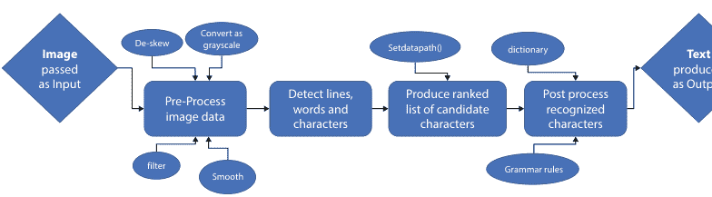

图 1.1 方法论。

然而，现有系统存在若干缺点。首先，它对尺寸变化很敏感，这会影响识别过程的准确性。其次，手写风格的个体差异对系统构成了挑战。最后，系统提供的低效结果概率较低，这限制了其在如图 1.1 所述的实际应用中的有效性 [21]。

### 1.5 使用 OCR Tesseract 增强文本提取

使用 OCR Tesseract 进行文本提取可能是一项复杂的任务，要实现 98% 的准确率，需要仔细考虑多个因素，包括图像预处理、特征提取、模型选择和后处理。以下是我们设计使用 OCR Tesseract 进行文本提取的优化算法时可以遵循的一些步骤：

- (a) **图像预处理：** 第一步是对输入图像进行预处理，以提高文本质量。这可以包括降噪、对比度调整和二值化等操作。目标是创建一幅图像，在最大化文本与背景之间对比度的同时，最大限度地减少噪声和伪影。
- (b) **感兴趣区域（ROI）检测：** 下一步是检测图像中包含文本的区域。可以使用连通分量分析、轮廓检测或目标识别等技术来实现。目标是分离图像中包含文本的区域，并移除所有非文本区域。
- (c) **文本分割：** 检测到感兴趣区域后，下一步是将文本分割为单个字符或单词。可以使用形态学操作、边缘检测或基于机器学习的分割等技术来实现。
- (d) **特征提取：** 下一步是从分割后的文本区域中提取特征。这些特征可以包括字符形状、大小和方向等。目标是创建一组能够区分不同字符的特征，从而提高 OCR 算法的准确性。


- (e) 模型选择：下一步是选择合适的 OCR 模型。Tesseract 是一个流行的开源 OCR 引擎，可以在各种数据集上进行训练。模型选择取决于项目的具体要求，例如文本语言、字体样式和图像质量。
- (f) 后处理：最后一步是对 OCR 输出进行后处理，以纠正任何错误并提高准确性。

### 1.6 统一建模语言（UML）图

#### 1.6.1 用例图

可视化表示公共用户与系统本身之间的交互，展示系统提供的各种用例或功能。图1.2有助于说明系统的高层功能需求以及不同角色如何与之交互。

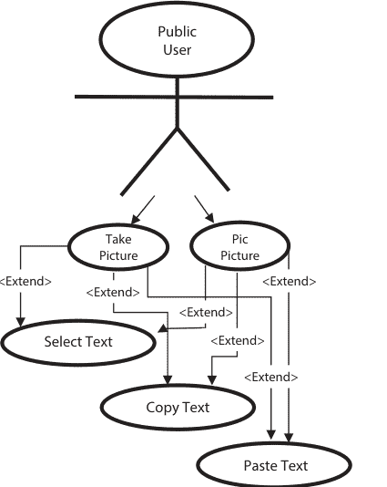

**图1.2** UML图。

#### 1.6.2 模型架构

图1.3描述了图像的模型架构。表1.1描述了精度，其中包含类型和准确率属性。

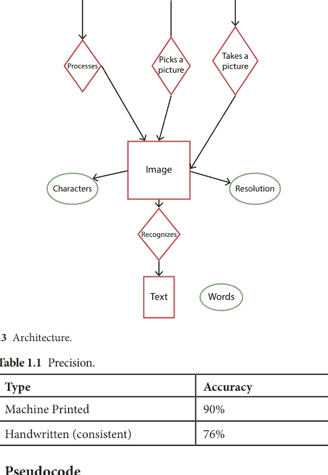

**图1.3** 架构。

**表1.1** 精度。

| 类型 | 准确率 |
| --- | --- |
| 印刷体 | 90% |
| 手写体（一致） | 76% |

#### 1.6.3 伪代码

- (a) 预处理输入图像以提高文本质量。
  - (i) 将图像转换为灰度图。
  - (ii) 应用高斯模糊去除噪声，并应用自适应阈值处理增强对比度。
- (b) 检测包含文本的感兴趣区域（ROI）。
  - (i) 应用形态学操作去除噪声。
  - (ii) 查找轮廓并过滤掉非文本区域。
- (c) 将文本分割为单个字符或单词。
  - (i) 应用膨胀和腐蚀来填补字符之间的间隙。
  - (ii) 使用边界框查找单个字符或单词。
- (d) 从分割出的文本区域中提取特征。
  - (i) 计算字符形状、大小和方向等特征。
- (e) 根据项目的具体要求选择合适的 OCR 模型，如 Tesseract。
  - (i) 使用所选模型初始化 OCR 引擎。
- (f) 使用 OCR 引擎识别分割区域中的文本。
  - (i) 对每个分割区域应用 OCR 算法。
- (g) 对 OCR 输出进行后处理，以纠正错误并提高准确度。
  - (i) 应用拼写检查以纠正拼写错误。
  - (ii) 应用基于语言模型的校正来纠正语法错误。
  - (iii) 应用基于投票的共识来提高准确度。
- (h) 以机器可读格式（如纯文本、HTML 或 XML）生成最终输出。
- (i) 提供用户界面，使用户能够与系统交互。
- (j) 维护系统以确保最佳性能，并根据需要更新 OCR 模型和软件。

### 1.7 系统需求

#### 1.7.1 软件需求

- (a) React JS
- (b) Flask
- (c) 文本编辑器/集成开发环境（IDE）
- (d) FTP 客户端
- (e) Web 浏览器
- (f) 图形编辑器（Nvidia）

#### 1.7.2 硬件需求

| 组件 | 要求 |
| --- | --- |
| 处理器 | Intel Pentium IV 2.0 GHz 及以上 |
| 内存 | 512 MB 及以上 |
| 硬盘 | 80GB 及以上 |
| 显示器 | CRT 或 LCD 显示器 |
| 键盘 | 普通或多媒体键盘 |
| 鼠标 | 兼容鼠标 |

### 1.8 测试

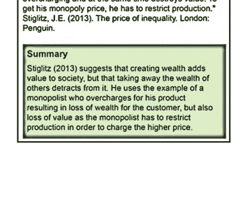

### 1.9 结果

表1.2显示了不同类型图像的准确率。

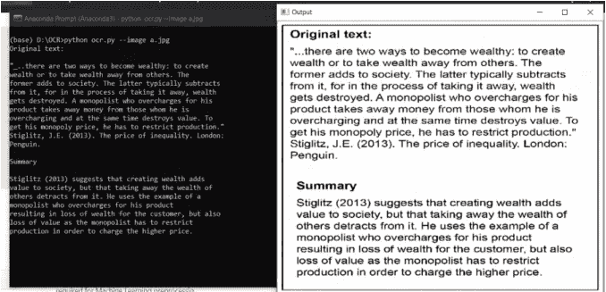

**表1.2** 不同类型图像的准确率。

| 输入图像类型 | 总词数 | 成功 | 错误 | 准确率（%） |
| --- | ---: | ---: | ---: | ---: |
| 白底黑字 | 118 | 109 | 9 | 92% |
| 彩色文本 | 36 | 26 | 10 | 72% |

### 1.10 未来范围

- (a) OCR Tesseract 文本提取模型的未来应用前景非常广阔，具有广泛的潜在应用和进一步发展的机会。未来增长和扩展的一些潜在领域包括：
- (b) **提高准确率：** 虽然 Tesseract OCR 引擎在文本提取方面具有很高的准确率，但总有改进空间。未来的发展可能会侧重于进一步提高模型的准确率，特别是在复杂文档中，如手写文本、草书字体或图像质量较差的文档。
- (c) **多语言支持：** Tesseract OCR 引擎已经支持超过 100 种语言，但在这方面仍有改进空间。未来的发展可能侧重于扩展模型能够识别和提取的语言范围，使其对全球用户更加通用和易用。
- (d) 与其他技术的集成：OCR Tesseract 文本提取模型可以与其他技术集成，以创建更强大、更可靠的解决方案。例如，它可以与自然语言处理（NLP）结合，实现高级文本分析和情感分析，或者与机器学习结合，提高文本提取的准确率和精度。
- (e) 更高的自动化：OCR Tesseract 文本提取模型的关键优势之一是其自动化手动数据录入任务的能力。随着技术的不断发展，我们可以期待更高水平的自动化，更先进的算法和系统能够处理复杂的数据提取任务。
- (f) 基于云的解决方案：随着云计算日益流行，我们可以期待未来出现更多基于云的 OCR 解决方案。这些解决方案提供了更大的灵活性和可扩展性，使组织能够轻松处理大量数据。

### 1.11 结论

总之，OCR Tesseract 文本提取模型是一种强大的工具，可将扫描图像、PDF 和其他文档转换为可编辑文本。它提供了许多优势，包括更高的效率、准确率和成本效益，使其成为处理大量数据的企业、学术机构和其他组织的宝贵工具。

通过应用 OCR Tesseract 文本提取模型，我们能够开发一个功能性的文本提取 Web 应用程序，可以从各种类型的文档中高准确率地提取文本。该应用程序使用 Tesseract OCR 引擎、React JS 和 Flask 构建，最终结果是一个用户友好且高效的工具，可以显著改进数据处理和分析。

此外，提取的文本可以在银行、学术界、金融、法律、医疗保健等多个领域轻松存储、编辑和分析。该模型有助于减少人工劳动并提高生产力，最终带来更高的盈利能力。

总之，OCR Tesseract 文本提取模型是一种宝贵的工具，可以彻底改变组织处理和分析数据的方式。

该模型中使用的 Tesseract 引擎支持多种语言，并具有众多功能，包括对齐识别、精确提取和高准确率。因此，它是希望在处理大量数据时提高效率并降低成本的组织的一个优秀解决方案。

此外，OCR Tesseract 文本提取模型可以定制，以适应不同行业和组织的独特需求。例如，它可以配置为提取特定类型的数据，如发票号码、姓名、地址和其他关键数据点。这使得它成为需要在日常运营中进行准确和精确数据提取的组织的理想解决方案。

此外，OCR Tesseract 文本提取模型不断发展，新功能和能力不断添加。这意味着它是一种前沿解决方案，始终跟上最新趋势和技术。随着机器学习和人工智能的快速发展，OCR 技术有望在未来几年变得更加强大和多才多艺。

总体而言，OCR Tesseract 文本提取模型是数据处理和分析领域的颠覆者。它能够以高准确率和高效率从各种文档中提取文本，使其成为各行各业企业和组织的无价之宝。随着更多组织采用这项技术，我们可以预期数据处理和分析方式将发生重大转变，从而带来更好的决策、更高的效率和更好的结果。

## 参考文献

- 1. Zhang, J. and Kasturi, R., A novel text detection system based on character and link energies, in IEEE Transactions on Image Processing, vol. 23, no. 9, pp. 4187–4198, Sept. 2014.
- 2. Bhargava, N., Bhargava, R., Rathore, P.S., Kumar, A., Texture recognition using Gabor filter for extracting feature vectors with the regression mining algorithm. Int. J. Risk Conting. Manage., 9, 3, 31–44, 2020.
- 3. Sasubilli, G. and Kumar, A., Machine learning and big data implementation on health care data. 4th International Conference on Intelligent Computing and Control Systems (ICICCS), pp. 859–864, 2020.
- 4. Sasubilli, S.M., Kumar, A., Dutt, V., Machine learning implementation on medical domain to identify disease insights using tms. 2020 International Conference on Advances in Computing and Communication Engineering (ICACCE), pp. 1–4, 2020.


- 5. Kumar, N., Trivedi, P., Rathore, P.S.，《基于椭圆曲线密码体制的图像自适应水印自适应方法》，载于*国际信息技术与知识管理会议*，第89–92页，2017年。
- 6. 多方向文本检测与识别的统一框架。《IEEE图像处理汇刊》，23卷，11期，4737页，2014年11月。
- 7. 基于梯度矢量流和分组的方法用于视频图像中任意方向场景文本检测。《IEEE电路与系统视频技术汇刊》，23卷，10期，1729页，2013年10月。
- 8. Bhargava, N., Bhargava, R., Rathore, P.S., Kumar, A.，《使用Gabor滤波器提取特征向量并采用回归挖掘算法的纹理识别》，《国际风险与应急管理杂志》，9卷，3期，31–44页，2020年。http://doi.org/10.4018/IJRCM.2020070103。
- 9. Kumar, N., Trivedi, P., Rathore, P.S.，《基于椭圆曲线密码体制的图像自适应水印自适应方法》，载于*国际信息技术与知识管理会议*，2017年。
- 10. Li, Y., Jia, W., Shen, C., van den Hengel, A.，《字符性：野外文本的指示器》，《IEEE图像处理汇刊》，第23卷，第4期，第1666–1677页，2014年4月。
- 11. Bhargava, N., Rathore, P.S., Bhowmick, A.，《利用机器学习中的CNN进行X射线检测研究》，《智能计算与信息安全进展：第一届国际会议，ASCIS 2022》，印度拉杰科特，2022年11月24-26日，修订论文选集，第一部分，施普林格·自然瑞士，尚，2023年。
- 12. Yin, X.-C., Yin, X., Huang, K., Hao, H.-W.，《自然场景图像中的鲁棒文本检测》，《IEEE模式分析与机器智能汇刊》，第36卷，第5期，第970–983页，2014年5月。
- 13. Rathore, P. S. 和 Chaudhary, A.，《基于时间依赖的设施路径规划》，载于*2013年国际信息系统与计算机网络会议*，第5–8页，IEEE，2013年3月。
- 14. Yi, C. 和 Tian, Y.，《移动应用中基于字符描述符和结构配置的场景文本识别》，《IEEE图像处理汇刊》，第23卷，第7期，第2972–2982页，2014年7月。
- 15. Palekar, R.R., Parab, S.U., Parikh, D.P., Kamble, V.N.，《使用OpenCV和Tesseract的实时车牌检测》，载于*2017年国际通信与信号处理会议（ICCSP）*，IEEE，第2111–2115页，2017年4月。
- 16. Kumar, P., Singhal, A., Mehta, S., Mittal, A.，《使用GPU的高分辨率视频实时运动目标检测算法》，《实时图像处理杂志》，11卷，1期，93–109页，2016年。
- 17. Padmavathi, K. 和 Sri Ramakrishna, K.，《使用自回归建模的心房颤动期间心电图信号分类》，《计算机科学会议论文集》，46卷，53–59页，2015年。
- 18. P. N. B., A. K. P., S. M. P.，《人脸识别算法不同方法的自适应分析》，《IJFRCSCE》，3卷，12期，209–212页，2017年12月。
- 19. Thakare, S., Kamble, A., Thengne, V., Kamble, U.R.，《使用Tesseract-OCR的文档分割与语言翻译》，载于*2018年IEEE第13届国际工业与信息系统会议（ICIIS）*，第148–151页，2018年。
- 20. 使用Tesseract-OCR的语言翻译，载于*2018年IEEE第13届国际工业与信息系统会议（ICIIS）*，IEEE，第148–151页。
- 21. Palekar, R. R., Parab, S. U., Parikh, D. P., Kamble, V. N.，《使用OpenCV和Tesseract的实时车牌检测》，载于*2017年国际通信与信号处理会议（ICCSP）*，第2111–2115页，印度金奈，2017年。

## 基于深度学习技术的辣椒叶分类

Chenchupalli Chathurya*、Diksha Sachdeva 和 Mamta Arora

*计算机科学与工程系，马纳夫拉赫纳大学，法里达巴德，印度*

### 摘要

农业在每个人的生活中都至关重要。农作物和植物在维持生命方面发挥着巨大作用，而照料农作物和植物既重要又困难。因此，为了检测植物病害，本研究论文旨在判断植物是否健康。数据集包含采集自印度安得拉邦某田地中的辣椒植株叶片。研究中应用了多种图像分类模型以及迁移学习模型。此外，还应用了卷积神经网络（CNN）等深度学习模型以及InceptionV3和VGG16等迁移学习模型，并分别在有和没有数据增强的情况下进行了实验。结果发现，最成功的模型是带有数据增强的CNN，其准确率达到90%，并且几乎正确预测了所有测试图像。通过扩大数据集规模，可以进一步提高模型的准确率。

*关键词：* CNN模型，迁移学习，机器学习，深度学习，AlexNet，InceptionV3，VGG16，叶片

### 2.1 引言

人类从食物到衣物都依赖植物来满足基本需求。因此，人们需要照料植物。尽管人类知道叶片之间存在差异，但在植物变得易感染病害之前，应该有一种方法来判断疾病。提前发现疾病并妥善照料植物，将有助于拯救植物，从而节省来自植物的其他资源或产品。因此，我们构建了一个模型，通过检测叶片上的图案，能够判断植物是否患有疾病，并可采取所需的预防措施。因此，农业中叶片病害自动检测的研究是一个重要领域，因为它有助于观察大面积作物，并有助于在植物叶片上出现病害症状时及时发现。研究人员利用计算机视觉和机器学习技术，提出了一种用于植物叶片病害检测和分类的预测模型。对叶片原始图像进行预处理、分割以及提取形状、颜色、纹理和叶脉等属性。然后使用多种机器学习分类器对叶片图像进行分类。

### 2.2 目标

主要目标如下：

- (a) 构建一个能够检测和预测植物病害的模型
- (b) 对叶片是健康还是不健康进行分类。

### 2.3 文献综述

如先前研究[1]所探讨，研究人员利用深度学习构建了多种类型的卷积神经网络（CNN）模型来检测植物病害。这里使用的数据库是一个开放数据库，包含约90,000张图像，涵盖58个类别和25种不同类型的植物叶片。为了识别植物病害，研究人员构建了不同类型的CNN模型架构，如AlexNet、AlexNetOWTBn、GoogLeNet、Overfeat和视觉几何组（VGG）[1]。尽管所有这些模型的准确率均高于97%，但VGG的成功率达到了99.53%。这里的改进可以通过选择多样化的训练数据来实现，例如来自不同地点（如田地）的数据、来自不同种植条件的数据，以及通过集成移动应用程序来实现[2]。

图像增强策略有两种：传统方法和生成对抗网络（GAN）[2]。第二种方法（GAN）有助于基于已有的数据集生成合成数据，从而提高准确率。这里使用的模型包括AlexNet、VGG19、Inception版本3、DenseNet201和ResNet50[3]。然而，我们使用的模型无法有效处理具有复杂背景的测试图像，例如某些图像背景中出现的叶片。为了解决这个问题，使用了两种基于深度神经网络的物体检测算法。第一种算法过滤具有复杂背景的图像，第二种算法对所有剩余图像进行分类。该训练模型达到了93.67%的准确率，并且在测试具有复杂背景的叶片图像时也被证明是成功的。这里的准确率可以通过使用不同阶段或不同位置叶片的多变数据集来进一步提高[4]。

如前所述，在Arsenovic等人的研究中，开发了一种卷积神经网络用于检测植物病害[3]。该研究使用的数据集是Plant Village数据集，但该模型专门应用于苹果和番茄类别。所使用的模型包含四个卷积层，每个卷积层后跟一个池化层，两个全连接层，最后使用sigmoid函数来检测植物是否患病。该模型以45,000个参数实现了88.5%的准确率。该模型还在Tesla的GPU上运行以计算准确率。未来的工作可以通过将VGG等迁移学习算法或其他任何架构应用于上述模型，以获得更高的准确率[5，6]。

在Sasubilli等人的研究中，使用了卷积自编码器（CAE）和卷积神经网络的混合模型[4]。采用这种方法是为了确保使用最少的参数对叶片进行分类。这里使用的数据集是Plant Village数据集，但主要使用桃树叶片图像，约有4,500张图像。该混合模型仅用9,914个训练参数就达到了99.35%的训练准确率和98.38%的测试准确率。未来的工作可以在低计算能力系统上训练模型进行病害检测，或者可以开发一个移动应用程序来检测病害[7，8]。

在Kumar等人的研究中，作者自己收集了数据集中的图像[5]。这些图像是使用1300万像素摄像头在白色背景下拍摄的玉米植株叶片图像。总共拍摄了750张图像，其中600张用于训练，其余150张用于测试。这里使用了一个病害检测系统来检测病害，该系统由两个模块组成：一个模块包括摄像头和计算机，用于捕获和存储图像，而另一个模块用于检测存储图像上的病害。这里使用的病害检测模型是CNN，其训练准确率为99.5%，测试准确率为86.7%。未来可以使用包含更多图像、更多样化的数据集进行改进。

在Liu和Wang的论文[9]中，他们强调了通过检测来识别植物病害的农民与人工智能初学者之间的区别。农民用肉眼检查病害，但很难同时检查所有叶片。人工智能初学者的想法是利用深度学习技术在几分钟内发现叶片中的病害类型，并缩短诊断时间。他们最大限度地利用了多种模型。然而，在使用神经网络系统时，他们


在寻找神经元的过程中遇到了几个困难。当偏置非常低时，很难定位到一个输出。在其他情况下，呈现高偏置的输出则很简单。

农民按照季节种植作物，但同时植物病害也会出现[10]。农民会遭受重大损失，并且很难维持生计。必须在病害扩散到整个作物之前，在该地区安装一个系统来提供合适的杀虫剂。通过使用手持式农药检测器和深度学习方法，这可以实现。研究人员收集了多个数据集，并使用各种先进的深度学习模型来研究病害。这些模型的准确性对农药科学家来说变得很明显，他们随后开始为受灾作物生产样品。在农药科学家的帮助下，一些模型的准确性显现出来，他们开始从患病植物上采集样本。采用InceptionV3、InceptionResNetV2、MobileNetV2和EfficientNetB0等CNN架构满足了深度学习模型的目标，从而帮助了农民。目前有几种方法通过提取颜色特征来辅助病害检测[11]，正如作者在论文中所报告的那样。本研究采用了这些方法，结果病害斑点被正确检测出来，并且不受来自不同来源（如相机闪光灯）的噪声过滤的影响。有一些程序属于神经网络技术，包含一个输入层、一个输出层和一个隐藏层，用于识别叶片物种、害虫等。他们开发了一个软件版本来指示农业作物病虫害管理的补救措施。

未来，到2050年，世界人口可能增加到约90亿。因此，我们需要提高植物产量并减少农药使用[12]。通过使用CNN模型分析作物照片，我们可以在几分钟内快速识别病害，从而减少田间农药的使用。我们可以使用特殊的神经网络模型；然而，与其他CNN模型（如F-CNN）相比，S-CNN模型具有更高的准确性。为了改进，我们还可以实现计算机视觉技术来检测植物病害[13]。

Manickam等人这篇论文完全基于对田间耕作知识较少的小农户[14]。CNN模型的使用对小农户同样非常有益，因为他们将了解到农药并不是避免植物病害的唯一方法。这些策略将通过农民使用联网设备和软件应用（如智能手机和PlantSnap等）的最大努力而发展。一些功能，如ReLu非线性和重叠池化，提供了很好的检测结果并减少了训练时间。然而，转而获取知识可能对小型数据集有益，这可能会带来最高水平的准确性。像ImageNet、GoogLeNet和ResNet34这样的一些模型，给出了相当不错的结果，并且易于提取。照片尺寸可以从约150 × 150到255 × 255不等；照片尺寸使用的度量单位是像素（px）。

正如早期研究中所讨论的，借助深度学习创建了多种卷积神经网络模型来检测植物病害[11]。我们的算法使用一个由14,956张图片组成的数据集进行训练，分为38个类别。在模型训练完成后，获取了已检测到病害的照片，以执行预处理、分割、特征提取、特征融合以融合所有特征并对病害进行分类等活动。对于问题分类，我们使用了先进的机器学习方法，如随机森林、SVM、KNN和ANN。混淆矩阵被用作实验的评估标准。随后使用混淆矩阵进行了大量计算，包括准确率、召回率、精确率、特异性和F分数[15]。

检查植物叶片上的可见模式是植物病理学研究的一个重要部分[12]。通过比较同一植物不同部分的颜色和纹理，我们现在可以分辨出哪些部分健康，哪些部分患病。植物病害的诊断过程通常在受控的实验室环境中进行。这个过程耗时且成本高昂。本研究采用了多种方法来实现目标，既有助于节省资金，也有助于在早期阶段诊断病害。

选择了三种不同榕树的叶片图片——垂叶榕（F. benjamina）、细叶榕（F. punctata）和苏门答腊榕（F. sumatrana）[16]。本研究使用了54个叶片照片样本。构建所建议系统使用了三个主要过程——图像预处理、特征提取和识别。所使用的识别模型是人工神经网络（ANN）和支持向量机（SVM）。测试中，所提出的方法在识别叶片照片时的准确率达到83.3%。然而，当使用ROC曲线下面积（AUC）指标时，ANN模型的表现略好一些。本研究中使用的分类技术能够可靠地区分指定的榕树物种。

使用具有1,016个光谱特征、处于四个病害阶段（T1：健康，T2：轻度感染，T3：中度感染，T4：严重感染）的叶片样本获得了这些结果[14]。可见光谱，特别是其绿色末端，产生了大多数有效结果。ANN在540–550 nm范围内识别健康油棕的准确率为83.3%，在T2阶段识别感染灵芝的油棕准确率为100%。比较第9和第17片复叶时，结果显示由ANN建模的敏感复叶编号对第9片复叶的准确率最高，达到100.0%。研究发现，ANN在预测油棕植物基腐病（BSR）的发生方面是有效的[17–20]。

Sasubilli和Kumar报道称，农民很难接触到能够检查作物病害并提供病害建议的农业专家[21]。他们经常得到延迟的专业回复或最终可能毫无意义的建议。自动植物病害检测至关重要，因为它可以监测大片农田，并识别植物叶片或茎上是否存在病害症状。该项目旨在为农民提供快速、精确、易于使用且负担得起的解决方案。利用图像处理技术开发了用于自动识别植物病害的移动应用程序[22]。

### 2.4 关于数据集

辣椒植物叶片的数据集收集自安得拉邦的一块农田。图像被分为健康叶片和不健康叶片两组。共采集了85张图像，其中52张属于健康类，33张属于不健康类。图像使用Redmi 10 Pro上的6400万像素四摄像头拍摄。当叶片折叠或卷曲时，可以看出健康辣椒叶片与不健康叶片之间的差异，下图2.1和图2.2分别展示了健康叶片和不健康叶片。

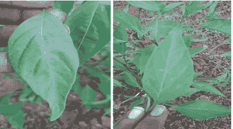

**图2.1** 健康叶片示例。

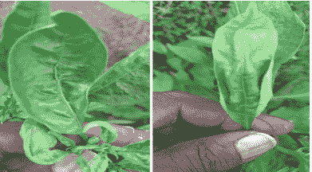

**图2.2** 不健康叶片示例。

### 2.5 方法

辣椒叶片的数据集收集自安得拉邦的一块农田。数据集包含两个类别：健康叶片和不健康叶片。健康叶片类包括处于健康状态的叶片，而不健康叶片类则包括处于不健康状态的叶片。为了将深度学习应用于图像，数据集被分为三个部分：训练、测试和验证，比例为7:2:1。训练文件夹包含58张图像；测试文件夹包含20张图像；验证文件夹包含10张图像。

图2.3显示了本章使用的方法。

应用的第一个模型是卷积神经网络（CNN）。CNN是用于图像识别和不同模式识别的深度学习模型之一。该模型由三个卷积层和一个展平层构成。使用CNN得到的准确率为80%。

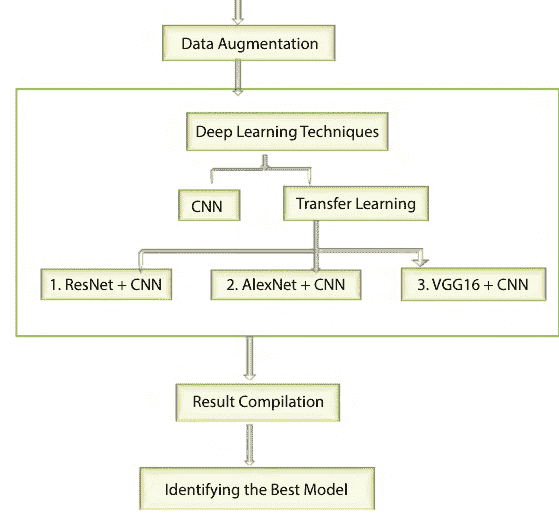

**图2.3** 本章使用的方法。


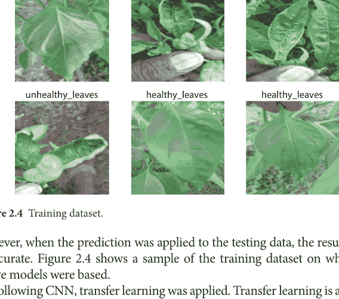

图 2.4 训练数据集。

然而，当预测应用于测试数据时，结果不准确。图 2.4 显示了上述模型所基于的训练数据集的一个样本。

在 CNN 之后，应用了迁移学习。迁移学习是一种将之前学习到的模型应用于当前模型的 learning 方式。使用 Keras 和 TensorFlow 库，更容易应用迁移学习。此处应用的三种迁移学习模型为 AlexNet、Inception V3 和 VGG16。尽管所有这些迁移学习模型在用测试数据测试时显示出 100% 的准确率，但由于数据集非常小，它们都显示出不准确的结果。迁移学习在大型数据集中始终有效。表 2.1 描述了准确率、训练损失、验证准确率和验证损失。

### 数据增强之前

表 2.1 训练准确率、训练损失、验证准确率和验证损失。

| 序号 | 模型 | 训练 | 训练损失 | 验证 | 验证损失 |
|---|---|---|---|---|---|
| 1 | CNN | 0.8793 | 0.2464 | 0.9 | 0.2521 |
| 2 | ResNet | 1 | 1.26E-04 | 1 | 0.054 |
| 3 | AlexNet | 1 | 1.30E-05 | 0.6 | 358.6772 |
| 4 | VGG16 | 1 | 1.29E-04 | 1 | 0.0054 |

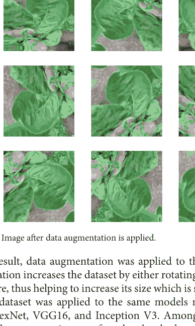

图 2.5 应用数据增强后的图像。

因此，对相同的模型应用了数据增强。数据增强通过旋转、翻转或缩放图片来增加数据集，从而有助于增加其大小，如上图 2.5 所示。该数据集被应用于上述提到的相同模型，如 CNN、AlexNet、VGG16 和 Inception V3。在所有使用的模型中，带增强的 CNN 在准确率和预测测试数据方面被发现是最好的，如表 2.2 下面所示。尽管迁移学习模型给出了良好的结果，但在应用于预测测试数据集时，模型未能正确预测图像。

### 数据增强之后

表 2.2 应用数据增强后模型的训练准确率、训练损失、验证准确率和验证损失。

| 序号 | 模型 | 训练 | 训练损失 | 验证 | 验证损失 |
|---|---|---|---|---|---|
| 1 | CNN | 0.8793 | 0.2464 | 0.9 | 0.2521 |
| 2 | ResNet | 0.5 | 0.7049 | 0.5 | 0.7063 |
| 3 | AlexNet | 0.9828 | 1.3432 | 0.6 | 135.6449 |
| 4 | VGG16 | 1 | 7.54E-09 | 1 | 0.0058 |

### 参考文献

- 1. Bedi, P. and Gole, P., 基于卷积自编码器和卷积神经网络的混合模型的植物病害检测。 *人工智能农业*, 5, 90–101, 2021 年 1 月。
- 2. Chatterjee, J.M., Kumar, A., Rathore, P.S., Jain, V. (Eds.), *农业中的物联网与机器学习：技术影响与挑战*。Vol. 8, Walter de Gruyter GmbH & Co KG, De Gruyter, Germany, 2021。
- 3. Arsenovic, M., Karanovic, M., Sladojevic, S., Anderla, A., Stefanovic, D., 解决基于深度学习的植物病害检测方法的当前局限性。 *对称性*, 11, 7, 939, 2019, https://doi.org/10.3390/sym11070939。
- 4. Sasubilli, S.M., Kumar, A., Dutt, V., 利用物联网、大数据分析和云计算改善医疗保健。 *2020 年计算与通信工程进展国际会议 (ICACCE)*, pp. 1–4, 2020。
- 5. Kotturu, P.K. and Kumar, A., 早期诊断阿尔茨海默病的机器学习模型比较研究：多相关性方法。 *2020 年第 5 届通信与电子系统国际会议 (ICCES)*, pp. 778–783, 2020。
- 6. Prashanthi, V., 使用卷积神经网络进行植物病害检测。 *国际先进计算机科学与工程趋势期刊*, 9, 3, 2632–2637, 2020 年 6 月。
- 7. Amity University, Institute of Electrical and Electronics Engineers. Uttar Pradesh Section, Institute of Electrical and Electronics Engineers, and Amity University. School of Engineering and Technology, *2019 年第 6 届信号处理与集成网络国际会议 (SPIN)*, Amity School of Engineering and Technology, Noida, India, 2019 年 3 月 7–8 日。
- 8. Ferentinos, K.P., 植物病害检测与诊断的深度学习模型。 *计算机与电子农业*, 145, 311–318, 2018 年 2 月。
- 9. Liu, J. and Wang, X., 基于深度学习的植物病害和害虫检测：综述。 *植物方法* 17, 22, 2021, https://doi.org/10.1186/s13007-021-00722-9。
- 10. Hassan, S.M., Maji, A.K., Jasiński, M., Leonowicz, Z., Jasińska, E., 使用 CNN 和迁移学习方法识别植物叶片病害。 *电子学*, 10, 12, 1388, 2021, https://doi.org/10.3390/electronics10121388。
- 11. Saleem, M.H., Potgieter, J., Arif, K.M., 深度学习植物病害检测与分类。 *植物*, 8, 11, 468, 2019, https://doi.org/10.3390/plants8110468。
- 12. Srivastava, P., Mishra, K., Awasthi, V., Sahu, V.K., Pal, P.K., 使用卷积神经网络进行植物病害检测。 *国际先进研究期刊 (印多尔)*, 9, 01, 691–698, 2021 年 1 月。
- 13. Harte, E., *使用 CNN 进行植物病害检测*。
- 14. Jye, K.S., Manickam, S., Malek, S., Mosleh, M., Dhillon, S.K., 使用人工神经网络和支持向量机进行植物自动识别。 *生命科学前沿*, 10, 1, 98–107, 2017。
- 15. Ahmadi, P., Muharam, F.M., Ahmad, K., Mansor, S., Seman, I.A., 使用人工神经网络光谱分析早期检测油棕根腐病。 *植物病害*, 101, 6, 1009–1016, 2017 年 6 月。
- 16. 2018 年通信与计算技术进展国际会议 (ICACCT)，IEEE，2018。
- 17. Bhargava, N., Sharma, A. K., Kumar, A., Rathore, P. S., 一种边缘保持去噪的自适应方法, in: 2017 年第 2 届通信与电子系统国际会议 (ICCES), pp. 600–604, IEEE, 2017 年 10 月。
- 18. Ganatra, N. and Patel, A., 使用图像处理和机器学习技术进行多类植物叶片病害检测。 *国际新兴技术期刊*, 11, 2, 388421, 2020。 [在线]。可获取：https://www.researchgate.net/publication/344015541。
- 19. Raina, S. and Gupta, A., 使用叶片图像进行植物叶片病害检测的各种技术研究, in: 人工智能与智能系统国际会议论文集, ICAIS 2021, pp. 900–905, 2021 年 3 月。
- 20. Gautam, K., Sharma, A. K., Nandal, A., Dhaka, A., Seervi, G., Singh, S., 基于物联网 (IoT) 的智能农业系统。 物联网与雾计算支持的现实生活挑战解决方案, 39, 2022。
- 21. Sasubilli, G. and Kumar, A., 医疗保健数据上的机器学习和大数据实现。 第 4 届智能计算与控制系统国际会议 (ICICCS), pp. 859–864, 2020。
- 22. Sasubilli, S.M., Kumar, A., Dutt, V., 利用物联网、大数据分析和云计算改善医疗保健。 2020 年计算与通信工程进展国际会议 (ICACCE), pp. 1–4, 2020。

## 使用迁移学习技术的水果叶片分类

Taha Siddiqui*, Surbhit Chopra and Mamta Arora

计算机科学与技术系 (CST)，Manav Rachna University，Faridabad，India

### 摘要

大约 60% 的印度省级家庭依靠园艺维持生计，印度拥有世界第二大农业面积的声誉。42% 的最重要的粮食作物产自可能遭受灾难性或慢性损害的作物。由于深度学习方法的进步，我们可以很大程度上减少这一比例。在本研究章节中，我们应用了各种深度学习和迁移学习方法，以准确预测受损植物的疾病，以便在初始阶段治愈它们。模型在图像数据集上训练，该数据集包含芒果和石榴等各种植物类别。结果显示，ResNet 在准确率方面优于 Inception、VGG19 和 CNN，对石榴和芒果的准确率分别为 88% 和 87.5%。

**关键词：** 深度学习，迁移学习，叶片病害检测，图像预处理

### 3.1 引言

植物感染会损害农业生产，如果不能及时识别，粮食不安全可能会上升，尤其是主要作物，如芒果和石榴，因为农业产出成为人们食物供应的一部分。有效的植物病害防治

*通讯作者：studies.tahasiddiqui@gmail.com


而管理始于早期预警和预测。它们对于农业制造业的管理方式和决策方式至关重要。然而，在一些欠发达国家，植物病害检测的基本方法仍然是经过培训的农民进行视觉观察。这需要持续的专业监督，在农业生产中可能成本过高。此外，在某些偏远地区，农民可能不得不四处奔波寻找专家，导致讨论既昂贵又耗时。叶片检测的目标是利用计算机视觉和机器学习算法，从植物和农作物的照片中识别和提取有关植物健康、生长和产量潜力的数据。关于作物管理实践（如病虫害防治、施肥和灌溉）的决策可以基于这些知识做出。通过机器学习和人工智能技术，可以分析大量的植物和作物照片数据库，以发现病害的模式和迹象。这有助于早期准确地识别病害，从而更快、更有效地治疗病害并采取更有效的预防措施。

植物和农业病害检测在农业中有多种应用，包括病害控制、产量提高和可持续农业。对高效可持续粮食生产的需求正在推动病害检测领域的研究与开发增长。预测和分类作物病害最有效的方法之一是收集作物发育照片并创建检测模型。这可以提高病害管理的效率，减少病害造成的农业损失，同时为农业产出提供及时有效的早期预警和干预。

然而，这项技术无法完全扩展，只能在小范围内使用。计算机化植物病害检测是一个重要的研究领域，因为它可能有助于监测大片农田，并据此尽早自动检测病害症状。植物病害是粮食安全面临的直接挑战之一。全球农业每年因病虫害损失高达2500亿美元。到2021年，中国将有4亿公顷土地遭受严重的植物病害和虫害。基于候选区域的检测方法虽然精度相当不错，但实时性差且计算量大。为了确保快速有效的识别，研究人员设计了一种单阶段目标检测技术[1–3]。

因此，通过植物叶片及时检测作物病害对农业生产至关重要。根据常识观点，找到一种快速、自动化、更实惠且精确的植物感染识别策略因此至关重要。

### 3.2 文献综述

Sharada P. Mohanty撰写的研究论文《利用深度学习进行基于图像的植物病害检测》于2016年发表[1]。该研究使用CNN，结果表明，在包含38个类别标签的数据集上，随机猜测仅能达到2.63%的准确率。我们的每个实验配置都包含图片数据的三种视觉表示，我们在Plant Village数据集上获得的准确率从85.53%到89.54%不等[4]。

F. G. Waldamichael、T. G. Debelee和F. Schwenker撰写的研究论文《机器学习在谷类作物病害检测中的应用》于2022年发表。该研究使用了深度学习技术。因此，我们从Agarwal、Siby和Barman那里获得了五个不同的准确率结果。本文中的参考文献是Hasan和Tian，局限性和未来工作是更好地理解机器学习在谷类作物病害检测中的最新应用。此外，还有一篇详细的文献研究，包含45篇研究文章，重点是利用深度学习识别感染五种不同类型谷物的主要病害，即小麦、水稻、玉米、燕麦和大麦[5, 6]。

N. Sharma和S. Singh撰写的研究论文《用于检测植物病害的成像技术综述》于2020年发表。本文使用的技术是分类技术，如CNN、随机森林和决策分类器。论文的主要结论包括总结了有效用于植物病害早期检测的替代成像技术[7, 8]。

A. Khakimov撰写的研究论文《作物病害检测与分割的各种技术比较研究》于2022年发表。主要采用的技术是基于内容的图像检索（CBIR）系统，该系统主要使用颜色、形状和纹理作为基本特征[9]。包含这些基本特征的图像被设置为查询图像，同时还使用了CNN、SVM和K-means。论文提出了未来工作，即使用CBIR技术检索病叶图像，这在图像提取中能产生更好的结果。比较研究及其结果以表格形式呈现，包含不同算法的准确率。

本研究的作者建议使用ResTS（残差教师/学生）架构作为识别植物病害的可视化和分类方法。ResTS源于基于相似性的教师/学生架构[10]。ResTS所基于的卷积神经网络（CNN）架构由一个解码器、两个分类器（教师和学生）以及一个卷积神经网络组成。在该架构中，教师和学生之间的共享表示被用作代理来可视化图片中与分类相关的部分，并尽可能有效地训练两个分类器。测试表明，教师/学生设计（F1分数：0.972）被建议的ResTS结构（F1分数：0.991）所超越，后者将产生更精确的病害症状表示。为了定位和识别柑橘树中的病害，使用当前ResTS架构进行这项研究的研究人员提出了一种混合技术。预期研究的两个主要阶段是（a）找到柑橘果实和叶片病变，（b）对柑橘病害进行分类。使用增强的输入图像和修改后的加权分割算法提取柑橘病变斑点。然后，通过融合几何成分、颜色和纹理，生成一个码本。为了找到最佳特征，还采用了一种混合特征选择策略。主成分分析（PCA）值、波动性和标准差协方差向量是该方法的基本组成部分。一旦选择了最合适的特征，就将它们输入M-SVM模型进行分析，重点关注一系列柑橘病害。该分析包括使用来自Plant Village、受蚧壳虫侵扰的柑橘图片信息库、柑橘病害图像图库数据集以及从其各自所有者处获得的图像数据库的组合数据集来测试所提出的技术。炭疽病、黑斑病、溃疡病、疮痂病、黄龙病和黑变病是使用这些数据库检测和分类的柑橘病害[11, 12]。在组合数据集、本地数据集和柑橘病害图像图库数据集上，所提出的技术分别以97%、89%和90.4%的分类准确率优于现有方法。

在这项研究中，提出了一种基于机器学习的实时系统，用于根据叶片照片诊断作物病害的类型。采用单次拍摄方法识别和定位叶片，并提出一种深度卷积神经网络架构来执行分类[13]。这些模型用于嵌入式设备（特别是Nvidia Jetson TX1）上的实时田间植物病害识别和检测。对所获得的结果进行比较，所提出的深度卷积神经网络结构及后续病害分类的准确率约为96.88%。此外，所提出的


该框架在实际现场测试中成功率很高，因此具有很高的可部署性。

这项研究的作者提出了一种基于深度集成神经网络的技术（DENN），用于自动预测植物病害。利用迁移学习，对预训练模型进行改进，同时采用特征提取、旋转、调整大小和平移等数据增强方法来防止过拟合[8]。本研究提供了若干预训练神经网络效率的完整分类，并展示了与建立叶片病害识别相关的那些模型的加权集成。此外，研究还利用了公开可获取的植物城镇数据集中的14种作物共38个类别来评估所提出工作的效果。在执行方面，DENN 优于最先进的预置模型，包括 ResNet 50 和 101、InceptionV3、DenseNet 121 和 201、MobileNetV3 以及 Nast。总体而言，执行结果已用于展示所建议模型在数据编排方面的良好表现。

这篇综述论文提出了一种利用基于最优灵活组织（OMNCNN）的卷积神经网络来识别和分类植物叶片病害的机械化技术。所提出的 OMNCNN 模型将预处理（包括提取、分割和分组）作为其基本功能步骤。利用基于 Kapur 阈值的图像分割和双边滤波（BF）预处理来定位叶片图像中的患病区域。此外，使用 Emperor Penguin Optimizer（EPO）方法来提升 MobileNet 模型超参数在检测植物病害方面的准确性[14]。最后，使用基于极限学习机（ELM）的分类器为所应用的植物叶片图像赋予正确的类别标签。为了展示 OMNCNN 模型的改进性能，进行了多项模拟。实验结果表明，OMNCNN 模型优于目前使用的先进技术，其最高精确率为 0.985，召回率为 0.9892，准确率为 0.987，鲁棒性为 0.987。

根据这项研究[15]，良好的作物生产取决于农业中病害的早期检测。番茄作物的特性会受到各种病害的影响，如番茄斑枯病、晚疫病、细菌性斑点病和黄化曲叶病。在识别出叶片病害症状后，需要采取措施。

这项研究表明，深度学习总体上显著推进了机器学习，尤其是在计算机视觉方面。深度学习的进展已有效应用于包括人工智能和计算机视觉在内的多个领域。在农业中利用个人计算机（PC）环境下的深度技术仅在最近才被研究[16]。为了满足不断增长的人口需求，人类文化必须优先考虑粮食生产和粮食作物的需求。传统机器学习和图像处理方法最初用于从作物照片中以编程方式检测作物病害，但这些方法在结果的精度和适用性方面存在局限性。用于植物病害识别的深度学习提高了预测准确性，并扩大了被认为患有病害的植物物种范围。本文总结了一项使用深度学习识别植物病害的研究，并根据所使用的数据集对其进行了分析。

题为“Harvest Illness Recognition and Observing Framework”的研究论文由 L. R. Priya、G. Ignisha Rajathi 和 R. Vedhapriyavadhanа 撰写。本文使用了 K 均值聚类技术[17]。该综述中有四个模型，精确率为 89%。为了判断叶片是否健康，我们利用了 K 均值聚类——一种无监督学习方法，它计算每个已识别中心的距离。所有必要的训练照片都包含在一个图像采集模型中，最终被调整为 256×256 像素。

题为“Automated leaf disease diagnosis in different crop species by Visual Characteristics Analysis and One-Class Classifiers”的研究论文由 X. E. D. Pantazi 撰写，并于 2019 年发表[13]。本文采用的方法是分类，所使用的分类器是一类分类器，据 Moshou、A.A. 所述。

题为“An Overview of the Research on Plant Leave Disease Detection Using Image Processing Techniques”的研究论文由 Kiran R. Gavhale 女士撰写，并于 2014 年发表[14]。本研究使用的技术是模糊 C 均值聚类和神经网络规划。

由 Konstantinos P. Ferentinos 撰写并于 2018 年发表的研究论文“Deep Learning Models for Plant Disease Detection and Diagnosis”使用了深度学习技术[15]。根据 CNN 的结果，该模型的准确率为 99.53%。该模型共有 87,848 张照片，我们通过一个开放数据库获取了这些照片。该论文的主要缺点是数据库中实验室图像占主导地位，其中许多图像具有区别于真实图像的特征[17]。

### 3.3 方法

数据集：我们的数据集主要由两类叶片图像组成：健康叶片和患病叶片，针对不同的水果：芒果和石榴。

如图 3.1 所示，我们描述了本研究的工作流程和方法。

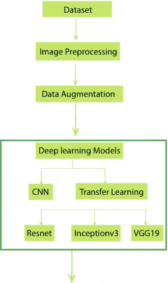

**图 3.1** 方法流程图。

### 3.3.1 图像预处理

通过确保图像大小等参数满足模型训练的要求并减少图像采集过程中的噪声，可能需要增加数据集数量来预处理图像并统一特征，如图像大小和颜色。较常用的图像预处理技术包括调整大小、填充调整大小、信件框（letterboxing）以及图像向量归一化。最常见的图像改变技术包括翻转、模糊、增强颜色、增强边缘检测、对数变换和图像去噪。通过实施图像处理，我们将图像转换为 32 位批次。数据集被分为两个不同的类别，用于训练和测试目的。如图 3.2 所示，这两个类别为“健康”和“患病”。

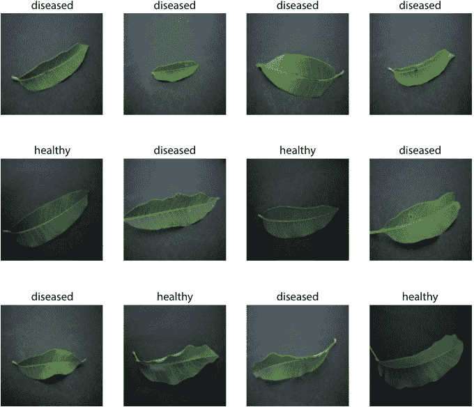

**图 3.2** 数据集中按患病和健康分类的样本图像。

### 3.3.2 数据增强

数据增强应用于相同的模型。该技术通过旋转、翻转或缩放图片来增加数据集。

### 3.3.3 深度学习模型

数据集应用于上述相同的模型，包括 CNN、AlexNet、VGG16 和 InceptionV3。在所有使用的模型中，带有增强的 CNN 在准确率和测试预测方面均表现最佳，如图 3.3 所示。

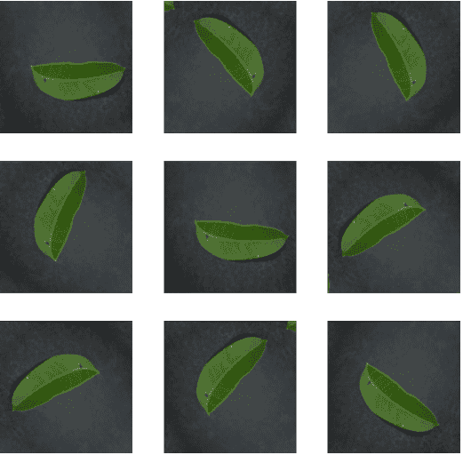

**图 3.3** 数据增强后的图像（水平翻转和垂直翻转）。

### 3.3.4 准确率图表

用户观察到当不同的深度学习模型应用于数据集时会存在准确率差异。

| 水果 | 深度学习技术 | 轮数 | 训练准确率 | 测试准确率 |
|---|---:|---:|---:|---:|
| 芒果 | CNN | 20 | 87.5% | **93.75%** |
| 芒果 | ResNet | 6 | **100%** | 87.5% |
| 芒果 | Inception | 20 | 87.5% | 79.6% |
| 芒果 | VGG19 | 20 | 84% | 92.19% |
| 石榴 | CNN | 10 | 88% | 85% |
| 石榴 | ResNet | 10 | **92%** | **88%** |
| 石榴 | Inception | 10 | 86% | 81% |
| 石榴 | VGG19 | 10 | 81% | 76% |

### 3.3.5 准确率和损失图

如图 3.4–3.7 所示，我们绘制了图表以展示准确率和损失。图表有两个参数：训练和验证（准确率和损失）。

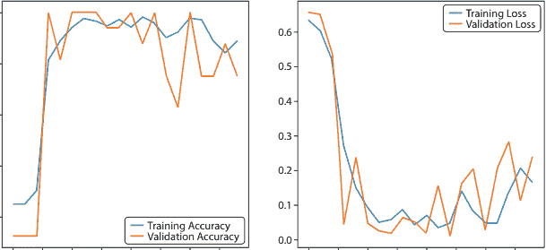

**图 3.4** 准确率和损失图：CNN。

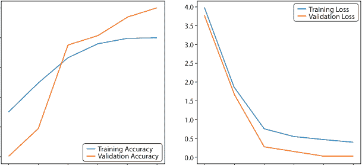

**图 3.5** 准确率和损失图：ResNet50。


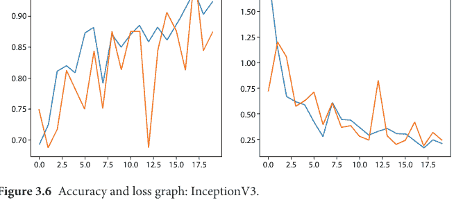

图 3.6 精度与损失图：InceptionV3.

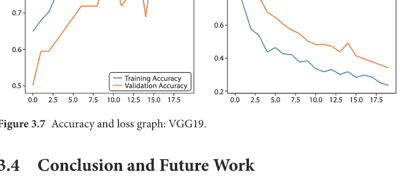

图 3.7 精度与损失图：VGG19.

## 3.4 结论与未来工作

正如我们所见，由于该国人口不断增长，印度农民在农业种植方面遇到很多问题。在我们的研究中，我们使用了最广泛种植的作物叶片，例如芒果和石榴，并应用卷积神经网络来确定每片作物叶片是否患病。本研究改进并提出了作物病害识别与分类技术，并通过测试证明了优化模型在识别和分类植物病害方面的实用性。未来工作将尝试为每种作物叶片病害提供预防措施，因为该项目具有很大的潜力。

## References

- 1. Devaraj, A., Rathan, K., Jaahnavi, S., Indira, K., 利用图像处理技术识别植物病害，在：2019年国际通信与信号处理会议（ICCSP），IEEE，第0749–0753页，2019年4月。
- 2. Chatterjee, J. M., Kumar, A., Rathore, P. S., & Jain, V. (Eds.), 农业中的物联网与机器学习：技术影响与挑战。第8卷，Walter de Gruyter GmbH & Co KG，2021年。
- 3. Saleem, M.H., Potgieter, J., Arif, K.M., 通过深度学习进行植物病害检测与分类。Plants, 8, 11, 468, 2019.
- 4. Sun, G., Jia, X., Geng, T., 基于图像处理技术的植物病害识别。J. Electr. Comput. Eng., 2018, 文章编号6070129, 7, 2018, https://doi.org/10.1155/2018/6070129
- 5. Singh, V., Sharma, N., Singh, S., 植物病害检测成像技术综述。Artif. Intell. Agric., 4, 229–242, 2020.
- 6. Singh, V. and Misra, A.K., 利用图像分割和软计算技术检测植物叶片病害。Inf. Process. Agric., 4, 2016.
- 7. Kumar, A., Chatterjee, J. M., Payal, M., Rathore, P. S., 利用群体智能革新物联网，在：System Assurances，第403–436页，Academic Press，2022年。
- 8. Al-Bashish, D., Braik, M., Bani-Ahmad, S., 利用基于K-means的分割和基于神经网络的分类进行叶片病害检测与分类。Inform. Technol. J., 10, 267–275, 2011.
- 9. Park, H., Eun, J.S., Kim, S.H., 通过深度学习机制实现基于图像的作物病害诊断与预测，在：IEEE 2017年信息与通信技术融合国际会议（ICTC），第129–131页，2017年。
- 10. Bhargava, N. et al., 利用Gabor滤波器进行纹理识别以提取特征向量并结合回归挖掘算法。Int. J. Risk Conting. Manage., 9, 3, 31–44, 2020.
- 11. Bhargava, N., Sharma, A. K., Kumar, A., Rathore, P. S., 一种自适应边缘保持去噪方法。在2017年第二届通信与电子系统国际会议（ICCES）上，第600–604页，IEEE，2017年10月。
- 12. Shah, D., Trivedi, V., Sheth, V., Shah, A., Chauhan, U., ResTS：用于植物病害检测的残差深度可解释架构。Inf. Process. Agric., 9, 2, 212–223, 2022.
- 13. Sasubilli, S.M., Kumar, A., Dutt, V., 利用物联网、大数据分析和云计算改善医疗保健。*2020年计算与通信工程进展国际会议（ICACCE）*，第1–4页，2020年。
- 14. Kotturu, P.K. and Kumar, A., 机器学习模型在阿尔茨海默病早期诊断中的比较研究：多相关性方法。*2020年第5届通信与电子系统国际会议（ICCES）*，第778–783页，2020年。
- 15. Vallabhajosyula, S., Sistla, V., Kolli, V.K.K., 基于迁移学习的深度集成神经网络用于植物叶片病害检测。*J. Plant Dis. Prot.*，129，3，545–558，2022年。
- 16. Sasubilli, S.M., Kumar, A., Dutt, V., 在医疗领域利用TMS实现机器学习以识别疾病洞察。*2020年计算与通信工程进展国际会议（ICACCE）*，第1–4页，2020年。
- 17. Sasubilli, S.M., Kumar, A., Dutt, V., 利用物联网、大数据分析和云计算改善医疗保健。*2020年计算与通信工程进展国际会议（ICACCE）*，第1–4页，2020年。

## 4.1 引言

如今，卫星图像为我们提供了详细探索地球表面的优势，这对地球观测非常重要。近年来卫星数量有所增加，从而导致可用数据量大幅增加。卫星有两种类型：主动式和被动式。主动卫星是指使用转发器和放大器在传输前修改信号的卫星[11]。被动卫星是指在没有任何修改的情况下传输信号的卫星[12]。卫星图像具有三种类型的分辨率：空间、光谱和时间。卫星数据的可用性增加吸引了研究人员在卫星图像领域开展工作。近年来，卫星图像分类的挑战迅速增加[2–4]。正在进行许多类型的分类和其他任务，例如森林类型分类、土地利用、土地覆盖和城市区域开发。传统上，分类是使用随机森林和SVM等普通分类器借助机器学习算法完成的。所有这些传统方法性能不足，结果不令人满意。因此，最近，各种研究人员探索了基于深度学习的方法来处理卫星图像。使用机器学习和深度学习的主要优势在于，与传统方法相比，它们可以在较少的数据点和模糊图像下提供显著的结果[10]。基于深度学习的方法使用卷积网络进行特征提取，可进一步用于对卫星图像进行分类。卷积神经网络（CNN）是一种适用于图像处理的深度神经网络。

在本文中，我们重点关注使用深度学习模型进行卫星图像分类，并对用于卫星图像分类的各种深度学习模型进行了实验比较。卫星图像分类的目标是通过观察其布局和结构模式将卫星图像分类到不同的语义类别中。基于深度学习的算法可以自动从图像中提取信息并将卫星图像分类到各个类别中。

本文重点关注将卫星图像分类为21个不同类别，即农业、飞机、棒球场、立交桥、停车场、海滩、密集住宅、森林、高速公路、高尔夫球场、港口、交叉路口、建筑物、灌木丛、中等住宅、移动房屋公园、河流、跑道、稀疏住宅、储油罐和网球场。实验中使用的模型有VGG、ResNet、Inception、Xception、EfficientNet、MobileNet和NasNet。UC Merced数据集已用于评估这些算法[1–9]。

## 4.2 动机与贡献

卫星数据信息丰富。单张图像包含大量信息，例如地理位置（经纬度）及其各自的像素。机器学习模型不错，但在特征提取方面落后，因此性能较差。由于卫星图像包含比普通图像更多信息，因此它们无法给出理想的结果。深度学习比机器学习更强大，但在卫星数据领域探索此类工作的研究很少。深度学习模型中存在多个可用于卫星图像分类的模型，但为任务选择合适的模型仍然是一个具有挑战性的问题。因此，在本文中，我们比较了应用于卫星数据的不同深度学习模型，以确定哪个模型性能最佳。我们使用UC Merced数据集对各种深度学习模型进行了比较。总共训练了30个模型，本文提供了详细的分析以确定性能最佳的模型。

### 4.2.1 相关工作

近年来，卫星图像已成为一个新兴话题，并且已为该任务提出了许多算法，包括使用机器学习（ML）和数据驱动方法进行卫星图像分类。最近的研究表明，卫星图像可用于识别地球上的各种物体。已对卫星图像进行了各种研究。其中一些研究如下所述。

Mahmon等人指出，分类取决于多个因素，例如数据、类别数量和所用算法[13, 14]。该文章还基于准确性测量的值研究了使用人工神经网络（ANNs）对卫星图像进行分类的几种策略。该研究采用了多种分类技术方法来确定最佳的土地利用和土地覆盖分类策略，并且这些技术的比较也得到了数据的证实。最终输出，即研究区域的土地利用/土地覆盖（LU/LC）图，可用于多个领域，包括森林砍伐、考古学、天气预报、城市规划、开发和损害评估。

Xia等人[5]提出了一个基于卫星图像的数据集，用于对各种物体进行分类。该数据集包含10,000张属于不同类别的各种空中场景图像，包括机场、棒球场、森林、草甸、停车场等。


Bhargava 等 [22] 强调机器学习不足以对各种物体进行分类；仅使用机器学习，结果达不到解决该问题的基准水平，因此他们提出了使用基于深度学习的技术来解决此问题。他们提出了基于深度学习的卫星图像分类有效方法，使用 CNN 进行特征提取，并在 UC Merced、SIRI-WHU 和 Corel-1K 数据集上使用迁移学习和在 ResNet50 上的微调进行了测试。该技术达到了 94% 的准确率。在本研究中，使用了单一模型，即 ResNet50，并对其进行了性能微调。也可以使用各种模型来解决相同的问题陈述。

Luus 等 [7] 提出了一种基于多视角深度学习的土地利用分类系统，在 UC Merced 数据上达到了 93% 的准确率，而基于尺度不变特征变换（SIFT）的方法在无监督特征学习中分别达到了 85.37% 和 90.26%。与传统方法相比，深度学习表现更好。

Szegedy 等 [24] 对卫星图像场景分类的当前进展进行了全面评估，包括基准数据集和前沿方法。作者随后建议建立一个大规模的公开可用数据集，以便社区能够设计，并通过分析现有数据集的限制，提出和评估新颖的数据驱动算法。最后，使用建议的数据集，他们评估了多种具有代表性的最先进方法，包括基于深度学习的方法，并将结果作为未来研究的实用性能基准提供。

Andrew 等 [23] 提出基于预训练 ImageNet 权重的网络在遥感场景分类中发挥重要作用。从头训练的模型和在 ImageNet 上微调的模型进行了比较，两者之间存在较小差距。从头训练的模型在作为特征提取器时优于在 ImageNet 上训练的模型，但在大多数实验中，对于高分辨率遥感图像，结果更倾向于预训练模型。

Kumar 等 [25] 指出深度学习是计算机视觉的巨大改进，也在嘈杂和低质量数据中提供了最佳性能。为了提高 CNN 的性能和有效性，他们提出了使用反馈和循环特征来改进现有前馈 CNN 在卫星图像上的太阳能电站分类。

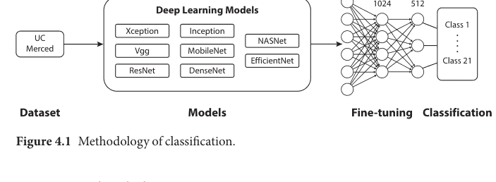

图 4.1 分类方法。

## 4.3 方法

在所提出网络架构中，如图 4.1 所示，基础模型是具有 ImageNet 权重的任何深度学习模型架构。我们探索了 VGG、ResNet、Inception、Xception、EfficientNet、MobileNet 和 NasNet 模型。所有模型均扩展了三个全连接层，神经元数量分别为 2048、1024 和 512，以实现统一并增强性能。之后，模型收敛为 21 个类别，即每个模型的输出层。在将 UC Merced 数据集输入模型之前进行了预处理，图像被转换为灰度并进行缩放操作。

### 4.3.1 预训练模型

预训练模型是指已经训练好以解决问题的模型。对于预训练模型，我们使用了 Keras Applications，这是一组可与已训练的 ImageNet 权重一起使用的深度学习模型。该集合包含 31 个不同模型，隶属于八个家族和两个版本。主要模型属于 VGG、Xception、Inception、ResNet、DenseNet、NasNet、EfficientNet 和 MobileNet 家族。其中，EfficientNet、ResNet 和 MobileNet 各有两个版本。

### 4.3.2 数据集

研究中使用的数据集为 UC Merced 土地利用数据集，于 2010 年 10 月 28 日公开发布。它包含 21 个类别，每个类别 100 张图像，共 2,100 张图像，分辨率为 256 x 256 像素。

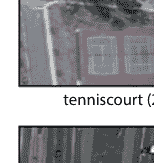

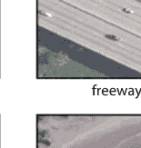

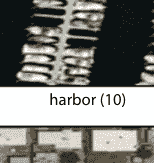

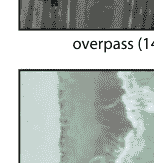

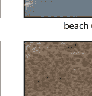

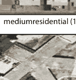

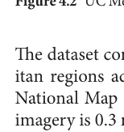

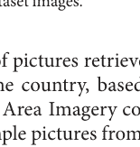

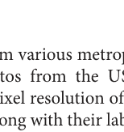

图 4.2 UC Merced 数据集图像。

该数据集由全国各地大都市地区手工检索的图片组成，基于 USGS 国家地图城市区域影像集合的大图。影像的像素分辨率为 0.3 m。数据集中的示例图片及其标签如图 4.2 所示。

### 4.3.3 训练过程

UC Merced 数据集分为三部分：训练、测试和验证，比例分别为 80%、10% 和 10%。由于每个类别有 100 张图像，因此前 100 张被标记为 '0'，后 100 张被标记为 '1'，适用于所有类别。一个数组包含所有类别的名称。将数组和标签组合在一起形成分类的真实标签。实验中的每个模型都有一个深度学习模型作为基础，并有三层用于性能增强。首先冻结基础模型，然后以批量大小 24 进行 18 个 epoch 的训练。整个实验中使用分类交叉熵作为损失函数，优化器为 RMSprop，并使用最大池化。图 4.3 显示了扩展的各种深度架构。

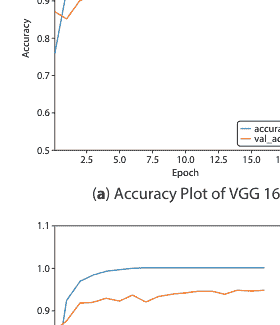

(a) VGG 16 的准确率图

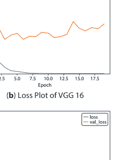

(b) VGG 16 的损失图

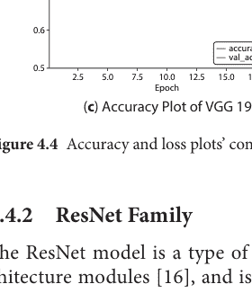

(c) VGG 19 的准确率图

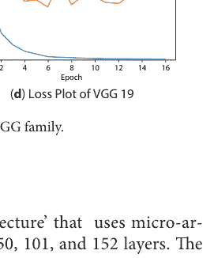

(d) VGG 19 的损失图

图 4.4 VGG 家族的准确率和损失图比较。

### 4.4.2 ResNet 家族

ResNet 模型是一种使用微架构模块的“奇异架构”类型 [16]，有 50、101 和 152 层可供选择。如图 4.5(a) 所示，ResNet50 模型在训练数据上达到了 90% 的准确率。然而，测试准确率在第 10 个 epoch 前表现出波动，从 90% 到 60% 不等。此后在第 12 个 epoch 时显著下降。第 8 个 epoch 后，训练损失变得稳定，但验证损失仍在波动。如图 4.5(b) 所示，在第 12 个 epoch 观察到验证损失急剧上升，但之后恢复正常。

与 ResNet50 相比，ResNet50v2 模型更稳定，但准确率仅为 20%，如图 4.5(c) 所示，且损失也极高，如图 4.5(d) 所示。由于输入范围为 0-1，而版本 2 模型接受的范围为 -1 到 1，因此性能没有改善。

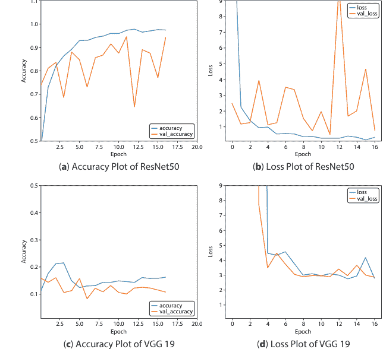

**图 4.5** ResNet50 的准确率和损失图。

#### 4.4.2.1 ResNet101

ResNet101 的表现几乎与 ResNet50 相同，但结果略稳定，因为它比 ResNet50 有更多层。如图 4.6(a) 所示，ResNet101 的训练准确率为 98%，验证准确率为 80%。训练损失保持不变，但验证损失在波动。第 8 个 epoch 时，验证损失突然增加四倍，然后恢复正常，如图 4.6(b) 所示。

ResNet101v2 的表现与 ResNet50v2 相同。图表看起来稳定，但结果不令人满意，如图 4.6(c) 中的准确率性能曲线和图 4.6(d) 中的损失曲线所示。


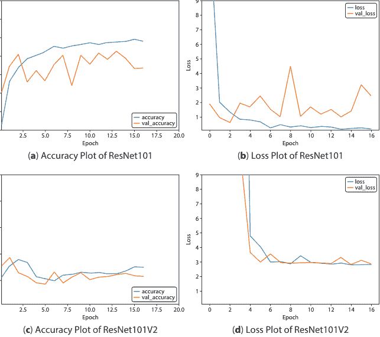

**图4.6** ResNet101的准确率和损失图。

#### 4.4.2.2 ResNet152

与ResNet101相比，ResNet152的性能稍显稳定。与ResNet101的曲线图相比，它们的波动更小。准确率图和损失图分别如图4.7(a)和图4.7(b)曲线所示。

从图4.7(c)可以看出，ResNet152V2的准确率曲线有所变化。验证和训练两条曲线表现出相似的性能。训练数据和测试数据均显示，ResNet152V2的损失在5个轮次后趋于稳定，如图4.7(d)所示。

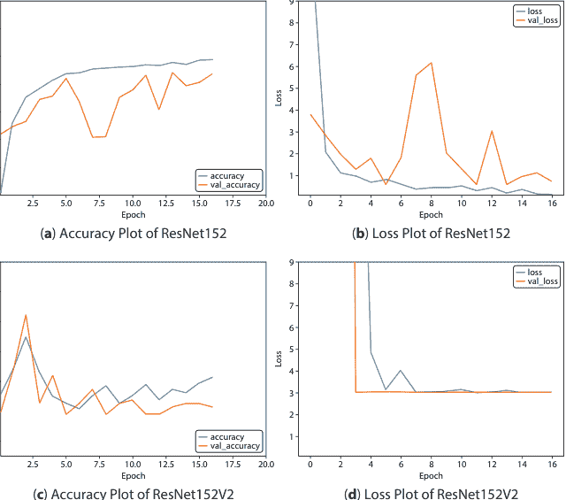

**图4.7** ResNet152的准确率和损失图。

### 4.4.3 MobileNet系列

MobileNet使用深度可分离卷积来减少参数数量。因此，创建了轻量级深度神经网络[17]，但图中存在一些起伏。然而，在使用测试数据时，MobileNet系列表现良好。随着轮次增加，模型的训练准确率提升，但验证准确率随轮次变化而变化。轮次越多，模型波动越大（图4.8(a)）。3个轮次后，训练损失稳定，但验证曲线继续波动（图4.8(b)）。

MobileNetV2模型比MobileNet模型显示出更稳定的准确率和损失曲线。虽然训练准确率随轮次增加而提高，但测试准确率有所变化（图4.8(c)）。在损失方面，MobileNetV2表现更为一致（图4.8(d)）。

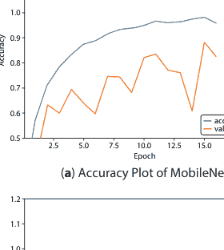

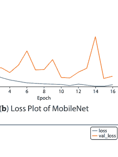

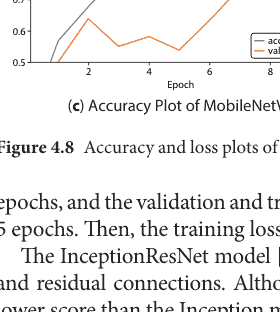

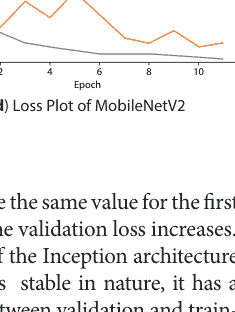

(a) MobileNet的准确率图

(b) MobileNet的损失图

(c) MobileNetV2的准确率图

(d) MobileNetV2的损失图

**图4.8** MobileNet的准确率和损失图。

### 4.4.4 Inception系列

Szegedy *等人*[18]于2014年最初提出了“Inception”微架构。该模型不稳定，Inception的测试准确率为40%。如图4.9(a)所示，Inception模型的训练准确率随轮次快速增加，而测试准确率在20%到40%之间变化，如图4.9(b)所示。损失随轮次减少，前5个轮次中验证损失和训练损失值相同。随后，训练损失趋于稳定，而验证损失增加。

InceptionResNet模型[19]是Inception架构与残差连接的混合体。尽管该模型本质上是稳定的，但其得分低于Inception模型。验证准确率与训练准确率之间的差距随轮次增加而增大（图4.9(c)），而训练损失趋于稳定，验证损失波动剧烈（图4.9(d)）。

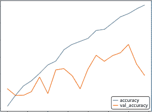

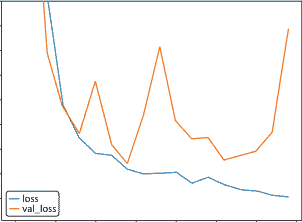

(a) Inception的准确率图

(b) Inception的损失图

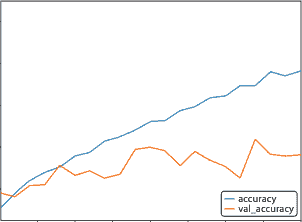

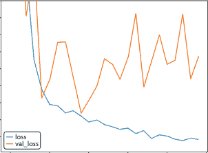

(c) InceptionResNetV2的准确率图

(d) InceptionResNetV2的损失图

**图4.9** Inception的准确率和损失图。

### 4.4.5 Xception系列

Xception是对Inception的架构增强，使用深度可分离卷积替代常规的Inception模块[20]。在测试时，Xception模型的准确率为60%。起初，模型的训练准确率和验证准确率相似，但随着轮次推进，训练准确率与验证准确率之间的差距扩大（图4.10(a)）。随着轮次增多以及训练损失与验证损失之间的差距变大，其行为与准确率类似（图4.10(b)）。

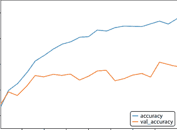

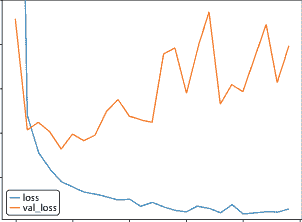

(a) Xception的准确率图

(b) Xception的损失图

**图4.10** Xception的准确率和损失图。

### 4.4.6 DenseNet系列

DenseNet是一种卷积神经网络，通过使用稠密块在层之间建立稠密连接[21]。DenseNet系列包含三个成员：DenseNet121、169和201——它们在卫星数据上的表现几乎相同，其中DenseNet169优于其他两个。对于DenseNet121，随着轮次推进，训练准确率和验证准确率均有所提升，但验证准确率存在波动（图4.11(a)）。验证损失有一些起伏，训练损失一致且随轮次增加而减少，但验证曲线和训练曲线在18个轮次后相交于一点（图4.11(b)）。

在第4个轮次时，DenseNet169的训练准确率稳步上升，而验证准确率在较小波动中上升。起初验证准确率高于训练准确率，但一段时间后得到修正（图4.11(c)）。训练损失曲线平滑，但验证损失在第13个轮次时出现一些起伏（图4.11(d)）。DenseNet201的测试准确率起初波动很大，但随着轮次增加，模型逐渐学习（图4.11(e)），损失也有同样情况（图4.11(f)）。

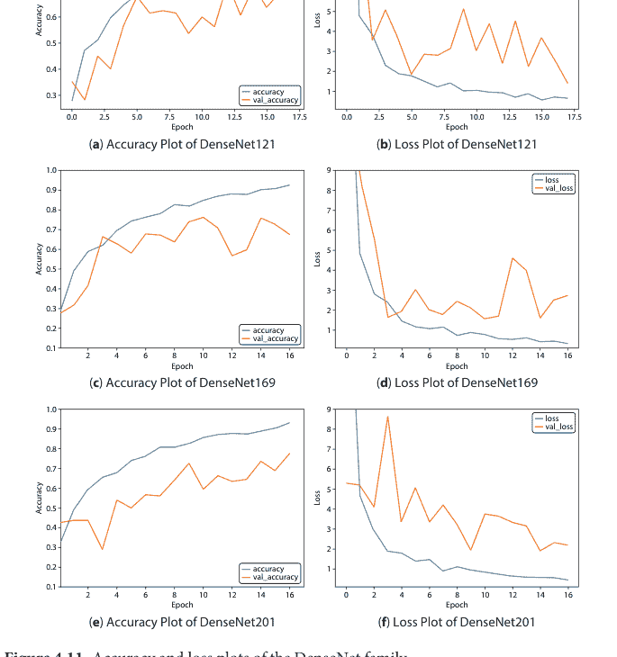

**图4.11** DenseNet系列的准确率和损失图。

### 4.4.7 NasNet系列

神经架构搜索（NAS）网络于2018年被提出，是一种卷积神经网络[22]。总体而言，NasNet模型在卫星数据上表现不佳。训练准确率随轮次增加而提高，但验证曲线保持稳定，在30%至40%之间波动（图4.12(a)）。训练损失持续下降，而验证损失在第4个轮次前一直下降，之后只增不减（图4.12(b)）。

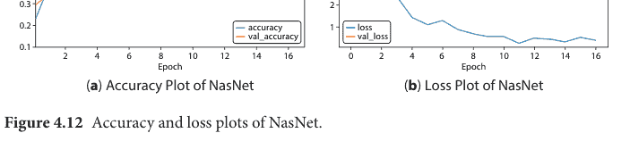

**图4.12** NasNet的准确率和损失图。

### 4.4.8 EfficientNet系列

EfficientNet系列拥有最多的成员[23]。EfficientNet B0、B1、B3、B5和B7模型的平均验证准确率约为90%。B0模型的训练准确率持续上升。然而，验证准确率在4到14个轮次之间波动，之后趋于稳定（图4.13(a)）。验证损失曲线在3到10个轮次之间波动（图4.13(b)），而训练损失曲线平滑。在前6个轮次内，B1模型的验证准确率骤降，之后模型趋于稳定（图4.13(c)）。在第6个轮次，验证损失出现大幅凸起（图4.13(d)）。在前6个轮次，B3模型的测试准确率优于训练准确率；之后测试准确率略有变化（图4.13(g)）。直到第14个轮次，测试损失仍在变化（图4.13(h)）。B5模型起初验证准确率较高，但3个轮次后，验证曲线开始波动，15个轮次后验证曲线与训练曲线相似（图4.13(k)）。验证损失也在3到12个轮次之间波动，之后趋于稳定（图4.13(i)）。B7模型的验证准确率与训练准确率几乎相同（图4.13(o)）。直到前17个轮次，验证损失持续波动，之后曲线变得稳定（图4.13(p)）。EfficientNet B2、B4和B6也不逊色；这些模型在训练和验证中的准确率较低，且在验证准确率和损失方面波动更大。各模型的准确率和损失图如下所示（图4.13(e)、(f)；图4.13(i)、(j)；以及图4.13(m)、(n)）。

### 4.4.9 EfficientNet版本2

EfficientNet系列版本2是一种更小、更快的模型[24]，似乎表现良好，验证准确率为80%。其中B0、B1和B3表现更好，分别如图4.14(a)、4.14(c)和4.14(g)所示。12个轮次后，验证损失也趋于稳定，分别如图4.14(b)、4.14(d)和4.14(f)所示。在前4个轮次中，EfficientNet V2Bs、V2Bm和V2bL表现优异。随着轮次增加，准确率与验证准确率之间的差距扩大（图4.14(i)、4.14(k)和4.14(m)）。这些模型的验证损失与训练损失接近，但损失曲线不稳定（图4.14(j)、4.14(l)和4.14(m)）。

EfficientNetV2B2的表现并不特别突出。图4.14(e)显示验证准确率约为50%，且随着轮次增加，验证损失也在上升（图4.14(f)）。

在训练完每个模型后，这是各模型在准确率和性能方面相互对比的抽象比较（图4.15）。


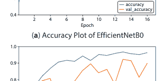

(a) EfficientNetB0 的准确率图

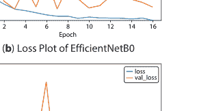

(b) EfficientNetB0 的损失图

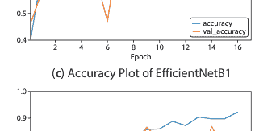

(c) EfficientNetB1 的准确率图

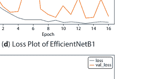

(d) EfficientNetB1 的损失图


(e) EfficientNetB2 的准确率图


(f) EfficientNetB2 的损失图


(g) EfficientNetB3 的准确率图


(h) EfficientNetB3 的损失图

图 4.13（a–h）EfficientNet 系列的准确率和损失图。（续）


(i) EfficientNetB4 的准确率图


(j) EfficientNetB4 的损失图


(k) EfficientNetB5 的准确率图


(l) EfficientNetB5 的损失图


(m) EfficientNetB6 的准确率图


(n) EfficientNetB6 的损失图


(o) EfficientNetB7 的准确率图


(p) EfficientNetB7 的损失图

图 4.13（续）（i–p）EfficientNet 系列的准确率和损失图。


(a) EfficientNetV2B0 的准确率图


(b) EfficientNetV2B0 的损失图


(c) EfficientNetV2B1 的准确率图


(d) EfficientNetV2B1 的损失图


(e) EfficientNetV2B2 的准确率图


(f) EfficientNetV2B2 的损失图


(g) EfficientNetV2B3 的准确率图


(h) EfficientNetV2B3 的损失图

图 4.14（a–h）EfficientNetV2 系列的准确率和损失图。（续）


(i) EfficientNetV2S 的准确率图


(j) EfficientNetV2S 的损失图


(k) EfficientNetV2M 的准确率图


(l) EfficientNetV2M 的损失图


(m) EfficientNetV2L 的准确率图


(n) EfficientNetV2L 的损失图

**图 4.14（续）**（i–n）EfficientNetV2 系列的准确率和损失图。

本文对卫星数据上的各种深度学习模型进行了综合分析，用于对图 4.15 所示的 21 个不同大都市区域进行分类。实验表明，在所有模型中，VGG19 性能最佳，其次是 VGG16、ResNet50 和 EfficientNet B0。这些模型的表现优于实验中使用的其他模型。

- 3. Żuk, P. 和 Żuk, P.，《能源年龄歧视：问题框架与公正能源转型的挑战》。环境创新与社会转型，43, 237–243, 2022。
- 4. Gu, J. 等，《卷积神经网络的最新进展》。模式识别，77, 354–377, 2018，2017年10月13日。
- 5. Xia, G.-S. 等，《AID：用于航空场景分类性能评估的基准数据集》，载于《IEEE地球科学与遥感交易》，第55卷，第7期，第3965–3981页，2017年7月。
- 6. Shabbir, A., Ali, N., Ahmed, J., Zafar, B., Rasheed, A., Sajid, M., Ahmed, A., Hanif Dar, S.，《基于ResNet50迁移学习和微调的卫星与场景图像分类》。数学问题工程，2021，文章ID 5843816，18页，2021，https://doi.org/10.1155/2021/5843816。
- 7. Luus, F. P. S., Salmon, B. P., van den Bergh, F., Maharaj, B. T. J.，《用于土地利用分类的多视图深度学习》，载于《IEEE地球科学与遥感快报》，第12卷，第12期，第2448–2452页，2015年12月。
- 8. Risojević, V. 和 Stojnić, V.，《预训练在高分辨率遥感场景分类中的作用》。J. LaTeX 类文件，14, 8, 2015年8月, 2021年。
- 9. Sasubilli, S.M., Kumar, A., Dutt, V.，《利用物联网、大数据分析和云计算改善医疗保健》。2020年计算与通信工程进展国际会议（ICACCE），第1–4页，2020年。
- 10. Bhargava, N., Sharma, A. K., Kumar, A., Rathore, P. S.，《一种保持边缘的自适应去噪方法》，载于《2017年第二届通信与电子系统国际会议（ICCES）》，第600–604页，IEEE，2017年10月。
- 11. Sharma, N., Jain, V., Mishra, A.，《卷积神经网络在图像分类中的分析》。计算机科学程序，132, 377–384, 2018。
- 12. Aroma, J. 和 Kumudha, R.，《卫星图像分析技术革命概述》。工程科学与技术评论杂志，9, 1–5, 2016。
- 13. Imamoglu, N., Martínez-Gómez, P., Hamaguchi, R., Sakurada, K., Nakamura, R.，《探索用于多光谱卫星图像分类的循环和反馈CNN》。计算机科学程序，140, 162–169, 2018，https://doi.org/10.1016/j.procs.2018.10.325。（https://www.sciencedirect.com/science/article/pii/S1877050918319987）
- 14. Mahmon, N.A. 和 Ya'acob, N.，《使用人工神经网络（ANN）进行卫星图像分类的综述》，IEEE，2014年8月12日。
- 15. Sasubilli, G. 和 Kumar, A.，《机器学习和大数据在医疗数据上的实现》。第四届智能计算与控制系统国际会议（ICICCS），第859–864页，2020年。
- 16. Sasubilli, S.M., Kumar, A., Dutt, V.，《使用TMS在医学领域实施机器学习以识别疾病洞察》。2020年计算与通信工程进展国际会议（ICACCE），第1–4页，2020年。
- 17. Kumar, N., Triwedi, P., Rathore, P.S.，《使用椭圆曲线密码学（ECC）的图像自适应水印自适应方法》。*国际信息技术与知识管理会议*，2017年。
- 18. Kumar, A., Chatterjee, J.M., Rathore, P.S.，《智能手机对抗应用与安全问题》。*国际风险与应急管理杂志*，9, 2, 1–18, 2020。
- 19. Chen, L., Li, S., Bai, Q., Yang, J., Jiang, S., Miao, Y.，《基于卷积神经网络的图像分类算法综述》。*遥感*，13, 22, 4712, 2021，https://doi.org/10.3390/rs13224712。
- 20. Simonyan, K. 和 Zisserman, A.，《用于大规模图像识别的超深度卷积网络》，2015年4月10日，arXiv:1409.1556v6。
- 21. He, K., Zhang, X., Ren, S., Sun, J.，《用于图像识别的深度残差学习》，2015年12月10日，arXiv:1512.03385v1。
- 22. Bhargava, N., Rathore, P.S., Bhowmick, A.，《机器学习中使用CNN进行X射线检测的研究》。*智能计算与信息安全进展：第一届国际会议*，ASCIS 2022，印度拉杰科特，2022年11月24–26日，修订精选论文，第一部分，Springer Nature Switzerland, Cham，2023年。
- 23. Howard, A., Zhu, M., Chen, B., Kalenichenko, D., Wang, W., Weyand, T., Andreetto, M., Adam, H.，《MobileNets：用于移动视觉应用的高效卷积神经网络》，2017年。
- 24. Szegedy, C., Liu, W., Jia, Y.，《用卷积加深网络》，2014年9月17日，arXiv:1409.4842v1。
- 25. Kumar, N., Triwedi, P., Rathore, P.S.，《使用椭圆曲线密码学（ECC）的图像自适应水印自适应方法》。*国际信息技术与知识管理会议*，第89–92页，2017年。


## 社交媒体印地语推文中讽刺和虚假内容的检测

Surbhi Sharma¹,²* and Nisheeth Joshi¹

¹Banasthali Vidyapith, Tonk, Rajasthan, India  
²Manipal University Jaipur, Research Scholar, Banasthali Vidyapeeth, Niwai, Tonk, Rajasthan, India

## 摘要

讽刺是一种辛辣或苦涩的评论，意在表达不尊重或嘲笑。讽刺在印地语中使用已有数十年，许多印地语习语和谚语使用间接讽刺，例如“अन्धों में काना राजा” 的意思是 “मूर्ख मण्डली में थोड़ा पढ़ा-लिखा भी विद्वान और ज्ञानी माना जाता है。” [译文：“在盲人王国中视力部分受损的国王”] 与讽刺检测相比，情感分类较不困难，因为我们看到上述所写的习语包含负面情感，但句子所代表的含义在此情况下针对的是受教育程度较低的人，描述为‘在愚蠢的人群中，即使智力微薄者也被认为是最聪明的’。在当前情况下，人们在 Twitter、Facebook 和 WhatsApp 等社交媒体平台上，即使与世界各地的陌生人互动，也能成功识别讽刺。由于形态学的丰富性，讽刺检测是自然语言处理中的一项具有挑战性的任务。印地语推文中的讽刺检测是自然语言处理的一项主要任务，以避免将讽刺性陈述误解为原始的字面陈述。Twitter 是人们用来表达思想、评论、意见、赞美以及对时事的讨论并以短文本形式传达信息的最广泛使用的社交网络平台之一。推文的相关上下文通常使用 #（ hashtags ）指定，在本研究中，#sarcasm、#sarcastic、#kataksh、#कटाक्ष 等将被用于访问讽刺性推文，然后分析推文的情感以使用不同的机器学习算法检测文本中的讽刺。

**关键词：** Sarcasm, sentiment, NLP

*通讯作者：surbhi2690@gmail.com

## 5.1 引言

分析印地语、英语等书面语言是一个引人入胜的主题，已被许多自然语言处理学科所关注。这些阶段促进了非字面语言装置的使用，例如讽刺和虚假内容用于信息目的。在社交网络平台上，讽刺检测是自然语言处理（NLP）的一个必要部分，有助于找到任何主题在文本形式中的观点的来源 [2]。语料库中存在讽刺、虚假或‘kataksh’ [印地语：कटाक्ष] 内容使得观点挖掘成为一项非常具有挑战性的任务，通常大多数情感分析系统在分析情感时不考虑讽刺或虚假情感。因此，当前用于情感分析的大量框架在讽刺检测方面效率不高。讽刺是一种独特的情感类型，通常会改变给定文本或社交媒体推文的观点方向。人们在口头讨论中经常使用强烈的明显压力和非语言线索，例如眼动和手势来传达讽刺。这些明显和手势的信号在传达非语言讽刺时明显缺失，例如社交媒体推文或帖子通常以文本形式存在，这使得讽刺检测成为一项复杂的工作。大多数时候，人类在理解文本中的讽刺时感到困难。通常，讽刺性句子看起来像积极的句子，由于讽刺的存在，整体意义变得消极。

印地语领域的免费资源获取非常稀少，因为印地语是世界上使用最广泛的交流语言，仅次于汉语、西班牙语和英语等其他交流语言 [13]。全球约有 5 亿人使用印地语作为交流语言，其中很大一部分人口是印度人 [14]。

在本研究中，我们提出了检测社交媒体印地语推文中讽刺的问题。

### 5.1.1 社交媒体印地语推文中的讽刺

近年来在印度，由于 Facebook、Twitter 和 WhatsApp 等社交网络平台的更广泛空间，印地语的使用越来越普遍。人们尽可能用印地语发布信息和评论，因为印地语是我们的母语，所以用印地语写评论、意见、推文和博客很容易。随着通过社交网络平台使用印地语等地区语言讨论的数据量不断扩大，从这些平台挖掘数据现在已成为一项很有前景的任务。为了从社交媒体平台自然地挖掘印地语数据，不同的 NLP 技术和工具，如情感分析和词性标注，已经发展起来。

**图 5.1** 讽刺性印地语推文示例：

1. चीनी लोग चीन के ही अंदर थोड़ा पीछे चले गए। हम सबको बधाई।#व्यंग्य
2. विकास दुबे का रिश्ता लगभग सभी राजनीतिक दलों से था। 'सबका साथ, सबका विकास' वाला 'विकास' यही तो नहीं है।#व्यंग्य
3. खुश नसीब होते हैं वो लोग जिनके रिश्तेदार अपने काम से काम रखते हैं...!!#sarcasm
4. इस समय देखी जाये तो #Sachinpilot और #BSTC वालों की कंडीशन समान हो रही हैं। !#कटाक्ष #व्यंग्य
5. क्या यू.पी. पुलिस गाड़ियाँ, घर आदि तोड़ कर नगर पालिका का काम कर रही है？  
   #कड़ी_निंदा #sarcasm

对于印地语中的讽刺和虚假检测，建立了一个类似英语推文的框架。但在实际实时操作中，常规印地语推文在结构上多种多样，完全不像英语脚本推文或从英语推文翻译而来的印地语推文。自然印地语讽刺、व्यंग्य、Kataksh 推文的示例列表如 图 5.1 所示。为了区分此类常见印地语推文中的讽刺和虚假性，用于英语脚本推文的类似功能列表将无法成功适用。因此，我们需要依赖不同的边界，例如新闻背景、明确的示例和规则，来识别讽刺和虚假的印地语推文。

## 5.2 文献综述

在本节中，我们将看到讽刺检测方面所做的所有过去研究工作，以及它们在各种情况下的优点和缺点。

过去的研究工作尝试通过各种方法识别英语和印地语推文中的讽刺句子。以下文献综述分为三个主要类别：非基于机器学习、基于手工特征的机器学习以及基于词嵌入的机器学习。

### 5.2.1 基于数据分析的无机器学习算法讽刺检测文献综述

Manohar 和 Kulkarni（2017）指出，人们使用 Twitter 等社交媒体平台来交流他们对不同主题的个人观点。他们的工作表明，利用特定的语料库方法可以有效地区分讽刺。根据他们的说法，没有任何类型的机器学习算法的需求；相反，建立了一个动词语料库并进行基于评分的分类以区分讽刺句子。最后，将输入文本与存储的动词和已分析的情感进行比较，之后；他们对比较结果进行情感聚合以识别句子是否具有讽刺性。在讽刺检测的序列中，Rendalkar 和 Chandankhede（2018）研究了基于评分的方法。与建立动词存储语料库不同，在这种方法中，句子中的每个词都会被评分并纳入，句子中的所有词完成后，最后的分数将决定句子的总体估计。SentiWordNet 工具用于确定分数。许多系统被用于区分讽刺，例如基于词和情感的检测、结合词和情感方法的混合讽刺检测、基于积极和消极情况的讽刺检测、基于模式的以及基于感叹词开头的讽刺检测。

根据 Bharti *et al.*（2015）的说法，检测讽刺是自然语言处理中最具挑战性的任务之一。在他们的工作中，他们创建了两种算法，分别是基于解析的词典生成算法（PBLGA）和感叹词起始算法（IWSA）。这两种算法的结构出人意料；第一个更侧重于情感和情境不一致，而第二个算法可以通过给定句子开头感叹词的直接存在来区分讽刺句子。与 #sarcasm 相关信息已从 Twitter 高效收集。在这种方法中，所有类型的算法在特定情况下都有其重要性，但在讽刺句子包含句子中间感叹词时，其效率不高。大多数研究人员研究的是收集和存储的推文，而 Bharti *et al.*（2016）则利用 Hadoop 系统研究了实时流式推文。各种方法被用于识别讽刺，例如 PBLGA、IWSA、带反义词对的积极情感（PSWAP）、反映普遍现实的推文、否定时间依赖现实的推文。Out of all

因此，综合（PBLGA、IWSA、PSWAP）方法表现良好，精确度得分为0.97。

之前所有论文的工作表明，无需机器学习算法的辅助即可识别讽刺。此外，所有工作均未考虑标点符号特征，而该特征是识别讽刺的重要特征之一。

### 5.2.1.1 其他不使用机器学习算法的讽刺检测相关研究

Bharti、Babu和Raman（2017）提出了一项引人注目的讽刺检测研究，他们在研究中重点关注印地语推文，众所周知，大多数讽刺检测研究都是针对英语推文。讽刺检测的主要思想保持不变，但语言的语境完全不同。在Bharti、Babu和Raman（2017）提出的工作中，他们对相似主题的推文和新闻内容进行了对比分析，这是通过基于相同时间戳收集推文和新闻来实现的。之后，利用各种计算方法来识别推文的观点、新闻中的讽刺，并进一步区分推文与新闻之间的差异。基于此，讽刺是根据新闻背景与所收集推文之间的差异来识别的。类似地，Al-Ghadhban等人（2017）研究了阿拉伯语推文，并利用情感词和夸张特征（如标点符号和引号）来识别讽刺推文。

在下一节中，我们将讨论基于机器学习算法并通过手动特征工程进行讽刺检测的工作。

### 5.2.2 基于机器学习算法和手动特征工程方法的讽刺检测文献综述

Riloff等人（2013）在他们的工作中提出了一种创新的讽刺识别方法，他们专注于讽刺可能发生的一种潜在方式，即主要针对负面情境的正面情感。他们利用一个有助于区分正面情感词和负面情境短语的种子词“爱”构建了一种有价值的引导式计算方法。利用这些元素，训练了支持向量机算法，并获得了46-48%的F值。作者所做的假设将使该计算

精度提升8%。他们总共使用了22个特征，并结合了随机森林、梯度提升、决策树、自适应提升、逻辑回归和高斯朴素贝叶斯等机器学习算法。在他的研究工作中，他重点关注了实用特征、表情符号和情感等特征。这项工作未能纳入词汇特征（如一元词组和二元词组），而之前的研究很少涉及这些特征。与Riloff等人（2013）使用种子词“爱”提取正面情感词和负面情境短语类似，Jain等人（2017）也采用相同的方法，使用种子词“喜欢”来获取情感和情境短语。本节讨论的研究工作都使用了情感和实用特征。作者还创建了两个集成模型，即随机森林和投票集成。这些集成模型在提高精确度和召回率方面显示出优势。

到目前为止，我们已经看到了许多基于不同算法的讽刺检测研究，这些研究基本上依赖于手动特征提取，即从内容中提取情感、词汇、实用和夸张等特征，并讨论了它们的优缺点。在下一节中，我们将讨论使用机器学习进行讽刺检测的词嵌入相关研究。

## 5.3 研究空白

在社交媒体兴起之前，大多数关于讽刺构念的定性研究都集中在其口头形式上 [31–34]。然而，关于在社交媒体上有限但多变的自我表达方式中，讽刺的表达方式如何发生变化，我们知之甚少。例如，[35] 中描述的非语言线索在社交媒体上很难表达。现有文献缺乏关于这些非语言线索如何根据 Twitter 等社交网络平台的表达能力而转化的见解。

此外，我们认为在文本数据中使用主题（如 [5, 9, 24]）可能会将这些方法的应用限制在特定时间段内生成的特定领域的文本数据上。因此，更重要的是了解讽刺在文本数据中的表达“方式”，即情感在讽刺性文本数据中整体上如何波动。因此，了解文本中情感变化的一般性质将更适用于来自更多样化领域、时间段或语言的文本数据。

除此之外，近年来人们提出了讽刺检测中对多模态的需求 [29, 33]；我们希望更详细地研究这种方法。我们认为，收集多模态数据集（即包含不仅仅是基于文本的数据集）、单独研究多模态数据各模态的作用，以及随着更多模态的加入而逐渐改变讽刺检测过程的性能变化，可能是这方面的空白。

因此，在接下来的章节中，我们提出了一项定性研究，重点关注用户在社交媒体平台上表达讽刺的方式、基于情感/情绪的文本讽刺数据分析、讽刺检测过程的多模态方法，并评估了该过程及其性能。

## 5.4 目标

识别印地语文本中的讽刺对于自然语言处理来说是一项重要任务，以避免将讽刺语句误解为字面语句。NLP 模型的准确性和鲁棒性常常受到不真实情感的影响，这些情感往往具有讽刺性质。因此，对于各种 NLP 相关任务，从训练数据输入中过滤掉噪声数据非常重要。例如，像“整个周末都要工作电话值班，太兴奋了！”这样的句子可能会被简单地归类为具有高度正面情感的句子。然而，实际上，负面情感是通过讽刺巧妙地暗示出来的。

我们的主要目标是分析一条印地语推文是否具有讽刺意味。

在过去的几年里，讽刺的计算检测已受到情感分析社区的关注。讽刺是情感分析的一个有趣问题，因为讽刺文本中词语的表面情感可能与隐含情感不同。例如，“रिश्तों में दूरियां तो पहले ही आ चुकी थी... कोरोना ने आकर इल्जाम अपने सर ले लिया........!!” 这句话是讽刺的，因为它最初表达了对于关系之间已有距离的正面意图。然而，在 COVID-19 疫情期间，我们现在保持社交距离并避免面对面接触，这给句子的后半部分引入了负面情感。

我们提出了一种算法，用于从我们获取的数据集中判断印地语文本、句子或推文是否具有讽刺意味。我们正在尝试训练我们的模型，以便能够测试来自 Twitter API 的实时印地语推文，检测它们是否具有讽刺性。这将有助于对讽刺性印地语语句进行准确的情感分析，该结果将非常有助于意见挖掘，预测客户或用户在 Twitter 等不同社交网络平台上的观点。

## 5.5 拟议方法

我们的主观研究始于以下目标：(1) 从用户角度出发，了解他们如何识别社交媒体印地语推文中的讽刺内容；(2) 研究哪些因素影响讽刺表达方式，如使用话题标签、表情符号等；(3) 研究用户对讽刺推文的反应。我们必须使用 Twitter API（tweepy）创建一个自然印地语推文数据集，如图 5.2 所示。

- 1. 我们必须使用 tweepy（一个构建在 Twitter API 之上的 Python 库，便于在 Python 中使用）从 Twitter 收集数据（讽刺性印地语推文），并将带有讽刺词的标签（#sarcasm、#kataksh 或 #sarcastic）用于从 Twitter 获取讽刺性推文。
- 2. 然后，我们必须通过删除换行符、标点符号、表情符号和制表符、分离标签以及分词输入来预处理该数据集，以便进一步处理。
- 3. 预处理后，将 Twitter 数据存储为测试数据，并将该测试数据用于特征工程。
- 4. 特征提取。


图 5.2 Twitter 上讽刺检测的框图。


## 5.5.1 基于人工特征提取的讽刺检测

该方法从印地语推文的预处理数据中提取词汇、语用和情感特征，如图5.3所示。在此类别中，词汇特征包括所有可能的一元语法和二元语法，语用特征包括笑脸和表情符号，夸张特征包括大写、标点、感叹词和强调词。词语和情感中可能包含积极和消极的极性评分。使用话题标签可以简单地分析积极和消极态度。


图5.3：讽刺检测的特征分类。

## 5.5.2 基于特征提取的词嵌入

预处理后的数据将用于基于词嵌入的技术中，通过段落向量的PV-DM和PV-DBOW模型创建词向量。这些向量将用作下一步的亮点。以数值形式表示文本的做法称为词嵌入。大多数早期讽刺检测研究都包含了一种词嵌入技术，如词袋、TF-IDF和Word2Vec。

### (a) 词袋模型（BoW）和词频-逆文档频率（TF-IDF）

这些技术用于从文本中提取特征。利用BoW技术构建了一个包含数据中所有术语的词汇表。TF-IDF方法认为句子中词语的价值与词语在文档中出现的次数完全成正比，它是另一种将文本数据表示为分数形式的方式，其中词频表示词语在文档中的相关性。逆文档频率在TF-IDF中扮演着不同的角色；词语的相关性并不总是与它在文本中出现的频率相关。在IDF中，不常见的词语被赋予更大的权重。

### (b) Word2Vec

这一策略基本上基于这样一个观点：文本中没有任何词语在任何方面是相同的。前面段落中提到的技术使Mikolov等人（2013）的研究能够提供可以捕捉词语之间语义和语法相似性的词向量。基本模型设计利用了NNLM（神经网络语言模型）。Word2Vec有两种变体。

- **连续词袋模型：** 该模型采用上下文的连续分布式表示，类似于经典的BoW，然后对结果向量进行平均。
- **跳字模型：** 在这种方法中，短语中的前一个词被用来预测后一个词。

下图展示了Word2Vec的示例，例如Male-Female和Verb-Tense，如图5.4所示。


**图5.4** Word2Vec词嵌入。

### (c) Doc2vec

正如我们讨论的各种将文本数据转换为数值形式的技术，这对文本信息的处理非常有帮助。根据Le和Mikolov在2014年的研究，上述任何模型都无法捕捉段落的词序。一种称为段落向量的无监督方法有助于从各种长度的文本（如句子、章节或记录）中创建词向量。

- 5. 从Twitter数据集中提取特征后，我们将使用不同的机器学习模型，如支持向量机、随机森林和逻辑回归来训练模型，并在应用这些模型后检查讽刺，并将结果以预测的形式存储。
- 6. 在最后阶段，将应用评估技术，通过使用不同的评估指标（如准确率、精确率、召回率和F分数）来分析所应用训练模型的性能。

## 5.6 预期成果

讽刺检测是一个有趣且困难的课题，因为有时人类也无法自动识别讽刺。我们知道，讽刺是情感的结构、复杂的表达形式、传达情感的手段，以及可能的功能性熟悉。

对于讽刺检测，我们将使用标准数据集以及基于讽刺检测的各种组成部分的丰富特征集。

- 1. 我们将尝试根据讽刺的性质来揭示文本中不同类型的讽刺。
- 2. 许多研究表明讽刺和情感总是联系在一起，但我们将努力增强讽刺检测。
- 3. 在机器学习和神经网络领域，研究人员提出了许多用于讽刺检测的模型，但我们将尝试改进基于神经网络的模型，这些模型模仿人脑并检测讽刺。
- 4. 讽刺是根据情感、词语、模式、话题标签和n-gram来识别的，每个特征对于讽刺检测都是必需的。
- 5. 印地语推文中讽刺的存在在分析上以准确率、F分数、召回率和精确率来表示。

## 参考文献

- 1. Al-Ghadhban, D., Alnkhilan, E., Tatwany, L., Alrazgan, M., 推特中的阿拉伯语讽刺检测. *2017年工程管理信息系统国际会议（ICEMIS）*, 第1–7页, 2017年.
- 2. Amir, S., Wallace, B.C., Lyu, H., Silva, P.C.M.J., *使用用户嵌入建模上下文以进行社交媒体中的讽刺检测*, 2016年, arXiv预印本 arXiv:1607.00976.
- 3. Bharti, S.K., Babu, K.S., Jena, S.K., 基于解析的推特数据讽刺情感识别. *2015年IEEE/ACM社会网络分析与挖掘进展国际会议（ASONAM）*, 第1373–1380页, 2015年.
- 4. Bhargava, N. 等, 使用Gabor滤波器提取特征向量并结合回归挖掘算法的纹理识别. *国际风险应急管理杂志*, 9, 3, 31–44, 2020年.
- 5. Bharti, S.K., Babu, K.S., Raman, R., 基于上下文的印地语推文讽刺检测. *2017年第九届国际模式识别进展会议（ICAPR）*, 第1–6页, 2017年.
- 6. Bharti, S.K., Naidu, R., Babu, K.S., 基于夸张特征的推文讽刺检测：一种机器学习方法. *2017年第14届IEEE印度理事会国际会议（INDICON）*, 第1–6页, 2017年.
- 7. Bharti, S., Vachha, B., Pradhan, R., Babu, K., Jena, S., 实时流式推特中的讽刺情感检测：一种大数据方法. *数字通信与网络*, 2, 3, 108–121, 2016年. *大数据进展.*
- 8. 网址: http://www.sciencedirect.com/science/article/pii/S235268461630027X
- 9. Bouazizi, M. and Otsuki Ohtsuki, T., 基于模式的推特讽刺检测方法. *IEEE访问*, 4, 5477–5488, 2016年.
- 10. Sasubilli, S.M., Kumar, A., Dutt, V., 通过物联网、大数据分析和云计算改善医疗保健. *2020年国际计算与通信工程进展会议（ICACCE）*, 第1–4页, 2020年.
- 11. Kotturu, P.K. and Kumar, A., 用于阿尔茨海默病早期诊断的机器学习模型比较研究：多相关方法. *2020年第五届国际通信与电子系统会议（ICCES）*, 第778–783页, 2020年.
- 12. Kumar, P.S., Kumar, A., Agrawal, R., Rathore, P.S., 使用Zigbee和RFID协议设计智能购物车应用. *计算科学与通信最新进展*（原：计算机科学近期专利）, 15, 2, 196–206, 2022年.
- 13. Jain, T., Agrawal, N., Goyal, G., Aggrawal, N., 推文的讽刺检测：一项比较研究. *2017年第十届国际当代计算会议（IC3）*, 第1–6页, 2017年.
- 14. Joshi, A., Sharma, V., Bhattacharyya, P., 利用上下文不一致性进行讽刺检测. 第53届计算语言学协会年会暨第7届自然语言处理国际联合会议论文集（第2卷：短论文）, 计算语言学协会, 中国北京, 第757–762页, 2015年.
- 15. https://www.aclweb.org/anthology/P15-2124
- 16. Joshi, A., Tripathi, V., Patel, K., Bhattacharyya, P., Carman, M., 基于词嵌入的特征对讽刺检测有用吗？, 2016年, arXiv预印本 arXiv:1610.00883.
- 17. Lau, J.H. and Baldwin, T., Doc2vec的实证评估与文档嵌入生成的实践见解, 2016年, arXiv预印本 arXiv:1607.05368.
- 18. Le, Q. and Mikolov, T., 句子和文档的分布式表示. *国际机器学习会议*, 第1188–1196页, 2014年.
- 19. Sharma, S. and Butwall, M., 使用LSTM和RNN进行推特讽刺检测的分析方法. 2022年国际智能计算、通信与信息安全会议论文集（ICICCIS 2022）, 智能系统算法, 施普林格, 新加坡, https://doi.org/10.1007/978-981-99-1373-2_17, 2023年.
- 20. Manjusha, P.D. and Raseek, C., 基于卷积神经网络的明喻分类系统. 2018年国际新兴技术趋势与工程技术研究创新会议（ICETIETR）, 第1–5页, 2018年.
- 21. Manoahar, M.Y. and Kulkarni, P., 使用NLP和基于语料库的方法改进讽刺分析. 2017年国际智能计算与控制系统会议（ICICCS）, 第618–622页, 2017年.
- 22. Kumar, N., Trivedi, P., Rathore, P.S., 使用椭圆曲线密码学（ECC）的图像自适应水印自适应方法. 信息技术与知识管理国际会议, 2017年.
- 23. Mikolov, T., Chen, K., Corrado, G.S., Dean, J., 向量空间中词表示的高效估计. ICLR研讨会论文集, 2013年.
- 24. Prasad, A.G., Sanjana, S., Bhat, S.M., Harish, B.S., 针对流式短文本数据的讽刺检测情感分析. 2017年第二届国际知识工程与应用会议（ICKEA）, 第1–5页, 2017年.
- 25. Ren, Y., Ji, D., Ren, H., 上下文增强的卷积神经网络用于推特讽刺检测. 神经计算, 308, 1–7, 2018年.
- 26. http://www.sciencedirect.com/science/article/pii/S09252321218304284
- 27. Rendalkar, S. and Chandankhede, C., 使用情感检测进行在线评论的讽刺检测, 载于2018年国际创造性研究计算应用会议（ICIRCA）, 第1244–1249页, 印度哥印拜陀, 2018年.
- 28. Riloff, E., Qadir, A., Surve, P., De Silva, L., Gilbert, N., Huang, R., 讽刺作为积极情感与消极情境之间的对比. 论文集


2013年自然语言处理经验方法会议，计算语言学协会，美国华盛顿州西雅图，第704–714页，2013年。

- 29. https://www.aclweb.org/anthology/D13-1066
- 30. Sanguansat, P., 基于Paragraph2vec的泰国商业社交媒体情感分析。2016年第8届知识与智能技术国际会议(KST)，第175–178页，2016年。
- 31. Shuai, Q., Huang, Y., Jin, L., Pang, L., 使用doc2vec和分类器对中文酒店评论进行情感分析。2018年IEEE第三届先进信息技术、电子与控制自动化会议(IAEAC)，第1171–1174页，2018年。
- 32. Son, L.H., Kumar, A., Sangwan, S.R., Arora, A., Nayyar, A., Abdel-Basset, M., 使用基于软注意力的双向长短期记忆模型和卷积网络进行讽刺检测。IEEE Access, 7, 23319–23328, 2019.
- 33. Sreelakshmi, K. 和 Rafeeque, P.C., 一种检测推文中讽刺的有效方法。2018年国际CET控制、通信与计算会议(IC4)，第377–382页，2018年。
- 34. Wirth, R. 和 Hipp, J., CRISP-DM：迈向数据挖掘的标准过程模型。第4届知识发现与数据挖掘实际应用国际会议论文集，Citeseer，第29–39页，2000年。
- 35. Kreuz, R.J. 和 Glucksberg, S., 如何讽刺：言语反讽的回声提醒理论。J. Exp. Psychol. Gen., 118, 4, 374, 1989.
- 36. Clift, R., 对话中的反讽。Lang. Soc., 28, 4, 523–553, 1999.
- 37. Sperber, D. 和 Wilson, D., 关联性：交际与认知，第142卷，哈佛大学出版社，剑桥，马萨诸塞州，1986年。
- 38. Colston, H.L., 论言语反讽理解的必要条件。Pragmat. Cogn., 8, 2, 277–324, 2000.
- 39. Cheang, H.S. 和 Pell, M.D., 讽刺的声音。Speech Commun., 50, 5, 366–381, 2008.

## 使用深度学习和其他人工智能技术去除合成场景和真实场景中的雾霾

Pushpa Koranga¹*, Ravindra Singh Koranga², Sumitra Singar¹ and Sandeep Gupta³

¹印度拉贾斯坦邦斋浦尔Bhartiya技能发展大学计算技能教育学院
²印度北阿坎德邦Bhimtal的Graphic Era Hill大学计算机科学与工程系
³印度拉贾斯坦邦斋浦尔Sunstone (JECRC)电子与通信工程系

### 摘要

图像是所有图像处理领域如监控、检测、识别和卫星的主要来源。传感器捕获图像的良好的可视性对所有计算机视觉任务至关重要。有时，场景质量会因雾霾、雾气或烟等恶劣天气条件而降低；因此，使得计算机视觉领域难以获取真实信息。通过使用单图像去雾方法，可以从单个输入场景中去除雾霾。合成雾霾图像由雾霾生成器创建。目前，大多数图像去雾技术应用于合成雾霾。各种单图像去雾技术正在被开发，并在使用相机在雾霾环境中捕获的真实世界场景上进行测试。这些技术旨在成为从图像中去除雾霾的实用解决方案。本研究聚焦于合成和真实数据集共45个雾霾场景的去雾方法。不同技术的输出质量使用不同参数来衡量，如CIEDE2000、峰值信噪比（PSNR）和结构相似性指数（SSIM）。

关键词：颜色衰减先验，暗通道先验，卷积神经网络，深度学习

*通讯作者：PushpaKoranga14@gmail.com

### 6.1 引言

任何输出光学图像设备的质量取决于其周围天气条件，如薄雾、雾霾、灰尘和雾气。

这些天气条件直接影响场景的颜色和对比度，导致质量下降。这主要是由于物体表面反射的光的吸收和散射的光学现象所致。物体表面反射的光会被环境中的气溶胶粒子衰减，并以称为透射率的因子衰减。此外，光线被周围粒子散射，并受到相机与物体距离的影响[1]。总体而言，这些效应导致输出质量较差，使其难以用于监控和卫星等视觉系统领域。因此，单图像去雾被强烈推荐作为任何计算机视觉方法的预处理任务，以在雾霾条件下提升性能。单图像去雾技术不携带任何关于单输入场景的外部知识。雾霾在空间上是变化的，因为它受场景深度影响，对场景的不同部分产生影响。因此，在雾霾形成模型中需要场景深度来产生无雾输出[2]。

### 6.2 雾霾模型的形成

传感器捕获的图像由两部分组成。第一部分是场景辐射度，由物体反射的光组成。第二部分是环境光照，由地面反射光、直射阳光和漫射天光组成[3]。Nayar 和 Narasimhan 开发了如图 6.1 所示的二色大气散射模型。该模型通过空气光与透射值的线性组合解释了雾霾的形成[4]。

作为一个数学方程，它可以表示为：

I(x) = J(x) t(x) + A (1 - t(x))    (6.1)

其中 J(x)t(x) 表示衰减模型，A(1 – t(x)) 表示退化模型，J(x) 是清晰场景，A 表示全局大气光，t(x) 表示透射值，它表示未被散射并到达传感器的光量，I(x) 是观察到的雾霾场景。去雾的主要目的是从 I(x) 恢复 J(x) 值。


图 6.1 散射模型。

因此，首先估计 A 和 t(x) 值，然后可以轻松计算 J(x) [5]。

均匀雾霾的透射图由下式给出：

t(x) = e^{-βd} (6.2)

这里，d 是场景深度，β 是散射系数。场景辐射度可以通过以下方式恢复[6]：

J(x) = (I(x) - A) / t(x) + A (6.3)

### 6.3 单图像去雾的不同技术

#### 6.3.1 对比度增强

由于恶劣天气，雾霾场景与无雾图像相比具有较低的对比度[7]。为了增加场景直方图的对比度，应用了均衡化[8]。然而，该技术没有考虑与雾霾厚度成比例的物体深度，而雾霾厚度在局部有所不同。为了增加雾霾场景的对比度，应用快速傅里叶变换和暗通道先验（DCP）来估计透射值，而不是使用双边滤波器[9]。波长补偿技术被应用于水下图像，有效恢复了图像的色彩平衡并产生去雾输出[10]。Kim 等人提出了一种算法，通过最小化代价函数来保留信息和增强对比度[11]。主成分分析已被用于通过提取雾霾斑块的特征来估计大气值[12]。通过监督学习方法估计透射值，从而产生增强输出。对于夜间雾霾，提出了一种双通道先验技术，其结果是暗通道先验和亮通道先验。初始透射值由暗通道先验估计，而精细透射值由亮通道先验获得[13]。在[14]中，首先应用白平衡以保留自然色彩，然后进行自适应直方图均衡化。最后，通过应用引导滤波器恢复因直方图均衡化中裁剪而丢失的信息。在[15]中，提出了基于暗通道和直方图均衡化的新方法。首先，通过应用暗通道估计雾霾密度。之后，通过直方图均衡化增加场景对比度，最后在最终阶段应用颜色校正。

#### 6.3.2 暗通道先验

He 等人对雾霾和无雾图像进行了实证实验。结果发现，雾霾场景携带的暗像素在任何一个颜色通道带上的值都接近零[16]。暗通道的数学定义为：

J^dark(x) = min_{y∈Ω(x)} ( min_{c∈{r,g,b}} J^c(y) )   (6.4)

这里，Ω(x) 表示以 x 为中心的局部块。c ∈ {r, g, b} 是颜色通道带。J^c 是颜色强度。选择 Ω(x) 中的所有像素和所有颜色带中的最小值作为暗通道[17]。Tomasi 等人提出了一种用于边缘的双边滤波器，可用于最小化暗通道[18]。Tang 等人提出了新技术：首先，通过二叉树算法估计大气值。其次，通过两个不同部分估计透射值：亮区域和暗区域。暗区域的透射值通过 DCP 确定，而亮区域应用自适应透射。最后，对两部分应用引导滤波器[19]。在该技术中，DCP 用于计算大气值，而平均透射值使用 R、G、B 颜色空间计算。在 YCbCr 中，Y 带估计透射值。最后，从


两个透射率值，进一步细化后得到去雾输出[20]。瑞利散射技术通过计算每个R、G、B通道的最小、平均和最大像素值来估计大气光值，已有相关研究[21]。初始透射率通过瑞利散射模型估计，而细化透射率通过快速引导滤波获得。针对夜间雾霾，采用泰勒级数展开计算逐点透射率值，同时利用Retinex理论确定大气光值[22]。有界通道先验技术能够提供精确的透射率图，并能准确估计输入图像中许多小块的不同透射率值。

进一步对粗略透射率应用引导滤波和加权插值，以细化细节和边缘[23]。

### 6.3.3 颜色衰减先验

颜色衰减先验（CAP）假设图像的亮度与饱和度之差会影响雾浓度。此外，雾浓度与场景深度成正比，这可用以下公式解释[24]：

(x) ∝ d(x) ∝ v(x) − s(x) (6.5)

(x) 表示雾浓度，d(x) 表示场景深度，v(x) 表示场景亮度，s(x) 表示饱和度。场景深度、亮度和饱和度之间的线性关系如下：

d(x) = θ₀ + θ₁ v(x) + θ₂ s(x) (6.6)

其中 θ₀、θ₁ 和 θ₂ 是未知的线性系数；基本颜色衰减先验步骤如图6.2所示。


图6.2 颜色衰减先验流程图。

为了改进对合成和真实场景均适用的颜色衰减技术，采用四叉树分解方法进行大气光估计。使用低通滤波器是从图像中去除背景噪声的常用技术。除了使用低通滤波器外，还可以使用自适应线性加权进一步去除图像背景噪声[25]。

使用雾线估计大气光，该方法假设RGB空间中的有雾像素值可建模为线，且这些线相交于大气光[26]。最后，将恒定散射系数值替换为动态散射系数值。颜色通道转移是一种图像去雾技术，用于恢复有雾图像的颜色和对比度。它基于这样的假设：至少有一个颜色通道（通常是绿色或蓝色）由于雾霾而衰减相对较低。为了补偿色彩损失，这些技术对较低衰减的颜色通道采用了颜色转移策略[27]。所提出的颜色偏移感知技术可校准和校正输入场景的颜色[28]。最后，应用伽马校正去除雾霾。多色技术使用两个模块，即雾色校正和能见度改善，以恢复有雾场景的颜色平衡，从而输出清晰图像[29]。

### 6.3.4 融合技术

该技术从不同改进版本的去雾技术中获取两个或多个输入，并产生更好的输出[30]。对比度增强与白平衡的融合以逐像素方式实现[31]。最后，为了减少伪影，采用拉普拉斯金字塔表示。优化、快速、单一去雾方法包含不同技术的融合。为确定大气光值，先执行暗通道先验，然后进行白平衡以保留真实颜色。最后，执行对比度拉伸以增强输出对比度[32]。所提出的融合技术基于编码器-解码器架构，涉及对比度增强、白平衡以及最后的伽马校正的融合。该卷积神经网络涉及两个生成对抗网络（GAN）的融合[33]。使用cycleGAN训练户外非配对真实数据集，而cGAN保留场景细节。这些技术在真实和合成数据集上均表现良好[34]。

### 6.3.5 深度学习

为了消除现有去雾技术（如基于假设的方法或复杂融合方法）的局限性，提出了CNN，如图6.3所示[35]。多尺度CNN基于数据集训练，由两个网络组成。粗略网络确定粗略透射率值，精细尺度进一步细化透射率值[36]。级联卷积神经网络（CNN）方法利用两个子网络协同工作，同时确定透射率图和全局大气光。该技术基于数据集训练，可去除噪声和场景伪影[37]。排序CNN可以同时重现统计特征和结构特征。进一步基于学习到的特征训练回归模型，以有效预测场景深度[38]。

图像感知网络基于雾相关特征和三维CNN测量空气质量指数[39]。多特征双线性技术通过不同步骤确定透射率值：首先，通过训练数据集提取特征；其次，进行非线性映射；最后，恢复无噪声且无突变边缘的无雾图像[40]。双网络由两个组件组成，即去雾网络和去噪网络。去雾网络使用AL-Net确定大气光，并使用TM-Net生成透射率图。最后，去噪网络去除纹理层中的噪声[41]。CycleGAN使用无监督训练方法生成雾掩膜。通过使用雾掩膜和有雾版本，结合重新表述的散射模型，可获得干净的输出[42]。大气光值和透射率图同时确定[43]。该技术减少了计算时间，但不适用于浓雾场景。CNN使用块图选择网络，该网络根据每个像素所选择的块大小来确定。该技术在视觉上和定性上均表现出更好的结果[44]。知识迁移技术由教师网络组成，该网络利用清晰图像进行训练，以学习鲁棒且强的先验[45]。


图6.3 CNN的编码器层和解码器层。

**表6.2** 合成场景的SSIM和PSNR值（图6.4）。

| 技术 | 基于先验/无先验 | SSIM（合成场景） | PSNR（合成场景） |
|---|---:|---:|
| DCP (He *et al.*) | 基于先验 | 0.58 | 27.78 |
| CAP (Zhu *et al.*) | 基于先验 | 0.48 | 27.96 |
| CNN (Rashid *et al.*) | 无先验 | 0.59 | 27.78 |
| FCN (Mondal *et al.*) | 无先验 | 0.67 | 28.76 |

**表6.3** 真实场景数据集的平均CIEDE2000值（45幅图像）。

| 技术 | 基于先验/无先验 | CIEDE2000（真实场景） |
|---|---:|
| CLAHE (Soni *et al.*) | 基于先验 | 40.01 |
| DCP (He *et al.*) | 基于先验 | 9.90 |
| CAP (Zhu *et al.*) | 基于先验 | 12 |
| CNN (Rashid *et al.*) | 无先验 | 4.95 |
| FCN (Mondal *et al.*) | 无先验 | 6.71 |

**表6.4** 户外有雾数据集（45幅图像）合成场景的平均SSIM和PSNR值。

| 技术 | 基于先验/无先验 | SSIM（合成场景） | PSNR（合成场景） |
|---|---:|---:|
| DCP (He *et al.*) | 基于先验 | 0.65 | 28.01 |
| CAP (Zhu *et al.*) | 基于先验 | 0.55 | 27.97 |
| CNN (Rashid *et al.*) | 无先验 | 0.62 | 28.04 |
| FCN (Mondal *et al.*) | 无先验 | 0.68 | 28.60 |

## 6.5 合成场景的输出


图6.4 使用不同技术的合成场景。

## 6.6 真实场景的输出


图6.5 使用不同技术的真实有雾场景。


## 6.7 结论

本文使用Python和MATLAB实现了多种单图像去雾方法。我们针对不同的去雾技术，在合成数据集和真实数据集上进行了比较。真实数据集的主要缺点是没有地面真值或参考图像。因此，无法采用峰值信噪比或结构相似性指数等度量来评估在雾霾环境中捕获的真实场景。此外，在许多输出图像尺寸缩小的其他技术中，某些特征也无法实现。为克服所有这些缺点，我们将色差CIEDE2000作为基于可见性评估输出质量的方法之一。结果表明，全卷积网络（FCN）在视觉上效果最佳，但在合成场景中色差未能保持。CAP在合成场景中无法保持色差，且CIEDE2000值非常高。总体而言，对于合成场景，深度学习方法（如CNN和FCN）在SSIM和PSNR上取得了最佳结果。未来，需要更好的质量评估参数来检查真实场景输出的质量。

## 参考文献

- 1. Fattal, R.，单图像去雾。ACM图形学汇刊（TOG），27卷，3期，1–9页，2008年。
- 2. Galdran, A.，基于人工多次曝光图像融合的图像去雾。信号处理，149卷，135–147页，2018年。
- 3. Tan, R.T.，从单张图像看恶劣天气下的能见度，见：2008年IEEE计算机视觉与模式识别会议，IEEE，第1–8页，2008年。
- 4. Narasimhan, S.G.和Nayar, S.K.，天气退化图像的对比度恢复。IEEE模式分析与机器智能汇刊，25卷，6期，713–724页，2003年。
- 5. Zhang, H., Li, J, Li, L., Li, Y., Zhao, Q., You, Y.，基于细节损失补偿与退化的单图像去雾，见：2011年第四届图像与信号处理国际大会，第2卷，IEEE，第807–811页，2011年。
- 6. Wang, W., Yuan, X., Wu, X., Liu, Y., Ghanbarzadeh, S.，一种高效的图像去雾方法，见：2016年IEEE国际图像处理会议（ICIP），IEEE，第2241–2245页，2016年。
- 7. Tan, R.T.，从单张图像看恶劣天气下的能见度，见：2008年IEEE计算机视觉与模式识别会议，IEEE，第1–8页，2008年。
- 8. Gonzalez, R. C.，数字图像处理。培生教育出版社，印度，2009年。
- 9. Kumari, A.和Sahoo, S.K.，用于单图像去雾的实时可见度增强。计算机科学进展，54卷，501–507页，2015年。
- 24. of Everything, *微波工程、通信与网络（IEMECON）*，印度斋浦尔，第1–6页，2023年。
- 25. Zhu, Q., Mai, J., Shao, L.，基于颜色衰减先验的单图像去雾，见：*BMVC*，2014年。
- 26. Ngo, D., Lee, G.-D., Kang, B.，改进的颜色衰减先验用于单图像去雾。*应用科学*，9卷，19期，4011页，2019年。
- 27. Kumar, P. S., Kumar, A., Agarwal, R., Rathore, P. S.，使用Zigbee和RFID协议设计智能购物车应用。*计算机科学与通信近期进展*（原：计算机科学近期专利），15卷，2期，196–206页，2022年。
- 28. Berman, D., Treibitz, T., Avidan, S.，使用雾线进行单图像去雾。*IEEE模式分析与机器智能汇刊*，42卷，3期，720–734页，2018年。
- 29. Kumar, P.S.等人，使用Zigbee和RFID协议设计智能购物车应用。*计算机科学与通信近期进展*（原：计算机科学近期专利），15卷，2期，196–206页，2022年。
- 30. Ancuti, C.O., Ancuti, C., De Vleeschouwer, C., Sbert, M.，用于图像去雾的颜色通道转移。*IEEE信号处理快报*，26卷，9期，1413–1417页，2019年。
- 31. Yin, J.-L., Chen, B.-H., Peng, Y.-T., Lin, Y.-C.，颜色偏移感知的图像去雾，见：*2019年IEEE国际多媒体研讨会（ISM）*，IEEE，第128–133页，2019年。
- 32. Kumar, P.S.等人，具有性能保证的云数据中心网络按需且用户友好的框架，见：*并行与分布式计算中的网络安全：概念、技术、应用与案例研究*，第149–195页，2019年。
- 33. Sahwal, A.K., Kishore, B., Rathore, P.S., Chatterjee, J.M.，一种使用ECC交换概念的图像加密循环技术的高级方法。*Eureka*，2581, 477X，2018年。
- 34. Dudahane, A., Biradar, K.M., Patil, P.W., Hambarde, P., Murala, S.，杂色图像去雾，见：*IEEE/CVF计算机视觉与模式识别会议论文集*，第4564–4573页，2020年。
- 35. Bhargava, N., Rathore, P.S., Bhowmick, A.，在机器学习中使用CNN进行X射线检测的研究。*智能计算与信息安全进展：第一届国际会议ASCIS 2022，印度拉杰科特，2022年11月24–26日，修订选论文，第一部分*，Springer Nature Switzerland，Cham，2023年。
- 36. Ancuti, C.O., Ancuti, C., Bekaert, P.，基于融合的有效单图像去雾，见：*2010年IEEE国际图像处理会议*，IEEE，第3541–3544页，2010年。
- 37. Ancuti, C.O.和Ancuti, C.，基于多尺度融合的单图像去雾。*IEEE图像处理汇刊*，22卷，8期，3271–3282页，2013年。
- 38. Yang, L., Bian, H., Feng, J., Zhao, L., Wang, H., Liu, Q., Wang, H., Wang, H., Liao, J.，快速单图像去雾算法的优化设计，见：*2017年第14届国际计算机会议“小波主动媒体技术与信息处理”（ICCWAMTIP）*，IEEE，第171–174页，2017年。
- 39. Kumar, A., Chatterjee, J.M., Rathore, P.S.，智能手机对抗性应用与安全问题。*国际风险与应急管理杂志（IJRCM）*，9卷，2期，1–18页，2020年。
- 40. Bhargava, N.等人，使用Gabor滤波器进行纹理识别，通过回归挖掘算法提取特征向量。*国际风险与应急管理杂志（IJRCM）*，9卷，3期，31–44页，2020年。
- 41. Kumar, N., Triwedi, P., Rathore, P.S.，一种使用椭圆曲线密码（ECC）的自适应图像自适应水印方法。*ICITKM*，2017年。
- 42. Ren, W., Ma, L., Zhang, J., Pan, J., Cao, X., Liu, W., Yang, M-H.，用于单图像去雾的门控融合网络，见：*IEEE计算机视觉与模式识别会议论文集*，第3253–3261页，2018年。
- 43. Park, J., Han, D.K., Ko, H.，用于单图像去雾的异构对抗网络融合。*IEEE图像处理汇刊*，29卷，4721–4732页，2020年。
- 44. Rashid, H., Zafar, N., Javed Iqbal, M., Dawood, H., Dawood., H.，使用CNN的单图像去雾。*计算机科学进展*，147卷，124–130页，2019年。
- 45. Ren, W., Liu, S., Zhang, H., Pan, J., Cao, X., Yang, M.-H.，通过多尺度卷积神经网络进行单图像去雾，见：*欧洲计算机视觉会议*，Springer，Cham，第154–169页，2016年。

## 基于HOG和Haar特征提取的人脸检测与计数安全系统

Prachi Soni¹* 和 Viplav Soni²

¹印度马哈拉施特拉邦浦那斯里巴拉吉大学计算机研究学院
²印度比莱什里尚卡拉查里亚机构集团

### 摘要

已有多种基于监控的人群计数框架被提出，用于实时跟踪多人。然而，这些框架需要准确且实时的性能，以统计在特定帧中特定时刻存在的人数。因此，我们的计数框架自动检测每个人的面部，并即时决策以统计摄像机前或一组图像中的人数。个人计数的工作可以通过两种主要方式完成：第一是面部检测，这是必须的；第二是计数方法，用于跟踪和统计该帧中的人数。

关键词：特征提取，分类器，人脸检测，直方图

### 7.1 引言

虽然网络安全很重要，但个人的人身安全同样重要，甚至更为重要。站点看守涉及两个主要功能：第一，通过传感器感知运动，检测站在摄像机前的人的脸部；第二，通过分析不同姿态的变化，统计该帧中的人数。这一分析通过方向梯度直方图（HOG）和Haar-like特征提取技术的结合来实现。


通过对特征的分析，特征的模糊性得以降低，并提取出面部特征的位置。

前一节讨论的基于图像的方法 [9–12] 通过显式建模面部特征来进行人脸检测。该方法面临着与人脸检测不确定性和环境条件变化相关的挑战。然而，近期基于组件的方法的进展增强了缓解这种不确定性的能力，主要侧重于头肩部图像和半正面人脸。

AdaBoost 分类器 [13–15] 是弱分类器或准确性较低的分类器的组合。这些分类器被组合起来，并分配权重。然后，在每次迭代中，它们都用样本数据进行训练，以期这一迭代过程能够带来更高的准确率。

## 7.3 拟议工作

我们提出了一种通过人脸检测进行个体计数的监控框架。

- 1. HOG + Haar 特征提取
- 2. 应用 AdaBoost 分类器
- 3. 应用 Kanade–Lucas–Tomasi（KLT）跟踪器
- 4. 通过计算帧中人脸数量进行人脸检测

### 7.3.1 使用的工具

该监控框架的重要工具如下：

- 1. 树莓派
- 2. 被动式红外（PIR）传感器
- 3. Pi 摄像头

树莓派通过通用串行总线（USB）连接到计算机，被动式红外（PIR）传感器通过树莓派使用公母跳线连接到面包板。此外，Pi 摄像头连接到树莓派。要使用树莓派，必须通过网线 [1] 建立互联网连接。

正如我们在文献综述中所讨论的，先前的工作已将 HOG 与其他特征提取方法（如局部二值模式（LBP）[5]）相结合，但 Haar 特征提取尚未被探索。鉴于 Haar 特征提取能够提供更精确的检测，本工作将 HOG 与 Haar 特征提取相结合，有望在提高准确率的同时实现更快的计算速度。

### 7.3.2 拟议系统的算法

下面给出了通过人脸检测进行个体计数的算法。该算法使用自定义数据集开发，该数据集包含各种图像，主要以人物为主，但也包含“非人脸”样本，如手或盆栽植物。该算法的目的是检测并用矩形标记人脸，同时统计任意时刻画面中的人数。

下面讨论并实现了一种改进监控框架并从中获取更多信息的新方法。特征提取技术主要用于人脸检测。

个体计数框架包含机械控制框架，例如旋转入口和红外传感器识别框架。在我们当今社会，视频采集框架正逐渐融入我们生活的诸多方面，如图 7.2 所示。

这里，I 表示数据集中的图像编号，J 表示子窗口的位移步数。

```
**Algorithm:** Individual counting via Face Detection

**Input:** Original Image
**Output:** Image with face indicator as a rectangle with people counting.

begin
  For I ← 1 to N do
    Preprocess the input image.
    Calculate the gradient image.
    Calculate histogram gradient in the 8×8 image
    16×16 normalization
    Calculate HOG feature vector
  End for
  For J ← 1 to number of shift steps of sub-window do
    For k ← 1 to number of steps in cascade classifier do
      For l ← 1 to number of filters of stages k do
        Apply AdaBoost classifier
        Count number of people
        Track the images with KLT tracker
        Filter detection sub-window
      End for
    End for
    Accumulate filter output
  End for
End
```


**图 7.2** HOG 特征提取过程。

#### 7.3.2.1 基于 HOG 的个体计数

HOG 是一种目标检测技术 [12]。它用于通过边缘方向定义任何物体的形状。通过使用 HOG，算法将图像划分为单元格，然后计算单元格的直方图并归一化单元格的方向。这里在水平和垂直两个方向上使用滤波来查找图像中的梯度。

#### 7.3.2.2 基于 Haar 的个体计数

基本 Haar 特征通常比原始像素表示更快、更有效 [13]。Haar 特征的一种简单排列包含方形。在方形形状中，Haar 类特征的简单元素通过图像中可用像素的差异来表征；它可以位于第一幅图像中的任意位置和任意尺度。这组修改后的特征被称为“2 方形形状特征”。

#### 7.3.2.3 HOG 与 Haar 的组合


当我们结合这些特征提取技术时，即 HOG 检测精度较低但计算速度快，Haar 精度更高但速度较慢，在个体计数的情况下，结果将表现为更快的速度和更高的精度。

通过研究和处理视频图像来获取有价值的数据已成为视频分析领域的一个重要研究焦点。基于视频的人员监控技术属于智能视频监控范畴。其分析涉及计算机视觉、图像处理、人脸检测和人工智能。

#### 7.3.2.4 AdaBoost 学习技术

AdaBoost [10] 或称自适应提升，是 Yoav Freund 和 Robert Schapire 于 1996 年提出的一组提升分类器。AdaBoost 分类器 [10] 是表现不佳或准确率较低的分类器的组合。它们被组合起来并设置权重。然后，每次都对它们的所有样本数据进行训练，期望通过这种方式获得更高的准确率。

AdaBoost 的基本概念是建立多个分类器，并在每次迭代中迭代优化训练数据，以确保对观测值的准确预测 [10]。如果它接受对准备数据集的加载，基于人工智能的计算可用作基础且强大的分类器。

#### 7.3.2.5 KLT 跟踪器

在计算机视觉中，Kanade–Lucas–Tomasi（KLT）特征跟踪器是一种处理特征提取的方法。它主要用于解决传统图像配准过程通常代价高昂的问题。KLT 利用空间强度数据来协调扫描，以找到最佳匹配的位置。它比常规系统更快，因为检查图像之间潜在匹配的数量要少得多 [12]。

## 7.4 实验与结果

与任何以人脸检测和计数为目标的监控框架或图像一样，输出以带有特定人脸标签或指示符的图像形式呈现，并配有一个跟踪器来统计人脸或人数。在我们的方法中，我们结合了 HOG 和 Haar 特征提取，并采用了 AdaBoost 分类器和 KLT 跟踪器进行人脸跟踪。结果显示了摄像头前的人数，该人数是使用图 7.3 所示的人脸检测技术确定的。


**图 7.3** 通过人脸检测进行个体计数。

**表 7.1** 通过人脸检测进行个体计数的混淆矩阵。

| N=25 | 预测为否 | 预测为是 |
| --- | --- | --- |
| 实际为否 | 4 | 1 |
| 实际为是 | 1 | 19 |

在表 7.1 中，您可以看到我们提出方法的结果。当人脸被正确识别或检测到时，会出现一个矩形框。我们为正确识别的人数赋值为“1”，为错误检测的人数赋值为“2”，如图 7.4 所示。

根据错误率和准确率的公式，我们在此展示了使用该混淆矩阵通过人脸检测进行个体计数的结果：

```
Err = 2/25 = 0.08
Accuracy = 1 - error
         = 1 - 0.08
         = 0.92
Accuracy (in percentage) = 92%
```


图7.4 通过人脸检测进行个体计数。

### 7.5 结论与未来工作范围

基于人脸检测的个体计数是一种监控系统，主要用于安全目的。实验使用Raspberry Pi，通过在成像场景中改变角度来进行特征提取。

未来，它可以进一步发展，使用不同数据集进行高精度人脸识别，同时考虑姿态变化、表情变化和面部伪装。人脸识别的所有这些特征对每张脸都应该是唯一的。捕获人脸图像后，应与数据集图像进行匹配。考虑门前的光照条件也有助于识别个体的面部特征。这项技术将有助于在公共场所识别人们的面部，如机场、商场、银行、学校和警察局。

### 参考文献

- 1. Soni, P., Verma, S., Pandey, S., IoT based reconnaissance framework for utilizing different thresholding algorithms for detecting motion by using Raspberry Pi. ICDSMLA 2019, Springer, Singapore, pp. 231–238, 2020.
- 2. Uddin, M. et al., Crowd detection in still images using combined HOG and SIFT feature. Indones. J. Electr. Eng. Comput. Sci., 4, 2, 447, 2016.
- 3. Venkatesh, K. et al., IoT based home automation using Raspberry Pi. J. Adv. Res. Dyn. Control Syst., 10, 7, 1721–1728, 2018.
- 4. Kumar, N., Trivedi, P., Rathore, P.S., An adaptive approach for image adaptive watermarking using Elliptic Curve Cryptography (ECC). ICITKM, 2017.
- 5. Benkhelifa, E., Welsh, T., Hamouda, W., A critical review of practices and challenges in intrusion detection systems for IoT: Toward universal and resilient systems. IEEE Commun. Surv. Tutor., 20, 4, 3496–3509, 2018.
- 6. Bhargava, N. et al., Texture recognition using Gabor filter for extracting feature vectors with the regression mining algorithm. Int. J. Risk Conting. Manage. (IJRCM), 9, 3, 31–44, 2020.
- 7. Gaikwad, P.P., Gabhane, J.P., Golait, S.S., A survey based on Smart Homes system using Internet-of-Things. 2015 International Conference on Computation of Power, Energy, Information and Communication (ICCPEIC), IEEE, 2015.
- 8. Pang, Y. et al., Efficient HOG human detection. Signal Process., 91, 4, 773–781, 2011.
- 9. Adouani, A., Henia, W.M.B., Lachiri, Z., Comparison of Haar-like, HOG and LBP approaches for face detection in video sequences. 2019 16th International Multi-Conference on Systems, Signals & Devices (SSD), IEEE, 2019.
- 10. Li, T. et al., Face detection based on depth information using HOG-LBP. 2016 Sixth International Conference on Instrumentation & Measurement, Computer, Communication and Control (IMCCC), IEEE, 2016.
- 11. Kumar, P.S. et al., An on-demand and user-friendly framework for cloud data centre networks with performance guarantee, in: Cyber Security in Parallel and Distributed Computing: Concepts, Techniques, Applications and Case Studies, pp. 149–159, 2019.
- 12. Ibrahim, A. et al., Optimized superpixel and AdaBoost classifier for human thermal face recognition. Signal Image Video Process., 12, 4, 711–719, 2018.
- 13. Rathore, P.S., Kumar, A., García-Díaz, V., A holistic methodology for improved RFID network lifetime by advanced cluster head selection using dragonfly algorithm, Int. J. Interact. Multimed. Artif. Intell., Vol. 6, No. 2, 2020.
- 14. Sasubilli, S.M., Kumar, A., Dutt, V., Improving health care by help of Internet of Things and big data analytics and cloud computing. 2020 International Conference on Advances in Computing and Communication Engineering (ICACCE), pp. 1–4, 2020.
- 15. Kotturu, P.K. and Kumar, A., Comparative study on machine learning models for early diagnose of Alzheimer’s disease: Multi correlation method. 2020 5th International Conference on Communication and Electronics Systems (ICCES), pp. 778–783, 2020.

## 不同CNN模型在空间域隐写分析中的比较分析

Ankita Gupta*、Rita Chhikara 和 Prabha Sharma

计算机科学与工程系，The NorthCap大学，古鲁格拉姆，哈里亚纳邦，印度

### 摘要

通用隐写分析检测图像是载体图像还是通过多种隐写方法嵌入了隐藏信息的隐写图像。隐写分析始于简单的特征提取与分类机器学习技术。如今，隐写分析的重点已转向探索深度学习方法。用于图像分类的最流行且成功的深度学习模型基于卷积神经网络（CNN）。CNN网络与使用滤波器进行特征提取的传统隐写分析也有相似之处。由于使用了内容自适应隐写方法，隐写消息更多地隐藏在图像的复杂区域，因此无法通过简单的图像统计分析来检测。这些隐写方法中的隐写信息主要影响图像中存在各种噪声所带来的像素间依赖关系。因此，载体图像与隐写图像之间的差异是通过噪声部分而非图像内容来识别的。不同的研究者使用了各种预处理滤波器来计算噪声残差，并将其输入CNN网络，而不是直接输入图像。本工作使用一种内容自适应隐写方法——高不可检测隐写（HUGO）——来创建隐写图像。本工作对专门用于隐写分析的CNN模型变体之一以及应用于隐写分析的多种计算机视觉预训练模型进行了比较分析。本章对用于隐写分析的不同深度学习模型的优缺点进行了深入分析。

**关键词：** 隐写分析、隐写术、深度学习、卷积神经网络、预训练模型、VGGNet-16、ResNet-50、EfficientNet-B0

*通讯作者：* ank21gupta@gmail.com

### 8.1 引言

隐写分析是一种检测特定图像是否纯净，或是否包含可能构成恶意行为的隐藏信息的方法。有几种可用于隐藏信息的方法，称为隐写方法[1, 2]。尽管隐写术可用于善意目的，例如在信用卡中隐藏消费者数据，但其用于恶意目的的情况已大幅增加。取证专家每天必须处理数百万张图像，隐写分析有助于识别通过隐写术篡改的图像。这些被篡改的图像称为隐写图像，而其原始图像称为载体图像。特定隐写分析[3]针对已知的隐写方法，而通用隐写分析[4]处理通过任何隐写方法创建的隐写图像。

通用隐写分析是一种监督式机器学习技术，其中分类器在从载体图像和隐写图像中提取的特征上进行训练。长期以来，提取丰富特征（如空间富模型（SRM）[5]、投影SRM（PSRM）[6]和最大SRM（max-SRM）[7]）再结合集成分类器（EC）[8]是发现隐写图像的成功方法。不幸的是，这些特征数量非常多，例如SRM有34671个特征，因此研究人员使用了大量特征选择技术来改善分类结果并减少分类时间[9, 10]。随着深度学习方法在计算机视觉中的成功应用，研究人员也开始将这些方法应用于隐写分析，并很快取得了良好效果。深度学习方法将特征提取和分类相结合，在使用分类器输出后，以监督方式从图像中自动学习特征。

由于卷积神经网络（CNN）中使用的滤波器与SRM具有相似性，研究人员探索了将CNN用于隐写分析，并定制CNN以满足隐写分析的需求。高内容自适应隐写方法，例如空间域中的HUGO [11]、Wavelet Obtained Weights (WOW) [12]、Spatial UNIversal WAvelet Relative Distortion (S-UNIWARD) [13]，以及联合图像专家小组（JPEG）域中的JPEG UNIversal WAvelet Relative Distortion (J-UNIWARD) [13]、Uniform Embedding Distortion for JPEG Compression (UED-JC) [14]，使得隐写分析任务变得困难，因为隐藏消息会扭曲图像的噪声部分。因此，应用深度学习从该噪声部分提取特征极具挑战性。因此，不同的研究者率先应用一些固定的SRM滤波器来计算图像的噪声残差，然后将其输入CNN网络。

在文献[15]中，作者使用了具有40个可训练滤波器、并以随机值初始化的九层CNN架构。但这种随机初始化

这些滤波器没有使网络收敛，因此作者将这些滤波器与 SRM [5] 中称为 KV 滤波器的方形 K₅ 核的值相乘。此外，他们使用自编码器对网络进行了预训练，发现与不使用自编码器相比取得了更好的结果。但他们未能超越 SRM 的结果，他们认为这是由于缺乏 GPU 所致。受这些先前工作的启发，研究人员 [16] 提出了一种带有高斯神经元（GN）激活函数的 CNN 网络，该网络专门用于解决隐写分析问题。在包含 10,000 张图像的 BOSSbase 1.01 [17] 数据集上，其结果仅略低于 SRM；而在包含数百万张图像的 ImageNet [18] 数据集上，其结果与 SRM 相当。他们还使用了一个预处理层，在该层中将图像与 SRM 的 KV 高通滤波器进行卷积，以计算图像的残差。随后将残差图像输入到 CNN 网络的其余部分。在 [19] 中，研究人员使用了深度迁移学习，其网络在高嵌入率下学习了载体图像和载密图像的特征，然后将这些特征针对较低嵌入率进行了细化。此后不久，在 [20] 中，作者再次定制了 CNN，其预处理层包含固定的 KV 滤波器、用于计算噪声残差绝对值的绝对值层、用于防止网络陷入局部极小值的批量归一化（BN）层以及 tanh 激活函数。在空间域的两种隐写算法上，他们取得了与 SRM + EC 相当的精度。在 [21] 中，研究人员进一步构建了 CNN 集成以改进结果。随着 GPU 的普及，研究人员不再使用单个 SRM 滤波器，而是开始在预处理层中使用 30 个 SRM 滤波器，以帮助其 CNN 网络更好地收敛。一些研究人员 [22] 保持这些滤波器固定不变，而另一些研究人员 [23, 24] 则使其可训练。

在 [25] 中，作者使用了一个带有跳跃连接的深度残差网络，并将其命名为 SRNet。他们首次在隐写分析领域使用最少的启发式策略来训练网络。他们没有使用 SRM 滤波器，而是使用了一个具有较宽前端部分的更深网络来自动学习噪声残差。他们表明，对于不同的隐写算法，其网络在空间域 [7, 23] 和 JPEG 域 [26] 的隐写分析性能均优于其他各种网络。

以上所有工作都是在两个常用数据集上进行的，即灰度空间域图像的 BOSSbase 1.01 和 BOWS2 [27]。在一些空间域研究中，还使用了包含 JPEG 格式彩色图像的 ImageNet 数据集，方法是将其解压并转换为灰度图像。Cogranne 等人 [28] 发布了 ALASKA 挑战赛，以使隐写分析更贴近取证应用的实际。该挑战赛在 JPEG 域中提供了 50,000 张真实且多样化的图像，这些图像使用不同的隐写算法和嵌入率进行了嵌入，使隐写分析场景更接近现实。作为该挑战赛的获胜者，Yousfi 等人 [29] 针对 JPEG 图像训练了多个 SRNet [25]。ALASKA-II 挑战赛 [30] 紧随 ALASKA 挑战赛之后发布，包含 3 × 25,000 张具有三种不同 JPEG 质量因子的图像。该挑战赛的组织者还发布了使用不同嵌入率和隐写算法嵌入的载密图像。在此挑战赛中，领先者大量使用了预训练网络，从而为在隐写分析领域使用预训练网络提供了不同的视角。Yousfi 等人 [31] 使用了已经在 ImageNet 数据集上训练、用于将图像分为 1000 类的预训练网络。作者证明了这些网络的性能优于从头训练的网络。类似地，Butora 等人 [32] 在 ImageNet 数据集上训练 SRNet，用于 1,000 类分类问题。该预训练网络随后被用于 JPEG 域隐写分析。作者还将针对 JPEG 域彩色图像训练的预训练网络用于空间域灰度图像。Yousfi 等人 [33] 使用了在 ImageNet 数据集上预训练的 EfficientNet 系列。然而，作者证明这些预训练网络需要经过修改才能应对困难的隐写分析场景，因此他们自己对 EfficientNet 进行了多次修改后，将其用于 ALASKA-II 隐写分析。通过这种方式，预训练网络已被广泛用于空间域和 JPEG 域隐写分析。

本章对用于隐写分析的不同预训练模型以及专门为隐写分析创建的 XuNet [20] 进行了比较分析。实验结果表明，原始形式的预训练方法不如为隐写分析而创建的网络有效，但有许多方法可以将这些性能良好且经过预训练的计算机视觉网络修改为适用于隐写分析。因此，未来将对预训练网络进行多项修改，使其适合隐写分析的特定需求，并利用它们在 ImageNet 数据集分类中基于数百万张图像预训练的优势。

本工作使用 XuNet 作为基线，因为它是第一个以更低计算复杂度获得与 SRM 相当结果的模型。本工作中使用的图像是灰度图像，对于 XuNet，这些图像会与高通滤波器进行卷积。XuNet 的开发者使用相同的高通滤波器来使网络收敛。该操作有助于抑制图像内容，并计算出隐藏着极弱隐写信号的噪声残差。在这一预处理部分之后，卷积后的图像被送入 XuNet 的可训练部分。最初，XuNet 是在 512 × 512 图像尺寸上训练的，但在本工作中，为了使其与其他预训练模型具有可比性，XuNet 在 256 × 256 图像尺寸上训练。本工作中使用的预训练模型包括 VGGNet-16 [34]、ResNet-50 [35] 和 EfficientNet-B0 [36]，均使用 ImageNet 权重初始化。这些网络没有使用固定 SRM 滤波器的预处理层，因为该层必须作为预训练网络的初始层附加，这可能会降低这些网络的性能。此外，我们的工作希望在不使用任何预处理滤波器的情况下观察预训练网络的性能。预训练网络的全连接层被丢弃，以便用一组新的全连接层对网络进行微调。除最后一层外，全连接层均使用 L2 正则化。在全连接层之前还使用了 Dropout 层。本工作中使用的所有网络均采用 256 × 256 的图像尺寸。

图 8.1 给出了本工作中使用的预训练模型的总体架构。

## 8.2 总体框架

### 8.2.1 数据集

本工作使用包含 10,000 张灰度图像的 BOSSbase 1.01 数据集 [17]。这些图像用作隐写分析的载体图像。图像大小为 512 × 512。所有图像均被调整为 256 × 256。然后使用 HUGO [11] 隐写算法以 0.8 bpp 的嵌入率将这 10,000 张图像转换为载密图像。本工作使用 6,000 对载体图像和载密图像作为训练集，1,000 对作为验证集，3,000 对作为测试集。


图 8.1 本工作中用于隐写分析的预训练模型总体架构。


图 8.4 VGGNet 架构 [40]。

### 8.2.2.2.2 ResNet-50

ResNet-50 是一个带有跳跃连接的非常深的网络。这些跳跃连接有助于缓解梯度消失，并使得训练非常深的网络成为可能。受 SRNet 和其他预训练网络 [25, 32] 的启发，本工作使用 ResNet-50 [35] 进行比较分析，并发现其性能优于简单的 VGGNet-16。它使用了一个具有跳跃连接的残差学习块，这些跳跃连接有助于将梯度传播回初始层，如图 8.5 [41] 所示。此外，使用 1 × 1


图 8.5 ResNet-50 架构 [41]。


多位研究者已经证明，ResNet-50 中的卷积层能提高其在隐写分析中的性能。本工作解冻该网络的所有层以进行微调。此外，使用平均池化而不是像 XuNet 那样采用最大池化。批量归一化（BN）也已被证明对隐写分析有益，ResNet-50 和 XuNet 中都有 BN，但本工作使用的 VGGNet-16 模型中没有。图 8.5 展示了带残差块的 ResNet-50 架构。

### 8.2.2.2.3 EfficientNet-B0

EfficientNet-B0 [36] 是 EfficientNet CNN 网络系列的基础模型。它由多个 MBConv [42, 43] 模块以及压缩-激励优化 [44] 组成，如图 8.6 [36] 所示。该模型使用深度卷积和逐点卷积，从而减少了模型的参数数量，使其能够以较少的浮点运算次数（FLOPS）变得更深。EfficientNet 系列通过以取决于可用计算资源的特定比例增加深度、宽度和分辨率，实现系统化的可扩展性。复合缩放方法的首次引入，有助于避免大量以随机方式缩放网络的人工调整。基础 EfficientNet-B0 网络的设计方式也与文献 [43] 相同。

利用这种复合缩放方法，作者同时沿宽度、深度和分辨率对网络进行缩放，创建了 EfficientNet-B1 到 B7。其中最大的 EfficientNet-B7 性能优于所有其他 CNN 网络，并且是迄今 ImageNet 图像识别挑战赛的获胜者，报告的检测误差最低。由于 EfficientNet-B0 在 ImageNet 数据集上的精度较高，本工作仅使用预训练的 EfficientNet-B0 模型，而不使用其他变体，以保持计算资源可控。


**图 8.6** EfficientNet-B0 架构 [36]。

## 8.3 实验结果与分析

所有实验均借助 Keras 和 TensorFlow 库，并使用 Kaggle 在线平台提供的 GPU 完成。实验在 6,000 对训练图像和 1,000 对验证图像上进行，并在 3,000 对图像上进行测试。由于 XuNet 不是预训练模型，本工作以 64 张图像的小批量大小对其进行了大量轮次的训练。XuNet 网络的初始化采用与作者 [20] 所述相同的设置。文献 [32] 的作者讨论过，在训练小批量中，载体图像及其对应的隐写图像称为配对约束（PC），在训练后期可能对网络训练不利，但在初期可能更有利于网络收敛。在本工作中，XuNet 在配对约束下以 0.001 的学习率训练了 100 轮。之后，在后续轮次中对图像进行打乱以创建小批量，并选取大小为 64 的小批量。随后以 0.001 的初始学习率训练 XuNet 500 轮，接下来的 500 轮使用 0.0001 的学习率。

对于预训练模型，也在配对约束下以 0.001 的学习率训练 50 轮；之后使用打乱的图像和 0.0001 的学习率训练 100 轮，最后 100 轮使用打乱的图像和 0.00001 的学习率。这些学习率值是通过在每组轮次中尝试几个值后确定的。由于这些是预训练模型，使用的轮数少于 XuNet。表 8.1 显示了所提出工作的实验设置，表 8.2 显示了预训练模型的设置。超参数值通过尝试一些值来确定；尝试了 0.2、0.3 和 0.4 的丢弃率，并选择了最佳的 0.3。

**表 8.1** 实验设置。

| 数据集 | BOSSbase 1.01 |
|---|---|
| 载体图像 | 10,000 |
| 隐写图像 | 10,000 |
| 图像尺寸 | 256 × 256 |
| 小批量大小 | 64 |
| 隐写算法 | HUGO |
| 嵌入率 | 0.8 bpp |
| 训练集 | 6,000 对图像 |
| 验证集 | 1,000 对图像 |
| 测试集 | 3,000 对图像 |
| 训练轮数 | XuNet 1,100<br>预训练模型 250 |
| 学习率 | 0.001 至 0.00001 |

**表 8.2** 预训练模型的参数设置。

| 预训练模型 | 训练轮数 | 第一个全连接层前 Dropout 层的丢弃率 | 学习率 | 打乱 | 全连接层（2） |
|---|---|---|---|---|---|
| VGGNet-16 | 1–50 | 无 | 0.001 | 否 | (1) 512 个神经元，ReLU 激活<br>(2) 2 个神经元，Softmax 激活 |
| VGGNet-16 | 51–150 | 无 | 0.0001 | 是 | (1) 512 个神经元，ReLU 激活<br>(2) 2 个神经元，Softmax 激活 |
| VGGNet-16 | 151–250 | 0.3 | 0.00001 | 是 | (1) 512 个神经元，ReLU 激活<br>(2) 2 个神经元，Softmax 激活 |
| ResNet-50 | 1–50 | 0.3 | 0.001 | 否 | (1) 512 个神经元，ReLU 激活<br>(2) 2 个神经元，Softmax 激活 |
| ResNet-50 | 51–150 | 0.3 | 0.0001 | 是 | (1) 512 个神经元，ReLU 激活<br>(2) 2 个神经元，Softmax 激活 |
| ResNet-50 | 151–250 | 0.4 | 0.00001 | 是 | (1) 512 个神经元，ReLU 激活<br>(2) 2 个神经元，Softmax 激活 |
| EfficientNet-B0 | 1–50 | 0.3 | 0.001 | 否 | (1) 512 个神经元，Swish 激活<br>(2) 2 个神经元，Softmax 激活 |
| EfficientNet-B0 | 51–150 | 0.3 | 0.0001 | 是 | (1) 512 个神经元，Swish 激活<br>(2) 2 个神经元，Softmax 激活 |
| EfficientNet-B0 | 151–250 | 0.4 | 0.00001 | 是 | (1) 512 个神经元，Swish 激活<br>(2) 2 个神经元，Softmax 激活 |

表 8.3 显示了本工作中使用的所有模型的验证精度和测试精度。取最后 100 轮中的最佳验证精度作为模型的验证精度，并选取相应的模型权重作为模型最终权重用于测试。如表 8.3 所示，显然 XuNet 表现最佳，因为它是专门为隐写分析而创建的。然而，在隐写分析方面的训练少于 XuNet 的情况下，ResNet-50 和 EfficientNet-B0 也表现良好，测试精度分别为 74.61% 和 81.45%。VGGNet-16 在隐写分析中表现最低。

**表 8.3** 所用全部 CNN 模型的验证精度和测试精度。

| 模型 | 验证精度（%） | 测试精度（%） |
|---|---:|---:|
| XuNet | 89.21 | 90.25 |
| VGGNet-16 | 69.05 | 66.03 |
| ResNet-50 | 74.65 | 74.61 |
| EfficientNet-B0 | 81.34 | 81.45 |

由于这只是一项基础研究，因此未对这些预训练模型进行超参数优化，这可能是它们精度较低的原因。此外，预训练模型没有进行任何预处理，而 XuNet 则进行了预处理。

图 8.7 绘制了 XuNet 最后 500 轮以及预训练模型最后 100 轮的验证精度和训练精度。选取最后 100 轮中取得最佳验证精度的模型权重，并在测试集上进行测试。如精度曲线所示，XuNet 没有出现过拟合，而预训练模型则倾向于过拟合。这些模型的训练精度持续上升，但验证精度停滞不前，不再提升。


**XuNet 的精度曲线**

**VGGNet-16 的精度曲线**

**ResNet-50 的精度曲线**

**EfficientNet-B0 的精度曲线**

**图 8.7** 所使用的所有 CNN 模型随轮次变化的训练精度和验证精度曲线。

如果使用更多轮次，这些预训练模型的训练精度将继续上升，而验证精度将开始下降。这是因为预训练模型有大量超参数，需要针对隐写分析进行系统优化。此外，对于层数较多的预训练模型，包含 12,000 张图像的训练数据集是不够的。

XuNet 的精度达到 90%，它是从零开始针对隐写分析进行训练的，使用预定义的启发式方法从图像计算残差，然后应用可训练网络。本工作还尝试了在不使用 K₅ 滤波器的情况下训练 XuNet，但即使使用大量轮次，模型也没有收敛。图 8.8 显示了在没有 K₅ 滤波器的情况下训练 1,000 轮时，XuNet 最后 500 轮的精度曲线，可以清楚地看到模型没有收敛。另一方面，预训练网络以其基本形式且不进行任何预处理即可收敛，并取得良好结果：EfficientNet-B0 的测试精度为 81.45%，ResNet-50 的精度为 74.61%，VGGNet-16 的精度为 66.03%。VGGNet 的精度最低，因为它不包含 BN 层，而许多研究者已证明 BN 层对隐写分析有益。使用预训练网络的另一个好处是，尽管它们是在 JPEG 图像上预训练的，但在灰度图像上也能提供良好结果。相反，如果将 XuNet 应用于 JPEG 图像，则需要一组不同的预处理滤波器来使网络收敛；而这些预训练模型已经在 JPEG 图像上训练过，因此无需使用预处理滤波器即可轻松应用于 JPEG 域的隐写分析。


**图 8.8** 未使用 K₅ 预处理滤波器时 XuNet 的精度曲线。


## 8.4 结论与讨论

本工作中对 XuNet 与预训练模型的比较分析表明，XuNet 的性能优于预训练模型。原因如下：（a）XuNet 使用预处理步骤，将图像与 SRM 的 K₅ 滤波器进行卷积，以计算图像中的噪声残差，而该残差会受到微弱隐写信号的影响；（b）12,000 的数据集大小足以训练一个六层 XuNet 网络；（c）由于网络规模较小，可以用大量轮次进行训练。然而，XuNet 在不使用 K₅ 滤波器时无法收敛。相反，预训练网络无需任何预处理滤波器即可收敛。此外，在 XuNet 中，研究人员已经针对隐写分析优化了超参数，而使用预训练模型进行隐写分析时，还需要优化大量超参数。由于这是使用预训练网络进行隐写分析的初步研究，超参数优化尚未采用诸如网格搜索、随机搜索和贝叶斯优化等既定方法进行。此外，12,000 的数据集大小也不足以训练具有大量层的预训练网络。

分析表明，当数据集较小时，用于隐写分析的预训练网络容易过拟合。过拟合的另一个原因可能是未针对隐写分析对预训练网络的各种超参数进行优化。使用预训练网络相比 XuNet 的优势在于，无需任何预处理滤波器即可更快收敛。如本工作所做的那样，XuNet 在没有预处理滤波器的情况下，即使经过大量轮次的训练似乎也无法收敛。此外，预训练网络可以直接用于 JPEG 隐写分析，而为空间域训练的 XuNet 不能直接用于 JPEG 域。

未来，为了更好地将预训练网络用于隐写分析，可以通过纳入其他可用数据集或使用图像增强方法（如平移、翻转和旋转）来扩展数据集。此外，还将对预训练网络进行系统化的超参数优化。

本工作使用了 HUGO，其嵌入率较高，为 0.8 bpp，而不是大多数研究人员常用的 0.4 bpp。在较低的嵌入率下，载体图像与隐写图像之间的差异非常小，因此 CNN 网络难以收敛。由于这是将深度网络应用于隐写分析的初步研究，因此采用了较高的嵌入率，以获得合理的结果用于比较。在未来的工作中，还将使用较低嵌入率的数据集。为此，将使用深度迁移学习，即在高嵌入率上训练的网络可以进一步在低嵌入率上进行微调。正如该领域的多位研究人员所示，这种迁移学习已经取得了令人鼓舞的结果。

## 致谢

其中一位作者（A. Gupta）感谢 Prabha Sharma 教授和 Rita Chhikara 教授在本工作开发过程中提出的宝贵建议和指导。

## 参考文献

- 1. Chan, C.K. 和 Cheng, L.M., 通过简单 LSB 替换在图像中隐藏数据. *模式识别*, 37, 3, 469–474, 2004.
- 2. Provos, N. 和 Honeyman, P., 捉迷藏：隐写术简介. *IEEE 安全与隐私*, 1, 3, 32–44, 2003.
- 3. Zhang, T. 和 Ping, X., 基于差值图像直方图的 LSB 隐写术可靠检测, 载于: *IEEE 声学、语音与信号处理国际会议论文集* (ICASSP 2003), 第 3 卷, IEEE, 2003.
- 4. Pevný, T., Bas, P., Fridrich, J., 基于减法像素邻接矩阵的隐写分析. *IEEE 信息取证与安全汇刊*, 5, 2, 215–224, 2010.
- 5. Fridrich, J. 和 Kodovsky, J., 用于数字图像隐写分析的富模型. *IEEE 信息取证与安全汇刊*, 7, 3, 868–882, 2012.
- 6. Holub, V. 和 Fridrich, J., 用于数字图像隐写分析的残差随机投影. *IEEE 信息取证与安全汇刊*, 8, 12, 1996–2006, 2013.
- 7. Denemark, T., Sedighi, V., Holub, V., Cogranne, R., Fridrich, J., 用于数字图像隐写分析的感知选择通道富模型, 载于: *IEEE 信息取证与安全国际研讨会（WIFS）*, 2014 年 12 月, 第 48–53 页.
- 8. Kodovsky, J., Fridrich, J., Holub, V., 用于数字媒体隐写分析的集成分类器. *IEEE 信息取证与安全汇刊*, 7, 2, 432–444, 2011.
- 9. Ma, Y., Luo, X., Li, X., Bao, Z. 和 Zhang, Y., 基于决策粗糙集 $\alpha$-正区域约简的富模型隐写分析特征选择. *IEEE 电路与系统视频技术汇刊*, 29, 2, 336–350, 2018.
- 10. Gupta, A., Chhikara, R. 和 Sharma, P., 使用元启发式方法对通用隐写分析的富特征进行特征降维. *国际计算机科学与工程杂志*, 25, 2, 211–221, 2022.
- 11. Pevný, T., Filler, T. 和 Bas, P., 使用高维图像模型实现高度不可检测的隐写术, 载于: *国际信息隐藏研讨会*, Springer, 柏林, 海德堡, 第 161–177 页, 2010 年 6 月.
- 12. Holub, V. 和 Fridrich, J., 使用方向滤波器设计隐写失真, 载于: *IEEE 信息取证与安全国际研讨会（WIFS）*, 第 234–239 页, 2012 年 12 月.
- 13. Holub, V., Fridrich, J. 和 Denemark, J., 任意域中隐写术的通用失真函数. *EURASIP 信息安全杂志*, 2014, 1, 1–13, 2014.
- 14. Guo, L., Ni, L. 和 Shi, Y. Q., 用于高效 JPEG 隐写术的均匀嵌入. *IEEE 信息取证与安全汇刊*, 9, 5, 814–825, 2014 年 5 月.
- 15. Tan, S. 和 Li, B., 用于数字图像隐写分析的堆叠卷积自编码器, 载于: *信号与信息处理协会年度峰会与会议（APSIPA）*, 2014 年 12 月, IEEE, 亚太, 第 1–4 页.
- 16. Qian, Y., Dong, J., Wang, W., Tan, T., 通过卷积神经网络进行隐写分析的深度学习, 载于: *媒体水印、安全与取证*, 第 9409 卷, 国际光学与光子学学会, 第 94090J 页, 2015.
- 17. Bas, P., Filler, T. 和 Pevný, T., 攻破我们的隐写系统：组织 BOSS 的来龙去脉, 载于: *国际信息隐藏研讨会论文集*, Springer, 柏林, 海德堡, 第 59–70 页, 2011.
- 18. Deng, J., Dong, W., Socher, R., Li, L. J., Li, K. 和 Fei-Fei, L., ImageNet：大规模分层图像数据库, 载于: *IEEE 计算机视觉与模式识别会议*, 第 248–255 页, 2009 年 6 月.
- 19. Qian, Y., Dong, J., Wang, W., Tan, T., 使用卷积神经网络学习并迁移用于图像隐写分析的表示, 载于: *2016 年 IEEE 国际图像处理会议（ICIP）*, IEEE, 第 2752–2756 页.
- 20. Xu, G., Wu, H.Z., Shi, Y.Q., 用于隐写分析的卷积神经网络结构设计. *IEEE 信号处理快报*, 23, 5, 708–712, 2016.
- 21. Xu, G., Wu, H.Z., Shi, Y.Q., 用于隐写分析的 CNN 集成：一项实证研究, 载于: *第四届 ACM 信息隐藏与多媒体安全研讨会论文集*, 第 103–107 页, 2016.
- 22. Yedroudj, M., Comby, F., Chaumont, M., Yedroudj-net：一种用于空间域隐写分析的高效 CNN, 载于: *2018 年 IEEE 国际声学、语音与信号处理会议（ICASSP）*, 2018 年 4 月, IEEE, 第 2092–2096 页.
- 23. Ye, J., Ni, J., Yi, Y., 用于图像隐写分析的深度学习分层表示. *IEEE 信息取证与安全汇刊*, 12, 11, 2545–2557, 2017.
- 24. Zhang, R., Zhu, F., Liu, J. 和 Liu, G., 基于 CNN 的高效特征学习与多尺寸图像隐写分析, arXiv 预印本 arXiv:1807.11428, 2018.
- 25. Boroumand, M., Chen, M., Fridrich, J., 用于数字图像隐写分析的深度残差网络. *IEEE 信息取证与安全汇刊*, 14, 5, 1181–1193, 2018.
- 26. Xu, G., 用于检测 J-UNIWARD 的深度卷积神经网络, 载于: *第五届 ACM 信息隐藏与多媒体安全研讨会论文集*, 第 67–73 页, 2017 年 6 月.


## 参考文献

- 27. Bas, P. 和 Furon, T.，BOWS-2 竞赛（破解我们的水印系统），作为欧洲卓越网络 ECRYPT 的水印虚拟实验室（Wavila）活动的一部分组织，2008年。http://bows2.ec-lille.fr/。
- 28. Cogranne, R.、Giboulot, Q. 和 Bas, P.，ALASKA 隐写分析挑战：迈向隐写分析的第一步，载于*《ACM信息隐藏与多媒体安全研讨会论文集》*，第125–137页，2019年。
- 29. Yousfi, Y.、Butora, J.、Fridrich, J. 和 Giboulot, Q.，破解 ALASKA：JPEG 域隐写分析中的颜色分离，载于*《ACM信息隐藏与多媒体安全研讨会论文集》*，第138–149页，2019年7月。
- 30. Cogranne, R.、Giboulot, Q. 和 Bas, P.，“ALASKA #2：利用真实图像挑战隐写分析的学术研究”，载于*《2020年 IEEE 信息取证与安全国际研讨会（WIFS）》*，第1–5页，2020年。
- 31. Yousfi, Y.、Butora, J.、Khvedchenya, E. 和 Fridrich, J.，用于 JPEG 隐写分析的 ImageNet 预训练 CNN，载于*《IEEE信息取证与安全国际研讨会（WIFS）》*，第1–6页，IEEE，2020年12月。
- 32. Butora, J.、Yousfi, Y. 和 Fridrich, J.，如何为隐写分析进行预训练，载于*《2021年ACM信息隐藏与多媒体安全研讨会论文集》*，第143–148页，2021年。
- 33. Yousfi, Y.、Butora, J.、Fridrich, J. 和 Fuji Tsang, C.，改进 EfficientNet 用于 JPEG 隐写分析，载于*《2021年ACM信息隐藏与多媒体安全研讨会论文集》*，第149–157页，2021年6月。
- 34. Simonyan, K. 和 Zisserman, A.，用于大规模图像识别的深度卷积网络，arXiv 预印本，arXiv:1409.1556，2014年。
- 35. He, K.、Zhang, X.、Ren, S.、Sun, J.，用于图像识别的深度残差学习，载于*《IEEE计算机视觉与模式识别会议论文集》*，第770–778页，2016年。
- 36. Tan, M. 和 Le, Q.，EfficientNet：重新思考卷积神经网络的模型缩放，载于*《国际机器学习会议》*，PMLR，2019年5月，第6105–6114页。
- 37. Li, B.、Wang, M.、Huang, J.、Li, X.，空间图像隐写的一种新代价函数，载于*《2014年IEEE国际图像处理会议（ICIP）》*，2014年10月，IEEE，第4206–4210页。
- 38. Szegedy, C. 等，用卷积网络进行更深层次的学习，载于*《IEEE计算机视觉与模式识别会议论文集》*，第1–9页，2015年。
- 39. Krizhevsky, A.、Sutskever, I.、Hinton, G.E.，使用深度卷积神经网络进行 ImageNet 分类。*《ACM通讯》*，第60卷，第6期，第84–90页，2017年。
- 40. Loukadakis, M.、Cano, J.、O’Boyle, M.，在低功耗异构架构上加速深度神经网络。*《第十一届异构多核可编程性与架构国际研讨会（MULTIPROG-2018）》*，英国曼彻斯特，2018年1月24日。
- 41. Ali, L.、Alnajjar, F.、Jassmi, H.A.、Gocho, M.、Khan, W.、Serhani, M.A.，基于深度CNN的混凝土结构裂缝检测与定位技术性能评估。*《传感器》*，第21卷，第5期，文章编号1688，2021年。
- 42. Sandler, M.、Howard, A.、Zhu, M.、Zhmoginov, A.、Chen, L.C.，MobileNetV2：倒置残差与线性瓶颈。*《CVPR》*，第4510–4520页，2018年。
- 43. Tan, M.、Chen, B.、Pang, R.、Vasudevan, V.、Sandler, M.、Howard, A. 和 Le, Q.V.，MnasNet：面向移动端的平台感知神经架构搜索，载于*《IEEE/CVF计算机视觉与模式识别会议论文集》*，第2820–2828页，2019年。
- 44. Hu, J.、Shen, L. 和 Sun, G.，压缩-激励网络，载于*《IEEE计算机视觉与模式识别会议论文集》*，第7132–7141页，2018年。

## 利用机器学习和深度学习技术使不可见地下水可见——综述

Dineshkumar Singh¹* 和 Vishnu Sharma²

¹印度斋浦尔普尔尼玛大学FCE计算机科学与工程系

²印度斋浦尔普尔尼玛大学FCE计算机科学与应用系

*通讯作者：2022phdodd.dinesh12942@poornima.edu.in

### 摘要

全球仍有20亿人远离可行的饮用水源，日常生活和农业依赖雨水和地下水。地下水的供应是有限的。仅在印度，许多地区的地下水开采量已超过安全限度，导致地下水位以每年1–2米的速度迅速下降。无节制和无计划的用水可能会影响20%的粮食生产。由于这一不可见资源对生活各个方面——经济、环境和社会——的显著影响，迫切需要加强对地下水管理的科学理解、评估和管理。一个用于划定其潜在储存和补给分区图，即地下水源潜在储存区（GWPSZ）和地下水源潜在补给区（GWRZ）的科学框架，有助于城市和农村水委员会在区域层面客观地管理资源。

本文考察了众多研究者的努力，他们使用统计建模和GIS-遥感，结合层次分析法或多影响因子技术（MIF）来理解、预测地下水并创建分区图。此外，我们还审查了利用不同形式的基于机器学习（ML）的算法（如决策树（DT）、支持向量机（SVM）、随机森林）以及混合多小波人工神经网络模型的组合，对地下水位（GW table）或其在一段时间内的变化进行预测的研究。本综述提出了在分析地下水潜力时应考虑的决定性参数，以及适用于决策支持系统和水文专题地图创建的机器学习算法和技术。整个流程有助于自动生成分区图。本综述还总结了地下水领域在数据与方法识别、应用和未来方向上的各种研究问题。

**关键词：** 可持续地下水位、地下水潜力区（GWP zones）、储存与补给、遥感、AIML、物联网、地下水研究问题

### 9.1 引言

联合国大会（UNGA）在其可持续发展目标（SDG）第6项中设定了一个目标：“到2030年，让所有人都能普遍、公平地获得安全和负担得起的饮用水”[1]。全球一半人口每年至少有一个月面临水资源短缺，而对5亿人来说，全年几乎每天都在为水而挣扎[2]。这种情况在高人口密度地区或灌溉农业地区尤为常见。地表淡水和地下水是满足这一用水需求的主要来源。根据联合国世界水发展报告（2022年），2017年全球地下水开采量估计为959立方千米，其中75%取自亚洲[3]。存在于地球地表以下岩石、岩石裂隙和土壤孔隙中的水资源称为地下水。它们可能位于非饱和带或饱和带[4]。这些水可能大量存在于地下岩石和沉积物、地质构造以及称为含水层的天然水库中[5]。地下水不可见，但其对人类生活的影响却十分明显。在印度，89%从地下水抽取的水用于灌溉。农业中补贴或免费的电力促使种植者扩大地下水灌溉下的作物面积，尤其是在半干旱地区。对1995年至2004年印度370个地区的地下数据分析显示，地下水开采量增加了18%。研究还发现，将电力补贴降低10%可使地下水利用量下降6.6%[6]。地下水的可获取性是其使用量（住宅区日常活动、耕种以及商品和服务部门）与补给量（通过降水、湖泊、池塘或溪流）之间的微妙平衡。当每年的水排放量（或抽取量）大于补给量时，就会导致地下水位下降。印度有2000万口管井、敞口井和钻孔井，这表明每天有大量地下水被抽取。如果放任不管，这种速度将在未来数年内对地下水供应产生不利影响[7]。


地下水蓄水位波动是随时间变化的[8]。因此，了解全年水的可用性、开采和补给情况，有助于理解这种逐年变化。

### 9.1.1 为什么测量地下水很困难？

地表水测量方法易于执行，因为它们处于可见范围内，设备或传感器相对容易安装。可以绘制地图，生成报告。与地下水相关的研究需要借助试验井钻探、*原位* 钻孔岩性和其他数据记录等进行地下测量。还有其他方法，例如使用各种方法对密度、电阻率、电导率、电磁或放射性等参数进行地球物理观测。这些方法耗时、昂贵，并且需要大量的设备和技能才能完成一个单一含水层区域的研究。

其中一些方法使用基于折射和反射的地震勘探、重力测量、基于感应岩石的地磁测量、使用或不使用探地雷达的电磁场测量、基于垂直电测深（VES）的电法测量，以及涉及测井记录的钻孔岩石物理研究[12]。

### 9.1.2 地下水测量涉及哪些高层次任务？

地下水水文学调查是一个耗时且繁琐的过程。它涉及以下步骤[9]：

- 场地选择及地球物理方法的选择
- 研究场地的水文特征
- 进行脉冲试验和抽水试验等测试
- 井位监测
- 钻探和地下采样
- 水井设计、安装和成井开发
- 井和钻孔的维护、修复和废弃
- 水井试验和含水层试验
- 地下水采样和分析
- 地下水体特征描述
- 地下水评估、数据分析和报告
- 地下水监测网络的设计框架
- 地下水质量比较的统计

但在过去几年中，研究人员已经开始使用一系列数据建模方法，例如统计模型、人工智能及其扩展的基于数据科学的技术，如机器学习/深度学习（ML/DL）模型，或基于算法的人工神经网络（ANNs），以及遥感卫星成像和地理信息系统（GIS）[10, 11, 13]。

地下水潜力（GWP）被不同研究人员以不同方式定义。一些人旨在确定储存量，即含水层水量的总体积[14, 15]，而另一些人则将其视为含水层产水量，即在不破坏含水层长期补给的前提下可以提取的水量[16]。就我们的研究目的而言，我们将 GWP 视为上述两者的结合，即可以在不破坏周期补给水平平衡的情况下安全、可持续地开采的储存量。

对2010年至2022年间发表的关于地下水研究的135篇论文进行了分析，发现其中39%的论文涉及GWP预测，25%涉及建模，17%涉及地下水评估。文献[17]的作者研究了2010年至2020年间关于GWP主题的1,509篇研究论文。他们参考了研究出版物索引数据库Scopus和Web of Science（WoS）中的信息。他们发现，这一研究主题吸引了来自87个国家的研究人员，大多数出版物来自印度、伊朗和非洲国家。经过数据清理后，他们选取了91篇论文进行详细审查。

本文是对上述地下水研究的系统综述的汇编，使用了不同类型的机器学习（ML）方法，如混合模型、集成模型、人工神经网络、随机森林、多元线性回归、逻辑回归、统计模型和遥感。本文主要涵盖以下内容：（i）地下水潜力（GWP）研究中广泛使用的输入参数；（ii）流行的GWP建模技术；（iii）其应用；（iv）未来研究方向。

## 9.2 地下水潜力（GWP）参数的确定

### 9.2.1 地下水潜力（GWP）参数

与确定GWP驱动因素相关的各种研究问题可以分为以下三类：

- 1. 如何确定任何水文要素以及地表或地下水储存能力的存在？
- 2. 哪些因素（输入参数、驱动因素、环境变量）会影响不同地区随时间变化的地下水位（GWL）潜力分布、波动、制图和预测？它们的相对重要性如何？
- 3. 影响地下水位（GWL）的因素有哪些示例？

研究问题的详细内容见表9.1。对文献的分析确定了控制地下水潜力（GWP）的六类参数[18]。它们是

- 与含水层相关的参数和与地下水形成相关的物理特征，
- 地质参数，它们控制着地下水（GW），
- 与水循环相关的水文参数，
- 地形参数，即描述地形的参数，
- 土地覆盖和土地利用参数，以及
- 与长期天气相关的气候参数。

图9.1列出了上述类别中的各种参数。它还突出了研究人员在确定GWP时经常使用的参数。有11个参数，即地质（岩性）、水系、土壤、坡度（度数/百分比）、降雨/降水、土地利用、线性体密度（LD）、水系密度（DD）、线性体、海拔/高程和曲率，被40%或更多的研究人员使用。其中，地质、水系和土壤几乎被所有研究人员使用，这表明它们在此类研究中的重要性。

### 9.2.2 关键GWP参数分析

这一分析有助于回答一个重要研究问题：哪些参数对GWP储存和补给起关键作用。因此，一个地理区域如果满足以下给定标准，则将具有较高的含水层产水量和良好储存能力，从而具备良好的地下水潜力：

- 含水层更厚且渗透性更低。含水层电阻率低，承压水压力高。地下水位较深。
- 位于非沿海地区；若位于沿海地区，则抽水量需在限制范围内，以避免海水入侵。
- 应避免农业活动，以防止硝酸盐污染。

**表9.1** 与GWP参数相关的研究问题。

| 类型 | 目标 | 研究问题（针对所选研究区域） |
|---|---|---|
| GWP参数 | 确定地下水文要素 | 给定区域的水文地球化学特征是什么？<br>研究区域的水文要素和地表水储存能力是什么？ |
| GWP参数 | 哪些因素（输入参数、驱动因素、环境变量）会影响不同地区随时间变化的地下水位（GWL）潜力分布、波动、制图和预测？它们的相对重要性如何？ | 如何识别空间上同质的GWL数据聚类？<br>研究区域地下水潜力制图的关键控制因素是什么？<br>水资源管理需要哪些数据？<br>GWL下降减速的驱动因素是什么？<br>可用于绘制地下水分布潜力图的环境变量有哪些？<br>哪些因素决定了不同地区随时间变化的地下水开发？<br>哪些水文参数影响地下水位波动？<br>GWL潜力建模和预测需要考虑哪些输入数据？<br>GWL估算最有效的输入数据是什么？<br>地下水位变化的不同驱动因素的相对重要性如何？ |
| GWP参数 | 影响地下水位（GWL）的因素有哪些示例？ | 多孔床层的旋转和渗透率如何影响两种流之间的动态耦合？<br>降雨与地下水位之间的关系是什么？<br>如何从时空数据中捕捉潜在的空间依赖性并提取长期依赖关系？<br>过去几十年来，研究区域的土地利用/土地覆盖（LU/LC）发生了哪些变化？ |


| 参数说明 | 代码 | 参数族 | #使用次数 |
|---|---|---|---|
| 降雨/降水 | R | 气候参数 | 40 |
| 地表温度 | ST | 气候参数 |  |
| 土地利用 | LU | 土地覆盖参数 | 70 |
| 土壤 | S | 土地覆盖参数 | 50 |
| 土地利用/土地覆盖 | LULC | 土地覆盖参数 |  |
| 归一化差异植被指数 | NDVI | 土地覆盖参数 |  |
| 土壤深度 | SD | 土地覆盖参数 |  |
| 坡度（度/百分比） | DS | 地形参数 | 80 |
| 海拔/高程 | AL | 地形参数 | 45 |
| 地形湿度指数 | TWI | 地形参数 | 35 |
| 坡向 | AS | 地形参数 | 30 |
| 地貌 | Ge | 地形参数 | 30 |
| 平面曲率 | PIC | 地形参数 | 30 |
| 曲率 | C | 地形参数 |  |
| 汇流指数 | CI | 地形参数 |  |
| 到道路的距离 | DTR | 地形参数 |  |
| 流向 | FD | 地形参数 |  |
| 坡长 | LS | 地形参数 |  |
| 剖面曲率 | PrC | 地形参数 |  |
| 径流系数 | RC | 地形参数 |  |
| 地势起伏 | RL | 地形参数 |  |
| 相对坡位 | RSP | 地形参数 |  |
| 水流动力指数 | SPI | 地形参数 |  |
| 泥沙输移指数 | STI | 地形参数 |  |
| 地形位置指数 | TPI | 地形参数 |  |
| 地形崎岖指数 | TRI | 地形参数 |  |
| 水系密度 | DD | 水文参数 | 50 |
| 水系 | D | 水文参数 |  |
| 到水系的距离 | DtD | 水文参数 |  |
| 到水体/河流的距离 | DtW | 水文参数 |  |
| 净补给 | NR | 水文参数 |  |
| 河流密度 | RD | 水文参数 |  |
| 地质（岩性） | L | 地质参数 | 90 |
| 构造线密度/断层密度 | LD | 地质参数 | 50 |
| 到断层的距离 | DtF | 地质参数 | 25 |
| 断层/构造线 | F | 地质参数 |  |
| 相对渗透率图 | RP | 地质参数 |  |
| 含水层电阻率 | AR | 含水层参数 |  |
| 含水层类型 | AT | 含水层参数 |  |
| 含水层厚度 | ATH | 含水层参数 |  |
| 地下水埋深 | GWD | 含水层参数 |  |
| 地下水潜在补给 | GWPR | 含水层参数 |  |
| 地下水潜在储存 | GWPS | 含水层参数 |  |
| 地下水水质 | GWQ | 含水层参数 |  |
| 地下水位 | WTL | 含水层参数 |  |

图9.1 地下水影响参数。

- 该地区位于高降水区，因此有利于更大量的含水层渗透。
- 与饱和土壤相比，干燥土壤的温度变化范围更大。
- 土地利用/土地覆盖类型应为植被，如森林或河岸带、湖泊或其他类型水体，以具有更好的渗透性。拥有细小但分布广泛的河流的地理区域具有较高的地下水潜力。此外，它们影响蒸散发、土壤侵蚀和径流。归一化差异植被指数（NDVI）应较高。
- 土壤应为砾石和沙质类型，因为它们支持高渗透。
- 水系密度应较高。
- 由于坡度平缓，地表水在地面的停留时间减少。因此，水有更长的时间被地面吸收。如果坡面面积较小，地表径流减少，从而改善渗漏（或排水）。
- 地下补给主要由地表水流动速度和垂直渗透决定。这反过来取决于坡度。
- 低海拔地区地下水丰富。
- 地形湿度指数（TWI）与地下水出水量成反比。
- 坡长值应较低。
- 裂缝、固结岩石的空隙和未固结沉积物的孔隙是合适的储存选择。由于裂缝、节理和构造线的存在，断层促进了硬岩中的地下水补给。这些裂缝、节理和构造线充当从地表到地下水的微小输水通道。
- 风化岩石和未固结或固结的沉积岩提高了保水性。
- 岩性特征如粒度、颜色和质地决定了含水层中的电阻率或电导率、土壤孔隙度和水流。
- 由于较大的间隙，未固结的沉积岩促进了水的运动。
- 高构造线密度意味着高次生孔隙度，能够增加渗透，从而加快含水层补给。

这些知识对于开发一个确定地下水储存和补给潜力的模型框架很有价值。图9.2总结了参数列表、关键贡献参数及其潜在来源。

## 9.3 地下水潜力（GWP）的确定：方法与技术

研究人员使用了多种方法和技巧来确定地下水潜力（GWP）。根据研究目标和问题，我们在表9.2和9.3中汇总了高频使用的研究方法和技巧，以及相关的研究问题[19]。

| 参数组 | 地下水潜力（GWP）参数 | 高引用参数 | 这些参数组的数据来源 |
|---|---|---|---|
| 气候 | 降水、降雨、地表温度 | 降雨 | 来自遥感（卫星影像）的地表温度 |
| 土地覆盖与利用 | 土地利用格局。土壤特性如土系、质地、类型、pH值、电导率和深度影响地下水入渗、持水能力和NDVI。 | 土地利用、土壤类型、质地和深度 | 来自航空影像和实地调查的LULC、土壤图（政府部门）、来自遥感的NDVI。 |
| 地形 | 坡度特征，包括海拔、位置、角度、坡向、坡长、剖面曲率。到最近河流、道路、其他类型水源或汇水区以及建筑物的距离；各种指数，如泥沙输移指数、汇流指数、地形崎岖指数、TWI。 | 坡度特征、河流流量特征、地表水流方向，以及降雨渗漏到地表的水量和次数。 | 数字高程模型（DEM）栅格数据。 |
| 水文 | 河流特征，如附近河流的数量、距离和密度。 | DD是地下水补给的一个有影响力的指数。 | 来自DEM的DD |
| 地质 | 断层（也称为构造线）的数量、类型及其距离。其密度。相关的渗透性特征。 |  | 实地调查地质数据、地质图。LD来源于地质和地形图，或来自雷达、Landsat ETM和ASTER DEM卫星照片。这有助于估算地下水运动和滞留。 |
| 含水层 | 含水层类型、埋深、厚度、电阻率、自流压力 | 含水层厚度和电阻率 | VES或电阻率测试 |

**图9.2** 地下水潜力（GWP）影响参数和潜在数据来源。

在2021年至2022年期间审查的136篇论文中，观察到47%的研究人员使用了人工智能机器学习（AIML），22%使用了人工神经网络（ANN），10%使用了GIS。在分析的91篇论文（2010—2020年）中，观察到研究人员平均使用了两个以上的模型，涵盖统计模型、AIML模型、ANN、遥感和GIS等各种模型系列。

在研究的52个模型中，使用频率最高的七个模型如下：

- 基于层次分析或网络过程的多准则决策分析（MCDA/AHP/ANP）
- 逻辑回归
- 证据信念函数（EBF）
- 随机森林或子空间、支持向量机或决策树（SVM或DT）
- 频率比
- 证据权重（WoE）
- 多元自适应回归样条（MARS）

AHP是MCDA的一种改编方法，并且在50%的论文中几乎总是联合使用。我们之前讨论的各种参数已被用作地理信息系统中的专题图层。主要选用的专题图层包括地质（岩性）、水系、土壤、坡度特征（度/百分比）、降雨/降水、土地利用、构造线。


### **表9.2** 使用RS-GIS和IoT的GWP方法相关的研究问题。

| 类型 | 目标 | 研究问题（针对所选研究区域） |
|---|---|---|
| 使用的GWP方法和技术 | 遥感、GIS与其他技术相结合，以表征水文动态、预测GWL或识别GWPZ | 基于卫星的遥感（RS）在地下水水文学中有哪些应用？<br>RS、GIS和AHP的集成方法如何用于地下水潜力制图？<br>RS如何帮助测量GWP储量和通量？<br>RS-GIS与地电数据相结合的方法在干旱地区勘探淡水地下水方面效果如何？<br>卫星遥感在填补数据空白和加强水资源管理（WRM）方面发挥什么作用？<br>拉丁美洲和加勒比地区目前用于WRM的卫星任务和产品有哪些？ |
|  | InSAR和GRACE数据在GWL中的应用 | 如何利用InSAR和重力恢复与气候实验（GRACE）数据来可靠地表征水文动态、识别GWPZ并预测GWL？ |
|  | 如何利用IoT和其他传感器进行地下水的实时*原位*测量和监测？ | 使用嵌入式电极传感器的实时*原位*监测系统能否提供对地下生物地球化学过程的准确而全面的理解？<br>如何使用螺线管线圈测量水的电导率？<br>基于IoT的解决方案在缓解水资源短缺问题方面的可行性如何？<br>哪种方法最适合用于选择地下水质量检测设备？<br>Theis解和Hantush-Jacob解如何帮助推导输入模式？<br>低成本塑料光纤（OF）传感器是否是监测GWL的可靠且经济高效的方法？<br>光纤分布式温度传感（DTS）等光纤传感器能否用于*原位*GWL监测？ |
|  |  | 如何在沿海环境中创建用于GWL监测的低成本无线传感器网络（LCSN）框架？<br>如何在自主机器人的帮助下开发基于四探针Wenner方法的实时土壤电阻率（ER）测量系统？<br>如何开发用于泥炭地地下水位和气象数据监测的LCSN监测系统？<br>如何校准用于精确GWL测量的传感器？ |
|  | 地下水过程建模 | 什么是MODFLOW？<br>如何使用MODFLOW对地下水流进行建模？ |
|  | 系统设计 | 如何设计GWL测量、监测和预测系统？<br>输入参数有哪些？<br>如何验证该系统？ |

研究区域的密度、排水密度、海拔/高程、曲率和传导率（图9.3）。空间任务数据存储库、电阻率层析成像（ERT）和自动气象站（AWS）的地面站数据、GIS数字高程模型（DEM）等被用作数据源。应用MCDA-AHP或ANP算法对各图层进行排序，具体取决于它们在影响地下水储存/补给特征方面的相对贡献。作者还进行了假设分析（what-if analysis）。

## 9.4 GWP输出：应用

由于地下水是生活和生计的主要来源，研究人员探索了其日常生活中的不同应用方面。其中一些研究问题在表9.4中列出。

最终分析被转换为按专题图层划分的不同类别：极差/差区域（潜力范围在5%至20%或20%至30%）、中等或良好区域（潜力范围在30%至50%和50%至70%），以及极好区域（潜力从90%升至95%）。

### **表9.3** 使用AIML技术的GWP方法相关的研究问题。*（续）*

| 类型 | 目标 | 研究问题（针对所选研究区域） |
|---|---|---|
|  |  | 研究区域地下水埋深（DTW）的空间变异性如何？<br>GWL或DTW的时间变异性如何？<br>如何根据包气带水分储存的变化计算地下水补给量？<br>带外部输入的非线性自回归（NARX）模型是否适合用少量输入参数进行GWL预测？<br>模糊神经网络（FNN）算法能否有效预测Aghili平原的GWL，哪种优化算法表现最佳？<br>哪些基于深度学习的神经网络模型能有效预测平原地区的GWL？<br>哪种集成技术在提高模型准确性方面最有效？<br>哪些深度学习和AIML混合算法对地下水潜力制图最有效？ |


### **图9.3** 专题图层和示例划分的地下水储存与补给区图。

### **表9.4** 与GWP结果和应用相关的研究问题。

| 类型 | 目标 | 研究问题（针对所选研究区域） |
|---|---|---|
| GWP方法、结果和应用 | 最终输出是什么？ | DBN模型的结果和结论是什么？<br>研究区域中的GWPZ有哪些？ |
|  | 关于水：潜在最终用户用例有哪些？ | 如何应对研究区域的水资源短缺问题？<br>研究区域的地下水位（GWT）下降是否已经放缓？<br>如何处理雨水收集的问题？<br>如何对GRACE提供的月度、流域尺度的综合水柱观测数据进行分解？<br>如何利用机器学习模型估算可持续的地下水开采量？<br>水资源短缺给社区带来了哪些挑战？<br>如何远程监测钻孔井？<br>不同流域上尾部行为差异的原因是什么，以及洪水尾部重尾性估计错误的后果是什么？<br>如何优化地表水和地下水资源的分配？<br>社区当前的用水模式是什么？<br>如何保护地下水免遭酸性雨水污染？<br>如何使用Android应用或云服务器获取用水量数据？ |
|  | 关于健康：潜在最终用户用例有哪些？ | 研究区域的地下水质量如何？<br>如何确定研究区域的地下水质量？<br>如何确保饮用水质量？<br>如何实施雨水收集系统（RWHS），以及如何改善水质？ |
|  |  | 地下水砷污染的程度如何？<br>其地理分布范围如何？<br>砷污染可能带来哪些健康危害？<br>砷污染的补救措施有哪些？ |
|  | 关于粮食：潜在最终用户用例有哪些？ | 如何准确测定土壤中的NPK（氮磷钾）含量？<br>如何为大面积精准农业应用绘制表观土壤ER值分布图？<br>如何减少不必要肥料的使用？<br>计算参考蒸散量（ETo）、制定灌溉计划和决策支持系统使用哪些方法？<br>遥感和机器学习框架能否准确预测农场的所需灌溉量？<br>如何识别所选农村社区背景下当前和未来需要制冷的各部门，并且能否理解满足制冷需求的驱动因素和障碍？ |
|  | 关于其他方面：潜在最终用户用例有哪些？ | 能否设计一种智能设备来预测水质？<br>如何设计使用IoT的水表？<br>与人工测量以及商用遥测和仪表盘系统相比，GWO的成本影响如何？<br>使用不同预报产品预测的气象变量能否在7至45天累积期内为印度径流和根区土壤水分的水文预测提供有用的预报技巧？<br>滑坡中地下水位的影响因素有哪些？ |

这些类别在地图上用不同的颜色图例表示，以便于理解（见图9.3）。机器学习和深度学习技术流水线有助于自动化这些分类并生成地图。

这些地图有助于回答各种研究问题，例如需要紧急人工补给干预的敏感区域，以及适合不同类型高耗水或低耗水作物的区域。这将使整体水资源管理更具可持续性。

在遥感数据处理过程中，随机森林或支持向量机等各种AIML技术被认为是有用的数据分类器。ArcGIS是用于遥感数据分层和分析的常用工具。此类技术的主要障碍是获取、存储和处理高质量、高分辨率卫星图像的高昂成本。云层覆盖或树冠遮挡也是一个问题。

## 9.5 GWP研究空白：未来研究领域

尽管该领域已有大量研究，但仍存在未解决的挑战和进一步研究的潜力。表9.5列出了这些未来的研究领域。


## 表 9.5 与 GWP 研究未来方向相关研究问题

| 类型 | 目标 | 研究问题（针对选定的研究区域） |
|---|---|---|
| GWP 研究空白 | 当前挑战和未来研究方向是什么？ | 当前技术的挑战和局限性是什么？<br>用于 GWL 建模和预测的不同验证方法或模型的优势和劣势是什么？<br>影响地下水质量的因素有哪些？<br>在预测 GWL 时考虑地表水-地下水相互作用的影响是什么？<br>滑坡 GWL 的最佳预测模型是什么？<br>在图莱尔盆地（或类似研究区域）地下水体积变化与地面变形之间有什么关系？<br>MODFLOW 的局限性和未来工作是什么？<br>模拟地下水位对干旱评估、干旱期预测和水资源管理有哪些潜在的实际意义？<br>提高卫星信息在改善 WRM 中的实用性面临哪些挑战？<br>地下水勘探和水文研究中遥感技术的未来研究方向是什么？<br>基于 DBN 的 ML 框架能否预测给定井在 1–5 个月时间尺度上每月临界地下水位（CGWLs）的变化？<br>GeoAI 在水文和河流系统建模中的当前应用和研究趋势是什么？<br>GW 水文中的未来 ANN 研究方向是什么？<br>GWL DBN 模型的局限性是什么？<br>如何将基于卫星和基于地面降雨测量合并以开发更准确和一致的非洲降雨数据集？<br>可以采取哪些干预措施来维持 GW 的使用？<br>干旱如何影响植被覆盖和 GW 资源？<br>如何预测地表温度和热水温度？<br>可以为此目的使用哪些 AI/ML 算法？<br>需要哪些输入参数和方法来开发一个准确预测农场所需灌溉的框架？<br>准确预测农场所需灌溉的此类框架的局限性和未来工作是什么？<br>在 7–45 天累积期内，印度径流根区土壤湿度水文预测的最佳预报产品是什么？<br>如何通过实时识别和解决水质问题来预防不明病因的慢性肾病（CKDu）？<br>如何检测微塑料（MPs）在 GW 中的渗入？<br>大规模补给设施中 MPs 渗入率的来源及空间和时间变异性是什么？<br>MPs 在地下层的速度和滞留时间是多少？<br>伊朗设拉子冲积含水层地下水中 MPs 的浓度和分布是什么？<br>在地下环境中测量氧化还原电位（ORP）的标准方法的局限性是什么？<br>最近发射、即将发射和拟议的任务的潜力如何，它们可能进一步增强和改变水资源评估和监测？ |

### 9.6 结论

由于气候持续波动和人为活动增加，对地下水的依赖正在加剧。因此，迫切需要开发新的工具、方法和能力来评估 *in situ*、区域特定的地下水库和补给潜力。这可以促进水资源战略和干旱政策，并使终端用户能够调节开采。一个有效的评估机制要求采用水文、专题地层、人工智能和机器学习、遥感、地理信息系统和物联网的综合方法。水文、气象和卫星数据是关键的数据来源。用于数据分析和生成地下水潜力图的常见技术包括 MCDA-AHP 和 FR 等统计方法、ML 模型（包括 RF/LR/BRT/SVM），或这些模型的复杂组合，如 ANFIS 与新一代生成式 AI 模型，或遥感-GIS 的利用。

然而，由于区域差异，如土地利用、土地覆盖或径流；微气候变化；缺乏标准化且免费的输入数据获取；以及缺乏低成本、低功耗的现代传感器，研究人员尚未确定一种普遍统一的技术或算法智能方法。这需要在该领域标准化研究方法，建立迄今为止所有地面和科学观测的综合在线数据库，以及配备高分辨率传感器的未来航天任务以更高频率生成数据。整个流程可以促进分区图的自动生成。

## 参考文献

- 1. Ait-Kadi, M., Water for development and development for water: Realizing the sustainable development goals (SDGs) vision. *Aquat. Proc.*, 6, 106–110, 2016.
- 2. Mekonnen, M.M. and Hoekstra, A.Y., Four billion people facing severe water scarcity. *Sci. Adv.*, 2, 2, e1500323, 2016.
- 3. Miletto, M., The United Nations World Water Development Report 2022: Groundwater - Making the Invisible Visible. UNESCO, Paris, p. 18, 2022.
- 4. Lachassagne, P., What is groundwater? How to manage and protect groundwater resources. *Ann. Nutr. Metab.*, 76, 1, 17–24, 2020.
- 5. Salako, A. O. and Adepelumi, A. A., Aquifer, classification and characterization. *Aquifers - Matrix and Fluids*, InTech, 1 Aug. 2018.
- 6. Jousma, G. and Roelofsen, F.J., *Inventory of existing guidelines and protocols for groundwater assessment and monitoring*, IGRAC, Utrecht, The Netherlands, 2003.
- 7. Lee, S., Hyun, Y., Lee, S., Lee, M.-J., Groundwater potential mapping using remote sensing and GIS-based machine learning techniques. *Remote Sens.*, 12, 7, 1200, 2020.
- 8. Golkarian, A., Naghibi, S.A., Kalantar, B., Pradhan, B., Groundwater potential mapping using C5.0, random forest, and multivariate adaptive regression spline models in GIS. *Environ. Monit. Assess.*, 190, 149, 2018.
- 9. Kim, J.-C., Jung, H.-S., Lee, S., Groundwater productivity potential mapping using frequency ratio and evidential belief function and artificial neural network models: Focus on topographic factors. *J. Hydroinformatics*, 20, 1436–1451, 2018.
- 10. Rahmati, O., Naghibi, S.A., Shahabi, H., Bui, D.T., Pradhan, B., Azareh, A., Rafiei-Sardooi, E., Samani, A.N., Melesse, A.M., Groundwater spring potential modelling: Comprising the capability and robustness of three different modeling approaches. *J. Hydrol.*, 565, 248–261, 2018.
- 11. Andermann, C., Longuevergne, L., Bonnet, S., Crave, A., Davy, P., Gloaguen, R., Impact of transient groundwater storage on the discharge of Himalayan rivers. *Nat. Geosci.*, 5, 2, 127–132, 2012.
- 12. Rathore, P.S. and Sarkar, M.K., Energy efficiency using LEACH and ECSS based optimization. 2023 11th International Conference on Internet of Everything. *Microwave Engineering, Communication and Networks (IEMECON)*, Jaipur, India, pp. 1–6, 2023.
- 13. Fischer, D., Charles, E.G., Baehr, A.L., Effects of stormwater infiltration on quality of groundwater beneath retention and detention basins. *J. Environ. Eng.*, 129, 5, 464–471, 2003.
- 14. Kumar, N., Trivedi, P., Rathore, P.S., An adaptive approach for image adaptive watermarking using elliptic curve cryptography (ECC). *ICITKM*, 2017.
- 15. Kumar, A., Chatterjee, J.M., Rathore, P.S., Smartphone confrontational applications and security issues. *Int. J. Risk Conting. Manage. (IJRCM)*, 9, 2, 1–18, 2020.
- 16. Mengistu, T.D., Chang, S.W., Kim, I.-H., Kim, M.-G., Chung, I.-M., Determination of potential aquifer recharge zones using geospatial techniques for proxy data of Gilgel Gibe catchment, Ethiopia. *Water*, 14, 9, 1362, 2022.
- 17. Bhargava, N., Rathore, P.S., Bhowmick, A., Study of X-ray detection using CNN in machine learning. *Advancements in Smart Computing and Information Security: First International Conference, ASCIS 2022*, Rajkot,

印度，2022年11月24-26日，修订精选论文集，第一部分，Springer Nature Switzerland，Cham，2023年。

- 18. Machiwal, D., Jha, M.K., Mal, B.C.，利用遥感、GIS和MCDM技术评估印度半干旱地区地下水潜力。Water Resour. Manage., 25, 5, 1359–1386, 2011.
- 19. Schmugge, T.J., Kustas, W.P., Ritchie, J.C., Jackson, T.J., Rango, A.，水文学中的遥感。Adv. Water Resour., 25, 8–12, 1367–1385, 2002.

自动化水果叶片分类的未来前景广阔，预计将在农业实践和食品加工的自动化与优化中发挥关键作用[5]。

## 10.1.2 从头构建分类模型的挑战

从头构建分类模型是一项具有挑战性的任务，需要仔细规划、数据准备和模型训练。与从头构建分类模型相关的一些主要挑战如下：

- 1. 数据的可用性和质量：数据的可用性和质量是从零开始创建分类模型的两个主要障碍。大量数据的收集和分类可能既耗时又昂贵，数据质量也可能因此受到影响，进而影响模型的准确性。低质量数据可能导致偏差和过拟合，从而降低模型的泛化能力。
- 2. 特征选择与工程：另一个挑战是选择能够帮助模型区分不同类别的相关特征。这需要领域知识和专业技能来识别最相关的特征，在某些情况下，可能还需要进行特征工程，将数据转换为更适合模型的格式。
- 3. 模型架构与超参数：选择合适的模型架构和超参数会显著影响模型的性能。选择错误的架构或超参数可能导致欠拟合或过拟合，从而降低模型的准确性。
- 4. 计算资源：从头构建分类模型可能需要大量的计算资源，包括高性能计算基础设施和专用硬件，如图形处理单元（GPU）或张量处理单元（TPU）。这会显著增加构建模型所需的成本和时间。
- 5. 可解释性：从头构建分类模型相关的另一个挑战是可解释性。由于深度神经网络等复杂模型的复杂性和解释难度，理解它们如何做出决策以及发现偏差或错误可能很棘手。
- 6. 泛化能力：从头构建分类模型也可能具有挑战性，因为模型需要对未见过的数据具有良好的泛化能力。对训练数据的过拟合可能导致泛化能力差，并降低对新数据的准确性。可以使用正则化技术和数据增强来改善泛化，但这些也会增加模型训练过程的复杂性。
- 7. 类别不平衡：在某些分类任务中，每个类别的样本数量可能存在显著差异。因此，模型可能会产生偏差，对多数类的表现优于少数类。为了克服类别不平衡，可以采用过采样、欠采样或类别加权等技术；然而，这些方法也可能使模型训练过程更加复杂。
- 8. 解释与说明能力：理解分类模型如何做出预测对于许多应用（如医疗保健或金融）非常重要。然而，从头构建模型可能会产生一个复杂且不透明的模型，难以解释。可能需要额外的工作来确保模型具有可解释性和可说明性。

从头构建分类模型是一项具有挑战性的任务，需要仔细考虑许多因素，包括数据的可用性和质量、特征选择与工程、模型架构与超参数、计算资源、可解释性、泛化能力和类别不平衡。解决这些挑战需要结合领域知识、技术专长和计算资源。或者，迁移学习方法可以通过利用预训练模型来构建准确高效的分类模型，从而提供一种更易于访问和更高效的解决方案。

## 10.1.3 迁移学习作为解决方案的介绍

迁移学习在训练可用标注数据有限的情况下尤其有用，这在许多实际应用中是常见情形。在水果叶片分类中，例如，对于一个基于纹理的大型水果和叶片类型数据集，经过纹理识别任务训练的预训练模型可能比经过物体识别任务训练的预训练模型更合适。

将先前训练的模型适应新任务又带来了另一个障碍。在微调过程中，预训练模型的权重会被更新，以更贴近当前任务。然而，如果新数据集过小或与预训练数据集过于相似，微调也可能导致过拟合。应使用仔细的验证和正则化技术来避免过拟合，并确保微调后的模型能够很好地泛化到新数据[9]。

最后，虽然迁移学习可以减少训练所需的标注数据量，但确保标注数据具有高质量并代表新任务仍然很重要。质量差或有偏差的数据会对模型的性能和泛化能力产生负面影响。

迁移学习是一种强大的技术，可用于在自动化和工业应用中为水果叶片分类构建准确高效的模型。通过利用预训练模型，我们可以减少训练所需的标注数据量，改进特征提取，并提高泛化能力。为了针对新任务微调模型，应使用适当的验证和正则化程序，仔细选择合适的预训练模型，并确保标注数据具有高质量并代表新任务[10]。图10.2展示了VGG-16模型的架构。


图10.2 VGG-16模型的架构[10]。

## 10.1.4 常用预训练模型概述

许多知名的预训练模型可用于迁移学习，包括以下几种：

### 10.1.4.1 视觉几何组（Visual Geometry Group）

牛津大学的研究人员创建了视觉几何组（VGG），这是一种深度卷积神经网络架构。它在2014年的ImageNet竞赛中推出，并以7.3%的错误率在分类任务中获得第二名。VGG以在图像分类任务中的简单性和有效性而闻名，已被广泛用作迁移学习的预训练模型。VGG架构由多个卷积层和池化层组成，后接全连接层。

该网络接收224x224像素的RGB图像输入。在卷积层（采用3x3滤波器，步长为1，填充为1）之后，使用最大池化层（采用2x2滤波器，步长为2）。VGG-16架构共有13个卷积层，而VGG-19架构有16个卷积层。在卷积层之后，网络采用三个全连接层，每层4096个单元，最后是一个用于分类的softmax层。VGG-16架构共有1.38亿个参数，VGG-19架构共有1.43亿个参数。VGG架构的一个优点是简单且易于实现。它的结构直接，包含小滤波器和最大池化层，易于训练和微调。它也被证明在各种图像分类任务（包括水果叶片分类）上表现良好。然而，VGG架构的一个缺点是内存和计算要求高。网络中的大量参数使其难以在较小的数据集或资源有限的设备上进行训练。此外，该架构没有考虑特征之间的空间关系，这可能会限制其在需要对对象结构和关系进行更复杂推理的任务上的性能。VGG的另一个缺点是它容易在较小的数据集上过拟合。这是因为网络参数众多，使其容易记住训练集，并在全新数据集上产生较差的泛化能力。为了解决这个问题，技术


例如，数据增强、正则化和迁移学习可用于提升模型的性能。

### 10.1.4.2 残差网络（Residual Network）

微软研究人员于2015年提出了残差网络（ResNet），这是一种深度卷积神经网络架构。它旨在解决深度神经网络中梯度消失的问题，该问题会使极深网络训练变得极具挑战。在ImageNet数据集上取得领先性能后，ResNet架构作为一种迁移学习方法，已被广泛用于各类计算机视觉任务。

ResNet架构由多个残差块组成，如图10.3所示，这些残差块包含跳跃连接，允许信息绕过一层或多层。这些跳跃连接让梯度能够直接流向较浅层，从而有助于解决梯度消失问题，防止梯度变得过小或过大。

ResNet架构的基本构建单元是残差块，它包含两个带有批量归一化和ReLU激活函数的卷积层。第一个卷积层处理残差块的输入，第二个卷积层处理前者的输出。残差连接将第二个卷积层的输出相加，合并后的输出再经过批量归一化和ReLU激活算法处理。


图10.3 ResNet-50架构[12]。

ResNet架构还在卷积层之后使用了全局平均池化层，该层在空间维度上对特征图取平均，生成一个可用于分类的单一向量。这有助于减少网络中的参数数量，并防止过拟合[13]。

ResNet架构的一个优点是，它能够训练极深的神经网络而不会遇到梯度消失问题。这使得开发更强大、更具表现力的模型成为可能，这些模型能够捕捉特征之间更复杂的关系。此外，残差块中的跳跃连接有助于改善梯度流动，并减少梯度消失对训练过程的影响。

ResNet架构的另一个优势在于其在广泛计算机视觉任务（包括果树叶片分类）上的表现。预训练的ResNet模型已被证明在多种数据集上能实现高准确率，并且可以通过相对少量的训练数据进行微调，以适应特定任务。

然而，ResNet架构的一个缺点是它对计算资源和内存的要求较高，这可能使其在较小数据集或资源受限设备上训练较为困难。此外，跳跃连接的使用会引入额外的网络复杂性，使网络更难以理解和解释。

尽管存在这些局限，ResNet架构仍是迁移学习的强大工具，并被广泛用于果树叶片分类及其他计算机视觉任务。它能够训练非常深的网络并实现高性能，因此对该领域的研究人员和实践者而言，这是一个很有吸引力的选择。

### 10.1.4.3 Inception

Inception是一种深度卷积神经网络架构，由谷歌研究人员于2014年提出。它旨在解决深度神经网络中的过拟合问题，并在ImageNet数据集上取得了卓越性能。

Inception架构在每一层使用多种不同卷积滤波器的组合，包括1x1、3x3和5x5滤波器，以及最大池化和平均池化操作，如图10.4所示。这种方法背后的思想是在多个尺度和分辨率下捕捉特征，这可以提高网络识别不同大小和形状物体的能力。


图10.4 一个Inception模块[14]。

除了标准卷积层之外，Inception架构还包含一个称为“Inception模块”的模块，该模块由若干具有不同滤波器尺寸的并行卷积路径组成。每条路径的输出被拼接起来，然后通过一个1x1卷积层，以减少输出通道数量并降低网络的计算成本[15]。

Inception架构还包含辅助分类器，这些分类器插入在网络中间层，用于在训练期间提供额外的监督。这些分类器有助于应对梯度消失问题，并能提升网络的整体性能。

Inception架构的一个优点是能够在多个尺度和分辨率下捕捉特征，这可以提高网络识别不同大小和形状物体的能力。此外，Inception模块和辅助分类器的使用可以改善梯度流动，并减少梯度消失对训练过程的影响。

然而，Inception架构的一个缺点是它对计算资源和内存的要求较高，这可能使其在较小数据集或资源受限设备上训练较为困难。此外，网络的复杂性使其更难理解和解释。这可能使该领域的专家难以进行研究和实践。

尽管存在这些局限，Inception架构已被广泛用于各类计算机视觉任务中的迁移学习，包括果树叶片分类。它能够在多个尺度和分辨率下捕捉特征，加上在大规模数据集上的良好性能，使其成为该领域研究人员和实践者的一个诱人选择。

## 10.2 数据收集与预处理

### 10.2.1 数据收集与预处理的重要性

数据收集与预处理是数据分析过程中的关键步骤，因为它们直接影响从数据中获取见解的质量和可靠性。以下是数据收集与预处理之所以重要的几个原因：

- 1. **确保数据准确性：** 不准确或包含错误的数据会严重影响从中得出的任何见解或结论的有效性。通过仔细收集和预处理数据，可以确保数据的准确性，从而获得更可靠的见解。
- 2. **提升数据质量：** 数据收集与预处理可以通过去除异常值、处理缺失数据以及改变数据使其更适合分析来帮助提升数据质量。通过提升数据质量，任何分析的结果都可能更加准确和有用。
- 3. **增强数据相关性：** 带着明确的目标收集和预处理数据，可以使数据适应给定研究或调查的确切要求。这可以增加见解的相关性，使其更具可操作性。
- 4. **减少偏差：** 数据收集与预处理可以通过确保数据代表所分析的整体或样本来帮助减少分析中的偏差。通过减少偏差，从数据中得出的见解更可能准确，也更少受到扭曲。
- 5. **节省时间和资源：** 收集和预处理数据可能耗费时间和资源，但从长远来看也可能是有益的。通过预先投入这些步骤，从数据中获取的见解的质量和相关性可能会得到提升，从而减少进一步收集或分析数据的需要。

数据收集与预处理是数据分析过程中的关键步骤，它们会影响从数据中得出的见解的质量、可靠性和有用性。

### 10.2.2 果树叶片分类中的数据增强

数据增强是一种在数据预处理中使用的技术，它通过从现有数据生成新数据来增加数据集的大小和多样性。这对于深度学习和机器学习应用尤其有帮助，因为更多的数据可以提高模型的泛化能力和准确性。

数据增强可应用于许多不同领域，包括农业和植物科学，在这些领域中，它可用于增加水果、叶片或其他植物部位数据集的大小和多样性。以下是一些可用于水果和叶片数据增强的具体技术：

- 1. 图像翻转和旋转：翻转和旋转果树叶片图像可以创造出原始数据的新变体，这有助于捕捉真实世界条件的变异性。
- 2. 颜色抖动：向果树叶片的颜色添加随机变化可以创造新的变体，并提高机器学习模型对光照及其他环境因素变化的鲁棒性。
- 3. 图像裁剪：裁剪果树叶片图像以聚焦特定感兴趣区域，可以为机器学习模型提供更具针对性的数据。
- 4. 弹性变形：对果树叶片图像施加弹性变形可以创造新的变体，模拟叶片在风中或受其他环境因素影响的自然变形和运动。
- 5. 亮度和对比度调整：修改果树叶片图像的亮度和对比度可以创造新的变体，模拟不同光照条件，并提高机器学习模型的泛化能力。


**图 10.5** 加载预训练模型的步骤。

对各层进行微调以优化模型。这可以提升模型性能，但需要使用较小的学习率以避免过拟合 [19–21]，如图 10.5 所示。

### 10.3.1 使用 TensorFlow 实现迁移学习的代码示例

```python
import tensorflow as tf
from tensorflow.keras.preprocessing.image import ImageDataGenerator
from tensorflow.keras.applications.resnet50 import ResNet50, preprocess_input
# Define directories for training and validation datasets
train_dir = '/path/to/train'
val_dir = '/path/to/val'
# Define image size and batch size
IMG_SIZE = (224, 224)
BATCH_SIZE = 32
# Define data generators for training and validation datasets
train_datagen = ImageDataGenerator(preprocessing_function=preprocess_input)
train_generator = train_datagen.flow_from_directory(
    train_dir,
    target_size=IMG_SIZE,
    batch_size=BATCH_SIZE,
    class_mode='categorical')
val_datagen = ImageDataGenerator(preprocessing_function=preprocess_input)
val_generator = val_datagen.flow_from_directory(
    val_dir,
    target_size=IMG_SIZE,
    batch_size=BATCH_SIZE,
    class_mode='categorical')
# Load pre-trained ResNet50 model without the classification layer
base_model = ResNet50(include_top=False, weights='imagenet', input_shape=(224, 224, 3))
# Freeze the layers of the base model
for layer in base_model.layers:
    layer.trainable = False
# Add a classification layer to the model
model = tf.keras.Sequential([
    base_model,
    tf.keras.layers.GlobalAveragePooling2D(),
    tf.keras.layers.Dense(128, activation='relu'),
    tf.keras.layers.Dense(train_generator.num_classes, activation='softmax')])
# Compile the model
model.compile(optimizer='adam', loss='categorical_crossentropy', metrics=['accuracy'])
# Train the model
history=model.fit(train_generator,epochs=10,validation_data=val_generator)
```

在上述代码示例中，首先定义了训练和验证数据集文件夹，以及图片尺寸和批大小。然后使用 Keras 中的 `ImageDataGenerator` 类为训练和验证数据集定义数据生成器。

接下来，我们加载不带分类层的预训练 ResNet50 模型，并通过循环冻结其各层。然后向模型添加一个分类层，编译模型，并使用 `fit` 方法进行训练。

## 10.4 训练与评估

### 10.4.1 训练与评估过程说明

在使用迁移学习进行水果叶片分类时，通常会使用预训练的神经网络模型（如 VGG、ResNet 或 Inception）作为起点，来训练一个新模型，使其能够根据属性对水果和叶片进行分类 [22–24]。

训练过程包含以下步骤，如图 10.6 所示：

- **1. 数据准备：** 训练的第一步是设置数据集。为此，需要收集一组带标签的水果和叶片照片，并将其划分为训练集、验证集和测试集。训练集用于训练模型，验证集用于在训练过程中评估模型性能，测试集用于评估模型的最终性能。
- **2. 预处理：** 数据集中的图像通常需要经过预处理，以确保它们具有一致的尺寸和格式。此步骤可能涉及调整大小、裁剪和归一化图像。
- **3. 迁移学习：** 为避免训练过程中改变预训练权重，加载预训练模型并冻结其权重。在预训练模型之上构建一个新的输出层，使其对应水果叶片数据集中的类别数量。新的输出层随机初始化，然后在整个模型上使用水果叶片数据集进行训练。
- **4. 微调：** 初始训练完成后，可以通过解冻预训练模型中的某些层，并让它们与新的输出层一起在水果叶片数据集上训练，来对预训练模型的权重进行微调。微调有助于模型学习与水果叶片分类任务更相关的特定特征。


**图 10.6** 训练过程。

需要注意数据和模型架构的细节，以确保模型准确、鲁棒且具有良好的泛化能力。

### 10.4.2 衡量模型性能的指标

以下是使用迁移学习进行水果叶片分类时衡量模型性能的一些指标及示例：

- 1. 准确率：如前所述，准确率表示测试集中被正确分类的实例所占的百分比。例如，如果模型正确分类了 100 个实例中的 90 个，则其准确率为 90%。
- 2. 精确率：在所有阳性预测中，精确率定义为真正阳性预测所占的比例。例如，如果模型在 30 个实例中正确识别出 20 个属于某个特定类别，则该类别的精确率为 20/30 ≈ 0.67。
- 3. 召回率：召回率衡量的是在所有实际属于某个类别的实例中，真正阳性预测所占的比例。例如，如果测试集中有 50 个属于某特定类别的实例，模型正确识别出其中 40 个，则其对该类别的召回率为 40/50 = 0.8。
- 4. F1 分数：F1 分数是精确率和召回率的调和平均值。例如，如果模型对某个类别的精确率为 0.67，召回率为 0.8，则该类别的 F1 分数为 2×(0.67×0.8)/(0.67+0.8) ≈ 0.728。
- 5. AUC-ROC：AUC-ROC 衡量模型在不同阈值下区分正负实例的能力。例如，如果模型的 AUC-ROC 得分为 0.85，则表明模型在 85% 的情况下能够准确区分正负事件，如图 10.8 所示。


图 10.8 衡量模型性能的指标。

- 6. 混淆矩阵：混淆矩阵显示每个类别的真正例、假正例、真负例和假负例的数量。例如，一个将图片分为三类（苹果、香蕉和橙子）的模型，其混淆矩阵可能如下所示：

|  | 苹果 | 香蕉 | 橙子 |
|---|---|---|---|
| 苹果 | 20（真正例） | 5（假正例） | 2（假正例） |
| 香蕉 | 4（假正例） | 18（真正例） | 1（假正例） |
| 橙子 | 1（假正例） | 2（假正例） | 19（真正例） |

在此示例中，模型正确分类了 20 个苹果（真正例），但将 5 个误分类为香蕉，2 个误分类为橙子（假正例）。它正确分类了 18 个香蕉和 19 个橙子，但将 4 个香蕉和 3 个橙子误分类为苹果（假正例）。混淆矩阵有助于识别哪些类别被误分类，以及哪些错误最为常见。

## 10.5 在自动化与工业中的应用

### 10.5.1 在自动化和工业环境中使用迁移学习的好处

迁移学习是一种强大的机器学习技术，允许将预训练模型复用于不同任务。将其应用于自动化和工业应用时有诸多好处，包括：

- 1. 降低数据需求：迁移学习可以减少训练模型所需的数据量。在许多工业场景中，由于数据不足，从头训练模型可能不可行。通过迁移学习，可以使用预训练模型作为起点，然后在较小的数据集上对其进行调整以提高准确性。
- 2. 提高准确性：迁移学习可以利用从更大的数据集或更复杂的模型中学习到的知识来提高模型的准确性。通过使用预训练模型，模型可以从对问题的更好理解开始，从而提高准确性。
- 3. 缩短开发时间：迁移学习可以显著缩短创建新模型所需的时间。开发人员可以利用预训练模型作为起点，然后针对特定任务对其微调，而不是从头开始。此过程可以节省大量时间和资源。
- 4. 灵活性：迁移学习允许模型适应不同的任务，使其成为灵活且可调整的方法。这在工业环境中尤其有用，因为新任务和新问题可能频繁出现。
- 5. 降低硬件需求：迁移学习可以减少训练模型所需的硬件量。由于预训练模型可作为起点，因此可以使用性能较低的硬件来微调模型。
- 6. 提高鲁棒性：迁移学习可以利用从更大的数据集或更复杂的模型中学到的知识来提高模型的鲁棒性。这在环境可能频繁变化、导致数据分布偏移的工业场景中尤其有用。

迁移学习是一种强大的工具，可以帮助开发人员为自动化和工业应用构建准确且高效的模型。通过利用预训练模型，开发人员可以缩短开发新模型所需的时间和资源，同时提高准确性和鲁棒性。

### 10.5.2 使用迁移学习在工业中进行水果叶片分类的案例研究

以下是使用迁移学习在工业中进行水果叶片分类的几个案例研究：

- 1. 芒果叶片分类：根据《国际计算机科学与软件工程高级研究杂志》中的研究，研究人员使用迁移学习将芒果叶片分为健康和患病两类。他们对预训练的 VGG16 模型进行了微调


## 参考文献

- 1. Chen, Y., Zhang, J., Du, B., 基于迁移学习的深度学习水果叶片分类。 *第5届国际图像、视觉与计算会议 (ICIVC)*, pp. 1067–1071, IEEE, 2020.
- 2. Naim, A., Sharma, A., Khan, M., 使用深度神经网络的迁移学习进行水果叶片分类。 *国际通信、计算与网络会议 (ICCCN)*, pp. 1–6, IEEE, 2020.
- 3. Chauhan, A. and Sahu, S.K., 使用深度学习和迁移学习的自动化水果叶片分类, in: *2020年第七届信号处理与综合网络国际会议 (SPIN)*, pp. 516–521, IEEE, 2020.
- 4. Majeed, M.T. and Abid, M., 基于预训练卷积神经网络的迁移学习水果叶片分类。 *第5届计算机与通信系统国际会议 (ICCCS)*, pp. 214–219, IEEE, 2020.
- 5. Kumar, R. and Singh, A., 使用迁移学习和卷积神经网络的水果叶片分类。 *第4届计算方法与通信国际会议 (ICCMC)*, pp. 886–891, IEEE, 2020.
- 6. Sheikh, M.A. and Saleem, M.A., 使用深度卷积神经网络集成进行迁移学习的水果叶片分类。 *第18届信息技术前沿国际会议 (FIT)*, pp. 62–67, IEEE, 2020.
- 7. Roy, S. and Chattopadhyay, S., 使用卷积神经网络进行迁移学习的自动化水果叶片分类。 *智能电子与通信国际会议 (ICOSEC)*, pp. 40–44, IEEE, 2020.
- 8. Singh, R. and Yadav, S., 使用深度神经网络进行迁移学习的水果叶片分类。 *第5届计算、通信与安全国际会议 (ICCCS)*, pp. 1–6, IEEE, 2020.
- 9. Rather, A.H., Haq, I.U. (2023). 早期预测糖尿病视网膜病变的智能框架：一种深度学习方法。 In: *国际通信、计算与数据分析范式会议论文集*, Yadav, A., Nanda, S.J., Lim, M.H. (eds.). PCCA 2023. Algorithms for Intelligent Systems. Springer, Singapore. https://doi.org/10.1007/978-981-99-4626-6_32
- 10. Zhang, Z., Li, J., Xu, H., Zhang, Z., 基于深度学习和迁移学习的水果叶片分类。 *第5届电子、通信与网络国际会议 (CECNet)*, pp. 394–399, IEEE, 2020.
- 11. Bhargava, N., Rathore, P.S., Bhowmick, A., 机器学习中利用 CNN 进行 X 射线检测的研究。 *智能计算与信息安全进展：第一届国际会议，ASICS 2022，印度 Rajkot，2022 年 11 月 24–26 日，修订精选论文集，第一部分*, Springer Nature Switzerland, Cham, 2023.
- 12. Kumar, A., Chatterjee, J.M., Rathore, P.S., 智能手机对抗性应用与安全问题。 *Int. J. Risk Conting. Manage. (IJRCM)*, 9, 2, 1–18, 2020.

计算开销并借助高效方法提高性能 [1]。

本研究发现绿色人工智能可以改善生活的社会、经济和环境方面。可持续性与降低运营成本、减少浪费和能源消耗以及减少污染以提高生活质量有关。红色人工智能非常强调逻辑贡献领域，认为其至关重要 [4]。红色 AI 指的是旨在通过使用巨大的计算成本来恢复精度的研究。绿色 AI 可以解决成本的传统挑战，无论是参数还是读取时间 [2]。因此，在本章中，我们有两个目标：首先，我们旨在提高人们对绿色人工智能 (AI) 的认识，并敦促研究人员和人工智能社区重视使用资源少、计算能力低的工作；其次，我们旨在强调绿色人工智能如何改变制造环保产品的基本方式，同时考虑到所有可持续性努力 [6]。绿色人工智能可以帮助运营管理实现更大的经济、环境和社会可持续性。借助人工智能的可持续运营管理有望提高绩效、经济和环境。已证实绿色 AI 有助于在所有领域利用智能和可持续设备进行良好的产品设计 [5]。

### 11.2 各行业的 CO₂ 排放

当前全球社会和物质发展使能源成为一项主要的可持续前提。这是因为获取能源服务对于提供基本人类需求是必要的，包括热量、光和动力 (例如，水泵和交通)。此外，能源服务的可用性对于企业、工业、商业和公共服务至关重要，包括现代医疗保健、教育和通信 [7]。

许多变量，如婴儿死亡率、文盲率和预期寿命，与能源设施不足存在直接相关性 [8]。一个国家的能源消费程度可用于评估其经济和物质进步 [10]。发展的追求导致了众多能源生产和能源消费行业的增长，以及相关的环境污染物，如温室气体（例如，二氧化碳、甲烷、氮氧化物和硫氧化物）和水蒸气。从这个角度来看，能源已发展成为人类日常生活的重要组成部分。利用可再生能源，即零排放或通常排放较低，是最佳的替代方法。

所有当代发展形式在以减少温室气体 (GHG) 排放为目的的能源生产和消费直接减少方面都会遇到问题。众多活动导致全球排放进入大气 [9]。

### 11.3 供暖和烹饪排放

供暖和烹饪系统通过热能散失到环境中也是导致全球气温上升的另一个因素。黑碳是由燃烧煤炭和生物质燃料、交通运输造成的空气污染、户外火灾和贸易产生的 [18, 19]。分离的电力和热能生产系统也会向大气中释放大量热量和二氧化碳，最终导致温室气体增加 [11, 12]。

### 11.4 汽车系统排放

全球交通经济中的 CO₂ 排放也可能对气候变化产生一定影响。大量使用氢动力汽车往往可以降低化石燃料来源的排放。在交通运输行业应用生物燃料和生物柴油也可以减少排放。

### 11.5 电力系统排放

由于其价格实惠和生产大量电力的能力，化石燃料在现代社会电力生产和使用中被更频繁地使用。因此，今天化石燃料发电厂更为普遍。称为化石燃料发电厂的电力发电机通过燃烧化石燃料为人类消费生产电力。石油、煤炭和天然气是目前使用的三种主要化石燃料。根据能源和环境污染专家的共识观点，化石燃料发电厂的运行会排放 CO₂，这是温室气体的重要来源。

分散的放射性物质可能在核电站的大气中集中到生物体无法承受其影响的程度。大多数核电站都很好地防止了放射性沉降物排放。世界上发达国家，特别是英国、加拿大、日本、德国、俄罗斯和法国，拥有相当一部分的


**图 11.1** 人工智能会议。来源: https://data.worldbank.org.

超参数搜索空间在长期内可能仍有利于性能。必须牢记，人工智能不仅是一种工具，也是需求的来源，利用此类知识的好处应超过负面影响 [17]。为了实施更清洁的 AI 实践，他们提出了几种方法。对于所有相关工业参与者，绿色人工智能的含义必须在图 11.1 中明确显示 [16]。

### 11.5.1 地图

大多数关于人工智能的研究关注的是正确性，而非速度。这张图片说明了在图 11.2 所示的人工智能会议中，来自 60 篇论文的群体中有多少篇论文讨论了做对事情、快速完成、两者兼顾或其它内容。


**图 11.2** CO₂ 排放地图。来源: 由 MS Power BI 工具自行创建。

## 11.6 总二氧化碳排放

本分析的数据来源于 GitHub 上的可用数据存储库：https://github.com/owid/co2-data。采取了以下步骤：

- 1. 我们创建了一个 Excel 文件并提取了必要的数据，以计算 2013 年至 2022 年 12 个不同国家的二氧化碳总排放量。
- 2. 利用 Power BI 工具，我们以图表形式呈现数据并对特定国家的二氧化碳排放进行了分析。
- 3. 使用了 Power Query 编辑器进行查询编写。执行查询后，我们使用了数据可视化工具。

```powerquery
= Table.TransformColumnTypes(#"Promoted Headers", {{"iso_year", type text}, {"co2", type number}, {"trade_co2", type number}, {"cement_co2", type number}, {"coal_co2", type number}, {"flaring_co2", type number}, {"gas_co2", type number}, {"oil_co2", type number}, {"other_industry_co2", type number}})
```

如 图 11.3 所示。

### 11.6.1 表格之间的关系


**图 11.3** 转换列类型。来源: 使用 MS Excel 创建表格和 MS Power BI 图表展示自行创建。

### 11.6.2 按组分句

```powerquery
= Table.Group(#"Changed Type", {"iso_code"}, {{"total_consumption", each List.Sum([consumption_co2]), type nullable number}})
```

**表 11.1** 按国家代码和能源总消耗量（公吨）。

| iso_code | total_consumption |
|---|---|
| AFG | null |
| AUS | 2712.625 |
| COL | 704.115 |
| DEU | 6120.111 |
| IND | 15083.469 |
| IDN | 4082.405 |
| RUS | 9953.302 |
| ESP | 1969.218 |
| LKA | 213.52 |
| USA | 39800.35 |

来源: https://www.climatewatchdata.org/ghg-emissions.


**图 11.1** 基于（表 11.1）的 MS Power BI 展示，显示按国家划分的二氧化碳排放。来源: 自行创建。

## 11.8 绿色软件

可持续的绿色软件算法旨在在环境中高效运行，同时减少温室气体排放。绿色软件旨在减少环境中的二氧化碳排放，而这正是软件造成的影响。一种绿色且可持续的降低能源成本的策略将涉及基础设施、工作负载分配以及个人的习惯。数据库的设计将减少查询等待时间，应用程序和基于云的数据中心的架构——这些都是我们可以设计、开发和部署绿色软件的方式。我们通过查看世界银行数据库中的世界发展指标，掌握了印度截至 2021 年释放了多少碳的信息。这些数据揭示了印度二氧化碳排放的程度，这对我们的社区而言是一个令人担忧的问题。


**图 11.2** 来自世界银行的印度各年二氧化碳排放。来源: https://data.worldbank.org/indicator/EN.ATM.CO2E.KT?locations=IN.

高二氧化碳排放的各种来源可以从采用可再生能源中受益。印度的二氧化碳排放从 2000 年到 2021 年进行了分析。使用线性回归方法并结合各种变量。

- 1. Climate Watch. 2020. GHG Emissions. Washington, DC: World Resources Institute. 可在以下网址获取：https://www.climatewatchdata.org/ghg-emissions 如表 11.2 所示。

**表 11.2** Washington, DC: World Resources Institute. 可获取: https://www.climatewatchdata.org/ghg-emissions Climate Watch. 2020. GHG Emissions. CSV 文件包含大量与印度多年二氧化碳总排放相关的数据。在本章中，我们关注 1990 年至 2020 年。

| Co. name | Co. code | Co. name | Co. code |
|---|---|---|---|
| India | IND | India | IND |
| Year | EN.ATM.CO2E.KT | Year | EN.ATM.CO2E.KT |
| 1990 | 563580 | 2011 | 1756740 |
| 1991 | 607230 | 2012 | 1909440 |
| 1992 | 626290 | 2013 | 1972430 |
| 1993 | 651350 | 2014 | 2147110 |
| 1994 | 685900 | 2015 | 2158020 |
| 1995 | 737860 | 2016 | 2195250 |
| 1996 | 774070 | 2017 | 2320410 |
| 1997 | 819270 | 2018 | 2451930 |
| 1998 | 836270 | 2019 | 2456300 |
| 1999 | 901330 |  |  |
| 2000 | 937860 |  |  |
| 2001 | 953540 |  |  |
| 2002 | 985450 |  |  |
| 2003 | 1011770 |  |  |
| 2004 | 1085670 |  |  |
| 2005 | 1136470 |  |  |
| 2006 | 1215210 |  |  |
| 2007 | 1336740 |  |  |
| 2008 | 1424380 |  |  |
| 2009 | 1564880 |  |  |
| 2010 | 1659980 |  |  |

- 2. 从 https://www.climatewatchdata.org/ghg-emissions 下载 CSV 文件后，收集了与印度相关的数据。CSV 文件中的数据非常庞大，但在本章中，我们仅尝试观察 1990 年至 2020 年的数据。为了呈现所有值，研究人员使用了‘复制和粘贴’选项，并配合转置选项以实现数据的垂直表示。因此，我们可以轻松找到环境中二氧化碳排放量的增加幅度。
- 3. 数据使用 Python 及所有模块计算。研究人员使用 Power BI 工具展示结果。

在本章中，研究人员使用机器学习基于数据进行预测，使用一种称为线性回归的数学方法。线性回归是一种简单且广泛使用的机器学习过程。这是一种使用数字和数据进行预测的方法。线性回归帮助我们预测诸如销售额、薪资、年龄、产品价格和行业概念等事物。

线性回归算法是一种查看一件事（y）如何依赖于另一件事（x）的方法。它被称为“线性回归”，因为它寻找两者之间的直线关系。线性回归通过在两个变量之间显示一条直线，帮助我们了解一件事如何影响另一件事。例如，它可以帮助我们理解一个变量的变化如何导致另一个变量的变化。线性回归模型在图表上给我们一条线，显示两个事物如何相互连接。

Python 结合 NumPy、Pandas、Sklearn 和 Matplotlib 等各种模块展示印度各年二氧化碳排放情况。我们分析了图表。增长率每年都在增加。


**图 11.3** 二氧化碳排放与可再生能源比较。来源: 使用 MS Power BI 自行创建。


**表 11.2** Washington, DC: World Resources Institute. https://www.climatewatchdata.org/ghg-emissions Climate Watch. 2020. CO₂ 排放。CSV 文件包含大量与印度多年二氧化碳总排放相关的数据。在本文中，我们关注 1990 年至 2020 年。

含义： 在本章中，研究人员使用机器学习基于数据进行预测，采用了一种称为线性回归的数学方法。线性回归是一种简单且广泛使用的机器学习过程。它是一种使用数值数据进行预测的方法。线性回归能够在销售、薪资、年龄、产品价格和行业概念等各个领域进行预测。

线性回归算法是一种理解一个变量（y）如何依赖于另一个变量（x）的方法。它被称为“线性回归”，因为它寻求两者之间的直线关系。线性回归通过说明两个变量之间的线性关系，有助于理解一个变量的变化如何影响另一个变量。例如，它帮助我们理解一个变量的变化如何导致另一个变量的变化。线性回归模型在图表上提供一条线，描绘两个变量之间的联系。

Python 结合 NumPy、Pandas、Scikit-learn 和 Matplotlib 等各种模块，用于显示印度不同年份的二氧化碳排放。我们从图表（图 11.4 和 11.5）分析了每年排放的增长率。


**图 11.4** 印度二氧化碳排放与可再生能源数据之间的关系。


图11.5 与表格相关的各国C_id计数。来源：自创。

## 11.9 结论

采用可持续方法的绿色AI指的是将计算成本纳入考量的新发现，这可以节省资源。红色AI成本高昂，而绿色AI高效且富有成效。如果人们认同高效研究与准确研究同等重要，那么研究人员就可以思考如何提高工作效率。这将有助于使他们的工作更具包容性，并且对环境更友好。绿色AI意味着研究AI时使用更少的计算能力和资源来创造新事物。红色AI增加了计算所需的能量，而绿色AI则专注于更高效、更环保的方法，同时也关注其准确性。从上面的例子可以看出，对环境与包容性的有利影响在于因变量和自变量之间存在强关联。因此，我们可以得出结论：自变量和因变量是相关的。过程还显示，CO₂排放水平与能源生产率（70.2%）和可再生能源（71.4%）之间存在强关联，其中可再生能源是相关性最高的自变量。在国家计划中应考虑使用可再生能源的影响，以实现减少CO₂排放的目标。

- 3. Amann, J., Blasimme, A., Vayena, E., Frey, D., Madai, V.I., Precise4Q Consortium, 医疗保健中人工智能的可解释性：多学科视角。*医学信息学与决策*，20, 1, 310, 2020年11月30日，PMID: 33256715 免费PMC文章。
- 4. Pifko, H. 和 Krauskova, V., 人工智能在可持续建筑领域的应用：当前知识。*STU建筑与设计学院建筑论文（ALFA）*，26, 2021。
- 5. Chouhan, K., Rathore, P.S., Dixit, P., 区块链和比特币安全：比特币中的威胁，载于：*区块链技术与物联网*，第223–243页，Apple Academic Press，2020。
- 6. Amann, J., Blasimme, A., Vayena, E., Frey, D., Madai, V.I., Precise4Q Consortium, 医疗保健中人工智能的可解释性：多学科视角。*医学信息学与决策*，20, 1, 310, 2020年11月30日。PMID: 33256715。
- 7. Bhargava, N., Bhargava, R., Rathore, P.S., Agrawal, R. (编)，*安全框架中的人工智能与数据挖掘方法*，John Wiley & Sons，2021。
- 8. Malamateniou, C., McFadden, S., McQuinlan, Y., England, A., Woznitza, N., Goldsworthy, S., Currie, C., Skelton, E., Chu, K.Y., Alware, N., Matthews, P., Hawksford, R., Tucker, R., Town, W., Matthew, J., Kalinka, C., O’Regan, T., 人工智能：临床影像和放射治疗专业人员的指南，由放射技师学会AI工作组总结。*放射学（伦敦）*，2021年8月19日，S1078-8174(21)00108-5。在线预印本。PMID: 3420888。
- 9. Kumar, P.S. 等，使用Zigbee和RFID协议设计智能购物车应用。*计算机科学与通信最新进展*（原名：计算机科学最新专利），15, 2, 196–206, 2022。
- 10. Cheong, S.-M., Sankaran, K., Bastani, H., 人工智能用于气候变化适应。*WIREs数据挖掘与知识发现*，e1459, 2022。https://doi.org/10.1002/widm.1459
- 11. Rathore, P.S., Chatterjee, J.M., Kumar, A., Sujatha, R., 通过中继方法为WSN选择节能簇头。*超级计算杂志*，77, 7649–7675, 2021。
- 12. Bhargava, N., Rathore, P.S., Bhowmick, A., 机器学习中使用CNN进行X射线检测的研究。*智能计算与信息安全进展：第一届国际会议，ASCIS 2022，印度拉杰科特，2022年11月24–26日，修订精选论文，第一部分*，Springer Nature Switzerland，Cham，2023。
- 13. 数字对象标识符：10.1109/TGCN.2021.3057247。*IEEE绿色通信与网络汇刊*，2021年3月，社论：AI作为绿色6G的基本要素。

## 社交媒体网络中政治极化的最新技术综述

**阿克希塔·巴特纳加尔\*** 和 **B.K. 夏尔马**

*印度曼道尔大学，曼道尔*

### 摘要

由于社交网络平台的增多，在线交流的性质和范围已经改变。社交网络在过去10年中引起了广泛关注。使用互联网和Web 2.0应用访问社交网站（如Twitter、Facebook、LinkedIn和Google+）的成本正在下降。人们越来越多地使用社交网络来获取各种主题的信息、新闻和观点。每个人都将越来越意识到社交媒体如何影响我们的生活。在社会科学中，“群体极化”一词描述的是群体倾向于采取比其成员单独采取的更极端的立场。政治极化是一种社会过程，它将社会分为两个群体，对立双方具有不同的目标、观点和态度；很少有参与者持中立或中间观点。因此，近年来，我们时代特有的政治极化引起了学者和记者的广泛关注。通常，深度学习涉及无监督、良好控制的对比学习。为了让机器独立于人类学习或计算，我们研究了几种深度学习方法，如卷积神经网络（CNN）、循环神经网络（RNN）、自编码器（AE）、受限玻尔兹曼机（RBM）和深度神经网络。要在深度学习中执行多任务，有几种技术。深度多任务学习系统利用多个基准数据集中这些众多任务的重要信息，证明了该方法的有效性，这对于最前沿的技术具有重要意义。

***关键词：** 社交媒体，政治极化，最新技术，多任务学习，深度学习

*通讯作者：* akshitabhatnagar2@gmail.com

个人的日常决策受到情绪的影响。情绪问题也可能对人类沟通、注意力和记忆产生负面影响。尽管人类总能轻松识别和理解情绪，但计算机完成这些任务却很困难。情感计算是指检测、识别和预测人类情绪（如快乐、愤怒、悲伤、信任、惊讶和期待）的技术，以便相应地修改计算机系统。由此产生的计算机系统能够帮助个人情绪状态做出决策，并表现出同理心[10]。Twitter是一个流行的社交网络和微博平台，用户可以通过推文发布消息，每条推文最多包含280个字符。目前，已有3.21亿人在Twitter上注册；其中3440万在印度，其中一人目前活跃。因此，新闻报道涉及各种主题，包括重大新闻。在2016年美国总统大选期间，Twitter是新闻文章的主要来源。

Twitter对印度政治产生了巨大影响，因为它的成功在很大程度上一直依赖于与大众沟通的能力。它通常被用作表达政治思想和与普通人互动的手段。尽管相对于印度总人口而言，Twitter用户很少，但受过教育的阶层、政治家、演员和其他名人构成了这些统计数据的一部分。这些“影响者”可能会根据他们的推文操纵追随者的思想和观点。通过社区组织信息来判断情绪将是有用的，这样可以更容易地找到和回应相似或相反的观点，从而更好地讨论和分享信息。

本研究探讨了2019年印度选举政党可能拥有的各种政治优先事项。在竞选活动中，通过社交媒体渠道（如Twitter）识别实时政治利益是相关的。对收集数据的研究将根据各个地区绘制这些优先事项，地区政治派别将采取适当步骤。鉴于八种不同的情绪类别，推文会根据不同政治立场的注释说明被即时检索、清理和注释。推文是在2019年1月至3月的3个月期间收集的，当时情绪和意见高涨，因为正值4月2019年人民院选举前夕。还应注意，相对于该地区的人口规模，我们使用的数据集非常有限，因此我们的结果可能不完全代表总体。多种措施是


检索结果，以及预处理结果，它们分析了学习的各个方面。

## 方法

对于本研究，长短期记忆（LSTM）被考虑在内，同时还考虑了其他模型机制，如支持向量机、决策树、逻辑回归和随机森林 [11]。

### 12.1.1 社交媒体

SM 被描述为一类基于互联网的应用程序，其侧重于 Web 2.0 哲学和技术，使用户生成的内容能够被生成和共享。社交媒体是一系列在线平台，包括传统媒体如报纸、广播和电视，以及 Facebook 和 Twitter 等流行应用，这些应用允许用户创建、分享和网络化内容以进行在线社交互动。社交媒体使用简单，使人们能够以传统媒体所无法实现的规模和速度连接和建立网络。然而，许多网站传播虚假事实。它们刊登误导性新闻、谎言、骗局和阴谋论，以掩盖真实新闻。虚假新闻媒体的主要目的是在某些（主要是政治）话题上操纵公众。这种情况的例子可以在乌克兰、美国、英国、俄罗斯以及许多其他地方找到 [12]。

虽然社交网络最初在新一代中受到极大热情的欢迎，但印度各年龄段似乎都接受了这种新的社交文化。随着互联网连接率以及智能手机的增加，越来越多地将花费在社交应用上的时间视为浪费的时代早已过去。起初，社交网络的使用仅限于企业和组织用于与同行、客户、通过 Twitter 管理的客户、Facebook 页面或名片上的 WhatsApp 进行沟通。社交网络现在涉及朋友、家庭成员和同学。SM 提供了不同的可能性，例如内容访问、视频、社交网络扩展、分享自我的机会、学习新事物和获得新体验、在线进行“探索”，以及与朋友和家人保持联系。

流行社交网络网站的关键要素是：

- 目前，Facebook 是世界上最受欢迎的社交网络服务网站。它提供 37 种语言，允许注册用户建立类似虚拟公告板的“墙”账号。该应用具有众多公共功能，如：
  - ✓ ‘Marketplace’ 用于发布或回复在线分类广告；
  - ✓ ‘Groups’ 允许访客和朋友参与活动；
  - ✓ ‘Pages’ 用于制作、推广或让其他用户参与某个话题；
  - ✓ ‘Presence Technology’ 促进了许多或所有成员查看个人资料和图像的框架和/或权限，或与在网站上活跃的个人讨论观察结果，尤其是在隐私方面。
- Twitter 是一种微型博客服务，允许已验证的成员在无需必要批准的情况下传输和跟进对短消息的回复，更为人所知的是“推文”。其他用户可以注册或回复可能包含指向其他博客或帖子的超链接的推文，或获取更新的回复，并向帖子的关键词添加‘Hashtags’。推文对公众开放，可以被扫描。Twitter 是一个社交媒体平台，提供名为 Ruby on Rails 的开源 Web 框架，以及可供应用开发者使用的 API。
- LinkedIn 主要面向商业部门，旨在支持其在线品牌，并使注册用户能够创建由他们认识并信任的人组成的‘connections’网络。与 Facebook 或 Twitter 不同，它需要已建立的关系。用户页面上的关键展示是教育和专业资格。该应用提供 24 种语言。
- Google+ 为 Google 用户提供分享状态更新或图片供朋友在‘Circles’上查看和评论的选项，‘Circles’主要是一个多人在线社交即时消息群组。‘Hangouts’上发布文本和视频 [13]。

## 12.2 政治极化

人们专注于他们的网络以收集政治信息、塑造政治身份并决定如何投票。社交网络，如 Twitter 或 Facebook，能够通过显著降低人际交往成本来增强同伴效应在政治行动中的价值。社交网络尤其对人们互动方式做出了两项重大改进：首先，人们接触到的知识量增加；其次，他们个人通信网络的规模和多样性受到影响。前者单独来看肯定不会改变人口的政治行为。与家庭和密友的更高互动，传统上被认为具有更显著的社会效应，并不一定意味着人们更容易接受政治信息，因为这些知识也通过线下网络传播。

似乎存在持续的争论，即互联网是否促进公共对话从而扩展公共领域，还是加剧了人们聚集志同道合者的倾向，从而为乐观和悲观的论点创造回声室。关于“公共领域或回声室”问题的研究设计来源是社交媒体，在那里普通人生产、分享和分发带有政治观点和想法的私人内容。

我们这个时代的标志性现象是政治极化。尽管如此，近年来它在研究和新闻报道中已引起相当大的关注。越来越多的作品指出，理论作为一种相关的沟通工具促进了这一趋势 [14]。

随着政治极化问题的蔓延，详细讨论的内容可能会变得令人困惑。斯坦福经济学家 Matthew Gentzkow（2016 年）关于政治极化的白皮书是梳理这一混乱的最有帮助和最全面的参考资料。在本文中，我们主要依赖 Gentzkow 对用于量化研究政治极化的众多指标的描述，并补充了一些其他值得注意的衡量标准。

根据 Gentzkow（2016 年），将极化研究分为以下类别是有意义的：以党派认同、政治意识形态、投票行为、政策问题上的观点、政策立场与党派认同之间的一致性（也称为“党派分选”）或对支持对立观点者的态度来衡量的极化。我们将进一步详细介绍它们。

### 12.2.1 政党认同

党派认同可能是评估政治极化的最简单、最直接的方法，正如 Gentzkow（2016 年）所指出的。研究人员在集中研究这一指标的研究中（例如 Miller，1991）考察了个人认同美国两个主要政党——共和党和民主党——的强度变化。人们被要求将自己归入五个类别之一，例如共和党、倾向共和党、独立、倾向民主党和民主党。这个一维连续体用于衡量党派归属。更多人向量表两极（或“极点”）移动的比例越高，就表明极化程度上升。

### 12.2.8 投票行为的定义

正如 Gentzkow（2016 年）提到的，另一种较少依赖主观因素来衡量极化的方法是投票模式。衡量极化时分析投票行为至少有两种基本技术。一种方法是查看地理上的较小单位，如县，并分析投票模式在那里如何变化。这有时也被称为“地理分选”（参见例如 Fiorina & Abrams，2008）。这些研究通过计算非常不平衡地区的份额来寻找极化的迹象。例如，一些研究追踪“landslide 县”（获胜候选人赢得压倒性多数选票的县）的增长或下降情况随时间变化（Bishop，2009）。如果有更多地区出现不成比例的投票总数（例如所谓的“landslide 县”），则会出现极化的迹象。另一种通过投票模式衡量极化的方法是观察人们在不同类型和层级的选举中如何投票（例如国会选举与总统选举）。

### 12.2.9 政策立场（定义）

衡量人们对医疗保健、移民和枪支管制等重要政策问题的态度也可能揭示极化。根据 Gentzkow（2016 年）的正确指出，采用这种方法至少有两种评估是否发生极化的方法。首先，正如 Fiorina 和 Abrams（2008）所主张的，极化可能通过政策问题态度整体汇总分布形状的变化体现出来，从单峰变为更双峰。这将所有党派人士的观点放在一起考察。然而，评估政策问题极化的另一种方法是先将人们分为政治阵营（即共和党人和民主党人），然后评估这些党派成员的立场是否随时间分歧。

### 12.2.10 党派分选

极化也可以通过党派分选（有时也称为“社会分选”）的存在来识别，它考察政策立场（例如对税收、堕胎和移民等问题的看法）与个人党派认同（即共和党人或民主党人）或政治意识形态（即保守派或自由派）之间的一致性，以及党派认同与政治意识形态之间的总体一致性。关于党派分选的研究考察了政策之间相关性的大小

- TF-IDF 为 1.3，并且在结合停用词、N-gram 和词分析器时具有 20,000 词的功能。
- 词频-逆文档频率（TF-IDF）的 n-gram 范围为 (3, 6)，并且字符分析工具使用的停用词最大数量为 40,000。

支持向量机（SVM）：分类、回归和其他学习问题在机器学习（ML）中很常见。支持向量机的 LIBSVM 库包含一个支持向量分类（SVC）核，能够进行多类分类和二类分类 [17]。SVM 采用线性分类器和与 LR 相同的提取器：

- TF-IDF 词处理器
- 字符 n-gram 分析器的 TF-IDF N-gram 范围为 (3, 6)。

## 12.3.3 深度神经网络（DNN）模型

Text-CNN：卷积神经网络 CNN 是一种多阶段分类架构。完全卷积层用于识别混合特征 [18]。

GRU：GRU 是 LSTM 模型的一种变体，属于循环神经网络（RNN）类型。相比之下，门控循环单元仅由重置门和更新门组成。因此，与长短期记忆（LSTM）模型相比，训练更快且涉及程度更低 [19]。

Text-CNN：CNN 是一种多阶段分类 NN 架构。它可以通过使用完全卷积层来检测混合特征 [18]。

GRU：GRU 是基于 LSTM 模型的 RNN 的子类。相比之下，门控循环单元仅由两个门组成（重置门和更新门）。因此，与 LSTM 相比，训练更简单，使模型更快且更不复杂 [17]。

## 12.3.4 单一和混合 ML 技术

大多数分类任务包括使用机器学习将特定输出向量映射到特定输入向量。本质上，ML 算法可分为混合和单一策略 [20]。

### 12.3.4.1 单一方法

该方法使用单一的 ML 分类技术（即 FL、GA、SVM、LR、ANN、DL、BN 和 DT）将政治数据集分类为 Twitter 数据。此外，ML 以多种方式用于提取和准备 Twitter 数据。ML 通常被视为解决问题的统计和算法方法。HS 分类模型的关键阶段如下：

- 预处理步骤
- 数据表示步骤
- 检测步骤
- 分类步骤

### 12.3.4.2 混合方法

该方法使用多种 ML 技术来提高单一方法的有效性。对于 Twitter 政治数据集，这被视为对单一 ML 技术的改进，以提供更好的结果。人们认为混合技术由于其高度稳定，能够更好地处理社交媒体网站上产生的大量元数据。与其单一形式相比，混合模型在计算上更高效，并提供更好的性能。

## 12.3.5 多任务学习（MTL）

在 ML 领域中，多任务学习（MTL）是一种典型的方法，用于同时执行多个任务。这些技术提供了包括数据效率提高、通过使用共同表示减少过拟合，以及使用辅助数据快速学习等优势。然而，同时学习多个任务会带来重大的设计和优化问题，并且选择同时学习哪些任务是一个困难的决定。

### 12.3.5.1 学习相关问题

从学习多个任务中产生的问题在单一任务中不会出现。特别是，许多任务中可能出现冲突的需求。当提高模型在某一任务中的性能导致对具有不同标准的另一任务造成损害时，这被称为负迁移或破坏性干扰 [20]。

### 12.3.5.2 多任务学习（MTL）

在 MTL 学习范式中，ML 模型使用来自多个任务的数据同时训练，以发现多个相关任务之间的共同点。这些共同表示增强了数据质量，并可能加快后续或相关任务的学习，有助于克服深度学习（DL）的两个众所周知的缺点：需要大量数据和高处理需求。然而，得出这些结论并非易事，该研究领域目前非常活跃。MTL 比单一任务更接近人类的学习过程，因为跨领域的知识整合是人类智能的关键组成部分，如表 12.1 所示。

**表 12.1** 混合和单一技术的优缺点。

| 主类型 | 优点 | 缺点 | 技术 |
|---|---|---|---|
| 单一方法 | 稳定性,<br>适应性,<br>可扩展性 | 精度低,<br>碎片化,<br>分类差;<br>不平衡数据<br>性能 | 1) 模糊逻辑（基于模糊规则的可扩展性（FRB）、模糊标记语言（FML）、自回归（AR））<br>2) ANN（RNN、CNN、MLP）<br>3) DL（LSTM、CNN-1D）<br>4) BN（朴素贝叶斯）<br>5) GA（GP）<br>6) 核方法（SVM）<br>7) LR<br>8) DT（J-48graft、RF） |
| 混合方法 | 一致性,<br>效率,<br>灵活性,<br>适应<br>数据规模 | 准确率更高,<br>时间<br>约束更多 | 1) FL 和 NLP<br>2) BN 和 RNN<br>3) LSTM 和 NN<br>4) Embedding 和 DL<br>5) Bi-LSTM 和 MLP<br>6) 猫群优化 和 NN<br>7) K-means 和 布谷鸟搜索<br>8) NB 和 前馈 NN<br>9) NB 和 LR<br>10) NB 和 PSO<br>11) PSO、GA 和 DT<br>12) DL 和 LR<br>13) N-gram 和 ANN<br>14) N-gram 和 SVM<br>15) Embedding、LSTM 和 梯度提升树<br>16) SVM、LR 和 DT |

### 12.3.5.3 多任务架构

在设计共享架构时，必须考虑的常见因素之一是模型参数在任务之间共享的比例，以及构建和集成任务特定模块和共享模块的可行性。在评估特定问题领域的设计时，其他因素也会发挥作用，例如某些视觉任务的卷积滤波器如何划分为通用和任务特定类别。许多已开发的 MTL 设计在任务之间共享的信息量之间取得了平衡：过多的共享导致的负迁移可能会使联合多任务模型在每个任务上的表现不如单独模型，但缺乏共享会阻止模型在任务之间有效传递信息。共享有效的设计在 MTL 中是最有效的。我们将 MTL 架构分为四个类别 [21]：

- 任务域架构设计，
- 多模式架构构造，
- 已知架构设计，以及
- 条件架构。

对于单域架构，我们考虑计算机视觉、NLP 和强化学习的领域。多模态架构处理多于一种模态的输入任务，例如使用语言和视觉特征响应视觉请求。必须记住，我们只接受支持多个任务的多模态设计。架构是这样组织的，使得在架构学习阶段可以使用相同的任务输入执行相同的计算。在条件架构中，为特定数据选择的架构取决于数据本身。

### 12.3.5.4 两种 MTL 深度学习方法

为了给 MTL 概念提供更多背景，我们现在研究在深度神经网络中执行多任务的两种最流行技术。MTL 通常通过隐藏层的典型硬或软参数共享在 DL 中出现。


**图 12.1** 用于 MTL 的强制参数共享的 DNN。

1. **硬参数共享**

   它常用于 NN 中的 MTL 方法，并且有着悠久的历史（可追溯至 [22]）。当需要多个基于任务的输出层时，它通常用于在任务之间划分隐藏层，如图 12.1 所示。

   共享硬参数显著降低了过拟合的可能性 [23]。研究表明，我们学习的任务越多，我们的模型对所有任务的学习就越多，我们对初始任务过拟合的机会就越小。

2. **软参数共享**

   相比之下，在软参数共享中，特定任务拥有各自具有独特参数的模型。然后控制模型参数之间的差距以促进可比参数。例如，[25] 采用迹范数要求，而 [24] 使用 L2 正则化，如图 12.2 所示。


**图 12.2** DNN 中用于 MTL 的软参数共享。


较低层再次被用作学到的特征，而上层可能被忽略[26]。

### C. CNN

CNN 几乎可以训练神经元的权重和偏置，以馈送给神经网络。借助 OpenCV，它已被用于视觉领域中的图像识别和信号处理。模块化神经网络提供了一个由不同网络组成的自主集合，这些网络共同对输出做出贡献。其他网络的构建和执行子任务的创建与执行并不与 NN 共享相同的输入集。这些网络在执行任务时不会相互通信或相互警告。模块化神经网络中一个巨大计算函数的用处在于，它将复杂性分解为可管理的部分[26]。

### D. RNN

为了提高对后续层输出的预测能力，RNN 会存储先前各层的结果，并将这些信息传回网络的起点。第一层因其权重的总和而类似于神经系统，特征会将信息传回网络的起点。第一层因其权重和特征的总和而类似于神经系统。在计算完成后，神经网络将开始其迭代循环，确保所有神经元在迭代之间记住它们先前的状态。大脑中的每个“神经元”都执行一个数值函数。神经网络将被鼓励使用前向传播，相关数据将被重新唤起并存入其记忆[27]。

### E. GRU 网络

更新门和重置门是 GRU 中的两个门。更新门的职责是显示最新维护单元的内容。借助来自先前单元的新输入，重置门描述了传输过程。GRU 通过将更新门设为 0、重置门设为 1 来模拟典型的 RNN。与 LSTM 相比，GRU 模型更易于实现。它被认为效果最佳，并且可以在短时间内学习[28]。

### F. DSN

深度凸网络（DSN）是它们的另一个名称。DSN 与大多数传统深度学习结构不同。它包含大量深度网络，每个网络都有自己的隐藏层，这就是它被称为“深度”的原因。根据 DSN，个体训练问题属于教学过程的一部分，而不只是一个简单的问题。DSN 的架构包含多种网络组件。DSN 由三个模块组成。每个模型模块都有一个输出区、一个隐藏区和一个输入区。子程序依次堆叠，每个模块的输入来自其上一层的输出和一个真实输入向量[29]。

### G. LSTM

Hochreiter 和 Schmidhuber 致力于开发并将 LSTM[30] 应用于多种用途。IBM 在大多数情况下选择 LSTM 用于语音识别。LSTM 使用一个单元（cell）——一块足以存储一个值的内存——并将该值作为其输入函数。这使该单元能够保留最近生成的值。控制信息进出存储单元或单元的三扇门构成了一个记忆单元：

- 输入端口或门控制数据流入新记忆；
- 第二扇门称为“遗忘门”，用于擦除一块旧数据并帮助单元存储新数据。
- 输出门的职责同样涉及跟踪用作单元输出的单元中的数据。

单元的权重可用于控制。使用一种称为随时间反向传播的训练技术来增加权重至关重要。该方法需要对网络性能误差进行优化。

## 12.4 文献综述

在很短的时间内，深度学习技术彻底改变了计算机视觉和自然语言处理领域。最近的决策辅助研究中涌现出许多基于深度学习的方法。我们审视了后续的研究，并对各种决策策略进行了分类。

在 Lai 等人（2015）的这篇论文中，他们重点关注 Twitter 上关于法国婚姻改革的交流，讨论了这些交流，以及由噪声去极化效应引起的极化相似性不准确性。数值结果表明，即使在低信噪比区域，噪声也大多能被抑制，这使得需要一种将极化修正为相似性的方法，以确保令人满意的 Pus 干扰[35]。

在 Paliwal 等人（2018）的一项研究中，使用用于数据传播的神经网络将数据划分为训练数据，并使用最小-最大方法通过人工神经网络（ANN）来缩放和评估情感估计的准确性。测量了精确率、召回率和准确率的结果，以提供一种定量的结果评估方法，并衡量 ANN 的效率。他们还观察到，这种形式的神经网络在预测结果时非常有效，且准确性很高。

根据 H. Abd El-Jawad 等人（2018）的研究，为了实施一种结合文本挖掘和神经网络来识别情感的现代混合方法，该工作对比了各种机器学习和深度学习算法的贡献。数据集中包含的五个领域收集了超过 1,000,000 条推文。框架在数据集的 75% 上进行了训练，其余 25% 用于测试。结果显示最高值为 83.7%，证明了系统混合学习方法在标准监督策略中的有效性。

根据 Abouzeid 等人（2019）的研究，这里提出了一个理论视角，关注政治危机期间社交媒体上普通用户的可信度问题，其中极化和欺骗是关键特征。这些噪声信号会显著影响任何检测错误信息的尝试。他们还在建立一个因果贝叶斯网络，重点关注可能成为机制动态组成部分的大实体。在他们的技术中，问题解决方案是从因果角度讨论的，将错误信息检测任务视为因果关系问题，而不仅仅是分类任务。他们依赖因果关系的方法包括某些现实世界问题的训练图谱，包括个体极化程度、错误信息和错误检测，以及对情况的响应性分析。它还鼓励对干扰进行分析，这将为网络欺骗水平同时显示出正面和负面影响。

## 12.5 结论

本章提供了对社交网络分析研究的更近期分析和最新进展。社交网络分析领域的最新研究表明，该研究领域中已有多项研究涉及社交网络分析。社交媒体（SM）目前正发挥着重要的

- 11. Lu, X., 灾难发生时的在线交流行为：2008年中国汶川地震的探索性研究。*Nat. Hazards*，91，2，785–802，2018。
- 12. Kratzwald, B., Ilić, S., Kraus, M., Feuerriegel, S., Prendinger, H., 深度学习用于情感计算：决策支持中基于文本的情感识别。*Decis. Support Syst.*，115，24–35，2018，ISSN 0167-9236，https://doi.org/10.1016/j.dss.2018.09.002。
- 13. Ansari, M.Z., Aziz, M.B., Siddiqui, M.O., Mehra, H., Singh, K.P., Twitter上政治情感倾向分析。*Proc. Comput. Sci.*，167，1821–1828，2020。
- 14. Ruder, S., 深度神经网络中多任务学习概述，*arXiv:1706.05098v1* [cs.LG]，abs/1706.05098，1–14，2017年6月15日. https://api.semanticscholar.org/CorpusID:10175374。
- 15. Crawshaw, M., 深度神经网络中的多任务学习：综述，*arXiv:2009.09796v1* [cs.LG]，abs/2009.09796，1–43，2020年9月10日. https://api.semanticscholar.org/CorpusID:221819295。
- 16. Caruana, R., 多任务学习：基于知识的归纳偏置来源。*第十届国际机器学习会议论文集*，1993年。
- 17. Baxter, J., 一种通过多任务采样进行学习的贝叶斯/信息论模型。*Mach. Learn.*，28，7–39，1997，检索自 http://link.springer.com/article/10.1023/A:1007327622663。
- 18. Duong, L., Cohn, T., Bird, S., Cook, P., 低资源依存句法分析：神经网络解析器中的跨语言参数共享。*第53届计算语言学协会年会暨第7届自然语言处理国际联合会议论文集（短文）*，845–850页，2015年。
- 19. Yang, Y. 和 Hospedales, T.M., 迹范数正则化深度多任务学习。载于：*Workshop Track - ICLR 2017*，2017年，检索自 http://arxiv.org/abs/1606.04038。
- 20. Rathore, P.S., Chatterjee, J.M., Kumar, A., Sujatha, R., 基于中继方法的WSN节能簇头选择。*J. Supercomput.*，77，7649–7675，2021年。
- 21. Kumar, A., Rathore, P.S., Dubey, A.K. 等，结合整体UWB-WBAN方法的LTE-NBP用于节能生物医学应用。*Multimed. Tools Appl.*，2023年。https://doi.org/10.1007/s11042-023-15093-7。
- 22. Kumar, P. S., Kumar, A., Agrawal, R., Rathore, P. S., 使用Zigbee和RFID协议设计智能购物车应用。*Recent Advances in Computer Science and Communications*（原名：Recent Patents on Computer Science），15，2，196–206，2022年。


动态且竞争激烈的市场中移动购物应用的整体表现和成功。

**关键词：** 交互设计, 购物 APP, 框架深度学习, 用户行为分析, 情感分析, 图像识别, 文本识别, 用户参与度

## 13.1 引言

近年来，深度学习已成为机器学习的一个强大子集，其应用已扩展到多个领域，包括计算机视觉、自然语言处理和推荐系统。随着移动购物应用的不断发展，深度学习技术为增强和改进协作设计和案例分析流程提供了机会。本章探讨了移动购物应用的协作设计和案例分析与深度学习的交叉。我们深入探讨了深度学习在这些流程中的潜在应用及其对改善用户体验、增强个性化以及优化业务成果的影响。

随着技术的不断进步，互联网和手机逐渐进入我们的生活并渗透到生活的许多方面。当“互联网+”行动计划提出时，各种应用不断出现，移动互联网行业前所未有地蓬勃发展。从用户体验的角度来看，本文讨论并研究了购物应用交互设计的相关理论和问题。此外，它采用从互联网获取的大数据来分析移动互联网的商业状况和发展趋势，得出移动商业发展的初步结论，并在此基础上进一步研究交互设计。本章还研究了可应用于交互式品牌应用的可视化表示形式，并提出了品牌应用领域可视化交互特色设计规则。同时，它对国内较为成熟的移动购物企业当前品牌应用进行案例分析，并通过当今移动设备上最受欢迎的两个零售平台之一来解释其设计框架和细节。为了保持竞争力，他们已竭尽全力改善用户体验。因此，它们代表了移动设备购物应用最发达的例子，可用于研究当代交互设计的趋势。麦团是一款主要用于团队购买的移动购物应用。之所以将其作为样本，是因为它在

可以用图形的形式来说明。用户使用应用的主要目的只有一个。首先，用实心圆表示此目的，双向箭头标记返回到上一个阶段。用户需要先选择商品，然后提交订单表，最后为其付款。这些基本节点连接将引导用户完成任务。

各种网络购物应用产品功能复杂，主要功能众多，如分享商品、评价商品、选择支付 [7] 方式等。如果用户希望完成最终任务，他们可能需要更多节点或子任务。此时，这些分支流程需要在设计中插入，以便获得下面的交互流程。

路径图必须反映分层关系，子任务将被分组并列出如图所示 13.3。主线任务和子任务将根据逻辑原则进行分类。例如，主线任务包含商品搜索、品牌选择、购物车、电子支付、物流查询等。子任务主要包含点击广告、联系贸易公司、分享商品、评价和评分等。在界面设计中，主线关键任务和子辅助任务将被明确区分，以避免路径混乱和目标不清晰。


**图 13.3** 线性交互路径。

## 13.2.3 页面系统中的优化设计

应用交互界面的设计布局应重视功能区域划分。没有标准化 [8] 或方法化的处理页面会导致页面混乱，造成基本艺术处理和审美感受。这会妨碍页面上的有效信息传递，用户在交互过程中也会感到麻木和无助，这会影响应用效率。就网络购物应用而言，其界面部分可分为广告区、分类菜单区、搜索区、功能服务区和会员信息区。当这些服务类型分布时，应采用视觉处理方法来区分它们，以避免内容和服务之间的混淆，使用户能够快速了解购物应用中各种服务和各种层级之间的板块内容。

大多数移动购物应用遵循网页的布局。图 13.4 显示了左侧边栏信息分类、顶部快速搜索框、大图横幅推广广告以及特定分类商品活动推广。由于此类综合平台上的商品信息量大且页面布局已标准化，移动终端与网页终端之间的页面布局统一性可以大大降低人们的学习成本。人们很容易使用，并且网页终端与移动终端之间的视觉图像一致性也可以得到保留。

与综合平台购物应用相比，移动购物应用中的商品信息并不多，页面布局设计更灵活。产品页面的颜色设计不多，都基于产品内容。同时，合适的留白使页面更具通透性。留白将图片与其他元素分开，并在设置设计层次以突出重点方面发挥作用。视觉也会转移到留白周围的元素上，元素会增加视觉冲击力。因此，对于购物应用界面设计 [9]，由于不受大量商品信息的限制，页面布局设计更灵活，可以增加创造力。针对产品的特点和位置设计，将设计出更多品牌质量对应的布局形式。个性化布局设计通常带来创造性的视觉。


图 13.4 样本网站的网页和应用。

## 13.3 案例分析

iOS 平台通过 App Store 获取应用，因此在界面设计中不应忽视 App Store 的界面显示。它的品牌是客户的第一印象，因此是客户是否下载的重要参考。图 13.5 显示了应用商店中品牌 Fashion Group 的显示界面。其界面采用平面设计进行介绍，以高亮度色彩吸引用户的注意力，并通过图标的动态嵌入提高品牌识别度。如果考虑跨终端的不同形式，必须遵循品牌识别协调。

进入品牌应用后，引导界面首先出现，但引导界面通常是最容易一步逃离的界面。如果设计不佳，用户很容易对主题内容失去兴趣，甚至直接删除应用。强大的视觉冲击增强了用户对内容的初始识别记忆。因此，在引导界面设计中，一些手绘建模将被制作为二级功能按钮，在图片的强烈对比中以增强兴趣和注意力吸引。图 13.6 采用瀑布形式使用交互技术 [10] 显示图片，使用户能够不断发现新图片。这种独特风格的版本设计可以反映各种终端的品牌产品特征，并在引导界面中达到视觉冲击。


**图 13.5** eBay 应用的显示界面。

二级界面图是引导用户进入品牌产品主题的初始界面。它需要概括并显示该主题的产品内容，因此不同主题有不同的设计风格。它们将通过网格排列和划分来实现。同时，由于该界面主要显示产品，界面脚本让位于图片并强调时尚 [11] 信息风格的品牌应用产品。同时，功能按钮应采用隐藏模式并通过单次触摸出现。由于交互平台的特性，二级界面的网格划分不仅可以起到版本分隔的作用，每个网格还可以单独触摸以出现链接到第三菜单界面 [12] 并通过点击图片上的文字了解细节，如图 13.7 所示。


**图 13.6** 购物应用的用户界面。


**自动化案例分析：** 深度学习，特别是情感分析，能够实现案例分析中用户评论和反馈的自动化处理。这种自动化显著加快了分析过程，使得能够高效地对多个移动购物应用进行全面评估。

**个性化与推荐系统：** 深度学习模型使移动购物应用能够向用户提供高度个性化的产品推荐。通过理解个人偏好和行为模式，这些推荐系统推动了更高的转化率和客户保留率。

**市场洞察与趋势：** 深度学习在案例分析中的应用还提供了有关市场趋势和竞争对手应用表现的宝贵洞察。通过大规模分析数据，企业可以识别改进机会和竞争优势。

**挑战与伦理考量：** 尽管具有优势，整合深度学习仍面临挑战，例如需要高质量数据和模型开发方面的专业技能。此外，关于用户隐私和算法偏见的伦理考量必须得到解决，以确保深度学习技术的负责任和公平使用。

**持续学习与适应：** 移动购物应用行业的快速发展要求持续学习和适应。拥抱深度学习使企业能够保持敏捷，并有效应对不断变化的用户需求和偏好。

综上所述，深度学习在移动购物应用的协作设计和案例分析中是一种强大的工具。其整合使企业能够创建以用户为中心的界面，利用数据驱动的洞察，并提供个性化体验。虽然存在挑战，但潜在的益处使得追求深度学习整合成为寻求在竞争激烈的移动购物应用市场中脱颖出的企业的一项值得努力的事业。随着深度学习领域的不断发展，其在移动购物应用开发和优化中的作用只会增长，进一步巩固其在电子商务领域变革性技术的地位。

## 参考文献

- 1. Kenteris, M., Gavalas, D., Economou, D., Mytilene 电子指南：多平台移动应用旅游指南。 *Multimedia Tools Appl.*, 54, 2, 241–262, August 2011.
- 2. Kumar, A., Chatterjee, J.M., Rathore, P.S., 智能手机对抗性应用与安全问题。 *Int. J. Risk Conting. Manage. (IJRCM)*, 9, 2, 1–18, 2020.
- 3. Cameron, D., Gregory, C., Battaglia, D., Nielsen 个性化“如果你构建技术，他们就会来”的移动购物应用。 *J. Advert. Res.*, 52, 3, 333, 2012.
- 4. Moshagen, M. and Thielsch, M.T., 视觉美学的层面。 *Int. J. Hum.-Comput. Stud.*, 68, 10, 689–709, 2011.
- 5. Rathore, P.S. and Sarkar, M.K., 使用基于 LEACH 和 ECSS 的优化实现能源效率。 *2023 11th International Conference on Internet of Everything, Microwave Engineering, Communication and Networks (IEMECON)*, Jaipur, India, pp. 1–6, 2023.
- 6. Kumar, N., Trivedi, P., Rathore, P.S., 使用椭圆曲线密码学（ECC）的图像自适应水印自适应方法。 *ICITKM*, 2017.
- 7. Doering, N., Poeschl, S., Gross, H.M. *et al.*, 移动购物机器人的以用户为中心的设计与评估。 *Int. J. Soc. Rob.*, 7, 2, 203–225, 2015.
- 8. Chittaro, L., 设计移动应用的视觉用户界面。 *EICS '11 Proceedings of the 3rd ACM SIGCHI Symposium on Engineering Interactive Computing Systems*, New York, pp. 331–332, 2011.
- 9. Chatterjee, J.M. *et al.* (Eds.), *物联网与农业中的机器学习：技术影响与挑战*, vol. 8, Walter de Gruyter GmbH & Co KG, Berlin, Germany, 2021.
- 10. Chouhan, K., Rathore, P.S., Dixit, P., *区块链与比特币安全：比特币中的威胁。区块链技术与物联网*, pp. 223–243, Apple Academic Press, New Jersey and Canada, 2020.
- 11. Safeena, R., Hundewale, N., Kamani, A., 客户对移动商务的采用：新兴经济体的研究。 *Int. J. e-Educ. e-Bus. e-Manag. e-Learn. (IJEEEE)*, 1, 3, 228–233, 2011.
- 12. Tuch, A.N., Roth, S.P., Hornbæk, K., Opwis, K., Bargas-Avila, J.A., 美丽真的可用吗？理解人机交互中可用性、美学与情感之间的关系。 *Comput. Hum. Behav.*, 28, 5, 1596–1607, 2012.
- 13. Charlton, G., 移动商务：最佳实践技巧。 *Digital marketing excellence*, E-consultancy, 2009, http://econsultancy.com/tr/blog/4234-mobilecommerce-best-practice-tips-1.
- 14. Wei, L., Luo, W., Weng, J., Zhong, Y., Zhang, X., Yan, Z., 基于机器学习的 Android 恶意应用检测。 *IEEE Access*, 5, 25591–25601, 2017.

## 探索机器学习和深度学习在 COVID-19 检测中的潜力

Saimul Bashir¹\*, Faisal Firdous² and Syed Zoofa Rufai¹

¹计算机科学与工程，昌迪加尔大学，旁遮普邦，印度  
²计算机科学与工程，iNurture 教育解决方案 Pvt Ltd.，班加罗尔，印度

### 摘要

本章对机器学习和深度学习方法在 COVID-19 检测中的应用进行了广泛综述。它强调了在 COVID-19 大流行期间有效管理疾病时早期和准确诊断的重要性。本章涵盖了机器学习和深度学习技术的各个方面，包括监督学习和无监督学习、卷积神经网络、循环神经网络、强化学习，以及机器学习和深度学习方法在 COVID-19 检测中的比较分析。

此外，本章讨论了采用机器学习和深度学习技术进行 COVID-19 检测相关的挑战和局限性。它还探讨了该领域未来的研究方向。本章的主要目标是提供对机器学习和深度学习技术在 COVID-19 疾病检测中的潜在应用、局限性和挑战的全面理解。它旨在为从事 COVID-19 诊断和机器学习领域的研究人员和从业人员提供有价值的资源。

**关键词：** COVID-19, 深度学习, 机器学习, 循环神经网络, 强化学习

### 14.1 引言

COVID-19 大流行在全球公共卫生和经济方面造成了前所未有的挑战，凸显了有效高效诊断工具的需求。COVID-19 的传统诊断方法，如聚合酶链反应（PCR）检测，可能耗时、昂贵，并且需要专门的设备和专业知识。机器学习（ML）和深度学习（DL）技术已成为 COVID-19 检测的有前景的工具，提供更快、更便宜且对专业知识依赖较小的准确可靠结果的潜力。COVID-19 大流行造成了全球健康危机，及时检测和诊断该疾病对于有效控制和管理至关重要。两种技术在 COVID-19 检测中都显示出巨大潜力，能够实现更快更准确的诊断，并促进早期干预和治疗。机器学习与深度学习之间的比较可如图 14.1 所示。在本章中，我们将讨论可应用于 COVID-19 疾病检测的不同类型的机器学习和深度学习技术。这些技术可大致分为监督学习、无监督学习和强化学习 [1–3]。

监督学习是一种机器学习方法，其中模型使用标记数据进行训练。标记数据由输入特征及其对应的输出标签组成。在 COVID-19 检测的情况下，监督学习可用于将个人分类为


**图 14.1** 机器学习与深度学习的比较。


感染或未感染。这种分类基于多种因素，包括病史、症状和检测结果。常用于此目的的各种监督学习算法包括逻辑回归、支持向量机（SVM）、决策树和随机森林 [4]。

### 逻辑回归。

对于 COVID-19 检测，有几种监督学习算法可用，包括逻辑回归、SVM、决策树和随机森林。逻辑回归是一种广泛使用的二分类算法，用于预测患者感染或未感染的可能性 [2]。SVM 是另一种流行的算法，它在特征空间中识别出区分感染患者和未感染患者的超平面。决策树和随机森林是基于树的算法，根据最有信息量的特征递归地划分特征空间 [5]。

### 深度学习。

监督深度学习方法也可用于 COVID-19 检测 [3]。CNN 在基于图像的诊断中非常有效，尤其是对于胸部 X 光片或 CT 扫描等医学图像。CNN 学习提取输入图像的分层表示，并识别 COVID-19 特有的特征，从而能够准确检测 COVID-19 肺炎。同时，RNN 适用于分析时间序列数据，例如患者的生命体征和症状。RNN 可以对数据中的时间依赖性进行建模，并预测患者感染 COVID-19 的概率 [6]。

无监督学习是一种机器学习技术，涉及在未标记的数据上训练模型，以发现隐藏的模式或结构。在 COVID-19 检测的背景下，无监督学习可应用于根据患者症状和生命体征的相似性将其分为亚组 [4]。聚类和自编码器等无监督学习算法通常用于实现这一目标 [7]。

### 聚类。

在 COVID-19 检测的背景下，聚类等无监督学习技术用于根据患者症状和生命体征的相似性对患者进行分组 [5]。这有助于识别具有相似疾病严重程度的患者亚组。另一种无监督学习技术——主成分分析（PCA）——通过识别捕获数据中最大变化的主成分来降低数据维度。此外，自编码器等深度学习算法可用于 COVID-19 检测中的无监督学习。它们可以学习输入数据的压缩表示，并从压缩表示中重构原始数据。

不同类型的监督学习算法，如逻辑回归、决策树和 SVM。我们还将讨论这些算法如何应用于 COVID-19 检测，包括使用不同的特征和数据类型。

### 监督学习。

在机器学习领域，监督学习是指使用带标签的数据训练算法，以识别输入特征与输出标签之间的相关性 [8]。在 COVID-19 检测的背景下，监督学习技术可以通过利用各种输入特征（如临床症状、实验室检测结果和人口统计学信息）来预测患者是否感染了该疾病。图 14.2 显示了多种可应用于 COVID-19 检测的监督学习技术 [11, 12]。

逻辑回归是一种广泛使用且简单的分类算法，用于预测二元结果的概率 [13]。通过分析年龄、性别、临床症状和实验室检测结果等输入特征，它可用于 COVID-19 疾病检测，以判断患者是否患有 COVID-19。逻辑回归模型易于解释，并能就每个输入特征在预测结果（如图 14.3 所示）中的重要性提供有价值的信息。

### 决策树。

在 COVID-19 疾病检测中，决策树可用作一种基于一组规则做出决策的分类算法。它可以根据输入特征预测患者是否患有 COVID-19


**图 14.2** 监督学习。

（阳性病例数量）少于阴性病例（非 COVID-19 患者）的数量，这可能导致模型产生偏差。为了克服这一问题，可以使用过采样、欠采样和代价敏感学习等技术。另一个挑战是模型的可解释性，有些算法提供可解释的模型，而另一些则提供复杂的模型。可以使用特征重要性分析和可视化等技术来克服这一挑战。总的来说，监督学习技术是 COVID-19 疾病检测的强大工具，但其性能依赖于数据的质量和数量 [21, 22]。

监督学习技术在 COVID-19 疾病检测中的另一个挑战是模型的泛化能力。在一个数据集上训练的模型可能由于数据分布和人群特征的差异而在其他数据集上表现不佳。为了解决这一挑战，可以使用交叉验证和迁移学习等多种技术来提高模型的泛化能力。

此外，与患者数据收集和共享相关的隐私问题可能会限制用于训练监督学习模型的数据的可用性和质量。为了解决这些问题，可以使用差分隐私和联邦学习等多种技术来保护患者隐私，同时仍允许开发和评估有效的模型。

值得注意的是，监督学习技术只是抗击 COVID-19 这场战役中的一环。无监督学习、强化学习和因果推断等其他技术也可用于深入了解该疾病并制定有效的干预措施。

总之，监督学习技术在 COVID-19 疾病检测中展现出了巨大的前景，并有可能在持续控制疫情的努力中发挥重要作用。虽然使用这些技术仍面临一些挑战，但可以通过各种技术和策略来克服这些挑战，并开发有助于检测和管理 COVID-19 的有效模型 [23, 24]。

## 14.3 无监督学习技术

在本节中，我们将讨论可用于 COVID-19 疾病检测的无监督学习技术。我们将概述不同类型的无监督学习算法，如聚类和降维。我们还将讨论这些算法如何应用于 COVID-19 检测，包括使用不同的特征和数据类型。


**图 14.8** 无监督学习。

无监督学习是一种机器学习类型，其中模型在没有示例或目标变量的非标记数据集上进行训练。无监督学习的主要目的是在没有明确指令的情况下寻找数据中的不同模式以及关系。在 COVID-19 疾病检测的背景下，无监督学习可用于识别数据中隐藏的模式和分组，以用于进一步分析，如图 14.8 所示 [25]。

有几种无监督学习技术可用于 COVID-19 疾病检测，包括聚类、主成分分析（PCA）和自编码器。

聚类是一种根据数据点之间的相似性或差异性将其分组的技术 [16]。在……的背景下


**图 14.9** 聚类。


在COVID-19疾病检测的背景下，聚类可用于根据患者的临床症状或实验室检测结果对其进行分组。这有助于识别更可能患有COVID-19的患者亚组，并可用于针对性检测和治疗，如图14.9所示。

PCA是一种在保留最重要信息的同时降低高维数据集维度的方法。在COVID-19疾病检测的背景下，可以实现PCA来识别关键特征，从而有助于COVID-19的诊断。这有助于降低模型的计算复杂度并提升其性能[26]。

自编码器是可用于无监督学习的神经网络模型。它们经过训练，可以从称为瓶颈层的压缩表示中重建输入数据[18]。在COVID-19疾病检测的背景下，自编码器可用于识别使用传统方法难以检测到的数据中的隐藏模式。这有助于提高模型的准确性，并识别与COVID-19诊断相关的新特征。

总之，无监督学习技术为COVID-19疾病检测提供了强大的工具。有多种算法可供使用，每种算法都有其优缺点。然而，数据的质量和数量对模型的性能起着关键作用。通过使用适当的技术，如数据预处理、模型选择和解释，可以克服将无监督学习技术用于COVID-19疾病检测所面临的挑战。

## 14.4 深度学习方法

本节重点探讨适用于COVID-19疾病检测的深度学习方法。它概述了各种深度学习算法，包括卷积神经网络（CNN）和循环神经网络（RNN）。讨论涵盖了它们在COVID-19检测中的应用，并纳入了不同类型的数据，如X射线和CT扫描。

深度学习是一种机器学习类型，利用包含多层的神经网络。通过获取数据的复杂表示，这些网络可以在图像和语音识别、自然语言处理以及医学诊断等多个领域取得出色成果。在COVID-19检测领域，深度学习方法在根据临床表征和实验室检查结果识别COVID-19患者方面展示了令人鼓舞的结果。

卷积神经网络（CNN）是一种用于识别图像和视频的常见神经网络形式。这些网络有多层过滤器，可以经过训练来识别数据中不同的模式和特征[19]。在COVID-19检测领域，CNN能够分析胸部X光片和肺部CT扫描，以识别与COVID-19相关的模式和特征。

循环神经网络（RNN）是一种用于处理序列数据（包括时间序列和文本数据）的常见神经网络形式。这些网络能够捕捉数据点之间的时间关联，从而基于先前的输入进行预测。在COVID-19检测的背景下，RNN可以分析患者随时间变化的医疗数据，并预测出现严重症状或并发症的可能性[27]。

深度信念网络（DBN）是一类具有多层隐藏单元的神经网络，能够分层学习数据的表示。这些网络经常用于无监督学习，即训练模型从压缩表示中重建输入数据。在COVID-19检测领域，DBN可用于检测传统技术可能无法发现的数据中的潜在模式和关联[28]。

深度学习技术的一个显著优势是能够获取数据的复杂表示，从而在各种任务中实现卓越性能。然而，训练深度学习模型可能需要大量的计算，需要海量数据和计算资源。此外，解释这些模型学习到的表示可能很困难，因为这些表示可能不易为人类所理解。

总之，深度学习技术是检测COVID-19疾病的重要手段。不同的算法各有其独特的优势和局限性，而数据的质量和数量对模型的有效性至关重要。通过使用适当的技术，如数据预处理、模型选择和解释，可以克服将深度学习技术用于COVID-19疾病检测所面临的挑战。

## 14.5 强化学习技术

在本节中，我们将讨论可用于COVID-19治疗优化的强化学习技术。我们将概述不同类型的强化学习算法，如Q学习、策略梯度方法和actor-critic方法。我们还将讨论这些算法如何应用于COVID-19治疗优化，包括患者数据和治疗指南的使用。

强化学习（RL）是机器学习的一个类别，其中智能体通过学习与环境交互，以最大化奖励信号为目标。RL可用于COVID-19疾病检测，以改进治疗方案和资源配置。例如，它可用于确定给患者用药的最合适时机。

有几种类型的RL技术可用于COVID-19疾病检测，包括Q学习、策略梯度和actor-critic方法。

- Q学习是一种强化学习技术，智能体根据与环境交互期间获得的奖励，通过迭代更新价值函数，来学习每个状态下每个可能动作的长期奖励[22]。在COVID-19疾病检测中使用Q学习，可以根据患者的临床症状和实验室结果，确定给患者用药的最佳顺序，从而优化治疗方案。

- 策略梯度是一种强化学习算法，其中智能体学习一个将状态映射到动作的策略函数[23]。策略函数根据与环境交互期间获得的奖励进行迭代更新。在COVID-19疾病检测方面，策略梯度可用于通过确定医疗资源（如病床和呼吸机）的最佳配置来优化资源配置。强化学习技术如图14.10所示。


**图14.10** 强化学习技术。

- Actor-critic方法是一类强化学习（RL）算法，融合了Q学习和策略梯度。这些技术利用两个神经网络：一个负责学习策略函数的actor网络，以及一个学习价值函数的critic网络。Actor网络根据智能体获得的奖励进行训练，而critic网络则使用期望奖励与实际奖励之间的偏差进行更新[24]。Actor-critic方法通过同时学习最佳策略和价值函数，有潜力优化治疗方案和资源配置，从而提升COVID-19疾病检测的效果。

RL方法通过奖励信号增强复杂决策的能力是一个显著优势。然而，RL模型可能是资源密集型的，需要大量数据和计算能力。此外，RL模型学习到的策略和价值函数可能难以被人类理解，因此很难解释[25]。

总之，RL技术在COVID-19疾病检测方面具有潜力，特别是在优化治疗方案和资源配置方面。各种算法各有其优势和劣势，但数据的质量和数量是决定模型性能的关键因素。克服将RL用于COVID-19疾病检测的挑战，需要使用适当的技术，如数据预处理、模型选择和解释。

## 14.6 机器学习与深度学习技术的比较

本节旨在比较适用于COVID-19疾病检测的各种机器学习和深度学习技术。我们将考察每种方法的优缺点，并根据可用数据和特定应用需求，为选择最合适的技术提供指导。

机器学习和深度学习被广泛用于COVID-19疾病检测，但它们在能力、局限性和应用领域方面存在明显差异。本节将对机器学习和深度学习技术进行比较，考虑其架构、数据要求、可解释性、性能和可扩展性等因素。


## 架构

与深度学习模型相比，机器学习模型通常具有更简单的架构。机器学习模型从输入数据中手动提取的一组预定义特征中学习。这些特征可以是数值型或分类型变量，模型将它们映射到一个目标变量。相比之下，深度学习模型通过大量非线性变换层获取输入数据的层次化表示。深度学习模型的架构特征在于其层的数量和类型，以及所采用的激活函数。

## 数据要求

与机器学习模型相比，深度学习模型通常需要更多的数据才能获得良好的性能。这是因为深度学习模型具有更复杂的架构和更多的参数。深度学习模型可以直接从图像、语音和文本等原始数据中学习，无需手动特征提取。相比之下，机器学习模型需要人工设计的特征，这些特征可能无法完全捕捉输入数据的复杂性，且耗时费力。

## 可解释性

与深度学习模型相比，机器学习模型通常更容易解释，因为它们依赖于易于理解和阐明的简单线性或非线性函数。另一方面，深度学习模型以其分层组织而著称，这使得理解所学特征及其对模型输出的影响变得困难。然而，近年来随着显著图（saliency maps）和特征可视化等技术的引入，深度学习模型的可解释性已得到增强。

## 性能

在图像和语音识别等多个领域，深度学习模型展现出比机器学习模型更高的能力，这得益于它们能够获取输入数据更复杂的表征，并辨别更细微的模式和关联。在COVID-19疾病诊断中，深度学习模型在从胸部X光片和CT扫描等医学图像中检测病毒方面显示出令人鼓舞的结果。尽管如此，机器学习模型在特定任务中仍能取得令人印象深刻的结果，例如基于临床和实验室数据预测疾病的严重程度。

计算资源：深度学习模型需要大量的计算资源，包括硬件、存储和内存。这可能使得在资源匮乏的环境中部署这些模型变得困难。

隐私与安全：隐私和安全问题至关重要，尤其是在涉及敏感患者数据的医疗应用中。存在数据泄露或滥用的风险，这可能造成严重后果。

伦理考量：使用机器学习和深度学习技术引发了与模型输出的解释和使用相关的伦理问题。需要确保模型的使用合乎伦理，并充分考虑患者的隐私和安全。

总而言之，虽然机器学习和深度学习技术在COVID-19疾病检测中显示出前景，但仍需解决若干挑战和局限性。这些挑战包括数据可用性、偏差、可解释性、泛化能力、计算资源、隐私与安全以及伦理考量。

## 14.8 结论与未来方向

总之，利用机器学习和深度学习技术检测COVID-19已展现出巨大的潜力。这些先进的计算方法能够快速、准确地识别COVID-19病例，从而有助于有效控制和管理疫情。通过分析医学图像、临床记录和流行病学数据等多种数据源，机器学习算法已证明其能够精确分类COVID-19患者，将其与其他呼吸道疾病区分开来，甚至预测疾病结局[26]。深度学习模型，包括卷积神经网络（CNN）和循环神经网络（RNN），已在捕捉大规模数据集中的复杂模式和关系方面展现出高超的能力。它们从原始数据中自主学习和提取特征的能力，在开发准确诊断模型中发挥了至关重要的作用。此外，迁移学习和集成学习等技术已成功提升了这些模型的性能，尤其是在数据可用性有限的场景中。

尽管迄今已取得显著进展，但若要充分发挥这两种技术在COVID-19检测中的潜力，仍需应对若干挑战。一项重大挑战在于获取多样且高质量的数据集，尤其是在资源受限的环境中。获得标注良好且平衡的数据集，对于训练能够有效泛化至不同人群的稳健模型至关重要。另一个关键方面是这些模型的可解释性。深度学习模型通常被视为黑盒，难以理解其预测背后的潜在机制。开发可解释的人工智能方法和技术，对于建立信任并促进这些模型在临床实践中的应用变得至关重要。

展望未来，在用于COVID-19检测的机器学习和深度学习领域，有以下几个令人兴奋的未来研究方向：

- 1. 多模态融合：整合多个来源的数据，例如将医学图像与临床和人口统计学信息相结合，可以提高COVID-19检测模型的准确性和可靠性。探索创新性融合技术，如注意力机制和图模型，可以提供有价值的见解并改善诊断性能。
- 2. 实时监测：开发能够持续实时监测和预测疾病进展的机器学习模型，可以极大地帮助医疗专业人员进行及时干预。通过分析时间模式并结合流式数据，这些模型可以识别高风险个体并更有效地分配资源。
- 3. 弱监督学习：获取带标签的COVID-19数据可能具有挑战性且耗时。探索弱监督学习技术，如半监督学习和主动学习，有助于克服手动标注的负担，并能够利用更大的未标记数据集进行模型训练。
- 4. 跨领域泛化：确保机器学习模型在不同领域和人群中的泛化能力至关重要。使模型适应并微调至多样化的数据集，包括来自不同国家、种族和医疗系统的数据，可以提高其在现实场景中的可迁移性和适用性。
- 5. 伦理考量：随着机器学习模型越来越深入地融入医疗系统，解决伦理考量变得势在必行。在模型开发、部署和决策过程中确保公平性、透明度和问责制，对于减轻潜在偏见和保护患者隐私至关重要。

总而言之，机器学习和深度学习技术都为COVID-19检测提供了巨大的潜力，并已在抗击疫情中做出了实质性贡献。该领域的持续研究和创新可以进一步增强我们检测、监测和管理COVID-19疫情的能力，最终改善公共卫生结果。

## 参考文献

- 1. Shah, D., Singh, A., Prasad, S.S., Sentimental analysis using supervised learning algorithms. 2022 3rd International Conference on Computation, Automation and Knowledge Management (ICCAKM), Dubai, United Arab Emirates, pp. 1–6, 2022.
- 2. Swarna, S.R., Kumar, A., Dixit, P., Sairam, T.V.M., Parkinson’s disease prediction using adaptive quantum computing. 2021 Third International Conference on Intelligent Communication Technologies and Virtual Mobile Networks (ICICV), pp. 1396–1401, 2021.
- 3. Sasubilli, G. and Kumar, A., Machine learning and big data implementation on health care data. 4th International Conference on Intelligent Computing and Control Systems (ICICCS), pp. 859–864, 2020.
- 4. Li, Y., Chen, B., Shi, Y., Yoshimura, N., Koike, Y., Correntropy-based logistic regression with automatic relevance determination for robust sparse brain activity decoding. IEEE Trans. Biomed. Eng., 70, 8, 2416–2429, 2023 Aug. Epub 2023 Jul 18. PMID: 37093731.
- 5. Xiang, D., Zhang, X., Wu, W., Liu, H., DensePPMUNet-a: A robust deep learning network for segmenting water bodies from aerial images. IEEE Trans. Geosci. Remote Sens., 61, 1–11, 2023, Art no. 4202611.
- 6. Zhao, J., Yuan, M., Cui, J., Dong, S., Mei, S., An unsupervised pairwise comparison learning approach with adaptive network structure for equipment health quantitative assessment. IEEE Sens. J., 23, 11, 11978–11991, 1 June, 2023.
- 7. Zhao, Y. and Li, X., Deep spectral clustering with regularized linear embedding for hyperspectral image clustering. IEEE Trans. Geosci. Remote Sens., 61, 1–11, 2023, Art no. 5509311.
- 8. Narayan, V., Awasthi, S., Fatima, N., Faiz, M., Srivastava, S., Deep learning approaches for human gait recognition: A review. 2023 International Conference on Artificial Intelligence and Smart Communication (AISC), Greater Noida, India, pp. 763–768, 2023.
- 9. Wang, X., Zhang, S., Liu, J., Huang, X., RSS threshold optimization for D2D-aided HTC/MTC in ultra-dense NOMA system, ICC 2022 - IEEE International Conference on Communications, Republic of Seoul, Korea, pp. 1829–1834, 2022.


- 10. Xiao, Y. 等，《边缘网络中的分布式流量合成与分类：一种联邦自监督学习方法》，IEEE 移动计算汇刊，第23卷，第2期，1815–1829页，2024年2月。
- 11. Oğur, N.B., Çeken, C., Oğur, Y.S., Yuvaci, H.U., Yazici, A.B., Yazici, E.，《开发人工智能支持的混合数据管理平台，用于监测围产期抑郁和焦虑症状：试点规模研究》，IEEE Access，第11卷，31456–31466页，2023年。
- 12. Bhargava, N., Rathore, P.S., Bhowmick, A.，《机器学习中使用CNN进行X射线检测的研究》，《智能计算与信息安全进展：第一届国际会议 ASCIS 2022，印度拉杰科特，2022年11月24–26日，修订精选论文，第一部分》，Springer Nature Switzerland，Cham，2023年。
- 13. Chatterjee, J.M., Kumar, A., Rathore, P.S., Jain, V. (编)，《农业中的物联网与机器学习：技术影响与挑战》，第8卷，Walter de Gruyter GmbH & Co KG，2021年。ISBN: 9783110691276
- 14. Kumar, N., Triwedi, P., Rathore, P.S.，《使用椭圆曲线密码学(ECC)的图像自适应水印自适应方法》，载于：ICITKM，第89–92页，2017年。
- 15. Abdel-Basset, M., Moustafa, N., Hawash, H.，《自编码器网络》，载于：《物联网环境中安全威胁的深度学习方法》，第249–269页，IEEE，2023年。ISBN: 978-1-119-88414-9
- 16. Bhargava, N., Bhargava, R., Rathore, P.S., Agrawal, R. (编)，《安全框架中的人工智能与数据挖掘方法》，John Wiley & Sons，2021年。ISBN: 978-1-119-76043-6
- 17. Noaro, G., Zhu, T., Cappon, G., Facchinetti, A., Georgiou, P.，《基于双重深度Q学习的个性化自适应胰岛素推注计算器，以改善1型糖尿病管理》，IEEE 生物医学与健康信息学杂志，第27卷，第5期，2536–2544页，2023年5月。
- 18. Zhao, F., You, K., Başar, T.，《风险约束LQR的策略梯度原始-对偶方法的全局收敛性》，IEEE 自动控制汇刊，第68卷，第5期，2934–2949页，2023年5月。
- 19. Duan, S., Wu, L., Xue, B., Liu, A., Qian, R., Chen, X.，《基于sEMG-ACC的手势识别混合多模态融合框架》，IEEE 传感器杂志，第23卷，第3期，2773–2782页，2023年2月1日。
- 20. Li, Y. 等，《基于数字孪生的复杂飞机装配现场交互式实时监控与信息追溯》，IEEE 工业信息学汇刊，第19卷，第9期，9745–9756页，2023年9月。
- 21. Xia, H., Jing, T., Ding, Z.，《用于不平衡域泛化的生成推理网络》，IEEE 图像处理汇刊，第32卷，1694–1704页，2023年。
- 22. Kumar, A., Rathore, P.S., Dubey, A.K. 等，《面向节能生物医学应用的LTE-NBP与整体UWB-WBAN方法》，多媒体工具与应用，第82卷，39797–39811页，2023年，https://doi.org/10.1007/s11042-023-15093-7。
- 23. Agrawal, R., Chatterjee, J.M., Kumar, A., Rathore, P.S., Le, D.N. (编)，《医疗保健机器学习：数据处理与管理》，CRC Press，纽约，2020年。电子书 ISBN 9780429330131
- 24. Sasubilli, S.M., Kumar, A., Dutt, V.，《借助物联网、大数据分析和云计算改善医疗保健》，2020年国际计算与通信工程进展会议(ICACCE)，第1–4页，2020年。
- 25. Kotturu, P.K. 和 Kumar, A.，《用于阿尔茨海默病早期诊断的机器学习模型比较研究：多相关方法》，2020年第五届国际通信与电子系统会议(ICCES)，第778–783页，2020年。
- 26. Swarna, S.R., Kumar, A., Dixit, P., Sairam, T.V.M.，《使用自适应量子计算预测帕金森病》，2021年第三届智能通信技术与虚拟移动网络国际会议(ICICV)，第1396–1401页，2021年。

## 索引

- 绝对层，111, 114-115
- 准确率图表，39
- 激活，111, 115-116, 120
- AdaBoost分类器，102
- 篡改图像，110
- ALASKA挑战赛，111-112
- ALASKA-II挑战赛，112
- 层次分析法(AHP)，129, 136-139, 147
- 自动化与工业中的应用，171
- 人工智能，39
- 人工智能机器学习(AIML模型)，137, 140-141, 144, 146
- 人工神经网络(ANN)，132, 137, 140, 145
- 增强，39-40
- 汽车系统排放，181
- 平均池化，115, 118
- 批归一化(BN)，111, 118
- 从零构建分类模型的挑战，154-159
- CIEDE2000，92-93
- 分类，101, 109-110, 112, 116
- CNN（卷积神经网络），39-41, 91
- 各部门的CO₂排放，180
- 颜色衰减先验，89-90
- 复合缩放，118
- 计算机视觉，38, 109-110, 112, 115-116
- 计算机视觉系统，224
- 对比度增强，87-88
- 卷积，115, 118
- 载体，109-111, 113-116, 119-120, 123
- COVID-19，236
- 暗通道先验，88-89
- 数据增强，39
- 水果叶片分类中的数据增强，163-164
- 数据集，24
- 决策树(DT)，129, 137-138, 140-141
- 深度学习，37-42, 91
- 深度学习技术，245-246
- 地下水埋深(DTW)，140
- 单图像去雾的不同技术，87-91
- 数字高程模型(DEM)，139
- 电阻率测试(ERT)，139
- 集成分类器(EC)，110, 114
- 证据信度函数(EBF)，137
- 实验与结果，
    - DenseNet系列，57-59
    - EfficientNet系列，59
    - Inception系列，55-56
    - MobileNet系列，54-55
    - NASNet系列，59
    - ResNet系列，52-54
    - ResNet v2系列，59-63
    - VGG系列，51-52
    - Xception系列，56-57
- 特征提取，102, 109-110
- 基于特征的，101
- 雾霾模型的形成，86-87
- 水果叶片分类及其在自动化和工业应用中的相关性，152-154
- 全连接，113-116, 120
- 机器学习和深度学习的未来方向，251-253
- 模糊神经网络(FNN)，141
- 高斯神经元(GN)，111
- 地理信息系统(GIS)，129, 132, 137-139, 144-147
- 具有碳排放控制策略的绿色AI，188
- 绿色软件，189
- 地下水位(GWL)，140
- 地下水潜力(GWP)，129-147
- 地下水潜在储存区(GWPSZ)，129
- 地下水补给区(GWRZ)，129
- Haar特征提取，99
- 供暖和烹饪排放，181
- 隐藏消息，110
- 高通滤波器(HPF)，111-112
- 方向梯度直方图，99
- 超参数，114, 122-123
- 图像预处理，39
- 图像文本，1
- 基于图像的，101
- ImageNet，111-113, 116, 118-119
- InceptionV3，41
- 联合图像专家组(JPEG)，110-112, 122-123
- KLT跟踪器，102
- 学习率，119-120
- 基于数据分析且不使用机器学习算法的讽刺检测文献综述，72-73
- 使用机器学习算法并基于手动特征工程方法的讽刺检测文献综述，73-75
- LSTM，1
- 机器学习，37-42, 109-110
- 最大池化，115, 118
- 方法论，25-27, 38-40
    - 数据集，49-50
    - 训练过程，50
- 多影响因素技术(MIF)，129
- 自然语言处理，224
- 噪声残差，109-112, 114
- 水果叶片分类中的归一化和调整大小，164-165
- 归一化差异植被指数(NDVI)，135
- OCR，1, 2, 3, 4, 5, 9, 10, 15
- 过拟合，115, 121, 123
- 成对约束(PC)，119
- 载荷，111-113, 115, 120, 123-124
- 峰值信噪比，92-93
- 植物病害检测，37-42
- 政治极化，203
    - 情感极化（定义），208
    - 情感极化的定义，206
    - 政策立场的定义，205
    - 政治意识形态的定义，205, 206
    - 投票行为的定义，207
    - 政党的可识别性（定义），206
    - 政党的识别，204
    - 政党分类，207
    - 政策立场（定义），207
    - 投票行为（定义），205
- 电力系统排放图，183
- 预处理，38-39
- 预处理层，111, 113, 115
- 预训练网络，112-117, 122-123
- 随机森林(RF)，129, 147
- 推荐系统，224, 233
- 强化学习技术，246-248
- 残差网络初始模块，159-160
- ResNet，40
- 社交媒体印地语推文中的讽刺，70-71
- 尺度不变特征变换，100
- 场景辐射，87
- 情感分析，223, 224, 233
- 购物APP，223-226, 229, 232
- 购物车，228
- 社交媒体，202
- 空间，109-112, 114-115, 123
- 空间富模型(SRM)，110-111, 114, 116, 123
- 压缩与激励，118
- 最先进的技术，208
    - 常规模型，208
    - 深度神经网络(DNN)模型，209
    - 多任务学习(V)，210-213
    - 单一和混合机器学习技术，209
    - 深度学习技术，214-216
    - 词嵌入(WE)，208
- 隐写，109-116, 119-120, 123
- 结构相似性指数度量，92-93
- 监督学习，238-243
- 监督机器学习，110
- 支持向量机(SVM)，129, 137, 140, 147
- Tesseract，1, 3, 5, 6, 9, 12, 15
- 文本提取，1, 2, 3, 5, 6, 9, 14
- 地形湿度指数(TWI)，136
- 总CO₂排放，
    - group by子句，185
    - 海上浮式风电与发电技术(OFWPP)，186
    - 海上风电储能集成方法，186
    - 表之间的关系，184
    - 使用电池储能对环境的影响，188
    - 用于储能混合的风电场，187
- 迁移学习，37-38, 41
- 透射图，87
- 通用隐写分析，109-110
- 无监督学习技术，243-245
- VGG19，41


## 威利终端用户许可协议

请访问 www.wiley.com/go/eula 以访问 Wiley 的电子书 EULA。
