# 社会影响的深度学习技术


## 关于系列

本系列的初衷是开发一个关于先进计算方法、技术及其应用的信誉良好的库。

本系列关注下一代计算的最新进展，特别是计算机科学与其他学科之间的协同作用。本系列中的书籍将探索与计算视角相关的各个领域的新进展，包括基础理论、系统、创新应用，以及与相关领域相关的、涉及计算工具、模型和算法的整体设计等其他研究贡献。它涵盖了人工智能、机器学习、区块链技术、量子加密、量子计算、纳米科学、基于生物科学的传感器、物联网（IoT）应用、自然启发算法、计算机视觉、生物信息学等领域的研发，以及它们在科学、工程、商业和社会科学领域的应用。它涵盖了社区中广泛的应用范围，包括工业界、政府和学术界的应用。

本系列的目标是为潜在的研究人员和专家提供基于下一代计算及其多样化应用的作品的机会。它还提供了一个数据共享平台，汇聚国际研究人员、专业人士和学者。本系列汇聚了不同学科的思想领袖、研究人员、行业从业者和潜在用户，以开发新趋势和机会，交换与先进计算方法相关的想法和实践，并促进跨学科知识。

在此查看本系列出版完整列表：[`iopscience.iop.org/bookListInfo/iop-series-in-next-generation-computing`](https://iopscience.iop.org/bookListInfo/iop-series-in-next-generation-computing)。


### 8.4.2 判别器
### 8.5.1 DCGANs
### 8.5.3 ESRGANs


### 8.9.2 音乐生成
### 8.9.4 引导生成
## 参考文献


### 9.6.4 逆强化学习


### 9.7.2 基于模型的 RL


### 10.5.4 考勤与在线学习平台


### 10.6.3 情感检测方法
## 10.7 情感检测——数据库创建
### 10.7.1 问卷准备
### 10.7.3 图像处理


## 11.2 安全攻击


### 11.5.2 云实例


# [参考文献]

# 前言

发现自我的最好方式是在服务他人中迷失自我——圣雄马·甘地。发现自我的最好方式是给予他人——德蕾修女母亲。

在现代，我们需要问的一些重要问题是：
* 我们的水平如何？
* 我们拥有技术实力吗？
* 我们能付出多少？
* 我们能成为什么样？

我将本书献给我亲爱的父母（C Benedict 先生和 J Alphonsal 女士）、我的妻子 Rejitha S 以及孩子们。感谢 Michael Gerndt 在我的职业生涯中对我提供的不懈支持和指导。此外，感谢 Schrier 耐心地校对了本书的几页内容。

我感谢慕尼黑大学（TUM）的 Michael Gerndt 教授、TUM 的 Tina Schrier、IIIT-Kottayam 官员（院长和注册务长）、AIM 官员、印度政府以及我的博士生对这项工作提供的支持。

# 致谢

我感谢慕尼黑大学的 Michael Gerndt 教授、TUM 的 Schrier、IIIT-Kottayam 以及 IOP Publishing 的编辑和审稿人的支持。

Shajulin Benedict

# 作者简介

Shajulin Benedict 于 2001 年以优等成绩毕业于印度 Manonmaniam Sunderar 大学。2004 年，他在钦奈杜的安纳大学附属 Arulmigu Kalasalingam 工程学院 (AKCE) 获得数字通信与计算机网络硕士学位。他的硕士学位位列大学第二。他在钦奈安纳大学获得博士学位，方向为网格调度（导师——V Vasudevan 博士，技术信息预测与评估委员会 (TIFAC) 网络工程核心小组软件技术组组长）。他曾隶属于同一小组，并在国际期刊上发表了更多论文。

获得博士学位后，他加入德国的一个研究团队，在 Gerndt 的指导下从事博士后工作。他曾担任安纳大学研究中心 St. Xavier’s 天主教工程学院 (SXCCE) 的教授。随后，他访问了德国慕尼黑工业大学 (TUM)，担任客座教授教授云计算。

目前，他任教于喀拉拉邦印度信息技术学院 (IIIT) Kottayam（该校是印度具有国家重要性的学院），并担任慕尼黑大学的客座教授。此外，他还担任 Atal Innovation Mission IIIT (AIC-IIIT) Kottayam（8 有限公司）的院长/负责人/代表官员，这是一个面向年轻创业者的孵化中心。他的研究兴趣包括深度学习、高性能计算 (HPC)/云/网格调度、并行应用性能分析（包括百亿级计算）、物联网云等。


深度学习是机器学习领域的一个子集，它引发了应用的急剧增长，特别是用于社会公益的应用。这些应用通常与多种技术结合使用，如物联网（IoT）、5G、区块链、云、边缘计算等。深度学习是一种极其强大的学习机制，其基于模拟人类大脑神经元的神经网络之工作机制。

本章介绍了深度学习及其应用；此外，它还强调了能够造福社会大多数人的应用。

## 1.1 深度学习——AI 的子集

深度学习并不是机器学习和人工智能（AI）的竞争性技术。它是其他传统学习系统的子集。它基于功能层，利用原始输入数据自动创建抽象特征，并执行回归、分类或排序等学习任务。关于深度学习与人工智能或机器学习之间的区别，存在着一些误解。图 1.1 通过图示清晰地阐明了深度学习领域与其他这些技术之间的关系。

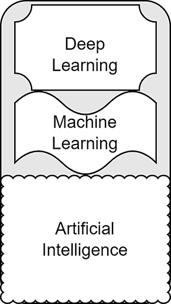

**图 1.1.** 深度学习——AI 的子集。

通常，智能基于从过去获取知识并对其进行处理，以为数据提供新的见解。显然，人类智能需要大量时间来获取采取决策行动所需的信息——例如，人类在婴儿时期可能需要几个月才能识别出一支笔或其他物体。

人工智能利用算法和技术来模拟人类行为——即根据先前的观察快速分类物体等做出正确决策。人工智能对应数字系统，而人脑类似于模拟系统。

如图 1.2 所示，人工智能是机器学习和深度学习等其他技术的基础技术。机器学习仍然是人工智能的一个子集。它旨在开发算法/程序并将其插入机器，以根据输入数据做出决策。这些决策可以是使用较小或较大输入数据进行的回归或分类。

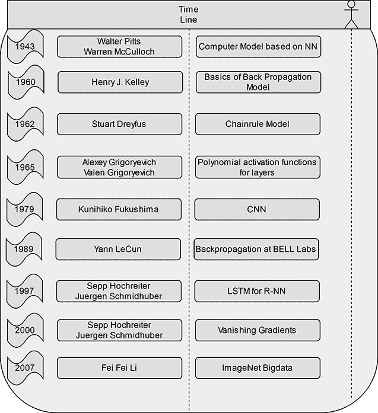

**图 1.2.** 深度学习的历史。

深度学习作为机器学习的子集演化而来。它试图识别数据中的特定模式或特征。利用这些模式，深度学习算法执行新颖推理并追求行动。深度学习模型将算法结构化，创建出层算法，用于学习数据并以自动方式做出决策。

深度学习在多个领域找到了许多用途，如语音合成、车辆自动化、图像分类、智能交通系统、法医学、能量分析、经济预测等，这些促进了社会公益。值得注意的是，有许多应用直接影响了大多数人的福祉。例如，聊天机器人应用协助性骚扰的幸存者；安全应用在共享数据时改进隐私和公平性；医疗健康应用协助医疗从业人员；金融应用指导投资者/消费者；观点相关的应用增强了社会人士的可见性等。

## 1.2 深度学习的历史

传统上，人工智能通常使用基于规则的推理引擎实现 \[2\]。然而，从大量问题领域（包括不同的应用领域）获取的多维数据的激增，催生了深度学习。

最初，在 1943 年，Walter Pitts 和 Warren McCulloch 设计了一个基于神经网络的计算机模型。这个理论模型给他们的他们的同行设计者和科学家带来了信心。随后，在 20 世纪 60 年代，Henry J. Kelley 公开了了反向传播模型的基础。正如本书后面提到的，反向传播 \[8\]仍然是开发深度学习算法的重要技术。1962 年，Stuart Dreyfus 设计了链式法则；1965 年，Alexey Grigoryevich 和 Valen Grigoryevich 为神经网络层设计了激活函数 \[1\]。

随后，在 1979 年，Kunihiko Fukushima 开发了第一个用于图像分析的卷积神经网络 \[7\]。这成为加速神经网络解决方案的垫脚石。1989 年，Yann LeCun 在贝尔实验室实现了反向传播概念。经过大量研究，1997 年，Sepp Hochreiter 和 Juergen Schmidhuber 开发了用于递归神经网络的 LSTM 概念 \[9\]。随后，在 2000 年，多位作者讨论了梯度消失问题并提出了解决方案；在 2007 年，李飞飞设计了首个 ImageNet \[10\]来解决大数据图像和分析问题。

最近，多年对深度学习创新的持续研究和开发，不仅带来了算法效率的增长，也带来了支持架构的增长。深度学习实践者研究了通过云解决方案提供的中央处理器（`CPUs`）、图形处理器（`GPUs`）以及张量处理器（`TPUs`)/现场可编程门阵列（`FPGA`）设备来执行深度学习算法。

## 1.3 趋势——用于社会公益的深度学习

本节展示了深度学习技术的趋势，这些趋势使其他技术能够促进社会价值。

### 1.3.1 数据增加；机器增加

深度学习与工业 \[5\]、医疗 \[6\]、消费品等促进了大量创新产品，这些产品处理来自大量参与者或机器的数据。大多数较新的机器都配备了深度学习算法和传感器设备，定期或非定期地收集大数据。海量数据的出现提高了预测的准确性，并加强了深度学习技术的兴起。例如，如果利用深度学习算法，定期提交到云基础设施的传感器数据可以为车辆健康状况提供更准确的结果。

图 1.3 揭示了深度学习神经网络在大数据应用中的重要性。传统的机器学习算法，如支持向量机、随机森林、`k`-最近邻（`KNN`）等，在输入数据较小时报告了更好的预测准确率。然而，当我们尝试更深的神经网络或相应的算法时，通过增加数据量，应用的性能和准确性会得到提高。

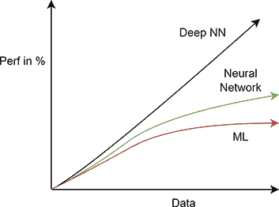

**图 1.3.** 性能与数据之间关系的曲线。

### 1.3.2 出版增加


近年来，与深度学习用于社会公益应用相关的发表论文和引用数量大幅增加。`DBLP` 索引引擎显示了研究人员对深度学习的兴趣日益增长的趋势，如图 1.4 所示。

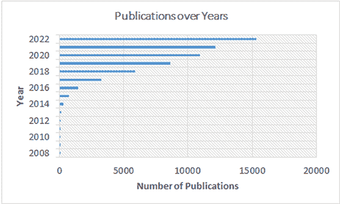

**图 1.4.** 深度学习发表论文——增长趋势。

可以观察到，从 2016 直到，发表论文的数量剧增。这证明了研究文献中深度学习及其相关概念的繁荣。

同样，最近几个领先的国际会议/研讨会也建立了一个平台，深度学习科学家可以在其中开展工作和创新。例如，超级计算机深度学习研讨会（`DLS @ SC`）、学习表示国际会议（`ICLR`）以及深度学习医学成像国际会议（`MIDL`）已帮助各种研究人员基于深度学习开发创新。

此外，一些极具影响力的会议聚集了研究人员、学者和从业者，共同讨论社会公益应用的创新。如人工智能促进协会、国际人工智能联合会议、人工智能创新应用、自主代理与多智能体系统国际会议、知识发现与数据挖掘国际会议以及 `ACM SIGCAS/SIGCHI` 计算与可持续社会会议（`COMPASS`）等会议在改进支持社会利益的创新方面具有瞩目的举措。

### 1.3.3 国际趋势

过去几年，全球范围内对深度学习及其应用的兴趣持续增长。`Google` 趋势分析显示，多个大陆对“深度学习”搜索术语的地区请求量正在增长（见图 1.5）。

![图 1.5. Google 趋势分析——地区报告 [3]。数据源：Google Trends (https://www.google.com/trends)。](images/bk978-0-7503-4024-3ch1f5_online.jpg)

**图 1.5.** Google 趋势分析——地区报告 [3]。数据源：Google Trends ([`www.google.com/trends`](https://www.google.com/trends))。

值得注意的是，与其他几个国家相比，中国已成为该领域的领导者 [4]，并已将深度学习用于多种创新/用途。之后，英国、印度、韩国和新加坡也尝试将深度学习应用于解决方案。

深度学习领域最具影响力的作者，即 Geoffrey Hinton（日本）、Ian GoodFellow、Ruslan Salakhutdinov（美国卡内基·梅隆大学）、Juergen Schmidhuber（瑞士）等，向他们更广泛的社区传播了深度学习的新颖方面。

在图 1.6 中，我们观察到对“深度学习”和“社会公益”主题的查询显示了增长潜力。对“社会公益”一词的搜索保持稳定，而“深度学习”一词在过去几年中经历了剧烈增长。这显然反映了预计未来这两个概念结合时将带来的创新。

![图 1.6. 深度学习对比社会公益 [3]。数据源：Google Trends (https://www.google.com/trends)。](images/bk978-0-7503-4024-3ch1f6_online.jpg)

**图 1.6.** 深度学习对比社会公益 [3]。数据源：Google Trends ([`www.google.com/trends`](https://www.google.com/trends))。

## 1.4 动机

我写这本书是为了涵盖尽可能社会公益应用。如 `DBLP` 索引引擎所示，与深度学习相关的创新数量正在增加。

## 1.5 用于社会公益的深度学习——需求

过去几年，全球范围内对深度学习及其应用的兴趣持续增长。本书在以下方面帮助读者：

1. 本书涵盖了深度学习技术，如图像分类、图像增强、词分析和情感界面，这些技术可以应用于社会公益。
2. 本书涵盖了与智慧城市相关的若干应用。
3. 本书提供了使用 `TensorFlow` 实现若干社会公益应用的代码片段，以激发读者兴趣。
4. 它还描述了如 `IoT`、云端、`Docker`、编程主题等基础技术，以吸引读者的兴趣。

## 1.6 目标读者

总的来说，我写这本书是针对那些希望应用深度学习技术来增强社会公益应用的各种读者。本书的潜在读者分类如下：

#### 1.6.1 学生

我侧重于计算机科学、电子、通信等学科的入门级跨学科学生。本书为希望将深度学习技术整合到其项目中的学生编写。此外，它将激励学生开发社会公益应用。事实上，学生可能想要了解用于智慧城市的深度学习技术的内部细节。

#### 1.6.2 研究人员

研究人员（特别是跨学科研究人员）的数量每天都在增加。大多数研究人员对将深度学习技术应用于他们的研究问题感兴趣。此外，研究人员可能会阅读此书，学习许多研究人员和工业人士过去使用的现有技术。本书提供了更深刻的知识和洞察，帮助研究人员在他们的领域开展未来的研究。

#### 1.6.3 从业者/创业者

阅读本书的从业者可能会有创新的想法。事实上，本书强调了几个触及新想法和解决方案的案例。通过阅读本书，行业从业者可以了解过去产生的创新，从而使其他方向的创新成为可能。

#### 1.6.4 政府/智慧城市官员


书中提供的技术可以成为智慧城市官员的最佳实践指南。例如，在实现书中所讨论的技术时，残差神经网络（例如 `ResNet-50`）或卷积神经网络（`CNN`）的适用场景将变得清晰易懂。此外，在阅读完本书后，生成对抗网络（`GAN`）方法或类似算法的应用将变得更加精确。

## 1.7 章节与描述

总的来说，我尝试包含许多可以提高社会意识的思考/理念。所提出的想法可能会突出可以应用于社会公益事业的关键技术。例如，将深度学习技术和算法应用于情感智能相关的社会公益应用中，可能会增加读者的兴趣。

本书章节按照下文进行组织，以吸引读者在阅读本书的过程中参与进来。

### 1.7.1 关于深度学习

本章对深度学习技术进行了简要介绍。更重要的是，它激励读者关注后续章节，并帮助他们理解阅读本书的必要性。它还强调了过去将深度学习技术应用于不同问题领域的趋势。通过这种方式，读者可以获得一些额外的坚实知识，鼓励他们继续阅读下去。

### 1.7.2 社会公益性应用

近年来，与空气质量、水质、节能等相关的社会公益应用的实施大幅增加。本章列出了在智慧城市或类似领域中可以学习/实践的最常用的社会公益应用。

为了将深度学习技术整合到应用中，有必要理解相关技术。本章讨论的几个最重要的技术包括以下：

*   用于可扩展基础设施的云平台；
*   使用 `IoT` 感知数据并将产生的数据通信给已连接的服务/机器；
*   在社会实验中用于保护数据的区块链技术；
*   用于深度学习技术的计算基础设施等。

本章深入探讨了用于开发造福社会的深度学习相关应用所需的各种基础技术。

### 1.7.3 计算架构——基础技术

深度学习科学家或从业者必须适当选择架构、计算设备、`IoT` 组件、深度学习库等，以便从算法获得更好的性能。

本章描述了用于深度学习算法内部功能的现有计算架构。它对前一章节进行了扩展，在开发深度学习算法时更加强调相关技术。

此外，本章的重点是解释支持 `IoT` 的系统的可用性和连接程序，这些程序通过云服务或计算基础设施将相关的传感器数据提交给深度学习智能进行处理。本章详细强调了 `IoT` 系统的相关通信协议和连接服务级协议。

通过理解底层计算架构（包括支持 `IoT` 的基础设施）细节细节，在开发或执行基于深度学习的社会公益应用时，应该能够熟练选择合适的计算基础设施。

此外，本章还描述了一些编程模型、如 `Tensorflow` 和 `PyTorch` 等库、相关数据集以及应用。

### 1.7.4 卷积神经网络技术

图像处理和计算机视觉应用通常可以实现 `CNN` 技术。本章揭示了 `CNN` 技术以及使用基于 `CNN` 算法开发应用的内部细节。本章讨论了 `CNN` 与人类大脑关系的类比示例。此外，还讨论了 `CNN` 的构建块，如卷积层、激活层、池化层和连接层。

本章强调了几个应用基于 `CNN` 的深度学习技术的社会公益应用。这些应用与使用 `Tensorflow` 库的 `CNN` 实现步骤相结合。

最后，本章解释了从事 `CNN` 技术领域的研究人员所面临的演进挑战和未来方向。

### 1.7.5 目标检测技术与算法

本章解释了最流行的算法，例如 `YOLOv3`、`YOLOv5`、`R-CNN`、`Fast R-CNN` 等。这些算法用于解决目标检测问题。本章讨论了目标检测的主要目标。它还描述了可以使用 `PyTorch` 实现应用于教育领域的算法。

### 1.7.6 情感分析——算法与框架

个人品牌在现代变得越来越流行。`Twitter`、`LinkedIn`、个人页面等社交媒体网站产生了大量内容。这些信息需要使用 `LSTM` 等特定的深度学习算法进行分析。

本章解释了情感分析的概念，例如数据处理阶段、学习和分类阶段等。它深入探讨了使用情感分析实现推荐系统的方面，特别是电影推荐系统。此外，它描述了一些可用于情感分析的可用工具和框架。

### 1.7.7 自动编码器与变分自动编码器

自动编码器和变分自动编码器可以用于挖掘数据的潜在空间。本章解释了在特定社会应用修改数据集时实现自动编码器和变分自动编码器的理论。

为此，本章研究了几种类型的自动编码器，如卷积自动编码器、稀疏自动编码器、深度自动编码器、压缩自动编码器、去噪自动编码器、欠完全自动编码器和变分自动编码器。

此外，本章讨论了基于自动编码器的常见应用，如图像重建应用、图像上色、高分辨率生成、图像压缩等。最后，本章解释了使用自动编码器实现（即基于 `Tensorflow` 库）从修改的国家标准技术数据集生成手写数字的程序。

### 1.7.8 生成对抗网络与解耦机制


基于工业物联网（IoT）的应用有助于智慧城市的社会进步。强化学习（RL）非常适合此类环境。本章展示了在工业等环境中使用强化智能体的基本原理。文中描述了深度强化学习机制与其他技术（如机器学习和深度学习）之间的区别。此外，本章还讨论了强化学习框架的主要组成部分，例如与策略相关的组件、价值函数以及对于构建强化学习系统至关重要的基于模型的组件。最后，本章介绍了强化学习算法的分类法，以及将这些算法集成到计算系统中的流程。

### 1.7.10 人脸识别及其应用

与人脸识别相关的应用（如身份管理、家居自动化、护照验证等）可以利用深度学习模型和架构。本章解释了深度学习模型在识别面部表情和情绪方面的用途。它展示了人脸识别过程中的流程，如人脸检测、分析、特征提取、数据转换和分类过程。本章重点介绍了几个可以保持社会效益的应用。此外，它还为未来的研究人员、从业者或学生展示了创新方向。

### 1.7.11 数据安全与平台

尽管各种社会公益应用可以面向深度学习概念和算法，但不断演变的架构必须包含复杂的安全特性。忽视应用中的安全组件可能会导致不利影响。本章强调了可以用于加强深度学习应用的可能数据安全特征，以便其应用于社会。

本章的第一部分解释了现代计算世界中所有可能的安全攻击，例如恶意软件攻击、钓鱼攻击、拒绝服务（DoS）攻击、rootkit 攻击、完整性攻击、身份验证攻击、授权攻击、可用性攻击以及数据篡改案例。此外还描述了与深度学习相关的攻击，例如模型入侵攻击、推理黑客问题和隐私攻击。本章接下来描述了深度学习对抗问题，如扰动问题、与补丁应用相关的问题、挑战性概率分布、逃避攻击、GAN 攻击和托管模型攻击。

在章章的第二部分，讨论了如何利用深度学习算法来增强现有计算基础设施的安全特征。这种方法被认为是一个需要以最小成本解决的严峻社会问题。在此背景下，本章涵盖了深度学习算法在改进安全特征方面的应用。

### 1.7.12 性能监控与分析

监控深度学习算法并衡量社会应用的性能，对于改进深度学习架构的发展至关重要。本章揭示了常用的性能监控工具以及相关的架构，这些架构可以从多个维度自动提高应用的性能。

本章强调了对性能监控工具的需求，而不是要求应用开发者或用户根据底层计算基础设施来调整他们的应用。文中详细讨论了最常用的性能监控机制，例如专家意见法、工作负载表征法、基准测试法、自顶向下分析法、自底向上的分析法、基于工具的监控法以及预测/建模法。此外，还研究了用于评估深度学习算法性能的常用指标，如硬件利用率、可扩展性特征、每秒浮点运算次数（`FLOPs`）、吞吐量、能耗、网络缓冲区、时间准确性、通信开销、工具开销、信息密度、传输大小、预测准确性等。最后，本章介绍了适用于应用的评估平台和相关指标。

### 1.7.13 深度学习——未来展望

本书的最后一章列出了基于深度学习架构开发社会应用的潜在未来方向。本章建议研究人员如何深入研究这些领域，为社会问题提供未来建议。

## 1.8 阅读流程

为了方便读者阅读，本书被分为三个主要部分，如下：

1. 引言
2. 技术
3. 安全、性能与未来方向

这三个部分的目的是让对深度学习感兴趣的读者轻松跟进。本书的第一部分涵盖了深度学习底层架构的基础知识，对于读者在进入其他章节之前了解这些背景至关重要。第二部分从 `CNN` 和目标检测开始，对于希望开发社会公益应用的从业者和学者来说，这些章节至关重要。该部分涵盖了深度学习的某些高级主题，如自动编码器、`GANs` 和强化学习方法。熟悉 `CNN` 的读者可以跳过这些章节。

本书的第三部分关注关于更合理的学习算法必要性的辅助主题，例如改进安全组件或实现深度学习算法的性能方面是高级开发者或用户的本质课题。这部分涵盖了安全特征的基础和性能分析步骤。

## 参考文献

`[1]` 激活函数，2022 年，页面版本 ID: 1088786364
`[2]` 深度学习，2022 年，页面版本 ID: 1088786364
`[3]` Google 趋势——区域报告，2022 年，页面版本 ID: 1088786364
`[4]` 趋势，2022 年


[5] Chen J and Xu S 2022 基于深度学习的数字创意体育产业研究 *Comput. Intell. Neurosci.* [**2022** 7760263](http://dx.doi.org/10.1155/2022/7760263)

[6] Esteva A, Robicquet A, Ramsundar B, Kuleshov V, DePristo M, Chou K, Cui C, Corrado G, Thrun S and Dean J 2019 医疗领域深度学习指南 *Nat. Med.* [**25** 24–9](http://dx.doi.org/10.1038/s41591-018-0316-z)

[7] Fukushima K 2014 用于多层卷积网络的带反馈单样本学习 *Artificial Neural Networks and Machine Learning—ICANN 2014—24th International Conference on Artificial Neural Networks (Lecture Notes in Computer Science vol 8681)* (Berlin: Springer) pp [291–8](http://dx.doi.org/10.1007/978-3-319-11179-7_37)

[8] Grubb A and Bagnell J A 2010 用于训练深度模块化网络的增强反向传播学习 *27th International Conference on Machine Learning (ICML-10) ed* and J Fürnkranz and T Joachims (Madison, WI: Omnipress) pp 407–14

[9] Hochreiter S and Schmidhuber J 1996 *LSTM 可以解决复杂的长延时问题 Advances in Neural Information Processing Systems 9, NIPS, Denver, CO, USA, December 2–5, 1996* ed M Mozer, M I Jordan and T Petsche (Cambridge, MA: MIT Press) pp 473–9

[10] Russakovsky O 2015 ImageNet 大规模视觉识别挑战 *Int. J. Comput. Vis.* [**115** 211–52](http://dx.doi.org/10.1007/s11263-015-0816-y)

***

# IOP Publishing

# 面向影响的深度学习技术

# Shajulin Benedict

***

# 第 2 章

## 社会向善的应用

如果得到适当的应用和尖端设备的帮助，全球公民和生物的巨大胜利将成为现实。应用需要基于稳健算法或方法（包括深度学习）的精确学习辅助。多年来，用于社会向善的深度学习应用逐渐展现出发展势头 [24]。本章反思了对不断演进的将改善社会命运应用的反复预测。

### 2.1 社会向善应用的特点

社会向善应用 [10] 是一种与硬件平台和传感器节点相结合的软件 [5]，执行有利于人类生活和社会的行动。

以下是社会化应用所具有的几个特征：

1. **参与性**——虽然对云或区块链等演进技术所带来的可能性、替代方案、挑战和缺陷的辩论将持续，但参与者和贡献者将不可避免地参与。此类应用的成功需要更多的参与者。参与可以是直接的，例如，公民或机器/机器人代表社会。

2. **预测性**——社会向善应用的综合性强调了使用稳健算法（包括深度学习）进行预测或机器级分析。在大多数情况下，等待新信息或未来信息可能会阻系统的运行。预测必须基于算法或机器提供的输入直接且自动地进行。

3. **决策者**——社会化应用最好涉及决策者或官员，以便快速交付经过认证的信息。公民、智能城市官员、政府机构等利益相关者参与其中。

4. **基础设施**——社会化应用涉及基础设施。通常，这些是云、边缘或雾。可扩展的基础设施以增强数据库、建模支持等服务的形式存在，被用于实现社会向善应用的相关框架中。

### 2.2 通用架构——实体

考虑到社会化应用的特点，本节解释了重要的实体。图 2.2 展示了社会向善应用中使用的组件。


#### 2.2.1 用户界面

用户通过智能手机等接口连接到社会向善应用。设计此类界面常用的编程语言有 `Django`、`Nodejs`、`Reactjs`、`AngularJs`。

#### 2.2.2 传感器连接

在分析之前需要对数据进行评估和格式化。事实上，数据来自异构源 [4]。传感器节点属于遵循不同的通信协议。本章的最后部分讨论了不同的通信协议。传感器数据通过网关传输到云环境中的服务。

#### 2.2.3 层级智能

考虑到大量的传感器节点和资源的可用性，学习应该在边缘层进行。显然，这可以提高学习推理的实时性和隐私性。为此，此类应用通常采用提供层级智能的技术。

#### 2.2.4 数据安全——不可变性

为了保护模型和相应数据，提供社会向善应用的架构涉及安全环境。安全功能从数据源所在地开始实施。发生过几次安全漏洞 [9]，特别是当模型使用了传感器支持的数据时。

#### 2.2.5 通知/可视化

必须以用户友的方式通知深度学习模型产生的发现或预测情况。在某些情况下，通知需要以即时消息的形式呈现。否则，它应该是视觉表示。架构的这部分能够实时通知用户（通常为数万名），同时消耗有限的带宽和能量。

### 2.3 向善的应用

从业人员/研究人员的角色已变得明确，因为近期记录了社会向善应用的激增。这些应用的分类法见图 2.2。本节提供了这些应用的概述。


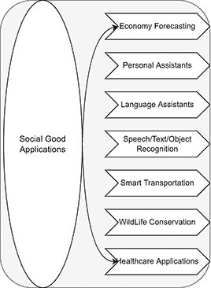

**图 2.2.** 社会益类应用的分类法。

### 2.3.1 经济预测

预测销售额和业务增长对社会经济的发展至关重要。在预测了商品销售涉及的成本后，就可以确定所需的产量或原材料`[17]`。相应的，工业和生产部门可以高效地规划所需的人力或原材料。相比之下，在过去的几十年里，所有者生产经理要么购买了额外的组件，要么浪费了大量的原材料。

在某些情况下，原材料的可用性非常有限。例如，生产与黄金相关的工艺产品需要对黄金等原材料进行熟练的采购。在这种情况下，购买过多或过少黄金都会导致效率低下。

深度学习或类似的机器学习技术对于减少生产涉及的成本是必要的`[26]`。因此，包括购物者在内的经济将从中受益。

### 2.3.2 个人助手

在现代世界中，辅助人的应用程序`[3]`有助于提高他们的生产力和人际关系。某些设备对盲人特别有益。例如，语音助手应用传统上一直被视障人士用于在未知地点安全地生活和旅行。

近年来，城市强制要求配备适当的工具，通过个人辅助设备帮助视障人士沿人行道行走并进入共享交通工具。例如，大多数智能城市已在公共交通工具（包括公交和火车）中整合了广播媒体。通过这种方式，盲人和注意力不集中的乘客可以轻松收到有关即将到站站点的通知。

个人助手的设计目的是增加注意力、鼓励谨慎行为并娱乐用户，正如接下来的小节所讨论。

#### 2.3.2.1 注意力增强器

由于同步和异步电子设备的干扰，人们的生产力已经下降。连接设备产生了大量数据，并且它们的应用程序与 Twitter、LinkedIn 和 Facebook 等社交媒体网站同步。然而，在大多数情况下，对提高生产力的本质关注被降低了。具体来说，学生（包括残障学生`[8]`）必须在考试中发挥表现，工人必须完成分配的任务，而研究人员必须在指定时间内在没有太多干扰的情况下深入研究某个课题。然而，社交媒体网站吸引了他们的用户，导致他们偏离了自己的技能和及时关系。因此，社会预期的生产力大幅下降——这是一个社会问题。

语音助手`[2]`可以通过学习人类特征，以自动的方式提醒他们回到原始活动中。通过这样做，社会的生产力可以得到提高。

#### 2.3.2.2 智能提醒

在某些情况下，原材料的可用性非常有限。例如，生产与黄金相关的工艺产品需要对黄金等原材料进行熟练的采购。在这种情况下，购买过多或过少黄金都会导致效率低下。

深度学习或类似的机器学习技术对于减少生产涉及的成本是必要的`[26]`。因此，包括购物者在内的经济将从中受益。

由于同步和异步电子设备的干扰，人们的生产力已经下降。连接设备产生了大量数据，并且它们的应用程序与 Twitter、LinkedIn 和 Facebook 等社交媒体网站同步。然而，在大多数情况下，对提高生产力的本质关注被降低了。具体来说，学生（包括残障学生`[8]`）必须在考试中发挥表现，工人必须完成分配的任务，而研究人员必须在指定时间内在没有太多干扰的情况下深入研究某个课题。然而，社交媒体网站吸引了他们的用户，导致他们偏离了自己的技能和及时关系。因此，社会预期的生产力大幅下降——这是一个社会问题。

#### 2.3.2.3 聊天机器人——娱乐与安全

近年来，城市强制要求配备适当的工具，通过个人辅助设备帮助视障人士沿人行道行走并进入共享交通工具。例如，大多数智能城市已在公共交通工具（包括公交和火车）中整合了广播媒体。通过这种方式，盲人和注意力不集中的乘客可以轻松收到有关即将到站站点的通知。

助手的设计目的是增加注意力、鼓励谨慎行为并娱乐用户，正如接下来的小节所讨论。

### 2.3.3 语言辅助

数万语言被正式归类为通信手段。这些语言针对特定的国家和社区，在地理分散的地区有不同的方言。值得注意的是，像手语之类的语言吸引了全球大量的使用者，除了那些使用手语的人之外`[25]`。

旅行到不同国家的游客或居民如果不熟悉当地语言，可能无法获得及时信息。大多数国家用其当地语言显示信息和告示牌。例如，德国、印度和中国的旅游信息是以其区域语言显示的。

基于深度学习的语言翻译相关应用程序`[23]`对于将区域语言翻译成用户的已知语言变得越来越流行。通常，这些应用程序安装在各种可穿戴设备上，如手机、平板电脑或手表。视频由边缘设备捕获并处理。

### 2.3.4 语音、文本和物体识别

识别物体、文本和语音对于数字世界的现代表示至关重要。事实上，物体识别、语音和文本识别并不是新概念；它们已经存在了几十年。然而，使用深度学习模型实现这些概念提高了其应用程序的准确性。

例如，区分苹果和橙子、分类土豆斑点`[18]`或从输入图像中检测人脸的准确性最近由于日益复杂的深度学习算法的应用而得到了极大提高。同样，移动智能手机应用程序中的文本预测结果也得到了改进——根据文本的历史出现情况，几乎可以准确预测下一个的词序列。


此外，语音识别已被用于将语音转换为文本或将语音转换为动作，这取决于特定应用程序的预期用途。过去已经开发了一些著名的应用程序，以造福图像检测用户。诸如自动驾驶汽车的计算机视觉、医学图像分析、无人机辅助城市建模、车牌字符识别、视觉分级与采收、成熟果实识别、蔬菜/水果/物体数量计算等应用，已经在机器学习社区群体中赢得了赞誉。

### 2.3.5 智能交通

智能交通提供了交通管理和规划 [21]，提升了智能城市中居民出行的成本效益。它通过避免道路弯道处或高速公路视线盲区的事故来提高道路安全；通过在考虑无污染区域等多个因素的情况下为旅行者优化分配座位，促进了共享出行。

`CNN` 模型或类似的深度学习现代学习模型具有内置学习机制，可以分层地研究参数，从而在智能交通框架中开发并安装更高准确的模型。

研究人员在制定旅行计划时，对旅行者的表现及相关的交通路线进行了表征。例如，可以提前规划充电站、加油站和维修坊的位置，以实现资源的优化利用，避免旅行资源的过度使用。可以根据深度学习模型获得的学习推理对最优资源进行调度。

识别车辆和控制特定道路（包括停车场）的入口已在多个国家广泛应用。自动票务已转移了人力利用，并提高了了多个国家的安全性。这是由于使用了智能交通框架的深度学习模型来自动捕获车牌细节实现的。

智能城市中智能交通系统的共享交通方面也正逐渐发展起来 [20]。共享交通的部署需要专业技能来将座位分配给适当的社区，以避免风险并便利行程。共享交通服务中分配座位的自动过程需要健壮的学习机制以减少歧视——即支持社会公益的解决方案。

### 2.3.6 野生动物保护

野生栖息地稀有物种的保护被认为是各国的一项主要任务 [7]。每个国家都被赋予了任务，在没有任何人为干预的情况下通过严密监测来保护它们。在利用自然栖息地（主要是森林）的相机拍摄动物后，必须对图像进行分析并确认动物的存在。此外，还可以监测动物的迁徙模式（例如在寻找猎物时）以及动物对人类区域的入侵。

在某些情况下，需要保护野生动物免受相关稀有物种的侵害。老虎、豹和大象等动物可以使用高度复杂的学习模型易于追踪和表征。

### 2.3.7 医疗应用

深度学习放大了现有医疗应用的实用性，并为健康诊断提供了新视角。深度学习辅助医疗应用带来的令人深刻的准确性鼓励了医疗从业人员将这些解决方案作为辅助工具。例如，识别胸部图像中的肺炎或脑图像中肿瘤细胞的应用、定位医学症状模式的应用、诊断皮肤病的应用等已在采用深度学习算法的设备中实施，以延长人类寿命。

通常，医疗从业人员对使用算法检测疾病持怀疑态度。然而，深度学习算法产生的极其准确的发现鼓励了它们在现代医疗系统中的采用。

近年来，“绿色健身房”的概念吸引了医疗界。绿色健身房促进在公共场所进行锻炼，使公民保持健康。此外，这些健身房有助于产生绿色能源，而这在包括印度在大多数发展中国家是稀缺的。人们直接或间接地参与这些健身房以实现公益——即通过公共场所运动产生可再生能源。

### 2.4 技术与手段

开发社会公益应用的方法和技术不仅限于深度学习算法的设计。图 2.3 展示了构建社会公益应用最常用的技术/手段。

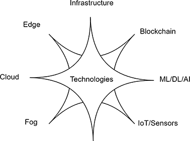

**图 2.3.** 涉及社会公益应用的技术/手段。

以下列出了交付社会公益应用时并存的若干显著技术/手段：

1. 区块技术
2. AI/机器学习/深度学习
3. 物联网 (IoT)/传感器技术
4. 机器人
5. 计算基础设施/架构
6. 边缘/雾/云环境
7. 安全特性

接下来的小节将简述这些技术及其与社会公益应用的关联。

### 2.5 技术—区块链

区块链是一种防篡改的共享账本或存储单元，在公共或私有网络中记录数据。根据 Marco Lansiti [13] 的说法，区块链被定义为开放分布式账本，可以高效地记录双方之间的交易。这些记录是可验证且永久的。

区块链技术应用于信任可能面临挑战的情况 [16]。例如，社会企业往往因为发起者之间的信任失败而失败；只有在使用受信任机制的情况下，与社会改进相关的业务才能扩大规模。通常，对于任何事业的成功，有三个元素需要被信任：

1. 对方——交易必须转移给的人；
2. 中间机构——参与建议业务或交易对方的组织或中间人员；
3. 纠纷解决机制——一个组织或社区（例如法院），负责调查交易过程中产生的任何问题。

在现代，存在人们无法信任参与交易的参与者或组织的情况，包括政府、银行或其他受信方。

通常来说，信任失败会在以下讨论的三种方式之一发生：

1. 直接违规——对过去任何违规行为的认知会阻止相同的参与者在未来继续该项目。例如，如果一个修理工没有成功修好一辆出租车，车主可能就不会再找他修理。直接违规对决策的影响是直接且迅速的。

2. 投机行为违规——如果错过了任何预期的机会，对组织或团队的信任可能会下降。投机行为是促使团队或个人寻求经济或类似利益的行为。如果错过了机会，团队或个人对组织的信任将受到挑战。


# 3. 组织失效

除了直接或团队层面的信任违背外，组织也会出现失效的情况。此类失效可能会损害参与者在一段时间内获得的现有信任。

## 2.5.1 交易类型

### 无信任交易

真正的无信任交易被认为是一种直接交易，其中卖家与消费者直接进行交易——参见图 2.4 虽然尽管这种方法避免了双重支付，但其可扩展性较差——即此类交易对于大量潜在客户来说是不可能的（这正是互联网世界的现实情况）。

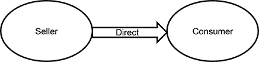
**图 2.4.** 纯的无信任交易。

相比之下，纯信任交易提供了一个连接卖家和消费者的中间人系统。例如，国家银行等信赖方参与了建立参与者之间的资金转账。通过这样做，卖家不需要与消费者建立直接连接。相反，所有与交易相关的交易都通过信赖方进行。各种方，如在线支付提供商、汇款公司、信用卡供应商等（这些与银行类似）可以作为促进交易的第三方。图 2.5 以图化方式展示了这一概念。

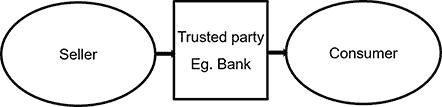
**图 2.5.** 信任交易。

最近，无信任信任机制在区块链支持系统中变得至关重要。这些系统提供了一个平台，在不需要参与者直接参与或不包含第三方的情况下建立参与者之间的信任机制。它们被认为是无信任信任环境，因为信任是通过智能系统网络而非人类提供的——即区块链网络置于卖家和消费者之间（参见图 2.6）。

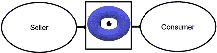
**图 2.6.** 使用区块链的无信任信任。

## 2.6 AI/机器学习/深度学习技术

由于人工智能近年来取得了较高的成功率，AI 的进步为多个领域带来了机会。即将出现的先进技术，如生成式 AI、联邦学习和嵌入式 AI 大脑，可能会在不久的未来丰富人们的生活水平。此本书的后续章节将提供对这些技术的详细描述。

## 2.7 物联网/传感器技术

物联网（IoT）是一个扩展的网络系统，其中互联网连接到灯、风扇、桌子等物体上。将互联网扩展到这些物体可以在短时间内实现知识型社会。这是因为感知到的数据被处理、分析并交付给广大用户。

传感器技术通常应用于社会公益性应用。例如，控制智能城市的空气污染需要定期测量不同位置的 `SO[2]`、`NO[2]`、`CO[2]` 和 `O[2]` 水平。此外，这些监控值必须在去中心化的位置进行处理，并且必须在合理的时间内实施控制措施。空气质量监控传感器 \[19\]遍布街道，以收集这些信息，以确保城市无污染。

物联网根据其应用细分为五个主要领域（参见图 2.7）。以下段落对这些类型进行了概述：

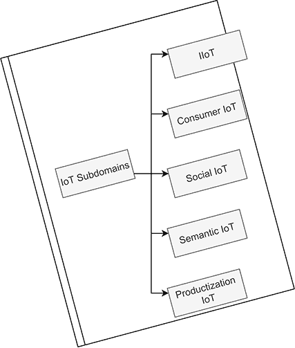
**图 2.7.** 物联网技术的子领域。

### 2.7.1 工业物联网

当传感器技术应用于工业以辅助业务流程并提高开发效率时，被归类工业物联网（IIoT）。`IIoT` 一词在美国常用，而相同的概念在欧洲被称为工业 4.0。它是第四次工业革命。前三次革命是由于蒸汽机、电力和互联网的发明。工业 4.0 利用扩展的互联网将网络与物理系统之间的连接扩展到物体/物品上。

工业 4.0 有几个用例 \[22\]说明了其在社会中的普及。例如，车主可能不会仔细检查车辆轮胎或机油的状态。安装在车辆上的传感器可以与相关的车坊通信。结果是车坊中心的机器可以主动搜索性价比高的轮胎或产品。寻找价格更优的产品提高了制造商的业务——即由于全球多个客户的请求，批量生产产品成为可能。

### 2.7.2 消费物联网

消费物联网是一个处理个人或附在身上的传感器的物联网系统。在消费物联网中，智能手表、设备、语音助手、自动提醒、摄像头设备、钱包等连接到网络设备。这种类型的物联网收集并共享数据，以改善人们的健康状况。跌倒识别、心理状态监控、压力模式分析、定期血压检查、医疗决策、运动建议、体重控制建议等为用户提供了巨大的价值。最近，一些行业已经开发了可以在冷天气下保暖用户的织物（例如 Polar Seal）。

这些应用通常利用移动手机等边缘设备来处理传感器数据。处理过的传感器数据或一段时间的传感器数据会被提交到云服务器进行进一步分析。

### 2.7.3 社交物联网

如今，大多数用户和产品通过社交媒体网站（如 Facebook、Google+LinkedIn、Twitter、WhatsApp 等）连接。消费者和生产者通过这些社交媒体连接——前者以赞或不喜欢的形式提供建议，后者发布新产品。此外，这些社交网站通过设备在人之间建立社交关系。

社交物联网 \[11\]通过感知小组成员的基本信息来实现人之间的关系。例如，政治家可以使用物联网获取在 LinkedIn 或报纸等大型媒体上发表演讲引发的点赞和不喜欢数量。基于推理，社交物联网系统可以建议相关社区在未来的决策中调整其立场。

### 2.7.4 语义物联网

语义物联网是物联网的子分类，处理情境化的交易。它在连接设备中应用本体网络语言 (`OWL`）和语义推理引擎来定义、修改或解释系统感测的数据。语义物联网系统通常是为传感器设备获取的推理语义表示而定制的解决方案。

### 2.7.5 产品化物联网


现代制造方法改进了生产新产品的技术。3D 打印机等个性化制造工具的使用使得产品具有新颖性成为可能。人们被允许设计自己的产品，并可以立即生产原型或产品。产品化物联网（IoT）是一类物联网系统，其中传感器用于收集新型设计以及使用 3D 打印机生产产品的方法。事实上，这种产品化方法通过使用分布式云系统辅助，实现了基于用户建议的设计的共享制造。

## 2.8 机器人技术

机器人和无人机被应用于一些社会公益性领域。教育相关的应用（如训练机器或组织考试）如今已变得流行——例如机器人老师。此外，机器人已应用于家庭，特别是在厨房中，以协助居民。一些机器人被部署在家庭中，以防止儿童离屏幕太近看电视。

与机器人类似，被视为飞行机器人的无人机已应用于农业、教育 [12]以及智慧城市应用。无人机被用于评估种植园中的杂草、确定农场作物的产量、衡量农场果实的成熟度等。农民和城市居民从这类应用中获得了社会效益。

同样，有数以万计的用例利用机器人来造福社会。

## 2.9 计算基础设施——一种迫切的技术

对社会公益应用发展仍然至关重要的其他最重要技术是底层架构和相关的计算基础设施。

由于社会公益应用涉及分布式计算单元，因此需要适当的计算设备。应用理想情况下应该能够访问最近的计算设备，也能访问地理位置上多样化的计算设备。通常，计算能力最小的最近计算设备被称为边缘设备。个人手机等设备充当大多数社会公益应用的边缘节点。例如，可以使用边缘节点从患者处收集健康相关信息并以图表形式呈现。

边缘节点无法执行大部分计算，因为社会公益应用需要大量数据。因此，这些应用的基础设施采用层级结构。边缘设备与雾节点或雾节点集群共享过滤后的信息。雾节点组织在市中心或农场位置，在这些地方一组计算节点互连，以处理从该区域内多个边缘设备收集的智能数据。雾节点比边缘设备具有更高的计算能力。然而，这些节点在地理上的分布还不够分散，无法执行巨型任务。此类任务由云节点或云数据中心执行。

“云计算”是用于提供海量计算能力的分布式计算平台的术语。此类平台拥有规模重大的工业所有者，他们可以提供启动社会有益应用的处理能力。作为服务托管计算基础设施的能力导致了几乎所有社会有益应用都采用了云计算方法。这些应用可以使用四种云部署模型中的任何：私有、公共、混合和社区。

## 2.10 安全相关技术

必须以类似于其他网络应用的方法将安全特性扩展到社会公益应用中。风险缓解、数据可见性挑战 [14]、配置问题、凭证安全性等需要得到有效处理，以保护设备和相关人员的安全。

风险缓解是减少任何社会公益应用对威胁潜在脆弱性的过程。社会公益应用可能涉及大型网络中的多个启用传感器的异构设备。可以使用深度学习算法快速识别这些设备带来的潜在威胁。

参与这些应用的设备、机器或人类适当的凭证来保护他们免受黑客攻击。由于这些设备具有足够的可用计算能力，可以在一定程度上防止对计算机器的攻击。然而，由于以下原因，对于连接传感器的社会公益应用，该问题变成了一项艰巨的任务：

1. 设备由电池供电 [15]
2. 算法可能在这些设备上执行；
3. 设备的异构性阻碍了与云节点的连接。

## References

[1] Ince M, 2022 Automatic and intelligent

[2] Iansiti M and Lakhani K, 2017 The truth about blockchain 95 118–27

[3] Azaria A and Nivasch K, 2020 Accurate and intelligent content visualization system based on deep learning [`20` 5577

[4] Dash S K, Biswal R, Misra A, Ray S and Mishra J, 2021 Enhancing education and

[5] Benedict S, 2020 Serverless-enabled [`13` 1088]

[6] Curran B, Nekoe S, Chen G, 2019 Ensemble-based [`366` 118–30

[7] Hoople G D, 2020 Drones for Good: How to Bring Sociotechnical Thinking into the Classroom (Synthesis Lectures on Engineers, Technology and Society) (Cham: Springer)

[8] de Carvalho V D and Costa A P, 2021 Public security sentiment analysis on social web: a conceptual framework [`13` 1–20

[9] Floris A, 2022 A social IoT-based [`34` 2473]

[10] Duan H, Li J, Fan S, Lin Z, Wu X and Cai W, 2021 Metaverse for social good: a university campus [153–61]

[11] Floris A, Porcu S, Atzori L and Girau R, 2022 A social IoT-based platform for the deployment of a smart parking solution [`205` 108756


[15] Lee B M 2018 电池受限物联网 网络中大规模 MIMO-OFDM 的能量效率提升 *IEEE Access* [**6** 38147–60](http://dx.doi.org/10.1109/ACCESS.2018.2851591)

[16] Liu L and Li Z 2022 许可链与深度强化学习赋能的安全且能量高效的医疗物联网 *IEEE Access* [**10** 53640–51](http://dx.doi.org/10.1109/ACCESS.2022.3176444)

[17] Livieris I E 2019 利用权重约束递归神经网络进行经济相关数据预测 *Algorithms* [**12** 85](http://dx.doi.org/10.3390/a12040085)

[18] Marino S, Beauseroy P and Smolarz A 2019 基于深度学习的马豆斑点分类与定位方法 *第 8 届国际模式识别应用与方法会议，ICPRAM 2019， 捷克共和国拉格，2019 年 2 月 19–21 日* ed M De Marsico, G S di Baja and A L N Fred (Setúbal: SciTePress) pp 107–17

[19] Martín-Baos J Á, Rodriguez-Benitez L, García-Ródenas R and Liu J 2022 基于回归分析的物联网空气质量与交通监控 *Appl. Soft Comput.* [**115** 108282](http://dx.doi.org/10.1016/j.asoc.2021.108282)

[20] Mauri A, Khemmar R, Decoux B, Haddad M and Boutteau R 2021 用于道路和铁路智能的基于深度学习的实时 3D 多目标检测与定位 *J. Imaging* [**7** 145](http://dx.doi.org/10.3390/jimaging7080145)

[21] Mushtaq A, Ul Haq I, Imtiaz M U, Khan A and Shafiq O 2021 使用深度强化学习和智能重路由的自动驾驶交通流管理 *IEEE Access* [**9** 51005–19](http://dx.doi.org/10.1109/ACCESS.2021.3063463)

[22] Salem R M M, Saraya M S and Ali-Eldin A M T 2022 用于废水实时监控与控制的工业云物联网系统 *IEEE Access* [**10** 6528–40](http://dx.doi.org/10.1109/ACCESS.2022.3141977)

[23] Sharma S and Singh S 2022 使用深度学习模型识别印度手语 (ISL) *Wirel. Pers. Commun.* [**123** 671–92](http://dx.doi.org/10.1007/s11277-021-09152-1)

[24] Thomas C 2014 创新社会应用与政策制定的开源视角 *IEEE 第 7 届需求工程与法律国际会议，RELAW 2014, 2014 年 8 月 26–26 日，瑞典卡尔斯鲁纳* ed D Amyot, A I Antón, T D Breaux, A K Massey and A Siena (Los Alamitos, CA: IEEE Computer Society Press)

[25] Wang W and Yang H 2021 深度深度学习实现手语到情感语音的转换 *第 12 次中文口语处理国际研讨会，ISCSLP 2021， 香港， 1 月 24–27 日* (Piscataway, NJ: IEEE) pp [1–5](http://dx.doi.org/10.1109/ISCSLP49672.2021.9362060)

[26] Yazici I, Beyca Ö F and Delen D 2022 基于深度学习的短期电力负荷预测：真实案例应用 *Eng. Appl. Artif. Intell.* [**109**](http://dx.doi.org/10.1016/j.engappai.2021.104645) 104645

***

# IOP Publishing

# 社会影响的深度学习技术

# Shajulin Benedict

***

# 第 3 章

## 计算架构——基础技术

构建用于社会公益应用或类似应用的深度学习算法需要计算架构、高效库和适当的数据集。本章讨论了用于构建深度学习算法的不同计算架构的基础。此外，还讨论了可用库和数据集的一些相关基础。

### 3.1 计算历史

通常来说，计算是一个使用计算机架构以可实现的性能/成本执行某些特定目标的过程。它主要涉及这些算法过程的设计方面以及相关的计算组件。所有类型的计数或计算都涉及相关的组件。

计算的历史始于古老的算盘。19 世纪，被视为计算机之父的查尔斯·巴贝奇设计了机械设备。计算系统的发明是为了计算并减少人工劳动。

### 3.2 计算类型

处理深度学习任务通常需要计算。计算涉及多个有效交换信息的组件。如果未使用适当的计算组件来解决深度学习问题，它们要么是不合适的，要么性能很差。通常，计算以以下几种方式进行：

1. **串行计算**：在并行化进化之前，传统上仅实践串行计算。在串行计算中，指令一个一个地处理。显然，实现现实问题（包括基于深度学习的问题）的计算非常非常。

2. **并行计算**：由于硬件相关技术的进步，各种应用程序和编译器扩展变成了现实。并行计算的发展导致了语言或应用程序接口（API）的演进，如 `OpenMP`、`pThreads`、`Cilk`等。特别是一些 Python 包使用`OpenMP`实现以支持深度学习算法。

3. **分布式计算**：分布式计算涉及使用多个计算机或节点来处理用户请求。这些解决深度学习问题的请求需要与高效的编程模型或库相结合。实现分布式编程的一些常用编程模型包括`消息传递接口 (MPI)`、`分区全局地址空间 (PGAS)`、`MPI+OpenMP`等。值得注意的是，支持分布式内存的设备具有不相交的内存单元——即内存单元不被用户程序共享。


### 4. 集群计算
在集群计算中，一组计算机或服务器协作完成某项任务。这些计算机通常通过高速网络（如 `Infiniband` 网络或千兆速率网络）进行紧密耦合。一个典型的集群环境由成千上万专门用于计算的服务器和少量用于存储的节点组成。此外，输入/输出（`I/O`）节点在集群中是分离开处理的。大多数数据中心都是基于集群计算概念设计的。

### 5. 点对点 (P2P) 计算
P2P 计算在对等计算节点之间分配任务，且没有太多的层次结构。它是一种基于网络节点的计算架构，这些节点具有统一的权限或策略来处理任务（包括例行任务）。通过这种方式，亲和性节点根据叠加网络（overlay network）的构建进行聚类，从而提高应用性能。例如，在 P2P 计算环境中执行的深度学习应用可以通过叠加层将与特定应用相关节点结合。

### 6. 网格计算
网格计算是一种计算环境，多个数据中心或计算中心结合在一起以解决多个任务 [12]。网格计算基于电气工程中的电网概念，其中动力源位于与公用区不同的位置。事实上，同样的概念被转移到了计算机上——即根据资源匮乏或稀缺区域的资源需求，跨区域共享资源。网格在节点之间分配任务方面与集群相似。然而，与集群不同，网格可以包括全球范围内的异构计算节点，并跨越紧密耦合或松散耦合的网络。

### 7. 云计算
云计算与网格计算概念类似，资源在多个程序/任务之间共享。然而，云端对大量用户具有巨大的吸引力，即其按需付费的模式。网格计算的主要目标是跨地理共享资源（包括计算和仪器），这一目标通过云以有限的成本和利用因素实现。

此外，网格计算环境在批准使用设备之前，通常要求提交与数据中心相关的项目提案。

对于希望以较低成本以可扩展的方式实验算法的初创公司和研究人员来说，云计算是一种极具吸引力的技术；它类似于一种市场导向的方法 [7]。事实上，几种深度学习算法已经在云服务和可扩展资源上得到了实现和测试，因为训练和测试阶段的工作负载有所不同。

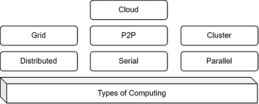

**图 3.1.** 计算的主要类型。

### 3.3 深度学习的硬件支持
深度学习需要特定的硬件来进行高效编程。传统上，计算环境需要中央处理器（`CPUs`）、`I/O` 和内存单元。随着并行支持的引入，专业计算设备中 `CPU` 的数量有所增加。此外，内存技术也经历了巨大的变化，提升了处理单元的速度。

除了 `CPU`、内存等最常见的硬件支持外，图形处理器单元（`GPU`）计算元素经常被应用于深度学习任务 [23]。`GPU` 计算元素充当协处理器，在 `CPUs` 的协助下计算向量处理指令——即处理指令所需的信息由 `CPUs` 提供。没有 `CPUs`，`GPUs` 无法处理任何指令。然而，`GPU` 计算非常流行于使用有限的指令处理大型数据数组——即 `GPUs` 属于弗莱明分类法中的单指令多数据流（`SIMD`）类 [26]。

`GPU` 级处理非常适合应用，包括深度学习应用。这些应用包含大量的矩阵计算，可以通过提交带有数据数组的单指令来处理。

#### 3.3.1 CPU 与 GPU
通常，程序员利用 `GPUs` 来利用 `GPU` 线程或核心的力量结合 `CPU` 核心的力量。`GPU` 硬件单元被编程模型利用，例如 NVIDIA 的统一计算设备架构（`CUDA`）编程或开放计算语言（`OpenCL`）基于线程的编程。基于 `GPU` 的计算对于与深度学习、科学模拟、矩阵乘法、线性代数计算等各种应用都非常强大。

`CPUs` 和 `GPUs` 的主要区别如下：

1. **并发级别**——`CPUs` 和 `GPUs` 提供的并发级别有明显差异。例如，一台典型的计算机只有四到八个 `CPU` 核心。然而，正常计算机中的 `GPU` 核心数量可以很多。
2. **指令能力**——`CPUs` 提供的指令数量高于 `GPUs`。显然，`GPUs` 支持更复杂的指令。
3. **处理能力**——尽管 `CPUs` 可以执行通用指令，但 `GPUs` 的吞吐量高得多。`CPUs` 以强大的处理能力。然而，由于 `CPUs` 的数量限制，其并行性通常低于 `GPUs`。


### 3. 库
TPU 需要自定义库来支持用于提供并行性的硬件。例如，`TensorFlow` 库专门为解决基于 TPU 的 AI 问题而设计，包括深度学习应用。

### 3.4 微控制器、微处理器和 FPGA

基于深度学习的应用通常运行在基于微处理器的机器或云环境中。这是由于这些学习算法通常是计算密集型或数据密集型的，而不是网络密集型任务。在大多数涉及物联网（IoT）或边缘节点的应用中，最好是使用微控制器在深度神经网络（`DNNs`）的计算层中执行处理。因此，必须研究这些硬件组件的重要性。

微控制器和微处理器之间的主要区别如下：

1. 芯片设计——在微控制器中，计算元件的所有重要组件都存在于一个芯片内——即处理应用程序所需的 `CPU`、`memory`、`I/O` 等组件都位于一个芯片中；相反，为微处理器设计的芯片具有 `CPU` 单元，但其他组件是外部的。
2. 控制方法——微控制器设计用于控制连接的设备（如传感器或物体），而微处理器用于控制计算机的关键组件（如 `memory` 或 `I/O`）。
3. 处理指令——在微控制器中，执行的指令数量有限。因此，有特定的控制方法来处理这些设备。另一方面，微控制器执行大量的复杂指令以支持广泛的应用。
4. 应用领域——大多数与嵌入领域相关的应用使用微控制器，但微处理器通常被通用应用程序利用，包括训练算法或深度学习算法实现。

大多数基于边缘的应用开发和深度学习实现需要微控制器而不是微处理器。然而，为了处理巨大的计算需求，微控制器与更健壮的计算系统接口，这些系统通常由云或雾计算环境托管。

除了解决深度学习应用常用的硬件单元（如微控制器和微处理器）外，还存在基于现场可编程逻辑门阵列（`FPGAs`）设计自定义硬件的实践。

`FPGAs` 是可以使用专用软件模块进行配置的专用硬件单元。这些设备的设计不遵循永久性蚀刻原理，允许程序员频繁修改硬件电路。这导致了硬件定制原则的现代概念。众所周知，如果任何应用程序都能在硬件层面进行设计，其性能就可以得到提高。在这里，`FPGAs` 允许应用开发人员根据客户/开发者的需求设计可以微调的自定义。事实上，研究人员已将 `FPGAs` 作为加速器来提高深度学习算法的性能。

### 3.5 云计算——一种深度学习环境

通常，云计算被定义为一种计算技术，通过从可配置机器/资源池中共享资源，并以最小的管理开销使用“按需付费”模式。“云计算”一词类比于普通的云，因为天空中有成千上万的云可以组合在一起提供雨水。

云计算定义中使用的术语可以总结如下：

1. 共享资源——与其他现代计算技术（如 `grid` 或 `P2P` 计算技术）类似，如果所需的计算资源不可用，云提供了使用共享资源的机会。例如，一个由训练和测试部分组成的深度学习任务需要不同层次的计算。训练阶段所需的计算量大于测试阶段所需的计算量。在这种情况下，购买计算机或服务器来执行可变任务不是可行的方案。相反，云提供了一种基于共享资源的解决方案，取决于具体需求。
2. 可配置资源池——云资源的设计使得其配置易于更改。配置文件不仅改变计算，还改变其他网络基础设施，如 `routers`、`gateways`、`firewalls` 等。由于这些设备可以按需调整，云已成为组织和应用程序的产品。
3. 最小化管理——大多数人会同意，配置机器并不如预配置机器简单。例如，如果必须处理成千上万台机器来部署它们，情况就会变得至关重要。云提供了管理这些资源的一种方法。
4. 按需付费模式——计算按需付费模式引起了许多企业的关注。这种概念允许根据资源利用共享资源；这与网格（grids）为用户预留资源形成对比。

云计算经常被深度学习专家和应用开发人员利用。主要原因包括：

* 效益——由于云计算的按需付费模式，根据深度学习应用程序的负载进行扩展。此类应用通常会有爆发的需求，特别是在训练模型时。
* 快速供应——快速供应作为云的功能，使深度学习专家能够迅速将其产品推向市场。这增加了业务的收入。例如，云的 `DevOps` 功能在应用开发人员和运营经理之间紧密集成。
* 地理足迹——云环境通常在全球范围内分布。因此，可以根据需求将资源放置在有利位置。例如，`AWS` 和 `Google` 的一些产品具有意见收集功能，可以使用需要学习推理的附近客户区域。
* 更广泛的市场——许多云平台适用于机器学习模型。这些服务可以插件到应用程序中，或通过可用的 `APIs` 进行编程以利用云服务。

### 3.6 虚拟化——云计算的基础

虚拟化是一种体系体系技术，能够实现资源的抽象，并将多个资源复用到有限的资源上。它是提供虚拟资源的概念——即不是真实的但模拟真实物的东西。

想象这样一个场景：森林里有几只狮子（即真实的狮子），而在在这些狮子旁边，有一棵树看起来有一只狮子的图像。因此，普通人可能会立即观察到景观中有更多的狮子，尽管实际上只有几只真实的狮子。类似地，一些虚拟现实绘画看起来像真实的场景。虚拟化在计算资源的背景下类似于类似的概念。这项技术仍然是云的基础技术。


虚拟化并不是一个新概念。它的历史可以追溯到 20 世纪 60 年代，当时 `IBM` 推出了大型机。通常，大型机是指规模巨大且具有强大计算和处理能力的设备。这些设备以分时方式在用户之间共享资源。由于处理器技术和硬件领域的进步，大型机的概念并没有发生显著变化，但共享资源的思想被广泛接受。

## 3.6 虚拟化——一个示例
虚拟化的概念可以用类比的方法解释。例如，想象有一栋拥有多个房间、厨房等的单层别墅。自然地，拥有这样一栋别墅可能花费大约 1 亿卢比——如果有人声称你可以以 10 万卢比购买这栋房子，普通人会乐意购买。

### 3.6.1 利用模式
我们需要注意到，别墅中可用的房间并不经常被所有者利用。它们很少被单一所有者使用——因此，利用率非常低。同样，在计算机中，大多数计算机/服务器利用率仅为 5%。剩余的 95% 时间资源都处于闲置状态。虚拟化试图高效地利用最大资源。

### 3.6.2 共享方法
为了高效利用别墅，想象指派了一个人来引导多个想要拥有这栋别墅的所有者。这个人的职责是帮助所有者进入房间，确保一个房间同时只有一个所有者。通过使用这种被称为“映射过程”（mapping process）的概念，多个所有者觉得他们以更低的成本拥有了这栋别墅。同样，计算机或服务器的用户被允许拥有内存、CPU、I/O、打印机等资源。通常，计算机的操作系统负责控制所有资源。在虚拟化环境中，允许多个操作系统管理资源——即硬件被多路复用，以便供多个用户使用。引导多个所有者的人被类比地用名为 `hypervisor`（虚拟机监控器）的软件取代。

### 3.6.3 虚拟化的目标
云环境中虚拟化的几个主要目标如下：
1. 允许许多用户同时共享资源
2. 允许对硬件进行动态更换和升级（某种隔离）
3. 允许在不重启的情况下添加新设备（如网卡、处理器等）
4. 减少运行应用程序的停机时间
5. 在运行时执行管理任务，如安装软件、规划虚拟机（`VMs`）等
6. 以敏捷的方式配置多台

### 3.6.4 VMs——与物理机的比较
虚拟机可以与物理机相比，物理机上的操作系统（`OSs`）运行在环 0，应用程序运行在环 1 或环 3。操作系统分层运行，大多数特权指令保留在环 0。这些指令通常在内核模式下运行，而属于用户应用程序的指令在用户模式下运行，用户模式被认为权限较低。

在物理机中，`OS` 的内核指令在环 0 中执行，这对底层硬件组件提供了更多控制。然而，在虚拟机中，由于多个所有者参与操作，参与资源共享过程的 `OSs` 被移动到环 1。相反，负责引导客操作系统的软件被放置在环 0。简而言之，只有 `hypervisor` 或虚拟机管理器（`VMM`）具有完全控制权和利用资源的能力。

`hypervisor` 是一种引导客操作系统利用资源的软件。例如，如果物理硬件上加载了 4 到 6 个 `VMs`，这些 `VMs` 的客体 `OSs` 在环 1 中运行，与 `VMM` 相比这被认为权限较低。图 3.2 以图表形式比较了物理机和虚拟机。


**图 3.2.** 虚拟机与物理机的比较。

### 3.6.5 VMs——案例研究
当需要新的 `OS` 时，虚拟机（VMs）具有巨大的吸引力。当深度学习专家使用不同的 Python 包和工作环境时，`VM` 非常有用。如果在裸机上执行相同的安装，恢复选项将受到限制。

`VM` 技术的应用在需要应用补丁的情况下显而易见。通常，补丁是解决安全更新或提供性能更新的软件更新。特别是当处理显卡相关问题时，打补丁可能会导致无法恢复的系统崩溃。对于大多数计算学习者来说，调试这些问题可能是痛苦的事件。

相反，`VMs` 通过快照（`snapshots`）或镜像（`images`）回溯这种更新。快照是带有状态信息的 `VMs` 保存版本；镜像包含所有信息，包括数据、状态和安装的软件，并保存在任何地方。

## 3.7 Hypervisor——对学习的影响
根据 `hypervisor` 的位置，虚拟机分类如下：
1. 裸金属虚拟机监控器（Bare-metal hypervisor）
2. 托管虚拟机监控器（Hosted hypervisor）

### 3.7.1 裸金属虚拟机监控器
裸金属虚拟机监控器使用位于硬件之上的 `VMM`——即 `hypervisor` 软件直接安装在机器而不是操作系统。某些情况下，这种软件安装在固件层。这通常称为 I 型虚拟化。

裸金属虚拟机监控器的示例包括 `Hyper-V`、`VMWare`、`ESXi`、`Xen` 等。

### 3.7.2 托管虚拟机监控器
在托管 `hypervisor` 中，引导客操作系统的软件位于主机操作系统之上。这意味着在执行 `hypervisor` 之前需要加载主机操作系统。这种类型的 `hypervisor` 被称为 II 型虚拟机监控器，属于此类别的虚拟化被称为 II 型虚拟化。

托管 `hypervisors` 伪装成组合了进程和计算机的普通应用程序。从图 3.3 可以看出，主机 `OS` 位于环 0，而 `hypervisors` 在高环中运行。


**图 3.3.** 托管虚拟化——II 型虚拟化。

### 3.7.3 全虚拟化


全虚拟化确保了客户操作系统在机器上执行时无需进行修改。例如，托管在裸机设备上的带有虚拟机程序的 I 型虚拟化环境可以加载诸如 `Ubuntu`、`Fedora`、`Windows` 等操作系统，这些操作系统在公共领域可用，且无需任何修改即可使用。

可见，操作系统对相关硬件具有完全控制权。因此，所有指令都尝试直接利用硬件。然而，这些指令（包括特权内核指令）在 `ring one` 中运行。只有虚拟机程序运行在 `ring zero` 中。由于这种现象，由客户操作系统执行的应用程序（用户态指令除外）都会被虚拟机程序捕获（trapped）。陷获是典型的软件中断，被认为是由异常条件引起的，例如除以零、无效的内存访问等。

在接收到此类陷获后，虚拟机程序会尝试即时拦截这些指令或系统调用。由于这种处理发生在客户操作系统应用程序的运行期间，因此其性能相对低于宿主机。

尽管这种方法在处理许多 `x86` 指令时非常成功，但仍少数指令没有被虚拟机程序捕获。这意味着处理全虚拟化需要复杂的设置。然而，在此期间，VMware 公司提出了二进制翻译（binary translation）的想法。

#### 3.7.3.1 VMware 的二进制翻译

VMware 引入了在二进制级别即时翻译客户操作系统特权指令的概念。二进制级翻译需要解析指令的二进制文件，并识别不符合安全原则的特权指令；此外，它必须将这些指令转换为另一种形式的 `x86` 指令，以便驱动特权指令直接访问虚拟机程序而不是硬件。

将 `x86` 特权指令翻译为另一种安全的 `x86` 指令集面临以下挑战：

1.  **延迟处理**——显然，对于由机器客户操作系统执行的应用程序来说，其计算时间增加了。如果虚拟机需要处理更多的系统调用，这种增加会更加剧烈。
2.  **受影响的系统调用**——通常情况下，系统调用在执行时间上是昂贵的。一个典型的系统调用通过操作系统的内核传播——即一个不经过任何虚拟化的系统调用大约需要 `242` 个时钟周期。这个数字取决于系统调用的性质，范围从 `150` 个时钟周期到 `10K` 个时钟周期以上，尤其当涉及上下文切换时。最常见的系统调用与进程管理指令、内存管理指令、文件管理指令等有关。在 `x86_64` 架构中，有 `358` 个系统调用。以下是系统调用的一些示例：

```
sys_enter
sys_exit
```
使用虚拟化后，客户操作系统的系统调用可能达到约 `2300` 个周期。
3.  **受影响的 I/O 调用**——I/O 虚拟化实现了 I/O 的虚拟化——即一个物理网卡可以虚拟化为虚拟网卡控制器 (`NICs`)，从而支持多个操作系统。如果机器上有多个插槽，则可以扩展 CPU 虚拟化。然而，I/O 虚拟化并不像提高 CPU 性能那么容易。例如，I/O 带宽无法提高，因为它取决于主板的总线布局。
4.  **受影响的内存**——通常，物理机器不会直接向机器上执行的应用程序暴露内存单元。相反，它们尝试将底层内存单元映射到二级内存地址。当使用这种方法时，内存违规不会干扰真实机器的硬件功能。在虚拟环境中，存在多个层级的映射单元。在这里，程序的内存地址映射到客户操作系统的虚拟物理内存地址；随后，虚拟物理内存地址映射到真实内存地址。因此，虚拟机可能需要维护一个映射内存地址的影子页（shadow page table）。通常，这种分页概念会导致巨大的开销，比普通物理机器大约多出 `300–400` 个周期。

### 3.7.4 半虚拟化

在半虚拟化中，客户操作系统被修改，使得特权指令直接驱动虚拟机程序。这是虚拟化技术的一种增强。然而，挑战在于普通的操作系统无法作为客户操作系统使用。

提供半虚拟化的最流行的工具之一是 VMware 的 `vSphere` 产品，它由使用 `ESXi` 半虚拟化设置的虚拟机、通过高速网络连接连接的容器、`vCenter` 服务器、用于访问机器的 `vSphere` 客户端、存储单元等组成。

### 3.7.5 硬件辅助虚拟化

在现代机器中，硬件级辅助自 `2015` 年起已可用，这使得全虚拟化的高效运行。在此之前，倾向于采用虚拟环境的用户必须在基本输入/输出系统 (`BIOS`) 级别启用虚拟化选项。在现代机器中，这些环境默认启的，因为大多数框架（包括深度学习应用）都是在虚拟化概念的辅助下开发的。

硬件级虚拟化提供了某些功能，使客户操作系统能够在 `ring zero` 内部运行。为了快速识别特权指令，现代处理器实现了虚拟机扩展 (`VMX`) 根模式和非根模式。`VMX` 根模式更类似于具有四个环的传统计算系统，虚拟机程序运行在 `VMX` 根部。此外，还有另一种运行模式称为非根模式，它包含一个称为虚拟机控制结构 (`VMCS`) 的控制结构。该结构跟踪尝试访问机器的特权指令。因此，客户操作系统加载在非根模式下。

## 3.8 容器与 Docker

大多数深度学习应用是以容器或 Docker 实现的。因此，详细了解这些关键功能是非常重要的。本节将解释 Docker 和容器的内部构造。

容器是带有自包含信息的软件软件包，可以在任何环境中执行。容器使用内核特性（如 `cgroups` 和 `namespaces`）来开发处理隔离应用程序的软件包和进程。

#### 3.8.1 Docker 实例


Docker 是一种特殊的容器实例，利用容器技术在硬件中复用多个计算实例。Docker 经常被称为轻量级虚拟机（VM）实例，并广泛应用于深度学习领域 [18]。这些虚拟机实例相比任何裸机虚拟机管理器（bare-metal hypervisor）实现都更为轻量。

Docker 实例构建在机器上，使得虚拟机管理器位于操作系统层之上。这意味着用户在加载 Docker 实例之前必须启动操作系统。这些虚拟机实例是操作系统（OS）的扩展——即内核的大部分在所有实例之间是通用的。因此，基于 Linux 的机器只能支持基于 Linux 的 Docker 机器；基于 Windows 的机器只能运行基于 Windows 的 Docker 机器。因此，Docker 机器之间无法进行交叉兼容。

Docker 是使用内核的两个基本构建块的：

1. `cgroups`——用于限制用量
2. `namespaces`——用于限制视图

在现代时代，深度学习应用是基于 Docker 实例构建的。利用 Docker 实例的主要原因如下：

1. **敏捷发布**——对于基于 Docker 的实现，程序开发与发布操作之间只需要极短的时间。Docker 被认为是 DevOps 的潜在候选者。通常，在传统的软件开发市场，开发团队实现许多行代码来实现某些深度学习逻辑；随后，团队必须将代码封装成特定格式并结合相关文档分发给运维团队。然后，运维团队在向公共客户或用户提供代码之前必须对其进行实验或测试。事实上，运维团队可能会遇到以下因素带来的若干挑战：
    * (a) 代码在运维团队的工作环境中可能无法按预期正常运行。例如，运维团队的环境中可能缺少合适版本的相关包。很大可能，运维团队将使用开发者未测试过的新版本软件依赖项来安装代码。
    * (b) 运维团队成员的专业知识可能与应用开发团队不同，这会延迟上市时间。

2. **易于集成**——Docker 提供了一种易于集成工具，因为 Docker 拥有许多辅助软件。例如，Docker swarm 能够以极少的管理工作在多台机器之间编排 Docker。

3. **可编程性**——基于 Docker 的实现支持微服务实现方法，这促进了各种语言的可编程性支持。可以聘佣具有 Nodejs 背景、Golang 背景或 Python 背景的开发者来启动分布式学习服务。通过这种方式，许多程序员可以参与开发大量的深度学习应用。

4. **减少存储**——与裸机虚拟机管理器实现相比，Docker 实例所需的存储空间是极微的。因此，深度学习算法可以使用 Docker 实例来实现。例如，一台 Docker 机器通常具有 200 到 500 MB 的存储空间，而裸机机器可以轻松达到 1 GB 以上的存储空间。

5. **广泛的用途**——基于 Docker 的实现在现代时代变得更加流行，因为深度学习应用可以在计算机器上编写和托管，同时在文件中指定所有先决条件。值得注意的是，Docker 实例中包含的 `Dockerfile` 等配置文件被用于编写托管 Docker 机器所需的逐步程序。例如，NVIDIA 开发了一套 NVIDIA GPU 容器（NGCs）来支持深度学习应用的开发。用户可以编写 Dockerfile，其中包含用于获取 NVIDIA GPU 镜像以执行深度学习模型的命令。下面给创建一个适用于深度学习应用开发的 NGC 容器的简单 `Dockerfile`：

```docker
FROM nvcr.io/nvidia/TensorFlow:19.03
RUN apt-get update
RUN apt-get install -y octave
```

在这里，关键字 `FROM` 代表初始化 octave 包安装的镜像。

### 3.8.2 Docker 构建块

如前所述，用于创建 Docker 的两个构建块是 `cgroups` 和 `namespaces`。`cgroups` 和 `namespaces` 最基本的功能在以下子节中描述：

#### namespaces

`namespace` 是用于界定 Docker 实例或容器的构建块。`namespaces` 负责在与多个所有者共享资源的同时限制计算资源的视图。通过限制目录、文件系统、网络、I/O 等等视图，创建多个 Docker 实例之间的隔离。为了提供此类视图，Linux 内核提供了系统级编程可用的特定函数。

为 Docker 容器提供的 `namespaces` 分为以下大类：

1. **进程标识 (PID) 命名空间**——进程标识符是区分计算机进程的特定数字。从 `PID` 为零的 init 进程开始，计算机器中的所有其他进程都以新的进程号生成。当一个新机器在 Docker 容器中界定时，托管在该容器上的用户或应用程序也应该具有从 init 进程身份开始的唯一视图。由于进程是由父主机生成的，因此给 Docker 容器的子进程带有新的 `PID` 数字。因此，这种方法实现了操作系统级虚拟化，这是一个用于为机器提供扩展操作系统的概念。

2. **cgroup 命名空间**——`cgroup namespace` 对于 Docker 容器至关重要，它可以提供目录或文件系统结构的唯一视图。众所周知，Linux 文件系统具有特定的目录结构，拥有 `/var`、`/root`、`/home`、`/etc` 等。这些文件结构也应该在托管在任何计算机器上的 Docker 容器机器中反映。

3. **网络命名空间**——`network namespace` 尝试为 Docker 容器提供新的视图。主机基于基于网络标识符。这些网络标识符通常源自物理网卡。取决于可用网卡的数量，有 `eth0`、`eth1` 等标识符。`iptools` 命令提供主机的网协议（IP）地址信息。由于 Docker 容器被多个所有者利用，客户操作系统应该获得底层物理网卡的视图。例如，Docker 容器机器应该获得唯一的 IP 地址和用于执行网络通信的 `eth` 工具。Linux 内核的 `namespace` 组件提供了这些功能，以便在主机机器上运行时限制 Docker 容器的视图。

4. **挂载命名空间**——在物理机器上挂载不同设备或介质驱动器必须授予 Docker 容器。内核的 `mount namespace` 构建块负责提供此类不同挂载选项的新视图。此外，与主机机器相比，其他几种命名空间功能为容器机器提供了受限的视图。

#### cgroups

`cgroups` 被认为是 Docker 容器的关键构建块之一，用于限制服务的利用率。此功能描述了主机机器提供多少资源来执行 Docker 计算。


通常情况下，深度学习应用在 Docker 容器中运行时可能需要更多的 GPU 计算或内存实例。提供给 Docker 容器的 CPU 数量和内存由 Linux 内核的 `cgroup` 特性决定。

`cgroups` 在 Docker 容器中的核心目标如下：

1. 限制宿主机为深度学习 Docker 容器提供的资源；
2. 审计 Docker 容器资源的利用情况；以及
3. 将不同客 Docker 容器的资源与宿主机进行隔离。

Docker 容器中存在多个 `cgroup` 组件，例如 `memory cgroup`、`cpu cgroup`、`block i/o cgroup`、`cpuset cgroup`、`devices cgroup`、`freezer cgroup` 等。以下是支持深度学习应用 Docker 容器的这些 `cgroup` 组件所执行的重要活动：

1. **Memory cgroup**——内存控制组——`memory cgroup` 负责将一组任务的内存行为与系统的其余部分隔离。它创建一个具有限制内存的 `cgroup`。它将内存密集型应用程序与其他应用程序隔离开。例如，深度学习应用通常需要大量的数据或数据库。托管在容器上的启用数据库的深度学习应用可能会被更大的内存空间。

`memory cgroup` 使 Docker 容器能够提供适当计数功能——即它提供了方法来指定特定运行进程组利用了多少内存页。这些信息以文件页或匿名页（如堆、栈等）的形式提供 [25]。

`memory cgroup` 通过限制 Docker 容器在宿主机上的利用率，提供了控制 Docker 容器内存利用率的机会。通常，控制措施通过以下列出的方法实现：

* (a) **Soft limit（软限制）**——在软限制方法中，分配给 Docker 机器的内存并不严格遵守。如果 Docker 机器的内存需求增加，则根据宿主机剩余内存的可用性为 Docker 机器分配额外内存。如果宿主机工作负载有限而 Docker 机器想要执行几个计算密集型的深度学习任务，这一点尤为重要。
* (b) **Hard limit（硬限制）**——在硬限制方法中，如果内存数量超过了任何指定的限制，则不会为该 Docker 容器组分配内存。

事实上，如果它们超过了预定义的硬限制，宿主机内核可能会根据 Linux 机器的糟糕程度评分（badness score）触发内存溢出（`OOM`）杀死进程来杀死任何运行中的 Docker 进程。为了避免不必要的问题，建议在容器中运行运行应用程序。

有一种自定义方案可以覆盖导致 `OOM` 杀死进程的 Docker 硬限制。该自定义方案使用下面的一系列步骤：

* 步骤 1：向所有 Docker 进程发送信号停止正在进行的进程。这是通过 Docker 容器的 `freeze` 选项实现的
* 步骤 2：将通知提交给用户空间，使用户可以更警惕地关注他们的资源消耗应用；
* 步骤 3：用户可以杀死特定进程，而不是让宿主机操作系统自行决定；
* 步骤 4：否则，允许用户增加 `cgroups` 中指定的资源硬限制；
* 步骤 5：最后，一旦杀死目标进程，即可启用 `unfreeze` 选项保持 Docker 容器在无冲突的情况下运行。

2. **Block I/O cgroup（块 I/O 控制组）**——此 `cgroup` 特性为 Docker 容器提供了块 I/O 存储选项。它提供了限制且有范围的存储单元，而不会影响大量 Docker 及其底层宿主机的性能。

3. **CPUSet cgroup（CPU Set 控制组）**——如果机器具有多个 CPU，则将编程指令分配给这些 CPU 的能力必须针对性能进行优化。例如，一个希望稀疏分布在大型并行机器上的并行程序可能会由于跨布线 CPU 发送数据包的延迟而消耗大量的执行时间。事实上，通过为并行程序组合 CPU Set，可以显著提高应用程序的性能。这对于几个基于深度学习的应用非常有益。

4. **Devices cgroup（设备控制组）**——有时需要控制 Docker 机器访问稀有设备，如打印机、USB 闪盘等。`devices cgroup` 负责限制多个 Docker 容器对设备的访问。例如，深度学习容器可能需要访问连接的 NAS 设备，而普通容器可能被禁止访问此类设备。

5. **Freezer cgroup（冻结控制组）**——`freezer cgroup` 允许 Docker 执行某些维护功能。它允许 Docker 机器在执行某些操作之前停止所有进程或一组进程。这些 `cgroups` 和命名空间的所有组件和子组件被认为是执行专门应用程序（包括深度学习应用）的 Docker 容器的构建模块。

### Docker 存储特性

Docker 是与传统容器相比的独特特定容器。Docker 机器最关键的特征是包含了联合文件系统（union file system）。容器使用联合文件系统存储。联合文件系统确保了多个 Docker 容器的内容是统一的，这改进了存储空间的使用。一些研究人员研究过 Docker 存储系统的性能 [20]。

如果一个使用 TensorFlow 库版本 2.0 的深度学习应用第二次托管在 Docker 机器中，该库的底层将不会被下载。此外，还将利用之前 Docker 机器的存储空间。因此，Docker 方法在 Docker 机器上执行应用程序时消耗更少的存储和网络带宽。

相应地，用于执行深度学习应用的若干 Docker 机器托管在公共仓库中。例如，大多数基于 TensorFlow 的深度学习应用托管在云资源的 Docker 容器上。

### Docker 工作模型

Docker 使用客户端-服务器架构实现，具有三个主要组件。启用 Docker 的集群机器的图示表示如图 3.4。

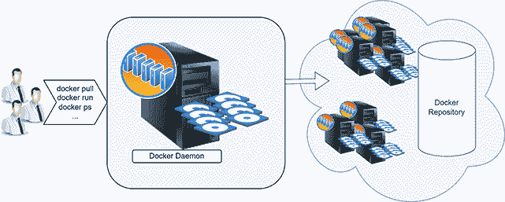

**图 3.4.** 用于托管深度学习应用的 Docker 架构。

这三个软件组件的功能列如下：

1. **Docker client（Docker 客户端）**——Docker 客户端将用户请求传输到宿主机。客户端请求在 Docker 机器中处理以执行 Docker 机器或托管 Docker 镜像。一些流行的命令如 `docker run`、`docker build`、`docker ps` 等由用户从 Docker 客户端发布。


## 2. Docker 守护进程 (daemon)
用户的请求被提交到运行在宿主机上的 `Docker daemons`。守护进程在宿主机启动启动时立即初始化。`Docker daemons` 的作用是持续监控来自客户端的请求，并根据请求启用镜像或容器。它们确保利用镜像在宿主机上加载基于联合文件系统（union-file-system）的容器。如果在本地机器上未找到任何所需的镜像，守护进程负责与外部 `Docker registries` 通信，以便将镜像加载到宿主机上。

## 3. Docker 镜像仓库 (registries)
`Docker registries` 存储了大量的镜像，这些镜像作为创建 Docker 容器的配方。`Docker registry` 有两种类型：

*   (a) 公共仓库——公共仓库是由多个第三方提供商托管的常用仓库。这些仓库通常包含最流行的深度学习及类似镜像，可以根据我们的需求进行定制。
*   (b) 私有仓库——在大多数情况下，公共仓库无法满足特定组织的需求。拥有多个客户的组织通常使用为特定意图或任务设计的模板或镜像。此类镜像通常托管在这些私有仓库中。

`Docker daemon` 最初会在本地机器上搜索镜像。如果在本地机器未找到，它会尝试在私有仓库中搜索。随后，在镜像加载到容器之前，它会在公共仓库中搜索合适的镜像。

### 3.8.5 Docker 工具
尽管某些深度学习实现使用了基于 Docker 的安装，但工具的必要性是多方面的：

1.  工具对于便于处理 Docker 相关应用程序是必需的。
2.  工具对于定位轻量级机器的性能问题至关重要。显然，普通用户很难识别识别执行在 Docker 机器上的深度学习应用的底层性能问题。
3.  需要工具来与 Docker 机器协作，而不是操作 Linux 内核的基本组件如 `cgroups` 和 `namespaces`。

下面描述了几个在为深度学习应用开发者或业务爱好者提供支持方面非常流行且具有关键视野的 `Docker tools`：

1.  Docker Desktop—`Docker Desktop` [2] 是一种工具，它可以生成一个包含所有 Docker 组件的捆包，例如 `Docker-engine`、`cli`、`credential helper` 等。因此，用户不需要寻找单个的裸组件。
2.  Docker Compose—`Docker Compose` 是一个用于定义和运行多容器 Docker 应用程序的工具。它允许你使用 `YAML` 文件配置应用程序的服务，并通过单条命令启动所有服务。这对于需要多个容器协作的深度学习应用非常。
3.  Docker Swarm—`Docker Swarm` [3] 是 Docker 的原生编排工具。它允许你将 Docker 主机集群作为一个单一虚拟主机进行管理。它提供了扩展和高可用等功能。

## 3.9 云执行模型
在现代世界，深度学习应用主要托管在云端。本节描述了执行深度学习架构的无服务器（serverless）执行模型。

### 3.9.1 无服务器执行模型
无服务器执行模型 [9] 是一种允许开发者在无需管理服务器的情况下运行代码的模型。事实上，无服务器函数是由事件触发的。在无服务器框架中，云基础设施仅在需要时可用。这也被称为“函数即服务”（function-as-a-service）。

深度学习领域无服务器函数最重要的特性提供了若干优势：

1.  任何深度学习算法在开发后，其在市场上的生命周期可能是有限的。
2.  增强的可扩展性——由于函数是细粒度的，它们可以由轻量级机器托管。
3.  成本——显然，由于没有专用的云服务器，基于无服务器的执行模型减少了算法开发的成本。

### 3.9.2 Kubernetes 解决方案
管理执行深度学习算法的轻量级容器对于许多应用开发者来说是一项巨大的任务 [17]。Docker 容器已经开发了一个 Docker swarm 工具来执行管理任务。与 Docker swarm 工具一样，`Kubernetes` 平台是由云专家开发用于管理容器的。

一个 `Kubernetes` 集群由主节点（master）和从节点（slave）组成。主节点负责管理从节点及其关联的应用容器。它被称为集群的大脑。它包含一个 `API server`，提供表述状态转移（`REST`）服务，支持调度和复制任务。


## 2. Kube-proxy—该组件负责将用户消息定向到 PODs，POD 代表具有单个 IP 地址的容器组。

Minikube 是 Kubernetes 编排工具的极简版本，可以在单机上建立。

## 3.9.3 深度学习服务 (DL-as-a-service)

通常情况下，云提供面向服务的实现支持。深度学习服务（DL-as-a-service）是实现相应任务的一种 [22]。通常，深度学习服务通过软件或硬件与软件结合的方式提供。

DL-as-a-service 通过四种不同的方法实现。这些方法的要点及其关键特征描述如下：

1. **环境——深度学习服务以环境变量的形式提供**。通过启用这些环境变量，用户可以将某些深度学习任务卸载到连接的云服务。例如，可以设置 AWS 环境变量将基于学习的计算任务与 AWS 的 `EC2` 实例连接起来。
2. **插件——某些服务被开发为浏览器或附加软件框架的插件**。由于深度学习插件的性能，深度学习任务被卸载到云环境中。
3. **库——大多数深度学习任务通过连接到云基础设施的 API 以库的形式实现**。这些库提供了添加到深度学习任务中的函数，以便将选活动卸载到云端。

## 3.10 编程深度学习任务——库

TensorFlow [5]、Pytorch [4] 以及类似的生态系统的开发是为了帮助用户编写深度学习任务，以便由计算机器（包括云环境）执行。TensorFlow 已被深度学习爱好者广泛利用。它允许工作流模型使用广为人知的 Python 编程语言来执行深度学习任务。

### 3.10.1 TensorFlow 的特性

TensorFlow 平台便于基于 Python 的深度学习任务编码的重要特性如下：

1. **操作简便——TensorFlow 平台提供了与许多其他平台的易于集成**，例如 Google 运行时协作服务或本地连接的集群。用户必须使用平台选择合适的计算资源，以便在云端执行深度学习服务。
2. **表示简便——此外，TensorFlow 专注于让数据易于表示**。例如，利用 `Tensors` 来表示文本、图像或音频数据。`Tensors` 是多维数组，主要表示为 `NumPy` 数组，本质上大多是静态的。`Tensors` 通常由强类型数组表示，这些表示在执行期间是不可不可变的。因此，无法更改张量。然而，在深度学习任务执行期间可以创建新的张量。
3. **调试功能——已经开发了 TensorFlow 的解释器，这些解释器使用了 Jupyter notebooks**。Jupyter notebooks 允许用户轻松开发代码并调试由于编码效率低等原因出现的错误。一个从事深度学习任务并使用超过 20 个 Python 文件的应用程序开发者，可能会发现使用传统方法很难追踪错误或故障。然而，使用 TensorFlow 平台，他们能够在短时间内完成调试。
4. **可视化——该平台为程序员人员提供了张量和变量的可视化表示**。通过这种方式，可以使用 TensorFlow 在某种程度上对相关的图表和数据进行可视化。

### 3.10.2 TensorFlow 组件

使用 TensorFlow 库进行的深度学习推理是通过特定组件完成的。如果我们检查基于 TensorFlow 的深度学习推理引擎的内部架构，可以识别出以下关键组件：

1. **计算硬件——基于 TensorFlow 的程序运行在不同的计算硬件单元上**，如 `CPUs`、`GPUs`、`TPUs`、`Android` 等。
2. **TensorFlow Core——硬件计算单元的抽象发生在内核级别**，这在 TensorFlow 核心组件中实现。内核是在系统级编程阶段使用 `C++` API 结合 `Linux` 或 OS 内核开发的。
3. **Python 组件——在 TensorFlow 核心组件之上开发了 Python 级解释器，用于创建任务图并执行急执行**。这些组件使用了多个 Python 包，通常被认为是 TensorFlow 库的核心功能。
4. **自定义组件——TensorFlow 平台提供了多个函数，例如 `tf.shape`、`tf.layers` 等**。这些组件使用 Python 组件开发，以提供自定义设置。
5. **高级 API——此外，还有一些高级工具和 API，例如 TensorFlow Estimator**，它们结合了所有可用的底层实现，通过简单的命令或函数交付深度学习任务。

## 3.11 用于深度学习的传感器支持数据收集

深度学习应用的某些领域涉及使用传感器节点来应用智能。对于任何深度学习爱好者来说，这些传感器支持型应用程序的数据收集机制特别为重要 [24]。这是因为数据源和预处理阶段是深度学习应用的关键方面。

### 3.11.1 所需机制

在处理深度学习应用的传感器数据时，我们需要考虑的几种机制如下：

1. **多跳机制——传感器节点通常通过无线媒介通信**。由于它们通常由电池供电，节点在将数据提交到深度学习驱动的推理引擎或建立适当通信可能会遇到困难。这些节点可以使用多跳方法通过中间节点将数据提交到目标节点。
2. **节能操作——能效被认为是最关键的目标之一**，不仅对于电池供电的嵌入式设备，对于电源云云机器也是如此。事实上，处理应用程序的方法会导致大量的成本和碳排放。
3. **网络内处理——在某些情况下，最好由通信系统在网络节点处理路由或数据包处理**，而不是将数据包提交到云端或目标计算系统。通过这种方式，网络延迟和应用程序的能力可以显著提高。

显然，所有接收传感器节点数据的深度学习应用必须确保足够的服务质量、容错性、处理所需寿命、可编程性以及从密集区域吸引数据的能力。

### 3.11.2 传感器到 DL 服务——数据连接

IoT 设备（如摄像头、温度传感器或湿度传感器）可以通过多种方式将数据提交到深度学习服务。提交数据的方法取决于连接节点使用的网络拓扑。

通常，使用几种网络拓扑来连接 IoT 传感器节点，描述如下：

1. **IoT 局域网 (LAN)——在 IoT 局域网中，传感器使用任何拓扑（如星型、总线型、网格型）相互连接**。这些传感器节点具有标识它们的唯一本地地址。注意的是，收集传感器数据的计算机器必须位于局域网内以便处理传感器应用程序。


## 2. 物广域网 (WAN)——在这里，深度学习计算引擎可以位于任何远程位置。多个具有唯一地址的 `LANs` 通常通过连接到网络上的路由器到达其他 `LANs`。属于一个组织的每个 `LAN` 都连接到一个路由器，该路由器将数据提交到已连接的 `WAN` 节点。

## 3. 物直连——在某些情况下，传感器节点可能需要直接连接到接入网络的节点或托管深度学习算法的云服务。为了实现这一点，在数据到达指定的基于深度学习的云服务之前，传感器节点与支持全球定位系统 (GPS) 的锚点之间建立了隧道。

### 3.11 应用层协议

数据在网络节点之间分发供深度学习算法处理的方法，很大程度上影响了支持物联网的深度学习应用程序的性能。通常，传感器节点使用发布/订阅模型或请求/响应模型与云服务进行通信。

一些协议，例如消息队列遥测传输 (`MQTT`)、安全消息队列遥测传输 (`SMQTT`)、约束应用协议 (`CoAP`)、高级消息队列协议 (`AMQP`)、可扩展消息和存在协议 (`XMPP`)、数据分布服务 (`DDS`) 等，协助传感器节点传递消息。这些协议和数据交付模式的最要点将在以下小节中描述。

### 3.11.1 MQTT

`MQTT` 代表 Message Queue Telemetry Transport（消息队列遥测传输）。它被广泛用于传输消息（通常是短消息），以便传感器节点或电池供电节点之间实现高效的通信。通常，该协议应用于机器间 (M2M) 通信，其中传感器将数据提交给另一台机器。

该协议的独特之处在于它在节点内发送消息遵循发布/订阅模型。在发布/订阅通信模型中，设备不需要主动监听确认接收或所需的消息。图 3.5 展示了传感器节点如何通过 `MQTT` 代理器向订阅者提交传感器数据。

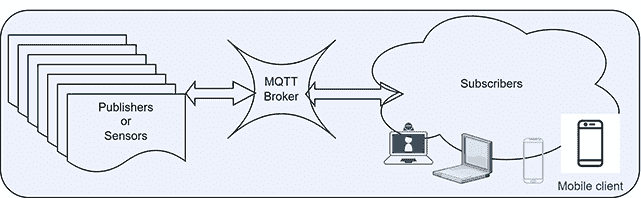

**图 3.5.** 基于 MQTT 的深度学习智能传感器应用的发布/订阅架构。

该机制与超文本传输协议 (`HTTP`) 不同，它不涉及主动监听消息，而是基于底 `MQTT` 架构，该架构由三个主要组件组成，即发布者、代理器和订阅者。这些组件与向服务提交数据相关的重要特征如下：

1. **发布者 (Publishers)**——传感器节点可以定期感知一些可测量属性，并将数据提交给代理器，而不是等待回复消息。因此，传感节点的能量消耗大幅减少。向代理器发布此类信息的传感器节点被称为发布者。

2. **代理器 (Brokers)**——代理器最重要的责任是从传感器收集消息并根据其需求将其传输给已知的订阅者。订阅者并非一直处于状态。它们可以在任何需要来自传感器节点信息时变为活跃。例如，深度学习引擎可能在需要处理算法时才需要传感器数据。此外，这些代理器提供了一种验证发布者或订阅者的安全方法。根据代理器的可用性，它们被分为大类：
    * (a) **私有代理器 (Private broker)**——私有代理器仅允许已知的订阅者或发布者发送或接收消息。因此，没有匿名传感器节点可以直接利用深度学习服务。相反，不允许深度学习服务从未经授权的传感器节点收集传感器数据。
    * (b) **公共代理器 (Public broker)**——如名所示，公共代理器允许任何订阅者或发布者发送或接收消息。一些常用的 MQTT 代理器包括 `EclipseMQTT broker`、`HiveMQ`、`Mosquitto` 等。

用户在选择代理器之前可能需要某些特性。最广认可的代理器特性及其功能列如下：

    * (a) **服务质量 (QoS) 支持**——代理器必须为连接的设备提供足够的 QoS 支持。事实上，无线通信容易发生故障，包括通信中断。默认情况下，代理器应该具备启用 QoS 支持的能力。
    * (b) **开源 (Open source)**——通常，基于开源开发为未来的增强提供了更好的机会。因此，学术界可以广泛创新以扩展代理器功能。例如，可以在开源的代理器中改进身份验证方案。然而，挑战在于确保代理器具有长期支持。
    * (c) **性能 (Performance)**——性能是代理器或相关实现的关键特征之一。性能指标包括：
        * i. **延迟 (Latency)**——消息交付时间是基于 `MQTT` 协议的关键性能指标。
        * ii. **吞吐量 (Throughput)**——吞吐量描述了代理器在指定时间内处理的消息数量。
        * iii. **扩展性 (Scalability)**——扩展性是一个性能指标，描述了代理器在增加入出消息数量时可以处理的资源。
        * iv. **可用性 (Availability)**——代理器的可用性描述了即使受到外部影响或处理能力故障时的运行情况。这对于处理来自各种机器或传感节点的 `MQTT` 消息是一致的。
    * (d) **互操作性 (Interoperability)**——代理器必须确保与各种服务具有互操作性。例如，代理器的消息可能支持使用 `Nodejs`、`Golang`、`C++` 等语言编写的深度学习引擎。此外，根据需要，代理器可能必须与其他代理器轻松集成。
    * (e) **安全性 (Security)**——即使代理器被实现为私有或公共代理器，代理器使用的身份验证和授权机制（包括加密机制）也必须仔细管理。例如，可以使用启用令牌的身份验证于代理器，以确保设备或服务连接代理器时具有更高的安全性。此外，拥有保护代理器免受各种拒绝服务攻击的机制很重要。通过这种方式，深度学习应用程序可以轻松与代理器集成。

3. **订阅者 (Subscribers)**——订阅者是需要数据或消息来开发知识或执行操作的实体。例如，订阅者的包括托管在云服务中的深度学习算法，它们需要传感器数据来处理应用程序。

`MQTT` 协议 [13] 定义了用于连接或断开节点的特定方法。这些方法如下：

1. `Connect` 方法帮助传感器连接执行深度学习算法的服务器。
2. `Disconnect` 方法帮助传感器断开深度学习服务。
3. `Subscribe` 方法允许深度学习服务订阅代理器提供的传感器数据。
4. `Unsubscribe` 方法用于取消代理器提供的传感器数据。
5. `Publish` 方法帮助传感器向代理器提交或发布传感器数据，以便订阅的深度学习应用程序可以获取这些数据。


考虑这样一种情况：在智慧城市的配水站点使用了水质传感器。这些水质传感器由电池供电。此外，假设智慧城市的官员希望更新配水通道的水质数据。在这种情况下，可以应用适当的深度学习算法来预测通道所需的维护。因此，官员希望查看由云服务托管的进度图表（见图 3.6）。

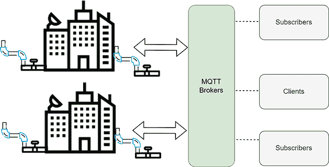

**图 3.6.** 使用 MQTT 的智能城市水质分析。

在这个用例中，安装在各个配水通道中的水质传感器不会根据深度学习服务的请求做出数据响应。事实上，根据 `MQTT` 协议，传感器节点与服务之间不存在通信。相反，传感器每当准备好通信水质信息时，就可以将其提交给公共代理（brokers）。当深度学习服务被智慧城市官员调用时，它们使用传输控制协议（`TCP`）连接到代理，并获取用于预测维护及相关操作（如果有）的传感器数据。

传感器与代理（或发布者与代理）之间的消息是通过主题（topics）定义的。主题是主体之间传递消息的方式。它们使用 `UTF-8` 字符串格式表示，其具有层级结构，以便以结构化的方式表示数据。

根据收集到的消息，`MQTT` 主题分为两种方式：

1. **精确主题（Exact topic）**——精确主题是与精确位置相关的信息字符串。在这个用例中，它将是从特定配水通道收集的传感器信息。例如，如果监控某房屋配水通道中的水质，那么浴室的特定主题将表示如下：

`Topic—house/bath-room/waterquality`

2. **通配符主题（Wildcard topic）**——来自许多传感器的数据在通配符主题中包含或处理。它由与多个位置相关的信息字符串组成。通配符主题进一步分为两类：

    * **(a) 单级通配符主题（Single-level wildcard topic）**——在单级通配符主题中，来自许多传感器的数据在系统的单一层次上进行收集和处理。例如，如果需要研究房屋内几个房间的水质信息，可以使用单级通配符主题。它使用 `+` 符号表示，如下所示：

`Topic—house/+/waterquality`

    在上面的示例中，代表多个房间传感器数据的题（如 `house/bath-room/waterquality` 或 `house/kitchen/waterquality`）被考虑在分析范围内。

    * **(b) 多级通配符（Multilevel wildcard）**——在多级通配符方法中，主题涵盖层级结构的多个级别。例如，整个房屋（由多个房间组成）的传感器数据可以使用这种方法处理，如下：

    `Topic—Eg. house/#`

可以观察到多级通配符主题使用 `#` 符号表示。

事实上，`MQTT` 协议中的主题可以使用用户选择的任何名称，没有任何特定限制。然而，以 `$` 符号开头的主题是受的。这些通常用于表示状态消息，例如：

`SYS/broker/clients/connected`

`SYS/broker/clients/disconnected`

`SYS/broker/clients/total`

`SYS/broker/messages/sent`

`SYS/broker/uptime`

### 3.11.3.2 CoAP

`CoAP` 是一种专为基于物联网（IoT）的应用程序设计的受限应用协议。它针对的是没有足够功率处理指令的受限设备。`CoAP` 协议用于网络传输，可以应用于各种领域的机器机器（M2M）通信，例如智能建筑、建筑自动化以及可以使用深度学习算法实现智能化的制造应用。

`CoAP` [6] 在节点间的网络传输之间使用请求-响应模型。尽管 `CoAP` 利用请求-响应模型来传输传感器数据，但它似乎是对于功率受限设备来说的一种高效的协议。

`CoAP` 能够在处理节点间网络传输的请求-响应模型的同时降低能耗的主要原因如下：

1. `CoAP` 使用用户数据 agram 协议（`UDP`）发送消息，而不是采用昂贵的 `TCP` 协议。通常，当使用 `TCP` 作为通信节点的传输层时，它们在向指定节点之间发送数据包之前必须执行三次握手。然而，由于持续连接，基于 `TCP` 的传输层使用复杂的方法来确保数据包的传递。

2. `CoAP` 运行在会话层或应用层的底部薄部分。通常，在关注应用程序的能耗时，减少高层的数量是一项优势。

为了弥补避开高层和仅启用 `UDP` 的原则，`CoAP` 提出了以下思想以高效改进通信交换：

1. **HTTP**——`CoAP` 易于与 `HTTP` 集成，使得低功耗节点可以与传统的网络相关应用程序通信。`CoAP` 与支持 `HTTP` 的浏览器合并，提供互联网通信的标准请求-响应架构。在这种背景下，它可以使用少数基于 `REST` 的消息，而不是提交遵循简单对象访问协议（`SOAP`-类协议）的更详细的信息。

2. **会话子层（Session sublayers）**——`CoAP` 包含了两个层，即 `req/res` 层和可靠消息层。

    * **req/res 层**——该层负责建立连接并为连接的节点之间提供通信支持。

    * **可靠消息层**——该层为连接提供可靠性支持，因为通信使用的是 `UDP` 协议——即一种无连接协议。为了实现这一点，为 `CoAP` 通信开发了一些消息。

CoAP 协议支持的 `CoAP` 消息列表及其用途描述如下：

1. **确认消息（Confirmable message）**——在这里，功率受限机器/节点之间的每条发送消息都会收到确认。使用与 `HTTP` 类似的方法，`CoAP` 在交换消息时也使用 `GET`、`PUSH`、`DELETE` 和 `UPDATE` 网络动。

2. **非确认消息（Non-confirmable message）**——在这里，节点之间仅发送消息。值得注意的是，通信中不涉及 `ACK` 消息。

3. **附加消息（Piggyback message）**——在这种类型的消息中，除了 `ACK` 消息外，数据还作为响应发送给客户端。然而，解析数据和 `ACK` 消息存在问题。为了这样做，过程需要一些复杂的机制，这限制了其利用。

4. **分离消息（Separate message）**——在这里，`ACK` 消息和适当的数据消息由服务器分别发送给客户端。

### 3.11.3.3 XMPP

`XMPP` [8] 是可扩展消息和存在协议的缩写。该协议最初名为 Jabber，因为它是 1999 年由 Jabber 社区开发的。Jabber 社区成立了 XMPP 基金，以研究 `XMPP` 相关应用程序的未来方面和开发阶段。


该协议的独特之处在于它提供了即时消息功能。它基于一种开放标准，通信节点之间使用基于可扩展标记语言（XML）的通信。XMPP 可以使用发布/订阅模型或请求/响应模型进行通信。其设计由互联网工程任务组（IETF）的意见请求（`RFC 6120`）和 `RFC 6121` 标准标准化。

根据 XMPP 消息模式，XML 标签被用于通信。XMPP 协议运行在 TCP/互联网协议（IP）标准的应用层之下。节点之间的通信不是中心化的——也就是说即不需要类似于 MQTT 或 AMQP 中代理服务器的中心化服务器。

消息的传输基于节点之间通信的需求和意愿。例如，任何客户端可以使用以下命令连接到 XMPP 服务器：

```xml
<stream:stream  
from=‘[client-a@name-server.com’  
to=‘name-server.com’  
version=‘1.0’  
xmlns=‘jabber:client’  
>
```

可以观察到，利用 `stream` 标签连接到 XMPP 服务器；通过 `from` 和 `to` 指示来描述通信如何在通信节点之间进行导向。

客户端‘A’可以使用以下代码段连接到 XMPP 服务器：

```xml
<stream:stream  
from=‘client-b@name-server.com’  
to=‘name-server.com’  
version=‘1.0’  
xmlns=‘jabber:client’  
>
```

可以看出，客户端‘B’使用 `from` 和 `to` 标签连接到 XMPP 服务器。

客户端‘A’向客户端‘B’发送了一条近实时的消息，如下：

```xml
<message to=‘client-b@name-server.com’>  
<body>Enjoy the day! </body>  
</message>
```

消息使用 XMPP `message` 标签发送。在上面的示例中，消息连消息负载发送到指定的客户端地址。

客户端‘B’接收来自客户端‘A’的即时消息如下：

```xml
<message from=‘client-a@name-server.com’>  
<body>Enjoy the day! </body>  
</message>
```

使用 XMPP 的 `stream` 标签终止与 XMPP 服务器的连接。例如，客户端‘A’如下终止流：

```xml
</stream:stream>
```

基于 XMPP 的设备通常与其他高层协议设备（如网关）通信，以便连接基于 HTTP 的联网设备。

XMPP 协议的主要缺点如下：

1. XMPP 协议在与其他节点通信时不提供任何 QoS 支持。
2. XMPP 不支持端到端安全（或加密方法）。
3. 显然，由于这些限制，XMPP 协议在某些应用领域并不成功。

### 3.11.3.4 AMQP

AMQP 允许节点使用发布/订阅模型交换消息。它最初于 2003 年作为开放标准应用协议开发。

尽管 AMQP 遵循发布/订阅模型，但它尝试使用节点之间的路由来传递消息。通过在 AMQP 代理架构中提供专用队列，它确保目标节点之间进行点点通信。

AMQP 和 MQTT 的主要区别如下：

1. MQTT 没有向指定订阅者提供消息的方法。它是开放的，因此任何经过批准的订阅者都可以收集消息。相比之下，AMQP 采用路由机制将消息队列路由到已知的订阅者。
2. MQTT 的代理架构使其能够简单地持有并将消息传递给任何订阅者。事实上，有超过 47000 个公开的 MQTT 代理为订阅者服务。如果发布者变成攻击者，传感器可以向已注册订阅者的代理发送开放消息。因此，该系统会导致巨大的安全问题。AMQP 试图解决这些网络安全问题。

### 3.11.3.5 DDS

DDS 是一种以数据为中心的消息协议。DDS 是一种以数据为中心的消息协议（此处原文重复）。DDS 是一种以数据为中心的消息协议。

#### 3.11.4 底层

尽管 AMQP 遵循发布/订阅模型，但它尝试使用节点之间的路由来传递消息。通过在 AMQP 代理架构中提供专用队列，它确保目标节点之间进行点点通信。

#### 3.11.4.1 IEEE 802.15.4 标准

IEEE 802.15.4 标准主要用于个人区域网（PAN）。传感器节点通常连接到附近的服务器或基于微处理器的计算节点，以便发送或处理数据。

IEEE 802.15.4 标准聚焦于 PAN 连接节点之间的低成本、低速通信。基础框架规定了 10 米的通信，传输率为 250 kbit/s，适用于短距离范围。该标准由 IEEE 802.15 任务组 4/4b 定义，并于 2003 年首次发布；于 2006 年进行了修订。802.15.4 的设计考虑了美国、加拿大、欧洲和日本的频谱分配规则。


1.  全功能设备——这些节点能够包含所有协议层。它们能够处理深度学习任务并将消息传输到连接的云服务。全功能设备的示例包括 PAN 协调器、路由器和节点。
2.  全功能设备——这些设备无法处理所有相关信息。其主要原因是缺乏高端处理器、内存空间或电池支持。显然，这些设备会将它们的处理请求路由到网络中已连接的全功能设备。

### 3.11.4.2 Zigbee 协议

之前，我们讨论了 IEEE 802.15.4 标准。它提供了一种针对低比特率、低占空比应用进行了优化的物理层和链路层技术。通常情况下，传感器和控制应用需要一个网状网络簇以及一种应用层消息的标准语法。

Zigbee 协议应用于深度学习任务时 [19]，旨在于 IEEE 802.15.4 无线链路之上提供以下最重要的特性：

1.  它旨在改进节点之间基于加密的通信。为此，它建议支持 128 位高级加密标准 (AES) 加密。
2.  它只允许经过认证的节点加入网络并与深度学习引擎进行通信。
3.  它采用了使用按需距离矢量路由协议（AODV）的复杂路由过程。
4.  它实现了簇的形成（通过网状网络）。

最近的 Zigbee 3.0 协议支持网状网络和路由，能够以最高的安全性将消息从支持物联网支持的设备传输到深度学习引擎。

Zigbee 架构包括应用层、应用支持子层、Zigbee 网络层和 IEEE 802.15.4 较低层。这些层级（包括应用支持子层）最重要的特性列举如下：

1.  它们负责作为 Zigbee 协议栈高、低层之间的接口。
2.  它们负责通过端点标识符（IDs）通过端点将网络层数据包转发到适当的应用对象。
3.  它们创建一个本地绑定表，其中包含用于注册执行通信的远程节点和端点的信息。
4.  它们将 64 位 IEEE 地址映射到 16 位 ZigBee 网络节点地址。
5.  它们管理安全密钥和消息确认。

Zigbee 协议高效地应用于与智能家居相关的深度学习应用中。例如，洗衣机和冰箱通过互联网与购物中心通信。如果用户想在多年内研究房屋冰箱或洗衣机的运行模式，则需要将深度学习模型与支持 Zigbee 的设备集成以实现有效通信。

### 3.11.4.3 WirelessHART

WirelessHART 是由高速可寻远程变送器 (HART) 通信基金设计的通信协议。传感器（通常是工业中使用的模拟传感器）可以使用 HART 协议连接到分析托管主机。该协议广泛应用于工业物联网系统 [16]。该协议具有使用 4 或 20 mA AC 信号配置设备和获取传感器数据的能力。

该协议可以在一组远程连接的节点之间创建网状连接。WirelessHART 设备的主要目标是实现快速安装而无需高数据率通信。

该协议使用时隙信道访问机制，包括跳频扩频技术，以防止网络中的连接节点相互干扰。

为了增加连接节点的可靠性，WirelessHART 协议期望至少有三个相邻节点处理数据包和路由配置。

用于创建支持 WirelessHART 的通信网络的设备分为三类：

1.  WirelessHART 设备——这些是可以远程连接到网关或手持通信设备的传感器节点。WirelessHART 设备通常由电源线供电或电池供电。
2.  WirelessHART 适配器——这些设备用于创建有线 HART 和无线 HART 之间的连接。通常，这些设备位于易于到达的位置。这些设备可以是电池供电或线路供电，并具有足够的计算能力来转发来自不同 WirelessHART 节点的数据包。这些无线适配器还用于将新的 HART 设备连接到现有的 WirelessHART 基础设施。
3.  WirelessHART 网关和手持设备——这些设备负责执行网络管理功能、路由计算和安全相关任务。此外，允许至少 20% 的连接是到 WirelessHART 设备的直接连接。

WirelessHART 协议最常见的应用是增强工业应用的过程控制。这些 WirelessHART 设备产生的数据可以直接提交到云托管设备。

### 3.11.4.4 6LoWPAN

低功耗个人域网上的 IPv6 (6LoWPAN) 协议在各种应用中非常有用，因为利用该协议的传感器节点可以使用互联网直接通信。该协议的主要功能体现在其名称中，如下：

1.  IPv6——6LoWPAN 与 IPv6 工作。显然，与 IPv4 数据包相比，使用增强的安全特性提高了网络化应用的安全性。此外，可以使用 IPv6 连接更多的传感器节点。
2.  低功耗——该协议在其网络栈中使用了基于 IEEE 802.15.4 的较低层。由于这一特性，IEEE 802.15.4 的若干优点直接适用于连接节点。
3.  PAN——该协议被用于个人域网 (PAN)。由于这一特性，通信范围限制在 10 米以内。然而，在视距（LoS）通信中，6LoWPAN 可以达到约 40 米。

### 3.11.4.5 RFID

无线射频识别 (RFID) 是一种连接协议，用于购物中心、钱包、身份证卡、书籍等，其中识别信息以数字形式编码在 RFID 标签中。诸如预测个人进入购物中心或访问书籍的应用程序会从 RFID 标签收集信息以进行分析。RFID 执行单向通信，向云环境中的连接系统或服务提交数据。

通常情况下，这些 RFID 标签由带有打印电路板 (PCB) 天线的集成电路组成。标签通常可以分为两类：

1.  被动标签——被动标签是必须由 RFID 阅读器供电的 RFID 设备。这是通过感应原理实现的。
2.  主动标签——主动 RFID 标签使用自己的电源向阅读器发送数据。

### 3.11.4.6 WiFi

WiFi 是 Wireless Fidelity 的缩写，是一种被广泛使用的。“保真”一词代表了不同制造商的无线设备之间的兼容性。它试图提供基于 IEEE 802.11 标准族的室内宽带覆盖。该标准族有多个细分，例如 802.11a/b/c/g。

最近，随着 WiFi 6 版的发展，使用 ESP 微控制器或树莓派进行深度学习应用已成为可能。

WiFi v5 和 v6 之间的主要差异见表 3.1。


## 表 3.1. WiFi v5 与 v6 的差异。

| || | WiFi 5 | WiFi 6 |
| --- | --- | --- | --- |
| 速度 | 3.6 Gbps | 9.6 Gbps |
| 接入互联网 | 每个设备一次连接到互联网 | 每个设备始终连接到互联网 |
| 用户/设备 | 单用户—多输入，多输出 | 多用户—MIMO |
| | (SU-MIMO) | MU-MIMO |
| 信号 | 无波束成形 | 使用了波束成形 |
| 电池利用率 | 无特殊功能（睡眠时间短） | 支持目标唤醒时间 |

### 3.11.4.7 LoRaWAN

远距离广域网 (LoRaWAN) 是一种低功耗广域网协议，使用了远距离技术。这是一种低功耗技术，支持在农村地区 500 米到 10 公里的广区域通信。该通信技术由法国格勒诺的 Cycleao 公司开发，后被 LoRa 联盟的 Semtech 收购。它利用深度学习来选择通道 [14]。

LoRaWAN 通过降低通信带宽来实现远距离传输。它与 WIFI 或类似技术不可比拟。事实上，这种技术仅适用于某些应用（特别是那些需要距离且带宽有限的应用）。该技术在不同地区使用不同的频率，例如：i) 欧洲的 868 MHz，(ii) 北美的 915 MHz 以及 (iii) 亚洲的 433 MHz。

### 3.11.4.8 蓝牙

蓝牙最初由爱立信的 Jaap Haartsen 医学和 Sven Mattison 于 1994 年开发。该协议由爱立信、诺基亚和英特尔在内的公司联盟于 1999 年发布。它始于蓝牙 1.0，现在已升级到 4.0。它在 50 米的范围内提供 1 Mbps 左右的低数据速率。该协议旨在取代电缆连接手机、笔记本电脑、耳机等设备。它通过低功耗扩展（蓝牙/LE）提供 2.4 Mbps 的数据速率。

### 3.12 边缘级深度学习系统

近年来，边缘智能的使用已成为热门话题，这是因为特定的深度学习应用（包括移动设备）需要边缘节点。例如，文字处理、文本转换、语音处理、健康监测等应用已通过由微控制器组成的高端边缘节点得到了有效实现。

支持机器学习算法的最常用微控制器有 `ESP32`、`Jetson Nano`、`Coral Dev Board` 等。在本节中，我们将描述 `ESP32` 的规格以及该微控制器的相应编程特性。

#### 3.12.1 关于 ESP32

`ESP32` 微控制器被广泛应用于与机器学习相关的应用。下面描述了 `ESP32` 的重要特性：

1. `ESP32` 是由位于上海的中国公司乐鑫科技 (ESP) 开发的片上系统 (SoC) 处理器。
2. 它是一种常用于 IoT 应用的热门微控制器，具有 32 位处理阶段。
3. 它由两个 `Xtensa` 32 位 CPU 核心组成（双核）。
4. 它遵循哈佛架构——即微控制器中具有独立的指令和数据存储及信号路径。
5. `ESP32` 的典型时钟频率为 120 MHz 到 240 MHz。
6. 它的工作电压为 3.3V，平均电流消耗为 80 mA；
7. 它支持两个八位转换器，支持目标唤醒时间；
8. 它支持 WiFi；
9. 它在不同地区使用不同的频率；
10. 事实上，这种技术仅适用于某些应用。


## 参考文献

[11] Fang S, Huang L and Li Z 2020 基于 DDS 的矿电电力系统协议兼容通信平台 *IET Commun.* [**14** 158–64](http://dx.doi.org/10.1049/iet-com.2019.0608)

[12] Foster I T and Karonis N T 1998 一种网格支持的 MPI: 异构分布式计算系统中的消息传递 *SC ‘98: Proceedings of the 1998 ACM/IEEE Conference on Supercomputing* (Los Alamitos, CA: IEEE Computer Society Press) p [46](http://dx.doi.org/10.1109/SC.1998.10051)

[13] Hunkeler U, Truong H L and Stanford-Clark A 2008 MQTT-S — 一种无线传感器网络的发布/订阅协议 *Proc. of the Third Int. Conf. on COMmunication System softWAre and MiddlewaRE (COMSWARE 2008), January 5–10, 2008, Bangalore, India* ed S Choi, J Kurose and K Ramamritham (Piscataway, NJ: IEEE) pp [791–8](http://dx.doi.org/10.1109/COMSWA.2008.4554519)

[14] Ilahi I, Usama M, Farooq M O, Janjua M U and Qadir J 2020 Loradrl: 基于深度强化学习的 LoRaWAN 自适应物理层传输参数选择 *2020 IEEE 45th Conference on Local Computer Networks (LCN)* and H P Tan, L Khoukhi and S Oteafy (Piscataway, NJ: IEEE) pp [457–60](http://dx.doi.org/10.1109/LCN48667.2020.9314772)

[15] Itsubo T, Koibuchi M, Amano H and Matsutani H 2021 一种用于多 GPU 分布式深度学习的 FPGA 优化器设计 *IEICE Trans. Inf. Syst.* [**104** 2057–67](http://dx.doi.org/10.1587/transinf.2021PAP0008)

[16] Kim A N, Hekland F, Petersen S and Doyle P 2008 HART 走向无线：理解并实现 WirelessHART 标准 *2008 IEEE International Conference on Emerging Technologies and Factory Automation* (Piscataway, NJ: IEEE) pp [899–907](http://dx.doi.org/10.1109/ETFA.2008.4638503)

[17] Liu Z, Chen C, Li J, Cheng Y, Kou Y and Zhang D 2022 KubFBS: 一种基于 Kubernetes 的深度学习任务细粒度感知感知调度系统 *Concurr. Comput. Pract. Exp.* [**34** 11](http://dx.doi.org/10.1002/cpe.6836)

[18] Mao Y, Yan W, Song Y, Zeng Y, Chen M, Cheng L and Liu Q 2020 云端 Docker 容器深度学习应用的差异化体验质量调度 *CoRR* abs/2010.127 28

[19] Sun Y, Wang X and Zhang X 2019 基于深度学习的 zigbee 无设备定位 *Proc. of the 8th Int. Conf. on Communications, Signal Processing, and Systems, CSPS 2019, Urumqi, China, 20–22 July 2019 (Lecture Notes in Electrical Engineering)* ed Q Liang, W Wang, X Liu, Z Na, M Jia and B Zhang (Berlin: Springer) pp [2046–49](http://dx.doi.org/10.1007/978-981-13-9409-6_247)

[20] Tarasov V, Rupprecht L, Skourtis D, Li W, Rangaswami R and Zhao M 2019 评估 docker 存储性能：从工作负载到图形驱动程序 *Clust. Comput.* [**22** 1159–72](http://dx.doi.org/10.1007/s10586-018-02893-y)

[21] Wang Y and Wei G 2019 深度学习 TPU、GPU 和 CPU 平台基准测试 *CoRR* abs/1907.107 01

[22] Wu Y, Liu L, Pu C, Cao W, Sahin S, Wei W and Zhang Q 2022 深度学习服务框架的对比测量 *IEEE Trans. Serv. Comput.* [**15** 551–66](http://dx.doi.org/10.1109/TSC.2019.2928551)

[23] Ye Z, Sun P, Gao W, Zhang T, Wang X, Yan S and Luo Y 2022 Astraea: 一种多租户 GPU 集群的公平深度学习调度器 *IEEE Trans. Parallel Distrib. Syst.* [**33** 2781–93](http://dx.doi.org/10.1109/TPDS.2021.3136245)

[24] Zhang P and Zhang J 2022 基于多传感器融合数据的中风患者肢复复训练系统深度学习分析 *Robotica* [**40** 780–97](http://dx.doi.org/10.1017/S026357472100081)

[25] Zhuang Z, Tran C, Weng J, Ramachandra H and Sridharan B 2017 Linux cgroups 中的内存相关性能陷阱 *2017 Int. Conf. on Computing, Networking and Communications, ICNC 2017, Silicon Valley, CA, USA, January 26–29, 2017 (Los Alamitos, CAIEEE Computer Society Press)* pp [531–5](http://dx.doi.org/10.1109/ICCNC.2017.78618)

[26] Flynn M 2011 计算机计算的演变 *Computer* (Berlin: Springer)


2. **独特的结构**：由于遗传变异，每个人的大脑都会发育出独特的结构。大脑结构倾向于在特定学科上进行敏捷的学习过程，而不是精通多种多样化的学科。因此，学习性能取决于结构的复杂性。

3. **自适应性**：当大脑接触到新的学习内容和从过去经验中获得的知识时，会尝试适应这些发现。通常情况下，一种反馈机制会驱动大脑功能去学习新概念，并从现有的数据或信息中获得洞察。

4. **协作推理**：大脑根据头脑之间的协作来学习或增加其感知发现。周围人的动作和活动直接影响人类大脑的功能，具体来说，就是影响其学习过程。例如，输入会通过社会提供的评估、惩罚、判断等进行调整。这些发现随着人类大脑中新发现出现而演变。

5. **工作记忆**：大脑中包含的记忆可以通过持续训练和奖励机制进行调整或修改。大脑的容量没有僵化的规则；同样，也无法保证所有信息都会被记录在人类大脑中。

事实上，`CNN` 模型遵循了上述人脑的更广泛原则——即此类模型遵循使用分层方法的特定结构；从层中获得的发现取决于所选的参数；`CNN` 模型中权重引入促进了感知器之间的协作学习；而学习推理根据所应用的滤波器和激活函数而发生变化。关于 `CNN` 模型及其功能的更多详细信息，请参见第 4.2 节。

### 4.1.3 CNN 原理——概览

`CNN` 处理多维数据，并使用多层神经元研究输入数据（最好是图像）。一个层神经元的输出作为后续后续层神经元的输入。从原理上讲，神经元是以人工方式创建的，模仿了它们的生物学描述。它们利用激活函数和对输入信号加权信息的集体决策（collective decisions）来从多维数据中提取相关特征。在 `CNNs` 中，每一层都负责提取恰当的特征，以有利于从数据中学习的过程。

`CNN` 模型中使用的单个感知元的图示见图 4.2。

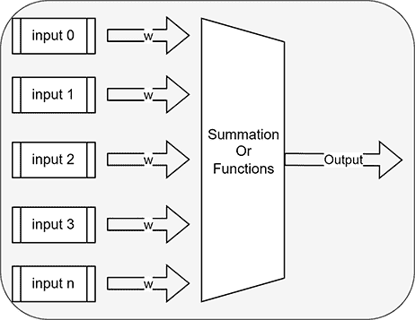

**图 4.2.** 单个感知器。

### 4.1.4 CNN 与 ML 的比较

尽管 `ML` 和 `CNNs` 利用算法在某些规定的误差范围内预测或分类它们的输入数据，但它们在学习过程中表现出根本性的差异。例如，`ML` 和 `CNNs` 的比较可以描述为以下方式：

1. **特征工程**：`ML` 算法需要健壮的人工特征工程过程来理解数据。特征工程包括从可用数据中过滤和提取信息。人工特征工程的过程可能会给开发者或数据科学家带来错误情况和繁琐的工作。

2. **数据缩减**：为了减少手动表示数据（如标记数据）的负担，`ML` 学习方法避免包含所有可用数据。结果是模型的准确性面临真实场景的挑战。相比之下，`CNN` 方法随输入数据良好地扩展，甚至可以扩展到多维大数据解决方案。

3. **小数据与大数据**：`ML` 算法可用的学习过程选择非常适合小数据。这是因为输入数据的清洗往往需要很长时间，尽管从此类数据中形成的感知在本质上更直直观。

### 4.1.5 CNN 的优势

`CNNs` 已经成为广泛使用的深度学习模型，用于多个领域（包括金融市场）的图像分类。事实上，深度学习的流行是由 `CNNs` 的有效性驱动的——注意，人工神经网络在几十年前就已经出现了。近年来出现了成千上万基于卷积网络的研究工作 [3]。`TensorFlow`、`R` 和 `Python` 等平台影响了近年来新型 `CNN` 应用的激增。`CNNs` 具有优势的主要原因是多方面的：

1. **多样化的应用**：许多与图像分析相关的应用，例如分类水果、蔬菜、脸部、名牌、车辆、3D 图像等，都可以使用 `CNN` 模型轻松构建。

2. **自动化特征工程**：无论其他几种现有的 `ML` 算法如何，`CNN` 都促进了自动化特征工程 [10]。自动化无疑可以从更大的易携性中获益。

3. **数学直觉**：`CNNs` 从根本上应用数学来准确表示层次数据。这提高了学习过程的准确性。

4. **生物学影响**：`CNNs` 涉及生物特征，如多层感知器和连接因子，这激励了计算机科学家之外的跨学科研究人员和开发者。

5. **平台可用性**：`CNNs` 的使用受到具有足够文档支持的平台推动，例如 `Neural Designer`、`H2O.ai`、`MXNet`、`Theano`、`Keras`、`ConvNetjs`、`Microsoft Cognitive toolkit` 和 `DeepLearning4J`。这些计算平台已在 `C++`、`Python` 等多种语言中实现。

6. **图像分割**：`CNNs` 的进展可以通过使用 `U-Net` 架构应用于图像分割。`U-Net` 架构包括更多层的卷积来从图像中分割对象。这些分割图像在跟踪时会从输入图像中快速识别。例如，分割病变是使用 `U-Nets` 的显著示例。同样，许多生物医学应用也是基于 `CNN` 的 `U-Net` 架构或类似的分割架构的候选 [6]。

### 4.2 CNN——核心组件

#### 4.2.1 目标识别——计算机视角

人类眼睛可以轻松且快速识别图像或风景中的物体。然而，计算机以完全不同的方式解释图像。通常，相机捕捉图像并将其分为三种不同的颜色。

#### 4.2.2 神经元与 CNN 连接

神经网络的信息捕捉依赖于具有特定权重的像素区域区域神经元或感知器。如果所有神经元都相互连接（如全连接神经网络所示），所需的计算量是巨大的。


相比之下，CNN 将连接的神经元数量减少到特定区域，如图 4.3 所示。CNN 捕捉视觉信息的方法遵循与大脑视觉皮层相同的原理——即只有一小部分视觉信息会被发送到大脑的特定视觉皮层区域。文献中描述过，我们的神经元会将关于水平边缘、垂直边缘和对角线边缘的敏感信息发送到大脑视觉皮层中适当的感受野。

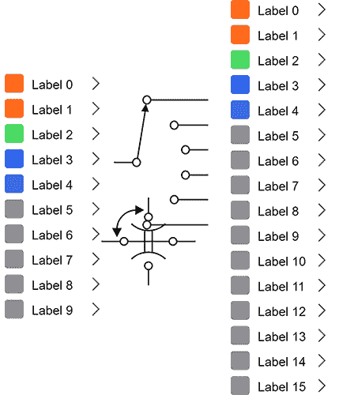

**图 4.3.** CNN 中的神经元。

在图像处理中避免全连接神经元有几个优点：

1. 神经元最少——由于在计算隐藏层时包含了最少的神经元，CNN 的计算复杂度大幅降低，而其估计质量的变化很小。对于图像处理应用而言，具有大量的输入像素至关重要——即通道的行和列应大量存在。
2. 学习参数增加——将输入层分为组使得训练模型能够增加每个后续隐藏层的参数数量。通过这样做，可以执行特定的操作，使得每组的像素都能接收来自其他组的输入——即知识通过最少的连接神经元进行广泛传递。

## 4.2.3 CNN 的构建块

CNN 中用于实现区域特定神经连接的构建块有：(i) 卷积层 (`CLs`)、(ii) 激活层 (`ALs`)、(iii) 池化层 (`PLs`) 和 (iv) 全连接层 (`FCLs`)。接下来的章节将讨论这些层的关键活动 [7]。

### 卷积层

转换为矩阵的输入图像作为 `CLs` 的输入。这些层的主要目标是使用适当过滤器识别图像中感兴趣的特征。为了这一点，`CLs` 执行两个步骤：(i) 映射和 (ii) 平均化。

1. 映射——如果需要从由 `x` × `y` 矩阵组成的图像中过滤出数字 0 到 9，则矩阵单元格的值与图像的输入矩阵相乘；
2. 平均化——随后将获得的值与输入的单元格/像素数量取平均值。卷积层的输出可以是正值或负值。

### 激活层

`CLs` 的输出矩阵是 `ALs` 的输入。在这里，使用激活函数 (`AFs`) 将矩阵转换为其他矩阵，同时增加高阶多项式的学习推理能力——即从一种输入数据形式到另一种输入数据形式的转换。通常情况下，这种转换发生在线性函数和非线性函数之间。

在 CNN 中避免使用 `ALs` 可能导致学习模型性能差，因为此类学习系统无法处理输入数据的复杂特征（这些特征存在于多个真实的训练示例中）。

`ALs` 的 `AFs` 在神经网络领域也称为传递函数。这些函数负责变换来自输入层汇集节点区域的加权求和输入。

从根本上说， `AFs` 分为线性和非线性函数。线性函数使用线性方程/模型转换输入数据，而非线性函数使用非线性方程/模型转换输入数据。线性函数可以保持简单，同时对使用复杂输入矩阵进行的模式学习质量提出挑战。

为了解决不同的问题，过去根据输入数据实现了多种类型的 `AF`（见图 4.4）：

* Sigmoid 函数——sigmoid 函数是一种非线性 `AF` 类别，其曲线呈“S”型。它也被称为逻辑激活函数。正如其名称所示，这种激活函数适用于需要预测输入概率的问题——即 sigmoid 函数预测从零到一之间的值。
* Tanh 函数——tanh 激活函数是一种非线性 `AF` 类别，其函数的逻辑曲线范围从负无穷到正无穷。通常情况下，由于这种原因，tanh 函数优于 sigmoid 函数。
* Softmax 函数——softmax 函数是基于物理和统计领域、用于分类概率的激活函数。它使得向量和为一。它也被称为多分类回归，适用于互斥的类别问题。
* Softsign 函数——softsign 函数是 softmax 函数的一种变体，处理多项式。它将输入转换到 -1 到 1 的范围。它与 tanh 函数的相似之处在于以零为中心。然而，在收敛性上它与 tanh 函数不同——tanh 函数呈指数收敛，而 softsign 函数以多项式形式收敛。
* 修正线性单元 (ReLU)——ReLU 函数是图像分类和预测问题应用最广泛的激活函数。被认为比 sigmoid 或 tanh 等常用激活函数的性能更好。ReLU 使用梯度下降方法将输入转换为近优线性函数。它对负值输出零。
* 指数线性单元 (ELU) 函数——ELU 函数旨在提高 CNN 等神经网络的计算速度。`ELUs` 通过提供直到无穷大的平滑过渡消除了激活函数的梯度问题。

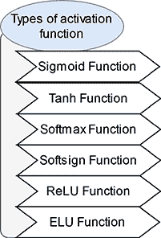

**图 4.4.** 激活函数的类型。

## 4.2.4 池化层

`PLs` 的输入来自激活层的输出。`PLs` 的主要目标是减少矩阵尺寸。因此，CNN 的下一层可以更快地分类图像。这种减少机制被称为 CNN 特征图的下采样。下采样通过描述的两种方法将卷积图像窗口化为较小的矩阵尺寸来实现。

### 最大池化

窗口矩阵（也称为步长）在最大池化过程完成后共同表示在一个单元格中。例如，8 × 8 矩阵当窗口化为 2 × 2 矩阵时，可以产生两个 4 × 4 矩阵。每个单元可以包含矩阵中的最大单元格值。

### 平均池化

相比之下，平均池化方法缩小卷积矩阵。在这里，窗口取平均值以形成结果矩阵。

## 4.2.5 全连接层


CNN 的最后部分是其全连接层（FCL）。FCL 是传统神经网络的基础。传统神经网络的输入节点相互连接，并在其中形成权重并计算值。`PL` 的输出通常表示为 2D 矩阵。在应用全连接层之前，必须将此矩阵转换为 1D 数组或向量。为了将多维矩阵转换为 1D 矩阵，FCL 采用了展平（flattening）方法。展平方法读取 2D 或 3D 矩阵的单元格值，并按顺序输入到特定的数组中。

FCL 还负责与图像预定义单元格值最终数组的结果进行比较。根据 FCL 输出的相关单元格值的累加值，输入值被分类为特定的字符、数字或元素。

## 4.3 社会公益型应用——CNN 视角

我们可以将 CNN 应用于各种社会改进应用。社会问题通常由少数个人或某个群体/社区的错误活动引起。这些问题由于对特定主体的逐渐影响，在有意或无意的情况下发生。社会问题需要审慎地处理，因为可能会发生多种不同的冲突。例如，空气污染等社会问题可能由工业者引起。显然，空气污染会导致健康担忧或气候变化问题 [5]。

迫切需要解决社会问题或问题，以为市场增益。本节关注 CNN 在处理社会问题方面的应用。所讨论的社会问题基于可持续发展目标（SDG） [1]。

以下是被认为是 CNN 可能用途的 SDG 目标列表：

1. **气候变化**——SDG 目标 13（目前）涉及对减少气候变化的兴趣。例如，众周知气候变化正在剧剧剧。这导致了海平面上升和其他有害影响。基于深度学习的解决方案可以通过主动控制预测的危险来减少这些影响。
2. **良好健康**——SDG 目标 3 关注改善人类健康状况。它通过通过应用新的方法或技术，促进协作努力以解决健康问题。例如，基于深度学习的物联网 智能解决方案可以作为针对这一 SDG 目标的解决方案。
3. **清洁能源**——SDG 目标 7 旨在改善能源转换或利用可再生能源。事实上，几种能源会向环境排放污染的空气或水。这些能源数量增加了几个数量级，并严重损害了可持续生活。涉及深度学习机制的技术可以帮助减少相关的故障。
4. **废物管理**——SDG 目标 6 尝试管理废物处置程序。主要目标是使用新技术改进水资源分配和卫生过程。然而，处理废物（包括水）的方法引起了致力于构建解决方案的深度学习架构的兴趣。

## 4.4 CNN 用例——气候变化问题

使用 CNN 方法处理与气候变化相关的问题会导致高度针对性的解决方案。众所周知的是，大多数不利的气候变化是由人类而非自然本身引起的，特别是由于工业革命的增加——即煤炭、气体等化石燃料的使用增加了天然温室气体，如 `CO[2]` 和甲烷。结果是地球温度将剧剧上升。预计到 20 世纪 50 年，温度将至少上升 0.2 摄氏度。

气候变化是一个复杂的现象，涉及影响温度的多个因素。它取决于大气、土地、积雪状况、水位、空气污染水平、阳光水平、太阳系等。所有这些因素必须以自然的方式受到影响，以控制地球温度的上升。

### 4.4.1 气候变化的原因

气候变化的一些显著原因如下：

1. **能源工业的增加**——几种能源（主要是化石燃料）导致了气候变化的增加。化石燃料剧剧增加了全球温度，阻止了动物或生物实现其正常生长。化石燃料除了自然来源的正常排放外，还会释放 `CO[2]`。过量的 `CO[2]` 排放增加了地球表面的热量。因此，我们的日常生活中发生了冰川融化、海平面上升等多个问题。
2. **森林砍伐**——砍树和整体移除森林会产生更多的 `CO[2]`，因为碳被释放到大气中。树木的大量损失可能会剧剧增加一个地区的碳排放，导致臭氧层出现空洞。
3. **交通废物**——气候变化的另一个重要原因包括运输系统的气体排放。事实上，很大一部分贡献源于航空运输——即飞机在高空飞行，排放对环境有害的气体。此外，未受空气过滤器保护的公共道路交通车辆的废物也被认为是气候变化的来源。
4. **牲畜养殖**——此外，最近建造了数万个牲畜场，为人类人口提供足够的肉类。通常，动物通过其排泄物释放甲烷和一氧化二氮。一个地区大量的动物养殖容易向环境排放数吨 `CO[2]`。随后，全球变暖加剧。

除了各种人类贡献外，自然通过自然灾害恶化气候状况。例如，火山爆发和森林火灾会导致全球变暖。此外，海啸、进入大气的太阳耀斑、太阳辐射增加以及一些其他自然源会导致全球温度在长时间内快速上升。

### 4.4.2 减少气候变化的方法

已经通过多种方法减少全球变暖形势：组织意识会议、生产解决方案、各国采取链增长政策等。近年来，AI 辅助解决方案已成为快速检测或预测地区气候变化状况的新方法。通过这种方式，可以对违规者提供各种预防措施或惩罚。下一节将讨论如何利用 CNN 解决解决与气候条件相关的问题——即预测火灾的发生 [9]。

### 4.4.3 火灾预测

森林火灾预测作为一种社会公益应用，可以通过多种学习算法实现。这些学习算法在下面进行了解释和比较：

1. **CNN**——CNN 的基础及其分层/学习概念在本章之前的部分已进行解释。
2. **单感知机神经网络**——单感知机神经网络由一个从数据集学习的神经元组成。
3. **额外树分类器**——额外树分类器是一种基于集集的预测算法，使用树学习分类。决策树在训练阶段构建；评估在程序的测试阶段进行。


## 4. K 近邻分类器——K 近邻分类器是一种非参数监督学习算法，它需要训练数据集来根据输入参数构建最近邻。与线性回归方法相比，该算法更适用于研究非线性边界（如果有）。

## 5. 支持向量分类器——支持向量分类器属于监督学习类别，通过超平面对数据点进行区分。超平面的放置使得两个不同数据点集之间的重叠尽可能少。

## 6. 逻辑回归——一种学习机制，通过估计参数以获得最小误差。当结果为类别（分类）时，通常会使用该算法。

### 4.4.4 基于 TensorFlow 的 CNN 代码片段

如果将 CNN 模型应用于学习过程，将执行若干步骤，如图图 4.5

**图 4.5.** 预测森林火灾的利用步骤。

预测任何区域森林火灾的这些步骤是使用 TensorFlow 机器学习库完成的。

#### 第 1 步：导入库：

在基于 TensorFlow 的实现中，加载所需的库是非常重要的，如下：

```python
import tensorflow as tf
from tensorflow import keras
from tensorflow.keras import layers
from keras.models import Sequential
from keras.layers import Dense
```

在这里，在实现阶段导入了 `TensorFlow` 和 `Keras` 包，因为这些包支持数据集的建模和测试阶段。CNN 模型可以使用适当数量的隐藏层以顺序模式实现。因此，程序需要调用 `Sequential` 和 `Dense` 等相关包。

#### 第 2 步：加载数据集

为了预测森林中的火灾情景，考虑一个说明某些森林火灾蔓延的最小数据集。数据可以是 CSV 格式、JSON 格式或任何其他已知格式提供。数据需要以由特定行和列组成的数据帧（data frame）的形式加载，其中行代表此类发生的若干实例，列代表影响学习过程的变量。

```python
df = pd.read_csv('/path/to/csv/forestfires.csv')
```

#### 第 3 步：处理数据

由于学习算法的若干先决条件，数据无法直接应用于 CNN 模型。因此，必须对其进行预处理。针对这一社会问题的 CNN 算法的显著预处理阶段包括 (a) 删除 NULL 数据，(b) 将数据类型转换为数值格式以及 (c) 归一化数据。通常，需要删除 NULL 数据以提高学习算法的性能；将数据转换为数值格式更容易算法进行数学计算。因此，在大多数情况下需要对数据集进行格式化；归一化算法使用的数据可以提高学习推理的准确性，对于 CNN 尤其如此。

通常利用 `pandas` 库根据 CNN 等学习算法的要求对数据进行处理或微调。

此步骤所需的包列如下：

```python
from tensorflow.keras.layers.experimental.preprocessing import Normalization
import pandas as pd
```

#### 第 4 步：划分数据用于训练与测试

一旦数据为学习算法准备就，就可以将数据划分为训练数据集和测试数据集。数据集的选择使得输入数据集中 40% 的数据被分配给测试数据集，其余数据分配给训练数据集。用于将数据集划分为训练和测试数据集的代码片段如下：

```python
testing = df.sample(frac=0.4, random_state=111)
training = df.drop(testing.index)
```

#### 第 5 步：训练 CNN

一旦可用训练数据集，将利用 CNN 算法来训练并完成预测森林火灾（如果有）的模型。为此，在训练 CNN 模型时，组织了以下子模块：

1. 首先，有必要选择一个合适的批大小（batch size）。选择恰当的批大小可以在若干迭代后提高学习准确性。如果批大小大于正常训练大小，算法需要一些时间来完成。然而，预测准确性会非常差。相反，如果将批大小减小到最佳水平，可以在随后的每次迭代中提高准确性。用于对训练数据集采样以获取 32 批大小的代码片段如下：

```python
training_batch = training.batch(32)
```

2. 现在需要定义学习模型。对于火灾预测问题，根据批大小（32）定义全连接层（dense layers），包括所有相关变量；在接收最终模型输出之前，然后添加层的激活函数和丢弃（dropout）组件。该预测问题阶段的代码片段如下：

```python
model = Sequential([
    layers.Dense(32, activation='relu', input_shape=(n,)),
    layers.Dropout(0.5),
    layers.Dense(1, activation='sigmoid')
])
```

3. 然后使用所需的编译参数来编译模型，如下所示：

```python
model.compile(optimizer='adam', loss='binary_crossentropy', metrics=['accuracy'])
```

4. 最后，使用 GPU、CPU 或其他计算设备执行模型训练如下：

```python
history = model.fit(training, epochs=1000, batch_size=32, steps_per_epoch=10)
```

训练轮数（epochs）决定了预测森林火灾的准确性提升。

#### 第 6 步：显示结果

一旦训练和验证阶段完成，有必要观察模型所实现的预测准确性。因此，这一步在各种学习技术中都是必须的。显示的结果可以在屏幕上显示原始数据，或通过图表以视觉形式查看。显示火灾问题学习算法预测准确性的示例代码如下：

```python
import matplotlib.pyplot as plt
plt.plot(history.history["loss"])
plt.plot(history.history["val_loss"])
plt.title("Model loss value")
plt.ylabel("Loss Values")
plt.xlabel("Number of Epochs")
plt.show()
```

结果通常使用 `matplotlib` 包进行绘图。学习模型的函数的图形化表示可以绘图并显示在屏幕上。


通常情况下，如果需要极端树分类器（extra-tree classifier）算法，`TensorFlow` 并不是一个非常流行的解决方案。可以使用过去提供的 Python 包来实现。例如，可以利用基于 Python 的 `scikit-learn` 工具来开发这种学习算法。下面的代码段展示了如何使用 `Scikit-learn` Python 设计模型并执行相关包。

```python
from sklearn.ensemble import ExtraTreesClassifier  

model = ExtraTreesClassifier()  

model.fit(ETC-Features,ETC-Labels)
```

#### 4.4.7 基于 Scikit-learn 的 K-邻域分类器

我们可以使用 `Scikit-learn` 轻松地应用 K-邻域分类算法。采用与极端树分类器类似的方法，只需两行代码即可实现森林火灾预测。实现方式如下。换句话说，这种方法使用了 `neighbors` 中的 `KNeighborsClassifier`。以下代码说明了：

```python
from sklearn.neighbors import KNeighborsClassifier

model = KNeighborsClassifier()

model.fit(KN-Features,KN-Labels)
```

### 4.4.8 支持向量机

可以使用 `Scikit-learn` 实现支持机（`SVM`）。然而，为了预测森林火灾，我们使用 `svm` 中的 `SVC`。下面的代码段演示了 `SVC()` 的用法：

```python
from sklearn.svm import SVC

model = SVC()

model.fit(SVM-Features,SVM-Labels)
```

### 4.4.9 基于 Scikit-learn 的逻辑回归

逻辑回归使用 `Scikit-learn` 实现。`linear_model` 中的 `LogisticRegression` 有助于解决数据集中的过拟合问题。代码如下：

```python
from sklearn.linear_model import LogisticRegression

model = LogisticRegression()

model.fit(LR-Features,LR-Labels)
```

### 4.4.10 洪水预测

洪水被认为是一个训练数据无法很好拟合开发模型的问题。为了处理这些情况，我们使用随机梯度下降（`SGD`）。该方法用于预测森林火灾：

1. **随机梯度下降 (`SGD`)**：`SGD` 是线性回归的一种变体，旨在解决训练模型的过拟合问题。它使用了 `linear_model` 中的 `SGD`。

```python
from sklearn.linear_model import SGD

model = SGD()

model.fit(SGD-Features,SGD-Labels)
```

2. **线性回归**：线性回归是一种专注于将线性回归应用于高维数据的统计方法。它使用了 `linear_model` 中的 `LinearRegression`。

```python
from sklearn.linear_model import LinearRegression

model = LinearRegression()

model.fit(LR-Features,LR-Labels)
```

3. **贝叶斯回归**：该方法应用贝叶斯定理来寻找后验分布。它使用了 `linear_model` 中的 `BayesianRegression`。

```python
from sklearn.linear_model import BayesianRegression

model = BayesianRegression()

model.fit(BR-Features,BR-Labels)
```

4. **岭回归 (`RR`)**：`RR` 是线性回归的一种变体，可以减少在验证集中观察到的过拟合问题。它使用了 `linear_model` 中的 `Ridge`。

```python
from sklearn.linear_model import Ridge

model = Ridge()

model.fit(RR-Features,RR-Labels)
```

5. **最小绝对收缩和选择算子 (`lasso`) 回归**：`Lasso` 回归是线性回归的一种变体，使用了变量选择机制。它使用了 `linear_model` 中的 `Lasso`。

```python
from sklearn.linear_model import Lasso

model = Lasso()

model.fit(Lasso-Features,Lasso-Labels)
```

6. **弹性网回归**：`ER` 是 `lasso` 回归的一种扩展学习算法，结合了 `RR` 和 `lasso`。它使用了 `linear_model` 中的 `ElasticNet`。

```python
from sklearn.linear_model import ElasticNet

model = ElasticNet()

model.fit(EN-Features,EN-Labels)
```


# 9. 随机森林 (RF) 回归
随机森林回归算法是一种基于集成学习（bagging）的技术，它在训练阶段创建模型。它构建多个决策 `RF` 树；在构建训练模型的同时，将数据装袋到相应的树中。`RF` 被认为可以减少训练阶段的过拟合问题。它从训练集中选取若干样本并开始创建 `RF` 树，以便对 `RF` 树的结果取平均。这种非常有力的算法，即使在从训练集中创建训练模型时丢失序列数据，也能保持其预测准确性。

# 10. 多层感知器 (MLP)
`MLP` 从数据学习特征的方法是应用前馈神经网络方法。它基于学习数据特征的神经元。这种特定的算法使用全连接神经元，保留更多的数据相关性，本质上是计算密集型的。

### 4.4.11 基于 Scikit-learn 的随机梯度下降
对于洪水预测或森林火灾预测问题，可以使用 `SGD` 分类器来建议是否可能发生火灾或即将发生洪水。预测火灾问题的大部分步骤保持相同——即导入库、加载数据集、处理数据、划分训练数据与测试数据以及显示预测结果。然而，实现部分的建模组件有所不同，基于 `Scikit-learn` 包实现所示：

```python
from sklearn.linear_model import SGDClassifier

model = SGDClassifier(loss="hinge", penalty="xx", max_iter=10)
```

如所述，`SGD` 可以在迭代中结合惩罚组件，以为数据集学习模型。

### 4.4.12 基于 Scikit-learn 的线性回归
基于 Python 的 `Scikit-learn` 包提供了线性回归模型的实现，可以在学习过程的需要阶段后使用。它基于 `sklearn` 软件包中的 `linear_model` 包。用于预测算法的方法通常非常简单。用于建模线性回归算法的代码片段如下：

```python
from sklearn import linear_model

model = linear_model.LinearRegression()
```

### 4.4.13 基于 Scikit-learn 的贝叶斯回归
如前所述，贝叶斯回归是线性回归的一种变体，它将贝叶斯定理应用于数据以计算数据的似然性。对于社会公益问题，可以使用 `Scikit-learn` 包实现这些算法，如下代码所示：

```python
from sklearn import linear_model

model = linear_model.BayesianRidge()
```

值得注意的是，贝叶斯实现是 `sklearn` `linear_model` 包的一部分。

### 4.4.14 基于 Scikit-learn 的岭回归
`RR` 是线性回归的一种变体，可以使用 `Scikit-learn` 包进行。该包提供了一个名为 `alpha` 的参数用于控制线性回归模型的正则化强度。如果参数 `alpha` 变为零，模型的实现将变为普通的线性回归实现。用于社会公益应用的 `RR` 实现代码片段如下：

```python
from sklearn import linear_model

model = linear_model.Ridge(alpha=0.1)
```

## 4.4.15 基于 Scikit-learn 的 lasso 回归
lasso 回归大多数学习算法实现可以使用 R、Python、C/C++ 等不同的编程语言开发。下面的代码片段示例了使用 `Scikit-learn` 包对模型的实现。参数 `alpha` 负责控制模型的正则化强度，这与 `RR` 的方法类似。如果 `alpha` 参数设置为零，该实现可以从 lasso 模型转变为普通线性回归模型。

```python
from sklearn import linear_model
model = linear_model.Lasso(alpha=0.1)
```

### 4.4.16 基于 Scikit-learn 的弹性网络回归
使用与之前讨论的基于 lasso 回归和岭回归相似的方法，可以使用 `Scikit-learn` 包实现弹性网络回归。事实上，该包提供了一种处理这些不同学习算法的简单方法。例如，建模步骤的实现仅在学习过程所遵循的方法上。名为 `alpha` 的关键参数保持不变，其目的也相同。弹性网络回归模型的代码片段所示：

```python
from sklearn import linear_model

model = linear_model.ElasticNet(alpha=0.1)
```

## 4.4.17 基于 Scikit-learn 的 LARS lasso 回归
LARS lasso 回归技术使用 `Scikit-learn` 包实现，其中 `alpha` 参数在使用时不带归一化因子。该算法从 `Scikit-learn` 包导入相同的 `linear_model` 包。用于社会公益应用建模步骤的代码片段所示：

```python
from sklearn import linear_model

model = linear_model.LassoLars(alpha=0.1, normalize=False)
```

## 4.4.18 基于 Scikit-learn 的在线单类 SVM 回归
使用 `Scikit-learn` 包实现的在线单类 SVM 回归基于 `linear_model` 包。虽然名称 one-class SVM 暗示有必要包含该库中 `SVM` 包的实现，但事实并非如此。事实上，在线单类 SVM 回归利用了包中普通线性回归实现的方法。例如，建模步骤的实现所示：

```python
from sklearn import linear_model

model = linear_model.SGDOneClassSVM()
```

### 4.4.19 基于 Scikit-learn 的随机森林回归
`RF` 回归作为集成学习方法的代表，在 `Scikit-learn` 包中作为一个独立的包实现。学习算法的建模步骤从 `RandomForestClassifier` 导入，所示：

```python
from sklearn.ensemble import RandomForestClassifier

model = RandomForestClassifier(n_estimators=n)
```

算法的参数 `n_estimators` 定义了用于学习数据集方差的决策树数量。

### 4.4.20 基于 Scikit-learn 的多层感知器
`MLP` 如前所述，是一种基于神经元的实现。`Scikit-learn` 包支持此类基于神经元的实现，可用于预测训练/测试数据的特征。由于 `MLP` 是 `neural_network` 包的扩展，需要导入适当的包对数据集进行建模，所示：

```python
from sklearn.neural_network import MLPClassifier

model = MLPClassifier()
```

## 4.5 CNN 挑战
CNN 广泛应用于各种领域，特别是图像处理应用。然而，该算法面临一些显著挑战，这些挑战适用于所有通用应用。挑战列表所示，应对措施将在后续章节中讨论：

*   数据不足
*   加速比低
*   隐藏层
*   坐标缺失
*   不准确的数据集
*   黑盒方法
*   位置挑战
*   过拟合/欠拟合问题

### 4.5.1 数据不足


CNN 需要海量的数据来有效地预训练模型。如果数据量较小，CNN 的收敛速度可能比预期的更快，但它们无法通过真实世界的示例或数据集产生相当准确的结果。所需数据量的评估通常可以使用算法的准确率指标进行衡量。例如，对于 CNN 而言，增加训练数据直到使得测试数据的准确率指标略低于训练数据的准确率，是一种可以接受的方法。

通常情况下，CNN 至少需要数千个数据点进行基本执行，并需要数百万个标记数据点以获得更好的学习准确率。如果使用的数据量低于常理，测试数据集的准确率收敛速度可能会比算法的训练阶段快得多。

### 4.5.2 低速度

大多数现有的 CNN 实现即使结合了更好的计算资源，其速度提升效果也表现不佳。这是因为大多数 CNN 都有许多代表神经元的处理需求。CNN 分层过程中涉及最大池化（max-pooling）过程的计算可能会持续小时到几个月。该算法的计算开销极大，导致功率受限的 IoT 设备和低配 GPU 设备无法完成其执行。

### 4.5.3 隐藏层

隐藏层位于 CNN 的输入层和输出层之间，大量的计算和通信。此外，这些层具有决定学习率的权重。除了现有问题外，算法的批大小（batch size）与其他传统的机器学习算法相比，还会产生导致减慢用户速度的影响。

### 4.5.4 缺失坐标

对于基于图像的应用，CNN 将图像视为像素簇。像人类眼睛一样，CNN 并没有坐标系。这限制了算法在检测目标时搜索正确坐标的能力。当这些坐标被 CNN 的隐藏层进行表述时，它们往往会朝向其他方向。

### 4.5.5 不准确的数据集

数据在构建稳健学习模型方面起着主要作用。当数据不准确时，CNN 难以实现独立变量的准确表示 [8]。用于训练 CNN 的样本数据应该代表问题的真实世界场景。

此外，CNN 从给定数据集中采样数据，并通过隐藏层应用激活函数和权重。如果采样过程导致了偏偏的学习模式，生成的模型无法为训练/验证数据集提供更准确的结果。

也存在训练数据质量差的情况——即数据对于问题领域来说是不可接受的。这使得 CNN 难以产生更准确的预测，因为学习过程是一个具有挑战性的过程。

某些数据集具有不适当的特征，可能难以进行聚类或分组。在这种情况下，需要大量的隐藏层，这增加了算法执行的计算量。

### 4.5.6 黑盒方法

CNN 的主要挑战是获取预期输出的隐藏逻辑。这意味着尽管算法产生了更好的预测准确率，但网络在执行结束时无法产生可解释的结果。事实上，对于研究人员或从业人员来说，对算法进行拆解并学习其内部逻辑以重相同的行为是一项具有挑战性的任务。

近年来，人们一直在努力克服 CNN 黑盒方法的概念。然而，少数研究人员和从业人员仍然倾向于黑盒方法，因为即使用户不知道结果是如何生成的，在大多数情况下结果仍然是非常准确的。

### 4.5.7 过拟合/欠拟合问题

[1] United Nations 2022 *The Sustainable Development Goals Report 2022* (Geneva: United Nations)

[2] Alzubaidi L, Zhang J, Humaidi A J, Al-Dujaili A Q, Duan Y, Al-Shamma O, Santamaría J, Fadhel M A, Al-Amidie M and Farhan L 2021 Review of deep learning: concepts, CNN architectures, challenges, applications, future directions *J. Big Data* [8 53](http://dx.doi.org/10.1186/s40537-021-00444-8)

[3] Aslam N, Ramay W Y, Xia K and Sarwar N 2020 Convolutional neural network based classification *IEEE Access* [8 3056](http://dx.doi.org/10.1109/ACCESS.2020)

[4] Fong R 2020 Understanding convolutional networks *PhD Thesis* University of Oxford

[5] Gerges F,fadel M, Bou-Zeid E, Nassif H and Wang J 2022 A novel deep learning approach to the statistical downscaling of temperatures *ICMLSC 2022: The 6th International Conference on Machine Learning and Soft Computing* (New York: ACM) pp. [1–7](http://dx.doi.org/10.1145/352310.352351)

[6] Jiang Y, Liu W, Wu C and Yao H 2021 Multi-scale and multi-branch convolutional neural network for retinal image segmentation *Symmetry* [13 365](http://dx.doi.org/10.3390/sym1303365)

[7] Shen H, Chen S and Wang R 2021 A study on the uncertainty of convolutional layers in deep neural networks *Int. J. Mach. Learn. Cybern.* [12 1853–65](http://dx.doi.org/10.1007/s13042-021-0127-9)

[8] Son H, Jang Y, Kim S-E, Kim D and Park J-W 2021 Deep learning-based anomaly detection to classify inaccurate data and damaged condition of a-stayed bridge *IEEE Access* [9 124549–59](http://dx.doi.org/10.1109/ACCESS.2021.310049)

[9] Wang S, Zhao J, Ta N, Zhao X, Xiao M-X and Wei H-C 2021 A real-time deep learning forest fire monitoring algorithm based on an improved pruned + KD model *J. Real Time Image Process.* [18 2319–29](http://dx.doi.org/10.1007/s11554-021-01124-9)

[10] Xiao G, Li J, Chen Y and Li K 2020 MalFCS: an effective malware classification framework with automated feature extraction based on deep convolutional neural networks *J. Parallel Distrib. Comput.* [141 49–58](http://dx.doi.org/10.1016/j.jpdc.2020.03.012)

[11] Xiao M, Wu Y, Zuo G, Fan S, Yu H, Shaikh Z A and Wen Z 2021 Addressing overfitting problem in deep learning-based solutions for next generation data-driven networks *Wirel. Commun. Mob. Comput.* [2021 8493795](http://dx.doi.org/10.1155/2021/8493795)

CNN 很容易出现与过拟合和欠拟合相关的问题。过拟合 [11] 是一种模型快速拟合训练数据的场景——即模型学习了几乎所有提供给它的训练数据集中的数据。在学习模型中出现过拟合问题的主要缺点是导致测试数据集的预测准确率差。用于解决 CNN 过拟合的一些已知方法是：

1.  增加输入到模型的训练数据量。
2.  避免训练数据集中可能存在的噪声。

与过拟合问题相反，欠拟合问题与无法使用训练数据训练模型有关。出现欠拟合问题的主要原因有：

1.  模型复杂性不足，无法处理大量的超参数；
2.  训练数据过多，导致模型无法从中学习；
3.  建模过程中涉及的计算太少，导致训练过程的学习模型有限等。


目标检测是一种计算机视觉技术，利用算法来识别图像和/或视频中的物体。通常，需要在给定的自然图像中检测出预定义的物体类别。人眼可以瞬间识别这些图像。然而，在计算机视觉系统中，计算设备必须实现特定的算法，例如`recurrent convolutional neural networks (R-CNNs)`、`You Only Look Once (YOLO)` 等，以模拟自然场景并检测物体。本章解释了不同的目标检测算法，并使用合适的示例说明了这些概念。

## 5.1 计算机视觉——分类

计算机视觉问题使计算机能够从图像中推导出信息，展示人眼如何观察从真实世界中捕捉的图像中的物体。这些任务通常涉及捕捉、处理、分析和理解图像中对象的程序。

计算机视觉问题通常被分为几个子领域，如下文所示：

1. **目标分类**——这是一种对给定图像中的物体进行分类的方法 [14, 15]。目标分类利用多个物体的预定义标签对特定类型的物体进行分类。如果一个图像中两个两个类型的物体，则目标分类不是一个可行的方案。在这种情况下，使用边界框（bounding boxes）或类似技术检测物体更为合适。

2. **目标检测**——目标检测是一种使用特定的目标检测模型检测或跟踪所有可用物体的方法。例如，可以使用目标检测技术检测桌子、椅子、人类、动物等物体。即使图像中有多个相似的物体，该技术也能以特定的百分比准确率检测出它们 [1]。通常，会将矩形形状的边界框添加到输出图像或视频中，以表示检测到的物体。

3. **目标分割**——这是一个训练计算机器通过扫描图像像素来检测物体并将其分割的过程。通过从图像中分割物体，还可以修改检测到的像素，从而为它们添加不同的颜色。此外，在执行目标分割过程后，还可以对物体与其他物体进行操作。例如，文中解释了将基于深度学习的目标分割方法应用于水果生长过程监测的应用 [5]。

4. **目标定位**——这是一种识别给定图像中物体的技术。目标定位与目标检测的区别在于，前者只检测单个物体，而后者在同一图像中检测多个物体。

图 5.1 展示了与计算机视觉相关的问题列表。

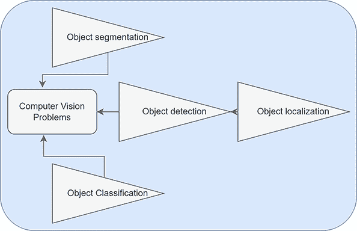

**图 5.1.** 计算机视觉问题的分类。

计算机视觉任务的分类法如图 5.2 所示。可以观察到，目标识别任务分为图像分类和目标定位问题。这些问题可以发展为图像中的物体检测或物体分割。

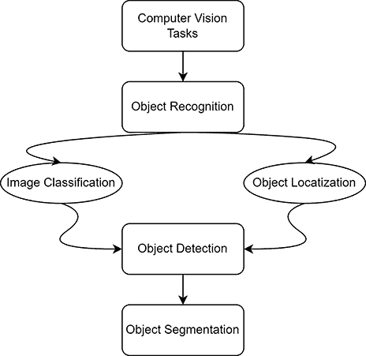

**图 5.2.** 计算机视觉任务的分类法。

在本章中，我们关注涉及目标检测相关任务的技术。

## 5.2 目标检测——目标

通常，目标检测广泛应用于各种研究和工业机构。用于检测图像或视频数据中物体的技术增加了目标检测的效用。

目标检测算法的设计考虑了某些目标。在计算机视觉领域，在图像/视频中执行目标检测最常考虑的目标列在以下章节。

### 5.2.1 定位目标

目标检测算法在从给定图像或视频帧的物体类别列表中检测物体实例方面起着主要作用。众知的现象是，如果给定图像中的物体没有被精确检测，机器无法学习新事物或从图像中进行推理。

开发目标检测算法的主要目标是通过在图像中创建边界框来识别物体。边界框的创建可以通过多种方式进行，如本章后续部分所述。

### 5.2.2 语义表示

由于机器不能自己识别物体，计算机视觉任务旨在机器识别物体时对其提供引导。例如，需要捕捉来自图像或视频的物体，以便它们以文本或语言的形式表示。通过这种方式，数据可以被处理并从文本转换回语义物体表示。

显然，将物体转换为语义文本反之的过程必须经过仔细设计，以实现基于深度学习的目标检测算法的目标。在现代世界中，已经讨论了许多自动化创建标签和规定适当语义过程的方法。

### 5.2.3 稳健的算法

目标检测算法的主要任务之一是从几种算法中选择一种合适的基于深度学习的算法。通常，用于计算机视觉问题的目标检测算法可能会变成针对某些目标检测任务的失效方法。显然，需要根据某些预定义的指标或方法选择稳健的目标检测算法。过去，人们已尽力比较不同的学习算法 [13]。

## 5.3 目标检测——挑战

大多数情况下，如果识别出可能的挑战，就可以对目标检测算法进行修订。本节解释了目标检测算法在解析图像或视频帧中的物体时遇到的几个显著挑战。这些挑战描述如下。

#### 角度方向

从不同角度捕捉的图像会使目标检测算法陷入复杂的境地。它们看起来不同，会引发错误预测或导致检测复杂性。使用传统的边界框方法不能作为针对此类变化的候选解决方案。专注于目标检测的应用开发者必须仔细考虑图像中观察到的物体角度的变化。

#### 糟糕的训练数据集

使用糟糕的数据集训练的算法会给目标检测算法带来挑战。例如，用于考试监考软件的深度学习算法如果使用某些风格的输入测试格式作为训练数据集，将无法检测真实的考试。这是因为目标检测算法训练数据使用的特征可能无法理解测试数据或选择测试图像所处的真实世界情况。

#### 遮挡


遮挡（Occlusion）是指图像未被完全用于目标检测的情况 [7]]。这些图像通常被裁剪或显示移除的边缘。遮挡是多种目标检测算法的常见问题，因为训练和测试过程在有效检测程序上存在差异。在遮挡相关的图像中，物体被部分覆盖，导致无法被目标检测算法识别。这也是人脸检测算法面临的一个主要挑战，正如本书后续章节所讨论的那样。

#### 光照变化
通过特定光强捕获的物体会被目标检测算法捕捉并学习，以产生特定的训练模型。这些训练后的模型并不适用于检测目标，因为训练数据中识别出的特征可能与测试数据或视频帧中的特征不同。显然，目标检测算法无法理解物体，因为这些物体是在不同光照条件的特殊背景下被捕捉的。

#### 众多类别
当用于分类对象的类别数量增加时，目标检测算法会遇到巨大的性能问题。事实上，在监督学习背景下，使用两个或少于十个类别对物体进行区分是非常成功的。然而，增加类别数量会带来巨大的执行时间。此外，某些基于深度学习的目标检测算法实现要求将不同类别放在单独的文件夹中。随后，当这些算法在很大分离的文件夹结构上执行时，可能会引起性能问题——即在这些情况下，目标检测算法不适用于实时应用。

## 5.4 目标检测——主要步骤或过程
图像或视频帧中的目标检测是分阶段进行的。这些阶段对于几种显著的目标检测算法是通用的。

### 5.4.1 步骤 1—需求识别
最初，识别特定问题领域的目标检测算法对于目标检测任务至关重要。目标检测算法的识别基于适用算法，如下：
* 实时检测
* 非实时检测

### 实时目标检测
图像或视频帧中的目标检测可以实时处理。这种方法对于若干需要对物体提供即时报告的应用非常有益。例如，如果一个盲人愿意使用目标检测设备来检测障碍物，这些障碍物必须经过实时处理。

并不是所有的目标检测算法都能实时运行。然而，诸如 `YOLOv3`、`YOLOv4`、`StreamYOLO`、`IncrementalYOLO` 等算法被用于实时检测目标。

### 非实时目标检测
如果目标检测算法不受时间限制，它们被称为非实时目标检测算法。非实时目标检测方法涉及的过程与其他目标检测算法更为相似。然而，差异在于没有包含完成任务的时间限制。该类别的算法试图提高目标检测的准确性，而不是在有限的时间范围内寻找物体的边界框。

### 5.4.2 步骤 2—图像处理
大多数目标检测问题在应用于适当的目标检测算法之前需要经过处理。例如，在智能城市中检测超速车辆假设城市官员只有在应用适当的图像处理方法后才会识别车辆。通常，利用无人机从城市的空中位置拍摄视频或图像来检测超速车辆，特别是当这些车辆的司机实施犯罪或发生事故时。

输入图像需要通过处理视频或捕获的图像来获取。在处理图像检测目标之前最常用的步骤如下：

1. **收集图像**：需要实时或非实时图像的目标检测算法将输入以各种形式收集的适当图像，如下所示：
    * (a) 来自数据集的图像——许多数据集向研究人员开放，以提高深度学习算法的性能。在大多数情况下，这些图像数据集经过了分类或标记。例如，人们可以找到代表花、水果和其他家庭物品的图像数据集并直接将其提供给算法。
    * (b) 来自网站的图像——在某些情况下，可能在数据存储中找不到合适的图像集。例如，在编写此书时，还没有与讽刺相关的图像数据集。在这种情况下，目标检测算法可能必须从托管在多个位置的网络服务器收集相关图像。此类图像的收集是使用网络爬虫技术和其他搜索引擎支持完成。
    * (c) 图像增强——在某些情况下，执行图像增强技术来增加输入训练算法的图像数量是有用的。翻转、光照变化、添加噪声等图像增强方法在文献中已被广泛讨论。如果可用的图像数据集较少，则图像增强方法非常适用。
    * (d) 图像生成——在少数情况下，也可以使用 `GANs` 或高级深度学习算法在没有任何输入图像的情况下生成图像。这些方法提供了近乎准确的学习过程，在某些目标检测情况下可能是一种可行的做法。

通常，从摄像头收集图像是使用启用 `OpenCV` 的包实现的。例如，`OpenCV` 有方法从视频中收集帧。用于从视频中捕帧的代码片段所示：

```python
import cv2

frames = cv2.VideoCapture('video_file')

success,image = frames.read()
```

`cv2` 包的方法，即 `VideoCapture()` 和 `read()`，广泛应用于多个与目标检测相关的应用。

2. **图像归一化**：在大多数情况下，归归一化可以提高目标检测算法的质量。图像归一化试图修改图像数据，使得数据集的平均值变为零，标准差变为一。在使用目标检测算法检测目标之前标准化图像的主要原因如下：
    * (a) 范围固定——通过归一化数据，数据的范围被标准化。通常，此值被固定在零到一之间。通过这种方式，算法能够使用张量或矩阵以更高的精度处理数据。
    * (b) 学习速度——由于相关的硬件单元可以微调以处理从零到一的值，因此训练模型学习图像中物体的速度比处理图像数据中的巨大变化要快。此外，数据分布模式和其他相关参数可以使用归一化数据集轻松地绘制图表。

3. **图像预处理**：可以使用 `TensorFlow` 或 `PyTorch` 实现中的多种可用方法对图像进行预处理。例如，图像可以以多种方式进行预处理：
    * (a) 调整大小：从数据集或网络源获取的输入图像尺寸不同。这些变化可能会改变基于深度学习的目标检测算法结果的准确性。因此，将图像调整为固定值是非常重要的。例如，`TensorFlow` 提供了将任何输入图像大小调整为固定大小的方法，如下：

```python
import tensorflow as tf

tf.image.resize
```


`tf.image.resize_with_pad` #对图像进行填充

`tf.image.resize_with_crop_or_pad` #对图像进行裁剪或填充

* (b) 亮度：通常情况下，亮度是一种数据增强方法。增加图像亮度在某些图像处理应用中非常有用。通常，在 TensorFlow 中增加图像亮度的方法如下：

```python
import tensorflow as tf

tf.image.adjust_brightness(image data)
```

* (c) 对比度、色和饱和度：与增加或降低图像亮度类似，可以在 TensorFlow 等各种深度学习平台上改进图像的对比度、色调或饱和度，如下：

```python
import tensorflow as tf

tf.image.adjust_contrast(image data)  

tf.image.adjust_hue(image data)  

tf.image.adjust_saturation(image data)
```

## 4. 转换为特定数据格式：除了向目标检测算法提供原始输入图像外，还有其他数据格式可以简化深度学习目标检测算法的实现策略。

监督目标检测算法通常需要标签来区分图像。这些算法有时强制使用常用对象上下文（COCO）数据格式、YOLO 数据格式、视觉对象类（VOC）数据格式等。使用对算法友好的数据格式可以提高自定义测试集上目标检测的准确性。

目标检测算法使用不同数据格式的原因是多方面的：

* (a) 以 `CSV`、`JSON` 或类似文件格式表示的图像可能会破坏目标检测算法，特别是当图像尺寸非常大时。

* (b) 以层次形式表示的图像可能会导致性能问题，例如内存开销。

* (c) 对于某些目标检测算法，图像中的对象需要用边界框（bounding boxes）表示。在大多数情况下，使用 `YOLO`、`VOC` 或 `COCO` 等数据格式表示边界框更容易。例如，基于 YOLO 的目标检测算法的应用使用了 YOLO 数据格式，该格式具有 RGB 或灰度图像的数值矩阵表示。

## 5. 图像压缩：在几种目标检测机制中，对改进存储空间或增加图像传输速度有关键需求。因此，压缩图像为目标检测任务提供了显著改进。通常，联合图像专家小组（JPEG）压缩技术被应用于目标检测或深度学习算法中。

此外，当图像由边缘设备处理时，压缩图像起着至关重要的作用。通常，边缘设备是无法执行目标检测等强计算的受限节点，它们尝试将图像提交到云服务。如果这些边缘设备考虑存储，它们应该在提交到连接的服务之前使用 JPEG 格式或其他图像压缩格式对图像进行压缩。

## 6. 存储图像：收集图像并输入深度学习算法进行进一步的目标检测。

### 5.4.3 卷积与目标检测

将矩阵输入到卷积网络，以从输入图像中选择性地学习对象以检测目标。

## 5.5 目标检测方法

在图像或视频中检测对象被认为是大多数计算机视觉应用的关键任务，例如自动驾驶、交通监控等。

使用了一些著名的目标检测模型来识别图像或视频实例中的对象。这些目标检测模型如下：

1. R-CNN
2. Fast R-CNN
3. Faster R-CNN
4. YOLO
5. 单次检测器（Single-shot detector）变体

在接下来的子节中将分析这些目标检测模型的功能、涉及的层、它们的优点和应用。

### 5.5.1 R-CNN

R-CNN 是一种用于计算机视觉的基于区域的卷积神经网络方法。它首次于 2014 年实现。R-CNN 的目的是检测图像或视频帧中的对象，并在创建区域后为这些对象提供边界框。

与普通 CNN 相比，R-CNN 尝试识别同一类别的对象，包括较小的对象 [2]。传统的 CNN 大多用于分类图像中的对象，随后通过全连接层。然而，传统 CNN 在检测对象时面临的问题可以使用图 5.3 所示的示例来说说明。

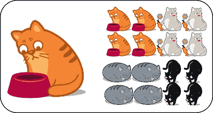

**图 5.3.** 图像中的猫与猫对比。

第一张图像有一只猫。它可以被很容易且逻辑清晰地分类为“猫”。然而，将第二张图像输入给计算机并让它对对象分类意义不大。在这种情况下，检测所有的猫比分类对象更重要。CNN 目标检测问题的另一个问题是利用所有的卷积区域来识别对象。这个过程可能会给计算节点带来计算密集型任务。

R-CNN 通过减少检测过程涉及的计算时间在检测对象方面发挥着至关重要的作用。为此，它执行了以下步骤：

1. 输入图像——将静态照片或视频帧形式的图像输入计算机进行目标检测。
2. 选择性搜索（Selective search）——在给定的图像或视频帧中，R-CNN 选择近 2000 个最佳感兴趣区域。这是通过分割图像部分、应用贪心算法选择主要感兴趣区域并提出包含对象的选择性区域来实现。
3. 图像变形（Warping images）——将图像的选择性区域变形为固定图像尺寸，并作为 CNN 的输入。
4. 分类——CNN 输出 4096 维特征向量，利用 `SVM` 等算法对对象进行分类。

图 5.4 描述了应用 R-CNN 算法涉及的步骤。可以观察到，由于应用了选择性搜索机制并在输入图像中提出了选择性区域，识别变形区域涉及的计算被减少了。

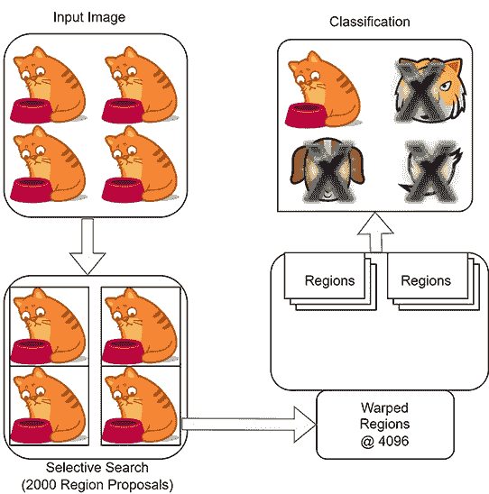

**图 5.4.** R-CNN——目标检测涉及的步骤。

### 5.5.2 Fast R-CNN

Fast R-CNN 是与 R-CNN 相比的计算机视觉改进版本 [6]。它于 2015 年实现——即在 R-CNN 开发后不久。在 Fast R-CNN 中，由 CNN 生成卷积特征图，并结合如边界框（edge boxes）等区域选择算法识别输入图像的潜在区域并建议进行分析。如之前观察，在 R-CNN 中识别了超过 2000 个潜在区域。特征检测器或滤波器通常用于检测图像中存在的特征，如边缘、水平或垂直线、曲线等。

在 Fast R-CNN 方法中，利用卷积特征图表示整个输入图像中的感兴趣区域，而不是将其分割成较小的区域并逐个处理。显然，Fast R-CNN 检测对象的方法所需的计算非常有限。可以观察到，该方法避免了在 R-CNN 中分割图像并计算以识别大约 2000 个区域的操作。

Fast R-CNN 方法检测对象涉及的步骤如下所示：


1. **输入图像**——最初，将待识别可用对象的输入图像馈到执行 `Fast R-CNN` 算法的计算机中。

2. **基于 CNN 的特征图**——输入图像中潜在感兴趣区域的识别是通过 CNNs 完成的——即应用 `CNN` 从整幅图像中提取特征图。在此过程中，不再需要对超过 2000 个区域进行分析（这涉及到对候选区域建议进行裁剪和缩放）。`CNN` 算法在识别出极少数具有具有特征的区域时，会尝试立即识别出正确的建议。

3. **图像扭曲（Warping）**——将识别出的区域变形为固定的图像大小，以便对图像进行进一步分析。图像扭曲的应用是为了有效利用相关硬件单元（包括 `GPUs`）的计算能力。

4. **分类**——最后，以类似于之前的 `R-CNN` 方法的方式，对潜在物体进行分类并标记在边界框中。

图 5.5 展示了图像中目标检测的关键步骤。

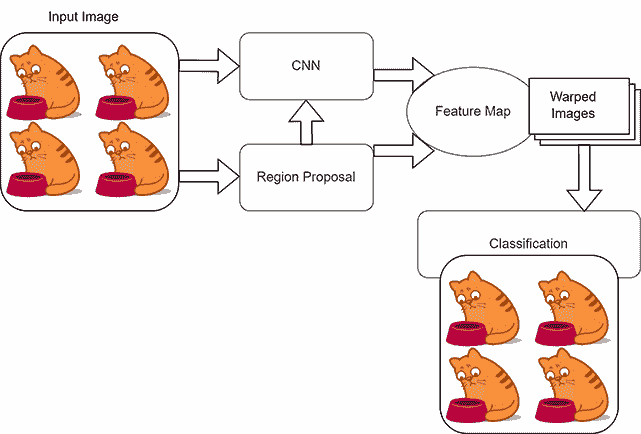

**图 5.5.** Fast R-CNN——目标检测的步骤。

### 5.5.3 Faster R-CNN

`Faster R-CNN` \[12\] 利用区域建议网络（RPN）来识别整幅图像中潜在的感兴趣区域。由于利用区域建议网络来识别区域，这种从图像中提取关键特征的方法比之前的方法更快。

在 faster R-CNN 方法中，利用一个由卷积神经网络组成的特种网络来识别卷积特征图。`faster R-CNN` 算法在两个方面与 `Fast R-CNN` 相似：(i) 它利用整幅图像进行分析；(ii) 它包含了用于图像分析的卷积网络。

faster R-CNN 方法涉及的步骤如下：

1. **输入图像**——将输入图像馈到 `faster R-CNN` 算法。该图像被完整地馈入区域建议网络。

2. **CNN RPN**——区域建议网络由多个功能层组成。这些层负责获取整幅图像并尝试识别与图像相对应的特征图。网络将概率作为评分，以表示输入图像中的物体。

3. **扭曲**——与其他方法类似，faster R-CNN 包含一个扭曲过程，以固定区域的大小，以便可以预测或分类图像中的物体。

4. **分类器**——根据 `CNN` 建议的区域，利用分类器对图像进行分类。`Faster R-CNN` 在某些用例也应用于回归问题。

图 5.6 详细说明了目标检测的步骤。可以看出，整幅图像被提交到一个使用 `CNNs` 设计的网络，该网络建议特征图。通过这样做，faster R-CNN 方法比目前为止讨论的其他算法要快得多。

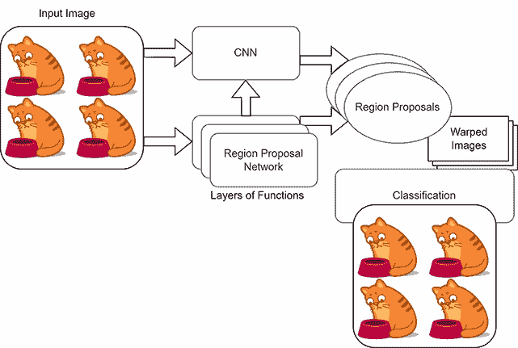

**图 5.6.** Faster R-CNN——目标检测的步骤。

### 5.5.4 You Only Look Once

与之前讨论的基于区域的目标检测算法（如 `R-CNN`、`fast R-CNN` 和 `faster R-CNN`）相比，`YOLO` 算法不使用区域或 `CNNs` 来预测感兴趣区域。相反，`YOLO` 将 `CNNs` 应用于整幅图像以预测可能物体的边界框，并在算法的一次运行中指定物体的概率。

`YOLO` 算法因其在实时用例中的新兴应用而受欢迎——即它确保了检测图像目标时具有更高的速度和准确性。`YOLO` 目标检测方法应用于多个领域，例如交通监控、停车预测、语言辅助 \[17]，等等。

使用 `YOLO` 算法检测目标的步骤讨论如下：

1. **输入图像**——以静态图片或视频帧形式的图像被输入算法进行目标检测。

2. **网格形成**——将图像划分为维度为 `SxS` 的等尺寸网格，以评估物体的边界框和概率评分。如果在图像的每个网格内识别出物体，则使用较高概率评分的边界框进行标记。边界框代表物体的宽度、高度、类别以及边界框的中心点。然而，在现实中，物体并不需要符合图像的等分尺寸。

3. **交集**——物体的每个初始网格在识别合格边界框的过程中，通过迭代进行扩展，使其与附近的其他网格重叠。`YOLO` 应用了交并比（IOU）概念来相交和重叠附近的其他网格。

4. **边界框**——最后，在图像上标记从初始网格投影的边界框。此外，在边界框上对对物体进行分类。

图 5.7 展示了目标检测的两种情况。在第一种情况下，图像包含四个物体；在第二种情况下，图像包含一个物体。虽然图像被划分为等尺寸，但在第一种情况下物体位于网格内。相比之下，在第二种情况下，网格在检测到物体前需要预测边界框。

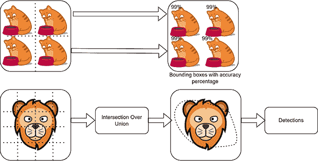

**图 5.7.** YOLO——目标检测的情况。

### 5.5.5 YOLO 变体

`YOLO` 算法的实现始于 2016 年。随后，在 2017 年和 2018 年推出了两个 `YOLO` 版本——`v2` 和 `v3`。后来在 2020 年发布了三个名为 `YOLOv4`、`YOLOv5` 和 `PP-YOLO` 的版本。

`YOLO` 架构不同变体的主要改进如下：

#### YOLOv2

与 `YOLO1` 相比，`YOLOv2` 增加了迭代次数 \[17\]。在 `YOLOv2` 中，引入了锚框（anchor boxes）来表示物体。该版本被研究和学术人员广泛使用。

#### YOLOv3

`YOLOv3` 改进了之前的分类特征。此外，算法的主要目的是展示预测物体的准确性。为了实现这一点，算法引入了在边界框上写入预测准确率的概念。`YOLOv3` 版本被各行业和学术界积极应用 \[11\]。


2020 年，Alexey 为之前的 YOLO 版本贡献了更多功能。该算法旨在改进特征抽象过程和激活过程。该算法在执行目标检测的同时，尝试提高数据集的可访问性。该算法尝试使用进化算法和 `k`-means 方法自动拟合锚点之一。拟合到锚点之一可以保持算法运行，并为图像中的矩形或物体搜索最佳拟合。该算法被应用于多个领域，包括交通标志检测 [4]。

## PP-YOLO

2021 年，百度及其共同作者开发了 Paddle-Paddle You Only Look Once (PP-YOLO) 算法。与之前的其他算法相比，该算法变体的主要改进包括引入模型骨干网络、DropBlock 正则化和矩阵非极大抑制（`NMS`）。PP-YOLO 正在受到市场的关注 [8]。然而，由于算法命名的变体，这种方法的作用正在减弱。
[/content]

### 第二部分（从 5.6 到 5.8 章节）

[content]
## 5.6 应用

本节描述了目标检测算法在多个领域的应用。由于目标检测是计算机视觉问题的关键概念之一，其算法无疑应用于多个领域。此外，目标检测算法是迈向流行的深度学习技术的关键步骤，这些技术涉及卷积和计算实例。

通常情况下，目标检测算法用于需要检测图像或视频帧中物体任务的应用程序。以下描述了利用目标检测算法的最常见应用。

### 5.6.1 跟踪

目标检测算法被广泛用于跟踪物体、车辆 [16]、人员、运动等。以下列出了目标检测算法可以应用的一些用例：

1. 识别城市或机场站出现的人数；
2. 识别沿着智能城市道路移动的车辆；
3. 在智能家居环境中检测丢失的物体（如船只）；
4. 快速追踪生活在森林中的野生动物；
5. 检查图像中物体的质量等。

### 5.6.2 地理分类

地形 [9]、地下水水位、海/陆、地理地图等是地理分类类应用的典型示例。这些应用通常利用连接 GPS 的设备和从卫星拍摄的图像。使用目标检测算法对卫星图像进行处理，对地图上的位置进行分类。

### 5.6.3 医疗解决方案

目标检测算法一直是分类医学图像（如 X 射线、磁共振成像（`MRI`）扫描等）的关键方法。这些算法证明了快速、准确诊断疾病的重要性。例如，在图像中诊断脑肿瘤对于医疗从业人员来说是一项挑战性任务。这是因为肿瘤 [10] 有时是不活跃的，即使对于经验丰富的从业人员来说并不明显——也就是说，熟练的医疗人员可能会错过某些对脑肿瘤图像分类的重要特征。然而，深度学习辅助的目标检测算法可以使用预先训练的模型快速识别它们。

### 5.6.4 在线学习解决方案

在线学习已成为教育领域的一种流行且强制性的技术，在后疫情时代受到了更多关注。事实上，COVID-19 促使包括教育机构在内的工业界以在线模式组织学习系统。在 COVID-19 之前，许多大学和教育机构根据与学生和教师的直接参与/互动组织讲座和考试。

在 COVID-19 期间，反复的封锁和机构关闭让人们重新思考远程课程的适用性。随后，他们在 AI 解决方案的辅助增加了在线课程的使用。因此，深度学习算法增加了应用可能算法（包括目标检测算法）的趋势。

目标检测算法可以通过以下方式用于教育目的：

1. 在教室 [3] 或阶堂内进行无接触考勤；
2. 学习学生的情绪状态，如愤怒、悲伤、快乐、厌恶、恐惧等；
3. 计算机构食堂提供的食物饮食方案；
4. 评估瑜伽姿势或运动姿态；
5. 使用来自互联网源的支持细节改进以图像形式提供的教学材料；
6. 通过检查候选人或屏幕操作等进行考试监考。

## 5.7 考试监考—YOLOv5

考试监考是一种应用图像分析（如深度学习算法）来自动监考的应用程序。这是后 COVID-19 期间在学术机构中发展的一种近期应用，用于支持在线考试的监考。与交通和医疗等领域的几个传统应用相比，考试监考被认为是最新颖的应用。

### 5.7.1 关键应用

考试监考应用在几种情况下非常有用：

1. 当需要通过 `HTTP` 等网络传输协议组织考试时，它非常有用；
2. 当考试在组织内部远程进行时，它是必不可少的；
3. 当对大量学生进行监考时，它是有益的，例如德国慕尼黑工业大学（`TUM`）、英国卡迪夫大学等领先机构的情况。

### 5.7.2 要求

考试监考的重要要求如下：

1. 屏幕捕取：监考系统应具有捕捉不同时间帧的能力。通常，增加用于检测图像的时间帧会增加输出的文件大小。因此，应限制捕取的样本图像数量。
2. 图像分类：监考系统必须根据监考系统指定的算法将捕取的图像分类为考试或非考试。
3. 异常检测：需要方法来检测违规异常，如离开现场、在网站上查看考试答案等。
4. 实时分析：监考应用的关键特征之一是在运行时访问考试，而不是在离线模式下检测异常。
5. 可扩展性：此外，监考应用程序需要具有扩展性，以便容纳数万候选人并在运行时自动监考。

## 5.8 监考系统—实施阶段

通常，监考系统由以下系统组件组成：(i) 接口、(ii) 屏幕录制、(iii) 图像分类、(iv) 目标检测、(v) 异常记录和 (vi) 目标检测系统。图 5.8 解释了监考系统的训练和测试阶段，其中异常被跟踪。

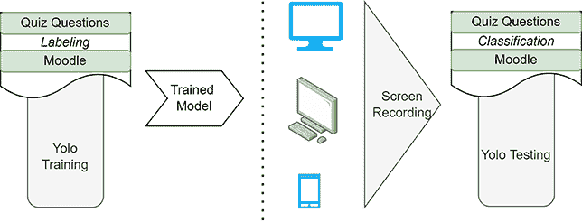

**图 5.8.** 监考系统架构。


这些组件最重要的功能将在以下章节中描述，并附带实现监考系统所需的代码段。

### 5.8.1 接口

监考系统应与流行的在线教育门户（如 Moodle）进行接口连接。通常，Moodle 被许多大学用于，通过共享文件、文件夹、内容等来协助师生。此外，它还用于组织测验、在截止日期前收集作业并进行在线评分。监考系统应具备与此类门户集成的能力，将在线监考系统整合到其中。接口应实现为 Moodle 或类似工具的扩展。

### 5.8.2 屏幕录制

定期对计算机屏幕进行录制，以了解参加考试的学生是否违反了考试规则。可以使用 `OpenCV` Python 包实现屏幕捕获。下面的代码段示例了使用 Python 的 `pyautogui` 包录制屏幕的过程。

```python
import pyautogui  

collect_image = pyautogui.screenshot()
```

此外，在收集屏幕上的所有信息（包括彩色图像）时，需要使用 `NumPy` 包对图像进行预处理，如下：

```python
import numpy as np  

collect_image = cv2.cvtColor(np.array(collect_image), cv2.COLOR_RGB2BGR)
```

### 5.8.3 图像分类

图像分类需要复杂的物体检测算法，以能够捕捉图像中的物体。在监考应用中，系统必须识别输入图像中的考试测验题目。

#### YOLO 准备与训练

`YOLO` 算法是一种广泛应用于多个应用领域的物体检测算法。为了观察图像中的测验对象，需要使用考试图像进行充分的训练。

为了实现这一点，获取了一组代表 Moodle 测验的图像，并使用 `labelImg` 软件对图像进行标注。该软件允许通过边界框来表示问题和 Moodle 页面，从而为考试图像标记 `question`（问题）和 `moodle` 标签。

这些标记后的图像以 `YOLO` 数据格式导出，该格式由一个表示图像中对象的数值矩阵组成。随后准备训练数据集和测试数据集文件夹作为监考应用训练模块的输入，并使用 `YOLOv5` 算法创建模型。

#### YOLO 测试与异常检测

通过如下所示设置 `YOLOv5` 的初始值来定义测试组件，即可在监考应用中执行物体检测。

```python
img_size=(640, 640)  

conf_thres=0.4  

iou_thres=0.45  

max_det=1000  

anomaly=False
```

对于每个输入的测试图像，使用 `NumPy` 包对整幅图像进行解析并转换为数组，如下：

```python
image = torch.from_numpy(image).to(device)
```

使用 `YOLOv5` 的 `PyTorch` 进行推理步骤非常简单。我们需要为该图像调用一个函数：

```python
# Inference step  

pred = model(im)  

pred = non_max_suppression(pred, conf_thres, iou_thres, max_det=max_det)
```

在应用非极大抑制组件后，可以在 `YOLOv5` 算法中找到预测值。如果在测试图像中检测到“exam”和“moodle”等物体，则该预测值将包含数据。然而，如果算法找不到指定的物体，则预测值将变为 NULL。

根据预测值的结果，将记录异常图像——即那些通过查看网站或网页相关材料违反考试规则的学生图像。异常信息将实时上传到云服务，或发送给监考软件或相关的导师。

该监考应用设计于慕尼黑工业大学（TUM）和印度信息技术学院（Kottayam），旨在使用 `YOLOv5` 物体检测算法在监考过程中协助教师工作。

## 参考文献

[1] Ahmed M, Hashmi K A, Pagani A, Liwicki M, Stricker D and Afzal M Z 2021 Survey and performance analysis of deep learning based object detection in challenging environments *Sensors* [**21** 5116](http://dx.doi.org/10.3390/s21155116)

[2] Chen C, Liu M-Y, Tuzel O and Xiao J 2016 R-CNN for small object detection *Computer Vision – ACCV 2016 (Lecture Notes in Computer Science vol 10115) ed* and S-H Lai, V Lepetit, K Nishino and Y Sato (Berlin: Springer) pp [214–30](http://dx.doi.org/10.1007/978-3-319-54193-8_14)

[3] Cheng Q, Rong B, Sun B and He J 2019 Class attendance checking system based on deep learning and global optimization *ICCPR ‘19: Proceedings of the 2019 8th International Conference on Computing and Pattern Recognition* (New York: ACM) pp [331–6](http://dx.doi.org/10.1145/3373509.3373519)

[4] Dewi C, Chen R-C, Liu Y-T, Jiang X and Hartomo K D 2021 Yolo V4 for advanced traffic sign recognition with synthetic training data

[5] Fukuda M, Okuno T and Yuki S 2021 Central object segmentation by deep learning to continuously monitor fruit growth *Sensors* [**12** 6999]

[6] Girshick R 2015 Fast R-CNN *2015 International Conference on Computer Vision (ICCV)* (Los Alamitos, CA)

[7] Li F, Li X, Liu Q and Li Z 2022 Occlusion handling and multi-scale pedestrian detection based on deep learning: *IEEE Access* [**10** 9937]

[8] Li Y, Huang H, Chen Q and Fan H 2021 Research on product quality monitoring based multi scale-YOLO *IEEE Access* [**9** 8037]

[9] Mikolka-Flöry S and Pfeifer N 2021 Horizon line detection in historical images in mountainous terrain *Remote Sens.* [**13** 1705]

[10] Nazir M, Shakil S and Khurshid K 2021 Role of deep learning in brain tumor detection and classification (2015 to 2020) *Comput. Med. Imaging.* [**9** 10194]

[11] Pandiyan P, Thangaraj R, Subramanian M, Rahul R and Palanisamy I 2022 Real-time monitoring of social distancing with person marking and tracking using YOLO V3 *Int. J. Sens. Net.* [**38** 154–65]

[12] Ren S, He K, Girshick R and Sun J 2015 Faster R-CNN: towards real-time object detection with region proposal networks *Advances in Information Processing Systems* 28

[13] Sindhwani N, Verma S, Bajaj T and Anand R 2021 Comparative analysis of intelligent driving and safety assistance systems using YOLO and SSD model of deep learning *Int. J. Inf. Syst. Model. Des.* [**12** 131–46]

[14] Socher R, Huval B, Bath B P, Manning C D and Ng A Y 2012 Convolutional-recursive deep learning for 3D object classification *Advances in Information Processing Systems* 25

[15] Wang D, Wang J-G and Xu K 2021 Deep learning for object detection, classification and tracking in industry applications *Sensors* [**21** 7349]


[16] Wang K and Liu M 2022 2022 YOLOv3-mt: 一种用于多目标跟踪车辆视觉检测的 YOLOv3 *Appl. Intell.* [**52** 2070–91](http://dx.doi.org/10.1007/s10489-021-02491-3)

[17] Zhang J, Huang M, Jin X and Li X 2017 基于改进型 YOLOv2 的实时中国交通标志检测算法 *Algorithms* [**10** 127](http://dx.doi.org/10.3390/a10040127)

# IOP Publishing

# 社会影响的深度学习技术

# Shajulin Benedict

# 第 6 章

## 情感分析——算法与框架

情感分析（SA）是一种自然语言处理技术，用于衡量个人或群体在文本、音频或视频中所表达的情感。它通过分析输入数据来判断对主题的正面、负面或中性反应。此外，它还为制定准则或反馈的人员提供知识和意见。本章解释了将情感分析应用于社会公益领域背后的原理，特别是对于改善人类经济状况的推荐系统。

### 6.1 情感分析——简介

想象一种情况：一位政家希望在某个地区或国家吸引大量关注者。该政家可以使用 LinkedIn、Twitter、Facebook 或类似的社交媒体网站发布声明。在印度等拥有大量敏感群体的国家，某些声明可能会立即引起麻烦，导致某个政党的垮台。在这种情况下，必须使用情感分析应用等工具或技术敏锐地观察关注者的点赞、不喜欢和评论。显然，工具可以通过自动方式采取纠正措施来改善局面。

#### 6.1.1 历史——情感分析

随着深度学习和其他其他现代复杂方法/技术的引入，情感分析自 2000 年以来开始演变。然而，分析公众意见已经实践了数十年。例如，在早些年份，人们利用手工设计的模板和调查门户来收集对某行业产品或服务的意见。

使用现代方法应用情感分析的发展是基于康奈尔大学 Lillian Lee 教授的演讲。随后，许多研究人员和开发者通过应用合适的算法和技术实践了意见挖掘的概念 [14]。

#### 6.1.2 趋势与目标

自创意市场诞生以来，情感分析领域呈指数级增长。相关文章的数量从 1990 年的 96 篇增加到 2020 年的 7773 篇。尽管该领域自 2019 年以来开始下降，但其作为研究课题在多个领域的使用有所增加，包括物联网（IoT）和社会公益应用。图 6.1 显示了过去几年在 Scopus 索引期刊上发表的相关论文数量。这些出版物的标题中包含“情感分析”关键词。除了截至 2021 年 7 月已超过 80,000 篇的学术著作外，全球与情感分析相关的专利已超过 2000 项。

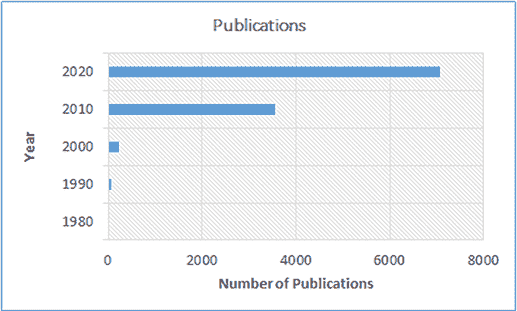

图 6.1. 与情感分析相关的出版物。

在对产品或服务的意见中寻找客户洞察在过去理地吸引了大量的实施。几乎所有开发产品或服务的公司都希望将这项技术整合到他们的网络服务或电子商务网站中。事实上，他们通过调查从价值客户那里获取反馈/意见的旧方法是一项艰巨的任务。

公司将流程转向这种较新方法的主要原因如下：

1. 传统的调查方法导致成本效率低下，因为工作通常被外包给第三方公司。
2. 用于收集意见的调查机制在向反馈过程中整合所需的智能信息方面选择有限。
3. 忽视更广泛客户群体（特别是来自不同国家/地区的客户）所引起的问题增加。
4. 调查机制需要足够的人力来理解客户意见的语调。
5. 审查意见的人员需要在处理意见的传统方法方面具有足够的知识。

情感分析的主要任务或目标列如下所示：

* 根据从社交媒体网站收到的输入或从反馈网站获取的评论，将文本语调分类为正面、负面或中性
* 识别影响文本、语音或视频语调的特征
* 在从输入数据中提取特征后区分意见

### 6.2 级别与方法

本节描述了在系统中执行情感分析时使用的级别和方法/技术。此外，详细讨论了情感分析方法。

#### 6.2.1 情感分析的级别

情感分析技术在多个数据挖掘级别上执行。在文本挖掘的背景下，情感分析按以下级别采用：

1. 文档级——在`document-level`（文档级）情感分析中，整个 `.pdf`、`.tex` 或 `.doc` 等格式的文档被输入到系统中以进行意见挖掘。由于文档尺寸通常很大，这种对整个文档的细粒度分析 [12] 提供了解决方案。
2. 句子级——在`sentence-level`（句子级）情感分析中，对句子进行评估以区分正面、负面或中性的意见 [23]。电子商务应用程序通常使用句子而非文档来分析网站上的评论。电子商务应用的指数级增长引发了句子级情感分析的需求。
3. 方面级——在`aspect-level`（方面级）情感分析中，对句子中的短语进行分析 [15] 以获取可能的意见或语调。这种级别的情感分析对文本或视频中表达的方面提供了更细粒度的分类。涉及情感分析的方面可以根据其用途分为：i) 显性和 (ii) 隐性。在显性方面级情感分析中，方面在分析之前指定，而在隐性方面级情感分析中，方面是根据某些技术生成的。

#### 6.2.2 情感分析的方法与技术

情感分析可以使用两种广泛的方法进行，即基于词典和基于学习模型的方法。情感分析通常用于分析提交在网站上的评论中所包含的情感。例如，对新发布的电影、产品情感、时尚设计等评论的分析已引起了研究人员和生产市场的关注。

##### 6.2.2.1 基于词典的情感分析

在基于词典的情感分析中，使用相关的词汇分析评论文本的内容和极性。这样做，评论句子需要分词并分析以发现其极性。标记由字典形式的单词或词袋组成，用于词法分析。

基于词典的情感分析使用 SentiWordNet、语言查询与词汇（LIWC）、多视角问答（MPQA）主观性词典等工具进行。基于词典的情感分析试图识别文本和句子中的情感。


SentiWordNet 是根据字典数据库为情感挖掘过程而构建的。它尝试在句子中识别出大量的种子词后进行分析。此外，句子中还捕获了潜在的正、负面标签以用于情感挖掘。

LIWC 是一种计算机化的文本分析工具，它可以解析输入的文本并提出文本中包含的心理学洞察。例如，它会研究文档中诸如“我”、“我们”等词的使用情况。此外，还可以使用 LIWC 捕捉句子中的积极情绪、消极情绪和情感基调。

MPQA 主观性词典包含一系列标注数据库，如新闻语料库、意见语料库等，这些数据库经过人工标注，供情感分析 (SA) 算法进一步使用。

上述大多数基于词典的 SA 方法涉及对单词进行人工标记，以识别情感或极性。在现代基于词典的 SA 方法领域，已经开发了半监督训练模型、监督训练模型和无监督学习模型。[21] 的作者研究了词典在基于 Twitter 的 SA 问题中的应用。

### 6.2.3 处理阶段

通常，文本或图像中情感的处理会经历某些阶段。接下来的小节将讨论这些阶段的重要特征及其功能。

#### 6.2.3.1 基于学习模型的 SA

SA 和分类问题需要适当的学习模型，例如逻辑回归模型或分类器模型 [6]，以便在没有人工干预的情况下自动学习文本的情感和极性。

通常，基于模型的 SA 通过解析句子、单词和上下文来提取适当的特征。这些特征是从一组训练数据集集中学习的，得出的推理结果通过验证数据集进行验证。如果验证数据集没有产生预期结果，则对训练推理结果根据预期进行微调。随后，根据精炼的学习模型，可以以更准确的性对文本进行 SA。

最常用于 SA 的学习模型包括：

1.  **朴素分类器**——朴素贝叶斯分类器利用贝叶斯概率定理运行。在算法的学习阶段，会研究句子中单词的似然性和句子中所表达的情感。通过概率研究，可以预测未来单词的实例或单词的极性。

2.  **SVM**——支持向量机是一种机器学习模型，用于识别以单词形式表示的数据点之间的超平面。这些超平面使用直线来区分句子中单词的基调。该算法将分类线放置在特定位置，使得数据点之间的距离最大 [6]。

3.  **逻辑回归**——通常，逻辑回归算法非常适用于二分类问题。在 SA 问题中，这种算法非常有益，因为大多数数据点在本质上是稀疏的——即单词出现频率很低。显然，二分类问题（如识别单词的积极或消极基调）可以从使用这种算法中显著受益。

4.  **深度学习**——近年来，学习模型的演变经历了显著增长 [8, 16]。例如，深度学习模型（如第 4 章研究的卷积神经网络）的应用提供了更高的精度并降低了复杂度。

### 6.3 情感分析——过程

SA 源自自然语言处理 (NLP)，在识别文档、文本或视频中的句子基调或极性之前，涉及几个处理阶段。通常，这种处理分为三个阶段：

*   预处理
*   学习
*   分类

从 pdf 文件、网络链接或网页获取的文本预处理涉及以下步骤（见图 6.2）：

1.  **分词**——分词尝试从输入句子中分割单词，从段落中分割句子，从文件中分割段落等。分词后的单词、句子或段落存储在数组向量中，用于从文档上下文推断单词用法。

2.  **小写转换**——收集不带大写字母的单词有利于对原始文本进行单词处理。事实上，分析句子或段落中使用单词的基调时并不期望使用大写字母——即用大写字母表示单词会增加计算复杂度，但不会提供任何优势。此外，如果单词是小写的，则可以利用单词基调的识别来改写句子或单词。

3.  **移除过程**——在为 SA 预处理文本时也会移除标点符号，因为它们对分析过程没有任何价值。简而言之，原始文本中的单词应该被简化，以使 SA 过程的计算复杂度保持在最低水平。移除过程对于几个与分类相关的 SA 问题（如识别文本的积极和面情感）非常重要。然而，如果需要将情感转换为另一种语言，则不要移除原始文本中的标点。从原始文本中移除其他语言符号（如 %、$、# 等）也是一种良好的做法。

4.  **词还原**——词还原是识别单词基词的过程。基词可以通过减少单词的后缀来获得。例如，`write`、`writes` 和 `writing` 可以写为 `write`。通过这样做，减少了单词的维度。

5.  **语料库构建**——语料库构建是识别文本中单词组合的过程。语料库能够从单词创建 n-gram，并应用于创建新的句子。1-gram 称为单词（unigram），2-gram 称为双词（bigram）。例如，“South India”是文本的一个双词表示。从语料库形成 n-gram 使得 NLP 应用中的概率研究成为可能。

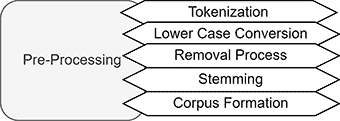

**图 6.2.** 文本预处理步骤。

SA 的学习和分类阶段将在下一节详细介绍，该节将讨论使用 SA 的推荐系统。

### 6.4 推荐系统——情感分析

推荐系统应用 SA 从网站或文档发现的大量数据中过滤信息。推荐系统的常见应用包括 (a) 住房推荐、(b) 酒店推荐、(c) 旅游推荐 [7]、(d) 电影推荐、(e) 在线课程推荐、(f) 产品推荐等。

这些推荐系统的简要概述如下：

1.  住房推荐——了解在社交媒体网站（如 Facebook、LinkedIn、Google+ 等）上表达居民的情感或情绪，可用于为居民推荐最佳住房方案。事实上，马来西亚政府在研究了社交网站上的情感后，计划向公民发放公共住房。


## 2. 酒店推荐
对于打算在主要城市预订酒店的旅行者来说，观察热门酒店客人的评论起着关键作用。旅行者的习惯不仅是查看酒店设施（如是否有空调或暖气器），还会监控之前旅行者的评论。如果旅行者发现某酒店有负面评价，即使其设施具有吸引力，他们也不需要选择。对城市中的每家酒店进行人工研究可能会成为一项艰巨且耗时的任务。支持情感分析（SA）的推荐系统可以快速缓解这一过程。

## 3. 旅游推荐
在夏季或冬季假期期间根据预算和个性化需求规划旅游地点已成为现代游客的关注焦点。传统的旅游规划方法被认为不利于旅行者的效率。电子旅游推荐系统已针对不同平台开发，如移动端、网页和桌面。这些推荐系统提供引导、规划、预算控制机制、报告准备、反馈分析等功能。旅游推荐系统是一种知识管理系统。

## 4. 电影推荐
结合语义智能的电影推荐系统已在电影市场广泛应用。它是电影不同观众之间的一种协作努力。第一次看电影的人以推荐评论的形式分享他们对电影的看法。SA 系统利用来自各种观众的集体评论来产生高效的推荐 [13]。此外，可以分析观众的个人行为以支持未来的电影推荐。近年来，SA 评分已与混合推荐（如协同过滤和基于内容过滤的推荐）相结合。

## 5. 在线课程推荐
在线课程推荐系统捕捉、分析并推荐学生对不断增长的在线课程的过往学习体验 [17]。选择在线课程的传统方法包括基于规则的方法、关联方法、协作方法等。在协同过滤机制中引入 SA 可以使课程选择更加个性化。例如，协同过滤方法允许根据与系统中相似水平的学生发现的相似性来选择在线课程。然而，情感分析可以为在线推荐系统提供更多的人化特征，鼓励学生带着兴趣完成课程。

## 6. 产品推荐
对于许多人来说，购买符合预期预算的手机或类似产品是一项困难的尝试。需要优化与产品相关的几个因素，以满足预算和预期收益 [11]。

图 6.3 展示了市场上现有的推荐系统列表。

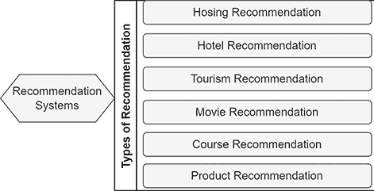

**图 6.3.** 推荐系统。

## 网络爬取
网页信息的爬取被认为是创建上述推荐的基本步骤之一。网络爬取方法是从网上收集包含用于创建推荐的相关信息的过程。例如，从网页上收集有关产品或在线课程的评论被称为网络爬取。在数据收集到指定的数据结构后，这些评论或信息片段通常以不同的格式表示，例如逗号分隔值 (CSV)、JavaScript 对象表示法 (JSON) 或 `.txt` 文件格式。

网络爬取技术需要从网页中获取适当信息的解析器。这些解析器可能会导致开销。[24] 的作者近年来研究了在网络爬虫过程中不同网页解析器对性能的影响。同样，Rohmeth 等人 [20] 比较了不同网页爬取技术的性能效率。

在以自动化方式从网页上爬取信息时应用智能技术吸引了各种研究人员和网络应用开发者。例如，Rizwan 等人 [18] 的作者研究了机器人自动向 Web 服务器提供数据的应用，并调查了网站发生的犯罪。[22] 的作者将智能监督机器学习算法应用于网页处理方法。

在应用 SA 的推荐系统背景下，这些技术分为 (i) 协同过滤，(ii) 基于内容的，(iii) 基于知识的，(iv) 基于人口统计的，(v) 基于上下文的，(vi) 基于评论的，(vii) 混合和 (viii) 决策树方法，如图 6.4 所示。


**图 6.4.** 用于推荐系统的技术。

除了推荐系统，基于情感或其他方法的文本分类执行如下：

- **新闻文本分析**：这些算法对新闻标题的内容进行分析 [10]。通常情况下，这些信息需要由设备实时处理。此类工具的用户倾向于获取根据其兴趣推荐的新闻标题信息。
- **主题分类**：基于情感的文本信息检索是最流行的用例之一 [19]。例如，学生可能对特定主题感兴趣，而不是利用率。
- **测试分析**：文本处理可以应用 SA 机制以建设性的方式创建题目，或使用测试方法处理答案。

### 6.5 电影推荐——案例研究
作为一个案例研究，本节解释了电影推荐。根据前面的讨论，需要从选定的网页获取评论。

从网页获取评论需要适当的 Python 包，如下：

```python
import requests
from bs4 import BeautifulSoup
import re
```

Python 的 `requests` 包向网站提交超文本传输协议 (HTTP) 请求。此响应提供了网页的所有细节，便于对内容进行进一步处理。例如，下面的代码显示了从 `domain.com` 网站收集内容的程序。此外，可以在保护链接中包含用户身份。

```python
htmlUrl = requests.get("https://domain.com/", auth=('username', 'pwd'))
print(htmlUrl.text)
```

`BeautifulSoup` Python 库负责解析 HTTP 响应。从指定的网站创建一个完美的“汤”（对象结构）。也可以使用网页提供的 HTML 标签对内容进行美化。

```python
soup = BeautifulSoup(htmlUrl.text,'lxml')
```


在这里，`soup` 根据 `lxml` 解析信息准备网页内容。`soup` 的输出使我们能够对内容进行格式化处理，或在输入网页中查找特定文本。同样，可以使用网页的类（classes）找到跟随 HTML 标签（如 `<div>`、`<p >`、`<a>` 等）的所有信息。

```
soup.prettify()
soup.find_all('div', class_ ='movieReviews')
soup.find(text="movie")
```

`soup` 可用于迭代浏览网页内容，因为评论通常针对不同的电影接接出现。

电影评论可以导出为多种格式，包括 CSV 格式，这样在对数据进行充分的预处理（如分词、词干提取、n-gram 生成等）后，就可以将情感分析（SA）应用于这些评论中。

有一个流行的电影推荐数据集名为“互联网电影数据库（IMDB）数据集”，可以使用 `TensorFlow`/`Keras` 包进行访问。这可以通过以下包实现：

```python
import tensorflow
from tensorflow.keras.datasets import imdb
```

来自 Keras 的 `imdb` 数据集包含 25,000 条从电影链接预处理过的电影评论。该数据由一个整数向量组成，指的是从相应的电影评论页面获取的评论。

该数据集可用于评估多个学习相关评论的 SA 模型性能。SA 最常用的学习算法有：（a) 卷积神经网络（CNN）、(b) 循环神经网络（`RNN`）、(c) 长短期记忆（`LSTM`）模型以及 (d) 混合（`LSTM` 和卷积）模型。

### 6.5.1 卷积神经网络——情感

`CNN` 算法在处理来自网站的评论信息后分析电影的情感。预处理电影评论对于提高使用电影评论执行的 SA 准确性非常重要。最常用的预处理步骤如下：

1. 填充额外信息，
2. 将数据划分为训练/测试阶段，
3. 对数据进行标记，等等。

预处理后的电影评论将接受使用 `CNN` 算法执行的卷积。`CNN` 构建信息窗口以吸收特征或过滤器。

`CNN` 算法根据提供的评论数量对单词进行嵌入。嵌入为相似语境下的不同单词提供了近乎相等的实值表示。SA 中单词嵌入在 Python 中的表示如下：

```python
model.add(Embedding(words, dimensions, length=reviews))
```

随后，执行空间丢弃（spatial dropout），以轻松利用相邻特征图的 dropout 功能。此功能更类似于传统的 dropout 特性。为了实现这一点，可以使用 Python 包的以下函数：

```python
model.add(SpatialDropout1D(dropout))
```

随后，利用 `Conv1D` 函数使用 `CNN` 算法对数据集进行卷积。`CNN` 算法通常涉及线性单元（`RELU`）激活函数。在算法中应用 `RELU` 激活函数的主要目的是减少所有神经元的激活值。使用的代码如下：

```python
model.add(Conv1D(iterations, kernel, activation='relu'))
```

然后对数据执行最大池化（max pooling）操作。通常，最大池化操作尝试减小数据的大小以便有效改进计算。由于使用了 1D 最大池化技术，因此使用了特定窗口大小的一维数据。例如，如果窗口大小为三，1D 最大池化选择三个矩阵单元格中的最大值，如图 6.5 所示。

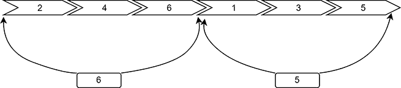

**图 6.5. 1D 最大池化。**

在电影评论中，使用类可以找到 HTML HTML 标签。由于使用了 1D 最大池化技术，使用了特定窗口大小的一维数据。例如，如果窗口大小为三，1D 最大池化选择三个矩阵单元格中的最大值，如图所示。

**图 6.5. 1D 最大池化。**

 1D 最大池化（见图 6.6

**图 6.6. 1D 最大池化。**

在电影评论中，使用类可以找到 HTML 标签。 1D 最大池化（见图 6.7).

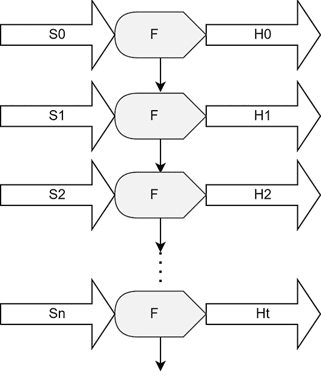

**图 6.7. 1D 最大池化。**


## 1. 精率 (Precision)
在大多数情感分析（SA）问题中，特别是在社交网站，经常会识别正面、负面、中性和混合情感等术语。文本或文档观察到的“惊叹、爱、最好”等关键词是正面情感的示例；诸如“不、模糊、尴尬”等词汇与负面情感有关；少数词汇无法表明它们表达的是正面还是负面语调，而如“为什么这么难理解？”之类的文本则涉及混合情感。`precision` 一词也意味着`准确性`。它定义了预测文本为正面或负面情感的正确性。众所周知的是，情感的预测并不总是与准确的情感一致。因此，需要进行基准预测以确保预测的规范性。

在实践中，通过评估指定数量文档的正正负面情感来获取情感分析的基准预测。例如，如果使用约 1000 份文档来分析情感，则 50% 的文档用于训练，另外 50% 用于测试情感。如果预测的正面或负面情感达到 90%，则该特定背景下的基准预测声明为 90%。

精率的数学表达式如下：

```
Precision = True Positives / (True Positives + False Positives)
```

## 2. 召回率 (Recall)
情感分析的召回率与所选文档中识别出的情感数量有关。在某些文本或视频中，SA 算法无法将情感分类为正面或负面。这是因为情感与文本中复杂的句子结构和词组混合在一起。召回率代表了 SA 算法的效率以及文本的挑战。

召回率的数学表达式如下：

```
Recall = True Positives / (True Positives + False Negatives)
```

## 3. F 分
这种衡量也称为 F1 分，是精率和召回率的结合。它是使用 0.0 到 1.0 之间的值表示的精率和召回率的调和平均数。达到 1.0 F 分的感分析在预测文本/文档情感方面提供了最佳价值。

F 分指标的数学表达式如下：

```
F-Score = ((Precision * Recall)*2) / (Precision + Recall)
```

### 6.7 工具与框架
虽然之前讨论了情感分析的理论方面，但理解现有的促进各种类型 SA 的工具和框架也是非常重要的。

### 6.7.1 情感分析工具和框架的必要性
使用工具追求 SA 的主要原因列如下：

1. 工具使我们能够在需要某些集成时自动化或简化流程。例如，如果需要从不同书籍的各个作者处收集任何意见，工具可以在执行所需 SA 的同时完成此工作。
2. 工具可以自定义操作，使其更贴合用户需求，而原生实现几乎无法提供这一点。
3. 工具可以连接到其他一些服务（通常是云服务，如存储服务或扩展服务），以提高基于分析的实现的性能。

在市场上发现的某些知名 SA 工具（见图 6.9）及其关键功能将在后续小节中讨论。

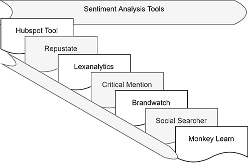

**图 6.9.** 与 SA 相关的工具。

### 6.7.2 HubSpot 工具
HubSpot 工具是一种基于服务的 SA 工具，用于收集客户反馈并可以对反馈调查进行定性评估。通常情况下，客户提供的反馈包括正面和负面内容。HubSpot 基于服务的工具应用 SA 算法来获取正面和负面的数量，以评估产品的价值。

该工具具有利用第三方调查系统（如 NPS 调查）来提供大规模审查机制的能力。它使产品所有者能够通过仪表板上的评分卡表示形象化地查看评论。它还为用户提供了所有反馈的俯瞰视图，并带有放大查看单个客户反馈的选项。

### 6.7.3 Repustate 情感分析器
Repustate [4] 是一种用于评估客户提交反馈的 SA 工具。该工具由 Repustate 公司运营，支持全球范围内超过 23 种语言。该工具主要侧重于对客户回答的文本分析。此外，该工具还具有评估客户反馈消息中使用 emoji 的能力。Repustate 的许多用户发现该工具非常方便，因为该工具帮助用户根据其特定需求或决策自定义其 `API`。简而言之，该工具提供了对利用 SA 进行客户反馈目的的控制。

### 6.7.4 Lexanalytics
Lexanalytics 工具 [2] 由 Lexanalytics 公司开发。该工具的主要关注点是提供可用于业务目的的原生文本分析。其开发方法不仅限于针对产品开发的客户，还可以用于更通用的 SA 应用。该工具的重点目标是提取 (i) 意图，(ii) 正面/负面意见，(iii) 命名实体等。

### 6.7.5 Critical Mention
Critical Mention 设计用于执行聚焦于媒体监控和审查的 SA。该工具开发用于在三个主要方向追求 SA：社交监控、媒体监控和在线新闻监控。该工具拥有 `API`，可以帮助用户接入服务以获取更广泛的观点。它可以分析日常新闻和其他文章，这对许多企业非常有用。从当前新闻中提取情感以及评估时事或公共问题被认为是该工具的关键方面。

### 6.7.6 Brandwatch
Brandwatch [1] 是一种执行 SA 的商业产品，主要关注提供产品洞察。该工具允许公司将产品连接到其 SA 服务。该工具的关键成果包括从 Forrester Wave 获取意见、聚合粉丝、观察粉丝动态以及过滤客户意见。

### 6.7.7 Social Searcher
Social Searcher [5] 是一种根据关键词、话题标签或用户名应用深度学习平台执行 SA 和文本分析的工具。它拥有与任何搜索引擎（如 Google、Bing 等）类似的搜索面板。然而，搜索的主要重点是根据全球成千上万网页分析的当前趋势提供结果。该工具在搜索适当分析时关注提及、名称和趋势。

### 6.7.8 MonkeyLearn
MonkeyLearn 在收集和评估反馈方面非常流行，对 SA 有巨大的支持。为了有效利用此工具，用户必须提供一些分类标签并建议文本的重要部分。一旦用户手动提供了这些信息，该工具就可以同时浏览成千上万的文件并提供内容的形象化表示。此外，它还提供了“词云”工具，从发现中投影某些关键词的主要原因。


SA 可应用于多个与财务信息、客户满意度、媒体分析、报纸分析、热点帖子分析相关的领域。在之前的章节中，讨论了电影推荐系统。在本节中，我们将介绍一种用于检测讽刺的 SA 应用。

通常，讽刺检测是自然语言处理（NLP）的一个分支。讽刺是一种以相反方式表达情境的语言方法。它通常用于任何语言，以嘲讽句子中所描述的角色活动。在从电影评论、Twitter 评论或客户意见中提取的各种文本中，当人们想要以积极的方式表达某些事物，实际上传达负面信息时，就能观察到讽刺内容。

## 6.8.1 新闻标题数据集

在本节中，利用一个包含新闻标题讽刺信息的数据集，来演示作为学习过程一部分的重要代码片段。该数据集以 JSON 文件格式表示，每行包含三个属性：

1. 文章的网络地址；
2. 以字符串形式表示的新闻标题信息；以及
3. 表示该字符串是否包含讽刺信息的标签。

文件名为 `Sarcasm_Headlines_Dataset.json` 的数据集示例记录如下：

```json
{
  "root": 3 items,
  "article_link": "https://www.huffingtonpost.com/entry/versace-black-code_us_5861fbefe4b0de3a08f600d5",
  "headline": "former versace store clerk sues over secret black code for minority shoppers",
  "is_sarcastic": 0
}
```

## 6.8.2 使用 TensorFlow 进行数据处理

如前所述，SA 由几个阶段组成，例如分词、词预处理、词干、填充和/或语料库构建，随后是数据建模。针对这些不同 SA 阶段的最重要代码特征如下：

### 分词

使用 TensorFlow 进行讽刺检测的分词基于从 `TensorFlow` 和 `Keras` 的几个包。例如，`Tokenizer` 包包含了处理讽刺检测任务分词过程的代码。

在 SA 代码中执行分词的代码片段如下：

```python
import tensorflow as tf
from tensorflow.keras.preprocessing.text import Tokenizer
```

在分词数据集文本时，指定嵌入的数量也很重要；同样，代码片段中还需要指定处理分词所需的词外标记，如下：

```python
tokenizer = Tokenizer(num_words=vocab_size, oov_token=" <OOV>")
tokenizer.fit_on_texts(X_train)
word_index = tokenizer.word_index
```

在这里，`tokens` 返回一个 `word_index`，它将单词映射到 `vocab_size`。需要注意的是，`word_index` 用于查找数据集词向量的长度。

### 预处理、词干、填充和语料库构建

SA 的预处理阶段仅在数据分词后才会发生。分词操作由 `tokenizer` 执行。

此外，代码中执行了填充以确保数据集具有所需的形状和大小。通常，数据集不会具有合适的计算尺寸，这会损害学习过程的性能。使用填充时，会在学习模型的输入中添加额外的零，以便数据集具有一致的大小和形状。

## 6.8.3 使用神经网络进行训练

使用神经网络或基于神经网络的训练可以使用 `TensorFlow` 库及其相关包进行实现。可以利用 `TensorFlow` 库的 `keras` 高级 API 对新闻标题数据集进行讽刺检测。`keras` API 具有嵌入单词、为学习目的创建隐藏层、将学习推理映射到一个全连接层以及执行如 `RELU`、`sigmoid` 等激活函数的方法。

以 `Sequential` 模式实现的 `keras` 允许在学习过程中具有一个张量输入和一个张量输出以及所需的激活函数。

训练模型创建阶段最重要的代码部分是：

* 分层 (layering)
* 编译 (compiling)
* 拟合 (fitting)

下面提供了基于用于讽刺检测的数据集创建隐藏层和激活函数的代码片段：

```python
model = tf.keras.Sequential([
  tf.keras.layers.Embedding(vocab_size, embedding_dim, input_length=max_length),
  tf.keras.layers.GlobalAveragePooling1D(),
  tf.keras.layers.Dense(24, activation='relu'),
  tf.keras.layers.Dense(1, activation='sigmoid')
])
```

完成分层后，应用编译来确定优化器、损失函数和指标（例如神经网络的准确率单位）。表示讽刺检测方法编译阶段的代码片段如下：

```python
model.compile(loss='binary_crossentropy', optimizer='adam', metrics=['accuracy'])
```

最后，根据学习训练数据集所需的迭代次数执行拟合过程，如下：

```python
history = model.fit(training_padded, training_labels, epochs=30, validation_data=(testing_padded, testing_labels), verbose=2)
```

## 6.8.4 使用长短期记忆网络进行训练

应用 `LSTM` 通常是 SA 相关应用的正确选择，包括讽刺检测算法。在应用学习模型之前使用的初始阶段（如分词、预处理、词干和语料库构建）保持不变，并与之前的代码相似。然而，为了包含基于 LSTM 的学习过程，有必要使用不同的层和编译阶段。

特别是在 `LSTM` 中，隐藏层需要输入到模型定义阶段——即在嵌入过程之后、全连接层之前。描述讽刺问题的 LSTM 模型代码片段如下：

```python
model = tf.keras.Sequential([
  tf.keras.layers.Embedding(vocab_size, embedding_dim, input_length=max_length),
  tf.keras.layers.Bidirectional(tf.keras.layers.LSTM(32)),
  tf.keras.layers.Dense(24, activation='relu'),
  tf.keras.layers.Dense(1, activation='sigmoid')
])
```

如之前提到的，在模型定义之后，模型需要使用相关的优化器和指标规范进行编译，然后通过足够的学习过程迭代进行拟合。这些阶段的代码片段为：

```python
model.compile(loss='binary_crossentropy', optimizer='adam', metrics=['accuracy'])
history = model.fit(training_padded, training_labels, epochs=30, validation_data=(testing_padded, testing_labels), verbose=2)
```

## 参考文献

1. Brandwatch 工具
2. Lexanalytics 工具
3. Monkeylearn 工具
4. Repustate 工具
5. Social searcher 工具
6. Al-Hashedi A, et al. 2022 针对社交网络（Twitter 数据）中 COVID-19 相关阴谋论的阿拉伯语情感分析集成分类。
7. An H 2022 基于 CNN-LSTM 情感分析旅游景点推荐系统设计。


[8] Chandrasekaran G and Hemanth J 2022 基于 Twitter 数据的深度学习和基于 TextBlob 的冠病毒肺炎（COVID-19）情感分析 *Int. J. Artif. Intell. Tools* [31] 2250011](http://dx.doi.org/10.1142/S0218213022500117)

[9] Chen W-Q, Lin F, Zhang X, Li G and Liu B 2022 用于讽刺检测的情感线索与上下文不一致性联合学习 *IEEE Access* [10] 48292–3000](http://dx.doi.org/10.1109/ACCESS.2022.3169864)

[10] Hossain A, Karimuzzaman M, Hossain M M and Rahman A 2021 报纸标题的文本挖掘与情感分析 *Information* [12] 414](http://dx.doi.org/10.3390/info12100414)

[11] Hu S, Kumar A, Al-Turjman F, Gupta S, Seth S and Shubham 2020 用于在线产品推荐的基于评论员信誉和情感分析的用户建模 *IEEE Access* [8] 26172–89](http://dx.doi.org/10.1109/ACCESS.2020.2971087)

[12] Huang F, Yuan C-a, Bi Y, Lu J, Lu L and Wang X 2022 用于在线评论的多粒度文档级情感主题分析 *Appl. Intell.* [52] 7723–330](http://dx.doi.org/10.1007/s10489-021-02817-1)

[13] Kumar S, De K and Roy P P 2020 基于微博数据情感分析的电影推荐系统 *IEEE Trans. Comput. Soc. Syst.* [7] 915–230](http://dx.doi.org/10.1109/TCSS.2020.2993585)

[14] Liu B 2010 *情感分析与主观性自然语言处理手册* 编 N Indurkhya and F J Damerau 第 2 版（伦敦：Chapman and Hall/CRC）页 627–66

[15] Liu Y, Xiao L, Huang Y-C, Xue Y, Hu X, Zhao H and Li Y 2022 集成局部语义与全局语法特征的方面层级情感分析 *Artif. Intell.* [36] 2250013](http://dx.doi.org/10.1142/S0218001422500136)

[16] Nassif A B, Darya A M and Elnagar A 2022 用于阿拉伯情感分析的浅层和深度学习分类器的实证评估 *ACM Trans. Asian Low Resour. Lang. Inf. Process.* [21] 140](http://dx.doi.org/10.1145/3466171)

[17] Onan A 2021 基于大规模开放在线课程评估的情感分析：文本挖掘与深度学习方法 *Comput. Appl. Eng. Educ.* [29] 572–890](http://dx.doi.org/10.1002/cae.22253)

[18] Rahman R U and Tomar D S 2020 用于机器人犯罪调查的新型网络取证框架 *Digit. Investig.* [33](http://dx.doi.org/10.1016/j.fsidi.2020.300943) 300943

[19] Rodrigues A P and Chiplunkar N N 2022 用于 Twitter 数据主题分类和情感分析的新型大数据方法 *Evol. Intell.* [15] 877–870](http://dx.doi.org/10.1007/s12065-019-00236-3)

[20] Gunawan R, Rahmatulloh A, Darmawan I and Firdaus F 2019 网络爬虫技术的比较：正则表达式、HTML DOM 和 Xpath *2018 工业企业与系统工程国际会议 (IcoIESE 2018)* [2] 283–70](http://dx.doi.org/10.2991/icoiese-18.2019.50)

[21] Shayegan M J and Molanorouzi M 2021 Twitter 上的词典加权情感分析方法 *Int. J. Web Based Communities* [17] 149–620](http://dx.doi.org/10.1504/IJWBC.2021.116641)

[22] Suchacka G and Iwanski J 2020 通过不同流量特征识别合法网络用户和机器人——一种信息瓶颈方法 *Knowl. Based Syst.* [197](http://dx.doi.org/10.1016/j.knosys.2020.103715) 103715

[23] Sweidan A, El-Bendary N and Al-Feel H 2021 基于混合本体学习的药物反应（ADRS）分类句子级方面情感分析 *IEEE Access* [9] 90828–460](http://dx.doi.org/10.1109/ACCESS.2021.3091394)

[24] Uzun E 2020 获取网页信息的网络爬虫方法 *IEEE Access* [8] 26172–890](http://dx.doi.org/10.1109/ACCESS.2020.2971087)


自动编码器对输入数据进行表示的无监督学习。通常情况下，无监督学习被认为是机器学习（ML）领域中的一种学习过程。无监督学习过程不需要标记的训练数据集；数据是在可用信息上进行训练的，而不需要使用预标记过程。这种方法为信息提供了足够的新见解（见图 7.1）。

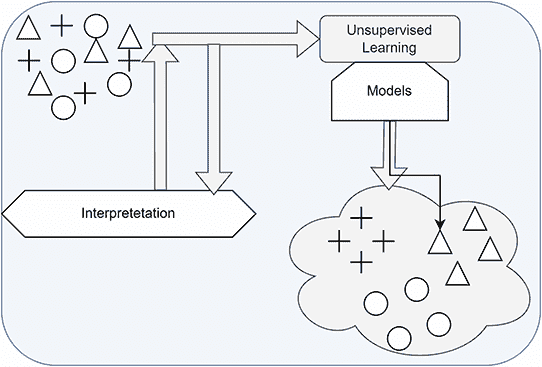

**图 7.1.** 无监督学习。

在自动编码器技术中使用无监督学习的主要优势如下：

1. 减少人工工作——对图像或输入数据进行标记是一个枯燥且费力的过程。在监督学习中，强制要求标签或经过训练的解决方案。如果在学习过程之前错误地应用了标签，标签也可能导致错误的预测。
2. 灵活的训练样本——自动编码器能够在学习过程的任何阶段附加或添加训练样本。由于其无监督学习机制，训练模块会适应传入的训练样本，从而为学习过程提供了更大的灵活性。
3. 灵活的数据格式——由于其无监督学习能力，自动编码器可以支持任何原始数据格式，如文本、视频、音频等。因此，该技术在处理数据格式方面具有更高的灵活性。

### 7.1.3 主成分分析与自动编码器

主成分分析（PCA）与自动编码之间存在相似之处——即它们都尝试降低数据维数。此外，这两种技术具有学习非线性数据特征的能力。

然而，它们之间存在一些差异。通常，PCA 根据特征识别输入图像/数据中具有可接受变化的潜在组件。一旦这些组件被分类（使得约 80–90% 的信息可以从压缩的数据中解码出来），相关的主成分就会被保留用于编码。PCA 在处理高维输入数据时面临挑战。多个论坛报告，自动编码器的准确性通常高于使用 PCA 实现获得的结果准确性。因此，研究人员和从业者展示的使用自动编码器的深度学习架构多于 PCA 方法。相比之下，自动编码器基于神经网络，神经网络的层可以稳健或灵活地处理输入数据的结构。通过这种方式，自动编码器从根本能够能够在过程中承受大量的维度。

自动编码器技术在深层架构中非常有用，特别是当考虑受限玻尔兹曼机等算法时。这种技术对于完成深度学习架构最后一层的最终微调或塑造过程做出了巨大贡献。

### 7.1.4 自动编码器——迁移学习

迁移学习机制极大受益于自动编码方法。通常，迁移学习试图微调与底层问题相关的问题领域的现有发现 [3]。在特定问题领域形成的学习推理可以根据其他子领域或问题空间进行修正。

迁移学习概念有两个主要优势：

1. 子领域不需要大量的学习时间和空间。节能型子领域（如支持物联网的传感器节点）通常必须从其相邻区域的推理中学习；以及
2. 特定目标或子领域信息的敏感性可以被保留。

迁移学习已成为训练深度学习应用的重要步骤。这是因为考虑到迁移学习过程的固有特性，增量学习过程是行的。

当知识从一个领域转移到另一个领域时，深度学习架构对计算的需求降低了。因此，这些计算机器的能耗降低了。降低中央处理器（CPU）、图形处理器（GPU）或张量处理器（TPU）等计算架构的能耗对环境危害有间接影响。例如，开启 CPU/GPU 机器会加热计算节点，增加对冷却机制的需求。超级计算或计算中心常用的冷却机制（即气冷机制）会产生 CO[2] 排放。这些活动破坏了自然环境，导致危害。

### 7.1.5 自动编码器与传统压缩

传统的压缩技术，如联合图像专家小组（JPEG）压缩、运动图像专家（MPEG）压缩、MP3 等，声称具有相同的目的：压缩。然而，存在一些显著的差异，支持使用自动编码器进行深度学习方法——即自动编码器产生的压缩与 MP3 或 JPEG 等传统压缩算法产生的不同。

JPEG、MPEG、33 等是图像、视频或音频文件的常用有损压缩技术。这些压缩技术专注于仅压缩特定的数据类型，如音频、视频或图像。相比之下，自动编码器通过更关注特定领域来减少数据维度或压缩数据。例如，用于减少植物相关图像维度的训练自动编码器可能与用于动物相关图像的训练自动编码器不同。这意味着自动编码器处理不同数据格式的子类型具有更高的灵活性。

### 7.2 自动编码器架构

自动编码器架构由三个大部分组成。这些部分的功能如下：

1. 编码器——编码器尝试将图像压缩为较少的信息；在神经网络术语中，编码器是输入数据的表示，将其数据维度减少到更小的维度。例如，编码器可以将大小为 24 x 24 像素的输入数据编码为远小于 576 像素的像素。为了做到这一点，编码器应该更有效地采取措施来减少维度，以适应架构代码部分的潜在表示空间。通常，编码器建立卷积层块以及所需的池化层，以便高效地执行转换。
2. 代码——网络的这部分为解码器提供输入；架构的这部分也被称为瓶颈。架构的这部分优雅地决定需要移除输入数据的哪些部分以增加系统的压缩率，同时保持输出数据的准确性。架构代码部分比其他部分组件较少。
3. 解码器——解码器是架构中有损重建部分，将数据恢复到原始输入维度。解码器是神经网络的另一个部分，尝试将具有有限数据表示的模型重建为更高的数据表示。它使用权重和偏置跨层重建图像。例如，解码器可能需要将具有 256 像素的图像增加到输入图像所需的 576 像素。显然，架构解码器部分使用了有损压缩方法。


该架构的设计使得输入和输出维度保持一致。然而，架构内部层的的维度被最小化，以增加输入图像的压缩率。

### 7.2.1 训练阶段

自动编码器的训练阶段使用 `code size` 参数。`code size` 决定了自动编码器隐藏层中的节点数量。该参数被认为是至关重要的，因为它决定了训练阶段的压缩程度。减少 `code size` 参数可以获得更高的压缩率——即从高维数据到低维数据的转换程度更大。

此外，在自动编码器的训练阶段，隐藏层的数量定义了学习的深度。自动编码器的深度越大，解决应用问题所需的复杂性就越高；相比之下，减少自动编码器层数的深度提供的压缩强度有限。然而，通过减少自动编码器的层数，可以大幅减少应用的计算时间。

每个隐藏层可以包含多个用于处理压缩的节点。用于定义权重的过程取决于每层节点的数量。

### 7.2.2 损失函数

自动编码器架构的损失函数定义了学习过程中发生的损失量。它由两个主要部分组成：

1. **重构损失（Reconstruction loss）**——这种损失描述了学习系统中的层所导致的估计失败。大部分重构损失取决于架构的解码器部分以及算法所使用的数据格式。例如，如果自动编码器需要处理基于图像的输入数据，重构函数可能会利用均方误差（`MSE`）损失参数，该参数了模型的均方误差。它定义了对于模型使用的一组超参数，预测值与原始值之间的偏差。

2. **散度/正则化损失（Divergence/regularizer loss）**——这种损失函数定义了预测值与真实情况的接近程度。如果数据被转换为零到一之间的范围（而不是图像或数据格式），则正则化损失函数将是一个很好的选择。

### 7.3 自动编码器的类型

近年来，自动编码器已广泛应用于多个领域。诸如图像去噪、图像压缩、补全等应用通常对通用自动编码器架构进行了重大修改。

根据其功能和应用领域，自动编码器分为以下类型：

* 卷积自动编码器 (Convolutional autoencoders)
* 稀疏自动编码器 (Sparse autoencoders)
* 深度自动编码器 (Deep autoencoders)
* 收缩自动编码器 (Contractive autoencoders)
* 去噪自动编码器 (De-noising autoencoders)
* 欠完全自动编码器 (Undercomplete autoencoders)
* 变分自动编码器 (Variational autoencoders)

### 7.3.1 卷积自动编码器

卷积自动编码器应用卷积层来编码输入图像或文本数据。这些编码被自动编码器的解码器部分通过反向卷积操作用于重构图像。

在架构的编码器或解码器组件中使用卷积层时，卷积自动编码器试图提高重构质量，并尝试修改输入图像或数据的形状/大小。

卷积自动编码器通常在其编码器和解码器中应用三层。这种方法被认为是应用于通用自动编码器架构的编码和解码过程的一种简单方法。

### 7.3.2 稀疏自动编码器

稀疏自动编码器形成了一类特殊的自动编码器，其中中间层的节点数量并没有像卷积自动编码器那样减少。然而，隐藏层的权重和损失函数的定义方式使得图像的重构被优雅地定义——即只有少数神经元参与了自动编码器中间层的学习过程。

在稀疏自动编码器中，隐藏层的数量通常高于卷积自动编码器。然而，这些隐藏层少于深度自动编码器架构。这种架构的设计是为了解决隐藏层引起的过拟合问题。这是通过利用编码器和解码器层之间的稀疏性实现的。

### 7.3.3 深度自动编码器

深度自动编码器是卷积自动编码器的扩展版本。然而，这些编码器使用更多数量的隐藏层来追求深度学习过程。更多的隐藏层使得深度自动编码器能够从数据中推导出更多信息。每个隐藏层都可以负责从数据中学习特定的特征。因此，可以全面学习图像/数据中包含的详细信息。

深度自动编码器通常具有四个以上的隐藏层来编码输入数据集的数据特征，并有四个以上的隐藏层来解码编码。显然，深度自动编码器经常用于通过补偿底层计算成本或计算的执行时间来增加图像重构的准确性。

### 7.3.4 收缩自动编码器

收缩自动编码器并不补偿噪声——即输入数据中包含的任何微小噪声组件在自动编码器学习数据时都不会被其消化。为了做到这一点，收缩自动编码器试图在编码和解码过程中包含惩罚组件。当使用这种方法时，输入表示过程中发生的微小变化会被标记给架构的更高层。这是一种用于改进图像或输入数据组件的正则化技术。例如，低质量的图片可以通过过滤其噪声和损失重新生成。

### 7.3.5 去噪自动编码器

去噪自动编码器通常是通用自动编码器（如卷积自动编码器）的变体。这些自动编码器由编码器和解码器组成，以与其他自动编码器类似的方式表示数据。在去噪自动编码器中，为输入图像添加噪声以克服在其他自动编码器架构中出现的过拟合问题。作者们研究了去噪自动编码器用于表面检测问题。

通过向输入数据中引入噪声内容，去噪自动编码器试图通过映射从图像中提取的特征来重构原始图像。这种自动编码器通过在编码器创建强大的编码方案，为输入图像的重构建立了一种稳健的机制。该算法经常用于提高图像质量。

### 7.3.6 欠完全自动编码器

欠完全自动编码器旨在从数据集中捕捉最大数量的特征。这些自动编码器在自动编码器架构的编码和解码部分都具有显著较少的隐藏层。然而，该架构试图通过增加学习表示的惩罚来捕捉输入特征。

显然，由于其处理数据表示的方法，这种架构可能是过拟合情况的潜在候选者。这种架构通常尝试在输出层产生相同的输入图像，同时专注于提取输入数据集的特征。

### 7.3.7 变分自动编码器


最后考虑的一种类型的自动编码器是变分自动编码器。在之前描述的大多数自动编码器中，输入数据/图像的属性被编码为注册在向量中的特定值。这些向量在重构阶段（即架构的解码过程）被用于重建图像。

然而，在变分自动编码器中，编码器中输入数据的潜表示并非表示为评估值 [9]。相反，这些值是从概率分布的结果演化而来的。

在这种方法中，输入图像的潜表示是连续的，因此架构的解码器可以选取概率分布范围内的任何随机值来表示输出图像。通过这种方式，架构防止了过拟合问题并提高了输入图像的各种特征。图 7.2 展示了过去研究人员或从业人员使用的自动编码器。

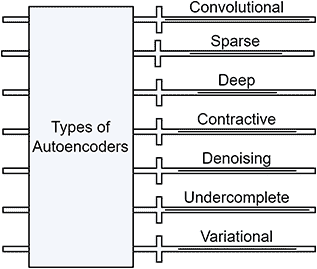

**图 7.2.** 不同类型的自动编码器。

本章的后续章节将给出对变分自动编码器的详细描述。

### 7.4 自动编码器的应用

自动编码器在社会公益应用中有多种用途，例如水质分析、空气污染控制分析、森林火灾预测、面部变化分析等（见图 7.3）。

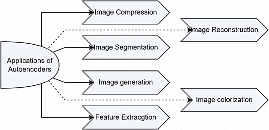

**图 7.3.** 自动编码器的应用。

以下介绍了过去应用自动编码器的关键领域：

#### 7.4.1 图像重建

自动编码器用于重建信息的图像。在某些应用中（特别是法医学应用），由于各种原因导致图像部分丢失，只能收集到部分图像。这些部分图像可以使用自动编码器进行重建。

最常见的应用列举如下：

1. 在旅游业中，图像需要结合时间线进行重建。例如，没有树的图像可以重建出树，以表示以前的情况。
2. 同样，消失河流的图像可以被修改以显示河流中有充足的水。这是一些城市和城市地区的常见问题，这些地区的河流水位在近期有所下降。使用重建方法，人们可以以符合他们旧记忆的方式再次查看历史地点。
3. 图像重建还为从输入图像移除任何不需要的问题铺平了道路。例如，可以移除在稀有的孤本图中发现的障碍，这种障碍无法通过正常方式重建。

图像修补（Image inpainting）属于这种图像重建类的技术 [10]。在图像修补方法中，通过从图像的潜空间收集特征来重建图像的丢失部分。图像修补方法在数字图像艺术系统中变得非常流行，因为在多个领域中，重建对用户来说非常有用。

#### 7.4.2 图像着色

图像着色是一种改进图像色彩空间的应用 [8]。常见的颜色如红、蓝、绿（RGB）通常被混合形成各种颜色组合。然而，某些图像使用的色彩空间可能会丢失颜色。这些丢失的空间可以被恢复，以重建最高质量的图像。自动编码器的应用支持这种对图像色彩质量的增强。

此外，可以使用自动编码器对旧灰色图像进行红蓝组合，营造活泼的感觉。自动编码器的层从图像中提取颜色的潜空间表示。编码器和解码器的结合可以为图像着上指定的颜色，如现代图片所示。自动编码器也可以为图像中的物体着色。通过这些应用，例如图中识别的山脉和天空可以被自动编码器分别着上棕色蓝色。

#### 7.4.3 高分辨率图像生成

许多旅行者和爱好者希望从旧照片或相机拍摄效果差的照片创建高分辨率图像。在图像被架构编码器阶段学习后，自动编码器可以增加图像分辨率。例如，[4] 的作者使用自动编码器开发了一种彩色图像生成机制。在现代系统中，需要预定义的图像分辨率。

#### 7.4.4 通过特征提取的推荐系统

在大多数情况下，自动编码器用于图像处理应用和压缩改进系统。除了传统应用外，这些深度学习架构也可以应用于涉及评论或文本的推荐系统。例如，自动编码器可以用于从网络爬取的评论意见中提取数据特征，以便观察用户或客户的内在偏好。因此，自动编码器是多个推荐系统（包括电影推荐和大学推荐系统）的候选深度学习平台。

#### 7.4.5 图像压缩

自动编码器最重要的应用之一是减少输入数据的维度——即图像压缩。通过降低图像维度，自动编码器的隐藏层能够收集图像的内部特征。如果增加隐藏层的数量，与输入图像相比可以大幅减少。因此，尽管自动编码器旨在用于图像处理和学习，但它们非常适合图像压缩相关的应用。

#### 7.4.6 图像分割

使用自动编码器也可以实现图像分割。图像分割是分割对象以快速识别它们并执行某些决策相关处理的过程。例如，在智能交通系统中，图像分割可以用于收集道路或交通场景的特征。通过这种方式，较小的设备就可以以最小计算量实现自动汽车。

## 7.5 变分自动编码器

变分自动编码器遵循与自动编码器相同的原理，即输入图像经过特征提取以将高维转换为低维。

#### 7.5.1 变分自动编码器向量

然而，变分自动编码器的编码器使用两个向量，如下所示：

1. 平均值向量——该向量从编码器或解码器的转换空间收集平均数据。
2. 标准差向量——该向量从自动编码器组件的转换空间收集标准差值。

#### 7.5.2 变分自动编码器损失函数

与自动编码器类似，变分自动编码器在捕捉学习损失时也包含重建损失因子。然而，在变分自动编码器方法中，主要目标是尽可能接近原始图像的重建。因此，损失函数包含了这两个用于执行数学运算的项。


变分自动编码器并不直接将向量传递给解码器。相反，它们从数值分布中收集采样值。通过这种方式，编码过程中涉及的复杂度被降最低。然而，这为获取最等效或预期结果的过程带来了巨大的风险。

## 7.5.3 理解变分自动编码器的图化方法

如图 7.4 所示，一张由多个物体组成的图像被捕获，其潜特征集由变分编码器观察。例如，一张由山脉、太阳、河流等组成的图像通过变分编码器架构处理时经过以下步骤：

1. 首先，收集图像并观察潜空间对应的特征；
2. 特征值表示为均值；
3. 来自图像数据的标准差向量也被收集在另一个向量中；
4. 随后，图像特征以概率分布的形式表示，如图 7.4 所示；
5. 随后允许解码器通过采样器从概率分布的宽范围内选取值；
6. 最后，解码器使用采样值重建图像。

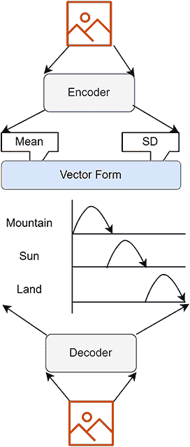

**图 7.4.** 变分自动编码器—理解特征。

## 7.5.4 变分自动编码器—用例

变分自动编码器广泛应用于自动重新图像或数据集。使用潜空间探索重新生成图像或数据集的最常见应用描述如下：

### 7.5.4.1 数字构造

给定从手写文档输入的若干组数字，变分自动编码器可以用于捕捉手写数字，从而创建类似的机器馈入手写数字。

在变分自动编码器中，数字表示的手写特征被机器人以类似于人类书写的方式观察和复制。变分自动编码器的目的并不是生成输入数据集中找到完全相同的图像；而是尝试提供略有不同的图像。显然，手写数字在任何正常情况下都是变化的。因此，发现变分自动编码器最适合此类情况。

### 7.5.4.2 音乐生成

音符通常具有定义良好的潜空间 \[2\]。考虑在钢琴上演奏的 4/4 拍。演奏者表达了特定的停顿。在每个停顿之后，可能会播放出与之前的音乐融合的略有变化的音乐。

变分自动编码器可以应用于音乐生成系统，在向下一组乐节引入变化之前，识别潜空间。接下来的乐节可以通过采样器从更广泛的概率分布中选择。相应的，生成的音乐将具有不同的音符，且与之前的音符相比没有太大变化。一些作者已经应用变分自动编码器，通过从输入的钢琴序列中捕捉潜特征来生成钢琴音乐。图 7.5 描述了一种使用变分自动编码器生成钢琴音乐或手写数字的机器人架构。

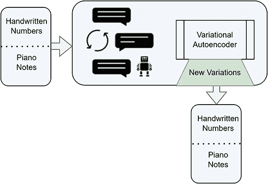

**图 7.5.** 用于数字/钢琴重建的自动编码器。

学习潜空间并应用变分自动编码器生成音乐的原理不仅限于钢琴；它还可以用于生成不同节拍（如 4/4、2/4、7/8 等）的鼓点。

## 7.6 自动编码器实现—代码片段说明

可以使用 TensorFlow 库来创建自动编码器。该库最常用的是 Keras 软件包。本节解释了用于从手写数字数据集创建数字的自动编码器的最少化实现。

使用 TensorFlow 库实现自动编码器涉及的主要步骤如图 7.6 所示。此外，实现阶段使用的代码片段描述如下：

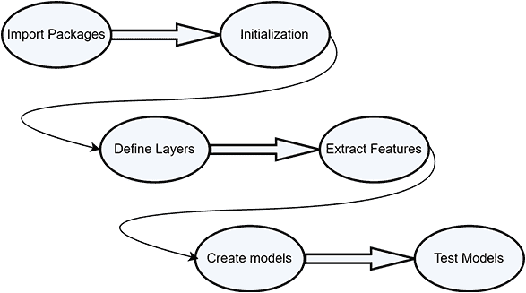

**图 7.6.** 变分自动编码器—使用 TensorFlow 的实现步骤。

### 7.6.1 导入

为了启用自动编码器，我们需要导入 TensorFlow 库的相关包。下面提供了一个演示导入软件组件过程的代码片段：

```python
import tensorflow as tf


import keras

from keras import layers
```

### 7.6.2 初始化

下一步是初始化启用自动编码器计算组件所需的变量和数据集。计算组件可以是 GPU 或 CPU。易理解的是，由于 GPU 巨大的并行性，基于 GPU 的计算比基于 CPU 的计算耗时更短——即基于数组的矩阵运算由 GPU 执行时更快。下面提供了一个描述如何输入图像并解析形状特征的代码片段：

```python
dimension = 32  
image = keras.Input(shape=(982,))
```

在这里，`dimension` 代表输入图像的压缩需求。

### 7.6.3 层定义

现在定义这些层以激活编码和解码过程，如下所示：

```python
# 编码器定义
encoder = layers.Dense(dimension, activation='relu’)(input=image)

# 解码器定义
decoder = layers.Dense(982, activation=‘sigmoid’)(input=encoded)
```

可以观察到，这定义了自动编码器的编码器和解码器函数。注意的是，编码层被分配了输入图像，而解码层的输入是编码属性。从代码片段可以看出，结果是压缩的，因为这些层指定的维度为 32。

### 7.6.4 特征提取

一旦定义了自动编码器的编码器和解码器，使用以下代码片段提取潜空间属性并执行所需的功能，如图像重建或生成：

```python
model = keras.Model(image, decoder)
```

### 7.6.5 建模与测试

现在可以编译并设置模型进行未来的预测或准确性估计，如下：

```python
model.compile(optimizer=‘adam’, loss=‘binary\_crossentropy’)  
model.fit(x\_train, x\_train,  
  epochs=100,  
  batch\_size=32,  
  shuffle=True,  
  validation\_data=(x\_test, x\_test))
```

在这里，模型使用 Adam 优化器进行编译，并为不同的图像计算损失。图像通常分为两个大类：训练图像和测试图像。

上述代码序列被认为是创建自动编码器所需的最少配置，适用于任何通过获取潜空间属性来自动生成图像的相关应用。


## [4] Gomes P R, Sabuj H H, Uddin M A, Reza M T, Faiz R I and Alam M A 2021 *基于自动编码器技术的不同光条件下彩色图像重建的深度学习方法 电子、信息与通信国际会议, ICEIC 2021, 韩国济州, 2021 年 1 月 31 日–2 月 3 日* (Piscataway, NJ: IEEE) pp [1–4](http://dx.doi.org/10.1109/ICEIC51217.2021.9369779) (DOI: `10.1109/ICEIC51217.2021.9369779`)

## [5] Ju Y, Guo J and Liu S 2015 结合稀疏自动编码器与 SVM 的深度学习方法 2015 网络增强分布式计算与知识发现国际会议, CyberC 2015 (中国西安, 2015 年 9 月 17–19 日) (Los Alamitos, CA: IEEE Computer Society Press) pp [257–60](http://dx.doi.org/10.1109/CyberC.2015.39) (DOI: `10.1109/CyberC.2015.39`)

## [6] Kang G, Gao S, Yu L and Zhang D 2019 用于高速铁路绝缘子表面缺陷检测深度架构：带多任务学习的去噪自动编码器 *IEEE Trans. Instrum. Meas.* [**68** 2679–90](http://dx.doi.org/10.1109/TIM.2018.2868490) (DOI: `10.1109/TIM.2018.2868490`)

## [7] Li W, Shang Z, Gao M, Qian S, Zhang B and Zhang J 2021 用于旋转机械不平衡智能故障诊断的新型深度自动编码器和超参数自适应学习 *Eng. Appl. Artif. Intell.* [**102** 104279](http://dx.doi.org/10.1016/j.engappai.2021.104279) (DOI: `10.1016/j.engappai.2021.104279`)

## [8] Pradhan N, Dhaka V S, Thakur S and Bhakar S 2021 用于图像着色的深度学习技术 *数据科学、机器学习与人工智能国际会议* 以及 D S Jat, C Stanley, J G Quenum, N Dey and A Jain (New York, NY: ACM) pp [147–52](http://dx.doi.org/10.1145/3484824.3484902) (DOI: `10.1145/3484824.3484902`)

## [9] Pu Y, Gan Z, Henao R, Yuan X, Li C, Stevens A and Carin L 2016 用于图像、标签和说明深度学习的变分自动编码器 ed and D D Lee, M Sugiyama, U von Luxburg, I Guyon and R Garnett *神经信息处理系统进展 29: 2016 年神经信息处理系统年度会议，2016 年 12 月 5–10 日，西班牙巴塞罗那* (Red Hook, NY: Curran Assoc. Inc) pp 2352–60

## [10] Qin Z, Zeng Q, Zong Y and Xu F 2021 基于深度学习的图像修复：综 *Displays* [**69** 102029]

## [11] Raslan W and Ismail Y 2021 基于深度学习自动编码器的压缩 *第 28 届国际电子、电路与系统国际会议* (Piscataway, NJ: IEEE) pp [1–6]

## [12] Zhu Z, Wang X, Yao C and Bai X 2016 使用自动编码器的深度学习表示 *Neurocomputing* [**20** 41–50]

# 具有社会影响的深度学习技术

## GANs

生成对抗网络（`GANs`）是一类能够生成数据的机器学习模型。事实上，`GANs` 可以生成图像、音频、视频、数据等。然而，模型创建的数据并不一定在现实生活中存在。

### GANs 简介

2014 年，蒙特利尔大学博士生 Ian Goodfellow 提出了 `GANs`。`GANs` 的目标是生成与训练集相似的数据。生成模型是创建新数据的模型。本章将解释生成模型和判别模型。

## 概念——生成式与描述性

在深入研究 `GANs` 的细节之前，让我们介绍两个基本概念：生成式模型和描述性模型。

### 生成式模型

生成模型（`GANs`）是一类能够生成数据的模型。例如，物联网（`IoT`）应用可以生成不存在的人脸图像。因此，生成模型是创建数据集中不存在图像的模型。

生成模型涉及在复杂数据集上训练的多个神经网络隐藏层。此类模型的一个重要任务是学习数据集及其对应的分布。当生成模型被训练成功后，它可以估计给定样本之间的相似性并创建新样本。

让我们考虑一个提供更深层次理解的例子。例如，假设我们需要创建一个从未在地球上存在过、但看起来相对相似的大象图像。现有的深度学习架构无法解决这个问题。使用 `GANs`，我们可以利用现有的象数据集训练模型来理解象特征。特征包括图像的像素值、边缘、亮度水平等。生成模型尝试学习这些特征并导出规则或策略以创建新图像。事实上，这个过程并不是一个简单的解决方案。它需要一个能够建立规则或策略的强大基础。

为了克服生成模型固有的复杂性，使用概率理论来创建规则比使用确定性理论更好。生成模型使用极大似然概念进行学习。然而，生成模型的独特性作为似然方法的替代方案仍然存在。


对抗网络（GAN）的生成模型通常使用 TensorFlow 库实现 [1]。生成模型包含多个层，用于产生用于创建密集连接层的定义、执行归一化并指定激活函数。模型随后会执行一系列类似的批处理卷积。下面给出了示例这些模型实现的代码片段：

``````python
model = tf.keras.Sequential()  

model.add(layers.Dense(7*7*256, use_bias=False, input_shape=(100,)))  

model.add(layers.BatchNormalization())  

model.add(layers.LeakyReLU())  

model.add(layers.Reshape((7, 7, 256)))  

assert model.output_shape == (None, 7, 7, 256)
model.add(layers.Conv2DTranspose(128, (5, 5),  

strides=(1, 1), padding='same', use_bias=False))  

assert model.output_shape == (None, 7, 7, 128)  

model.add(layers.BatchNormalization())  

model.add(layers.LeakyReLU())
model.add(layers.Conv2DTranspose(64, (5, 5),  

strides=(2, 2), padding='same', use_bias=False))  

assert model.output_shape == (None, 14, 14, 64)  

model.add(layers.BatchNormalization())  

model.add(layers.LeakyReLU())
model.add(layers.Conv2DTranspose(1, (5, 5),  

strides=(2, 2), padding='same', use_bias=False, activation = 'tanh'))  

assert model.output_shape == (None, 28, 28, 1)  

return model
``````python

### 8.2.2 判别模型

判别模型是 GAN 中生成模型的教学模块。由于它们是无监督学习模型，GAN 需要机制来增强它们的准确性。判别模型尝试向生成模型提供建议，以便重构的数据集（包括图像）在本质上是真实的。这些模型包含神经网络层，用于学习图像或数据集的特征和特性 [4]。GAN 包含了判别模型用以区分真实和非真实数据集。以河马图像为例，判别模型充当分类器，确定由生成模型生成的河马图像是否为河马图像。模型可以在从零到一的刻度上表示分类——即概率为零表示识别结果错误，概率为一则指向正确值。

使用 TensorFlow 实现判别模型的通用方法如下：

``````python
model = tf.keras.Sequential()  

model.add(layers.Conv2D(64, (5, 5), strides=(2, 2),  

padding='same', input_shape=[28, 28, 1]))  

model.add(layers.LeakyReLU())  

model.add(layers.Dropout(0.3))
model.add(layers.Conv2D(128, (5, 5), strides=(2, 2), padding ='same'))  

model.add(layers.LeakyReLU())  

model.add(layers.Dropout(0.3))
model.add(layers.Flatten())  

model.add(layers.Dense(1))
return model
``````python

### 8.3 涉及的主要步骤

GAN 结合了两个模型（例如生成模型和描述性模型）来创建内容。从更广泛的角度来看，GAN 遵循以下步骤来创建数据集：

#### 8.3.1 加载与准备

加载和准备步骤使用判别器模型来提高精度。例如，GAN 算法需要数据集来处理图像。

#### 8.3.2 建模

在建模方法中，GAN 内部结合了两个不同的模型（生成模型和判别模型）来学习数据集。

#### 8.3.3 损失与优化器

判别模型需要损失函数或优化器（如 Adam 优化器）来评估预测。这些模型用于生成图像。

#### 8.3.4 训练步骤

在确定了 GAN 的损失函数后，训练过程通常需要时间。例如，使用适当的数据集可以加速训练步骤。

#### 8.3.5 测试步骤

在 GAN 的实现中，测试这些模型用于生成新的图像。

### 8.4 GAN 架构

GAN 架构由两个主要实体组成：生成器和判别器。本节将讨论这些组件的功能。

#### 8.4.1 生成器

如图 1 所示，生成器组件从随机变量或参数中收集输入以创建数据集。与此同时，真实数据集被采样并提取其特征。这两个输入被输入判别器组件，后者分析这些差异。判别器通常使用二分类器实现，用于判断给定输入是否真实。生成器创建样本被称为伪样本。这一过程持续进行直到被外部机构停止或完成指定的循环次数。

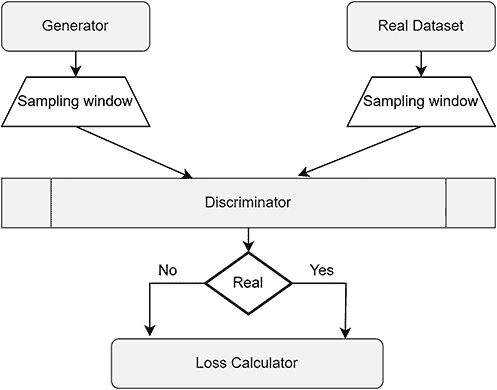

**图 8.1.** GAN 架构。

GAN 的生成器在判别器的协助下获得创建非真实数据集（也称为伪数据集）所需的知识。生成器的目标是让判别器接受生成器生成的数据集为真实数据。因此，我们可以观察到生成器的训练部分与判别器的部分之间存在密切的关系。

常用的生成模型（特别是图像数据集）如下：

1.  显式似然模型——这些似然模型理解数据集的数据分布（如泊松、高斯、二分类等），它们通过生成一组新的分布来构建数据。该类别的一些著名方法包括：(a) 概率主成分分析 (PPCA)、(b) 因子分析、c) 混合模型、d) PixelCNN/PixelRNN、e) WaveNet、f) 自回归语言模型、g) 近似极大似然、h) 玻尔兹曼机器以及 i) 变分自动编码器。

2.  隐式似然模型——在隐式模型中，通过生成器研究数据的统计属性。只要为此目的检查了足够的数据，这为学习新实例提供了更清晰的见解。

### 8.4.2 判别器


GAN 的判别器旨在指出给定数据集（包括图像数据集）中的差异。当一个伪样本作为输入给判别器时，判别器的软件模块必须将其识别为伪样本——即生成器试图通过让判别器将假物识别为真来欺骗它。

GAN 的判别器模块使用一些计算和软件模块执行差异计算，同时实现目标。差异通常使用极小极大化优化公式进行评估，其中生成器试图最小化目标函数，而判别器则试图最大化同一个目标函数。

## 8.5 GAN 的类型

根据生成新数据集（包括图像）所采用的方法，GAN 通常被分为六大类（参见图 8.2）。下面将讨论这些 GAN 的功能及其目标：

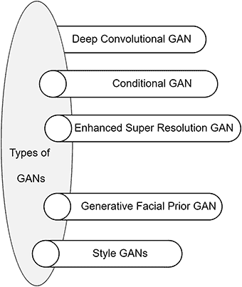

**图 8.2.** GAN 的类型。

### 8.5.1 DCGAN

深度卷积 GAN（DCGANs）顾如其名利用了卷积网络。通常情况下，由于缺乏关于学习数据集的特定信息，`CNNs` 被视为黑箱。然而，`CNNs` 凭借其稳健的建模特征取得了卓越的结果。

在 DCGAN 中，生成器和判别器由 `CNNs` 的黑箱实现支持。黑箱 `CNN` 实现专门为创建 DCGAN 进行了修改。通常情况下，DCGAN 在学习过程中尝试不连接所有的卷积层。最近，人们已努力尝试将 DCGAN 应用于图像修复 [8]。与 `CNNs` 相比，DCGAN 中包含的一些显著修改如下：

1. 传统 `CNNs` 的最大池化组件被替换为更多的空间组件。结果是学习过程中的确定性方法从系统中被移除了。显然，DCGAN 的生成器能够从更大的空间数据集中独立学习。
2. 在 DCGAN 中观察到的第二种修改是将全连接层转换为部分层的倾向。例如，增加跨多个层的平均池化的使用支持跨层计算结果的共同努力。显然，这种方法可以提高所实现的精度，但预期的收敛速度会降低。
3. 已知事实是添加批归一化会增加学习模型的稳定性。在 DCGAN 中，需要新的见解。因此，与其他 `CNNs` 不同，生成器和判别器模型尝试避免批归一化。

### 8.5.2 CGAN

条件 GAN（CGANs）是一种可以使用一些额外输入生成新数据集的 GAN 类型。与之前的 DCGAN 方法相比，CGAN 使用一些输入或条件来学习数据集。它们与 DCGAN 相似之处在于，它们也有生成器和判别器来生成新的数据集，包括语音或视频数据集。[6] 的作者将条件 GAN 应用于从输入源提炼知识。

CGAN 通常被认为是原生 GAN 方法的扩展。条件以输入或变量的形式提供给 CGAN，并影响卷积网络的学习层。这些条件不仅输入到生成器模型，还输入到 CGAN 的判别器模型中。

将特定条件引入 CGAN 的核心思想是根据输入数据集专门获得特定的特征输出。例如，如果用户想在根据 MNIST 手写数据集生成数字时打印一个特定的数字，CGAN 将能够根据提供给 CGAN 生成器和判别器的条件或偏好提供它。显然，当用户希望从 GAN 获取确定性的生成解决方案时，CGAN 是一个很好的选择。

CGAN 的训练阶段涉及训练 CGAN 的生成器组件和判别器组件。生成器组件将标签转换为代表输入数据集条件的复杂数组。此外，对于 CGAN 的学习组件，数据进行重塑或预处理是必要的。

生成器组件的目标是创建让判别器组件对输出不确定的图像或数据集，而 CGAN 的判别器组件试图学习输入图像或数据难以理解真实状况。为了从判别器的训练阶段获得最佳效果，CGAN 为给定的一批输入数据集最小化其训练模块的损失。

### 8.5.3 ESRGAN

增强型超分辨率 GAN（ESRGAN）的官方实现可以在 [`github.com/xinntao/ESRGAN`](https://github.com/xinntao/ESRGAN) 找到。Windows、Linux 和 MacOS 机器都有 ESRGAN 的执行版本。

图像数据集的超分辨率在过去已经过广泛研究 [2]。该方法的目标是提高图像修复的质量。修复图像质量的方法有很多，例如三次下采样方法。然而，传统方法无法提供高质量的修复过程。

使用一些过程来修复高分辨率图像，例如过滤模糊、去除噪声、选择合适的方法、结合高效的压缩技术等。

模糊是质量退化的重要来源。某些模糊滤波器（如等向性滤波器、各向异性滤波器等）在过去被实现为内核以消除图像中的模糊。

图像中的噪声是由于图像亮度或颜色组合的随机变异引起的。图像中存在噪声组件会导致修复高分辨率图像变得困难。两种常见的噪声是加性高斯噪声和泊松噪声，取决于噪声在图像中的分布。

选择合适的大小可以降低修复高分辨率图像的风险。在某些情况下，算法没有正确执行图像重塑。

### 8.5.4 GFP GAN

生成式面部先验 GAN（GFP GANs）专注于修复旧照片，并更加关注面部检测。它们应用一些预训练的 GAN 模型和空间特征变换来修复面部图像。这种方法通常被称为盲面部修复过程 [2]，因为该方法能够从退化的图像中生成高质量的面部。

退化在图像中非常常见，即使是新的图像也是。它是由于噪声、模糊、相机对焦、压缩伪影等引起的。然而，许多领域对克服这些退化非常感兴趣。


StyleGAN 是一种基于风格迁移研究的 GAN 变体。它收集面部图像的特征要素，并尝试为其提供更大的变化。生成的模型除了去模糊、处理压缩伪影等传统改进外，还为图像提供了更新的视角和外观。[7] 的作者尝试提高 StyleGAN 反演的性能。

## 8.7 GAN 的简单实现

本节描述了生成器和判别器的简单实现，它们使用 MNIST 数据集生成手写数字，MNIST 是流行的手写数字数据集。

GAN 的实现分为如下所示的几个阶段进行。

### 8.7.1 导入库和数据集

首先将所需的库和 MNIST 数据集加载到 GAN 架构中。实现 GAN 使用的最重要库列如下：

```python
import tensorflow as tf

from tensorflow.keras.layers import Dense, LeakyReLU, Dropout

from tensorflow.keras.models import Model

from tensorflow.keras.optimizers import SGD, Adam
```

TensorFlow 平台提供了 keras 库以及相关的 Python 子库包，例如全连接层、激活函数、dropout 层以及使用 `Adam` 或随机梯度下降 (`SGD`）的优化功能。这些包在 GAN 执行的初始阶段导入。

我们现在需要加载包含手写数字的 MNIST 数据集，如下：

```python
mnist = tf.keras.datasets.mnist

(x_train, y_train), (x_test, y_test) = mnist.load_data()
```

将 MNIST 数据集直接加载到训练和测试集中是一种常见做法。

### 8.7.2 生成器模型

如前所述，生成器模型由一系列层组成，包括 TensorFlow 平台启用的批归一化。因此，根据 GAN 模型原理的要求，MNIST 数据集经过一系列全连接层、批归一化和激活处理：

```python
input = Input(shape=(dimension,))

layer_x = Dense(256, activation=LeakyReLU(alpha=0.2))(input)

layer_x = BatchNormalization(momentum=0.7)(layer_x)
layer_x = Dense(512, activation=LeakyReLU(alpha=0.2))(layer_x)

layer_x = BatchNormalization(momentum=0.7)(layer_x)
layer_x = Dense(1024, activation=LeakyReLU(alpha=0.2))(layer_x)

layer_x = BatchNormalization(momentum=0.7)(layer_x)
layer_x = Dense(dimension, activation=âtanh)(layer_x)
gen_model = Model(input, layer_x)
```

### 8.7.3 判别器模型

用于 MNIST 数据集的判别器模型使用 TensorFlow 包的全连接层创建并指定激活函数，如下：

```python
input = Input(shape=(sizeofImage,))

layer_x = Dense(512, activation=LeakyReLU(alpha=0.2))(input)

layer_xx = Dense(256, activation=LeakyReLU(alpha=0.2))(layer_x)

layer_x = Dense(1, activation='sigmoid')(layer_x)

des_model = Model(input, layer_x)
```

### 8.7.4 编译与优化

一旦针对 MNIST 数据集定义了生成器和判别器模型，就可以使用 `Adam` 优化器等工具对模型进行编译和优化，如下：

```python
des_model.compile (loss='binary_crossentropy',
optimizer=Adam(0.0002, 0.5), metrics=['accuracy'])

gen_model.compile(loss='binary_crossentropy',
optimizer=Adam(0.0002, 0.5)) #引入噪声
```

### 8.7.5 生成图像

最后一步是训练生成器模型和判别器模型以创建一组手写图像。这些手写图像之间进行交叉检查，以提高模型的准确性。

因此，新创建的手写图像是通过 GAN 架构和 TensorFlow 平台开发的。

## 8.8 GAN 的质量

与其他深度学习模型相比，GAN 没有直接的评估方法来确定准确性。例如，在其他方法中，我们可以指定损失函数作为目标值。然而在 GAN 中，生成器模型和判别器模型必须共同工作以改进训练模型的最终目标。

在此背景下，GAN 的质量取决于模型以及驱动这些模型的设计过程。例如，评估生成消息或图像的质量可以通过评估 GAN 质量的目标函数完成，而不是通过客观地固定模型准确性。

### 8.9 应用与挑战

GAN 已用于从学术界到工业界各个领域的多个应用。本节列出了应用 GAN 的一些显著应用和相关领域。

### 8.9.1 人脸生成

各种用户和移动应用开发者对使用 GAN 生成人脸或表情图像产生了浓厚兴趣。

音乐是艺术，一些研究人员发起了倡议从输入样本中生成新音乐。事实上，考虑到从数万音乐样本中收集的节奏和色调，我们可以使用基于 GAN 的音乐软件提供完美的旋律。该应用在未来的应用中可以轻松与其他几个舒适相关的开发合并。

### 8.9.3 翻译

GAN 可应用于将图像转换为段落，将文本转换为图像。

### 8.9.4 引导生成

GAN 还具有带有引导生成图像的选项。


# 深度强化学习架构

深度强化学习（`RL`）通常而言，是一种利用奖励和惩罚来学习上下文的机器学习技术。它被认为是一种目标导向的学习过程。本章将讨论用于创建智能体（agent）奖励和动作的技巧。

## 9.1 深度强化学习——简介

深度强化学习方法是一种机器学习（`ML`）技术。当应用于学习系统时，它会以策略性的采取行动，以使奖励最大化并减少失败。这是通过智能体在短时间内采取一系列决策（最好是显著的决策）来实现的。这一系列决策成为了深度强化学习过程中所采用的学习程序的结果。

`RL` 的概念最早用于于几十年前 [1, 9, 13]。然而，该方法仍被应用于多个领域，包括运输部门 [11]。

`RL` 方法有两个执行意图目标的广义实体：

* 智能体 (agents)
* 环境 (environments)

智能体是利用对环境的推理进行自主学习过程执行者；这些实体被认为是软决策者。环境是智能体执行动作的地方。

由于 `RL` 在各个领域中的适用性，包括在工业物联网（`IoT`）中通过一系列决策来解决巨大任务，将其应用于各个领域的概念在近年来变得更加流行。`RL` 方法在机器人世界表现出显著的增长率，特别是以自动清洁房屋和协助老年人的家用设备的形式出现。事实上，在人类身上也可以观察到 `RL`——即人类使用的学习过程通过奖励和积极的环境得到了改进。例如，一个获得充足奖励的员工在工作中可能会表现出前瞻性或乐观的态度。

## 9.2 深度强化学习与机器学习的区别

深度 `RL` 被认为利用了简单 `RL` 方法的优势。众所周知的事实是，人工智能可以通过两种主要方式应用：

* 基于规则的 (rule-based)
* 基于机器的 (machine-based)

在基于规则的方法中，智能的应用基于人类的经验和从学习领域专家那里转移的知识 [2]；相比之下，基于机器的智能基于整合到机器中的学习过程，这些机器学习海量数据。

深度 `RL` 方法的核心思想是设计能够从长远来看改进现有奖励的策略。

与其他几种学习方法（如深度学习）类似，`RL` 是一种机器以自动方式学习的方法。学习机制努力为 `RL` 系统的智能体建议更好的决策序列。从根本上说，`RL` 方法试图开发出一系列规则，使其能够自发地最大化决策利益。当然，在感兴趣的领域进行多次尝试后，学习准确性和行为必须得到改进。

`RL` 技术等同于学校或社会对儿童的教育。他们在经历某种情况后会学习到几个重要的事实和数字。有时，他们会因为记忆力差而失败或受到惩罚。`RL` 过程的情况也类似，由于不确定性而导致的错误决策需要受到惩罚，以实现高效的未来学习或决策过程。

## 9.3 深度学习与强化学习的区别

深度学习和 `RL` 机制之间存在细微差别，尽管它们都是在不涉及人类指定规则的情况下学习事实和数字——即深度学习通过将数据划分为训练、验证和测试部分来学习。深度学习机制通过从环境中获取反馈来实现学习，而 `RL` 方法不需要这种数据。深度学习过程结合了深度学习和 `RL`。

`RL` 机制分为监督学习和无监督学习。在机器学习范式中，许多监督和无监督算法已经实施。监督学习需要关于数据的提示。例如，对植物和动物的图像进行标注。在这种情况下，机器可以学习这些特征。然而，这种方法等同于教师-学生模型，`RL` 不需要此类密钥或标签。在某些情况下，监督强化方案的性能可能高于其他方案 [6]。

在无监督学习过程中，不需要输入标签或完整标签的训练密钥 [8]。显然，无监督学习算法必须自己学习。为了实现这一点，大多数此类算法根据相似性差异对数据形成关联。另一方面，`RL` 机制应用智能体来学习并执行决策序列。这些智能体从未知的环境中学习。

## 9.4 强化学习的应用

强化学习已应用于一些著名的领域，如自动驾驶、机器人、自然语言处理、游戏等。

### 9.4.1 自动驾驶

通常，自动驾驶围绕从环境中观察场景。理解场景有助于 `RL` 智能体学习环境，在状态之间进行调整并最大化奖励或惩罚，使学习自包含。这些算法最重要方面是迅速地从环境中收集相关信息。在某些情况下，相邻机器或传感器节点之间的协作至关重要。安全驾驶和最小化复杂性是为这些应用设计 `RL` 算法固有的目标 [7]。此外，识别行驶位置、定位限速障碍或车道以及在各种旅行地点避免碰撞是实施 `RL` 机制的关键应用。

### 9.4.2 机器人

机器人的开发是为了最小智能模拟人类动作。它们利用机械部件、元件和人工智能（`AI`）来执行动作。这些机器人通常是为了帮助社会或工业而开发的 [4]。例如，轮胎行业的机器人可以在没有人工参与的情况下组装并准备轮胎。结果是人类免受工业引起的几种有害疾病的侵害。使用 `RL` 实现的机器人尝试通过尝试步骤来学习其环境。

### 9.4.3 自然语言处理系统


自然语言处理（`NLP`）由于 `Alexa`、`Siri` 等语音辅助设备的增多而变得非常流行。由于机器中状态数量的增加，基于 `NLP` 的系统的学习过程比传统的学习算法更为复杂。由于语言学涉及的多维参数的固有性质，将 `RL` 技术应用于基于 `NLP` 的系统可以改进学习过程 [12]。显然，传统的 `NLP` 任务，如词嵌入、词性标注、停用词去除、词还原和词干提取、依存分析、句法分析等，都可以从 `RL` 技术的应用中受益。

#### 9.4.4 游戏

对于计算机科学家来说，游戏不仅是娱乐，还丰富了计算优化策略。过去，Google LLC 以及 DeepMind Technologies 等领先子公司的研究人员试图通过下围棋来证明应用深度 `RL` 机制的重要性。他们的智能体通过使用 `RL` 算法完成任务，击败了多位冠军。

### 9.5 RL 框架的组件

支持 `RL` 机制的智能体的主要组件列如下：

* 策略组件
* 价值函数组件
* 模型组件

#### 9.5.1 策略组件

基于策略的 `RL` 组件定义了 `RL` 智能体的所需行为。例如，在机器到机器的应用中，如果机器相互通信，如果 `machine A` 决定与 `machine B` 通信，这是一个取决于成功率等各种因素的复杂决策过程。如果机器做出任何失败决策。

简而言之，`RL` 的策略组件负责建立输入和输出状态，其中输出状态取决于组件指定的策略 [3]。任何问题的每个状态规定了环境的状况。策略通常是随机或确定的，取决于机器的首选动作。例如，如果 `machine A` 选择通信以到达目标节点，虽然路径很大，但选择由确定性策略决定；相反，如果机器基于快速性的预期做出随机选择，则由随机策略决定。

为了改进策略的形成，特别是在深度 `RL` 框架中，需要对数据集进行泛化。在实践中，泛化通过以下两种方式实现：

##### 实现方法

考虑到用于创建策略的实时和现实情况，使用智能体是 `RL` 解决方案的一种常用直觉方法。然而，由于使用有限的数据进行训练过程，往往会失败。此外，在大多数情况下，为训练目的设置环境是一项昂贵的程序。

##### 仿真方法

可以使用仿真器克服现实环境设置以及训练数据缺失的问题。虽然可以使用这种方法获得足够的数据，但可用的数据质量会导致策略不准确。

#### 9.5.2 价值函数组件

`RL` 框架的这些组件在选择 `RL` 智能体时评估状态。状态可以是动态的或静态的。然而，价值函数定义了问题状态的重要性。例如，在与其他机器通信之前的示例中，选择正确的路径会导致定义状态变化的价值函数。这些组件在选择状态时分配奖励和惩罚。奖励是改进决策的正向概念。

#### 9.5.3 模型组件

强化学习框架使用建模来预测下一个状态。在向目标机器发送数据之前选择中间机器取决于某些参数。这些参数通常表示为基于环境变量的模型。模型旨在预测 `RL` 问题的价值函数。

`RL` 框架中最通用的建模方法涉及马尔可夫决策过程。马尔可夫决策过程基于有限状态和决策的离散时间控制过程。图 9.1 说明了应用实现或仿真方法的 `RL` 三大组件。

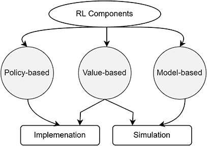

**图 9.1.** 强化学习组件。

### 9.6 强化学习技术

`RL` 的广泛概念可以通过实现步骤的变化（即使用的 `RL` 技术）进行完善，如下所示：

* 关联 RL
* 深度 RL
* 对抗深度 RL
* 逆向 RL
* 安全 RL

#### 9.6.1 关联 RL

关联 `RL` 机制是一种将关联网络纳入 `RL` 框架的技术 [10]。关联记忆单元通常类似于发现大量数据相关性的脑网络。我们的人类大脑能够轻松分析环境模式。

将关联属性应用于学习神经网络可分为两个领域：

* 自关联
* 异关联

`RL` 中的自关联属性尝试包含许多同类神经元以自主创建状态。学习过程的异关联性质有利于双向关联记忆单元。

在关联 `RL` 中，关联记忆单元由 `RL` 模型托管以提供决策步骤或阶段。

#### 9.6.2 深度 RL

传统的 `RL` 方法根据给定状态准备新动作。对于每个状态和给定环境，策略建议新状态。然而，复杂性是巨大的，特别是当考虑到具有数万个状态变化的复杂游戏或应用程序时。这可能导致普通的计算方法不足以进行自动学习。在这种情况下，会考虑具有更深隐藏层的基于神经网络的学习过程。深度 `RL` 机制使用具有大量隐藏层的学习方法来根据策略理解下一个状态。

尽管关于深度 `RL` 机制的成功存在一些错误观念，但研究工作正在进行以提高这种方法的准确性。采用深度 `RL` 技术的几个方向如下：

1. 如果一致识别成功，则增加智能体的奖励。
2. 结合一些奖励强化技术，例如应用模仿或逆向 `RL` 技术。
3. 应用可扩展高效的硬件来处理算法和方法，以便实现高性能交付。

#### 9.6.3 对抗深度 RL


对抗网络（Adversarial networks）旨在引导学习网络的同时预测某些目标；它们试图通过与学习模型竞争来提高学习准确性和/或预测准确性。深度学习框架中最常用的对抗网络之一是与预期的学习机制并行学习竞争主题。例如，学习使用手机对社会影响的深度学习算法，会与研究同一组用户使用手机益处的学习算法进行竞争。这两个竞争性学习框架之间的相似之处和差异共同作用，以提高系统的学习准确性。

在深度强化学习（deep RL）背景下，实现对抗网络的目的是通过增加奖励/惩罚来快速学习那些几乎不可能发生的事件。例如，在考虑若干环境因素的同时学习自动驾驶汽车的无障碍路径，需要大量的失败案例，以便模型成为一个稳健的解决方案。为了增加 RL 智能体学习的路径推理，训练另一个为原始智能体引入更具挑战性学习场景的 RL 智能体至关重要。因此，在对抗 RL 框架中，两组 RL 智能体协同工作以提高应用的学习准确性。

当并行两个两个智能体以提高学习准确性时，可以通过两种方式实现：

1. **共享学习空间**（Sharable learning space）——共享学习空间是一种常见的学习方法，其中两个 RL 智能体尝试探索同一个学习空间。例如，学生和老师学习相同的概念，并在考试或讲座中重现发现。执行者和智能体的发现都可以经过精炼，以获得对目标主题更好的理解。
2. **非共享学习空间**（Non-sharable learning space）——相比之下，非共享学习空间为两个学习 RL 智能体提供了不同的上下文——即一个智能体可以研究智能城市的电力利用情况，而另一个智能体观察智能城市的舒适区。

## 9.6.4 逆强化学习 (Inverse RL)

逆向强化学习（Inverse RL）是一种应用奖励、策略和模型的技术。该技术面向执行动作的智能体——即根据输入行为改变状态。通常情况下，强化学习方法尝试根据智能体所采取的行为或动作来建议奖励。例如，在自动驾驶汽车中，如果 RL 智能体根据交通标志或规则行驶，则它将获得奖励。值得，奖励被授予 RL 智能体：

1. 如果它通过绿绿灯；
2. 如果它根据限速标志控制速度；
3. 如果它观察到行人通道时减速，以此此类推。

在逆 RL 方法中，遵循的是相反的过程——即根据行为创建奖励。在这种方法中，通过理解人类行为来建立自主学习。例如，人类在学校假期期间观察学校附近的 30 km/h 限速标志时，不会降低车速。在某些情况下，有必要违反规则——即盲目根据策略奖励行为在某些少数用例中并不合适。因此，在逆 RL 方法中，奖励是根据可能的行为得出的。这要求在不同位置和各种场景下收集行为。

然而，逆 RL 方法有一些缺点。它必须理解可能的动作或行为选择。因此，这可能不会导致最佳解决方案——即使用一组权衡来确认机制已找到最优解。

## 9.6.5 安全强化学习 (Safe RL)

RL 机制由于基于内在策略的自主决策或动作，可能会导致奇怪的失败或问题。在安全 RL 方法中，由于策略产生的动作有望提高动作的安全性。安全措施不仅涉及对环境的安全考虑，还涉及参与学习过程的计算单元。例如，RL 中基于推理和策略的决策可能会因为算法巨大的计算需求而延迟。此外，由于内存使用，还有其他一些相关的性能瓶颈。在某些情况下，这些算法可能会导致巨大的能量消耗和效率低下。安全 RL 过程试图在与传统 RL 算法保持近优满意度的同时，减少学习算法使用的计算。图 [9.2] 展示了本节讨论的不同 RL 技术分类。

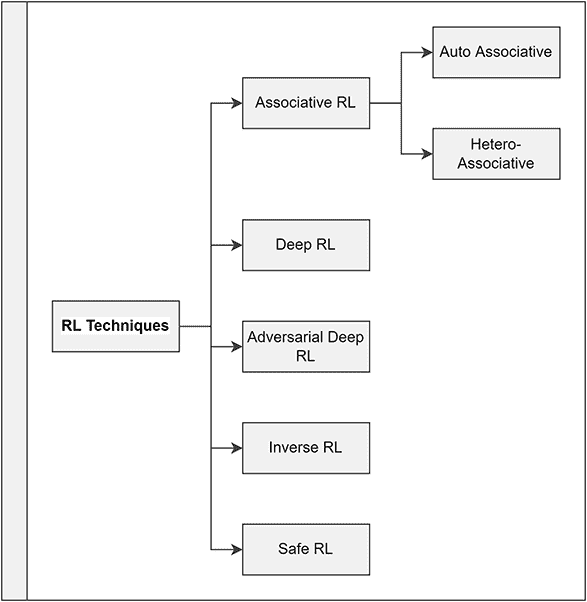

**图 9.2.** 强化学习——最常用的技术。

## 9.7 强化学习算法

强化学习算法根据是否包含统计数据进行分类如下：

* 无模型强化学习 (model-free RL)
* 基于模型的强化学习 (model-based RL)

### 9.7.1 无模型强化学习

在基于模型的 RL 中，不利用先前的历史信息来制定奖励函数，或定义学习过程中的状态变化。相关算法效果较差，因为输出几乎不依赖于当前状态和状态的奖励函数。

最流行的无模型 RL 算法及其内在特征分为两大类：价值取向和策略取向，如下文所示。

#### 价值取向算法

价值取向 RL 算法试图在为环境的任何给定状态选择合适动作的同时增加奖励。属于这一类的少数算法有 (i) 后验经验回放（hindsight experience replay）和 (ii) 深度学习。这些算法中，深度 RL 算法被广泛应用于多个领域。

价值取向学习算法的执行时间通常较长，因为结果可以在良好和糟糕预测之间发散。

##### 深度 RL 算法

通常，Q-learning 通过计算代表智能体奖励的 Q 值来学习环境。例如，RL 智能体可以根据环境当前状态理解所有可能的奖励，并执行动作。显然，这种算法期望智能体理解环境当前状态，但对之前的实例没有先验知识。此外，算法有一组策略来为环境计算奖励点。

让我们考虑一个机器旨在清洗汽车的例子。如果基于 Q-learning 方法设计 RL 算法，可以为 RL 智能体引入选项，根据清洗更多汽车或清洗过程质量来最大化奖励。这些算法的目标根据环境当前状态向学习算法建议可能的奖励点。如果状态和动作点的数量较大，深度 Q 学习方法可以建议更好的动作点。这种方法深入研究可能的状态-动作对，以通过深度学习方法最大化 Q 值——即算法必须根据输入状态和奖励选项解析可能巨大的动作点列表。图 [9.3] 形象地表示了不同的 RL 技术类型。


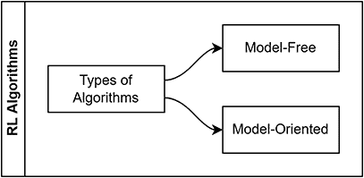

**图 9.3.** 强化学习的类型。

基于 Q 的强化学习方法中，观察动作-策略对值所涉及的步骤列如下：

1. 初始化——首先，在基于 Q 的深度学习算法的初始化阶段创建包含动作和奖励的 `Q-table`。
2. 迭代——然后以重复的方式执行一组任务以更新深度 Q 强化学习算法的 `Q-table`，如下：
    * (a) 选择动作——在迭代步骤中，从动作池中选择一个动作。
    * (b) 评估奖励——对于所选动作，考虑在环境中尝试该动作时存在的环境条件，计算预期奖励。
    * (c) 更新表格——将执行动作后的评估结果和 `Q` 值记录在 `Q-table` 中。

在深度 Q 学习方法中，智能体无法回顾过去发生的大范围可能选择。显然，由于未知之前的状态和选择动作的影响，Q 学习方法的性能可能会受到限制。然而，如果设备内存有限或没有方法处理大量内存，这种方法是很有用的。

### 策略导向型算法

如果要求强化智能体学习策略并在给定环境状态给出合适的策略，则相应的算法被称为策略导向的深度强化学习技术。这类基于策略的强化学习算法的示例包括策略梯度算法、异步优势演员-评论（`A3C`）等。

策略导向的深度强化学习算法通常比之前解释的价值导向深度强化学习方法收敛得更好。

### 9.7.2 基于模型的强化学习

如前所述，基于模型的强化学习方法应用模型来选择有利动作。这些模型取决于之前的动作及其获得的奖励。在基于模型的强化学习方法中，可以为特定问题领域生成模型，例如自动驾驶、情感推理等。

使用基于模型的强化学习方法生成的模型限于特定领域。因此，必须针对所有可能的问题重新实例化。因此，这种方法需要更多的计算和空间。此外，所学模型准确性差会增加使用基于模型的强化学习机制导出动作的计算成本。

### 9.8 集成到真实系统中

尽管针对特定动作学习了模型并推导出奖励，但仍需要将学习到的动作转移到工作环境中。例如，深度 Q 强化学习方法识别的动作必须通信到连接的机器或真实环境中。

例如，如果深度 Q 强化学习方法识别的动作必须通信到连接的机器或真实环境中。


**图 9.4.** 应用于机器人的强化学习。

通常，我们可以观察到三个主要过程：

1. 仿真导向——在这里，在仿真环境中学习动作。这允许安全快速快速探索，而不会对真实硬件产生风险。
2. 真实实现——直接在真实环境中学习动作。这种方法具有风险，但确保策略是针对实际环境动力学定制的。
3. 混合导向——首先在仿真中训练策略，然后在真实世界中微调。这结合了两种方法的优点。

## 参考文献

[1] Skoulakis I E and Lagoudakis M G 2012 Efficient reinforcement learning in adversarial games *IEEE 24th International Conference on Tools with Artificial Intelligence, ICTAI 2012, Athens, Greece, November 7–9, 2012* (Los Alamitos, CA: IEEE Computer Society Press) pp 704–11

[2] Strehl A L 2017 *Associative reinforcement learning Encyclopedia of Machine Learning and Data Mining* ed C Sammut and G I Webb (Springer: Berlin) pp 71–3

[3] Wang K, Wang L, Pan C and Ren H 2022 Deep reinforcement learning-based resource management for flexible mobile edge computing: architectures, applications, and research issues *IEEE Veh. Technol. Mag.* [17] 85–93


[12] Wang W Y, Li J and He X 2018 用于 NLP 的深度强化学习。Proceedings of ACL 2018, Melbourne, Australia, July 15–20, 2018 ed and Y Artzi and J Eisenstein (Stroudsburg, PA: Association for Computational Linguistics) 教程摘要 pp [19–21](http://dx.doi.org/10.18653/v1/P18-5007)

[13] Xie N, Hachiya H and Sugiyama M 2012 艺术家代理：一种东方水画自动笔触生成的强化学习方法 *Proceedings 29th International Conference on Machine Learning, ICML 2012, Edinburgh, Scotland, UK, June 26–July 1, 2012* (icml.cc/Omnipress)

[14] Zhao J, Li H, Qu L, Zhang Q, Sun Q, Huo H and Gong M 2022 DCFGAN：一种具有改进负采样的基于会话的系统的对抗深度强化学习框架 *Inf. Sci.* [[596** 222–35](http://dx.doi.org/10.1016/j.ins.2022.02.045)

***

# IOP Publishing

# 社会影响的深度学习技术

# Shajulin Benedict

***

# 第 10 章

## 人脸识别及其应用

人脸识别系统是深度学习模型极具吸引的应用[5]。人脸识别被视为生物识别的一种形式，通常与传感器的系统相结合。它属于计算机视觉和模式识别研究领域。

本章讨论了该领域的蓬勃发展、识别人脸涉及的过程和技术、与人脸识别相关的若干应用等。此外，还介绍了情感检测的更多详细信息，并讨论了深度学习模型的重要性。

### 10.1 人脸识别——历史视角

通常情况下，人脸识别是识别身份以便访问某些服务的过程。例如，人脸识别被用于开启现代智能家居的门。

20 世纪 60 年代，Goldstein、Harmon 和 Lesk 研究了人脸识别，以识别面部的特征点。面部特征点包括眼睛、鼻子、嘴、眼睑等。他们还识别了发色和特征点的大小以区分模式。研究人员的灵感源于 Woodrow W. Bledsoe，他曾好奇计算机是否能够识别人脸。

事实上，这些工作大部分是在保密状态进行的，没有太多的发表或宣传。该小组的一些密切联系人发布了其他一些工作，他们开发了姿态方向识别。为了开发姿态方向识别任务，创建了一些数学模型来移动特征点或将其引向感兴趣区域。

在十年内，几位研究人员（主要是数学家）与计算机科学家联手，将代数概念应用于面部部位的处理。使用代数表达式进行特征提取也增强了这种方法在当时的重要性。当时研究人员面临的首要关键挑战之一是缺乏先进的摄像设备。捕捉人脸的传统相机是 2D 相机。这些相机通常是固定焦距相机，无法对不同距离的人脸进行焦。此外，相机镜头不可调节，且人脸图像通常在白天捕获。

随着 3D 相机的出现，图像深度的估计成为现实。相机具有可以定位捕获图像宽度、深度和高度的特征。显然，技术使得专注于人脸和特征点的几种聚焦选项变得更加简单。此外，相机技术采用了数字化解决方案，使得记录的图像可以传输到紧光盘（CD）、多功能光盘（DVD）和其他数字存储单元中。

### 10.2 利用人脸的生物识别

人脸识别是安全领域使用的生物识别方法之一[16]。可以观察到，人脸是世界上独特的产物。

通常，生物识别是指在人与人之间保持独特性生理特征。分析生物识别一直是用于促进身份验证服务持续的话题[6]或类似的与安全相关的应用。多种类型的生物识别（见 10.1#Chapter_10.xhtml#bk978-0-7503-4024-3ch10fig）被用于实现计算系统的安全性。市场上使用的最常见的生物识别解决方案如下：

1. **指纹生物识别**：指纹是人类的独特表示。可以使用各种类型的指纹传感器对其进行扫描：光学传感器、热敏传感器或电容式传感器[10]。光学传感器将指纹图像转换为电信号，热敏传感器将指纹图像转换为热变化，电容式传感器将图像转换为相应的电容。指纹生物识别的主要吸引力在于廉价的传感器和解决方案；指纹生物识别避免了使用密码的必要性。然而，这种方法的缺点是手指容易出现问题——即人类会折断或丢失手指。当这种情况发生时，指纹方法的验证机制就会失效。

2. **语音生物识别**：人类的声音具有我们大脑可以识别的独特特征。事实上，利用我们的大脑学习家人或朋友的语音特征要快且更准确。同样，基于语音的身份验证可以作为现代应用的更好选择[14]。基于语音的设备执行身份验证所需的精力非常小——即如果应用了支持语音的生物识别系统，就不需要在键盘上输入任何内容。

生物识别方法的主要优点列如下：
* (a) 与在机器上输入密码相比，它是一种快速解决方案；
* (b) 语音被认为是一种自然的媒介；以及
* (c) 语音本质上是独特的。

然而，存在一些挑战，如下所示：(i) 需要复杂的学习算法（如深度学习）来提取学习步骤；(ii) 需要安静的环境来收集经过的语音信息；等等。

3. **视网膜或虹膜生物识别**：利用视网膜或虹膜进行生物识别被认为是最的生物识别解决方案之一。这种方法捕捉虹膜结构并识别其独特特征。为了实现这一点，首先检测瞳孔。随后在捕获的图像中检测虹膜。尽管这种方法提供了更好的验证机制，但图像采集相机需要非常靠近眼睛。显然，这种方法局限于某些应用。


## 4. 手写生物识别

这种方法对于识别书写作者非常。人类自然具有不同的字体风格，包括签名。例如，有些人写字时向左倾斜；少数人写字向右倾斜；还有一些人写草稿时使用粗体，等等。可以使用字体风格来确定作者。这种技术在电子健康应用中也变得流行 [4]。手写生物识别可以使用光电传感器进行，这些传感器捕捉手写脚本并处理其特征。近年来，由于技术的进步，对实时处理手写脚本产生了需求。一些支持实时书写过程的设备包括平板电脑、数字写字板等。使用手写生物识别方法的主要缺点是 (i) 缺乏所需的手指以及 (ii) 作者手写脚本随时间推移的变化。

## 5. 指静/掌静脉生物识别——这种方法识别位于手掌或手指上的独特静脉纹路 [11]。某些人的静脉结构是独特的，因此这种技术仍然是身份认证中最具前景的生物识别方法之一。然而，这种方法假设扫描需要与光学设备接触。

## 6. 面部生物识别——与其他可用生物识别一样，如果有摄像头，面部识别是认证机制的一种合适方法。通过现代摄像头，可以在更远的距离启用人脸识别，而不需要过多的人工干预。因此，基于面部生物识别的应用在各个地点涌现。值得注意的是，如用于解锁 iPhone 设备的 `FaceID` 等应用已成为许多 Apple 客户更具吸引力的工具。

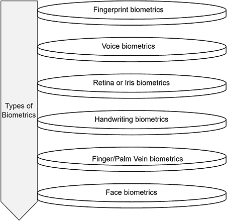

**图 10.1.** 生物识别的类型。

### 10.3 人脸检测与识别

深度学习在人脸识别相关应用中的应用比在人脸检测相关应用更为常见。因此，理解文献中经常使用的这两个术语之间的关键关系是重要的。

人脸检测是一种在图像或感兴趣的周围区域识别面部特征机制。用于人脸检测的算法计算量很小，因为面部参数在多个数据集中已经非常普遍。

然而，人脸识别的概念涉及在特定人脸的背景下对人脸进行探索。例如，这种方法学习某些人脸的特征，并试图在一组照片或人脸中检测同一张脸。检测脸的过程与识别脸的过程非常不同。

### 10.4 人脸识别——流程

人脸识别系统涉及的关键流程在图 10.2 中突出显示，并在后续的小节中提供了详细解释。

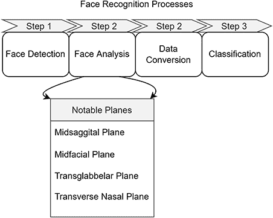

**图 10.2.** 涉及人脸识别的过程。

#### 10.4.1 脸检测

脸检测是在图像或视频中搜索人脸的过程。它通常被认为是一个计算机视觉问题。作为这一过程的一部分，从图像中收集所有面部及其相应的坐标。这些面部在本质上通常是非常动态的，因此人脸坐标的静态表示是不。几种先进的深度学习算法可以检测图像中的人脸。然而，从业人员传统上应用级联滤波器或其他过滤器来检测图像中的面部特征。

在一些视频流应用中，实时从视频中提取帧进行人脸检测。一些基于 `OpenCV` 的 Python 包可以从图像或视频中检测人脸。这些包的实现利用了图形处理器（`GPUs`）等计算架构来快速处理图像。

#### 10.4.2 通过特征提取进行脸分析

一旦在图像中检测到人脸数组，就需要根据数据库中任何给定面部图像对应的面部几何结构进行脸分析。在此过程中，捕捉基于面部几何结构的面部特征。面部特征包括肤色、胡须的有无、眉毛、嘴唇的厚度、下巴形状等等。通常，人脸包括脊、峰、斜坡、投影等，这些不规则地出现并创造了人脸之间的独特性。尽管人脸存在多种变化，但对于所有人共有的几个显著特征点并不多。例如，眼睛、鼻子和嘴的位置在大多数人脸中特别常见。理解共同点和差异有助于提取特征并对其分析。

人脸中观察到的四个显著平面如下：

1. 矢状面面——该平面垂直划分面部，使得每个部分包含一只眼睛和一只耳朵。
2. 中面平面——该平面水平划分面部，使得鼻子的中间部分与该平面相连。
3. 眉间平面——该平面水平划分面部，同时与中面平面平行运行。它位于中面平面上方；包含了眉毛和完整的耳朵。
4. 鼻横平面——该平面也水平划分面部，并与中面平面平行。然而，此平面位于中面平面下方，包含了脸的鼻部。

[7] 的作者引入了用于鲁棒脸检测的特征平面。

#### 10.4.3 数据转换

一旦识别了关键特征点，必须将发现的结果转换为相关算法可以理解的形式。以数字数据形式表示的面部蓝对于图像存储或算法处理阶段是有益。

#### 10.4.4 分类

人脸识别设置的最后一个流程是从可用数据库列表中对特定脸进行分类。有数以万计连接应用的人脸数据库。例如，大学数据库中的员工和学生列表包含人脸，可以链接到算法以识别目标脸。人脸识别问题的著名案例是 Facebook、Twitter、Instagram 等类似社交媒体网站处理脸检测。

### 10.5 应用

人脸识别技术已广泛应用于多种背景和情况，如图 10.3 所示。

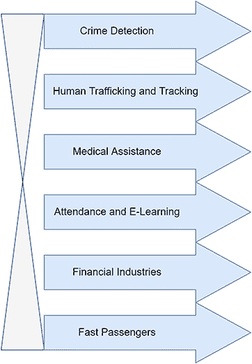

**图 10.3.** 人脸识别相关的应用。

根据其用途，人脸识别相关的应用及其优势在后续小节中突出显示。

#### 10.5.1 犯罪检测

如果允许机器识别罪犯，犯罪数量可能会大幅减少。人类对城市中存在的大型罪犯数据库知识有限。此外，如果罪犯改变装扮或手势，警察调查小组很难识别他们。显然需要基于深度学习的人脸识别系统，以便短时间内捕捉从各个城市加载的罪犯脸部 [3]。


一些已引入警务人员的流行应用，例如 `FaceFirst` [1]，已被多个政府部门用于防范犯罪活动。

## 10.5.2 人口贩卖与追踪

黑手党或某些犯罪部门的人口贩卖必须通过学习机制进行严密追踪。例如，城市中失踪的儿童可以通过部署在不同街道位置的闭路电视（CCTVs）捕捉的视频足迹来识别。如果失踪学生的图像包含在数据库中，所有连接的监控单元可以使用脸部识别模式在城市中安装摄像头的位置清晰地识别出该孩子。

## 10.5.3 医疗辅助

脸部识别软件帮助医生或医疗从业人员识别患者潜在的健康问题。在大多数情况下，患者很难对医生准备的问卷给出正确答案。然而，在他们回答问题时，患者的内心意识提供的答案在大多数情况下被认为准确率高达 95%。此外，基于脸部识别系统的药物提供在过去也得到了应用 [2]。

此外，情绪相关应用对于从教育领域到金融领域的多个现代应用具有重要意义。

### 10.5.4 考勤与在线学习平台

许多国家学校和工程学院的入学人数大幅增加。教师或机构工作人员很难为每节课签到 [17]。通过将脸部识别系统整合到考勤门户，教师或工作人员可以轻松检测学生的存在。此外，家长也可以从这种方法中受益，因为他们可以了解孩子各科的最新出勤率。此外，还有解决方案可以根据学生参加特定学科的小时与其他学科参加时间的对比，评估他们对特定学科的兴趣。例如，一名参加了所有数学科目课程的学生，表明了他对未来追求工程相关学科的浓厚兴趣。

在在线教育系统中检测情绪对于分析学生行为至关重要。通过这种方式，他们在教学过程中会变得高效。此外，它通过维护材料、交付内容和学习主题等使他们与时同步。通过真实脸部反应的参与，教师可以确定学生的参与水平。此外，如果学生觉得对某些主题感到不适，教师可以引导他们。

## 10.5.5 金融行业

脸部识别系统已安装在许多银行和金融/工业部门以增加安全性。例如，进入国家银行大楼的人受到脸部识别软件的监控。通过这种方式，一旦发生安全违规，将立即通知相关部门。

## 10.5.6 快速移动的乘客

等待机票或乘坐飞机、火车等公共交通工具的旅客希望快速移动。由于既定的行程，他们不能错过车辆或延迟行程。在过去的几十年里，飞机旅客必须向管理当局出护照以验证身份。旅客的面部通常使用照片身份证件进行验证。在现代世界，这个过程是自动化的，脸部识别由机场安装的监控机器人进行验证。

## 10.6 情绪智能——一种脸部识别应用

人类除了天生智能外，本质上往往是有情绪的。有些人非常聪明，但情绪商有限。这些人往往因为经历失败带来的困难而容易受到自杀念头的诱惑。相比之下，有些人情绪化严重，但缺乏足够的智能。需要平衡这两个组成部分以获得更好的结果。

情绪是人类的基础。它们在人类感知和理解事物方面起着不可或缺的作用 [13]。人的情绪状态对其学习、决策和交流能力有显著影响。在某些情况下，情绪会阻止我们做出正确的决定。因此，我们经常被告诉，如果我们对某个主题情绪化，就不要做决定。“情绪智能”一词与深度学习及相关算法有关。

### 10.6.1 情绪智能

情绪智能是识别、解释、理解和建立关系以获得更好生活的能力。在现代世界，情绪智能通过四个关键属性来描述：

1.  自我管理——自我管理是在没有任何任何第三方或次级解释的情况下控制自己的特质。例如，一个没有足够预算维持家庭的人应该控制开支，以确保有足够的资金应对不时之需。这也是一种必须经过多年练习才能达到完美的品质。
2.  自我意识——自我意识描述了了解自己的能力。这确实是一项挑战性任务，因为我们中的许多人不知道生活的意义。自我意识使人们了解自己最好和最坏愿望的深度；由于他们选择了正确的选项，他们能够过上无压力的生活。
3.  共情能力——共情是一种促进与他人建立良好关系的特质，特别是当他们痛苦时。它让我们在他人经历悲伤或快乐时感受到他人的感受。例如，一个成功编写了人工智能（AI）辅助引擎的新手深度学习工程师会为此感到高兴。作为一个有同心的人，你可以分享他/她的快乐，从而提高情绪智能和人际关系。
4.  社交能力——社交能力是领导者普通人都需要的技能。它使每个人能够建立关系以减轻压力并实现目标。例如，一个企业家或创业爱好者可以特别分享聚拢小组团队成员的经验。通过这种方式，创业公司可以获得大量的利润/收入。

行业正在开发整合情绪智能的系统和解决方案，因为机器可以引导大量的应用开发。

### 10.6.2 情绪类型

情绪分为 25 多种类型。这些情绪包括：仰慕、崇拜、审美欣赏、幽默、愤怒、焦虑、敬畏、尴尬、无聊、冷静、困惑、渴望、厌恶、共情痛苦、入迷、兴奋、恐惧、恐怖、兴趣、喜、怀旧、宽慰、悲伤、满意和惊讶。

在这些不同情绪类型中，最常用的情绪包括快乐、惊讶、厌恶、愤怒和无聊。

与这些不同情绪对应的几个显著手势（见图 10.4）列如下：

1.  快乐——当一个人感到快乐时，肩膀会起，面部表现出快乐。
2.  惊讶——如果一个人对某些物体或获胜的情况感到惊讶，他通过睁大眼睛表现惊讶。此外，身体的其他部位也会显示出惊讶的迹象。例如，大多数人双手合十并捂住嘴来表达惊讶的情绪。


3. **厌恶**——当人们不喜欢某项活动时会表现出厌恶情绪。面部表情通过皱脸、歪斜嘴角或低肩揭示这种情绪。这种感觉可以通过多种方式传达，但独特性有限。

4. **愤怒**——愤怒是人们对他人感到不适时表现出的非常常见的情绪。这种情绪可以通过咬紧牙齿、耸肩和/或锐利的眼睛来表达。

5. **悲伤**——悲伤表达了人内在的忧虑感。

6. **中性**——有时，面部没有表现出任何反应或情绪。这可能是因为没有在听对方说话，或其他其他几个原因。

7. **无聊**——阅读或学习长篇文档、听某些演讲等，都会引发这种情绪。无法应对某些议程也会向公众传达无聊。通常，它是通过眼睛半闭、嘴唇向下、脸贴在手上等形式表现的。

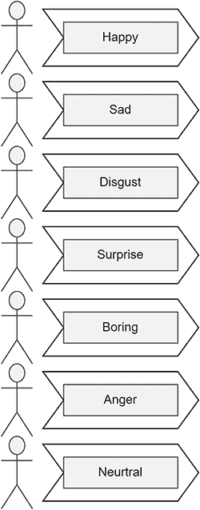

**图 10.4.**。面部手势。

## 10.6.3 情绪检测方法

如果机器要表现出情感智能，它们必须理解人类的情绪。检测人类情绪可以使用多种方法。

根据提供给情绪检测系统的输入，分类方法可分为：(i) 基于文本的、(ii) 基于语音的以及 (iii) 基于面部表情的方法（参见图 10.5）。

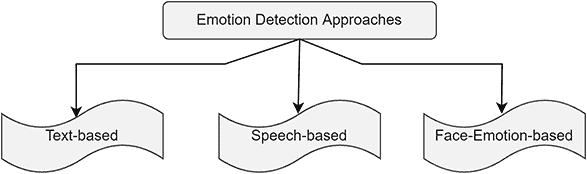

**图 10.5.**。基于输入的情绪检测分类。

### 10.6.3.1 基于文本的情绪检测

识别文本中的情绪 [18] 对于网络相关的应用至关重要。机器人和聊天机器人不仅在企业级网络应用中变得风靡，在人力较少无法回答问题的政府机构中也是如此。处理基于文本的情绪需要复杂的深度学习技术，例如在前章节中讨论的情感分析（参见章节 6）。

纯粹的情感分析与文本中情绪的阐释略有不同。例如，情感分析使用深度学习方法关注对业务交易提供意见，或通过使用想法列表来引发新的思考。更具体地说，情感分析试图在文本中寻找积极、中性和负面的面感受。然而，文本中的情绪识别必须查看更详细的信息，以推断快乐、悲伤、厌恶等感受。

自然语言处理（NLP）在基于文本的情绪检测系统中起着至关重要的作用。情绪识别过程是一个基于内容的分类问题，在其中识别文本中的情绪关键词。这些关键词可能出现在执行搜索的文档中，也可能不。存在一些可以用于检测文本情绪的数据集。特别是 ISEAR 数据集、Emobank、dailydialog 等已用于检测文本中的情绪。

### 10.6.3.2 基于语音的情绪检测

基于语音的情绪检测变得越来越流行 [8]，特别是当机器人涉及接听时。在大多数商业机构中，处理客户的查询或订单是由机器人启动的。这些机器人在人工处理电话之前向客户询问多个问题。同时，如果客户因为等待太久或回答感到烦躁，机器人可以使用深度学习解决方案理解客户的情绪。

语音情绪识别（SER）基本上通过两个步骤完成——(i) 特征提取和 (ii) 分类。这些步骤对于描述的情绪识别技术是通用的。传统的 SER 方法基于旧的学习模型，如马尔可夫链模型、高斯模型和支持向量机模型。然而，由于特征工程技术较差，这些传统的学习模型并不适用于情绪识别方法。使用深度学习方法进行 SER 明显提高了情绪推理的质量。例如，长短期记忆（LSTM）网络、自动编码器和生成对抗网络（GANs）在这些应用中取得了更好的结果。

### 10.6.3.3 基于脸部的情绪识别

最有效且应用广泛的情绪识别方法是基于面部表情的。事实上，脸部提供了几种不需要主动交流的表情——即情绪以肢体语言的形式清晰地表达。通常，面部表情结合了我们内心的感受、生理状态和个人观点 [12]。因此，面部表情可以通过自动化机器（如摄像头）捕捉，从而毫无困难地使情绪可视化。

## 10.7 情绪检测——数据库创建

人机交互及其反向感兴趣的主要主题之一是赋予计算机理解人类情绪的能力。人类情绪在不同地区或边界之间存在差异，因为它们受到文化影响和其他因素的限制。

为了捕捉人类或生物的情绪，需要从各种用例场景中吸收并学习情绪。虽然有多种方法捕捉情绪，但如果不遵循组织良好的程序，它们的有效性可能会受到限制。

创建情绪相关数据库最常用的程序如下：

- 问卷准备
- 视频采集
- 图像处理
- 情绪标注

### 10.7.1 问卷准备

情绪研究基于人类固有的心理生理体验。这些经历由于以前的习惯，人与人之间存在差异。为了捕捉最常见的人情绪（如愤怒、恐惧、悲伤、厌恶等），必须向他们展示适当的问题或剧本。例如，可以为受试者播放某些刺激性视频以让他们表达情绪。

### 10.7.2 视频采集

可能需要几位志愿者填写指定的问卷，以便他们的情绪能被摄像头捕捉，供后续阶段处理。这些志愿者不应该知道他们何时需要表现情绪。由于由于原因，他们可能暴露在一个设有隐藏摄像头并播放刺激性视频的环境中。

情绪捕捉取决于摄像质量以及捕捉情绪环境的背景照明条件。根据光源（如阳光或室内光）的方向调整摄像角度可以极大地影响情绪的捕捉。此外，一些低分辨率摄像头几乎无法捕捉情绪之间的区别。显然，需要分辨率良好的摄像头来捕捉志愿者表达的情绪。

### 10.7.3 图像处理

深度学习模型（如卷积神经网络（CNN）或残差神经网络（ResNets））需要预处理过的图像来执行更好的分类。在这个问题领域，图像需要被归类为之前分类的少数情绪之一。

为了获取并预处理图像，需要遵循以下步骤：


1. 首先，需要根据发现的情绪将捕获的视频分割成不同的视频片段。由于情绪只出现在视频片段的某些部分，因此这些视频被划分为更小的视频片段。例如，一名志愿者可能在进入环境三分钟后才开始填写调查问卷。因此，前几个视频部分不包含有效信息，实际上浪费了可以用于情绪分类的计算资源。

2. 随后，将视频片段转换为包含潜在情绪的帧。通过这种方式，可以将情绪输入到深度学习算法中，对帧中的情绪进行分类。为了实现这一点，`opencv` 等工具提供了适用于视频片段转换为帧的库和编程 API。视频片段到帧的转换通常分阶段进行，如下所示：

    * (a) 移除不需要的帧——尽管捕获的帧包含了适当的情绪，但这些帧在本质上有时是模糊且抖动的。这些帧即使用于情绪检测，也可能导致情绪分类失败。因此，可以在执行的这一阶段移除此类帧。事实上，有一些技术，例如快速傅里叶变换或拉普拉斯变换技术，这些技术在从选定的视频片段中去除模糊或抖动的帧方面被发现非常流行。

    * (b) 收集选定的帧——具有处理情绪潜力的质量帧必须收集到数据库或作为图像对象，以便将其应用于后续处理步骤。

## 10.7.4 特征提取

需要使用强大的工具 set（如 `OpenCV`）从选定的帧提取图像特征。从图像中提取的最常见特征包括 2D 和/3D 面部关键点、头部姿态、视线移动等。这些信息可以用 `CSV` 格式收集，以便通过对其标记来开发适当的情绪数据集。

## 10.7.5 注释

在找到给定预处理图像的正确特征后，可以通过多种方式对图像进行注释。标注图像情绪的常用方法 [15] 如下：

1. 通过志愿者——那些经历过视频刺激器所提问答的志愿者是图像注释的重要来源。他们拥有正确的信息来指出自己的情绪，并可以建议他们感到的是伤心、快乐、愤怒等。这些标记信息对于学习算法自我训练以用于未来的情绪检测至关重要。

2. 通过心理学家——心理学家观察人类和情绪有特殊的方法。如果给他们提供问题和相应的情绪，他们有能力判断感兴趣的人是否表现出了预期的情绪。事实上，这种方法所用注释的质量高度取决于心理学家的专业知识。

3. 通过机器——学习算法或深度强化学习（DRL）方法也可以作为无监督学习方法应用，使机器能够标注情绪。然而，高质量的注释需要大量的数据以及算法良好执行标注任务的能力。

图 10.6 展示了使用摄像头和深度学习算法从志愿者处收集情绪涉及的所有组件。

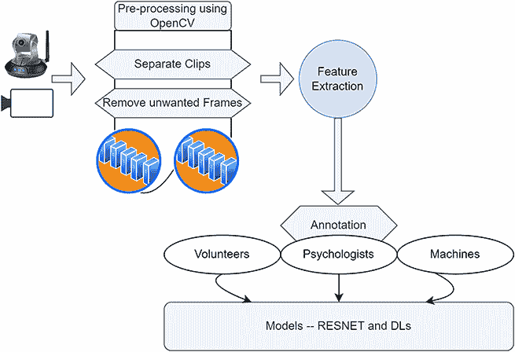

**图 10.6.** 使用深度学习方法检测面部情绪的系统。

## 10.8 挑战与未来工作

尽管人脸识别和情绪检测机制在市场上已有若干已知应用，但仍有一些已知挑战需要研究人员尽快解决。接下来的小节列出了一些显著挑战及相关建议。

### 10.8.1 人脸检测——环境条件

一个常见问题是脸部没有按照预期暴露，导致算法无法快速获取面部特征或关键点。例如，在 COVID-19 疫情期间，人们佩戴的口罩遮挡了部分脸部。在这种情况下，学习算法很难识别独特的脸部。

另一个影响面部检测过程的环境条件与光照条件有关。如果脸部没有以要求的方式处于光下，检测机制就会失效。

### 10.8.2 姿态变化

姿态会随个人和时间而变化。尽管在捕获图像时人应该注视摄像头，但人的视角角度各不相同。例如，有些人有歪斜肩膀展示脸部的习惯做法。这些修改为情绪检测软件（特别是自动化软件）带来了挑战。

### 10.8.3 遮挡

遮挡是指整个面部图像没有作为输入馈给学习算法的情况。显然，某些面部关键点被跳过，导致无法识别人员或检测图像中的情绪。遮挡的原因有多种。例如，胡须或络须的不可预测生长、佩戴口罩或帽子、躲在墙后等，都是面部图像遮挡的几个显著原因。[9] 的作者尝试在几种与遮挡相关的条件下改进人脸识别。

### 10.8.4 老龄化

人脸识别系统的另一个显著挑战是老化问题。老化与数据库中可用图像与相应现实之间的不一致性有关。属于年轻或老年组的人脸部会发生剧烈变化。如果数据库中的图像不经常更新，人脸识别很可能会失效。

## 参考文献

[1] Facefirst project, 2022 Page ID

[2] Chaiyarab L, Mopung C and Charenpong T 2021 Authentication system by using HOG face recognition technique and web-based for medical *2021 4th International Conference on Knowledge Innovation and Invention (ICKII)* (Piscataway, NJ: IEEE) pp [97–100](http://dx.doi.org/10.1109/ICKII51822.9574661)

[3] Cui W and Yan W Q 2016 A scheme for face recognition in complex environments *Int. J. Digit. Crime Forensics* [8 26–36](http://dx.doi.org/10.4018/IJDCF.20160102)

[4] Faúndez-Zuy M, Fiérrez J, Ferrer M, Díaz M, Tolosana R and Plamondon R 2020 Handwriting Biometrics: Applications and Future Trends in e-Security and e-Health *Cogn. Comput.* [12 940–53](http://dx.doi.org/10.1007/s12559-020-0975-z)

[5] Ge H, Zhu Z, Dai Y, Wang B and Wu X 2022 Facial expression recognition based on deep learning *Comput. Methods Biomed.* [215](http://dx.doi.org/10.1016/cmpb.2022.106621)

[6] Huang H 2022 Travellers’ intentions to use facial recognition systems for authentication in hotels *Int. J. Inf. Syst. Serv. Sect.* [14 1–15](http://dx.doi.org/10.4018/IJISSS.2022010104)

[7] Lei L and Kim S 2014 Eigen directional bit-planes for robust face recognition *IEEE Trans. Consum. Electron.* [60 702–9](http://dx.doi.org/10.1109/TCE.2014.7027346)

[8] Manohar K and Logashanmugam E 2022 Hybrid deep learning with optimal feature selection for speech emotion recognition using improved meta-heuristic algorithm Knowl *Based Syst* [246](http://dx.doi.org/10.1016/j.knosys.2022.108659)


- [9] Mills I and Cleary F 2022 通过 VR 参与者的 RGB-D 图像对部分遮挡脸部类型进行深度学习面部表情识别分析*2022 IEEE Conference on Virtual Reality and 3D User Interfaces Abstracts and Workshops (VRW)* (Piscataway, NJ: IEEE) 页 [862–3](http://dx.doi.org/10.1109/VRW55335.2022.00282)

- [10] Moolla Y and De Kock A 2021 使用指纹、虹膜和耳朵部生物识别对婴儿进行生物识别*IEEE Access* [**9** 38269–86](http://dx.doi.org/10.1109/ACCESS.2021.3062282)

- [11] Nayar G R, Thomas T and Emmanuel S 2021 基于图的安全可销性掌脉生物识别*J. Inf. Secur. Appl* [**62**](http://dx.doi.org/10.1016/j.jisa.2021.102991) 102991

- [12] Pester A and Galler K 2018 演示：基于深度学习的面部表情识别 (FER)—Web 接口*15th Int. Conf. on Remote Engineering and Virtual Instrumentation, REV 2018* [**vol 47**](http://dx.doi.org/10.1007/978-3-319-95678-7_52) M E Auer and R Langman (Cham: Springer) 页 466–70

- [13] Retnamony J R K, Muniasamy S and Stanley B F 2022 用于有效面部表情识别的增强全局和局部脸部特征提取*Concurr. Comput. Pract. Exp.* [**34**](http://dx.doi.org/10.1002/cpe.6701) e6701

- [14] Sholokhov A, Kinnunen T, Vestman V and Lee K A 2020 语音生物识别安全：通过说话人验证分数的层次贝叶斯模型推断假报报率*Comput. Speech Lang.* [**60**](http://dx.doi.org/10.1016/j.csl.2019.101024) 101024

- [15] Singh S and Benedict S 2020 用于人类情感识别的印度半活动面部表情 (iSAFE) 数据集*Advances in Signal Processing and Intelligent Recognition Systems* 编辑 S M Thampi, R M Hegde, S Krishnan, J Mukhopadhyay, V Chaudhary, O Marques, S Piramuthu and J M Corchado (Singapore: Springer) 页 [150–62](http://dx.doi.org/10.1007/978-981-15-4828-4_13)

- [16] Smith M and Miller S 2022 生物识别面部识别技术的伦理应用*AI Soc.* [**37** 167–75](http://dx.doi.org/10.1007/s00146-021-01199-9)

- [17] Tamilkodi R 2021 使用人脸识别通过电子邮件和手机协助教育机构进行考勤、学费欠缴、报告表生成的自动化系统软件*Wirel. Pers. Commun.* [**119** 1093–110](http://dx.doi.org/10.1007/s11277-021-08252-2)

- [18] Yang H, Alsadoon A and Prasad P W C 2022 用于文本情感分类的深度学习神经网络：增强的带泄漏修正线性单元激活和加权损失*Multim. Tools Appl.* [**81** 15439–68](http://dx.doi.org/10.1007/s11042-022-12629-1)

# 第三部分

## 安全、性能与未来方向

# IOP 出版

# 社会影响的深度学习技术

# Shajulin Benedict

# 第 11 章

## 数据安全与平台

人工智能（AI），包括深度学习技术，已经加强了过去的信息安全实践。各种安全攻击已通过引入深度学习概念增强新技术技术得到了稳健的解决。本章从两个更广泛的视角讨论了安全概念：

1. 适用于深度学习算法或基于深度学习的应用的安全挑战和技术/方法，以及
2. 深度学习算法在解决其他应用的安全挑战方面的应用。

### 11.1 安全漏洞

安全通常是计算设备的一个重要特性或步骤。保护资源免受入侵者侵犯是人类的一种本能。这种倾向不仅出现在个人生活中，也存在于国界之间。例如，总有理由与邻居或邻国发生斗争，这凸显了安全漏洞。

保护资源的倾向也是信息学领域的一个长久目标。过去已经实践了多种方法来保护私人或公共计算或数据资源免受入侵者侵害。深度学习是一种卓越的学习机制，能够自动理解这些潜在黑客的攻击行为。

许多行业和志愿者（包括学者）选择解决现有计算系统的安全忧虑。许多行业和志愿者出于以下原因解决现有计算系统的安全问题：
(i) 为了防止潜在的数据泄露或数据相关的攻击；
(ii) 为了防止对数据未经授权的访问；
(iii) 为了防止非意外中断而继续提供服务；
(iv) 为了防止计算资源被必要的利用而保护网络。这些原因将在下方分别讨论：

1. **潜在的数据泄露**——由于物联网 (`IoT`) 传感器的数据泄露，可能对组织产生严重威胁。
2. **未经授权的访问**——如果数据被盗，将对业务流程产生严重影响。
3. **避免非意外中断**——例如，使用消息队列传输协议 (`MQTT`) 的移动节点可能会在发送者和接收者之间传输数据包。如果代理服务器拒绝服务，整个物联网应用将无法运行。

## 11.2 安全攻击

由于深度学习相关应用多样化且数量激增，它们面临各种安全攻击。安全威胁基于计算机网络，因为深度学习应用通常应用于以数据为中心的环境。

传统上，安全攻击出于有意或无意的理由出现在计算设备中。安全威胁的能力和解决难度日益增加。然而，新型攻击的产生及其对攻击的防御一直是信息安全历史上不可避免的一部分。

针对深度学习应用的一些安全攻击（见图 1）：

1. **恶意软件攻击**——病毒、蠕虫、木马、勒索软件或导致计算硬件或软件故障的软件多年来经常使用各种模式和方法。尽管安全软件尝试解决这些攻击，但在计算机世界中，入侵计算资源的新方法层出不穷。这些攻击通过外部链接、邮件附件或优盘激活。一些研究人员开发了识别这些恶意软件的方法 [8]。
2. **钓鱼攻击**——这种安全攻击试图向目标接收者发送大量带有脚本的信息。这种方式，接收者被引导点击恶意脚本，从而在未经许可的情况下访问个人数据或资源。作者 [6] 开发了一个用于检测此类钓鱼攻击的框架。
3. **拒绝服务攻击**——尽管服务正在运行，拒绝服务攻击会导致用户在查询服务实例时被拒绝。作者 [7] 开发了应对这种攻击的方法。
4. **根内核攻击**——破坏机器或传感器节点根凭据的攻击通常被称为根内核。这种攻击常见出现在隔离不足的虚拟机 (`VMs`) 中。云服务中的根内核攻击可以降低托管深度学习应用的计算设备的能力。


### 5. 完整性攻击
完整性攻击是指修改数据内容或特征（通常是有意为）的攻击。在这种情况下，攻击者获得了文件或命令的权限，并在未经事先许可的情况下对其进行修改。因此，完整性攻击会降低参与者之间的信任。

### 6. 身份验证攻击
这种攻击试图挑战托管在计算机器上的深度学习相关服务的身份验证过程。通常，这些攻击使攻击能够能够（通常使用脚本）泄露的用户名、密码、身份密钥等，然后利用这些信息访问资源。`[9]`的作者开发了保护方法，以处理基于物理不可克隆函数（PUF）身份验证系统的身份验证攻击。在某些情况下，攻击者使用密码恢复验证方法访问托管在第三方计算机器上的深度学习服务。

### 7. 授权攻击
通常，授权描述的是获取资源或服务访问的过程，而身份验证描述的是验证谁有访问权限——即身份验证涉及参与攻击过程的人员。在计算服务（包括深度学习服务）中观察到了授权攻击，即文件访问被授予了未知方。通常，解码节点之间通信使用的密码或短语对计算节点来说一直是挑战性的。一个常见问题是密码通过各种方法（如密码生成软件等）被破解。

### 8. 可用性攻击
这种攻击涉及学习过程中数据或模型的不可用问题。在现代物联网支持的应用中，机器可以自动预处理数据并使用输入数据集创建模型。如果数据或模型不可用，学习结果可能会受到损害。攻击者引入可用性攻击是为了防止用户或机器访问数据。事实上，可用性攻击也可以被视为无意威胁。

### 9. 数据篡改
数据通常是深度学习应用的关键要素。然而，如果数据被恶意软件或蓄意的用户篡改，建模就会失败。使用区块链等技术保护数据会更好。在区块链技术中，由于多方的参与以及通过 Merkle 树方法建立哈希值，数据变得不可篡改。不同参与方的参与防止了某一方修改区块链数据库中的文档。

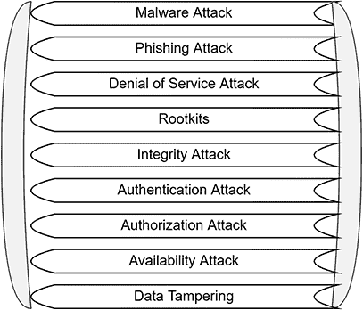

**图 11.1.** 安全攻击。

### 11.3 深度学习相关的安全攻击

除了各种传统的安全相关漏洞外，深度学习应用和学习机制可能会遇到新型安全攻击。深度学习相关应用特有的最常见安全攻击（见图 11.2）及其关键特征/特性如下：

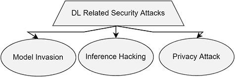

**图 11.2.** 深度学习相关的安全攻击。

1. **模型入侵攻击**——在这种场景下，黑客试图学习特征。
2. **推理攻击**——通常，推理提供给特定的机器。
3. **隐私攻击**——攻击者有很大可能学习数据。
4. **规避攻击**——在深度学习中，规避攻击是修改深度学习支持机器决策的攻击。


### 5. 生成对抗网络 (GAN) 攻击
通常情况下，`GAN` 有两个部分：生成器和判别器。`GAN` 的生成器部分试图通过减少 GAN 损失来学习其对手。由于 `GANs` 是纯粹的无监督学习模型，攻击者可以通过诱导错误的对手或误导 GAN 学习程序来攻击此类学习模型。攻击者可以提供偏离格式的输入，使对手偏离预期的学习推理交付。通常，`GAN` 攻击会严重损害结果。此外，它们对计算时间产生不利影响，间接影响底层的计算机器或增加托管服务的成本，特别是当它们在云服务上执行时。[2] 的作者研究了 `GAN` 攻击对物联网辅助应用的影响。

### 6. 托管模型攻击
在多个用例中，深度学习算法使用预训练模型进行推理。例如，为了对花进行分类，可以考虑使用使用花卉建模的预训练 You Only Look Once (`YOLO`) 模型。然而，攻击者可以托管类似的、产生错误结果且效率低下的预训练模型。由于此类攻击，如果应用程序在云服务上执行，用户可能需要承担额外的计算成本，或者他们可能需要浪费时间将错误的预训练模型应用到其数据集上。

威胁（Threats）是指通常以无意方式产生异常攻击的情况或环境。相比之下，上一节讨论的攻击描述了为学习模型创建风险的刻意方法。深度学习场景中常见的潜在威胁列举如下：

1. **软件崩溃**——崩溃和软件故障在与深度学习相关的应用中很常见。这些情况被认为是完成指定学习任务的潜在威胁。软件崩溃是由于软件版本不匹配或硬件故障引起的。然而，如果软件崩溃是由入侵者或机器的潜在黑客诱导的，则这种情况被称为崩溃攻击（crashing attack）。

2. **未定义终止**——在深度学习算法（如卷积神经网络 `CNNs`、`YOLOv5`、`GANs` 等）的隐藏层中需要持续迭代的代码为计算节点带来了风险，特别是通常由电池供电的受限节点。算法不终止并交付其发现或观察结果。这通常被称为深度学习模型的未定义终止威胁。如果攻击者向学习模型中引入代码，该威胁也可以转化为攻击。

3. **内存泄漏**——深度学习算法可能会出现内存泄漏。深度学习算法中的内存泄漏是由于编程错误引起的。例如，如果算法动态分配的内存在执行过程中没有与程序关联，则会变成内存泄漏问题。深度学习算法有几种基于数组或张量（tensors）的操作。如果这些算法导致内存泄漏问题，带有大量数据的未关联内存单元可能成为与深度学习相关应用的潜在威胁。

4. **内存不可用**——深度学习算法通常被认为是内存密集型算法。这些算法执行时间很长是常见现象。例如，使用现代深度学习算法在包含 10,000 张图像的数据集上训练面部表情可能需要超过 14 小时。运行软件使用的相应内存单元将从 MB 达到 GB 不等。在等待数小时获得训练模型后，程序可能因为边缘节点或电池供电设备中的内存不可用而突然停止运行。此类情况被认为是对深度学习应用的威胁。

5. **计算过载**——计算过载是深度学习相关应用的一个巨大风险，因为机器可能会在没有事先通知的情况下停止。由 `Docker` 容器（轻量级虚拟机）托管的深度学习应用可能会由于内核的杀死进程导致失败。这些内核在不向用户发出预警的情况下杀死过载进程。

### 11.4 指标
使用指标来衡量攻击或威胁强度。此类指标使用户或应用程序开发者评估底层算法的优缺点。图 11.4 展示了用于衡量对深度学习应用的安全影响的指标列表。


**图 11.4.** 用于衡量安全风险的指标。

深度学习模型中演变的潜在攻击可以使用指标进行衡量和监控，以便攻击者受到惩罚。用于衡量深度学习应用安全特性的显著指标列如下：

1. **误分类率**——攻击者可以修改数据或使用任何方法来阻碍深度学习应用的预测能力。图像处理应用通常需要图像分类步骤。误分类率（misclassification ratio）指标定义了在使用这些受损深度学习系统进行实验时观察到的分类缺失数量。

2. **置信水平**——学习模型使用置信水平进行表征。如果生成的模型用于预测样本，预测的置信度受到多个因素的影响，包括攻击者的影响。由于攻击而损害的置信度由特定水平表示。该指标使用零到一之间的数字来表示攻击的影响。

3. **鲁棒性**——图像或数据受到模糊、噪声或压缩方法的损害。图像在拍摄时或拍摄后会出现模糊现象。导致图像拍摄时出现模糊的主要原因如下：
    * (a) 相机快门速度不足。显然，相机抖动会导致模糊；
    * (b) 将相机暴露在低光环境中会降低图像清晰度；
    * (c) 在某些情况下，人们避免携带三脚架或相机支撑设备，这降低了图像清晰度。

4. **噪声水平**——同样，攻击者可以在几种基于图像的机器学习模型中引入噪声，特别是对于 `GANs`。在面部图像中引入噪声会恶化学习模型的质量。例如，`GANs` 很难区分输入图像中的人脸。攻击者还尝试向带水印图像引入高斯噪声。处理水印图像的攻击者通常执行以下操作：
    * (a) 攻击者试图移除图像中的水印。这种技术被称为移除攻击（removal attack）。
    * (b) 攻击者采用暴力方法识别水印图像的安全密钥。
    * (c) 攻击者可以修改图像的几何结构。通常，图像的几何结构通过翻转、裁剪、旋转等进行修改。因此，如果发生这种情况，分类将更具挑战性。

5. **压缩级别**——改变图像的压缩级别会导致接收者或预期接收者（包括机器）在解码图像或学习图像特征时感到困惑。


## 6. 计算成本
补偿攻击的开销很高。例如，如果图像受到噪声或模糊的影响，则需要大型计算实例来重复学习过程。因此，计算成本被认为是判断攻击者活跃性的关键指标之一。如果学习算法由云服务托管，特别是公有云基础设施（如 `Amazon Web Services (AWS)` 或 `Google`），则计算成本会受到更多的重视。

## 7. 能量预算
能量预算是一个与计算和环境问题紧密相关的指标。事实上，在大多数国家，能量是有限资源，在计算数据中心内被谨慎地使用。学习算法的能量消耗如果处理不当，可能会导致碳排放和机器成本增加。因此，能量预算被认为是可以在分析深度学习算法时评估攻击者影响的指标。

## 8. 不准确性
攻击者倾向于修改图像并影响学习推理，这通常对准确性产生重大影响。

### 11.5 执行环境
安全问题取决于实现和处理深度学习算法的环境。算法通常托管在`IoT 环境`、`云实例`、`边缘节点`、`移动节点`和`混合基础设施`中。

根据深度学习算法执行的位置，安全特征也相应不同。

#### 11.5.1 IoT 环境
并非所有深度学习算法的训练和测试阶段都可以在`支持 IoT 的传感器节点`上执行。这些算法需要大量的计算能力和存储空间。`支持 IoT 的设备`由电池驱动，内存存储空间极小。

显然，我们无法在这些设备上包含更健壮的安全特征或复杂的算法。这导致了以下若干安全挑战：

1. **未经授权的访问**——由于传感器设备未包含强力的用户名和密码机制，在这种情况下，对深度学习机器的未经授权访问是常见的。
2. **异构设备**——如果深度学习算法在`支持 IoT 的微控制器`或微处理器上实现，则实现步骤可能对数据格式和协议有更广泛的支持。显然，由于传感器节点的局限性，对异构设备的支持非常有限。
3. **软件故障**——黑客通常针对网络系统的应用层。他们可以向`IoT 系统`连接的数据库或存储库中注入错误数据。因此，这些节点的安全性面临挑战。
4. **中间件故障**——在虚拟环境中运行的大多数`支持 IoT 的设备`使用`Docker`或中间件软件组件。如果任何黑客尝试修改中间件层的结构，运行在硬件之上的整组`Docker 实例`或`VM 实例`都会受到损害。
5. **启用访问控制**——故障的系统级软件组件可能会对传感器设备施加严格的访问控制机制。负责传输图像或数据的传感器节点未被授予将数据提交给底层深度学习算法的权限。这导致`支持 IoT 的应用`中学习准确率较低。
6. **网络入侵**——`IoT`被认为是未来的互联网，数百万个计算节点和数万亿个对象连接在一起。在这种环境中，对网络设备和资源的未经授权访问会导致安全性变差。

`[1]`的作者揭示了一些`支持 IoT 的系统`可以采用的安全特征。

通过在深度学习系统或其框架中启用以下方法可以解决`IoT 环境`中的安全担忧：

1. **卸载**——由于`支持 IoT 的节点`无法提供健壮的安全保障，与安全相关的任务被卸载到强大的设备上，包括`云实例`或`雾节点`。
2. **隐私保护**——隐私对于实现个体之间的行动自由和尊重至关重要。一个人在未来的交互中可能会有不应让公众可见的异常行为，即未能保护隐私可能会导致破坏性后果。
3. **异常检测**——在`IoT 网络栈`层中发现的任何异常都可以被检测并报告给相关的`云服务`。因此，受限设备中的安全故障可以被检测。异常检测的概念经常用于工业`IoT 系统`或框架。

### 11.5.2 云实例
大多数深度学习算法作为`Dockers`、`VM 模板`或服务托管在云环境中。这些`云实例`容易受到若干云环境特有的安全挑战。对于深度学习相关应用仍具有挑战性的几个著名的云安全挑战如下：

1. **服务过载**——黑客消耗大量的计算连接服务，包括深度学习服务。因此，除非有控制措施否则基于深度学习的云服务的计算成本会被放大。
2. **DevOps 故障**——如今，基于深度学习的应用通常使用`DevOps 技术`实现。当使用`DevOps`方法时，应用开发团队与运维团队之间的耦合性非常高——即服务是在近实时范围内开发和托管的，且停机时间有限。此类`DevOps 系统`的故障可能导致深度学习机器或系统的托管延迟或大量的停机时间。
3. **供应商锁定状况**——供应商锁定是云解决方案的常见问题。在云中，由第三方提供者托管的服务（包括数据存储服务）容易受到潜在的供应商锁定问题——即提供者无法提供指定的服务水平协议(`SLAs`)，或无法在不影响服务与客户之间连接的情况下更改服务条款。
4. **多云故障**——为了避免供应商锁定问题，大多数云开发者（包括`基于深度学习解决方案的云开发者`）倾向于在`多云环境`中托管解决方案。`多云环境`包含许多第三方提供者，如`Google`、`AWS`、`Azure`等。然而，由于服务策略或集成策略不，基于深度学习的云服务可能会失效。

#### 11.5.3 边缘节点
边缘设备通常是受限节点，其计算能力低于雾节点或云节点。深度学习应用以及集成到`边缘节点`中的深度学习智能以多种方式面临安全问题。在`边缘节点`上实现深度学习相关应用时最常见的安全问题描述如下：

1. **洪水攻击**——`边缘节点`遭受洪水攻击，导致设备忙于处理不需要的工作。通常，`边缘节点`在将要点转发到`云服务`之前，尝试收集传感器数据并应用少量智能。由于这些设备的计算能力较弱，在有限时间内让更多传感器提交多组传感器数据可能会成为一种挑战性的风险。对于`边缘节点`来说，通常情况下过滤这些数据以获取所需数据是非常困难的。


## 2. 面面向协议攻击
各种传感器使用用户数据报协议 (`UDP`）而非互联网连接中使用的传统传输控制协议 (`TCP`）连接到边缘节点。例如，受限应用协议 (`CoAP`）为节点间的连接提供了请求-响应模型，它将 `UDP` 协议与可靠消息概念相结合以传输消息。通常，`UDP` 是网络中的无连接传输层协议。该协议在跨节点发送消息时速度更快，但无法提供可靠的通信。取决于所应用的协议，大多数情况下连接安全性面临挑战。

## 3. 侧信道攻击
边缘节点深受侧信道攻击的影响。在侧信道中，通信信号会被追踪以研究通信模式，例如能量利用模式。随后，可以追踪用户行为，或通过进入边缘设备系统信息来破解设备利用率。

## 11.5.4 移动网络与深度学习

由于智能手机和 5G 连接系统的利用，移动应用程序数量大幅增加。事实上，由于可用带宽增加和计算能力的增强，许多 Web 应用在现有服务之外还已转移到了移动辅助解决方案。移动网络仍然是物联网（IoT）系统的一部分。

物联网技术推动了传统无线技术的改进。例如，5G 技术的诞生基于物联网应用的需求，如智能城市应用、智能交通应用、智能物流应用等。

以下描述了深度学习应用增强移动网络时所面临的一些安全挑战：

1. **密钥交换失败**——移动网络在为了建立连接或共享信息而交换密钥时脆弱。尽管针对物联网场景存在一些轻量级密钥共享协议，但这些协议仍然容易受到攻击者的攻击。

2. **带宽不可用**——移动网络被设计为较小的六边形区域单元。通常，宽谱带宽在小组移动蜂窝网络之间共享，使得移动范围具有六边形足迹。移动网络的每个小区都有一个基站，用于从移动节点获取信息。移动网络的频率可以被其他移动塔重复利用，以尽力减少塔之间的干扰。

5G 网络的设计者试图减少信号足迹，即连接范围。通过这种方式，可以容纳更多客户；减少从基站传输所需的功率；并最大限度地减少基站之间的干扰。

由于带宽小于客户数量所需的带宽，带宽被多个移动塔重复利用。然而，这些带宽有时无法提供给潜在客户。在深度学习应用中，如果数据由于移动网络不可用而无法到达深度学习服务，学习过程是不准确的。攻击者可以尝试让移动网络一直繁忙，而不让节点容易地发展智能——这是一个安全挑战。

## 11.6 使用深度学习增强安全

在本章的第二部分，我们将学习如何应用深度学习来增强应用程序的安全方面。本章重点关注深度学习算法及其相关技术或框架的应用。

通常，有多个应用程序（参见图 11.5）可以应用深度学习算法来提高其安全特性。在此背景下，完美符合深度学习算法集常用的应用如下：

* 网络安全应用
* 物联网应用
* 网络应用
* 校园安全监控应用
* 医疗健康应用
* 僵尸网络应用
* 能量监控应用


**图 11.5.** 使用深度学习应用增强安全特性。

### 11.6.1 网络安全应用

在后 COVID-19 时代，网络安全问题开始指数级增长，因为大多数操作涉及在线操作。未准备好应对安全漏洞的组织已成为攻击者/黑客的首选目标。

为了解决这个问题，旨在改进不安全环境的解决方案通过各种方法。。这些方法中，基于深度学习的解决方案对大多数组织来说是最具吸引力的开箱可用解决方案。

影响正常社会生活（特别是互联网/网络世界）的最常见网络安全问题如下：

1. **缺乏意识**——意识到竞争对手会来与我们进行竞争是制定网络安全措施的第一步。组织和行业通常尝试跟踪其竞争对手或知识论坛。由于信息可以从各种源自动地收集，组织在处理这些情况时可能必须保持谨慎。在这种背景下，深度学习算法可以在自动从各种网站学习攻击者信息方面发挥重要作用。如果员工意识到初始原因，组织的网络安全问题通常可以得到解决，即深度学习支持的解决方案可以直接向相关人员建议可能的处理方法。

2. **不可信网络**——在线工作模式（特别是在 COVID-19 期间）严重损害了互网络的安全特性。必须处理机密数据的组织在处理员工时也必须具有活性。因此，组织不得不削弱整个互网络的安全特性。

3. **使用比特币的勒索**——从组织收取勒索金（这代表了预期攻击的成功）在网络安全领域正变得流行。攻击者仔细地注入脚本或程序，在用户不知的情况下压缩文档或文件夹。在数据被攻击者解密之前，收集的赎金金额通常达到几个比特币。深度学习支持的解决方案可以根据影响攻击的参数发现此类潜在的黑客。

4. **自动化攻击**——大多数网络安全问题是由于自动化实时攻击引起的。勒索软件攻击、入侵攻击、钓鱼攻击等攻击通过 Web 服务中的脚本或隐藏程序实现自动化的。由于它们是自动化的，用于发现攻击的解决方案必须比攻击本身更强大。显然，只有基于深度学习或传统的机器学习算法适用于这一问题领域。

### 11.6.2 用于网络安全问题的深度学习

深度学习算法作为解决网络安全问题的候选解决方案。监督和无监督算法被应用于各种用例。以下子节描述了如何将监督和无监督深度学习算法应用于网络安全问题。

#### 11.6.2.1 基于监督学习的深度学习


通过输入标记数据集来训练并创建模型的深度学习算法被称为监督学习算法。这些算法被用于预测格式异常的互联网协议（IP）地址、网络故障、资源污染问题等。例如，可以嗅获一些网络包，并将其属性标记为安全数据包或不安全数据包。在对此类数据包进行采样和标记后，深度学习算法就可以自动推测或预测未来的网络包。

## 11.6.2.2 基于无监督学习的深度学习

在大多数情况下，标记数据集是一项枯燥的任务。例如，检查网络数据包并对其进行标记可能是一项耗时大量的工作，尽管学习模型可以从数据集中推导出来。

事实上，无监督深度学习算法（如强化学习算法）是此类情况的理想选择。强化学习算法具有根据中间学习行为分配奖励和惩罚的能力。因此，可以以自动方式改进学习机制并解决网络安全攻击。

## 11.6.3 针对物联网（IoT）的深度学习

支持物联网的应用涉及由电池供电的受限节点。如前所述，这些节点的计算能力并不强大，也没有足够的存储单元。显然，深度学习算法等高需求应用无法由这些机器处理。此外，这些微型设备可能不具备必要的安全组件来处理与安全功能相关的近期软件问题。考虑到当前的需要，建立深度学习算法（主要是轻量级程序）已成为各种研究人员和从业者的重要议程。例如，Google 推出了 `TensorFlow Lite`，支持在电池供电的移动设备或边缘节点上使用高要求的深度学习算法。

深度学习通过多种方式应用于物联网解决方案，如下：

1. **僵尸网络应用**——深度学习算法过去一直用于僵尸网络相关的取证问题。通常，僵尸网络是托管在网络服务或网站上的软件组件，用于自动回答客户提出的查询。这些机器人会在应用的整个生命周期内被使用。通过这种方式，客户可以获得 24 小时无限制帮助。

   然而，取决于涉及的程序，僵尸网络很容易引发各种取证问题。在这种情况下，学习算法可以帮助官员追捕违规者或确认取证问题的产生。

   作为一个案例研究，如 `Siri` 等语音辅助物联网设备或应用程序可以自动打开银行账户并将资金转账到网上商店。显然，故障设备可能会监听攻击者的命令，导致攻击。深度学习支持的应用可以作为解决此类情况的候选。

2. **钓鱼检测**——深度学习算法被广泛用于检测钓鱼攻击。这些攻击被视为社会性问题。它们会损害一个人的社会影响。例如，钓鱼攻击可能向用户展示来自合法网站的非意愿链接。这些攻击试图让用户信任不可靠的链接。如果攻击者通过诱导用户获胜，他们就可以索要赎金或从用户处提取货币利益。

   显然，钓鱼攻击被视为非社会公益应用，需要使用稳健的学习算法（如深度学习算法）进行分析。事实上，在这一场景下，攻击者通常针对大学生，且最好是女性。

   几种基于深度学习或机器学习的学习算法可以用于快速识别钓鱼者。例如，来自机器学习领域的支持向量机、随机森林、分类器等；以及基于回归的 `CNNs`、基于分类器的 `CNNs` 及其变体和一些无监督学习算法，被认为是可以用于理解钓鱼者的潜在算法。一些研究人员已经收集了一份过去向电子邮件用户发送过威胁的潜在钓鱼者名单。

3. **校园安全监控**——深度学习算法已广泛应用于校园，在保护学生的同时提供安全。校园包含许多用于视频监控的摄像头、支持残障学生的语音助手、计算辅助辅助设备、资产等。如果需要人工干预，为所有这些校园组件提供安全将是一项挑战性任务。相比之下，深度学习辅助解决方案可能非常适合此类情况。例如，检测数月/几年捕取的视频中的异常对于人力来说并不是一项容易的任务。由 `OpenCV` 等框架工具支持的深度学习算法可以并行处理视频，以快速检测是否存在异常。

4. **能源观测/审计**——能源监控以及能源及其相关利用的审计被视为社会公益应用。能源源的不安全可能导致国家问题，特别是在边境国家。例如，在未获得东道国家告知或许可的情况下从边境国家抽取能源可能导致国家级冲突，进而导致仇恨。通过应用深度学习算法，可以利用水平、用电模式和能源以及异常检测等进行观测。

   * (a) **能源源**——主要的能源源有风能、水、太阳能、核能、煤等。所有能源源（包括可再生和不可再生能源源）通常连接到一个国家电网，以便电力可以在地区之间共享。遗憾的是，这些电力源遵循典型的发电模式。例如，在气流非常小的冬季，风力机无法产生能量。深度学习算法可以根据以前的数据识别发电模式。

   * (b) **能源利用**——寻找不同地点多年来的能源利用模式无疑增加了国家的能源审计能力。简而言之，夜间的能源消耗高于白天；此外，美国的能源消耗与东方国家相比具有不同的时间模式。可以生成数据来支持对能源利用模式的分析，以便预测未来的能源需求或制定适当的计划。

   * (c) **异常检测**——智能城市的能源消耗可能有特定的模式。然而，对于审计官员来说，找出需求激增的原因是非常有趣的。预测数据集中的异常无疑能为违规提供必要的支持。

## 参考文献

[1] Abdel-Basset M, Moustafa N, Hawash H and Ding W 2022 *Deep Learning Techniques for IoT Security and Privacy* Studies in Computational Intelligence [**vol 997**](http://dx.doi.org/10.1007/978-3-030-89025-4) (Berlin: Springer)

[2] Chen Z, Fu A, Zhang Y, Liu Z, Zeng F and Deng R H 2021 Secure collaborative deep learning against GAN attacks in the internet of things *IEEE Internet Things J.* [**8** 5839–49](http://dx.doi.org/10.1109/JIOT.2020.3033171)

[3] Herath J D, Yang P and Yan G 2021 Real-time evasion attacks against deep learning-based anomaly detection from distributed system logs *CODASPY ‘21: Proceedings of the Eleventh ACM Conference on Data and Application Security and Privacy* and A Joshi, B Carminati and R M Verma (New York: ACM) pp [29–40](http://dx.doi.org/10.1145/3422337.3447833)


[4] Ren K, Zheng T, Qin Z and Liu X 2020 深度学习中的对抗攻击与防御 *Engineering* [**6** 346–60](http://dx.doi.org/10.1016/j.eng.2019.12.012)

[5] Song L, Shokri R and Mittal P 2019 针对对抗鲁棒深度学习模型的模型的成员推理攻击 *2019 IEEE Security and Privacy Workshops, SP Workshops 2019, San Francisco, CA, USA, May 19–23, 2019* (Piscataway, NJ: IEEE) pp [50–6](http://dx.doi.org/10.1109/SPW.2019.00021)

[6] Tang L and Mahmoud Q H 2022 用于构建防御运行时 DoS 攻击蜜蜜罐的深度强化学习 *IEEE Access* [**10** 1509–21](http://dx.doi.org/10.1109/ACCESS.2021.3137636)

[7] Veluchamy S and Kathavarayan R S 2022 用于构建防御运行时 DoS 攻击蜜蜜罐的深度强化学习 *Int. J. Intell. Syst.* [**37** 3981–4007](http://dx.doi.org/10.1002/int.22708)

[8] Xing X, Jin X, Elahi H, Jiang H and Wang G 2022 一种深度学习自编码器的恶意软件检测方法 *IEEE Access* [**10** 25696–706](http://dx.doi.org/10.1109/ACCESS.2022.3155695)

[9] Yashiro R, Hori Y, Katashita T and Sakiyama K 2019 用于基于 PUF 认证方案的有意噪声深度学习攻击防御措施 *Innovative Security Solutions for Information Technology and Communications—12th Int. Conf., SecITC 2019, Bucharest, Romania, November 14–15, 2019, Revised Selected Papers* ed E Simion and R Géraud-Stewart [**vol 12001**](http://dx.doi.org/10.1007/978-3-030-41025-4_6) (Berlin: Springer) pp 78–94

***

# IOP Publishing

# 社会影响的深度学习技术

# Shajulin Benedict

***

# 第 12 章

## 性能监控与分析

本章描述了当基于深度学习的算法在服务器、云实例、边缘节点、移动设备等各种计算机执行时不断变化的性能问题。它指出了深度学习相关应用中最常用的性能监控工具、指标、特定算法参数等。

### 12.1 性能监控

深度学习旨在学习数据模式并提供预测，如果管理不当，可能会消耗大量的计算资源或能量。它指出了深度学习相关应用中最常用的性能监控工具、指标、特定算法参数等。

深度学习旨在学习数据模式并提供预测，如果管理不当，可能会消耗大量的计算资源或能量。它指出了深度学习相关应用中最常用的性能监控工具、指标、特定算法参数等。

### 12.2 对性能的需要

性能监控至关重要，因为深度学习旨在学习数据模式并提供预测，如果管理不当，可能会消耗大量的计算资源或能量。它指出了深度学习相关应用中最常用的性能监控工具、指标、特定算法参数等。

深度学习旨在学习数据模式并提供预测，如果管理不当，可能会消耗大量的计算资源或能量。它指出了深度学习相关应用中最常用的性能监控工具、指标、特定算法参数等。

性能监控有助于识别瓶颈。

1. **优化策略**：深度学习旨在学习数据模式并提供预测，如果管理不当，可能会消耗大量的计算资源或能量。它指出了深度学习相关应用中最常用的性能监控工具、指标、特定算法参数等。

2. **易于实现**：深度学习旨在学习数据模式并提供预测，如果管理不当，可能会消耗大量的计算资源或能量。它指出了深度学习相关应用中最常用的性能监控工具、指标、特定算法参数等。

3. **指标**：深度学习旨在学习数据模式并提供预测，如果管理不当，可能会消耗大量的计算资源或能量。它指出了深度学习相关应用中最常用的性能监控工具、指标、特定算法参数等。

### 12.3 性能分析方法

深度学习相关应用的性能分析以多种方式进行，取决于所使用的硬件。

#### 12.3.1 专家意见

专家意见依赖于经验工程师的人工分析。

#### 12.3.2 工作负载特征

工作负载特征有助于理解资源需求模式。

#### 12.3.3 I/O 特征

学习应用程序的输入/输出（I/O）行为对于数据密集型任务至关重要。


表征在 CPU、GPU 或 TPU 上执行的深度学习算法的 I/O，能够让用户完成完成以下相关任务：

1. 能够高效地处理深度学习算法，因为可以估计底层应用的性能；
2. 可以预测或选择需要聚类的节点数量；
3. 它记录了对 CPU、GPU、TPU 或 VM 实例的亲和性；以及
4. 它有助于性能监控工具在与深度学习应用一同实现时，以较小的开销执行。

### 12.3.4 应用基准测试（Benchmarks）

基准测试是使进程能够测量底层硬件或软件组件性能的软件组件。它们具有已知的自定义计算单元，这些单元可以与基于真实的深度学习算法的应用相关联。

例如，如果基准测试代码段在 TPU 机器上运行高效，用户或应用程序开发者可以将该代码段视为衡量标准，用于衡量新的算法或应用。[2] 的作者开发了基准测试，以理解物联网（IoT）启用深度学习任务的行为。

在与深度学习相关的应用中实现基准测试的主要目标如下：

1. 评估——可以在不同的硬件单元上对新算法进行评估。例如，如果开发了一个用于检测视频帧中对象的算法，其在基于 TPU 的机器、基于 CPU 的机器、支持 Docker 的容器等上的性能可以使用基准测试进行评估。
2. 算法调优——这些有助于用户通过选择合适的参数来调优深度学习算法。事实上，若干性能调优工具或优化引擎可以在硬件集群或机器上执行算法时，应用基准测试来精调参数。
3. 理论分析——基准测试为理论科学家的创新铺平了道路，并增强了算法理论研究的影响。事实上，基准测试仍然是纯理论研究与纯正的生产级应用之间的中间知识源。
4. 验证——为深度学习应用开发基准测试，可以在不同机器上执行这些应用时进行概念验证。

通常，研究人员和从业者已经设计了深度学习基准测试，这些测试可以用于开发高效算法——即现有深度学习算法的几种变体。例如，开发了分布式深度学习基准测试，以研究在分布式机器上扩展深度学习作业/任务的影响；同样，[4] 的作者开发了贝叶斯深度学习基准测试，以研究健康医疗应用的性能。

### 12.3.5 应用微基准（Microbenchmarks）

除了基准测试外，微基准也被广泛用于研究深度学习算法的性能。在用户需要评估单个函数或单个 GPU 内核调用程序的价值的某些情况下，他们更倾向于微基准。

粗粒度基准测试对单个指令的影响或系统调用性能的洞察有限。通过开发微基准，与从基准测试获得的收益相比，应用程序开发者获得了以下收益：

1. 他们了解了开发深度学习算法时应用某些函数所产生的影响；
2. 他们获得了关于应用的更细粒度的洞察；
3. 他们成为了直观的开发者，因为他们学习了深度学习算法中软件和硬件组件的结合；等等。

### 12.3.6 自顶而下的性能分析

在自顶而下的性能分析方法中，深度学习应用从较高层次的直觉监控到较低层次。深度学习应用领域中性能监控最常见的观察层次（见图 12.2）描述如下：


**图 12.2.** 性能观察层级。

1. 用户级——向相应的 IDE 或服务提交深度学习相关作业获得的性能取决于用户的活跃参与程度。如果用户没有按时提交作业，或没有在适当的时间槽内将作业交付到集群，则应用程序无法按时执行。当深度学习算法在第三方服务器/集群或批处理计算集群（如超级计算机）上执行时，这是一个严重的问题。
2. 通信级——提交到集群实例或云服务（如机器学习即服务单元）的深度学习任务通常遵循提交任务的请求-响应模型。显然，当这些任务与计算机器进行通信时，可能会出现性能差距。
3. 集群级——深入研究深度学习算法的性能需要对集群或分布式机器有深入的理解。分布式机器由数万个通过高速网络电缆紧密耦合的计算节点组成。理解这些机器在更广泛层次上存在的性能差距至关重要。
4. 计算实例级——进一步深入理解深度学习应用性能问题的层级，我们需要发现单个计算实例引起性能影响的原因。集群单元可能拥有数万个计算机实例，这些实例可以是专用服务器或容器级节点。
5. 操作系统 (OS) 级——发现深度学习算法性能问题的下一个层次是 OS 级。OS 实例可以是裸机 OS、托管 OS 或云领域常见的客体 OS。在云实例或 HPC 集群实例上执行的深度学习算法需要在 OS 级进行监控。
6. 进程级——我们接下来需要监控在 OS 或客体 OS 上执行的单个深度学习进程的性能。深度学习模型可能会因为进程失败或数据不可用而停顿。在 DevOps 云原生环境中，深度学习应用的开发者必须开发策略来准确定位故障前后的这些进程，以便应用程序以良好的性能执行。

   在大多数容器级深度学习应用中，进程会被内核的内存溢出杀进程（OOM killer）杀死。显然，在执行深度学习应用的这一层次获得深入的见解是确保良好性能的必要步骤。
7. 运行或硬件级——进一步进入执行深度学习应用的细节，应用程序开发者或用户对发现这些应用在机器上的运行时行为感兴趣。这些运行时行为取决于处理器或架构中的硬件级测量。例如，基于 Intel 的处理器提供了 64 个硬件计数器来支持进程的性能监控任务。

在这一层次了解性能会导致以下结论：

1. 性能分析需要更深入的硬件知识；
2. 此层次的分析会导致大数据问题；
3. 此外，这种分析的复杂度非常高。

自顶而下的性能分析方法在以下情况下非常有用：

1. 需要学习深度学习应用的调优参数时；
2. 需要为硬件资源开发优化策略时；以及


## 3. 当需要理解硬件子系统引起的问题时。

### 12.3.7 自底而上的分析

自底而上的性能分析是一种许多开发者常用的性能监控方法。当用户希望对特定应用程序或算法进行性能分析时，这种方法非常有用。在这种方法中，性能分析在应用程序处理过程的最低级别进行——即硬件指标级。

显然，自底而上的性能分析方法体现了算法与底层硬件之间的强关联。使用自底而上性能分析方法的常见场景列如下：

1. **资源选择**——自底而上的性能分析方法改进了资源选择过程。例如，如果算法的性能不佳，用户可以选择现场可编程门阵列（FPGA）加速器。由于这种方法处理的是单个算法，因此对于选择合适的资源非常有用。[[5]] 的作者设计了一种考虑计算节点受限情况的资源选择机制。

2. **优化参数**——有几个优化参数是特定应用程序。例如，在多个 CPU 单元上执行的深度学习算法可能会改变 CPU 频率以微调性能。同样，算法的内存需求可以针对单个进程进行修改。[[8]] 的作者研究了 CPU 和内存利用模式对深度学习应用的影响；[[1]] 的作者揭示了基于深度学习的语音情感任务的性能问题。自底而上的性能分析方法是最佳选择。

3. **执行变量**——通常，自底而上的性能分析方法适用于特定应用程序的优化。改变执行变量可能会影响性能。

4. **静态应用程序**——当应用程序无法修改时，使用自底而上的性能分析是可行的解决方案。通常情况下，这种方法可以理解深度学习任务的性能问题。

   例如，当算法在通用设备上执行时，自底而上的性能分析方法需要考虑算法的迭代次数。因此，通过预测参数来改进性能这种方法对于深度学习应用程序是很有用的。显然，自底而上的性能分析方法对于应用程序是不可修改的。

此外，通过预测模型来理解深度学习应用程序的性能问题。因此，自底而上的性能监控方法对于不可修改的应用程序非常有益。

### 12.3.8 基于工具的

基于工具的性能分析是衡量深度学习应用程序的常用方法。通常，性能分析工具分为两大类，下文描述。

#### 12.3.8.1 剖析方法

在性能剖析（Profiling）方法中，性能分析工具通过执行应用程序来收集测量数据。这种性能剖析方法对于希望在未来事件中使用以查看性能问题的用户是有用的。

性能剖析方法的主要缺点列如下：

1. **分析并非在线进行**——即在执行应用程序后才进行性能分析。由于深度学习应用程序需要执行，通过这种方法来理解性能问题。通常，当数据集较大或算法具有更多轮次时，需要长时间等待。

2. **分析会产生大量的性能数据**——在并行或分布式机器上执行的深度学习应用程序，性能数据往往超过数兆字节。处理以可扩展标记语言（XML）、逗号分隔值（CSV）、JavaScript 对象表示（JSON）等不同格式表示的性能数据会为需要执行的工具产生额外的计算需求。

#### 12.3.8.2 插桩方法

基于插桩的性能监控方法增加了识别应用程序性能的活性。这是一种在分析过程中通过特定的函数调用修改程序的方法。通常，对这些函数使用代码段进行插桩，以便测量库能够捕捉应用程序的性能属性。

### 12.3.9 基于预测的

此外，预测辅助的性能建模方法在近期取得了显著增长。在预测辅助方法中，使用多个独立参数推导出数学模型。使用预测模型预测深度学习应用程序性能的主要原因如下：

1. **避免实现**——使用 DevOps 或云服务执行的深度学习应用程序可能需要持续集成不同硬件组件的服务。显然，如果程序没有仔细考虑硬件细节，实现可能会性能效率低下。

   与其实现程序，进行预测可能是更好的选择——即预测深度学习应用程序的预期性能，而不是执行计算/内存密集型应用程序。

2. **性能调优**——调优提供更好的深度学习算法实现的性能属性是许多研究人员或从业者关注的核心话题。在这，尝试在研究或生产水平进行。大多数情况下，调优应用程序性能会导致多次计算。

   为了在调优应用程序性能时避免此类计算，广泛接受的方法是开发能够突出性能的数学模型。

3. **深度学习替代方案**——有数百种深度学习模型适用于特定的应用程序。例如，目标检测可以使用深度学习算法处理。如果用户的计算时间有限，特别是在云环境中进行实验时，最好通过考虑内存消耗、能量消耗、`CPU` 利用率等性能特征来决定最合适的算法。


使用性能预测模型，可以在不实现算法的情况下评估这些算法的计算需求。

图 12.3 展示了用于深度学习应用程序的性能监控技术/方法。


**图 12.3.** 性能监控方法/技术。

## 12.4 性能指标

性能指标对于观察在计算机或集群上执行的深度学习算法的改进至关重要。在机器上对算法进行实验时，这些指标仍然是算法的衡量标准。

在机器/集群上执行深度学习应用时使用性能指标的一些原因如下：

1.  分析应用程序——性能指标经常被用于分析深度学习算法的功能或相关的硬件特性，例如 `CPU` 使用模式、`memory` 访问模式等。

2.  了解复杂度——指标对于研究在单机或基于集群的分布式机器上执行的算法的复杂度至关重要。代表时间和空间组件的复杂度可以通过性能指标进行观测。

3.  工具效率——性能分析工具利用指标来评估算法，包括各种深度学习算法。如果指标是预定义的，工具就可以专注于评估算法。通过这种方式，应用程序开发人员或用户可以根据发现调整他们的工作。

    例如，一个专注于最小化深度学习应用能耗的应用程序开发人员必须测量其能耗。如果不这样做，就无法实现最小化能耗值的目标。

通常，深度学习算法的用户更关注用于改进或调优算法的某些性能指标。深度学习算法或相关硬件单元最常用的性能指标列举描述如下：

### 12.4.1 硬件特定指标

可以通过观察硬件信息或评估硬件组件的必要性对深度学习算法进行监控。涉及硬件组件以测量性能值的指标分类为硬件特定性能指标。图 12.4 揭示了用于深度学习应用的关键硬件级性能监控指标。


**图 12.4.** 用于监控深度学习应用的硬件级性能指标。

下面列出了一些常见的硬件性能指标：

1.  硬件利用率——通常，与利用率相关的指标描述硬件组件的效用。无论是顺序还是分布式算法都涉及到需要有效利用的硬件组件。与硬件相关的指标被称为硬件利用率指标。

    例如，`CPUs`、`memory`、`network`、`TPUs`、`GPUs` 等利用率属于这一类。关注硬件利用率指标的性能分析工具旨在增加用于深度学习算法的底层硬件组件的利用因子。

2.  扩展性——硬件单元的可扩展性远不如软件组件。正如许多研究人员所认为，扩展硬件单元比扩展软件组件更困难。扩展硬件单元涉及扩展 `CPU`、`memory`、`network`、`TPUs` 和 `GPUs`。

3.  FLOPS——每秒浮点运算次数 (`FLOPS`) 是一个代表每秒内执行的浮点运算数量的指标。该指标对于深度学习算法非常重要。该指标在以下方面有用：

    *   (a) 代表算法的速度；    * (b) 代表每秒的操作次数。

4.  吞吐量——在深度学习语境下，吞吐量指标是衡量在指定时间内执行的推理次数。在大多数情况下，深度学习算法需要 `GPUs`。

5.  能量指标——关注能量相关的效用可能非常重要。能耗指标捕获了应用程序使用的能量。通常，增加频率可以提高速度，但可能对能耗产生负面影响。

6.  网络缓冲区——网络广泛应用于深度学习任务，因为需要从各个位置收集并处理输入数据。根据缓冲区的大小，算法性能可能会受到影响。例如，增加缓冲区可以降低延迟。

### 12.4.2 算法特定指标

若干性能指标增强了深度学习的应用。这些指标在创建模型或执行推理时经常被使用。例如，均方根误差等指标可以引导模型的训练。图 12.5 揭示了用于深度学习应用的关键软件级性能监控指标。[3] 的作者描述了一些用于深度学习任务的性能分析指标。


**图 12.5.** 用于监控深度学习应用的软件级性能指标。

后续段描述了可以应用于深度学习算法或应用程序的不同性能指标。

1.  时间-准确性——执行时间是用户的一种常用性能指标。算法的执行时间可以使用 `wall-clock units` 或 `CPU cycles` 来测量。`wall-clock units` 代表算法以通常秒或分钟为单位的时间，而 `CPU cycles` 对应于 `CPU cycles` 的数量。如果时间测量不准确，就无法进行精确评估。显然，在具有多次迭代和/或隐藏层的算法长期运行中，这种后果会反复出现。

2.  通信开销——集群中计算节点之间或节点内进程之间的通信是影响算法性能的指标之一。可以通过应用几种方法来减少开销，如下：


- (a) 提高参与深度学习算法处理的 CPU 和力；
- (b) 改进连接节点之间的通信通道。例如，具有高速网络（如 Infiniband 网络）的连接机器的性能优于其他低速网络集群；
- (c) 将所需数据定位在更靠近计算实例的地方等。

3. **工具开销**——如果工具在编写时没有经过精心的编程以捕获性能问题，性能分析工具就会产生开销。例如，为深度学习应用代码部分进行插制的工具可能包含需要从硬件组件收集性能值的指令。这些工具从各自的监控库中执行冗长的代码段。显然，这些工具可能会成为裸机深度学习应用或算法的性能瓶颈。

4. **信息密度**——深度学习应用在训练或测试阶段必须处理的信息量增加是另一个瓶颈。深度学习应用开发者的首选是减少创建深度学习模型所需的数据或信息量。然而，在大多数现有深度学习算法中，训练数据规模非常大。此外，开发者倾向于增加输入这些算法的信息密度，以提高应用的预测准确性。

5. **传输大小**——如果应用程序必须跨地理分散位置的节点或服务传输数据，则深度学习应用的性能可能会很差。传输大小显然会成为增加应用程序性能的瓶颈。

特别是当深度学习应用托管在联邦环境中时，处理深度学习应用训练或测试数据的传输是一项基础任务。此外，实现基于联邦学习的深度学习应用被认为是增加应用性能的巨大风险。

### 12.4.3 预测相关指标

针对深度学习应用训练或测试的特定性能指标可以进行微调以提高此类应用的性能。这些指标通常集成到传统的深度学习训练模型或应用程序测试组件中。例如，混淆矩阵、准确率、精确率、召回率、敏感性、特异性、F1 分数等指标被称为深度学习算法或应用的预测相关性能指标。提高应用的预测水平可能会影响其性能。

通过改变预测相关指标，利用来自情感分析、视频分析等不同学习领域的训练和测试模型的多个深度学习应用的性能可以得到提高。

### 12.4.4 安全相关指标

引起安全挑战的深度学习应用或算法可以使用专门的尺度或测量属性进行调优。这些影响应用安全方面的测量属性被称为安全相关指标。以下是几个值得的安全相关性能指标：

- (a) **误分类**——深度学习模型中的误分类，特别是生成对抗网络 (GAN) 相关的模型，会增加计算需求并对应用产生严重的性能影响。通常，GAN 强依赖于输入数据和变化的图像特征集。这些特征是由黑客在受攻击系统中引入的。因此，用户必须支付这些问题相关的成本。
- (b) **误预测率**——无法预测修改现实情况或连接机器的值可能成为一种安全挑战。诸如误预测率等指标被认为是物联网支持型深度学习系统的安全挑战。该指标定义了在修改现实世界的分类或回归问题中错过预测的次数。第 11 章中还讨论了几个更多面向安全的指标。

### 12.4.5 错误相关指标

错误是学习新事物或新主题的重要特征。深度学习，尤其是无监督领域，受到错误的影响。

深度学习模型中误差函数的计算在计算相关误差时两个重要术语：

1. 训练模型的输出值；以及
2 真实值或期望值。

误差函数围绕这两个输入参数展开——即它们通过取这些值之间的差值来计算。

控制训练模型中错误的发生可能会引发性能挑战——即当实施严格的控制措施时，算法的计算时间或能量消耗会大幅增加。因此，在深度学习模型中组织了几个调优探针：

- (a) **均方误差 (MSE)**——MSE 经常用于学习算法，包括深度学习算法。通常，`MSE` 计算误差函数两个输入字段之间的差异。在计算差值的平方后，对该差值取平均值。
- (b) **平均绝对百分比误差 (MAPE)**——MAPE 是一种误差函数，以百分比计算学习算法模型输出值与真实值之间的误差。为此，将差值除以实际值。稍对数据集中所有发现结果的差值取平均值以形成该指标。
- (c) **均偏误差 (MBE)**——学习过程中做的假设可能会导致偏置情况。这在日常生活中也很常见。例如，如果一个人做出了预判，与该情况相关的决策可能会偏斜。如果输入数据带有先验假设进行训练，深度学习算法中也会出现类似的情况。

偏置通过与真实世界用例不同的假设来修改训练模型。`MBE` 是用于表示深度学习算法偏置水平的指标。该指标收集算法训练模型中出现偏置的平均值。
- (d) **均方根误差 (RMSE)**——该指标与 `MSE` 类似，计算模型与真实值之间误差平方的平均值。然而，在 `RMSE` 中，评估误差函数时考虑了 `MSE` 的平方根。`RMSE` 值通常落在零之一之间，尽管在该领域没有许多严格的规则需要遵循。

### 12.4.6 经济指标

描述执行深度学习算法引起的经济状况的指标归类经济指标。这些指标与执行操作所需的成本有关。以下描述了通常应用于深度学习相关应用或程序的显著经济性能指标：

1. **成本**——成本是直接反映深度学习算法性能开销的指标。在以付费方式在第三方服务器上执行算法的情况下，该指标非常重要。例如，托管在云基础设施上的深度学习算法可以突出相关成本的严重性。

然而，训练模型可以包含云提供的扩展性特征——例如亚马逊云服务 (AWS) 解决方案中的自动伸缩功能。通过使用现代架构和可扩展环境可以提高算法性能，但这增加了学习过程中涉及的成本。


## 2. 成本改进率
成本改进率是一个计算学习模型在不同迭代中产生改进情况的指标。值得注意的是，首次开发的学习模型可能花费很长的时间或消耗更多的计算能力。在循环学习阶段，由于之前历史数据的可用性，学习过程的成本可能会降低。因此，深度学习算法中的相关成本得到了改进。改进的以比例的形式规定在这一名为成本改进率的指标中。

## 3. 能量预算
由于可用能源的稀缺，某些计算中心的能耗通常受到限制。因此，出现了几种技术来控制算法的能量利用。例如，`Linux` 内核的 `cgroup` 特性可以对容器内允许进程的能量进行审计。

更大规模上，数据中心对其机器执行执行算法有固定的能量预算。能量预算是一个决定深度学习相关应用或算法能源利用率的指标。

深度学习算法的能量预算可以通过以下方式改进：

* (a) 通过使用动态电压和频率调整 (`DVFS`) 技术降低机器中 `CPUs` 的频率；
* (b) 通过关闭深度学习算法的某些容器、`VMs`、物理机或 `GPUs`；
* (c) 通过使用最优缓存一致性机制输送数据集；
* (d) 在执行算法时选择合适的编译器标志或高效的 `Python` 软件包；等等。

图 12.6 列出了与错误相关的性能监控指标。它详细说明了深度学习应用的经济状况、预测选项和安全方面。


**图 12.6.** 与错误、经济、预测和安全相关的性能监控。

### 12.5 评估平台
根据评估深度学习应用性能指标的位置的位置，使用了以下不同的评估平台和监控技术：

* 单节点性能
* 集群级性能
* 数据中心级性能
* 边缘节点评估
* 联邦学习环境性能
* 无服务器函数级性能

#### 12.5.1 单节点性能
性能指标可以用于评估深度学习模型在各种计算节点上的性能。这些计算机器可以是服务器、笔记本电脑、`Raspberry pi` 机器、工作站等。

在不同节点上执行的深度学习算法的性能可以提供不同的加速或性能相关的发现。对于各种研究人员或用户来说，了解包括如 `Raspberry Pi` 或 `Jetson Nano` 设备等微型计算机器在内的不同机器上执行时间或性能指标的差异是有意义的。

#### 12.5.2 集群级性能
取决于深度学习算法是否托管在集群节点上，它们的性能各不相同。可扩展性、可靠性、副本级别、快照需求、卷需求、网络能力等等指标是描述深度学习应用集群级性能的关键组件。

1. **可扩展性**——该指标定义了负责执行深度学习算法的服务器或计算单元的数量。在某些情况下，它也被视为一个布尔指标，突出了可扩展性特征在深度学习应用执行中的参与情况。
2. **可靠性**——当深度学习应用在分布式集群上执行时，它们可能会因为网络连接问题或可用性问题而失败。该指标描述了对于驱动执行深度学习算法的连接机器的可靠通信或可靠源的需求。
3. **副本级别**——在容器中执行的深度学习算法通常使用 `Kubernetes` 或 `Docker swarm` 引擎等编排工具托管。这些容器跨集群节点复制，以确保服务具有更高的可用性。因此，可靠性指标被用于在集群上执行的深度学习平台。
4. **快照**——创建快照或备份是集群级深度学习执行策略的独特特征之一。该指标建议了快照的性以及相关的内存需求。此外，创建快照、写入快照和查询快照的性能在该级别的性能监控中被广泛研究。
5. **卷需求**——卷的数量和卷的状态与其他集群级深度学习平台相关的指标。根据相关数据和深度学习算法涉及的成本，每个节点可以增加多个卷。此外，卷需要使用逻辑单元号 (`LUNs`) 进行编号。创建 `LUNs` 可能会在某些集群级深度学习实现中导致性能问题。因此，在执行深度学习相关算法或应用时理解卷的需求并处理这些卷被认为是重要的组件。

#### 12.5.3 边缘节点性能
通常，深度学习应用包含边缘级计算以提高安全功能和网络带宽。随着某些应用程序开始在云服务之外应用边缘级计算，研究深度学习应用在边缘节点的性能已成为许多开发人员的一项重要任务。

由于电源限制，边缘节点通常经过精心设计以实现最大性能。执行时间和延迟是基本指标，其他指标如电池利用率、内存占用、碳排放等也是这些边缘平台的重要指标。

边缘节点可以使用 `CPUs`、`GPUs`、`FPGAs` 或系统级芯片 (`SoC`) 概念实现。此外，这些节点可以通过多种通信协议连接，如 `LoRAWAN`、`WIFI`、`Bluetooth`、`PANs` 等。边缘节点的性能取决于连接性。

测量边缘节点上深度学习应用的性能被认为是一项复杂的任务，原因如下：

1. 边缘节点是电源受限的节点，因此很难使用它们进行复杂的测量。
2. 边缘节点无法处理连接到异构节点或自主机器所需的更健壮的数据格式。
3. 边缘节点的内存空间有限。显然，在这些节点中存储性能测量值可能是一项意义的工作，特别是当它们执行内存密集型深度学习算法时。

#### 12.5.4 联邦学习环境性能
深度学习算法可以托管在包含异构计算机器的联邦环境中。在现代计算方法中，深度学习算法被拆分为计算单元层，其中隐藏层的某些部分在不同的计算机器上执行。

例如，有一种可能性在多个边缘计算节点上执行 `GANs` 的隐藏层——即计算密集型层可以由 `Jetson Nano` 开发板执行，而其他少数几个隐藏层可以在电池供电的 `ESP32` 开发板的 `Xtensa` 核心上执行。


通过这种灵活的分拆计算模型，深度学习算法的联邦环境与传统的计算节点性能问题相比，引发了一些新颖的关注。

## 12.5.5 Serverless 函数级性能

除了在粗粒度上观察深度学习应用的性能外，在函数级监控深度学习应用的性能也具有吸引力。然而，在函数级观察应用性能并非易事，原因如下：

1. 由于采用了细粒度的性能监控方法，性能数据量可能会呈指数级增长。
2. 使用这种方法时，相关监控工具的开销会大幅增加。
3. 用于监控函数级深度学习应用性能指标的精度无法像其他监控机制那样精确。

基于 Serverless 函数的云执行模型增加了使用 Serverless 函数的深度学习实现风格的可见性 [7]。Serverless 函数是细粒度的函数，大部分托管在轻级 Docker 容器上。由于测量中的随机性较高，深度学习算法的函数级 Serverless 实现模型增加了应用性能监控的模糊性。

## 参考文献

[1] Agarwal G and Om H 2021 Performance of deer hunting optimization based deep learning algorithm for speech emotion recognition *Multim. Tools Appl.* [80 9961–92](http://dx.doi.org/10.1007/s11042-020-10118-x)
[2] Ahmad R, Alsmadi I, Alhamdani W and Tawalbeh L 2022 A comprehensive deep learning benchmark for IoT IDS *Comput. Secur.* [114 102588](http://dx.doi.org/10.1016/j.cose.2021.102588)
[3] Bae D and Ha J-C 2021 Performance metric for differential deep learning analysis *J. Internet Serv. Inf. Secur.* [11 22–33](http://dx.doi.org/10.22667/JISIS.2021.05.31.022)
[4] Band N, Rudner T G J, Feng Q, Filos A, Nado Z, Dusenberry M, Jerfel G, Tran D and Gal Y 2021 Benchmarking Bayesian deep learning on diabetic retinopathy detection tasks *Proc. of the Neural Information Processing Systems Track on Datasets and Benchmarks 1, NeurIPS Datasets and Benchmarks 2021, December 2021, virtual ed* and J Vanschoren and S-K Yeung (Berlin: Springer)
[5] Banerjee S and Chakraborty S 2020 Budgeted subset selection for fine-tuning deep learning architectures in resource-constrained applications *2020 Int. Joint Conf. on Neural Networks, IJCNN 2020* (Piscataway, NJ: IEEE) pp [1–10](http://dx.doi.org/10.1109/IJCNN48605.2020.9207467)
[6] Castelló A, Barrachina S and Dolz M F 2022 High performance and energy efficient inference for deep learning on multicore ARM processors using general optimization techniques and BLIS *J. Syst. Archit.* [125 102459](http://dx.doi.org/10.1016/j.sysarc.2022.102459)
[7] Chahal D, Ramesh M, Ojha R and Singhal R 2021 High performance serverless architecture for deep learning workflows *2021 IEEE/ACM 21st International Symposium on Cluster, Cloud and Internet Computing (CCGrid)* and L Lefèvre, S Patterson, Y C Lee, H Shen, S Ilager, M Goudarzi, A N Toosi and R Buyya (Piscataway, NJ: IEEE) pp [790–6](http://dx.doi.org/10.1109/CCGrid51090.2021.00096)
[8] Daghaghi S, Meisburger N, Zhao M and Shrivastava A 2021 Accelerating SLIDE deep learning on modern CPUs: vectorization, quantizations, memory optimizations, and more *Machine Learning and Systems 3 (MLSys 2021)* and A Smola, A Dimakis and I Stoica ([mlsys.org](http://mlsys.org))
[9] Gilman G and Walls R J 2021 Characterizing concurrency mechanisms for NVIDIA GPUs under deep learning workloads *Perform. Eval.* [151 102234](http://dx.doi.org/10.1016/j.peva.2021.102234)
[10] Kurte K R, Sanyal J, Berres A, Lunga D D, Coletti M, Yang H L, Graves D, Liebersohn B and Rose A N 2019 Performance analysis and optimization for scalable deployment of deep learning models for country-scale settlement mapping on titan supercomputer *Concurr. Comput. Pract. Exp.* [31 e5305]
[11] Wang M, Meng C, Long G, Wu C, Yang J, Jia Y 2019 *Characterizing deep learning workloads—PAI 2019 IEEE Int. Symp. on Workload Characterization*, Orlando, FL, USA pp [189–202](http://dx.doi.org/10.1109/IISWC4772.2019.904207)


大多数医疗相关的应用都是通过学习健康数据（包括患者数据）以及相应的治疗方法工作的。然而，这些方法缺乏上传数据和/或为新成员建立意识的方法。通常，医疗数据需要被保护。但是，可以通用或保持开放的数据必须供公众访问。现有的医疗市场缺乏一种自动识别相关数据并处理数据以为大量群体提供高可见度的程序。例如，开发一个代表大量志同道合的糖尿病或癌症患者的在线数据库，对他们的快速康复大益。同样，医疗市场上很少找到用于脑成像和肿瘤预测的高质量数据集。事实上，此类针对性的数据库可以使研究人员、企业家和医生根据其发现做出基础性的决策。

### 13.2.1.2 重点疾病
深度学习技术通常应用于特定的医疗保健领域，例如老年护理或年龄预测。对于这些问题，识别合适的深度学习算法至关重要。值得注意的是，许多研究人员已经证明，很难识别出一个适用于多个问题领域的通用深度学习模型，因为收集方法各不相同。同样，数据处理方法取决于传入的传感器数据，而这些数据具有不同的时间分辨率。

### 13.2.1.3 药物研发
深度学习可以利用可扩展的计算单元为发现新药做出贡献。然而，从业人员仍然不愿意建议一种能够发现新药的深度学习算法。显然，迫切需要新的技术和机制来使药物研发能够克服其现有的挑战。

### 13.2.2 教育领域
深度学习在教育领域发挥了至关重要的作用。最常见的应用，如语言助手、语音助手、教学助手等，显著提升了深度学习的可见性。此外，下面列出了几个未来可以实施或增强的其他应用：

1. **基于情感的学习**——总的来说，课堂学习应该涉及多种感官，如语言、视觉、触觉、嗅觉和听觉。为了提高学生的学习能力，教师尝试在教室和实验室中涉及几乎所有的感官。除了五感之外，情感导向的教学和学习过程还能提高学生的学习能力。在这方面，信息领域的几位研究人员已经针对改进讲座和学生相处中的情感表达提出了新颖的想法。

2. **推荐系统**——几所大学为学生提供了更好的教学学习方法。总的来说，全球建立了许多大学，旨在为工程、医学、法律等各个领域的学生提供更好的教育。学生在考虑多个深层权衡时，往往对如何选择最佳大学感到困惑。显然需要开发一种深度学习辅助的解决方案，在考虑预算、教育质量、地理偏好等各种因素的同时，为深造学习推荐最佳大学。

3. **精准教育**——教育领域可以在常规教学-学习过程中应用精准教育系统。总的来说，精准教育是指提高学生所用学习方法的执行性能。为了做到这一点，必须根据深度学习技术的建议和发现，定期定性地对学生进行自动评估，使用面向传感器的系统进行监控，并根据足够的学分进行认证等。为了最大限度地提高学生学习，应用深度学习技术的精准教育系统不仅应该考虑学生的表现，还应该考虑家庭和环境境况（jìng 状况）。

### 13.2.3 农业领域
深度学习在农业领域的应用将很快变得不可不可缺。事实上，过去已经实践了若干种应用，例如产量预测、作物歉收预测、水分含量预测、杂草生长预测等。杂草生长会减少耕作获得的产量，以不同的方式发生：深根草和浅根草。使用复杂的深度学习算法预测杂草生长是合理的。同样，预测芒果园或苹果园中水果的成熟度需要配备高能效传感器节点的现代深度学习算法。

### 13.2.4 环境领域
深度学习技术被广泛应用于改善环境状况，如空气质量、水质、污染控制等。社会和研究小组受益于基于深度学习的实施，因为其主动决策和内在智能。下面列出了在该子类中可以开发的若干研究课题：

1. **空气/水质预测**——在解决环境问题（如预测环境的空气或水质）的同时，可以开发新的解决方案。此类社会问题的预测准确性需要通过更好的组合技术来提高。

2. **可再生能源的使用**——利用可再生能源来减少全球潜在碳足迹通常是非常有趣的。我们许多人对自然发生的全球变暖问题有很好的了解。在学习领域问题的同时，努力规划边缘/雾/云资源的利用，可以大幅减少即将发生的环境危害。

3. **废物处理**——深度学习方法尚未成为城市和其他其他分类和处理垃圾的通用解决方案。事实上，可以将若干目标检测或学习算法整合到基于深度学习的物联网（IoT）解决方案中对垃圾进行分类。值得注意的是，生物废物和塑料废物必须分离到垃圾桶中，以便相关部门或自动机器能够进行适当的废物处理。

### 13.2.5 金融领域
深度学习在金融领域通常可以得到改进。在现代世界中，许多人从事股票营销、融资等活动。尽管深度学习已引入金融市场，但其学习结果并不特别准确。此外，通过使用新颖的深度学习算法，公司建立股票购买预测、流动性预测、市场预测、失败分析、经纪预测、还款预测、贷款豁免预测、利润预测、股票市场预测等多种应用，以实现金融行业更好的流程改进。

### 13.2.6 能源领域


能源领域正专注于可再生能源和预测方法，以勤勉利用稀缺资源。对利用清洁能源的关注极大地改变了对机器学习机制的需求。在包括美国在内的大多数国家，传统的发电机制正在产生数以吨计的碳排放。

基于概率预测模型的深度学习模型可以为管理碳排放相关的资源提供支持。然而，在实现能源管理系统的关键现象方面仍面临挑战。例如，将位于多个能量测量地点的传感器集成到深度学习模型中是一项具有挑战性的工作；同样，从地理位置不同的地点收集长期历史数据会导致大数据问题。

在第 11 章和第 12 章中讨论了许多与安全和性能特征相关的其他可能的未来方向。

