# 深度学习：语音、图像和语言处理中的理论、架构与应用

## 贡献者列表

## 摘要

## 引言

## 神经网络概述

### 神经网络的基本结构

### 带有前馈神经网络的人工神经元模型

## 深度学习神经网络

## 深度前馈神经网络

### CNN 架构及其组件

### 不同的 CNN 架构

### LeNet-5

### GoogleNet/Inception

### VGGNet

### ResNet

### 无监督神经网络架构

### 深度信赖网络

### 自动编码器

### LSTM

## 结论

## 出版同意

## 利益冲突

## 致谢

## 参考文献

## 摘要

## 引言

## 机器学习

### 监督学习

### 无监督学习

### 半监督学习

### 主动学习

### 强化学习

### 演化学习

## 深度学习引论

## 机器学习在医学影像中的应用

## 医学影像中的深度学习

## 图像分类

### 目标分类

### 器官或区域检测

### 数据挖掘

### 注册过程

### 其他影像应用

## 结论

## 出版同意

## 利益冲突

## 致谢

## 参考文献

## 摘要

## 引言

## 方法与准备

### 数据集准备

## 相关工作

## 方法论

### 卷积神经网络 (CNN)

### ResNet50

### 结果

## 结论

## 出版同意

## 利益冲突

## 致谢

## 参考文献

## 摘要

## 引言

## 相关工作

## 方法论

### VGG16 架构

### ResNet50 架构

### 方法流程图

## 实验结果

## 结语备注

## 致谢

## 参考文献

## 摘要

## 引言

## 文献综述

## 方法

### 预上采样超分辨率

### 深层超分辨率模型

### 上采样超分辨率

### 残差网络

### 多阶段残差网络 (MDSR)

### 平衡两阶段网络

### 递归网络

### 深度递归网络 (DRCN)

### 渐式重建

### 注意力网络

### 像素损失

### 感知损失

### 对抗损失

### 系统工具

## 发现

## 结论

## 致谢

## 参考文献

## 摘要

## 引言

## 文献综述

## 数据集描述

## 数据处理

### 探索性数据分析 (EDA)

### 模型准确率：受试者特征 (ROC) 曲线：

### 结果

## 结论

## 致谢

## 参考文献

## 摘要

## 引言

## 文献综述

## 架构与数据集细节

## 模型与方法

### 逻辑回归

## 支持向量机

### 朴素贝叶斯

## 决策树

## 随机森林

### K 近邻域

### SMOTE (合成少数类过采样技术)

## 方法

### 性能衡量标准

## 实验分析与结果

## 结论

## 出版同意

## 利益冲突

## 致谢

## 参考文献

## 摘要

## 引言

## 相关工作

### 单元建模与手动特征提取

### SLRT 的深度学习方法

## 所提模型

### 基于 NMT-GAN 的深度 SLRT 视频生成

### 训练细节

## 实验结果

## 结论

## 致谢

## 参考文献

## 摘要

## 引言

## 相关工作

## 方法论

### 所提 H-CRNN 框架

### 数据获取、预处理与增强

### 所提 H-CRNN 架构

### 实验与结果

## 结论与未来工作

## 致谢

## 参考文献

## 摘要

## 引言

## 文献综述

### Twitter 数据

## 所提框架

## 实现概述

### 探索性数据分析 (EDA)

### 特征提取

### 分类

## 支持向量机

## 决策树

## 随机森林

### 实现

### 模型 Pick 化

### 翻译

### 与 Android 应用集成

### 代码片段

## 支持向量机

## 决策树

## 随机森林

## 结果与结论

### 结果

### 特征提取

### 分类

## 结论

## 出版同意

## 利益冲突

## 致谢

## 参考文献

## 摘要

## 引言

## 背景

## 方法论

## 结果与讨论

## 结论

## 出版同意

## 利益冲突

## 致谢

## 参考文献

## 摘要

## 引言

## 推荐系统引论

## 知识图引论

## 推荐系统

### 推荐系统的类型

## 知识图

### 用于推荐的知识图

### 用于解释的知识图

## 为黑盒推荐系统生成解释

## 所提案例研究

### MovieLens 数据集

### 模块

### 知识图生成

### 所提案例研究方法

### 结果

### 图可视化

## 结论

## 参考文献

## 摘要

## 引言

## 文献综述

## 方法论

### 图像预处理与裁剪

### 光学字符识别

### 产品价格

### 产品名称

### 折扣价格

## 结果与未来范围

## 结语备注

## 致谢

## 参考文献

## 摘要

## 引言

## 对齐

## 对齐的深度方法

### 顶层方法

### 局限性、问题

### 对齐的东方视角

## 所提方法

## 结论

## 参考文献

## 摘要

## 引言

## 相关工作

## 数据预处理

### 简单平均线

### 平均线收敛/离散

### 抛物线止损与反转

### 相对强度指数

## 建模与评估

### 卷积神经网络 (CNN)

### 全连接神经网络模型

## 结论与未来范围

## 编辑

**Gyanendra Verma** *印度赖井浦理工学院,* 印度赖井浦

&

**Rajesh Doriya** *印度赖井浦理工学院,* 印度赖井浦

## 前言

机器学习在过去的图像处理、计算机视觉、医学影像、卫星成像、遥感、监控等领域证明了它的实用性。与此同时，机器学习特别是人工神经网络已经不断演进，并展示出卓越的性能。这些方法被称为深度学习。

如今，深度学习已成为研究人员的首选，因为它由于显著提高了许多标准评估的性能基准。深度学习算法为从图像和语音处理到文本处理的各种问题提供了高效解决方案。随着我们见证新的学习模型，深度学习的研究日益丰富。

然而，理解、更不用说引导深度神经网络的学习过程，仍然是一项挑战。

本书包含两个主要部分。第一部分包含了深度学习的基础、理论和深度学习的架构。此外，这部分对深度学习的理论、框架和非传统方法进行了详细描述。它涵盖了理解框架至关重要的基础数学。此外，它还涵盖了实践中常见的各种模型。

第一章包含了与深度学习相关的基础操作理解、历史、演变和挑战。我们还将涵盖一些基础数学概念、实现深度学习的硬件需求，以及其中一些流行的软件框架。我们将从神经网络开始，重点关注神经网络的基础，包括输入/输出层、隐藏层以及网络如何通过前向传播和反向传播进行学习。我们还将涵盖标准的多层感知器网络及其构建模块。此外，我们将对深度学习整体概念（特别是深度学习）进行回顾，以建立对本书的初步理解。第 2-7 章基于如何使用各种深度学习方法将人工智能应用于医学图像。它还涵盖了深度学习在肺癌检测、医学成像和新冠肺炎（COVID-19）分析中的应用。

第二部分（第 8-10 章）专注于使用深度学习和机器学习技术进行情感分析。书的这一部分涵盖了深度学习技术和架构在现实应用中的实验和应用。它详细介绍了在构建符合伦理的机器时的突出方法、问题和挑战。还介绍了一种受传统东方思想和智慧启发的方法。

第三部分（第 11-15 章）为杂记，涵盖了用于解释机器学习模型的各种人工智能方法，用以增强用户与模型之间的透明度。书中对知识图谱在生成黑箱推荐系统解释以及用于可持续质量教育的扩展教育系统中的应用提供了回顾和详细描述。强化学习是一种用于组合管理的半监督学习技术。

**Gyanendra Verma**

莱普尔国立理工学院

印度，莱普尔

&

**Rajesh Doriya**

莱普尔国立理工学院

印度，莱普尔

## 贡献者列表

| 姓名 | 机构 |
| :--- | :--- |
| **Aqib Ali Sayed** | 孟米蒂工程与技术学院，孟米蒂大学孟买，马哈哈拉希特拉邦 410206，印度 |
| **Abdul Jabbar Perumbalath** | 哈特马马·甘迪大学计算机学院，科塔亚姆，喀拉拉邦，印度 |
| **Anil Verma** | 职业专业大学计算机科学与工程系，贾兰达尔，旁遮亚普邦，印度 |
| **Aman Singh** | 职业专业大学计算机科学与工程系，贾兰达尔，旁遮普邦，印度 |
| **Archana Mathiazhagan** | SASTRA 视为大学计算学院，坦纳杜瓦尔 613401，印度 |
| **Babita Panda** | KIIT 大学电气学院，巴德内斯尔，印度 |
| **Chellapilla Vasantha Lakshmi** | 达雅尔巴格教育学院，阿格拉，印度 |
| **Chellapilla Patvardhan** | 达雅尔巴格教育学院，阿格拉，印度 |
| **Divya Anand** | 职业专业大学计算机科学与工程系，贾兰达尔，旁遮普邦，印度 |
| **Elakkiya Rajasekar** | SASTRA 视为大学计算学院，坦纳杜瓦尔 613401，印度 |
| **Gyanendra Verma** | 莱普尔国立理工学院信息技术系，印度，莱普尔 |
| **Harshawardhan Tiwari** | Jyothy 技术学院，Pipeline Rd, 近 Ravi Shankar Guruji Ashram，塔塔古尼，卡纳塔克邦，印度 |
| **Harshee Pitroda** | NMIMS 大学计算机工程系，穆克什·帕特尔技术管理与工程学院，孟买，印度 |
| **Ishani Saha** | NMIMS 大学计算机工程系，穆克什·帕特尔技术管理与工程学院，孟买，印度 |
| **Jay Prajapati** | SVKM’s NMIMS 数据科学系，孟买，马哈哈拉希特邦，印度 |
| **Jayalakshmi Ramachandran Nair** | 巴巴拉蒂达桑大学研究生，提鲁奇拉帕里，泰米纳德邦，印度 |
| **Jaykumar Suraj Lachure** | 莱普尔国立理工学院信息技术系，印度，莱普尔 |
| **Mayank Gupta** | 旁遮普工程学院计算机科学与工程系，昌地加尔，印度 |
| **Muhamed Ilyas Poovankavil** | Sullamussalam 科学学院计算机科学研究生部，Areekode,马拉普拉姆县，喀拉拉邦，印度 |
| **Manisha Tiwari** | NMIMS 大学计算机工程系，穆克什·帕特尔技术管理与工程学院，孟买，印度 |
| **Natarajan Balasubramanian** | SASTRA 视为大学计算学院，坦纳杜瓦尔，泰米纳德邦 613401，印度 |
| **Nehha Seetharaman** | 孟米蒂工程与技术学院，孟米蒂大学孟买，马哈哈拉希特拉邦 410206，印度 |
| **Poonam Saini** | 旁遮普工程学院计算机科学与工程系，昌地加尔，印度 |
| **Parth Kalkotwar** | Dwarkadas J. Sanghvi 工程学院，孟买，印度 |
| **Prajwal Sethu Madhav** | Jyothy 技术学院，Pipeline Rd, 近 Ravi Shankar Guruji Ashram，塔塔古尼，卡纳塔克邦，印度 |
| **Priyanka Prashanth** | Jyothy 技术学院，Pipeline Rd, 近 Ravi Shankar Guruji Ashram，塔塔古尼，卡纳塔克邦，印度 |
| **Rakesh Kumar** | ITM 大学，瓦拉奥尔 |
| **Rajkumar Narayanan** | 普德久里大学计算机科学系，普德久里 |
| **Rajalakshmi Elangovan** | SASTRA 视为大学计算学院，坦纳杜瓦尔 613401，印度 |
| **Rishika Vij** | GC Negi 动物与科学学院生理与生物化学系，马普普尔，喜马哈哈尔德邦 |
| **Rajesh Doriya** | 莱普尔国立理工学院，印度，莱普尔 |
| **Saleena Thorayanpilal** | Sullamussalam 科学学院计算机科学研究生部，Areekode,马拉普拉姆县，喀拉拉邦 |
| **SampurnaPanda** | ITM 大学，瓦拉奥尔 |
| **Sanay Shah** | Dwarkadas J. Sanghvi 工程学院，孟买，印度 |
| **Saurav Tiwari** | Dwarkadas J. Sanghvi 工程学院，孟买，印度 |
| **Sindhu Nair** | Dwarkadas J. Sanghvi 工程学院，孟买，印度 |
| **Siba Panda** | SVKM’s NMIMS 数据科学系，孟买，马哈哈拉希特邦，印度 |
| **Sumathy Pichai Pillai** | 巴巴拉蒂达桑大学计算机科学与应用系，提鲁奇拉帕里，泰米纳德邦，印度 |
| **Srishti Sakshi Sinha** | 普德久里大学计算机系，普德久里 |
| **Sukrati Chaturvedi** | 达雅尔巴格教育学院，阿格拉，印度 |
| **Sushila Ratre** | 孟米蒂工程与技术学院，孟米蒂大学孟买，马哈哈拉希特邦 410206，印度 |
| **Trupthi Muralidharr** | Jyothy 技术学院，Pipeline Rd, 近 Ravi Shankar Guruji Ashram，塔塔古尼，卡纳塔克邦 560082，印度 |
| **Vatsal Khandor** | Dwarkadas J. Sanghvi 工程学院，孟买，印度 |
| **Uma Vijayasundaram** | 普德久里大学计算机科学系，普德久里 |

¹ 印度拉井浦国立理工学院，拉井浦

## 摘要

最近，深度学习（`DL`）计算在机器学习（`ML`）社区中变得越来越流行。在 `ML` 领域，最广泛使用的计算方法是 `DL`。它可以在没有任何人工干预或接口的情况下解决许多复杂问题、认知任务和匹配问题。`ML` 无法处理大量数据，而 `DL` 可以轻松处理。在过去的几年里，`DL` 领域在系列应用取得了取得了。`DL` 在许多应用领域表现优异，例如机器人技术、生物信息学、农业、网络安全、自然语言处理（`NLP`）、医学信息处理等。尽管对 `DL` 的现状有各种综述，但它们都集中在某一个方面，导致对整体缺乏理解。因此，需要为理解 `DL` 提供一个更好的起点。本文旨在对 `DL` 提供一个更全面的概述，包括目前的进展。本文讨论了 `DL` 的重要性，并引入了 `DL` 方法和网络。随后解释了卷积神经网络（`CNNs`）——最广泛使用的 `DL` 网络类型，以及从 `LeNET`、`AlexNet`（带有 `Letnet-5`）、`AlexNet`、`GoogleNet` 和 `ResNet` 网络，到高分辨率网络的后续演进模型。本文还讨论了困难和解决方案，帮助研究人员识别 `DL` 应用中的研究空白。

**关键词：** 卷积神经网络、深度学习应用、深度学习、图像分类、机器学习、医学图像分析、自然语言处理。

***

^(*) **通讯作者 Jaykumar Suraj Lachure：** 印度拉井浦国立理工学院；电子邮件：`jaykuamrlachure@gmail.com`

## 引言

在过去的十年里，机器学习（`ML`）模型已广泛应用于每一个领域，并被应用于多种场景中，如分类、图像/视频检索、文本挖掘、多媒体、异常检测、攻击检测、视频推荐、图像分类等。如今，与其他机器学习方法相比，深度学习（`DL`）经常被频繁采用。`DL` 代表表示学习。`DL` 不可预测的扩张和分布式学习使得持续研究成为必要。由于数据可用性的意外以及高性能计算（`HPC`）等硬件技术的巨大进步，深度学习和分布式学习研究不断涌现。`DL` 是一种优于前者的神经网络（`NN`）。`DL` 同样利用变换和图技术来创建多层学习模型。在自然语言处理（`NLP`）、数据处理、视觉数据处理以及音频和语音处理等领域，最新的 `DL` 技术已取得了卓越的性能。输入数据的表示往往决定了 `ML` 方法的成功。适当的数据表示优于糟糕的数据表示。因此，多年来，特征工程一直是 `ML` 中的一个重要研究课题。这种方法有助于从原始数据中构建特征。它也涉及大量的人力投入，并且具有很强的领域特定性。这些尺度不变特征变换（`SIFT`）、方向梯度直方图（`HOG`）和词袋（`BoW`）。

`DL` 算法自动提取特征，这有助于研究人员以最少的人力和领域知识提取判别性特征。多层数据提取特征，这有助于研究人员以最少的人力和领域知识提取判别性特征。多层数据提取特征，这有助于研究人员以最少的人力和领域知识提取判别性特征。多层数据提取特征，这有助于研究人员以最少的人力和领域知识提取判别性特征。`DL` 算法自动提取特征，这有助于研究人员以最少的人力和领域知识提取判别性特征。多层数据提取特征，这有助于研究人员以最少的人力和领域知识提取判别性特征。`DL` 算法自动提取特征，这有助于研究人员以最少的人力和领域知识提取判别性特征。多层数据提取特征，这有助于研究人员以最少的人力和领域知识提取判别性特征。`DL` 算法自动提取特征，这有助于研究人员以最少的人力和领域知识提取判别性特征。

## 研究空白

本文还讨论了困难和解决方案，帮助研究人员识别 `DL` 应用中的研究空白。


# 本文结构

本文的其余部分结构如下：第 2 节描述了神经网络及其基础结构。第 3 节提供了不同的神经网络架构。第 4 节详细研究了 `CNN` 及其组件，以及 `CNN` 模型的不同架构。第 5 节讨论了基于时间序列的各种深度 `DL` 模型和深度信念网络。第 6 节以对 `DL` 的讨论作为总结。

# 神经网络概览

多年来，许多人对神经网络的发展做出了贡献 [2, 4, 5]。鉴于目前对深度学习（`DL`）的兴趣日益高涨，重大进展的归属权产生争议并不意外。以下以客观的方式概述了最主要的贡献。

`McCulloch` 和 `Pitts` 在 1943 年开发了第一个数学神经元模型。然而，该模型并未尝试复制真实神经元的生物物理机制。有趣的是，这个模型忽略了教育。`Hebb` 在 1949 年发展了神经网络中生理驱动学习的概念。`Hebbian` 学习是一种无监督神经网络学习技术。`Rosenblatt` 在 1957 年引入了感知器（`Perceptron`）。感知器是一种单层神经网络，可用于分类感知器。在当今的人工神经网络（`ANN`）语言中，它使用 `Heaviside` 激活函数。`Widrow` 和 `Hoff` 引入了用于学习感知器的学习规则（`delta-learning rule`）。为了更新神经元的权重，该学习规则使用了梯度下降。它是反向传播算法的一种变体。为了训练神经网络，`Ivakhnenko` 在 1968 年发明了数据处理组方法（`GMDH`）。这些网络是首批前馈多层感知器深度学习网络。1971 年，第一个具有 8 层的深度 `GMDH` 网络被使用，其层数是变化的。每一层包含可以学习的单元，而不是预先定的。

感知器无法学习 `XOR`（异或）逻辑，因为它不是线性可分的。1974 年，提出了误差反向传播（`BP`）算法用于以监督的方式进行加权学习。`Fukushima` 在 1980 年引入了认知神经器（`Neocognitron`）。认知神经器被视为与深度 `GMDH` 网络（`DNN`）同类的深度神经网络。`D-FFNNs`（深度前馈神经网络）是该网络的祖先，它们具有相似的设计。1982 年，`Hopfield` 开发了霍夫尔德网络（`Hopfield Network`），也称为内容寻址记忆神经网络。循环神经网络类似于霍夫尔德网络。在给定的示例中，反向传播在 1986 年重新出现，这种学习技术可以为广泛的神经网络学习任务构建有意义的内部表示。

`Terry Sejnowski` 在 1987 年创建了 `NETtalk`。该程序随着时间在发读英语单词方面得到了改进。1989 年，反向传播（`CNN`）首次实现了手写数字学习。`Hochreiter` 在 1991 年研究了通过反向传播训练深度学习网络时的一个基本问题。根据他的研究，反向传播信号会无限制地下降或上升。在下降的情况下，网络深度与此成正比，也称为“梯度消失或爆炸”。1992 年，建议无监督预训练循环神经网络（`RNN`）以加速未来的学习。`RNN` 研究了超过 1000 层。1995 年，`Wang` 和 `Terman` 引入了振荡神经网络。图像和音频分割以及时间序列生成是其应用示例。1997 年，`Hochreiter` 和 `Schmidhuber` 提出了长短期记忆（`LSTM`），这是一种学习循环神经网络（`RNNs`）的监督模型。`LSTM` 网络避免了层与层之间的误差衰减。它与反向传播整合以改进学习。1998 年，通过反向传播改进了学习。这种用于分类数字的深度学习模型由 `Hochreiter` 和 `Schmidhuber` 提出。2006 年，`Hinton` 等通过这种方法普及了“深度学习”这一术语。2012 年，使用 `GPU` 的 `AlexNet` 赢得了 `ImageNet` 竞赛。2014 年，`Goodfellow` 等人引入了生成对抗网络（`GAN`）。总的来说，深度学习由 `Ian Hinton`、`Yoshua Bengio` 和 `Yann LeCun` 推动，他们在 2018 年获得了图灵奖。2018，`Ian Hinton`、`Yoshua Bengio` 和 `Yann LeCun` 获得了图灵奖。

# 神经网络的基础结构

神经网络（`ANN`）的基础结构如下 [6]。然而，这些模型是基于以下方式的：

## 神经元模型

人工神经网络（`ANN`）以以下方式工作：

## 带有偏置的前馈模型

馈神经网络（`FFNN`）的输入 `x`、权重 `w` 和偏偏 ` `在一起在一起 `zz` 函数激活激活激活函数激活激活函数。

## 循环神经网络

`RNN` 家族包含两个子类，可以通过它们处理信号的特征对其进行识别 [8]。第一类由有限递归网络（`FRN`）组成，第二类由无限脉冲递归网络（`IIRN`）组成。然而，`FRN` 属于有向无环图（`DAG`）类型，可以被展开并替换为前馈神经网络（`FNN`），而 `IIRN` 属于有向循环图（`DCG`），无法展开。

## Hopfield 网络

`Hopfield` 网络是 `FRN` 的示例。它是一个全连接的 `McCulloch-Pitts` 神经元网络。对于 `McCulloch-Pitts` 神经元，其激活函数如下：

| 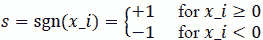 || (4) |
| --- | --- |

| 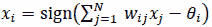 || (5) |
| --- | --- |

| 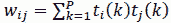 || (6) |
| --- | --- |

`xi` 同步或异步地与 `xj` 更新。`xj.wij` 更新权重用于更新 `xi` 值的符号值。

# 波尔兹曼机

它使用带有基于概率的激活函数的噪声 `Hopfield` 网络。从公式 7 可以看出，概率通过公式 5 的更新进行更新。该模型意义重大，因为它是最早使用隐藏单元的模型之一。对比散度算法被用于训练波尔兹曼机。

| 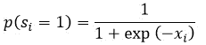 || (7) |
| --- | --- |

波尔兹曼机是具有具有可见层和隐藏层的双层神经网络。图中两层之间的边是无向的，这意味着信息可以双向流动。网络是全连接的，这意味着每个神经元都通过无向边与另一个神经元连接。图 (4) 显示了如何将波尔兹曼机转换为受限波尔兹曼机（`RBM`） [9]。`RBM` 是许多应用和创建不同网络的基础结构。（表 2)提供了模型的用途及其工作性质，而非对比。表中的每个模型在不同领域的表现不同。

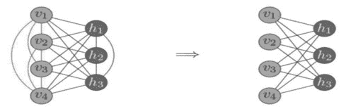 **图 (4)**

将波尔兹曼机转换为受限波尔兹曼机 (`RBM`)。表 2 深度学习模型及其学习算法。

| **模型** || **无监督** | **监督** |
| --- | --- | --- |
| 多层感知器 | 否 | 是 |
| 深度信念网络 | 是 | 是 |
| 受限波尔兹曼机 | 是 | 是 |
| 卷积神经网络 | 是 | 是 |
| 循环神经网络 | 否 | 是 |
| 卷积深度信念网络 | 是 | 是 |
| 自动编码器 | 是 | 否 |
| 深度波尔兹曼机 | 否 | 是 |
| 长短期记忆网络 | 否 | 是 |

该神经网络由深层神经元组成 [10]。神经元必须不断学习以应对任务，或以不同的方式应用以产生更好的结果。它每次都根据新的更新信息进行学习。深度神经网络使用多层节点从输入数据中提取高层级函数 [1, 4]。这意味着将数据转换为更具创意和更抽象的事物。深度前馈神经网络 (`DFNN`) 解释如下：

## 深度前馈神经网络

对于任何连续函数，`FNN` 均包含一组神经元和一个隐藏层。采用具有多个隐藏层的 `FFNN` 的原因是它使用了泛化近似定理，但该定理并没有解释如何学习这样的网络。一个相关问题是网络的直径可能会呈指数级增长。出意外的是，泛化近似定理对于具有有限隐藏神经元和大量隐藏层的 `FFNN` 仍然有效。因此，采用 `DFFNN` 代替浅层 `FFNN` 以提高可学习性。近似未知函数 `f*` 如下：

| 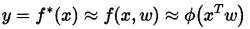 || (8) |
| --- | --- |

在这里，`f` 是一个依赖于参数 `θ` 的特定族函数，而 `ɸ` 是单层的非线性激活函数。对于深层隐藏层，`ɸ` 的形式如下所示：

| 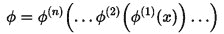 || (9) |
| --- | --- |

`D-FFNN` 并不假设 `f` 的精确函数族，而是通过近似 `ɸ` 来学习公式 9 函数，而 `ɸ` 是通过 `n` 个独立的隐藏层来的。

`CNN` [4, 11^(\-)13] 是一种特殊的 `FFNN`，它结合了卷积层、`ReLU` 和池化层。这些层通常与几层 `FNN` 结合。在传统的 `ANN` 中，层中的每个神经元都与下一层的所有神经元相连。在 `CNN` 中，每个连接都是网络中的一个参数，这正是网络的工作方式。`CNN` 中存在不同的非全连接层。这种重要性减少了参数的数量并减少了网络操作。神经元与局部感受场之间的连接使用一组权重，我们称这组权重为卷积。

**卷积：** 所有连接到局部感受场的神经元将共享同一个卷积。神经元的计算结果将存储在称为激活图的矩阵中。权重共享 `CNN` 可以共享其权重。因此，不同的卷积产生不同的激活图，可以使用超参数来改变卷积的数量。网络权重数量与卷积的大小成正比。图 (5) 显示了具有 3 层输入的典型 `CNN` 架构。每个通道连接了卷积层、池化，然后再次是卷积、池化和合并。合并层与全连接层 (`FC`) 连接，使用 `softmax` 函数提供决策。

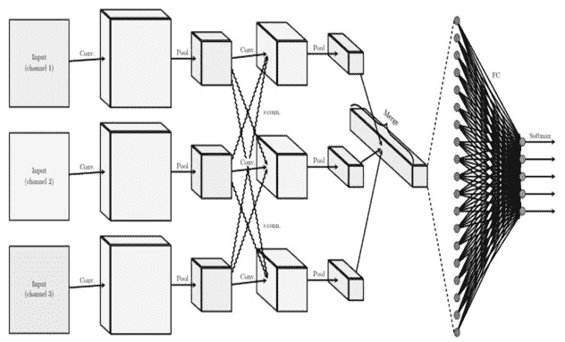 **图 (5)**

具有 3 层输入的典型 `CNN`。

`softmax` 公式在公式 10 中给出，根据其阈值计算以提供分类。

| 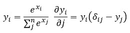 || (10) |
| --- | --- |

`CNN` 模型中的不同层解释如下：

*   **卷积层：** 卷积层是卷积神经网络架构的关键组件。卷积层类似于传统神经网络中的隐藏层，旨在将输入转换为更高层次的抽象。另一方面，卷积层并不依赖于全连接来执行输入和隐藏神经元之间的计算，而是利用了局部连接。卷积层在输入上滑动至少一个卷积，对每个区域进行卷积。结果存储在激活图中，即卷积层的输出。
*   **池化层：** 它经常夹在两个卷积层之间。通过尽可能地保留信息，池化层试图最小化输入维度。此外，池化层可以为网络赋予空间不变性，从而增加泛化能力。池化层的零填充、步长、池化尺寸和超参数。池化层像卷积层一样，使用步长为 2、窗口大小为 2 和零填充来扫描整个输入，输入维度会减半。最小池化、平均池化以及更复杂的方法（如随机池化和分数量池化）都是示例。最大池化是最常用的技术，因为它能有效地从子窗口中捕捉图像不变性。
*   **全连接层：** 馈馈神经网络（`FFNN`）中最小的单元是全连接层。在普通 `CNN` 的倒数第二层和输出层之间，经常添加一个全连接层来表示输入特征之间的非线性交互。然而，最近给出的许多标准受到了质疑，存在过拟合的可能性。它已被用于某些 `CNN` 架构中以替代线性层。

`CNN` 是一种常见的 `FFNN` 模型，旨在通过最少的预处理直接从像素图像中识别模式 [11, 14]。提出了一个用于物体识别的图像数据库 `ImageNet`。一项名为“`ImageNet` 大规模识别挑战”（`ILSVRC`）的年度挑战测试了软件检测和分类物体及场景的能力。下面，我们讨论 `ILSVRC` 主要竞争对手的 `CNN` 架构。

### LeNet-5

1998 年，`LeNet-5` 使用了由 `LeCun` 等开发的 7 层卷积网络对数字进行分类。为了处理更高分辨率的图像，它需要大量的卷积层；因此，处理资源受限于图 (6) 中的计算。

```
Images/9789815079210-C1-F6.jpg
```

`LeNet-5` 架构。

### AlexNet

2012 年，`AlexNet` 通过将前 5 个的错误率从 26% 降低到 15.3%，超越了所有之前的对手。`AlexNet` 网络比 `LeNet5` 更深，每层具有更多的滤波器，并且使用了堆叠的卷积层。图 (7) 中的 `AlexNet` 使用了卷积、最大池化、`dropout`、数据增强、`ReLU` 激活和带动量的 `SGD`。在最初的 6 天里，`AlexNet` 在两块 `Nvidia Geforce GTX 580 GPU` 上进行训练。此外，`SuperVision` 小由 `Geoffrey Hinton` 和 `Ilya Sutskever` 设计了 `AlexNet`。

```
Images/9789815079210-C1-F7.jpg
```

`AlexNet` 架构。

### GoogleNet (Inception V1)

`ILSVRC` 2014 竞赛由 `GoogleNet` (`Inception V1`) 获胜。组织者现在被迫评估这种近人的性能。事实证明，超过 `Google` 的准确率需要人类的指导。通过集成模式，人类专家实现了单模型前 5 错误率 5.1%，以及多模型 3.6%。

该网络采用了一种受 `LeNet` 启发的 `CNN`，但它包含了一个名为“`inception` 组件”的新元素。此外还有 `RMSprop` 和批归一化。该模块使用许多微小卷积来减少参数数量。他们的架构使用一个 22 层深的 `CNN`，拥有 400 万个参数，而不是 `AlexNet` 的 6000 万。

### VGGNet

`VGGNet` 是 `ILSVRC` 2014 的亚军，由 `Zisserman` 和 `Simonyan` 开发。`VGGNet` 使用 16 层设计精良且可靠的卷积层。只有 3x3 卷积，但有很多滤波器，且程序在四块 `GPU` 上连续运行了 2-3 周。它现在是从图像或照片中提取特征的最常用方法。`VGGNet` 的权重配置是开源，现在被应用于许多其他应用和挑战中。`VGGNet` 有 1.38 亿参数，在图 (8) 中很难管理。

```
Images/9789815079210-C1-F8.jpg
```

`VGGNet` 架构。

### ResNet

最后，`何恺` 等人提出了跳跃连接（`skip connections`）。这是一个带有跳跃连接的残差架构。

```
Images/9789815079210-C1-F9.jpg
```

`ResNet` 架构。

# 不同的神经网络架构

`CNN` 是一种常见的 `FFNN` 模型，旨在通过最少的预处理直接从像素图像中识别模式 [11, 14]。提出了一个用于物体识别的图像数据库 `ImageNet`。一项名为“`ImageNet` 大规模识别挑战”（`ILSVRC`）的年度挑战测试了软件检测和分类物体及场景的能力。下面，我们讨论 `ILSVRC` 主要竞争对手的 `CNN` 架构。

## 深度置信网络

1998 年，`LeNet-5` 使用由 `LeCun` 等开发的 7 层卷积网络对数字进行分类。为了处理更高分辨率的图像，它需要大量的卷积层；因此，处理资源受限于图 (6) 中的计算。

```
Images/9789815079210-C1-F6.jpg
```

深度置信网络架构。

## 自编码器

它是一种无监督模型，因为它们不需要标签。自编码器用于降维。当给定足够的数据时，自编码器可以对数组数据产生优越的二维表示。`PCA` 使用线性变换，而自编码器使用非线性变换。这通常会导致性能的提升。这些模型中的一些被称为稀疏自编码器、去噪自编码器或变分自编码器，有许多不同的类型。原始的自编码器只预训练网络的前半部分，然后展开网络，创建后半部分。

```
Images/9789815079210-C1-F11.jpg
```

自编码器架构。

## LSTM

1997 年，`Hochreiter` 和 `Schmidhuber` 提出了 `LSTM` 网络。`LSTM` 是 `RNN` 的变体，可以缓解 `RNN` 的缺陷，如长期依赖问题。1999 年引入了带有遗忘门的 `LSTM`。因此，与 `DFN` 不同，带有反馈的 `LSTM` 变成了标准的 `LSTM` 网络结构。它们还可以处理数据序列而不是单个数据点。因此，`LSTM` 非常适合评估语音或视频数据。

```
Images/9789815079210-C1-F12.jpg
```

长短期记忆网络架构。

# 总结

在本文中，我们概述了神经网络和深度学习模型的发展。讨论了人工神经网络的基本模型，如浅层 `FNN` 和深层 `FNN`。研究了诸如 `RNN` 以及结合 `Hopfield`、`Boltzmann machine` 和 `RBM` 等神经网络模型的简要细节。讨论了 `DFNN` 的架构，并以 `CNN` 为特殊例。讨论了 `Lenet-5`、`Alexnet`、`VGG` 组、`GoogleNet/Inception` 以及 `ResNet` 等不同模型的应用。在研究中，我们概述了深度学习模型，如 `Deep Feedforward Neural Networks`（深度前馈神经网络）、`Convolutional Neural Networks`（卷积神经网络）、`Deep Belief Networks`（深度信念网络）、`Autoencoders`（自动编码器）和 `Long Short-Term Memory Networks`（长记忆网络）。这些模型可能是今天深度学习的主要架构。因此，从根本上这些概念对于准备未来的 `AI` 突破至关重要。

# 发表许可

无。

# 利益冲突

作者声明无财务或其他方面的利益冲突。

# 致谢

声明无。

# 参考文献

|  ||  |
| --- | --- |
| [1] | Zhang Q., Yang L.T., Chen Z., Li P.. A survey on deep learning for big dataInf. Fusion vol. 42, no. October 2017, pp. 146–157, 2018.. 10.1016/j.inffus.2017.10.006 |
| [2] | Shyu M., Chen S., Iyengar S.S.. A survey on deep learning techniques.Strad Res.20207810.37896/sr7.8/037 |
| [3] | Dargan S., Kumar M., Ayyagari M.R., Kumar G.. A survey of deep learning and its applications: A new paradigm to machine learning.Arch. Comput. Methods Eng.202027410711092110.1007/s11831-019-09344-w |


| [4] | Emmert-Streib F., Yang Z., Feng H., Tripathi S., Dehmer M.. An introductory review of deep learning for prediction models with big data.Front. Artif. Intell.20203February410.3389/frai.2020.0000433733124 |
| [5] | Schmidhuber J.. Deep learning in neural networks: An overview.Neural Networks2015618511710.1016/j.neunet.2014.09.00325462637 |
| [6] | Emmert-Streib F.. A heterosynaptic learning rule for neural networks.Int. J. Mod. Phys. C2006171015011520010.1142/S0129183106009916 |
| [7] | Bengio Y., Lamblin P., Popovici D., Larochelle H.. Greedy layer-wise training of deep networks.Adv. Neural Inf. Process. Syst.2007115316010.7551/mitpress/7503.003.0024 |
| [8] | Ming Y., et al. Understanding hidden memories of recurrent neural networks2017 IEEE Conf. Vis. Anal. Sci. Technol. VAST 2017 - Proc.13242018 |
| [9] | G. E. Hinton and R. R. Salakhutdinov, “Reducing the dimensionality of data with neural networks,” Science (80-. )., vol. 313, no. 5786, pp. 504–507, 2006.. 10.1126/science.1127647 |
| [10] | Mayr A., Klambauer G., Unterthiner T., Steijaert M., Wegner J.K., Ceulemans H., Clevert D.A., Hochreiter S.. Large-scale comparison of machine learning methods for drug target prediction on ChEMBL.Chem. Sci. (Camb.)20189245441545110.1039/c8sc00148k301552234 |
| [11] | Alzubaidi L., et al. Review of deep learning: Concepts.CNN architectures, challenges, applications, future directionsSpringer International Publishing202181 |
| [12] | Kwabena Patrick M., Felix Adekoya A., Abra Mighty A., Edward B.Y.. Capsule networks – a survey, J. King Saud Univ. -.Comput.20193411111.2019 |
| [13] | Deng L., et al. A survey on deep learning2019 |
| [14] | Lit M., A learning on 2019 |
| [15] | Cheng J.,  learning011 |

图 (2) 显示了人工智能（`AI`）、机器学习（`ML`）、人工神经网络（`ANN`）和卷积神经网络（`CNN`）之间的关系。简单而言，聚类是其典型的用例。当今大多数机器学习都在运行实时算法，例如监督学习。在这种情况下，将一组已经标记或注释的图像提供给计算机。然后，挑战是让它为根据学习到的规则构建的新的、此前未见过的数据集分配正确的标签。这由一组输入-输出示例对组成。

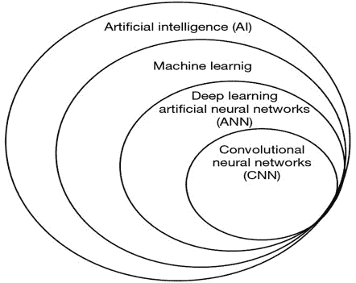 **图 (2)**  

`AI` 与 `ML`、`ANN`、`CNN` 的关系。

有许多不同的机器学习技术。图 (3) 显示了可用的不同类型的机器学习技术。在本节中，将描述不同的机器学习技术，每种技术都有其特定的流程、优点和缺点。

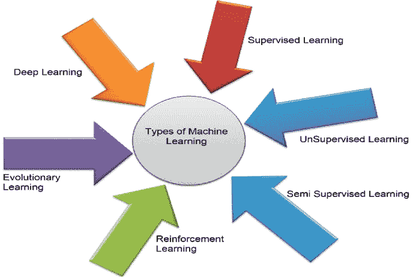 **图 (3)**  

不同类型的机器学习技术。

### 监督学习

在监督学习的情况下，模型被训练以执行特定的数据处理任务。在执行图像注释后，诸如“分类”之类的标签被应用于图像，该注释根据皮肤病变的严重程度来估算恶性程度 [3]。当应用于机器学习时，这描述了这样一种场景：根据输入变量向量 `x` 计算预测的输出变量 `y`。通过假设输入和输出符合一种称为预测模型的函数关系，如图 (1) 所示，假设该算法是成功的。监督学习通过在已知 `x` 和 `y` 的示例数据上进行训练来发现预测模型，这被称为发现学习。`I` 由 `n` 个变量（称为特征）组成，因此 `x` 属于 `Rn`。为了简单起见，我们只关注标量输出的情况。图 (4) 显示了监督机器学习的基础，其中输出表示为输入的函数。

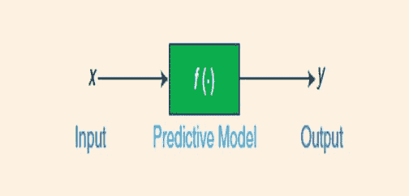 **图 (4)**  

监督机器学习的输出是输入的函数。

### 无监督学习

决策将自主做出，而不需要对数据进行处理。没有标签可以用于对系统做出的预测。特征学习使我们能够使用无监督学习获取隐藏模式。无监督学习技术用于将输入空间划分为聚类。早期无法识别这些聚类。群的形成基于相似性。图 (5) 显示了无监督机器学习的基础，其中输出表示为输入的函数。

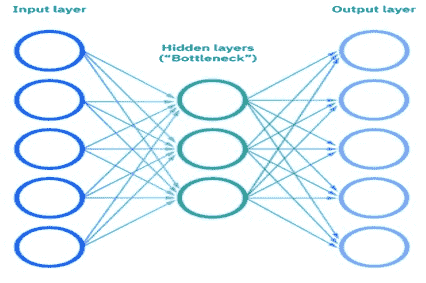 **图 (5)**  

无监督机器学习的输出是输入的函数。

### 半监督学习

半监督学习假设训练数据是不完整的。这种类型的训练通常用于经过适当训练的数据，旨在存在大量缺失结果的情况下提高性能。对于训练承诺，此类算法被应用于未标记数据。半监督学习算法同时在标记和未标记数据上进行训练。

### 主动学习

训练标签在主动学习中仅出现有限的次数。它被用于帮助添加标签以辅助实现目标。例如：例如，组织中的预算功能。

### 强化学习

强化学习适用于需要引导以成功完成目标的现实任务，如驾驶车辆或玩视频游戏。

### 进化学习

生物研究利用生物圈作为学习工具，用于识别和预测生物体的体寿命，并预测产生后代的概率。利用适应适应的知识，我们可以使用该模型来猜测如何调整结果。

## 深度学习导论

深度学习是机器学习的一个分支，涉及构建如人类大脑一样深的神经网络，其灵感源于生物神经网络。

神经网络是该阶段最流行的机器学习方法，被用于学习和预测。采用了一组各种算法。这些算法的目标是创建一个能够处理各种问题并给出预测的通用系统。该图具有许多堆叠在一起的处理层，由各种线性和非线性转换组成。

在开发 `AI` 时，深度学习应该是关注重点。由深度学习算法构建的人工神经网络由多个层组成。输入层、隐藏层和输出层构成了人工神经网络（`ANN`）。当信号发送到网络时，对如何处理它做出决策，接收信号的输入层和做出决策的输出层在下面的图 (6) 中所示。深层神经网络的输入层和输出层之间隔着几个隐藏层。

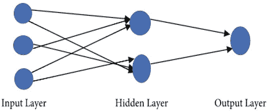 **图 (6)**  

人工神经网络。

深度学习与机器学习之间的差异见图 (7,8 和 9)。传统的机器学习技术包含 4 个阶段，而深度学习技术包含三个阶段。

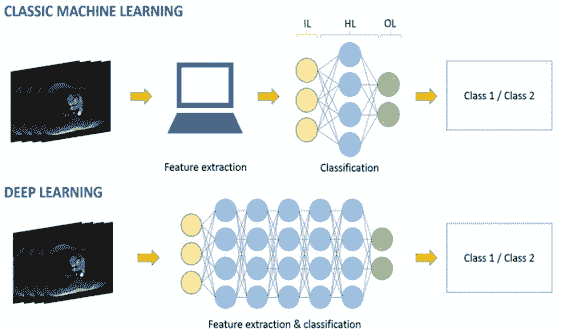 **图 (7)**  

传统机器学习与深度学习。

尽管它们实现了承诺，但 `ML` 架构增加了失败和过拟合的风险。它们也耗时且需要更大的数据集。

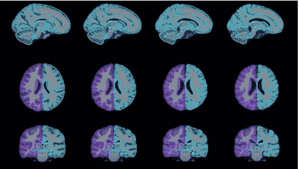 **图 (8)**  

传统机器学习与深度学习。

今天，疾病诊断可能是一项极具挑战性的任务。医学检查和评估是患者的重要任务。关于患者、治疗、药物和处方的大量出现在医疗领域。主要问题是这些报告似乎由于数据管理错误导致的共生关系 [4,5]。

## 机器学习在医学影像的应用

医学影像利用机器学习算法研究特定疾病非常有效。非数学解决方案无法准确表示图像处理中的某些实体，如病变和器官。基于像素的调查被用于搜索图像中的疾病。像素分析在医学影像机器学习的应用是另一种基于机器学习的特征提取。对于特定问题，使用交互方法可能比基于特征的分类器更有效 [6]。由于对比度低，很难探测图像的属性。基于像素的机器学习不需要特征计算和分割 [7]。像素分析被用于增强目标对比度医学图像。直方图均衡化是对比改进最有效的技术（`HE`），旨在通过同态图像滤波修改基于直方图的对比增强技术（`MHFIL`）。

直方图修改用于第一阶段以提高全局对比度。第二阶段的同态滤波进一步用于图像锐化。该实验研究了十张具有特定低对比度的胸部 X 射线图像。通过对所有十张图像使用最小值法，可以产生 `MH-FIL`。放射科医生承担着医学图像澄清的主要责任，而图像分析和质量评估具有同等重要性。`CAD` 已利用计算机辅助设计开发了多年。

当今的机器学习技术需要侧重于在结构化原始数据与故事之间构建并组织一种关系。通过拥有如此海量的数据，机器学习技术在医疗保健领域的应用将产生巨大的益处。尽管机器学习在帮助医生进行近乎完美的诊断、为患者识别最佳药物以及减少最终使用昂贵药物的患者数量非常有用，但目前，机器学习的能力仍然有限 `[8, 9]`。

该技术的目标是帮助计算机发现某些特征，使其能够识别和描述可能适用于特定问题的数据。这一概念是多种机器学习算法的基础。日益详尽的模型被堆叠在一起，将输入图像转换为输出。卷积神经网络是图像分析中更好的模型类型（`CNNs`）。`CNNs` 利用多个滤波器层来处理输入。医学领域经常采用深度学习方法，通过将其引入各种输入格式（例如三维数据）来使其适应现代架构。此前，由于 3D 卷积的计算量过大以及随之而来的额外限制，`CNNs` 避免了处理海量数据。图（10）展示了使用深度学习进行医学图像分析的一个示例。

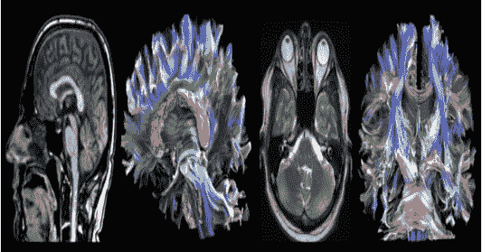 **图 (9)**  

传统机器学习与深度学习。

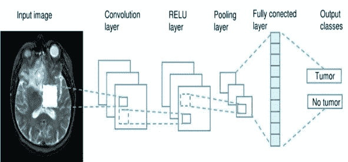 **图 (10)**  

深度学习在医学影像中的应用。

## 图像分类

作为深度学习的主要任务之一，医学图像分类侧重于探索与临床相关的问题，如为患者提供早期治疗。多图像输入；单项诊断（疾病有或无）。常见的是，医学影像方法或软件应用所使用的不同诊断测试的数量通常小于计算机视觉中所利用的测试模型和样本集数量。如 `[10]` 所示，精细修改（或特征提取）的效果更好，在评估膝骨关节炎时达到了 57.6% 的准确率，而后者为 53.4%。对于细胞病理学分类，`CNN` 特征提取似乎与细胞学分类的 `CNN` 特征提取相似，其准确率水平在 69.1% 到 70.5% 之间 `[11]`。

### 目标分类

作为深度学习的主要任务之一，医学图像分类侧重于探索与临床相关的问题，如为患者提供早期治疗。多图像输入；单项诊断（疾病有或无）。常见的是，医学影像方法或软件应用所使用的不同诊断测试的数量通常小于计算机视觉中所利用的测试模型和样本集数量。如 `[10]` 所示，精细修改（或特征提取）的效果更好，在评估膝骨关节炎时达到了 57.6% 的准确率，而后者为 53.4%。对于细胞病理学分类，`CNN` 特征提取似乎与细胞学分类的 `CNN` 特征提取相似，其准确率水平在 69.1% 到 70.5% 之间。

### 区域检测

作为深度学习的主要任务之一，医学图像分类侧重于探索与临床相关的问题，如为患者提供早期治疗。多图像输入；单项诊断（疾病有或无）。常见的是，医学影像方法或软件应用所使用的不同诊断测试的数量通常小于计算机视觉中所利用的测试模型和样本集数量。如 `[10]` 所示，精细修改（或特征提取）的效果更好，在评估膝骨关节炎时达到了 57.6% 的准确率，而后者为 53.4%。对于细胞病理学分类，`CNN` 特征提取似乎与细胞学分类的 `CNN` 特征提取相似，其准确率水平在 69.1% 到 70.5% 之间。

### 数据挖掘

作为深度学习的主要任务之一，医学图像分类侧重于探索与临床相关的问题，如为患者提供早期治疗。多图像输入；单项诊断（疾病有或无）。常见的是，医学影像方法或软件应用所使用的不同诊断测试的数量通常小于计算机视觉中所利用的测试模型和样本集数量。如所示，精细修改（或特征提取）的效果更好，在评估膝骨关节炎时达到了 57.6% 的准确率，而后者为 53.4%。对于细胞病理学分类，`CNN` 特征提取似乎与细胞学分类的 `CNN` 特征提取相似，其准确率水平在 69.1% 到 70.5% 之间。

### 符号处理

作为深度学习的主要任务之一，医学图像分类侧重于探索与临床相关的问题，如为患者提供早期治疗。多图像输入；单项诊断（疾病有或无）。常见的是，医学影像方法或软件应用所使用的不同诊断测试的数量通常小于计算机视觉中所利用的测试模型和样本集数量。如所示，精细修改（或特征提取）的效果更好，在评估膝骨关节炎时达到了 57.6% 的准确率，而后者为 53.4%。对于细胞病理学分类，`CNN` 特征提取似乎与细胞学分类的 `CNN` 特征提取相似，其准确率水平在 69.1% 到 70.5% 之间。

## 其他影像应用

### (a) X 射线图像

X 射线常用于诊断肺结核、肺不张、胸腔积液和气胸。与其他影像方法相比，X 射线易于获取、廉价且剂量安全。

### (b) 计算机断层扫描 (CT)

`CT` 利用计算机和旋转 X 射线设备创建人体横截面图像。软组织、血管和骨骼在 `CT` 扫描上均可见。除了检测微小病变外，`CT` 还能提供更全面的评估。可以通过计算机断层扫描（`CT`）发现肺结节。

### (c) 乳摄影 (MG)

在世界上女性癌症患者中，乳腺癌是主要的死因。`MG` 是检测早期乳腺癌最常用的方法。使用低剂量 X 射线成像技术 `MG` 有助于识别疾病。由于乳腺图像中病变较小，通过乳腺摄影识别较为困难。

### (d) 病理学

病学家通过显微镜观察人类组织来发现肾癌、肺癌、乳腺癌等疾病。染色是组织病理学中的技术，用于突出和可视化特定的组织区域。苏木精伊红染色（`H&E`）会产生深紫色细胞核和粉红色结构。在过去的世纪里，不同疾病的癌症分级严重依赖 `H&E` 染色。数字病理成像是医学影像领域的一种新型成像技术。细胞核检测、分类、细胞分割和组织分割是使用深度学习解释病理图像时可以执行的一些任务。

### (e) 其他图像

内窥镜等程序通过将内窥镜（一种实心管子）直接插入体内，能够对内部组织和器官进行详细研究。`via` 内窥镜可以研究广泛的内脏，包括消化系统、呼吸系统、泌尿系统和女性生殖系统。一种核成像技术——正电子发射断层扫描（PET）通过注射某些放射性示踪剂来揭示组织分子水平的活动。

机器学习能力在过去几年中已经得到了培养。在目前的实践中，机器学习方法对现实世界的应用具有良好的稳健性，且这些结构明显增强了这一优势。此前，这涉及医学影像的准备而在未来，它将以快速速度取得重大进展。使用机器学习的机器可以对药物管理做出重要推断。患者将从这项研究中受益。它是机器学习解决方案的重要部分，因为机器被充分利用了潜力。医学影像分析中使用的深度学习算法有助于疾病模式的分类、分类和计数。它还为探索分析目标的边界开启了大门，从而有助于生成治疗的预测模型。影像领域的科学家正在权衡这些问题，以允许在医疗领域中使用深度学习。随着深度学习的快速改进，它正越来越多地用于医疗领域的许多其他领域。

不适用。

## 利益冲突

作者声明无任何财务或其他方面的利益冲突。

## 致谢

本研究未收到任何任何助机构的特定资助。

## 参考文献

|  ||  |
| --- | --- |
| [1] || Valiant L.G.. A theory of the learnable.Commun. ACM198427111134114210.1145/1968.1972 |
| [2] || Andre Esteva, Brett Kuprel, Roberto A. Novoa, Justin Ko, Susan M. Swetter, and Helen M. Blau, "Dermatologist-level classification of skin cancer with deep neural networks." *nature* 542.7639 (2017): 115-118.. |
| [3] || Esteva Andre, Kuprel Brett, Novoa Roberto A., Ko Justin, Swetter Susan M., Blau Helen M.. Dermatologist-level classification of skin cancer with deep neural networks.nature20175427639115118 |
| [4] || Schmidhuber J.. Deep learning in neural networks: An overview.Neural Netw.2015618511710.1016/j.neunet.2014.09.00325462637 |
| [5] || William Warwick, Sophie Johnson, Judith Bond, and Geraldine Fletcher, "A framework to assess healthcare data quality." *The European Journal of Social & Behavioural Sciences* (2015).. |


| [6] | | Suzuki K.. Pixel-based machine learning in medical imaging. Int. J. Biomed. Imaging 2012 2012 7920792 2481907 |
| [7] | | Agarwal T.K., Mayank T., Subir S. L.. Modified histogram based contrast enhancement using homomorphic filtering for medical images. 2014 IEEE Advance Computing Conference (IACC) IEEE 2014 96498 10.1109/AdCC.2014.677945 |
| [8] | | D. Maddux, Human Structured and Unstructured Data |
| [9] | | Page D.. Challenges in Machine Learning from Electronic Records. MLHC 2015 |
| [10] | | Antony J., Quantifying radiographic knee severity using deep convolutional networks. Pattern Recognition (ICPR) 2016 10.1109/ICPR.2016.78997 |
| [11] | | E. Kim, M. Corte-Real, and Z. Baloch, deep semantic application for thyroid cytopathology. Medical Imaging 2016: PACS and Informatics: Next Generation and Innovations. Vol. 9789. SPIE. |
| [12] | | Wang C.W., Huang C.T., Hsieh M.C., et al. Evaluation of anatomical landmark detection for cephalometric-ray images: a grand challenge. IEEE Trans. Med. Imaging 2015 34 9 1890 10.1109/TMI.2015.2412952 59438 |
| [13] | | De Vos B.D., et al. 2D image classification for 3D anatomy: employing deep convolutional networks. Medical Imaging 2016: Image Processing vol. 9784, pp. 517-523. SPIE, 2016. |
| [14] | | Çiçek Ö., et al. 3D U-Net: learning dense segmentation from sparse annotation. International Conference on Medical Image Computing and Computer-Assisted Intervention 2016 Springer. |
| [15] | | Luo X., Zhang D., Zhu X.. Deep learning based forecasting of photovoltaic power generation by incorporating domain knowledge. Energy 2021 225 1240.1016/j.energy.2021.1 |
| [16] | | Jordan M., Mitchell T.. Machine learning: Trends, perspectives, and prospects. Science 2015 349 6245 5260 1.1126/science.aaa8415 661523 |
| [17] | | Kabilan R., Chandran V., Yogapriya J.. Alagar Karthick, Priyesh P., Gandhi, V. Mohanavel, Robbi Rahim, and S. Manoharan. Short-term power prediction of building integrated photovoltaic (bipv) system based on machine learning algorithms. International Journal of Photoenergy 2021 (2021) |
| [18] | | Lai J-P., Chang Y-M., Chen C-H., Pai P.. Jung-Pin, Yu-Ming Chang, Chieh-Huang Chen, and Ping-Feng Pai survey of machine learning models in renewable energy predictions. Appl. Sci. (Basel) 2020 10 17 597 1.3390/app1017595 |
| [19] | | Charles N., Kabalan M., Singh P.. Open source photovoltaic system modeling with python. 2015 IEEE Canada International Humanitarian Conference (IHTC2015) IEEE pp. 1-4, 2015. 10.1109/IHTC.2015.7238046 |
| [20] | | Salcedo-Sanz S., Cornejo-Bueno L., Prieto L., Paredes D., García-Herrera R.. Feature selection in machine learning prediction systems for renewable energy applications. Renew. Sustain. Energy Rev. 2018 90 728 741 10.1016/j.rser.2018.04.008 |

Saleena Thorayanpilackal Sulaiman(1, *), Muhamed Ilyas Poovankavil(2), Abdul Jabbar Perumbalath(3)

¹ Sullamussalam Science College, Areekode, Malappuram, Kerala, India

² PG and Research Department of Computer Science, Sullamussalam Science College, Areekode, Malappuram Dt, Kerala – India

³ School of Computer Science, Mahathma Gandhi University, Kottayam, Kerala, India

## 摘要

所提模型比较了 `CNN` 和 `ResNet50` 在数字病理图像领域的效率。深度学习方法广泛应用于疾病检测、诊断、分割和分类领域。`CNN` 是广泛使用的图像分类算法，但在病理图像等复杂结构的情况下，准确率可能较低。残差网络是病理图像分类的良好选择，因为数字病理图像的形态很难区分。结直肠癌是常见的癌症之一，也是致命疾病之一。如果通过活检结果进行早期检测，将降低死亡率。在变体中选择 `ResNet50` 是因为它的计算复杂度适中且分类准确率高于其他模型。此处使用的准确率指标是训练和验证的准确率及验证准确率分别为 89.1% 和 90.62%，而训练损失和验证损失分别为 26.7% 和 24.33%。同时，对于 `CNN`，准确率分别为 84.82% 和 78.12%，损失分别为 36.51% 和 47.33%。

**关键词：** 结直肠癌、`CNN`、H&E 染色组织病学、`ResNet50`。

---

* **通讯作者 Saleena Thorayanpilackal Sulaiman：** Sullamussalam Science College, Areekode, Malappuram, Kerala, India; 邮箱：tssaleena@gmail.com

## 引言

有十九种不同类型的癌症会影响健康人体 [1]。其中，结直癌是美国发病率第三的癌症。患者体内的肿瘤通常通过医学影像技术（如放射学）检测出来。不同的模态，如 X 射线 [2]、CT 扫描、PET 扫描或 MRI，`etc.`，可以被用于发现癌症的位置和进展速度，从而导致对其为良性还是恶性的分类。但只有通过活检才能进行确认。因此，病理学家在癌症的诊断和治疗方案决策中起着至关重要的作用。

病理学家的工作量非常繁忙，因为与其工作量相比，他们的人数非常少。

结直癌发源于大肠，结肠是消化道的末端 [3, 4]。这种癌症表现出的征象和症状非常不特异。因此，对任何年龄的人进行结肠镜检查等筛查可以降低死亡率，因为这在早期是可以预防和治愈的疾病。在这种情况下，病理测试将非常有益。

大多数结直肠腺癌是中度分化的，但有些是低分化的。因此，仅观察组织病理图像，分类可能是不准确的。所以现在，辅助研究或主要是免疫组化（IHC）染色是该领域的常用方法 [5-7]。这是一种基于蛋白质的测试，与组织病理图像分析相比，其成本很高。

结直癌的样子及其起源如图所示 (1)。

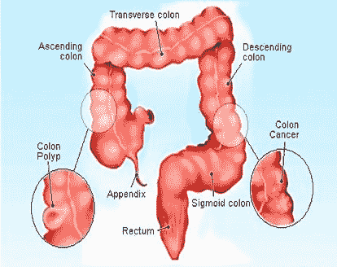 **图 (1)**

受结直癌影响的区域 [1]。

深度学习算法在 [8] 染色归一化 [9]、分割、分类、分级、分期、预后 `etc.` 等方面非常有效，特别是神经网络。数字病理可以作为传统玻片保存过程良好替代方案。它易于运输并可以在不受物理损坏的情况下存储图像。卷积神经网络（`CNN`）是数字图像分析和图像分类强大且准确的替代方案。计算机视觉可以识别并分类组织病理图像中存在的癌症区域，而这些肉眼很难识别的。首先，我们必须用足够的数据训练模型，并根据试错的基础上选择最佳网络。10 Pacal 等人描述了结直肠癌中用于各种应用的 `CNN` 算法。该论文综述了近期发表的 135 篇论文。H&E 染色的组织病理图像的数字图像被用作这些算法的输入。细胞核的大小和形状、结直肠息肉的形状、不规则组织的聚集 `etc.` 是结直肠癌检测和分类时需要考虑的一些特征。尽管 `CNN` 是图像分类的强大工具，但由于其形态特征，病理图像的分类更为困难。目前有多种强大的预训练网络用于图像分类。此类网络根据迁移学习的原理工作，它们大多数是用 `ImageNet` 训练的；它们的特征提取能力可以应用到我们的本地数据集以创建我们自己的模型。只有最后一个全连接层会被更改，其他层保持不变。本文包含了从在线仓库获取的结直肠数据集与 `ResNet50` 算法 [11] 的比较。`ResNet50` 是高效且广泛使用的变体之一。它是一个在 `ImageNet` 数据集上训练的预训练网络。这项研究证明 `ResNet50` 适用于此类图像分类。此处使用的 `CNN` 有四个卷积层，后面是一个池化层。类似的 CAD 已用于乳腺癌分类 [12]、胃和结肠上皮肿瘤 [13] 以及其他十种癌症 [14, 15]。细胞核检测模型也针对多种癌症开发 [16, 17]。噪声去除是预处理的主要部分，可以提高模型的效率。由于我们在模型中使用处理后的数据，因此没有使用此类方法。直接数据收集是 AI 中最乏味且难以实现的步骤，特别是在医学数据方面，公共仓库是某种幸运。在多个仓库中，TCGA 是其中之一。癌症基因组图谱（TCGA）是由美国癌症研究所于 2005 年启动的一个著名项目。它作为一个生物样本的大型公共仓库连接了全球的研究人员。他们提供了约 33 种癌症的数千份活检数据 [18]。尽管 WSI 对于病理领域是全新的，但它们对传统的玻片保存方法产生了巨大的变化。它作为存储、运输甚至病理数据分析的解决方案。由于每个 WSI 具有数千个维度，可以从同一个创建多个补片。病理学家可以手动标记图像并裁剪感兴趣区域。在这项工作中，数据集来自 Borkowski 等人 [19]，该数据集通过从 TCGA 获取的高分辨率 WSI 图像切片化创建，如图 (2)所示。

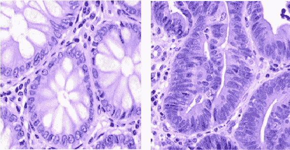 **图 (2)**

正常结肠横截面（左），受癌症影响的组织 [19]。

## 方法与准备

### 数据集准备

Borkowski 等人 [19] 准备了一个新数据集 `LC25000`，包含肺癌和结肠癌图像。它有五类，每类 25000 张图像。这 25000 张图像由 750 肺组织和 500 结肠组织创建。1024 x 768 像素的原始图像调整为 768 x 768 像素，并使用 `Augmentor` 软件包进行了数据增强。通过左/右旋转和垂直/水平翻转来增强数据。

## 相关工作

由于 WSI 的极高维度特性（分辨率可能为 100k 到 50k），它们无法直接输入 `CNN` [20]。此外，Le Hou 等人为每个比例的每个图像创建了约 1000 个补片，尺寸均为 500x500，放大倍率为 20X 和 5X。

从 TCGA 获取了共 1634 个 WSI 用于创建一个包含 LUAD、LUSC 和正常组织的数据集 [21]。从每个玻片中提取了 512x512 的不重叠补片，每个玻片的补片数量从几十到数千不等。

Andrew J. Schaumberg 等人 [22] 在其论文中清楚地描述了病理学家标注图像的困难。作为解决方案，他们利用了社交媒体（特别是 Twitter）来实现同样的操作。在 8 个国家病理学家的帮助下，他们成功开发了一个包含 2750 张图像的数据集，包含了多种图像病例。

不同的分割方法包括阈值分割、聚类、基于边缘的分割、基于区域的分割、基于 ANN 的分割以及基于偏微分方程的分割 [23]。

Francesco Bianconi 等人 [24] 比较了 H&E 染色数字图像上的颜色预处理对分类性能的影响。染色问题、图像采集工具内置的噪声伪影、组织制备的差异等，会对图像的清晰度产生不利影响。

Meghana Dinesh Kumar 等人 [25] 对 `KIMIA PATH960` 数据集执行了分类操作，该数据集包含 20 个不同的类别。这是一项使用预训练网络、局部二值模式（`LBP histogram`）、字典法或视觉词袋（或 `BoVW`）的比较操作。其中，深度网络和 `LBP histogram` 需要大量的训练，获得的准确率分别为 94.72% 和 90.62%。第三种方法 `BoVW` 表现更好，准确率为 96.50%。`AlexNet` 和 `VGG16` 被用作预训练网络，如果数据集每个类别有更多样本（此处仅有 48 个样本），它们的表现可能会更好。除了 `BoVW` 方法外，均使用了留一法进行交叉验证。

Abtin Riasatian 等人 [26] 获取了 TCGA 的 244 张全切片图像（WSI）缩略图，并制作了这些图像的掩码并公开。由于 WSI 的大小可能是 50,000 x 50,000 或更大，他们使用了 1 倍放大的缩略图。他们实验了使用 [27] `U-Net` 以及各种骨干网络 `MobileNet`、`VGG16`、`Efficient Net-B3`、`ResNet50`、`ResNext101` 和 `DenseNet121` 的分割方法。其中，`EfficientNet-B3` 和 `MobileNet` 实现了近 99% 的灵敏度和特异性。将结果与不同的手工算法进行了比较，例如改进的 `FESI` [20], `TissueLoc` [21], `Histomics-TK` 以及灵敏度接近 80% 的 `Otsu binarization`。其他性能指标还包括五交叉验证、Jaccard 指数和 Dice 系数。

Andrew 等人 [28] 讨论了两个公开的机器学习平台：基于云的“Google Auto ML”和基于计算机的“Apple Create ML”。它们都是区分结直肠癌和肺癌的分类模型。KRAS 基因的存在与否可以预测癌组织是否对特定的化疗药物产生反应，这目前通过复杂的分子检测发现。`Apple Create ML` 专门用于 Mac OS 系统，而 `Google Auto ML` 使用其云服务需要支付费用。

Atsushi Teramoto 等人 [29] 开发了一个预训练网络，用于将非细胞肺癌（NSCLC）的细胞学图像分为 3 个亚型（腺癌、鳞癌和小细胞癌），该具有 3 层卷积层、3 层池化层和 2 层全连接层。这使用细胞学图像进行 NSCLC 分类的新方法。每层创建的特征图分别为 256X256X32、128X128X32 和 64X64X32，并使用三折交叉验证进行性能评估。准确率为：腺癌 89.0%，鳞癌 60.0%，小细胞癌 70.3%。

由于癌症亚型是根据细胞水平的形态因素区分的，因此块级（patch-level）分类器的性能将优于图像级分类器 [30]。但分类带来的复杂性在于，正常的下采样过程可能会导致图像丢失几部分信息，而且由于只给了图像级的真实标签，单个块的标签是未知的。因此，Le Hou 等人引入了一种基于期望最大化（EM）的新方法，其中可以自动定位判别性块。网络在单块 NVidia Tesla K40 GPU 上使用 `CAFFE` 工具箱进行了训练。

Deng 等人 [31] 对应用于组织病学图像分类、语义/实例分割、染色归一化等的不同深度学习技术进行了综述。卷积层提取特征图，而池化层减少特征维度，激活函数处理数据的非线性。

深度学习网络是此很好的选择。

### 卷积神经网络 (CNN)

`CNN` 过去一直是主要的算法 [36]。卷积层结合池化层和激活函数，因此实现了特征提取的任务。选择的层数取决于数据。分类在最后一层完成，该层被称为全连接层或稠密层。由于这是一个二分类模型，它有两个输出 [37]。图 (3) 解释了 `CNN` 的架构。

CNN 架构 [37]。


这里使用的 CNN 模型具有四层卷积层，后面是一个池化层。从数学上来说，卷积是一种应用于两个函数 `f` 和 `g` 的过程，结果为 `(f*g)`，定义了一个形状对另一个形状的影响 [38]或它是两个函数在反转和位移后乘积积分。对所有位移值进行积分，产生卷积函数。这里的两个函数被称为图像矩阵和滤波器矩阵。这里使用的滤波器是 3x3 矩阵。

(1)

其中 `t` 代表位移量。

池化方法用于减少特征图的维度。这里模型使用了最大池化。正如名称所示，该方法选择滤波器覆盖的特征图区域内的最大元素。最大池化方法如图 (4) 所示。

在第二、第三和第四层中，使用了 `dropout` 以避免过拟合。在该模型中，我们使用了 25% 的 dropout，它会随机选择并移除对特征提取可能无用的神经元。在四层之后，添加了一个扁化层（flattened layer）和两个全连接层。除了输出层外，所有层使用的激活函数均为 `relu`。在输出层中，由于是二分类，使用了 `sigmoid`。

如图（5)）所示的残差学习框架 `[40]` 促进了更深神经网络的出现。尽管这是一个更复杂的网络，但它非常容易优化。它在 ILSVRC 2015 分类任务中获得第一。它拥有 152 层，而 `ResNet-50` 是其中最小的版本之一。残差网络包含了多种网络变体，如 `ResNet-18`、`ResNet-34`、`ResNet-50`、`ResNet-101`、`ResNet-110`、`ResNet-152`、`ResNet-164`、`ResNet-1202`等。`[41^(\-)43]`。跳跃连接（Skip connection）或恒等短连接（Identity Short Connection）是 `ResNet` 的特殊特征，即跳过一层或多层。该特性的数学表示所示：

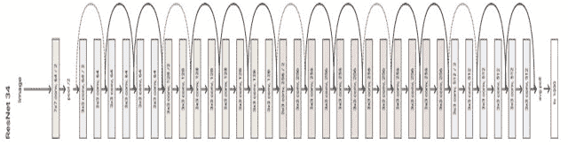 **图 (5)**

`ResNet34` 架构 `[44]`。

| 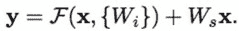 || (2) |

| --- | --- |

同一残差网络的分层结构有明确的定义。相同的块一个接一个堆叠形成网络。网络的名称指示了图（6)）中存在的块的数量。

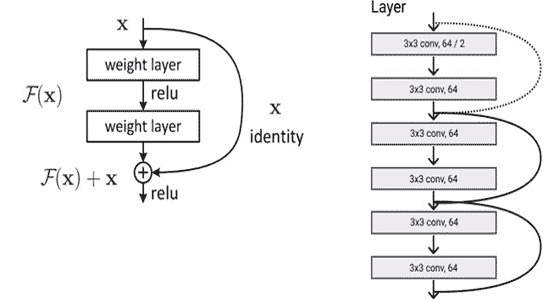 **图 (6)**

残差块（左）`[42]`，`ResNet` 中的层形成 `[44]`。

使用了 `TensorflowKeras` 进行实现。输出层以外的所有层均被冻结，以确保这些层不会再次进行训练。由于模型已经在 ImageNet 上经过了训练 `[44]`，模型的权重可以导入到我们新创建的模型中。这里只添加了一个带有输出层的单个扁化层。由于有两个类别（正常和癌症），因此存在两个输出，此处在此执行二分类。该模型使用 `Adam` 优化器、二分类交叉熵和 0.0001 的学习率进行了编译。这里的可训练参数数量为 200,706，而在 `VGG16` 中只有 50,178 个参数，这在普通的 CNN 算法中数量太少了。

`ResNet` 本身是一种 CNN 架构，它解决了 `vanishing gradient` 问题，使得网络比 CNN 更深。

### 结果

该模型使用了迁移学习方法 `ResNet50` 的特征提取方法和权重。此处使用的精度指标是训练和验证准确率以及损失。给出的值为：`ResNet50` 的训练和验证准确率分别为 89.1% 和 90.62%，而训练损失和验证损失分别为 26.7% 和 24.33%。而对于 CNN 而言，训练和验证准确率分别为 84.82% 和 78.12%，训练损失和验证损失分别为 36.51% 和 47.33%。

## 结论

病理图像的分类不像其他普通图像那样简单，因为它们具有复杂的形态和多异的组织形状。因此，必须使用像 `ResNet` 这样强大的深度网络来完成这项任务。我们比较了在相同数据集上 CNN 和 `ResNet50` 的效率。其中，`ResNet50` 显示出比其他更高的精度。使用更高级的 `ResNet` 变体可以获得更高的精度。分类本身对于实时使用意义不大。因此，在病理学家的帮助下，也可以对相同的图像应用分割任务。此外，还可以对数据应用不同的预处理方法来改进结果。

## 发表许可

作者特此同意发表该作品。作者保证此作品此前未以任何形式发表过，且未同时提交给其他出版者，也不处于其他出版者的考虑之中。

## 利益冲突

作者声明无财务或其他利益冲突。

## 致谢

我们非常感谢 Andrew A. Borkowski 提供了结肠图像数据集 LC25000。

## 参考文献

|  ||  |

| --- | --- |

| `[1]` | [`www.medicinen.com/cancer/html`](https://www.medicinen.com/cancer/html) |

| `[2]` | S.K Lakshman, SachiNandan, Arunkumar, Future Generation Systems 92 (2019):374-382 |

| `[3]` | Labianca R., Beretta G., Kildani B., Merlin F., Moscoli S., Quadri G., Critical Reviews in Oncology/Hematology 2010542 |

| `[4]` | Ahmed M., Colon cancer: A clinician’s perspective 2019 Gastroenterology 538 |

| `[5]` | Coudray P., Sakellaropoulos N., Narula S., Razavian A., Classification of non–small cell lung using deep learning Nature Medicine 24 159–167 |

| `[6]` | Thunnissen E., van Oord K., den Bakker M., Prognostic and predictive biomarkers in lung cancer Virch Arch.201546576 |

| `[7]` | Zachara S., Verdun T., Churg A., Accuracy of poorly differentiated non–small cell lung commonly used markers Hum. Pathol.20138S1-S29 |

| `[8]` | Khan A., Rajpoot N., Treanor D., Magee D., Efficient nucleus detector in histopathology images using image-specific color normalization J. Microsc.2013249212413510 |

| `[9]` | Gharieb R., Gendy G., Abdelfattah A., Image segmentation using fuzzy c-means incorporating weighted local membership and local distances 2016 World Symposium on Computer Applications & Research (WSCAR)6110 |

| `[10]` | Pacal I., Karaboga D., Basturk A., Akay B., A comprehensive review of deep learning in colon cancer Comp. Biol. Med.20201040329 |

| `[11]` | Sarwinda D., Paradisa R., Bustamam A., Anggia P., Deep Learning in Image Classification using Residual Network (ResNet) Variants for Detection of Colorectal Cancer Proc. Comput. Sci.2021179423431 |

| `[12]` | Ojansivu V., Linder N., Rahtu E., Pietikäinen M., Lundin M., Joensuu H., Lundin J., Automated classification of breast cancer morphology in histopathological images Diagn. Pathol.20138S1-S29 |

| `[13]` | Iizuka O., Kanavati F., Kato K., Rambeau M., Arihiro K., Tsuneki M., Deep Learning Models for Histopathological Classification of Gastric and Colonic Epithelial Tumours Sci. Rep.2020101150410 |

| `[14]` | Hou L., Gupta R., Van Arnam J.S., Zhang Y., Sivalenka K., Samaras D., Kurc T.M., Saltz J.H., Dataset of segmented nuclei in hematoxylin and eosin stained histopathology images of ten cancer types Sci. Data2020711851 |

| `[15]` | Vink J.P., Van Leeuwen M.B., Van Deurzen C.H.M., De Haan G., Efficient nucleus detector in histopathology images J. Microsc.2013249212413510 |

| [16] || Macenko, Marc, Marc Niethammer, James S. Marron, David Borland, John T. Woosley, Xiaojun Guan, Charles Schmitt, and Nancy E. Thomas. “一种用于定量分析的组织学切片归一化方法。”2009 IEEE 国际医学成像国际会议：从纳米到宏观，页. 1107-1110. IEEE, 2009.. |

| [17] || S.H.A. Kharofa, “医学图像去噪”, 国际科学、技术与工程增强研究杂志, ISSN: 2319-7463, Vol. 7 Issue 5, May-2018.. |

| [18] || [`www.cancer.gov/about-nci/organization/ccg/research/structural-genomics/tcga`](https://www.cancer.gov/about-nci/organization/ccg/research/structural-genomics/tcga) |

| [19] || Borkowski, A. A., Bui, M. M., Thomas, L. B., Wilson, C. P., DeLand, L. A., and Mastorides, S. M. “肺癌和结肠癌病理图像数据集 (LC25000).” arXiv 预印本 arXiv:1912.12142, 2019.. |

| [20] || Hou L., Samaras D., Kurc T.M., Gao Y., Davis J.E., Saltz J.H.. 全切片组织图像分类的基于块的卷积神经网络.IEEE 计算机视觉与模式识别会议 20162424243310.1109/CVPR.2016.266 |

| [21] || Coudray N., Ocampo P.S., Sakellaropoulos T., Narula N., Snuderl M., Fenyö D., Moreira A.L., Razavian N., Tsirigos A.. 使用深度学习从非小细胞肺癌病理图像中进行分类和突变预测。Nat. Med.201824101559156710.1038/s41591-018-0177-530224757 |

| [22] || Schaumberg A.J., Juarez W., Choudhury S.J., Pastrián L.G., Pritt B.S., Pozuelo M.P., et al. 2018 来自社交媒体的病理图像的大规模标注。BioRxiv396663 |

| [23] || [`learnopencv.com/otsu-thresholding-with-opencv/`](https://learnopencv.com/otsu-thresholding-with-opencv/) |

| [24] || Bianconi F., Kather J.N., Reyes-Aldasoro C.C.. 颜色预处理对 H&E 染色图像基于块分类的评估。2019 欧洲数字病理大会 566410.1007/978-3-030-23937-4\_7 |

| [25] || Kumar M.D., Babaie M., Zhu S., Kalra S., Tizhoosh H.R.. 用于病理图像分类的 CNN、BoVW 和 LBP 的比较研究。2017 IEEE 计算智能系列专题会议 (SSCI)201717 |

| [26] || Riasatian A., Rasoolijaberi M., Babaei M., Tizhoosh H.R.. 用于病理图像背景去除的 U-Net 拓扑结构比较研究。2020 国际神经网络联合会议 (IJCNN)20201810.1109/IJCNN48605.2020.9207018 |

| [27] || O. Ronneberger, P. Fischer, and T. Brox“U: 用于医学图像分割的卷积神经网络”, MICCAI 2015.2015234241 |

| [28] || Borkowski A.A., Wilson C.P., Borkowski S.A., Thomas L.B., Deland L.A., Grewe S.J., Mastorides S.M.. 比较用于病理癌症诊断的人工智能平台。Fed. Pract.2019361045646331768096 |

| [29] || A. Teramoto, T. Tsukamoto, Y. Kiriyama and H. Fujita 使用深度卷积神经网络从细胞学图像进行肺癌类型的自动分类 2017.. |

| [30] || Le Hou D.S., Gao Y., Saltz J.. 用于全切片组织图像分类的基于块的卷积神经网络 IEEE 计算机学会计算机视觉与模式识别会议 201610.1109/CVPR.2016.266 |

| [31] || Deng S., Zhang X., Yan W., Chang E.I.C., Fan Y., Lai M., Xu Y.. 数字病理图像分析中的深度学习：综述。Front. Med.202014447048710.1007/s11684-020-0782-932728875 |

| [32] || Khan A.M., Rajoot N., Treanor D., Magee D.. 使用特定图像解反卷积进行数字病理图像中染料归一化的非线性方法。IEEE Trans. Biomed. Eng.20146161729173810.1109/TBME.2014.23032942485 |

| [33] || Janowczyk A., Basavanhally., Madabhushi A.. 使用稀疏自编码器 (SA) 进行染料归一化：数字病理学的应用。Comput. Med. Imaging.201757506110.1016/jcompimag.2016.05.003273749 |

| [34] || Vahad A., Peng T., Sethi A., Albarouni S., Wang L., Baust M., Schlitter A., Esposito I., Navab N.. 组织图像的结构保持颜色归一化和稀疏染料分离。IEEE Trans. Med. Imaging2016358196219710.1109/TMI.2016.2529665 |

| [35] || Kumar M.D., Babaie M., Zhu S., Kalra S., Tizhoosh H.R.. 用于病理图像分析的对抗性染料迁移。IEEE Trans. Med. Imaging2016358196219710.1109/TMI.2016.2529 |

| [36] || [`towardsdatascience.com/residual-network-implementing-resnet-a7da637b278`](https://towardsdatascience.com/residual-network-implementing-resnet-a7da637b278) |

| [37] || .antweb.org |

| [38] || [`en.wikipedia.org/convolution`](https://en.wikipedia.org/convolution) |

| [39] || [`www.geeksforgeeks.org/cnn-introduction-to-layer/`](https://www.geeksforgeeks.org/cnn-introduction-to-layer/) |

| [40] || Sarwinda D., Paradisa R., Anggia P.. 基于改进 `ResNet` 的深度学习检测结直肠癌。Procedia Comput. Sci.2021179423 |


| [41] || He K., Zhang X., Ren S., Sun J.. 用于图像识别的深度残差学习.IEEE 计算机视觉与模式识别会议 20167707 |
| [42] || [`towardsdatascience.com/an-overview-of-resnet-and-its-variants-5281e2f5035`](https://towardsdatascience.com/an-overview-of-resnet-and-its-variants-5281e2f5035) |
| [43] || [`towardsdatascience.com/understanding-and-coding-a-resnet-in-keras-446d7ff8d33`](https://towardsdatascience.com/understanding-and-coding-a-resnet-in-keras-446d7ff8d33) |
| [44] || Liu W., Li J., Zhao G., Sun L., Wang H., Sun B.. 基于改进 `ResNet-34` 的 `CIFAR-10` 图像分类改进。自然计算、模糊系统与知识发现国际会议 202061963 |
| [45] || [`towardsdatascience.com/residual-network-implementing-resnet-a7da637b278`](https://towardsdatascience.com/residual-network-implementing-resnet-a7da637b278) |

# 深度学习肺癌检测

**Sushila Ratre**, **Neha Seetharaman**, **Aqib Ali Sayed**

¹ Amity School of Engineering and Technology, Amity University Mumbai, Maharashtra 410206, India

## 摘要

通过早期检测肺癌，医生可以做出正确的决定以确保患者长寿健康。本研究旨在建立一个使用预训练模型和功能 API 的 CNN 模型，根据 CT 扫描判断患者是否患有肺癌。本研究使用 CT 扫描图像作为模型来自 `LUNA16` [肺结节分析 2016] 数据集的输入，通过 `ResNet50` 和 `VGG16` 进行实验。与 `VGG16` 相比，`ResNet50` 在测试数据上显示出较高的准确率，为 98%。

**关键词：** `ResNet50`, `VGG16`, `CNN`, 肺癌, 深度学习。

---

^*^ **通讯作者 Sushila Ratre:** Amity School of Engineering and Technology, Amity University Mumbai, Maharashtra 410206, India; 电子邮箱: `suratre@mum.amity.edu`

## 引言

肺癌被认为是世界上杀伤力最大的癌症，每年夺走无数生命。它是世界上最常见的癌症，也是最常见的死亡原因。如果不及时治疗，这种疾病不容忽视并将导致死亡。它是一种癌细胞在肺部不受控制地分裂的状态。这导致了肿瘤的生长，损害了人的呼吸能力。根据世界卫生组织（WHO）2019 年的数据，在全球 183 个国家中，有 112 个国家肺癌是早于 70 年的第二大死原因，在另 23 个国家排名第三或第四 [1]。幸运的是，癌症的早期发现可以显著提高生存率。肺肿瘤的识别使用多种成像技术，如计算机断层扫描（CT）、痰液细胞学、胸部肺 X 光和磁共振成像（MRI）。鉴别意味着将肿瘤分类为恶性肿瘤或非恶性肿瘤。该研究正使用人工智能方法，通过肿瘤特异性特征来识别肺部 CT 扫描中的异常。

非小细胞肺癌 [NSCLC] 分为四个主要阶段，从 1 期到 4 期。如果在肺部 1 期检测到癌细胞，且没有扩散到身体任何其他部位，那么一个人的生存率接近大约五年。1 期的肿瘤大小应小于 3 厘米。同样，在 2 期中，肿瘤大小在 3-5 厘米之间，生存率在 2-3 年之间 [2]。关于阶段和生存率的细节见下表 1。

### 表 1 肺癌 [NSCLC] 阶段分类

| 序号 | 阶段号 | 大小（单位：cm） | 扩散情况 | 生存率（约值） |
| :--- | :--- | :--- | :--- | :--- |
| 1 | 1 期 | < 3 cm | 肺内 | 5 年 |
| 2 | 2 期 | 3-5 cm | 肺内及附近的淋巴结 | 3 年 |
| 3 | 3 期 | 5-7 cm | 胸腔中部 | 1-2 年 |
| 4 | 4 期 | > 7 cm | 双肺及远端器官 | 0-6 个月 |

从（图 1），我们可以识别 CT 扫描图像可以轻松捕捉到的肿瘤位置和方位。研究人员根据肺癌的阶段准备数据集以训练他们的模型。

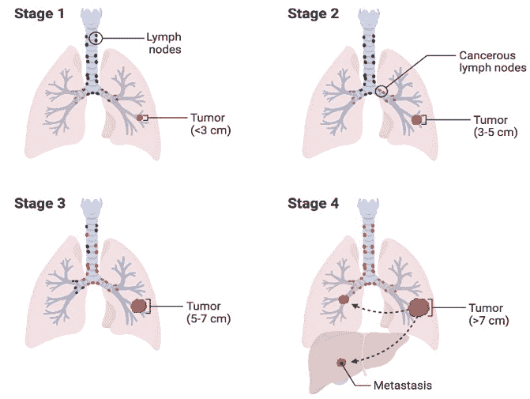
**图 1** 非小细胞肺癌的阶段类型 [3]。根据来源全球调查 [4]：GLOBOCAN 2020，新肺癌病例为 2,206,771 例，死亡率非常高，即 1,796,144 例。这是这些研究活动的动力。研究总共考虑了 36 种癌症，肺癌是人类的第二大死因。

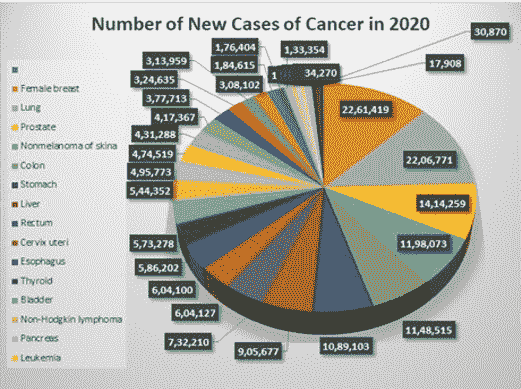
**图 2** 2020 年癌症新病例数量

## 相关工作

Qing Zeng Song, Lei Zhao, XingKe Luo 和 XueChen Dou，2017 [1] 使用肺部图像数据库 (LIDC) - 图像资源 (IDRI) 数据集，比较了三种不同的深度模型，即 `CNN`、`DNN` 和 `SAE` 用于肺钙化，并将数据传递给这三个网络，使用了 `ReLU` 激活函数。他们得出结论认为 `CNN` 网络性能最佳，准确率为 84.15%，特异性 84.15%，敏感性为 84.32%。

Siddharth Bhatia 等人，2018 [5] 使用 LIDC-IDRI 数据集进行深度学习。使用 `UNet` 和 `ResNet` 模型从 CT 扫描中提取特征。然后使用 `XGBoost` 和 `Random Forest` 进行个体预测。实现了 84% 的最高准确率。

S. Sasikala 等人，2018 [17] 使用 LIDC-IDRI 数据集和 `CNN` 架构。预处理阶段使用了 `Median` 滤波器和 `ReLU` 激活函数。实现了 96% 的准确率。

Ruchita Tekade 等人，2018 [14] 在 LIDC-IDRI、LUNA16 和 Data Science Bowl 2017 数据集上评估了两种架构 `U-Net` 和 `VGG` 分别用于肺分割和恶性程度预测。他们的方法提供了 95.66% 的准确率和 0.09 的损失，Dice 系数为 90%，预测损失为 38%。

Sumita Mishra 等人，2019 [6] 使用 LUNA16 数据集并启动了一种基于时空统计的自动提取 3D 特征的深度学习方法。获得了 94.8% 的准确率。

Tulasi Krishna Sajja 等人，2019 [18] 使用 LIDC-IDRI 数据集，一侧使用标准的 `CNN` 预训练架构（`AlexNet`、`GoogleNet` 和 `ResNet50`），另一侧设计了建议的网络。当将 80% 的训练样本给定以下架构 `AlexNet`、`GoogleNet`、`ResNet50` 和 `Proposed Net` 时，验证准确率为 100%、99.84%、100% 和 100%。测试准确率为 89%、95.42%、97.42% 和 99.03%。在预训练网络中，`ResNet` 的准确率最高。

Weilun Wang 等人，2019 [7] 使用 LIDC-IDRI 数据集和 `3D-CNN` 架构提取放射科医生标注的结节特征。通过使用他们的模型，他们计算了结节特征与癌症标签之间的关系。总体上，他们实现了 82.39% 的准确率。2019 年，Google 进行了癌症早期检测的研究，他们的数据集是三个重要数据集的混合：NLST、LIDC-IDRI 和 LUNA16。他们通过 AI 实现了 94.4% 的准确率。

Prasanta Das 等人，2020 [8] 使用锐化掩模滤镜净化图像。使用自适应 `Canny` 边缘检测算法检测边缘和受影响区域。使用 `KNN`（最近邻）进行分割。最后，贝叶斯正则化神经网络实现了 99.5% 的准确率。使用均方误差（`MSE`）评估了模型性能。

N. Kalaivani 等人，2020 [9] 使用包含 201 张肺部图像的数据集，为了分类目的，他们使用了 `DenseNet` 和自适应提升算法。建议网络的准确率为 90.85%。

Diego Riquelme 等人，2020 [10] 使用了不同的数据集，如 LIDC-IDRI、LUNA16、SPIE-AAPM-NCI 肺、NLST、ANODE09、DLCST 和 DSB，并解释了用于启动深度学习网络模型的 U-Net、R-CNN、YOLO、VGG、ResNet 等不同技术，以及用于结节检测的不同技术。还讨论了 DeepLabv3+ 和 Gated-SCNN 等分割技术。

Tafadzwa L. Chaunzwa 等人，2021 [11] 使用非侵入性计算机断层数据和 `CNN`。他们专注于检测常见的组织学种类：腺癌（ADC）和鳞状细胞癌（SCC）。在 `CNN` 上衍生的定量放射学特征的性能准确率为 71%。Eali Stephen Neal Joshua 等人，2021 [12] 使用 LUNA16 数据集和具有多视图网络策略性质的 3D AlexNet 架构。通过 10 折交叉验证实现了验证。实现的准确率为 97.17%。

### CT 图像

上述检测肺癌的工作依赖于患者肺切面的 CT 扫描。单次 CT 扫描包含一个 3D 数据数组，每个体素有一个单通道。数组中的组件（即 3D 图像中的体素）由亨斯菲单位（HU）组成，用于评估每个位置的放射密度。肺区域的物质具有对比性的 HU 值，因此 CT 扫描显示了肺区域内部的解剖结构（如肿瘤的存在）。图（3）展示了图像，表 2 包含了人体特定物质的 `HU` 值。由于扫描设备的设置不同，不同的 CT 扫描图像可能具有不同的形状和间距。因此，我们需要对 CT 扫描图像数据进行预处理。在进一步处理之前，需要将其转换为相似的形状和间距。

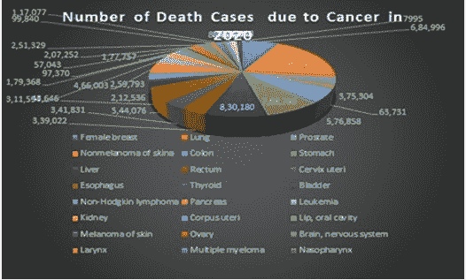
**图 3** 2020 年因癌症死亡人数 [4]。

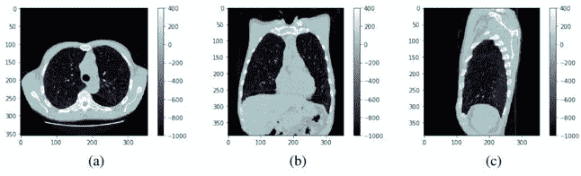
**图 4** 来自 Luna16 数据集的样本 CT 扫描图像，展示了 3D 图像的切片以及沿 z 轴、y 轴和 x 轴的 (a)、(b) 和 (c) `HU` 值。

**表 2** 人体组织/物质的亨斯菲单位 (HU) 值。

| 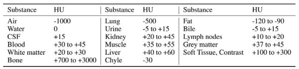 |
| --- |

### 数据预处理

投影系统使用卷积神经网络通过 CT 扫描图像进行癌症早期。在该系统中，我们使用了 Luna16 数据集。Luna16 包含 754975 个样本，每个 CT 图像中的结节都标记了 X、Y、Z 坐标和直径。LUNA-16 数据集的首要任务是结节分割，这意味着预测给定 CT 扫描图像中所有结节的位置和大小。图（5）展示了 LUNA-16 中的一个样本 CT 扫描图像及其结节标注。

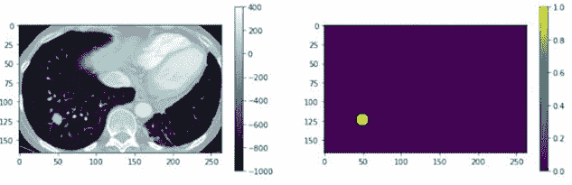
**图 5** LUNA-16 数据集中的样本 CT 扫描图像，带有 z 轴切片的相应标注结节掩码（黄色圆形区域）。

在将 CT 扫描图像作为我们的深度神经网络模型的输入之前，我们需要为所有 CT 扫描提供相同的大小空间，然后从这些 CT 扫描中分割出肺部。因此，我们调整了所有 CT 扫描的大小，并通过 Python 中的函数 `scipy.ndimage.interpolation.zoom` 执行的样条插值来提供 1mm 的间距。现在，处理后的 CT 扫描图像具有相同的间距：图像中的每个体素现在对应于精确的 1mm × 1mm × 1mm 立方区域。

在提供相同的大小空间后，我们从 CT 扫描图像中分割出肺部，通过检测最显著的相互关联元素来分割肺区域。从表 1，我们观察到肺组织的 `HU` 值在 -500 左右，肺部的空气 `HU` 值在 -1000 左右。因此，整个肺部的 `HU` 值大致不高于 -500，而骨区域通常在 700 以上。为了将肺从骨骼中分离，我们通过对 3D 数据进行阈值处理来获取 3D 二值掩码。

-320 处的 CT 扫描图像：所有 `HU` 值低于 -320 的体素被标记为“1”（表示肺部），否则标记为“0”。然后，我们在二值掩码的体素中寻找最显著的连通元素。如果两个体素相邻且在掩码中的值均为“1”，则认为一个体素连接到另一个体素。通过这种方式，可以根据体素连通性划分为多个连接元素。最显著的连接元素是体素数量最多的那个，可以使用 Python 中的 `skimage.measure.label` 函数实现。这个最重要的连通分量应该覆盖肺部的大部分，我们将其视为肺的二值掩码。

肺周围的组织也被包含在内，因为它们可能包含有关癌症状态的相关信息。为此，我们通过二值膨胀扩张最显著的连接元素，将肺掩码在所有方向上扩展 5mm。然后，我们将扩张后的肺掩码应用于原始 CT 扫描图像，保留掩码内部的区域并将掩码外的所有体素设置为 -1000 `HU`。图（6）展示了一个样本 CT 扫描图像及其分割的肺部，从图中可以观察到获得的分割掩码精确对应于肺区域。

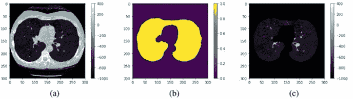
**图 6** 肺周围的组织也被包含在内，因为它们可能包含有关癌症状态的相关信息。为此，我们通过二值膨胀扩张最显著的连接元素，将肺掩码在所有方向上扩展 5mm。然后，我们将扩张后的肺掩码应用于原始 CT 扫描图像，保留掩码内部的区域并将掩码外的体素设置为 -1000 `HU`。

### VGG16 架构

VGG 是 Karen Simonyan 和 Andrew Zisserman 在“用于大规模识别的极深卷积网络”[13] 中提出的标准架构。其动机是开发一种具有不断增加滤波器的深度神经网络，以提取大量的特征。

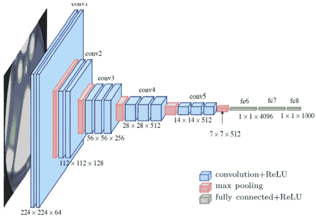
**图 7** [19]。

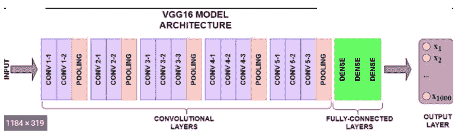
**图 8** [15]。

### ResNet50 架构

ResNet，也称为残差网络，是由何恺民、张祥宇、任显和孙云健于 2015 年开发的深度神经网络。作者将层重新公式化为学习残差函数而不是学习引用函数[16]。这种跳跃连接通过利用前一层的激活函数直到当前层学习其权重，提供了训练效率。在 ResNet-50 中，网络的层（`fc1000`、`fc1000_softmax` 和 `Classification Layer_fc1000`）被新定义的层替换，特别是全连接层、softmax 层和输出层（分类层）。之后，网络上最后一个剩余的传输层（`avg_pool`）与新层连接。


**图 9** [16]。

### 方法流程图

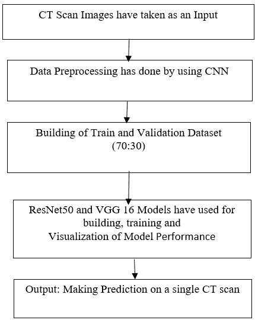
**图 10**

## 实验结果

提取的特征被应用于网络的输入层。使用线性层堆叠创建了用于结节检测的卷积神经网络、ResNet-50 和 VGG16 模型。首先实现了一个 50 层的示例调节深度残差网络。残差网络是一种具有独特连接能力的深度神经网络，即跳跃连接或短连接，这比其他网络层提高了准确性和性能。VGG16 模型在诊断 CT 扫描方面可能表现良好，因此我们将其作为第二个深度网络模型。我们两个模型获得的最终准确率如下图所示：

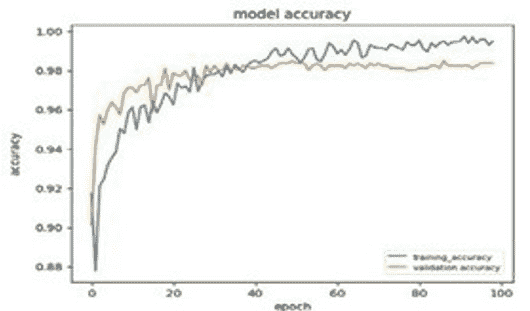
**图 11** ResNet-50 准确率图。

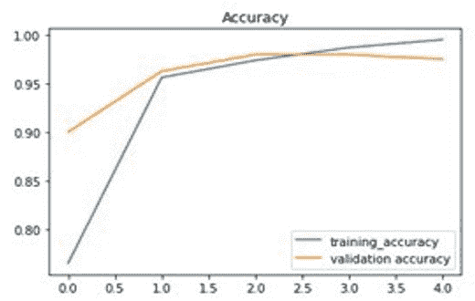
**图 12** VGG-16 准确率图。

## 结语

首选的深度网络模型有助于密集检查肺 CT 扫描中正常结节与异常结节之间的差异。我们首先建立了一个基于 `ResNet50` 模型的分类框架，为肺癌分型提供足够的空间。我们使用 `VGG16` 模型做出重大的正确决策，随后我们对这两个模型进行了比较。这两个模型都显示出相似且具有统计学意义的性能。具有 50 层的深度残差神经网络模型准确率达到 98%，而 `VGG16` 模型（也称为 OxfordNet）提供的准确率为 96%。我们使用了 `LUNA-16` 数据集，该数据集包含两类肺部感染；然后，我们分别按照 `70:20:10` 的比例将数据集划分为训练集、验证集和测试集。因此，使用微调理论训练了两个预训练模型 `ResNet50` 和 `VGG16`，这包括了最后三层的交换，其中输出层必须与所需的类别良好匹配。使用用于微调模型（`ResNet50` 和 `VGG16`）的数据集可以对肺癌数据进行分类，即良性与恶性的分类。通过应用这些技术并获得模型评估的高性能，我们早期确认了肺癌检测，以保护患者免于死亡。

未来，我们可以更多地关注用于区分肺癌四个阶段的初步预测。模型应该分别根据第 1 期到第 4 期进行单独训练，以便我们能够根据肺癌阶段准确地诊断患者并拯救他们宝贵的生命。

## 致谢

我要感谢 Gyanendra Verma 博士和 Rajesh Doriya 博士提供的专家建议，并感谢他们给予我们编写此书章节的机会。

## 参考文献

| | |
| --- | --- |
| `[1]` | Qing Zeng Song, Lei Zhao, Xing Ke Luo, and Xue Chen Dou, "Using Deep Learning for Classification of Lung Nodules on Computed Tomography Image". *Hindawi Journal of Healthcare Engineering Volume 2017*, Article ID 8314740.. |


| `[2]` | Ann Pietrangelo, Everything You Need To Know About Lung Cancer. [`www.healthline.com/health/lung-cancer#stages`](https://www.healthline.com/health/lung-cancer#stages). |
| `[3]` | [`ebismedical.com/types-of-cancer/lung-cancer/stages-of-lung-cancer/`](https://ebismedical.com/types-of-cancer/lung-cancer/stages-of-lung-cancer/) |
| `[4]` | Ph Hyuna Sung. [acsjournals.onlinelibrary.wiley.com](http://acsjournals.onlinelibrary.wiley.com) Feb 2021.. |
| `[5]` | Bhatia S., Sinha Y., Goel L.. "Lung cancer detection: a deep learning approach." Soft Computing for Problem Solving: SocProS 2017, Volume 2. Springer Singapore, |
| `[6]` | Mishra S., Chaudhary N., Asthana P., Kumar A.. "Deep 3D Convolutional Neural Network for Automated Lung Cancer Diagnosis", arXiv:1906.0534 10.1007/978-981-13-7150 |
| `[7]` | Wang W., Chakraborty G.. Automatic prognosis of lung cancer using heterogeneous deep learning models for nodule detection and eliciting its morphological features. |
| `[8]` | Das P., Das B., Dutta H.S.. Prediction of lungs cancer using machine learning. Preprint2020 |
| `[9]` | Kalaivani, N Manimaran, Dr. S Deep Learning Based Lung Cancer Detection. IOP Conf. Series Mater. Sci.2020 |
| `[10]` | Riquelme D., Makhlouf M.. "Deep Learning for Lung Cancer Nodules Detection in CT Scan" Mdpi journal AI 1,28–67 10.3390/ai10003 |
| `[11]` | Tafadzwa L., Ahmed Hosny, Yiwen Xu, Andrea Shafer, Nancy Diao, David C. Christian, Raymond H., Hugo J. Aerts, Deep learning classification of lung cancer histology using CT images, Nature reports 11, no. 1, pp.1-12, 2021. 10.1038/s41598-021-8463-x |
| `[12]` | E.S.N. Joshua, D. Bhattacharyya, M. Chakravarthy, and Y.C. Byun, "3D CNN with Visual Insights for Early Detection of Lung Cancer Using Gradient-Weighted Activation", Hindawi Journal of Healthcare Engineering Volume 2021, Article ID 669518, 2021. |
| `[13]` | K. Simonyan and A. Zisserman, "Very Deep Convolutional Networks for Large-Scale Image Recognition", arXiv preprint arXiv:1409.1556. |
| `[14]` | Ruchita Tekade, prof. Dr. Rajeshwari, Detecting and classifying nodules in Lung CT scans, 2018 |
| `[15]` | 使用 Keras 进行迁移学习的 VGG16 模型 |
| `[16]` | K. He, X. Zhang, S. Ren, J. Sun, "Deep Residual Learning for Image Recognition". In IEEE computer vision and pattern recognition conference, pp. 770-778. |
| `[17]` | S. Sasikala, M. Bharathi, R. Sowmi, "基于深度学习的肺癌检测", International Journal of Innovative Technology and Exploring (IJITEE) ISSN: 2278-3075, Volume-8. |
| `[18]` | T. K. Sajja, R. M. Devaralla, H. Kalluri, "基于 CNN 的肺癌检测", Traitement du Signal Vol. 36, No. 4, 339-344, 2019. |
| `[19]` | Max Ferguson, Ronay ak, Yung-Tsun Tina Lee, and Kincho H. Law “使用卷积神经网络进行缺陷自动定位”. |

# 基于特征与自适应优化的医学图像超分辨率探索

## 摘要

医学图像处理需要许多步骤来捕捉、处理和转换图像以进行分析。图像容易受到分析工具、环境、系统故障等各种因素的影响而失真。图像增强旨在通过提高图像质量和分辨率来准确分析图像中的原始信息。此类高质量图像的研究和重建的主要动力是图像超分辨率。本章重点关注实现超分辨率过程的各种图像增强策略。在工作中，我们详细解释了各种图像增强策略的方法，为高分辨率图像处理提供了参数选择点、特征比较和性能评估。讨论了每种策略的缺点和挑战，以研究其有效性。进一步探索了基于深度学习架构的混合方法，以便在医学图像超分辨率领域获得更高的精度。

**关键词**：图像增强、图像特征映射、图像处理、图像配准、图像分辨率、图像分割

---

**通讯作者 Jayalakshmi Ramachandran Nair**：研究员，巴拉蒂达斯大学，特里奇普尔蒂，米尔纳德邦，印度；电子邮箱：jayabinoy2020@gmail.com

## 引言

图像增强在将原始采集图像数据发送进行进一步处理之前，提高了其像素内容的质量。常用的图像增强技术包括对比度调整、空间滤波等。均匀化处理消除了像素对齐不均匀的部分，并提升了像素质量。空间降噪滤波器可以改善像素中自然产生的线条、死区和剪切区域。

另一方面，密度间隔通过均匀地扩展灰调来对齐，在不破坏像素的情况下实现高增强。可以使用线性变换技术增强图像对比度，以扩展原始灰度级[1]。

在许多医学应用中，需要将低分辨率图像转换为高分辨率图像，以便正确识别故障，从而对问题进行良好的识别和评估。在图像超分辨率中，低分辨率图像（`LR`）转换为高分辨率图像（`HR`）[2, 3]。图像超分辨率的主要应用是监控和医疗保健。在监控情况下，在低质量摄像头图像上检测和识别人脸是需求之一[4]。像素的调整和增强使得寻找匹配模式的过程成为可能[5, 12]。低分辨率到高分辨率适应可以通过逐个处理像素或共同处理像素块来完成[6, 13]。使用 `MRI` 系统采集时，医学图像本质上是高质量的[2, 3, 7, 8]。在这种情况下，完成全扫描的时间、空间覆盖范围和信噪比（`SNR`）因素变得棘手[9]。超分辨率原理有助于从低质量图像生成高质的增强图像[1, 10, 11]。这将大幅减少处理时间。

## 文献综述

临床成像、提取和能力之间的交互需要人工干预[12, 13]。通过这种交互获取的图像大部分由于不同因素的影响而退化和破碎，例如，极端气候的脆弱性、临床成像中使用的设备类型等[14, 15]。临床图像分辨率的下降意味着临床图像中缺乏相关且显著的数据。为了提升这些图像的性质，利用了图像目标方法，例如图像超分辨率（`SR`）[16, 17]。该过程将重建 `LR` 并将其转换为 `HR`，这广泛应用于临床成像、图像和人脸识别、卫星成像等领域[18, 19]。临床图像分辨率的后期方法建议执行深度学习方法来处理图像性质。与普通程序相比，深度学习策略取得了关键性意义[20, 21]。利用卷积神经网络（`CNN`）方法的 `SR` 成像策略在处理临床图像目标方面取得了良好结果[22]。

近年来，创新的适应方法如快速超分辨率卷积神经网络（`FSR`）和超分辨率卷积神经网络（`SRCNN`）被提出[23, 24]。

## 方法

像素的调整可以通过逐个处理像素或共同处理一个像素块来处理低分辨率到高分辨率的适应[6, 13]。使用 `MRI` 系统采集时，医学图像本质上是高质量的[2, 3, 7, 8]。在这种情况下，完成全扫描的时间、空间覆盖范围和信噪比（`SNR`）因素变得棘手[9]。超分辨率原理有助于从低质量图像生成高质的增强图像[1, 10, 11]。这将大幅减少处理时间。

`SRCNN` 的改进版本是一种通过增加额外特征来构建超分辨率的深度学习模型。该模型执行了更大的深度 `CNN` 卷积滤波器。这些卷积滤波器用于处理补块过程[[32]]。`VDSR` 网络的残差被回传以学习该网络。启用了梯度抑制，将低分辨率输入图像转换为高分辨率输出图像。

### 后处理上采样超分辨率

使用学习到的上采样或反卷积来替代简单的三次线性插值进行上采样[[33]]。将 `LR` 增强为 `HR` 的过程于对后处理评估结果的分析。因此，`HR` 特征仅在后上采样阶段被突出。

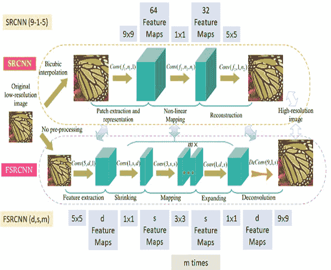
**图 (3)** `FSRCNN` 快速超分辨率卷积神经网络[[33]]。

特征输入在 `LR` 阶段本身被提取。不是使用更广泛的卷积滤波器，而是通过 `n` 层倍扩展较小的滤波器通道。`FSRCNN` 中改进的卷积滤波器级有效有助于图像的分率。`FSRCNN` 也被称为相对浅的网络，它能够清晰地理解每个组件[[29, 34]]。

### 残差网络

残差网络（`Res-Net`）是一种递归出现的神经网络模型，它通过跳跃并连接到所需层的参数化细胞工作，利用了捷径连接，但残差滤波器的复杂层数与通道分配滤波器协同工作。`SR-Res-Nets` 使用了许多高分辨率残差块。根据可用系统内存，可以对连接性对层进行调整。可自定义的网络层能够高效利用内存空间。整个超分辨率残差网络块由较小的残差网络块堆叠组成。在加速速度方面，具有较少额外参数的网络深度减少了衰减问题。残差网络的权重也可以训练过程中进行调整[[29]]。

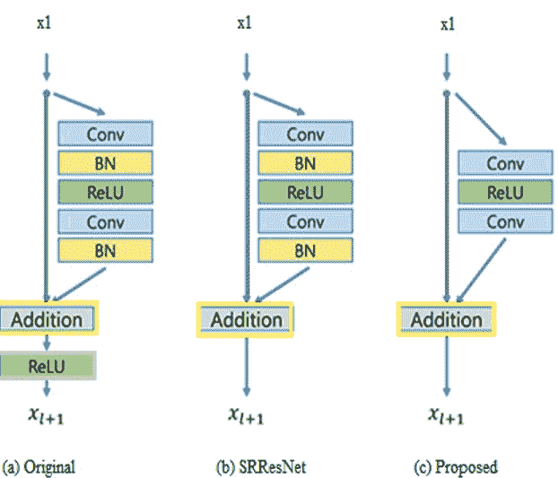
**图 (4)** 残差网络（`Res-Net`）[[29]]。

### 多阶段残差网络 (MDSR)

`MDSR` 是残差网络的替代方案，由多个具有同等坚韧性的输入和输出模块组成。在初始条件下，针对特定范围输入的预处理元素目前由两个小内核的残差块组成。预处理层使用了大量的卷积核，在保持网络韧性的同时达到高可触达水平。在初始处理结束时，模块是互为残差块，一个用于低、高分辨率数据的公共块。`MDSR` 模型使用的参数数量是 `EDSR` 的一半，因为共享参数减少了参数量。

### 平衡两阶段残差网络

低分辨率和高分辨率阶段都需要平衡网络。在低分辨率图像处理阶段，特征的滤波器尺寸较小；而在高分辨率图像处理中，这些特征图是否较大。三次采样过程由不同的低分辨率和高分辨率阶段组成[[34]]。作者[[34]] 定义了一种可调优的新型结构 `Pconv`，因为该块实现了高性能精度。平衡两阶段 Res-Nets 中没有使用批归一化。

### 递归网络

递归网络类似于通过在相同结构上重复应用相同权重以获得标量的深度神经网络。它被用作进行逻辑分析以导出最大适应值的通用方法。这些网络正式称为自适应模型，能够获取深度特征。递归网络由若干包含强化映射特征的神经元组成。

这些任务利用了许多非线性处理单元。该过程包括累特征点、特征提取、加权偏置单元等（`etc.`）。与其他应用相比，递归网络常用于模式匹配的人工神经网络模型。递归网受影响最大的缺点是梯度消失和爆炸问题。由于 `Tanh` 和 `ReLu` 传递函数，它无法用于长时间的过程。

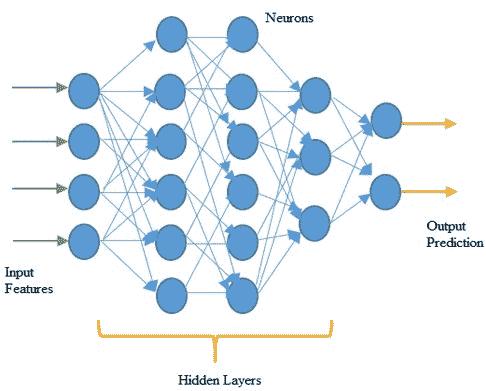
**图 (5)** 递归神经网络。

### 深度递归卷积网络 (DRCN)

深度递归卷积网络（`DRCN`）由被应用 `N` 次的卷积层组成。固定的卷积层被视为残差网络块。每个残差卷积块的输出在重建网络中累加以生成输出。这类深度网络也被称为网络。使用 `DRCN` 进行图像增强可能用于只需要更改图像区域的情况。

### 渐进式重建网络

具有高缩放因子的高分辨率图像很难通过神经网络处理。网络涉及的神经元数量增加了步数。这种渐进式模型也被称为金字塔超分辨率网络。由两个类别，即特征嵌入块和图像重建块组成（`etc.`）。在输入端，低质量图像进入特征提取块，进一步转换为堆叠的转置卷积。一个特征提取块的输出传递到特征提取块的下一个阶段并再次处理。每个块的结果是经过微的像素数据，以达到高分辨率。网络可以检查每个阶段的结果，有助于学习一个持续适应过程权重的网络。每个步骤中使用的 `N` 特征可以根据内存分配进行调整。因此共享资源适用于此类情况。当阶段增加时，每个阶段的损失函数逐渐减少。在深度学习模型中，级联架构始终有助于提高能力。

### 注意力网络

注意力网络（`ABN`）用于图像超分辨率，捕捉特定区域，选择区域并计算特定位置以获得高分辨率。区域的选择是可以调的，以根据图像复杂度评估模型。低分辨率图像使用传统的三次插值方法处理，而选定的区域单独使用高效的 `CNN` 或递归模型。传递函数由图像复杂度决定[[33]]；根据作者，该网络被称为 `selNet`，因为该网络模型基于选择过程。

### 像素损失

由于大多数像素损失的变化肉眼不可见，原始图像和处理后的图像看起来相似。在超分辨率网络的训练中，分析的最简单且标准的函数是像素损失。微小的像素损失通过像素损失函数进行统计评估。优化的 `PSNR` 值可以确定像素损失。

### 感知损失

感知损失（Perceptual loss）是一种将获取的图像结果与训练图像进行匹配以评估两者差异的系统方法。预测图像与输出图像之间的特征差异和输出作为损失函数。

### 对抗损失

在大多数通用对抗网络中，处理后的图像类似于原始图像的精确结果。为了进行伪造，会对呈现补丁（patches）的某些区域进行比较并使用参考图像进行填充。为了评估影响原始性的受影响区域，确定了对抗损失函数。

### 系统工具

图像分辨率增强是一个复杂的过程，需要极其高效的处理工具来适应每个阶段涉及的步骤。图像处理工具包含专门的图像库、图像分割和增强命令，以达到该标准。`MATLAB` 是重要的计算工具之一，内置了用于图像处理和卷积神经网络的工具箱。为了评估超分辨率过程的新型架构，需要具有行为特性的标准平台。工具的选择基于工业标准、预期结果和灵活的可用性。

## 发现

对超分辨率图像增强过程的研究表明，存在多种图像增强技术方法，这些方法可以提供实现超分辨率过程原理的基本思想。该研究有助于发现准确预测模型的影响。从上述工作中可以清楚地看到，调整混合深度学习网络是目前的首选预测模型，自适应网络对于理解基于区域的增强非常有帮助。该研究还有助于理解优化残差网络在生成高效超分辨率预测模型方面的重要性。

## 结论

医学图像分辨率是长期研究领域之一，多年来一直脱颖而出。学术论文和贡献有助于扩展对图像增强过程、特别是图像超分辨率技术的研究。这项工作叙述了各种深度学习架构的优势。在特征、参数、评估结果和误差因素的帮助下，本讨论了医学图像超分辨率的方法。发现和解决方案限于目前的形式，因为许多许多计算方法必须通过标准图像处理工具进行实际实施、测试和评估。在扩展的研究中，其动力是利用公开的医学图像数据集开发此类基于深度学习的优化残差网络。

## 致谢


本文以及随后的研究，如果没有我的导师 Sumathy Pichai Pillai 博士的卓越支持，将不会有前景。她的敏锐、专业知识和对各个方面的彻底关注是促使这项工作保持在相关发现的轨道上的鼓励。我的共同导师 Rajkumar Narayanan 博士也处理了转录工作，并支持了作为论文一部分讨论的各种概念。我们诚心感谢匿名评审员提出的建设性建议。

## 参考文献

| 序号 | 参考文献 |
| --- | --- |
| [1] | Zhu X., Cao H., Zhang Y., Tan K., Ling X.. Fine Registration for VHR Images Based on Superpixel Registration-Noise Estimation. IEEE Geosci. Remote Sens. Lett. 2018, 15, 101510. DOI: 10.1109/LGRS.2018.2849696 |
| [2] | Gong L., Duan L., Dai Y., He Q., Zuo S., Fu T., Yang X., Zheng J.. Locally Adaptive Total p-Variation Regularization for Non-Rigid Image Registration With Sliding Motion. IEEE Trans. Biomed. Eng. 2020, 67, 2560-2571. DOI: 10.1109/TBME.2020.2964695 |
| [3] | Zhang J., Ma W., Wu Y., Jiao L.. Multimodal Remote Sensing Image Based on Image Transfer and Local Features. IEEE Geosci. Remote Sens. Lett. 2019, 16, 1210-1241. DOI: 10.1109/GRS.2019.289634 |
| [4] | Zhang Y., Fan Q., Bao F., Liu Y., Zhang C.. Single-Image Super-Resolution Based on Rational Interpolation. IEEE Trans. Image Process. 2018, 27, 3782-3797. DOI: 10.1109/TIP.2018.2826139 |
| [5] | Huang J., Wang L., Chen J., Cheng X., Zhu Y.. Super-Resolution of Intravoxel Incoherent Motion Imaging Based on Similarity. IEEE Sensors Journal 2020, 18, 10963. DOI: 10.1109/JSEN.2020.299387 |
| [6] | Pan Z.W., Shen H.. "Multispectral Image Super-Resolution RGB Image Fusion and Radiometric Calibration". IEEE Trans. Image Process., vol. 28, no. 4, pp. 1783-1797, 2019. DOI: 10.1109/TIP.2018.2881911 |
| [7] | Zhao H., Chen N., Li T., Zhang J., Lin R., Song L., Liu Z., Liu C.. Motion Correction in Optical Resolution Photoacoustic Microscopy. IEEE Trans. Med. Imaging 2019, 38, 2139-2150. DOI: 10.1109/TMI.2019.2893021 |
| [8] | Li Y., Liu D., Li H., Li Z., Wu F.. Learning a Convolutional Neural Network for Image Compact-Resolution. IEEE Trans. Image Process. 2019, 28, 1092-1107. DOI: 10.1109/TIP.2018.2872876 |
| [9] | Wei W., Nie J., Li Y., Zhang L., Zhang Y.. Deep Recursive Network for Hyperspectral Image Super-Resolution. IEEE Trans. Comput. Imaging 2020, 6, 1233-1244. DOI: 10.1109/TCI.2020.301445 |
| [10] | Fang F., Li J., Zeng T.. Soft-Edge Assisted Network for Single Image Super-Resolution. IEEE Trans. Image Process. 2020, 29, 4656-4668. DOI: 10.1109/TIP.2020.2973769 |
| [11] | Liu Q., Liu A., Wang Y., Li H.. "A Super-Resolution Sparse Aperture ISAR Sensors Algorithm via the MUSIC Technique". IEEE Trans. Geosci. Remote Sens., vol. 57, no. 9, pp. 7119-7134, 2019. DOI: 10.1109/GRS.2019.2911686 |
| [12] | Irmak H., Akar G., Gsel S.. A MAP-Based Approach for Hyperspectral Image Resolution. |
| [13] | Zurakhov G., Friedman Z., Blondheim D.. High-Resolution Fast Ultrasound Imaging With Adaptive-Laged Delay-Multiply-Sum Multiline Acquisition. IEEE Trans. Ultrason. Ferroelect. Freq. 2019, 62, 485. |
| [14] | Tao Y., Xu M., Zhang F., Du B., Zhang L.. Unsupervised-Restricted Deconvolutional Neural Network for Very High Resolution-Sensing Image Classification. IEEE Trans. Geosci. Remote Sens. 2017, 55, 12680. |
| [15] | Farrugia R., Galea C., Guillemot C.. Super Resolution of Light Field Images Using Linear Subspace Projection of Patch-Volumes. IEEE J. Sel. Top. Signal Process. 2017, 11, 727. |
| [16] | Xu Y., Peng L., Li G.. Mult Modal Registration of Structural Features and Mutual Information of Medical Image. Future Gener. Comput. Syst. 2019, 93, 499-505. |
| [17] | de Haan K., Ballard Z.S., Rivenson Y., Wu Y., Ozcan A.. Resolution Enhancement in Scanning Electron Microscopy using Deep Learning. Sci. Rep. 2019, 9, 11205. |
| [18] | Xu X., Liu W., Li L.. Low-resolution face recognition in surveillance systems. Journal of Computer and Communications 2014, 2, 270-277. |
| [19] | Witwit W., Zhao Y., Jenkins K., Zhao Y.. Satellite image resolution enhancement using discrete wavelet transform and new edge-directed interpolation. J. Electron. Imaging. 2017, 26, 03140. |
| [20] | Bashar A.. Survey on evolving deep learning neural network architectures. Journal of Artificial Intelligence 2019, 10, 27-38. |
| [21] | Tan M., Le Q.V. 2019. Efficient net: Rethinking model scaling for convolutional neural networks. arXiv preprint arXiv:1905.11946. |
| [22] | Ahn E., Kumar A., Feng D., Fulham M., Kim J. 2019. Unsupervised feature learning with K-means and an ensemble of deep convolutional neural networks for medical image classification. arXiv preprint arXiv:1906.03359. |

# 分析不同机器学习算法在 WBCD 数据集上的表现

## 摘要

乳腺癌是一种死亡率很高的疾病。它是女性中最常见的癌症，也是导致死亡的主要原因。机器学习（`ML`）是数据分类的一种极佳方法，特别是医学领域。它广泛用于决策、分类和分析。本研究的主要目标是分析不同 `ML` 算法在 `WBCD` 数据集上的表现。在本文，我们分析了不同 `ML` 算法的表现，即 `XGBoost Classifier`、`KNN`、`Random Forest` 和 `SVM`（支持向量机）。研究中使用准确率来确定性能。实验结果显示，随着训练数据量的增加，`SVM` 的表现优于 `KNN` 且更准确。当主成分（`PC`）增长且准确率超过 `KNN` 时，`SVM` 产生了更好的结果。

**关键词：** `乳腺癌`、`决策树`、`探索性数据分析`、`直方图`、`KNN`、`随机森林`、`SVM`、`UCI 机器学习库`、`WBCD`、`XGBoost`。

## 引言

`乳腺癌`是一种主要发生在女性身上的严重疾病，一直是导致女性死亡的主要原因之一。乳腺癌主要可以通过体检或细针穿刺术（`FNA`）和乳腺线摄影等技术进行检测。这些癌症始于胸部的肿块。胸部内形成的肿块可能是良性的，也可能是恶性的。良性肿瘤是非癌性肿瘤，而恶性肿瘤是癌性。

2020 年，全球有 230 万女性被诊断患有乳腺癌，68.5 万人死亡。截至 2020 年底，乳腺癌是世界上最常见的癌症 [1]。许多乳腺癌患者没有症状，因此早期发现有助于治疗过程并提高生存率。`机器学习`在乳腺癌的早期检测中发挥着重要作用。许多算法被用于监督学习和无监督学习。实施的数据集是`威斯康星州乳腺癌诊断`（`WBCD`），使用的方法包括使用`算法回归树`的`决策树分类`、`XG Boosting`、`随机森林`和`Ada-Boost` [2]。

## 文献综述

机器学习分类器长期以来一直应用于医学研究，特别是在乳腺癌诊断方面。分类是机器学习最常见的任务类型之一。`ML`分类器已用于各种医学研究项目，包括 `WBCD`。根据先前的研究，本研究使用的分类器具有很高的分类准确率 [3]。Shokoufeh Alaei 和 Hadi Shahraki 使用了封装策略。研究使用了三个不同的乳腺癌数据集，并在威斯康星州乳腺癌数据集上使用了三个不同的分类器：`人工神经网络`（`ANN`）、`PS-classifier` 和基于遗传算法的分类器（`GA-classifier`）（`WBC`）。根据研究结果，特征选择有助于分类器提高其准确性、特异性和敏感性。

Jian Ping Li 及其同事采用了递归特征选择技术 [4]。该方法用于训练和测试分类器以获得最佳预测模型。此外，还使用了分类、特异性、敏感性、马特斯相关系数、`F1-score` 和执行时间等性能评估标准来评估分类器的性能。该调查使用了`威斯康星州诊断乳腺癌`数据集。在这些最佳特征子集上，`SVM` 取得了最佳分类性能。马特斯相关系数为 99%，`SVM` 线性内核获得了高分类准确率（99%）、特异性（99%）和敏感性（98%）。

Li Chen 及其同事建议结合基于欠采样的 `K-means` 和 `Boosted C5`（`K-Boosted C5.0`）来克服乳腺癌检测中的双类不平衡问题。为了评估新型混合分类器的性能，将其应用于类别不平衡学习中使用的 12 个小规模和两个大规模数据集（蛋白质同源性预测和乳腺癌） [5]。

根据大量的实验数据，他们提出的混合方法在马特斯相关系数（`MCC`）和准确率指标方面优于大多数竞争算法。

## 参考文献

- [23] Dong C., Loy C.C., He K., Tang X.. 2014. Learning a deep convolutional network for image super-resolution. European conference on computer vision, 184-199. Springer, Cham. DOI: 10.1007/978-3-319-10593-2_13
- [24] Dong C., Loy C.C., Tang X.. 2016. Accelerating the super-resolution convolutional neural network. European conference on computer vision, 391-407. Springer, Cham.
- [25] Pham C.H., Tor-Díez C., Meunier H., Bednarek N., Fablet R., Passat N., Rousseau F.. Multiscale brain MRI super-resolution using deep 3D convolutional networks. Comput. Med. Imaging Graph. 2019, 77, 101647. DOI: 10.1016/j.compmedimag.2019.101647
- [26] Bing X., Zhang W., Zheng L., Zhang Y.. Medical image super-resolution using improved generative adversarial networks. IEEE Access 2019, 7, 145030-145038. DOI: 10.1109/ACCESS.2019.2944862
- [27] Mahapatra D., Bozorgtabar B., Garnavi R.. Image super-resolution using progressive generative adversarial networks for medical image analysis. Comput. Med. Imaging Graph. 2019, 71, 30-39. DOI: 10.1016/j.compmedimag.2018.105348
- [28] Qiu D., Zheng L., Zhu J., Huang D.. Multiple improved residual networks for medical image super-resolution. Future Gen. Comput. Syst. 2021, 116, 200-210. DOI: 10.1016/j.future.2020.11
- [29] Wang Z., Wang Z., Bai G., Wang R., Duan M.. 2020. MufiNet: Multiscale Fusion Residual Networks for Medical Image Segmentation. 2020 International Joint Conference on Neural Networks (IJCNN), 1-7. DOI: 10.1109/IJCNN.2020.9207033
- [30] D. D., 2019. Progressive generative adversarial networks for medical image super-.. arXiv:1.0.02100.
- [31] T.1., Abbas A.F., Abdu A.M., U.U., Mokji M., K., 2019. Super-1 of car plate images using generative adversarial networks. In 2019 IEEE 15th International Colloquium on Signal Processing & Its Applications (CSPA) (pp. 80-85). IEEE. DOI: 10.1109/CSPA.2019.869601
- [32] Matthew Giassa. https://www.giassa.net/
- [33] Dong C., Loy C.C., Tang X.. Accelerating the Super-Resolution Convolutional Neural Network. Computer Vision – ECCV 2016. ECCV 2016 (Leibe B., Matas J., Sebe N., Welling M., eds.), Lecture Notes in Computer Science, vol. 9906. Springer. DOI: 10.1007/978-3-319-4675-6


- [34] Fan Y., et al. Balanced Two-Stage Residual Networks for Image Super-Resolution 2017 IEEE Conference on Computer Vision and Pattern Recognition (CVPRW) 2017 1157 1164 10.1109/CVPRW.2017.154

Omar Graja、Muhammad Azam 和 Nizar Bouguila 使用质量控制图和逻辑回归对乳腺癌进行了诊断。数据预处理（包括移除离群值和降维以实现数据可视化）是本项研究的一项贡献。在展示数据后，提出了一种适用于此类诊断的最佳机器学习算法。他们采用了 UCI 机器学习乳腺癌威斯康星（原始）数据集（`WBCD`）来评估我们所建议的方法 [6]。

Erdem Bilgili 和 Ahmet Mert 研究了维度降低减少独立成分分析（`ICA`）对情感支持网络中乳腺恶性肿瘤选择的影响，使用了一系列分类器，包括人工神经网络（`ANN`）、k 最近邻（`k-NN`）、径向基函数神经网络（`RBFNN`）和支持向量机（`SVM`）[7]。因此，除了 `RBFNN` 外，三十个独特元素的表征准确率几乎没有下降，从 97.53% 降到 90.5%。尽管如此，当使用单层元素向量时，`RBFNN` 分类器的精确度从 87.17% 提高到 90.49%。

Sulyman Age Abdulkareema 和 Zainab Olorunbukademi Abdulkareem 使用 `WBCD` 数据集测试了两种集成机器学习分类器的性能：随机森林（`RF`）和极端梯度提升（`XGBoost`）[8]。该研究的主要目标是评估分类器在对数据集分类方面的效率和有效性和准确性。这是通过使用递归特征消除（`RFE`）特征选择方法从数据集中选择所有并减少特征来实现的。根据结果显示，具有五个减少特征的 `XGBoost` 以及 `RFE` 特征选择方法具有最高的准确率（99.02%）和最低的错误率。

Liu 等人提出了一种基于决策树的乳腺癌预测算法，使用采样方法平衡了训练数据。根据实验数据，所提方法产生了良好的准确率 [9]。

Krzysztof 和 Duch 使用分裂值分离性（`SSV`）标准创建了一个异质决策树森林。他们的大部分工作涉及从不同的决策树中提取逻辑规则 [10]。

Stephan 和 Lucila 在一系列医疗分类任务中对比了逻辑回归与人工神经网络。他们从技术角度证明了在医学领域使用逻辑回归的优势，因为它是一个具有可解释结果的白模型 [11]。

Salama 及其同事 [10] 使用 `WEKA` 数据挖掘技术进行了一名为“使用多分类器在三个不同数据集上诊断乳腺癌”的研究。`WBCD` 是研究使用的三个乳腺癌数据集之一。使用五种不同的机器学习分类器（`NB`、`MLP`、`J48`、`SMO` 和 `IBK`）对数据集进行二分类。`SMO` 分类器在 `WBCD` 实验中达到了最佳分类率（96.9957%），而 `IBK` 分类器的最差（94.5637%）。此外，结合 `PCA` 的 `J48` 和 `MLP` 能够达到更高的准确率（97.568%），但结合 `PCA` 的 `J48` 和 `NB` 准确率最低（95.8512%） [12]。

## 数据集描述

来自 机器学习库的威斯康星乳腺癌数据库（`WBCD`）是我们研究中的数据集 [13]。

这是一个包含 569 个实例的多元数据库。该数据集包含 32 个属性。这些特征来自数字乳腺肿块细针抽吸（`FNA`）图像。它们描述了成像中可见的细胞核属性。

以下是属性信息：

- ID 号
- 诊断（M = 恶性，B = 良性）
- 对于每个细胞核，计算了十个实值特征：分形维度、半径、纹理、周长、面积、光滑度、紧凑度、凹度、凹点、对称。

## 数据预处理

### 探索性数据分析 (EDA)

使用了两种方法分析数据：

1. 描述性统计将数据集的主要属性简化为基本的数值测量。平均值、标准差和相关性是常见指标的示例。
2. 将数据转换为笛卡尔空间或抽象图像是查看数据的过程。数据挖掘的方面（包括预处理、建模和结果解释）都依赖于数据探索。

**描述性统计：**

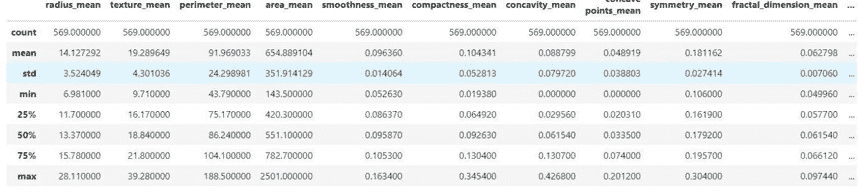 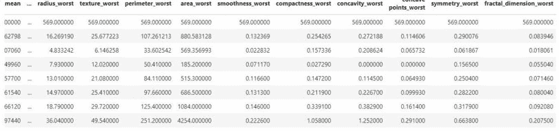 **图 (1)** 描述性统计。

可视化的目的是理解每个属性。

- 直方图
- 箱线图
- 密度图

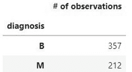 **图 (2)** 描述性统计。诊断类别转换为数值数据：

- 恶性 = 1（表示存在癌细胞）
- 良性 = 0（表示不存在）

三百五十七个观测值显示没有癌细胞，二百一十二个观测值显示存在癌细胞。

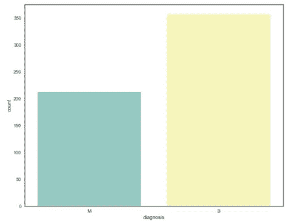 **图 (3)** 描述性统计。计数图。

**直方图：**

直方图是描述数值数据的一种流行方法。将变量值分组（分箱）到有限的区间后，直方图类似于条形图。直方图将数据划箱并计算每个箱中的观测数量。通过观察箱的形状，可以看出某个属性是正态的、偏态的还是呈指数分布。它还可以发现潜在的离群值。

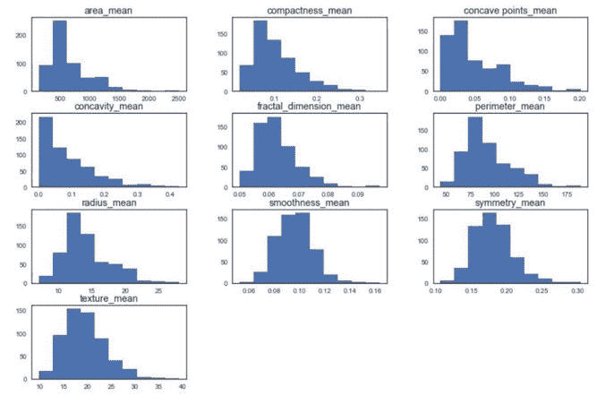 **图 (4)** 描述性统计。我们可以看到凹度和凹点属性可能呈指数分布。纹理、光滑度和对称性属性可能具有正态分布或近似正态分布。

**密度图：**

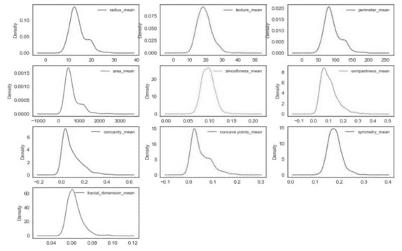 **图 (5)** 描述性统计。我们可以看到周长、半径、面积、凹度和属性参数可能呈指数分布。粗糙度、光滑度和对称性的分布可能是正态或接近正态的。

**箱线图**

周长、半径、面积、凹度和影响度的所有参数都有可能的指数分布，我们还可以看到粗糙度、光滑度和对称性具有正态或接近正态的分布。

**多态数据可视化：**

- 散点图
- 相关矩阵

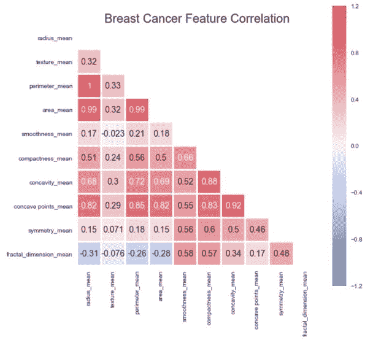 **图 (6)** 相关矩阵。我们可以观察到平均值参数在 1 到 0.75 之间存在显著的正相关关系。组织核的平均面积与凹度、面积以及其他特征具有较好的关系（r 在 0.5-0.75 之间）。

与半径、纹理和参数平均值相似，分形维具有很强的负相关性。

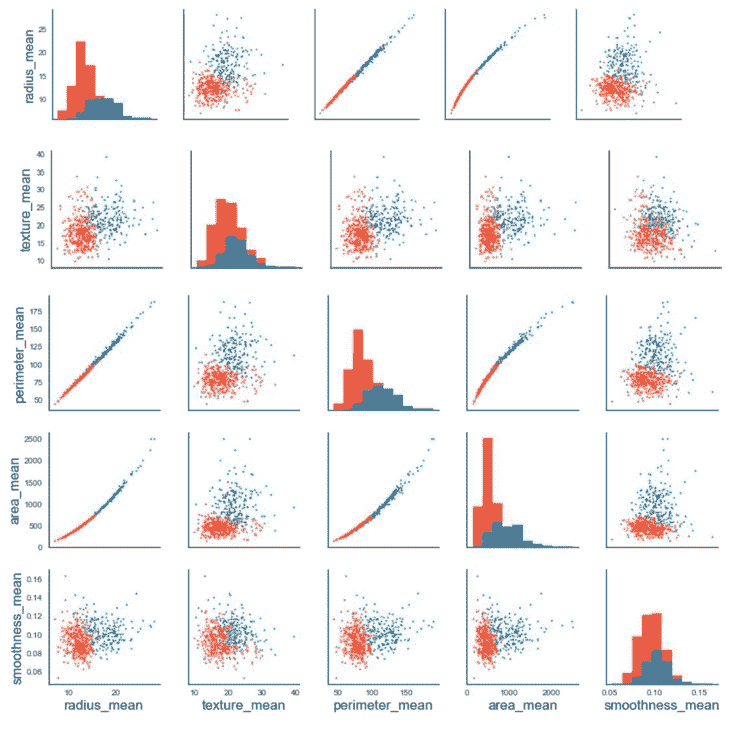 **图 (7)**

### 散点图误骗

周长、细胞半径、面积、紧凑度、凹性和凹区域的平均值可用于癌症分类。这些指标的高值与恶性肿瘤的存在有关。在任何直方图中都没有需要清理的清晰显著离群值。

## 方法论

以下是本文讨论的用于使用 `WBCD` 数据集乳腺癌分类的方法和算法。

### XGBoost 分类器

`XGBoost`（极速梯度提升）是一组针对当代数据科学问题和技术的梯度提升技术。`XGBoost` 的主要优势是它具有高度的可扩展性/并行性、运行速度快，且性能通常优于其他方法。它还通过更具正则化的模型形式来控制过拟合，从而提高了性能 [14]。

### KNN

`k-NN` 是一种非参数分类方法。类别成员身份是这种分类的结果。在大多数邻居对其进行投票分类后，该对象被分配给其 `k` 个最近邻居中出现频率最高的类（`k` 是一个正整数，通常较小）。如果 `k = 1`，则该项目被分配给其最近的邻居项目类。它是所有机器学习算法中最基础的 [15]。

该模型具有 98% 的准确率和 96% 的三折交叉准确率。

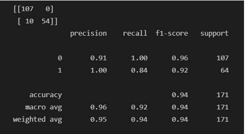 **图 (8)**

KNN 输出。

## 随机森林

随机森林是由一组随机回归树组成的分类器，这些树是随机变量的独立同分布输出，用于分类数据。这些随机树随后被连接在一起以给出聚合回归估计。

训练集不包含任何重采样或自助采样步骤，且模型独立于训练样本。通常，随机森林接受一个现有的输入参数，将其与森林中的每棵树交叉，然后对所有树的响应取平均值。每棵树必须考虑一组独特的随机因素。在选择信息量丰富的参数时，如果参数值出现在每个袋外 (`OOB`) 观测中，则计算该误差。当为每棵树计算在所有 OOB 观测中报告的参数值，然后对整个集成取平均值并除以集成的标准差时，预测误差增加 [16]。

### Ada-Boost（自适应提升）

`Ada-Boost` 是一种迭代集成提升分类器。结合所有低性能分类器以创建一个高准确率的鲁棒分类器。`Adaboost` 的背后的思想是在每次迭代中使用不同的权重对分类器进行数据训练。这使得你能够以极高的精度预测异常观测值。`AdaBoost` 是一种训练升级分类器的方法。

## 决策树

决策树是一种用于解决分类和回归问题的监督学习技术。尽管如此，它最常用于处理分类问题。在这种树结构分类器中，内部节点持有数据集属性，分支提供决策规则，每个叶节点得出结论。

决策树的两个节点是 `决策节点`（Decision Node）和 `叶节点`（Leaf Node）。选择节点用于做出任何决策并有许多分支，而叶节点是此类决策的结果，不再有更多分支。

评估或测试基于所提供的数据集的质量。

在 `WBCD` 数据集的测试集上，准确率为 93%。

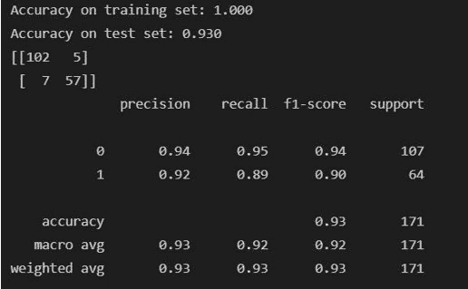 **图 (9)**

### 支持向量机 (SVM)

支持向量机是一种用于分类和回归的技术。然而，它通常用于解决分类问题。

可以推导出 `SVM` 的最大准确率达到 99%，相比之下，`KNN` 为 98%，`Random forest` 为 93%。`SVM` 的三折交叉验证准确分为 97%，`KNN` 为 96%，`Random Forest` 为 90%。与所介绍的其他方法相比，这些结果表明 `SVM` 是该数据集中乳腺癌分类的最佳选择。

## 结论

总之，本文对不同结构化和非结构化算法的分析提出了见解。本研究使用的数据集是 `WBCD`，消除了缺失值并使用 `EDA`（探索性数据分析）进行了预处理，所采用的算法显示出不同的结果。其中 `SVM` 最准确。其他算法也显示出良好的前景，但 `SVM` 最为高效。

## 致谢

感谢 Jyothy 技术学院院长为本研究工作提供支持。

## 参考文献

| | |
| --- | --- |
| [1] | [乳腺癌筛查与早期检测](https://www.cancer.org/cancer/breast-cancer/screening-tests-and-early-detection.html) |
| [2] | Aalaei, Shokoufeh, Hadi Shahraki, Alireza Rowhanimanesh, and Saeid Eslami. "使用遗传算法进行乳腺癌诊断的特征选择：三个不同数据集上的实验。” Iranian journal of basic medical sciences 19, no. 5, pp. 476, 2016. |
| [3] | Memon, Muhammad Hammad, Jian Ping Li, Amin Ul Haq, Muhammad Hunain Memon, and Wang Zhou. "使用改进的递归特征选择在 IOT 健康环境中进行乳腺癌检测。” wireless communications and mobile computing pp 1-19, 2019. |
| [4] | Zhou W.. Hindawi Wireless Communications and Mobile Computing Volume 2019 |


| [5] | Jue Zhang, Li Chen, and Fazeel Abid. "基于聚类的欠采样方法从不平衡尊重中预测乳腺癌。”*Hindawi Journal of Healthcare Engineering Volume 2019*, Article ID 7294582, 10 pages.. |
| [6] | Graja, M. Azam, N. Bouguila. "使用质量控制图和逻辑回归进行乳腺癌诊断-Omar”。在 2018 第 9 届国际信号、图像、视频和通信同步会议 (ISIVC)，pp. 215-220. IEEE, 2018.. |
| [7] | Mert, Ahmet, Niyazi Kılıç, Erdem Bilgili, and Aydin Akan. "减少特征集的乳腺癌检测。” Computational and mathematical methods in medicine Volume 2015, Article ID 265138, pp. 11, 2015.. |
| [8] | Abdulkareem, Sulyman Age, and Zainab Olorunbukademi Abdulkareem. "使用集成分类器和 RFE 特征选择对威斯康乳腺癌数据集进行评估。”Int. J. Sci., Basic Appl. Res. 55, no. 2, pp. 67-80, |
| [9] | Liu Y., Wang C., 用于平衡数据的决策树模型。生物信息学与工程国际会议 2009 |
| [10] | Dreise, S., Ohno, L.. 逻辑回归和人工神经网络 |
| [11] | Salama, G., Abdelhalim, M.. 使用集成分类器和 RFE 进行乳腺癌检测 2012 |
| [12] | 使用遗传算法进行乳腺癌诊断的特征选择：三个不同数据集上的实验 |
| [13] | [乳腺癌筛查与早期检测](https://www.cancer.org/cancer/breast-cancer/screening-tests-and-early-detection.html) (archive.uci.ml/datasets/Breast+Cancer) |
| [14] | Gayakwad, S., *国际多学科当代教育研究期刊 (IJMCER)*021 |
| [15] | Salvador, M., Ruiz, J.. *厄瓜多尔大学工程、物理科学与数学学院* |
| [16] | Octaviani, T., Zhang, J.. *AIP 会议论文*019 |

# 机器学习算法在胎心监图（CTG）信号分类中的应用与评估

Srishti Sakshi¹, Uma Vijayasundaram¹ M.Tech CSE, 浦齐里大学, Puducherry

## 摘要

胎心监图（CTG）是一种通过记录子宫收缩和胎率来监测胎儿健康的临床程序。该程序在妊娠晚期进行。这项工作旨在证明使用 `SMOTE`（合成少数类过采样技术）对数据进行上采样对于 CTG 轨迹分类的重要性。项目比较了不同的机器学习方法，即逻辑回归、支持向量机、朴素贝叶斯、决策树、随机森林和 K 近邻算法。

## 关键词

分类算法、CTG、决策树、胎心率、K 邻、逻辑回归、朴素贝叶斯、随机森林、支持向量机。

---

(*) **通讯作者 Uma Vijayasundaram:** 浦齐里大学计算机科学系助理教授；电子邮箱：umabskr@gmail.com

## 引言

Alan Bradfield 医生、Orvan Hess 和 Edward Hon 发明了胎儿监测和胎心监图（CTG），这是一种通过持续记录胎率（FHR）和子宫收缩（UC）进行胎儿监测的技术方法。用于执行 CTG 的设备称为胎心监图仪，又称电子胎监测（EFM）。后来，Konrad Hammacher 为惠普开发了 CTG。

CTG 监测用于评估胎儿状况，并在妊娠晚期进行。实施该监测有两种方法：外部和内部。外部 CTG 可用于连续或间歇监测。FHR 和 UC 是通过附在母体上的换能器检测的。内部 CTG 主要用于更准确的追踪，因为它通过将电子换能器连接到胎儿头皮来实现。

迄为止，已有多种分类方法应用于胎宫监图（CTG）分析。机器学习方法如`支持向量机`(`SVM`)、`随机森林分类器`(`RF Classifier`)、`K 近邻`(`K-NN`) [1, 2]、决策树，以及深度学习方法如`人工神经网络`(`ANN`)、`深度神经网络`(`DeepNN`) [3]、`卷积神经网络`(`CNN`)、`长短期记忆神经网络`(`LSTM-NN`)等均已得到使用。

先进的深度学习增强技术可能用于对 CTG 迹进行实时分析，其准确性可能比临床医生更高。这就是为什么该领域一直在进行实验和研究的原因。本实验研究了机器学习（ML）和深度学习（DL）中不同的分类模型及其在 CTG 数据集上的表现。分类算法用于预测建模，即对一组输入预测一个类别。简单来说，在机器学习中，数据被用于训练算法，基于训练构建模型，并由模型根据学到的内容做出决策。而深度学习算法能够独立学习并做出智能决策。它们具有自主执行特征工程的能力。深度学习是机器学习的一个子集，是通过先进的机器学习方法实现的。实现中使用的特征对算法的行为产生重要影响。因此，在实施任何分类方法时，特征工程是一项必须执行的必要程序。特征工程主要有两个目标：准备一个与学习模型需求兼容的输入数据集，并提高模型的性能。特征工程的技术包括离群点检测、对数变换、缩放、一热编码等。本研究中用于分类的机器模型包括`逻辑回归`、概率分类器即`朴素贝叶斯分类器`、基于实例的分类器即`K 近邻`、`SVM`、`决策树`，以及集成分类器即`随机森林分类器`。

下一节提供了与 CTG 分析相关的工作综述。架构细节紧随其后。基础的 ML 模型在“模型与方法”章节中解释。实验细节和结果分析将在后续章节提供，并包含性能衡量以及实验分析和结果。

## 文献综述

自 1957 年 CTG（或连续胎心记录）发明以来，自 20 世纪 80 年代中期以来进行了多种类型的研究。不同的研究人员尝试了不同的方法对 CTG 记录进行分类。Czabanski 等使用混合模型对胎儿状态分类，即基于模糊规则逻辑解释的`ANN` [4]。Hakan Sakin 等人使用包含`ANN` 和`简单逻辑回归`的混合模型实现了相同的目的 [5]。Zafer Comert 等人在该领域发表了多篇论文。他们对`ANN` 以及神经网络变体（如`Deep CNN`）和其他用于 CTG 分类的 ML 分类器进行了研究和实验 [6, 7]、缺氧检测 [8]、预测以及妊娠期间胎儿窘迫的评估 [9, 10]。除了这些，他们还开发了一种名为 `CTG-OAS` 的实用 CTG 分析软件，这是一种开源软件。输入可以是 `MATLAB` 文件格式的 CTG 记录。它提供了多种功能，如 CTG 记录的预处理以及形态、时域、非线性和 IBTF 特征的提取，以及 `SVM`、`ANN` 和 K 近邻分类器的应用。Satish Chandra 等发表了一篇关于使用 ML 技术进行 CTG 分类和特征选择方法的论文。他们采用了与我们相同的技术，但针对的是不同的数据集 [1]。Noora Jamal 等人将`火萤虫算法`和`朴素贝叶斯分类器`应用于 CTG 数据集，并获得了更好的预测精度 [11]。C. Ricciardi 等人在 CTG 数据集上实现了 `SMOTE` 和各种 ML 算法，用于根据 CTG 信号对产类型进行分类 [2]。Haijing Tang 等人和 MS Iraji 等人对不同变体的神经网络进行了分类实验 [12, 13]。

Adulaziz Alsayyari 也实验了使用`勒让德神经网络`进行 CTG 监测 [14]。Bursa 等人实验了在生物医学数据处理中使用`CNN` [15]。PA Warrik 等人使用`LSTM`对产期胎儿状态进行分类 [16]。Paul Fergus 等发表了一篇关于他们最新工作的论文，其中包括应用`多层前馈神经网络`、`一维-CNN`以及其他 ML 分类器对分段 CTG 时间序列信号进行建模 [17]。Zhidong Zhao 等也进行了若干实验。他们最近的调查在 CTG 信号上实现了`8 层深度 CNN`和`CWT`，用于胎儿发育窘迫的智能预测 [3]。与其他方法相比，该模型实现了更高的灵敏度（真阳性率）和特异性（真阴性率）。

### 逻辑回归 (Logistic Regression)

SVM 算法的目标是最大化分类 N 维输入空间中数据点的超平面的间隔（margin）。它被广泛用于分类，也可以用于回归。SVM 能以较少的计算能力产生显著的准确率。区分两类数据点可以用许多可能的超平面来实现。但 SVM 使用拉格朗日乘子的概念来寻找一个最优平面。

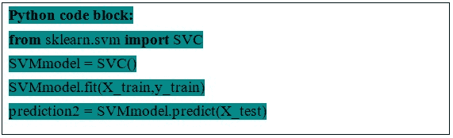

### 朴素贝叶斯 (Naïve Bayes)

朴素贝叶斯是一种基于贝叶斯定理概念的机器学习模型。贝叶斯定理用于在给定已发生的证据 B 的情况下，计算假设 A 发生的概率。该模型假设各个特征之间是独立的，这意味着一个特征的存在不会影响另一个特征。这就是为什么它被称为“朴素”（Naïve）的原因。朴素贝叶斯的类型有：多项式、伯努利和高斯朴素贝叶斯。该算法速度快且易于实现。但在现实数据集中，特征可能是相互依赖的，这可能会影响分类器的性能。在本研究中，我们使用了高斯朴素贝叶斯。

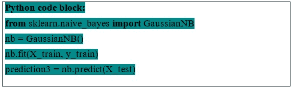

### 决策树 (Decision Tree)

决策树是处理真实数据集的强大工具。它也被用于随机森林分类器的构建。决策树通过使用训练集中存在的信息寻找划分准则（特征）来构建。最佳划分特征通过三种方法之一确定，即信息增（Information Gain）、增益率（Gain ratio）和基尼指数（Gini index）。决策树根据上述算法确定的最佳划分准则进行构建。决策树是一种具有节点和有向边的分层结构。深度较大的决策树会导致过拟合。因此，需要构建最优决策树以获得更好的分类准确率。


### 随机森林 (Random Forest)

随机森林是机器学习中基于集集的分类技术。它并行训练多棵决策树，并在训练后对其输出进行聚合。也就是说，每棵决策树都做出自己的预测，然后预测次数最多的类别作为分类器的预测结果。它还保持了决策树之间互不相关。Bagging（自助聚合）和特征随机性是实现此点的两种技术，以确保每棵树都与其他不同。训练集会显著影响决策树的工作。随机森林基于有放随机抽样的原理。由于随机森林中的决策树是使用特征的随机子集构建的，得到的分类更加准确。它使得树具有更多的变异性、更低的相关性和更多的多样性。


### K 近邻 (K-nearest Neighbor)

K 近邻是一种用于执行回归和分类的基于实例的机器学习算法。该算法的原理是具有相似特征的对象在特征空间中共同存在。K 代表在分类或回归中考虑的邻居数量。对于数据集中的每个测试样本，使用欧几里得距离或曼顿距离计算各个数据点与测试样本之间的距离。欧几里得被广泛使用。测试样本的分类通过多数投票完成。对样本到测试样本的距离进行排序，并识别最近的邻居。然后在分类情况下进行多数投票。对于回归，考虑 K 个标签的平均值；对于分类，考虑 K 个标签的众数。K 近邻的优点是易于实现且简单。不需要构建整个模型或调整多个参数等。该算法的缺点是随着数据或特征的增加，算法会变慢。它也被称为懒学习器（lazy learner）。


### SMOTE (少数类过采样技术)

不平衡数据集会降低分类算法的性能。为了克服这一缺点，我们在提议的系统中使用了 SMOTE 方法。通过这种方法创建少数类的副本，并使数据集达到平衡。当将机器学习算法应用于此平衡后的数据集时，可以获得更好的结果。

## 方法

这是一项关于在 CTG 数据集上应用和分析不同机器学习分类算法的实验研究。实验使用 Python 中的库进行。实验使用的 Python 库包括 `NumPy`、`pandas`、`matplotlib`、`scipy`、`imb-learn` 和 `scikit-learn`。使用这些库，我们对数据进行了预处理，执行了 `SMOTE – Synthetic Minority Oversampling Technique`并将上述模型应用于数据集。由于原始数据集有 2126 条记录，我们应用了 `smote` 并对数据集上采样，以便获得更好的准确率。结果发现数据集是平衡的，因此机器学习算法表现得更好。表 1 显示了关于实现模型时所用各种参数的细节。

### 表 1 机器学习算法中使用的模型

| 序号 | 机器学习算法 | 使用的模型 |
| --- | --- | --- |
| 1 | 逻辑回归 | `sklearn.linear_model` |
| 2 | 决策树 | `sklearn.tree` |
| 3 | 朴素贝叶斯 | `sklearn.naive_bayes` |
| 4 | SVM | `sklearn.svm` |
| 5 | KNN | `sklearn.neighbors` |
| 6 | 随机森林 | `sklearn.ensemble` |

---

## 性能衡量

评估提议系统时使用的指标是精确率、召回率、F1 分数和准确率。这些值通过混淆矩阵计算。混淆矩阵根据数据集中的实际标签和预测标签显示真阳性（TP）、真阴性（TN）、假阳性（FP）和假阴性（FN）。使用了 Python 中提供的混淆矩阵函数用于此。

**精确率 (Precision)**：精确率帮助我们了解预测准确率。它是通过将正确预测的正样本数除以预测为正的样本总数得到的。它是对预测正样本准确性的衡量。

**召回率 (Recall)**：它是衡量正确预测的正样本数量与数据集中所有正样本数量之比例。它也称为灵敏度或真阳性率。

**F1 分数 (F1-Score)**：F1 分数可以认为是精确率和召回率之间的权衡。通常期望两者都很高，保持它们之间的平衡可能成为另一个任务。因此，良好的 F1 分数可以作为良好精确率和召回率的指标。

## 实验分析与结果

如前所述，三个输出类别：正常、可疑和病理。在预处理部分，删除了空值，并通过 SMOTE 技术对数据集进行了上采样。记录了实现机器学习模型产生的每个输出类的精确率、召回率和 F1 分数值。实现的模型有：

1. 逻辑回归 (LR)
2. 决策树 (DT)
3. 朴素贝叶斯 (NB)
4. 支持向量机 (SVM)
5. K 近邻 (KNN)
6. 随机森林 (RF)

表 2 显示的结果证明，在应用 SMOTE 后，所有机器学习模型的表现都更好。

### 表 2 机器学习模型性能分析

| 算法 | 类别 | 精确率 (Precision) | 召回率 (Recall) | F1 分数 |
| :-: | :-: | :-: | :-: | :-: |
| | | 使用 SMOTE | 不使用 SMOTE | 使用 SMOTE | 不使用 SMOTE | 使用 SMOTE | 不使用 SMOTE |
| LR | 1 | 0.95 | 0.93 | 0.85 | 0.97 | 0.90 | 0.95 |
| | 2 | 0.81 | 0.67 | 0.85 | 0.90 | 0.83 | 0.57 |
| | 3 | 0.88 | 0.81 | 0.92 | 0.82 | 0.90 | 0.82 |
| SVM | 1 | 0.90 | 0.89 | 0.83 | 0.98 | 0.87 | 0.93 |
| | 2 | 0.78 | 0.64 | 0.84 | 0.45 | 0.81 | 0.53 |
| | 3 | 0.88 | 0.91 | 0.89 | 0.41 | 0.89 | 0.57 |
| DT | 1 | 0.92 | 0.94 | 0.94 | 0.96 | 0.93 | 0.95 |
| | 2 | 0.94 | 0.82 | 0.72 | 0.72 | 0.73 | 0.77 |
| | 3 | 0.98 | 0.85 | 0.88 | 0.88 | 0.88 | 0.87 |
| RF | 1 | 0.97 | 0.96 | 0.95 | 0.90 | 0.96 | 0.98 |
| | 2 | 0.96 | 0.96 | 0.97 | 0.78 | 0.96 | 0.86 |
| | 3 | 0.88 | 0.96 | 0.92 | 0.94 | 0.99 | 0.95 |
| NB | 1 | 0.91 | 0.99 | 0.80 | 0.80 | 0.89 | 0.89 |
| | 2 | 0.67 | 0.45 | 0.89 | 0.94 | 0.76 | 0.60 |
| | 3 | 0.85 | 0.63 | 0.67 | 0.63 | 0.75 | 0.63 |
| KNN | 1 | 0.98 | 0.93 | 0.91 | 0.96 | 0.95 | 0.94 |
| | 2 | 0.92 | 0.70 | 0.78 | 0.62 | 0.95 | 0.65 |
| | 3 | 0.98 | 0.93 | 0.99 | 0.82 | 0.99 | 0.87 |

这表明数据集中存在类别不平衡问题，可以通过 `SMOTE` 来克服。在平衡数据集上应用机器学习算法提供了更好的结果。使用各种机器学习方法并结合 `SMOTE` 时所取得的准确率提升在图 (2) 中以图表形式所示。


**图 (2)** 机器学习模型的准确率分析。

## 结论

本文分析了各种机器学习模型在 CTG 数据集上的性能。结果发现，当消除数据集中的类别不平衡问题时，模型的表现相当良好，这通过图 (2) 中的对比图表现出来。由于这仅是一项关于这些机器学习算法行为的实验研究，该项目的未来工作需要研究深度学习方法及其在这些数据集上的表现。对于整个研究领域，最近的工作是 8 层 `CNN`。在解释 CTG 信号时，可以利用深度学习算法，并可以达到与临床医生解释相当的准确率。这可能会带来更好的新生儿预后。因此，本项目的未来方向是实现深度 `CNN` 模型，以获得更高的准确率。

## 出版同意

不适用。

## 利益冲突

作者声明无财务或其他形式的利益冲突。

## 致谢

声明无。

## 参考文献


| | |

| --- | --- |

| [1] | S.C.R. Nandipati and C. XinYing, "Classification and Feature Selection Approaches for Cardiotocography by Machine Learning Techniques". ISSN: 2180 – 1843. ISSN: 2289-8131. |

| [2] | Ricciardi G. Improta, F. Amato, Cesarelli, M., "Classifying the type of delivery from cardiotographic signals: A machine learning approach". 2020. 10.1016/j.cmpb.2020.10572 |

| [3] | Zhao Z., Deng Y., Zhang X., Shao L., "DeepFHR: intelligent prediction of fetal Acidemia based on heart rate". BMC Med Inform. 2019. 10.1186/s12911-019-5318-8 |

| [4] | Czabanski R., Jezewski, J., "Neuro-Fuzzy Approach to Fetal CT". 14th Nordic-Baltic Conference on Biomedical Engineering and Medical Physics. 10.1007/978-3-319-91186- |

| [5] | H. Sahin and A. Subasi, "Fetal State using Simple Logistic ANN". |

| [6] | Cömert, Z., Kocamaz A., Gungor, S., "Cardiotocography with artificial neural network". 24th Signal Processing and Communication (SIU). 10.1109/SIU.2016.749603 |

| [7] | Cömert, Z., Kocamaz A., "Determination of Hypoxic Fetuses". Bitlis Journal of Science and Technology. 10.1768/beus.3380 |

| [8] | Cömert, Z., Kocamaz A., "A Study Based Gray Level-occurrence Matrix and Neural Network". International Artificial Intelligence. |

| [9] | Cömert, Z., Fatih A., "Evaluation of Fetal Distress during Delivery Stages using Linear and Nonlinear Features of Fetal Heart for Neural Network". Int. J. Comput. Appl. 2018.8568617 |

| [10] | Cömert, Z., Kocamaz F., "Fetal Hypoxia Detection Based Deep Convolutional Network with Transfer Learning". Software and Algorithms in Intelligent Systems. 10.1007/978-3-540-693 |

| [11] | N.J.A. Kadhim and J.K. Abed, "Enhancing the Prediction Accuracy of Cardiotocography (CTG) using Firefly Algorithm and Naive Bayesian Classifier". IOP Conf. Ser.: Mater. Sci. Eng. 74 |

| [12] | Tang H., Wang T., Li M., Yang X., "The Design and Implementation of Cardiotocography Signals Classification Based on Neural Network". 10.1155/2018/85686 |

| [13] | Iraji M.S., "Prediction of fetal state from the cardiotogram recordings using neural network models". Artif. Med. 2019. 10.1016/j.artmed.2019.03.00531 |

| [14] | Alsayyari A., "Fetal cardiotocography monitoring using Legendre neural networks". Biomedical Engineering / Biomedizinische Technik 2019.10.1515/bmt-2018-00743 |

| [15] | Bursa, Miroslav & Lhotska, Lenka. "The Use of Convolutional Neural Networks in Biomedical Data Processing". International Conference on Information Technology in Bio- and Medical Informatics. 10.1007/978-3-319-64265-9 |

| [16] | Warrick P.A., Hamilton E.F., “Intrapartum fetal-state classification using long short-term memory neural networks,” 2017. Computing in Cardiology. Rennes CinC2017.262-444 |

| [17] | Fergus P., Chalmers C., Montanez C.C., Reilly D., Lisboa P., Pineles B., "Modelling Segmented Cardiotocography Time-Series Signals Using One Dimensional Convolutional Neural Networks for the Early Detection of Abnormal Birth Outcomes". 2020.10.1109/TETCI.2020.3020061 |

开发用于连续识别手语势以及从口语句子生成手语视频的深度神经网络模型仍然具有挑战性，并在早期研究中需要大量的调查。尽管最近的方法为这些任务提供了可能的解决方案，但它们在处理连续句子和视觉质量方面仍然表现不佳。深度学习技术的近期的进展为处理此类复杂任务并产生令人印象的结果预设了新的里程碑。本文提出了一种新方法，以开发一个用于多语言手语数据集和多模态手势识别的深度神经网络框架。此外，所提模型还可以从口语句子生成手势视频。在第一阶段中，它使用混合 `CNN-LSTM` 算法处理手势识别任务；第二阶段使用混合 `NMT-GAN` 技术生成高质量的手势视频。已使用不同的质量指标对所提模型进行了评估。我们还使用不同的基准手语数据集对所提模型的性能进行了定性比较。该所提模型在手语识别和视频生成任务中实现了 98% 的分类准确率，并提升了视频质量。

**关键词：** `CNN`（卷积神经网络）、特征提取、`GAN`（生成对抗网络）、`LSTM`（长短期记忆）、机器翻译、识别、手语、子单元建模、翻译、视频生成。

***

**通讯作者 Elakkiya Rajasekar：** 研究学者，助理教授，SASTRA Deemed to University 计算学院, Thanjavur, Tamilnadu, India；电子邮件：`elakkiyaceg@gmail.com`

## 引言

世界卫生组织（`WHO`）报告称，全球有 5%的人口（即约 46.6 亿人）存在听力问题。手语（`SL`）在聋哑交流中起着至关重要的作用。手语是基于手势的，并遵循其自身的语法规则。

普通人对手势动作的识别在理解和回复方面仍然面临巨大困难。由于这些问题，普通人与聋哑社会之间缺乏交流。尽管在该领域已进行了大量的研究，但在处理连续句子时问题仍然存在。我们研究了深度学习技术的最新进展，并提出了一种新方法来构建一个健的框架以解决这个问题。此外，手语的不同变体增加了处理多语言手势和多模态特征的难度。所提模型的开发是为了应对上述所有挑战。所提模型遵循双向方法进行识别和视频生成任务。手势的识别及其向文本的翻译涉及子单元建模 [[2]] 以及手动和非手动特征提取方法 [[3], [4]]。模型的识别准确率将通过生成的文本输出和代价函数进行评估。另一方面，从给定的口语句子生成手语视频是通过生成对抗网络（`GAN`）模型、循环神经网络（`RNN`）及其变体以及神经机器翻译技术实现的 [[5]]。

手语视频生成方法涉及将口语句子翻译为手语词（glosses）并与手势图像映射。帧序列将经过妥善安排并产生合理的视频输出。在普通手语中，手势分为四类：操作性、会话性、控制性和交流性。手语基于交流型手势，被认为是计算机视觉技术的测试平台 [[6]]。两种主要方法是基于传感器和基于视觉的方法。基于传感器的方法使用电子设备，如表面肌电图（`sEMG`） [[7]]、`ECG` [[8]]、数据手套 [[9]]、彩色手套 [[10]]、深度摄像头 [[11]]、`Kinect Sensors` [[12]] 和 `Leap Motion Sensors` [[13]]。佩戴这些设备会给普通人带来不适感，且缺乏用户友好的方法。基于视觉的方法采用深度人工模型直接识别图像或视频，探索关于手势信息的深度见解并使用户受益。图像分割、分类和特征提取技术用于连续 `DSL` 识别。分类器如隐马尔可夫模型（`HMM`） [[14]-[17]]、K-最近邻算法（`KNN`） [[18]]、`SVM` - 支持向量机 [[18]]、卷积神经网络（`CNN`） [[19]-[24]]、`RNN` [[25]]、`LSTM` - 长短期记忆 [[26]]、循环`Recurrent CNN` [[27]] 以及门控循环单元（`GRU`） [[28]] 技术在手语识别与翻译（`SLRT`）研究中获得了更广泛的关注。

由于手语存在遮挡、连读和插音动作，识别手语者的连续手势是具有挑战性的。所提模型旨在以实时、连续和自动的方式准确识别手势。手语交流研究的各个维度如如图所示（图 1）。

 **图 (1)**

基于手语的深度学习研究的各个维度。

本文的目标列如下：

- 使用多个手语者以及各种背景条件和光照，开发印度手语（`ISL`）的连续手语语料库。该语料库主要涵盖每天常用的 100 个英语单词。

- 利用深度学习技术的进展，开发用于 `ISL` 识别、翻译和手语视频生成的 `SLRT` 模型，目标是分类准确率达到 95%以上。

- 使用移动设备实时自动化 `SLRT` 过程，为 `SLRT` 研究领域的各种挑战提供解决方案。

- 开发用于 `SLRT` 的端到端框架，探索普通人与聋哑人士交流的实时解决方案，并旨在提供照片级的高质量手语视频输出。

连续 `SL` 识别、翻译和视频生成涉及开发的各个步骤，这些将在后续章节中进行讨论。第 2 节讨论了基于深度学习的手语研究的相关工作和进展。我们还讨论了子单元建模以及手动和非手动特征提取技术。第 3 节提供了所提模型开发的详细信息，实验结果将在第 4 节讨论，最后是结论。

## 相关工作

手语识别和视频生成的研究引起了研究人员的广泛关注，旨在开发处理多语言手语语料和手势多模态特征的框架。本节讨论了我们为印度手语（ISL）研究开发的自研手语语料以及手语识别翻译（SLRT）领域的现有进展。它提供了传统方法的清晰理解及其缺陷。然而，此类深度模型的发展应该解决识别和翻译手语时常见的挑战。手势识别面临自遮挡、插入音运动、协同发和语法变化问题，而翻译则涉及句子结构与手语序列之间的对齐风险。由于这些挑战，模型开发具有更高的复杂度，并且在该领域的研究关注点更加广泛。在本文中，我们研究了子单元建模、特征提取技术以及各种深度学习算法，为上述在 SLRT 过程中持续存在的挑战提供解决方案。这些方法是根据研究人员提出的不同分类中的复杂性确定的。这项工作研究了准确率高于 95%的 SLRT 成功实现，并解决了研究人员面临的共同挑战。最后，它对实时自动 SLRT 研究领域提供了宝贵的见解，并指出了未来的研究方向。

## 手语数据集

手势动作随国家和地区而异，这导致了用于研究的各种数据集的发展。美国手语（ASL）词级数据集包含 100 名手语者完成的 2000 个单词[[29](https://9789815079210-C8.html#r29)]。在美国许多教育机构，已为聋哑社区教授了 ASL 课程。中国科学技术大学（USTC）利用 50 名手语者创建了一个中文手语（句子级）视频数据集[[30](https://9789815079210-C8.html#r30)]。还存在日语手语字母数字数据集[[31](https://9789815079210-C8.html#r31)]。开发了阿拉伯手语（ArSL）标注视频数据集[[32](https://9789815079210-C8.html#r32)]。印度手语（ISL）连续手语语料库的开发是一种连接听障和哑人与他人的智能工具。

大多数国家的研究人员已经开发了他们的 SL 数据集。手语数据集构成了字母和数字、单词、句子和视频的手势图像。ASL 数据集[[7](https://9789815079210-C8.html#r7)]，即 CUNY ASL、Boston ASL LVD 和 MSR Gesture 3D，以视频格式存在，用于 SLRT 研究目的。中文手语（CSL）的 DEVISIGN 系列仅处理词级手语。德国手语数据集，名为 RWTH PHOENIX Weather 2014 的数据[[33](https://9789815079210-C8.html#r33)]和 DGS Kinect 40 是针对单词和句子级开发的。表[[1](https://9789815079210-C8.html#t1)]讨论了各种基于国家的 SL 数据集并详细阐述了各种细节。这些数据集使用不同的母语手语者创建，并遵循其他国家的文化。

### ISL 语料库的必要性

手语句子级识别的数据集有限。这表明有开发 ISL 手语语料库的需要。尽管全球范围内存在 SL 数据集，但仍然没有 ISL 的标准数据集。可用资源仅包含有限的手势图像、字母、数字和单词的孤立图像。现有的 ISL 数据集是为有限数量的手势创建的[[34](https://9789815079210-C8.html#r34)]。为了给 ISL 开发一种新型异构数据库，计划在不考虑背景环境、光照和传感器设备的情况下，捕捉常用和频繁英语单词的多个手语者的签名视频。我们使用七个不同的手语者创建了 ISL-CSLTR 数据集。该语料库包含句子信息、基于类的孤立图像以及句子和视频的帧序列。该语料库发布在 Mendeley Data 上并公开可用[[35](https://9789815079210-C8.html#r35)]。

**表 1 各国手语数据集概览。**

| 参考文献 | 手语 | 国家 | 数据集 | 类型 | 级别 | 手语者人数 | 孤立/连续 | 基于传感器/基于视觉 | 使用的组件 | 标注 |

| :--- | :--- | :--- | :--- | :--- | :--- | :--- | :--- | :--- | :--- | :--- |

| Lu *et al.* [[7](https://9789815079210-C8.html#r7)] | ASL | 美国 | CUNY ASL 运动捕捉语料库 | 视频 | 句子 | 3 | I | S | 运动捕捉相机 | 词汇级 |

| Wilbur *et al.* [[29](https://9789815079210-C8.html#r29)] | ASL | 美国 | Purdue RVL-S | 图像 | 单词 | 14 | I | V | 语言特征 | |

| Latif *et al.* [[32](https://9789815079210-C8.html#r32)] | ArSL | 沙特阿拉伯 | ArASL | 字母、视频 | 单词 | 40 | I | V | 受控光 | |

| Forster *et al.* [[33](https://9789815079210-C8.html#r33)] | GSL | 德国 | RWTH-PHOENIX-Weather | 视频 | 句子 | 7 | I | V | 彩色相机、右惯手语者 | 词汇级 |

| Nandy *et al.* [[34](https://9789815079210-C8.html#r34)] | ISL | 印度 | IIITA-ROBITA | 视频 | 单词 | 5 | I | V | 相机 | 词汇级 |

| Hosoe *et al.* [[35](https://9789815079210-C8.html#r35)] | JSL | 日本 | 日语字母数据集 | 图像 | 字母 | 10 | I | V | RGB 相机 | 词汇级 |

| Neidle *et al.* [[36](https://9789815079210-C8.html#r36)] | ASL | 美国 | Boston ASLLVD | 视频 | 标记 | 6 | I | V | 4 台同步相机 | 语言 |

| Schembri *et al.* [[37](https://9789815079210-C8.html#r37)] | BSL | 英国 | BSLCP | 视频 | 单词 | 76 | I | V | 独特背景 | 词汇级 |


| Camgoz *et al.* [[39](https://9789815079210-C8.html#r39)] | TSL | 土耳其 | 普斯普拉斯手语语料库 | 视频 | 单词、短语 | 10 | C | S | Microsoft Kinect v2 | 边界 |
| Fang *et al.* 和 Yang *et al.* [[40](https://9789815079210-C8.html#r40), [41](https://9789815079210-C8.html#r41)] | CSL | 中国 | DEVISIGN-G | 视频 | 单词 | 8 | I | V | RGB 特征 | 词汇级 |
| DEVISIGN-D | | | | | | | | | | |
| DEVISIGN-L | | | | | | | | | | |
| Ronchetti *et al.* [[42](https://9789815079210-C8.html#r42)] | LSA | 阿根廷 | LSA64 | 视频 | 单词 | 10 | I | V | RGB 相机 | 词汇级 |
| Von *et al.* [[43](https://9789815079210-C8.html#r43)] | GSL | 德国 | SIGNUM | 视频 | 句子 | 25 | C | V | 彩色视频相机 | 词汇级标注 |

*** S - Sensor-Based, V - Vision-Based.

ISL 语料库的发展为研究社区为 `SLRT` 研究提供了充分的数据集支持。尽管它是为了有限的词汇创建的，但未来可以进一步扩展到大词汇量。通过广泛的深度学习技术从不同维度对使用 ISL 语料库的模型性能进行了分析，结果显示在实验结果部分。这种分析有助于以更先进的方式开发 `SLRT` 模型。训练和测试性能与基准手语语料库进行了比较。这些研究工作鼓励研究人员专注于开发 `SLRT` 模型，以实现听障人士学习和通信过程的自动化。手语视频生成部分专门研究了使用 `GAN` 模型及其变体来提供无模糊和无噪声的高质量视频。`GAN` 与 `LSTM` 网络的嵌入自动将单词序列顺序转换为手语序列顺序。图像插值技术在两个手势类别之间创建中间帧，并在视频输出中提供连续的基于人的真实手势动作。生成的结果清晰且一致。在过去的几十年里，已经提出了许多使用字母图像、数字图像和手语词汇图像来处理单词、句子和视频的方法。除了所有研究外，识别连续手语的系统仍然是一项挑战性任务。语音转文本和视频帧的转换已被采用，但识别连续 `SL` 仍然面临困难。

## 单元建模与手动特征及非手动特征的提取

单元建模通过回顾当前的研究工作，将手势归类为相关的子单元组 `[2]`。单元建模广泛地分为两种方法，即基于语言的方法和基于视觉的方法。手语块可以被探索为孤立手语以训练系统。单元建模处理大型词汇表并容忍手语的变化 `[3]`。Han *et al.* 定义子单元是手语词汇的帧序列，包含了手势的空间和时间细节 `[44]`。Elakkiya R *et al.* `[4]` 设计了一个 3 单元手语建模框架，将连续和并行手语块方面贡献到子单元中。尽管用于分类手语的 `HMM`、`SVM` 方法仍然缺乏识别能力，连续 `SL` `[45]`。跨签名者验证策略增强了模型在独立签名者环境下的性能评估中的表现。关于单元建模技术的大量研究工作被成表，以便理解各种参数。增强了实时效率、可扩展性和鲁棒性。单元的估计侧重于空间线索（手）和时间线索，如头部和手部的位置以及手部姿态的速度。基于贝叶斯模型的概率计算使用 `eq. (1)` 执行。

```
 || (1)
```

手语序列表示为 `ss`；`Ma` 表示手动线索，`Nm` 表示非手动线索。单元的估计使用基于二项条件的判别。此外，它提取了各种身体组件作为特征来识别提取的手势语词。现有的单元建模工作在表 `2` 中讨论。它比较了独立签名者和依赖签名者环境下的多级单元建模，并比较了所使用的各种数据集和识别准确率。我们可以根据比较优化模型性能，以产生更优秀的分类和识别准确率。我们在 `ISL-CSLTR` 数据集的分类中实现了 95% 以上的准确率。

### 表 2 各种单元建模框架摘要

| **参考文献** | **孤立/连续** | **签名者独立/依赖** | **视觉/传感器** | **手语级/单元级** | **数据集** | **识别准确率** | **建模框架** |
| :--- | :--- | :--- | :--- | :--- | :--- | :--- | :--- |
| Elakkiya *et al.* `[4]` | 孤立, 连续 | I | V | 单元 | ASLLVD, RWTH-PHOENIX-Weather 数据 | 97.3% | SMP-H1%IM, MEC+DTW |
| Bauer *et al.* `[15]` | 连续 | I | V | 自组织单元 | 自 | 91.80% | HMM 分类器 |
| Han *et al.* `[44]` | 孤立, 连续 | I | V | 单元（边界检测） | ECHO² | 85% | 时间聚类 |
| Vogler *et al.* `[46]` | 孤立 | D | V | 音素 | 53 个手语词汇 | 87.71% (上下文无关) 89.91% (上下文相关) | |
| Kadir *et al.* `[47]` | 孤立 | I | V | 手语 | 164 个单词 | 92% (词汇表) | Boosting |
| Yuan *et al.* `[48]` | 连续 | D | V | 子词 | 词汇表 | 70% | HMM |
| Fang *et al.* `[49]` | 孤立 | D | V | 手语 | CSL 数据库 | 90.5% | K-means |
| Yang *et al.* `[50]` | 连续 | D | V | 手语 | CSL 数据库 | NA | HMM |
| Kelly *et al.* `[51]` | 孤立, 连续 | I | V | 手语 | | NA | GTHM |
| Kong *et al.* `[52]` | 连续 | D | V | 段 | 不同的句子 | 86.6% (召回率) 89.8% (精确率) | 半马夫 CRF |
| Yang *et al.* `[53]` | 连续 | I | V | 手语 | KINECT 数据集 | NA | 增强方法 |
| Pitsalis *et al.* `[54]` | 孤立 | D | V | 音素 | GSL 数据库 | NA | HamNoSys |
| Li *et al.* `[55]` | 孤立, 连续 | I | V | 手语 | 1024 个测试句子 | 87.4% | HMM |

SL 通信通过参与身体不同部位来实现手语的无缝过渡，以考虑相关信息，产生多模态方法 `[56]`。手语由手动、非手动和多模态特征组成。连续手势序列的识别是一项挑战性任务，因为其多模态的性质。手动部分是手部、形状和位置。而非手动特征是面部表情、嘴部、头部位置、眼神以及手臂和身体姿态。这些的提取决定了动作的歧义，这在 SLRT 研究中需要解决。CNN 及其变体在目标检测技术中产生了显著的结果。CNN 网络直接处理图像并学习图像的许多特征以产生所需的结果。与单元建模相关的各种研究工作在表 `3` 中讨论。

### 表 3 手语帧中手动特征和非手动特征提取的各种分类法

| 参考文献 | 孤立/连续手语 | 使用的数据集 | 特征提取方法 | 使用的特征 | 分段方法 | 分类方法 | 识别准确率 | 重点 |
| :--- | :--- | :--- | :--- | :--- | :--- | :--- | :--- | :--- |
| Elakkiya *et al.* `[4]` | I & C | ASL + GSL | M & N | 所有 | 3-SU | BPaHMM | 91% (5356 个句子) 和 98.64% (3300 个手语) | 单元建模 |
| Koller *et al.* `[17]` | C | PHOENIXWeather 2014 | M & N | 全部 | 序分割 | HMM+CNN+LSTM | NA | 1000 个类别，60 种不同的手型 |
| Tharwat *et al.* `[18]` | I | ArSL | SIFT | 手 | LDA | SVM, `KNN(K=5)` | 99% | 2D 图像鲁棒性，可扩展性 |
| Masood *et al.* `[19]` | I | 阿根廷手语 (LSA) 手势数据集 | M | 手 | NA | CNN (空间)+RNN (时间) | 95.2% | 实时手语识别 (SLR) |
| Köpüklü *et al.* `[20]` | C | EgoGesture 和 NVIDIA 动态手势数据集 | M | 手 | 视频分割 | 深度 3D CNN | 94.04% | 目标检测 |
| Pradeep Kumar *et al.* `[22]` | I | 7500 个 (ISL) 手势包含 50 个不同的手单词 | M | 手 | 手部分割 | HMM + BLSTM-NN | 97.85% (单手) | 单手和双手动态手势 |
| Ma *et al.* `[23]` | C | 8,280 个手势 | M & N | 手、臂和脸 | 手动标注 | CNN | 86.66% | 多歌手 |
| AnanthaRao *et al.* `[24]` | C | 自拍手语数据集 | 手动标注 | 单手 | NA | 深度 CNN | 92.88% | 设计了不同的 CNN 架构 |
| Cui *et al.* `[27]` | C | RWTH-PHOENIX-Weather 多歌手 2014 | M | 手 | 分段视频语汇 | CTC + RCNN | NA | 有效避免了过拟合问题 |
| Starner *et al.* `[57]` | C | ASL | M & N | 全部 | NA | HMM | 92% | 单色摄像头，40 词词汇 | 句级、单摄像头、歌手独立 |
| Necati *et al.* `[58]` | C | RWTH-PHOENIX-Weather-2014T (PHOENIX14T) 数据集 | M & N | 全部 | 自动分割方法 | CNN | NA | 手语翻译 Sign2Text |
| Yanqiu Liao *et al.* `[59]` | C | DEVISIGN_D 数据集 | M | 手 | 序分割 | B3D ResNet | 89.8% | 视频序列 | SLR_Dataset | 86.9% |
| Cui *et al.* `[60]` | C | RWTH-PHOENIX-Weather 2014 | 空时间 | 手 | 手势分割 | R-CNN (Softmax 分类器) | NA | 图像 |
| SIGNUM 基准 | | | | | | | | |
| Mittal *et al.* `[61]` | I & C | 942 个 ISL 句子 | 2D CNN | 手 | NA | 修改的 LSTM | 平均准确率为 72.3% 和 89.5% | 35 个不同的手单词，Leap Motion 传感器，双手 |
| Cooper *et al.* `[62]` | I | 20 GSL 手势 | M | 手 | 子单元分割 | HMM+ 序列模式增强 | NA | 语言子单元 |
| Jiang *et al.* `[63]` | I | 中文字手指手语数据集 | M | 手 | NA | 八层 CNN | 89.32% | 字母拼写 |
| Xiao *et al.* `[64]` | I | 7500 个 (ISL) 手势包含 50 个不同的手单词 | M | 手 | 手部分割 | HMM + BLSTM-NN | 97.85% (单手) | 单手和双手动态手势 |

## SLRT 的挑战

SLRT 的挑战涉及手势的识别和反向过程，由于词变化和插入音运动，这在研究领域仍然具有挑战性。在双手手势中，系统可能会因为帧中的遮挡而无法识别。训练需要高性能计算设备。数字输入设备、语音助手、自动语音转文字器和语音识别器必须与该模型兼容。

## 手语生成的实验结果

示例视频帧序列如图 `[2]` 所示，用于“你多大了？”这个句子。手势者通过做出不同的手势覆盖句子，主要（图 `[2a]`）表示“你”，`2(e)` 表示“大”，`2(g)` 表示“多少”。

文本/语音到视频的生成比文本/语音到图像生成更强大的条件生成器，因为视频的维度更高。提出了一种基于 3D 卷积的 `GAN` 架构 `[65]` 来生成视频序列，但它只能生成固定长度的视频。虽然该模型并非为处理条件视频生成而设计，但文本条件视频合成 `[66, 67]` 是通过句子嵌入作为条件输入来实现的。然而，这些条件生成模型基于 3D 卷积的，它们只能产生固定长度的低分辨率视频。基于 `Recurrent Neural Network` 的编码器-解码器模型已被用于从单词生成人体动作姿态序列，并将其连接到 `Baxter` 机器人。然而，它们的结果纯是定性的，并且依赖人工解释。Subhashini *et al.* `[68]` 讨论了视频到文本的翻译将通过将视频转换为帧序列然后使用基于 `LSTM-RNN` 的方法生成单词序列来实现。作者 Ibrahim *et al.* `[69]` 提出了 `ArSLRS` 方法，利用手部、头部跟踪、分割和分类特征将阿拉伯手语转换为文本或语音。

`CNN` 和 `RNN` 的变体（如 `LSTM` 和 `GRU`）是 `SLRT` 领域广泛使用的深度学习技术。条件 `GAN` 技术用于翻译以生成不同长度的高分辨率视频。口语文本到手语词（glosses）的翻译是通过 `NMT` 技术获得的。然后，使用 `open pose` 库实现词汇与视频序列之间的映射。另一方面，使用 `CNN`、`LSTM` 和 `media pose` 通过考虑多模态特征来识别包含孤立符号和连续手语句的多语言数据集。由于专业知识，文本/句子生成中与位置相关的同义词需要符合语言构建的语法程序，这非常重要，因为同一个词可以用作名词、动词、代词、短语、成语、单数、复数上下文。将手势符号翻译为合适的单词不是一项简单的任务，因为它需要更多的训练来理解不同的签名者手势风格和手部位置的变化。当从空间和时间特征形式存在的图像中学习时，就可以生成手语视频。使用 `GAN` 网络合成手语视频遵循视频预测和视频生成策略。`GAN` 及其变体的最新进展如表 `4` 所示。

### 表 4 视频生成分类法概述

| 参考文献 | 方法 | 数据集 |
| :--- | :--- | :--- |
| Carl *et al.* `[65]` | `VideoGAN` | YFCC100M (Flickr) |
| Cho *et al.* `[70]` | `GAN` | MNIST |
| Yan *et al.* `[71]` | `conditional GAN` | KTH and Human3.6M |
| Yamamoto *et al.* `[72]` | `3D CNN + tempCAE` | 自建视频数据集 |
| Hao *et al.* `[73]` | 稀疏到密集流填充和像素幻觉 | Robot Pushing, KITTI, UCF-101 |
| Denton *et al.* `[74]` | `SVG-FP` and `SVG-LP` | 随机移动 MNIST, KTH Action, BAIR robot pushing |
| Wang *et al.* `[75]` | `VAE` | 随机移动 MNIST, Weizmann Action, BAIR Robot Pushing, Human3.6M |
| Pan *et al.* `[76]` | `cVAE` | Cityscapes UCF101 KTH Action dataset, KITTI |
| Saito *et al.* `[77]` | `TGAN` | 移动 MNIST |
| Tulyakov *et al.* `[78]` | `MoCoGAN` | 太极数据集 |
| Kanaa *et al.* `[79]` | `RNNs` | 移动 MNIST |
| Clark *et al.* `[80]` | `GAN` | UCF-101 |
| He *et al.* `[81]` | `VAE` | Flickr |

## 提议的模型

（此处省略翻译）

我们使用基于 NVIDIA Quadro P4000 的 GPU 计算设备训练了模型。对于 100 个样本，完成 200 个周期（`epochs`）的完整训练需要 6 小时。我们使用了三层大小分别为 64、128、64 的 `LSTM` 层，以及两层大小分别为 32、64 的 `dense`（全连接层），激活函数为 `relu`。最后一个全连接层使用 `softmax` 激活函数，dropout 设置为 0.1。条件 `GAN` 的视频生成性能通过 `Adam` 优化器和批归一化（batch Normalization）技术进行了微调。初始下降值设置为 0.5，学习率为 0.01。使用分类准确率和视频质量指标对模型性能进行评估。分类准确率的结果如图 `(4)` 所示。

```
 **图 (4)**
```

深度 SLRT 模型的分类准确率。

## 实验结果


# 本节展示了模型在不同手语数据集上的性能

对模型性能的分析有助于识别识别率、可用数据量、视频质量以及单词或句子层面的细节。使用不同的指标，对孤立图像和连续帧的模型性能进行了评估。代价函数的计算显示了现有语料库采用所提 `SLRT` 模型时的损失值。图 (5) 和 (图 6) 显示了所提模型在识别和视频生成任务中的结果。本节还将所提模型的性能与不同的深度模型以及各种手语语料库进行比较。结果如图 (7).(a), 7.(b), 8.(a), 8.(b), 9.(a), 9.(b), 10.(a), 10.(b) 以及 11 所示。


**图 (5) 深度 SLRT 识别结果。**


**图 (6) 深度 SLRT 视频生成结果。**


**图 (7a) 模型性能比较。**


**图 (7b) 分类性能比较。**


**图 (8a) 各种手语数据集的模型准确率比较。**


**图 (8b) 不同模型之间的分类性能比较。**


**图 (9a) 深度 SLRT 模型的训练和验证准确率。**


**图 (9b) 深度 SLRT 模型的损失计算。**


**图 (10a) 各种 GAN 模型在视频生成上的性能分析。**


**图 (10b) 深度 SLRT 模型的损失计算。**


**图 (11) 所提 SLRT 模型在基准数据集上的损失分析。**

## 结论

基于深度学习技术的 `SLRT` 模型在手语识别、翻译和视频生成方面取得了巨大进展。通过 `NMT`、`CNN` 和 `GAN` 提升了针对聋哑群体的生成性能。所提模型达到了 95% 的识别率和 98% 的生成准确率。未来，我们计划扩展 `ISL` 语料库的大小。

## 致谢

感谢印度政府科学与技术部对本项目的资助。

## 参考文献

| | |
| --- | --- |
| [1] | Yang H., Huang T.. Sign language recognition with the Kinect sensor based on conditional random fields. Sensors (Basel) 2014 15 1135 |
| [2] | Mustafa M.. RETRACTED ARTICLE: A study on Arabic language recognition for differently abled using advanced machine learning. J. Ambient Intell. Human. Comput. 2021 12 34 |
| [3] | Pu J., Zhou W., Zhang J., Li H.. Sign language recognition based on trajectory modeling with hmms. International Conference on Multimedia Modeling. Springer Cham 686 697 2016 |
| [4] | Yang W., Tao J., Ye Z.. Continuous sign language recognition using level building based on fast hidden markov model. Pattern Recognit. Lett. 2016 78 782 835 |
| [5] | Bauer B., Karl-Friedrich K.. Towards an Automatic Sign Language Recognition System Using Subunits. International Gesture Workshop. Springer Berlin, Heidelberg 64 75 2001 |
| [6] | Chuan C-H., Regina E., Guardino C.. American language recognition using leap motion sensor. 13th International Conference on Machine Learning and Applications. IEEE 541 54 2014 |
| [7] | Pu J., Zhou W., Zhang J., Li H.. Sign language recognition based on trajectory modeling with hmms. International Conference on Multimedia Modeling. Springer Cham 686 697 2016 |
| [8] | Allevard T., Benoit E., and Laurent Foulloy, "Hand posture recognition with the fuzzy glove", Modern Information Processing, Elsevier Science, 2006 pp. 417-427. |
| [9] | Kim J-H., Nguyen Duc Thang, and Tae-Seong Kim, 3-d motion tracking and gesture recognition using a data glove. IEEE International Symposium on Industrial Electronics 2009 |
| [10] | Incorporating `NMT`, `CNN`, and `GAN` performance the deaf-mute society. |
| [11] | Kapuscinski T., Oszust M., Warchol D.. Recognition of hand gestures observed by depth cameras. Int. J. Adv. Robot. Syst. 2015 12 43 |

## 参考文献

- [17] Starner T., Weaver J., Pentland A.. 基于桌面和可穿戴计算机视频的实时美国手语识别。`IEEE Trans. Pattern Anal. Mach. Intell.` 1998 20 1213 711 375 10.1109/34.735811
- [18] Tharwat A., Gaber T., Hassanien A.E., Shahin M., Refaat B.. 基于 SIFT 的阿拉伯手语识别系统。`Afro-European conference for industrial advancement.` Springer 2015 359 370 10.1007/978-3-319-13572-4_30
- [19] Masood S., Srivastava A., Thuwal H.C., Ahmad M.. 使用 `CNN` 和 `RNN` 从视频序列中实时手语手势（单词）识别。`Intelligent Engineering Informatics.` Singapore Springer 2018 623 632 10.1007/978-981-10-7566-7_63
- [20] Köpüklü O., Gunduz A., Kose N., Rigoll G.. 使用卷积神经网络进行实时手手势检测与分类。`14th IEEE International Conference on Automatic Face & Gesture Recognition` IEEE 2019 18 10.11.1109/FG.2019.8756576
- [21] Koller O., et al.. 使用多流 `CNN-LSTM-HMMs` 弱监督学习以发现手语视频中的序列并行性。`IEEE Trans. Pattern Anal. Mach. Intell.` 2019 30 990 421
- [22] Koller O., Camgoz N.C., Ney H., Bowden R.. 使用多流 `CNN-LSTM-HMMs` 弱监督学习以发现手语视频中的序列并行性。`IEEE Trans. Pattern Anal. Mach. Intell.` 2020 42 923 062 320 10.1109/TPAMI.2019.2911077 30 990 421
- [23] Y. Ma, G. Zhou, Wang S. Zhao, H. and W. Jung, "Signfi: 使用 wifi 的手语识别", Proceedings of the ACM on Interactive, Mobile, Wearable and Ubiquitous Technologies, 2018, no. 2, pp. 1-21.
- [24] Rao G.A., Syamala K., Kishore P.V.V., Sastry A.S.C.S.. 用于手语识别的深度卷积神经网络。`2018 Conference on Signal Processing and Communication Engineering Systems (SPACES)` IEEE 2018 194 197 10.1109/SPACES.2018.8316344
- [25] Borg M., Camilleri K.P.. 使用循环神经网络在野外进行手语检测。在 `ICASSP 2019-2019 IEEE International Conference on Acoustics, Speech and Signal Processing (ICASSP)`, pp. 1637-1641. IEEE, 2019. 10.1109/ICASSP.2019.8683257
- [26] Liu T., Zhou W., Li H.. 使用长短期记忆网络的手语识别。`2016 IEEE international conference on image processing (ICIP)` IEEE 2016 2871 2875
- [27] Cui R., Liu H., Zhang C.. 分阶段优化的递归卷积神经网络用于连续手语识别。`Proceedings of the IEEE conference on computer vision and pattern recognition` 2017 7361 7369 10.1109/CVPR.2017.175
- [28] Rastgoo R., Kiani K., Escalera S.. 手部姿态感知多模态孤立手语识别。`Multimedia Tools Appl.` 2021 80 1127 163 10.10.1007/s11042-020-09700-0
- [29] Wilbur R., Kak A. C.. "Purdue rvl-slll 美国手语数据库"。
- [30] Wang H., Chai X., Zhao G., Chen X.. 使用格拉斯曼协方矩阵的孤立手语识别。`ACM Trans. Access. Comput.` 2016 8 4 12 10.1145/289735
- [31] Kwolek B., Baczynski W., Sako S.. 使用深度卷积神经网络识别 `JSL` 手指字母。`Neurocomputing` 2021 456 598 10.1016/j.neucom
- [32] Latif G., Mohammad N., Alghazo J., AlKhalaf R.. `ASL`: 阿拉伯字母。Data Brief 2019 23 10.1016/j.dib.2019
- [33] Forster J., et al.. `RWTH-PHOENIX`: 大词汇量手语识别。LREC
- [34] Nandy A., Mondal S., Prasad J., Chakraborty P.. 用于人机交互的印度手语手势识别。`International Conference on Computer and Communication Technology (ICCCT)` Uttar Pradesh 2010 1 27 10.1109/ICCCT.2010.5640
- [35] Elakki R., et al.. `ISL-CSLTR`: 连续手语数据集。Nature 2021
- [36] Neidle C., Thang A., Sclaroff S.. 手语表示开发中的挑战。`5th workshop on` LREC
- [37] Schembri A., Fenlon R., Cormier K.. 构建英国手语。`Lang.`
- [38] Vogler C., Metaxas D.. 使用三维卷积神经网络识别 `JSL`。H. Hana., Sako B., Fifteenth IAPR Machine Vision (MVA). 2017
- [39] Camgöz, C., Necati G., Ayşe Kındı, Meltem Kelep, Akarun.. 受服务机器人支持的土耳其手语识别。`Proceedings of the` Language.Society. 2018
- [40] Fang G., Gao X., Gao W.. 2004 年自动提取中文手语单元的新方法。`Proceedings of the 17th International Conference on Pattern Recognition` vol. 4 455
- [41] Yang HD, Sclaroff S, Lee W.. 基于条件随机场的手语抽取（spotting）。`IEEE Transactions on Pattern Analysis and Machine Intelligence`, vol .31, no. 7, pp. 1264- 1277 10.1109/TPAMI.2008
- [42] Ronchetti, Franco, et al.. 阿根廷手语。`XXII Congreso de la Computación`
- [43] Von A., et al.. 视觉手语识别的最新进展。`in the Info.`
- [44] Han J., Awad G., Sutherland A.. 基于运动分析的手语子单元建模与切分。`Pattern Recognit. Lett.` 2009 30 10.1016/j.pat
- [45] Tornay S., Aran O., Doss M.. 使用 `HMM` 方法的手语阈值识别。`Proceedings of The 12th Language and Evaluation Conference` 2012
- [46] Vogler C., Metaxas D.. 适应 `ASL` 的隐马尔可夫模型。`International Conference on Systems, Man, and Cybernetics` 1997
- [47] Kadir T., Bowden R., Ong E., Zisserman A.. 最小训练词典。`British Machine Vision Conference` 2004 11 10.5244/C
- [48] Yuan Q., Geo W., Yao H., Wang C.. 连续手语中的强弱连接识别。服务机器人支持的物体识别。IEEE 2002 vol. 1 758 10.1109/IPR.2002
- [49] Fang G., Gao X., Gao W., Chen Y.. 2004 年自动提取中文手语单元的新方法。`Proceedings of the 17th International Conference on Pattern Recognition` vol. 4 455
- [50] Yang HD, Sclaroff S, Lee W.. 基于条件随机场的手语抽取（spotting）。`IEEE Transactions on Pattern Analysis and Machine Intelligence`, vol .31, no. 7, pp. 1264- 1277 10.1109/TPAMI.2008
- [51] Kelly D., McDonald J., Markham C.. 使用手势阈值 `hmms` 手语中的时空手势。`Machine Learning for Vision-Based Motion Analysis` 2011 307 348 10.1007/978-0-85729-057-1_12
- [52] Kong W.W., Ranganath S.. 领域独立连续手语识别：一种分割与合并方法。`Pattern Recognit.` 2014 47 3129 41308 10.1016/j.patcog.2013.09.01
- [53] Yang W., Tao J., Ye Z.. 基于快速隐马尔可夫模型分层构建的连续手语识别。`Pattern Recognit. Lett.` 2016 78 2835 10.1016/j.patrec.2016.03.03
- [54] Pitsikalis V., Theodorakis S., Vogler C., Maragos P.. “用于转录对齐和手语识别的基于语音学的亚单元建模进展”，IEEE 计算机学会计算机视觉与模式识别研讨会 (CVPRW), pp. 1- 6. 10.1109/CVPRW.2011.5981681


| [55] | | Li K., Zhou Z., Lee C.H.. 针对真实应用的连续手语识别的符号转换建模及可扩展解决方案。ACM Trans. Access. Comput. 2016 8 2 123 [TACCESS].. 10.1145/2850421 |
| [56] | | Lizhong Wu, Oviatt S.L., Cohen P.R.. 多模态整合——一种统计视角。IEEE Trans. Multimed. 1999 1 433 434 10.1109/6046.807953 |
| [57] | | Starner T., Weaver J., Pentland A.. 基于桌面式和可穿戴计算机视频的实时美国手语识别。IEEE Trans. Pattern Anal. Mach. Intell. 1998 20 12 1371 1375 10.1109/34.735811 |
| [58] | | Camgoz, Necati Cihan, Oscar Koller, Simon Hadfield, and Richard Bowden. “手语 Transformer：联合端到端手语识别与翻译”。arXiv (2020): arXiv-2003.. |
| [59] | | Yang H.D., Lee S.W.. 基于条件随机场和支持向量机的结合与非手动特征的鲁棒手语识别。Pattern Recognit. Lett. 2013 34 16 2051 2056 10.1016/j.patrec.2013.06.022 |
| [60] | | Cui R., Liu H., Zhang C.. 用于迭代训练的连续手语识别深度神经框架。IEEE Trans. Multimed. 2019 21 7 1880 1891 10.1109/TMM.2018.2889563 |
| [61] | | Mittal A., Kumar P., Roy P.P., Balasubramanian R., Chaudhuri B.B.. 使用 Leap Motion 进行连续手语识别的改进 LSTM 模型。IEEE Sens. J. 2019 19 16 7056 7063 10.1109/JSEN.2019.2909837 |
| [62] | | Cooper H., Bowden R.. 使用语言学派生亚单元的手语识别，手语表示与处理第四次研讨会论文：语料库与手语技术，pp. 57-61 2010.. |
| [63] | | Jiang X., Lu M., Wang S.H.. 用于中国手语字母拼写识别的带有随机池化、批量归一化和 Dropout 的八层卷积神经网络。Multimedia Tools Appl. 2020 79 21 15697 15715 10.1007/s11042-019-08345-y |
| [64] | | Xiao Q., Qin M., Yin Y.. 用于聋障与听力人士双向交流的基于骨骼的中国手语识别与生成。Neural Netw. 2020 125 41 55 10.1016/j.neunet.2020.01.030 32070855 |
| [65] | | Carl V., Hamed P., Antonio T.. 场景动态视频生成。神经信息处理系统进展。Curran Associates, Inc. 2016 Vol. 29 613 621 |
| [66] | | Yingwei P., Zhaofan Q., Ting Y., Houqiang L., Tao M.. 所见所得：从字幕生成视频。第 25 次 ACM 国际媒体会议集 1789 1798 2017 |
| [67] | | Li Y.. M.R. Min, D. Shen, David E. Carlson, and L. Carin 从文本生成视频。第 32 次 AAAI 人工智能会议，美国路易斯安那州新奥尔良，2018 年 2 月 2-7 日，2018 |
| [68] | | Subhashini V., Venugopalan S., Rohrbach M., Donahue J., Mooney R., Darrell T., Saenko K.. 序列到视频到文本。IEEE 国际计算机视觉会议集 4534 4542 2015 |
| [69] | | Ibrahim N.B., Selim M.M., Zayed H.H.. 自动阿拉伯手语识别系统 (ArSLRS)。沙特国王大学期刊-计算机与信息科学 2018 30 4 470 477 10.1016/j.jksuci.2017.09.007 |
| [70] | | Cho H-Y., Kim Y-H.. 通过遗传算法稳定生成对抗网络的训练。遗传与进化计算会议论文论文集 2019 10.1145/3319619.33267 |
| [71] | | Yan Y., et al.. 基于骨骼的生成。第 25 次 ACM 国际媒体会议集 2017 |
| [72] | | Yamamoto Y., Harada T.. 3D 卷积神经网络。2019. 10.1145/312327 |
| [73] | | Wang Z., et al.. 可控生成。arXiv:1801.0288 |
| [74] | | Denton E., Fergus R.. 基于先验的视频生成。arXiv:1802.065 |
| [75] | | Xiao Q., et al.. 基于骨骼的识别。CVPR 2019 |
| [76] | | Pan J., et al.. 简单的视频生成。CVPR. 2019 |
| [77] | | Saito M., Matsumoto E., Saito S.. 时间生成对抗网络。ICCV. 2017 |
| [78] | | Tulyakov S., Liu M., Yang X.. 运动与内容的分解。arXiv:1707.0499 |
| [79] | | Kanaa D., Simonyan K., Clark A., Donahue J.. 简单的视频生成。NIPS. 2019 |
| [80] | | Clark A., Donahue J.. 高效视频生成。arXiv:1907.0657 |
| [81] | | He J., et al.. 概率视频生成。ECCV 2018. 10.1007/978-3-01228-1 |

手势语言是聋哑人士群体的一种沟通媒介。根据世界卫生组织的数据，全球约有 6.1% 的人患有听力或言语障碍。根据美国国家聋人协会（`NAD`）的数据，印度有约 1800 万人遭受听力障碍。手势语言因地区而异。世界上大约有 120 多种手势语言（`SL`）。一些著名的手势语言包括阿拉伯语、美国语、不丹语、德语、中文、俄语、土耳其语以及印度手势语。

印度手势语本身因地区而异。聋哑人士通常需要有人为他们的手势进行翻译才能进行日常交流。手势语言识别系统（`SLR`）的构建动机是希望为手势语言识别的自动化提供可行的解决方案，从而消除翻译过程中对人工辅助的需求。近期在构建 `SLR` 系统方面已有许多进展。大多数可靠、准确且简单的先进 `SLR` 系统都依赖于手套等可穿戴设备。虽然可穿戴设备可以根据手指关节、手部朝向和脸部关键点位置等测量提供准确预测，但对于听力和言语障碍者的日常生活实际应用而言，使用这些设备会非常繁琐、受限、怪异且昂贵。基于图像/视频的 `SLR` 系统图像处理框架的鲁棒性，其抵御异构、动态或通常不受限的环境、不良的光照条件以及不同肤色的能力，对其实用性具有显著影响。在构建最准确的 `SLR` 模型时，另一个主要缺点是缺乏公开的大型数据集。目前尚没有印度手势语（`ISL`）的公开数据集。尽管先进模型使用了自定义的数据集，但它们并没有考虑过与签名者无关、具有不同光照和背景的数据集。

为了克服上述问题，我们提出了一种基于图像/视频的 `SLR` 系统，使用卷积循环神经网络（`CRNN`）框架，通过输入不同光照场景、不同背景、不同手部朝向和不同签名者的手势图像/视频来理解手势语言。我们创建了自己的数据集，即 `ISLAN`，该数据集包含字母和数字的印度手势，并已向社会公开以供进一步研究。所提出的 `CRNN` 框架可以分为两个模块，即特征提取（`FE` 模块）和模型识别（`MR` 模块）。`FE` 模块使用卷积神经网络（`CNN`）实现，`MR` 模块使用循环神经网络（`RNN`）实现。通过整合两者，我们得到了一个 `H-DNN`，即 `CRNN` 模型。所提工作的主要目标是：

1. 创建并收集用于印度字母和数字符号的印度孤立手势语言数据集（`ISLAN`）并将其公开。
2. 实现用于特征提取和手势语言识别的 `H-CRNN` `SLR` 模型。
3. 使用新创建的 `ISLAN` 数据集对所提出的模型进行评估。

本文其余部分的结构如下：第 2 节简要讨论相关工作并进行文献回顾。第 3 节介绍了所提出的方法，第 4 节进行结果分析与讨论。第 5 节讨论结论和未来工作。

## 相关工作

在过去的几年里，手势语言手势识别领域的研究取得了巨大进展。基于视频的手势识别为聋人融入社会提供了基础。手势语言识别系统已有许多基于传感器的以及基于视频的研究。许多研究人员在没有神经网络实现的情况下对手势识别进行了工作。一些方法使用了尺度不变性来用于英语识别。用于印度手势的框架处理了高度和宽度。引入了多种基于 `HMM` 的模型用于 `SLR`。为了阿拉伯语，引入了基于 `HMM` 的模型。随后进入了使用传感器的识别时代，使用了诸如 `KNN`、`SVM` 等机器学习。一些方法使用多一个数字摄像头从不同角度捕捉手势。引入了若干其他基于传感器的框架。例如，提出了一种基于 `CNN` 的框架用于美国手势。相同的框架也被用于基于意大利手势的。随后，提出了一种神经网络模型用于阿拉伯语，不仅提取了高度和宽度，还提取了对象的深度维度并输入到各种 `CNN` 框架中。另一种 `SLR` 框架利用了相对较大的数据集用于字母和数字。

在不同地区已有许多基于视频的方法进行手势识别。研究人员利用了各种基于 `CNN` 的框架，如 `VGG16`、`VGG19`、`AlexNet`、`ResNet`、`inception net` 等。提出了一种中文 `SLR` 系统，将 `CNN` 与长短期记忆网络（`LSTM`）集成，通过单词手势视频进行孤立识别，达到了 95% 的准确率。基于 `CNN` 的框架在数据大小上存在主要缺点。它需要大型数据集来训练神经网络，这会导致巨大的计算时间和能量消耗。为了解决这个问题，研究人员转向了迁移学习和微调方法。已有关于使用微调技术前后框架对比的研究工作。一种识别框架通过微调的 `CNN` 模型实现，该模型已使用 120 万个数据集针对植物识别任务进行了预训练。后来，使用从预训练模型获取权重的微调 `CNN` 构建了孟加拉语 `SLR` 系统。实现了一种基于神经网络的方法用于缅甸语 `SL`。

基于视觉的方法已被证明在实时系统中易于使用和实现。提出的模型之一利用唇部形状和纹理模式处理了 `SLR` 系统的表述。一个台湾 `SLR` 系统是通过机器学习方法构建的，利用 `Kinect` 摄像头提取手部方向、形状和位置等手部特征。一种使用 `CNN` 方法构建的用于 3D 手势的新型识别系统，其中提取了时空特征特征。另一种针对印度 `SL` 的基于 `ANN` 的 `SLR` 系统，它使用了从手机摄像头捕获的图像数据集。另一个模型提出使用 `Inception V3` 模型通过 `ASL` 数据集来识别静态手势。一些模型还引入了用于识别任务的皮肤分割和跟踪方法。一种使用深度神经网络引入了基于 `ISL` 的 `SLR` 系统。提出了一种印度 `SLR`，它使用了签名者无关的印度手语 (`ISL`) 数据集。针对印度 `SL` 还开发了一些使用各种优化器的深度学习模型。提出了一种印度 `SLR` 系统，利用 `HOG` 特征处理印度手语字母表示的分类。由于缺乏 `ISL` 数据集，所有提出的 `ISLR` 系统都使用了自收集的数据集。

## 方法论

所提出的方法涉及两个模块的集成。一个是用于特征提取的 `CNN` 框架即 `FE` 模块，另一个用于手势识别任务的 `RNN` 即 `MR` 模块。这两个模块的集成导致了 `Hybrid-CRNN` 框架的形成，并创建了用于印度字母符号的手语数据集，即 `ISLAN`。

### 提出的 H-CRNN 框架

所提出的 `H-CRNN` 框架由 5 个阶段组成，即数据采集、数据预处理、数据增强、特征提取和手势识别。所提出的 `H-CRNN` 框架如图 (1) 所示。所提出的 `H-CRNN` 模型使用 `CNN` 作为 `FE` 模块，并使用 `RNN` 作为 `MR` 模块。

其中 `z` 是输入神经元，`α` 是一个小的常数。每个卷积层具有不同尺寸的过滤器，并以步长为 2 应用了 2D 最大池化（`max-pooling`）。`max-pooling` 操作在 2D 空间符号图像上进行。通过在输入窗口内选择输入每个通道的最大值，`max-pooling` 在其空间维度上对输入进行下采样。在每个维度上，窗口以步长为 2 进行调整。

提取的特征被送入 `MR` 模块。`MR` 模块使用 `RNN` (`LSTM/GRU`) 框架进行分类。来自 `FE` 模块的特征向量经过了重塑。重塑后的特征向量作为输入到 `LSTM` 和 `GRU` 单元中，用于符号的分类。在所提出的 `H-CRNN` 架构中，分类块包含两个 `LSTM/GRU` 单元，随后是全连接层。最后一层使用 `softmax` 激活函数产生类别概率输出。使用 `Adam` 优化器 通过学习率优化模型。该模型使用 `categorical cross-entropy` 损失函数进行编译。输出层包含 36 个类，包括 26 个双手字母符号类、26 个单手字母符号类和 10 个数字符号类。

图（`5`）展示了所提出的 `H-CRNN` 架构。如上所述，该架构分为两个模块：`Feature Extraction` 模块和 `Model Recognition (Classification)` 模块。预处理后的图像被送入由五个卷积块组成的 `FE` 模块，其中图像维度被缩小，从而从手势图像中仅提取所需的特征集。提取的特征随后被传递到 `MR` 模块进行分类，其中提取的特征被用于孤立 `ISL` 英语字母和数字手势表示的识别和分类。


**图 (5)** 所提出的 `H-CRNN` 架构。

### 实验与结果

所提出的 `H-CRNN` 模型使用了新创建的 `ISLAN` 数据集。`ISLAN` 包含 7200 张符号图像和 360 个表示英语字母（包括双手和单手符号手势）和数字的印度符号表示视频。`ISLAN` 数据集被分为训练集和测试集，训练集占据 `ISLAN` 的 75%，测试集占据 `ISLAN` 的 25%。使用 `ISLAN` 数据集对所提出的模型与其他先进的神经网络模块进行了评估和比较。结果证明，所提出的 `H-CRNN` 模型的性能优于其他模型。具有特征维度的所提架构见图（`6`）。整体模型参数见图（`7`）。`H-CNN-GRU` 的源代码见图（`8`），`H-CNN-LSTM` 的源代码见图（`9`）。


**图 (6)** 所提出的 `CRNN` 架构描述。


**图 (7)** 由所提出的 `CRNN` 架构生成的整体模型参数。


**图 (8)** 所提出的 `H-CNN-GRU` 模型的源代码示例。


**图 (9)** 所提出的 `H-CNN-LSTM` 模型的源代码示例。

首先，使用 `ISLAN` 数据集对所提出的 `H-CNN-LSTM` 和 `H-CNN-GRU` 模型进行了评估，并对它们之间的性能进行了比较。所提出的 `Hybrid CNN-GRU` 模型的混淆矩阵已图中。

## 参考文献

1. Saleh Y., Issa G.. 通过深度神经网络微调进行阿拉伯语手语识别。 2020: 71-83.. 10.3991/ijoe.v16i05.13087
2. WANGCHUK, KARMA, Karma Wangchuk, and Panomkhawn Riyamkol. 不丹手语手型字母和数字的检测与识别。学位论文，Naresuan University, 2020
3. Jiang X., Lu M., Wang S.H.. 一种带有随机池化、批量归一化和 Dropout 的八层卷积神经网络，用于中国手语字母识别。Multimedia Tools Appl. 2020 79 21-22 15697 15715 10.1007/s11042-019-08345-y
4. Sevli̇ O., Kemaloğlu N.. 使用不同优化器的 CNN 进行土耳其手语数字分类。International Advanced Researches and Engineering Journal 2020 4 3 200 207 10.35860/iarej.700564
5. Elakkiya R., Rajalakshmi E.. 2021 ISLAN Mendeley Data V1 10.17632/rc349j45m5.1
6. Mangamuri L.S.T., Jain L., Sharmay A.. 用于机器学习分类模型基准测试的双手印度手语数据集。2019 国际智能计算技术问题与挑战国际会议 (ICICT)。Vol. 1. IEEE, 2019. . 10.1109/ICICT46931.2019.8977713
7. Nachamai M.. 美式手语的字母识别：一种基于 SIFT 算法的手势识别方法。International Journal of Artificial Intelligence & Applications 2013 4 1 1 105
8. Singha J., Das K.. 实时视频中的印度手语识别。arXiv preprint arXiv:1306.1301, 2013..


# 参考文献

9. Youssif, Aliaa AA., Amal E.A, Heba H.A.. 使用 HMM 的阿拉伯语手语 (ARSL) 识别系统。Int. J. Adv. Comput. Sci. Appl. 2011 2 11

10. Abdo M., et al.. 阿拉伯字母和数字手语识别。Int. J. Adv. Comput. Sci. Appl. 2015 6 11 209-214

11. El-Bendary N., et al.. Arslat: 阿拉伯手语字母翻译器。2010 信息系统与工业管理应用国际会议 (CISIM)。IEEE 2010

12. Almasre Miada A., Al-Nuaim Hana.. 使用 Kinect 和 Leap Motion 控制器 v2 的阿拉伯语实时字母识别模型，International Journal of Advanced Engineering, Management and Science 2, no 5, pp. 239-469, 2016.

13. Chuan C-H., Regina E., Guardino C.. 使用 Leap Motion 传感器的美式手语识别，在 2014 第 13 届机器学习与应用国际会议上。2014 541-541 10.1109/ICMLA.2014.110

14. ElBadawy M., et al.. 用于阿拉伯语手语识别的建议混合传感器架构。Intelligent Systems' 2014. Springer, Cham, 2015. 721-730.

15. Kang B., Tripathi S., Nguyen T.Q.. 基于深度图的卷积神经网络实时手语字母识别。在 2015 第 3 届 IAPR 亚洲模式识别国际会议 (ACPR) 上。2015 136-140 10.1109/ACPR.2015.748648

16. Pigou L., et al.. 使用卷积神经网络的手语识别。欧洲计算机视觉会议 Springer, Cham, 2014

17. ElBadawy M., et al.. 3D 卷积网络的阿拉伯语手语识别。2017 第八次智能计算与信息系统国际会议 (ICIS)。IEEE 2017 10.1109/INTELCIS.2017.8260

18. Hayani S., et al.. 使用卷积神经网络的阿拉伯语手语识别。2019 计算机科学与再生能源国际会议 (ICCSRE)。2019 10.1109/ICCSRE.2019.8807

19. Khan A., Sohail A., Zahoora U., Qureshi A.. 深度卷积网络架构综述。Artif. Intell. Rev. 2020 53 854-551 6.1007/s10462-020-982-6

20. Hochreiter S., Schmiduber J.. 长短期记忆。Neural Comput. 1997 9 8 1735 10.1162/neco.1997.9.1

21. Yang S., Zhu Q.. 基于 CNN-LSTM 的连续手语识别。第 9 次国际数字图像处理会议 (ICDIP2017)

22. Tajbakh N., Shin J., Gurudu S.R., Hurst R., Liang J.. 用于医学图像分析的卷积神经网络。IEEE Trans. Med. Imaging 2016 35 5 129 10.1109/TMI.2016.2535

23. Reyes A., Caicedo J.C., Camargo J.. 微调深度卷积网络。CLEF 2015 139-146 7

24. Hasan M.M., Srizon A.Y., Md A.. 应用新型卷积网络的孟加拉手语字符分类。2020 IEEE 专题会议 (TENSYMP)。10.1109/TENSYMP.2020.9230

25. Hossen M.A., et al.. 使用深度卷积网络的孟加拉手语识别。2018 第 7 次信息学、电子与视觉国际会议 (ICIEV) 和 2018 第 2 次成像、视觉与模式识别国际会议 (IVPR)。IEEE, 2018 10.1109/ICIEV.2018.8640

26. Htet S.M., Aye B., Hein M.M.. 基于深度学习的缅甸手语。2020 先进信息技术国际会议 (ICAIT)。IEEE 2020 10.1109/ICAIT5120.9261

27. Das S.P., Talukdar A.K., Sarma K.K.. 使用面部表情的手语识别。Procedia Comput. Sci. 2015 58 210-26 10.1016/j.procs.2015.08.5

28. Lee G.C., Yeh F.H., Hsiao Y.H.. 基于 Kinect 的台湾手语识别系统。Multimedia Tools Appl. 2016 75 12 6179 10.1007/s11042-014-2290-x

29. Kumar E.K., Kishore P.V.V., Sastry A.S.C., Kumar M.T.K., Kumar D.A.. 色纹理编码位位图训练 3D 手语识别的 CNN。IEEE Signal Process. Lett. 2018 25 5 645-649 10.1109/LSP.2018.2817

30. Rao G.A., Kishore P.V.V.. 基于自拍视频的连续印度手语识别系统。Ain Shams Eng. J. 2018 9 4 1929-1939 10.1016/j.asej.2016.10.013

31. Xie B., He X., Li Y.. 基于卷积神经网络的 RGB-D 静态手势识别。J. Eng. (Stevenage) 2018 2018 16 1515-1520 10.1049/joe.2018.8327

32. Ibrahim N.B., Selim M.M., Zayed H.H.. 自动阿拉伯手语识别系统 (ArSLRS)。Journal of King Saud University - Computer and Information Sciences 2018 30 4 470-477 10.1016/j.jksuci.2017.09.007

33. Sharma S., Singh S.. 使用深度学习模型识别印度手语 (ISL)。Wirel. Pers. Commun. 2022 123 1 671-692 10.1007/s11277-021-0915-1

34. Sruthi C.J., Lijiya A.. Signet: 基于深度学习的印度手语识别系统。2019 通信与信号处理国际会议 (ICCSP)。IEEE, 2019.

35. Wadhawan A., Kumar P.. 基于深度学习的静态手语识别系统。Neural computing and applications 2020 32 12 7957-7961 10.1007/s00521-019-04691-y

36. Sharma A., Sharma N., Saxena Y., Singh A., Sadhya D.. 印度手语识别深度神经网络方法的基准测试。Neural Comput. Appl. 2021 33 12 6685-6691 10.1007/s00521-020-0544-8

37. Perez L., Wang J.. 数据增强在深度学习图像分类中的有效性。arXiv preprint arXiv:1712.04621 2017.

38. Kingma Diederik P. and Jimmy Ba Adam. "一种随机优化方法"。arXiv preprint arXiv:1412.6980 (2014).

# 摘要

多年来，技术改变了我们的世界，并成为我们日常生活不可或缺的一部分。这种大规模的数字化也需要考虑到老年群体。然而，老年群体通常被排斥在数字之外，尽管面临这些各种多样的困难，他们仍然保持着动力、参与感，并渴望努力，将不断发展的数字技术融入到日常生活中。因此，本研究利用各种基于自然语言处理的机器学习技术（如 `SVM`、`Random Forest` 和 `Decision Tree`）实现了分析和确定老年人情感的功能。使用了不同的算法，并比较了各种参数以获得结果。结果显示 `SVM` 的效果最好，准确率为 88%。安卓应用“Bandhu – 你的永远朋友”将供老年群体访问和使用。此外，该提议的应用还提供了许多其他功能，包括学习新语言和听地区歌曲，这可以满足像印度这样一个多元化国家的多元文化需求；录制他们的音频故事以保护族文化并启发他人；最后，通过关注简单的视频教程变得精通技术。这些功能不仅能让他们保持参与，还能在一定程度上解决他们的孤独和孤立，因为所有这些功能都是在对对 100 多名老年人的生活方式和需求进行调查后考虑的。该应用还将让他们更加数字化独立。上述所有功能均已使用编程语言 `Java` 实现，安卓应用是在 `Android Studio` 中构建的。

**关键词：** 针对老年人的安卓应用、决策树、多语言情感分析机器人、随机森林、支持向量机 (SVM)、TF-IDF 向量化。

***

**通讯作者 Harshee Pitroda：** 计算工程系，NMIMS 大学，Mukesh Patel 技术管理与工程学院，印度孟买；电子邮箱：`harshee.pitroda2910@gmail.com`

# 引言

世界正以惊人的速度变化，尽管人们很大程度上放在开发青少年群体的潜力上，但年龄光谱的另一端——即老年群体，也在飞速增长，却往往被忽视。随着医学科学的进步，预计未来几十年内预期寿命将进一步提高，这表明迫切需要建立数字基础设施，以支持和利用这一巨大但经常被遗忘的“银发”部门的潜力。这些技术进步应该通过让老年人的生活变得更容易、更有趣，来帮助他们应对孤独、孤立和缺乏独立的感觉。因此，“Bandhu – 你的永远朋友”应用旨在服务社会的老年群体。

所提的解决方案是增量构建的，不断增强各种功能。在该应用的每个后续版本之后，都会在前版本的基础上添加另一个功能，直到实现所有预期功能。

通过 `google forms` 进行了一项调查，向大约 100 名老年人提出了一系列问题，并记录了他们的回答。所的问题列在第六节，命名为 `Questionnaire`。调查结果被作为指导工具，用于决定在该提议解决方案中实现的各种功能。

随着年龄增长，某些生理和认知变化几乎是不可避免的，在设计应用用户界面时，必须考虑这些变化。在设计应用的用户界面时，考虑了所有这些因素。

该应用 UI 设计的显著特征包括：

*   整个应用将使用印地语，考虑到这是印度最受欢迎和使用广泛的语言。
*   随着年龄的增长，手眼协调可能会下降，这可能会影响 UI 交互。因此，在此应用中，所有需要阅读或点击的 UI 组件都放大了尺寸。
*   由于运动能力可能随年龄增长而恶化，老年人在许多方面操作智能手机变得更加困难。因此，该应用的用户界面设计得极其简单，易于导航。
*   色彩视觉也可能随年龄增长而退化，使得更难区分不同的色调。因此，利用了对比色来帮助老年人清晰地识别背景和按钮。
*   图标处都有文字标签，使其一目了然。

“Bandhu – 你的永远朋友”应用的模块如下：

*   **多语言情感分析机器人**——情感分析是分析和确定文本、语音或其他通信方式背后的情感或目的的过程。这是通过基于自然语言处理的机器学习模型实现的。情感分析的目标是识别老年人文本中的情感并做出相应的反应。这种聊天机器人可以帮助需要人类连接的老年群体，并缓解孤独和孤立感。它也可以作为伴侣以及保持身体健康的工具对老年人产生帮助。
*   **听和学习语言**——在晚年学习新语言有助于刷新社交和认知技能。学习新语言可以锻炼大脑，并证明可以提高 IQ、记忆力和注意力。该应用允许老年群体通过听语言来学习，并且按照他们自己的速度，不需要年轻人的帮助。
*   **学习技术**——学习新技术将使他们的生活更轻松，更加独立，他们不再与社会隔绝。这是通过提供简单的印地语视频教程来实现的，教他们如何在线购物、发送和接收电子邮件、支付账单、办理业务、学习如何使用社交媒体、下载和上传材料等。他们可以按照自己的速度学习。
*   **音频日记**——老年人在回顾生活时，通常会对他们经历的一切感到惊讶和感激。有人分享他们的生命故事可以增强老年人的自尊心。通过录音保护生命故事是一项极好的遗产。通过此应用，老年人可以记录自己的文化故事、食谱和现实生活中激励人心弦的经历，并与他人分享。
*   **听地区歌曲**——音乐是唤起记忆和提高人们整体生活质量的力量工具。老年人会喜欢通过这个应用听地区歌曲，这将唤起他们美好的记忆。

本文其余部分将详细讨论多语言情感分析聊天机器人模块，其结构如下：第二节为文献综述。第三节进一步分为 A、B、C 三小节，分别描述了所提出的多语言情感分析聊天机器人框架、集成该模型的建议架构以及数据集。第四节讨论了实现概述，进一步分为 A、B、C、D 四小节，分别描述了探索性数据分析、特征提取、分类和集成。第五节分为 A、B 两部分，分别描述了结果以及最后的结论。结果部分还包含一个表格表示，总结并比较了所使用的算法。第六节包含了调查问卷中提出的问题。

# 文献综述

V Goel *et al.* [1] 通过开发算法并比较准确因素来确定多语言情感分析的最优方案，为多语言情感分析问题解决方案。他们使用了来自 Twitter 的多语言数据集。他们的观察显示，`RNN` 分类器在预测情感方面远超其他分类器。

Sazzed S *et al.* [2] 将各种机器学习算法应用于孟加拉语语料库集合及相应的机器翻译英语版本，并在两个不同领域的数据集上对模型进行了评估：体育评论（板球）数据集和剧评评论数据集。

他们注意到，孟加拉语情感分析的效率经常受到语言复杂性、困难的编写系统、标注数据不足以及词汇资源缺乏的限制。他们的结果显示，机器翻译的准确率可能高于原生语言（孟加拉语），并可用于孟加拉语等资源限制语言的情感分析。

A Madan *et al.* [3] 收集了印地语的推文进行 Twitter 数据的情感分析，并对两种技术进行了对比评估：基于词典的方法和结合了基于词典的方法与机器学习的方法的混合方法。他们的研究无法将英语的推文翻译成印地语。正如所提到的，他们的工作可以扩展到包括将英语推文翻译成印地语，然后使用分类器对其进行进一步分类。他们的研究得出结论，这仅解决了二分类情感分析；然而，它可以扩展到多分类情感分析。

D Mahajan *et al.* [4] 证明了使用 `RNN`（递归神经网络）算法可以获得更高的准确率，因为当他们分类从 Twitter 获取的推文时，被考虑分类的数据量大于其他研究人员考虑的数据量，因为他们使用了 Stanford 库和 Google 翻译器，这增加了机器的能力。

A. K. Soni al [5] 尝试使用机器学习方法对从 Twitter 获取的推文进行情感分析分类。他们使用了两种算法：朴素贝叶斯（`NB`）和最大熵法。他们发现最大熵分类器在预测情感方面超过了所有其他分类器，准确率达到 74%。

Shukrity Si *et al.* [6] 开发了一个可以通过社交媒体检测攻击性文本的模型。情感得分、表情、攻击性词汇和 POS 标签被用作特征，并采用梯度提升法、`XGBoost` 和 `SVM` 作为分类器。他们的方法在英语数据集上表现良好，但必须针对印地语和代码混合数据集进行修改。

Abu *et al.* [7] 侧于使用多分类根据情绪对推文进行分类。情感类别是基本人类情感（快乐、悲伤、惊讶、厌恶）和中性。根据他们的实验结果，该技术提高了 Twitter 数据多分类的性能。他们开发了一个使用 Naïve Bayes（朴素贝叶斯）分类器的情感分析系统。

## Twitter 数据

Sumitra *et al.* [8] 设计了一个模型，模型中，可以使用本体将印地语文本有效地分类到许多类中，并确定每一类的极性，使用了两种方法：`HSWN` 以及 `HSWN` 与 `LMClassifier` 的结合。这种方法实现了更高的准确率。

根据 Christian *et al.* [9], 老年人长期使用移动应用程序（app）促进了身心活动。分析了 82 名用户在两年内的使用记录，揭示了活跃的老人可能分为两类，每类的活动都在增加或减少，而稳定活动非常少。

根据 Wei *et al.* [10], 在在线学习应用设计中使用 ARCS 动机模型有助于刺激用户的学习需求，维持学习兴趣，并提供更好的用户体验。他们通过将 ARCS 动机模型与设计技术相结合，为老年群体提出了一种在线学习应用设计模型。

# 建议框架

本文其余部分将详细讨论多语言情感分析聊天机器人模块，其结构如下：第二节为文献综述。第三节进一步分为 A、B、C 三小节，分别描述了所提出的多语言情感分析聊天机器人框架、集成该模型的建议架构以及数据集。第四节讨论了实现概述，进一步分为 A、B、C、D 四小节，分别描述了探索性数据分析、特征提取、分类和集成。第五节分为 A、B 两部分，分别描述了结果以及最后的结论。结果部分还包含一个表格表示，总结并比较了所使用的算法。第六节包含了调查问卷中提出的问题。

# 文献综述

V Goel *et al.* [1] 通过开发算法并比较准确因素来确定多语言情感分析的最优方案，为多语言情感分析问题解决方案。他们使用了来自 Twitter 的多语言数据集。他们的观察显示，`RNN` 分类器在预测情感方面远超其他分类器。

Sazzed S *et al.* [2] 将各种机器学习算法应用于孟加拉语语料库集合及相应的机器翻译英语版本，并在两个不同领域的数据集上对模型进行了评估：体育评论（板球）数据集和剧评评论数据集。

他们注意到，孟加拉语情感分析的效率经常受到语言复杂性、困难的编写系统、标注数据不足以及词汇资源缺乏的限制。他们的结果显示，机器翻译的准确率可能高于原生语言（孟加拉语），并可用于孟加拉语等资源限制语言的情感分析。

A Madan *et al.* [3] 收集了印地语的推文进行 Twitter 数据的情感分析，并对两种技术进行了对比评估：基于词典的方法和结合了基于词典的方法与机器学习的方法混合方法。他们的研究无法将英语的推文翻译成印地语。正如所提到的，他们的工作可以扩展到包括将英语推文翻译成印地语，然后使用分类器对其进行进一步分类。他们的研究得出结论，这仅解决了二分类情感分析；然而，它可以扩展到多分类情感分析。


D Mahajan *et al.* [4] 证明了使用 `RNN`（递归神经网络）算法可以获得更高的准确率，因为当他们分类从 Twitter 获取的推文时，被考虑分类的数据量大于其他研究人员考虑的数据量，因为他们使用了 Stanford 库和 Google 翻译器，这增加了机器的能力。

A. K. Soni al [5] 尝试使用机器学习方法对从 Twitter 获取的推文进行情感分析分类。他们使用了两种算法：朴素贝叶斯（`NB`）和最大熵法。他们发现最大熵分类器在预测情感方面超过了所有其他分类器，准确率达到 74%。

Shukrity Si *et al.* [6] 开发了一个可以通过社交媒体检测攻击性文本的模型。情感得分、表情、攻击性词汇和 POS 标签被用作特征，并采用梯度提升法、`XGBoost` 和 `SVM` 作为分类器。他们的方法在英语数据集上表现良好，但必须针对印地语和代码混合数据集进行修改。

Abu *et al.* [7] 侧于使用多分类根据情绪对推文进行分类。情感类别是基本人类情感（快乐、悲伤、惊讶、厌恶）和中性。根据他们的实验结果，该技术提高了 Twitter 数据多分类的性能。他们开发了一个使用 Naïve Bayes（朴素贝叶斯）分类器的情感分析系统。

### Twitter 数据

Sumitra *et al.* [8] 设计了一个模型，模型中，可以使用本体将印地语文本有效地分类到许多类中，并确定每一类的极性，使用了两种方法：`HSWN` 以及 `HSWN` 与 `LMClassifier` 的结合。这种方法实现了更高的准确率。

根据 Christian *et al.* [9], 老年人长期使用移动应用程序（app）促进了身心活动。分析了 82 名用户在两年内的使用记录，揭示了活跃的老人可能分为两类，每类的活动都在增加或减少，而稳定活动非常少。

根据 Wei *et al.* [10], 在在线学习应用设计中使用 ARCS 动机模型有助于刺激用户的学习需求，维持学习兴趣，并提供更好的用户体验。他们通过将 ARCS 动机模型与设计技术相结合，为老年群体提出了一种在线学习应用设计模型。

## 建议框架

本文其余部分将详细讨论多语言情感分析聊天机器人模块，其结构如下：第二节为文献综述。第三节进一步分为 A、B、C 三小节，分别描述了所提出的多语言情感分析聊天机器人框架、集成该模型的建议架构以及数据集。第四节讨论了实现概述，进一步分为 A、B、C、D 四小节，分别描述了探索性数据分析、特征提取、分类和集成。第五节分为 A、B 两部分，分别描述了结果以及最后的结论。结果部分还包含一个表格表示，总结并比较了所使用的算法。第六节包含了调查问卷中提出的问题。

## 建议框架

本节描述了所提出的多语言情感分析聊天机器人框架，通过图 1 所示。该节还包括对数据集的简要描述以及 Android 应用“Bandhu – forever friend”集成模型的建议架构，通过图 2 所示。

 **图 (1)**

情感分析聊天机器人建议框架的流程图。

 **图 (2)**

集成模型的建议架构的流程图。

### A. 多语言情感分析聊天机器人的建议框架

建议框架如下：

1. **探索性数据分析 (EDA)**：EDA 用于对数据集的基本探索，总结关键特征，并结合数据可视化方法进行。

2. **特征提取**：对于特征提取，使用了 `TF-IDF` 向量化。该方法反映了词相对于语料库中记录的重要性，并提供了对文档中相关性高术语的见解。

3. **多分类**：分类涉及对数据进行分类并根据共同点分组。多分类任务具有多个类别或输出。我们的多分类方法判断老年人的反应是快乐、悲伤、愤怒、恐惧、喜爱还是惊讶。

4. **在未见数据集上测试**：在这里用于评估原始和未见数据集，以评估和比较模型的性能。

5. **各种算法的性能评估**：比较了各种机器学习技术的准确率和混淆矩阵。

6. **生成序列化模型**：在这里对模型进行序列化，以便以后保存、恢复和重新加载模型，以便使用新数据对其进行测试，并将其整合到 Android 应用中。

将模型集成到安卓应用程序的建议架构如下：

1. **用户的英语/印地语/马拉地语/古吉拉语响应** – 在使用“Bandhu – 你的永远朋友”应用时，老年人（用户）将使用英语、印地语、马拉地语或古吉拉语输入文本消息。如果用户直接用英语输入，则跳过翻译为英语的步骤 2，从步骤 3 开始执行。

2. **翻译为英语** - 从老年人处获取的印地语/马拉地语/古吉拉语输入将使用 `python` 中的翻译库转换为英语。

3. **重新加载 Pickle 模型** – 重新加载模型以便将用户的响应分类为 6 个类别之一：快乐、悲伤、愤怒、恐惧、被爱或惊讶。

4. **重新加载词汇表** - 词汇表在处理后的文本转换为分类表示之前对其进行收集。它是文档中特有的唯一词汇集合。它可以是一个映射（键为术语，值为特征矩阵索引），也可以是一个对术语的可迭代对象。`vect.Vocabulary_` 被导出到 pickle 文件中，然后在重建模型时重新加载。

5. **计数向量化和 TF-IDF 转换器** - 为了使用 `TfidfTransformer`，必须先创建一个 `CountVectorizer` 来统计单词数量（词频），并将上一步重新加载的词汇表 pickle 文件指定为词汇表。我们通过初始化转换器并在用户数据上执行 `fit_transform` 来计算 IDF。

6. **分类** – 然后将成功分类老年人的响应是快乐、悲伤、愤怒、恐惧、被爱还是惊讶。

## C 数据集

在本项目中，使用了“用于自然语言处理的情感数据集”。该数据集包含 19997 条消息及其相应的情感标签。

## 实现概述

在本节中，将详细描述该研究项目的实现概述。

### 探索性数据分析 (EDA)

研究项目的初始阶段是探索性数据分析。我们对数据进行了基础性数据探索，以更好地了解数据集并从中获得见解。我们还通过条形图对数据集进行了可视化处理，并对按情感划分的数据集有了清晰的理解。数据集的条形图表示如图 (3) 所示。

 **图 (3)**

通过条形图表示的数据集概述。

### 特征提取

机器学习算法通过数值数据工作，并需要二维数组作为输入。要在文本数据上进行机器学习，首先需要将文本数据转换为向量表示；因此就可以应用机器学习算法。这被称为特征提取，或者通俗地称为向量化。本项目使用了两种方法。

1. **计数向量化** - 计数向量化关注单词在文档中的出现情况。

2. **TF-IDF 向量化（词频-逆文档频率）**。使用 TF-IDF 向量化，通过单词在文档中出现的次数对词计数进行归一化。TF-IDF 向量化的公式如下：


`df [i] = 包含 i 的文档数量`

`N = 文档总数`

### 分类

**训练/测试集划分 -** 数据集被分为两个部分：训练数据集和测试数据集。训练数据集用于训练整个算法以产生输出。同时，测试数据集充当新数据。测试数据集也称为留存（hold-out set），不用于模型训练，但可用于预测和评估指标。

**预测 -** 分类方法将数据划分为若干类，然后预测输入数据属于哪一类。分类有两种类型：二分类和多分类。

二分类是将给定的数据集仅分类为两类的分类过程，而将项目分类为两个或更多独立类别的任务被称为多分类。我们采用了多分类方法，用以确定老年人的响应是快乐、悲伤、愤怒、恐惧、被爱还是惊讶。

在本项目中使用的各种多分类算法如下：

## 支持向量机

支持向量机 (SVM) 算法可用于回归问题也可用于分类问题。它的目标是在潜在输出之间建立最佳边界，并在 n 维空间中识别一个超平面，以优化数据点与其实际类别的分离。使用 SVM 算法后产生的混淆矩阵如图 (4) 所示。

 **图 (4)**

使用支持向量机算法后产生的混淆矩阵。

## 决策树

决策树在逐步开发关联决策树的同时，将数据集划分为越来越小的子组。最终结果是一个包含叶子节点和决策节点的树。决策节点至少有两个分支。数据的分类由叶子节点表示。使用决策树后产生的混淆矩阵如图 (5) 所示。

 **图 (5)**

使用决策树算法后产生的混淆矩阵。

## 随机森林

随机森林是一种属于集成方法的树算法。随机森林分类器是从训练数据的子集中随机选择的决策树集合。它结合多个决策树的投票来确定测试对象的最终类别。使用随机森林后产生的混淆矩阵如图 (6) 所示。

 **图 (6)**

使用随机森林算法后产生的混淆矩阵。

### 实现

### 模型序列化

Pickle 是标准的 Python 对象（反）序列化工具。Pickle 用于保存和恢复训练后的模型，以便在开发“Bandhu – 你的永远朋友”应用时重复使用。

### 翻译

具体来说，这里使用的一个使翻译变得简单的模块是 `deep_translator`，它支持许多著名的翻译器。Google 翻译器已经包含在 deep translator 包中，只需导入即可简单访问。然后将源语言和目标语言作为参数传递以构建实例。随后，可以使用翻译方法返回翻译后的文本。本项目的翻译模块会将老年人使用的印地语/马拉地语/古吉拉语文本消息翻译为英语，然后进行情感分析并产生如下的回复。对老年人的回复也将使用他们使用的相应语言。

### 与安卓应用集成

本项目的应用是使用 Android Studio 软件和 Java 编程语言开发的。为了将 python 脚本集成到安卓应用中，使用了 `chaquopy` 插件。Chaquopy 是基于 Gradle 的 Android Studio 构建系统插件；它是广为人知的“Android Python SDK”。Chaquopy 允许在安卓应用开发中混合使用 Java 和 Python。

### 代码片段

本节显示了所有算法的代码片段。

## 支持向量机

支持向量机使用的超参数是设置为线性（linear）的核，且 `c` 超参数设置为 1。

|  |

| --- |

## 决策树

|  |

| --- |

## 随机森林

|  |

| --- |

## 结果与结论

### 结果

### 特征提取

在应用了两种特征提取方法和 `SVM` 算法后，对 `F1-score` 进行了比较（应用 `SVM` 算法是因为它具有最高的准确率），结果所示图 (7)。

 **图 (7)**

比较应用两种特征提取方法后的 F1 分数。

`TF-IDF Vectorization` 产生的结果比 `Count Vectorization` 好。`TF-IDF` 优于 `Count Vectorizers`，因为它不仅考虑了词在语料库中的频率，还考虑了词的重要性。

### 分类

**Accuracy** - 准确率是一个描述模型性能的度量标准。机器学习模型的准确率是用于评估哪种模型根据输入或训练数据发现数据集中变量之间相关性和模式的能力最佳的指标。

计算准确率的公式如下：

|  |

| --- |

在本项目中，与其他算法相比，`SVM` 算法产生了最高的准确率，准确率结果如表 1 所示。

**F1 Score** - `F1score` 是准确率（accuracy）和召回率（recall）指标的复合体。高 `F1 score` 表示假阳性和假阴性的数量较低。当 `F1 score` 接近 1 时，模型被认为是理想的，而当它接近 0 时，模型则不被认为是理想的。图 (8) 代表每个特征的 F1 分数。特征从 0 到 5 编号，分别代表情绪——悲伤、快乐、愤怒、爱、惊讶和恐惧。

 **图 (8)**

比较应用不同算法后每个特征的 F1 分数。

在本项目中，与其他算法相比，`SVM` 算法具有最高的 `F1-Score`，`F1-score` 的结果如表 1 所示。

**Fit time** – 模型拟合训练数据所需的时间。在本项目中，`Decision Tree` 算法的拟合时间最短，拟合时间结果如表 1 所示。

**Precision** - 精确率是指模型在预测的正性样本中实际为正性的比例的准确性。当假阳性（False Positive）的成本很高时，精确率是一个适用的指标。图 (9) 代表每个特征的精确率。特征从 0 到 5 编号，分别代表情绪——悲伤、快乐、愤怒、爱、惊讶和恐惧。

 **图 (9)**

比较应用不同算法后每个特征的精确率。

精确率的公式如下：

|  |

| --- |

在项目中，`SVM` 算法与其他算法相比具有最高的精确率，精确率结果如表 1 所示。

**Recall** - 召回率不是看模型预测的假阳性数量（如精确率），而是看负性样本的数量。当假阴性（False Negative）带有巨大的成本时，我们将利用召回率作为模型指标来选择最佳模型。图 (10) 代表每个特征的召回率。特征从 0 到 5 编号，分别代表情绪——悲伤、快乐、愤怒、爱、惊讶和恐惧。

 **图 (10)**

比较应用不同算法后每个特征的召回率。在本项目中，`SVM` 算法相比其他算法具有更大的因子，召回率结果如表 1 所示。表 1 总结了算法的对比。

| 参数 | SVM | 随机森林 |
| --- | --- | --- |
| 准确率 | 88.36% | 86.86% |
| F1 分数 | 90.20% | 86.39% |
| 拟合时间 (秒) | 21.99 | 3.22 |
| 精确率 | 91.67% | 85.47% |
| 召回率 | 90.52% | 85.76 |

模型已成功集成到安卓应用中，应用截图如图 (11) 到图 (16) 所示。

## 表 II 应用截图

| 参数 | SVM | 决策树 |
| --- | --- | --- |
| 准确率 | 88.36% | 86.86% |
| F1 分数 | 90.20% | 86.39% |
| 拟合时间 (秒) | 21.99 | 3.22 |
| 精确率 | 91.67% | 85.47% |
| 召回率 | 90.52% | 85.76 |

| [1] | V. Goel, A.K. Gupta, and N. Kumar, "基于自然语言处理的多语言推特数据情感分析", *2018 第 8 届通信系统与网络技术国际会议 (CSNT)*. IEEE, 2018.. |
| [2] | S. Sazzed, and S. Jayarathna, "孟加拉和机器翻译英语语料库中的情感分类", *2019 IEEE 第 20 届数据科学信息重用与集成国际会议 (IRI)*. IEEE, 2019. . 10.1109/IRI.2019.00029 |
| [3] | A. Madan, and U. Ghose, "印地语推特数据情感分析", *第 11 届云计算、数据科学与工程国际会议 (Confluence)*. IEEE, 2021.. 10.1109/Confluence51648.2021.9377142 |
| [4] | Mahajan D., Chaudhary D.K.. 使用 rnn 和谷歌翻译进行情感分析。在 2018 年第 8 届云计算、数据科学与工程国际会议 (Confluence)2018, 1 月 798802 IEEE.. |
| [5] | Soni A.K.. 使用分类算法对推特数据进行多语言情感分析。2017 第二届电气、计算机与通信技术国际会议 (ICECCT)IEEE201710.1109/ICECCT.2017.8117884 |
| [6] | S. Si, A. Datta, S. Banerjee, and S.K. Naskar, "多语言社交媒体文本中的攻击性检测", *第 10 届计算、通信与网络技术国际会议 (ICCCNT)*. IEEE, 2019.. |
| [7] | Riyadh, Abu Zonayed, Nasif Alvi, and Kamrul Hasan Talukder. "通过推特探索人类情感。" *2017 第 20 届计算机与信息技术国际会议 (ICCIT)*. IEEE, 2017.. 10.1109/ICCITECHN.2017.8281813 |
| [8] | Pundlik S., Dasare P., Kasbekar P., Gawade A., Gaikwad G., Pundlik P.. 2016 印地语多分类分类和基于类的情感分析。2016 年计算、通信与信息进展国际会议 (ICACCI)512518IEEE.10.1109/ICACCI.2016.7732097 |
| [9] | C. Lins, A. Hein, L. Halder, and P. Gronotte, "保持流状态——一种老年人活动激励型应用的长期使用", *IEEE 第 18 届健康网络、应用与服务国际会议 (Healthcom)*. IEEE, 2016.. 10.1109/HealthCom.2016.7749476 |
| [10] | Xiong W., He W., Liu Z.. 基于注意、相关性、信心和满意度 (arcs) 模型的老年人在线学习移动应用设计 2019 IEEE 工程、技术与教育国际会议 (TALE)20191510.1109/TALE48000.2019.9225849 |


## 技术启发型详述教育模型 (TI-EEM)：可持续教育生态系统的未来需求

Anil Verma^(1), Aman Singh^(1, *)), Divya Anand^(1), Rishika Vij^(2)

¹ 计算机科学与工程系，Lovely Professional 大学，Jalandhar, Punjab, 印度

² 兽医生理学与生物化学系，Dr. GC Negi 兽医与动物科学学院，Palampur, Himachal Pradesh, 印度

## 摘要

三十年前，为当地有志向的青年提供高等教育基础设施对印度来说是一项挑战。凭借 5164 所高等教育机构（包括大学、学院和独立机构），印度在过去的二十年里已经超越美国，成为全球教育基础设施的领导者。这项工作旨在提出一个可持续质量教育的详述教育生态系统。来自全球顶级排名机构（泰晤、QS、Webometric、Scimago、上海排名）的次级数据被用于避免全球调查的成本。质量教育的定量和定性参数分别进行了评估。提出的模型根据学术声誉、雇主声誉、师生比、教师引用率、国际教师、国际学生和基础设施进行了 7 分评估。提出的详述模型将建立一个稳健的质量教育生态系统。该模型强调在教育行业中使用 `IoT`、`AI` 和 `BC` 等新兴技术。

**关键词：** 教育生态系统，高等教育，质量教育，技术支持。

---

^(*) **通讯作者 Aman Singh:** 计算机科学与工程系，Lovely Professional 大学，Jalandhar, Punjab, 印度；电子邮箱：amansingh.x@gmail.com

## 引言

2019 年，超过 993 所大学、39931 所学院和 10725 所独立机构 [1] 使得印度在大学和学院数量上位居世界。

根据 2019 年 7 月的 webometric 数据，印度以 3944 所大学和学院位居 2019 年 webometric 大学排名的首位参与者 [2]。美国紧随其后，有 3257 个参与者。中国位居第三，人口最多，有 2208 个参与者。印度尼西亚、巴西和俄罗斯联邦的参与者均超过 1000 个。共有 28077 所大学和学院参与了这项调查。前六国家（即印度、美国、中国、印度尼西亚、巴西和俄罗斯）占据了全球大学和学院总数的近 50%。2019 年全球共有 211 个国家参与了这项调查。印度仅占了该调查中大学学院人口的 7.12%。中国的人口比印度多 0.1 亿，但印度的大学和学院比中国多 1736 所（比美国多 687 所）。因此，印度在基础设施方面毫不落后，因为印度的大学和学院比世界上任何国家都多。

基础设施只是教育系统的一个方面；知识师资力量和良好的学习环境是另外两个具有同等意义的方面。2020 年 QS 世界大学排名证明了印度教职人员的智力水平。2019 年，印度教职人员在全球范围内开展的显著研究工作使印度在人均引用量方面位列全球前三 [3]。印度还部署了 40 多个针对特定领域的顶级机构，包括 `UGC`、`AICTE`、`PCI`、`MCI`、`BCI`、`AISHE`、`NIRF` 和 `NBA`，以确保基层拥有更好的学习环境。尽管这些顶级机构都拥有用于质量保证的丰富技术环境，但印度在国际平台上的质量教育水平甚至低于世界平均水平。在印度，由基础设施、教职力量和学习环境组成的基础教育模式在实现可持续质量教育方面存在不足。印度已经完成了高等教育领域的大部分定量目标，但定性目标尚未达到全球平台的平均标准。图（1）展示了一个包含许多其他影响质量教育因素的详细模型。所有内部元素都需要更多地关注质量提升。对所有内部元素的探索和系统性评估（包括课程、活动、学生和教师的接触、对质量教育的意识、质量评估的参与、教师传授质量教育的兴趣及其学术和研究增长、学生对质量教育的兴趣和渴望、包括学生、教师及相应顶级机构在内的所有利益者之间的沟通与对话），将为可持续质量教育建立一个全面的模型 [4]。


**图 (1)** 具有多种定性参数的详细教育模型。

本研究利用定量和定性参数对全球高等教育系统进行了回顾。本研究使用的比较衡量标准是将定性参数与教育领域排名前五个的国家进行比较，并将定量参数与世界人口最多的前五个国家进行比较。此外，确定印度可持续质量教育的未来定量和定性需求是本研究的核心目标，这进一步为可持续质量教育提出了一种技术启发的解决方案。

论文的其余部分结构如下：第二节讨论了印度教育系统的背景。第三节介绍了本研究的方法论和目标。第四节详细讨论了各种影响的定量和定性比较及其各自的结果。第五节对论文进行了总结。

## 背景

印度是世界上最年轻的国家。印度有 12 亿年龄在 15 至 24 岁的人口，约世界总人口的 16%。印度约 50% 的人口在 25 岁以下 [5]。这个世界上最年轻的国家拥有丰富的教育基础设施、以研究为导向的教职力量和健康的学习环境。所有丰富的教育设施构成了印度稳健的教育生态系统，但印度教育在全球平台上的质量并未获得良好分数。因此，本文考虑了详细教育模型下的印度教育系统案例研究。论文的这一部分详细阐述了印度教育系统的背景，特别是高等教育领域，并探讨了印度目前教育生态系统的丰富。

印度教育系统是世界上最古老的。世界上第一所大学——塔克希拉大学（Takashashila University）成立于公元前 700 年。公元前 700 年，塔克希拉见了超过 10,500 名学生，他们接受 60 多个不同学科的教育 [6]。印度教育系统还因许多造福全球各教育领域的古代发现而闻名，例如零、位值制、十进制位、几何学、三角学等。目前，印度是教育基础设施方面领先的国家。印度政府的人力资源部管理印度的教育系统。该部有两个中央部门，即学校教育与识字部门和高等教育部门。

此外，这些部门设有不同的中心级和州级分机构。部署了 50 多个顶级机构，以确保印度学校和高等教育水平的质量教育 [7]。高等教育是本研究关注的领域，由 40 多个特定领域的顶级机构监测。全印度技术教育委员会（`AICTE`）负责技术机构的认证，是技术教育的顶级咨询机构 [8]。中央教育技术学院（`CIET`）是 `NCERT`（即国家教育研究与培训委员会）不可或缺的一部分。`CIET` 致力于为学校、学院和大学级别的学生建立教学方法和其他教学技术。国家评估与认证委员会（`NAAC`）由大学拨款委员会建立，用于对除技术教育外的各种本科和研究生级课程进行评估和认证 [9]。国家认证委员会（`NBA`）由 `AICTE` 成立的自治机构，用于对技术机构进行定期评估 [10]。

除了上述所有顶级机构外，全印度高等教育调查（AISHE）和国家排名框架（NIRF）是另外两个负责确保印度高等教育水平质量教育的自主机构 [11]。AISHE 是全球范围内任何国家开展的最广泛的国家级调查。印度教育体系的抽象层级如图（2）所示。

利用技术进行改进和可持续发展是值得赞赏。包括物联网（IoT）、云计算和雾计算、人工智能（AI）、深度学习、区块链等在内的新兴技术，对生活每个领域的改进和可持续性做出了巨大贡献。物联网是实时环境中获取数据最有前景的基础设施。物联网、雾计算和云集成框架，即 `IFC`，是实时环境中数据采集、分类、处理和存储的适用技术集成方案。这些新兴技术的无数特性表明，在教育领域技术赋能的基础设施升级后，教育质量得到了提高。


**图 (2)** 印度教育体系。

## 方法论

本研究的四个主要目标是研究全球高等教育系统的教育质量；在定性参数上比较印度和全球高等教育体系；找出印度在质量教育方面领先或落后的定性参数；并在定量参数上将印度高等教育体系与全球高等教育体系进行比较。

对于第一个目标，本研究使用了泰士排名（Times Ranking）、QS 排名、上海排名（Shanghai Ranking）、Web 指标排名（Webometric）和 QS 排名（Scimago Ranking）。检查了印度在所有全球知名排名系统中的位置。第二个目标通过研究 7 分质量量表上的 2019 年 Web 指标大学排名（优秀-前 100 名；良好-100-201 之间；平均水平以上-200-501 之间；中等-500-1001 之间；低于平均水平-1000-5002 之间；差-5001-10007 之间；极差-以上），以找到前五个贡献国家和世界在该量表上的排名，并在此情景下将印度与前五个国家进行比较。第三个目标通过 QS-世界大学排名-2020 研究了 QS 排名中使用的所有 5 个参数，并研究了 QS 排名中前五个国家在所有五个参数上的平均分。还检查了印度与世界前五个国家以及世界在这些参数上的对比。最后一个目标通过研究世界上前五个人口最多国家高等教育体系的定量参数（即高等教育机构的数量）来实现。对于定量比较，还检查了 15-24 岁年龄段每万人口的机构数量。图（3）和图（4）阐明了本研究的方法和目标。


**图 (3)** 本研究使用的四个主要目标列表及相应的方法。


**图 (4)** 本研究使用的主要目标及相应方法的框图。

## 结果与讨论

泰士高等教育世界大学排名、QS 世界大学排名、世界大学学术排名（ARWU-上海排名）、大学排名网络（webometrics）、Scimago 机构排名和华盛顿协议（Washington Accord）是确保并为全球各学院和大学提供排名的顶级全球性质量参数 [12]。印度学院和大学在全球排名中的位置非常惨淡。在 2020 年 QS 世界大学排名中只有 24 所印度大学入选，其中包括来自全球的 1002 所大学和学院。孟买理工学院（IIT Bombay）是印度排名最高的机构，位列全球第 152 位，其次是德里理工学院（IIT Delhi）第 182 位，以及班加罗尔理工学院（IISc Bangalore）第 184 位，是印度的前三名。中国的 42 所机构和日本的 41 所机构在该榜上。中国有 6 所机构进入前 100 名；中国 7 所机构和日本 8 所机构排在印度首位竞争者（即孟买理工学院）之后。孟买理工学院获得亚洲第 32 位，而新加坡南洋理工大学（NTU）是亚洲排名第一。在 2020 年 QS 世界大学排名中，马萨诸塞理工学院（MIT）、斯坦福大学和哈佛大学是全球前三名的教育机构。

对于 2020 年泰士高等教育世界大学排名，对全球 99 个国家的 1397 所大学进行了评估。根据 2020 年泰士排名，牛津大学、加州理工学院和剑桥大学位列前三名。只有 56 所印度大学参加了 2020 年泰士排名；班加罗尔理工学院（IISc）、罗哈普尔理工学院、印多尔理工学院、孟买理工学院、德里理工学院是表现优异的机构。邻国中国的机构数量几乎是印度的一半，中国在前 500 名中占据 81 位。中国顶尖大学（即清华大学）获得第 23 位 [13]。

印度在世界大学学术排名（ARWU-上海排名）中的位置也不尽如人意。哈佛大学、斯坦福大学和剑桥大学是世界前三名。根据 2019 年上海排名，班加罗尔理工学院（IISc）再次成为印度的顶尖大学。班加罗尔理工学院是进入 500 名的唯一印度大学，其次是马德理工学院。2003 年 ARWU 首次发布世界大学排名，班加罗尔理工学院的表现与之相当甚至更优。2019 年中国在上海排名中的地位远优于印度，在前 500 名中有 58 所大学，在前 100 名中有 4 所大学。中国顶尖的大学（即清华大学）获得第 43 位 [14]。

Scimago 是全球认可的期刊排名，也以其机构和国家排名闻名。印度在 Scimago 国家排名中位列第 9。美国、中国和英国位列前三，德国和日本位列第 4 和第 5 位。Scimago 认可政府、医疗、高等教育和私立部门等领域的全球机构。根据 2019 年 Scimago 机构排名，哈佛大学位第一，美国在所有领域占据前五。印度的顶级机构班加罗尔理工学院（IISc）在高等教育领域排名第 353 位，在所有类别中排名第 516 位。在 261 所亚洲大学中，只有 45 所印度大学，其中包括印度排名最高的 IISc。班加罗尔在亚洲排名第 109 位。总共有 126 所印度机构进入 Scimago 机构世界排名。

与中国、日本或亚洲任何其他发达国家相比，印度大学在 Scimago 机构排名中的表现同样不佳。中国有 276 所大学入选此排名，而印度的大学仅有 126 所。中国顶尖大学清华大学在高等教育领域排名第 6，在总排名中位列第 13。有六所中国大学和两所日本大学进入前 100 名，而印度没有大学进入前 350 名 [15]。

可持续的质量教育是如今的一项全球挑战。全球有 96.44% 的大学和学院质量低于平均水平。在教育领域表现最好的美国，其也有 92.08% 的机构质量低于平均水平。印度是 2019 年 Webometric 大学排名的全球最大参与国，共有 3944 个参与者。在参与此排名的印度大学中，99.80% 的质量低于平均水平，且在 7 分制中，有 85.60% 的机构质量非常低（见图 `5`）。这是印度前 7.64%（3944 所）大学和学院的情况。其余的 92.36%（47705 所）甚至不具备此类全球排名资格。从这些数据可以得出，尽管印度的大学和学院数量超过任何其他国家，但印度教育机构在提供优质教育方面仍然落后。超过 93% 的印度学生就读于质量非常低的机构 [16]。


**图 (5)** 根据 2021 年 Webometric 大学排名，印度与世界及全球前五个领先国家的比较。

## 改进的战略方向

因此，印度首先应该更加关注这 93% 机构的质量教育。其次，评估印度教育质量的指标和参数必须更加严格和标准化，以提高其全球排名。上海排名所使用的评估教育质量的六主要参数是学术声誉、雇主声誉、师生比、人均论文引用量、国际教师和国际学生。图 (6) 显示了印度在所有六个参数上的教育质量状况，以及 2020 年上海排名中印度教育与世界及全球前五个贡献率的比较。印度仅在一个因素上领先，即人均论文引用量。人均引用量得分的平均值仅次于美国和中国。这一值优于英国、德国、日本和世界平均水平。但印度在国际教师和学生方面面临挣扎。


**图 (6)** 根据 2020 年 QS 世界大学排名，印度与世界及全球前五个领先国家的比较。

尽管英国以外的所有其他国家表现也非常糟糕，但印度仍需大量改进。为了提高全球排名，其他三个参数（即学术声誉、雇主声誉和师生比）也需要提高。

## 人口统计与机构分析

根据联合国教科文组织的最新数据，印度是世界上 15 至 24 岁人口比例最多的国家 [18]。这一人群是最适合接受高等教育的群体。有超过 2.45 亿（245212000 人）处于 15 至 24 岁年龄段 [19]。在 AISHE-2019 报告中，有 51649 所大学、学院和独立机构参与了 AISHE-2019。每万学生拥有的高等教育数量，印度仅次于美国和印度尼西亚（见图 `7`）。印度尼西亚是人口第二大国家，其为新申请者提供的高等教育机构比印度多。但印度尼西亚在 Webometric 国家排名和 Scimago 国家排名中低于印度 [20]。印度的教育机构数量是巴西的三倍 [21]，中国的四倍 [22]。尽管中国和巴西的高等教育机构比印度少，但它们在高等教育领域的全球排名高于印度。这清楚表明，这些国家的重点不在机构扩张，而在于可持续质量。印度必须遵循这一趋势，将重点从机构数量转向可持续质量。


**图 (7)** 印度与世界及前五个领先国家的比较。

## 结论与展望

现在是印度将其国家重点从定量参数转向定性参数的最佳时机。Scimago 排名的结果也反映在 2020 年 QS 世界大学排名中，印度在人均引用量上排名第三，仅次于中国和美国 [3]。可持续质量教育是包括美国、英国、澳大利亚、德国和中国在内的所有国家面临的挑战。但对于印度来说，情况更为严重。只有 7% 的机构参与了全球排名（2019 年 Webometric 大学排名），而在这些 7% 的机构中，只有 0.2% 排名高于平均水平。结论是，印度超过 99% 的高等教育机构质量低于平均水平。

印度必须在全球范围内提高教育质量。为每位学生提供**优质教育**必须成为印度教育体系的新目标，而非仅仅是为每位学生提供教育。印度必须建立一套与全球标准接轨的质量监控与改进体系，以实现印度可持续优质教育的目标。需要在基层层面设计并实施一种受技术启发的详尽教育模式，这种模式可以定义并改进其他质量指标。技术赋能的改进教育模式将导致一个自给自足的优质教育生态系统的构建。本研究建议通过 `via` IoT 传感器进行数据采集，通过雾节点上的智能神经网络 `via` 数据分类，通过人工智能 `via` 数据处理，以及通过云节点 `via` 数据存储，以加强技术启发型的基础设施。技术在监测、评估和认证中的参与对于加强教育质量具有至关重要的意义 [23]。

## 结论

由于过去二十年机构的发展，印度已成为高等教育机构数量领先的国家。印度的面向年轻志学者的机构数量是中国的四倍。这表明高等教育机构正处于一个令人警觉的阶段。现在是停止印度不断增长的教育机构数量的正确时机。另一方面，全球范围内只有 0.2% 的机构提供平均水平的优质教育，而没有一家印度机构在全球范围内提供卓越或优质的教育。因此，迫切需要将国家重点从机构数量转移，开始关注这些机构的教育质量。印度必须加强其质量监控与保障体系。为每所机构使用先进的质量监控与改进系统是当务之急。

印度拥有最稳固的教育机构根基。现在是时候通过可持续的优质教育来滋养高等教育体系大树，以确保未来在高等教育领域获得丰硕的全球地位，这种地位将受限于可持续的优质教育生态系统。

## 发表同意

不适用。

## 利益冲突

作者声明无财务或其他形式的利益冲突。

## 致谢

作者在此感谢 Bentham Science Publishers、Lovely Professional University 以及 GC Negi 兽医与动物科学。

## 参考文献

|  |  |
| --- | --- |
| [1] | AISHE 报告 2018-19：全印度高等教育调查。人力资源开发部高等教育司，新德里。 |


| [2] | | 世界 | 大学排名网络：超过 28000 所机构排名 [`www.webometrics.info/en/world`](https://www.webometrics.info/en/world) |
| [3] | | QS 世界大学排名 2020：全球顶级大学 | 顶级大学 [`www.topuniversities.com/university-rankings/world-university-rankings/2020`](https://www.topuniversities.com/university-rankings/world-university-rankings/2020) |
| [4] | | K. Fisher, "识别有效学习环境的研究。” *评估教育设施的质量* 9 (2005): 159-167. |
| [5] | | 欧盟委员会青年行动影响 20134 |
| [6] | | Pandya, D. R. N. “印度教育体系——历史历程。” Education 3, no. 3, 2014. |
| [7] | | 印度顶级教育机构 | AICTE | UGC | CBSE | UPSC | MHRD | IGNOU | MCI. [`www.indiaeducation.net/apexbodies/`](https://www.indiaeducation.net/apexbodies/) |
| [8] | | 印度政府，全印度技术教育委员会 |. [`www.aicte-india.org/`](https://www.aicte-india.org/) |
| [9] | | NAAC - 主页 [`www.naac.gov.in/`](http://www.naac.gov.in/) |
| [10] | | 国家认证委员会 [`www.nbaind.org/`](https://www.nbaind.org/) |
| [11] | | NIRF2019 [`nirfcdn.azureedge.net/2019/flipbook/index.html#p=1`](https://nirfcdn.azureedge.net/2019/flipbook/index.html#p=1) |
| [12] | | Hazelkorn E.. 全球排名与高等教育的地缘政治 14 深度学习：理论、架构以及在语音、图像和语言处理中的应用 Verma et al 2016 |
| [13] | | 世界大学排名 2020 | 高等教育 (THE)。 [`www.timeshighereducation.com/world-university-rankings/2020/world-ranking#!/page/0/length/25/sort_by/rank/sort_order/asc/cols/stats`](https://www.timeshighereducation.com/world-university-rankings/2020/world-ranking#!/page/0/length/25/sort_by/rank/sort_order/asc/cols/stats). |
| [14] | | 上海软科世界学术排名 2019 新闻稿。[`www.shanghairanking.com/Academic Ranking of World Universities 2019 Press Release.html`](http://www.shanghairanking.com/Academic Ranking of World Universities 2019 Press Release.html) |
| [15] | | Scimago 机构 [`www.scimago.com/`](https://www.scimago.com/) |
| [16] | | 按大学数量划分的国家 [`www.webometrics.info/en/54`](https://www.webometrics.info/en/54) |
| [17] | | 全球人口最多的国家 [`www.internetstats.com/stats8`](https://www.internetstats.com/stats8) |
| [18] | | 报告 联合国文组织。亚洲高等教育：扩张与升级。研究生教育的崛起 | Capacity4dev [`europa.eu/capacity4dev/higher-education/blog/unesco-report-higher-education-asia-expanding-out-expanding-rise-graduate-education-and-univers`](https://europa.eu/capacity4dev/higher-education/blog/unesco-report-higher-education-asia-expanding-out-expanding-rise-graduate-education-and-univers) |
| [19] | | 印度 | 联合国文组织 UIS [`uis.unesco.org/en/in`](http://uis.unesco.org/en/in) |
| [20] | | 印度尼西亚 | 联合国文组织 UIS [`uis.unesco.org/en/id`](http://uis.unesco.org/en/id) |
| [21] | | 大学 | DWIH 保罗 [`www.dwih-saopaulo.org/en/research-innovation/the-research-and-landscape-in-brazil/research-innovation-organizations/universities/`](https://www.dwih-saopaulo.org/en/research-innovation/the-research-and-landscape-in-brazil/research-innovation-organizations/universities/) |
| [22] | | 中国高等教育机构数量 - 中华人民共和国教育部统计。[`en.moe.gov.cn/documents/statistics/2017/national/201808/t2018080_344686.html`](http://en.moe.gov.cn/documents/statistics/2017/national/201808/t2018080_344686.html) |
| [23] | | Verma A., Singh A., Lughofer E., Cheng X., Abualsaud K.. 多层质量教育生态系统（MQEE）：一种用于可持续优质教育的智能教育模式。J. Comput. High. Ed. 2021 129 |

机器学习模型，特别是黑盒模型，能够做出强大的决策和推荐。然而，这些模型缺乏透明度，因此无法直接解释。相应的决策需要借助技术的帮助来解释，以获得用户的信任并确保对特定推荐的正确理解。如今，知识图谱（`K-graph`）已被认为是一种强大的工具，用于为黑盒模型的预测或决策生成解释。机器学习模型的可解释性增强了用户与模型之间的透明度。此外，这可能会带来更好的决策支持系统、改进的推荐系统以及最优的预测模型。遗憾的是，虽然这些黑盒设备没有预测背后的详细原因，但它们缺乏清晰度。另一方面，白盒结构由于其存在，可以快速产生解释。本章介绍了使用知识图谱为黑盒推荐系统生成解释的详尽回顾和逐步描述，这进一步有助于为推荐项目生成更具说服力和个性化的解释。我们还针对 `MovieLens` 数据集和 `WikiData` 实现了案例研究，使用 `K-graph` 生成准确的解释。

**关键词：** 黑盒推荐系统，可解释性，知识图谱。

***

^(*) **通讯作者 Poonam Saini:** 印度昌迪尔旁遮普工程学院计算机科学与工程系；电子邮件：poonamsaini@pec.edu.in

## 引言

机器学习模型（本质上是黑盒模型）生成决策和推荐；然而，缺乏透明度和直接的可解释性使得它们对终端用户不可信。因此，此类决策需要使用既可解释又准确的技术来提供解释，以做出任何特定的推荐。此类推荐的高质量解释可以提高信任、有效性、效率和满意度 [1]。

### 推荐系统简介

推荐系统近年来受到了广泛关注，因为它们可以缓解信息过载。主要的关注点之一是推荐系统的可解释性。作者 [2] 提到公平性问题最近受到了广泛关注，特别是在智能决策过程方面。然而，可解释的反馈框架（例如）可能同时受到解释偏见和成功差异的影响。

由于协同过滤的设计，非活跃用户可能由于缺乏训练证据而更容易获得不满意的反馈，他们的推荐可能会受到活跃用户训练记录的影响，导致框架对其产生不平对待。推荐系统被不断用于预测网站上的消费者需求，并建议具体的解决方案以帮助他们应对知识过载。在推荐系统中，现有的基于模型的协同过滤算法（如 `latent factor models`）被认为是最先进的 [2]。图（1）显示了可解释人工智能（XAI）关键术语研究兴趣随时间变化的谷歌趋势。

 **图（1）**

可解释人工智能术语研究兴趣的 Google 趋势结果 [3]。

### 知识图谱简介

知识图谱（`KG`）可用于为黑盒模型的预测或决策生成解释。知识图谱是一种现代的数据表示方法，在未来生成解释方面将会有大量应用。这对于构建更好的 DSS（决策支持系统）、推荐系统、预测模型等非常有用。与其他形式的侧面信息相比，知识图谱通常就对象提供更多价值的数据和链接。知识图谱是一种引导的异构图，其中节点代表个体，边代表关系。最近已经提出了若干个学术知识图谱（如 `NELL` 和 `DBpedia`）以及商业知识图谱（如 `Google Knowledge Graph` 和 `Microsoft Satori`）。这些信息图谱的许多实现效果良好，包括知识图谱补全 [4]、查询回答 [5]、词嵌入 [6] 和文本分类 [7]。研究人员在观察到知识图谱在处理各种领域中多种问题方面的有效性后，尝试使用知识图谱来提高推荐机制的效率。

 **图（2）**

基于知识图谱的推荐说明 [8]。

图（2）提供了一个基于知识图谱推荐的示例，其中 Bob 被推荐了电影《阿凡达》和《血钻钻石》。用户、角色、作者、导演和类型都是该知识图谱中的个体，交互、隶属、表演和友谊作为连接。作者 [9] 显示，推荐结果的可解释性是此类方案的优势。遵循用户-项目图中的连接，可以显示推荐《阿凡达》的原因是它与《星际穿越》属于同一类别。最近提出了多个知识图谱，如 `Freebase` [10]、`DBpedia` [11]、`YAGO` [12] 等，使得为推荐创建知识图谱变得更容易。

## 推荐系统

每天有数百万数字对象（文档、商品、音乐、书籍等）加入万维网（`www`）。这增加了互联网上的知识，并为人们提供了更多选择。然而，识别和搜索特定的数字对象是非常困难且耗时的。使用推荐方案（`RS`）可以减少交互对象的数量，并专注于用户的喜收藏。其目标是帮助用户找到相关信息，而不是筛选大量无差异的数据。推荐系统是一种预测消费者可能对数字对象或社交功能（例如人）发送评分或期望的过滤机制。推荐系统协助完成的典型任务有几项 [13]：

- 为客户推荐一个分级的对象集合，并附带估值评分。
- 全推荐：推荐所有符合用户任何需求的物品。这在产品数量有限或推荐系统属于关键任务（如金融或医疗应用）时尤为真实。
- 场景标注：根据长期兴趣，强调当前环境（如表格）中的任何对象。

### 推荐系统的类型

文件夹中的消息可以根据其内容以及他人的观点进行提取。以下是推荐系统的类型：

#### a. 基于内容的过滤

基于内容的推荐系统根据用户喜欢的产品特征来提供消费者画像。其决策是通过匹配目标产品的特征与可用物品的特征来生成的。它会生成一个使用图谱，该图谱由学习过程决定 [14]。例如，餐厅的基于内容的推荐系统使用分层表示法，存储菜系、装饰、预算等餐厅属性；而新闻推荐系统所拥有的数据是非结构化的自由形式内容，在这种情况下，文本中的术语被称为属性，并且对内容有详细描述。可能会出现以下问题：

* **不对质量和口味进行过滤**：即使一篇文章很好而另一篇不好，由相同关键词定义的两篇文章也会向用户推荐相似的内容 [15]。
* **选择范围狭窄**：系统向用户推荐与其之前选择相近的产品，这意味着推荐建议缺乏多样性。
* **新用户问题**：加入框架的新用户如果只对少数产品表现出偏好，可能无法获得任何反馈。

#### b. 人口统计过滤

人口统计学方法（包括协作方法）创建“人与人”的关联，但使用的是独立的数据 [14]。用户画像包含有关用户的信息，如年龄、职业和邮编。此外，还存在以下困难：

* **数据获取**：由于用户无法分享个人细节，收集人口统计用户数据可能是一个昂贵且具有挑战性的过程。
* **灰羊问题**：具有独特或小众偏好的人可能无法与任何特定的用户社区找到足够的共同点。

#### c. 基于知识的推荐

这些系统 [16] 根据关于产品和用户的知识对消费者需求进行推断。这种推理基于技术经验或对象如何满足特定的消费者标准。`recommender.com` 和 `Entrée systems` 是两种常见的基于知识的推荐系统。另一个属于社交网络部分的框架是 `Stumble Upon` 系统。虽然基于信息的推荐系统可以将消费者需求映射到商品，但为了适当管理和组织，上需要产品领域的专业知识。

#### d. 协作过滤

这种过滤关注于我们询问朋友和同事或阅读反馈的共同习惯，以帮助我们做出日常常规选择，例如读哪本书、看哪部电影等。主要的区别在于，协作过滤（CF）收集的不是几百个朋友的想法，而是成千上万。协作过滤的基础是消费者预期是一致的，并且“过去做出决定的用户在未来也应该接受”。协作过滤已成功应用于多种常见的推荐程序，包括 MovieLens、Amazon、Ringo 等。协作过滤是最常用的建议方法。只要个人偏好知识是用的，协作过滤结构可以分为基于模型的方法和基于内存的方法 [17]。协作过滤的缺点包括：

* **稀疏性**：在 `MF` 中，物品/用户对的缺失会导致稀疏性。
* **可扩展性**：由于所有计算都是实时完成的，可扩展性是一个问题。
* **隐私**：收集了用户数据，可能会引发隐私担忧。
* **易受攻击**：协作过滤依赖于用户，这可能会受到攻击。

#### e. 混合推荐系统

混合技术通过结合许多技术的最佳方面而成功 [2]。

## 知识图谱

实体是一个通用概念，指代文献中的词汇或表达式。虽然信息库被保留，但通常需要映射到本体论上。知识图谱是一种图，每个对象、个人和消费者都表示为一个节点。

 **图 (3)**

使用知识图谱进行电影推荐的示例 [18]：

图 (3) 展示了一个标准的电影建议场景，当数据库中保留了电影内容时，观众会对电影观看或排名。考虑以下三个用户：Bob、Alice 和 Kumar。根据用户记录，Alice 看过《拯救瑞恩》和《终极快递》，这些电影都由史蒂文·斯皮尔伯格导演，由汤姆·汉克斯主演。同样，知识库也知道 Bob 和 Kumar 看过的电影。

在文献中，现有研究侧重于使用外部知识图谱（KG）来提高推荐质量。`HeteRecp` 是一种近期的方法 [19]，建议使用知识图谱来提高推荐效率。随后，相同作者提出了一种依赖链接的方法 [20]，该方法基于 `KG` 学习全局建议模型，但并不寻求推荐的个性化。如上所述，排序学习系统使用路径来定位 `top-N` 推荐；然而，作者并没有监控路径中存在的单个实体，因为该方法仅使用节点形式。接下来，个性化页面排名（personalized page rank）已被某些方法用于产品进行评分。在这些方法中，对象文本（例如新闻文章）包含的实体首先被映射到信息图中的实体。此外，对当前图嵌入框架（命名为 `node2vec`）的改进允许各种类型的属性/关系存在 [21]。最近的一篇文章将强化学习应用于 `KG` 以考虑关系 [22]。他们的方法教导基于策略的代理在每个阶段选择连接，以扩展其当前的图路径。作者使用他们的模型来预测活动中的连接和事实。在其他实体中，用户的社交连接知识被用于寻找相关用户（或“伴侣”），并使用各自的得分来创建建议。

### 用于生成解释的知识图谱

在早期分析阶段，研究人员研究了基于 `CF` 的推荐方法中建议的各种原因 [23]。使用用户邻居的评分直方图，以及判断用户喜爱的演员是否出现在电影中，被认为非常受用户欢迎。研究对互惠过滤施加了限制，以倾向于可解释的推荐。如果有足够的已知示例来推理该建议，例如“像你这样的其他 `x` 个人过去喜欢过此项目”（基于用户的邻居风格）或“你过去喜欢过 `y` 其他类似物品”，则该推荐是可解释的（基于物品的邻居风格）。相同作者提出了一种用于 `CF` 方法的相关方法，该方法利用受限玻尔兹曼机（`RBM`） [24]。基于内容的推荐系统的推理专注于与客户和对象相关的内容或配置。该方案清楚地显示了用户配置与所建议书籍之间的关键词匹配 [25]。同样，作者建议了 `Tagsplanations` 过程 [26]，该过程证明了标签适用于对象的程度以及用户对该标签的情绪。随着社交网络的的出现，关注社交连接的理论变得日益重要，例如，为什么一个用户的好朋友喜欢某东西，其中关系强度是根据他们的 Facebook 互动计算的 [27]。更目前的分析侧重于根据用户编写的反馈为产品提供理由，其中反馈中的情感和短语被选中并用于解释 [28]。此外，评论的主题分布被用于识别有用或具有代表性的评论，并使用从评论中学习的主题作为该作品的维度 [29]。

## 为黑盒推荐系统生成解释


根据 Jonathan L. Herlocker 等人的研究 [23]（注：此处对应原文引用），建议方法是在黑盒内部进行的，这意味着消费者并不知道产品已向他们推荐过。当一个页面（如 `Netflix.com`）向客户推荐视频并带有诸如“看过此电影的人也看了...”之类的句子时，用户更有可能看到建议的电影 [30]。事实证明在获得消费者信任和增加可审查性方面起着重要作用，这验证了建议的合法性。所谓的专家程序从 20 世纪 90 年代开始使用示例；然而，这些理论并没有包含任何满意的评估方法 [31]。

随后，还寻求了一些报告来澄清黑盒推荐方案。`RippleNet` [32] 是一种通过在协同过滤中使用 `KG` 来解决稀性和冷启动问题的工具，为设备提供侧面细节。为了提高建议的一致性和清晰度，这个黑盒框架使用了使用 Microsoft 构建的 `KG`。通过迭代考虑侧面细节并传播用户需求，作者模拟了水波传播的概念。作者表示他们的模型在整个评估过程中优于先进模型。该论文侧重于利用形式知识库为黑盒推荐应用解释 [6]。为了理由，该框架使用过去的预期来提供可靠的建议以及关于用户和产品的组织知识库。

Bellini 等人讨论了描述黑盒推荐性能的问题 [33]。`SemAuto` 推荐框架是通过自编码器神经网络技术开发的，它感知来自语义网的 `KG`。根据作者的说法，解释提高了用户留存、忠诚度和信任。他们的研究指出了三种解释类型，即基于流行的、点对定制的成对个性化的。通过 A/B 测试评估了建议解释的透明度、信任度、满意度、说服力和有效性。大多数消费者选择了成对方法而非点点方法。

在这一领域，Passant *et al.* [[37]] 是最早使用语义网络技术的学者之一。为了创建一组建议，所提出的方案衡量了对象之间的相似性。为了给音乐推荐框架获取更多关于歌曲艺术家的信息，该建议系统使用了链接数据语义距离算法 [[38]]。`TasteWeights` [[39]] 是一种用于音乐业务的混合数字推荐框架。该过程使用了多个知识源作为数据源，包括 Twitter、Facebook 和 Wikipedia。解释界面不仅创建了一个视觉上沉浸式的体验，并为消费者提供理由依据，还让他们能够选择解释的依据。假设用户想要查看基于 Facebook 信息的解释；用户可以看到其 Facebook 朋友中喜欢推荐对象的解释。这三层构成了结构，第一层是从其 Facebook 页面中筛选出的用户喜爱的歌曲。材料层是第二层，其中描述了三个知识源的属性（即 Wikipedia、Facebook 和 Twitter）。第三层是建议层，显示了经常被推荐的对象。Wikipedia 的语义等价物 DBpedia 用于使用查询语言 `SPARQL` 从 Wikipedia 中提取细节。

根据作者的观点，解释提高了建议的认可度，且解释性设计通常会让消费者考虑这些建议是展示给他们的，正如 Herlocker [[23]] 和 Middleton [[40]] 所提到的。它还允许用户阅读更多关于推荐的信息，并对该过程产生更大的兴趣。对 32 名实际用户进行了用户分析，以评估系统的成功以及描述界面在多大程度上帮助他们理解推荐机制。作者得出结论：尽管 Wikipedia 作为来源比 Facebook 和 Twitter 更可靠，但用户选择基于 Facebook 朋友的解释是因为他们看重朋友的偏好和品味。Musto *et al.* [[41]] 研究了自然语言描述在推荐程序中的重要性，以及连接的可访问数据如何通过将用户之前想要的对象和属性与当前建议连接起来来激励他们。证明过程基于这样一种想法：表征消费者以前喜过的对象的丰富信息属性可以用来解释推荐系统的输出。为了验证，进行了用户分析，结果表明该建议系统在提供直观的解释和推荐方面是有效的。下表 1 总结了近期的工作以及观察结果。

### 表 1 文献综述总结与观察

| 序号 | 标题 | 作者 | 来源 | 观察 |
| --- | --- | --- | --- | --- |
| 1 | 将知识图谱集成到深度学习模型以实现更具解释性的 AI：未来研究的三个挑战 | Giuseppe *et al.* | *Journal of Information*, 2020 | 知识图谱 (KGs) 是解决理解性问题的一种很有前景的解决方案。 |
| 2 | 知识图谱在可解释 AI 中的作用 | Freddy Lecue | *Semantic Web* Preprint, 2019 | 预测中 XAI 的用法及其相关挑战。 |
| 3 | 挖掘语义知识图谱为黑盒推荐系统增加解释性 | Mohammed *et al.* | *IEEE Access* 7, 2019 | 白盒系统更容易生成解释。 |
| 4 | XAI——可解释人工智能 | Gunning David | 美国国防高级研究计划局 (DARPA), 2017 | 解释性对于有效理解 AI 应用至关重要。 |
| 5 | 透视黑盒：可解释人工智能综述 | Adadi *et al.* | *IEEE Access*, 2018 | XAI 有助于提高信任度和 |
| 6 | KB4Rec：用于链接知识库的数据集 | Wayne *et al.* | *Journal of Data Intelligence*, 2019 | KB4Rec 是一个链接的数据集。 |
| 7 | WikiDatasets：来自 WikiData 的标准化子图 | Armand *et al.* | *arXiv preprint,* 2019 | 用于提取特定主题子图的统一框架。 |
| 8 | 通过实体识别增强 JSON 到 RDF 的转换 | Fellipe *et al.* | *WEBIST*, 2017 | 一种领域驱动的方法。 |
| 9 | 基于知识图谱的可解释实体推荐 | Rose *et al.* | *arXiv preprint,* 2017 | 提高覆盖的 |
| 10 | 基于知识图谱的公平感知可解释推荐 | Zuohui *et al.* | *arXiv preprint,* 2020 | 通过启发式重排序缓解不公平的约束方法。 |
| 11 | 解释挖掘：推荐系统隐含模型的后解释性 | Georgina *et al.* | *第 24 次 ACM 知识发现与数据挖掘会议*, 2018 | 提取解释的新方法。 |
| 12 | RippleNet：在知识图谱传播用户偏好 | Hongwei *et al.* | *第 27 次 ACM 信息与管理会议*, 2018 | 作者提出了 RippleNet，一种端到端框架。 |
| 13 | 推荐系统中的解释综述 | Navaet. | *IEEE 第 23 次数据工程研讨会*, 2017 | 对的全面综述。 |
| 14 | 对话推荐系统中的解释：通过知识图谱嵌入提高覆盖 | Gustavo *et al.* | *AAAI 交互与对话推荐系统研讨会*, 2020 | 提高 |

## 提出的案例研究

在 MovieLens 数据集上使用知识图谱生成解释的案例研究。该方法如图 5 所示，它包含两个模块，即推荐和解释。我们的方法使用开源数据集生成领域知识图谱和特定项目知识图谱。我们使用了拥有 5000 万实体的最大开源知识图谱（即 WikiData）来提取项目知识图谱，以生成推荐模块提供的解释。


**图 5** 所提模型的框图。

所提方法与三种基本方法进行了对比：`Gspan` (Yan, Han, 2002 [42])、`WARM` (Tao, Murtagh, Farid, 2013 [43]) 以及 `GastonFSM` (Canim, Sadoghi, Bhattacharjee, Chang, Kalnis, 2017 [44])。`Gspan` 技术在输入图每次更新后，都会从头开始执行子图生成的迭代。`WARM` 的方法基于加权关联规则挖掘的概念。`GastonFSM` 保留了每个节点的嵌入列表，并在评估后创建新节点。尽管嵌入生成系统的性能有所提高，但遍历时间也随之增加。这是因为对于单个嵌入，整个链都必须经过遍历。

### MovieLens 数据集

该数据集是 MovieLens 电影推荐系统成员活动的产物，MovieLens 是一个自 1997 年推出以来举办了许多实验的活跃研究平台。该数据集以 `<user, item, rating, timestamp>` 元组的形式包含了人们对电影的偏好，表示对电影的偏好评分（1-5 星级）。

该数据集是用户与在线 MovieLens 推荐系统交互的结果。随着时间的推移，MovieLens 经历了许多变化修改。MovieLens 数据集由明尼苏达大学开发。共发布了四个 MovieLens 数据集，即 100k、1m、10m 和 20m，反映了每个数据评分的大致数量。每五到六年会有一次重大发布。此后，MovieLens 数据随 MovieLens 推荐系统不断增长。随着 20m 数据集的发布，GroupLens 一直托管非归档数据集。它有一个为了完整性的版本以及一个为了速度的小版本。它们还定期刷新以包含最新的电影：latest 和 latest-small。MovieLens 数据集被输入到推荐模块中（见表 2）。

**表 2** MovieLens 评分数据集的定量总结 (Maxwell, 2015)。


### 模块

两个模块的描述如下：

* **推荐模块 (Recommendation Module)**：MovieLens 数据集是一个在线可用的开源数据集，它经过预处理并用于训练推荐模块。推荐模块用于根据过去的用户-物品关系，为 MovieLens 数据集中的特定用户生成推荐。推荐系统用于为用户提取有用信息。推荐系统被分为基于协同过滤、基于内容和混合型。

* **解释模块 (Explanation Module)**：解释模块的主要目的是为提供给用户的推荐生成解释，以增加信任度并帮助生成更具个性化的解释。为了生成解释，必须实现以下子模块。

### 知识图谱生成

现有的通用开放知识图谱（如 DBpedia、WikiData 等）体量太大，包含超过 1 亿条连接。因此，它们不适用于直接为推荐结果生成解释。将为解释之目的提取知识图谱的相关部分。将从通用开放知识图谱中提取领域知识图谱。领域知识图谱将仅包含与所做推荐相关的特定关系。物品知识图谱将通过用户-物品信息历史生成。

* **路径提取 (Path Extraction)**：在此模块中，将根据推荐模块的物品从物品知识图谱中提取候选路径。候选路径是用户已交互的物品（目标物品）与推荐物品之间的路径。

* **排序 (Ranking)**：路径提取提取的候选路径将根据用户对交互物品的偏好等参数进行排序。排序是为了选择最相关的路径。在选择 `k` 个候选路径后，将选择其中一条作为解释路径。

* **翻译 (Translation)**：翻译过程将解释路径翻译成用户易理解的自然语言。

### 案例研究的提方法

所提方法根据推荐创建一个物品图谱。我们直接从源数据库生成知识图谱。组合信息有助于提取路径、对电影进行排序并翻译信息以获取推荐。物品图谱基于 Wiki 数据集中的现有推荐。

### 效率

- **效率**：将提出的方法的效率与 `Gspan`、`WARM` 和 `GastonFSM` 进行了比较。评估标准是生成图（包括所有子图）以及挖掘整个图所需的时间。图 6 展示了效率结果，其中 X 轴显示考虑的不同数据集，Y 轴显示生成图所需的时间。估计时间是针对小数据子集计算的，然后外推到整个数据集。显而易见，`K-graph` 优于其他三种技术。值得注意的是，`GastonFSM` 和 `WARM` 在图较小时表现良好。然而，随着图的规模增大，由于每个节点的节点嵌入都需要存储，性能会下降。对于较大的图，嵌入变得过大而无法存储。这增加了内存需求和耗时，导致效率降低。


**图 6** 关于图生成耗时的效率对比。

- **性能**：图 7 显示 `K-graph` 的性能比 `Gspan` 优 55.95%，比 `WARM` 优 52.91%，比 `GastonFSM` 优 51.3%。


**图 7** `K-graph` 与其他技术的对比。

- **内存开销**：对提出的算法的内存开销进行了评估，即存储生成的图所需的内存量。根据目标文档的不同标题生成图。下方的图 8 中的直方图显示了 `K-graph` 与其他三种技术的比较。在提出的方法中，嵌入列表经过了仔细压缩。


**图 8** `K-graph` 在内存开销方面相对于其他技术的改进。

### 图可视化

图 9 和 10 显示了创建的层 1 和层 2 图截图。文档标题作为根节点，标题作为其叶子节点。其中一个标题包含了关键词。相似的标题不会被添加；只有权重会加 1，并添加唯一的关键词。


**图 9** 层 1 图数据库快照。


**图 10** 层 2 图数据库快照。

## 结论

如今，知识图谱广泛应用于处理如推荐系统等复杂的黑盒模型。本文介绍了推荐系统和知识图谱的概念，并对两者进行了专门的文献综述。此外，探索了使用知识图谱生成黑盒推荐的方法，并对相关工作进行了先进总结。我们还提出了一个案例研究，并将其与使用的现有推荐系统进行了比较。结果显示，冗余和内存空间减少了 50% 以上。这带来了更低的遍历时间和更高的准确率。

## 参考文献

[1] Y. Chen, and Miyazaki, Model-Agnostic Recommendation System Based on Knowledge Graph IEICE Technical Report; 119 (2019):13-17. 1007/978-3-030-5

[2] Balabanović M., Shoham Y., Fab. Commun. 19970366.1045/245108

[3] Adadi A., Berrada M., Peeking Inside the Black-Box: A Survey on Explainable Artificial Intelligence (XAI). IEEE Access 2018 Vol. 6.

[4] F. Gong, M. Wang, S. Wang, and Liu, "Safe Recommendation via Knowledge Graph Embedding." Information Retrieval (2017).

[5] R.P. Goldman, and J.S. Breese, Integrating Model Construction and Evaluation in Artificial Intelligence. Morgan Kaufmann, 1992.1016/978-1-4832-8287-9.

[6] Ai Q., Azizi V., Chen X., Zhang Y., Learning heterogeneous base embeddings for explainable recommendation. Algorithms 201819137.3390/a119037

[7] Koren Y., Bell R., Volinsky C., et al. Matrix factorization techniques for recommender systems Computer200942803.1109/MC.2009.263

[8] Guo Q., Zhuang F., Qin X., He Q., A Survey on Knowledge Graph-Based Recommender Systems. IEEE Trans. Knowl. Data Eng. 2020

[9] Lin T., Pantel P., Gamon M., Kannan A., Fuxman A., Active objects: actions for entity-centric search Proceedings of 21st international conference on World Wide Web. 2012.101145/2187836.2187916

[10] Yu H., Zhao X., Zhen X., Dong F., Liu E., Clapworthy G., Healthcare-Event Driven Semantic Extraction with Hybrid Data Repository Fourth edition of the International Conference on Innovative Computing Technology (INTECH 2014). IEEE, 2014.11109/INTECH.2014.692774

[11] Noia T.D., Ostuni V.C., Tomeo P., Sciascio E.D., SPrank: Semantic path-based ranking for top-n recommendations using linked open data ACM Trans. Intell. Syst. Technol. 201681134.101145/28990052834853

[12] Ostuni V.C., Noia T.D., Sciascio E.D., Mirizzi R., Top-n recommendations from implicit feedback leveraging linked open data Proceedings of 7th ACM conference on Recommender systems. 2013.101145/2507157.2507172


# 超市通用价格标签阅读器

针对超市的通用价格标签阅读器

SKM's NMIMS，印度，数据科学学院

## 摘要

超市是当今经济不可或缺的一部分，管理它们是一项繁杂的任务。目前超市面临的主要问题之一是跟踪货架上的商品。本文介绍了一种基于光学识别的通用流水线，它可以处理折扣，由工作人员手动输入。它已在五种不同类型上进行了测试，准确率从 78% 到 94.5%。

**关键词**：人工智能、轮廓检测、图像处理、光学识别、超市。

*通讯作者：SKM's NMIMS，印度，数据科学学院；电子邮件：prajapati141@gmail.com

## 引言

目前，价格标签读取主要通过简单的条码扫描器完成，扫描条码后与数据库匹配信息。该系统的问题在于条码的异常，每家商店都根据自己的库存管理系统。因此，价格标签阅读器需要为每家商店进行定制，这非常耗时。这就是为什么此类系统不经常被使用。因此，本项目将使用一种非常流行的光学识别技术，该技术现广泛用于车牌检测和识别，能够读取任何种类型的名称、价格和折扣价。

## 文献综述

在该领域已经有了相关研究，最接近的是使用 `HSV` 颜色空间的价格标签识别[1]。该系统需要预先知道价格标签的格式和颜色。它通过 `HSV` 滤波在图像中检测价格标签，并找到最大的矩形轮廓。然后根据最大的轮廓对图像进行裁剪，得到价格标签。然后使用针对特定类型价格标签的预定义掩码对价格标签图像进行处理（该研究考虑了 3 种预定义的价格标签格式——A、G、T）。它返回两个裁剪图像——一个是图像，另一个是产品名称图像。最后，对这些图像运行 `OCR` 以读取价格和产品名称。

### 计算机视觉与图像处理：论文回顾 [2]

该文献对过去的许多计算机视觉和图像处理技术进行了深入且全面的综述。它讨论了应用于数字音频系统的图像处理、食品分析以及用于目标检测的 `CNN`。它还讨论了近期的模式识别研究和图像分割。

### “从纸质文档中提取视觉对象的两阶段方法” [3]

这是一种用于检测文档中标志、签名、文本块、表格和印章等组件的两阶段方法。该方法的第一阶段是通过使用名为 `Adaboost Cascade` 的分类器通过简单快速的方法进行粗略检测；第二阶段是验证阶段，它使用了额外的技术，如 `一阶统计量 (FOS)`、`灰度游程长度统计 (GLRLS)`、`Haralick 统计 (HS)`、`邻域灰度依赖性统计 (NGLDS)`、`低级特征 (LLF)`、`方向梯度方图 (HOG)` 和 `局部二值模式 (LBP)`。研究发现，第一阶段的准确率并不理想，但在验证阶段之后有所提高，签名除外（签名的准确率在验证阶段反而下降）。

### “基于模板匹配和颜色信息的马来西亚车牌检测系统” [4]

这篇研究论文提出了一种检测车牌的流水线。该方法首先裁剪图像的下半部分，然后使用 `顶部滤波`、`阈值化`、`强度修正` 和 `中值滤波` 对图像进行预处理。接着，为了识别车牌区域，使用了 `模板匹配` 进行 `逐像素匹配`，并计算一个数值索引来显示匹配性能的优劣。为了减少图像中的噪声，使用了 `对比度修正`。为了处理不同尺寸的车牌，创建了带有 `10` 像素边距的 `边界框`。该输出对于与掩码模板尺寸相似的车牌效果良好，但对于较大的车牌和不同颜色的车牌表现不佳。

### “后 OCR 解析：通过 BIO 标记构建简单且健壮的解析器” [5]

这项研究讨论了解析嵌入图像的文本信息的下游任务。它考虑了名片和收据的解析任务。该过程包含四个主要步骤——`OCR`、`序列化`、`BIO 标记` 和 `解析生成`。它使用了内部的 `OCR`，由 `CRAFT` 文本检测器和 `Comb` 组成（最好的文本识别器）。`OCR` 输出根据坐标从上到下、从左到右进行序列化。然后使用神经网络对这些序列化标签解析。输入向量通过添加坐标、标记、序列位置和片段进行映射。模型给出混合的 `BIO` 标签输出，可以根据目标字段进行解码。这些输出会被进一步优化。这种方法实现了抽象空间中的信息传播，并消除了对定制的需求。

### “利用图像处理技术的印度车辆注册号牌检测与识别的新方法” [6]

这篇研究论文提出了一种用于检测和读取车牌的流水线。该方法分为三个主要部分：预处理、检测和识别。预处理包括图像缩放、`RGB` 到 `HSV` 的转换、`灰度提取`、`形态变换`、`高斯滤波` 和 `反转适应高斯阈值`。第二步包括对图像应用 `轮廓`，然后对轮廓进行过滤和分组、修正车牌角度，最后修复重叠的字符和轮廓。一旦检测到车牌，使用 `KNN` 算法训练模型来识别车牌的字符和数字。这项研究有助于处理模糊、光照变化、噪声图像以及非标准车牌的情况。

### “从账单和发票中提取文本” [7]

这篇研究论文提出了一种从账单和发票中提取文本的流水线。该方法使用了 `OpenCV` 和 `Tesseract OCR`。该方法首先通过 `canny 边缘检测` 从图像中检测并裁剪纸张，然后是 `轮廓检测`，最后进行四点透视变换。一旦去除了周围噪声，就使用 `Tesseract OCR` 来识别文本。最后，为了实现这一流水线，使用 `Flask` 框架开发了一个 `WebApp`。该方法适用于打印账单和发票，但不支持手写识别。

### “现代文本识别解决方案和工具对常用数据源有效性” [8]

是一篇对比论文，详细区分了两种 `OCR` 技术——`Tesseract` 和 `EasyOCR`。数据集由三类图像组成：书籍、截图和短图。研究根据最好情况和最坏情况所需的时间以及输出的准确性对这两种技术进行了比较。发现，在大多数情况下，`Tesseract` 比 `EasyOCR` 快得多，但在处理小型和变形图像时，`EasyOCR` 提供了更好的准确率。我的结论是：对于较大、更清晰的纯文本图像推荐 `Tesseract`，对于包含大量噪声的短文本推荐 `EasyOCR`。

## 方法论

在这种方法中，我们提出了以下方法论，它可以通用于各种价格标签。该方法大致分为三个部分：图像预处理、光学识别和价格标签提取。

在本节中，我们将继续从上一节获取的裁剪图像中提取文本。为此，我们将使用 `EasyOCR`，这是一种开源的 `OCR` 工具。在配合 `GPU` 使用时它非常高效，但在本流水线中我们没有使用 `GPU`，因此将缩小图像以更快地获取 `OCR` 输出；裁剪后的图像被缩小到原始长宽的 35%。之后，图像被传递给 `EasyOCR`，我们以列表的形式获得输出，其中每个组件是一个包含以下三个内容的列表：检测到的文本、置信度分数以及边界框的四个顶点（图 8）。

 **图 (8)** OCR 输出。

### 产品价格

在查看了超市中大量的价格标签后，发现价格标签上的价格字体比标签上的其他文字大。因此，为了确定标签上提到的产品价格，我们将 `OCR` 文本中过滤出字体最大的文本，这可以通过由 `OCR` 引擎提供的顶点计算文本高度，然后提取高度最大的文本来实现（图 9）。

一旦找到此文本，就可以通过一系列检查，如果发现任何不一致之处，将对其修正。共有两个检查：首先，如果文本包含除数字和小点（`.`）之外的字符，如果有，则通过丢弃这些字符将其消除。其次，文本是否包含小数点？（某些情况下价格标签上的价格没有小数）。如果文本没有小数点，则将其转换为 `float` 并除以 100，因为所有价格都四舍五入到两位小数。经过这些步骤，我们最终获得了产品的准确价格。

 **图 (9)** 价格高度最大。

### 产品名称

通常，产品名称是价格标签上最长的文本，但某些数字代码可能比名称更长。因此，过滤出标签上最长的两个文本。然而，计算每个文本的字符总数。然后，我们消除纯数字文本或包含小数点或斜杠（`/`）作为组件的文本，这默认会消除所选的两个文本中的一个，因为观察到第二个长文本总是某些数字代码或某种日期。

有时产品名称会分成两行（图 10），对于此类场景，如果第二行的文本是第二大的文本，它将不会在前面的步骤中被消除，但如果存在比名称第二行更长的代码或数据，则将无法检测到。因此，我们部署了一种检查机制，寻找找到的最长文本周围的任何其他文本。在长文本上下定义一个区域（图 11），其高度和宽度与最长文本的边界框相等。如果在该区域找到任何文本，则将该文本与之前找到的最长文本合并。

 **图 (10)** 分两行显示的商品名称。

 **图 (11)** 搜索文本的区域。

### 折扣价格

某些情况下，产品会有折扣价出售，因此价格标签上也会提到折扣价。这些价格也可以被确定（如果存在）。因此，如果标签上有任何其他价格，它将包含小数点（`.`），所以我们会对 `OCR` 输出文本进行搜索，如果找到任何包含小数点的文本，则该文本上存在备选价格。一旦我们找到这样的文本（图 12），我们通过在清理价格时定义的检查来清除所有不一致之处。在收到此价格后，将其与之前找到的价格进行比较；如果新找到的价格比之前找到的价格值大，则该价格为原价，而之前的价格为折扣价。相反，如果新找到的值小于旧值，则该值为折扣价。最后，将生成一条说明原价和折扣价的声明。

 **图 (12)** 发现折扣条件。

在完成上述所有三个部分后，最终输出以列表形式包含三个细节，即价格、名称和折扣价。

### 最终输出

所有类型的准确率在 78% 到 94% 之间波动。结果如表 1 所示。

| 类型 | 总图像 | 准确价格 | 准确名称 |
| --- | --- | --- | --- |
| 类型 1 | 46 | 41 | 39 |
| 类型 2 | 34 | 29 | 27 |
| 类型 3 | 77 | 73 | 60 |
| 类型 4 | 33 | 30 | 31 |
| 类型 5 | 20 | 18 | 19 |

## 结论

本项目成功开发了一个标签读取流水线，并在多种类型上进行了测试，因此实现了读取任何类型的通用解决方案。该流水线可以部署在超市中，以提供商品数据。

## 致谢


# 值对齐问题：构建伦理对齐的机器

**Sukrati Chaturvedi**, **Chellapilla Vasantha Lakshmi**, **Patvardhan Chellapilla**

¹ Dayalbagh Educational Institute, Agra, India

## 摘要

自主系统正越来越多地应用于几乎每一个领域。随着复杂性的增加，它们在决策方面的自主程度也日益提高，这导致系统很快将在没有任何人类干预或在极少人类参与的情况下做出至关重要的决策。因此，这些机器的设计必须与人类价值观在伦理上齐，以确保它们不会无意中造成任何伤害。在这项工作中，我们试图讨论构建伦理对齐机器的主要方法、问题和挑战。此外还提出了一种受传统东方思想和智慧启发的方法。

**关键词：** 人工智能，AI 系统，机器伦理，价值观，东方的智能视角。

***

**通讯作者 Sukrati Chaturvedi:** Dayalbagh Educational Institute, Dayalbagh, Agra, India; 邮箱：`sukratichaturvedi@dei.ac.in`

## 引言

自主系统正在被开发以执行不同领域的任务。这些系统嵌入了 AI，这赋予了它们决策的能力。例如，`Deep Blue` [[1]] 是一种基于 AI 的国际象棋游戏，它曾击败世界象棋冠军。这一切始于狭义人工智能（Artificial Narrow Intelligence），系统能够执行诸如玩 Atari [[2]] 和围棋 [[3], [4]] 等游戏任务。`ANI` 是 `AI` 的第一水平，`ANI` 系统只专注于某一个领域。这种水平的 AI 出现在我们每天使用的技术中显而易见。这些进步将逐年增加，随着技术变得更加智能，也将变得更加复杂和无处不在。通用人工智能（Artificial General Intelligence）是人工智能的下一个水平。在这个水平上，自主系统可以执行人类可以完成任何智力任务，这意味着它具有解决问题、从经验中学习、推理等能力。第三也是最后一个水平是超级人工智能（Artificial Super Intelligence），它将超越人类智能，在每个领域实际上都比现有的最优秀的人类大脑聪明得多 [[5]]。

目前，人类已经在许多领域实现了 AI 的最低水平，即 `ANI`。例子包括 Google 搜索、电子邮件垃圾邮件过滤器等。预示着 AI 革命的当前努力路径是从 `ANI` 经过 `AGI`，再到 `ASI` 的路径——这条路径将改变我们周围的一切。AI 的这些进展表明，`AGI` 在不久的将来（即未来五到十年内）是可以实现的，尽管有些人的预测上更为保守。

如果现有的 AI 系统表现不当，它们可以很容易被监控、关闭或修改。数据问题导致 AI 系统表现出不可接受行为的例如：

* Google 的照片分类算法将深色皮肤的人标记为大猩，因为它没有经过足够的深色皮肤人士示例进行训练。
* 2018 年，亚马逊不得不关闭一个机器学习工具，因为它对女性表现出偏见。这也是因为用于训练它的数据存在偏见。

然而，如果是一个超级智能 AI 系统，程序员还没有采取任何预防措施。构建会无意中伤害开发者以及社会的 AI 系统的问题被称为 AI 控制问题。一个主要担心是，我们必须开发超级智能 AI 之前解决 AI 控制问题。

### 值对齐问题

AI 系统的进步带来了一些迫切需要解决的问题，以便 AI 变得可接受。什么是可接受的 AI？或者对 AI 有什么期望？一种观点是，它必须具有质量和价值观。质量衡量取决于判断系统效用的范式，通常是市场。质量取决于取决于解决的问题局部，并且通常反映在 AI 系统试图优化的效用函数中。如果一个 AI 系统有效地解决了问题或执行了其设计初衷的任务，就可以被认为具有质量。

通过向 AI 系统添加价值观，可以使其变得可接受，以确保它根据人类价值观行动。这通常被称为值对齐问题（Value Alignment Problem, VAP）。将人类价值观注入 AI 系统的问题是一个涵盖性的全球概念。一个典型的解决方案可能解决了某个给定的问题，但可能无法通过价值测试。只要系统在下国际象棋或围棋，它需要的价值观只有游戏规则。但在自动驾驶汽车 [[6], [7]] 的情况下，仅有驾驶规则是不够的。除了驾驶规则外，还应该向 AI 系统输入价值观以制造一个可接受的自主 AI 系统。在缺乏价值观的情况下，AI 系统所做出的决策可能是不可接受的。根本问题是决定纳入哪些价值观以及如何将它们纳入 AI 系统。人类能对一套在所有文化中被接受的价值观达成共识吗？这些当然是可以争议的。然而，得出一套基础的人类价值观（一种共同最低计划）并不困难。阿西莫定律 [[8]] 是这种非常基础的共同最低计划的著名范例。

伦理或价值观可以通过不同的方式来定义，从宗教观点到哲学观点，即关于什么是“善行”[[9]]。机器伦理研究领域近期作为人工智能的一个子领域出现，专注于确保智能体行为符合伦理的任务[[10]]。其中问题之一是定义确切的价值观，因为人们可能具有不同的文化、来自世界不同的地区，并拥有不同的社会经济背景。

AI 系统的伦理反映了设计者/使用者的伦理。伦理使得能够在竞争性方案之间做出最终选择。AI 系统并不总是能解释为什么选择特定的替代方案。如果任何系统都要对未来获得巨大的控制权，那么该系统必须构建为使其行为不仅符合其操作者的利益，而且符合全人类甚至可能所有智生命的利益[[11]]。

AI 价值对齐问题有两个不同的方面：规范性方面和技术方面。价值对齐的规范性方面涉及“哪些价值观应该纳入 AI 系统”的问题，而技术方面涉及“如何将价值观纳入 AI 系统”的问题。

## 解决 AI-VAP 的方法

目前有两种通用方法被用于开发 AI 系统。第一种是**自上而下的方法**——在设计时将价值观编码到 AI 系统中；第二种是**自下而上的方法**——让系统通过示例进行学习[[12]]。这两种方法将在下文中进行更详细的讨论。

### 自上而下方法

设计伦理机器的自上而下方法的后的思想是使用道德准则或理论作为选择符合伦理行为的规则[[13]]。在这种类方法中，需要对机器进行训练，使其能够正确识别并对应具有道德挑战性的情况[[14]]。换句话说，自上而下的方法可以定义为：采用特定的伦理理论，并分析其计算需求，以指导能够实现该理论的算法和子系统的设计。使用自上而下方法开发的系统架构是层次化的。通过指定显式行为规则来训练 AI 系统[[15]]。十诫律[[16]]、黄金律[[17]]、康德的义务论和功利主义，都是自上而下伦理系统一些可能的规则来源。自上而下方法的示例之一是 Anderson 和 Anderson[[18]]。

在自上而下的方法中纳入伦理考量面临的问题和挑战如下：

* 很难使决策兼具灵活性。
* 很难确保所有可能的情况。

开发 AI 的一些自上而下方法如下：

**使用道德故事：** 产生了大量的故事。然而，通过故事将所有价值观转化到 AI 中并不易事[[19]]。强化学习（RL）存在一些局限性。人们经常声强化学习需要人类的故事[[20]]。准备正确质量和数量的数据是

**显式表示：** 在这种方法中，目标价值观是硬编码的。然而，通过代码将所有价值观转化到 AI 并不容易。这种方法在整合简单价值观方面看起来前景，但对于复杂价值观无效。显式表示的示例之一是专家系统[[21]]。专家系统在狭领域内有效，但随着规则库的增大，很难确保一致性。

### 自下而上方法

开发 AI 系统的近期努力集中在机器学习上，通过海量真实数据对系统进行训练，使其能够执行预定任务。在这些工作中，最重要的组件是用于训练的经过专门准备和验证的真实数据。AI 系统的性能很大程度上取决于真实数据的质量和数量。如果数据存在偏差，将在使用该数据的机器学习系统中反映。此外，数据中的任何噪声会导致系统性能下降。

因此，在开发机器学习系统时不要使用此类数据。识别噪声元素和清理数据需要巨大的精力。因此，准备正确质量和数量的数据对于机器学习 AI 的成功至关重要。示例必须涵盖 AI 系统在现实世界部署时可能面临的所有情况，并根据质量标准以预期方式做出响应。但大多数系统不能仅描述为函数的优化器。价值标准需要通过示例来实现，这使得问题变得复杂得多。

Winfield 等人的阿西莫夫伦理机器人[[22]]以及 Vanderelst 和 Winfield[[23]]、Bringsjord 等人的非理性机器人[[24]], [[25]]以及 Shim 在医疗保健领域的干预机器人调解[[26]]是开发 AI 系统自下而上方法的示例。

## 在自下而上的方法中引入伦理考虑所面临的问题和挑战如下

- **输入数据中的偏差** - 消除输入数据集中的偏差是一个巨大的挑战。即使是 Google 的图像识别系统，也因为输入集中存在的偏差而犯了将人类图像映射为大猩的错误。
- **输入数据的覆盖范围** - 作为人类，我们不需要为了实现目标指定每个微小的细节。我们可能会跳过一些细节，将它们视为常识的一部分。例如——A 人要求 B 人从冰箱里拿瓶水，但 A 人不会详述诸如：去冰箱、打开冰箱门、取出水瓶、关闭冰箱门等 `etc.` 步骤，因为这些都是任何人根据常识执行的基本步骤。但在自主系统中，我们需要在输入细节中指定每一个基本细节。
- **可解释性** - 在没有任何可解释性的情况下，决策是使用黑箱方法进行的，这在包括医疗在内的某些领域可能是无法被接受的。例如——如果机器人做出了对患者进行心脏手术的决定，且没有向家人解释或说明为什么做出这项手术决定，那么患者的家属可能会感到被冒犯，并不允许机器人进行手术，这反过来可能对患者造成危险。

## 构建伦理 AI 系统的某些自下而上的方法如下

**动机支架：** 这种方法规定了一种手段，即给 AI 提供相对简单的最终目标，这些目标可以通过编码或其他可行的方法在 AI 中表示 [[27]]。在这种方法中，种子 `AI` 被赋予简单的目标，然后这些目标会被更复杂的目标取代。因此，它将发展成一种复杂的表示结构。

**制度设计：** 我们执行的任何任务不仅受到社会的激励，还取决于这个社会的组织方式。例如，我们生活在一个民主国家；因此，我们完成任务的意可能是我们民主社会的人意愿的组合或平均值；而在一个强独裁社会中组织的个人或团体，其行为可能像拥有类似于独裁者的任务意愿一样。因此，可以得出结论：`AI` 执行任务的动机不仅取决于其组成子代理的动机，还取决于这些子代理是如何组织的 [[28]]。因此，可以尝试通过为 AI 设计适当的制度来塑造 `AI` 的动机。

**混合方法：** 在自上而下的方法中，伦理通过 AI 系统外部的关注显式地灌输到 `AI` 系统中。而在自下而上的方法中，我们关注于将伦理隐式地嵌入 `AI` 系统中。混合方法将避免设计伦理 `AI` 系统问题的最佳方法，因为它在最小化自上而下和自下而上方法及其局限性的同时，最大化它们的优点。文献中提到的一些混合方法如下。

**进化选择：** 人类进化出了一套对其生计有利的价值观。这为利用进化方法解决 `AI` 中的价值学习问题提供了动力 [[29]]。

这种方法看起来不那么可行。强大的搜索可能会找到一个符合形式搜索准则但不符合我们意图的设计。进化使得人们难以避免“思想犯罪”，特别是在旨在创造类人大脑的情况下。

**关联性价值累积：** 图灵提出，与其尝试通过编程来模拟成年人的大脑，我们应该尝试产生一个模拟儿童大脑的程序 [[30]]。他将这个问题进一步分为两个部分，即模拟儿童大脑的程序和教育过程。这两者非常密切。这背后的动机是孩子从初始阶段通过观察和体验事物来学习一切，并从教育中学习善恶的基本区别。这种方法的灵感源于人类获取价值观的方式。可以考虑 AI 系统的动机是否可以建立在相同的原则之上。这意味着是否存在某种机制，当相同的人与环境交互时，价值观会被灌输到 `AI` 系统？这种价值学习方法规定了一种方法，即 `AI` 在与环境交互时通过某些灌输新价值观的机制获取价值观。

## 现有方法的局限性、问题和挑战

许多开发伦理 `AI` 现有方法缺乏对如何执行决策的清晰说明。`AI` 系统中的决策是一种黑箱方法，这意味着 `AI` 系统将做出决策，但不会解释是如何做出决策的。这种不透明在包括医疗在内的几个领域是不可接受的。此外，当遇到以前未知的情况会发生什么？例如——如果老年护理机器人遇到它尚未接受过训练的情况，它将做出什么决定？如果给定情况有多个选择怎么办？`AI` 系统将根据哪种选择继续？问题和挑战总结在表 1 中。

### 表 1 现有方法的问题与挑战

| 序号 | 现有方法 | 描述 | 问题与挑战 |
| :--- | :--- | :--- | :--- |
| 1 | 使用道德故事 | Mark O. Riedl 和 Brent Harrison 使用强化学习来教导 `AI` 价值观。强化学习被用于向 `AI` 教价值观。 | 学习奖励信号的技术对于具有有限目标但需要与人类交互以实现目标的 `AI` 机器最好。奖励函数与行为之间的关系是复杂的。 |
| 2 | 显式表示 | 所有要灌输到 `AI` 系统中的价值观都是显式手动编码的。 | 通过手动编码将所有理想的人类价值观传输到 AI 系统并不容易。作为灌输本土价值观的方法似乎是行的，但似乎无法将复杂的价值观加载到道德系统中。 |
| 3 | 动机支架 | 给 AI 提供具有相对最终目标的小目标。这些目标可以通过编码或某些可行的方法在 AI 中表示。 | 很难开发出对人类透明的内部高级表示。 |
| 4 | 制度设计 | 根据这种方法，AI 系统执行某些任务的动机不仅取决于其组成子代理的动机，还取决于子代理是如何组织的。因此，可以通过设计适当的制度来创建伦理 AI 系统。 | AI 系统可能缺乏许多帮助我们预测类人代理的属性。 |
| 5 | 进化选择 | 人类进化出对其生计所需的价值观集是这种方法背后的动力。 | 看起来不那么可行。在试图复制和创造人类大脑时，很难避免思想犯罪。 |

## 6. 关联价值累积

这种方法的灵感源于人类获取价值的方式。可以考虑 AI 系统的动机是否也可以建立在相同的基础上。

- 在 AI 系统中复制人类的价值累积倾向是复杂且困难的。
- 还需要更多的研究来使这种方法能够以足够的精度发挥作用。

## 参考文献

| | |
| --- | --- |
| [1] | Hussin, M. N. A., Hussin, M. N. A., A. H. Ahmad, and MA Abdul Razak. "Price Tag Recognition using HSV Color Space." Journal of Telecommunication, Electronic and Computer Engineering (JTEC), vol. 9, no. 3-9, 2017, pp. 77-84. https://jtec.utem.edu.my/jtec/article/view/3129 |
| [2] | Wiley, Victor, and Thomas Lucas. "Computer Vision and Image Processing: A Paper Review." International Journal of Artificial Intelligence Research, vol. 2, no. 1, pp. 28-36, 2018. https://doi.org/10.29099/ijair.v2i1.42 |
| [4] | Zakaria M.F., Suandi S.A.. Malaysian Car Number Plate Detection System Based on Template Matching and Colour Information.Int. J. Comput. Sci. Eng.2010020411591164 |
| [5] | W. Hwang, S. Kim, M. Seo, J. Yim, S. Park, S. Park, J. Lee, B. Lee, H. Lee. Post-OCR parsing: building simple and robust parser *via* BIO tagging. Workshop Document Intelligence at NeurIPS, 2019.. |
| [6] | Varma P R.K., Ganta S., B H.K., Svsrk P.. A Novel Method for Indian Vehicle Registration Number Plate Detection and Recognition using Image Processing Techniques.Procedia Comput. Sci.20201672623263310.1016/j.procs.2020.03.324 |
| [7] | Sidhwa H., Kulshrestha S., Malhotra S., Virmani S.. Text Extraction from Bills and Invoices2018 International Conference on Advances in Computing, Communication Control and Networking (ICACCCN)201856456810.1109/ICACCCN.2018.8748309 |
| [8] | Smelyakov K., et al. Effectiveness of Modern Text Recognition Solutions and Tools for Common Data Sources.COLINS2021 |


在克服这些伦理 AI 系统的局限性时，开发者和/或研究人员必须面对许多问题和挑战。其中一些问题是：AI 开发缺乏信义义务和共同目标、职业历史与规范、法律和职业问责机制，以及将原则转化为实践的经证明的方法 [31]。人类开发者和研究人员应该如何表现，以最大限度地减少机器人系统可能产生的伦理伤害？机器可以是伦性的吗？如果是，应该由哪种伦学来决定它的行为？社会是否应该将其责任委托给机器？AI 系统本身如何表现出伦理道德？开发一个符合伦理对齐的机器引发了一系列在开发此类机器之前需要回答的问题。人工智能与我们自己的生活目标和愿望对齐意味着什么？它能同时与所有人所有的目标对齐吗？如何确保一个人的理想 AI 版本不会让别人的生活变得更加困难？如何就人类价值观达成共识，并确保 AI 理解这些价值观？如果我们让 AI 更多地参与医学、执法或教育等领域，它应该是什么样子的？我们作为社会的一员还应该问什么？

这些问题限制了通用人工智能（AGI）的实现，更不用说伦理 AGI 的实现。到目前为止，AI 系统只能执行一项或几项任务。还没有构建出能够像人类一样执行一系列任务的 AI 系统。AI 的每个主要领域似乎都在解决在特定任务中复制甚至实现人类水平成就的问题，同时学习了更广泛方面的考虑，即使在关键领域。当我们将这种 AI 技术应用于其他领域时，我们期望智能体表现出我们对人类所期待的理性和逻辑，遗忽略这些考虑就变得不可接受了。随着 AI 系统变得越来越自主，总结来说，最难确保的方面如下：

- AI 系统必须遵循我们的规范和价值观。
- 理解我们期望的性能是什么。
- 在给定情况下执行我们对它们期望的行为。

### 解决 AI-VAP 的东方智能视角

在东方哲学中，人类智能有四个不同的维度：`mann`、`buddhi`、`ahamkara` 和 `chitta`（表 2）。`mann` 是来自外部源感知的导入和导出。`buddhi` 分析局势或情境。`ahamkara` 不仅仅是自我主义意义上的自我。它是义务感和责任感，是个人在某一时刻扮演角色的认同感。`chitta` 是潜意识的库。它将我们与意识连接起来。

根据《迦多奥尼沙书》（Kathopanishad）的观点，身体是战车，感官是马，`mann`（心）构成缰绳，`buddhi`（脑）是车夫。如果心遵循 `buddhi` 的指令，它就是安全的；否则，感官将失控。这是一个更全面的模型，为研究人类理智的运作提供了一个窗口。更重要的是，它为设计 AI 提供了一个良好的框架，使其既具有质量视角，又具有价值视角，而不仅仅是关注对“质量”一词的极度狭义解释的质量视角。

**表 2：智能的四个维度。**

| 序号 | 名称 | 功能 | 性质 |
| :--- | :--- | :--- | :--- |
| 1 | `mann` | 通过感知器官接收来自外部源的刺激 | 犹豫不决或怀疑 |
| 2 | `buddhi` | 分析接收到的局势或刺激并决定认知能力 | 决策 |
| 3 | `ahamkara` | 执行感和享用感 | 自我 |
| 4 | `chitta` | 对过去经验或事件的回忆 | 库或记忆 |

### 提议的方法

目前的 AI 开发主要集中在四部分中的一部分——`buddhi`（智力），或使 AI 系统能够执行手头任务的预期的部分。AI 系统被设计为根据相关逻辑做出决策并采取行动。例如，在游戏案例中，它可以根据移动的效用价值决定下一步移动，以使其最终赢得游戏。当领域非常窄时，例如玩某些游戏（国际象棋或围棋），这里的唯一角色是找到下一步，目前的方法在很大程度上已经成功了，因为在这里决策是在完全且确定的信息背景下进行的，且选择非常有限。但当我们谈论某些如自动驾驶汽车之类的决策系统时，其中存在许多可能的情况，包括“未知的未知”的存在，这种方法就很难实施了。决策无法仅仅通过优化某些或任何效用函数来表达。例如，假设乘客要求自动驾驶车辆尽快送他到达目的地。但在情况下，车辆不能仅仅优化时间时长——它不仅仅是最快的方式将乘客运送到目的地。它必须遵守交通规则。这种遵守交通规则的感觉源于成为一个良好的公民。它还必须守法，即使在面临独特或异常情况时也要防止事故。因此，这里的目标不仅仅是驾驶——出现了许多其他考虑因素。

远超自动驾驶车辆等系统的是那些正在被推测开发的 AGI 系统。在这种情况下，系统有几个角色需要扮演。只有在设计 AGI 时，人们才能想象将编写程序的所有考虑因素。只要有足够的记忆（`chitta`），我们可能拥有以前行动和响应的良好存储，并从中检索出最佳匹配。这里出现的问题是——一旦角色变得很多，如何创建这样全面的局势——对 `chitta` 的响应？人们如何整合对正在处理的局势各个方面的考虑，特别是当存在未知的未知的可能性时？人们如何将这些考虑考虑以应对一个被解释的世界？需要实现的功能越多，伦理 AI 系统需要扮演的角色就越多。每个角色将根据所执行角色的预期具有其自身的动态、价值观层级和优先级。这就是东方传统中 `Ahamkara` 概念的精髓。一种被认为可行的方法是将法/义务（Dharma，与身份相关，即 `ahamkara`（自我）与实施伦理 AI 系统的结构相结合。`ahamkara` 有助于在动态意义上确定不同行动之间的层次关系。当不同的价值观推荐冲突的响应时，这非常重要。将 AI 伦理或价值观问题视为对齐或控制的其中之一是不够的。需要一种兼顾这两个方面的混合方法。这些考虑因素构成了系统的结构，如图 (1) 所示。


**图 (1) 伦理对齐 AI 系统的建议架构。**

## 结论

将价值对齐到 AI 系统是一个重要问题。价值对齐问题有两个方面——规范性和技术性。迄今为止，价值对齐（VAP）领域的工作具有某些局限性。为了克服这些局限性，我们可以利用东方哲学中智能的概念来设计架构，这有助于我们设计和创建符合伦理对齐的 AI 系统。

我们提出的方法兼顾了价值对齐问题的两个方面——规范性和技术性。基于身份的身份分类通过描述在特定给定情况下应遵循的价值观来处理规范性方面，而技术方面则由模型的其余部分负责。

---

## 使用强化学习进行加密货币投资组合管理

## 摘要

投资组合管理是选择最佳投资策略和策略以实现最大收益的科学。简单来说，它意味着管理公司、机构或个人的资产/股票，并在考虑风险的同时增加利润。本文提出了一种利用强化学习环境的机器人进行加密货币投资组合管理的方法，加密货币是当前技术领域的热点。强化学习环境给智能体提供奖励/惩罚，这有助于它在训练过程中自我学习，并根据试错法做出决策。`Dense` 和 `CNN` 网络用于训练智能体以做出买入、持有或卖币的决策。在做出决策时，各种技术指标（如 `MACD`、`SMA` 等）也被包含在数据集中。该机器人使用 `Bitcoin` 三年的小时级数据进行训练，结果显示，`Dense` 和 `CNN` 网络模型在 1000 美元的初始资金下获得了大量的利润，这表明强化学习环境是有效的，并且可以整合到交易环境中。

**关键词：** Actor-Critic、比特币、加密货币、CNN、投资组合管理、强化学习。

## 参考文献

| | |
| --- | --- |
| [1] | Campbell M., Hoane A.J. Jr, Hsu F.. Deep Blue.Artif. Intell.2002 1341-2578 10.1016/S0004-3702(01)00129-1 |
| [2] | Wilson D.G., Cussat-Blanc S., Luga H., Miller J.F.. Evolving simple programs for playing atari games.Proceedings of the Genetic and Evolutionary Computation Conference 2018 229-236 10.1145/3205455.3205578 |
| [3] | Silver D, Schrittwieser J, Simonyan K, Antonoglou I, Huang A, Guez A, Hubert T, Baker L, Lai M, Bolton A, Chen Y.. Mastering the game of go without human knowledge. nature. 2017 oct; 550 (7676):354-9. |
| [4] | Silver D, Huang A, Maddison CJ, Guez A, Sifre L, Van Den Driessche G, Schrittwieser J, Antonoglou I, Panneershelvam V, Lanctot M, Dieleman S. Mastering the game of Go with deep neural networks and tree search Nature 2016 Jan; 529 (7587): 484-9. |
| [5] | Bostrom N.. How long before superintelligence?. International Journal of Futures Studies. 1998;2. |
| [6] | Poczter S.L., Jankovic L.M.. The google car: driving toward a better future?Journal of Business Case Studies 2014 10:1714 [JBCS].. |
| [7] | Bimbraw K.. Autonomous cars: past, present and future a review of the developments in the last century, the present scenario and the expected future of autonomous vehicle technology.In 2015 12th international conference on informatics in control, automation and robotics (ICINCO) 2015 Jul 21 119-119 IEEE. |
| [8] | Asimov I.. Three laws of robotics. Asimov, I. Runaround.1941 |
| [9] | Ogunlere S., Adebayo A.O.. Ethical Issues in Computing Sciences.International Research Journal of Engineering and Technology 2015 27:10-16 [IRJET].. |
| [10] | Shulman C, Jonsson H, Tarleton N. Machine ethics and superintelligence. C. Reynolds. 2009 Oct 1. |
| [11] | Soares N.. The value learning problem. Machine Intelligence Research Institute.Technical report 2015 10.1201/9781351251389-7 |
| [12] | Liao Q.V., Muller M. Enabling Value Sensitive AI Systems through Participatory Design Fictions. arXiv preprint arXiv:1912.07381 2019 Dec 13.. |
| [13] | Allen C., Smit I., Wallach W.. Artificial morality: Top-down, bottom-up, and hybrid approaches.Ethics Inf. Technol.2005 73:149-155 10.1007/s10676-006-0004-4 |
| [14] | Winfield A.F., Michael K., Pitt J., Evers V.. Machine ethics: The design and governance of ethical AI and autonomous systems.Proc. IEEE 2019 10:735-095-17 [scanning the issue].. 10.1109/JPROC.2019.2900622 |
| [15] | Rossi F., Mattei N.. Building ethically bounded ai.Proceedings of the AAAI Conference on Artificial Intelligence 2019 Vol. 33:978-859789 10.1609/aaai.v33i01.33019785 |
| [16] | DeMille CB, Heston C, Brynner Y, Baxter A, Robinson EG. The ten commandments 1956 |
| [17] | Gensler HJ. Ethics and the golden rule. Routledge; 2013 May 20.. Routledge; 2013 May 20. 10.4324/9780203154373 |
| [18] | Anderson M., Anderson S.L.. GenEth: a general ethical dilemma analyzer.Paladyn 2018 9:133-375 10. |
| [19] | Ogunlere S., Adebayo A.O.. Ethical Issues in Computing Sciences.International Research Journal of Engineering and Technology 2015 27:10-16 [IRJET].. |

*(注：由于原文文本中部分参考文献重复，此处译文保持了原文的结构与内容)*

---

(*) 通讯作者 Vatsal Khandor：Dwarkadas J. Sanghvi College of Engineering, Mumbai, India; E-mail: khandorvatsal@gmail.com

加密货币是一种数字资产，被视为一种交换媒介。加密货币不存在物理形态，不像以纸张形式存在的货币。它们以不同类型硬币的形式存在。硬币的示例包括`bitcoin`、`Ethereum`、`Cardano`、`Polkadot`等。这些货币通过一种被称为“挖矿”的过程获得的。


# 加密货币投资组合管理与强化学习应用研究

## 概述

每种货币的单独所有权记录都存储在计算机数据库形式的账本中。由于这些货币的交易需要安全保障，因此使用了强加密学进行存储。此外，强加密学还用于验证货币所有权的转移，并控制额外货币的产生。中心化机构不发行加密货币。加密货币通常使用去中心化控制进行发行。当它被创建时，或者用加密货币术语来说，在发行之前或在单一发行者发行之前进行铸造时，即该硬币属于某个特定用户；这通常被认为是中心化的。加密货币运行在区块链技术上，而区块链是去中心化的。加密交易由分布在区块链上的许多计算机进行管理和记录。

因此，区块链作为一种技术因其安全性而受到青睐。投资组合管理是对组织项目和程序的控制。在投资组合管理下，还会根据公司的交付能力及其战略目标进行选择和优先级排序。最终目标是维持业务的正常运行，并在优化`ROI`（投资回报率）的同时平衡变革计划的实施。简单来说，它涉及一种分析和选择一组符合客户、公司或机构长期财务目标的技术。此外，风险承受能力也得到了考虑。投资组合管理的一些基本目标是资本增值、风险优化、保护收益免受市场风险、确保投资组合的灵活性、优化资源配置、投资回报率最大化以及提高投资组合的整体效率，如`[2]`所示。此外，不同类型的投资组合管理包括主动、被动、全量委托和非全量委托投资组合管理。投资组合可以通过三种不同的方式进行管理。第一是资产配置，投资者将资金投入资产中。这些资产既有波动性的也有非波动性的。资金的投入方式使得我们以最小风险获得丰厚的回报。第二是多元化，使投资者的投资组合保持良好平衡。此外，投资组合在不同的投资领域实现了多元化。通过这样做，通过实现奖励与风险的完美融合，投资者的集合得到了显著重构。这反过来有助于随时间的推移产生风险调整收益，并有助于缓冲风险。第三种方法是再平衡，投资者重新平衡投资组合组件的比例，以最小损失获得更高的回报。

强化学习是机器学习的一个子集，它关注智能体如何在环境中采取行动以使累积奖励最大化。它基本上关注采取适当行动，反过来使特定情况下奖励最大化。强化学习被各种软件和机器采用，以寻找特定情况下最可能的行为和应该采取的最佳路径。强化学习是三种基本的机器学习类型之一，另外两种是监督学习和无监督学习。环境通常以马尔可夫决策过程（`MDP`）的形式给出。不同类型的强化学习包括关联、深度、安全和逆。此外，如`[1]`中的不同强化学习算法包括`Q-Learning`、`DQN`（深度 Q 网络）、`DDPG`（深度确定性策略梯度）、`A3C`（异步优势 Actor-Critic 算法）等。


**图 1：强化学习的基本区块**

## 相关工作

观察了用于执行算法的各种不同机器学习技术。作者`[1]`提出了一种使用马尔可夫决策过程（`MDP`）的新颖交易方法，为了提高`Q-learning`的性能，作者结合趋势信息的情感分析增强了`MDP`。该系统使用`Word2Vec`进行情感分析，并使用神经网络寻找趋势分析，他们将其陈述为`MDP`并使用强化学习解决该问题。尽管对实时数据集的使用仍存在广泛争议，作者仅使用了 5 年的价格数据集。对于情感分析模型，作者使用了来自路透的 10 年新闻文章。作者根据“夏普比率”得出了结论。作者还捕捉了趋势信息并将其公式化`MDP`。作者还使用了 6 种技术指标：`SMA`、移动平均线、`Stochastic K`、`Stochastic D`、`RSI`和`威廉 R%`，并对其进行缩放，然后输入神经网络。

研究人员在`[2]`中使用`DQN`、`T-DQN`和`Double-DQN`算法。他们坚持使用随机样本，因为过去的经验会有很强的相关性，而这种随机化技术有助于打破这种行为。使用`TensorFlow`构建了 4 层隐藏神经网络。通常，收盘价是数据集中的参数，但这里使用了调整后收盘价，因为它能准确反映任何公司行为后的股票价值。这里使用的策略是以最小风险实现收益最大化。作者`[2]`使用了标准指标以外的`Huber loss`和`Adam optimizer`来使模型更具稳健性和适应性，并使用自适应方法消除敏感的学习率。使用`FIFO`方法买卖股票，并在数据集中检查点以确保数据没有过拟合。他们的结果得出，`Double-DQN`优于其他两种算法，因为它使用了两个独立的 Q 值估计器。

研究人员评估了卷积神经网络`[3]`的性能，将其与使用的三个基准和其他三种投资组合算法进行了比较，并取得了积极结果。数据被分为三个部分：训练集、测试集和交叉验证集。然而，作者指出，由于训练集较小，这一过程可以改进。该论文也不同于传统的强化学习，因为它与奖励没有显式的映射关系。

类似于`[2]`，`[4]`中的研究人员得出结论，双层深度 Q 学习网络（Double Deep Q-learning Networks）是比特币交易最合适且盈利最高的方法。代理为钱包定义了止损和止盈。作者还考虑了探索与利用的权衡，为此，代理可以采取随机动作。初步分析的研究人员得出结论，Sharpe D-DQN 是最佳的交易系统。

目前很少有机器学习方法被研究用以理解传统机器学习技术在加密货币投资组合管理领域的影响。在`[8]`中，一个包含四种机器学习算法的框架旨在产生更高的回报和更低的风险。为了实现这一目标，根据加密货币的收盘价对原始时间采样数据进行重采样。此外，使用一个无加权集成分类器结合四种机器学习算法（即逻辑回归、随机森林、支持向量分类器和分级树提升）来获取结果。

在`[5]`中，Carlos *等人* 提供了一种创建具有动态数量资产交易方法的方法。一种基于深度学习技术的演员-评论（actor-critic）架构为动态数量资产提供了更好的结果。此外，使用了一种利用线性规划技术的新型算法来最小化交易成本。为了应对数据有限的问题`[6]`，Kim *等人* 研究了三种基于强化学习的方法以实现利润最大化。通过使用深度学习回归器和深度 Q 网络结合来预测交易股数，通过分析 Q 值来增加利润，并使用迁移学习方法来应对金融数据受限的问题。在`[7]`中，Park *等人* 提出了一种使用深度 Q 学习的投资组合交易策略。通过映射函数创建了可行的操作空间。此外，使用马尔可夫决策过程模型进行交易过程，确保了方法在实践上的可行性。

在`[9]`中，应用了一个深度强化学习框架。该框架已应用于加密货币做市（DRLMM）。所选的代理是两种基于策略梯度的先进算法。它们需要与观测空间进行交互。这是通过有限的订单簿数据和订单流到达统计数据实现的。在实验中，函数近似器由前馈神经网络进行仿真。因此，比较了两个奖励函数。使用每日和平均交易回报来评估每种代理与奖励函数组合的性能。本文证明了深度强化学习在解决使用 DRLMM 框架面临的随机库存控制挑战方面的有效性。

在`[10]`中，应用于通用投资组合管理问题的方法是完全机器学习的。这是通过完全让算法观察并学习市场历史实现的。此外，不假设对金融市场的先验知识，也不建立模型。直接输出市场管理动作和投资组合向量。该交易算法在加密货币交易所进行了测试，并在投资组合选择中考虑了根据之前的交易量排名选择的一系列货币。

在`[11]`中，使用深度强化学习优化了加密货币交易所限价单的放置。发现与深度双层 Q 网络和其他基准相比，近端策略优化能够可靠地学习到优越的挂单策略。一些重要特征是队列不平衡和当前流动性成本，其中前者被解释为短期中期回报的预测因子。

`[12]`中的作者提出了一种使用深度强化学习和杠杆情感分析执行波段交易的自动机器人，不像`[13]`从经济新闻中获取股票趋势和情感，这旨在提高准确性。强化学习是通过基于深度确定性策略梯度（`DDPG`）的神经网络实现的。作者使用 `RCNN` 对新闻情绪进行分类，利用了 `CNN` 和 `RNN` 的优点。作者实现了一种二分类，根据新闻标题指示股票的正向或负向趋势。作者在 NASDAQ-GE 股票的 30 天数据和 NASDAQ-GOOGL 股票的 5 个月数据上训练了代理，并比较了静态和强化学习机器人的资产价值，得出结论：基于机器人的资产始终高于静态值。作者要求使用主复网络处理多只股票，而他们这项工作中一次只处理一只股票。

`[13]`中的作者提出向交易者提供买入、卖出或持有加密货币的建议。他们在比特币、以太坊和莱特币的小时数据上测试。他们使用了以下交易策略——双倍交叉策略、波段交易和头线交易。不像`[12]`，这里的作者使用了神经网络来决定动作。他们得出结论：在比特币的情况下，一个月内的投资本金回报为 114.4%；在莱特币的情况下，初始财富增加 174.6% 的机会；在以太坊的情况下，将导致 41.4% 的净回报。

## 数据集处理

强化学习环境是处理高度波动且不稳定的加密货币市场的流行方式`[4]`。然而，要超越这些市场并实施自动化交易策略需要大量的回测，这反过来需要大量的历史数据和计算能力。有很多交易所提供加密货币历史数据；但大多数是付费的且并不便宜，而提供免费数据的人提供的时间跨度短或时间有限。在我们的工作中，我们使用了 Bitfinex 交易所提供的 API。我们使用 Bitfinex API 的公共端点获取历史数据。`Bitfinex-tencars` 是用于从 Bitfinex API 获取数据的 Python 库，可以通过 pip 轻松下载。传递给 API 的参数如下：

- `Symbol`：加密货币符号，默认：`BTCUSD`。
- `Interval`：数据的时间分辨率，例如 `1m` 代表每分钟，`1h` 代表每小时的数据，等等。
- `Limit`：返回的数据点数量。
- `start`：所需区间开始时间（毫秒）。
- `end`：所需区间结束时间（毫秒）。

以列表形式返回的数据被转换为数据帧并保存为 `.csv` 格式。`.csv` 文件中的历史数据用于训练代理做出买入、持有或卖出的决策。在项工作中，我们使用了 3 年间隔为 1 小时的比特币历史数据进行训练和测试。

没有任何交易员或投资者会倾向于在没有任何基本面或技术分析的情况下进行盲目交易，每个人都必须使用某些技术指标，正如 `[14]` 所示。分析师在分析特定股票的上涨趋势或下跌趋势时会使用许多技术指标。这些指标也可以应用于加密货币市场和图表，从而丰富智能体的学习并产生更多利润。我们工作中使用的技术指标如下：

### 简单移动平均线 (SMA)

这是应用最广泛的技术分析指标，可以根据时间对数据点进行分析。例如，20 日移动平均线为我们提供了间隔为 20 天的不同数据值的平均值。

### 布林带 (Bollinger Bands)

布林带是由一组趋势线表示的分析工具，这些线距离特定资产的 `SMA` 指标 2 个标准差（正、负），但它们可以根据用户的需要进行修改。布林带专门用于了解市场状况——市场是超买还是超卖。对于交易员来说，如果价格接近上轨，则整体处于超买状态，而价格越接近下轨，则表示市场处于超卖状态，这是常有的。

### 移动平均线收敛扩散 (MACD)

`MACD` 是一种遵循特定趋势的动量指标，显示了市场价格两个指数移动平均之间的相关性。长期和短期指数移动平均分别是 26 日和 12 日移动平均线。然而，该策略可以更改和自定义。从短期 `EMA` 中减去长期 `EMA` 代表 `MACD` 线，并将其绘制在图表上。正的 `MACD` 表示正向的上涨趋势，这发生在短期移动平均大于长期移动平均线时。同样，负的下降的 `MACD` 表示空头开始入场。与 `MACD` 线一起，`MACD` 线的九周期 `EMA`（称为信号线或触发线）被绘制在 `MACD` 线上方，作为买卖信号的触发器。当 `MACD` 穿越此信号线时，交易员执行买入订单；如果 `MACD` 线低于此信号线，则可能进行做空或卖出。这在 `[8]` 中有所演示。

### 抛物线停损反转 (SAR)

抛物线 `SAR` 指标被分析师和交易员用于识别价格的趋势方向和反转。资产的入场和出口通过跟踪止损反转方法确定，因此被称为“SAR”。抛物线停损反转、抛物线 `SAR` 或 `PSAR` 是交易员和分析师对该指标的不同表示法。`PSAR`指标在图表上以蜡烛上方或下方点的形式表示。蜡烛下方的点表示市场处于上涨趋势，表示看多行为；蜡烛上方的点表示空头开始入场。该指标根据点的移动产生买入或卖出信号。例如，如果点从蜡烛上方移动到下方，就会产生买入信号，反之亦然。

### 相对强弱指数 (RSI)

`RSI` 是技术分析中使用的动量指标，用于获取市场状况，是超卖还是超买。它是一个震荡器，在两个极端之间移动，读数范围为 0-100。`RSI` 的传统用法显示，值高于 70 表示市场超买，可能面临某些回调。另一方面，`RSI` 小于 30 表示市场处于超卖状态，可以预期上涨趋势。`RSI` 是交易员和分析师使用的非常流行的工具，通常它被单独绘制在图表下方。

Python 中的`ta`库被用于评估上述指标的值。这些值被集成到数据集中，并在数据集中添加了 9 个更多特征以贡献于技术指标值。指标使用 `matplotlib` 通过 `Plot OHCL` 函数进行绘制。在添加这些指标后，数据被分为训练集和测试集，用于强化学习环境，在该环境中对它训练了`CNN`和`Dense Neural Network Custom`模型，如图 2 所示。


**图 2：系统流程图**

### 系统流程图

该图提出了对系统工作原理的解释。使用`Python script` 通过 `bitfinex API` 提取数据。为了更准确的分析，需要不同特征的信息。比特币使用以下特征：开盘、最高、收盘、最低、成交量（OHCLV）。

`OHCLV` 是市场数据的聚合形式，以蜡烛图的形式表示。这些图表是带有影线的蜡烛形式，其时间间隔从 1 分钟到 1 天不等。15 分钟蜡烛被交易员和分析师广泛使用。`OHCLV`代表开盘、最高、最低、收盘、成交量，以下是这些术语的每一个解释：

- **开盘价 (Open)**：代表该特定时间间隔的开盘价。
- **最高价 (High)**：该属性表示指定时间间隔内达到的最高价格。蜡烛的上影线表示该时段的高价。
- **最低价 (Low)**：该属性表示指定时间间隔内达到的最低价格。蜡烛的影线表示该时段的低价。
- **收盘价 (Close)**：代表该特定时间间隔的收盘价。
- **成交量 (Volume)**：该期间的交易次数和买卖订单数量。

从交易员的角度来看，这个属性是非常重要的，因为它允许深入观察市场结构并帮助理解价格。

在将数据分为训练集和测试集之前，在预处理阶段添加了技术指标。

## 建模与评估

对于强化学习环境，我们使用演员-评论方法，正如 `[6]` 所示。在演员-评论方法中，基于价值和基于策略的方法被融合到一个算法中。这是通过两个神经网络实现的，基本上是演员和评论员。演员控制智能体的行为，与基于策略的方法有关。评论员用于衡量动作的好坏，与基于价值的方法有关。我们训练近似价值函数的模型。价值函数取代了强化学习等策略梯度算法的奖励函数，并仅在回合结束时计算奖励。它允许时间差（T.D.）更新，同时减少了方差并加速学习。在`critic model`类中，我们定义了近端策略优化函数（`PPO`）来计算价值损失。我们使用`K means` 进行此操作。

卷积神经网络包含三层，如图 3 所示，这是一种深度学习算法：卷积层、池化层和全连接层。在两个矩阵之间执行点积是 `Convolution Layer`的基本功能。通过对相邻输出推导出摘要统计量，网络的输出被 `pooling layer` 替换。最常用的过程是 `max pooling`（最大池化），它提供邻域内的最大输出 `[10, 11]`。`fully connected layer` 有助于映射输入和输出表示。

### 密集神经网络模型

这里使用了基础的卷积神经网络模型，总共由七层密集层组成。两个类似的密集神经网络分别用于 `actor`（执行者）和 `Critic`（评论者）模型。每个模型都由三个密集层组成。`actor` 和 `critic` 模型之间共享一个单一密集层，事实证明这可以提供更好的结果。在每个模型中，从共享密集层获取的输入被传递到 `flatten layer`（展平层）。此外，`flatten layer` 上还连接了三个密集层，分别包含 512、256 和 64 个神经元。使用了 `Relu` 激活函数，这有助于克服梯度消失问题。它还能让模型学习得更快并提供准确的结果，如 `[14]` 所示。


**图 3：CNN 架构图**

为了训练智能体，描述了不同的参数，如 `lookback window size`（回溯窗口大小）、`learning rate`（学习率）、`number of epochs`（迭代次数）、`optimizer`（优化器）、`batch size`（批量大小）和 `model instance`（模型实例）。用于训练智能体的各种参数及其对应的值如下。使用的参数之一是 `lookback window size`。它没有特定的值。第二个参数是 `lr`，代表学习率。在我们的案例中，学习率参数的值为 0.00001。下一个参数是 `epoch`。`epoch` 是指算法跨越整个训练数据集运行的轮数。批次（Batch）通常用于分组数据集。如果 `batch size` 是整个训练数据集，则 `epoch` 的数量等于迭代次数。这里的 `epoch` 数量是 5。第四个参数是 `optimizer`。优化器是一种通过改变神经网络的属性（如权重和 `learning rate`）来减少损失的机制。这些策略负责提供尽可能准确的结果。优化器的值是 `Adam`。优化器 `Adam` 涉及两种梯度下降方法的结合。倒数第二个参数是 `batch size`。它指的是在单次迭代中使用的训练示例数量。`batch size` 有三种类型：`Batch mode`（批量模式）、`mini-batch mode`（小批量模式）和 `stochastic mode`（随机模式），这是三个选项。这里的 `batch size` 是 32。最后一个参数是 `model`。模型是一个经过训练以识别特定模式的文件。当在数据集上训练模型时，会赋予它一个算法，该算法可能对这些数据进行推理并从中学习（图 4）。


**图 4：DNN 架构图**


# 卷积神经网络与密集神经网络模型

## 卷积神经网络架构

卷积神经网络包含三层，如图 (3) 所示，这是一种深度学习算法：`Convolution Layer`（卷积层）、`pooling layer`（池化层）和 `fully connected layer`（全连接层）。在两个矩阵之间执行点积是 `Convolution Layer` 的基本功能。通过对相邻输出推导出摘要统计量，网络的输出被 `pooling layer` 替换。最常用的过程是 `max pooling`（最大池化），它提供邻域内的最大输出 [10, 11]。`fully connected layer` 有助于映射输入和输出表示。


**图 (3) CNN 架构图。**

## 密集神经网络模型

这里使用了基础的卷积神经网络模型，总共由七层密集层组成。两个类似的密集神经网络分别用于 `actor`（执行者）和 `Critic`（评论者）模型。每个模型都由三个密集层组成。`actor` 和 `critic` 模型之间共享一个单一密集层，事实证明这可以提供更好的结果。在每个模型中，从共享密集层获取的输入被传递到 `flatten layer`（展平层）。此外，`flatten layer` 上还连接了三个密集层，分别包含 512、256 和 64 个神经元。使用了 `Relu` 激活函数，这有助于克服梯度消失问题。它还能让模型学习得更快并提供准确的结果，如 [14] 所示。

## 训练参数配置

为了训练智能体，描述了不同的参数，如 `lookback window size`（回溯窗口大小）、`learning rate`（学习率）、`number of epochs`（迭代次数）、`optimizer`（优化器）、`batch size`（批量大小）和 `model instance`（模型实例）。用于训练智能体的各种参数及其对应的值如下：

- **`lookback window size`**：没有特定的值。
- **`lr` (Learning Rate)**：代表学习率（原文误述为逻辑回归，此处为优化器参数）。在我们的案例中，该参数的值为 `0.00001`。
- **`epoch`**：指算法跨越整个训练数据集运行的轮数。批次通常用于分组数据集。如果 `batch size` 是整个训练数据集，则 `epoch` 的数量等于迭代次数。这里的 `epoch` 数量是 `5`。
- **`optimizer`**：优化器是一种通过改变神经网络的属性（如权重和 `learning rate`）来减少损失的机制。优化器的值是 `Adam`。`Adam` 优化器涉及两种梯度下降方法的结合。
- **`batch size`**：指的是在单次迭代中使用的训练示例数量。`batch size` 有三种类型：`Batch mode`（批量模式）、`mini-batch mode`（小批量模式）和 `stochastic mode`（随机模式）。这里的 `batch size` 是 `32`。
- **`model`**：模型是一个经过训练以识别特定模式的文件。当在数据集上训练模型时，会赋予它一个算法，该算法可能对这些数据进行推理并从中学习（图 4）。


**图 (4) DNN 架构图。**

## 参考文献

- [2] Patani J., Nair S., Mehta K., Sankhe A., Kanani P. 基于强化学习的金融投资组合管理。`IJAST`, vol. 29, no. 05, pp. 9740 - 9751, May 2020. [http://sersc.org/journals/index.php/IJAST/article/view/19442/9885]
- [3] Jiang Z., Liang J. 基于深度强化学习的加密货币组合管理。`2017 Intelligent Systems Conference (IntelliSys)`, pp. 905-913. `IEEE`, 2017. `10.1109/IntelliSys.2017.8324237`
- [4] Lucarelli G., Borrotti M. 一种用于加密货币交易的深度强化学习方法。`IFIP International Conference on Artificial Intelligence Applications and Innovations` 2019 247-258 `10.1007/978-3-030-19823-7_20`
- [5] Betancourt C., Chen W.H. 用于动态资产数量市场投资组合管理的深度强化学习。`Expert Syst. Appl.` 2021 164 114002 `10.1016/j.eswa.2020.114002`
- [6] Jeong, G. and Kim, H.Y., 2019. 使用深度 Q 学习改进金融决策：预测股数、操作策略和迁移学习。`Expert Systems with Applications`, 117, pp.125-138. [https://doi.org/10.1016/j.eswa.2018.09.036]
- [7] Park H., Sim M.K., Choi D.G. 基于深度 Q 学习的智能金融投资组合交易策略。`Expert Syst. Appl.` 2020 158 113573 `10.1016/j.eswa.2020.113573`
- [8] Borges T.A., Neves R.F. 结合不同数据重采样方法的加密货币投资机器学习算法集成方法。`Appl. Soft Comput.` 2020 90 106187 `10.1016/j.asoc.2020.106187`
- [9] Sadighian J. 加密货币市场做市中的深度强化学习。2019 [https://arxiv.org/abs/1911.08647v1]
- [10] Jiang Z., Liang J. 2017 基于深度强化学习的加密货币组合管理。`2017 Intelligent Systems Conference (IntelliSys)` 905-913 `IEEE` `10.1109/IntelliSys.2017.8324237`
- [11] Schnaubelt M. 用于加密货币限价单最优的深度强化学习。2021 [http://hdl.handle.net/10419/216206]
- [12] Azhikodan A.R., Bhat A.G., Jadhav M.V. 使用深度强化学习的股票交易机器人。`Innovations in Computer Science and Engineering`. Singapore Springer 2019 41-49 `10.1007/978-981-10-8201-6_5`
- [13] Sattarov O., Muminov A., Lee C.W., Kang H.K., Oh R., Ahn J., Oh H.J., Jeon H.S. 基于深度强化学习方法的加密货币交易点推荐。`Applied Sciences` 2020 10 41506 `10.3390/app10041506`
- [14] Balsys R., Bot R.L.B.T. 2021 [https://pylessons.com/RL-BTC-BOT/]
