# 
深度学习（第48卷）（统计学手册，第48卷）


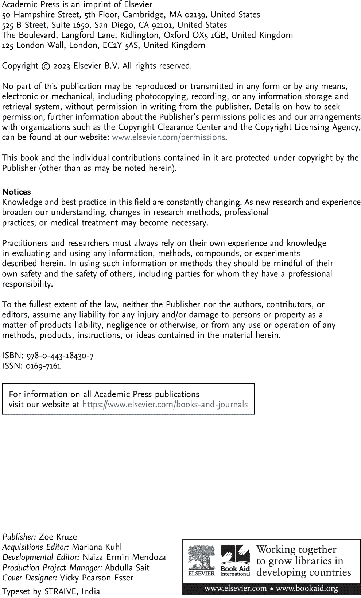

## 贡献者

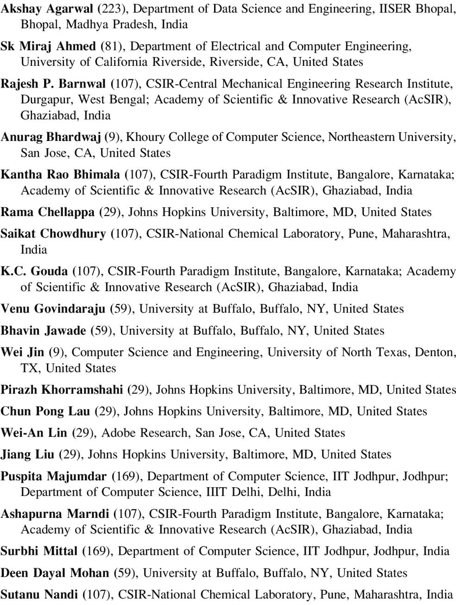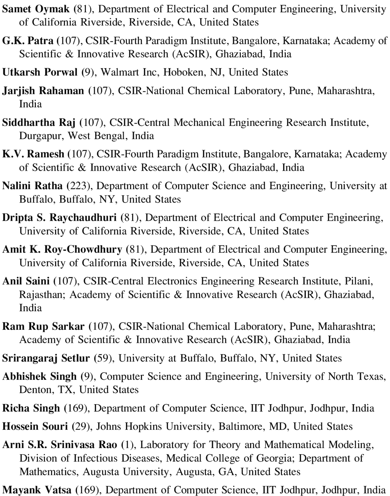

## 前言

在过去十年中，深度学习的理论与应用都取得了迅猛的发展。统计学家、数学家、计算机科学家以及其他工程和基础科学领域的研究者们聚集在一起，共同设计深度学习理论和实验。精心规划的深度学习实验的一个优势是降低预测的不确定性，提升为特定任务设计的机器的性能。通过本《统计手册》中关于“深度学习”的章节，我们旨在展示深度学习领域取得的进展的更具现实性的潜力。我们通过富有教学性的章节，提供了涵盖广泛研究主题的精彩集合。


Cover image

Title page

Copyright

Contributors

Preface


这本章节集合将作为严肃研究生的起点，也将作为资深研究人员的摘要。内容涵盖深度学习模型的基础、物体检测的概率，以及涉及贝叶斯、主成分分析、回归等统计技术的深度学习模型。我们竭尽全力包括可实际实现的内容，如人脸识别分析、数据中引入的偏见、气候模型、工业应用、医疗环境，以及在不同环境中高级应用所面临的开放挑战和基层困难。

本卷的章节分为以下三个部分：

*   第一部分：基础
*   第二部分：高级方法
*   第三部分：变革性应用

在第一部分中，第 1 章 由 A.S.R.S. Rao 作者介绍了新型的精确深度学习机器，并提出了以概率 1 检测物体的概念。这些机器被认为是 1950 年代中期最初提出的 AI 模型的最佳可能替代方案。第 2 章 由 A. Singh、U. Porwal、A. Bhardwaj 和 W. Jin 作者提供了语境嵌入及相关研究的详细介绍和综述。章节还描述了使用主成分分析进行维度减少，并保留原始数据的信息。在此，最新的语境嵌入新进展也有所详细说明。第 3 章 由 C.P. Lau、J. Liu、W.-A. Lin、H. Souri、P. Khorramshahi 和 R. Chellappa 作者提供了深度学习原理在对抗攻击中的详细基础和训练，以及其在广泛应用方面的概述。章节提供了在对抗攻击中应适应的防御机制的 excellent overview。

第二部分包含两章关于高级深度学习方法的内容。第 4 章 由 D.D. Mohan、B. Jawade、S. Setlur 和 V. Govindaraju 作者介绍了高级统计方法，并提供了对深度指标、嵌入空间及其在计算机视觉研究中实用性的极其清晰的洞察。章节详细讨论了计算机视觉研究中的实验设计和采样策略。章节中描述的当前最先进的深度度量学习方法为研究人员提供了培训材料。第 5 章 由 A.K. Roy-Chowdhury、S.M. Ahmed、D.S. Raychaudhuri 和 S. Oymak 作者结合了计算机视觉和图像处理中的无监督域自适应方法。章节介绍了将信息转移到目标域的算法，以及单一源模型与多源模型的比较。作者自有的算法用于有效聚合非均匀类型的源数据的源模型。

第三部分包含三章，描述了深度学习方法在各种真实场景中的实际应用。第 6 章 由 G.K. Patra、K.R. Bhimala、A. Marndi、S. Chowdhury、J. Rahaman、S. Nandi、R.R. Sarkar、K.C. Gouda、K.V. Ramesh、R.P. Barnwal、S. Raj 和 A. Saini 作者提供了在印度科学与工业研究委员会（CSIR）不同中心成功实施的多个创新项目的详细账目。这些项目包括气候预测建模、肿瘤诊断、可再生能源预测、COVID-19 等。这些实验的方法和设计可作为其他类似实验的培训模块。

第 7 章 由 S. Mittal、P. Majumdar、M. Vatsa 和 R. Singh 作者总结了人脸识别分析的最新进展、数据限制以及相关的统计偏差。章节描述了当前方法的局限性以及克服因数据不足而引入的偏差的可实现新方法。章节以人脸分析研究的全球开放挑战和构建块结束。

第 8 章 由 N. Ratha 和 A. Agarwal 作者讨论了保护身份盗窃 *via* 面部变形和深度伪造的最新进展及高度可实现的方法。章节概述了变形和深度伪造的基本技术及其优缺点。章节回顾了保护身份盗窃的算法、用于检测此类操纵的防御算法等。章节以与这些研究相关的高度有趣的开放挑战结束。

我们衷心感谢 Mariana Kühl Leme，Elsevier 和 North-Holland 收购编辑，她在整个准备过程中提供了行政支持。她在项目中的宝贵参与备受 appreciated。我们感谢 Ms. Naiza Ermin Mendoza，Elsevier 发展编辑，她为编辑们提供了极好的帮助，并在准备过程中与作者就各种技术问题进行沟通。她的服务一直到校样阶段和生产阶段都持续。我们还感谢 Sudharshini Renganathan，RELX India Private Limited（印度钱德拉巴德）的书籍制作项目经理，她负责主导生产、在多轮作者查询中作出回应、随时提供打印活动支持，并协助编辑们。我们衷心感谢所有为本卷撰写出色章节的作者。我们也非常感谢审稿人及时评估章节。

我们相信，这本关于深度学习的卷在时机上非常合适，我们非常满意能参与其生产。我们确信，这一系列将成为统计科学新研究人员以及统计、数学、计算机科学及其他学科的高级科学家的有价值资源。

Venu Govindaraju

Arni S.R. Srinivasa Rao

C.R. Rao
| --- | --- | --- | --- | --- |

| ARD (Goldblum et al., 2019) || Robust || Robust || Offline || × |

| ACT (Arani et al., 2020) || Natural || Robust || Online || × |

| MAT (Liu et al., 2021a) || Robust || Robust || Online || ✓ |

“Robust” means the model is trained with adversarial examples and “Natural” means the model is trained with natural examples.

Liu et al. (2021a) proposed MAT that allows models to share their knowledge of adversarial robustness and teach each other to be more robust. Unlike previous KD-based defenses, MAT trains a group of robust models simultaneously, and each network not only learns from ground-truth labels as in standard AT, but also the soft labels from peer networks that encode peers’ knowledge for defending adversarial attacks to achieve stronger robustness. The architecture of MAT is shown in Fig. 5.

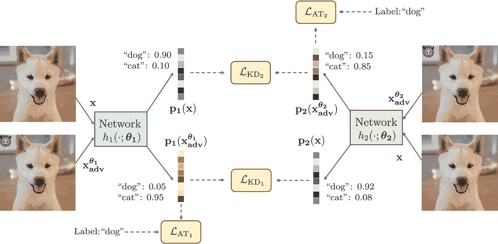


Fig. 5 Mutual adversarial training (MAT) architecture. `x` is a clean image, `x`[`adv`]^(**θ**[`1`])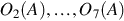 is the adversarial image of network *h*[1], and `x`[`adv`]^(***θ***[`2`]) is the adversarial image of network *h*[2].

MAT improves model robustness through many avenues. First, MAT inherits the benefits of KD, such as improved generalization (Furlanello et al., 2018) and reduced robust overfitting (Chen et al., 2021b). Second, *MAT creates a positive feedback loop of increasing model robustness*. Each network serves as a robust teacher to provide semantic-aware and discriminative soft labels to its peers. By learning from strong peers, the network becomes more robust, which in turn improves the robustness of its peers. Moreover, *MAT allows robust models to explore a larger space of adversarial samples and find more robust feature spaces and decision boundaries jointly*. The adversarial examples of each model form a subspace of adversarial inputs (Tramèr et al., 2017), and the predictions of each model encode information about its decision boundary and adversarial subspace. In MAT, each model learns from its own adversarial examples and receives information about peers’ adversarial examples through the soft labels. In this way, each model needs to consider a larger space of adversarial samples and find a feature space and decision boundary that not only work well on its own adversarial examples but also on peers’ adversarial examples, which encourages solutions that are more robust and generalizable.

In addition, MAT improves model robustness to multiple perturbations. Given *M* (*M* ≥ 2) different perturbation types, since it is difficult for a single model to be robust to all perturbations, MAT trains an ensemble of *M* + 1 networks including one generalist network `h[0]`(`⋅`;**θ**[`0`]) and *M* specialist networks `h[1]`(`⋅`;**θ**[`1`]), `h[2]`(`⋅`;**θ**[`2`]), ⋯, `h*M*`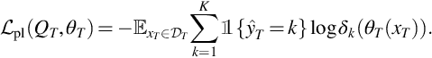. Each specialist network is responsible for learning to defend against a specific perturbation, while the generalist network `h[0]` learns to defend against all perturbations with the help of specialist networks. Previous methods Tramèr and Boneh (2019) and Maini et al. (2020) attempt to improve model robustness against multiple perturbations by augmenting the training data. Tramèr and Boneh (2019) train a model with adversarial examples of multiple perturbation types, and Maini et al. (2020) train a model using adversarial examples generated by multi steepest descent (MSD) that incorporates multiple perturbation models into a single attack. MAT takes a different approach by transferring the robustness of specialist models to a single generalist model, which complements previous methods and achieves better performance.

## 5: Defenses for object detector

Object detection is an important computer vision task that plays a key role in many security-critical systems including autonomous driving, security surveillance, identity verification, and robot manufacturing (Vahab et al., 2019). Adversarial patch attacks, where the attacker distorts pixels within a region of bounded size, pose a serious threat to real-world object detection systems since they are easy to physically implement. For example, physical adversarial patches can make a stop sign (Song et al., 2018) or a person (Thys et al., 2019) disappear from object detectors, which could cause serious consequences in security-critical settings such as autonomous driving.

Despite the abundance (Chen et al., 2018; Lang et al., 2021; Lee and Kolter, 2019; Li et al., 2018; Liu et al., 2018; Sharif et al., 2016; Song et al., 2018; Thys et al., 2019; Wang et al., 2021; Wu et al., 2020; Zhao et al., 2020) of adversarial patch attacks on object detectors, defenses against such attacks have not been extensively studied. Most existing defenses for patch attacks are restricted to image classification (Gittings et al., 2020; [Hayes, 2018](#Ch003_29-58_S01697161230
<unk><unk><unk><unk><unk><unk><unk><unk><unk><unk><unk><unk><unk><unk><unk><unk><unk><unk><unk><unk><unk><unk><unk><unk><unk><unk>


SAC (刘等，2021b)是一种通用的防御方法，可在不重新训练目标检测器的情况下，增强任何目标检测器对补丁攻击的鲁棒性。SAC 采用“检测并删除”策略：它检测出对抗性补丁并从输入图像中删除相关区域，然后将掩码图像输入目标检测器。这一策略基于以下观察：虽然对抗性补丁是局部化的，但它们不仅会影响局部区域，还会影响图像中较远的目标，因为目标检测算法利用空间上下文进行推理（Saha 等，2020）。这种效应在深度学习模型中尤其显著，因为小范围的对抗性补丁会因神经元的大受体场而对大范围的特征图产生显著干扰。通过从图像中移除检测到的补丁，SAC 将对抗性补丁在局部和全局层面的负面影响最小化。

SAC 的核心是可靠地检测对抗性补丁。SAC 首先训练一个补丁分割器，用于从输入中分割出对抗性补丁并生成初始补丁掩码。它采用自对抗训练算法增强补丁分割器的鲁棒性，该算法高效且与目标检测器无关。由于攻击者可能在自适应攻击下对分割器进行攻击并扰乱其输出，SAC 进一步利用一种鲁棒的形状完成算法，该算法利用补丁形状先验，确保对抗性补丁的可靠检测。形状完成算法接收初始补丁掩码，生成“完成补丁掩码”，只要初始掩码在一定的汉明距离范围内，该完成掩码即可**保证**覆盖整个对抗性补丁。

SAC 的整体流程如 Fig. 6 所示。

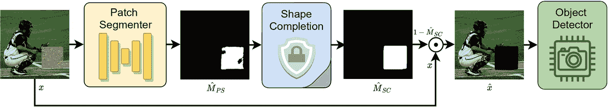

Fig. 6 Pipeline of the SAC approach. SAC detects and removes adversarial patches on pixel level through patch segmentation and shape completion, and feeds the masked images into the base object detector for prediction.

SAC 在适应性攻击下的防御性能如 Table 5 所示。SAC 在不同补丁尺寸上对两个数据集均表现出极强的鲁棒性，且其 mAP 高于所有基线方法。此外，SAC 在未防御模式下也保持了较高的清洁性能。Figs. 7 和 8 分别展示了防御前后的目标检测结果示例。对抗性补丁会产生伪检测并隐藏真实目标，而 SAC 通过掩蔽对抗性补丁恢复了模型的预测。

Table 5

mAP (%) under adaptive attack with different patch sizes.

| Dataset || Method || Clean || 75 × 75 || 100 × 100 || 125 × 125 |

| --- | --- | --- | --- | --- | --- |

| COCO || Undefended || **49.0** || 19.8±1.0 || 14.4±0.6 || 9.9±0.5 |

| --- | --- | --- | --- | --- | --- |

|  || AT (Madry et al., 2017) || 40.2 || 23.5±0.7 || 18.6±0.8 || 13.9±0.3 |

|  || JPEG (Dziugaite et al., 2016) || 45.6 || 22.8±0.9 || 18.0±0.8 || 13.4±0.7 |

|  || Spatial smoothing (Xu et al., 2017) || 46.0 || 23.2±0.7 || 17.5±1.0 || 13.5±0.6 |

|  || LGS (Naseer et al., 2019) || 42.7 || 20.8±0.7 || 15.9±0.5 || 12.2±0.9 |

|  || APM (Chiang et al., 2021) || 47.6 || 19.4±0.4 || 14.7±0.4 || 10.8±0.4 |

|  || SAC (**Ours**) || **49.0** || **43.6** ±**0.9** || **44.0** ±**0.3** || **39.2** ±**0.7** |

| Dataset || Method || Clean || 50×50 || 75×75 || 100×100 |

| xView || Undefended || **27.2** || 8.4±1.6 || 7.1±0.4 || 5.3± 1.1 |

|  || AT (Madry et al., 2017) || 22.2 || 12.1±0.4 || 8.6±0.1 || 7.2±0.7 |

|  || JPEG (Dziugaite et al., 2016) || 23.3 || 11.2±0.3 || 9.5±1.0 || 8.3±0.3 |

|  || Spatial smoothing (Xu et al., 2017) || 21.8 || 11.0±0.7 || 7.9±0.6 || 6.5±0.2 |

|  || LGS (Naseer et al., 2019) || 19.1 || 8.2±0.8 || 6.5±0.4 || 5.4±0.5 |

|  || APM (Chiang et al., 2021) || 27.1 || 20.5±0.3 || 20.2±1.4 || 18.9±0.9 |

|  || SAC (**Ours**) || **27.2** || **25.3** ±**0.3** || **23.6** ±**1.2** || **23.2** ±**0.3** |

表格中每列的最佳性能以**粗体**标出。


Fig. 7 Visualization of object detection results from COCO dataset. Adversarial patches create spurious detections, and make the detector ignore the ground-truth objects. SAC masks out the patch and restores model predictions. (A) Ground-truth on clean image. (B) Predictions on clean image. (C) Predictions on adversarial images with a 100 × 100 patch. (D) Predictions on SAC masked images.


Fig. 8 Visualization of object detection results from xView dataset. Adversarial patches create spurious detections, and make the detector ignore the ground-truth objects. SAC masks out the patch and restores model predictions. (A) Ground-truth on clean image. (B) Predictions on clean image. (C) Predictions on adversarial images with a 100 × 100 patch. (D) Predictions on SAC masked images.

## 6: Reverse engineering of deceptions via residual learning

几乎所有前文所述的防御方法都通过对抗训练或通过判断示例是否为对抗性（对抗性检测）来防御深度学习模型免受对抗攻击。然而，我们希望不仅能检测对抗性示例，还能识别产生这些示例的对抗算法。这对于任何安全关键系统都极为有用，因为它可以根据对手使用的对抗算法选择最有效的防御措施。


A straightforward method for detecting adversarial algorithms would be to train a classifier on a large dataset containing different adversarial examples labeled with the corresponding adversarial algorithm. In contrast, the authors of `Souri et al. (2021)` emphasize that a more nuanced approach is to search for the signature of each adversarial algorithm within the adversarial perturbation itself. Therefore, they suggest training a classifier on a dataset including multiple adversarial perturbations, named residuals, labeled with the associated adversarial algorithm. In order to determine if adversarial attack algorithms can be distinguished based on their perturbations as opposed to adversarial examples alone, the aforementioned two approaches were evaluated in `Souri et al. (2021)`.

The confusion matrices of attack classifiers from each of the two approaches are depicted in `Fig. 9A and B` `Fig. 9A` demonstrates that the network trained solely on adversarial examples cannot classify adversarial images with a high accuracy. `Fig. 9B` demonstrates, on the other hand, the superior performance of the classifier when perturbations are concatenated with their corresponding adversarial examples.


Fig. 9 (A) Confusion matrix of a ResNet18 network trained on adversarial images for attack algorithm classification. (B) Confusion matrix of another ResNet18 network trained on the concatenation of adversarial images with their corresponding perturbations for the same task. For both experiments, adversarial examples are crafted using CIFAR-10 dataset (`Krizhevsky, 2012`) `Krizhevsky, 2012`. The average accuracy of the first experiment is 57.55*%*, whereas that of the second experiment is 94.23*%* (`Souri et al., 2021`) `Souri et al., 2021`.

### 6.1: Adversarial perturbation estimation

To properly recognize the attack algorithm, it is necessary to recover the adversarial perturbations from adversarial samples. Nonetheless, as seen in `Fig. 1` `Fig. 1`, adversarial perturbations are extremely sparse and imperceptible. REDRL presents an end-to-end framework for estimating adversarial perturbations, detecting and properly classifying adversarial attack algorithms. `Fig. 10` `Fig. 10` illustrates the REDRL pipeline, which consists of four major components: *image reconstruction*, *image classification*, *feature reconstruction*, and *residual recognition*. To train REDRL, the adversarial image *I*[*adv*] = *I*[*c*] + *δ* is fed to the network, where *I*[*c*] and *δ* are, respectively, the clean image and adversarial perturbation. REDRL attempts to recover the clean image *I*[*c*] from the adversarial input *I*[*adv*]. Therefore, it is trained to generate an output image *I*[*g*] to be as close as possible to the clean image. In order to achieve this, REDRL introduces the following loss functions


Fig. 10 REDRL pipeline. The network *G* reconstructs *I*[*adv*] and generates *I*[*g*]. Throughout REDL training, the Ψ classification network will be trained to accurately classify the attack type using concatenation of residual image *I*[*r*] with its respective *I*[*adv*] as its input.

#### 6.1.1: Image reconstruction

In order to generate *I*[*g*] as close as possible to *I*[*c*] in pixel space, REDRL utilizes the *L*[1] distance similar to Pix2Pix (`Isola et al. (2017)`) `Isola et al. (2017)` (10)

where 𝔼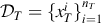 is the expectation operator.

#### 6.1.2: Feature reconstruction

In addition to the preceding loss, it is essential to generate *I*[*g*] with a similar features to *I*[*c*]. Inspired by the work of `Naseer et al. (2020)` `Naseer et al. (2020)` as a feature extractor and tries to minimize the *L*[2] distance between the *I*[*g*] and *I*[*c*] features using the following loss function:

$\\begin{array}{r} {\\mathcal{L}\_{F}(G) = \\underset{I\_{c},\\delta}{\\mathbb{E}}\\left\\lbrack {|\\mathcal{F}(I\_{c}) - \\mathcal{F}(G(I\_{c} + \\delta))|}\_{2} \\right\\rbrack} \\\\ \\end{array}$

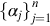  (11)

#### 6.1.3: Image classification

REDRL further guarantees that its reconstructions have no effect on the image classifier *Phi*’s output. As a result, when feeding *I*[*g*] and *I*[*c*] to the image classifier *Phi*, they must have identical classification scores. Following the KD (`Chen et al. (2019)`) `Chen et al. (2019)` (12)

where, *i*, Φ[*i*], and *C* are the argmax Φ(*I*[*c*]), *i*^(*th*) logit in the output of Φ, and the total number of image classes, respectively. During REDRL training, it is critical to keep the parameters of Φ frozen.

#### 6.1.4: Residual recognition

The final component of the loss function is the attack classification cross-entropy loss:

$\\begin{array}{r} {\\mathcal{L}\_{AC}(G) = \\underset{I\_{c},\\delta}{\\mathbb{E}}\\left\\lbrack {- \\log\\left( \\frac{e^{\\Psi\_{i}(I\_{r},I\_{c} + \\delta)}}{\\sum\\limits\_{j = 1}^{A}e^{\\Psi\_{j}(I\_{r},I\_{c} + \\delta)}} \\right)} \\right\\rbrack} \\\\ \\end{array}$

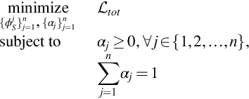  (13)

where *A*, *i*, and Ψ[*j*] are the total number of considered attack types plus one (for clean data), the true class label corresponding to *I*[*r*], and *j*^(*th*) logit of Ψ(*I*[*r*], *I*[*a*]*dv*), respectively.

#### 6.1.5: End-to-end training

Overall, the REDRL end-to-end training optimization objective can be calculated as follows:


$\\begin{array}{r} {\\mathcal{L}\_{total} = \\min\\limits\_{G}\\left\\lbrack {\\mathcal{L}\_{AC}(G) + \\lambda_1\\mathcal{L}\_{R}(G) + \\lambda_2\\mathcal{L}\_{F}(G) + \\lambda_3\\mathcal{L}\_{IC}(G)} \\right\\rbrack} \\\\ \\end{array}$
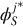  (14)

where `λ[1]`, `λ[2]`, and `λ[3]` are hyperparameters which should be empirically determined.

### 6.2: Experimental evaluation

Table 6 shows the results of the REDRL evaluation. In this experiment, REDRL is trained on a synthesized dataset that includes adversarial examples created with five different adversarial algorithms and also clean images using ResNet50, ResNext50, DenseNet121, and VGG19 architectures on both the CIFAR-10 and Tiny ImageNet (Wu et al., 2017) datasets. These evaluation results demonstrate that REDRL can effectively classify the attack types. Furthermore, REDRL outperforms attack recognition based on merely adversarial images by 63% and 43%, respectively, demonstrating the power of residuals in the estimation of sparse perturbations.

Table 6

Performance comparison (%) of attack algorithm type recognition based on adversarial images *I*[*adv*], concatenation of ground-truth adversarial perturbations *δ* with *I*[*adv*], and concatenation of estimated residuals *I*[*r*] with *I*[*adv*], *i.e.*, REDRL.

| Class  || Dataset |

| --- | --- |

| CIFAR-10 || Tiny ImageNet |

| Input to Ψ || Input to Ψ |

| *I*[*adv*] || *δ*, *I*[*adv*] || *I*[*r*], *I*[*adv*] || *I*[*adv*] || *δ*, *I*[*adv*] || *I*[*r*], *I*[*adv*] |

| Clean || 12.0 || 100 || 100 || 62.5 || 99.9 || 99.7 |

| --- | --- | --- | --- | --- | --- | --- |

| PGD || 73.5 || 99.9 || 99.9 || 88.7 || 99.7 || 99.9 |

| DeepFool || 56.2 || 99.9 || 97.4 || 53.2 || 64.0 || 75.3 |

| CW*L*[2] || 73.4 || 98.6 || 96.6 || 28.0 || 96.4 || 66.3 |

| CW*L*[*∞*] || 33.4 || 71.6 || 74.1 || 24.2 || 92.7 || 57.7 |

| Patch || 58.4 || 99.9 || 99.9 || 73.8 || 99.9 || 99.6 |

| Total || 57.5 || 94.2 || 94.2 || 59.4 || 95.7 || 85.5 |

## Acknowledgments

This work was supported by the DARPA GARD Program under the contract HR001119S0026-GARD-FP-052.

## References

*   Abdal R., Qin Y., Wonka P.  Image2StyleGAN: how to embed images into the StyleGAN latent space?. In: 2019:. *The IEEE International Conference on Computer Vision (ICCV), October.*.
*   Arani E., Sarfraz F., Zonooz B.  Adversarial concurrent training: optimizing robustness and accuracy trade-off of deep neural networks. *arXiv preprint:2008.07015.* 2020.
*   Brown T.B., Mané D., Roy A., Abadi M., Gilmer J.  Adversarial patch. *arXiv preprint:1712.09665.* 2017.
*   Carlini N., Wagner D.  Defensive distillation is not robust to adversarial examples. *arXiv preprint:1607.04311.* 2016.
*   Carlini N., Wagner D.  Towards evaluating the robustness of neural networks. In: 2017:39–57. *2017 IEEE Symposium on Security and Privacy (SP).*.
*   Chen L.-C., Papandreou G., Kokkinos I., Murphy K., Yuille A.L.  Deeplab: semantic image segmentation with deep convolutional nets, atrous convolution, and fully connected crfs. *IEEE Trans. Pattern Anal. Mach. Intell.* 2017;40(4):834–848.
*   Chen L.-C., Papandreou G., Schroff F., Adam H.  Rethinking atrous convolution for semantic image segmentation. *arXiv preprint:1706.05587.* 2017.
*   Chen S.-T., Cornelius C., Martin J., Chau D.H.P.  Shapeshifter: robust physical adversarial attack on faster R-CNN object detector. In: 2018:52–68. *Joint European Conference on Machine Learning and Knowledge Discovery in Databases.*.
*   Chen H., Wang Y., Xu C., Yang Z., Liu C., Shi B., Xu C., Xu C., Tian Q.  Data-free learning of student networks. In: 2019:. *Proceedings of the IEEE/CVF International Conference on Computer Vision (ICCV), October.*.
*   Chen P.-C., Kung B.-H., Chen J.-C.  Class-aware robust adversarial training for object detection. *arXiv preprint:2103.16148.* 2021.
*   Chen T., Zhang Z., Liu S., Chang S., Wang Z.  Robust overfitting may be mitigated by properly learned smoothening. In: 2021:. *International Conference on Learning Representations.* [`openreview.net/forum?id=qZzy5urZw9`](https://openreview.net/forum?id=qZzy5urZw9).
*   Cheng G., Han J., Lu X.  Remote sensing image scene classification: benchmark and state of the art. *Proc. IEEE.* 2017;105(10):1865–1883.
*   Chiang P.-y., Curry M.J., Abdelkader A., Kumar A., Dickerson J., Goldstein T.  Detection as regression: certified object detection by median smoothing. *arXiv preprint:2007.03730.* 2020.
*   Chiang P.-H., Chan C.-S., Wu S.-H.  Adversarial pixel masking: a defense against physical attacks for pre-trained object detectors. In: New York, NY: Association for Computing Machinery; 2021:1856–1865. *Proceedings of the 29th ACM International Conference on Multimedia.*
*   Cho K., Van Merriënboer B., Gulcehre C., Bahdanau D., Bougares F., Schwenk H., Bengio Y.  Learning phrase representations using rnn encoder-decoder for statistical machine translation. *arXiv preprint:1406.1078.* 2014.
*   Deng J., Guo J., Xue N., Zafeiriou S.  Arcface: additive angular margin loss for deep face recognition. In: 2019:4690–4699. *Proceedings of the IEEE/CVF conference on computer vision and pattern recognition.*
*   Dong Y., Liao F., Pang T., Su H., Zhu J., Hu X., Li J.  Boosting adversarial attacks with momentum. In: 2018:9185–9193. *Proceedings of the IEEE Conference on Computer Vision and Pattern Recognition.*
*   Dziugaite G.K., Ghahramani Z., Roy D.M.  A study of the effect of JPG compression on adversarial images. *arXiv preprint:1608.00853.* 2016.
*   Engstrom L., Ilyas A., Santurkar S., Tsipras D. * Robustness (python library).* 2019. [`github.com/MadryLab/robustness`](https://github.com/MadryLab/robustness).
*   Fournier A., Fussell D., Carpenter L.  Computer rendering of stochastic models. *Commun. ACM.* 1982;25(6):371–384.
*   Furlanello T., Lipton Z., Tschannen M., Itti L., Anandkumar A.  Born again neural networks. In: 2018:1607–1616. *International Conference on Machine Learning.*
*   Girshick R., Donahue J., Darrell T., Malik J.  Rich feature hierarchies for accurate object detection and semantic segmentation. In: 2014:580–587. *Proceedings of the IEEE Conference on Computer Vision and Pattern Recognition.*
*   Gittings T., Schneider S., Collomosse J.  Vax-a-net: training-time defence against adversarial patch attacks. In: 2020:. *Proceedings of the Asian Conference on Computer Vision.*
*   Goldblum M., Fowl L., Feizi S., Goldstein T.  Adversarially robust distillation. *arXiv preprint:1905.09747.* 2019.


*   Goodfellow I.J., Shlens J., Szegedy C. `Explaining and harnessing adversarial examples`. `arXiv preprint:1412.6572`. 2014.
*   Graves A., Jaitly N. `Towards end-to-end speech recognition with recurrent neural networks`. In: 2014:1764–1772. `International Conference on Machine Learning.`.
*   Guo Q., Wang X., Wu Y., Yu Z., Liang D., Hu X., Luo P. `Online knowledge distillation via collaborative learning`. In: 2020:11020–11029. `Proceedings of the IEEE Conference on Computer Vision and Pattern Recognition.`.
*   Hayes J. `On visible adversarial perturbations and digital watermarking`. In: 2018:1597–1604. `Proceedings of the IEEE Conference on Computer Vision and Pattern Recognition Workshops.`.
*   He K., Zhang X., Ren S., Sun J. `Deep residual learning for image recognition`. In: 2016:770–778. `Proceedings of the IEEE Conference on Computer Vision and Pattern Recognition.`.
*   Hinton G., Vinyals O., Dean J. `Distilling the knowledge in a neural network`. `arXiv preprint:1503.02531`. 2015.
*   Isola P., Zhu J., Zhou T., Efros A.A. `Image-to-image translation with conditional adversarial networks`. In: 2017:5967–5976. `2017 IEEE Conference on Computer Vision and Pattern Recognition (CVPR).`.
*   Ji N., Feng Y., Xie H., Xiang X., Liu N. `Adversarial YOLO: defense human detection patch attacks via detecting adversarial patches`. `arXiv preprint:2103.08860`. 2021.
*   Kang D., Sun Y., Hendrycks D., Brown T., Steinhardt J. `Testing robustness against unforeseen adversaries`. `arXiv preprint:1908.08016`. 2019.
*   Kang D., Sun Y., Hendrycks D., Brown T., Steinhardt J. `Testing robustness against unforeseen adversaries`. `arXiv preprint:1908.08016`. 2019.
*   Kannan H., Kurakin A., Goodfellow I.J. `Adversarial logit pairing`. `ArXiv`. 2018;abs/1803.06373.
*   Karmon D., Zoran D., Goldberg Y. `Lavan: localized and visible adversarial noise`. In: 2018:2507–2515. `International Conference on Machine Learning.`.
*   Karras T., Laine S., Aila T. `A style-based generator architecture for generative adversarial networks`. In: 2019:. `The IEEE Conference on Computer Vision and Pattern Recognition (CVPR), June.`.
*   Krizhevsky A. `Learning Multiple Layers of Features from Tiny Images.` University of Toronto; 2012 (May).
*   Krizhevsky A., Sutskever I., Hinton G.E. `ImageNet classification with deep convolutional neural networks`. In: 2012:1097–1105. `Advances in Neural Information Processing Systems.`.
*   Lang D., Chen D., Shi R., He Y. `Attention-guided digital adversarial patches on visual detection`. `Security and Communication Networks.` 2021;2021.
*   Ledig C., Theis L., Huszár F., Caballero J., Cunningham A., Acosta A., Aitken A., Tejani A., Totz J., Wang Z., et al. `Photo-realistic single image super-resolution using a generative adversarial network`. In: 2017:4681–4690. `Proceedings of the IEEE Conference on Computer Vision and Pattern Recognition.`.
*   Lee M., Kolter Z. `On physical adversarial patches for object detection`. `arXiv preprint:1906.11897`. 2019.
*   Levine A., Feizi S. `(De) randomized smoothing for certifiable defense against patch attacks`. `arXiv preprint:2002.10733`. 2020.
*   Li Y., Bian X., Chang M.-C., Lyu S. `Exploring the vulnerability of single shot module in object detectors via imperceptible background patches`. `arXiv preprint:1809.05966`. 2018.
*   Lin W.-A., Lau C.P., Levine A., Chellappa R., Feizi S. `Dual manifold adversarial robustness: defense against Lp and non-Lp adversarial attacks`. In: 2020:. `Advances in Neural Information Processing Systems.`.
*   Liu W., Anguelov D., Erhan D., Szegedy C., Reed S., Fu C.-Y., Berg A.C. `SSD: single shot multibox detector`. In: 2016:21–37. `European Conference on Computer Vision.`.
*   Liu X., Yang H., Liu Z., Song L., Li H., Chen Y. `DPatch: an adversarial patch attack on object detectors`. `arXiv preprint:1806.02299`. 2018.
*   Liu J., Lau C.P., Souri H., Feizi S., Chellappa R. `Mutual adversarial training: learning together is better than going alone`. `arXiv preprint:2112.05005`. 2021.
*   Liu J., Levine A., Lau C.P., Chellappa R., Feizi S. `Segment and complete: defending object detectors against adversarial patch attacks with robust patch detection`. `arXiv preprint:2112.04532`. 2021.
*   Madry A., Makelov A., Schmidt L., Tsipras D., Vladu A. `Towards deep learning models resistant to adversarial attacks`. `arXiv preprint:1706.06083`. 2017.
*   Maini P., Wong E., Kolter Z. `Adversarial robustness against the union of multiple perturbation models`. In: 2020:6640–6650. `International Conference on Machine Learning.`.
*   McCoyd M., Park W., Chen S., Shah N., Roggenkemper R., Hwang M., Liu J.X., Wagner D. `Minority reports defense: defending against adversarial patches`. In: Zhou J., Conti M., Ahmed C.M., Au M.H., Batina L., Li Z., et al., eds. `Applied Cryptography and Network Security Workshops.` Cham: Springer International Publishing; 2020:564–582.
*   Moosavi-Dezfooli S.-M., Fawzi A., Frossard P. `Deepfool: a simple and accurate method to fool deep neural networks`. In: 2016:2574–2582. `Proceedings of the IEEE conference on computer vision and pattern recognition.`.
*   Naseer M., Khan S., Porikli F. `Local gradients smoothing: defense against localized adversarial attacks`. In: 2019:1300–1307. `2019 IEEE Winter Conference on Applications of Computer Vision (WACV).`.
*   Naseer M., Khan S., Hayat M., Khan F.S., Porikli F. `A self-supervised approach for adversarial robustness`. In: 2020, June:. `IEEE/CVF Conference on Computer Vision and Pattern Recognition (CVPR).`.
*   Newell A., Yang K., Deng J. `Stacked hourglass networks for human pose estimation`. In: 2016:483–499. `European Conference on Computer Vision.`.
*   Papernot N., McDaniel P., Jha S., Fredrikson M., Celik Z.B., Swami A. `The limitations of deep learning in adversarial settings`. In: 2016:372–387. `2016 IEEE European Symposium on Security and Privacy (EuroS&P).`.
*   Papernot N., McDaniel P., Wu X., Jha S., Swami A. `Distillation as a defense to adversarial perturbations against deep neural networks`. In: 2016:582–597. `2016 IEEE Symposium on Security and Privacy (SP).`.


-   Ranjan R., Patel V.M., Chellappa R. Hyperface: a deep multi-task learning framework for face detection, landmark localization, pose estimation, and gender recognition. `IEEE Trans. Pattern Anal. Mach. Intell.` 2017;41(1):121–135.

-   Rao S., Stutz D., Schiele B. Adversarial training against location-optimized adversarial patches. `arXiv preprint:2005.02313`. 2020.

-   Redmon J., Farhadi A. YOLO9000: better, faster, stronger. In: 2017:7263–7271. `Proceedings of the IEEE Conference on Computer Vision and Pattern Recognition`.

-   Redmon J., Divvala S., Girshick R., Farhadi A. You only look once: unified, real-time object detection. In: 2016:779–788. `Proceedings of the IEEE Conference on Computer Vision and Pattern Recognition`.

-   Ren K., Zheng T., Qin Z., Liu X. Adversarial attacks and defenses in deep learning. `Engineering.` 2020;6(3):346–360.

-   Saha A., Subramanya A., Patil K., Pirsiavash H. Role of spatial context in adversarial robustness for object detection. In: 2020:784–785. `Proceedings of the IEEE/CVF Conference on Computer Vision and Pattern Recognition Workshops`.

-   Samangouei P., Kabkab M., Chellappa R. Defense-GAN: protecting classifiers against adversarial attacks using generative models. In: 2018:. `International Conference on Learning Representations`.

-   Sharif M., Bhagavatula S., Bauer L., Reiter M.K. Accessorize to a crime: real and stealthy attacks on state-of-the-art face recognition. In: 2016:. `CCS’16: Proceedings of the 2016 ACM SIGSAC Conference on Computer and Communications Security`.

-   Silver D., Huang A., Maddison C.J., Guez A., Sifre L., Van Den Driessche G., Schrittwieser J., Antonoglou I., Panneershelvam V., Lanctot M., et al. Mastering the game of go with deep neural networks and tree search. `Nature.` 2016;529(7587):484–489.

-   Simonyan K., Zisserman A. Two-stream convolutional networks for action recognition in videos. In: 2014:568–576. `Advances in Neural Information Processing Systems`.

-   Simonyan K., Zisserman A. Very deep convolutional networks for large-scale image recognition. `arXiv preprint:1409.1556`. 2014.

-   Song G., Chai W. Collaborative learning for deep neural networks. In: 2018:1832–1841. `Advances in Neural Information Processing Systems`.

-   Song D., Eykholt K., Evtimov I., Fernandes E., Li B., Rahmati A., Tramer F., Prakash A., Kohno T. Physical adversarial examples for object detectors. In: 2018:. `12th USENIX Workshop on Offensive Technologies (WOOT 18)`.

-   Souri H., Khorramshahi P., Lau C.P., Goldblum M., Chellappa R. Identification of attack-specific signatures in adversarial examples. `arXiv preprint:2110.06802`. 2021.

-   Szegedy C., Zaremba W., Sutskever I., Bruna J., Erhan D., Goodfellow I., Fergus R. Intriguing properties of neural networks. `arXiv preprint:1312.6199`. 2013.

-   Thys S., Van Ranst W., Goedemé T. Fooling automated surveillance cameras: adversarial patches to attack person detection. In: Los Alamitos, CA: IEEE Computer Society; 2019:49–55. `2019 IEEE/CVF Conference on Computer Vision and Pattern Recognition Workshops (CVPRW), June`. [`doi.ieeecomputersociety.org/10.1109/CVPRW.2019.00012`](https://doi.ieeecomputersociety.org/10.1109/CVPRW.2019.00012).

-   Toshev A., Szegedy C. Deeppose: human pose estimation via deep neural networks. In: 2014:1653–1660. `Proceedings of the IEEE Conference on Computer Vision and Pattern Recognition`.

-   Tramèr F., Boneh D. Adversarial training and robustness for multiple perturbations. In: 2019:5866–5876. `Advances in Neural Information Processing Systems`.

-   Tramèr F., Papernot N., Goodfellow I., Boneh D., McDaniel P. The space of transferable adversarial examples. `arXiv preprint:1704.03453`. 2017.

-   Tsipras D., Santurkar S., Engstrom L., Turner A., Madry A. Robustness may be at odds with accuracy. In: 2019:. `International Conference on Learning Representations`. [`openreview.net/forum?id=SyxAb30cY7`](https://openreview.net/forum?id=SyxAb30cY7).

-   Vahab A., Naik M.S., Raikar P.G., SR P. Applications of object detection system. `Int. Res. J. Eng. Technol. (IRJET).` 2019;6(4):4186–4192.

-   Vinyals O., Toshev A., Bengio S., Erhan D. Show and tell: a neural image caption generator. In: 2015:3156–3164. `Proceedings of the IEEE Conference on Computer Vision and Pattern Recognition`.

-   Voulodimos A., Doulamis N., Doulamis A., Protopapadakis E. Deep learning for computer vision: a brief review. `Comput. Intell. Neurosci.` 2018;2018.

-   Wang L., Yoon K.-J. Knowledge distillation and student-teacher learning for visual intelligence: a review and new outlooks. `arXiv preprint:2004.05937`. 2020.

-   Wang L., Ouyang W., Wang X., Lu H. Visual tracking with fully convolutional networks. In: 2015:3119–3127. `Proceedings of the IEEE International Conference on Computer Vision`.

-   Wang Y., Zou D., Yi J., Bailey J., Ma X., Gu Q. Improving adversarial robustness requires revisiting misclassified examples. In: 2019:. `International Conference on Learning Representations`. [`openreview.net/forum?id=rklOg6EFwS`](https://openreview.net/forum?id=rklOg6EFwS).

-   Wang Y., Lv H., Kuang X., Zhao G., Tan Y.-a., Zhang Q., Hu J. Towards a physical-world adversarial patch for blinding object detection models. `Inform. Sci.` 2021;556:459–471.

-   Wu T., Tong L., Vorobeychik Y. Defending against physically realizable attacks on image classification. `arXiv preprint:1909.09552`. 2019.

-   Wu Z., Lim S.-N., Davis L.S., Goldstein T. Making an invisibility cloak: real world adversarial attacks on object detectors. In: 2020:1–17. `European Conference on Computer Vision`.

-   Xiang C., Mittal P. DetectorGuard: provably securing object detectors against localized patch hiding attacks. `arXiv preprint:2102.02956`. 2021.

-   Xiang C., Bhagoji A.N., Sehwag V., Mittal P. PatchGuard: a provably robust defense against adversarial patches via small receptive fields and masking. In: 2021:. `30th USENIX Security Symposium (USENIX Security)`.

-   Xu W., Evans D., Qi Y. Feature squeezing: detecting adversarial examples in deep neural networks. `arXiv preprint:1704.01155`. 2017.

-   Xu H., Ma Y., Liu H., Deb D., Liu H., Tang J., Jain A.K. Adversarial attacks and defenses in images, graphs and text: a review. `arXiv:1909.08072`. 2019.


*   蒋\* P.-y., 牛\* R., 阿卜德·卡德 A., 朱 C., 斯图多 C., 古德温 T. 认证防御对抗性补丁。在: 2020:. *国际表示学习会议。*. [`openreview.net/forum?id=HyeaSkrYPH`](https://openreview.net/forum?id=HyeaSkrYPH).

*   张 H., 王 J. 面向对抗性强健的物体检测。在: 2019:421–430. *IEEE/CVF 计算机视觉国际会议论文集。*.

*   张 R., 以索 P., 埃弗斯 A.A., 施特曼 E., 王 O. 深度特征作为感知度量的不合理有效性。在: 2018:586–595. *IEEE 计算机视觉与模式识别会议论文集。*.

*   张 Y., 杨 T., 霍斯德莱斯 T.M., 卢 H. 深度互学习。在: 2018:4320–4328. *IEEE 计算机视觉与模式识别会议论文集。*.

*   张 H., 于 Y., 焦 J., 兴 E., 尤·哈吉 L., 乔丹 M. 理论上有原则的鲁棒性与准确性之间的权衡。在: 2019:7472–7482. *国际机器学习会议。*.

*   张 H., 于 Y., 焦 J., 兴 E.P., 尤·哈吉 L.E., 乔丹 M.I. 理论上有原则的鲁棒性与准确性之间的权衡。在: 2019:. *神经信息处理系统进展。*.

*   赵 H., 施 J., 杞 X., 王 X., 家 J. 金字塔场景解析网络。在: 2017:2881–2890. *IEEE 计算机视觉与模式识别会议论文集。*.

*   赵 Y., 闫 H., 韦 X. 对象隐藏:对抗性补丁攻击对象检测器。 *arXiv 预印:2010.14974.* 2020.

*   吴 et al., 2017 吴, J., 张, Q., 徐, G., 2017. Tiny ImageNet 挑战。

* * *

Section II 

高级方法

## 第 4 章: 深度度量学习用于计算机视觉: 简要概述

Deen Dayal Mohan; Bhavin Jawade; Srirangaraj Setlur; Venu Govindaraju∗    ^()美国纽约州布法罗大学  

^∗ 通讯作者: 电子邮件地址: govind@buffalo.edu

## 摘要

优化深度神经网络的客观函数在创建输入数据的增强特征表示方面发挥着重要作用。尽管基于交叉熵的损失公式在各种监督深度学习应用中被广泛使用，但当输入数据分布中存在大类内部差异和小类间差异时，这些方法往往不足。深度度量学习旨在通过学习将数据样本映射到代表性嵌入空间的表示函数来测量数据样本之间的相似性。它利用精心设计的采样策略和损失函数，即使在类间差异小、类内差异大的分布中，也能优化歧视性嵌入空间的生成。本章将提供该领域的最新进展概述，并讨论当前最先进的深度度量学习方法。

### 关键词

深度度量学习; 三元损失; 图像检索; 人脸验证; 人再识别

## 1: 入

度量学习领域目前是一个活跃的研究方向。传统上，度量学习被用作创建考虑数据点特定性质和分布的最优距离度量的方法（例如，Mahalanobis 距离）。随后，该方法发展为专注于创建针对特定距离度量（如欧氏距离或余弦距离）进行优化的数据表示。随着深度学习的出现，这些特征表示被通过复杂的非线性变换端到端学习。因此，深度度量学习的主要研究集中在设计用于训练深度神经网络的损失/客观函数上。

计算机视觉是广泛使用 DML 方法的一个关键领域。这是因为大多数计算机视觉应用都涉及同一类别数据样本的视觉特征存在巨大差异的情形。此外，不同类别的多个样本可能在视觉特征上存在很多相似性。

最近的卷积神经网络 (CNNs) 的进展有助于从图像中创建良好的特征表示。在受监督学习设置下使用 CNNs 作为特征提取器时，通常使用基于 Softmax 的客观函数。尽管这些损失公式在许多应用中表现良好，但在处理具有高类间差异和低类内差异的输入数据时，它们往往表现不佳。这些数据特性出现在许多实际应用中，如人脸识别 (Sankaran et al., 2019)、指纹识别 (Jawade et al., 2021, 2022), 图像检索 (Mohan et al., 2020), 人再识别 (Lee et al., 2022), 和跨模态检索 (Wei et al., 2020), (Jawade et al., 2023)。在这些场景下，基于 DML 的损失公式被用来创建高度可辨别的嵌入空间。这些嵌入空间的设计是为了使属于同一类别的样本聚集在一起，并与其他类别的簇在流形中很好地分开。

本章讨论文献中流行的 DML 公式。我们将只讨论那些在不同计算机视觉任务中找到应用的方法。我们根据 Fig. 1 的整体目标公式类型将不同的损失公式分为三类。第一类包括基于对的公式，它们基于数据集中样本之间的直接对间相互作用来制定整体目标。第二类是使用伪类代表（称为伪类）来制定最终优化的方法群。最后，我们还讨论了试图利用辅助信息以创建更优特征表示的正则化方法。

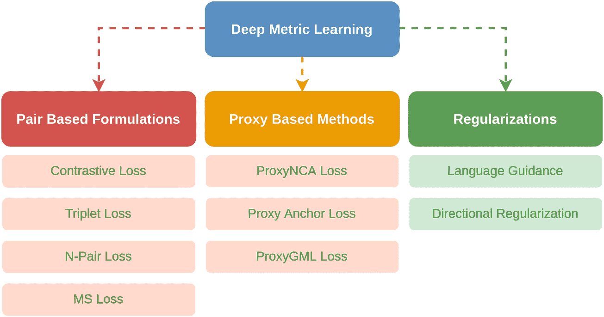

Fig. 1 一个描述各种深度度量学习损失类型的插图。


where `f`[`i`] ∈ `R`^(`d`) is also referred to as the feature representation of the image `x`[`i`]. 通常，标准 CNN 被用作特征提取器 `ϕ`，它生成这些特征表示。特征提取器 `ϕ` 的整体目标是将每个图像 `x`[`i`] 投影到高度可分离的嵌入空间，其中属于同一类别的特征嵌入相互靠近，并与其他类别的特征嵌入很好地分开，即：

$\\begin{array}{r} {D(f\_{i},f\_{j}) < D(f\_{i},f\_{k});\\forall i,j \\in y\_{l};\\forall k \\notin y\_{l}} \\\\ \\end{array}$

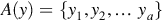  (2)

其中 `D` 是嵌入空间中定义良好的距离度量。`y`[`l`] 表示与图像关联的类标签。例如，如果考虑的距离度量是欧氏距离，则公式 (2) 可以改写为：

$\\begin{array}{r} {{\\parallel \\mathbf{f}\_{i} - \\mathbf{f}\_{j} \\parallel}^{2} < {\\parallel \\mathbf{f}\_{i} - \\mathbf{f}\_{k} \\parallel}^{2};\\forall i,j \\in y\_{l};\\forall k \\notin y\_{l}} \\\\ \\end{array}$

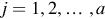  (3)

最近，许多特征提取器将最终特征表示的范数限制为单位范数。将特征表示的范数限制为单位范数会使嵌入流形成为 n 维单位高球面（如下图所示）。当特征表示位于单位高球面上时，角度分离被用作衡量特征表示相似性和不同性的指标。给定两个特征表示 `f`[`i`] 和 `f`[`j`]，可以计算两个表示之间的余弦相似度，即：

$\\begin{array}{r} {S = \\frac{f\_{i}^{T}f\_{j}}{||f\_{i}||.||f\_{j}||},i,j \\in n} \\\\ \\end{array}$

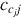  (4)

由于特征表示的幅度为 1，点积的相似值提供了两个特征向量之间的角度分离。`S` 的取值范围在 -1 到 1 之间，其中 1 表示特征表示之间的 0 度角度分离，-1 表示 180 度的分离。对于大数据集 `X`，目标 2 通常在每个小批批 `B` 中强制执行。整个章节我们将假设使用小批批方式优化深度神经网络。

## 3: Pair-based formulation

本节我们将探讨基于信息对的采样方法以实现更好的优化。我们将讨论几种在计算机视觉相关应用中广泛使用的方法，如人脸识别 (Sankaran et al., 2019)、指纹识别 (Jawade et al., 2021, 2022)、图像检索 (Mohan et al., 2020)、人再识别 (Lee et al., 2022) 和跨模态检索 (Jawade et al., 2023)。

### 3.1: Contrastive loss

如前面所述，标准度量学习损失公式的主要目标由公式 (2) 给出。实现这一点的一种方法是在训练深度神经网络时，在目标函数中强制执行相同的约束。给定两个特征表示，`f`[`i`] 和 `f`[`j`]，如果它们属于同一类，目标是减小两个表示之间的距离。如果样本属于不同类，则目标是增加特征表示之间的距离，这可以数学表达为：

$\\begin{matrix} {L\_{con} = \\begin{cases} {{\\parallel \\mathbf{f}\_{i} - \\mathbf{f}\_{j} \\parallel}^{2},\\quad} & {\\text{if}\\; y\_{i} = y\_{j}} \\\\ {{\\lbrack\\alpha - ({\\parallel \\mathbf{f}\_{i} - \\mathbf{f}\_{j} \\parallel}^{2})\\rbrack}\_{+},\\quad} & {\\text{else\\ if}\\; y\_{i} \\neq y\_{j}} \\\\ \\end{cases}} \\\\ \\end{matrix}$

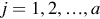

其中 `y`[`i`] 和 `y`[`j`] 是 `f`[`i`] 和 `f`[`j`] 所对应的类别。`α` 这里是边界值。我们将在下一节详细讨论 `α`。

### 3.2: Triplet loss

Triplet Loss 是 Schroff et al. (2015) 提出的对比损失公式的改进，是创建可分离嵌入空间的广泛使用的度量学习目标函数。考虑三个特征表示 `f`[`a`]、 `f`[`p`] 和 `f`[`n`]，对应于数据集中的三张图像。让 `f`[`a`] 和 `f`[`p`] 是属于同一类别的两张图像的特征表示，我们称它们为 *Anchor* 和 *Positive* 样本。让 `f`[`n`] 属于不同类别的样本称为 *Negative* 样本（Fig. 2）。Triplet loss 最小化 Anchor 和 Positive 之间的特征嵌入距离，同时最大化 Anchor 和 Negative 之间的距离。当使用欧氏距离时，三元组损失定义如下：

$\\begin{array}{r} {\\mathcal{L} = \\sum\\limits\_{a,p,n \\subset N}\\left\\lbrack {\\;{\\parallel \\mathbf{f}\_{a} - \\mathbf{f}\_{p} \\parallel}^{2} - {\\parallel \\mathbf{f}\_{a} - \\mathbf{f}\_{n} \\parallel}^{2} + \\alpha\\;} \\right\\rbrack\_{+}} \\\\ \\end{array}$

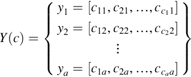  (5)


Fig. 2 Illustration of Triplet Loss. The Positive sample is attracted toward the Anchor, whereas the Negative sample is repelled from the anchor. Here and in all diagrams in this chapter, we represent an anchor with-in a *brown circle*. *Red arrow* is used to represent repulsion and *green arrow* is used to represent attraction.

术语 ***f***[`a`]、***f***[`p`]、***f***[`n`] 分别对应锚点、正样本和负样本的特征嵌入，其中 *a*、*p*、*n* 从训练数据集 *N* 中采样。`α` 定义了锚点-负样本距离与锚点-正样本距离之间的边界值。[.][+] 表示 *max*(., 0) 函数。

这种数学表达可以被视为对比损失公式的扩展，因为它明确强制 Anchor-Positive 相似性，同时驱逐 Negative。此外，还可以通过对损失 (Eq. 5) 关于这些特征表示的导数进行分析，从而获得吸引和排斥力作用方向的几何图像。为此，我们计算损失的导数如下：

$\\begin{matrix} \\frac{\\partial\\mathcal{L}}{\\partial\\mathbf{f}\_{a}} & {= 2(\\mathbf{f}\_{n} - \\mathbf{f}\_{p})} \\\\ \\frac{\\partial\\mathcal{L}}{\\partial\\mathbf{f}\_{p}} & {= 2(\\mathbf{f}\_{p} - \\mathbf{f}\_{a})} \\\\ \\frac{\\partial\\mathcal{L}}{\\partial\\mathbf{f}\_{n}} & {= 2(\\mathbf{f}\_{a} - \\mathbf{f}\_{n})} \\\\ \\end{matrix}$

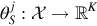  (6)


-   方程上文所定义的向量用于更新嵌入，如图 [Fig. 3 所示。如图所示，在梯度下降过程中，负样本受到 `f[*n*]` − `f[*a*]` 的力的作用，向远离 `f[*a*]` 的方向径向推动；而正样本则受到 `f[*a*]` − `f[*p*]` 的力向 `f[*a*]` 拉近。值得注意的是，即使锚点在径向方向上被负样本推开，正样本并未经历相同的径向向外的推力。这是因为三元组损失的表述并未显式强制锚点与负样本之间的径向分离。Triplet Loss 另一个重要的方面是边界 `α`。可以把 `α` 看作锚点‑正样本与锚点‑负样本距离之间需要达到的最小分离距离。若两对之间的距离超过 `α`，则损失项会归零。通常 `α` 被视为超参数，根据数据集、网络结构等因素进行选取。因此，为了构建高度可分离的嵌入空间，选择具有信息性的三元组样本至关重要。这里的“信息性三元组”指的是在数据集中，其内部距离违背边界 `α` 的三元组。寻找这类样本以获得更好的优化过程通常被称为样本采矿（sample mining）或采样。

在本例中，最直接的方法是使用当前网络模型对整个数据集的特征表示进行相似度计算，从而离线确定所有具有信息性的三元组。虽然这种方法概念简单，但随着数据集规模扩大，计算开销往往变得不可行。另一种常见做法是仅在小批本 `B` 中计算样本之间的相似度，只考虑小批本内部的特征，从而限制计算成本。

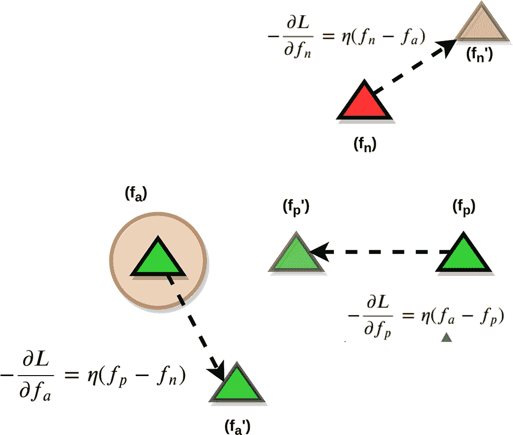

Fig. 3 示意图：在三元组损失下，锚点、正样本、负样本的梯度方向。

更近期，三元组损失常与单位范数特征一起使用。于是最终的损失公式采用余弦相似度而非欧氏距离，可写作：

$\\begin{array}{r} {\\mathcal{L} = \\left\\lbrack {f\\_{a}.f\\_{n} - f\\_{a}.f\\_{p} + \\alpha} \\right\\rbrack\_{+}} \\\\ \\end{array}$

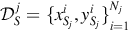  (7)

### 3.3: N‑pair loss

在分析 Triplet Loss 表述时可以注意到，一次更新只会选取一个属于任意负类的负样本。这样可能次优，因为更新仅把锚点与正样本与这一负样本的表示拉开，而我们希望锚点与正样本的表示能够同时与所有其它负类保持距离。虽然在大量 mini‑batch 与多个 epoch 之后，锚点与正样本可能最终与所有其它类别足够分离，但这并不保证。因此，基于 Triplet Loss 的方法往往收敛速度较慢。此外，正如前文所述，大量随机采样的三元组在训练后期往往并不具备信息性，因为需要采矿有信息性的对来提升优化效果。于是，出现了改进 Triplet Loss 以获得更好可分离特征空间的思考。

解决收敛慢问题的一个思路是将多个负样本纳入损失公式（Eq. 5）。若我们令特征表示集合 `F[*s*]` = {`f[*a*]^(*i*)`, `f[*p*]^(*i*)`, `f[*n*]¹`, `f[*n*]²`, … `f[*n*]^(*j*)`}，其中 `f[*a*]^(*i*)` 是属于类别 `i` 的样本，`f[*p*]^(*i*)` 是同类的正样本，`f[*n*]¹`、`f[*n*]²` … `f[*n*]^(*j*)` 分别为属于类别 1 到 `j`（不包括类别 `i`）的负样本，则 Eq. [5] 可改写为：

$\\begin{array}{r} {\\mathcal{L} = \\text{log}\\left\\lbrack {1 + \\sum\_{k = 1}^{j}(f\\_{a}^{i}.f\\_{n}^{k} - f\\_{a}^{i}.f\\_{p}^{i})} \\right\\rbrack} \\\\ \\end{array}$

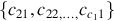  (8)

可以注意到，若只考虑单个负样本，则该损失项实际上退化为 Eq. 7 (Fig. 4)：

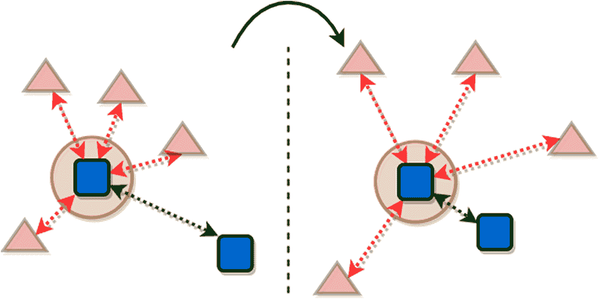

Fig. 4 N‑Pair loss 相比 Triplet loss 加入了更多的负样本。

虽然上述公式解决了收敛慢的问题，但计算效率极低。若数据集中类别总数为 `N`，每次更新需要构造大小为 (`N` + 1) 的特征集合。给定小批本大小 `B`，则需要 `B × (N + 1)` 个特征来进行一次梯度更新。更高效的做法是 Sohn (2016) 提出的，即更高效地构造小批本以降低计算成本。每个 mini‑batch 设计为包含每类两个样本，特征集合 `F[*s*]` 可写作 `F[*s*]` = {(`f[*a*]¹`, `f[*p*]¹`), (`f[*a*]²`, `f[*p*]²`), … (`f[*a*]^(*n*), `f[*p*]^(*n*))`}，其大小为 2`N`（`N` 为数据集类别数）。基于 `F[*s*]`，最终的优化目标可表示为：

$\\begin{array}{r} {\\mathcal{L} = \\frac{1}{B}\\sum\_{i = 1}^{B}\\left\\{ {\\text{log}\\left\\lbrack {1 + \\sum\_{i \\neq j}(f\\_{a}^{i}.f\\_{p}^{j} - f\\_{a}^{i}.f\\_{p}^{i})} \\right\\rbrack} \\right\\}} \\\\ \\end{array}$

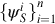  (9)

可以看到，仅使用 2`N` 个嵌入即可构造所需的特征集合，这在计算上比使用 `B × (N + 1)` 个嵌入更为高效。实际中，类别数往往大于 mini‑batch 大小，此时会随机采样子集类别 `C` < `B` 来构建 mini‑batch。

### 3.4: Multi‑Similarity loss

如前所述，对比度学习的一个重要环节是信息性样本的采矿。Triplet Loss 通过边界 `α` 来挑选具有信息性的三元组，而 N‑pair loss 则通过引入大量负样本来获得更多信息性的对。是否存在更优的方式来采样更具信息性的对呢？


为了提高采样过程，Wang et al. (2019) 提出分析样本相似度。根据 Wang et al. (2019) 样本级别相似度可分为三种不同类别。第一种是自相似性，它仅限于一对样本之间的相似性。例如，如果数据集中两个属于不同类别的样本的特征表示 *f*[*i*] 和 *f*[*j*] 高度相似，那么这对样本就变得高度有信息性。在这里，*f*[*i*] 和 *f*[*j*] 被称为相互的硬负样本。这些对被认为具有高自相似性，通常通过使用一个与 Triplet Loss 所使用的相同的边界 *α* 来识别。

第二种相似性称为负相对相似性。它衡量样本对相对于其他负样本对的相似度。如果样本对周围的其他负样本对的自相似性也高，那么该样本对的负相对相似性就低。负相似性的思想是估计当与样本对周围的其他负样本对相比时，该样本对的独特性如何（如 Fig. 5 所示）。因此，如果存在其他自相似性同样高的负样本对，那么该特定采样对所增加的独特价值就微乎其微。这由负相对相似性值捕获。

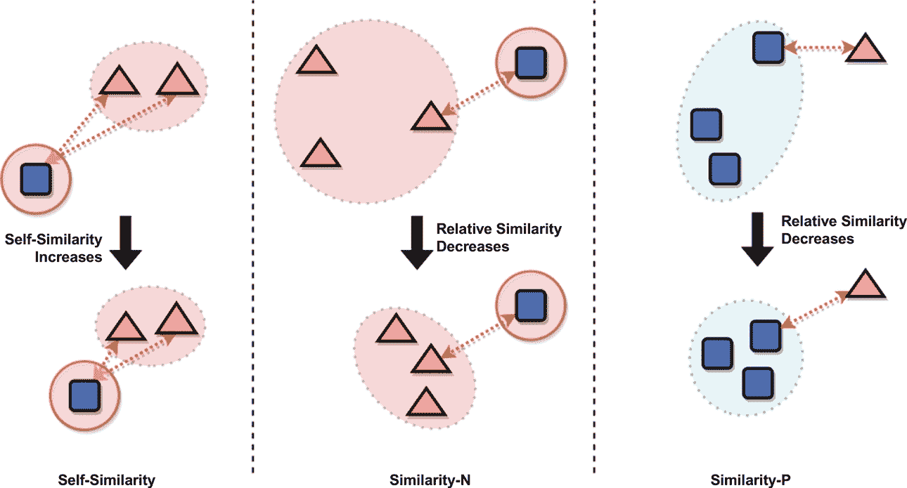

Fig. 5 MS Loss: Multi-Similarity loss computes three different types of similarities (i) *Left*: Self-Similarity. (ii) *Middle*: Negative Relative Similarity. (iii) *Right*: Positive Relative Similarity. Anchor embeddings are enclosed in a *brown circle*.

同样，我们可以定义正相对相似性。设锚 Anchor *f*[*a*] 和正样本 *f*[*p*]^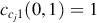 为属于同一类的两个样本的特征表示。正相对相似性衡量 *f*[*p*] 周围的其他正样本与 *f*[*a*] 的自相似性是否也高。换句话说，它量化了给定对与使用相同锚和同类其他正样本构建的其他对之间的相似程度。如果它们高度相似，那么当前被考虑的对被认为具有低正相对相似性得分。

基于这三种相似性类型，Wang et al. (2019) 设计了一种结合这三种样本相似度量的采样策略。考虑一个大小为 B 的小批量。给定每个样本的特征表示 *f*[*i*]，所有特征对之间的相似性如下获得：

$\\begin{array}{r} {S = \\frac{f\_{i}^{T}f\_{j}}{||f\_{i}||.||f\_{j}||},\\forall i,j \\in \\lbrack 1,B\\rbrack} \\\\ \\end{array}$

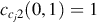  (10)

其中相似矩阵的第 *i* 行定义了第 *i* 个样本与批量中所有其他样本的相似性。为了采样有信息的对，这些对首先使用正相对相似性进行过滤。为此，在 *i*th 行中识别相似性值最低的正对。假设 *S*[*ik*] 对应这个值。现在过滤是通过考虑相似性大于 *S*[*ik*] 的负对来完成。数学上，

$\\begin{array}{r} {S\_{in} > S\_{ik} - \\epsilon;} \\\\ \\end{array}$

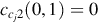  (11)

同样，正对通过考虑与第 *i* 个样本最相似的负对来进行过滤。让这由 *S*[*ij*] 给出

$\\begin{array}{r} {S\_{ip} < S\_{ij} + \\epsilon;} \\\\ \\end{array}$

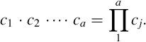  (12)

其中 *S*[*ij*] 指的是对第 *i* 个样本的最高负相似性。

在获得了采样的有信息的对之后，最终的 Multi-Similarity loss 旨在根据它们的重要性对这些对进行加权。最终损失的公式如下：

$\\begin{matrix} \\mathcal{L}\_{\\mathcal{M}\\mathcal{S}} & {= \\frac{1}{B}\\sum\\limits\_{i = 1}^{B}\\left\\{ {\\frac{1}{\\alpha}\\;\\text{log}\\left\\lbrack {1 + \\sum\\limits\_{}e^{- \\alpha(S\_{ip} - \\lambda)}} \\right\\rbrack} \\right.\\left. {+ \\frac{1}{\\beta}\\;\\text{log}\\left\\lbrack {1 + \\sum\\limits\_{}e^{\\beta(S\_{in} - \\lambda)}} \\right\\rbrack} \\right\\}} \\\\ \\end{matrix}$

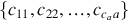  (13)

第一个 *log* 项处理过滤的正样本的余弦相似度得分 *S*[*ip*]。第二个 *log* 项类比地处理过滤的负样本的得分。 *α*, *β* 是用于加权相似度项 *S*[*ip*] 和 *S*[*in*] 的超参数，*λ* 充当类似于 Triplet Loss 的边界项。

## 4: Proxy-based methods

我们迄今为止讨论的常见方法是基于优化样本对样本相似度的目标（如 triplet loss）。这些目标定义为三元组，其中三元组包含一个锚样本、一个正样本（与锚相似）和一个负样本（与锚不相似）。目标函数则定义为锚与正样本之间的距离以及锚与负样本之间的距离。我们称这些方法为对式公式。

给定一个包含 *n* 个样本的数据集 *D*，匹配样本和不匹配样本的可能三元组数量可能达到 *O*(*n*³)。在随机梯度下降的每次优化步骤中，一个包含 *B* 个样本的小批量会只包含总可能三元组（约为 *O*(*B*³)）的一个子集。因此，要在训练过程中看到所有三元组，复杂度将达到 *O*(*n*³/*B*³)。这影响了收敛率，因为它高度依赖于这些三元组的使用效率。这进一步导致了优化此类样本对相似度目标的主要挑战之一：需要找到有信息的三元组，它们能够有效推动学习过程。

为了解决这一挑战，已经利用了多种技巧，如增加批量大小、使用硬或半硬三元组采矿、利用在线特征记忆库以及其他技术。这些方法旨在提高用于优化目标函数的三元组质量，并有助于提高 DML 模型的性能。

Proxy-based methods 提出了克服传统对式方法中信息采矿瓶颈的方法。特别是，这些方法利用一组可学习的共享嵌入，在训练过程中作为类代表。每个训练集中的数据点被近似为至少一个代理。与对式方法不同，这些类代表代理在每个批次中不变且在所有样本之间共享。由于这些代理在每个批次中从所有样本中学习，它们消除了显式采矿有信息的对的需求。


在下面的章节中，我们将讨论三种基于代理的损失公式，分别是 (i) Proxy-NCA (Movshovitz-Attias et al., 2017) 和 Proxy-NCA++ (Teh et al., 2020)，(ii) Proxy Anchor Loss (Kim et al., 2020)，以及 (iii) ProxyGML Loss (Zhu et al., 2020)。

### 4.1: Proxy-NCA and Proxy-NCA++

Proxy-NCA 受到 Goldberger et al. (2004) 在邻域组件分析 (NCA) 方面的开创性工作的启发。设 *p*[*ij*] 为 *f*[*i*] 到 *f*[*j*] 的分配概率或邻域概率，其中 *f*[*i*], *f*[*j*] 为两个数据点。我们可以将此概率定义为：

$\\begin{array}{r} {p\\_{ij} = \\frac{- D\_{e}(f\_{i},f\_{j})}{\\sum\_{k \\notin i} - D\_{e}(f\_{i},f\_{k})}} \\\\ \\end{array}$

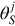  (14)

其中 *D**e* 是在某些学习嵌入中计算的欧氏距离的平方。NCA 的核心目的是增加属于同一类的点之间的概率，同时减少不同类点之间的概率。公式如下：

$\\begin{array}{r} {L\\_{\\text{NCA}} = - \\text{log}\\left( \\frac{\\sum\_{j \\notin C\_{i}}e^{- D\_{e}(f\_{i},f\_{j})}}{\\sum\_{k \\notin C\_{i}}e^{- D\_{e}(f\_{i},f\_{k})}} \\right)} \\\\ \\end{array}$

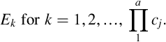  (15)

直接优化 NCA 目标的主要挑战是计算成本，随着数据集中样本数量的增加，计算成本呈多项式增长。Proxy-NCA 通过引入代理（proxies）来解决 NCA 的计算瓶颈。代理可以被视为类代表或类原型。这些代理被实现为随 learnable 参数训练的可学习参数。训练时，Proxy-NCA 不计算对之间的距离（该距离随批量大小呈二次增长且高度依赖于对的质量），而是计算 learnable 类代理集与批量中相应样本特征表示之间的距离。基于此以及从 Eq. (15) 推导，Proxy-NCA 损失 (Movshovitz-Attias et al., 2017) 可以表示为：

$\\begin{array}{r} {L\\_{\\text{ProxyNCA}} = - \\text{log}\\left( \\frac{e^{- D\_{e}(\\widehat{f\_{i}},\\widehat{P\_{i}})}}{\\sum\_{k \\notin C\_{i}}e^{- D\_{e}(\\widehat{f\_{i}},\\widehat{P\_{k}})}} \\right)} \\\\ \\end{array}$

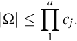  (16)

其中 *P*[*i*] 是对应数据点 *f*[*i*] 的代理向量。\\(\\hat{f}\\) 和 \\(\\hat{P}\\) 表示归一化嵌入。\\(C[i]\\) 是与样本 *f*[*i*] 属于同一类的所有数据点的集合。上述损失函数旨在最大化非对应代理与特征对之间的距离，最小化对应代理与特征向量之间的距离（Fig. 6）。

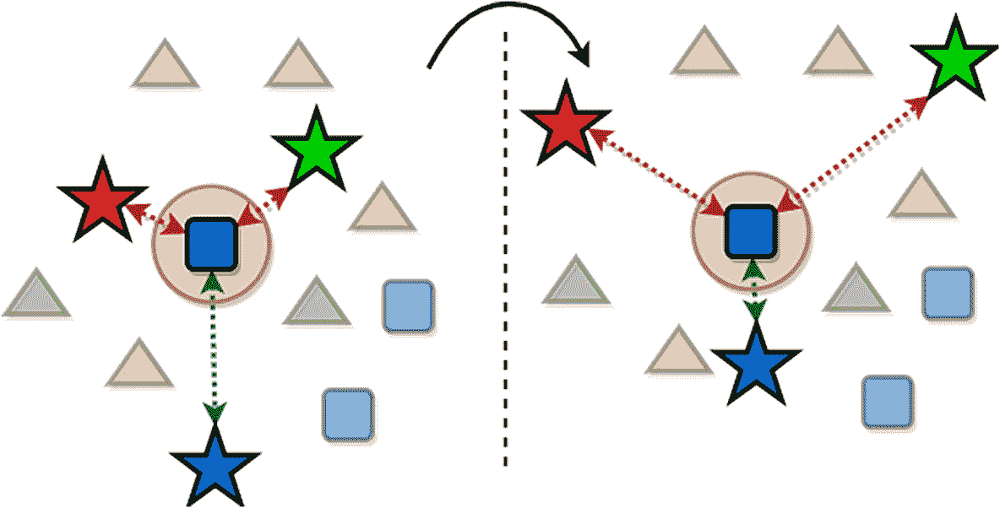

Fig. 6 Illustration of Proxy-NCA loss: Unlike pairwise losses that require informative pair mining, Proxy-NCA injects learnable proxies denoted by star in the above diagram and pulls them toward the anchored sample embeddings.

如 Eq. (16) 所示，Proxy-NCA 并未直接优化代理分配概率，而是优化一个次优目标。Proxy-NCA++ (Teh et al., 2020) 提出了改进此问题的方法。Proxy-NCA++ 计算代理分配概率分数 *P*[*i*] 如下：

$\\begin{array}{r} {L\\_{\\text{ProxyNCA++}} = - \\text{log}\\left( \\frac{e^{- D\_{e}(\\widehat{f\_{i}},\\widehat{P\_{i}})}\*\\frac{1}{T}}{\\sum\_{k \\in A}e^{- D\_{e}(\\widehat{f\_{i}},\\widehat{P\_{k}})}\*\\frac{1}{T}} \\right)} \\\\ \\end{array}$

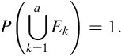  (17)

其中 *A* 是所有代理的集合。Proxy-NCA 与 Proxy-NCA++ 之间的细微差别在于对所有代理的距离进行 softmax 计算，从而显式计算代理分配概率。Proxy-NCA++ 的另一项重要贡献是引入温度缩放参数 *T*。随着 *T* 变大，用于计算代理分配概率的 softmax 函数的输出趋于均匀分布。较小的温度参数会使 softmax 函数趋向更尖锐的分布。较低的温度增大不同类别概率之间的距离，从而有助于更精细的类别边界。

### 4.2: Proxy Anchor loss

在 Proxy-NCA 损失中引入代理克服了对信息性对采矿策略的需求。但 Proxy-NCA 形式 ulation 并未直接优化细粒样本间的相似性，因为它通过代理与样本的相似性间接体现。Proxy Anchor Loss (Kim et al., 2020) 研究了这一瓶颈，并提出了一种新的公式，充分利用了对与代理公式，并提供了更明确的样本间相似性监督，同时保留了代理监督。

类似于 Proxy-NCA，Proxy Anchor 将代理定义为嵌入空间中的可学习向量。与 Proxy-NCA 不同，Proxy Anchor 将每个代理视为锚点（anchor），并将其与整个 batch 中的所有数据关联起来。这使得 batch 中的样本可以通过与锚点的交互作用相互影响（Fig. 7）。设 *S*(*f*, *p*) 为样本 *f* 与代理 *p* 之间的相似度。类似于 Multi-Similarity loss 形式 ulation (Eq. 13)，proxy anchor loss 给出为：

$\\begin{matrix} {\\mathcal{L} = \\frac{1}{|P + |}\\sum\\limits\_{p \\in P +}\\text{log}\\left( {1 + \\sum\\limits\_{x \\in \\mathcal{X}\_{p}^{+}}e^{- \\alpha(S(f,p) - \\delta)}} \\right)} \\\\ {+ \\frac{1}{|P|}\\sum\\limits\_{p \\in P}\\text{log}\\left( {1 + \\sum\\limits\_{x \\in \\mathcal{X}\_{p}^{-}}e^{\\alpha(S(f,p) + \\delta)}} \\right)} \\\\ \\end{matrix}$

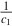  (18)

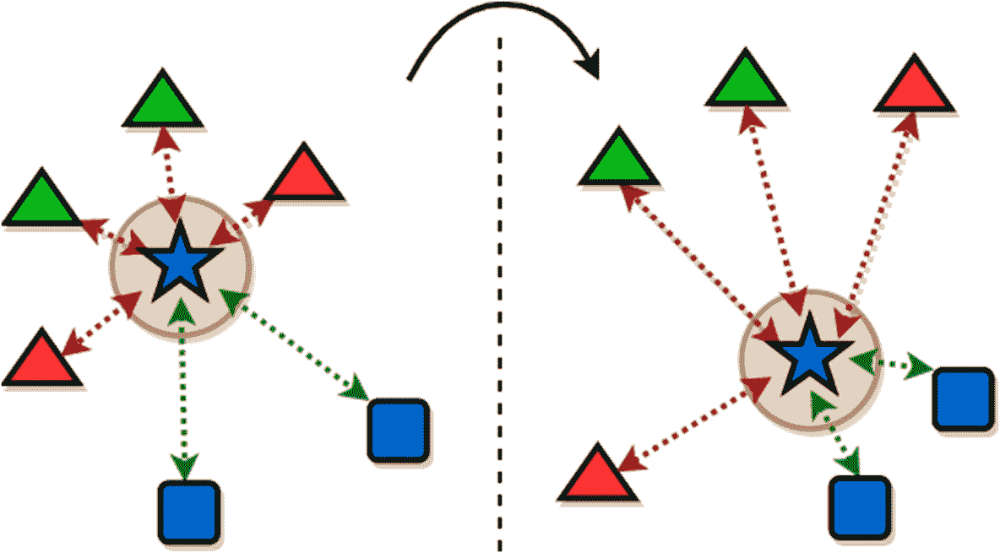

Fig. 7 Illustration of Proxy Anchor (Kim et al., 2020) Loss: Unlike Proxy-NCA, Proxy Anchor (Kim et al., 2020) utilizes a proxy embedding as an anchor and pulls same class sample embeddings closer to it.


-   其中 \`δ` > 0 是一个边界，\`α` > 0 是一个缩放因子，\`P` 表示所有代理的集合，\`P` + 表示批量中数据的正代理集合。如在公式 ([18) 可以注意到，代理锚点使用对数-求和-指数公式将 \`p` 和其最相似的正样本拉得更近，同时将 \`p` 和其最相似的负样本推得更远。为了理解 Proxy Anchor 如何提供更明确的样本到样本相似度监督，让我们比较 Proxy-NCA 和 Proxy Anchor 损失函数的梯度。

-   对于 Proxy-NCA 和 Proxy Anchor 都适用的 \`s(f, p)` 损失函数的梯度可以表示为：

\`\`\\begin{matrix} {\\frac{\\partial\\mathcal{L}\_{\\text{ProxyNCA}}}{\\partial\\mathbf{s}(f,p)} = \\left\\{ \\begin{array}{l} {- 1,\\text{if}\\; p = p^{+}} \\\\ {\\frac{e^{s(f,p)}}{\\sum\\limits\_{p^{-} \\in P^{-}}s(f,p^{-})},\\;\\text{otherwise}} \\\\ \\end{array} \\right\\}} \\\\ \\end{matrix}\`\`

![si31_e  (19)

\`\`\\begin{matrix} {\\frac{\\partial\\mathcal{L}\_{\\text{ProxyAnchor}}}{\\partial\\mathbf{s}(f,p)} = \\left\\{ \\begin{array}{l} {\\frac{1}{|P^{+}|}\\frac{- \\alpha h\_{p}^{+}(f)}{1 + \\sum\\limits\_{f^{\\prime} \\in F\_{p}^{+}}h\_{p}^{+}(f^{\\prime})},\\forall f \\in F\_{p}^{+}} \\\\ {\\frac{1}{|P|}\\frac{- \\alpha h\_{p}^{-}(f)}{1 + \\sum\\limits\_{f^{\\prime} \\in F\_{p}^{-}}h\_{p}^{-}(f^{\\prime})},\\forall f \\in F\_{p}^{-}} \\\\ \\end{array} \\right\\}} \\\\ \\end{matrix}\`\`

![si32_e  (20)

-   其中 \`h[p]^+(f)`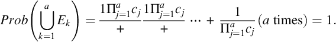 = \`e^(−α(s(x,p)−δ))` 和 \`h[p]^-(f)`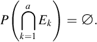 = \`e^(α(s(x,p)+δ))` 分别为给定代理 \`p` 的嵌入向量 \`f` 的正硬度度量和负硬度度量。

-   根据公式 (19) 和 (20)，可以观察到 Proxy-Anchor 损失函数对距离度量 \`s(f, p)` 的梯度不仅取决于特征向量 \`f\`，还取决于批量中其他样本。上述梯度推导在公式 (19) 和 (20) 中已省略，请参阅 Kim et al. (2020) 获取详细推导。这体现了批量内样本相对难度的差异。这是 Proxy-Anchor 损失相对于 Proxy-NCA 损失（公式 19）的主要优势，后者在计算负样本梯度缩放时仅考虑有限数量的代理，而正样本的梯度缩放保持不变。相反，Proxy-Anchor 损失根据正负样本的相对难度确定梯度缩放。此外，Proxy-Anchor 损失在公式中加入了边界，使得类内紧凑性提升且类间可分性增强。

### 4.3: ProxyGML Loss

-   我们讨论了两种基于代理的方法，即 Proxy-NCA 和 Proxy Anchor。尽管它们存在差异，但这两种方法的一个关键共同点是每个类使用一个全局代理作为表示原型。在度量学习（DML）中，我们希望将属于同一类但可能在视觉上差异很大的样本特征匹配，同时区分属于不同类但视觉上非常相似的样本特征。基于此，单一全局代理作为该类所有样本的表示可能并不是最优的代理优化方法。基于此，基于代理的深度图度量学习（ProxyGML）(Zhu et al., 2020)通过引入每个类的多个可训练子代理来克服这一问题，这些子代理能更好地表示局部类内部变异（Fig. 8）。


-   Fig. 8 Illustration of ProxyGML loss (Zhu et al., 2020): Small stars represent the subproxies. Unlike Proxy-NCA (Movshovitz-Attias et al., 2017) and Proxy Anchor (Kim et al., 2020), ProxyGML (Zhu et al., 2020) uses multiple proxies per class. Proxies interact with samples and also among themselves in the final loss formulation. Proxies belonging to the same class come closer to one another and the samples belonging to that class, and move away from proxies and samples of other classes.

-   设数据集 *D* 包含 *C* 个类别。ProxyGML 为每个类别分配 *M* > 1 个可训练子代理。因此，嵌入空间中的子代理总数为 *M* × *C*。ProxyGML 以图形方式建模样本与代理之间的全局和局部关系。这里，有向相似性图表示批量中所有代理与样本之间的全局相似性。

-   对于样本 \`f[i]` 和代理 \`P[j]`，全局相似性矩阵中的余弦相似性可定义为：

\`\`\\begin{array}{r} {S\_{ij}^{p} = f\_{i} \\cdot P\_{j}} \\\\ \\end{array}\`\`

![si35_e  (21)

-   因此，全局相似性矩阵 \`S^p` 的维度为 (*M* × *C*) × *B*，其中 *M* × *C* 是代理的总数，\`B\` 是小批量中的样本总数。

-   对于属于样本 \`f[i]\` 的第 *i* 行 \`S^p\`，ProxyGML 选择 *K* 个最相似的代理，其中 *K* 是一个超参数。选择 *K* 个最相似的代理时，明确选择属于正类 \`P^+` 的代理。其余 *K* − *M* 个代理则根据其与 \`f[i]\` 的相似性选择。这导致一个新的子相似性矩阵（记为 \`S'\`），维度为 *B* × *K*。

-   对 \`S'\` 进行子代理聚合，通过求和属于同一类别 \`C\` 的所有代理的余弦相似性，并对每个样本进行操作。注意，如果对于样本 \`f[i]\`，在 \`S'\` 中不存在属于某类别 \`c\` 的代理，则该类别的相似性被设置为零。这种子代理聚合策略产生最终相似性矩阵 \`S\`，维度为 *B* × *C*。

-   对于较小的 *K* 值，相似性矩阵 \`S\` 可能非常稀疏，包含许多零条目，导致传统 softmax 操作的分母膨胀。基于此，使用屏蔽 softmax 操作：

\`\`\\begin{array}{r} {P\_{ij} = \\frac{M\_{ij}e^{S\_{ij}}}{\\sum M\_{ij}e^{S\_{ij}}}} \\\\ \\end{array}\`\`

![si36_e  (22)

-   其中 \`M\` 表示由 \`M[ij] = 0 if S[ij] = 0 and M[ij] = 1 if S[ij] ≠ 0\` 计算的零面具。\`P[ij]\` 表示样本 \`i\` 对类别 \`j\` 的 softmax 概率。

-   最后，交叉熵损失通过 \`P[ij]\` 计算为：

[\`\`\\begin{array}{r} {\\mathcal{L}\_{\\text{CE}} = \\frac{1}{B}\\sum\\limits\_{i = 0}^{B}\\sum\\limits\_{j = 0}^{C}y\_{i} \\cdot log(P\_{ij})} \\\\ \\end{array}
\`\`


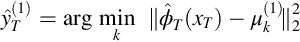 (23) 其中 \\(y\\)[\\(i\\)] 表示第 \\(i\\) 个样本的真实标签。由于每个类别包含多个子代理，这些子代理充当类中心，因此对同类子代理之间的相似性施加了第三个硬约束。设 \\(SP\\) 为给定的 \\(M \\times C\\) 个子代理之间的相似性：

$\\begin{array}{r} {SP\\_{ij} = P\\_{i} \\cdot P\\_{j}} \\\\ \\end{array}$

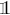 (24)

通过 Eq. (24) 采用 proxy-to-proxy 正则化约束，计算 \\(SP\\) 的软最大概率，并将其转换为交叉熵损失：

$\\begin{aligned} {PP\\_{ij}} & {= \\frac{e^{SP\\_{ij}}}{\\sum e^{SP\\_{ij}}}} \\\\ \\end{aligned}$

 (25)

$\\begin{aligned} \\mathcal{L}\_{\\text{reg}} & {= \\frac{1}{M \\times C}\\sum\\limits\_{i = 0}^{M \\times C}\\sum\\limits\_{j = 0}^{C}y\_{i}^{p} \\cdot log(PP\\_{ij})} \\\\ \\end{aligned}$

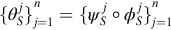 (26)

其中 \\(PP\\) 表示 proxy-to-proxy 相似性的软最大概率，\\(y\\)^(\\(p\\)) 表示 proxy 到类标签的真实映射。

最终损失计算如下：

$\\begin{array}{r} {\\mathcal{L} = \\mathcal{L}\_{\\text{CE}} + \\lambda \\cdot \\mathcal{L}\_{\\text{reg}}} \\\\ \\end{array}$

 (27)

在此，\\(\\lambda\\) 表示正则化项的权重。该方法表明，通过最小化最终目标 ℒ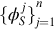 的端到端训练，可获得更具辨识度的嵌入空间。

## 5: 正则化

在前面的章节中，我们探讨了基于样本-样本和样本-代理相似性的损失形式，用于创建增强的特征表示。大多数方法主要关注样本-样本或样本-代理之间的交互。是否可以利用其他信息来构建更稳健的嵌入空间？本节将研究两种信息来源——语言和方向——并说明它们如何集成到现有的 DML 公式中。

### 5.1: 语言引导

大语言模型（LLMs）如 BERT (Devlin et al., 2018)、RoBERTa (Liu et al., 2019) 等在自然语言建模和内容表示方面取得了显著成功。它们通常在海量数据上预训练，能够编码语义上下文并正确建模语义关系。相反，仅使用前一节所述的 DML 目标在数据集 *X* = {(*x*[1], *y*[1]), (*x*[2], *y*[2])…(*x*[*m*], *y*[*m*])}（图片-标签对）上训练可能无法捕获所有数据点的语义上下文。那么，如何利用 LLMs 的语义上下文来改进 DML 目标？

Roth et al. (2022) 提出一种方法，将 LLMs 的表示知识纳入 DML 目标。已知 *X* = {(*x*[1], *y*[1]), (*x*[2], *y*[2])…(*x*[*m*], *y*[*m*])} 表示图片-标签集合。遵循 Multi-Similarity 损失的讨论，使用数据样本的特征表示计算相似性矩阵 *S*[*I*]，公式如 Eq. (10) 所示。为了加入语言正则化因子，从类标签生成提示。每个批次中的类标签 *y*[*i*] 用于创建提示 *T*[*i*]，即 “A photo of 〈*y*[*i*]〉”。设批次对应的提示集合为 *T*，即 *T* = {*T*[1], *T*[2]… *T*[*C*]}，其中 *C* 为批次大小。这些提示通过大语言模型 Ω 进行处理，得到低维表示：

$\\begin{array}{r} {f\_{i}^{lang} = \\Omega(T\_{i};\\theta\_{\\omega});\\forall i \\in m} \\\\ \\end{array}$

 (28)

Ω 为预训练语言模型（如 BERT、RoBERTa 等）。获取语言表示 *f*[*i*]^(*l**a**n**g**) 后，可像构建 *S*[*I*] 一样，使用 Eq. (10) 构建相似性矩阵 *S*[*L*]。

给定两个相似性矩阵 *S*[*I*] 和 *S*[*L*]，提出了一种蒸馏损失，用于将语言模态的知识转移到视觉模态：

$\\begin{array}{r} {L\_{Lang} = \\frac{1}{C}\\sum\\limits\_{i = 1}^{C}\\left\\{ {\\sigma(S\_{I}^{i})\\;\\text{log}\\left\\lbrack \\frac{\\sigma(S\_{I}^{i})}{\\sigma(S\_{L}^{i} + \\gamma\_{L})} \\right\\rbrack} \\right\\}} \\\\ \\end{array}$

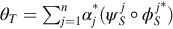 (29)

其中 \\(σ(S[I]^i)\\) 和 \\(σ(S[L]^i)\\) 分别表示对 *S*[*I*] 和 *S*[*L*] 每行的 softmax。\\(γ[L]\\) 为语言常数，设为 1。该蒸馏损失本质上是对每行 softmax 后的 KL 差异的求和。

最终损失公式为先前的对样本 DML 损失 *L*[*DML*] 与语言正则化损失 *L*[*Lang*] 的组合：

$\\begin{array}{r} {L = L\_{DML} + \\omega L\_{Lang}} \\\\ \\end{array}$

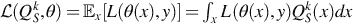 (30)

其中 \\(\\omega\\) 是超参数，控制语言正则化项对最终目标的影响。

### 5.2: 方向正则化

迄今为止，DML 方法主要依赖精心设计的采样策略和损失函数，以优化可分辨的嵌入空间。虽然在采样和损失设计方面已有大量工作，但对样本对之间的相对交互以及在嵌入空间中这些对所受力的方向性关注相对较少。为了理解最优位移的需求，我们回顾三元组损失及其方向。可以注意到，负样本在每次更新时在径向方向被推离锚样本。虽然从直观上看，将负样本径向推离锚样本是合理的，但由于存在其他正样本，这种方向可能不是最优的。还需注意，三元组中的正样本并不对负样本的力方向产生影响。是否存在更优的力方向？

在 Fig. 3 中，我们可以看到每个样本上梯度力的方向。此情况下，我们希望负样本的移动方向与 *a* 与 *p* 的类中心之间的正交方向，即近似为 $f\_{c} = \\frac{f\_{a} + f\_{p}}{2}$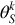（如 Fig. 9 所示）。数学上，需要强制满足以下约束：


$\\begin{array}{r} \\left. NC\\;\\bot\\; PA\\mspace{500mu}\\Longrightarrow\\mspace{500mu}\\frac{NC}{\\parallel NC \\parallel} \\cdot \\frac{PA}{\\parallel PA \\parallel} = 0 \\right. \\\\ \\end{array}$

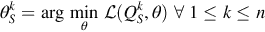  (31)


Fig. 9 Geometric illustration of the layout of the anchor, positive, and negative samples. The lines OA, OP, and ON represent the unit-normalized embedding vectors for the anchor (`f_a`), positive (`f_p`), and negative (`f_n`), respectively. C is the midpoint of PA and OC represents the average embedding vector `f_c` (not unit-normalized).

Analyzing this in more detail, it turns out that incorporating the cosine similarity between the vectors Anchor-Positive and Anchor-Negative helps achieve this objective. (We are skipping the proof for brevity, please refer to Mohan et al. (2020) for more details.) This can be written as

$\\begin{array}{r} {Cos(AN,AP) = \\frac{1 - \\mathbf{f}\_{p} \\cdot \\mathbf{f}\_{a}}{\\parallel \\mathbf{f}\_{n} - \\mathbf{f}\_{a} \\parallel \\parallel \\mathbf{f}\_{p} - \\mathbf{f}\_{a} \\parallel}} \\\\ \\end{array}$

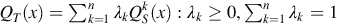  (32)

We find that minimizing this cosine similarity term helps to satisfy the condition in Eq. (31). Since the current metric learning losses lack explicit enforcement of the orthogonality of the negative sample with respect to the anchor-positive pair, when incorporated as a regularization term, it helps create a much more robust embedding space. The following equations provide definitions and the intuition on how easily this regularization term can be adapted into any standard metric learning loss function. The modified triplet loss can be written as:

$\\begin{matrix} {\\mathcal{L}\_{apn} =} & {{\\parallel \\mathbf{f}\_{a} - \\mathbf{f}\_{p} \\parallel}^{2} - {\\parallel \\mathbf{f}\_{a} - \\mathbf{f}\_{n} \\parallel}^{2} + \\alpha - \\gamma\\; Cos(\\mathbf{f}\_{n} - \\mathbf{f}\_{a},\\mathbf{f}\_{p} - \\mathbf{f}\_{a})} \\\\ \\end{matrix}$

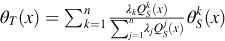  (33)

Similarly, the modified Multi-Similarity loss can be written as:

$\\begin{matrix} \\mathcal{L} & {= \\frac{1}{B}\\sum\\limits\_{i = 1}^{B}\\left\\{ {\\frac{1}{\\alpha}\\;\\text{log}\\left\\lbrack {1 + \\sum\\limits\_{}e^{- \\alpha(S\_{ip} - \\lambda)}} \\right\\rbrack} \\right.} \\\\ & {\\mspace{144mu}\\left. {+ \\frac{1}{\\beta}\\;\\text{log}\\left\\lbrack {1 + \\sum\\limits\_{}e^{\\beta(S\_{in} - \\lambda - \\gamma\\; Cos(\\mathbf{f}\_{n} - \\mathbf{f}\_{a},\\mathbf{f}\_{p} - \\mathbf{f}\_{a}))}} \\right\\rbrack} \\right\\}} \\\\ \\end{matrix}$

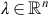  (34)

In the case of Multi-Similarity loss, the hardest positive to the anchor is used in the regularization term.

In the case of Proxy-NCA (Movshovitz-Attias et al., 2017), the direction of forces is modified to push negative samples in the direction of their corresponding proxies. It is given by :

$\\begin{array}{r} {\\mathcal{L} = \\sum\\limits\_{a \\subset N} - \\text{log}\\left( \\frac{e^{( - {\\parallel \\mathbf{f}\_{a} - p(a) \\parallel}^{2})}}{\\sum\\limits\_{n}e^{\\lbrack{- {\\parallel \\mathbf{f}\_{a} - p(n) \\parallel}^{2} - \\gamma\\; Cos(p(n) - \\mathbf{f}\_{a},p(a) - \\mathbf{f}\_{a})}\\rbrack}} \\right)} \\\\ \\end{array}$

  (35)

## 6: Conclusion

DML approaches provide objective functions that help to create highly discriminable embedding spaces. In this chapter, we have provided a brief review of some of the important DML methods and elaborated on the uniqueness of each approach compared to each other. Currently, owing to the recent advancements in the area of Cross-modal retrieval methods such as CLIP (Radford et al., 2021), DML methods which primarily focused on a single modality are being adapted toward multimodal representation learning. Recent works, such as Wei et al. (2020) and Jawade et al. (2023), show the ability of these methods to create more robust feature representations for multimodal tasks such as text–image retrieval.

## References

*   Devlin J., Chang M., Lee K., Toutanova K.  BERT: pre-training of deep bidirectional transformers for language understanding. *CoRR.* 2018. ;abs/1810.04805:. [`arxiv.org/abs/1810.04805`](http://arxiv.org/abs/1810.04805).

*   Goldberger J., Hinton G.E., Roweis S., Salakhutdinov R.R.  Neighbourhood components analysis. In: Saul L., Weiss Y., Bottou L., eds. *Advances in Neural Information Processing Systems.* MIT Press; . 2004. ;vol. 17. [`proceedings.neurips.cc/paper/2004/file/42fe880812925e520249e808937738d2-Paper.pdf`](https://proceedings.neurips.cc/paper/2004/file/42fe880812925e520249e808937738d2-Paper.pdf).

*   Jawade B., Agarwal A., Setlur S., Ratha N.  Multi loss fusion for matching smartphone captured contactless finger images. In: 2021:1–6. *2021 IEEE International Workshop on Information Forensics and Security (WIFS).*.

*   Jawade B., Dayal D., Setlur S., Govindraju V.  RidgeBase: a cross-sensor multi-finger contactless fingerprint dataset. In: 2022:. *2022 International Joint Conference on Biometrics (IJCB).*.

*   Jawade B., Dayal D., Ali N.M., Setlur S., Govindraju V.  NAPReg: nouns as proxies regularization for semantically aware cross-modal embeddings. In: 2023:. *Proceedings of the IEEE/CVF Winter Conference on Applications of Computer Vision (WACV).*.

*   Kim S., Kim D., Cho M., Kwak S.  Proxy anchor loss for deep metric learning. In: 2020:3238–3247. *Proceedings of the IEEE/CVF Conference on Computer Vision and Pattern Recognition.*.

*   Lee K.W., Jawade B., Mohan D., Setlur S., Govindaraju V.  Attribute de-biased vision transformer (AD-ViT) for long-term person re-identification. In: 2022:1–8. *2022 18th IEEE International Conference on Advanced Video and Signal Based Surveillance (AVSS).*.

*   Liu Y., Ott M., Goyal N., Du J., Joshi M., Chen D., Levy O., Lewis M., Zettlemoyer L., Stoyanov V.  RoBERTa: a robustly optimized BERT pretraining approach. *CoRR.* 2019. ;abs/1907.11692:. [`arxiv.org/abs/1907.11692`](http://arxiv.org/abs/1907.11692).

*   Mohan D.D., Sankaran N., Fedorishin D., Setlur S., Govindaraju V.  Moving in the right direction: a regularization for deep metric learning. In: 2020:. *Proceedings of the IEEE/CVF Conference on Computer Vision and Pattern Recognition (CVPR), June.*.

*   Movshovitz-Attias Y., Toshev A., Leung T.K., Ioffe S., Singh S.  No fuss distance metric learning using proxies. In: 2017:360–368. *Proceedings of the IEEE International Conference on Computer Vision.*


-   Radford A., Kim J.W., Hallacy C., Ramesh A., Goh G., Agarwal S., Sastry G., Askell A., Mishkin P., Clark J., Krueger G., Sutskever I. `Learning transferable visual models from natural language supervision`. *CoRR.* 2021. ;abs/2103.00020:. [`https://arxiv.org/abs/2103.00020`](https://arxiv.org/abs/2103.00020).

-   Roth K., Vinyals O., Akata Z. `Integrating language guidance into vision-based deep metric learning`. In: 2022:16177–16189. *Proceedings of the IEEE/CVF Conference on Computer Vision and Pattern Recognition.*.

-   Sankaran N., Mohan D.D., Setlur S., Govindaraju V., Fedorishin D. `Representation learning through cross-modality supervision`. In: 2019:1–8. *2019 14th IEEE International Conference on Automatic Face and Gesture Recognition (FG 2019).*.

-   Schroff F., Kalenichenko D., Philbin J. `FaceNet: a unified embedding for face recognition and clustering`. In: 2015:815–823. *Proceedings of the IEEE Conference on Computer Vision and Pattern Recognition.*.

-   Sohn K. `Improved deep metric learning with multi-class n-pair loss objective`. In: . *Advances in Neural Information Processing Systems.* 2016;vol. 29.

-   Teh E.W., DeVries T., Taylor G.W. `ProxyNCA++: revisiting and revitalizing proxy neighborhood component analysis`. In: 2020:448–464. *European Conference on Computer Vision.*.

-   Wang X., Han X., Huang W., Dong D., Scott M.R. `Multi-similarity loss with general pair weighting for deep metric learning`. In: 2019:5022–5030. *Proceedings of the IEEE/CVF Conference on Computer Vision and Pattern Recognition.*.

-   Wei J., Xu X., Yang Y., Ji Y., Wang Z., Shen H.T. `Universal Weighting Metric Learning for Cross-Modal Matching`. In: 2020:13005–13014. *Proceedings of the IEEE/CVF Conference on Computer Vision and Pattern Recognition.*.

-   Zhu Y., Yang M., Deng C., Liu W. `Fewer is more: a deep graph metric learning perspective using fewer proxies`. In: Larochelle H., Ranzato M., Hadsell R., Balcan M.F., Lin H., eds. *Advances in Neural Information Processing Systems.* Curran Associates, Inc.; 17792–17803. 2020. ;vol. 33. [`https://proceedings.neurips.cc/paper/2020/file/ce016f59ecc2366a43e1c96a4774d167-Paper.pdf`](https://proceedings.neurips.cc/paper/2020/file/ce016f59ecc2366a43e1c96a4774d167-Paper.pdf).

## Chapter 5: Source distribution weighted multisource domain adaptation without access to source data

Sk Miraj Ahmed[\*]## Department of Electrical and Computer Engineering, University of California Riverside, Riverside, CA, United States  

^∗ Corresponding author: email address: `sahme047@ucr.edu`

## Abstract

Unsupervised domain adaptation (UDA) aims to learn a predictive model for an unlabeled domain by transferring knowledge from a separate labeled source domain. Conventional UDA approaches make the strong assumption of having access to the source data during training. This may not be very practical due to privacy, security, and storage concerns. A recent line of work addressed this problem and proposed an algorithm that transfers knowledge to the unlabeled target domain from a single-source model *without requiring access to the source data*. However, for adaptation purposes, if there are multiple trained source models available to choose from, this method has to go through adapting each and every model individually, to check for the best source. A better question to ask is the following: can we find the optimal combination of source models, with no source data and without target labels, whose performance is no worse than the single best source? The answer to this is given by a recent efficient algorithm (Ahmed et al., 2021) which automatically combines the source models with suitable weights in such a way that it performs at least as good as the best source model. The work provided intuitive theoretical insights to justify their claim and extensive experiments were conducted on several benchmark datasets. In this chapter, we first review this work on multi-source source-free unsupervised domain adaptation followed by analysis of a new algorithm which we propose by relaxing some of the assumptions of this prior work. More specifically, instead of naively assuming source data distribution as uniform, we try to estimate it via a multilayer perceptron (MLP) in order to use this information for effective aggregation of source models.

### Keywords

Source free adaptation; Multi source adaptation; Unsupervised domain adaptation

## 1: Introduction

Deep neural networks have achieved proficiency in a multiple array of vision tasks (He et al., 2016; Kirillov et al., 2019; Long et al., 2015; Redmon et al., 2016); however, these models have consistently fallen short in adapting to visual distributional shifts (Luo et al., 2019). Human recognition, on the other hand, is robust to such shifts, such as reading text in a new font or recognizing objects in unseen environments. Imparting such robustness toward distributional shifts to deep models is fundamental in applying these models to practical scenarios.

Unsupervised domain adaptation (UDA) (Ben-David et al., 2010; Saenko et al., 2010) seeks to bridge this performance gap due to domain shift via adaptation of the model on small amounts of unsupervised data from the target domain. The majority of current approaches (Ganin et al., 2016; Hoffman et al., 2018b) optimize a two-fold objective: (i) minimize the empirical risk on the source data and (ii) make the target and source features indistinguishable from each other. Minimizing distribution divergence between domains by matching the distribution statistical moments at different orders has also been explored extensively (Peng et al., 2019; Sun et al., 2016).

A shortcoming of all the above approaches is the transductive scenario in which they operate, i.e., the source data is required for adaptation purposes. In a real-world setting, source data may not be available for a variety of reasons. Privacy and security are the primary concern, with the data possibly containing sensitive information. Another crucial reason is storage issues, i.e., source datasets may contain videos or high-resolution images and it might not be practical to transfer or store on different platforms. Consequently, it is imperative to develop unsupervised adaptation approaches which can adapt the source models to the target domain *without access to the source data* (Fig. 1).


-   图 1 问题设置。标准的无监督多源域适应（UDA）利用源数据以及在源数据上训练的模型，对目标域进行适应。相比之下，Ahmed et al. (2021) 提出了一种设置，该设置在不需要访问源数据的情况下适应多个模型。

-   最近的工作（Li et al., 2020; Liang et al., 2020）尝试通过在不访问源数据的情况下，将单一源模型适应到目标域。然而，这些方法的一个基本假设是，为适应提供最相关的源模型需要由一个“神谕”（oracle）。一个更具挑战性和实际的场景是从一个*源模型集合*（bag of source models）进行适应——每个源域与目标域的相关程度不同，适应过程不仅需要结合多个模型的先验知识，还要防止负迁移的可能性。在本章中，我们首先讨论了 Ahmed et al. (2021) 所提出的无监督*多源域适应（无需访问源数据）*问题，随后分析了我们设计的一个新算法，该算法基于比 Ahmed et al. (2021)更不受限的假设。该算法基于伪标签和信息最大化的原则，并提供直观的理论洞察，表明该框架能够实现比最佳可用源模型更好的性能，同时最小化负迁移的影响。

-   为了在不访问源数据的情况下解决多源模型适应问题，我们采用了*信息最大化（IM）*损失（Liang et al., 2020），作用于所有源模型的目标软标签的加权组合。我们还采用了受深度集群方法（Caron et al., 2018）启发的伪标签策略，并结合 IM 损失来最小化特征的噪声集群分配。与 Ahmed et al. (2021)不同，后者对每个源模型分配固定权重，与目标样本无关，新提出的优化方法根据估计的源分布为每个目标样本分配不同的源权重。由于我们无法访问源数据，我们的框架利用多层感知器（MLPs）来估计这些分布，以最小化经验目标风险。与 Ahmed et al. (2021)密切相关，该框架同时适应源特征编码器以及相应的源权重（通过将目标样本传递到 MLPs 生成），从而得到目标模型。

## 1.1: Main contributions

-   我们解决了多源无监督域适应（multiple source UDA）的问题，且不访问源数据。为解决该问题，我们做出了以下贡献：

    *   • 我们提出了一种新的无监督域适应算法，该算法无需访问源数据。我们通过训练一些 MLP 来估计源分布，这些分布能够在更强理论上可靠的组合规则下有效地建模目标分布。我们称之为*source distribution (estimated by MLPs) weighted Data free multisourCE unsupervISed domain adaptatiON (DECISION-mlp)*。我们的算法自动识别源模型的最佳组合（该组合也是目标样本的函数），通过优化一个精心设计的无监督损失来生成目标模型。

    *   • 在直观假设下，我们建立了目标模型性能的理论保证，表明其始终至少与部署单个最佳源模型的效果相当，从而最小化负迁移。

    *   • 我们通过数值实验验证了我们的主张，展示了我们方法的实际好处。

## 2: Related works

-   本节简要概述了无监督域适应（UDA）在单源和多源场景以及相关的假设转移学习（hypothesis transfer learning）领域的文献。

### 2.1: Unsupervised domain adaptation

-   无监督域适应方法已应用于多种任务，包括图像分类（Tzeng et al., 2017）、语义分割（Paul et al., 2020）和物体检测（Hsu et al., 2020）。除了基于时刻匹配（Peng et al., 2019; Sun et al., 2016）和对抗学习（Ganin et al., 2016; Tzeng et al., 2017）的特征空间适应方法外，最近的工作还探索了通过图像翻译进行像素空间适应（Hoffman et al., 2018b）。所有现有的无监督域适应方法都要求访问标记的源数据，这在许多应用中可能不可用。

### 2.2: Hypothesis transfer learning

-   与我们的目标相似，假设转移学习（HTL）(Ahmed et al., 2020; Perrot and Habrard, 2015; Singh et al., 2018)旨在在不访问源数据的情况下将学习到的源假设转移到目标域。然而，目标域的数据被假设为有标签，这与我们的场景不同，限制了其在现实世界场景中的适用性。最近，Li et al. (2020) 和 Liang et al. (2020) 将标准的 HTL 设置扩展到无监督目标数据（U-HTL），通过伪标签适应单一源假设。本文进一步通过引入多个源模型（这些模型可能相互正相关，也可能不相关）来进一步推进这一工作。

### 2.3: Multisource domain adaptation


多源域自适应（MSDA）通过引入多个源模型的知识，扩展了标准的无监督域自适应（UDA）设置。隐空间变换方法[`/path.to/xxx`]旨在通过优化差异度量或对抗损失，使不同域的特征对齐。基于差异的方法通过最小化最大均值差异[`/path.to/xxx`]和 Rényi-差异[`/path.to/xxx`]等度量来对齐域。对抗方法通过优化 GAN 损失[`/path.to/xxx`]，使多个域的特征对域判别器不可区分，从而实现域适应。Wasserstein 距离[`/path.to/xxx`]和ℋ-差异[`/path.to/xxx`]也是对抗方法的一种形式。域生成方法[`/path.to/xxx`]利用某种形式的域翻译，如 CycleGAN[`/path.to/xxx`]，在像素级别进行适应。所有这些方法都假设在适应过程中可以访问源数据。

### 2.4: Source-free multisource UDA

这一研究方向非常新，最初在[`/path.to/xxx`]中提出并解决。通过优化合适的源权重，将多个源模型的知识转移到未标注的目标域，是本论文的核心思想，将在下一节中详细讨论。受此工作启发，一些近期工作也 tackled 这个问题。[`/path.to/xxx`]从理论和实证两方面展示了对目标域数据进行选择性伪标记的好处，而[`/path.to/xxx`]则设计了置信锚诱导伪标记生成器，在无源域设置下为目标域挖掘置信伪标记。与这些工作密切相关，我们关注一种新颖的模型聚合方案，该方案通用且可在现有任何方法上使用以提升性能。在本章中，我们仅分析该模型聚合方案对[`/path.to/xxx`]中算法的影响。

## 3: Problem setting

本文解决了在只获得目标域未标注样本的情况下，同时适应在多个域上训练的多个模型的问题。我们将考虑具有 K 个类别的分类模型，输入空间为𝒳。形式上，设有源模型集合{`θ`[*S*][*j*]^(*j* = 1)^(*n*)个模型`θ`[*S*][*j*]:𝒳→ℝ^(*K*)是使用源数据集𝒟[*S*][*j*] = {`x`[*S*][*j*][*i*], `y`[*S*][*j*][*i*]}[*i* = 1]^(*N*[*j*])训练得到的分类模型，其中 N[*j*]为第 j 个源的数据点数，`x`[*S*][*j*][*i*]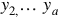和`y`[*S*][*j*][*i*]分别表示第 i 个源图像和对应的标签。现在，给定目标未标注数据集𝒟[*T*] = {`x`[*T*][*i*]}[*i* = 1]^(*N*[*T*]) ([`/path.to/xxx`]), we will first discuss DECISION in detail and then move on to the analysis of the modification we made.

## 4: Practical motivation

To understand the practicality of this specific problem setting, we provide example of some real applications. For example, let's say we want to classify some images in the target which belong to the domain *sketches*. We also have access to the trained source models which are trained on domains like *Art*, *Clipart*, *Product*, *Real*, etc. Images from *Art* domain are mostly visually and semantically similar to *sketches* domain compared to other sources. So, intuitively most images from the target domain should acquire highest adaptation performance from the *Art* domain. However, in practical scenarios these source images are not available and as a result there is no way of computing similarities between source and target images directly, which are crucial for computing weights for the corresponding sources given the target image. In this situation, this problem setting comes into play where the target images are adapted by the source models without accessing the source data. During adaptation, each of the target images should accordingly weight the source models based on just the source model parameters.

## 5: Overall framework of DECISION (Ahmed et al., 2021)&#x2014;A review

Each of the source models can be decomposed into two modules: the feature extractor `ϕ`[*S*][*i*]:𝒳→ℝ^(*d*[*i*]) and the classifier `ψ`[*S*][*i*]:ℝ^(*d*[*i*])→ℝ^(*K*). Here, *d*[*i*] refers to the feature dimension of the *i*th model, while *K* refers to the number of categories. The overall aim is to estimate the target model `θ`[*T*] (Fig. 2) by combining knowledge only from the given source models in a manner that automatically rejects poor source models, i.e., those which are irrelevant for the target domain.


Fig. 2 Overall framework of DECISION (Ahmed et al., 2021): Final classification layers of all the sources are frozen and the source feature encoders are jointly optimized along with their corresponding weights to get the target predictor by combining those.


在该框架的核心是一个模型聚合方案（Hoffman et al., 2018a；Mansour et al., 2009），其核心思想是学习一组权重集合 {`α[i]`}，使得每个源模型对应一个权重，且 `α[k]` ≥ 0 且 $\\sum\\_{k = 1}^{n}\\alpha\_{k} = 1$。这些权重构成一个源域的概率质量函数，更高的值意味着从该特定域的转移性更强，并用于按权重组合源假设。与以往工作不同，本文通过仅利用未标记的目标实例，联合适应每个单独模型并同时学习这些权重。

### 5.1: 加权信息最大化

由于无法访问标记的源数据或目标数据，作者建议固定源分类器 {`ψ[S]^i`}`[*i* = 1]`^(*n*)，这些分类器包含源域的类别分布信息，并仅通过信息最大化原则调整特征映射 {`ϕ[S]^i`}`[*i* = 1]`^(*n*)：

$\\begin{array}{r} {\\mathcal{L}\_{\\text{ent}} = - \\mathbb{E}\_{x\_{T} \\in \\mathcal{D}\_{T}}\\left\\lbrack {\\sum\\limits\_{j = 1}^{K}\\delta\_{j}(\\theta\_{T}(x\_{T}))\\log(\\delta\_{j}(\\theta\_{T}(x\_{T})))} \\right\\rbrack} \\ 


 (8)

``` 
$\\begin{aligned} ŷ\_{T}^{(1)} & {= \\text{arg}\\;\\underset{k}{\\text{min}}\\; \\parallel {\\widehat{\\phi}}\_{T}(x\_{T}) - \\mu\_{k}^{(1)} \\parallel\_{2}^{2}} \\\\ \\end{aligned}$
```

 (9)

where 1(⋅) is an indicator function which gives a value of 1 when the argument is true. While this alternating process of computing cluster centroids and pseudo-labeling can be repeated multiple times to get stationary pseudo-labels, one round is sufficient for all practical purposes. One can then obtain the cross-entropy loss w.r.t. these pseudo-labels as follows:

``` 
$\\begin{array}{r} {\\mathcal{L}\_{\\text{pl}}(Q\_{T},\\theta\_{T}) = - \\mathbb{E}\_{x\_{T} \\in \\mathcal{D}\_{T}}\\sum\\limits\_{k = 1}^{K}1\\{ ŷ\_{T} = k\\}\\log\\delta\_{k}(\\theta\_{T}(x\_{T})).} \\\\ \\end{array}$
```

 (10)

Note that the pseudo-labels are updated regularly after a certain number of iterations as discussed in Section 9.

### 5.3: Optimization

In summary, given *n* source hypothesis {*θ*[*S*]^(*j*)}[*j* = 1]^(*n*) = {*ψ*[*S*]^(*j*) ∘ *ϕ*[*S*]^(*j*)}[*j* = 1]^(*n*) and target data 𝒟[*T*] = {*x*[*T*]^(*i*)}[*i* = 1]^(*n*[*T*]), the classifier from each of the sources is fixed and optimization over the parameters of {*ϕ*[*S*]^(*j*)}[*j* = 1]^(*n*) and the aggregation weights {*α*[*j*]}[*j* = 1]^(*n*) are done jointly in an end-to-end manner. The final objective is given by,

``` 
$\\begin{array}{r} {\\mathcal{L}\_{tot} = \\mathcal{L}\_{\\text{ent}} - \\mathcal{L}\_{\\text{div}} + \\lambda\\mathcal{L}\_{\\text{pl}}} \\\\ \\end{array}$
```

  (11)

The above objective is used to solve the following optimization problem,

``` 
$\\begin{array}{ll} {\\operatorname{minimize}\\limits\_{{\\{\\phi\_{S}^{j}\\}}\_{j = 1}^{n},{\\{\\alpha\_{j}\\}}\_{j = 1}^{n}}\\quad} & \\mathcal{L}\_{tot} \\\\ {\\text{subject\\ to}\\quad} & {\\alpha\_{j} \\geq 0,\\forall j \\in \\{ 1,2,\\ldots,n\\},} \\\\ \\quad & {\\sum\\limits\_{j = 1}^{n}\\alpha\_{j} = 1} \\\\ \\quad & \\\\ \\end{array}$
```

  (12)

After obtaining the optimal set of *ϕ*[*S*]^(*j*\*) and *α*[*j*]^(\*), the optimal target hypothesis is computed as $\\theta\_{T} = \\sum\_{j = 1}^{n}\\alpha\_{j}^{\*}(\\psi\_{S}^{j} \\circ \\phi\_{S}^{j\*})$. To solve the optimization (12), steps of Algorithm 1 are followed as stated below.

Algorithm 1

Overview of DECISION.

 

## 6: Theoretical insights

### 6.1: Theoretical motivation behind DECISION

DECISION aims to find the optimal weights {*α*[*j*]}[*j* = 1]^(*n*) for each source and takes a convex combination of the source predictors to obtain the target predictor. It shows that under intuitive assumptions on the source and target distributions, there exists a simple choice of target predictor, which can perform better than or equal to the best source model being applied directly on the target data.

Following the notations in Ahmed et al. (2021), *L* is the loss function which maps the pair of model-predicted label and the ground-truth label to a scalar. Expected loss over *k*th source distribution is denoted by *Q*[*S*]^(*k_) using the source predictor *θ* via ℒ(*Q*[*S*]^(*k_), *θ*) = 𝔼[*x*]\[*L*(*θ*(*x*), *y*)] = ∫[*x*]*L*(*θ*(*x*), *y*)*Q*[*S*]^(*k*)(*x*)*d**x**. *θ*[*S*]^(*k_) is the optimal source predictor given by $\\theta\_{S}^{k} = \\text{arg}\\;\\underset{\\theta}{\\text{min}}\\;\\mathcal{L}(Q\_{S}^{k},\\theta)\\;\\forall\\; 1 \\leq k \\leq n$. Based on the assumption in Ahmed et al. (2021), the target distribution is in the span of source distributions, which can be formalized by expressing the target distribution as an affine combination of source distributions, i.e., $Q\_{T}(x) = \\sum\_{k = 1}^{n}\\lambda\_{k}Q\_{S}^{k}(x):\\lambda\_{k} \\geq 0,\\sum\_{k = 1}^{n}\\lambda\_{k} = 1$. Under this assumption, the target predictor can be expressed as $\\theta\_{T}(x) = \\sum\_{k = 1}^{n}\\frac{\\lambda\_{k}Q\_{S}^{k}(x)}{\\sum\_{j = 1}^{n}\\lambda\_{j}Q\_{S}^{j}(x)}\\theta\_{S}^{k}(x)$, then the theoretical claim is established as stated in Lemma 1.

Lemma 1.

Assume that the loss *L*(*θ*(*x*), *y*) is convex in its first argument and that there exists a *λ* ∈ ℝ^(*n_) where *λ* ≥ 0 and *λ^⊤1 = 1 such that the target distribution is exactly equal to the mixture of source distributions, i.e., $Q\_{T} = \\sum\_{i = 1}^{n}\\lambda\_{i}Q\_{S}^{i}$. Set the target predictor as the following convex combination of the optimal source predictors

``` 
$\\begin{array}{r} {\\theta\_{T}(x) = \\sum\\limits\_{k = 1}^{n}\\frac{\\lambda\_{k}Q\_{S}^{k}(x)}{\\sum\\limits\_{j = 1}^{n}\\lambda\_{j}Q\_{S}^{j}(x))}\\theta\_{S}^{k}(x).} \\\\ \\end{array}$
```


Recall the pseudo-labeling loss (10). Then, for this target predictor, over the target distribution, the unsupervised loss induced by the pseudo-labels and the supervised loss are both less than or equal to the loss induced by the best source predictor. In particular,

``` 
$\\begin{array}{r} {\\mathcal{L}(Q\_{T},\\theta\_{T}) \\leq \\min\\limits\_{1 \\leq j \\leq n}\\;\\mathcal{L}(Q\_{T},\\theta\_{S}^{j}).} \\\\ \\end{array}$
```


Let *α* = arg min[1 ≤ *j* ≤ *n*] ℒ(*Q*[*T*], *θ*[*S*]^(*j*)). Additionally, this inequality is strict if the entries of *λ* are strictly positive and there exists a source *i* for which the strict inequality ℒ(*Q*[*S*]^(*i*), *θ*[*S*]^(*i*)) < ℒ(*Q*[*S*]^(*i*), *θ*[*S*]^(*α*)) holds.

Before going into the proof, we will discuss how does this lemma translates to DECISION and how it motivated us to analyze DECISION-mlp.

The key difference between DECISION and the predictor in Lemma 1 is the algorithm's combination rule, which fine-tunes the feature extractors of each source model unlike Lemma 1. However, each source has an individual weight which is agnostic to the target data, whereas Lemma 1 uses different weights per input instance. The intuitive justification for choosing this input-agnostic weighting strategy is provided below.


由于缺乏源数据，无法获取源分布的信息，因此采用最不具信息的分布——即根据**最大熵原理**（Principle of Maximum Entropy）选择**均匀分布**（uniform distribution）作为源分布（Jaynes, 1957）。这种均匀性假设适用于目标支持集 𝒳。接下来，算法会将源分布在目标支持集 𝒳 上的限制进行考虑。数学上，假设 `Q`[*S`]^`(*k`)*(`*x`)* = `c`[*k`]*𝒰`(*x`)* 在支持集 `x` ∈ 𝒳 上成立，其中 `c`[*k`] 是一个缩放因子，反映源 `k` 的相对贡献，而 𝒰`(*x`)* 的取值为 1。将该分布代入 Lemma 1 中的组合规则，得到 $\\theta\_{T}(x) = \\sum\_{k = 1}^{n}\\frac{\\lambda\_{k}c\_{k}}{\\sum\_{j = 1}^{n}\\lambda\_{j}c\_{j}}\\theta\_{S}^{k}(x)$：

$\\begin{array}{ll} {\\theta\_{T}\\left( x \\right)} & {= \\sum\\limits\_{k = 1}^{n}\\frac{\\lambda\_{k}Q\_{S}^{k}\\left( x \\right)}{\\sum\\limits\_{j = 1}^{n}\\lambda\_{j}Q\_{S}^{j}\\left( x \\right)}\\theta\_{S}^{k}\\left( x \\right)} \\\\ & {= \\sum\\limits\_{k = 1}^{n}\\frac{\\lambda\_{k}c\_{k}\\mathcal{U}\\left( x \\right)}{\\sum\\limits\_{j = 1}^{n}\\lambda\_{j}c\_{j}\\mathcal{U}\\left( x \\right)}\\theta\_{S}^{k}\\left( x \\right)} \\\\ & {= \\sum\\limits\_{k = 1}^{n}\\frac{\\lambda\_{k}c\_{k}}{\\sum\\limits\_{j = 1}^{n}\\lambda\_{j}c\_{j}}\\theta\_{S}^{k}\\left( x \\right)} \\\\ & \\\\ \\end{array}$

  (13)

这一项中 `λ`[*k`] 和 `c`[*k`] 组成的权重项 `α`[*k`] 在 `DECISION` 中起关键作用。下一步是将 `θ`[*T`] 与 `α`[*k`] 以及 `ϕ`[*S`]^`(*k`)* 一同用于求解优化问题（12）。因此，`DECISION` 会返回一个满足 Lemma 1 界限的有利源假设组合，前提是源分布均匀。但如果不假设源分布均匀，则可以通过估计 `Q`[*S`]^`(*k`)* 来最小化目标风险，这将在下一节的拟议框架 `DECISION-mlp`（Fig. 3）中讨论。


Fig. 3 Weight calculation in modified framework with MLP: Instead of setting `α`’s as free trainable parameters, it can be expressed as a function of source distributions via multilayer perceptrons (MLPs). For the end-to-end training source feature encoders as well as the MLPs are trained jointly.

##  7: Source distribution dependent weights (DECISION-mlp)

模型聚合方案中的混合权重（Lemma 1）以及 Mansour et al. (2009) 和 Hoffman et al. (2018a) 都依赖于源分布和目标样本。由于缺乏源数据，均匀源分布的假设导致了 Algorithm 1。然而，若不假设源分布，仍可通过 MLP 估计其分布。假设有 *n* 个 MLP `ℳ`[*S`]^`(*k`)*∀`*k`* = 1, 2, …*n* 来估计 *n* 个源分布（Fig. 3）。目标特征通过对每个样本分别通过特征编码器，并将它们拼接成长度为 *d* 的向量，其中 $d = \\sum\_{i = 1}^{n}d\_{i}$。若目标样本为 `x`[*T`]^`(*i`)*，则拼接向量 `ϕ`(`x`[*T`]^`(*i`)) 可表示为 `ϕ`(`X`[*T`]^`(*i`))*⊤*∈ℝ^`(*d`)*。随后，`ϕ`(`x`[*T`]^`(*i`))* 依次输入所有 MLP，得到 *n* 个标量 {`ℳ`[*S`]^`(*k`)*(`ϕ`(`X`[*T`]^`(*i`))`}*[*k* = 1]^`(*n*)，这些标量类似于 Lemma 1 中的 `λ`[*k`]*`Q`[*S`]^`(*k`)*(`x`)*。经过归一化后，这些标量模拟了 `α` 的函数形式，既依赖于源分布，也依赖于目标样本。简言之，若第 *i* 个样本在第 *j* 个源上对应的权重为 `α`[*j`]^`(*i`)*，则有：

$\\begin{array}{r} {\\alpha\_{j}^{i} = \\frac{\\mathcal{M}\_{S}^{j}(\\phi(x\_{T}^{i}))}{\\sum\\limits\_{k = 1}^{n}\\mathcal{M}\_{S}^{k}(\\phi(x\_{T}^{i}))}} \\\\ \\end{array}$

  (14)

在此新设定下，损失函数稍作修改。设 ℒ[ent]^′、ℒ[div]^′ 和 ℒ[pl]^′ 分别为修正后的熵、多样性和伪标签损失，则有：

$\\begin{array}{r} {\\mathcal{L}\_{\\text{ent}}^{\\prime} = - \\mathbb{E}\_{x\_{T}^{i} \\in \\mathcal{D}\_{T}}\\left\\lbrack {\\sum\\limits\_{j = 1}^{K}\\delta\_{j}(\\theta\_{T}(x\_{T}^{i}))\\log(\\delta\_{j}(\\theta\_{T}(x\_{T}^{i})))} \\right\\rbrack} \\\\ \\end{array}$

  (15)

其中 `θ`*T`)* = ∑`j` = 1`^`n`α`j`*(`i`)*θ`S`*j`(`x`[*T`]^`(*i`))*。

$\\begin{array}{r} {\\mathcal{L}\_{\\text{div}}^{\\prime} = \\sum\\limits\_{j = 1}^{K} - {\\overset{-}{p}}\_{j}^{\\prime}\\log{\\overset{-}{p}}\_{j}^{\\prime}} \\\\ \\end{array}$

  (16)

其中 `overset{-`}*p`* = E`x`[*T`]^`(*i*)*∈`D`*T`*[`δ`(`θ`*T`(`x`[*T`]^`(*i`))*]。

$\\begin{array}{r} {\\mathcal{L}\_{\\text{pl}}^{\\prime}(Q\_{T},\\theta\_{T}) = - \\mathbb{E}\_{x\_{T}^{i} \\in \\mathcal{D}\_{T}}\\sum\\limits\_{k = 1}^{K}1\\{ ŷ\_{T}^{\\prime} = k\\}\\log\\delta\_{k}(\\theta\_{T}(x\_{T}^{i})).} \\\\ \\end{array}$

  (17)

其中 `ŷ`[*T`]^`′` 的计算方式与 `ŷ`[*T`]* 相同，但使用了修正后的 MLP 权重。

总体修正目标函数为：

$\\begin{array}{r} {\\mathcal{L}\_{tot}^{\\prime} = \\mathcal{L}\_{\\text{ent}}^{\\prime} - \\mathcal{L}\_{\\text{div}}^{\\prime} + \\lambda\\mathcal{L}\_{\\text{pl}}^{\\prime}} \\\\ \\end{array}$

  (18)


which gives rise to a new optimization problem as follows:

``` 
$\\begin{array}{ll} {\\operatorname{minimize}\\limits\_{{\\{\\phi\_{S}^{j}\\}}\_{j = 1}^{n},{\\{\\mathcal{M}\_{S}^{j}\\}}\_{j = 1}^{n}}\\quad} & \\mathcal{L}\_{tot}^{\\prime} \\\\ {\\text{subject\\ to}\\quad} & {\\alpha\_{j}^{i} = \\frac{\\mathcal{M}\_{S}^{j}(\\phi(x\_{T}^{i}))}{\\sum\\limits\_{k = 1}^{n}\\mathcal{M}\_{S}^{k}(\\phi(x\_{T}^{i}))},} \\\\ \\quad & {\\alpha\_{j}^{i} \\geq 0,} \\\\ \\quad & {\\sum\\limits\_{j = 1}^{n}\\alpha\_{j}^{i} = 1,\\forall j \\in \\{ 1,2,\\ldots,n\\},\\forall i \\in \\{ 1,2,\\ldots,n_{T}\\}} \\\\ \\quad & \\\\ \\end{array}
```

  (19)

To solve this optimization problem, we follow the steps of Algorithm 2. We name the algorithm as `DECISION-mlp` which is a variant of `DECISION`. Note that, in Algorithm 2 we pass batch of target samples instead of a single sample to the MLPs. This is done in order to reduce computational complexity. Essentially the loss functions above are computed with respect to target samples of batch size one and can be extended easily to a batch size greater than one.

Algorithm 2

Overview of `DECISION-mlp`.

 

##  8: Proof of Lemma 1

Lemma 1 holds true for both `DECISION` and `DECISION-mlp`, the former being a special case and the latter being the more general one, since `DECISION-mlp` is designed so as to mimic Lemma 1 completely without any assumption on the source distributions. Now we prove Lemma 1 as follows,

Proof

We can see that the left hand-side of the inequality in Lemma 1 can be upper-bounded by some loss as follows,

``` 
$\\begin{array}{cl} {\\mathcal{L}(Q\_{T},\\theta\_{T}) = \\int\_{x}Q\_{T}(x)L(\\theta\_{T}(x),y) =} & {\\int\_{x}Q\_{T}(x)L\\left( {\\sum\\limits\_{i = 1}^{n}\\frac{\\lambda\_{i}Q\_{S}^{i}(x)}{\\sum\\limits\_{j = 1}^{n}\\lambda\_{j}Q\_{S}^{j}(x))}\\theta\_{S}^{i}(x),y} \\right)dx} \\\\ & \\text{(Jensen's\\ inequality)} \\\\ & {\\leq \\int\_{x}Q\_{T}(x)\\sum\\limits\_{i = 1}^{nner><nobr><span style=\"display: none;\">\n</span></nobr>} \\quad \\text{(Jensen's\\ inequality)} \\\\ & {\\leq \\int\_{x}Q\_{T}(x)\\sum\\limits\_{i = 1}^{n} \\quad \\text{(Jensen's\\ inequality)} \\\\ & {\\leq \\int\_{x}Q\_{T}(x)\\sum\\limits_{i = 1}^{n} \\quad \\text{(Jensen's\\ inequality)} \\\\ & {\\leq \\int\_{x}Q\\_{T}(x)\\sum\\limits_{i = 1}^{n} \\quad \\text{(Jensen's\\ inequality)} \\\\ & {\\leq \\int\_{x}Q\\_{T}(x)\\sum\\limits_{i = 1}^{n} \\quad \\text{(Jensen's\\ inequality)} \\\\ & {\\leq \\int\_{x}Q\\_{T}(x)\\sum\\limits_{i = 1}^{n} \\quad \\text{(Jensen's\\ inequality)} \\\\ & {\\leq \\int\_{x}Q\\_{T}(x)\\sum\\limits_{i = 1}^{n} \\quad \\text{(Jensen's\\ inequality)} \\\\ & {\\leq \\int\_{x}Q\\_{T}(x)\\sum\\limits_{i = 1}^{n} \\quad \\text{(Jensen's\\ inequality)} \\\\ & {\\leq \\int\_{x}Q\\_{T}(x)\\sum\\limits_{i = 1}^{n} \\quad \\text{(Jensen's\\ inequality)} \\\\ & {\\leq \\int\_{x}Q\\_{T}(x)\\sum\\limits_{i = 1}^{n} \\quad \\text{(Jensen's\\ inequality)} \\\\ & {\\leq \\int\_{x}Q\\_{T}(x)\\sum\\limits_{i = 1}^{n} \\quad \\text{(Jensen's\\ inequality)} \\\\ & {\\leq \\int\_{x}Q\\_{T}(x)\\sum\\limits_{i = 1}^{n} \\quad \\text{(Jensen's\\ inequality)} \\\\ & {\\leq \\int\_{x}Q\\_{T}(x)\\sum\\limits_{i = 1}^{n} \\quad \\text{(Jensen's\\ inequality)} \\\\ & {\\leq \\int\_{x}Q\\_{T}(x)\\sum\\limits_{i = 1}^{n} \\quad \\text{(Jensen's\\ inequality)} \\\\ & {\\leq \\int\_{x}Q\\_{T}(x)\\sum\\limits_{i = 1}^{n} \\quad \\text{(Jensen's\\ inequality)} \\\\ & {\\leq \\int\_{x}Q\\_{T}(x)\\sum\\limits_{i = 1}^{n} \\quad \\text{(Jensen's\\ inequality)} \\\\ & {\\leq \\int\_{x}Q\\_{T}(x)\\sum\\limits_{i = 1}^{n} \\quad \\text{(Jensen's\\ inequality)} \\\\ & {\\leq \\int\_{x}Q\\_{T}(x)\\sum\\limits_{i = 1}^{n} \\quad \\text{(Jensen's\\ inequality)} \\\\ & {\\leq \\int\_{x}Q\\_{T}(x)\\sum\\limits_{i = 1}^{n} \\quad \\text{(Jensen's\\ inequality)} \\\\ & {\\leq \\int\_{x}Q\\_{T}(x)\\sum\\limits_{i = 1}^{n} \\quad \\text{(Jensen's\\ inequality)} \\\\ & {\\leq \\int\_{x}Q\\_{T}(x)\\sum\\limits_{i = 1}^{n} \\quad \\text{(Jensen's\\ inequality)} \\\\ & {\\leq \\int\_{x}Q\\_{T}(x)\\sum\\limits_{i = 1}^{n} \\quad \\text{(Jensen's\\ inequality)} \\\\ & {\\leq \\int\_{x}Q\\_{T}(x)\\sum\\limits_{i = 1}^{n} \\quad \\text{(Jensen's\\ inequality)} \\\\ & {\\leq \\int\_{x}Q\\_{T}(x)\\sum\\limits_{i = 1}^{n} \\quad \\text{(Jensen's\\ inequality)} \\\\ & {\\leq \\int\_{x}Q\\_{T}(x)\\sum\\limits_{i = 1}^{n} \\quad \\text{(Jensen's\\ inequality)} \\\\ & {\\leq \\int\_{x}Q\\_{T}(x)\\sum\\limits_{i = 1}^{n} \\quad \\text{(Jensen's\\ inequality)} \\\\ & {\\leq \\int\_{x}Q\\_{T}(x)\\sum\\limits_{i = 1}^{n} \\quad \\text{(Jensen's\\ inequality)} \\\\ & {\\leq \\int\_{x}Q\\_{T}(x)\\sum\\limits_{i = 1}^{n} \\quad \\text{(Jensen's\\ inequality)} \\\\ & {\\leq \\int\_{x}Q\\_{T}(x)\\sum\\limits_{i = 1}^{n} \\quad \\text{(Jensen's\\ inequality)} \\\\ & {\\leq \\int\_{x}Q\\_{T}(x)\\sum\\limits_{i = 1}^{n} \\quad \\text{(Jensen's\\ inequality)} \\\\ & {\\leq \\int\_{x}Q\\<unk><unk><unk><unk><unk><unk><unk><unk><unk><unk><unk><unk><unk><unk><unk><unk><unk><unk><unk><unk><unk><unk><unk><unk><unk><unk><unk><unk><unk><unk><unk><unk><unk><unk><unk><unk><unk><unk><unk><unk><unk><unk><unk><unk><unk><unk><unk><unk><unk><unk><unk><unk><unk><unk><unk><unk><unk><unk><unk><unk><unk><unk><unk><unk><unk><unk><unk><unk><unk><unk><unk><unk><unk><unk><unk><unk><unk><unk><unk><unk><unk><unk><unk><unk><unk><unk><unk><unk><unk><unk><unk><unk><unk><unk><unk><unk><unk><unk><unk><unk><unk><unk><unk><unk><unk><unk><unk><unk><unk><unk><unk><unk><unk><unk><unk><unk><unk><unk><unk><unk><unk><unk><unk><unk><unk><unk><unk><unk><unk><unk><unk><unk><unk><unk><unk><unk><unk><unk><unk><unk><unk><unk><unk><unk><unk><unk><unk><unk><unk><unk><unk><unk><unk><unk><unk><unk><unk><unk><unk><unk><unk><unk><unk><unk><unk><unk><unk><unk><unk><unk><unk><unk><unk><unk><unk><unk><unk><unk><unk><unk><unk><unk><unk><unk><unk>
[<unk><unk><unk><unk><unk><unk><unk><unk><unk><unk><unk><unk><unk><unk><unk><unk><unk><unk><unk><unk><unk><unk><unk><unk><unk><unk><unk><unk><unk><unk><unk><unk><unk><unk><unk><unk><unk><unk><unk><unk><unk><unk><unk><unk><unk><unk><unk><unk><unk><unk><unk><unk><unk><unk><unk><unk><unk><unk><unk><unk><unk><unk><unk><unk><unk><unk><unk><unk><unk><unk><unk><unk><unk><unk><unk><unk>


-   DECISION 的比较是基于一系列广泛的基线进行的。与这一设置类似，SHOT（[Liang et al., 2020）尝试在没有源数据的情况下进行非监督适应。然而，它每次只适应一个源。对 SHOT 的多源扩展的比较通过集成实现——将目标数据通过每个适应的源模型传递，并取软预测的平均值以获得测试标签。在比较中，该方法被称为 SHOT-ens。对单源基线（即 SHOT-best 和 SHOT-worst）的比较也已进行，它们分别指代使用 SHOT 学习到的最佳适应源模型和最差的一个。

###  9.2: 实现细节

####  9.2.1: 网络架构

对于物体识别任务，使用了预训练的 ResNet-50（He et al., 2016）作为特征提取器后骨，这与 Peng et al. (2019)和 Xu et al. (2019)的做法相同。遵循 Liang et al. (2020)和 Ganin and Lempitsky (2015)，在倒数第二个全连接层上进行替换，改为瓶颈层和任务特定的分类器层。在瓶颈层之后使用批量归一化（Ioffe and Szegedy, 2015），并在最终层中使用重量归一化（Salimans and Kingma, 2016）。对于数字识别任务，使用了 LeNet 的变体（LeCun et al., 1998），与 Liang et al. (2020)的做法相同。

####  9.2.2: 源模型训练

遵循 Liang et al. (2020)，源模型的训练采用平滑标签，而不是传统的独热编码标签。这提高了模型的鲁棒性，并通过鼓励特征聚集在紧凑且均匀分布的簇中来帮助适应过程（Müller et al., 2019）。Office 和 Office–Home 的最大训练 epoch 数分别设置为 100 和 50。

####  9.2.3: 超参数

整个框架以端到端的方式通过反向传播进行训练。具体而言，使用动量为 0.9、重量衰减为 10^(−3)的随机梯度下降（SGD）。学习率为瓶颈层和分类器层设置为 10^(−2)，而后骨的学习率为 10^(−3)。此外，学习率调度策略采用 Ganin and Lempitsky (2015)，初始速率在训练过程中呈指数衰减。批量大小设置为 32。我们对所有物体识别任务设置λ = 0.3，对数字基准设置λ = 0.1。在适应过程中，最大训练 epoch 数设置为 15，伪标签在每个 epoch 的开始更新。

###  9.3: 物体识别

####  9.3.1: Office

三个适应任务在 Office 数据集上的结果如下 Table 1。DECISION 的性能与最佳适应源模型在所有任务上相当，并且在 SHOT-Ens 上获得了**5.2***%*的平均精度提升。在适应到 Webcam（W）领域的任务中，从 Amazon（A）模型的负迁移导致集成性能下降——该模型能够防止这种情况，并且不仅在集成基准上超过**3.5***%*，还实现了优于最佳适应源的更高性能。

Table 1

**Office 数据集结果。**

| Source || Method || A,D → W || A,W → D || D,W → A || Avg. |
| --- | --- | --- | --- | --- |
| Single || Source-best || 96.3 || 98.4 || 62.5 || 85.7 |
| --- | --- | --- | --- | --- |
|  || Source-worst || 75.6 || 80.9 || 62.0 || 72.8 |
|  || SHOT-best (Liang et al., 2020) || 98.2 || 99.6 || 75.1 || 90.9 |
|  || SHOT-worst (Liang et al., 2020) || 90.6 || 94.2 || 72.9 || 85.9 |
| Multiple || SHOT-Ens (Liang et al., 2020) || 94.9 || 97.8 || 75.0 || 89.3 |
|  || DECISION(Ours) || **98.4** || **99.6** || **75.4** || **91.1** |

A、D、W 分别代表 Amazon、DSLR 和 Webcam。对于单源方法，Source-best 和 Source-worst 表示未适应的最佳和最差源模型，而 SHOT-best 和 SHOT-worst 则指适应后源模型的最佳和最差精度。

####  9.3.2: Office–Home

在 Office–Home 数据集上，该算法在 Table 2 中展示了对所有基线的超越。所有任务中，该方法的平均精度提升了**2***%*，相较于相应最佳适应源模型。这归因于该数据集中最佳与最差适应源之间的性能差距相对较小。这表明，随着最佳与最差源模型的性能差距缩小，或剔除异常源后，DECISION 能够实现更好的泛化。

Table 2

**Office–Home 数据集结果。**

| Source || Method || AR,CL,PR → RW || AR,CL,RW → PR || AR,PR,RW → CL || CL,PR,RW → AR || Avg. |
| --- | --- | --- | --- | --- | --- |
| Single(w/o) || Source-best || 74.1 || 78.3 || 46.2 || 65.8 || 66.1 |
| --- | --- | --- | --- | --- | --- |
|  || Source-worst || 64.8 || 62.8 || 40.9 || 53.3 || 55.5 |
|  || SHOT-best (Liang et al., 2020) || 81.3 || 83.4 || 57.2 || 72.1 || 73.5 |
|  || SHOT-worst (Liang et al., 2020) || 80.8 || 77.9 || 53.8 || 66.6 || 69.8 |
| Multiple(w/o) || SHOT-Ens (Liang et al., 2020) || 82.9 || 82.8 || 59.3 || 72.2 || 74.3 |
|  || DECISION(Ours) || **83.6** || **84.4** || **59.4** || **74.5** || **75.5** |

AR、CL、RW、PR 分别代表 Art、Clipart、Real-world 和 Product。我们可以看到，我们的方法在所有基线（包括最佳源模型和集成方法）上都取得了超越。

###  9.4: 消融研究

####  9.4.1: 各损失的贡献

DECISION 使用三个不同的损失函数训练：ℒ[div]、ℒ[ent]和ℒ[pl]。各组件对适应任务的贡献如下 Table 3。首先，移除多样性损失和伪标签损失，仅使用ℒ[ent]进行训练。接着，加入ℒ[div]并进行信息最大化加权。最后，仅使用ℒ[pl]进行比较。

Table 3

**按损失函数的消融研究。**

| Method || A,D → W || A,W → D || D,W → A || Avg. |
| --- | --- | --- | --- | --- |
| ℒ[*p**l*] || 97.6 || 98.5 || 75.3 || 90.5 |
| --- | --- | --- | --- | --- |
|  − ℒ[*e**n**t*] || 96.6 || 99.0 || 68.5 || 88.0 |


|  − ℒ[*e**n**t*] + ℒ[*d**i**v*] || 95.9 || 99.0 || 71.6 || 88.9 |
|  − ℒ[*e**n**t*] + ℒ[*d**i**v*] + *λ*ℒ[*p**l*] || **98.4** || **99.6** || **75.4** || **91.1** |
| Contribution of each component in adaptation on the Office dataset. |
| ####  9.4.2: Analysis on the learned weights |
| DECISION jointly adapts the source models and learns the weights on each such source. To understand the impact of the weights, the feature extractors are frozen and optimized solely over the weights {*α*[*j*]}[*i* = 1]^(*n*). Naturally, this setup yields better performance compared to trivially assigning equal weights to all source models, as shown in Table 4. More interestingly, the learned weights correctly indicate which source model performs better on the target and could serve as a proxy indicator in a model selection framework. See Fig. 4. |
| Table 4 |
| Performance on freezing backbone network on Office–Home. |
| | Method || AR,CL,PR → RW || AR,CL,RW → PR || AR,PR,RW → CL || CL,PR,RW → AR || Avg. |
| | --- | --- | --- | --- | --- |
| | Source-Ens || 67.6 || 51.4 || 77.7 || 80.1 || 69.2 |
| | --- | --- | --- | --- | --- |
| | DECISION-weights || **68.8** || **52.3** || **79.2** || **80.4** || **70.2** |
| DECISION-weight is optimized solely over the source weights and consistently performs better than uniform weighting. |
|  |
| Fig. 4 Weights as model selection proxy. The weights learnt by DECISION on Office–Home correlates positively with the unadapted source model performance. This essentially means that if an unadapted source model gives good performance on the target, it is more likely to get higher weight compared to those unadapted source models with lesser target accuracy, which is theoretically expected. |
| ####  9.4.3: Distillation into a single model |
| Since this algorithm is dealing with multiple source models, inference time is of the order 𝒪(*m*), where *m* is the number of source models. If *m* is large, this can lead to inference being quite time consuming. To ameliorate this overhead, a knowledge distillation (Hinton et al., 2015) strategy is followed to obtain a single target model. Teacher supervision is obtained by linearly combining the adapted models via the learned weights. These annotations are subsequently used to train the single student model via vanilla cross-entropy loss. Results obtained using this distillation strategy are shown in Table 5. Despite the model compression, the performance remains consistent. |
| Table 5 |
| Distillation results on object recognition tasks. |
| | Method  || Office–Home || Office |
| | --- | --- |
| | RW || PR || CL || AR || A || D || W |
| | DECISION (original) || 83.6 || 84.4 || 59.4 || 74.5 || 75.4 || 99.6 || 98.4 |
| | --- | --- | --- | --- | --- | --- | --- |
| | DECISION (distillation) || 83.7 || 84.4 || 59.1 || 74.4 || 75.4 || 99.6 || 98.1 |
| Performance remains consistent across all datasets despite distilling into a single target model. |
| ####  9.5: Results and analyses of DECISION-mlp |
| For all the MLPs in this alternative approach (Algorithm 2), we set architectures with one/two hidden layers, each with some number of nodes followed by ReLU activation. We show results on Office–Home and Office following the same setup as DECISION. We compare it with DECISION on Office–Home dataset in Table 6 and Office in Table 7. DECISION-mlp outperforms DECISION for all the targets of Office–Home except for “Product(Pr).” However, in Office dataset we don’t see any improvement over DECISION. For Office–Home two hidden layers with 1024 nodes each are used, whereas for Office one hidden layer with 8192 nodes gives the best performance after an exhaustive grid search. So we check the effect of MLP architectures in Table 8. We find that the choice of network architecture plays an important role in getting the best possible result, which provides a possible future direction of work. |
| Table 6 |
| Comparison of DECISION and DECISION-mlp on Office–Home. |
| | Method || AR,CL,PR → RW || AR,CL,RW → PR || AR,PR,RW → CL || CL,PR,RW → AR |
| | --- | --- | --- | --- |
| | DECISION || 83.6 || **84.4** || 59.4 || 74.5 |
| | --- | --- | --- | --- |
| | DECISION-mlp || **83.9** || 83 || **60.1** || **74.8** |
| Table 7 |
| Comparison of DECISION and DECISION-mlp on Office. |
| | Method || A, D → W || A, W → D || D, W → A |
| | --- | --- | --- |
| | DECISION || **98.4** || **99.6** || **75.4** |
| | --- | --- | --- |
| | DECISION-mlp || 97.6 || **99.6** || 74.6 |
| Table 8 |
| Ablation of MLP architectures. |
| | Layers  || Nodes |
| | --- | --- |
| | 256 || 512 || 1024 || 2048 |
| | Single || 73.7 || 74.1 || 74.2 || 74.5 |
| | --- | --- | --- | --- |
| | Double || 74 || 74.1 || **74.8** || 74.7 |
| | Triple || 73.1 || 72.4 || 74 || 73.5 |
| We conduct experiments on target “Art” from Office–Home by varying number of nodes and layers of the MLPs. We discover that there is a sweet-spot optimal architecture that gives the best result. |
| ####  10: Conclusions and future work |
| In this chapter, we discussed the first UDA algorithm that can learn from and optimally combine multiple source models without requiring source data. We analyzed the modification of this algorithm by dropping some assumptions. From the results and ablations of this modified algorithm, we find that there is some potential for the source distribution estimation via MLPs instead of naively assuming them to be uniform. However, the hard part is to search for the optimal MLP architecture for a particular target. A neural architecture search (NAS) kind of approach could be a future direction to search for the optimal MLPs that can efficiently estimate source distributions as accurately as possible. Moreover, there are multiple other exciting directions to pursue. First, we suspect that our algorithm's performance can be further boosted by incorporating data augmentation techniques during training. Second, when there are many source models to utilize, it would be interesting to study whether we can automatically select an optimal subset of the source models without requiring source data in an unsupervised fashion. |
| ### References |
| *   Ahmed S.M., Lejbolle A.R., Panda R., Roy-Chowdhury A.K.  Camera on-boarding for person re-identification using hypothesis transfer learning. In: 2020:12144–12153. *Proceedings of the IEEE Conference on Computer Vision and Pattern Recognition (CVPR).*。 |


-   阿赫梅德·S.M.、雷查德胡里·D.S.、保罗·S.、奥亚克·S.、罗伊-乔乌胡里·A.K. 无需访问源数据的多源无监督域适应。在：2021:10103–10112。*IEEE/CVF 计算机视觉与模式识别会议论文集*。
-   本-大维·S.、布拉瑟·J.、克拉默·K.、库莱萨·A.、佩雷拉·F.、范·维夫·J.W. 来自不同域的学习理论。 *机器学习* 2010;79(1-2):151–175.
-   布里德·J.S.、海丁·A.J.R.、麦凯·D.J.C. 无监督分类器、互信息和“幻目标”。在：1992:1096–1101。*神经信息处理系统进展*。
-   卡罗·M.、博亚诺夫斯基·P.、朱林·A.、多兹·M. 深度聚类用于无监督视觉特征学习。在：2018:132–149。*欧洲计算机视觉会议 (ECCV) 论文集*。
-   查佩尔·O.、舒尔霍夫·B.、齐恩·A. 半监督学习 (查佩尔, O. 等, 2006)[书评]。 *IEEE 神经网络通报* 2009;20(3):542 542.
-   东·J.、方·Z.、刘·A.、孙·G.、刘·T. 自信锚点诱导的多源无源域适应。在：2848–2860。*神经信息处理系统进展* 2021;vol. 34.
-   加因·Y.、勒佩茨基·V. 通过反向传播实现无监督域适应。在：2015:1180–1189。*机器学习国际会议*。
-   加因·Y.、尤斯托纳·E.、阿坎·H.、杰尔曼·P.、拉奥舍尔·H.、拉维奥特·F.、马尔坡·M.、勒佩茨基·V. 域对抗训练神经网络。 *J. Mach. Learn. Res.* 2016;17(1) 2096–2030.
-   格兰瓦尔特·Y.、宾吉·Y. 通过熵最小化实现半监督学习。在：2005:529–536。*神经信息处理系统进展*。
-   郭·J.、沙阿·D.J.、巴兹莱·R. 专家混合的多源域适应。*arXiv 预印:1809.02256*。2018.
-   何·K.、张·X.、雷·S.、孙·J. 深度残差学习用于图像识别。在：2016:770–778。*IEEE 计算机视觉与模式识别会议 (CVPR) 论文集*。
-   Hinton G.、Vinyals O.、Dean J. 从神经网络中提炼知识。*arXiv 预印:1503.02531*。2015.
-   Hoffman J.、Mohri M.、Zhang N. 多源适应的算法与理论。在：2018:8246–8256。*神经信息处理系统进展*。
-   Hoffman J.、Tzeng E.、Park T.、Zhu J.-Y.、Isola P.、Saenko K.、Efros A.、Darrell T. Cycada: 循环一致性对抗域适应。在：2018:1989–1998。*机器学习国际会议*。
-   Hsu H.-K.、Yao C.-H.、Tsai Y.-H.、Hung W.-C.、Tseng H.-Y.、Singh M.、Yang M.-H. 对象检测的渐进域适应。在：2020:749–757。*IEEE 计算机视觉应用会议*。
-   Ioffe S.、Szegedy C. 批量归一化：通过减少内部协变量移动加速深度网络训练。*arXiv 预印:1502.03167*。2015.
-   Jaynes E.T. 信息论与统计力学。*Phys. Rev.* 1957;106(4):620.
-   Kirillov A.、He K.、Girshick R.、Rother C.、Dollár P. 全景分割。在：2019:9404–9413。*IEEE 计算机视觉与模式识别会议 (CVPR) 论文集*。
-   Krause A.、Perona P.、Gomes R.G. 通过正则化信息最大化实现歧视性聚类。在：2010:775–783。*神经信息处理系统进展*。
-   LeCun Y.、Bottou L.、Bengio Y.、Haffner P. 基于梯度的学习用于文档识别。*Proc. IEEE* 1998;86(11):2278–2324.
-   Li Y.、Carlson D.E.、等。 通过多域匹配对提取关系。在：2018:6798–6809。*神经信息处理系统进展*。
-   Li R.、Jiao Q.、Cao W.、Wong H.-S.、Wu S. 模型适应：无需源数据的无监督域适应。在：2020:9641–9650。*IEEE 计算机视觉与模式识别会议*。
-   Liang J.、Hu D.、Feng J. 我们真的需要访问源数据吗？源假设转移用于无监督域适应。*arXiv 预印:2002.0854<unk><unk><unk><unk><unk><unk><unk><unk><unk><unk><unk><unk><unk><unk><unk><unk><unk><unk><unk><unk><unk><unk><unk><unk><unk><unk><unk><unk><unk><unk><unk><unk><unk><unk><unk><unk><unk><unk><unk><unk><unk><unk><unk><unk><unk><unk><unk><unk><unk><unk><unk><unk><unk><unk><unk><unk><unk><unk><unk><unk><unk><unk><unk><unk><unk><unk><unk><unk><unk><unk><unk><unk><unk><unk><unk><unk><unk><unk><unk><unk><unk><unk> 


-   Salimans T., Kingma D.P. `Weight normalization: a simple reparameterization to accelerate training of deep neural networks`. In: `2016`:901–909. *Advances in Neural Information Processing Systems*.

-   Shen M., Bu Y., Wornell G. `On the benefits of selectivity in pseudo-labeling for unsupervised multi-source-free domain adaptation`. *arXiv preprint:2202.00796*. `2022`.

-   Singh S., Uppal A., Li B., Li C.-L., Zaheer M., Póczos B. `Nonparametric density estimation under adversarial losses`. In: `2018`:10225–10236. *Advances in Neural Information Processing Systems*.

-   Sun B., Feng J., Saenko K. `Return of frustratingly easy domain adaptation`. In: `2016`:2058–2065. *Proceedings of the Thirtieth AAAI Conference on Artificial Intelligence*.

-   Tarvainen A., Valpola H. `Mean teachers are better role models: weight-averaged consistency targets improve semi-supervised deep learning results`. In: `2017`:1195–1204. *Advances in Neural Information Processing Systems*.

-   Tzeng E., Hoffman J., Saenko K., Darrell T. `Adversarial discriminative domain adaptation`. In: `2017`:7167–7176. *Proceedings of the IEEE Conference on Computer Vision and Pattern Recognition*.

-   Venkateswara H., Eusebio J., Chakraborty S., Panchanathan S. `Deep hashing network for unsupervised domain adaptation`. In: `2017`:5018–5027. *Proceedings of the IEEE Conference on Computer Vision and Pattern Recognition*.

-   Wang H., Yang W., Lin Z., Yu Y. `Tmda: task-specific multi-source domain adaptation via clustering embedded adversarial training`. In: `2019`:1372–1377. *2019 IEEE International Conference on Data Mining (ICDM)*.

-   Xu R., Chen Z., Zuo W., Yan J., Lin L. `Deep cocktail network: multi-source unsupervised domain adaptation with category shift`. In: `2018`:3964–3973. *Proceedings of the IEEE Conference on Computer Vision and Pattern Recognition*.

-   Xu R., Li G., Yang J., Lin L. `Larger norm more transferable: an adaptive feature norm approach for unsupervised domain adaptation`. In: `2019`:1426–1435. *Proceedings of the IEEE International Conference on Computer Vision*.

-   Zhao H., Zhang S., Wu G., Moura J.M.F., Costeira J.P., Gordon G.J. `Adversarial multiple source domain adaptation`. In: `2018`:8559–8570. *Advances in Neural Information Processing Systems*.

-   Zhao S., Li B., Xu P., Keutzer K. `Multi-source domain adaptation in the deep learning Era: a systematic survey`. *arXiv preprint:2002.12169*. `2020`.

-   Zhu J.-Y., Park T., Isola P., Efros A.A. `Unpaired image-to-image translation using cycle-consistent adversarial networks`. In: `2017`:2223–2232. *Proceedings of the IEEE International Conference on Computer Vision*.

Section III 

Transformative Applications

# Chapter 6: Deep learning methods for scientific and industrial research

G.K. Patra^(a,e,)`\\*`; Kantha Rao Bhimala^(a,e); Ashapurna Marndi^(a,e); Saikat Chowdhury^(b); Jarjish Rahaman^(b); Sutanu Nandi^(b); Ram Rup Sarkar^(b,e); K.C. Gouda^(a,e); K.V. Ramesh^(a,e); Rajesh P. Barnwal^(c,e); Siddhartha Raj^(c); Anil Saini^(d,e)    ^a CSIR-Fourth Paradigm Institute, Bangalore, Karnataka, India  

^b CSIR-National Chemical Laboratory, Pune, Maharashtra, India  

^c CSIR-Central Mechanical Engineering Research Institute, Durgapur, West Bengal, India  

^d CSIR-Central Electronics Engineering Research Institute, Pilani, Rajasthan, India  

^e Academy of Scientific & Innovative Research (AcSIR), Ghaziabad, India  

^(`\\*`) Corresponding author: email address: `gkpatra@csir4pi.in`

## Abstract

Deep learning (DL) is a very powerful computational tool for various applications in scientific and industrial research which can be real-time implemented for societal benefits. Several factors impact the development of optimized DL models for better prediction including the amount of quality sample data, domain-specific knowledge, and the architecture of the model for extraction of the useful features/patterns from the data. The present chapter demonstrates the state-of-the-art DL methodologies used by the researchers from different laboratories under the Council of Scientific and Industrial Research (CSIR), India to solve important research activities across several sectors like Medical, Healthcare, Agriculture, Energy, etc. The Convolutional Neural Network (CNN) techniques are utilized for Tumor diagnosis, classifying molecular subtypes of glioma tissues, and predicting driver gene mutations in glioma. Similarly, the Long short-term memory (LSTM) model is applied for the assessment of crop production, and transfer learning is used for the classification of tea leaves. Further, the ensemble LSTM methodology is implemented for short-term prediction of wind speed to enhance the renewable energy sectors. Finally, the multivariate LSTM models were developed by integrating the weather parameters for the prediction of covid-19 spread over different states in India which is an input for policy planning and supply chain management during the pandemic time. All the use cases are being validated and the results are quite satisfying and provide confidence for the real-time application of DL for scientific and industrial research and societal benefit to the common people.

## 1: Introduction

Deep Learning (DL) techniques have gradually become a powerful and crucial tool for various applications in scientific and industrial research (Benjamens et al., 2020; Bhalla and Lagana, 2022). The present chapter focuses on the challenges and real-time applications of DL techniques for different sectors including medicine, healthcare, agriculture, and renewable energy.


在医疗和保健领域，最近美国食品药品管理局（FDA）批准了几种针对终末期疾病患者的深度学习（DL）工具（`Bhalla and Lagana, 2022`；`Spadaccini et al., 2022`；`Tariq et al., 2020`）。这些 DL 工具用于从危及生命疾病的临床和生物学数据中识别复杂模式，并评估其与疾病诊断、预后及治疗方案的相关性（`Bhalla and Lagana, 2022`）。多种临床 DL 工具也已在固体恶性肿瘤中使用（`Bhalla and Lagana, 2022`）。胶质母细胞瘤是一种在人体中枢神经系统（CNS）形成的固体脑肿瘤，属于高度复杂、侵 gressive 且致命的疾病（`Aguilar-Morante et al., 2022`；`Nicholson and Fine, 2021`；`Ushio, 1991`）。研究人员希望利用高通量分子表征和高分辨率成像来揭示该疾病的复杂性，结果在大量原始数据中发现了复杂模式，这使得对该肿瘤的深入理解变得更具挑战性（`Cao et al., 2017`；`Yi et al., 2021`）。大量低级别和高级别胶质母细胞瘤患者的分子数据、病理图像和 MRI 扫描已存储在《癌症基因组图谱》（The Cancer Genome Atlas，TCGA）中，供进一步研究与理解（`Bakas et al., 2017`；`Bolouri et al., 2016`；`Kong et al., 2013`）。毫无疑问，TCGA 产生的海量数据有望将传统的肿瘤生物学研究转变为数百万面临或已携带多种癌症（包括脑肿瘤）负担的患者的有效翻译性研究（`Suwinski et al., 2019`）。更显著的是，这些数据集为数据科学家和生物信息学研究者提供了运用最先进的人工智能（AI）技术、对这些疾病进行准确预测的宝贵机会，从而帮助肿瘤科医生决定合适的治疗方案和疾病维护（`Calabrese et al., 2020`；`Chen et al., 2020a`，`b`，`Fan et al., 2019`，`Zhao et al., 2020`）。

对胶质母细胞瘤组织的高维、多组学分子数据集（如基因表达、拷贝数变异、甲基化）的解释是一项巨大的任务且资源密集（`Tran et al., 2021a`）。然而，TCGA 及其他类似资源中已高度表征的肿瘤分子数据集可以用于训练多层人工神经网络（如顺序神经网络或 SNN），以更准确、更高效、且在资源和人力受限的情况下诊断肿瘤组织。例如，准确诊断胶质母细胞瘤（如区分低级与高级、细胞亚型如星形瘤、寡星形瘤、オリ戈星形瘤等、分子亚型如经典型、间质型、前向型、神经型）对于评估患者预后和预测合适的治疗方案至关重要（`Claus et al., 2015`；`Masui et al., 2012`；`Zhang et al., 2020`）。深度学习（DL）能够揭示多组学数值数据集中的隐藏复杂性和非线性模式，从而释放其在准确诊断肿瘤组织样本中的潜在价值（`Cesselli et al., 2019`；`Mousavi et al., 2015`）。同时，也有多项研究使用监督机器学习算法预测肿瘤分级、生存概率及癌症患者的治疗结果（`Nuechterlein et al., 2021`；`Zhang et al., 2016`）。因此，本章展示了两种广泛使用的机器学习算法（支持向量机 `SVM` 和随机森林 `RF`）在利用多组学数据诊断胶质母细胞瘤组织时的应用（`Shboul et al., 2021`；`Tran et al., 2021a`，`b`）。

在讨论主动健康时，COVID‑19（2019 冠状病毒病）不可忽视。全球疫情已感染 5.24 亿人，导致超过 600 万人死亡。由于病毒传播机制的复杂性（如不同病毒变体、社会经济条件、人口密度、迁移、气候条件等），在像印度这样人口众多的国家各州进行可靠的 COVID‑19 疫情预测极为困难。因此，印度各州的每日病例预测对于管理医疗设施、物流支持以及主动健康警报至关重要。机器学习（ML）和深度学习（DL）技术在非线性时间序列预测方面已展现出其能力。众多研究已经表明，基于 AI 的 DL 与 ML 技术对全球不同地区的 COVID‑19 案例预测有用。最近，研究人员构建了基于深度序列预测模型（DSPM）和非参数回归模型（NRM）的 COVID‑19 预测模型，并展示了 DL 技术在预测不同国家及其州或省份疾病传播方面的潜力（`Ayris et al., 2022`）。此外，正在开发和评估基于自回归整合移动平均（ARIMA）、季节性 ARIMA（SARIMA）和 Prophet 模型的 COVID‑19 预测模型，用于美国、巴西和印度（`Wang et al., 2022`）。研究发现，Prophet 模型在预测美国新增每日病例方面优于 ARIMA 模型，而 ARIMA 模型在预测巴西和印度的累计病例方面表现更好。将天气参数纳入深度长短期记忆（LSTM）模型后，印度的 COVID‑19 预测能力得到提升（`Bhimala et al., 2022`；`Wathore et al., 2022`）。

```
if (condVar > someVal) {console.log("xxx")}
```


Federated Learning (FL) 是深度学习（DL）领域中一个新兴概念，对医疗、物联网和计算机视觉等领域的机器学习和深度学习工具的开发产生巨大影响。传统的机器学习和深度学习工具需要大量数据集来训练模型，这一过程既涉及隐私敏感，又繁琐。数据隐私是一个极其重要的问题，尤其是在医疗场景中。必须遵守现有的隐私法规，以保护患者的匿名性。随着可穿戴设备、智能手机和物联网系统等软硬件的快速发展，越来越多的数据被生成并收集用于处理。然而，医疗数据往往碎片化且私密，难以生成稳健的结果。FL 通过让多个客户端在不共享数据的前提下共同解决问题，从而实现隐私保护。联邦学习可以解决诸如工业物联网（IIoT）、物联网（IoT）连接汽车等数据共享和安全问题。企业可以在“闭环系统”中共享数据，构建强大的统一机器学习模型，而无需实际交换数据。

在大气科学领域，深度学习在解决诸如预测各类大气变量（如温度、湿度等）时发挥关键作用，能够实现更高精度的预测。大气由多个相互依赖的参数组成，它们的变化会显著影响天气模式。每个参数都对环境产生重要影响。风速作为主要大气变量之一，有助于生成绿色能源，从而降低污染。大量工作已开展用于预测风速，涉及统计、动态以及基于人工智能的建模系统。动态模型在预测站点级风速时面临挑战，因为它们仅提供宏观层面信息。相应地，统计模型在该场景下更受青睐。过去数十年，研究者使用如自回归（AR）和自回归集成移动平均（ARIMA）等统计方法进行风速预测。但统计模型也存在局限性，主要体现在无法有效处理数据的非线性特征，且行为较为轻量化。随着技术发展以及基于人工智能的应用爆炸式增长，使用数据驱动的模型进行短期站点级风速预测已成为可能。已有少量尝试利用不同深度学习技术（如前馈神经网络 Bhaskar & Singh, 2012、循环神经网络 Barbounis et al., 2006; Cao et al., 2012、堆叠去噪自动编码器 Chen et al., 2019）预测风速。然而，仍有改进预测能力的空间。时间分段 LSTM 是长短期记忆（LSTM）的改进形式，属于深度学习方法，能够提升短期风速预测的精度 (Marndi et al., 2020)。本文详细描述并演示了时间分段 LSTM 在短期风速预测中的应用。

在农业领域，也有诸多高级深度学习技术被用于提升作物产量预测能力，得益于其在自学习和从海量数据中提取非线性关系方面的优势 (Muruganantham et al., 2022)。一些研究者尝试使用不同的深度学习方法预测世界各地稻米产量 (Fernandez-Beltran et al., 2021; Jeong et al., 2022)。设计和构建一个强健、准确的作物产量预测模型面临多种挑战。

数字图像由像素矩阵组成，每个像素单元被视为深度学习算法中的基本信息单元。这些数字图像数据构成计算机视觉算法的基础。深度学习依赖于使用大规模数据集对深度神经网络进行训练，以实现高精度。特别是在计算机视觉领域，需要采集图像、整理并标记数据，以实现目标分类、目标检测和图像分割等任务。然而，像医学等应用领域，获取大量图像以构建用于训练、测试和验证模型的庞大、经过精心整理的数据集十分困难。此外，从零训练深度神经网络并通过调参获得大规模图像数据集需要消耗巨大的计算资源和时间。有时，对如此庞大的数据集进行标记本身就是一项挑战。在这种情况下，利用在类似数据集上预先训练的模型并进行迁移学习（TL）再培训是明智之举，能够在使用更小的数据集的情况下获得相当高的精度。关键在于选择合适的模型类别并对其参数进行调优，使其适配新问题域。本章介绍了迁移学习的方法，并给出了一个具体的使用案例。

标记数据并训练迁移学习模型需要特殊技能，而监督机器学习过程最困难的环节是获取大量带标签的数据 (Torrey and Shavlik, 2010)。海量标记数据的需求使得强大模型的开发变得不切实际。此类算法更可能由拥有大量标记数据的组织在中心化方式下开发。随后，这些经过良好训练的算法可供其他研究者和组织使用。VGG16 是由牛津大学视觉几何组（VGG Lab）提出的模型架构之一 (Simonyan and Zisserman, 2014)。该架构包含 16 层卷积网络（convNets），采用 3 × 3 卷积核，步长与填充均为 1，最大池化层的步长设为 2。卷积层堆叠后接全连接层和带有 softmax 激活函数的输出层。隐藏层采用整流线性单元（ReLU）激活函数。该模型已被用于迁移学习方法，解决茶叶分类任务，涉及四个类别：一片叶子一芽、两片叶子一芽、三片叶子一芽、四片叶子一芽。

```if (condVar > someVal) {console.log("xxx")}```


-   卷积神经网络（CNN/ConvNet）是一种经常用于评估视觉图像的深度神经网络。它采用一种称为卷积的技术。它是一种数学程序，会产生一个第三个函数，该函数表达了一个形状如何受到另一个形状的影响。ConvNet 的目的是将图像压缩成更易处理的形状，同时保留对成功预测至关重要的特征。它由多个人工神经元组成。人工神经元是计算各种输入加权和的数学函数，并输出激活值，类似于其生物学对应物。每一层会创建多个非线性/激活函数，当我们输入图像到 ConvNet 时，这些函数会传递到下一层。基础特征（如水平或对角线边缘）通常由第一层提取。此信息随后传递给下一层，该层负责检测更复杂的特征，如角和组合边缘。随着我们在网络中深入，它可以识别更复杂的特征，如物体、面孔等。基于激活函数，输出层生成与类别相关的置信度评分，表示输入属于某一类别的可能性。

-   [整片组织病理图像（WSI）和磁共振成像（MRI）扫描可根据肿瘤分级、分子亚型、整体生存以及癌症关键基因突变状态（[Mousavi et al., 2015; Rathore et al., 2020）进行标记和分类。这些标记的图像数据集可进一步用于训练卷积神经网络（CNN）用于疾病的诊断和预后（Pei et al., 2021）。组织病理图像包含密集的细胞结构，包括其与微环境的相互作用、肿瘤组织中血管侵入的信息等（Liu et al., 2020）。病理学家根据这些特征为肿瘤分级/细胞亚型，这可以通过训练深度 CNN（Bahar et al., 2022）来完成。但需注意，深度学习（DL）并非用于取代人类在癌症诊断中的干预，而是用于自动化病理学家对幻灯片的耗时手动检查，并帮助更准确地研究组织。同样，人脑 MRI 扫描也可以通过深度 CNN 进行训练，用于检测和分类胶质瘤肿瘤的不同分级、评估患者预后，或识别肿瘤中的癌症关键基因突变（Bahar et al., 2022）。在下文中，我们讨论了图像处理和标记方法、深度 CNN 的架构与训练程序，以及在肿瘤诊断、预后和放射基因组学研究中的模型应用。

-   本章节重点介绍了多种案例研究中深度学习（DL）方法的潜在应用，包括肿瘤诊断、胶质瘤组织分子亚型分类、预测驱动基因突变、短程风速预测、作物产量估计、茶叶分类以及结合天气的 Deep Learning 用于预测印度 Covid-19 传播。下文将详细描述本章节所使用的各种 DL 技术，而 [第 3 节 则展示了各类案例研究的结果。

## 2: Data and methods

-   [本节详细描述了数据和为不同研究问题开发或采用的方法。]

###  2.1: 深度学习的不同数据类型

####  2.1.1: 数值数据

-   [人类胶质瘤样本的多组学数据集被用于训练三种不同的序列神经网络（SNN）模型和两种机器学习模型（SVM 和 RF），用于诊断组织病理切片的分级。从 The Cancer Genome Atlas（TCGA）数据门户（[`portal.gdc.cancer.gov/`](https://portal.gdc.cancer.gov/)）获取了低级（TCGA-LGG）和高级（TCGA-GBM）胶质瘤患者的基因表达（GE）、DNA 甲基化（DM）和拷贝数变异（CNV）数据集。准备了三个数据矩阵用于模型训练和测试：GE 矩阵包含 20,177 个基因在 608 名患者（TCGA-LGG 和 TCGA-GBM）中的表达值；DM 和 CNV 矩阵分别包含 1331 个 DNA 甲基化（β-值）和 88 个染色体位置的基因拷贝数（增益和损失），分别来自 608 和 550 名患者。在每个数据矩阵中，基因表达、甲基化和 CNV 被视为特征，患者作为样本。高级和低级胶质瘤患者的样本根据病理特征被分为四类：(i) Astrocytoma（Grade-II/III），(ii) Astrocytoma（Grade-IV），(iii) Oligoastrocytoma（Grade-II/III），(iv) Oligodendroglioma（Grade-II/III）(Dong et al., 2016)。GE 和 CNV 数据矩阵还包含非恶性患者（Normal）的样本作为不同类别，这使得 GE 和 CNV 模型能够从转录组和 CNV 数据中预测恶性及非恶性肿瘤。

-   在 TCGA-LGG 和 TCGA-GBM 群体中，对正常和肿瘤样本进行高通量 mRNA 测序，生成每位患者的转录组资料。原始测序读取通过 STAR 对齐算法（[Dobin et al., 2013）映射到人类参考基因组 GRCh38。对齐后，使用 HTSeq-count 算法对整体转录组读取进行量化，以转录计数的形式测量基因表达（Anders et al., 2015）。随后，将所有转录的原始计数转换为每百万转录值（TPM）（公式 1）。GE 数据矩阵由所有基因在每个组织样本对应的 TPM 值填充。根据定义，给定组织样本中所有基因的 TPM 值之和应为 100 万。TPM 值的计算公式为：

$\\mathit{TPM}\_{g} = \\frac{\\left( \\frac{C\_{g} \\times 10^{3}}{L\_{g}} \\right)}{\\sum\_{g = 1}^{N}\\left( \\frac{C\_{g} \\times 10^{3}}{L\_{g}} \\right)} \\times 10^{6}$

  (1)

其中 g 表示基因；C[g] 表示与基因 g 对齐的读取总数；Lg 表示基因 g 所有外显子的并集长度；N 为基因总数。

-   Illumina Infinium Human Methylation 27（HM27）和 HumanMethylation450（HM450）阵列用于测定肿瘤组织样本中已知 CpG 位点的甲基化。已知 CpG 位点的甲基化值（β-值）通过阵列的探针强度计算，公式如下（公式 [2）：

$\\beta = \\frac{M}{\\left( {M + U} \\right)},\\mathit{where}\\ M > 0,U > 0.$

  (2)


-   β是一个受限变量，其值范围在 0 到 1 之间。变量 M 和 U 分别表示甲基化和未甲基化探针在阵列中的强度（[Weinhold et al., 2016）。考虑了 608 例低级和高级胶质母细胞瘤患者的基因组 CpG 位点的β值，作为 DM 矩阵的基础。]

1.   Affymetrix SNP 6.0 (SNP6) 阵列数据用于识别基因组中的重复区域，并计算 TCGA-LGG 和 TCGA-GBM 队列中这些重复区域的拷贝数。使用 GISTIC2 流程（`Mermel et al., 2011`）估计基因的数值拷贝数变异（CNV），仅对蛋白编码基因进行估计。对基因的数值 CNV 进一步通过噪声切断值 0.3 进行阈值处理。下面的标准用于将数值 CNV 分类为基因的拷贝增益、拷贝损失和中性状态：

    1.   CNV ≤ -0.3 的基因被归类为拷贝损失，并用数值 -1 表示。

    2.   CNV ≥ 0.3 的基因被归类为拷贝增益，并用数值 +1 表示。

    3.   -0.3 ≤ CNV ≤ +0.3 的基因被归类为中性，并用数值 0 表示。

####  2.1.2: COVID-19 数据

本研究使用了从印度政府卫生与家庭福利部（MoHFW）收集的全国每日 COVID-19 病例数据，时间范围为 2020 年 4 月 1 日至 2022 年 3 月 31 日。在印度，COVID-19 检测主要采用快速抗原测试（RAT）和逆转录聚合酶链式反应（RT‑PCR）方法。虽然 RT‑PCR 对病毒的检测更为敏感，但快速抗原测试因诊断时间短、成本低，更适合用于了解疾病传播和开展主动健康干预。

####  2.1.3: 气象数据

#####  2.1.3.1: 网格化气象数据

州级每日气象参数包括特定湿度、平均气温以及最高和最低气温，这些数据来源于 NCEP/NCAR 再分析网格数据（`Kalnay et al., 1996`）（`[`psl.noaa.gov/`](https://psl.noaa.gov/)`）。这些气象参数用于训练多变量 LSTM 模型，以预测印度的 COVID-19 案例。用于预测作物产量的降雨数据则来源于印度气象部（IMD）网格数据，时间区间为 1961–2016 年。

#####  2.1.3.2: 站点级气象数据

印度科学与工业研究委员会（CSIR）在全国多地设立了多个气象塔，用于收集主要气象参数。这些塔能够在 3 个高度（2 m、20 m、30 m）收集数据。我们预测了由 CSIR 在新德里和班加罗尔站设立的气象塔的风速。研究期间（2010–2013 年），从 20 m 高度的塔收集了四种气象参数（温度 T、气压 P、湿度 H、风速 V），并以 30 分钟平均间隔记录。图 1（`Fig. 1`）展示了 2010–2013 年间新德里和班加罗尔站的每日风速（已取平均）样本数据。


Fig. 1 年风速（m/s）在新德里和班加罗尔站的年度循环。每日风速在 2010–13 年间取平均后呈现。

#####  2.1.3.3: 农作物产量数据

从“粮农组织”（FAO）（`[FAO](http://www.fao.org/home/en/,%20n.d)`）收集了 1961–2016 年间不同亚洲国家的水稻产量数据，用于预测印度的水稻产量。

####  2.1.4: 图像数据

人脑磁共振成像（MRI）和胶质母细胞瘤组织活检切片（HE 染色）图像（来自 TCGA-LGG 和 TCGA-GBM 队列）被用于构建深度卷积神经网络（CNN）模型，用于预测细胞/组织学分级、分子亚型、驱动基因突变状态以及胶质母细胞瘤患者的生存情况。从 The Cancer Image Archive（TCIA）（`[`www.cancerimagingarchive.net/`](https://www.cancerimagingarchive.net/)`）获取了预处理后的对比增强 T1 加权 MRI 图像和整幅组织病理图像（WSI）。同时，从 TCGA 数据门户（`[`portal.gdc.cancer.gov/`](https://portal.gdc.cancer.gov/)`）获取了所有患者的元数据（如肿瘤分级、分子亚型、生存）以及选定驱动基因 *EGFR* 和 *TP53* 的体内突变情况。

满足以下条件的胶质母细胞瘤患者 MRI 和病理图像被用于训练 CNN 模型： tumor grades、分子亚型、 *EGFR* 与 *TP53* 基因突变状态以及总生存（OS）数据。在此筛选下，最终选取了 1152 例患者的 MRI 和 WSI 图像用于模型的训练和测试。

MRI 图像以数字成像与通信在医学（DICOM）格式提供（`Guthrie et al., 2001`）。DICOM 图像不可直接机器读取，因此将其转换为 PNG 格式，并经过多步滤波以去除潜在噪声。去噪是提升图像质量且不损害整体完整性的关键步骤（`Coupe et al., 2008`）。可用的去噪算法包括高斯模糊、中值模糊、异构扩散滤波、全变差等（`Coupe et al., 2006`）。文献证据表明，基于邻域过滤的非局部手段（NL means）算法在提升信噪比（SNR）方面优于传统滤波方法（`Coupe et al., 2006`）。在使用快速 NL means 算法对转换后的 PNG 图像进行去噪后，所有图像均被调整至 128 × 128 像素，并标记为肿瘤分级、分子亚型、*EGFR* 与 *TP53* 基因突变状态以及生存月数。


整张病理图像（WSI）以 SVS 格式从 TCIA 获得。SVS 是 Aperio ScanScope 扫描仪创建的数字文件（Arunachalam et al., 2017）。它采用金字塔结构，将不同分辨率的染色组织图像堆叠起来。通常，SVS 图像体积较大，无法直接用于模型训练。此外，WSI 图像往往包含背景、阴影、潮湿、污渍和笔迹等，这些都需要在输入 CNN 前进行过滤。因此，必须在 WSI 中识别出一个段落或感兴趣区域（ROI），以减少上述冲突问题。最初，从 SVS 文件中提取 20× 放大倍率的整张组织图像。随后，实现了 Otsu 阈值法进行分割，帮助从 WSI 中提取更佳的人视（Human Visual System）图像，这可能提升模型训练的准确性和速度。之后，给定 WSI 的分割图像（ROI）被划分为大小为 512 × 512 的独立瓦片，前提是每块瓦片中 90% 的组织必须可用。为进一步模型训练选择最佳瓦片，选取了包含核数最多的前 10 块瓦片。利用核分割算法统计每块 WSI 瓦片中的核总数。最终，共计 5000 块（512 × 512 像素）核数最多的瓦片被标记为不同类别，并作为模型训练的输入。

在深度学习中，数字图像同样是重要的信息来源，因为它提供了大量的像素数据。对计算机而言，每张图像仅是包含数值的矩阵集合。数字图像可以是二维或三维的像素数组，称为像素。在 `Fig. 2` 中，展示了一个 8 × 8 像素的图像，每个方框表示对应特定颜色的数值。


Fig. 2 Sample image of 8 × 8-pixel resolution. Where each box denotes the numerical value corresponding to a particular color.

数字图像的大小通常由其分辨率表示，即两个维度上的像素数量。二值图像（黑白）或灰度图像用二维矩形阵列表示；彩色图像则在相同的二维阵列上重复三个通道（通道）。因此，二值或灰度图像可存储为 M × N 矩阵。另一个重要参数是每个像素的强度值或亮度，强度是区分像素、物体与背景或不同物体的关键特征。例如，若二值或灰度图像中每个像素的强度相同，则图像呈现为单一色调（全白、全灰或全黑）。彩色图像则由三个二维矩阵组合而成，分别存储红、绿、蓝（RGB）三种颜色的强度信息。`Fig. 3` 展示了一个 16 × 16 像素的灰度图像及其 RGB 图像。可以看到，灰度图像是二维数值矩阵，而 RGB 图像是三维矩阵，可拆分为红、绿、蓝通道，包含颜色信息。根据每个像素强度值的数字位数不同，图像的质量会随之变化。通常，二值图像或 RGB 图像的每个通道使用 8 位（8 bits）变量存储强度，能够表示 256（即 2⁸）种可辨值。


Fig. 3 Schematic diagram of Grayscale and RGB Images along with their underlying numerical data matrices.

DL 算法基于自动检测图像中物体的显著特征。因此，对于该类算法，图像的每个像素以及相邻像素的特定模式提供了原始输入，用于学习。对像素数据进行卷积、池化等数学和计算操作，以识别并筛选出在所有样本图像数据中最常见的特征。这些特征由训练图像数据中不同组合的连续像素形成。神经网络的权重和偏置随之调整，使算法能够在图像中突出显示特征，并通过与先前训练数据的多重匹配，实现分类或目标检测。

###  2.2: Methodology

本节描述为本案例研究所开发和采用的各种深度学习（DL）方法。

####  2.2.1: Transfer learning

深度学习依赖于大量数据集才能达到所需的准确度。但在许多问题域中，往往难以收集标注的高质量数据集。此时，出现了另一种深度学习方法——Transfer Learning（TL）。该方法利用已在其他相似数据集上预训练的深度学习模型作为起点，对目标问题进行微调。神经网络各层已学习到的特征（如线条、曲线和其他模式）能够帮助更容易地学习新但相似问题域中的更高层次概念或特征。

传统的深度学习方法是从零开始根据问题描述或领域自行构建模型。在考虑域特定模型开发之前，应先评估两个主要问题：其一，这种机器学习流程计算成本高昂；其二，需要大量数据集才能使模型学习到领域相关的特征。此外，数据集的创建与标注本身就是耗时且资源密集的过程。通过将其他领域的知识转移到当前任务域，即知识转移（transfer learning），这些问题可以得到解决。转移学习方法消除了对大量标注训练数据的需求，同时提高了训练过程在资源利用上的效率。与每次重新从零开始训练不同，转移学习利用已有模型的过去知识，随后通过超参数优化和对现有模型的微调，迭代构建新模型。


分类、回归、聚类以及某些其他问题都是使用学习算法来解决的。如前所述，在面对一个问题时，我们会使用已知的算法或概念中的任何一种，创建一个针对该任务量身定制的模型。我们为每个任务单独训练一个模型，无论这些任务、数据集或目标变量有多么相似。这与人类可以利用一项工作的知识来解决相关问题的方式不同。迁移学习（TL）是一个概念，它允许已训练的模型共享其过去获得的知识，以实现更好的结果（`Pan and Yang, 2009`）。它为扩展现有系统的能力提供了框架，使其能够在不同任务之间理解和共享信息。因此，迁移学习为扩展现有系统的能力提供了框架，使其能够在不同任务之间理解和共享信息。

假设我们需要创建一个分类模型，能够区分故障的机械部件、需要加工的机械部件以及非故障的机械部件。在这类问题中，我们首先需要一个组件数据集，通过给深度学习算法提供标记的示例，让它了解这类部件的预期外观和特征。现在，一位经验丰富的机器学习工程师可能会使用卷积神经网络（`CNN`）等计算机视觉方法来解决这个分类问题。然而，问题本身带有一个转折，正如大多数现实世界情况一样。我们得到的数据集不仅规模较小（几千项），而且类别分布不平衡（每个类别的数据实例差异很大，例如第一类可能比其他类别的数据更少）。如果我们有足够多的数据样本来充分代表每个类别，那么使用基于 CNN 的分类器就会表现良好。但在这种小而不平衡的数据集下，分类器的表现必然不佳。这是标准的训练样本配置和 CNN 模型的设置。

由于数据集小且不平衡，结果并不令人期待。在这种情况下，迁移学习是一种可以利用从其他类似领域获得的知识，并将其作为在真实但规模小数据集上重新训练模型的起点的技术。我们可以使用许多最先进的模型中的一种，这些模型在类似数据集（如 ImageNet）上已经训练好了，而不需要每次都从零重新构建卷积网络。因为 ImageNet 数据集包含数百万张属于不同类别的图像，其中也包括工业图像，而预训练模型（如 `Efficient net B0`、`VGG16`、`Resnet50` 等）已经被调优以在 ImageNet 上表现出色。这表明这些模型已经很好地学会了识别图像的各种特征。因此，使用这些预训练模型来适应一个更具可比性的领域会更简单，并且即使在较小的目标数据集和类别失衡的情况下，也能获得更好的性能。因此，我们使用在 ImageNet 上预训练的模型（如 `Efficient net B0`）作为源数据集，将迁移学习应用于组件类数据集。与从零开始训练 CNN 相比，这使我们能够获得性能提升。`Fig. 4` 代表了深度学习与迁移学习概念性差异的可视化。


Fig. 4 Schematic diagram of the conceptual difference between conventional deep learning and transfer learning.

我们可以根据所使用的方法将迁移学习分为三大类：诱导性、传递性和无监督迁移学习，如`Fig. 5` 所示。在诱导性迁移学习中，为了在目标域中生成用于应用的客观预测模型，需要目标域中的一些标记数据。诱导性迁移学习场景类似于多任务学习环境。然而，诱导性迁移学习的目标是通过从源任务转移知识来提升目标任务的性能，而多任务学习则同时学习目标任务和源任务。在缺乏源域标记数据的情况下，自学方法意味着源域的侧面信息不能直接使用。因此，它在源域缺乏标记数据时与诱导性迁移学习相似。自学学习对可用的未标记数据类型限制较少，在许多实际应用（如图像或文本分类）中比传统的半监督或迁移学习方法更易于使用。


Fig. 5 Schematic diagram of transfer learning methodology based on source and target domain availability.

传递性学习（transductive learning），在其中学习到的模型无法用于未来数据，并且在训练时可以访问未标记的测试数据（`Lu et al., 2015`）。因此，当新的测试数据到达时，必须使用旧数据对其进行分类。即使我们不知道测试数据的标签，也可以利用学习过程中包含在数据中的模式和额外信息。传递性学习并不创建预测模型。如果在测试数据集中添加一个新的数据点，则必须重新启动整个过程，重新训练模型，然后才能用它进行预测。当输入流引入新的数据点时，传递性学习可能会变得昂贵。每次新数据点到来时，都需要重新运行整个过程。这限制了传递性学习仅适用于在一定时间间隔内数据实例被修订的场景。

无监督迁移学习（unsupervised transfer learning），则侧重于在目标域中执行无监督学习任务，包括聚类、维度减少和密度估计（`Zhuang et al., 2020`）。在无监督迁移学习环境中，源域和目标域均没有标记数据。迄今为止，对这种配置的研究很少。

####  2.2.2: 联邦学习

机器学习和深度学习方法被广泛用于从健康数据中（如电子病历或图像数据集）提取知识，这改善了医疗决策过程。由于患者医疗数据的敏感性，这些方法需要基于广泛且详尽的数据集训练高质量的学习模型，而这些数据集很难获得。


一个用于基于机器学习的方法需要训练模型以在原始数据中发现模式并提取所需知识。随后的分析方法的准确性取决于这一训练阶段。为确保机器学习模型的质量，必须在包含多样化样本的大规模数据集上进行训练。数据项的数量、样本的多样性以及标注的预测分类质量都会影响训练结果。获取或创建此类数据集通常是耗时且昂贵的过程。多方获取数据，将其发送到中心数据存储库，然后组合数据以构建模型。其次，医疗数据高度敏感，包含患者编号、卡片信息、疾病类型和治疗方式等信息。传统的机器学习/深度学习模型违反了欧盟通用数据保护条例（GDPR）、加利福尼亚消费者隐私法案（CCPA）和健康保险可携带性与责任法案（HIPAA）等法律。医疗数据共享的困难和限制是实现现代医疗机器学习算法的主要障碍。因此，问题在于如何在不共享医疗数据的情况下实现机器学习/深度学习模型。分布式机器学习等方法无法保证限制数据共享，且实现需要更大的带宽。我们需要一种高级方法，既能控制数据共享，又能降低网络开销，还能管理非 IID 数据。

将联邦学习（FL）与健康预测相结合，是打破医院间分析壁垒的有效方式。联邦学习避免了数据共享问题，并保持医疗记录的隐私性。学习过程由中心实体管理，它将训练算法（初始全局）发送给每个参与者的数据持有者。每个参与者使用其数据构建本地模型并将参数与中心组织共享。最终，为将所有本地模型的参数整合到单一全局模型中，中心实体使用聚合过程。

电子健康记录（EHR）是主要数据集之一，包含大量有意义的临床概念，用于预测疾病发生、治疗响应时间及其他医疗事件。传统的机器学习机制已被应用于电子病历（EMR），虽然这些传统方法有效，但存在一个误导性假设：EMR 可以简单存储并集中共享。由于 EMR 由患者在众多医疗机构和诊所中创建，这一假设是错误的。由于其敏感性，典型的机器学习流程难以奏效。医疗数据存储、安全、隐私、成本以及数据交换的可用性均存在问题。

Huang et al. (2019) 解决了医疗数据收集及这些数据集隐私问题。在真实时间医疗数据中，数据是非同分布（non-identical distributed）的。利用传统机器学习方法训练数据集是一项挑战性任务。作者通过引入基于社区的联邦机器学习（CBFL）算法来解决此问题，并在非 IIDICU EMR 上对其进行评估。作者的联邦框架在不同地理位置上训练模型，并为每个社区捕获相似的诊断和学习模型。

COVID-19 识别高度依赖人工智能。利用胸部 X 光片，计算机视觉和深度学习算法可以帮助判断 COVID-19 感染。保护和隐私是此类数据的必要条件。此外，医院的敏感医疗信息不应在未经同意的情况下泄露或共享。获取此类训练数据困难。由于数据缺乏，深度学习模型在实时应用中表现不佳。通过采用联邦学习而不共享本地数据，这一问题可以得到解决。

Yan et al. (2021) 使用联邦学习对胸部 X 光片进行 COVID 患者分类。作者使用来自多个经认证数据库的公开访问数据集——COVIDx 数据集，该数据集包含数量最大的 COVID-19 肺炎胸片（CXR）图像。他们将数据在 4 个节点之间按 IID 模式和非 IID 模式进行分发。Mobile-net、COVIDNet 和 ResNet 用于训练这些模型。结果显示，ResNet-18 在 IID 模式下于第 90 轮通信时达到 96%的最高准确率，每轮仅消耗 0.5 个客户端的份额。

传统学习需要 88 个通信 epoch 来构建用于推断的模型。FL 模型耗时更长，但全局模型非常庞大，不会过拟合于推断。

Feki et al. (2021) 则提出了同样的方法，即在 COVID 数据集上使用联邦学习。该平台是去中心化且协作的，使全球医生能够从丰富的私人医疗数据交换中受益，同时保持隐私。作者使用了上述相同的数据集（可在[`https://github.com/ieee8023/covid-chestxray-dataset`](https://github.com/ieee8023/covid-chestxray-dataset)），但该数据集仅包含 COVID 和非 COVID 两类。他们随机划分数据以实现非同分布（Non-identical）模式，由于数据规模较小，需要应用数据增强操作以人工扩大训练和测试子集的规模。选定四个客户端将数据在它们之间进行分发。

Li et al. (2019) 采用联邦学习结合差分隐私方法，在通信部分保护模型训练更新。作者针对脑肿瘤分割实现并评估了真实的联邦学习系统。BraTS 2018 数据集包含 285 位脑肿瘤患者的多参数预操作 MRI 图像，用于此目的。为防止间接数据泄露，使用选择性参数更新和稀疏向量技术（SVT）。扫描来自 13 个不同机构，每个机构拥有其 own 设备和成像技术，导致图像特征分布范围广泛。为使联邦设置更具现实性，作者将训练集按数据来源的 13 个 distinct 子组进行划分，并为每个子组分配一个联邦客户端。这种设置在医疗视角上更为稳健和真实，但相比数据中心方法面临严重的域偏移和过拟合问题，导致数据失衡更为突出。作者在不平衡数据集上实现了与数据中心模型相近的准确率。


-   Lee et al. (2018) 提出了一种联邦患者哈希框架，用于在不同医院之间检测散落的相似患者，而无需共享患者级别信息。该患者匹配方法可帮助医生总结一般特征，并指导他们对更有经验的患者进行治疗。患者相似性学习的目标是创建计算机算法，用于在给定的临床情境中识别并定位与查询患者在临床上相似的患者。这类研究对生物医学领域有益。作者设计了跨机构框架，以选择数据，从而无需共享数据即可进行大规模数据聚集。联邦框架解决了疾病监测和临床试验招募问题，能够在所有临床机构之间进行患者相似性搜索，找出相关患者的位置，然后集中招募这些患者。

-   Chen et al. (2020a,b) 提出了首个联邦迁移学习框架，以解决数据共享与个性化的问题。该方法在可穿戴设备上进行活动识别，多个可穿戴设备通过其本地数据参与学习。Fed Health 使用联邦学习聚合数据，然后利用迁移学习创建个性化模型。它能够在保持隐私和安全的同时，提供精确且个性化的治疗。该方法解决了数据孤岛和个性化问题。这为可穿戴设备数据集提供了强大的模型，而不损害可穿戴设备生成的敏感信息。该框架会持续更新以适应新用户数据。当面对新用户数据时，FedHealth 可同时更新用户模型和云模型。因此，消费者与产品的使用时间越长，模型可能越个性化（Table 1）。

Table 1

| 作者 | 数据集 | 方法 | 应用领域 | 优势 |
| --- | --- | --- | --- | --- |
| Huang, Shea | eICU 协作研究数据库，包含 200,859 例 ICU 患者，来自 50 家医院，每家医院约 590 例患者 | 社区基于联邦学习的编码器-解码器方法 | 电子健康记录（EHR） | 与基线联邦学习模型相比，收敛速度更快，预测准确率更高，且在更少的通信轮数中达到更好效果；联邦学习使不同地理区域的模型能够独立发展 |
| Boyi Liu | X 光胸片数据集，包含 15,872 张图像，用于 Covid 数据集 | 横跨机构基于边缘设备的联邦学习，使用 Resnet、CNN 和 MobileNet；水平联邦学习 | X 光图像（Covid）分类 | 该方法对 X 光图像（Covid）分类有用，联邦模型的准确性与传统方法相近，同时保护隐私 |
| Ines Feki | [`github.com/ieee8023/covid-chestxray-dataset`](https://github.com/ieee8023/covid-chestxray-dataset) | 使用 ImageNet 和 Resnet 的联邦迁移学习 | Covid 胸片 X 光图像分类 | 联邦学习在非 IID 模式下表现优于集中式学习，这在医疗应用中尤其有用，因为数据往往分布不平衡 |
| Wenqi Li | BraTS 脑肿瘤测试数据集 | 带有差分隐私的联邦学习 | 脑肿瘤分割 | 与以数据为中心的方法相比，准确性相近，但通过差分隐私保护权重共享，确保数据安全 |
| Lee et al. | EHR | 使用哈希和联邦学习的隐私保护 | 患者相似性匹配 | 解决跨机构、疾病监测问题，利用联邦学习机制 |
| Yiqiang Chen | UCI 公共人体活动识别数据集 | 带有同态加密的联邦迁移学习 | 可穿戴设备活动识别 | FedHealth 结合多家公司数据而不暴露隐私，利用知识转移创建个性化模型，适用于可穿戴设备 |

#### 2.2.3: 长短期记忆网络 (LSTM)

LSTM 因其在高效处理时间序列数据方面的表现而广受欢迎。LSTM 拥有两个状态，即细胞状态和隐藏状态，它们负责在每个时间戳更新信息。图 6 中展示了三个门——遗忘门、输入门和输出门，它们帮助细胞状态和隐藏状态更新并将信息传播到下一个时间戳。遗忘门负责移除不需要的信息，而输入门负责将有用信息加入细胞状态。隐藏状态则借助输出门进行更新。

*i*[*n*] = *σ*(*W*[*i*]*I*[*n*]+*U*[*i*]*h*[*n* − 1]+*b*[*i*])

  (3)

*f*[*n*] = *σ*(*W*[*f*]*I*[*n*]+*U*[*f*]*h*[*n* − 1]+*b*[*f*])

  (4)

*o*[*n*] = *σ*(*W*[*o*]*I*[*n*]+*U*[*o*]*h*[*n* − 1]+*b*[*o*])

  (5)

*C*[*n*] = *f*[*n*] \* *C*[*n* − 1] + *i*[*n*] \* tanh (*W*[*c*]*I*[*n*]+*U*[*c*]*h*[*n* − − 1]+*b*[*c*])

  (6)

*h*[*n*] = tanh (*C*[*n*]) \* *o*[*n*]

  (7)


Fig. 6 长短期记忆网络的架构。

遗忘门、输入门、输出门以及当前和上一时刻的细胞状态的权重矩阵分别用 W[f]、W[i]、W[o]、W[c] 和 U[f]、U[i]、U[o]、U[c] 表示。此外，b[f]、b[i]、b[o]、b[c] 分别表示遗忘门、输入门、输出门以及细胞状态的偏置向量。C[n]、h[n−1]、σ 和 tanh 表示细胞状态、上一时刻的隐藏状态、sigmoid 和双曲正切激活函数，输入到 LSTM 网络的数据表示为 *I*[*n*]。

##### 2.2.3.1: 时间分割 LSTM

观察表明，不仅数据本身，而且数据喂入 LSTM 的方式会影响整体结果。该方法基于对输入数据序列的不同排列方式，能够发现不同频率的模式，并在此基础上形成新的模式，从而提升整体效果。

在机器学习中，通常会使用多个模型（不同算法或同一算法在不同数据集上）形成标准集成方法，以减小方差和偏差，提高预测能力。本方法以 LSTM 为核心算法，使用不同的输入序列构建集成模型，每个序列蕴含不同的输入特征。

如 Fig. 7 所示，模型由两层层次结构的 LSTM 组成。第一层包含多个 LSTM，每个 LSTM 负责处理输入数据序列的不同部分，并被训练以给出优化输出。第二层将这些输出输入第二层 LSTM，生成最终输出。时间分割类型将整个数据集划分为若干子序列块，基于不同的间隔值进行划分。


# 架构图：Variant Input Sequence 模型网络

下面的符号用于描述时间序列中的不同元素。

*`p`* = 视为输入的相互依赖参数的不同数量。

*`n`* = 输入序列中的时间戳数量

*`m`* = 预测的前向时间戳数量

输入参数的值可以表示为 `V[i]`，其中 1 ≤ `i` ≤ `p`。

- 输入序列可表示为  
  - `I` = (`I[0]`, `I[1]`, `I[2]`, …, `I[n]`)

在单变体模型中，输入参数的数量为 1；而在多变量模型中，每个 `Ij` 可以包含按固定顺序排列的多个参数序列。因此可以表示为  

- `I[j]` = (`V[j1]`, `V[j2]`, `V[j3]`, …, `V[jp]`)  
  - 数据以固定间隔捕获，中间的连续时间戳可以表示为  
    - …, `t[(i−1)]`, `t[i]`, `t(i + 1)`, …

- 不同的 LSTM 模式根据输入数据的时间序列进行分类。在保持超参数（如隐藏层数量以及每个隐藏层的神经元数量）后，这些 LSTM 模型通过不同的度量进行了比较。

在时间分区 LSTM 建模方法中，第一层使用多种基本非集成 LSTM 模式，它们的输出再输入第二层的另一个 LSTM。在解释所有用于分布输入数据的技术细节之前，先介绍该方法的一些基本构件。

在本算法中，模型被设计为可以通过考虑相互依赖变量的列表，成为多变量时间序列预测模型。该模型的算法以四种模式呈现；其中前两种为非集成模式，输入特性不同；后两种为集成模式，如下所述。

**LSTM1**：第一个模型是普通的 LSTM，输入参数按顺序排列。所有这些参数的单实例值依次输入，以在给定的前向时间步产生输出。第一种 LSTM 模式是非集成且非时序的，包含单个时间戳的输入。该模型名为 LSTM1，如 [Fig. 8A 所示。虽然它不直接使用，但在后续 LSTM 的变体解释中被视为基础。


Fig. 8 Standard LSTM (A) LSTM1: Multiple variables at single time step (B) LSTM2: Multiple variables at multiple time steps.

**LSTM2**：在第二种非集成模式中，输入序列 `I` = `I[0]`, `I[1]`, `I[2]`, …, `I[n]`，其中 `n` 为时间戳数量，且每个 `I[j]` 包含所有参与参数在特定时间戳的子序列，排列顺序固定，可表示为 `I[j]` = `V[j1]`, `V[j2]`, `V[j3]`, …, `V[jp]`。因此，整个输入序列长度为 `p × n`，作为 LSTM 的输入。该模型名为 LSTM2，如 Fig. 8B 所示。

时间分区集成技术也是一种稳健的方法，通过对输入序列的不同排列方式（改变连续数据之间的间隔）形成若干独立的输入序列。假设我们有 `q` 个这样的数据序列，构建步骤如下：

1. 第一个 LSTM 直接使用 LSTM2 所用的数据序列，即把 `p` 个输入参数在相同时间戳上的值依次放在一起形成子序列，然后把相邻时间戳的子序列依次排列，形成输入序列。该序列可表示为 `I¹` = `I[n]`, `I[n−1]`, `I[n−2]` … `I[0]`。

2. 第二个 LSTM 考虑第一个 LSTM 中使用的交替子序列。目标是通过不同的间隔值来形成完全不同的输入序列。该序列可表示为 `I²` = `I[n]`, `I[n−2]`, `I[n−4]` … `I[0]`（或 `I[1]`）。

3. 第三个 LSTM 通过每次跳过两个子序列来设计，从而产生另一种输入序列形式。该序列可表示为 `I³` = `I[n]`, `I[n−3]`, `I[n−6]` … `I[0]`（或等价形式）。

4. 过程继续进行，直到跳过了 `q` 个子序列，形成 `I^(q)` = `I[n]`, `I[n−q]`, `I[n−2q]` … `I[0]`（或等价形式）。这是最后一个 LSTM 所使用的序列。

由于预测目标是 T 时间步（即 `m` 个时间戳）之后的值，以当前时间戳 `t[n]` 为基准，所有 LSTM 都需要预测 `t[n + m]` 时刻的值。可以用 LSTM2 的通用表达式（Eq. 8）表示预测值：

*`V[n + m]^i`* = `LSTM2^i`(`I[n]`, `I[n − i]`, `I[n − 2i]` … `I[(n % i])`)，其中 `i` = 1, 2, 3, …, `q`

 (8)

这里的 `i` 表示第 `i` 个集成 LSTM。在本研究中，`i` 的最大值为 `q`，即不同集成数据集的总数。为了得到在 `m` 个时间步之后的最终预测值（**`V[n + m]`**^(**f**），所有个体 LSTM 的输出被平均：

$V_{n + m}^{f} = \frac{1}{q}\sum_{i = 1}^{q}V_{n + m}^{i}$

 (9)

该模式的 LSTM 名为 LSTM3，如 Fig. 9A 所示。


Fig. 9 Architecture of LSTM3 (A) and LSTM4 (B).

在 LSTM3 中，第一层的输出被平均，以给予所有 LSTM 相等的权重。虽然这在实践中可能不够精准，但实现简单，能够为简单使用案例提供粗略估计。因此，LSTM3 受限于忽略强集成候选者的贡献。为改进该模式，考虑使用加权平均，其中每个集成的贡献根据其单个 LSTM 的能力决定。然而，确定正确的权重存在挑战。该问题通过引入新的 LSTM 解决，该 LSTM 能在第二层自动为隐藏链接的权重赋值，从而生成最终结果。整个网络因此形成层级结构，第一层包含 `q` 个 LSTM，其输出再输入第二层的 LSTM。该模式称为 LSTM4，其示意图如 Fig. 9B 所示，并由 Eq. (10) 表示：

*`V[n + m]^f`* = `LSTM`(`V[n + m]¹`, `V[n + m]²`, … `V[n + m]^q`)

 (10)


该算法已实现用于预测车站层面的短期风速。

## 2.2.3.2: 多变量 LSTM 模型用于 COVID-19 预测

本研究使用 Vanilla LSTM 框架对 COVID-19 预测进行了实验。LSTM 是一种非常有用的序列数据预测工具，它是一种特殊的循环神经网络（RNN），能够学习长期依赖关系。本研究中，LSTM 的训练数据通过将长期（685 天）的 COVID-19 确诊病例和天气参数时间序列数据分割而生成。主要部分数据（640 天）用于训练模型，45 天的数据用于测试模型。对照实验（CTL）采用简单的单变量 LSTM 模型，通过训练每日 COVID-19 病例数据实现；四个敏感性实验则使用多变量 LSTM 模型，训练过程涉及每日 COVID-19 病例数据以及包括特定湿度（`CTL_SH`）、平均温度（`CTL_Tmean`）、最高温度（`CTL_Tmax`）和最低温度（`CTL_Tmin`）在内的气象参数。通过考虑不同的超参数（隐藏层）并采用最小误差方法对两个 LSTM 模型进行优化，用于预测目的。本研究在 2022 年 1 月 1 日至 2 月 14 日（共 45 天）生成了 13 个省级层面的每日 COVID-19 病例预测（1 天预测窗口），分别使用单变量和多变量 LSTM 模型，针对 1–14 天的不同提前量（lead time）进行预测，并使用实验室确认的病例数据进行评估。

## 2.2.4: SNN 和 CNN

本文训练了一种改进的 SNN（序列神经网络）模型，用于多组学数据（低级和高级胶质母细胞瘤组织）预测其病理分级。最初，我们分别为转录组/基因表达（RNA-Seq.ai）、DNA 甲基化（Meth.ai）和拷贝数变异（CNV.ai）数据集创建了三个独立的 SNN 模型。随后，通过结合这三类多组学数据，构建了统一的 SNN 模型（ALL.ai）。所有四个 SNN 模型的网络结构、最佳超参数以及最合适的激活函数在 Table 2 中给出。为评估 SNN 模型的性能，我们采用了 TPR（真阳性率）、FPR（假阳性率）、F1‑score、AUC（曲线下面积）以及最小损失等指标。在每次 SNN 模型训练时，随机选取 80% 的样本用于训练，剩余 20% 的样本保留为盲数据集（blind data set），用于评估训练后模型的准确性和表现。多组学数据集的标签为多类（肿瘤分级），在计算多类分类模型的损失函数时使用了类别交叉熵（categorical cross‑entropy）。

Table 2

SNN 模型的最佳超参数如下：

| 参数 | 取值范围/差异函数 | SNN 架构的最佳参数 |
| --- | --- | --- |
| 隐藏层数量 | 2–15 | 10、12、9、13 |
| Dropout 层数量 | 1–5 | 3、2、2、3 |
| 最大 epochs | 10–100 | 75、50、30、80 |
| 全连接层数量 | 2–15 | 10、12、9、13 |
| 激活函数 | ReLu、Tanh、Sigmoid | ReLu、ReLu、Tanh、ReLu |
| 优化器 | SDG、Adam、RSMprop | SDG、Adam、Adam、RSMprop |
| Dropout 率 | 0.2、0.2、0.3 | 0.4、0.5、0.3、0.2 |
| 初始学习率 | 0.0001–0.01 | 0.0001、0.0001、0.001、0.0001 |
| 小批量大小 | 8–64 | 16、8、8、32 |

深度学习中使用卷积神经网络（CNN）对 MRI 与整片组织病理图像进行预测，以预测胶质母细胞瘤患者的细胞亚型/病理分级、分子亚型、突变状态以及整体生存情况。总共训练了五个不同的 CNN 模型。预处理后的 MRI 图像用于构建预测病理分级/细胞亚型（星形瘤、寡胶质瘤、寡胶质母细胞瘤）、`EGFR` 与 `TP53` 基因突变状态以及胶质母细胞瘤患者的整体生存预测模型。同样，预处理后的病理整片图像（WSI）也使用 CNN 预测细胞亚型和分子亚型（即经典型、间质型、神经型、前驱型）。CNN 模型的网络结构、优化超参数以及激活函数在 Table 3 中展示。为了减轻网络的过拟合和欠拟合问题，这些模型还加入了 dropout 和批量归一化层。

Table 3

CNN 模型的最佳超参数如下：

| 参数 | 取值范围/差异函数 | CNN 模型的最佳参数 |
| --- | --- | --- |
| 细胞亚型（MRI） | 细胞亚型（WSI） | 辐射学（MRI） | 分子亚型（WSI） | 生存（MRI） |
| 卷积+ReLU 层数 | 5–30 | 17 | 13 | 19 | 14 | 15 |
| Dropout 层数 | 2–8 | 4 | 3 | 4 | 3 | 5 |
| 最大 epochs | 10–100 | 75 | 55 | 69 | 92 | 71 |
| 全连接层数 | 3 | 3 | 3 | 3 | 3 | 3 |
| 卷积核数量 | 8–256 | 16、32、64 | 16、32、64、128 | 8、16、32、64、128 | 16、32、64、128、256 | 16、32、64、128 |
| 核大小 | (3 × 3)…(11 × 11) | 3 × 3、5 × 5、7 × 7、11 × 11 | 3 × 3、5 × 5、7 × 7、11 × 11 | 3 × 3、7 × 7、9 × 9 | 3 × 3、5 × 5、7 × 7 | 3 × 3、5 × 5、7 × 7 |
| 池化层 | Max、Min、Average | Max | Average | Max | Max | Max |
| 池化窗口大小 | (2 × 2)、(3 × 3)、(4 × 4) | 2 × 2、3 × 3、4 × 4 | 3 × 3、4 × 4 | 3 × 3、4 × 4、2 × 2 | 3 × 3、4 × 4、2 × 2 | 3 × 3、4 × 4、2 × 2 |
| 优化器 | SGD、Adam、RMSprop、Adagrad | Adam | SGD | SGD | Adam | SDG |
| Dropout 率 | 0.2–0.5 | 0.25、0.5、0.3、0.25 | 0.25、0.5、0.3 | 0.3、0.3、0.4、0.5 | 0.3、0.2、0.4 | 0.3、0.5、0.3、0.3、0.4 |
| 初始学习率 | 1e−1,…,1e−5 | 1e−2 | 1e−3 | 1e−1 | 1e−2 | 1e−5 |
| 小批量大小 | 8–256 | 128 | 16 | 32 | 64 | 16 |


整体工作流程和五个用于胶质瘤患者的卷积神经网络（CNN）模型，以及四个用于胶质瘤患者的循环神经网络（SNN）模型的应用在 Fig. 10 中描述。

SNN 模型用于多组学数据集（转录组、DNA 甲基化和拷贝数变异）和 CNN 模型用于磁共振（MR）和病理图像进行诊断（用于确定肿瘤等级和分子亚型）、预后（用于评估总体生存）以及预测胶质瘤患者的癌基因突变。训练和验证后，这些模型已集成到一个可扩展的云端计算框架“Oncomechanics”中，可在多个中心（如癌症诊断实验室、医院和远程健康中心）使用。


Fig. 10 Applications of sequential and convolutional neural networks for diagnosis, prognosis, and radio-genomics predictions of glioma tumors.

适当的诊断（例如病理等级或细胞亚型）对于决定胶质瘤患者的正确治疗方案至关重要（Chen et al., 2021; Colman, 2020; Schiff, 2017）。我们开发了基于大规模分子数据、整片病理图像和胶质瘤患者 MRI 扫描的机器学习（ML）和深度学习（DL）模型用于肿瘤诊断。总共开发了六种不同的深度学习模型（使用循环和卷积神经网络）以及两种机器学习模型（使用支持向量机（SVM）和随机森林（RF）算法）(Pellegrino et al., 2021; Sengupta et al., 2019)。SVM 和 RF 算法仅用于分子数据集（转录组、甲基化和 CNV）诊断肿瘤等级/细胞亚型，未用于图像数据集。所有六个训练模型在训练集和盲数据集上的性能通过相应模型的“接收机操作员特征曲线”（ROC）曲线的“面积”（AUC）值来测量（Table 4）。

Table 4

训练数据集的 AUC 衡量的每个模型预测肿瘤等级的准确性。

| Performance metrics | AUC (Training data sets: TCGA) | ACC (Blind data sets: TCGA) |
|---|---|---|
| Gene expression | 0.88 | 0.89 | 0.76 | NA | 0.70 | 0.63 | 0.67 | NA |
| Copy number variation | 0.76 | 0.93 | 0.81 | NA | 0.65 | 0.77 | 0.69 | NA |
| DNA-methylation | 0.89 | 0.83 | 0.87 | NA | 0.65 | 0.60 | 0.86 | NA |
| ALL | 0.82 | 0.80 | 0.79 | NA | 0.58 | 0.70 | 0.85 | NA |
| MRI | NA | NA | NA | 0.87 | NA | NA | NA | 0.89 |
| Histopathology image | NA | NA | NA | 0.90 | NA | NA | NA | 0.81 |

####  3.1.1: 训练数据集的数值数据集对肿瘤诊断的所有模型性能评估

我们评估了所有三种肿瘤组织数值分子数据集的适用性以及 SNN 和两种机器学习模型在诊断胶质瘤组织的表现。基于胶质瘤患者转录组数据的 SVM、RF 和 SNN 模型在预测肿瘤等级/细胞亚型方面的 AUC 在训练集和盲数据集中的准确率（ACC）相当。此外，三个模型在盲数据集中的准确率显著下降（*ACC*[*blind data*]，SVM = 0.698，RF = 0.632，SNN = 0.670）与训练数据集（*AUC*[*training*]，SVM = 0.883，RF = 0.893，SNN = 0.758）相比。RF 模型在训练 CNV 数据集时预测肿瘤等级的表现相对良好（AUC = 0.927），高于 SVM（AUC = 0.768）和 SNN（AUC = 0.805）模型。然而，RF 模型在盲数据集中应用于 CNV 数据集时，预测肿瘤等级的准确率（ACC = 0.769）较低。在 DNA 甲基化数据集的训练数据集中，SVM、RF 和 SNN 模型的表现也相当。但在盲数据集中，SVM（ACC = 0.653）和 RF（ACC = 0.602）未能达到预期准确率，而 SNN 模型表现出色（ACC = 0.857）。这些结果表明，独立训练的基于全转录组和 CNV 资料的 SVM、RF 和 SNN 模型在诊断胶质瘤患者肿瘤等级方面预测潜力较低。

相反，训练于 DNA 甲基化数据集的深度 SNN 模型在训练集和盲数据集中表现出比 SVM 和 RF 模型更适中的准确率（Table 4）。最终，三个模型的准确率在合并多组学数据集中被测量，通过将转录组、CNV 和甲基化数据集合并为单一数据集实现。观察到，SNN 模型在训练（AUC = 0.787）和盲（ACC = 0.846）多组学（ALL）数据集中比 SVM 和 RF 模型表现更好（Table 4）。这些观察表明，基于肿瘤组织多组学分子资料训练的深度 SNN 模型在预测胶质瘤患者肿瘤等级或细胞亚型方面可以超越 widely used ML 模型（SVM 和 RF）。

####  3.1.2: 训练数据集的图像数据集对肿瘤诊断的所有模型性能评估

我们还评估了深度 CNN 模型在利用脑肿瘤 MRI 扫描和肿瘤组织整片病理图像对胶质瘤肿瘤分级/细胞亚型进行分类方面的应用和表现（Table 4）。训练于 MR 图像的 CNN 模型在训练集（AUC = 0.869）和盲数据集（ACC = 0.890）中的准确率均良好。同样，病理图像的 CNN 模型在训练集（AUC = 0.900）和盲数据集（ACC = 0.810）中也显示出高准确率。深度 CNN 模型（95% CI: 0.87–0.94）在 MR 和 WS 图像数据集上的 AUC 置信区间优于 SNN 模型（95% CI of AUC = 0.77–0.91）在数值多组学分子数据集上的表现，这表明 MR 和病理图像中捕获的复杂肿瘤形态可以用于训练深度神经网络来诊断胶质瘤肿瘤。

###  3.2: 深度学习模型在胶质瘤组织分子亚型分类中的应用


-   [整张癌症组织活检 WSI 图像](https://wiki.example.org/feynmans_learning_method)经海藻素和伊红（H&E）染色后，由病理学家用于了解肿瘤样本的细胞和组织结构。病理学家会手动检查 WSI 图像，常规确定胶质母细胞瘤（Glioma）活检样本的肿瘤等级（Grades-I/II/III/IV）及其他细胞表型（如星形瘤、寡星形瘤、寡纤维瘤等）。然而，病理学家无法通过手动检查 WSI 来确定胶质母细胞瘤组织的分子亚型。四种胶质母细胞瘤分子亚型（经典型、间质型、神经型和前驱型），其来源于胶质患者的分子特征，有助于理解肿瘤生物学和预后（`Kong et al., 2011`；`Lin et al., 2014`）。在 TCGA-LGG 和 TCGA-GBM 队列中，WSI 图像以及对应的分子亚型均可获取。这里，我们使用标记有分子亚型的 WSI 图像训练深度学习 CNN 模型，并通过评估 AUC 来衡量其性能。模型训练期间，多类数据集的 AUC 值为 0.82。将训练好的 DL 模型应用于盲数据集（WSI 病理图像）时，模型在分类胶质母细胞瘤组织分子亚型方面实现了 76%的准确率（`Table 4`）。这一结果表明，显微镜下 WSI 中难以辨认的不同分子亚型肿瘤细胞的细微形态差异，可以通过深度学习模型加以分类。

###  3.3: 深度学习模型在胶质瘤患者预后中的应用

对于肿瘤科医生而言，准确评估胶质瘤患者的预后，例如确定中位总生存期（OS），是一项关键任务（`Pei et al., 2020`；`Sun et al., 2019`）。我们使用 TCGA-LGG 和 TCGA-GBM 队列中低级和高级胶质瘤患者的标记 OS（以月为单位）MR 图像训练 CNN 模型。训练过程中，CNN 架构（`Table 5`）的损失函数值为 0.32，准确率为 0.87，经过 67 个时代。损失函数的最小值表明模型在训练时对标签的过拟合较少。参数优化后的深度学习模型在盲数据集上实现了显著的准确率（85%），用于确定胶质瘤患者的中位 OS。

```
Table 5
```

###  3.4: 深度学习模型用于预测胶质瘤驱动基因突变

低级和高级胶质瘤患者的突变谱识别是肿瘤科医生制定正确诊断和预后方案的重要因素（`Chang et al., 2018`；`Zinn et al., 2017`）。我们开发了一个放射-基因组深度学习模型，用于识别癌症标志基因 `EGFR` 和 `TP53` 的突变状态。该模型在训练集和盲测集的整体表现如 `Table 5` 所示。利用该模型，我们能够将脑肿瘤的 MR 图像分类为三类突变状态：`TP53`^(*mutant*)/`EGFR`^(*wild-type*)、`TP53`^(*wild-type*)/`EGFR`^(*mutant*)、`TP53`^(*mutant*)/`EGFR`^(*mutant*)。模型在训练集（TPR = 0.885，FPR = 0.1671，Precision = 0.902，Recall = 0.885，F-measure = 0.890，AUC = 0.924）和盲测集（准确率 86%）均取得了良好的准确性和相对性能指标，如 `Fig. 11` 所示。AUC 值的 95%置信区间为 0.91–0.97，表明 MR 图像在识别癌症标志基因突变状态方面可提供更高的准确性。


Fig. 11 Application of deep learning model in radiogenomics study of glioma tumors.

模型在训练集和验证集中均表现出较高的准确性和最小的损失函数值。

###  3.5: 时间分区 LSTM 用于短期风速预测

大气由多个相互依赖的参数组成，其变化会显著影响天气模式。每个参数对环境都有重要影响。风速作为主要大气变量，对绿色能源的产生具有重要作用，进而减少污染。鉴于风速在环境、社会、经济等多个领域的重要性，本文开展了详细研究，并采用“时间分区集成”算法对新德里和班加罗尔两站的站点尺度 3 小时预测进行预测，输入包括大气温度（T）、湿度（H）、气压（P）和风速（V）（`Marndi et al., 2020`）。

输入可表示为四元组 `I[n]` *=`(T[n], P[n], V[n], H[n])`*，其中 *n* 为当前时间戳，*n* + 1 为未来，*n* − 1 为过去。数据采集间隔为 30 分钟，因此相邻两次输入之间存在 30 分钟的时间差。为实现 3 小时（即 6 个时间步）的预测，需预测 `V[n + 6]`。

LSTM 的能力被利用于考虑多个时间戳的数据。在第二种非集成模式（LSTM2）中，输入数据 `I[n-2,]*I[n-1,]*I[n],` 通过取三个连续时间戳的数据形成，以实现 3 小时预测，即在 `(n + 6)th` 步预测 `V[n + 6]`。LSTM1 和 LSTM2 的通用形式（`Fig. 8A and B`）可改写为 `Fig. 12A and B`。


Fig. 12 标准 LSTM（A）LSTM1（单时间步、多变量）和（B）LSTM2（多变量、多时间步）。

####  3.5.1: 时间分区 LSTM 在短期风速预测中的性能评估

时间分区 LSTM 模型被与两种数据驱动模型及一种经典模型进行比较，用于短期风速预测。训练和验证损失用于确定用于预测的 epoch 数量。观察发现，New Delhi 站的训练验证损失在 60 个 epoch 后收敛，而 Bengaluru 站则在 30 个 epoch 后收敛。因此，New Delhi 和 Bengaluru 站的 epoch 数分别固定为 60 和 30。相同的配置也用于 LSTM4 的第二级（层级）LSTM，该 LSTM 具有层级结构。


-   预测能力使用了不同的性能指标，如平均绝对误差（MAE）、根平均平方误差（RMSE）和皮尔逊相关系数（CC）。Table 6 总结了两种基于数据的方法的结果，即支持向量机（SVM）、极端学习机（ELM）以及四种 LSTM 模式，针对不同的性能指标。

Table 6

总结了新德里和班加罗尔站点的预测与观测风速的 MAE、RMSE 和 CC。

|  || 新德里 || 班加罗尔 |
| --- | --- | --- |
| **测量** || **MAE** || **RMSE** || **CC** || **MAE** || **RMSE** || **CC** |
| SVM || 0.824 || 1.091 || 0.510 || 1.757 || 2.287 || 0.614 |
| **---** | **---** | **---** | **---** | **---** | **---** | **---** |
| ELM || 0.773 || 1.027 || 0.547 || 0.919 || 1.173 || 0.651 |
| LSTM1 || 0.179 || 0.210 || 0.044 || 0.154 || 0.189 || 0.167 |
| LSTM2 || 0.100 || 0.128 || 0.100 || 0.136 || 0.161 || 0.170 |
| LSTM3 || 0.078 || 0.107 || 0.489 || 0.133 || 0.160 || 0.716 |
| LSTM4 || 0.077 || 0.105 || 0.585 || 0.129 || 0.156 || 0.760 |

在所有 LSTM 中，LSTM3 和 LSTM4 这两种基于集成的方法，在新德里和班加罗尔站点的低 MAE、低 RMSE 和高相关系数方面表现优于非集成 LSTM。

绘制所有 15,456 个数据点在一个图中会导致数据点数量巨大，难以管理。因此，时间分区 LSTM 相对于数据驱动模型的预测能力在 Figs. 13 和 14 中，基于 2014 年 2 月 1 日 192 个时间步的小数据集展示。

```
if (condVar > someVal) {console.log("xxx")}
```

Fig. 13 模型模拟（SVM、ELM 和时间分区 LSTM）与 2014 年 2 月 1 日至 4 日在新德里站的观测半小时风速（m/s）对比。


Fig. 13 模型模拟（SVM、ELM 和时间分区 LSTM）与 2014 年 2 月 1 日至 4 日在新德里站的观测半小时风速（m/s）对比。


Fig. 14 模型模拟（SVM、ELM 和时间分区 LSTM）与 2014 年 2 月 1 日至 4 日在班加罗尔站的观测半小时风速（m/s）对比。

如 Figs. 13 和 14 所示，集成方法优于 SVM 和 ELM 模型，其性能在两个地点略有差异。然而，它们均未能满意预测低风速。

如 Figs. 15 和 16 所示，在散点图中绘制了一条直线，连接观测值和预测值，以在两个地点清晰展示模型的偏差及错误程度。


Fig. 15 散点图显示在研究期间，新德里站点的观测与预测风速（m/s）的对比，来自不同模型（(A) AR、(B) SVM、(C) ELM、(D) Time Division LSTM）。


Fig. 16 散点图显示在研究期间，班加罗尔站点的观测与预测风速（m/s）的对比，来自不同模型（(A) AR、(B) SVM、(C) ELM、(D) Time Division LSTM）。

从 Fig. 15 的散点图中可以看出，新德里的四个模型性能相近，略带正偏差。然而，数据驱动模型（SVM 和 ELM）无法准确预测低风速。

在 Fig. 16 的班加罗尔散点图中，AR 方法存在较大负偏差。数据驱动模型和时间分区 LSTM 的表现优于统计模型。SVM 能预测高风速（大于 6 m/s），但无法预测极低风速（小于 1 m/s）。ELM 能预测中等风速，但无法预测高风速和低风速。时间分区 LSTM（LSTM4）能预测除极高风速（超过 7 m/s）外的所有类别。

### 3.6: LSTM 在作物产量估计中的应用

适当的作物产量有助于满足国家的粮食需求并创造外汇。提前可靠预测作物产量有助于政策制定者决定贸易，从而增强粮食安全。因此，需要一个稳健且准确的模型来提前预测国家的作物产量。本文尝试设计一种人工智能模型，通过输入南亚季风系统中的邻国（如印度）的稻米产量和印度的降雨量，预测印度的稻米产量。结果表明，结合本地和区域尺度参数的共同作用，可提升对未来年份的预测能力。利用印度及邻国的进出口作物产量数据验证了该预测模型的能力（Marndi et al., 2021）。

由于 LSTM 在处理时间序列数据方面高效，采用堆叠 LSTM 设计敏感性分析模型，以确定预测印度稻米产量的正确输入集合。

#### 3.6.1: 自动化模型，用于选择最佳输入数据集以设计作物预测模型

印度的稻米产量可能并不受所有邻国的稻米产量影响，但部分国家的产量影响显著。AI 预测模型的准确性很大程度上取决于输入数据集的合适与否。已设计自动模型，通过数学组合识别最佳输入，以构建更准确的预测模型。

如 Table 7 所示，所有可能的组合，即 2²⁰–22 种，来自 20 个邻国的稻米产量均已计算。从总共 2²⁰–22 种组合中找出最佳组合非常复杂且计算密集。以下描述了确定最佳输入集合的详细步骤：

Table 7

不同亚洲国家稻米产量的数学组合。

| ²⁰C[2] = 190 || ²⁰C[8] = 125,970 || ²⁰C[14] = 38,760 |
| --- | --- | --- |
| ²⁰C[3] = 1140 || ²⁰C[9] = 167,960 || ²⁰C[15] = 15,504 |
| ²⁰C[4] = 4845 || ²⁰C[10] = 184,756 || ²⁰C[16] = 4845 |
| ²⁰C[5] = 15,504 || ²⁰C[11] = 167,960 || ²⁰C[17] = 1140 |
| ²⁰C[6] = 38,760 || ²⁰C[12] = 125,970 || ²⁰C[18] = 190 |


| ²⁰C[7] = 77,520 || ²⁰C[13] = 77,520 || ²⁰C[19] = 20 |
For identifying the correct input data set, individual LSTM is trained with each combination of 1960–90 data and subsequently tested with testing data set of 1991–2016 and training data set of 1960–90. Model efficiency for each combination is measured using different performance metrics like Mean Absolute Error (MAE), Root Mean Square Error (RMSE), and Correlation Coefficient (CC). When the trained model is tested with training data and testing data, it generates training and testing errors respectively. The ratio between these training and testing errors is also calculated. The optimal combination of rice production is determined by considering the minimal value of error measures and the maximum value of the correlation coefficient. The block diagram of the automated model for identifying the optimal input is presented in Fig. 17.


Fig. 17 Model for identifying the best combination of rice production.

The percentage of events, i.e., error in this case, was calculated in each error bin for different combinations of rice production. Error bins for both MAE and RMSE are computed by distributing the range of error equally. Figs. 18 and 19 present the error distribution in each combination which indicates that the RMSE of most of the combinations of countries' rice production is positioned between 0.1 and 0.2. The Mean Absolute Error (MAE) distribution for rice production of each combination of countries is presented in Fig. 19 which indicates MAE of most of the combination of countries' rice production lie in the error bin of 0.1.


Fig. 18 Error distribution of LSTM with different combinations of rice production for identifying the minimum error model. The X-axis represents the normalized RMSE and Y-axis represents the percentage of simulations that fall within the error range.


Fig. 19 Error distribution of LSTM simulations with different combinations for identifying the minimum error model. The X-axis represents the normalized MAE and Y-axis represents the percentage of simulations that fall within the error range.

The optimal input set is identified by performing rigorous sensitivity analysis using mathematical combinations of rice production of different neighboring countries. The model capability was assessed by calculating different error metrics like MAE, RMSE on training and testing data. MAE and RMSE for taring and testing data were shown in Fig. 20A and B respectively which depict that both the error metrics are minimum for combination 8. Therefore, combination 8 of rice production is selected as input for designing a predictive model for rice production. Rice productions from 8 countries, i.e., Bangladesh, Sri Lanka, Nepal, Myanmar, Pakistan, Thailand, Philippines, and Iran are selected as the optimal input set for designing the predictive model.


Fig. 20 Optimal Combinations of neighboring countries rice production for identifying the minimum error model. The X-axis represents different combinations of countries rice production and Y-axis represent normalized MAE in (A) and RMSE in (B).

### 3.6.2: Design and performance evolution of crop prediction model

The model is trained with optimal input data set obtained from sensitivity analysis performed in the previous phase. It is well known that different weather parameters mainly rainfall has a significant influence on crop growth (Carfagna and Gallego, 2005; Shin et al., 2017). Hence, rainfall data along with rice production data from neighboring countries including India's rice production are considered to design a predictive model. Three different ways predictive models are built, the first model is trained with only rainfall data, the second model is trained with rice production data of neighboring countries obtained from the first phase, and the third model is trained with a combination of rice production data of neighboring countries and rainfall data of India. It was observed that the third model performed better than the previous two models with respect to different performance measures as shown in Fig. 21A–C and the third model could predict drought years, i.e., 2002 and 2004 by incorporating rainfall data. Finally, the proposed model is validated with net flow, i.e., export-value subtracted by import-value as shown in Fig. 22. This indicates that net flow is following the trend of predicted as well as observed rice production from 1991 to 1993 and 2005 to 2015. However, the trend of net flow and rice production is contrasting each other from 1993 to 2004 due to some unknown reasons.


Fig. 21 Comparison between the observed and model predicted rice production in India.


Fig. 22 Relationship between crop production (estimated, observed) and net flow during the study period.

Model performance was evaluated using different performance measures such as MAE, RMSE and CC. Summary of MAE, RMSE, and CC between predicted and observed crop production is shown in Table 8 which depicts that the third model provides better predictability compared to the other two models in terms of RMSE, MAE and CC.

Table 8

Summary of MAE, RMSE, and CC between observed and predicted rice at different scenarios.

| Training scenarios with different set of input data || MAE || RMSE || CC |
| --- | --- | --- | --- |
| With only rainfall data || 0.370 || 0.425 || 0.0027 |
| --- | --- | --- | --- |
| With only rice production data || 0.157 || 0.291 || 0.844 |
| With rice production and rainfall data || 0.099 || 0.138 || 0.92 |

### 3.7: Classification of tea leaves


我们有一项任务是分类茶叶，数据集仅包含 965 张标记图像，属于四个不同类别。该训练数据集需要进一步划分为训练集和测试集，比例为 80:20，从而得到更小的训练数据集。因此，最佳做法是采用迁移学习，而不是从零开始开发模型。但这里出现了一个问题：在划分为训练集和测试集后，数据集会变得更小，不足以用于迁移学习。该问题通过实施数据增强方法（如图像裁剪、翻转、亮度调整等）得到解决，从而增大了数据集规模。这也能够解决数据集类别不平衡以及模型过拟合的问题。在准备好训练数据集后，我们需要使用自定义分类层，因为原始的 VGG 16 分类器是为 ImageNet 数据集开发的（Banerjee et al., 2022）。在此工作中，迁移学习为训练模型提供了良好的起点。它使我们能够高效地利用在不同任务上训练的模型所学到的知识。迁移学习方法主要包括两个步骤：(1) 特征提取，(2) 网络微调。在我们的工作中，我们使用流行的 VGG 16 模型作为后骨来构建模型。我们使用 VGG 16 预训练模型来研究算法在收集的茶叶数据上的分类性能。卷积神经网络接受固定输入尺寸 224 × 224。在 VGG 16 中，训练图像会经过一系列卷积层，随后是一个 3 × 3 的卷积层，该层作为特征提取层。创建完所有卷积层后，输入数据会传递到全连接层。随后生成全局平均池化层，该层在卷积之后产生，用于进行 4 类茶叶分类，因此包含 4 个通道，每个通道对应一个类别，如图所示。如 Fig. 23 所示，在训练 VGG 16 时，使用了原始的 ImageNet 权重，仅对顶层进行了针对特定任务的训练。

 使用自定义分类器的茶叶分类模型流程示意图。

模型通过在训练和测试期间测量准确率来评估，结果分别为 83% 和 80.51%。为了进一步提升性能，模型进行了微调，包括超参数优化以及解冻基模型（VGG 16）的部分层。微调后，训练和测试准确率提升至 92.79% 和 89.29%，如 Fig. 24 所示。

 使用迁移学习的 VGG 16 性能曲线。

如 Fig. 25 所示，我们可以看到真实分类类别沿主轴分布，从而可以判断模型在前两类茶叶上的表现较好，而在第三、第四类茶叶上表现不佳。总体来看，我们获得了 0.85 的精确率、0.76 的召回率以及 0.9 的 F1 分数。

 基于不同类别的茶叶分类混淆矩阵。

### 3.8：将天气信息整合到深度学习技术中，用于预测印度各州的 COVID-19 案例数

时间序列数据展示了实验室确认的 COVID-19 案例在印度部分州份（最大病例数出现在第一、第二、第三波）的每日病例数（Fig. 26）。虽然第一例于 2020 年 1 月 30 日报告，但最高病例数（截至 2020 年 9 月在马哈拉施特拉邦每日 24,886 例）出现在第一波疫情期间。然而，COVID-19 的传播动态受多种参数影响，包括病毒变异、人口密度和免疫力、社会经济条件以及气候参数。第二波疫情严重冲击了大多数州份（马哈拉施特拉邦最高 68,631 例/天），主要是由于 delta（B.1.617.2）等更具毒性的变异株在 2021 年 4 月至 5 月（夏季）蔓延。第三波疫情主要由奥密克戎（B.1.1.529）这一高度传染性变异株主导，出现在 2022 年 2 月的冬季。然而，印度每日病例数最高的州仍是马哈拉施特拉邦，南印度的安得拉邦、卡纳塔克邦、喀拉拉邦和泰米尔邦，以及北印度的北方邦也贡献了大量病例。数据还显示，第二波疫情在印度高湿地区的喀拉拉邦一直持续到雨季结束。

 不同时期印度不同州每日 COVID-19 案例时间序列分析（2020 年 4 月 1 日至 2021 年 12 月 31 日）。

Fig. 26 不同时期印度不同州每日 COVID-19 案例时间序列分析（2020 年 4 月 1 日至 2021 年 12 月 31 日）。


-   [美国疾病控制与预防中心（CDC）报告显示，人们主要因吸入携带病毒的微小呼吸道飞沫和气溶胶、以及通过近距离接触被感染者的病毒载飞沫直接喷洒和溅射到黏膜（眼、口、鼻），或触摸被病毒污染的手后再接触黏膜而感染 SARS‑CoV‑2 病毒（来源：[`www.cdc.gov/coronavirus/2019-ncov`](https://www.cdc.gov/coronavirus/2019-ncov)/science/science‑briefs/sars‑cov‑2/transmission.html)。在空气传播的情况下，感染风险取决于空气中病毒云的浓度和活性，这主要取决于周围环境条件，如温度和湿度。源头的安全距离由室内外天气参数决定。为了了解天气参数对印度不同州份 COVID‑19 传播的影响，对 2020 年 4 月 1 日至 2021 年 12 月 31 日期间每日 COVID‑19 病例与包括特定湿度、平均最高温度、平均最低温度和平均温度在内的气象参数进行相关性分析。结果表明，特定湿度在安得拉邦、阿萨姆、喀拉拉邦、奥里萨邦、泰米尔纳德邦之间呈显著（置信度 99%）的正相关，而在恰蒂斯加尔邦、中央邦和马哈拉施特拉邦则呈显著的负相关。温度方面，大多数州份表现出显著的正相关，仅喀拉拉邦除外（Fig. 27）。具体湿度（SH）的时间序列图显示，空气中水汽含量高且季节性变化小的地区 COVID‑19 病例呈正相关，而干燥地区则与 COVID‑19 病例呈负相关（Fig. 27）。


Fig. 27 (A) Correlation between the daily COVID‑19 cases and the meteorological parameters Specific Humidity (SH), Maximum Temperature (Tmax), Minimum Temperature (Tmin), and Mean Temperature (Tmean) for the period 1st April 2020 to 31st December 2021. (B) Seasonal variability of specific humidity over some of the dry and wet regions in India (bottom figure).

一些早期研究也报告称，环境条件在疾病传播及死亡率方面发挥重要作用。例如，Faruk et al. (2022) 进行研究，探讨环境因素对不同大洲 COVID‑19 传播的影响，发现温度对亚洲国家疾病传播具有显著的正相关，而相对湿度的作用不显著。Manik et al. (2022) 则利用 SIRD（易感‑感染‑恢复‑死亡）和 SEIRD（易感‑暴露‑感染‑恢复‑死亡）数学模型，研究了温度和湿度对再生数的影响，发现温度与再生数呈正相关，而相对湿度在印度部分州份则呈负相关。

为检验单变量和多变量 LSTM 模型在短期和中期预测中的能力，在第三波疫情期间对印度选定州份的每日 COVID‑19 预测数据进行了生成，模型初始化时间跨度为 1–14 天。Fig. 28 展示了在 2022 年 1 月 1 日至 2022 年 2 月 14 日期间，不同印度州份的实验室确认病例与单变量及多变量模型预测的每日病例（lead 1）对比。时间序列图表明，在第三波疫情期间，1 天预测 lead time 的模型在预测大多数受影响严重的州份（包括马哈拉施特拉邦、喀拉拉邦、安得拉邦、卡纳塔克邦和泰米尔纳德邦）表现非常出色。印度南部州份主要受第三波疫情影响。2022 年 1 月最后一周，印度每日病例最高分别出现在喀拉拉邦（55,475 例）、卡纳塔克邦（50,210 例）、马哈拉施特拉邦（48,270 例）和泰米尔纳德邦（30,744 例）。多变量 LSTM 模型在 1 天预测 lead time 内捕捉了大多数印度州份的峰值。


Fig. 28 Comparison between the laboratories confirmed COVID‑19 cases and univariate and multivariate model forecasted cases over some of the states in India during the period 1st January 2022 to 14th February 2022 (45 days).

相对误差（RE）分析也表明，lead 1 预测的误差在大多数选定州份均低于 25%，仅阿萨姆例外（Table 9）。单变量和多变量模型在短期预测（lead 1–lead 3）表现相当。在中期预测（lead 4–lead 14）中，经过天气参数优化的多变量模型的误差低于单变量模型在大多数选定州份（Fig. 29）。

Table 9

2022 年 1 月 1 日至 2022 年 2 月 14 日期间，印度不同州份每日 COVID‑19 病例预测的平均相对误差。

| 州份 | CTL | CTL_SH | CTL_Tmax | CTL_Tmean | CTL_Tmin |
| --- | --- | --- | --- | --- | --- |
| 安得拉邦 | 22.07 | 20.91 | 22.1 | 21.87 | 22.57 |
| 阿萨姆 | 42.98 | 38.07 | 38.11 | 37.22 | 37.28 |
| 恰蒂斯加尔邦 | 22.25 | 23.22 | 22.49 | 23.52 | 25.33 |
| 卡纳塔克邦 | 21.11 | 19.83 | 22.39 | 22.08 | 20.03 |
| 喀拉拉邦 | 16.63 | 17.08 | 17.17 | 16.66 | 16.96 |
| 中央邦 | 20.15 | 19.25 | 23.09 | 22.64 | 22.61 |
| 马哈拉施特拉邦 | 18.07 | 17.41 | 19.17 | 18.85 | 17.76 |
|  Rajasthan | 23.96 | 23.91 | 26.57 | 25.83 | 24.95 |
| 泰米尔纳德邦 | 13.32 | 13.61 | 14.63 | 15.63 | 14.18 |
| 特伦甘纳邦 | 18.54 | 18.05 | 19.5 | 20.64 | 19.8 |
| 乌特拉邦 | 20.53 | 22.82 | 20.95 | 20.93 | 25.87 |
| 西孟加拉邦 | 20.85 | 19.54 | 20.71 | 21.08 | 20.34 |


Fig. 29 Skill (Average relative error) of univariate (CTL) and multivariate (CTL_SH, CTL_Tmax, CTL_Tmin, CTL_Tmean) LSTM models during the third wave (1st January 2022 to 14th February 2022) in India. Here, the L1 to L14 represents the model lead time (initialization) to generate the day 1 COVID‑19 case forecast for the selected state.


在印度的第三波 COVID-19 浪潮中，印度南部的高湿度州份受到的影响比印度的其他州份更严重。该地区的特定湿度与 COVID-19 病例呈正相关关系。我们的模型结果也证实了，特定湿度集成的多变量 LSTM 模型在中程预测中，其相对误差低于其他气象参数。例如，CTL 和 CTL_SH 实验的 7 天（lead 7）预测的平均相对误差分别为 59.6% 和 52%，这表明将特定湿度数据集成到 LSTM 模型中，误差降低了超过 7%。同样，最低温度数据的集成降低了旁遮普邦、特伦甘纳邦、恰特斯加尔和卡纳塔克的模型误差，平均温度数据的集成则降低了西孟加拉邦和阿萨姆地区的模型误差。在拉贾斯坦邦和中央邦地区，集成最高温度数据后，模型误差相较于其他气象数据有所下降。

## 4: Discussion and future prospects

本章展示了来自 CSIR 印度的多学科研究人员的协作尝试，他们在工业和科学研究中实施了深度学习工具和方法的鲁棒性。最先进的方法以及多种格式的实时数据正在被分析，用于医药、医疗保健、农业、能源等主要行业。深度学习在癌症患者的当前临床护理中具有巨大的潜力，能够带来颠覆性变化并推动精准医学的发展（Ntakolia et al., 2020）。在医疗领域，我们展示了利用深度学习模型分析多组学数据，以诊断和预后胶质母细胞瘤患者（Bhalla and Lagana, 2022）。组织病理和 MRI 扫描主要用于肿瘤的诊断和预后，深度学习模型被用于确定分子亚型并预测体细胞基因突变状态（Lotlikar et al., 2021）。我们还表明，对于某些数值分子数据集，支持向量机（SVM）和随机森林（RF）等机器学习算法也能够预测胶质母细胞瘤的组织病理等级。然而，深度学习模型在实现临床应用所需的精度方面优于 SVM 和 RF 模型。深度学习还可以通过分析患者的分子数据以及组织病理和放射学影像，自动化并加速癌症患者的临床决策。

在本章中，我们还展示了基于 LSTM 的深度学习模型在作物产量评估方面的应用，以及茶叶分类的迁移学习。同样，集群 LSTM 模型被用于印度两个站点的短期风速预测，结果表明其对短期天气预报非常有用。我们还展示了 LSTM 模型（深度学习/机器学习）预测 COVID-19 在印度不同州份中非线性传播行为的能力。早期的研究也表明，气象参数对疾病传播在大多数地区具有显著影响，因此我们有动力将气象数据集成到 LSTM 模型中，以检验模型在印度不同地理位置的州份的预测能力。我们的模型预测是基于第三波（2022 年 1 月 1 日至 2 月 14 日）的数据，使用第一波和第二波确认病例数据（2021 年 4 月 1 日至 2021 年 12 月 31 日）进行训练。我们的结果表明，当模型预测的初始条件为 lead 1 时，LSTM 模型的预测能力非常好（相对误差 RE <25%）在印度大多数选定州份中。然而，随着预测时 lead time（从 lead 1 到 lead 14）的增加，模型错误在大多数州份也在增长，从而限制了预测能力。为了提高更长 lead time 的预测能力，我们将气象参数集成到 LSTM 模型中。结果表明，将气象参数纳入模型系统后，预测能力在 lead 2 到 lead 14 的更长范围内得到改善。我们观察到，包含温度时间序列数据的多变量 LSTM 模型能够降低印度大多数州份的模型误差。然而，特定湿度的集成降低了印度南部高湿地区（包括喀拉拉邦、泰米尔纳德邦和安得拉邦）的模型误差。本研究表明，在印度将气象数据集成到 LSTM 模型中，可提升中程预测的预测能力。进一步将人口密度、免疫信息、社会经济和迁移数据纳入 LSTM 模型系统，预测能力可能会进一步提升。此外，这些基于深度学习的模型可以与数学建模系统相结合，进一步提升预测能力，帮助公共卫生部门进行疫情准备、物流管理和政策决策。

然而，深度学习在医疗、医疗保健和天气预报等关键行业实施前，仍需克服若干局限性。对深度学习卷积神经网络（CNN）的主要批评之一是其“黑盒”方法（Jin et al., 2022）。在没有对其输出进行适当解释的情况下，深度学习模型在对癌症患者作出关键临床决策时不能盲目信任。为解决此问题，我们需要在深度学习中实施白盒方法，以解释和识别对其输出最重要的特征（Jin et al., 2022）。预计，随着可解释人工智能的出现，深度学习模型很快将能够在临床环境中成功应用于癌症护理和管理。

## Acknowledgments

作者们感谢 CSIR 的资助支持，以及所有 CSIR 实验室的主任们在基础设施支持和鼓励方面的提供。

## References

*   Aguilar-Morante D., Gomez-Cabello D., Quek H., Liu T., Hamerlik P., Lim Y.C. Therapeutic opportunities of disrupting genome integrity in adult diffuse glioma. *Biomedicine.* 2022;10(2):332.

*   Anders S., Pyl P.T., Huber W. HTseq—a Python framework to work with high-throughput sequencing data. *Bioinformatics.* 2015;31:166–169.

*   Arunachalam H.B., Mishra R., Armaselu B., Daescu O., Martinez M., Leavey P., Rakheja D., Cederberg K., Sengupta A., Ni'suilleabhain M. Computer aided image segmentation and classification for viable and non-viable tumor identification in osteosarcoma. *Pac. Symp. Biocomput.* 2017;22:195–206.

*   Ayris D., Imtiaz M., Horbure K., Williams B., Blackney M., See C.S.H., Shah S.A.A. Novel deep learning approach to model and predict the spread of COVID-19. *Int. Syst. Appl.* 2022;14:200068.

*   Bahar R.C., Merkaj S., Cassinelli Petersen G.I., Tillmanns N., Subramanian H., Brim W.R., Zeevi T., Staib L., Kazarian E., Lin M., Bousabarah K., Huttner A.J., Pala A., Payabvash S., Ivanidze J., Cui J., Malhotra A., Aboian M.S. Machine learning models for classifying high- and low-grade gliomas: a systematic review and quality of reporting analysis. *Front. Oncol.* 2022;12:856231.


-   Bakas S., Akbari H., Sotiras A., Bilello M., Rozycki M., Kirby J.S., Freymann J.B., Farahani K., Davatzikos C. `推进癌症大脑肿瘤项目（TCGA）脑部 MRI 数据集的专家分割标签和放射学特征`. *Sci Data.* 2017;4:170117.
-   Banerjee P., Banerjee S., Barnwal R.P. `'使用梯度基方法解释深度学习模型以可靠分类茶叶', in IEEE 第四届电子、计算机和通信进展国际会议 (ICAECC)`. *IEEE.* 2022;2022:1–6.
-   Barbounis T.G., Theocharis J.B., Alexiadis M.C., Dokopoulos P.S. `基于本地循环神经网络模型的长期风速和风力预测`. *IEEE Trans. Energy Convers.* 2006;21(1):273–284.
-   Benjamens S., Dhunnoo P., Mesko B. `人工智能基医疗器械和算法的在线数据库: FDA 批准的医疗器械和算法状态`. *NPJ Digit. Med.* 2020;3:118.
-   Bhalla S., Lagana A. `人工智能在精准肿瘤学中的应用`. *Adv. Exp. Med. Biol.* 2022;1361:249–268.
-   Bhaskar K., Singh S.N. `基于前馈神经网络的 AWNN 辅助风力预测`. *IEEE Trans. Sustain. Energy.* 2012;3(2):306–315.
-   Bhimala K.R., Patra G.K., Mopuri R., Mutheneni S.R. `利用天气集成的深度学习方法预测印度的 COVID-19 病例`. *Transbound. Emerg. Dis.* 2022;69(3):1349–1363.
-   Bolouri H., Zhao L.P., Holland E.C. `利用大数据可视化识别人类胶质瘤的多维分子景观`. *Proc. Natl. Acad. Sci. U. S. A.* 2016;113:5394–5399.
-   Calabrese E., Villanueva-Meyer J.E., Cha S. `一种完全自动的人工智能方法,用于非侵入性、基于影像的胶质母细胞瘤遗传突变识别`. *Sci. Rep.* 2020;10(1):1–11.
-   Cao Q., Ewing B.T., Thompson M.A. `使用循环神经网络预测风速`. *Eur. J. Oper. Res.* 2012;221(1):148–154.
-   Cao H., Wang F., Li X.J. `胶质瘤研究的未来策略: 从大数据到临床`. *Genomics Proteomics Bioinformatics.* 2017;15:263–265.
-   Carfagna E., Gallego F.J. `利用遥感进行农业统计`. *Int. Stat. Rev.* 2005;73(3):389–404.
-   Cesselli D., Ius T., Isola M., Del Ben F., Da Col G., Bulfoni M., Turetta M., Pegolo E., Marzinotto S., Scott C.A., Mariuzzi L., Di Loreto C., Beltrami A.P., Skrap M. `人工智能算法在二级胶质瘤的预后分层中的应用`. *Cancers (Basel).* 2019;12(1):50.
-   Chang K., Bai H.X., Zhou H., Su C., Bi W.L., Agbodza E.,… Kalpathy-Cramer J. `残余卷积神经网络用于从 MR 影像中确定胶质瘤的 IDH 状态`. *Clin. Cancer Res.* 2018;24(5):1073–1081.
-   Chen L., Li Z., Zhang Y. `多周期预测风速,使用深度神经架构和集成学习`. *Math. Probl. Eng.* 2019;2019:1–14. doi:10.1155/2019/9240317.
-   Chen B., Garmire L., Calvisi D.F., Chua M.S., Kelley R.K., Chen X. `利用大型“组学”数据和人工智能进行肝细胞癌药物发现`. *Nat. Rev. Gastroenterol. Hepatol.* 2020;17(4):238–251.
-   Chen Y., Qin X., Wang J., Chaohui Y., Gao W. `Fedhealth: 一个用于可穿戴医疗的联邦转移学习框架`. *IEEE Intell. Syst.* 2020;35(4):83–93.
-   Chen T., Xiao F., Yu Z., Yuan M., Xu H., Lu L. `基于 MRI 图像的两阶段机器学习方法,用于检测和分级胶质瘤`. *Front. Neurosci.* 2021;15:650629.
-   Claus E.B., Walsh K.M., Wiencke J.K., Molinaro A.M., Wiemels J.L., Schildkraut J.M., Bondy M.L., Berger M., Jenkins R., Wrensch M. `生存期与低级别胶质瘤: 遗传信息的出现`. *Neurosurg. Focus.* 2015;38:E6.
-   Colman H. `成人胶质瘤`. *Continuum (Minneap Minn).* 2020;26:1452–1475.
-   Coupe P., Yger P., Barillot C. `快速非局部手段用于 3D MR 影像去噪`. *Med. Image Comput. Comput. Assist. Interv.* 2006;9:33–40.
-   Coupe P., Yger P., Prima S., Hellier P., Kervrann C., Barillot C. `优化块 wise 非局部手段用于 3D 磁共振图像去噪`. *IEEE Trans. Med. Imaging.* 2008;27:425–441.
-   Dobin A., Davis C.A., Schlesinger F., Drenkow J., Zaleski C., Jha S., Batut P., Chaisson M., Gingeras T.R. `STAR: 超快速通用 RNA-seq 对齐器`. *Bioinformatics.* 2013;29:15–21.
-   Dong X., Noorbakhsh A., Hirshman B.R., Zhou T., Tang J.A., Chang D.C., Carter B.S., Chen C.C. `1999 年至 2010 年一级、二级和三级星形胶质瘤患者的生存趋势及与临床实践模式的关联: 基于 SEER 的分析`. *Neurooncol. Pract.* 2016;3:29–38.
-   Fan S., Tang J., Li N., Zhao Y., Ai R., Zhang K.,… Wang W. `扩展 DNA 甲基化数据的整合分析,揭示癌症中共同的关键调控因子和通路`. *NPJ Genom. Med.* 2019;4(1):1–11.
-   Faruk M.O., Rana M.S., Jannat S.N., Khanam Lisa F., Rahman M.S. `环境因素对 COVID-19 传播的影响: 全球空间变异`. *Int. J. Environ. Health Res.* 2022;1–17.
-   Feki I., Ammar S., Kessentini Y., Muhammad K. `基于胸部 X 光图像的联邦学习用于 COVID-19 筛查`. *Appl. Soft Comput.* 106:107330.
-   Fernandez-Beltran R., Baidar T., Kang J., Pla F. `利用多时段 Sentinel-2 数据和 3D CNN 进行水稻产量预测: 尼泊尔案例研究`. *Remote Sens. (Basel).* 2021;13(7):1391.
-   Guthrie B.L., Price C., Zaleski J., Backensto E. `数字成像和通信在医学(DICOM)归档是临床图像相关工作流解决方案的动态组成部分`. *J. Digit. Imaging.* 2001;14:190–193.
-   Huang L., Shea A.L., Qian H., Masurkar A., Deng H., Liu D. `患者分组提高了联邦机器学习在分布式电子健康记录中预测死亡率和住院时间效率`. *J. Biomed. Inform.* 2019;99: Article 103291. [`doi.org/10.1016/j`](https://doi.org/10.1016/j). jbi.2019.103291.
-   Jeong S., Ko J., Yeom J.M. `利用卫星数据在韩国南北利用合成作物和深度学习模型预测稻米产量`. *Sci. Total Environ.* 2022;802:149726.


*   金·D.、谢尔盖娃·E.、王维·W.H.、查罕·G.、索洛维茨·P. `解释性深度学习在医疗保健中的应用：基于归因视角的方法调查`。 *WIREs Mech. Dis.* 2022;14:e1548。

*   卡尔奈·E.、卡尔纳米兹·M.、基斯勒·R.、柯林斯·W.、迪文·D.、甘林·L.、…约瑟夫·D. `美国国家卫生研究院/国家癌症研究所 40 年再分析项目`。 *Bull. Am. Meteorol. Soc.* 1996;77(3):437–472。

*   孔·J.、库珀·L.A.、王·F.、古特曼·D.A.、高·J.、乔肖姆·C.、…布拉特·D.J. `整合多模态分析胶质母细胞瘤，利用 TCGA 分子数据、病理图像和临床结果`。 *IEEE Trans. Biomed. Eng.* 2011;58(12):3469–3474。

*   孔·J.、王·F.、特奥多罗·G.、库珀·L.、莫雷诺·C.S.、库尔克·T.、潘·T.、索尔兹·J.、布拉特·D. *高性能计算分析胶质母细胞瘤病理图像，数据库支持识别分子和生存关联*。在: Proceedings (IEEE Int Conf Bioinformatics Biomed); 2013:229–236。

*   李·J.、孙·J.、王·F.、王·S.、郑·C.-H.、江·X. `隐私保护的患者相似性学习在联邦环境中的开发与分析`。 *JMIR Med. Inform.* 2018;6(2) Article e20. [`doi.org/10.2196/medinform.7744`](https://doi.org/10.2196/medinform.7744)。

*   李·W.、米莱塔里·F.、徐·D.、里克·N.、汉考克·J.、朱·W.、…冯·A. *隐私保护的联邦脑肿瘤分割*。在: International Workshop on Machine Learning in Medical Imaging; Cham: Springer; 2019:133–141。

*   林·N.、严·Y.、高·K.、王·Y.、张·J.、尤·Y. `恶性胶质瘤分子亚型的流行率及临床病理特征：多机构 941 例病例分析`。 *PLoS One.* 2014;9(4):e94871。

*   刘·S.、谢·Z.、萨·A.、鲁西·C.、贝尔科夫斯基·S.、钱·Y.、科埃拉·E.、迪亚瓦·A. `异柠檬酸脱氢酶(IDH)状态预测在胶质瘤病理图像中的深度学习`。 *Sci. Rep.* 2020;10:7733。

*   洛特利克·V.S.、萨图特·N.、古普塔·A. `机器学习和深度学习在脑肿瘤检测中的应用综述`。 *Curr. Med. Imaging.* 2021;18(6):604–622。

*   卢·J.、贝布胡德·V.、豪·P.、祖·H.、雪·S.、张·G. `使用计算智能的迁移学习：综述`。 *Knowl. Based Syst.* 2015;80:14–23。

*   马尼克·S.、曼达尔·M.、帕尔·S.、帕特拉·S.、阿查里·S. `气候对印度州 COVID-19 传播的影响：一项研究`。 *Environ. Res.* 2022;211:113110。

*   马尔迪·A.、帕特拉·G.K.、古达·K.C. `利用时间分区集合的层次深度神经网络对短期风速进行预测`。 *Bull. Atmos. Sci. Technol.* 2020;1:91–108. doi:10.1007/s42865-020-00009-2。

*   马尔迪·A.、拉梅什·K.V.、帕特拉·G.K. `深度学习技术在作物产量估计中的应用`。 *Curr. Sci.* 2021;121(8):doi:10.18520/cs/v121/i8/1073-1079。

*   马斯伊·K.、克洛斯基·T.F.、米舍尔·P.S. `综述：成人高级别胶质瘤的分子病理：从分子诊断到靶向治疗`。 *Neuropathol. Appl. Neurobiol.* 2012;38:271–291。

*   梅尔·C.H.、舒马赫·S.E.、希尔·B.、梅尔森·M.L.、伯鲁希姆·R.、盖兹·G. `GISTIC2.0 促进人类癌症中局部体积复制数变异的精准定位`。 *Genome Biol.* 2011;12:R41。

*   穆萨维·H.S.、蒙加·V.、拉奥·G.、拉奥·A.U. `基于病理图像分析的低级和高级别胶质瘤自动区分`。 *J. Pathol. Inform.* 2015;6:15。

*   穆尔甘南塔姆·P.、维博沃·S.、格兰迪·S.、萨马特·N.H.、伊斯兰·N. `深度学习与遥感在作物产量预测中的系统文献综述`。 *Remote Sens. (Basel).* 2022;14(9):1990。

*   尼科尔森·J.G.、芬·H.A. `弥漫性胶质瘤的异质性及其治疗意义`。 *Cancer Discov.* 2021;11:575–590。

*   恩塔利亚·C.、戴亚蒙特·D.E.、帕帕恩德里斯·N.、穆斯塔基德·S.、帕帕欧图·E.I. `应用轻量级卷积神经网络对前列腺癌患者骨转移进行分类的案例研究`。 *Healthcare (Basel).* 2020;8(4):493。

*   努克特莱因·N.、沙皮罗·L.G.、霍兰·E.C.、西米诺·P.J. `机器学习建模的基因组复制数变异签名可可靠预测成人弥漫性胶质瘤的 IDH 突变状态`。 *Acta Neuropathol. Commun.* 2021;9:191。

*   潘·S.J.、杨·Q. `迁移学习综述`。 *IEEE Trans. Knowl. Data Eng.* 2009;22(10):1345–1359。

*   佩伊·L.、维亚拉特内·L.、拉赫曼·M.M.、伊夫克哈尔丁·K.M. `面向上下文的放射学图像用于脑肿瘤分割、亚型分类和生存预测的深度学习`。 *Sci. Rep.* 2020;10(1):1–11。

*   佩伊·L.、琼斯·K.A.、舒布尔·Z.A.、陈·J.Y.、伊夫克哈尔丁·K.M. `结合分子数据的病理图像深度神经网络分析，用于增强胶质瘤分类和分级`。 *Front. Oncol.* 2021;11:668694。

*   佩格里诺·E.、雅克·C.、博福利·N.、南尼·I.、卡利奥·A.、梅特勒斯·P.、乌法克·L. `机器学习随机森林用于预测 NGS 分析中的癌症相关变异`。 *Sci. Rep.* 2021;11:21820。

*   拉特雷·S.、尼亚齐·T.、伊夫克哈尔·M.A.、查达·A. `通过数字病理图像分析实现胶质瘤分级`。 *Cancers (Basel).* 2020;12(3):578。

*   施密特·D. `低级别胶质瘤`。 *Continuum (Minneap Minn).* 2017;23:1564–1579。

*   森古普塔·A.、拉马尼哈兰·A.K.、古普塔·R.K.、阿格瓦尔·S.、辛格·A. `基于 T1 增强 MRI 和肿瘤组分体积的优化特征的机器学习框架，用于胶质瘤分级`。 *J. Magn. Reson. Imaging.* 2019;50:1295–1306。

*   舒布尔·Z.A.、迪亚瓦尔·N.、维索格·A.、陈·J.Y.、伊夫克哈尔丁·K.M. `联合建模 RNA 序列数据和放射学数据，用于胶质瘤分子特征化和预测`。 *Front. Med. (Lausanne).* 2021;8:705071。

*   辛·D.W.、巴伊格里亚·G.A.、罗梅罗·C.C.、科克·S.、欧·J.H.、金·B.M. `评估美国东南部地区由 NARCCAP 区域气候模型驱动的作物产量模拟`。 *J. Geophys. Res. Atmos.* 2017;122(5):2549–2558。

*   西莫因·K.、齐斯曼·A. `用于大规模图像识别的非常深层卷积网络`。 *arXiv.* 2014 (preprint arXiv:1409.1556)。

*   斯帕达切尼·M.、马科·A.、弗兰切卢奇·G.、尚拉·P.、侯赛·C.、雷皮西·A. `发现首个美国 FDA 批准的计算机辅助结节检测系统`。 *Future Oncol.* 2022;18:1405–1412。


# Chapter 7: On bias and fairness in deep learning-based facial analysis

Surbhi Mittal^(a); Puspita Majumdar^(a,b); Mayank Vatsa^(a,⁎); Richa Singh^(a)    ^a Department of Computer Science, IIT Jodhpur, Jodhpur, India  

^b Department of Computer Science, IIIT Delhi, Delhi, India  

^⁎ Corresponding author: email address: `mvatsa@iitj.ac.in`

## Abstract

Facial analysis systems are used in a variety of scenarios such as law enforcement, military, and daily life, which impact important aspects of our lives. With the onset of the deep learning era, neural networks are being widely used for the development of facial analysis systems. However, existing systems have been shown to yield disparate performance across different demographic subgroups. This has led to unfair outcomes for certain members of society. With an aim to provide fair treatment in the face of diversity, it has become imperative to study the biased behavior of systems. It is crucial that these systems do not discriminate based on the gender, identity, skin tone, or ethnicity of individuals. In recent years, a section of the research community has started to focus on the fairness of such deep learning systems. In this work, we survey the research that has been done in the direction of analyzing fairness and the techniques used to mitigate bias. A taxonomy for the bias mitigation techniques is provided. We also discuss the databases proposed in the research community for studying bias and the relevant evaluation metrics. Lastly, we discuss the open challenges in the field of biased facial analysis.

### Keywords

Bias; Diversity; Fairness; Face recognition

## 1: Introduction


-   面部分析技术已经存在很长时间 (`Masi et al., 2018`)。多年来，面部已成为大多数基于认证的应用中主要的生物特征模态。面部作为首选生物特征模态的广泛采用归因于其捕获的非侵入性。流行的面部分析任务包括使用面部图像进行检测、识别和属性预测 (`Section 2`)。这些任务在文献中被广泛研究 (`Wang and Deng, 2021`; `Zheng et al., 2020`)。随着基于深度学习的算法的出现，面部识别的准确率在流行的 LFW 数据集上达到了 99.83% (`Chrysos et al., 2020`)。因此，面部分析系统变得广泛可用。除了用于生物特征应用外，这些系统在复杂决策任务中也发挥巨大作用，如风险评估、刑事量刑和医疗诊断 (`Garvie et al., 2016`; `Osoba and Welser IV, 2017`; `Washington, 2018`)，以及涉及智能手机的日常应用 (`Ignatov et al., 2019`)。因此，面部分析系统已成为当今社会不可或缺的一部分。当用于复杂任务时，这些系统做出的决策会影响我们生活的重要方面，尤其是当这些决策涉及对个人进行预测时。这些系统通常以面部图像为输入，并使用算法提供相关输出。随着黑盒深度学习模型成为面部分析算法的常态 (`Masi et al., 2018`; `Zheng et al., 2020`) 且缺乏支持这些模型决策的证据 (`Castelvecchi, 2016`)，确保我们可以信任模型决策变得至关重要。

面部分析系统的广泛使用暴露了这些系统在若干情况下对特定人口群体存在偏见的担忧，如多个系统被发现对特定人口群体存在偏见，如在 `` (`Osoba and Welser IV, 2017`; `Singh et al., 2022`)。

`Fig. 1` 说明深度模型偏向/反向偏好特定人口群体的预测 (`Singh et al., 2022`)。

`Table 1`

流行的 COTS 和深度学习方法中存在偏见 (`Masi et al., 2018`)。

| Model  || LFW ||  || RFW ||  |

| --- | --- | --- | --- | --- |

|  ||  || Caucasian || Indian || Asian || African |

| Microsoft || 98.22 || 87.60 || 82.83 || 79.67 || 75.83 |

| --- | --- | --- | --- | --- | --- |

| Face++ || 97.03 || 93.90 || 88.55 || 92.47 || 87.50 |

| Baidu || 98.67 || 89.13 || 86.53 || 90.27 || 77.97 |

| Amazon || 98.50 || 90.45 || 87.20 || 84.87 || 86.27 |

| mean || 98.11 || 90.27 || 86.28 || 86.82 || 81.89 |

| Center-loss (`Wen et al., 2016`) || 98.75 || 87.18 || 81.92 || 79.32 || 78.00 |

| Sphereface (`Liu et al., 2017`) || 99.27 || 90.80 || 87.02 || 82.95 || 82.28 |

| Arcface (`Deng et al., 2019`) || 99.40 || 92.15 || 88.00 || 83.98 || 84.93 |

| VGGface2 (`Cao et al., 2018`) || 99.30 || 89.90 || 86.13 || 84.93 || 83.38 |

| mean || 99.18 || 90.01 || 85.77 || 82.80 || 82.15 |

面部验证准确率 (%) 在 RFW 数据集中提供。

`Table 2`

流行数据集中面部识别（第 3–7 行）和面部属性预测（第 7–11 行）性别与种族分布 (`Hupont and Fernández, 2019`; `Wang et al., 2019a`)

| Database  || Ethnicity (%) || Gender (%) |


# 2: 面部分析中的任务

在本综述中，我们将面部分析中的任务分为两类：(1) `面部检测与识别` 和 (2) `属性预测`（参考 Fig. 2）。这两类任务涵盖了广泛的面部分析任务。相关问题在下面的章节中详细说明。

![Fig. 2 Illustrating the different tasks in facial analysis. (Top left) The task of face verification where the identity of subjects is the same for the first set of face images and different for the second set. (Top right) Face identification where the gallery contains two subjects—A and B. Probe X is identified as subject A since it is the closest match. (Bottom) The task of attribute prediction where values for three different attributes- `gender`, `wearing earrings`, *is smiling*‑ are predicted, given the same set of face images. The images and gender annotations are taken from the MORPH dataset (Rawls and Ricanek, 2009).](img/f07-02-9780443184307.jpg)

Fig. 2 说明面部分析的不同任务。(左上) 面部验证任务，其中第一组面部图像的主体身份相同，第二组不同。(右上) 面部识别任务，画廊包含两位主体——A 和 B。探测图像 X 被识别为 A 主体，因为它是最相似的匹配。(下方) 属性预测任务，给定相同的面部图像集，预测三个不同属性——`gender`、`wearing earrings`、`is smiling` 的值。图像和性别标注来自 MORPH 数据集（Rawls and Ricanek, 2009）。

###  2.1: 面部检测与识别

该类别包括 `面部检测`、`验证` 和 `识别`。`面部识别` 包含 `面部验证` 和 `识别`。这些任务使用 `面部检测` 算法作为预处理步骤。

####  2.1.1: 面部检测

`面部检测` 任务涉及通过图像坐标检测包含人脸的图像区域。一些算法会为每个检测到的人脸提供置信度评分，表示算法对预测的置信程度。算法的性能通过 `mAP` 分数来衡量。虽然流行数据集中一张图片可能包含多张人脸，但一些研究只涉及一张图片中一张人脸。在这些情况下，人脸检测器的准确率用于衡量检测精度。`面部检测` 算法作为 `面部识别` pipeline 的预处理步骤使用。

####  2.1.2: 面部验证与识别

在 `面部验证` 任务中，两张人脸图像以 1:1 的方式进行比较，并预测为匹配或不匹配。大多数算法提供一个在 0 到 1 之间的连续匹配分数，该分数在特定阈值以上/以下时被视为匹配/不匹配。对于该任务，模型的验证准确率通过验证对子进行评估。此外，还会计算在特定 `False Positive Rate` (`FPR`) 处的 `True Positive Rate` (`TPR`)。常用报告的 `TPR` 值在 0.01 和 0.001 `FPR` 处。

在 `面部识别` 中，目标是识别给定人脸图像（探测图像）中的人。在最常见的识别场景中，探测图像与存储的面部图像（画廊）以 1:N 的方式进行比较。探测图像被识别为画廊中最相似的匹配。算法通过识别准确率和 CMC 曲线进行评估。

###  2.2: 属性预测


-   面部属性预测中的任务涉及预测面部图像中人物对应的属性。这些属性在不同数据集中以地面真实注释的形式提供，可能是二元属性。二元属性的示例包括`**varName**`、`smiling`、`blonde hair` 和 `**`**`**`，其中`**`**`**`为加粗的变量名。其他属性对应面部表情，如开心、难过或厌恶。一些数据集包含敏感属性，如性别或种族子群，这些也被用于文献中的训练和评估。属性预测的性能通过对应属性的预测准确率来衡量。在某些数据库中，还会报告所有属性的平均预测准确率。

##  3: 面部分析数据库用于偏见研究

文献中提出了多个面部分析数据库。用于研究面部识别和属性预测的流行数据库在[Table 3 中汇总。研究面部分析中的偏见需要包含对人口统计子群（如性别、肤色和种族）的注释。最初，已有包含人口统计信息的数据库被用于研究偏见的影响。虽然这些数据集的初衷并非确保公平，但它们被用于公平性分析。然而，这些数据库通常在种族和性别子群之间存在数据分布不平衡。下面列出了一些数据库。

*   • Rawls and Ricanek (2009) 提出了 MORPH 数据库，包含不同年龄（16–77 年）和种族的主体。它是研究年龄对面部识别算法影响的最大数据库之一。

*   • The Indian Movie Face Database (IMFDB) 由 Setty et al. (2013) 提出，包含印度演员和女演员的面部图像。该数据库标注了年龄、性别、姿态、表情以及图像中的闭塞程度。

*   • Eidinger et al. (2014) 提出的 Adience 数据库包含标注了年龄和性别信息的面部图像，主要用于年龄估计。

*   • The Cross-Age Celebrity Dataset (CACD) 由 Chen et al. (2015) 提出，包含年龄在 16 到 62 岁的名人图像。

*   • The LFWA (Huang et al., 2008) 和 CelebA (Liu et al., 2015) 数据库包含 40 个标注面部属性，常用于属性预测任务。这些数据库用于最近的研究，重点分析属性预测在受保护属性（男性和年轻）上的表现，并开发偏见缓解算法（Tan et al., 2020）。

*   • The AgeDb (Moschoglou et al., 2017) 和 All-Age Faces (AAF) (Cheng et al., 2019) 数据库用于分析算法在年龄子群上的表现。

*   • The IJB-C database (Maze et al., 2018) 是一个包含肤色信息（使用 Fitzpatrick 尺度）的大型数据库，用于研究偏见。

Table 3

流行的面部识别模型训练和测试数据库。

| 数据集 | 出版年份 | 图像数量 | 主体数量 | 每位主体的图像数 |
| --- | --- | --- | --- | --- |
| MS-Celeb-1 M (Challenge 1) (Guo et al., 2016) | 2016 | 10 M, 3.8 M (清洁) | 100 K | 85 K (清洁) || 100 |
| MS-Celeb-1 M (Challenge 2) (Guo et al., 2016) | 2016 | 1.5 M (基准集), 1 K (新集) | 20 K (基准集) | 1 K (新集) || 1/–/100 |
| MS-Celeb-1 M (Challenge 3) (Guo et al., 2016) | 2018 | 4 M (MSv1c), 2.8 M (Asian-Celeb) | 80 K (MSv1c) | 100 K (Asian-Celeb) || – |
| MegaFace (Kemelmacher-Shlizerman et al., 2016 ; Nech and Kemelmacher-Shlizerman, 2017) | 2016 | 4.7 M | 672057 | 207891 |
| VGGFace2 (Cao et al., 2018) | 2017 | 3.31 M | 9131 | 87/362.6/843 |
| CASIA WebFace (Yi et al., 2014) | 2014 | 494414 | 10575 | 2/46.8/804 |
| MillionCelebs (Zhang et al., 2020) | 2020 | 18.8 M | 636 K | 29.5 |
| IMDB-Face (Wang et al., 2018a) | 2018 | 1.7 M | 59 K | 28.8 |
| UMDFaces-Videos (Bansal et al., 2017) | 2017 | 22075 | 3107 | – |
| VGGFace (Parkhi et al., 2015) | 2015 | 2.6 M | 2622 | 1000 |
| CelebFaces+ (Sun et al., 2014) | 2014 | 202599 | 10177 | 19.9 |
| Google (Schroff et al., 2015) | 2015 | >500 M | >10 M | 50 |
| Facebook (Taigman et al., 2014) | 2014 | 4.4 M | 4 K | 800/1100/1200 |

数据来源于已有研究（Wang and Deng, 2021）。

随着对模型预测偏见的理解和公平算法的开发日益关注，专门用于研究偏见的数据库也相继提出。下面列出了一些数据库。

*   • Zhang et al. (2017) 提出了 UTKFace 数据库，包含超过 20 K 张图像，涉及姿态、光照、表情、闭塞和分辨率的变化。

*   • Buolamwini and Gebru (2018) 提出的 Pilot Parliaments Benchmark (PPB) 数据库用于研究性别分类器在不同肤色上的偏见。PPB 数据库包含 1270 名来自三个非洲和三个欧洲国家的主体，肤色使用六点 Fitzpatrick 标记系统标注。

*   • Racial Faces in the Wild (RFW) 数据库由 Wang et al. (2019a) 提出，是一个无约束的测试数据库，用于研究面部识别中的种族偏见。数据库包含高加索、印度、亚洲和非洲四个种族子群。

*   • Wang and Deng (2020) 提出了四个不同的训练数据库，分别是 BUPT-Balancedface（种族均衡）、BUPT-Globalface（世界人口的种族分布近似相等）、BUPT-Transferface（包含高加索标注数据、其他子群无标注数据，用于无监督域适应）以及 MS1M-wo-RFW（非重叠于 MS-Celeb-1M 的 MS-Celeb-1M 主体，用于研究种族对面部识别算法的影响）。

*   • Morales et al. (2020) 提出的 DiveFace 数据库标注了性别和种族（高加索、欧洲、亚洲）子群。


# 4: 评估指标

在文献中，广泛使用了各种评估指标（Beutel et al., 2019; Du et al., 2020; Garg et al., 2020）。虽然一些指标关注在相似样本上实现相似性能（个体公平）(Dwork et al., 2012)，但其他指标则关注在不同群体间实现相似性能（群体公平）。群体公平指标常用于面部分析任务，其中相同模型在不同人口统计子群之间的性能会被比较。大量指标通过比较预测（记作 *ŷ*）与输入 *x* 的真实结果 *y* 来评估。分类平等基准指标通常使用混淆矩阵。一些指标还利用分类器在预测时产生的分数 *s*。研究人员也在提出新的公平评估指标方面进行探索。我们为在人口统计群体 *g* 中的输入 *x* 定义以下术语，用于后续章节。

*   • True positive rate (TPR)

    *T**P**R* = *p*(*ŷ*\=1|*y* = 1,*G* = *g*) = *T**P*/(*T**P**+**F**N*)

      (1)

*   • False positive rate (FPR)

    *F**P**R* = *p*(*ŷ*\=1|*y* = 0,*G* = *g*)= *F**P*/(*F**P**+**T**N*)

      (2)

*   • True negative rate (TNR)

    *T**N**R* = *p*(*ŷ*\=0|*y* = 0,*G* = *g*) = *T**N*/(*T**N**+**F**P*)

      (3)

*   • False negative rate (FNR)

    *F**N**R* = *p*(*ŷ*\=0|*y* = 1,*G* = *g*) = *F**N*/(*F**N**+**T**P*)

      (4)

*   • Positive predictive parity

    *P**P**V* = *p*(*y*\=1|*ŷ* = 1,*G* = *g*) = *T**P*/(*T**P**+**F**P*)

      (5)

*   • Negative predictive parity

    *N**P**V* = *p*(*y*\=0|*ŷ* = 0,*G* = *g*) = *T**N*/(*T**N**+**F**N*)

      (6)

###  4.1: 基于分类平等的指标

利用上述定义，我们提供了以下公平指标。它们在二元分类的语境下描述，仅考虑两个人口统计子群，即 *G* = 0 或 *G* = 1（例如 *男性* 和 *女性*）。这些指标可以扩展到多个人口统计子群，并可应用于任何基于分类的应用。

####  4.1.1: 统计平等

确保公平性最早提出的指标之一是统计平等（Chouldechova, 2017; Verma and Rubin, 2018）。统计平等要求每个人口统计子群的预测性能相等。它也被称为人口平等（Calders and Verwer, 2010）或群体公平（Dwork et al., 2012）。数学上表示为-

*p*(*ŷ*\=1|*G*\=0) = *p*(*ŷ*\=1|*G*\=1)

  (7)

该指标不考虑真实结果 *y*。

####  4.1.2: 群体影响（DI）

群体影响是衡量统计平等偏差的指标，计算为两个人口统计子群中正分类概率的比值（Feldman et al., 2015）。数学表达式为

*D**I* = *p*(*ŷ*\=1|*G*\=0).*p*(*ŷ*\=1|*G*\=1)

  (8)

较低的群体影响值表明预测中存在更大的偏见。


Equalized odds (Hardt et al., 2016) 被认为在不同人口统计子群之间（公式 9 和 10），真实正率（TPR）和假正率（FPR）相同时满足。数学上表示为

`p(ŷ = 1|y = 1, G = 0) = p(ŷ = 1|y = 1, G = 1)`

  (9)

`p(ŷ = 1|y = 0, G = 0) = p(ŷ = 1|y = 0, G = 1)`

  (10)

Equalized odds 也被称为“错误率平衡”（Chouldechova, 2017）。与 Equalized Odds 类似，机会平等（Equality of Opportunity）要求各组之间的 TPR 相同（公式 9），但对 FPR 没有任何限制。

####  4.1.4: 预测平衡

当正预测值（positive predictive value）在不同人口统计子群之间相等时，预测平衡得到满足（Chouldechova, 2017; Verma and Rubin, 2018; MacCarthy, 2017）。它被定义为预测属于正类的个体真正属于该类的概率。数学上，

`p(y = 1|ŷ = 1, G = 0) = p(y = 1|ŷ = 1, G = 1)`

  (11)

一些研究要求正负预测平衡在各组之间相等（Mayson, 2018）。负预测平衡的等式可以写作-

`p(y = 0|ŷ = 0, G = 0) = p(y = 0|ŷ = 0, G = 1)`

  (12)

###  4.2: 基于分数的指标

在前一节中，使用二元输出 `ŷ` 来计算公平度量的价值。本节描述的指标使用模型输出的连续分数 `s` 进行计算。这些分数可以阈值化以得到 `ŷ`，进而用于应用指标（Garg et al., 2020）。

####  4.2.1: 校准

如果在所有分数 `s` 下，属于正类的概率与人口统计子群无关（对于相同的 `s`），则模型被认为是校准的（Chouldechova, 2017; Verma and Rubin, 2018; Mehrabi et al., 2021; Hardt et al., 2016）。数学表达为

`p(y = 1|S = s, G = 0) = p(y = 1|S = s, G = 1)`

  (13)

####  4.2.2: 正/负类平衡

如果正类子群的平均分数 `s` 相同，则正类平衡存在（Kleinberg et al., 2017）。同样，如果负类子群的平均分数相同，则负类平衡存在。正负平衡分别在公式 14 和 15 中表示。

`E[s|y = 1, G = 0] = E[s|y = 1, G = 1]`

  (14)

`E[s|y = 0, G = 0] = E[s|y = 0, G = 1]`

  (15)

###  4.3: 人脸分析专用指标

不同统计指标在不同子群之间的差异或标准差常被用作衡量公平或偏见的指标。近年来的研究指出了现有指标的不足。对于分类平衡指标，已观察到“ infra-marginality” 问题（Corbett-Davies et al., 2018）。由于子群之间的风险分布可能不同，这些指标可能导致基于偏好的人为歧视（Thijssen, 2016）。寻找最优公平度量仍是研究社区的开放问题。专门为人脸识别和属性预测算法提出的指标包括（Howard et al., 2022）。下面介绍一些指标。

####  4.3.1: 公平差异率（FDR）

FDR 指标用于人脸验证系统，计算为在给定阈值 *t* 时，两个人口子群 *g*[1] 和 *g*[2] 的假正匹配率（FMR/FPR）与假非匹配率（FNMR/FNR）之间的最大差值（de Freitas Pereira and Marcel, 2021）。差值由参数 *α* 加权。数学表达为：

`A(t) = max(|FMRg1 - FMRg2|)`


`B(t) = max(|FNMRg1 - FNMRg2|)`


`FDR(t) = 1 - (α*A(t) + (1-α)*B(t))`

  (16)

该指标范围为 0 到 1，1 表示 *最公平*，0 表示 *最不公平*。

####  4.3.2: 不平等率（IR）

IR 指标由 NIST 在 2021 年提出（Grother, 2022）。它不考虑差值，而是考虑在阈值 *t* 时，两个子群 *g*[1] 和 *g*[2] 的 FMR 与 FNMR 的比值的最大值和最小值。数学表达如下（Howard et al., 2022），*α* 为权重因子。

`A(t) = max(FMRg1)/max(FMRg2)`


`B(t) = max(FNMRg1)/max(FNMRg2)`


`IR(t) = A(t)^(α) * B(t)^(1-α)`

  (17)

####  4.3.3: 偏差程度

最近提出的度量（Degree of Bias, DoB）指标（Gong et al., 2020）衡量不同子群之间（验证/识别）准确率（Acc）的标准差。计算公式为

`DoB = std(Acc[g_j]) ∀j`

  (18)

其中 `g[j]` 表示人口统计组 `G` 的一个子群。模型在不同子群之间的性能差距越大，DoB 越高，表明模型预测的偏见越高。DoB 常用于评估人脸识别模型的偏见（Gong et al., 2020; Wang and Deng, 2021）。

####  4.3.4: 精确子群等价（PSE）

在 Majumdar et al. (Majumdar et al., 2021a) 中，作者提出一种偏差估计指标，称为精确子群等价（PSE）。PSE 结合了模型预测的偏差和整体模型性能。定义如下：

`AFR = (FP + FN)/2`


`PSE = ((1-DI) + AFR + DoB)/3`

  (19)

###  5: 公平度量估计与分析


The prevalence of bias has adverse effects on modern technology, and various attempts have been made to understand and detect the presence of bias. Since bias can occur at various points in a typical facial analysis pipeline (`/path.to/xxx`)Fig. 4, research efforts have been made to understand bias from different perspectives. A large body of work is dedicated to analyzing biased predictions of models for protected attributes such as gender and ethnic subgroups. In the following sections, we discuss the research toward understanding and evaluating bias in face detection and recognition (`Section 5.1`)Section 5.1, as well as in facial attribute prediction (`Section 5.2`)Section 5.2.


Fig. 4 Sources of bias in a facial analytics system pipeline. (A) Dataset bias, (B) bias in the pre-processing step, (C) bias in feature extraction and model training, and (D) bias in prediction.

### 5.1: Fairness in face detection and recognition

The performance of face recognition systems has been observed to be inconsistent across different demographic groups.

#### 5.1.1: Discovery

An early observation in regard to fairness is made by `Klare et al. (2012)` where they demonstrated the difference in recognition performance for different commercial and non-trainable algorithms. They observed a consistently low performance for darker-skinned individuals and prompted the usage of either balanced datasets for training algorithms or separate algorithms for different subgroups. These observations are made in the pre-deep learning era for face recognition algorithms using LBP and Gabor filters (`Klare et al., 2012`).

#### 5.1.2: Disparate impact

With the onset of the deep learning era, it has been observed that demographic bias is an ongoing problem. The National Institute of Standards and Technology (NIST) released its report on demographic effects, which evaluates the performance of face verification and identification systems across demographic groups (`Grother et al., 2019`). They reported the highest false positive rates in West and East African and East Asian people and the lowest in Eastern European individuals. Research has also shown that females tend to have a higher false match rate and a higher false non-match rate as compared to males in face verification applications. To study this phenomenon, the score distributions obtained for genuine, as well as impostor pairs across different demographic subgroups have been analyzed. In `Albiero et al. (2020a)`, the authors showcase how females with impostor distribution have higher similarity scores while females with genuine distribution have lower similarity scores. They also observed skew in data across gender with respect to facial expressions and attributed it as a cause for the difference in verification performance. Further, they showcase how images of two different females are inherently more similar than those of two different males through principal component analysis (`Albiero and Bowyer, 2020`; `Albiero et al., 2022`). `Robinson et al. (2020)` analyzed the decision threshold for the face verification task and observed different thresholds to be optimal for different demographic subgroups. They highlighted how learning a global threshold for matching leads to the incorporation of bias in the system. Similarly, for race, `Vangara et al. (2019)` used the MORPH dataset and observed that the genuine and impostor distributions are significantly different across Caucasian and African-American subgroups. In another work focusing on bias in face recognition, `Krishnapriya et al. (2020)` made similar observations for face verification decision thresholds. They further explore optimal decision thresholds for one-to-many identification search. Some research has also been conducted on the presence of gender bias in face recognition for children. `Srinivas et al. (2019a)` compared the performance of multiple commercial-off-the-shelf (COTS) face recognition systems on the faces of adults vs children. They used publicly available databases and observed a negative bias for each system on children. On evaluating performance using eight COTS systems for only the faces of children, `Srinivas et al. (2019b)` observed a substantial gender bias in performance as female faces exhibit lower identification rates as compared to males.

#### 5.1.3: Incorporation of demographic information during model training

The presence of gender and ethnic subgroup information in face recognition technology clearly indicates that deep models embed the aforementioned information and utilize it for predictions. In this spirit, `Acien et al. (2018)` attempted to infer gender and ethnic group information from pre-trained deep models.

They observed that these models classify gender and ethnicity with nearly 95% accuracy on the LFW database. To further understand how deep models incorporate demographic information, `Serna et al. (2020)` used feature space visualizations along with class activation maps (CAMs) which form a popular technique for inspecting relevant pixels in the input image. They further comment upon how the over-representation of certain demographic groups in popular face databases (dataset bias `Fig. 4A`) has led to popular pre-trained deep face models being biased. In another attempt to understand the cause of bias in deep models, `Nagpal et al. (2019)` observed the presence of own-race and own-age bias in popular deep networks. They observed that deep models have a tendency to focus on selected facial regions for a particular ethnic subgroup, with these regions varying across different subgroups (see `Fig. 5`). In another work focusing on the manifestation of the other-race effect in humans, `Garcia et al. (2019)` demonstrated the security hazards of demographic bias in real-world applications. They showed how demographic bias could be exploited by attackers to bypass automated biometric control mechanisms.


Fig. 5 Feature visualizations showcasing models pre-trained, fine-tuned and trained from scratch focusing on different facial regions for faces belonging to different races (`Nagpal et al., 2019`).

#### 5.1.4: Dataset distribution during model training


-   为研究数据集偏差的影响，Albiero et al. (2020b)研究了训练集中男女分布如何影响面部识别模型的性能。有趣的是，他们发现训练数据中的性别平衡并不转化为测试准确率的性别平衡。另一方面，Gwilliam et al. (2021)通过在不同种族的不平衡分布上进行训练，分析了面部识别性能。他们发现，在特定子群上训练的模型预测比在平衡分布上训练的模型更不偏颇。此外，为现有身份添加更多样本到数据库中，提高了不同种族子群的性能。许多在野外收集的面部识别数据库缺乏种族和性别等受保护属性的注释信息。这导致模型在不同子群之间的泛化能力信息不完整（数据集偏差 Fig. 4A）。在 Kortylewski et al. (2019) 中，作者使用合成图像进行研究，并观察到姿态变异对泛化性能有显著影响。作者利用合成数据进行分析，展示了面部姿态和面部身份无法完全由深度网络分离（模型训练中的偏差 Fig. 4C）。

####  5.1.5: 潜在因子在模型训练中的作用

Celis and Rao (2019)分析了面部的潜在表示，以理解潜在偏差的来源。他们观察到图像的亮度和暗度在整体激活值中起着重要作用。随着潜在值的增加，图像变得更亮；随着潜在值的降低，图像变得更暗，这凸显了皮肤色调在潜在表示中的重要性。面部的低维潜在特征表示是通过变分自编码器生成的。为了理解面部识别中偏差的编码位置，一些工作使用 CAMs 并展示了不同人口统计子群之间激活区域的差异。Albiero and Bowyer (2020)和 Albiero et al. (2022)研究了性别发型对男性和女性面部的影响，发现女性发型导致面部像素数量减少，从而影响模型性能。在类似的方向上，Terhost et al. 研究了非人口统计因素（如配饰、发型、颜色、面部形状或面部异常）的影响，并发现这些因素对识别性能有强烈影响（Terhorst et al., 2021）。许多面部识别系统在个人登记时强制进行面部质量评估步骤。该步骤确保面部图像达到一定质量阈值，从而在查询时提供高质量图像以进行比较。

Terh¨orst et al. (2020)研究了面部质量估计与面部识别中的人口统计偏差之间的相关性（预处理步骤中的偏差 Fig. 4B）。在评估四种面部质量评估算法对姿态、种族和年龄的偏见时，他们发现偏向正面姿态的偏见针对亚洲人和非裔美国人种族，同时也偏向年龄低于 7 岁的个体面部图像。Joshi et al. (2022)在存在扰动的情况下进行敏感性分析，发现图像曝光增加会导致模型偏好深色特征（如黑发），而 disfavoring 浅色特征（如浅肤色）。同样，在 Majumdar et al. (2021b) 的研究中，作者研究了在现实扭曲存在时模型预测中偏见的纳入（Fig. 6）。在最近的一项研究中，Yucer et al. (2022) 根据费茨帕特里克皮肤类型、鼻形、眼睑类型、唇形和发型等种族表型对流行数据集进行注释。他们发现不同种族表型之间的性能差异显著大于不同种族群体之间的差异。


Fig. 6 Effect of Gaussian blur on the performance across different (A) gender and (B) race subgroups. Extracted features of the blurred images are matched with the corresponding clear image using cosine similarity (1.0 is a perfect match). Variation in similarity score is shown in the top row. The bottom row shows the verification performance (Majumdar et al. (2021b)。

###  5.2: 属性预测中的公平性

已在文献中观察到，许多基于深度学习的系统在跨不同子群进行测量时，其预测会存在偏见。

####  5.2.1: 发现

Buolamwini and Gebru (2018)评估了三个商业性别分类系统在不同肤色的面部上的表现。他们观察到深肤色女性与浅肤色男性之间的分类错误率存在巨大差异。


Deuschel et al. (2020) 研究了性别和肤色对面部表情识别的影响，并使用分类准确率和热图进行定量和定性评估。Krishnan et al. (2020) 研究了不同深度模型和训练集不平衡对不同性别-种族群体中性别分类的影响。他们使用了 UTKFace 和 FairFace 数据库，并指出训练集不平衡会加剧性能准确率的差距。作者进一步使用面部关键点检测研究了不同种族子群的面部形态，并获得了关于差异可能原因的有趣洞察。为了进一步研究不同肤色对性别分类的影响，Muthukumar (2019) 使用了亮度模式移动和最优传输技术来改变肤色。他们报告说，肤色本身并不是观察到的偏见的驱动因素，必须考虑更广泛的种族差异。在面部属性预测的对抗公平性背景下，Nanda et al. (2020) 提出了一个新颖的想法。在对抗公平性中，如果分类器对所有子群的对抗攻击具有同等的鲁棒性，则该分类器被认为是无偏的。他们进一步展示了在 Adience 和 UTKFace 数据库等数据集中存在这一不公平现象。最近，Jain et al. (2022) 展示了使用流行的 GAN 网络生成的面部图像存在偏见。他们进一步指出，工程师的合成面部图像中具有更男性化的面部特征和更浅的肤色。这一点在 Fig. 7 中突出显示。Joo and Karkkainen (2020) 展示了在护士或工程师等职业的人物图像中，性别属性分类器的性能存在明显差异。


Fig. 7 说明性测试集中对女性名人脸部进行的转换示例。这些示例突出了生成器如何学习将女性面部特征转变为更男性化的特征，以欺骗判别器，使其误以为转换后的名人脸呈现出工程师的特征（Jain et al., 2022）。

####  5.2.3: Counterfactual analysis

Joo and Karkkainen (2020) 提出了一种通过反事实来理解偏见的方法，他们合成了性别和种族群体的反事实面部图像，同时保持其他信号不变。利用这些样本，他们分析了不同下游任务的性能，并评论了系统中不同的隐藏偏见。同样，Denton et al. (2019) 基于生成的反事实样本对深度模型的性能进行敏感性分析。这些反事实样本是通过在 CelebA 数据库（Liu et al., 2015）上使用渐进式 GAN 生成的潜向量进行操纵得到的。虽然反事实方法能够明确控制性别和肤色等属性的变化，但生成的样本可能不代表真实世界的分布。Quadrianto et al. (2019) 将输入域的数据翻译到公平目标域。他们观察到模型在预测中会调整男性的眼睛和嘴唇区域以强制公平性。进一步研究导致模型预测偏差的因素之间的相互依赖关系，Barlas et al. (2021) 分析了五个专有图像标记算法中上下文与性别之间的相关性。

####  5.2.4: Role of latent factors during model training

模型公平性通常被认为是子群间性能差异的结果。在另一种方向上，Serna et al. (2021) 提出了 InsideBias，他们研究了模型如何表示信息，而不是模型如何表现。他们在偏向数据集的背景下分析了训练过程中模型所学习的特征。Serna et al. (2022b) 展示了分析模型权重如何提供关于其偏向行为的洞察。Li and Xu (2021) 提出了一种变异损失，该损失优化潜空间中的超平面，以获取偏向属性信息。在一次有趣的分析中，Qiu et al. (2021) 研究了性别分类与面部验证性能之间的关系。他们发现，对于假冒图像对，当两张图像都导致性别分类错误时，面部识别模型会给出高相似度评分，从而导致假匹配错误。

研究人员继续研究预测中的偏见（Fig. 4D），以及它可能如何在数据和算法层面被纳入（Fig. 4A and C）。大量工作集中在分析流行的深度模型架构和商用算法。流行的工具包括特征图可视化、子群间公平性和性能评估指标、生成的反事实样本以及偏向训练。然而，自动化地识别偏见仍然是一个开放问题，需要引起研究界的关注。少数研究尝试自动检测导致偏见的因素，如 UDIS（Krishnakumar et al., 2021）。UDIS 利用层次聚类技术对类似的数据嵌入进行聚类。基于聚类的轮廓分数，可以识别可能的偏向模型。UDIS 的有效性结果在 Fig. 8 中展示。然而，自动化识别偏见仍然是一个开放问题，需要引起研究界的关注。分析技术总结在 Table 5。


Fig. 8 说明性热图展示了通过 UDIS 算法预测“微笑”属性时模型所利用的区域。热图突出了高度相关的“口部”区域用于预测（Krishnakumar et al., 2021）。

Table 5

不同研究分析面部识别和属性预测任务中的偏见。

| Face detection and recognition | Attribute prediction |
| --- | --- |


| Klare et al. (2012), Albiero et al. (2020a), Robinson et al. (2020), Vangara et al. (2019), Krishnapriya et al. (2020), Srinivas et al. (2019a,b), Acien et al. (2018), Serna et al. (2020), Nagpal et al. (2019), Garcia et al. (2019), Kortylewski et al. (2019), Gwilliam et al. (2021), Celis and Rao (2019), Terh¨orst et al. (2020), Majumdar et al. (2021b) || Buolamwini and Gebru (2018), Deuschel et al., (2020), Krishnan et al. (2020), Muthukumar (2019), Nanda et al. (2020), Joo and Karkkainen (2020), Denton et al. (2019), Quadrianto et al. (2019), Barlas et al. (2021), Serna et al. (2021, 2022b) |
| --- | --- |
| ##  6: Fair algorithms and bias mitigation

In this section, we provide a taxonomy of the bias mitigation techniques proposed for various face analysis tasks (see Fig. 9). We discuss the mitigation techniques proposed for face detection and recognition in Section 6.1, followed by mitigation techniques for attribute prediction in Section 6.2. The proposed techniques are primarily constituted by deep learning techniques, which are subdivided into popular classes of algorithms. These classes include Adversarial learning-based algorithms, Generative algorithms, and Black-box learning algorithms. The techniques which do not fall into any of these classes are labeled as Bias-aware deep learning techniques.


Fig. 9 Different bias mitigation techniques classified by the taxonomy proposed for tasks of face recognition and attribute prediction.

###  6.1: Face detection and recognition

The majority of the algorithms developed for mitigating bias in face detection and recognition are based on deep learning. Based on the taxonomy presented in Fig. 9, the following face detection and recognition approaches have been proposed in the literature for the development of fairer algorithms. The approaches have also been summarized in Table 6.

Table 6

Taxonomy of different approaches for bias mitigation in facial analysis tasks of face recognition and attribute prediction.

| Approaches || Face detection and recognition || Attribute prediction |

| --- | --- | --- |

| Adversarial || Alasadi et al. (2019), Gong et al. (2020), Dhar et al. (2020) || Wang et al. (2019b), Adeli et al. (2021), Dash et al., (2022), Dullerud et al. (2022), Wang et al. (2022a) |

| --- | --- | --- |

| Black-box/Pre-trained || Serna et al. (2022a), Terhorst et al. (2020a) || Dwork et al. (2018), Kim et al. (2019a), Nagpal et al. (2020a), Roh et al. (2021), Majumdar et al. (2021a, 2021c), Jang et al. (2022), Du et al. (2021) |

| Generative || McDuff et al. (2019), Yucer et al. (2020), Conti et al. (2022) || Mullick et al. (2019), Choi et al. (2020), Ramaswamy et al. (2021), Tan et al. (2020), Georgopoulos et al. (2021), Kolling et al. (2022) |

| Bias-aware DeepLearning || Amini et al. (2019), Huang et al. (2019), Vera-Rodriguez et al. (2019), Wang et al. (2019a), Terhorst et al. (2020b), Bruveris et al. (2020), Gong et al. (2021), Yang et al. (2021), Franco et al. (2022), Wang et al. (2022), Liu et al. (2022) || Ryu et al. (2018), Das et al. (2018), Alvi et al. (2018), Kim et al. (2019b), Nagpal et al. (2020b), Wang et al. (2020), Chuang and Mroueh (2021), Park et al. (2021), Agarwal et al. (2022), Cao et al. (2022) |

####  6.1.1: Adversarial learning approaches


# 6.1.2: 预训练和黑盒方法

研究人员还提出了可以与预训练模型结合的技术，以提高模型性能并减少预测中的偏见。Serna et al. (2022a) 提出了一种称为**敏感损失**的歧视意识学习方法，用于缓解偏见。该损失函数基于三元组损失函数和一个敏感三元组生成器，以提升预训练模型的性能，如 Fig. 10 所示。Terhorst et al. (2020a) 提出了一种基于个体公平的全新无监督公平评分标准化方法。该解决方案可轻松集成到现有减少偏见并提升整体识别性能的系统中。


Fig. 10 该歧视意识学习方法称为**敏感损失**，用于偏见缓解（Serna et al. 2022a）。

# 6.1.3: 生成式方法

研究人员采用生成式方法合成少数类的图像以缓解偏见。McDuff et al. (2019) 提出了一种基于生成对抗网络（GAN）的基于模拟的方法，用于合成面部图像，以减轻商业系统中的性别和种族偏见。Yucer et al. (2020) 提出了一种新的数据增强方法，在每个主体层面平衡训练数据库。该方法使用图像到图像转换，将具有敏感种族特征的面部特征转换，同时保留与身份相关的特征，以减轻种族偏见。最近，Conti et al. (2022) 提出了一种用于面部识别性别偏见缓解的**公平冯·米塞斯-费舍尔损失**。在预训练嵌入的基础上，训练了一个浅层网络，采用该损失函数。

# 6.1.4: 偏见感知深度学习方法

该类别下包含种类繁多的方法。这些方法包括设计新的损失函数、定制网络以及歧视意识学习方法。Amini et al. (2019) 提出了一种新算法，用于缓解面部检测算法中的隐藏偏见。该算法使用变分自动编码器学习数据库中的潜在结构。学习到的潜在分布用于在训练过程中重新加权某些数据点的重要性。在文献中已显示，类别不平衡会导致深度模型的偏向预测。为解决类别不平衡问题，Huang et al. (2019) 提出学习**基于集群的大边际局部嵌入**，并将其与 k 近邻集群算法结合，以提高识别性能。

Wang et al. (2019a) 提出了一种基于深度无监督域适应技术的深度信息最大化自适应网络，用于偏见缓解。作者将高加索人群视为源域，其他种族视为目标域，以在域层面减小种族差距。Vera-Rodriguez et al. (2019) 提出使用三元组损失训练性别特定的卷积神经网络，以减轻性别偏见并提升两个性别的特征表示。Terhorst et al. (2020b) 提出了一种以比较级别为工作的基于公平的生物识别系统神经网络分类器。该分类器的损失函数中加入了一个新的惩罚项，用于训练该分类器，以减少人群内部的性能差异，并引入群公平和个体公平到决策过程。Bruveris et al. (2020) 提出通过采用平衡训练程序的采样策略，缓解面部识别因数据分布不平衡引起的偏见。同时，也使用注意力机制增强识别模型的公平性。在此方向上，Gong et al. (2021) 提出一种组自适应分类器，利用自适应卷积核和注意力机制缓解偏见。自适应模块和注意力图帮助激活不同面部区域，为每个人口统计群体学习歧视性特征。Yang et al. (2021) 提出了**种族自适应边际面部识别（RamFace）模型**，以增强特征的可分辨性。作者还提出了一种种族自适应边际损失函数，自动从种族偏见的影响中得到不同的最优边际。Franco et al. (2022) 在深度网络的不同层中施加人口平等约束作为正则化，并展示了可解释性分析（参见 Fig. 11）。Wang et al. (2022) 提出**元学习平衡网络（MBN）**，用于自适应学习边际损失中的边际，以提升公平性。Liu et al. (2022) 提出**多变异余弦边际（MvCoM）损失函数**，在训练模型时同时考虑头部姿态、遮挡、模糊以及种族等因素。利用元学习设置，他们在 RFW 测试集上展示了改进的公平性。


Fig. 11 热图可视化展示了年龄分类中不同面部区域的显著存在。公平正则化表明，对于年龄小于 30 岁的人群，重点在于眼部区域；而对于年龄较大的人群，重点在于鼻子下方的皮肤部分、脸颊以及嘴周围区域（Franco et al., 2022）。

最近，基于强化学习的方法被 Wang and Deng (2020)用于学习平衡特征并通过自适应边际的思想在面部识别中去除种族偏见。观察到，大多数用于缓解面部识别偏见的算法都是为特定人口统计群体设计的，因此这些算法可能无法推广到其他人口统计群体（Xu et al., 2021）。

### 6.2: 属性预测

为属性预测中的偏见缓解已提出多种算法。

#### 6.2.1: 对抗性方法

Wang et al. (2019b) 提出了一种对抗性方法，用于去除深度神经网络中间表示的偏见。该方法能够减少性别偏见放大并保持整体模型性能。Adeli et al. (2021) 采用对抗训练，最大化学习特征相对于主任务的歧视能力，同时最小化偏差变量的统计依赖性。通过最小化对偏差变量的依赖，作者展示了模型预测中偏见的减少效果。Dash et al. (2022) 通过类似 GAN 的框架进行推断，生成反事实样本，进而针对皮肤色等敏感属性进行偏见缓解。Dullerud et al. (2022) 研究了深度度量学习中的偏见，发现网络初始训练产生的偏见会传播到下游任务。作者进一步在训练时提出部分属性去相关（PARADE），利用对抗性分离来缓解下游任务中的偏见。Wang et al. (2022a) 提出了在黑盒环境中缓解偏见的公平感知对抗扰动（FAAP）方法。他们使用鉴别器识别与公平相关的特征，并使用扰动生成器使得无法从中提取此类公平信息。

#### 6.2.2: 预训练和黑盒方法

Dwork et al. (2018) 提出了一种用于黑盒机器学习算法偏见缓解的解耦技术。该技术学习不同群体的独立分类器，以提升分类系统的公平性和准确性。另一种针对黑盒模型偏见的算法是 Kim et al. (2019a) 提出的，该算法称为 MULTIACCURACY BOOST，后处理预训练模型以提升可识别子群的性能。Nagpal et al. (2020a) 提出了多样性块，用于去偏现有模型。多样性块在小数据集上训练，并可加入任何黑盒模型。Roh et al. (2021) 通过双层优化解决偏见缓解问题，提出自适应选择小批量以提升模型公平性。Majumdar et al. (2021a) 提出一种基于对抗性扰动的偏见缓解算法，学习子群不变扰动并将其添加到输入数据库，生成转换后的数据库。该转换数据库在输入模型时产生无偏结果。该算法在不重新训练的情况下，能够缓解已预训练模型的预测偏见。Majumdar et al. (2021c) 提出一种基于注意力机制的偏见缓解算法，用于缓解预训练模型中的偏见。最近，Jang et al. (2022) 提出一种改进公平性的后处理方法，通过对不同子群的决策阈值进行自适应学习实现。Du et al. (2021) 提出了表示中性公平（RNF）算法，仅训练模型的分类头部以去偏。模型性能通过人口平等和等机会进行比较。

#### 6.2.3: 生成性方法

过采样少数类是处理类别失衡问题的流行技术之一。类别分布失衡会导致偏向预测，多种生成性方法已被提出以缓解此问题。Mullick et al. (2019) 提出一种生成性方法，使用凸生成器在类别边缘附近生成少数类图像。

因此，分类边界被调整，从而降低少数类的误分类。Ramaswamy et al. (2021) 使用生成对抗网络（GANs）生成图像用于数据增强。生成的图像在潜在空间中进行扰动，以生成与受保护属性相关的平衡训练数据，以缓解偏见。Choi et al. (2020) 提出一种弱监督算法，用于克服深度生成模型的数据库偏见。该方法需要额外的未标记数据库用于在现有数据库中检测偏见。Tan et al. (2020) 提出一种有效的方法，在不重新训练预训练 GAN 模型的情况下提升图像生成的公平性。生成的图像用于在商业面部分类器中进行偏见量化。Georgopoulos et al. (2021) 提出一个多属性框架，用于转移面部模式，即使对于表现不足的子群也能如此。该方法通过数据增强缓解数据库偏见。Kolling et al. (2022) 从现有的人工标注数据中生成新的标注，并将其用于在不同标注上训练不同模型。这种标注多样性提高了模型的整体公平性。

#### 6.2.4: 偏见感知深度学习方法

在其他深度学习方法中，Ryu et al. (2018) 提出了 InclusiveFaceNet，通过迁移种族和性别表示来检测面部属性，旨在提高不同种族和性别子群的检测准确性。Das et al. (2018) 提出了一种多任务卷积神经网络，结合动态损失权重调整，旨在通过联合种族、性别和年龄分类来缓解软生物特征相关的偏见。


-   阿利等人 (2018) 提出了一种联合学习和遗忘算法，用于消除网络特征表示中的偏见。该算法能够在网络在极度偏向的数据库上训练时，消除偏见。一组算法旨在遗忘模型对敏感属性的依赖。Kim et al. (2019b) 提出了一个正则化损失，用于最小化特征嵌入与偏见之间的相互信息，从而遗忘偏见信息。Nagpal et al. (2020b) 提出了属性感知过滤丢弃，它在执行主要属性分类任务的同时，遗忘模型对敏感属性的依赖。所使用的方法如下 Fig. 12。Tartaglione et al. (2021) 提出了一种正则化策略，用于在保持同一目标类特征纠缠的同时，解耦偏向特征。此外，还提出了使用特征蒸馏 (Jung et al., 2021) 和学习表征之间的相互信息的技术。为了理解不同的偏见缓解算法，Wang et al. (2020) 提供了对现有偏见缓解技术的深入分析，并进一步设计了一种域独立的偏见缓解训练技术。Chuang and Mroueh (2021) 提出了一个有趣的数据增强策略，即 *fair mixup*，用于优化群公平约束。作者提出在人口统计学群体的不同子群之间进行插值分布的正则化。最近，Park et al. (2021) 指出，在决策过程中消除敏感属性信息的方法存在消除有益信息的局限性。为了克服这一限制，作者提出了 Fairness-aware Disentangling Variational Auto-Encoder，用于将数据表示解耦为三个潜在子空间。提出了一种去相关损失，用于对齐每个子空间中的整体信息，而不是消除敏感属性的信息。Agarwal et al. (2022) 研究了上下文信息，并选择与其他属性共发生的 CelebA 数据集中性别数据的公平子集。通过选择更公平的训练数据子集，他们实现了性别分类的更公平表现。同样，为了实现更准确和公平的年龄预测，作者提出了基于分布的数据清洗方法，利用外出分布技术进行数据选择 (Cao et al. 2022)。最近，Park et al. (2021) 分析了受监督对比学习引起的偏见，并提出了公平对比学习损失（FSCL），用于在对比设置中实现更公平的学习。


Fig. 12 A filter-drop approach that performs the primary attribute classification task while unlearning the dependency of the model on sensitive attributes (Nagpal et al. 2020b).

The majority of the algorithms are focused on alleviating the influence of demographics on model predictions for enhancing fairness. However, Terhorst et al. (2020c) demonstrated that face templates store non-demographic characteristics as well. The biased prediction of models could be due to the non-demographic characteristics stored in the face images. Therefore, considering the non-demographic attributes during bias mitigation can prove to be important for designing robust systems.

##  7: Meta-analysis of algorithms

The trend in deep learning models has been toward improving fairness for different demographic subgroups. As illustrated in Fig. 13, newer algorithms have shown improved fairness across different racial subgroups. In Fig. 13, the verification accuracy across different subgroups of the RFW dataset is depicted for several research works. Over time, the gap between the performance across subgroups has reduced substantially. Table 7 further demonstrates the performance of recent face recognition algorithms on the RFW dataset. The last column depicts the *bias* in the system and is calculated as the standard deviation of accuracy reported across the four ethnicity subsets. For the task of facial attribute prediction, a reduction in bias has also been observed over the years. Using the UTKFace, MORPH, and LFWA datasets, in Table 8, the performance of different techniques is compared in terms of error rate as well as Degree of Bias and Precise Subgroup Equivalence. The models are trained using one dataset for gender prediction, and bias estimation is performed for the other datasets. Overall, the bias in the performance of face recognition and attribute prediction has reduced substantially across different ethnic and gender subgroups.


Fig. 13 Meta-analysis of the verification accuracy reported on the RFW dataset across the four racial subgroups.

Table 7

Performance of existing techniques on the challenging RFW face recognition benchmark. In RFW, CA, AA, EA and IN are abbreviated for Caucasian, African American, East Asian and Indian respectively.

| Method  || RFW |

| --- | --- |

| ArcFace (Deng et al., 2019) || 98.80 || 97.48 || 96.80 || 97.38 || 97.62 || 0.84 |

| --- | --- | --- | --- | --- | --- | --- | --- |

| URFace (Shi et al., 2020) || 98.35 || 96.76 || 96.10 || 96.63 || 96.96 || 0.96 |

| DebFace (Gong et al., 2020) || 95.95 || 93.67 || 94.33 || 94.78 || 94.68 || 0.96 |

| RL-RBN (Wang and Deng, 2020) || 97.08 || 94.87 || 95.57 || 95.63 || 95.79 || 0.93 |

| CIFP (Xu et al., 2021) || 97.08 || 94.87 || 95.57 || 95.63 || 95.79 || 0.93 |

| GAC (Gong et al., 2021) || 97.60 || 97.03 || 95.65 || 96.82 || 96.78 || 0.82 |

| DAM-L (Liu et al., 2021) || 96.13 || 93.95 || 93.75 || 94.70 || 94.63 || 1.08 |

| DAM-R (Liu et al., 2021) || 96.30 || 94.51 || 94.31 || 95.20 || 95.08 || 0.90 |

| CosFace (Wang et al., 2018b) || 99.01 || 97.62 || 97.20 || 97.96 || 97.95 || 0.77 |

| CB-CosFace (Ren et al., 2018) || 99.03 || 98.23 || 97.36 || 97.83 || 98.11 || 0.70 |


| LDAM-CosFace (`Cao et al., 2019)` || 98.93 || 97.80 || 97.23 || 97.50 || 97.87 || 0.75 |

| RamFace (`Yang et al., 2021)` || 97.40 || 96.25 || 95.50 || 96.58 || 96.43 || 0.78 |

| MetaCW (`Jamal et al., 2020)` || 99.13 || 97.86 || 97.73 || 98.11 || 98.21 || 0.63 |

| Sensitive Loss (`Serna et al., 2022a)` || 97.23 || 95.82 || 96.50 || 96.95 || 96.62 || 0.61 |

| MvCoM-URFace (`Liu et al., 2022)` || 98.85 || 97.18 || 97.15 || 96.98 || 97.54 || 0.88 |

| MvComM-CosFace (`Liu et al., 2022)` || 99.16 || 98.06 || 97.78 || 98.28 || 98.32 || 0.60 |

Table 8

性别预测模型在 UTKFace、MORPH 和 LFWA 数据集上的性能比较（%）使用多任务学习（`Das et al., 2018`）、过滤下降（`Nagpal et al., 2020b`）和 SIP（`Majumdar et al., 2021a`）算法进行偏差缓解。

| 偏差估计 || 模型训练数据 ||  | 错误 || 出生日期 || PSE |
| --- | --- | --- | --- | --- | --- |
| G1 || G2 |
|  ||  || 预训练 || 22.64 || 41.37 || 9.36 || 22.02 |
| --- | --- | --- | --- | --- | --- |
|  ||  || 微调 || 15.61 || 29.30 || 6.84 || 15.17 |
|  || MORPH || 多任务学习 || 23.65 || 37.87 || 7.11 || 18.83 |
|  ||  || 过滤下降 || 28.08 || 34.99 || 3.46 || 14.86 |
| UTKFace ||  || SIP || 10.18 || 22.30 || 6.06 || 11.93 |
|  || 预训练 || 18.25 || 51.74 || 16.74 || 30.90 |
|  || 微调 || 15.00 || 31.67 || 8.33 || 17.09 |
|  || LFWA || 多任务学习 || 24.01 || 38.52 || 7.25 || 19.20 |
|  ||  || 过滤下降 || 29.77 || 33.33 || 1.78 || 12.79 |
|  ||  || SIP || 11.91 || 23.15 || 5.62 || 11.97 |
|  ||  || 预训练 || 41.27 || 19.02 || 11.12 || 22.91 |
|  || 微调 || 5.84 || 28.52 || 11.34 || 17.53 |
|  || UTKFace || 多任务学习 || 10.00 || 22.80 || 6.40 || 12.34 |
|  ||  || 过滤下降 || 8.88 || 21.67 || 6.40 || 11.90 |
| MORPH ||  || SIP || 14.11 || 3.59 || 5.26 || 8.34 |
|  || 预训练 || 53.80 || 20.58 || 16.61 || 31.88 |
|  || 微调 || 8.69 || 18.75 || 5.03 || 9.92 |
|  || LFWA || 多任务学习 || 9.63 || 23.07 || 6.72 || 12.64 |
|  ||  || 过滤下降 || 9.88 || 20.94 || 5.53 || 11.06 |
|  ||  || SIP || 15.92 || 4.75 || 5.58 || 9.21 |
|  ||  || 预训练 || 29.88 || 39.39 || 4.75 || 17.65 |
|  || 微调 || 3.99 || 54.18 || 25.09 || 35.48 |
|  || UTKFace || 多任务学习 || 27.46 || 36.70 || 4.62 || 16.47 |
|  ||  || 过滤下降 || 30.16 || 34.05 || 1.95 || 13.20 |
| LFWA ||  || SIP || 18.12 || 26.58 || 4.23 || 12.30 |
|  || 预训练 || 19.12 || 58.50 || 19.69 || 35.56 |
|  || 微调 || 5.50 || 50.42 || 22.46 || 32.65 |
|  || MORPH || 多任务学习 || 39.67 || 28.74 || 5.47 || 18.34 |
|  ||  || 过滤下降 || 34.43 || 37.32 || 1.45 || 13.90 |
|  ||  || SIP || 15.95 || 27.33 || 5.69 || 13.62 |
The bias is quantified using the Degree of Bias (DoB) and Precise Subgroup Equivalence (PSE) metrics.

##  8: Topography of commercial systems and patents

Face-based technologies are widely patented all over the world. On searching for patents using the keywords “face recognition,” more than 450k patents are returned (`h[ttps://www.lens.org/lens/searc](http://www.lens.org/lens/search/patent/list?preview=trueq%3Dface%20recognition)h/patent/list?preview=trueq=face%20recognition`)(`http://www.lens.org/lens/search/patent/list?preview=trueq=face%20recognition`)). The patents in face recognition technology have grown considerably since the early 2000s. This trend is presented in [`Fig. 14`, where the number of patents is depicted to have grown from approximately 5k in the year 2000 to 50k in the year 2021. The top owners of these patents are tech giants such as Google, Microsoft, and Apple (see right `Fig. 14`). In the last 2 years, over 35k patents have been filed and published on face recognition technology. A small selection of patents published in 2022 is listed in `Table 9`). While facial recognition technology is heavily patented, the face recognition systems of renowned companies were openly criticized in 2018 for their biased behavior and unacceptable performance toward certain demographic subgroups (`Buolamwini and Gebru, 2018`). In `Table 1`, the face verification performance of commercial off-the-shelf systems (COTS) across different ethnicities is summarized. The research highlighting this bias was published in 2019. In a follow-up study to their work in 2018 (`Raji and Buolamwini, 2019`), the authors observed that the companies had significantly reduced their error margins for the female and darker-skinned subgroups. However, research published in 2021 has showcased a disparity in the face detection performance of commercial systems (`Dooley et al., 2022`).


Fig. 14 (Left) Graph depicting the number of patents filed, published, and granted under “face recognition” since 1950. (Right) The top owners of “face recognition” patents.

Table 9

List of some of the patents related to facial recognition technology published in 2022.

| Application No. || Title || Assignees || Inventors |
| --- | --- | --- | --- |
| JP 2022001988 A || Face Recognition Management System And Face Recognition Management Server || Almex Inc || Inoue Susumu |
| --- | --- | --- | --- |
| TW M623082 U || Face Recognition Card Transaction System || Taiwan Cooperative Bank Co Ltd || Chen Yu-Wei |
| ZA 202108983 B || A Face Recognition System Based On Convolutional Neural Network || Univ Southwest || Dong Tao |
| WO 2022/041263 A1 || Face Recognition-based Access Control System || Suzhou Sdc Tech Co Ltd || Xia Zeyu |
| US 11281922 B2 || Face Recognition System, Method For Establishing Data Of Face Recognition, And Face Recognizing Method Thereof || Pegatron Corp || Tseng Yu-Hung |
| KR 20220043905 A || Face Recognition System For Training Face Recognition Model Using Frequency Components || Posco ICT Co Ltd || Kim Seong Uk |
| US 11301669 B2 || Face Recognition System And Method For Enhancing Face Recognition || Pegatron Corp || Tseng Yu-Hung |
| WO 2022/078572 A1 || Access Control With Face Recognition And Heterogeneous Information || Assa Abloy AB || Chen Jianbo |
| US 11315360 B2 || Live Facial Recognition System And Method || Wistron Corp || Chang Yao-Tsung |
| US 11328152 B2 || Recognition System Employing Thermal Sensor || Pixart Imaging Inc || Chen Nien-Tse |
| US 11335128 B2 || Methods And Systems For Evaluating A Face Recognition System Using A Face Mountable Device || Visa Int Service Ass || Arora Sunpreet Singh |
| WO 2022/105015 A1 || Face Recognition Method And System, Terminal, And Storage Medium || Shenzhen Inst Of Adv Tech CAS || Qian Jing |
| US 11354936 B1 || Incremental Clustering For Face Recognition Systems || Amazon Tech Inc || Chandarana Dharmil Satishbhai |


-   [公平性在遮挡存在时](https://Ch007_169-221_S0169716123000020.xhtml#bb0285)的公平性，以及基于面部分析系统的可信度和可靠性的提高，取得了显著进展，并提出了多种解决方案。尽管在设计公平解决方案方面取得了进展，但仍有许多开放挑战需要引起研究界的关注。

###  9.1: 公平性在遮挡存在时


佩戴口罩在全球公共场所因新冠疫情已成为强制要求。因此，面部识别算法需要在口罩存在的情况下识别面部。口罩遮挡了面部的大部分区域，这对面部识别算法构成了挑战。为促进研究，研究人员提出了多个戴口罩面部数据库。然而，这些数据库的族群信息有限。在真实场景中，确保面部识别算法在不同族群在遮挡情况下表现一致非常重要。关于偏见在遮挡下的影响，研究较少（`Majumdar et al., 2021b`），更多关注点应放在开发公平算法上（见`Fig. 15`）。


Fig. 15 (Left) Face images of males and females with different facial regions occluded. (Right) Verification accuracy obtained for males and females after occlusion (Majumdar et al., 2021b).

### 9.2: 公平性在交叉细分群体中的应用

大部分研究致力于减轻单一族群的偏见，而对交叉细分群体中的偏见缓解关注较少。例如，一个在性别子群体上公平的模型可能对年长、肤色较深的女性存在偏见。为确保可信度，模型的输出预测必须在个体层面和交叉细分群体层面都公平。因此，有必要开展更多研究，以识别和缓解交叉细分群体中的偏见。

### 9.3: 公平性与模型性能之间的权衡

偏见缓解可能影响整体模型性能。虽然缓解算法提升了公平性，且训练后的模型在不同族群间实现了相等的性能，但对过度代表的族群的性能可能下降。`Zietlow et al. (2022)` 发现，偏见缓解算法通过降低各族群的性能来提升公平性。因此，同时减少偏见影响而不损害整体模型性能是一项挑战。

### 9.4: 缺乏基准数据库

近年来，为研究偏见而提出了多个数据库，如`Table 4`所示。极少数数据库同时提供身份信息和族群信息。即使提供两者信息，也存在族群信息不一致的问题。例如，不同数据库划分的种族子群数量不同。我们需要考虑族群内部的变异性，如印度人和亚洲人，它们在肤色和面部外观上差异巨大。现有数据库均未提供基于肤色或面部外观划分的子群分布情况。这导致模型预测的可解释性受到影响。此外，数据库中未标记族群的不平衡可能在模型预测中引入偏见，使得难以追溯偏见来源。因此，我们认为应构建大规模的基准数据库，详细记录族群信息，以帮助揭示模型预测中的偏见原因，并开发偏见缓解算法。

### 9.5: 评估协议的多样性

文献中已提出大量偏见缓解算法，但许多任务（尤其是面部属性预测）缺乏一致的评估协议。为公平比较不同技术，必须制定并遵循社区一致的协议。最近，`Shrestha et al. (2022)` 调查了现有偏见缓解技术，并提供了提升偏见缓解算法估计的建议。

### 9.6: 缺乏完整信息

现有算法假设在训练时能够获取族群信息。然而，由于隐私顾虑和法规，实际环境中收集族群信息或在训练中使用其可能被禁止。此外，受保护属性信息可能含有噪声。这严重限制了现有偏见缓解算法的适用性，迫切需要开发不依赖族群信息的偏见缓解算法。该研究方向尚新，仍需更多研究（`Ardeshir et al., 2022`；`Jeon et al., 2022`；`Jung et al., 2022`；`Seo et al., 2022`）。

### 9.7: 模型中偏见的识别

如本报告所示，文献中已提出多种偏见缓解算法。但不公平行为是在模型输出后才被捕获。偏见缓解算法的成功通过子群间的性能差距来评估；若子群间的性能差距缩小，则认为算法成功。然而，目前缺乏在不考虑子群性能的情况下判断模型是否存在偏见的研究。我们能否在不考虑子群性能的前提下检测模型中的不公平学习？`Li and Xu (2021)` 提出一种变体损失，通过优化潜在空间中的超平面来获取偏向属性信息。总体而言，关于在深度学习模型中识别诱导偏见的因素，研究仍较少。

### 9.8: 数据集中公平性的量化

最近，Wang 等人提供了一个工具，用于测量视觉数据集中的偏见（`Wang et al., 2022b`）。该工具提供了一个界面，可根据数据集中已有的标注，在不同维度上研究数据集。虽然该工具有助于分析数据的不同属性，但它并未提供一个单一的数值来代表数据集的偏差程度。对数据集进行偏差量化可以有助于理解和比较整体模型性能。

## 10: 讨论

深度学习中的偏见关注不同属性间的性能不平等。本章聚焦于面部分析，考虑性别、种族或年龄等族群细分。本章涵盖了文献中提出的用于评估和缓解偏见的各种算法、数据库和指标，以及开放挑战。我们简要讨论了围绕偏见和公平性的其他概念，以及可能的未来方向。


● **超越人口统计学的因素**：除了性别、种族或年龄等人口统计因素之外，数据集中还有其他非人口统计属性，这些属性可能成为问题。例如，如果基于面部的模型在佩戴墨镜的人群中表现不佳，而未佩戴墨镜的人群表现更好，这便是一个问题。这些因素在训练深度学习模型时可能是已知的也可能是未知的（参见 Fig. 16）。这些问题通常源于分布漂移。由于机器学习和深度学习算法假设数据是独立同分布的（IID），即我们假设训练集和测试集属于同一分布，任何分布的变化都会导致性能下降。偏见与超出分布（OOD）泛化之间存在有趣的交叉关系。基于最近的调查（Ye et al., 2022），一部分 OOD 泛化关注相关性漂移。虽然一些数据集构成多样性漂移（同一物体在不同领域，如艺术或照片中），但像 Color-MNIST 这样的数据集具有相关性漂移。针对面部和物体数据集的偏见与 OOD 泛化问题相关。本章专注于处理面部分析中的偏见，特别是基于深度学习的方法。![Fig. 16 A wide variety of factors can influence the performance of deep learning models. Some of these factors which are subject-related, model-related or environmental are shown here. Subject-related factors include demographic information such as gender, age, ethnicity, skin-color as well as dynamic non-demographic factors such as hairstyle, facial hair and pose. Model-related factors include choice of architecture, learning algorithm and loss functions. Finally, the predictions may be influenced by sensing-related factors such as illumination, camera properties and image quality.](img/f07-16-9780443184307.jpg)

    Fig. 16 A wide variety of factors can influence the performance of deep learning models. Some of these factors which are subject-related, model-related or environmental are shown here. Subject-related factors include demographic information such as gender, age, ethnicity, skin-color as well as dynamic non-demographic factors such as hairstyle, facial hair and pose. Model-related factors include choice of architecture, learning algorithm and loss functions. Finally, the predictions may be influenced by sensing-related factors such as illumination, camera properties and image quality.

● **数据集分布和标注的作用**：由于深度学习方法依赖于数据，数据集中的任何不完整或不平衡都被观察到会影响结果（Fig. 4A：数据集偏差作为偏见的来源）。虽然在平衡数据集上训练的模型提供更公平的结果，但模型性能差异仍然存在（Karkkainen and Joo, 2021; Wang et al., 2022）。有研究表明面部质量与面部识别中的人口统计偏见之间存在相关性（Terh¨orst et al., 2020）。同样，另一项研究表明非人口统计因素（如配饰、发型、颜色、面部形状或面部异常）对识别性能有强烈影响（Terhorst et al., 2021），揭示模型性能受到超出人口统计因素的影响。然而，获得一个在所有可能因素变体上都平衡的“完美”数据集极为困难。理想情况下，所有属性的平等性能应同等重要，但从社会视角（如性别和种族）来看，其影响更为重大。由于我们可能并不总是知道数据中蕴含的偏见，因此开发能够识别此类偏见的算法至关重要。近年来提出的偏见缓解算法（Section 6）证明了算法能够使模型更公平。但仍有许多开放挑战（Section 9）。例如，我们目前通过事后量化模型在不同子群中的表现来评估偏见。我们可能并不总是拥有此类敏感数据的标注（性别、种族等）。因此，开发在没有这些敏感标注的情况下仍能良好工作的算法至关重要。

● **通过特征工程实现可解释性**：深度学习方法的可解释性有限，这阻碍了我们对偏见决策的理解。特征工程方法提供更大的可解释性。部分这些方法可在预处理阶段处理肤色差异，并在面部语境中捕捉与眼部、鼻部、下巴、耳朵等关键特征相关的特征。可探索结合手工制作特征与深度学习模型的混合方法，以获得更具可解释性的学习模型。

● **现实中的公平性需求**：深度学习算法对我们的日常生活产生重大影响，这种影响在未来几年只会增长。当前许多应用专注于面部数据，如 Instagram 和 Snapchat 的滤镜。这些应用曾经（或仍然）导致偏见相关问题（Li, 2020; Noone, 2016; Ryan-Mosley, 2021）。Twitter 的面部裁剪算法被证明倾向于偏好浅肤色面孔（BBC News, 2021）。同样，Zoom 这款流行的视频通话平台被证明对深肤色人群存在偏见（Dickey, 2020）。根据任务不同，Zoom、Snapchat 和 Instagram 等应用可能提供不同的解决方案，例如在面部中定位特定特征。对于自动标记上传图像的任务，可以采用分解机制，其中人在循环（human-in-the-loop）验证标签。这些解决方案中的一些有助于缓解系统中嵌入的偏见。虽然高质量数据集在开发更公平算法中发挥重要作用，但我们有责任确保这些算法的表现如我们所期望的那样公平。

We thank the reviewers for providing valuable comments and suggestions. Their continuous feedback helped us in improving the quality of the manuscript. The author S. Mittal is partially supported by the UGC-Net JRF Fellowship and IBM Fellowship, and M. Vatsa is partially supported through the Swarnajayanti Fellowship.


-   阿拉萨迪·J., 阿尔·希里·A., 斯里·维克托·K. * 迈向面部匹配算法的公众公平。* 在: FAT/MM 研讨会; 2019-25.

-   阿尔比耶罗·V., 科克·W. Bowyer * 面部识别是否性别歧视？不是，性别发型和生物学是。* 在: BMVC; 2020.

-   阿尔比耶罗·V., 等人 * 面部识别准确率性别不平等的分析。* 在: WACVW; 2020:81-89.

-   阿尔比耶罗·V., 张·K., 科克·W. Bowyer * 训练数据性别平衡如何影响面部识别准确率？* 在: 2020 IEEE 国际生物特征联合会议 (ijcb); IEEE; 2020:1-10.

-   阿尔比耶罗·V., 张·K., 金·M.C., 科克·W. Bowyer  性别差异在面部识别准确率中的解释：发型、化妆和面部形态。* IEEE Trans. Inf. Forensics Secur. 2022;17:127-137. doi:10.1109/TIFS.2021.3135750.

-   Alexey 等人, n.d Alexey, M., Kostandinos, K., Ravi, K.A., Raghu, K., Steven D. System and Method for Mitigating Bias in Classification Scores Generated by Machine Learning Models. [`lens.org/005-765-417-127-16X`](https://lens.org/005-765-417-127-16X)

-   Alvi M., Zisserman A., Nellaker C. * 视而不见：显式去除深度神经网络嵌入式中的偏见和变异。* 在: ECCVW; 2018.

-   Amini A., 等人 * 通过学习潜在结构揭示并减轻算法偏见。* 在: AIES; 2019:289-295.

-   Amit 等人, n.d Amit, H., Yuval, E., Asaf, S., Edita, G., Oleg, B., Sebastian, F., Ronald, F. A System and a Method for Assessment of Robustness and Fairness of Artificial Intelligence Based Models. [`lens.org/101-492-277-604-292`](https://lens.org/101-492-277-604-292)

-   Angelo and Mauro, n.d Angelo, D., Mauro, P., Method for Detecting and Mitigating Bias and Weakness in Artificial Intelligence Training Data and Models. [`lens.org/123-614-478-265-750`](https://lens.org/123-614-478-265-750)

-   Antonio et al., n.d Antonio, C.G.M., Damion, P.S.J., Cote, S.C., System and Method for Machine Learning Fairness Test. [`lens.org/038-677-262-509-266`](https://lens.org/038-677-262-509-266)

-   Ardeshir S., Segalin C., Kallus N. * 估计面部模型的结构性差异。* 在: IEEE/CVF CVPR; 2022:10358-10367.

-   Aythami et al., n.d Aythami, M.M., Javier, O.G., Julián, F.A., Rubén V.R. Method for Removing Bias in Biometric Recognition Systems. [`lens.org/093-132-108-045-04X`](https://lens.org/093-132-108-045-04X)

-   Bansal A., Castillo C., Ranjan R., Chellappa R. * CNN 基于面部验证的注意事项与禁忌。* 在: Proceedings of the IEEE International Conference on Computer Vision Workshops; 2017:2545-2554.

-   Barlas P., 等人  看到即是刻板印象：图像标记算法、性别识别以及准确性-公平权衡。* ACM HCI. 2021;4(CSCW3):1-31.

-   BBC News. * Twitter Algorithm Prefers Slimmer, Younger, Light-Skinned Faces.* [`www.bbc.com/news/technology-58159723`](https://www.bbc.com/news/technology-58159723). BBC News; 2021 online; accessed 20 December 2022.

-   Beutel A., Chen J., Doshi T., Qian H., Woodruff A., Luu C., Kreitmann P., Bischof J., Chi E.H. * Putting fairness principles into practice: challenges, metrics, and improvements.* In: Proceedings of the 2019 AAAI/ACM Conference on AI, Ethics, and Society; 2019:453-459.

-   Bruveris M., Gietema J., Mortazavian P., Mahadevan M. * Reducing geographic performance differentials for face recognition.* In: WACVW; 2020:98-106.

-   Buolamwini J., Gebru T. * Gender shades: intersectional accuracy disparities in commercial gender classification.* In: FAT, PMLR; 2018:77-91.

-   Cao Q., Shen L., Xie W., Parkhi O.M., Zisserman A. * Vggface2: a dataset for recognising faces across pose and age.* In: 2018 13th IEEE International Conference on Automatic Face & Gesture Recognition (FG 2018); IEEE; 2018:67-74.

-   Cao K., Wei C., Gaidon A., Arechiga N., Ma T.  Learning imbalanced datasets with label-distribution-aware margin loss. *Adv. Neural Inf. Process. Syst.* 2019;32.

-   Calders T., Verwer S.  Three naive bayes approaches for discrimination- free classification. *Data Min. knowl. Discov.* 2010;21(2):277-292.

-   Cao Y., Berend D., Tolmach P., Amit G., Levy M., Liu Y., Shabtai A., Elovici Y. * Fair and accurate age prediction using distribution aware data curation and augmentation.* In: Proceedings of the IEEE/CVF Winter Conference on Applications of Computer Vision; 2022:3551-3561.

-   Castelvecchi D.  Can we open the black box of ai?. *Nat. News.* 2016;538(7623):20.

-   Celis D., Rao M. * Learning facial recognition biases through vae latent representations.* In: FAT/MM; 2019:26-32.

-   Chen B.C., Chen C.S., Hsu W.H.  Face recognition and retrieval using cross-age reference coding with cross-age celebrity dataset. *IEEE Trans. Multimed.* 2015;17(6):804-815.

-   Cheng J., et al.  Exploiting effective facial patches for robust gender recognition. *Tsinghua Sci. Technol.* 2019;24(3):333-345.

-   Choi K., et al. * Fair generative modeling via weak supervision.* In: ICML; 2020:1887-1898.

-   Chouldechova A.  Fair prediction with disparate impact: a study of bias in recidivism prediction instruments. *Big Data.* 2017;5(2):153-163.

-   Chrysos G.G., Moschoglou S., Bouritsas G., Panagakis Y., Deng J., Zafeiriou S. * P-nets: deep polynomial neural networks.* In: Proceedings of the IEEE/CVF Conference on Computer Vision and Pattern Recognition; 2020:7325-7335.

-   Chuang C.-Y., Mroueh Y. * Fair mixup: fairness via interpolation.* In: ICLR; 2021.

-   Conger K., Fausset R., Kovaleski S.F. * San Francisco Bans Facial Recognition Technology.* [`tinyurl.com/y4x6wbos`](https://tinyurl.com/y4x6wbos), online; accessed 19 February 2021 2019.

-   Conti J.-R., Noiry N., Clemencon S., Despiegel V., Gentric S. * Mitigating gender bias in face recognition using the von mises-fisher mixture model.* In: International Conference on Machine Learning, PMLR; 2022:4344-4369.

-   Corbett-Davies et al., 2018 Corbett-Davies, S., Goel, S., Morgenstern, J., Cummings, R., 2018. Defining and designing fair algorithms, In: Proceedings of the 2018 ACM Conference on Economics and Computation, EC ’18, Association for Computing Machinery, New York, NY, USA, p. 705. doi:10.1145/3219166.3277556.


-   Das A., Dantcheva A., Bremond F. * Mitigating bias in gender, age and ethnicity classification: a multi-task convolution neural network approach.* In: ECCVW; 2018 0–0.

-   Dash S., Balasubramanian V.N., Sharma A. * Evaluating and mitigating bias in image classifiers: a causal perspective using counterfactuals.* In: Proceedings of the IEEE/CVF Winter Conference on Applications of Computer Vision; 2022:915–924.

-   Dass R.K., Petersen N., Omori M., Lave T.R., Visser U. Detecting racial inequalities in criminal justice: towards an equitable deep learning approach for generating and interpreting racial categories using mugshots. *AI Soc: 


*   Hardt M., Price E., Srebro N. * 监督学习中的机会平等。* 在: Advances in Neural Information Processing Systems 29: Annual Conference on Neural Information Processing Systems, 12 月 5 日至 10 日, 西班牙巴塞罗那; 2016:3315–3323.

*   Howard J.J., Laird E.J., Sirotin Y.B., Rubin R.E., Tipton J.L., Vemury A.R. 评估面部识别算法的拟议公平模型。 *CoRR.* 2022;abs/2203.05051:doi:10.48550/arXiv.2203.05051.

*   Huang C., Li Y., Loy C.C., Tang X. 面部识别和属性预测的不平衡深度学习。 *T-PAMI.* 2019;42(11):2781–2794.

*   Hupont I., Fern´andez C. * Demogpairs: 量化深度面部识别中人口统计不平衡的影响。* 在: 2019 14th IEEE International Conference on Automatic Face & Gesture Recognition (FG 2019); IEEE; 2019:1–7.

*   Ignatov A., Timofte R., Kulik A., Yang S., Wang K., Baum F., Wu M., Xu L., Van Gool L. * 2019 年智能手机上深度学习的 AI 基准:全景。* 在: 2019 IEEE/CVF International Conference on Computer Vision Workshop (ICCVW); IEEE; 2019:3617–3635.

*   Jain N., Olmo A., Sengupta S., Manikonda L., Kambhampati S.  不完美的想象: GANs 在面部数据增强和 Snapchat 面部滤镜中加剧偏见的影响。 *Artif. Intell.* 2022;304:103652.

*   Jamal M.A., Brown M., Yang M.-H., Wang L., Gong B. 从域适应视角重新思考长尾视觉识别的类别平衡方法。 在: Proceedings of the IEEE/CVF Conference on Computer Vision and Pattern Recognition; 2020:7610–7619.

*   Jang T., Shi P., Wang X. 群意识阈值适应的公平分类。 在: Proceedings of the AAAI Conference on Artificial Intelligence; 6988–6995. 2022;vol. 36.

*   Javad et al., n.d Javad, K.S., Egan, V. V. M., Feng, L., Frederick, E.M., Efrain, V.J., Louis, B.J., Merrill Douglas, C., Merrill John Wickens Lamb, 用于模型公平性的系统和方法。 [`lens.org/090-317-283-984-10X`](https://lens.org/090-317-283-984-10X)

*   Jeon M., Kim D., Lee W., Kang M., Lee J. 保守方法用于在未知偏见上进行无偏学习。 在: Proceedings of the IEEE/CVF Conference on Computer Vision and Pattern Recognition; 2022:16752–16760.

*   Jialin et al., 2021 Jialin, L., Qingquan, Z., Xin, Y., Zeqi, Z., Bifei, M., 2021 基于多目标进化算法的公平机器学习模型训练方法。 [`lens.org/081-168-921-524-608`](https://lens.org/081-168-921-524-608)

*   Joo J., Karkkainen K. 在: *Gender Slopes: 通过属性操纵实现计算机视觉模型的反事实公平。* FATE/MM; 2020:1–5.

*   Joshi A.R., Cuadros X.S., Sivakumar N., Zappella L., Apostoloff N. * 公平 SA: 面部识别中公平性的敏感性分析。* 在: Algorithmic Fairness Through the Lens of Causality and Robustness Workshop, PMLR; 2022:40–58.

*   Joydeep et al., n.d Joydeep, G., Shubham, S., Jessica, H., Matthew, S., 用于黑盒训练分类器的可解释性框架及对黑盒训练分类器公平性和鲁棒性的评估。 [`lens.org/105-202-376-330-255`](https://lens.org/105-202-376-330-255)

*   Jung S., Lee D., Park T., Moon T. * 面部识别的公平特征蒸馏。* 在: CVPR; 2021:12115–12124.

*   Jung S., Chun S., Moon T. * 学习具有部分组标签的公平分类器。* 在: Proceedings of the IEEE/CVF Conference on Computer Vision and Pattern Recognition; 2022:10348–10357.

*   Karkkainen K., Joo J. 在: *Fairface: 面部属性数据集, 用于测量和缓解种族、性别和年龄偏见。* WACV; 2021:1548–1558.

*   Karthikeyan et al., n.d Natesan Ramamurthy Karthikeyan, Coston Amanda, Wei Dennis, Varshney Kush Raj, Speakman Skyler, Mustahsan Zairah, and Chakraborty Supriyo, 增强转移学习中源域或目标域中缺失保护属性的机器学习模型公平性。 URL [`lens.org/036-532-122-659-131`](https://lens.org/036-532-122-659-131)

*   Kemelmacher-Shlizerman I., Seitz S.M., Miller D., Brossard E. * Megaface 基准:大规模 100 万脸用于规模化识别。* 在: Proceedings of the IEEE Conference on Computer Vision and Pattern Recognition; 2016:4873–4882.

*   Kim M.P., Ghorbani A., Zou J. * 多准确率:用于分类公平性的黑盒后处理。* 在: AIES; 2019:247–254.

*   Kim B., et al. * 学习不学习:使用偏向数据训练深度神经网络。* 在: CVPR; 2019:9012–9020.

*   Klare B.F., et al. 面部识别性能:人口统计信息的作用。 *TIFS.* 2012;7(6):1789–1801.

*   Klare B.F., Klein B., Taborsky E., Blanton A., Cheney J., Allen K., Grother P., Mah A., Jain A.K. * 推动无约束面部检测和识别的前沿: Iarpa Janus 基准。* 在: Proceedings of the IEEE Conference on Computer Vision and Pattern Recognition; 2015:1931–1939.

*   Kleinberg et al., 2017 Kleinberg, J.M., Mullainathan, S., Raghavan, M., 2017. 可公平确定风险评分的固有权衡。 在: Papadimitriou, C.H. (Ed.), 8th Innovations in Theoretical Computer Science Conference (ITCS), 1 月 9 日至 11 日, 美国加州伯克利。 在: LIPIcs, vol. 67. Schloss Dagstuhl – Leibniz-Zentrum für Informatik, pp. 43:1–43:23.

*   Kolling C., Araujo V., Veloso A., Musse S.R. 通过将标签多样性纳入面部分析系统来减轻偏见。 *IEEE Trans. Image Process.* 2022.

*   Kortylewski A., et al. * 分析和减少数据偏差对面部识别的损害, 使用合成数据。* 在: CVPRW; 2019.

*   Krishnakumar A., Prabhu V., Sudhakar S., Hoffman J. * Udis: 深度视觉识别模型中的无监督偏见发现。* 在: British Machine Vision Conference (BMVC); 3. 2021;vol. 1.

*   Krishnan A., Almadan A., Rattani A. 了解跨性别群体的性别分类算法的公平性。 *arXiv.* 2020 preprint arXiv:2009.11491.

*   Krishnapriya K., et al. 种族和肤色对面部识别准确性的影响。 *TTS.* 2020;1(1):8–20.

*   Krishnaram et al., n.d Krishnaram, K., Geyik Sahin, C., Ambler Stuart, M., 多层次排名以减轻机器学习模型偏见。 [`lens.org/088-467-431-989-474`](https://lens.org/088-467-431-989-474)


*   Krishnaram et al., n.d Krishnaram K., Geyik Sahin C., Ambler Stuart M., Achieving fairness Across Multiple Attributes in Rankings. [`lens.org/082-077-388-231-200`](https://lens.org/082-077-388-231-200)

*   Krishnaram et al., n.d Krishnaram K., Geyik Sahin C., Ambler Stuart M., Quantifying Bias in Machine Learning Models. [`lens.org/104-451-702-614-60X`](https://lens.org/104-451-702-614-60X)

*   Kumar N., Belhumeur P., Nayar S. * Facetracer: a search engine for large collections of images with faces.* In: European Conference on Computer Vision; Springer; 2008:340–353.

*   Kumar N., Berg A.C., Belhumeur P.N., Nayar S.K. * Attribute and simile classifiers for face verification.* In: 2009 IEEE 12th International Conference on Computer Vision; IEEE; 2009:365–372.

*   Li S. * The Problems With Instagram's Most Popular Beauty Filters, From Augmentation to Eurocentrism.* [`www.nylon.com/beauty/instagrams-beauty-filters-perpetuate-the-industrys-ongoing-racism`](https://www.nylon.com/beauty/instagrams-beauty-filters-perpetuate-the-industrys-ongoing-racism), online; accessed 20 December 2022 2020.

*   Li Z., Xu C. * Discover the unknown biased attribute of an image classifier.* In: ICCV; 2021.

*   Liu Z., Luo P., Wang X., Tang X. * Deep learning face attributes in the wild.* In: ICCV; 2015:3730–3738.

*   Liu W., Wen Y., Yu Z., Li M., Raj B., Song L. * Sphereface: deep hypersphere embedding for face recognition.* In: Proceedings of the IEEE Conference on Computer Vision and Pattern Recognition; 2017:212–220.

*   Liu J., Wu Y., Wu Y., Li C., Hu X., Liang D., Wang M. * Dam: discrepancy alignment metric for face recognition.* In: Proceedings of the IEEE/CVF International Conference on Computer Vision; 2021:3814–3823.

*   Liu C., Yu X., Tsai Y.-H., Faraki M., Moslemi R., Chandraker M., Fu Y. * Learning to learn across diverse data biases in deep face recognition.* In: Proceedings of the IEEE/CVF Conference on Computer Vision and Pattern Recognition; 2022:4072–4082.

*   MacCarthy M.  Standards of fairness for disparate impact assessment of big data algorithms. *Cumb. L. Rev.* 2017;48:67.

*   Majumdar P., Chhabra S., Singh R., Vatsa M.  Subgroup invariant perturbation for unbiased pre-trained model prediction. *Front. Big Data.* 2021;3:590296.

*   Majumdar P., Mittal S., Singh R., Vatsa M. * Unravelling the effect of image distortions for biased prediction of pre-trained face recognition models.* In: ICCVW; 2021:3786–3795.

*   Majumdar P., Singh R., Vatsa M. * Attention aware debiasing for unbiased model prediction.* In: ICCVW; 2021:4133–4141.

*   Masi I., Wu Y., Hassner T., Natarajan P. * Deep face recognition: a survey.* In: 2018 31st SIBGRAPI Conference on Graphics, Patterns and Images (SIBGRAPI); IEEE; 2018:471–478.

*   Mayson S.G.  Bias in, bias out. YAle. *lJ.* 2018;128:2218.

*   Maze B., et al. * IARPA janus benchmark-c: face dataset and protocol.* In: ICB; 2018:158–165.

*   McDuff D., Ma S., Song Y., Kapoor A. In: Wallach H.M., Larochelle H., Beygelzimer A., d'Alché-Buc F., Fox E.A., Garnett R., eds. *Characterizing bias in classifiers using generative models.* Advances in Neural Information Processing Systems 32: Annual Conference on Neural Information Processing Systems 2019, NeurIPS 2019, December 8–14, Vancouver, BC, Canada; 2019:5404–5415.

*   Michael and Shafi, n.d Michael, Z.S., Shafi, R., Method and Apparatus for Analyzing Coverage, Bias, and Model Explanations in Large Dimensional Modeling Data. [`lens.org/060-576-187-685-319`](https://lens.org/060-576-187-685-319)

*   Mehrabi N., Morstatter F., Saxena N., Lerman K., Galstyan A.  A survey on bias and fairness in machine learning. *ACM Comput. Surv.* 2021;54(6):1–35.

*   Morales A., Fierrez J., Vera-Rodriguez R., Tolosana R. * Sensitivenets: learning agnostic representations with application to face images.* In: TPAMI; 2020.

*   Moschoglou S., et al. * Agedb: the first manually collected, in-the-wild age database.* In: CVPRW; 2017:51–59.

*   Mullick S.S., Datta S., Das S. * Generative adversarial minority oversampling.* In: ICCV; 2019:1695–1704.

*   Muthukumar V. * Color-theoretic experiments to understand unequal gender classification accuracy from face images.* In: CVPRW; 2019.

*   Nagpal S., Singh M., Singh R., Vatsa M.  Deep learning for face recognition: pride or prejudiced?. *arXiv.* 2019 preprint arXiv:1904.01219.

*   Nagpal S., Singh M., Singh R., Vatsa M. * Diversity Blocks for De-biasing Classification Models.* IJCB; 2020.1–9.

*   Nagpal S., Singh M., Singh R., Vatsa M. * Attribute aware filter-drop for bias invariant classification.* In: CVPRW; 2020:32–33.

*   Nanda V., et al.  Fairness through robustness: investigating robustness disparity in deep learning. *arXiv.* 2020 preprint arXiv:2006.12621.

*   Nech A., Kemelmacher-Shlizerman I. * Level playing field for million scale face recognition.* In: Proceedings of the IEEE Conference on Computer Vision and Pattern Recognition; 2017:7044–7053.

*   Noone G. * Are Snapchat's Filters Making Everyone Look Whiter?*[`www.thecut.com/2016/05/are-snapchats-filters-making-users-look-whiter.html`](https://www.thecut.com/2016/05/are-snapchats-filters-making-users-look-whiter.html), online; accessed 20 December 2022 2016.

*   Ntoutsi E., et al.  Bias in data-driven artificial intelligence systems—an introductory survey, WIREs. *Data Min. Knowl. Discov.* 2020;10(3):e1356.

*   Osoba O.A., Welser IV W. * An Intelligence in Our Image: The Risks of Bias and Errors in Artificial Intelligence.* Rand Corporation; 2017.

*   Paolini-Subramanya M. * Facial Recognition, and Bias.* [`tinyurl.com/y7rat8vb`](https://tinyurl.com/y7rat8vb), online; accessed 19 February 2021 2018.

*   Park S., Hwang S., Kim D., Byun H. * Learning disentangled representation for fair facial attribute classification via fairness-aware information alignment.* In: AAAI; 2403–2411. 2021;vol. 35.

*   Parkhi O.M., Vedaldi A., Zisserman A. * Deep face recognition.* In: Xie X., Jones M.W., Tam G.K.L., eds. Proceedings of the British Machine Vision Conference 2015, Swansea, UK, September 7–10; BMVA Press; 2015:41.1–41.12. doi:10.5244/C.29.41.


-   保罗, 无出版年 保罗, G., 用于跟踪深度学习人工智能系统偏差的方法。 [`lens.org/011-055-851-973-327`](https://lens.org/011-055-851-973-327)

-   保罗, 无出版年 保罗, G., 用于验证深度学习人工智能系统偏差的方法。 [`lens.org/143-453-690-303-153`](https://lens.org/143-453-690-303-153)

-   Qiu Y., Albiero V., King M.C., Bowyer K.W. * 面部识别错误是否反映性别分类错误?* 在: 2021 IEEE 国际生物特征大会 (IJCB); IEEE; 2021:1–8.

-   Quadrianto N., Sharmanska V., Thomas O. * 在数据域中发现公平的表示。* 在: CVPR; 2019:8227–8236.

-   Ragonesi R., Volpi R., Cavazza J., Murino V. * 通过互信息反向传播学习无偏表示。* 在: CVPR; 2021:2729–2738.

-   Policy and Division, n.d. 政策与部门, 美国国会地理分组术语介绍, [`www.loc.gov/aba/publications/FreeLCDGT/dgtintro.pdf`](https://www.loc.gov/aba/publications/FreeLCDGT/dgtintro.pdf), 在线; 2022 年 7 月 7 日访问。

-   Rahul et al., n.d Rahul, C.S., Milojicic, D.S., Sergey, S., 无出版年, 机器学习模型偏差检测与缓解。URL [`lens.org/156-800-361-450-553`](https://lens.org/156-800-361-450-553)

-   Raji I.D., Buolamwini J. * 可操作审计: 研究公开命名商业人工智能产品偏差性能结果的影响。* 在: 2019 AAAI/ACM 人工智能、伦理与社会会议; 2019:429–435.

-   Ramaswamy V.V., Kim S.S., Russakovsky O. * 通过潜空间去偏化实现公平属性分类。* 在: CVPR; 2021:9301–9310.

-   Ramya and Ajay, n.d Ramya, M.S., Ajay, C., 机器学习管道中的偏差缓解。 [`lens.org/021-284-315-959-371`](https://lens.org/021-284-315-959-371)

-   Rawls A.W., Ricanek K. * Morph: 发展和优化纵向年龄进展数据库。* 在: 2009 年欧洲生物识别工作坊 (BioID); 17–24.

-   Ren M., Zeng W., Yang B., Urtasun R. * 为健壮深度学习学习重新加权样本。* 在: 2018 年国际机器学习会议, PMLR; 4334–4343.

-   Robinson J.P., et al. * 面部识别: 偏不偏?* 在: CVPRW; 2020.

-   Roh Y., Lee K., Whang S.E., Suh C. * Fairbatch: 为模型公平性选择批次。* 在: 第 9 届表示学习国际会议, 虚拟活动, 奥地利, 5 月 3-7 日; 2021. [OpenReview.net](http://OpenReview.net).

-   Ryan-Mosley T. * 数字美颜滤镜如何延续色情主义。* [`www.technologyreview.com/2021/08/15/1031804/digital-beauty-filters-photoshop-photo-editing-colorism-racism/`](https://www.technologyreview.com/2021/08/15/1031804/digital-beauty-filters-photoshop-photo-editing-colorism-racism/), MIT Technology Review; 2021 在线; 2022 年 12 月 20 日访问。

-   Ryu H.J., Adam H., Mitchell M. * 包容性 Facenet: 通过种族和性别多样性改进面部属性检测。* 在: FAT ML 工作坊; 2018.

-   Sanjiv et al., n.d Sanjiv, D., Michele, D., Lawrence, G.J., Kevin, H., Stephen, H.T., Krishnaram, K., Altin, Y.P., Bilal, Z.M., Larroy Pedro, L., 监测训练机器学习模型的偏差指标和特征归因。 [`lens.org/003-111-246-876-16X`](https://lens.org/003-111-246-876-16X)

-   Schroff F., Kalenichenko D., Philbin J. * Facenet: 统一嵌入用于面部识别和聚类。* 在: CVPR; 2015<unk><unk><unk><unk><unk><unk><unk><unk><unk><unk><unk><unk><unk><unk><unk><unk><unk><unk><unk><unk><unk><unk><unk><unk><unk><unk><unk><unk><unk><unk><unk><unk><unk><unk><unk><unk><unk><unk><unk><unk><unk><unk><unk><unk><unk><unk><unk><unk><unk><unk><unk><unk><unk><unk><unk><unk><unk><unk><unk><unk><unk><unk><unk><unk><unk><unk><unk><unk><unk><unk><unk><unk><unk><unk><unk><unk><unk><unk><unk><unk><unk><unk><unk><unk><unk><unk><unk><unk><unk><unk><unk><unk><unk><unk><unk><unk><unk><unk><unk><unk><unk><unk><unk><unk><unk><unk><unk><unk><unk><unk><unk><unk><unk><unk><unk><unk><unk><unk><unk><unk><unk><unk><unk><unk><unk><unk><unk><unk><unk><unk><unk><unk><unk><unk><unk><unk><unk><unk><unk><unk><unk><unk><unk><unk><unk><unk><unk><unk><unk><unk><unk><unk><unk><unk><unk><unk><unk><unk><unk><unk><unk><unk><unk><unk><unk><unk><unk><unk><unk><unk><unk><unk><unk><unk><unk><unk><unk><unk><unk><unk><unk><unk><unk><unk><unk><unk><unk><unk><unk><unk><unk><unk><unk><unk><unk><unk><unk><unk><unk><unk><unk><unk><unk><unk><unk><unk><unk><unk><unk><unk><unk><unk><unk><unk><unk><unk><unk><unk><unk><unk><unk><unk><unk><unk><unk><unk><unk><unk><unk><unk><unk><unk><unk><unk><unk><unk><unk><unk><unk><unk><unk><unk><unk><unk><unk><unk><unk><unk><unk><unk><unk><unk><unk><unk><unk><unk><unk><unk><unk><unk><unk><unk><unk><unk><unk><unk><unk><unk><unk><unk><unk><unk><unk><unk><unk><unk><unk><unk><unk><unk><unk><unk><unk><unk><unk><unk><unk><unk><unk><unk><unk><unk><unk><unk><unk><unk><unk><unk><unk><unk><unk><unk><unk><unk><unk><unk><unk><unk><unk><unk><unk><unk><unk><unk><unk><unk><unk><unk><unk><unk><unk><unk><unk><unk><unk><unk><unk><unk><unk><unk><unk><unk><unk><unk><unk><unk><unk><unk><unk><unk><unk><unk><unk><unk><unk><unk><unk><unk><unk><unk><unk><unk><unk><unk><unk><unk><unk><unk><unk><unk><unk><unk><unk><unk><unk><unk><unk><unk><unk><unk><unk><unk> [content]


-   Taigman Y., Yang M., Ranzato M., Wolf L. `Deepface`: closing the gap to human-level performance in face verification. In: Proceedings of the IEEE Conference on Computer Vision and Pattern Recognition; 2014:1701–1708.

-   Tan S., Shen Y., Zhou B. Improving the fairness of deep generative models without retraining. `CoRR`. 2020 abs/2012.04842.

-   Tartaglione E., Barbano C.A., Grangetto M. `EnD`: entangling and disentangling deep representations for bias correction. In: CVPR; 2021:13508–13517.

-   Team S.N.U. `Google Photo App Labels Black Couple Gorillas`. [`tinyurl.com/3npuwwbn`](https://tinyurl.com/3npuwwbn), online; accessed 19 February 2021 2015.

-   Terh¨orst P., et al. `Face quality estimation and its correlation to demographic and non-demographic bias in face recognition`. In: IJCB; 2020.

-   Terhorst P., et al. Post-comparison mitigation of demographic bias in face recognition using fair score normalization. `PRL`. 2020;140:332–338.

-   Terhorst P., et al. `Comparison-level mitigation of ethnic bias in face recognition`. In: IWBF; 2020:1–6.

-   Terhorst P., et al. `Beyond identity: what information is stored in biometric face templates?`. In: IJCB; 2020:1–10.

-   Terhorst P., Kolf J.N., Huber M., Kirchbuchner F., Damer N., Moreno A.M., Fierrez J., Kuijper A. A comprehensive study on face recognition biases beyond demographics. `IEEE Trans. Technol. Soc`. 2021;3(1):16–30.

-   Thijssen L. `Taste-Based Versus Statistical Discrimination: Placing the Debate into Context`. 2016 GEMM Project.

-   Vangara K., et al. `Characterizing the variability in face recognition accuracy relative to race`. In: CVPRW; 2019 0–0.

-   Vera-Rodriguez R., et al. `Facegenderid`: exploiting gender information in dcnns face recognition systems. In: CVPRW; 2019 0–0.

-   Wang M., Deng W. `Mitigating bias in face recognition using skewness-aware reinforcement learning`. In: CVPR; 2020:9322–9331.

-   Wang M., Deng W. Deep face recognition: a survey. `Neurocomputing`. 2021;429:215–244.

-   Wang F., Chen L., Li C., Huang S., Chen Y., Qian C., Loy C.C. `The devil of face recognition is in the noise`. In: Proceedings of the European Conference on Computer Vision (ECCV); 2018:765–780.

-   Wang H., Wang Y., Zhou Z., Ji X., Gong D., Zhou J., Li Z., Liu W. `Cosface`: large margin cosine loss for deep face recognition. In: Proceedings of the IEEE Conference on Computer Vision and Pattern Recognition; 2018:5265–5274.

-   Verma S., Rubin J. `Fairness definitions explained`. In: 2018 IEEE/ACM International Workshop on Software Fairness (Fairware); IEEE; 2018:1–7.

-   Wang M., et al. In: `Racial Faces in the Wild: Reducing Racial Bias by Information Maximization Adaptation Network`. ICCV; 2019:692–702.

-   Wang T., et al. `Balanced datasets are not enough: estimating and mitigating gender bias in deep image representations`. In: ICCV; 2019:5310–5319.

-   Wang Z., et al. `Towards fairness in visual recognition: effective strategies for bias mitigation`. In: CVPR; 2020:8919–8928.

-   Wang Z., Dong X., Xue H., Zhang Z., Chiu W., Wei T., Ren K. `Fairness-aware adversarial perturbation towards bias mitigation for deployed deep models`. In: Proceedings of the IEEE/CVF Conference on Computer Vision and Pattern Recognition; 2022:10379–10388.

-   Wang A., Liu A., Zhang R., Kleiman A., Kim L., Zhao D., Shirai I., Narayanan A., Russakovsky O. Revise: a tool for measuring and mitigating bias in visual datasets. `Int. J. Comput. Vision`. 2022;1–21.

-   Wang M., Zhang Y., Deng W. Meta balanced network for fair face recognition. `IEEE Trans. Pattern Anal. Mach. Intell`. 2022;44(11):8433–8448. doi:10.1109/TPAMI.2021.3103191.

-   Washington A.L. How to argue with an algorithm: lessons from the compas-propublica debate. `Colo. Tech. L.J`. 2018;17:131.

-   Wen Y., Zhang K., Li Z., Qiao Y. `A discriminative feature learning approach for deep face recognition`. In: European Conference on Computer Vision; Springer; 2016:499–515.

-   Xu X., et al. `Consistent instance false positive improves fairness in face recognition`. In: CVPR; 2021:578–586.

-   Yancheng et al., n.d Yancheng, L., Moumita, S., Haichun, C., Facilitating Online Resource Access With Bias Corrected Training Data Generated for Fairness-Aware Predictive Models. [`lens.org/167-586-688-178-365`](https://lens.org/167-586-688-178-365)

-   Yang Z., et al. `Ramface`: race adaptive margin based face recognition for racial bias mitigation. In: IJCB; 2021:1–8.

-   Ye N., Li K., Bai H., Yu R., Hong L., Zhou F., Li Z., Zhu J. `OoD-Bench`: quantifying and understanding two dimensions of out-of-distribution generalization. In: Proceedings of the IEEE/CVF Conference on Computer Vision and Pattern Recognition; 2022:7947–7958.

-   Yi D., Lei Z., Liao S., Li S.Z. Learning face representation from scratch. `CoRR`. 2014 abs/1411.7923.

-   Yi et al., n.d Yi Z., Jitao S., Zunqi H., Jian Y., Zhongyuan Z., Zesong L., Method for Carrying Out Unbiased Classification on Image Data. [`lens.org/181-988-702-119-150`](https://lens.org/181-988-702-119-150)

-   Yucer S., Akcay S., Al-Moubayed N., Breckon T.P. `Exploring racial bias within face recognition via per-subject adversarially-enabled data augmentation`. In: CVPRW; 2020:18–19.

-   Yucer S., Tektas F., Al Moubayed N., Breckon T.P. `Measuring hidden bias within face recognition via racial phenotypes`. In: Proceedings of the IEEE/CVF Winter Conference on Applications of Computer Vision; 2022:995–1004.

-   Yunfeng et al., n.d Yunfeng, Z., Emma, B.R.K., Raj, V.K., Mitigating Statistical Bias in Artificial Intelligence Models. [`lens.org/075-081-335-679-106`](https://lens.org/075-081-335-679-106)

-   Zhang Z., Song Y., Qi H. `Progression/regression by conditional adversarial autoencoder`. In: CVPR; 2017:5810–5818.

-   Zhang Y., Deng W., Wang M., Hu J., Li X., Zhao D., Wen D. `Globallocal gcn`: large-scale label noise cleansing for face recognition. In: Proceedings of the IEEE/CVF Conference on Computer Vision and Pattern Recognition; 2020:7731–7740.


-   郑 X.、郭 Y.、黄 H.、李 Y.、何 R. `A survey of deep facial attribute analysis`. *Int. J. Comput. Vision.* 2020;128(8):2002–2034.

-   Zietlow D.、Lohaus M.、Balakrishnan G.、Kleindessner M.、Locatello F.、Scholkopf B.、Russell C. `Leveling down in computer vision: pareto inefficiencies in fair deep classifiers.` In: Proceedings of the IEEE/CVF Conference on Computer Vision and Pattern Recognition; 2022:10410–10421.

# Chapter 8: 通过变形和深度伪造操纵面部以进行身份盗窃：数字隐私

Akshay Agarwal^(a); Nalini Ratha^(b,)∗    ^a `Department of Data Science and Engineering, IISER Bhopal, Bhopal, Madhya Pradesh, India`  

^b `Department of Computer Science and Engineering, University at Buffalo, Buffalo, NY, United States`  

^∗ Corresponding author: email address: `nratha@buffalo.edu`

## Abstract

数字面部图像可以被轻易操纵以隐藏或冒充身份。多种技术用于面部操纵，包括传统计算机视觉方法如变形，以及现代深度学习方法如深度伪造。变形和深度伪造技术已经发展到足以生成逼真的面部图像。因此，这些技术对身份盗窃构成严重威胁，并可能在个人层面造成重大危害，如声誉和金钱风险，以及在国家层面造成干扰，如选举干预。本章综述了以下内容：(i) 多种隐蔽的身份威胁生成技术，(ii) 在这一研究方向中常用的数据库，以及 (iii) 用于检测这些操纵图像的防御算法。我们进一步提出了关键开放挑战，需要解决以使防御算法更加稳健、普适，并能够应对攻击的适应性。

### Keywords

`Deepfake`; `Identity swap`; `Digital threats`; `Vulnerability of deep face recognition`; `Privacy and security`

## 1: Introduction

身份的正确识别是包括自动边境接入、安全数字支付以及在社交媒体平台上传递正确信息等多个应用中至关重要。面部识别是一种流行且广泛研究的生物特征识别方式，因其不侵入性和表情易于解释，适合用于沟通。此外，面部识别不仅关联于身份，还关联于种族、民族和性别等属性。与人类一样，深度学习算法也在识别这些属性方面展现出巨大的成功（`Wang and Deng, 2021`）。

由于面部识别系统的流行和有效性，近年来，面部图像的操纵已成为显著现象，并出现了多种技术手段来实现这一目标（`Majumdar et al., 2019`、`2022`(`Singh et al., 2020`)并能够欺骗人类和机器学习算法（`Köbis et al., 2021`）。一些著名的技术包括 (i) 变形、(ii) 替换和 (iii) 深度伪造。每种方法的影响都很严重，目前还没有研究专注于同时处理这些不同方法。此外，这些身份操纵方法的影响在不同种族、族群或性别个体之间并不相同（`Trinh and Liu, 2021`）。例如，深度伪造威胁在女性中比男性更为普遍（`Dunn, 2021`；`Vaas, 2019`）。我们认为，由于威胁可能以任何形式出现，因此了解不同可能的威胁方面是发展有效安全机制的必要条件，不仅用于检测，还用于实施禁令或缓解操纵视频的影响（`Editor, 2019`；`Flint, 2020`；`Hao, 2021`）。

身份操纵方法的庞大多样性使得“看到即相信”变得复杂。虽然操纵技术的使用场景不仅限于造成伤害，还可用于生成娱乐内容或通过数据增强提升模型性能，但它正日益被用于负面目的。因此，鉴于问题的严重性，多位研究者开发了检测这些身份感知篡改的方法。例如，最近的研究重点放在检测深度伪造上，同时也提高了变形和替换检测的性能（`Agarwal et al., 2021b`）。Fig. 1 体现了解决这一艰巨研究问题的重要性。如图所示，变形和深度伪造都能生成高质量、具有欺骗性的图像，既能骗过面部识别系统，也能骗过人类（^(³)。


Fig. 1 身份操纵图像是使用两个完全不同时代的方法生成的。你能识别出这些图像生成所使用的技术（变形或深度伪造）吗？第一列和第二列图像是用于生成操纵图像的源面部和目标面部。

本章提供了关于各种身份操纵技术的全面调查，涵盖从变形、替换、深度伪造等生成技术，到利用这些方法开发的现有数据集，以及用于对抗它们的防御算法。我们还强调了不同身份操纵威胁的影响，并指出同时应对每种威胁至关重要。我们还列出了一些开放的研究挑战，包括自适应智能攻击的演变以及现有防御技术的局限性（如可泛化性和鲁棒性）所导致的持续缺口。

##  2: Identity manipulation techniques


-   与 2017 年由 Reddit 用户发布的首个可用的深度伪造视频不同，面部操纵已以面部混合的形式被广泛采用（[(Wolberg, 1996, 1998)）。然而，早期使用这种技术的情况很少，或者很少用于执行任何身份攻击。在最早的研究之一中，Ferrara et al. (2014) 利用免费的图像处理软件——GNU Image Manipulation Program v2.8（GIMP）和 GIMP Animation Package v2.6（GAP）——来执行身份攻击。作者展示了使用商业面部识别系统生成的混合图像的成功。随后，研究界开始了一系列工作，旨在识别面部混合和替换操纵对面部识别算法的脆弱性（Agarwal et al., 2017; Ferrara et al., 2014; Gomez-Barrero et al., 2017; Hildebrandt et al., 2017）。大多数这些研究表明，无需复杂系统即可生成有效的身份操纵图像。无论是使用面部操纵软件还是替换技术，这些身份操纵图像在数字领域（包括即时通讯平台）中已非常流行。然而，很少有研究探讨了混合和替换攻击在物理世界中的潜力。物理世界中的混合攻击首先通过生成数字修改后的混合图像来实施，然后将图像扫描回系统（Scherhag et al., 2018a）。Table 1 列出了少数公开可用的面部混合工具，这些工具被广泛用于生成身份操纵的面部图像。这些工具的流行度和广泛可得性引发严重关注。关于面部混合主题的多篇论文也反映了该领域的发展以及有效应对问题的重要性（Venkatesh et al., 2021）。混合工具箱与当前深度伪造生成算法截然不同，后者高度依赖于深度神经网络或生成网络。Fig. 2 展示了面部混合和深度伪造图像的演进。虽然两种威胁的工具箱完全不同，但它们都能生成高度逼真的攻击图像。

Table 1

一些公开可用且被研究的面部混合工具。

| 方法 || 软件 || 类型 |
| --- | --- | --- |
| 基于关键点 || Photo Morpher by Morpheus || 商业 |
|  || FantaMorph by Abrosoft ||  |
|  || FaceMorph by Luxand Inc. ||  |
|  || Photoshop + Morph Animation by Adobe ||  |
|  || FaceFusion by Moment Media ||  |
| 基于关键点 + 三角化 || GIMP + GAP by GIMP || 开源 |
|  || OpenCV ||  |
|  || Face Morpher by Alyssa Quek ||  |


Fig. 2 深度伪造（第一行）和混合图像（第二行）的演进。从低质量开始，混合算法的可感知性和生成算法都能实现高质量且低可感知的伪影。深度伪造图像来自三个不同的数据集，即 FF++（Rossler et al., 2019）、Celeb-DF（Li et al., 2020b）和 DF（Ciftci et al., 2020），以展示演进过程。

另一类尚未获得显著关注的身份操纵工具是社交媒体应用，这些应用被广泛用于在线通信和媒体共享。大多数社交媒体应用现在都配备了流行的图像处理功能，统称为“滤镜”。一些在图像修改方面特别流行的社交媒体平台包括 Snapchat 和 Instagram。因此，对这些公共且易得的媒介进行有限的探索是开发 *通用防御* 算法的重大障碍。好在，一些研究工作已经开始研究社交媒体应用滤镜在生成面部混合或替换图像方面的影响。Agarwal et al. (2017) 已生成了一个比其基于图像的面部混合数据集更大的面部混合视频数据集。作者使用 Snapchat 移动应用生成高质量的面部混合视频，并展示了商业面部匹配器和移动面部解锁软件的脆弱性。最近，作者扩展了工作，涵盖了多个开源社交媒体应用和网站，这些应用和网站可以自由使用且无限制地生成面部混合图像（Agarwal et al., 2021b）。Table 2 列出了可用于有效生成面部混合图像的社交媒体平台数量；其中 Agarwal et al. (2021b) 研究了 Snapchat、FaceApp 和 [morphthing.com](https://morphthing.com) 并展示了它们在欺骗多个面部识别框架方面的隐蔽性。有趣的是，作者还探索了多于两张人脸的混合和替换，这在身份操纵研究中很少被探索，因此值得关注。商业移动应用和互联网网站的可用性使得普通网民能够轻松创建假图像和视频。这显著增加了这些操纵媒体在社交媒体平台上的存在，而这些平台没有边界。因此，避免这些媒介并检测由这些媒介生成的视频对于保护不仅机器学习算法，而且健康的社会至关重要。

Table 2

用于生成面部混合图像的社交媒体应用和网站。

| 方法 || 软件 || 类型 |
| --- | --- | --- |
| 关键点 + 3D 网格 || Snapchat by Snap Inc. || 移动应用 |
|  || FaceApp by FaceApp Tech. Pvt. Ltd. ||  |
|  || ReFace by Neocortext Inc. ||  |
|  || Instagram by Meta ||  |
|  || Zao by Changsha Shenduronghe Network Tech. Co., Ltd. ||  |
|  || Face Morph by Hamsoft ||  |
| [`www.morphthing.com/`](https://www.morphthing.com/) || 网站 |
| [`faceswaponline.com/morph`](https://faceswaponline.com/morph) ||  |
| [`facemorph.me/`](https://facemorph.me/) ||  |
| [`3dthis.com/facemorph.htm`](https://3dthis.com/facemorph.htm) ||  |


-   除这些自由可用且易于使用的媒介外，深度神经网络模型也受到了显著关注。可能的原因是机器学习平台的先进基础设施，包括公开可用的平台，可供资金有限的研究人员免费使用或以极低费用使用。深度学习技术用于生成面部换脸视频始于 2017 年，当时一位 Reddit 用户在互联网上发布了深 fake 视频，震惊了全球。这些视频是基于[Korshunova et al. (2017)所提议的深度神经网络架构的算法生成的。随后，多个基于深度神经网络的面部换脸或风格转移算法相继提出，以实现面部的有效操控。令人感兴趣或令人担忧的是，与开放式社交媒体应用类似乎一样，大多数基于深度神经网络的面部操控技术都是免费提供的。例如，DeepFaceLab (Perov et al., 2020)提供多种面部操控选项，包括替换面部和头部、使人年轻化以及操控嘴唇。此外，作者声称该工具箱可以在无需专业知识的情况下轻松使用，即，只要有 Internet 和计算资源，任何人都可以生成和传播假数据。Table 3 列出了一些流行的基于深度学习的面部操控算法。

Table 3

深 fake 生成技术基于深度神经网络架构。

| 算法 || 架构 || 链接 |
| --- | --- | --- |
| Face Swap || Encoder-Decoder || [`https://github.com/deepfakes/faceswap`](https://github.com/deepfakes/faceswap) |
| --- | --- | --- |
| DeepFaceLab ||  || [`https://github.com/iperov/DeepFaceLab`](https://github.com/iperov/DeepFaceLab) |
| Face Swap-GAN ||  || [`https://github.com/shaoanlu/faceswap-GAN`](https://github.com/shaoanlu/faceswap-GAN) |
| Face Shifter || Encoder-Decoder + Generator || [`https://lingzhili.com/FaceShifterPage/`](https://lingzhili.com/FaceShifterPage/) |
| FSGAN || Recurrent Neural Network || [`https://github.com/YuvalNirkin/fsgan`](https://github.com/YuvalNirkin/fsgan) |
| Style GAN || Generative Networks || [`https://github.com/NVlabs/stylegan`](https://github.com/NVlabs/stylegan) |
| Face2Face || Shape Deformation Model || [`https://justusthies.github.io/posts/face2face/`](https://justusthies.github.io/posts/face2face/) |
| Neural Texture || Convolutional Encoder Decoder || [`https://github.com/SSRSGJYD/NeuralTexture`](https://github.com/SSRSGJYD/NeuralTexture) |

Fig. 3 展示了与相关但通常独立处理的主题在发表论文数量上的进展。统计数据是通过在“[`app.dimensions.ai/discover/publication`](https://app.dimensions.ai/discover/publication)”平台上输入关键词“face morphing”“face-swapping”和“deepfake”获得的。可以看出，随着深 fake 技术威胁的凸显，论文数量呈指数增长。同时，在面部变形和面部换脸等相似领域并行工作的研究领域也在出版世界中留下了显著印记。我们也想提醒您，并非所有为面部变形检测开发的技术都能用于深 fake 检测（Agarwal et al., 2021b）；但到目前为止，它们在不同操控场景中的探索仍然有限。


Fig. 3 显示了不同身份操控技术名称下发表论文数量的增长趋势。2022 年的论文数量反映了截至三月在该平台上已发表的论文。

##  3: Identity manipulation datasets

深 fake 研究的进展得益于各类研究者在创建大规模面部变形、换脸和深 fake 数据集方面的重要贡献。Table 4 展示了基于深度神经网络架构生成的多个深 fake 数据集，其中大多数数据集包含将目标身份与源身份替换的图像。该表是近期许多调查论文中缺失的一个全面数据集调查（Mirsky and Lee, 2021; Venkatesh et al., 2021）。为推动深 fake 研究社区的发展，最早的数据集 UADFV 和 TIMIT 于 2018 年开发。这些数据集的主要局限性是视频数量较少且质量较低。随后，提出了多个高质量且大规模的数据集，以推动深 fake 检测研究。FF++是最早的大规模数据集之一，包含四种操作方式，其中两种属于身份操控，即面部换脸和深 fake。数据集包含三种不同质量的视频，使深 fake 检测问题更具挑战性。鉴于深 fake 检测研究的流行度及其在社交媒体平台上的影响，多家公司也开始组织深 fake 检测竞赛。这些竞赛通常伴随新数据集的发布。例如，Google 组织的深 fake 检测竞赛伴随了深 fake 检测挑战数据集（DFDC）。上述大多数数据集主要针对单一模态的修改，即面部。但最近一些数据集包含面部和音频的双重操控（Khalid et al., 2021）。唇同步是面部特征运动的重要部分，因此，这种多样化的操控能够显著提升身份操控研究。此外，研究工作已从在受控环境中生成的深 fake 视频转向获取或生成反映现实世界各种伪影的视频，包括分辨率、压缩、光照、宽高比、帧率、运动、姿态、化妆品和遮挡等变化。这些涵盖各种伪影的数据集统称为“野外”数据集，如 DF（Ciftci et al., 2020）和 Wilddeepfake（Zi et al., 2020）。

Table 4

常用于深 fake 检测研究的基准数据集比较。

| 数据集 || 真实视频 || 假视频 || 总视频数 || 总主体数 || 方法 || 真实音频 || 深 fake 音频 || 多元种族 |
| --- | --- | --- | --- | --- | --- | --- | --- | --- |
| UADFV (Yang et al., 2019) || 49 || 49 || 98 || 49 || 1 || 否 || 否 || 否 |
| --- | --- | --- | --- | --- | --- | --- | --- | --- |
| TIMIT (Korshunov and Marcel, 2018) || 640 || 320 || 960 || 32 || 2 || 否 || 是 || 否 |


| FF++ (Rossler et al., 2019) || 1000 || 4000 || 5000 || N/A || 4 || 否 || 否 || 否 |

| Celeb-DF (Li et al., 2020b) || 590 || 5639 || 6229 || 59 || 1 || 否 || 否 || 否 |

| Google DFD (Dufour and Gully, 2019) || 363 || 3068 || 3431 || 28 || 5 || 否 || 否 || 否 |

| DeeperForensics (Jiang et al., 2020) || 50,000 || 10,000 || 60,000 || 100 || 1 || 否 || 否 || 否 |

| DFDC (Dolhansky et al., 2020) || 23,654 || 104,500 || 128,154 || 960 || 8 || 是 || 是 || 否 |

| KoDF (Kwon et al., 2021) || 62,166 || 175,776 || 237,942 || 403 || 6 || 否 | 是 | 否 |

| FakeAVCeleb (Khalid et al., 2021) || 490+ || 20,000+ || 20,000+ | 600+ || 5 || 是 | 是 | 否 |

| Indian Forensics (Mehra et al., 2021)(008_223-241_S016971612200058X.xhtml#bb0195), [2023) || 200 || 248 || 448 || 149 || 1 || 是 || 否 || 否 |

| DF (Ciftci et al., 2020) || – || – || 142 || – | 1 || 否 || 否 || 否 |

| Wilddeepfake (Zi et al., 2020) || 3805 || 3509 || 7314 || – | 1 || 否 || 否 || 否 |

| DF-W (Pu et al., 2021) || – || 1869 || – | 1 || 5 || 否 || 否 || 否 |


-   本地二进制模式 (`LBP`)、二值化统计图像特征 (`BSIF`)、梯度方向直方图 (`HOG`)、不变特征 (`SIFT`) 和加速鲁棒特征 (`SURF`) 等图像特征被广泛研究用于伪造和替换图像的检测, `2021b`; `Makrushin et al., 2019`; `Scherhag et al., 2018a`, `2019`). 图像特征算法的显著优势在于计算复杂度低；然而，许多实验表明，这些算法在泛化性方面存在问题，或对未见的数据集或操作类型不够鲁棒。因此，随着深度神经网络在图像分类中取得了巨大的成功，研究者开始探索将它们用于人脸伪造和替换检测（`Seibold et al., 2017`; `Venkatesh et al., 2020`）。`Raja et al. (2017)` 利用两个不同深度神经网络的特征融合策略，用于人脸伪造图像的检测。`Agarwal et al. (2021b)` 将深度神经网络的强大能力与图像特征结合，以学习有效的人脸替换攻击检测器。

-   类似于人脸伪造和替换检测，针对深度伪造（deepfake）检测的研究也探索了手工制作的图像特征，如词袋、头部姿态、音视频特征、水印特征以及眨眼特征。然而，这些方法被发现效果不佳，因此当前大多数研究都采用深度学习架构。例如，`Rossler et al. (2019)` 研究了多种深度神经网络架构用于深度伪造检测。最近，最新的深度架构也被用于深度伪造检测，如胶囊网络、视觉变换器、注意力网络和三维网络（`Nguyen et al., 2019c`; `Wang et al., 2021`; `Zhao et al., 2021`）。如前所述，深度伪造数据集是视频形式的，且假设局部面部操作在时间维度上会被削弱，从而在帧之间产生不一致。基于这些假设，一些研究者探索了循环网络来建模时间维度的不一致（`Güera and Delp, 2018`; `Sabir et al., 2019`）。我们想强调，本章节并不旨在对该广阔研究领域中已有的每个算法进行详细综述。其目的是提供身份操纵攻击之间缺失的联系，并通过综合不同威胁的处理方式，提供更好的安全性，从而给出不同攻击的全面知识。我们建议读者参考现有的综述论文以获取更详细的研究（`Majumdar et al., 2022`; `Mirsky and Lee, 2021`; `Singh et al., 2020`; `Venkatesh et al., 2021`）。然而，如前所述，大多数这些综述论文可能只针对一种攻击类别，因此在该方面显得较为浅显。

### 5: 开放挑战

除了应对这些不同且强大的身份规避攻击外，目前仍有几个未得到有效解决的开放挑战。

*泛化*：假身检测的最大挑战之一是其对操作类型和数据集的泛化能力。`Fig. 5` 展示了几种最先进的深度伪造检测算法的鲁棒性：`Xception`（`Rossler et al., 2019`）、`Face X-ray`（`Li et al., 2020a`）和 `Multiscale`（`Luo et al., 2021`）在相同攻击和跨攻击评估下的表现。实验结果在深伪造（DF）和人脸替换（FS）操作上展示。观察到，当算法在训练使用的攻击图像上进行评估时，它们至少能达到 0.98 AUC 的值。然而，一旦在未见的攻击类型上进行测试，每个算法都会显著下降。例如，所谓的“更具泛化性”（据称）的 `Multiscale` 算法在训练于 FS 而非 DF 时，DF 检测准确率下降了 30.7%。同样，另一款被宣称“更具泛化性”的算法 `Face X-ray`，其在 DF 测试集上的表现下降超过 52%，当训练于 FS 而非 DF 视频时。


`Fig. 5` Cross attack generalizability of the deepfake detectors. Both for face swap and deepfake detection, the algorithms have shown poor generalizability when tested on manipulation methods not seen at the time of training. For example, when the algorithms are evaluated on DF, they are trained on FS and vice versa.

-   另一种评估深 fake 检测算法泛化能力的方式是使用未见数据集进行训练测试。例如，研究界流行的一个评估协议是训练在 `FF++` 数据集（`Rossler et al., 2019`）上，并在 `Celeb-DF` 数据集（`Li et al., 2020b`）上进行测试。`Table 6` 展示了多个现有算法在 `FF++` 上训练、在 `Celeb-DF` 上测试时的泛化能力不足。结果是这些算法要么过拟合或记忆训练集，要么未能泛化到测试数据集中存在的变异。表中名为 `SPSL` 的算法，其泛化能力最高，但在未见数据集上测试时表现约下降 20%。此外，大多数现有算法在 `Celeb-DF` 上的 AUC 比 `FF++` 低超过 30%。上述泛化问题是在高质量深 fake 视频上报告的，说明问题不仅仅是这些。还有一种对深 fake 检测算法的威胁是对压缩伪影的脆弱性。当相同的算法在低质量或高度压缩的视频上评估时，其性能会显著下降。

`Table 6`

-   跨数据集评估（AUC）在 `Celeb-DF`。

| 方法 || `FF++` || `Celeb-DF` |
| --- | --- | --- |
| `Xception-raw`（`Rossler et al., 2019`）|| 0.9970 || 0.4820 |
| --- | --- | --- |
| `Multi-task`（`Nguyen et al., 2019a`）|| 0.7630 || 0.5430 |


| Capsule (`varName`) (Nguyen et al., 2019b) || 0.9660 || 0.5750 |

| DSP-FWA (Li and Lyu, 2019) || 0.9300 || 0.6460 |

| Face-XRay (Li et al., 2020b) || 0.9912 || 0.7420 |

| *F*³`-Net` (Qian et al., 2020) || 0.9797 || 0.6517 |

| Two-branch (Masi et al., 2020) || 0.9318 || 0.7341 |

| EfficientNet-B4 (Tan and Le, 2019) || 0.9970 || 0.6429 |

| SPSL (Liu et al., 2021) || 0.9691 || 0.7688 |

| Nirkin et al. (Nirkin et al., 2022) || 0.9900 || 0.6600 |

| MD-CSDNetwork (Agarwal et al., 2021a) || **`0.9970`** || **`0.6877`** |

The model is trained on `FF++` and tested on the `Celeb-DF` dataset. The first column results report the AUC values when tested only on the `FF++`. The results are taken from the recent research paper (Agarwal et al., 2021a).

*Coverage of multiple demographics*: As observed from the deepfake dataset Table 4, the majority of the dataset is highly inclined toward one ethnicity only. The `Caucasian` ethnicity is highly explored for the generation of the deepfake videos, although recently few research works have started generating deepfake videos for other ethnicities as well such as Indian (`Mehra et al., 2021`[¹]), `2023`[²] and Korean (`Kwon et al., 2021`[³]). The impact of deepfake, face swap, and face morphing is not limited to any particular demographics. It might have been observed that the impact on one demography is higher than on others, but we cannot neglect even the smaller effect of such a sensitive issue. Therefore, the collection of identity manipulation videos on different demographic identities is critical. As the famous proverb says “data is the new electricity”; hence, without much electricity of varying attack distribution how an effective defense can be built to protect each demography present in our society?

*Large-scale morph and swap datasets*: In contrast to the deepfake datasets, face swap and morph datasets are not only image-based but also limited in size. For instance, to the best of our knowledge, the largest face swap/morph dataset namely “*IDAgender*” prepared by Agarwal et al. (2021b) contains approximately 750 swap videos, 1700 morph images, and 600 neural attribute swap images. Another issue with the face morph and swap dataset is the availability of the datasets in the public domain. The majority of the research work that developed face morph and swap datasets is collected privately and not released publicly due to privacy issues.

*Simultaneous handling of different threats*: As mentioned earlier, the impact of each identity theft attack is severe and handling the attacks individually cannot help in building a better defense. As the proverb says “the best defense is the good defense”; however, if the best defense is not aware of different threats, it cannot be a good defense. Face morph and deepfake attacks can be effectively used for identity impersonation and obfuscation based on the manipulation of source identity using the target identity. The attack generation also exhibits several similarities and hence individual tackling of both attacks can be fatal in building defense and protecting the cyber world.

*Novel or adaptive threats*: Another significant challenge that needs attention is novel and adaptive attacks. A few such cases of adaptive attacks are partial tampering or swapping of the face regions (Majumdar et al., 2019), vulnerability against the features of a classifier (Agarwal et al., 2019b), and adversarial modification of the input images (Agarwal et al., 2019a; Hussain et al., 2021). Contrary to deepfake or face morph generation techniques which alter the full face region, Majumdar et al. (2019) have proposed the generation of face swap images where only partial regions of the source identities are swapped with the target identities. The authors have shown the vulnerability of several deep face recognition networks against even such low-level modifications. Similarly, the robustness issue also arises from the feature-level and image-level perturbation which have not received significant attention so far.

## 6: Conclusion

Identity theft has grown multifold and impacted several aspects of our day-to-day life ranging from believing social media content to the use of automated face recognition algorithms. Face being one of the quickest mediums of communication has become one of the prime victims of such attacks. Several forms of identity theft attacks are proposed in the literature including face morphing, swapping, and deepfake. Moreover, each attack which even works with different principles has shown its effectiveness in fooling both humans and face recognition algorithms (Köbis et al., 2021; Korshunov and Marcel, 2020; Robertson et al., 2017). However, the research works handling these threats are very specific and handle the attacks independently. This chapter provides a comprehensive overview of popular and stealthy identity theft attacks. We also presented popular face manipulation datasets and detection techniques that have been proposed in the literature. Several open research challenges are also highlighted which need to be tackled efficiently to build a secure social-media environment and true use of face recognition algorithms by developing unified defense algorithms in the future.

## References

*   Agarwal A., Singh R., Vatsa M., Noore A.  Swapped! digital face presentation attack detection via weighted local magnitude pattern. In: 2017:659–665. *IEEE IJCB.*.

*   Agarwal A., Sehwag A., Singh R., Vatsa M.  Deceiving face presentation attack detection via image transforms. In: 2019:373–382. *IEEE BigMM.*.

*   Agarwal A., Sehwag A., Vatsa M., Singh R.  Deceiving the protector: fooling face presentation attack detection algorithms. In: 2019:1–6. *(ICB).*.

*   Agarwal A., Agarwal A., Sinha S., Vatsa M., Singh R.  MD-CSDNetwork: multi-domain cross stitched network for deepfake detection. In: 2021:1–8. *IEEE F&G.*.

*   Agarwal A., Singh R., Vatsa M., Noore A.  MagNet: detecting digital presentation attacks on face recognition. *Front. Artif. Intell.* 2021;4:643424.

*   Ciftci U.A., Demir I., Yin L.  Fakecatcher: detection of synthetic portrait videos using biological signals. *IEEE TPAMI.* 2020;doi:10.1109/TPAMI.2020.3009287.

*   Debiasi L., Damer N., Saladié A.M., Rathgeb C., Scherhag U., Busch C., Kirchbuchner F., Uhl A.  On the detection of gan-based face morphs using established morph detectors. In: Springer; 2019:345–356. *ICIAP.*.
[¹]: Mehra et al., 2021
[²]: 2023
[³]: Kwon et al., 2021


*   [多洛汉斯基·比特顿、普劳姆、卢、豪斯、王等（Dolhansky B., Bitton J., Pflaum B., Lu J., Howes R., Wang M., Ferrer C.C.）（2020）. 《Deepfake detection challenge (dfdc) dataset》. `arXiv preprint:2006.07397`.]
*   [杜、潘特亚拉、李、胡（Du M., Pentyala S., Li Y., Hu X.）（2020）. 《面向局部感知的自编码器的通用深度伪造检测》. In: 2020:325–334. `ACM CIKM`.]
*   [杜福尔、古里（Dufour N., Gully A.）（2019）. 《为深度伪造检测研究贡献数据》. `Google AI Blog`. 2019;1(2):3.]
*   [邓恩（Dunn S.）（2021）. 《女性，而非政治家，是深度伪造视频的主要目标》. 2021 [`www.cigionline.org/articles/women-not-politicians-are-targeted-most-often-deepfake-videos/`](https://www.cigionline.org/articles/women-not-politicians-are-targeted-most-often-deepfake-videos/).]
*   [编辑（Editor.）（2019）. 《DEEPFAKE：能从图像中去除女性衣物的应用已关闭》. 2019 [`bebasnews.my/2019/06/29/app-that-can-remove-womens-clothes-from-images-shut-down/`](https://bebasnews.my/2019/06/29/app-that-can-remove-womens-clothes-from-images-shut-down/).]
*   [费拉拉·弗朗科·马尔托尼（Ferrara M., Franco A., Maltoni D.）（2014）. 《神奇护照》. In: 2014:1–7. `IEEE IJCB`.]
*   [费拉拉·弗朗科·马尔托尼（Ferrara M., Franco A., Maltoni D.）（2016）. 《图像修饰对面部识别准确率的影响》. In: Springer; 2016:195–222. `Face Recognition Across the Imaging Spectrum`.]
*   [芬特（Flint P.）（2020）. 《AI 深度伪造数字上衣服超过 10 万名女性》. 2020 [`www.techspot.com/news/87219-report-shows-over-100k-women-virtually-disrobed-through.html/`](https://www.techspot.com/news/87219-report-shows-over-100k-women-virtually-disrobed-through.html/).]
*   [冈萨雷斯-巴雷罗、拉赫布、舍尔哈格、布斯（Gomez-Barrero M., Rathgeb C., Scherhag U., Busch C.）（2017）. 《你的生物识别系统是否对伪造攻击具有鲁棒性？》. In: 2017:1–6. `IEEE IWBF`.]
*   [古埃拉、德尔普（Güera D., Delp E.J.）（2018）. 《使用循环神经网络的深度伪造视频检测》. In: 2018:1–6. `IEEE AVSS`.]
*   [豪（Hao K.）（2021）. 《深度伪造色情正在毁掉女性的生活，现在法律可能终于禁止它》. 2021 [`www.technologyreview.com/2021/02/12/1018222/`](https://www.technologyreview.com/2021/02/12/1018222/) `deepfake-revenge-porn-coming-ban/`.]
*   [希尔德布兰特、内伯特、马克鲁申、迪特曼（Hildebrandt M., Neubert T., Makrushin A., Dittmann J.）（2017）. 《用 stirtrace 对不同处理步骤的影响进行深度伪造面部伪造检测基准测试》. In: 2017:1–6. `IEEE IWBF`.]
*   [侯赛因、内克拉尔、杰雷、库斯汉法尔、麦考利（Hussain S., Neekhara P., Jere M., Koushanfar F., McAuley J.）（2021）. 《对抗性深度伪造：评估深度伪造检测器对对抗性示例的脆弱性》. In: 2021:3348–3357. `WACV`.]
*   [江、李、吴、钱、乐（Jiang L., Li R., Wu W., Qian C., Loy C.C.）（2020）. 《更深的伪造：1.0，用于真实面部伪造检测的大规模数据集》. In: 2020:2889–2898. `CVPR`.]
*   [哈利德、塔里克、金、乌（Khalid H., Tariq S., Kim M., Woo S.S.）（2021）. 《FakeACeleb：一个新的音频视频多模态深度伪造数据集》. `arXiv preprint:2108.05080`. 2021.]
*   [科比斯、多莱扎洛娃、索阿佩拉（Köbis N.C., Doležalová B., Soraperra I.）（2021）. 《被骗两次：人们无法检测深度伪造但认为自己能够》. `Iscience`. 2021;24(11):103364.]
*   [科尔什诺夫、马塞尔（Korshunov P., Marcel S.）（2018）. 《深度伪造：对面部识别的新威胁？评估与检测》. `arXiv preprint:1812.08685`. 2018.]
*   [科尔什诺夫、马塞尔（Korshunov P., Marcel S.）（2020）. 《深度伪造检测：人类 vs. 机器》. `arXiv preprint:2009.03155`. 2020.]
*   [马科鲁什纳、施韦、达姆布、泰斯（Makrushin I., Shi W., Dambre J., Theis L.）（2017）. 《使用卷积神经网络的快速面部交换》. In: 2017:3677–3685. `ICCV`.]
*   [克维、尤、南、巴克、陈（Kwon P., You J., Nam G., Park S., Chae G.）（2021）. 《科德：大规模韩国深度伪造检测数据集》. In: 2021:10744–10753. `ICCV`.]
*   [李、卢（Li Y., Lyu S.）（2019）. 《通过检测面部畸变伪影来揭露深度伪造视频》. In: 2019:. `IEEE CVPRW`.]
*   [李、鲍、张、杨、陈、文、郭（Li L., Bao J., Zhang T., Yang H., Chen D., Wen F., Guo B.）（2020）. 《面部 X 光用于更通用的面部伪造检测》. In: 2020:5001–5010. `CVPR`.]
*   [李、杨、孙、齐、卢（Li Y., Yang X., Sun P., Qi H., Lyu S.）（2020）. 《名人 df：深度伪造法医学的大规模挑战数据集》. In: 2020:3207–3216. `CVPR`.]
*   [刘、李、周、陈、何、雪、张、于（Liu H., Li X., Zhou W., Chen Y., He Y., Xue H., Zhang W., Yu N.）（2021）. 《空间相位浅层学习：重新思考频率域的面部伪造检测》. In: 2021:. `IEEE/CVF CVPR`.]
*   [罗、张、颜、刘（Luo Y., Zhang Y., Yan J., Liu W.）（2021）. 《利用高频特征的通用面部伪造检测》. In: 2021:16317–16326. `CVPR`.]
*   [马尔马德尔、阿格瓦尔、辛格、瓦茨（Majumdar P., Agarwal A., Singh R., Vatsa M.）（2019）. 《通过部分面部篡改规避面部识别》. In: 2019:11–20. `CVPRW`.]
*   [马尔马德尔、阿格瓦尔、瓦茨、辛格（Majumdar P., Agarwal A., Vatsa M., Singh R.）（2022）. 《面部美颜和篡改检测》. In: Cham: Springer; 2022:367–387. `Handbook of Digital Face Manipulation and Detection`.]
*   [马克鲁申、内伯特、迪特曼（Makrushin A., Neubert T., Dittmann J.）（2017）. 《自动生成和检测视觉上完美的面部伪造》. In: SciTePress; 39–50. `ICCVTA`. 2017;vol. 7.]
*   [马克鲁申、克赖泽、迪特曼、塞博尔、海尔曼、艾尔特（Makrushin A., Kraetzer C., Dittmann J., Seibold C., Hilsmann A., Eisert P.）（2019）. 《用德姆斯特-沙弗理论融合面部伪造检测器》. In: 2019:1–5. `IEEE EUSIPCO`.]
*   [马西、基勒卡、马斯卡伦哈斯、古尔达特、阿卜德·马吉德（Masi I., Killekar A., Mascarenhas R.M., Gurudatt S.P., AbdAlmageed W.）（2020）. 《两支分支循环网络用于在视频中隔离深度伪造》. In: 2020:667–684. `ECCV`.]
*   [梅拉、阿格瓦尔、瓦茨、辛格（Mehra A., Agarwal A., Vatsa M., Singh R.）（2021）. 《数字面部图像中的数字篡改检测（学生摘要）》. `AAAI`. 2021;35(18):15845–15846.]
*   [梅拉、阿格瓦尔、瓦茨、辛格（Mehra A., Agarwal A., Vatsa M., Singh R.）（2023）. 《运动放大 3D 残差密集网络用于 DeepFake 检测》. `IEEE Trans. Biometrics Behav. Identity Sci`. 2023;5(1):39–52. doi:10.1109/TBIOM.2022.3201887.]
*   [米尔斯克、里（Mirsky Y., Lee W.）（2021）. 《深度伪造的创建与检测：综述》. `ACM CSUR`. 2021;54(1):1–41.]
*   [阮、方、山本、江（Nguyen H.H., Fangshang1. [13 shi1] 


-   Perov I., Gao D., Chervoniy N., Liu K., Marangonda S., Umé C., Dpfks M., Facenheim C.S., RP L., Jiang J., et al. `Deepfacelab`: 集成、灵活且可扩展的换脸框架。`arXiv preprint:2005.05535`。2020。

-   Pu J., Mangaokar N., Kelly L., Bhattacharya P., Sundaram K., Javed M., Wang B., Viswanath B. `Deepfake videos in the wild: analysis and detection`。在：2021：981–992。`Web Conference`。

-   Qian Y., Yin G., Sheng L., Chen Z., Shao J. `Thinking in frequency`: 通过挖掘频率感知线索进行人脸伪造检测。在：Springer；2020：86–103。`ECCV`。

-   Raja K., Venkatesh S., Christoph Busch R.B., et al. `Transferable deep-cnn features for detecting digital and print-scanned morphed face images`。在：2017：10–18。`CVPRW`。

-   Robertson D.J., Kramer R.S.S., Burton A.M. `Fraudulent ID using face morphs: experiments on human and automatic recognition`。`PLoS One`。2017;12(3):e0173319。

-   Rossler A., Cozzolino D., Verdoliva L., Riess C., Thies J., Nießner M. `Faceforensics++`: 学习检测操纵的面部图像。在：2019：1–11。`ICCV`。

-   Sabir E., Cheng J., Jaiswal A., AbdAlmageed W., Masi I., Natarajan P. `Recurrent convolutional strategies for face manipulation detection in videos`。`Interfaces (GUI)`。2019;3(1):80–87。

-   Sarkar E., Korshunov P., Colbois L., Marcel S. `Vulnerability analysis of face morphing attacks from landmarks and generative adversarial networks`。`arXiv preprint:2012.05344`。2020。

-   Scherhag U., Budhrani D., Gomez-Barrero M., Busch C. `Detecting morphed face images using facial landmarks`。在：2018：444–452。`ICISP`。

-   Scherhag U., Rathgeb C., Busch C. `Morph deterction from single face image: a multi-algorithm fusion approach`。在：2018：6–12。`ICBEA`。

-   Scherhag U., Rathgeb C., Merkle J., Breithaupt R., Busch C. `Face recognition systems under morphing attacks: a survey`。`IEEE Access`。2019;7:23012–23026。

-   Seibold C., Samek W., Hilsmann A., Eisert P. `Detection of face morphing attacks by deep learning`。在：2017：107–120。`IWDW`。

-   Singh R., Agarwal A., Singh M., Nagpal S., Vatsa M. `On the robustness of face recognition algorithms against attacks and bias`。在：13583–13589。`AAAI`。2020;vol. 34 9。

-   Tan M., Le Q.V. `EfficientNet`: 重新思考卷积神经网络的模型缩放。在：Chaudhuri K., Salakhutdinov R., eds. 6105–6114。`Proceedings of the International Conference on Machine Learning`。2019。;vol. 97。[`proceedings.mlr.press/v97/tan19a.html`](http://proceedings.mlr.press/v97/tan19a.html)。

-   Trinh L., Liu Y. `An examination of fairness of AI models for deepfake detection`。`arXiv preprint:2105.00558`。2021。

-   Vaas L. * `Deepfakes have doubled, overwhelmingly targeting women.` 2019 [`nakedsecurity.sophos.com/2019/10/09/deepfakes-have-doubled-overwhelmingly-targeting-women/`](https://nakedsecurity.sophos.com/2019/10/09/deepfakes-have-doubled-overwhelmingly-targeting-women/)。

-   Venkatesh S., Ramachandra R., Raja K., Spreeuwers L., Veldhuis R., Busch C. `Detecting morphed face attacks using residual noise from deep multi-scale context aggregation network`。在：2020：280–289。`WACV`。

-   Venkatesh S., Ramachandra R., Raja K., Busch C. `Face morphing attack generation & detection: a comprehensive survey`。`IEEE TTS`。2021;2(3):128–145。doi:10.1109/TTS.2021.3066254。

-   Wang M., Deng W. `Deep face recognition: a survey`。`Neurocomputing`。2021;429:215–244。

-   Wang J., Wu Z., Chen J., Jiang Y.-G. `M2tr`: Multi-modal multi-scale transformers for deepfake detection。`arXiv preprint:2104.09770`。2021。

-   Wolberg G. `Recent advances in image morphing`。在：1996：64–71。`IEEE CG International`。

-   Wolberg G. `Image morphing: a survey`。`Vis. Comput.` 1998;14(8):360–372。

-   Yang X., Li Y., Lyu S. `Exposing deep fakes using inconsistent head poses`。在：2019：8261–8265。`ICASSP`。

-   Zhao H., Zhou W., Chen D., Wei T., Zhang W., Yu N. `Multi-attentional deepfake detection`。在：2021：2185–2194。`CVPR`。

-   Zi B., Chang M., Chen J., Ma X., Jiang Y.-G. `Wilddeepfake: a challenging real-world dataset for deepfake detection`。在：2020：2382–2390。`ACM MM`。

* * *

# Index


* * *

1. ^(a) [`www.nlm.nih.gov/medline/medline_overview.html`](https://www.nlm.nih.gov/medline/medline_overview.html).↩

2. ^(a) The term “manifold” is used to refer to the existence of lower-dimensional representations for natural images. This is a commonly used term in the generative model area. However, this definition may not satisfy the exact condition of manifolds defined in mathematics.↩

3. ^(a) The third column contains the images generated using face morphing and the fourth column are the images generated using deepfake technique.↩
