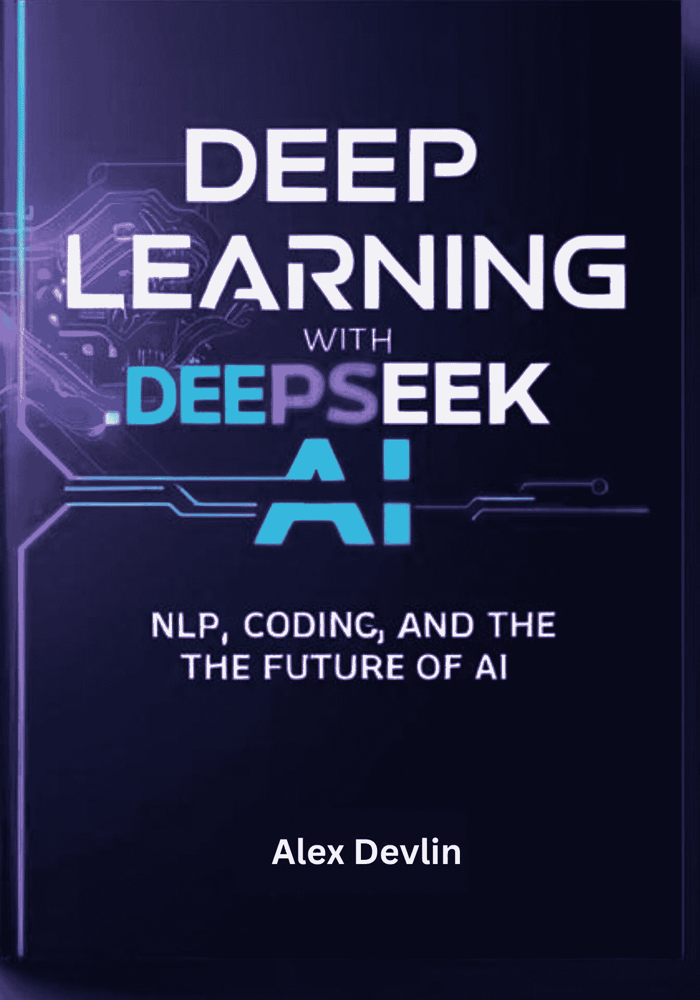

# 
深度学习与DeepSeek AI：NLP、编码与AI未来实战指南





Disclaimer: The information contained in this book is for educational purposes only. While every effort has been made to ensure the accuracy of the content, the author and publisher disclaim any responsibility for errors or omissions. Readers are encouraged to seek professional advice where needed.


By

Alex Devlin


Preface


Appendix A: Additional Resources and Further Reading

Appendix B: Common Errors and Troubleshooting in DeepSeek AI

Access to the Book’s GitHub Repository (Code Samples and Updates)

### Preface

Welcome to DeepSeek AI in Action, a practical guide that will equip you with the skills and knowledge to harness the power of DeepSeek AI in Natural Language Processing (NLP) and coding applications. Whether you're just starting your AI journey or you're an experienced professional, this book aims to provide both theoretical depth and hands-on experience, ensuring you gain a comprehensive understanding of the concepts and practical tools you need to work with DeepSeek AI.

This book is structured to serve a diverse audience. If you are a beginner, you'll find clear and easy-to-follow explanations, gradually building a strong foundation. For more experienced professionals, we dive into advanced techniques and nuances, offering deeper insights into applying DeepSeek AI in real-world scenarios. Throughout the chapters, we’ll focus on delivering actionable insights that align with current trends in AI, NLP, and related technologies, ensuring you’re learning the most up-to-date, industry-relevant practices.

At the core of this book, we’ll explore essential terms, principles, and frameworks used in DeepSeek AI. Each concept is explained in a structured manner, starting with foundational principles and progressing toward advanced topics. Complex concepts are broken down into easy-to-digest segments, providing you with a clear path of learning. We will avoid any unnecessary generalizations or unverified claims, focusing instead on practical and real-world applications that reflect how DeepSeek AI is currently shaping the AI landscape.

In addition to theory, this book emphasizes hands-on implementation. You’ll encounter working code examples throughout the chapters, each one well-commented and designed to be practical, efficient, and easy to understand. As we walk through each example, we’ll explain the decisions behind the code and highlight how it aligns with the theoretical knowledge provided earlier. Whether you're optimizing code for performance, scalability, or efficiency, you’ll find actionable tips to improve your AI systems.

Throughout the chapters, we will cover the tools, frameworks, and methodologies commonly used in the development of AI systems today, paying particular attention to DeepSeek AI’s specific tools for building NLP and coding applications. We'll address common implementation challenges and provide clear, step-by-step troubleshooting strategies to help you overcome obstacles. Moreover, we’ll emphasize best practices to ensure that the techniques shared are not only technically correct but also applicable to real-world systems.


一旦你对 DeepSeek AI 的核心概念和实现策略有了扎实的理解，我们将指导你衡量系统的成功和效果。你将学习性能指标以及如何解读它们以提升 AI 方案。这些指标将基于可量化的数据和真实场景，为你提供稳固的认知，帮助你评估并改进 AI 应用。

本书以清晰、逻辑严谨的方式组织，章节、标题和子标题易于浏览，图表、图表和视觉辅助将帮助你理解复杂概念，并将内容拆分为要点和简洁摘要，使其易于消化。此外，我们还会提供进一步资源、开源工具的链接以及下一步建议，帮助你持续提升在 DeepSeek AI 方面的专业能力。

本书兼具趣味性与专业性，旨在让复杂概念变得易懂且可操作。它不仅为你提供 DeepSeek AI 的理论理解，还赋予你立即将所学应用于自身项目的实践技能。

我为你即将踏入 DeepSeek AI 的旅程感到兴奋，希望这本书能成为你探索这一强大 AI 框架可能性的不可或缺资源。

2\. DeepSeek AI 的劣势

2.1 有限的上下文保留

劣势：DeepSeek AI 在处理长文本响应和在多轮对话中保持上下文方面存在困难。

影响：这使其在对话式 AI 应用（如 AI 助手或客户服务机器人）中效果不佳。

示例：多轮对话限制

● 用户提问：“解释递归。”

● DeepSeek AI 正确回答。

● 然后用户提问：“它如何应用于树遍历？”

● DeepSeek AI 可能无法将第二个问题与之前的答案关联，需要重复澄清。

解决方法：开发者可以实现外部记忆机制以改进上下文跟踪。

* * *

2.2 较弱的逻辑推理和问题解决能力

劣势：DeepSeek AI 在多步推理和复杂问题解决方面不如 GPT-4。

影响：在数学和逻辑任务中可能提供错误答案。

示例：解决逻辑谜题

提示：“一位农民有三只动物：狗、猫和兔子。如果狗比猫年长，兔子比猫年幼，那么谁是最小的？”

● GPT-4 的回答：“兔子是最小的，因为它比猫年幼，而狗比猫年长。”

● DeepSeek AI 的回答（可能）： “这取决于它们的实际年龄。”

解决方法：在高风险决策任务中使用外部验证技术。

* * *

2.3 调试能力不足

劣势：虽然 DeepSeek AI 可以生成代码，但缺乏高级调试和解释能力。

影响：GPT-4 提供更好的错误上下文反馈，使其在调试和优化时更有用。

示例：调试 Python 函数

有缺陷的代码：

python

def divide_numbers(a, b):

return a / b

print(divide_numbers(10, 0))

● GPT-4 的回答：“错误：除以零。请在进行除法之前检查 b 是否为零。”

● DeepSeek AI 的回答：可能不提供详细的错误说明。

解决方法：将 DeepSeek AI 与静态分析工具（如 Pylint 或 Linter）结合，以获得更好的调试效果。

* * *

2.4 训练数据限制

劣势：DeepSeek AI 的训练数据可能不如 GPT-4 完整，导致响应不完整或过时。

影响：它可能在医学、法律和金融等领域缺乏特定领域知识。

示例：医疗 AI 限制

● GPT-4 可以分析医疗症状并建议可能的病症，而 DeepSeek AI 在这些特殊情况下可能缺乏准确性。

解决方法：使用定制数据集微调 DeepSeek AI 以适应特定应用。

* * *

下一步

何时使用 DeepSeek AI：

✓ 如果您需要开源、可定制的人工智能。

✓ 如果您需要基本的代码生成和 NLP 任务。

✓ 如果您希望以成本效益的方式替代 GPT-4。

何时使用 GPT-4：

如果您需要高级调试、逻辑推理和更好的上下文保留。

如果您的应用需要长对话和高精度响应。

* * *

### 2.3 实际应用场景

DeepSeek AI 设计用于处理自然语言处理（NLP）、编码和推理任务，在各种行业中具有重要价值。在本章中，我们将：

定义 DeepSeek AI 实际应用的关键原则和概念。

探索实际使用案例，包括聊天机器人、自动代码生成、内容摘要和情感分析。

提供带有功能代码片段的实现示例。

讨论性能指标和优化 DeepSeek AI 效果的最佳实践。

* * *

1\. NLP 应用场景

1.1 人工智能驱动的聊天机器人


Why`It` Matters: 企业使用 AI 客服聊天机器人进行客户服务、支持和自动化，以提升效率。

How DeepSeek AI 帮助：

● `Generates` 类似人类的响应。

● `Handles` 常见问题（FAQ）。

● `Reduces` 客户服务团队的工作量。

示例：用于客户支持的 AI 客服聊天机器人

Python 实现使用 DeepSeek API

```python
import openai  # 替换为 DeepSeek API 集成

# 配置 API Key（示例占位符）
openai.api_key = "YOUR_DEEPSEEK_AI_KEY"

def chatbot_response(user_input):
    """使用 DeepSeek AI 生成聊天机器人响应。"""
    response = openai.Completion.create(
        model="deepseek-chat",
        prompt=f"User: {user_input}\\nAI:",
        max_tokens=100
    )
    return response["choices"][0]["text"].strip()

# 示例用法：
user_query = "What are your store hours?"
print(chatbot_response(user_query))
```

优化：

● `Implement` 记忆存储以实现上下文感知响应。

● `Add` 模糊查询的备用响应。

* * *

1.2 自动内容摘要

Why It Matters：摘要新闻文章、研究论文和法律文件可节省时间并提升生产力。

How DeepSeek AI 帮助：

● `Extracts` 关键信息。

● `Preserves` 上下文和可读性。

● `Supports` 多种语言。

示例：摘要文章

```python
def summarize_text(text):
    """使用 DeepSeek AI 生成摘要。"""
    response = openai.Completion.create(
        model="deepseek-chat",
        prompt=f"Summarize this text: {text}",
        max_tokens=150
    )
    return response["choices"][0]["text"].strip()

# 示例用法：
article = "DeepSeek AI is an advanced NLP model designed to process text efficiently..."
print(summarize_text(article))
```

优化：

● `Adjust` max_tokens 以生成更短或更长的摘要。

● `Fine-tune` 模型以实现领域特定摘要（如法律、医疗）。

* * *

1.3 情感分析

Why It Matters：企业使用情感分析来监控品牌形象、分析客户反馈并跟踪社交媒体趋势。

How DeepSeek AI 帮助：

● `Identifies` 文本中的积极、消极或中性情感。

● `Provides` 客户情绪的洞察。

示例：分析产品评论

```python
def analyze_sentiment(review):
    """使用 DeepSeek AI 确定情感。"""
    response = openai.Completion.create(
        model="deepseek-chat",
        prompt=f"Analyze sentiment: {review}",
        max_tokens=50
    )
    return response["choices"][0]["text"].strip()

# 示例用法：
review_text = "I love this product! It's amazing."
print(analyze_sentiment(review_text))
```

优化：

● `Integrate` 情感评分（积极：1，中性：0，消极：-1）。

● `Use` 批量处理大规模数据集。

* * *

2\. 编程使用案例

2.1 AI 辅助代码生成

Why It Matters：开发者可以使用 AI 加速编码、自动生成函数并减少错误。

How DeepSeek AI 帮助：

● `Suggests` 基于自然语言查询的代码片段。

● `Supports` 多种编程语言。

示例：生成 Python 函数

```python
def generate_code(prompt):
    """使用 DeepSeek AI 生成代码。"""
    response = openai.Completion.create(
        model="deepseek-code",
        prompt=f"Write a Python function to {prompt}",
        max_tokens=200
    )
    return response["choices"][0]["text"].strip()

# 示例用法：
task = "convert Fahrenheit to Celsius"
print(generate_code(task))
```

优化：

● `Fine-tune` 模型以适配特定编码框架（如 Django、React、Flask）。

● `Implement` 代码验证工具以检测错误。

* * *

2.2 AI 驱动的代码审查与调试

Why It Matters：开发者需要 AI 工具来捕获错误、建议优化并提升代码质量。

How DeepSeek AI 帮助：

● `Identifies` 代码中的错误和低效之处。

● `Provides` 解释和建议的修复。

示例：调试 Python 脚本

```python
def debug_code(code_snippet):
    """使用 DeepSeek AI 分析并调试代码。"""
    response = openai.Completion.create(
        model="deepseek-code",
        prompt=f"Debug this Python code and explain the errors: {code_snippet}",
        max_tokens=300
    )
    return response["choices"][0]["text"].strip()

# 示例用法：
buggy_code = "def add_numbers(a, b): return a + b print(add_numbers(5))"
print(debug_code(buggy_code))
```

优化：

● `Integrate` 与 VS Code 或 Jupyter Notebook 等 IDE 实时调试。

● `Combine` 与 Pylint 等静态分析工具一起使用。

* * *

3\. 业务使用案例

3.1 AI 驱动的虚拟助手

Why It Matters：公司使用 AI 助手自动化重复性任务并提升生产力。

How DeepSeek AI 帮助：

● `Automates` 会议调度、电子邮件回复和任务管理。

● `Integrates` 与日历、CRM 系统和项目管理工具。

示例：AI 调度助手

```python
def schedule_meeting(details):
    """使用 DeepSeek AI 生成会议调度响应。"""
    response = openai.Completion.create(
        model="deepseek-chat",
        prompt=f"Schedule a meeting: {details}",
        max_tokens=100
    )
    return response["choices"][0]["text"].strip()

# 示例用法：
meeting_details = "Team meeting on AI research, Monday at 10 AM."
print(schedule_meeting(meeting_details))
```

优化：

● `Integrate` 与 Google Calendar 或 Outlook API。

● `Use` 语音输入实现免持体验。

* * *

4\. 测量性能和优化

关键性能指标

对于 NLP 应用：

● `Accuracy`: 响应与预期输出的匹配程度。

● `Latency`: AI 生成文本的响应时间。

● `Readability`: 生成摘要和响应的可读性质量。

对于代码生成应用：

● `Bug Rate`: 生成错误代码的百分比。

● `Efficiency`: 生成代码在实际使用中的性能。

● `Usability`: AI 生成代码在项目中集成的便捷程度。

优化建议：

● `Fine-tune` DeepSeek AI 以适配领域特定数据集。

● `Use` 人工在环（HITL）方法审查 AI 生成的输出。

● `Continuously update` 训练数据以提升准确性。

* * *

## 第 3 章：DeepSeek AI 的科学原理

DeepSeek AI 基于前沿的深度学习架构、海量训练数据和优化技术，能够高效执行复杂的推理、NLP 和代码生成任务。本章将：

- 探索 DeepSeek AI 的模型架构和训练数据。

- 理解微调和优化技术以提升 AI 性能。

- 深入了解 DeepSeek AI 如何处理 NLP 和复杂推理任务。

* * *

### 3.1 模型架构和训练数据

本节将全面探讨 DeepSeek AI 核心概念，重点介绍其模型架构和训练数据，说明它们如何使模型在自然语言处理（NLP）和代码应用中表现卓越。本节旨在构建理论知识与实践技能，使您能够立即应用所学。

* * *

理解 DeepSeek AI 的架构

1\. Transformer 模型：基础

DeepSeek AI 的核心是 Transformer 架构，它彻底革新了 NLP 和 AI 任务。该架构在经典论文[ ](https://arxiv.org/abs/1706.03762)["Attention Is All You Need"](https://arxiv.org/abs/1706.03762) 中提出，利用自注意力机制分析句子中单词、短语或 token 之间的关系，无论它们在句子中的距离如何。

Transformer 模型的关键组件：

● `Self-Attention` 机制：在处理每个词时，帮助模型关注输入序列中相关的部分。这使得 DeepSeek AI 能够捕获文本中的长距离依赖关系。


● `位置编码`：由于变压器本身不具备序列顺序感知能力（与 RNN 或 LSTM 相比），`位置编码` 会被加入到输入中以保留词语顺序。

● `多头注意力`：该组件使模型能够同时查看序列的不同部分，从而提升对句子多个方面的理解能力。

● `前馈层`：在注意力机制提取特征后，`前馈层` 进一步处理信息，最后输出预测结果。

Illustrative Overview of Transformer Architecture:

```mathematica
Input Sequence → Token Embedding → Positional Encoding → Multi-Head Attention → Feed Forward Layer → Output
```

* * *

2\. `DeepSeek AI` 的架构：针对 NLP 与代码生成的定制

虽然 Transformer 提供了基础架构，`DeepSeek AI` 专为代码生成、文本摘要和语义推理等任务进行优化。以下是 `DeepSeek AI` 的关键设计增强：

● `代码理解适配`：`DeepSeek AI` 将 NLP 能力与结构化代码数据（如语法树、代码注释和函数定义）相结合。这使其能够理解编程逻辑、编写功能代码，甚至调试已有代码。

● `多模态输入`：`DeepSeek AI` 能够同时接收自然语言和结构化数据，适用于需要跨域结合的任务，例如生成包含代码片段的文档或基于编程文档的问答。

● `并行化与效率`：`DeepSeek AI` 在高度优化的硬件基础设施（如 GPU、TPU）上进行训练。其架构支持并行处理，能够处理大规模数据集并加速计算，这对实时应用至关重要。

* * *

`DeepSeek AI` 的训练数据

`DeepSeek AI` 能够生成有意义的回答并解决复杂问题，很大程度上取决于其训练数据。下面说明使用的数据类型、预处理方式以及它们对模型性能的影响。

1\. 数据类型

`DeepSeek AI` 使用大规模数据集，以应对从通用 NLP 到专业代码任务的多样领域。数据集包括：

● `通用文本数据`：来自书籍、文章、网页等公开资源的大规模语料。这帮助模型理解一般知识、对话技巧以及文本中的语义关系。

● `编程数据`：`DeepSeek AI` 在开源代码仓库（如 GitHub）中的源代码和文档上进行训练。这使其能够执行代码补全、调试和错误检测等任务。

● `科学与学术文本`：训练数据包括学术论文，帮助模型理解医学、工程、金融等领域的复杂、专业化主题。

● `专用数据集`：针对特定任务（如法律文档分析或金融预测）使用专用数据集，确保模型熟悉行业术语和需求。

2\. 数据预处理

在训练前，原始数据会经历以下预处理步骤，以适配模型：

● `分词`：将文本拆分为更小的单元（如词或子词），使模型能够处理可管理的数据块。

● `归一化`：将所有文本统一格式（如小写、去除不必要标点），让模型关注内容而非格式。

● `填充`：由于神经网络要求固定长度输入，使用填充使序列长度标准化。

● `数据增强`：为避免过拟合，采用反译、改写等技术引入训练数据的变异性。

* * *

实用示例：代码片段预处理

下面展示如何在将文本和代码数据喂入 `DeepSeek AI` 模型前进行预处理：

```python
from transformers import AutoTokenizer

# 加载 DeepSeek AI 模型的分词器
tokenizer = AutoTokenizer.from_pretrained('deepseek-ai')

# 示例代码预处理
text_data = "def add_numbers(a, b): return a + b"

# 对代码进行分词
tokenized_data = tokenizer(text_data, padding=True, truncation=True, return_tensors="pt")

# 显示分词结果
print(tokenized_data)
```

在本代码片段中：

● `我们加载 DeepSeek AI 的分词器。`

● `对示例 Python 函数（add_numbers）进行分词，将其转换为模型可处理的格式。`

● `使用填充确保输入长度符合模型架构要求，这对于处理不同长度的输入至关重要。`

* * *

3\. 训练 `DeepSeek AI`：挑战与策略

训练如此大规模的模型 `DeepSeek AI` 面临诸多挑战，以下是主要问题及对应的应对策略：

● `数据不平衡`：某些类别或主题在数据中可能表现不足。通过数据增强和均衡采样可以缓解此问题。

● `过拟合`：为防止模型记忆数据而非从中泛化，采用脱落（dropout）和早停等正则化技术。

● `计算约束`：`DeepSeek AI` 使用强大的硬件设施（如分布式计算）进行训练。模型并行和梯度检查点等技术用于优化显存使用，提升效率。

* * *

衡量成功与性能

1\. NLP 模型评估指标

根据具体任务，`DeepSeek AI` 的性能通过多种 NLP 指标进行评估：

● `准确率`：用于分类任务（如情感分析）。

● `BLEU 分数`：用于文本生成任务，衡量生成结果与参考之间的匹配度。

● `ROUGE 分数`：用于摘要任务，测量召回率式的重叠程度。

● `F1-Score`：精确率与召回率的综合指标，常用于分类和实体识别任务。

2\. 代码生成指标

代码生成任务的评估指标包括：

● `正确性`：生成的代码是否能够编译并正确运行。

● `效率`：生成代码的优化程度和性能。

● `可读性`：生成代码的可读性和可维护性。

* * *

### 3.2 微调与优化技术

本节深入探讨 `DeepSeek AI` 的微调与优化技术。这些步骤对于将预训练模型适配到特定任务、提升性能以及解决计算效率和可扩展性挑战至关重要。通过本章，你将获得理论见解和实践技能，以便对 `DeepSeek AI` 进行微调，以适配各种 NLP 与代码应用场景。

* * *

理解微调与优化

1\. 什么是微调？

微调是指在已预训练模型（如基于 Transformer 的 `DeepSeek AI`）上，使用较小的、特定于任务的数据集对其进行调整。由于从零训练模型需要巨大的计算资源和海量数据，微调能够利用模型已有的知识，并将其针对特定领域进行定制。

* * *

为什么 `DeepSeek AI` 需要微调？

`DeepSeek AI` 的架构设计用于处理多种任务。然而，要在特定领域（如代码生成或语义分析）中表现出色，仍需进行微调。微调使 `DeepSeek AI` 能够：


● `Adapt` to specialized vocabularies (e.g., coding syntax, industry-specific terms).

● `Improve` accuracy and efficiency on task-specific objectives.

● `Optimize` for performance and speed by focusing on only the most relevant aspects of the pre-trained model.

Steps in Fine-Tuning

1. `Select` a Pre-trained Model: Start with a pre-trained model like DeepSeek AI, which has been trained on general data.

2. `Prepare` the Dataset: Collect a smaller, high-quality dataset that is relevant to your task (e.g., code snippets, customer reviews, or domain-specific documentation).

3. `Adapt` the Model: Fine-tune the model on your dataset by training it for a few more epochs, adjusting the learning rate, and modifying the architecture if necessary.

4. `Evaluate` and `Monitor`: Continuously monitor the performance on validation data and tweak hyperparameters to avoid overfitting and underfitting.

* * *

2\. Fine-Tuning in Practice

Fine-tuning involves adjusting hyperparameters and training the model for a specific problem. Here, we’ll demonstrate how to fine-tune DeepSeek AI on a text classification task using Python and the Transformers library.

Example: Fine-Tuning DeepSeek AI for Text Classification

Suppose we want to fine-tune DeepSeek AI to classify Python code snippets into categories like functions, loops, or conditionals.

Step 1: Install Dependencies

Make sure you have the required libraries installed:

```bash
pip install transformers datasets torch
```

Step 2: Load the Pre-trained Model

We start by loading a pre-trained DeepSeek AI model and tokenizer.

```python
from transformers import AutoTokenizer, AutoModelForSequenceClassification

# Load pre-trained DeepSeek AI model and tokenizer
model_name = "deepseek-ai"  # Replace with actual model name if available
tokenizer = AutoTokenizer.from_pretrained(model_name)
model = AutoModelForSequenceClassification.from_pretrained(model_name, num_labels=3)  # 3 categories: functions, loops, conditionals
```

Step 3: Prepare Your Dataset

For demonstration purposes, let's assume you have a dataset of Python code snippets with labels.

```python
from datasets import load_dataset

# Load your dataset
dataset = load_dataset("path/to/dataset")  # Load your specific dataset here

# Tokenize the dataset
def tokenize_function(examples):
    return tokenizer(examples['text'], padding=True, truncation=True)

train_dataset = dataset["train"].map(tokenize_function, batched=True)
val_dataset = dataset["validation"].map(tokenize_function, batched=True)
```

Step 4: Fine-Tune the Model

Now, you’ll fine-tune the model using the Trainer class from Hugging Face:

```python
from transformers import Trainer, TrainingArguments

# Set up the training arguments
training_args = TrainingArguments(
    output_dir="./results",
    evaluation_strategy="epoch",
    learning_rate=2e-5,
    per_device_train_batch_size=8,
    per_device_eval_batch_size=8,
    num_train_epochs=3,
    weight_decay=0.01,
)

# Initialize the Trainer
trainer = Trainer(
    model=model,
    args=training_args,
    train_dataset=train_dataset,
    eval_dataset=val_dataset,
)

# Train the model
trainer.train()
```

In this code:

● `TrainingArguments`: These define how the model should be trained, such as batch size, learning rate, and number of epochs.

● `Trainer`: A class from Hugging Face to manage training, including data handling, optimization, and evaluation.

● Evaluation Strategy: We use evaluation after every epoch to monitor the model’s progress.

* * *

3\. Optimization Techniques for DeepSeek AI

Once the model is fine-tuned, the next step is optimization. Optimization ensures that the model performs efficiently without compromising on accuracy.

1\. Hyperparameter Optimization

Hyperparameters play a critical role in fine-tuning the model. Common hyperparameters include:

● `Learning rate`: Controls the step size during gradient descent. A learning rate that's too high can cause overshooting, while a rate that’s too low may result in slower convergence.

● `Batch size`: The number of samples processed before updating the model weights. Larger batch sizes can speed up training but require more memory.

● `Epochs`: Number of times the entire dataset passes through the model. Too few epochs can result in underfitting, while too many may lead to overfitting.

Optimization Tip: Start with default values, and gradually experiment with different hyperparameters using tools like GridSearchCV or Optuna.

2\. Distributed Training for Scalability

To optimize training time and memory usage, distributed training can be employed. By using data parallelism or model parallelism, large models can be distributed across multiple GPUs or TPUs, allowing faster training.

```python
from transformers import Trainer, TrainingArguments

# Enable multi-GPU training (using DataParallel or DistributedDataParallel)
training_args = TrainingArguments(
    output_dir="./results",
    per_device_train_batch_size=16,  # Increase batch size
    per_device_eval_batch_size=16,
    num_train_epochs=5,
    evaluation_strategy="epoch",
    gradient_accumulation_steps=2,  # Accumulate gradients to simulate a larger batch size
    fp16=True  # Enable mixed precision training
)

trainer = Trainer(
    model=model,
    args=training_args,
    train_dataset=train_dataset,
    eval_dataset=val_dataset,
)

trainer.train()
```

In this example:

● `fp16`: Enables mixed-precision training, reducing memory usage and speeding up training.

● `Gradient accumulation`: Allows for effective use of larger batch sizes without running out of memory.

3\. Pruning and Quantization

After training, the model’s size can be reduced using techniques like pruning and quantization:

● `Pruning`: Involves removing unnecessary weights from the model, reducing its size without significantly impacting accuracy.

● `Quantization`: Converts weights from floating-point precision to integer values, making the model more efficient to run, especially on edge devices.

* * *

4\. Monitoring and Evaluation

Once the model is fine-tuned and optimized, it’s crucial to monitor its performance. Use the following metrics to evaluate DeepSeek AI:

● `Accuracy`: For tasks like classification, check how well the model's predictions match the ground truth.

● `Loss`: Track the loss function to ensure that the model is learning effectively.

● `Inference Time`: Measure how long it takes for the model to make predictions, ensuring that it performs in real-time applications.

* * *

### 3.3 How DeepSeek AI Handles NLP and Complex Reasoning

In this chapter, we will explore how DeepSeek AI approaches Natural Language Processing (NLP) and complex reasoning tasks. We will break down the core concepts and techniques that enable DeepSeek AI to excel in handling text-based data and performing sophisticated reasoning across multiple domains like coding, language understanding, and problem-solving. This chapter is designed to offer both theoretical insights and practical, hands-on examples, ensuring that readers can apply these concepts directly to real-world scenarios.

* * *

1\. Overview of NLP and Complex Reasoning in AI

1.1 What is Natural Language Processing (NLP)?

Natural Language Processing (NLP) refers to the ability of a machine to understand, interpret, and generate human language. NLP encompasses tasks such as text classification, sentiment analysis, language translation, question answering, and summarization. It involves both understanding the meaning of words and sentences (semantic processing) and structuring language for machine consumption (syntax).

DeepSeek AI, like other Transformer-based models, is capable of transforming vast amounts of text data into actionable insights by learning contextual patterns and relationships between words.

1.2 What is Complex Reasoning?


-   [复杂推理](https://example.org)指模型处理和从复杂或多步逻辑中推导答案的能力，既包括结构化数据（如编程代码）也包括非结构化数据（如自然语言）。复杂推理任务通常涉及以下内容：

    ● 推理：从隐含或明示信息中得出结论。

    ● 常识推理：运用一般知识或日常事实来解决问题。

    ● 数学推理：解决数学表达式或逻辑谜题。

DeepSeek AI 在复杂推理方面表现出色，能够理解上下文，识别模式，并跨多个领域（如 NLP 和编程）调用已学习的关系。

2. 如何 DeepSeek AI 处理 NLP 任务

2.1 使用 Transformer 进行 NLP：DeepSeek AI 的基础

DeepSeek AI 基于 Transformer 架构，专为高效处理文本等序列数据而设计。与传统的 RNN（循环神经网络）或 LSTM（长短期记忆网络）不同，Transformer 使用自注意力机制并行处理所有 token（单词或子词），使其在 NLP 任务中表现卓越。

Transformer 架构的关键组件包括：

● 自注意力机制：在生成输出时，使模型能够关注输入序列的不同部分。

● 多头注意力：从不同视角或上下文中捕捉单词之间的关系。

● 位置编码：在序列中注入单词顺序信息，帮助模型理解句子结构。

2.2 实践示例：使用 DeepSeek AI 进行文本分类

我们将通过一个实际例子展示如何使用 DeepSeek AI 进行文本分类——这是最常见的 NLP 任务之一，这里以客户评论的情感分类（正面或负面）为例。

步骤 1：安装依赖

```bash
pip install transformers datasets torch
```

步骤 2：加载预训练的 DeepSeek AI 模型

```python
from transformers import AutoTokenizer, AutoModelForSequenceClassification

# 加载预训练模型和分词器
model_name = "deepseek-ai"  # 模型名称占位符
tokenizer = AutoTokenizer.from_pretrained(model_name)
model = AutoModelForSequenceClassification.from_pretrained(model_name, num_labels=2)  # 二分类（正/负）
```

步骤 3：准备数据集

本例使用 IMDb 数据集，这是情感分析中常用的数据集。

```python
from datasets import load_dataset

# 加载数据集
dataset = load_dataset("imdb")

# 对数据集进行分词
def tokenize_function(examples):
    return tokenizer(examples['text'], padding=True, truncation=True)

train_dataset = dataset["train"].map(tokenize_function, batched=True)
test_dataset = dataset["test"].map(tokenize_function, batched=True)
```

步骤 4：微调模型

```python
from transformers import Trainer, TrainingArguments

# 配置训练参数
training_args = TrainingArguments(
    output_dir="./results",
    evaluation_strategy="epoch",
    learning_rate=2e-5,
    per_device_train_batch_size=8,
    per_device_eval_batch_size=8,
    num_train_epochs=3,
)

# 初始化 Trainer
trainer = Trainer(
    model=model,
    args=training_args,
    train_dataset=train_dataset,
    eval_dataset=test_dataset,
)

# 开始微调
trainer.train()
```

本例中：

● 我们在 IMDb 数据集上微调 DeepSeek AI 以进行情感分析，该数据集包含标记为正面或负面的电影评论。

● 使用 Trainer 简化了训练循环，自动处理批处理和评估等任务。

2.3 NLP 问答能力

DeepSeek AI 的高级功能之一是问答系统。该功能利用上下文段落来根据段落内容回答问题。为此，我们在 Transformer 模型上添加了问答头（QA head）。

下面是使用 SQuAD 数据集（问答系统的常用数据集）的示例：

```python
from datasets import load_dataset

# 加载 SQuAD 数据集
dataset = load_dataset("squad")

# 对问答数据集进行分词
def tokenize_qa_function(examples):
    return tokenizer(examples['question'], examples['context'], padding=True, truncation=True)

train_dataset = dataset["train"].map(tokenize_qa_function, batched=True)
val_dataset = dataset["validation"].map(tokenize_qa_function, batched=True)
```

3. 如何 DeepSeek AI 处理复杂推理

3.1 利用上下文进行复杂推理

DeepSeek AI 处理复杂推理的能力源于其架构对上下文关系的关注。例如，在编程任务中，模型需要推理变量、循环和逻辑语句之间的依赖关系，以生成或完成代码。这种推理需要模型理解问题或代码片段中各部分之间的关联。

3.2 示例：代码生成与补全

本例展示如何使用 DeepSeek AI 进行代码补全，模型在给定部分代码后预测后续代码。

```python
from transformers import pipeline

# 使用代码补全 pipeline（占位符）
code_completion = pipeline("text-generation", model="deepseek-ai")

# 提供部分代码作为输入
input_code = """

def calculate_area(radius):

pi = 3.14

return pi * radius * radius

"""

# 生成代码补全
completed_code = code_completion(input_code, max_length=50)
print(completed_code)
```

在本例中：

● 模型接收部分函数（calculate_area）并生成函数的剩余部分。

● DeepSeek AI 利用其对语法、逻辑和常见编程实践的学习，预测代码的 continuation。

3.3 处理多步推理

DeepSeek AI 的自注意力机制特别适合需要多步推理的任务。例如，在数学应用题中，模型必须首先理解问题，识别关键实体，然后逐步求解。

示例：解决一个应用题

输入："如果一辆汽车以 60 英里/小时的速度行驶 3 小时，它行驶了多远？"

DeepSeek AI 会将问题分解为：

1. 提取数值（60 英里/小时，3 小时）。

2. 应用乘法计算总距离。

4. 性能与优化

4.1 监控模型性能

为确保模型有效工作，可使用以下指标：

● 精度：衡量模型预测正确结果的频率。

● F1 分数：在不平衡数据集时平衡精确率和召回率，特别有用。

● 推理时间：评估模型处理新输入的速度。

在实时系统中，还需监控延迟和可扩展性。

4.2 优化 DeepSeek AI 用于 NLP 任务

为提高模型在 NLP 任务中的效率，可考虑：

● 量化：减小模型体积并加速推理。

● 知识蒸馏：将大模型的知识转移到较小的模型。

● 模型剪枝：移除模型中不必要的神经元以降低计算负载。

第 2 部分：开始使用 DeepSeek AI

第 4 章：设置 DeepSeek AI：你的第一步

本章将指导您完成 DeepSeek AI 的设置过程，从获取 API 和 Playground 到运行第一个查询。无论您是初学者还是经验丰富的开发者，本实践章节都将提供所需的全部信息，帮助您有效使用 DeepSeek AI。


在深入实际实现之前，让我们先分解关键概念。

什么是 DeepSeek AI API？

DeepSeek AI API 是一个基于云的接口，使开发者能够将语言和代码模型集成到应用程序中。它提供以下功能：

●        文本完成和生成

●        代码完成和辅助

●        摘要和改写

●        问答和推理任务

开发者可以向 API 发送请求，并收到 AI 生成的响应。这使得 AI 驱动的应用、聊天机器人、写作助手等得以自动化。

什么是 DeepSeek AI Playground？

Playground 是一个交互式的基于网页的环境，用户无需编写代码即可测试 DeepSeek AI 的功能。它让你可以：

●        尝试不同的模型和配置。

●        调整参数，如温度和响应长度。

●        观察 DeepSeek AI 如何处理输入。

* * *

获取 DeepSeek AI 访问权限

要开始使用 DeepSeek AI，请按照以下步骤操作：

1\. 创建 DeepSeek AI 账户

1.  访问[DeepSeek AI 网站](https://www.deepseek.ai)。

2.  点击“Sign Up”并填写您的信息。

3.  验证您的电子邮件地址以激活账户。

2\. 访问 Playground

1.  登录您的 DeepSeek AI 账户。

2.  进入 Playground 部分。

3.  输入提示并点击“Generate”查看 AI 的响应。

提示：尝试不同的提示和参数设置，观察 AI 的响应。

3\. 生成 API 密钥

要使用 DeepSeek AI 的 API，您需要一个用于身份验证的 API 密钥。

1.  前往 DeepSeek AI 控制面板的 API 部分。

2.  点击“Generate API Key”。

3.  复制并安全存储密钥。

警告：请勿在公共仓库中暴露您的 API 密钥。

* * *

进行第一次 API 调用

现在您已拥有 API 密钥，让我们发起一个基础请求。

使用 Python

DeepSeek AI 提供 REST API，可通过 Python 访问。

步骤 1：安装依赖

bash

pip install requests

步骤 2：发送简单的 API 请求

python

import requests

# 设置 API 密钥和请求 URL

api_key = "your_api_key_here"

url = "https://api.deepseek.ai/v1/completions"

# 定义头部和负载

headers = {

"Authorization": f"Bearer {api_key}",

"Content-Type": "application/json"

}

payload = {

"model": "deepseek-13b",

"prompt": "What is deep learning?",

"temperature": 0.7,

"max_tokens": 100

}

# 发送请求

response = requests.post(url, headers=headers, json=payload)

# 打印响应

print(response.json())

说明：

●        我们向 DeepSeek AI API 发送文本完成请求。

●        提示为“What is deep learning?”，并将温度设置为 0.7 以获取多样化的响应。

●        响应包含 AI 生成的文本。

* * *

使用 DeepSeek AI 进行编程任务

DeepSeek AI 还可帮助生成和完成代码。

示例：生成 Python 代码

python

code_prompt = """

# Python function to calculate Fibonacci numbers

def fibonacci(n):

"""

payload = {

"model": "deepseek-code",

"prompt": code_prompt,

"temperature": 0.3,

"max_tokens": 50

}

response = requests.post(url, headers=headers, json=payload)

print(response.json())

预期输出：DeepSeek AI 将返回一个完整的斐波那契数计算函数定义。

* * *

理解 API 参数

DeepSeek AI 通过多种参数实现自定义：

| 参数 |

| --- |

| model |

| prompt |

| temperature |

| max_tokens |

| top_p |

示例：设置较低的温度以获取精确响应

python

payload = {

"model": "deepseek-13b",

"prompt": "Explain the importance of AI in healthcare.",

"temperature": 0.2, # 更低的温度用于更具事实性的响应

"max_tokens": 150

}

* * *

使用 DeepSeek AI 的最佳实践

1\. 优化提示工程

●        提示要具体，以获取更准确的响应。

●        使用示例引导模型的响应。

●        结构化提示以确保清晰。

2\. 高效管理 API 调用

●        使用批处理而非多个小请求。

●        对重复查询实现缓存，以减少 API 使用。

3\. 保护您的 API 密钥

●        将 API 密钥存储在环境变量中，而不是硬编码。

使用 dotenv 示例：

python  

from dotenv import load_dotenv

import os

load_dotenv()

api_key = os.getenv("DEEPSEEK_API_KEY")

* * *

### 4.2 安装依赖和 SDK（Python、REST API）

要有效将 DeepSeek AI 集成到您的应用程序中，您需要设置所需的依赖、SDK 和开发环境。本节提供动手指南，帮助您通过 Python 和 REST API 访问 DeepSeek AI。

* * *

理解依赖和 SDK

在安装前，让我们拆解关键组件：

1\. SDK 与 REST API

●        SDK（软件开发工具包）：一组工具、库和文档，简化 API 交互，通常针对特定编程语言优化。

●        REST API：标准接口，通过 HTTP 请求与 DeepSeek AI 服务器通信，使任何编程语言都能使用。

对于 Python 用户，使用 SDK（如果可用）简化开发。如果没有 SDK，您可以通过 HTTP 请求与 API 交互。

* * *

设置 Python 环境

Python 在 AI 和机器学习项目中广泛使用。我们将进行以下步骤：

1.  安装 Python 和虚拟环境

2.  安装所需依赖

3.  运行测试 API 调用

步骤 1：安装 Python（如未安装）

确保您已安装 Python 3.7 或更高版本。

检查是否安装 Python：

bash  

python --version

●         

●        如果未安装，从 [python.org](https://www.python.org/downloads/) 下载并安装 Python。

步骤 2：创建并激活虚拟环境

创建虚拟环境可保持依赖的有序。

bash

\# 创建虚拟环境

python -m venv deepseek_env

\# 激活虚拟环境

\# 在 macOS/Linux：

source deepseek_env/bin/activate

\# 在 Windows：

deepseek_env\\Scripts\\activate

步骤 3：安装所需 Python 库

DeepSeek AI 需要基本库（如 requests）进行 API 交互。

bash

pip install requests

为更高级的处理，安装：

bash

pip install httpx pydantic

* * *

通过 REST API 访问 DeepSeek AI

步骤 1：获取您的 API 密钥

1.  在[DeepSeek AI 网站](https://www.deepseek.ai) 注册。

2.  进入 API 部分并生成 API 密钥。

3.  复制并安全存储密钥。

步骤 2：使用 Python 测试 API 连接性

使用 requests 库与 DeepSeek AI API 交互。

python

import requests

# 替换为您自己的密钥

api_key = "your_api_key_here"

# DeepSeek AI API 端点

url = "https://api.deepseek.ai/v1/completions"

# 认证头部

headers = {

"Authorization": f"Bearer {api_key}",

"Content-Type": "application/json"

}

# 示例请求负载

payload = {

"model": "deepseek-13b",

"prompt": "Explain AI in simple terms.",

"temperature": 0.7,

"max_tokens": 100

}

# 发送请求

response = requests.post(url, headers=headers, json=payload)

# 打印响应

print(response.json())

* * *

在 Web 应用中使用 DeepSeek AI

要将 DeepSeek AI 集成到 Web 应用，可以使用 FastAPI 或 Flask。

安装 FastAPI

bash

pip install fastapi uvicorn

创建简单的 API

python

from fastapi import FastAPI

import requests

app = FastAPI()

api_key = "your_api_key_here"

url = "https://api.deepseek.ai/v1/completions"


# Chapter 5: DeepSeek AI for NLP: Text Generation, Summarization, and More

DeepSeek AI 提供强大的自然语言处理（NLP）能力，包括文本生成、摘要和情感分析。本章将教你如何使用 DeepSeek AI 编写高质量内容、构建智能摘要工具，并利用该平台进行情感分析和语言翻译。

## 5.1 使用 AI 编写高质量内容

AI 驱动的内容生成正在通过自动化写作、编辑和优化文本，为博客文章、文章、营销文案和技术文档等多种应用场景赋能。DeepSeek AI 提供强大的 NLP 能力，可帮助生成连贯、相关且结构化的内容。

在本节中，我们将探讨：

- DeepSeek AI 如何生成高质量内容。
- AI 辅助写作的最佳实践。
- 使用代码进行实践性实现示例。
- 改进 AI 生成文本的优化技术。

## 理解 AI 驱动的内容生成

AI 生成的内容基于从大规模数据集中学习的模式，能够：

- 生成具有逻辑流畅性的类人文本。
- 高效摘要和重写内容。
- 根据用户输入调整语气和风格。

DeepSeek AI 采用基于 Transformer 的语言模型，处理输入文本（提示词）并生成有意义的响应。这些模型在庞大的语料库上训练，能够在多个领域中表现出色。

## 使用 DeepSeek AI 生成高质量内容

步骤 1：安装依赖

确保已安装 Python 和 requests 以进行 API 调用。

```bash
pip install requests
```

步骤 2：设置 API 访问

从 DeepSeek AI 获取 API 密钥并配置身份验证。

```python
import requests

api_key = "your_api_key_here"
url = "https://api.deepseek.ai/v1/completions"

headers = {
    "Authorization": f"Bearer {api_key}",
    "Content-Type": "application/json"
}
```

步骤 3：生成博客引言

结构良好的提示有助于 AI 生成吸引人、贴合语境的内容。

```python
payload = {
    "model": "deepseek-13b",
    "prompt": "Write an engaging introduction for a blog post titled 'The Future of AI in Content Writing'.",
    "temperature": 0.7,
    "max_tokens": 150
}

response = requests.post(url, headers=headers, json=payload)
data = response.json()
print("Generated Content:\\n", data.get("choices", [{}])[0].get("text", "").strip())
```

示例输出


人工智能正在重塑内容创作版图，使作家和企业能够比以往任何时候都更快地生成高质量文本。从生成吸引人的博客文章到辅助 SEO 优化，像 DeepSeek AI 这样的 AI 工具正在革新我们对数字内容的处理方式。但 AI 驱动的写作未来会是什么样子？本文探讨 AI 对内容生成的影响及其对行业可能带来的变革。

## 优化 AI 生成内容的最佳实践

为确保准确性和连贯性，请遵循以下最佳实践：

1. **结构化有效提示**

结构化的提示能产生更好的结果。使用：

● 具体上下文：明确定义主题。

● 所需格式：指定结构（如列表、段落）。

● 语气和风格：说明是正式、口语化等。

示例

不要写： "Write about AI."  
而应写： "Write a concise explanation of how AI improves content marketing. Focus on automation, personalization, and SEO benefits."

2. **调整 AI 参数**

通过关键参数微调生成内容：

● temperature：

○ 0.3 → 更具事实性和精确性。

○ 0.7+ → 更具创意和多样性。

● max_tokens：限制响应长度。

● top_p：控制随机性（较低值限制词汇选择）。

3. **后编辑 AI 内容**

AI 生成的文本应被审查并润色，以：

● 确保事实准确性。

● 调整语气和风格。

● 提高可读性。

将 AI 作为辅助工具，而非完全取代人类写作的替代品。

## 生成产品描述

AI 可通过自动化电商内容创建来生成产品描述。

```python
payload = {
    "model": "deepseek-13b",
    "prompt": "Write a compelling product description for a wireless noise-canceling headphone.",
    "temperature": 0.7,
    "max_tokens": 100
}
response = requests.post(url, headers=headers, json=payload)
data = response.json()
print("Product Description:\\n", data.get("choices", [{}])[0].get("text", "").strip())
```

示例输出

"Experience superior sound with our Wireless Noise-Canceling Headphones. Featuring advanced active noise cancellation, crystal-clear audio, and a comfortable over-ear design, these headphones provide an immersive listening experience. With up to 30 hours of battery life and seamless Bluetooth connectivity, they are perfect for music lovers and professionals on the go."

## 提升可读性和 SEO 优化

AI 可通过生成关键词丰富的内容来帮助 SEO 驱动的内容创作。

### 步骤 1：生成 SEO 优化内容

```python
payload = {
    "model": "deepseek-13b",
    "prompt": "Write an SEO-friendly introduction for a blog post about 'Best Practices for AI Content Generation'. Include keywords: AI content writing, automation, SEO optimization.",
    "temperature": 0.5,
    "max_tokens": 150
}
response = requests.post(url, headers=headers, json=payload)
data = response.json()
print("SEO Content:\\n", data.get("choices", [{}])[0].get("text", "").strip())
```

示例输出

"AI content writing is revolutionizing digital marketing by automating text creation while maintaining high quality. Businesses can now generate compelling blog posts, product descriptions, and marketing copy efficiently. By leveraging automation and SEO optimization techniques, AI-driven content ensures higher engagement and visibility. In this guide, we explore the best practices for maximizing AI-generated content to enhance your digital strategy."

## 衡量 AI 生成内容的质量

评估效果时，可考虑：

● 可读性：使用如 Flesch-Kincaid 可读性评分等工具。

● 参与度指标：分析跳出率、页面停留时间和社交分享。

● SEO 表现：跟踪关键词排名和自然流量。

## 常见挑战与解决方案

| 挑战 | 解决方案 |
| --- | --- |
| 缺乏事实准确性 | 与可靠来源核实事实，并使用检索增强生成。 |
| 内容过于通用 | 在提示中加入具体上下文和详细说明，以引导模型。 |
| 重复使用某些短语 | 迭代使用不同提示并进行后编辑。 |
| 语气不一致 | 在提示中明确指定语气，并通过 temperature 设置控制。 |

## 5.2 构建智能摘要工具

摘要是 NLP 最强大的应用之一，能够帮助用户从大量文本中高效提取关键信息。通过 DeepSeek AI，我们可以开发提取式和抽象式摘要模型，在保持原意的同时生成简洁的摘要。

在本节中，你将学习：

● 提取式与抽象式摘要的区别。

● DeepSeek AI 如何处理文本以进行摘要。

● 使用 DeepSeek AI API 的实际实现。

● 改进摘要准确性的优化技术。

## 理解摘要方法

AI 驱动的摘要主要分为两类：

1. **提取式摘要**

   ○ 从原文中选择关键句子。

   ○ 重点保留重要短语，而不重新改写。

   ○ 示例：新闻聚合服务。

2. **抽象式摘要**

   ○ 生成新句子来概括内容。

   ○ 理解上下文后进行精炼重写。

   ○ 示例：AI 驱动的内容摘要工具。

DeepSeek AI 主要采用抽象式摘要，使其非常适合文档浓缩、文章摘要和文本抽象。

## 使用 DeepSeek AI 构建摘要工具

### 步骤 1：安装依赖

确保已安装 Python 以及用于 API 通信的 requests 库。

```bash
pip install requests
```

### 步骤 2：设置 API 访问

从 DeepSeek AI 获取 API 密钥并配置身份验证。

```python
import requests

api_key = "your_api_key_here"
url = "https://api.deepseek.ai/v1/completions"
headers = {
    "Authorization": f"Bearer {api_key}",
    "Content-Type": "application/json"
}
```

### 步骤 3：实现基本摘要函数

将长文本传递给 DeepSeek AI 并生成简洁摘要。

```python
def summarize_text(text, max_tokens=100):
    payload = {
        "model": "deepseek-13b",
        "prompt": f"Summarize the following text concisely:\\n\\n{text}",
        "temperature": 0.5,
        "max_tokens": max_tokens
    }
    response = requests.post(url, headers=headers, json=payload)
    data = response.json()
    return data.get("choices", [{}])[0].get("text", "").strip()

# 示例用法
long_text = """Artificial Intelligence is transforming multiple industries by automating processes, improving efficiency, and enabling new capabilities. From healthcare to finance, AI-driven solutions are helping businesses analyze vast amounts of data, identify patterns, and make informed decisions. The rapid advancement in machine learning and deep learning algorithms has accelerated AI adoption across domains."""
summary = summarize_text(long_text)
print("Generated Summary:\\n", summary)
```

示例输出

"AI is revolutionizing industries by automating processes and improving efficiency. It helps businesses analyze data, identify patterns, and make informed decisions, with rapid advancements accelerating adoption across domains."

## 优化摘要质量

为微调 AI 生成的摘要，可考虑以下措施：

1. **结构化提示**

结构良好的提示能产生更好的摘要。

- 弱提示示例："Summarize this article."
- 改进提示："Provide a concise summary of the key points in the following text while maintaining clarity and coherence."

2. **调整 AI 参数**

修改参数可控制摘要的风格和长度：

- temperature：

  ○ 0.3 → 生成精确、事实性的摘要。

  ○ 0.7+ → 允许更多样化和创意化的表达。

- max_tokens：控制摘要长度。

3. **针对不同内容类型进行摘要**

DeepSeek AI 可适配多种摘要需求：

- 摘要新闻文章

```python
payload = {
    "model": "deepseek-13b",
    "prompt": "Summarize the following news article in 3-4 sentences, highlighting the main event and its impact.",
    "temperature": 0.4,
    "max_tokens": 120
}
response = requests.post(url, headers=headers, json=payload)
data = response.json()
print(data.get("choices", [{}])[0].get("text", "").strip())
```


进入`/path/to/xxx`目录，找到`xxx.json`。

在表达式`cvar = avar + bvar`中，加法运算符（`+`）将`avar`与`bvar`相加，得到它们的和`cvar`

在`List.of(arg0, arg1, arg2)`中，`List`接口的工厂方法`of()`接受一系列的元素，返回包含它们的只读列表。

之后我们这样调用`cmd`命令：`cmd arg0 arg1 arg2`。

```
if (condVar > someVal) {console.log("xxx")}
```


return data.get("choices", \[{}\])\[0\].get("text", "").strip()

\# Example Usage

english\_text = "Deep learning is transforming artificial intelligence."

translated\_text = translate\_text(english\_text, "Spanish")

print("Translated Text:", translated\_text)

Example Output

"El aprendizaje profundo está transformando la inteligencia artificial."

* * *

Handling Different Translation Use Cases

DeepSeek AI can be customized for different scenarios:

1\. Business Translation

Used for corporate documents, emails, and legal agreements.

python

business\_text = "We appreciate your business and look forward to continued collaboration."

print(translate\_text(business\_text, "German"))

2\. Conversational Translation

Used for chat applications or customer support.

python

chat\_message = "How can I help you today?"

print(translate\_text(chat\_message, "Chinese"))

3\. Technical Documentation Translation

Used for translating research papers, manuals, and software documentation.

python

tech\_doc = "This software requires Python 3.8 or later to function correctly."

print(translate\_text(tech\_doc, "French"))

* * *

Evaluating Translation Quality

1\. BLEU Score (Bilingual Evaluation Understudy)

BLEU measures how closely a machine-generated translation matches a human translation.

To compute BLEU scores:

bash

pip install sacrebleu

python

import sacrebleu

reference\_translation = \["Deep learning is transforming artificial intelligence."\]

generated\_translation = \["El aprendizaje profundo está transformando la inteligencia artificial."\]

bleu = sacrebleu.corpus\_bleu(generated\_translation, \[reference\_translation\])

print("BLEU Score:", bleu.score)

* * *

Common Challenges and Solutions

| Challenge |

| --- |

| Incorrect sentiment classification |

| Translation losing meaning |

| Handling slang or idioms |

| Long input text truncation |

* * *

## Chapter 6: DeepSeek AI for Coding: AI-Assisted Development

AI-powered coding tools are transforming software development by making tasks like writing, debugging, optimizing, and testing code more efficient. DeepSeek AI provides developers with AI-assisted coding capabilities, including code generation, debugging, optimization, and refactoring.

In this chapter, we explore how DeepSeek AI enhances coding productivity and software quality. We'll cover:

●        How DeepSeek AI writes and debugs code.

●        Using AI for code completion and optimization.

●        AI-powered testing and refactoring.

By the end of this chapter, you will understand how to integrate DeepSeek AI into your development workflow to write cleaner, more efficient, and error-free code.

* * *

### 6.1 How DeepSeek AI Writes and Debugs Code

Artificial intelligence is reshaping software development by automating tasks such as code generation, debugging, and optimization. DeepSeek AI is at the forefront of this transformation, offering developers powerful AI-assisted tools to enhance productivity and improve software quality.

This section provides a structured, hands-on approach to understanding how DeepSeek AI assists in:

●        Writing code: Generating functions and entire programs based on natural language prompts.

●        Debugging code: Identifying and fixing syntax errors, logical bugs, and performance bottlenecks.

By the end of this section, you’ll know how to integrate DeepSeek AI into your development workflow to generate, debug, and improve code efficiently.

* * *

Understanding AI-Assisted Code Generation and Debugging

DeepSeek AI is built on large-scale transformer models trained on extensive codebases. It can:

●        Interpret natural language prompts and generate structured, working code.

●        Analyze existing code for errors, inefficiencies, and security vulnerabilities.

●        Suggest optimized alternatives to improve performance and maintainability.

To use DeepSeek AI for code writing and debugging, you interact with it via API requests or integrated development environments (IDEs).

* * *

Setting Up DeepSeek AI for Code Assistance

Step 1: Install Required Dependencies

Ensure that you have Python installed, along with the requests library for making API calls.

bash

pip install requests

Step 2: Set Up DeepSeek AI API Access

DeepSeek AI provides an API to handle code generation and debugging.

python

import requests

api\_key = "your\_api\_key\_here"

url = "https://api.deepseek.ai/v1/completions"

headers = {

"Authorization": f"Bearer {api\_key}",

"Content-Type": "application/json"

}

* * *

Writing Code with DeepSeek AI

Generating Code from a Prompt

You can provide DeepSeek AI with a plain-language prompt describing a coding task, and it will generate a complete function.

Example: Writing a Sorting Algorithm

python

def generate\_code(prompt):

payload = {

"model": "deepseek-13b",

"prompt": f"Write a Python function for the following task:\\n{prompt}",

"temperature": 0.3,

"max\_tokens": 200

}

response = requests.post(url, headers=headers, json=payload)

data = response.json()

return data.get("choices", \[{}\])\[0\].get("text", "").strip()

\# Example Usage

prompt\_text = "Sort a list of numbers using the quicksort algorithm."

generated\_code = generate\_code(prompt\_text)

print("Generated Code:\\n", generated\_code)

Expected Output

python

def quicksort(arr):

if len(arr) <= 1:

return arr

pivot = arr\[len(arr) // 2\]

left = \[x for x in arr if x < pivot\]

middle = \[x for x in arr if x == pivot\]

right = \[x for x in arr if x > pivot\]

return quicksort(left) + middle + quicksort(right)

This demonstrates how DeepSeek AI interprets instructions and generates working code.

* * *

Debugging Code with DeepSeek AI

Identifying and Fixing Bugs

DeepSeek AI can analyze buggy code and suggest corrections.

Example: Debugging Code

Let's pass faulty Python code to DeepSeek AI and ask it to fix errors.

python

def debug\_code(code\_snippet):

payload = {

"model": "deepseek-13b",

"prompt": f"Debug the following Python code and provide a corrected version:\\n{code\_snippet}",

"temperature": 0.3,

"max\_tokens": 200

}

response = requests.post(url, headers=headers, json=payload)

data = response.json()

return data.get("choices", \[{}\])\[0\].get("text", "").strip()

\# Example Usage

buggy\_code = """

def add\_numbers(a, b):

return a + b

print(add\_numbers(5, 10))

"""

fixed\_code = debug\_code(buggy\_code)

print("Fixed Code:\\n", fixed\_code)

Expected Output

python

def add\_numbers(a, b):

return a + b

print(add\_numbers(5, 10))

What DeepSeek AI Fixed:

●        Corrected indentation errors in the function definition.

●        Ensured proper formatting for readability.

* * *

Real-World Example: Debugging a Web Scraper

Imagine you have a Python script for web scraping that contains an error.

Faulty Code

python

import requests

from bs4 import BeautifulSoup

def get\_titles(url):

page = requests.get(url)

soup = BeautifulSoup(page.content, "html.parser")

titles = soup.find\_all("h2")

return \[title.text for title in titles\]

print(get\_titles("https://example.com"))

Using DeepSeek AI for Debugging

python

buggy\_scraper = """

import requests

from bs4 import BeautifulSoup

def get\_titles(url):

page = requests.get(url)

soup = BeautifulSoup(page.content, "html.parser")

titles = soup.find\_all("h2")

return \[title.text for title in titles\]

print(get\_titles("https://example.com"))

"""

fixed\_scraper = debug\_code(buggy\_scraper)

print("Fixed Web Scraper Code:\\n", fixed\_scraper)

Possible Fixes from DeepSeek AI

python

import requests

from bs4 import BeautifulSoup

def get\_titles(url):

page = requests.get(url)

if page.status\_code != 200:

return f"Error: Unable to access {url}"

soup = BeautifulSoup(page.content, "html.parser")

titles = soup.find\_all("h2")

return \[title.get\_text(strip=True) for title in titles\]

print(get\_titles("https://example.com"))


Added error handling for HTTP requests.

Ensured proper text extraction from `<h2>` elements.

Performance and Best Practices

DeepSeek AI not only fixes errors but also improves code efficiency.

Example: Optimizing a Function

Let's ask DeepSeek AI to optimize a function for finding the maximum number in a list.

```python
def optimize_code(code_snippet):
    payload = {
        "model": "deepseek-13b",
        "prompt": f"Optimize the following Python code for efficiency:\\n{code_snippet}",
        "temperature": 0.3,
        "max_tokens": 200
    }
    response = requests.post(url, headers=headers, json=payload)
    data = response.json()
    return data.get("choices", [{}])[0].get("text", "").strip()
```

# Example Usage

unoptimized_code = """

def find_max(numbers):
    max_number = numbers[0]
    for num in numbers:
        if num > max_number:
            max_number = num
    return max_number
"""

optimized_code = optimize_code(unoptimized_code)
print("Optimized Code:\\n", optimized_code)

Expected Output

python
def find_max(numbers):
    return max(numbers)

DeepSeek AI replaces manual loops with built-in functions, improving readability and execution speed.

* * *

### 6.2 Code Completion and Optimization

In modern software development, code completion and optimization are essential for enhancing productivity and improving the quality of applications. DeepSeek AI provides advanced capabilities that assist developers by:

- Automatically completing code snippets based on context.
- Optimizing code for performance, readability, and maintainability.
- Refactoring inefficient implementations for better scalability.

This section provides a structured, hands-on guide on using DeepSeek AI for code completion and optimization, ensuring that both beginners and experienced developers can integrate AI-powered assistance into their workflow.

* * *

Understanding AI-Assisted Code Completion

How Does AI Code Completion Work?

DeepSeek AI's code completion functionality is powered by large language models (LLMs) trained on diverse programming languages and codebases. It predicts and suggests the next logical part of a code snippet based on:

- Code structure and syntax (e.g., function definitions, loops, and conditions).
- Best coding practices (e.g., efficient algorithms, error handling).
- Context awareness (e.g., previously written code in the same file).

Benefits of AI-Powered Code Completion

- Speeds up coding: Eliminates the need to type repetitive code.
- Reduces syntax errors: Ensures correct function signatures and constructs.
- Improves consistency: Standardizes coding styles across projects.
- Enhances productivity: Allows developers to focus on logic rather than boilerplate code.

* * *

Using DeepSeek AI for Code Completion

Step 1: Set Up API Access

To leverage DeepSeek AI for code completion, ensure that you have an API key and install the necessary dependencies.

```bash
pip install requests
```

Step 2: Implement Code Completion with DeepSeek AI

```python
import requests

api_key = "your_api_key_here"
url = "https://api.deepseek.ai/v1/completions"
headers = {
    "Authorization": f"Bearer {api_key}",
    "Content-Type": "application/json"
}

def complete_code(prompt):
    payload = {
        "model": "deepseek-13b",
        "prompt": f"Complete the following Python code snippet:\\n{prompt}",
        "temperature": 0.3,
        "max_tokens": 150
    }
    response = requests.post(url, headers=headers, json=payload)
    data = response.json()
    return data.get("choices", [{}])[0].get("text", "").strip()

# Example Usage
code_snippet = "def fibonacci(n):"
completed_code = complete_code(code_snippet)
print("Completed Code:\\n", completed_code)

Expected Output
python
def fibonacci(n):
    if n <= 0:
        return []
    elif n == 1:
        return [0]
    elif n == 2:
        return [0, 1]
    fib_series = [0, 1]
    for i in range(2, n):
        fib_series.append(fib_series[-1] + fib_series[-2])
    return fib_series

What DeepSeek AI Did

- Completed the function based on best practices.
- Included error handling for edge cases (n <= 0).
- Implemented an iterative approach for efficiency.

* * *

Code Optimization with DeepSeek AI

Why Code Optimization Matters

Optimized code:

- Improves performance: Reduces execution time and memory usage.
- Enhances maintainability: Ensures the code is clean and readable.
- Reduces technical debt: Helps avoid inefficient or redundant logic.

Using DeepSeek AI for Code Optimization

DeepSeek AI can analyze a code snippet and return an optimized version.

Example: Optimizing a Sorting Algorithm

```python
def optimize_code(code_snippet):
    payload = {
        "model": "deepseek-13b",
        "prompt": f"Optimize the following Python code for efficiency:\\n{code_snippet}",
        "temperature": 0.3,
        "max_tokens": 200
    }
    response = requests.post(url, headers=headers, json=payload)
    data = response.json()
    return data.get("choices", [{}])[0].get("text", "").strip()

# Example Usage
unoptimized_code = """

def bubble_sort(arr):
    n = len(arr)
    for i in range(n):
        for j in range(0, n-i-1):
            if arr[j] > arr[j+1]:
                arr[j], arr[j+1] = arr[j+1], arr[j]
    return arr
"""

optimized_code = optimize_code(unoptimized_code)
print("Optimized Code:\\n", optimized_code)

Expected Output
python
def quick_sort(arr):
    if len(arr) <= 1:
        return arr
    pivot = arr[len(arr) // 2]
    left = [x for x in arr if x < pivot]
    middle = [x for x in arr if x == pivot]
    right = [x for x in arr if x > pivot]
    return quick_sort(left) + middle + quick_sort(right)

What DeepSeek AI Did

- Replaced Bubble Sort with a more efficient QuickSort algorithm.
- Reduced time complexity from O(n²) to O(n log n).
- Maintained correctness while improving performance.

* * *

AI-Powered Code Refactoring

Understanding Code Refactoring

Refactoring is the process of restructuring existing code without changing its functionality to:

- Improve readability.
- Enhance maintainability.
- Reduce redundancy.

Example: Refactoring a Function

Let’s pass poorly structured code to DeepSeek AI and ask it to refactor it.

```python
messy_code = """

def calculate_total_price(items):
    total = 0
    for item in items:
        if 'discount' in item and item['discount'] > 0:
            total += item['price'] - (item['price'] * item['discount'])
        else:
            total += item['price']
    return total
"""

refactored_code = optimize_code(messy_code)
print("Refactored Code:\\n", refactored_code)

Expected Output
python
def calculate_total_price(items):
    return sum(
        item['price'] * (1 - item.get('discount', 0))
        for item in items
    )

What DeepSeek AI Did

- Replaced the loop with a sum() function for conciseness.
- Used .get() to handle missing keys safely.
- Made the code more readable while preserving its logic.

* * *

Performance Metrics for Optimization

After optimization, we need to measure performance improvements.

Key Performance Metrics

1. Execution Time: How long the code runs.
2. Memory Usage: How much RAM the program consumes.
3. Big-O Complexity: The theoretical efficiency of the algorithm.

Measuring Execution Time with Python

```python
import time

def measure_time(func, *args):
    start_time = time.time()
    result = func(*args)
    end_time = time.time()
    print(f"Execution Time: {end_time - start_time:.6f} seconds")
    return result
```

This function can be used to compare execution times before and after optimization.

* * *

### 6.3 AI-Powered Testing and Refactoring

In modern software development, automated testing and refactoring play a crucial role in maintaining code quality, reliability, and scalability. DeepSeek AI enhances these processes by:

- Generating automated test cases based on the structure of the code.
- Detecting potential bugs and inefficiencies before they cause problems.


# 重构代码以提高可读性、可维护性和性能。

本章节提供结构化、实操指南，教你如何使用 DeepSeek AI 进行自动化测试和重构，确保新手和经验丰富的开发者都能将 AI 驱动的质量保证集成到工作流中。

## AI 驱动的自动化测试

### 什么是自动化测试？

自动化测试是通过编写脚本或使用工具自动执行测试用例。它确保软件：

- 在不同条件下按预期工作。
- 在引入新变更时不出错。
- 优化性能和可维护性。

### 自动化测试类型

| 测试类型 |
| --- |
| 单元测试 |
| 集成测试 |
| 回归测试 |
| 性能测试 |

## 使用 DeepSeek AI 生成测试用例

DeepSeek AI 可根据函数定义自动生成测试用例，确保覆盖率更高。

### 示例：为函数生成单元测试

让我们定义一个简单的 Python 函数：

```python
def is_prime(n):
    if n < 2:
        return False
    for i in range(2, int(n ** 0.5) + 1):
        if n % i == 0:
            return False
    return True
```

我们可以使用 DeepSeek AI 生成该函数的单元测试。

#### 步骤 1：调用 API 生成测试用例

```python
import requests

api_key = "your_api_key_here"

url = "https://api.deepseek.ai/v1/completions"

headers = {
    "Authorization": f"Bearer {api_key}",
    "Content-Type": "application/json"
}

def generate_tests(code_snippet):
    payload = {
        "model": "deepseek-13b",
        "prompt": f"Generate Python unit tests for the following function:\\n{code_snippet}",
        "temperature": 0.3,
        "max_tokens": 200
    }
    response = requests.post(url, headers=headers, json=payload)
    data = response.json()
    return data.get("choices", [{}])[0].get("text", "").strip()

# 生成测试
test_cases = generate_tests("""
def is_prime(n):
    if n < 2:
        return False
    for i in range(2, int(n ** 0.5) + 1):
        if n % i == 0:
            return False
    return True
""")

print("生成的测试用例:\\n", test_cases)
```

#### 预期输出

```python
import unittest
from prime_checker import is_prime

class TestPrimeChecker(unittest.TestCase):
    def test_prime_numbers(self):
        self.assertTrue(is_prime(2))
        self.assertTrue(is_prime(3))
        self.assertTrue(is_prime(5))
        self.assertTrue(is_prime(7))

    def test_non_prime_numbers(self):
        self.assertFalse(is_prime(1))
        self.assertFalse(is_prime(4))
        self.assertFalse(is_prime(6))
        self.assertFalse(is_prime(9))

    def test_large_prime(self):
        self.assertTrue(is_prime(29))

    def test_large_non_prime(self):
        self.assertFalse(is_prime(100))

if __name__ == "__main__":
    unittest.main()
```

## DeepSeek AI 做了什么

- 创建了使用 unittest 构建的测试套件。
- 覆盖了边缘情况，如 1 和大数。
- 确保了对质数和非质数的正确断言。

## AI 驱动的缺陷检测

DeepSeek AI 可分析函数并检测潜在错误。

### 示例：检测逻辑错误

让我们将一个有缺陷的函数传给 DeepSeek AI：

```python
buggy_code = """
def factorial(n):
    if n == 0:
        return 1
    else:
        return n * factorial(n-1)
"""

payload = {
    "model": "deepseek-13b",
    "prompt": f"Find potential bugs in the following Python function:\\n{buggy_code}",
    "temperature": 0.3,
    "max_tokens": 100
}

response = requests.post(url, headers=headers, json=payload)
print("缺陷报告:\\n", response.json().get("choices", [{}])[0].get("text", "").strip())
```

#### 预期输出

```sql
缺陷报告:
- The function does not handle negative values, leading to infinite recursion.
- A base case for `n < 0` should be added to prevent stack overflow.
```

## DeepSeek AI 做了什么

- 识别了缺失的基础情况（n < 0）。
- 防止了无限递归。
- 建议添加错误处理机制。

## AI 驱动的代码重构

什么是代码重构？

代码重构改进结构、可读性和效率，而不改变功能。

### 使用 DeepSeek AI 进行代码重构

#### 示例：重构混乱的函数

```python
messy_code = """
def calculate_total(items):
    total = 0
    for item in items:
        if 'discount' in item and item['discount'] > 0:
            total += item['price'] - (item['price'] * item['discount'])
        else:
            total += item['price']
    return total
"""

payload = {
    "model": "deepseek-13b",
    "prompt": f"Refactor the following Python function to improve readability and efficiency:\\n{messy_code}",
    "temperature": 0.3,
    "max_tokens": 200
}

response = requests.post(url, headers=headers, json=payload)
print("重构后的代码:\\n", response.json().get("choices", [{}])[0].get("text", "").strip())
```

#### 预期输出

```python
def calculate_total(items):
    return sum(item['price'] * (1 - item.get('discount', 0)) for item in items)
```

## DeepSeek AI 做了什么

- 将循环替换为 sum() 函数。
- 使用 .get() 处理缺失的折扣项。
- 使函数更简洁、可读性更强。

## 性能指标：重构后的代码

### 如何衡量代码效率

使用 Python 的 timeit 模块比较重构前后的性能。

```python
import timeit

setup = "from __main__ import calculate_total"

original_code = """
items = [{'price': 100, 'discount': 0.1}, {'price': 200, 'discount': 0}]
calculate_total(items)
"""

execution_time = timeit.timeit(original_code, setup=setup, number=100000)
print(f"执行时间: {execution_time:.6f} 秒")
```

#### 预期结果

重构后的代码因减少循环开销而执行更快。

## 第 7 章：微调 DeepSeek AI 用于自定义场景

微调 DeepSeek AI 使开发者能够将其适应域内特定任务，提升其在目标应用中的表现。本章提供全面的、实操指南，涵盖何时以及为何需要微调、一步步的微调流程以及确保最佳结果的最佳实践。

### 7.1 何时以及为何微调 DeepSeek AI

微调是优化 DeepSeek AI 用于自定义场景的关键步骤，它使模型在特定领域内的表现更佳。本节探讨微调的核心原则，说明何时需要微调，为什么它能提升 AI 效果，以及它在 NLP 和编程应用中的应用。

#### 什么是微调？

微调是指在预训练模型基础上，使用特定领域数据对其进行训练，以适应专门任务。与从零训练模型不同——后者需要巨量数据和巨大的计算资源——微调利用已有知识，并在此基础上进行精细调整，以提高对上下文理解和准确性的能力。

#### 微调如何工作

- DeepSeek AI 在大规模、多样化的数据集上预先训练，成为通用模型。
- 微调通过输入新的领域特定数据，使其调整响应方式。
- 模型保留原有知识，同时学习新数据中的细微模式。

#### 为什么要微调 DeepSeek AI？

虽然 DeepSeek AI 功能强大，但其默认响应可能不适应特定的业务需求、技术要求或小众领域。微调可以：

1. 提高领域特异准确性
   微调使模型能够理解专业术语和上下文。
   示例场景：
   - 医疗 AI：微调 DeepSeek AI 以解读医学文献和患者记录。
   - 法律 AI：提升合同分析和法律语言理解的准确性。
   - 金融 AI：增强股市预测和风险分析模型。

2. 定制化响应以满足业务需求


不同行业和组织需要与其沟通风格和目标相匹配的 AI 模型。微调有助于标准化语气、格式和准确性。

示例：银行的客户支持聊天机器人需要正式且符合法律规定的回复，而电商聊天机器人则可能采用轻松友好的语气。

3\. 提升特定 NLP 任务的性能

微调能增强 DeepSeek AI 处理专业化 NLP 和编程任务的能力，例如：

●        代码生成与补全：在特定编程语言或框架上训练模型可提升代码建议和错误处理能力。

●        摘要：微调以实现简洁且具备上下文感知的文档摘要。

●        情感分析：提升模型在检测文本语气和意图时的精确度。

4\. 减少幻觉和错误响应

预训练模型有时会因知识缺口而生成不准确或误导性的回复。微调通过强化正确信息并抑制推测性输出来缓解此问题。

示例：

●        如果 DeepSeek AI 幻觉出错误的法律解释，使用经验证的法律文档微调可提升事实准确性。

5\. 增强 Few-Shot 和 Zero-Shot 学习能力

虽然 DeepSeek AI 具备零样本学习能力（即无需显式训练即可处理未见任务），但微调可通过提供具体示例显著提升表现。

●        微调前：模型在分类专业客户反馈时可能表现不佳。

●        微调后：在标注示例的指导下，模型能够稳定地分类情感和意图。

何时应微调 DeepSeek AI？

微调并非总是必要的。以下情形建议进行微调：

| 场景 |

| --- |

| 需要在细分领域获得更高准确度 |

| 模型频繁幻觉错误答案 |

| 回复必须遵循严格的法律或合规指南 |

| 模型已能通过提示工程表现良好 |

| 需要通用聊天机器人或助手 |

| 仅通过更佳提示即可提升性能 |

微调的替代方案

微调需要计算资源和时间。在微调前，可先尝试以下替代优化技术：

1\. 提示工程

●        使用清晰结构化的提示，无需修改模型即可获得更好结果。

●        示例：与其使用 "解释递归"，改为 "用 Python 代码示例解释递归"。

2\. Few-Shot Learning（少样本学习）

●        在提示中加入少量标记示例，引导模型输出。

●        示例：

plaintext

Customer: "My laptop stopped charging. What should I do?"

AI: "Try using a different charger or check the power outlet."

Customer: "My screen is flickering."

AI: "You might need to update your display drivers."

Customer: "My Wi-Fi keeps disconnecting."

AI:

（模型可能会正确完成回复）

3\. 检索增强生成（RAG）

●        与其微调，不如整合外部知识源。

●        示例：将 DeepSeek AI 与公司内部数据库连接，以获取准确回复。

### 7.2 逐步微调流程

微调 DeepSeek AI 包括将预训练模型适配到特定领域任务的过程。本章提供结构化、动手操作的微调方法，涵盖数据准备、训练技术、评估指标和优化策略。

* * *

Step 1: 定义微调目标

微调前，明确以下内容：

●        你要优化的任务是什么？（如文本摘要、代码生成）

●        所需的数据类型是什么？（结构化、非结构化、标注、未标注等）

●        预期的性能提升是什么？（准确率、精确率、召回率）

示例用例：

✔ 需要精确解释合同的法律聊天机器人。

✔ 训练用于特定编程框架的 AI 代码助手。

✔ 为客服 AI 优化品牌特定回复。

* * *

Step 2: 准备和整理数据集

高质量的数据集是成功微调的关键。

2.1 数据收集

●        来源：从公开数据集、内部数据库或用户交互中提取数据。

●        格式：确保数据以 JSON、CSV 或文本文件形式结构化。

示例：面向聊天机器人的微调数据 JSON 格式：

json

[

{

"input": "什么是流感的症状？",

"output": "流感常见症状包括发烧、寒战、肌肉疼痛、咳嗽和疲劳。"

},

{

"input": "如何重置密码？",

"output": "要重置密码，请前往设置页面，点击“忘记密码”，然后按照指示操作。"

}

]

2.2 数据清洗

删除无关、重复或噪声数据。确保：

✔ 无拼写错误或不完整的回复。

✔ 格式统一。

✔ 训练集和测试集平衡。

使用 Python 的 pandas 和 NLTK 进行清洗：

python

import pandas as pd

import nltk

from nltk.corpus import stopwords

# 加载数据集

df = pd.read_csv("fine_tune_data.csv")

# 移除重复和空值

df = df.drop_duplicates().dropna()

# 清洗文本

stop_words = set(stopwords.words("english"))

df["input"] = df["input"].apply(lambda x: " ".join([word for word in x.split() if word.lower() not in stop_words]))

# 保存清洗后的数据集

df.to_csv("cleaned_data.csv", index=False)

* * *

Step 3: 选择微调方法

主要有两种常见方法：

3.1 全参数微调

●        更新模型的全部参数。

●        计算成本高，但能实现深度定制。

●        适用于关键业务、领域特定的 AI 应用。

3.2 参数高效微调（PEFT）

●        采用低秩适配（LoRA）或适配器，仅修改部分模型权重。

●        更快、成本更低，所需数据更少。

●        适合对现有 AI 应用进行迭代改进。

如何选择？

| 场景 |

| --- |

| 大规模、领域特定数据集 |

| 计算资源有限 |

| 仅需小幅调整 |

* * *

Step 4: 训练模型

数据准备就绪后，即可开始微调。

4.1 加载预训练的 DeepSeek AI 模型

使用 Hugging Face Transformers 加载并微调 DeepSeek AI。

python

from transformers import AutoModelForCausalLM, AutoTokenizer, TrainingArguments, Trainer

import torch

# 加载模型和分词器

model_name = "deepseek-ai/deepseek-coder-1.3b"

tokenizer = AutoTokenizer.from_pretrained(model_name)

model = AutoModelForCausalLM.from_pretrained(model_name)

# 将模型移至 GPU（如可用）

device = "cuda" if torch.cuda.is_available() else "cpu"

model.to(device)

* * *

4.2 将数据集转换为微调格式

对数据集进行分词，使其符合模型输入格式。

python

from datasets import load_dataset

# 加载清洗后的数据集

dataset = load_dataset("json", data_files="cleaned_data.json")

# 分词函数

def tokenize_function(examples):

return tokenizer(examples["input"], padding="max_length", truncation=True)

# 应用分词

tokenized_datasets = dataset.map(tokenize_function, batched=True)

* * *

4.3 设置训练参数

配置训练的超参数。

python

training_args = TrainingArguments(

output_dir="./deepseek_finetuned",

evaluation_strategy="epoch",

learning_rate=2e-5,

per_device_train_batch_size=8,

per_device_eval_batch_size=8,

num_train_epochs=3,

weight_decay=0.01,

save_strategy="epoch",

save_total_limit=2

)

trainer = Trainer(

model=model,

args=training_args,

train_dataset=tokenized_datasets["train"],

eval_dataset=tokenized_datasets["validation"],

tokenizer=tokenizer

)

trainer.train()


● `BLEU Score` (`for text accuracy in NLP tasks`)

● `Perplexity (PPL)` (`lower is better for language models`)

● `Accuracy & F1 Score` (`for classification-based tasks`)

Example evaluation:

```python
from datasets import load_metric

metric = load_metric("bleu")

# Generate predictions
predictions = trainer.predict(tokenized_datasets["test"]).predictions
decoded_preds = tokenizer.batch_decode(predictions, skip_special_tokens=True)

# Compute BLEU score
references = [[ref] for ref in tokenized_datasets["test"]["output"]]
metric_result = metric.compute(predictions=decoded_preds, references=references)
print("BLEU Score:", metric_result["score"])
```

* * *

Step 6: Deploy and Monitor the Fine-Tuned Model

Once fine-tuned, integrate the model into production and set up continuous monitoring.

6.1 Save and Deploy

```python
model.save_pretrained("./fine_tuned_deepseek")
tokenizer.save_pretrained("./fine_tuned_deepseek")
```

Deploy the model using APIs or cloud-based services. Example using FastAPI:

```python
from fastapi import FastAPI
from transformers import pipeline

app = FastAPI()
model_path = "./fine_tuned_deepseek"
nlp_pipeline = pipeline("text-generation", model=model_path)

@app.post("/predict/")
def predict(input_text: str):
    response = nlp_pipeline(input_text, max_length=100)
    return {"response": response[0]["generated_text"]}
```

* * *

Step 7: Continuous Improvement and Optimization

Even after deployment, monitor and refine the model periodically.

✔ Collect user feedback and improve data quality.

✔ Regularly evaluate performance and re-train if necessary.

✔ Optimize with low-rank adapters to reduce computational cost.

* * *

### 7.3 Best Practices and Common Pitfalls

Fine-tuning DeepSeek AI is a powerful way to optimize the model for specific tasks, but it requires careful planning to avoid common pitfalls. This chapter presents best practices, optimization strategies, and troubleshooting techniques to ensure a successful and efficient fine-tuning process.

* * *

Best Practices for Fine-Tuning DeepSeek AI

1. Start with a Clear Objective

✔ Define the goal before fine-tuning: Is it for code generation, text summarization, chatbot responses, or another NLP task?

✔ Ensure domain specificity—fine-tune only if a pre-trained model does not perform well on your task.

✔ Choose the right DeepSeek model size: Smaller models are faster and cost-effective, while larger models offer better accuracy.

* * *

2. Use High-Quality Data

Garbage in, garbage out! Ensure:

✔ Clean, structured, and relevant datasets are used for training.

✔ Balanced datasets to avoid bias in AI responses.

✔ Avoid redundant, incomplete, or inconsistent data points.

Example: Cleaning Text Data Using Python

```python
import pandas as pd
import re

# Load dataset
df = pd.read_csv("training_data.csv")

# Function to clean text
def clean_text(text):
    text = text.lower()  # Convert to lowercase
    text = re.sub(r"http\S+|www\S+", "", text)  # Remove URLs
    text = re.sub(r"[^a-zA-Z0-9\s]", "", text)  # Remove special characters
    return text.strip()

df["input"] = df["input"].apply(clean_text)
df["output"] = df["output"].apply(clean_text)

# Save cleaned dataset
df.to_csv("cleaned_data.csv", index=False)
```

* * *

3. Choose the Right Fine-Tuning Strategy

There are two primary methods:

✔ Full Fine-Tuning: Modifies all model parameters—ideal for large datasets but requires high computational resources.

✔ Parameter-Efficient Fine-Tuning (PEFT): Uses techniques like LoRA (Low-Rank Adaptation), modifying only a small subset of parameters, making it faster and cost-effective.

Which One to Choose?

| Scenario | |
| --- | --- |
| Large dataset (100K+ samples) | |
| Limited compute resources | |
| Small improvements to model | |
| Task-specific training (e.g., legal, finance) | |

Example: Using LoRA for Efficient Fine-Tuning

```python
from peft import get_peft_model, LoraConfig

# Define LoRA configuration
lora_config = LoraConfig(
    r=8,
    lora_alpha=32,
    lora_dropout=0.1,
    bias="none"
)

# Apply LoRA to model
model = get_peft_model(model, lora_config)
```

* * *

4. Optimize Hyperparameters

Choosing the right hyperparameters significantly impacts performance.

| Hyperparameter | |
| --- | --- |
| Learning Rate | |
| Batch Size | |
| Epochs | |
| Weight Decay | |

Example: Setting Up Training Parameters

```python
from transformers import TrainingArguments

training_args = TrainingArguments(
    output_dir="./finetuned_model",
    evaluation_strategy="epoch",
    learning_rate=2e-5,
    per_device_train_batch_size=16,
    num_train_epochs=3,
    weight_decay=0.01,
    logging_dir="./logs",
)
```

* * *

5. Evaluate Model Performance Properly

Always validate the fine-tuned model using standard NLP evaluation metrics.

✔ Perplexity (PPL): Lower is better for language models.

✔ BLEU Score: Measures similarity between generated and reference text.

✔ F1 Score: Balances precision and recall for classification tasks.

Example: Computing BLEU Score

```python
from datasets import load_metric

metric = load_metric("bleu")

# Generate predictions
predictions = trainer.predict(tokenized_datasets["test"]).predictions
decoded_preds = tokenizer.batch_decode(predictions, skip_special_tokens=True)

# Compute BLEU score
references = [[ref] for ref in tokenized_datasets["test"]["output"]]
metric_result = metric.compute(predictions=decoded_preds, references=references)
print("BLEU Score:", metric_result["score"])
```

* * *

Common Pitfalls and How to Avoid Them

1. Overfitting on Training Data

Problem: The model performs well on training data but fails on unseen data.

Solution:

✔ Use a validation set to test performance.

✔ Apply dropout and weight decay to prevent overfitting.

✔ Limit training epochs (3-5 is usually sufficient).

* * *

2. Using an Unbalanced Dataset

Problem: The model becomes biased toward certain responses.

Solution:

✔ Ensure a diverse dataset with balanced positive and negative samples.

✔ Augment underrepresented data to improve generalization.

* * *

3. Choosing the Wrong Learning Rate

Problem:

✔ Too high → Model oscillates without learning.

✔ Too low → Model takes too long to converge.

Solution:

✔ Use a learning rate scheduler that adjusts dynamically.

```python
from transformers import get_scheduler

scheduler = get_scheduler(
    name="linear",
    optimizer=trainer.optimizer,
    num_warmup_steps=500,
    num_training_steps=5000
)
```

* * *

4. Ignoring Inference Efficiency

Problem: A fine-tuned model may be too slow for real-time applications.

Solution:

✔ Use quantization to reduce model size without losing accuracy.

✔ Convert models to ONNX for optimized inference.

```python
from optimum.onnxruntime import ORTModelForCausalLM

# Convert DeepSeek AI model to ONNX
model = ORTModelForCausalLM.from_pretrained("./finetuned_model", export=True)
```

* * *

5. Not Monitoring Model Drift

Problem: The model loses accuracy over time due to changing user input patterns.

Solution:

✔ Implement continuous monitoring to detect drift.

✔ Periodically update training data and retrain the model.

* * *

# Part 3: Hands-On Projects

## Chapter 8: Building an AI-Powered Chatbot with DeepSeek AI

Chatbots have transformed customer support, automation, and user engagement across various industries. This chapter will guide you through the design, development, and deployment of an AI-powered chatbot using DeepSeek AI. You will learn to design conversational flows, integrate with chatbot frameworks, and deploy a scalable, real-world chatbot.

* * *

### 8.1 Designing Conversational Flows


# 理解对话式人工智能

对话流定义了聊天机器人与用户的交互方式。它确保交互结构化、自然且有意义，同时能动态适应用户输入。

## 聊天机器人的类型

1. 规则基于聊天机器人

- 遵循预定义的决策树。
- 示例：固定响应的常见问题聊天机器人。

2. AI 驱动聊天机器人（基于 DeepSeek AI）

- 使用机器学习和自然语言处理进行动态对话。
- 根据用户上下文调整响应。

## 对话设计的核心要素

要创建有效的聊天机器人，以下组件是必需的：

- 意图识别 → 识别用户的目标（例如：“预订航班”）。
- 实体提取 → 提取关键信息（例如：“从纽约到伦敦，2 月 15 日”）。
- 上下文管理 → 跟踪对话历史以确保响应连贯。
- 响应生成 → 提供相关、类似人类的回复。

### 示例：简单聊天流程

plaintext
用户：“我的账户余额是多少？”
↓
意图：“检查余额”
↓
实体：“账户类型”（例如：储蓄、活期）
↓
机器人：“您的储蓄账户余额是 5,000 美元。”
↓
用户：“我可以把 500 美元转到我的活期账户吗？”
↓
意图：“转账”
↓
机器人：“转账成功！”

## 使用 DeepSeek AI 构建对话流程

### 步骤 1：识别用户意图

- 定义可能的用户查询（例如：“点餐”“查看天气”）。
- 训练 DeepSeek AI 模型进行意图分类。

#### 用于意图检测的 Python 代码

```python
from transformers import pipeline

# 加载基于 DeepSeek AI 的意图分类模型
nlp = pipeline("text-classification", model="deepseek-ai/intents")

# 分类用户输入
user_input = "Can I transfer $500 to my checking account?"

result = nlp(user_input)

print("检测到的意图：", result)
```

### 步骤 2：提取关键实体

- 识别重要词汇（例如：日期、地点、金额）。
- 使用命名实体识别（NER）进行提取。

#### 用于实体提取的 Python 代码

```python
from transformers import pipeline

# 加载基于 DeepSeek AI 的实体识别模型
ner_pipeline = pipeline("ner", model="deepseek-ai/ner")

# 从用户输入中提取实体
user_input = "Transfer $500 from savings to checking."

entities = ner_pipeline(user_input)

print("提取的实体：", entities)
```

### 步骤 3：使用 LangChain 进行上下文管理

对话式人工智能必须记住过去的交互。LangChain 通过基于内存的聊天机器人实现此功能。

#### Python 代码：添加上下文记忆

```python
from langchain.chains import ConversationChain
from langchain.memory import ConversationBufferMemory
from langchain.llms import OpenAI

# 将 DeepSeek AI 作为语言模型加载
llm = OpenAI(model_name="deepseek-ai/chat")

# 定义内存
memory = ConversationBufferMemory()

# 创建对话链
conversation = ConversationChain(llm=llm, memory=memory)

# 与记忆进行聊天
response = conversation.run("告诉我关于 Python 编程的内容。")
print(response)

response = conversation.run("关于 Django 呢？")
print(response)  # 聊天机器人会记住上下文！
```

## 设计用户友好的流程

### 对话式用户体验最佳实践

- 使用清晰提示 → 通过建议操作引导用户。
- 提供兜底选项 → 优雅处理模糊输入。
- 允许更正 → 让用户修改其输入。
- 保持响应简洁 → 避免冗长、混淆的回复。

### 示例：处理兜底的聊天机器人

```python
def chatbot_response(user_input):
    # 检查输入是否匹配已知意图
    if "balance" in user_input.lower():
        return "您的账户余额是 5,000 美元。"
    elif "transfer" in user_input.lower():
        return "您想转账多少？"
    else:
        return "抱歉，我未理解您的话。您能重新表述吗？"

print(chatbot_response("我账户里有多少钱？"))  # 识别到意图
print(chatbot_response("讲个笑话"))  # 兜底回复
```

## 测量聊天机器人性能

### 评估关键指标

- 意图识别准确率 – 衡量聊天机器人理解用户查询的能力。
- 响应延迟 – 确保快速、实时的交互。
- 用户满意度 – 追踪用户参与度和反馈评分。

#### Python 代码：测量延迟

```python
import time

start_time = time.time()

response = chatbot_response("告诉我关于 AI 伦理的内容。")

end_time = time.time()

print("响应时间：", end_time - start_time, "秒")
```

### 8.2 将 DeepSeek AI 集成到聊天框架（Python、LangChain）

在本节中，我们探讨如何将 DeepSeek AI 与流行的聊天框架（如 LangChain）集成，以构建智能、对话式人工智能代理。目标是提供实用的指导，配有实践代码示例，涵盖意图检测、响应生成和对话管理。

### 了解聊天框架

聊天框架提供构建 AI 驱动对话系统的工具、库和工作流。

为什么使用框架？

- 预建 NLP 工具 → 节省时间，提供即插即用的组件。
- 上下文跟踪 → 保持对话历史以实现更好的响应。
- 可扩展性 → 可轻松集成到 API、数据库和外部工具中。

#### 热门聊天框架

- Rasa → 开源对话式人工智能。
- Google Dialogflow → 基于 NLP 的聊天机器人平台。
- LangChain → 为 LLM 驱动的应用（DeepSeek AI、OpenAI 等）构建的框架。

### 设置开发环境

构建基于 DeepSeek AI 的聊天机器人，需要安装所需依赖：

```bash
pip install langchain openai deepseek-ai
```

在继续之前，请确保您已获得 DeepSeek AI API 访问权限。


intent_classifier = pipeline("text-classification", model="deepseek-ai/intents")

# User input example

user_input = "I want to transfer money."

# Classify intent

result = intent_classifier(user_input)

print("Detected Intent:", result)

* * *

Adding Advanced Features

Step 5: Connecting to External APIs

A chatbot can fetch real-time data (e.g., weather, stock prices).

Example: Fetching Weather Data

python

import requests

def get_weather(city):

api_key = "your_api_key"

url = f"http://api.weatherapi.com/v1/current.json?key={api_key}&q={city}"

response = requests.get(url).json()

return response["current"]["condition"]["text"]

print(get_weather("New York"))  # AI chatbot fetches weather updates

* * *

Step 6: Deploying the Chatbot as an API

To make the chatbot accessible, deploy it using FastAPI.

Python Code: Creating a Chatbot API with FastAPI

python

from fastapi import FastAPI

from langchain.chains import ConversationChain

from langchain.memory import ConversationBufferMemory

app = FastAPI()

# Initialize chatbot

memory = ConversationBufferMemory()

chatbot = ConversationChain(llm=llm, memory=memory)

@app.post("/chat/")

async def chat(user_input: str):

response = chatbot.run(user_input)

return {"response": response}

# Run the API (use `uvicorn script_name:app --reload` to start)

* * *

Measuring Chatbot Performance

To ensure quality, we must evaluate chatbot performance.

Key Metrics to Track

✔ Intent Detection Accuracy → How often it identifies user queries correctly.  

✔ Response Relevance → Ensuring responses are useful and appropriate.  

✔ Latency → Keeping response time under 1-2 seconds for real-time usage.

Python Code: Measuring Response Latency

python

import time

start_time = time.time()

response = chatbot.run("Tell me about AI ethics.")

end_time = time.time()

print("Response Time:", end_time - start_time, "seconds")

### 

* * *

### 

### 8.3 Deploying a Real-World AI Chatbot

Deploying an AI-powered chatbot built with DeepSeek AI transforms your development efforts into a live, interactive application accessible to end-users. In this section, we will walk through a comprehensive process—from packaging your code into a deployable service to launching it on a scalable infrastructure. We cover essential topics such as containerization, API deployment, cloud scaling, and performance monitoring.

* * *

1\. Preparing Your Chatbot for Deployment

1.1 Finalizing the Chatbot Code

Before deployment, ensure your chatbot application is:

●        Well-tested: Unit tests and end-to-end tests have been performed.

●        Modular and maintainable: Code is organized, documented, and follows best practices.

●        Configured with proper error handling: Fallbacks and logging are in place.

1.2 Environment Variables and Security

●        Store sensitive data securely: Use environment variables or secret management tools for API keys.

Example: Loading an API Key using python-dotenv  

python  

from dotenv import load_dotenv

import os

load_dotenv()

api_key = os.getenv("DEEPSEEK_API_KEY")

* * *

2\. Containerizing the Chatbot with Docker

Containerization packages your application with all its dependencies into a portable image, ensuring consistent deployment across environments.

2.1 Creating a Dockerfile

A sample Dockerfile for a DeepSeek AI chatbot using FastAPI might look like this:

dockerfile

\# Use an official Python runtime as the base image

FROM python:3.9-slim

\# Set the working directory in the container

WORKDIR /app

\# Copy requirements file and install dependencies

COPY requirements.txt .

RUN pip install --no-cache-dir -r requirements.txt

\# Copy the chatbot application code

COPY chatbot.py .

\# Expose the port the app runs on

EXPOSE 8000

\# Command to run the application using uvicorn

CMD ["uvicorn", "chatbot:app", "--host", "0.0.0.0", "--port", "8000"]

2.2 Building and Running the Docker Container

Use these commands to build and run your container:

bash

\# Build the Docker image with a tag (e.g., deepseek-chatbot)

docker build -t deepseek-chatbot .

\# Run the container, mapping the container port to a local port

docker run -p 8000:8000 deepseek-chatbot

* * *

3\. Deploying the Chatbot to the Cloud

3.1 Cloud Deployment Options

Choose from several deployment strategies:

●        Platform-as-a-Service (PaaS): Services like Heroku or Google App Engine simplify deployment.

●        Container Orchestration: Use Kubernetes for scalable, production-grade deployments.

●        Serverless Deployment: Deploy functions with services like AWS Lambda if your workload is intermittent.

3.2 Deploying with Kubernetes

For large-scale, resilient deployments, Kubernetes offers:

●        Auto-scaling: Automatically adjusts resources based on load.

●        Load balancing: Distributes traffic across multiple instances.

●        Rolling updates: Seamlessly updates the application without downtime.

Example: Kubernetes Deployment YAML

yaml

apiVersion: apps/v1

kind: Deployment

metadata:

name: deepseek-chatbot-deployment

spec:

replicas: 3

selector:

matchLabels:

app: deepseek-chatbot

template:

metadata:

labels:

app: deepseek-chatbot

spec:

containers:

\- name: chatbot

image: deepseek-chatbot:latest

ports:

\- containerPort: 8000

\---

apiVersion: v1

kind: Service

metadata:

name: deepseek-chatbot-service

spec:

selector:

app: deepseek-chatbot

ports:

\- protocol: TCP

port: 80

targetPort: 8000

type: LoadBalancer

Deploying with Kubernetes

bash

kubectl apply -f deployment.yaml

kubectl get pods

* * *

4\. Performance Monitoring and Optimization

4.1 Monitoring Metrics

Key performance indicators (KPIs) include:

●        Response Latency: Ensure the chatbot responds within an acceptable time frame (typically under 1-2 seconds).

●        Error Rates: Monitor failed requests or unexpected responses.

●        Throughput: Measure the number of concurrent users served.

●        User Feedback: Collect qualitative data to assess conversational quality.

4.2 Tools for Monitoring

●        Prometheus and Grafana: For real-time performance monitoring.

●        Cloud provider dashboards: AWS CloudWatch, Google Stackdriver, or Azure Monitor.

Example: Logging Response Times

python

import time

def log_response_time(user_input):

start_time = time.time()

response = chatbot.run(user_input)

end_time = time.time()

print(f"Response Time: {end_time - start_time:.3f} seconds")

return response

\# Example usage

print(log_response_time("What is DeepSeek AI?"))

* * *

5\. Troubleshooting Deployment Issues

Common Challenges

●        Container Failures: Check Docker logs using docker logs <container_id>.

●        Scaling Issues: Verify Kubernetes pod health and service endpoints.

●        API Connectivity Problems: Ensure network policies and firewall settings allow external API requests.

Step-by-Step Troubleshooting

1.  Verify Environment Variables: Ensure API keys and configuration parameters are correctly set.

2.  Check Logs: Use logging tools to identify errors.

3.  Test Endpoints: Use tools like Postman or cURL to test API responses.

4.  Monitor Resource Usage: Use cloud provider dashboards to ensure your deployment is not under-resourced.

* * *

6\. Measuring Success and Effectiveness

Key Metrics for Chatbot Deployment

●        User Engagement: Monitor chat session duration and repeat interactions.

●        Satisfaction Scores: Collect ratings via surveys or feedback forms.

●        Conversion Rates: Track how well the chatbot drives desired outcomes (e.g., support ticket resolution, sales).

●        Operational Metrics: Measure system uptime, response latency, and error rates.

Evaluating DeepSeek AI Chatbot Performance

Use both quantitative and qualitative methods:

●        Quantitative: Use Prometheus metrics, response time logs, and API usage statistics.


### 

* * *

## 第 9 章：企业与营销内容自动化生成

使用 DeepSeek AI 进行内容自动化生成可以彻底改变企业沟通和营销策略。通过利用先进的自然语言处理（NLP）能力，公司可以快速大规模生成高质量内容，包括博客、社交媒体、产品描述和广告。本章探讨如何在企业与营销场景中运用 DeepSeek AI，并讨论相关的伦理考量。

* * *

### 9.1 AI 驱动的博客与社交媒体写作

本节探讨如何利用 DeepSeek AI 革新企业与营销人员的内容创作。通过发挥先进的自然语言处理（NLP）能力，DeepSeek AI 实现了高质量博客文章、社交媒体更新及其他书面内容的自动生成。我们将涵盖关键概念、实际实现示例以及最佳实践，帮助你建立坚实的理论基础，并获得可立即在实际场景中应用的实操技能。

#### 1\. AI 驱动内容生成概述

1.1 关键术语与概念

● `自然语言生成 (NLG)`：AI 模型将数据或提示转换为类似人类书写文本的过程。

● `提示工程 (Prompt Engineering)`：编写有效的输入提示，引导 AI 模型生成符合预期语气、风格和内容结构的输出。

● `微调 (Fine-Tuning)`：在领域特定数据上对预训练模型进行训练，以提升特定任务的准确性和相关性。

● `DeepSeek AI`：一种基于变压器的最先进语言模型，适用于多种 NLP 任务，包括文本生成和内容创作。

1.2 为何使用 AI 进行博客与社交媒体写作？

● `效率`：秒级生成高质量内容，显著减少手动工作。

● `可扩展性`：为多种营销渠道生成多版内容，支持大规模需求。

● `定制化`：通过提示工程和微调，将内容精准匹配目标受众、行业或品牌声音。

● `成本效益`：自动化内容创作降低对大量文案撰写者的依赖。

* * *

#### 2\. 实际实现：AI 驱动博客写作

2.1 生成博客内容

利用 DeepSeek AI 的 API，可生成与主题和风格相匹配的吸引人博客内容。以下是生成博客引言的示例代码。

**分步代码示例**

1. 设置 API 访问：

   - 确保已安装 Python 与 `requests` 库。
   - 获取 DeepSeek AI API 密钥并设置端点 URL。

   ```python
   import requests

   # API 配置
   api_key = "your_api_key_here"  # 替换为实际 API 密钥
   url = "https://api.deepseek.ai/v1/completions"
   headers = {
       "Authorization": f"Bearer {api_key}",
       "Content-Type": "application/json"
   }
   ```

2. 定义生成博客引言的函数：

   ```python
   def generate_blog_introduction(topic):
       """
       使用 DeepSeek AI 生成博客引言。
       参数:
           topic (str): 博客主题。
       返回:
           str: AI 生成的引言文本。
       """
       prompt = (
           f"Write an engaging and informative introduction for a blog post titled '{topic}'. "
           "The introduction should capture the reader's attention, provide context, and encourage further reading."
       )

       payload = {
           "model": "deepseek-13b",  # 使用相应的模型名称
           "prompt": prompt,
           "temperature": 0.7,
           "max_tokens": 150
       }

       response = requests.post(url, headers=headers, json=payload)
       data = response.json()
       return data.get("choices", [{}])[0].get("text", "").strip()

   # 示例调用：
   topic = "The Future of AI in Business Marketing"
   blog_intro = generate_blog_introduction(topic)
   print("Blog Post Introduction:\\n", blog_intro)
   ```

   说明：

   - `提示工程`：提示设计旨在引导 DeepSeek AI 生成引人入胜且富含上下文的引言。

   - `temperature` 与 `max_tokens`：参数平衡创意性与清晰度。

* * *

2.2 通过编辑和润色提升博客文章

尽管 AI 能快速生成文本，人工监督仍至关重要：

- `后编辑`：审阅并编辑生成内容，确保事实准确性并符合品牌声音。

- `反馈循环`：利用分析数据（如停留时间、跳出率）衡量 AI 生成内容的参与度，并据此优化提示。

* * *

#### 3\. 实际实现：AI 驱动社交媒体写作

3.1 编写有效的社交媒体帖子

社交媒体帖子需简洁有力。使用 DeepSeek AI 生成简短、吸引人的内容。

**示例：生成一条推文**

```python
def generate_tweet(topic):
    """
    根据提供的主题生成吸引人的推文。
    参数:
        topic (str): 推文主题或事件。
    返回:
        str: AI 生成的推文。
    """
    prompt = (
        f"Write a catchy and concise tweet about {topic} that is engaging and includes relevant hashtags."
    )

    payload = {
        "model": "deepseek-13b",
        "prompt": prompt,
        "temperature": 0.8,
        "max_tokens": 60
    }

    response = requests.post(url, headers=headers, json=payload)
    data = response.json()
    return data.get("choices", [{}])[0].get("text", "").strip()

# 示例调用：
tweet_topic = "our new eco-friendly product launch"
tweet = generate_tweet(tweet_topic)
print("Generated Tweet:\\n", tweet)
```

说明：

- `简洁性`：提示要求 AI 保持推文简短有力。

- `标签包含`：可进一步在提示中指定需要包含的特定标签。

* * *

#### 4\. 性能、可扩展性与优化

4.1 性能优化

- `调整参数`：微调 `temperature`、`max_tokens` 与 `top_p`，以在创意性与连贯性之间取得平衡。

- `结果缓存`：对频繁生成的内容缓存 API 响应，减少冗余请求并提升响应速度。

- `自动批处理`：使用批量 API 调用一次性生成多条内容，提高效率。

- `云部署`：将内容生成工具集成到云端 CMS，实现高并发和负载均衡。

4.2 监控与评估

- `参与度指标`：跟踪点击率（CTR）、停留时长、社交分享等指标。

- `SEO 指标`：使用 Google Analytics 等工具监测关键词排名和自然流量。

- `用户反馈`：通过问卷或用户测试定期收集反馈，以优化 AI 生成内容。

* * *

#### 5\. 故障排除与最佳实践

5.1 常见挑战

- `通用或重复内容`：优化提示并尝试不同的温度设置。

- `事实错误`：将 AI 生成信息与可靠来源核对。

- `语气不一致`：微调模型或调整提示以更好匹配品牌声音。

5.2 逐步故障排除

1. 检查 API 响应：查看 API 响应中的错误或警告信息。

2. 使用简单提示进行测试：在复杂提示之前，先用基础提示验证模型输出。

3. 迭代提示设计：对提示 wording 进行调整与实验，以获得更清晰的结果。

4. 使用验证工具：利用可读性和 SEO 分析工具确保内容质量。

* * *

#### 6\. 衡量成功与有效性

6.1 性能指标

- `参与度`：使用分析工具衡量用户交互（如点击率、会话时长）。

- `转化率`：评估内容在推动销售或注册方面的表现。

- `SEO 影响`：监测搜索引擎排名和自然流量变化。


## 6.2 持续改进

- A/B 测试：尝试多个 AI 生成内容的版本，以确定最有效的方案。  
- 用户反馈：定期根据客户和利益相关者的反馈更新和优化内容。  
- 迭代细化：定期回顾并调整提示策略和微调参数。  

## 7 附加资源和后续步骤

### 进一步阅读和工具

- DeepSeek AI 文档  
- [Google Analytics](https://analytics.google.com/)  
- [SEMrush](https://www.semrush.com/)  
- [Hemingway Editor](http://www.hemingwayapp.com/) – 用于可读性分析  

### 实践练习

- 提示迭代挑战：为同一主题创建多个提示，并比较生成的输出。  
- 内容优化项目：使用 A/B 测试评估不同 AI 生成博客文章或社交媒体更新的版本。  
- SEO 审计：利用 Google Analytics 和 SEMrush 等工具分析 AI 生成内容的 SEO 表现。  

### 9.2 产品描述和广告文案生成

本章探讨如何利用 DeepSeek AI 自动化生成产品描述和广告文案——这两项是驱动销售和吸引客户的关键要素。通过了解自然语言生成（NLG）的基本概念，并结合提示工程和微调的最佳实践，您可以大规模生成具有说服力、高质量的营销内容。本章旨在构建理论基础，并提供可立即在实际场景中落地的实践示例。  

## 1 关键术语与概念

### 1.1 自然语言生成（NLG）

- 定义：NLG 是 AI 将数据转化为连贯、类似人类的文本的过程。  
- 应用：在内容创作中，像 DeepSeek AI 这样的模型会根据提供的提示生成书面材料。  

### 1.2 提示工程

- 定义：设计能够有效引导 AI 生成所需输出的输入提示的艺术与科学。  
- 重要性：详细、富含上下文的提示对于生成准确且相关的产品描述和广告文案至关重要。  

### 1.3 微调

- 定义：通过在特定数据集上进一步训练预训练模型，使其适应特定领域或任务。  
- 应用：微调可以提升模型在行业特定词汇或品牌特定语气方面的输出效果。  

### 1.4 DeepSeek AI

- 定义：一种基于变压器的语言模型，设计用于执行广泛的 NLP 任务，包括业务和营销内容生成。  
- 能力：它能够生成连贯、有说服力且针对特定应用（如产品描述和广告文案）的文本。  

## 2 产品描述生成

### 2.1 任务定义

产品描述必须具备：

- 信息性：清晰阐述产品特性和优势。  
- 说服性：鼓励客户采取行动。  
- SEO 友好：包含相关关键词，提升在线可见性。  

### 2.2 提示设计

编写详细提示是获得高质量输出的关键。一个有效的产品描述提示可能包括：

- 产品名称。  
- 关键特性和优势。  
- 目标受众或语气（如正式、轻松）。  

**示例提示**：

> “为名为 **'EcoSmart Water Bottle'** 的环保水瓶撰写引人入胜的产品描述。突出其保温设计、可持续材料、无泄漏结构以及 BPA‑free 优势。语气应友好且具说服力，激励客户购买。”

### 2.3 实际实现：生成产品描述

下面是使用 DeepSeek AI API 生成产品描述的 Python 代码示例。

```python
import requests

# API 配置
api_key = "your_api_key_here"  # 替换为您的 DeepSeek AI API 密钥
url = "https://api.deepseek.ai/v1/completions"
headers = {
    "Authorization": f"Bearer {api_key}",
    "Content-Type": "application/json"
}

def generate_product_description(product_name, features, tone="friendly and persuasive"):
    """
    使用 DeepSeek AI 生成产品描述。

    参数:
        product_name (str): 产品名称。
        features (str): 产品特性和优势。
        tone (str): 期望的语气。

    返回:
        str: 生成的产品描述。
    """
    prompt = (
        f"Write a compelling product description for a product named '{product_name}'. "
        f"Highlight its features: {features}. The tone should be {tone} and encourage customers to make a purchase."
    )

    payload = {
        "model": "deepseek-13b",
        "prompt": prompt,
        "temperature": 0.6,  # 低温度平衡创意与精确度
        "max_tokens": 120
    }

    response = requests.post(url, headers=headers, json=payload)
    data = response.json()
    return data.get("choices", [{}])[0].get("text", "").strip()

# 示例调用：
product_name = "EcoSmart Water Bottle"
features = "insulated design, sustainable materials, leak-proof, BPA-free"
description = generate_product_description(product_name, features)
print("Product Description:\\n", description)
```

#### 讨论与优化

- **温度**：设为 0.6 以在创意与精确之间取得平衡。  
- **最大 token 数**：根据所需长度进行调整。  
- **后编辑**：始终检查 AI 生成的文本，确保事实准确性和符合品牌调性。  
- **可扩展性**：若需处理多个产品，可考虑批量调用 API 并缓存响应。  

## 3 广告文案生成

### 3.1 任务定义

广告文案必须具备：

- 简洁：通常限制在 1–2 句。  
- 行动导向：包含明确的呼吁（call‑to‑action）。  
- 吸引人：使用有说服力的语言抓住注意力。  

### 3.2 提示设计

广告文案的详细提示可能包括：

- 产品或服务名称。  
- 特别优惠或关键优势。  
- 指示要简短且有冲击力。  

**示例提示**：

> “为 **'EcoSmart Water Bottle'** 创作一则抓眼的广告文案。突出 **'买一送一 50% off'** 的优惠，并加入呼吁“立即购买”。”

### 3.3 实际实现：生成广告文案

下面是一个 Python 代码示例，演示如何使用 DeepSeek AI 生成广告文案。

```python
def generate_ad_copy(product_name, offer, tone="energetic and persuasive"):
    """
    使用 DeepSeek AI 生成简短的广告文案。

    参数:
        product_name (str): 产品名称。
        offer (str): 特别优惠或益处。
        tone (str): 期望的语气。

    返回:
        str: 生成的广告文案。
    """
    prompt = (
        f"Write a catchy and concise advertisement for '{product_name}'. "
        f"Include the following offer: {offer}. "
        f"Ensure the tone is {tone} and encourage immediate action."
    )

    payload = {
        "model": "deepseek-13b",
        "prompt": prompt,
        "temperature": 0.7,
        "max_tokens": 60
    }

    response = requests.post(url, headers=headers, json=payload)
    data = response.json()
    return data.get("choices", [{}])[0].get("text", "").strip()

# 示例调用：
offer = "Buy one, get one 50% off"
ad_copy = generate_ad_copy("EcoSmart Water Bottle", offer)
print("Ad Copy:\\n", ad_copy)
```

#### 讨论与优化

- **简洁性**：提示设计旨在产生简短、冲击力强的结果。  
- **语气与风格**：提示指定期望的语气以匹配品牌传播。  
- **参数调整**：尝试不同的 temperature 和 max_tokens，以获得不同的创意输出。  

## 4 最佳实践与故障排除

### 4.1 确保内容质量

- **提示优化**：根据输出质量定期优化提示。  
- **模型版本管理**：跟踪模型版本及其性能特征。  
- **一致性检查**：验证生成内容符合品牌指南和法律要求。  
- **监控**：建立日志和监控系统，及时发现输出质量随时间变化的情况。  


● 人类监督：始终审阅并编辑 AI 生成的内容，确保其符合品牌价值。

● 反馈集成：利用客户反馈进一步定制内容生成流程。

4.2 常见挑战与解决方案

| 挑战 |

| --- |

| 通用或重复的内容 |

| 事实不准确 |

| 语气不一致 |

| 可扩展性问题 |

* * *

5\. 测量成功与有效性

5.1 绩效指标

● 参与度指标：跟踪点击、分享和页面停留时间。

● 转化率：衡量广告文案在推动销售或注册方面的有效性。

● SEO 影响：监测关键词排名和自然流量。

● 用户反馈：收集并分析内容质量的反馈。

5.2 测量工具

● Google Analytics：监测网站流量和用户参与度。

● A/B 测试平台：比较不同生成内容的版本。

● SEO 审计工具：评估 AI 生成内容的 SEO 表现。

* * *

6\. 附加资源与下一步

进一步阅读与工具

● DeepSeek AI 文档

● [Google Analytics](https://analytics.google.com/)

● [SEMrush](https://www.semrush.com/)

● [Hemingway Editor](http://www.hemingwayapp.com/) – 用于可读性分析

实践练习

● 提示实验：为产品描述和广告文案创建并测试多个提示。

● A/B 测试项目：在网站上实施 A/B 测试，比较 AI 生成内容。

● SEO 审计挑战：使用 SEO 工具分析 AI 生成内容的表现，并相应优化提示。

* * *

### 9.3 人工智能生成内容的伦理考量

随着企业 increasingly 依赖 AI 生成内容用于营销、客户互动和沟通，必须正视 AI 生成文本所带来的伦理考量。本章节探讨围绕 DeepSeek AI 在内容创作中使用的核心伦理原则、挑战和最佳实践。我们将定义关键术语，讨论行业标准，并提供实用示例和策略，确保 AI 生成内容准确、公平且透明。

* * *

2\. 人工智能生成内容的伦理挑战

2.1 偏见与歧视

● 问题：AI 模型可能在训练数据中反映偏见，导致输出内容强化刻板印象或歧视特定群体。

● 示例：AI 在生成招聘广告时可能因训练数据不平衡而偏向某一性别。

● 缓解措施：使用多元且具代表性的数据集；采用偏差审计和纠正性微调技术。

2.2 误信息与不准确

● 问题：AI 生成内容有时会产生事实错误或误导性信息（幻觉）。

● 示例：产品描述中错误陈述功能或优势。

● 缓解措施：实施生成后事实核查和人工监督；在高质量、经过验证的数据上微调模型。

2.3 透明度与披露

● 问题：受众可能不清楚内容是 AI 生成的，这引发真实性和信任问题。

● 缓解措施：明确披露内容使用 AI 的事实，在适当位置加入免责声明，并提供模型运作的透明说明。

2.4 责任与监督

● 问题：确定 AI 生成内容的责任归属在出现有害内容时尤为困难。

● 缓解措施：建立清晰指南和“人在回环”流程，确保人工审核和纠正，使组织对 AI 部署负责。

2.5 隐私 concerns

● 问题：个性化内容生成可能无意中暴露敏感用户数据。

● 缓解措施：遵循数据保护法规（如 GDPR、CCPA）并对用于训练和个性化的数据进行脱敏处理。

* * *

3\. 实际实施示例与策略

3.1 偏差缓解的后处理

实施基本的后处理步骤，扫描并净化 AI 生成内容。

```python
def sanitize_content(content, banned_terms):
    """
    替换被禁词或偏见语言的 AI 生成内容。

    参数:
    content (str): 原始 AI 生成文本。
    banned_terms (list): 需要被红 act 的词语/短语列表。

    返回:
    str: 净化后的内容。
    """
    for term in banned_terms:
        content = content.replace(term, "\[redacted\]")
    return content

# 示例用法：
raw_text = "Our innovative product is designed primarily for men."
banned_terms = ["men"]  # 假设的被禁止词，用于避免性别偏见。
sanitized_text = sanitize_content(raw_text, banned_terms)
print("净化后的内容:\\n", sanitized_text)
```

3.2 在提示中纳入伦理准则

通过在提示中加入指令，使模型生成事实准确、无偏见的内容。

```python
def generate_ethical_content(topic):
    prompt = (
        f"Write a detailed product description for '{topic}' ensuring the content is accurate, "
        "free of bias, and written in a neutral, professional tone. Provide clear information on features and benefits."
    )
    payload = {
        "model": "deepseek-13b",
        "prompt": prompt,
        "temperature": 0.6,
        "max_tokens": 150
    }
    response = requests.post(url, headers=headers, json=payload)
    data = response.json()
    return data.get("choices", [{}])[0].get("text", "").strip()

# 示例用法：
topic = "EcoSmart Water Bottle"
ethical_description = generate_ethical_content(topic)
print("伦理生成的产品描述:\\n", ethical_description)
```

3.3 人工在环系统

实施工作流程，使 AI 生成内容在发布前由人工编辑审查和批准。这确保伦理标准得到维护。

● 工作流示例：

1. AI 生成内容。  
2. 内容若被自动标记为潜在偏见或不准确，则进入审查。  
3. 人工编辑核实并修改内容。  
4. 最终内容发布。

* * *

4\. 人工智能伦理内容的绩效指标

4.1 测量内容质量

使用可量化指标评估 AI 生成内容的伦理表现：

● 准确性：将 AI 生成内容与可验证来源进行比对。

● 偏差指标：使用如 IBM Watson OpenScale 等工具进行偏差审计。


●`用户参与度`: 跟踪反馈、跳出率和转化指标以评估内容的有效性。

●`可读性评分`: 使用诸如 Flesch-Kincaid 可读性测试等工具确保内容清晰易懂。

4.2 `A/B 测试` 用于持续改进

通过对内容变体进行 `A/B 测试`，确定哪些版本在参与度、转化率和伦理标准方面表现更好。

* * *

5\. `伦理 AI 内容生成最佳实践`

●`使用多样化训练数据`: 确保数据具有代表性，以减轻固有偏见。

●`提示设计`: 明确指示 AI 保持中立和事实准确性。

●`定期审计`: 定期与多元化团队审查 AI 生成的内容，及早发现问题。

●`透明度`: 始终披露内容是否为 AI 生成。

●`法律合规`: 遵守 GDPR、CCPA 等相关法规。

●`持续反馈`: 整合用户反馈和分析数据，优化内容生成流程。

* * *

6\. `故障排除策略`

常见问题及解决方案

| `问题` |

| --- |

| `不准确或误导性内容` |

| `重复或通用的输出` |

| `偏见语言` |

| `缺乏透明度` |

* * *

7\. `附加资源` 和下一步

进一步阅读和工具

●`[公平、问责与透明度在 AI 中](https://fairnessandaccountability.org/)` 

●`IBM Watson OpenScale`

●`Google 的 AI 原则`

实践练习

●`提示优化挑战`: 为同一主题开发多个提示变体，比较生成的输出。

●`偏见审计`: 使用外部工具对批量 AI 生成内容进行偏见审计。

●`A/B 测试`: 在网站上对 AI 生成的营销内容实施 `A/B 测试`，分析参与度指标。

* * *

## 第 10 章：`使用 DeepSeek AI 进行数据分析和洞察`

DeepSeek AI 强大的自然语言处理 (NLP) 能力不仅限于内容生成。本章探讨如何使用 DeepSeek AI 进行数据分析和洞察提取。我们关注三个关键领域：

●`AI 辅助报告生成`

●`数据提取与模式识别`

●`AI 驱动的预测分析`

本章旨在构建坚实的理论基础，并提供可立即在实际场景中应用的实践示例。

* * *

### 10.1 `AI 辅助报告生成`

AI 辅助报告生成利用 DeepSeek AI 的高级自然语言处理 (NLP) 能力，将原始数据和洞察转化为综合、可读的报告。本章解释 AI 生成报告的核心概念，提供实用的实现示例，并提供性能衡量与优化指导。目标是让您既掌握理论，也具备动手能力，能够立即在实际场景中运用。

* * *

3\. `基本概念与框架`

3.1 `自然语言生成 (NLG)`

●`定义`: AI 将结构化或非结构化数据转换为连贯、类似人类的文本的过程。

●`应用`: 用于从数据中生成摘要、报告和叙事。

3.2 `提示工程`

●`定义`: 设计能够有效引导 AI 模型产生期望输出的输入提示的方法。

●`最佳实践`: 提供清晰的上下文，指定所需格式，必要时加入示例。

3.3 `DeepSeek AI`

●`定义`: 一种用于多种 NLP 任务（包括内容生成、摘要和报告生成）的基于变压器的语言模型。

●`能力`: 生成连贯、具上下文感知的文本；可通过微调进行定制；可扩展用于高容量应用。

3.4 `微调` (`可选`)

●`定义`: 在域内数据上进一步训练预训练模型，以提升其在特定任务上的表现。

●`适用场景`: 当预训练模型的输出需要更高准确度或与域内术语、风格相匹配时使用。

* * *

4\. `性能、可扩展性与优化`

4.1 `性能考量`

●`响应时间`: 监控 API 响应时间，确保报告生成及时。

●`内容质量`: 评估生成报告的连贯性和相关性。


4.2 可扩展性策略

● 批处理：在生成多个报告时，按批次处理数据。

● 云集成：将报告生成服务部署到云平台，以实现高可用性。

● 缓存：缓存常用查询，以降低负载并加快响应速度。

4.3 优化技巧

● 提示迭代：尝试不同的提示，以精确调整输出。

● 后编辑：实施人工审查，确保质量。

● 自动评估：使用可读性测试（如 Flesch-Kincaid）和参与度指标优化内容质量。

5. 故障排除与最佳实践

5.1 常见挑战

● 输出不一致：内容质量差异可能需要调整提示。

● 事实错误：验证 AI 生成的数据，使用可信来源。

● 长度问题：如报告过短或过长，调整 max_tokens。

5.2 逐步故障排除策略

1. 检查 API 响应：查看 API 输出中的错误信息或警告。

2. 优化提示：修改提示，加入更多上下文或具体指示。

3. 调整参数：尝试温度和 token 限制，以实现更佳平衡。

4. 实现日志记录：使用日志监控问题，并迭代改进系统。

6. 衡量成功与效果

6.1 绩效指标

● 参与度指标：页面停留时间、点击率以及用户对报告的反馈。

● 准确度指标：通过相似度度量（如 BLEU 分数）比较生成报告与手动创建的报告。

● 可读性评分：使用 Flesch-Kincaid 可读性测试等工具。

6.2 评估流程

● A/B 测试：部署两个报告生成系统的版本，比较用户参与度。

● 用户调查：收集关于清晰度、实用性和准确性的反馈。

● 分析：跟踪与报告使用相关的业务指标改进情况。

7. 附加资源与后续步骤

进一步学习与工具

● Hugging Face Transformers

● [Google Analytics](https://analytics.google.com/)

● [可读性评分工具](https://www.readabilityformulas.com/)

实践练习

● 提示实验：开发多个报告提示，比较输出差异。

● 数据分析项目：使用业务数据生成报告，评估其影响。

● 性能基准测试：测量生成报告的响应时间和内容质量。

### 10.2 数据提取与模式识别

DeepSeek AI 的高级自然语言处理（NLP）能力不仅限于内容生成，还能用于从大量非结构化文本中自动提取有意义的数据并识别模式。本章探讨数据提取与模式识别的核心概念，提供实用代码示例，并讨论性能与优化策略。目标是让你掌握将原始数据转化为可操作洞察的知识与技能。

* * *

1. 关键术语与概念

1.1 数据提取

● 定义：从非结构化或半结构化文本中检索特定信息或数据点的过程。

● 应用：从文档、社交媒体帖子和业务报告中提取姓名、日期、数值和关键短语。

1.2 模式识别

● 定义：AI 模型识别数据集中规律、趋势或异常的能力。

● 应用：检测客户情感趋势、识别支持工单中的重复问题，或在财务报告中发现模式。

1.3 自然语言处理（NLP）

● 定义：人工智能领域专注于计算机与人类通过自然语言交互的学科。

● 关联性：DeepSeek AI 使用基于变压器的架构来理解、处理和生成类似人类的文本，这对于数据提取和模式识别至关重要。

1.4 DeepSeek AI

● 定义：一种先进的基于变压器的语言模型，专为多种 NLP 任务设计，包括内容生成、数据提取和模式识别。

● 能力：能够处理大量文本、理解上下文，并针对特定任务生成连贯的响应。

* * *

2. 数据提取与模式识别的理论框架

2.1 工作流概览

1. 数据收集：从相关来源（如社交媒体、报告、客户反馈）收集非结构化文本数据。

2. 预处理：清理并格式化数据，去除噪声（如标点、停用词、无关字符）。

3. 提取与模式识别：使用 DeepSeek AI 识别关键实体、趋势或重复主题。

4. 后处理与分析：精炼提取的数据并进行分析，以得出可操作的洞察。

5. 报告：为决策者生成结构化输出（如仪表盘、摘要）。

2.2 工具与框架

● Python 库：requests 用于 API 调用，pandas 用于数据处理，nltk 用于文本预处理。

● DeepSeek AI API：提供数据提取与模式识别的端点。

● 可视化工具：matplotlib 或 seaborn 等库用于绘制趋势和模式图表。

* * *

3. 实用实现示例

3.1 使用 DeepSeek AI 进行数据提取

步骤 1：设置 API 访问

```python
import requests

# API 配置（替换为实际的 API 密钥）

api_key = "your_api_key_here"

url = "https://api.deepseek.ai/v1/completions"

headers = {

"Authorization": f"Bearer {api_key}",

"Content-Type": "application/json"

}
```

步骤 2：创建提取关键数据的函数

以下函数向 DeepSeek AI 发送提示，要求从给定文本中提取关键实体和趋势。

```python
def extract_key_data(text):

    """

    使用 DeepSeek AI 从给定文本中提取关键实体和模式。

    参数：

    text (str)：要从中提取数据的输入文本。

    返回：

    str：AI 生成的关键实体和模式简要摘要。

    """

    prompt = (

    "分析以下文本，提取关键数据点、趋势和重复主题。"

    "提供简洁的摘要:\\n\\n" + text

    )

    payload = {

    "model": "deepseek-13b",

    "prompt": prompt,

    "temperature": 0.5,  # 较低温度确保一致性

    "max_tokens": 200

    }

    response = requests.post(url, headers=headers, json=payload)

    data = response.json()

    return data.get("choices", [{}])[0].get("text", "").strip()

# 示例用法：

raw_text = (

"在 2024 年第一季度，北美销售额增长 25%，而欧洲市场下降了 5%。"

"客户反馈指出产品质量和客户服务有所提升，但也提出了对配送延迟的担忧。"

"社交媒体参与度显著提升，尤其是在 Instagram 和 Twitter 上。"

)

extracted_data = extract_key_data(raw_text)

print("提取的数据与模式:\\n", extracted_data)

解释：

● 提示设计：提示指示 DeepSeek AI 分析文本并提取关键数据点和趋势。

● 参数设置：温度 0.5 和足够的 token 限制（200）确保摘要简洁且全面。

* * *

3.2 模式识别用于趋势分析

步骤 1：为模式识别设计提示

```python
def recognize_patterns(text):

    """

    从提供的文本中识别并总结关键模式和趋势。

    参数：

    text (str)：包含数据洞察的输入文本。

    返回：

    str：AI 生成的模式和趋势描述。

    """

    prompt = (

    "识别并描述以下数据报告中的关键模式和趋势。 "

    "


"Focus on sales trends, customer behavior, and market performance:" + text

)

payload = {

"model": "deepseek-13b",

"prompt": prompt,

"temperature": 0.5,

"max_tokens": 250

}

response = requests.post(url, headers=headers, json=payload)

data = response.json()

return data.get("choices", [{}])[0].get("text", "").strip()

\# Example usage:

data_report = (

"Over the last six months, the company experienced a steady increase in online sales, "

"with peaks during promotional campaigns. Customer retention rates improved by 10%, "

"while new customer acquisition grew by 15%. Social media analytics showed a strong correlation between engagement rates and sales spikes."

)

patterns = recognize_patterns(data_report)

print("Recognized Patterns:\\n", patterns)

Explanation:

● Prompt Design: The prompt instructs the model to focus on specific aspects (sales, customer behavior, market performance) to identify trends.

● Parameter Tuning: Using a temperature of 0.5 ensures that the output is consistent and data-focused.

* * *

4\. Performance, Scalability, and Optimization

4.1 Performance Metrics

● Response Accuracy: Compare AI output against manually extracted data using similarity measures (e.g., BLEU score).

● Processing Time: Measure how long it takes to process and extract data.

● Scalability: Evaluate performance with increasing data volume using batch processing techniques.

4.2 Scalability Strategies

● Batch Processing: Split large datasets into smaller chunks to process in parallel.

● Cloud Infrastructure: Deploy DeepSeek AI on cloud platforms for enhanced compute power.

● Caching Mechanisms: Cache frequent query results to reduce latency.

* * *

5\. Troubleshooting and Best Practices

5.1 Common Challenges

● Inconsistent Extraction: Varying outputs due to ambiguous prompts.

● Overly Generic Patterns: Insufficient detail in the extracted patterns.

● Latency Issues: Slow response times when processing large datasets.

5.2 Best Practices

● Refine Prompts: Continuously adjust prompt wording to yield more specific outputs.

● Preprocess Data: Clean and normalize text data before extraction.

● Monitor Performance: Use logging and analytics to identify and resolve latency issues.

● Iterative Testing: Regularly test with diverse data samples to ensure consistent performance.

* * *

6\. Measuring Success and Effectiveness

6.1 Key Performance Metrics

● Extraction Accuracy: Use metrics like BLEU or ROUGE to compare AI-generated summaries against human-generated benchmarks.

● Latency: Track API response times to ensure real-time performance.

● User Feedback: Collect qualitative feedback from stakeholders to gauge the usefulness of extracted insights.

6.2 Continuous Improvement

● A/B Testing: Compare different prompt strategies to determine which generates the best insights.

● Iterative Refinement: Update and refine your model based on new data and evolving business needs.

● Regular Audits: Periodically review extracted data for consistency and accuracy.

* * *

7\. Additional Resources and Next Steps

Further Learning and Tools

● Hugging Face Transformers

● [NLTK for Text Preprocessing](https://www.nltk.org/)

● [Matplotlib](https://matplotlib.org/) and Seaborn for data visualization

Practical Exercises

● Data Extraction Project: Use DeepSeek AI to extract key information from a large corpus of customer reviews and compare the results with manual analysis.

● Pattern Recognition Challenge: Develop a pipeline that processes social media data to identify trends in customer sentiment.

● Performance Benchmarking: Measure and optimize the response times of your data extraction processes using batch processing and caching strategies.

* * *

### 10.3 Predictive Analysis with AI

Predictive analysis uses historical data to forecast future trends and outcomes. With DeepSeek AI, businesses can leverage advanced natural language processing (NLP) to generate predictive reports, identify correlations, and support decision-making with data-driven insights. This chapter provides a comprehensive, structured, and hands-on exploration of predictive analysis using DeepSeek AI, covering key concepts, practical implementation examples, performance metrics, and troubleshooting strategies.

* * *

3\. Practical Implementation Examples

3.1 AI-Assisted Predictive Report Generation

Step 1: Set Up API Access

Ensure you have the necessary Python libraries installed and API credentials configured.

```bash
pip install requests
```

```python
import requests

# API configuration
api_key = "your_api_key_here"  # Replace with your DeepSeek AI API key
url = "https://api.deepseek.ai/v1/completions"
headers = {
    "Authorization": f"Bearer {api_key}",
    "Content-Type": "application/json"
}
```

Step 2: Create a Function to Generate a Predictive Analysis Report

```python
def generate_predictive_report(data_summary, forecast_topic):
    """
    Generates a predictive analysis report using DeepSeek AI.

    Parameters:
        data_summary (str): A summary of historical data and trends.
        forecast_topic (str): The specific aspect to forecast (e.g., revenue, customer behavior).

    Returns:
        str: The AI-generated predictive analysis report.
    """
    prompt = (
        f"Based on the following data summary, generate a detailed predictive analysis report on '{forecast_topic}'. "
    )
```

```python
# Example usage
data_report = (
    "Over the last six months, the company experienced a steady increase in online sales, "
    "with peaks during promotional campaigns. Customer retention rates improved by 10%, "
    "while new customer acquisition grew by 15%. Social media analytics showed a strong correlation between engagement rates and sales spikes."
)

patterns = recognize_patterns(data_report)

print("Recognized Patterns:\\n", patterns)
```


# Chapter 11: DeepSeek AI for Productivity: Automating Workflows

DeepSeek AI’s robust natural language processing capabilities extend beyond content generation and data analysis—they can also dramatically improve productivity by automating routine workflows. In this chapter, we explore how DeepSeek AI can be leveraged to automate everyday tasks in business environments. We cover three key areas:

- AI-Powered Email and Document Generation
- Automating Repetitive Office Tasks with AI
- Enhancing Research and Knowledge Discovery

This comprehensive, structured guide is designed to build a strong theoretical foundation while providing practical, hands-on examples that you can apply immediately to streamline your workflow and boost productivity.

### 11.1 AI-Powered Email and Document Generation

AI-powered email and document generation leverages advanced natural language generation (NLG) techniques to automate the creation of professional communications and documents. DeepSeek AI, a transformer-based language model, is capable of producing coherent, context-aware, and customizable text that can save time, ensure consistency, and improve productivity in business communications.

This chapter provides a comprehensive, hands-on exploration of how to use DeepSeek AI for automating email and document generation. It covers essential terms and frameworks, step-by-step implementation examples, performance and scalability considerations, troubleshooting strategies, and methods to evaluate the success of your AI-driven systems.

### 1. Essential Terms and Frameworks

#### 1.1 Natural Language Generation (NLG)

- Definition: The process of automatically generating coherent and human-like text from structured data or natural language prompts.
- Application: Used to create emails, reports, memos, and other documents without manual drafting.

#### 1.2 Prompt Engineering

- Definition: The practice of designing effective prompts to guide language models toward desired outputs.
- Key Elements:
  - Clear objective
  - Contextual information
  - Desired format or style

#### 1.3 Output Formatting

- JSON
- Markdown
- Plain Text

### 1.4 Implementation Example

```python
import requests

def generate_email(subject, body):
    url = "https://api.deepseek.com/v1/generate"
    headers = {"Authorization": "Bearer YOUR_API_KEY"}
    payload = {
        "model": "deepseek-13b",
        "prompt": f"Write a professional email with subject '{subject}' and content: {body}",
        "temperature": 0.7,
        "max_tokens": 150
    }
    response = requests.post(url, headers=headers, json=payload)
    data = response.json()
    return data.get("choices", [{}])[0].get("text", "").strip()

# Example usage:
email_text = generate_email("Meeting Reminder", "Please remember to attend the team meeting tomorrow at 10 AM.")
print(email_text)
```

### 1.5 Performance and Scalability

- **Response Time**: Monitor API latency to ensure timely email generation.
- **Throughput**: Batch multiple email requests to improve efficiency.
- **Resource Utilization**: Track CPU and memory usage, especially for large-scale deployments.

### 1.6 Troubleshooting

- **Inaccurate Content**: Refine prompts for clarity and specificity.
- **API Errors**: Check network connectivity and authentication credentials.
- **Output Variability**: Adjust temperature and max_tokens parameters for consistency.

### 1.7 Measuring Success

- **Accuracy**: Compare generated emails with human-written benchmarks.
- **User Satisfaction**: Collect feedback from recipients on email quality.
- **Time Savings**: Quantify reduction in manual drafting time.

### 1.8 Additional Resources

- Hugging Face Transformers
- Scikit-learn
- Statsmodels
- Google Cloud Platform for scalable deployments

### 1.9 Practical Exercises

- Data Extraction Challenge: Use DeepSeek AI to extract and analyze key trends from a large dataset of customer reviews.
- Predictive Analysis Project: Develop a predictive model for forecasting sales, and compare the AI-generated predictions with traditional statistical models.
- Performance Benchmarking: Measure and optimize the response times of your predictive analysis pipeline using batch processing and caching.


# 1.2 Prompt Engineering

- **Definition**：The art of designing input prompts that guide the AI model to produce the desired output in terms of style, tone, and content.

- **Importance**：Effective prompts ensure that generated content meets quality standards and aligns with organizational messaging.

# 1.3 DeepSeek AI

- **Definition**：A state-of-the-art, transformer-based language model designed to handle a wide range of NLP tasks, including text generation, summarization, and automated document creation.

- **Capabilities**：Generates context-aware text, adapts to different styles and domains, and can be fine-tuned for domain-specific applications.

# 1.4 Fine-Tuning (Optional)

- **Definition**：The process of further training a pre-trained model on domain-specific data to improve its accuracy and relevance.

- **Use Case**：Fine-tuning can help tailor DeepSeek AI’s output to match your company’s tone and specific document requirements.

# 2. Theoretical Foundations of AI-Powered Document Generation

## 2.1 Benefits of Automating Email and Document Generation

- **Efficiency**：Reduces the time spent drafting routine communications.

- **Consistency**：Maintains a uniform tone and style across all documents.

- **Scalability**：Easily generates large volumes of content for various channels (e.g., email campaigns, internal memos, customer communications).

- **Customization**：Allows for personalized content by dynamically incorporating user data and contextual information.

## 2.2 Workflow Overview

1. **Data Collection**：Gather necessary input, such as topic, key points, or customer data.

2. **Prompt Design**：Create a detailed prompt that instructs the AI on the structure and style of the output.

3. **Content Generation**：Use DeepSeek AI to generate the document or email text.

4. **Post-Processing**：Review and refine the generated content for accuracy and quality.

5. **Evaluation**：Measure the effectiveness of the output using performance metrics and user feedback.

# 3. Practical Implementation Examples

## 3.1 Generating an Email Draft

Below is an example of a Python script that uses DeepSeek AI’s API to generate a professional email draft.

```python
import requests

# API configuration: replace with your actual API key

api_key = "your_api_key_here"

url = "https://api.deepseek.ai/v1/completions"

headers = {
    "Authorization": f"Bearer {api_key}",
    "Content-Type": "application/json"
}

def generate_email(subject, recipient, body_context):
    """
    Generates a professional email draft using DeepSeek AI.
    Parameters:
        subject (str): The email subject.
        recipient (str): The recipient's name or title.
        body_context (str): Key points or context to include in the email body.
    Returns:
        str: The generated email text.
    """
    prompt = (
        f"Write a professional email addressed to {recipient} with the subject '{subject}'. "
        f"Include the following points: {body_context}. The tone should be formal and courteous, "
        "and conclude with an appropriate sign-off."
    )

    payload = {
        "model": "deepseek-13b",
        "prompt": prompt,
        "temperature": 0.6,
        "max_tokens": 200
    }

    response = requests.post(url, headers=headers, json=payload)
    data = response.json()
    return data.get("choices", [{}])[0].get("text", "").strip()

# Example usage:
subject = "Project Update and Next Steps"
recipient = "Dr. Johnson"
body_context = (
    "We have completed the initial phase of the project and achieved significant milestones. "
    "I would like to schedule a meeting next week to discuss the next steps and address any questions."
)

email_draft = generate_email(subject, recipient, body_context)
print("Generated Email Draft:\\n", email_draft)

# Explanation:
- **Prompt Design**: The prompt specifies the recipient, subject, and key points, ensuring the email meets business communication standards.
- **Parameter Settings**: A temperature of 0.6 balances creativity and formality, while max_tokens ensures the email is detailed yet concise.
```

## 3.2 Automating Document Generation

This example demonstrates how to generate a detailed report or memo using DeepSeek AI.

```python
def generate_document(doc_title, data_summary):
    """
    Generates an AI-powered document (e.g., a report or memo) using DeepSeek AI.
    Parameters:
        doc_title (str): The title of the document.
        data_summary (str): A summary of the data or key points to be included in the document.
    Returns:
        str: The generated document text.
    """
    prompt = (
        f"Create a comprehensive document titled '{doc_title}'. "
        "The document should include an introduction, a summary of the key points, and a conclusion with recommendations. "
        f"Use the following data summary as a guide: {data_summary}"
    )

    payload = {
        "model": "deepseek-13b",
        "prompt": prompt,
        "temperature": 0.6,
        "max_tokens": 300
    }

    response = requests.post(url, headers=headers, json=payload)
    data = response.json()
    return data.get("choices", [{}])[0].get("text", "").strip()

# Example usage:
doc_title = "Q2 Financial Performance Review"
data_summary = (
    "In Q2, the company experienced a 12% increase in revenue, driven by growth in the technology sector. "
    "However, operating costs also rose by 5%, and there is a need to streamline expenses. "
    "Customer satisfaction improved significantly."
)

document = generate_document(doc_title, data_summary)
print("Generated Document:\\n", document)

# Explanation:
- **The prompt** directs the AI to produce a structured document with clear sections.
- **Parameter settings** ensure the document is comprehensive and detailed.
```

# 4. Performance, Scalability, and Optimization

## 4.1 Performance Considerations

- **Response Time**：Monitor API latency to ensure real-time generation.

- **Quality of Output**：Regularly evaluate the coherence, factual accuracy, and relevance of the generated content.

- **Error Handling**：Implement robust error handling for API calls.

## 4.2 Scalability Strategies

- **Batch Processing**：For large volumes of document generation, process requests in batches.

- **Cloud Integration**：Deploy the generation system on cloud platforms to handle high traffic.

- **Caching Mechanisms**：Cache frequently used templates and generated content to improve efficiency.

## 4.3 Optimization Tips

- **Iterate on Prompts**：Refine prompt wording based on feedback to improve output quality.

- **Post-Editing**：Incorporate human review to ensure the content meets quality standards.

- **Regular Monitoring**：Use performance metrics (e.g., response times, engagement metrics) to continuously improve the system.

# 5. Troubleshooting Strategies

## Common Issues and Solutions

- **Generic or Vague Output**：  
  Solution: Enhance the specificity of your prompts with additional context and instructions.

- **Excessively Long or Short Content**：  
  Solution: Adjust the max_tokens parameter to control output length.

- **Inconsistent Tone or Style**：  
  Solution: Fine-tune prompts and consider fine-tuning the model with domain-specific data.

- **API Errors or Latency Issues**：  
  Solution: Implement robust error handling, monitor API usage, and optimize network settings.

## Step-by-Step Troubleshooting

1. **Review API Responses**：Check for error messages in the response payload.

2. **Refine Prompts**：Experiment with different prompt formulations to achieve the desired output.

3. **Adjust Parameters**：Tweak temperature and token limits to improve quality and consistency.

4. **Implement Logging**：Record API call performance to identify bottlenecks.

# 6. Measuring Success and Effectiveness

## 6.1 Key Performance Metrics

- **Engagement Metrics**：Measure open rates, click-through rates, and time spent reading generated emails and documents.

- **Conversion Rates**：Track how often AI-generated content leads to desired actions (e.g., meeting scheduling, sales).


-   [内容质量评分]：使用可读性指标（如 Flesch-Kincaid）和用户反馈。

-   [响应时间]：监控 API 响应时间，以确保用户体验顺畅。

6.2 [评估技术]

-   [A/B 测试]：比较不同 AI 生成内容的版本，以确定哪个表现最佳。

-   [用户调查]：收集关于内容清晰度、语气和相关性的定性反馈。

-   [分析仪表板]：使用诸如 Google Analytics 等工具监控用户与生成内容的交互和参与度。

* * *

7\. [附加资源和后续步骤]

`进一步阅读和工具`

-   [DeepSeek AI 文档]

-   [Hugging Face Transformers]

-   [Google Analytics](https://analytics.google.com/)

-   [Grammarly](https://www.grammarly.com/) 用于内容质量审查

`实践练习`

-   [提示工程挑战]：尝试使用不同提示生成邮件和文档，并评估其效果。

-   [A/B 测试项目]：部署不同版本的 AI 生成内容，并分析用户参与度。

-   [内容审计]：使用可读性和 SEO 工具评估并优化 AI 生成的文档。

* * *

### 11.2 `使用 AI 自动化重复性办公任务`

`现代办公环境高度依赖文档处理、电子邮件管理、排程和数据录入等重复任务。DeepSeek AI 可以通过自然语言处理（NLP）和机器学习自动化这些任务，提高效率并减少人工工作。本章探讨如何使用 DeepSeek AI 构建 AI 驱动的办公自动化工具，并提供动手实例。`

* * *

`理解 AI 驱动的办公自动化`

1\. [什么是 AI 驱动的办公自动化？]

`AI 驱动的办公自动化指使用机器学习模型，特别是基于 NLP 的模型（如 DeepSeek AI），处理重复性办公任务。常见应用包括：`

-   [电子邮件过滤和响应生成]

-   [文档摘要和分类]

-   [会议排程和日历自动化]

-   [从发票、收据和 PDF 中提取数据]

-   [自动生成报告]

`DeepSeek AI 利用先进的 NLP 模型来理解、解释和处理文本信息，使其成为这些任务的理想工具。`

* * *

`AI 办公自动化的关键技术`

1. `自然语言处理 (NLP)`：使 AI 能够理解和处理人类语言。

2. `光学字符识别 (OCR)`：从扫描文档和图像中提取文本。

3. `机器学习模型`：用于分类、预测和模式识别。

4. `API 集成`：将 AI 模型与办公工具（如 Gmail、Slack 和 Google Sheets）连接。

* * *

`使用 DeepSeek AI 的实际实现`

`我们将通过动手实例展示如何使用 DeepSeek AI 自动化办公任务。`

1\. `电子邮件自动化：分类和响应电子邮件`

`DeepSeek AI 可对电子邮件进行分类并自动生成响应。`

`步骤 1：安装所需库`

`Python：`

```python
pip install openai requests
```

`步骤 2：加载 DeepSeek AI 用于电子邮件分类`

`Python：`

```python
import openai

openai.api_key = "your_deepseek_api_key"

def classify_email(text):
    prompt = f"Classify the following email into categories: Urgent, Normal, Spam.\\n\\nEmail: {text}\\n\\nCategory:"
    response = openai.ChatCompletion.create(
        model="deepseek-chat",
        messages=[{"role": "user", "content": prompt}]
    )
    return response["choices"][0]["message"]["content"]

email_text = "Dear Alex, please find the attached invoice. Kindly process the payment by Friday."
category = classify_email(email_text)
print(f"Email Category: {category}")
```

`工作原理：`

-   [模型对电子邮件进行分类。]

-   [企业可以使用此功能自动整理收到的邮件并生成响应。]

* * *

2\. `文档摘要和分类`

`DeepSeek AI 可从长文档中提取关键点，适用于总结会议记录、报告和法律文件。`

`步骤 1：总结文档`

`Python：`

```python
def summarize_document(text):
    prompt = f"Summarize the following document in three key points:\\n\\n{text}"
    response = openai.ChatCompletion.create(
        model="deepseek-chat",
        messages=[{"role": "user", "content": prompt}]
    )
    return response["choices"][0]["message"]["content"]

document_text = "Our quarterly report shows a 15% increase in revenue. New product launches contributed to growth..."
summary = summarize_document(document_text)
print(f"Summary: {summary}")
```

`适用场景：`

-   [自动化会议记录。]

-   [快速从冗长报告中提取见解。]

* * *

3\. `自动化数据录入和从 PDF 中提取信息`

`DeepSeek AI 可从发票、合同和收据中提取信息，节省大量人工录入时间。`

`步骤 1：从发票中提取数据`

`Python：`

```python
import pytesseract
from PIL import Image

# 从图像（OCR）提取文本
def extract_text_from_image(image_path):
    img = Image.open(image_path)
    text = pytesseract.image_to_string(img)
    return text

invoice_text = extract_text_from_image("invoice.png")
print(f"Extracted Invoice Data: {invoice_text}")
```

`增强：`

-   [使用 DeepSeek AI 分析提取文本并分类发票细节。]

* * *

`AI 驱动办公自动化的最佳实践`

1. `确保数据安全`：AI 模型处理敏感办公数据，需实施加密和访问控制。

2. `提高模型准确率`：在公司数据上微调 AI 模型，以提升性能。

3. `自动化任务调度`：结合 AI 与工作流自动化工具（如 Zapier、Python 脚本）。

4. `监控和优化性能`：定期审查 AI 输出，并进行必要的调整。

* * *

`衡量 AI 自动化效果`

`关键绩效指标：`

-   [准确率]：AI 正确分类或摘要信息的频率。

-   [处理速度]：相比手动执行节省的时间。

-   [用户采用率]：员工在工作流中使用 AI 工具的频率。

-   [错误减少]：手动数据录入错误的下降。

`使用这些指标评估 AI 驱动办公自动化的成功。`

* * *

`后续步骤和进一步学习`

1. `探索 OpenAI 的 API 文档，以实现高级 AI 应用。`

2. `尝试使用 Zapier 与 DeepSeek AI 进行 AI 驱动的任务自动化。`

3. `尝试为特定办公需求微调 AI 模型。`

`将 DeepSeek AI 集成到办公工作流中，企业可以显著提升效率和生产力，同时减少人工工作量。`

* * *

`### 11.3 `增强研究和知识发现`**

`DeepSeek AI 正在改变研究人员和专业人士获取、分析和生成知识的方式。通过利用 NLP 和 AI 驱动的自动化，用户可以简化文献综述、从大型数据集中提取见解，并增强信息检索。本章探讨如何使用 DeepSeek AI 促进研究、自动化知识发现以及提高生产力。`

* * *

`理解 AI 驱动的研究与知识发现`

1\. [什么是 AI 驱动的研究？]

`AI 驱动的研究指使用机器学习模型来：`

-   [自动化文献综述，通过总结和分类来源。]

-   [从大型文本和数值数据集中提取见解。]

-   [生成研究摘要、报告和引用。]

-   [协助代码研究和算法开发。]

`DeepSeek AI 在自动化知识检索方面发挥关键作用，使对海量信息源的快速而高效的探索成为可能。`

2\. [AI 研究工具背后的核心技术]

-   `自然语言处理 (NLP)`：帮助 AI 理解和总结文本。

-   `信息检索算法`：提高搜索准确性。

-   `AI 驱动的摘要模型`：从长篇文献中提取关键点。


● `知识图谱`：跨多个领域连接信息。

# 使用 DeepSeek AI 进行研究自动化

我们将现在探讨 DeepSeek AI 的实际应用，以提升研究工作流程。

## 1. 自动化文献综述

DeepSeek AI 可以扫描并总结研究论文，从而减少文献综述所需的时间。

### 步骤 1：总结一篇研究论文

```python
import openai

openai.api_key = "your_deepseek_api_key"

def summarize_paper(text):
    prompt = f"Summarize the following research paper in three key points:\\n\\n{text}"
    response = openai.ChatCompletion.create(
        model="deepseek-chat",
        messages=[{"role": "user", "content": prompt}]
    )
    return response["choices"][0]["message"]["content"]

paper_text = "Deep learning models have revolutionized NLP by leveraging transformers..."
summary = summarize_paper(paper_text)
print(f"Summary: {summary}")
```

使用场景：

● `快速提取` 多篇论文的主要发现。

● `生成` 用于报告的结构化摘要。

## 2. 自动化研究引用和参考文献生成

DeepSeek AI 可以帮助生成格式规范的研究文献引用。

### 步骤 1：生成 APA 格式引用

```python
def generate_citation(paper_title, author, journal, year):
    prompt = f"Format this paper in APA citation style: {paper_title} by {author}, published in {journal} in {year}."
    response = openai.ChatCompletion.create(
        model="deepseek-chat",
        messages=[{"role": "user", "content": prompt}]
    )
    return response["choices"][0]["message"]["content"]

citation = generate_citation("Advances in AI", "John Doe", "AI Journal", 2023)
print(f"Citation: {citation}")
```

使用场景：

● `自动化` 论文引用格式。

● `减少` 参考文献中的错误。

## 3. 从研究论文中提取关键洞察

DeepSeek AI 可以提取关键点，如方法、发现和结论。

### 步骤 1：提取关键洞察

```python
def extract_key_insights(text):
    prompt = f"Extract key insights from the following research paper:\\n\\n{text}"
    response = openai.ChatCompletion.create(
        model="deepseek-chat",
        messages=[{"role": "user", "content": prompt}]
    )
    return response["choices"][0]["message"]["content"]

insights = extract_key_insights("This paper explores the impact of transformer models on NLP tasks...")
print(f"Insights: {insights}")
```

使用场景：

● `快速识别` 研究的核心贡献。

● `比较` 多个研究的发现。

## 4. 自动化数据分析和研究代码生成

DeepSeek AI 可以生成用于研究数据分析的代码片段。

### 步骤 1：生成用于数据分析的 Python 代码

```python
def generate_analysis_code(task):
    prompt = f"Write Python code to perform {task} using pandas and matplotlib."
    response = openai.ChatCompletion.create(
        model="deepseek-chat",
        messages=[{"role": "user", "content": prompt}]
    )
    return response["choices"][0]["message"]["content"]

code_snippet = generate_analysis_code("analyzing research survey results")
print(f"Generated Code:\\n{code_snippet}")
```

使用场景：

● `自动化` 研究项目的统计分析。

● `生成` 用于数据可视化的代码。

## DeepSeek AI 在研究工作流中的最佳实践

1. `确保` 来源可信度：AI 生成的摘要应与原始来源核对。

2. `改进` 搜索查询：提供详细提示以获得更佳的 AI 驱动搜索结果。

3. `自动化` 数据处理：使用 AI 对研究数据集进行筛选和组织。

4. `优化` 精度：微调 AI 模型以匹配域特定的研究需求。

## 衡量 AI 在研究中的有效性

关键绩效指标：

● `摘要准确性`：AI 应准确呈现研究发现。

● `文献综述节省时间`：AI 应减少人工研究时间。

● `引用准确性`：AI 生成的参考文献应符合学术规范。

● `数据分析错误率`：AI 生成的代码应优化准确性。

定期评估可确保 AI 提升研究效率，同时不降低质量。

## 后续步骤与进一步学习

1. `探索` OpenAI 和 DeepSeek AI 的 API 文档，了解更多研究应用。

2. `使用` Semantic Scholar 和 DeepSeek AI 等 AI 驱动的研究工具进行探索。

3. `尝试` AI 驱动的数据可视化工具，以改进知识发现。

DeepSeek AI 显著提升了研究工作流程，通过自动化文献综述、数据分析和知识提取，使研究人员能够专注于创新，而非手动处理。

# Part 4: The Future of AI, Business, and Society

## Chapter 12: The Future of DeepSeek AI and Open-Source Models

As artificial intelligence continues to evolve, open-source AI models like DeepSeek AI are gaining momentum, challenging proprietary models from industry leaders. This chapter explores the growing influence of open-source AI, its role in reshaping the industry, and whether DeepSeek AI has the potential to surpass closed-source alternatives.

* * *

### 12.1 How Open-Source AI Is Reshaping the Industry

Open-source AI has fundamentally reshaped the artificial intelligence landscape, democratizing access to powerful machine learning and natural language processing (NLP) models. The shift towards open-source solutions—such as DeepSeek AI—has accelerated innovation, increased transparency, and reduced costs for businesses, developers, and researchers. This section explores the core concepts of open-source AI, explaining how it works, its impact on the industry, and why it is changing the way AI technologies are developed, deployed, and used.

1. `Key Principles` of Open-Source AI

To understand how open-source AI is reshaping the industry, it’s crucial to first grasp the fundamental principles that drive its development. Let’s define some key terms:

1.1 `Open-Source Software` (OSS)

Open-source software refers to programs whose source code is made publicly available. Users can view, modify, and distribute the software, promoting collaboration and transparency. In the context of AI, open-source software allows anyone to access AI models, algorithms, and tools without proprietary restrictions.

1.2 `DeepSeek AI`: An Open-Source Framework

DeepSeek AI is an open-source framework designed to facilitate the development and application of advanced AI technologies, particularly in NLP and coding. It provides a suite of tools, models, and libraries that enable developers to create AI applications efficiently, from building chatbots to performing sophisticated code analysis. The open-source nature of DeepSeek AI allows for continuous innovation, as anyone in the community can contribute to its growth.

1.3 `Benefits` of Open-Source AI

● `Transparency`: Open-source models allow developers to inspect the code, ensuring that the AI system operates in an explainable and predictable manner.

● `Customization`: Open-source AI frameworks can be tailored to specific needs, providing flexibility to solve industry-specific challenges.

● `Cost-effectiveness`: By eliminating licensing fees, open-source AI reduces the financial barrier to entry for businesses, researchers, and developers.

● `Community Collaboration`: Open-source projects thrive through contributions from a diverse community, accelerating the rate of innovation and ensuring continuous improvement.

* * *

2. `Open-Source AI`’s Impact on the Industry

Open-source AI has significantly influenced how AI technologies are developed, deployed, and integrated across various industries. Let's explore some of the key ways open-source AI is reshaping the AI industry.

2.1 `Lowering Barriers to Entry`


-   [历史上，人工智能的开发受限于拥有大量资源的大型组织。专有的人工智能工具需要大量的财务投入和技术专业知识。然而，开源人工智能却降低了这些门槛，使初创企业、研究机构和独立开发者能够获取强大的人工智能模型和框架。]

-   [实际案例：许多小公司利用 DeepSeek AI 构建定制聊天机器人和内容分析工具，而无需承担像 GPT-4 或 BERT 等专有人工智能系统那样高昂的许可费用。]

2.2 加速创新与研究

开源人工智能通过让任何人都可以尝试人工智能模型并为改进作出贡献，促进快速创新。传统的专有系统因企业议程和许可限制而创新速度往往较慢。相比之下，开源人工智能促进合作，使研究人员能够测试新假设、集成新技术，并推动人工智能技术的边界。

-   [实际案例：研究人员可以在 DeepSeek AI 上基于现有的开源模型构建用于自动摘要、情感分析或代码辅助等任务的前沿自然语言模型。开源社区还能够快速传播研究论文和模型改进。]

2.3 推动伦理人工智能发展

开源人工智能鼓励透明度，这是构建伦理人工智能系统的关键要素。通过获取源代码，开发者可以审计并评估人工智能模型的偏见、公平性和伦理问题。这种透明度使得识别和纠正伦理问题变得更加容易，从而促进更负责任的人工智能开发。

-   [实际案例：使用 DeepSeek AI 的开发者可以通过分析训练数据集，监控并减轻自然语言处理模型中的偏见，确保其人工智能系统公平且无偏。这种透明度使组织能够创建符合伦理准则和社会责任标准的人工智能系统。]

2.4 灵活性与定制化

开源人工智能模型高度可定制，使企业能够将其定制到特定需求。专有模型通常提供的定制选项有限，可能不符合独特的业务要求。开源解决方案，然而，允许企业修改底层架构、在特定领域数据上重新训练模型，并针对特定用例优化性能。

-   [实际案例：一家医疗初创公司可以微调 DeepSeek AI 以分析医疗记录或基于特定数据集诊断疾病，从而提升其人工智能工具的准确性和相关性。]

* * *

3\. 开源人工智能中的工具与框架

众多开源人工智能工具和框架正在重塑行业。这些包括：

●        TensorFlow：一个备受欢迎的开源深度学习框架，用于构建和训练机器学习模型。

●        PyTorch：另一个领先的深度学习框架，它提供灵活且高效的模型开发能力。

●        Hugging Face Transformers：一个开源库，用于构建最先进的自然语言处理模型，经常与 DeepSeek AI 一起使用，以实现高级自然语言处理功能。

●        DeepSeek AI 库：DeepSeek AI 提供用于自然语言处理、代码生成和其他人工智能任务的即插即用库，使开发者能够以最小努力构建强大的应用。

这些框架在工业和学术界广泛使用，而 DeepSeek AI 将它们整合成一个面向人工智能驱动应用的集成解决方案。

* * *

4\. 使用 DeepSeek AI 进行实际实现

让我们深入了解如何利用 DeepSeek AI 进行自然语言处理任务的实际示例。下面，我们将展示如何微调 DeepSeek AI 以执行文本分类，这是自然语言处理中常见的任务。

4.1 设置与安装

首先，确保已安装必要的库。可以使用以下命令安装 DeepSeek AI 框架：

```bash
pip install deepseekai
```

4.2 微调 DeepSeek AI 进行文本分类

在本例中，我们将微调一个预训练的 DeepSeek AI 模型，用于对客户评论进行分类，分为“正面”和“负面”两类。

```python
from deepseekai import DeepSeekModel

# 加载预训练的 DeepSeek 模型

model = DeepSeekModel.load_pretrained("deepseekai/text-classification")

# 在特定数据集上微调模型

model.train("path/to/your/dataset.csv")

# 使用测试集评估模型性能

accuracy = model.evaluate("path/to/your/testset.csv")

print(f"模型准确率: {accuracy:.2f}%")
```

4.3 代码说明

-   [加载预训练模型：我们从 DeepSeek AI 的仓库加载一个已针对文本分类微调的预训练模型。]

-   [训练：我们在包含标记为正面或负面的客户评论的数据集上微调模型。]

-   [评估：训练完成后，我们使用测试集评估模型性能，提供准确率指标。]

这段代码片段展示了 DeepSeek AI 如何轻松应用于真实世界的自然语言处理任务。它利用 DeepSeek AI 的开源特性，实现快速开发和部署。

* * *

5\. 性能、可扩展性与优化

在模型部署后，确保其可扩展性和性能至关重要。像 DeepSeek AI 这样的开源人工智能框架经过优化，适用于大规模操作，支持在多台机器或 GPU 上进行分布式训练。

5.1 优化建议

-   [数据增强：使用数据增强技术提升训练数据的多样性，从而改善模型的泛化能力。]

-   [分布式训练：对于大规模数据集，建议将训练过程分布到多个 GPU 上，以加速学习过程。]

-   [高参数调优：尝试不同的高参数（如学习率、批量大小）以优化模型性能。]

* * *

### 12.2 DeepSeek AI 能否超越专有模型？

人工智能领域正经历快速创新，像 OpenAI 的 GPT 系列、Google 的 BERT 等专有技术在许多开发中处于领先地位。然而，像 DeepSeek AI 这样的开源人工智能模型正逐步获得关注，在自然语言处理（NLP）和编程等领域挑战了专有模型的主导地位。本节探讨 DeepSeek AI 作为开源框架，是否最终会在性能、采用度和影响力上超越专有模型。

我们将分析 DeepSeek AI 的核心概念，将其能力与专有模型进行比较，并评估其开源属性是否为其提供竞争优势。通过实际案例、真实案例研究和动手教程，我们将提供 DeepSeek AI 在人工智能生态中定位的洞察。

* * *

1\. 了解 DeepSeek AI 与专有模型

在讨论 DeepSeek AI 是否能超越专有模型之前，首先需要了解两者在架构、可访问性以及应用方面的区别。

1.1 DeepSeek AI：开源模型概述

DeepSeek AI 是一个开源人工智能框架，旨在提供可扩展、可定制的解决方案，服务于自然语言处理和编程领域。其开源特性带来高度的透明度和适应性，深受寻求灵活性的开发者和企业青睐。

主要特点包括：

-   [模块化：DeepSeek AI 提供模块化的开发方式，用户可以在现有模型上进行微调，或从头构建自定义模型。]

-   [社区驱动开发：来自广泛用户的贡献推动模型能力的持续提升，确保持续改进与创新。]


● `Integration` with Industry Standards: DeepSeek AI integrates well with popular deep learning frameworks like `TensorFlow`, `PyTorch`, and `Hugging Face`, providing a rich ecosystem for developers.

1.2 `Proprietary` Models: Key Characteristics

`Proprietary` models, such as those developed by `OpenAI` (`GPT`), `Google` (`BERT`), and others, are typically controlled by private companies. While these models often represent state-of-the-art AI technology, they come with limitations:

● `Access` Restrictions: Users must often pay licensing fees, and access is restricted to predefined use cases.

● `Less` Customization: `Proprietary` models often come as black boxes, with limited ability for users to modify or adapt the model for specific tasks.

● `Data` Privacy Concerns: Since `Proprietary` models are managed by third-party companies, some users have concerns about `data` privacy and the ethical implications of using these models.

* * *

2\. `The` Advantages of DeepSeek AI

DeepSeek AI’s open-source nature offers several distinct advantages over `proprietary` models that could contribute to its eventual rise in popularity.

2.1 `Transparency` and Customization

One of the most significant advantages of DeepSeek AI is its `transparency`. Developers have full access to the source code, enabling them to understand how the model works, audit its behavior, and adjust it to fit specific needs. This contrasts sharply with `proprietary` models, which are often black boxes with limited insights into their inner workings.

Real-World Example: A research team at a university might use DeepSeek AI to build a model tailored to detect rare medical conditions from unstructured health data. Unlike `proprietary` models, DeepSeek AI allows them to modify the underlying algorithms, integrate custom datasets, and optimize the model for their specific requirements.

2.2 `Cost-Effectiveness` and Accessibility

`Proprietary` models typically require expensive licenses and can come with usage fees based on the volume of API calls or processing power. In contrast, DeepSeek AI is free to use and can be deployed without significant upfront investment. This makes it accessible to startups, researchers, and individual developers who might not have the budget to license `proprietary` solutions.

Real-World Example: A small startup developing an AI-powered legal document analysis tool can implement DeepSeek AI’s pre-trained NLP models to parse legal documents, saving substantial costs on licensing fees while still achieving high-quality results.

2.3 `Community` Support and Innovation

DeepSeek AI’s open-source model fosters a vibrant community of developers, researchers, and enthusiasts who continuously contribute to the framework’s growth. Unlike `proprietary` models, which often evolve under the direction of a single company’s priorities, DeepSeek AI benefits from the diverse perspectives of a global community, which leads to faster innovation and more robust solutions.

Real-World Example: Developers working on NLP applications for a multilingual audience can access a wide range of pre-trained models and translation tools from the DeepSeek AI community, constantly improving their systems based on the latest advancements contributed by others.

* * *

3\. `Key` Challenges for DeepSeek AI

While DeepSeek AI offers compelling advantages, there are challenges it must overcome in order to truly rival `proprietary` models in the long term.

3.1 `Performance` and Scalability

`Proprietary` models like `GPT-3` and `BERT` have been optimized for high-performance, large-scale applications. DeepSeek AI, as an open-source model, may not initially match the raw computational power or performance of these industry-leading models.

However, as open-source AI frameworks continue to evolve and benefit from contributions, the performance gap between `proprietary` models and open-source models is narrowing. With proper optimization and scaling, DeepSeek AI has the potential to achieve similar performance levels.

3.2 `Commercial` Support and Adoption

`Proprietary` models have the backing of large corporations with extensive financial resources, which allows them to invest heavily in research, development, and support. In contrast, DeepSeek AI depends on community-driven contributions, which can be unpredictable.

However, the increasing popularity of open-source solutions and the rise of commercial entities offering support for open-source AI frameworks (e.g., AI consulting firms) is helping address this gap.

3.3 `Integration` with Enterprise Systems

Many businesses rely on `proprietary` models because they are designed to seamlessly integrate with existing enterprise systems, from customer relationship management (CRM) to supply chain management tools. Open-source models, while highly flexible, may require additional work to integrate into these systems.

Nevertheless, as more companies adopt open-source solutions and contribute to the development of enterprise-grade open-source AI tools, the gap between `proprietary` models and DeepSeek AI in terms of integration ease is closing.

* * *

4\. `Practical` Implementation: Comparing DeepSeek AI with `Proprietary` Models

Let’s consider a practical example where DeepSeek AI can be used in a real-world NLP application, such as sentiment analysis. Here, we will compare a simple sentiment analysis task using DeepSeek AI with a `proprietary` solution (such as `GPT-3`) to see how both perform in terms of accuracy, speed, and cost.

4.1 `Setting` Up DeepSeek AI for Sentiment Analysis

```python
from deepseekai import DeepSeekModel

# Load pre-trained model from DeepSeek AI
model = DeepSeekModel.load_pretrained("deepseekai/sentiment-analysis")

# Predict sentiment of a text
text = "I love this product!"
prediction = model.predict(text)
print(f"Sentiment: {prediction}")
```

● `Accuracy`: DeepSeek AI can achieve excellent accuracy for sentiment analysis tasks when fine-tuned on relevant data.

● `Cost`: The model is free to use and runs on local hardware or cloud infrastructure at a fraction of the cost of using `GPT-3`.

4.2 `Comparing` with `GPT-3` for Sentiment Analysis

Using `GPT-3` for the same sentiment analysis task would involve using the OpenAI API, which comes with usage fees based on the number of tokens processed.

```python
import openai

openai.api_key = "your-api-key"

response = openai.Completion.create(
    engine="text-davinci-003",
    prompt="Sentiment of the following text: 'I love this product!'",
    max_tokens=10
)

print(f"Sentiment: {response.choices[0].text.strip()}")
```

● `Accuracy`: `GPT-3` may provide more nuanced responses due to its larger model size and continuous updates, but for basic sentiment analysis, the performance difference may not be significant.

● `Cost`: Using `GPT-3` incurs a cost for every API call, which can add up significantly with large volumes of requests.

* * *

### 13.1 AI Bias and Fairness in Open-Source Models


进入`/path/to/xxx`目录，找到`xxx.json`。

在表达式`cvar = avar + bvar`中，加法运算符（`+`）将`avar`与`bvar`相加，得到它们的和`cvar`

在`List.of(arg0, arg1, arg2)`中，`List`接口的工厂方法`of()`接受一系列的元素，返回包含它们的只读列表。

之后我们这样调用`cmd`命令：`cmd arg0 arg1 arg2`。

```
if (condVar > someVal) {console.log("xxx")}
```


通过解决 AI 偏见，您可以确保您的 DeepSeek AI 模型公平、公正，并有助于构建一个更具包容性的 AI 生态系统。

### 13.2 误信息和 AI 误用的风险

在本节中，我们将探讨误信息和 AI 误用的风险，重点关注 DeepSeek AI 在自然语言处理（NLP）和编程任务中的作用。AI 技术的普及，包括 DeepSeek AI，为创新提供了巨大的机遇。然而，它也带来了显著的风险，包括误信息的传播、公众舆论的操纵以及 AI 的其他恶意用途。到本节结束时，您将了解这些风险如何表现，以及如何在自己的 AI 项目中加以缓解。

#### 1.1 误信息和 AI 误用的理解

##### 1.1.1 什么是误信息？

误信息指的是无论意图如何，被传播的虚假或不准确的信息。当像 DeepSeek AI 这样的 AI 模型用于生成或传播内容时，存在产生误导性、虚假或有害信息的风险。这可能通过以下方式发生：

- 编造的新闻故事
- 误导性的医疗建议
- 有偏见的政治内容

##### 1.1.2 什么是 AI 误用？

AI 误用指的是 AI 系统的有意或无意使用方式不当，不道德或具有欺骗性。在 NLP 模型的情况下，误用可能涉及生成操纵性内容、传播虚假叙事，甚至创建深度伪造（deepfakes）。

AI 误用可以采取多种形式，包括：

- 深度伪造：利用 AI 创建看似真实的假媒体内容，如视频或音频，仿佛来自真实人物。
- 操纵性内容生成：使用 AI 模型生成具有说服力的内容，以欺骗或影响个人。
- 传播仇恨言论或宣传：利用 AI 生成或放大有害的言论。

#### 1.2 NLP 和 AI 模型中的误信息风险

##### 1.2.1 通过文本生成的误信息

DeepSeek AI 作为一个 NLP 模型，具有生成连贯且符合语境的文本的能力。然而，这种能力可以被利用来生成误导性内容。例如，AI 模型可能生成：

-  fake Reviews（假评论）：AI 可以创建看似真实的假产品或服务评论。
-  fake News Articles（假新闻文章）：通过几个提示，AI 模型可以生成整篇看似可信但实际上完全虚构的文章。

真实案例：DeepSeek AI 模型可能被操纵生成关于公众人物的可信虚假新闻文章，进而被广泛传播，导致声誉受损。

##### 1.2.2 误信息在规模上的传播

互联网和社交媒体平台放大了信息的传播。一旦 AI 生成的内容被分享，它就可能迅速触达数百万的人，使得追踪和纠正变得困难。像 DeepSeek AI 这样的 AI 模型可能通过以下方式无意中促成误信息的传播：

- 自动化内容创建：AI 可以快速生成大量内容，这些内容可能具有误导性，包括社交媒体帖子、博客文章甚至推文。
- 放大偏见：如果 AI 模型没有得到仔细监控，它们可能传播现有偏见，强化有害刻板印象或误导性叙事。

#### 1.3 内容创作和分发中的 AI 误用

##### 1.3.1 利用 AI 创建深度伪造

DeepSeek AI 可以用于生成逼真的文本，甚至模仿特定的写作风格。这些能力可能被不当利用，例如生成看似真实的假音频或假文本消息。例如，AI 生成的政治领袖的假演讲可能迅速传播，引发混乱。

案例研究：在最近一次事件中，AI 生成的 CEO 声音被用于网络钓鱼诈骗，骗 convincing 一名员工转账。这得益于深度学习技术能够模仿 CEO 的语调和说话方式。

##### 1.3.2 操纵性内容生成

AI 驱动的内容可以用于操纵个人或群体。例如：

- 政治操纵：AI 模型可以生成偏见或极化的内容，旨在影响选民在选举期间的观点。
- 具有说服性的误信息：AI 可以创建高度有说服力的内容，操纵情绪，例如假的慈善捐赠请求或假的健康建议。

真实案例：政治组织可能使用 AI 生成和分发偏见、煽动性的内容，以影响公众对某些议题的看法。

#### 1.4 缓解误信息和 AI 误用的风险

##### 1.4.1 检测 AI 生成内容中的误信息

为了应对误信息的风险，我们必须能够检测 AI 生成的可能误导或有害的内容。以下方法可以帮助缓解这一问题：

- 内容验证工具：在 DeepSeek AI 之前实施事实核查系统，在传播前验证内容是否真实。
- AI 误信息检测：训练模型识别 AI 生成内容的常见特征，这些特征表明内容可能是虚假或误导的。

DeepSeek AI 示例：

```python
from deepseek_misinformation_tools import MisinformationDetector

# 加载生成的文本
generated_text = "Example of misleading information."

# 初始化检测器
detector = MisinformationDetector()

# 检查生成的文本是否具有误导性
if detector.is_misinformation(generated_text):
    print("这内容可能是误信息。")
else:
    print("内容可能是准确的。")
```

这个简单的脚本有助于自动化检测潜在误信息，将其标记以供进一步审查。

##### 1.4.2 负责任的 AI 使用指南

为了减少 AI 误用的风险，必须遵循负责任的 AI 指南。这些指南应包括：

- 透明度：明确说明内容是否由 AI 生成，以避免欺骗。
- 伦理边界：确保 AI 模型不被用于传播有害、误导或操纵性内容。
- 人机协作系统：在关键 AI 应用中引入人工监督，防止误用。

示例：如果您正在构建一个基于 DeepSeek AI 的聊天机器人，确保用户知道自己在与 AI 交互，并定期监控聊天机器人的输出，以确保其不具害。

##### 1.4.3 审计与问责

为了减轻误用风险，定期审计 AI 系统并使开发者对模型的使用负责至关重要。这包括：

- 可追溯性：记录 AI 生成内容的使用和传播方式。
- 问责：实施政策，要求 AI 开发者对其模型的潜在误用承担责任。

#### 1.5 评估和减少 DeepSeek AI 中的 AI 风险

##### 1.5.1 评估 AI 系统的伦理影响

在部署像 DeepSeek AI 这样的 AI 模型之前，评估其潜在风险，包括：

- 伦理影响评估：进行伦理审查，确定模型是否可能造成伤害或促进误信息。
- 偏见和公平性分析：确保模型不 perpetuate 有害刻板印象或偏见。

可操作步骤：

- 在 DeepSeek AI 项目启动前实施伦理审查流程。
- 定期审计模型输出，确保符合伦理标准。

### 13.3 法规与负责任的 AI 开发


在本章中，我们将探索围绕监管和负责任人工智能发展的核心概念，重点关注其在 DeepSeek AI 实际应用场景中的落地。随着 DeepSeek AI 等人工智能技术的不断演进，确保其伦理和合法使用变得日益关键。本章将提供理论基础和实践洞见，帮助您在人工智能开发的法律与伦理领域中导航，特别聚焦于 NLP 和编程领域。无论您是初学者还是经验丰富的专业人士，本指南都将确保您理解负责任人工智能开发的重要性，并知道如何在您的项目中落实。

* * *

1.1 理解人工智能监管

1.1.1 什么是人工智能监管？

人工智能监管指为确保人工智能技术以伦理、透明和安全的方式被开发和使用而制定的法律框架、指南和政策。随着像 DeepSeek AI 这样的 AI 系统有潜力影响多个行业，政府和组织正在努力建立法律和指南来规范其开发和部署。

人工智能监管示例：

● GDPR（通用数据保护条例）：欧盟的一项法规，规定了个人数据的收集、处理和存储规则。AI 系统必须遵守 GDPR，特别是在数据隐私和用户同意方面。

● AI 法案（欧盟）：欧洲委员会提出的一项拟议法规，旨在建立欧洲范围内人工智能的法律框架。它强调确保人工智能应用的透明度、问责制和伦理。

● OECD 人工智能伦理准则：经济合作与发展组织（OECD）提供的 AI 伦理准则，重点关注透明度、公平性和问责制。

* * *

1.1.2 人工智能开发中监管的重要性

人工智能监管对于解决以下关键问题至关重要：

● 隐私保护：确保 AI 系统不通过滥用个人或敏感数据侵犯用户隐私权。

● 偏见与公平：防止 AI 系统传播有害偏见或歧视特定群体。

● 透明度与问责制：确保 AI 系统可被理解、审计，并对其行为负责。

* * *

1.2 影响 DeepSeek AI 的关键监管

1.2.1 数据隐私与保护

由于 DeepSeek AI 处理大量数据，包括个人数据，因此必须遵守数据隐私法规。例如，GDPR 要求：

● 明确同意：AI 系统必须在收集个人数据前获得用户的明确同意。

● 解释权：用户必须了解其数据如何被使用，以及 AI 生成决策的过程。

● 数据最小化：AI 模型应仅收集和使用完成任务所必需的最小数据量。

实际示例：如果您正在构建一个基于 NLP 的 DeepSeek AI 客服聊天机器人，请确保：

● 聊天机器人收集的个人信息最少。

● 客户对数据收集流程有清晰了解。

● 用户可选择删除其个人数据。

* * *

1.2.2 偏见与公平性

人工智能模型（包括 DeepSeek AI）可能会无意中展现偏见，导致歧视性输出。监管日益关注确保 AI 模型公平，尤其是在人力资源、执法和医疗等敏感领域使用时。

需要考虑的关键点：

● 偏见审计：定期审计 AI 模型，确保其不产生偏颇结果，例如在情感分析或语言生成中。

● 公平评估：在使用多元化数据集训练模型时，实施公平措施，确保所有群体得到平等对待。

偏见测试示例实现：

```python
from deepseek_ai_tools import BiasTester

# 加载用于测试的数据集
dataset = load_data('customer_reviews')

# 初始化偏见测试器
bias_tester = BiasTester()

# 测试模型在该数据集上的潜在偏见
bias_results = bias_tester.test_bias(dataset)

# 显示结果
if bias_results.has_bias():
    print("Bias detected! Proceed with mitigation strategies.")
else:
    print("Model is unbiased.")
```

此脚本在部署前帮助评估模型的公平性。

* * *

1.2.3 人工智能透明度与可解释性

在用户与影响重要决策的人工智能系统交互时，透明度至关重要，因为它有助于建立信任。监管通常要求 AI 模型具有可解释性，且用户能够理解决策是如何做出的。

透明度的关键方面：

● 可解释性：确保 AI 系统能够为其决策提供解释。例如，如果 NLP 模型生成特定回复，其背后的推理过程应清晰说明。

● 可审计模型：保留模型决策的日志，以便未来审计。

* * *

1.3 负责任的人工智能开发实践

1.3.1 采用伦理 AI 准则

负责任的人工智能开发需要在整个 AI 生命周期中贯彻伦理原则。伦理 AI 开发实践可总结为：

● 尊重人权：确保 AI 系统尊重人权和自由。

● 公平：AI 模型应提供平等机会，不因种族、性别或其他受保护属性而歧视。

● 安全：AI 系统应设计为安全运行，防止对用户或社会造成伤害。

● 问责制：开发者和组织必须对 AI 系统的结果负责。

在 DeepSeek AI 项目中实施伦理：

1. 使用多元且具有代表性的数据集训练 NLP 模型。

2. 定期进行偏见审计以检测不公平的输出。

3. 确保 AI 模型不违反隐私或数据保护法律。

1.3.2 透明度与文档记录

透明的开发意味着清晰记录 AI 模型、数据及其用途。这包括：

● 模型文档：提供模型架构、训练数据和模型目的的清晰文档。

● 决策透明：为关键系统（如医疗或法律 AI）提供 AI 决策如何做出的洞察。

* * *

1.4 确保负责任人工智能开发的工具

1.4.1 公平与偏见缓解工具

构建负责任的人工智能系统，您可以使用多种工具帮助实现公平与偏见检测：

● 公平指标：Google 的 AI Fairness 360 工具包提供公平度量和偏见缓解算法。

● What-If Tool：Google 开发的工具，用于可视化机器学习模型性能并测试公平性。

示例：使用公平指标与 DeepSeek AI：

```python
from fairness_toolkit import FairnessIndicator

# 加载模型和数据集
model = load_model('deepseek_nlp')
dataset = load_data('public_sentiment_data')

# 初始化公平指标
fairness_indicator = FairnessIndicator(model)

# 检查公平性违规
if fairness_indicator.check_fairness(dataset):
    print("Model is fair!")
else:
    print("Model exhibits fairness issues, further tuning required.")
```

1.4.2 可解释性工具

为提升透明度，可使用 LIME（Local Interpretable Model-agnostic Explanations）和 SHAP（SHapley Additive exPlanations）等工具，以人类可理解的方式解释模型输出。

* * *

1.5 测量与优化 AI 系统效果

在开发完成人工智能系统后，评估其性能至关重要。常用的 AI 系统评估指标包括：

● 精度：模型正确预测的比例。


● `F1` 分数：一种衡量精确率和召回率的指标，特别适用于数据不平衡的数据集。

● `ROC-AUC`：用于评估分类模型的能力，衡量其在类别之间进行区分的能力。

### 14 章：接下来呢？在 AI 革命中保持领先

AI 世界，特别是 DeepSeek AI，不断演进，新的更新、职业机会和学习资源不断涌现。在本章中，我们将探讨如何跟上 DeepSeek AI 的最新进展，利用 AI 职业和商业机会，以及利用教育资源和社区来提升学习之旅。本章旨在为您提供工具、知识和心态，不仅让您跟上 AI 的发展，还能在曲线前保持领先，并利用 AI 推动专业成功。

* * *

### 14.1 如何跟上 DeepSeek AI 的更新

在 AI 迅速发展的世界中，尤其是像 DeepSeek AI 这样的平台，保持对更新、新功能和最佳实践的了解至关重要。本节将探讨如何有效跟踪 DeepSeek AI 的变化，确保您紧跟最新的进展和工具。通过本节，您将清楚了解可以使用的资源和策略，以保持更新、提升技能，并将 DeepSeek AI 应用于您的项目中。

* * *

#### 理解保持更新的重要性

AI，特别是自然语言处理（NLP）和编程领域，发展速度极快。新的研究、技术和工具几乎每天都会出现。保持更新不仅确保您使用的是最有效和强大的方法，还能打开 AI 发展和商业机会的新大门。

DeepSeek AI 作为一个涵盖 NLP 和编程的综合 AI 工具集，定期更新其模型、 API 和库，以提升性能、增加功能并适应新挑战。以下是如何保持更新并保持在 AI 开发中的优势。

* * *

#### 1\. 跟踪 DeepSeek AI 的官方渠道

1.1 官方文档与发布说明

官方文档是获取 DeepSeek AI 最新功能、错误修复和即将发布版本的最直接来源。大多数更新通过发布说明发布，这些说明突出系统变化、新功能以及对现有模型或工具的改进。保持关注这些发布说明，确保您了解新动态及其对项目的影响。

● `定期访问 DeepSeek AI 的文档`。

● `关注变更日志`，以了解可能影响当前实现的突破性变更或新功能。

1.2 GitHub 或开源仓库

许多 AI 平台，包括 DeepSeek AI，都有开源仓库，可实时跟踪更新。通过关注 DeepSeek AI 的官方 GitHub 仓库，您可以访问最新代码、参与讨论并为开发做出贡献。

**实际示例**：以下是克隆 DeepSeek 仓库并跟踪更新的方法。

```bash
# 克隆 DeepSeek 仓库
git clone https://github.com/deepseek-ai/deepseek

# 进入项目目录
cd deepseek

# 获取所有最新变更和更新
git fetch --all

# 从主分支拉取最新变更
git pull origin main
```

1.3 API 和 SDK 更新

如果 DeepSeek AI 提供用于集成的 API 或 SDK（软件开发套件），这些也应密切跟踪。API 更新可能引入新功能、优化或甚至弃用旧方法。您可以通过定期查看 API 文档并探索新发布的 SDK 版本来保持更新。

* * *

#### 订阅新闻通讯和博客

2.1 AI 行业新闻通讯

AI 导向的新闻通讯提供精选新闻、功能文章和对新兴技术的深入探讨。订阅这些通讯可以帮助您及上时的最新趋势，包括 DeepSeek AI 和其他类似平台的更新。

● `AI Weekly`：AI 领域的新闻和进展汇总，包括 DeepSeek AI 的发展。

● `The Algorithm`：MIT 的通讯，涵盖 AI 研究和工具。

● `DeepSeek AI 的新闻通讯`（如有）：直接从来源获取更新。

2.2 DeepSeek AI 的博客

一些 AI 平台会发布博客，展示其最新的更新、案例研究和实用示例。关注 DeepSeek AI 的官方博客可以提供最佳实践、新用例以及其他行业人士如何应用该平台的信息。

* * *

#### 参与 DeepSeek AI 的社区

3.1 论坛和讨论组

加入 Stack Overflow、Reddit（如 r/learnmachinelearning）等社区论坛，或专注于 AI 的专门论坛，可以获得有价值的见解。通过参与这些社区，您可以了解新功能、常见挑战及其解决方案，并与其他人分享经验。

3.2 社交媒体

关注 DeepSeek AI 在 Twitter、LinkedIn 和 Facebook 等平台的账号。许多 AI 公司使用社交媒体来宣布更新、功能发布和其他重要消息。您还可以与社区互动，保持知情。

**示例**：

● `关注 DeepSeek AI 的 Twitter 账号`：`@DeepSeekAI` 以获取即时更新。

● `加入 LinkedIn 小组` 或专门的 AI subreddits，与志同道合的专业人士互动。

* * *

#### 持续学习：在线课程和直播

AI 和 NLP 是动态领域，持续学习至关重要。许多在线平台提供 AI 和 DeepSeek AI 相关的教程、课程和直播。

4.1 在线课程

Coursera、Udemy 和 edX 等平台提供各种 AI 和 NLP 课程。寻找包含 DeepSeek AI 或类似平台的课程，以学习如何实现其最新更新。

● `DeepLearning.AI`：专注于 AI 和 NLP 课程。

● `Udacity AI 和 NLP Nanodegrees`：为 AI 实践者提供深入学习资源。

4.2 直播和在线研讨会

DeepSeek AI 或 AI 会议主办的直播和研讨会是直接听取开发人员、工程师和思想领袖的好机会。这些会议通常涵盖最新更新、展示实际应用，并允许提问。

4.3 AI 社群活动和会议

参加 AI 社群活动或会议，如 NeurIPS、CVPR 和 ICML。这些活动通常包含关于最新 AI 研究和平台（包括 DeepSeek AI）的演讲和工作坊。与其他开发人员和研究人员建立联系，也能了解其他人如何使用 DeepSeek AI。

* * *

#### 关注研究论文和出版物

许多 AI 进展来源于前沿研究。要理解 DeepSeek AI 最新功能的理论基础，必须关注学术论文和研究文章。arXiv.org、Google Scholar 和 ResearchGate 等网站是获取最新 AI 研究的优秀资源，这些研究往往在实际应用前数月或数年发布。

● `阅读与 NLP、深度学习和 AI 系统设计相关的研究论文`，了解该领域的发展方向。

● `寻找 DeepSeek AI 相关的论文`，由团队或社区贡献者发表。

* * *

#### 实践新功能：实际示例


当 DeepSeek AI 发布新功能时，将其集成到自己的项目中是理解它们的最佳方式。以下是如何将新功能（例如新引入的 NLP 模型）用于你的项目：

```python
from deepseek_ai import DeepNLPModel

# 初始化新的 NLP 模型
model = DeepNLPModel()

# 使用新模型处理文本数据
text = "DeepSeek AI 继续在 NLP 领域引领创新。"
result = model.process_text(text)

# 显示结果
print(f"处理结果: {result}")
```

解释：

● 初始化：使用 `DeepNLPModel` 类实例化新模型。

● 处理：将文本数据传递给模型进行处理。这可能包括情感分析、文本生成或命名实体识别。

● 结果：打印处理后的结果，展示更新在实际中的运作方式。

* * *

7\. 性能监控和指标

为确保你充分利用 DeepSeek AI 更新，定期监控 AI 模型的性能至关重要。使用准确率、精确率、召回率和 F1 分数等性能指标定期评估模型的有效性。

示例：你可以跟踪 NLP 模型的准确率，并在 DeepSeek AI 更新后评估其改进情况。

```python
from sklearn.metrics import accuracy_score

# 假设 `predictions` 和 `true_labels` 是包含模型输出和真实值的列表
accuracy = accuracy_score(true_labels, predictions)
print(f"模型准确率: {accuracy}")
```

解释：

● 精确率：衡量模型整体正确性。

● 指标：帮助跟踪新更新或模型是否提升了性能。

* * *

### 14.2 与 DeepSeek 相关的 AI 职业和商业机会

NLP（自然语言处理）和编程等 AI 技术正在为职业发展和商业创新开辟众多机会。DeepSeek AI 凭借其前沿工具、模型和框架，处于这场革命的前沿。本节将探讨与 DeepSeek AI 相关的核心概念，并展示如何利用它来提升职业发展并创造 AI 生态系统中的商业机会。

* * *

2\. DeepSeek AI 职业发展的核心概念

要真正把握 AI 领域的机会，必须了解 DeepSeek AI 的关键概念和应用。以下提供基础知识，重点说明如何提升你的职业和商业前景。

1.1 什么是 DeepSeek AI？

DeepSeek AI 是一个强大的工具集，专为处理复杂的 NLP 任务和与编程相关的 AI 应用而设计。它集成了最先进的机器学习模型，包括基于变压器的模型（如 GPT 和 BERT），能够执行文本生成、摘要、情感分析和代码优化等任务。

对于职业发展而言，掌握 DeepSeek AI 可使你成为 NLP 和编程技术的专家，这两个领域在当今科技行业中需求极高。

1.2 DeepSeek AI 在 NLP 和编程中的关键应用

DeepSeek AI 实现了多种强大的应用：

● NLP 模型：文本分类、实体识别、情感分析、机器翻译等。

● 自动化编程：代码建议、错误检测、代码重构，甚至能根据高层次描述生成代码。

● 数据分析：DeepSeek 能处理大规模数据集，帮助数据科学家从非结构化文本中提取洞察，成为研究和商业智能的重要资产。

* * *

3\. DeepSeek AI 相关的 AI 职业机会

掌握像 DeepSeek AI 这样的工具的 AI 专业人才在科技、金融、医疗和营销等多个行业需求极高。以下是如何利用 DeepSeek AI 推动职业发展：

2.1 AI 研究员或工程师

如果你对 AI 研究感兴趣，使用 DeepSeek AI 可以让你有机会为 NLP 和机器学习的创新做出贡献。研究人员通常在现有工具上建立新模型，以增强像 DeepSeek AI 这样的平台的能力。

● 技能重点：机器学习、NLP、Python 编程、研究方法论。

● 职业路径：参与学术研究、撰写论文，或在 AI 导向公司的研发部门工作。

2.2 数据科学家 / NLP 专家

作为 NLP 专家或数据科学家，DeepSeek AI 将帮助你分析基于文本的数据、提取洞察，并构建自动化数据处理系统。你的专业知识对依赖大量非结构化数据的行业至关重要。

● 技能重点：NLP 技术、Python、TensorFlow、Hugging Face Transformers、数据工程。

● 职业路径：在科技公司、金融机构或初创公司工作，构建 AI 驱动的文本数据解决方案。

2.3 AI 产品经理

如果你擅长管理技术产品，成为专注于像 DeepSeek AI 这样的平台的 AI 产品经理是一个有前景的职业道路。该角色涉及理解用户需求、定义产品特性，并与工程团队合作将 AI 能力集成到产品中。

● 技能重点：沟通能力、AI 模型理解、商业头脑。

● 职业路径：领导 AI 驱动公司或技术初创企业的产品开发团队。

2.4 AI 软件开发人员

AI 软件开发人员专注于构建利用 AI 工具的应用和系统。使用 DeepSeek AI，开发人员可以创建智能应用，如自动客服、内容生成和个性化营销。

● 技能重点：软件开发、AI 模型集成、云部署（AWS、Azure）。

● 职业路径：在大型科技公司、咨询公司或 AI 初创企业担任软件工程师。

* * *

4\. DeepSeek AI 相关的商业机会

除了职业发展，DeepSeek AI 还为企业家和企业提供了大量创新、颠覆行业并创建 AI 驱动产品的机会。以下是如何利用 DeepSeek AI 建立业务：

3.1 AI 驱动的 SaaS 产品

最显著的机会之一是构建 AI 驱动的软件即服务（SaaS）产品。通过利用 DeepSeek AI 的 NLP 能力，你可以创建自动化文本相关任务的平台，如客户支持、内容生成和情感分析。

● 示例业务：一个自动化社交媒体监控和情感分析的 SaaS 工具，用于品牌。

● 技术栈：DeepSeek AI API、云服务（AWS、Google Cloud）、前端（React）、后端（Node.js 或 Django）。

3.2 面向企业的 AI 咨询服务

随着企业 increasingly（愈发）转向 AI 解决业务问题，专注于 DeepSeek AI 应用的 AI 顾问将是 highly（极具）盈利的业务。通过提供咨询服务，你可以帮助企业集成 NLP 模型、优化工作流程并开发 AI 驱动的产品。

● 示例业务：提供 AI 策略咨询、数据分析和模型开发服务。

● 技术栈：DeepSeek AI、Python、数据管道和云基础设施。

3.3 定制化 Niche 市场的 AI 解决方案

DeepSeek AI 的灵活性使你能够为细分市场创建定制解决方案。例如，你可以构建专门用于法律文档分析、医疗报告处理或电商产品推荐的工具。

● 示例业务：为法律、医疗或金融等特定行业开发 AI 工具，重点在于 NLP 和代码自动化。

● 技术栈：DeepSeek AI 的 NLP 工具、行业特定数据、机器学习框架。

3.4 AI 内容创作


DeepSeek AI 正在彻底改变该行业。利用 DeepSeek AI 的文本生成能力，您可以创建用于自动化内容创建的平台，例如博客文章、营销文案和社交媒体内容。

● 示例业务：面向数字营销人员和企业的 AI 驱动内容生成平台。

● 技术栈：DeepSeek AI 用于内容生成，Web 开发工具，CMS 集成。

* * *

4. 职业发展的实践实施

要开始使用 DeepSeek AI 并发挥其在职业和业务增长方面的潜力，以下是使用 DeepSeek 工具实现 NLP 模型的基本示例。

示例：情感分析文本分类

```python
from deepseek_ai import DeepNLPModel

# 初始化用于情感分析的模型
model = DeepNLPModel(task='sentiment-analysis')

# 示例文本输入
text = "DeepSeek AI 是一个正在彻底改变 AI 发展的惊艳平台！"

# 运行情感分析
result = model.analyze_text(text)

# 输出情感结果
print(f"情感: {result['sentiment']}")
```

解释：

● 模型初始化：我们初始化了 DeepSeek AI 的情感分析模型。

● 文本分析：`analyze_text()` 函数用于处理输入并分类其情感。

● 实际应用：此示例展示了如何将情感分析工具集成到业务产品中，从社交媒体监控工具到客户反馈系统。

通过将类似的模型集成到应用程序中，企业可以提供可扩展的 AI 驱动解决方案，适用于多个领域。

* * *

5. AI 职业和业务中的挑战与解决方案

尽管 AI 平台如 DeepSeek AI 充满巨大的机遇，但使用此类平台时也面临挑战。以下是一些常见障碍及其解决方案：

挑战 1：跟踪快速的技术变革

● 解决方案：定期查阅 DeepSeek AI 的文档、GitHub 和社区论坛。参加 AI 网络研讨会并订阅新闻简报，以了解新功能和更新。

挑战 2：数据隐私与伦理问题

● 解决方案：确保所有使用 DeepSeek AI 构建的 AI 应用均遵循伦理标准和法规（如 GDPR、CCPA）。在必要时采用数据脱敏技术。

挑战 3：模型训练与优化

● 解决方案：通过超参数调优和交叉验证等技术优化模型性能。利用 AWS 和 Google Cloud 等云服务实现可扩展性。

* * *

### 14.3 学习资源与社区

DeepSeek AI 代表了 AI 和 NLP 的前沿领域，保持更新并学习如何应用该技术对于任何希望在该领域卓越的人来说至关重要。无论您是初学者想了解基础知识，还是经验丰富的专业人士寋求更深入的见解，本章将指引您找到最佳的学习资源和社区，以支持 DeepSeek AI。

* * *

2. DeepSeek AI 的核心概念

在深入资源和社区之前，掌握 DeepSeek AI 的基础知识至关重要。这包括理解支撑 DeepSeek AI 的核心原则和框架，从而有效地进行导航和使用。

1.1 DeepSeek AI 是什么？

DeepSeek AI 提供了广泛的 NLP 工具和模型，用于处理文本，从生成和分类到摘要和翻译。它集成了先进的机器学习模型，包括变压器（如 GPT、BERT 和 T5），能够实现实时文本任务。

1.2 DeepSeek AI 的关键原则

● 自然语言处理 (NLP)：NLP 使机器能够理解、解释和生成人类语言，在 DeepSeek AI 中发挥关键作用。

● 变压器：DeepSeek AI 使用基于变压器的模型，这些模型已被证明是各种 NLP 任务中最有效的。

● 预训练模型：DeepSeek AI 提供在大规模数据集上预训练的模型，节省了训练和微调以适应特定用例的时间。

这些原则构成了学习和使用 DeepSeek AI 的基石，在进入高级学习之前理解它们至关重要。

* * *

2. DeepSeek AI 的学习资源

现在我们已经奠定了基础，让我们探索提升您对 DeepSeek AI 理解的顶级资源。这些资源将涵盖从理论到实际应用的全部内容，帮助您构建实现现实项目所需的技能。

2.1 官方文档和教程 DeepSeek AI 文档是入门的主要资源。它提供：

● API 参考：DeepSeek AI 中各种模型和函数的详细文档。

● 教程：使用 DeepSeek AI 进行文本分类、情感分析和代码生成的逐步指南。

● 使用案例：展示 DeepSeek AI 在实际应用中的示例和案例研究。

2.2 在线学习平台 多个在线平台提供课程，帮助您深入学习 DeepSeek AI 及相关技术：

● Coursera：提供 AI 和 NLP 课程，许多课程包含使用 DeepSeek AI 的实际示例。

● Udemy：提供价格亲民的 NLP 和机器学习课程，重点在于 Python 和其他 AI 框架的实现。

● edX：提供来自麻省理工学院等机构的高质量机器学习和 AI 课程，可补充您对 DeepSeek AI 的理解。

2.3 书籍 有几本优秀的书籍探讨了适用于 DeepSeek AI 的 NLP 和机器学习概念：

● 《Deep Learning with Python》（François Chollet）：涵盖深度学习技术，包括 NLP，并提供实用示例。

● 《Speech and Language Processing》（Daniel Jurafsky 和 James H. Martin）：一本全面的 NLP 教科书。

● 《Hands-On Machine Learning with Scikit-Learn, Keras, and TensorFlow》（Aurélien Géron）：提供动手项目，其中一些与 DeepSeek AI 相关。

2.4 GitHub 仓库和开源项目 在 GitHub 等平台上探索开源项目是学习如何在不同场景中实现 DeepSeek AI 的好方法：

● DeepSeek AI 官方 GitHub：查找社区贡献的各种 NLP 任务示例和代码库。

● Hugging Face Transformers：Hugging Face 的模型通常与 DeepSeek AI 兼容，提供大量预训练模型、训练脚本和示例。

2.5 研究论文 对于有学术倾向的人士，阅读 NLP、变压器和 DeepSeek AI 相关的研究论文将加深您的理解：

● arXiv：AI 和 NLP 最新研究论文的仓库，包括 DeepSeek AI 所使用的前沿技术。

● Google Scholar：查找讨论 DeepSeek AI 模型和技术理论基础的论文。

* * *

3. DeepSeek AI 社区参与

学习不仅仅局限于阅读教程和文档——参与社区对于深化知识至关重要。以下是一些关键社区，您可以在那里提问、分享知识并与志同道合的同行合作。

3.1 DeepSeek AI 社区论坛 DeepSeek AI 很可能拥有官方论坛或讨论板，用户可以在此互动、提问并分享解决方案。这是从初学者到领域专家获得实践建议的好地方。

3.2 Reddit：AI 和 NLP 子 reddit

● r/MachineLearning：面向 AI 爱好者的活跃 subreddit，涵盖 NLP、变压器及 DeepSeek AI 的应用。

● r/LanguageTechnology：专注于 NLP 主题，提供讨论 DeepSeek AI 和语言技术新发展的论坛。


3.3 Stack Overflow The DeepSeek AI tag on Stack Overflow can help you find answers to technical questions and issues faced while implementing models. Many AI experts and developers contribute to this community, providing insights into best practices and troubleshooting tips.

3.4 Discord and Slack Channels Many AI-focused Discord and Slack channels exist where professionals discuss the latest trends and technologies, including DeepSeek AI. These communities are great for real-time help, networking, and collaboration.

● AI & Machine Learning on Discord: Join channels focused on NLP and AI to get direct feedback and connect with like-minded learners.

● AI for Good Slack Community: A Slack community that connects AI researchers and practitioners to discuss ethical AI and its real-world applications.

3.5 Meetup Groups and Conferences Attending conferences and meetups in AI and NLP can significantly boost your learning:

● Meetup.com: Search for local or virtual AI meetups to network with professionals and attend workshops on DeepSeek AI and related tools.

● AI Conferences: Conferences like NeurIPS, ICML, and ACL often feature the latest developments in NLP, providing insights that can help you stay ahead of the curve in using DeepSeek AI.

* * *

4\. Practical Implementation and Challenges

As you engage with DeepSeek AI, hands-on practice will be crucial to solidifying your knowledge. Here's a practical example of using DeepSeek AI for a text classification task.

Example: Text Classification with DeepSeek AI

```python
from deepseek_ai import DeepNLPModel

# Initialize the model for text classification
model = DeepNLPModel(task='text-classification')

# Sample text input
text = "DeepSeek AI is revolutionizing the NLP space by providing powerful tools for developers."

# Run text classification
result = model.classify(text)

# Output the classification result
print(f"Category: {result['category']}")
```

Explanation:

● The code initializes a DeepSeek AI model for text classification.

● The `classify()` method is used to determine the category of the input text, which can be applied to classify various types of documents or content automatically.

● This kind of practical code integration is often found in the resources and community examples mentioned above.

* * *

5\. Measuring Success and Effectiveness

To track your progress with DeepSeek AI, it’s crucial to use performance metrics to assess the models you’re working with. Common evaluation metrics for NLP tasks include:

● Accuracy: Measures the percentage of correct predictions in classification tasks.

● Precision, Recall, and F1 Score: Used for tasks like sentiment analysis and named entity recognition to balance between false positives and false negatives.

● BLEU Score: Used to evaluate machine translation models.

Implementing these metrics allows you to track the effectiveness of your models and identify areas for optimization.

* * *

# Bonus Content

### Appendix A: Additional Resources and Further Reading

As you progress in mastering DeepSeek AI, it is crucial to stay updated and continually expand your knowledge. This appendix provides a curated list of essential resources that will aid in furthering your understanding of DeepSeek AI, its core principles, and practical applications in NLP and coding. These resources cover a range of formats—books, online courses, open-source tools, research papers, and communities—that will help you dive deeper into AI development.

* * *

2\. Core Concepts and Foundations

To build a strong foundation, it's important to have a solid understanding of the essential concepts in DeepSeek AI, NLP, and machine learning. Here are key resources to help you solidify these core principles:

1.1 Deep Learning and NLP

● Book: "Deep Learning" by Ian Goodfellow, Yoshua Bengio, and Aaron Courville  

A comprehensive book on the theory and practice of deep learning, covering key topics like neural networks and optimization techniques.

● Book: "Natural Language Processing with Python" by Steven Bird, Ewan Klein, and Edward Loper  

A great introduction to NLP with practical examples using Python and the NLTK library.

● Course: "Natural Language Processing Specialization" on Coursera by Deeplearning.ai  

This course provides an in-depth understanding of NLP concepts like text classification, named entity recognition, and neural networks for NLP tasks.

1.2 Transformers and DeepSeek AI

● Research Paper: "Attention is All You Need" by Vaswani et al. (2017)  

This paper introduces the transformer architecture, which serves as the basis for many models used in DeepSeek AI.

● Book: "Transformers for Natural Language Processing" by Denis Rothman  

This book provides detailed explanations and hands-on examples of transformer models, focusing on how they revolutionized NLP and AI tasks.

* * *

2\. Practical Implementation and Tools

To effectively use DeepSeek AI, it’s essential to be familiar with the tools, frameworks, and open-source software that integrate with it. Here’s a list of resources to get hands-on experience and deepen your coding skills:

2.1 DeepSeek AI Documentation

● DeepSeek AI Official Documentation: The primary source for understanding the API, available models, and how to apply DeepSeek AI tools for NLP tasks. It includes step-by-step guides for various use cases, from sentiment analysis to automatic code generation.

2.2 Python Libraries and Frameworks

● Hugging Face Transformers: The go-to library for working with transformer models in Python, frequently used in DeepSeek AI-based projects.

○ GitHub: [](https://github.com/huggingface/transformers) [`github.com/huggingface/transformers`](https://github.com/huggingface/transformers)

● spaCy: A robust NLP library in Python that offers pre-trained models and functionalities for text processing, entity recognition, and other NLP tasks.

○ GitHub: [](https://github.com/explosion/spaCy) [`github.com/explosion/spaCy`](https://github.com/explosion/spaCy)

● TensorFlow and PyTorch: Popular deep learning frameworks that support the development of neural networks and integration with NLP tasks.

○ TensorFlow: [](https://www.tensorflow.org/) [`www.tensorflow.org/`](https://www.tensorflow.org/)

○ PyTorch: [](https://pytorch.org/) [`pytorch.org/`](https://pytorch.org/)

2.3 Code Snippets and Project Examples

● GitHub Repositories: Check out repositories that contain practical examples of NLP implementations using DeepSeek AI models. Some repositories might offer pre-trained models, sample code, and detailed readme files to get started quickly.

* * *

3\. Performance Metrics and Evaluation

Once you begin implementing DeepSeek AI models, it's crucial to measure the performance and effectiveness of your AI system. Below are resources that will help you understand how to evaluate models and optimize them:

3.1 Performance Evaluation in NLP

● Article: "A Survey on Performance Evaluation of NLP Systems" by Thamarai Selvi and R. Maheswari  

This paper covers a wide range of metrics and methods for evaluating the performance of NLP models.

3.2 Common Evaluation Metrics

● Accuracy: For classification tasks, a basic but essential metric.

● Precision, Recall, and F1 Score: Key metrics in text classification and information retrieval tasks.

● BLEU Score: Commonly used to evaluate machine translation models.

3.3 Model Optimization

● Book: "Machine Learning Yearning" by Andrew Ng  

This book provides practical advice on building effective machine learning systems, including model optimization strategies.

* * *

4\. Communities and Networking


-   [加入社区](https://www.meetup.com/)可以极大地加速你的学习，并在你遇到挑战时提供支持。以下是一些在线社区和网络机会，将帮助你及时了解 DeepSeek AI 及更广泛的人工智能生态：

4.1 在线社区

● `DeepSeek AI 论坛`：专门的论坛，用户和开发者在此交流技巧、分享项目并解决问题。

● `Reddit 社区`：

○ `r/MachineLearning`：一个大型、活跃的社区，讨论机器学习的所有方面，包括 NLP 和 DeepSeek AI。

○ `r/LanguageTechnology`：专注于 NLP 和语言模型，包括 DeepSeek AI。

● `Stack Overflow`：用于解决 DeepSeek AI 模型、编码问题以及实现建议的实用故障排除和技术问题。

● `Discord/Slack 群组`：加入 Discord 或 Slack 上以人工智能和机器学习为主题的频道，与同行和专业人士进行实时讨论。

4.2 研讨会和会议

● `AI 研讨会`：使用[Meetup.com](https://www.meetup.com/)等平台查找本地或线上以 NLP、DeepSeek AI 和机器学习为重点的 AI 研讨会。这些活动是与其他学习者和专家建立联系的绝佳机会。

● `AI 会议`：参加 NeurIPS、ACL 和 ICML 等 AI 会议，以了解 NLP 和 DeepSeek AI 的最新进展。这些活动非常适合了解新研究和技术。

* * *

5\. 进一步阅读和研究论文

如果你想深入更高级的主题或及上最新的研究成果，这些论文和文章将扩展你对 DeepSeek AI、NLP 和机器学习的了解：

5.1 推荐研究论文

● `"BERT: Pre-training of Deep Bidirectional Transformers for Language Understanding"` 由 Jacob Devlin 等人撰写  

了解 BERT 的工作原理以及它如何塑造现代 NLP，这对于理解 DeepSeek AI 中使用的许多模型至关重要。

● `"GPT-3: Language Models are Few-Shot Learners"` 由 Tom B. Brown 等人撰写  

了解 GPT-3 的突破性研究，这对于理解大规模语言模型及其在 DeepSeek AI 中的应用至关重要。

5.2 期刊和在线资源

● `Journal of Machine Learning Research` (JMLR)：一本备受尊敬的期刊，专注于机器学习的前沿研究，包括 NLP 应用。

● `arXiv`：一个预印本仓库，包含 NLP 和人工智能最新的研究论文，你可以在这里找到关于最新 transformer 模型和 DeepSeek AI 发展的讨论。

○ `网站`: [](https://arxiv.org/) [`arxiv.org/`](https://arxiv.org/)

* * *

6. 学习之旅的下一步

在参与了这些资源后，以下是一些可操作的步骤，帮助你继续学习并应用你的技能：

● `开展实际项目`：将 DeepSeek AI 应用于实际场景。从小型项目如文本分类或情感分析开始，逐步发展到更复杂的应用，如代码生成或问答系统。

● `贡献开源代码`：通过为开源人工智能和 NLP 项目做出贡献，你可以与他人合作并获得实践经验。

● `参加竞赛`：加入 Kaggle 等平台参与人工智能和 NLP 竞赛。这将挑战你应用知识并提升解决问题的能力。

* * *

### 附录 B：DeepSeek AI 常见错误和故障排除

使用 DeepSeek AI 时，你会面临人工智能和 NLP 开发中典型的各种挑战。虽然该框架提供了强大的工具和模型，但用户在性能、模型训练、集成和部署方面常常会遇到常见错误。本附录将探讨在使用 DeepSeek AI 时最常见的问题，并提供结构化的故障排除步骤和最佳实践，帮助初学者和经验丰富的专业人士调试和优化其 DeepSeek AI 实现。

* * *

1\. 模型初始化和配置错误

1.1 错误："模型未找到" 或 "加载模型失败"

● `原因`: [ code<unk><unk><unk><unk><unk><unk><unk><unk><unk><unk><unk><unk><unk><unk><unk><unk><unk><unk><unk><unk><unk><unk><unk><unk><unk><unk><unk><unk><unk><unk><unk><unk><unk><unk><unk><unk><unk><unk><unk><unk><unk><unk><unk><unk><unk><unk><unk><unk><unk><unk><unk><unk><unk><unk><unk><unk><unk><unk><unk><unk><unk><unk><unk><unk><unk><unk><unk><unk><unk><unk><unk><unk><unk><unk><unk><unk><unk><unk><unk><unk><unk><unk><unk><unk><unk><unk><unk><unk><unk><unk><unk><unk><unk><unk><unk><unk><unk><unk><unk><unk><unk><unk><unk><unk><unk><unk><unk><unk><unk><unk><unk><unk><unk><unk><unk><unk><unk><unk><unk><unk><unk><unk><unk><unk><unk><unk><unk><unk><unk><unk><unk><unk><unk><unk><unk><unk><unk><unk><unk><unk><unk><unk><unk><unk><unk><unk><unk><unk><unk><unk><unk><unk><unk><unk><unk><unk><unk><unk><unk><unk><unk><unk><unk><unk><unk><unk><unk><unk><unk><unk><unk><unk><unk><unk><unk><unk><unk><unk><unk><unk><unk><unk><unk><unk><unk><unk><unk><unk><unk><unk><unk><unk><unk><unk><unk><unk><unk><unk><unk><unk><unk><unk><unk><unk><unk><unk><unk><unk><unk><unk><unk><unk><unk><unk><unk><unk><unk><unk><unk><unk><unk><unk><unk><unk><unk><unk><unk><unk><unk><unk><unk><unk><unk><unk><unk><unk><unk><unk><unk><unk><unk><unk><unk><unk><unk><unk><unk><unk><unk><unk><unk><unk><unk><unk><unk><unk><unk><unk><unk><unk><unk><unk><unk><unk><unk><unk><unk><unk><unk><unk><unk><unk><unk><unk><unk><unk><unk><unk><unk><unk><unk><unk><unk><unk><unk><unk><unk><unk><unk><unk><unk><unk><unk><unk><unk><unk><unk><unk><unk><unk><unk><unk><unk><unk><unk><unk><unk><unk><unk><unk><unk><unk><unk><unk><unk><unk><unk><unk><unk><unk><unk><unk><unk><unk><unk><unk><unk><unk><unk><unk><unk><unk><unk><unk><unk><unk><unk><unk><unk><unk><unk><unk><unk><unk><unk><unk><unk><unk><unk><unk><unk><unk><unk><unk><unk><unk><unk><unk><unk><unk><unk><unk><unk><unk><unk><unk><unk><unk><unk><unk><unk><unk><unk><unk><unk><unk><unk><unk><unk><unk><unk><unk><unk><unk><unk><unk><unk><unk><unk><unk><unk><unk><unk><unk><unk><unk><unk><unk><unk><unk><unk><unk><unk><unk><unk><unk><unk><unk><unk><unk><unk><unk><unk><unk><unk><unk><unk><unk><unk><unk><unk><unk><unk><unk><unk><unk><unk><unk><unk><unk><unk><unk><unk><unk><unk><unk><unk><unk><unk><unk><unk><unk><unk><unk><unk><unk><unk><unk><unk><unk><unk><unk><unk><unk><unk><unk><unk><unk><unk><unk><unk><unk><unk><unk><unk><unk><unk><unk><unk><unk><unk><unk><unk><unk><unk><unk><unk><unk><unk><unk><unk><unk><unk><unk><unk><unk><unk><unk><unk><unk><unk><unk><unk><unk><unk><unk><unk><unk><unk><unk><unk><unk><unk><unk><unk><unk><unk><unk><unk><unk><unk><unk><unk><unk><unk><unk><unk><unk><unk><unk><unk><unk><unk><unk><unk><unk><unk><unk><unk><unk><unk><unk><unk><unk><unk><unk><unk><unk><unk><unk><unk><unk><unk><unk><unk><unk><unk><unk><unk><unk><unk><unk><unk><unk><unk><unk><unk><unk><unk><unk><unk><unk><unk><unk><unk><unk><unk><unk><unk><unk><unk><unk><unk><unk><unk><unk><unk><unk><unk><unk><unk><unk><unk><unk><unk><unk><unk><unk><unk><unk><unk><unk><unk><unk><unk><unk><unk><unk><unk><unk><unk><unk><unk><unk><unk><unk><unk><unk><unk><unk><unk><unk><unk><unk><unk><unk><unk><unk><unk><unk><unk><unk><unk><unk><unk><unk><unk><unk><unk><unk><unk><unk><unk><unk><unk><unk><unk><unk><unk><unk><unk><unk><unk><unk><unk><unk><unk><unk><unk><unk><unk><unk><unk><unk><unk><unk><unk><unk><unk><unk><unk><unk><unk><unk><unk><unk><unk><unk><unk><unk><unk><unk><unk><unk><unk><unk><unk><unk><unk><unk><unk><unk><unk><unk><unk><unk><unk><unk><unk><unk><unk><unk><unk><unk><unk><unk><unk><unk><unk><unk><unk><unk><unk><unk><unk><unk><unk><unk><unk><unk><unk><unk><unk><unk><unk><unk><unk><unk><unk><unk><unk><unk><unk><unk><unk><unk><unk><unk><unk><unk><unk><unk><unk><unk><unk><unk><unk><unk><unk><unk><unk><unk><unk><unk><unk><unk><unk><unk><unk><unk><unk><unk><unk><unk><unk><unk><unk><unk><unk><unk><unk><unk><unk><unk><unk><unk><unk><unk><unk><unk><unk><unk><unk><unk><unk><unk><unk><unk><unk><unk><unk><unk><unk><unk><unk><unk><unk><unk><unk><unk><unk><unk><unk><unk><unk><unk><unk><unk><unk><unk><unk><unk><unk><unk><unk><unk><unk><unk><unk><unk><unk><unk><unk><unk><unk><unk><unk><unk><unk><unk><unk><unk><unk><unk><unk><unk><unk><unk><unk><unk><unk><unk><unk><unk><unk><unk><unk><unk><unk><unk><unk><unk><unk><unk><unk><unk><unk><unk><unk><unk><unk><unk><unk><unk><unk><unk><unk><unk><unk><unk><unk><unk><unk><unk><unk><unk><unk><unk><unk><unk><unk><unk><unk><unk><unk><unk><unk><unk><unk><unk><unk><unk><unk><unk><unk><unk><unk><unk><unk><unk><unk><unk><unk><unk><unk><unk><unk><unk><unk><unk><unk><unk><unk><unk><unk><unk><unk><unk><unk><unk><unk><unk><unk><unk><unk><unk><unk><unk><unk><unk><unk><unk><unk><unk><unk><unk><unk><unk><unk><unk><unk><unk><unk><unk><unk><unk><unk><unk><unk><unk><unk><unk><unk><unk><unk><unk><unk><unk><unk><unk><unk><unk><unk><unk><unk><unk><unk><unk><unk><unk><unk><unk><unk><unk><unk><unk><unk><unk><unk><unk><unk><unk><unk><unk><unk><unk><unk><unk><unk><unk><unk><unk><unk><unk><unk><unk><unk><unk><unk><unk><unk><unk><unk><unk><unk><unk><unk><unk><unk><unk><unk><unk><unk><unk><unk><unk><unk><unk><unk><unk><unk><unk><unk><unk><unk><unk><unk><unk><unk><unk><unk><unk><unk><unk>


实验不同的激活函数，如 ReLU（整流单元），以减轻梯度消失问题。

示例：

```python
optimizer = Adam(learning_rate=0.001)  # 调整学习率
```

3.3 错误："训练数据不足"

原因：数据不足会导致模型性能差，尤其是在 NLP 任务中。

解决方案：

- 使用数据增强技术扩展数据集，例如重写或反向翻译。
- 考虑使用迁移学习，即在预训练模型上微调，以在使用较少数据的情况下提升性能。

4. 模型推理和输出错误

4.1 错误："输出格式错误" 或 "输入与输出形状不匹配"

- 原因：当模型的预期输入/输出形状与实际提供的内容不一致时会发生此情况。

- 解决方案：

  - 确认模型的输入和输出形状与预期格式一致。查看模型文档以确保正确使用。
  - 通过重塑或填充序列来调整输入数据的形状。

示例：

```python
output = model.predict(input_data)  # 确保输出形状符合预期
```

4.2 错误："模型无响应"

- 原因：推理过程中可能发生故障，例如模型配置错误或输入中的未处理边界情况。

- 解决方案：

  - 在推理前确保模型已正确加载和初始化。
  - 检查输入格式，确保已正确传递所有必要数据。

示例：

```python
model = DeepSeekModel.from_pretrained('path/to/model')
output = model.infer(input_data)
if output is None:
    print("Error: Model did not generate any output")
```

5. 部署和可扩展性问题

5.1 错误："部署失败" 或 "模型部署不正确"

- 原因：部署过程中可能因配置问题、缺少依赖或模型包装不正确而出现错误。

- 解决方案：

  - 确保在部署服务器或容器上已正确安装所有依赖。
  - 使用 Docker 或其他容器化工具将模型和其环境打包用于部署。

示例：

```dockerfile
FROM python:3.8-slim

RUN pip install deepseek-ai

COPY model /app/model
```

5.2 错误："推理时间慢"

- 原因：推理时间慢可能由于模型体积大、代码效率低或硬件资源不足。

- 解决方案：

  - 使用模型量化技术减小模型体积，在不显著牺牲准确度的前提下提高推理速度。
  - 在推理时实现批处理，一次处理多个输入。

示例：

```python
model = model.quantize()  # 量化模型以提高推理速度
```

### 访问本书的 GitHub 仓库（代码示例和更新）

在本章中，我们将探讨如何访问和使用本书提供的 GitHub 仓库中的代码示例和更新。本节旨在确保读者能够轻松浏览仓库、了解如何在自己的项目中实现代码，并及时跟进 DeepSeek AI 框架的最新发展。

1. 访问仓库

本书的代码示例和更新托管在专门的 GitHub 仓库中。该仓库作为中央枢纽，集中管理所有章节的实用示例，方便读者快速参考和实验。

访问仓库的步骤如下：

1. 访问仓库：

- 访问 GitHub 仓库 URL：`[GitHub Repository Link]`（注意：在最终出版时请将此占位符替换为实际链接）。

2. 克隆仓库：

要将仓库下载到本地机器，可以使用 Git 克隆。打开终端或命令提示符，运行以下命令：

```bash
git clone https://github.com/username/repository-name.git
```

将 `username/repository-name` 替换为实际的仓库路径。

3. 下载 ZIP：

- 也可以在 GitHub 页面点击“Code”按钮，然后选择“Download ZIP”。下载完成后解压到您需要的位置。

4. 检查更新：

仓库会定期更新新的代码示例和修复。为保持本地副本更新，请在仓库目录中运行：

```bash
git pull origin main
```

此命令会获取并合并仓库中的最新变更。

2. 浏览仓库

克隆或下载仓库后，您将发现以下结构：

- `/src`：包含 DeepSeek AI 实现的主要源代码。每个章节都有独立的脚本，包含示例和模型。
- `/docs`：包含补充文档和资源，如安装指南和常见问题说明。
- `/tests`：包含单元测试和验证代码的示例。运行这些测试可确保代码正常工作。
- `/models`：存储预训练模型。如果需要下载模型，相应章节会提供说明。

3. 使用代码示例

每章对应的代码示例位于 `/src` 文件夹中，按章节和主题组织，便于查找。

使用代码示例的步骤：

1. 查找相关文件：

- 文件名通常反映章节和主题（例如 `chapter3_model_training.py`）。根据当前阅读章节找到对应文件。

2. 运行代码：

- 在 Python 编辑器或集成开发环境（IDE）中打开相关脚本并本地运行。
- 确保已安装所有必要依赖。仓库中包含 `requirements.txt`，列出运行代码所需的所有库。

安装依赖：

```bash
pip install -r requirements.txt
```

3. 修改代码以进行定制：

- 示例代码设计为模块化，便于您进行修改和实验。例如，如果示例涉及在数据集上训练模型，您可以替换为自己的数据集，或调整超参数进行实验。

4. 注释和说明：

- 每个脚本都有注释，解释其功能。运行代码时，参考注释可了解上下文和实现细节，帮助您将理论与实际应用结合。

4. 贡献仓库

仓库开放贡献。如果您发现问题、想改进文档或代码，可以提交拉取请求（Pull Request，PR）。贡献步骤如下：

1. Fork 仓库：在 GitHub 页面右上角点击“Fork”按钮，在您的账号下创建仓库的副本。

2. 克隆您的 Fork：

```bash
git clone https://github.com/your-username/repository-name.git
```

3. 进行更改：

- 在代码或文档中进行必要修改。
- 测试您的更改，确保一切正常。

4. 创建拉取请求：

- 将更改推送到您的 Fork 仓库，然后在 GitHub 上创建拉取请求以提交给主仓库。

5. 保持更新

仓库会持续更新新功能、错误修复和改进。为确保使用最新版本：

- 关注仓库：


-   [观察](https://github.com/username/repo)仓库可接收新发布或更新的通知。在仓库页面顶部点击“Watch”按钮，选择“All Activity”以接收所有更改的通知。

检查发布说明：

该仓库包含一个 `CHANGELOG.md` 文件，记录每个发布的变更。查看该文件以了解新功能或更新。

6. 故障排除

在使用代码或访问仓库时遇到问题：

1. 检查“Issues”标签：

GitHub 仓库的“Issues”部分讨论了许多常见问题。您可以搜索现有 issues，看是否有人遇到并解决了类似问题。

2. 新建 Issue：

如果未找到解决方案，请在“Issues”标签页点击“New Issue”，提供清晰的问题描述、错误信息以及复现步骤。

3. 查阅文档：

`docs` 文件夹包含关于环境设置、故障排除等详细指南。在寻求进一步帮助前，请先查看文档。

7. 进一步学习与社区

深化理解并扩展技能，可参与以下内容：

1. 关注 DeepSeek AI 更新：

在社交媒体平台或订阅邮件列表，以获取最新教程、更新和社区驱动的内容。

2. 加入社区：

加入在线论坛和社区（如 `Stack Overflow`、`Reddit` 或 `AI 导向的 Slack 群组`），讨论 DeepSeek AI、分享项目并从他人学习。

3. 探索其他开源项目：

查看与 AI、NLP 和机器学习相关的其他开源项目。参与或尝试其他项目可提供宝贵的实践经验。
