# Keras 和 Tensorflow 深度学习


## 作者：Valerio Maggio

### FBK/MPBA 博士后数据科学家

## 联系方式：

| [@leriomaggio](http://twitter.com/leriomaggio) || [+ValerioMaggio](http://plus.google.com/+ValerioMaggio) |

| --- | --- |

| valeriomaggio || vmaggio\_at\_fbk\_dot\_eu |

```
git clone https://github.com/leriomaggio/deep-learning-keras-tensorflow.git
```

* * *

## 第一部分：简介

- 人工神经网络简介
  - 感知机和 MLP
  - 纯 Python 朴素实现
  - 快速前向传播、SGD、反向传播
- 深度学习框架简介
  - Theano 简介
  - Tensorflow 简介
  - Keras 简介
    - 概述和主要特性
    - `core` 层概述
    - 多层感知机和全连接层
      - 使用 `keras.models.Sequential` 和 `Dense` 的示例
    - Keras 后端

## 第二部分：监督学习

- 全连接网络和嵌入
  - MNIST 数据集简介
  - 隐藏层表示和嵌入
- 卷积神经网络
  - 卷积滤波器的含义
    - ImageNet 中的示例
  - 可视化卷积神经网络
  - 高级 CNN
    - Dropout
    - MaxPooling
    - 批量归一化
  - 实践：MNIST 数据集
    - 全连接层和 MNIST
    - CNN 和 MNIST
  - 使用 Keras 的深度卷积神经网络（参考：`keras.applications`）
    - VGG16
    - VGG19
    - ResNet50
- 迁移学习和微调
- 超参数优化

## 第三部分：无监督学习

- 自动编码器和嵌入
- 自动编码器和 MNIST
  - 使用 `keras.datasets` 的 word2vec 和 doc2vec (gensim)
  - word2vec 和 CNN

## 第四部分：循环神经网络

- Keras 中的循环神经网络
  - `SimpleRNN`、`LSTM`、`GRU`
- 用于句子生成的 LSTM

## 第五部分：附加材料

- Keras 中的自定义层
- 使用 Keras 的多模态网络拓扑

## 要求

本教程需要以下软件包：

- Python 3.5 版本
  - Python 3.4 也应该可以
  - 可能 Python 2.7 也可以，但 `谁知道呢`？:P
- `numpy` 1.10 或更高版本：[`www.numpy.org/`](http://www.numpy.org/)
- `scipy` 0.16 或更高版本：[`www.scipy.org/`](http://www.scipy.org/)
- `matplotlib` 1.4 或更高版本：[`matplotlib.org/`](http://matplotlib.org/)
- `pandas` 0.16 或更高版本：[`pandas.pydata.org`](http://pandas.pydata.org)
- `scikit-learn` 0.15 或更高版本：[`scikit-learn.org`](http://scikit-learn.org)
- `keras` 2.0 或更高版本：[`keras.io`](http://keras.io)
- `tensorflow` 1.0 或更高版本：[`www.tensorflow.org`](https://www.tensorflow.org)
- `ipython`/`jupyter` 4.0 或更高版本，支持笔记本

（可选但推荐）：

- `pyyaml`
- `hdf5` 和 `h5py`（如果在 Keras 中使用模型保存/加载函数则需要）
- **NVIDIA cuDNN** 如果您的机器上有 NVIDIA GPU。https://developer.nvidia.com/rdp/cudnn-download

获取（大部分）这些软件包的最简单方法是使用 Continuum 的 [Anaconda](http://www.continuum.io/downloads) 等一站式安装程序。这些适用于多种架构。

* * *

### Python 版本

我目前在 **Anaconda** 上使用 **Python 3** 运行本教程

```
!python --version
```

```
Python 3.5.2
```

* * *

## 设置环境

在此仓库中，为 Linux 和 OSX 系统提供了使用 `conda` 重新创建虚拟环境的文件，分别是 `deep-learning.yml` 和 `deep-learning-osx.yml`。

要重新创建虚拟环境（以 Linux 为例）：

```
conda env create -f deep-learning.yml
```

对于 OSX，只需相应更改文件名即可。

### 关于安装带 GPU 支持的 Theano 的说明

**注意**：只有在 *pip 安装* `theano` 后，在启用 GPU 支持时出现错误时，才阅读本节！

自版本 `0.9` 起，Theano 在稳定版中引入了 [`libgpuarray`](http://deeplearning.net/software/libgpuarray)（之前仅在 *开发* 版本中可用）。

`libgpuarray` 的目标（*来自文档*）是创建一个通用的 GPU ndarray（n 维数组），可供所有项目重复使用，尽可能具有未来兼容性，同时保持易于使用以满足简单需求/快速测试。

以下是我整理的一些有用提示（希望如此），用于在（Ubuntu）Linux 上正确安装和配置带 **GPU** 支持的 `theano`：

1) \[如果您使用 Anaconda\] `conda install theano pygpu` 应该就足够了！

有时建议使用 `conda-forge` 渠道安装 `pygpu`：

`conda install -c conda-forge pygpu`

2) \[适用于 Anaconda Python 或官方 CPython\]

- 从源代码安装 `libgpuarray`：[逐步安装 libgpuarray 用户库](http://deeplearning.net/software/libgpuarray/installation.html#step-by-step-install-user-library)
- 然后，从源代码安装 `pygpu`：（在同一源代码文件夹中）`python setup.py build && python setup.py install`
- `pip install theano`。

安装 **Theano** 后：

```
echo "[global]
device = cuda
floatX = float32

[lib]
cnmem = 1.0" > ~/.theanorc
```

### 安装 Tensorflow

截至目前，`tensorflow` 有两个不同的包，分别是 `tensorflow` 和 `tensorflow-gpu`，分别用于安装仅支持 CPU 或带 GPU 支持的框架。


出于这个原因，`tensorflow` 未包含在 conda 环境中，需要单独安装。

#### 仅适用于 CPU 的 Tensorflow：

```
pip install tensorflow
```

#### 支持 GPU 的 Tensorflow：

```
pip install tensorflow-gpu
```

**注意**：必须事先安装并配置 NVIDIA 驱动程序和 CuDNN。有关更多详细信息，请参阅官方 [Tensorflow 文档](https://www.tensorflow.org/install/)。

#### 重要提示：

即使未安装 `tensorflow`，本教程中提供的所有代码也可以运行，因此可以使用 `theano` 作为（默认）后端！

这正是 Keras 的强大之处！

因此，安装 `tensorflow` 并非严格要求！

+：当然，**1.2 Tensorflow 简介** 教程除外。

### 使用 tensorflow 配置 Keras

默认情况下，Keras 使用 `theano` 作为后端进行配置。

如果您想改用 `tensorflow`，请按照以下简单步骤操作：

1) 创建 `keras.json`（如果不存在）：

```
touch $HOME/.keras/keras.json
```

2) 将以下内容复制到文件中：

```
{
    "epsilon": 1e-07,
    "backend": "tensorflow",
    "floatx": "float32",
    "image_data_format": "channels_last"
}
```

3) 验证配置是否正确：

```
!cat ~/.keras/keras.json
```

```
{
    "epsilon": 1e-07,
    "backend": "tensorflow",
    "floatx": "float32",
    "image_data_format": "channels_last"
}
```

* * *

## 测试一切是否正常运行

## 1\. 检查导入

```
import numpy as np
import scipy as sp
import pandas as pd
import matplotlib.pyplot as plt
import sklearn
```

```
import keras
```

```
Using TensorFlow backend.
```

## 2\. 检查已安装的版本

```
import numpy
print('numpy:', numpy.__version__)

import scipy
print('scipy:', scipy.__version__)

import matplotlib
print('matplotlib:', matplotlib.__version__)

import IPython
print('iPython:', IPython.__version__)

import sklearn
print('scikit-learn:', sklearn.__version__)
```

```
numpy: 1.11.1
scipy: 0.18.0
matplotlib: 1.5.2
iPython: 5.1.0
scikit-learn: 0.18
```

```
import keras
print('keras: ', keras.__version__)

## optional
import theano
print('Theano: ', theano.__version__)

import tensorflow as tf
print('Tensorflow: ', tf.__version__)
```

```
keras:  2.0.2
Theano:  0.9.0
Tensorflow:  1.0.1
```

# 如果到目前为止一切正常，您就可以开始了！

## 1.1 简介 - 深度学习与人工神经网络

## 深度学习简介

深度学习允许由多个处理 `layers` 组成的计算模型学习具有多个抽象层次的数据表示。

这些方法在语音识别、视觉对象识别、对象检测以及药物发现和基因组学等许多其他领域显著提升了最先进的水平。

`Deep learning` 是当今数据分析的领先工具之一，而 `Keras` 是深度学习最常用的框架之一。

本教程将使用 `keras` 并结合实际代码示例介绍深度学习。

## 本节将涵盖：

*   理解多层神经网络的概念

*   训练用于图像分类的神经网络

*   实现强大的反向传播算法

*   调试神经网络实现

## 构建模块：人工神经网络 (ANN)

在机器学习和认知科学中，人工神经网络 (ANN) 是一种受生物神经网络启发的网络，用于估计或近似可能取决于大量通常未知输入的函数。

ANN 由堆叠在特征向量和目标向量之间的层中的节点（神经元）构建。

神经网络中的节点由权重和激活函数构建。

由单个节点构建的早期版本的 ANN 称为 `Perceptron`

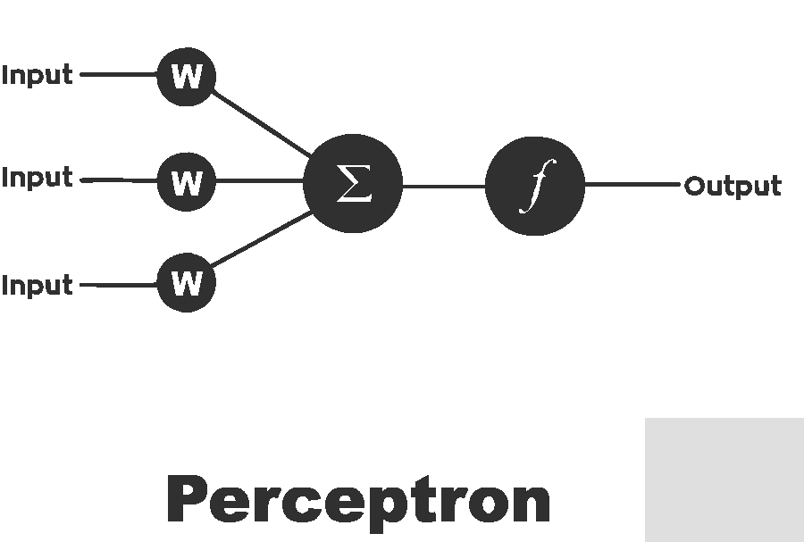

感知机是一种用于二进制分类器监督学习的算法，其函数可以决定输入（由数字向量表示）是否属于某一类或另一类。

与逻辑回归类似，神经网络中的权重与输入向量相乘，求和后输入到激活函数中。

感知机网络可以设计为具有 `multiple layers`，从而形成 `Multi-Layer Perceptron`（即 `MLP`）

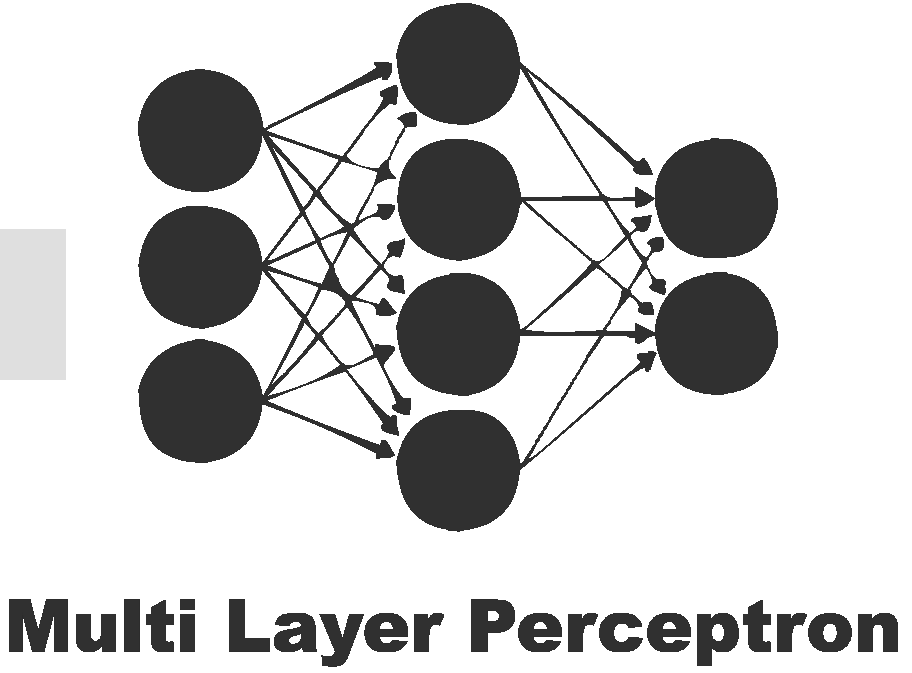

## 单层神经网络

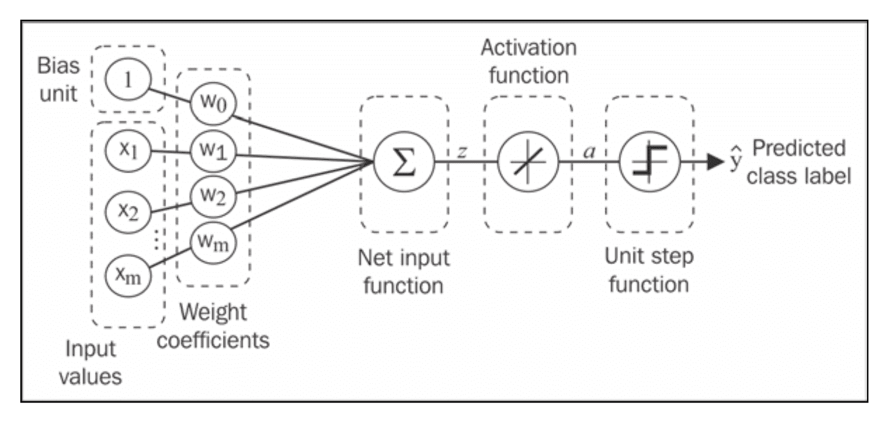

*(来源：Python Machine Learning, S. Raschka)*

### 权重更新规则

*   我们使用 `gradient descent` 优化算法来学习模型的 `Weights Coefficients`。

*   在每个 `epoch`（遍历训练集）中，我们使用以下更新规则更新权重向量 $w$：

$$ w = w + \\Delta w, \\text{where } \\Delta w = - \\eta \\nabla J(w)

$$

换句话说，我们根据整个训练集计算梯度，并通过沿梯度 $ \\nabla J(w)$ 的 `opposite direction` 迈出一步来更新模型的权重。

为了找到模型的 `optimal weights of the model`，我们优化了目标函数（例如，平方误差和 (SSE)）成本函数 $J(w)$。

此外，我们将梯度乘以一个因子，即学习率 $\\eta$，我们仔细选择它以平衡 `speed of learning` 与超过成本函数全局最小值的风险。

### 梯度下降

在 `gradient descent optimization` 中，我们在每个 epoch 后同时更新所有 `weights`，并定义权重向量 $w$ 中每个权重 $w\_j$ 的 `partial derivative` 如下：

$$ \\frac{\\partial}{\\partial w*j} J(w) = \\sum*{i} ( y^{(i)} - a^{(i)} ) x^{(i)}\_j

$$

**注意**：*上标 $(i)$ 指第 i 个样本。下标 $j$ 指第 j 个维度/特征*

这里 $y^{(i)}$ 是特定样本 $x^{(i)}$ 的目标类别标签，$a^{(i)}$ 是神经元的 `activation`

（在 `Perceptron` 的特殊情况下是一个线性函数）。

我们定义 `activation function` $\\phi(\\cdot)$ 如下：

$$ \\phi(z) = z = a = \\sum\_{j} w\_j x\_j = \\mathbf{w}^T \\mathbf{x}

$$

### 二进制分类

虽然我们使用 `activation` $\\phi(z)$ 来计算梯度更新，但可以使用 `threshold function` *(Heaviside function)* 将连续值输出压缩为二进制类别标签以进行预测：

$$ \\hat{y} = \\begin{cases} 1 & \\text{if } \\phi(z) \\geq 0 \\ 0 & \\text{otherwise} \\end{cases}

$$

## 从零开始构建神经网络

### 想法：

我们将从第一原理构建神经网络。我们将创建一个非常简单的模型并了解其工作原理。我们还将实现反向传播算法。

**请注意，此代码未经过优化，不得用于生产环境**。

这是为了教学目的 - 为了让我们了解 ANN 的工作原理。

像 `theano` 这样的库具有高度优化的代码。

### 感知机和 Adaline 模型

查看此笔记本：Perceptron and Adaline

如果您想了解 `Perceptron` 的替代（生产就绪）实现示例，请尝试：

```
from sklearn.linear_model import Perceptron
```

## 介绍多层神经网络架构

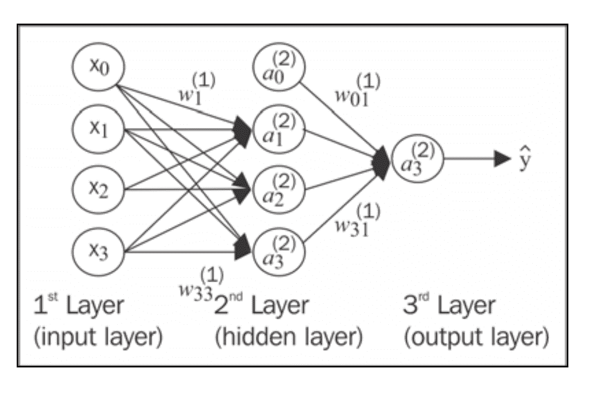

*(来源：Python Machine Learning, S. Raschka)*

现在我们将看到如何将 **multiple single neurons** 连接到 **multi-layer feedforward neural network**；这种特殊类型的网络也称为 **multi-layer perceptron** (MLP)。

该图显示了由三层组成的 **MLP** 的概念：一个 *input* 层，一个 *hidden* 层和一个 *output* 层。

隐藏层中的单元与输入层完全连接，输出层与隐藏层分别完全连接。

如果这样的网络有 **more than one hidden layer**，我们也称其为 **deep artificial neural network**。

### 符号


we denote the `ith` activation unit in the `lth` layer as $a*i^{(l)}$ , and the activation units $a\_0^{(1)}$ and $a\_0^{(2)}$ are the `bias units`, respectively, which we set equal to $1$.  

The `activation` of the units in the `input layer` is just its input plus the bias unit:

$$ \\mathbf{a}^{(1)} = \[a\_0^{(1)}, a\_1^{(1)}, \\ldots, a\_m^{(1)}\]^T = \[1, x\_1^{(i)}, \\ldots, x\_m^{(i)}\]^T

$$  

**Note**: $x\_j^{(i)}$ refers to the jth feature/dimension of the ith sample

## Notes on Notation (usually) Adopted

The terminology around the indices (subscripts and superscripts) may look a little bit confusing at first.  

You may wonder why we wrote $w*{j,k}^{(l)}$ and not $w*{k,j}^{(l)}$ to refer to the `weight coefficient` that connects the `kth` unit in layer $l$ to the jth unit in layer $l+1$.  

What may seem a little bit quirky at first will make much more sense later when we `vectorize` the neural network representation.  

For example, we will summarize the weights that connect the input and hidden layer by a matrix

$$ W^{(1)} \\in \\mathbb{R}^{h×\[m+1\]}$$

where $h$ is the number of hidden units and $m + 1$ is the number of hidden units plus bias unit.

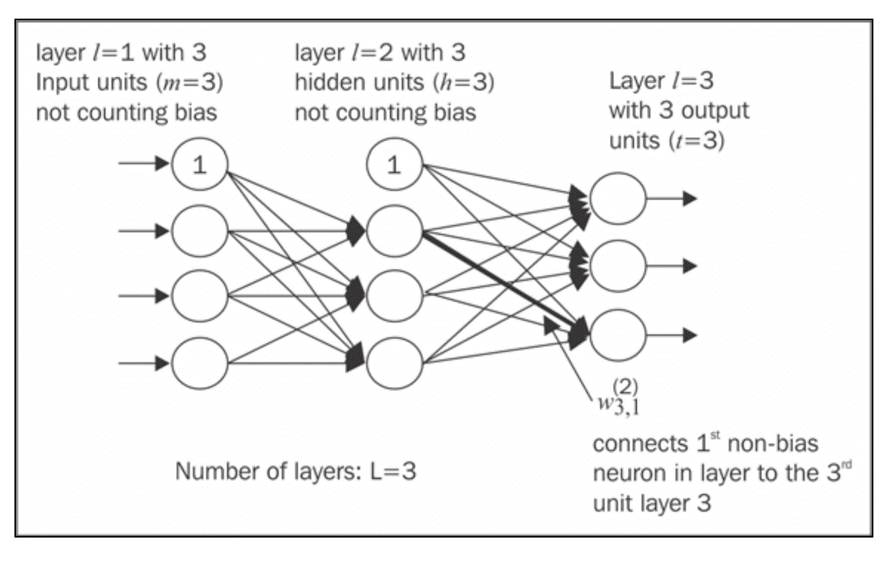

*(Source: Python Machine Learning, S. Raschka)*

## Forward Propagation

*   Starting at the input layer, we forward propagate the patterns of the training data through the network to generate an output.

*   Based on the network's output, we calculate the error that we want to minimize using a cost function that we will describe later.

*   We backpropagate the error, find its derivative with respect to each weight in the network, and update the model.

### Sigmoid Activation

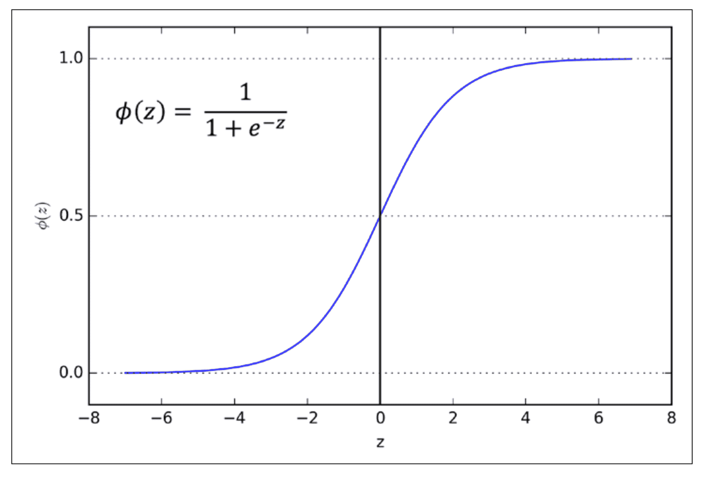

*(Source: Python Machine Learning, S. Raschka)*

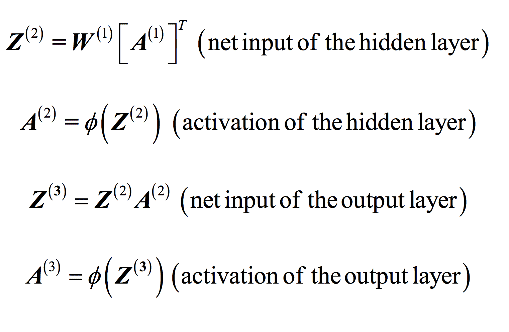

*(Source: Python Machine Learning, S. Raschka)*

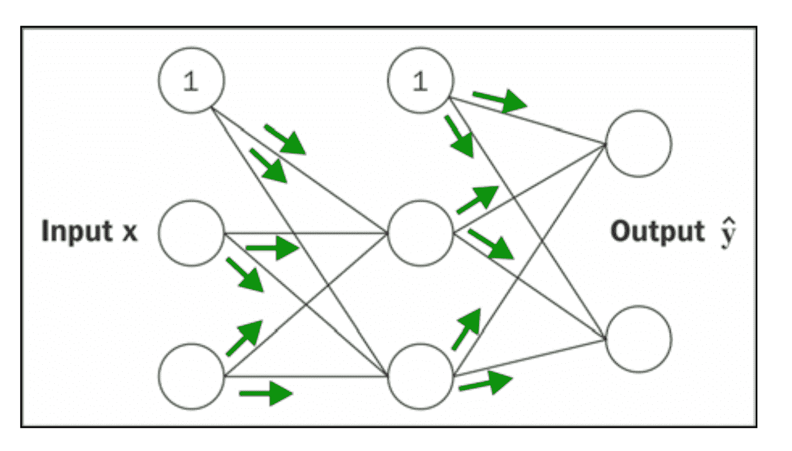

*(Source: Python Machine Learning, S. Raschka)*

## Backward Propagation

The weights of each neuron are learned by `gradient descent`, where each neuron's error is derived with respect to it's weight.

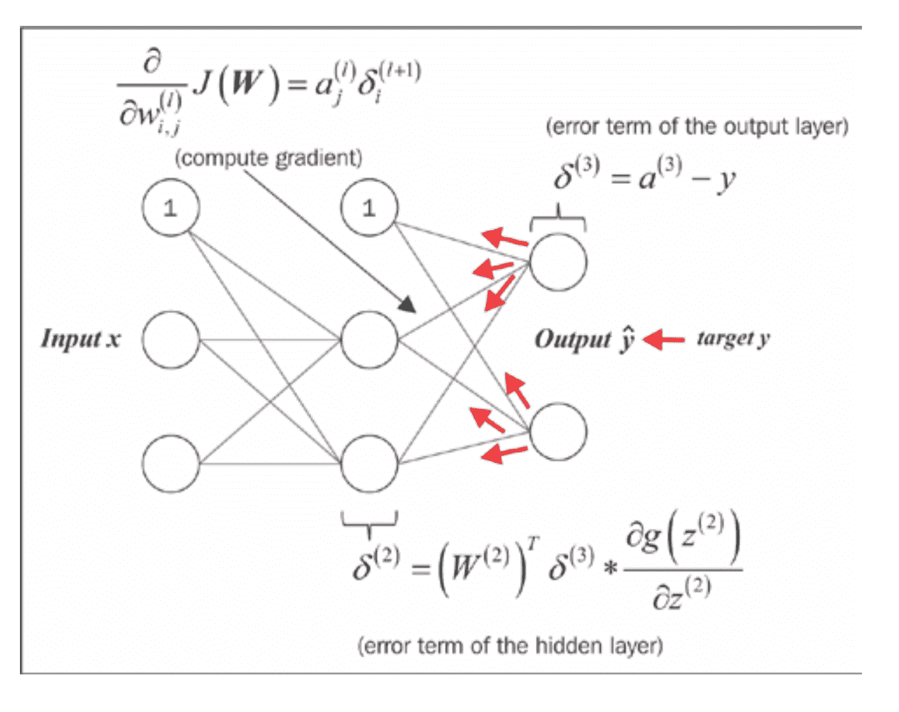

*(Source: Python Machine Learning, S. Raschka)*

Optimization is done for each layer with respect to the previous layer in a technique known as `BackPropagation`.

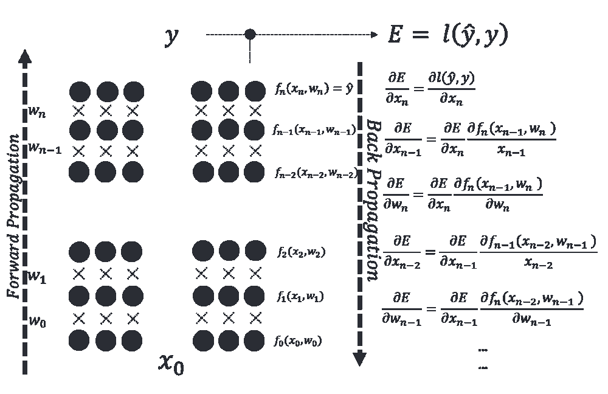

(*The following code is inspired from [these](https://github.com/dennybritz/nn-from-scratch) terrific notebooks*)

```
## Import the required packages
import numpy as np
import pandas as pd
import matplotlib
import matplotlib.pyplot as plt
import scipy
```

```
## Display plots in notebook 
%matplotlib inline
## Define plot's default figure size
matplotlib.rcParams['figure.figsize'] = (10.0, 8.0)
```

```
#read the datasets
train = pd.read_csv("../data/intro_to_ann.csv")
```

```
X, y = np.array(train.ix[:,0:2]), np.array(train.ix[:,2])
```

```
X.shape
```

```
(500, 2)
```

```
y.shape
```

```
(500,)
```

```
#Let's plot the dataset and see how it is
plt.scatter(X[:,0], X[:,1], s=40, c=y, cmap=plt.cm.BuGn)
```

```
<matplotlib.collections.PathCollection at 0x10e9329b0>
```


## Start Building our MLP building blocks

Note: This process will eventually result in our own Neural Networks class

### A look at the details

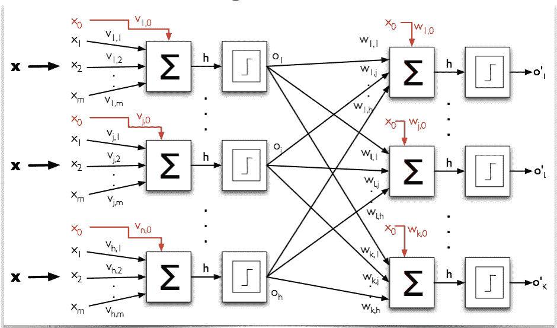

```
import random
random.seed(123)

## calculate a random number where:  a <= rand < b
def rand(a, b):
    return (b-a)*random.random() + a
```

##### Function to generate a random number, given two numbers

**Where will it be used?**: When we initialize the neural networks, the weights have to be randomly assigned.

```
## Make a matrix 
def makeMatrix(I, J, fill=0.0):
    return np.zeros([I,J])
```

### Define our activation function. Let's use sigmoid function

```
## our sigmoid function
def sigmoid(x):
    #return math.tanh(x)
    return 1/(1+np.exp(-x))
```

### Derivative of our activation function.

Note: We need this when we run the backpropagation algorithm

```
## derivative of our sigmoid function, in terms of the output (i.e. y)
def dsigmoid(y):
    return y - y**2
```

## Our neural networks class

When we first create a neural networks architecture, we need to know the number of inputs, number of hidden layers and number of outputs.

The weights have to be randomly initialized.

```
class MLP:
    def __init__(self, ni, nh, no):
        # number of input, hidden, and output nodes
        self.ni = ni + 1 # +1 for bias node
        self.nh = nh
        self.no = no

        # activations for nodes
        self.ai = [1.0]*self.ni
        self.ah = [1.0]*self.nh
        self.ao = [1.0]*self.no

        # create weights
        self.wi = makeMatrix(self.ni, self.nh)
        self.wo = makeMatrix(self.nh, self.no)

        # set them to random vaules
        self.wi = rand(-0.2, 0.2, size=self.wi.shape)
        self.wo = rand(-2.0, 2.0, size=self.wo.shape)

        # last change in weights for momentum   
        self.ci = makeMatrix(self.ni, self.nh)
        self.co = makeMatrix(self.nh, self.no)
```

## Activation Function

```
def activate(self, inputs):

    if len(inputs) != self.ni-1:
        print(inputs)
        raise ValueError('wrong number of inputs')

    # input activations
    for i in range(self.ni-1):
        self.ai[i] = inputs[i]

    # hidden activations
    for j in range(self.nh):
        sum_h = 0.0
        for i in range(self.ni):
            sum_h += self.ai[i] * self.wi[i][j]
        self.ah[j] = sigmoid(sum_h)

    # output activations
    for k in range(self.no):
        sum_o = 0.0
        for j in range(self.nh):
            sum_o += self.ah[j] * self.wo[j][k]
        self.ao[k] = sigmoid(sum_o)

    return self.ao[:]
```

## BackPropagation

```
def backPropagate(self, targets, N, M):

    if len(targets) != self.no:
        print(targets)
        raise ValueError('wrong number of target values')

    # calculate error terms for output
    output_deltas = np.zeros(self.no)
    for k in range(self.no):
        error = targets[k]-self.ao[k]
        output_deltas[k] = dsigmoid(self.ao[k]) * error

    # calculate error terms for hidden
    hidden_deltas = np.zeros(self.nh)
    for j in range(self.nh):
        error = 0.0
        for k in range(self.no):
            error += output_deltas[k]*self.wo[j][k]
        hidden_deltas[j] = dsigmoid(self.ah[j]) * error

    # update output weights
    for j in range(self.nh):
        for k in range(self.no):
            change = output_deltas[k] * self.ah[j]
            self.wo[j][k] += N*change + 
                             M*self.co[j][k]
            self.co[j][k] = change

    # update input weights
    for i in range(self.ni):
        for j in range(self.nh):
            change = hidden_deltas[j]*self.ai[i]
            self.wi[i][j] += N*change + 
                             M*self.ci[i][j]
            self.ci[i][j] = change

    # calculate error
    error = 0.0
    for k in range(len(targets)):
        error += 0.5*(targets[k]-self.ao[k])**2
    return error
```


## 把所有内容整合在一起

```python
class MLP:
    def __init__(self, ni, nh, no):
        # number of input, hidden, and output nodes
        self.ni = ni + 1 # +1 for bias node
        self.nh = nh
        self.no = no

        # activations for nodes
        self.ai = [1.0]*self.ni
        self.ah = [1.0]*self.nh
        self.ao = [1.0]*self.no

        # create weights
        self.wi = makeMatrix(self.ni, self.nh)
        self.wo = makeMatrix(self.nh, self.no)

        # set them to random vaules
        for i in range(self.ni):
            for j in range(self.nh):
                self.wi[i][j] = rand(-0.2, 0.2)
        for j in range(self.nh):
            for k in range(self.no):
                self.wo[j][k] = rand(-2.0, 2.0)

        # last change in weights for momentum   
        self.ci = makeMatrix(self.ni, self.nh)
        self.co = makeMatrix(self.nh, self.no)


    def backPropagate(self, targets, N, M):

        if len(targets) != self.no:
            print(targets)
            raise ValueError('wrong number of target values')

        # calculate error terms for output
        output_deltas = np.zeros(self.no)
        for k in range(self.no):
            error = targets[k]-self.ao[k]
            output_deltas[k] = dsigmoid(self.ao[k]) * error

        # calculate error terms for hidden
        hidden_deltas = np.zeros(self.nh)
        for j in range(self.nh):
            error = 0.0
            for k in range(self.no):
                error += output_deltas[k]*self.wo[j][k]
            hidden_deltas[j] = dsigmoid(self.ah[j]) * error

        # update output weights
        for j in range(self.nh):
            for k in range(self.no):
                change = output_deltas[k] * self.ah[j]
                self.wo[j][k] += N*change + M*self.co[j][k]
                self.co[j][k] = change

        # update input weights
        for i in range(self.ni):
            for j in range(self.nh):
                change = hidden_deltas[j]*self.ai[i]
                self.wi[i][j] += N*change + M*self.ci[i][j]
                self.ci[i][j] = change

        # calculate error
        error = 0.0
        for k in range(len(targets)):
            error += 0.5*(targets[k]-self.ao[k])**2
        return error


    def test(self, patterns):
        self.predict = np.empty([len(patterns), self.no])
        for i, p in enumerate(patterns):
            self.predict[i] = self.activate(p)
            #self.predict[i] = self.activate(p[0])

    def activate(self, inputs):

        if len(inputs) != self.ni-1:
            print(inputs)
            raise ValueError('wrong number of inputs')

        # input activations
        for i in range(self.ni-1):
            self.ai[i] = inputs[i]

        # hidden activations
        for j in range(self.nh):
            sum_h = 0.0
            for i in range(self.ni):
                sum_h += self.ai[i] * self.wi[i][j]
            self.ah[j] = sigmoid(sum_h)

        # output activations
        for k in range(self.no):
            sum_o = 0.0
            for j in range(self.nh):
                sum_o += self.ah[j] * self.wo[j][k]
            self.ao[k] = sigmoid(sum_o)

        return self.ao[:]


    def train(self, patterns, iterations=1000, N=0.5, M=0.1):
        # N: learning rate
        # M: momentum factor
        patterns = list(patterns)
        for i in range(iterations):
            error = 0.0
            for p in patterns:
                inputs = p[0]
                targets = p[1]
                self.activate(inputs)
                error += self.backPropagate([targets], N, M)
            if i % 5 == 0:
                print('error in interation %d : %-.5f' % (i,error))
            print('Final training error: %-.5f' % error)
```

## 在我们的数据集上运行模型

```python
## create a network with two inputs, one hidden, and one output nodes
ann = MLP(2, 1, 1)

%timeit -n 1 -r 1 ann.train(zip(X,y), iterations=2)
```

```
error in interation 0 : 53.62995
Final training error: 53.62995
Final training error: 47.35136
1 loop, best of 1: 36.7 ms per loop
```

## 在训练数据集上进行预测并测量样本内准确率

```python
%timeit -n 1 -r 1 ann.test(X)
```

```
1 loop, best of 1: 11.8 ms per loop
```

```python
prediction = pd.DataFrame(data=np.array([y, np.ravel(ann.predict)]).T, 
                          columns=["actual", "prediction"])
prediction.head()
```

|  | actual | prediction |
| --- | --- | --- |
| 0 | 1.0 | 0.491100 |
| 1 | 1.0 | 0.495469 |
| 2 | 0.0 | 0.097362 |
| 3 | 0.0 | 0.400006 |
| 4 | 1.0 | 0.489664 |

```python
np.min(prediction.prediction)
```

```
0.076553078113180129
```

## 让我们可视化并观察结果

```python
## Helper function to plot a decision boundary.
## This generates the contour plot to show the decision boundary visually
def plot_decision_boundary(nn_model):
    # Set min and max values and give it some padding
    x_min, x_max = X[:, 0].min() - .5, X[:, 0].max() + .5
    y_min, y_max = X[:, 1].min() - .5, X[:, 1].max() + .5
    h = 0.01
    # Generate a grid of points with distance h between them
    xx, yy = np.meshgrid(np.arange(x_min, x_max, h), 
                         np.arange(y_min, y_max, h))
    # Predict the function value for the whole gid
    nn_model.test(np.c_[xx.ravel(), yy.ravel()])
    Z = nn_model.predict
    Z[Z>=0.5] = 1
    Z[Z<0.5] = 0
    Z = Z.reshape(xx.shape)
    # Plot the contour and training examples
    plt.contourf(xx, yy, Z, cmap=plt.cm.Spectral)
    plt.scatter(X[:, 0], X[:, 1], s=40,  c=y, cmap=plt.cm.BuGn)
```

```python
plot_decision_boundary(ann)
plt.title("Our initial model")
```

```
<matplotlib.text.Text at 0x110bafd68>
```


## 练习

在上述代码中创建具有 10 个隐藏节点的神经网络。

对准确率有什么影响？

```python
## Put your code here 
#(or load the solution if you wanna cheat :-)
```

```python
## %load ../solutions/sol_111.py
```

## 练习

通过增加训练轮数来训练神经网络。

对准确率有什么影响？

```python
#Put your code here
```

```python
## %load ../solutions/sol_112.py
```

## 附录

仓库中还有一个附加笔记本，即 `MLP and MNIST`，用于在 `MNIST` 数据集上实现更完整（但仍然是 `naive` 实现）的 `SGD` 和 `MLP`。

另一个极好的入门参考是在线书籍 [`http://neuralnetworksanddeeplearning.com/`](http://neuralnetworksanddeeplearning.com/)。强烈推荐！

## 1.1.1 感知机和 Adaline

## 感知机和 Adaline

## (exceprt from Python Machine Learning Essentials, Supplementary Materials)

## 章节

*   `Implementing a perceptron learning algorithm in Python` 

    *   `Training a perceptron model on the Iris dataset`

*   `Adaptive linear neurons and the convergence of learning` 

    *   `Implementing an adaptive linear neuron in Python`

```python
## Display plots in notebook 
%matplotlib inline
## Define plot's default figure size
import matplotlib
```

## 在 Python 中实现感知机学习算法

back to top


## 在鸢尾花数据集上训练感知机模型

## 读取鸢尾花数据

```python
import numpy as np
import pandas as pd
from sklearn.datasets import load_iris

iris = load_iris()
X = iris.data
y = iris.target
data = np.hstack((X, y[:, np.newaxis]))

labels = iris.target_names
features = iris.feature_names

df = pd.DataFrame(data, columns=iris.feature_names+['label'])
df.label = df.label.map({k:v for k,v in enumerate(labels)})
df.tail()
```

|  || sepal length (cm) || sepal width (cm) || petal length (cm) || petal width (cm) || label |
| --- | --- | --- | --- | --- | --- |
| 145 || 6.7 || 3.0 || 5.2 || 2.3 || virginica |
| 146 || 6.3 || 2.5 || 5.0 || 1.9 || virginica |
| 147 || 6.5 || 3.0 || 5.2 || 2.0 || virginica |
| 148 || 6.2 || 3.4 || 5.4 || 2.3 || virginica |
| 149 || 5.9 || 3.0 || 5.1 || 1.8 || virginica |

## 绘制鸢尾花数据

```python
import numpy as np
import matplotlib.pyplot as plt

# select setosa and versicolor
y = df.iloc[0:100, 4].values
y = np.where(y == 'setosa', -1, 1)

# extract sepal length and petal length
X = df.iloc[0:100, [0, 2]].values

# plot data
plt.scatter(X[:50, 0], X[:50, 1],
            color='red', marker='o', label='setosa')
plt.scatter(X[50:100, 0], X[50:100, 1],
            color='blue', marker='x', label='versicolor')

plt.xlabel('petal length [cm]')
plt.ylabel('sepal length [cm]')
plt.legend(loc='upper left')

plt.show()
```


## 训练感知机模型

```python
ppn = Perceptron(eta=0.1, n_iter=10)

ppn.fit(X, y)

plt.plot(range(1, len(ppn.errors_) + 1), ppn.errors_, marker='o')
plt.xlabel('Epochs')
plt.ylabel('Number of misclassifications')

plt.tight_layout()
plt.show()
```


## 绘制决策区域的函数

```python
from matplotlib.colors import ListedColormap


def plot_decision_regions(X, y, classifier, resolution=0.02):

    # setup marker generator and color map
    markers = ('s', 'x', 'o', '^', 'v')
    colors = ('red', 'blue', 'lightgreen', 'gray', 'cyan')
    cmap = ListedColormap(colors[:len(np.unique(y))])

    # plot the decision surface
    x1_min, x1_max = X[:, 0].min() - 1, X[:, 0].max() + 1
    x2_min, x2_max = X[:, 1].min() - 1, X[:, 1].max() + 1
    xx1, xx2 = np.meshgrid(np.arange(x1_min, x1_max, resolution),
                         np.arange(x2_min, x2_max, resolution))
    Z = classifier.predict(np.array([xx1.ravel(), xx2.ravel()]).T)
    Z = Z.reshape(xx1.shape)
    plt.contourf(xx1, xx2, Z, alpha=0.4, cmap=cmap)
    plt.xlim(xx1.min(), xx1.max())
    plt.ylim(xx2.min(), xx2.max())

    # plot class samples
    for idx, cl in enumerate(np.unique(y)):
        plt.scatter(x=X[y == cl, 0], y=X[y == cl, 1],
                    alpha=0.8, c=cmap(idx),
                    marker=markers[idx], label=cl)
```

```python
plot_decision_regions(X, y, classifier=ppn)
plt.xlabel('sepal length [cm]')
plt.ylabel('petal length [cm]')
plt.legend(loc='upper left')

plt.tight_layout()
plt.show()
```


## 自适应线性神经元与学习收敛

## 在 Python 中实现自适应线性神经元

```python
class AdalineGD(object):
    """ADAptive LInear NEuron classifier.

    Parameters
    ------------
    eta : float
        Learning rate (between 0.0 and 1.0)
    n_iter : int
        Passes over the training dataset.

    Attributes
    -----------
    w_ : 1d-array
        Weights after fitting.
    errors_ : list
        Number of misclassifications in every epoch.

    """
    def __init__(self, eta=0.01, n_iter=50):
        self.eta = eta
        self.n_iter = n_iter

    def fit(self, X, y):
        """ Fit training data.

        Parameters
        ----------
        X : {array-like}, shape = [n_samples, n_features]
            Training vectors, where n_samples is the number of samples and
            n_features is the number of features.
        y : array-like, shape = [n_samples]
            Target values.

        Returns
        -------
        self : object

        """
        self.w_ = np.zeros(1 + X.shape[1])
        self.cost_ = []

        for i in range(self.n_iter):
            output = self.net_input(X)
            errors = (y - output)
            self.w_[1:] += self.eta * X.T.dot(errors)
            self.w_[0] += self.eta * errors.sum()
            cost = (errors**2).sum() / 2.0
            self.cost_.append(cost)
        return self

    def net_input(self, X):
        """Calculate net input"""
        return np.dot(X, self.w_[1:]) + self.w_[0]

    def activation(self, X):
        """Compute linear activation"""
        return self.net_input(X)

    def predict(self, X):
        """Return class label after unit step"""
        return np.where(self.activation(X) >= 0.0, 1, -1)
```

```python
fig, ax = plt.subplots(nrows=1, ncols=2, figsize=(8, 4))

ada1 = AdalineGD(n_iter=10, eta=0.01).fit(X, y)
ax[0].plot(range(1, len(ada1.cost_) + 1), np.log10(ada1.cost_), marker='o')
ax[0].set_xlabel('Epochs')
ax[0].set_ylabel('log(Sum-squared-error)')
ax[0].set_title('Adaline - Learning rate 0.01')

ada2 = AdalineGD(n_iter=10, eta=0.0001).fit(X, y)
ax[1].plot(range(1, len(ada2.cost_) + 1), ada2.cost_, marker='o')
ax[1].set_xlabel('Epochs')
ax[1].set_ylabel('Sum-squared-error')
ax[1].set_title('Adaline - Learning rate 0.0001')

plt.tight_layout()
plt.show()
```


## 标准化特征并重新训练 Adaline

```python
## standardize features
X_std = np.copy(X)
X_std[:,0] = (X[:,0] - X[:,0].mean()) / X[:,0].std()
X_std[:,1] = (X[:,1] - X[:,1].mean()) / X[:,1].std()
```

```python
ada = AdalineGD(n_iter=15, eta=0.01)
ada.fit(X_std, y)

plot_decision_regions(X_std, y, classifier=ada)
plt.title('Adaline - Gradient Descent')
plt.xlabel('sepal length [standardized]')
plt.ylabel('petal length [standardized]')
plt.legend(loc='upper left')
plt.tight_layout()
plt.show()

plt.plot(range(1, len(ada.cost_) + 1), ada.cost_, marker='o')
plt.xlabel('Epochs')
plt.ylabel('Sum-squared-error')

plt.tight_layout()
plt.show()
```


### 大规模机器学习与随机梯度下降

\[back to top\]

```
from numpy.random import seed

class AdalineSGD(object):
    """ADAptive LInear NEuron classifier.

    Parameters
    ------------
    eta : float
        Learning rate (between 0.0 and 1.0)
    n_iter : int
        Passes over the training dataset.

    Attributes
    -----------
    w_ : 1d-array
        Weights after fitting.
    errors_ : list
        Number of misclassifications in every epoch.
    shuffle : bool (default: True)
        Shuffles training data every epoch if True to prevent cycles.
    random_state : int (default: None)
        Set random state for shuffling and initializing the weights.

    """
    def __init__(self, eta=0.01, n_iter=10, shuffle=True, random_state=None):
        self.eta = eta
        self.n_iter = n_iter
        self.w_initialized = False
        self.shuffle = shuffle
        if random_state:
            seed(random_state)

    def fit(self, X, y):
        """ Fit training data.

        Parameters
        ----------
        X : {array-like}, shape = [n_samples, n_features]
            Training vectors, where n_samples is the number of samples and
            n_features is the number of features.
        y : array-like, shape = [n_samples]
            Target values.

        Returns
        -------
        self : object

        """
        self._initialize_weights(X.shape[1])
        self.cost_ = []
        for i in range(self.n_iter):
            if self.shuffle:
                X, y = self._shuffle(X, y)
            cost = []
            for xi, target in zip(X, y):
                cost.append(self._update_weights(xi, target))
            avg_cost = sum(cost)/len(y)
            self.cost_.append(avg_cost)
        return self

    def partial_fit(self, X, y):
        """Fit training data without reinitializing the weights"""
        if not self.w_initialized:
            self._initialize_weights(X.shape[1])
        if y.ravel().shape[0] > 1:
            for xi, target in zip(X, y):
                self._update_weights(xi, target)
        else:
            self._update_weights(X, y)
        return self

    def _shuffle(self, X, y):
        """Shuffle training data"""
        r = np.random.permutation(len(y))
        return X[r], y[r]

    def _initialize_weights(self, m):
        """Initialize weights to zeros"""
        self.w_ = np.zeros(1 + m)
        self.w_initialized = True

    def _update_weights(self, xi, target):
        """Apply Adaline learning rule to update the weights"""
        output = self.net_input(xi)
        error = (target - output)
        self.w_[1:] += self.eta * xi.dot(error)
        self.w_[0] += self.eta * error
        cost = 0.5 * error**2
        return cost

    def net_input(self, X):
        """Calculate net input"""
        return np.dot(X, self.w_[1:]) + self.w_[0]

    def activation(self, X):
        """Compute linear activation"""
        return self.net_input(X)

    def predict(self, X):
        """Return class label after unit step"""
        return np.where(self.activation(X) >= 0.0, 1, -1)
```

```
ada = AdalineSGD(n_iter=15, eta=0.01, random_state=1)
ada.fit(X_std, y)

plot_decision_regions(X_std, y, classifier=ada)
plt.title('Adaline - Stochastic Gradient Descent')
plt.xlabel('sepal length [standardized]')
plt.ylabel('petal length [standardized]')
plt.legend(loc='upper left')

plt.tight_layout()
plt.show()

plt.plot(range(1, len(ada.cost_) + 1), ada.cost_, marker='o')
plt.xlabel('Epochs')
plt.ylabel('Average Cost')

plt.tight_layout()
plt.show()
```


```
ada.partial_fit(X_std[0, :], y[0])
```

```
<__main__.AdalineSGD at 0x112023cf8>
```

## 1.1.2 MLP 和 MNIST

## (exceprt from Python Machine Learning Essentials, Supplementary Materials)

## Sections

*   Classifying handwritten digits

    *   Obtaining the MNIST dataset

    *   Implementing a multi-layer perceptron

*   Training an artificial neural network

*   Debugging neural networks with gradient checking

* * *

## Classifying handwritten digits

## Obtaining the MNIST dataset

\[back to top\]

The MNIST dataset is publicly available at [`yann.lecun.com/exdb/mnist/`](http://yann.lecun.com/exdb/mnist/) and consists of the following four parts:

*   Training set images: train-images-idx3-ubyte.gz (9.9 MB, 47 MB unzipped, 60,000 samples)

*   Training set labels: train-labels-idx1-ubyte.gz (29 KB, 60 KB unzipped, 60,000 labels)

*   Test set images: t10k-images-idx3-ubyte.gz (1.6 MB, 7.8 MB, 10,000 samples)

*   Test set labels: t10k-labels-idx1-ubyte.gz (5 KB, 10 KB unzipped, 10,000 labels)

In this section, we will only be working with a subset of MNIST, thus, we only need to download the training set images and training set labels. After downloading the files, I recommend unzipping the files using the Unix/Linux gzip tool from the terminal for efficiency, e.g., using the command

```
gzip *ubyte.gz -d
```

in your local MNIST download directory, or, using your favorite unzipping tool if you are working with a machine running on Microsoft Windows. The images are stored in byte form, and using the following function, we will read them into NumPy arrays that we will use to train our MLP.

### Get MNIST Dataset

**Note**: The following commands will work on Linux/Unix (e.g. Mac OSX) Platforms

```
!mkdir -p ../data/mnist
```

```
!curl http://yann.lecun.com/exdb/mnist/train-images-idx3-ubyte.gz --output ../data/mnist/train-images-idx3-ubyte.gz
```

```
!curl http://yann.lecun.com/exdb/mnist/train-labels-idx1-ubyte.gz --output ../data/mnist/train-labels-idx1-ubyte.gz
```

```
!curl http://yann.lecun.com/exdb/mnist/t10k-images-idx3-ubyte.gz --output ../data/mnist/t10k-images-idx3-ubyte.gz
```

```
!curl http://yann.lecun.com/exdb/mnist/t10k-labels-idx1-ubyte.gz --output ../data/mnist/t10k-labels-idx1-ubyte.gz
```

### Load MNIST Data

```
import os
import struct
import numpy as np

def load_mnist(path, kind='train'):
    """Load MNIST data from `path`"""
    labels_path = os.path.join(path, 
                               '%s-labels-idx1-ubyte' 
                                % kind)
    images_path = os.path.join(path, 
                               '%s-images-idx3-ubyte' 
                               % kind)

    with open(labels_path, 'rb') as lbpath:
        magic, n = struct.unpack('>II', 
                                 lbpath.read(8))
        labels = np.fromfile(lbpath, 
                             dtype=np.uint8)

    with open(images_path, 'rb') as imgpath:
        magic, num, rows, cols = struct.unpack(">IIII", 
                                               imgpath.read(16))
        images = np.fromfile(imgpath, 
                             dtype=np.uint8).reshape(len(labels), 784)

    return images, labels
```

```
X_train, y_train = load_mnist('data/mnist', kind='train')
print('Rows: %d, columns: %d' % (X_train.shape[0], X_train.shape[1]))
```

```
Rows: 60000, columns: 784
```

```
X_test, y_test = load_mnist('data/mnist', kind='t10k')
print('Rows: %d, columns: %d' % (X_test.shape[0], X_test.shape[1]))
```

```
Rows: 10000, columns: 784
```

Visualize the first digit of each class:


```
import matplotlib.pyplot as plt
%matplotlib inline

fig, ax = plt.subplots(nrows=2, ncols=5, sharex=True, sharey=True,)
ax = ax.flatten()
for i in range(10):
    img = X_train[y_train == i][0].reshape(28, 28)
    ax[i].imshow(img, cmap='Greys', interpolation='nearest')

ax[0].set_xticks([])
ax[0].set_yticks([])
plt.tight_layout()
## plt.savefig('./figures/mnist_all.png', dpi=300)
plt.show()
```


可视化 25 个不同版本的“7”：

```
fig, ax = plt.subplots(nrows=5, ncols=5, sharex=True, sharey=True,)
ax = ax.flatten()
for i in range(25):
    img = X_train[y_train == 7][i].reshape(28, 28)
    ax[i].imshow(img, cmap='Greys', interpolation='nearest')

ax[0].set_xticks([])
ax[0].set_yticks([])
plt.tight_layout()
## plt.savefig('./figures/mnist_7.png', dpi=300)
plt.show()
```


取消注释以下行，可选择将数据保存为 CSV 格式。但是请注意，这些 CSV 文件将占用大量存储空间：

`train_img.csv` 1.1 GB (gigabytes)

`train_labels.csv` 1.4 MB (megabytes)

`test_img.csv` 187.0 MB

`test_labels` 144 KB (kilobytes)

```
#np.savetxt('train_img.csv', X_train, fmt='%i', delimiter=',')
#np.savetxt('train_labels.csv', y_train, fmt='%i', delimiter=',')
X_train = np.genfromtxt('train_img.csv', dtype=int, delimiter=',')
y_train = np.genfromtxt('train_labels.csv', dtype=int, delimiter=',')

#np.savetxt('test_img.csv', X_test, fmt='%i', delimiter=',')
#np.savetxt('test_labels.csv', y_test, fmt='%i', delimiter=',')
X_test = np.genfromtxt('test_img.csv', dtype=int, delimiter=',')
y_test = np.genfromtxt('test_labels.csv', dtype=int, delimiter=',')
```

## 实现多层感知机

[回到顶部]


## NeuralNetMLP 类

`NeuralNetMLP` 是一个前馈神经网络 / 多层感知器分类器。

## 参数

- `n_output`：int，输出单元数量，应等于唯一类标签的数量。
- `n_features`：int，目标数据集中的特征数量（维度），应等于 `X` 数组的列数。
- `n_hidden`：int（默认：30），隐藏单元数量。
- `l1`：float（默认：0.0），L1 正则化的 Lambda 值。如果 `l1=0.0`（默认），则不进行正则化。
- `l2`：float（默认：0.0），L2 正则化的 Lambda 值。如果 `l2=0.0`（默认），则不进行正则化。
- `epochs`：int（默认：500），遍历训练集的次数。
- `eta`：float（默认：0.001），学习率。
- `alpha`：float（默认：0.0），动量常数。乘以前一轮 t-1 的梯度以提高学习速度，`w(t) := w(t) - (grad(t) + alpha*grad(t-1))`。
- `decrease_const`：float（默认：0.0），减小常数。每个 epoch 后通过 `eta / (1 + epoch*decrease_const)` 缩小学习率。
- `shuffle`：bool（默认：False），如果为 True，则每个 epoch 随机打乱训练数据以防止循环。
- `minibatches`：int（默认：1），将训练数据分为 k 个小批量以提高效率。如果 k=1（默认），则为普通梯度下降学习。
- `random_state`：int（默认：None），设置用于打乱和初始化权重的随机状态。

## 属性

- `cost_`：list，每个 epoch 后的平方误差之和。

## 代码实现

```python
import numpy as np
from scipy.special import expit
import sys


class NeuralNetMLP(object):
    """ Feedforward neural network / Multi-layer perceptron classifier.

    Parameters
    ------------
    n_output : int
      Number of output units, should be equal to the
      number of unique class labels.

    n_features : int
      Number of features (dimensions) in the target dataset.
      Should be equal to the number of columns in the X array.

    n_hidden : int (default: 30)
      Number of hidden units.

    l1 : float (default: 0.0)
      Lambda value for L1-regularization.
      No regularization if l1=0.0 (default)

    l2 : float (default: 0.0)
      Lambda value for L2-regularization.
      No regularization if l2=0.0 (default)

    epochs : int (default: 500)
      Number of passes over the training set.

    eta : float (default: 0.001)
      Learning rate.

    alpha : float (default: 0.0)
      Momentum constant. Factor multiplied with the
      gradient of the previous epoch t-1 to improve
      learning speed
      w(t) := w(t) - (grad(t) + alpha*grad(t-1))

    decrease_const : float (default: 0.0)
      Decrease constant. Shrinks the learning rate
      after each epoch via eta / (1 + epoch*decrease_const)

    shuffle : bool (default: False)
      Shuffles training data every epoch if True to prevent circles.

    minibatches : int (default: 1)
      Divides training data into k minibatches for efficiency.
      Normal gradient descent learning if k=1 (default).

    random_state : int (default: None)
      Set random state for shuffling and initializing the weights.

    Attributes
    -----------
    cost_ : list
      Sum of squared errors after each epoch.

    """
    def __init__(self, n_output, n_features, n_hidden=30,
                 l1=0.0, l2=0.0, epochs=500, eta=0.001, 
                 alpha=0.0, decrease_const=0.0, shuffle=True, 
                 minibatches=1, random_state=None):

        np.random.seed(random_state)
        self.n_output = n_output
        self.n_features = n_features
        self.n_hidden = n_hidden
        self.w1, self.w2 = self._initialize_weights()
        self.l1 = l1
        self.l2 = l2
        self.epochs = epochs
        self.eta = eta
        self.alpha = alpha
        self.decrease_const = decrease_const
        self.shuffle = shuffle
        self.minibatches = minibatches

    def _encode_labels(self, y, k):
        """Encode labels into one-hot representation

        Parameters
        ------------
        y : array, shape = [n_samples]
            Target values.

        Returns
        -----------
        onehot : array, shape = (n_labels, n_samples)

        """
        onehot = np.zeros((k, y.shape[0]))
        for idx, val in enumerate(y):
            onehot[val, idx] = 1.0
        return onehot

    def _initialize_weights(self):
        """Initialize weights with small random numbers."""
        w1 = np.random.uniform(-1.0, 1.0, size=self.n_hidden*(self.n_features + 1))
        w1 = w1.reshape(self.n_hidden, self.n_features + 1)
        w2 = np.random.uniform(-1.0, 1.0, size=self.n_output*(self.n_hidden + 1))
        w2 = w2.reshape(self.n_output, self.n_hidden + 1)
        return w1, w2

    def _sigmoid(self, z):
        """Compute logistic function (sigmoid)

        Uses scipy.special.expit to avoid overflow
        error for very small input values z.

        """
        # return 1.0 / (1.0 + np.exp(-z))
        return expit(z)

    def _sigmoid_gradient(self, z):
        """Compute gradient of the logistic function"""
        sg = self._sigmoid(z)
        return sg * (1 - sg)

    def _add_bias_unit(self, X, how='column'):
        """Add bias unit (column or row of 1s) to array at index 0"""
        if how == 'column':
            X_new = np.ones((X.shape[0], X.shape[1]+1))
            X_new[:, 1:] = X
        elif how == 'row':
            X_new = np.ones((X.shape[0]+1, X.shape[1]))
            X_new[1:, :] = X
        else:
            raise AttributeError('`how` must be `column` or `row`')
        return X_new

    def _feedforward(self, X, w1, w2):
        """Compute feedforward step

        Parameters
        -----------
        X : array, shape = [n_samples, n_features]
          Input layer with original features.

        w1 : array, shape = [n_hidden_units, n_features]
          Weight matrix for input layer -> hidden layer.

        w2 : array, shape = [n_output_units, n_hidden_units]
          Weight matrix for hidden layer -> output layer.

        Returns
        ----------
        a1 : array, shape = [n_samples, n_features+1]
          Input values with bias unit.

        z2 : array, shape = [n_hidden, n_samples]
          Net input of hidden layer.

        a2 : array, shape = [n_hidden+1, n_samples]
          Activation of hidden layer.

        z3 : array, shape = [n_output_units, n_samples]
          Net input of output layer.

        a3 : array, shape = [n_output_units, n_samples]
          Activation of output layer.

        """
        a1 = self._add_bias_unit(X, how='column')
        z2 = w1.dot(a1.T)
        a2 = self._sigmoid(z2)
        a2 = self._add_bias_unit(a2, how='row')
        z3 = w2.dot(a2)
        a3 = self._sigmoid(z3)
        return a1, z2, a2, z3, a3

    def _L2_reg(self, lambda_, w1, w2):
        """Compute L2-regularization cost"""
        return (lambda_/2.0) * (np.sum(w1[:, 1:] ** 2) + np.sum(w2[:, 1:] ** 2))

    def _L1_reg(self, lambda_, w1, w2):
        """Compute L1-regularization cost"""
        return (lambda_/2.0) * (np.abs(w1[:, 1:]).sum() + np.abs(w2[:, 1:]).sum())

    def _get_cost(self, y_enc, output, w1, w2):
        """Compute cost function.

        y_enc : array, shape = (n_labels, n_samples)
          one-hot encoded class labels.

        output : array, shape = [n_output_units, n_samples]
          Activation of the output layer (feedforward)

        w1 : array, shape = [n_hidden_units, n_features]
          Weight matrix for input layer -> hidden layer.

        w2 : array, shape = [n_output_units, n_hidden_units]
          Weight matrix for hidden layer -> output layer.

        Returns
        ---------
        cost : float
          Regularized cost.

        """
        term1 = -y_enc * (np.log(output))
        term2 = (1 - y_enc) * np.log(1 - output)
        cost = np.sum(term1 - term2)
        L1_term = self._L1_reg(self.l1, w1, w2)
        L2_term = self._L2_reg(self.l2, w1, w2)
        cost = cost + L1_term + L2_term
        return cost

    def _get_gradient(self, a1, a2, a3, z2, y_enc, w1, w2):
        """ Compute gradient step using backpropagation.

        Parameters
        ------------
        a1 : array, shape = [n_samples, n_features+1]
          Input values with bias unit.

        a2 : array, shape = [n_hidden+1, n_samples]
          Activation of hidden layer.

        a3 : array, shape = [n_output_units, n_samples]
          Activation of output layer.

        z2 : array, shape = [n_hidden, n_samples]
          Net input of hidden layer.

        y_enc : array, shape = (n_labels, n_samples)
          one-hot encoded class labels.

        w1 : array, shape = [n_hidden_units, n_features]
          Weight matrix for input layer -> hidden layer.

        w2 : array, shape = [n_output_units, n_hidden_units]
            Gradient of the weight matrix w2.

        Returns
        ---------

        grad1 : array, shape = [n_hidden_units, n_features]
          Gradient of the weight matrix w1.

        grad2 : array, shape = [n_output_units, n_hidden_units]
            Gradient of the weight matrix w2.

        """
        # backpropagation
        sigma3 = a3 - y_enc
        z2 = self._add_bias_unit(z2, how='row')
        sigma2 = w2.T.dot(sigma3) * self._sigmoid_gradient(z2)
        sigma2 = sigma2[1:, :]
        grad1 = sigma2.dot(a1)
        grad2 = sigma3.dot(a2.T)

        # regularize
        grad1[:, 1:] += (w1[:, 1:] * (self.l1 + self.l2))
        grad2[:, 1:] += (w2[:, 1:] * (self.l1 + self.l2))

        return grad1, grad2

    def predict(self, X):
        """Predict class labels

        Parameters
        -----------
        X : array, shape = [n_samples, n_features]
          Input layer with original features.

        Returns:
        ----------
        y_pred : array, shape = [n_samples]
          Predicted class labels.

        """
        if len(X.shape) != 2:
            raise AttributeError('X must be a [n_samples, n_features] array.\n'
                                 'Use X[:,None] for 1-feature classification,'
                                 '\nor X[[i]] for 1-sample classification')

        a1, z2, a2, z3, a3 = self._feedforward(X, self.w1, self.w2)
        y_pred = np.argmax(z3, axis=0)
        return y_pred

    def fit(self, X, y, print_progress=False):
        """ Learn weights from training data.

        Parameters
        -----------
        X : array, shape = [n_samples, n_features]
          Input layer with original features.

        y : array, shape = [n_samples]
          Target class labels.

        print_progress : bool (default: False)
          Prints progress as the number of epochs
          to stderr.

        Returns:
        ----------
        self

        """
        self.cost_ = []
        X_data, y_data = X.copy(), y.copy()
        y_enc = self._encode_labels(y, self.n_output)

        delta_w1_prev = np.zeros(self.w1.shape)
        delta_w2_prev = np.zeros(self.w2.shape)

        for i in range(self.epochs):

            # adaptive learning rate
            self.eta /= (1 + self.decrease_const*i)

            if print_progress:
                sys.stderr.write('\rEpoch: %d/%d' % (i+1, self.epochs))
                sys.stderr.flush()

            if self.shuffle:
                idx = np.random.permutation(y_data.shape[0])
                X_data, y_data = X_data[idx], y_data[idx]

            mini = np.array_split(range(y_data.shape[0]), self.minibatches)
            for idx in mini:

                # feedforward
                a1, z2, a2, z3, a3 = self._feedforward(X[idx], self.w1, self.w2)
                cost = self._get_cost(y_enc=y_enc[:, idx],
                                      output=a3,
                                      w1=self.w1,
                                      w2=self.w2)
                self.cost_.append(cost)

                # compute gradient via backpropagation
                grad1, grad2 = self._get_gradient(a1=a1, a2=a2,
                                                  a3=a3, z2=z2,
                                                  y_enc=y_enc[:, idx],
                                                  w1=self.w1,
                                                  w2=self.w2)

                delta_w1, delta_w2 = self.eta * grad1, self.eta * grad2
                self.w1 -= (delta_w1 + (self.alpha * delta_w1_prev))
                self.w2 -= (delta_w2 + (self.alpha * delta_w2_prev))
                delta_w1_prev, delta_w2_prev = delta_w1, delta_w2

        return self
```


## 训练人工神经网络

back to top

```python
nn = NeuralNetMLP(n_output=10, 
                  n_features=X_train.shape[1], 
                  n_hidden=50, 
                  l2=0.1, 
                  l1=0.0, 
                  epochs=1000, 
                  eta=0.001,
                  alpha=0.001,
                  decrease_const=0.00001,
                  minibatches=50, 
                  random_state=1)
```

```python
nn.fit(X_train, y_train, print_progress=True)
```

```python
Epoch: 1000/1000


<__main__.NeuralNetMLP at 0x109d527b8>
```

```python
%matplotlib inline
import matplotlib.pyplot as plt
plt.plot(range(len(nn.cost_)), nn.cost_)
plt.ylim([0, 2000])
plt.ylabel('Cost')
plt.xlabel('Epochs * 50')
plt.tight_layout()
## plt.savefig('./figures/cost.png', dpi=300)
plt.show()
```


```python
batches = np.array_split(range(len(nn.cost_)), 1000)
cost_ary = np.array(nn.cost_)
cost_avgs = [np.mean(cost_ary[i]) for i in batches]
```

```python
plt.plot(range(len(cost_avgs)), cost_avgs, color='red')
plt.ylim([0, 2000])
plt.ylabel('Cost')
plt.xlabel('Epochs')
plt.tight_layout()
plt.savefig('./figures/cost2.png', dpi=300)
plt.show()
```


```python
y_train_pred = nn.predict(X_train)
acc = np.sum(y_train == y_train_pred, axis=0) / X_train.shape[0]
print('Training accuracy: %.2f%%' % (acc * 100))
```

```python
Training accuracy: 97.74%
```

```python
y_test_pred = nn.predict(X_test)
acc = np.sum(y_test == y_test_pred, axis=0) / X_test.shape[0]
print('Training accuracy: %.2f%%' % (acc * 100))
```

```python
Training accuracy: 96.18%
```

```python
miscl_img = X_test[y_test != y_test_pred][:25]
correct_lab = y_test[y_test != y_test_pred][:25]
miscl_lab= y_test_pred[y_test != y_test_pred][:25]

fig, ax = plt.subplots(nrows=5, ncols=5, sharex=True, sharey=True,)
ax = ax.flatten()
for i in range(25):
    img = miscl_img[i].reshape(28, 28)
    ax[i].imshow(img, cmap='Greys', interpolation='nearest')
    ax[i].set_title('%d) t: %d p: %d' % (i+1, correct_lab[i], miscl_lab[i]))

ax[0].set_xticks([])
ax[0].set_yticks([])
plt.tight_layout()
## plt.savefig('./figures/mnist_miscl.png', dpi=300)
plt.show()
```


## 使用梯度检查调试神经网络

back to top


```python
import numpy as np
from scipy.special import expit
import sys


class `MLPGradientCheck`(`object`):
    """ 前馈神经网络 / 多层感知器分类器。

    Parameters
    ------------
    `n_output` : int
      输出单元的数量，应等于
      唯一类别标签的数量。

    `n_features` : int
      目标数据集中的特征数（维度）。
      应等于 `X` 数组中的列数。

    `n_hidden` : int (default: 30)
      隐藏单元的数量。

    `l1` : float (default: 0.0)
      L1 正则化的 Lambda 值。
      如果 `l1`=0.0（默认值），则不进行正则化。

    `l2` : float (default: 0.0)
      L2 正则化的 Lambda 值。
      如果 `l2`=0.0（默认值），则不进行正则化。

    `epochs` : int (default: 500)
      遍历训练集的次数。

    `eta` : float (default: 0.001)
      学习率。

    `alpha` : float (default: 0.0)
      动量常数。乘以前一个时代 `t`-1 的梯度以提高
      学习速度
      `w(t)` := `w(t)` - (`grad(t)` + `alpha`*`grad(t)`-1)

    `decrease_const` : float (default: 0.0)
      递减常数。在每个时代后通过 `eta` / (1 + `epoch`*`decrease_const`) 缩小学习率。

    `shuffle` : bool (default: False)
      如果为 True，则在每个时代打乱训练数据以防止循环。

    `minibatches` : int (default: 1)
      将训练数据分为 `k` 个小批量以提高效率。
      如果 `k`=1（默认值），则为普通梯度下降学习。

    `random_state` : int (default: None)
      设置用于打乱和初始化权重的随机状态。

    Attributes
    -----------
    `cost_` : list
      每个时代后的平方误差之和。

    """
    def `__init__`(`self`, `n_output`, `n_features`, `n_hidden`=30,
                 `l1`=0.0, `l2`=0.0, `epochs`=500, `eta`=0.001, 
                 `alpha`=0.0, `decrease_const`=0.0, `shuffle`=True, 
                 `minibatches`=1, `random_state`=None):

        `np.random.seed`(`random_state`)
        `self.n_output` = `n_output`
        `self.n_features` = `n_features`
        `self.n_hidden` = `n_hidden`
        `self.w1`, `self.w2` = `self._initialize_weights`()
        `self.l1` = `l1`
        `self.l2` = `l2`
        `self.epochs` = `epochs`
        `self.eta` = `eta`
        `self.alpha` = `alpha`
        `self.decrease_const` = `decrease_const`
        `self.shuffle` = `shuffle`
        `self.minibatches` = `minibatches`

    def `_encode_labels`(`self`, `y`, `k`):
        """将标签编码为 one-hot 表示

        Parameters
        ------------
        `y` : array, shape = [`n_samples`]
            目标值。

        Returns
        -----------
        `onehot` : array, shape = (`n_labels`, `n_samples`)

        """
        `onehot` = `np.zeros`((`k`, `y.shape`[0]))
        for `idx`, `val` in `enumerate`(`y`):
            `onehot`[`val`, `idx`] = 1.0
        return `onehot`

    def `_initialize_weights`(`self`):
        """使用小随机数初始化权重。"""
        `w1` = `np.random.uniform`(-1.0, 1.0, size=`self.n_hidden`*(`self.n_features` + 1))
        `w1` = `w1.reshape`(`self.n_hidden`, `self.n_features` + 1)
        `w2` = `np.random.uniform`(-1.0, 1.0, size=`self.n_output`*(`self.n_hidden` + 1))
        `w2` = `w2.reshape`(`self.n_output`, `self.n_hidden` + 1)
        return `w1`, `w2`

    def `_sigmoid`(`self`, `z`):
        """计算逻辑函数（sigmoid）

        使用 `scipy.special.expit` 避免非常小的输入值 `z`
        时出现溢出错误。

        """
        # return 1.0 / (1.0 + `np.exp`(-`z`))
        return `expit`(`z`)

    def `_sigmoid_gradient`(`self`, `z`):
        """计算逻辑函数的梯度"""
        `sg` = `self._sigmoid`(`z`)
        return `sg` * (1 - `sg`)

    def `_add_bias_unit`(`self`, `X`, `how`='column'):
        """在索引 0 处向数组添加偏置单元（1 的列或行）"""
        if `how` == 'column':
            `X_new` = `np.ones`((`X.shape`[0], `X.shape`[1]+1))
            `X_new`[:, 1:] = `X`
        elif `how` == 'row':
            `X_new` = `np.ones`((`X.shape`[0]+1, `X.shape`[1]))
            `X_new`[1:, :] = `X`
        else:
            raise `AttributeError`('`how` must be `column` or `row`')
        return `X_new`

    def `_feedforward`(`self`, `X`, `w1`, `w2`):
        """计算前馈步骤

        Parameters
        -----------
        `X` : array, shape = [`n_samples`, `n_features`]
          带有原始特征的输入层。

        `w1` : array, shape = [`n_hidden_units`, `n_features`]
          输入层 -> 隐藏层的权重矩阵。

        `w2` : array, shape = [`n_output_units`, `n_hidden_units`]
          隐藏层 -> 输出层的权重矩阵。

        Returns
        ----------
        `a1` : array, shape = [`n_samples`, `n_features`+1]
          带有偏置单元的输入值。

        `z2` : array, shape = [`n_hidden`, `n_samples`]
          隐藏层的净输入。

        `a2` : array, shape = [`n_hidden`+1, `n_samples`]
          隐藏层的激活值。

        `z3` : array, shape = [`n_output_units`, `n_samples`]
          输出层的净输入。

        `a3` : array, shape = [`n_output_units`, `n_samples`]
          输出层的激活值。

        """
        `a1` = `self._add_bias_unit`(`X`, `how`='column')
        `z2` = `w1.dot`(`a1.T`)
        `a2` = `self._sigmoid`(`z2`)
        `a2` = `self._add_bias_unit`(`a2`, `how`='row')
        `z3` = `w2.dot`(`a2`)
        `a3` = `self._sigmoid`(`z3`)
        return `a1`, `z2`, `a2`, `z3`, `a3`

    def `_L2_reg`(`self`, `lambda_`, `w1`, `w2`):
        """计算 L2 正则化成本"""
        return (`lambda_`/2.0) * (`np.sum`(`w1`[:, 1:] ** 2) + `np.sum`(`w2`[:, 1:] ** 2))

    def `_L1_reg`(`self`, `lambda_`, `w1`, `w2`):
        """计算 L1 正则化成本"""
        return (`lambda_`/2.0) * (`np.abs`(`w1`[:, 1:]).sum() + `np.abs`(`w2`[:, 1:]).sum())

    def `_get_cost`(`self`, `y_enc`, `output`, `w1`, `w2`):
        """计算成本函数。

        `y_enc` : array, shape = (`n_labels`, `n_samples`)
          one-hot 编码的类别标签。

        `output` : array, shape = [`n_output_units`, `n_samples`]
          输出层的激活值（前馈）

        `w1` : array, shape = [`n_hidden_units`, `n_features`]
          输入层 -> 隐藏层的权重矩阵。

        `w2` : array, shape = [`n_output_units`, `n_hidden_units`]
          隐藏层 -> 输出层的权重矩阵。

        Returns
        ---------
        `cost` : float
          正则化成本。

        """
        `term1` = -`y_enc` * (`np.log`(`output`))
        `term2` = (1 - `y_enc`) * `np.log`(1 - `output`)
        `cost` = `np.sum`(`term1` - `term2`)
        `L1_term` = `self._L1_reg`(`self.l1`, `w1`, `w2`)
        `L2_term` = `self._L2_reg`(`self.l2`, `w1`, `w2`)
        `cost` = `cost` + `L1_term` + `L2_term`
        return `cost`

    def `_get_gradient`(`self`, `a1`, `a2`, `a3`, `z2`, `y_enc`, `w1`, `w2`):
        """使用反向传播计算梯度步骤。

        Parameters
        ------------
        `a1` : array, shape = [`n_samples`, `n_features`+1]
          带有偏置单元的输入值。

        `a2` : array, shape = [`n_hidden`+1, `n_samples`]
          隐藏层的激活值。

        `a3` : array, shape = [`n_output_units`, `n_samples`]
          输出层的激活值。

        `z2` : array, shape = [`n_hidden`, `n_samples`]
          隐藏层的净输入。

        `y_enc` : array, shape = (`n_labels`, `n_samples`)
          one-hot 编码的类别标签。

        `w1` : array, shape = [`n_hidden_units`, `n_features`]
          输入层 -> 隐藏层的权重矩阵。

        `w2` : array, shape = [`n_output_units`, `n_hidden_units`]
          隐藏层 -> 输出层的权重矩阵。

        Returns
        ---------

        `grad1` : array, shape = [`n_hidden_units`, `n_features`]
          权重矩阵 `w1` 的梯度。

        `grad2` : array, shape = [`n_output_units`, `n_hidden_units`]
            权重矩阵 `w2` 的梯度。

        """
        # backpropagation
        `sigma3` = `a3` - `y_enc`
        `z2` = `self._add_bias_unit`(`z2`, `how`='row')
        `sigma2` = `w2.T.dot`(`sigma3`) * `self._sigmoid_gradient`(`z2`)
        `sigma2` = `sigma2`[1:, :]
        `grad1` = `sigma2.dot`(`a1`)
        `grad2` = `sigma3.dot`(`a2.T`)

        # regularize
        `grad1`[:, 1:] += (`w1`[:, 1:] * (`self.l1` + `self.l2`))
        `grad2`[:, 1:] += (`w2`[:, 1:] * (`self.l1` + `self.l2`))

        return `grad1`, `grad2`

    def `_gradient_checking`(`self`, `X`, `y_enc`, `w1`, `w2`, `epsilon`, `grad1`, `grad2`):
        """ 应用梯度检查（仅用于调试）

        Returns
        ---------
        `relative_error` : float
          数值近似梯度与反向传播梯度之间的相对误差。

        """
        `num_grad1` = `np.zeros`(`np.shape`(`w1`))
        `epsilon_ary1` = `np.zeros`(`np.shape`(`w1`))
        for `i` in `range`(`w1.shape`[0]):
            for `j` in `range`(`w1.shape`[1]):
                `epsilon_ary1`[`i`, `j`] = `epsilon`
                `a1`, `z2`, `a2`, `z3`, `a3` = `self._feedforward`(`X`, `w1` - `epsilon_ary1`, `w2`)
                `cost1` = `self._get_cost`(`y_enc`, `a3`, `w1`-`epsilon_ary1`, `w2`)
                `a1`, `z2`, `a2`, `z3`, `a3` = `self._feedforward`(`X`, `w1` + `epsilon_ary1`, `w2`)
                `cost2` = `self._get_cost`(`y_enc`, `a3`, `w1` + `epsilon_ary1`, `w2`)
                `num_grad1`[`i`, `j`] = (`cost2` - `cost1`) / (2 * `epsilon`)
                `epsilon_ary1`[`i`, `j`] = 0

        `num_grad2` = `np.zeros`(`np.shape`(`w2`))
        `epsilon_ary2` = `np.zeros`(`np.shape`(`w2`))
        for `i` in `range`(`w2.shape`[0]):
            for `j` in `range`(`w2.shape`[1]):
                `epsilon_ary2`[`i`, `j`] = `epsilon`
                `a1`, `z2`, `a2`, `z3`, `a3` = `self._feedforward`(`X`, `w1`, `w2` - `epsilon_ary2`)
                `cost1` = `self._get_cost`(`y_enc`, `a3`, `w1`, `w2` - `epsilon_ary2`)
                `a1`, `z2`, `a2`, `z3`, `a3` = `self._feedforward`(`X`, `w1`, `w2` + `epsilon_ary2`)
                `cost2` = `self._get_cost`(`y_enc`, `a3`, `w1`, `w2` + `epsilon_ary2`)
                `num_grad2`[`i`, `j`] = (`cost2` - `cost1`) / (2 * `epsilon`)
                `epsilon_ary2`[`i`, `j`] = 0

        `num_grad` = `np.hstack`((`num_grad1.flatten`(), `num_grad2.flatten`()))
        `grad` = `np.hstack`((`grad1.flatten`(), `grad2.flatten`()))
        `norm1` = `np.linalg.norm`(`num_grad` - `grad`)
        `norm2` = `np.linalg.norm`(`num_grad`)
        `norm3` = `np.linalg.norm`(`grad`)
        `relative_error` = `norm1` / (`norm2` + `norm3`)
        return `relative_error`

    def `predict`(`self`, `X`):
        """预测类别标签

        Parameters
        -----------
        `X` : array, shape = [`n_samples`, `n_features`]
          带有原始特征的输入层。

        Returns:
        ----------
        `y_pred` : array, shape = [`n_samples`]
          预测的类别标签。

        """
        if `len`(`X.shape`) != 2:
            raise `AttributeError`('`X` must be a [`n_samples`, `n_features`] array.\n'
                                 'Use `X[:,None]` for 1-feature classification,'
                                 '\nor `X[[i]]` for 1-sample classification')

        `a1`, `z2`, `a2`, `z3`, `a3` = `self._feedforward`(`X`, `self.w1`, `self.w2`)
        `y_pred` = `np.argmax`(`z3`, `axis`=0)
        return `y_pred`

    def `fit`(`self`, `X`, `y`, `print_progress`=False):
        """从训练数据中学习权重。

        Parameters
        -----------
        `X` : array, shape = [`n_samples`, `n_features`]
          带有原始特征的输入层。

        `y` : array, shape = [`n_samples`]
          目标类别标签。

        `print_progress` : bool (default: False)
          将进度作为时代数打印到 stderr。

        Returns:
        ----------
        `self`

        """
        `self.cost_` = []
        `X_data`, `y_data` = `X.copy`(), `y.copy`()
        `y_enc` = `self._encode_labels`(`y`, `self.n_output`)

        `delta_w1_prev` = `np.zeros`(`self.w1.shape`)
        `delta_w2_prev` = `np.zeros`(`self.w2.shape`)

        for `i` in `range`(`self.epochs`):

            # adaptive learning rate
            `self.eta` /= (1 + `self.decrease_const`*`i`)

            if `print_progress`:
                `sys.stderr.write`('\rEpoch: %d/%d' % (`i`+1, `self.epochs`))
                `sys.stderr.flush`()

            if `self.shuffle`:
                `idx` = `np.random.permutation`(`y_data.shape`[0])
                `X_data`, `y_data` = `X_data`[`idx`], `y_data`[`idx`]

            `mini` = `np.array_split`(`range`(`y_data.shape`[0]), `self.minibatches`)
            for `idx` in `mini`:

                # feedforward
                `a1`, `z2`, `a2`, `z3`, `a3` = `self._feedforward`(`X`[`idx`], `self.w1`, `self.w2`)
                `cost` = `self._get_cost`(`y_enc`=`y_enc`[:, `idx`],
                                      `output`=`a3`,
                                      `w1`=`self.w1`,
                                      `w2`=`self.w2`)
                `self.cost_`.append(`cost`)

                # compute gradient via backpropagation
                `grad1`, `grad2` = `self._get_gradient`(`a1`=`a1`, `a2`=`a2`,
                                                  `a3`=`a3`, `z2`=`z2`,
                                                  `y_enc`=`y_enc`[:, `idx`],
                                                  `w1`=`self.w1`,
                                                  `w2`=`self.w2`)

                ## start gradient checking
                `grad_diff` = `self._gradient_checking`(`X`=`X`[`idx`], `y_enc`=`y_enc`[:, `idx`],
                                                  `w1`=`self.w1`, `w2`=`self.w2`,
                                                  `epsilon`=1e-5,
                                                  `grad1`=`grad1`, `grad2`=`grad2`)

                if `grad_diff` <= 1e-7:
                    print('Ok: %s' % `grad_diff`)
                elif `grad_diff` <= 1e-4:
                    print('Warning: %s' % `grad_diff`)
                else:
                    print('PROBLEM: %s' % `grad_diff`)

                # update weights; [`alpha` * `delta_w_prev`] for momentum learning
                `delta_w1`, `delta_w2` = `self.eta` * `grad1`, `self.eta` * `grad2`
                `self.w1` -= (`delta_w1` + (`self.alpha` * `delta_w1_prev`))
                `self.w2` -= (`delta_w2` + (`self.alpha` * `delta_w2_prev`))
                `delta_w1_prev`, `delta_w2_prev` = `delta_w1`, `delta_w2`

        return `self`
```


```
nn_check = MLPGradientCheck(n_output=10, 
                            n_features=X_train.shape[1], 
                            n_hidden=10, 
                            l2=0.0, 
                            l1=0.0, 
                            epochs=10, 
                            eta=0.001,
                            alpha=0.0,
                            decrease_const=0.0,
                            minibatches=1, 
                            random_state=1)
```

```
nn_check.fit(X_train[:5], y_train[:5], print_progress=False)
```

```
Ok: 2.56712936241e-10
Ok: 2.94603251069e-10
Ok: 2.37615620231e-10
Ok: 2.43469423226e-10
Ok: 3.37872073158e-10
Ok: 3.63466384861e-10
Ok: 2.22472120785e-10
Ok: 2.33163708438e-10
Ok: 3.44653686551e-10
Ok: 2.17161707211e-10
```

```
<__main__.MLPGradientCheck at 0x10a13ab70>
```

## 2.1 简介 - Theano

## Theano

## 语言中的语言

处理权重矩阵和梯度可能很棘手，有时并不简单。Theano 是处理向量、矩阵和高维张量代数的优秀框架。本教程大部分内容将涉及 Theano，但 TensorFlow 是另一个能够为复杂代数提供惊人抽象的优秀框架。有关 TensorFlow 的更多内容将在后续章节中介绍。

```
import theano
import theano.tensor as T
```

## 符号变量

Theano 有自己的变量和函数，定义如下

```
x = T.scalar()
```

```
x
```

```
<TensorType(float64, scalar)>
```

变量可以用于表达式

```
y = 3*(x**2) + 1
```

`y` 现在是一个表达式

结果也是符号的

```
type(y)
y.shape
```

```
Shape.0
```

#### 打印

正如我们即将看到的，在处理 Theano 时，普通打印不是最佳选择

```
print(y)
```

```
Elemwise{add,no_inplace}.0
```

```
theano.pprint(y)
```

```
'((TensorConstant{3} * (<TensorType(float64, scalar)> ** TensorConstant{2})) + TensorConstant{1})'
```

```
theano.printing.debugprint(y)
```

```
Elemwise{add,no_inplace} [id A] ''   
 |Elemwise{mul,no_inplace} [id B] ''   
 | |TensorConstant{3} [id C]
 | |Elemwise{pow,no_inplace} [id D] ''   
 |   |<TensorType(float64, scalar)> [id E]
 |   |TensorConstant{2} [id F]
 |TensorConstant{1} [id G]
```

## 计算表达式

提供一个将变量映射到值的 `dict`

```
y.eval({x: 2})
```

```
array(13.0)
```

或者编译一个函数

```
f = theano.function([x], y)
```

```
f(2)
```

```
array(13.0)
```

## 其他张量类型

```
X = T.vector()
X = T.matrix()
X = T.tensor3()
X = T.tensor4()
```

## 自动微分

*   梯度是免费的！

```
x = T.scalar()
y = T.log(x)
```

```
gradient = T.grad(y, x)
print(gradient)
print(gradient.eval({x: 2}))
print((2 * gradient))
```

```
Elemwise{true_div}.0
0.5
Elemwise{mul,no_inplace}.0
```

## 共享变量

*   符号 + 存储

```
import numpy as np
x = theano.shared(np.zeros((2, 3), dtype=theano.config.floatX))
```

```
x
```

```
<TensorType(float64, matrix)>
```

我们可以获取和设置变量的值

```
values = x.get_value()
print(values.shape)
print(values)
```

```
(2, 3)
[[ 0.  0.  0.]
 [ 4.  4.  4.]]
```

```
x.set_value(values)
```

共享变量也可以用于表达式

```
(x + 2) ** 2
```

```
Elemwise{pow,no_inplace}.0
```

它们的值在计算时用作输入

```
((x + 2) ** 2).eval()
```

```
array([[ 4.,  4.,  4.],
       [ 4.,  4.,  4.]])
```

```
theano.function([], (x + 2) ** 2)()
```

```
array([[ 4.,  4.,  4.],
       [ 4.,  4.,  4.]])
```

## 更新

*   存储函数计算结果

*   将共享变量映射到新值的 `dict`

```
count = theano.shared(0)
new_count = count + 1
updates = {count: new_count}

f = theano.function([], count, updates=updates)
```

```
f()
```

```
array(0)
```

```
f()
```

```
array(1)
```

```
f()
```

```
array(2)
```

## 2.2 简介 - Tensorflow


## Tensorflow

> **TensorFlow** ([`www.tensorflow.org/`](https://www.tensorflow.org/)) 是由 Google Brain 团队在 Google 的机器学习智能研究组织内开发的软件库，用于进行机器学习和深度神经网络研究。

> TensorFlow 结合了编译优化技术的计算代数，使许多难以计算的数学表达式的计算变得容易。

## Tensorflow 主要特性

*   定义、优化和高效计算涉及多维数组（张量）的数学表达式。

*   对 `深度神经网络` 和机器学习技术的编程支持。

*   透明使用 GPU 计算，自动管理和优化相同的内存和使用的数据。您可以编写相同的代码并在 CPU 或 GPU 上运行。更具体地说，TensorFlow 将确定计算的哪些部分应移动到 GPU。

*   跨机器和大型数据集的计算高可扩展性。

> TensorFlow 支持 Python 和 C++，但 `Python API` 支持更好，也更容易学习。

## 非常初步的示例

```
## A simple calculation in Python
x = 1
y = x + 10
print(y)
```

```
11
```

```
import tensorflow as tf
```

```
## The ~same simple calculation in Tensorflow
x = tf.constant(1, name='x')
y = tf.Variable(x+10, name='y')
print(y)
```

```
<tf.Variable 'y:0' shape=() dtype=int32_ref>
```

**含义**：当计算变量 `y` 时，取常量 `x` 的值并加上 `10`

## 会话和模型

要实际计算变量 `y` 的值并计算表达式，我们需要**初始化**变量，然后创建一个**会话**，实际计算在其中进行

```
model = tf.global_variables_initializer()  # model is used by convention
```

```
with tf.Session() as session:
    session.run(model)
    print(session.run(y))
```

```
11
```

## 数据流图

*   (**IDEA**) \_ 机器学习应用程序是复杂数学表达式重复计算的结果，因此我们可以使用**数据流图**来描述此计算

*   **数据流图**：一个图，其中：

    *   每个节点表示数学操作的*实例*

        *   `multiply`、`add`、`divide`

    *   每条边是执行操作的多维数据集（`张量`）。

## Tensorflow 图模型

*   **节点**：在 TensorFlow 中，每个节点表示操作的实例化。

    *   每个操作有输入（`>= 2`）和输出 `>= 0`。

*   **边**：在 TensorFlow 中，有两种类型的边：

    *   数据边：它们是数据结构（`张量`）的载体，其中一个操作（来自一个节点）的输出成为另一个操作的输入。

    *   依赖边：这些边表示两个节点之间的*控制依赖*（即“先发生”关系）。

        *   假设我们有两个节点 `A` 和 `B` 以及一条连接 `A` 到 `B` 的依赖边。这意味着 `B` 只有在 `A` 中的操作结束后才会开始其操作。

## Tensorflow 图模型（续）

*   **操作**：这表示一个抽象计算，例如添加或乘以矩阵。

    *   一个操作管理张量，并且可以是多态的：相同的操作可以操作不同的张量元素类型。

        *   例如，两个 int32 张量的加法，两个 float 张量的加法，等等。

*   **内核**：这表示该操作的具体实现。

    *   内核定义了操作在特定设备上的实现。

        *   例如，一个 `add matrix` 操作可以有 CPU 实现和 GPU 实现。

## Tensorflow 图模型会话

**会话**：当客户端程序需要与 TensorFlow 运行时系统建立通信时，必须创建一个会话。


客户端会话创建后，会立即创建一个初始图，且该图为空。它有两个基本方法：

*   `session.extend`: 在计算过程中使用，用于请求添加更多操作（节点）和边（数据）。执行图将相应地扩展。

*   `session.run`: 执行执行图以获取输出（有时，子图会通过 run 调用执行成千上万次）。

## Tensorboard

`TensorBoard` 是一个可视化工具，专门用于分析数据流图，也有助于更好地理解机器学习模型。

它可以以图形方式查看计算机图中任何部分的参数和详细信息的各种统计数据。计算图经常会非常复杂。

## Tensorboard 示例

运行 `TensorBoard` 服务器：

```
tensorboard --logdir=/tmp/tf_logs
```

[打开 TensorBoard](http://localhost:6006)

## 示例

```
a = tf.constant(5, name="a")
b = tf.constant(45, name="b")
y = tf.Variable(a+b*2, name='y')
model = tf.global_variables_initializer()

with tf.Session() as session:
    # Merge all the summaries collected in the default graph.
    merged = tf.summary.merge_all() 

    # Then we create `SummaryWriter`. 
    # It will write all the summaries (in this case the execution graph) 
    # obtained from the code's execution into the specified path”
    writer = tf.summary.FileWriter("tmp/tf_logs_simple", session.graph)
    session.run(model)
    print(session.run(y))
```

```
95
```

## 数据类型（张量）

## 一维张量（向量）

```
import numpy as np
tensor_1d = np.array([1, 2.5, 4.6, 5.75, 9.7])
tf_tensor=tf.convert_to_tensor(tensor_1d,dtype=tf.float64)
```

```
with tf.Session() as sess: 
    print(sess.run(tf_tensor))
    print(sess.run(tf_tensor[0]))
    print(sess.run(tf_tensor[2]))
```

```
[ 1.    2.5   4.6   5.75  9.7 ]
1.0
4.6
```

## 二维张量（矩阵）

```
tensor_2d = np.arange(16).reshape(4, 4)
print(tensor_2d)
tf_tensor = tf.placeholder(tf.float32, shape=(4, 4))
with tf.Session() as sess:
    print(sess.run(tf_tensor, feed_dict={tf_tensor: tensor_2d}))
```

```
[[ 0  1  2  3]
 [ 4  5  6  7]
 [ 8  9 10 11]
 [12 13 14 15]]
[[  0.   1.   2.   3.]
 [  4.   5.   6.   7.]
 [  8.   9.  10.  11.]
 [ 12.  13.  14.  15.]]
```

## 基本操作（示例）

```
matrix1 = np.array([(2,2,2),(2,2,2),(2,2,2)],dtype='float32') 
matrix2 = np.array([(1,1,1),(1,1,1),(1,1,1)],dtype='float32')
```

```
tf_mat1 = tf.constant(matrix1) 
tf_mat2 = tf.constant(matrix2)
```

```
matrix_product = tf.matmul(tf_mat1, tf_mat2)
matrix_sum = tf.add(tf_mat1, tf_mat2)
```

```
matrix_det = tf.matrix_determinant(matrix2)
```

```
with tf.Session() as sess: 
    prod_res = sess.run(matrix_product) 
    sum_res = sess.run(matrix_sum) 
    det_res = sess.run(matrix_det)
```

```
print("matrix1*matrix2 : \n", prod_res)
print("matrix1+matrix2 : \n", sum_res)
print("det(matrix2) : \n", det_res)
```

```
matrix1*matrix2 : 
 [[ 6.  6.  6.]
 [ 6.  6.  6.]
 [ 6.  6.  6.]]
matrix1+matrix2 : 
 [[ 3.  3.  3.]
 [ 3.  3.  3.]
 [ 3.  3.  3.]]
det(matrix2) : 
 0.0
```

## 处理张量

```
%matplotlib inline
```

```
import matplotlib.image as mp_image
filename = "img/keras-logo-small.jpg"
input_image = mp_image.imread(filename)
```

```
#dimension
print('input dim = {}'.format(input_image.ndim))
#shape
print('input shape = {}'.format(input_image.shape))
```

```
input dim = 3
input shape = (300, 300, 3)
```

```
import matplotlib.pyplot as plt
plt.imshow(input_image)
plt.show()
```


### 切片

```
my_image = tf.placeholder("uint8",[None,None,3])
slice = tf.slice(my_image,[10,0,0],[16,-1,-1])
```

```
with tf.Session() as session:
    result = session.run(slice,feed_dict={my_image: input_image})
    print(result.shape)
```

```
(16, 300, 3)
```

```
plt.imshow(result)
plt.show()
```


## 转置

```
x = tf.Variable(input_image,name='x')
model = tf.global_variables_initializer()

with tf.Session() as session:
    x = tf.transpose(x, perm=[1,0,2])
    session.run(model)
    result=session.run(x)
```

```
plt.imshow(result)
plt.show()
```


## 计算梯度

*   梯度是免费的！

```
x = tf.placeholder(tf.float32)
y = tf.log(x)   
var_grad = tf.gradients(y, x)
with tf.Session() as session:
    var_grad_val = session.run(var_grad, feed_dict={x:2})
    print(var_grad_val)
```

```
[0.5]
```

## 为什么选择 Tensorflow？

在典型系统中，存在多个计算设备。

在 TensorFlow 中，支持的设备类型为 `CPU` 和 `GPU`。

它们表示为字符串。例如：

*   `"/cpu:0"`: 你机器的 CPU。

*   `"/gpu:0"`: 你机器的 GPU（如果有的话）。

*   `"/gpu:1"`: 你机器的第二个 GPU，等等。

如果 TensorFlow 操作同时具有 `CPU` 和 `GPU` 实现，则在将操作分配给设备时，GPU 设备将优先。

例如，`matmul` 同时具有 CPU 和 GPU 内核。在具有 `cpu:0` 和 `gpu:0` 设备的系统上，将选择 `gpu:0` 来运行 `matmul`。

## 示例 1. 记录设备放置

`tf.Session(config=tf.ConfigProto(log_device_placement=True))`

```
## Creates a graph.
a = tf.constant([1.0, 2.0, 3.0, 4.0, 5.0, 6.0], shape=[2, 3], name='a')
b = tf.constant([1.0, 2.0, 3.0, 4.0, 5.0, 6.0], shape=[3, 2], name='b')
c = tf.matmul(a, b)
## Creates a session with log_device_placement set to True.
sess = tf.Session(config=tf.ConfigProto(log_device_placement=True))
## Runs the op.
print(sess.run(c))
```

```
Device mapping:
/job:localhost/replica:0/task:0/gpu:0 -> device: 0, name: GeForce GTX 760, pci bus
id: 0000:05:00.0
b: /job:localhost/replica:0/task:0/gpu:0
a: /job:localhost/replica:0/task:0/gpu:0
MatMul: /job:localhost/replica:0/task:0/gpu:0
[[ 22.  28.]
 [ 49.  64.]]
```

## 使用多个 GPU

```
## Creates a graph.
c = []
for d in ['/gpu:0', '/gpu:1']:
  with tf.device(d):
    a = tf.constant([1.0, 2.0, 3.0, 4.0, 5.0, 6.0], shape=[2, 3])
    b = tf.constant([1.0, 2.0, 3.0, 4.0, 5.0, 6.0], shape=[3, 2])
    c.append(tf.matmul(a, b))
with tf.device('/cpu:0'):
  sum = tf.add_n(c)
## Creates a session with log_device_placement set to True.
sess = tf.Session(config=tf.ConfigProto(log_device_placement=True))
## Runs the op.
print sess.run(sum)
```

```
Device mapping:
/job:localhost/replica:0/task:0/gpu:0 -> device: 0, name: GeForce GTX 760, pci bus
id: 0000:02:00.0
/job:localhost/replica:0/task:0/gpu:1 -> device: 1, name: GeForce GTX 760, pci bus
id: 0000:03:00.0
Const_3: /job:localhost/replica:0/task:0/gpu:0
Const_2: /job:localhost/replica:0/task:0/gpu:0
MatMul_1: /job:localhost/replica:0/task:0/gpu:0
Const_1: /job:localhost/replica:0/task:0/gpu:1
Const: /job:localhost/replica:0/task:0/gpu:1
MatMul: /job:localhost/replica:0/task:0/gpu:1
AddN: /job:localhost/replica:0/task:0/cpu:0
[[  44.   56.]
 [  98.  128.]]
```

## 更多关于 Tensorflow

[官方文档](https://www.tensorflow.org/versions/r0.10/get_started/)

## 2.3 Keras 简介


## Keras: Theano 和 TensorFlow 的深度学习库

> Keras 是一个极简主义、高度模块化的神经网络库，使用 Python 编写，能够在 TensorFlow 或 Theano 之上运行。

> 

> 它的开发重点是实现快速实验。能够以最小延迟从想法到结果，是进行良好研究的关键。ref: [`keras.io/`](https://keras.io/)

## Kaggle 挑战数据


> Otto Group 是全球最大的电子商务公司之一。持续分析产品性能至关重要。然而，由于全球基础设施多样，许多相同的产品被分类不同。为此次竞赛，我们提供了一个包含超过 200,000 个产品的 93 个特征的数据集。目标是构建一个能够区分主要产品类别的预测模型。每一行对应一个单一产品。总共有 93 个数值特征，代表不同事件的计数。所有特征都已被混淆，且不会进一步定义。

[`www.kaggle.com/c/otto-group-product-classification-challenge/data`](https://www.kaggle.com/c/otto-group-product-classification-challenge/data)

本节我们将使用 Kaggle Otto Group Challenge 数据。您可以在 `../data/kaggle_ottogroup/` 文件夹中找到这些数据。

## Logistic Regression

该算法与标准的 `linear regression` 毫无关系，而是一种允许我们解决分类问题（监督学习）的算法。

事实上，为了估计因变量，我们现在使用所谓的 `logistic function` 或 `sigmoid`。

正是由于这一特性，我们才称该算法为逻辑回归。

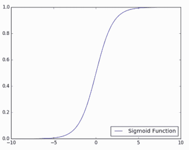

## Data Preparation

```
from kaggle_data import load_data, preprocess_data, preprocess_labels
import numpy as np
import matplotlib.pyplot as plt
```

```
Using TensorFlow backend.
```

```
X_train, labels = load_data('../data/kaggle_ottogroup/train.csv', train=True)
X_train, scaler = preprocess_data(X_train)
Y_train, encoder = preprocess_labels(labels)

X_test, ids = load_data('../data/kaggle_ottogroup/test.csv', train=False)
X_test, _ = preprocess_data(X_test, scaler)

nb_classes = Y_train.shape[1]
print(nb_classes, 'classes')

dims = X_train.shape[1]
print(dims, 'dims')
```

```
9 classes
93 dims
```

```
np.unique(labels)
```

```
array(['Class_1', 'Class_2', 'Class_3', 'Class_4', 'Class_5', 'Class_6',
       'Class_7', 'Class_8', 'Class_9'], dtype=object)
```

```
Y_train  # one-hot encoding
```

```
array([[ 0.,  0.,  0., ...,  0.,  0.,  0.],
       [ 0.,  0.,  0., ...,  1.,  0.,  0.],
       [ 0.,  0.,  0., ...,  0.,  0.,  0.],
       ..., 
       [ 0.,  0.,  0., ...,  0.,  0.,  0.],
       [ 0.,  0.,  0., ...,  0.,  0.,  0.],
       [ 0.,  0.,  1., ...,  0.,  0.,  0.]])
```

* * *

## Using Theano

```
import theano as th
import theano.tensor as T
```

```
#Based on example from DeepLearning.net
rng = np.random
N = 400
feats = 93
training_steps = 10

## Declare Theano symbolic variables
x = T.matrix("x")
y = T.vector("y")
w = th.shared(rng.randn(feats), name="w")
b = th.shared(0., name="b")

## Construct Theano expression graph
p_1 = 1 / (1 + T.exp(-T.dot(x, w) - b))         # Probability that target = 1
prediction = p_1 > 0.5                          # The prediction thresholded
xent = -y * T.log(p_1) - (1-y) * T.log(1-p_1)   # Cross-entropy loss function
cost = xent.mean() + 0.01 * (w ** 2).sum()      # The cost to minimize
gw, gb = T.grad(cost, [w, b])                   # Compute the gradient of the cost


## Compile
train = th.function(
          inputs=[x,y],
          outputs=[prediction, xent],
          updates=((w, w - 0.1 * gw), (b, b - 0.1 * gb)),
          allow_input_downcast=True)
predict = th.function(inputs=[x], outputs=prediction, allow_input_downcast=True)

#Transform for class1
y_class1 = []
for i in Y_train:
    y_class1.append(i[0])
y_class1 = np.array(y_class1)

## Train
for i in range(training_steps):
    print('Epoch %s' % (i+1,))
    pred, err = train(X_train, y_class1)

print("target values for Data:")
print(y_class1)
print("prediction on training set:")
print(predict(X_train))
```

```
Epoch 1
Epoch 2
Epoch 3
Epoch 4
Epoch 5
Epoch 6
Epoch 7
Epoch 8
Epoch 9
Epoch 10
target values for Data:
[ 0.  0.  0. ...,  0.  0.  0.]
prediction on training set:
[ True  True False ...,  True  True  True]
```

* * *

## Using Tensorflow

```
import tensorflow as tf
```

```
## Parameters
learning_rate = 0.01
training_epochs = 25
display_step = 1
```

```
## tf Graph Input
x = tf.placeholder("float", [None, dims]) 
y = tf.placeholder("float", [None, nb_classes])
```

```
x
```

```
<tf.Tensor 'Placeholder:0' shape=(?, 93) dtype=float32>
```

## Model (Introducing Tensorboard)

```
## Construct (linear) model
with tf.name_scope("model") as scope:
    # Set model weights
    W = tf.Variable(tf.zeros([dims, nb_classes]))
    b = tf.Variable(tf.zeros([nb_classes]))
    activation = tf.nn.softmax(tf.matmul(x, W) + b) # Softmax

    # Add summary ops to collect data
    w_h = tf.summary.histogram("weights_histogram", W)
    b_h = tf.summary.histogram("biases_histograms", b)
    tf.summary.scalar('mean_weights', tf.reduce_mean(W))
    tf.summary.scalar('mean_bias', tf.reduce_mean(b))

## Minimize error using cross entropy
## Note: More name scopes will clean up graph representation
with tf.name_scope("cost_function") as scope:
    cross_entropy = y*tf.log(activation)
    cost = tf.reduce_mean(-tf.reduce_sum(cross_entropy,reduction_indices=1))
    # Create a summary to monitor the cost function
    tf.summary.scalar("cost_function", cost)
    tf.summary.histogram("cost_histogram", cost)

with tf.name_scope("train") as scope:
    # Set the Optimizer
    optimizer = tf.train.GradientDescentOptimizer(learning_rate).minimize(cost)
```

## Accuracy

```
with tf.name_scope('Accuracy') as scope:
    correct_prediction = tf.equal(tf.argmax(activation, 1), tf.argmax(y, 1))
    # Calculate accuracy
    accuracy = tf.reduce_mean(tf.cast(correct_prediction, "float"))
    # Create a summary to monitor the cost function
    tf.summary.scalar("accuracy", accuracy)
```

## Learning in a TF Session

```
LOGDIR = "/tmp/logistic_logs"
import os, shutil
if os.path.isdir(LOGDIR):
    shutil.rmtree(LOGDIR)
os.mkdir(LOGDIR)

## Plug TensorBoard Visualisation 
writer = tf.summary.FileWriter(LOGDIR, graph=tf.get_default_graph())
```

```
for var in tf.get_collection(tf.GraphKeys.SUMMARIES):
    print(var.name)

summary_op = tf.summary.merge_all()
print('Summary Op: ' + summary_op)
```

```
model/weights_histogram:0
model/biases_histograms:0
model/mean_weights:0
model/mean_bias:0
cost_function/cost_function:0
cost_function/cost_histogram:0
Accuracy/accuracy:0
Tensor("add:0", shape=(), dtype=string)
```

```
## Launch the graph
with tf.Session() as session:
    # Initializing the variables
    session.run(tf.global_variables_initializer())

    cost_epochs = []
    # Training cycle
    for epoch in range(training_epochs):
        _, summary, c = session.run(fetches=[optimizer, summary_op, cost], 
                                    feed_dict={x: X_train, y: Y_train})
        cost_epochs.append(c)
        writer.add_summary(summary=summary, global_step=epoch)
        print("accuracy epoch {}:{}".format(epoch, accuracy.eval({x: X_train, y: Y_train})))

    print("Training phase finished")

    #plotting
    plt.plot(range(len(cost_epochs)), cost_epochs, 'o', label='Logistic Regression Training phase')
    plt.ylabel('cost')
    plt.xlabel('epoch')
    plt.legend()
    plt.show()

    prediction = tf.argmax(activation, 1)
    print(prediction.eval({x: X_test}))
```


```
accuracy epoch 0:0.6649535894393921
accuracy epoch 1:0.665276825428009
accuracy epoch 2:0.6657131910324097
accuracy epoch 3:0.6659556031227112
accuracy epoch 4:0.6662949919700623
accuracy epoch 5:0.6666181683540344
accuracy epoch 6:0.6668121218681335
accuracy epoch 7:0.6671029925346375
accuracy epoch 8:0.6674585342407227
accuracy epoch 9:0.6678463816642761
accuracy epoch 10:0.6680726408958435
accuracy epoch 11:0.6682504415512085
accuracy epoch 12:0.6684605479240417
accuracy epoch 13:0.6687514185905457
accuracy epoch 14:0.6690422892570496
accuracy epoch 15:0.6692523956298828
accuracy epoch 16:0.6695109605789185
accuracy epoch 17:0.6697695255279541
accuracy epoch 18:0.6699796319007874
accuracy epoch 19:0.6702220439910889
accuracy epoch 20:0.6705452799797058
accuracy epoch 21:0.6708361506462097
accuracy epoch 22:0.6710785627365112
accuracy epoch 23:0.671385645866394
accuracy epoch 24:0.6716926693916321
Training phase finished
```


```
[1 5 5 ..., 2 1 1]
```

```
%%bash
python -m tensorflow.tensorboard --logdir=/tmp/logistic_logs
```

```
Process is terminated.
```

* * *

## 使用 Keras

```
from keras.models import Sequential
from keras.layers import Dense, Activation
```

```
dims = X_train.shape[1]
print(dims, 'dims')
print("Building model...")

nb_classes = Y_train.shape[1]
print(nb_classes, 'classes')

model = Sequential()
model.add(Dense(nb_classes, input_shape=(dims,), activation='sigmoid'))
model.add(Activation('softmax'))

model.compile(optimizer='sgd', loss='categorical_crossentropy')
model.fit(X_train, Y_train)
```

```
93 dims
Building model...
9 classes
Epoch 1/10
61878/61878 [==============================] - 3s - loss: 1.9845     
Epoch 2/10
61878/61878 [==============================] - 2s - loss: 1.8337     
Epoch 3/10
61878/61878 [==============================] - 2s - loss: 1.7779     
Epoch 4/10
61878/61878 [==============================] - 3s - loss: 1.7432     
Epoch 5/10
61878/61878 [==============================] - 2s - loss: 1.7187     
Epoch 6/10
61878/61878 [==============================] - 3s - loss: 1.7002     
Epoch 7/10
61878/61878 [==============================] - 2s - loss: 1.6857     
Epoch 8/10
61878/61878 [==============================] - 2s - loss: 1.6739     
Epoch 9/10
61878/61878 [==============================] - 2s - loss: 1.6642     
Epoch 10/10
61878/61878 [==============================] - 2s - loss: 1.6560     


<keras.callbacks.History at 0x123026dd8>
```

简单性非常令人印象深刻，对吧？ :)

**Theano**:

`shape = (channels, rows, cols)`

**Tensorflow**:

`shape = (rows, cols, channels)`

`image_data_format` : `channels_last | channels_first`

```
!cat ~/.keras/keras.json
```

```
{

    "epsilon": 1e-07,

    "backend": "tensorflow",

    "floatx": "float32",

    "image_data_format": "channels_last"

}
```

现在让我们来理解：

```
The core data structure of Keras is a model, a way to organize layers. The main type of model is the Sequential model, a linear stack of layers.
```

我们在这里所做的是堆叠一个从输入到输出的完全连接（`Dense`）可训练权重层，以及在权重层之上的一个 `Activation` 层。

## Dense

```
from keras.layers.core import Dense

Dense(units, activation=None, use_bias=True, 
      kernel_initializer='glorot_uniform', bias_initializer='zeros', 
      kernel_regularizer=None, bias_regularizer=None, 
      activity_regularizer=None, kernel_constraint=None, bias_constraint=None)
```

*   `units`: int > 0.

*   `init`: 用于层权重的初始化函数名称（请参阅初始化），或者用于权重初始化的 Theano 函数。仅当您不传递 weights 参数时，此参数才相关。

*   `activation`: 要使用的激活函数名称（请参阅激活函数），或者元素级 Theano 函数。如果您不指定任何内容，则不应用激活（即“线性”激活：a(x) = x）。

*   `weights`: 用于设置初始权重的 NumPy 数组列表。列表应包含 2 个元素，分别为权重和偏置的 (input_dim, output_dim) 和 (output_dim,) 形状。

*   `kernel_regularizer`: WeightRegularizer 的实例（例如 L1 或 L2 正则化），应用于主权重矩阵。

*   `bias_regularizer`: WeightRegularizer 的实例，应用于偏置。

*   `activity_regularizer`: ActivityRegularizer 的实例，应用于网络输出。

*   `kernel_constraint`: 约束模块的实例（例如 maxnorm、nonneg），应用于主权重矩阵。

*   `bias_constraint`: 约束模块的实例，应用于偏置。

*   `use_bias`: 是否包含偏置（即使层为仿射而非线性）。

## (some) others `keras.core.layers`

*   `keras.layers.core.Flatten()`

*   `keras.layers.core.Reshape(target_shape)`

*   `keras.layers.core.Permute(dims)`

```
model = Sequential()
model.add(Permute((2, 1), input_shape=(10, 64)))
## now: model.output_shape == (None, 64, 10)
## note: `None` is the batch dimension
```

*   `keras.layers.core.Lambda(function, output_shape=None, arguments=None)`

*   `keras.layers.core.ActivityRegularization(l1=0.0, l2=0.0)`

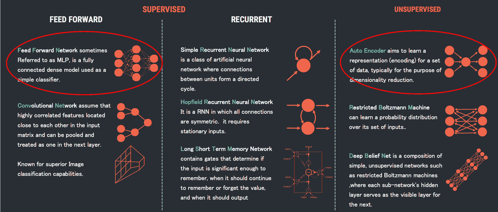

Credits: Yam Peleg ([@Yampeleg](https://twitter.com/yampeleg))

## Activation

```
from keras.layers.core import Activation

Activation(activation)
```

**支持的激活函数** : \[[`keras.io/activations/`](https://keras.io/activations/)\]

**高级激活函数**: \[[`keras.io/layers/advanced-activations/`](https://keras.io/layers/advanced-activations/)\]

## Optimizer

如果需要，您可以进一步配置优化器。Keras 的核心原则是使事物合理简单，同时在需要时允许用户完全控制（终极控制是源代码的易于扩展性）。这里我们使用 `SGD`（随机梯度下降）作为可训练权重的优化算法。

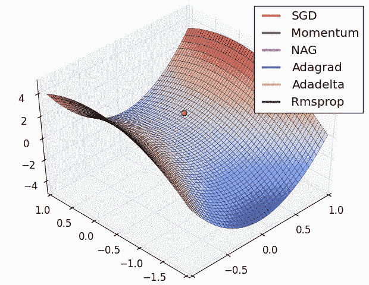

来源与参考：[`sebastianruder.com/content/images/2016/09/saddle\_point\_evaluation\_optimizers.gif`](http://sebastianruder.com/content/images/2016/09/saddle_point_evaluation_optimizers.gif)

## 稍微深入“数据科学”此示例

我们在这里所做的很好，但在现实世界中由于过拟合而无法使用。让我们尝试用交叉验证来解决它。

## 过拟合

在过拟合中，统计模型描述的是随机误差或噪声，而不是底层关系。当模型过于复杂（例如相对于观测数量拥有过多参数）时，就会发生过拟合。

过拟合模型的预测性能较差，因为它会对训练数据中的微小波动做出过度反应。

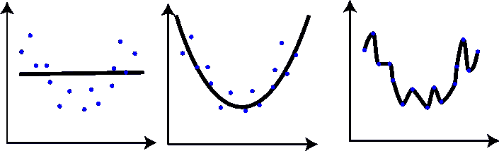

```
To avoid overfitting, we will first split out data to training set and test set and test out model on the test set.
Next: we will use two of keras's callbacks EarlyStopping and ModelCheckpoint
```

* * *

让我们先看看我们实现的模型

```
model.summary()
```

```
_________________________________________________________________
Layer (type)                 Output Shape              Param #   
=================================================================
dense_1 (Dense)              (None, 9)                 846       
_________________________________________________________________
activation_1 (Activation)    (None, 9)                 0         
=================================================================
Total params: 846
Trainable params: 846
Non-trainable params: 0
_________________________________________________________________
```

```
from sklearn.model_selection import train_test_split
from keras.callbacks import EarlyStopping, ModelCheckpoint
```


## 多层全连接网络


## 前向传播与反向传播


**Q:** `How hard can it be to build a Multi-Layer Fully-Connected Network with keras?`

**A:** `It is basically the same, just add more layers!`

```
model = Sequential()
model.add(Dense(100, input_shape=(dims,)))
model.add(Dense(nb_classes))
model.add(Activation('softmax'))
model.compile(optimizer='sgd', loss='categorical_crossentropy')
model.summary()
```

```
_________________________________________________________________
Layer (type)                 Output Shape              Param #   
=================================================================
dense_2 (Dense)              (None, 100)               9400      
_________________________________________________________________
dense_3 (Dense)              (None, 9)                 909       
_________________________________________________________________
activation_2 (Activation)    (None, 9)                 0         
=================================================================
Total params: 10,309
Trainable params: 10,309
Non-trainable params: 0
_________________________________________________________________
```

```
model.fit(X_train, Y_train, validation_data = (X_val, Y_val), epochs=20, 
          batch_size=128, verbose=True)
```

```
X_train, X_val, Y_train, Y_val = train_test_split(X_train, Y_train, test_size=0.15, random_state=42)

fBestModel = 'best_model.h5' 
early_stop = EarlyStopping(monitor='val_loss', patience=2, verbose=1) 
best_model = ModelCheckpoint(fBestModel, verbose=0, save_best_only=True)

model.fit(X_train, Y_train, validation_data = (X_val, Y_val), epochs=50, 
          batch_size=128, verbose=True, callbacks=[best_model, early_stop])
```

```
Train on 52596 samples, validate on 9282 samples
Epoch 1/50
52596/52596 [==============================] - 1s - loss: 1.6516 - val_loss: 1.6513
Epoch 2/50
52596/52596 [==============================] - 0s - loss: 1.6501 - val_loss: 1.6499
Epoch 3/50
52596/52596 [==============================] - 1s - loss: 1.6488 - val_loss: 1.6486
Epoch 4/50
52596/52596 [==============================] - 1s - loss: 1.6474 - val_loss: 1.6473
Epoch 5/50
52596/52596 [==============================] - 0s - loss: 1.6462 - val_loss: 1.6461
Epoch 6/50
52596/52596 [==============================] - 0s - loss: 1.6449 - val_loss: 1.6448
Epoch 7/50
52596/52596 [==============================] - 0s - loss: 1.6437 - val_loss: 1.6437
Epoch 8/50
52596/52596 [==============================] - 0s - loss: 1.6425 - val_loss: 1.6425
Epoch 9/50
52596/52596 [==============================] - 0s - loss: 1.6414 - val_loss: 1.6414
Epoch 10/50
52596/52596 [==============================] - 0s - loss: 1.6403 - val_loss: 1.6403
Epoch 11/50
52596/52596 [==============================] - 0s - loss: 1.6392 - val_loss: 1.6393
Epoch 12/50
52596/52596 [==============================] - 0s - loss: 1.6382 - val_loss: 1.6383
Epoch 13/50
52596/52596 [==============================] - 1s - loss: 1.6372 - val_loss: 1.6373
Epoch 14/50
52596/52596 [==============================] - 0s - loss: 1.6362 - val_loss: 1.6363
Epoch 15/50
52596/52596 [==============================] - 0s - loss: 1.6352 - val_loss: 1.6354
Epoch 16/50
52596/52596 [==============================] - 0s - loss: 1.6343 - val_loss: 1.6345
Epoch 17/50
52596/52596 [==============================] - 0s - loss: 1.6334 - val_loss: 1.6336
Epoch 18/50
52596/52596 [==============================] - 0s - loss: 1.6325 - val_loss: 1.6327
Epoch 19/50
52596/52596 [==============================] - 0s - loss: 1.6316 - val_loss: 1.6319
Epoch 20/50
52596/52596 [==============================] - 0s - loss: 1.6308 - val_loss: 1.6311
Epoch 21/50
52596/52596 [==============================] - 0s - loss: 1.6300 - val_loss: 1.6303
Epoch 22/50
52596/52596 [==============================] - 0s - loss: 1.6292 - val_loss: 1.6295
Epoch 23/50
52596/52596 [==============================] - 0s - loss: 1.6284 - val_loss: 1.6287
Epoch 24/50
52596/52596 [==============================] - 0s - loss: 1.6276 - val_loss: 1.6280
Epoch 25/50
52596/52596 [==============================] - 0s - loss: 1.6269 - val_loss: 1.6273
Epoch 26/50
52596/52596 [==============================] - 0s - loss: 1.6262 - val_loss: 1.6265
Epoch 27/50
52596/52596 [==============================] - 0s - loss: 1.6254 - val_loss: 1.6258
Epoch 28/50
52596/52596 [==============================] - 0s - loss: 1.6247 - val_loss: 1.6252
Epoch 29/50
52596/52596 [==============================] - 0s - loss: 1.6241 - val_loss: 1.6245
Epoch 30/50
52596/52596 [==============================] - 0s - loss: 1.6234 - val_loss: 1.6238
Epoch 31/50
52596/52596 [==============================] - 0s - loss: 1.6227 - val_loss: 1.6232
Epoch 32/50
52596/52596 [==============================] - 0s - loss: 1.6221 - val_loss: 1.6226
Epoch 33/50
52596/52596 [==============================] - 0s - loss: 1.6215 - val_loss: 1.6220
Epoch 34/50
52596/52596 [==============================] - 1s - loss: 1.6209 - val_loss: 1.6214
Epoch 35/50
52596/52596 [==============================] - 0s - loss: 1.6203 - val_loss: 1.6208
Epoch 36/50
52596/52596 [==============================] - 0s - loss: 1.6197 - val_loss: 1.6202
Epoch 37/50
52596/52596 [==============================] - 0s - loss: 1.6191 - val_loss: 1.6197
Epoch 38/50
52596/52596 [==============================] - 0s - loss: 1.6186 - val_loss: 1.6191
Epoch 39/50
52596/52596 [==============================] - 0s - loss: 1.6180 - val_loss: 1.6186
Epoch 40/50
52596/52596 [==============================] - 0s - loss: 1.6175 - val_loss: 1.6181
Epoch 41/50
52596/52596 [==============================] - 0s - loss: 1.6170 - val_loss: 1.6175
Epoch 42/50
52596/52596 [==============================] - 0s - loss: 1.6165 - val_loss: 1.6170
Epoch 43/50
52596/52596 [==============================] - 0s - loss: 1.6160 - val_loss: 1.6166
Epoch 44/50
52596/52596 [==============================] - 0s - loss: 1.6155 - val_loss: 1.6161
Epoch 45/50
52596/52596 [==============================] - 0s - loss: 1.6150 - val_loss: 1.6156
Epoch 46/50
52596/52596 [==============================] - 0s - loss: 1.6145 - val_loss: 1.6151
Epoch 47/50
52596/52596 [==============================] - 0s - loss: 1.6141 - val_loss: 1.6147
Epoch 48/50
52596/52596 [==============================] - 0s - loss: 1.6136 - val_loss: 1.6142
Epoch 49/50
52596/52596 [==============================] - 0s - loss: 1.6132 - val_loss: 1.6138
Epoch 50/50
52596/52596 [==============================] - 0s - loss: 1.6127 - val_loss: 1.6134
```

<keras.callbacks.History at 0x11e7a2710>


## 你的回合！

## 实操 - Keras 全连接网络

花几分钟时间，尝试调整层数和每层的参数数量，以获得最佳效果。

```
model = Sequential()
model.add(Dense(100, input_shape=(dims,)))

## ...
## ...
## 随意尝试！添加你想要的任意层数！尝试以获得更好的结果。

model.add(Dense(nb_classes))
model.add(Activation('softmax'))
model.compile(optimizer='sgd', loss='categorical_crossentropy')

model.summary()
```

```
_________________________________________________________________
Layer (type)                 Output Shape              Param #   
=================================================================
dense_4 (Dense)              (None, 100)               9400      
_________________________________________________________________
dense_5 (Dense)              (None, 9)                 909       
_________________________________________________________________
activation_3 (Activation)    (None, 9)                 0         
=================================================================
Total params: 10,309
Trainable params: 10,309
Non-trainable params: 0
_________________________________________________________________
```

```
model.fit(X_train, Y_train, validation_data = (X_val, Y_val), epochs=20, 
          batch_size=128, verbose=True)
```

```
Train on 52596 samples, validate on 9282 samples
Epoch 1/20
52596/52596 [==============================] - 1s - loss: 1.2107 - val_loss: 0.8821
Epoch 2/20
52596/52596 [==============================] - 1s - loss: 0.8204 - val_loss: 0.7798
Epoch 3/20
52596/52596 [==============================] - 1s - loss: 0.7577 - val_loss: 0.7393
Epoch 4/20
52596/52596 [==============================] - 0s - loss: 0.7280 - val_loss: 0.7176
Epoch 5/20
52596/52596 [==============================] - 1s - loss: 0.7097 - val_loss: 0.7028
Epoch 6/20
52596/52596 [==============================] - 1s - loss: 0.6973 - val_loss: 0.6929
Epoch 7/20
52596/52596 [==============================] - 1s - loss: 0.6883 - val_loss: 0.6858
Epoch 8/20
52596/52596 [==============================] - 1s - loss: 0.6813 - val_loss: 0.6804
Epoch 9/20
52596/52596 [==============================] - 1s - loss: 0.6757 - val_loss: 0.6756
Epoch 10/20
52596/52596 [==============================] - 1s - loss: 0.6711 - val_loss: 0.6722
Epoch 11/20
52596/52596 [==============================] - 1s - loss: 0.6672 - val_loss: 0.6692
Epoch 12/20
52596/52596 [==============================] - 0s - loss: 0.6641 - val_loss: 0.6667
Epoch 13/20
52596/52596 [==============================] - 0s - loss: 0.6613 - val_loss: 0.6636
Epoch 14/20
52596/52596 [==============================] - 0s - loss: 0.6589 - val_loss: 0.6620
Epoch 15/20
52596/52596 [==============================] - 0s - loss: 0.6568 - val_loss: 0.6606
Epoch 16/20
52596/52596 [==============================] - 0s - loss: 0.6546 - val_loss: 0.6589
Epoch 17/20
52596/52596 [==============================] - 0s - loss: 0.6531 - val_loss: 0.6577
Epoch 18/20
52596/52596 [==============================] - 0s - loss: 0.6515 - val_loss: 0.6568
Epoch 19/20
52596/52596 [==============================] - 0s - loss: 0.6501 - val_loss: 0.6546
Epoch 20/20
52596/52596 [==============================] - 0s - loss: 0.6489 - val_loss: 0.6539


<keras.callbacks.History at 0x1285bae80>
```

构建问答系统、图像分类模型、神经图灵机、word2vec 词嵌入器或任何其他模型同样快速。深度学习背后的理念很简单，那么其实现为什么应该痛苦呢？

## 深度的理论动机

> 关于神经网络深度的研究已有很多。数学上\[1\] 和经验上都已证明，卷积神经网络受益于深度！

\[1\] - 深度学习的表达能力：张量分析 - Cohen 等，2015 年

## 深度的理论动机

一个广为引用的关于神经网络的定理指出：

> 通用近似定理指出\[1\]，带有单个隐藏层且包含有限数量神经元（即多层感知机）的前馈网络，可以在激活函数满足温和假设的条件下，近似 $\\mathbb{R}^n$ 紧子集上的连续函数。该定理因此指出，当给定适当参数时，简单的神经网络可以表示各种有趣的函数；然而，它并未涉及这些参数的算法可学性。

\[1\] - 多层前馈网络的近似能力 - Kurt Hornik 1991

## 附录

2.3.1 Keras Backend

## 2.3.1 Keras Backend

## Keras Backend

在本笔记本中，我们将使用 [Keras 后端模块](http://keras.io/backend/)，它提供了对 Theano 和 Tensorflow 的抽象。

让我们尝试使用 `keras.backend` API 重新实现逻辑回归模型。

以下代码将与我们在 Theano 或 Tensorflow 中编写的代码非常相似（*唯一的区别*是它可以同时在两个后端上运行）。

```
import keras.backend as K
import numpy as np
import matplotlib.pyplot as plt

%matplotlib inline
```

```
Using TensorFlow backend.
```

```
from kaggle_data import load_data, preprocess_data, preprocess_labels
```

```
X_train, labels = load_data('../data/kaggle_ottogroup/train.csv', train=True)
X_train, scaler = preprocess_data(X_train)
Y_train, encoder = preprocess_labels(labels)

X_test, ids = load_data('../data/kaggle_ottogroup/test.csv', train=False)

X_test, _ = preprocess_data(X_test, scaler)

nb_classes = Y_train.shape[1]
print(nb_classes, 'classes')

dims = X_train.shape[1]
print(dims, 'dims')
```

```
9 classes
93 dims
```

```
feats = dims
training_steps = 25
```


## Keras Backend 示例

```
x = K.placeholder(dtype="float", shape=X_train.shape) 
target = K.placeholder(dtype="float", shape=Y_train.shape)
```

## Set model weights

```
W = K.variable(np.random.rand(dims, nb_classes))
b = K.variable(np.random.rand(nb_classes))
```

## Define model and loss

```
y = K.dot(x, W) + b
loss = K.categorical_crossentropy(y, target)
```

```
activation = K.softmax(y) # Softmax
```

```
lr = K.constant(0.01)
grads = K.gradients(loss, [W,b])
updates = [(W, W-lr*grads[0]), (b, b-lr*grads[1])]
```

```
train = K.function(inputs=[x, target], outputs=[loss], updates=updates)
```

## Training

```
loss_history = []
for epoch in range(training_steps):
    current_loss = train([X_train, Y_train])[0]
    loss_history.append(current_loss)
    if epoch % 20 == 0:
        print("Loss: {}".format(current_loss))
```

```
Loss: [ 2.13178873  1.99579716  3.72429109 ...,  2.75165343  2.29350972
  1.77051127]
Loss: [ 2.95424724  0.10998608  1.07148504 ...,  0.23925911  2.9478302
  2.90452051]
```

```
loss_history = [np.mean(lh) for lh in loss_history]
```

## plotting

```
plt.plot(range(len(loss_history)), loss_history, 'o', label='Logistic Regression Training phase')
plt.ylabel('cost')
plt.xlabel('epoch')
plt.legend()
plt.show()
```


## Your Turn

Please switch to the `Theano` backend and `restart` the notebook.

You should see no difference in the execution!

**Reminder**: please keep in mind that you can execute shell commands from a notebook (pre-pending a `!` sign). Thus:

```
    !cat ~/.keras/keras.json
```

should show you the content of your keras configuration file.

## Moreover

Try to play a bit with the `learning reate` parameter to see how the loss history floats...

* * *

## Exercise: Linear Regression

To get familiar with automatic differentiation, we start by learning a simple linear regression model using Stochastic Gradient Descent (SGD).

Recall that given a dataset ${(x*i, y\_i)}*{i=0}^N$, with $x\_i, y\_i \\in \\mathbb{R}$, the objective of linear regression is to find two scalars $w$ and $b$ such that $y = w\\cdot x + b$ fits the dataset. In this tutorial we will learn $w$ and $b$ using SGD and a Mean Square Error (MSE) loss:

$$\\mathcal{l} = \\frac{1}{N} \sum\_{i=0}^N (w\\cdot x\_i + b - y\_i)²$$

Starting from random values, parameters $w$ and $b$ will be updated at each iteration via the following rule:

$$w*t = w*{t-1} - \\eta \\frac{\\partial \\mathcal{l}}{\\partial w}$$  

$$b*t = b*{t-1} - \\eta \\frac{\\partial \\mathcal{l}}{\\partial b}$$

where $\\eta$ is the learning rate.

**NOTE:** Recall that `linear regression` is indeed a `simple neuron` with a linear activation function!!

## Definition: Placeholders and Variables

First of all, we define the necessary variables and placeholders for our computational graph. Variables maintain state across executions of the computational graph, while placeholders are ways to feed the graph with external data.

For the linear regression example, we need three variables: `w`, `b`, and the learning rate for SGD, `lr`.

Two placeholders `x` and `target` are created to store $x_i$ and $y_i$ values.

```
## Placeholders and variables
x = K.placeholder()
target = K.placeholder()
w = K.variable(np.random.rand())
b = K.variable(np.random.rand())
```

## Notes:

In case you're wondering what's the difference between a `placeholder` and a `variable`, in short:

*   Use `K.variable()` for trainable variables such as weights (`W`) and biases (`b`) for your model.

*   Use `K.placeholder()` to feed actual data (e.g. training examples)

## Model definition

Now we can define the $y = w\\cdot x + b$ relation as well as the MSE loss in the computational graph.

```
## Define model and loss
```

```
## %load ../solutions/sol_2311.py
```

Then, given the gradient of MSE wrt to `w` and `b`, we can define how we update the parameters via SGD:

```
## %load ../solutions/sol_2312.py
```

The whole model can be encapsulated in a `function`, which takes as input `x` and `target`, returns the current loss value and updates its parameter according to `updates`.

```
train = K.function(inputs=[x, target], outputs=[loss], updates=updates)
```

## Training

Training is now just a matter of calling the `function` we have just defined. Each time `train` is called, indeed, `w` and `b` will be updated using the SGD rule.

Having generated some random training data, we will feed the `train` function for several epochs and observe the values of `w`, `b`, and loss.

```
## Generate data
np_x = np.random.rand(1000)
np_target = 0.96*np_x + 0.24
```

```
## Training
loss_history = []
for epoch in range(200):
    current_loss = train([np_x, np_target])[0]
    loss_history.append(current_loss)
    if epoch % 20 == 0:
        print("Loss: %.03f, w, b: [%.02f, %.02f]" % (current_loss, K.eval(w), K.eval(b)))
```

We can also plot the loss history:

```
## Plot loss history
```

```
## %load ../solutions/sol_2313.py
```

## Final Note:

Please switch back your backend to `tensorflow` before moving on. It may be useful for next notebooks !-)

## 3.0 - MNIST Dataset

## MNIST Dataset

## Also known as `digits` if you're familiar with `sklearn`:

```
from sklearn.datasets import digits
```

## Problem Definition

*Recognize handwritten digits* 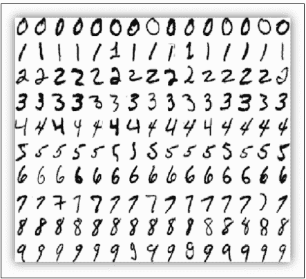

## Data

The MNIST database ([link](http://yann.lecun.com/exdb/mnist)) has a database of handwritten digits.

The training set has $60,000$ samples. The test set has $10,000$ samples.

The digits are size-normalized and centered in a fixed-size image.

The data page has description on how the data was collected. It also has reports the benchmark of various algorithms on the test dataset.

## Load the data

The data is available in the repo's `data` folder. Let's load that using the `keras` library.

For now, let's load the data and see how it looks.

```
import numpy as np
import keras
from keras.datasets import mnist
```

```
## Load the datasets
(X_train, y_train), (X_test, y_test) = mnist.load_data()
```

## Basic data analysis on the dataset

```
## What is the type of X_train?
```

```
## What is the type of y_train?
```

```
## Find number of observations in training data
```

```
## Find number of observations in test data
```

```
## Display first 2 records of X_train
```

```
## Display the first 10 records of y_train
```

```
## Find the number of observations for each digit in the y_train dataset
```

```
## Find the number of observations for each digit in the y_test dataset
```

```
## What is the dimension of X_train?. What does that mean?
```

## Display Images

Let's now display some of the images and see how they look

We will be using `matplotlib` library for displaying the image

```
from matplotlib import pyplot
import matplotlib as mpl
%matplotlib inline
```

```
## Displaying the first training data
```

```
fig = pyplot.figure()
ax = fig.add_subplot(1,1,1)
imgplot = ax.imshow(X_train[0], cmap=mpl.cm.Greys)
imgplot.set_interpolation('nearest')
ax.xaxis.set_ticks_position('top')
ax.yaxis.set_ticks_position('left')
pyplot.show()
```

```
## Let's now display the 11th record
```

## 3.1 Hidden Layer Representation and Embeddings

## Fully Connected Feed-Forward Network

In this notebook we will play with Feed-Forward FC-NN (Fully Connected Neural Network) for a *classification task*:

Image Classification on MNIST Dataset

**RECALL**

In the FC-NN, the output of each layer is computed using the activations from the previous one, as follows:

$$h*{i} = \\sigma(W\_i h*{i-1} + b\_i)$$

where ${h}\_i$ is the activation vector from the $i$-th layer (or the input data for $i=0$), ${W}\_i$ and ${b}\_i$ are the weight matrix and the bias vector for the $i$-th layer, respectively.  

 $\\sigma(\\cdot)$ is the activation function. In our example, we will use the *ReLU* activation function for the hidden layers and *softmax* for the last layer.


为了正则化模型，我们还会在相邻的隐藏层之间插入一个 `Dropout` 层。

`Dropout` 的工作原理是“丢弃”给定层中的一些单元激活，即以给定概率将其设置为零。

我们的损失函数将是 `categorical crossentropy`。

## 模型定义

Keras 支持两种不同类型的模型：[`Sequential`](http://keras.io/models/#sequential) 模型和 [`Graph`](http://keras.io/models/#graph) 模型。前者用于构建线性层堆栈（因此每个层有一个输入和一个输出），后者支持任何类型的连接图。

在我们的例子中，我们构建了一个带有三个 [`Dense`](http://keras.io/layers/core/#dense)（即全连接）层的 `Sequential` 模型，并带有一些 [`Dropout`](http://keras.io/layers/core/#dropout)。请注意，输出层具有 softmax 激活函数。

生成的模型实际上是其自身输入的一个 `function`，使用 Keras 后端实现。

我们应用 binary crossentropy 损失并选择 `SGD` 作为优化器。

请记住，Keras 支持多种不同的 [`optimizers`](http://keras.io/optimizers/) 和 [`loss functions`](http://keras.io/objectives/)，你可能想查看一下。

```
import numpy as np
import matplotlib.pyplot as plt

%matplotlib inline
```

## 引入 ReLU

`ReLu` 函数定义为 $f(x) = \\max(0, x),$ \[1\]

整流器的一个平滑近似是 `analytic function`：$f(x) = \\ln(1 + e^x)$

它被称为 `softplus` 函数。

softplus 的导数是 $f'(x) = e^x / (e^x + 1) = 1 / (1 + e^{-x})$，即 `logistic function`。

\[1\] http://www.cs.toronto.edu/~fritz/absps/reluICML.pdf by G. E. Hinton

## 注意：请记住此函数，因为它在 CNN 中被大量使用

```
from keras.models import Sequential
from keras.layers.core import Dense
from keras.optimizers import SGD

nb_classes = 10

## FC@512+relu -> FC@512+relu -> FC@nb_classes+softmax
## ... your Code Here
```

```
## %load ../solutions/sol_321.py
```

```
from keras.models import Sequential
from keras.layers.core import Dense
from keras.optimizers import SGD

model = Sequential()
model.add(Dense(512, activation='relu', input_shape=(784,)))
model.add(Dense(512, activation='relu'))
model.add(Dense(10, activation='softmax'))

model.compile(loss='categorical_crossentropy', optimizer=SGD(lr=0.001), 
              metrics=['accuracy'])
```

## 数据准备 (`keras.dataset`)

我们将在 MNIST 数据集上训练模型，该数据集包含 60,000 张 28x28 灰度图像的 10 个数字，以及 10,000 张图像的测试集。


由于该数据集是 `provided` 与 Keras 一起，我们只需向 `keras.dataset` 模型请求训练和测试数据。

我们将：

*   下载数据

*   将数据重塑为向量形式（原始数据是图像）

*   在 0 和 1 之间归一化。

`binary_crossentropy` 损失期望 `one-hot-vector` 作为输入，因此我们应用 `keras.utilis` 中的 `to_categorical` 函数将整数标签转换为 `one-hot-vectors`。

```
from keras.datasets import mnist
from keras.utils import np_utils

(X_train, y_train), (X_test, y_test) = mnist.load_data()
```

```
X_train.shape
```

```
(60000, 28, 28)
```

```
X_train = X_train.reshape(60000, 784)
X_test = X_test.reshape(10000, 784)
X_train = X_train.astype("float32")
X_test = X_test.astype("float32")

## Put everything on grayscale
X_train /= 255
X_test /= 255

## convert class vectors to binary class matrices
Y_train = np_utils.to_categorical(y_train, 10)
Y_test = np_utils.to_categorical(y_test, 10)
```

## 分割训练和验证数据

```
from sklearn.model_selection import train_test_split

X_train, X_val, Y_train, Y_val = train_test_split(X_train, Y_train)
```

```
X_train[0].shape
```

```
(784,)
```

```
plt.imshow(X_train[0].reshape(28, 28))
```

```
<matplotlib.image.AxesImage at 0x7f7f8cea6438>
```


```
print(np.asarray(range(10)))
print(Y_train[0].astype('int'))
```

```
[0 1 2 3 4 5 6 7 8 9]
[0 0 0 0 0 1 0 0 0 0]
```

```
plt.imshow(X_val[0].reshape(28, 28))
```

```
<matplotlib.image.AxesImage at 0x7f7f8ce4f9b0>
```


```
print(np.asarray(range(10)))
print(Y_val[0].astype('int'))
```

```
[0 1 2 3 4 5 6 7 8 9]
[0 0 0 0 1 0 0 0 0 0]
```

## 训练

定义并编译模型后，可以使用 `fit` 函数进行训练。我们还指定一个验证数据集来监控验证损失和准确率。

```
network_history = model.fit(X_train, Y_train, batch_size=128, 
                            epochs=2, verbose=1, validation_data=(X_val, Y_val))
```

```
Train on 45000 samples, validate on 15000 samples
Epoch 1/2
45000/45000 [==============================] - 1s - loss: 2.1743 - acc: 0.2946 - val_loss: 2.0402 - val_acc: 0.5123
Epoch 2/2
45000/45000 [==============================] - 1s - loss: 1.9111 - acc: 0.6254 - val_loss: 1.7829 - val_acc: 0.6876
```

## 绘制网络性能趋势

`fit` 函数的返回值是一个 `keras.callbacks.History` 对象，它包含每个时代的训练/验证损失和准确率的完整历史记录。因此，我们可以绘制训练阶段损失和准确率的行为。

```
import matplotlib.pyplot as plt
%matplotlib inline

def plot_history(network_history):
    plt.figure()
    plt.xlabel('Epochs')
    plt.ylabel('Loss')
    plt.plot(network_history.history['loss'])
    plt.plot(network_history.history['val_loss'])
    plt.legend(['Training', 'Validation'])

    plt.figure()
    plt.xlabel('Epochs')
    plt.ylabel('Accuracy')
    plt.plot(network_history.history['acc'])
    plt.plot(network_history.history['val_acc'])
    plt.legend(['Training', 'Validation'], loc='lower right')
    plt.show()

plot_history(network_history)
```


经过 `2` 个时代，我们获得了 `~88%` 的验证准确率。

*   如果你增加时代的数量，你肯定会得到更好的结果。

## 快速练习：

尝试增加时代的数量（如果你的硬件允许的话）

```
## Your code here
model.compile(loss='categorical_crossentropy', optimizer=SGD(lr=0.001), 
              metrics=['accuracy'])
network_history = model.fit(X_train, Y_train, batch_size=128, 
                            epochs=2, verbose=1, validation_data=(X_val, Y_val))
```

```
Train on 45000 samples, validate on 15000 samples
Epoch 1/2
45000/45000 [==============================] - 2s - loss: 0.8966 - acc: 0.8258 - val_loss: 0.8463 - val_acc: 0.8299
Epoch 2/2
45000/45000 [==============================] - 1s - loss: 0.8005 - acc: 0.8370 - val_loss: 0.7634 - val_acc: 0.8382
```

## 引入 Dropout 层

`dropout layers` 具有非常特定的功能，即在前向传播过程中将该层中的一组随机激活设置为零以 `drop out`。就这么简单。

它允许避免 `overfitting`，但必须 `only` 在训练时使用，而 `not` 在测试时使用。

```
keras.layers.core.Dropout(rate, noise_shape=None, seed=None)
```

对输入应用 Dropout。

Dropout 在训练期间的每次更新中随机将输入单元的比率 rate 设置为 0，这有助于防止过拟合。

参数

*   `rate`: 0 和 1 之间的浮点数。要丢弃的输入单元的比例。

*   `noise\_shape`: 表示将与输入相乘的二进制 Dropout 掩码形状的 1D 整数张量。例如，如果你的输入形状为 (batch\_size, timesteps, features) 并且你希望 Dropout 掩码对所有 timesteps 都相同，你可以使用 `noise\_shape=(batch\_size, 1, features)`。

*   `seed`: 用作随机种子的 Python 整数。


**Note** Keras guarantees automatically that this layer is **not** used in **Inference** (i.e. Prediction) phase (thus only used in **training** as it should be!)

See `keras.backend.in_train_phase` function

```
from keras.layers.core import Dropout

## Pls note **where** the `K.in_train_phase` is actually called!!
Dropout??
```

```
from keras import backend as K

K.in_train_phase?
```

## Exercise:

Try modifying the previous example network adding a Dropout layer:

```
from keras.layers.core import Dropout

## FC@512+relu -> DropOut(0.2) -> FC@512+relu -> DropOut(0.2) -> FC@nb_classes+softmax
## ... your Code Here
```

```
## %load ../solutions/sol_312.py
```

```
network_history = model.fit(X_train, Y_train, batch_size=128, 
                            epochs=4, verbose=1, validation_data=(X_val, Y_val))
plot_history(network_history)
```

```
Train on 45000 samples, validate on 15000 samples
Epoch 1/4
45000/45000 [==============================] - 2s - loss: 1.3746 - acc: 0.6348 - val_loss: 0.6917 - val_acc: 0.8418
Epoch 2/4
45000/45000 [==============================] - 2s - loss: 0.6235 - acc: 0.8268 - val_loss: 0.4541 - val_acc: 0.8795
Epoch 3/4
45000/45000 [==============================] - 1s - loss: 0.4827 - acc: 0.8607 - val_loss: 0.3795 - val_acc: 0.8974
Epoch 4/4
45000/45000 [==============================] - 1s - loss: 0.4218 - acc: 0.8781 - val_loss: 0.3402 - val_acc: 0.9055
```


*   If you continue training, at some point the validation loss will start to increase: that is when the model starts to **overfit**.

It is always necessary to monitor training and validation loss during the training of any kind of Neural Network, either to detect overfitting or to evaluate the behaviour of the model **(any clue on how to do it??)**

```
## %load solutions/sol23.py
from keras.callbacks import EarlyStopping

early_stop = EarlyStopping(monitor='val_loss', patience=4, verbose=1)

model = Sequential()
model.add(Dense(512, activation='relu', input_shape=(784,)))
model.add(Dropout(0.2))
model.add(Dense(512, activation='relu'))
model.add(Dropout(0.2))
model.add(Dense(10, activation='softmax'))

model.compile(loss='categorical_crossentropy', optimizer=SGD(), 
              metrics=['accuracy'])

model.fit(X_train, Y_train, validation_data = (X_test, Y_test), epochs=100, 
          batch_size=128, verbose=True, callbacks=[early_stop])
```

* * *

## Inspecting Layers

```
## We already used `summary`
model.summary()
```

```
_________________________________________________________________
Layer (type)                 Output Shape              Param #   
=================================================================
dense_4 (Dense)              (None, 512)               401920    
_________________________________________________________________
dropout_1 (Dropout)          (None, 512)               0         
_________________________________________________________________
dense_5 (Dense)              (None, 512)               262656    
_________________________________________________________________
dropout_2 (Dropout)          (None, 512)               0         
_________________________________________________________________
dense_6 (Dense)              (None, 10)                5130      
=================================================================
Total params: 669,706
Trainable params: 669,706
Non-trainable params: 0
_________________________________________________________________
```

## `model.layers` is iterable

```
print('Model Input Tensors: ', model.input, end='\n\n')
print('Layers - Network Configuration:', end='\n\n')
for layer in model.layers:
    print(layer.name, layer.trainable)
    print('Layer Configuration:')
    print(layer.get_config(), end='\n{}\n'.format('----'*10))
print('Model Output Tensors: ', model.output)
```

```
Model Input Tensors:  Tensor("dense_4_input:0", shape=(?, 784), dtype=float32)

Layers - Network Configuration:

dense_4 True
Layer Configuration:
{'batch_input_shape': (None, 784), 'name': 'dense_4', 'units': 512, 'bias_regularizer': None, 'bias_initializer': {'config': {}, 'class_name': 'Zeros'}, 'trainable': True, 'activation': 'relu', 'use_bias': True, 'bias_constraint': None, 'activity_regularizer': None, 'kernel_regularizer': None, 'kernel_constraint': None, 'kernel_initializer': {'config': {'seed': None, 'mode': 'fan_avg', 'scale': 1.0, 'distribution': 'uniform'}, 'class_name': 'VarianceScaling'}, 'dtype': 'float32'}
----------------------------------------
dropout_1 True
Layer Configuration:
{'name': 'dropout_1', 'rate': 0.2, 'trainable': True}
----------------------------------------
dense_5 True
Layer Configuration:
{'kernel_regularizer': None, 'units': 512, 'bias_regularizer': None, 'bias_initializer': {'config': {}, 'class_name': 'Zeros'}, 'trainable': True, 'activation': 'relu', 'bias_constraint': None, 'activity_regularizer': None, 'name': 'dense_5', 'kernel_constraint': None, 'kernel_initializer': {'config': {'seed': None, 'mode': 'fan_avg', 'scale': 1.0, 'distribution': 'uniform'}, 'class_name': 'VarianceScaling'}, 'use_bias': True}
----------------------------------------
dropout_2 True
Layer Configuration:
{'name': 'dropout_2', 'rate': 0.2, 'trainable': True}
----------------------------------------
dense_6 True
Layer Configuration:
{'kernel_regularizer': None, 'units': 10, 'bias_regularizer': None, 'bias_initializer': {'config': {}, 'class_name': 'Zeros'}, 'trainable': True, 'activation': 'softmax', 'bias_constraint': None, 'activity_regularizer': None, 'name': 'dense_6', 'kernel_constraint': None, 'kernel_initializer': {'config': {'seed': None, 'mode': 'fan_avg', 'scale': 1.0, 'distribution': 'uniform'}, 'class_name': 'VarianceScaling'}, 'use_bias': True}
----------------------------------------
Model Output Tensors:  Tensor("dense_6/Softmax:0", shape=(?, 10), dtype=float32)
```

## Extract hidden layer representation of the given data

One **simple** way to do it is to use the weights of your model to build a new model that's truncated at the layer you want to read.

Then you can run the `._predict(X_batch)` method to get the activations for a batch of inputs.

```
model_truncated = Sequential()
model_truncated.add(Dense(512, activation='relu', input_shape=(784,)))
model_truncated.add(Dropout(0.2))
model_truncated.add(Dense(512, activation='relu'))

for i, layer in enumerate(model_truncated.layers):
    layer.set_weights(model.layers[i].get_weights())

model_truncated.compile(loss='categorical_crossentropy', optimizer=SGD(), 
              metrics=['accuracy'])
```

```
## Check
np.all(model_truncated.layers[0].get_weights()[0] == model.layers[0].get_weights()[0])
```

```
True
```

```
hidden_features = model_truncated.predict(X_train)
```

```
hidden_features.shape
```

```
(45000, 512)
```

```
X_train.shape
```

```
(45000, 784)
```

## Hint: Alternative Method to get activations

(Using `keras.backend` `function` on Tensors)

```
def get_activations(model, layer, X_batch):
    activations_f = K.function([model.layers[0].input, K.learning_phase()], [layer.output,])
    activations = activations_f((X_batch, False))
    return activations
```

* * *

## Generate the Embedding of Hidden Features

```
from sklearn.manifold import TSNE

tsne = TSNE(n_components=2)
X_tsne = tsne.fit_transform(hidden_features[:1000]) ## Reduced for computational issues
```

```
colors_map = np.argmax(Y_train, axis=1)
```

```
X_tsne.shape
```

```
(1000, 2)
```

```
nb_classes
```

```
10
```

```
np.where(colors_map==6)
```


## 4.1 卷积神经网络

## 卷积神经网络

## 参考文献：

我使用的一些图片和内容来自这两篇优秀的博客文章 \[1\] https://adeshpande3.github.io/adeshpande3.github.io/ 和 \[2》这本精彩的书籍，["Neural Networks and Deep Learning"](http://neuralnetworksanddeeplearning.com/) 由 Michael Nielsen 编写。（**强烈推荐**）

卷积神经网络（`CNN`，或 `ConvNet`）是一种 **前馈** 人工神经网络，其神经元之间的连接模式受动物视觉皮层组织的启发。

这些网络由多层小的神经元集合组成，它们处理输入图像的部分，称为 **感受野**。

然后将这些集合的输出铺开，使它们的输入区域重叠，以获得原始图像的 *更好表示*；这对每一层都重复进行。

## 它长什么样？

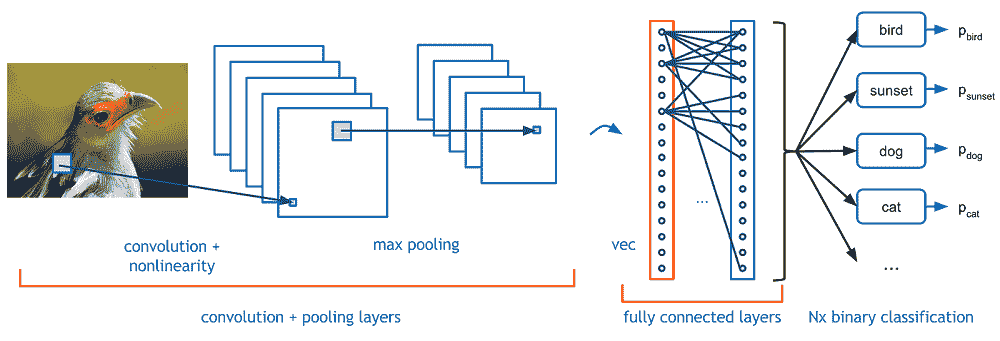

> source: [`flickrcode.files.wordpress.com/2014/10/conv-net2.png`](https://flickrcode.files.wordpress.com/2014/10/conv-net2.png)

# 问题空间

## 图像分类

图像分类是获取输入图像并输出一个类别（猫、狗等）或最能描述该图像的类别概率的任务。

对于人类来说，这种识别任务是我们从出生起就学习的第一项技能之一，并且作为成年人，它是自然而然、毫不费力的。

这些能够快速识别模式、*基于先前知识进行泛化* 以及适应不同图像环境的技能，是我们与机器不共有的。

## 输入和输出

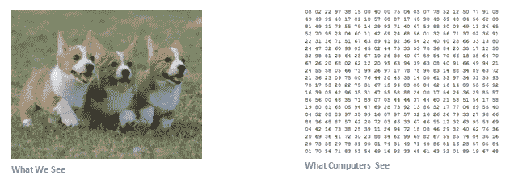

source: http://www.pawbuzz.com/wp-content/uploads/sites/551/2014/11/corgi-puppies-21.jpg

当计算机看到一张图像（将图像作为输入）时，它会看到一个像素值数组。

根据图像的分辨率和大小，它会看到一个 `32 x 32 x 3` 的数字数组（`3` 指的是 `RGB` 值）。

假设我们有一个 `JPG` 格式的彩色图像，其大小为 `480 x 480`。代表性数组将是 `480 x 480 x 3`。这些数字中的每一个都被赋予 `0` 到 `255` 之间的值，描述该点的像素强度。

## 目标

我们希望计算机能够区分它所给出的所有图像，并找出使狗成为狗或使猫成为猫的独特特征。

当我们看一张狗的照片时，如果照片中有可识别的特征，例如爪子或 `4` 条腿，我们可以将其分类为狗。

同样，计算机应该能够通过寻找 *低级* 特征（如边缘和曲线），然后通过一系列 **卷积层** 构建更抽象的概念来执行图像分类。

## CNN 的结构

> 对 CNN 所做工作的更详细概述是：你获取图像，将其通过一系列卷积层、非线性层、池化层（下采样）和全连接层传递，并得到输出。如前所述，输出可以是单个类别或最能描述图像的类别概率。

source: \[1\]

## 卷积层

`CNN` 中的第一层始终是 **卷积层**。

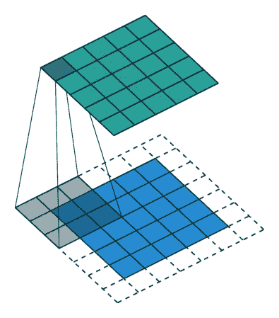

**Reference**: [`deeplearning.net/software/theano/tutorial/conv\_arithmetic.html`](http://deeplearning.net/software/theano/tutorial/conv_arithmetic.html)

## 卷积滤波器

卷积滤波器很像图像识别中的 **核**，是一个用于模糊、锐化、浮雕、边缘检测等的小矩阵。

这是通过核与图像之间的卷积来实现的。

## 这里的主要区别在于，卷积矩阵是 **学习** 得到的。

当滤波器在输入图像周围滑动，或 **卷积** 时，它将滤波器中的值与图像的原始像素值相乘

（a.k.a. 计算 **逐元素乘法**）。

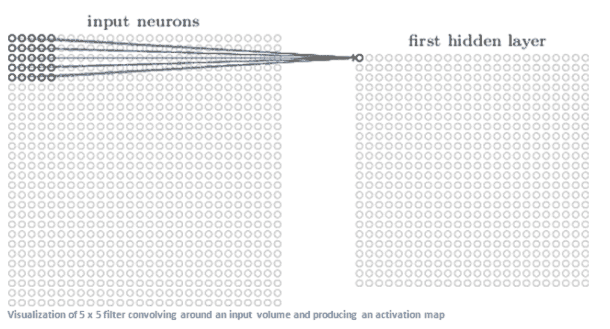

现在，我们对输入体积上的每个位置重复此过程。（下一步是将滤波器向右移动 `1` 个单位，然后再向右移动 `1` 个单位，依此类推）。

在将滤波器滑过所有位置后，我们得到一个通常称为 **激活图** 或 **特征图** 的数字数组。

## 高层视角

让我们简要谈谈这个卷积实际上从高层次在做什么。

每个滤波器都可以被视为 **特征标识符**（例如，*直线边缘、简单颜色、曲线*）

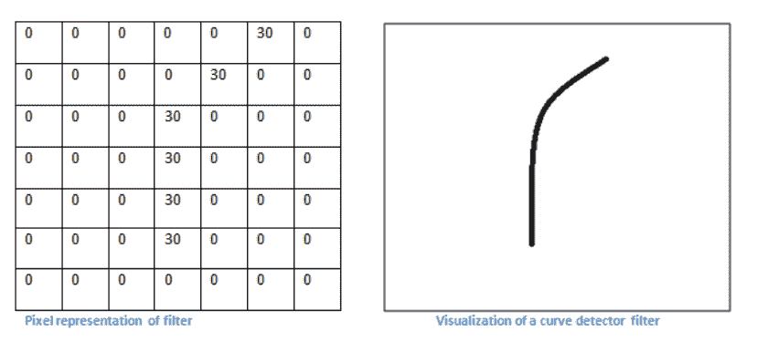

## 感受野的可视化


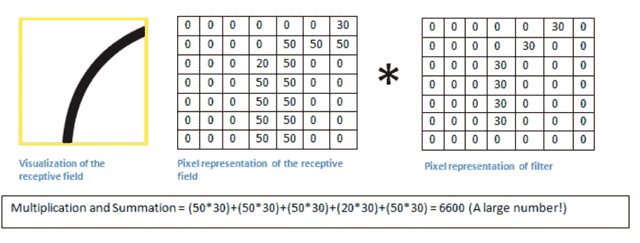

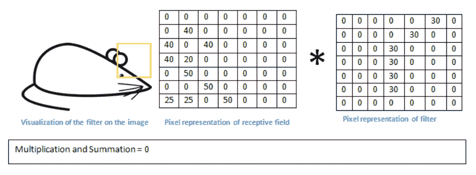

该值要低得多！这是因为图像部分中没有任何东西响应曲线检测器滤波器。请记住，此卷积层的输出是一个激活图。

## 深入网络

现在，在传统的 **卷积神经网络** 架构中，还有其他层穿插在这些卷积层之间。

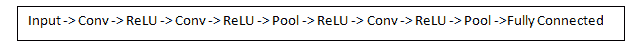

## ReLU（整流线性单元）层

每个卷积层之后，通常会立即应用一个 *非线性层*（或 **激活层**）。

此层的目的是为一个基本上在卷积层期间一直在执行线性操作（仅逐元素乘法和求和）的系统引入非线性。

## 使用 Bokeh（交互式图表）

```
from bokeh.plotting import figure, output_notebook, show

output_notebook()
```

```
<div class="bk-root">
    <a href="http://bokeh.pydata.org" target="_blank" class="bk-logo bk-logo-small bk-logo-notebook"></a>
    <span id="0af86eff-6a55-4644-ab84-9a6f5fcbeb3e">Loading BokehJS ...</span>
</div>
```

```
p = figure(plot_width=600, plot_height=600)

colors = [x for x in 'blue-green-red-cyan-magenta-yellow-black-purple-coral-lime'.split('-')]
colors_map = colors_map[:1000]
for cl in range(nb_classes):
    indices = np.where(colors_map==cl)
    p.circle(X_tsne[indices, 0].ravel(), X_tsne[indices, 1].ravel(), size=7, 
             color=colors[cl], alpha=0.4, legend=str(cl))

## show the results
p.legend.location = 'bottom_right'
show(p)
```

```
<div class="bk-root">
    <div class="bk-plotdiv" id="e90df1a2-e577-49fb-89bb-6e083232c9ec"></div>
</div>
```

## 注：我们使用了 `default` TSNE 参数。通过调整 TSNE 超参数可以获得更好的结果

## 练习 1：

## 尝试使用不同的算法创建流形

```
from sklearn.manifold import MDS
```

```
## Your code here
```

## 练习 2：

## 尝试提取模型第一层和最后一层的隐藏特征

```
## Your code here
```

```
## Try using the `get_activations` function relying on keras backend
def get_activations(model, layer, X_batch):
    activations_f = K.function([model.layers[0].input, K.learning_phase()], [layer.output,])
    activations = activations_f((X_batch, False))
    return activations
```


在过去，像 `tanh` 和 `sigmoid` 这样的非线性函数被使用，但研究人员发现 `ReLU` 层效果好得多，因为网络能够训练得快得多（由于计算效率），而不会对准确性产生显著影响。

它还有助于缓解 `vanishing gradient problem`，这是指网络的低层训练速度非常慢的问题，因为梯度在各层之间呈指数级下降。

(`very briefly`)

`Vanishing gradient problem` 取决于激活函数的选择。

许多常见的激活函数（例如 `sigmoid` 或 `tanh`）以非常非线性的方式将其输入 `squash` 到一个非常小的输出范围内。

例如，`sigmoid` 将实数线映射到一个“小”范围 `[0, 1]`。

因此，输入空间中有大片区域被映射到一个极小的范围。

在输入空间的这些区域中，即使输入发生较大变化，输出也只会产生小变化 - 因此 `gradient` 很小。

## ReLu

`ReLu` 函数定义为 $f(x) = \\max(0, x),$ `[2]`

整流器的一个平滑近似是 `analytic function`: $f(x) = \\ln(1 + e^x)$

它被称为 `softplus` 函数。

softplus 的导数是 $f'(x) = e^x / (e^x + 1) = 1 / (1 + e^{-x})$，即 `logistic function`。

`[2]` http://www.cs.toronto.edu/~fritz/absps/reluICML.pdf by G. E. Hinton

## Pooling Layers

在一些 `ReLU` 层之后，通常会应用一个 `pooling layer`（又称 `downsampling layer`）。

在这个类别中，还有几种层选项，其中 `maxpooling` 是最流行的。

MaxPooling 滤波器示例

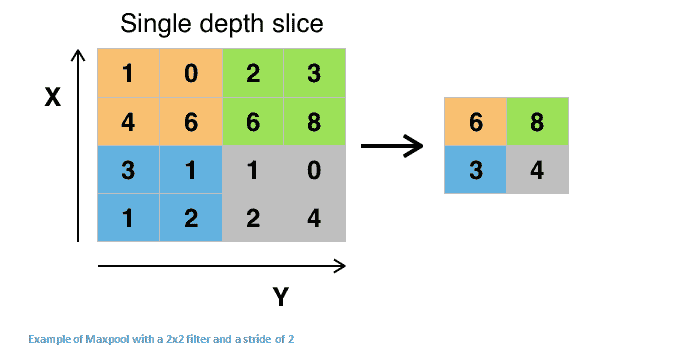

池化层的其他选项包括平均池化和 L2-范数池化。

这个 `Pooling` 层背后的直觉是，一旦我们知道某个特征在原始输入体积中（会有一个高激活值），其确切位置不如它与其他特征的相对位置重要。

因此，该层大大减少了输入体积的空间维度（长度和宽度，但不包括深度）。

这主要有两个目的：减少参数数量；控制过拟合。

池化层有用性的直观解释可以通过一个例子来说明：

假设我们有一个用于检测人脸的滤波器。人脸的确切像素位置不如“面部在顶部某个地方”这一事实重要。

## Dropout Layer

`dropout layers` 具有非常特定的功能，即在前向传播中通过将该层中的一组随机激活值设置为零来 `drop out` 它们。就这么简单。

它可以避免 `overfitting`，但必须 `only` 在训练时使用，而 `not` 在测试时使用。

## Fully Connected Layer

然而，最后一层是一个重要的层，即 `Fully Connected Layer`。

基本上，FC 层查看哪些高级特征与特定类别最强相关，并具有特定的权重，这样当你计算权重与前一层之间的乘积时，你会得到不同类别的正确概率。


## Going further: Convolution Arithmetic

如果你想深入了解卷积，并希望完全理解卷积如何处理我们在本笔记本中省略的所有细节，我强烈建议阅读这篇 `terrific` 论文：[深度学习卷积算术指南](https://arxiv.org/abs/1603.07285)。

这篇论文也在 `theano` 主要文档中被引用（带有动画）：[卷积网络教程](http://deeplearning.net/software/theano/tutorial/conv_arithmetic.html)

* * *

## CNN in Keras

`Keras` 对卷积层有广泛支持：

*   1D 卷积层；

*   2D 卷积层；

*   3D 卷积层；

*   深度卷积；

*   转置卷积；

*   ....

相应的 `keras` 包是 `keras.layers.convolutional`。

查看 [卷积层](https://keras.io/layers/convolutional/) 文档，了解本笔记本中缺失的更多卷积层信息。

## Convolution1D

```
from keras.layers.convolutional import Conv1D

Conv1D(filters, kernel_size, strides=1, padding='valid', 
       dilation_rate=1, activation=None, use_bias=True, 
       kernel_initializer='glorot_uniform', bias_initializer='zeros', 
       kernel_regularizer=None, bias_regularizer=None, 
       activity_regularizer=None, kernel_constraint=None, 
       bias_constraint=None)
```

## Arguments:

*   `filters`: 整数，输出空间的维度（即卷积中输出滤波器的数量）。

*   `kernel\_size`: 一个整数或单个整数的元组/列表，指定 1D 卷积窗口的长度。

*   `strides`: 一个整数或单个整数的元组/列表，指定卷积的步长。指定任何不等于 1 的步长值与指定任何不等于 1 的 `dilation_rate` 值不兼容。

*   `padding`: `"valid"`、`"causal"` 或 `"same"` 之一（不区分大小写）。`"causal"` 导致因果（扩张）卷积，例如 output[t] 不依赖于 input[t+1:]。当模型不应违反时间顺序时，这对于建模时间数据很有用。参见 [WaveNet: A Generative Model for Raw Audio, section 2.1](https://arxiv.org/abs/1609.03499)。

*   `dilation\_rate`: 一个整数或单个整数的元组/列表，指定用于扩张卷积的扩张率。目前，指定任何不等于 1 的 `dilation_rate` 值与指定任何不等于 1 的 `strides` 值不兼容。

*   `activation`: 要使用的激活函数（参见 [activations](https://keras.io/activations/））。如果不指定任何内容，则不应用激活（即“线性”激活：`a(x) = x`）。

*   `use\_bias`: 布尔值，层是否使用偏置向量。

*   `kernel\_initializer`: `kernel` 权重矩阵的初始化器（参见 [initializers](https://keras.io/initializers/)）。

*   `bias\_initializer`: 偏置向量的初始化器（参见 [initializers](https://keras.io/initializers/)）。

*   `kernel\_regularizer`: 应用于 `kernel` 权重矩阵的正则化函数（参见 [regularizer](https://keras.io/regularizers/)）。

*   `bias\_regularizer`: 应用于偏置向量的正则化函数（参见 [regularizer](https://keras.io/regularizers/)）。

*   `activity\_regularizer`: 应用于层输出（其“激活”）的正则化函数。（参见 [regularizer](https://keras.io/regularizers/)）。

*   `kernel\_constraint`: 应用于内核矩阵的约束函数（参见 [constraints](https://keras.io/constraints/)）。

*   `bias\_constraint`: 应用于偏置向量的约束函数（参见 [constraints](https://keras.io/constraints/)）。

> 用于过滤 **一维输入** 邻域的卷积算子。当将此层用作模型中的第一层时，请提供关键字参数 `input_dim`（int，例如 128 用于 128 维向量的序列），或 `input_shape`（整数元组，例如 (10, 128) 用于 10 个 128 维向量的序列）。

## Example

```
## apply a convolution 1d of length 3 to a sequence with 10 timesteps,
## with 64 output filters
model = Sequential()
model.add(Conv1D(64, 3, padding='same', input_shape=(10, 32)))
## now model.output_shape == (None, 10, 64)

## add a new conv1d on top
model.add(Conv1D(32, 3, padding='same'))
## now model.output_shape == (None, 10, 32)
```

## Convolution2D


## 4.2. MNIST CNN

## 用于 MNIST 的卷积网络

深度学习模型运行可能需要相当长的时间，特别是当未使用 GPU 时。

为了节省时间，你可以抽取一个子集的观测值（例如 $1000$ 个），其中包含你选择的特定数字（例如 $6$），以及 $1000$ 个不是该特定数字的观测值（即 $\neq 6$）。

我们将使用这些数据构建模型，并查看其在测试数据集上的表现

```
#Import the required libraries
import numpy as np
np.random.seed(1338)

from keras.datasets import mnist
```

```
Using TensorFlow backend.
```

```
from keras.models import Sequential
from keras.layers.core import Dense, Dropout, Activation, Flatten
```

```
from keras.layers.convolutional import Conv2D
from keras.layers.pooling import MaxPooling2D
```

```
from keras.utils import np_utils
from keras.optimizers import SGD
```

## 加载数据

```
#Load the training and testing data
(X_train, y_train), (X_test, y_test) = mnist.load_data()
```

```
X_test_orig = X_test
```

## 数据准备

## 非常重要：

在处理图像和卷积时，正确处理 `image_data_format` 至关重要

```
from keras import backend as K
```

```
img_rows, img_cols = 28, 28

if K.image_data_format() == 'channels_first':
    shape_ord = (1, img_rows, img_cols)
else:  # channel_last
    shape_ord = (img_rows, img_cols, 1)
```

## 预处理和归一化数据

```
X_train = X_train.reshape((X_train.shape[0],) + shape_ord)
X_test = X_test.reshape((X_test.shape[0],) + shape_ord)

X_train = X_train.astype('float32')
X_test = X_test.astype('float32')

X_train /= 255
X_test /= 255
```

```
np.random.seed(1338)  # for reproducibilty!!

## Test data
X_test = X_test.copy()
Y = y_test.copy()

## Converting the output to binary classification(Six=1,Not Six=0)
Y_test = Y == 6
Y_test = Y_test.astype(int)

## Selecting the 5918 examples where the output is 6
X_six = X_train[y_train == 6].copy()
Y_six = y_train[y_train == 6].copy()

## Selecting the examples where the output is not 6
X_not_six = X_train[y_train != 6].copy()
Y_not_six = y_train[y_train != 6].copy()

## Selecting 6000 random examples from the data that 
## only contains the data where the output is not 6
random_rows = np.random.randint(0,X_six.shape[0],6000)
X_not_six = X_not_six[random_rows]
Y_not_six = Y_not_six[random_rows]
```

```
## Appending the data with output as 6 and data with output as <> 6
X_train = np.append(X_six,X_not_six)

## Reshaping the appended data to appropraite form
X_train = X_train.reshape((X_six.shape[0] + X_not_six.shape[0],) + shape_ord)

## Appending the labels and converting the labels to 
## binary classification(Six=1,Not Six=0)
Y_labels = np.append(Y_six,Y_not_six)
Y_train = Y_labels == 6 
Y_train = Y_train.astype(int)
```

```
print(X_train.shape, Y_labels.shape, X_test.shape, Y_test.shape)
```

```
(11918, 28, 28, 1) (11918,) (10000, 28, 28, 1) (10000,)
```

```
## Converting the classes to its binary categorical form
nb_classes = 2
Y_train = np_utils.to_categorical(Y_train, nb_classes)
Y_test = np_utils.to_categorical(Y_test, nb_classes)
```

## 一个简单的 CNN

```
## -- Initializing the values for the convolution neural network

nb_epoch = 2  # kept very low! Please increase if you have GPU

batch_size = 64
## number of convolutional filters to use
nb_filters = 32
## size of pooling area for max pooling
nb_pool = 2
## convolution kernel size
nb_conv = 3

## Vanilla SGD
sgd = SGD(lr=0.1, decay=1e-6, momentum=0.9, nesterov=True)
```

## 步骤 1：模型定义

## Keras 中卷积滤波器的维度

卷积网络复杂的结构可能导致难以理解的表示。

当然，维度会根据卷积滤波器的维度（例如 1D、2D）而有所不同。

## Convolution1D

**输入形状**：

形状为 (`batch_size`, `steps`, `input_dim`) 的 **3D** 张量。

**输出形状**：

形状为 (`batch_size`, `new_steps`, `filters`) 的 **3D** 张量。

## Convolution2D

**输入形状**：

形状为：

*   (`batch_size`, `channels`, `rows`, `cols`) 如果 `image_data_format='channels_last'`

*   (`batch_size`, `rows`, `cols`, `channels`) 如果 `image_data_format='channels_first'`

**输出形状**：

形状为：

*   (`batch_size`, `filters`, `new_rows`, `new_cols`) 如果 `image_data_format='channels_first'`

*   (`batch_size`, `new_rows`, `new_cols`, `filters`) 如果 `image_data_format='channels_last'`

## 参数：

*   `filters`: 整数，输出空间的维度（即卷积中输出滤波器的数量）。

*   `kernel_size`: 整数或包含 2 个整数的元组/列表，指定 2D 卷积窗口的宽度和高度。可以是单个整数，用于指定所有空间维度的相同值。

*   `strides`: 整数或包含 2 个整数的元组/列表，指定沿宽度和高度的卷积步长。可以是单个整数，用于指定所有空间维度的相同值。指定任何不等于 1 的步长值与指定任何不等于 1 的 `dilation_rate` 值不兼容。

*   `padding`: `"valid"` 或 `"same"` 之一（不区分大小写）。

*   `data_format`: 字符串，`channels_last`（默认）或 `channels_first` 之一。输入中维度的顺序。`channels_last` 对应形状为 `(batch, height, width, channels)` 的输入，而 `channels_first` 对应形状为 `(batch, channels, height, width)` 的输入。它默认为 Keras 配置文件 `~/.keras/keras.json` 中的 `image_data_format` 值。如果你从未设置过，则它将是 "channels_last"。

*   `dilation_rate`: 整数或包含 2 个整数的元组/列表，指定用于空洞卷积的扩张率。可以是单个整数，用于指定所有空间维度的相同值。目前，指定任何不等于 1 的 `dilation_rate` 值与指定任何不等于 1 的步长值不兼容。

*   `activation`: 要使用的激活函数（参见 [activations](https://keras.io/activations/)。如果你不指定任何内容，则不应用激活（即“线性”激活：`a(x) = x`）。

*   `use_bias`: 布尔值，该层是否使用偏置向量。

*   `kernel_initializer`: `kernel` 权重矩阵的初始化器（参见 [initializers](https://keras.io/initializers/)）。

*   `bias_initializer`: 偏置向量的初始化器（参见 [initializers](https://keras.io/initializers/)）。

*   `kernel_regularizer`: 应用于 `kernel` 权重矩阵的正则化函数（参见 [regularizer](https://keras.io/regularizers/)）。

*   `bias_regularizer`: 应用于偏置向量的正则化函数（参见 [regularizer](https://keras.io/regularizers/)）。

*   `activity_regularizer`: 应用于层输出（其“激活”）的正则化函数。（参见 [regularizer](https://keras.io/regularizers/)）。

*   `kernel_constraint`: 应用于内核矩阵的约束函数（参见 [constraints](https://keras.io/constraints/)）。

*   `bias_constraint`: 应用于偏置向量的约束函数（参见 [constraints](https://keras.io/constraints/)）。

## 示例

假设 `keras.backend.image_data_format == "channels_last"`

```
## apply a 3x3 convolution with 64 output filters on a 256x256 image:
model = Sequential()
model.add(Conv2D(64, (3, 3), padding='same', 
          input_shape=(3, 256, 256)))
## now model.output_shape == (None, 256, 256, 64)

## add a 3x3 convolution on top, with 32 output filters:
model.add(Conv2D(32, (3, 3), padding='same'))
## now model.output_shape == (None, 256, 256, 32)
```

```
from keras.layers.convolutional import Conv2D

Conv2D(filters, kernel_size, strides=(1, 1), padding='valid', 
       data_format=None, dilation_rate=(1, 1), activation=None, 
       use_bias=True, kernel_initializer='glorot_uniform', 
       bias_initializer='zeros', kernel_regularizer=None, 
       bias_regularizer=None, activity_regularizer=None, 
       kernel_constraint=None, bias_constraint=None)
```


## 步骤 2：编译

```python
model.compile(loss='categorical_crossentropy',
              optimizer=sgd,
              metrics=['accuracy'])
```

## 步骤 3：拟合

```python
hist = model.fit(X_train, Y_train, batch_size=batch_size, 
                 epochs=nb_epoch, verbose=1, 
                 validation_data=(X_test, Y_test))
```

```text
Train on 11918 samples, validate on 10000 samples
Epoch 1/2
11918/11918 [==============================] - 8s - loss: 0.2321 - acc: 0.9491 - val_loss: 0.1276 - val_acc: 0.9616
Epoch 2/2
11918/11918 [==============================] - 1s - loss: 0.1065 - acc: 0.9666 - val_loss: 0.0933 - val_acc: 0.9685
```

```python
import matplotlib.pyplot as plt
%matplotlib inline

plt.figure()
plt.xlabel('Epochs')
plt.ylabel('Loss')
plt.plot(hist.history['loss'])
plt.plot(hist.history['val_loss'])
plt.legend(['Training', 'Validation'])

plt.figure()
plt.xlabel('Epochs')
plt.ylabel('Accuracy')
plt.plot(hist.history['acc'])
plt.plot(hist.history['val_acc'])
plt.legend(['Training', 'Validation'], loc='lower right')
```

```text
<matplotlib.legend.Legend at 0x7fdb2c0235f8>
```


## 步骤 4：评估

```python
print('Available Metrics in Model: {}'.format(model.metrics_names))
```

```text
Available Metrics in Model: ['loss', 'acc']
```

```python
## Evaluating the model on the test data    
loss, accuracy = model.evaluate(X_test, Y_test, verbose=0)
print('Test Loss:', loss)
print('Test Accuracy:', accuracy)
```

```text
Test Loss: 0.0933376350194
Test Accuracy: 0.9685
```

## 让我们绘制模型预测！

```python
import matplotlib.pyplot as plt

%matplotlib inline
```

```python
slice = 15
predicted = model.predict(X_test[:slice]).argmax(-1)

plt.figure(figsize=(16,8))
for i in range(slice):
    plt.subplot(1, slice, i+1)
    plt.imshow(X_test_orig[i], interpolation='nearest')
    plt.text(0, 0, predicted[i], color='black', 
             bbox=dict(facecolor='white', alpha=1))
    plt.axis('off')
```


## 添加更多密集层

```python
model = Sequential()
model.add(Conv2D(nb_filters, (nb_conv, nb_conv),
                 padding='valid', input_shape=shape_ord))
model.add(Activation('relu'))

model.add(Flatten())
model.add(Dense(128))
model.add(Activation('relu'))

model.add(Dense(nb_classes))
model.add(Activation('softmax'))
```

```python
model.compile(loss='categorical_crossentropy',
              optimizer='sgd',
              metrics=['accuracy'])

model.fit(X_train, Y_train, batch_size=batch_size, 
          epochs=nb_epoch,verbose=1,
          validation_data=(X_test, Y_test))
```

```text
Train on 11918 samples, validate on 10000 samples
Epoch 1/2
11918/11918 [==============================] - 2s - loss: 0.1922 - acc: 0.9503 - val_loss: 0.0864 - val_acc: 0.9721
Epoch 2/2
11918/11918 [==============================] - 1s - loss: 0.0902 - acc: 0.9705 - val_loss: 0.0898 - val_acc: 0.9676

<keras.callbacks.History at 0x7fdacc048cf8>
```

```python
#Evaluating the model on the test data    
score, accuracy = model.evaluate(X_test, Y_test, verbose=0)
print('Test score:', score)
print('Test accuracy:', accuracy)
```

```text
Test score: 0.0898462146357
Test accuracy: 0.9676
```

## 添加 Dropout

```python
model = Sequential()

model.add(Conv2D(nb_filters, (nb_conv, nb_conv),
                        padding='valid',
                        input_shape=shape_ord))
model.add(Activation('relu'))

model.add(Flatten())
model.add(Dense(128))
model.add(Activation('relu'))
model.add(Dropout(0.5))
model.add(Dense(nb_classes))
model.add(Activation('softmax'))
```

```python
model.compile(loss='categorical_crossentropy',
              optimizer='sgd',
              metrics=['accuracy'])

model.fit(X_train, Y_train, batch_size=batch_size, 
          epochs=nb_epoch,verbose=1,
          validation_data=(X_test, Y_test))
```

```text
Train on 11918 samples, validate on 10000 samples
Epoch 1/2
11918/11918 [==============================] - 1s - loss: 0.2394 - acc: 0.9330 - val_loss: 0.1882 - val_acc: 0.9355
Epoch 2/2
11918/11918 [==============================] - 1s - loss: 0.1038 - acc: 0.9654 - val_loss: 0.0900 - val_acc: 0.9679

<keras.callbacks.History at 0x7fdacc064be0>
```

```python
#Evaluating the model on the test data    
score, accuracy = model.evaluate(X_test, Y_test, verbose=0)
print('Test score:', score)
print('Test accuracy:', accuracy)
```

```text
Test score: 0.0900323278204
Test accuracy: 0.9679
```

## 添加更多卷积层

```python
model = Sequential()
model.add(Conv2D(nb_filters, (nb_conv, nb_conv),
                 padding='valid', input_shape=shape_ord))
model.add(Activation('relu'))
model.add(Conv2D(nb_filters, (nb_conv, nb_conv)))
model.add(Activation('relu'))
model.add(MaxPooling2D(pool_size=(nb_pool, nb_pool)))
model.add(Dropout(0.25))

model.add(Flatten())
model.add(Dense(128))
model.add(Activation('relu'))
model.add(Dropout(0.5))
model.add(Dense(nb_classes))
model.add(Activation('softmax'))
```

```python
model.compile(loss='categorical_crossentropy',
              optimizer='sgd',
              metrics=['accuracy'])

model.fit(X_train, Y_train, batch_size=batch_size, 
          epochs=nb_epoch,verbose=1,
          validation_data=(X_test, Y_test))
```

```text
Train on 11918 samples, validate on 10000 samples
Epoch 1/2
11918/11918 [==============================] - 2s - loss: 0.3680 - acc: 0.8722 - val_loss: 0.1699 - val_acc: 0.9457
Epoch 2/2
11918/11918 [==============================] - 2s - loss: 0.1380 - acc: 0.9508 - val_loss: 0.0600 - val_acc: 0.9793

<keras.callbacks.History at 0x7fdb308ea978>
```

```python
#Evaluating the model on the test data    
score, accuracy = model.evaluate(X_test, Y_test, verbose=0)
print('Test score:', score)
print('Test accuracy:', accuracy)
```

```text
Test score: 0.0600312609494
Test accuracy: 0.9793
```

## 练习

上述代码已编写为函数。

更改一些 `hyperparameters` 并查看结果。

```python
## Function for constructing the convolution neural network
## Feel free to add parameters, if you want

def build_model():
    """"""
    model = Sequential()
    model.add(Conv2D(nb_filters, (nb_conv, nb_conv), 
                     padding='valid',
                     input_shape=shape_ord))
    model.add(Activation('relu'))
    model.add(Conv2D(nb_filters, (nb_conv, nb_conv)))
    model.add(Activation('relu'))
    model.add(MaxPooling2D(pool_size=(nb_pool, nb_pool)))
    model.add(Dropout(0.25))

    model.add(Flatten())
    model.add(Dense(128))
    model.add(Activation('relu'))
    model.add(Dropout(0.5))
    model.add(Dense(nb_classes))
    model.add(Activation('softmax'))

    model.compile(loss='categorical_crossentropy',
              optimizer='sgd',
              metrics=['accuracy'])

    model.fit(X_train, Y_train, batch_size=batch_size, 
              epochs=nb_epoch,verbose=1,
              validation_data=(X_test, Y_test))


    #Evaluating the model on the test data    
    score, accuracy = model.evaluate(X_test, Y_test, verbose=0)
    print('Test score:', score)
    print('Test accuracy:', accuracy)
```

```python
#Timing how long it takes to build the model and test it.
%timeit -n1 -r1 build_model()
```

```text
Train on 11918 samples, validate on 10000 samples
Epoch 1/2
11918/11918 [==============================] - 2s - loss: 0.3752 - acc: 0.8672 - val_loss: 0.1512 - val_acc: 0.9505
Epoch 2/2
11918/11918 [==============================] - 2s - loss: 0.1384 - acc: 0.9528 - val_loss: 0.0672 - val_acc: 0.9775
Test score: 0.0671689324878
Test accuracy: 0.9775
5.98 s ± 0 ns per loop (mean ± std. dev. of 1 run, 1 loop each)
```

* * *

## 理解卷积层结构


## 4.3 CIFAR10 CNN

## 卷积神经网络

在这个第二个练习笔记本中，我们将使用卷积神经网络（CNN）。

正如你所看到的，CNN 是一种前馈神经网络，通常由卷积层、最大池化层和全连接层组成。

如果 CNN 执行的任务是分类任务，最后一个全连接层应使用 `Softmax` 激活函数，损失函数应为 `categorical crossentropy`。

参考：https://github.com/fchollet/keras/blob/master/examples/cifar10_cnn.py

## 训练网络

我们将在 **CIFAR10** [数据集](https://www.cs.toronto.edu/~kriz/cifar.html) 上训练我们的网络，该数据集包含 `50,000` 张 32x32 彩色训练图像，标记为 10 个类别，以及 10,000 张测试图像。

由于该数据集也包含在 Keras 数据集中，我们只需向 `keras.datasets` 模块请求该数据集。

训练和测试图像被归一化到 $\\left\[0,1\\right\]$ 区间。

## 批量归一化

在每个批次中归一化前一层的激活值，即应用一种变换，使平均激活值接近 0，激活值的标准差接近 1。

## 如何在 Keras 中使用 BatchNorm

```
from keras.layers.normalization import BatchNormalization

BatchNormalization(axis=-1, momentum=0.99, epsilon=0.001, center=True, scale=True, 
                   beta_initializer='zeros', gamma_initializer='ones', moving_mean_initializer='zeros',
                   moving_variance_initializer='ones', beta_regularizer=None, gamma_regularizer=None,
                   beta_constraint=None, gamma_constraint=None)
```

## 参数

*   `axis`: 整数，应归一化的轴（通常是特征轴）。例如，在 `data_format="channels_first"` 的 `Conv2D` 层之后，在 `BatchNormalization` 中设置 `axis=1`。

*   `momentum`: 移动平均的动量。

*   `epsilon`: 添加到方差中的小浮点数，以避免除以零。

*   `center`: 如果为 True，则向归一化张量添加 `beta` 的偏移量。如果为 False，则忽略 `beta`。

*   `scale`: 如果为 True，则乘以 `gamma`。如果为 False，则不使用 `gamma`。当下一层是线性层（例如 `nn.relu`）时，可以禁用此选项，因为缩放将由下一层完成。

*   `beta_initializer`: beta 权重的初始化器。

*   `gamma_initializer`: gamma 权重的初始化器。

*   `moving_mean_initializer`: 移动平均值的初始化器。

*   `moving_variance_initializer`: 移动方差的初始化器。

*   `beta_regularizer`: beta 权重的可选正则化器。

*   `gamma_regularizer`: gamma 权重的可选正则化器。

*   `beta_constraint`: beta 权重的可选约束。

*   `gamma_constraint`: gamma 权重的可选约束。

## 练习

```
## Try to add a new BatchNormalization layer to the Model 
## (after the Dropout layer) - before or after the ReLU Activation
```

* * *

## 附录：

*   CNN on CIFAR10

## 练习：构建浅层网络

在本练习中，我们要构建一个（相当浅的）网络，包含两个 `[Convolution, Convolution, MaxPooling]` 阶段，以及两个 Dense 层。

为了测试不同的优化器，我们将使用 [AdaDelta](http://keras.io/optimizers/)，它比带动量的简单 Vanilla SGD 复杂一些。

```
from keras.optimizers import Adadelta
```

```
input_shape = shape_ord
nb_classes = 10

## [conv@32x3x3+relu]x2 --> MaxPool@2x2 --> DropOut@0.25 -->
## [conv@64x3x3+relu]x2 --> MaxPool@2x2 --> DropOut@0.25 -->
## Flatten--> FC@512+relu --> DropOut@0.5 --> FC@nb_classes+SoftMax
## NOTE: each couple of Conv filters must have `border_mode="same"` and `"valid"`, respectively
```

```
## %load solutions/sol31.py
```

## 理解层形状

Keras 层的一个重要特性是，每个层都有一个 `input_shape` 属性，可用于可视化输入张量的形状，以及一个 `output_shape` 属性，用于检查输出张量的形状。

正如我们所看到的，第一个卷积层的输入形状对应于 `input_shape` 属性（必须由用户指定）。

在此情况下，它是一个具有三个颜色通道的 `28x28` 图像。

由于该卷积层的 `padding` 设置为 `same`，其输出宽度和高度将保持不变，输出通道的数量将等于该层学习的滤波器数量，即 16。

接下来的卷积层则使用默认的 `padding`，因此会将宽度和高度分别减少 $(k-1)$，其中 $k$ 是内核的大小。

`MaxPooling` 层则会减少输入张量的宽度和高度，但保持相同的通道数量。

`Activation` 层当然不会改变形状。

```
for i, layer in enumerate(model.layers):
    print ("Layer", i, "\t", layer.name, "\t\t", layer.input_shape, "\t", layer.output_shape)
```

```
Layer 0      conv2d_12          (None, 28, 28, 1)      (None, 28, 28, 32)
Layer 1      activation_21          (None, 28, 28, 32)      (None, 28, 28, 32)
Layer 2      conv2d_13          (None, 28, 28, 32)      (None, 26, 26, 32)
Layer 3      activation_22          (None, 26, 26, 32)      (None, 26, 26, 32)
Layer 4      max_pooling2d_5          (None, 26, 26, 32)      (None, 13, 13, 32)
Layer 5      dropout_6          (None, 13, 13, 32)      (None, 13, 13, 32)
Layer 6      conv2d_14          (None, 13, 13, 32)      (None, 13, 13, 64)
Layer 7      activation_23          (None, 13, 13, 64)      (None, 13, 13, 64)
Layer 8      conv2d_15          (None, 13, 13, 64)      (None, 11, 11, 64)
Layer 9      activation_24          (None, 11, 11, 64)      (None, 11, 11, 64)
Layer 10      max_pooling2d_6          (None, 11, 11, 64)      (None, 5, 5, 64)
Layer 11      dropout_7          (None, 5, 5, 64)      (None, 5, 5, 64)
Layer 12      flatten_6          (None, 5, 5, 64)      (None, 1600)
Layer 13      dense_10          (None, 1600)      (None, 512)
Layer 14      activation_25          (None, 512)      (None, 512)
Layer 15      dropout_8          (None, 512)      (None, 512)
Layer 16      dense_11          (None, 512)      (None, 10)
Layer 17      activation_26          (None, 10)      (None, 10)
```

## 理解权重形状

同样，我们可以可视化每个层学习到的权重的形状。

特别是，Keras 允许你通过层对象的 `get_weights` 方法来检查权重。

这将返回一个包含两个元素的列表，第一个是 `weight tensor`，第二个是 `bias vector`。

特别是：

*   `MaxPooling layer` 没有任何权重张量，因为它们没有可学习的参数。

*   `Convolutional layers` 则学习一个 $(n\_o, n\_i, k, k)$ 权重张量，其中 $k$ 是内核的大小，$n\_i$ 是输入张量的通道数，$n\_o$ 是要学习的滤波器数量。

对于每个 $n\_o$ 滤波器，还会学习一个偏置。

*   `Dense layers` 学习一个 $(n\_i, n\_o)$ 权重张量，其中 $n\_o$ 是输出大小，$n\_i$ 是层的输入大小。每个 $n\_o$ 神经元也有一个偏置。

```
for i, layer in enumerate(model.layers):
    if len(layer.get_weights()) > 0:
        W, b = layer.get_weights()
        print("Layer", i, "\t", layer.name, "\t\t", W.shape, "\t", b.shape)
```

```
Layer 0      conv2d_12          (3, 3, 1, 32)      (32,)
Layer 2      conv2d_13          (3, 3, 32, 32)      (32,)
Layer 6      conv2d_14          (3, 3, 32, 64)      (64,)
Layer 8      conv2d_15          (3, 3, 64, 64)      (64,)
Layer 13      dense_10          (1600, 512)      (512,)
Layer 16      dense_11          (512, 10)      (10,)
```


```python
from keras.datasets import cifar10
from keras.utils import np_utils

(X_train, y_train), (X_test, y_test) = cifar10.load_data()
Y_train = np_utils.to_categorical(y_train, nb_classes)
Y_test = np_utils.to_categorical(y_test, nb_classes)
X_train = X_train.astype("float32")
X_test = X_test.astype("float32")
X_train /= 255
X_test /= 255
```

为了降低过拟合的风险，我们还应用了一些图像变换，例如旋转、平移和翻转。所有这些都可以使用 Keras [图像数据生成器](http://keras.io/preprocessing/image/) 轻松实现。

## 警告：以下单元可能计算量较大....

```python
from keras.preprocessing.image import ImageDataGenerator

generated_images = ImageDataGenerator(
    featurewise_center=True,  # set input mean to 0 over the dataset
    samplewise_center=False,  # set each sample mean to 0
    featurewise_std_normalization=True,  # divide inputs by std of the dataset
    samplewise_std_normalization=False,  # divide each input by its std
    zca_whitening=False,  # apply ZCA whitening
    rotation_range=0,  # randomly rotate images in the range (degrees, 0 to 180)
    width_shift_range=0.2,  # randomly shift images horizontally (fraction of total width)
    height_shift_range=0.2,  # randomly shift images vertically (fraction of total height)
    horizontal_flip=True,  # randomly flip images
    vertical_flip=False)  # randomly flip images

generated_images.fit(X_train)
```

现在我们可以开始训练了。

在每次迭代中，会向 `ImageDataGenerator` 对象请求一批 500 张图像，然后将其输入到网络中。

```python
X_train.shape
```

```
(50000, 3, 32, 32)
```

```python
gen = generated_images.flow(X_train, Y_train, batch_size=500, shuffle=True)
X_batch, Y_batch = next(gen)
```

```python
X_batch.shape
```

```
(500, 3, 32, 32)
```

```python
from keras.utils import generic_utils

n_epochs = 2
for e in range(n_epochs):
    print('Epoch', e)
    print('Training...')
    progbar = generic_utils.Progbar(X_train.shape[0])

    for X_batch, Y_batch in generated_images.flow(X_train, Y_train, batch_size=500, shuffle=True):
        loss = model.train_on_batch(X_batch, Y_batch)
        progbar.add(X_batch.shape[0], values=[('train loss', loss[0])])
```

## 4.4 深度卷积神经网络

## 深度网络模型

从头构建和训练自己的 ConvNet 可能是一项艰巨且耗时的任务。

深度学习中常用的一种技巧是使用 `预训练` 模型，并将其微调为将要使用的特定数据。

## Keras 中的著名模型

本笔记本包含以下 Keras 模型的代码和参考（收集自 https://github.com/fchollet/keras/tree/master/keras/applications）

*   `VGG16`

*   `VGG19`

*   `ResNet50`

*   `Inception v3`

*   `Xception`

*   ... 更多即将推出

## 参考文献

*   [用于大规模图像识别的非常深度卷积网络](https://arxiv.org/abs/1409.1556) - 如果在工作中使用 VGG 模型，请引用此论文。

*   [用于图像识别的深度残差学习](https://arxiv.org/abs/1512.03385) - 如果在工作中使用 ResNet 模型，请引用此论文。

*   [重新思考计算机视觉的 Inception 架构](http://arxiv.org/abs/1512.00567) - 如果在工作中使用 Inception v3 模型，请引用此论文。

所有架构都与 TensorFlow 和 Theano 兼容，实例化时，模型将根据 Keras 配置文件 `~/.keras/keras.json` 中设置的图像维度顺序构建。

例如，如果您设置了 `image_data_format="channels_last"`，那么从此存储库加载的任何模型都将根据 TensorFlow 维度顺序约定“宽度-高度-深度”构建。

## VGG16

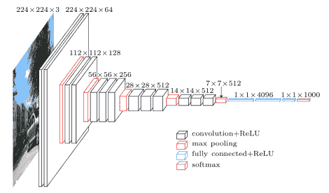

## VGG19

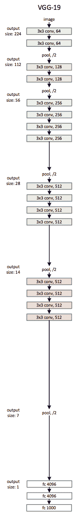

## `keras.applications`

```python
from keras.applications import VGG16
from keras.applications.imagenet_utils import preprocess_input, decode_predictions
import os
```

```
Using TensorFlow backend.
```

```python
vgg16 = VGG16(include_top=True, weights='imagenet')
vgg16.summary()
```

```
_________________________________________________________________
Layer (type)                 Output Shape              Param #   
=================================================================
input_1 (InputLayer)         (None, 224, 224, 3)       0         
_________________________________________________________________
block1_conv1 (Conv2D)        (None, 224, 224, 64)      1792      
_________________________________________________________________
block1_conv2 (Conv2D)        (None, 224, 224, 64)      36928     
_________________________________________________________________
block1_pool (MaxPooling2D)   (None, 112, 112, 64)      0         
_________________________________________________________________
block2_conv1 (Conv2D)        (None, 112, 112, 128)     73856     
_________________________________________________________________
block2_conv2 (Conv2D)        (None, 112, 112, 128)     147584    
_________________________________________________________________
block2_pool (MaxPooling2D)   (None, 56, 56, 128)       0         
_________________________________________________________________
block3_conv1 (Conv2D)        (None, 56, 56, 256)       295168    
_________________________________________________________________
block3_conv2 (Conv2D)        (None, 56, 56, 256)       590080    
_________________________________________________________________
block3_conv3 (Conv2D)        (None, 56, 56, 256)       590080    
_________________________________________________________________
block3_pool (MaxPooling2D)   (None, 28, 28, 256)       0         
_________________________________________________________________
block4_conv1 (Conv2D)        (None, 28, 28, 512)       1180160   
_________________________________________________________________
block4_conv2 (Conv2D)        (None, 28, 28, 512)       2359808   
_________________________________________________________________
block4_conv3 (Conv2D)        (None, 28, 28, 512)       2359808   
_________________________________________________________________
block4_pool (MaxPooling2D)   (None, 14, 14, 512)       0         
_________________________________________________________________
block5_conv1 (Conv2D)        (None, 14, 14, 512)       2359808   
_________________________________________________________________
block5_conv2 (Conv2D)        (None, 14, 14, 512)       2359808   
_________________________________________________________________
block5_conv3 (Conv2D)        (None, 14, 14, 512)       2359808   
_________________________________________________________________
block5_pool (MaxPooling2D)   (None, 7, 7, 512)         0         
_________________________________________________________________
flatten (Flatten)            (None, 25088)             0         
_________________________________________________________________
fc1 (Dense)                  (None, 4096)              102764544 
_________________________________________________________________
fc2 (Dense)                  (None, 4096)              16781312  
_________________________________________________________________
predictions (Dense)          (None, 1000)              4097000   
=================================================================
Total params: 138,357,544
Trainable params: 138,357,544
Non-trainable params: 0
_________________________________________________________________
```

如果您想知道 `HDF5` 权重文件存储在 `where`，请查看 `~/.keras/models/`

## 实操 VGG16 - 预训练权重

```python
IMAGENET_FOLDER = 'img/imagenet'  #in the repo
```

```
!ls img/imagenet
```

```
apricot_565.jpeg  apricot_787.jpeg    strawberry_1174.jpeg

apricot_696.jpeg  strawberry_1157.jpeg    strawberry_1189.jpeg
```


## Hands On:

## 尝试对 VGG19 模型做同样的操作

```python
## from keras.applications import VGG19

## - Visualise Summary
## - Infer classes using VGG19 predictions
```

```python
## [your code here]
```

## 残差网络

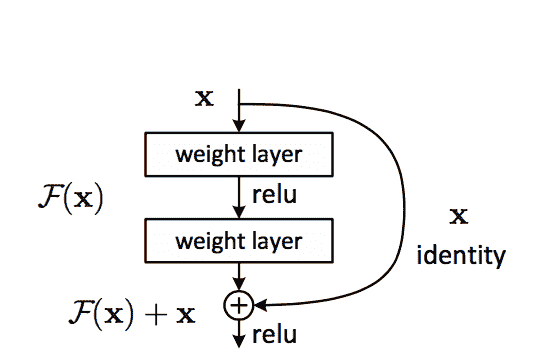

## ResNet 50

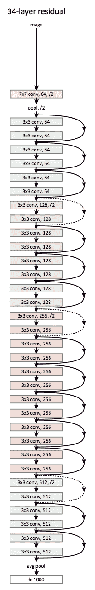

```python
from keras.applications import ResNet50
```

ResNet 由两个主要块组成：`Identity Block` 和 `ConvBlock`。

`IdentityBlock` 是快捷连接处没有卷积层的块

`ConvBlock` 是快捷连接处有卷积层的块

```python
from keras.applications.resnet50 import identity_block, conv_block
```

```python
identity_block??
```

```python
conv_block??
```

* * *

## 可视化 CNN 的卷积滤波器

```python
import numpy as np
import time
from keras.applications import vgg16
from keras import backend as K
```

```python
from matplotlib import pyplot as plt

%matplotlib inline
```

```python
## 每个滤波器生成的图片尺寸。
IMG_WIDTH = 224
IMG_HEIGHT = 224
```

```python
from keras.applications import vgg16

## 使用 ImageNet 权重构建 VGG16 网络
vgg16 = vgg16.VGG16(weights='imagenet', include_top=False)
print('Model loaded.')
```

```
Model loaded.
```

```python
vgg16.summary()
```

```
_________________________________________________________________
Layer (type)                 Output Shape              Param #   
=================================================================
input_2 (InputLayer)         (None, None, None, 3)     0         
_________________________________________________________________
block1_conv1 (Conv2D)        (None, None, None, 64)    1792      
_________________________________________________________________
block1_conv2 (Conv2D)        (None, None, None, 64)    36928     
_________________________________________________________________
block1_pool (MaxPooling2D)   (None, None, None, 64)    0         
_________________________________________________________________
block2_conv1 (Conv2D)        (None, None, None, 128)   73856     
_________________________________________________________________
block2_conv2 (Conv2D)        (None, None, None, 128)   147584    
_________________________________________________________________
block2_pool (MaxPooling2D)   (None, None, None, 128)   0         
_________________________________________________________________
block3_conv1 (Conv2D)        (None, None, None, 256)   295168    
_________________________________________________________________
block3_conv2 (Conv2D)        (None, None, None, 256)   590080    
_________________________________________________________________
block3_conv3 (Conv2D)        (None, None, None, 256)   590080    
_________________________________________________________________
block3_pool (MaxPooling2D)   (None, None, None, 256)   0         
_________________________________________________________________
block4_conv1 (Conv2D)        (None, None, None, 512)   1180160   
_________________________________________________________________
block4_conv2 (Conv2D)        (None, None, None, 512)   2359808   
_________________________________________________________________
block4_conv3 (Conv2D)        (None, None, None, 512)   2359808   
_________________________________________________________________
block4_pool (MaxPooling2D)   (None, None, None, 512)   0         
_________________________________________________________________
block5_conv1 (Conv2D)        (None, None, None, 512)   2359808   
_________________________________________________________________
block5_conv2 (Conv2D)        (None, None, None, 512)   2359808   
_________________________________________________________________
block5_conv3 (Conv2D)        (None, None, None, 512)   2359808   
_________________________________________________________________
block5_pool (MaxPooling2D)   (None, None, None, 512)   0         
=================================================================
Total params: 14,714,688
Trainable params: 14,714,688
Non-trainable params: 0
_________________________________________________________________
```

```python
from collections import OrderedDict
layer_dict = OrderedDict()
## 获取每个“关键”层的符号输出（我们为它们赋予了唯一名称）。
for layer in vgg16.layers[1:]:
    layer_dict[layer.name] = layer
```

## 测试图像

```python
img_path = os.path.join(IMAGENET_FOLDER, 'strawberry_1157.jpeg')
img = image.load_img(img_path, target_size=(IMG_WIDTH, IMG_HEIGHT))
plt.imshow(img)
```

```
<matplotlib.image.AxesImage at 0x7f896378cda0>
```


```python
input_img_data = image.img_to_array(img)
## input_img_data /= 255
plt.imshow(input_img_data)
```

```
<matplotlib.image.AxesImage at 0x7f89636cd240>
```


```python
input_img_data = np.expand_dims(input_img_data, axis=0)
print('Input image shape:', input_img_data.shape)
```

```
Input image shape: (1, 224, 224, 3)
```

## 通过各层可视化图像

```python
## 调用笔记本中定义的隐藏特征函数（2.1 隐藏层表示与嵌入）

def get_activations(model, layer, input_img_data):
    activations_f = K.function([model.layers[0].input, K.learning_phase()], [layer.output,])
    activations = activations_f((input_img_data, False))
    return activations
```

```python
layer_name = 'block1_conv2'
layer = layer_dict[layer_name]
activations = get_activations(vgg16, layer, input_img_data)
```

```python
print(len(activations))
activation = activations[0]
activation.shape
```

```
1


(1, 224, 224, 64)
```

```python
layer.filters  # 所选卷积块中的滤波器数量
```

```
64
```

```python
activated_img = activation[0]
n = 8
fig = plt.figure(figsize=(20, 20))
for i in range(n):
    for j in range(n):
        idx = (n*i)+j
        ax = fig.add_subplot(n, n, idx+1)
        ax.imshow(activated_img[:,:,idx])
```


```python
conv_img_mean = np.mean(activated_img, axis=2)
```

```python
conv_img_mean.shape
```

```
(224, 224)
```

```python
plt.imshow(conv_img_mean)
```


## 现在可视化 `block5_conv2` 层的前 64 个过滤器

```
layer_name = 'block5_conv2'
layer = layer_dict[layer_name]
activations = get_activations(vgg16, layer, input_img_data)
activated_img = activations[0][0]  # [0][0] -> first (and only) activation, first (and only) sample in batch
n = 8
fig = plt.figure(figsize=(20, 20))
for i in range(n):
    for j in range(n):
        idx = (n*i)+j
        ax = fig.add_subplot(n, n, idx+1)
        ax.imshow(activated_img[:,:,idx])
```

## 卷积网络如何看待世界

参考：[`blog.keras.io/how-convolutional-neural-networks-see-the-world.html`](https://blog.keras.io/how-convolutional-neural-networks-see-the-world.html)

## 指定要扫描的过滤器百分比

在此示例中，我们仍将使用 VGG16 作为参考模型。

当然，同样的代码也适用于不同的 CNN 模型，只需对层引用/名称进行适当更改即可。

请注意，VGG16 包含的卷积过滤器数量不等，具体取决于所选用于处理的特定层。

处理所有卷积过滤器可能是一项计算密集型且耗时的工作，很大程度上取决于该层的参数数量。

在我的硬件（Azure 云上的一块 Tesla K80 GPU）上，处理单个过滤器大约需要 ~0.5 秒。（平均）

因此，处理所有过滤器大约需要 ~256 秒（例如 `block5_conv1`）$\mapsto$ ~4 分钟（针对单个层名称）

```
## utility function to convert a tensor into a valid image

def deprocess_image(x):
    # normalize tensor: center on 0., ensure std is 0.1
    x -= x.mean()
    x /= (x.std() + 1e-5)
    x *= 0.1

    # clip to [0, 1]
    x += 0.5
    x = np.clip(x, 0, 1)

    # convert to RGB array
    x *= 255
    if K.image_data_format() == 'channels_first':
        x = x.transpose((1, 2, 0))
    x = np.clip(x, 0, 255).astype('uint8')
    return x
```

```
## dimensions of the generated pictures for each filter.
img_width = 224
img_height = 224

def collect_filters(input_tensor, output_tensor, filters):
    kept_filters = []
    start_time = time.time()
    for filter_index in range(0, filters):
        if filter_index % 10 == 0:
            print('\t Processing filter {}'.format(filter_index))

        # we build a loss function that maximizes the activation
        # of the nth filter of the layer considered
        if K.image_data_format() == 'channels_first':
            loss = K.mean(output_tensor[:, filter_index, :, :])
        else:
            loss = K.mean(output_tensor[:, :, :, filter_index])

        # we compute the gradient of the input picture wrt this loss
        grads = K.gradients(loss, input_tensor)[0]
        # normalization trick: we normalize the gradient by its L2 norm
        grads = grads / (K.sqrt(K.mean(K.square(grads))) + 1e-5)
        # this function returns the loss and grads given the input picture
        iterate = K.function([input_tensor], [loss, grads])

        # step size for gradient ascent
        step = 1.

        # we start from a gray image with some random noise
        if K.image_data_format() == 'channels_first':
            img_data = np.random.random((1, 3, img_width, img_height))
        else:
            img_data = np.random.random((1, img_width, img_height, 3))

        img_data = (img_data - 0.5) * 20 + 128

        # we run gradient ascent for 20 steps
        for i in range(20):
            loss_value, grads_value = iterate([img_data])
            img_data += grads_value * step
            if loss_value <= 0.:
                # some filters get stuck to 0, we can skip them
                break

        # decode the resulting input image
        if loss_value > 0:
            img_deproc = deprocess_image(img_data[0])
            kept_filters.append((img_deproc, loss_value))

    end_time = time.time()
    print('\t Time required to process {} filters: {}'.format(filters, (end_time - start_time)))

    return kept_filters
```

```
## this is the placeholder for the input images
input_t = vgg16.input

def generate_stiched_filters(layer, nb_filters):
    layer_name = layer.name
    print('Processing {} Layer'.format(layer_name))

    # Processing filters of current layer
    layer_output = layer.output
    kept_filters = collect_filters(input_t, layer_output, nb_filters)

    print('Filter collection: completed!')
    # we will stich the best sqrt(filters_to_scan) filters put on a n x n grid.
    limit = min(nb_filters, len(kept_filters))
    n = np.floor(np.sqrt(limit)).astype(np.int)

    # the filters that have the highest loss are assumed to be better-looking.
    # we will only keep the top 64 filters.
    kept_filters.sort(key=lambda x: x[1], reverse=True)
    kept_filters = kept_filters[:n * n]

    # build a black picture with enough space for
    margin = 5
    width = n * img_width + (n - 1) * margin
    height = n * img_height + (n - 1) * margin
    stitched_filters = np.zeros((width, height, 3))

    # fill the picture with our saved filters
    for i in range(n):
        for j in range(n):
            img, loss = kept_filters[i * n + j]
            stitched_filters[(img_width + margin) * i: (img_width + margin) * i + img_width,
                             (img_height + margin) * j: (img_height + margin) * j + img_height, :] = img
    return stitched_filters
```

```
layer = layer_dict['block1_conv2']  # 64 filters
stitched_filters = generate_stiched_filters(layer, layer.filters)
plt.figure(figsize=(10,10))
plt.imshow(stitched_filters)
```

```
Processing block1_conv2 Layer
     Processing filter 0
     Processing filter 10
     Processing filter 20
     Processing filter 30
     Processing filter 40
     Processing filter 50
     Processing filter 60
     Time required to process 64 filters: 22.710692167282104
Filter collection: completed!
```

```
layer = layer_dict['block5_conv1']  # 512 filters in total
stitched_filters = generate_stiched_filters(layer, 64)
plt.figure(figsize=(10,10))
plt.imshow(stitched_filters)
```

```
Processing block5_conv1 Layer
     Processing filter 0
     Processing filter 10
     Processing filter 20
     Processing filter 30
     Processing filter 40
     Processing filter 50
     Processing filter 60
     Time required to process 64 filters: 101.60693192481995
Filter collection: completed!
```

## 5.1 超参数调优

## `keras.wrappers.scikit_learn`

示例改编自：https://github.com/fchollet/keras/blob/master/examples/mnist\_sklearn\_wrapper.py

## 问题：

在 MNIST 上构建简单的 CNN 模型，并使用 sklearn 的 GridSearchCV 找到最佳模型

```
import numpy as np
np.random.seed(1337)  # for reproducibility
```

```
from keras.datasets import mnist
from keras.models import Sequential
from keras.layers import Dense, Dropout, Activation, Flatten
from keras.layers import Conv2D, MaxPooling2D
from keras.utils import np_utils
from keras.wrappers.scikit_learn import KerasClassifier
from keras import backend as K
```

```
Using TensorFlow backend.
```

```
from sklearn.model_selection import GridSearchCV
```

## 数据准备

```
nb_classes = 10

## input image dimensions
img_rows, img_cols = 28, 28
```


## 加载训练数据并进行基本数据归一化

```
(X_train, y_train), (X_test, y_test) = mnist.load_data()

if `K.image_dim_ordering()` == 'th':
    `X_train` = `X_train`.reshape(`X_train`.shape[0], 1, `img_rows`, `img_cols`)
    `X_test` = `X_test`.reshape(`X_test`.shape[0], 1, `img_rows`, `img_cols`)
    `input_shape` = (1, `img_rows`, `img_cols`)
else:
    `X_train` = `X_train`.reshape(`X_train`.shape[0], `img_rows`, `img_cols`, 1)
    `X_test` = `X_test`.reshape(`X_test`.shape[0], `img_rows`, `img_cols`, 1)
    `input_shape` = (`img_rows`, `img_cols`, 1)
```

```
`X_train` = `X_train`.astype('float32')
`X_test` = `X_test`.astype('float32')
`X_train` /= 255
`X_test` /= 255

## 将类向量转换为二进制类矩阵
`y_train` = `np_utils`.to_categorical(`y_train`, `nb_classes`)
`y_test` = `np_utils`.to_categorical(`y_test`, `nb_classes`)
```

## 构建模型

```
def `make_model`(`dense_layer_sizes`, `filters`, `kernel_size`, `pool_size`):
    '''Creates model comprised of 2 convolutional layers followed by dense layers

    `dense_layer_sizes`: List of layer sizes. This list has one number for each layer
    `nb_filters`: Number of convolutional filters in each convolutional layer
    `nb_conv`: Convolutional kernel size
    `nb_pool`: Size of pooling area for max pooling
    '''

    `model` = `Sequential`()

    `model`.add(`Conv2D`(`filters`, (`kernel_size`, `kernel_size`),
                     padding='valid', input_shape=`input_shape`))
    `model`.add(`Activation`('relu'))
    `model`.add(`Conv2D`(`filters`, (`kernel_size`, `kernel_size`)))
    `model`.add(`Activation`('relu'))
    `model`.add(`MaxPooling2D`(pool_size=(`pool_size`, `pool_size`)))
    `model`.add(`Dropout`(0.25))

    `model`.add(`Flatten`())
    for `layer_size` in `dense_layer_sizes`:
        `model`.add(`Dense`(`layer_size`))
        `model`.add(`Activation`('relu'))
    `model`.add(`Dropout`(0.5))
    `model`.add(`Dense`(`nb_classes`))
    `model`.add(`Activation`('softmax'))

    `model`.compile(loss='categorical_crossentropy',
                  optimizer='adadelta',
                  metrics=['accuracy'])

    return `model`
```

```
`dense_size_candidates` = [[32], [64], [32, 32], [64, 64]]
`my_classifier` = `KerasClassifier`(`make_model`, batch_size=32)
```

## 网格搜索超参数

```
`validator` = `GridSearchCV`(`my_classifier`,
                         param_grid={`dense_layer_sizes`: `dense_size_candidates`,
                                     # nb_epoch is avail for tuning even when not
                                     # an argument to model building function
                                     'epochs': [3, 6],
                                     'filters': [8],
                                     'kernel_size': [3],
                                     'pool_size': [2]},
                         scoring='neg_log_loss',
                         n_jobs=1)
`validator`.fit(`X_train`, `y_train`)
```


## 训练日志输出

```
Epoch 1/3
40000/40000 [==============================] - ETA: 0s - loss: 0.8971 - acc: 0.694 - 10s - loss: 0.8961 - acc: 0.6953    
Epoch 2/3
40000/40000 [==============================] - 9s - loss: 0.5362 - acc: 0.8299     
Epoch 3/3
40000/40000 [==============================] - 10s - loss: 0.4425 - acc: 0.8594    
39552/40000 [============================>.] - ETA: 0sEpoch 1/3
40000/40000 [==============================] - 11s - loss: 0.7593 - acc: 0.7543    
Epoch 2/3
40000/40000 [==============================] - 10s - loss: 0.4489 - acc: 0.8597    
Epoch 3/3
40000/40000 [==============================] - 10s - loss: 0.3841 - acc: 0.8814    
39648/40000 [============================>.] - ETA: 0sEpoch 1/3
40000/40000 [==============================] - 10s - loss: 0.9089 - acc: 0.6946    
Epoch 2/3
40000/40000 [==============================] - 9s - loss: 0.5560 - acc: 0.8228     
Epoch 3/3
40000/40000 [==============================] - 10s - loss: 0.4597 - acc: 0.8556    
39680/40000 [============================>.] - ETA: 0sEpoch 1/6
40000/40000 [==============================] - 11s - loss: 0.8415 - acc: 0.7162    
Epoch 2/6
40000/40000 [==============================] - 10s - loss: 0.4929 - acc: 0.8423    
Epoch 3/6
40000/40000 [==============================] - 9s - loss: 0.4172 - acc: 0.8703     
Epoch 4/6
40000/40000 [==============================] - 10s - loss: 0.3819 - acc: 0.8812    
Epoch 5/6
40000/40000 [==============================] - 10s - loss: 0.3491 - acc: 0.8919    
Epoch 6/6
40000/40000 [==============================] - 10s - loss: 0.3284 - acc: 0.8985    
39680/40000 [============================>.] - ETA: 0sEpoch 1/6
40000/40000 [==============================] - 11s - loss: 0.7950 - acc: 0.7349    
Epoch 2/6
40000/40000 [==============================] - 10s - loss: 0.4913 - acc: 0.8428    
Epoch 3/6
40000/40000 [==============================] - 10s - loss: 0.4081 - acc: 0.8709    
Epoch 4/6
40000/40000 [==============================] - 10s - loss: 0.3613 - acc: 0.8870    
Epoch 5/6
40000/40000 [==============================] - 10s - loss: 0.3293 - acc: 0.8968    
Epoch 6/6
40000/40000 [==============================] - 10s - loss: 0.3024 - acc: 0.9058    
39936/40000 [============================>.] - ETA: 0sEpoch 1/6
40000/40000 [==============================] - 11s - loss: 0.9822 - acc: 0.6735    
Epoch 2/6
40000/40000 [==============================] - 10s - loss: 0.6270 - acc: 0.8009    
Epoch 3/6
40000/40000 [==============================] - 9s - loss: 0.5045 - acc: 0.8409     
Epoch 4/6
40000/40000 [==============================] - 10s - loss: 0.4396 - acc: 0.8599    
Epoch 5/6
40000/40000 [==============================] - 10s - loss: 0.3978 - acc: 0.8775    
Epoch 6/6
40000/40000 [==============================] - 10s - loss: 0.3605 - acc: 0.8871    
39872/40000 [============================>.] - ETA: 0sEpoch 1/3
40000/40000 [==============================] - 11s - loss: 0.6851 - acc: 0.7777    
Epoch 2/3
40000/40000 [==============================] - 10s - loss: 0.3989 - acc: 0.8776    
Epoch 3/3
40000/40000 [==============================] - 10s - loss: 0.3225 - acc: 0.9021    
39552/40000 [============================>.] - ETA: 0sEpoch 1/3
40000/40000 [==============================] - 11s - loss: 0.5846 - acc: 0.8164    
Epoch 2/3
40000/40000 [==============================] - 10s - loss: 0.3243 - acc: 0.9053    
Epoch 3/3
40000/40000 [==============================] - 10s - loss: 0.2697 - acc: 0.9213    
39680/40000 [============================>.] - ETA: 0sEpoch 1/3
40000/40000 [==============================] - 11s - loss: 0.6339 - acc: 0.8017    
Epoch 2/3
40000/40000 [==============================] - 10s - loss: 0.3417 - acc: 0.8975    
Epoch 3/3
40000/40000 [==============================] - 10s - loss: 0.2783 - acc: 0.9184    
39648/40000 [============================>.] - ETA: 0sEpoch 1/6
40000/40000 [==============================] - 11s - loss: 0.6652 - acc: 0.7854    
Epoch 2/6
40000/40000 [==============================] - 10s - loss: 0.3693 - acc: 0.8911    
Epoch 3/6
40000/40000 [==============================] - 10s - loss: 0.2923 - acc: 0.9130    
Epoch 4/6
40000/40000 [==============================] - 10s - loss: 0.2479 - acc: 0.9274    
Epoch 5/6
40000/40000 [==============================] - 10s - loss: 0.2176 - acc: 0.9360    
Epoch 6/6
40000/40000 [==============================] - 10s - loss: 0.1994 - acc: 0.9416    
39616/40000 [============================>.] - ETA: 0sEpoch 1/6
40000/40000 [==============================] - 11s - loss: 0.6463 - acc: 0.7952    
Epoch 2/6
40000/40000 [==============================] - 10s - loss: 0.3648 - acc: 0.8898    
Epoch 3/6
40000/40000 [==============================] - 10s - loss: 0.2880 - acc: 0.9154    
Epoch 4/6
40000/40000 [==============================] - 10s - loss: 0.2497 - acc: 0.9249    
Epoch 5/6
40000/40000 [==============================] - 10s - loss: 0.2154 - acc: 0.9357    
Epoch 6/6
40000/40000 [==============================] - 10s - loss: 0.1946 - acc: 0.9417    
39584/40000 [============================>.] - ETA: 0sEpoch 1/6
40000/40000 [==============================] - 11s - loss: 0.6212 - acc: 0.8012    
Epoch 2/6
40000/40000 [==============================] - 10s - loss: 0.3341 - acc: 0.9008    
Epoch 3/6
40000/40000 [==============================] - 10s - loss: 0.2706 - acc: 0.9195    
Epoch 4/6
40000/40000 [==============================] - 10s - loss: 0.2343 - acc: 0.9307    
Epoch 5/6
40000/40000 [==============================] - 10s - loss: 0.2109 - acc: 0.9383    
Epoch 6/6
40000/40000 [==============================] - 10s - loss: 0.1961 - acc: 0.9420    
39648/40000 [============================>.] - ETA: 0sEpoch 1/3
40000/40000 [==============================] - 12s - loss: 0.9322 - acc: 0.6835    
Epoch 2/3
40000/40000 [==============================] - 10s - loss: 0.5578 - acc: 0.8202    
Epoch 3/3
40000/40000 [==============================] - 11s - loss: 0.4651 - acc: 0.8518    
40000/40000 [==============================] - 4s     
Epoch 1/3
40000/40000 [==============================] - 11s - loss: 0.7615 - acc: 0.7467    
Epoch 2/3
40000/40000 [==============================] - 10s - loss: 0.4369 - acc: 0.8634    
Epoch 3/3
40000/40000 [==============================] - 10s - loss: 0.3646 - acc: 0.8865    
39904/40000 [============================>.] - ETA: 0sEpoch 1/3
40000/40000 [==============================] - 12s - loss: 0.7744 - acc: 0.7471    
Epoch 2/3
40000/40000 [==============================] - 11s - loss: 0.4294 - acc: 0.8674    
Epoch 3/3
40000/40000 [==============================] - 11s - loss: 0.3620 - acc: 0.8873    
39968/40000 [============================>.] - ETA: 0sEpoch 1/6
40000/40000 [==============================] - 12s - loss: 0.8007 - acc: 0.7354    
Epoch 2/6
40000/40000 [==============================] - 10s - loss: 0.4769 - acc: 0.8499    
Epoch 3/6
40000/40000 [==============================] - 11s - loss: 0.4020 - acc: 0.8743    
Epoch 4/6
40000/40000 [==============================] - 11s - loss: 0.3551 - acc: 0.8905    
Epoch 5/6
40000/40000 [==============================] - 11s - loss: 0.3256 - acc: 0.8993    
Epoch 6/6
40000/40000 [==============================] - 11s - loss: 0.3005 - acc: 0.9067    
39520/40000 [============================>.] - ETA: 0sEpoch 1/6
40000/40000 [==============================] - 12s - loss: 0.8505 - acc: 0.7123    
Epoch 2/6
40000/40000 [==============================] - 10s - loss: 0.5156 - acc: 0.8321    
Epoch 3/6
40000/40000 [==============================] - 11s - loss: 0.4208 - acc: 0.8660    
Epoch 4/6
40000/40000 [==============================] - 11s - loss: 0.3614 - acc: 0.8854    
Epoch 5/6
40000/40000 [==============================] - 11s - loss: 0.3258 - acc: 0.8980    
Epoch 6/6
40000/40000 [==============================] - 11s - loss: 0.3044 - acc: 0.9046    
39936/40000 [============================>.] - ETA: 0sEpoch 1/6
40000/40000 [==============================] - 12s - loss: 0.7670 - acc: 0.7494    
Epoch 2/6
40000/40000 [==============================] - 11s - loss: 0.4593 - acc: 0.8574    
Epoch 3/6
40000/40000 [==============================] - ETA: 0s - loss: 0.3896 - acc: 0.880 - 11s - loss: 0.3898 - acc: 0.8799    
Epoch 4/6
40000/40000 [==============================] - 10s - loss: 0.3514 - acc: 0.8907    
Epoch 5/6
40000/40000 [==============================] - 10s - loss: 0.3124 - acc: 0.9020    
Epoch 6/6
40000/40000 [==============================] - 11s - loss: 0.2981 - acc: 0.9097    
39680/40000 [============================>.] - ETA: 0sEpoch 1/3
40000/40000 [==============================] - 12s - loss: 0.5547 - acc: 0.8239    
Epoch 2/3
40000/40000 [==============================] - 11s - loss: 0.2752 - acc: 0.9204    
Epoch 3/3
40000/40000 [==============================] - 11s - loss: 0.2183 - acc: 0.9359    
39520/40000 [============================>.] - ETA: 0sEpoch 1/3
40000/40000 [==============================] - 12s - loss: 0.5718 - acc: 0.8172    
Epoch 2/3
40000/40000 [==============================] - 11s - loss: 0.3141 - acc: 0.9054    
Epoch 3/3
40000/40000 [==============================] - 11s - loss: 0.2536 - acc: 0.9247    
39680/40000 [============================>.] - ETA: 0sEpoch 1/3
40000/40000 [==============================] - 12s - loss: 0.5111 - acc: 0.8399    
Epoch 2/3
40000/40000 [==============================] - 11s - loss: 0.2469 - acc: 0.9270    
Epoch 3/3
40000/40000 [==============================] - 11s - loss: 0.1992 - acc: 0.9422    
20000/20000 [==============================] - 2s     
40000/40000 [==============================] - 4s     
Epoch 1/6
40000/40000 [==============================] - 12s - loss: 0.6041 - acc: 0.8066    
Epoch 2/6
40000/40000 [==============================] - 11s - loss: 0.2951 - acc: 0.9132    
Epoch 3/6
40000/40000 [==============================] - 11s - loss: 0.2343 - acc: 0.9315    
Epoch 4/6
40000/40000 [==============================] - 11s - loss: 0.1995 - acc: 0.9418    
Epoch 5/6
40000/40000 [==============================] - 11s - loss: 0.1779 - acc: 0.9487    
Epoch 6/6
40000/40000 [==============================] - 11s - loss: 0.1612 - acc: 0.9540    
39680/40000 [============================>.] - ETA: 0sEpoch 1/6
40000/40000 [==============================] - 12s - loss: 0.6137 - acc: 0.8069    
Epoch 2/6
40000/40000 [==============================] - 11s - loss: 0.3075 - acc: 0.9096    
Epoch 3/6
40000/40000 [==============================] - 11s - loss: 0.2309 - acc: 0.9325    
Epoch 4/6
40000/40000 [==============================] - 11s - loss: 0.1935 - acc: 0.9443    
Epoch 5/6
40000/40000 [==============================] - 11s - loss: 0.1679 - acc: 0.9518    
Epoch 6/6
40000/40000 [==============================] - 11s - loss: 0.1576 - acc: 0.9551    
39680/40000 [============================>.] - ETA: 0sEpoch 1/6
40000/40000 [==============================] - 12s - loss: 0.5143 - acc: 0.8400    
Epoch 2/6
40000/40000 [==============================] - 11s - loss: 0.2743 - acc: 0.9205    
Epoch 3/6
40000/40000 [==============================] - 11s - loss: 0.2248 - acc: 0.9350    
Epoch 4/6
40000/40000 [==============================] - 11s - loss: 0.1964 - acc: 0.9428    
Epoch 5/6
40000/40000 [==============================] - 11s - loss: 0.1736 - acc: 0.9496    
Epoch 6/6
40000/40000 [==============================] - 11s - loss: 0.1643 - acc: 0.9521    
39840/40000 [============================>.] - ETA: 0sEpoch 1/6
60000/60000 [==============================] - 18s - loss: 0.4674 - acc: 0.8567    
Epoch 2/6
60000/60000 [==============================] - 16s - loss: 0.2417 - acc: 0.9293    
Epoch 3/6
60000/60000 [==============================] - 16s - loss: 0.1966 - acc: 0.9428    
Epoch 4/6
60000/60000 [==============================] - 17s - loss: 0.1695 - acc: 0.9519    
Epoch 5/6
60000/60000 [==============================] - 16s - loss: 0.1504 - acc: 0.9571    
Epoch 6/6
60000/60000 [==============================] - 15s - loss: 0.1393 - acc: 0.9597    
```

## GridSearchCV 配置输出

```
GridSearchCV(cv=None, error_score='raise',
       estimator=<keras.wrappers.scikit_learn.KerasClassifier object at 0x7f434a86ce48>,
       fit_params={}, iid=True, n_jobs=1,
       param_grid={'filters': [8], 'pool_size': [2], 'epochs': [3, 6], 'dense_layer_sizes': [[32], [64], [32, 32], [64, 64]], 'kernel_size': [3]},
       pre_dispatch='2*n_jobs', refit=True, return_train_score=True,
       scoring='neg_log_loss', verbose=0)
```


## 更多内容：

The `GridSearchCV` model in scikit-learn performs a complete search, considering `all` the possible combinations of Hyper-parameters we want to optimise.

If we want to apply for an optmised and bounded search in the hyper-parameter space, I strongly suggest to take a look at:

*   `Keras + hyperopt == hyperas`: [`http://maxpumperla.github.io/hyperas/`](http://maxpumperla.github.io/hyperas/)

## 5.3 迁移学习与微调

## 迁移学习与微调

*   在 MNIST 数据集上训练一个简单的卷积神经网络，针对前 5 个数字 \[0..4\]。

*   冻结卷积层并微调全连接层，用于对数字 \[5..9\] 进行分类。

## 使用 GPU（强烈推荐）

\-> 如果使用 `theano` 后端：

`THEANO_FLAGS=mode=FAST_RUN,device=gpu,floatX=float32`

```python
import numpy as np
import datetime

np.random.seed(1337)  # for reproducibility
```

```python
from keras.datasets import mnist
from keras.models import Sequential
from keras.layers import Dense, Dropout, Activation, Flatten
from keras.layers import Convolution2D, MaxPooling2D
from keras.utils import np_utils
from keras import backend as K
from numpy import nan

now = datetime.datetime.now
```

```
Using TensorFlow backend.
```

## 设置

```python
now = datetime.datetime.now

batch_size = 128
nb_classes = 5
nb_epoch = 5

## input image dimensions
img_rows, img_cols = 28, 28
## number of convolutional filters to use
nb_filters = 32
## size of pooling area for max pooling
pool_size = 2
## convolution kernel size
kernel_size = 3
```

```python
if K.image_data_format() == 'channels_first':
    input_shape = (1, img_rows, img_cols)
else:
    input_shape = (img_rows, img_cols, 1)
```

```python
def train_model(model, train, test, nb_classes):

    X_train = train[0].reshape((train[0].shape[0],) + input_shape)
    X_test = test[0].reshape((test[0].shape[0],) + input_shape)
    X_train = X_train.astype('float32')
    X_test = X_test.astype('float32')
    X_train /= 255
    X_test /= 255

    print('X_train shape:', X_train.shape)
    print(X_train.shape[0], 'train samples')
    print(X_test.shape[0], 'test samples')

    # convert class vectors to binary class matrices
    Y_train = np_utils.to_categorical(train[1], nb_classes)
    Y_test = np_utils.to_categorical(test[1], nb_classes)

    model.compile(loss='categorical_crossentropy',
                  optimizer='adadelta',
                  metrics=['accuracy'])

    t = now()
    model.fit(X_train, Y_train,
              batch_size=batch_size, nb_epoch=nb_epoch,
              verbose=1,
              validation_data=(X_test, Y_test))
    print('Training time: %s' % (now() - t))
    score = model.evaluate(X_test, Y_test, verbose=0)
    print('Test score:', score[0])
    print('Test accuracy:', score[1])
```

## 数据集准备

```python
## the data, shuffled and split between train and test sets
(X_train, y_train), (X_test, y_test) = mnist.load_data()

## create two datasets one with digits below 5 and one with 5 and above
X_train_lt5 = X_train[y_train < 5]
y_train_lt5 = y_train[y_train < 5]
X_test_lt5 = X_test[y_test < 5]
y_test_lt5 = y_test[y_test < 5]

X_train_gte5 = X_train[y_train >= 5]
y_train_gte5 = y_train[y_train >= 5] - 5  # make classes start at 0 for
X_test_gte5 = X_test[y_test >= 5]         # np_utils.to_categorical
y_test_gte5 = y_test[y_test >= 5] - 5
```

```python
## define two groups of layers: feature (convolutions) and classification (dense)
feature_layers = [
    Convolution2D(nb_filters, kernel_size, kernel_size,
                  border_mode='valid',
                  input_shape=input_shape),
    Activation('relu'),
    Convolution2D(nb_filters, kernel_size, kernel_size),
    Activation('relu'),
    MaxPooling2D(pool_size=(pool_size, pool_size)),
    Dropout(0.25),
    Flatten(),
]
classification_layers = [
    Dense(128),
    Activation('relu'),
    Dropout(0.5),
    Dense(nb_classes),
    Activation('softmax')
]
```

```python
## create complete model
model = Sequential(feature_layers + classification_layers)

## train model for 5-digit classification [0..4]
train_model(model,
            (X_train_lt5, y_train_lt5),
            (X_test_lt5, y_test_lt5), nb_classes)
```

```
X_train shape: (30596, 1, 28, 28)
30596 train samples
5139 test samples
Train on 30596 samples, validate on 5139 samples
Epoch 1/5
30596/30596 [==============================] - 3s - loss: 0.2071 - acc: 0.9362 - val_loss: 0.0476 - val_acc: 0.9848
Epoch 2/5
30596/30596 [==============================] - 3s - loss: 0.0787 - acc: 0.9774 - val_loss: 0.0370 - val_acc: 0.9879
Epoch 3/5
30596/30596 [==============================] - 3s - loss: 0.0528 - acc: 0.9846 - val_loss: 0.0195 - val_acc: 0.9926
Epoch 4/5
30596/30596 [==============================] - 3s - loss: 0.0409 - acc: 0.9880 - val_loss: 0.0152 - val_acc: 0.9942
Epoch 5/5
30596/30596 [==============================] - 3s - loss: 0.0336 - acc: 0.9901 - val_loss: 0.0135 - val_acc: 0.9959
Training time: 0:00:40.094398
Test score: 0.0135238260214
Test accuracy: 0.995913601868
```

```python
## freeze feature layers and rebuild model
for l in feature_layers:
    l.trainable = False

## transfer: train dense layers for new classification task [5..9]
train_model(model,
            (X_train_gte5, y_train_gte5),
            (X_test_gte5, y_test_gte5), nb_classes)
```

```
X_train shape: (29404, 1, 28, 28)
29404 train samples
4861 test samples
Train on 29404 samples, validate on 4861 samples
Epoch 1/5
29404/29404 [==============================] - 1s - loss: 0.3810 - acc: 0.8846 - val_loss: 0.0897 - val_acc: 0.9728
Epoch 2/5
29404/29404 [==============================] - 1s - loss: 0.1245 - acc: 0.9607 - val_loss: 0.0596 - val_acc: 0.9825
Epoch 3/5
29404/29404 [==============================] - 1s - loss: 0.0927 - acc: 0.9714 - val_loss: 0.0467 - val_acc: 0.9860
Epoch 4/5
29404/29404 [==============================] - 1s - loss: 0.0798 - acc: 0.9755 - val_loss: 0.0408 - val_acc: 0.9868
Epoch 5/5
29404/29404 [==============================] - 1s - loss: 0.0704 - acc: 0.9783 - val_loss: 0.0353 - val_acc: 0.9887
Training time: 0:00:07.964140
Test score: 0.0352752654647
Test accuracy: 0.988685455557
```

## 你的练习

尝试微调 VGG16 网络

```python
## your code here
```

```python
...
...
## Plugging new Layers
    model.add(Dense(768, activation='sigmoid'))
    model.add(Dropout(0.0))
    model.add(Dense(768, activation='sigmoid'))
    model.add(Dropout(0.0))
    model.add(Dense(n_labels, activation='softmax'))
```

## 5.3.1 Keras 与 TF 集成

## 紧密集成

```python
import tensorflow as tf
```

```
tf.__version__
```

```
'1.1.0'
```

```python
from tensorflow.contrib import keras
```

* * *

## Tensorboard 集成

```python
from keras.datasets import cifar100

(X_train, Y_train), (X_test, Y_test) = cifar100.load_data(label_mode='fine')
```

```
Using TensorFlow backend.
```

```python
from keras import backend as K

img_rows, img_cols = 32, 32

if K.image_data_format() == 'channels_first':
    shape_ord = (3, img_rows, img_cols)
else:  # channel_last
    shape_ord = (img_rows, img_cols, 3)
```

```
shape_ord
```

```
(32, 32, 3)
```

```
X_train.shape
```

```
(50000, 32, 32, 3)
```

```python
import numpy as np
nb_classes = len(np.unique(Y_train))
```

```python
from keras.applications import vgg16
from keras.layers import Input
```


## `TensorBoard` 回调

```python
from keras.callbacks import TensorBoard
```


## 参数

- `log_dir`: 用于保存待 TensorBoard 解析的日志文件的目录路径。
- `histogram_freq`: 计算模型各层激活值和权重直方图的频率（以 epoch 为单位）。若设为 0，则不会计算直方图。直方图可视化必须指定验证数据（或划分）。
- `write_graph`: 是否在 TensorBoard 中可视化计算图。当 `write_graph` 设为 True 时，日志文件可能会变得非常大。
- `write_grads`: 是否在 TensorBoard 中可视化梯度直方图。`histogram_freq` 必须大于 0。
- `write_images`: 是否将模型权重写入 TensorBoard 以图像形式进行可视化。
- `embeddings_freq`: 选定的嵌入层保存的频率（以 epoch 为单位）。
- `embeddings_layer_names`: 需要关注的层名称列表。如果为 None 或空列表，则所有嵌入层都会被监视。
- `embeddings_metadata`: 一个字典，将层名称映射到保存该嵌入层元数据的文件名。

有关元数据文件格式的详细信息，请参阅 [details](https://www.tensorflow.org/how_tos/embedding_viz/#metadata_optional)。如果所有嵌入层使用相同的元数据文件，可以传递字符串。

## 标签的 one-hot 编码（1 到 100 个类别）

```python
from keras.utils import np_utils
Y_train.shape
```

```text
(50000, 1)
```

```python
Y_train = np_utils.to_categorical(Y_train)
```

```python
Y_train.shape
```

```text
(50000, 100)
```

```python
def generate_batches(X, Y, batch_size=128):
    """"""
    # Iterations has to go indefinitely
    start = 0
    while True:
        yield (X[start:start+batch_size], Y[start:start+batch_size])
        start=batch_size

batch_size = 64
steps_per_epoch = np.floor(X_train.shape[0] / batch_size)
model.fit_generator(generate_batches(X_train, Y_train, batch_size=batch_size),
                    steps_per_epoch=steps_per_epoch, epochs=20, verbose=1, 
                    callbacks=[TensorBoard(log_dir='./tf_logs', histogram_freq=10, 
                                           write_graph=True, write_images=True, 
                                           embeddings_freq=10, 
                                           embeddings_layer_names=['block1_conv2', 
                                                                   'block5_conv1', 
                                                                   'ft_fc1'], 
                                           embeddings_metadata=None)])
```


## TensorFlow 训练日志与 TensorBoard 使用

## 训练日志输出

```
INFO:tensorflow:Summary name block1_conv1/kernel:0 is illegal; using block1_conv1/kernel_0 instead.
INFO:tensorflow:Summary name block1_conv1/bias:0 is illegal; using block1_conv1/bias_0 instead.
INFO:tensorflow:Summary name block1_conv2/kernel:0 is illegal; using block1_conv2/kernel_0 instead.
INFO:tensorflow:Summary name block1_conv2/bias:0 is illegal; using block1_conv2/bias_0 instead.
INFO:tensorflow:Summary name block2_conv1/kernel:0 is illegal; using block2_conv1/kernel_0 instead.
INFO:tensorflow:Summary name block2_conv1/bias:0 is illegal; using block2_conv1/bias_0 instead.
INFO:tensorflow:Summary name block2_conv2/kernel:0 is illegal; using block2_conv2/kernel_0 instead.
INFO:tensorflow:Summary name block2_conv2/bias:0 is illegal; using block2_conv2/bias_0 instead.
INFO:tensorflow:Summary name block3_conv1/kernel:0 is illegal; using block3_conv1/kernel_0 instead.
INFO:tensorflow:Summary name block3_conv1/bias:0 is illegal; using block3_conv1/bias_0 instead.
INFO:tensorflow:Summary name block3_conv2/kernel:0 is illegal; using block3_conv2/kernel_0 instead.
INFO:tensorflow:Summary name block3_conv2/bias:0 is illegal; using block3_conv2/bias_0 instead.
INFO:tensorflow:Summary name block3_conv3/kernel:0 is illegal; using block3_conv3/kernel_0 instead.
INFO:tensorflow:Summary name block3_conv3/bias:0 is illegal; using block3_conv3/bias_0 instead.
INFO:tensorflow:Summary name block4_conv1/kernel:0 is illegal; using block4_conv1/kernel_0 instead.
INFO:tensorflow:Summary name block4_conv1/bias:0 is illegal; using block4_conv1/bias_0 instead.
INFO:tensorflow:Summary name block4_conv2/kernel:0 is illegal; using block4_conv2/kernel_0 instead.
INFO:tensorflow:Summary name block4_conv2/bias:0 is illegal; using block4_conv2/bias_0 instead.
INFO:tensorflow:Summary name block4_conv3/kernel:0 is illegal; using block4_conv3/kernel_0 instead.
INFO:tensorflow:Summary name block4_conv3/bias:0 is illegal; using block4_conv3/bias_0 instead.
INFO:tensorflow:Summary name block5_conv1/kernel:0 is illegal; using block5_conv1/kernel_0 instead.
INFO:tensorflow:Summary name block5_conv1/bias:0 is illegal; using block5_conv1/bias_0 instead.
INFO:tensorflow:Summary name block5_conv2/kernel:0 is illegal; using block5_conv2/kernel_0 instead.
INFO:tensorflow:Summary name block5_conv2/bias:0 is illegal; using block5_conv2/bias_0 instead.
INFO:tensorflow:Summary name block5_conv3/kernel:0 is illegal; using block5_conv3/kernel_0 instead.
INFO:tensorflow:Summary name block5_conv3/bias:0 is illegal; using block5_conv3/bias_0 instead.
INFO:tensorflow:Summary name ft_fc1/kernel:0 is illegal; using ft_fc1/kernel_0 instead.
INFO:tensorflow:Summary name ft_fc1/bias:0 is illegal; using ft_fc1/bias_0 instead.
INFO:tensorflow:Summary name batch_normalization_1/gamma:0 is illegal; using batch_normalization_1/gamma_0 instead.
INFO:tensorflow:Summary name batch_normalization_1/beta:0 is illegal; using batch_normalization_1/beta_0 instead.
INFO:tensorflow:Summary name batch_normalization_1/moving_mean:0 is illegal; using batch_normalization_1/moving_mean_0 instead.
INFO:tensorflow:Summary name batch_normalization_1/moving_variance:0 is illegal; using batch_normalization_1/moving_variance_0 instead.
INFO:tensorflow:Summary name dense_1/kernel:0 is illegal; using dense_1/kernel_0 instead.
INFO:tensorflow:Summary name dense_1/bias:0 is illegal; using dense_1/bias_0 instead.
Epoch 1/20
781/781 [==============================] - 49s - loss: 0.0161 - acc: 0.9974    
Epoch 2/20
781/781 [==============================] - 48s - loss: 1.1923e-07 - acc: 1.0000    
Epoch 3/20
781/781 [==============================] - 47s - loss: 1.1922e-07 - acc: 1.0000    - ETA:
Epoch 4/20
781/781 [==============================] - 47s - loss: 1.1922e-07 - acc: 1.0000    
Epoch 5/20
781/781 [==============================] - 48s - loss: 1.1922e-07 - acc: 1.0000    
Epoch 6/20
781/781 [==============================] - 48s - loss: 1.1921e-07 - acc: 1.0000    
Epoch 7/20
781/781 [==============================] - 47s - loss: 1.1921e-07 - acc: 1.0000    
Epoch 8/20
781/781 [==============================] - 48s - loss: 1.1922e-07 - acc: 1.0000    
Epoch 9/20
781/781 [==============================] - 48s - loss: 1.1921e-07 - acc: 1.0000    
Epoch 10/20
781/781 [==============================] - 47s - loss: 1.1921e-07 - acc: 1.0000    - ET
Epoch 11/20
781/781 [==============================] - 48s - loss: 1.1921e-07 - acc: 1.0000    
Epoch 12/20
781/781 [==============================] - 47s - loss: 1.1921e-07 - acc: 1.0000    
Epoch 13/20
781/781 [==============================] - 47s - loss: 1.1921e-07 - acc: 1.0000    
Epoch 14/20
781/781 [==============================] - 48s - loss: 1.1921e-07 - acc: 1.0000    
Epoch 15/20
781/781 [==============================] - 46s - loss: 1.1921e-07 - acc: 1.0000    - ETA: 0s - loss: 1.1921e-07 - acc:
Epoch 16/20
781/781 [==============================] - 47s - loss: 1.1921e-07 - acc: 1.0000    
Epoch 17/20
781/781 [==============================] - ETA: 0s - loss: 1.1921e-07 - acc: 1.000 - 47s - loss: 1.1921e-07 - acc: 1.0000    
Epoch 18/20
781/781 [==============================] - 47s - loss: 1.1921e-07 - acc: 1.0000    
Epoch 19/20
781/781 [==============================] - 47s - loss: 1.1921e-07 - acc: 1.0000    
Epoch 20/20
781/781 [==============================] - 47s - loss: 1.1921e-07 - acc: 1.0000    

<keras.callbacks.History at 0x7fdb8f8f2be0>
```

## 运行 TensorBoard

## `Runing Tensorboard`

```
%%bash
python -m tensorflow.tensorboard --logdir=./tf_logs
```

## `tf.Queue` 与 `Keras` 集成

## `tf.Queue` integration with `Keras`

**Source**: [`gist.github.com/Dref360/43e20eda5eb5834b61bc06a4c1855b29`](https://gist.github.com/Dref360/43e20eda5eb5834b61bc06a4c1855b29)

```
import operator
import threading
from functools import reduce

import keras
import keras.backend as K
from keras.engine import Model
import numpy as np
import tensorflow as tf
import time
from keras.layers import Conv2D
from tqdm import tqdm
```

```
Using TensorFlow backend.
```

```
def prod(factors):
    return reduce(operator.mul, factors, 1)
```


## 6.1. 自动编码器与嵌入

## 无监督学习

## 自动编码器

自动编码器是一种用于学习高效编码的人工神经网络。

自动编码器的目标是为一组数据学习表示（编码），通常用于降维。

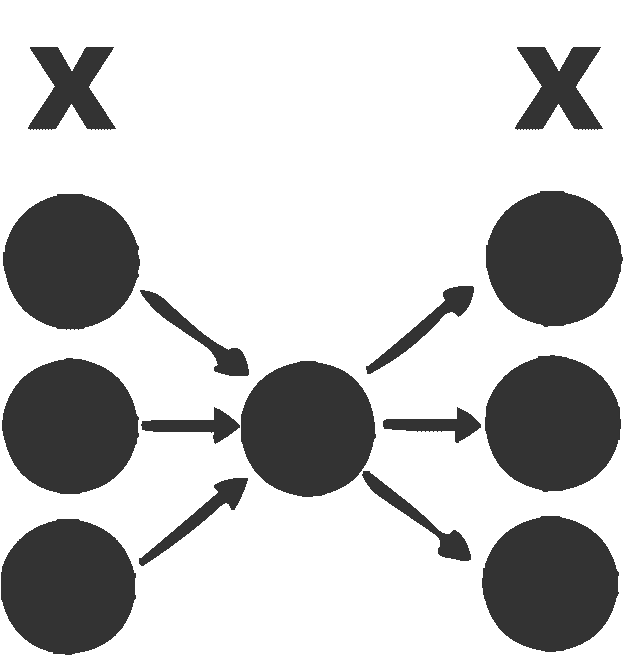

无监督学习是一种机器学习算法，用于从仅包含输入数据且没有标记响应的数据集中得出推论。最常见的无监督学习方法是聚类分析，用于探索性数据分析，以在数据中发现隐藏的模式或分组。

## 参考

基于 [`blog.keras.io/building-autoencoders-in-keras.html`](https://blog.keras.io/building-autoencoders-in-keras.html)

## 介绍 `Keras Functional API`

Keras 函数式 API 是定义复杂模型（如多输出模型、有向无环图或具有共享层的模型）的首选方法。

所有函数式 API 都依赖于这样一个事实：每个 `keras.Layer` 对象都是一个 `callable` 对象！

有关详细信息，请参阅 8.2 多模态网络。

* * *

```
TRAINING = True
with K.get_session() as sess:
    shp = [10, 200, 200, 3]
    shp1 = [10, 7, 7, 80]
    inp = K.placeholder(shp)
    inp1 = K.placeholder(shp1)
    queue = tf.FIFOQueue(20, [tf.float32, tf.float32], [shp, shp1])
    x1, y1 = queue.dequeue()
    enqueue = queue.enqueue([inp, inp1])
    model = keras.applications.ResNet50(False, "imagenet", x1, shp[1:])
    for i in range(3):
        model.layers.pop()
        model.layers[-1].outbound_nodes = []
        model.outputs = [model.layers[-1].output]
    output = model.outputs[0]  # 7x7
    # Reduce filter size to avoid OOM
    output = Conv2D(32, (1, 1), padding="same", activation='relu')(output)
    output3 = Conv2D(5 * (4 + 11 + 1), (1, 1), padding="same", activation='relu')(
        output)  # YOLO output B (4 + nb_class +1)
    cost = tf.reduce_sum(tf.abs(output3 - y1))
    optimizer = tf.train.RMSPropOptimizer(0.001).minimize(cost)
    sess.run(tf.global_variables_initializer())

    def get_input():
        # Super long processing I/O bla bla bla
        return np.arange(prod(shp)).reshape(shp).astype(np.float32), np.arange(prod(shp1)).reshape(shp1).astype(
            np.float32)

    def generate(coord, enqueue_op):
        while not coord.should_stop():
            inp_feed, inp1_feed = get_input()
            sess.run(enqueue_op, feed_dict={inp: inp_feed, inp1: inp1_feed})

    start = time.time()
    for i in tqdm(range(10)):  # EPOCH
        for j in range(30):  # Batch
            x,y = get_input()
            optimizer_, s = sess.run([optimizer, queue.size()], 
                                     feed_dict={x1:x,y1:y, K.learning_phase(): int(TRAINING)})
    print("Took : ", time.time() - start)

    coordinator = tf.train.Coordinator()
    threads = [threading.Thread(target=generate, args=(coordinator, enqueue)) for i in range(10)]
    for t in threads:
        t.start()
    start = time.time()
    for i in tqdm(range(10)):  # EPOCH
        for j in range(30):  # Batch
            optimizer_, s = sess.run([optimizer, queue.size()], 
                                     feed_dict={K.learning_phase(): int(TRAINING)})
    print("Took : ", time.time() - start)

    def clear_queue(queue, threads):
        while any([t.is_alive() for t in threads]):
            _, s = sess.run([queue.dequeue(), queue.size()])
            print(s)

    coordinator.request_stop()
    clear_queue(queue, threads)

    coordinator.join(threads)
    print("DONE Queue")
```

```
from keras.layers import Input, Dense
from keras.models import Model

from keras.datasets import mnist

import numpy as np
```

```
Using TensorFlow backend.
```

```
## this is the size of our encoded representations
encoding_dim = 32  # 32 floats -> compression of factor 24.5, assuming the input is 784 floats

## this is our input placeholder
input_img = Input(shape=(784,))
## "encoded" is the encoded representation of the input
encoded = Dense(encoding_dim, activation='relu')(input_img)

## "decoded" is the lossy reconstruction of the input
decoded = Dense(784, activation='sigmoid')(encoded)

## this model maps an input to its reconstruction
autoencoder = Model(input_img, decoded)
```

```
## this model maps an input to its encoded representation
encoder = Model(input_img, encoded)
```

```
## create a placeholder for an encoded (32-dimensional) input
encoded_input = Input(shape=(encoding_dim,))
## retrieve the last layer of the autoencoder model
decoder_layer = autoencoder.layers[-1]
## create the decoder model
decoder = Model(encoded_input, decoder_layer(encoded_input))
```

```
autoencoder.compile(optimizer='adadelta', loss='binary_crossentropy')
```

```
(x_train, _), (x_test, _) = mnist.load_data()

x_train = x_train.astype('float32') / 255.
x_test = x_test.astype('float32') / 255.
x_train = x_train.reshape((len(x_train), np.prod(x_train.shape[1:])))
x_test = x_test.reshape((len(x_test), np.prod(x_test.shape[1:])))
```

```
#note: x_train, x_train :) 
autoencoder.fit(x_train, x_train,
                epochs=50,
                batch_size=256,
                shuffle=True,
                validation_data=(x_test, x_test))
```


## 训练日志

```
Train on 60000 samples, validate on 10000 samples
Epoch 1/50
60000/60000 [==============================] - 1s - loss: 0.3830 - val_loss: 0.2731
Epoch 2/50
60000/60000 [==============================] - 1s - loss: 0.2664 - val_loss: 0.2561
Epoch 3/50
60000/60000 [==============================] - 1s - loss: 0.2463 - val_loss: 0.2336
Epoch 4/50
60000/60000 [==============================] - 1s - loss: 0.2258 - val_loss: 0.2156
Epoch 5/50
60000/60000 [==============================] - 1s - loss: 0.2105 - val_loss: 0.2030
Epoch 6/50
60000/60000 [==============================] - 1s - loss: 0.1997 - val_loss: 0.1936
Epoch 7/50
60000/60000 [==============================] - 1s - loss: 0.1914 - val_loss: 0.1863
Epoch 8/50
60000/60000 [==============================] - 1s - loss: 0.1846 - val_loss: 0.1800
Epoch 9/50
60000/60000 [==============================] - 1s - loss: 0.1789 - val_loss: 0.1749
Epoch 10/50
60000/60000 [==============================] - 1s - loss: 0.1740 - val_loss: 0.1702
Epoch 11/50
60000/60000 [==============================] - 1s - loss: 0.1697 - val_loss: 0.1660
Epoch 12/50
60000/60000 [==============================] - 1s - loss: 0.1657 - val_loss: 0.1622
Epoch 13/50
60000/60000 [==============================] - 1s - loss: 0.1620 - val_loss: 0.1587
Epoch 14/50
60000/60000 [==============================] - 1s - loss: 0.1586 - val_loss: 0.1554
Epoch 15/50
60000/60000 [==============================] - 1s - loss: 0.1554 - val_loss: 0.1524
Epoch 16/50
60000/60000 [==============================] - 1s - loss: 0.1525 - val_loss: 0.1495
Epoch 17/50
60000/60000 [==============================] - 1s - loss: 0.1497 - val_loss: 0.1468
Epoch 18/50
60000/60000 [==============================] - 1s - loss: 0.1470 - val_loss: 0.1441
Epoch 19/50
60000/60000 [==============================] - 1s - loss: 0.1444 - val_loss: 0.1415
Epoch 20/50
60000/60000 [==============================] - 1s - loss: 0.1419 - val_loss: 0.1391
Epoch 21/50
60000/60000 [==============================] - 1s - loss: 0.1395 - val_loss: 0.1367
Epoch 22/50
60000/60000 [==============================] - 1s - loss: 0.1371 - val_loss: 0.1345
Epoch 23/50
60000/60000 [==============================] - 1s - loss: 0.1349 - val_loss: 0.1323ss: 0.13
Epoch 24/50
60000/60000 [==============================] - 1s - loss: 0.1328 - val_loss: 0.1302
Epoch 25/50
60000/60000 [==============================] - 1s - loss: 0.1308 - val_loss: 0.1283
Epoch 26/50
60000/60000 [==============================] - 1s - loss: 0.1289 - val_loss: 0.1264
Epoch 27/50
60000/60000 [==============================] - 1s - loss: 0.1271 - val_loss: 0.1247
Epoch 28/50
60000/60000 [==============================] - 1s - loss: 0.1254 - val_loss: 0.1230
Epoch 29/50
60000/60000 [==============================] - 1s - loss: 0.1238 - val_loss: 0.1215
Epoch 30/50
60000/60000 [==============================] - 1s - loss: 0.1223 - val_loss: 0.1200
Epoch 31/50
60000/60000 [==============================] - 1s - loss: 0.1208 - val_loss: 0.1186
Epoch 32/50
60000/60000 [==============================] - 1s - loss: 0.1195 - val_loss: 0.1172
Epoch 33/50
60000/60000 [==============================] - 1s - loss: 0.1182 - val_loss: 0.1160
Epoch 34/50
60000/60000 [==============================] - 1s - loss: 0.1170 - val_loss: 0.1149
Epoch 35/50
60000/60000 [==============================] - 1s - loss: 0.1158 - val_loss: 0.1137
Epoch 36/50
60000/60000 [==============================] - 1s - loss: 0.1148 - val_loss: 0.1127
Epoch 37/50
60000/60000 [==============================] - 1s - loss: 0.1138 - val_loss: 0.1117
Epoch 38/50
60000/60000 [==============================] - 1s - loss: 0.1129 - val_loss: 0.1109
Epoch 39/50
60000/60000 [==============================] - 1s - loss: 0.1120 - val_loss: 0.1100
Epoch 40/50
60000/60000 [==============================] - 1s - loss: 0.1112 - val_loss: 0.1093
Epoch 41/50
60000/60000 [==============================] - 1s - loss: 0.1105 - val_loss: 0.1085
Epoch 42/50
60000/60000 [==============================] - 1s - loss: 0.1098 - val_loss: 0.1079
Epoch 43/50
60000/60000 [==============================] - 1s - loss: 0.1092 - val_loss: 0.1072
Epoch 44/50
60000/60000 [==============================] - 1s - loss: 0.1086 - val_loss: 0.1066
Epoch 45/50
60000/60000 [==============================] - 1s - loss: 0.1080 - val_loss: 0.1061
Epoch 46/50
60000/60000 [==============================] - 1s - loss: 0.1074 - val_loss: 0.1056
Epoch 47/50
60000/60000 [==============================] - 1s - loss: 0.1069 - val_loss: 0.1051
Epoch 48/50
60000/60000 [==============================] - 1s - loss: 0.1065 - val_loss: 0.1046
Epoch 49/50
60000/60000 [==============================] - 1s - loss: 0.1060 - val_loss: 0.1042
Epoch 50/50
60000/60000 [==============================] - 1s - loss: 0.1056 - val_loss: 0.1037

<keras.callbacks.History at 0x7fd1ce5140f0>
```

## Testing the Autoencoder

```
from matplotlib import pyplot as plt

%matplotlib inline
```

```
encoded_imgs = encoder.predict(x_test)
decoded_imgs = decoder.predict(encoded_imgs)

n = 10 
plt.figure(figsize=(20, 4))
for i in range(n):
    # original
    ax = plt.subplot(2, n, i + 1)
    plt.imshow(x_test[i].reshape(28, 28))
    plt.gray()
    ax.get_xaxis().set_visible(False)
    ax.get_yaxis().set_visible(False)

    # reconstruction
    ax = plt.subplot(2, n, i + 1 + n)
    plt.imshow(decoded_imgs[i].reshape(28, 28))
    plt.gray()
    ax.get_xaxis().set_visible(False)
    ax.get_yaxis().set_visible(False)
plt.show()
```


## Sample generation with Autoencoder

```
encoded_imgs = np.random.rand(10,32)
decoded_imgs = decoder.predict(encoded_imgs)

n = 10 
plt.figure(figsize=(20, 4))
for i in range(n):
    # generation
    ax = plt.subplot(2, n, i + 1 + n)
    plt.imshow(decoded_imgs[i].reshape(28, 28))
    plt.gray()
    ax.get_xaxis().set_visible(False)
    ax.get_yaxis().set_visible(False)
plt.show()
```


* * *

## Convolutional AutoEncoder

Since our inputs are images, it makes sense to use convolutional neural networks (`convnets`) as encoders and decoders.

In practical settings, autoencoders applied to images are always convolutional autoencoders --they simply perform much better.

The encoder will consist in a stack of `Conv2D` and `MaxPooling2D` layers (max pooling being used for spatial down-sampling), while the decoder will consist in a stack of `Conv2D` and `UpSampling2D` layers.

```
from keras.layers import Input, Dense, Conv2D, MaxPooling2D, UpSampling2D
from keras.models import Model
from keras import backend as K

input_img = Input(shape=(28, 28, 1))  # adapt this if using `channels_first` image data format

x = Conv2D(16, (3, 3), activation='relu', padding='same')(input_img)
x = MaxPooling2D((2, 2), padding='same')(x)
x = Conv2D(8, (3, 3), activation='relu', padding='same')(x)
x = MaxPooling2D((2, 2), padding='same')(x)
x = Conv2D(8, (3, 3), activation='relu', padding='same')(x)
encoded = MaxPooling2D((2, 2), padding='same')(x)

## at this point the representation is (4, 4, 8) i.e. 128-dimensional

x = Conv2D(8, (3, 3), activation='relu', padding='same')(encoded)
x = UpSampling2D((2, 2))(x)
x = Conv2D(8, (3, 3), activation='relu', padding='same')(x)
x = UpSampling2D((2, 2))(x)
x = Conv2D(16, (3, 3), activation='relu')(x)
x = UpSampling2D((2, 2))(x)
decoded = Conv2D(1, (3, 3), activation='sigmoid', padding='same')(x)

conv_autoencoder = Model(input_img, decoded)
conv_autoencoder.compile(optimizer='adadelta', loss='binary_crossentropy')
```


## 卷积自编码器训练与应用

## 数据预处理

```python
from keras import backend as K

if K.image_data_format() == 'channels_last':
    shape_ord = (28, 28, 1)
else:
    shape_ord = (1, 28, 28)

(x_train, _), (x_test, _) = mnist.load_data()

x_train = x_train.astype('float32') / 255.
x_test = x_test.astype('float32') / 255.

x_train = np.reshape(x_train, ((x_train.shape[0],) + shape_ord))  
x_test = np.reshape(x_test, ((x_test.shape[0],) + shape_ord))
```

查看训练数据形状：

```python
x_train.shape
```

输出结果：

```
(60000, 28, 28, 1)
```

## 模型训练

导入 `TensorBoard` 回调并设置训练参数：

```python
from keras.callbacks import TensorBoard

batch_size = 128
steps_per_epoch = np.int(np.floor(x_train.shape[0] / batch_size))
conv_autoencoder.fit(x_train, x_train, epochs=50, batch_size=128,
                     shuffle=True, validation_data=(x_test, x_test),
                     callbacks=[TensorBoard(log_dir='./tf_autoencoder_logs')])
```

训练过程输出如下：

```
Train on 60000 samples, validate on 10000 samples
Epoch 1/50
60000/60000 [==============================] - 8s - loss: 0.2327 - val_loss: 0.1740
Epoch 2/50
60000/60000 [==============================] - 7s - loss: 0.1645 - val_loss: 0.1551
Epoch 3/50
60000/60000 [==============================] - 7s - loss: 0.1501 - val_loss: 0.1442
Epoch 4/50
60000/60000 [==============================] - 7s - loss: 0.1404 - val_loss: 0.1375
Epoch 5/50
60000/60000 [==============================] - 7s - loss: 0.1342 - val_loss: 0.1316
Epoch 6/50
60000/60000 [==============================] - 7s - loss: 0.1300 - val_loss: 0.1298
Epoch 7/50
60000/60000 [==============================] - 7s - loss: 0.1272 - val_loss: 0.1301
Epoch 8/50
60000/60000 [==============================] - 7s - loss: 0.1243 - val_loss: 0.1221
Epoch 9/50
60000/60000 [==============================] - 7s - loss: 0.1222 - val_loss: 0.1196
Epoch 10/50
60000/60000 [==============================] - 7s - loss: 0.1207 - val_loss: 0.1184
Epoch 11/50
60000/60000 [==============================] - 7s - loss: 0.1188 - val_loss: 0.1162
Epoch 12/50
60000/60000 [==============================] - 7s - loss: 0.1175 - val_loss: 0.1160
Epoch 13/50
60000/60000 [==============================] - 7s - loss: 0.1167 - val_loss: 0.1164
Epoch 14/50
60000/60000 [==============================] - 7s - loss: 0.1154 - val_loss: 0.1160
Epoch 15/50
60000/60000 [==============================] - 7s - loss: 0.1145 - val_loss: 0.1159
Epoch 16/50
60000/60000 [==============================] - 7s - loss: 0.1132 - val_loss: 0.1110
Epoch 17/50
60000/60000 [==============================] - 7s - loss: 0.1127 - val_loss: 0.1108
Epoch 18/50
60000/60000 [==============================] - 7s - loss: 0.1118 - val_loss: 0.1099
Epoch 19/50
60000/60000 [==============================] - 7s - loss: 0.1113 - val_loss: 0.1106
Epoch 20/50
60000/60000 [==============================] - 7s - loss: 0.1108 - val_loss: 0.1120
Epoch 21/50
60000/60000 [==============================] - 7s - loss: 0.1104 - val_loss: 0.1064
Epoch 22/50
60000/60000 [==============================] - 7s - loss: 0.1094 - val_loss: 0.1075
Epoch 23/50
60000/60000 [==============================] - 7s - loss: 0.1088 - val_loss: 0.1088
Epoch 24/50
60000/60000 [==============================] - 7s - loss: 0.1085 - val_loss: 0.1071
Epoch 25/50
60000/60000 [==============================] - 7s - loss: 0.1081 - val_loss: 0.1060
Epoch 26/50
60000/60000 [==============================] - 7s - loss: 0.1075 - val_loss: 0.1062
Epoch 27/50
60000/60000 [==============================] - 7s - loss: 0.1074 - val_loss: 0.1062
Epoch 28/50
60000/60000 [==============================] - 7s - loss: 0.1065 - val_loss: 0.1045
Epoch 29/50
60000/60000 [==============================] - 7s - loss: 0.1062 - val_loss: 0.1043
Epoch 30/50
60000/60000 [==============================] - 7s - loss: 0.1057 - val_loss: 0.1038
Epoch 31/50
60000/60000 [==============================] - 7s - loss: 0.1053 - val_loss: 0.1040
Epoch 32/50
60000/60000 [==============================] - 7s - loss: 0.1048 - val_loss: 0.1041
Epoch 33/50
60000/60000 [==============================] - 7s - loss: 0.1045 - val_loss: 0.1057
Epoch 34/50
60000/60000 [==============================] - 7s - loss: 0.1041 - val_loss: 0.1026
Epoch 35/50
60000/60000 [==============================] - 7s - loss: 0.1041 - val_loss: 0.1042
Epoch 36/50
60000/60000 [==============================] - 7s - loss: 0.1035 - val_loss: 0.1053
Epoch 37/50
60000/60000 [==============================] - 7s - loss: 0.1032 - val_loss: 0.1006
Epoch 38/50
60000/60000 [==============================] - 7s - loss: 0.1030 - val_loss: 0.1011
Epoch 39/50
60000/60000 [==============================] - 7s - loss: 0.1028 - val_loss: 0.1013
Epoch 40/50
60000/60000 [==============================] - 7s - loss: 0.1027 - val_loss: 0.1018
Epoch 41/50
60000/60000 [==============================] - 7s - loss: 0.1025 - val_loss: 0.1019
Epoch 42/50
60000/60000 [==============================] - 7s - loss: 0.1024 - val_loss: 0.1025
Epoch 43/50
60000/60000 [==============================] - 7s - loss: 0.1020 - val_loss: 0.1015
Epoch 44/50
60000/60000 [==============================] - 7s - loss: 0.1020 - val_loss: 0.1018
Epoch 45/50
60000/60000 [==============================] - 7s - loss: 0.1015 - val_loss: 0.1011
Epoch 46/50
60000/60000 [==============================] - 7s - loss: 0.1013 - val_loss: 0.0999
Epoch 47/50
60000/60000 [==============================] - 7s - loss: 0.1010 - val_loss: 0.0995
Epoch 48/50
60000/60000 [==============================] - 7s - loss: 0.1008 - val_loss: 0.0996
Epoch 49/50
60000/60000 [==============================] - 7s - loss: 0.1008 - val_loss: 0.0990
Epoch 50/50
60000/60000 [==============================] - 7s - loss: 0.1006 - val_loss: 0.0995
```

训练完成后返回对象：

```
<keras.callbacks.History at 0x7fd1bebacfd0>
```

## 重构结果可视化

使用 `conv_autoencoder.predict` 对测试集进行重构，并可视化前 10 个样本：

```python
decoded_imgs = conv_autoencoder.predict(x_test)

n = 10
plt.figure(figsize=(20, 4))
for i in range(n):
    # display original
    ax = plt.subplot(2, n, i+1)
    plt.imshow(x_test[i].reshape(28, 28))
    plt.gray()
    ax.get_xaxis().set_visible(False)
    ax.get_yaxis().set_visible(False)

    # display reconstruction
    ax = plt.subplot(2, n, i + n + 1)
    plt.imshow(decoded_imgs[i].reshape(28, 28))
    plt.gray()
    ax.get_xaxis().set_visible(False)
    ax.get_yaxis().set_visible(False)
plt.show()
```


## 编码器中间表示可视化

我们也可以查看 `128-`维的编码中间表示：

```python
conv_encoder = Model(input_img, encoded)
encoded_imgs = conv_encoder.predict(x_test)

n = 10
plt.figure(figsize=(20, 8))
for i in range(n):
    ax = plt.subplot(1, n, i+1)
    plt.imshow(encoded_imgs[i].reshape(4, 4 * 8).T)
    plt.gray()
    ax.get_xaxis().set_visible(False)
    ax.get_yaxis().set_visible(False)
plt.show()
```


## 预训练编码器

自编码器的一个强大功能是利用编码器从特征向量生成有意义的表示。

使用编码器来预训练分类器：

```python
## Use the encoder to pretrain a classifier
```

* * *

## 应用于图像去噪

将卷积自编码器应用于图像去噪问题。很简单：我们将训练自编码器将噪声数字图像映射到干净数字图像。

生成合成噪声数字的方法如下：只需应用高斯噪声矩阵并将图像裁剪到 0 和 1 之间。


## 问题

如果你眯起眼睛，仍然可以辨认出它们，但几乎看不清。

**我们的自动编码器能学会恢复原始数字吗？让我们来看看。**

与之前的卷积自动编码器相比，为了提高重建质量，我们将使用一个略有不同的模型，每层使用更多的滤波器：

```
from keras.layers import Input, Dense, Conv2D, MaxPooling2D, UpSampling2D
from keras.models import Model

from keras.callbacks import TensorBoard
```

```
Using TensorFlow backend.
```

```
input_img = Input(shape=(28, 28, 1))  # adapt this if using `channels_first` image data format

x = Conv2D(32, (3, 3), activation='relu', padding='same')(input_img)
x = MaxPooling2D((2, 2), padding='same')(x)
x = Conv2D(32, (3, 3), activation='relu', padding='same')(x)
encoded = MaxPooling2D((2, 2), padding='same')(x)

## at this point the representation is (7, 7, 32)

x = Conv2D(32, (3, 3), activation='relu', padding='same')(encoded)
x = UpSampling2D((2, 2))(x)
x = Conv2D(32, (3, 3), activation='relu', padding='same')(x)
x = UpSampling2D((2, 2))(x)
decoded = Conv2D(1, (3, 3), activation='sigmoid', padding='same')(x)

autoencoder = Model(input_img, decoded)
autoencoder.compile(optimizer='adadelta', loss='binary_crossentropy')
```

让我们训练自动编码器 `100` 个 epoch

```
autoencoder.fit(x_train_noisy, x_train,
                epochs=100,
                batch_size=128,
                shuffle=True,
                validation_data=(x_test_noisy, x_test),
                callbacks=[TensorBoard(log_dir='/tmp/autoencoder_denoise', 
                                       histogram_freq=0, write_graph=False)])
```


```
Train on 60000 samples, validate on 10000 samples
Epoch 1/100
60000/60000 [==============================] - 9s - loss: 0.1901 - val_loss: 0.1255
Epoch 2/100
60000/60000 [==============================] - 8s - loss: 0.1214 - val_loss: 0.1142
Epoch 3/100
60000/60000 [==============================] - 8s - loss: 0.1135 - val_loss: 0.1085
Epoch 4/100
60000/60000 [==============================] - 8s - loss: 0.1094 - val_loss: 0.1074
Epoch 5/100
60000/60000 [==============================] - 8s - loss: 0.1071 - val_loss: 0.1052
Epoch 6/100
60000/60000 [==============================] - 8s - loss: 0.1053 - val_loss: 0.1046
Epoch 7/100
60000/60000 [==============================] - 8s - loss: 0.1040 - val_loss: 0.1020
Epoch 8/100
60000/60000 [==============================] - 8s - loss: 0.1031 - val_loss: 0.1028
Epoch 9/100
60000/60000 [==============================] - 8s - loss: 0.1023 - val_loss: 0.1009
Epoch 10/100
60000/60000 [==============================] - 8s - loss: 0.1017 - val_loss: 0.1005
Epoch 11/100
60000/60000 [==============================] - 8s - loss: 0.1009 - val_loss: 0.1003
Epoch 12/100
60000/60000 [==============================] - 8s - loss: 0.1007 - val_loss: 0.1010
Epoch 13/100
60000/60000 [==============================] - 8s - loss: 0.1002 - val_loss: 0.0989
Epoch 14/100
60000/60000 [==============================] - 8s - loss: 0.1000 - val_loss: 0.0986
Epoch 15/100
60000/60000 [==============================] - 8s - loss: 0.0998 - val_loss: 0.0983
Epoch 16/100
60000/60000 [==============================] - 8s - loss: 0.0993 - val_loss: 0.0983
Epoch 17/100
60000/60000 [==============================] - 8s - loss: 0.0991 - val_loss: 0.0979
Epoch 18/100
60000/60000 [==============================] - 8s - loss: 0.0988 - val_loss: 0.0988
Epoch 19/100
60000/60000 [==============================] - 8s - loss: 0.0986 - val_loss: 0.0976
Epoch 20/100
60000/60000 [==============================] - 8s - loss: 0.0984 - val_loss: 0.0987
Epoch 21/100
60000/60000 [==============================] - 8s - loss: 0.0983 - val_loss: 0.0973
Epoch 22/100
60000/60000 [==============================] - 8s - loss: 0.0981 - val_loss: 0.0971
Epoch 23/100
60000/60000 [==============================] - 8s - loss: 0.0979 - val_loss: 0.0978
Epoch 24/100
60000/60000 [==============================] - 8s - loss: 0.0977 - val_loss: 0.0968
Epoch 25/100
60000/60000 [==============================] - 8s - loss: 0.0975 - val_loss: 0.0976
Epoch 26/100
60000/60000 [==============================] - 8s - loss: 0.0974 - val_loss: 0.0963
Epoch 27/100
60000/60000 [==============================] - 8s - loss: 0.0973 - val_loss: 0.0963
Epoch 28/100
60000/60000 [==============================] - 8s - loss: 0.0972 - val_loss: 0.0964
Epoch 29/100
60000/60000 [==============================] - 8s - loss: 0.0970 - val_loss: 0.0961
Epoch 30/100
60000/60000 [==============================] - 8s - loss: 0.0970 - val_loss: 0.0968
Epoch 31/100
60000/60000 [==============================] - 8s - loss: 0.0969 - val_loss: 0.0959
Epoch 32/100
60000/60000 [==============================] - 8s - loss: 0.0968 - val_loss: 0.0959
Epoch 33/100
60000/60000 [==============================] - 8s - loss: 0.0967 - val_loss: 0.0957
Epoch 34/100
60000/60000 [==============================] - 8s - loss: 0.0966 - val_loss: 0.0958
Epoch 35/100
60000/60000 [==============================] - 8s - loss: 0.0965 - val_loss: 0.0956
Epoch 36/100
60000/60000 [==============================] - 8s - loss: 0.0965 - val_loss: 0.0959
Epoch 37/100
60000/60000 [==============================] - 8s - loss: 0.0964 - val_loss: 0.0963
Epoch 38/100
60000/60000 [==============================] - 8s - loss: 0.0963 - val_loss: 0.0960
Epoch 39/100
60000/60000 [==============================] - 8s - loss: 0.0963 - val_loss: 0.0963
Epoch 40/100
60000/60000 [==============================] - 8s - loss: 0.0962 - val_loss: 0.0954
Epoch 41/100
60000/60000 [==============================] - 8s - loss: 0.0961 - val_loss: 0.0955
Epoch 42/100
60000/60000 [==============================] - 8s - loss: 0.0960 - val_loss: 0.0953
Epoch 43/100
60000/60000 [==============================] - 8s - loss: 0.0960 - val_loss: 0.0952
Epoch 44/100
60000/60000 [==============================] - 8s - loss: 0.0960 - val_loss: 0.0951
Epoch 45/100
60000/60000 [==============================] - 8s - loss: 0.0959 - val_loss: 0.0951
Epoch 46/100
60000/60000 [==============================] - 8s - loss: 0.0958 - val_loss: 0.0953
Epoch 47/100
60000/60000 [==============================] - 8s - loss: 0.0957 - val_loss: 0.0952
Epoch 48/100
60000/60000 [==============================] - 8s - loss: 0.0957 - val_loss: 0.0954
Epoch 49/100
60000/60000 [==============================] - 8s - loss: 0.0957 - val_loss: 0.0954
Epoch 50/100
60000/60000 [==============================] - 8s - loss: 0.0957 - val_loss: 0.0954
Epoch 51/100
60000/60000 [==============================] - 8s - loss: 0.0955 - val_loss: 0.0948
Epoch 52/100
60000/60000 [==============================] - 8s - loss: 0.0956 - val_loss: 0.0951
Epoch 53/100
60000/60000 [==============================] - 8s - loss: 0.0955 - val_loss: 0.0951
Epoch 54/100
60000/60000 [==============================] - 8s - loss: 0.0955 - val_loss: 0.0951
Epoch 55/100
60000/60000 [==============================] - 8s - loss: 0.0955 - val_loss: 0.0948
Epoch 56/100
60000/60000 [==============================] - 8s - loss: 0.0954 - val_loss: 0.0955
Epoch 57/100
60000/60000 [==============================] - 8s - loss: 0.0954 - val_loss: 0.0950
Epoch 58/100
60000/60000 [==============================] - 8s - loss: 0.0953 - val_loss: 0.0955
Epoch 59/100
60000/60000 [==============================] - 8s - loss: 0.0952 - val_loss: 0.0947
Epoch 60/100
60000/60000 [==============================] - 8s - loss: 0.0953 - val_loss: 0.0947
Epoch 61/100
60000/60000 [==============================] - 8s - loss: 0.0952 - val_loss: 0.0947
Epoch 62/100
60000/60000 [==============================] - 8s - loss: 0.0952 - val_loss: 0.0945
Epoch 63/100
60000/60000 [==============================] - 8s - loss: 0.0952 - val_loss: 0.0945
Epoch 64/100
60000/60000 [==============================] - 8s - loss: 0.0952 - val_loss: 0.0945
Epoch 65/100
60000/60000 [==============================] - 8s - loss: 0.0950 - val_loss: 0.0954
Epoch 66/100
60000/60000 [==============================] - 8s - loss: 0.0951 - val_loss: 0.0945
Epoch 67/100
60000/60000 [==============================] - 8s - loss: 0.0951 - val_loss: 0.0946
Epoch 68/100
60000/60000 [==============================] - 8s - loss: 0.0950 - val_loss: 0.0951
Epoch 69/100
60000/60000 [==============================] - 8s - loss: 0.0950 - val_loss: 0.0952
Epoch 70/100
60000/60000 [==============================] - 8s - loss: 0.0949 - val_loss: 0.0948
Epoch 71/100
60000/60000 [==============================] - 8s - loss: 0.0949 - val_loss: 0.0958
Epoch 72/100
60000/60000 [==============================] - 8s - loss: 0.0949 - val_loss: 0.0953
Epoch 73/100
60000/60000 [==============================] - 8s - loss: 0.0949 - val_loss: 0.0942
Epoch 74/100
60000/60000 [==============================] - 8s - loss: 0.0948 - val_loss: 0.0946
Epoch 75/100
60000/60000 [==============================] - 8s - loss: 0.0948 - val_loss: 0.0942
Epoch 76/100
60000/60000 [==============================] - 8s - loss: 0.0948 - val_loss: 0.0945
Epoch 77/100
60000/60000 [==============================] - 8s - loss: 0.0948 - val_loss: 0.0944
Epoch 78/100
60000/60000 [==============================] - 8s - loss: 0.0948 - val_loss: 0.0942
Epoch 79/100
60000/60000 [==============================] - 8s - loss: 0.0947 - val_loss: 0.0944
Epoch 80/100
60000/60000 [==============================] - 8s - loss: 0.0947 - val_loss: 0.0942
Epoch 81/100
60000/60000 [==============================] - 8s - loss: 0.0946 - val_loss: 0.0943
Epoch 82/100
60000/60000 [==============================] - 8s - loss: 0.0946 - val_loss: 0.0942
Epoch 83/100
60000/60000 [==============================] - 8s - loss: 0.0946 - val_loss: 0.0941
Epoch 84/100
60000/60000 [==============================] - 8s - loss: 0.0947 - val_loss: 0.0940
Epoch 85/100
60000/60000 [==============================] - 8s - loss: 0.0946 - val_loss: 0.0941
Epoch 86/100
60000/60000 [==============================] - 8s - loss: 0.0945 - val_loss: 0.0941
Epoch 87/100
60000/60000 [==============================] - 8s - loss: 0.0946 - val_loss: 0.0945
Epoch 88/100
60000/60000 [==============================] - 8s - loss: 0.0945 - val_loss: 0.0944
Epoch 89/100
60000/60000 [==============================] - 8s - loss: 0.0945 - val_loss: 0.0944
Epoch 90/100
60000/60000 [==============================] - 8s - loss: 0.0945 - val_loss: 0.0941
Epoch 91/100
60000/60000 [==============================] - 8s - loss: 0.0945 - val_loss: 0.0939
Epoch 92/100
60000/60000 [==============================] - 8s - loss: 0.0944 - val_loss: 0.0946
Epoch 93/100
60000/60000 [==============================] - 8s - loss: 0.0944 - val_loss: 0.0941
Epoch 94/100
60000/60000 [==============================] - 8s - loss: 0.0944 - val_loss: 0.0939
Epoch 95/100
60000/60000 [==============================] - 8s - loss: 0.0944 - val_loss: 0.0941
Epoch 96/100
60000/60000 [==============================] - 8s - loss: 0.0944 - val_loss: 0.0939
Epoch 97/100
60000/60000 [==============================] - 8s - loss: 0.0944 - val_loss: 0.0939
Epoch 98/100
60000/60000 [==============================] - 8s - loss: 0.0943 - val_loss: 0.0939
Epoch 99/100
60000/60000 [==============================] - 8s - loss: 0.0944 - val_loss: 0.0941
Epoch 100/100
60000/60000 [==============================] - 8s - loss: 0.0943 - val_loss: 0.0938

<keras.callbacks.History at 0x7fb45ad95f28>
```


## 现在让我们来看看....

```
decoded_imgs = autoencoder.predict(x_test_noisy)

n = 10
plt.figure(figsize=(20, 4))
for i in range(n):
    # display original
    ax = plt.subplot(2, n, i+1)
    plt.imshow(x_test[i].reshape(28, 28))
    plt.gray()
    ax.get_xaxis().set_visible(False)
    ax.get_yaxis().set_visible(False)

    # display reconstruction
    ax = plt.subplot(2, n, i + n + 1)
    plt.imshow(decoded_imgs[i].reshape(28, 28))
    plt.gray()
    ax.get_xaxis().set_visible(False)
    ax.get_yaxis().set_visible(False)
plt.show()
```


## 变分自编码器

*(Reference [`https://blog.keras.io/building-autoencoders-in-keras.html`](https://blog.keras.io/building-autoencoders-in-keras.html))*

变分自编码器是一种对自动编码更现代、更有趣的方法。

## 什么是变分自编码器？

它是一种带有额外约束的自动编码器，用于学习编码表示。

更准确地说，它是一种为输入数据学习 [`latent variable model`](https://en.wikipedia.org/wiki/Latent_variable_model) 的自动编码器。

因此，你不是让神经网络学习一个任意函数，而是学习建模数据的概率分布的参数。

如果你从这个分布中采样点，就可以生成新的输入数据样本：`VAE` 是一个 `"generative model"`。

## 变分自编码器如何工作？

首先，编码器网络将输入样本 $x$ 转换为潜在空间中的两个参数，我们将其记为 $z*{\mu}$ 和 $z*{log\_{\sigma}}$。

然后，我们从假设生成数据的 `latent normal distribution` 中随机采样相似点 $z$，通过 $z = z*{\mu} + \\exp(z*{log\_{\sigma}}) \* \\epsilon$ 实现，其中 $\\epsilon$ 是一个随机正态张量。

最后，解码器网络将这些潜在空间点映射回原始输入数据。

模型参数通过两个损失函数进行训练：

*   一个 `reconstruction loss`，迫使解码样本与初始输入匹配（就像我们之前的自动编码器一样）；

*   以及学习到的潜在分布与先验分布之间的 `KL divergence`，作为正则化项。

你实际上可以完全去掉后一项，尽管它有助于学习结构良好的潜在空间并减少对训练数据的过拟合。

## 编码器网络

```
batch_size = 100
original_dim = 784
latent_dim = 2
intermediate_dim = 256
epochs = 50
epsilon_std = 1.0
```

```
x = Input(batch_shape=(batch_size, original_dim))
h = Dense(intermediate_dim, activation='relu')(x)
z_mean = Dense(latent_dim)(h)
z_log_sigma = Dense(latent_dim)(h)
```

我们可以使用这些参数从潜在空间中采样新的相似点：

```
from keras.layers.core import Lambda
from keras import backend as K
```

```
def sampling(args):
    z_mean, z_log_sigma = args
    epsilon = K.random_normal(shape=(batch_size, latent_dim),
                              mean=0., stddev=epsilon_std)
    return z_mean + K.exp(z_log_sigma) * epsilon

## note that "output_shape" isn't necessary with the TensorFlow backend
## so you could write `Lambda(sampling)([z_mean, z_log_sigma])`
z = Lambda(sampling, output_shape=(latent_dim,))([z_mean, z_log_sigma])
```

## 解码器网络

最后，我们可以将这些采样的潜在点映射回重构的输入：

```
decoder_h = Dense(intermediate_dim, activation='relu')
decoder_mean = Dense(original_dim, activation='sigmoid')
h_decoded = decoder_h(z)
x_decoded_mean = decoder_mean(h_decoded)
```

到目前为止所做的工作允许我们实例化 3 个模型：

*   一个将输入映射到重构结果的端到端自动编码器

*   一个将输入映射到潜在空间的编码器

*   一个可以获取潜在空间上的点并输出相应重构样本的生成器

```
## end-to-end autoencoder
vae = Model(x, x_decoded_mean)

## encoder, from inputs to latent space
encoder = Model(x, z_mean)

## generator, from latent space to reconstructed inputs
decoder_input = Input(shape=(latent_dim,))
_h_decoded = decoder_h(decoder_input)
_x_decoded_mean = decoder_mean(_h_decoded)
generator = Model(decoder_input, _x_decoded_mean)
```

## 让我们可视化 VAE 模型

```
from IPython.display import SVG
from keras.utils.vis_utils import model_to_dot

SVG(model_to_dot(vae).create(prog='dot', format='svg'))
```

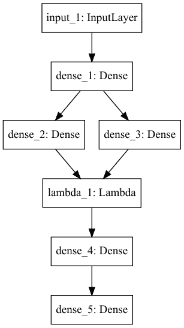

## 练习：对 `encoder` 和 `generator` 模型做同样的事情

## MNIST 上的 VAE

我们使用端到端模型训练模型，并使用自定义损失函数：重构项与 KL 散度正则化项之和。

```
from keras.objectives import binary_crossentropy

def vae_loss(x, x_decoded_mean):
    xent_loss = binary_crossentropy(x, x_decoded_mean)
    kl_loss = - 0.5 * K.mean(1 + z_log_sigma - K.square(z_mean) - K.exp(z_log_sigma), axis=-1)
    return xent_loss + kl_loss

vae.compile(optimizer='rmsprop', loss=vae_loss)
```

在 MNIST 数字上进行训练

```
from keras.datasets import mnist
import numpy as np

(x_train, y_train), (x_test, y_test) = mnist.load_data()

x_train = x_train.astype('float32') / 255.
x_test = x_test.astype('float32') / 255.
x_train = x_train.reshape((len(x_train), np.prod(x_train.shape[1:])))
x_test = x_test.reshape((len(x_test), np.prod(x_test.shape[1:])))

vae.fit(x_train, x_train,
        shuffle=True,
        epochs=epochs,
        batch_size=batch_size,
        validation_data=(x_test, x_test))
```


```
Train on 60000 samples, validate on 10000 samples
Epoch 1/50
60000/60000 [==============================] - 3s - loss: 0.2932 - val_loss: 0.2629
Epoch 2/50
60000/60000 [==============================] - 3s - loss: 0.2631 - val_loss: 0.2628
Epoch 3/50
60000/60000 [==============================] - 3s - loss: 0.2630 - val_loss: 0.2626
Epoch 4/50
60000/60000 [==============================] - 3s - loss: 0.2630 - val_loss: 0.2629
Epoch 5/50
60000/60000 [==============================] - 3s - loss: 0.2630 - val_loss: 0.2627
Epoch 6/50
60000/60000 [==============================] - 3s - loss: 0.2630 - val_loss: 0.2627
Epoch 7/50
60000/60000 [==============================] - 3s - loss: 0.2630 - val_loss: 0.2626
Epoch 8/50
60000/60000 [==============================] - 3s - loss: 0.2629 - val_loss: 0.2627
Epoch 9/50
60000/60000 [==============================] - 3s - loss: 0.2629 - val_loss: 0.2626
Epoch 10/50
60000/60000 [==============================] - 3s - loss: 0.2629 - val_loss: 0.2626
Epoch 11/50
60000/60000 [==============================] - 3s - loss: 0.2629 - val_loss: 0.2626
Epoch 12/50
60000/60000 [==============================] - 3s - loss: 0.2629 - val_loss: 0.2625
Epoch 13/50
60000/60000 [==============================] - 3s - loss: 0.2629 - val_loss: 0.2626
Epoch 14/50
60000/60000 [==============================] - 3s - loss: 0.2629 - val_loss: 0.2627
Epoch 15/50
60000/60000 [==============================] - 3s - loss: 0.2629 - val_loss: 0.2627
Epoch 16/50
60000/60000 [==============================] - 3s - loss: 0.2629 - val_loss: 0.2627
Epoch 17/50
60000/60000 [==============================] - 3s - loss: 0.2629 - val_loss: 0.2626
Epoch 18/50
60000/60000 [==============================] - 3s - loss: 0.2629 - val_loss: 0.2626
Epoch 19/50
60000/60000 [==============================] - 3s - loss: 0.2629 - val_loss: 0.2626
Epoch 20/50
60000/60000 [==============================] - 3s - loss: 0.2629 - val_loss: 0.2626
Epoch 21/50
60000/60000 [==============================] - 3s - loss: 0.2629 - val_loss: 0.2625
Epoch 22/50
60000/60000 [==============================] - 3s - loss: 0.2629 - val_loss: 0.2626
Epoch 23/50
60000/60000 [==============================] - 3s - loss: 0.2629 - val_loss: 0.2626
Epoch 24/50
60000/60000 [==============================] - 3s - loss: 0.2629 - val_loss: 0.2626
Epoch 25/50
60000/60000 [==============================] - 3s - loss: 0.2629 - val_loss: 0.2626
Epoch 26/50
60000/60000 [==============================] - 3s - loss: 0.2629 - val_loss: 0.2626
Epoch 27/50
60000/60000 [==============================] - 3s - loss: 0.2629 - val_loss: 0.2627
Epoch 28/50
60000/60000 [==============================] - 3s - loss: 0.2629 - val_loss: 0.2627
Epoch 29/50
60000/60000 [==============================] - 3s - loss: 0.2629 - val_loss: 0.2627
Epoch 30/50
60000/60000 [==============================] - 3s - loss: 0.2629 - val_loss: 0.2626
Epoch 31/50
60000/60000 [==============================] - 3s - loss: 0.2629 - val_loss: 0.2626
Epoch 32/50
60000/60000 [==============================] - 3s - loss: 0.2629 - val_loss: 0.2625
Epoch 33/50
60000/60000 [==============================] - 3s - loss: 0.2629 - val_loss: 0.2626
Epoch 34/50
60000/60000 [==============================] - 3s - loss: 0.2629 - val_loss: 0.2626
Epoch 35/50
60000/60000 [==============================] - 3s - loss: 0.2629 - val_loss: 0.2626
Epoch 36/50
60000/60000 [==============================] - 3s - loss: 0.2629 - val_loss: 0.2625
Epoch 37/50
60000/60000 [==============================] - 3s - loss: 0.2629 - val_loss: 0.2625
Epoch 38/50
60000/60000 [==============================] - 3s - loss: 0.2629 - val_loss: 0.2627
Epoch 39/50
60000/60000 [==============================] - 3s - loss: 0.2629 - val_loss: 0.2626
Epoch 40/50
60000/60000 [==============================] - 3s - loss: 0.2629 - val_loss: 0.2626
Epoch 41/50
60000/60000 [==============================] - 3s - loss: 0.2629 - val_loss: 0.2626
Epoch 42/50
60000/60000 [==============================] - 3s - loss: 0.2629 - val_loss: 0.2627
Epoch 43/50
60000/60000 [==============================] - 3s - loss: 0.2629 - val_loss: 0.2626
Epoch 44/50
60000/60000 [==============================] - 3s - loss: 0.2629 - val_loss: 0.2626
Epoch 45/50
60000/60000 [==============================] - 3s - loss: 0.2629 - val_loss: 0.2627
Epoch 46/50
60000/60000 [==============================] - 3s - loss: 0.2629 - val_loss: 0.2626
Epoch 47/50
60000/60000 [==============================] - 3s - loss: 0.2629 - val_loss: 0.2626
Epoch 48/50
60000/60000 [==============================] - 3s - loss: 0.2629 - val_loss: 0.2627
Epoch 49/50
60000/60000 [==============================] - 3s - loss: 0.2629 - val_loss: 0.2625
Epoch 50/50
60000/60000 [==============================] - 3s - loss: 0.2629 - val_loss: 0.2626
```

<`keras.callbacks.History` at 0x7fb62fc26d30>

由于我们的潜在空间是二维的，此时可以进行一些很酷的可视化。

一种方法是查看潜在 2D 平面上不同类别的邻域：

```
x_test_encoded = encoder.predict(x_test, batch_size=batch_size)
```

```
plt.figure(figsize=(6, 6))
plt.scatter(x_test_encoded[:, 0], x_test_encoded[:, 1], c=y_test)
plt.colorbar()
plt.show()
```


这些彩色簇中的每一个都是一种数字。相近的簇是结构相似的数字（即在潜在空间中共享信息的数字）。

由于 VAE 是生成模型，我们也可以用它来生成新的数字！这里我们将扫描潜在平面，以固定间隔采样潜在点，并为这些点中的每一个生成相应的数字。这为我们提供了一个“生成”MNIST 数字的潜在流形可视化。

```
## display a 2D manifold of the digits
n = 15  # figure with 15x15 digits
digit_size = 28
figure = np.zeros((digit_size * n, digit_size * n))
## we will sample n points within [-15, 15] standard deviations
grid_x = np.linspace(-15, 15, n)
grid_y = np.linspace(-15, 15, n)

for i, yi in enumerate(grid_x):
    for j, xi in enumerate(grid_y):
        z_sample = np.array([[xi, yi]]) * epsilon_std
        x_decoded = generator.predict(z_sample)
        digit = x_decoded[0].reshape(digit_size, digit_size)
        figure[i * digit_size: (i + 1) * digit_size,
               j * digit_size: (j + 1) * digit_size] = digit

plt.figure(figsize=(10, 10))
plt.imshow(figure)
plt.show()
```


## 6.2 NLP and Deep Learning

## 使用人工神经网络进行自然语言处理

> “在上帝我们信赖。其他人必须带来数据。” – W. 爱德华·戴明，统计学家

## 词嵌入

## 什么？

将单词转换为高维空间中的向量。每个维度表示一个方面，如性别、对象/单词类型。

“词嵌入”是一类自然语言处理技术，旨在将语义含义映射到几何空间。这是通过为字典中的每个单词关联一个数值向量来实现的，这样任何两个向量之间的距离（例如 L2 距离或更常见的余弦距离）都能捕捉两个相关单词之间部分的语义关系。这些向量形成的几何空间称为嵌入空间。

## 为什么？

通过将单词转换为向量，我们在单词之间建立关系。单词在某个维度上越相似，它们的得分就越接近。

## 示例

*`W(green) = (1.2, 0.98, 0.05, ...)`*

*`W(red) = (1.1, 0.2, 0.5, ...)`*

这里 `green` 和 `red` 的向量值在一个维度上非常相似，因为它们都是颜色。第二个维度的值非常不同，因为红色在训练数据中可能描述某种负面事物，而绿色用于表示积极意义。

通过向量化，我们正在间接构建单词之间不同种类的关系。

## 使用 gensim 的 `word2vec` 示例


## 从数据目录读取博客文章

```python
import os
import pickle
```

```python
DATA_DIRECTORY = os.path.join(os.path.abspath(os.path.curdir), '..', 
                              'data', 'word_embeddings')
```

```python
male_posts = []
female_post = []
```

```python
with open(os.path.join(DATA_DIRECTORY,"male_blog_list.txt"),"rb") as male_file:
    male_posts= pickle.load(male_file)

with open(os.path.join(DATA_DIRECTORY,"female_blog_list.txt"),"rb") as female_file:
    female_posts = pickle.load(female_file)
```

```python
print(len(female_posts))
print(len(male_posts))
```

```
2252
2611
```

```python
filtered_male_posts = list(filter(lambda p: len(p) > 0, male_posts))
filtered_female_posts = list(filter(lambda p: len(p) > 0, female_posts))
posts = filtered_female_posts + filtered_male_posts
```

```python
print(len(filtered_female_posts), len(filtered_male_posts), len(posts))
```

```
2247 2595 4842
```

## Word2Vec

```python
from gensim.models import word2vec
from gensim.models.word2vec import Word2Vec

w2v = Word2Vec(size=200, min_count=1)
w2v.build_vocab(map(lambda x: x.split(), posts[:100]), )
```

```python
w2v.vocab
```

```
Using gpu device 0: GeForce GTX 760 (CNMeM is enabled with initial size: 90.0% of memory, cuDNN 4007)
```


## Gensim Word2Vec Vocabulary 输出示例

以下是 `gensim.models.word2vec.Vocab` 对象的字典输出示例，包含大量单词及其对象引用：

```
{'see.': <gensim.models.word2vec.Vocab at 0x7f61aa4f1908>,
 'never.': <gensim.models.word2vec.Vocab at 0x7f61aa4f1dd8>,
 'driving': <gensim.models.word2vec.Vocab at 0x7f61aa4f1e48>,
 'buddy': <gensim.models.word2vec.Vocab at 0x7f61aa4f0240>,
 'DEFENSE': <gensim.models.word2vec.Vocab at 0x7f61aa4f0438>,
 'interval': <gensim.models.word2vec.Vocab at 0x7f61aa4f04e0>,
 'Right': <gensim.models.word2vec.Vocab at 0x7f61aa4f06a0>,
 'minds,': <gensim.models.word2vec.Vocab at 0x7f61aa4f06d8>,
 'earth.': <gensim.models.word2vec.Vocab at 0x7f61aa4f0710>,
 'pleasure': <gensim.models.word2vec.Vocab at 0x7f61aa4f08d0>,
 'school,': <gensim.models.word2vec.Vocab at 0x7f61aa4f0cc0>,
 'someone': <gensim.models.word2vec.Vocab at 0x7f61aa4f0ef0>,
 'dangit...': <gensim.models.word2vec.Vocab at 0x7f61aa4f23c8>,
 'one!': <gensim.models.word2vec.Vocab at 0x7f61aa4f2c88>,
 'hard.': <gensim.models.word2vec.Vocab at 0x7f61aa4e25c0>,
 'programs,': <gensim.models.word2vec.Vocab at 0x7f61aa4e27b8>,
 'SEEEENNNIIIOOORS!!!': <gensim.models.word2vec.Vocab at 0x7f61aa4e27f0>,
 'two)': <gensim.models.word2vec.Vocab at 0x7f61aa4e2828>,
 "o'": <gensim.models.word2vec.Vocab at 0x7f61aa4e28d0>,
 '--': <gensim.models.word2vec.Vocab at 0x7f61aa4e2a58>,
 'this-actually': <gensim.models.word2vec.Vocab at 0x7f61aa4e2b70>,
 'swimming.': <gensim.models.word2vec.Vocab at 0x7f61aa4e2c50>,
 'people.': <gensim.models.word2vec.Vocab at 0x7f61aa4e2cc0>,
 'turn': <gensim.models.word2vec.Vocab at 0x7f61aa4e2e48>,
 'happened': <gensim.models.word2vec.Vocab at 0x7f61aa4e2fd0>,
 'clothing:': <gensim.models.word2vec.Vocab at 0x7f61aa4e22e8>,
 'it!': <gensim.models.word2vec.Vocab at 0x7f61aa4e2048>,
 'church': <gensim.models.word2vec.Vocab at 0x7f61aa4e21d0>,
 'boring.': <gensim.models.word2vec.Vocab at 0x7f61aa4e2240>,
 'freaky': <gensim.models.word2vec.Vocab at 0x7f61aa4ea278>,
 'Democrats,': <gensim.models.word2vec.Vocab at 0x7f61aa4ea320>,
 '*kick': <gensim.models.word2vec.Vocab at 0x7f61aa4ea358>,
 '"It': <gensim.models.word2vec.Vocab at 0x7f61aa4ea550>,
 'wet': <gensim.models.word2vec.Vocab at 0x7f61aa4ea6d8>,
 'snooze': <gensim.models.word2vec.Vocab at 0x7f61aa4ea7b8>,
 'points': <gensim.models.word2vec.Vocab at 0x7f61aa4ea978>,
 'Sen.': <gensim.models.word2vec.Vocab at 0x7f61aa4ea9b0>,
 'although': <gensim.models.word2vec.Vocab at 0x7f61aa4eaac8>,
 'Charlotte': <gensim.models.word2vec.Vocab at 0x7f61aa4eab00>,
 'lil...but': <gensim.models.word2vec.Vocab at 0x7f61aa4eab38>,
 'oneo': <gensim.models.word2vec.Vocab at 0x7f61aa4eac50>,
 'course;': <gensim.models.word2vec.Vocab at 0x7f61aa4eada0>,
 'Bring': <gensim.models.word2vec.Vocab at 0x7f61aa4eadd8>,
 '(compared': <gensim.models.word2vec.Vocab at 0x7f61aa4eae48>,
 'ugh.': <gensim.models.word2vec.Vocab at 0x7f61aa4eaef0>,
 'sit': <gensim.models.word2vec.Vocab at 0x7f61aa553a20>,
 'dipped?': <gensim.models.word2vec.Vocab at 0x7f61aa4eafd0>,
 'based': <gensim.models.word2vec.Vocab at 0x7f61aa4ec978>,
 'A.I.': <gensim.models.word2vec.Vocab at 0x7f61aa4ec080>,
 'breathing.': <gensim.models.word2vec.Vocab at 0x7f61aa4ec128>,
 'multi-millionaire': <gensim.models.word2vec.Vocab at 0x7f61aa4ec208>,
 'groups': <gensim.models.word2vec.Vocab at 0x7f61aa4ec278>,
 'on': <gensim.models.word2vec.Vocab at 0x7f61aa4ec2b0>,
 'animals),': <gensim.models.word2vec.Vocab at 0x7f61aa4d8630>,
 'Manners?': <gensim.models.word2vec.Vocab at 0x7f61aa4ec320>,
 'you?]:': <gensim.models.word2vec.Vocab at 0x7f61aa445f60>,
 'redistribute': <gensim.models.word2vec.Vocab at 0x7f61aa4dbba8>,
 'omg.': <gensim.models.word2vec.Vocab at 0x7f61aa4ec470>,
 'dance?:': <gensim.models.word2vec.Vocab at 0x7f61aa4ec4a8>,
 'Canada)': <gensim.models.word2vec.Vocab at 0x7f61aa553b00>,
 'came': <gensim.models.word2vec.Vocab at 0x7f61aa4ec550>,
 'poof': <gensim.models.word2vec.Vocab at 0x7f61aa4ec588>,
 'brownies.': <gensim.models.word2vec.Vocab at 0x7f61aa4ec630>,
 'Not': <gensim.models.word2vec.Vocab at 0x7f61aa4ec710>,
 'spaces': <gensim.models.word2vec.Vocab at 0x7f61aa4ec780>,
 'destroy': <gensim.models.word2vec.Vocab at 0x7f61aa4ec860>,
 'maybe.': <gensim.models.word2vec.Vocab at 0x7f61aa4ec898>,
 'Industrial': <gensim.models.word2vec.Vocab at 0x7f61aa4ec9e8>,
 'boring': <gensim.models.word2vec.Vocab at 0x7f61aa4ecb00>,
 'is:': <gensim.models.word2vec.Vocab at 0x7f61aa4ecd30>,
 'question.': <gensim.models.word2vec.Vocab at 0x7f61aa4ecd68>,
 'long-lasting': <gensim.models.word2vec.Vocab at 0x7f61aa4ecda0>,
 'sun': <gensim.models.word2vec.Vocab at 0x7f61aa5dc1d0>,
 'CrAp*': <gensim.models.word2vec.Vocab at 0x7f61aa4ed080>,
 'irresistable': <gensim.models.word2vec.Vocab at 0x7f61aa4ed0f0>,
 'dont...i': <gensim.models.word2vec.Vocab at 0x7f61aa4ed128>,
 'loss.': <gensim.models.word2vec.Vocab at 0x7f61aa4ed160>,
 'easy': <gensim.models.word2vec.Vocab at 0x7f61aa4ed2b0>,
 'wanna': <gensim.models.word2vec.Vocab at 0x7f61aa4635c0>,
 'Gaviota': <gensim.models.word2vec.Vocab at 0x7f61aa4ed4a8>,
 'nose': <gensim.models.word2vec.Vocab at 0x7f61aa4ed518>,
 'slept': <gensim.models.word2vec.Vocab at 0x7f61aa4ed5c0>,
 'hahahahah': <gensim.models.word2vec.Vocab at 0x7f61aa4ed5f8>,
 'halloween': <gensim.models.word2vec.Vocab at 0x7f61aa4ed630>,
 'shes': <gensim.models.word2vec.Vocab at 0x7f61aa553c50>,
 'realize': <gensim.models.word2vec.Vocab at 0x7f61aa4ed860>,
 'twice': <gensim.models.word2vec.Vocab at 0x7f61aa4ed908>,
 'lift': <gensim.models.word2vec.Vocab at 0x7f61aa4eda90>,
 'china,': <gensim.models.word2vec.Vocab at 0x7f61aa4edc88>,
 'Standard.)': <gensim.models.word2vec.Vocab at 0x7f61aa4edcc0>,
 'worried': <gensim.models.word2vec.Vocab at 0x7f61aa4edda0>,
 'Opposite': <gensim.models.word2vec.Vocab at 0x7f61aa4eddd8>,
 'chin.': <gensim.models.word2vec.Vocab at 0x7f61aa4edef0>,
 'Garden': <gensim.models.word2vec.Vocab at 0x7f61aa4ebcc0>,
 'guy': <gensim.models.word2vec.Vocab at 0x7f61aa4ebd68>,
 'remmeber': <gensim.models.word2vec.Vocab at 0x7f61aa4ebef0>,
 'fence,': <gensim.models.word2vec.Vocab at 0x7f61aa4eb128>,
 'apologizing': <gensim.models.word2vec.Vocab at 0x7f61aa4eb160>,
 'next.': <gensim.models.word2vec.Vocab at 0x7f61aa4eb2b0>,
 'MATTERS': <gensim.models.word2vec.Vocab at 0x7f61aa4eb2e8>,
 'rugs': <gensim.models.word2vec.Vocab at 0x7f61aa4eb320>,
 'her...': <gensim.models.word2vec.Vocab at 0x7f61aa4eb438>,
 'energy,': <gensim.models.word2vec.Vocab at 0x7f61aa4eb4a8>,
 'recorded,': <gensim.models.word2vec.Vocab at 0x7f61aa4eb588>,
 'pepsi.': <gensim.models.word2vec.Vocab at 0x7f61aa4eb710>,
 'r': <gensim.models.word2vec.Vocab at 0x7f61aa4eb860>,
 '13': <gensim.models.word2vec.Vocab at 0x7f61aa4eb898>,
 'at:': <gensim.models.word2vec.Vocab at 0x7f61aa5dc390>,
 'cheaper': <gensim.models.word2vec.Vocab at 0x7f61aa4ee9b0>,
 'children!': <gensim.models.word2vec.Vocab at 0x7f61aa5b6c88>,
 'tree': <gensim.models.word2vec.Vocab at 0x7f61aa4eecc0>,
 'met': <gensim.models.word2vec.Vocab at 0x7f61aa4eecf8>,
 'one,': <gensim.models.word2vec.Vocab at 0x7f61aa4eeda0>,
 'rejected?': <gensim.models.word2vec.Vocab at 0x7f61aa4eee48>,
 'Marianne’s': <gensim.models.word2vec.Vocab at 0x7f61aa4eee80>,
 'Icenhower': <gensim.models.word2vec.Vocab at 0x7f61aa4ee978>,
 'day!': <gensim.models.word2vec.Vocab at 0x7f61aa4ee1d0>,
 'leaving': <gensim.models.word2vec.Vocab at 0x7f61aa4ee240>,
 '2110': <gensim.models.word2vec.Vocab at 0x7f61aa4ee2b0>,
 'kiss:': <gensim.models.word2vec.Vocab at 0x7f61aa4ee748>,
 'nearest': <gensim.models.word2vec.Vocab at 0x7f61aa4ee780>,
 'aimlessly': <gensim.models.word2vec.Vocab at 0x7f61aa4ee7b8>,
 'sprint': <gensim.models.word2vec.Vocab at 0x7f61aa4ee898>,
 'kids!)': <gensim.models.word2vec.Vocab at 0x7f61aa536048>,
 'canteen': <gensim.models.word2vec.Vocab at 0x7f61aa5360f0>,
 'weekend!': <gensim.models.word2vec.Vocab at 0x7f61aa536160>,
 'him': <gensim.models.word2vec.Vocab at 0x7f61aa536198>,
 'scariest': <gensim.models.word2vec.Vocab at 0x7f61aa5361d0>,
 'this?': <gensim.models.word2vec.Vocab at 0x7f61aa536208>,
 '"choosing': <gensim.models.word2vec.Vocab at 0x7f61aa536240>,
 'Talk': <gensim.models.word2vec.Vocab at 0x7f61aa5362b0>,
 'weeks': <gensim.models.word2vec.Vocab at 0x7f61aa5362e8>,
 "You'll": <gensim.models.word2vec.Vocab at 0x7f61aa536390>,
 'goodnight': <gensim.models.word2vec.Vocab at 0x7f61aa5363c8>,
 'skiing.': <gensim.models.word2vec.Vocab at 0x7f61aa536438>,
 'KeEp': <gensim.models.word2vec.Vocab at 0x7f61aa5535f8>,
 'week': <gensim.models.word2vec.Vocab at 0x7f61aa536550>,
 'norwegian': <gensim.models.word2vec.Vocab at 0x7f61aa5366a0>,
 'HAND:': <gensim.models.word2vec.Vocab at 0x7f61aa553780>,
 'fact,': <gensim.models.word2vec.Vocab at 0x7f61aa5367f0>,
 'thanksgiving': <gensim.models.word2vec.Vocab at 0x7f61aa536828>,
 'me..argh...': <gensim.models.word2vec.Vocab at 0x7f61aa536860>,
 'she': <gensim.models.word2vec.Vocab at 0x7f61aa536898>,
 'Tree': <gensim.models.word2vec.Vocab at 0x7f61aa536908>,
 'combat.': <gensim.models.word2vec.Vocab at 0x7f61aa536940>,
 'mitosis': <gensim.models.word2vec.Vocab at 0x7f61aa536978>,
 'offered': <gensim.models.word2vec.Vocab at 0x7f61aa5369e8>,
 'no..': <gensim.models.word2vec.Vocab at 0x7f61aa536a20>,
 '(there': <gensim.models.word2vec.Vocab at 0x7f61aa536a58>,
 'aspirations': <gensim.models.word2vec.Vocab at 0x7f61aa536a90>,
 'page': <gensim.models.word2vec.Vocab at 0x7f61aa536ac8>,
 'Least': <gensim.models.word2vec.Vocab at 0x7f61aa536b38>,
 'each': <gensim.models.word2vec.Vocab at 0x7f61aa536b70>,
 'ride...': <gensim.models.word2vec.Vocab at 0x7f61aa536ba8>,
 'doesn’t': <gensim.models.word2vec.Vocab at 0x7f61aa536c18>,
 'FUCK': <gensim.models.word2vec.Vocab at 0x7f61aa536c50>,
 'gona': <gensim.models.word2vec.Vocab at 0x7f61aa536dd8>,
 'window': <gensim.models.word2vec.Vocab at 0x7f61aa536e10>,
 'end': <gensim.models.word2vec.Vocab at 0x7f61aa536e48>,
 'expected': <gensim.models.word2vec.Vocab at 0x7f61aa536eb8>,
 'well.': <gensim.models.word2vec.Vocab at 0x7f61aa536ef0>,
 'called': <gensim.models.word2vec.Vocab at 0x7f61aa460748>,
 "needn't": <gensim.models.word2vec.Vocab at 0x7f61aa536f28>,
 'doesnt': <gensim.models.word2vec.Vocab at 0x7f61aa536f60>,
 'venturing': <gensim.models.word2vec.Vocab at 0x7f61aa440a90>,
 'alex': <gensim.models.word2vec.Vocab at 0x7f61aa536fd0>,
 'here:': <gensim.models.word2vec.Vocab at 0x7f61aa53b048>,
 'ewWw': <gensim.models.word2vec.Vocab at 0x7f61aa53b0b8>,
 'pole?': <gensim.models.word2vec.Vocab at 0x7f61aa53b0f0>,
 'melody,': <gensim.models.word2vec.Vocab at 0x7f61aa5b6eb8>,
 'motivated': <gensim.models.word2vec.Vocab at 0x7f61aa53b128>,
 'Well,': <gensim.models.word2vec.Vocab at 0x7f61aa53b160>,
 'says:': <gensim.models.word2vec.Vocab at 0x7f61aa53b198>,
 'worm': <gensim.models.word2vec.Vocab at 0x7f61aa53b1d0>,
 '[some': <gensim.models.word2vec.Vocab at 0x7f61aa553f98>,
 'name': <gensim.models.word2vec.Vocab at 0x7f61aa53b320>,
 'Leave"': <gensim.models.word2vec.Vocab at 0x7f61aa53b358>,
 '4th': <gensim.models.word2vec.Vocab at 0x7f61aa404ba8>,
 "It's...": <gensim.models.word2vec.Vocab at 0x7f61aa53b390>,
 'problem??': <gensim.models.word2vec.Vocab at 0x7f61aa553fd0>,
 'remember': <gensim.models.word2vec.Vocab at 0x7f61aa53b470>,
 'o': <gensim.models.word2vec.Vocab at 0x7f61aa4e32b0>,
 'letters.': <gensim.models.word2vec.Vocab at 0x7f61aa53b4a8>,
 'jean': <gensim.models.word2vec.Vocab at 0x7f61aa53b4e0>,
 'thing.': <gensim.models.word2vec.Vocab at 0x7f61aa53b518>,
 'friend?]:': <gensim.models.word2vec.Vocab at 0x7f61aa53b588>,
 'am!': <gensim.models.word2vec.Vocab at 0x7f61aa53b5c0>,
 'side...': <gensim.models.word2vec.Vocab at 0x7f61aa53b6a0>,
 'Yet': <gensim.models.word2vec.Vocab at 0x7f61aa53b6d8>,
 'easier': <gensim.models.word2vec.Vocab at 0x7f61aa53b828>,
 'babies': <gensim.models.word2vec.Vocab at 0x7f61aa53b860>,
 'You?': <gensim.models.word2vec.Vocab at 0x7f61aa53b898>,
 'wedding:': <gensim.models.word2vec.Vocab at 0x7f61aa53b8d0>,
 '2.)': <gensim.models.word2vec.Vocab at 0x7f61aa53b908>,
 'first...then': <gensim.models.word2vec.Vocab at 0x7f61aa53b940>,
 'LA:': <gensim.models.word2vec.Vocab at 0x7f61aa53b978>,
 'but,)': <gensim.models.word2vec.Vocab at 0x7f61aa53b9b0>,
 'not,': <gensim.models.word2vec.Vocab at 0x7f61aa53ba20>,
 'possession': <gensim.models.word2vec.Vocab at 0x7f61aa53ba58>,
 'its': <gensim.models.word2vec.Vocab at 0x7f61aa53ba90>,
 'stop': <gensim.models.word2vec.Vocab at 0x7f61aa53bac8>,
 'Thanks': <gensim.models.word2vec.Vocab at 0x7f61aa53bb00>,
 'durin': <gensim.models.word2vec.Vocab at 0x7f61aa53bb38>,
 'rings': <gensim.models.word2vec.Vocab at 0x7f61aa53bb70>,
 'Specifics': <gensim.models.word2vec.Vocab at 0x7f61aa53bba8>,
 'http://www.kingsofchaos.com/recruit.php?uniqid=jm8bja2z': <gensim.models.word2vec.Vocab at 0x7f61aa53bbe0>,
 'lace': <gensim.models.word2vec.Vocab at 0x7f61aa53bc18>,
 'pretended': <gensim.models.word2vec.Vocab at 0x7f61aa53bc50>,
 'clothes': <gensim.models.word2vec.Vocab at 0x7f61aa53bd30>,
 'wong': <gensim.models.word2vec.Vocab at 0x7f61aa53bd68>,
 '38': <gensim.models.word2vec.Vocab at 0x7f61aa5ce390>,
 'country.': <gensim.models.word2vec.Vocab at 0x7f61aa53bda0>,
 'criticism': <gensim.models.word2vec.Vocab at 0x7f61aa53bdd8>,
 'NATIONAL': <gensim.models.word2vec.Vocab at 0x7f61aa53be48>,
 "that's": <gensim.models.word2vec.Vocab at 0x7f61aa53beb8>,
 'conclusively': <gensim.models.word2vec.Vocab at 0x7f61aa53bef0>,
 'cartoons,': <gensim.models.word2vec.Vocab at 0x7f61aa53bf28>,
 'chest/lungs': <gensim.models.word2vec.Vocab at 0x7f61aa53bf60>,
 'whilst': <gensim.models.word2vec.Vocab at 0x7f61aa5dc7b8>,
 "I'm,": <gensim.models.word2vec.Vocab at 0x7f61aa3feb38>,
 'Tata.': <gensim.models.word2vec.Vocab at 0x7f61aa53bfd0>,
 'mix': <gensim.models.word2vec.Vocab at 0x7f61aa533160>,
 'popularity': <gensim.models.word2vec.Vocab at 0x7f61aa533390>,
 'park)': <gensim.models.word2vec.Vocab at 0x7f61aa5333c8>,
 '(trampled': <gensim.models.word2vec.Vocab at 0x7f61aa5336a0>,
 'reminded': <gensim.models.word2vec.Vocab at 0x7f61aa5339b0>,
 'says.': <gensim.models.word2vec.Vocab at 0x7f61aa533a58>,
 'repetition,': <gensim.models.word2vec.Vocab at 0x7f61aa533ac8>,
 'Size?': <gensim.models.word2vec.Vocab at 0x7f61aa533c18>,
 "hm...i'm": <gensim.models.word2vec.Vocab at 0x7f61aa533e10>,
 'interesting,': <gensim.models.word2vec.Vocab at 0x7f61aa560160>,
 'exams': <gensim.models.word2vec.Vocab at 0x7f61aa533f28>,
 'crusts.': <gensim.models.word2vec.Vocab at 0x7f61aa533f60>,
 'filling': <gensim.models.word2vec.Vocab at 0x7f61aa533fd0>,
 'gets': <gensim.models.word2vec.Vocab at 0x7f61aa4e51d0>,
 'his': <gensim.models.word2vec.Vocab at 0x7f61aa4e5208>,
 'Friday,': <gensim.models.word2vec.Vocab at 0x7f61aa4e5240>,
 'f': <gensim.models.word2vec.Vocab at 0x7f61aa4e5278>,
 'too!': <gensim.models.word2vec.Vocab at 0x7f61aa4e52e8>,
 'Made': <gensim.models.word2vec.Vocab at 0x7f61aa4e5400>,
 'accidentally': <gensim.models.word2vec.Vocab at 0x7f61aa4e5438>,
 '"New': <gensim.models.word2vec.Vocab at 0x7f61aa4e5470>,
 'COURSE.': <gensim.models.word2vec.Vocab at 0x7f61aa4e54a8>,
 '[please': <gensim.models.word2vec.Vocab at 0x7f61aa572240>,
 'this...': <gensim.models.word2vec.Vocab at 0x7f61aa4e5630>,
 'soon': <gensim.models.word2vec.Vocab at 0x7f61aa4e5710>,
 'worry': <gensim.models.word2vec.Vocab at 0x7f61aa4e57b8>,
 'Job]:': <gensim.models.word2vec.Vocab at 0x7f61aa4e58d0>,
 'deal': <gensim.models.word2vec.Vocab at 0x7f61aa4e59b0>,
 'pounding': <gensim.models.word2vec.Vocab at 0x7f61aa4e59e8>,
 '[Are': <gensim.models.word2vec.Vocab at 0x7f61aa4e5a90>,
 'begin': <gensim.models.word2vec.Vocab at 0x7f61aa4e5b00>,
 'isolated': <gensim.models.word2vec.Vocab at 0x7f61aa4e5c18>,
 'anyways': <gensim.models.word2vec.Vocab at 0x7f61aa4e5c50>,
 'garbage': <gensim.models.word2vec.Vocab at 0x7f61aa4e5c88>,
 'awww': <gensim.models.word2vec.Vocab at 0x7f61aa4e5cf8>,
 'intelligence': <gensim.models.word2vec.Vocab at 0x7f61aa4e5d68>,
 'being': <gensim.models.word2vec.Vocab at 0x7f61aa4e5e48>,
 'married?]:': <gensim.models.word2vec.Vocab at 0x7f61aa4e5eb8>,
 'omg': <gensim.models.word2vec.Vocab at 0x7f61aa440dd8>,
 '...': <gensim.models.word2vec.Vocab at 0x7f61aa4e5f28>,
 'highlight': <gensim.models.word2vec.Vocab at 0x7f61aa4e5fd0>,
 'to': <gensim.models.word2vec.Vocab at 0x7f61aa4e8978>,
 'AHH': <gensim.models.word2vec.Vocab at 0x7f61aa4e8b38>,
 'OVER!!!!!!!!!': <gensim.models.word2vec.Vocab at 0x7f61aa4e8b70>,
 'Cried': <gensim.models.word2vec.Vocab at 0x7f61aa4e8c18>,
 'SAYING?!?!?': <gensim.models.word2vec.Vocab at 0x7f61aa4e8c50>,
 'olivia.': <gensim.models.word2vec.Vocab at 0x7f61aa4e8da0>,
 "she'll": <gensim.models.word2vec.Vocab at 0x7f61aa4e8f60>,
 'community,': <gensim.models.word2vec.Vocab at 0x7f61aa4e8f98>,
 'cold.': <gensim.models.word2vec.Vocab at 0x7f61aa5dc978>,
 'not': <gensim.models.word2vec.Vocab at 0x7f61aa4e8898>,
 'transcripts': <gensim.models.word2vec.Vocab at 0x7f61aa4e8160>,
 'promises...i': <gensim.models.word2vec.Vocab at 0x7f61aa5c7ba8>,
 'totem': <gensim.models.word2vec.Vocab at 0x7f61aa4e82e8>,
 'naked,': <gensim.models.word2vec.Vocab at 0x7f61aa554320>,
 'hate': <gensim.models.word2vec.Vocab at 0x7f61aa4e8358>,
 'gas': <gensim.models.word2vec.Vocab at 0x7f61aa4e85c0>,
 'beat': <gensim.models.word2vec.Vocab at 0x7f61aa4e85f8>,
 'Jungle': <gensim.models.word2vec.Vocab at 0x7f61aa4e8748>,
 'band': <gensim.models.word2vec.Vocab at 0x7f61aa5697b8>,
 'ought': <gensim.models.word2vec.Vocab at 0x7f61aa4e8828>,
 'ishouldnt': <gensim.models.word2vec.Vocab at 0x7f61aa4e7128>,
 'funni': <gensim.models.word2vec.Vocab at 0x7f61aa4e7208>,
 'camera': <gensim.models.word2vec.Vocab at 0x7f61aa4e7278>,
 "Mom's": <gensim.models.word2vec.Vocab at 0x7f61aa4e7400>,
 'invitations': <gensim.models.word2vec.Vocab at 0x7f61aa4e7438>,
 'sheets,': <gensim.models.word2vec.Vocab at 0x7f61aa4e7470>,
 'sony': <gensim.models.word2vec.Vocab at 0x7f61aa4e74a8>,
 'Could': <gensim.models.word2vec.Vocab at 0x7f61aa4e7588>,
 '"goodness"': <gensim.models.word2vec.Vocab at 0x7f61aa4e75c0>,
 'commentators': <gensim.models.word2vec.Vocab at 0x7f61aa4e7668>,
 'learned': <gensim.models.word2vec.Vocab at 0x7f61aa4e7710>,
 'quit': <gensim.models.word2vec.Vocab at 0x7f61aa4e7748>,
 "mother's": <gensim.models.word2vec.Vocab at 0x7f61aa5dc9e8>,
 'Hussein,': <gensim.models.word2vec.Vocab at 0x7f61aa5b9320>,
 'Funny,': <gensim.models.word2vec.Vocab at 0x7f61aa4e7860>,
 'Actually': <gensim.models.word2vec.Vocab at 0x7f61aa4e7898>,
 'upsetting.': <gensim.models.word2vec.Vocab at 0x7f61aa4e7a90>,
 'ring!)': <gensim.models.word2vec.Vocab at 0x7f61aa4e7b00>,
 'material': <gensim.models.word2vec.Vocab at 0x7f61aa4e7b38>,
 '…': <gensim.models.word2vec.Vocab at 0x7f61aa4e7be0>,
 'kind': <gensim.models.word2vec.Vocab at 0x7f61aa4e7c18>,
 'Moon"': <gensim.models.word2vec.Vocab at 0x7f61aa4e7cc0>,
 'james,': <gensim.models.word2vec.Vocab at 0x7f61aa4e7d30>,
 'regardless': <gensim.models.word2vec.Vocab at 0x7f61aa4e7d68>,
 'WATCHED': <gensim.models.word2vec.Vocab at 0x7f61aa4e7da0>,
 'possibly': <gensim.models.word2vec.Vocab at 0x7f61aa5bbe10>,
 'Make': <gensim.models.word2vec.Vocab at 0x7f61aa4e7ef0>,
 'airplanes,': <gensim.models.word2vec.Vocab at 0x7f61aa463f60>,
 'Exaggerated,': <gensim.models.word2vec.Vocab at 0x7f61aa4e7f98>,
 'head,': <gensim.models.word2vec.Vocab at 0x7f61aa4e7fd0>,
 'graceful': <gensim.models.word2vec.Vocab at 0x7f61aa4d9128>,
 'but': <gensim.models.word2vec.Vocab at 0x7f61aa4d9550>,
 'low': <gensim.models.word2vec.Vocab at 0x7f61aa4d95f8>,
 'it!!!': <gensim.models.word2vec.Vocab at 0x7f61aa4d9710>,
 'usual)': <gensim.models.word2vec.Vocab at 0x7f61aa4d97f0>,
 'doing?:': <gensim.models.word2vec.Vocab at 0x7f61aa4d9908>,
 "wat's": <gensim.models.word2vec.Vocab at 0x7f61aa4d99b0>,
 'disadvantages': <gensim.models.word2vec.Vocab at 0x7f61aa5dcb00>,
 'breaks': <gensim.models.word2vec.Vocab at 0x7f61aa4d9cf8>,
 'partner,': <gensim.models.word2vec.Vocab at 0x7f61aa4d8048>,
 'totally': <gensim.models.word2vec.Vocab at 0x7f61aa4d80f0>,
 'break?!': <gensim.models.word2vec.Vocab at 0x7f61aa4d81d0>,
 'remember,': <gensim.models.word2vec.Vocab at 0x7f61aa3fedd8>,
 'nose.': <gensim.models.word2vec.Vocab at 0x7f61aa4d82b0>,
 '...gets': <gensim.models.word2vec.Vocab at 0x7f61aa4d82e8>,
 'circles': <gensim.models.word2vec.Vocab at 0x7f61aa4d8320>,
 'list?': <gensim.models.word2vec.Vocab at 0x7f61aa4d84a8>,
 'babble.': <gensim.models.word2vec.Vocab at 0x7f61aa4ec2e8>,
 'Those': <gensim.models.word2vec.Vocab at 0x7f61aa5c19b0>,
 'hers,': <gensim.models.word2vec.Vocab at 0x7f61aa554518>,
 'Kucinich).': <gensim.models.word2vec.Vocab at 0x7f61aa4d8a90>,
 'toxic,': <gensim.models.word2vec.Vocab at 0x7f61aa4d8ac8>,
 'mates.': <gensim.models.word2vec.Vocab at 0x7f61aa4d8be0>,
 'rock!': <gensim.models.word2vec.Vocab at 0x7f61aa4d8d68>,
 'birthday': <gensim.models.word2vec.Vocab at 0x7f61aa4d8e48>,
 'okay-': <gensim.models.word2vec.Vocab at 0x7f61aa4d8ef0>,
 'Twenty-six': <gensim.models.word2vec.Vocab at 0x7f61aa4d8f60>,
 'Molly': <gensim.models.word2vec.Vocab at 0x7f61aa4d8f98>,
 'everyone.i': <gensim.models.word2vec.Vocab at 0x7f61aa4d8fd0>,
 'brought': <gensim.models.word2vec.Vocab at 0x7f61aa4db320>,
 'rusty.': <gensim.models.word2vec.Vocab at 0x7f61aa4db358>,
 "Let's": <gensim.models.word2vec.Vocab at 0x7f61aa4db390>,
 'soon?': <gensim.models.word2vec.Vocab at 0x7f61aa4db400>,
 '19.': <gensim.models.word2vec.Vocab at 0x7f61aa4db4e0>,
 'shuffle': <gensim.models.word2vec.Vocab at 0x7f61aa4db8d0>,
 "you're": <gensim.models.word2vec.Vocab at 0x7f61aa4dbac8>,
 'somehow?': <gensim.models.word2vec.Vocab at 0x7f61aa4ec400>,
 'naked?]:': <gensim.models.word2vec.Vocab at 0x7f61aa5d4c18>,
 '...i': <gensim.models.word2vec.Vocab at 0x7f61aa4dbd68>,
 'friend': <gensim.models.word2vec.Vocab at 0x7f61aa4da048>,
 'away;': <gensim.models.word2vec.Vocab at 0x7f61aa4da320>,
 'tending': <gensim.models.word2vec.Vocab at 0x7f61aa4da358>,
 'creates': <gensim.models.word2vec.Vocab at 0x7f61aa4da5f8>,
 'certitude,': <gensim.models.word2vec.Vocab at 0x7f61aa4da668>,
 'job...some': <gensim.models.word2vec.Vocab at 0x7f61aa4da6a0>,
 'room.': <gensim.models.word2vec.Vocab at 0x7f61aa4da748>,
 '...will': <gensim.models.word2vec.Vocab at 0x7f61aa4da7b8>,
 'mincing': <gensim.models.word2vec.Vocab at 0x7f61aa4da8d0>,
 'dog/cat/bird/fish,': <gensim.models.word2vec.Vocab at 0x7f61aa4da908>,
 'way,': <gensim.models.word2vec.Vocab at 0x7f61aa5bf0b8>,
 'nvm...': <gensim.models.word2vec.Vocab at 0x7f61aa4daba8>,
 'illness,': <gensim.models.word2vec.Vocab at 0x7f61aa4dac18>,
 'good.': <gensim.models.word2vec.Vocab at 0x7f61aa4dacc0>,
 'bother??': <gensim.models.word2vec.Vocab at 0x7f61aa4dada0>,
 'curse': <gensim.models.word2vec.Vocab at 0x7f61aa4dadd8>,
 "daughter's": <gensim.models.word2vec.Vocab at 0x7f61aa4daf60>,
 '(albeit,': <gensim.models.word2vec.Vocab at 0x7f61aa4dc3c8>,
 'okay.': <gensim.models.word2vec.Vocab at 0x7f61aa4ede48>,
 'boxers': <gensim.models.word2vec.Vocab at 0x7f61aa4dc588>,
 'Calculus,': <gensim.models.word2vec.Vocab at 0x7f61aa4dc6a0>,
 'MEAN': <gensim.models.word2vec.Vocab at 0x7f61aa4dc7b8>,
 'rosie.': <gensim.models.word2vec.Vocab at 0x7f61aa4dc9e8>,
 'hard': <gensim.models.word2vec.Vocab at 0x7f61aa4dca90>,
 'life...think': <gensim.models.word2vec.Vocab at 0x7f61aa4dcba8>,
 'takes': <gensim.models.word2vec.Vocab at 0x7f61aa4dce48>,
 'pretty.': <gensim.models.word2vec.Vocab at 0x7f61aa5c1c88>,
 'award': <gensim.models.word2vec.Vocab at 0x7f61aa4dceb8>,
 'their': <gensim.models.word2vec.Vocab at 0x7f61aa4dcf28>,
 'plainly.': <gensim.models.word2vec.Vocab at 0x7f61aa4dcfd0>,
 'noone': <gensim.models.word2vec.Vocab at 0x7f61aa4ca1d0>,
 'say...no': <gensim.models.word2vec.Vocab at 0x7f61aa438978>,
 'thats': <gensim.models.word2vec.Vocab at 0x7f61aa4ca2e8>,
 'learning': <gensim.models.word2vec.Vocab at 0x7f61aa5dcd30>,
 'sleep': <gensim.models.word2vec.Vocab at 0x7f61aa4ca4a8>,
 'against': <gensim.models.word2vec.Vocab at 0x7f61aa4ca5c0>,
 'rubbish': <gensim.models.word2vec.Vocab at 0x7f61aa565358>,
 'years,': <gensim.models.word2vec.Vocab at 0x7f61aa4ca9b0>,
 'theatre)': <gensim.models.word2vec.Vocab at 0x7f61aa4caa20>,
 '[Kissed': <gensim.models.word2vec.Vocab at 0x7f61aa4caa90>,
 'love?': <gensim.models.word2vec.Vocab at 0x7f61aa4caba8>,
 'Forgetting': <gensim.models.word2vec.Vocab at 0x7f61aa4cada0>,
 'Whoever': <gensim.models.word2vec.Vocab at 0x7f61aa4cb358>,
 'bacon': <gensim.models.word2vec.Vocab at 0x7f61aa4cb438>,
 'wishing': <gensim.models.word2vec.Vocab at 0x7f61aa5ce940>,
 'fantastic.': <gensim.models.word2vec.Vocab at 0x7f61aa4cb898>,
 'rosalie...': <gensim.models.word2vec.Vocab at 0x7f61aa4cbc18>,
 'souned': <gensim.models.word2vec.Vocab at 0x7f61aa5dce48>,
 'bulbous': <gensim.models.word2vec.Vocab at 0x7f61aa4cbeb8>,
 'in-depth': <gensim.models.word2vec.Vocab at 0x7f61aa4cbef0>,
 'proof': <gensim.models.word2vec.Vocab at 0x7f61aa4cd240>,
 'however,': <gensim.models.word2vec.Vocab at 0x7f61aa4cd278>,
 'at': <gensim.models.word2vec.Vocab at 0x7f61aa4cd390>,
 "you'll": <gensim.models.word2vec.Vocab at 0x7f61aa4cd438>,
 'Will': <gensim.models.word2vec.Vocab at 0x7f61aa4cd780>,
 'Chotky': <gensim.models.word2vec.Vocab at 0x7f61aa4cda90>,
 'o0o!': <gensim.models.word2vec.Vocab at 0x7f61aa4cf2b0>,
 'overnight,': <gensim.models.word2vec.Vocab at 0x7f61aa442208>,
 '6.': <gensim.models.word2vec.Vocab at 0x7f61aa4cf400>,
 'expensive': <gensim.models.word2vec.Vocab at 0x7f61aa4cf518>,
 'employers': <gensim.models.word2vec.Vocab at 0x7f61aa4cf550>,
 'especially': <gensim.models.word2vec.Vocab at 0x7f61aa4cf828>,
 'lives,': <gensim.models.word2vec.Vocab at 0x7f61aa4cf860>,
 'dumb': <gensim.models.word2vec.Vocab at 0x7f61aa4cf898>,
 'EVERYONE!!!': <gensim.models.word2vec.Vocab at 0x7f61aa4cfc88>,
 'mind,': <gensim.models.word2vec.Vocab at 0x7f61aa4cfd68>,
 'terms': <gensim.models.word2vec.Vocab at 0x7f61aa4cffd0>,
 'deception': <gensim.models.word2vec.Vocab at 0x7f61aa4ce390>,
 'glad.': <gensim.models.word2vec.Vocab at 0x7f61aa4ce5c0>,
 '20:': <gensim.models.word2vec.Vocab at 0x7f61aa453e48>,
 'disappeared!!!!!!!!': <gensim.models.word2vec.Vocab at 0x7f61aa4ce978>,
 'candy:': <gensim.models.word2vec.Vocab at 0x7f61aa4ceba8>,
 'PRODUCTIVE!!': <gensim.models.word2vec.Vocab at 0x7f61aa5d7048>,
 'Goals': <gensim.models.word2vec.Vocab at 0x7f61aa4cec18>,
 'like,': <gensim.models.word2vec.Vocab at 0x7f61aa4cecf8>,
 'Carter': <gensim.models.word2vec.Vocab at 0x7f61aa4cedd8>,
 'So': <gensim.models.word2vec.Vocab at 0x7f61aa4cef60>,
 '5:': <gensim.models.word2vec.Vocab at 0x7f61aa4d2048>,
 'stalled.': <gensim.models.word2vec.Vocab at 0x7f61aa4d2208>,
 'fewer': <gensim.models.word2vec.Vocab at 0x7f61aa4d26d8>,
 'lies': <gensim.models.word2vec.Vocab at 0x7f61aa4d27b8>,
 'faces': <gensim.models.word2vec.Vocab at 0x7f61aa5b9828>,
 'im': <gensim.models.word2vec.Vocab at 0x7f61aa4d2898>,
 'kina': <gensim.models.word2vec.Vocab at 0x7f61aa4d2ba8>,
 'Each': <gensim.models.word2vec.Vocab at 0x7f61aa4d2e10>,
 'know...even': <gensim.models.word2vec.Vocab at 0x7f61aa4d2e48>,
 'thrown': <gensim.models.word2vec.Vocab at 0x7f61aa4d2eb8>,
 "can't": <gensim.models.word2vec.Vocab at 0x7f61aa4d3128>,
 'close-minded.': <gensim.models.word2vec.Vocab at 0x7f61aa4d31d0>,
 'aint': <gensim.models.word2vec.Vocab at 0x7f61aa4d3240>,
 'the': <gensim.models.word2vec.Vocab at 0x7f61aa4d36d8>,
 'Ikea': <gensim.models.word2vec.Vocab at 0x7f61aa4d37b8>,
 'trying': <gensim.models.word2vec.Vocab at 0x7f61aa4d38d0>,
 'Coulter': <gensim.models.word2vec.Vocab at 0x7f61aa4d3940>,
 'cleaner,': <gensim.models.word2vec.Vocab at 0x7f61aa4d3b00>,
 'Mix]"': <gensim.models.word2vec.Vocab at 0x7f61aa4d3ba8>,
 'surface,': <gensim.models.word2vec.Vocab at 0x7f61aa4d3c50>,
 'mean,': <gensim.models.word2vec.Vocab at 0x7f61aa4d50b8>,
 'Graham),': <gensim.models.word2vec.Vocab at 0x7f61aa4d5160>,
 'Congress,': <gensim.models.word2vec.Vocab at 0x7f61aa4d5198>,
 'animals': <gensim.models.word2vec.Vocab at 0x7f61aa4d5208>,
 'small': <gensim.models.word2vec.Vocab at 0x7f61aa4d5278>,
 'steps.': <gensim.models.word2vec.Vocab at 0x7f61aa4d5390>,
 '[relationship]': <gensim.models.word2vec.Vocab at 0x7f61aa4d5438>,
 '[Wanted': <gensim.models.word2vec.Vocab at 0x7f61aa4d55c0>,
 'finals...too': <gensim.models.word2vec.Vocab at 0x7f61aa4d55f8>,
 'definitely.': <gensim.models.word2vec.Vocab at 0x7f61aa554eb8>,
 'I:': <gensim.models.word2vec.Vocab at 0x7f61aa4d56a0>,
 'what...even': <gensim.models.word2vec.Vocab at 0x7f61aa4eef98>,
 '......': <gensim.models.word2vec.Vocab at 0x7f61aa4d5978>,
 'lies).': <gensim.models.word2vec.Vocab at 0x7f61aa4d59e8>,
 'longer': <gensim.models.word2vec.Vocab at 0x7f61aa4d5a90>,
 'animals.': <gensim.models.word2vec.Vocab at 0x7f61aa5b9908>,
 'mindless': <gensim.models.word2vec.Vocab at 0x7f61aa4d5b38>,
 'disappear….': <gensim.models.word2vec.Vocab at 0x7f61aa4d5cc0>,
 'places': <gensim.models.word2vec.Vocab at 0x7f61aa4d6c88>,
 'sheets.': <gensim.models.word2vec.Vocab at 0x7f61aa4d6cf8>,
 'here.': <gensim.models.word2vec.Vocab at 0x7f61aa4d6d68>,
 'both,': <gensim.models.word2vec.Vocab at 0x7f61aa4d6e10>,
 'xela': <gensim.models.word2vec.Vocab at 0x7f61aa4d6e80>,
 'creeping': <gensim.models.word2vec.Vocab at 0x7f61aa4d6be0>,
 'dressy': <gensim.models.word2vec.Vocab at 0x7f61aa4d6048>,
 'melting': <gensim.models.word2vec.Vocab at 0x7f61aa4d6198>,
 '30': <gensim.models.word2vec.Vocab at 0x7f61aa4d6240>,
 'Questions': <gensim.models.word2vec.Vocab at 0x7f61aa5b99e8>,
 'indicates': <gensim.models.word2vec.Vocab at 0x7f61aa4d6390>,
 'guess': <gensim.models.word2vec.Vocab at 0x7f61aa4d63c8>,
 '37': <gensim.models.word2vec.Vocab at 0x7f61aa4d6400>,
 'strong,': <gensim.models.word2vec.Vocab at 0x7f61aa4d6588>,
 "I'd": <gensim.models.word2vec.Vocab at 0x7f61aa4d6668>,
 'Band': <gensim.models.word2vec.Vocab at 0x7f61aa4d6940>,
 'portly.': <gensim.models.word2vec.Vocab at 0x7f61aa4d6a20>,
 'dere': <gensim.models.word2vec.Vocab at 0x7f61aa4d6ac8>,
 'weeee': <gensim.models.word2vec.Vocab at 0x7f61aa5b9ef0>,
 'reason': <gensim.models.word2vec.Vocab at 0x7f61aa4d6b00>,
 'az': <gensim.models.word2vec.Vocab at 0x7f61aa4d7208>,
 'pond..': <gensim.models.word2vec.Vocab at 0x7f61aa5e1ef0>,
 'anyway).': <gensim.models.word2vec.Vocab at 0x7f61aa4d77b8>,
 'adventurous': <gensim.models.word2vec.Vocab at 0x7f61aa4d7828>,
 'supply': <gensim.models.word2vec.Vocab at 0x7f61aa4d70b8>,
 'Bored': <gensim.models.word2vec.Vocab at 0x7f61aa4d7240>,
 'black': <gensim.models.word2vec.Vocab at 0x7f61aa4d7278>,
 'cambridge?': <gensim.models.word2vec.Vocab at 0x7f61aa4d7358>,
 'noise': <gensim.models.word2vec.Vocab at 0x7f61aa4d7438>,
 'Winnipeg.': <gensim.models.word2vec.Vocab at 0x7f61aa4d7470>,
 'There': <gensim.models.word2vec.Vocab at 0x7f61aa4d74e0>,
 'chat': <gensim.models.word2vec.Vocab at 0x7f61aa4d7588>,
 'HERE': <gensim.models.word2vec.Vocab at 0x7f61aa4d76a0>,
 'choose': <gensim.models.word2vec.Vocab at 0x7f61aa4d78d0>,
 'morality,': <gensim.models.word2vec.Vocab at 0x7f61aa4d7a90>,
 'favors': <gensim.models.word2vec.Vocab at 0x7f61aa4d7b38>,
 '[If': <gensim.models.word2vec.Vocab at 0x7f61aa4d7c50>,
 'nvm,': <gensim.models.word2vec.Vocab at 0x7f61aa4d7cc0>,
 'tragedy': <gensim.models.word2vec.Vocab at 0x7f61aa4d7d30>,
 'japanese': <gensim.models.word2vec.Vocab at 0x7f61aa4d7da0>,
 'invite': <gensim.models.word2vec.Vocab at 0x7f61aa54b780>,
 'way.': <gensim.models.word2vec.Vocab at 0x7f61aa4d7e10>,
 'HAPPY': <gensim.models.word2vec.Vocab at 0x7f61aa4d7f98>,
 'fierce': <gensim.models.word2vec.Vocab at 0x7f61aa5e78d0>,
 'fools': <gensim.models.word2vec.Vocab at 0x7f61aa4d13c8>,
 'goes': <gensim.models.word2vec.Vocab at 0x7f61aa4d1400>,
 'wafers': <gensim.models.word2vec.Vocab at 0x7f61aa4d1470>,
 ':-D': <gensim.models.word2vec.Vocab at 0x7f61aa5e7c88>,
 'feathers': <gensim.models.word2vec.Vocab at 0x7f61aa5e7e10>,
 'still...': <gensim.models.word2vec.Vocab at 0x7f61aa4425f8>,
 'selene': <gensim.models.word2vec.Vocab at 0x7f61aa4d15c0>,
 'dinner"': <gensim.models.word2vec.Vocab at 0x7f61aa4d16a0>,
 'EVERY': <gensim.models.word2vec.Vocab at 0x7f61aa4d16d8>,
 '(2)': <gensim.models.word2vec.Vocab at 0x7f61aa4d1710>,
 'hormones': <gensim.models.word2vec.Vocab at 0x7f61aa4d1860>,
 'singing': <gensim.models.word2vec.Vocab at 0x7f61aa4d1898>,
 'carry': <gensim.models.word2vec.Vocab at 0x7f61aa4d1a58>,
 'bestfriend': <gensim.models.word2vec.Vocab at 0x7f61aa4d1ac8>,
 'AmeriCorps': <gensim.models.word2vec.Vocab at 0x7f61aa4d1b00>,
 'tuesday': <gensim.models.word2vec.Vocab at 0x7f61aa4d1c50>,
 'plants.': <gensim.models.word2vec.Vocab at 0x7f61aa4d1fd0>,
 'Presidential': <gensim.models.word2vec.Vocab at 0x7f61aa4d1048>,
 'dunno...i': <gensim.models.word2vec.Vocab at 0x7f61aa4d1278>,
 '[few': <gensim.models.word2vec.Vocab at 0x7f61aa4dd048>,
 'exercise.': <gensim.models.word2vec.Vocab at 0x7f61aa4dd080>,
 'WITH': <gensim.models.word2vec.Vocab at 0x7f61aa4dd198>,
 'Figueroa': <gensim.models.word2vec.Vocab at 0x7f61aa4dd1d0>,
 'softens': <gensim.models.word2vec.Vocab at 0x7f61aa4dd320>,
 'true.': <gensim.models.word2vec.Vocab at 0x7f61aa466eb8>,
 'ballpark': <gensim.models.word2vec.Vocab at 0x7f61aa4dd588>,
 'sleep,': <gensim.models.word2vec.Vocab at 0x7f61aa4dd5f8>,
 'names.': <gensim.models.word2vec.Vocab at 0x7f61aa4dd6d8>,
 'you’re': <gensim.models.word2vec.Vocab at 0x7f61aa4dd710>,
 'price': <gensim.models.word2vec.Vocab at 0x7f61aa4dd7f0>,
 'pig': <gensim.models.word2vec.Vocab at 0x7f61aa4dd940>,
 'time:': <gensim.models.word2vec.Vocab at 0x7f61aa4dda20>,
 'Colella': <gensim.models.word2vec.Vocab at 0x7f61aa4dda90>,
 'gift': <gensim.models.word2vec.Vocab at 0x7f61aa4ddb70>,
 'american': <gensim.models.word2vec.Vocab at 0x7f61aa4ddba8>,
 'poopie': <gensim.models.word2vec.Vocab at 0x7f61aa4ddcf8>,
 'floor': <gensim.models.word2vec.Vocab at 0x7f61aa4ddd68>,
 'talked': <gensim.models.word2vec.Vocab at 0x7f61aa4dddd8>,
 'age': <gensim.models.word2vec.Vocab at 0x7f61aa4dde10>,
 'sad.': <gensim.models.word2vec.Vocab at 0x7f61aa4dde48>,
 'usually': <gensim.models.word2vec.Vocab at 0x7f61aa4dde80>,
 "i'd": <gensim.models.word2vec.Vocab at 0x7f61aa4040f0>,
 'New]:': <gensim.models.word2vec.Vocab at 0x7f61aa4ddeb8>,
 'out,': <gensim.models.word2vec.Vocab at 0x7f61aa4ddef0>,
 'Secondly,': <gensim.models.word2vec.Vocab at 0x7f61aa4ddf28>,
 'kicked': <gensim.models.word2vec.Vocab at 0x7f61aa4e0048>,
 'stuff': <gensim.models.word2vec.Vocab at 0x7f61aa4e0080>,
 'essences': <gensim.models.word2vec.Vocab at 0x7f61aa4e0128>,
 'live': <gensim.models.word2vec.Vocab at 0x7f61aa4e0198>,
 'aditi.': <gensim.models.word2vec.Vocab at 0x7f61aa4e01d0>,
 'prepare,': <gensim.models.word2vec.Vocab at 0x7f61aa4e0320>,
 'Ave': <gensim.models.word2vec.Vocab at 0x7f61aa4e0358>,
 'Given': <gensim.models.word2vec.Vocab at 0x7f61aa4e0438>,
 'C"': <gensim.models.word2vec.Vocab at 0x7f61aa4e04e0>,
 'touching': <gensim.models.word2vec.Vocab at 0x7f61aa4e0588>,
 'Jeep),': <gensim.models.word2vec.Vocab at 0x7f61aa5df438>,
 'Los': <gensim.models.word2vec.Vocab at 0x7f61aa4e0668>,
 'wide.': <gensim.models.word2vec.Vocab at 0x7f61aa4e06d8>,
 'though.': <gensim.models.word2vec.Vocab at 0x7f61aa4e0748>,
 'sometime,': <gensim.models.word2vec.Vocab at 0x7f61aa554dd8>,
 'had.': <gensim.models.word2vec.Vocab at 0x7f61aa4e07f0>,
 'dreams': <gensim.models.word2vec.Vocab at 0x7f61aa4e0908>,
 'jobs': <gensim.models.word2vec.Vocab at 0x7f61aa4e0940>,
 'bike': <gensim.models.word2vec.Vocab at 0x7f61aa4e09b0>,
 'waterfall': <gensim.models.word2vec.Vocab at 0x7f61aa4e09e8>,
 'uhh....': <gensim.models.word2vec.Vocab at 0x7f61aa4e0a58>,
 'strenuous': <gensim.models.word2vec.Vocab at 0x7f61aa4e0a90>,
 'overly-perky': <gensim.models.word2vec.Vocab at 0x7f61aa554e48>,
 '....that': <gensim.models.word2vec.Vocab at 0x7f61aa4e0b70>,
 'fraud': <gensim.models.word2vec.Vocab at 0x7f61aa4e0be0>,
 'ahaha': <gensim.models.word2vec.Vocab at 0x7f61aa4e0c88>,
 'New': <gensim.models.word2vec.Vocab at 0x7f61aa4e0cc0>,
 'shopping': <gensim.models.word2vec.Vocab at 0x7f61aa4e0d30>,
 'extra': <gensim.models.word2vec.Vocab at 0x7f61aa4e0d68>,
 'use.': <gensim.models.word2vec.Vocab at 0x7f61aa4e0e10>,
 'running--while': <gensim.models.word2vec.Vocab at 0x7f61aa4e0e80>,
 "won't": <gensim.models.word2vec.Vocab at 0x7f61aa4e0ef0>,
 'no:': <gensim.models.word2vec.Vocab at 0x7f61aa4e0f28>,
 'verb,': <gensim.models.word2vec.Vocab at 0x7f61aa4e0f60>,
 'punch': <gensim.models.word2vec.Vocab at 0x7f61aa4e0f98>,
 'tamar.': <gensim.models.word2vec.Vocab at 0x7f61aa4e0fd0>,
 'summer': <gensim.models.word2vec.Vocab at 0x7f61aa4e3080>,
 'got': <gensim.models.word2vec.Vocab at 0x7f61aa4e30f0>,
 'breath,': <gensim.models.word2vec.Vocab at 0x7f61aa4e3240>,
 'answer': <gensim.models.word2vec.Vocab at 0x7f61aa4e3278>,
 'selves': <gensim.models.word2vec.Vocab at 0x7f61aa5d4eb8>,
 'everthing': <gensim.models.word2vec.Vocab at 0x7f61aa4dd908>,
 'nap,': <gensim.models.word2vec.Vocab at 0x7f61aa4e3470>,
 'CBC': <gensim.models.word2vec.Vocab at 0x7f61aa4e34a8>,
 'argument': <gensim.models.word2vec.Vocab at 0x7f61aa4e34e0>,
 'if': <gensim.models.word2vec.Vocab at 0x7f61aa4e3550>,
 'sorts': <gensim.models.word2vec.Vocab at 0x7f61aa5edd30>,
 'fields,': <gensim.models.word2vec.Vocab at 0x7f61aa4e35c0>,
 'canning': <gensim.models.word2vec.Vocab at 0x7f61aa4e36a0>,
 'worry..': <gensim.models.word2vec.Vocab at 0x7f61aa4e36d8>,
 'curtains!': <gensim.models.word2vec.Vocab at 0x7f61aa4e3828>,
 'why…': <gensim.models.word2vec.Vocab at 0x7f61aa4e38d0>,
 'fainting': <gensim.models.word2vec.Vocab at 0x7f61aa4e3940>,
 'ONLY': <gensim.models.word2vec.Vocab at 0x7f61aa4e3978>,
 'no-one': <gensim.models.word2vec.Vocab at 0x7f61aa4e3a58>,
 'floating': <gensim.models.word2vec.Vocab at 0x7f61aa4e3a90>,
 'messy,': <gensim.models.word2vec.Vocab at 0x7f61aa4e3b38>,
 'third': <gensim.models.word2vec.Vocab at 0x7f61aa4e3ba8>,
 'stood,': <gensim.models.word2vec.Vocab at 0x7f61aa4e3c18>,
 'fishing?': <gensim.models.word2vec.Vocab at 0x7f61aa4e3cc0>,
 'shall': <gensim.models.word2vec.Vocab at 0x7f61aa4e3d30>,
 'everything': <gensim.models.word2vec.Vocab at 0x7f61aa4e3d68>,
 'dog': <gensim.models.word2vec.Vocab at 0x7f61aa4e3da0>,
 'semester!': <gensim.models.word2vec.Vocab at 0x7f61aa53ca20>,
 'hurts': <gensim.models.word2vec.Vocab at 0x7f61aa4e3dd8>,
 'blab': <gensim.models.word2vec.Vocab at 0x7f61aa4e3e10>,
 'Cyan425:': <gensim.models.word2vec.Vocab at 0x7f61aa4e3e80>,
 'kid': <gensim.models.word2vec.Vocab at 0x7f61aa4e3eb8>,
 'Rumsfeld': <gensim.models.word2vec.Vocab at 0x7f61aa4e3ef0>,
 'be:': <gensim.models.word2vec.Vocab at 0x7f61aa4e3f60>,
 'character': <gensim.models.word2vec.Vocab at 0x7f61aa4e3f98>,
 'too;': <gensim.models.word2vec.Vocab at 0x7f61aa4e3fd0>,
 'cheese.': <gensim.models.word2vec.Vocab at 0x7f61aa4e4048>,
 'showin': <gensim.models.word2vec.Vocab at 0x7f61aa4e4080>,
 'DiFranco.': <gensim.models.word2vec.Vocab at 0x7f61aa4e40b8>,
 'weeks.': <gensim.models.word2vec.Vocab at 0x7f61aa4e40f0>,
 'authorized': <gensim.models.word2vec.Vocab at 0x7f61aa4e4128>,
 'Or': <gensim.models.word2vec.Vocab at 0x7f61aa4e4208>,
 'easier.': <gensim.models.word2vec.Vocab at 0x7f61aa4e4278>,
 'deserve': <gensim.models.word2vec.Vocab at 0x7f61aa4e42b0>,
 'reads': <gensim.models.word2vec.Vocab at 0x7f61aa4e42e8>,
 'beautiful': <gensim.models.word2vec.Vocab at 0x7f61aa4e4390>,
 'avril': <gensim.models.word2vec.Vocab at 0x7f61aa4e43c8>,
 'days.': <gensim.models.word2vec.Vocab at 0x7f61aa5b9e80>,
 '"can': <gensim.models.word2vec.Vocab at 0x7f61aa4e4400>,
 'player:': <gensim.models.word2vec.Vocab at 0x7f61aa4e4470>,
 'american??': <gensim.models.word2vec.Vocab at 0x7f61aa4e44a8>,
 'Michelle': <gensim.models.word2vec.Vocab at 0x7f61aa4e44e0>,
 'confusing,': <gensim.models.word2vec.Vocab at 0x7f61aa4e4550>,
 'YoUr': <gensim.models.word2vec.Vocab at 0x7f61aa4e4588>,
 'away...': <gensim.models.word2vec.Vocab at 0x7f61aa4e5358>,
 'handed': <gensim.models.word2vec.Vocab at 0x7f61aa4e45f8>,
 'casual': <gensim.models.word2vec.Vocab at 0x7f61aa4e46a0>,
 'colorful': <gensim.models.word2vec.Vocab at 0x7f61aa4e4828>,
 'lives.': <gensim.models.word2vec.Vocab at 0x7f61aa4e4898>,
 'selfishness...busying': <gensim.models.word2vec.Vocab at 0x7f61aa4e4978>,
 'shakes': <gensim.models.word2vec.Vocab at 0x7f61aa4e4a20>,
 'workouts.': <gensim.models.word2vec.Vocab at 0x7f61aa4e4b70>,
 'upon': <gensim.models.word2vec.Vocab at 0x7f61aa4e4cc0>,
 'BACK': <gensim.models.word2vec.Vocab at 0x7f61aa4e4d68>,
 'Radio': <gensim.models.word2vec.Vocab at 0x7f61aa4e4e48>,
 '"Truly,': <gensim.models.word2vec.Vocab at 0x7f61aa4e4e80>,
 'lord': <gensim.models.word2vec.Vocab at 0x7f61aa4e4ef0>,
 'Opening': <gensim.models.word2vec.Vocab at 0x7f61aa4e4f28>,
 'counts?': <gensim.models.word2vec.Vocab at 0x7f61aa4e4f60>,
 'sorry?': <gensim.models.word2vec.Vocab at 0x7f61aa5df780>,
 'His': <gensim.models.word2vec.Vocab at 0x7f61aa4e1710>,
 'article': <gensim.models.word2vec.Vocab at 0x7f61aa4e1860>,
 '(Dear': <gensim.models.word2vec.Vocab at 0x7f61aa4e1898>,
 'FAITH': <gensim.models.word2vec.Vocab at 0x7f61aa4e1b70>,
 'Girl**': <gensim.models.word2vec.Vocab at 0x7f61aa4e1c18>,
 'school': <gensim.models.word2vec.Vocab at 0x7f61aa5df7b8>,
 'hheeh.': <gensim.models.word2vec.Vocab at 0x7f61aa4e1dd8>,
 'done,': <gensim.models.word2vec.Vocab at 0x7f61aa4e1e48>,
 'foot': <gensim.models.word2vec.Vocab at 0x7f61aa4e1eb8>,
 'change...ppl': <gensim.models.word2vec.Vocab at 0x7f61aa4e1f28>,
 'lungs': <gensim.models.word2vec.Vocab at 0x7f61aa4e1fd0>,
 "didn't": <gensim.models.word2vec.Vocab at 0x7f61aa4e1630>,
 ']': <gensim.models.word2vec.Vocab at 0x7f61aa4e1048>,
 'summer.': <gensim.models.word2vec.Vocab at 0x7f61aa4e1080>,
 'side,': <gensim.models.word2vec.Vocab at 0x7f61aa4e10b8>,
 'this': <gensim.models.word2vec.Vocab at 0x7f61aa4e1128>,
 'step': <gensim.models.word2vec.Vocab at 0x7f61aa4e1160>,
 'sloth': <gensim.models.word2vec.Vocab at 0x7f61aa4e11d0>,
 'essences,': <gensim.models.word2vec.Vocab at 0x7f61aa4e1438>,
 'spice': <gensim.models.word2vec.Vocab at 0x7f61aa4e14e0>,
 'Interesting:': <gensim.models.word2vec.Vocab at 0x7f61aa4e1518>,
 'survive': <gensim.models.word2vec.Vocab at 0x7f61aa4e1588>,
 'intelligence"': <gensim.models.word2vec.Vocab at 0x7f61aa4e15c0>,
 'cliff': <gensim.models.word2vec.Vocab at 0x7f61aa53c048>,
 'dragging': <gensim.models.word2vec.Vocab at 0x7f61aa53c080>,
 'Worst': <gensim.models.word2vec.Vocab at 0x7f61aa5c1ba8>,
 '"L"': <gensim.models.word2vec.Vocab at 0x7f61aa53c160>,
 'columnists': <gensim.models.word2vec.Vocab at 0x7f61aa53c198>,
 'shopping.': <gensim.models.word2vec.Vocab at 0x7f61aa53c1d0>,
 'have...satisfied': <gensim.models.word2vec.Vocab at 0x7f61aa53c208>,
 'lie.': <gensim.models.word2vec.Vocab at 0x7f61aa53c278>,
 'flying': <gensim.models.word2vec.Vocab at 0x7f61aa53c320>,
 'perhaps': <gensim.models.word2vec.Vocab at 0x7f61aa53c358>,
 'myself..': <gensim.models.word2vec.Vocab at 0x7f61aa53c390>,
 'thing.)': <gensim.models.word2vec.Vocab at 0x7f61aa53c3c8>,
 'shattered': <gensim.models.word2vec.Vocab at 0x7f61aa53c400>,
 'ACL': <gensim.models.word2vec.Vocab at 0x7f61aa53c438>,
 'dressed,': <gensim.models.word2vec.Vocab at 0x7f61aa53c4a8>,
 'someone...and': <gensim.models.word2vec.Vocab at 0x7f61aa53c588>,
 'Random': <gensim.models.word2vec.Vocab at 0x7f61aa558a20>,
 'painful': <gensim.models.word2vec.Vocab at 0x7f61aa53c5f8>,
 'Florida?]:': <gensim.models.word2vec.Vocab at 0x7f61aa53c630>,
 'Gulf': <gensim.models.word2vec.Vocab at 0x7f61aa53c668>,
 'stupid': <gensim.models.word2vec.Vocab at 0x7f61aa53c6a0>,
 'kneecap': <gensim.models.word2vec.Vocab at 0x7f61aa53c6d8>,
 '26th': <gensim.models.word2vec.Vocab at 0x7f61aa53c710>,
 'recently': <gensim.models.word2vec.Vocab at 0x7f61aa53c748>,
 'Eye': <gensim.models.word2vec.Vocab at 0x7f61aa53c780>,
 'Insecure:': <gensim.models.word2vec.Vocab at 0x7f61aa53c7b8>,
 'Organized:': <gensim.models.word2vec.Vocab at 0x7f61aa53c7f0>,
 'school...*sigh*': <gensim.models.word2vec.Vocab at 0x7f61aa53c828>,
 'shoulders': <gensim.models.word2vec.Vocab at 0x7f61aa53c860>,
 'MoO': <gensim.models.word2vec.Vocab at 0x7f61aa53c898>,
 'following': <gensim.models.word2vec.Vocab at 0x7f61aa53c8d0>,
 'on,': <gensim.models.word2vec.Vocab at 0x7f61aa53c908>,
 'pollution,': <gensim.models.word2vec.Vocab at 0x7f61aa53c940>,
 'rosalie': <gensim.models.word2vec.Vocab at 0x7f61aa53c978>,
 'law': <gensim.models.word2vec.Vocab at 0x7f61aa53c9b0>,
 'norway,': <gensim.models.word2vec.Vocab at 0x7f61aa53c9e8>,
 'have]': <gensim.models.word2vec.Vocab at 0x7f61aa5b6438>,
 '...cheers': <gensim.models.word2vec.Vocab at 0x7f61aa53ca58>,
 'DrAmA': <gensim.models.word2vec.Vocab at 0x7f61aa53ca90>,
 'searching': <gensim.models.word2vec.Vocab at 0x7f61aa5b4240>,
 'people!': <gensim.models.word2vec.Vocab at 0x7f61aa53cb00>,
 'fun!': <gensim.models.word2vec.Vocab at 0x7f61aa53cb38>,
 'Yellowcard': <gensim.models.word2vec.Vocab at 0x7f61aa53cb70>,
 'terminally': <gensim.models.word2vec.Vocab at 0x7f61aa53cba8>,
 'right.': <gensim.models.word2vec.Vocab at 0x7f61aa53cbe0>,
 'feet': <gensim.models.word2vec.Vocab at 0x7f61aa53cc18>,
 'person.': <gensim.models.word2vec.Vocab at 0x7f61aa53cc50>,
 "they're": <gensim.models.word2vec.Vocab at 0x7f61aa53cc88>,
 'Opposition': <gensim.models.word2vec.Vocab at 0x7f61aa53ccc0>,
 "veterans'": <gensim.models.word2vec.Vocab at 0x7f61aa53ccf8>,
 'Quiz': <gensim.models.word2vec.Vocab at 0x7f61aa53cd30>,
 'lying,': <gensim.models.word2vec.Vocab at 0x7f61aa53cd68>,
 '7.': <gensim.models.word2vec.Vocab at 0x7f61aa53cda0>,
 'mention': <gensim.models.word2vec.Vocab at 0x7f61aa53cdd8>,
 'weirdest': <gensim.models.word2vec.Vocab at 0x7f61aa53ce10>,
 '"Stay': <gensim.models.word2vec.Vocab at 0x7f61aa5d7b00>,
 'rear': <gensim.models.word2vec.Vocab at 0x7f61aa53ce48>,
 'clairol': <gensim.models.word2vec.Vocab at 0x7f61aa53ce80>,
 'nvm': <gensim.models.word2vec.Vocab at 0x7f61aa53ceb8>,
 'minute': <gensim.models.word2vec.Vocab at 0x7f61aa558358>,
 'getting': <gensim.models.word2vec.Vocab at 0x7f61aa53cf60>,
 'prefer': <gensim.models.word2vec.Vocab at 0x7f61aa53cf98>,
 'open': <gensim.models.word2vec.Vocab at 0x7f61aa53cfd0>,
 'feeble': <gensim.models.word2vec.Vocab at 0x7f61aa54b048>,
 'October': <gensim.models.word2vec.Vocab at 0x7f61aa5bb160>,
 'LIKE': <gensim.models.word2vec.Vocab at 0x7f61aa54b0b8>,
 'do': <gensim.models.word2vec.Vocab at 0x7f61aa54b0f0>,
 'amount': <gensim.models.word2vec.Vocab at 0x7f61aa54b128>,
 'gerbils': <gensim.models.word2vec.Vocab at 0x7f61aa54b160>,
 'nasty': <gensim.models.word2vec.Vocab at 0x7f61aa558400>,
 'Responsible:': <gensim.models.word2vec.Vocab at 0x7f61aa54b1d0>,
 'America.': <gensim.models.word2vec.Vocab at 0x7f61aa54b208>,
 '"I\'d': <gensim.models.word2vec.Vocab at 0x7f61aa54b240>,
 'game': <gensim.models.word2vec.Vocab at 0x7f61aa54b278>,
 'behind"': <gensim.models.word2vec.Vocab at 0x7f61aa54b2b0>,
 'Free': <gensim.models.word2vec.Vocab at 0x7f61aa54b2e8>,
 '6:30.': <gensim.models.word2vec.Vocab at 0x7f61aa54b320>,
 'doom,': <gensim.models.word2vec.Vocab at 0x7f61aa54b358>,
 'family,': <gensim.models.word2vec.Vocab at 0x7f61aa54b390>,
 'odd': <gensim.models.word2vec.Vocab at 0x7f61aa54b3c8>,
 'bio': <gensim.models.word2vec.Vocab at 0x7f61aa54b400>,
 'going...': <gensim.models.word2vec.Vocab at 0x7f61aa54b438>,
 'post-its,': <gensim.models.word2vec.Vocab at 0x7f61aa54b470>,
 'teachers': <gensim.models.word2vec.Vocab at 0x7f61aa54b4a8>,
 'Time': <gensim.models.word2vec.Vocab at 0x7f61aa54b4e0>,
 '11:10': <gensim.models.word2vec.Vocab at 0x7f61aa54b518>,
 'orchestra...': <gensim.models.word2vec.Vocab at 0x7f61aa569b38>,
 'jacket': <gensim.models.word2vec.Vocab at 0x7f61aa54b588>,
 'Talkative:': <gensim.models.word2vec.Vocab at 0x7f61aa54b5c0>,
 'left-middle': <gensim.models.word2vec.Vocab at 0x7f61aa54b5f8>,
 'radical': <gensim.models.word2vec.Vocab at 0x7f61aa54b630>,
 'forever.': <gensim.models.word2vec.Vocab at 0x7f61aa54b668>,
 'Guess': <gensim.models.word2vec.Vocab at 0x7f61aa560b38>,
 'them,': <gensim.models.word2vec.Vocab at 0x7f61aa54b6d8>,
 'normal,': <gensim.models.word2vec.Vocab at 0x7f61aa5dfc18>,
 "lavigne's": <gensim.models.word2vec.Vocab at 0x7f61aa54b748>,
 'places.': <gensim.models.word2vec.Vocab at 0x7f61aa54b7b8>,
 'laugh': <gensim.models.word2vec.Vocab at 0x7f61aa54b7f0>,
 'vik': <gensim.models.word2vec.Vocab at 0x7f61aa54b860>,
 'yet...or': <gensim.models.word2vec.Vocab at 0x7f61aa5cec50>,
 'night..': <gensim.models.word2vec.Vocab at 0x7f61aa54b898>,
 'states': <gensim.models.word2vec.Vocab at 0x7f61aa54b8d0>,
 'done)': <gensim.models.word2vec.Vocab at 0x7f61aa54b908>,
 'excuses': <gensim.models.word2vec.Vocab at 0x7f61aa5dfcc0>,
 'treason.': <gensim.models.word2vec.Vocab at 0x7f61aa54b978>,
 'Gold': <gensim.models.word2vec.Vocab at 0x7f61aa54b9b0>,
 'words?': <gensim.models.word2vec.Vocab at 0x7f61aa54b9e8>,
 'fall': <gensim.models.word2vec.Vocab at 0x7f61aa54ba20>,
 'online': <gensim.models.word2vec.Vocab at 0x7f61aa54ba58>,
 'lips,': <gensim.models.word2vec.Vocab at 0x7f61aa54ba90>,
 'PLEAAAASSSSSSEEEEEEE': <gensim.models.word2vec.Vocab at 0x7f61aa54bac8>,
 'God': <gensim.models.word2vec.Vocab at 0x7f61aa54bb00>,
 'b/c': <gensim.models.word2vec.Vocab at 0x7f61aa54bb38>,
 'worst': <gensim.models.word2vec.Vocab at 0x7f61aa54bb70>,
 'cancelling': <gensim.models.word2vec.Vocab at 0x7f61aa54bba8>,
 'by': <gensim.models.word2vec.Vocab at 0x7f61aa54bbe0>,
 'BS': <gensim.models.word2vec.Vocab at 0x7f61aa54bc18>,
 'bugs': <gensim.models.word2vec.Vocab at 0x7f61aa54bc50>,
 'succumb': <gensim.models.word2vec.Vocab at 0x7f61aa54bc88>,
 'baby...': <gensim.models.word2vec.Vocab at 0x7f61aa54bcc0>,
 'seems': <gensim.models.word2vec.Vocab at 0x7f61aa54bcf8>,
 'color(s):': <gensim.models.word2vec.Vocab at 0x7f61aa54bd30>,
 'Washington-based': <gensim.models.word2vec.Vocab at 0x7f61aa54bd68>,
 'support': <gensim.models.word2vec.Vocab at 0x7f61aa54bda0>,
 'never)': <gensim.models.word2vec.Vocab at 0x7f61aa54bdd8>,
 'afternoon': <gensim.models.word2vec.Vocab at 0x7f61aa54be10>,
 'sprints.': <gensim.models.word2vec.Vocab at 0x7f61aa54be48>,
 'tank': <gensim.models.word2vec.Vocab at 0x7f61aa54be80>,
 'center': <gensim.models.word2vec.Vocab at 0x7f61aa445080>,
 'repetition': <gensim.models.word2vec.Vocab at 0x7f61aa54bef0>,
 'loneliness': <gensim.models.word2vec.Vocab at 0x7f61aa5e5a90>,
 '"Fast': <gensim.models.word2vec.Vocab at 0x7f61aa54bf60>,
 'UNDERWORLD': <gensim.models.word2vec.Vocab at 0x7f61aa438208>,
 '(hmm,': <gensim.models.word2vec.Vocab at 0x7f61aa54bfd0>,
 'shoes.': <gensim.models.word2vec.Vocab at 0x7f61aa54f048>,
 '(chocolate': <gensim.models.word2vec.Vocab at 0x7f61aa54f080>,
 'THE': <gensim.models.word2vec.Vocab at 0x7f61aa54f0b8>,
 'bakin': <gensim.models.word2vec.Vocab at 0x7f61aa54f0f0>,
 'those': <gensim.models.word2vec.Vocab at 0x7f61aa54f128>,
 'post...my': <gensim.models.word2vec.Vocab at 0x7f61aa5dfe48>,
 'about.': <gensim.models.word2vec.Vocab at 0x7f61aa54f198>,
 'helped': <gensim.models.word2vec.Vocab at 0x7f61aa54f1d0>,
 'hit': <gensim.models.word2vec.Vocab at 0x7f61aa54f240>,
 'unlike': <gensim.models.word2vec.Vocab at 0x7f61aa54f278>,
 'comments,': <gensim.models.word2vec.Vocab at 0x7f61aa54f2b0>,
 'yellow.': <gensim.models.word2vec.Vocab at 0x7f61aa54f2e8>,
 'youll': <gensim.models.word2vec.Vocab at 0x7f61aa54f320>,
 'Finally': <gensim.models.word2vec.Vocab at 0x7f61aa54f358>,
 'David': <gensim.models.word2vec.Vocab at 0x7f61aa54f390>,
 'cover': <gensim.models.word2vec.Vocab at 0x7f61aa54f3c8>,
 'Colin': <gensim.models.word2vec.Vocab at 0x7f61aa54f400>,
 'complain': <gensim.models.word2vec.Vocab at 0x7f61aa54f438>,
 'sometime': <gensim.models.word2vec.Vocab at 0x7f61aa54f470>,
 'shore,': <gensim.models.word2vec.Vocab at 0x7f61aa54f4a8>,
 'be?]:': <gensim.models.word2vec.Vocab at 0x7f61aa4420b8>,
 'lee': <gensim.models.word2vec.Vocab at 0x7f61aa54f4e0>,
 'Lonely': <gensim.models.word2vec.Vocab at 0x7f61aa54f518>,
 'starred': <gensim.models.word2vec.Vocab at 0x7f61aa54f550>,
 'sumtin': <gensim.models.word2vec.Vocab at 0x7f61aa54f588>,
 'tints?': <gensim.models.word2vec.Vocab at 0x7f61aa54f5c0>,
 'homework': <gensim.models.word2vec.Vocab at 0x7f61aa54f5f8>,
 'towers': <gensim.models.word2vec.Vocab at 0x7f61aa54f630>,
 'saddest': <gensim.models.word2vec.Vocab at 0x7f61aa46bcf8>,
 'Garden,': <gensim.models.word2vec.Vocab at 0x7f61aa54f668>,
 'green,': <gensim.models.word2vec.Vocab at 0x7f61aa54f6a0>,
 'you:': <gensim.models.word2vec.Vocab at 0x7f61aa54f6d8>,
 'sex?': <gensim.models.word2vec.Vocab at 0x7f61aa54f710>,
 'black,': <gensim.models.word2vec.Vocab at 0x7f61aa54f748>,
 'feasible,': <gensim.models.word2vec.Vocab at 0x7f61aa54f780>,
 'YOU...': <gensim.models.word2vec.Vocab at 0x7f61aa54f7b8>,
 'trouble?': <gensim.models.word2vec.Vocab at 0x7f61aa54f7f0>,
 'me...appreciative': <gensim.models.word2vec.Vocab at 0x7f61aa4609e8>,
 'learner': <gensim.models.word2vec.Vocab at 0x7f61aa54f860>,
 'hours': <gensim.models.word2vec.Vocab at 0x7f61aa54f898>,
 'feast': <gensim.models.word2vec.Vocab at 0x7f61aa54f8d0>,
 'again!': <gensim.models.word2vec.Vocab at 0x7f61aa54f908>,
 'tip': <gensim.models.word2vec.Vocab at 0x7f61aa54f940>,
 'You...': <gensim.models.word2vec.Vocab at 0x7f61aa54f978>,
 'KNOW': <gensim.models.word2vec.Vocab at 0x7f61aa54f9b0>,
 'purple': <gensim.models.word2vec.Vocab at 0x7f61aa54f9e8>,
 'Dreams': <gensim.models.word2vec.Vocab at 0x7f61aa54fa20>,
 'here': <gensim.models.word2vec.Vocab at 0x7f61aa54fa58>,
 'accused': <gensim.models.word2vec.Vocab at 0x7f61aa54fa90>,
 'since': <gensim.models.word2vec.Vocab at 0x7f61aa54fac8>,
 'HATE': <gensim.models.word2vec.Vocab at 0x7f61aa54fb00>,
 'walk': <gensim.models.word2vec.Vocab at 0x7f61aa54fb38>,
 'outta': <gensim.models.word2vec.Vocab at 0x7f61aa54fb70>,
 'yet,': <gensim.models.word2vec.Vocab at 0x7f61aa54fba8>,
 "other...we're": <gensim.models.word2vec.Vocab at 0x7f61aa54fbe0>,
 'look': <gensim.models.word2vec.Vocab at 0x7f61aa54fc18>,
 ':-/': <gensim.models.word2vec.Vocab at 0x7f61aa54fc50>,
 'yet': <gensim.models.word2vec.Vocab at 0x7f61aa54fc88>,
 'background': <gensim.models.word2vec.Vocab at 0x7f61aa54fcc0>,
 'is.': <gensim.models.word2vec.Vocab at 0x7f61aa54fcf8>,
 'now...': <gensim.models.word2vec.Vocab at 0x7f61aa54fd68>,
 'grow': <gensim.models.word2vec.Vocab at 0x7f61aa54fda0>,
 'dough': <gensim.models.word2vec.Vocab at 0x7f61aa54fdd8>,
 'government,': <gensim.models.word2vec.Vocab at 0x7f61aa54fe10>,
 'okie...that': <gensim.models.word2vec.Vocab at 0x7f61aa54fe48>,
 'plan': <gensim.models.word2vec.Vocab at 0x7f61aa54fe80>,
 'ummm...': <gensim.models.word2vec.Vocab at 0x7f61aa54feb8>,
 'king....': <gensim.models.word2vec.Vocab at 0x7f61aa54fef0>,
 'Marianne': <gensim.models.word2vec.Vocab at 0x7f61aa54ff60>,
 'until': <gensim.models.word2vec.Vocab at 0x7f61aa54ff98>,
 'mashed': <gensim.models.word2vec.Vocab at 0x7f61aa5e1208>,
 'rain': <gensim.models.word2vec.Vocab at 0x7f61aa553048>,
 'freshman': <gensim.models.word2vec.Vocab at 0x7f61aa553080>,
 'calls': <gensim.models.word2vec.Vocab at 0x7f61aa5530b8>,
 "us...we're": <gensim.models.word2vec.Vocab at 0x7f61aa5530f0>,
 'Soviet': <gensim.models.word2vec.Vocab at 0x7f61aa553128>,
 'gears,': <gensim.models.word2vec.Vocab at 0x7f61aa553160>,
 'knife': <gensim.models.word2vec.Vocab at 0x7f61aa553198>,
 'Floods,': <gensim.models.word2vec.Vocab at 0x7f61aa5531d0>,
 '(and': <gensim.models.word2vec.Vocab at 0x7f61aa553208>,
 'America': <gensim.models.word2vec.Vocab at 0x7f61aa553240>,
 'shi,': <gensim.models.word2vec.Vocab at 0x7f61aa553278>,
 'considering': <gensim.models.word2vec.Vocab at 0x7f61aa5532b0>,
 'committed': <gensim.models.word2vec.Vocab at 0x7f61aa5532e8>,
 'situation,': <gensim.models.word2vec.Vocab at 0x7f61aa553320>,
 'stole': <gensim.models.word2vec.Vocab at 0x7f61aa553358>,
 'brushing': <gensim.models.word2vec.Vocab at 0x7f61aa553390>,
 'happily': <gensim.models.word2vec.Vocab at 0x7f61aa5533c8>,
 'hand': <gensim.models.word2vec.Vocab at 0x7f61aa553400>,
 'problem': <gensim.models.word2vec.Vocab at 0x7f61aa553438>,
 'us': <gensim.models.word2vec.Vocab at 0x7f61aa553470>,
 'color': <gensim.models.word2vec.Vocab at 0x7f61aa5534a8>,
 'barely': <gensim.models.word2vec.Vocab at 0x7f61aa558a90>,
 '2:': <gensim.models.word2vec.Vocab at 0x7f61aa553518>,
 'repetition.': <gensim.models.word2vec.Vocab at 0x7f61aa553550>,
 'ready': <gensim.models.word2vec.Vocab at 0x7f61aa553588>,
 'everynight,': <gensim.models.word2vec.Vocab at 0x7f61aa5535c0>,
 'brownies': <gensim.models.word2vec.Vocab at 0x7f61aa5364a8>,
 'freaked': <gensim.models.word2vec.Vocab at 0x7f61aa553630>,
 'medium.': <gensim.models.word2vec.Vocab at 0x7f61aa447048>,
 'IS': <gensim.models.word2vec.Vocab at 0x7f61aa5536a0>,
 'helps': <gensim.models.word2vec.Vocab at 0x7f61aa5536d8>,
 'sophie?': <gensim.models.word2vec.Vocab at 0x7f61aa553710>,
 '"Trust': <gensim.models.word2vec.Vocab at 0x7f61aa553748>,
 'Now,': <gensim.models.word2vec.Vocab at 0x7f61aa536748>,
 'tact': <gensim.models.word2vec.Vocab at 0x7f61aa5537b8>,
 'needs': <gensim.models.word2vec.Vocab at 0x7f61aa5537f0>,
 'uniter,': <gensim.models.word2vec.Vocab at 0x7f61aa553828>,
 'He': <gensim.models.word2vec.Vocab at 0x7f61aa553860>,
 'family)': <gensim.models.word2vec.Vocab at 0x7f61aa553898>,
 'again...or': <gensim.models.word2vec.Vocab at 0x7f61aa5538d0>,
 'hearts': <gensim.models.word2vec.Vocab at 0x7f61aa553908>,
 'react': <gensim.models.word2vec.Vocab at 0x7f61aa5e1400>,
 'Flogging': <gensim.models.word2vec.Vocab at 0x7f61aa553978>,
 'running,': <gensim.models.word2vec.Vocab at 0x7f61aa5539e8>,
 'razors': <gensim.models.word2vec.Vocab at 0x7f61aa4eaf28>,
 'rarely': <gensim.models.word2vec.Vocab at 0x7f61aa445630>,
 'daunted:': <gensim.models.word2vec.Vocab at 0x7f61aa553a90>,
 'very': <gensim.models.word2vec.Vocab at 0x7f61aa553ac8>,
 'around': <gensim.models.word2vec.Vocab at 0x7f61aa4ec4e0>,
 'except': <gensim.models.word2vec.Vocab at 0x7f61aa553b38>,
 'war,"': <gensim.models.word2vec.Vocab at 0x7f61aa553b70>,
 'become': <gensim.models.word2vec.Vocab at 0x7f61aa553ba8>,
 'know,,,': <gensim.models.word2vec.Vocab at 0x7f61aa553be0>,
 'asleep': <gensim.models.word2vec.Vocab at 0x7f61aa553c18>,
 'sad...that': <gensim.models.word2vec.Vocab at 0x7f61aa4ed668>,
 'of,': <gensim.models.word2vec.Vocab at 0x7f61aa553c88>,
 'week,': <gensim.models.word2vec.Vocab at 0x7f61aa553cc0>,
 'SATs...fuun...sux...but': <gensim.models.word2vec.Vocab at 0x7f61aa553cf8>,
 '...[should': <gensim.models.word2vec.Vocab at 0x7f61aa553d30>,
 'dropped': <gensim.models.word2vec.Vocab at 0x7f61aa4ee0b8>,
 'sure,': <gensim.models.word2vec.Vocab at 0x7f61aa553da0>,
 'cool.': <gensim.models.word2vec.Vocab at 0x7f61aa553dd8>,
 'jetlag': <gensim.models.word2vec.Vocab at 0x7f61aa553e10>,
 'fit.': <gensim.models.word2vec.Vocab at 0x7f61aa54b828>,
 'Arrogant:': <gensim.models.word2vec.Vocab at 0x7f61aa553e80>,
 'now?]:': <gensim.models.word2vec.Vocab at 0x7f61aa553eb8>,
 'objectives': <gensim.models.word2vec.Vocab at 0x7f61aa553ef0>,
 'me...they': <gensim.models.word2vec.Vocab at 0x7f61aa553f28>,
 'call': <gensim.models.word2vec.Vocab at 0x7f61aa553f60>,
 'Today': <gensim.models.word2vec.Vocab at 0x7f61aa53b240>,
 'checking': <gensim.models.word2vec.Vocab at 0x7f61aa53b400>,
 'tried': <gensim.models.word2vec.Vocab at 0x7f61aa554048>,
 'old,': <gensim.models.word2vec.Vocab at 0x7f61aa554080>,
 'glasses': <gensim.models.word2vec.Vocab at 0x7f61aa5540b8>,
 'bill': <gensim.models.word2vec.Vocab at 0x7f61aa5540f0>,
 'fourth,': <gensim.models.word2vec.Vocab at 0x7f61aa554128>,
 'better': <gensim.models.word2vec.Vocab at 0x7f61aa554160>,
 'ground': <gensim.models.word2vec.Vocab at 0x7f61aa554198>,
 'More': <gensim.models.word2vec.Vocab at 0x7f61aa5541d0>,
 'gameroom': <gensim.models.word2vec.Vocab at 0x7f61aa4e5588>,
 'above': <gensim.models.word2vec.Vocab at 0x7f61aa554240>,
 'eventful.': <gensim.models.word2vec.Vocab at 0x7f61aa554278>,
 'happen': <gensim.models.word2vec.Vocab at 0x7f61aa5542b0>,
 'Lazy': <gensim.models.word2vec.Vocab at 0x7f61aa5542e8>,
 'license': <gensim.models.word2vec.Vocab at 0x7f61aa4e8320>,
 'bleating': <gensim.models.word2vec.Vocab at 0x7f61aa554358>,
 'start.': <gensim.models.word2vec.Vocab at 0x7f61aa554390>,
 'will': <gensim.models.word2vec.Vocab at 0x7f61aa5543c8>,
 '?': <gensim.models.word2vec.Vocab at 0x7f61aa554400>,
 'napping': <gensim.models.word2vec.Vocab at 0x7f61aa554438>,
 'Better?': <gensim.models.word2vec.Vocab at 0x7f61aa554470>,
 'linoleum': <gensim.models.word2vec.Vocab at 0x7f61aa5544a8>,
 'SOMETHING!': <gensim.models.word2vec.Vocab at 0x7f61aa5544e0>,
 'sophie': <gensim.models.word2vec.Vocab at 0x7f61aa4d8828>,
 'reacts,': <gensim.models.word2vec.Vocab at 0x7f61aa554550>,
 'Car"': <gensim.models.word2vec.Vocab at 0x7f61aa554588>,
 'extinct.': <gensim.models.word2vec.Vocab at 0x7f61aa5e1550>,
 'knowin': <gensim.models.word2vec.Vocab at 0x7f61aa5545f8>,
 'looks': <gensim.models.word2vec.Vocab at 0x7f61aa554630>,
 'alex!': <gensim.models.word2vec.Vocab at 0x7f61aa554668>,
 'analyze': <gensim.models.word2vec.Vocab at 0x7f61aa5546a0>,
 'internet': <gensim.models.word2vec.Vocab at 0x7f61aa5546d8>,
 'am,': <gensim.models.word2vec.Vocab at 0x7f61aa554710>,
 "I'll": <gensim.models.word2vec.Vocab at 0x7f61aa554748>,
 'go:': <gensim.models.word2vec.Vocab at 0x7f61aa554780>,
 'hardest': <gensim.models.word2vec.Vocab at 0x7f61aa5547b8>,
 'bed:': <gensim.models.word2vec.Vocab at 0x7f61aa5547f0>,
 'tower!!': <gensim.models.word2vec.Vocab at 0x7f61aa554828>,
 '(analyze': <gensim.models.word2vec.Vocab at 0x7f61aa554860>,
 'Rice': <gensim.models.word2vec.Vocab at 0x7f61aa554898>,
 'bravest': <gensim.models.word2vec.Vocab at 0x7f61aa5548d0>,
 ...}
```


```
w2v.similarity('I', 'My')
```

```
0.082851942583535218
```

```
print(posts[5])
w2v.similarity('ring', 'husband')
```

```
I've tried starting blog after blog and it just never feels right.  Then I read today that it feels strange to most people, but the more you do it the better it gets (hmm, sounds suspiciously like something else!) so I decided to give it another try.    My husband bought me a notepad at  urlLink McNally  (the best bookstore in Western Canada) with that title and a picture of a 50s housewife grinning desperately.  Each page has something funny like "New curtains!  Hurrah!".  For some reason it struck me as absolutely hilarious and has stuck in my head ever since.  What were those women thinking?


0.037229111896779618
```

```
w2v.similarity('ring', 'housewife')
```

```
0.11547398696865138
```

```
w2v.similarity('women', 'housewife')  # Diversity friendly
```

```
-0.14627530812290576
```

## Doc2Vec

与 word2vec 相同的技术被推广到文档中。在这里，我们做了 word2vec 中的所有工作 + 我们也对文档进行向量化

```
import numpy as np
```

```
## 0 for male, 1 for female
y_posts = np.concatenate((np.zeros(len(filtered_male_posts)),
                          np.ones(len(filtered_female_posts))))
```

```
len(y_posts)
```

```
4842
```

## 用于句子分类的卷积神经网络

训练卷积网络用于情感分析。

基于 Yoon Kim 的 "Convolutional Neural Networks for Sentence Classification" [`arxiv.org/pdf/1408.5882v2.pdf`](http://arxiv.org/pdf/1408.5882v2.pdf)

对于 `CNN-non-static`，在 61 个 epoch 后达到 82.1%，设置如下：`embedding_dim = 20`  

`filter_sizes = (3, 4)` `num_filters = 3` `dropout_prob = (0.7, 0.8)` `hidden_dims = 100`

对于 `CNN-rand`，在 7-8 个 epoch 后达到 78-79%，设置如下：`embedding_dim = 20`  

`filter_sizes = (3, 4)` `num_filters = 150` `dropout_prob = (0.25, 0.5)` `hidden_dims = 150`

对于 `CNN-static`，在 7 个 epoch 后达到 75.4%，设置如下：`embedding_dim = 100`  

`filter_sizes = (3, 4)` `num_filters = 150` `dropout_prob = (0.25, 0.5)` `hidden_dims = 150`

*   事实证明，像 "Movie reviews with one sentence per review"（Pang and Lee, 2005）这样小的数据集，所需的网络远小于原始文章中介绍的网络：

*   嵌入维度仅为 20（而不是 300；`CNN-static` 仍然需要 ~100）

*   2 个滤波器尺寸（而不是 3）

*   较高的 dropout 概率，以及

*   每个滤波器尺寸 3 个滤波器对于 `CNN-non-static` 就足够了（而不是 100）

*   嵌入初始化不需要预构建的 Google Word2Vec 数据。在相同的 "Movie reviews" 数据集上训练 Word2Vec 就足以达到文章中报告的性能（81.6%）

** 另一个明显的区别是使用长度为 2 的滑动 MaxPooling 窗口，而不是像文章中那样对整个特征图进行 MaxPooling

```
import numpy as np
import word_embedding
from word2vec import train_word2vec

from keras.models import Sequential, Model
from keras.layers import (Activation, Dense, Dropout, Embedding, 
                          Flatten, Input, 
                          Conv1D, MaxPooling1D)
from keras.layers.merge import Concatenate

np.random.seed(2)
```

```
Using gpu device 0: GeForce GTX 760 (CNMeM is enabled with initial size: 90.0% of memory, cuDNN 4007)
Using Theano backend.
```

## 参数

模型变体。有关详细信息，请参阅 Kim Yoon 的 Convolutional Neural Networks for Sentence Classification，第 3 节。

```
model_variation = 'CNN-rand'  #  CNN-rand | CNN-non-static | CNN-static
print('Model variation is %s' % model_variation)
```

```
Model variation is CNN-rand
```

```
## Model Hyperparameters
sequence_length = 56
embedding_dim = 20          
filter_sizes = (3, 4)
num_filters = 150
dropout_prob = (0.25, 0.5)
hidden_dims = 150
```

```
## Training parameters
batch_size = 32
num_epochs = 100
val_split = 0.1
```

```
## Word2Vec parameters, see train_word2vec
min_word_count = 1  # Minimum word count                        
context = 10        # Context window size
```

## 数据准备

```
## Load data
print("Loading data...")
x, y, vocabulary, vocabulary_inv = word_embedding.load_data()

if model_variation=='CNN-non-static' or model_variation=='CNN-static':
    embedding_weights = train_word2vec(x, vocabulary_inv, 
                                       embedding_dim, min_word_count, 
                                       context)
    if model_variation=='CNN-static':
        x = embedding_weights[0][x]
elif model_variation=='CNN-rand':
    embedding_weights = None
else:
    raise ValueError('Unknown model variation')
```

```
Loading data...
```

```
## Shuffle data
shuffle_indices = np.random.permutation(np.arange(len(y)))
x_shuffled = x[shuffle_indices]
y_shuffled = y[shuffle_indices].argmax(axis=1)
```

```
print("Vocabulary Size: {:d}".format(len(vocabulary)))
```

```
Vocabulary Size: 18765
```

## 构建 CNN 模型

```
graph_in = Input(shape=(sequence_length, embedding_dim))
convs = []
for fsz in filter_sizes:
    conv = Conv1D(filters=num_filters,
                  filter_length=fsz,
                  padding='valid',
                  activation='relu',
                  strides=1)(graph_in)
    pool = MaxPooling1D(pool_length=2)(conv)
    flatten = Flatten()(pool)
    convs.append(flatten)

if len(filter_sizes)>1:
    out = Concatenate()(convs)
else:
    out = convs[0]

graph = Model(input=graph_in, output=out)

## main sequential model
model = Sequential()
if not model_variation=='CNN-static':
    model.add(Embedding(len(vocabulary), embedding_dim, input_length=sequence_length,
                        weights=embedding_weights))
model.add(Dropout(dropout_prob[0], input_shape=(sequence_length, embedding_dim)))
model.add(graph)
model.add(Dense(hidden_dims))
model.add(Dropout(dropout_prob[1]))
model.add(Activation('relu'))
model.add(Dense(1))
model.add(Activation('sigmoid'))
```

```
model.compile(loss='binary_crossentropy', optimizer='rmsprop', 
              metrics=['accuracy'])

## Training model
## ==================================================
model.fit(x_shuffled, y_shuffled, batch_size=batch_size,
          nb_epoch=num_epochs, validation_split=val_split, verbose=2)
```


## 训练日志

```
Train on 9595 samples, validate on 1067 samples
Epoch 1/100
1s - loss: 0.6516 - acc: 0.6005 - val_loss: 0.5692 - val_acc: 0.7151
Epoch 2/100
1s - loss: 0.4556 - acc: 0.7896 - val_loss: 0.5154 - val_acc: 0.7573
Epoch 3/100
1s - loss: 0.3556 - acc: 0.8532 - val_loss: 0.5050 - val_acc: 0.7816
Epoch 4/100
1s - loss: 0.2978 - acc: 0.8779 - val_loss: 0.5335 - val_acc: 0.7901
Epoch 5/100
1s - loss: 0.2599 - acc: 0.8972 - val_loss: 0.5592 - val_acc: 0.7769
Epoch 6/100
1s - loss: 0.2248 - acc: 0.9112 - val_loss: 0.5559 - val_acc: 0.7685
Epoch 7/100
1s - loss: 0.1994 - acc: 0.9219 - val_loss: 0.5760 - val_acc: 0.7704
Epoch 8/100
1s - loss: 0.1801 - acc: 0.9326 - val_loss: 0.6014 - val_acc: 0.7788
Epoch 9/100
1s - loss: 0.1472 - acc: 0.9449 - val_loss: 0.6637 - val_acc: 0.7751
Epoch 10/100
1s - loss: 0.1269 - acc: 0.9537 - val_loss: 0.7281 - val_acc: 0.7563
Epoch 11/100
1s - loss: 0.1123 - acc: 0.9592 - val_loss: 0.7452 - val_acc: 0.7788
Epoch 12/100
1s - loss: 0.0897 - acc: 0.9658 - val_loss: 0.8504 - val_acc: 0.7591
Epoch 13/100
1s - loss: 0.0811 - acc: 0.9723 - val_loss: 0.8935 - val_acc: 0.7573
Epoch 14/100
1s - loss: 0.0651 - acc: 0.9764 - val_loss: 0.8738 - val_acc: 0.7685
Epoch 15/100
1s - loss: 0.0540 - acc: 0.9809 - val_loss: 0.9407 - val_acc: 0.7648
Epoch 16/100
1s - loss: 0.0408 - acc: 0.9857 - val_loss: 1.1880 - val_acc: 0.7638
Epoch 17/100
1s - loss: 0.0341 - acc: 0.9886 - val_loss: 1.2878 - val_acc: 0.7638
Epoch 18/100
1s - loss: 0.0306 - acc: 0.9901 - val_loss: 1.4448 - val_acc: 0.7573
Epoch 19/100
1s - loss: 0.0276 - acc: 0.9917 - val_loss: 1.5300 - val_acc: 0.7591
Epoch 20/100
1s - loss: 0.0249 - acc: 0.9917 - val_loss: 1.4825 - val_acc: 0.7666
Epoch 21/100
1s - loss: 0.0220 - acc: 0.9937 - val_loss: 1.4357 - val_acc: 0.7601
Epoch 22/100
1s - loss: 0.0188 - acc: 0.9945 - val_loss: 1.4081 - val_acc: 0.7657
Epoch 23/100
1s - loss: 0.0182 - acc: 0.9954 - val_loss: 1.7145 - val_acc: 0.7610
Epoch 24/100
1s - loss: 0.0129 - acc: 0.9964 - val_loss: 1.7047 - val_acc: 0.7704
Epoch 25/100
1s - loss: 0.0064 - acc: 0.9981 - val_loss: 1.9119 - val_acc: 0.7629
Epoch 26/100
1s - loss: 0.0108 - acc: 0.9969 - val_loss: 1.8306 - val_acc: 0.7704
Epoch 27/100
1s - loss: 0.0105 - acc: 0.9973 - val_loss: 1.9624 - val_acc: 0.7619
Epoch 28/100
1s - loss: 0.0112 - acc: 0.9973 - val_loss: 1.8552 - val_acc: 0.7694
Epoch 29/100
1s - loss: 0.0110 - acc: 0.9968 - val_loss: 1.8585 - val_acc: 0.7657
Epoch 30/100
1s - loss: 0.0071 - acc: 0.9983 - val_loss: 2.0571 - val_acc: 0.7694
Epoch 31/100
1s - loss: 0.0089 - acc: 0.9975 - val_loss: 2.0361 - val_acc: 0.7629
Epoch 32/100
1s - loss: 0.0074 - acc: 0.9978 - val_loss: 2.0010 - val_acc: 0.7648
Epoch 33/100
1s - loss: 0.0074 - acc: 0.9981 - val_loss: 2.0995 - val_acc: 0.7498
Epoch 34/100
1s - loss: 0.0125 - acc: 0.9971 - val_loss: 2.2003 - val_acc: 0.7610
Epoch 35/100
1s - loss: 0.0074 - acc: 0.9981 - val_loss: 2.1526 - val_acc: 0.7582
Epoch 36/100
1s - loss: 0.0068 - acc: 0.9984 - val_loss: 2.1754 - val_acc: 0.7648
Epoch 37/100
1s - loss: 0.0065 - acc: 0.9979 - val_loss: 2.0810 - val_acc: 0.7498
Epoch 38/100
1s - loss: 0.0078 - acc: 0.9980 - val_loss: 2.3443 - val_acc: 0.7460
Epoch 39/100
1s - loss: 0.0038 - acc: 0.9991 - val_loss: 2.1696 - val_acc: 0.7629
Epoch 40/100
1s - loss: 0.0062 - acc: 0.9985 - val_loss: 2.2752 - val_acc: 0.7545
Epoch 41/100
1s - loss: 0.0044 - acc: 0.9985 - val_loss: 2.3457 - val_acc: 0.7535
Epoch 42/100
1s - loss: 0.0066 - acc: 0.9985 - val_loss: 2.1172 - val_acc: 0.7629
Epoch 43/100
1s - loss: 0.0052 - acc: 0.9987 - val_loss: 2.3550 - val_acc: 0.7619
Epoch 44/100
1s - loss: 0.0024 - acc: 0.9993 - val_loss: 2.3832 - val_acc: 0.7610
Epoch 45/100
1s - loss: 0.0042 - acc: 0.9989 - val_loss: 2.4242 - val_acc: 0.7648
Epoch 46/100
1s - loss: 0.0048 - acc: 0.9990 - val_loss: 2.4529 - val_acc: 0.7563
Epoch 47/100
1s - loss: 0.0036 - acc: 0.9994 - val_loss: 2.8412 - val_acc: 0.7282
Epoch 48/100
1s - loss: 0.0037 - acc: 0.9991 - val_loss: 2.4515 - val_acc: 0.7619
Epoch 49/100
1s - loss: 0.0031 - acc: 0.9991 - val_loss: 2.4849 - val_acc: 0.7676
Epoch 50/100
1s - loss: 0.0078 - acc: 0.9990 - val_loss: 2.5083 - val_acc: 0.7563
Epoch 51/100
1s - loss: 0.0105 - acc: 0.9981 - val_loss: 2.3538 - val_acc: 0.7601
Epoch 52/100
1s - loss: 0.0076 - acc: 0.9986 - val_loss: 2.4405 - val_acc: 0.7685
Epoch 53/100
1s - loss: 0.0043 - acc: 0.9991 - val_loss: 2.5753 - val_acc: 0.7591
Epoch 54/100
1s - loss: 0.0044 - acc: 0.9989 - val_loss: 2.5550 - val_acc: 0.7582
Epoch 55/100
1s - loss: 0.0034 - acc: 0.9994 - val_loss: 2.6361 - val_acc: 0.7591
Epoch 56/100
1s - loss: 0.0041 - acc: 0.9994 - val_loss: 2.6753 - val_acc: 0.7563
Epoch 57/100
1s - loss: 0.0042 - acc: 0.9990 - val_loss: 2.6464 - val_acc: 0.7601
Epoch 58/100
1s - loss: 0.0037 - acc: 0.9992 - val_loss: 2.6616 - val_acc: 0.7582
Epoch 59/100
1s - loss: 0.0060 - acc: 0.9990 - val_loss: 2.6052 - val_acc: 0.7619
Epoch 60/100
1s - loss: 0.0051 - acc: 0.9990 - val_loss: 2.7033 - val_acc: 0.7498
Epoch 61/100
1s - loss: 0.0034 - acc: 0.9994 - val_loss: 2.7142 - val_acc: 0.7526
Epoch 62/100
1s - loss: 0.0047 - acc: 0.9994 - val_loss: 2.7656 - val_acc: 0.7591
Epoch 63/100
1s - loss: 0.0083 - acc: 0.9990 - val_loss: 2.7971 - val_acc: 0.7526
Epoch 64/100
1s - loss: 0.0046 - acc: 0.9992 - val_loss: 2.6585 - val_acc: 0.7545
Epoch 65/100
1s - loss: 0.0062 - acc: 0.9989 - val_loss: 2.6194 - val_acc: 0.7535
Epoch 66/100
1s - loss: 0.0062 - acc: 0.9993 - val_loss: 2.6255 - val_acc: 0.7694
Epoch 67/100
1s - loss: 0.0036 - acc: 0.9990 - val_loss: 2.6384 - val_acc: 0.7582
Epoch 68/100
1s - loss: 0.0066 - acc: 0.9991 - val_loss: 2.6743 - val_acc: 0.7648
Epoch 69/100
1s - loss: 0.0030 - acc: 0.9995 - val_loss: 2.8236 - val_acc: 0.7535
Epoch 70/100
1s - loss: 0.0048 - acc: 0.9993 - val_loss: 2.7829 - val_acc: 0.7610
Epoch 71/100
1s - loss: 0.0062 - acc: 0.9990 - val_loss: 2.6402 - val_acc: 0.7573
Epoch 72/100
1s - loss: 0.0037 - acc: 0.9992 - val_loss: 2.9089 - val_acc: 0.7526
Epoch 73/100
1s - loss: 0.0069 - acc: 0.9985 - val_loss: 2.7071 - val_acc: 0.7535
Epoch 74/100
1s - loss: 0.0033 - acc: 0.9995 - val_loss: 2.6727 - val_acc: 0.7601
Epoch 75/100
1s - loss: 0.0069 - acc: 0.9990 - val_loss: 2.6967 - val_acc: 0.7601
Epoch 76/100
1s - loss: 0.0089 - acc: 0.9989 - val_loss: 2.7479 - val_acc: 0.7666
Epoch 77/100
1s - loss: 0.0046 - acc: 0.9994 - val_loss: 2.7192 - val_acc: 0.7629
Epoch 78/100
1s - loss: 0.0069 - acc: 0.9989 - val_loss: 2.7173 - val_acc: 0.7629
Epoch 79/100
1s - loss: 8.6550e-04 - acc: 0.9998 - val_loss: 2.7283 - val_acc: 0.7601
Epoch 80/100
1s - loss: 0.0011 - acc: 0.9995 - val_loss: 2.8405 - val_acc: 0.7629
Epoch 81/100
1s - loss: 0.0040 - acc: 0.9994 - val_loss: 2.8725 - val_acc: 0.7619
Epoch 82/100
1s - loss: 0.0055 - acc: 0.9992 - val_loss: 2.8490 - val_acc: 0.7601
Epoch 83/100
1s - loss: 0.0059 - acc: 0.9989 - val_loss: 2.7838 - val_acc: 0.7545
Epoch 84/100
1s - loss: 0.0054 - acc: 0.9994 - val_loss: 2.8706 - val_acc: 0.7526
Epoch 85/100
1s - loss: 0.0060 - acc: 0.9992 - val_loss: 2.9374 - val_acc: 0.7516
Epoch 86/100
1s - loss: 0.0087 - acc: 0.9982 - val_loss: 2.7966 - val_acc: 0.7573
Epoch 87/100
1s - loss: 0.0084 - acc: 0.9991 - val_loss: 2.8620 - val_acc: 0.7619
Epoch 88/100
1s - loss: 0.0053 - acc: 0.9990 - val_loss: 2.8450 - val_acc: 0.7601
Epoch 89/100
1s - loss: 0.0054 - acc: 0.9990 - val_loss: 2.8303 - val_acc: 0.7629
Epoch 90/100
1s - loss: 0.0073 - acc: 0.9991 - val_loss: 2.8474 - val_acc: 0.7657
Epoch 91/100
1s - loss: 0.0037 - acc: 0.9994 - val_loss: 3.0151 - val_acc: 0.7432
Epoch 92/100
1s - loss: 0.0017 - acc: 0.9999 - val_loss: 2.9555 - val_acc: 0.7582
Epoch 93/100
1s - loss: 0.0080 - acc: 0.9991 - val_loss: 2.9178 - val_acc: 0.7554
Epoch 94/100
1s - loss: 0.0078 - acc: 0.9991 - val_loss: 2.8724 - val_acc: 0.7582
Epoch 95/100
1s - loss: 0.0012 - acc: 0.9997 - val_loss: 2.9582 - val_acc: 0.7545
Epoch 96/100
1s - loss: 0.0058 - acc: 0.9989 - val_loss: 2.8944 - val_acc: 0.7479
Epoch 97/100
1s - loss: 0.0094 - acc: 0.9985 - val_loss: 2.7146 - val_acc: 0.7516
Epoch 98/100
1s - loss: 0.0044 - acc: 0.9993 - val_loss: 2.9052 - val_acc: 0.7498
Epoch 99/100
1s - loss: 0.0030 - acc: 0.9995 - val_loss: 3.1474 - val_acc: 0.7470
Epoch 100/100
1s - loss: 0.0051 - acc: 0.9990 - val_loss: 3.1746 - val_acc: 0.7451
```

<`keras.callbacks.History` at 0x7f78362ae400>


## Another Example

使用 Keras + [`GloVe`](http://nlp.stanford.edu/projects/glove/) - Global Vectors for Word Representation

## 7.1 RNN 和 LSTM

## 循环神经网络

## RNN

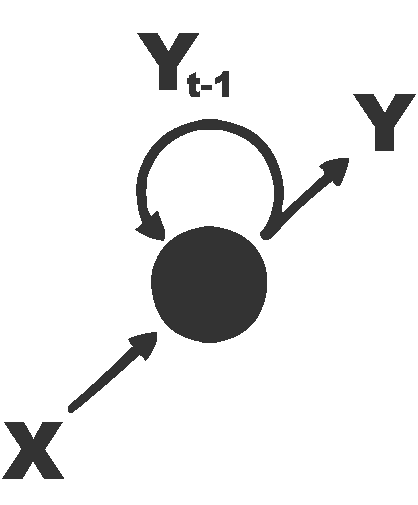

循环神经网络（RNN）是一类人工神经网络，其中单元之间的连接形成有向环。这会创建网络的内部状态，使其能够表现出动态的时间行为。

```
keras.layers.recurrent.SimpleRNN(units, activation='tanh', use_bias=True, 
                                 kernel_initializer='glorot_uniform', 
                                 recurrent_initializer='orthogonal', 
                                 bias_initializer='zeros', 
                                 kernel_regularizer=None, 
                                 recurrent_regularizer=None, 
                                 bias_regularizer=None, 
                                 activity_regularizer=None, 
                                 kernel_constraint=None, recurrent_constraint=None, 
                                 bias_constraint=None, dropout=0.0, recurrent_dropout=0.0)
```

## 参数：

*   `units`: 正整数，输出空间的维度。

*   `activation`: 使用的激活函数（参见 [激活函数](http://keras.io/activations/））。如果传入 None，则不应用激活函数（即“线性”激活：`a(x) = x`）。

*   `use_bias`: 布尔值，该层是否使用偏置向量。

*   `kernel_initializer`: `kernel` 权重矩阵的初始化器，用于输入的线性变换。（参见 [初始化器](https://keras.io/initializers/)）。

*   `recurrent_initializer`: `recurrent_kernel` 权重矩阵的初始化器，用于循环状态的线性变换。（参见 [初始化器](https://keras.io/initializers/)）。

*   `bias_initializer`: 偏置向量的初始化器（参见 [初始化器](https://keras.io/initializers/)）。

*   `kernel_regularizer`: 应用于 `kernel` 权重矩阵的正则化函数（参见 [正则化器](https://keras.io/regularizers/)）。

*   `recurrent_regularizer`: 应用于 `recurrent_kernel` 权重矩阵的正则化函数（参见 [正则化器](https://keras.io/regularizers/)）。

*   `bias_regularizer`: 应用于偏置向量的正则化函数（参见 [正则化器](https://keras.io/regularizers/)）。

*   `activity_regularizer`: 应用于层输出（其“激活”）的正则化函数。（参见 [正则化器](https://keras.io/regularizers/)）。

*   `kernel_constraint`: 应用于 `kernel` 权重矩阵的约束函数（参见 [约束](https://keras.io/constraints/)）。

*   `recurrent_constraint`: 应用于 `recurrent_kernel` 权重矩阵的约束函数（参见 [约束](https://keras.io/constraints/)）。

*   `bias_constraint`: 应用于偏置向量的约束函数（参见 [约束](https://keras.io/constraints/)）。

*   `dropout`: 0 到 1 之间的浮点数。用于输入线性变换的丢弃单元比例。

*   `recurrent_dropout`: 0 到 1 之间的浮点数。用于循环状态线性变换的丢弃单元比例。

## 时间反向传播

与前馈神经网络相反，RNN 的特征在于能够编码更长的过去信息，因此非常适合序列模型。BPTT 将普通的 BP 算法扩展以适应循环神经网络架构。

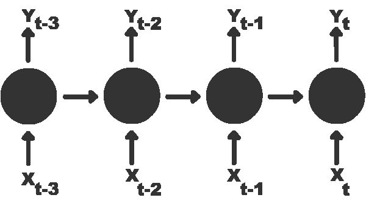

**参考**: [时间反向传播](http://ir.hit.edu.cn/~jguo/docs/notes/bptt.pdf)

```
%matplotlib inline
```

```
import numpy as np
import pandas as pd
import theano
import theano.tensor as T
import keras 

import numpy as np
import matplotlib.pyplot as plt

from sklearn.preprocessing import LabelEncoder
from sklearn.preprocessing import StandardScaler
from sklearn.model_selection import train_test_split
## -- Keras Import
from keras.models import Sequential
from keras.layers import Dense, Activation
from keras.preprocessing import image

from keras.datasets import imdb
from keras.datasets import mnist

from keras.models import Sequential
from keras.layers import Dense, Dropout, Activation, Flatten
from keras.layers import Conv2D, MaxPooling2D

from keras.utils import np_utils
from keras.preprocessing import sequence
from keras.layers.embeddings import Embedding
from keras.layers.recurrent import LSTM, GRU, SimpleRNN

from keras.layers import Activation, TimeDistributed, RepeatVector
from keras.callbacks import EarlyStopping, ModelCheckpoint
```

```
Using TensorFlow backend.
```

## IMDB 情感分类任务

这是一个用于二元情感分类的数据集，包含比以前基准数据集多得多的数据。

IMDB 提供了一套 25,000 条高度极化的电影评论用于训练，以及 25,000 条用于测试。

还有额外的未标记数据可供使用。提供原始文本和已处理的词袋格式。

[`ai.stanford.edu/~amaas/data/sentiment/`](http://ai.stanford.edu/~amaas/data/sentiment/)

## 数据准备 - IMDB

```
max_features = 20000
maxlen = 100  # cut texts after this number of words (among top max_features most common words)
batch_size = 32

print("Loading data...")
(X_train, y_train), (X_test, y_test) = imdb.load_data(num_words=max_features)
print(len(X_train), 'train sequences')
print(len(X_test), 'test sequences')

print('Example:')
print(X_train[:1])

print("Pad sequences (samples x time)")
X_train = sequence.pad_sequences(X_train, maxlen=maxlen)
X_test = sequence.pad_sequences(X_test, maxlen=maxlen)
print('X_train shape:', X_train.shape)
print('X_test shape:', X_test.shape)
```

```
Loading data...
Downloading data from https://s3.amazonaws.com/text-datasets/imdb.npz
25000 train sequences
25000 test sequences
Example:
[ [1, 14, 22, 16, 43, 530, 973, 1622, 1385, 65, 458, 4468, 66, 3941, 4, 173, 36, 256, 5, 25, 100, 43, 838, 112, 50, 670, 2, 9, 35, 480, 284, 5, 150, 4, 172, 112, 167, 2, 336, 385, 39, 4, 172, 4536, 1111, 17, 546, 38, 13, 447, 4, 192, 50, 16, 6, 147, 2025, 19, 14, 22, 4, 1920, 4613, 469, 4, 22, 71, 87, 12, 16, 43, 530, 38, 76, 15, 13, 1247, 4, 22, 17, 515, 17, 12, 16, 626, 18, 19193, 5, 62, 386, 12, 8, 316, 8, 106, 5, 4, 2223, 5244, 16, 480, 66, 3785, 33, 4, 130, 12, 16, 38, 619, 5, 25, 124, 51, 36, 135, 48, 25, 1415, 33, 6, 22, 12, 215, 28, 77, 52, 5, 14, 407, 16, 82, 10311, 8, 4, 107, 117, 5952, 15, 256, 4, 2, 7, 3766, 5, 723, 36, 71, 43, 530, 476, 26, 400, 317, 46, 7, 4, 12118, 1029, 13, 104, 88, 4, 381, 15, 297, 98, 32, 2071, 56, 26, 141, 6, 194, 7486, 18, 4, 226, 22, 21, 134, 476, 26, 480, 5, 144, 30, 5535, 18, 51, 36, 28, 224, 92, 25, 104, 4, 226, 65, 16, 38, 1334, 88, 12, 16, 283, 5, 16, 4472, 113, 103, 32, 15, 16, 5345, 19, 178, 32]]
Pad sequences (samples x time)
X_train shape: (25000, 100)
X_test shape: (25000, 100)
```

## 模型构建

```
print('Build model...')
model = Sequential()
model.add(Embedding(max_features, 128, input_length=maxlen))
model.add(SimpleRNN(128))  
model.add(Dropout(0.5))
model.add(Dense(1))
model.add(Activation('sigmoid'))

## try using different optimizers and different optimizer configs
model.compile(loss='binary_crossentropy', optimizer='adam')

print("Train...")
model.fit(X_train, y_train, batch_size=batch_size, epochs=1, 
          validation_data=(X_test, y_test))
```

```
Build model...
Train...


/Users/valerio/anaconda3/envs/deep-learning-pydatait-tutorial/lib/python3.5/site-packages/keras/backend/tensorflow_backend.py:2094: UserWarning: Expected no kwargs, you passed 1
kwargs passed to function are ignored with Tensorflow backend
  warnings.warn('\n'.join(msg))


Train on 25000 samples, validate on 25000 samples
Epoch 1/1
25000/25000 [==============================] - 104s - loss: 0.7329 - val_loss: 0.6832


<keras.callbacks.History at 0x138767780>
```

## LSTM


## LSTM 网络

A LSTM network is an artificial neural network that contains LSTM blocks instead of, or in addition to, regular network units. A LSTM block may be described as a "smart" network unit that can remember a value for an arbitrary length of time.

Unlike traditional RNNs, an Long short-term memory network is well-suited to learn from experience to classify, process and predict time series when there are very long time lags of unknown size between important events.

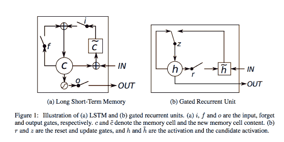

```
keras.layers.recurrent.LSTM(units, activation='tanh', recurrent_activation='hard_sigmoid', use_bias=True, 
                            kernel_initializer='glorot_uniform', recurrent_initializer='orthogonal', 
                            bias_initializer='zeros', unit_forget_bias=True, kernel_regularizer=None, 
                            recurrent_regularizer=None, bias_regularizer=None, activity_regularizer=None, 
                            kernel_constraint=None, recurrent_constraint=None, bias_constraint=None, 
                            dropout=0.0, recurrent_dropout=0.0)
```

## Arguments

*   `units`: Positive integer, dimensionality of the output space.

*   `activation`: Activation function to use If you pass None, no activation is applied (ie. "linear" activation: `a(x) = x`).

*   `recurrent_activation`: Activation function to use for the recurrent step.

*   `use_bias`: Boolean, whether the layer uses a bias vector.

*   `kernel_initializer`: Initializer for the `kernel` weights matrix, used for the linear transformation of the inputs.

*   `recurrent_initializer`: Initializer for the `recurrent_kernel` weights matrix, used for the linear transformation of the recurrent state.

*   `bias_initializer`: Initializer for the bias vector.

*   `unit_forget_bias`: Boolean. If True, add 1 to the bias of the forget gate at initialization. Setting it to true will also force `bias_initializer="zeros"`. This is recommended in [Jozefowicz et al.](http://www.jmlr.org/proceedings/papers/v37/jozefowicz15.pdf)

*   `kernel_regularizer`: Regularizer function applied to the `kernel` weights matrix.

*   `recurrent_regularizer`: Regularizer function applied to the `recurrent_kernel` weights matrix.

*   `bias_regularizer`: Regularizer function applied to the bias vector.

*   `activity_regularizer`: Regularizer function applied to the output of the layer (its "activation").

*   `kernel_constraint`: Constraint function applied to the `kernel` weights matrix.

*   `recurrent_constraint`: Constraint function applied to the `recurrent_kernel` weights matrix.

*   `bias_constraint`: Constraint function applied to the bias vector.

*   `dropout`: Float between 0 and 1. Fraction of the units to drop for the linear transformation of the inputs.

*   `recurrent_dropout`: Float between 0 and 1. Fraction of the units to drop for the linear transformation of the recurrent state.

## GRU

Gated recurrent units are a gating mechanism in recurrent neural networks.

Much similar to the LSTMs, they have fewer parameters than LSTM, as they lack an output gate.


```
keras.layers.recurrent.GRU(units, activation='tanh', recurrent_activation='hard_sigmoid', use_bias=True, 
                           kernel_initializer='glorot_uniform', recurrent_initializer='orthogonal', 
                           bias_initializer='zeros', kernel_regularizer=None, recurrent_regularizer=None, 
                           bias_regularizer=None, activity_regularizer=None, kernel_constraint=None, 
                           recurrent_constraint=None, bias_constraint=None, 
                           dropout=0.0, recurrent_dropout=0.0)
```

## Your Turn! - Hands on Rnn

```
print('Build model...')
model = Sequential()
model.add(Embedding(max_features, 128, input_length=maxlen))

## !!! Play with those! try and get better results!
#model.add(SimpleRNN(128))  
#model.add(GRU(128))  
#model.add(LSTM(128))  

model.add(Dropout(0.5))
model.add(Dense(1))
model.add(Activation('sigmoid'))

## try using different optimizers and different optimizer configs
model.compile(loss='binary_crossentropy', optimizer='adam')

print("Train...")
model.fit(X_train, y_train, batch_size=batch_size, 
          epochs=4, validation_data=(X_test, y_test))
score, acc = model.evaluate(X_test, y_test, batch_size=batch_size)
print('Test score:', score)
print('Test accuracy:', acc)
```

## Convolutional LSTM

> This section demonstrates the use of a `Convolutional LSTM network`.

> 

> This network is used to predict the next frame of an artificially generated movie which contains moving squares.

## Artificial Data Generation

Generate movies with `3` to `7` moving squares inside.

The squares are of shape $1 \\times 1$ or $2 \\times 2$ pixels, which move linearly over time.

For convenience we first create movies with bigger width and height (`80x80`) and at the end we select a $40 \times 40$ window.

```
## Artificial Data Generation
def generate_movies(n_samples=1200, n_frames=15):
    row = 80
    col = 80
    noisy_movies = np.zeros((n_samples, n_frames, row, col, 1), dtype=np.float)
    shifted_movies = np.zeros((n_samples, n_frames, row, col, 1),
                              dtype=np.float)

    for i in range(n_samples):
        # Add 3 to 7 moving squares
        n = np.random.randint(3, 8)

        for j in range(n):
            # Initial position
            xstart = np.random.randint(20, 60)
            ystart = np.random.randint(20, 60)
            # Direction of motion
            directionx = np.random.randint(0, 3) - 1
            directiony = np.random.randint(0, 3) - 1

            # Size of the square
            w = np.random.randint(2, 4)

            for t in range(n_frames):
                x_shift = xstart + directionx * t
                y_shift = ystart + directiony * t
                noisy_movies[i, t, x_shift - w: x_shift + w,
                             y_shift - w: y_shift + w, 0] += 1

                # Make it more robust by adding noise.
                # The idea is that if during inference,
                # the value of the pixel is not exactly one,
                # we need to train the network to be robust and still
                # consider it as a pixel belonging to a square.
                if np.random.randint(0, 2):
                    noise_f = (-1)**np.random.randint(0, 2)
                    noisy_movies[i, t,
                                 x_shift - w - 1: x_shift + w + 1,
                                 y_shift - w - 1: y_shift + w + 1,
                                 0] += noise_f * 0.1

                # Shift the ground truth by 1
                x_shift = xstart + directionx * (t + 1)
                y_shift = ystart + directiony * (t + 1)
                shifted_movies[i, t, x_shift - w: x_shift + w,
                               y_shift - w: y_shift + w, 0] += 1

    # Cut to a 40x40 window
    noisy_movies = noisy_movies[::, ::, 20:60, 20:60, ::]
    shifted_movies = shifted_movies[::, ::, 20:60, 20:60, ::]
    noisy_movies[noisy_movies >= 1] = 1
    shifted_movies[shifted_movies >= 1] = 1
    return noisy_movies, shifted_movies
```

## Model

```
from keras.models import Sequential
from keras.layers.convolutional import Conv3D
from keras.layers.convolutional_recurrent import ConvLSTM2D
from keras.layers.normalization import BatchNormalization
import numpy as np
from matplotlib import pyplot as plt

%matplotlib inline
```

```
Using TensorFlow backend.
```

We create a layer which take as input movies of shape `(n_frames, width, height, channels)` and returns a movie of identical shape.


## 构建网络模型

```python
seq = Sequential()
seq.add(ConvLSTM2D(filters=40, kernel_size=(3, 3),
                   input_shape=(None, 40, 40, 1),
                   padding='same', return_sequences=True))
seq.add(BatchNormalization())

seq.add(ConvLSTM2D(filters=40, kernel_size=(3, 3),
                   padding='same', return_sequences=True))
seq.add(BatchNormalization())

seq.add(ConvLSTM2D(filters=40, kernel_size=(3, 3),
                   padding='same', return_sequences=True))
seq.add(BatchNormalization())

seq.add(ConvLSTM2D(filters=40, kernel_size=(3, 3),
                   padding='same', return_sequences=True))
seq.add(BatchNormalization())

seq.add(Conv3D(filters=1, kernel_size=(3, 3, 3),
               activation='sigmoid',
               padding='same', data_format='channels_last'))
seq.compile(loss='binary_crossentropy', optimizer='adadelta')
```

## 训练网络

## 注意：这需要花费一些时间（在我的硬件上每个 epoch 大约需要 3 分钟）

```python
## Train the network
noisy_movies, shifted_movies = generate_movies(n_samples=1200)
seq.fit(noisy_movies[:1000], shifted_movies[:1000], batch_size=10,
        epochs=20, validation_split=0.05)
```

```text
Train on 950 samples, validate on 50 samples
Epoch 1/50
950/950 [==============================] - 180s - loss: 0.3293 - val_loss: 0.6113
Epoch 2/50
950/950 [==============================] - 181s - loss: 0.0629 - val_loss: 0.4206
Epoch 3/50
950/950 [==============================] - 180s - loss: 0.0187 - val_loss: 0.2585
Epoch 4/50
950/950 [==============================] - 180s - loss: 0.0062 - val_loss: 0.2087
Epoch 5/50
950/950 [==============================] - 179s - loss: 0.0134 - val_loss: 0.1884
Epoch 6/50
950/950 [==============================] - 180s - loss: 0.0024 - val_loss: 0.1025
Epoch 7/50
950/950 [==============================] - 179s - loss: 0.0013 - val_loss: 0.0079
Epoch 8/50
950/950 [==============================] - 180s - loss: 8.1664e-04 - val_loss: 7.7649e-04
Epoch 9/50
950/950 [==============================] - 180s - loss: 5.9629e-04 - val_loss: 4.9810e-04
Epoch 10/50
950/950 [==============================] - 180s - loss: 4.8772e-04 - val_loss: 4.5704e-04
Epoch 11/50
950/950 [==============================] - 179s - loss: 4.1252e-04 - val_loss: 3.7326e-04
Epoch 12/50
950/950 [==============================] - 180s - loss: 3.6413e-04 - val_loss: 3.3256e-04
Epoch 13/50
950/950 [==============================] - 179s - loss: 3.2918e-04 - val_loss: 2.8421e-04
Epoch 14/50
950/950 [==============================] - 179s - loss: 2.9520e-04 - val_loss: 2.8827e-04
Epoch 15/50
950/950 [==============================] - 179s - loss: 2.7647e-04 - val_loss: 2.5144e-04
Epoch 16/50
950/950 [==============================] - 181s - loss: 2.5863e-04 - val_loss: 2.5015e-04
Epoch 17/50
950/950 [==============================] - 180s - loss: 2.4067e-04 - val_loss: 2.2645e-04
Epoch 18/50
950/950 [==============================] - 180s - loss: 2.2378e-04 - val_loss: 2.1206e-04
Epoch 19/50
950/950 [==============================] - 179s - loss: 2.1416e-04 - val_loss: 2.0406e-04
Epoch 20/50
950/950 [==============================] - 179s - loss: 2.0244e-04 - val_loss: 1.9820e-04
Epoch 21/50
 20/950 [..............................] - ETA: 170s - loss: 1.8054e-04


---------------------------------------------------------------------------

KeyboardInterrupt                         Traceback (most recent call last)

<ipython-input-4-5547645715ec> in <module>()
      2 noisy_movies, shifted_movies = generate_movies(n_samples=1200)
      3 seq.fit(noisy_movies[:1000], shifted_movies[:1000], batch_size=10,
----> 4         epochs=50, validation_split=0.05)


/home/valerio/anaconda3/lib/python3.5/site-packages/keras/models.py in fit(self, x, y, batch_size, epochs, verbose, callbacks, validation_split, validation_data, shuffle, class_weight, sample_weight, initial_epoch, **kwargs)
    854                               class_weight=class_weight,
    855                               sample_weight=sample_weight,
--> 856                               initial_epoch=initial_epoch)
    857 
    858     def evaluate(self, x, y, batch_size=32, verbose=1,


/home/valerio/anaconda3/lib/python3.5/site-packages/keras/engine/training.py in fit(self, x, y, batch_size, epochs, verbose, callbacks, validation_split, validation_data, shuffle, class_weight, sample_weight, initial_epoch, **kwargs)
   1496                               val_f=val_f, val_ins=val_ins, shuffle=shuffle,
   1497                               callback_metrics=callback_metrics,
-> 1498                               initial_epoch=initial_epoch)
   1499 
   1500     def evaluate(self, x, y, batch_size=32, verbose=1, sample_weight=None):


/home/valerio/anaconda3/lib/python3.5/site-packages/keras/engine/training.py in _fit_loop(self, f, ins, out_labels, batch_size, epochs, verbose, callbacks, val_f, val_ins, shuffle, callback_metrics, initial_epoch)
   1150                 batch_logs['size'] = len(batch_ids)
   1151                 callbacks.on_batch_begin(batch_index, batch_logs)
-> 1152                 outs = f(ins_batch)
   1153                 if not isinstance(outs, list):
   1154                     outs = [outs]


/home/valerio/anaconda3/lib/python3.5/site-packages/keras/backend/tensorflow_backend.py in __call__(self, inputs)
   2227         session = get_session()
   2228         updated = session.run(self.outputs + [self.updates_op],
-> 2229                               feed_dict=feed_dict)
   2230         return updated[:len(self.outputs)]


/home/valerio/anaconda3/lib/python3.5/site-packages/tensorflow/python/client/session.py in run(self, fetches, feed_dict, options, run_metadata)
    776     try:
    777       result = self._run(None, fetches, feed_dict, options_ptr,
--> 778                          run_metadata_ptr)
    779       if run_metadata:
    780         proto_data = tf_session.TF_GetBuffer(run_metadata_ptr)


/home/valerio/anaconda3/lib/python3.5/site-packages/tensorflow/python/client/session.py in _run(self, handle, fetches, feed_dict, options, run_metadata)
    980     if final_fetches or final_targets:
    981       results = self._do_run(handle, final_targets, final_fetches,
--> 982                              feed_dict_string, options, run_metadata)
    983     else:
    984       results = []


/home/valerio/anaconda3/lib/python3.5/site-packages/tensorflow/python/client/session.py in _do_run(self, handle, target_list, fetch_list, feed_dict, options, run_metadata)
   1030     if handle is None:
   1031       return self._do_call(_run_fn, self._session, feed_dict, fetch_list,
-> 1032                            target_list, options, run_metadata)
   1033     else:
   1034       return self._do_call(_prun_fn, self._session, handle, feed_dict,


/home/valerio/anaconda3/lib/python3.5/site-packages/tensorflow/python/client/session.py in _do_call(self, fn, *args)
   1037   def _do_call(self, fn, *args):
   1038     try:
-> 1039       return fn(*args)
   1040     except errors.OpError as e:
   1041       message = compat.as_text(e.message)


/home/valerio/anaconda3/lib/python3.5/site-packages/tensorflow/python/client/session.py in _run_fn(session, feed_dict, fetch_list, target_list, options, run_metadata)
   1019         return tf_session.TF_Run(session, options,
   1020                                  feed_dict, fetch_list, target_list,
-> 1021                                  status, run_metadata)
   1022 
   1023     def _prun_fn(session, handle, feed_dict, fetch_list):


KeyboardInterrupt: 
```

## 测试网络

```python
## Testing the network on one movie
## feed it with the first 7 positions and then
## predict the new positions
which = 1004
track = noisy_movies[which][:7, ::, ::, ::]

for j in range(16):
    new_pos = seq.predict(track[np.newaxis, ::, ::, ::, ::])
    new = new_pos[::, -1, ::, ::, ::]
    track = np.concatenate((track, new), axis=0)
```


## 然后将预测结果与真实值进行比较

```python
track2 = noisy_movies[which][::, ::, ::, ::]
for i in range(15):
    fig = plt.figure(figsize=(10, 5))

    ax = fig.add_subplot(121)

    if i >= 7:
        ax.text(1, 3, 'Predictions !', fontsize=20, color='w')
    else:
        ax.text(1, 3, 'Inital trajectory', fontsize=20)

    toplot = track[i, ::, ::, 0]

    plt.imshow(toplot)
    ax = fig.add_subplot(122)
    plt.text(1, 3, 'Ground truth', fontsize=20)

    toplot = track2[i, ::, ::, 0]
    if i >= 2:
        toplot = shifted_movies[which][i - 1, ::, ::, 0]

    plt.imshow(toplot)
    plt.savefig('img/convlstm/%i_animate.png' % (i + 1))
```


## 7.2 用于句子生成的 LSTM

## 使用 LSTM 的 RNN

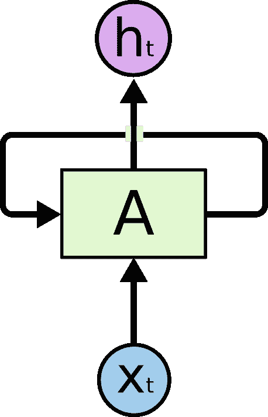

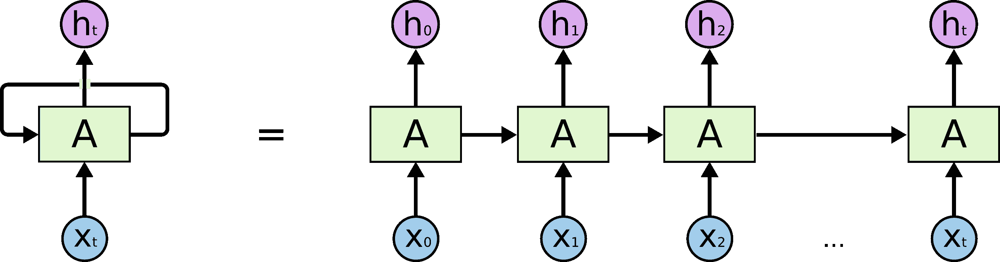

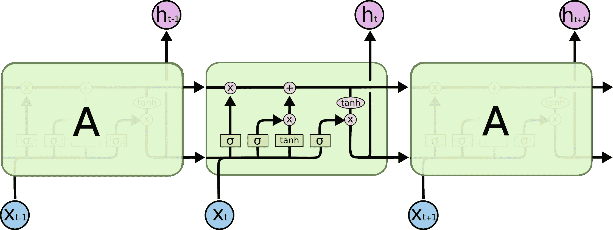

*source: [`colah.github.io/posts/2015-08-Understanding-LSTMs`](http://colah.github.io/posts/2015-08-Understanding-LSTMs)*

```python
from keras.optimizers import SGD
from keras.preprocessing.text import one_hot, text_to_word_sequence
from keras.utils import np_utils
from keras.models import Sequential
from keras.layers.core import Dense, Dropout, Activation
from keras.layers.embeddings import Embedding
from keras.layers.recurrent import LSTM, GRU
from keras.preprocessing import sequence
```

## 从数据目录读取博客文章

```python
import os
import pickle
import numpy as np
```

```python
DATA_DIRECTORY = os.path.join(os.path.abspath(os.path.curdir), '..', 'data', 'word_embeddings')
print(DATA_DIRECTORY)
```

```python
male_posts = []
female_post = []
```

```python
with open(os.path.join(DATA_DIRECTORY,"male_blog_list.txt"),"rb") as male_file:
    male_posts= pickle.load(male_file)

with open(os.path.join(DATA_DIRECTORY,"female_blog_list.txt"),"rb") as female_file:
    female_posts = pickle.load(female_file)
```

```python
filtered_male_posts = list(filter(lambda p: len(p) > 0, male_posts))
filtered_female_posts = list(filter(lambda p: len(p) > 0, female_posts))
```

```python
## 文本处理 - one hot 构建单词索引
male_one_hot = []
female_one_hot = []
n = 30000
for post in filtered_male_posts:
    try:
        male_one_hot.append(one_hot(post, n, split=" ", lower=True))
    except:
        continue

for post in filtered_female_posts:
    try:
        female_one_hot.append(one_hot(post,n,split=" ", lower=True))
    except:
        continue
```

```python
## 0 表示男性，1 表示女性
concatenate_array_rnn = np.concatenate((np.zeros(len(male_one_hot)),
                                        np.ones(len(female_one_hot))))
```

```python
from sklearn.model_selection import train_test_split

X_train_rnn, X_test_rnn, y_train_rnn, y_test_rnn = train_test_split(np.concatenate((female_one_hot,male_one_hot)),
                                                                    concatenate_array_rnn, 
                                                                    test_size=0.2)
```

```python
maxlen = 100
X_train_rnn = sequence.pad_sequences(X_train_rnn, maxlen=maxlen)
X_test_rnn = sequence.pad_sequences(X_test_rnn, maxlen=maxlen)
print('X_train_rnn shape:', X_train_rnn.shape, y_train_rnn.shape)
print('X_test_rnn shape:', X_test_rnn.shape, y_test_rnn.shape)
```

```python
max_features = 30000
dimension = 128
output_dimension = 128
model = Sequential()
model.add(Embedding(max_features, dimension))
model.add(LSTM(output_dimension))
model.add(Dropout(0.5))
model.add(Dense(1))
model.add(Activation('sigmoid'))
```

```python
model.compile(loss='mean_squared_error', optimizer='sgd', metrics=['accuracy'])
```

```python
model.fit(X_train_rnn, y_train_rnn, batch_size=32,
          epochs=4, validation_data=(X_test_rnn, y_test_rnn))
```

```python
score, acc = model.evaluate(X_test_rnn, y_test_rnn, batch_size=32)
```

```python
print(score, acc)
```

## 使用 TFIDF 向量化器作为输入，而非 one hot 编码器

```python
from sklearn.feature_extraction.text import TfidfVectorizer
```

```python
vectorizer = TfidfVectorizer(decode_error='ignore', norm='l2', min_df=5)
tfidf_male = vectorizer.fit_transform(filtered_male_posts)
tfidf_female = vectorizer.fit_transform(filtered_female_posts)
```

```python
flattened_array_tfidf_male = tfidf_male.toarray()
flattened_array_tfidf_female = tfidf_male.toarray()
```

```python
y_rnn = np.concatenate((np.zeros(len(flattened_array_tfidf_male)),
                        np.ones(len(flattened_array_tfidf_female))))
```

```python
X_train_rnn, X_test_rnn, y_train_rnn, y_test_rnn = train_test_split(np.concatenate((flattened_array_tfidf_male, 
                                                                                    flattened_array_tfidf_female)),
                                                                    y_rnn,test_size=0.2)
```

```python
maxlen = 100
X_train_rnn = sequence.pad_sequences(X_train_rnn, maxlen=maxlen)
X_test_rnn = sequence.pad_sequences(X_test_rnn, maxlen=maxlen)
print('X_train_rnn shape:', X_train_rnn.shape, y_train_rnn.shape)
print('X_test_rnn shape:', X_test_rnn.shape, y_test_rnn.shape)
```

```python
max_features = 30000
model = Sequential()
model.add(Embedding(max_features, dimension))
model.add(LSTM(output_dimension))
model.add(Dropout(0.5))
model.add(Dense(1))
model.add(Activation('sigmoid'))
```

```python
model.compile(loss='mean_squared_error',optimizer='sgd', metrics=['accuracy'])
```

```python
model.fit(X_train_rnn, y_train_rnn, 
          batch_size=32, epochs=1,
          validation_data=(X_test_rnn, y_test_rnn))
```

```python
score,acc = model.evaluate(X_test_rnn, y_test_rnn, 
                           batch_size=32)
```

```python
print(score, acc)
```

## 使用 LSTM 进行句子生成

```python
## 将所有男性文本数据读入一个字符串
male_post = ' '.join(filtered_male_posts)

## 构建男性帖子的字符集
character_set_male = set(male_post)
## 构建两个索引 - 字符索引和字符索引
char_indices = dict((c, i) for i, c in enumerate(character_set_male))
indices_char = dict((i, c) for i, c in enumerate(character_set_male))


## 将文本切分为最大长度为 maxlen 的半冗余序列
maxlen = 20
step = 1
sentences = []
next_chars = []
for i in range(0, len(male_post) - maxlen, step):
    sentences.append(male_post[i : i + maxlen])
    next_chars.append(male_post[i + maxlen])
```

```python
## 输入的向量化
x_male = np.zeros((len(male_post), maxlen, len(character_set_male)), dtype=np.bool)
y_male = np.zeros((len(male_post), len(character_set_male)), dtype=np.bool)

print(x_male.shape, y_male.shape)

for i, sentence in enumerate(sentences):
    for t, char in enumerate(sentence):
        x_male[i, t, char_indices[char]] = 1
    y_male[i, char_indices[next_chars[i]]] = 1

print(x_male.shape, y_male.shape)
```

```python
## 构建模型：单个 LSTM
print('Build model...')
model = Sequential()
model.add(LSTM(128, input_shape=(maxlen, len(character_set_male))))
model.add(Dense(len(character_set_male)))
model.add(Activation('softmax'))

optimizer = RMSprop(lr=0.01)
model.compile(loss='categorical_crossentropy', optimizer=optimizer, metrics=['accuracy'])
```

```python
auto_text_generating_male_model.compile(loss='mean_squared_error',optimizer='sgd')
```

```python
import random, sys
```

```python
## 从概率数组中采样索引的辅助函数
def sample(a, diversity=0.75):
    if random.random() > diversity:
        return np.argmax(a)
    while 1:
        i = random.randint(0, len(a)-1)
        if a[i] > random.random():
            return i
```


## train the model, output generated text after each iteration

```
for iteration in range(1,10):
    print()
    print('-' * 50)
    print('Iteration', iteration)
    model.fit(x_male, y_male, batch_size=128, epochs=1)

    start_index = random.randint(0, len(male_post) - maxlen - 1)

    for diversity in [0.2, 0.4, 0.6, 0.8]:
        print()
        print('----- diversity:', diversity)

        generated = ''
        sentence = male_post[start_index : start_index + maxlen]
        generated += sentence
        print('----- Generating with seed: "' + sentence + '"')

        for iteration in range(400):
            try:
                x = np.zeros((1, maxlen, len(character_set_male)))
                for t, char in enumerate(sentence):
                    x[0, t, char_indices[char]] = 1.

                preds = model.predict(x, verbose=0)[0]
                next_index = sample(preds, diversity)
                next_char = indices_char[next_index]

                generated += next_char
                sentence = sentence[1:] + next_char
            except:
                continue

        print(sentence)
        print()
```

## 8.1 Custom Layer

## Custom Keras Layer

## Idea:

We build a custom activation layer called `Antirectifier`, which modifies the shape of the tensor that passes through it.

We need to specify two methods: `get_output_shape_for` and `call`.

Note that the same result can also be achieved via a `Lambda` layer (`keras.layer.core.Lambda`).

```
keras.layers.core.Lambda(function, output_shape=None, arguments=None)
```

Because our custom layer is written with primitives from the Keras backend (`K`), our code can run both on TensorFlow and Theano.

```
from keras.models import Sequential
from keras.layers import Dense, Dropout, Layer, Activation
from keras.datasets import mnist
from keras import backend as K
from keras.utils import np_utils
```

```
Using TensorFlow backend.
```

## AntiRectifier Layer

```
class Antirectifier(Layer):
    '''This is the combination of a sample-wise
    L2 normalization with the concatenation of the
    positive part of the input with the negative part
    of the input. The result is a tensor of samples that are
    twice as large as the input samples.

    It can be used in place of a ReLU.

    # Input shape
        2D tensor of shape (samples, n)

    # Output shape
        2D tensor of shape (samples, 2*n)

    # Theoretical justification
        When applying ReLU, assuming that the distribution
        of the previous output is approximately centered around 0.,
        you are discarding half of your input. This is inefficient.

        Antirectifier allows to return all-positive outputs like ReLU,
        without discarding any data.

        Tests on MNIST show that Antirectifier allows to train networks
        with twice less parameters yet with comparable
        classification accuracy as an equivalent ReLU-based network.
    '''

    def compute_output_shape(self, input_shape):
        shape = list(input_shape)
        assert len(shape) == 2  # only valid for 2D tensors
        shape[-1] *= 2
        return tuple(shape)

    def call(self, inputs):
        inputs -= K.mean(inputs, axis=1, keepdims=True)
        inputs = K.l2_normalize(inputs, axis=1)
        pos = K.relu(inputs)
        neg = K.relu(-inputs)
        return K.concatenate([pos, neg], axis=1)
```

## Parametrs and Settings

```
## global parameters
batch_size = 128
nb_classes = 10
nb_epoch = 10
```

## Data Preparation

```
## the data, shuffled and split between train and test sets
(X_train, y_train), (X_test, y_test) = mnist.load_data()

X_train = X_train.reshape(60000, 784)
X_test = X_test.reshape(10000, 784)
X_train = X_train.astype('float32')
X_test = X_test.astype('float32')
X_train /= 255
X_test /= 255
print(X_train.shape[0], 'train samples')
print(X_test.shape[0], 'test samples')

## convert class vectors to binary class matrices
Y_train = np_utils.to_categorical(y_train, nb_classes)
Y_test = np_utils.to_categorical(y_test, nb_classes)
```

```
60000 train samples
10000 test samples
```

## Model with Custom Layer

```
## build the model
model = Sequential()
model.add(Dense(256, input_shape=(784,)))
model.add(Antirectifier())
model.add(Dropout(0.1))
model.add(Dense(256))
model.add(Antirectifier())
model.add(Dropout(0.1))
model.add(Dense(10))
model.add(Activation('softmax'))

## compile the model
model.compile(loss='categorical_crossentropy',
              optimizer='rmsprop',
              metrics=['accuracy'])

## train the model
model.fit(X_train, Y_train,
          batch_size=batch_size, epochs=nb_epoch,
          verbose=1, validation_data=(X_test, Y_test))
```

```
Train on 60000 samples, validate on 10000 samples
Epoch 1/10
60000/60000 [==============================] - 4s - loss: 0.6029 - acc: 0.9154 - val_loss: 0.1556 - val_acc: 0.9612
Epoch 2/10
60000/60000 [==============================] - 3s - loss: 0.1252 - acc: 0.9662 - val_loss: 0.0990 - val_acc: 0.9714
Epoch 3/10
60000/60000 [==============================] - 3s - loss: 0.0813 - acc: 0.9766 - val_loss: 0.0796 - val_acc: 0.9758
Epoch 4/10
60000/60000 [==============================] - 3s - loss: 0.0634 - acc: 0.9810 - val_loss: 0.0783 - val_acc: 0.9747
Epoch 5/10
60000/60000 [==============================] - 3s - loss: 0.0513 - acc: 0.9847 - val_loss: 0.0685 - val_acc: 0.9792
Epoch 6/10
60000/60000 [==============================] - 3s - loss: 0.0428 - acc: 0.9867 - val_loss: 0.0669 - val_acc: 0.9792
Epoch 7/10
60000/60000 [==============================] - 3s - loss: 0.0381 - acc: 0.9885 - val_loss: 0.0668 - val_acc: 0.9799
Epoch 8/10
60000/60000 [==============================] - 3s - loss: 0.0314 - acc: 0.9903 - val_loss: 0.0672 - val_acc: 0.9790
Epoch 9/10
60000/60000 [==============================] - 3s - loss: 0.0276 - acc: 0.9913 - val_loss: 0.0616 - val_acc: 0.9817
Epoch 10/10
60000/60000 [==============================] - 3s - loss: 0.0238 - acc: 0.9926 - val_loss: 0.0608 - val_acc: 0.9825

<keras.callbacks.History at 0x7f2c140fbac8>
```

## Excercise

Compare with an equivalent network that is `2x bigger` (in terms of Dense layers) + `ReLU`)

```
## your code here
```

## 8.2 Multi-Modal Networks

## Keras Functional API

## Recall: All models (layers) are callables

```
from keras.layers import Input, Dense
from keras.models import Model

## this returns a tensor
inputs = Input(shape=(784,))

## a layer instance is callable on a tensor, and returns a tensor
x = Dense(64, activation='relu')(inputs)
x = Dense(64, activation='relu')(x)
predictions = Dense(10, activation='softmax')(x)

## this creates a model that includes
## the Input layer and three Dense layers
model = Model(inputs=inputs, outputs=predictions)
model.compile(optimizer='rmsprop',
              loss='categorical_crossentropy',
              metrics=['accuracy'])
model.fit(data, labels)  # starts training
```

## Multi-Input Networks

## Keras Merge Layer

Here's a good use case for the functional API: models with multiple inputs and outputs.

The functional API makes it easy to manipulate a large number of intertwined datastreams.

Let's consider the following model.

```
from keras.layers import Dense, Input
from keras.models import Model
from keras.layers.merge import concatenate

left_input = Input(shape=(784, ), name='left_input')
left_branch = Dense(32, input_dim=784, name='left_branch')(left_input)

right_input = Input(shape=(784,), name='right_input')
right_branch = Dense(32, input_dim=784, name='right_branch')(right_input)

x = concatenate([left_branch, right_branch])
predictions = Dense(10, activation='softmax', name='main_output')(x)

model = Model(inputs=[left_input, right_input], outputs=predictions)
```

Resulting Model will look like the following network:

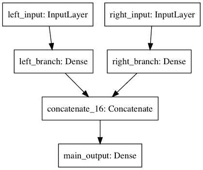

Such a two-branch model can then be trained via e.g.:


```
model.compile(optimizer='rmsprop', loss='categorical_crossentropy', metrics=['accuracy'])
model.fit([input_data_1, input_data_2], targets)  # we pass one data array per model input
```

## 自己动手

## 步骤 1：获取数据 - MNIST

```
## let's load MNIST data as we did in the exercise on MNIST with FC Nets
```

```
## %load ../solutions/sol_821.py
```

## 步骤 2：创建多输入网络

```
## try yourself
```

```
## `evaluate` the model on test data
```

Keras 支持不同的合并策略：

*   `add`: 按元素求和

*   `concatenate`: 张量拼接。你可以通过参数 `concat_axis` 指定拼接轴。

*   `multiply`: 按元素相乘

*   `average`: 张量平均值

*   `maximum`: 输入的按元素最大值。

*   `dot`: 点积。你可以通过参数 `dot_axes` 指定沿哪些轴进行归约。你也可以指定应用任何归一化。在这种情况下，点积的输出是两个样本之间的余弦相似度。

你也可以将函数作为 `mode` 参数传递，允许任意转换：

```
merged = Merge([left_branch, right_branch], mode=lambda x: x[0] - x[1])
```

* * *

## 更有趣的用例

这里有一个使用函数式 API 的好例子：具有多个输入和输出的模型。

函数式 API 使操作大量交织的数据流变得容易。

让我们考虑以下模型（来自：[`keras.io/getting-started/functional-api-guide/`](https://keras.io/getting-started/functional-api-guide/)）

## 问题与数据

我们希望预测新闻标题在 Twitter 上会收到多少条转发和点赞。

模型的主要输入将是标题本身，作为一系列单词，但为了增加趣味性，我们的模型还将有一个辅助输入，接收额外数据，例如发布标题的时间等。

该模型还将通过两个损失函数进行监督。

在模型中较早使用主损失函数是深度模型的一个良好正则化机制。

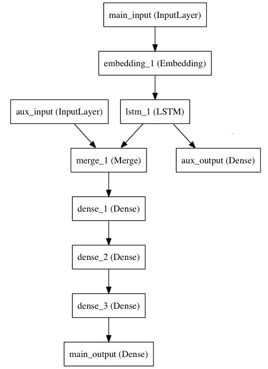

```
from keras.layers import Input, Embedding, LSTM, Dense
from keras.models import Model

## Headline input: meant to receive sequences of 100 integers, between 1 and 10000.
## Note that we can name any layer by passing it a "name" argument.
main_input = Input(shape=(100,), dtype='int32', name='main_input')

## This embedding layer will encode the input sequence
## into a sequence of dense 512-dimensional vectors.
x = Embedding(output_dim=512, input_dim=10000, input_length=100)(main_input)

## A LSTM will transform the vector sequence into a single vector,
## containing information about the entire sequence
lstm_out = LSTM(32)(x)
```

```
Using TensorFlow backend.
```

在这里我们插入辅助损失，允许 LSTM 和 Embedding 层被平滑地训练，尽管模型中的主损失会高得多。

```
auxiliary_output = Dense(1, activation='sigmoid', name='aux_output')(lstm_out)
```

此时，我们将辅助输入数据馈入模型，通过将其与 LSTM 输出拼接：

```
from keras.layers import concatenate

auxiliary_input = Input(shape=(5,), name='aux_input')
x = concatenate([lstm_out, auxiliary_input])

## We stack a deep densely-connected network on top
x = Dense(64, activation='relu')(x)
x = Dense(64, activation='relu')(x)
x = Dense(64, activation='relu')(x)

## And finally we add the main logistic regression layer
main_output = Dense(1, activation='sigmoid', name='main_output')(x)
```

## 模型定义

```
model = Model(inputs=[main_input, auxiliary_input], outputs=[main_output, auxiliary_output])
```

我们编译模型并为辅助损失分配 0.2 的权重。

要为每个不同的输出指定不同的 `loss_weights` 或 `loss`，你可以使用列表或字典。这里我们将单个损失作为 `loss` 参数传递，因此相同的损失将用于所有输出。

## 注意：

由于我们的输入和输出是命名的（我们传递了 "name" 参数），我们可以通过以下方式编译和拟合模型：

```
model.compile(optimizer='rmsprop',
              loss={'main_output': 'binary_crossentropy', 'aux_output': 'binary_crossentropy'},
              loss_weights={'main_output': 1., 'aux_output': 0.2})
```

```
## And trained it via:
model.fit({'main_input': headline_data, 'aux_input': additional_data},
          {'main_output': labels, 'aux_output': labels},
          epochs=50, batch_size=32)
```

## 结论

*   Keras 是一个功能强大且包含电池的 Python 深度学习框架

*   Keras 使用 `simple` 简单。

*   ...但它 `not` 不适合简单的事情！

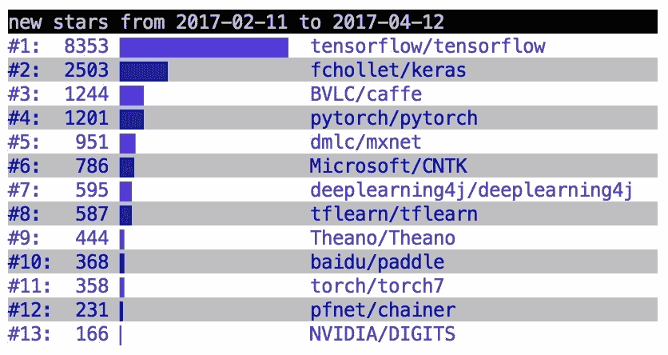

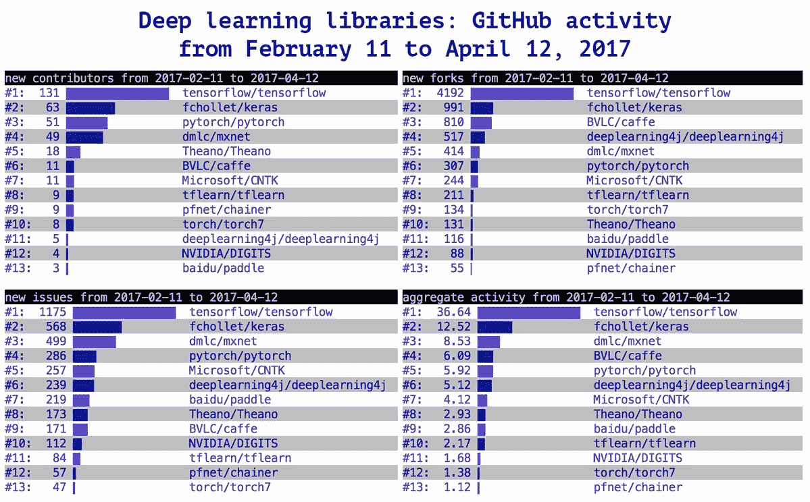

## 一些参考资料

## 前沿技术

*   Fractal Net Implementation with Keras: [`github.com/snf/keras-fractalnet`](https://github.com/snf/keras-fractalnet) -

*   请查看：[`github.com/fchollet/keras-resources`](https://github.com/fchollet/keras-resources)

## Hyper-Cool

*   Hyperas: [`github.com/maxpumperla/hyperas`](https://github.com/maxpumperla/hyperas) 

    *   Keras 模型的 Web 仪表板

## Super-Cool

*   Keras.js: [`github.com/transcranial/keras-js`](https://github.com/transcranial/keras-js) 

    *   你的 Keras 模型 `inside your Browser`

    *   展示：[`transcranial.github.io/keras-js/`](https://transcranial.github.io/keras-js/)

