# 深度学习 Python 图解初学者与中级指南

欢迎来到《Python 深度学习》！如果你决定开始你的数据科学家或机器学习专家职业生涯，那么你做出了一个明智的决定。深度学习是当前最热门的研究领域之一，具有广阔的前景和极佳的就业机会。这本书将帮助你建立深度学习的基础。本书不仅面向初学者，也面向中级深度学习专家。书涵盖涵盖了你作为深度学习专家将面对的所有重要概念和问题。书的每一章都从理论开始，随后是`Python`代码的实际实现。我们将在书中解决各种问题，范围从数字识别到图像分类，从股市预测到如文本分类和情感分析等 NLP（自然语言处理）问题。

本书分为三个主要部分。第一部分包含引言、数据预处理和简单的全连接神经网络。第二部分包含卷积神经网络及其在计算机视觉中的应用。我们将在这一部分解决图像分类问题。最后，第三部分专门介绍循环神经网络，我们将解决两类问题：时间序列分析和自然语言处理。

充分利用此本书的最佳方法是阅读每一章的理论，然后进行代码实现。不要仅仅复制和粘贴代码，而是要尝试理解它并手写出来。每个问题都提供了数据集；尝试用不同的算法来解决问题。例如，如果书中某个问题是用卷积神经网络解决的，尝试通过循环神经网络来解决，反之亦然。

## 在哪里找到数据集？

本书的数据集可以通过以下链接下载：

[`www.dropbox.com/s/6r10vemdcac72av/Datasets.rar?dl=0`](https://www.dropbox.com/s/6r10vemdcac72av/Datasets.rar?dl=0)

# 第 1 章

## 引言

### 什么是深度学习？

深度学习是机器学习的一个分支，处理受人类脑功能和结构启发的算法。“深度学习”和“神经网络”这两个词通常互换使用。然而，深度学习是一个领域，而神经网络是一类算法。

深度学习是一种处理受人类脑功能和结构启发的算法的机器学习分支。深度学习和神经网络这两个词通常互换使用。然而，深度学习是一个领域，而神经网络是一类算法。

深度学习是一种处理受人类脑功能和结构启发的算法的机器学习分支。深度学习和神经网络这两个词通常互换使用。然而，深度学习是一个领域，而神经网络是一类算法。

深度学习是一种处理受人类脑功能和结构启发的算法的机器学习分支。深度学习和神经网络这两个词通常互换使用。然而，深度学习是一个领域，而神经网络是一类算法。

深度学习是一种处理受人类脑功能和结构启发的算法的机器学习分支。深度学习和神经网络这两个词通常互换使用。然而，深度学习是一个领域，而神经网络是一类算法。

深度学习是一种处理受人类脑功能和结构启发的算法的机器学习分支。

深度学习算法被分为三大类：i) 全连接神经网络，ii) 卷积神经网络（CNN），iii) 循环神经网络。

深度学习涉及许多层。输入层和输出层之间的层被称为“隐藏层”。

### 深度学习的历史

Valentin Grigoryevich 和 Alexey Grigoryevich 在 1965 年被誉为开发了神经网络。在 1970 年，由于缺乏数据，AI 的资金减少，被称为“AI 寒冬”。

尽管在 2012 年之前由于数据缺乏，但有了大量数据和计算能力，深度学习方法在 2012 年左右，研究人员开始看到更好的结果。Tomas [`arxiv.org/pdf/1301.3781`](https://arxiv.org/pdf/1301.3781) 发表了一篇论文，展示了词嵌入技术如何改进自然语言处理。

### 深度学习的优势

以下是深度学习的一些优势：

1. 在给定合理数据量的情况下，机器学习模型将大幅超过传统的机器学习。但这里的关键是大量数据。以下图片解释了这种关系：

（图片来自 Andrew Ng 的幻灯片）

2. 深度学习通过寻找最合适的特征消除了对特征工程的需求。

3. 深度学习技术可以很容易适应新领域，例如循环神经网络被用于解决时间序列问题，也用于自然语言处理。同样，卷积神经网络也被用于 NLP 和计算机视觉。

### 深度学习的劣势

1. 深度学习的主要缺点是它需要大量的数据。

2. 由于神经网络中涉及许多层和节点，因此需要高性能的计算机来运行深度学习算法。

3. 深度学习算法像黑盒一样工作，大多数时候你不知道每个节点发生了什么，以及特征是如何选择的。

### 深度学习的应用

由于具有更高的精度，深度学习正在几乎所有拥有海量数据的领域取代传统的机器学习。以下是深度学习的一些最著名的应用领域：

### 1. 自动驾驶汽车

深度学习技术使自动驾驶汽车能够识别道路上的障碍物，根据道路结构增加或减少车速度并转弯。

### 2. 游戏行业

深度学习被广泛应用于游戏行业，用于开发能够尽可能真实真实的智能角色和玩家。[AlphaZero](https://www.theguardian.com/technology/2017/dec/07/alphazero-google-deepmind-ai-beats-champion-program-teaching-itself-to-play-four-hours) 是谷歌使用深度学习技术创建的 AI，它最近击败了世界上顶尖的象棋计算机。AlphaZero 在不到四个小时内学会了所有的象棋技巧。

### 3. 健康研究

健康领域的研究利用深度学习技术来识别不同的疾病。例如，从高功率电子显微镜接收的人类细胞数据被输入到深度学习算法中，以识别细胞是否为癌症。

### 4. 计算机视觉

计算机视觉领域长期依赖模式匹配技术。随着机器学习的出现，计算机视觉研究得到了巨大的推动。然而，采用深度学习的计算机视觉应用所实现的性能超过了以往所有的研究。今天，深度学习被用于图像分类、视频摘要、物体识别、人脸识别和门禁识别等。

### 5. 自然语言处理

神经机器翻译、序列到序列模型和循环神经网络等深度学习算法大大提高了不同自然语言处理任务的性能，如文本分类、词性标注（POS tagging）、情感分析、问答系统生成等。

## 结论

在本章中，我们介绍了机器学习的概念，紧接着介绍了其简要历史和优缺点。最后，详细讨论了机器学习的应用。在下一章中，我们将学习如何设置运行本书中脚本和代码所需的环境。

# 第 2 章

## 环境搭建

在本章中，我们将安装用于运行我们机器学习程序的软件。实现机器学习有多种可用方案，但我们将使用`Python`，因为大多数高级机器学习社区都在使用`Python`进行机器学习工作。安装`Python`有几种选择。你可以简单地安装核心`Python`并使用像`notepad`这样的文本编辑器来编写`Python`程序。这些程序可以通过命令行工具运行。另一个选项是为`Python`安装集成开发环境（`IDE`）。`IDE`提供了一个完整的编程环境，包括`Python`安装、编辑器和调试工具。大多数高级程序员在`Python`开发中选择`IDE`路线。我们也将在`Python`开发中采取同样的路线。

### 下载与安装

在本章中，我们将安装用于运行我们机器学习程序的软件。实现机器学习有多种可用方案，但我们将使用`Python`，因为大多数高级机器学习社区都在使用`Python`进行机器学习工作。安装`Python`有几种选择。你可以简单地安装核心`Python`并使用像`notepad`这样的文本编辑器来编写`Python`程序。这些程序可以通过命令行工具运行。另一个选项是为`Python`安装集成开发环境（`IDE`）。`IDE`提供了一个完整的编程环境，包括`Python`安装、编辑器和调试工具。大多数高级程序员在`Python`开发中选择`IDE`路线。我们也将在`Python`开发中采取同样的路线。

从仪表板中，你可以看到用于开发 Python 应用程序的所有工具。在本书中，我们将主要使用“Jupyter Notebook”（从上数起第二个）。尽管在本章中，我们也将看到如何通过“Spyder”运行 Python 脚本。

### 通过 Jupyter Notebook 运行脚本

Jupyter notebook 在你的默认浏览器中运行。从导航器中，启动`Jupyter Notebook`（从上数起第二个选项）。

启动 Jupyter 的另一种方法是在搜索框中输入`Jupyter Notebook`，并在开始菜单中选择`Jupyter Notebook`应用，如下所示：


Jupyter notebook 将在默认浏览器的新标签页中启动。

要创建一个新笔记本，点击 Jupyter notebook 仪表板右上角的`new`按钮。在下拉菜单中，选择`Python 3`。

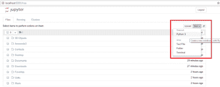

你将看到一个这样的新 Python 3 笔记本：


Jupyter notebook 由单元格（cells）组成。Python 脚本写在这些单元格内部。让我们使用 Jupyter notebook 打印 hello world。在笔记本的第一个单元格中输入`print(‘hello world’)`并按下`CTRL+ ENTER`。第一个单元格中的脚本将执行如下所示：

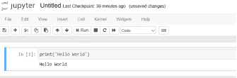

`print`函数将作为参数传递的字符串打印在输出中。要创建一个新单元格，点击左上角菜单中的`+`按钮，如下所示：

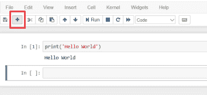

你可以在新单元格中编写 Python 脚本并按`CTRL + ENTER`执行它。

### 通过 Spyder 运行脚本

虽然 Jupyter notebook 是开始编写 Python 程序的好地方，但一旦你熟悉了 Python，应该转向 Spyder IDE。Spyder 允许我们直接创建 Python 文件。Spyder 类似于更传统的文本编辑器，具有运行文件、运行部分代码、调试代码等选项。

就像 Jupyter notebook 一样，你可以从 Anaconda Navigator 或直接从开始菜单运行 Spyder。运行 Spyder 后，你将看到以下界面。

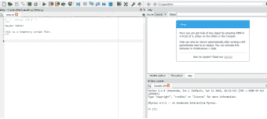

在 Spyder 界面的左侧，你可以看到文本编辑器；这是你输入脚本的地方。右下角是控制台窗口。你可以直接在控制台窗口中执行脚本。此外，编辑器中编写的代码输出也会出现在控制台窗口。让我们在 Spyder 中编写 hello world 程序。

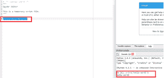

在 Python 中运行脚本有两个选项。你可以点击顶部菜单中的绿色三角形，或者选择你想要执行的代码段并按键盘上的`CTRL + ENTER`。你将在控制台窗口中看到输出。

### 安装 Tensorflow 和 Keras

在本书中，我们将使用 Tensorflow 的 Keras 库进行深度学习。使用 anaconda prompt 安装 Tensorflow 和 Keras 非常简单。

通过在搜索框中搜索`Anaconda Prompt`打开 anaconda 命令行提示。

在命令行内部，首先输入：

```bash
conda install -c conda-forge tensorflow
```

此命令行提示将请求权限，输入`y`。

同样，在 anaconda prompt 中以下命令安装 Keras：

```bash
conda install -c conda-forge keras
```

## 接下来做什么？

在本章中，我们看到了设置环境的过程。在下一章中，我们将开始讨论数据处理。

# 第 3 章

## 人工网络理论

人工神经网络（ANN）试图通过连接一系列神经元形成大型网络来模仿人类神经系统。

### 人脑是如何工作的

人类大脑由数十亿相互连接的神经元组成。人类神经元有三个主要部分：树突（Dendrite）、核（Nucleus）和轴突（Axon）。树突负责接收其他神经元的信息。核作为中心单元并处理信息。最后，处理后的信息传递给轴突。

### 感知机

人脑中的神经元类似于感知机。让我们看看感知器的样子：

### 激活函数

在上一节中，我们看到了感知机的结构。我们说输入、权重以及偏置（bias）之和被传递给激活函数，激活函数对总和进行操作并给出最终输出。

常用的激活函数有四种：

1. 阈值函数（Threshold Function）


阈值函数将权重和输入点积之和（权重矩阵乘以输入矩阵的积）的值压缩在 0 和 1 之间。如果和小于 0，激活函数输出 0。如果和为正数，激活函数返回 1。

### Sigmoid 函数

Sigmoid 函数是阈值函数的平滑版本。如果和大于 0，sigmoid 函数并不会精确返回 1，而是返回一个接近 1 的值。如果和小于 0，则返回一个接近 0 的值。sigmoid 函数看起来如下。如果和为 0，sigmoid 函数返回的值为 0.5。

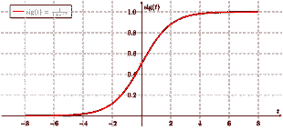

### 整流器 (Rectifier)

如果权重和输入点积之和小于 0，整流函数返回 0；如果和大于 0，则返回实际值。

### 双曲正切 (Hyperbolic Tangent)

双曲正切函数类似于 sigmoid 函数，但它将值压缩在 1 和 -1 之间，并在输入为 0 时返回 0。当输入为正时，返回 1 到 0 之间的正数；当输入为 0 时（注：此处可能指输入为负），返回 0 到 -1 之间的负数。

 ||  ||  |

| --- | --- | --- |


## 多层感知器 (Multilayer Perceptron)


现在我们知道了什么是感知器什么是激活函数。感知器的作用类似于逻辑回归，它可以找到线性边界。然而，现实世界的数据并不总是线性可分的。在这种情况下，无法使用单个神经元。寻找非线性可分边界的解决方案是使用多个神经元，并将它们以层的形式链起来，如下：

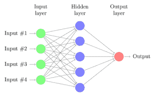

多层感知器（图片来自 [texample.net](http://www.texample.net/tikz/examples/neural-network/)）

多层感知器（也称为全连接神经网络）是最简单的神经网络。它包含一个与感知器类似的输入层。然而，它不是直接预测输出，而是涉及一个或多个隐藏层。来自输入层的数据被传递到紧邻的下一个隐藏层，由其传递到下一个隐藏层，依此类推。每个隐藏层由两个或两个节点组成。输入和权重的点积在每个节点处被求和，并通过激活函数。通常，隐藏层中使用的激活函数是整流函数，而在输出层使用的激活函数是 sigmoid 函数。

如果输出是连续的或二分类的，一个输出节点就足够了。然而，如果输出涉及两个以上的类别，则输出层需要多个节点，每个节点对应一个类别。

 ||  ||  |

| --- | --- | --- |


## 神经网络如何学习？


现在我们已经看到了神经网络，下一个问题是“它们是如何学习的？”。神经网络的学习涉及两个阶段：前向传播 (Feed Forward) 和反向传播 (Back Propagation)。

### 前向传播

前向传播的步骤如下：

1. 输入特征乘以权重，在和上加上偏置，并将结果传递到第一个隐藏层。
2. 第一个隐藏层的每个节点都包含一个激活函数。激活函数应用于从输入层接收的值。
3. 每个节点的产生值乘以第二个隐藏层的权重，再次应用激活函数，并将结果传递到下一层。这个过程一直持续到输出层。

### 反向传播

1. 反向传播的第一步是计算输出层预测值与实际输出之间的差异。这个差异被称为损失 (Loss)。用于计算损失的函数称为损失函数或代价函数。损失函数有许多类型，例如交叉熵和均方误差。
2. 为了最小化该值，我们必须找到函数相对于每个权重的瞬时变化率。这是一个优化问题，可以通过微分来解决。为了这一目的，可以使用梯度下降算法。基本上，在梯度下降算法中，找到代价函数相对于每个权重的偏导数。如果值为正，则从当前值中减去它，否则加上。这种前向传播和反向传播的过程持续到达到可接受的精度。一个包含前向传播和反向传播的循环被称为一个轮次 (epoch)。

 ||  ||  |

| --- | --- | --- |


## 结论


在本章中，我们回顾了什么是人工神经网络 (ANN)，而没有深入数学细节。为了实际实现，这些关于 ANN 的知识已经足够了。在下一章中，我们将看到如何在 Keras 中实现人工神经网络，以及如何使用它来解决预测问题。

 ||  ||  |

| --- | --- | --- |


# 第 4 章


 ||  ||  |

| --- | --- | --- |


## 使用 Keras 实现人工神经网络


在上一章中，我们学习了人工神经网络的理论。我们看到了全连接层结构如何用于学习参数或权重，这些权重可以用于正确地预测结果。在本章中，我们将看到如何使用 Python 的 `Keras` 库来实现人工神经网络。`Keras` 库基本上是 Google 开发的低级机器学习库 `Tensorflow` 的封装。然而，`Tensorflow` 需要非常深厚的机器学习知识以及上百行代码来实现实用的神经网络。但另一方面，通过 `Keras`，你只需要几行代码就可以实现一个 `ANN`。

我们要通过全连接 `ANN` 解决的问题是根据几个特征预测葡萄酒的质量。

关于数据集的更多详细信息可以在 [链接](https://archive.ics.uci.edu/ml/datasets/wine+quality) 找到。我们将仅使用红酒数据集。所有数据集都可以从书中引言中提到的链接下载。下载 `Datasets` 文件夹并将其置于 `D` 盘。本章使用的数据集是 `redwine_data.csv`。

按照以下步骤使用 Keras 实现人工神经网络。

 ||  ||  |

| --- | --- | --- |


### 导入所需的库


执行以下步骤以导入所需的库。我们稍后会导入 Keras 库。

```python
import pandas as pd
import numpy as np
import matplotlib.pyplot as plt
%matplotlib inline
```

 ||  ||  |

| --- | --- | --- |


### 导入数据集


以下脚本导入了数据集。

```python
redwine_data = pd.read_csv(r'D:\\Datasets\\redwine_data.csv', sep=';')
```

上述脚本读取数据集并将其存储在 `redwine_dataframe` 中。

 ||  ||  |

| --- | --- | --- |


### 数据分析


要查看数据外观，请执行以下脚本。它返回数据的前五行。

```python
redwine_data.head()
```

输出如下：

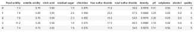

 ||  ||  |

| --- | --- | --- |


### 数据预处理


以下脚本将数据分为特征集和标签集。

```python
features = redwine_data.iloc[:,0:11].values
labels = redwine_data.iloc[:,11].values
```

 ||  ||  |

| --- | --- | --- |


### 对输出进行独热编码


在神经网络的输出层中，我们将指定输出节点的数量。在上一章中，我们提到在超过超过两个类别（二分类）的情况下，输出层中将有 `N` 个节点，其中 `N` 是类别的数量且大于 2。然而，为了使用神经网络，我们还必须将输出标签数组转换为 `K` 列的独热编码矩阵，其中 `K` 是唯一类别的数量。以下脚本将我们的标签数组 `labels` 转换为独热编码矩阵。执行以下脚本：

```python
from sklearn.preprocessing import LabelEncoder
encoder = LabelEncoder()
y = encoder.fit_transform(labels)
labels = pd.get_dummies(y).values
```

在上述脚本中，我们首先使用 `sklearn.preprocessing` 库中的 `LabelEncoder` 类将 `labels` 转换为一系列整数。然后，我们使用 pandas 库的 `get_dummies` 方法将这一系列整数转换为独热编码矩阵。

最后，让我们将数据划分为训练集和测试集：

```python
from sklearn.model_selection import train_test_split
train_features, test_features, train_labels, test_labels = train_test_split(features, labels, test_size=0.2, random_state=0)
```

 ||  ||  |

| --- | --- | --- |


### 数据缩放


对于人工神经网络，对对数据进行缩放，让我们使用标准缩放（StandardScaler）对数据进行缩放。

```python
from sklearn.preprocessing import StandardScaler
feature_scaler = StandardScaler()
train_features = feature_scaler.fit_transform(train_features)
test_features = feature_scaler.transform(test_features)
```


这些是任何机器学习算法所需的标准步骤。现在我们将看到如何使用 Keras 实现人工神经网络。

 ||  ||  |

| --- | --- | --- |


### 导入 Keras 库


我们将导入 Keras 库及其类：`Sequential` 和 `Dense`。`Sequential` 类用于初始化网络，而 `Dense` 类用于添加层。执行以下脚本：

```python
import keras
from keras.models import Sequential
from keras.layers import Dense
```

在向网络添加层之前，我们首先需要初始化网络。执行以下脚本来实现：

```python
ann_clf = Sequential()
```

 ||  ||  |

| --- | --- | --- |


### 添加输入和隐藏层


为了添加输入和隐藏层，使用了 `Dense` 类。`Dense` 类的 `units` 参数指定了层输出节点的数量。`kernel_initializer` 参数指定了初始权重类型。`activation` 参数指定了激活函数，而 `input_dim` 指定了输入层特征的数量。需要注意的是，输入层并不是单独创建的，而是通过第一个隐藏层中的 `input_dim` 参数指定输入层的节点数，所示：

```python
h1 = Dense(units=9, kernel_initializer='uniform', activation='relu', input_dim=11)
ann_clf.add(h1)
```

在第一个隐藏层中，我们将节点数设置为 9。根据经验，节点数应该是输入节点和输出节点的平均值。我们有 11 个输入节点和 6 个输出节点。平均值为 8.5，因此我们在隐藏层中使用 9 个节点。权重已初始化为均匀分布，而激活函数是 `relu`，它本质上是整流函数的简写。

最后，我们调用 `Sequential` 类对象 `ann_clf` 的 `add` 函数，并传入我们刚刚创建第一个隐藏层。

对于下一个隐藏层，其他部分保持相同，只是我们不需要指定输入维度，因为第二个隐藏层将从第一个隐藏层计算输入维度。执行以下脚本添加：

```python
h2 = Dense(units=9, kernel_initializer='uniform', activation='relu')
ann_clf.add(h2)
```

### 添加输出层


要创建输出层，我们可以再次使用 `Dense` 类。然而，由于输出有 6 个类别，因此单元（units）的数量将为 6。此外，由于我们需要预测多个类别，激活函数将使用“softmax”。对于二分类输出，我们可以使用 `sigmoid` 函数。Keras 激活函数的详细信息可以在[此处](https://keras.io/activations/)找到。执行以下脚本添加输出层。

```python
op = Dense(units = 6, kernel_initializer = 'uniform', activation = 'softmax')
ann_clf.add(op)
```


|  ||  ||  |

| --- | --- | --- |


### 训练神经网络


为了训练神经网络，我们首先需要调用`Sequential`类对象的`compile`方法。该方法接受优化函数、损失函数和指标作为参数。我们将使用`'adam'`优化函数，你也可以使用`'sgd'`进行随机梯度下降。Keras中可用的不同类型优化器的详细信息可以在此链接找到：[`keras.io/optimizers/`](https://keras.io/optimizers/)

由于我们是分类输出，我们将使用`'categorical_crossentropy'`函数。如果输出是二分类的，我们需要使用`'binary_crossentropy'`函数。Keras中可用的所有损失函数的细节可以在此链接找到：[`keras.io/losses/`](https://keras.io/losses/)

我们将使用的性能指标将是`accuracy`。执行以下脚本来运行`compile`函数：

```python
ann_clf.compile(optimizer='adam', loss='categorical_crossentropy', metrics=['accuracy'])
```

最后，为了开始训练，我们需要调用`fit`方法并传入我们的训练集和测试集。我们还需要传递`batch_size`和迭代次数（`epochs`）。对于这个例子，我们只有1599条记录，因此`batch_size`设置为1是合适的，这意味着权重将在每次观测时进行更新。`epochs`的数量为500。你可以尝试调整这些值以观察结果。执行以下脚本：

```python
ann_clf.fit(train_features, train_labels, batch_size=1, epochs = 500)
```

一旦执行了上述方法，神经网络将开始运行，在每个epoch之后，你将看到如下所示显示的`accuracy`：

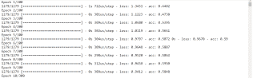

|  ||  ||  |

| --- | --- | --- |


### 预测与算法评估


为了进行预测，我们使用`Sequential`对象的`predict`方法，并如下所示传入我们的测试特征：

```python
predictions = ann_clf.predict(test_features)
```

用于评估的混淆矩阵和准确率方法接受一维数组形式的测试标签和预测标签。然而，我们的测试标签以及预测都是独热编码（one hot encoded）矩阵形式。要将此独热编码矩阵转换为一维输出数组，请执行以下脚本：

```python
predictions = np.argmax(predictions,axis=1)
test_labels = np.argmax(test_labels,axis=1)
```

最后，为了在测试集上构建混淆矩阵并计算准确率，我们可以如下所示使用`sklearn.metrics`库中的`confusion_matrix`和`accuracy_score`：

```python
from sklearn.metrics import classification_report, confusion_matrix, accuracy_score
print(confusion_matrix(test_labels, predictions))
print(classification_report(test_labels, predictions))
print(accuracy_score(test_labels, predictions))
```

上述脚本的输出如下：

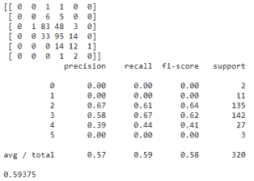

在这种情况下，实现的准确率为59.35%，这并不理想。但现在你已经知道神经网络是如何工作的以及它的不同步骤是什么。我建议你尝试不同的参数，例如激活函数、优化器和损失函数、隐藏层中的节点数、层数等，看看是否能获得更好的结果。

## 结论

在本文中，我们学习如何通过Keras实现人工神经网络。我们解释了使用Keras库实现ANN所需的不同步骤。基础ANN的到此结束，在下一章中，我们将开始讨论一种因解决计算机视觉问题的著名的高级神经网络。编码愉快！！！

|  ||  ||  |

| --- | --- | --- |


# 第 5 章


|  ||  ||  |

| --- | --- | --- |


## ANN 的评估与调优


在上一章中，我们开发了一个预测葡萄酒质量的神经网络。为了训练和测试我们的算法，我们将数据分为80%的训练集和20%的测试集。这意味着我们没有对20%的数据进行算法测试。如果这20%的测试数据包含了训练所需的价值信息呢？将数据随机分为训练集和测试集会导致方差问题。

另一个影响不同算法性能比较的问题是各种超参数（如`batch_size`和`epochs`）的使用。为了比较两个算法，我们需要找到产生最佳性能的参数。这个问题可以通过网格搜索（Grid Search）算法来解决。

在本章中，我们将详细学习交叉验证（Cross Validation）和网格搜索。

在上一章中，我们使用`ANN`根据几个属性来预测红酒的质量。在本章中，我们将解决相同的问题，但在这里我们将使用10折交叉验证。要使用`Keras`库实现交叉验证，我们需要遵循以下步骤：

|  ||  ||  |

| --- | --- | --- |


### 1. 导入所需的库


```python
import pandas as pd
import numpy as np
import matplotlib.pyplot as plt
%matplotlib inline
```

|  ||  ||  |

| --- | --- | --- |


### 2. 导入数据集


以下脚本导入了数据集。

```python
redwine_data = pd.read_csv(r'D:\\Datasets\\redwine_data.csv', sep=';')
```

上述脚本读取数据集并将其存储在`redwine_data_dataframe`中。

|  ||  ||  |

| --- | --- | --- |


### 3. 数据分析


```python
redwine_data.head()
```

输出结果如下：

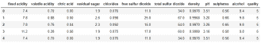

|  ||  ||  |

| --- | --- | --- |


### 4. 数据预处理


以下脚本将数据分为特征集和标签集。

```python
features= redwine_data.iloc[:,:,0:11].values
labels= redwine_data.iloc[:,:,11].values
```

|  ||  ||  |

| --- | --- | --- |


### 5. 输出的独热热编码


```python
from sklearn.preprocessing import LabelEncoder
encoder = LabelEncoder()
y = encoder.fit_transform(labels)
labels = pd.get_dummies(y).values
```

在上一章中，我们使用了`sklearn.model_selection`库的`train_test_split`类将数据分为训练集和测试集。在交叉验证的情况下，我们需要这样做，我们将使用整个数据集进行交叉验证。

|  ||  ||  |

| --- | --- | --- |


### 6. 数据缩放


对于人工神经网络，数据缩放是必要的，让我们使用标准器（standard scalar）缩放数据。

```python
from sklearn.preprocessing import StandardScaler
feature_scaler = StandardScaler()
features = feature_scaler.fit_transform(features)
```

这些是执行任何机器学习算法时所需的标准步骤。现在我们将看到如何使用`Keras`库来实现人工神经网络。

### 1. 创建 ANN

现在让我们创建一个将用于交叉验证的人工神经网络。我们将创建一个方法，创建一个具有两个隐藏层和一个输出层的人工神经网络，正如我们在上一章中所做的那样。如下所示：

```python
from keras.models import Sequential
from keras.layers import Dense

def train_classifier():
    ann_clf= Sequential()
    ann_clf.add(Dense(units = 9, kernel_initializer = 'uniform', activation = 'relu', input_dim = 11))
    ann_clf.add(Dense(units = 9, kernel_initializer = 'uniform', activation = 'relu'))
    ann_clf.add(Dense(units = 6, kernel_initializer = 'uniform', activation = 'softmax'))
    ann_clf.compile(optimizer = 'adam', loss = 'categorical_crossentropy', metrics = ['accuracy'])
    return ann_clf
```

`train_classifier`方法返回人工神经网络。

### 2. 实现交叉验证

为了实现交叉验证，我们使用`sklearn.model_selection`中的`cross_val_score`。脚本如下：

```python
from keras.wrappers.scikit_learn import KerasClassifier
from sklearn.model_selection import cross_val_score

ann_clf = KerasClassifier(build_fn=train_classifier, batch_size=10, epochs=500)
results = cross_val_score(ann_clf, features, labels, cv=10)
```

要查看`cross_val_score`返回的准确率，你可以打印：

```python
print(results)
```


要查看所有准确率的平均值，调用：

```python
print(results.mean())
```

结果显示`0.5653`即`56.53%`。最后要查看标准差，执行：

```python
print(results.std())
```

上述脚本返回`0.0554`或`5.54%`，这意味着对数据集的测试准确率在51%到61%之间。

|  ||  ||  |

| --- | --- | --- |


### 7. 网格搜索

机器学习算法的工作是找到产生最佳结果的参数集或权重。这些参数由算法发现并取决于数据集。

然而，在运行算法之前还有另一组参数需要指定。例如`KNN`算法的`K`值、`SVM`算法的`kernel`类型、`Random forest`算法的`estimators`数量、人工神经网络的`nodes`、`batch_size`以及`epochs`数量等。这些参数是可以控制或指定的。

然而，我们并不知道这些参数的最佳值。在最后部分，我们为ANN设置了`batch_size`为10，epochs为500。如果算法在batch size为5，epochs为300时性能更好呢？

网格搜索算法帮助我们解决这个问题。基本上，网格搜索算法做的是从一组参数set中自动为特定算法找到最佳参数。

|  ||  ||  |

| --- | --- | --- |


## 使用 Keras 实现网格搜索

要使用`keras`实现网格搜索，前1到4步以及6、7步与我们在交叉验证中执行的步骤相同。我们网格搜索不需要独热编码。因此，更新第5步即独热编码步骤脚本如下：

```python
from sklearn.preprocessing import LabelEncoder
encoder = LabelEncoder()
labels = encoder.fit_transform(labels)
```

在执行了上述七个步骤的脚本后，执行以下脚本：

```
keras_ann_clf = KerasClassifier(build_fn = train_classifier)
```


上述脚本将 `keras` 分类器转换为 `sklearn` 分类器。我们将使用 `sklearn.model_selection` 库中的 `GridSearchCV` 类；因此，我们需要像在交叉验证部分所做的那样，将 `keras` 分类器转换为 `sklearn` 分类器：

### 创建参数字典

网格搜索算法并不是随机运行并寻找算法的所有最佳参数的，因为这可能花费数年时间。例如，如果网格搜索算法开始测试 `ANN` 的 `batch_size` 参数从 1 到 500 的每个值，那么算法至少必须运行 500 次，而这仅仅是针对一个参数。因此，会将你想要测试的每个参数的一组值传递给 `GridSearchCV` 类。这些参数集以字典的形式传递进去。

假设我们想为 `ANN` 测试不同的 `batch_size` 值和若干个 `epochs`（训练轮数），我们可以创建一个如下所示的字典：

```python
grid_params = {'batch_size': [10, 5],
'epochs': [500, 300]
}
```

在上面的脚本中，我们创建了一个名为 `grid_params` 的字典，字典的键是参数名称，字典的值对应参数的值。从这些值集中，网格搜索算法将返回最佳组合。

这里需要提到的是，网格搜索算法花费的时间很大取决于你想要测试的值以及交叉验证的折数（`folds`）。

例如，在我们的案例中，`batch_size` 参数有 2 个值，`epochs` 有 2 个值。这种情况下总可能的组合为 2 x 2 = 4 次。将此值乘以折数，例如 10。这使得产生了 40 次执行。在 40 次执行中，20 次有 500 次 `epochs`，而 20 次有 300 次 `epochs`，总共 1.6 万次 `epochs`。这会让算法变慢。

### 创建参数字典（继续）

为了执行网格搜索，我们需要创建一个 `GridSearchCV` 类的对象，并为其传递分类器、我们刚刚创建的参数字典、性能评估指标（我们将使用 `accuracy`）以及交叉验证折数。执行以下脚本以创建 `GridSearch` 对象。

```python
from sklearn.model_selection import GridSearchCV

gs= GridSearchCV(estimator = keras_ann_clf,
param_grid = grid_params,
scoring = 'accuracy',
cv = 10)
```

最后一步是在 `GridSearchCV` 对象上调用 `fit` 方法，并如所示传递训练集和测试集：

```python
gs_result = gs.fit(features, labels)
```

执行此操作可能需要一些时间。

一旦上述脚本执行完毕，最后也是一步是查看网格搜索选择的参数。为了这样做，你可以如下所示使用 `GridSearchCV` 类的 `best_params_` 属性：

```python
print(gs_result.best_params_)
```

输出如下：

```python
{'batch_size': 10, 'epochs': 300}
```

输出显示从给定的参数集中，最佳参数是 `batch_size` 为 10 和 300 次 `epochs`。使用上述参数值实现了最佳性能。最后，为了查看使用最优参数所实现的准确率，执行以下脚本：

```python
print(gs_result.best_score_)
```

0.5941213258286429

你可以看到，当 `batch size` 为 10 且 `epochs` 为 300 时，我们获得的平均准确率为 59.41%，大于我们在上一节中 `batch size` 为 10 且 500 次 `epochs` 时得到的 56.53%。

## 结论

在本章中，我们看到了如何使用交叉验证来处理方差问题。我们还研究了如何使用网格搜索来选择算法的最佳参数。在下一章中，我们将卷积神经网络（`CNN`），这是一种极其强大的算法，通常用于计算机视觉问题。

|  ||  ||  |

| --- | --- | --- |


# 第 6 章


|  ||  ||  |

| --- | --- | --- |


## 卷积神经网络简介


在上一章中，我们实现了一个全连接神经网络，其中前层中的每个节点都连接到下一层中的每个节点。这是神经网络最简单的架构。然而，针对特定任务也开发了许多先进的神经网络。其中一种神经网络就是卷积神经网络（`CNN`），它用于识别以 2D 形式存在的数据中的模式。

`CNN` 常用于图像分类等计算机视觉问题。在本章中，我们将学习卷积神经网络背后的直觉。在下一章中，我们将用 `Python` 实现卷积神经网络。

|  ||  ||  |

| --- | --- | --- |


### 计算机如何看待图像


这里需要提到，计算机处理图像的方式与人类不同。我们人类看到线条、曲线和不同的颜色。而计算机只能看到数字。对于灰度图像，图像被视为 0 到 255 之间的二维数组。对于彩色图像，有 3 个 0 到 255 的通道，分别对应红、绿、蓝。

假设我们有如下灰度图像，对我们来说是一个微笑，但对计算机来说，它仅仅是零的二维数组。为了简单起见，这里 1 表示黑色，0 表示白色。

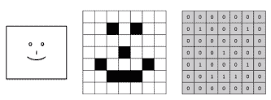

––––


现在我们知道了图像在内存中的样子。让我们开始讨论 `CNN`。执行神经网络需要执行的步骤如下：

1. 卷积操作

2. `ReLU`

3. 池化

4. 扁平化

5. 全连接层

|  ||  ||  |

| --- | --- | --- |


### 卷积操作


卷积神经网络涉及的第一步是卷积操作。

在卷积操作中，我们有一个输入图像（如左侧所示）和一个特征检测器（也称为卷积算子或内核，如上图中 3x3 矩阵形式所示）。

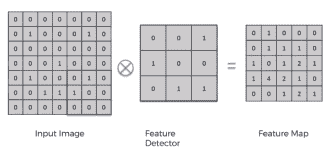

图 6.1：卷积操作

在卷积操作中，特征检测器从左到右、从上到移动图像。对应的像素相乘，并将所有对应像素的乘积相加。这里需要提到步长（`stride`）的概念。步长是特征检测器移动的步。步长为 1 意味着检测器向右或向下移动一步。

例如，在输入图像的右下角，你可以看到下面的数字矩阵：

––––


| 0 || 1 || 0 |

| --- | --- | --- |

| 1 || 0 || 0 |

| 0 || 0 || 0 |

当你将上述矩阵的每个像素值与特征检测器的对应像素值相乘并将结果相加时，你会得到以下值：

`0x0 + 1x0 + 0x1 + 1x1 + 0x0 + 0x0 + 0x0 + 0x1 + 0x1 = 1`

你可以在 `Feature map`（特征图）的右下角看到 `1`。

现实中，有多个特征检测器会产生多个特征图，如下所示。图像具有多个特征，而一个特征检测器只能检测一个特征。因此，拥有多个特征检测器是有意义的。

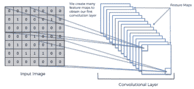

图 6.2:特征检测器

|  ||  ||  |

| --- | --- | --- |


### ReLu 操作


一旦卷积操作生成了特征图，下一步是执行 `ReLu` 操作。我们在第 3 章详细学习了 `Relu Operation`。卷积操作是线性的。然而，现实中的图像是非线性的。为了在图像中引入非线性，执行了 `ReLu` 操作。

在 `ReLu` 中，特征图中所有的负值都被替换为零。正值保持不变。

假设我们有如下特征图：

––––––––


| \-4 || 2 || 1 || \-2 |

| --- | --- | --- | --- |

| 1 || \-1 || 8 || 0 |

| 3 || \-3 || 1 || 4 |

| 1 || 0 || 1 || \-2 |

当 `Relu` 函数作用于特征图上，生成的特征图看起来如下：

| 0 || 2 || 1 || 0 |

| --- | --- | --- | --- |

| 1 || \-0 || 8 || 0 |

| 3 || 0 || 1 || 4 |

| 1 || 0 || 1 || 0 |

|  ||  ||  |

| --- | --- | --- |


### 池化


在学习池化之前，让我们先理解空间不变性（`spatial invariance`）。看看下面几张猎豹的图片。第一张是原始图像，第二张图像方向发生了改变，而第三张图像发生了失真。然而，在所有三种情况下，我们都能识别出这是一只猎豹。即使鼻子、耳朵和眼睛不在图像的相同位置，我们也能识别它们。

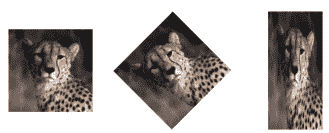

图 6.3: 空间不变性

这被称为空间不变性，无论特征位于何，你都可以识别它。池化有助于实现空间不变性。

与卷积类似，在池化中我们拥有任意大小的过滤器。假设我们有一个大小为 `2x2` 的过滤器。我们将其放在图像上，并选择该步长内的最大值。这被称为最大池化（`max pooling`）。在某些情况下也会使用和池化、平均池化最小池化。看下面的图：

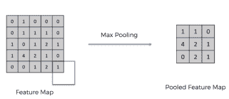

图 6.4: 最大池化

在第 `2`、`3` 行以及第 `3`、`4` 列中，我们有值 `1`、`1`、`1` 和 `2`。最大值是 `2`；你可以在右侧的池化特征图中看到这个最大值。

在没有值可比较的情况下（例如右下角，我们只有一个 `1`），它被传递到池化特征图中。

|  ||  ||  |

| --- | --- | --- |


### 展平


为了从图像中检测更多特征，卷积神经网络的输出（即池化特征图）被用作全连接神经网络的输入。池化特征图是 `2-D arrays` 形式。然而，全连接神经网络的输入应该是特征向量或 `1-D array` 形式。在展平步骤中，池化特征图被展平，如图所示：

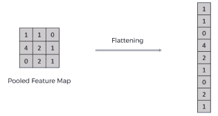

图 6.5: 展平

在有多个池化特征图的情况下，可以将它们堆叠在一起形成一个长的列向量。

|  ||  ||  |

| --- | --- | --- |


### 全连接层


卷积神经网络的最后一步是将展平后的池化特征图输入到全连接神经网络（我们在第 4 章和第 5 章学习过），如图 6.6 所示。执行这一步是为了从卷积、`relu` 和池化步骤生成的现有特征集中找到更多特征。

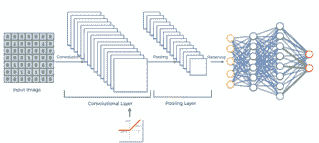

图 6.6: 特征检测器

要可视化 `CNN`，请查看由 [Adam Harley](http://www.cs.cmu.edu/~aharley/) 开发的[这个工具](http://scs.ryerson.ca/~aharley/vis/conv/flat.html)。该工具可可视化 `CNN`。你可以在左上角的数字框中写数字，`CNN` 就会检测你写的内容。该工具使用的 `CNN` 具有 2 层卷积、`relu` 和池化操作，随后是两个全连接层，如下：


图 6.7: 可视 `CNN` (`scs.ryerson.ca/~aharley/vis/conv/flat.html)) 注意：池化和 `ReLu` 操作结合在了一起。

建议你玩玩这个工具，对卷积网络建立更多直觉。

|  |

| --- | --- | --- |


## 总结


在本章中，我们学习了 `CNN` 背后的理论。我们看到了执行 `CNN` 的步骤。在下一章中，我们将在 `Python` 中实现 `CNN`。

|  ||  ||  |

| --- | --- | --- |


# 第 7 章


|  ||  ||  |

| --- | --- | --- |


## 使用卷积神经网络进行图像分类


在上一章中，我们学习了什么是卷积神经网络（`CNN`）以及开发卷积神经网络涉及的各个步骤。

在本章中，我们将继续在 `Python` 中实现卷积神经网络。我们知道卷积神经网络可以学习识别如图像等二维映射图上相关的特征。在本章中，我们将使用 `CNN` 解决图像分类任务。给定一组图像，任务是预测某张图像包含猫还是狗。

这是一个非常著名的问题，该问题的数据可以在 [google](https://www.kaggle.com/c/dogs-vs-cats) 数据集中找到。原始数据集包含约 25000 张图像。然而，为了简单起见便于下载，我们将仅使用 10,000 张图像进行训练和测试。本章节的数据可以在 `animal_datafolder` 中找到，该文件夹位于 `Datasets` 文件夹内，你可以从书中描述部分提供的链接进行下载。

### 理解数据

在开始编写 `CNN` 代码之前，我们需要先了解数据集是如何安排的，因为我们没有可以作为数据源的单个 `CSV` 文件。相反，我们有一组图像。为了实现机器学习模型，我们需要因变量和自变量。自变量用于预测因变量。

将一组图像转换为自变量和因变量，我们有几种选择。一种方法是根据图像类型将每张图像命名为 `cats` 或 `dogs`，后面跟一个唯一 `id`。这些图像就可以作为自变量。为了创建因变量向量，我们可以解析每个文件名，并根据找到的值（即猫或狗）在因变量向量中添加特定的条目。这非常繁琐并且涉及一些自定义代码。

然而，`Keras` 有一个更好的解决方案。我们只需要将图像按照特定的文件夹结构安排，`Keras` 就会自动检测因变量自变量。此外，`Keras` 还会根据目录结构检测训练集和测试集。

因此，为了让 `Keras` 理解自变量和因变量，我们必须按照特定的文件夹结构安排图像。


首先，你需要一个包含训练集和测试集的顶层文件夹。在顶层文件夹内部，你需要两个文件夹，分别用于训练集和测试集。在训练集和测试集内部，你需要为每个类别创建文件夹。例如，如果你有两种类型的图像（即猫和狗），你需要在训练集和测试集文件夹内为 `cats` 和 `dogs` 创建文件夹。

我们在本章中使用的目录结构如下：

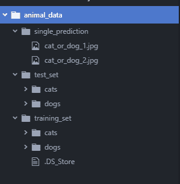

你可以看到我们有一个顶层文件夹 `animal_data`，它包含了 `test_set` 和 `training_set` 文件夹。`animal_data` 文件夹还包含了 `single_predictionfolders`，我们在本章中不会使用。`test_set` 和 `training_set` 文件夹都包含 `dogs` 和 `cats` 文件夹。我们将使用 8000 张图像进行训练，2000 张进行测试。因此，`training_set` 文件夹包含 8000 张图像。`training_set` 文件夹中的 `cats` 和 `dogs` 文件夹各包含 4000 张图像。同样，`test_set` 文件夹中的 `cats` 和 `dogs` 文件夹各包含 1000 张图像。如果你打开 `cats` 文件夹，你会看到猫的图像，而 `dogs` 文件夹包含了狗的图像。

这种数据集安排方式的优点是它可以用于任何问题。例如，如果你想分类汽车和卡车的图像，只需在 `training_set` 和 `test_set` 文件夹中为 `cars` 和 `trucks` 创建文件夹即可。

我们已经为 Keras 准备好了数据。

现在是用 Keras 编写卷积神经网络代码了。按照以下步骤操作：

### 1. 导入库

一如既常，第一步是导入库：

```python
from tensorflow.keras.models import Sequential
from tensorflow.keras.layers import Conv2D, MaxPooling2D, Flatten, Dense
```

### 2. 初始化卷积网络

第一步是初始化网络：

```python
cnn_clf = Sequential()
```

### 3. 添加卷积和池化层

下一步是添加层。如下创建第一个卷积层：

```python
cnn_clf.add(Conv2D(32, (3, 3), input_shape=(64, 64, 3), activation='relu'))
cnn_clf.add(MaxPooling2D(pool_size=(2, 2)))
```

让我们再添加一个卷积和池化层：

```python
cnn_clf.add(Conv2D(32, (3, 3), activation='relu'))
cnn_clf.add(MaxPooling2D(pool_size=(2, 2)))
```

### 4. 输入扁坦化

在与全连接神经网络使用数据之前，我们需要对输入进行扁坦化：

```python
cnn_clf.add(Flatten())
```

### 5. 添加密集层

卷积神经网络的最后一步是将数据从展平层（`flatten layer`）输入到全连接层（`densely connected layer`）。全连接层与我们在第 3 章和第 4 章中创建 ANN 时使用的相同层。我们将使用一个包含 128 个节点的隐藏层。以下脚本添加了一个隐藏层：

```python
h1 = Dense(units = 128, activation = 'relu')
cnn_clf.add(h1)
```

在输出层中，由于是二分类结果，我们将使用 `sigmoid` 激活函数。执行以下脚本：

```python
h2 = Dense(units = 1, activation = 'sigmoid')
cnn_clf.add(h2)
```

### 编译 CNN

CNN 的编译步骤与 ANN 类似。我们使用 `compile` 函数并向其传递优化器函数、损失函数和指标，如下所示：

```python
cnn_clf.compile(optimizer = 'adam', loss = 'binary_crossentropy', metrics = ['accuracy'])
```

### 图像数据增强

在我们的数据集中，有 8 万张图像用于训练模型。这实际上是一个非常小的数字，可能会导致过拟合（`over-fitting`）。过拟合是指机器学习模型在训练数据上的准确率较高，但对测试实例的预测准确率的现象。

在简单的机器学习问题中，我们只需要找到因变量和自变量之间的关系。然而，在图像的情况下，机器学习模型必须找到图像不同部分之间的关系。因此，对于图像分类，需要大量的图像。

幸运的是，Keras 包含一个名为 `ImageDataGenerator` 的类，它可以帮助从现有图像生成不同类型的图像，从而增加训练集中的图像数量。

`ImageDataGenerator` 类生成图像的副本，然后执行诸如切换图像方向、缩小尺寸、扭曲图像等任务，从现有图像中创建新的独特图像。

查看以下脚本以了解 `ImageDataGenerator` 类的工作。

```python
from keras.preprocessing.image import ImageDataGenerator

train_setgen = ImageDataGenerator(rescale = 1./255,
                               shear_range = 0.2,
                               zoom_range = 0.2,
                               horizontal_flip = True)
```

在上面的脚本中，我们首先从 `keras.preprocessing.image` 库导入 `ImageDataGenerator`。然后我们创建该类的对象。在构造函数中，我们需要传递 `rescaling`、`shear_range`、`zoom_range` 和 `horizontal_flip` 的值。这些都是应用于图像的不同类型的变换，以生成不同类型的训练数据。在上面的脚本中，我们为训练集应用了这些变换。

对于测试集，我们希望保持一切不变，只是缩放图像。执行以下脚本为测试类创建一个图像数据生成器。

```python
test_setgen = ImageDataGenerator(rescale = 1./255)
```

### 创建训练集和测试集

我们已经创建了转换训练集和测试集的类。我们将使用这些类来创建要使用的训练集和测试集。查看以下脚本：

```python
training_data = train_setgen.flow_from_directory(r'D:/Datasets/animal_data/training_set',
                                               target_size = (64, 64),
                                               batch_size = 32,
                                               class_mode = 'binary')

test_data = train_setgen.flow_from_directory('D:/Datasets/animal_data/test_set',
                                               target_size = (64, 64),
                                               batch_size = 32,
                                               class_mode = 'binary')
```

由于我们的图像存储在本地目录中；因此我们需要调用 `flow_from_directory` 方法来应用变换。该方法接受四个参数。第一个参数是包含你想转换的图像的目录路径。

第二个参数是 `target_size` 参数，指定了图像的尺寸。在第一个卷积层中，我们指定图像将是 64 x 64 像素。因此，向 `target_size` 参数传递一个元组 `(64, 64)`。

第三个参数是 `batch_size` 参数，指定了要生成的图像批大小。最后，由于我们的输出中有两个类（即猫和狗），因此我们将 `class_mode` 参数设置为二分类（`binary`）。

### 寻找准确率

我们已经有了所需格式的训练数据和测试数据。下一步是训练模型并找到准确率。执行以下脚本进行操作：

```python
cnn_clf.fit_generator(training_data,
                      steps_per_epoch = (8000/32),
                      epochs = 25,
                      validation_data = test_data,
                      validation_steps = (2000/32))
```

为了训练模型，我们需要在 `cnn_clf` 对象上调用 `fit_generator` 方法。我们需要将训练数据作为第一个参数传递。第二个参数是 `steps_per_epoch`，它基本上是批大小。由于每个批次有 32 张图像，我们将图像总数除以批大小，以便在批处理期间每张图像被使用一次。`epochs` 的数量是你希望重复整个批训练的次数。`validation_data` 参数接收了 `test_data` 作为参数。最后，对于测试集，你再次需要传递批数。在这里我们再次有 2000 个批次，每个批次测试 32 张图像。因此，两次测试即可完成测试集中所有的 2000 张图像，我们将 2000 除以 32。

上述脚本将运行。


## 人脑中的记忆类型


我们知道人工神经网络是为了模仿人脑而建模的。人脑有两种类型的记忆：长期记忆和短期记忆。例如，在长期记忆的帮助下，我们可以认出五年前看过的电影。即使在多年后见到亲密朋友，我们也能认出他们的脸。另一方面，短期记忆通常帮助我们记住某件事很短一段时间，然后它就会消失。例如，我们不记得三周前吃了什么。在人脑中，颞叶存储长期记忆，而额叶负责短期记忆。

## 什么是 RNN？


人工神经网络通过前向传播和反向传播步骤的重复循环进行训练。在前向传播步骤中，计算误差；在反向传播中，更新权重以减少误差。一旦误差降到最小，就可以保存权重。这些权重构成了长期记忆。

循环神经网络与其他神经网络的区别在于，在 RNN 的情况下，神经元的输出被作为输入馈回到自身。这复制了人脑短期记忆的行为。图 8.1 显示了 RNN 的架构。

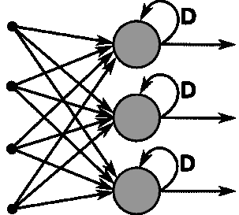

图 8.1：循环神经网络的架构

### RNN 的应用


RNN 的应用可以分为三大类：

*   一对多（One to Many）

这类应用有一个输入和多个输出。此类应用的示例可以是图像描述符，其中图像是系统的输入，图像的描述是输出。

*   对一（Many To One）

文本分类是此类应用的典型示例。例如，在垃圾邮件分类应用中，包含多个单词的文本字符串作为输入输入，输出是标签 `ham`（正常邮件）或 `spam`（垃圾邮件）。

*   多对多（Many to Many）

机器翻译是属于多对多类 RNN 应用的最优秀示例之一。

例如，如果你有一个句子“The boy eats an apple and he likes mangoes too”（男孩吃了一个苹果，他也喜欢芒果子）。如果你将上面的句子改为“The girl eats an apple”（女孩吃了一个苹果），并保持句子的其余部分不变，RNN 应用会给警告指出“he likes mangoes”中的“he”应该改为“she”，因为 RNN 会跟踪之前的信息，它发现那里是 `girl`（女孩）而不是 `boy`（男孩）。

### 循环神经网络的步骤


正如我们之前看到的，循环神经网络与人工神经网络非常相似。唯一的增加是从隐藏层到自身的反馈数据。像 ANN 一样，RNN 也由多个前向传播和反向传播循环组成。

### 前向传播（Feedforward）

以下是循环神经网络的前向传播步骤：

1.  对于隐藏层中的每个节点，输入值与该特定隐藏层的权重矩阵相乘，可以表示为 `Wxh * X`。这里 `Wxh` 是隐藏层 `h` 的权重矩阵，`X` 是输入向量。这里的星号表示两个向量之间的点积。

2.  由于在 RNN 的每个节点处，我们将从上一个隐藏状态的数据输入到新的隐藏状态。这可以表示为 `Whh * h[t-1]`。这里 `Whh` 是隐藏状态 `h` 的权重矩阵，`h[t-1]` 是上一个时间戳（即 `t-1`）隐藏状态的输出。

3.  步骤 2 和 3 的输出与偏置（`bias`）相加，作为当前隐藏状态的输入。

4.  将激活函数应用于隐藏状态的输入，生成新值。

这些步骤在网络的每个节点处执行，直到到达输出节点。

### 反向传播（Backpropagation）

RNN 的反向传播步骤与普通 ANN 完全相同：

1.  使用损失函数计算实际输出与计算输出之间的误差，损失函数通常是负对数似然，因为输出节点使用的激活函数通常是 `softmax`。

2.  将误差反向传播到整个网络并相应地更新权重。

## 结论


在本章中，我们看到了循环神经网络背的基本原理，即从上一个时间戳隐藏层输出到新时间戳的反馈机制。这允许 RNN 记住之前发生过什么，这对于预测序列数据非常有帮助。在下一章中，我们将看到 LSTM（RNN 的一个版本）如何解决未来价格预测等时间序列问题。

# 第 9 章

## 使用 RNN 进行时间序列分析

在上一章中，我们开始了对 RNN 的讨论。我们说 RNN 可用于预测序列数据。在本章中，我们将利用 LSTM 预测微软的未来股价，LSTM 是 LSTM 最常用的版本之一。让我们直接进入正题：

### 下载数据


微软的股票数据可以从多种来源下载。然而，为了本文的起见，我们从以下链接下载了数据：

[`finance.yahoo.com/quote/MSFT/history/?guccounter=1`](https://finance.yahoo.com/quote/MSFT/history/?guccounter=1)

如果你访问上述链接，将看到微软的最新股票数据。你可以应用日期过滤器来筛选任何所需的时间段。

在本章中，为了训练我们的 RNN，我们将使用 2012 年 1 月 1 日至 2016 年 1 月 31 日的 5 年微软股票数据。为了测试我们的算法并进行评估，我们将使用微软的一个月数据，即 2017 年 1 月的数据。

在本章的起见，训练数据已下载并保存到 D 盘的 Datasets 文件夹中，名为 `ms-training.csv`。同样，测试文件已保存为同一文件夹下的 `ms-testing.csv`。

### 数据分析

如果你打开该文件，你会发现它包含七列：日期（`Date`）、开盘价（`Open`）、最高价（`High`）、最低价（`Low`）、收盘价（`Close`）、调整后收盘价（`Adj Close`）和成交量（`Volume`）。我们只对预测未来某天的开盘价感兴趣。

这种价格变化的模式极其不规则，对于普通的人工神经网络（ANN），很难捕捉这种模式。这就是 LSTM 发挥用场的地方。LSTM 能够在大数据中找到这种序列模式。

我们已经对数据进行了可视化处理，现在是时候进行真正的编程了。我们将遵循传统的机器学习流程来实现这一目标。

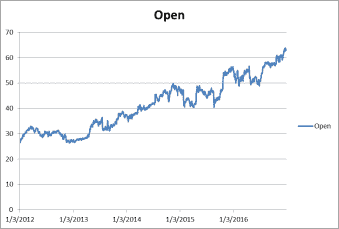

图 9.1：多年开盘价的变化。

### 导入库

```python
import numpy as np
import matplotlib.pyplot as plt
import pandas as pd
```

### 加载数据集

以下脚本加载数据集并将其存储在 `stock_data` DataFrame 中。

```python
stock_data = pd.read_csv('D:\\Datasets\\ms-training.csv')
```

我们不需要使用整个数据集进行训练。我们只需要“Open”（开盘）列的值。以下脚本从开盘列提取值并将其存储在 numpy 数组中：

```python
stock_training = stock_data.iloc[:, 1:2].values
```

### 数据缩放

LSTM 的输入数据应该始终经过缩放。为了本文起见，我们将对数据进行归一化以便进行缩放。执行以下脚本进行操作：

```python
from sklearn.preprocessing import MinMaxScaler

normalizer = MinMaxScaler(feature_range = (0, 1))
stock_training_scaled = normalizer.fit_transform(stock_training)
```

在上面的脚本中，我们使用了 `sklearn.preprocessing` 库中的 `MinMaxScaler` 类。我们使用 `feature_range` 参数将数据缩放在 0 和 1 之间。


### 数据预处理

数据预处理是循环神经网络中最重要的步骤之一。我们需要以这种方式将数据输入`RNN`，使其包含有关之前时间步以及当前时间步的信息，因为我们之前提到过`RNN`是通过从之前的数据中学习的。

为了训练我们的算法，我们将使用过去 60 天的开盘价。选择 60 这个数字是因为各种研究人员曾尝试根据之前的 10、20 和 50 天来预测某特定日的开盘价，结果显示使用最后 60 天可以获得最佳性能。换句话说，我们需要在训练数据中包含过去 60 个时间步。标签将只包含单个值，即第 61 天的开盘价。

以下脚本创建训练集和测试集：

```python
train_features = []
train_labels = []
for i in range(60, 1258):
    train_features.append(stock_training_scaled[i-60:i, 0])
    train_labels.append(stock_training_scaled[i, 0])
```

在上面的脚本中，我们声明了两个列表：`train_features` 和 `train_labels`。然后，我们从第 61 天（numpy 数组中的索引从 0 开始，因此索引 60 包含第 61 个元素）循环到`stock_training_scaled`数组的最后一个元素。在每个循环周期中，我们将之前的 60 个值添加到`train_features`列表中，并将当前值添加到`train_labels`列表中。

最后，我们需要将训练集和测试集转换为 numpy 数组。以下脚本执行了此操作：

```python
train_features, train_labels = np.array(train_features), np.array(train_labels)
```

最后，我们需要重塑训练集和测试集的形状。以下脚本执行了此操作：`LSTM`需要的是三维格式，其中第一个维度是记录数，第二个维度是时间步，第三个维度是特征数量。重塑数据以匹配`LSTM`的要求。执行以下脚本：

```python
train_features = np.reshape(train_features, (train_features.shape[0], 60,1))
```

### 创建 RNN (LSTM)

我们现在已经将数据转换为正确的格式。下一步是构建我们的`RNN`。我们将创建一个包含多个层的顺序`RNN`。它将包含`LSTM`层，最后是一个全连接神经网络层。我们还使用了丢弃正则化来防止数据过拟合。执行以下脚本导入创建`RNN`所需的库。

```python
from keras.models import Sequential
from keras.layers import Dense
from keras.layers import LSTM
from keras.layers import Dropout
```

初始化`RNN`：

```python
regressor = Sequential()
```

在上面的脚本中，我们从`keras.models`导入了`Sequential`类，从`keras.layers`导入了`Dense`、`LSTM`和`Dropout`类。

#### 创建顺序模型

我们从创建一个顺序模型开始。我们将为此模型添加层。执行以下脚本：

```python
stock_predictor = Sequential()
```

#### 添加 LSTM 层和 Dropout 层

我们将开始构建`LSTM`层构建顺序模型。要添加第一个`LSTM`层，执行以下脚本：

```python
stock_predictor.add(LSTM(units = 50, return_sequences = True, input_shape = (train_features.shape[1], 1)))
```

为了向顺序模型添加`LSTM`层，我们将`LSTM`对象传递给`add`方法。`LSTM`对象的第一个参数是层中的神经元数量，由`units`指定。第二个参数是`return_sequences`，它指定在该层之后将堆叠更多的`LSTM`层。最后，第三个参数是`input_shape`，它接受两个参数：时间步数和特征数量。

添加`LSTM`层后，我们需要添加正则化，这基本上是指在训练每次迭代中丢弃的神经元数量。这样做是为了避免过拟合。执行以下脚本添加丢弃正则化：

```python
stock_predictor.add(Dropout(0.2))
```

`0.2`表示在每个 epoch 中会有 20% 的神经元被丢弃。让我们再添加三层`LSTM`和丢弃正则化。请查看以下脚本：

```python
stock_predictor.add(LSTM(units=50, return_sequences=True))
```

```python
stock_predictor.add(Dropout(0.2))
```

```python
stock_predictor.add(LSTM(units=50, return_sequences=True))
```

```python
stock_predictor.add(Dropout(0.2))
```

```python
stock_predictor.add(LSTM(units=50))
```

```python
stock_predictor.add(Dropout(0.2))
```

从最后一个`LSTM`层可以看出，这里我们没有使用`return_sequences = True`，因为之后不再添加任何`LSTM`层了。

### 添加全连接层 (Dense Layer)

我们在上一节中创建了`LSTM`层。然而，为了让我们的`RNN`更健壮，我们将像处理`CNN`一样在末尾添加一个`Dense`层。执行以下脚本为我们的`RNN`添加全连接层：

```python
stock_predictor.add(Dense(units=1))
```

输出连接层中的神经元数量将为 1，因为我们只需要预测一个值，即给定日的股票开盘价。

### 编译 RNN

与任何其他神经网络一样，我们需要编译`RNN`以便在训练数据上进行训练。以下脚本编译了该算法：

```python
stock_predictor.compile(optimizer='adam', loss='mean_squared_error')
```

为了编译该算法，我们需要在`Sequential`对象上调用`compile`方法，在我们案例中该对象是`stock_predictor`。在这里，计算损失时我们将使用`mean_squared_error`函数，为了优化算法，我们将使用`adam`优化器。

### 训练算法

最后一步是训练`RNN`。为此，我们将使用`Sequential`对象的`fit`方法，并向其传递`train_features`、`train_labels`、`epochs`数量以及`batch_size`，如下所示：

```python
stock_predictor.fit(train_features, train_labels, epochs=100, batch_size=32)
```

执行上述脚本后，你将看到我们的`RNN`开始训练。取决于硬件情况，训练可能花费相当的时间。

### 测试与预测

为了测试和评估我们刚刚训练的算法，我们需要执行两个步骤：首先，我们必须预测 2017 年 1 月的股票开盘价，然后将预测的股价与实际价格进行比较。

让我们先加载测试集。记得测试集已经下载并存储在`ms-testing.csv`文件中。执行以下脚本加载测试集：

```python
stock_data_testing = pd.read_csv('Datasets/ms-testing.csv')
stock_data_testing = stock_data_testing.iloc[:, 1:2]
```


让我们看看我们需要预测的 2017 年 1 月份测试数据的趋势。查看以下图表：

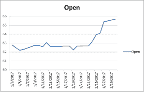
图 9.2：2017 年 1 月的股票开盘价趋势

从图 9.2 中，我们可以清楚地看到微软在 1 月份的开盘价在 1 月初呈现出变化的趋势，并以高位结束。这种趋势极是非线性的，这就是为什么我们采用多层`RNN`来训练该算法。下一步，我们将预测 1 月份的趋势，看看是否能获得与图 9.2 中提到的类似的曲线。这里需要特别说明的是，我们是使用前 60 天的开盘价来预测第 61 天的开盘价来训练算法的。

现在要在测试集上进行预测，我们再次需要相同格式的数据。例如，为了预测 2017 年 1 月 1 日的起始，我们需要过去 60 天的开盘价，这来自来自训练集，因为训练集包含了从 2012 年 1 月到 2016 年 12 月的股价。同样，为了预测 2017 年 1 月 30 日的股价，我们需要来自测试集以及训练集的输入。我们通过拼接训练集和测试集来准备预测的输入数据：

蓝曲线代表我们股票在 1 月份的实际开盘价，而红曲线代表该股票的预测开盘价。你可以清楚地看到，我们的算法已成功预测了 1 月份的股票价格。它不仅捕捉到了 1 月初的波动趋势，还正确地预测了 1 月底的股价激增。

## 结论

在本章中，我们通过 Python 的`Keras`库实现了一个`RNN`。通过解决一个预测微软未来股票价格的时间序列分析问题，我们了解了实现`RNN`涉及的各种步骤。在下一章中，我们将看到`RNN`在自然语言处理领域的应用。

# 第 10 章

## 使用 RNN (LSTM) 进行自然语言处理

在上一章中，我们学习了如何使用循环神经网络（`RNN`）解决时间序列分析问题，例如股票价格预测。在本文，我们将介绍`RNN`，特别是长短期记忆（`LSTM`）在自然语言处理中的应用。由于文本由句子组成，而句子基本上是单词的序列，`LSTM`可用于各种自然语言处理任务，如情感分析、文本分类、神经机器翻译等。在本章中，我们将看到如何将`LSTM`用于文本分类。在下一章中，我们将看到`LSTM`在神经机器翻译任务中的应用。

### 使用 RNN (LSTM) 进行文本分类

文本分类是一类问题，即给你一个文本字符串（它可以可以是 Facebook 或 Twitter 上的用户评论，或者是电子邮件等）。你的任务是将文本归类为预定义的类别之一。例如，对于 Facebook 评论，预定义的类别可以是“正面评论”和“负面评论”。同样，对于电子邮件分类，可能的类别可以是“正常邮件（Ham）”或“垃圾邮件（Spam）”。如果封邮件是真实的，则被视为“正常邮件”。相反，如果邮件不是真实的（例如它祝贺你中了百万美元彩票），它很可能是一封垃圾邮件。

文本分类是一个监督学习问题，系统会给你一组文档以及这些文档所属的类别。你的任务是在这些数据上训练算法，并预测未见文档的类别。文档的长度可以长如整本书或一篇文章，也可以短如一个句子。

之前已经针对文本分类等任务开发了多种机器学习模型。然而，深度学习技术被证明比传统的机器学习技术更成功。特别是`LSTM`已证明是文本分类问题的最先进技术。`LSTM`是循环神经网络的一种，我们在第 8 章中详细学习过它。我们在第 9 章中将`LSTM`用于时间序列分析。然而，我们没有深入研究`LSTM`的架构。在本章中，我们将使用`LSTM`进行文本分类。但在那之前，我们将详细学习`LSTM`的架构。

## LSTM 架构

让我们先复习`RNN`的架构。`RNN`的基本原理是在时间`t`，它接收输入`Xt`和来自上一个时间`t-1`的输出。

注意：本节的图片取自 [Colah 的博客](https://colah.github.io/posts/2015-08-Understanding-LSTMs/)。这是理解`LSTM`的一个非常好的资源。

### RNN 复习

`RNN`的基础架构如下：

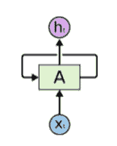

这是一个带有一个节点的`LSTM`。它包含一个由`Xt`表示的输入、一个作用于权重点积的激活函数，以及一个被称为`ht`的输出。如果你在时间空间中展开这个节点，它看起来如下所示。

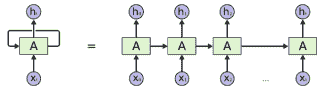

这里`x`是输入，`h`是输出。让我们从时间`t=0`开始。在`t=0`时，输入`X0`经过节点并接收输出`h0`。在时间步`t=1`，输入`x1`以及之前的输出`h0`作为输入传递给下一个节点。该过程一直持续到接收最终输出。这种神经网络架构使其成为处理序列问题（如我们在上一章看到的时间序列分析）的理想选择。

反馈机制使`RNN`在做出决策时考虑到过去的信息。`RNN`架构有许多应用，如文本分类、图像描述、语音识别和神经机器翻译。然而，这种简单的`RNN`架构存在一个问题。

### 简单 RNN 的问题

尽管在理论上`RNN`能够保留过去的信息，但在实践中情况并非如此。`RNN`只能记住最近的信息。它无法记住间隔大量序列步长之后的信息。在某些情况下，这并不是问题。例如，看这句话：“Birds fly in the \___”。我们的`RNN`可以很容易地预测下一个单词，即“Sky（天空）”，因为过去的 4 个单词已经足够预测下一个单词。

然而，在需要来自距离当前时间步较远的之前步骤的信息时，`RNN`的表现似乎并不正确。例如，考虑以下段落。虚线代表任何随机文本。

“我的父亲是一个意大利人。他喜欢吃意大利面和披萨。他看足球...........................................................................................................................................................................................................................并且他说 \_\_\ ”

现在，如果一个`RNN`想预测“speaks（说）”之后的单词，它需要句子开头的信息，即“我的父亲是一个意大利人”。遗憾的是，随着当前时间步与之前时间步之间间隔的增大，由于梯度消失等现象，`RNN`开始忘记之前的信息。这被称为长程依赖问题。

### 解决方案：LSTM

`LSTM`（长短期记忆）神经网络能够保留通过大量时间步学习到的信息，因此可以解决长程依赖问题。自 [Hochreiter &Schmidhuber (1997)](http://www.bioinf.jku.at/publications/older/2604.pdf) 开发以来，目前已经开发了多种 LSTM 的变体。但在本节中，我们将学习其基础版本。

## LSTM 架构

`RNN`的记忆模块由一层组成。其中一个输入连同上一个输出或隐藏状态被馈入下一个节点。`LSTM`的架构与`RNN`的不同在于，除了输出外，它还有一个细胞状态向量（cell state vector），负责维护长期记忆。`LSTM`的基本架构所示：

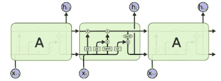

不要被上述架构吓到，我们将详细查看`LSTM`的每一个组件。

### 细胞状态 (Cell State)

`LSTM`的第一个组件是细胞状态。请看下图：

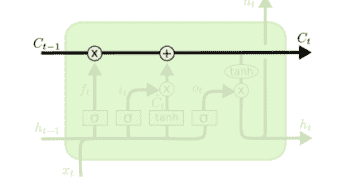

细胞状态包含存储来自前几个时间步信息的值。在图中，`Ct-1`是点`t-1`处的细胞状态。除了隐藏状态外，过去的细胞状态也会作为输入传递给时间步`t`的`LSTM`。同样，时间`t`的细胞状态（即`Ct`）将作为输入传递给时间`t+1`的`LSTM`，以此此类推。

然而，我们不需要所有的过去信息。根据输入，我们需要更新过去的信息。为了在细胞状态中删除、添加或修改信息，`LSTM`使用了不同类型的门（gates）。门由神经网络层中的 sigmoid 操作组成，紧接着是逐点乘法（pointwise multiplication）操作。

在`LSTM`神经网络节点的每个时间步，都会执行以下操作：

#### 1. 遗忘门 (Forget Gate)

在第一步中，需要遗忘的来自上时间步的信息被传递到细胞状态。执行此操作的门被称为遗忘门。请看下图。这里`ft`指的是遗忘门。

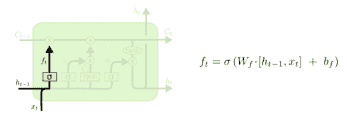

在遗忘门中，之前的隐藏状态和当前输入被拼接并通过 sigmoid 函数。对于细胞状态中的每个值，sigmoid 函数返回`1`或`0`。在这里，`0`代表“可以忘记掉这个”，而`1`代表“保留此信息”。sigmoid 操作的结果与现有的细胞状态进行逐点乘法。

遗忘门的现实例子可以是人的性别。如果来了一个性别不同的新人，我们需要更改所有的代词。遗忘门将帮助我们忘记上一个人的性别。

#### 2. 输入门 (Input Gate)

下一步是找到新信息（如果有，即要存储在细胞状态中的信息）。为了找到需要更新的新信息，需要执行两个操作。第一个操作是确定细胞状态的哪些部分需要更新。这由图中由`it`表示的输入门定义。第二部分是将替换旧值的新值向量，由图中所示的`C~tas`表示。

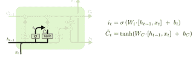

这一步的现实例子是：它会发现需要更新性别，而`C^twill`的结果产生性别的新值。

#### 3. 更新细胞状态 (Updating the Cell State)

现在我们拥有了更新细胞状态所需的所有信息。我们只需要执行第 1 步和第 2 步中得出的操作。第 3 步可以视觉化地表示：

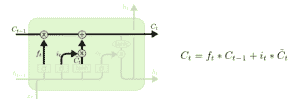

（注：原文后续存在大量重复段落，译文已按要求去重并保持逻辑连贯）

你还可以查看序列末的隐藏状态（hidden state）和单元状态（cell state）。在这里，你可以再次观察到最后一个时间步的输出等于隐藏状态的值。

|  ||  ||  |
| --- | --- | --- |


## 垃圾邮件与正常邮件分类


在上一节中，我们详细学习了`LSTM`的背后的理论。在本节中，我们将看到`LSTM`在正常邮件（ham）和垃圾邮件（spam）分类中的应用。由于`LSTM`是序列问题的理想选择，因此我们可以将其用于自然语言处理应用，例如文本分类。

该应用程序的数据可以在`Datasets`文件夹中找到。数据集文件夹的路径已在介绍部分提到。我们将在示例中使用的数据集是`spam.csv`。

我们将遵循标准的机器学习库来完成这项任务。请遵循以下步骤：

### 1. 导入所需的库

第一步是导入此任务所需的库。执行以下脚本来完成：

```python
import os
import sys
import numpy as np
import pandas as pd
import matplotlib.pyplot as plt
from keras.models import Model
from keras.layers import Dense, Embedding, Input
from keras.layers import LSTM, Bidirectional, GlobalMaxPool1D, Dropout
from keras.preprocessing.text import Tokenizer
from keras.preprocessing.sequence import pad_sequences
from keras.optimizers import Adam
from sklearn.metrics import roc_auc_score
from sklearn.preprocessing import LabelEncoder
```

### 2. 配置设置

让我们为应用程序设置配置。执行以下脚本：

```python
MAX_SENTENCE_LENGTH = 150
VOCABULARY_SIZE = 2000
VECTOR_DIM = 100
TRAIN_TEST_SPLIT = 0.2
BATCH_SIZE = 64
EPOCHS = 10
```

在这里，`MAX_SENTENCE_LENGTH`是序列的最大长度。由于我们的句子大小是不固定的，但我们只能向`LSTM`输入固定大小的数据，因此我们将对较短的句子进行零填充，使其与语料库中最长的句子相等。

`VOCABULARY_SIZE`是我们用于创建嵌入层使用的单词数量。`VECTOR_DIM`是句子中每个单词的特征数。`TRAIN_TEST_SPLIT`定义了训练集和测试集的大小。此值`0.2`表示我们的数据将分为 20% 的测试集和 80% 的训练集。我们的批次大小（batch size）为 64，并将进行 10 个轮次（epochs）。

### 3. 加载预训练词嵌入

自然语言由文本组成。然而，机器学习算法处理的是数字。因此，我们需要将文本转换为数字。数值格式的表示表示嵌入（embeddings）。

将文本转换为数字有多种方法。我们可以从零开始创建嵌入，也可以使用预训练的词嵌入。在本章中，我们将使用名为 [Glove](https://nlp.stanford.edu/projects/glove/) 的预训练词嵌入，它由斯坦福大学的研究人员开发。词嵌入的文本文件可以在数据集文件夹中找到，名为`glove.6b.100d`。在该文件中，400000 个单词被表示为 100 维向量。

接下来，我们需要将这些词向量加载到应用程序中。执行以下脚本来完成。请在执行之前双检查`glove.6b.100d`文件的路径。

```python
print('Loading Pretrained Word Vectors')
embedding_dic = {}
with open("E:/Datasets/glove.6b.100d", encoding="utf8") as vector_list:
    for line in vector_list:
        dimensions = line.split()
        word = dimensions[0]
        vector = np.asarray(dimensions[1:], dtype='float32')
        embedding_dic[word] = vector
print("Total Vectors: " + str(len(embedding_dic)))
```

### 4. 加载数据集

执行以下脚本来加载我们的垃圾邮件数据：

```python
print('Read emails')
email_data = pd.read_csv("E:/Datasets/spam.csv", delimiter=',', encoding='latin1')
email_data.head()
```


第一列包含标签，第二列包含邮件。我们不需要最后三列。让我们执行以下脚本来删除它们：

```python
email_data.drop(['Unnamed: 2', 'Unnamed: 3', 'Unnamed: 4'], axis=1, inplace=True)
email_data.info()
```


### 5. 文本处理

让我们为邮件和标签创建两个独立的变量。

```python
emails = email_data["v2"]
labels = email_data["v1"]
```

现在我们需要将标签转换为数字。我们将使用`LabelEncoder`来实现。

```python
le = LabelEncoder()
labels = le.fit_transform(labels)
labels = labels.reshape(-1,1)
```

执行上述脚本后，你可以看到对应的编码：


类似于标签，我们需要对句子进行分词。此时句子已转换为整数，但它们的大小还不相同。为了使句子具有相同的长度，我们使用`pad_sequences`类。

```python
tok = Tokenizer(num_words=VOCABULARY_SIZE)
tok.fit_on_texts(emails)
email_sequences = tok.texts_to_sequences(emails)
email_sequence_matrix = pad_sequences(email_sequences, maxlen=MAX_SENTENCE_LENGTH)
```

### 6. 创建嵌入矩阵

我们加载了预训练嵌入并将邮件转换为整数。现在是为邮件中的单词创建嵌入了。执行以下脚本：

```python
word2idx = tok.word_index
print('Found %s unique tokens.' % len(word2idx))
```

在这里`word2idx`基本包含了单词与整数之间的映射。让我们找到词汇表中需要的单词数量。之前我们将此数设置为 2000。然而，如果唯一标记少于 2000，我们将词汇表大小设置为唯一标记的数量。以下脚本如下：

```python
total_words = min(VOCABULARY_SIZE, len(word2idx) + 1)
```


然后我们将创建一个大小为`total_words` x `VECTOR_DIM`的空嵌入矩阵，如下所示：

```python
embedding_matrix = np.zeros((total_words, VECTOR_DIM))
```

最后，我们将用 2000 个高频单词的向量填充这个嵌入矩阵，如下：

```python
for word, index in word2idx.items():
    if index < VOCABULARY_SIZE:
        vector = embedding_dic.get(word)
        if vector is not None:
            embedding_matrix[index] = vector
```

我们已经完成了训练模型所需的所有预处理工作。现在是实际训练模型的时候。执行以下脚本进行训练：

```python
input_ = Input(shape=(MAX_SENTENCE_LENGTH,))
x = embedding_layer(input_)
x = LSTM(20)(x)
output = Dense(1, activation="sigmoid")(x)
model = Model(input_, output)
model.compile(
    loss='binary_crossentropy',
    optimizer=Adam(lr=0.01),
    metrics=['accuracy']
)
```

我们的模型中包含一个具有 20 个节点的`LSTM`。我们还有一个一个全连接层。我们将使用的激活函数是"sigmoid"，而损失函数是"binary_crossentropy"，因为这是一个二分类问题。

现在作为最后一步，让我们在数据上训练模型，并查看算法返回的准确率。执行以下脚本：

```python
print('Training model...')
classifier = model.fit(
    email_sequence_matrix,
    labels,
    batch_size=BATCH_SIZE,
    epochs=EPOCHS,
    validation_split = TRAIN_TEST_SPLIT
)
```

执行结束后，算法达到了 99.44% 的准确率，这非常出色。最终结果所示：

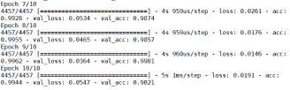

最后，让我们绘制算法随每个轮次（epoch）变化的准确率图。执行以下脚本来实现：

```python
plt.plot(classifier.history['loss'], label='loss')
plt.plot(classifier.history['val_loss'], label='val_loss')
plt.legend()
plt.show()
```

输出如下：

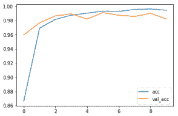

你可以看到准确率在第 6 个 epoch 之后收敛。此外，准确率和验证准确率几乎相同，这说明我们的算法没有过拟合。

## 结论

在本章中，我们详细学习了`LSTM`。我们看到了`LSTM`如何用于自然语言处理。我们使用`LSTM`解决了一个简单的文本分类任务，将邮件消息分为正常邮件（ham）和垃圾邮件（spam）。在下一章中，我们将看到`LSTM`在神经机器翻译任务中的应用。我们将开发一个能够回答基础查询的简单聊天机器人。

|  ||  ||  |
| --- | --- | --- |


# 第 11 章


|  ||  ||  |
| --- | --- | --- |


## 使用 LSTM 进行序列到序列建模


在上一章中，我们看到了如何将`LSTM`用于文本分类。然而，`LSTM`可以用于多种自然语言处理任务。序列到序列（Sequence to sequence），也称为`seq2seq`是`LSTM`在 NLP 领域最著名的应用之一。在本文中，我们将首先学习`seq2seq`模型背后的理论。然后我们将开始构建一个非常简单的聊天机器人，能够回答基础的用户查询。这个聊天机器人不会非常先进，但你将理解`seq2seq`架构工作原理的本质。

|  ||  ||  |
| --- | --- | --- |


### 什么是序列到序列建模？

在第 8 章中，我们学习了`RNN`可以用于多种应用。`RNN`的应用可以分为以下类型：

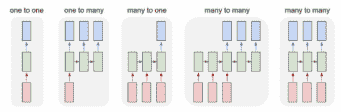

"一对一"应用的示例：。 

在上一章中，我们看到了如何将`LSTM`用于文本分类。然而，`LSTM`可以用于多种自然语言处理任务。序列到序列，也称为`seq2seq`是`LSTM`在 NLP 领域最著名的应用之一。在本文中，我们将首先学习`seq2seq`模型背后的理论。然后我们将开始构建一个非常简单的聊天机器人，能够回答基础的用户查询。这个聊天机器人不会非常先进，但你将理解`seq2seq`架构工作原理的本质。

### 序列到序列架构

Seq2seq 模型分两个阶段执行：训练和推理。该架构由两个 LSTM 网络组成：编码器（encoder）和解码器（decoder）。请看下图：

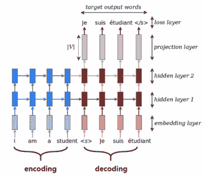

编码器主要负责编码输入并产生思维向量（thought vector）。编码器 LSTM 层由图中蓝色矩形表示。编码器 LSTM 的输出是隐藏状态和单元状态，它们将作为解码器的输入。

解码器 LSTM 不仅接收来自编码 LSTM 的输入，还会接收上一步的目标输出作为输入以生成最终回复。

一旦模型训练完成，下一步就是进行预测。需要注意的是，在训练阶段，我们拥有输入序列中的所有元素，但对于输出来说，情况并非如此，因为我们无法预先知道输入中的每一个元素。但如果你仔细观察训练阶段，你会发现解码器（decoder）中下一个单元的输入基本上是上一个单元的输出。如下图所示：


### 推理/预测阶段的解码器输入 ([图片引用](https://towardsdatascience.com/seq2seq-model-in-tensorflow))

### 步骤 5：将嵌入转换为单词
预测是以嵌入向量的形式存在的，我们必须将其转换回单词。这是序列到序列（sequence to sequence）模型的最后阶段。本节中解释的步骤将在下一节我们用代码实现序列到序列模型时变得清晰。

|  |  |
| --- | --- |


## 使用序列到序列模型创建一个机器人


我们已经涵盖了序列到序列架构背后的理论。现在是时候查看序列到序列建模的实际应用了。在本节中，我们将使用 Python 的`Keras`库开发一个序列到序列聊天机器人。序列到序列模型的代码模板可以在 [Keras 官方博客](https://blog.keras.io/ten-minute-introduction-to-sequence-to-learning-in-keras.html) 获取。这段代码可以创建任何序列到序列模型。我们将使用这段代码来创建我们的机器人。那么，让我们开始吧。

### 步骤 1：导入库
如既往，第一步是导入实现序列到序列模型所需的库。执行以下脚本：

```python
import os, sys
import re
from keras.models import Model
from keras.layers import Input, LSTM, GRU, Dense, Embedding
from keras.preprocessing.text import Tokenizer
from keras.preprocessing.sequence import pad_sequences
from keras.utils import to_categorical
import numpy as np
import matplotlib.pyplot as plt
```

### 步骤 2：配置设置
```python
BATCH_SIZE = 4
EPOCHS = 20
LSTM_NODES = 128
MAX_SENTENCE_LENGTH = 200
VOCABARY_SIZE = 2000
VECTOR_DIM = 100
```
这里`MAX_SENTENCE_LENGTH`将是序列的最大长度。`VOCABARY_SIZE`是我们用于创建嵌入层的单词数。`VECTOR_DIM`是句子中每个单词的特征数。我们的批量大小为`4`，并将进行`20`个 epoch。

### 步骤 3：导入并预处理数据集
现在是加载和预处理数据了。我们将使用的数据是两个人类之间的对话，其中一人扮演机器人。本节的文件位于`Datasets`文件夹中，文件名分别为`human_text.txt`和`robot_text.txt`。数据集也可以从这个 [kaggle 链接](https://www.kaggle.com/eibriel/rdany-conversations/version/11) 在线下载。

在序列到序列学习中，我们需要三个独立的列表。第一个是输入文本列表，包含输入编码器`LSTM`的内容；第二个是目标文本列表，将作为解码器`LSTM`的输出；第三个是文本输入列表，将作为解码器`LSTM`的输入。让我们创建这三个列表：

```python
input_texts = []
target_texts = []
target_texts_inputs = []
```

接下来，我们将逐行读取`human_text.txt`和`robot_text.txt`。记住`robot_text.txt`中的每一行都是`human_text.txt`中对应行的响应。我们将逐行读取文件，移除行中所有的标点符号和额外的空格。然后，我们将检查输入行的单词数是否大于`MAX_SENTENCE_LENGTH`，如果是，直接忽略该句子，因为我们不希望文档中出现非常长的句子。

最后，我们将来自`human_text.txt`的行插入到`input_texts`列表中，并将`robot_text.txt`的行插入到`target_texts`列表中。我们在目标文本中的所有行前面加上`eos`（句子结束标记）前缀。`robot_text.txt`的行也会被插入`target_texts_inputs`列表，但它们将带有`sos`标记前缀，因为解码器`LSTM`的输入将目标输出相同，但会通过`sos`标记偏移一个。

查看以下脚本以执行数据导入和预处理任务。你需要根据目录结构更改路径。

```python
string = "how old are you how do you look like where do you live"
formatted = re.sub(r'\s+', ' ', string)

with open("Datasets/human_text.txt", "r") as file1, open("Datasets/robot_text.txt", "r") as file2:
    for human_text, robot_text in zip(file1, file2):
        human_text = re.sub(r'[^\w\s]', '', human_text)
        robot_text = re.sub(r'[^\w\s]', '', robot_text)
        if len(human_text.split()) <= MAX_SENTENCE_LENGTH:
            input_texts.append(human_text)
            target_texts.append(robot_text + " eos")
            target_texts_inputs.append("sos " + robot_text + " eos")
```

我们的输入和输出句子长度并不相同。我们将根据输入文本中最长的句子对输入进行填充。同样，目标文本和目标文本输入也将根据输出数据中最长的句子进行填充。执行以下脚本对输入和输出数据进行填充：

```python
encoder_inputs = pad_sequences(input_sequences, maxlen=max_len_input)
decoder_inputs = pad_sequences(target_sequences_inputs, maxlen=max_len_target, padding='post')
decoder_targets = pad_sequences(target_sequences, maxlen=max_len_target, padding='post')
```

## 第 5 ：加载词嵌入并创建词嵌入矩阵

我们将使用 Glove 嵌入来实现词的向量表示。执行以下脚本以加载训练过的词向量并创建词嵌入：

```python
print('Loading Word Vectors')
embedding_dic = {}
with open("E:/glove.6b.100d.txt", encoding = "utf8") as vector_list:
    for line in vector_list:
        dimensions = line.split()
        word = dimensions[0]
        vector = np.asarray(dimensions[1:], dtype='float32')
        embedding_dic[word] = vector
```


```python
num_words = min(VOCABULARY_SIZE, len(word2idx_inputs) + 1)
embedding_matrix = np.zeros((num_words, VECTOR_DIM ))
for word, i in word2idx_inputs.items():
    if i < num_words:
        embedding_vector = embedding_dic.get(word)
        if embedding_vector is not None:
            embedding_matrix[i] = embedding_vector
```

## 第 6 ：创建输入嵌入层和输出 One Hot 编码层

在创建模型之前，我们需要创建输入嵌入层和 One Hot 编码输出层。由于我们在输出节点使用了 Softmax 函数，因此我们的输出应该是 One Hot 编码的。以下脚本创建了一个嵌入层和 One Hot 编码输出向量：

```python
embedding_layer = Embedding(
    num_words,
    VECTOR_DIM,
    weights=[embedding_matrix],
    input_length=max_len_input,
    # trainable=True
)
```


```python
decoder_targets_one_hot = np.zeros(
    (
    len(input_texts),
    max_len_target,
    num_words_output
    ),
    dtype='float32'
)
```


```python
for i, d in enumerate(decoder_targets):
    for t, word in enumerate(d):
        decoder_targets_one_hot[i, t, word] = 1
```


## 第 7 章：创建模型

我们已经预处理了创建模型所需的所有数据。现在是创建模型的时候了。正如之前所说的，我们需要创建两个 LSTM：一个编码器 LSTM 和一个解码器 LSTM。让我们先定义编码器的输入、嵌入层和输出。执行以下脚本：

```python
encoder_inputs_placeholder = Input(shape=(max_len_input,))

x = embedding_layer(encoder_inputs_placeholder)

encoder = LSTM(
    LSTM_NODES,
    return_state=True,
)

encoder_outputs, h, c = encoder(x)

encoder_states = [h, c]
```

在上面的脚本中，我们为编码器输入创建了输入占位符。我们知道编码器接收一个输入句子序列。因此，输入的形状是`max_len_input`参数。

接下来，我们将输入通过嵌入层。最后，我们创建了编码器并将其返回状态设置为 true。通过嵌入层的输入被传递给编码器，编码器返回输出、隐藏状态和单元状态。从编码器中，我们只需要单元状态和隐藏状态，将其捕获在`encoder_states`列表中。

同样，让我们为解码器创建输入和输出。执行以下脚本：

```python
decoder_inputs_placeholder = Input(shape=(max_len_target,))

decoder_embedding = Embedding(num_words_output, LSTM_NODES)

decoder_inputs_x = decoder_embedding(decoder_inputs_placeholder)

decoder_lstm = LSTM(
    LSTM_NODES,
    return_sequences=True,
    return_state=True,
)

decoder_outputs, _, _ = decoder_lstm(
    decoder_inputs_x,
    initial_state=encoder_states
)
```

在上面的脚本中，我们首先为解码器定义了输入占位符。注意输入占位符的输入形状长度为`max_len_target`，它是`target_text`列表中长句子的长度。接下来，我们将输入占位符通过嵌入层。然后我们创建了一个`return_sequences = True`的 LSTM，因为我们需要在解码器的每个点都获得输出。注意`decoder_lstm`的`initial_state`被设置为`encoder_states`，它包含了编码器在输出单元的隐藏状态和单元状态。

接下来，我们需要创建一个全连接层（dense layer）并将解码器输出传递到全连接层。查看以下脚本：

```python
decoder_dense = Dense(num_words_output, activation='softmax')

decoder_outputs = decoder_dense(decoder_outputs)
```

接下来，我们需要按照所示创建并编译模型：

```python
model = Model([encoder_inputs_placeholder, decoder_inputs_placeholder], decoder_outputs)

model.compile(
    optimizer='rmsprop',
    loss='categorical_crossentropy',
    metrics=['accuracy']
)
```

最后，我们需要在第 6 步创建的数据上拟合模型。执行以下脚本来实现：

```python
r = model.fit(
    encoder_inputs, decoder_inputs,
    decoder_targets_one_hot,
    batch_size=BATCH_SIZE,
    epochs=EPOCHS,
    validation_split=0.2
)
```

你会看到我们的模型开始运行。在 20 个 epoch 结束后，你应该能看到如下图所示 87.21% 的准确率：


## 第 8 章：进行预测

我们已经训练了模型；下一步是进行预测。在预测阶段，我们将再次使用编码器-解码器架构。然而由于我们已经训练好了，我们不需要训练编码器。首先，让我们讨论一下编码器在预测时将是什么样的。查看以下脚本：

```python
encoder_model = Model(encoder_inputs_placeholder, encoder_states)
```

在这里编码器将独立工作。记住，我们不需要训练编码模型，因为权重已经更新。

接下来，我们需要定义解码器的输入和输出。在训练阶段，解码器的输入是来自输入序列的隐藏和单元状态以及整个目标序列。输出是对应的目标序列。

在预测情况下，我们没有整个目标序列，因为这是我们要预测的内容。我们只有输入序列的隐藏状态和单元状态，以及目标序列的起始词。解码器的输出将是目标词以及单元状态和隐藏状态。

为解码器 LSTM 创建输入：

```python
decoder_state_input_h = Input(shape=(LSTM_NODES,))

decoder_state_input_c = Input(shape=(LSTM_NODES,))

decoder_states_inputs = [decoder_state_input_h, decoder_state_input_c]
```

这些是解码器 LSTM 接收的隐藏状态和单元状态。

接下来，我们需要指定输入形状。由于这次只有一个单词输入，输入的形状为 1。输入需要通过嵌入层。以下脚本执行了该操作：

```python
decoder_inputs_single = Input(shape=(1,))

decoder_inputs_single_x = decoder_embedding(decoder_inputs_single)
```

最后，我们需要将训练阶段训练好的`decoder_states_inputs`和`decoder_inputs_single_x`（单个单词）传递给解码 LSTM：

```python
decoder_outputs, h, c = decoder_lstm(
    decoder_inputs_single_x,
    initial_state=decoder_states_inputs
)
```

`LSTM`的输出将是`decoder_output`以及隐藏状态和单元状态。`decoder output`将通过`dense layer`（全连接层）来产生最终输出，如最后的脚本所示：

```python
decoder_states = [h, c]

decoder_outputs = decoder_dense(decoder_outputs)
```

注意，我们将隐藏状态和单元状态存储在变量`decoder_states`中，因为我们希望模型输出这些值。用于预测的采样模型可以使用以下脚本创建：

## 采样模型

### inputs
- `y(t-1)`
- `h(t-1)`
- `c(t-1)`

### outputs
- `y(t)`
- `h(t)`
- `c(t)`

```python
## The sampling model 

decoder_outputs, h, c = decoder_lstm(
    decoder_inputs_single_x,
    initial_state=decoder_states_inputs
)
```

在预处理步骤中，我们将单词转换成了整数。模型的输出将是一个整数。我们需要将该整数转换回单词。执行以下脚本来实现此操作：

```python
idx2word_input = {v:k for k, v in word2idx_inputs.items()}

idx2word_target = {v:k for k, v in word2idx_outputs.items()}
```

在这里，`idx2word_input`和`idx2word_target`是字典，其键是整数，值是与整数对应的单词。这些字典将单词转换为整数。

最后，我们编写了一个函数，它接收输入序列并返回输出序列。该函数的脚本如下：

```python
def generate_response(input_seq):
    # 将输入编码为状态向量。
    states_value = encoder_model.predict(input_seq)

    # 生成一个长度为 1 的空目标序列。
    target_seq = np.zeros((1, 1))

    # 用起始字符填充目标序列的第一个字符。
    # 注意：tokenizer 将所有单词转为小写
    target_seq[0, 0] = word2idx_outputs['<sos>']

    # 如果得到这个则跳出
    eos = word2idx_outputs['']

    # 创建翻译
    output_sentence = []

    for _ in range(max_len_target):
        output_tokens, h, c = decoder_model.predict(
            [target_seq] + states_value
        )

        # 获取下一个单词
        idx = np.argmax(output_tokens[0, 0, :])

        # 句子 EOS 结束
        if eos == idx:
            break

        word = ''

        if idx > 0:
            word = idx2word_target[idx]

        output_sentence.append(word)

        # 更新解码器输入
        # 即刚刚生成的单词
        target_seq[0, 0] = idx

        # 更新状态
        states_value = [h, c]
        # states_value = [h] # gru

    return ' '.join(output_sentence)
```

`generate_response`函数接收输入序列作为参数。它首先使用编码器模型找到隐藏状态和单元状态。

然后，它创建一个大小为 1 x 1 的新随机变量，并用`sos`的索引进行初始化。记住，每个句子的第一个单词都是`sos`。然后我们找到`eos`的索引，因为我们希望在预测到`eos`时结束目标序列的生成。

接下来，我们执行循环，迭代次数等于最大目标序列长度。在每次迭代中，我们将输入目标加上之前的隐藏状态值插入到`decoder_model`中。在输出中，我们接收所有可能单词的概率分布，以及隐藏状态和单元状态。

我们使用`argmax`函数找到概率最高的单词并存储其索引。如果该索引等于`eos`的索引，我们退出循环。否则，如果索引大于 0，我们从索引中找到对应的单词，并将其添加到`output_sentence`列表中。最后，我们将列表中的单个单词连接起来返回它。

## 第 8 步：进行预测

最后一步是测试我们开发的聊天机器人。查看以下脚本：

```python
while True:
    # 进行一些测试翻译
    i = np.random.choice(len(input_texts))
    input_seq = encoder_inputs[i:i+1]
    translation = generate_response(input_seq)
    print('-')
    print('Input:', input_texts[i])
    print('Response:', translation)
    ans = input("Continue? [Y/n]")
    if ans and ans.lower().startswith('n'):
        break
```

在上面的脚本中，我们创建了一个无限循环。在循环内部，我们从输入列表中随机选择一个输入序列并将其传递给`generate_response`函数。循环一直持续，直到你不按“n”。这里是输出的快照：


这个机器人并不高效，因为我只使用了`581`个样本，这与开发聊天机器人的数据集相比非常小。不过，概念是一样的；你只需要更大的数据集来提高机器人的效率。

|  ||   |
| --- | --- | ---

## 结论

本章标志着本书的结束。在本章中，我们学习了如何使用`LSTM`开发简单的聊天机器人。我们看到了序列到序列模型如何用于输入序列到输出序列。这种模型可以用于任何序列到序列的应用。

|  ||   |
| --- | --- | ---


## 接下来做什么？

在本书中，我们学习了一些重要的深度学习概念。我们从一个执行简单分类任务的基础人工神经网络开始。然后我们转向卷积神经网络来实现图像分类。最后，我们看到了`LSTM`在时间序列分析和序列到序列问题中的用法。

学习你在书中学习的大部分概念的最佳方法是找到现实世界的问题，并使用书中学习的不同类型的神经网络来解决它们。例如，找到一个图像数据集并使用卷积神经网络解决分类问题。另一个任务是使用序列到序列模型制作翻译引擎。记住，通过练习你会变得越来越好。从小任务开始，然后转向更大的项目。祝深度学习愉快。

## 不要错过！

点击下方的按钮，您可以在 William Sullivan 出版新书时接收电子邮件。这没有费用，也没有义务。

 

[`books2read.com/r/B-A-AYAG-PYSAB`](https://books2read.com/r/B-A-AYAG-PYSAB)


将独立读者与独立作者联系起来。

## 关于作者

William Sullivan 在软件/编程领域拥有 25 年以上的经验。他于 1978 生于华盛顿州西雅图。他曾任职许多领先的美国及国际公司，并在那里展现了他的才华、备受青的技能组合、创造力和创新精神。

从低起点开始，William Sullivan 在企业阶梯上不断攀升，成为一名富有影响力的程序员。他是一个独生子，由单亲母亲长大，母亲总是鼓励他追求高等教育和更好的生活。他们曾过着捉襟拮肘的日子；母亲通过加班和不规律的轮班工作来维持生活。他的母亲总是确保他拥有食物、衣物和住所等生活必需品。

William 一直对技术着迷，例如从零开始组装计算机、编写程序等。他的母亲竭尽全力去满足他永无止境的好奇心，为他购买关于软件、编程、硬件以及几乎任何与计算机技术相关的书籍。他表示，利用母亲有限收入所提供的资源在闲暇时间进行阅读，是他带他获得今日成功的真正基石。

他主修计算机科学，并获得了全额学术金学金以优异成绩毕业。从那时起搬到了加利福尼亚州，已婚并有三个孩子。他以合同工的形式从事各种高薪工作，并在空余时间写作。他热爱旅行、品尝不同的美食以及体验不同的文化。他对所获得的改变生活的机会深表感激，并希望通过编写价格亲民的书，帮助任何想要精通技术的人来回馈社会。
