# Python 深度学习


致我的儿子西尔文：希望你有朝一日能读这本书！

# 前言

如果你拿起了这本书，你很可能意识到深度学习在近期为人工智能领域带来了非凡的进步。我们从几乎无法使用的计算机视觉和自然语言处理，发展到了在你每天使用的产品中大规模部署的高性能系统。这种突发性进步的影响几乎扩展到每个行业。我们已经将深度学习应用于医学影像、农业、自动驾驶、教育、灾害预防和制造等截然不同的领域，解决了大量重要问题。

然而，我相信深度学习仍处于早期阶段。到目前为止，它只实现了一小部分潜力。随着时间的推移，它将渗透到每个能够提供帮助的问题中——这一转变将跨越数十年。

为了开始将深度学习技术部署到它能解决的每一个问题，我们需要让尽可能多的人都能使用它，包括非专业人士——那些不是研究人员或研究生的人。为了让深度学习发挥最大潜力，我们需要从根本上民主化它。而今天，我相信我们正处于历史性转型的门槛上，深度学习正在从学术实验室和大型科技公司的研发部门中走出来，成为每位开发者工具箱中无处不在的一部分——这很类似于 20 世纪 90 年代末 Web 开发的发展轨迹。现在几乎任何人都可以为自己的业务或社区构建网站或 Web 应用，而这样的项目在 1998 年还需要一小组专家级工程师。在不远的将来，任何有想法并具备基本编程技能的人都能构建从数据中学习的智能应用程序。


当我于 2015 年 3 月发布 Keras 深度学习框架的第一个版本时，我并未考虑 AI 的民主化。我在机器学习领域研究多年，构建 Keras 是为了帮助自己进行实验。但自 2015 年以来，数十万新手进入深度学习领域；其中许多人选择 Keras 作为自己的首选工具。看着大量聪明人以出乎意料、强大的方式使用 Keras，我开始深切关注 AI 的可访问性和民主化。我意识到，我们将这些技术推广得越广泛，它们就越有用、越有价值。可访问性很快成为 Keras 开发的明确目标，在短短几年内，Keras 开发者社区在这方面取得了惊人的成就。我们将深度学习交到数十万人手中，而他们又利用它来解决直到最近还被认为无法解决的问题。

你手中的这本书是让深度学习尽可能多地为人所用道路上的又一步。Keras 一直需要一本配套教材，同时涵盖深度学习基础、深度学习最佳实践和 Keras 使用模式。2016 年和 2017 年，我尽力制作了这样一门课程，它成为了本书的第一版，于 2017 年 12 月出版。它迅速成为机器学习畅销书，销量超过 50,000 册，并被翻译成 12 种语言。

然而，深度学习领域发展迅速。自第一版发布以来，发生了许多重要进展——TensorFlow 2 的发布、Transformer 架构日益流行，等等。因此，在 2019 年底，我着手更新我的书。我最初相当天真地以为，它会包含大约 50% 的新内容，并且最终长度与第一版差不多。但实际上，经过两年的工作，它比第一版长了三分之一以上，约有 75% 是新内容。这不仅仅是更新，而是一本全新的书。

我编写本书时专注于让深度学习背后的概念及其实现尽可能易于理解。这样做并不需要我对任何内容进行简化——我坚信深度学习中没有难懂的想法。我希望你会发现本书有价值，并且它能让你开始构建智能应用并解决对你重要的问题。

## 致谢

首先，我想感谢 Keras 社区，使本书得以出版。在过去六年中，Keras 已拥有数百名开源贡献者和超过一百万用户。你们的贡献和反馈让 Keras 成为今天的样子。

就个人而言，我想感谢我的妻子，在 Keras 开发和本书编写过程中给予我无尽的支持。

我还想感谢 Google 对 Keras 项目的支持。看到 Keras 被采用为 TensorFlow 的高级 API，非常令人欣喜。Keras 与 TensorFlow 的顺利集成极大地惠及了 TensorFlow 用户和 Keras 用户，并使深度学习为大多数人所用。

我想感谢 Manning 出版社使本书得以出版的人们：出版人 Marjan Bace 以及编辑和制作团队的所有人，包括 Michael Stephens、Jennifer Stout、Aleksandar Dragosavljević，以及许多幕后工作的人。

谨向技术审稿人表示感谢：Billy O'Callaghan、Christian Weisstanner、Conrad Taylor、Daniela Zapata Riesco、David Jacobs、Edmon Begoli、Edmund Ronald PhD、Hao Liu、Jared Duncan、Kee Nam、Ken Fricklas、Kjell Jansson、Milan Šarenac、Nguyen Cao、Nikos Kanakaris、Oliver Korten、Raushan Jha、Sayak Paul、Sergio Govoni、Shashank Polasa、Todd Cook 和 Viton Vitanis——以及所有对本书草稿提供反馈的其他人。

在技术方面，特别感谢 Frances Buontempo，她担任本书的技术编辑，以及 Karsten Strøbæk，他担任本书的技术校对员。

## 关于本书

本书面向任何希望从零开始探索深度学习或拓宽对深度学习理解的人。无论你是执业机器学习工程师、软件开发人员还是大学生，都会在这些页面中找到价值。

你将以一种易于理解的方式探索深度学习——从简单开始，逐步过渡到最先进的技术。你会发现本书在直觉、理论和实践操作之间取得了平衡。它避免使用数学符号，而是倾向于通过详细的代码片段和直观的思维模型来解释机器学习和深度学习的核心思想。你将从大量代码示例中学习，这些示例包含广泛的注释、实用建议，以及你开始使用深度学习解决具体问题所需了解的一切内容的简单高层次解释。

代码示例使用 Python 深度学习框架 Keras，以 TensorFlow 2 作为其数值引擎。它们展示了截至 2021 年的现代 Keras 和 TensorFlow 2 最佳实践。

读完本书后，你将对什么是深度学习、何时适用以及其局限性有扎实的理解。你将熟悉处理和解决机器学习问题的标准工作流程，并知道如何解决常见问题。你将能够使用 Keras 处理从计算机视觉到自然语言处理的现实问题：图像分类、图像分割、时间序列预测、文本分类、机器翻译、文本生成等。

## 谁应该阅读本书

本书面向具有 Python 编程经验、希望入门机器学习和深度学习的人。但本书也可为多种类型的读者提供价值：

- 如果你是熟悉机器学习的数据科学家，本书将为你提供深度学习的扎实实用入门，深度学习是机器学习中增长最快、最重要的子领域。
- 如果你是希望入门 Keras 框架的深度学习研究人员或从业者，你会发现本书是理想的 Keras 速成课程。
- 如果你是在正规环境中学习深度学习的研究生，你会发现本书是你教育的实用补充，帮助你围绕深度神经网络的行为建立直觉，并使你熟悉关键的最佳实践。

即使是不经常编写代码的技术型人士，也会发现本书是了解基础和高级深度学习概念的有用入门读物。

要理解代码示例，你需要合理的 Python 熟练度。此外，熟悉 NumPy 库将有所帮助，尽管这不是必需的。你不需要先前的机器学习或深度学习经验：本书从零开始涵盖所有必要的基础知识。你也不需要高级数学背景——高中水平的数学应该足以让你跟上。

## 关于代码

本书包含许多源代码示例，既有带编号的列表，也有与正文内联的代码。在这两种情况下，源代码都使用等宽字体格式化，如示例所示，以与普通文本区分开来。

在许多情况下，原始源代码已被重新格式化；我们添加了换行并重新设置了缩进，以适应书籍中的可用页面空间。此外，当代码在文本中被描述时，源代码中的注释通常已从列表中删除。许多列表都伴随代码注释，突出重要概念。

本书中的所有代码示例均可从 Manning 网站 https://www.manning.com/books/deep-learning-with-python-second-edition 获取，也可在 GitHub 上以 Jupyter 笔记本形式获取 https://github.com/fchollet/deep-learning-with-python-notebooks。它们可以通过 Google Colaboratory 在浏览器中直接运行，Google Colaboratory 是一个可免费使用的托管 Jupyter 笔记本环境。你只需有互联网连接和桌面网页浏览器即可开始深度学习之旅。

## liveBook 讨论论坛

购买《Python 深度学习（第二版）》包括免费访问 Manning Publications 运营的私有 Web 论坛，你可以在其中对


## 关于本书

本书，提出技术问题，并获得作者和其他用户的帮助。要访问论坛，请访问 https://livebook.manning.com/#!/book/deep-learning-with-python-second-edition/discussion。您还可以在 https://livebook.manning.com/#!/discussion 了解 Manning 论坛及其行为准则的更多信息。

Manning 向读者承诺，提供一个场所，使个体读者之间以及读者与作者之间能够进行有意义的对话。这并不承诺作者会投入特定数量的精力，作者对论坛的贡献仍属自愿（且无偿）。我们建议您尝试向作者提出一些有挑战性的问题，以免他失去兴趣！只要本书仍在印刷，论坛和之前讨论的存档均可从出版社网站访问。

## 关于作者


**弗朗索瓦·肖莱**是 Keras 的创建者，Keras 是最广泛使用的深度学习框架之一。他目前是 Google 的软件工程师，负责领导 Keras 团队。此外，他还从事抽象、推理以及如何在人工智能中实现更大普适性的研究。

## 关于封面插图

《用 Python 进行深度学习》第二版封面上的图片题为“1568 年波斯女士的服饰”。该插图选自托马斯·杰弗里斯的 *不同年代不同民族的服饰集*（四卷本），伦敦，出版于 1757 年至 1772 年之间。扉页注明，这些是手工上色的铜版雕刻，并用阿拉伯树胶加以点缀。

托马斯·杰弗里斯（1719–1771）被称为“乔治三世国王的地理学家”。他是一位英国制图师，是他那个时代领先的地图供应商。他为政府和其他官方机构雕刻和印刷地图，并制作了大量商业地图和地图集，尤其是北美地区的地图。作为制图师的工作激发了他对他所勘测和绘制的土地上的当地服饰习俗的兴趣，这些习俗在这本收藏中被生动地展现出来。对遥远国度的迷恋和出于乐趣的旅行在十八世纪末是相对较新的现象，像这样的合集很受欢迎，既向游客也向不出家门的旅行者介绍了其他国家的居民。

杰弗里斯著作中的图画多样性生动地展现了约 200 年前世界各国的独特性和个性。自那时以来，服饰规范已经改变，按地区和国家划分的多样性——当时非常丰富——已经消失。现在，往往很难分辨一个大陆的居民与另一个大陆的居民。也许，怀着乐观的态度看待，我们用文化和视觉多样性换取了更加丰富多彩的个人生活——或者更加丰富多彩、引人入胜的智识和技术生活。

在很难将一本计算机书籍与另一本区分开来的时代，Manning 用基于两百年前地区生活的丰富多样性的书籍封面来展现计算机行业的创造力和进取心，而这种多样性因杰弗里斯的图片而重获新生。

# 什么是深度学习？

- **本章内容**
  - 基本概念的高层定义
  - 机器学习发展的时间表
  - 深度学习日益流行及其未来潜力的关键因素

近年来，人工智能（AI）一直是媒体大肆炒作的话题。机器学习、深度学习和 AI 出现在无数文章中，常常出现在非技术导向的出版物上。我们被承诺了一个拥有智能聊天机器人、自动驾驶汽车和虚拟助手的未来——这个未来有时被描绘得相当阴郁，有时则被描绘成乌托邦，届时人类工作将稀缺，大部分经济活动将由机器人或 AI 代理处理。对于机器学习的从业者或未来从业者来说，能够在噪音中识别出信号至关重要，这样你才能区分世界性的发展和被过度炒作的新闻稿。我们的未来关系重大，这是一个你有积极角色可扮演的未来：读完本书后，你将成为开发那些 AI 系统的人之一。那么，让我们来探讨这些问题：深度学习迄今取得了什么成就？它有多重要？我们接下来要去哪里？你应该相信炒作吗？

本章围绕人工智能、机器学习和深度学习提供了基本背景。

## 1.1 人工智能、机器学习和深度学习

首先，当我们提到 AI 时，需要清楚地定义我们在谈论什么。什么是人工智能、机器学习和深度学习（参见图 1.1）？它们之间有什么关系？

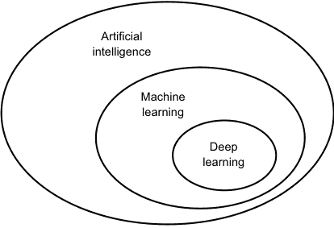

**图 1.1** 人工智能、机器学习和深度学习

### 1.1.1 人工智能

人工智能诞生于 20 世纪 50 年代，当时计算机科学这个新兴领域的一小撮先驱开始询问计算机是否能被制造出来“思考”——一个我们至今仍在探索其影响的问题。

虽然许多基本思想在多年甚至数十年前就已酝酿，但“人工智能”终于在 1956 年作为一个研究领域成形，当时达特茅斯学院年轻的助理数学教授约翰·麦卡锡组织了一个夏季研讨会，依据以下提案：

> 该研究应基于以下猜想开展：学习的各个方面或智能的任何其他特征，原则上都可以被如此精确地描述，以至于可以制造出机器来模拟它。将尝试找出如何让机器使用语言、形成抽象和概念、解决目前仅供人类处理的各类问题，并自我改进。我们认为，如果一组精心挑选的科学家共同在这个问题上工作一个夏天，在一个或多个这些问题上可以取得重大进展。

夏天结束时，研讨会在未能完全解决其出发点要调查的谜题下结束。尽管如此，许多后来成为该领域先驱的人参加了会议，并启动了一场至今仍在进行的思想革命。

简言之，AI 可以描述为自动化通常由人类执行的智力任务的努力。因此，AI 是一个涵盖机器学习和深度学习的通用领域，但还包括许多可能不涉及任何学习的其他方法。请考虑，直到 20 世纪 80 年代，大多数 AI 教材都根本没有提到“学习”！例如，早期的国际象棋程序只涉及程序员编写的硬编码规则，不符合机器学习的定义。事实上，在相当长一段时间里，大多数专家认为，人类水平的人工智能可以通过让程序员手工编写一套足够大的显式规则来实现，用于操作存储在显式数据库中的知识。这种方法被称为 *符号人工智能*。它是 20 世纪 50 年代到 20 世纪 80 年代末 AI 中的主导范式，并在 20 世纪 80 年代的 *专家系统* 热潮期间达到了其巅峰流行度。

虽然符号人工智能证明适合解决定义明确、逻辑性强的问题，例如下棋，但发现为解决更复杂、模糊的问题（如图像分类、语音识别或自然语言翻译）制定显式规则是困难的。一种新方法应运而生，取代符号人工智能的地位：*机器学习*。

### 1.1.2 机器学习

在维多利亚时代的英国，埃达·洛夫莱斯夫人是查尔斯·巴贝奇的朋友和合作者，巴贝奇发明了 *分析机*：已知的第一台通用机械计算机。尽管超前且远远领先于其时代，分析机在 19 世纪 30 年代和 40 年代设计时并非旨在成为通用计算机，因为通用计算的概念当时尚未被发明。它仅仅旨在通过机械操作来自动化数学分析领域的某些计算——因此得名分析机。因此，它是早期尝试将数学操作编码为齿轮形式的后继者，例如帕斯卡计算机，或莱布尼茨的步进计算机，后者是帕斯卡计算机的改良版。帕斯卡计算机由布莱兹·帕斯卡于 1642 年设计（当时他年仅 19 岁！），是世界上第一台机械计算器——它可以对数字进行加、减、乘，甚至除法运算。

1843 年，埃达·洛夫莱斯对分析机的发明评论道，

> 分析机毫无自创任何东西的企图。它能做的，是我们知道如何命令它执行的任何事情。……它的职责是帮助我们利用我们已有的知识。

即使有 178 年的历史视角，洛夫莱斯夫人的观察依然令人震撼。一台通用计算机能“自创”任何东西吗，还是它始终只会乏味地执行我们人类完全理解的过程？它是否可能拥有任何原创思想？它能从经验中学习吗？它能展现创造力吗？

她的评论后来被 AI 先驱艾伦·图灵引用，作为其里程碑式的 1950 年论文《计算机器与智能》¹中的“洛夫莱斯夫人的反对意见”，该论文引入了 *图灵测试* 以及后来塑造 AI 的关键概念。² 图灵


was of the opinion—highly provocative at the time—that computers could in principle be made to emulate all aspects of human intelligence.

The usual way to make a computer do useful work is to have a human programmer write down rules—a computer program—to be followed to turn input data into appropriate answers, just like Lady Lovelace writing down step-by-step instructions for the Analytical Engine to perform. Machine learning turns this around: the machine looks at the input data and the corresponding answers, and figures out what the rules should be (see figure 1.2). A machine learning system is trained rather than explicitly programmed. It's presented with many examples relevant to a task, and it finds statistical structure in these examples that eventually allows the system to come up with rules for automating the task. For instance, if you wished to automate the task of tagging your vacation pictures, you could present a machine learning system with many examples of pictures already tagged by humans, and the system would learn statistical rules for associating specific pictures to specific tags.

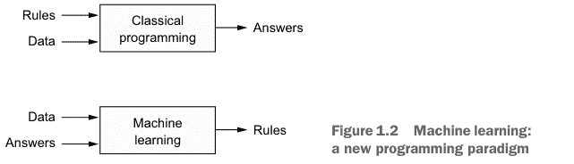

Although machine learning only started to flourish in the 1990s, it has quickly become the most popular and most successful subfield of AI, a trend driven by the availability of faster hardware and larger datasets. Machine learning is related to mathematical statistics, but it differs from statistics in several important ways, in the same sense that medicine is related to chemistry but cannot be reduced to chemistry, as medicine deals with its own distinct systems with their own distinct properties. Unlike statistics, machine learning tends to deal with large, complex datasets (such as a dataset of millions of images, each consisting of tens of thousands of pixels) for which classical statistical analysis such as Bayesian analysis would be impractical. As a result, machine learning, and especially deep learning, exhibits comparatively little mathematical theory—maybe too little—and is fundamentally an engineering discipline. Unlike theoretical physics or mathematics, machine learning is a very hands-on field driven by empirical findings and deeply reliant on advances in software and hardware.

### 1.1.3 从数据中学习规则与表示

To define deep learning and understand the difference between deep learning and other machine learning approaches, first we need some idea of what machine learning algorithms do. We just stated that machine learning discovers rules for executing a data processing task, given examples of what’s expected. So, to do machine learning, we need three things:

- *Input data points*—For instance, if the task is speech recognition, these data points could be sound files of people speaking. If the task is image tagging, they could be pictures.
- *Examples of the expected output*—In a speech-recognition task, these could be human-generated transcripts of sound files. In an image task, expected outputs could be tags such as “dog,” “cat,” and so on.
- *A way to measure whether the algorithm is doing a good job*—This is necessary in order to determine the distance between the algorithm’s current output and its expected output. The measurement is used as a feedback signal to adjust the way the algorithm works. This adjustment step is what we call *learning*.

A machine learning model transforms its input data into meaningful outputs, a process that is “learned” from exposure to known examples of inputs and outputs. Therefore, the central problem in machine learning and deep learning is to *meaningfully transform data*: in other words, to learn useful *representations* of the input data at hand—representations that get us closer to the expected output.

Before we go any further: what’s a representation? At its core, it’s a different way to look at data—to represent or encode data. For instance, a color image can be encoded in the RGB format (red-green-blue) or in the HSV format (hue-saturation-value): these are two different representations of the same data. Some tasks that may be difficult with one representation can become easy with another. For example, the task “select all red pixels in the image” is simpler in the RGB format, whereas “make the image less saturated” is simpler in the HSV format. Machine learning models are all about finding appropriate representations for their input data—transformations of the data that make it more amenable to the task at hand.

Let’s make this concrete. Consider an x-axis, a y-axis, and some points represented by their coordinates in the (x, y) system, as shown in figure 1.3.

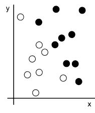

As you can see, we have a few white points and a few black points. Let’s say we want to develop an algorithm that can take the coordinates (x, y) of a point and output whether that point is likely to be black or to be white. In this case,

- The inputs are the coordinates of our points.
- The expected outputs are the colors of our points.
- A way to measure whether our algorithm is doing a good job could be, for instance, the percentage of points that are being correctly classified.

What we need here is a new representation of our data that cleanly separates the white points from the black points. One transformation we could use, among many other possibilities, would be a coordinate change, illustrated in figure 1.4.

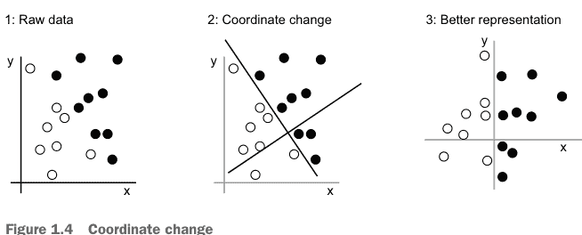

In this new coordinate system, the coordinates of our points can be said to be a new representation of our data. And it’s a good one! With this representation, the black/white classification problem can be expressed as a simple rule: “Black points are such that x > 0,” or “White points are such that x < 0.” This new representation, combined with this simple rule, neatly solves the classification problem.

In this case we defined the coordinate change by hand: we used our human intelligence to come up with our own appropriate representation of the data. This is fine for such an extremely simple problem, but could you do the same if the task were to classify images of handwritten digits? Could you write down explicit, computer-executable image transformations that would illuminate the difference between a 6 and an 8, between a 1 and a 7, across all kinds of different handwriting?

This is possible to an extent. Rules based on representations of digits such as “number of closed loops” or vertical and horizontal pixel histograms can do a decent job of telling apart handwritten digits. But finding such useful representations by hand is hard work, and, as you can imagine, the resulting rule-based system is brittle—a nightmare to maintain. Every time you come across a new example of handwriting that breaks your carefully thought-out rules, you will have to add new data transformations and new rules, while taking into account their interaction with every previous rule.

You’re probably thinking, if this process is so painful, could we automate it? What if we tried systematically searching for different sets of automatically generated representations of the data and rules based on them, identifying good ones by using as feedback the percentage of digits being correctly classified in some development data-set? We would then be doing machine learning. Learning, in the context of machine learning, describes an automatic search process for data transformations that produce useful representations of some data, guided by some feedback signal—representations that are amenable to simpler rules solving the task at hand.

These transformations can be coordinate changes (like in our 2D coordinates classification example), or taking a histogram of pixels and counting loops (like in our digits classification example), but they could also be linear projections, translations, nonlinear operations (such as “select all points such that x > 0”), and so on.


机器学习算法在寻找这些变换时通常不具备创造性；它们只是在一组预定义的操作中进行搜索，这组操作被称为 *假设空间*。例如，在 2D 坐标分类示例中，所有可能的坐标变换构成的空间就是我们的假设空间。

简言之，这就是机器学习：在预定义的可能性空间内，利用反馈信号的指导，对某些输入数据搜索有用的表示和规则。这个简单的想法可以用于解决范围 remarkably broad 的智力任务，从语音识别到自动驾驶。

既然你了解我们所说的 *学习* 是什么意思，那么让我们来看看是什么让 *深度学习* 特别。

### 1.1.4 “深度学习”中的“深度”

深度学习是机器学习的一个特定子领域：一种从数据学习表示的新方法，强调学习连续层次的、越来越有意义的表示。“深度学习”中的“深度”并非指该方法实现的任何更深层次的理解；相反，它代表了连续层次表示的想法。有多少层对数据模型做出贡献，称为模型的 *深度*。该领域其他合适的名称本可以是 *分层表示学习* 或 *层次表示学习*。现代深度学习通常涉及几十甚至上百个连续的表示层，它们都会从训练数据中自动学习得来。与此同时，其他机器学习方法往往专注于只学习数据的一两层表示（例如，先获取像素直方图，然后应用分类规则）；因此，它们有时被称为 *浅层学习*。

在深度学习中，这些分层表示是通过称为 *神经网络* 的模型来学习的，神经网络由字面意义上的层堆叠而成。“神经网络”这一术语指代神经生物学，但虽然深度学习中的一些核心概念部分是从我们对大脑的理解（特别是视觉皮层）中汲取灵感而开发的，深度学习模型并不是大脑的模型。没有证据表明大脑实现了类似于现代深度学习模型中使用的学习机制。你可能会看到一些科普文章宣称深度学习的工作原理类似于大脑或是模仿大脑构建的，但事实并非如此。对于该领域的新手来说，将深度学习与神经生物学以任何方式相关联是令人困惑且适得其反的：你不需要那种“就像我们的思维一样”的神秘感和神秘光环，而且你最好忘记你可能读到过的关于深度学习与生物学之间假设性联系的任何内容。就我们的目的而言，深度学习是一种从数据学习表示的数学框架。

深度学习算法学习到的表示是什么样子的？让我们来看看一个多层网络（参见图 1.5）如何转换一张数字图像，以识别它是什么数字。

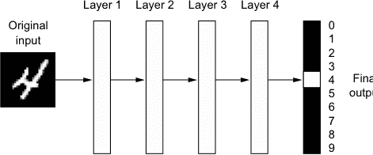

图 1.5 用于数字分类的深度神经网络

如图 1.6 所示，网络将数字图像转换为与原始图像越来越不同、且对最终结果越来越有信息量的表示。你可以将深度网络视为一个多阶段的 *信息蒸馏* 过程，其中信息经过连续的过滤，输出时变得越来越 *纯净*（即，针对某项任务有用）。

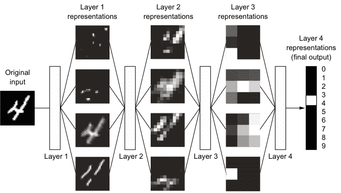

图 1.6 数字分类模型学习到的数据表示

从技术上讲，这就是深度学习：一种学习数据表示的多阶段方式。这是一个简单的想法——但事实证明，非常简单的机制，只要规模足够大，最终就能看起来像魔法。

### 1.1.5 *通过三个图理解深度学习的工作原理*

到此，你已经知道机器学习是关于将输入（例如图像）映射到目标（例如标签“猫”），这是通过观察大量输入和目标示例来完成的。你也知道，深度神经网络通过一系列简单的数据变换（层）来完成这种输入到目标的映射，而这些数据变换是通过示例学习得到的。现在让我们具体看看这种学习是如何发生的。

层对其输入数据做什么的规格存储在层的权重中，本质上是一堆数字。从技术角度来看，我们可以说层实现的变换由其权重参数化（参见图 1.7）。（权重有时也被称为层的参数。）在此背景下，学习意味着为网络中所有层的权重找到一组值，使得网络能够正确地将示例输入映射到其关联的目标。但问题在于：一个深度神经网络可能包含数千万个参数。为所有参数找到正确值看起来可能是一项艰巨的任务，尤其是考虑到修改一个参数的值会影响所有其他参数的行为！

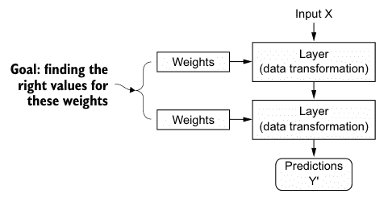

图 1.7 神经网络由其权重参数化。

要控制某物，首先你需要能够观察它。要控制神经网络的输出，你需要能够衡量该输出与你期望的结果相差多少。这就是网络损失函数的工作，有时也称为目标函数或代价函数。损失函数接收网络的预测和真实目标（你希望网络输出的内容），并计算一个距离得分，捕捉网络在这个特定示例上的表现如何（参见图 1.8）。

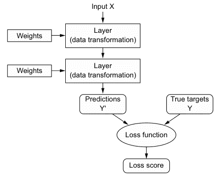

图 1.8 损失函数衡量网络输出的质量。

深度学习的核心技巧是使用此分数作为反馈信号，稍微调整权重的值，朝着降低当前示例损失得分的方向调整（参见图 1.9）。这种调整是 *优化器* 的工作，它实现了所谓的 *反向传播* 算法：深度学习中的核心算法。下一章将更详细地解释反向传播是如何工作的。

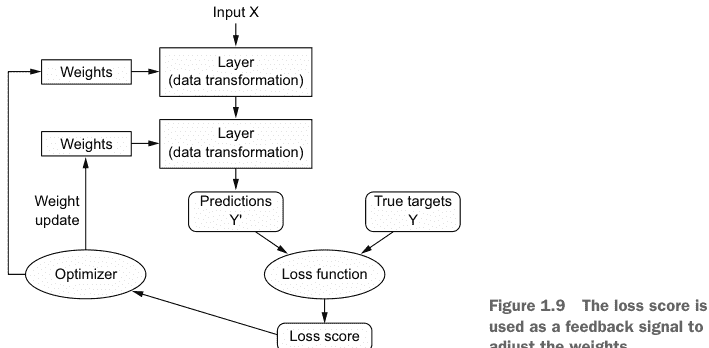

最初，网络的权重被赋予随机值，因此网络仅实现一系列随机变换。自然，其输出与理想状态相去甚远，损失得分也相应很高。但是，随着网络处理的每个示例，权重都会朝着正确方向稍微调整，损失得分随之下降。这就是 *训练循环*，重复足够多次（通常是在数千个示例上进行几十次迭代）后，会得到最小化损失函数的权重值。一个损失最小化的网络，其输出尽可能接近目标：即一个训练有素的网络。再次强调，这是一个简单的机制，一旦规模化，最终就看起来像魔法。

### 1.1.6 深度学习迄今取得的成就

尽管深度学习是一个相当古老的机器学习子领域，但它直到 2010 年代初才崭露头角。在那之后的几年里，它在该领域取得了堪称革命性的成就，在感知任务甚至自然语言处理任务上产生了显著结果——这些任务涉及的技能对人类来说似乎自然而直觉，但长期以来对机器而言却遥不可及。

具体来说，深度学习使以下突破成为可能，这些突破都发生在机器学习中历史上困难的领域：

- 接近人类水平的图像分类
- 接近人类水平的语音转写
- 接近人类水平的手写体转写


- 机器翻译大幅改进
- 文本转语音转换大幅改进
- 如 Google Assistant 和 Amazon Alexa 之类的数字助手
- 接近人类水平的自动驾驶
- 改进的广告定向，如 Google、Baidu 或 Bing 所使用
- Web 上搜索结果的改进
- 回答自然语言问题的能力
- 围棋超人类水平

我们仍在探索深度学习的全部潜力。我们已开始将其成功应用于各种仅几年前还被认为无法解决的问题——例如自动转录梵蒂冈宗座档案馆藏的数万份古代手稿、使用简单的智能手机在田间检测和分类植物疾病、协助肿瘤科医生或放射科医生解读医学影像数据、预测洪水、飓风甚至地震等自然灾害，等等。每迈出一个里程碑，我们就离深度学习在每项活动和每个人类事业领域（从科学、医学、制造、能源、交通、软件开发、农业，甚至艺术创作中辅助我们）的时代更近一步。

### 1.1.7 不要轻信短期炒作

尽管深度学习近年来取得了显著成就，但人们对该领域在未来十年所能实现目标的期望往往远高于可能实现的水平。尽管自动驾驶汽车等一些改变世界的应用已然触手可及，但许多其他应用在很长一段时间内可能仍然遥不可及，例如可信的对话系统、跨任意语言的人类水平机器翻译，以及人类水平的自然语言理解。特别是，关于人类水平通用人工智能的讨论不应被过于认真对待。对短期抱有过高期望的风险在于，当技术未能兑现承诺时，研究投资将枯竭，从长期来看会减缓进展。

此前也发生过。在过去，AI 曾两次经历从极度乐观到失望和怀疑的周期，并因此导致资金匮乏。这一切始于 20 世纪 60 年代的符号 AI。在那个早期阶段，关于 AI 的预测乐观情绪高涨。符号 AI 方法最著名的先驱和倡导者之一是 Marvin Minsky，他于 1967 年声称：“在一代人之内……创造‘人工智能’的问题将在很大程度上得到解决。”三年后，即 1970 年，他做出了一个更精确量化的预测：“在三到八年内，我们将拥有具备普通人类通用智能的机器。”在 2021 年，这样的成就仍似乎遥不可及——遥远到我们无法预测需要多长时间——但在 20 世纪 60 年代和 70 年代初，几位专家认为它就在眼前（如今许多人也这么认为）。几年后，由于这些高期望未能实现，研究人员和政府资金转而离开该领域，标志着第一个 AI 冬季的开始（这是对核冬季的暗示，因为这是冷战高峰期后不久的事情）。

这并非最后一次。在 20 世纪 80 年代，符号 AI 的一种新形式——专家系统——开始在大公司中流行起来。最初的几个成功案例引发了一波投资热潮，世界各地的公司纷纷成立内部 AI 部门来开发专家系统。大约在 1985 年，公司每年在这项技术上的支出超过 10 亿美元；但到 20 世纪 90 年代初，这些系统已被证明维护成本高昂、难以扩展且范围有限，兴趣随之消退。于是第二个 AI 冬季开始了。

我们可能正在目睹 AI 炒作与失望的第三个周期，并且目前仍处于极度乐观的阶段。最好适度降低短期预期，并确保不太熟悉该领域技术方面的人清楚了解深度学习能做什么和不能做什么。

### 1.1.8 AI 的前景

尽管我们可能对 AI 有不切实际的短期预期，但长期前景一片光明。我们才刚刚开始将深度学习应用于许多可能产生变革性影响的重要问题，从医疗诊断到数字助手。在过去十年中，AI 研究以惊人的速度快速推进，很大程度上归功于 AI 短暂历史中前所未见的资金水平，但迄今为止，这些进展中相对较少一部分进入了构成我们世界的产品和流程。深度学习的大部分研究成果尚未被应用，或者至少尚未应用于它们能够在所有行业解决的全部问题范围。你的医生还没有使用 AI，你的会计师也没有。你可能在日常生活中不太经常使用 AI 技术。当然，你可以向智能手机提问并得到合理的回答，可以在 Amazon.com 上获得相当有用的产品推荐，还可以在 Google Photos 上搜索“生日”并立即找到上个月女儿生日派对的照片。与这些技术过去的地位相比，这已有很大进步。但这些工具目前仍只是我们日常生活中的附属品。AI 尚未过渡到成为我们工作、思考和生活方式的核心。

目前，很难相信 AI 会对我们的世界产生重大影响，因为它尚未被广泛部署——就像 1995 年时，人们很难相信互联网未来的影响一样。当时，大多数人看不出互联网与他们有何关联，也看不出它将如何改变他们的生活。今天的深度学习和 AI 也是如此。但请不要误解：AI 正在到来。在不太遥远的未来，AI 将成为你的助手，甚至你的朋友；它将回答你的问题，帮助教育你的孩子，并关注你的健康。它会将杂货送到你家门口，并把你从 A 点送到 B 点。它将成为你通往日益复杂和信息密集型世界的接口。更重要的是，AI 将帮助整个人类向前迈进，协助人类科学家在从基因组学到数学的所有科学领域中实现新的突破性发现。

在前进的道路上，我们可能会遇到一些挫折，甚至可能迎来一个新的 AI 冬季——这很类似于互联网行业在 1998–99 年被过度炒作，并在 2000 年代初经历了一场导致投资枯竭的崩盘。但我们终将抵达。AI 最终将被应用于构成我们社会和日常生活的几乎每个流程，就像今天的互联网一样。

不要轻信短期炒作，但要相信长期愿景。AI 可能需要一段时间才能发挥其真正潜力——这种潜力的全部范围至今无人敢于梦想——但 AI 正在到来，它将以一种精彩的方式改变我们的世界。

## 1.2 深度学习之前：机器学习简史

深度学习在 AI 历史上达到了前所未见的公众关注度和行业投资水平，但它并非第一种成功的机器学习形式。可以肯定地说，当今行业中使用的大多数机器学习算法都不是深度学习算法。深度学习并不总是合适的工具——有时没有足够的数据让深度学习适用，有时问题更适合用其他算法来解决。如果深度学习是你接触机器学习的第一个领域，你可能会发现自己陷入这样一种境地：你只有一把深度学习锤子，而每个机器学习问题都开始看起来像钉子。避免陷入这个陷阱的唯一方法是熟悉其他方法，并在适当的时候加以实践。

对经典机器学习方法的详细讨论超出了本书的范围，但我将简要地介绍它们，并描述它们发展的历史背景。这将使我们能够将深度学习置于机器学习的更广泛背景下，更好地理解深度学习的来源及其重要性。

### 1.2.1 概率建模

*概率建模*是将统计学原理应用于数据分析。它是最早的机器学习形式之一，并且至今仍被广泛使用。此类中最著名的算法之一是朴素贝叶斯算法。

朴素贝叶斯是一种机器学习分类器，它基于应用贝叶斯定理，同时假设输入数据中的特征都是相互独立的（这是一个强烈的或“天真”的假设，名称也由此而来）。这种数据分析形式早于计算机的出现，并在其首次计算机实现（很可能可追溯到 20 世纪 50 年代）之前几十年就已手动应用。贝叶斯定理和统计学基础可追溯到 18 世纪，这正是你开始使用朴素贝叶斯分类器所需的一切。

一种密切相关的模型是 *逻辑回归*（logreg 简写），它有时被认为是现代机器学习的“Hello World”。不要被其名称误导——logreg 是一种分类算法，而不是回归算法。大量


与朴素贝叶斯类似，逻辑回归早于计算机诞生很久，但时至今日依然有用，这要归功于其简单而多才多艺的特性。对于数据科学家来说，它通常是在数据集上处理当前分类任务时首先尝试的方法。

### 1.2.2 早期神经网络

神经网络的早期版本已被本页介绍的现代变体完全取代，但了解深度学习的起源仍然有所帮助。尽管神经网络的核心思想早在20世纪50年代就以玩具形式被研究，但该方法花了几十年才开始。很长一段时间，缺失的关键是一种高效训练大型神经网络的方法。这种情况在20世纪80年代中期发生了改变，当时多位研究人员独立重新发现了反向传播算法——一种使用梯度下降优化来训练参数化操作链的方法（我们将在本书后面精确定义这些概念）——并开始将其应用于神经网络。

神经网络首次成功的实际应用出现在1989年的贝尔实验室，当时Yann LeCun结合了早期的卷积神经网络和反向传播思想，并将其应用于手写数字分类问题。该网络被称为*LeNet*，在20世纪90年代被美国邮政局用于自动读取邮件信封上的邮政编码。

### 1.2.3 核方法

20世纪90年代，得益于首次成功，神经网络开始在研究者中赢得一些尊重，与此同时，一种新的机器学习方法声名鹊起，并迅速将神经网络重新送入了遗忘的深渊：核方法。*核方法*是一类分类算法，其中最著名的是*支持向量机*（SVM）。SVM的现代表述由Vladimir Vapnik和Corinna Cortes在20世纪90年代初于贝尔实验室开发，并于1995年出版，³尽管一个较早的线性表述由Vapnik和Alexey Chervonenkis早在1963年就已出版。⁴ SVM是一种分类算法，通过寻找将两个类分开的“决策边界”来工作（参见图1.10）。SVM分两个步骤寻找这些边界：

- 1. 数据被映射到一个新的高维表示中，在此表示中决策边界可以表示为一个超平面（如果数据是二维的，如图1.10所示，超平面将是一条直线）。
- 2. 通过尝试最大化超平面与每个类中最近数据点之间的距离来计算一个好的决策边界（分离超平面），这一步称为最大化边界。这使得边界能够很好地泛化到训练数据集之外的新样本。

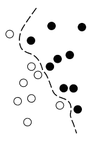

将数据映射到使分类问题变得简单的高维表示的技术，在纸面上可能看起来不错，但在实践中通常计算上难以处理。这就是核技巧发挥作用的地方（这是核方法得名的关键思想）。要点如下：要在新的表示空间中找到好的决策超平面，你不需要显式计算点在新空间中的坐标；你只需要计算该空间中点对之间的距离，这可以使用核函数高效完成。核函数是一种计算上可处理的操作，它将初始空间中的任意两个点映射到这些点在目标表示空间之间的距离，完全绕过了新表示的显式计算。核函数通常是手工制作的，而不是从数据中学习的——在SVM的情况下，只有分离超平面是被学习的。

在开发之初，SVM在简单的分类问题上表现出最先进的性能，是少数几种有大量理论支持且适合进行严肃数学分析的机器学习方法之一，因此它们被深入理解并易于解释。正是由于这些有用的特性，SVM在该领域长期以来变得极其流行。

但是，SVM证明难以扩展到大型数据集，并且对图像分类等感知问题效果不佳。因为SVM是一种浅层方法，将SVM应用于感知问题需要先手动提取有用表示（这一步称为特征工程），这既困难又脆弱。例如，如果你想使用SVM对手写数字进行分类，你不能从原始像素开始；你应该先手动找到使问题更易处理的有用表示，比如我之前提到的像素直方图。

### 1.2.4 决策树、随机森林和梯度提升机

决策树是类似流程图的结构，允许你对输入数据点进行分类或根据输入预测输出值（参见图1.11）。它们易于可视化和解释。从数据中学习的决策树在2000年代开始引起显著的研究兴趣，到2010年，它们通常比核方法更受青睐。

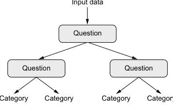

图1.11. 决策树：学习的参数是关于数据的问题。一个问题可以是，例如，“数据中的系数2是否大于3.57”

特别是，随机森林算法对决策树学习提出了一种强健且实用的方法，即构建大量专门的决策树，然后集成它们的输出。随机森林适用于各种问题——你可以这么说，对于任何浅层机器学习任务，它们几乎总是次优算法。当流行的机器学习竞赛网站Kaggle（http://kaggle.com）于2010年启动时，随机森林迅速成为该平台的热门算法——直到2014年，梯度提升机接管了局面。梯度提升机与随机森林类似，是一种基于集成弱预测模型（通常是决策树）的机器学习技术。它使用梯度提升，这是一种通过迭代训练新模型来改进任何机器学习模型的方法，这些新模型专注于解决前一模型的弱点。将其应用于决策树，梯度提升技术的使用会产生在大多数情况下严格优于随机森林的模型，同时具有相似的特性。今天，它可能是处理非感知数据的最佳算法之一，如果不是*最佳*算法的话。与深度学习一道，它是Kaggle竞赛中最常用的技术之一。

### 1.2.5 回归神经网络

2010年左右，尽管神经网络几乎完全被主流科学界摒弃，但仍有少数人继续研究神经网络并开始取得重要突破：多伦多大学的Geoffrey Hinton小组、蒙特利尔大学的Yoshua Bengio小组、纽约大学的Yann LeCun小组以及瑞士的IDSIA。

2011年，IDSIA的Dan Ciresan开始使用GPU训练的深度神经网络赢得学术图像分类竞赛——这是现代深度学习的首次实际成功。但转折点出现在2012年，当时Hinton小组参加了每年的大规模图像分类挑战ImageNet（ImageNet Large Scale Visual Recognition Challenge，简称ILSVRC）。当时ImageNet挑战以极难著称，任务是在140万张图像上训练后，将高分辨率彩色图像分类到1000个不同类别中。2011年，基于经典计算机视觉方法的获胜模型的前五准确率仅为74.3%。然后，在2012年，由Alex Krizhevsky领导、Geoffrey Hinton指导的团队达到了83.6%的前五准确率——这是一个重大突破。此后每年比赛都由深度卷积神经网络主导。到2015年，获胜者达到了96.4%的准确率，ImageNet上的分类任务被认为已经完全解决。

自2012年以来，深度卷积神经网络（convnets）已成为所有计算机视觉任务的首选算法；更一般地说，它们适用于所有感知

5 “前五准确率”衡量模型将正确答案选为前五猜测之一的频率（在ImageNet的情况下，共有1000个可能答案）。


tasks。在 2015 年之后的任何主要计算机视觉会议上，几乎不可能找到不涉及某种形式卷积网络的演示。同时，深度学习也已在许多其他类型的问题中找到应用，例如自然语言处理。它已在广泛的应用中完全取代了 SVMs 和决策树。例如，长达数年之久，欧洲核子研究组织（CERN）一直使用基于决策树的方法来分析大强子对撞机（LHC）ATLAS 探测器的粒子数据，但 CERN 最终因其更高的性能以及在大型数据集上训练的便捷性，转而采用基于 Keras 的深度神经网络。

### 1.2.6 什么使深度学习与众不同

深度学习之所以如此迅速地兴起，首要原因是它在许多问题上提供了更好的性能。但这并非唯一原因。深度学习也使问题解决变得容易得多，因为它完全自动化了机器学习工作流中曾经最关键的一步：特征工程。

早期的机器学习技术——浅层学习——仅涉及将输入数据转换为一两个连续的表示空间，通常通过简单的转换实现，例如高维非线性投影（SVM）或决策树。但复杂问题所需的精细表示通常无法通过此类技术实现。因此，人类必须不遗余力地使初始输入数据更易于这些方法处理：他们必须手动为其数据设计良好的表示层。这被称为特征工程。而深度学习则完全自动化了这一步骤：使用深度学习时，你一次性学习所有特征，而无需自己设计它们。这大大简化了机器学习工作流，常用单一的、简单的端到端深度学习模型取代复杂的多阶段流水线。

你可能会问，如果问题的关键在于拥有多个连续的表示层，是否可以反复应用浅层方法来模拟深度学习的效果？在实践中，反复应用浅层学习方法会产生快速递减的回报，因为三层模型中的最优第一表示层并非单层或双层模型中的最优第一层。深度学习之所以具有变革性，在于它允许模型同时联合学习所有表示层，而不是依次（贪婪地，如其所称）学习。通过联合特征学习，每当模型调整其内部特征之一时，所有依赖它的其他特征都会自动适应变化，无需人工干预。一切都由单一反馈信号监督：模型中的每一个变化都服务于最终目标。这比贪婪地堆叠浅层模型要强大得多，因为它允许通过将复杂的抽象表示分解为一长串中间空间（层）来学习这些表示；每个空间与前一个空间之间仅相差一个简单的转换。

这些是深度学习从数据中学习的两个基本特征：逐步、层层递进的方式，用于开发越来越复杂的表示；以及*这些中间递进表示是联合学习的*这一事实，每一层都会被更新，以同时遵循上一层和下一层的表示需求。这两个特性共同使深度学习比以前的机器学习方法成功得多。

### 1.2.7 现代机器学习格局

了解当前机器学习算法和工具格局的一个好方法是查看 Kaggle 上的机器学习竞赛。由于其竞争激烈的环境（有些比赛有数千名参赛者和百万美元奖金）以及所涵盖的机器学习问题种类繁多，Kaggle 提供了一种评估什么有效、什么无效的现实方式。那么，哪种算法能可靠地赢得比赛？顶尖参赛者使用什么工具？

2019 年初，Kaggle 开展了一项调查，询问自 2017 年以来任何比赛中进入前五名的团队在比赛中使用的主要软件工具（见图 1.12）。结果表明，顶尖团队倾向于使用深度学习方法（最常通过 Keras 库）或梯度提升树（最常通过 LightGBM 或 XGBoost 库）。

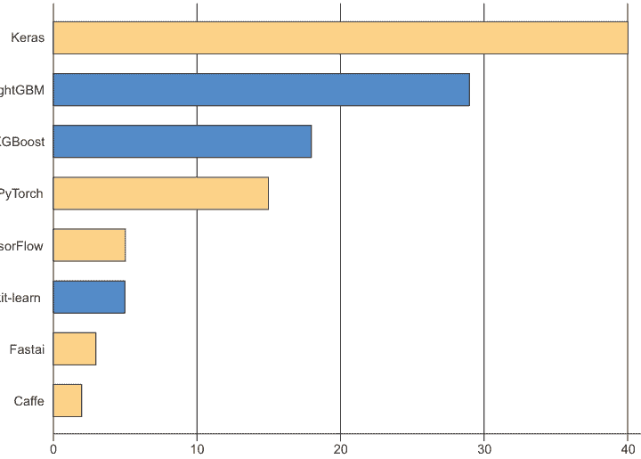

**图 1.12** Kaggle 顶尖团队使用的机器学习工具

不仅如此，Kaggle 还每年在全球机器学习和数据科学专业人士中开展调查。这项调查有数万名受访者，是了解行业现状的最可靠来源之一。图 1.13 显示了不同机器学习软件框架的使用百分比。

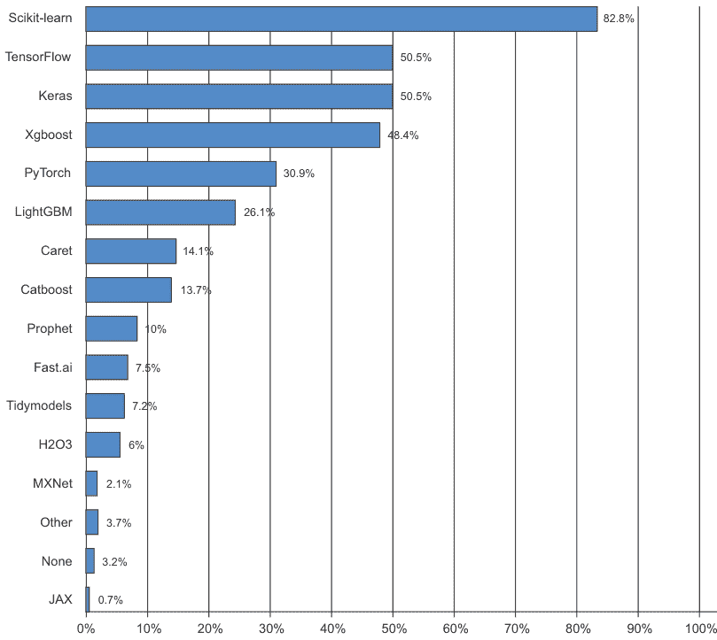

图 1.13 机器学习和数据科学行业的工具使用情况（来源：www.kaggle.com/kaggle-survey-2020）

从 2016 年到 2020 年，整个机器学习和数据科学行业一直由这两种方法主导：深度学习和梯度提升树。具体来说，梯度提升树用于有结构化数据可用的问题，而深度学习用于感知问题，例如图像分类。梯度提升树的用户倾向于使用 Scikit-learn、XGBoost 或 LightGBM。与此同时，大多数深度学习从业者使用 Keras，通常与其父框架 TensorFlow 配合使用。这些工具的共同点是它们都是 Python 库：Python 是目前机器学习和数据科学中使用最广泛的语言。

要在当今应用机器学习中取得成功，你应当最熟悉的两种技术是：用于浅层学习问题的梯度提升树；以及用于感知问题的深度学习。从技术角度来说，这意味着你需要熟悉 Scikit-learn、XGBoost 和 Keras——这三个库目前主导着 Kaggle 竞赛。手握本书，你已经离成功又近了一大步。

## 1.3 为什么是深度学习？为什么是现在？

计算机视觉领域深度学习的两个关键理念——卷积神经网络和反向传播——到 1990 年已经被广泛理解。长短期记忆（LSTM）算法，这是深度学习处理时间序列数据的基础，开发于 1997 年，此后几乎未发生变化。那么，为什么深度学习直到 2012 年之后才兴起？这两十年间发生了什么变化？

一般来说，有三种技术力量正在推动机器学习的发展：

- 硬件
- 数据集和基准
- 算法进步

由于该领域由实验发现而非理论引导，算法进步只有在有适当的数据和硬件来尝试新想法（或扩展旧想法，这经常是情况）时才成为可能。机器学习不是数学或物理学，重大进展可以用一支笔和一张纸完成。它是一门工程科学。

1990 年代和 2000 年代的真正瓶颈是数据和硬件。但那段时间发生的事情是：互联网兴起，高性能图形芯片为了游戏市场的需求而开发出来。

### 1.3.1 硬件

从 1990 年到 2010 年，现成 CPU 的速度提高了约 5,000 倍。因此，如今可以在笔记本电脑上运行小型深度学习模型，而 25 年前这仍然不可行。

但计算机视觉或语音识别中使用的典型深度学习模型所需的计算能力比笔记本电脑能提供的大几个数量级。在整个 2000 年代，NVIDIA 和 AMD 等公司投资了数十亿美元，开发快速的大规模并行芯片（图形处理单元，或 GPU），以支持越来越逼真的视频游戏的图形——廉价的、单一用途的超级计算机，旨在实时在屏幕上渲染复杂的 3D 场景。当 NVIDIA 于 2007 年推出 CUDA（https://developer.nvidia.com/about-cuda），一种编程接口时，这项投资开始惠及科学界。


为其 GPU 产品线服务。少量 GPU 开始在各种高度可并行的应用中取代大规模 CPU 集群，起点是物理建模。深度神经网络主要由大量小型矩阵乘法组成，也高度可并行，大约在 2011 年，一些研究人员开始编写神经网络的 CUDA 实现——丹·奇雷桑⁶ 和亚历克斯·克里谢夫斯基⁷ 是最早的一批人。

⁶ 参见《用于图像分类的灵活高性能卷积神经网络》，第 22 届国际人工智能联合会议论文集（2011），www.ijcai.org/Proceedings/11/Papers/ 210.pdf。⁷ 参见《采用深度卷积神经网络的 ImageNet 分类》，神经信息处理系统进展 25（2012），http://mng.bz/2286。

情况正是这样：游戏市场补贴了下一代人工智能应用的超级计算。有时，伟大的事物始于游戏。今天，NVIDIA Titan RTX（一款在 2019 年末售价 2,500 美元的 GPU），在单精度下可提供高达 16 万亿次浮点运算（即每秒 16 万亿次 float32 操作）的峰值性能。这大约是 1990 年全球最快超级计算机（Intel Touchstone Delta）计算能力的 500 倍。在 Titan RTX 上，训练一个 2012 年或 2013 年左右本可赢得 ILSVRC 竞赛的 ImageNet 模型，只需几个小时。与此同时，大型公司正在由数百块 GPU 组成的集群上训练深度学习模型。

不仅如此，深度学习行业正在超越 GPU，并为深度学习投资越来越专业化、高效的芯片。2016 年，在其年度 I/O 大会上，Google 揭晓了其 Tensor Processing Unit (TPU) 项目：一种从头开始开发的新芯片设计，用于运行深度神经网络，其速度显著快于顶级 GPU，且能效远高于顶级 GPU。今天，在 2020 年，第三代 TPU 卡代表 420 万亿次浮点运算的计算能力。这比 1990 年的 Intel Touchstone Delta 大了 10,000 倍。

这些 TPU 卡设计用于组装成大规模配置，称为“POD”。一个 POD（1024 块 TPU 卡）峰值可达 100 千万亿次浮点运算。作为参考，这大约相当于目前最大超级计算机（位于橡树岭国家实验室的 IBM Summit，由 27,000 块 NVIDIA GPU 组成，峰值约为 1.1 百亿亿次浮点运算）峰值计算能力的 10%。

### 1.3.2 数据

人工智能有时被誉为新的工业革命。如果深度学习是这场革命的蒸汽机，那么数据就是它的煤炭：为智能机器提供动力的原材料，没有它一切皆无。说到数据，除了过去 20 年存储硬件的指数级进步（遵循摩尔定律）之外，改变游戏规则的是互联网的兴起，这使得收集和分发用于机器学习的超大规模数据集成为可能。今天，大型公司正在处理没有互联网就无法收集的图像数据集、视频数据集和自然语言数据集。例如，Flickr 上的用户生成图像标签一直是计算机视觉的数据宝库。YouTube 视频也是如此。而 Wikipedia 是自然语言处理的关键数据集。

如果说有一个数据集推动了深度学习的兴起，那就是 ImageNet 数据集，它包含 140 万张图像，这些图像经人工标注了 1,000 个图像类别（每张图像一个类别）。但使 ImageNet 特别的不仅仅是其规模庞大，还有与之关联的年度竞赛。⁸

自 2010 年以来，Kaggle 一直在证明，公开竞赛是激励研究人员和工程师不断突破极限的绝佳方式。拥有研究人员竞相超越的通用基准，极大地推动了深度学习的兴起，因为这凸显了它相对于经典机器学习方法的优势。

### 1.3.3 算法

除了硬件和数据之外，直到 2000 年代末，我们都缺乏训练非常深的神经网络的可靠方法。因此，神经网络仍然相当浅，仅使用一两层表征；因此，它们无法在更精细的浅层方法（如 SVM 和随机森林）中脱颖而出。关键问题在于深层堆叠层中的梯度传播。用于训练神经网络的反馈信号会随着层数增加而消失。

这种情况在 2009–2010 年左右发生了改变，当时出现了几种简单但重要的算法改进，使得梯度传播更加有效：

- 神经层的更优激活函数
- 更优的权重初始化方案，始于逐层预训练，但很快被放弃
- 更优的优化方案，例如 RMSProp 和 Adam

只有当这些改进开始允许训练具有 10 层或更多层的模型时，深度学习才开始大放异彩。

最后，在 2014 年、2015 年和 2016 年，发现了更先进的改进梯度传播的方法，例如批量归一化、残差连接和深度可分离卷积。

今天，我们可以从零开始训练任意深的模型。这解锁了使用极大规模模型的可能性，这些模型拥有相当强的表征能力——也就是说，它们编码了非常丰富的假设空间。这种极端的可扩展性是现代深度学习的定义特征之一。具有数十层和数千万个参数的大规模模型架构，在计算机视觉（例如 ResNet、Inception 或 Xception 等架构）和自然语言处理（例如基于 Transformer 的大型架构，如 BERT、GPT-3 或 XLNet）方面都带来了关键进展。

### 1.3.4 新一轮投资浪潮

当深度学习在 2012–2013 年成为计算机视觉领域的新标准，并最终成为所有感知任务的标准时，行业领导者引起了重视。随后是一场逐渐兴起的行业投资浪潮，其规模远超人工智能历史上此前任何时期（参见图 1.14）。

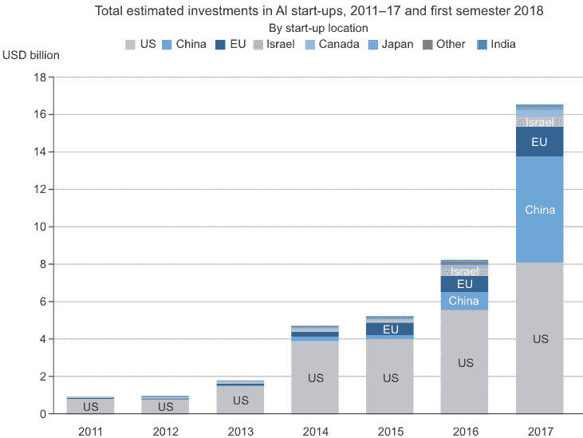

图 1.14 OECD 对 AI 初创公司总投资的估计（来源：http://mng.bz/zGN6）

2011 年，就在深度学习崭露头角之前，全球人工智能领域的风险投资总额还不到 10 亿美元，这些资金几乎全部流向了浅层机器学习方法的实际应用。到 2015 年，这一数字已上升至超过 50 亿美元，2017 年则达到惊人的 160 亿美元。在这几年里，数百家初创公司应运而生，试图利用深度学习的热潮。与此同时，Google、Amazon 和 Microsoft 等大型科技公司在内部研究部门的投入量，很可能会远超风险投资资金的流入规模。

机器学习——特别是深度学习——已成为这些科技巨头产品战略的核心。2015 年底，Google 首席执行官桑达尔·皮查伊表示：“机器学习是一种核心的、颠覆性的方式，我们正在通过它重新思考我们做事的方式。我们正在审慎地将其应用于所有产品，无论是搜索、广告、YouTube 还是 Play。而且我们还处于早期阶段，但你会看到我们——以一种系统的方式——在这些所有领域应用机器学习。”⁹

在这轮投资浪潮的推动下，从事深度学习的人数在不到 10 年的时间里从几百人增加到数万人，研究进展已达到白热化阶段。

### 1.3.5 深度学习的普惠化

推动深度学习领域涌入大量新面孔的关键因素之一，是该领域所用工具集的普惠化。在早期，进行深度学习需要深厚的 C++ 和 CUDA 专业知识，而具备这些知识的人寥寥无几。

如今，具备基本的 Python 脚本编写技能即可进行高级深度学习研究。这主要得益于现已停止维护的 Theano 库以及随后的 TensorFlow 库的开发——这两者都是用于 Python 的符号张量操作框架，支持自动微分，大大简化了新模型的实现——同时也得益于 Keras 等易于使用的库的兴起，Keras 让深度学习变得像操作乐高积木一样简单。Keras 于 2015 年初发布后，迅速成为大量新创公司、研究生以及转入该领域的研究人员的首选深度学习解决方案。

### 1.3.6 它会持续下去吗？

深度神经网络是否有什么特别之处，使其成为公司投资和研究人员蜂拥而至的“正确”方法？抑或深度学习只是一种可能不会持久的时尚？20 年后我们还会使用深度神经网络吗？

深度学习具有多种特性，证明了其作为 AI 革命的地位，并且它将长期存在。二十年后我们可能不再使用神经网络，但无论使用什么，都将直接继承现代深度学习及其核心概念。这些重要特性大致可分为三类：

- 简单性——深度学习消除了对特征工程的需求，用通常只需五六种不同张量操作构建的简单端到端可训练模型，取代了复杂、脆弱且工程密集的流水线。
- 可扩展性——深度学习非常适合在 GPU 或 TPU 上并行化，因此可以充分利用摩尔定律。此外，深度学习模型是通过在小批量数据上进行迭代来训练的，这使它们可以在任意大小的数据集上进行训练。（唯一的瓶颈是可用并行计算能力的数量，这要归功于摩尔定律，是一个快速移动的障碍。）
- 通用性和可重用性——与许多早期机器学习方法不同，深度学习模型可以在额外数据上进行训练，而无需从头开始


从零开始构建，使其适合持续在线学习——这是非常大的生产模型的重要属性。此外，训练好的深度学习模型可重新用途，因此可重复使用：例如，可以将一个用于图像分类训练的深度学习模型直接放入视频处理管道中。这使我们能够将之前的工作重新投入到越来越复杂和强大的模型中。这也使深度学习适用于相当小的数据集。

深度学习只受到关注几年，我们可能尚未完全确立其能做什么的全部范围。随着时间的推移，我们不断了解新的用例和工程改进，这些改进消除了先前的限制。在科学革命之后，进展通常遵循S型曲线：它始于快速进步阶段，随着研究人员遇到硬性限制而逐渐稳定，随后的改进则变得渐进式。

当我在2016年撰写本书第一版时，我预测深度学习仍处于该S型曲线的前半段，未来几年将有更多具有变革性的进展。实践证明这一预测是正确的，因为2017年和2018年见证了基于Transformer的自然语言处理深度学习模型的兴起，这些模型在该领域引发了一场革命，而深度学习在计算机视觉和语音识别方面也持续取得稳步进展。今天，在2021年，深度学习似乎已经进入了该S型曲线的后半段。我们仍应预期未来几年会有重大进展，但我们可能已经脱离了爆炸式进步的初始阶段。

今天，我对将深度学习技术部署到其能解决的每个问题上感到无比兴奋——这个列表是无穷无尽的。深度学习仍是一场正在进行的革命，要实现其全部潜力还需要很多年。

# 神经网络的数学基础

**本章内容**
- 神经网络的第一个示例
- 张量与张量运算
- 神经网络如何通过反向传播和梯度下降进行学习

理解深度学习需要熟悉许多简单的数学概念：*张量*、*张量运算*、*微分*、*梯度下降*等等。本章的目标是帮助你建立对这些概念的直觉，而不深入技术细节。特别是，我们将避开数学符号，因为这可能会为没有数学背景的人引入不必要的障碍，并且解释事物时并不需要它。对数学运算最精确、无歧义的描述是其可执行代码。

为了为介绍张量和梯度下降提供足够的背景，我们将以一个神经网络的实际示例开始本章。然后我们将逐点回顾所引入的每个新概念。请记住，这些概念对于你理解后续章节中的实际示例至关重要！

读完本章后，你将对深度学习背后的数学理论有直观的理解，并准备好在第3章开始深入研究Keras和TensorFlow。

## 2.1 神经网络初探

让我们来看一个具体的神经网络示例，它使用Python库Keras来学习识别手写数字。除非你已经有Keras或类似库的使用经验，否则你不会立刻完全理解这个第一个示例。这没关系。在下一章中，我们将回顾示例中的每个元素并详细解释。所以，如果某些步骤看起来任意或像魔法一样，请不要担心！我们总得从某处开始。

我们要解决的问题是将手写数字的灰度图像（28 × 28像素）分类到10个类别（0到9）中。我们将使用MNIST数据集，这是机器学习社区的一个经典数据集，几乎与该领域本身一样悠久，并经过了深入研究。它包含60,000张训练图像和10,000张测试图像，由美国国家标准与技术研究院（即MNIST中的NIST）于20世纪80年代整理。你可以将“解决”MNIST视为深度学习的“Hello World”——这是你用来验证算法是否按预期工作的做法。随着你成为机器学习从业者，你将在科学论文、博客文章等中反复看到MNIST。你可以在图 2.1 中看到一些MNIST样本。

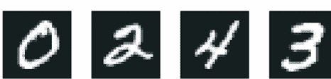

图 2.1 MNIST样本数字

注意 在机器学习中，分类问题中的一个类别被称为类。数据点被称为样本。与特定样本关联的类别被称为标签。

你现在不需要在自己的机器上尝试复现这个示例。如果你希望这样做，首先需要设置深度学习工作区，这在第3章中有所介绍。

```
Listing 2.1 Loading the MNIST dataset in Keras

from tensorflow.keras.datasets import mnist
(train_images, train_labels), (test_images, test_labels) = mnist.load_data()
```

train_images和train_labels构成训练集，即模型将从中学习的数据。随后模型将在测试集（test_images和test_labels）上进行测试。

图像被编码为NumPy数组，标签是一个0到9的数字数组。图像和标签一一对应。

让我们来看看训练数据：

```
>>> train_images.shape
(60000, 28, 28)
>>> len(train_labels)
60000
>>> train_labels
array([5, 0, 4, ..., 5, 6, 8], dtype=uint8)
```

这是测试数据：

```
>>> test_images.shape
(10000, 28, 28)
>>> len(test_labels)
10000
>>> test_labels
array([7, 2, 1, ..., 4, 5, 6], dtype=uint8)
```

工作流程如下：首先，我们将训练数据（train_images和train_labels）馈送给神经网络。网络随后将学习将图像与标签关联起来。最后，我们要求网络对test_images进行预测，并验证这些预测是否与test_labels中的标签匹配。

让我们构建网络——再次提醒，目前不需要完全理解这个示例的所有内容。

**清单 2.2 网络架构**

```
from tensorflow import keras
from tensorflow.keras import layers
model = keras.Sequential([
    layers.Dense(512, activation="relu"),
    layers.Dense(10, activation="softmax")
])
```

神经网络的核心构建模块是层。你可以将层视为数据的过滤器：一些数据进入，然后以更有用的形式输出。具体来说，层从输入的数据中提取表示——希望这些表示对于当前问题更有意义。深度学习的大部分内容是将简单的层串联在一起，实现一种渐进式的数据提纯。深度学习模型就像一个数据处理筛子，由一系列越来越精细的数据过滤器（即层）组成。

在这里，我们的模型由两个Dense层的序列组成，这些层是密集连接的（也称为全连接）神经层。第二个（也是最后一个）层是一个10路softmax分类层，这意味着它将返回一个包含10个概率得分（总和为1）的数组。每个得分将是当前数字图像属于我们10个数字类别之一的概率。

为了使模型准备好进行训练，我们需要在编译步骤中再选择三样东西：

- 优化器——模型根据其看到的训练数据自行更新的机制，以此提升其性能。
- 损失函数——模型用于衡量其在训练数据上的性能，从而能够朝正确方向调整自身的方式。
- 训练和测试期间要监控的指标——这里，我们只关心准确率（被正确分类的图像所占比例）。

损失函数和优化器的确切用途将在接下来的两章中变得清晰。

```
Listing 2.3 The compilation step

model.compile(optimizer="rmsprop",
              loss="sparse_categorical_crossentropy",
              metrics=["accuracy"])
```

在训练之前，我们将通过将数据重塑为模型期望的形状并进行缩放，使所有值都在[0, 1]区间内，从而对数据进行预处理。以前，我们的训练图像存储在形状为(60000, 28, 28)的uint8类型数组中，值范围在[0, 255]之间。我们将把它转换为形状为(60000, 28 * 28)的float32数组，值在0到1之间。

```
Listing 2.4 Preparing the image data

train_images = train_images.reshape((60000, 28 * 28))
train_images = train_images.astype("float32") / 255
test_images = test_images.reshape((10000, 28 * 28))
test_images = test_images.astype("float32") / 255
```

现在我们已经准备好训练模型，在Keras中这是通过调用模型的`fit()`方法来完成的——我们将模型与其训练数据拟合。

```
Listing 2.5 “Fitting” the model

>>> model.fit(train_images, train_labels, epochs=5, batch_size=128)
Epoch 1/5
60000/60000 [==============================] - 5s - loss: 0.2524 - acc: 0.9273
Epoch 2/5
51328/60000 [=====================>.....] - ETA: 1s - loss: 0.1035 - acc: 0.9692
```

训练期间会显示两个量：模型在训练数据上的损失，以及模型在训练数据上的准确率。我们很快在训练数据上达到0.988（98.9%）的准确率。

现在我们已经有了训练好的模型，可以使用它来预测新数字的类别概率——这些图像不属于训练数据，例如测试集中的图像。


### 清单 2.6 使用模型进行预测

```
>>> test_digits = test_images[0:10]
>>> predictions = model.predict(test_digits)
>>> predictions[0]
array([[1.0726176e-10, 1.6918376e-10, 6.1314843e-08, 8.4106023e-06,
        2.9967067e-11, 3.0331331e-09, 8.3651971e-14, 9.9999106e-01,
        2.6657624e-08, 3.8127661e-07]], dtype=float32)
```

该数组中索引为 i 的每个数字都对应于数字图像 test_digits[0] 属于类别 i 的概率。

这个第一个测试数字在索引 7 处具有最高的概率得分（0.99999106，几乎为 1），因此根据我们的模型，它一定是一个 7：

```
>>> predictions[0].argmax()
7
>>> predictions[0][7]
0.99999106
```

我们可以检查测试标签是否一致：

```
>>> test_labels[0]
7
```

平均来说，我们的模型对从未见过的此类数字的分类效果如何？我们可以通过计算整个测试集上的平均准确率来检查。

### 清单 2.7 在新数据上评估模型

```
>>> test_loss, test_acc = model.evaluate(test_images, test_labels)
>>> print(f"test_acc: {test_acc}")
test_acc: 0.9785
```

测试集准确率结果为 97.8%——这比训练集准确率（98.9%）低了不少。训练准确率与测试准确率之间的差距是 _过拟合_ 的一个例子：机器学习模型往往在新数据上的表现不如在训练数据上的表现。过拟合是第 3 章的核心主题。

至此，我们的第一个示例结束——你刚刚了解了如何用不到 15 行 Python 代码构建和训练一个神经网络来分类手写数字。在本章和下一章中，我们将详细介绍刚刚预览的每个组成部分，并澄清幕后发生了什么。你将学习张量，即进入模型的数据存储对象；张量运算，即层的构成要素；以及梯度下降，它使你的模型能够从训练示例中学习。

## 2.2 神经网络的数据表示

在前一个示例中，我们从存储在多维 NumPy 数组中的数据开始，这些数组也称为 *张量*。一般来说，所有当前的机器学习系统都使用张量作为其基本数据结构。张量对该领域至关重要——重要到 TensorFlow 就是以它们命名的。那么，什么是张量呢？

从本质上讲，张量是数据的容器——通常是数值数据。因此，它是数字的容器。你可能已经熟悉矩阵，矩阵是二阶张量：张量是矩阵向任意数量的 *维度* 的推广（请注意，在张量的语境下，一个维度通常被称为一个 *轴*）。

### 2.2.1 标量（零阶张量）

只包含一个数字的张量称为 *标量*（或标量张量、零阶张量、0D 张量）。在 NumPy 中，`float32` 或 `float64` 数字是一个标量张量（或标量数组）。你可以通过 `ndim` 属性显示 NumPy 张量的轴数；标量张量有 0 个轴（`ndim == 0`）。张量的轴数也称为其 *阶数*。以下是一个 NumPy 标量：

```
>>> import numpy as np
>>> x = np.array(12)
>>> x
array(12)
>>> x.ndim
0
```

### 2.2.2 向量（一阶张量）

一个数字数组称为 *向量*，或一阶张量，或 1D 张量。一阶张量据说恰好有一个轴。以下是一个 NumPy 向量：

```
>>> x = np.array([12, 3, 6, 14, 7])
>>> x
array([12, 3, 6, 14, 7])
>>> x.ndim
1
```

这个向量有五个条目，因此被称为 *5 维向量*。不要将 5D 向量与 5D 张量混淆！5D 向量只有一个轴，并且在其轴上有五个维度，而 5D 张量有五个轴（并且每个轴上可能有任何数量的维度）。*维度* 可以表示特定轴上的条目数量（如我们 5D 向量的情况），或张量中的轴数量（如 5D 张量），有时这会令人困惑。在后一种情况下，从技术上讲更正确的说法是 *五阶张量*（张量的阶数是轴的数量），但无论怎样，含糊的记法 *5D 张量* 都很常见。

### 2.2.3 矩阵（二阶张量）

向量数组是一个 _矩阵_，或二阶张量，或 2D 张量。矩阵有两个轴（通常称为 _行_ 和 _列_）。你可以将矩阵直观地解释为数字的矩形网格。以下是一个 NumPy 矩阵：

```
>>> x = np.array([[5, 78, 2, 34, 0],
 [6, 79, 3, 35, 1],
 [7, 80, 4, 36, 2]])
>>> x.ndim
2
```

第一个轴的条目称为 _行_，第二个轴的条目称为 _列_。在前一个示例中，`[5, 78, 2, 34, 0]` 是 `x` 的第一行，`[5, 6, 7]` 是第一列。

### 2.2.4 三阶及更高阶张量

如果将此类矩阵装入新数组，你将得到一个三阶张量（或 3D 张量），你可以将其直观地解释为数字的立方体。以下是一个 NumPy 三阶张量：

```
>>> x = np.array([[[5, 78, 2, 34, 0],
 [6, 79, 3, 35, 1],
 [7, 80, 4, 36, 2]],
 [[5, 78, 2, 34, 0],
 [6, 79, 3, 35, 1],
 [7, 80, 4, 36, 2]],
 [[5, 78, 2, 34, 0],
 [6, 79, 3, 35, 1],
 [7, 80, 4, 36, 2]]])
>>> x.ndim
3
```

通过将三阶张量装入数组，你可以创建一个四阶张量，依此类推。在深度学习中，你通常会操作 0 到 4 阶的张量，尽管如果你处理视频数据，可能会高达 5 阶。

### 2.2.5 关键属性

张量由三个关键属性定义：

- 轴的数量 (_rank_)——例如，三阶张量有三个轴，矩阵有两个轴。这在 NumPy 或 TensorFlow 等 Python 库中也称为张量的 `ndim`。

- 形状——这是一个整数元组，描述张量在每个轴上有多少个维度。例如，前面的矩阵示例形状为 `(3, 5)`，三阶张量示例形状为 `(3, 3, 5)`。向量的形状只有一个元素，例如 `(5,)`，而标量的形状是空的，`()`。

- 数据类型（通常在 Python 库中称为 `dtype`）——这是张量中包含的数据的类型；例如，张量的类型可以是 `float16`、`float32`、`float64`、`uint8` 等等。在 TensorFlow 中，你也可能会遇到 `string` 张量。

为了使其更具体，让我们回顾一下在 MNIST 示例中处理的数据。首先，我们加载 MNIST 数据集：

```
from tensorflow.keras.datasets import mnist
(train_images, train_labels), (test_images, test_labels) = mnist.load_data()
```

接下来，我们显示张量 `train_images` 的轴数，即 `ndim` 属性：

```
>>> train_images.ndim
3
```

它的形状如下：

```
>>> train_images.shape
(60000, 28, 28)
```

这是它的数据类型，即 `dtype` 属性：

```
>>> train_images.dtype
uint8
```

所以这里我们有一个 8 位整数的三阶张量。更准确地说，它是 60,000 个 28 × 28 整数矩阵的数组。每个这样的矩阵都是一个灰度图像，系数介于 0 和 255 之间。

让我们使用 Matplotlib 库（一个著名的 Python 数据可视化库，在 Colab 中预安装）显示此三阶张量中的第四个数字；请参见图 2.2。

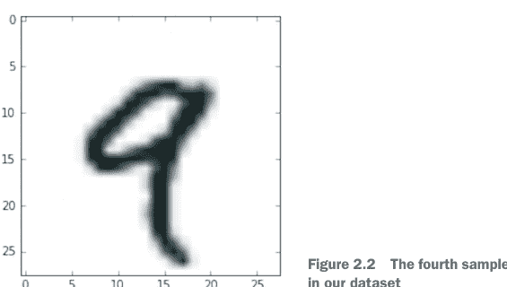

### 清单 2.8 显示第四个数字

```
import matplotlib.pyplot as plt
digit = train_images[4]
plt.imshow(digit, cmap=plt.cm.binary)
plt.show()
```

当然，相应的标签是整数 9：

```
>>> train_labels[4]
9
```

### 2.2.6 在 NumPy 中操作张量

在前一个示例中，我们使用 train_images[i] 语法沿第一个轴选择了特定的数字。在张量中选择特定元素称为张量切片。让我们看看可以在 NumPy 数组上执行的张量切片操作。

以下示例选择 #10 到 #100 的数字（不包括 #100），并将它们放入形状为 (90, 28, 28) 的数组中：

```
>>> my_slice = train_images[10:100]
>>> my_slice.shape
(90, 28, 28)
```

这等同于这个更详细的记法，它指定了沿每个张量轴的切片的起始索引和停止索引。请注意，: 相当于选择整个轴：

```
>>> my_slice = train_images[10:100, :, :]
>>> my_slice.shape
(90, 28, 28)
>>> my_slice = train_images[10:100, 0:28, 0:28]
>>> my_slice.shape
(90, 28, 28)
```

一般来说，你可以沿每个张量轴在任意两个索引之间选择切片。例如，为了选择所有图像右下角的 14 × 14 像素，你可以这样做：

```
my_slice = train_images[:, 14:, 14:]
```

也可以使用负索引。与 Python 列表中的负索引类似，它们表示相对于当前轴末端的位置。为了将图像裁剪为居中于中间的 14 × 14 像素补丁，你可以这样做：

```
my_slice = train_images[:, 7:-7, 7:-7]
```


### 2.2.7 数据批次的概念

一般来说，在深度学习中遇到的所有数据张量的第一个轴（轴 0，因为索引从 0 开始）将是 *样本* 轴（有时也称为 *样本维度*）。在 MNIST 示例中，“样本”是数字图像。

此外，深度学习模型不会一次处理整个数据集；相反，它们将数据分成小批。具体来说，这是我们的 MNIST 数字的一个批次，批次大小为 128：

```
batch = train_images[:128]
```

这是下一个批次：

```
batch = train_images[128:256]
```

这是第 *n* 个批次：

```
n = 3
batch = train_images[128 * n:128 * (n + 1)]
```

在考虑此类批次张量时，第一个轴（轴 0）称为 *批次轴* 或 *批次维度*。使用 Keras 和其他深度学习库时，你会经常遇到这个术语。

### 2.2.8 数据张量的实际示例

为了让数据张量更加具体，下面列举几个与你以后将遇到的类似的示例。你将处理的数据几乎总会属于以下类别之一：

- 向量数据——形状为 `(samples, features)` 的 2 阶张量，其中每个样本是数值属性（“特征”）的向量

- *时间序列数据或序列数据*——形状为 `(samples, timesteps, features)` 的 3 阶张量，其中每个样本是特征向量的序列（长度为 *时间步*）

- 图像数据——形状为 `(samples, height, width, channels)` 的 4 阶张量，其中每个样本是一个 2D 像素网格，每个像素由一个值向量（“通道”）表示

- 视频数据——形状为 `(samples, frames, height, width, channels)` 的 5 阶张量，其中每个样本是图像的序列（长度为 *帧*）

### 2.2.9 向量数据

这是最常见的情况之一。在这样的数据集中，每个数据点都可以编码为一个向量，因此一批数据将被编码为 2 阶张量（即向量数组），其中第一个轴是 *样本轴*，第二个轴是 *特征轴*。

让我们看两个示例：

- 精算数据集，包含人员信息，我们考虑每个人的年龄、性别和收入。每个人都可以描述为一个包含 3 个值的向量，因此 100,000 人的完整数据集可以存储在形状为 (100000, 3) 的 2 阶张量中。

- 文本文档数据集，其中每个文档由每个单词出现的次数表示（来自 20,000 个常用单词的词典）。每个文档都可以编码为包含 20,000 个值的向量（词典中每个单词一个计数），因此 500 个文档的完整数据集可以存储在形状为 (500, 20000) 的张量中。

### 2.2.10 时间序列数据或序列数据

当数据中的时间（或序列顺序的概念）很重要时，将其存储在带有显式时间轴的 3 阶张量中是合理的。每个样本可以编码为向量序列（一个 2 阶张量），因此一批数据将被编码为 3 阶张量（参见图 2.3）。

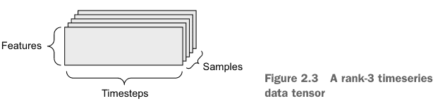

按照惯例，时间轴始终是第二个轴（索引为 1 的轴）。让我们看几个示例：

- 股票价格数据集。每分钟，我们存储股票的当前价格、过去一分钟的最高价格和过去一分钟的最低价格。因此，每分钟被编码为一个 3D 向量，一整天的交易被编码为形状为 (390, 3) 的矩阵（交易日有 390 分钟），250 天的数据可以存储在形状为 (250, 390, 3) 的 3 阶张量中。在这里，每个样本将是一天的数据。

- 推文数据集，其中每条推文被编码为 128 个唯一字符的字母表中 280 个字符的序列。在此设置中，每个字符可以编码为大小为 128 的二进制向量（全零向量，除了对应字符的索引处有一个 1 项）。然后每条推文可以编码为形状为 (280, 128) 的 2 阶张量，100 万条推文的数据集可以存储在形状为 (1000000, 280, 128) 的张量中。

### 2.2.11 图像数据

图像通常有三个维度：高度、宽度和颜色深度。尽管灰度图像（如我们的 MNIST 数字）只有一个颜色通道，因此可以存储在 2 阶张量中，但按照惯例，图像张量始终是 3 阶，灰度图像具有一个一维颜色通道。因此，128 张大小为 256 × 256 的灰度图像的批次可以存储在形状为 (128, 256, 256, 1) 的张量中，128 张彩色图像的批次可以存储在形状为 (128, 256, 256, 3) 的张量中（参见图 2.4）。

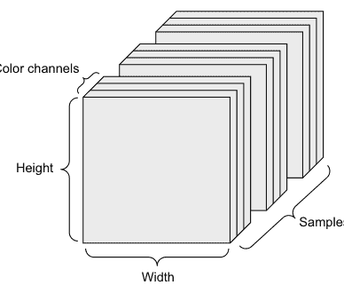

图像张量形状有两种约定：通道在后约定（TensorFlow 中的标准）和通道在前约定（越来越不受欢迎）。

通道在后约定将颜色深度轴放在最后：(samples, height, width, color_depth)。同时，通道在前约定将颜色深度轴放在批次轴之后：(samples, color_depth, height, width)。使用通道在前约定，前面的示例将变为 (128, 1, 256, 256) 和 (128, 3, 256, 256)。Keras API 支持这两种格式。

### 2.2.12 视频数据

视频数据是少数需要 5 阶张量的现实世界数据类型之一。视频可以理解为帧序列，每帧是一张彩色图像。因为每帧可以存储在 3 阶张量（height, width, color_depth）中，帧序列可以存储在 4 阶张量（frames, height, width, color_depth）中，因此不同视频的批次可以存储在形状为 (samples, frames, height, width, color_depth) 的 5 阶张量中。

例如，一个 60 秒、144 × 256 的 YouTube 视频片段，以每秒 4 帧的速度采样，将有 240 帧。四个此类视频片段的批次将存储在形状为 (4, 240, 144, 256, 3) 的张量中。总共有 106,168,320 个值！如果张量的 dtype 为 float32，每个值将存储在 32 位中，因此该张量将表示 405 MB。很大！你在现实生活中遇到的视频要轻得多，因为它们不是以 float32 存储的，而且通常被压缩了很大比例（例如 MPEG 格式）。

## 2.3 神经网络的齿轮：张量操作

正如任何计算机程序最终都可以归结为对二进制输入进行一小组二进制操作（AND、OR、NOR 等等），深度神经网络学习的所有变换都可以归结为应用于数值数据张量的一小撮张量操作（或张量函数）。例如，可以对张量进行加法、乘法等等。

在我们最初的示例中，我们通过堆叠 Dense 层来构建模型。Keras 层实例如下所示：

```
keras.layers.Dense(512, activation="relu")
```

此层可以解释为一个函数，它以矩阵作为输入并返回另一个矩阵——输入张量的新表示。具体来说，函数如下（其中 W 是矩阵，b 是向量，两者都是层的属性）：

```
output = relu(dot(input, W) + b)
```

让我们来拆解一下。这里有三个张量操作：

- 输入张量与名为 W 的张量之间的点积（dot）

- 生成的矩阵与向量 b 之间的加法（+）

- relu 操作：relu(x) 是 max(x, 0)；“relu”代表“修正线性单元”

注意 虽然本节完全涉及线性代数表达式，但你在这里找不到任何数学符号。我发现，对于没有数学背景的程序员来说，如果数学概念以简短的 Python 代码片段而不是数学方程式的形式表达，更容易掌握。因此，我们将在整个过程中使用 NumPy 和 TensorFlow 代码。

### 2.3.1 元素级操作

relu 操作和加法是元素级操作：即独立地应用于所考虑张量中每个条目的操作。这意味着这些操作非常适合大规模并行实现（向量化实现，这一术语源自 1970–90 年代的向量处理机超级计算机架构）。如果你想编写元素级操作的简单 Python 实现，可以使用 for 循环，如下所示的元素级 relu 操作的简单实现：

```
def naive_relu(x):
    assert len(x.shape) == 2
```


x = x.copy()
for i in range(x.shape[0]):
    for j in range(x.shape[1]):
        x[i, j] = max(x[i, j], 0)
return x

你也可以对加法做同样的操作：

```
def naive_add(x, y):
    assert len(x.shape) == 2
    assert x.shape == y.shape
    x = x.copy()
    for i in range(x.shape[0]):
        for j in range(x.shape[1]):
            x[i, j] += y[i, j]
    return x
```

基于同样的原理，你可以进行逐元素乘法、减法等运算。

在实践中，处理 NumPy 数组时，这些操作都有经过良好优化的内置 NumPy 函数可用，这些函数本身将繁重工作委托给基础线性代数子程序（BLAS）实现。BLAS 是低级的、高度并行、高效的张量操作例程，通常使用 Fortran 或 C 语言实现。

所以，在 NumPy 中，你可以执行以下逐元素操作，速度会非常快：

```
import numpy as np
z = x + y
z = np.maximum(z, 0.)
```

让我们实际计时一下差异：

```
import time

x = np.random.random((20, 100))
y = np.random.random((20, 100))

t0 = time.time()
for _ in range(1000):
    z = x + y
    z = np.maximum(z, 0.)

print("Took: {0:.2f} s".format(time.time() - t0))
```

这需要 0.02 秒。与此同时，天真版本需要惊人的 2.45 秒：

```
t0 = time.time()
for _ in range(1000):
    z = naive_add(x, y)
    z = naive_relu(z)

print("Took: {0:.2f} s".format(time.time() - t0))
```

同样，在 GPU 上运行 TensorFlow 代码时，逐元素操作通过完全向量化的 CUDA 实现执行，可以充分利用高度并行的 GPU 芯片架构。

### 2.3.2 广播机制

我们之前对 naive_add 的天真实现仅支持形状相同的秩-2 张量的加法。但如前面介绍的 Dense 层中，我们将一个秩-2 张量与向量相加。当相加的两个张量形状不同时，加法会发生什么？

在可能且无歧义的情况下，较小的张量将被广播以匹配较大张量的形状。广播包含两个步骤：

- 1 将轴（称为广播轴）添加到较小的张量，以匹配较大张量的 ndim。
- 2 沿着这些新轴重复较小的张量，以匹配较大张量的完整形状。

让我们看一个具体的示例。考虑形状为 (32, 10) 的 X 和形状为 (10,) 的 y：

```
import numpy as np
X = np.random.random((32, 10))
y = np.random.random((10,))
```

首先，我们在 y 的最前面添加一个空轴，其形状变为 (1, 10)：

```
y = np.expand_dims(y, axis=0)
```

然后，沿着这个新轴将 y 重复 32 次，从而得到形状为 (32, 10) 的张量 Y，其中对于 0 到 32 范围内的 i，Y[i, :] == y：

```
Y = np.concatenate([y] * 32, axis=0)
```

此时，我们可以继续相加 X 和 Y，因为它们形状相同。

从实现角度来看，不会创建新的秩-2 张量，因为这将极其低效。重复操作完全是虚拟的：它发生在算法级别，而不是内存级别。但将向量沿新轴重复 10 次视为一个有用的心智模型。天真的实现看起来如下：

```
def naive_add_matrix_and_vector(x, y):
    assert len(x.shape) == 2
    assert len(y.shape) == 1
    assert x.shape[1] == y.shape[0]
    x = x.copy()
    for i in range(x.shape[0]):
        for j in range(x.shape[1]):
            x[i, j] += y[j]
    return x
```

使用广播，通常可以对两个输入张量进行逐元素操作，前提是一个张量的形状为 `(a, b, ..., n + 1, ... m)`，另一个张量的形状为 `(n, n + 1, ... m)`。广播将自动发生在轴 a 到 n - 1 上。

以下示例通过广播将逐元素最大值操作应用于两个形状不同的张量：

```
import numpy as np
x = np.random.random((64, 3, 32, 10))
y = np.random.random((32, 10))
z = np.maximum(x, y)
```

### 2.3.3 张量积

*张量积*，或*点积*（不要与逐元素积混淆，即 `*` 运算符），是最常见、最有用的张量操作之一。

在 NumPy 中，张量积使用 `np.dot` 函数来完成（因为张量积的数学记号通常是一个点）：

```
x = np.random.random((32,))
y = np.random.random((32,))
z = np.dot(x, y)
```

在数学记号中，你会用一个点（⋅）来表示该操作：

```
z = x • y
```

从数学上讲，点操作做什么？让我们从两个向量 x 和 y 的点积开始。它的计算方式如下：

```
def naive_vector_dot(x, y):
    assert len(x.shape) == 1
    assert len(y.shape) == 1
    assert x.shape[0] == y.shape[0]
    z = 0.
    for i in range(x.shape[0]):
        z += x[i] * y[i]
    return z
```

你会注意到，两个向量之间的点积是一个标量，并且只有元素数量相同的向量才能进行点积运算。

你也可以对矩阵 x 和向量 y 求点积，这将返回一个向量，其中系数是 y 与 x 的行之间的点积。你可以这样实现：

```
def naive_matrix_vector_dot(x, y):
    assert len(x.shape) == 2
    assert len(y.shape) == 1
    assert x.shape[1] == y.shape[0]
    z = np.zeros(x.shape[0])
    for i in range(x.shape[0]):
        for j in range(x.shape[1]):
            z[i] += x[i, j] * y[j]
    return z
```

你还可以重用我们之前编写的代码，这突出了矩阵-向量积与向量积之间的关系：

```
def naive_matrix_vector_dot(x, y):
    z = np.zeros(x.shape[0])
    for i in range(x.shape[0]):
        z[i] = naive_vector_dot(x[i, :], y)
    return z
```

请注意，一旦两个张量中有一个的 ndim 大于 1，dot 就不再对称，也就是说 dot(x, y) 与 dot(y, x) 不相同。

当然，点积推广到具有任意数量轴的张量。最常见的应用可能是两个矩阵之间的点积。只有当 x.shape[1] == y.shape[0] 时，才能对两个矩阵 x 和 y 求点积（dot(x, y)）。结果是一个形状为 (x.shape[0], y.shape[1]) 的矩阵，其中系数是 x 的行与 y 的列之间的向量积。天真的实现如下：

```
def naive_matrix_dot(x, y):
    assert len(x.shape) == 2
    assert len(y.shape) == 2
    assert x.shape[1] == y.shape[0]
    z = np.zeros((x.shape[0], y.shape[1]))
    for i in range(x.shape[0]):
        for j in range(y.shape[1]):
            row_x = x[i, :]
            column_y = y[:, j]
            z[i, j] = naive_vector_dot(row_x, column_y)
    return z
```

为了理解点积形状兼容性，将输入和输出张量如图 2.5 所示对齐进行可视化会有所帮助。

在图中，x、y 和 z 被画成矩形（系数的字面框）。由于 x 的行和 y 的列必须具有相同的大小，因此 x 的宽度必须与 y 的高度匹配。如果你继续开发新的机器学习算法，你可能会经常绘制此类图表。

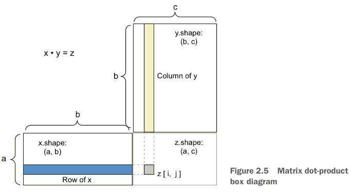

更一般地，你可以对更高维的张量求点积，遵循前面为 2D 情况概述的相同形状兼容性规则：

```
(a, b, c, d) • (d,) → (a, b, c)
(a, b, c, d) • (d, e) → (a, b, c, e)
```

等等。

### 2.3.4 张量重塑

第三种必须理解的张量操作是*张量重塑*。尽管它在我们第一个神经网络示例的 `Dense` 层中未被使用，但在将数据馈送到模型之前预处理数字数据时我们用到了它：

```
train_images = train_images.reshape((60000, 28 * 28))
```

重塑张量意味着重新排列其行和列以匹配目标形状。自然，重塑后的张量与初始张量具有相同的系数总数。重塑最好通过简单的示例来理解：

```
>>> x = np.array([[0., 1.],
   [2., 3.],
   [4., 5.]])
>>> x.shape
(3, 2)
>>> x = x.reshape((6, 1))
>>> x
array([[ 0.],
       [ 1.],
       [ 2.],
       [ 3.],
       [ 4.],
       [ 5.]])
```


```
>>> x = x.reshape((2, 3))
>>> x
array([[ 0.,  1.,  2.],
       [ 3.,  4.,  5.]])
```

重塑中常遇到的一种特殊情况是 *转置*。转置矩阵意味着交换其行和列，因此 `x[i, :]` 变为 `x[:, i]`：

```
>>> x = np.zeros((300, 20))
>>> x = np.transpose(x)
>>> x.shape
(20, 300)
```

创建一个形状为 (300, 20) 的全零矩阵

### 2.3.5 张量运算的几何解释

由于张量运算操作的张量内容可以解释为某些几何空间中点的坐标，因此所有张量运算都具有几何解释。例如，让我们考虑加法。我们将从以下向量开始：

```
A = [0.5, 1]
```

它是 2D 空间中的一个点（参见图 2.6）。通常将向量视为从原点指向该点的箭头，如图 2.7 所示。

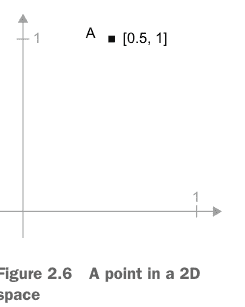

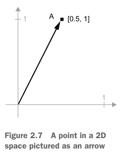

让我们考虑一个新点 `B = [1, 0.25]`，我们将把它与前一个点相加。几何上，这是通过将向量箭头首尾相连来完成的，得到的位置是表示前两个向量之和的向量（请参阅

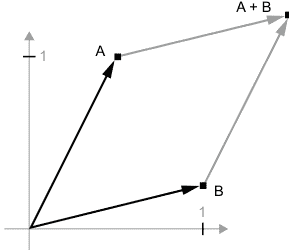

图 2.8 两个向量之和的几何解释

图 2.9）。因此，张量加法表示沿某一方向移动一定量的 *平移物体*（不改变物体形状地移动物体）的操作。

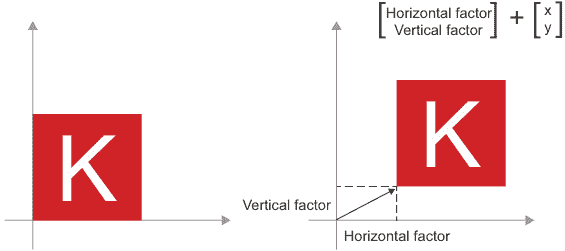

图 2.9 作为向量加法的 2D 平移

一般来说，平移、旋转、缩放、倾斜等基本几何操作都可以表示为张量运算。以下是一些示例：

- 平移：正如你刚才看到的，将向量加到点上会沿固定方向移动固定距离。应用于点集（例如 2D 对象）时，这称为“平移”（参见图 2.9）。

- 旋转：将 2D 向量按角度 theta 逆时针旋转（参见图 2.10）可以通过与 2 × 2 矩阵 R = [[cos(theta), -sin(theta)], [sin(theta), cos(theta)]] 的点积来实现。

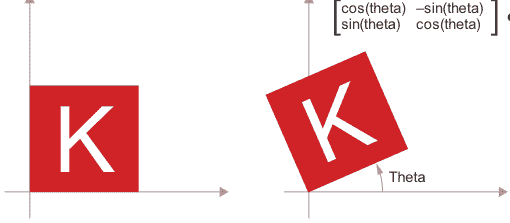

图 2.10 作为点积的 2D 旋转（逆时针）

- 缩放：图像的垂直和水平缩放（参见图 2.11）可以通过与 2 × 2 矩阵 S = [[horizontal_factor, 0], [0, vertical_factor]] 的点积来实现（注意，这样的矩阵称为“对角矩阵”，因为它只在“对角线”上（从左上角到右下角）有非零系数）。

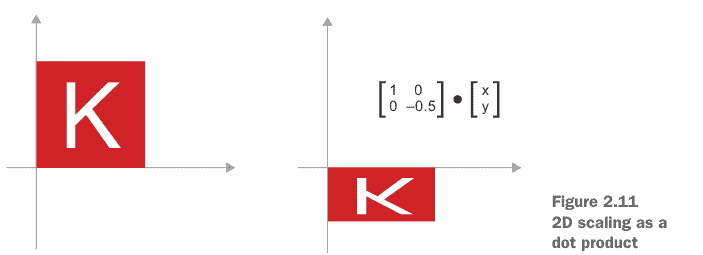

- 线性变换：与任意矩阵的点积实现线性变换。请注意，先前列出的缩放和旋转，按定义都是线性变换。

- 仿射变换：仿射变换（参见图 2.12）是线性变换（通过与某个矩阵的点积实现）和平移（通过向量加法实现）的组合。你可能已经认出，这就是稠密层实现的 y = W • x + b 计算！没有激活函数的稠密层是仿射层。

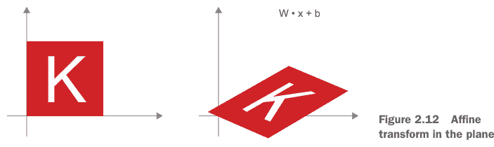

- 带 relu 激活函数的稠密层：关于仿射变换的一个重要观察是，如果反复应用许多仿射变换，最终仍然得到一个仿射变换（因此你最初只需应用那个仿射变换即可）。让我们用两个试试：affine2(affine1(x)) = W2 • (W1 • x + b1) + b2 = (W2 • W1) • x + (W2 • b1 + b2)。这是一个仿射变换，其线性部分为矩阵 W2 • W1，平移部分为向量 W2 • b1 + b2。因此，完全由没有激活函数的稠密层组成的多层神经网络等同于一个单一的稠密层。这个“深度”神经网络只是一个伪装的线性模型！这就是为什么我们需要激活函数，如 relu（见图 2.13 中的实际应用）。得益于激活函数，一系列稠密层可以被构建为实现非常复杂的非线性几何变换，从而为你的深度神经网络产生非常丰富的假设空间。我们将在下一章更详细地介绍这个想法。

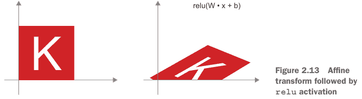

### 2.3.6 深度学习的几何解释

你刚刚了解到，神经网络完全由张量运算链组成，而这些张量运算只不过是对输入数据的简单几何变换。因此，你可以将神经网络解释为在高维空间中通过一系列简单步骤实现的非常复杂的几何变换。

在 3D 中，以下心智图像可能有所帮助。想象两张彩色纸：一张红色，一张蓝色。将一张放在另一张上面。现在把它们揉在一起成一个小球。这个揉皱的纸球就是你的输入数据，每张纸是分类问题中的一个数据类别。神经网络的目的是找出一种对纸球的变换，将其展平，从而使两个类别再次可以清晰分离（参见图 2.14）。在深度学习中，这将被实现为 3D 空间的一系列简单变换，例如你可以用手指一次一个动作地在纸球上应用的变换。


展开揉皱的纸球正是机器学习所追求的：在高维空间中为复杂的、高度折叠的数据流形找到整洁的表示（流形是一个连续曲面，就像我们揉皱的纸张）。到此，你应该很好地理解为什么深度学习擅长此道：它采用将复杂几何变换逐步分解为一长串基本变换的方法，这基本上就是人类展开揉皱纸球所遵循的策略。深层网络中的每一层都应用一种使数据稍微解纠缠的变换，而深层的层堆叠使得极其复杂的解纠缠过程变得可行。

## 2.4 神经网络的引擎：基于梯度的优化

正如你在上一节中看到的，我们第一个模型示例中的每个神经层按以下方式转换其输入数据：

```
output = relu(dot(input, W) + b)
```

在这个表达式中，W 和 b 是层的属性张量。它们分别被称为层的 *权重* 或 *可训练参数*（即 *内核* 和 *偏置* 属性）。这些权重包含模型从接触训练数据中学习到的信息。

最初，这些权重矩阵被填充为小的随机值（这一步称为 *随机初始化*）。当然，没有理由期望当 `W` 和 `b` 为随机值时，`relu(dot(input, W) + b)` 会产生任何有用的表示。生成的表示是没有意义的——但它们是一个起点。接下来是根据反馈信号逐步调整这些权重。这种逐步调整也称为 *训练*，正是机器学习所指的学习。

这发生在所谓的 *训练循环* 中，其工作原理如下。循环重复以下步骤，直到损失似乎足够低：

- 1 抽取一批训练样本 x 和对应的目标 y_true。
- 2 在 x 上运行模型（这一步称为 *前向传播*）以获得预测 y_pred。
- 3 计算模型在该批次上的损失，即 y_pred 与 y_true 之间不匹配程度的度量。
- 4 以一种略微降低该批次损失的方式更新模型的所有权重。

你最终会得到一个在训练数据上损失非常低的模型：预测 y_pred 与预期目标 y_true 之间不匹配程度很低。模型已“学会”将其输入映射到正确的目标。从远处看，这可能像魔法，但当你将其归结为基本步骤时，它其实很简单。

步骤 1 听起来简单易行——只是 I/O 代码。步骤 2 和 3 只不过是少数几个张量运算的应用，因此你可以根据上一节所学内容纯粹实现这些步骤。困难的部分是步骤 4：更新模型的权重。给定模型中的单个权重系数，你如何计算该系数应该增加还是减少，以及增加或减少多少？

一个天真的解决方案是冻结模型中除了正在考虑的那个标量系数之外的所有权重，并尝试该系数的不同值。比如说


系数的初始值为 0.3。在对一批数据执行前向传播后，模型在该批次上的损失为 0.5。如果将系数的值改为 0.35 并重新运行前向传播，损失会增加到 0.6。但如果将系数降低到 0.25，损失会下降到 0.4。在这种情况下，似乎将系数更新 -0.05 有助于最小化损失。这需要对模型中所有系数重复此过程。

但这种方法效率极其低下，因为你需要为每个单独的系数计算两次前向传播（这很昂贵），而系数有很多，通常是成千上万个，有时多达数百万个。幸运的是，有一种好得多的方法：梯度下降。

梯度下降是支撑现代神经网络的优化技术。其要点如下。我们模型中使用的所有函数（例如 `dot` 或 `+`）都以平滑且连续的方式转换输入：例如，如果你看 z = x + y，y 的微小变化只会导致 z 的微小变化，如果你知道 y 变化的方向，就可以推断 z 变化的方向。在数学上，你会说这些函数是可微的。如果将这些函数串联起来，得到的更大的函数仍然是可微的。特别是，这适用于将模型系数映射到模型在一批数据上的损失的函数：模型系数的微小变化会导致损失值的微小且可预测的变化。这使你可以使用一种称为梯度的数学算子来描述，当你沿不同方向移动模型系数时，损失如何变化。如果你计算这个梯度，就可以用它来沿降低损失的方向移动系数（一次性全部更新，而非逐个更新）。

如果你已经知道可微是什么以及什么是梯度，可以跳到 2.4.3 节。否则，接下来的两节将帮助你理解这些概念。

### 2.4.1 What's a derivative?

考虑一个连续、平滑的函数 f(x) = y，它将一个数 x 映射到一个新数 y。我们可以使用图 2.15 中的函数作为示例。

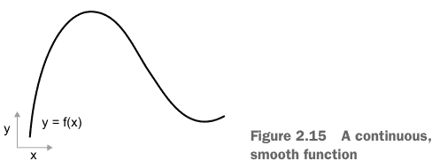

因为函数是连续的，x 的微小变化只会导致 y 的微小变化——这就是连续性背后的直觉。假设你将 x 增加一个微小因子 epsilon_x：这会导致 y 发生一个微小的 epsilon_y 变化，如图 2.16 所示。

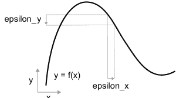

图 2.16 对于连续函数，x 的微小变化会导致 y 的微小变化。

此外，因为函数是平滑的（其曲线没有任何突兀的角度），当 epsilon_x 足够小时，在某个点 p 附近，可以将 f 近似为斜率为 a 的线性函数，使得 epsilon_y 变为 a * epsilon_x：

```
f(x + epsilon_x) = y + a * epsilon_x
```

显然，这种线性近似只有在 x 足够接近 p 时才有效。斜率 a 称为 f 在 p 处的导数。如果 a 为负，则表示在 p 附近 x 的微小增加会导致 f(x) 减小（如图 2.17 所示），如果 a 为正，x 的微小增加会导致 f(x) 增大。此外，a 的绝对值（导数的幅度）告诉你这种增加或减小发生的速度有多快。

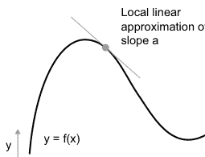

图 2.17 f 在 p 处的导数

对于每个可微函数 f(x)（可微意味着“可求导”：例如，平滑、连续的函数可以求导），都存在一个导数函数 f’(x)，它将 x 的值映射到 f 在这些点的局部线性近似的斜率。例如，cos(x) 的导数是 -sin(x)，f(x) = a * x 的导数是 f’(x) = a，依此类推。

能够对函数求导在优化（即寻找使 f(x) 值最小的 x 值）方面是一个非常强大的工具。如果你试图通过 epsilon_x 的因子更新 x 以最小化 f(x)，并且你知道 f 的导数，那么你的工作就完成了：导数完全描述了当你改变 x 时 f(x) 如何演变。如果你想减小 f(x) 的值，只需沿导数的相反方向移动 x 一小步即可。

### 2.4.2 Derivative of a tensor operation: The gradient

我们刚才研究的函数将一个标量 x 转换为另一个标量 y：你可以将其绘制为二维平面中的曲线。现在想象一个将标量元组 (x, y) 转换为标量值 z 的函数：那将是一个向量运算。你可以将其绘制为三维空间中的二维曲面（由坐标 x, y, z 索引）。同样，你可以想象接受矩阵作为输入的函数、接受 3 阶张量作为输入的函数，等等。

求导概念可以应用于任何此类函数，只要它们描述的曲面是连续和平滑的。张量运算（或张量函数）的导数称为梯度。梯度只是将导数概念推广到接受张量作为输入的函数。还记得吗，对于标量函数，导数表示函数曲线的局部斜率？同样，张量函数的梯度表示函数所描述的多维曲面的曲率。它表征了当函数的输入参数变化时，函数的输出如何变化。

让我们看一个基于机器学习的示例。考虑

- 一个输入向量 x（数据集中的一个样本）
- 一个矩阵 W（模型的权重）
- 一个目标 y_true（模型应该学习将其与 x 关联的内容）
- 一个损失函数 loss（用于衡量模型当前预测与 y_true 之间的差距）

你可以使用 W 来计算目标候选 y_pred，然后计算目标候选 y_pred 与目标 y_true 之间的损失或不匹配：

```
y_pred = dot(W, x)
loss_value = loss(y_pred, y_true)
```

我们使用模型权重 W 来对 x 进行预测。我们估计预测偏离了多少。现在我们想使用梯度来弄清楚如何更新 W 以使 loss_value 变小。该怎么做呢？

给定固定输入 x 和 y_true，前面的操作可以解释为一个将 W（模型权重）的值映射到损失值的函数：

```
loss_value = f(W)
```

f 描述了 W 变化时损失值形成的曲线（或高维曲面）。假设 W 的当前值为 W0。那么 f 在点 W0 处的导数是一个与 W 形状相同的张量 grad(loss_value, W0)，其中每个系数 grad(loss_value, W0) [i, j] 指示当你修改 W0[i, j] 时观察到的 loss_value 变化的方向和幅度。该张量 grad(loss_value, W0) 是函数 f(W) = loss_value 在 W0 处的梯度，也称为“W 在 W0 附近相对于 loss_value 的梯度”。

### Partial derivatives

张量运算 `grad(f(W), W)`（接受矩阵 `W` 作为输入）可以表示为标量函数 `grad_ij(f(W), w_ij)` 的组合，每个函数返回在假设所有其他系数保持不变的情况下，`loss_value = f(W)` 相对于 `W` 的系数 `W[i, j]` 的导数。`grad_ij` 称为 `f` 相对于 `W[i, j]` 的 *偏导数*。

具体来说，`grad(loss_value, W0)` 代表什么？你之前看到过，单个系数的函数 `f(x)` 的导数可以解释为 `f` 曲线的斜率。同样，`grad(loss_value, W0)` 可以解释为描述 `loss_value = f(W)` 在 `W0` 附近 *最陡上升方向* 的张量，以及该上升的斜率。每个偏导数描述 `f` 在特定方向上的斜率。

因此，与对函数 `f(x)` 沿导数的相反方向移动 `x` 一小步以减小 `f(x)` 的值的方式非常相似，对于张量函数 `f(W)`，你可以沿梯度的相反方向移动 `W` 以减小 `loss_value = f(W)`：例如，`W1 = W0 - step * grad(f(W0), W0)`（其中 `step` 是一个小缩放因子）。这意味着逆着 `f` 的最陡上升方向前进，直观上应该会让你处于曲线上的更低位置。需要注意的是，缩放因子 `step` 是必需的，因为 `grad(loss_value, W0)` 仅在接近 `W0` 时才近似曲率，所以你不想离 `W0` 太远。

### 2.4.3 Stochastic gradient descent

给定一个可微函数，理论上可以解析地找到其最小值：已知函数的最小值是导数为 0 的点，所以你所要做的就是找到所有导数为 0 的点，并检查在这些点中哪个点处函数值最低。

应用于神经网络，这意味着解析地找到产生最小可能损失函数的权重值组合。这可以通过求解关于 `W` 的方程 `grad(f(W), W) = 0` 来完成。这是一个包含 `N` 个变量的多项式方程，其中 `N` 是模型中的系数数量。虽然对 `N = 2` 或 `N = 3` 求解此类方程是可能的，但对于实际神经网络来说，这样做是不可行的，因为实际神经网络的参数数量从不少于几千个，而且通常可达数千万个。

相反，你可以使用本节开头概述的四步算法：基于随机数据批次的当前损失值逐步修改参数。因为你正在处理一个可微函数，所以你可以计算其梯度，这为实现步骤 4 提供了一种高效的方法。如果你沿梯度的相反方向更新权重，每次损失都会减小一点：

- 1. 抽取一批训练样本 `x` 和相应的目标 `y_true`。
- 2. 在 `x` 上运行模型以获得预测 `y_pred`（这称为 *前向传播*）。


- 3. 计算模型在该批次上的损失，这是 `y_pred` 与 `y_true` 之间不匹配程度的衡量指标。

- 4. 计算损失相对于模型参数的梯度（这称为 *反向传播*）。

- 5. 沿梯度的反方向稍微移动参数——例如，`W -= learning_rate * gradient`——从而略微降低该批次上的损失。*学习率*（此处为 `learning_rate`）将是一个标量因子，用于调节梯度下降过程的“速度”。

轻而易举！我们刚才描述的内容称为 *小批量随机梯度下降*（mini-batch SGD）。*随机*一词指的是每批数据均随机抽取（*随机*是 *随机* 的科学同义词）。图 2.18 说明了在 1D 情况下会发生什么，此时模型只有一个参数，且你只有一个训练样本。

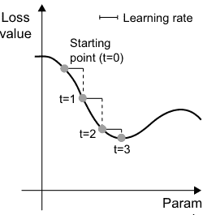

**图 2.18** 沿 1D 损失曲线的 SGD（一个可学习参数）

如你所见，直观上为 `learning_rate` 因子选择一个合理的值很重要。如果它太小，沿曲线下降将需要许多次迭代，并且可能会陷入局部最小值。如果 `learning_rate` 太大，你的更新可能会将你带到曲线上完全随机的位置。

请注意，mini-batch SGD 算法的一种变体是在每次迭代时抽取单个样本和目标，而不是抽取一批数据。这将是 *真* SGD（与 *小批量* SGD 相对）。或者，走向另一个极端，你可以在每一步上使用 *所有* 可用数据，这称为 *批量梯度下降*。每次更新将更准确，但成本远高得多。这两个极端之间的有效折中方案是使用合理大小的小批量。

虽然图 2.18 说明了 1D 参数空间中的梯度下降，但在实践中，你将在高维空间中使用梯度下降：神经网络中的每个权重系数都是空间中的一个自由维度，可能有成千上万甚至数百万个。为了帮助你建立对损失曲面的直觉，你还可以沿 2D 损失曲面可视化梯度下降，如图 2.19 所示。但你不可能可视化训练神经网络的实际过程——你无法以对人类有意义的方式表示 1,000,000 维空间。因此，请记住，通过这些低维表示所建立的直觉在实践中不一定总是准确的。这在历史上一直是深度学习研究领域的问题根源。

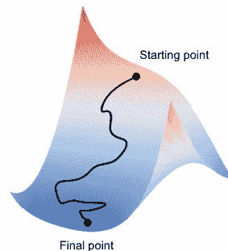

图 2.19 沿 2D 损失曲面的梯度下降（两个可学习参数）

此外，存在多种 SGD 变体，它们在计算下一次权重更新时会考虑之前的权重更新，而不仅仅是查看梯度的当前值。例如，有带动量的 SGD，以及 Adagrad、RMSprop 等其他几种。这类变体被称为 *优化方法* 或 *优化器*。特别是，*动量*的概念在许多这些变体中被使用，值得你关注。动量解决了 SGD 的两个问题：收敛速度和局部最小值。考虑图 2.20，它显示了损失作为模型参数函数的曲线。

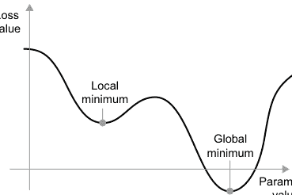

图 2.20 局部最小值和全局最小值

如你所见，在某个参数值附近，存在一个 *局部最小值*：在该点附近，向左移动会导致损失增加，向右移动也是如此。

如果考虑的参数通过使用较小学习率的 SGD 进行优化，优化过程可能会陷入局部最小值，而不是走向全局最小值。

你可以通过使用动量来避免此类问题，动量的灵感来自物理学。这里一个有用的心理图像是将优化过程视为一个小球沿损失曲线滚动。如果它有足够的动量，小球就不会陷入峡谷，最终会到达全局最小值。动量的实现方式是：在每一步移动小球时，不仅基于当前斜率值（当前加速度），还基于当前速度（由过去的加速度产生）。在实践中，这意味着更新参数 w 时，不仅基于当前梯度值，还基于之前的参数更新，例如在此朴素实现中：

```
past_velocity = 0.
momentum = 0.1
while loss > 0.01:
    w, loss, gradient = get_current_parameters()
    velocity = past_velocity * momentum - learning_rate * gradient
    w = w + momentum * velocity - learning_rate * gradient
    past_velocity = velocity
    update_parameter(w)
```

### 2.4.4 链式求导：反向传播算法

在前面的算法中，我们随意地假设，因为一个函数是可微的，所以我们可以轻松计算其梯度。但事实真是这样吗？在实践中，我们如何计算复杂表达式的梯度？在本章开头的两层模型中，我们如何得到损失相对于权重的梯度？反向传播算法正是为此而来。

### 链式法则

反向传播是一种利用简单操作（如加法、relu 或张量乘积）的导数，来轻松计算这些原子操作的任意复杂组合的梯度的方法。关键在于，神经网络由许多链在一起的张量操作组成，每个操作都有一个简单的已知导数。例如，列表 2.2 中定义的模型可以表示为由变量 W1、b1、W2 和 b2（分别属于第一层和第二层 Dense 层）参数化的函数，涉及 dot、relu、softmax 和 + 等原子操作，以及我们的损失函数 loss，这些都易于求导：

```
loss_value = loss(y_true, softmax(dot(relu(dot(inputs, W1) + b1), W2) + b2))
```

微积分告诉我们，这样的函数链可以使用以下恒等式来求导，称为链式法则。

考虑两个函数 f 和 g，以及复合函数 fg，使得 fg(x) == f(g(x))：

```python
def fg(x):
    x1 = g(x)
    y = f(x1)
    return y
```

链式法则指出 grad(y, x) == grad(y, x1) * grad(x1, x)。只要你知道 f 和 g 的导数，就可以计算 fg 的导数。链式法则之所以这样命名，是因为当你添加更多中间函数时，它开始看起来像一条链：

```python
def fghj(x):
    x1 = j(x)
    x2 = h(x1)
    x3 = g(x2)
    y = f(x3)
    return y
```

`grad(y, x) == (grad(y, x3) * grad(x3, x2) * grad(x2, x1) * grad(x1, x))`

将链式法则应用于神经网络梯度值的计算，产生了一种称为反向传播的算法。让我们看看它具体是如何工作的。

### 基于计算图的自动微分

思考反向传播的一个有用方式是使用计算图。计算图是 TensorFlow 及整体深度学习革命的核心数据结构。它是操作的有向无环图——在我们的例子中，是张量操作。例如，图 2.21 显示了我们第一个模型的图形表示。

计算机科学中，计算图是一种极其成功的抽象，因为它们使我们能够将计算视为数据：可计算的表达式被编码为机器可读的数据结构，可作为另一个程序的输入或输出。例如，你可以想象一个程序，它接收一个计算图并返回一个新的计算图，该图实现了相同计算的大规模分布式版本——这意味着你可以分发任何计算，而无需自己编写分发逻辑。或者，想象一个程序，它接收一个计算图并可以

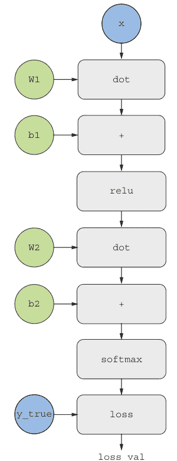

图 2.21 我们两层模型的计算图表示


自动生成其所代表表达式的导数。如果将计算表示为显式图数据结构，而不是比如说 .py 文件中的 ASCII 字符行，那么做这些事情会容易得多。

为了清晰地解释反向传播，让我们来看一个非常基础的计算图示例（参见图 2.22）。我们将考虑图 2.21 的简化版本，其中只有一个线性层，且所有变量均为标量。我们取两个标量变量 w 和 b，一个标量输入 x，并对它们应用一些操作以将其组合为输出 y。最后，我们将应用一个绝对值误差损失函数：loss_val = abs(y_true - y)。由于我们希望以最小化 loss_val 的方式更新 w 和 b，因此我们有兴趣计算 grad(loss_val, b) 和 grad(loss_val, w)。

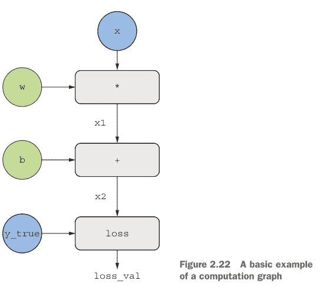

让我们为图中的“输入节点”设置具体值，即输入 x、目标 y_true、w 和 b。我们将这些值从上到下传播到图中的所有节点，直到到达 loss_val。这是前向传递（参见图 2.23）。

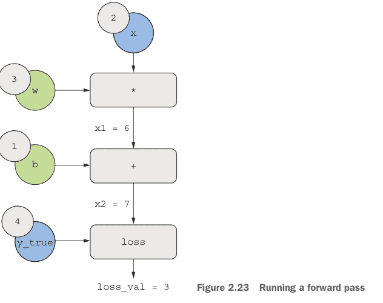

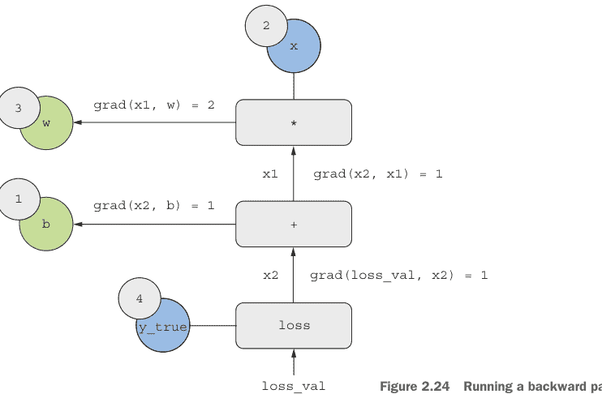

现在让我们“反转”图：对于图中从 A 到 B 的每条边，我们将创建一条从 B 到 A 的反向边，并询问：当 A 变化时，B 变化多少？也就是说，grad(B, A) 是多少？我们将用这个值标注每条反向边。这个反向图表示反向传递（参见图 2.24）。

我们有如下内容：

- grad(loss_val, x2) = 1，因为当 x2 变化 epsilon 时，loss_val = abs(4 - x2) 变化相同的量。
- grad(x2, x1) = 1，因为当 x1 变化 epsilon 时，x2 = x1 + b = x1 + 1 变化相同的量。
- grad(x2, b) = 1，因为当 b 变化 epsilon 时，x2 = x1 + b = 6 + b 变化相同的量。
- grad(x1, w) = 2，因为当 w 变化 epsilon 时，x1 = x * w = 2 * w 变化 2 * epsilon。

链式法则关于这个反向图指出的是，你可以通过将连接两个节点的路径上每条边的导数相乘，来获得一个节点相对于另一个节点的导数。例如，grad(loss_val, w) = grad(loss_val, x2) * grad(x2, x1) * grad(x1, w)（参见图 2.25）。

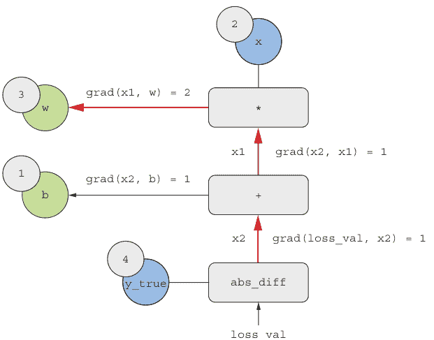

图 2.25 反向图中从 loss_val 到 w 的路径

通过将链式法则应用于我们的图，我们得到了所期望的结果：

- grad(loss_val, w) = 1 * 1 * 2 = 2
- grad(loss_val, b) = 1 * 1 = 1

**注意** 如果在反向图中存在连接两个感兴趣节点 a 和 b 的多条路径，我们将通过求和所有路径的贡献来获得 grad(b, a)。

就这样，你刚刚看到了反向传播的运作！反向传播仅仅是将链式法则应用于计算图。并没有更多内容。反向传播从最终的损失值开始，自顶层向下至底层反向进行，计算每个参数在损失值中的贡献。这也就是“反向传播”名称的由来：我们将计算图中不同节点的损失贡献“反向传播”。

如今，人们在支持 _自动微分_ 的现代框架（例如 TensorFlow）中实现神经网络。自动微分是使用你刚刚看到的那种计算图实现的。自动微分使得在编写前向传递之外无需任何额外工作，就可以获取任意可微张量运算组合的梯度。在 2000 年代，当我用 C 语言编写第一个神经网络时，我必须亲自编写梯度。现在，多亏了现代自动微分工具，你永远不需要亲自实现反向传播了。你应该觉得自己很幸运！

## TensorFlow 中的梯度带

利用 TensorFlow 强大的自动微分功能的 API 是 GradientTape。它是一个 Python 作用域，会“记录”在其中运行的张量操作，形式为计算图（有时称为“带”）。然后可以使用此图来检索任何输出相对于任何变量或变量集（`tf.Variable` 类的实例）的梯度。`tf.Variable` 是一种特定类型的张量，用于保存可变状态——例如，神经网络的权重始终是 `tf.Variable` 实例。

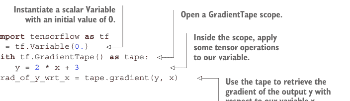

梯度带适用于张量操作：

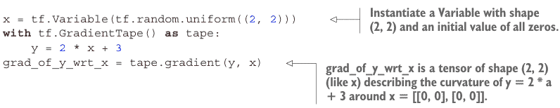

```python
W = tf.Variable(tf.random.uniform((2, 2)))
b = tf.Variable(tf.zeros((2,)))
x = tf.random.uniform((2, 2))
with tf.GradientTape() as tape:
    y = tf.matmul(x, W) + b
grad_of_y_wrt_W_and_b = tape.gradient(y, [W, b])
```

matmul 是在 TensorFlow 中表达“点积”的说法。

grad_of_y_wrt_W_and_b 是一个包含两个张量的列表，它们的形状分别与 W 和 b 相同。

你将在下一章中了解梯度带。

## 2.5 回顾我们的第一个示例

你即将接近本章的结尾，现在你应该已经对神经网络幕后发生的事情有了总体了解。本章开头那个曾经像神奇黑盒一样的东西，已变得清晰明了，如图 2.26 所示：由链式连接的层组成的模型将输入数据映射为预测。然后损失函数将这些预测与目标进行比较，产生一个损失值：衡量模型预测与预期匹配程度的指标。优化器使用这个损失值来更新模型的权重。

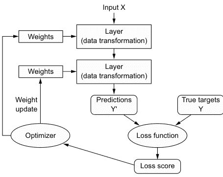

图 2.26 网络、层、损失函数和优化器之间的关系

让我们回到本章中的第一个示例，并在学习了之后的内容的基础上回顾其每个部分。

这是输入数据：

```python
(train_images, train_labels), (test_images, test_labels) = mnist.load_data()
train_images = train_images.reshape((60000, 28 * 28))
train_images = train_images.astype("float32") / 255
test_images = test_images.reshape((10000, 28 * 28))
test_images = test_images.astype("float32") / 255
```

现在你明白，输入图像存储在 NumPy 张量中，这里分别格式化为形状为 (60000, 784)（训练数据）和 (10000, 784)（测试数据）的 float32 张量。

这是我们的模型：

```python
model = keras.Sequential([
    layers.Dense(512, activation="relu"),
    layers.Dense(10, activation="softmax")
])
```

现在你明白，这个模型由两个 Dense 层的链组成，每个层对输入数据应用几个简单的张量操作，并且这些操作涉及权重张量。权重张量是层的属性，是模型知识持久化的地方。

这是模型编译步骤：

```python
model.compile(optimizer="rmsprop",
    loss="sparse_categorical_crossentropy",
    metrics=["accuracy"])
```

现在你明白，sparse_categorical_crossentropy 是用作学习权重张量反馈信号的损失函数，训练阶段将尝试最小化它。你还知道，这种损失减小是通过小批量随机梯度下降实现的。特定梯度下降用法的精确规则由作为第一个参数传递的 rmsprop 优化器定义。

最后，这是训练循环：

```python
model.fit(train_images, train_labels, epochs=5, batch_size=128)
```

现在你明白调用 fit 时会发生什么：模型将开始以每批 128 个样本的小批量遍历训练数据，共 5 次（每次遍历所有训练数据称为一个 epoch）。对于每个批次，模型将计算损失相对于权重的梯度（使用源自微积分中链式法则的反向传播算法），并将权重朝着减少该批次损失值的方向移动。

在这 5 个 epoch 之后，模型将执行 2,345 次梯度更新（每个 epoch 469 次），并且模型的损失将足够低，以至于模型能够以高精度对手写数字进行分类。

此时，你已经了解了关于神经网络的大部分知识。让我们通过在 TensorFlow 中逐步“从头”重新实现该示例的简化版本来证明这一点。


### 2.5.1 在 TensorFlow 中从零重新实现我们的第一个示例

什么比从头开始实现一切更能体现完全、明确的理解呢？当然，这里的“从头开始”是相对的：我们不会重新实现基本张量运算，也不会实现反向传播。但我们会深入到如此底层的程度，以至于几乎根本不会用到任何 Keras 功能。

如果你暂时还不了解本示例中的每一个细节，请不要担心。下一章将更详细地介绍 TensorFlow API。目前，只需尝试掌握大体情况即可——本示例的目的是通过具体实现帮助你明确深度学习的数学原理。让我们开始吧！

### 简单的全连接层类

你之前学过，Dense 层实现以下输入变换，其中 `W` 和 `b` 是模型参数，而 `activation` 是一个逐元素函数（通常是 `relu`，但对于最后一层则是 `softmax`）：

```
output = activation(dot(W, input) + b)
```

让我们实现一个简单的 Python 类 `NaiveDense`，它会创建两个 TensorFlow 变量 `W` 和 `b`，并暴露一个 `__call__()` 方法来应用前述变换。

```python
import tensorflow as tf

class NaiveDense:
    def __init__(self, input_size, output_size, activation):
        self.activation = activation

        w_shape = (input_size, output_size)
        w_initial_value = tf.random.uniform(w_shape, minval=0, maxval=1e-1)
        self.W = tf.Variable(w_initial_value)

        b_shape = (output_size,)
        b_initial_value = tf.zeros(b_shape)
        self.b = tf.Variable(b_initial_value)

    def __call__(self, inputs):
        return self.activation(tf.matmul(inputs, self.W) + self.b)

    @property
    def weights(self):
        return [self.W, self.b]
```

### 简单的顺序类

现在，让我们创建一个 `NaiveSequential` 类来串联这些层。它封装了一个层列表，并暴露一个 `__call__()` 方法，该方法只是按顺序在输入上调用底层层。它还有一个 `weights` 属性，方便跟踪各层的参数。

```python
class NaiveSequential:
    def __init__(self, layers):
        self.layers = layers

    def __call__(self, inputs):
        x = inputs
        for layer in self.layers:
            x = layer(x)
        return x

    @property
    def weights(self):
        weights = []
        for layer in self.layers:
            weights += layer.weights
        return weights
```

使用这个 NaiveDense 类和这个 NaiveSequential 类，我们可以创建一个模拟 Keras 模型：

```python
model = NaiveSequential([
    NaiveDense(input_size=28 * 28, output_size=512, activation=tf.nn.relu),
    NaiveDense(input_size=512, output_size=10, activation=tf.nn.softmax)
])
assert len(model.weights) == 4
```

### 批次生成器

接下来，我们需要一种方法来以小批量方式遍历 MNIST 数据。这很简单：

```python
import math

class BatchGenerator:
    def __init__(self, images, labels, batch_size=128):
        assert len(images) == len(labels)
        self.index = 0
        self.images = images
        self.labels = labels
        self.batch_size = batch_size
        self.num_batches = math.ceil(len(images) / batch_size)

    def next(self):
        images = self.images[self.index : self.index + self.batch_size]
        labels = self.labels[self.index : self.index + self.batch_size]
        self.index += self.batch_size
        return images, labels
```

### 2.5.2 运行单个训练步骤

该过程中最困难的部分是“训练步骤”：在用一批数据运行模型后更新模型的权重。我们需要

- 1. 计算模型对批次中图像的预测值。
- 2. 根据实际标签计算这些预测值的损失值。
- 3. 计算损失相对于模型权重的梯度。
- 4. 沿梯度相反方向将权重移动一小段距离。

要计算梯度，我们将使用在 2.4.4 节中介绍的 TensorFlow GradientTape 对象：

运行“前向传递”（在 GradientTape 作用域下计算模型的预测值）。

```python
def one_training_step(model, images_batch, labels_batch):
    with tf.GradientTape() as tape:
        predictions = model(images_batch)
        per_sample_losses = tf.keras.losses.sparse_categorical_crossentropy(
            labels_batch, predictions)
        average_loss = tf.reduce_mean(per_sample_losses)
    gradients = tape.gradient(average_loss, model.weights)
    update_weights(gradients, model.weights)
    return average_loss
```

计算损失相对于权重的梯度。输出的梯度是一个列表，其中每个条目对应 model.weights 列表中的一个权重。

使用梯度更新权重（我们将很快定义此函数）。

正如你已知，“权重更新”步骤（由前述的 update_weights 函数表示）的目的是沿着能够降低本批次损失的方向，将权重移动“一小段”。移动的幅度由“学习率”决定，通常是一个小数值。实现此 update_weights 函数的最简单方法是，从每个权重中减去 gradient * learning_rate：

```python
learning_rate = 1e-3
```

```python
def update_weights(gradients, weights):
    for g, w in zip(gradients, weights):
        w.assign_sub(g * learning_rate)
```

assign_sub 是 TensorFlow 变量中 -= 的等价操作。

在实践中，你几乎永远不会亲手这样实现权重更新步骤。相反，你会使用 Keras 中的 Optimizer 实例，如下所示：

```python
from tensorflow.keras import optimizers
```

```python
optimizer = optimizers.SGD(learning_rate=1e-3)
```

```python
def update_weights(gradients, weights):
    optimizer.apply_gradients(zip(gradients, weights))
```

既然每批次的训练步骤已经就绪，我们可以继续实现整个训练周期了。

### 2.5.3 完整的训练循环

训练周期只是对训练数据中的每个批次重复训练步骤，而完整的训练循环只是重复一个训练周期：

```python
def fit(model, images, labels, epochs, batch_size=128):
    for epoch_counter in range(epochs):
        print(f"Epoch {epoch_counter}")
        batch_generator = BatchGenerator(images, labels)
        for batch_counter in range(batch_generator.num_batches):
            images_batch, labels_batch = batch_generator.next()
            loss = one_training_step(model, images_batch, labels_batch)
            if batch_counter % 100 == 0:
                print(f"loss at batch {batch_counter}: {loss:.2f}")
```

让我们来试一试：

```python
from tensorflow.keras.datasets import mnist
(train_images, train_labels), (test_images, test_labels) = mnist.load_data()

train_images = train_images.reshape((60000, 28 * 28))
train_images = train_images.astype("float32") / 255
test_images = test_images.reshape((10000, 28 * 28))
test_images = test_images.astype("float32") / 255

fit(model, train_images, train_labels, epochs=10, batch_size=128)
```

### 2.5.4 评估模型

我们可以通过对测试图像的预测值取 argmax，并将其与预期标签进行比较来评估模型：

```python
predictions = model(test_images)
predictions = predictions.numpy()
predicted_labels = np.argmax(predictions, axis=1)
matches = predicted_labels == test_labels
print(f"accuracy: {matches.mean():.2f}")
```

搞定！如你所见，亲手完成用几行 Keras 代码就能搞定的工作，需要做相当多的事情。但因为你经历了这些步骤，现在你应该对调用 `fit()` 时神经网络内部发生的事情有了清晰透彻的理解。拥有代码幕后运行的这种底层心智模型，将让你更好地利用 Keras API 的高级功能。

## 总结

- 张量构成了现代机器学习系统的基础。它们有多种 `dtype`、`rank` 和 `shape` 的形式。
- 你可以通过 `tensor operations`（例如加法、张量积或逐元素乘法）来操作数值张量，这些操作可以被理解为对几何变换的编码。总的来说，深度学习中的一切都可以进行几何解释。
- 深度学习模型由简单的张量操作链组成，由 `weights` 参数化，而这些权重本身也是张量。模型的权重存储着其“知识”。
- `Learning` 是指为模型权重找到一组值，使其对给定的训练数据样本及其对应目标最小化 `loss function`。


- 学习通过抽取随机数据样本及其目标的小批量，并计算模型参数相对于批次损失的梯度来实现。随后，模型参数会沿梯度的反方向移动一小段距离（移动幅度由学习率定义）。这被称为*小批量随机梯度下降*。

- 整个学习过程之所以成为可能，是因为神经网络中的所有张量运算都是可微的，因此可以应用求导链式法则，找到将当前参数和当前数据批次映射到梯度值的梯度函数。这被称为*反向传播*。

- 未来章节中你将频繁看到的两个关键概念是*损失*和*优化器*。在开始向模型输入数据之前，你需要定义这两个东西。
  - *损失*是训练期间你试图最小化的量，因此它应代表你试图解决的任务的成功度量。
  - *优化器*指定了损失的梯度将被用于更新参数的确切方式：例如，它可能是 RMSProp 优化器、带动量的 SGD 等等。

# Keras 和 TensorFlow 简介

## 本章内容

- 深入了解 TensorFlow、Keras 及其关系
- 搭建深度学习工作空间
- 核心深度学习概念如何映射到 Keras 和 TensorFlow 的概述

本章旨在为你提供开始进行实际深度学习所需的一切。我将简要介绍 Keras (https://keras.io) 和 TensorFlow (https://tensorflow.org)，这是我们在整本书中将使用的基于 Python 的深度学习工具。你将了解如何搭建带有 TensorFlow、Keras 和 GPU 支持的深度学习工作空间。最后，在第二章中你初步接触 Keras 和 TensorFlow 的基础上，我们将回顾神经网络的核心组件以及它们如何映射到 Keras 和 TensorFlow API。

本章结束时，你将准备好转向实际的现实世界应用，这些应用将从第四章开始。

## 3.1 什么是 TensorFlow？

TensorFlow 是一个基于 Python、免费且开源的机器学习平台，主要由 Google 开发。与 NumPy 类似，TensorFlow 的主要目的是使工程师和研究人员能够操作数值张量上的数学表达式。但 TensorFlow 在以下方面远远超出了 NumPy 的范围：

- 它可以自动计算任何可微表达式的梯度（如你在第 2 章中看到的），因此非常适合机器学习。
- 它不仅可以在 CPU 上运行，还可以在 GPU 和 TPU 上运行，这些是高度并行的硬件加速器。
- 在 TensorFlow 中定义的计算可以轻松分布到许多机器上。
- TensorFlow 程序可以导出到其他运行时，例如 C++、JavaScript（用于基于浏览器的应用程序）或 TensorFlow Lite（用于在移动设备或嵌入式设备上运行的应用程序）等。这使得 TensorFlow 应用程序在实际环境中易于部署。

重要的是要记住，TensorFlow 不仅仅是一个库。它真的是一个平台，拥有庞大的组件生态系统，有些由 Google 开发，有些由第三方开发。例如，有用于强化学习研究的 TF-Agents，用于工业级机器学习工作流管理的 TFX，用于生产部署的 TensorFlow Serving，以及 TensorFlow Hub 预训练模型仓库。这些组件共同涵盖了从前沿研究到大规模生产应用的非常广泛的用例。

TensorFlow 的可扩展性相当好：例如，橡树岭国家实验室的科学家们使用它在 IBM Summit 超级计算机的 27,000 个 GPU 上训练了一个 1.1 exaFLOPS 的极端天气预报模型。同样，Google 使用 TensorFlow 开发了非常计算密集型的深度学习应用程序，例如下棋和围棋代理 AlphaZero。对于你自己的模型，如果你有预算，你可以合理地希望在小型 TPU pod 或在 Google Cloud 或 AWS 上租用的大型 GPU 集群上扩展到大约 10 petaFLOPS。那仍然大约是 2019 年最强超级计算机峰值计算能力的 1%！

## 3.2 什么是 Keras？

Keras 是一个构建在 TensorFlow 之上的 Python 深度学习 API，它提供了一种定义和训练任何类型深度学习模型的便捷方式。Keras 最初是为研究而开发的，旨在实现快速深度学习实验。

通过 TensorFlow，Keras 可以运行在不同类型的硬件之上（参见图 3.1）——GPU、TPU 或普通 CPU——并可以无缝扩展到成千上万台机器。

Keras 以优先考虑开发者体验而闻名。它是面向人类而非机器的 API。它遵循减少认知负载的最佳实践：它提供

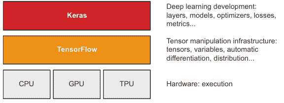

**图 3.1** Keras 和 TensorFlow：TensorFlow 是低级张量计算平台，Keras 是高级深度学习 API

一致且简单的工作流，它将常见用例所需的操作数量降到最低，并在用户出错时提供清晰且可操作的反馈。这使得 Keras 对初学者来说易于学习，对专家来说使用起来高效。

截至 2021 年底，Keras 拥有超过一百万用户，涵盖从学术研究人员、初创公司和大公司的工程师及数据科学家，到研究生和爱好者。Google、Netflix、Uber、CERN、NASA、Yelp、Instacart、Square 以及数百家致力于各行各业各种问题的初创公司都在使用 Keras。你的 YouTube 推荐源自 Keras 模型。Waymo 自动驾驶汽车使用 Keras 模型开发。Keras 也是机器学习竞赛网站 Kaggle 上的一个流行框架，大多数深度学习竞赛都使用 Keras 获胜。

由于 Keras 拥有庞大且多样的用户群，它并不强制你遵循构建和训练模型的单一“真实”方式。相反，它支持从高级到低级的广泛不同工作流，对应于不同的用户群体。例如，你有多种构建模型的方法和训练模型的方法，每种方法都在易用性和灵活性之间做出某种权衡。在第 5 章中，我们将详细回顾这个工作流谱的很大一部分。你可以像使用 Scikit-learn 一样使用 Keras——只需调用 fit() 并让框架完成它的工作——或者像使用 NumPy 一样使用它——对每个细节拥有完全控制权。

这意味着你现在作为初学者所学的一切，在成为专家后仍然适用。你可以轻松入门，然后逐渐深入到你从头开始编写越来越多逻辑的工作流。当你从学生转变为研究人员，或从数据科学家转变为深度学习工程师时，你不必切换到完全不同的框架。

这种理念与 Python 本身不谋而合！有些语言只提供一种编写程序的方式——例如，面向对象编程或函数式编程。与此同时，Python 是一种多范式语言：它提供了一系列可以很好地协同工作的使用模式。这使得 Python 适合于非常广泛的不同用例：系统管理、数据科学、机器学习工程、Web 开发……或者只是学习如何编程。同样，你可以将 Keras 视为深度学习的 Python：一种用户友好的深度学习语言，为不同用户群体提供各种工作流。

## 3.3 Keras 和 TensorFlow：简史

Keras 比 TensorFlow 早八个月。它于 2015 年 3 月发布，而 TensorFlow 于 2015 年 11 月发布。你可能会问，如果 Keras 是建立在 TensorFlow 之上的，它怎么可能在 TensorFlow 发布之前就存在？Keras 最初是建立在 Theano 之上的，Theano 是另一种张量操作库，提供了自动微分和 GPU 支持——这是其早期的先驱。Theano 在蒙特利尔大学蒙特利尔学习算法研究所（MILA）开发，在许多方面是 TensorFlow 的先驱。它率先提出使用静态计算图进行自动微分以及将代码编译到 CPU 和 GPU 的思想。

2015 年底，在 TensorFlow 发布后，Keras 被重构为多后端架构：成为可能可以使用 Theano 或 TensorFlow 来使用 Keras，在两者之间切换就像更改环境变量一样容易。到 2016 年 9 月，TensorFlow 已达到技术成熟度，可以将其设为 Keras 的默认后端选项。2017 年，Keras 增加了两个新的后端选项：CNTK（由 Microsoft 开发）和 MXNet（由 Amazon 开发）。如今，Theano 和 CNTK 已停止开发，MXNet 在 Amazon 之外使用不广泛。Keras 重新成为单后端 API——构建在 TensorFlow 之上。

Keras 和 TensorFlow 多年来一直存在共生关系。在 2016 年和 2017 年期间，Keras 作为开发 TensorFlow 应用程序的用户友好方式而广为人知，将新用户引入 TensorFlow 生态系统。到 2017 年底，大多数 TensorFlow 用户都通过 Keras 或结合 Keras 使用它。2018 年，TensorFlow 领导层选定 Keras 作为 TensorFlow 的官方高级 API。因此，Keras API 在 2019 年 9 月发布的 TensorFlow 2.0 中处于核心地位——这是对 TensorFlow 和 Keras 的大规模重新设计，考虑了四年多的用户反馈和技术进步。

到此，你一定很渴望开始实际运行 Keras 和 TensorFlow 代码了。让我们开始吧。

## 3.4 搭建深度学习工作空间

在开始开发深度学习应用程序之前，你需要设置开发环境。强烈建议（尽管不是绝对必要）在现代 NVIDIA GPU 上运行深度学习代码，而不是在计算机的 CPU 上。某些应用程序——特别是使用卷积网络进行图像处理——在 CPU 上即使是快速多核 CPU 也会极其缓慢。即使是对可以在 CPU 上实际运行的应用程序，使用最近的 GPU 通常也会使速度提高 5 倍或 10 倍。


在 GPU 上进行深度学习，你有三种选择：

- 在工作站上购买并安装实体 NVIDIA GPU。
- 使用 Google Cloud 或 AWS EC2 上的 GPU 实例。
- 使用 Colaboratory 提供的免费 GPU 运行时，Colaboratory 是 Google 提供的托管笔记本服务（关于“笔记本”是什么的详细信息，请参见下一节）。

Colaboratory 是入门的最简单方式，因为它不需要购买硬件，也不需要安装软件——只需在浏览器中打开一个标签页并开始编码。这是我们推荐用于运行本书中代码示例的选项。但是，Colaboratory 的免费版本仅适用于小规模工作负载。如果你想扩展规模，则必须使用第一个或第二个选项。

如果你没有可用于深度学习的 GPU（近期的高端 NVIDIA GPU），那么在云端运行深度学习实验是一种简单、低成本的方式，可让你无需购买任何额外硬件即可转向更大规模的工作负载。如果你使用 Jupyter 笔记本进行开发，在云端运行的体验与在本地运行没有区别。

但是，如果你是深度学习的重度用户，这种设置从长远来看是不可持续的——甚至连几个月都撑不住。云实例并不便宜：2021 年中期，在 Google Cloud 上使用 V100 GPU 需要支付每小时 2.48 美元。同时，一款可靠的消费级 GPU 价格在 1,500 美元到 2,500 美元之间——这一价格随着时间的推移一直相当稳定，尽管这些 GPU 的规格在不断改进。如果你是深度学习的重度用户，考虑搭配一块或多块 GPU 的本地工作站。

此外，无论你是在本地还是在云端运行，最好都使用 Unix 工作站。虽然从技术上讲可以直接在 Windows 上运行 Keras，但我们不推荐这样做。如果你是 Windows 用户，并且想在自己的工作站上进行深度学习，让所有东西运行起来的最简单方案是在你的机器上设置 Ubuntu 双启动，或者利用 Windows Subsystem for Linux (WSL)——这是一个兼容层，可让你从 Windows 运行 Linux 应用程序。这看起来可能麻烦，但从长远来看能为你节省大量时间和麻烦。

### 3.4.1 Jupyter 笔记本：运行深度学习实验的首选方式

Jupyter 笔记本是运行深度学习实验的好方法——尤其是本书中的众多代码示例。它们在数据科学和机器学习社区中广泛使用。笔记本是由 Jupyter Notebook 应用（https://jupyter.org）生成的文件，你可以在浏览器中对其进行编辑。它将执行 Python 代码的能力与用于注释你正在做什么的富文本编辑功能相结合。笔记本还允许你将长实验分解为可以独立执行的较小片段，这使得开发具有交互性，并意味着如果实验后期出问题，你不必重新运行之前的所有代码。

我建议使用 Jupyter 笔记本来开始使用 Keras，尽管这不是强制性的：你也可以运行独立的 Python 脚本，或在 PyCharm 等 IDE 中运行代码。本书中的所有代码示例均以开源笔记本的形式提供；你可以从 GitHub 的 github.com/fchollet/deep-learning-with-python-notebooks 下载它们。

### 3.4.2 使用 Colaboratory

Colaboratory（简称 Colab）是一项免费的 Jupyter 笔记本服务，无需安装且完全在云端运行。实际上，它是一个网页，可让你立即编写和执行 Keras 脚本。它让你可以使用免费（但受限）的 GPU 运行时，甚至还可以使用 TPU 运行时，因此你不需要购买自己的 GPU。Colaboratory 是我们推荐用于运行本书中代码示例的服务。

#### 使用 Colaboratory 的初步步骤

要开始使用 Colab，请访问 https://colab.research.google.com 并单击新建笔记本按钮。你将看到图 3.2 所示的标准 Notebook 界面。


图 3.2 Colab 笔记本

你会注意到工具栏中有两个按钮：+ Code 和 + Text。它们分别用于创建可执行的 Python 代码单元和注释文本单元。在代码单元中输入代码后，按 Shift-Enter 将执行它（参见图 3.3）。

在文本单元中，你可以使用 Markdown 语法（参见图 3.4）。在文本单元上按 Shift-Enter 将呈现它。

文本单元用于为你的笔记本提供可读的结构：使用它们可以用章节标题和长说明段落来注释代码，或嵌入图形。笔记本旨在提供多媒体体验！


图 3.3 创建代码单元


图 3.4 创建文本单元

#### 使用 pip 安装软件包

默认的 Colab 环境已预装 TensorFlow 和 Keras，因此你可以立即开始使用，无需任何安装步骤。但是，如果你需要使用 pip 安装某些内容，可以在代码单元中使用以下语法（注意行首以 ! 开头，以指示这是 Shell 命令而非 Python 代码）：

```
!pip install package_name
```

#### 使用 GPU 运行时

要在 Colab 中使用 GPU 运行时，请在菜单中选择 Runtime > Change Runtime Type，并将 Hardware Accelerator 设置为 GPU（参见图 3.5）。


图 3.5 在 Colab 中使用 GPU 运行时

如果可用 GPU，TensorFlow 和 Keras 会自动在 GPU 上执行，因此选择 GPU 运行时后，你无需再做其他操作。

你会注意到，在该 Hardware Accelerator 下拉菜单中还有一个 TPU 运行时选项。与 GPU 运行时不同，使用 TensorFlow 和 Keras 的 TPU 运行时确实需要在代码中进行一些手动设置。我们将在第 13 章中介绍这一点。目前，我们建议你继续使用 GPU 运行时来跟随本书中的代码示例。

现在你有了一种开始实际运行 Keras 代码的方法。接下来，让我们看看第 2 章中学到的关键思想如何转化为 Keras 和 TensorFlow 代码。

## 3.5 TensorFlow 初步

如前几章所示，训练神经网络围绕以下概念展开：

- 首先，低级张量操作——支撑所有现代机器学习的基础设施。这对应于 TensorFlow API：
  - 张量，包括存储网络状态（变量）的特殊张量
  - 张量操作，例如 addition、relu、matmul
  - 反向传播，一种计算数学表达式梯度的方法（在 TensorFlow 中通过 GradientTape 对象处理）
- 其次，高级深度学习概念。这对应于 Keras API：
  - 层，它们被组合成一个模型
  - 损失函数，定义用于学习的反馈信号
  - 优化器，决定学习如何进行
  - 用于评估模型性能的指标，例如 accuracy
  - 执行小批量随机梯度下降的训练循环

在前一章中，你已经初步接触了一些相应的 TensorFlow 和 Keras API：你简要使用过 TensorFlow 的 Variable 类、matmul 操作和 GradientTape。你已实例化 Keras Dense 层，将它们打包到 Sequential 模型中，并使用 fit() 方法训练了该模型。

现在，让我们深入探讨如何使用 TensorFlow 和 Keras 在实践中处理所有这些不同的概念。

### 3.5.1 常量张量和变量

要在 TensorFlow 中做任何事情，我们都需要一些张量。张量需要使用某个初始值来创建。例如，你可以创建全一或全零张量（参见清单 3.1），或从随机分布中取值的张量（参见清单 3.2）。

#### 清单 3.1 全一或全零张量

```
>>> import tensorflow as tf
>>> x = tf.ones(shape=(2, 1))
>>> print(x)
tf.Tensor(
[[1.]
 [1.]], shape=(2, 1), dtype=float32)
>>> x = tf.zeros(shape=(2, 1))
>>> print(x)
tf.Tensor(
[[0.]
 [0.]], shape=(2, 1), dtype=float32)
```

#### 清单 3.2 随机张量

```
>>> x = tf.random.normal(shape=(3, 1), mean=0., stddev=1.)
>>> print(x)
tf.Tensor(
[[-0.14208166]
 [-0.95319825]
 [ 1.1096532 ]], shape=(3, 1), dtype=float32)
>>> x = tf.random.uniform(shape=(3, 1), minval=0., maxval=1.)
>>> print(x)
tf.Tensor(


[[0.33779848]
[0.06692922]
[0.7749394 ]], shape=(3, 1), dtype=float32)

NumPy 数组与 TensorFlow 张量之间的一个显著区别在于，TensorFlow 张量不可赋值：它们是常量。例如，在 NumPy 中，你可以执行以下操作。

**Listing 3.3 NumPy 数组可赋值**

```python
import numpy as np
x = np.ones(shape=(2, 2))
x[0, 0] = 0.
```

在 TensorFlow 中尝试做同样的事情，你会得到一个错误：“EagerTensor 对象不支持项赋值。”

**Listing 3.4 TensorFlow 张量不可赋值**

```python
x = tf.ones(shape=(2, 2))
x[0, 0] = 0.
This will fail, as a tensor isn’t assignable.
```

要训练模型，我们需要更新其状态，状态是一组张量。如果张量不可赋值，我们该如何做？这时就要用到 _变量_ 了。`tf.Variable` 是用于在 TensorFlow 中管理可修改状态的类。你已经在第 2 章末尾的训练循环实现中简要地见过它的用法。

要创建变量，需要提供某个初始值，例如一个随机张量。

**Listing 3.5 创建 TensorFlow 变量**

```python
>>> v = tf.Variable(initial_value=tf.random.normal(shape=(3, 1)))
>>> print(v)
array([[ -0.75133973],
 [ -0.4872893 ],
 [ 1.6626885 ]], dtype=float32)
```

变量的状态可以通过其 assign 方法进行修改，如下所示。

**Listing 3.6 为 TensorFlow 变量赋值**

```python
>>> v.assign(tf.ones((3, 1)))
array([[1.],
 [1.],
 [1.]], dtype=float32)
```

这也适用于系数的子集。

**Listing 3.7 为 TensorFlow 变量的子集赋值**

```python
>>> v[0, 0].assign(3.)
array([[3.],
       [1.],
       [1.]], dtype=float32)
```

同样，assign_add() 和 assign_sub() 是 += 和 -= 的高效等价形式，如下所示。

**Listing 3.8 使用 assign_add()**

```python
>>> v.assign_add(tf.ones((3, 1)))
array([[2.],
       [2.],
       [2.]], dtype=float32)
```

### 3.5.2 张量运算：在 TensorFlow 中进行数学运算

与 NumPy 一样，TensorFlow 提供了大量的张量运算来表达数学公式。下面是一些示例。

**Listing 3.9 几个基本数学运算**

```python
a = tf.ones((2, 2))
b = tf.square(a)
c = tf.sqrt(a)
d = b + c
e = tf.matmul(a, b)
e *= d
```

重要的是，前述每个操作都会即时执行；在任何时刻，你都可以打印当前结果，这与 NumPy 类似。我们称之为即时执行。

### 3.5.3 再探 GradientTape API

到目前为止，TensorFlow 看起来与 NumPy 非常相似。但这里有一点 NumPy 做不到：检索任何可微表达式相对于其任何输入的梯度。只需打开一个 GradientTape 作用域，对一个或多个输入张量应用一些计算，然后检索结果相对于输入的梯度。

**Listing 3.10 使用 GradientTape**

```python
input_var = tf.Variable(initial_value=3.)
with tf.GradientTape() as tape:
    result = tf.square(input_var)
gradient = tape.gradient(result, input_var)
```

这最常用于检索模型损失相对于其权重的梯度：`gradients = tape.gradient(loss, weights)`。你在第 2 章中见过它的实际应用。

到目前为止，你只见过 `tape.gradient()` 中的输入张量是 TensorFlow 变量的情况。实际上，这些输入可以是任意张量。但是，默认情况下只有 *可训练变量* 会被跟踪。对于常量张量，你需要通过对其调用 `tape.watch()` 来手动标记为被跟踪。

**Listing 3.11 将 GradientTape 与常量张量输入一起使用**

```python
input_const = tf.constant(3.)
with tf.GradientTape() as tape:
    tape.watch(input_const)
    result = tf.square(input_const, input_const)
gradient = tape.gradient(result, input_const)
```

为什么有必要这样做？因为预先存储计算任何事物相对于任何事物的梯度所需的信息成本过高。为了避免浪费资源，梯度带需要知道要监视什么。默认情况下会监视可训练变量，因为计算损失相对于一组可训练变量的梯度是梯度带最常见的用途。

梯度带是一个强大的实用工具，甚至能够计算 *二阶梯度*，也就是说，梯度的梯度。例如，物体位置相对于时间的梯度是该物体的速度，而二阶梯度是其加速度。

如果你沿垂直轴随时间测量下落苹果的位置，并发现它满足 `position(time) = 4.9 * time ** 2`，那么它的加速度是多少？让我们使用两个嵌套的梯度带来找出答案。

**Listing 3.12 使用嵌套梯度带计算二阶梯度**

```python
time = tf.Variable(0.)
with tf.GradientTape() as outer_tape:
    with tf.GradientTape() as inner_tape:
        position = 4.9 * time ** 2
    speed = inner_tape.gradient(position, time)
acceleration = outer_tape.gradient(speed, time)
```

我们使用外部带子来计算内部带子的梯度的梯度。自然，答案是 4.9 * 2 = 9.8。

### 3.5.4 端到端示例：纯 TensorFlow 中的线性分类器

你了解张量、变量和张量运算，并且知道如何计算梯度。这足以构建任何基于梯度下降的机器学习模型。而你才刚刚到第 3 章！

在机器学习工作面试中，你可能会被要求在 TensorFlow 中从零实现一个线性分类器：一个非常简单的任务，用于区分具有一定机器学习背景的候选人和没有的人。

让我们帮助你通过这个筛选，并利用你新获得的 TensorFlow 知识来实现这样的线性分类器。

首先，让我们准备一些可很好地线性分离的合成数据来处理：2D 平面上的两类点。我们将通过从具有特定协方差矩阵和特定均值的随机分布中绘制它们的坐标来生成每类点。直观地讲，协方差矩阵描述点云的形状，而均值描述其在平面上的位置（参见图 3.6）。我们将对两组点云重复使用相同的协方差矩阵，但将使用两个不同的均值——点云将具有相同的形状，但不同的位置。

**Listing 3.13 在 2D 平面中生成两类随机点**

```python
num_samples_per_class = 1000
negative_samples = np.random.multivariate_normal(
    mean=[0, 3],
    cov=[[1, 0.5], [0.5, 1]],
    size=num_samples_per_class)
positive_samples = np.random.multivariate_normal(
    mean=[3, 0],
    cov=[[1, 0.5], [0.5, 1]],
    size=num_samples_per_class)
```

在前面的代码中，`negative_samples` 和 `positive_samples` 都是形状为 `(1000, 2)` 的数组。让我们将它们堆叠成一个形状为 `(2000, 2)` 的单一数组。

**Listing 3.14 将两类堆叠成形状为 (2000, 2) 的数组**

```python
inputs = np.vstack((negative_samples, positive_samples)).astype(np.float32)
```

让我们生成相应的目标标签，一个形状为 `(2000, 1)` 的零一数组，其中如果 `inputs[i]` 属于类别 0，则 `targets[i, 0]` 为 0（反之亦然）。

**Listing 3.15 生成相应的目标（0 和 1）**

```python
targets = np.vstack((np.zeros((num_samples_per_class, 1), dtype="float32"),
                     np.ones((num_samples_per_class, 1), dtype="float32")))
```

接下来，让我们使用 Matplotlib 绘制我们的数据。

**Listing 3.16 绘制两类点（参见图 3.6）**

```python
import matplotlib.pyplot as plt
plt.scatter(inputs[:, 0], inputs[:, 1], c=targets[:, 0])
plt.show()
```

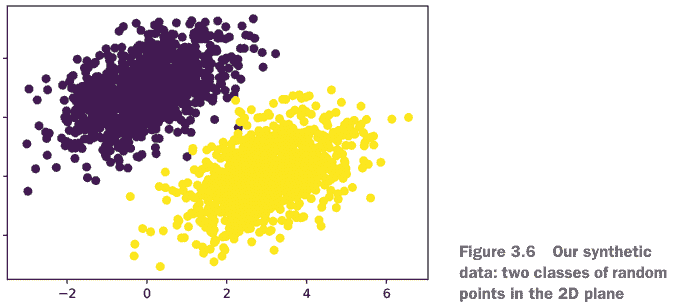

现在让我们创建一个可以学习分离这两簇数据的线性分类器。线性分类器是一个仿射变换（预测 = W • 输入 + b），经过训练以最小化预测与目标之间差异的平方。

如你所见，这实际上比你在第 2 章末尾看到的玩具两层神经网络的端到端示例要简单得多。然而，这次你应该能够逐行理解代码的一切。

让我们创建我们的变量 W 和 b，分别使用随机值和零进行初始化。

**Listing 3.17 创建线性分类器变量**

The inputs will be 2D points. The output predictions will be a single score per sample (close to 0 if the sample is predicted to be in class 0, and close to 1 if the sample is predicted to be in class 1).

```python
input_dim = 2
output_dim = 1
W = tf.Variable(initial_value=tf.random.uniform(shape=(input_dim, output_dim)))
b = tf.Variable(initial_value=tf.zeros(shape=(output_dim, )))
```

下面是我们的前向传播函数。

**Listing 3.18 前向传播函数**

```python
def model(inputs):
    return tf.matmul(inputs, W) + b
```

由于我们的线性分类器处理 2D 输入，W 实际上只是两个标量系数，w1 和 w2：W = [[w1], [w2]]。同时，b 是一个单个标量系数。因此，对于给定的输入点 [x, y]，其预测值为 prediction = [[w1], [w2]] • [x, y] + b = w1 * x + w2 * y + b。

下面的代码清单展示了我们的损失函数。


## 清单 3.19 均方误差损失函数

```
per_sample_losses will be a tensor with the same shape as targets and predictions, containing per-sample loss scores.
def square_loss(targets, predictions):
    per_sample_losses = tf.square(targets - predictions)
    return tf.reduce_mean(per_sample_losses)
We need to average these per-sample loss scores into a single scalar loss value: this is what reduce_mean does.
```

接下来是训练步骤，它接收一些训练数据，并更新权重 W 和 b，以尽量减少数据上的损失。

## 清单 3.20 训练步骤函数

```
learning_rate = 0.1
def training_step(inputs, targets):
    with tf.GradientTape() as tape:
        predictions = model(inputs)
        loss = square_loss(predictions, targets)
        grad_loss_wrt_W, grad_loss_wrt_b = tape.gradient(loss, [W, b])
        W.assign_sub(grad_loss_wrt_W * learning_rate)
        b.assign_sub(grad_loss_wrt_b * learning_rate)
    return loss
```

为简单起见，我们将进行批量训练，而不是小批量训练：我们将对所有数据运行每个训练步骤（梯度计算和权重更新），而不是以小批量迭代数据。一方面，这意味着每个训练步骤运行时间会长得多，因为我们将一次性为 2,000 个样本计算前向传播和梯度。另一方面，每个梯度更新在减少训练数据损失方面将更加有效，因为它将包含所有训练样本的信息，而不是，比如说，仅 128 个随机样本。结果，我们需要的训练步骤将少得多，并且应该使用比小批量训练通常更大的学习率（我们将使用 learning_rate = 0.1，在清单 3.20 中定义）。

## 清单 3.21 批量训练循环

```
for step in range(40):
    loss = training_step(inputs, targets)
    print(f"Loss at step {step}: {loss:.4f}")
```

40 步之后，训练损失似乎已稳定在 0.025 左右。让我们绘制我们的线性模型如何对训练数据点进行分类。由于我们的目标是 0 和 1，如果给定输入点的预测值低于 0.5，则将其分类为 "0"，如果高于 0.5，则分类为 "1"（参见图 3.7）：

```
predictions = model(inputs)
plt.scatter(inputs[:, 0], inputs[:, 1], c=predictions[:, 0] > 0.5)
plt.show()
```

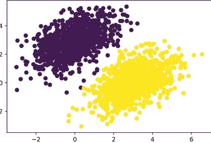

图 3.7 我们的模型在训练输入上的预测：与训练目标非常相似

请回顾，给定点 [x, y] 的预测值仅为 prediction = [[w1], [w2]] • [x, y] + b = w1 * x + w2 * y + b。因此，类 0 定义为 w1 * x + w2 * y + b < 0.5，类 1 定义为 w1 * x + w2 * y + b > 0.5。你会注意到，你看到的实际上是二维平面上一条直线的方程：w1 * x + w2 * y + b = 0.5。直线上方是类 1，直线下方是类 0。你可能习惯于看到格式 y = a * x + b 的直线方程；用同样的格式，我们的直线变为 y = - w1 / w2 * x + (0.5 - b) / w2。

让我们绘制这条直线（如图 3.8 所示）：

```
Generate 100 regularly spaced numbers between -1 and 4, which we will use to plot our line.
x = np.linspace(-1, 4, 100)
y = - W[0] / W[1] * x + (0.5 - b) / W[1]
plt.plot(x, y, "-r")
plt.scatter(inputs[:, 0], inputs[:, 1], c=predictions[:, 0] > 0.5)

This is our line's equation.
Plot our line ("-r" means "plot it as a red line").
Plot our model's predictions on the same plot.
```

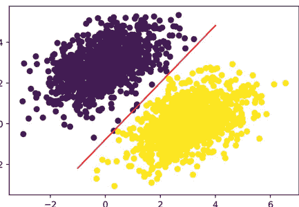

图 3.8 我们的模型，可视化为一条直线

这实际上就是线性分类器所要做的：找到一条直线（或者，在高维空间中，一个超平面）的参数，将两类数据整齐地分开。

## 3.6 神经网络解剖：理解核心 Keras API

到这一点，你已经了解了 TensorFlow 的基础知识，并可以使用它从头实现一个玩具模型，例如上一节中的批量线性分类器，或第 2 章末尾的玩具神经网络。这是一个坚实的基础，可以在此基础上构建。现在是时候转向更高效、更可靠的深度学习路径了：Keras API。

### 3.6.1 层：深度学习的构建基块

神经网络中的基本数据结构是 *层*，你在第二章中已经了解过它。层是一个数据处理模块，将一个或多个张量作为输入，并输出一个或多个张量。有些层是无状态的，但更常见的是层具有状态：即层的 *权重*，一个或多个使用随机梯度下降学习的张量，它们共同包含网络的 *知识*。

不同类型的层适用于不同的张量格式和不同类型的数据处理。例如，简单的向量数据，存储在形状为 (`samples`, `features`) 的二阶张量中，通常由 *全连接层* 处理，也称为 *完全连接* 或 *密集* 层（Keras 中的 `Dense` 类）。序列数据，存储在形状为 (`samples`, `timesteps`, `features`) 的三阶张量中，通常由 *循环层* 处理，例如 `LSTM` 层，或一维卷积层（`Conv1D`）。图像数据，存储在四阶张量中，通常由二维卷积层（`Conv2D`）处理。

你可以把层看作深度学习的乐高积木，Keras 明确使用了这个比喻。在 Keras 中构建深度学习模型，就是将兼容的层组合在一起，形成有用的数据转换管道。

### Keras 中的基础层类

一个简单的 API 应该有一个围绕其展开的单一抽象。在 Keras 中，这就是 `Layer` 类。Keras 中的一切要么是 `Layer`，要么是与 `Layer` 紧密交互的东西。

`Layer` 是一个封装了一些状态（权重）和一些计算（前向传播）的对象。权重通常在 `build()` 中定义（尽管它们也可以在构造函数 `__init__()` 中创建），而计算在 `call()` 方法中定义。

在上一章中，我们实现了一个 `NaiveDense` 类，它包含两个权重 `W` 和 `b`，并应用计算 `output = activation(dot(input, W) + b)`。下面是同一层在 Keras 中的样子。

### 清单 3.22 作为 Layer 子类实现的密集层

```python
from tensorflow import keras

class SimpleDense(keras.layers.Layer):

    def __init__(self, units, activation=None):
        super().__init__()
        self.units = units
        self.activation = activation

    def build(self, input_shape):
        input_dim = input_shape[-1]
        self.W = self.add_weight(shape=(input_dim, self.units),
                                 initializer="random_normal")
        self.b = self.add_weight(shape=(self.units,),
                                 initializer="zeros")

    def call(self, inputs):
        y = tf.matmul(inputs, self.W) + self.b
        if self.activation is not None:
            y = self.activation(y)
        return y
```

*所有 Keras 层都继承自基础 Layer 类。*

```python
>>> my_dense = SimpleDense(units=32, activation=tf.nn.relu)
>>> input_tensor = tf.ones(shape=(2, 784))
>>> output_tensor = my_dense(input_tensor)
>>> print(output_tensor.shape)
(2, 32)
```

你可能会好奇，为什么我们要实现 `call()` 和 `build()`，而最终却是通过简单地调用我们的层，也就是说使用其 `__call__()` 方法来使用它？这是因为我们希望能够即时创建状态。让我们看看这是如何工作的。

### 自动形状推断：即时构建层

就像使用乐高积木一样，你只能将兼容的层“组装”在一起。这里的层兼容性概念特指，每个层只接受特定形状的输入张量，并返回特定形状的输出张量。请看下面的示例：

```python
from tensorflow.keras import layers
layer = layers.Dense(32, activation="relu")
```

此层将返回一个张量，其中第一维已转换为 32。它只能连接到期望 32 维向量作为其输入的下游层。

使用 Keras 时，大多数情况下你不必担心尺寸兼容性，因为你添加到模型中的层会动态构建以匹配传入层的形状。例如，假设你编写如下内容：


```python
from tensorflow.keras import models
from tensorflow.keras import layers
model = models.Sequential([
    layers.Dense(32, activation="relu"),
    layers.Dense(32),
])
```

层没有接收到任何关于其输入形状的信息——相反，它们自动推断其输入形状为它们第一次看到的输入的形状。

在第2章中实现的Dense层的玩具版本（我们将其命名为NaiveDense）中，我们必须将层的输入大小显式传递给构造函数，以便能够创建其权重。这并不理想，因为这会导致模型如下所示，其中每个新层都需要知晓其前一层的形状：

```python
model = NaiveSequential([
    NaiveDense(input_size=784, output_size=32, activation="relu"),
    NaiveDense(input_size=32, output_size=64, activation="relu"),
    NaiveDense(input_size=64, output_size=32, activation="relu"),
    NaiveDense(input_size=32, output_size=10, activation="softmax")
])
```

如果层用于生成其输出形状的规则复杂，情况会更糟。例如，如果我们的层返回形状为 `(batch, input_size * 2 if input_size % 2 == 0 else input_size * 3)` 的输出呢？

如果我们将NaiveDense层重新实现为能够自动推断形状的Keras层，它将看起来像之前的SimpleDense层（参见清单3.22），带有其`build()`和`call()`方法。

在`Sequential`中，我们不再像在`NaiveDense`示例中那样在构造函数里创建权重；相反，我们在一个专门的状态创建方法`build()`中创建它们，该方法接收层看到的第一个输入形状作为参数。`build()`方法在层第一次被调用时（通过其`__call__()`方法）自动调用。事实上，这就是我们将计算定义在单独的`call()`方法中，而不是直接在`__call__()`方法中的原因。基础层的`__call__()`方法示意图如下：

```python
def __call__(self, inputs):
    if not self.built:
        self.build(inputs.shape)
        self.built = True
    return self.call(inputs)
```

有了自动形状推断，我们之前的示例变得简单而整洁：

```python
model = keras.Sequential([
    SimpleDense(32, activation="relu"),
    SimpleDense(64, activation="relu"),
    SimpleDense(32, activation="relu"),
    SimpleDense(10, activation="softmax")
])
```

请注意，自动形状推断不是`Layer`类的`__call__()`方法所处理的唯一事情。它还处理更多事情，特别是在`eager`和`graph`执行之间进行路由（这是一个您将在第7章中学习的概念），以及输入掩码（我们将在第11章中介绍）。目前，只需记住：在实现自己的层时，将前向传播放在`call()`方法中。

### 3.6.2 从层到模型

深度学习模型是层的图。在Keras中，这就是`Model`类。到目前为止，您只见过`Sequential`模型（`Model`的一个子类），它们是简单的层堆叠，将单个输入映射到单个输出。但随着您继续深入，您将接触到更广泛的网络拓扑种类。其中一些常见的如下：

- 双分支网络
- 多头网络
- 残差连接

网络拓扑可能非常复杂。例如，图3.9显示了Transformer层图的拓扑，Transformer是一种常用于处理文本数据的架构。

在Keras中，构建此类模型通常有两种方法：您可以直接子类化`Model`类，也可以使用函数式API，它可以用更少的代码做更多事情。我们将在第7章中介绍这两种方法。

模型的拓扑定义了一个*假设空间*。您可能记得，在第1章中，我们将机器学习描述为在预定义的*可能空间*内，在反馈信号的指导下，为某些输入数据搜索有用表示。通过选择网络拓扑，您将可能空间（假设空间）限制为一组特定的张量运算，将输入数据映射到输出数据。您接下来要搜索的是这些张量运算中涉及的权重张量的一组良好值。

要从数据中学习，您必须对数据做出假设。这些假设定义了可以学习的内容。因此，您的假设空间的结构——即模型的架构——非常重要。它编码了您对问题所做的假设，以及模型初始具有的先验知识。例如，如果您正在处理一个二分类问题，模型由一个没有激活函数的`Dense`层（纯仿射变换）组成，那么您是在假设您的两个类是线性可分的。

选择合适的网络架构更像是一门艺术而非科学，尽管有一些您可以依赖的最佳实践和原则，但只有实践才能帮助您成为一名合格的神经网络架构师。接下来的几章将既教您构建神经网络的明确原则，又帮助您培养对特定问题哪些方法有效或无效的直觉。您将建立扎实的直感，了解哪种类型的模型架构适用于不同类型的问题，如何在实践中构建这些网络，如何选择合适的学习配置，以及如何调整模型直到它产生您想要的结果。

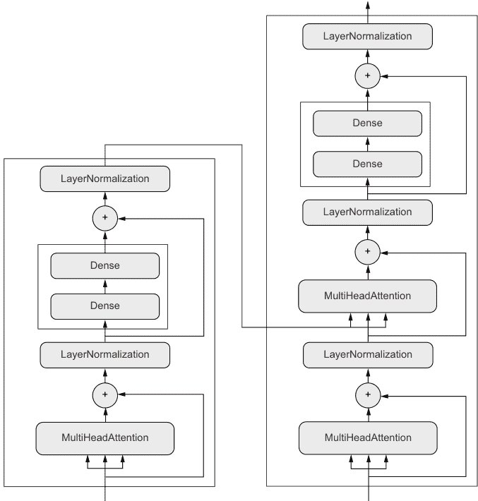

图3.9 Transformer架构（在第11章中介绍）。这里有很多内容。在接下来的几章中，您将逐步提升对其的理解。

### 3.6.3 “编译”步骤：配置学习过程

一旦模型架构定义好，您还需要选择三样东西：

- 损失函数（目标函数）—训练期间将被最小化的量。它代表了当前任务的成功度量。
- **优化器**—根据损失函数确定网络将如何更新。它实现了随机梯度下降（SGD）的特定变体。
- **指标**—您希望在训练和验证期间监控的成功度量，例如分类准确率。与损失不同，训练不会直接针对这些指标进行优化。因此，指标不需要可微分。

一旦您选择了损失、优化器和指标，就可以使用内置的`compile()`和`fit()`方法开始训练模型。或者，您也可以编写自己的自定义训练循环——我们将在第7章中介绍如何做到这一点。那工作量大得多！目前，让我们先看看`compile()`和`fit()`。

`compile()`方法配置训练过程——您已经在第2章的第一个神经网络示例中接触过它了。它接受参数`optimizer`、`loss`和`metrics`（一个列表）：

```python
model = keras.Sequential([keras.layers.Dense(1)])
model.compile(optimizer="rmsprop",
       loss="mean_squared_error",
       metrics=["accuracy"])
```

定义一个线性分类器。
按名称指定优化器：RMSprop（不区分大小写）。
按名称指定损失：均方误差。
指定一个指标列表：在此例中，只有准确率。

在前面对`compile()`的调用中，我们将优化器、损失和指标作为字符串（例如"rmsprop"）传递。这些字符串实际上是快捷方式，会被转换为Python对象。例如，"rmsprop"变成`keras.optimizers.RMSprop()`。重要的是，也可以将这些参数作为对象实例指定，如下所示：

```python
model.compile(optimizer=keras.optimizers.RMSprop(),
       loss=keras.losses.MeanSquaredError(),
       metrics=[keras.metrics.BinaryAccuracy()])
```

如果您想传递自己的自定义损失或指标，或者想进一步配置正在使用的对象，这很有用——例如，通过向优化器传递`learning_rate`参数：

```python
model.compile(optimizer=keras.optimizers.RMSprop(learning_rate=1e-4),
       loss=my_custom_loss,
       metrics=[my_custom_metric_1, my_custom_metric_2])
```

在第7章中，我们将介绍如何创建自定义损失和指标。一般来说，您不必从零开始创建自己的损失、指标或优化器，因为Keras提供了广泛的内置选项，很可能包含您需要的内容：

### 优化器

- SGD（带或不带动量）
- RMSprop
- Adam


- Adagrad
- 等等。

### 损失函数

- CategoricalCrossentropy
- SparseCategoricalCrossentropy
- BinaryCrossentropy
- MeanSquaredError
- KLDivergence
- CosineSimilarity
- 等等。

### 指标

- CategoricalAccuracy
- SparseCategoricalAccuracy
- BinaryAccuracy
- AUC
- Precision
- Recall
- 等等。

贯穿全书，你将看到其中许多选项的具体应用。

### 3.6.4 选择损失函数

为合适的问题选择合适的损失函数至关重要：你的网络会不惜一切代价来最小化损失，因此如果目标与手头任务的成功不完全相关，你的网络最终可能会做出你并不希望的事情。想象一下，一个使用 SGD 训练的、目标选择不当的愚蠢而全能的 AI，其目标函数为：“最大化所有在世人类的平均福祉。”为了让自己的工作更轻松，这个 AI 可能会选择杀死除少数人外的所有人，并专注于剩余人员的福祉——因为平均福祉并不受剩余人类数量的影响。这可能不是你本意！请记住，你构建的所有神经网络在降低损失函数时都会同样冷酷无情——所以要明智地选择目标，否则你将不得不面对意想不到的副作用。

幸运的是，在处理分类、回归和序列预测等常见问题时，你可以遵循一些简单的准则来选择正确的损失。例如，对于二分类问题，你会使用二元交叉熵；对于多类分类问题，你会使用类别交叉熵；依此类推。只有在从事真正的新研究问题时，你才需要开发自己的损失函数。在接下来的几章中，我们将明确说明针对各种常见任务应选择哪些损失函数。

### 3.6.5 理解 fit() 方法

compile() 之后是 fit()。fit() 方法实现了训练循环本身。以下是其关键参数：

- 要在其上进行训练的数据（输入和目标）。它通常会以 NumPy 数组或 TensorFlow Dataset 对象的形式传递。你将在后续章节了解更多关于 Dataset API 的内容。

- 训练的轮数：训练循环应遍历传入数据的次数。

- 每个迷你批次梯度下降 epoch 中使用的批次大小：用于计算单个权重更新步骤梯度的训练样本数量。

### 列表 3.23 使用 NumPy 数据调用 fit()

```
history = model.fit(
    inputs,
    targets,
    epochs=5,
    batch_size=128
)
```

输入示例，以 NumPy 数组形式表示。相应的训练目标，以 NumPy 数组形式表示。训练循环将以每批 128 个示例的方式遍历数据。训练循环将遍历数据 5 次。

对 fit() 的调用会返回一个 History 对象。该对象包含一个 history 字段，它是一个字典，将 "loss" 或特定指标名称等键映射到每个 epoch 的值列表。

```
>>> history.history
{"binary_accuracy": [0.855, 0.9565, 0.9555, 0.95, 0.951],
 "loss": [0.6573270302042366,
  0.07434618508815766,
  0.07687718723714351,
  0.07412414988875389,
  0.07617757616937161]}
```

### 3.6.6 监控验证数据上的损失和指标

机器学习的目标不是获得在训练数据上表现良好的模型——这很容易，你只需沿着梯度前进即可。目标是获得在一般情况下（尤其是对模型从未遇到过的数据点）表现良好的模型。仅仅因为模型在训练数据上表现良好，并不意味着它在从未见过的数据上也会表现良好！例如，你的模型可能最终只是记住了训练样本与其目标之间的映射，这对于预测模型从未见过的数据的目标这一任务来说是无用的。我们将在第 5 章中更详细地讨论这一点。

为了关注模型在新数据上的表现，通常的做法是预留一部分训练数据作为 *验证数据*：你不会在该数据上训练模型，但会使用它来计算损失值和指标值。你可以通过在 fit() 中使用 validation_data 参数来实现这一点。与训练数据一样，验证数据可以作为 NumPy 数组或 TensorFlow Dataset 对象传递。

### 列表 3.24 使用 validation_data 参数

```
model = keras.Sequential([keras.layers.Dense(1)])
model.compile(optimizer=keras.optimizers.RMSprop(learning_rate=0.1),
              loss=keras.losses.MeanSquaredError(),
              metrics=[keras.metrics.BinaryAccuracy()])

indices_permutation = np.random.permutation(len(inputs))
shuffled_inputs = inputs[indices_permutation]
shuffled_targets = targets[indices_permutation]

num_validation_samples = int(0.3 * len(inputs))
val_inputs = shuffled_inputs[:num_validation_samples]
val_targets = shuffled_targets[:num_validation_samples]
training_inputs = shuffled_inputs[num_validation_samples:]
training_targets = shuffled_targets[num_validation_samples:]
model.fit(
    training_inputs,
    training_targets,
    epochs=5,
    batch_size=16,
    validation_data=(val_inputs, val_targets)
)
```

验证数据上的损失值称为“验证损失”，以将其与“训练损失”区分开来。请注意，严格分开训练数据和验证数据至关重要：验证的目的是监控模型所学习的内容在新数据上是否真正有用。如果验证数据中的任何部分在训练期间被模型见过，你的验证损失和指标将是有缺陷的。

请注意，如果你希望在训练完成后计算验证损失和指标，可以调用 evaluate() 方法：

```
loss_and_metrics = model.evaluate(val_inputs, val_targets, batch_size=128)
```

evaluate() 将以批次（大小为 batch_size）遍历传入的数据，并返回一个标量列表，其中第一个条目是验证损失，随后的条目是验证指标。如果模型没有指标，则只返回验证损失（而不是列表）。

### 3.6.7 推理：训练后使用模型

训练完模型后，你通常希望使用它对新数据进行预测。这被称为 *推理*。为此，一种天真的方法是直接 `__call__()` 模型：

```
predictions = model(new_inputs)
```

接收 NumPy 数组或 TensorFlow 张量并返回 TensorFlow 张量

但是，这会一次性处理 `new_inputs` 中的所有输入，如果你要处理大量数据，这可能不可行（尤其是可能需要的内存比你的 GPU 拥有的更多）。

更好的推理方法是使用 `predict()` 方法。它会以小批次遍历数据并返回预测的 NumPy 数组。与 `__call__()` 不同，它还可以处理 TensorFlow Dataset 对象。

```
predictions = model.predict(new_inputs, batch_size=128)
```

接收 NumPy 数组或 Dataset 并返回 NumPy 数组

例如，如果我们在之前训练的线性模型上对部分验证数据使用 `predict()`，我们会得到与每个输入样本的模型预测对应的标量得分：

```
>>> predictions = model.predict(val_inputs, batch_size=128)
>>> print(predictions[:10])
[0.3590725 ]
[0.82706255]
[0.74428225]
[0.682058 ]
[0.7312616 ]
[0.6059811 ]
[0.78046083]
[0.025846 ]
[0.16594526]
[0.72068727]
```

目前，你只需了解这些关于 Keras 模型的内容。你已准备好进入下一章，使用 Keras 解决现实世界的机器学习问题。

## 摘要

- TensorFlow 是一个工业级数值计算框架，可在 CPU、GPU 或 TPU 上运行。它可以自动计算任何可微分表达式的梯度，可以分布到许多设备上，并且可以将程序导出到各种外部运行时——甚至是 JavaScript。
- Keras 是使用 TensorFlow 进行深度学习的标准 API。这也是我们将在整本书中使用的工具。
- 关键的 TensorFlow 对象包括张量、变量、张量操作和梯度带。


- Keras 的核心类是 *层*。一个 *层* 封装了一些权重和一些计算。*模型* 是由 *层* 组装而成的。

- 在开始训练模型之前，你需要选择一个 *优化器*、一个 *损失函数* 和一些 *指标*，通过 `model.compile()` 方法来指定。

- 要训练模型，可以使用 `fit()` 方法，它会为你运行小批量梯度下降。你也可以使用它来监控 *验证数据* 上的损失和指标，验证数据是模型在训练期间不见的一组输入。

- 模型训练完成后，使用 `model.predict()` 方法在新输入上生成预测。

# 神经网络入门：分类与回归

## 本章内容

- 现实世界机器学习工作流的首个示例
- 处理向量数据上的分类问题
- 处理向量数据上的连续回归问题

本章旨在帮助你开始使用神经网络解决实际问题。你将巩固从第 2 章和第 3 章获得的知识，并将所学应用于三个新任务，涵盖神经网络最常见的三种用例——二分类、多类分类和标量回归：

- 将电影评论分类为正面或负面（二分类）
- 按主题对新闻电文进行分类（多类分类）
- 基于房地产数据估算房屋价格（标量回归）

这些示例将是你首次接触端到端机器学习工作流：你将了解数据预处理、基本模型架构原理和模型评估。

## 分类和回归术语表

分类和回归涉及许多专业术语。你在之前的示例中已经见过其中一些，在后续章节中还会看到更多。它们有精确的、特定于机器学习的定义，你应该对它们很熟悉：

- **样本或输入**—输入到模型中的一个数据点。
- **预测或输出**—模型输出的内容。
- **目标**—真实值。根据外部数据源，模型理应预测的内容。
- **预测误差或损失值**—模型预测与目标之间距离的度量。
- **类别**—分类问题中可供选择的标签集合。例如，在对猫和狗图片进行分类时，“狗”和“猫”是两个类别。
- **标签**—分类问题中类别注解的特定实例。例如，如果图片 #1234 被标注为包含类别“狗”，那么“狗”就是图片 #1234 的一个标签。
- **真值**或**标注**—数据集的所有目标，通常由人工收集。
- **二分类**—每个输入样本应被归类为两个互斥类别之一的分类任务。
- **多类分类**—每个输入样本应被归类为两个以上类别之一的分类任务：例如，对手写数字进行分类。
- **多标签分类**—每个输入样本可以被分配多个标签的分类任务。例如，给定图像可能同时包含猫和狗，应同时标注“猫”标签和“狗”标签。每张图像的标签数量通常是可变的。
- **标量回归**—目标为连续标量值的任务。预测房价就是一个很好的例子：不同的目标价格形成一个连续空间。
- **向量回归**—目标为一组连续值的任务：例如，一个连续向量。如果你正在对多个值（例如图像中边界框的坐标）进行回归，那么你就在做向量回归。
- **小批量**或**批次**—模型同时处理的一小组样本（通常在 8 到 128 之间）。样本数量通常是 2 的幂次，以便于在 GPU 上分配内存。训练时，小批量用于计算应用于模型权重的单个梯度下降更新。

读完本章后，你将能够使用神经网络处理向量数据上的简单分类和回归任务。届时，你将准备好在第 5 章开始构建更有原则性、更注重理论的机器学习理解。

## 4.1 对电影评论进行分类：二分类示例

二类分类，或称二分类，是最常见的机器学习问题类型之一。在本示例中，你将学习根据评论文本内容将电影评论分类为正面或负面。

### 4.1.1 IMDB 数据集

你将使用 IMDB 数据集：来自互联网电影数据库的 50,000 条高度两极化的评论。它们被分为 25,000 条用于训练的评论和 25,000 条用于测试的评论，每组包含 50% 的负面评论和 50% 的正面评论。

与 MNIST 数据集一样，IMDB 数据集随 Keras 一起提供。它已预处理完成：评论（单词序列）已转换为整数序列，其中每个整数代表词典中的一个特定单词。这使我们能够专注于模型构建、训练和评估。在第 11 章中，你将学习如何从头开始处理原始文本输入。

以下代码将加载该数据集（首次运行时，约 80 MB 的数据将下载到你的机器上）。

### 清单 4.1 加载 IMDB 数据集

```
from tensorflow.keras.datasets import imdb
(train_data, train_labels), (test_data, test_labels) = imdb.load_data(
    num_words=10000)
```

参数 num_words=10000 表示你将只保留训练数据中出现频率最高的前 10,000 个单词。生僻单词将被丢弃。这样我们就可以处理大小可控的向量数据。如果不设置此限制，我们将处理训练数据中的 88,585 个唯一单词，这未免太大了。其中许多单词只出现在单个样本中，因此无法有意义地用于分类。

变量 train_data 和 test_data 是评论列表；每个评论是单词索引列表（编码一组单词）。train_labels 和 test_labels 是 0 和 1 的列表，其中 0 表示负面，1 表示正面：

```
>>> train_data[0]
[1, 14, 22, 16, ... 178, 32]
>>> train_labels[0]
1
```

由于我们将自己限制在出现频率最高的前 10,000 个单词，因此任何单词索引都不会超过 10,000：

```
>>> max([max(sequence) for sequence in train_data])
9999
```

就好玩而言，以下是如何快速将其中一条评论解码回英文单词的方法。

```
word_index = imdb.get_word_index()
reverse_word_index = dict([(value, key) for (key, value) in word_index.items()])
decoded_review = " ".join(
    [reverse_word_index.get(i - 3, "?") for i in train_data[0]]
)
```

### 4.1.2 准备数据

不能直接将整数列表馈送到神经网络。它们长度各不相同，但神经网络希望处理连续的数据批次。你需要将列表转换为张量。有两种方法可以做到这一点：

- 将列表填充为相同长度，将其转换为形状为 (samples, max_length) 的整数张量，并使用能够处理此类整数张量的层（即嵌入层，本书后面会详细介绍）作为模型的起始层。
- 对列表进行多热编码，将其转换为 0 和 1 的向量。例如，将序列 [8, 5] 转换为一个 10,000 维的向量，除索引 8 和 5 为 1 外全为 0。然后，你可以将能够处理浮点向量数据的密集层作为模型的第一层。

让我们采用后一种方案来对数据进行向量化，你将手动执行此操作以获得最大清晰度。

```
import numpy as np
def vectorize_sequences(sequences, dimension=10000):
    results = np.zeros((len(sequences), dimension))
    for i, sequence in enumerate(sequences):
        for j in sequence:
            results[i, j] = 1.
    return results

x_train = vectorize_sequences(train_data)
x_test = vectorize_sequences(test_data)
```

现在样本的样子如下：

```
>>> x_train[0]
array([ 0., 1., 1., ..., 0., 0., 0.])
```


你还应该将标签向量化，这很简单：

```python
y_train = np.asarray(train_labels).astype("float32")
y_test = np.asarray(test_labels).astype("float32")
```

现在数据已准备好输入神经网络。

### 4.1.3 构建你的模型

输入数据是向量，而标签是标量（1 和 0）：这是你会遇到的最简单的问题设置之一。在处理此类问题时表现良好的一种模型是简单堆叠的带有 relu 激活函数的全连接（Dense）层。

关于这样一堆 Dense 层，有两个关键的架构决策需要做出：

- 使用多少层
- 每层选择多少个单元

在第 5 章中，你将学习指导你做出这些选择的正式原则。暂时，你需要相信我对以下架构选择的判断：

- 两个中间层，每层 16 个单元
- 第三层将输出关于当前评论情感的标量预测

图 4.1 展示了模型的样子。以下清单展示了 Keras 实现，类似于你之前看到的 MNIST 示例。

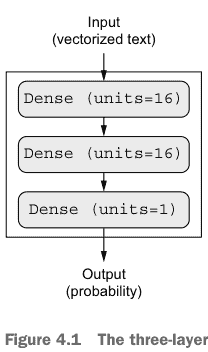

### 清单 4.4 模型定义

```python
from tensorflow import keras
from tensorflow.keras import layers

model = keras.Sequential([
    layers.Dense(16, activation="relu"),
    layers.Dense(16, activation="relu"),
    layers.Dense(1, activation="sigmoid")
])
```

传递给每个 Dense 层的第一个参数是该层中的单元数：即该层的表示空间维度。你记得从第 2 章和第 3 章中，每个这样的带有 relu 激活的 Dense 层实现以下一系列张量操作：

```
output = relu(dot(input, W) + b)
```

拥有 16 个单元意味着权重矩阵 W 的形状将是 (input_dimension, 16)：与 W 的点积将输入数据投影到一个 16 维的表示空间中（然后你将加上偏置向量 b 并应用 relu 操作）。你可以直观地将表示空间的维度理解为“当学习内部表示时，你允许模型拥有多少自由度”。拥有更多单元（更高维度的表示空间）允许你的模型学习更复杂的表示，但这会使模型在计算上更昂贵，并可能导致学习不需要的模式（即在训练数据上能提升性能但在测试数据上无法提升性能的模式）。

中间层使用 relu 作为激活函数，而最后一层使用 sigmoid 激活以输出一个概率（一个 0 到 1 之间的分数，表示样本具有目标“1”的可能性：评论是正面的可能性）。relu（修正线性单元）是一种旨在将负值置零的函数（参见图 4.2），而 sigmoid 则将任意值“压缩”到 [0, 1] 区间内（参见图 4.3），输出可以解释为概率的内容。

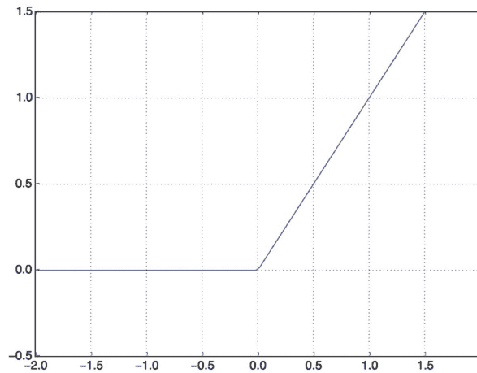

**图 4.2** 修正线性单元函数

最后，你需要选择损失函数和优化器。因为你面对的是二分类问题，且模型输出是一个概率（你以带有 sigmoid 激活的单元层结束模型），因此最好使用 binary_crossentropy 损失。它不是唯一可行的选择：例如，你可以使用 mean_squared_error。但当你处理

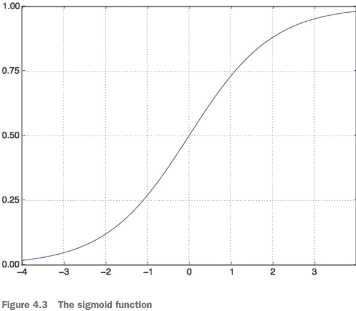

### 什么是激活函数，为什么需要它们？

没有像 relu（也称为非线性）这样的激活函数，Dense 层将由两个线性操作组成——点积和加法：

```
output = dot(input, W) + b
```

该层只能学习输入数据的线性变换（仿射变换）：该层的假设空间将是将输入数据转换到 16 维空间的所有可能线性变换的集合。这样的假设空间太受限，无法从多层表示中受益，因为深层线性层堆叠仍将实现一个线性操作：添加更多层不会扩展假设空间（如你在第 2 章中所见）。

为了获得一个更丰富、能从深层表示中受益的假设空间，你需要一个非线性，即激活函数。relu 是深度学习中最流行的激活函数，但还有许多其他候选者，它们都有着同样奇怪的名称：prelu、elu 等等。

处理输出概率的模型时。交叉熵是信息论领域的一个量度，用于衡量概率分布之间的距离，或在此例中，基实分布与你的预测之间的距离。

关于优化器的选择，我们将使用 rmsprop，它通常是几乎任何问题的不错默认选择。

以下是使用 rmsprop 优化器和 binary_crossentropy 损失函数配置模型的步骤。请注意，我们还将在训练期间监控准确率。

### 清单 4.5 编译模型

```python
model.compile(optimizer="rmsprop",
loss="binary_crossentropy",
metrics=["accuracy"])
```

### 4.1.4 验证你的方法

如你在第 3 章中所学，深度学习模型绝不应在训练数据上进行评估——使用验证集来监控模型在训练期间的准确率是标准做法。在此，我们将通过从原始训练数据中划分出 10,000 个样本来创建验证集。

### 清单 4.6 划分验证集

```python
x_val = x_train[:10000]
partial_x_train = x_train[10000:]
y_val = y_train[:10000]
partial_y_train = y_train[10000:]
```

我们现在将以 512 个样本的小批量训练模型 20 个 epoch（对训练数据中所有样本进行 20 次迭代）。同时，我们将监控我们划分出来的那 10,000 个样本上的损失和准确率。我们通过将验证数据作为 validation_data 参数传递来实现这一点。

### 清单 4.7 训练你的模型

```python
history = model.fit(partial_x_train,
partial_y_train,
epochs=20,
batch_size=512,
validation_data=(x_val, y_val))
```

在 CPU 上，每个 epoch 耗时不到 2 秒——训练在 20 秒内结束。每个 epoch 结束时都会有短暂的停顿，因为模型正在计算验证数据 10,000 个样本上的损失和准确率。

请注意，model.fit() 的调用将返回一个 History 对象，如你在第 3 章中所见。该对象有一个名为 history 的成员，它是一个包含训练期间发生的一切数据的字典。让我们来看看它：

```
>>> history_dict = history.history
>>> history_dict.keys()
[u"accuracy", u"loss", u"val_accuracy", u"val_loss"]
```

该字典包含四个条目：每个在训练和验证期间监控的指标对应一个条目。在接下来的两个清单中，让我们使用 Matplotlib 将训练损失和验证损失并排绘制（见图 4.4），以及训练准确率和验证准确率（见图 4.5）。请注意，由于模型随机初始化不同，你的结果可能会略有差异。

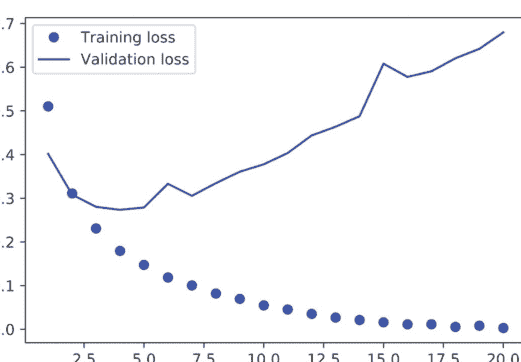

**图 4.4** 训练和验证损失


**图 4.5** 训练和验证准确率

### 清单 4.8 绘制训练和验证损失

```python
import matplotlib.pyplot as plt
history_dict = history.history
loss_values = history_dict["loss"]
val_loss_values = history_dict["val_loss"]
epochs = range(1, len(loss_values) + 1)
plt.plot(epochs, loss_values, "bo", label="Training loss")
plt.plot(epochs, val_loss_values, "b", label="Validation loss")
plt.title("Training and validation loss")
plt.xlabel("Epochs")
plt.ylabel("Loss")
plt.legend()
plt.show()
```

### 清单 4.9 绘制训练和验证准确率

```python
plt.clf()
acc = history_dict["accuracy"]
val_acc = history_dict["val_accuracy"]
plt.plot(epochs, acc, "bo", label="Training acc")
plt.plot(epochs, val_acc, "b", label="Validation acc")
plt.title("Training and validation accuracy")
plt.xlabel("Epochs")
plt.ylabel("Accuracy")
plt.legend()
plt.show()
```

如你所见，训练损失随每个 epoch 减少，训练准确率随每个 epoch 增加。运行梯度下降优化时，你会期待这一点——你试图最小化的量应随每次迭代而减少。但验证损失和准确率并非如此：它们似乎在第四个 epoch 达到峰值。这是我们之前警告过的一个示例：在训练数据上表现更好的模型，不一定在从未见过的数据上表现更好。准确地说，你看到的是过拟合：第四个 epoch 之后，你在训练数据上过度优化，最终学习到的表示特定于训练数据，无法推广到训练集之外的数据。

在这种情况下，为防止过拟合，你可以在四个 epoch 后停止训练。一般来说，你可以使用一系列技术来减轻过拟合，我们将在第 5 章中介绍。

让我们从头开始训练一个新模型四个 epoch，然后在测试数据上对其进行评估。

### 清单 4.10 从头开始重新训练模型

```python
model = keras.Sequential([
    layers.Dense(16, activation="relu"),
    layers.Dense(16, activation="relu"),
```


layers.Dense(1, activation="sigmoid")
])
model.compile(optimizer="rmsprop",
 loss="binary_crossentropy",
 metrics=["accuracy"])
model.fit(x_train, y_train, epochs=4, batch_size=512)
results = model.evaluate(x_test, y_test)

The final results are as follows:

```
>>> results
[0.2929924130630493, 0.8832799999999995]
```

> 第一个数字 0.29 是测试损失，第二个数字 0.88 是测试准确率。

这种相当简单的方法达到了 88% 的准确率。使用最先进的方法，你应该能接近 95%。

### 4.1.5 使用训练好的模型对新数据生成预测

训练好模型后，你会希望在实际场景中使用它。如同你在第 3 章中所学，可以使用 `predict` 方法生成评论为正面的可能性：

```
>>> model.predict(x_test)
array([[ 0.98006207
 [ 0.99758697]
 [ 0.99975556]
 ...
 [ 0.82167041]
 [ 0.02885115]
 [ 0.65371346]], dtype=float32)
```

如你所见，模型对某些样本（0.99 或以上，或 0.01 或以下）非常有信心，但对其他样本（0.6、0.4）信心不足。

### 4.1.6 进一步实验

以下实验将帮助你相信，你所做的架构选择都相当合理，尽管仍有改进空间：

- 你在最终分类层之前使用了两个表示层。尝试使用一个或三个表示层，看看这样做如何影响验证集和测试集准确率。
- 尝试使用单元数更多或更少的层：32 个单元、64 个单元，等等。
- 尝试使用 `mse` 损失函数代替 `binary_crossentropy`。
- 尝试使用 `tanh` 激活函数（一种在神经网络早期流行的激活函数）代替 `relu`。

### 4.1.7 总结

通过本示例，你应该记住以下要点：

- 你通常需要对原始数据进行大量预处理，才能将其作为张量输入神经网络。单词序列可以编码为二进制向量，但还有其他编码选项。
- 带有 relu 激活的 Dense 层堆叠可以解决各种问题（包括情感分类），你可能会频繁使用它们。
- 在二分类问题中（两个输出类别），你的模型应以一个具有一个单元和 sigmoid 激活的 Dense 层结尾：模型的输出应是 0 到 1 之间的标量，编码一个概率。
- 在二分类问题中使用这种标量 sigmoid 输出时，应使用的损失函数是 binary_crossentropy。
- 无论你面对什么问题，rmsprop 优化器通常都是一个足够好的选择。这让你少了一件需要担心的事。
- 随着神经网络在训练数据上表现越来越好，它们最终会开始过拟合，并在从未见过的数据上获得越来越差的结果。请务必始终监控训练集以外数据上的性能。

## 4.2 对新闻稿进行分类：多类分类示例

在上一节中，你学习了如何使用全连接神经网络将向量输入分类为两个互斥的类别。但如果有超过两个类别会发生什么情况呢？

在本节中，我们将构建一个模型，将路透社新闻稿分类为 46 个互斥的主题。由于有多个类别，这是一个多类分类问题的示例，并且由于每个数据点应仅被分类为一个类别，这个问题更具体地说是单标签多类分类问题。如果每个数据点可以属于多个类别（在本例中为主题），我们将面临多标签多类分类问题。

### 4.2.1 路透社数据集

你将使用路透社数据集，这是路透社于 1986 年发布的一组简短新闻稿及其主题。这是一个简单、广泛用于文本分类的玩具数据集。共有 46 个不同的主题；有些主题比其他主题更常见，但每个主题在训练集中至少有 10 个示例。

与 IMDB 和 MNIST 类似，路透社数据集作为 Keras 的一部分提供。让我们来看看。

清单 4.11 加载路透社数据集

```
from tensorflow.keras.datasets import reuters
(train_data, train_labels), (test_data, test_labels) = reuters.load_data(
    num_words=10000)
```

与 IMDB 数据集一样，参数 num_words=10000 将数据限制为数据中出现频率最高的 10,000 个单词。

你有 8,982 个训练示例和 2,246 个测试示例：

```
>>> len(train_data)
8982
>>> len(test_data)
2246
```

与 IMDB 评论一样，每个示例都是一个整数列表（单词索引）：

```
>>> train_data[10]
[1, 245, 273, 207, 156, 53, 74, 160, 26, 14, 46, 296, 26, 39, 74, 2979,
3554, 14, 46, 4689, 4329, 86, 61, 3499, 4795, 14, 61, 451, 4329, 17, 12]
```

以下是将其解码回单词的方法，以防你好奇。

清单 4.12 将新闻稿解码回文本

```python
word_index = reuters.get_word_index()
reverse_word_index = dict(
    [(value, key) for (key, value) in word_index.items()])
decoded_newswire = " ".join(
    [reverse_word_index.get(i - 3, "?") for i in train_data[0]])
```

> 请注意，索引偏移量为 3，因为 0、1 和 2 是保留索引，分别用于“填充”、“序列开始”和“未知。”

与示例关联的标签是 0 到 45 之间的整数——一个主题索引：

```
>>> train_labels[10]
3
```

### 4.2.2 准备数据

你可以使用与上一示例完全相同的代码来对数据进行向量化。

清单 4.13 对输入数据进行编码

```python
x_train = vectorize_sequences(train_data)  # Vectorized training data
x_test = vectorize_sequences(test_data)    # Vectorized test data
```

要对标签进行向量化，有两种可能性：你可以将标签列表转换为整数张量，也可以使用 one-hot 编码。One-hot 编码是分类数据的一种广泛使用的格式，也称为分类编码。在此示例中，标签的 one-hot 编码是将每个标签作为全零向量，在标签索引处设置为 1。以下清单显示了一个示例。

清单 4.14 对标签进行编码

```python
def to_one_hot(labels, dimension=46):
    results = np.zeros((len(labels), dimension))
```

```python
for i, label in enumerate(labels):
    results[i, label] = 1.
return results
y_train = to_one_hot(train_labels)  # Vectorized training labels
y_test = to_one_hot(test_labels)    # Vectorized test labels
```

请注意，Keras 中有一种内置方法可以做到这一点：

```
from tensorflow.keras.utils import to_categorical
y_train = to_categorical(train_labels)
y_test = to_categorical(test_labels)
```

### 4.2.3 构建模型

这个主题分类问题与之前的电影评论分类问题看起来相似：在两种情况下，我们都在尝试对短文本片段进行分类。但这里有一个新约束：输出类别的数量从 2 增加到了 46。输出空间的维度大得多。

在我们一直在使用的 Dense 层堆叠中，每一层只能访问前一层输出中存在的信息。如果某一层丢弃了与分类问题相关的一些信息，这些信息永远无法被后续层恢复：每一层都可能成为信息瓶颈。在之前的示例中，我们使用了 16 维中间层，但 16 维空间可能太有限，无法学会区分 46 个不同的类别：如此小的层可能充当信息瓶颈，永久丢弃相关信息。

因此，我们将使用更大的层。让我们使用 64 个单元。

清单 4.15 模型定义

```
model = keras.Sequential([
    layers.Dense(64, activation="relu"),
    layers.Dense(64, activation="relu"),
    layers.Dense(46, activation="softmax")
])
```

关于这个架构，还有两点你应该注意。

首先，我们以大小为 46 的 Dense 层结束模型。这意味着对于每个输入样本，网络将输出一个 46 维向量。向量中的每个条目（每个维度）将编码一个不同的输出类别。

其次，最后一层使用 softmax 激活。你在 MNIST 示例中见过这种模式。这意味着模型将输出 46 个不同输出类别上的概率分布——对于每个输入样本，模型将生成一个 46 维输出向量，其中 output[i] 是样本属于类别 i 的概率。46 个分数之和为 1。

在此示例中，应使用的最佳损失函数是 categorical_crossentropy。它测量两个概率分布之间的距离：在这里，是概率


模型输出的分布与标签的真实分布。通过最小化这两个分布之间的距离，你训练模型输出尽可能接近真实标签的内容。

### 清单 4.16 编译模型

```
model.compile(optimizer="rmsprop",
 loss="categorical_crossentropy",
 metrics=["accuracy"])
```

### 4.2.4 验证你的方法

让我们从训练数据中留出 1,000 个样本作为验证集。

### 清单 4.17 预留验证集

```
x_val = x_train[:1000]
partial_x_train = x_train[1000:]
y_val = y_train[:1000]
partial_y_train = y_train[1000:]
```

现在，让我们训练模型 20 个 epoch。

### 清单 4.18 训练模型

```
history = model.fit(partial_x_train,
 partial_y_train,
 epochs=20,
 batch_size=512,
 validation_data=(x_val, y_val))
```

最后，让我们显示其损失和准确率曲线（参见图 4.6 和 4.7）。


### 图 4.6 训练和验证损失


### 图 4.7 训练和验证准确率

### 清单 4.19 绘制训练和验证损失

```
loss = history.history["loss"]
val_loss = history.history["val_loss"]
epochs = range(1, len(loss) + 1)
plt.plot(epochs, loss, "bo", label="Training loss")
plt.plot(epochs, val_loss, "b", label="Validation loss")
plt.title("Training and validation loss")
plt.xlabel("Epochs")
plt.ylabel("Loss")
plt.legend()
plt.show()
```

### 清单 4.20 绘制训练和验证准确率

```
plt.clf()  # Clears the figure
acc = history.history["accuracy"]
val_acc = history.history["val_accuracy"]
plt.plot(epochs, acc, "bo", label="Training accuracy")
plt.plot(epochs, val_acc, "b", label="Validation accuracy")
plt.title("Training and validation accuracy")
plt.xlabel("Epochs")
plt.ylabel("Accuracy")
plt.legend()
plt.show()
```

模型在九个 epoch 后开始过拟合。让我们从头开始训练一个新模型九个 epoch，然后在测试集上对其进行评估。

### 清单 4.21 从头开始重新训练模型

```
model = keras.Sequential([
    layers.Dense(64, activation="relu"),
    layers.Dense(64, activation="relu"),
    layers.Dense(46, activation="softmax")
])
model.compile(optimizer="rmsprop",
	loss="categorical_crossentropy",
	metrics=["accuracy"])
model.fit(x_train,
	y_train,
	epochs=9,
	batch_size=512)
results = model.evaluate(x_test, y_test)
```

以下是最终结果：

```
>>> results
[0.9565213431445807, 0.79697239536954589]
```

这种方法的准确率约为 80%。在平衡的二分类问题中，纯随机分类器的准确率将是 50%。但在此案例中，我们有 46 个类别，它们可能分布不均。随机基线的准确率是多少？我们可以快速实现一个来经验地验证这一点：

```
>>> import copy
>>> test_labels_copy = copy.copy(test_labels)
>>> np.random.shuffle(test_labels_copy)
>>> hits_array = np.array(test_labels) == np.array(test_labels_copy)
>>> hits_array.mean()
0.18655387355298308
```

正如你所见，随机分类器的分类准确率约为 19%，因此从这个角度看，我们模型的结果相当不错。

### 4.2.5 在新数据上生成预测

对新样本调用模型的 predict 方法，将为每个样本返回所有 46 个主题上的类别概率分布。让我们为所有测试数据生成主题预测：

```
predictions = model.predict(x_test)
```

“predictions” 中的每个条目都是一个长度为 46 的向量：

```
>>> predictions[0].shape
(46,)
```

该向量中的系数之和为 1，因为它们构成了一个概率分布：

```
>>> np.sum(predictions[0])
1.0
```

该向量中最大的条目是预测类——即概率最高的类：

```
>>> np.argmax(predictions[0])
4
```

### 4.2.6 处理标签和损失的另一种方式

我们之前提到过，编码标签的另一种方法是将它们转换为整数张量，如下所示：

```
y_train = np.array(train_labels)
y_test = np.array(test_labels)
```

这种方法唯一会改变的就是损失函数的选择。清单 4.21 中使用的损失函数 categorical_crossentropy 期望标签遵循分类编码。使用整数标签时，你应该使用 sparse_categorical_crossentropy：

```
model.compile(optimizer="rmsprop",
 loss="sparse_categorical_crossentropy",
 metrics=["accuracy"])
```

这个新损失函数在数学上仍然与 categorical_crossentropy 相同；它只是接口不同。

### 4.2.7 足够大的中间层的重要性

我们之前提到过，因为最终输出是 46 维的，所以应该避免拥有远少于 46 个单元的中间层。现在让我们看看，当我们通过拥有远小于 46 维的中间层来引入信息瓶颈时会发生什么：例如，4 维。

### 清单 4.22 带有信息瓶颈的模型

```
model = keras.Sequential([
 layers.Dense(64, activation="relu"),
 layers.Dense(4, activation="relu"),
 layers.Dense(46, activation="softmax")
])
model.compile(optimizer="rmsprop",
 loss="categorical_crossentropy",
 metrics=["accuracy"])
model.fit(partial_x_train,
 partial_y_train,
 epochs=20,
 batch_size=128,
 validation_data=(x_val, y_val))
```

模型现在的峰值验证准确率约为 71%，下降了 8 个百分点。这种下降主要是因为我们试图将大量信息（足以恢复 46 个类别的分离超平面的信息）压缩到一个维度过低的中间空间中。模型能够将*大部分*必要信息塞进这些四维表示中，但不能全部塞进。

### 4.2.8 进一步实验

与之前的示例一样，我鼓励你尝试以下实验，以培养你对这类模型需要做出哪些配置决策的直觉：

- 尝试使用更大或更小的层：32 个单元、128 个单元，等等。
- 你在最终 softmax 分类层之前使用了两个中间层。现在尝试使用一个中间层或三个中间层。

### 4.2.9 总结

以下是你应该从本示例中学到的要点：

- 如果你尝试将数据点分类为 *N* 个类别，你的模型应以大小为 *N* 的 `Dense` 层结束。
- 在单标签多类分类问题中，你的模型应以 `softmax` 激活函数结束，以便输出 *N* 个输出类别上的概率分布。
- 分类交叉熵几乎总是你应该用于此类问题的损失函数。它最小化了模型输出的概率分布与目标真实分布之间的距离。
- 在多类分类中，处理标签有两种方式：
  - 通过分类编码（也称为独热编码）对标签进行编码，并使用 `categorical_crossentropy` 作为损失函数
  - 将标签编码为整数并使用 `sparse_categorical_crossentropy` 损失函数
- 如果你需要将数据分类为大量类别，你应该避免在模型中由于中间层太小而造成信息瓶颈。

## 4.3 预测房价：回归示例

前两个示例被视为分类问题，目标是预测输入数据点的单个离散标签。另一种常见的机器学习问题是*回归*，它由预测连续值而不是离散标签组成：例如，根据气象数据预测明天的温度，或根据软件项目的规范预测其完成所需的时间。

**注意** 不要混淆*回归*和*逻辑回归*算法。令人困惑的是，逻辑回归不是回归算法——它是分类算法。


### 4.3.1 波士顿房价数据集

在本节中，我们将尝试根据当时郊区的数据点（例如犯罪率、当地房产税率等）来预测20世纪70年代中期给定波士顿郊区住宅的中位数价格。我们将使用的数据集与前两个示例有一个有趣的区别。它的数据点相对较少：只有506个，分为404个训练样本和102个测试样本。并且输入数据中的每个特征（例如犯罪率）都有不同的尺度。例如，有些值是比例，取值在0到1之间，有些取值在1到12之间，有些在0到100之间，等等。

## 清单 4.23 加载波士顿房价数据集

```
from tensorflow.keras.datasets import boston_housing
(train_data, train_targets), (test_data, test_targets) = (
 boston_housing.load_data())
```

让我们来看看数据：

```
>>> train_data.shape
(404, 13)
>>> test_data.shape
(102, 13)
```

如您所见，我们有404个训练样本和102个测试样本，每个样本都有13个数值特征，例如人均犯罪率、每户平均房间数、高速公路可达性等等。

目标是自有住房的中位数值，单位为千美元：

```
>>> train_targets
[ 15.2, 42.3, 50 ... 19.4, 19.4, 29.1]
```

价格通常在10,000美元到50,000美元之间。如果这听起来很便宜，请记住这是20世纪70年代中期，这些价格没有按通货膨胀进行调整。

### 4.3.2 准备数据

将数值范围差异巨大的值馈送到神经网络中会很有问题。模型可能能够自动适应这种异构数据，但这肯定会让学习更加困难。处理此类数据的一种广泛的最佳实践是进行特征归一化：对于输入数据中的每个特征（输入数据矩阵的一列），我们减去该特征的均值并除以标准差，使特征围绕0中心化并具有单位标准差。这在NumPy中很容易实现。

## 清单 4.24 归一化数据

```
mean = train_data.mean(axis=0)
train_data -= mean
std = train_data.std(axis=0)
train_data /= std
test_data -= mean
test_data /= std
```

请注意，用于归一化测试数据的量是使用训练数据计算的。您永远不应该在工作流中使用任何在测试数据上计算的量，即使是进行像数据归一化这样简单的操作。

### 4.3.3 构建您的模型

由于可用样本很少，我们将使用一个非常小的模型，包含两个中间层，每个层有64个单位。一般来说，训练数据越少，过拟合就越严重，使用小模型是缓解过拟合的一种方法。

## 清单 4.25 模型定义

```
def build_model():
    model = keras.Sequential([
        layers.Dense(64, activation="relu"),
        layers.Dense(64, activation="relu"),
        layers.Dense(1)
    ])
    model.compile(optimizer="rmsprop", loss="mse", metrics=["mae"])
    return model
```

模型以一个单元且没有激活函数结尾（它将是一个线性层）。这是标量回归（试图预测单个连续值的回归）的典型设置。应用激活函数将限制输出可以取的范围；例如，如果在最后一层应用sigmoid激活函数，模型只能学习预测0到1之间的值。在这里，由于最后一层是纯粹线性的，模型可以自由地学习预测任何范围内的值。

请注意，我们使用mse损失函数编译模型——均方误差，即预测值与目标值之差的平方。这是回归问题中广泛使用的损失函数。

我们在训练期间还监控一个新指标：平均绝对误差（MAE）。它是预测值与目标值之差的绝对值。例如，在这个问题上MAE为0.5意味着您的预测平均偏差为500美元。

### 4.3.4 使用K折交叉验证验证您的方法

在不断调整模型参数（例如训练使用的 epoch 数量）的同时评估模型，我们可以像之前的示例一样将数据分为训练集和验证集。但由于我们的数据点很少，验证集最终会非常小（例如，大约100个样本）。因此，验证分数可能会根据我们选择哪些数据点作为验证、哪些作为训练而变化很大：验证分数可能对验证划分具有高 _方差_。这将阻止我们可靠地评估模型。

在这种情况下，最佳实践是使用 _K折_ 交叉验证（参见图4.8）。


## 图 4.8 使用 K=3 的 K 折交叉验证

它包括将可用数据分为 _K_ 个分区（通常 _K_ = 4 或 5），实例化 _K_ 个相同的模型，并在 _K_ – 1 个分区上训练每个模型，同时在剩余分区上进行评估。然后使用的模型的验证分数是所获得的 _K_ 个验证分数的平均值。从代码角度来看，这很简单。

## 清单 4.26 K 折验证

```
k = 4
num_val_samples = len(train_data) // k
num_epochs = 100
all_scores = []
for i in range(k):
    print(f"Processing fold #{i}")
    val_data = train_data[i * num_val_samples: (i + 1) * num_val_samples]
    val_targets = train_targets[i * num_val_samples: (i + 1) * num_val_samples]
    partial_train_data = np.concatenate(
        [train_data[:i * num_val_samples],
         train_data[(i + 1) * num_val_samples:]],
        axis=0)
    partial_train_targets = np.concatenate(
        [train_targets[:i * num_val_samples],
         train_targets[(i + 1) * num_val_samples:]],
        axis=0)
    model = build_model()
    model.fit(partial_train_data, partial_train_targets,
              epochs=num_epochs, batch_size=16, verbose=0)
    val_mse, val_mae = model.evaluate(val_data, val_targets, verbose=0)
    all_scores.append(val_mae)
```

使用 num_epochs = 100 运行此代码会产生以下结果：

```
>>> all_scores
[2.112449, 3.0801501, 2.6483836, 2.4275346]
>>> np.mean(all_scores)
2.5671294
```

不同的运行确实显示出相当不同的验证分数，从2.1到3.1。平均值（2.6）比任何单一分数都可靠得多——这就是K折交叉验证的整个要点。在这种情况下，我们平均偏差为2,600美元，考虑到价格范围在10,000美元到50,000美元之间，这是显著的。

让我们尝试训练模型更长一段时间：500个 epoch。为了记录模型在每个 epoch 的表现，我们将修改训练循环以保存每个 fold 每个 epoch 的验证分数日志。

## 清单 4.27 保存每个 fold 的验证日志

```
num_epochs = 500
all_mae_histories = []
for i in range(k):
    print("Processing fold #", i)
    val_data = train_data[i * num_val_samples : (i + 1) * num_val_samples]
    val_targets = train_targets[i * num_val_samples : (i + 1) * num_val_samples]
    partial_train_data = np.concatenate(
        [train_data[:i * num_val_samples],
         train_data[(i + 1) * num_val_samples:]],
        axis=0)
    partial_train_targets = np.concatenate(
        [train_targets[:i * num_val_samples],
         train_targets[(i + 1) * num_val_samples:]],
         axis=0)
    model = build_model()
    history = model.fit(partial_train_data, partial_train_targets,
                        validation_data=(val_data, val_targets),
                        epochs=num_epochs, batch_size=16, verbose=0)
    mae_history = history.history["val_mae"]
    all_mae_histories.append(mae_history)
```

然后我们可以计算所有 fold 每个 epoch MAE 分数的平均值。

## 清单 4.28 构建连续平均 K 折验证分数的历史记录

```
average_mae_history = [
    np.mean([x[i] for x in all_mae_histories]) for i in range(num_epochs)]
```

让我们绘制这个；参见图4.9。

## 清单 4.29 绘制验证分数

```
plt.plot(range(1, len(average_mae_history) + 1), average_mae_history)
plt.xlabel("Epochs")
plt.ylabel("Validation MAE")
plt.show()


图 4.9 按时代划分的验证 MAE

由于存在缩放问题，该图可能有些难以读取：前几个时代的验证 MAE 显著高于后续数值。让我们忽略前 10 个数据点，它们的尺度与曲线其余部分不同。

列表 4.30 绘制验证分数，排除前 10 个数据点

```python
truncated_mae_history = average_mae_history[10:]
plt.plot(range(1, len(truncated_mae_history) + 1), truncated_mae_history)
plt.xlabel("Epochs")
plt.ylabel("Validation MAE")
plt.show()
```

如图 4.10 所示，验证 MAE 在 120–140 个时代后不再显著改善（此数字包括我们忽略的 10 个时代）。过了那个点，我们就开始出现过拟合。

一旦你完成了模型其他参数的调整（除了时代数量，你还可以调整中间层的大小），你就可以在所有训练数据上使用最佳参数训练一个最终生产模型，然后查看其在测试数据上的表现。

列表 4.31 训练最终模型

```python
model = build_model()
model.fit(train_data, train_targets,
          epochs=130, batch_size=16, verbose=0)
test_mse_score, test_mae_score = model.evaluate(test_data, test_targets)
```


最终结果如下：

```
>>> test_mae_score
2.4642276763916016
```

我们仍然相差不到 2,500 美元。这是一种改进！就像前两个任务一样，你可以尝试改变模型中的层数，或每层的单元数，看看是否能进一步降低测试误差。

### 4.3.5 在新数据上生成预测

在对我们的二分类模型调用 `predict()` 时，我们为每个输入样本检索到一个 0 到 1 之间的标量分数。对于多类分类模型，我们为每个样本检索到一个所有类别上的概率分布。现在，对于这个标量回归模型，`predict()` 返回模型对样本价格（以千美元为单位）的猜测：

```python
>>> predictions = model.predict(test_data)
>>> predictions[0]
array([9.990133], dtype=float32)
```

测试集中的第一栋房子预计价格约为 10,000 美元。

### 4.3.6 总结

你应该从这个标量回归示例中汲取以下要点：

- 回归使用的损失函数与我们用于分类的不同。均方误差（MSE）是一种常用的回归损失函数。
- 同样，回归使用的评估指标与分类使用的不同；自然地，准确率的概念不适用于回归。一种常用的回归指标是平均绝对误差（MAE）。
- 当输入数据中的特征具有不同范围的值时，每个特征应作为预处理步骤独立进行缩放。
- 当可用数据较少时，使用 K 折交叉验证是可靠评估模型的好方法。
- 当可用的训练数据较少时，最好使用具有少量中间层（通常只有 1 或 2 层）的小模型，以避免严重的过拟合。

## 摘要

- 向量数据上最常见的三种机器学习任务是二分类、多类分类和标量回归。
  - 章节前面的“总结”部分总结了你关于每个任务学到的重要要点。
  - 回归使用的损失函数和评估指标与分类不同。
- 你通常需要在将原始数据馈入神经网络之前进行预处理。
- 当你的数据具有不同范围的特征时，作为预处理的一部分，独立缩放每个特征。
- 随着训练的进展，神经网络最终会开始过拟合，并在从未见过的数据上获得更差的结果。
- 如果你没有太多训练数据，请使用只有一两个中间层的小模型，以避免严重的过拟合。
- 如果你的数据被分为许多类别，使中间层太小可能会导致信息瓶颈。
- 当处理数据量较少时，K 折交叉验证可以帮助可靠地评估你的模型。

# 机器学习基础

- **本章内容**
- 理解泛化与优化之间的张力，这是机器学习的基本问题
- 机器学习模型的评估方法
- 改善模型拟合的最佳实践
- 达成更好泛化的最佳实践

在阅读第 4 章中的三个实际示例后，你应该开始熟悉如何使用神经网络处理分类和回归问题，并且你已经见证了机器学习的核心问题：过拟合。本章将你对机器学习的新直觉形式化为一个坚实的概念框架，强调准确模型评估的重要性以及训练与泛化之间的平衡。

## 5.1 泛化：机器学习的目标

在第 4 章中展示的三个示例中——电影评论预测、主题分类和房价回归——我们将数据分割为训练集、验证集和测试集。不在用于训练模型的同一数据上评估模型的原因很快就变得明显：仅经过几个时代后，从未见过的数据上的性能就开始与训练数据上的性能分化，而训练数据上的性能随着训练进展始终在改善。模型开始 *过拟合*。过拟合发生在每个机器学习问题中。

机器学习的基本问题是优化与泛化之间的张力。*优化* 指的是调整模型以在训练数据上获得尽可能好的性能（即 *机器学习* 中的 *学习*），而 *泛化* 指的是训练后的模型在从未见过的数据上表现如何。当然，游戏的目标是获得良好的泛化，但你无法控制泛化；你只能将模型拟合到其训练数据上。如果你做得 *太好*，过拟合就会发生，泛化就会受损。

但什么导致过拟合？我们如何才能获得良好的泛化？

### 5.1.1 欠拟合和过拟合

对于你在上一章中看到的模型，留出的验证数据上的性能随着训练的进行开始改善，然后不可避免地在一段时间后达到峰值。这种模式（如图 5.1 所示）是普遍的。你会在任何模型类型和任何数据集中看到它。


图 5.1 典型的过拟合行为

在训练初期，优化和泛化是相关的：训练数据上的损失越低，测试数据上的损失越低。在此期间，你的模型被认为是 *欠拟合* 的：仍有改进空间；网络尚未建模训练数据中的所有相关模式。但在对训练数据进行一定数量的迭代后，泛化停止改善；验证指标停滞然后开始下降：模型开始过拟合。也就是说，它开始学习特定于训练数据但在处理新数据时具有误导性或无关性的模式。

当你的数据包含噪声、涉及不确定性或包含罕见特征时，过拟合尤其可能发生。让我们看看具体的例子。

### 嘈杂的训练数据

在现实世界的数据集中，某些输入无效的情况相当常见。例如，一个 MNIST 数字可能是一张全黑图片，或者类似于图 5.2 中的内容。


图 5.2 相当奇怪的 MNIST 训练样本

这些是什么？我也不知道。但它们都是 MNIST 训练集的一部分。然而，更糟糕的是完全有效的输入最终被错误标记，如图 5.3 中所示。


图 5.3 错误标记的 MNIST 训练样本

如果模型不顾一切地试图纳入这些异常值，其泛化性能将下降，如图 5.4 所示。例如，一个看起来与图 5.3 中错误标记的 4 非常相似的 4 最终可能被分类为 9。


图 5.4 处理异常值：鲁棒拟合与过拟合

## 模糊特征

并非所有数据噪声都源于不准确——即使数据完全干净且标签整齐，当问题涉及不确定性和歧义性时，数据也可能具有噪声。在分类任务中，输入特征空间的某些区域往往同时与多个类别相关联。假设你正在开发一个模型，它输入一张香蕉图片并预测香蕉是未成熟、成熟还是腐烂。这些类别没有客观边界，因此同一张图片可能被不同的人类标注者分类为未成熟或成熟。同样，许多问题涉及随机性。你可以使用大气压数据预测明天是否会下雨，但完全相同的测量结果有时会伴随降雨，有时会伴随晴空万里，带有一定概率。

模型可能会针对这种概率性数据发生过拟合，即对特征空间中模糊区域过于自信，如图 5.5 所示。更鲁棒的拟合会忽略单个数据点，而关注整体情况。


图 5.5 鲁棒拟合与过拟合：针对特征空间中的模糊区域

## 罕见特征与虚假相关性

如果你一生中只见过两只橘虎斑猫，而它们恰好都极其反社会，你可能会推断橘虎斑猫通常很可能反社会。这就是过拟合：如果你接触过更多种类的猫，包括更多橘色的猫，你就会学到猫的颜色与性格并不存在良好的相关性。

同样，在包含罕见特征值的数据集上训练的机器学习模型极易发生过拟合。在情感分类任务中，如果单词“cherimoya”（一种原产于安第斯山脉的水果）在训练数据中只出现在一段文本里，而这段文本恰好是负面情绪，那么正则化不佳的模型可能会给这个单词赋予非常高的权重，并始终将提及 cherimoya 的新文本分类为负面，而客观上，cherimoya 本身没有任何负面含义。

重要的是，一个特征值不需要只出现一两次就会导致虚假相关性。考虑一个在训练数据中出现 100 次的单词，其中 54% 的时间与正面情绪相关，46% 的时间与负面情绪相关。这种差异可能完全是统计上的偶然，但你的模型很可能会学会利用该特征进行分类任务。这是过拟合最常见的来源之一。

这里有一个引人注目的例子。以 MNIST 为例。通过将 784 个白噪声维度与现有的 784 个数据维度拼接来创建一个新的训练集，这样数据中有一半现在就是噪声。为进行对比，还创建一个等效的数据集，将 784 个全零维度拼接进去。我们拼接的无意义特征完全不影响数据的信息内容：我们只是添加了某些东西。人类的分类准确率根本不会受到这些变换的影响。

¹ 马克·吐温甚至称其为“人类已知最美味的水果。”

### 清单 5.1 向 MNIST 添加白噪声通道或全零通道

```
from tensorflow.keras.datasets import mnist
import numpy as np

(train_images, train_labels), _ = mnist.load_data()
train_images = train_images.reshape((60000, 28 * 28))
train_images = train_images.astype("float32") / 255

train_images_with_noise_channels = np.concatenate(
    [train_images, np.random.random((len(train_images), 784))], axis=1)

train_images_with_zeros_channels = np.concatenate(
    [train_images, np.zeros((len(train_images), 784))], axis=1)
```

现在，让我们在第 2 章训练的模型在上述两个训练集上进行训练。

### 清单 5.2 在带有噪声通道或全零通道的 MNIST 数据上训练相同的模型

```
from tensorflow import keras
from tensorflow.keras import layers

def get_model():
    model = keras.Sequential([
        layers.Dense(512, activation="relu"),
        layers.Dense(10, activation="softmax")
    ])
    model.compile(optimizer="rmsprop",
                  loss="sparse_categorical_crossentropy",
                  metrics=["accuracy"])
    return model

model = get_model()
history_noise = model.fit(
    train_images_with_noise_channels, train_labels,
    epochs=10,
    batch_size=128,
    validation_split=0.2)

model = get_model()
history_zeros = model.fit(
    train_images_with_zeros_channels, train_labels,
    epochs=10,
    batch_size=128,
    validation_split=0.2)
```

让我们比较每个模型的验证准确率随时间变化的情况。

### 清单 5.3 绘制验证准确率对比图

```
import matplotlib.pyplot as plt
val_acc_noise = history_noise.history["val_accuracy"]
val_acc_zeros = history_zeros.history["val_accuracy"]
epochs = range(1, 11)

plt.plot(epochs, val_acc_noise, "b-",
         label="Validation accuracy with noise channels")
plt.plot(epochs, val_acc_zeros, "b--",
         label="Validation accuracy with zeros channels")
plt.title("Effect of noise channels on validation accuracy")
plt.xlabel("Epochs")
plt.ylabel("Accuracy")
plt.legend()
```

尽管在两种情况下数据都包含相同的信息，但使用噪声通道训练的模型的验证准确率最终会低出约一个百分点（见图 5.6）——这纯粹是由虚假相关性的影响造成的。添加的噪声通道越多，准确率下降得越厉害。

噪声特征必然导致过拟合。因此，在你不确定现有特征是有信息量的还是具有干扰性的情况下，通常会在训练前进行特征


选择。例如，将 IMDB 数据限制在前 10,000 个最常见的单词，就是一种粗糙的特征选择形式。进行特征选择的典型方法是为每个可用特征计算某种有用性得分——衡量特征相对于任务的信息量的指标，例如特征与标签之间的互信息——并且只保留高于某个阈值的特征。这样做会过滤掉前例中的白噪声通道。

### 5.1.2 深度学习中泛化的本质

关于深度学习模型的一个显著事实是，只要它们具有足够的表示能力，就可以被训练来拟合任何东西。

不相信我？试着打乱 MNIST 标签，并在该数据上训练一个模型。尽管输入与打乱后的标签之间根本没有任何关系，训练损失仍然可以很好地下降，即使是使用一个相对较小的模型。当然，验证损失随时间根本不会改善，因为在这种环境下根本不可能发生泛化。

### 清单 5.4 使用随机打乱的标签拟合 MNIST 模型

```
(train_images, train_labels), _ = mnist.load_data()
train_images = train_images.reshape((60000, 28 * 28))
train_images = train_images.astype("float32") / 255

random_train_labels = train_labels[:]
np.random.shuffle(random_train_labels)

model = keras.Sequential([
    layers.Dense(512, activation="relu"),
    layers.Dense(10, activation="softmax")
])
model.compile(optimizer="rmsprop",
    loss="sparse_categorical_crossentropy",
    metrics=["accuracy"])
model.fit(train_images, random_train_labels,
    epochs=100,
    batch_size=128,
    validation_split=0.2)
```

事实上，你甚至不需要使用 MNIST 数据——你可以生成白噪声输入和随机标签。你也可以在这种数据上拟合一个模型，只要它拥有足够的参数。它最终只会记住特定的输入，很像一个 Python 字典。

如果情况如此，深度学习模型又是如何泛化的呢？难道它们不应该只是学习训练输入与目标之间的临时映射，像一个花哨的字典吗？我们有什么理由期望这种映射对新输入有效呢？

事实证明，深度学习中泛化的本质与深度学习模型本身关系不大，而与现实世界中信息的结构关系很大。让我们看看这里到底发生了什么。

## 流形假设

MNIST 分类器的输入（预处理前）是一个 28 × 28 的 0 到 255 之间的整数数组。因此，可能的输入值总数为 256 的 784 次方——远大于宇宙中的原子数量。然而，其中极少数输入看起来像有效的 MNIST 样本：实际手写数字只占据了所有可能 28 × 28 uint8 数组的父空间中的一个极小子空间。而且，这个子空间不仅仅是父空间中随机撒落的一组点：它具有高度结构化的特点。

首先，有效手写数字的子空间是连续的：如果你取一个样本并稍作修改，它仍然会被识别为同一个手写数字。此外，有效子空间中的所有样本都通过在子空间中运行的平滑路径相连。这意味着，如果你取两个随机的 MNIST 数字 A 和 B，就存在一系列“中间”图像，可以将 A 变形为 B，使得连续的两个数字彼此非常接近（见图 5.7）。在两个类别的边界附近，可能会有一些模糊的形状，但即使这些形状看起来也非常像数字。

从技术术语来说，你会说手写数字在 28 × 28 uint8 数组的可能空间中形成一个流形。这是一个大词，但概念相当直观。“流形”是某个父空间的一个低维子空间，在局部上类似于线性（欧几里得）空间。例如，平面中的一条平滑曲线是 2D 空间中的一个 1D 流形，因为对于曲线上的每个点，你都可以画一条切线（曲线在每个点都可以用一条直线近似）。3D 空间中的一个平滑表面是一个 2D 流形。依此类推。


图 5.7 不同的 MNIST 数字逐渐相互变形，展示了手写数字的空间构成一个“流形”。此图使用第 12 章的代码生成。

更一般地说，_流形假设_ 认为，所有自然数据都位于其编码所在的高维空间内的一个低维流形上。这是关于宇宙中信息结构的一个相当强烈的说法。就我们所知，这是准确的，也是深度学习有效的原因。这不仅适用于 MNIST 数字，也适用于人脸、树木形态、人声的声音，甚至自然语言。

流形假设意味着

- 机器学习模型只需在其潜在输入空间中拟合相对简单、低维、高度结构化的子空间（潜在流形）。
- 在其中一个流形内，始终可以在两个输入之间进行 _插值_，也就是说，通过一条沿途所有点都位于流形上的连续路径，将一个输入变形成另一个。

在样本之间进行插值的能力是理解深度学习中泛化的关键。

## 将插值作为泛化的源泉

如果您使用可插值的数据点，就可以通过将从未见过的点与流形上靠近的其他点关联起来，开始理解这些点。换句话说，您可以仅使用空间的一个 _样本_ 来理解空间的 _整体性_。您可以使用插值来填补空白。

请注意，潜在流形上的插值与父空间中的线性插值不同，如图 5.8 所示。例如，两个 MNIST 数字之间像素的平均值通常不是有效数字。

关键的是，尽管深度学习通过在数据流形的学习近似上进行插值来实现泛化，但假设插值是泛化的 _全部_ 将是一个错误。它只是冰山一角。插值只能帮助您理解与过去所见非常接近的事物：它能实现局部泛化。但令人惊讶的是，人类不断应对极端的新奇事物，并且表现得很好。您不需要事先对将遇到的每种情况的无数示例进行训练。您度过的每一天都与您过去经历过的任何一天不同，也与自人类诞生以来任何人经历过的任何一天不同。您可以在花一周时间在纽约、一周时间在上海和一周时间在曼谷之间切换，而无需为每个城市进行数千个生命周期的学习和排练。

人类能够实现极端的泛化，这得益于插值以外的认知机制：抽象、世界的符号模型、推理、逻辑、常识、关于世界的先天先验——我们通常称之为理性，与直觉和模式识别相对。后者在很大程度上具有插值性质，但前者不是。两者对智能都至关重要。我们将在第 14 章中详细讨论这一点。

## 为什么深度学习有效

还记得第 2 章中的揉皱纸球隐喻吗？一张纸代表 3D 空间中的一个 2D 流形（见图 5.9）。深度学习模型是一个用于展开揉皱纸球的工具，即解纠缠潜在流形。


图 5.8 线性插值与潜在流形上插值之间的区别。数字潜在流形上的每个点都是有效数字，但两个数字的平均值通常不是。


图 5.9 展开复杂的数据流形

深度学习模型本质上是一个非常高维的曲线——一个平滑且连续的曲线（其结构有额外约束，源自模型架构先验），因为它需要可微分。该曲线通过梯度下降平滑且逐步地拟合到数据点上。就其本质而言，深度学习涉及取一个大的、复杂的曲线——一个流形——并逐步调整其参数，直到它拟合某些训练数据点。

该曲线包含足够的参数，可以拟合任何东西——确实，如果您让模型训练足够长的时间，它将有效地纯粹记忆其训练数据，根本无法泛化。然而，您拟合的数据并不是由潜在空间中稀疏分布的孤立点组成的。您的数据在输入空间内形成一个高度结构化、低维的流形——这就是流形假设。并且，由于随着梯度下降的进行，将模型曲线拟合到这些数据的过程是随时间逐渐和平滑地发生的，在训练过程中会有一个中间点，此时模型大致近似于数据的自然流形，如图 5.10 所示。

训练前：模型从随机初始状态开始。

训练开始时：模型逐渐向更好的拟合移动。

进一步训练：在将模型从初始状态变形为最终状态的过程中，暂时地实现了强健的拟合。

最终状态：模型对训练数据过拟合，达到完美的训练损失。


测试时：强健拟合模型在新数据点上的性能

测试时：过拟合模型在新数据点上的性能


**图 5.10** 从随机模型到过拟合模型，并在中间状态实现强健拟合

沿着模型在那一点学到的曲线移动，将接近于沿着数据的实际潜在流形移动——因此，模型将能够通过训练输入之间的插值来理解以前从未见过的输入。

除了它们具有足够的表征能力这一平凡事实之外，深度学习模型还有一些属性，使它们特别适合学习潜在流形：

- 深度学习模型从输入到输出实现平滑、连续的映射。它必须平滑且连续，因为出于必要性，它必须可微分（否则你无法进行梯度下降）。

这种平滑性有助于近似潜在流形，后者遵循相同的属性。

- 深度学习模型倾向于以一种方式进行结构化，以反映其训练数据中信息的“形状”（通过架构先验）。这尤其适用于图像处理模型（在第 8 和第 9 章中讨论）和序列处理模型（第 10 章）。更一般地说，深度神经网络以层次化和模块化的方式构建其学习表示，这与自然数据的组织方式相呼应。

## 训练数据至关重要

尽管深度学习确实适合流形学习，但泛化能力更多是数据自然结构的结果，而不是模型任何属性的结果。只有当您的数据形成可进行点插值的流形时，您才能泛化。您的特征越有信息量、越少噪声，您就越能泛化，因为您的输入空间会更简单、结构更好。数据整理和特征工程对泛化至关重要。

此外，由于深度学习是曲线拟合，要使模型表现良好，它需要在其输入空间的密集采样上进行训练。在此上下文中，“密集采样”意味着训练数据应密集地覆盖输入数据流形的整体（见图 5.11）。这一点在决策边界附近尤其正确。通过足够密集的采样，可以通过在过去的训练输入之间进行插值来理解新输入，而无需使用常识、抽象推理或关于世界的外部知识——这些都是机器学习模型无法访问的事物。


**图 5.11** 为了学习能够进行准确泛化的模型，输入空间的密集采样是必要的。


因此，你应始终牢记，改进深度学习模型的最佳方法是在更多数据或更高质量的数据上对其进行训练（当然，添加过于嘈杂或不准确的数据会损害泛化能力）。对输入数据流形进行更密集的覆盖，将产生泛化能力更强的模型。你永远不应指望深度学习模型在其训练样本之间进行的插值之外做出任何更复杂的事情，因此你应尽一切可能让插值变得尽可能容易。你在深度学习模型中找到的唯一东西，就是你放入其中的东西：编码在其架构中的先验知识以及其训练所用的数据。

当无法获取更多数据时，次优解决方案是调节模型被允许存储的信息量，或对模型曲线的平滑度添加约束。如果一个网络只能容忍记忆少量模式，或非常规则的模式，优化过程将迫使它专注于最突出的模式，这些模式有更好的泛化机会。以这种方式对抗过拟合的过程称为*正则化*。我们将在 5.4.4 节深入探讨正则化技术。

在开始调整模型以帮助其更好地泛化之前，你需要一种方法来评估模型当前的表现。在接下来的章节中，你将学习如何在模型开发期间监控泛化能力：模型评估。

## 5.2 评估机器学习模型

你只能控制你能观察到的事物。既然你的目标是开发能够成功泛化到新数据的模型，那么能够可靠地衡量模型的泛化能力就至关重要。在本节中，我将正式介绍评估机器学习模型的不同方法。你在前一章中已经看到其中大部分方法的实际应用。

### 5.2.1 训练集、验证集和测试集

评估模型本质上始终涉及将可用数据划分为三组：训练集、验证集和测试集。你在训练数据上训练模型，并在验证数据上评估模型。一旦模型准备好正式投入使用，你就在测试数据上对其进行最终测试，测试数据应尽可能与生产环境数据相似。然后你可以将模型部署到生产环境中。

你可能会问，为什么不设置两组：训练集和测试集？你可以在训练数据上训练，并在测试数据上评估。这样简单得多！

原因在于，开发模型总是涉及调整其配置：例如，选择层数或层的大小（称为模型的*超参数*，以区别于*参数*，即网络的权重）。你通过将模型在验证数据上的性能作为反馈信号来进行这种调整。本质上，这种调整是一种*学习*：在某个参数空间中寻找良好配置。结果，根据模型在验证集上的表现调整模型配置，可能会迅速导致*对验证集的过拟合*，尽管你的模型从未直接在其上进行训练。这一现象的核心是*信息泄漏*的概念。每当你根据模型在验证集上的表现调整模型的超参数时，一些关于验证数据的信息就会泄漏到模型中。如果你只针对一个参数执行一次操作，那么泄漏的信息位数会很少，你的验证集将仍然可靠地用于评估模型。但如果你多次重复此操作——运行一个实验，在验证集上进行评估，并据此修改你的模型——那么你将向模型中泄漏越来越多的关于验证集的信息。

归根结底，你最终会得到一个在验证数据上表现虚假地出色的模型，因为你正是为此对其进行了优化。你关心的是在全新数据上的表现，而不是验证数据，因此你需要使用一个完全不同的、从未见过的数据集来评估模型：测试数据集。你的模型不应接触关于测试集的*任何*信息，即使是间接的。如果模型的任何方面是基于测试集表现进行调整的，那么你对泛化能力的衡量将是有缺陷的。

将数据划分为训练集、验证集和测试集看似简单，但在数据较少时，还有一些高级方法非常实用。让我们回顾三种经典评估方法：简单留出验证、K 折验证和带随机化的迭代 K 折验证。我们还将讨论使用常识性基线来检查你的训练是否取得进展。

### 简单留出验证

预留一部分数据作为测试集。在其余数据上训练，并在测试集上评估。正如你在前面的章节中所见，为了防止信息泄漏，你不应根据测试集调整模型，因此你也应*预留*一个验证集。

从示意图来看，留出验证如图 5.12 所示。清单 5.5 展示了一个简单的实现。


图 5.12 简单留出验证划分

### 清单 5.5 留出验证（为简单起见，标签被省略）

```
num_validation_samples = 10000
np.random.shuffle(data)
```

通常适合对数据进行随机化。

定义验证集

```
validation_data = data[:num_validation_samples]
training_data = data[num_validation_samples:]
model = get_model()
model.fit(training_data, ...)
validation_score = model.evaluate(validation_data, ...)
...
model = get_model()
model.fit(np.concatenate([training_data,
validation_data]), ...)
test_score = model.evaluate(test_data, ...)
```

定义训练集
在训练数据上训练模型，并在验证数据上评估

此时你可以调整模型、重新训练、评估、再次调整。

调整超参数后，通常使用所有非测试数据从头开始训练最终模型。

这是最简单的评估协议，但存在一个缺陷：如果数据很少，你的验证集和测试集可能包含太少的样本，无法在统计上代表手头的数据。这很容易识别：如果在分割前对数据进行不同的随机洗牌轮次后，得到的模型性能指标差异很大，那么你就存在这个问题。K 折验证和迭代 K 折验证是两种解决此问题的方法，如下文所述。

### K 折验证

使用此方法，你将数据划分为大小相等的 K 个分区。对于每个分区 i，在其余 K-1 个分区上训练一个模型，并在分区 i 上进行评估。你的最终得分是 K 个得分的平均值。当模型性能基于训练-测试划分显示出显著方差时，此方法很有帮助。与留出验证一样，此方法并不免除你为模型校准使用单独验证集的要求。

从示意图来看，K 折交叉验证如图 5.13 所示。清单 5.6 展示了一个简单的实现。


图 5.13 K=3 的 K 折交叉验证

### 清单 5.6 K 折交叉验证（为简单起见，标签被省略）

```
k = 3
num_validation_samples = len(data) // k
np.random.shuffle(data)
validation_scores = []
for fold in range(k):
    validation_data = data[num_validation_samples * fold:
                             num_validation_samples * (fold + 1)]
    training_data = np.concatenate(
        data[:num_validation_samples * fold],
        data[num_validation_samples * (fold + 1):])
    model = get_model()
    model.fit(training_data, ...)
    validation_score = model.evaluate(validation_data, ...)
    validation_scores.append(validation_score)
validation_score = np.average(validation_scores)
model = get_model()
model.fit(data, ...)
test_score = model.evaluate(test_data, ...)
```

使用其余数据作为训练
数据。注意 + 运算符表示列表连接，而不是求和。

### 带随机化的迭代 K 折验证

这种方法适用于可用数据相对较少且你需要尽可能精确地评估模型的情况。我在 Kaggle 比赛中发现它非常有帮助。它包括多次应用 K 折验证，每次划分前都要对数据进行随机化。最终得分是每次运行 K 折验证所得得分的平均值。请注意，你最终将训练和评估 P * K 个模型（其中 P 是你使用的迭代次数），这可能非常昂贵。

### 5.2.2 超越常识性基线

除了你可用的不同评估协议之外，最后一件你应该知道的事情是使用常识性基线。

训练深度学习模型有点像按下一个按钮，发射一枚在平行世界中的火箭。你无法听到或看到它。你无法观察流形学习过程——它发生在有成千上万个维度的空间中，即使将其投影到 3D，你也无法解释它。你拥有的唯一反馈就是你的验证指标——就像你隐形火箭上的高度表。

特别重要的是，你要能判断自己是否真正起飞了。你起始的高度是多少？你的模型似乎有 15% 的准确率——那算好吗？在开始使用一个数据集之前，你应始终选择一个尝试超越的简单基线。如果你跨过了那个阈值，你就会知道自己做得对：你的模型实际上在使用输入数据中的信息来进行泛化预测，你可以继续下去。这个基线可以是


随机分类器的性能，或你所能想象的最简单的非机器学习技术的性能。

例如，在 MNIST 数字分类示例中，一个简单的基线是验证准确率大于 0.1（随机分类器）；在 IMDB 示例中，则是验证准确率大于 0.5。在 Reuters 示例中，由于类别不平衡，该值大约在 0.18–0.19 之间。如果你有一个二分类问题，其中 90% 的样本属于类别 A，10% 属于类别 B，那么一个始终预测 A 的分类器在验证准确率上已经达到了 0.9，而你需要做得比这更好。

当你着手解决一个前无古人的问题时，拥有一个可以参考的常识性基线至关重要。如果你连一个平凡的解决方案都打不过，那你的模型就毫无价值——也许你使用的模型不对，或者也许你要解决的问题根本无法通过机器学习来应对。是时候回到起点重新思考了。

### 5.2.3 关于模型评估需注意的事项

在选择评估协议时，请注意以下几点：

- **数据代表性**——你希望训练集和测试集都能代表手头的数据。例如，如果你试图对数字图像进行分类，而你从一个按类别排序的样本数组开始，将数组的前 80% 作为训练集、剩余 20% 作为测试集，会导致训练集只包含类别 0–7，而测试集只包含类别 8–9。这听起来像是个荒谬的错误，但实际上出奇地常见。因此，你通常应该在将数据划分为训练集和测试集之前先随机打乱数据。

- **时间箭头**——如果你试图根据过去预测未来（例如明天的天气、股票走势等），在划分数据前不应随机打乱数据，因为这样会造成时间泄漏：你的模型实际上会在未来的数据上进行训练。在这种情况下，你应始终确保测试集中的所有数据都晚于训练集中的数据。

- **数据中的冗余**——如果你的数据中有些数据点出现了两次（在现实世界数据中相当常见），那么打乱数据并将其划分为训练集和验证集会导致训练集和验证集之间出现冗余。实际上，你将在部分训练数据上进行测试，这是最糟糕的做法！请确保你的训练集和验证集不相交。

拥有一种可靠的方法来评估模型性能，就是让你能够监控机器学习核心的张力——即优化与泛化、欠拟合与过拟合之间的张力。

## 5.3 改进模型拟合

要实现完美拟合，你必须先过拟合。由于你预先不知道边界在哪里，你必须越过边界才能找到它。因此，在着手解决问题时，你的初始目标是获得一个既具有一定泛化能力又能够过拟合的模型。一旦拥有这样的模型，你就会专注于通过对抗过拟合来改进泛化能力。

在这个阶段，你会遇到三个常见问题：

- 训练没有开始：你的训练损失随时间推移没有下降。
- 训练开始得很顺利，但你的模型没有有意义地泛化：你打不过你设定的常识性基线。
- 训练损失和验证损失都随时间下降，而且你能打败基线，但你似乎无法过拟合，这表明你仍然存在欠拟合问题。

让我们看看如何解决这些问题，以实现机器学习项目的第一个重大里程碑：获得一个具有一定泛化能力（可以打败平凡基线）并且能够过拟合的模型。

### 5.3.1 调整关键梯度下降参数

有时训练无法开始，或者过早停滞。你的损失停滞不前。这_总是_可以克服的问题：请记住，你可以将模型拟合到随机数据上。即使你的问题没有任何意义，你_仍然_应该能够训练出些什么——哪怕只是通过记忆训练数据。

当这种情况发生时，总是梯度下降过程配置出了问题：你选择的优化器、模型权重中初始值的分布、你的学习率或批量大小。所有这些参数都是相互依赖的，因此通常只需调整学习率和批量大小，同时保持其他参数不变即可。

让我们看一个具体的例子：使用第 2 章中的 MNIST 模型，设置一个不合理的大学习率值 1 进行训练。

### 代码清单 5.7 使用不合理的高学习率训练 MNIST 模型

```
(train_images, train_labels), _ = mnist.load_data()
train_images = train_images.reshape((60000, 28 * 28))
train_images = train_images.astype("float32") / 255

model = keras.Sequential([
    layers.Dense(512, activation="relu"),
    layers.Dense(10, activation="softmax")
])
model.compile(optimizer=keras.optimizers.RMSprop(1.),
              loss="sparse_categorical_crossentropy",
              metrics=["accuracy"])
model.fit(train_images, train_labels,
          epochs=10,
          batch_size=128,
          validation_split=0.2)
```

模型很快达到 30%–40% 的训练和验证准确率，但无法再提高。让我们尝试将学习率降低到更合理的值 1e-2。

### 代码清单 5.8 使用更合适学习率的同一模型

```
model = keras.Sequential([
    layers.Dense(512, activation="relu"),
    layers.Dense(10, activation="softmax")
])
model.compile(optimizer=keras.optimizers.RMSprop(1e-2),
    loss="sparse_categorical_crossentropy",
    metrics=["accuracy"])
model.fit(train_images, train_labels,
    epochs=10,
    batch_size=128,
    validation_split=0.2)
```

现在模型可以进行训练了。

如果你发现自己处于类似情况，请尝试

- 降低或提高学习率。学习率过高可能导致更新大幅度越过合适的拟合，如前面的示例所示，而学习率过低可能导致训练非常缓慢，以至于看起来停滞了。
- 增大批量大小。包含更多样本的批量会产生更具信息量且噪声更小（方差更低）的梯度。

最终，你会找到一个能让训练开始的配置。

### 5.3.2 利用更好的架构先验知识

你有一个可以拟合的模型，但出于某种原因，你的验证指标根本没有改善。它们仍然不比随机分类器表现更好：你的模型能训练，但无法泛化。这是怎么回事？

这可能是你可能遇到的最糟糕的机器学习情况。它表明*你的方法根本出了问题*，而且可能不容易说明白问题出在哪里。以下是一些建议。

首先，可能是你使用的输入数据根本不包含足够的信息来预测你的目标：所制定的问题无法解决。这正是我们之前尝试拟合一个标签被打乱的 MNIST 模型时发生的情况：模型可以正常训练，但验证准确率停滞在 10%，因为用这样的数据集显然无法进行泛化。

另外，可能是你使用的模型类型不适合手头的问题。例如，在第 10 章中，你会看到一个时间序列预测问题的示例，其中全连接架构无法打败平凡基线，而更合适的循环架构却能很好地泛化。使用对问题做出正确假设的模型对于实现泛化至关重要：你应该利用合适的架构先验知识。

在接下来的章节中，你将了解各种数据模态——图像、文本、时间序列等——的最佳架构。一般来说，你应该始终确保阅读你所攻克任务类型的架构最佳实践——你很可能不是第一个尝试这样做的人。

### 5.3.3 增加模型容量

如果你成功得到一个拟合良好的模型，其验证指标在下降，并且似乎至少实现了一定程度的泛化能力，恭喜你：你几乎已经成功了。接下来，你需要让模型开始过拟合。

考虑下面的小模型——在 MNIST 像素上训练的简单逻辑回归。

### 代码清单 5.9 在 MNIST 上进行简单逻辑回归

```
model = keras.Sequential([layers.Dense(10, activation="softmax")])
model.compile(optimizer="rmsprop",
              loss="sparse_categorical_crossentropy",
              metrics=["accuracy"])
history_small_model = model.fit(
    train_images, train_labels,
    epochs=20,
    batch_size=128,
    validation_split=0.2)
```

你会得到类似图 5.14 的损失曲线：

```
import matplotlib.pyplot as plt
val_loss = history_small_model.history["val_loss"]
epochs = range(1, 21)
plt.plot(epochs, val_loss, "b--",
         label="Validation loss")
plt.title("Effect of insufficient model capacity on validation loss")
plt.xlabel("Epochs")
plt.ylabel("Loss")
plt.legend()
```

验证指标似乎停滞不前，或者改善非常缓慢，而不是达到峰值后转向下降。验证损失达到 0.26 并停在那里。你可以拟合，但无法清晰地过拟合，即使在对训练数据进行多次迭代后也是如此。在你的职业生涯中，你很可能经常遇到类似的曲线。

请记住，过拟合总是应该可能的。就像训练损失不下降的问题一样，这个问题总是可以解决。如果


图 5.14 模型容量不足对损失曲线的影响

你似乎无法过拟合，这很可能是模型 *表达能力* 的问题：你需要一个更大的模型，即具有更多 *容量*、能够存储更多信息的模型。你可以通过添加更多层、使用更大的层（参数更多的层），或使用更适合当前问题的层（更好的架构先验）来提高表达能力。

```
model = keras.Sequential([
  layers.Dense(96, activation="relu"),
  layers.Dense(96, activation="relu"),
  layers.Dense(10, activation="softmax"),
])
model.compile(optimizer="rmsprop",
              loss="sparse_categorical_crossentropy",
              metrics=["accuracy"])
history_large_model = model.fit(
  train_images, train_labels,
  epochs=20,
  batch_size=128,
  validation_split=0.2)
```

验证曲线现在看起来完全符合预期：模型拟合很快，并在 8 个 epoch 后开始过拟合（参见图 5.15）。


图 5.15 具有适当容量的模型的验证损失

## 5.4 提高泛化能力

一旦你的模型显示出具有一定的泛化能力并且能够过拟合，就该将注意力转向最大化泛化能力了。

### 5.4.1 数据集管理

你已经了解到，深度学习中的泛化能力源于数据的潜在结构。如果你的数据允许在样本之间平滑插值，你就能训练出具有泛化能力的深度学习模型。如果你的问题过于噪杂或本质上是离散的（例如列表排序），深度学习将无济于事。深度学习是曲线拟合，而非魔法。

因此，确保你使用的是适当的数据集至关重要。在数据收集上投入更多精力和资金，几乎总是比在开发更好的模型上投入相同资源带来更高的投资回报率。

- 确保你有足够的数据。请记住，你需要对输入-输出空间进行密集采样。更多的数据会产生更好的模型。有时，最初看似不可能的问题，在拥有更大的数据集后变得可以解决。
- 尽量减少标注错误——可视化你的输入以检查异常，并校对你的标签。
- 清理你的数据并处理缺失值（我们将在下一章中介绍此内容）。
- 如果你有许多特征且不确定哪些实际上有用，请进行特征选择。

改善数据泛化潜力的一种特别重要的方法是特征工程。对于大多数机器学习问题，特征工程是成功的关键要素。让我们来看看。

### 5.4.2 特征工程

特征工程是利用你对数据和手头机器学习算法（在此例中为神经网络）的自身知识，在数据进入模型之前对其应用硬编码（非学习）转换，以使算法工作更好的过程。在许多情况下，期望机器学习模型能够从完全任意的数据中学习是不合理的。数据需要以一种能让模型工作更轻松的方式呈现给模型。

让我们来看一个直观的例子。假设你正在尝试开发一个模型，它可以输入一张时钟图像并输出一天中的时间（参见图 5.16）。

| | | |
|---|---|---|
| 原始数据：像素网格 | | |
| 更好的特征：时钟指针坐标 | {x1: 0.7, y1: 0.7}<br>{x2: 0.5, y2: 0.0} | {x1: 0.0, y1: 1.0}<br>{x2: -0.38, y2: 0.32} |
| 更好的特征：时钟指针角度 | theta1: 45<br>theta2: 0 | theta1: 90<br>theta2: 140 |

图 5.16 读取时钟时间的特征工程

如果你选择使用图像的原始像素作为输入数据，那么你面临的是一个棘手的机器学习问题。你需要一个卷积神经网络来解决它，并且必须投入相当多的计算资源来训练网络。

但如果你已经从高层次理解了这个问题（你了解人类如何在时钟表盘上读取时间），你就可以为机器学习算法提出更好的输入特征：例如，编写一个五行的 Python 脚本来跟踪时钟指针的黑色像素并输出每个指针尖端的 (x, y) 坐标是很容易的。然后，一个简单的机器学习算法可以学习将这些坐标与适当的一天中的时间关联起来。

你可以更进一步：进行坐标变换，将 (x, y) 坐标表示为相对于图像中心的极坐标。你的输入将变成每个时钟指针的角度 theta。此时，你的特征使得问题变得如此简单，以至于不需要机器学习；简单的四舍五入操作和字典查找就足以恢复大约的一天中的时间。

这就是特征工程的本质：通过以更简单的方式表达问题来使其变得更容易。使潜在流形更平滑、更简单、更好地组织。这样做通常需要深入理解问题。

在深度学习之前，特征工程曾是机器学习工作流中最重要的部分，因为经典的浅层算法没有足够丰富的假设空间来自行学习有用的特征。你向算法呈现数据的方式对其成功至关重要。例如，在卷积神经网络在 MNIST 数字分类问题上取得成功之前，解决方案通常基于硬编码特征，例如数字图像中的环路数量、图像中每个数字的高度、像素值的直方图等等。

幸运的是，现代深度学习消除了对大部分特征工程的需求，因为神经网络能够自动从原始数据中提取有用特征。这是否意味着只要你使用深度神经网络，就不必担心特征工程？不是，原因有两个：

- 良好的特征仍然允许你在使用更少资源的情况下更优雅地解决问题。例如，使用卷积神经网络来解决读取时钟表盘的问题将是荒谬的。
- 良好的特性让你能够用远少得多的数据解决问题。深度学习模型自行学习特征的能力依赖于拥有大量可用的训练数据；如果你只有少量样本，其特征中的信息价值就变得至关重要。

### 5.4.3 使用早停法

在深度学习中，我们始终使用参数远远过多的模型：它们比拟合数据潜在流形所需的最小自由度多得多。这种过度参数化不是问题，因为 *你永远不会完全拟合一个深度学习模型*。这样的拟合根本不会泛化。你总会在达到最小可能训练损失之前很久就中断训练。

在训练过程中找到你达到最佳可泛化拟合的确切点——即欠拟合曲线和过拟合曲线之间的确切边界——是改善泛化能力最有效的事情之一。

在前一章的示例中，我们会先训练模型超过所需的时间，以找出产生最佳验证指标的 epoch 数量，然后再训练一个新模型恰好这么多个 epoch。这很常见，但需要你做冗余工作，有时代价高昂。当然，你可以在每个 epoch 结束时保存模型，一旦找到最佳 epoch，就重用你最接近的保存模型。在 Keras 中，通常使用 `EarlyStopping` 回调来完成此操作，它会在验证指标不再改善时立即中断训练，同时记住最佳已知模型状态。你将在第 7 章学习使用回调。


### 5.4.4 为模型添加正则化

正则化技术是一组最佳实践，它们会主动阻碍模型完美拟合训练数据的能力，目标是在验证期间使模型表现更好。这被称为“正则化”模型，因为它倾向于使模型更简单、更“规则”，曲线更平滑、更“通用”；因此它对训练集的特异性较低，更能通过更紧密地逼近数据的潜流形来泛化。

请记住，为模型添加正则化是一个过程，应始终由准确的评估程序指导。只有能够衡量泛化能力，才能实现泛化。

让我们回顾一些最常见的正则化技术，并在实践中将它们应用于改进第 4 章中的电影分类模型。

## 减小网络规模

你已经知道，模型过小不会过拟合。缓解过拟合最简单的方法是减小模型规模（模型中可学习参数的数量，由层数和每层单元数决定）。如果模型的记忆资源有限，它就无法简单地记忆训练数据；因此，为了最小化损失，它将不得不求助于学习具有预测能力的压缩表示，这正是我们感兴趣的表示类型。同时，请记住，应使用具有足够参数以避免欠拟合的模型：你的模型不应缺乏记忆资源。在 _容量过大_ 和 _容量不足_ 之间存在一个需要权衡的折中方案。

遗憾的是，没有神奇的公式来确定合适的层数或每层的合适大小。你必须评估一系列不同的架构（当然是在验证集上，而不是测试集上），以找到适合你数据的正确模型大小。寻找合适模型大小的一般工作流程是从相对较少的层和参数开始，然后增加层大小或添加新层，直到验证损失的收益开始递减。

让我们在电影评论分类模型上尝试这一点。下面的清单展示了我们的原始模型。

### 清单 5.10 原始模型

```
from tensorflow.keras.datasets import imdb
(train_data, train_labels), _ = imdb.load_data(num_words=10000)

def vectorize_sequences(sequences, dimension=10000):
    results = np.zeros((len(sequences), dimension))
    for i, sequence in enumerate(sequences):
        results[i, sequence] = 1.
    return results

train_data = vectorize_sequences(train_data)

model = keras.Sequential([
    layers.Dense(16, activation="relu"),
    layers.Dense(16, activation="relu"),
    layers.Dense(1, activation="sigmoid")
])
model.compile(optimizer="rmsprop",
    loss="binary_crossentropy",
    metrics=["accuracy"])
history_original = model.fit(train_data, train_labels,
    epochs=20, batch_size=512, validation_split=0.4)
```

现在，让我们尝试用这个更小的模型替换它。

### 清单 5.11 容量较低的模型版本

```
model = keras.Sequential([
    layers.Dense(4, activation="relu"),
    layers.Dense(4, activation="relu"),
    layers.Dense(1, activation="sigmoid")
])
model.compile(optimizer="rmsprop",
    loss="binary_crossentropy",
    metrics=["accuracy"])
history_smaller_model = model.fit(
    train_data, train_labels,
    epochs=20, batch_size=512, validation_split=0.4)
```

图 5.17 展示了原始模型和较小模型的验证损失对比。


图 5.17 IMDB 评论分类中原始模型与较小模型的对比

如你所见，较小模型开始过拟合的时间比参考模型更晚（六个 epoch 而非四个），一旦开始过拟合，其性能下降得更慢。

现在，让我们在基准中添加一个容量远大于问题所需的模型。尽管使用明显超参数化的模型是常见做法，但*记忆容量过大*确实是一种可能存在的情况。如果模型立即开始过拟合，且其验证损失曲线波动剧烈、方差高，则说明模型过大（不过，验证指标波动剧烈也可能是使用不可靠验证过程的症状，例如验证集划分过小）。

### 清单 5.12 容量较高的模型版本

```
model = keras.Sequential([
    layers.Dense(512, activation="relu"),
    layers.Dense(512, activation="relu"),
    layers.Dense(1, activation="sigmoid")
])
model.compile(optimizer="rmsprop",
              loss="binary_crossentropy",
              metrics=["accuracy"])
history_larger_model = model.fit(
    train_data, train_labels,
    epochs=20, batch_size=512, validation_split=0.4)
```

图 5.18 展示了较大模型与参考模型相比的表现。


图 5.18 IMDB 评论分类中原始模型与大得多的模型的对比

较大模型几乎立即开始过拟合，仅经过一个 epoch，并且过拟合程度要严重得多。其验证损失也更加嘈杂。它能非常快地将训练损失降至接近零。模型容量越大，它就能越快地对训练数据建模（导致训练损失较低），但也越容易过拟合（导致训练损失与验证损失之间存在较大差异）。

## 添加权重正则化

你可能熟悉*奥卡姆剃刀*原理：对于某事物的两种解释，最可能正确的解释是最简单的那个——即假设更少的那个。这一思想也适用于神经网络学习的模型：给定一些训练数据和网络架构，多组权重值（多个*模型*）都可以解释数据。简单模型比复杂模型更不容易过拟合。

在这个语境下，*简单模型*是指参数值分布熵较小（或参数较少，如前一节所示）的模型。因此，缓解过拟合的一种常见方法是通过强制权重仅取较小值来限制模型的复杂度，这使得权重值的分布更加*规则*。这称为*权重正则化*，实现方法是向模型的损失函数中添加与权重值较大相关联的代价。这种代价有两种形式：

- *L1 正则化*——添加的代价与权重系数的*绝对值*（权重的*L1 范数*）成正比。
- *L2 正则化*——添加的代价与权重系数值的*平方*（权重的*L2 范数*）成正比。在神经网络语境下，L2 正则化也称为*权重衰减*。不要被不同的名称混淆：权重衰减在数学上等同于 L2 正则化。

在 Keras 中，通过将*权重正则化器实例*作为关键字参数传递给层来添加权重正则化。让我们向最初的电影评论分类模型添加 L2 权重正则化。

### 清单 5.13 向模型添加 L2 权重正则化

```
from tensorflow.keras import regularizers
model = keras.Sequential([
    layers.Dense(16,
    kernel_regularizer=regularizers.l2(0.002),
    activation="relu"),
    layers.Dense(16,
    kernel_regularizer=regularizers.l2(0.002),
    activation="relu"),
    layers.Dense(1, activation="sigmoid")
])
model.compile(optimizer="rmsprop",
loss="binary_crossentropy",
metrics=["accuracy"])
history_l2_reg = model.fit(
    train_data, train_labels,
    epochs=20, batch_size=512, validation_split=0.4)
```

在前面的清单中，l2(0.002) 表示该层权重矩阵中的每个系数会向模型总损失添加 0.002 * weight_coefficient_value ** 2。请注意，由于此惩罚仅在训练期间添加，因此该模型在训练时的损失将远高于测试时。

图 5.19 展示了 L2 正则化惩罚的影响。如你所见，带有 L2 正则化的模型比参考模型更能抵抗过拟合，尽管两个模型具有相同数量的参数。


图 5.19 L2 权重正则化对验证损失的影响

作为 L2 正则化的替代方案，你可以使用以下 Keras 权重正则化器之一。

### 清单 5.14 Keras 中可用的不同权重正则化器

```
from tensorflow.keras import regularizers
regularizers.l1(0.001)  # L1 regularization
regularizers.l1_l2(l1=0.001, l2=0.001)  # Simultaneous L1 and L2 regularization
```

请注意，权重正则化更多地用于较小的深度学习模型。大型深度学习模型往往明显超参数化，以至于对权重值施加约束对模型容量和泛化能力影响不大。在这些情况下，更偏好的方法是另一种正则化技术：丢弃法。


## 添加 Dropout

Dropout 是神经网络中最有效、最常用的正则化技术之一；它由多伦多大学的 Geoff Hinton 及其学生开发。

对某一层应用 Dropout，是在训练期间随机将该层的若干输出特征置零（即“丢弃”）。

假设在训练期间，某一层针对给定输入样本通常会返回向量 [0.2, 0.5, 1.3, 0.8, 1.1]。

应用 Dropout 后，该向量会随机分布几个零值项：例如，[0, 0.5, 1.3, 0, 1.1]。

Dropout 率是被置零的特征所占的比例；通常设置在 0.2 到 0.5 之间。

在测试期间，不会丢弃任何单元；相反，层的输出值会按 Dropout 率的比例进行缩小，以平衡训练期间活跃单元更多的事实。

考虑一个包含层输出的 NumPy 矩阵 layer_output，形状为 (batch_size, features)。在训练期间，我们随机将矩阵中的一部分值置零：

```python
layer_output *= np.random.randint(0, high=2, size=layer_output.shape)
```

在训练期间，丢弃输出中 50% 的单元

在测试期间，我们按 Dropout 率缩小输出。这里，我们按 0.5 进行缩放（因为之前丢弃了一半的单元）：

```python
layer_output *= 0.5
```

在测试期间

请注意，此过程可以通过在训练期间执行两个操作，并在测试期间保持输出不变来实现，这通常是实际实现的方式（参见图 5.20）：

```python
layer_output *= np.random.randint(0, high=2, size=layer_output.shape)
layer_output /= 0.5
```

请注意，在这种情况下，我们是放大而非缩小。


这种技术可能看起来奇怪且武断。为什么这有助于减少过拟合？Hinton 表示，他受到银行使用的一种防欺诈机制等因素的启发。他自己的话是：“我去了我的银行。出纳员不断更换，我问其中一位为什么。他说他不知道，但他们经常被调动。我猜想，这是因为成功欺诈银行需要员工之间的合作。这让我意识到，在每个示例中随机移除不同的神经元子集将防止共谋，从而减少过拟合。”核心思想是，在层的输出值中引入噪声可以打破不重要的偶然模式（Hinton 称之为 _共谋_），如果没有噪声，模型将开始记忆这些模式。

在 Keras 中，你可以通过 `Dropout` 层在模型中引入 Dropout，该层应用于紧挨着的前一层的输出。让我们在 IMDB 模型中添加两个 `Dropout` 层，看看它们在减少过拟合方面效果如何。

## 列表 5.15 向 IMDB 模型添加 Dropout

```python
model = keras.Sequential([
    layers.Dense(16, activation="relu"),
    layers.Dropout(0.5),
    layers.Dense(16, activation="relu"),
    layers.Dropout(0.5),
    layers.Dense(1, activation="sigmoid")
])
model.compile(optimizer="rmsprop",
    loss="binary_crossentropy",
    metrics=["accuracy"])
history_dropout = model.fit(
    train_data, train_labels,
    epochs=20, batch_size=512, validation_split=0.4)
```

图 5.21 显示了结果图。与参考模型相比，这是一个明显的改进——它似乎也比 L2 正则化效果好得多，因为达到的最低验证损失有所提高。


## 图 5.21 Dropout 对验证损失的影响

回顾一下，这些是在神经网络中最大化泛化并防止过拟合的最常见方法：

- 获取更多训练数据，或更好的训练数据。
- 开发更好的特征。
- 降低模型的容量。
- 添加权重正则化（适用于较小的模型）。
- 添加 Dropout。

## 总结

- 机器学习模型的目的是*泛化*：即在从未见过的输入上进行准确预测。这比看起来更难。
- 深度神经网络通过学习一个能够成功在训练样本之间进行*插值*的参数模型来实现泛化——可以说这样的模型学习了训练数据的“隐形流形”。这就是为什么深度学习模型只能理解与训练期间见过的内容非常接近的输入。
- 机器学习中的根本问题是*优化与泛化之间的张力*：为了实现泛化，你必须首先在训练数据上取得良好的拟合，但改进模型对训练数据的拟合必然会在一段时间后开始损害泛化。每一项深度学习最佳实践都涉及管理这种张力。
- 深度学习模型泛化能力的来源在于，它们能够学习近似数据的*隐形流形*，并因此能够通过插值来理解新输入。
- 在开发模型时，准确评估其泛化能力至关重要。你可以使用一系列评估方法，从简单的留出验证到 K 折交叉验证和带随机化的迭代 K 折交叉验证。请记住，始终保留一个完全独立的测试集用于最终模型评估，因为你的验证数据可能已向模型泄露信息。
- 当你开始处理一个模型时，你的首要目标是实现一个具有一定泛化能力且可以过拟合的模型。为此的最佳实践包括调整学习率和批次大小、利用更好的架构先验、增加模型容量，或者简单地延长训练时间。
- 当你的模型开始过拟合时，你的目标将转为通过*模型正则化*来改进泛化。你可以降低模型容量、添加 Dropout 或权重正则化，并使用早停。当然，更大或更好的数据集始终是帮助模型泛化的首选方法。

# 机器学习的通用工作流

- **本章内容**
- 构建机器学习问题的步骤
- 开发可用模型的步骤
- 将模型部署到生产环境并进行维护的步骤

我们之前的示例假设我们已经有一个带标签的数据集可供开始，并且可以立即开始训练模型。在现实世界中，情况通常并非如此。你不是从数据集开始，而是从问题开始。

想象你正在创办自己的机器学习咨询公司。你注册公司，搭建一个花哨的网站，通知你的人脉。项目开始陆续涌入：

- 面向图片分享社交网络的个性化照片搜索引擎——输入“婚礼”即可检索你在婚礼上拍摄的所有照片，无需手动标记。
- 标记初创聊天应用帖子中的垃圾信息和冒犯性文本内容。
- 为在线广播用户构建音乐推荐系统。
- 为电子商务网站检测信用卡欺诈。
- 预测展示广告点击率，以决定在给定时间向特定用户投放哪个广告。
- 标记饼干生产线传送带上的异常饼干。
- 使用卫星图像预测尚未知晓的考古遗址的位置。

> **关于伦理的说明**
> 
> 你有时可能会被提供在伦理上存疑的项目，例如“构建一个根据某人面部照片评估其可信度的 AI”。首先，该项目的有效性存疑：不清楚可信度为何会体现在某人的脸上。其次，此类任务为各种伦理问题打开了大门。为这项任务收集数据集，就等同于记录为照片贴标签的人的偏见和成见。你在此类数据上训练的模型，只会将这些相同的偏见编码进一个黑盒算法，赋予其一层薄薄的合法性外衣。在一个像我们这样大部分人技术盲的社会中，“AI 算法说此人不可信”奇怪地似乎比“史密斯先生说此人不可信”更有分量和客观性，尽管前者只是对后者的一种学习近似。你的模型将大规模地洗白并将人类判断中最糟糕的方面投入运营，对现实中的人们生活产生负面影响。
> 
> 技术从来不是中立的。如果你的工作对世界有任何影响，这种影响就有道德方向：技术选择也是伦理选择。始终要审慎考虑你希望自己的工作支持的价值观。

如果你能直接从 `keras.datasets` 导入正确的数据集并开始拟合一些深度学习模型，那将非常方便。不幸的是，在现实世界中，你得从零开始。

在本章中，你将学习一个通用的逐步蓝图，可用于处理和解决任何机器学习问题，就像前面列表中的问题一样。这个模板将汇总并巩固你在第 4 章和第 5 章所学的一切，并会为你接下来要学习的内容提供更广泛的背景。

机器学习的通用工作流大致分为三个部分：

1. **定义任务**——了解问题领域以及客户请求背后的业务逻辑。收集数据集，了解数据所代表的含义，并选择如何衡量任务的成功。

2. **开发模型**——准备数据以便机器学习模型能够处理，选择模型评估协议和一个可击败的简单基线，训练第一个具备泛化能力且可以过拟合的模型，然后对模型进行正则化和调优，直到达到最佳泛化性能。

3. **部署模型**——向利益相关方展示你的工作，将模型部署到 Web 服务器、移动应用、网页或嵌入式设备上，监控模型的


在实际环境下的表现，并开始收集构建下一代模型所需的数据。

让我们深入探讨。

## 6.1 定义任务

如果不深入理解你正在做的事情的背景，就无法做好工作。你的客户为什么试图解决这个特定问题？他们从解决方案中能获得什么价值——你的模型将如何被使用，以及它将如何融入客户的业务流程？有什么数据可用，或者可以收集？哪种机器学习任务可以映射到业务问题上？

### 6.1.1 界定问题

对机器学习问题进行界定通常需要与利益相关方进行许多详细讨论。以下是你应当牢记的问题：

- 你的输入数据是什么？你想预测什么？只有在有可用训练数据的情况下，你才能学习预测某事物：例如，只有在同时拥有电影评论和情感标注的情况下，你才能学习对电影评论的情感进行分类。因此，数据可用性通常是这一阶段的限制因素。在许多情况下，你将不得不自己收集和标注新数据集（我们将在下一节中介绍）。

- 你面临的是哪种类型的机器学习任务？是二分类？多类分类？标量回归？向量回归？多类多标签分类？图像分割？排序？还是其他，如聚类、生成或强化学习？在某些情况下，机器学习可能甚至不是理解数据的最佳方式，你应该使用其他方法，例如传统的老派统计分析。

- 照片搜索引擎项目是一个多类多标签分类任务。垃圾信息检测项目是一个二分类任务。如果你将“攻击性内容”设为一个独立的类别，那么它就是一个三类分类任务。

- 音乐推荐引擎最终被证明不适合通过深度学习来处理，而应通过矩阵分解（协同过滤）来处理。

- 信用卡欺诈检测项目是一个二分类任务。

- 点击率预测项目是一个标量回归任务。

- 异常饼干检测是一个二分类任务，但它还需要目标检测模型作为第一阶段，以便从原始图像中正确裁剪出饼干。请注意，被称为“异常检测”的机器学习技术集合在这种情况下并不适用！

- 从卫星图像中寻找新考古遗址的项目是一个图像相似度排序任务：你需要检索与已知考古遗址最相似的新图像。

- 现有解决方案是什么样子？也许你的客户已经有一个处理垃圾信息过滤或信用卡欺诈检测的手工算法，里面包含大量嵌套的 if 语句。也许目前由人工负责手动处理所考虑的流程——例如监控饼干工厂的传送带并手动剔除坏饼干，或者为喜欢特定艺术家的用户创建歌曲推荐播放列表。你应当确保了解现有的系统及其工作原理。

- 你需要处理什么特定约束？例如，你可能会发现，你正在为其构建垃圾信息检测系统的应用严格采用端到端加密，因此垃圾信息检测模型必须运行在最终用户的手机上，并且必须在外部数据集上训练。也许饼干过滤模型有如此严格的延迟约束，以至于它需要在工厂的嵌入式设备上运行，而不是在远程服务器上。你应当了解你的工作将融入其中的完整上下文。

一旦你完成了研究，你就应该知道你的输入是什么，你的目标是什么，以及该问题映射到哪种广义机器学习任务类型。要意识到你在此时所做的假设：

- 你假设在给定输入的情况下，可以预测你的目标。

- 你假设可用（或即将收集）的数据足够有信息量，可以学习输入和目标之间的关系。

在拥有可运行的模型之前，这些仅仅是待验证或待证伪的假设。并非所有问题都能用机器学习解决；仅仅因为你收集了输入 X 和目标 Y 的示例，并不意味着 X 包含足够的信息来预测 Y。例如，如果你试图根据股票最近的价格历史来预测股票市场上的股价走势，你不太可能成功，因为价格历史不包含太多预测性信息。

### 6.1.2 收集数据集

一旦你了解任务的性质并知道你的输入和目标是什么，就该进行数据收集了——这是大多数机器学习项目中最艰巨、最耗时且成本最高的部分。

- 照片搜索引擎项目要求你首先选择要分类的标签集——你确定了 10,000 个常见图像类别。然后你需要使用这个集合中的标签，手动为数十万张过去的用户上传图像打标签。

- 对于聊天应用的垃圾信息检测项目，因为用户聊天是端到端加密的，你不能使用其内容来训练模型。你需要获取一个包含数万条未经过滤的社交媒体帖子的独立数据集，并手动将它们标记为垃圾信息、攻击性内容或可接受内容。

- 对于音乐推荐引擎，你可以直接使用用户的“点赞”。不需要收集新数据。点击率预测项目也是如此：你拥有过去几年广告的详细点击率记录。

- 对于饼干标记模型，你需要在传送带上方安装摄像头来收集数万张图像，然后有人需要手动为这些图像打标签。目前懂得如何做这件事的人在饼干工厂工作，但这似乎并不太困难。你应该能够培训人们来完成这项工作。

- 卫星图像项目将需要一支考古学家团队来收集现有感兴趣遗址的数据库，并且对于每个遗址，你都需要找到在不同天气条件下拍摄的现有卫星图像。要获得一个好的模型，你将需要成千上万个不同的遗址。

你在第 5 章中了解到，模型的泛化能力几乎完全来源于其训练数据的特性——你拥有的数据点数量、标签的可靠性以及特征的质量。一个好的数据集是值得精心呵护和投资的资产。如果你多出 50 小时用于某个项目，最有效的分配方式很可能是收集更多数据，而不是寻找建模方面的渐进式改进。

数据比算法更重要这一观点，最著名的是由 Google 研究人员在 2009 年的一篇题为《数据的不合理有效性》的论文中提出的（该标题模仿了尤金·维格纳 1960 年那篇著名的文章《自然科学中数学的不合理有效性》）。这发生在深度学习流行之前，但引人注目的是，深度学习的兴起反而使数据的重要性更加凸显。

如果你进行监督学习，那么在收集了输入（例如图像）后，你将需要为它们提供标注（例如这些图像的标签）——即你训练模型去预测的目标。有时，标注可以自动检索，例如音乐推荐任务或点击率预测任务的标注。但通常你需要手动为数据打标签。这是一个劳动密集型过程。

### 投资数据标注基础设施

你的数据标注过程将决定你的目标质量，而目标质量又决定模型质量。请仔细考虑你可用的选项：

- 你应该亲自标注数据吗？

- 你应该使用类似 Mechanical Turk 的众包平台来收集标签吗？

- 你应该使用专业数据标注公司的服务吗？

外包可能会节省时间和金钱，但会失去控制权。使用类似 Mechanical Turk 的平台可能成本较低且易于扩展，但你的标注最终可能会相当嘈杂。


要选择最佳方案，请考虑你所面临的约束条件：

- 数据标注人员需要是学科专家，还是任何人都可以标注数据？猫狗图像分类问题的标签可以由任何人选择，但狗品种分类任务的标签需要专业知识。与此同时，标注骨折CT扫描图像几乎需要医学学位。

- 如果标注数据需要专业知识，你能培训人们来做吗？如果不能，你如何接触相关专家？

- 你本人是否理解专家得出标注的方式？如果不理解，你就必须将数据集视为黑盒，无法进行手动特征工程——这并非关键，但可能会带来限制。

如果你决定在内部标注数据，请问问自己将使用什么软件来记录标注。你很可能需要自己开发该软件。高效的数据标注软件能为你节省大量时间，因此在项目前期投资它是值得的。

## 警惕非代表性数据

机器学习模型只能理解与之前见过的输入相似的输入。因此，用于训练的数据必须代表生产环境的数据，这一点至关重要。这一考量应成为你所有数据收集工作的基础。

假设你正在开发一个应用，用户可以拍摄一盘食物的照片来找出菜名。你使用一个受美食爱好者欢迎的图片分享社交网络上的图片来训练模型。部署时，愤怒用户的反馈开始涌入：你的应用有8/10的时间回答错误。怎么回事？你在测试集上的准确率远超90%！快速查看用户上传的数据发现，手机上传的、用随意智能手机在随意餐馆拍摄的随意菜肴照片，与你用来训练模型的专业质量、光线充足、诱人的图片截然不同：你的训练数据不具备代表性。这是一个致命错误——欢迎来到机器学习地狱。

如果可能，请直接从模型将被使用的环境中收集数据。电影评论情感分类模型应用于新的IMDB评论，而不是Yelp餐厅评论，也不是Twitter状态更新。如果你想对推文的情感进行评分，首先从与预期生产环境中用户相似的用户群体中收集和标注实际推文。如果无法在生产数据上进行训练，那么请确保你充分理解训练数据与生产数据之间的差异，并主动纠正这些差异。

你应该了解的另一种现象是概念漂移。你会在几乎所有现实问题中遇到概念漂移，尤其是涉及用户生成数据的问题。概念漂移是指生产环境数据的属性随时间变化，导致模型准确率逐渐下降。2013年训练的音乐推荐引擎今天可能不再有效。同样，你使用的IMDB数据集收集于2011年，在其上训练的模型在2020年的评论上的表现可能不如在2012年的评论上，因为词汇、表达方式和电影类型会随时间演变。概念漂移在对抗性场景（如信用卡欺诈检测）中尤为严重，因为欺诈模式几乎每天都在变化。应对快速概念漂移需要持续的数据收集、标注和模型重新训练。

请记住，机器学习只能用于记忆训练数据中存在的模式。你只能识别见过的东西。使用基于过去数据训练的机器学习来预测未来，是基于未来将表现得像过去一样的假设。情况往往并非如此。

## 采样偏差问题

一种特别隐蔽且常见的非代表性数据是采样偏差。当数据收集过程与你试图预测的内容发生交互，导致测量结果有偏时，就会出现采样偏差。1948年美国总统选举中发生过一个著名的历史案例。选举之夜，《芝加哥论坛报》刊登了头条新闻“DEWEY DEFEATS TRUMAN”。第二天早上，杜鲁门成为了赢家。该报编辑信任了电话调查的结果——但1948年的电话用户并非选民人群的随机、具有代表性的样本。他们更可能更富有、更保守，并倾向于投票给共和党候选人杜威。


> “杜威击败杜鲁门”（DEWEY DEFEATS TRUMAN）：采样偏差的著名示例

如今，每项电话调查都会考虑采样偏差。但这并不意味着采样偏差在政治民意调查中已成为过去——远非如此。但与1948年不同，民调人员意识到了这一点，并采取措施加以纠正。

### 6.1.3 了解你的数据

将数据集视为黑盒是一种很糟糕的做法。在开始训练模型之前，你应该探索并可视化数据，了解是什么使其具有预测性，这将为特征工程提供信息，并筛选潜在问题。

- 如果你的数据包含图像或自然语言文本，请直接查看几个样本（及其标签）。
- 如果你的数据包含数值特征，绘制特征值的直方图是个好主意，以了解取值范围和不同值的频率。
- 如果你的数据包含位置信息，请将其绘制在地图上。是否出现了任何清晰的模式？
- 是否有些样本缺少某些特征的值？如果是，你在准备数据时需要处理这个问题（我们将在下一节介绍如何处理）。
- 如果你的任务是分类问题，请打印数据中每个类的实例数量。各个类的分布大致相等吗？如果不是，你需要考虑这个不平衡问题。
- 检查目标泄露：数据中提供目标信息且在生产环境中可能不可用的特征的存在。如果你使用医疗记录训练模型来预测某人未来是否会接受癌症治疗，而记录中包含“此人已被诊断患有癌症”这一特征，那么你的目标就被人为地泄露到了数据中。始终问问自己，数据中的每个特征在生产环境中是否都会以相同的形式可用？

### 6.1.4 选择成功度量

要控制某事，你需要能够观察到它。要在项目中取得成功，你必须先定义什么是成功。准确率？精确率和召回率？客户留存率？你的成功度量将指导你在整个项目中所做的所有技术选择。它应直接与你的更高层级目标保持一致，例如客户的业务成功。

对于平衡的分类问题（每个类出现的概率相同），准确率和接收者操作特征（ROC）曲线下面积（简称ROC AUC）是常用指标。对于类别不平衡问题、排序问题或多标签分类，你可以使用精确率和召回率，以及准确率或ROC AUC的加权形式。定义自己的自定义指标来衡量成功也并不罕见。为了了解机器学习成功度量的多样性及其与不同问题领域的关系，浏览Kaggle（https://kaggle.com）上的数据科学竞赛会很有帮助；它们展示了各种问题和评估指标。

## 6.2 开发模型

一旦你知道如何衡量进度，就可以开始模型开发。大多数教程和研究项目都假设这是唯一的步骤——跳过问题定义和数据集收集（假设已完成），并跳过模型部署和维护（假设由他人处理）。事实上，模型开发只是机器学习工作流中的一个步骤，依我看，它也不是最难的。机器学习中最难的是问题界定以及收集、标注和清洗数据。所以振作起来——接下来的内容相比之下会轻松得多！

### 6.2.1 准备数据

如前所述，深度学习模型通常不直接处理原始数据。数据预处理旨在使手头的原始数据更适合神经网络。这包括向量化、归一化或处理缺失值。许多预处理技术是特定于领域的（例如，特定于文本数据或图像数据）；我们将在接下来的章节中，在实际示例中遇到它们时加以介绍。目前，我们将回顾所有数据领域共有的基础知识。

### 向量化

神经网络中的所有输入和目标通常必须是浮点数据张量（或在特定情况下为整数或字符串张量）。无论你需要处理什么数据——声音、图像、文本——都必须先将其转换为张量，这一步称为数据向量化。例如，在第4章的两个先前文本分类示例中，我们从表示为整数列表（代表单词序列）的文本开始，并使用 one-hot 编码将其转换为 float32 数据的张量。在数字分类和房价预测示例中，数据以向量化形式提供，因此我们能够跳过此步骤。

### 值归一化

在第2章的MNIST数字分类示例中，我们从编码为0–255范围整数的图像数据开始，该数据编码灰度值。在将此数据输入网络之前，我们需要将其转换为float32并除以255，以便得到0–1范围的浮点值。同样，在预测房价时，我们从取值范围各异的特征开始——有些特征是较小的浮点值，另一些则是较大的整数值。在将此数据输入网络之前，我们需要独立地对每个特征进行归一化，使其标准差为1，均值为0。

一般来说，向神经网络输入取值相对较大（例如，多位整数，远大于网络权重的初始值）或异构（例如，一个特征在0–1范围内，而另一个在100–200范围内）的数据是不安全的。这样做可能会触发大的梯度更新，从而阻止网络


导致不收敛。为了让你的网络更容易学习，你的数据应当具有以下特征：

- 数值较小——通常，大多数值应在 0–1 范围内。

- 齐一性——所有特征的数值应大致在同一范围内。

此外，以下更严格的归一化做法很常见，有助于提升效果，尽管并非总是必要（例如，我们在数字分类示例中并未这样做）：

- 独立对每个特征进行归一化，使其均值为 0。

- 独立对每个特征进行归一化，使其标准差为 1。

使用 NumPy 数组可以轻松实现：

```
x -= x.mean(axis=0)
x /= x.std(axis=0)
```

## 处理缺失值

你的数据中有时可能会出现缺失值。例如，在房价示例中，第一个特征（数据中索引为 0 的列）是人均犯罪率。如果该特征并非对所有样本都可用怎么办？那么你的训练数据或测试数据中就会出现缺失值。

你可以直接丢弃该特征，但未必非要这样做。

- 如果该特征是类别特征，创建一个表示“值缺失”的新类别是安全的。模型会自动学习这对目标意味着什么。

- 如果该特征是数值特征，避免输入像 "0" 这样的任意值，因为它可能会在你的特征形成的潜在空间中造成不连续性，使得在其上训练的模型更难泛化。相反，可以考虑用数据集中该特征的平均值或中位数来替换缺失值。你也可以训练一个模型，根据其他特征的值来预测该特征的值。

注意：如果你预期测试数据中会出现缺失的类别特征，但网络是在没有任何缺失值的数据上训练的，那么网络就不会学会忽略缺失值！在这种情况下，你应该人为生成带有缺失条目的训练样本：复制一些训练样本多次，并丢弃一些你预期在测试数据中可能缺失的类别特征。

### 6.2.2 选择评估协议

如前一章所学，模型的目的是实现泛化，你在模型开发过程中做出的每个建模决策都将由旨在衡量泛化性能的验证指标所指导。你的验证协议的目标是准确估计你选择的成功指标（例如准确率）在实际生产数据上的表现。该过程的可靠性对于构建有用的模型至关重要。

在第 5 章中，我们回顾了三种常见的评估协议：

- 保留验证集——当你有足够多数据时，这是首选方法。

- 进行 K 折交叉验证——当样本太少，无法使保留验证集可靠时，这是正确的选择。

- 进行迭代 K 折验证——当可用数据很少时，这是用于进行高精度模型评估的方法。

选择其中一种即可。在大多数情况下，第一种方法效果已经足够好。不过，如前所学，始终要注意验证集的*代表性*，并小心不要在训练集和验证集之间出现重复样本。

### 6.2.3 胜过基线

在开始处理模型本身时，你的初始目标是实现*统计效力*，如第 5 章所见：也就是说，开发一个能够胜过简单基线的小模型。

在这个阶段，你应当关注的三件最重要的事情是：

- 特征工程——筛选出无信息量的特征（特征选择），并利用你对问题的了解开发可能有用的新特征。

- 选择正确的架构先验——你将使用哪种模型架构？全连接网络、卷积网络、循环神经网络还是 Transformer？深度学习是否是该任务的良好方法，还是应该使用其他方法？

- 选择足够好的训练配置——你应该使用哪种损失函数？批次大小和学习率是多少？

## 选择合适的损失函数

通常无法直接优化衡量问题成功的指标。有时候，没有简单的方法将指标转换为损失函数；毕竟，损失函数需要仅给定一个小批量数据即可计算（理想情况下，损失函数应能针对单个数据点计算），并且必须可微（否则，你无法使用反向传播来训练你的网络）。例如，广泛使用的分类指标 ROC AUC 无法直接优化。因此，在分类任务中，通常优化 ROC AUC 的代理指标，例如交叉熵。总的来说，你可以期望交叉熵越低，ROC AUC 越高。

为你的模型选择合适的最后一层激活函数和损失函数

| 问题类型 | 最后一层激活函数 | 损失函数 |
|---|---|---|
| 二分类 | sigmoid | binary_crossentropy |
| 多类别，单标签分类 | softmax | categorical_crossentropy |
| 多类别，多标签分类 | sigmoid | binary_crossentropy |

对于大多数问题，都有现成的模板可供你参考。你并非第一个尝试构建垃圾邮件检测器、音乐推荐引擎或图像分类器的人。请务必研究现有技术，找出最可能在你的任务上表现良好的特征工程技术和模型架构。

请注意，并非总是可能实现统计效力。如果在尝试多种合理架构后仍无法胜过简单基线，那么你所提出问题的答案可能并不存在于输入数据中。请记住，你提出了两个假设：

- 你假设在给定输入的情况下可以预测你的输出。

- 你假设可用数据包含足够的信息，可以学习输入和输出之间的关系。

很可能这两个假设都是错误的，在这种情况下，你必须重新规划。

### 6.2.4 扩展规模：开发一个过拟合的模型

一旦你得到了一个具有统计效力的模型，问题就变成了：你的模型是否足够强大？它是否拥有足够的层数和参数来恰当地建模手头的问题？例如，逻辑回归模型在 MNIST 上具有统计效力，但不足以很好地解决问题。请记住，机器学习中的普遍张力在于优化与泛化之间。理想的模型是那个恰好位于欠拟合与过拟合之间、容量不足与容量过剩之间边界的模型。要找出这个边界在哪里，首先你必须跨越它。

要确定你需要多大的模型，你必须开发一个会过拟合的模型。这相当容易，正如你在第 5 章所学：

- 1. 增加层数。

- 2. 扩大层的规模。

- 3. 训练更多的 epoch。

始终监控训练损失和验证损失，以及你关心的任何指标的训练值和验证值。当你看到模型在验证数据上的性能开始下降时，你就已经实现了过拟合。

### 6.2.5 正则化和调整你的模型

一旦你实现了统计效力并能够实现过拟合，你就知道自己走在正确的道路上。此时，你的目标变成最大化泛化性能。

这个阶段将花费最多时间：你将反复修改模型、训练它、在验证数据上评估（此时还不是测试数据）、再次修改，并重复，直到模型尽可能好。以下是一些你可以尝试的方法：

- 尝试不同的架构；添加或移除层。

- 添加 dropout。

- 如果你的模型较小，添加 L1 或 L2 正则化。

- 尝试不同的超参数（例如每层单元数量或优化器的学习率）以找到最佳配置。

- 可选地，对数据整理或特征工程进行迭代：收集并标注更多数据，开发更好的特征，或移除看起来不具信息量的特征。

可以使用*自动超参数调优软件*（例如 KerasTuner）来自动完成这项工作中的大部分内容。我们将在第 13 章介绍这一点。

请注意：每次你使用验证过程的反馈来调整模型时，你都会将验证过程的信息泄露到模型中。重复几次是无害的；但在许多次迭代中系统性地这样做，最终会导致你的模型对验证过程过拟合（尽管没有模型直接在任何验证数据上进行训练）。这会使评估过程变得不可靠。

一旦你开发出令人满意的模型配置，就可以在所有可用数据（训练和验证）上训练最终生产模型，并在测试集上最后评估一次。如果测试集上的性能明显差于在验证数据上测得的性能，这可能意味着你的验证过程归根结底不可靠，或者你在调整模型参数时开始对验证数据过拟合。在这种情况下，你可能需要切换到更可靠的评估协议（例如迭代 K 折验证）。

## 6.3 部署模型

你的模型已成功通过测试集上的最终评估——它已准备好部署，开始其生产生命周期。

### 6.3.1 向利益相关者解释你的工作并设定期望

成功和客户信任在于始终满足或超越人们的期望。你交付的实际系统只是其中一半；另一半是在上线前设定适当的期望。

非专家对 AI 系统的期望往往不切实际。例如，他们可能期望系统“理解”其任务并能够


在任务上下文中行使类似人类的常识。为解决此问题，您可以考虑展示模型的一些 _故障模式_ 示例（例如，展示错误分类的样本长什么样，尤其是那些错误分类看起来令人惊讶的样本）。

他们可能还期望达到人类水平的性能，尤其是对于以前由人类处理的流程。大多数机器学习模型，因为只是（不完美地）训练来近似人类生成的标签，远未达到这一水平。您应清楚地传达模型性能预期。避免使用诸如“模型准确率为 98%”之类的抽象陈述（大多数人在心理上会将其四舍五入到 100%），而应优先讨论，例如，假阴性率和假阳性率。您可以说：“采用这些设置，欺诈检测模型的假阴性率为 5%，假阳性率为 2.5%。每天，平均会有 200 笔有效交易被标记为欺诈并送至人工审核，平均会有 14 笔欺诈交易被遗漏。平均会有 266 笔欺诈交易被正确拦截。”明确将模型的性能指标与业务目标联系起来。

### 6.3.2 部署推理模型

机器学习项目并不会在你得到一个可以保存训练模型的 Colab 笔记本时就结束。你很少会将训练期间操作的那个完全相同的 Python 模型对象投入生产。

首先，你可能希望将模型导出为 Python 以外的格式：

- 你的生产环境可能根本不支持 Python——例如，如果是移动应用或嵌入式系统。

- 如果应用的其余部分不是用 Python 编写的（可能是 JavaScript、C++ 等），那么使用 Python 来提供模型服务可能会带来显著的开销。

其次，由于你的生产模型仅用于输出预测（一个称为 _推理_ 的阶段），而非用于训练，因此你有空间执行各种优化，以使模型更快并降低其内存占用。

让我们快速查看一下你可用的不同模型部署选项。

## 将模型部署为 REST API

这或许是将模型转化为产品的常见方式：在服务器或云实例上安装 TensorFlow，并通过 REST API 查询模型的预测。你可以使用 Flask（或任何其他 Python Web 开发库）构建自己的服务应用，也可以使用 TensorFlow 自身用于将模型作为 API 交付的库，称为 _TensorFlow Serving_ (www.tensorflow.org/tfx/guide/serving)。使用 TensorFlow Serving，你可以在几分钟内部署一个 Keras 模型。

在以下情况下应使用此部署设置：

- 将使用模型预测结果的应用程序将能够可靠地访问互联网（显然）。例如，如果你的应用是移动应用，则从远程 API 提供预测意味着该应用在飞行模式或低连接环境下将无法使用。

- 应用程序对延迟没有严格要求：请求、推理和回答的往返通常需要大约 500 ms。

- 发送用于推理的输入数据并不高度敏感：数据需要以解密形式在服务器上可用，因为模型需要看到它（但请注意，应对 HTTP 请求和响应使用 SSL 加密）。

例如，图像搜索引擎项目、音乐推荐系统、信用卡欺诈检测项目和卫星图像项目都非常适合通过 REST API 提供服务。

将模型部署为 REST API 时的一个重要问题是，你是想自行托管代码，还是想使用完全托管的第三方云服务。例如，Cloud AI Platform（Google 的一款产品）允许你将 TensorFlow 模型简单上传到 Google Cloud Storage (GCS)，并为你提供一个用于查询的 API 端点。它会处理许多实际细节，例如预测批处理、负载均衡和缩放。

## 在设备上部署模型

有时，你可能需要模型与使用它的应用程序运行在同一台设备上——可能是智能手机、机器人上的嵌入式 ARM CPU，或是微型设备上的微控制器。你可能见过能够自动检测你所对准场景中人员和人脸的摄像头：那很可能是一个直接在摄像头上运行的小型深度学习模型。

在以下情况下应使用此设置：

- 你的模型有严格的延迟限制，或需要在低连接环境中运行。如果你正在构建沉浸式增强现实应用，查询远程服务器不是可行的选择。

- 你的模型可以足够小，以便在目标设备的内存和功耗限制下运行。你可以使用 TensorFlow Model Optimization Toolkit 来帮助实现这一点 (www.tensorflow.org/model_optimization)。

- 获得尽可能高的准确性对你的任务并非至关重要。运行时效率与准确性之间始终存在权衡，因此内存和功耗限制通常要求你部署一个不如在大型 GPU 上运行的最佳模型那么出色的模型。

- 输入数据是严格敏感的，因此不应在远程服务器上解密。

我们的垃圾邮件检测模型需要作为聊天应用的一部分在最终用户的智能手机上运行，因为消息是端到端加密的，因此远程托管的模型无法读取。同样，坏 Cookie 检测模型有严格的延迟限制，需要在工厂运行。幸运的是，在这种情况下，我们没有任何功耗或空间限制，因此实际上可以在 GPU 上运行该模型。

在智能手机或嵌入式设备上部署 Keras 模型，你的首选解决方案是 TensorFlow Lite (www.tensorflow.org/lite)。它是一个用于高效端侧深度学习推理的框架，适用于 Android 和 iOS 智能手机，以及基于 ARM64 的计算机、Raspberry Pi 或某些微控制器。它包含一个转换器，可以直接将你的 Keras 模型转换为 TensorFlow Lite 格式。

## 在浏览器中部署模型

深度学习常用于基于浏览器或桌面的 JavaScript 应用程序。虽然通常可以让应用程序通过 REST API 查询远程模型，但让模型直接在用户计算机的浏览器中运行（如果可用，利用 GPU 资源）可能有关键优势。

在以下情况下使用此设置：

- 你希望将计算卸载给最终用户，这可以显著降低服务器成本。

- 输入数据需要保留在最终用户的计算机或手机上。例如，在我们的垃圾邮件检测项目中，聊天应用的 Web 版和桌面版（作为用 JavaScript 编写的跨平台应用实现）应使用本地运行的模型。

- 你的应用程序有严格的延迟限制。虽然在最终用户笔记本电脑或智能手机上运行的模型可能比在自己服务器的大型 GPU 上运行的模型慢，但你没有额外的 100 ms 网络往返时间。

- 你需要应用在模型下载并缓存后，在没有连接的情况下继续工作。

只有当你的模型足够小，不会占用用户笔记本电脑或智能手机的 CPU、GPU 或 RAM 时，才应选择此选项。此外，由于整个模型将下载到用户的设备上，你应确保模型中没有任何内容需要保密。请注意，给定一个训练好的深度学习模型，通常可以恢复一些关于训练数据的信息：如果模型是在敏感数据上训练的，最好不要公开你的训练模型。

要在 JavaScript 中部署模型，TensorFlow 生态系统包含 TensorFlow.js (www.tensorflow.org/js)，这是一个用于深度学习的 JavaScript 库，它实现了几乎所有 Keras API（最初以 WebKeras 作为工作名称开发）以及许多较低级别的 TensorFlow API。你可以轻松地将保存的 Keras 模型导入 TensorFlow.js，以便在你的基于浏览器的 JavaScript 应用或桌面 Electron 应用中查询它。


## INFERENCE MODEL OPTIMIZATION

Optimizing your model for inference is especially important when deploying in an environment with strict constraints on available power and memory (smartphones and embedded devices) or for applications with low latency requirements. You should always seek to optimize your model before importing into TensorFlow.js or exporting it to TensorFlow Lite.

在资源受限环境（如功耗和内存受到严格限制的智能手机和嵌入式设备）或对延迟要求较低的应用中部署模型时，优化模型以进行推理至关重要。你应始终在将模型导入 TensorFlow.js 或导出为 TensorFlow Lite 之前优化模型。

There are two popular optimization techniques you can apply:

你可以应用两种流行的优化技术：

- **Weight pruning**—Not every coefficient in a weight tensor contributes equally to the predictions. It's possible to considerably lower the number of parameters in the layers of your model by only keeping the most significant ones. This reduces the memory and compute footprint of your model, at a small cost in performance metrics. By deciding how much pruning you want to apply, you are in control of the trade-off between size and accuracy.

- **权重剪枝**—权重张量中的每个系数对预测的贡献并不相等。通过仅保留最重要的系数，可以大幅降低模型层中的参数数量。这会以少量性能指标损失为代价，减少模型的内存和计算占用。通过决定要应用多少剪枝，你可以控制大小与精度之间的权衡。

- **Weight quantization**—Deep learning models are trained with single-precision floating-point (`float32`) weights. However, it's possible to *quantize* weights to 8-bit signed integers (`int8`) to get an inference-only model that's a quarter the size but remains near the accuracy of the original model.

- **权重量化**—深度学习模型采用单精度浮点数（`float32`）权重进行训练。然而，可以将权重*量化*为 8 位有符号整数（`int8`），从而得到一个仅用于推理的模型，其大小仅为原模型的四分之一，但精度仍接近原模型。

The TensorFlow ecosystem includes a weight pruning and quantization toolkit [www.tensorflow.org/model_optimization](www.tensorflow.org/model_optimization) that is deeply integrated with the Keras API.

TensorFlow 生态系统包含一个与 Keras API 深度集成的权重剪枝和量化工具包 [www.tensorflow.org/model_optimization](www.tensorflow.org/model_optimization)。

### 6.3.3 Monitor your model in the wild

### 6.3.3 在生产环境中监控你的模型

You've exported an inference model, you've integrated it into your application, and you've done a dry run on production data—the model behaved exactly as you expected. You've written unit tests as well as logging and status-monitoring code—perfect. Now it's time to press the big red button and deploy to production.

你已导出推理模型，将其集成到应用程序中，并在生产数据上进行了试运行——模型表现完全符合你的预期。你编写了单元测试以及日志和状态监控代码——完美。现在是时候按下那个大红按钮，部署到生产环境了。

Even this is not the end. Once you've deployed a model, you need to keep monitoring its behavior, its performance on new data, its interaction with the rest of the application, and its eventual impact on business metrics.

即使这样也还不是结束。一旦部署了模型，你需要持续监控其行为、其在新数据上的性能、其与应用程序其他部分的交互，以及其对业务指标的最终影响。

- Is user engagement in your online radio up or down after deploying the new music recommender system? Has the average ad click-through rate increased after switching to the new click-through-rate prediction model? Consider using *randomized A/B testing* to isolate the impact of the model itself from other changes: a subset of cases should go through the new model, while another control subset should stick to the old process. Once sufficiently many cases have been processed, the difference in outcomes between the two is likely attributable to the model.

- 部署新的音乐推荐系统后，你的在线广播用户参与度是上升了还是下降了？切换到新的点击率预测模型后，平均广告点击率是否提高了？考虑使用*随机 A/B 测试*来将模型本身的影响与其他变化隔离开来：一部分病例应通过新模型，而另一组控制组应继续使用旧流程。一旦处理了足够多的病例，两者结果的差异很可能可归因于模型。

- If possible, do a regular manual audit of the model's predictions on production data. It's generally possible to reuse the same infrastructure as for data annotation: send some fraction of the production data to be manually annotated, and compare the model's predictions to the new annotations. For instance, you should definitely do this for the image search engine and the bad-cookie flagging system.

- 如果可能，定期对模型在生产数据上的预测进行人工审计。通常可以复用与数据标注相同的基础设施：将一部分生产数据发送进行人工标注，并将模型的预测与新标注进行比较。例如，你肯定应该这样做用于图像搜索引擎和坏 Cookie 标记系统。

- When manual audits are impossible, consider alternative evaluation avenues such as user surveys (for example, in the case of the spam and offensive-content flagging system).

- 当人工审计不可能时，考虑替代评估渠道，例如用户调查（例如，针对垃圾邮件和冒犯性内容标记系统的情况）。

### 6.3.4 Maintain your model

### 6.3.4 维护你的模型

Lastly, no model lasts forever. You've already learned about *concept drift*: over time, the characteristics of your production data will change, gradually degrading the performance and relevance of your model. The lifespan of your music recommender system will be counted in weeks. For the credit card fraud detection systems, it will be days. A couple of years in the best case for the image search engine.

最后，没有模型能永远有效。你已经学习过*概念漂移*：随着时间的推移，生产数据的特征会发生变化，逐渐降低模型的性能和相关性。你的音乐推荐系统的寿命将以周计算。对于信用卡欺诈检测系统，则是以天计算。图像搜索引擎在最佳情况下可维持几年。

As soon as your model has launched, you should be getting ready to train the next generation that will replace it. As such,

一旦模型上线，你就应该开始准备训练下一代以替代它的模型。因此：

- Watch out for changes in the production data. Are new features becoming available? Should you expand or otherwise edit the label set?

- 留意生产数据的变化。是否有新功能可用？是否应该扩展或以其他方式编辑标签集？

- Keep collecting and annotating data, and keep improving your annotation pipeline over time. In particular, you should pay special attention to collecting samples that seem to be difficult for your current model to classify—such samples are the most likely to help improve performance.

- 持续收集和标注数据，并随时间不断改进标注流程。特别是，你应特别关注收集当前模型似乎难以分类的样本——此类样本最有可能帮助提升性能。

This concludes the universal workflow of machine learning—that’s a lot of things to keep in mind. It takes time and experience to become an expert, but don’t worry, you’re already a lot wiser than you were a few chapters ago. You are now familiar with the big picture—the entire spectrum of what machine learning projects entail. While most of this book will focus on model development, you’re now aware that it’s only one part of the entire workflow. Always keep in mind the big picture!

这就结束了机器学习的通用工作流——需要牢记的事情很多。成为专家需要时间和经验，但别担心，你已经比几章前明智多了。你现在熟悉了全景——机器学习项目所涵盖的整个范围。虽然本书大部分内容将侧重于模型开发，但你现在意识到它只是整个工作流的一部分。始终牢记全景！

### Summary

### 摘要

- When you take on a new machine learning project, first define the problem at hand:
  - Understand the broader context of what you’re setting out to do—what’s the end goal and what are the constraints?
  - Collect and annotate a dataset; make sure you understand your data in depth.
  - Choose how you’ll measure success for your problem—what metrics will you monitor on your validation data?

- 着手新的机器学习项目时，首先要明确手头的问题：
  - 了解你要做的事情的更广泛背景——最终目标是什么，约束条件是什么？
  - 收集并标注数据集；确保你深入理解数据。
  - 选择如何衡量问题的成功——你将在验证数据上监控哪些指标？

- Once you understand the problem and you have an appropriate dataset, develop a model:
  - Prepare your data.
  - Pick your evaluation protocol: holdout validation? K-fold validation? Which portion of the data should you use for validation?
  - Achieve statistical power: beat a simple baseline.
  - Scale up: develop a model that can overfit.

- 一旦理解问题并拥有合适的数据集，就开发模型：
  - 准备数据。
  - 选择你的评估协议：留出验证？K 折叠验证？应使用哪部分数据进行验证？
  - 达到统计效力：击败简单基线。
  - 规模化：开发一个可以过拟合的模型。

- Regularize your model and tune its hyperparameters, based on performance on the validation data. A lot of machine learning research tends to focus only on this step, but keep the big picture in mind.

- 基于验证数据上的性能对模型进行正则化并调整其超参数。大量机器学习研究倾向于只关注这一步，但请牢记全景。

- When your model is ready and yields good performance on the test data, it's time for deployment:
  - First, make sure you set appropriate expectations with stakeholders.
  - Optimize a final model for inference, and ship a model to the deployment environment of choice—web server, mobile, browser, embedded device, etc.
  - Monitor your model's performance in production, and keep collecting data so you can develop the next generation of the model.

- 当模型准备就绪并在测试数据上表现良好时，就该部署了：
  - 首先，确保与利益相关者设定合适的预期。
  - 为推理优化最终模型，并将模型部署到所选的部署环境——Web 服务器、移动端、浏览器、嵌入式设备等。
  - 监控模型在生产环境中的性能，并持续收集数据，以便开发下一代模型。

# Working with Keras: A deep dive

# 使用 Keras：深入探索

### This chapter covers

### 本章内容

- Creating Keras models with the `Sequential` class, the Functional API, and model subclassing
- Using built-in Keras training and evaluation loops
- Using Keras callbacks to customize training
- Using TensorBoard to monitor training and evaluation metrics
- Writing training and evaluation loops from scratch

- 使用 `Sequential` 类、函数式 API 和模型子类化创建 Keras 模型
- 使用 Keras 内置的训练和评估循环
- 使用 Keras 回调自定义训练
- 使用 TensorBoard 监控训练和评估指标
- 从零开始编写训练和评估循环

You've now got some experience with Keras—you're familiar with the Sequential model, Dense layers, and built-in APIs for training, evaluation, and inference—`compile()`, `fit()`, `evaluate()`, and `predict()`. You even learned in chapter 3 how to inherit from the `Layer` class to create custom layers, and how to use the TensorFlow `GradientTape` to implement a step-by-step training loop.

你现在已经有了一些 Keras 经验——你熟悉 Sequential 模型、Dense 层以及用于训练、评估和推理的内置 API——`compile()`、`fit()`、`evaluate()` 和 `predict()`。你甚至在第 3 章中学习了如何从 `Layer` 类继承以创建自定义层，以及如何使用 TensorFlow 的 `GradientTape` 来实现逐步训练循环。

In the coming chapters, we'll dig into computer vision, timeseries forecasting, natural language processing, and generative deep learning. These complex applications will require much more than a `Sequential` architecture and the default `fit()` loop. So let's first turn you into a Keras expert! In this chapter, you'll get a complete overview of the key ways to work with Keras APIs: everything you’re going to need to handle the advanced deep learning use cases you’ll encounter next.

在接下来的章节中，我们将深入探讨计算机视觉、时间序列预测、自然语言处理和生成式深度学习。这些复杂的应用将需要远超 `Sequential` 架构和默认 `fit()` 循环的内容。所以，首先让我们把你培养成 Keras 专家！在本章中，你将全面了解使用 Keras API 的关键方式：你将要处理接下来会遇到的高级深度学习用例所需的一切。

## 7.1 A spectrum of workflows

## 7.1 工作流光谱

The design of the Keras API is guided by the principle of *progressive disclosure of complexity*: make it easy to get started, yet make it possible to handle high-complexity use cases, only requiring incremental learning at each step. Simple use cases should be easy and approachable, and arbitrarily advanced workflows should be *possible*: no matter how niche and complex the thing you want to do, there should be a clear path to it. A path that builds upon the various things you’ve learned from simpler workflows. This means that you can grow from beginner to expert and still use the same tools—only in different ways.

Keras API 的设计遵循*渐进式披露复杂性*的原则：让入门变得容易，同时又能处理高复杂度用例，且每一步只需增量学习。简单用例应易于上手，而任意先进的工作流应*可行*：无论你想做的事情多么小众和复杂，都应有一条清晰的路径。这条路径建立在你从更简单工作流中学习到的各种内容之上。这意味着你可以从新手成长为专家，同时仍然使用相同的工具——只是使用方式不同。

As such, there’s not a single “true” way of using Keras. Rather, Keras offers a *spectrum of workflows*, from the very simple to the very flexible. There are different ways to build Keras models, and different ways to train them, answering different needs. Because all these workflows are based on shared APIs, such as `Layer` and `Model`, components from any workflow can be used in any other workflow—they can all talk to each other.

因此，使用 Keras 没有唯一“真正”的方式。相反，Keras 提供了一个*工作流光谱*，从非常简单到非常灵活。有不同的方式来构建 Keras 模型，也有不同的方式来训练它们，以满足不同需求。由于所有这些工作流都基于共享 API（如 `Layer` 和 `Model`），任何工作流的组件都可以用于任何其他工作流——它们都可以相互通信。

## 7.2 Different ways to build Keras models

## 7.2 构建 Keras 模型的不同方式

There are three APIs for building models in Keras (see figure 7.1):

Keras 中有三种用于构建模型的 API（参见图 7.1）：

- The *Sequential model*, the most approachable API—it’s basically a Python list. As such, it’s limited to simple stacks of layers.
- *Sequential 模型*，最易上手的 API——它本质上是一个 Python 列表。因此，它仅限于简单的层堆叠。
- The *Functional API*, which focuses on graph-like model architectures. It represents a nice mid-point between usability and flexibility, and as such, it’s the most commonly used model-building API.
- *函数式 API*，侧重于图形模式的模型架构。它在易用性和灵活性之间取得了良好的平衡，因此是最常用的模型构建 API。
- *Model subclassing*, a low-level option where you write everything yourself from scratch. This is ideal if you want full control over every little thing. However, you won’t get access to many built-in Keras features, and you will be more at risk of making mistakes.
- *模型子类化*，一种低级选项，你从头开始编写一切。如果你想对每个细节都有完全控制权，这是理想选择。然而，你将无法使用许多内置的 Keras 功能，并且更容易出错。


Figure 7.1 Progressive disclosure of complexity for model building

图 7.1 模型构建的渐进式复杂性披露


### 7.2.1 顺序模型

构建 Keras 模型最简单的方法是使用顺序模型，你对此应该已经了解。

```
Listing 7.1 The Sequential class

from tensorflow import keras
from tensorflow.keras import layers

model = keras.Sequential([
    layers.Dense(64, activation="relu"),
    layers.Dense(10, activation="softmax")
])
```

需要注意的是，可以通过 `add()` 方法逐步构建相同的模型，这与 Python 列表的 `append()` 方法类似。

```
Listing 7.2 Incrementally building a Sequential model

model = keras.Sequential()
model.add(layers.Dense(64, activation="relu"))
model.add(layers.Dense(10, activation="softmax"))
```

在第 4 章中，你了解到，只有在层第一次被调用时才会被构建（也就是说，创建它们的权重）。这是因为层的权重形状取决于其输入的形状：在输入形状已知之前，无法创建它们。

因此，前面的顺序模型在实际对某些数据调用它，或使用输入形状调用其 `build()` 方法之前，没有任何权重（清单 7.3）。

```
Listing 7.3 Models that aren't yet built have no weights

>>> model.weights
At that point, the model isn't built yet.
ValueError: Weights for model sequential_1 have not yet been created.
```

```
Listing 7.4 Calling a model for the first time to build it

>>> model.build(input_shape=(None, 3))
>>> model.weights
Now you can retrieve the model's weights.
[<tf.Variable "dense_2/kernel:0" shape=(3, 64) dtype=float32, ...>,
 <tf.Variable "dense_2/bias:0" shape=(64,) dtype=float32, ...>,
 <tf.Variable "dense_3/kernel:0" shape=(64, 10) dtype=float32, ...>,
 <tf.Variable "dense_3/bias:0" shape=(10,) dtype=float32, ...>]
Builds the model—now the model will expect samples of shape (3). The None in the input shape signals that the batch size could be anything.
```

模型构建后，可以通过 `summary()` 方法显示其内容，这对于调试非常有用。

```
Listing 7.5 The summary() method
>>> model.summary()
Model: "sequential_1"
Layer (type)                 Output Shape              Param #
=================================================================
dense_2 (Dense)              (None, 64)                256
=================================================================
dense_3 (Dense)              (None, 10)                650
=================================================================
Total params: 906
Trainable params: 906
Non-trainable params: 0
_________________________________________________________________
```

如你所见，这个模型碰巧名为“sequential_1”。在 Keras 中，你可以为所有事物命名——每个模型、每个层。

```
Listing 7.6 Naming models and layers with the name argument
>>> model = keras.Sequential(name="my_example_model")
>>> model.add(layers.Dense(64, activation="relu", name="my_first_layer"))
>>> model.add(layers.Dense(10, activation="softmax", name="my_last_layer"))
>>> model.build((None, 3))
>>> model.summary()
Model: "my_example_model"
Layer (type)                 Output Shape              Param #
=================================================================
my_first_layer (Dense)       (None, 64)                256
=================================================================
my_last_layer (Dense)        (None, 10)                650
=================================================================
Total params: 906
Trainable params: 906
Non-trainable params: 0
_________________________________________________________________
```

逐步构建顺序模型时，在添加每个层后打印当前模型的摘要非常有用。但在模型构建之前，你无法打印摘要！实际上有一种方法可以让你的顺序模型即时构建：只需预先声明模型输入的形状。你可以通过 `Input` 类来实现这一点。

```
Listing 7.7 Specifying the input shape of your model in advance
model = keras.Sequential()
model.add(keras.Input(shape=(3,))) <- Use Input to declare the shape of the inputs. Note that the shape argument must be the shape of each sample, not the shape of one batch.
model.add(layers.Dense(64, activation="relu"))
```

现在，你可以使用 `summary()` 来跟踪在添加更多层时模型输出形状的变化：

```
>>> model.summary()
Model: "sequential_2"
```

| Layer (type) | Output Shape | Param # |
|---|---|---|
| dense_4 (Dense) | (None, 64) | 256 |
| Total params: 256 | | |
| Trainable params: 256 | | |
| Non-trainable params: 0 | | |

```
>>> model.add(layers.Dense(10, activation="softmax"))
```

```
>>> model.summary()
Model: "sequential_2"
```

| Layer (type) | Output Shape | Param # |
|---|---|---|
| dense_4 (Dense) | (None, 64) | 256 |
| dense_5 (Dense) | (None, 10) | 650 |
| Total params: 906 | | |
| Trainable params: 906 | | |
| Non-trainable params: 0 | | |

这是处理以复杂方式转换输入的层时非常常见的调试工作流，例如你将在第 8 章中了解到的卷积层。

### 7.2.2 函数式 API

顺序模型易于使用，但其适用性极其有限：它只能表达具有单个输入和单个输出的模型，并按顺序依次应用一层又一层。在实践中，遇到具有多个输入（例如，图像及其元数据）、多个输出（关于数据的不同预测目标）或非线性拓扑结构的模型非常常见。

在这种情况下，你会使用函数式 API 来构建模型。这是你在实际应用中遇到的大多数 Keras 模型所使用的方法。它既有趣又强大——感觉就像在玩乐高积木。

### 一个简单示例

让我们从简单的东西开始：上一节中使用的两层堆叠。它的函数式 API 版本如下清单所示。

### 清单 7.8 具有两个 Dense 层的简单函数式模型

```
inputs = keras.Input(shape=(3, ), name="my_input")
features = layers.Dense(64, activation="relu")(inputs)
outputs = layers.Dense(10, activation="softmax")(features)
model = keras.Model(inputs=inputs, outputs=outputs)
```

让我们逐步讲解一下。

我们首先声明了一个 `Input`（请注意，你也可以为这些输入对象命名，就像其他事物一样）：

```
inputs = keras.Input(shape=(3, ), name="my_input")
```

这个 inputs 对象保存了模型将处理的数据的形状和 dtype 信息：

```
>>> inputs.shape
(None, 3)
>>> inputs.dtype
float32
```

> 模型将处理批次，其中每个样本的形状为 (3,)。每个批次的样本数量是可变的（由 None 批次大小指示）。
> 这些批次的 dtype 为 float32。

我们将这样的对象称为符号张量。它不包含任何实际数据，但它编码了模型在使用时将看到的实际数据张量的规格。它代表未来的数据张量。

接下来，我们创建了一个层并在输入上调用了它：

```
features = layers.Dense(64, activation="relu")(inputs)
```

所有 Keras 层既可以在实际数据张量上调用，也可以在这些符号张量上调用。在后一种情况下，它们会返回一个带有更新的形状和 dtype 信息的新符号张量：

```
>>> features.shape
(None, 64)
```

在获得最终输出后，我们通过在 `Model` 构造函数中指定其输入和输出来实例化模型：

```
outputs = layers.Dense(10, activation="softmax")(features)
model = keras.Model(inputs=inputs, outputs=outputs)
```

这是我们模型的摘要：

```
>>> model.summary()
Model: "functional_1"
```

| Layer (type) | Output Shape | Param # |
|---|---|---|
| my_input (InputLayer) | [(None, 3)] | 0 |
| dense_6 (Dense) | (None, 64) | 256 |
| dense_7 (Dense) | (None, 10) | 650 |
| Total params: 906 | | |
| Trainable params: 906 | | |
| Non-trainable params: 0 | | |

### 多输入、多输出模型

与这个玩具模型不同，大多数深度学习模型不像列表，而像图。例如，它们可能具有多个输入或多个输出。函数式 API 正是为这类模型而设计的，才真正发挥优势。

假设你正在构建一个系统，按优先级对客户支持工单进行排名，并将其路由到相应的部门。你的模型有三个输入：

- 工单标题（文本输入）
- 工单正文（文本输入）
- 用户添加的任何标签（分类输入，此处假设为独热编码）

我们可以将文本输入编码为大小为 `vocabulary_size` 的 0 和 1 数组（关于文本编码技术的详细信息，参见第 11 章）。你的模型还有两个输出：

- 工单的优先级得分，介于 0 和 1 之间的标量（sigmoid 输出）
- 应该处理工单的部门（在部门集合上进行 softmax）

你可以使用函数式 API 在几行代码中构建此模型。

```
Listing 7.9 A multi-input, multi-output Functional model

vocabulary_size = 10000
num_tags = 100
num_departments = 4

title = keras.Input(shape=(vocabulary_size,), name="title")
text_body = keras.Input(shape=(vocabulary_size,), name="text_body")
tags = keras.Input(shape=(num_tags,), name="tags")

features = layers.Concatenate()([title, text_body, tags])
features = layers.Dense(64, activation="relu")(features)

priority = layers.Dense(1, activation="sigmoid", name="priority")(features)
department = layers.Dense(
    num_departments, activation="softmax", name="department"
)(features)

model = keras.Model(inputs=[title, text_body, tags],
                    outputs=[priority, department])
```


函数式 API 是一种简单的、类似乐高的、且非常灵活的方式，用于定义任意层图，例如这些。

## 训练多输入多输出模型

你可以以与训练 Sequential 模型几乎相同的方式训练模型，即通过向 `fit()` 传递输入和输出数据列表。这些数据列表的顺序应与你传递给 `Model` 构造函数的输入顺序一致。

### 列表 7.10 通过提供输入和目标数组列表来训练模型

```
import numpy as np

num_samples = 1280

title_data = np.random.randint(0, 2, size=(num_samples, vocabulary_size))
text_body_data = np.random.randint(0, 2, size=(num_samples, vocabulary_size))
tags_data = np.random.randint(0, 2, size=(num_samples, num_tags))

priority_data = np.random.random(size=(num_samples, 1))
department_data = np.random.randint(0, 2, size=(num_samples, num_departments))

model.compile(optimizer="rmsprop",
              loss=["mean_squared_error", "categorical_crossentropy"],
              metrics=[["mean_absolute_error"], ["accuracy"]])

model.fit([title_data, text_body_data, tags_data],
          [priority_data, department_data],
          epochs=1)

model.evaluate([title_data, text_body_data, tags_data],
               [priority_data, department_data])

priority_preds, department_preds = model.predict(
    [title_data, text_body_data, tags_data])
```

如果你不想依赖输入顺序（例如，因为你有很多输入或输出），你也可以利用给 `Input` 对象和输出层的名称，并通过字典传递数据。

### 列表 7.11 通过提供输入和目标数组字典来训练模型

```
model.compile(optimizer="rmsprop",
              loss={"priority": "mean_squared_error", "department":
                    "categorical_crossentropy"},
              metrics={"priority": ["mean_absolute_error"], "department":
                       ["accuracy"]})

model.fit({"title": title_data, "text_body": text_body_data,
           "tags": tags_data},
          {"priority": priority_data, "department": department_data},
          epochs=1)

model.evaluate({"title": title_data, "text_body": text_body_data,
                "tags": tags_data},
               {"priority": priority_data, "department": department_data})

priority_preds, department_preds = model.predict(
    {"title": title_data, "text_body": text_body_data, "tags": tags_data})
```

## 函数式 API 的强大之处：访问层连接性

函数式模型是一种显式的图数据结构。这使得你可以检查层之间的连接方式，并重复使用之前的图节点（即层输出）作为新模型的一部分。它也非常契合大多数研究者在思考深度神经网络时所用的“心智模型”：即层的图。这使得两种重要用例成为可能：模型可视化和特征提取。

让我们可视化刚才定义的模型的连接性（模型的拓扑结构）。你可以使用 plot_model() 实用程序将函数式模型绘制为图（参见图 7.2）。

```
keras.utils.plot_model(model, "ticket_classifier.png")
```


图 7.2 在我们的票据分类器模型上由 plot_model() 生成的图

你可以将模型中每个层的输入和输出形状添加到此图中，这在调试时很有帮助（参见图 7.3）。

```
keras.utils.plot_model(
model, "ticket_classifier_with_shape_info.png", show_shapes=True)
```


图 7.3 添加了形状信息的模型图

张量形状中的 “None” 表示批量大小：此模型允许任何大小的批量。

访问层连接性还意味着你可以检查并重用图中的单个节点（层调用）。model.layers 模型属性提供了构成模型的层列表，对于每个层，你可以查询 layer.input 和 layer.output。

### 列表 7.12 在函数式模型中检索层的输入或输出

```
>>> model.layers
[<tensorflow.python.keras.engine.input_layer.InputLayer at 0x7fa963f9d358>,
<tensorflow.python.keras.engine.input_layer.InputLayer at 0x7fa963f9d2e8>,
<tensorflow.python.keras.layers.input_layer.InputLayer at 0x7fa963f9d470>,
<tensorflow.python.keras.layers.merge.Concatenate at 0x7fa963f9d860>,
<tensorflow.python.keras.layers.core.Dense at 0x7fa964074390>,
<tensorflow.python.keras.layers.core.Dense at 0x7fa963f9d898>,
<tensorflow.python.keras.layers.core.Dense at 0x7fa963f95470>]
>>> model.layers[3].input
[<tf.Tensor 'title:0' shape=(None, 10000) dtype=float32>,
<tf.Tensor "text_body:0" shape=(None, 10000) dtype=float32>,
<tf.Tensor "tags:0" shape=(None, 100) dtype=float32>]
>>> model.layers[3].output
<tf.Tensor "concatenate/concat:0" shape=(None, 20100) dtype=float32>
```

这使你能够进行特征提取，创建重用另一个模型中间特征的模型。

假设你想在先前的模型中添加另一个输出——你想要估计给定问题票据解决所需的时间，一种难度评级。你可以通过三个类别（“快速”、“中等”和“困难”）上的分类层来实现这一点。你不需要从头开始重新创建和重新训练模型。你可以从先前模型的中间特征开始，因为你可以访问它们，如下所示。

### 列表 7.13 通过重用中间层输出创建新模型

```
features = model.layers[4].output
#### layers[4] is our intermediate
Difficulty = layers.Dense(3, activation="softmax", name="difficulty") (features) ← Dense layer

new_model = keras.Model(
inputs=[title, text_body, tags],
outputs=[priority, department, difficulty])
```

让我们绘制我们的新模型（参见图 7.4）：

```
keras.utils.plot_model(
new_model, "updated_ticket_classifier.png", show_shapes=True)
```


图 7.4 我们新模型的图

### 7.2.3 子类化 Model 类

你应该了解的最后一种模型构建模式是最先进的一种：Model 子类化。你在第 3 章中学习了如何子类化 Layer 类以创建自定义层。子类化 Model 非常相似：

- 在 `__init__()` 方法中，定义模型将使用的层。
- 在 `call()` 方法中，定义模型的前向传递，重用先前创建的层。
- 实例化你的子类，并在数据上调用它以创建其权重。

### 将我们之前的示例重写为子类化模型

让我们看一个简单的示例：我们将使用 Model 子类重新实现客户支持票据管理模型。

### 列表 7.14 一个简单的子类化模型

```
class CustomerTicketModel(keras.Model):

    def __init__(self, num_departments):
        super().__init__()
        self.concat_layer = layers.Concatenate()
        self.mixing_layer = layers.Dense(64, activation="relu")
        self.priority_scorer = layers.Dense(1, activation="sigmoid")
        self.department_classifier = layers.Dense(
            num_departments, activation="softmax")

    def call(self, inputs):
        title = inputs["title"]
        text_body = inputs["text_body"]
        tags = inputs["tags"]

        features = self.concat_layer((title, text_body, tags))
        features = self.mixing_layer(features)
        priority = self.priority_scorer(features)
        department = self.department_classifier(features)
        return priority, department
```

定义模型后，你可以实例化它。请注意，它只会在第一次对某些数据调用它时创建其权重，这与 Layer 子类非常相似：

```
model = CustomerTicketModel(num_departments=4)
```

```
priority, department = model(
    {"title": title_data, "text_body": text_body_data, "tags": tags_data})
```

到目前为止，一切看起来都与 Layer 子类化非常相似，这是你在第 3 章中遇到的工作流程。那么，Layer 子类和 Model 子类之间有什么区别呢？很简单：一个“层”是你用来创建模型的构建块，而一个“模型”是你实际要训练、用于推理导出等的顶级对象。简而言之，Model 具有 fit()、evaluate() 和 predict() 方法。Layers 没有。除此之外，这两个类几乎是一样的。（另一个区别是，你可以将模型保存到磁盘上的文件中，我们将在几个部分中介绍。）

你可以像 Sequential 或 Functional 模型一样编译和训练 Model 子类：

```
model.compile(optimizer="rmsprop",
    loss=["mean_squared_error", "categorical_crossentropy"],
    metrics=[["mean_absolute_error"], ["accuracy"]])
model.fit(({"title": title_data,
    "text_body": text_body_data,
    "tags": tags_data},
    [priority_data, department_data],
    epochs=1)
model.evaluate(({"title": title_data,
    "text_body": text_body_data,
    "tags": tags_data},
    [priority_data, department_data])
priority_preds, department_preds = model.predict(({"title": title_data,
    "text_body": text_body_data,
    "tags": tags_data}))
```

你作为 loss 和 metrics 参数传递的结构必须与 call() 返回的内容完全匹配——这里，是一个包含两个元素的列表。

目标数据的结构必须与 call() 方法返回的内容完全匹配——这里，是一个包含两个元素的列表。

输入数据的结构必须与 call() 方法所期望的内容完全匹配——这里，是一个带有 title、text_body 和 tags 键的字典。

Model 子类化工作流程是构建模型最灵活的方式。它使你能够构建无法表示为层的有向无环图的模型——例如，想象一个 call() 方法在 for 循环中使用层，甚至递归调用它们的模型。一切皆有可能——你掌控一切。

### 警告：子类化模型不支持的内容

这种自由是有代价的：使用子类化模型时，你需要负责更多的模型逻辑，这意味着潜在的错误表面要大得多。因此，你会有更多的调试工作要做。你正在开发一个新的 Python 对象，而不仅仅是拼凑乐高积木。


函数式模型和子类化模型在本质上也有很大不同。函数式模型是一个显式的数据结构——层的图，你可以查看、检查和修改。子类化模型是一段字节码——一个带有 `call()` 方法的 Python 类，其中包含原始代码。这就是子类化工作流灵活性的来源——你可以编写任何你喜欢的功能——但它也引入了新的限制。

例如，因为层之间的连接方式隐藏在 `call()` 方法的函数体内，你无法访问该信息。调用 `summary()` 不会显示层连接，你也无法通过 `plot_model()` 绘制模型拓扑。同样，如果你有一个子类化模型，你无法访问层图的节点来进行特征提取，因为根本不存在图。一旦模型实例化，其前向传播就变成了一个完全的黑箱。

### 7.2.4 混合使用不同组件

至关重要的是，选择其中一种模式——Sequential 模型、函数式 API 或模型子类化——不会让你无法使用其他模式。Keras API 中的所有模型都可以相互顺畅协作，无论它们是 Sequential 模型、函数式模型，还是从头编写的子类化模型。它们都属于同一工作流光谱的一部分。

例如，你可以在函数式模型中使用子类化层或模型。

### 列表 7.15 创建包含子类化模型的函数式模型

```python
class Classifier(keras.Model):

    def __init__(self, num_classes=2):
        super().__init__()
        if num_classes == 2:
            num_units = 1
            activation = "sigmoid"
        else:
            num_units = num_classes
            activation = "softmax"
        self.dense = layers.Dense(num_units, activation=activation)

    def call(self, inputs):
        return self.dense(inputs)

inputs = keras.Input(shape=(3,))
features = layers.Dense(64, activation="relu")(inputs)
outputs = Classifier(num_classes=10)(features)
model = keras.Model(inputs=inputs, outputs=outputs)
```

反过来，你可以将函数式模型用作子类化层或模型的一部分。

### 列表 7.16 创建包含函数式模型的子类化模型

```python
inputs = keras.Input(shape=(64,))
outputs = layers.Dense(1, activation="sigmoid")(inputs)
binary_classifier = keras.Model(inputs=inputs, outputs=outputs)

class MyModel(keras.Model):

    def __init__(self, num_classes=2):
        super().__init__()
        self.dense = layers.Dense(64, activation="relu")
        self.classifier = binary_classifier

    def call(self, inputs):
        features = self.dense(inputs)
        return self.classifier(features)

model = MyModel()
```

### 7.2.5 记住：使用合适的工具完成工作

你已经了解了构建 Keras 模型的工作流光谱，从最简单的工作流 Sequential 模型到最先进的模型子类化。你应该在什么情况下选择其中一种而非另一种？每种方式都有其优缺点——选择最适合当前任务的那一种。

一般来说，函数式 API 在易用性和灵活性之间提供了很好的折中方案。它还允许你直接访问层连接，这对于模型绘制或特征提取等用例非常强大。如果你可以使用函数式 API——也就是说，如果你的模型可以表示为层的有向无环图——我建议使用它而非模型子类化。

今后，本书中的所有示例都将使用函数式 API，仅仅是因为我们将使用的所有模型都可以表示为层图。然而，我们将频繁使用子类化层。一般来说，使用包含子类化层的函数式模型可以兼得两者之长：既有很高的开发灵活性，又保留了函数式 API 的优势。

## 7.3 使用内置训练和评估循环

渐进式披露复杂性原则——即逐步访问从非常简单到任意灵活的工作流光谱——同样适用于模型训练。Keras 为你提供了不同的模型训练工作流。它们可以像在你的数据上调用 `fit()` 一简单，也可以像从头编写新训练算法一样先进。

你已经熟悉 `compile()`、`fit()`、`evaluate()`、`predict()` 工作流。作为提醒，请查看以下列表。

### 列表 7.17 标准工作流：compile()、fit()、evaluate()、predict()

```python
from tensorflow.keras.datasets import mnist

def get_mnist_model():
    inputs = keras.Input(shape=(28 * 28,))
    features = layers.Dense(512, activation="relu")(inputs)
    features = layers.Dropout(0.5)(features)
    outputs = layers.Dense(10, activation="softmax")(features)

    model = keras.Model(inputs, outputs)
    return model

(images, labels), (test_images, test_labels) = mnist.load_data()
images = images.reshape((60000, 28 * 28)).astype("float32") / 255
test_images = test_images.reshape((10000, 28 * 28)).astype("float32") / 255
train_images, val_images = images[:10000], images[10000:]
train_labels, val_labels = labels[:10000], labels[10000:]

model = get_mnist_model()
model.compile(optimizer="rmsprop",
              loss="sparse_categorical_crossentropy",
              metrics=["accuracy"])
model.fit(train_images, train_labels,
          epochs=3,
          validation_data=(val_images, val_labels))
test_metrics = model.evaluate(test_images, test_labels)
predictions = model.predict(test_images)
```

你可以自定义这个简单工作流的几种方式：

- 提供你自己的自定义指标。
- 将 `callbacks` 传递给 `fit()` 方法，以在训练期间特定时间点安排要执行的操作。

让我们来看看这些。

### 7.3.1 编写自己的指标

指标是衡量模型性能的关键——特别是衡量其在训练数据上的性能与测试数据上的性能之间的差异。分类和回归中常用的指标已经是内置 `keras.metrics` 模块的一部分，大多数情况下你都会使用它们。但如果你在做任何非同寻常的事情，你就需要能够编写自己的指标。这很简单！

Keras 指标是 `keras.metrics.Metric` 类的子类。像层一样，指标有一个存储在 TensorFlow 变量中的内部状态。与层不同，这些变量不是通过反向传播更新的，所以你必须自己编写状态更新逻辑，这发生在 `update_state()` 方法中。

例如，下面是一个简单的自定义指标，用于测量均方根误差（RMSE）。

### 列表 7.18 通过子类化 `Metric` 类实现自定义指标

在构造函数中定义状态变量。就像层的构造函数一样，你可以使用 `add_weight()` 方法。

为了匹配我们的 MNIST 模型，我们期望分类预测和整数标签。

```python
import tensorflow as tf

class RootMeanSquaredError(keras.metrics.Metric):

    def __init__(self, name="rmse", **kwargs):
        super().__init__(name=name, **kwargs)
        self.mse_sum = self.add_weight(name="mse_sum", initializer="zeros")
        self.total_samples = self.add_weight(
            name="total_samples", initializer="zeros", dtype="int32")

    def update_state(self, y_true, y_pred, sample_weight=None):
        y_true = tf.one_hot(y_true, depth=tf.shape(y_pred)[1])
        mse = tf.reduce_sum(tf.square(y_true - y_pred))
        self.mse_sum.assign_add(mse)
        num_samples = tf.shape(y_pred)[0]
        self.total_samples.assign_add(num_samples)
```

在 `update_state()` 中实现状态更新逻辑。`y_true` 参数是一个批次的目标值（或标签），而 `y_pred` 表示模型的相应预测。你可以忽略 `sample_weight` 参数——我们在这里不会使用它。

你使用 `result()` 方法来返回指标的当前值：

```python
    def result(self):
        return tf.sqrt(self.mse_sum / tf.cast(self.total_samples, tf.float32))
```

同时，你还需要提供一种方法来重置指标状态，而无需重新实例化它——这使得相同的指标对象可以用于不同的训练时代，或用于训练和评估。你可以通过 `reset_state()` 方法来实现这一点：

```python
    def reset_state(self):
        self.mse_sum.assign(0.)
        self.total_samples.assign(0)
```

自定义指标可以像内置指标一样使用。让我们试用一下我们自己的指标：

```python
model = get_mnist_model()
model.compile(optimizer="rmsprop",
              loss="sparse_categorical_crossentropy",
              metrics=["accuracy", RootMeanSquaredError()])
model.fit(train_images, train_labels,
          epochs=3,
          validation_data=(val_images, val_labels))
test_metrics = model.evaluate(test_images, test_labels)
```

现在你可以看到 `fit()` 进度条显示模型的 RMSE 了。

### 7.3.2 使用回调

使用 `model.fit()` 在大型数据集上运行数十个时代的训练，有点像发射纸飞机：在最初的冲动之后，你无法控制它的轨迹或着陆点。如果你想避免不良结果（从而避免浪费纸飞机），使用能够感知环境、将数据发送回操作员并自动做出决策的无人机，比使用纸飞机更明智。


根据当前状态来指导决策。Keras `callbacks` API 可以帮助你将 `model.fit()` 的调用从纸飞机转变为智能自主无人机，能够自我内省并动态采取行动。

回调是一个对象（一个实现特定方法的类实例），在调用 `fit()` 时将其传递给模型，并在训练期间的各个点由模型调用。它可以访问关于模型状态和性能的所有可用数据，并可以采取行动：中断训练、保存模型、加载不同的权重集，或以其他方式改变模型的状态。

以下是你可以使用回调的一些示例：

- 模型检查点——在训练期间的不同点保存模型的当前状态。
- 早停——当验证损失不再改善时中断训练（当然，还要保存训练期间获得的最佳模型）。
- 在训练期间动态调整某些参数的值——例如优化器的学习率。
- 在训练期间记录训练和验证指标，或可视化模型学习到的表示随更新而变化——你熟悉的 `fit()` 进度条实际上就是一个回调！

`keras.callbacks` 模块包含许多内置回调（这不是穷尽列表）：

```
keras.callbacks.ModelCheckpoint
keras.callbacks.EarlyStopping
keras.callbacks.LearningRateScheduler
keras.callbacks.ReduceLROnPlateau
keras.callbacks.CSVLogger
```

让我们回顾其中两个，以便你了解如何使用它们：`EarlyStopping` 和 `ModelCheckpoint`。

#### 早停和模型检查点回调

在训练模型时，有许多事情你无法从一开始就预测。特别是，你无法预知需要多少个 epoch 才能达到最佳验证损失。迄今为止的示例都采用了这样的策略：训练足够多的 epoch 直到开始过拟合，使用第一次运行来确定应该训练的 epoch 数量，最后使用这个最佳数量从头开始启动一个新的训练运行。当然，这种方法是浪费性的。更好的处理方法是：当你测量到验证损失不再改善时停止训练。这可以通过使用 `EarlyStopping` 回调来实现。

`EarlyStopping` 回调会在被监控的目标指标连续固定数量的 epoch 不再改善时中断训练。例如，此回调允许你在一旦开始过拟合时即中断训练，从而避免不得不为较少的 epoch 数重新训练模型。此回调通常与 ModelCheckpoint 配合使用，ModelCheckpoint 让你在训练期间不断保存模型（并且，可选地，仅保存到目前为止的当前最佳模型：即在 epoch 结束时达到最佳性能的模型版本）。

### 清单 7.19 在 fit() 方法中使用 callbacks 参数

回调通过 fit() 中的 callbacks 参数传递给模型，该参数接受一个回调列表。你可以传递任意数量的回调。

```
callbacks_list = [
  keras.callbacks.EarlyStopping(
      monitor="val_accuracy",
      patience=2,
  ),
  keras.callbacks.ModelCheckpoint(
      filepath="checkpoint_path.keras",
      monitor="val_loss",
      save_best_only=True,
  )
]

model = get_mnist_model()
model.compile(optimizer="rmsprop",
              loss="sparse_categorical_crossentropy",
              metrics=["accuracy"])
model.fit(train_images, train_labels,
          epochs=10,
          callbacks=callbacks_list,
          validation_data=(val_images, val_labels))
```

请注意，你也可以在训练后随时手动保存模型——只需调用 model.save('my_checkpoint_path')。要重新加载已保存的模型，只需使用

```
model = keras.models.load_model("checkpoint_path.keras")
```

### 7.3.3 编写你自己的回调

如果你需要在训练期间执行内置回调未涵盖的特定操作，可以编写自己的回调。回调通过子类化 keras.callbacks.Callback 类来实现。然后你可以实现任意数量的以下命名透明的方法，这些方法会在训练期间的各个点被调用：

- **在每个 epoch 开始时调用**：`on_epoch_begin(epoch, logs)`
- **在每个 epoch 结束时调用**：`on_epoch_end(epoch, logs)`
- **在处理每个批次之前立即调用**：`on_batch_begin(batch, logs)`
- **在处理每个批次之后立即调用**：`on_batch_end(batch, logs)`
- **在训练开始时调用**：`on_train_begin(logs)`
- **在训练结束时调用**：`on_train_end(logs)`

这些方法都使用 `logs` 参数调用，该参数是一个包含关于上一个批次、epoch 或训练运行信息的字典——训练和验证指标等等。`on_epoch_*` 和 `on_batch_*` 方法还将 epoch 或批次索引作为其第一个参数（一个整数）。

下面是一个简单示例，它在训练期间保存每个批次的损失值列表，并在每个 epoch 结束时保存这些值的图表。

### 清单 7.20 通过子类化 Callback 类创建自定义回调

```
from matplotlib import pyplot as plt

class LossHistory(keras.callbacks.Callback):
    def on_train_begin(self, logs):
        self.per_batch_losses = []

    def on_batch_end(self, batch, logs):
        self.per_batch_losses.append(logs.get("loss"))

    def on_epoch_end(self, epoch, logs):
        plt.clf()
        plt.plot(range(len(self.per_batch_losses)), self.per_batch_losses,
                 label="Training loss for each batch")
        plt.xlabel(f"Batch (epoch {epoch})")
        plt.ylabel("Loss")
        plt.legend()
        plt.savefig(f"plot_at_epoch_{epoch}")
        self.per_batch_losses = []
```

让我们试运行一下：

```
model = get_mnist_model()
model.compile(optimizer="rmsprop",
              loss="sparse_categorical_crossentropy",
              metrics=["accuracy"])
model.fit(train_images, train_labels,
          epochs=10,
          callbacks=[LossHistory()],
          validation_data=(val_images, val_labels))
```

我们得到的图表类似于图 7.5。

### 7.3.4 使用 TensorBoard 进行监控和可视化

要进行良好的研究或开发出好的模型，你需要在实验期间获得关于模型内部情况的丰富、频繁的反馈。运行实验的目的就是为了获得关于模型表现如何的信息——尽可能多的信息。取得进展是一个迭代过程，一个循环——你从一个想法开始，将其表达为一个实验，试图验证或反驳你的想法。你运行这个实验并处理它生成的信息。这会启发你的下一个想法。你能运行的这个循环迭代次数越多，


图 7.5 我们自定义历史记录绘图回调的输出

你的想法就越精细且强大。Keras 帮助你在最短的时间内从想法进入实验，快速的 GPU 可以帮助你尽快从实验得到结果。但是处理实验结果呢？这就是 TensorBoard 派上用场的地方（见图 7.6）。


图 7.6 进步循环

TensorBoard (www.tensorflow.org/tensorboard) 是一个可在本地运行的基于浏览器的应用程序。它是监控训练期间模型内部所有活动的最佳方式。使用 TensorBoard，你可以

- 在训练期间可视化监控指标
- 可视化你的模型架构
- 可视化激活值和梯度的直方图
- 在 3D 中探索嵌入

如果你监控的信息不仅仅是模型的最终损失，你就能更清晰地了解模型做了什么和没做什么，并能更快地取得进展。


## 7.4 编写自己的训练和评估循环

将 TensorBoard 与 Keras 模型和 fit() 方法结合使用的最简单方式，是使用 keras.callbacks.TensorBoard 回调。

在最简单的情况下，只需指定回调写入日志的位置，即可开始：

```python
model = get_mnist_model()
model.compile(optimizer="rmsprop",
              loss="sparse_categorical_crossentropy",
              metrics=["accuracy"])

tensorboard = keras.callbacks.TensorBoard(
    log_dir="/full_path_to_your_log_dir",
)
model.fit(train_images, train_labels,
          epochs=10,
          validation_data=(val_images, val_labels),
          callbacks=[tensorboard])
```

模型开始运行后，它将在目标位置写入日志。如果你在本地机器上运行 Python 脚本，可以使用以下命令启动本地 TensorBoard 服务器（注意：如果你是通过 pip 安装的 TensorFlow，tensorboard 可执行文件应该已经可用；如果没有，可以通过 pip install tensorboard 手动安装 TensorBoard）：

```bash
tensorboard --logdir /full_path_to_your_log_dir
```

然后，你可以访问命令返回的 URL 以进入 TensorBoard 界面。

如果你在 Colab 笔记本中运行脚本，可以使用以下命令作为笔记本的一部分运行嵌入式 TensorBoard 实例：

```bash
%load_ext tensorboard
%tensorboard --logdir /full_path_to_your_log_dir
```

在 TensorBoard 界面中，你将能够监控训练和评估指标的实时图表（参见图 7.7）。

fit() 工作流在易用性与灵活性之间取得了良好的平衡。这是你大多数情况下会使用的方法。然而，它并非旨在支持深度学习研究者可能想要做的所有事情，即使使用了自定义指标、自定义损失和自定义回调也是如此。

毕竟，内置的 fit() 工作流仅专注于监督学习：一种输入数据有已知目标（也称为标签或注释），并且你将损失计算为这些目标与模型预测的函数的设置。然而，并非所有形式的机器学习都属于这一


图 7.7 TensorBoard 可用于轻松监控训练和评估指标。

类别。还有其他没有显式目标的设置，例如*生成学习*（我们将在第 12 章讨论）、*自监督学习*（目标从输入中获得）和*强化学习*（学习由偶尔的“奖励”驱动，很像训练狗）。即使你是在进行常规的监督学习，作为研究者，你可能想要添加一些需要低级灵活性的新奇功能。

每当你发现内置的`fit()`不足以应对的情况时，就需要编写自己的自定义训练逻辑。你在前面的第 2 章和第 3 章中已经看到了低级训练循环的简单示例。作为提醒，典型训练循环的内容如下：

- 1. 在梯度带内运行前向传播（计算模型的输出），以获取当前批次数据的损失值。
- 2. 检索损失相对于模型权重的梯度。
- 3. 更新模型的权重，以降低当前批次数据上的损失值。

这些步骤会针对所需数量的批次重复执行。这基本上就是 fit() 在底层所做的事情。在本节中，你将学习从头开始重新实现 fit()，这将让你获得编写任何你可能想出的训练算法所需的所有知识。

让我们详细了解一下。

### 7.4.1 训练与推理

在你迄今所见的低级训练循环示例中，步骤 1（前向传播）是通过 predictions = model(inputs) 完成的，步骤 2（检索梯度带计算的梯度）是通过 gradients = tape.gradient(loss, model.weights) 完成的。在一般情况下，实际上有两个细节需要你考虑。

某些 Keras 层，例如 Dropout 层，在训练期间和推理期间（即你使用它们来生成预测时）的行为不同。此类层在其 call() 方法中暴露了一个 training 布尔参数。调用 dropout(inputs, training=True) 会丢弃一些激活条目，而调用 dropout(inputs, training=False) 则不执行任何操作。同理，Functional 和 Sequential 模型也在其 call() 方法中暴露了这个 training 参数。请记住，在前向传播期间调用 Keras 模型时要传递 training=True！因此，我们的前向传播变为 predictions = model(inputs, training=True)。

此外，请注意，当你检索模型权重的梯度时，不应使用 tape.gradient(loss, model.weights)，而应使用 tape.gradient(loss, model.trainable_weights)。确实，层和模型拥有两种权重：

- 可训练权重——旨在通过反向传播更新以最小化模型的损失，例如 Dense 层的核和偏置。
- 非可训练权重——旨在由拥有它们的层在前向传播期间更新。例如，如果你想让自定义层记录其迄今处理了多少个批次，则该信息将存储在非可训练权重中，并且在每个批次中，你的层会将计数器加一。

在 Keras 内置层中，唯一具有非可训练权重的层是 BatchNormalization 层（我们将在第 9 章讨论）。BatchNormalization 层需要非可训练权重来跟踪通过它的数据的均值和标准差信息，以便对特征归一化（你在前面的第 6 章中学习过的概念）进行在线近似。

考虑到这两个细节，监督学习训练步骤最终如下所示：

```python
def train_step(inputs, targets):
    with tf.GradientTape() as tape:
        predictions = model(inputs, training=True)
        loss = loss_fn(targets, predictions)
    gradients = tape.gradient(loss, model.trainable_weights)
    optimizer.apply_gradients(zip(model.trainable_weights, gradients))
```

### 7.4.2 指标的低级用法

在低级训练循环中，你可能会想要利用 Keras 指标（无论是自定义的还是内置的）。你已经了解了指标 API：对每个批次的目标和预测简单调用 `update_state(y_true, y_pred)`，然后使用 `result()` 查询当前指标值：

```python
metric = keras.metrics.SparseCategoricalAccuracy()
targets = [0, 1, 2]
predictions = [[1, 0, 0], [0, 1, 0], [0, 0, 1]]
metric.update_state(targets, predictions)
current_result = metric.result()
print(f"result: {current_result:.2f}")
```

你可能还需要跟踪标量值（例如模型的损失）的平均值。你可以通过 `keras.metrics.Mean` 指标来实现：

```python
values = [0, 1, 2, 3, 4]
mean_tracker = keras.metrics.Mean()
for value in values:
    mean_tracker.update_state(value)
print(f"Mean of values: {mean_tracker.result():.2f}")
```

当你想要重置当前结果（在训练时代开始时或评估开始时）时，请记住使用 `metric.reset_state()`。

### 7.4.3 完整的训练和评估循环

让我们将前向传播、后向传播和指标跟踪结合到一个类似 `fit()` 的训练步骤函数中，该函数接收一批数据和目标，并返回 `fit()` 进度条会显示的日志。

### 列表 7.21 编写逐步训练循环：训练步骤函数

```python
model = get_mnist_model()

loss_fn = keras.losses.SparseCategoricalCrossentropy()
optimizer = keras.optimizers.RMSprop()
metrics = [keras.metrics.SparseCategoricalAccuracy()]
loss_tracking_metric = keras.metrics.Mean()

def train_step(inputs, targets):
    with tf.GradientTape() as tape:
        predictions = model(inputs, training=True)
        loss = loss_fn(targets, predictions)
    gradients = tape.gradient(loss, model.trainable_weights)
    optimizer.apply_gradients(zip(gradients, model.trainable_weights))
```


```python
logs = {}
for metric in metrics:
    metric.update_state(targets, predictions)
    logs[metric.name] = metric.result()

loss_tracking_metric.update_state(loss)
logs["loss"] = loss_tracking_metric.result()
return logs
```

我们需要在每个 epoch 开始时和运行评估之前重置指标的状态。下面是一个用于此目的的实用函数。

### 代码清单 7.22 编写逐步训练循环：重置指标

```python
def reset_metrics():
    for metric in metrics:
        metric.reset_state()
    loss_tracking_metric.reset_state()
```

我们现在可以梳理完整的训练循环了。请注意，我们使用 tf.data.Dataset 对象将 NumPy 数据转换为迭代器，以每批 32 条数据的大小遍历数据。

### 代码清单 7.23 编写逐步训练循环：循环本身

```python
training_dataset = tf.data.Dataset.from_tensor_slices(
    (train_images, train_labels))
training_dataset = training_dataset.batch(32)
epochs = 3
for epoch in range(epochs):
    reset_metrics()
    for inputs_batch, targets_batch in training_dataset:
        logs = train_step(inputs_batch, targets_batch)
    print(f"\nResults at the end of epoch {epoch}")
    for key, value in logs.items():
        print(f"...{key}: {value:.4f}")
```

下面是评估循环：一个简单的 for 循环，它反复调用 test_step() 函数，该函数处理单个批次的数据。test_step() 函数只是 train_step() 逻辑的一个子集。它省略了处理更新模型权重的代码——也就是说，涉及 GradientTape 和优化器的所有内容。

### 代码清单 7.24 编写逐步评估循环

```python
def test_step(inputs, targets):
    predictions = model(inputs, training=False)
    loss = loss_fn(targets, predictions)

    logs = {}
    for metric in metrics:
        metric.update_state(targets, predictions)
        logs["val_" + metric.name] = metric.result()

    loss_tracking_metric.update_state(loss)
    logs["val_loss"] = loss_tracking_metric.result()
    return logs
```

恭喜——你刚刚重新实现了 fit() 和 evaluate()！或者说，几乎实现了：fit() 和 evaluate() 支持更多功能，包括大规模分布式计算，这需要更多工作。它还包含几个关键的性能优化。

### 7.4.4 使用 tf.function 实现高性能

你可能注意到，你的自定义循环运行速度明显慢于内置的 fit() 和 evaluate()，尽管实现的逻辑基本相同。这是因为，默认情况下，TensorFlow 代码是按行、即时执行的，非常像 NumPy 代码或普通 Python 代码。即时执行使调试代码更容易，但从性能角度来看远非最佳。

将 TensorFlow 代码编译为计算图会更高效，计算图可以进行逐行解释执行无法实现的全局优化。做到这一点的语法非常简单：只需在要执行前编译的任何函数上添加 @tf.function，如下一个代码清单所示。

### 代码清单 7.25 为评估步骤函数添加 @tf.function 装饰器

```python
@tf.function
def test_step(inputs, targets):
    predictions = model(inputs, training=False)
    loss = loss_fn(targets, predictions)

    logs = {}
    for metric in metrics:
        metric.update_state(targets, predictions)
        logs["val_" + metric.name] = metric.result()

    loss_tracking_metric.update_state(loss)
    logs["val_loss"] = loss_tracking_metric.result()
    return logs

val_dataset = tf.data.Dataset.from_tensor_slices((val_images, val_labels))
val_dataset = val_dataset.batch(32)
reset_metrics()
for inputs_batch, targets_batch in val_dataset:
    logs = test_step(inputs_batch, targets_batch)
print("Evaluation results:")
for key, value in logs.items():
    print(f"...{key}: {value:.4f}")
```

在 Colab CPU 上，评估循环的运行时间从 1.80 秒缩短到仅 0.8 秒。快多了！

请记住，调试代码时，最好即时运行代码，不使用任何 @tf.function 装饰器。这样更容易追踪 bug。一旦代码可以正常工作并且你希望提高速度，就向你的训练步骤和评估步骤——或者任何其他性能关键的函数——添加 @tf.function 装饰器。

### 7.4.5 配合自定义训练循环使用 fit()

在前面的章节中，我们是从头开始编写自己的训练循环。这样做提供了最大的灵活性，但你最终需要编写大量代码，同时错过了 fit() 的许多便利功能，例如回调或内置分布式训练支持。

如果你需要自定义训练算法，但仍希望利用内置 Keras 训练逻辑的强大功能，该怎么办？其实在 fit() 和从头编写的训练循环之间存在一个中间地带：你可以提供自定义训练步骤函数，让框架处理其余部分。

你可以通过覆盖 Model 类的 train_step() 方法来实现这一点。这是 fit() 对每个批次数据调用的函数。之后，你可以像往常一样调用 fit()，它将在底层运行你自己的学习算法。

这是一个简单示例：

- 我们创建一个继承自 keras.Model 的新类。
- 我们覆盖了 train_step(self, data) 方法。其内容与前一节使用的几乎完全相同。它返回一个字典，将指标名称（包括损失）映射到当前值。
- 我们实现了一个 metrics 属性，用于跟踪模型的 Metric 实例。这样模型就能在每个 epoch 开始时和调用 evaluate() 开始时自动对模型的指标调用 reset_state()，因此你不需要手动操作。

### 代码清单 7.26 实现可用于 fit() 的自定义训练步骤

```python
loss_fn = keras.losses.SparseCategoricalCrossentropy()
loss_tracker = keras.metrics.Mean(name="loss")

class CustomModel(keras.Model):
    def train_step(self, data):
        inputs, targets = data
        with tf.GradientTape() as tape:
            predictions = self(inputs, training=True)
            loss = loss_fn(targets, predictions)

        gradients = tape.gradient(loss, self.trainable_weights)
        optimizer.apply_gradients(zip(gradients, self.trainable_weights))

        loss_tracker.update_state(loss)
        return {"loss": loss_tracker.result()}

    @property
    def metrics(self):
        return [loss_tracker]
```

我们更新跟踪损失平均值的损失跟踪器指标。

我们通过查询损失跟踪器指标来返回目前为止的平均损失。

任何希望在 epoch 之间重置的指标都应该在此列出。

我们现在可以实例化自定义模型，编译它（我们只传递优化器，因为损失已经在模型外部定义），并像往常一样使用 fit() 进行训练：

```python
inputs = keras.Input(shape=(28 * 28,))
features = layers.Dense(512, activation="relu")(inputs)
features = layers.Dropout(0.5)(features)
outputs = layers.Dense(10, activation="softmax")(features)
model = CustomModel(inputs, outputs)

model.compile(optimizer=keras.optimizers.RMSprop())
model.fit(train_images, train_labels, epochs=3)
```

需要注意几点：

- 这种模式不会阻止你使用函数式 API 构建模型。无论你是构建 Sequential 模型、函数式 API 模型还是子类模型，都可以这样做。
- 当你覆盖 train_step 时，不需要使用 @tf.function 装饰器——框架会为你处理。

那么指标呢，如何通过 compile() 配置损失呢？在调用 compile() 后，你可以访问以下内容：

- self.compiled_loss——你传递给 compile() 的损失函数。
- self.compiled_metrics——你传递的指标列表的包装器，允许你调用 self.compiled_metrics.update_state() 一次性更新所有指标。
- self.metrics——你传递给 compile() 的实际指标列表。请注意，它还包括一个跟踪损失的指标，类似于我们之前用 loss_tracking_metric 手动操作的内容。

因此我们可以编写：

```python
class CustomModel(keras.Model):
    def train_step(self, data):
        inputs, targets = data
        with tf.GradientTape() as tape:
            predictions = self(inputs, training=True)
            loss = self.compiled_loss(targets, predictions)
        gradients = tape.gradient(loss, self.trainable_weights)
```

通过 self.compiled_loss 计算损失。


```
optimizer.apply_gradients(zip(gradients, model.trainable_weights))
self.compiled_metrics.update_state(targets, predictions)
return {m.name: m.result() for m in self.metrics}
```

让我们试试：

```
inputs = keras.Input(shape=(28 * 28,))
features = layers.Dense(512, activation="relu")(inputs)
features = layers.Dropout(0.5)(features)
outputs = layers.Dense(10, activation="softmax")(features)
model = CustomModel(inputs, outputs)

model.compile(optimizer=keras.optimizers.RMSProp(),
              loss=keras.losses.SparseCategoricalCrossentropy(),
              metrics=[keras.metrics.SparseCategoricalAccuracy()])
model.fit(train_images, train_labels, epochs=3)
```

这包含了大量信息，但你现在已经掌握了足够使用 Keras 几乎做任何事情的知识。

## 总结

- Keras 提供了基于 *渐进式揭示复杂性* 原则的一系列不同工作流。它们之间都能顺畅协同工作。
- 你可以通过 `Sequential` 类、函数式 API 或通过继承 `Model` 类来构建模型。大多数情况下，你将使用函数式 API。
- 训练和评估模型最简单的方式是使用默认的 `fit()` 和 `evaluate()` 方法。
- Keras 回调提供了一种在调用 `fit()` 期间监控模型的简单方法，并根据模型状态自动采取行动。
- 你也可以通过重写 `train_step()` 方法，完全控制 `fit()` 的行为。
- 除了 `fit()`，你还可以从头开始编写自己的训练循环。这对于实现全新训练算法的研究人员非常有用。

# 计算机视觉深度学习简介

## 本章内容

- 理解卷积神经网络（convnets）
- 使用数据增量来缓解过拟合
- 使用预训练的 convnet 进行特征提取
- 微调预训练的 convnet

计算机视觉是深度学习最早期也是最大的成功案例。每天，你都在与深度视觉模型交互——通过 Google 照片、Google 图片搜索、YouTube、相机应用中的视频滤镜、OCR 软件以及更多其他方式。这些模型也是自动驾驶、机器人技术、AI 辅助医疗诊断、自动零售结账系统甚至自动化农业等前沿研究的核心。

计算机视觉是推动深度学习在 2011 年至 2015 年间初步兴起的问题领域。一种被称为卷积神经网络的深度学习模型在当时开始在图像分类竞赛中取得非常出色的成绩，首先是 Dan Ciresan 赢得两个小众竞赛（ICDAR 2011 中文字符识别竞赛和 IJCNN 2011 德国交通标志识别竞赛），随后更引人注目的是，2012 年秋季，Hinton 小组赢得了高调的 ImageNet 大规模视觉识别挑战赛。许多其他有前景的结果很快也开始在其他计算机视觉任务中涌现。

有趣的是，这些早期的成功当时还不足以让深度学习成为主流——花了好几年时间。计算机视觉研究社区多年来一直投资于神经网络以外的方法，并且并不完全准备好仅仅因为出现了新事物就放弃它们。在 2013 年和 2014 年，深度学习仍然面临着许多资深计算机视觉研究者的强烈怀疑。直到 2016 年，它才最终成为主流。我记得 2014 年 2 月，我曾劝说我的一位前教授转向深度学习。“它是下一个大事！”我会说。“嗯，也许这只是个时髦，”他回答。到 2016 年，他整个实验室都在做深度学习。时机成熟的想法是无法阻挡的。

本章介绍卷积神经网络，也称为 _卷积神经网络（convnets)_，这是一种深度学习模型，如今几乎在所有计算机视觉应用中都被通用使用。你将学习将 convnets 应用于图像分类问题——特别是涉及小型训练数据集的问题，如果你不是大型科技公司，这就是最常见的用例。

## 8.1 卷积神经网络简介

我们即将深入探讨 convnets 是什么，以及它们为何在计算机视觉任务中如此成功。但首先，让我们来看一个简单的 convnet 示例，该示例对 MNIST 数字进行分类，这是我们在第 2 章中使用全连接网络完成的任务（当时的测试准确率为 97.8%）。尽管这个 convnet 很基础，但其准确率将远超我们在第 2 章中的全连接模型。

下面的清单展示了一个基本 convnet 的样子。它是 `Conv2D` 和 `MaxPooling2D` 层的堆叠。你马上就会看到它们各自的作用。我们将使用函数式 API 构建模型，该 API 在上一章中介绍过。

### 清单 8.1 实例化一个小型 convnet

```python
from tensorflow import keras
from tensorflow.keras import layers
inputs = keras.Input(shape=(28, 28, 1))
x = layers.Conv2D(filters=32, kernel_size=3, activation="relu")(inputs)
x = layers.MaxPooling2D(pool_size=2)(x)
x = layers.Conv2D(filters=64, kernel_size=3, activation="relu")(x)
x = layers.MaxPooling2D(pool_size=2)(x)
x = layers.Conv2D(filters=128, kernel_size=3, activation="relu")(x)
x = layers.Flatten()(x)
outputs = layers.Dense(10, activation="softmax")(x)
model = keras.Model(inputs=inputs, outputs=outputs)
```

重要的是，convnet 的输入张量形状为 (image_height, image_width, image_channels)，不包括批次维度。在这里，我们将配置 convnet 来处理大小为 (28, 28, 1) 的输入，这是 MNIST 图像的格式。

让我们显示我们的 convnet 的架构。

### 清单 8.2 显示模型摘要

```
>>> model.summary()
Model: "model"
Layer (type)                 Output Shape              Param #
================================================================
input_1 (InputLayer)         [(None, 28, 28, 1)]       0
================================================================
conv2d (Conv2D)              (None, 26, 26, 32)        320
================================================================
max_pooling2d (MaxPooling2D) (None, 13, 13, 32)        0
================================================================
conv2d_1 (Conv2D)            (None, 11, 11, 64)        18496
================================================================
max_pooling2d_1 (MaxPooling2 (None, 5, 5, 64)          0
================================================================
conv2d_2 (Conv2D)            (None, 3, 3, 128)         73856
================================================================
flatten (Flatten)            (None, 1152)              0
================================================================
dense (Dense)                (None, 10)                11530
================================================================
Total params: 104,202
Trainable params: 104,202
Non-trainable params: 0
```

你可以看到，每个 Conv2D 和 MaxPooling2D 层的输出都是形状为 (height, width, channels) 的秩-3 张量。随着模型深度增加，宽度和高度维度往往会缩小。通道数由传递给 Conv2D 层的第一个参数控制（32、64 或 128）。

在最后一个 Conv2D 层之后，我们得到形状为 (3, 3, 128) 的输出——一个具有 128 个通道的 3 x 3 特征图。下一步是将此输出馈送到全连接分类器中，即你已经熟悉的那种：一堆 Dense 层。这些分类器处理向量（即 1D），而当前输出是一个秩-3 张量。为了弥补这一差距，我们在添加 Dense 层之前，先使用 Flatten 层将 3D 输出展平为 1D。

最后，我们进行 10 类分类，因此最后一层有 10 个输出和一个 softmax 激活函数。

现在，让我们在 MNIST 数字上训练 convnet。我们将重用第 2 章 MNIST 示例中的大量代码。因为我们使用 softmax 输出进行 10 类分类，所以将使用类别交叉熵损失；由于标签是整数，我们将使用其稀疏版本，即 sparse_categorical_crossentropy。


## 清单 8.3 在 MNIST 图像上训练卷积神经网络

```python
from tensorflow.keras.datasets import mnist

(train_images, train_labels), (test_images, test_labels) = mnist.load_data()
train_images = train_images.reshape((60000, 28, 28, 1))
train_images = train_images.astype("float32") / 255
test_images = test_images.reshape((10000, 28, 28, 1))
test_images = test_images.astype("float32") / 255
model.compile(optimizer="rmsprop",
              loss="sparse_categorical_crossentropy",
              metrics=["accuracy"])
model.fit(train_images, train_labels, epochs=5, batch_size=64)
```

让我们在测试数据上评估模型。

## 清单 8.4 评估卷积神经网络

```python
>>> test_loss, test_acc = model.evaluate(test_images, test_labels)
>>> print(f"Test accuracy: {test_acc:.3f}")
Test accuracy: 0.991
```

与第 2 章中的密集连接模型测试准确率为 97.8% 不同，基本卷积神经网络的测试准确率为 99.1%：我们将错误率降低了约 60%（相对值）。不错！

但为什么这个简单的卷积神经网络相比密集连接模型效果这么好？要回答这个问题，让我们深入了解 Conv2D 和 MaxPooling2D 层的作用。

### 8.1.1 卷积操作

密集连接层与卷积层之间的根本区别在于：密集层在其输入特征空间中学习全局模式（例如，对于 MNIST 数字，涉及所有像素的模式），而卷积层学习局部模式——在图像的情况下，即输入中小型 2D 窗口内发现的模式（参见图 8.1）。在前面的示例中，这些窗口均为 3 × 3。


图 8.1 图像可以分解为边缘、纹理等局部模式。

这一关键特性使卷积神经网络具有两个有趣的特性：

- 它们学习的模式具有平移不变性。在图像右下角学习某个模式后，卷积神经网络可以在任何位置识别它：例如，在左上角。如果密集连接模型在新位置出现该模式，则需要重新学习。这使得卷积神经网络在处理图像时数据效率高（因为 *可视世界在根本上具有平移不变性*）；它们需要更少的训练样本来学习具有泛化能力的表示。

- 它们可以学习模式的空间层次结构。第一个卷积层将学习边缘等小的局部模式，第二个卷积层将学习由第一层特征组成的更大模式，依此类推（参见图 8.2）。这使得卷积神经网络能够高效地学习越来越复杂和抽象的可视概念，因为 *可视世界在根本上具有空间层次性*。


图 8.2 可视世界形成可视模块的空间层次结构：基本线条或纹理组合成眼睛或耳朵等简单对象，进而组合成“猫”等高级概念。

卷积作用于称为 *特征图* 的秩-3 张量，具有两个空间轴（*高度* 和 *宽度*）以及一个 *深度* 轴（也称为 *通道* 轴）。对于 RGB 图像，深度轴的维度为 3，因为图像有三个颜色通道：红色、绿色和蓝色。对于黑白图片，例如 MNIST 数字，深度为 1（灰度级）。卷积操作从其输入特征图中提取补片，并对所有这些补片应用相同的变换，生成一个 *输出特征图*。该输出特征图仍然是秩-3 张量：它有宽度和高度。其深度可以是任意的，因为输出深度是层的一个参数，而该深度轴中的不同通道不再像 RGB 输入那样代表特定颜色；相反，它们代表 _filters_。Filters 对输入数据的特定方面进行编码：在高级别上，单个 filter 可以编码“输入中存在人脸”这一概念，例如。

在 MNIST 示例中，第一个卷积层接受大小为 (28, 28, 1) 的特征图，并输出大小为 (26, 26, 32) 的特征图：它在其输入上计算 32 个 filters。这些 32 个输出通道中的每一个都包含一个 26 × 26 的值网格，这是 filter 在输入上的 _响应映射_，指示该滤波器模式在输入不同位置上的响应（参见图 8.3）。


这正是 _特征图_ 这个术语的含义：深度轴中的每个维度都是一个 _特征_（或 filter），而秩-2 张量 `output[:, :, n]` 是该 filter 在输入上的响应的 2D 空间 _map_。

卷积由两个关键参数定义：

- 从输入中提取的补片大小——通常为 3 × 3 或 5 × 5。在示例中，它们为 3 × 3，这是一种常见的选择。

- 输出特征图的深度——这是卷积计算的 filters 数量。示例开始时深度为 32，结束时深度为 64。

在 Keras `Conv2D` 层中，这些参数是传递给层的第一个参数：`Conv2D(output_depth, window_height, window_width)`。

卷积通过 _滑动_ 大小为 3 × 3 或 5 × 5 的这些窗口在 3D 输入特征图上工作，在每个可能位置停止，并提取周围特征的 3D 补片（形状为 (`window_height`, `window_width`, `input_depth`)）。每个这样的 3D 补片随后被转换为形状为 (`output_depth`,) 的 1D 向量，这是通过与称为 _卷积核_ 的学习权重矩阵的张量积完成的——相同的核在每个补片中重复使用。所有这些向量（每个补片一个）随后被空间重新组装成形状为 (`height`, `width`, `output_depth`) 的 3D 输出图。输出特征图中的每个空间位置都对应输入特征图中的相同位置（例如，输出的右下角包含关于输入右下角的信息）。例如，对于 3 x 3 窗口，向量 output[i, j, :] 来自 3D 补片 input[i-1:i+1, j-1:j+1, :]。完整过程在图 8.4 中详细说明。


**图 8.4** 卷积的工作原理

请注意，输出宽度和高度可能与输入宽度和高度不同，原因有二：

- 边界效应，可以通过对输入特征图进行 padding 来抵消

- 使用 strides，我将稍后定义

让我们更深入地了解这些概念。

### 了解边界效应和 padding

考虑一个 5 x 5 特征图（总共 25 个块）。只有 9 个块可以将 3 x 3 窗口以其为中心，形成一个 3 x 3 网格（参见图 8.5）。因此，输出特征图将为 3 x 3。它稍微缩小：在每个维度上正好缩小两个块，就本例而言。你可以在前面的示例中看到这种边界效应：你从 28 x 28 输入开始，经过第一个卷积层后变为 26 x 26。

如果你想获得与输入具有相同空间维度的输出特征图，可以使用 padding。padding 包括在输入特征图的每一侧添加适当数量的行


和列，以便可以在每个输入块周围放置居中的卷积窗口。对于 3 x 3 窗口，你在右侧添加一列，左侧添加一列，顶部添加一行，底部添加一行。对于 5 x 5 窗口，你添加两行（参见图 8.6）。


在 Conv2D 层中，padding 可通过 padding 参数配置，该参数接受两个值："valid"，表示不使用 padding（仅使用有效的窗口位置）；"same"，表示“以这样的方式进行 padding，使输出的宽度和高度与输入相同。” padding 参数默认为 "valid"。

### 了解卷积步幅

另一个可能影响输出大小的因素是步幅的概念。目前为止，我们对卷积的描述假设卷积窗口的中心块全部相邻。但两个连续窗口之间的距离是……的一个参数


卷积，其称为*步长*，默认值为 1。可以实现*跨步卷积*：步长高于 1 的卷积。在图 8.7 中，你可以看到在 5 × 5 输入（无填充）上，由 3 × 3 卷积和步长 2 提取的补丁。


**图 8.7** 带 2 × 2 步长的 3 × 3 卷积补丁

使用步长 2 意味着特征图的宽度和高度会以 2 的比例下采样（除去边界效应引起的任何变化之外）。跨步卷积在分类模型中很少使用，但在某些类型的模型中非常有用，你将在下一章中看到。

在分类模型中，我们通常使用*最大池化*操作来下采样特征图，而不是步长，你在第一个卷积网络示例中已经见过它的实际应用。让我们更深入地了解它。

### 8.1.2 最大池化操作

在卷积网络示例中，你可能已经注意到，每经过一个 MaxPooling2D 层后，特征图的尺寸都会减半。例如，在第一个 MaxPooling2D 层之前，特征图是 26 × 26，但最大池化操作将其减半至 13 × 13。这就是最大池化的作用：积极地下采样特征图，类似于跨步卷积。

最大池化由从输入特征图中提取窗口并输出每个通道的最大值组成。从概念上讲，它与卷积相似，不同之处在于：它不是通过学习到的线性变换（卷积核）来转换局部补丁，而是通过硬编码的最大张量操作来转换。与卷积的一个重大区别是，最大池化通常使用 2 × 2 窗口和步长 2，以便将特征图以 2 的比例下采样。另一方面，卷积通常使用 3 × 3 窗口且无步长（步长 1）。

为什么要以这种方式下采样特征图？为什么不移除最大池化层，一直保持相当大的特征图呢？让我们看看这种方案。此时，我们的模型将如下面的代码清单所示。

```
Listing 8.5 An incorrectly structured convnet missing its max-pooling layers

inputs = keras.Input(shape=(28, 28, 1))
x = layers.Conv2D(filters=32, kernel_size=3, activation="relu")(inputs)
x = layers.Conv2D(filters=64, kernel_size=3, activation="relu")(x)
x = layers.Conv2D(filters=128, kernel_size=3, activation="relu")(x)
x = layers.Flatten()(x)
outputs = layers.Dense(10, activation="softmax")(x)
model_no_max_pool = keras.Model(inputs=inputs, outputs=outputs)
```

以下是模型的摘要：

```
>>> model_no_max_pool.summary()

Model: "model_1"
```

| 层（类型） | 输出形状 | 参数量 |
|---|---|---|
| input_2 (InputLayer) | [(None, 28, 28, 1)] | 0 |
| conv2d_3 (Conv2D) | (None, 26, 26, 32) | 320 |
| conv2d_4 (Conv2D) | (None, 24, 24, 64) | 18496 |
| conv2d_5 (Conv2D) | (None, 22, 22, 128) | 73856 |
| flatten_1 (Flatten) | (None, 61952) | 0 |
| dense_1 (Dense) | (None, 10) | 619530 |

总参数数：712,202  
可训练参数数：712,202  
不可训练参数数：0  

这种设置有什么问题？两点：

- 它不利于学习特征的空间层次结构。第三层中的 3 × 3 窗口仅包含来自初始输入中 7 × 7 窗口的信息。卷积网络学习到的高级别模式相对于初始输入仍然非常小，这可能不足以学习对数字进行分类（试着仅通过 7 × 7 像素的窗口来识别数字！）。我们需要最后一个卷积层的特征包含关于整个输入的信息。

- 最终特征图每个样本有 22 × 22 × 128 = 61,952 个系数。这非常大。当你将其展平并在顶部添加一个大小为 10 的密集层时，该层将拥有超过一百万个参数。对于如此小的模型来说，这太大了，并会导致严重的过拟合。

简而言之，使用下采样的原因是减少需要处理的特征图系数数量，以及通过使连续的卷积层查看越来越大的窗口（以它们覆盖的原始输入比例为准）来诱导空间滤波器层次结构。

请注意，最大池化并不是实现这种下采样的唯一方式。如你已知，你也可以在前面的卷积层中使用步长。此外，你可以使用平均池化代替最大池化，其中每个局部输入补丁是通过计算补丁中每个通道的平均值（而不是最大值）来转换的。但最大池化通常比这些替代方案效果更好。原因在于，特征倾向于在特征图的不同平铺区域上对某种模式或概念的空间存在进行编码（因此有_特征图_一词），查看不同特征的_最大存在度_比查看其_平均存在度_更有信息量。最合理的下采样策略是先通过无步长卷积生成稠密的特征图，然后查看特征在小补丁上的最大激活，而不是查看输入的稀疏窗口（通过跨步卷积）或对输入补丁取平均值，否则可能会丢失或稀释特征存在信息。

到此，你应该理解卷积网络的基础知识——特征图、卷积和最大池化——并且应该知道如何构建一个小型卷积网络来解决 MNIST 数字分类等玩具问题。现在，让我们转向更有用、更实用的应用。

## 8.2 在小型数据集上从零开始训练卷积网络

使用极少量数据来训练图像分类模型是一种常见情况，如果你在专业环境中进行计算机视觉，很可能会遇到这种情况。“少量”样本可以指从几百张到几万张不等的图像。作为实际示例，我们将专注于在包含 5,000 张猫和狗图片的数据集（2,500 张猫，2,500 张狗）中对图片进行猫或狗分类。我们将使用 2,000 张图片进行训练，1,000 张用于验证，2,000 张用于测试。

在本节中，我们将回顾解决这一问题的一种基本策略：使用你所拥有的少量数据从头开始训练一个新模型。我们将先天真地在 2,000 个训练样本上训练一个小型卷积网络，不进行任何正则化，以设定可实现性能的基准。这将使分类准确率达到约 70%。此时，主要问题将是过拟合。然后，我们将引入_数据增强_，这是一种用于缓解计算机视觉中过拟合的强大技术。通过使用数据增强，我们将改进模型，使其准确率达到 80%–85%。

在下一节中，我们将回顾将深度学习应用于小型数据集的另外两种基本技术：_使用预训练模型进行特征提取_（这将使准确率达到 97.5%）以及_微调预训练模型_（这将使最终准确率达到 98.5%）。这三种策略——从头开始训练小型模型、使用预训练模型进行特征提取、微调预训练模型——将构成你未来解决小型数据集图像分类问题的工具箱。

### 8.2.1 深度学习对小数据问题的适用性

什么样的样本量算作“足够样本”来训练模型是相对的——首先，这与你试图训练的模型的大小和深度有关。仅凭几十个样本，不可能训练出能解决复杂问题的卷积网络，但如果模型较小且正则化良好，任务又简单，几百个样本可能就足够了。由于卷积网络学习局部且平移不变的特征，它们在感知问题上数据效率极高。在极小型图像数据集上从头开始训练卷积网络，即使数据相对缺乏，也能取得合理的结果，无需任何定制特征工程。你将在本节中看到这一点。

此外，深度学习模型本质上具有高度的可重用性：你可以拿一个在大规模数据集上训练的图像分类或语音转文本模型，仅做少量更改，就将其重用于截然不同的问题。具体来说，在计算机视觉领域，许多预训练模型（通常在 ImageNet 数据集上训练）现已公开供下载，可用于从极少量数据中快速构建强大的视觉模型。这是深度学习的最大优势之一：特征复用。你将在下一节中探讨这一点。

让我们先获取数据。

### 8.2.2 下载数据

我们将使用的 Dogs vs. Cats 数据集并未随 Keras 一起提供。它由 Kaggle 在 2013 年底作为计算机视觉竞赛的一部分发布，当时卷积网络尚未普及。你可以从 www.kaggle.com/c/dogs-vs-cats/data 下载原始数据集（如果你还没有 Kaggle 账号，需要先创建一个——别担心，流程非常简单）。你也可以使用 Kaggle API 在 Colab 中下载该数据集（参见侧边栏“在 Google Colaboratory 中下载 Kaggle 数据集”）。

## 在 Google Colaboratory 中下载 Kaggle 数据集

Kaggle 提供了一个易于使用的 API，以便以编程方式下载 Kaggle 托管的数据集。例如，你可以使用它将 Dogs vs. Cats 数据集下载到 Colab 笔记本中。此 API 作为 `kaggle` 包提供，该包在 Colab 中预装。在 Colab 单元格中运行以下命令即可下载此数据集：

```
!kaggle competitions download -c dogs-vs-cats
```

然而，API 的访问权限仅限于 Kaggle 用户，因此要运行上述命令，你首先需要进行身份验证。`kaggle` 包会在位于 ~/.kaggle/kaggle.json 的 JSON 文件中查找你的登录凭据。让我们创建此文件。


首先，你需要创建一个 Kaggle API 密钥并将其下载到本地机器。只需在网络浏览器中打开 Kaggle 网站，登录，然后进入 My Account 页面。在账户设置中，你会找到 API 部分。点击“创建新的 API 令牌”按钮将生成一个 kaggle.json 密钥文件并将其下载到你的机器上。

其次，进入你的 Colab 笔记本，在笔记本单元格中运行以下代码，将 API 的密钥 JSON 文件上传到你的 Colab 会话中：

```
from google.colab import files
files.upload()
```

运行此单元格时，你会看到出现一个“选择文件”按钮。点击它并选择你刚才下载的 kaggle.json 文件。这会将文件上传到本地 Colab 运行时。

最后，创建一个 ~/.kaggle 文件夹（mkdir ~/.kaggle），并将密钥文件复制到其中（cp kaggle.json ~/.kaggle/）。作为安全最佳实践，你还应确保该文件仅对当前用户（即你自己）可读（chmod 600）：

```
!mkdir ~/.kaggle
!cp kaggle.json ~/.kaggle/
!chmod 600 ~/.kaggle/kaggle.json
```

现在你可以下载我们即将使用的数据：

```
!kaggle competitions download -c dogs-vs-cats
```

初次尝试下载数据时，你可能会遇到“403 Forbidden”错误。这是因为在下载数据集之前，你需要接受与该数据集相关的条款——你需要在登录 Kaggle 账户的情况下访问 www.kaggle.com/c/dogs-vs-cats/rules，并点击“我理解并接受”按钮。你只需执行此操作一次。

最后，训练数据是一个名为 train.zip 的压缩文件。确保你以静默模式（-qq）解压缩它（unzip）：

```
!unzip -qq train.zip
```

我们数据集中的图片是中分辨率彩色 JPEG 图片。图 8.8 展示了一些示例。


图 8.8 猫狗数据集的样本。未修改尺寸：样本的大小、颜色、背景等各不相同。

毫不奇怪，早在 2013 年的原始猫狗大战 Kaggle 竞赛中，使用卷积网络的参赛者获胜。最佳参赛作品的准确率高达 95%。在本示例中，我们将接近这一准确率（将在下一节介绍），尽管我们将在竞赛者可用数据的不到 10% 上训练模型。

该数据集包含 25,000 张猫和狗的图片（每类 12,500 张），大小为 543 MB（压缩后）。下载并解压数据后，我们将创建一个包含三个子集的新数据集：一个训练集，每类 1,000 个样本，


一个验证集，每类 500 个样本，以及一个测试集，每类 1,000 个样本。为什么要这样做？因为你在职业生涯中遇到的许多图像数据集只包含几千个样本，而不是成千上万个。拥有更多数据会使问题更容易，因此在小型数据集上学习是良好的实践。

我们将使用的子采样数据集将具有以下目录结构：

```
cats_vs_dogs_small/
...train/
...cat/ ... Contains 1,000 cat images
...dog/ ... Contains 1,000 dog images
...validation/
...cat/ ... Contains 500 cat images
...dog/ ... Contains 500 dog images
...test/
...cat/ ... Contains 1,000 cat images
...dog/ ... Contains 1,000 dog images
```

让我们通过几次 shutil 调用来实现它。

### 列表 8.6 将图像复制到训练、验证和测试目录

```
import os, shutil, pathlib
original_dir = pathlib.Path("train")
new_base_dir = pathlib.Path("cats_vs_dogs_small")

def make_subset(subset_name, start_index, end_index):
    for category in ("cat", "dog"):
        dir = new_base_dir / subset_name / category
        os.makedirs(dir)
        fnames = [f"{category}.{i}.jpg"
                  for i in range(start_index, end_index)]
        for fname in fnames:
            shutil.copyfile(src=original_dir / fname,
                            dst=dir / fname)

make_subset("train", start_index=0, end_index=1000)
make_subset("validation", start_index=1000, end_index=1500)
make_subset("test", start_index=1500, end_index=2500)
```

使用每个类别的前 1,000 张图像创建训练子集。

使用每个类别的接下来的 500 张图像创建验证子集。

使用每个类别的接下来的 1,000 张图像创建测试子集。

用于从索引 start_index 复制猫（和狗）图像到索引 end_index 的实用函数，目标子目录为 new_base_dir/{subset_name}/cat（和 /dog）。"subset_name" 将是 "train"、"validation" 或 "test" 之一。

我们现在有 2,000 张训练图像、1,000 张验证图像和 2,000 张测试图像。每个划分包含每个类别相同数量的样本：这是一个平衡的二分类问题，这意味着分类准确率将是衡量成功的适当指标。

### 8.2.3 构建模型

我们将重用第一个示例中看到的相同一般模型结构：卷积网络将是交替的 Conv2D（带 relu 激活）和 MaxPooling2D 层的堆叠。

但是，由于我们处理的是更大的图像和更复杂的问题，我们将相应地增大模型：它将包含两个额外的 Conv2D 和 MaxPooling2D 阶段。这样做既能增加模型容量，又能进一步减小特征图的大小，使其在到达 Flatten 层时不会过大。在这里，由于我们从 180 像素 x 180 像素的输入开始（这是一个有些任意的选择），我们最终会在 Flatten 层之前得到大小为 7 x 7 的特征图。

**注意** 模型中特征图的深度会逐渐增加（从 32 到 256），而特征图的大小会减小（从 180 x 180 到 7 x 7）。这是你在几乎所有卷积网络中都会看到的模式。

由于我们处理的是二分类问题，我们将使用一个单元（一个大小为 1 的 Dense 层）和 sigmoid 激活来结束模型。该单元将对模型正在查看哪个类别的概率进行编码。

最后一个小区别是：我们将以一个 Rescaling 层开始模型，该层将图像输入（其值原本在 [0, 255] 范围内）重新缩放到 [0, 1] 范围。

### 列表 8.7 实例化用于猫狗分类的小型卷积网络

```
from tensorflow import keras
from tensorflow.keras import layers

inputs = keras.Input(shape=(180, 180, 3))
x = layers.Rescaling(1./255)(inputs)
x = layers.Conv2D(filters=32, kernel_size=3, activation="relu")(x)
x = layers.MaxPooling2D(pool_size=2)(x)
x = layers.Conv2D(filters=64, kernel_size=3, activation="relu")(x)
x = layers.MaxPooling2D(pool_size=2)(x)
x = layers.Conv2D(filters=128, kernel_size=3, activation="relu")(x)
x = layers.MaxPooling2D(pool_size=2)(x)
x = layers.Conv2D(filters=256, kernel_size=3, activation="relu")(x)
x = layers.MaxPooling2D(pool_size=2)(x)
x = layers.Conv2D(filters=256, kernel_size=3, activation="relu")(x)
x = layers.Flatten()(x)
outputs = layers.Dense(1, activation="sigmoid")(x)
model = keras.Model(inputs=inputs, outputs=outputs)
```

通过将输入除以 255，将其重新缩放到 [0, 1] 范围。

让我们看看特征图的尺寸如何随每个连续层的变化：

>>> model.summary()
Model: "model_2"

| Layer (type) | Output Shape | Param # |
|---|---|---|
| input_3 (InputLayer) | [(None, 180, 180, 3)] | 0 |
| rescaling (Rescaling) | (None, 180, 180, 3) | 0 |
| conv2d_6 (Conv2D) | (None, 178, 178, 32) | 896 |
| max_pooling2d_2 (MaxPooling2D) | (None, 89, 89, 32) | 0 |
| conv2d_7 (Conv2D) | (None, 87, 87, 64) | 18496 |
| max_pooling2d_3 (MaxPooling2D) | (None, 43, 43, 64) | 0 |
| conv2d_8 (Conv2D) | (None, 41, 41, 128) | 73856 |
| max_pooling2d_4 (MaxPooling2D) | (None, 20, 20, 128) | 0 |
| conv2d_9 (Conv2D) | (None, 18, 18, 256) | 295168 |
| max_pooling2d_5 (MaxPooling2D) | (None, 9, 9, 256) | 0 |
| conv2d_10 (Conv2D) | (None, 7, 7, 256) | 590080 |
| flatten_2 (Flatten) | (None, 12544) | 0 |
| dense_2 (Dense) | (None, 1) | 12545 |

Total params: 991,041
Trainable params: 991,041
Non-trainable params: 0


对于编译步骤，我们照常使用 RMSprop 优化器。由于模型以单个 sigmoid 单元结束，我们将使用二元交叉熵作为损失（提醒一下，请查看第 6 章中的表 6.1，了解在各种情况下应使用哪种损失函数的速查表）。

列表 8.8 配置模型以进行训练

```python
model.compile(loss="binary_crossentropy",
              optimizer="rmsprop",
              metrics=["accuracy"])
```

### 8.2.4 数据预处理

如你现在所知，在将数据馈送到模型之前，应将其格式化为适当预处理的浮点张量。目前，数据作为 JPEG 文件存储在驱动器上，因此将其放入模型的步骤大致如下：

- 1. 读取图片文件。
- 2. 将 JPEG 内容解码为 RGB 像素网格。
- 3. 将这些转换为浮点张量。
- 4. 将它们调整为共享大小（我们将使用 180 × 180）。
- 5. 将它们打包成批次（我们将使用 32 张图片的批次）。

这看起来可能有点令人望而生畏，但幸运的是，Keras 提供了实用工具来自动处理这些步骤。特别是，Keras 提供了实用函数 image_dataset_from_directory()，它可以让你快速设置一个数据管道，自动将磁盘上的图像文件转换为预处理张量的批次。我们将在此处使用它。

调用 image_dataset_from_directory(directory) 将首先列出 directory 的子目录，并假设每个子目录包含我们其中一个类别的图像。然后它将索引每个子目录中的图像文件。最后，它将创建并返回一个配置为读取这些文件、打乱它们、将它们解码为张量、将它们调整为共享大小并将它们打包成批次的 tf.data.Dataset 对象。

列表 8.9 使用 image_dataset_from_directory 读取图像

```python
from tensorflow.keras.utils import image_dataset_from_directory

train_dataset = image_dataset_from_directory(
    new_base_dir / "train",
    image_size=(180, 180),
    batch_size=32)

validation_dataset = image_dataset_from_directory(
    new_base_dir / "validation",
    image_size=(180, 180),
    batch_size=32)

test_dataset = image_dataset_from_directory(
    new_base_dir / "test",
    image_size=(180, 180),
    batch_size=32)
```

## 了解 TensorFlow Dataset 对象

TensorFlow 提供了 tf.data API 来为机器学习模型创建高效的输入管道。其核心类是 tf.data.Dataset。

Dataset 对象是一个迭代器：你可以在 for 循环中使用它。它通常会返回输入数据和标签的批次。你可以将 Dataset 对象直接传递给 Keras 模型的 fit() 方法。

Dataset 类处理了许多否则你自己实现起来会很麻烦的关键功能——特别是异步数据预取（在模型处理前一批数据的同时预处理下一批数据，从而保持执行流程不间断）。

Dataset 类还公开了用于修改数据集的函数式 API。下面是一个快速示例：让我们从随机数的 NumPy 数组中创建一个 Dataset 实例。我们将考虑 1,000 个样本，每个样本是大小为 16 的向量：

```python
import numpy as np
import tensorflow as tf
random_numbers = np.random.normal(size=(1000, 16))
dataset = tf.data.Dataset.from_tensor_slices(random_numbers)
```

> from_tensor_slices() 类方法可用于从 NumPy 数组、或 NumPy 数组的元组或字典中创建 Dataset。

起初，我们的数据集仅产生单个样本：

```
>>> for i, element in enumerate(dataset):
...     print(element.shape)
...     if i >= 2:
...         break
(16,)
(16,)
(16,)
```

我们可以使用 .batch() 方法对数据进行批处理：

```
>>> batched_dataset = dataset.batch(32)
>>> for i, element in enumerate(batched_dataset):
...     print(element.shape)
...     if i >= 2:
...         break
(32, 16)
(32, 16)
(32, 16)
```

更广泛地说，我们可以使用一系列有用的数据集方法，例如

- `.shuffle(buffer_size)`—在缓冲区内打乱元素
- `.prefetch(buffer_size)`—在 GPU 内存中预取一组元素，以实现更好的设备利用率。
- `.map(callable)`—对数据集的每个元素应用任意转换（callable 函数，它预期将数据集产生的单个元素作为输入）。

尤其是 `.map()` 方法，是你会经常使用的方法。下面是一个示例。我们将使用它将玩具数据集中元素的形状从 (16,) 调整为 (4, 4)：

```
>>> reshaped_dataset = dataset.map(lambda x: tf.reshape(x, (4, 4)))
>>> for i, element in enumerate(reshaped_dataset):
...     print(element.shape)
...     if i >= 2:
...         break
>>>
(4, 4)
(4, 4)
(4, 4)
```

在本章中，你即将看到更多 map() 的用法。

让我们来看看其中一个 Dataset 对象的输出：它生成 180 x 180 RGB 图像的批次（形状 (32, 180, 180, 3)）和整数标签（形状 (32,)）。每个批次包含 32 个样本（批次大小）。

列表 8.10 显示 Dataset 生成的数据和标签的形状

```
>>> for data_batch, labels_batch in train_dataset:
...     print("data batch shape:", data_batch.shape)
...     print("labels batch shape:", labels_batch.shape)
...     break
data batch shape: (32, 180, 180, 3)
labels batch shape: (32,)
```

让我们在我们的数据集上拟合模型。我们将使用 `fit()` 中的 `validation_data` 参数来监控单独 Dataset 对象上的验证指标。

请注意，我们还将使用 `ModelCheckpoint` 回调在每个 epoch 后保存模型。我们将用指定保存文件位置的路径对其进行配置，以及参数 `save_best_only=True` 和 `monitor="val_loss"`：它们告诉回调仅在当前 `val_loss` 指标值低于训练期间任何先前值时才保存新文件（覆盖之前的任何文件）。这保证了保存的文件将始终包含模型在验证数据上表现最佳的训练 epoch 对应的状态。因此，如果我们开始过拟合，就不必为较少的 epoch 重新训练新模型：我们只需重新加载保存的文件即可。

列表 8.11 使用 Dataset 拟合模型

```python
callbacks = [
    keras.callbacks.ModelCheckpoint(
        filepath="convnet_from_scratch.keras",
        save_best_only=True,
        monitor="val_loss")
]

history = model.fit(
    train_dataset,
    epochs=30,
    validation_data=validation_dataset,
    callbacks=callbacks)
```

让我们在训练期间绘制模型在训练数据和验证数据上的损失和准确率（参见图 8.9）。

列表 8.12 显示训练期间的损失和准确率曲线

```python
import matplotlib.pyplot as plt
accuracy = history.history["accuracy"]
val_accuracy = history.history["val_accuracy"]
loss = history.history["loss"]
val_loss = history.history["val_loss"]
epochs = range(1, len(accuracy) + 1)
plt.plot(epochs, accuracy, "bo", label="Training accuracy")
plt.plot(epochs, val_accuracy, "b", label="Validation accuracy")
plt.title("Training and validation accuracy")
plt.legend()
plt.figure()
plt.plot(epochs, loss, "bo", label="Training loss")
plt.plot(epochs, val_loss, "b", label="Validation loss")
plt.title("Training and validation loss")
plt.legend()
plt.show()
```


图 8.9 简单卷积网络的训练和验证指标

这些图表是过拟合的典型特征。训练准确率随时间线性增加，直到达到近乎 100%，而验证准确率在 75% 时达到峰值。验证损失在仅十个 epoch 后达到最小值，然后停滞不前，而训练损失随着训练继续线性下降。

让我们检查测试准确率。我们将从保存的文件中重新加载模型，以评估其在开始过拟合之前的状态。


### 清单 8.13 在测试集上评估模型

```
test_model = keras.models.load_model("convnet_from_scratch.keras")
test_loss, test_acc = test_model.evaluate(test_dataset)
print(f"Test accuracy: {test_acc:.3f}")
```

我们在测试集上得到的准确率为 69.5%。（由于神经网络初始化的随机性，您得到的数字可能与该值相差一个百分点以内。）

由于我们的训练样本相对较少（2,000 个），过拟合将是我们首要关注的问题。您已经了解一些有助于缓解过拟合的技术，例如丢弃法和权重衰减（L2 正则化）。现在我们将学习一种新技术，它专用于计算机视觉，并在使用深度学习模型处理图像时几乎普遍采用：数据增强。

### 8.2.5 使用数据增强

过拟合的原因是可供学习的样本太少，导致你无法训练出能够泛化到新数据的模型。如果拥有无限的数据，你的模型将接触到手头数据分布的每一个可能方面：你就永远不会过拟合。数据增强的思路是，通过对现有训练样本应用多种产生逼真图像的随机变换，从这些样本生成更多的训练数据。目标是在训练时，你的模型永远不会看到完全相同的图片两次。这有助于让模型接触数据的更多方面，从而更好地泛化。

在 Keras 中，可以通过在模型开头添加多个数据增强层来实现这一点。让我们从一个示例开始：下面的顺序模型串联了多个随机图像变换。在我们的模型中，我们会将其放在重缩放层之前。

### 清单 8.14 定义要添加到图像模型的数据增强阶段

```
data_augmentation = keras.Sequential(
[
    layers.RandomFlip("horizontal"),
    layers.RandomRotation(0.1),
    layers.RandomZoom(0.2),
]
)
```

这些只是可用层中的一小部分（更多内容，请参阅 Keras 文档）。让我们快速过一下这段代码：

- RandomFlip("horizontal")—对通过它的随机 50% 的图像应用水平翻转
- RandomRotation(0.1)—将输入图像旋转 [-10%, +10%] 范围内的随机值（这些值是完整圆的分数——以度数计，范围为 [-36 度, +36 度]）
- RandomZoom(0.2) — 按 [-20%, +20%] 范围内的随机因子对图像进行放大或缩小

让我们来看看增强后的图像（参见图 8.10）。

### 清单 8.15 显示一些随机增强的训练图像

将增强阶段应用到图像批次上。

```
plt.figure(figsize=(10, 10))
for images, _ in train_dataset.take(1):
    for i in range(9):
        augmented_images = data_augmentation(images)
        ax = plt.subplot(3, 3, i + 1)
        plt.imshow(augmented_images[0].numpy().astype("uint8"))
        plt.axis("off")
```

我们可以使用 take(N) 仅从数据集中采样 N 个批次。这相当于在第 N 个批次后在循环中插入一个 break。

显示输出批次中的第一张图像。在九次迭代中的每一次，这都是同一张图像的不同增强结果。


### 图 8.10 通过随机数据增强生成一只非常棒的男孩的变体

如果使用此数据增强配置训练新模型，该模型永远不会看到两次相同的输入。但它看到的输入仍然高度相关，因为它们来自少量原始图像——我们无法产生新信息，只能对现有信息进行重新组合。因此，这可能不足以完全消除过拟合。为了进一步防止过拟合，我们还将在稠密连接分类器之前向模型添加一个 `Dropout` 层。

关于随机图像增强层，您还需要知道最后一件事：就像 `Dropout` 一样，它们在推理期间（当我们调用 `predict()` 或 `evaluate()` 时）处于非活动状态。在评估期间，我们的模型表现将与未包含数据增强和丢弃法时完全相同。

### 清单 8.16 定义包含图像增强和丢弃法的新卷积网络

```
inputs = keras.Input(shape=(180, 180, 3))
x = data_augmentation(inputs)
x = layers.Rescaling(1./255)(x)
x = layers.Conv2D(filters=32, kernel_size=3, activation="relu")(x)
x = layers.MaxPooling2D(pool_size=2)(x)
x = layers.Conv2D(filters=64, kernel_size=3, activation="relu")(x)
x = layers.MaxPooling2D(pool_size=2)(x)
x = layers.Conv2D(filters=128, kernel_size=3, activation="relu")(x)
x = layers.MaxPooling2D(pool_size=2)(x)
x = layers.Conv2D(filters=256, kernel_size=3, activation="relu")(x)
x = layers.MaxPooling2D(pool_size=2)(x)
x = layers.Conv2D(filters=256, kernel_size=3, activation="relu")(x)
x = layers.Flatten()(x)
x = layers.Dropout(0.5)(x)
outputs = layers.Dense(1, activation="sigmoid")(x)
model = keras.Model(inputs=inputs, outputs=outputs)
model.compile(loss="binary_crossentropy",
              optimizer="rmsprop",
              metrics=["accuracy"])
```

让我们使用数据增强和丢弃法来训练模型。由于我们预计过拟合将在训练过程中出现得晚得多，我们将训练三倍的 epoch 数量——即一百个 epoch。

### 清单 8.17 训练正则化的卷积网络

```
callbacks = [
    keras.callbacks.ModelCheckpoint(
        filepath="convnet_from_scratch_with_augmentation.keras",
        save_best_only=True,
        monitor="val_loss")
]
history = model.fit(
    train_dataset,
    epochs=100,
    validation_data=validation_dataset,
    callbacks=callbacks)
```

让我们再次绘制结果：参见图 8.11。


得益于数据增强和丢弃法，我们开始过拟合的时间大大推迟，大约在第 60–70 个 epoch（而原始模型为第 10 个 epoch）。验证准确率最终稳定在 80%–85% 之间，相比我们的第一次尝试有了很大改进。

让我们来检查测试准确率。

### 清单 8.18 在测试集上评估模型

```
test_model = keras.models.load_model(
    "convnet_from_scratch_with_augmentation.keras")
test_loss, test_acc = test_model.evaluate(test_dataset)
print(f"Test accuracy: {test_acc:.3f}")
```

我们得到的测试准确率为 83.5%。开始看起来不错了！如果您使用的是 Colab，请确保下载保存的文件（convnet_from_scratch_with_augmentation.keras），因为我们将在下一章中用它进行一些实验。

通过进一步调整模型配置（例如每个卷积层的过滤器数量或模型中的层数），我们可能能够获得更高的准确率，可能高达 90%。但仅通过从头训练自己的卷积网络，要想再更高将会很困难，因为我们可用的数据太少。作为提高此问题准确率的下一步，我们将不得不使用预训练模型，这是接下来两个部分的重点。

## 8.3 利用预训练模型

在小型图像数据集上进行深度学习的一种常见且非常有效的方法是使用预训练模型。预训练模型是之前在大型数据集（通常是大规模图像分类任务）上训练过的模型。如果原始数据集足够大且足够通用，预训练模型学习到的特征空间层次结构可以有效地作为视觉世界的通用模型，因此，其特征对许多不同的计算机视觉问题都有用，即使这些新问题涉及的类别与原始任务完全不同。例如，您可以在 ImageNet（其中类别主要是动物和日常用品）上训练一个模型，然后将其重新用于识别图像中的家具等完全不同的任务。学习到的特征在不同问题之间的这种可迁移性，是深度学习相比许多较古老的浅层学习方法的一项关键优势，也使得深度学习在小数据问题上非常有效。

在此，让我们考虑一个在 ImageNet 数据集（140 万张带标签图像和 1,000 个不同类别）上训练的大型卷积网络。ImageNet 包含许多动物类别，包括不同的猫和狗物种，因此您可以期望它在猫狗分类问题上表现良好。

我们将使用由 Karen Simonyan 和 Andrew Zisserman 于 2014 年开发的 VGG16 架构。虽然它是一个较老的模型，远未达到当前的最先进水平，且比许多其他近期模型更重一些，但我选择它是因为其架构与您已经熟悉的相似，并且无需引入任何新概念即可轻松理解。这可能是您第一次接触这类可爱的模型名称——VGG、ResNet、Inception、Xception 等等；如果您继续从事计算机视觉的深度学习，它们会经常出现，您会逐渐习惯它们。

使用预训练模型有两种方法：特征提取和微调。我们将同时介绍这两种方法。让我们从特征提取开始。

### 8.3.1 使用预训练模型进行特征提取

特征提取包括使用之前训练过的模型学习到的表示，从新样本中提取有趣的特征。这些特征随后通过一个从头训练的新分类器进行处理。

如前所述，用于图像分类的卷积网络由两部分组成：它们以一系列池化层和卷积层开始，并以稠密连接分类器结束。第一部分被称为模型的卷积基。对于卷积网络，特征提取包括获取之前训练过的网络的卷积基，将新数据通过它，并在其输出上训练一个新分类器（参见图 8.12）。

为什么只复用卷积基？我们能否也复用稠密连接分类器？一般来说，应避免这样做。原因在于，卷积基学习到的表示可能更通用，因此也更可复用：卷积网络的特征图是图像上通用概念的存在图，无论面临什么计算机视觉问题，这些特征图都可能有用。但分类器学习到的表示必然针对模型训练所用的类别集——它们只包含关于整个图像中某个类别存在概率的信息。此外，稠密连接层中发现的表示不再包含任何


关于输入图像中对象所在位置的信息；这些层消除了空间概念，而对象位置仍由卷积特征图描述。对于对象位置重要的问题，密连特征大体上无用。

请注意，特定卷积层提取的表示的通用性（因此也可重用性）取决于该层在模型中的深度。模型中较前的层提取局部、高度通用的特征图（例如视觉边缘、颜色和纹理），而较高的层提取更抽象的概念（例如“猫耳朵”或“狗眼睛”）。因此，如果你的新数据集与原模型训练所用数据集差异很大，你可能最好仅使用模型的前几层进行特征提取，而不是使用整个卷积基。

在此例中，由于 ImageNet 类别集包含多个犬和猫类别，重用原模型密连层中包含的信息可能有好处。但我们选择不这么做，以便涵盖更一般的情况：新问题的类别集与原模型的类别集不重叠。让我们通过使用在 ImageNet 上训练的 VGG16 网络的卷积基，从猫和狗图像中提取有趣的特征，然后在这些特征之上训练一个猫狗分类器，将此付诸实践。

VGG16 模型等与 Keras 预打包一起提供。你可以从 `keras.applications` 模块导入它。许多其他图像分类模型（全部在 ImageNet 数据集上预训练）作为 `keras.applications` 的一部分可用：

- Xception
- ResNet
- MobileNet
- EfficientNet
- DenseNet
- etc.

### 列表 8.19 实例化 VGG16 卷积基

```
conv_base = keras.applications.vgg16.VGG16(
    weights="imagenet",
    include_top=False,
    input_shape=(180, 180, 3))
```

我们向构造函数传递三个参数：

- `weights` 指定用于初始化模型的权重检查点。
- `include_top` 指示是否包含网络顶部的密连分类器。默认情况下，此密连分类器对应 ImageNet 的 1,000 个类别。因为我们打算使用自己的密连分类器（只有两个类别：猫和狗），所以不需要包含它。
- `input_shape` 是我们将馈送到网络的图像张量的形状。此参数纯粹是可选的：如果不传递它，网络将能够处理任意大小的输入。这里我们传递它，以便可以在下面的摘要中可视化特征图的大小如何随每个新的卷积层和池化层而缩小。

以下是 VGG16 卷积基架构的详细信息。它与你已经熟悉的简单卷积网络类似：

| 层 (类型) | 输出形状 | 参数数量 |
|---|---|---|
| input_19 (InputLayer) | [(None, 180, 180, 3)] | 0 |
| block1_conv1 (Conv2D) | (None, 180, 180, 64) | 1792 |
| block1_conv2 (Conv2D) | (None, 180, 180, 64) | 36928 |
| block1_pool (MaxPooling2D) | (None, 90, 90, 64) | 0 |
| block2_conv1 (Conv2D) | (None, 90, 90, 128) | 73856 |
| block2_conv2 (Conv2D) | (None, 90, 90, 128) | 147584 |
| block2_pool (MaxPooling2D) | (None, 45, 45, 128) | 0 |
| block3_conv1 (Conv2D) | (None, 45, 45, 256) | 295168 |
| block3_conv2 (Conv2D) | (None, 45, 45, 256) | 590080 |
| block3_conv3 (Conv2D) | (None, 45, 45, 256) | 590080 |
| block3_pool (MaxPooling2D) | (None, 22, 22, 256) | 0 |
| block4_conv1 (Conv2D) | (None, 22, 22, 512) | 1180160 |
| block4_conv2 (Conv2D) | (None, 22, 22, 512) | 2359808 |
| block4_conv3 (Conv2D) | (None, 22, 22, 512) | 2359808 |
| block4_pool (MaxPooling2D) | (None, 11, 11, 512) | 0 |
| block5_conv1 (Conv2D) | (None, 11, 11, 512) | 2359808 |
| block5_conv2 (Conv2D) | (None, 11, 11, 512) | 2359808 |
| block5_conv3 (Conv2D) | (None, 11, 11, 512) | 2359808 |
| block5_pool (MaxPooling2D) | (None, 5, 5, 512) | 0 |
| 总参数 | | 14,714,688 |
| 可训练参数 | | 14,714,688 |
| 不可训练参数 | | 0 |

最终特征图的形状为 (5, 5, 512)。这就是我们将在其上添加密连分类器的特征图。

此时，我们有两种可行的方法：

- 在我们的数据集上运行卷积基，将其输出记录到磁盘上的 NumPy 数组中，然后使用此数据作为独立的密连分类器的输入，类似于你在本书第 4 章中看到的分类器。此解决方案运行速度快且成本低，因为它只需要对每个输入图像运行一次卷积基，而卷积基是管道中最昂贵的部分。但出于同样的原因，此技术不允许我们使用数据增强。
- 通过在我们已有的模型（`conv_base`）之上添加 `Dense` 层来扩展它，并在输入数据上端到端运行整个模型。这将允许我们使用数据增强，因为每次模型看到输入图像时，它都会经过卷积基。但出于同样的原因，此技术比第一种昂贵得多。

## 无数据增强的快速特征提取

我们将介绍这两种技术。让我们一步步了解设置第一种技术所需的代码：在我们的数据上记录 `conv_base` 的输出，并将这些输出用作新模型的输入。

我们将首先通过在训练、验证和测试数据集上调用 `conv_base` 模型的 `predict()` 方法来提取特征为 NumPy 数组。

让我们遍历我们的数据集以提取 VGG16 特征。

### 列表 8.20 提取 VGG16 特征及其对应标签

```
import numpy as np

def get_features_and_labels(dataset):
    all_features = []
    all_labels = []
    for images, labels in dataset:
        preprocessed_images = keras.applications.vgg16.preprocess_input(images)
        features = conv_base.predict(preprocessed_images)
        all_features.append(features)
        all_labels.append(labels)
    return np.concatenate(all_features), np.concatenate(all_labels)

train_features, train_labels = get_features_and_labels(train_dataset)
val_features, val_labels = get_features_and_labels(validation_dataset)
test_features, test_labels = get_features_and_labels(test_dataset)
```

重要的是，`predict()` 只期望图像，不期望标签，但我们的当前数据集产出的批次同时包含图像和它们的标签。此外，VGG16 模型期望的输入是使用函数 `keras.applications.vgg16.preprocess_input` 预处理的，该函数将像素值缩放到适当范围。

提取的特征当前形状为 (samples, 5, 5, 512)：

```
>>> train_features.shape
(2000, 5, 5, 512)
```

此时，我们可以定义密连分类器（注意使用 dropout 进行正则化），并在刚刚记录的数据和标签上训练它。

### 列表 8.21 定义并训练密连分类器

```
inputs = keras.Input(shape=(5, 5, 512))
x = layers.Flatten()(inputs)
x = layers.Dense(256)(x)
x = layers.Dropout(0.5)(x)
outputs = layers.Dense(1, activation="sigmoid")(x)
model = keras.Model(inputs, outputs)
```

```
model.compile(loss="binary_crossentropy",
                  optimizer="rmsprop",
                  metrics=["accuracy"])

callbacks = [
    keras.callbacks.ModelCheckpoint(
        filepath="feature_extraction.keras",
        save_best_only=True,
        monitor="val_loss")
]
history = model.fit(
    train_features, train_labels,
    epochs=20,
    validation_data=(val_features, val_labels),
    callbacks=callbacks)
```

训练非常快，因为我们只需要处理两个 Dense 层——即使在 CPU 上，一个 epoch 也不到一秒钟。

让我们查看训练期间的损失和准确率曲线（参见图 8.13）。


图 8.13 纯特征提取的训练和验证指标

### 列表 8.22 绘制结果

```
import matplotlib.pyplot as plt
acc = history.history["accuracy"]
val_acc = history.history["val_accuracy"]
loss = history.history["loss"]
val_loss = history.history["val_loss"]

epochs = range(1, len(acc) + 1)

plt.plot(epochs, acc, "bo", label="Training accuracy")
plt.plot(epochs, val_acc, "b", label="Validation accuracy")
plt.title("Training and validation accuracy")
plt.legend()

plt.figure()

plt.plot(epochs, loss, "bo", label="Training loss")
```


```python
plt.plot(epochs, val_loss, "b", label="Validation loss")
plt.title("Training and validation loss")
plt.legend()
plt.show()
```

我们在验证集上达到的准确率约为 97%——这比我们在上一节中用从头开始训练的小模型所取得的成绩要好得多。不过，这比较并不完全公平，因为 ImageNet 包含大量狗和猫的实例，这意味着我们的预训练模型已经拥有完成手头任务所需的确切知识。使用预训练特征时，情况并不总是这样。

不过，图表也表明我们几乎从一开始就存在过拟合问题——尽管使用了相当大比例的丢弃法（dropout）。这是因为这种技术没有使用数据增强，而数据增强对于防止小型图像数据集过拟合至关重要。

## 结合数据增强的特征提取

现在让我们回顾一下我提到的用于进行特征提取的第二种技术，它要慢得多、代价也更高，但它允许我们在训练期间使用数据增强：创建一个将 `conv_base` 与新的密集分类器链接在一起的模型，并在输入端到端地对其进行训练。

为实现这一目标，我们将首先 _冻结卷积基_。冻结某一层或一组层，意味着在训练期间阻止其权重被更新。如果我们不这样做，卷积基之前学习到的表征将在训练期间被修改。由于顶部的 `Dense` 层是随机初始化的，非常大的权重更新将在网络中传播，实际上会摧毁之前学习到的表征。

在 Keras 中，我们通过将层或模型的 `trainable` 属性设置为 `False` 来冻结它。

## 列表 8.23 实例化并冻结 VGG16 卷积基

```python
conv_base = keras.applications.vgg16.VGG16(
    weights="imagenet",
    include_top=False)
conv_base.trainable = False
```

将 `trainable` 设置为 `False` 会清空层或模型的可训练权重列表。

## 列表 8.24 打印冻结前后的可训练权重列表

```python
>>> conv_base.trainable = True
>>> print("This is the number of trainable weights "
    "before freezing the conv base:", len(conv_base.trainable_weights))
This is the number of trainable weights before freezing the conv base: 26
>>> conv_base.trainable = False
>>> print("This is the number of trainable weights "
    "after freezing the conv base:", len(conv_base.trainable_weights))
This is the number of trainable weights after freezing the conv base: 0
```

现在我们可以创建一个将以下内容链接在一起的新模型

- 1. 一个数据增强阶段
- 2. 我们的冻结卷积基
- 3. 一个密集分类器

## 列表 8.25 向卷积基添加数据增强阶段和分类器

```python
data_augmentation = keras.Sequential(
[
    layers.RandomFlip("horizontal"),
    layers.RandomRotation(0.1),
    layers.RandomZoom(0.2),
]
)

inputs = keras.Input(shape=(180, 180, 3))
x = data_augmentation(inputs)
x = keras.applications.vgg16.preprocess_input(x)
x = conv_base(x)
x = layers.Flatten()(x)
x = layers.Dense(256)(x)
x = layers.Dropout(0.5)(x)
outputs = layers.Dense(1, activation="sigmoid")(x)
model = keras.Model(inputs, outputs)
model.compile(loss="binary_crossentropy",
              optimizer="rmsprop",
              metrics=["accuracy"])
```

应用数据增强。

应用输入值缩放。

使用这种设置时，只有我们添加的两个 Dense 层的权重会被训练。总共有四个权重张量：每层两个（主权重矩阵和偏差向量）。请注意，为了使这些更改生效，您必须先编译模型。如果您在编译后修改了权重的可训练性，则应该重新编译模型，否则这些更改将被忽略。

让我们训练我们的模型。得益于数据增强，模型开始过拟合所需的时间会长得多，因此我们可以训练更多个 epoch——我们来训练 50 个。

**注意** 这种技术代价足够高昂，以至于只有在您能够使用 GPU（例如 Colab 中提供的免费 GPU）时才应该尝试——在 CPU 上运行是不可行的。如果您无法在 GPU 上运行代码，那么之前的技术是正确的选择。

```python
callbacks = [
keras.callbacks.ModelCheckpoint(
filepath="feature_extraction_with_data_augmentation.keras",
save_best_only=True,
monitor="val_loss"
)
]

history = model.fit(
 train_dataset,
 epochs=50,
 validation_data=validation_dataset,
 callbacks=callbacks)
```

让我们再次绘制结果（请参见图 8.14）。如您所见，我们的验证准确率超过了 98%。与之前的模型相比，这是一个显著的改进。


图 8.14 结合数据增强的特征提取的训练和验证指标

让我们检查测试准确率。

## 列表 8.26 在测试集上评估模型

```python
test_model = keras.models.load_model(
 "feature_extraction_with_data_augmentation.keras")
test_loss, test_acc = test_model.evaluate(test_dataset)
print(f"Test accuracy: {test_acc:.3f}")
```

我们的测试准确率为 97.5%。与之前的测试准确率相比，这只是一个适度的改进，考虑到验证数据上的强劲结果，这有点令人失望。模型的准确率始终取决于您用于评估它的样本集！某些样本集可能比其他样本集更难，而在一个集合上的强劲结果不一定能完全转移到所有其他集合上。

### 8.3.2 微调预训练模型

另一种广泛使用的模型复用技术，与特征提取互补，是 _微调_（请参见图 8.15）。微调包括解冻用于特征提取的冻结模型基顶部的几个层，并共同训练模型新添加的部分（在此例中为全连接分类器）和这些顶层。之所以称为 _微调_，是因为它会对被复用模型的更抽象表征进行微调，以使其更贴近手头问题。

我之前曾说明，为了在顶部训练一个随机初始化的分类器，有必要冻结 VGG16 的卷积基。出于同样的原因，只有在顶部的分类器已经训练完成后，才能对卷积基的顶层进行微调。如果分类器尚未训练，训练期间在网络中传播的误差信号将过大，正在微调的层之前学习到的表征将被破坏。因此，微调网络的步骤如下：

- 1. 将我们的自定义网络添加到已经训练好的基础网络之上。
- 2. 冻结基础网络。
- 3. 训练我们添加的部分。
- 4. 解冻基础网络中的一些层。（请注意，不应解冻“批归一化”层，这里不相关，因为 VGG16 中没有此类层。批归一化及其对微调的影响将在下一章中解释。）
- 5. 共同训练这些层和我们添加的部分。

在进行特征提取时，您已经完成了前三个步骤。让我们继续执行步骤 4：我们将解冻我们的 `conv_base`，然后冻结其中的单个层。


图 8.15 微调 VGG16 网络的最后一个卷积块

为了提醒您，我们的卷积基如下所示：

```python
>>> conv_base.summary()
Model: "vgg16"
```

| 层 (类型) | 输出形状 | 参数数量 |
|---|---|---|
| input_19 (InputLayer) | [(None, 180, 180, 3)] | 0 |
| block1_conv1 (Conv2D) | (None, 180, 180, 64) | 1792 |
| block1_conv2 (Conv2D) | (None, 180, 180, 64) | 36928 |
| block1_pool (MaxPooling2D) | (None, 90, 90, 64) | 0 |
| block2_conv1 (Conv2D) | (None, 90, 90, 128) | 73856 |
| block2_conv2 (Conv2D) | (None, 90, 90, 128) | 147584 |
| block2_pool (MaxPooling2D) | (None, 45, 45, 128) | 0 |
| block3_conv1 (Conv2D) | (None, 45, 45, 256) | 295168 |
| block3_conv2 (Conv2D) | (None, 45, 45, 256) | 590080 |
| block3_conv3 (Conv2D) | (None, 45, 45, 256) | 590080 |
| block3_pool (MaxPooling2D) | (None, 22, 22, 256) | 0 |
| block4_conv1 (Conv2D) | (None, 22, 22, 512) | 1180160 |
| block4_conv2 (Conv2D) | (None, 22, 22, 512) | 2359808 |
| block4_conv3 (Conv2D) | (None, 22, 22, 512) | 2359808 |
| block4_pool (MaxPooling2D) | (None, 11, 11, 512) | 0 |
| block5_conv1 (Conv2D) | (None, 11, 11, 512) | 2359808 |
| block5_conv2 (Conv2D) | (None, 11, 11, 512) | 2359808 |
| block5_conv3 (Conv2D) | (None, 11, 11, 512) | 2359808 |
| block5_pool (MaxPooling2D) | (None, 5, 5, 512) | 0 |

```python
Total params: 14,714,688
Trainable params: 14,714,688
Non-trainable params: 0
```

我们将微调最后三个卷积层，这意味着直到 block4_pool 为止的所有层都应被冻结，而 block5_conv1、block5_conv2 和 block5_conv3 层应为可训练。


为什么不微调更多层？为什么不微调整个卷积基？你可以这么做。但你需要考虑以下几点：

- 卷积基中较早的层编码更通用、可复用的特征，而更高层编码更专用的特征。微调更专用的特征更有用，因为这些特征需要在你的新问题上重新用途。在较低层进行微调会带来快速递减的回报。

- 你训练的参数越多，过拟合的风险就越大。卷积基有 1,500 万个参数，因此在小数据集上尝试训练它是有风险的。

因此，在这种情况下，只微调卷积基中最顶部的两到三层是一个不错的策略。让我们从上一个例子结束的地方开始设置。

清单 8.27 冻结所有层直到倒数第四层

```python
conv_base.trainable = True
for layer in conv_base.layers[:-4]:
    layer.trainable = False
```

现在我们可以开始微调模型了。我们将使用 RMSprop 优化器，并使用极低的学习率。使用低学习率的原因是，我们希望限制对正在微调的三层表示所做的修改幅度。更新幅度过大可能会损害这些表示。

清单 8.28 微调模型

```python
model.compile(loss="binary_crossentropy",
              optimizer=keras.optimizers.RMSprop(learning_rate=1e-5),
              metrics=["accuracy"])

callbacks = [
    keras.callbacks.ModelCheckpoint(
        filepath="fine_tuning.keras",
        save_best_only=True,
        monitor="val_loss")
]

history = model.fit(
    train_dataset,
    epochs=30,
    validation_data=validation_dataset,
    callbacks=callbacks)
```

我们终于可以在测试数据上评估这个模型了：

```python
model = keras.models.load_model("fine_tuning.keras")
test_loss, test_acc = model.evaluate(test_dataset)
print(f"Test accuracy: {test_acc:.3f}")
```

在这里，我们得到的测试准确率为 98.5%（同样，你自己的结果可能会相差一个百分点以内）。在围绕这个数据集的原始 Kaggle 竞赛中，这将是顶级结果之一。不过，这并非完全公平的比较，因为我们使用了已经包含猫和狗先验知识的预训练特征，而竞争者当时无法使用这些特征。

积极的一面是，通过利用现代深度学习技术，我们仅使用了竞赛可用训练数据的一小部分（约 10%）就达到了这个结果。能够在 20,000 个样本上训练，与只能在 2,000 个样本上训练，之间有巨大的差异！

现在你已经拥有一套稳固的工具来处理图像分类问题——特别是小数据集问题。

## 摘要

- 卷积神经网络是计算机视觉任务的最佳机器学习模型类型。即使在非常小的数据集上，也有可能从零开始训练一个并取得不错的结果。
- 卷积神经网络通过学习模块化模式和概念的层次结构来表示视觉世界。
- 在小数据集上，过拟合将是主要问题。在使用图像数据时，数据增强是应对过拟合的一种强大方法。
- 可以通过特征提取轻松地将现有卷积神经网络重新用于新数据集。这是处理小图像数据集的一种宝贵技术。
- 作为特征提取的补充，你可以使用微调，它将现有模型先前学习的一些表示适应于新问题。这能进一步提升性能。

# 计算机视觉的高级深度学习

- **本章涵盖**
- * 计算机视觉的不同分支：图像分类、图像分割、目标检测
- * 现代卷积神经网络架构模式：残差连接、批量归一化、深度可分离卷积
- * 可视化和解释卷积神经网络所学内容的技术

上一章通过简单的模型（`Conv2D` 和 `MaxPooling2D` 层的堆叠）和一个简单的用例（二进制图像分类），让你初步了解了计算机视觉的深度学习。但计算机视觉远不止图像分类！本章将深入探讨更多样化的应用和高级最佳实践。

## 9.1 三个基本的计算机视觉任务

到目前为止，我们一直专注于图像分类模型：输入一张图像，输出一个标签。“这张图片很可能包含一只猫；那张图片很可能包含一只狗。” 但图像分类只是深度学习在计算机视觉中可能应用的几种之一。一般来说，有三个基本的计算机视觉任务你需要知道：

- 图像分类——目标是向图像分配一个或多个标签。可以是单标签分类（一张图像只能属于一个类别，排除其他类别），也可以是多标签分类（为图像所属的所有类别打标签，如图 9.1 所示）。例如，当你在 Google Photos 应用中搜索关键字时，幕后你正在查询一个非常大的多标签分类模型——该模型有超过 20,000 个不同的类别，在数百万张图像上进行了训练。

- 图像分割——目标是将图像“分割”或“分区”为不同区域，每个区域通常代表一个类别（如图 9.1 所示）。例如，当 Zoom 或 Google Meet 在视频通话中在你身后显示自定义背景时，它使用图像分割模型以像素精度区分你的脸和身后的内容。

- 目标检测——目标是在图像中感兴趣的对象周围绘制矩形（称为边界框），并将每个矩形与一个类别关联。例如，自动驾驶汽车可以使用目标检测模型来监控摄像头视野内的汽车、行人和标志。


除了这三项之外，计算机视觉的深度学习还涵盖了一些较为小众的任务，例如图像相似度评分（估计两张图像在视觉上的相似程度）、关键点检测（定位图像中感兴趣的属性，如面部特征）、姿态估计、3D 网格估计等。但作为起点，图像分类、图像分割和目标检测构成了每个机器学习工程师都应该熟悉的基础。大多数计算机视觉应用都归结为这三项之一。

你在上一章中已经看到图像分类的实际应用。接下来，让我们深入了解图像分割。这是一种非常有用且通用的技术，你可以直接利用目前所学的内容来处理它。

请注意，我们不会涵盖目标检测，因为对于一本入门书籍来说，它太专业且太复杂了。不过，你可以查看 keras.io 上的 RetinaNet 示例，它展示了如何在 Keras 中从零开始构建和训练目标检测模型，大约需要 450 行代码（https://keras.io/examples/vision/retinanet/）。

## 9.2 图像分割示例

基于深度学习的图像分割是指使用模型为图像中的每个像素分配一个类别，从而*分割*图像成不同区域（例如“背景”和“前景”，或者“路面”、“汽车”和“人行道”）。这一技术类别可用于支持图像和视频编辑、自动驾驶、机器人技术、医学成像等领域中大量有价值的应用。

你应该了解两种不同类型的图像分割：

- 语义分割，其中每个像素被独立分类到语义类别中，例如“猫”。如果图像中有两只猫，则对应的像素都映射到同一个通用的“猫”类别（参见图 9.2）。

- 实例分割，它不仅寻求按类别对图像像素进行分类，还要识别出单个对象实例。在有两只猫的图像中，实例分割会将“猫 1”和“猫 2”视为两个独立的像素类别（参见图 9.2）。

在本示例中，我们将专注于语义分割：我们将再次查看猫和狗的图像，并学习如何区分主要对象及其背景。

我们将使用 Oxford-IIIT Pets 数据集（www.robots.ox.ac.uk/~vgg/data/pets/），该数据集包含 7,390 张各种品种的猫和狗的图片，以及每张图片的前景-背景分割掩码。*分割掩码*是图像分割中标签的等价物：它是一张与输入图像大小相同、只有一个颜色通道的图像，其中每个整数值对应一个类别


图 9.2 语义分割与实例分割

对应输入图像中像素的。在我们的例子中，分割掩码的像素可以采用以下三个整数值之一：

- 1（前景）
- 2（背景）
- 3（轮廓）

让我们先通过 `wget` 和 `tar` 实用程序下载并解压数据集：

```
!wget http://www.robots.ox.ac.uk/~vgg/data/pets/data/images.tar.gz
!wget http://www.robots.ox.ac.uk/~vgg/data/pets/data/annotations.tar.gz
!tar -xf images.tar.gz
!tar -xf annotations.tar.gz
```

输入图片存储为 `images/` 文件夹中的 JPG 文件（例如 `images/Abyssinian_1.jpg`），相应的分割掩码存储为 `annotations/trimaps/` 文件夹中同名的 PNG 文件（例如 `annotations/trimaps/Abyssinian_1.png`）。

让我们准备输入文件路径列表，以及相应的掩码文件路径列表：

```
import os

input_dir = "images/"
target_dir = "annotations/trimaps/"

input_img_paths = sorted(
    [os.path.join(input_dir, fname)
     for fname in os.listdir(input_dir)
     if fname.endswith(".jpg")])

target_paths = sorted(
    [os.path.join(target_dir, fname)
    for fname in os.listdir(target_dir)
    if fname.endswith(".png") and not fname.startswith(".")])
```

那么，这些输入及其掩码长什么样？让我们快速看一下。这是一张示例图片（参见图 9.3）：

```
import matplotlib.pyplot as plt
from tensorflow.keras.utils import load_img, img_to_array

plt.axis("off")
plt.imshow(load_img(input_img_paths[9]))
```


图 9.3 示例图片

这是它对应的目标（参见图 9.4）：

原始标签为 1、2 和 3。我们减去 1，使标签范围变为 0 到 2，然后乘以 127，使标签变为 0（黑色）、127（灰色）、254（接近白色）。

```
def display_target(target_array):
    normalized_array = (target_array.astype("uint8") - 1) * 127
    plt.axis("off")
    plt.imshow(normalized_array[:, :, 0])
```

```
img = img_to_array(load_img(target_paths[9], color_mode="grayscale"))
display_target(img)
```

我们使用 `color_mode="grayscale"`，以便加载的图像被视为只有一个颜色通道。


图 9.4 对应的目标掩码

接下来，让我们将输入和目标加载到两个 NumPy 数组中，并将数组分割为训练集和验证集。由于数据集非常小，我们可以直接将所有内容加载到内存中：

```
import numpy as np
import random

img_size = (200, 200)
num_imgs = len(input_img_paths)

random.Random(1337).shuffle(input_img_paths)
random.Random(1337).shuffle(target_paths)

def path_to_input_image(path):
    return img_to_array(load_img(path, target_size=img_size))

def path_to_target(path):
    img = img_to_array(
        load_img(path, target_size=img_size, color_mode="grayscale"))
    img = img.astype("uint8") - 1
    return img

input_imgs = np.zeros((num_imgs,) + img_size + (3,), dtype="float32")
targets = np.zeros((num_imgs,) + img_size + (1,), dtype="uint8")
for i in range(num_imgs):
    input_imgs[i] = path_to_input_image(input_img_paths[i])
    targets[i] = path_to_target(target_paths[i])

num_val_samples = 1000
train_input_imgs = input_imgs[:-num_val_samples]
train_targets = targets[:-num_val_samples]
val_input_imgs = input_imgs[-num_val_samples:]
val_targets = targets[-num_val_samples:]
```

我们将所有内容调整为 200 x 200。

数据中的样本总数

随机打乱文件路径（它们最初是按品种排序的）。在两条语句中都使用相同的种子（1337），以确保输入路径和目标路径保持相同的顺序。

减去 1，使我们的标签变为 0、1 和 2。

预留 1,000 个样本用于验证。

将数据分割为训练集和验证集。

将所有图像加载到 `input_imgs` `float32` 数组及其掩码加载到 `targets` `uint8` 数组中（顺序相同）。输入包含三个通道（RGB 值），而目标包含一个通道（包含整数标签）。

现在是时候定义我们的模型了：

```
from tensorflow import keras
from tensorflow.keras import layers

def get_model(img_size, num_classes):
    inputs = keras.Input(shape=img_size + (3,))
    x = layers.Rescaling(1./255)(inputs)

    x = layers.Conv2D(64, 3, strides=2, activation="relu", padding="same")(x)
    x = layers.Conv2D(64, 3, activation="relu", padding="same")(x)
    x = layers.Conv2D(128, 3, strides=2, activation="relu", padding="same")(x)
    x = layers.Conv2D(128, 3, activation="relu", padding="same")(x)
    x = layers.Conv2D(256, 3, strides=2, activation="relu", padding="same")(x)
    x = layers.Conv2D(256, 3, activation="relu", padding="same")(x)

    x = layers.Conv2DTranspose(256, 3, activation="relu", padding="same")(x)
    x = layers.Conv2DTranspose(
        256, 3, activation="relu", padding="same", strides=2)(x)
    x = layers.Conv2DTranspose(128, 3, activation="relu", padding="same")(x)
    x = layers.Conv2DTranspose(
        128, 3, activation="relu", padding="same", strides=2)(x)
    x = layers.Conv2DTranspose(64, 3, activation="relu", padding="same")(x)
    x = layers.Conv2DTranspose(
        64, 3, activation="relu", padding="same", strides=2)(x)

    outputs = layers.Conv2D(num_classes, 3, activation="softmax",
                            padding="same")(x)

    model = keras.Model(inputs, outputs)
    return model

model = get_model(img_size=img_size, num_classes=3)
model.summary()
```

这是 `model.summary()` 调用的输出：

| 层 (类型) | 输出形状 | 参数量 |
|---|---|---|
| input_1 (InputLayer) | [(None, 200, 200, 3)] | 0 |
| rescaling (Rescaling) | (None, 200, 200, 3) | 0 |
| conv2d (Conv2D) | (None, 100, 100, 64) | 1792 |
| conv2d_1 (Conv2D) | (None, 100, 100, 64) | 36928 |
| conv2d_2 (Conv2D) | (None, 50, 50, 128) | 73856 |
| conv2d_3 (Conv2D) | (None, 50, 50, 128) | 147584 |
| conv2d_4 (Conv2D) | (None, 25, 25, 256) | 295168 |
| conv2d_5 (Conv2D) | (None, 25, 25, 256) | 590080 |
| conv2d_transpose (Conv2DTranspose) | (None, 25, 25, 256) | 590080 |
| conv2d_transpose_1 (Conv2DTranspose) | (None, 50, 50, 256) | 590080 |
| conv2d_transpose_2 (Conv2DTranspose) | (None, 50, 50, 128) | 295040 |
| conv2d_transpose_3 (Conv2DTranspose) | (None, 100, 100, 128) | 147584 |
| conv2d_transpose_4 (Conv2DTranspose) | (None, 100, 100, 64) | 73792 |
| conv2d_transpose_5 (Conv2DTranspose) | (None, 200, 200, 64) | 36928 |
| conv2d_6 (Conv2D) | (None, 200, 200, 3) | 1731 |

总参数量: 2,880,643
可训练参数量: 2,880,643
不可训练参数量: 0

模型的前半部分非常类似于你用于图像分类的那种卷积网络：一堆 `Conv2D` 层，滤波器尺寸逐渐增加。我们将图像下采样三次，每次缩小两倍，最终得到大小为 `(25, 25, 256)` 的激活。前半部分的目的是将图像编码为更小的特征图，其中每个空间位置（或像素）包含原始图像大块空间区域的信息。你可以将其理解为一种压缩。

这个模型前半部分与你之前见过的分类模型之间的一个重要区别在于我们进行下采样的方式：在上一章的分类卷积网络中，我们使用 `MaxPooling2D` 层来下采样特征图。在这里，我们通过在每隔一个卷积层中添加步幅来进行下采样（如果你不记得卷积步幅的工作原理，请参见第 8.1.1 节中的“理解卷积步幅”）。我们这样做是因为，在图像分割的情况下，我们非常关心图像中信息的空间位置，因为我们需要将每像素目标掩码作为模型的输出。当你执行 2 × 2 最大池化时，你会完全破坏每个池化窗口内的位置信息：你每个窗口只返回一个标量值，完全不知道该值来自窗口中的四个位置中的哪一个。因此，虽然最大池化层在分类任务中表现良好，但对于分割任务来说会对我们造成相当大的不利影响。与此同时，带步幅的卷积在下采样特征图的同时保留位置信息，效果更好。在本书中，你会发现我们倾向于在任何关心特征位置的模型中使用步幅而不是最大池化，例如第 12 章中的生成模型。

模型的后半部分是一堆 `Conv2DTranspose` 层。那些是什么？好吧，模型前半部分的输出是一个形状为 `(25, 25, 256)` 的特征图，


但我们希望最终输出与目标掩码的形状相同，即 (200, 200, 3)。因此，我们需要应用迄今所做变换的一种 *逆运算*——一种会对特征图进行 *上采样* 而非下采样的操作。这就是 Conv2DTranspose 层的目的：你可以将其视为一种 *学习上采样* 的卷积层。如果你有一个形状为 (100, 100, 64) 的输入，并将其通过层 Conv2D(128, 3, strides=2, padding="same")，你会得到形状为 (50, 50, 128) 的输出。如果将此输出通过层 Conv2DTranspose(64, 3, strides=2, padding="same")，你会得到形状为 (100, 100, 64) 的输出，与原始输入相同。因此，在通过一组 Conv2D 层将输入压缩为形状为 (25, 25, 256) 的特征图后，我们可以简单地应用相应的 Conv2DTranspose 层序列，以恢复为形状为 (200, 200, 3) 的图像。

我们现在可以编译并拟合我们的模型：

```
model.compile(optimizer="rmsprop", loss="sparse_categorical_crossentropy")

callbacks = [
    keras.callbacks.ModelCheckpoint("oxford_segmentation.keras",
                                    save_best_only=True)
]

history = model.fit(train_input_imgs, train_targets,
                    epochs=50,
                    callbacks=callbacks,
                    batch_size=64,
                    validation_data=(val_input_imgs, val_targets))
```

让我们显示训练损失和验证损失（参见图 9.5）：

```
epochs = range(1, len(history.history["loss"]) + 1)
loss = history.history["loss"]
```


图 9.5 显示训练和验证损失曲线

```
val_loss = history.history["val_loss"]
plt.figure()
plt.plot(epochs, loss, "bo", label="Training loss")
plt.plot(epochs, val_loss, "b", label="Validation loss")
plt.title("Training and validation loss")
plt.legend()
```

你可以看到，我们在中途开始过拟合，大约在第 25 个时代。让我们根据验证损失重新加载表现最好的模型，并演示如何使用它来预测分割掩码（参见图 9.6）：

```
from tensorflow.keras.utils import array_to_img

model = keras.models.load_model("oxford_segmentation.keras")

i = 4
test_image = val_input_imgs[i]
plt.axis("off")
plt.imshow(array_to_img(test_image))

mask = model.predict(np.expand_dims(test_image, 0))[0]

def display_mask(pred):
    mask = np.argmax(pred, axis=-1)
    mask *= 127
    plt.axis("off")
    plt.imshow(mask)

display_mask(mask)
```


图 9.6 一张测试图像及其预测分割掩码

我们的预测掩码中存在一些小瑕疵，由前景和背景中的几何形状引起。尽管如此，我们的模型似乎工作良好。

到此为止，在学习了第 8 章和第 9 章开头的内容后，你已经掌握了图像分类和图像分割的基础知识：你已经可以利用所学知识完成很多工作。然而，经验丰富的工程师为解决实际问题而开发的卷积网络，并不像我们迄今在演示中使用的那样简单。你仍然缺乏专家用来快速准确地决定如何构建最先进模型的基本思维模型和思考过程。为了弥补这一差距，你需要了解架构模式。让我们深入学习。

## 9.3 现代卷积网络架构模式

模型的“架构”是创建它所做的所有选择的总和：使用哪些层、如何配置它们，以及以何种排列方式连接它们。这些选择定义了你模型的假设空间：梯度下降可以搜索的、由模型权重参数化的可能函数空间。与特征工程一样，一个好的假设空间会编码你对当前问题及其解决方案的先验知识。例如，使用卷积层意味着你预先知道输入图像中存在的相关模式是平移不变的。为了能够有效地从数据中学习，你需要对你要寻找的内容做出假设。

模型架构往往是成功与失败的分水岭。如果你做出不合适的架构选择，你的模型可能会陷入次优指标，再多的训练数据也无法挽救。相反，一个好的模型架构会加速学习，并使你的模型能够高效利用现有的训练数据，从而减少对大型数据集的需求。一个好的模型架构是能够减小搜索空间的大小，或以其他方式使收敛到搜索空间中的好点更容易的架构。就像特征工程和数据整理一样，模型架构的一切都是为了让梯度下降更容易解决问题。请记住，梯度下降是一个相当愚蠢的搜索过程，因此它需要能得到的所有帮助。

模型架构更多是一门艺术而非科学。经验丰富的机器学习工程师能够凭直觉在第一次尝试时就拼凑出高性能模型，而初学者往往难以创建一个能够训练的模型。关键词是凭直觉：没有人能给你一个清晰的解释，说明什么有效，什么无效。专家依赖模式匹配，这是一种通过广泛实践经验获得的能力。你将在本书中培养自己的直觉。然而，这也不全是关于直觉——实际的科学并不多，但与任何工程学科一样，存在最佳实践。

在接下来的章节中，我们将回顾一些基本的卷积网络架构最佳实践：特别是残差连接、批量归一化和可分离卷积。一旦你掌握如何使用它们，你就能构建高度有效的图像模型。我们将把它们应用到我们的猫狗分类问题上。

让我们从鸟瞰图开始：系统架构的模块化-层次化-复用（MHR）公式。

### 9.3.1 模块化、层次化和复用

如果你想让复杂系统变得更简单，有一个通用的方法可以应用：只需将你那无定形的复杂性汤结构化为 *模块*，将模块组织成一个 *层次结构*，并在适当的地方开始 *复用* 相同的模块（“复用”在此语境下是 *抽象* 的另一种说法）。这就是 MHR 公式（模块化-层次化-复用），它构成了几乎所有使用“架构”这一术语的领域中系统架构的基础。它是任何有意义复杂度系统组织的核心，无论是大教堂、你自己的身体、美国海军还是 Keras 代码库（参见图 9.7）。


图 9.7 复杂系统遵循层次结构，并组织成不同的模块，这些模块被多次复用（例如你的四肢，它们都是同一蓝图的变体，或者你的 20 个“手指”）。

如果你是一名软件工程师，你已经对这些原则非常熟悉：一个有效的代码库是模块化的、层次化的，并且你不重复实现同一事物，而是依赖于可重用的类和函数。如果你遵循这些原则来组织你的代码，那么你可以说你在进行“软件架构”设计。

深度学习本身只是将此方法应用于通过梯度下降进行的连续优化：你采用一种经典的优化技术（在连续函数空间上进行梯度下降），并将搜索空间结构化为模块（层），组织成一个深层次结构（通常只是一个堆栈，最简单的层次结构类型），在其中尽可能复用任何东西（例如，卷积全部关于在不同空间位置复用相同的信息）。

同样，深度学习模型架构主要在于巧妙地利用模块化、层次化和复用。你会注意到，所有流行的卷积网络架构不仅结构化为层，还结构化为重复的层组（称为“块”或“模块”）。例如，我们在上一章中使用的流行 VGG16 架构结构为重复的“卷积, 卷积, 最大池化”块（参见图 9.8）。

此外，大多数卷积网络通常具有金字塔状结构（特征层次结构）。例如，回顾我们在上一章构建的第一个卷积网络中使用的卷积滤波器数量的进展：32, 64, 128。滤波器数量随层深增加，而特征图的大小相应地缩小。你会在 VGG16 模型的块中注意到相同的模式（参见图 9.8）。


图 9.8 VGG16 架构：注意重复的层块和特征图的金字塔状结构


更深的层次结构本质上是好的，因为它们鼓励特征复用，进而鼓励抽象。一般来说，窄层的深层堆叠优于宽层的浅层堆叠。然而，由于消失梯度问题，你能堆叠的层数是有限度的。这就引出了我们的第一个关键模型架构模式：残差连接。

## 深度学习研究中消融研究的重要性

深度学习架构往往更像是演化而来的，而非精心设计——它们是通过反复尝试并选择看似有效的方法而开发出来的。很像生物系统一样，如果你拿任何复杂的实验性深度学习架构，很有可能移除几个模块（或用随机特征替换某些训练好的特征），而不会导致性能下降。

这一情况因深度学习研究者面临的激励机制而雪上加霜：通过将系统做得比必要的更复杂，他们可以让其看起来更有趣或更具创新性，从而增加论文通过同行评审的机会。如果你阅读大量深度学习论文，会发现它们在风格和内容上往往针对同行评审进行了优化，而这种优化反而损害了解释的清晰度和结果的可靠性。例如，深度学习论文中的数学很少用于清晰地形式化概念或推导非显而易见的结果——相反，它被当作一种严肃性的信号，就像推销员穿着昂贵的西装一样。

研究的目标不应仅仅是发表论文，而应是产生可靠的知识。至关重要的是，理解系统中的因果性是产生可靠知识最直接的方法。而探究因果性有一种非常低成本的方法：消融研究。消融研究包括系统性地尝试移除系统的一部分——使其更简单——以找出性能究竟来自哪里。如果你发现 X + Y + Z 能取得良好效果，也尝试一下 X、Y、Z、X + Y、X + Z 和 Y + Z，看看会发生什么。

如果你成为一名深度学习研究者，要在研究过程中斩断杂音：为你的模型做消融研究。始终要问：“是否有更简单的解释？这种增加的复杂性真的有必要吗？为什么？”

### 9.3.2 残差连接

你可能知道传话游戏，在英国也称为Chinese whispers，在法国称为téléphone arabe，即把一个初始信息悄悄告诉一个玩家，然后由该玩家再告诉下一个玩家，如此往返。最终得到的信息与原始版本往往相去甚远。这是一个生动的隐喻，用来说明在嘈杂通道中顺序传输时累积的错误。

实际上，顺序深度学习模型中的反向传播与传话游戏非常相似。你有一个函数链，就像这样：

```
y = f4(f3(f2(f1(x))))
```

关键在于根据 f4 输出上记录的错误（模型损失）来调整链中每个函数的参数。要调整 f1，你需要将错误信息通过 f2、f3 和 f4 向下传递。然而，链中每个后续函数都会引入一定量的噪声。如果你的函数链太深，这种噪声就会开始淹没梯度信息，导致反向传播失效。你的模型根本无法训练。这就是消失梯度问题。

解决方法很简单：强迫链中的每个函数都具有非破坏性——即保留前一个输入中所含信息的无噪声版本。实现这一点最简单的方法是使用残差连接。这非常容易：只需将某一层或某一层块的输入加回到其输出（参见图 9.9）。残差连接充当了一条绕过破坏性或带噪声块（例如包含 relu 激活或 dropout 层的块）的信息捷径，使得来自早期层的错误梯度信息能够无噪声地在深度网络中传播。这种技术于 2015 年随 ResNet 模型系列（由 Microsoft 的 He 等人开发）被引入。


在实践中，你可以这样实现残差连接。

```
#### Listing 9.1 A residual connection in pseudocode

x = ...
residual = x
x = block(x)
x = add([x, residual])
```

请注意，将输入加回到某个块的输出意味着输出应与输入具有相同的形状。但如果你的块包含滤波器数量增加的卷积层或最大池化层，则情况并非如此。在这种情况下，使用不带激活的 1 x 1 Conv2D 层将残差线性投影到所需的输出形状（参见清单 9.2）。你通常会在目标块的卷积层中使用 padding="same"，以避免因填充导致的空间下采样，并在残差投影中使用 strides 以匹配最大池化层导致的任何下采样（参见清单 9.3）。

### 清单 9.2 滤波器数量变化的残差块

```python
from tensorflow import keras
from tensorflow.keras import layers

inputs = keras.Input(shape=(32, 32, 3))
x = layers.Conv2D(32, 3, activation="relu")(inputs)
residual = x
x = layers.Conv2D(64, 3, activation="relu", padding="same")(x)
residual = layers.Conv2D(64, 1)(residual)
x = layers.add([x, residual])
```

### 清单 9.3 目标块包含最大池化层的情况

```python
inputs = keras.Input(shape=(32, 32, 3))
x = layers.Conv2D(32, 3, activation="relu")(inputs)
residual = x
x = layers.Conv2D(64, 3, activation="relu", padding="same")(x)
x = layers.MaxPooling2D(2, padding="same")(x)
residual = layers.Conv2D(64, 1, strides=2)(residual)
x = layers.add([x, residual])
```

为了使这些想法更具体，下面是一个简单的卷积神经网络示例，它结构化为一系列块，每个块由两个卷积层和一个可选的最大池化层组成，并在每个块周围都有残差连接：

```python
inputs = keras.Input(shape=(32, 32, 3))
x = layers.Rescaling(1. / 255)(inputs)

def residual_block(x, filters, pooling=False):
    residual = x
    x = layers.Conv2D(filters, 3, activation="relu", padding="same")(x)
    x = layers.Conv2D(filters, 3, activation="relu", padding="same")(x)
    if pooling:
        x = layers.MaxPooling2D(2, padding="same")(x)
        x = layers.Conv2D(filters, 1, strides=2)(residual)
    elif filters != residual.shape[-1]:
        residual = layers.Conv2D(filters, 1)(residual)
    x = layers.add([x, residual])
    return x

x = residual_block(x, filters=32, pooling=True)
x = residual_block(x, filters=64, pooling=True)
x = residual_block(x, filters=128, pooling=False)

x = layers.GlobalAveragePooling2D()(x)
outputs = layers.Dense(1, activation="sigmoid")(x)
model = keras.Model(inputs=inputs, outputs=outputs)
model.summary()
```

第一个块

如果使用最大池化，我们会添加一个带步长的卷积，将残差投影到预期的形状。

如果不使用最大池化，只有在通道数发生变化时才投影残差。

第二个块；请注意每个块中的滤波器数量在增加。

最后一个块不需要最大池化层，因为我们将在其后立即应用全局平均池化。

这是我们得到的模型摘要：

Model: "model"

| 层 (类型) | 输出形状 | 参数数量 | 连接到 |
|---|---|---|---|
| input_1 (InputLayer) | [(None, 32, 32, 3)] | 0 | |
| rescaling (Rescaling) | (None, 32, 32, 3) | 0 | input_1[0][0] |
| conv2d (Conv2D) | (None, 32, 32, 32) | 896 | rescaling[0][0] |
| conv2d_1 (Conv2D) | (None, 32, 32, 32) | 9248 | conv2d[0][0] |
| max_pooling2d (MaxPooling2D) | (None, 16, 16, 32) | 0 | conv2d_1[0][0] |
| conv2d_2 (Conv2D) | (None, 16, 16, 32) | 128 | rescaling[0][0] |
| add (Add) | (None, 16, 16, 32) | 0 | max_pooling2d[0][0] conv2d_2[0][0] |
| conv2d_3 (Conv2D) | (None, 16, 16, 64) | 18496 | add[0][0] |
| conv2d_4 (Conv2D) | (None, 16, 16, 64) | 36928 | conv2d_3[0][0] |
| max_pooling2d_1 (MaxPooling2D) | (None, 8, 8, 64) | 0 | conv2d_4[0][0] |
| conv2d_5 (Conv2D) | (None, 8, 8, 64) | 2112 | add[0][0] |
| add_1 (Add) | (None, 8, 8, 64) | 0 | max_pooling2d_1[0][0] conv2d_5[0][0] |
| conv2d_6 (Conv2D) | (None, 8, 8, 128) | 73856 | add_1[0][0] |
| conv2d_7 (Conv2D) | (None, 8, 8, 128) | 147584 | conv2d_6[0][0] |


| 层 (类型) | 输出形状 | 参数量 | 连接到 |
|---|---|---|---|
| conv2d_8 (Conv2D) | (None, 8, 8, 128) | 8320 | add_1[0][0] |
| add_2 (Add) | (None, 8, 8, 128) | 0 | conv2d_7[0][0]<br>conv2d_8[0][0] |
| global_average_pooling2d (GlobalAveragePooling2D) | (None, 128) | 0 | add_2[0][0] |
| dense (Dense) | (None, 1) | 129 | global_average_pooling2d[0][0] |
| 总参数量: 297,697 | | | |
| 可训练参数量: 297,697 | | | |
| 非可训练参数量: 0 | | | |

使用残差连接，你可以构建任意深度的网络，而无需担心梯度消失问题。

现在让我们继续介绍下一个关键的卷积网络架构模式：批量归一化。

### 9.3.3 批量归一化

归一化是一类广泛的方法，旨在使机器学习模型所见的不同样本彼此更加相似，从而帮助模型更好地学习并推广到新数据。书中多次提到的最常见的数据归一化形式，是通过减去数据的均值使数据中心化到零，并通过除以数据的标准差使数据具有单位标准差。实际上，这假设数据服从正态（或高斯）分布，并确保该分布居中并缩放至单位方差：

```
normalized_data = (data - np.mean(data, axis=...)) / np.std(data, axis=...)
```

书中之前的示例都在将数据输入模型之前对其进行归一化。但网络执行的每一层变换后，数据归一化也可能很重要：即使输入 Dense 或 Conv2D 网络的数据具有 0 均值和单位方差，也没有理由预期输出数据也会如此。对中间激活进行归一化是否有帮助？

批量归一化正是如此。它是一种层（Keras 中的 BatchNormalization），由 Ioffe 和 Szegedy 于 2015 年提出；它可以在训练过程中均值和方差随时间变化时，自适应地对数据进行归一化。在训练期间，它使用当前批次数据的均值和方差对样本进行归一化；在推理期间（当可能没有足够大的代表性数据批次时），它使用训练期间所见数据的批次均值和方差的指数移动平均值。

虽然原始论文声称批量归一化通过“减少内部协变量偏移”来工作，但没有人真正确定批量归一化为什么有帮助。存在各种假设，但没有定论。你会发现深度学习中的许多事情都是如此——深度学习不是一门精确的科学，而是一套不断变化的、源于经验的工程最佳实践，由不可靠的叙述编织而成。有时你会觉得手中的书告诉你如何做某事，但并没有令人满意地说明为什么它有效：这是因为我们知道如何做，但不知道为什么。每当有可靠的解释可用时，我都会务必提及。批量归一化并非其中之一。

在实践中，批量归一化的主要效果似乎是它有助于梯度传播——就像残差连接一样——从而允许构建更深的网络。某些非常深的网络只有在包含多个 `BatchNormalization` 层时才能被训练。例如，批量归一化在 Keras 自带的许多高级卷积网络架构中被广泛使用，例如 ResNet50、EfficientNet 和 Xception。

`BatchNormalization` 层可以在任何层之后使用——`Dense`、`Conv2D` 等等：

```
x = ...
x = layers.Conv2D(32, 3, use_bias=False)(x)
x = layers.BatchNormalization()(x)
```

因为 Conv2D 层的输出会被归一化，所以该层不需要自己的偏置向量。

**注意** `Dense` 和 `Conv2D` 都涉及一个 _偏置向量_，这是一种学习到的变量，其目的是使层成为 _仿射变换_ 而非纯粹的线性变换。例如，`Conv2D` 以示意图形式返回 `y = conv(x, kernel) + bias`，而 `Dense` 返回 `y = dot(x, kernel) + bias`。由于归一化步骤会负责将层的输出中心化到零，因此在使用 `BatchNormalization` 时不再需要偏置向量，并且可以通过 `use_bias=False` 选项在没有偏置向量的情况下创建该层。这使得层略为精简。

重要的是，我通常建议将前一层的激活函数放在批量归一化层 _之后_（尽管这仍有争议）。因此，与执行清单 9.4 中所示的内容不同，你应该执行清单 9.5 中所示的内容。

### 清单 9.4 不要这样使用批量归一化

```
x = layers.Conv2D(32, 3, activation="relu")(x)
x = layers.BatchNormalization()(x)
```

### 清单 9.5 如何使用批量归一化：激活函数放在最后

```
x = layers.Conv2D(32, 3, use_bias=False)(x)
x = layers.BatchNormalization()(x)
x = layers.Activation("relu")(x)
```

请注意这里没有激活函数。我们将激活函数放在 BatchNormalization 层之后。

这种方法的直观原因是，批量归一化会将输入中心化到零，而你的 relu 激活函数以零为枢纽来保留或丢弃激活的通道：在激活之前进行归一化可以最大限度地利用 relu。话虽如此，这种顺序的最佳实践并非至关重要，因此如果你先进行卷积，再进行激活，最后进行批量归一化，你的模型仍然可以训练，而且不一定会看到更差的结果。

> **关于批量归一化和微调**
> 
> 批量归一化有许多特性。其中一个主要特性与微调有关：在微调包含 `BatchNormalization` 层的模型时，我建议让这些层保持冻结（将其 `trainable` 属性设置为 `False`）。否则，它们将继续更新其内部均值和方差，这可能会干扰应用于周围 `Conv2D` 层的微小更新。

现在让我们看看本系列中的最后一个架构模式：深度可分离卷积。

### 9.3.4 深度可分离卷积

如果我告诉你，有一个层可以作为 `Conv2D` 的直接替代品，能让你的模型更小（更少可训练的权重参数）、更精简（更少浮点运算），并在其任务上表现好几个百分点更好，你会怎么想？这正是 *深度可分离卷积* 层所做的事情（Keras 中的 `SeparableConv2D`）。该层首先独立地对输入的每个通道执行空间卷积，然后通过点向卷积（1 x 1 卷积）混合输出通道，如图 9.10 所示。


图 9.10 深度可分离卷积：深度卷积后跟点向卷积

这相当于将空间特征的学习与通道特征的学习分开。就像卷积依赖于图像中的模式与特定位置无关的假设一样，深度可分离卷积依赖于这样的假设：中间激活中的 *空间位置* 高度相关，但 *不同通道* 高度独立。由于这个假设通常对深度神经网络学习到的图像表示成立，它作为一种有用的先验，帮助模型更高效地利用训练数据。一个对其需要处理的信息结构具有更强先验的模型是更好的模型——前提是这些先验是准确的。

与常规卷积相比，深度可分离卷积需要的参数要少得多，涉及的计算也更少，同时具有可比的表达能力。这会产生更小的模型，它们收敛更快，且不易过拟合。当你在有限数据上从头开始训练小型模型时，这些优势变得尤为重要。

说到大规模模型，深度可分离卷积是 Xception 架构的基础，Xception 是 Keras 自带的高性能卷积网络。你可以在论文“Xception: Deep Learning with Depthwise Separable Convolutions”³ 中阅读更多关于深度可分离卷积和 Xception 理论基础的内容。

### 硬件、软件和算法的共同演化

考虑一个带有 3 × 3 窗口、64 个输入通道和 64 个输出通道的常规卷积操作。它使用 3*3*64*64 = 36,864 个可训练参数，并且在将其应用于图像时，执行的浮点运算数量与该参数数量成正比。与此同时，考虑一个等价的深度可分离卷积：它只涉及 3*3*64 + 64*64 = 4,672 个可训练参数，以及相应更少的浮点运算。随着滤波器数量或卷积窗口大小的增加，这种效率提升只会越来越大。

结果，你会期望深度可分离卷积快得多，对吧？等等。如果你是用简单的 CUDA 或 C 实现这些算法，这确实是正确的——事实上，在 CPU 上运行时，你确实会看到显著的加速，因为底层实现是并行化的 C。但在实践中，你可能正在使用 GPU，而在其上执行的远非“简单”的 CUDA 实现：它是一个 *cuDNN 内核*，一段经过极度优化的代码，优化到每条机器指令。投入大量精力优化这段代码当然是合理的，因为 NVIDIA 硬件上的 cuDNN 卷积每天负责许多艾浮点运算（exaFLOPS）。但这种极端微优化的一个副作用是，替代方法几乎没有机会在性能上竞争——即使是具有显著内在优势的方法，例如深度可分离卷积。


尽管多次向 NVIDIA 提出请求，深度可分离卷积并未获得与普通卷积近似的软硬件优化水平，因此其运行速度仅与普通卷积相当，尽管其参数和浮点运算量呈二次级下降。不过请注意，即使深度可分离卷积并未带来加速，使用它仍然是个好主意：其较低的参数量意味着我们更不容易过拟合，且其“通道应不相关”的假设有助于加快模型收敛并获得更鲁棒的表示。

在此情形下仅是轻微不便的事情，在其他场景中可能成为无法逾越的壁垒：由于整个深度学习硬件与软件生态系统已针对特定算法集（特别是经反向传播训练的卷积网络）进行了微观优化，因此偏离常规路径的代价极高。若你尝试替代算法（如无梯度优化或脉冲神经网络），你最初想到的几种并行 C++ 或 CUDA 实现，无论构思多么巧妙高效，都会比经典卷积网络慢几个数量级。即便你的方法本身更出色，也很难说服其他研究人员采用。

可以说，现代深度学习是硬件、软件与算法协同演化的产物：NVIDIA GPU 和 CUDA 的可用性促成了经反向传播训练的卷积网络早期成功，这促使 NVIDIA 为这些算法优化其硬件与软件，进而导致研究社区围绕这些方法整合。此时，若要探索不同路径，将需要对整个生态系统进行数年的重构。

### 9.3.5 综合示例：小型 Xception 风格模型

提醒一下，以下是你迄今学到的卷积网络架构原则：

- 你的模型应组织成重复的 _块_ 层，通常由多个卷积层和一个最大池化层组成。
- 随着空间特征图尺寸减小，层中的滤波器数量应增加。
- 深而窄优于宽而浅。
- 在层块周围引入残差连接有助于训练更深的网络。
- 在卷积层后引入批归一化层可能有益。
- 将 `Conv2D` 层替换为 `SeparableConv2D` 层可能有益，因为后者参数更高效。

让我们将这些思想整合到一个模型中。其架构将类似于 Xception 的缩小版，我们将把它应用于上一章中的“猫狗大战”任务。对于数据加载和模型训练，我们将简单复用第 8.2.5 节使用的设置，但将用以下卷积网络替换模型定义：

```
inputs = keras.Input(shape=(180, 180, 3))
x = data_augmentation(inputs)
x = layers.Rescaling(1./255)(x)
x = layers.Conv2D(filters=32, kernel_size=5, use_bias=False)(x)
for size in [32, 64, 128, 256, 512]:
    residual = x
    x = layers.BatchNormalization()(x)
    x = layers.Activation("relu")(x)
    x = layers.SeparableConv2D(size, 3, padding="same", use_bias=False)(x)
    x = layers.BatchNormalization()(x)
    x = layers.Activation("relu")(x)
    x = layers.SeparableConv2D(size, 3, padding="same", use_bias=False)(x)
    x = layers.MaxPooling2D(3, strides=2, padding="same")(x)
    residual = layers.Conv2D(
        size, 1, strides=2, padding="same", use_bias=False)(residual)
    x = layers.add([x, residual])
x = layers.GlobalAveragePooling2D()(x)
x = layers.Dropout(0.5)(x)
outputs = layers.Dense(1, activation="sigmoid")(x)
model = keras.Model(inputs=inputs, outputs=outputs)
```

不要忘记输入缩放！

我们使用与之前相同的数据增强配置。

在原始模型中，我们在 Dense 层之前使用了 Flatten 层。在这里，我们改用 GlobalAveragePooling2D 层。

与原始模型一样，我们添加了一个 Dropout 层用于正则化。

我们应用了一系列特征深度递增的卷积块。每个块由两个经批归一化的深度可分离卷积层和一个最大池化层组成，并在整个块周围带有残差连接。

请注意，深度可分离卷积背后的假设——“特征通道在很大程度上是独立的”——在 RGB 图像中并不成立！红、绿、蓝三色通道在自然图像中实际上高度相关。因此，我们模型中的第一层是普通的 Conv2D 层。之后我们将开始使用 SeparableConv2D 层。

该卷积网络拥有 721,857 个可训练参数，略低于原始模型的 991,041 个可训练参数，但仍处于同一数量级。图 9.11 展示了其训练和验证曲线。


图 9.11 具有 Xception 风格架构的训练与验证指标

你会发现，我们的新模型在测试集上的准确率达到 90.8%，而上一章中简单模型的准确率为 83.5%。可见，遵循架构最佳实践确实能对模型性能产生直接且显著的影响！

此时，如果你希望进一步提升性能，应开始系统地调优架构的超参数——我们将在第 13 章详细介绍这一话题。我们在此未执行该步骤，因此前面模型的配置纯粹基于我们讨论的最佳实践，另外在评估模型规模时，还需要少量直觉。

请注意，这些架构最佳实践适用于计算机视觉领域，而不仅限于图像分类。例如，Xception 被用作 DeepLabV3 中的标准卷积基础，DeepLabV3 是一种流行的先进图像分割方案。4

至此，我们对基本卷积网络架构最佳实践的介绍就告一段落。掌握这些原则后，你将能够在广泛的计算机视觉任务中开发性能更高的模型。你现在正朝着成为熟练的计算机视觉从业者迈进。为了进一步深化专业知识，我们还需要覆盖最后一个重要话题：解读模型如何得出其预测。

## 9.4 解读卷积网络学习的内容

构建计算机视觉应用时的一个基本问题是 _可解释性_：当你看到一辆卡车时，为什么分类器会认为某张图片中包含冰箱？这在深度学习用于补充人类专业知识的场景中尤为重要，例如医学影像应用。本章结尾，我们将让你熟悉一系列可视化卷积网络学习内容及理解其决策的不同技术。

人们常说深度学习模型是“黑箱”：它们学习到的表示难以提取并以人类可读的形式呈现。虽然这对于某些类型的深度学习模型部分属实，但绝对不适用于卷积网络。卷积网络学习到的表示高度适合可视化，很大程度上是因为它们是 _视觉概念的表示_。自 2013 年以来，已经开发出大量用于可视化和解释这些表示的技术。我们不会全部综述，但将介绍三种最易懂且最有用的技术：

- 可视化卷积网络中间输出（中间激活）——有助于理解连续卷积网络层如何转换其输入，并初步了解单个卷积网络滤波器的含义
- 可视化卷积网络滤波器——有助于准确理解卷积网络中每个滤波器对哪种视觉模式或概念敏感


- 可视化图像中类激活的热图——有助于理解图像的哪些部分被识别为属于给定类别，从而使您能够定位图像中的对象

对于第一种方法——激活可视化——我们将使用在第 8.2 节中从头开始训练的用于猫狗分类问题的小型卷积网络。对于接下来的两种方法，我们将使用预训练的 Xception 模型。

### 9.4.1 可视化中间激活

可视化中间激活包括显示模型中各种卷积层和池化层在给定输入下返回的值（图层的输出通常称为其 *激活*，即激活函数的输出）。这能让你了解输入是如何被分解为网络学习到的不同滤波器的。我们想要可视化具有三个维度的特征图：宽度、高度和深度（通道）。每个通道编码相对独立的特征，因此可视化这些特征图的适当方法是将每个通道的内容作为 2D 图像独立绘制。让我们从加载在第 8.2 节中保存的模型开始：

```
>>> from tensorflow import keras
>>> model = keras.models.load_model(
...     "convnet_from_scratch_with_augmentation.keras")
>>> model.summary()
Model: "model_1"
```

| 层 (类型) | 输出形状 | 参数数量 |
| :--- | :--- | :--- |
| input_2 (InputLayer) | [(None, 180, 180, 3)] | 0 |
| sequential (Sequential) | (None, 180, 180, 3) | 0 |
| rescaling_1 (Rescaling) | (None, 180, 180, 3) | 0 |
| conv2d_5 (Conv2D) | (None, 178, 178, 32) | 896 |
| max_pooling2d_4 (MaxPooling2D) | (None, 89, 89, 32) | 0 |
| conv2d_6 (Conv2D) | (None, 87, 87, 64) | 18496 |
| max_pooling2d_5 (MaxPooling2D) | (None, 43, 43, 64) | 0 |
| conv2d_7 (Conv2D) | (None, 41, 41, 128) | 73856 |
| max_pooling2d_6 (MaxPooling2D) | (None, 20, 20, 128) | 0 |
| conv2d_8 (Conv2D) | (None, 18, 18, 256) | 295168 |
| max_pooling2d_7 (MaxPooling2D) | (None, 9, 9, 256) | 0 |
| conv2d_9 (Conv2D) | (None, 7, 7, 256) | 590080 |
| flatten_1 (Flatten) | (None, 12544) | 0 |
| dropout (Dropout) | (None, 12544) | 0 |
| dense_1 (Dense) | (None, 1) | 12545 |

总参数：991,041  
可训练参数：991,041  
不可训练参数：0  

接下来，我们将获取一张输入图片——一张猫的照片，该照片不是网络训练所用图片的一部分。

### 列表 9.6 预处理单张图片

```
from tensorflow import keras
import numpy as np

img_path = keras.utils.get_file(
    fname="cat.jpg",
    origin="https://img-datasets.s3.amazonaws.com/cat.jpg")

def get_img_array(img_path, target_size):
    img = keras.utils.load_img(
        img_path, target_size=target_size)
    array = keras.utils.img_to_array(img)
    array = np.expand_dims(array, axis=0)
    return array

img_tensor = get_img_array(img_path, target_size=(180, 180))
```

为数组增加一个维度，将其转换为单个样本的“批次”。其形状现为 (1, 180, 180, 3)。

让我们显示这张图片（见图 9.12）。

### 列表 9.7 显示测试图片

```
import matplotlib.pyplot as plt
plt.axis("off")
plt.imshow(img_tensor[0].astype("uint8"))
plt.show()
```

为了提取我们想查看的特征图，我们将创建一个 Keras 模型，该模型将图像批次作为输入，并输出所有卷积层和池化层的激活值。


图 9.12 测试用的猫图片

### 列表 9.8 实例化返回层激活值的模型

```
from tensorflow.keras import layers

layer_outputs = []
layer_names = []
for layer in model.layers:
    if isinstance(layer, (layers.Conv2D, layers.MaxPooling2D)):
        layer_outputs.append(layer.output)
        layer_names.append(layer.name)
activation_model = keras.Model(inputs=model.input, outputs=layer_outputs)
```

当输入一张图片时，该模型将以列表形式返回原始模型中各层激活值的输出。这是你在本书中实际遇到的第一个多输出模型（自第 7 章学习它们以来）；到目前为止，你见过的模型都恰好有一个输入和一个输出。这个模型有一个输入和九个输出：每个层激活值对应一个输出。

### 列表 9.9 使用模型计算层激活值

```
activations = activation_model.predict(img_tensor)
```

例如，这是猫图片输入时第一个卷积层的激活值：

>>> first_layer_activation = activations[0]
>>> print(first_layer_activation.shape)
(1, 178, 178, 32)

这是一个具有 32 个通道的 178 × 178 特征图。让我们尝试绘制原始模型第一层激活值的第五个通道（见图 9.13）。

### 列表 9.10 可视化第五个通道

```
import matplotlib.pyplot as plt
plt.matshow(first_layer_activation[0, :, :, 5], cmap="viridis")
```


图 9.13 测试猫图片中第一层激活值的第五个通道

该通道似乎编码了一个斜边缘检测器——但请注意，你自己的通道可能会有所不同，因为卷积层学习到的特定滤波器并非确定性的。

现在，让我们绘制网络中所有激活值的完整可视化（见图 9.14）。我们将提取并绘制每个层激活值中的每个通道，并将结果堆叠成一个大网格，通道并排堆叠。

### 列表 9.11 可视化每个中间激活值中的每个通道

```
images_per_row = 16
for layer_name, layer_activation in zip(layer_names, activations):
    n_features = layer_activation.shape[-1]
    size = layer_activation.shape[1]
    n_cols = n_features // images_per_row
    display_grid = np.zeros(((size + 1) * n_cols - 1,
                             (images_per_row * size + 1) * (size + 1) - 1))
    for col in range(n_cols):
        for row in range(images_per_row):
            channel_index = col * images_per_row + row
            channel_image = layer_activation[0, :, :, channel_index].copy()
```

遍历激活值（以及相应层的名称）。

层激活值的形状为 (1, size, size, n_features)。

准备一个空网格，用于显示此激活值中的所有通道。

这是一个单通道（或特征）。

将通道值归一化到 [0, 255] 范围内。全零通道保持为零。

```
if channel_image.sum() != 0:
    channel_image -= channel_image.mean()
    channel_image /= channel_image.std()
    channel_image *= 64
    channel_image += 128
channel_image = np.clip(channel_image, 0, 255).astype("uint8")
display_grid[
    col * (size + 1) : (col + 1) * size + col,
    row * (size + 1) : (row + 1) * size + row] = channel_image
scale = 1. / size
plt.figure(figsize=(scale * display_grid.shape[1],
                    scale * display_grid.shape[0]))
plt.title(layer_name)
plt.grid(False)
plt.axis("off")
plt.imshow(display_grid, aspect="auto", cmap="viridis")
```

将通道矩阵放置在我们准备的空网格中。

显示该层的网格。


图 9.14 测试猫图片中每个层激活值的每个通道

这里有几点需要注意：

- 第一层充当各种边缘检测器的集合。在此阶段，激活值保留了初始图片中几乎所有的信息。
- 随着网络深度的增加，激活值变得越来越抽象，越来越难以在视觉上解释。它们开始编码更高级别的概念，例如“猫耳朵”和“猫眼睛”。更深层的表示携带的关于图像视觉内容的信息越来越少，而与图像类别相关的信息越来越多。
- 随着层数加深，激活值的稀疏性增加：在第一层中，输入图片激活了几乎所有滤波器，但在随后的层中，越来越多的滤波器为空白。这意味着滤波器编码的模式在输入图片中未被找到。

我们刚刚证实了深度神经网络学习到的表示的一个重要普遍特征：层提取的特征随层数加深而变得越来越抽象。更高层的激活值携带的关于所见特定输入的信息越来越少，而关于目标（在此例中为图像的类别：猫或狗）的信息越来越多。深度神经网络实际上充当一个 *信息蒸馏管道*，原始数据输入（在此例中为 RGB 图片）并反复转换，以滤除无关信息（例如，图片的特定视觉外观），并放大和精炼有用信息（例如，图像的类别）。

这与人类和动物感知世界的方式类似：在观察一个场景几秒钟后，人类可以记住其中存在哪些抽象对象（自行车、树木），但无法记住这些对象的具体外观。事实上，如果你试图从记忆中画一辆普通的自行车，你很可能画得远远不准确，尽管你一生中见过成千上万辆自行车（例如，参见图 9.15）。现在就试一下：这种效果绝对是真实的。你的大脑已经学会了完全抽象其视觉输入——将其转换


图 9.15 左：凭记忆绘制自行车的尝试。右：示意图自行车应有的样子。


转化为高层视觉概念，同时过滤掉无关的视觉细节——这使得你极难记住周围事物的样子。

### 9.4.2 可视化卷积网络过滤器

检查卷积网络学到的过滤器的另一种简单方法是显示每个过滤器设计用来响应的视觉模式。这可以通过**输入空间中的梯度上升**来完成：对卷积网络的输入图像值应用**梯度下降**，以**最大化**特定过滤器的响应，从空白输入图像开始。生成的输入图像将是所选过滤器最敏感响应的图像。

让我们尝试用在ImageNet上预训练的Xception模型的过滤器来做这个。过程很简单：我们将构建一个损失函数，以最大化给定卷积层中给定过滤器的值，然后使用随机梯度下降来调整输入图像的值，以最大化这个激活值。这将是我们利用`GradientTape`对象的第二个低级梯度下降循环示例（第一个出现在第2章）。

首先，让我们实例化加载了在ImageNet数据集上预训练权重的Xception模型。

清单 9.12 实例化Xception卷积基

```python
model = keras.applications.xception.Xception(
    weights="imagenet",
    include_top=False)
```

对于此用例，分类层无关紧要，因此我们不包含模型的顶部阶段。

我们关注模型的卷积层——`Conv2D` 和 `SeparableConv2D` 层。我们需要知道它们的名称，以便可以检索它们的输出。让我们按深度顺序打印它们的名称。

清单 9.13 打印Xception中所有卷积层的名称

```python
for layer in model.layers:
    if isinstance(layer, (keras.layers.Conv2D, keras.layers.SeparableConv2D)):
        print(layer.name)
```

你会注意到这里的`SeparableConv2D`层都命名为类似`block6_sepconv1`、`block7_sepconv2`等的名称。Xception被结构化为块，每个块包含几个卷积层。

现在，让我们创建一个返回特定层输出的第二个模型——一个**特征提取器**模型。因为我们的模型是Functional API模型，所以它是可检查的：我们可以查询其某一层的`output`并将其重用于新模型。无需复制整个Xception代码。

清单 9.14 创建特征提取器模型

你可以将此替换为Xception卷积基中任何层的名称。

```python
layer_name = "block3_sepconv1"
layer = model.get_layer(name=layer_name)
feature_extractor = keras.Model(inputs=model.input, outputs=layer.output)
```

这是我们感兴趣的层对象。

我们使用model.input和layer.output来创建一个模型，给定一个输入图像，它将返回我们目标层的输出。

要使用此模型，只需在一些输入数据上调用它（注意Xception要求输入通过keras.applications.xception.preprocess_input函数进行预处理）。

清单 9.15 使用特征提取器

```python
activation = feature_extractor(
    keras.applications.xception.preprocess_input(img_tensor)
)
```

让我们使用我们的特征提取器模型来定义一个函数，该函数返回一个标量值，用于量化给定输入图像在多大程度上“激活”层中给定的过滤器。这是我们在梯度上升过程中将要最大化的“损失函数”：

```python
import tensorflow as tf

def compute_loss(image, filter_index):
    activation = feature_extractor(image)
    filter_activation = activation[:, 2:-2, 2:-2, filter_index]
    return tf.reduce_mean(filter_activation)
```

损失函数接受一个图像张量和我们考虑的过滤器的索引（一个整数）。

返回该过滤器激活值的平均值。

请注意，我们通过只在损失中涉及非边界像素来避免边界伪影；我们丢弃激活边沿的前两个像素。

### model.predict(x) 和 model(x) 之间的区别

在上一章中，我们使用predict(x)进行特征提取。在这里，我们使用model(x)。这是什么意思？

y = model.predict(x) 和 y = model(x)（其中x是输入数据数组）都表示“在x上运行模型并检索输出y”。然而，它们不完全相同。

predict()按批次遍历数据（实际上，你可以通过predict(x, batch_size=64)指定批次大小），并且它提取输出的NumPy值。它在示意图上等同于：

```python
def predict(x):
    y_batches = []
    for x_batch in get_batches(x):
        y_batch = model(x).numpy()
        y_batches.append(y_batch)
    return np.concatenate(y_batches)
```

这意味着predict()调用可以扩展到非常大的数组。与此同时，model(x)在内存中发生并且无法扩展。另一方面，predict()是不可微的：如果你在GradientTape作用域中调用它，你无法检索其梯度。

当你需要检索模型调用的梯度时，应该使用model(x)；如果你只需要输出值，应该使用predict()。换句话说，除非你正在编写低级梯度下降循环（就像我们现在这样），否则请始终使用predict()。

让我们使用GradientTape设置梯度上升步骤函数。请注意，我们将使用@tf.function装饰器来加速它。

一个不太明显的技巧，有助于梯度下降过程顺利进行，就是通过将其除以其L2范数（张量中值的平方的平均值的平方根）来归一化梯度张量。这确保了对输入图像进行的更新的幅度始终在同一范围内。

清单 9.16 通过随机梯度上升最大化损失

```python
@tf.function
def gradient_ascent_step(image, filter_index, learning_rate):
    with tf.GradientTape() as tape:
        tape.watch(image)
        loss = compute_loss(image, filter_index)
        grads = tape.gradient(loss, image)
        grads = tf.math.l2_normalize(grads)
        image += learning_rate * grads
        return image
```

现在我们拥有了所有部分。让我们将它们整合成一个Python函数，该函数以层名称和过滤器索引作为输入，并返回一个表示最大化指定过滤器激活的模式的张量。

清单 9.17 生成过滤器可视化的函数

```python
img_width = 200
img_height = 200

def generate_filter_pattern(filter_index):
    iterations = 30
    learning_rate = 10.
    image = tf.random.uniform(
        minval=0.4,
        maxval=0.6,
        shape=(1, img_width, img_height, 3))
    for i in range(iterations):
        image = gradient_ascent_step(image, filter_index, learning_rate)
    return image[0].numpy()
```

生成的图像张量是一个形状为(200, 200, 3)的浮点数组，其值可能不是[0, 255]范围内的整数。因此，我们需要对该张量进行后处理，将其转换为可显示的图像。我们使用以下简单实用函数来完成此操作。

清单 9.18 将张量转换为有效图像的实用函数

```python
def deprocess_image(image):
    image -= image.mean()
    image /= image.std()
    image *= 64
    image += 128
    image = np.clip(image, 0, 255).astype("uint8")
    image = image[25:-25, 25:-25, :]
    return image
```

让我们试一下（参见图9.16）：

```python
>>> plt.axis("off")
>>> plt.imshow(deprocess_image(generate_filter_pattern(filter_index=2)))
```


图 9.16 层block3_sepconv1中第二个通道最大响应的模式

似乎层block3_sepconv1中的过滤器0对水平线模式有响应，有点像水或毛皮。

现在是有趣的部分：你可以开始可视化层中的每个过滤器，甚至模型中每一层的每个过滤器。

清单 9.19 生成层中所有过滤器响应模式的网格

```python
all_images = []
for filter_index in range(64):
    print(f"Processing filter {filter_index}")
    image = deprocess_image(
        generate_filter_pattern(filter_index)
    )
    all_images.append(image)

margin = 5
n = 8
cropped_width = img_width - 25 * 2
cropped_height = img_height - 25 * 2
width = n * cropped_width + (n - 1) * margin
height = n * cropped_height + (n - 1) * margin
stitched_filters = np.zeros((width, height, 3))

for i in range(n):
    for j in range(n):
        image = all_images[i * n + j]
        row_start = (cropped_width + margin) * i
        row_end = (cropped_width + margin) * i + cropped_width
        column_start = (cropped_height + margin) * j
        column_end = (cropped_height + margin) * j + cropped_height
        stitched_filters[
            row_start: row_end,
            column_start: column_end, :] = image

keras.utils.save_img(
    f"filters_for_layer_{layer_name}.png", stitched_filters)
```

这些过滤器可视化（参见图9.17）会告诉你很多关于卷积网络层如何“看”世界的信息：卷积网络中的每一层都学习一组过滤器，使得其输入可以表示为这些过滤器的组合。这类似于傅里叶变换如何将信号分解为一组余弦函数。随着模型深度的增加，这些卷积网络过滤器组中的过滤器变得越来越复杂和精细：

- 模型中第一层的过滤器编码简单的方向边缘和颜色（或在某些情况下的彩色边缘）。
- 堆栈中更上层（如block4_sepconv1）的过滤器编码由边缘和颜色组合而成的简单纹理。
- 较高层中的过滤器开始类似于自然图像中发现的纹理：羽毛、眼睛、树叶等等。


图 9.17 层 block2_sepconv1、block4_sepconv1 和 block8_sepconv1 的一些滤波模式

### 9.4.3 可视化类激活热图

我们将介绍最后一种可视化技术——这种技术有助于理解给定图像的哪些部分导致卷积网络做出最终的分类决策。这对于“调试”卷积网络的决策过程很有帮助，特别是在分类出错的情况下（这一问题领域称为模型可解释性）。它还可以让你在图像中定位特定对象。

这一技术类别被称为类激活图（CAM）可视化，它由生成输入图像上的类激活热图组成。类激活热图是与特定输出类相关的二维分数网格，针对任何输入图像中的每个位置计算得出，指示每个位置相对于所考虑类的重要性。例如，给定一张输入到猫狗卷积网络中的图像，CAM 可视化将允许你为类“猫”生成一个热图，指示图像不同部分有多猫，还可以为类“狗”生成一个热图，指示图像部分有多像狗。

我们将使用的具体实现是一篇标题为“Grad-CAM：基于梯度的定位的深度网络可视化解释”的文章中描述的实现。

Grad-CAM 的做法是：给定一张输入图像，取某卷积层的输出特征图，并用类相对于该通道的梯度来加权该特征图中的每个通道。直观地理解这个技巧的一种方法是：想象你正在用“每个通道相对于该类的重要性”来加权一个空间图，该图表示“输入图像激活不同通道的强度”，结果得到一个空间图，表示“输入图像激活该类的强度”。

让我们使用预训练的 Xception 模型来演示此技术。

### 清单 9.20 加载带有预训练权重的 Xception 网络

```python
model = keras.applications.xception.Xception(weights="imagenet")
```

请注意，我们包含顶部的全连接分类器；在所有以前的情况下，我们都丢弃了它。

考虑图 9.18 中所示的两头非洲大象的图像，可能是一头母象和它的幼崽，正在草原上漫步。让我们将此图像转换为 Xception 模型可以读取的内容：该模型在大小为 299 × 299 的图像上进行了训练，预处理按照几个规则进行，这些规则封装在 `keras.applications.xception.preprocess_input` 实用函数中。因此我们需要加载图像，将其调整大小为 299 × 299，将其转换为 NumPy float32 张量，并应用这些预处理规则。

### 清单 9.21 为 Xception 预处理输入图像

```python
img_path = keras.utils.get_file(
    fname="elephant.jpg",
    origin="https://img-datasets.s3.amazonaws.com/elephant.jpg")
def get_img_array(img_path, target_size):
    img = keras.utils.load_img(img_path, target_size=target_size)
    array = keras.utils.img_to_array(img)
    array = np.expand_dims(array, axis=0)
    array = keras.applications.xception.preprocess_input(array)
    return array
img_array = get_img_array(img_path, target_size=(299, 299))
```

- 返回一个形状为 (299, 299, 3) 的 float32 NumPy 数组。
- 下载图像并将其本地存储在路径 img_path 下。
- 返回一个大小为 299 x 299 的 Python Imaging Library (PIL) 图像。
- 添加一个维度以将数组转换为大小为 (1, 299, 299, 3) 的批次。
- 预处理批次（这会执行逐通道颜色归一化）。


图 9.18 非洲大象测试图片

现在你可以在图像上运行预训练网络，并将其预测向量解码回人类可读的格式：

```python
>>> preds = model.predict(img_array)
>>> print(keras.applications.xception.decode_predictions(preds, top=3)[0])
[('n02504458', 'African_elephant', 0.8699266),
 ('n01871265', 'tusker', 0.076968715),
 ('n02504013', 'Indian_elephant', 0.02353728)]
```

该图像预测的前三个类如下：

- 非洲大象（概率为 87%）
- 长齿象（概率为 7%）
- 亚洲象（概率为 2%）

网络已将图像识别为包含不确定数量的非洲大象。预测向量中激活程度最高的条目是对应于“非洲大象”类的条目，索引为 386：

```python
>>> np.argmax(preds[0])
386
```

为了可视化图像的哪些部分最像非洲大象，让我们设置 Grad-CAM 过程。

首先，我们创建一个将输入图像映射到最后一个卷积层激活值的模型。

### 清单 9.22 设置返回最后卷积输出的模型

```python
last_conv_layer_name = "block14_sepconv2_act"
classifier_layer_names = [
    "avg_pool",
    "predictions",
]
last_conv_layer = model.get_layer(last_conv_layer_name)
last_conv_layer_model = keras.Model(model.inputs, last_conv_layer.output)
```

其次，我们创建一个将最后一个卷积层的激活值映射到最终类预测的模型。

### 清单 9.23 在最后卷积输出之上重新应用分类器

```python
classifier_input = keras.Input(shape=last_conv_layer.output.shape[1:])
x = classifier_input
for layer_name in classifier_layer_names:
    x = model.get_layer(layer_name)(x)
classifier_model = keras.Model(classifier_input, x)
```

然后我们计算输入图像的最高预测类相对于最后一个卷积层激活值的梯度。

### 清单 9.24 检索最高预测类的梯度

```python
import tensorflow as tf

with tf.GradientTape() as tape:
    last_conv_layer_output = last_conv_layer_model(img_array)
    tape.watch(last_conv_layer_output)
    preds = classifier_model(last_conv_layer_output)
    top_pred_index = tf.argmax(preds[0])
    top_class_channel = preds[:, top_pred_index]

grads = tape.gradient(top_class_channel, last_conv_layer_output)
```

现在我们对梯度张量应用池化和重要性加权，以获得类激活热图。

### 清单 9.25 梯度池化和通道重要性加权

```python
pooled_grads = tf.reduce_mean(grads, axis=(0, 1, 2)).numpy()
last_conv_layer_output = last_conv_layer_output.numpy()[0]
for i in range(pooled_grads.shape[-1]):
    last_conv_layer_output[:, :, i] *= pooled_grads[i]
heatmap = np.mean(last_conv_layer_output, axis=-1)
```

这是一个向量，每个条目是给定通道的梯度平均强度。它量化了每个通道相对于最高预测类的重要性。

将最后一个卷积层输出中的每个通道乘以“该通道有多重要”。

结果特征图的通道平均值是我们的类激活热图。

出于可视化目的，我们还将热图归一化到 0 和 1 之间。结果如图 9.19 所示。

### 清单 9.26 热图后处理

```python
heatmap = np.maximum(heatmap, 0)
heatmap /= np.max(heatmap)
plt.matshow(heatmap)
```


最后，让我们生成一张将原始图像叠加在我们刚刚获得的热图之上的图像（参见图 9.20）。

### 清单 9.27 将热图叠加到原始图片上

```python
import matplotlib.cm as cm
img = keras.utils.load_img(img_path)
img = keras.utils.img_to_array(img)
```

加载原始图像。

将热图重新缩放到 0-255 范围。

```python
heatmap = np.uint8(255 * heatmap)
jet = cm.get_cmap("jet")
jet_colors = jet(np.arange(256))[:, :3]
jet_heatmap = jet_colors[heatmap]
```

使用“jet”颜色映射重新着色热图。

```python
jet_heatmap = keras.utils.array_to_img(jet_heatmap)
jet_heatmap = jet_heatmap.resize((img.shape[1], img.shape[0]))
jet_heatmap = keras.utils.img_to_array(jet_heatmap)
```

创建包含重新着色热图的图像。

```python
superimposed_img = jet_heatmap * 0.4 + img
superimposed_img = keras.utils.array_to_img(superimposed_img)
```

以 40% 的不透明度叠加热图和原始图像。

```python
save_path = "elephant_cam.jpg"
superimposed_img.save(save_path)
```

保存叠加后的图像。


图 9.20 测试图片上的非洲大象类激活热图


这种可视化技术回答了两个重要问题：

- 为什么网络认为这张图片包含一头非洲象？
- 非洲象在图片中的位置在哪里？

值得注意的是，幼象的耳朵受到强烈激活：这可能是网络能够区分非洲象和印度象的方式。

## 摘要

- 使用深度学习可以进行三项基本的计算机视觉任务：图像分类、图像分割和目标检测。
- 遵循现代卷积网络架构的最佳实践将有助于您充分发挥模型的性能。这些最佳实践包括使用残差连接、批量归一化和深度可分离卷积。
- 卷积网络学习的表征易于检查——卷积网络与黑盒截然相反！
- 您可以生成卷积网络学习到的滤波器的可视化图像，以及类活动热图。

# 时序数据的深度学习

**本章内容包括**
- 涉及时序数据的机器学习任务示例
- 理解循环神经网络（RNN）
- 将RNN应用于温度预测示例
- 高级RNN使用模式

## 10.1 不同类型的时序任务

时序数据可以是通过定期间隔测量获得的任何数据，例如股票的每日价格、城市的每小时用电量或商店的每周销售额。时序数据无处不在，无论我们是在观察自然现象（如地震活动、河流中鱼类种群的演变或某地点的天气），还是人类活动模式（如网站访问者、一个国家的GDP或信用卡交易）。与您迄今所遇到的数据类型不同，处理时序数据需要理解系统的*动态*——其周期性循环、随时间的变化趋势、其常规模式及其突然的激增。

迄今为止，与时序数据相关的最常见任务是*预测*：预测序列中接下来会发生什么。提前几小时预测用电量，以便您可以预测需求；提前几个月预测收入，以便您可以规划预算；提前几天预测天气，以便您可以安排日程。预测是本章关注的重点。但实际上，您可以使用时序数据进行的还有很多其他事情：

- **分类**—为时序数据分配一个或多个类别标签。例如，给定网站访问者的活动时序数据，分类访问者是机器人还是人类。
- **事件检测**—在连续数据流中识别特定预期事件的发生。一个特别有用的应用是“唤醒词检测”，其中模型监控音频流并检测诸如“Ok Google”或“Hey Alexa”之类的语句。
- **异常检测**—检测连续数据流中发生的任何异常情况。企业网络上有异常活动？可能是攻击者。生产线上有异常读数？是时候让人类去查看了。异常检测通常通过无监督学习来完成，因为您通常不知道要寻找什么样的异常，因此无法在特定的异常示例上进行训练。

处理时序数据时，您会遇到大量特定领域的数据表征技术。例如，您可能已经听说过*傅里叶变换*，它由用不同频率波的叠加来表示一系列数值组成。傅里叶变换在预处理任何主要由其循环和振荡特征的数据（如声音、摩天大楼框架的振动或您的脑电波）时非常有价值。在深度学习的背景下，傅里叶分析（或相关的梅尔频率分析）和其他特定领域表征可作为一种特征工程形式很有用，即在对数据训练模型之前准备数据的一种方式，以便让模型的工作更轻松。但是，我们不会在这些页面中介绍这些技术；相反，我们将专注于建模部分。

在本章中，您将了解循环神经网络（RNN）以及如何将它们应用于时序预测。

## 10.2 温度预测示例

在本章中，所有代码示例都将针对单一问题：给定由建筑物屋顶上的一组传感器在最近过去记录的大气压力和湿度等量值的每小时测量时序数据，预测24小时后的温度。正如您将看到的，这是一个相当具有挑战性的问题！

我们将使用这个温度预测任务来突出时序数据与您迄今所遇到的数据集的根本区别。您将看到，密连网络和卷积网络不太适合处理这种类型的数据集，而另一种机器学习技术——循环神经网络（RNN）——在这种问题上表现出色。

我们将使用在德国耶拿的马克斯·普朗克生物地球化学研究所气象站记录的天气时序数据集进行工作。¹ 在这个数据集中，14种不同的量值（如温度、气压、湿度、风向等）每10分钟记录一次，持续数年。原始数据可追溯至2003年，但我们将下载的数据子集仅限于2009–2016年。

让我们先下载并解压缩数据：

```
!wget https://s3.amazonaws.com/keras-datasets/jena_climate_2009_2016.csv.zip
!unzip jena_climate_2009_2016.csv.zip
```

现在让我们查看数据。

### 清单 10.1 检查耶拿天气数据集的数据

```
import os
fname = os.path.join("jena_climate_2009_2016.csv")

with open(fname) as f:
    data = f.read()

lines = data.split("\n")
header = lines[0].split(",")
lines = lines[1:]
print(header)
print(len(lines))
```

这将输出420,551行数据的计数（每行是一个时间步：记录日期和14个与天气相关的值），以及以下标题：

```
["Date Time",
"p (mbar)",
"T (degC)",
"Tpot (K)",
"Tdew (degC)",
"rh (%)",
"VPmax (mbar)",
"VPact (mbar)",
"VPdef (mbar)",
"sh (g/kg)",
"H2OC (mmol/mol)",
"rho (g/m**3)",
"wv (m/s)",
"max. wv (m/s)",
"wd (deg)"]
```

现在，将所有420,551行数据转换为NumPy数组：一个用于温度（摄氏度）的数组，另一个用于其余数据——我们将用来预测未来温度的特征。请注意，我们丢弃了“Date Time”列。

### 清单 10.2 解析数据

```
import numpy as np
temperature = np.zeros((len(lines),))
raw_data = np.zeros((len(lines), len(header) - 1))
for i, line in enumerate(lines):
    values = [float(x) for x in line.split(",")[1:]]
    temperature[i] = values[0]
    raw_data[i, :] = values[:]
```

图10.1显示了温度（摄氏度）随时间的变化图。在此图中，您可以清楚地看到温度的年度周期性——数据跨越8年。

### 清单 10.3 绘制温度时序图

```
from matplotlib import pyplot as plt
plt.plot(range(len(temperature)), temperature)
```


图10.1 数据集完整时间范围内的温度（°C）

图10.2显示了前10天温度数据的更窄范围图。由于数据每10分钟记录一次，每天可获得24 × 6 = 144个数据点。

### 清单 10.4 绘制温度时序的前10天

```
plt.plot(range(1440), temperature[:1440])
```


图10.2 数据集前10天的温度（°C）

在此图中，您可以看到日周期性，尤其是最后4天。还请注意，这个10天期间一定来自一个相当寒冷的冬季月份。

> **始终查找数据中的周期性**
> 
> 多时标上的周期性是时序数据的重要且非常常见的属性。无论您观察的是天气、商场停车场占用率、网站流量、杂货店销售额还是健身追踪器记录的步数，您都会看到日周期和年周期（人生成的数据也往往具有周周期）。在探索数据时，请务必查找这些模式。

使用我们的数据集，如果您试图根据几个月的过去数据预测下个月的平均温度，由于数据的可靠年度周期性，问题会很容易。但是，按天的尺度观察数据，温度看起来要混乱得多。这个时序数据在日尺度上是可预测的吗？让我们找出来。

在所有实验中，我们将使用前50%的数据进行训练，接下来的25%用于验证，最后的25%用于测试。处理时序数据时，使用比训练数据更新的验证和测试数据很重要，因为您试图根据过去预测未来，而不是反过来，您的验证/测试划分应反映这一点。如果反转时间轴，有些问题会简单得多！

### 清单 10.5 计算每个数据划分将使用的样本数量

```
>>> num_train_samples = int(0.5 * len(raw_data))
>>> num_val_samples = int(0.25 * len(raw_data))
>>> num_test_samples = len(raw_data) - num_train_samples - num_val_samples
```


>>> print("num_train_samples:", num_train_samples)
>>> print("num_val_samples:", num_val_samples)
>>> print("num_test_samples:", num_test_samples)
num_train_samples: 210225
num_val_samples: 105112
num_test_samples: 105114

### 10.2.1 准备数据

问题的确切表述如下：给定涵盖过去五天且每小时采样一次的数据，我们能否预测 24 小时后的温度？

首先，让我们将数据预处理为神经网络可以接收的格式。这很容易：数据已经是数值型，因此你不需要进行任何向量化。但是，数据中的每个时间序列的尺度都不同（例如，大气压力以毫巴（mbar）为单位，约为 1,000，而 H2OC 以每摩尔毫摩尔为单位，约为 3）。我们将独立地对每个时间序列进行归一化，使它们都采用类似尺度上的小值。我们将使用前 210,225 个时间步作为训练数据，因此我们只会在这部分数据上计算均值和标准差。

### 清单 10.6 归一化数据

```
mean = raw_data[:num_train_samples].mean(axis=0)
raw_data -= mean
std = raw_data[:num_train_samples].std(axis=0)
raw_data /= std
```

接下来，让我们创建一个 Dataset 对象，它从过去五天中产生数据批次，以及 24 小时后的目标温度。由于数据集中的样本高度冗余（样本 N 和样本 N + 1 将共享大部分时间步），为每个样本显式分配内存将是浪费的。相反，我们将动态生成样本，同时只在内存中保留原始 raw_data 和温度数组，除此之外什么都不保留。

我们可以轻松编写一个 Python 生成器来做这件事，但 Keras 中有一个内置的数据集实用程序，可以做到这一点（timeseries_dataset_from_array()），因此我们可以通过使用它来节省一些工作。你通常可以将其用于任何类型的时间序列预测任务。

> 理解 timeseries_dataset_from_array()
> 
> 要理解 timeseries_dataset_from_array() 的作用，让我们看一个简单示例。总体思路是，你提供一个时间序列数据数组（data 参数），timeseries_dataset_from_array() 会给你从原始时间序列中提取的窗口（我们将称它们为“序列”）。
> 
> 例如，如果你使用 data = [0 1 2 3 4 5 6] 和 sequence_length=3，则 timeseries_dataset_from_array() 将生成以下样本：[0 1 2]、[1 2 3]、[2 3 4]、[3 4 5]、[4 5 6]。

你也可以传递一个 targets 参数（一个数组）给 `timeseries_dataset_from_array()`。`targets` 数组的第一个条目应与从 `data` 数组生成的第一个序列的所需目标匹配。因此，如果你正在进行时间序列预测，`targets` 应该与 `data` 相同的数组，偏移一定量。

例如，与 `data = [0 1 2 3 4 5 6 ...]` 和 `sequence_length=3`，你可以通过传递 `targets = [3 4 5 6 ...]` 创建一个用于预测系列中下一步的数据集。让我们试一下：

```python
import numpy as np
from tensorflow import keras
int_sequence = np.arange(10)
dummy_dataset = keras.utils.timeseries_dataset_from_array(
    data=int_sequence[:-3],
    targets=int_sequence[3:],
    sequence_length=3,
    batch_size=2,
)
for inputs, targets in dummy_dataset:
    for i in range(inputs.shape[0]):
        print([int(x) for x in inputs[i]], int(targets[i]))
```

生成一个从 0 到 9 的排序整数数组。

我们生成的序列将从 [0 1 2 3 4 5 6] 中采样。

从 data[N] 开始的序列的目标将是 data[N + 3]。

序列长度为 3 个步骤。

序列将以大小为 2 的批次进行批处理。

这段代码将打印以下结果：

```
[0, 1, 2] 3
[1, 2, 3] 4
[2, 3, 4] 5
[3, 4, 5] 6
[4, 5, 6] 7
```

我们将使用 `timeseries_dataset_from_array()` 来实例化三个数据集：一个用于训练，一个用于验证，一个用于测试。

我们将使用以下参数值：

- `sampling_rate = 6`—观测值将以每小时一个数据点的频率采样：我们只会保留 6 个数据点中的 1 个。
- `sequence_length = 120`—观测值将回溯 5 天（120 小时）。
- `delay = sampling_rate * (sequence_length + 24 - 1)`—序列的目标将是序列结束后 24 小时的温度。

在创建训练数据集时，我们将传递 `start_index = 0` 和 `end_index = num_train_samples`，以仅使用数据的前 50%。对于验证数据集，我们将传递 `start_index = num_train_samples` 和 `end_index = num_train_samples + num_val_samples`，以使用接下来的 25% 的数据。最后，对于测试数据集，我们将传递 `start_index = num_train_samples + num_val_samples`，以使用剩余样本。

### 清单 10.7 实例化用于训练、验证和测试的数据集

```
sampling_rate = 6
sequence_length = 120
delay = sampling_rate * (sequence_length + 24 - 1)
batch_size = 256

train_dataset = keras.utils.timeseries_dataset_from_array(
    raw_data[:-delay],
    targets=temperature[delay:],
    sampling_rate=sampling_rate,
    sequence_length=sequence_length,
    shuffle=True,
    batch_size=batch_size,
    start_index=0,
    end_index=num_train_samples)

val_dataset = keras.utils.timeseries_dataset_from_array(
    raw_data[:-delay],
    targets=temperature[delay:],
    sampling_rate=sampling_rate,
    sequence_length=sequence_length,
    shuffle=True,
    batch_size=batch_size,
    start_index=num_train_samples,
    end_index=num_train_samples + num_val_samples)

test_dataset = keras.utils.timeseries_dataset_from_array(
    raw_data[:-delay],
    targets=temperature[delay:],
    sampling_rate=sampling_rate,
    sequence_length=sequence_length,
    shuffle=True,
    batch_size=batch_size,
    start_index=num_train_samples + num_val_samples)
```

每个数据集都产生一个元组 (samples, targets)，其中 samples 是 256 个样本的批次，每个样本包含 120 个连续小时的输入数据，而 targets 是相应的 256 个目标温度数组。请注意，样本是随机打乱的，因此批次中的两个连续序列（如 samples[0] 和 samples[1]）不一定在时间上相近。

### 清单 10.8 检查我们数据集中的一个输出

```
>>> for samples, targets in train_dataset:
>>>     print("samples shape:", samples.shape)
>>>     print("targets shape:", targets.shape)
>>>     break
samples shape: (256, 120, 14)
targets shape: (256,)
```

### 10.2.2 常识性、非机器学习基线

在开始使用黑盒深度学习模型来解决温度预测问题之前，让我们尝试一种简单的常识性方法。它将作为一种健全性检查，并将建立一个基线，我们必须击败这个基线才能证明更高级机器学习模型的有用性。当你面对一个尚无已知解决方案的新问题时，这类常识性基线可能很有用。一个经典例子是不平衡分类任务，其中某些类比其他类常见得多。如果你的数据集包含 90% 的类 A 实例和 10% 的类 B 实例，那么分类任务的常识性方法是，当遇到新样本时始终预测“A”。这样的分类器总体准确率为 90%，因此任何基于学习的方法都应该击败这个 90% 的分数才能证明其有用性。有时，这种初级基线可能出人意料地难以击败。

在这种情况下，可以安全地假设温度时间序列是连续的（明天的温度可能接近今天的温度）且具有每日周期性。因此，常识性方法是始终预测 24 小时后的温度将等于当前的温度。让我们使用平均绝对误差（MAE）指标来评估这种方法，定义如下：

```
np.mean(np.abs(preds - targets))
```

以下是评估循环。

```python
def evaluate_naive_method(dataset):
    total_abs_err = 0.
    samples_seen = 0
    for samples, targets in dataset:
        preds = samples[:, -1, 1] * std[1] + mean[1]
        total_abs_err += np.sum(np.abs(preds - targets))
        samples_seen += samples.shape[0]
    return total_abs_err / samples_seen

print(f"Validation MAE: {evaluate_naive_method(val_dataset):.2f}")
print(f"Test MAE: {evaluate_naive_method(test_dataset):.2f}")
```

温度特征位于第 1 列，因此 `samples[:, -1, 1]` 是输入序列中的最后一次温度测量值。回顾一下，我们对特征进行了归一化，因此要获取摄氏度的温度，我们需要通过乘以标准差并加回均值来反归一化它。

这个常识性基线的验证 MAE 为 2.44 摄氏度，测试 MAE 为 2.62 摄氏度。因此，如果你总是假设 24 小时后的温度将与现在相同，那么平均而言你会相差两点五度。这还不错，但你可能不会基于这种启发式方法启动一个天气预报服务。接下来，关键在于利用你对深度学习的知识来做得更好。


### 10.2.3 让我们尝试一个基本的机器学习模型

就像在尝试机器学习方法之前建立常识基线很有用一样，在研究复杂且计算成本高昂的模型（如 RNN）之前，先尝试简单、廉价的机器学习模型（例如小型全连接网络）也很有用。这是确保你对问题施加的任何额外复杂性都是合理的，并且能带来真实收益的最佳方式。

下面的清单展示了一个全连接模型，它首先将数据扁平化，然后将其通过两个 Dense 层。请注意，最后一个 Dense 层上没有激活函数，这对于回归问题很典型。我们将均方误差（MSE）用作损失，而不是 MAE，因为与 MAE 不同，它在零附近是平滑的，这对于梯度下降是一个有用的属性。我们将通过在 compile() 中将其添加为指标来监控 MAE。

```
Listing 10.10 Training and evaluating a densely connected model
from tensorflow import keras
from tensorflow.keras import layers

inputs = keras.Input(shape=(sequence_length, raw_data.shape[-1]))
x = layers.Flatten()(inputs)
x = layers.Dense(16, activation="relu")(x)
outputs = layers.Dense(1)(x)
model = keras.Model(inputs, outputs)

callbacks = [
    keras.callbacks.ModelCheckpoint("jena_dense.keras",
    save_best_only=True)
]

model.compile(optimizer="rmsprop", loss="mse", metrics=["mae"])
history = model.fit(train_dataset,
    epochs=10,
    validation_data=val_dataset,
    callbacks=callbacks)

model = keras.models.load_model("jena_dense.keras")
print(f"Test MAE: {model.evaluate(test_dataset)[1]:.2f}")

We use a callback to save the best-performing model.
Reload the best model and evaluate it on the test data.
```

让我们显示验证和训练的损失曲线（参见图 10.3）。

```
Listing 10.11 Plotting results
import matplotlib.pyplot as plt
loss = history.history["mae"]
val_loss = history.history["val_mae"]
epochs = range(1, len(loss) + 1)
plt.figure()
plt.plot(epochs, loss, "bo", label="Training MAE")
plt.plot(epochs, val_loss, "b", label="Validation MAE")
plt.title("Training and validation MAE")
plt.legend()
plt.show()
```


图 10.3 使用简单的全连接网络在 Jena 温度预测任务上的训练和验证 MAE

一些验证损失接近无学习基线，但并不可靠。这说明最初建立此基线的价值：事实证明，要超越它并不容易。你的常识包含大量机器学习模型无法获取的有价值信息。

你可能会问，如果存在一个简单且表现良好的模型可以从数据到目标（即常识基线），那么你正在训练的模型为什么不找到它并改进它呢？嗯，你搜索解决方案的模型空间——即你的假设空间——是你定义的配置的所有可能两层网络的空间。常识启发式只是该空间中数百万个可表示模型之一。这就像在大海捞针。仅仅因为一个好的解决方案在技术上存在于你的假设空间中，并不意味着你能通过梯度下降找到它。

这是机器学习普遍存在的一个重大局限性：除非学习算法被硬编码为寻找特定类型的简单模型，否则它有时可能无法为简单的问题找到简单的解决方案。这就是为什么利用良好的特征工程和相关的架构先验知识至关重要：你需要精确地告诉模型应该寻找什么。

### 10.2.4 让我们尝试一个 1D 卷积模型

说到利用正确的架构先验知识，由于我们的输入序列具有每日周期，也许卷积模型可以工作。一个时序卷积网络可以在不同的天数之间重用相同的表示，很像空间卷积网络可以在图像的不同位置之间重用相同的表示一样。

你已经了解 Conv2D 和 SeparableConv2D 层，它们通过在 2D 网格上滑动的小窗口来查看其输入。这些层还有 1D 和甚至 3D 版本：Conv1D、SeparableConv1D 和 Conv3D。² Conv1D 层依赖于在输入序列上滑动的 1D 窗口，而 Conv3D 层依赖于在输入体积上滑动的立方窗口。

因此，你可以构建 1D 卷积网络，与 2D 卷积网络完全类似。它们非常适合任何遵循平移不变性假设的序列数据（这意味着，如果你在序列上滑动一个窗口，窗口内容应遵循相同的属性，而与窗口的位置无关）。

让我们在我们的温度预测问题上尝试一个。我们将初始窗口长度选择为 24，以便一次查看 24 小时的数据（一个周期）。随着我们对序列进行下采样（通过 MaxPooling1D 层），我们将相应地减小窗口大小：

```
inputs = keras.Input(shape=(sequence_length, raw_data.shape[-1]))
x = layers.Conv1D(8, 24, activation="relu")(inputs)
x = layers.MaxPooling1D(2)(x)
x = layers.Conv1D(8, 12, activation="relu")(x)
x = layers.MaxPooling1D(2)(x)
x = layers.Conv1D(8, 6, activation="relu")(x)
x = layers.GlobalAveragePooling1D()(x)
outputs = layers.Dense(1)(x)
model = keras.Model(inputs, outputs)

callbacks = [
    keras.callbacks.ModelCheckpoint("jena_conv_keras",
                                    save_best_only=True)
]
model.compile(optimizer="rmsprop", loss="mse", metrics=["mae"])
history = model.fit(train_dataset,
                    epochs=10,
                    validation_data=val_dataset,
                    callbacks=callbacks)

model = keras.models.load_model("jena_conv_keras")
print(f"Test MAE: {model.evaluate(test_dataset)[1]:.2f}")
```

我们得到的训练和验证曲线如图 10.4 所示。

事实证明，这个模型的表现甚至比全连接模型还要差，验证 MAE 仅达到约 2.9 度，远离常识基线。这里出了什么问题？有两件事：

- 首先，天气数据并不完全符合平移不变性假设。虽然数据确实具有每日周期，但早晨的数据遵循与傍晚或深夜的数据不同的属性。天气数据仅在非常特定的时间尺度上具有平移不变性。

- 其次，我们数据中的顺序非常重要。最近的过去对于预测明天的气温比五天前的数据更有信息量。1D 卷积网络无法利用这一事实。特别是，我们的最大池化和全局平均池化层在很大程度上破坏了顺序信息。


图 10.4 使用 1D 卷积网络在 Jena 温度预测任务上的训练和验证 MAE

### 10.2.5 第一个循环基线

全连接方法和卷积方法都表现不佳，但这并不意味着机器学习不适用于此问题。全连接方法首先将时间序列扁平化，这从输入数据中删除了时间的概念。卷积方法以相同的方式处理数据的每个部分，甚至应用池化，这破坏了顺序信息。让我们将数据视为它本身：一个因果关系和顺序至关重要的序列。

有一类专门为此用例设计的神经网络架构：循环神经网络。其中，长短期记忆（LSTM）层长期以来非常流行。我们稍后将看到这些模型的工作原理，但让我们先试试 LSTM 层。

## 清单 10.12 简单的基于 LSTM 的模型

```
inputs = keras.Input(shape=(sequence_length, raw_data.shape[-1]))
x = layers.LSTM(16)(inputs)
outputs = layers.Dense(1)(x)
model = keras.Model(inputs, outputs)

callbacks = [
    keras.callbacks.ModelCheckpoint("jena_lstm.keras",
                                    save_best_only=True)
]

model.compile(optimizer="rmsprop", loss="mse", metrics=["mae"])
history = model.fit(train_dataset,
                    epochs=10,
                    validation_data=val_dataset,
                    callbacks=callbacks)
```


```python
model = keras.models.load_model("jena_lstm.keras")
print(f"Test MAE: {model.evaluate(test_dataset)[1]:.2f}")
```

图 10.5 显示了结果。好多了！我们的验证 MAE 低至 2.36 度，测试 MAE 为 2.55 度。基于 LSTM 的模型终于可以战胜常识基线（目前只是略胜一筹），展示了机器学习在这项任务上的价值。


图 10.5 基于 LSTM 模型的 Jena 温度预测任务上的训练和验证 MAE（请注意，我们省略了此图中的第 1 个 epoch，因为第 1 个 epoch 的高训练 MAE（7.75）会扭曲图表的坐标轴）

但为什么 LSTM 模型的表现明显优于全连接网络或卷积网络？我们又该如何进一步改进该模型？为了回答这个问题，让我们更仔细地研究一下循环神经网络。

## 10.3 理解循环神经网络

你迄今所见的所有神经网络（例如全连接网络和卷积网络）的一个主要特点是，它们没有记忆。展示给它们的每个输入都会被独立处理，输入之间不保留任何状态。对于这类网络，若要处理序列或一组时间序列数据点，必须一次性将整个序列展示给网络：将其转换为单个数据点。例如，在全连接网络示例中，我们就把五天的数据展平为一个大向量，一次性处理。此类网络称为前馈网络。

相比之下，当你阅读本句时，你是一个词一个词地处理它——或者更准确地说，是一次次眼动跳跃地处理它——同时保留着之前内容的记忆；这使你对句子所传达的意义有了流畅的表征。

生物智能在处理信息时会逐步推进，并维护一个内部模型来表示正在处理的内容，该模型由过去的信息构建而成，并在新信息到来时不断更新。

循环神经网络（RNN）采用了同样的原则，只是版本极其简化：它通过遍历序列元素并维护一个包含目前为止所见信息的状态来处理序列。实际上，RNN 是一种具有内部循环的神经网络（参见图 10.6）。


图 10.6 循环网络：一个带有循环的网络

在处理两个不同的独立序列（例如批次中的两个样本）之间，RNN 的状态会被重置，因此你仍然将一个序列视为单个数据点：网络的单个输入。变化之处在于，这个数据点不再在单个步骤中处理：相反，网络在内部遍历序列元素。

为了让循环和状态这些概念变得清晰，让我们实现一个玩具 RNN 的前向传播。该 RNN 接收一系列向量作为输入，我们将其编码为形状为 (timesteps, input_features) 的二阶张量。它遍历时间步，在每个时间步，它会考虑当前时刻 t 的状态和时刻 t 的输入（形状为 (input_features,)），并将二者结合以得到时刻 t 的输出。然后，我们将下一步的状态设置为这个前一个输出。对于第一个时间步，前一个输出未定义；因此没有当前状态。所以我们将状态初始化为一个全零向量，称为网络的初始状态。

伪代码中的 RNN 如下。

```
Listing 10.13 Pseudocode RNN

state_t = 0
for input_t in input_sequence:
    output_t = f(input_t, state_t)
    state_t = output_t
```

你甚至可以具体实现函数 f：将输入和状态转换为输出的过程将由两个矩阵 W 和 U 以及一个偏置向量参数化。这与前馈网络中全连接层所执行的变换类似。

```
Listing 10.14 More-detailed pseudocode for the RNN

state_t = 0
for input_t in input_sequence:
    output_t = activation(dot(W, input_t) + dot(U, state_t) + b)
    state_t = output_t
```

为了让这些概念绝对明确，让我们编写一个简单 RNN 前向传播的天真 NumPy 实现。

### 列表 10.15 简单 RNN 的 NumPy 实现

```
Input data: random noise for the sake of the example
import numpy as np
timesteps = 100
input_features = 32
output_features = 64
inputs = np.random.random((timesteps, input_features))
state_t = np.zeros((output_features,))
W = np.random.random((output_features, input_features))
U = np.random.random((output_features, output_features))
b = np.random.random((output_features,))
successive_outputs = []
for input_t in inputs:
    output_t = np.tanh(np.dot(W, input_t) + np.dot(U, state_t) + b)
    successive_outputs.append(output_t)
    state_t = output_t
final_output_sequence = np.stack(successive_outputs, axis=0)
```

这还算简单。总结来说，RNN 就是一个 for 循环，它重复使用上一次循环迭代中计算出的量，仅此而已。当然，你可以构建许多符合此定义的不同 RNN——这个示例是最简单的 RNN 表述之一。RNN 由其步进函数所特征，例如本例中的以下函数（参见图 10.7）。

```
output_t = np.tanh(np.dot(W, input_t) + np.dot(U, state_t) + b)
```


图 10.7 随时间展开的简单 RNN

注意 在本示例中，最终输出是一个形状为 `(time_steps, output_features)` 的二阶张量，其中每个时间步都是循环在时刻 t 的输出。输出张量中的每个时间步 t 包含关于输入序列中时间步 0 到 t 的信息——即关于整个过去的信息。出于这个原因，在许多情况下，你不需要这一完整的输出序列；你只需要最后一个输出（循环结束时的 `output_t`），因为它已经包含了关于整个序列的信息。

### 10.3.1 Keras 中的循环层

我们刚才在 NumPy 中天真实现的过程对应于一个实际的 Keras 层——`SimpleRNN` 层。

有一个细微的区别：`SimpleRNN` 处理的是一批序列，与其他所有 Keras 层一样，而不是 NumPy 示例中的单个序列。这意味着它接收形状为 `(batch_size, timesteps, input_features)` 的输入，而不是 `(timesteps, input_features)`。在指定初始 `Input()` 的 `shape` 参数时，请注意可以将 `timesteps` 条目设置为 `None`，这样你的网络就可以处理任意长度的序列。

### 列表 10.16 可处理任意长度序列的 RNN 层

```
num_features = 14
inputs = keras.Input(shape=(None, num_features))
outputs = layers.SimpleRNN(16)(inputs)
```

如果你的模型旨在处理长度不一的序列，这尤其有用。但是，如果你的所有序列长度都相同，我建议指定完整的输入形状，因为这样可以让 `model.summary()` 显示输出长度信息（这总是不错的），并且可以解锁一些性能优化（参见本章稍后的“RNN 运行时性能”侧边栏）。

Keras 中的所有循环层（`SimpleRNN`、`LSTM` 和 `GRU`）都可以以两种不同的模式运行：它们可以返回每个时间步的完整连续输出序列（形状为 `(batch_size, timesteps, output_features)` 的三阶张量），也可以只返回每个输入序列的最后一个输出（形状为 `(batch_size, output_features)` 的二阶张量）。这两种模式由 `return_sequences` 构造函数参数控制。让我们看一个使用 `SimpleRNN` 且只返回最后一个时间步输出的示例。

### 列表 10.17 仅返回其最后一个输出步骤的 RNN 层

```
>>> num_features = 14
>>> steps = 120
>>> inputs = keras.Input(shape=(steps, num_features))
>>> outputs = layers.SimpleRNN(16, return_sequences=False)(inputs)
>>> print(outputs.shape)
(None, 16)
```

> 请注意，`return_sequences=False` 是默认值。


下面的示例返回完整的状态序列。

### 清单 10.18 返回完整输出序列的 RNN 层

```
>>> num_features = 14
>>> steps = 120
>>> inputs = keras.Input(shape=(steps, num_features))
>>> outputs = layers.SimpleRNN(16, return_sequences=True)(inputs)
>>> print(outputs.shape)
(120, 16)
```

有时，将几个循环层逐层堆叠起来很有用，以增强网络的表示能力。在这种情况下，必须让所有中间层都返回完整的输出序列。

### 清单 10.19 堆叠 RNN 层

```
inputs = keras.Input(shape=(steps, num_features))
x = layers.SimpleRNN(16, return_sequences=True)(inputs)
x = layers.SimpleRNN(16, return_sequences=True)(x)
outputs = layers.SimpleRNN(16)(x)
```

在实际中，你很少会直接使用 SimpleRNN 层。它通常过于简单，难以发挥实际作用。特别是，SimpleRNN 存在一个主要问题：虽然理论上它应该能够保留时间 t 之前许多时间步输入的信息，但这种长期依赖关系在实践中几乎不可能学习到。这是因为梯度消失问题，这一效应与深层非循环网络（前馈网络）中观察到的情况类似：随着不断向网络添加层数，网络最终会变得无法训练。关于这一效应的理论原因，Hochreiter、Schmidhuber 和 Bengio 在 20 世纪 90 年代初进行了研究。³

幸运的是，Keras 中提供的循环层并非只有 SimpleRNN 一种。还有另外两种，即 LSTM 和 GRU，它们的设计正是为了解决这些问题。

让我们来看看 LSTM 层。其底层的长短期记忆（LSTM）算法由 Hochreiter 和 Schmidhuber 于 1997 年开发；⁴ 这是他们关于梯度消失问题研究的成果。

这一层是你已知的 SimpleRNN 层的一个变体；它增加了一种在许多时间步之间传递信息的方式。想象一条与你正在处理的序列平行运行的传送带。序列中的信息可以在任意一点跳上传送带，被运输到较后的时间步，并在你需要时完好无损地跳下。这基本上就是 LSTM 所做的：它保存信息以备后用，从而防止旧信号在处理过程中逐渐消失。这应该让你想起第 9 章中学习过的 _残差连接_：这几乎是同一个想法。

³ 例如，Yoshua Bengio、Patrice Simard 和 Paolo Frasconi 的论文《使用梯度下降学习长期依赖关系是困难的》，发表于 IEEE Transactions on Neural Networks，5 卷，第 2 期（1994）。

⁴ Sepp Hochreiter 和 Jürgen Schmidhuber 的论文《长短期记忆》，发表于 Neural Computation，9 卷，第 8 期（1997）。

要详细了解这个过程，让我们从 `SimpleRNN` 单元开始（参见图 10.8）。由于你会有大量权重矩阵，请在单元中用字母 o（Wo 和 Uo）为 _输出_ 索引 W 和 U 矩阵。


### 图 10.8 LSTM 层的起点：一个 SimpleRNN

让我们在这张图中添加一个额外的数据流，用于在不同时间步之间传递信息。将其在不同时间步的值称为 c_t，其中 C 代表 _传递值_。此信息对单元将有以下影响：它将与输入连接和循环连接相结合（通过一次密集变换：与权重矩阵的点积，随后加上偏置并应用激活函数），并会影响发送到下一个时间步的状态（通过激活函数和乘法操作）。从概念上讲，传递数据流是一种调制下一输出和下一状态的方式（参见图 10.9）。到目前为止很简单。


### 图 10.9 从 SimpleRNN 到 LSTM：添加传递轨道

现在是微妙之处——传递数据流的下一个值是如何计算的。这涉及三种不同的变换。这三种变换都采用 SimpleRNN 单元的形式：

```
y = activation(dot(state_t, U) + dot(input_t, W) + b)
```

但所有三种变换都有自己的权重矩阵，我们将用字母 i、f 和 k 来索引它们。到目前为止我们有（这可能有点武断，但请跟随我）。

### 清单 10.20 LSTM 架构的伪代码详情（1/2）

```
output_t = activation(dot(state_t, Uo) + dot(input_t, Wo) + dot(c_t, Vo) + bo)
i_t = activation(dot(state_t, Ui) + dot(input_t, Wi) + bi)
f_t = activation(dot(state_t, Uf) + dot(input_t, Wf) + bf)
k_t = activation(dot(state_t, Uk) + dot(input_t, Wk) + bk)
```

通过组合 i_t、f_t 和 k_t，我们得到新的传递状态（即下一个 c_t）。

### 清单 10.21 LSTM 架构的伪代码详情（2/2）

```
c_t+1 = i_t * k_t + c_t * f_t
```

按照图 10.10 所示添加这个，就完成了。并不那么复杂——仅仅有点儿复杂。


图 10.10 LSTM 的解剖结构

如果你想从哲学角度思考，可以解读每个操作的意图。例如，你可以说将 c_t 与 f_t 相乘是一种在传递数据流中故意遗忘无关信息的方式。与此同时，i_t 和 k_t 提供关于当前的信息，用新信息更新传递轨道。但最终，这些解读并不意味着太多，因为这些操作 *实际上* 做什么，由参数化它们的权重内容决定；而权重以端到端的方式学习，每次训练轮次都重新开始，这使得无法将特定目的归因于某个操作。刚才描述的 RNN 单元规范决定了你的假设空间——即在训练期间寻找良好模型配置的空间——但它不决定单元做什么；那取决于单元权重。同样的单元，使用不同的权重，可以做截然不同的事情。因此，构成 RNN 单元的操作组合最好被解释为对搜索的一组 *约束*，而非工程意义上的 *设计*。

可以说，这种约束的选择——即如何实现 RNN 单元的问题——最好留给优化算法（如遗传算法或强化学习过程），而非人类工程师。未来，我们将以这种方式构建模型。总结一下：你不需要了解 LSTM 单元具体架构的任何内容；作为一个人，理解它不应该是你的工作。只需记住 LSTM 单元旨在做什么：允许过去的信息在以后被重新注入，从而对抗梯度消失问题。

## 10.4 循环神经网络的高级用法

迄今为止，你已了解

- 什么是 RNN 及其工作原理
- 什么是 LSTM，以及为什么它在长序列上比简单的 RNN 效果更好
- 如何使用 Keras RNN 层处理序列数据

接下来，我们将回顾 RNN 的一些更高级特性，这些特性可以帮助你充分发挥深度学习序列模型的性能。在本节结束时，你将了解关于在 Keras 中使用循环网络的大部分内容。

我们将涵盖以下内容：

- *循环丢弃*——这是丢弃法的一个变体，用于对抗循环层中的过拟合。
- *堆叠循环层*——这会增强模型的表示能力（代价是更高的计算开销）。
- *双向循环层*——这些层以不同的方式向循环网络呈现相同的信息，提高准确性并缓解遗忘问题。

我们将使用这些技术来改进我们的温度预测 RNN。

### 10.4.1 使用循环丢弃法对抗过拟合

让我们回到第 10.2.5 节中使用的基于 LSTM 的模型——我们第一个能够战胜常识基线的模型。如果你查看训练和验证曲线（图 10.5），很明显该模型正在迅速过拟合，尽管只有很少的单位：经过几个 epoch 后，训练损失和验证损失开始显著偏离。你已经熟悉对抗这种现象的一种经典技术：丢弃法，它会随机将一层的输入单元置零，以打破


训练数据中暴露给该层的偶然相关性。但如何在循环网络中正确应用 dropout 并非易事。

长期以来已知，在循环层之前应用 dropout 会阻碍学习，而非有助于正则化。2016 年，Yarin Gal 作为其关于贝叶斯深度学习的博士论文的一部分，5 确定了在循环网络中使用 dropout 的正确方法：在每个时间步应用相同的 dropout 掩码（相同的丢弃单元模式），而不是使用随时间随机变化的 dropout 掩码。此外，为了对 GRU 和 LSTM 等层的循环门所形成的表示进行正则化，应将时间上恒定的 dropout 掩码应用于该层的内部循环激活（循环 dropout 掩码）。在每个时间步使用相同的 dropout 掩码使网络能够正确地随时间传播其学习误差；时间上随机的 dropout 掩码将扰乱此误差信号并对学习过程有害。

Yarin Gal 使用 Keras 进行研究，并帮助将此机制直接集成到 Keras 的循环层中。Keras 中的每个循环层都有两个与 dropout 相关的参数：dropout，一个浮点数，指定该层输入单元的 dropout 率；recurrent_dropout，指定循环单元的 dropout 率。让我们向我们的第一个 LSTM 示例中的 LSTM 层添加循环 dropout，并查看此举如何影响过拟合。

多亏了 dropout，我们不再需要过度依赖网络大小来进行正则化，因此我们将使用一个单元数量翻倍的 LSTM 层，希望这样能更具表达能力（如果没有 dropout，该网络会立即开始过拟合——你可以试一下）。由于使用 dropout 进行正则化的网络总是需要更长的时间才能完全收敛，我们将训练五倍于以前的轮次数量。

### 代码清单 10.22 训练并评估带有 dropout 正则化的 LSTM

```python
inputs = keras.Input(shape=(sequence_length, raw_data.shape[-1]))
x = layers.LSTM(32, recurrent_dropout=0.25)(inputs)
x = layers.Dropout(0.5)(x)
outputs = layers.Dense(1)(x)
model = keras.Model(inputs, outputs)

callbacks = [
    keras.callbacks.ModelCheckpoint("jena_lstm_dropout.keras",
        save_best_only=True)
]
model.compile(optimizer="rmsprop", loss="mse", metrics=["mae"])
history = model.fit(train_dataset,
    epochs=50,
    validation_data=val_dataset,
    callbacks=callbacks)
```

为了对 Dense 层进行正则化，我们在 LSTM 之后还添加了一个 Dropout 层。

5 参见 Yarin Gal, “深度学习中的不确定性,” 博士论文 (2016), http://mng.bz/WBq1.


### 图 10.11 带有 dropout 正则化的 LSTM 在 Jena 温度预测任务上的训练和验证损失

图 10.11 显示了结果。成功！我们不再在前 20 个轮次中过拟合。我们实现了低至 2.27 度的验证 MAE（比无学习基线提高 7%）和 2.45 度的测试 MAE（比基线提高 6.5%）。还不错。

### RNN 运行时性能

像本章中这样的参数量很少的循环模型，在多核 CPU 上通常比在 GPU 上快得多，因为它们只涉及小矩阵乘法，而且由于存在 `for` 循环，乘法链不易并行化。但较大的 RNN 可以从 GPU 运行时中获益良多。

在 GPU 上使用默认关键字参数调用 Keras `LSTM` 或 `GRU` 层时，您的层将利用 cuDNN 核心，即底层算法的高度优化的低级 NVIDIA 提供的实现（我在前一章中提到过这些）。惯例上，cuDNN 核心是一把双刃剑：它们很快，但不够灵活——如果您尝试执行默认核心不支持的任何操作，将遭受显著的减速，这或多或少迫使您坚持使用 NVIDIA 碰巧提供的功能。例如，LSTM 和 GRU cuDNN 核心不支持循环 dropout，因此将其添加到您的层中会强制运行时回退到常规 TensorFlow 实现，这在 GPU 上通常要慢两到五倍（尽管其计算成本相同）。

当您无法使用 cuDNN 时，加速 RNN 层的一种方法是尝试对其进行展开。展开 `for` 循环包括删除循环并简单地将其内容内联 N 次。对于 RNN 的 `for` 循环，展开可以帮助 TensorFlow 优化底层计算图。然而，它也会显著增加 RNN 的内存消耗——因此，它仅适用于相对较小的序列（约 100 个步骤或更少）。此外，请注意，只有当模型预先知道数据中的时间步数时（也就是说，如果您向初始 Input() 传递一个没有任何 None 条目的形状），才能这样做。它的工作原理如下：
sequence_length 不能为 None。
inputs = keras.Input(shape=(sequence_length, num_features))
x = layers.LSTM(32, recurrent_dropout=0.2, unroll=True)(inputs)
传递 `unroll=True` 以启用展开。

### 10.4.2 堆叠循环层

既然您不再过拟合，但似乎遇到了性能瓶颈，您应该考虑增加网络的容量和表达能力。回顾通用机器学习工作流程的描述：通常，增加模型容量直到过拟合成为主要障碍是个好主意（假设您已经采取基本措施来缓解过拟合，例如使用 dropout）。只要您不过度过拟合，您的模型很可能容量不足。

增加网络容量通常通过增加层中的单元数量或添加更多层来实现。循环层堆叠是构建更强大循环网络的一种经典方法：例如，不久之前，Google Translate 算法由七个大型 LSTM 层的堆叠驱动——这非常大。

要在 Keras 中将循环层相互堆叠，所有中间层都应返回其完整的输出序列（一个秩-3 张量），而不是最后一个时间步的输出。如您已学到，这是通过指定 `return_sequences=True` 来完成的。

在下一个示例中，我们将尝试一个由两个带有 dropout 正则化的循环层组成的堆叠。为了变换一下，我们将使用门控循环单元（GRU）层而不是 LSTM。GRU 与 LSTM 非常相似——您可以将其视为 LSTM 架构的一个略微简化、精简的版本。它由 Cho et al. 于 2014 年引入，当时循环网络刚刚开始在那时还很小的研究界中重新引起兴趣。6

### 代码清单 10.23 训练并评估带有 dropout 正则化的堆叠 GRU 模型

```python
inputs = keras.Input(shape=(sequence_length, raw_data.shape[-1]))
x = layers.GRU(32, recurrent_dropout=0.5, return_sequences=True)(inputs)
x = layers.GRU(32, recurrent_dropout=0.5)(x)
x = layers.Dropout(0.5)(x)
outputs = layers.Dense(1)(x)
model = keras.Model(inputs, outputs)

callbacks = [
    keras.callbacks.ModelCheckpoint("jena_stacked_gru_dropout.keras",
                                    save_best_only=True)
]
model.compile(optimizer="rmsprop", loss="mse", metrics=["mae"])
history = model.fit(train_dataset,
                   epochs=50,
                   validation_data=val_dataset,
                   callbacks=callbacks)
model = keras.models.load_model("jena_stacked_gru_dropout.keras")
print(f"Test MAE: {model.evaluate(test_dataset)[1]:.2f}")
```

图 10.12 显示了结果。我们实现了 2.39 度的测试 MAE（比基线提高 8.8%）。您可以看到，添加的层确实有所改善，尽管不明显。此时，您可能正在看到增加网络容量带来的边际递减效应。


### 图 10.12 堆叠 GRU 网络在 Jena 温度预测任务上的训练和验证损失

### 10.4.3 使用双向 RNN

本节将探讨的最后一种技术是 _双向 RNN_。双向 RNN 是一种常见的 RNN 变体，在某些任务上可以提供比常规 RNN 更高的性能。它在自然语言处理中经常被使用——您可以称其为自然语言处理深度学习的瑞士军刀。

RNN 显著依赖于顺序：它们按顺序处理输入序列的时间步，打乱或反转时间步可能会完全改变 RNN 从序列中提取的表示。这正是它们在顺序有意义的问题上表现良好的精确原因，例如温度预测问题。双向 RNN 利用了 RNN 的顺序敏感性：它


采用两个普通 RNN，例如你已经熟悉的 GRU 和 LSTM 层，每个都按一个方向（按时间顺序和逆时间顺序）处理输入序列，然后合并它们的表示。通过双向处理序列，双向 RNN 可以捕捉单向 RNN 可能忽略的模式。

值得注意的是，本节中 RNN 层按时间顺序（旧时间步在前）处理序列这一事实，可能是一个任意的决定。至少，到目前为止我们并未尝试过质疑这一决定。如果 RNN 按逆时间顺序（新时间步在前）处理输入序列，例如，性能是否足够好？让我们试一下看看会发生什么。你只需编写数据生成器的一个变体，其中输入序列沿时间维度反转（将最后一行替换为 `yield samples[:, ::-1, :], targets`）。训练你在本节首个实验中使用的相同 LSTM-based 模型，你将得到图 10.13 所示的结果。


逆序 LSTM 的性能甚至不如常识基准，这表明在此案例中，按时间顺序处理对该方法的成功至关重要。这很合理：底层 LSTM 层通常更擅长记住近期过去而非遥远过去，而更近期的天气数据点自然比旧数据点更具预测性（这正是常识基准相当强劲的原因）。因此，该层的按时间顺序版本注定要优于逆序版本。

然而，这并不适用于许多其他问题，包括自然语言：直觉上，理解句子时单词的重要性通常不取决于它在句子中的位置。在文本数据上，逆序处理与按时间顺序处理效果同样好——你完全可以倒着读文本（试一下！）。虽然单词顺序在理解语言中确实重要，但你使用*哪种顺序*并不关键。

重要的是，在反序列上训练的 RNN 学习到的表示将与在原始序列上训练的 RNN 不同，就像如果现实世界中的时间逆向流动，你会拥有不同的心理模型一样——如果你生活中第一天就死去、最后一天才出生。在机器学习中，*既不同又有用*的表示始终值得利用，而且差异越大越好：它们提供了观察数据的新角度，捕捉其他方法遗漏的数据方面，从而有助于提升任务性能。这就是*集成*背后的直觉，这是一个我们将在第 13 章探讨的概念。

双向 RNN 利用这一思想来改进按时间顺序 RNN 的性能。它双向查看其输入序列（参见图 10.14），获得可能更丰富的表示，并捕捉仅靠按时间顺序版本可能遗漏的模式。


在 Keras 中实例化双向 RNN 时，你使用 `Bidirectional` 层，其第一个参数是一个循环层实例。`Bidirectional` 创建这个循环层的第二个独立实例，并用一个实例按时间顺序处理输入序列，另一个实例按逆序处理输入序列。你可以在我们的温度预测任务上尝试它。

## 清单 10.24 训练和评估双向 LSTM

```
inputs = keras.Input(shape=(sequence_length, raw_data.shape[-1]))
x = layers.Bidirectional(layers.LSTM(16))(inputs)
outputs = layers.Dense(1)(x)
model = keras.Model(inputs, outputs)

model.compile(optimizer="rmsprop", loss="mse", metrics=["mae"])
history = model.fit(train_dataset,
 epochs=10,
 validation_data=val_dataset)
```

你会发现它的表现不如普通 LSTM 层。这很容易理解：网络的所有预测能力都必须来自按时间顺序的一半，因为逆序一半在该任务上已知性能严重不佳（同样，这是因为在此案例中近期过去比遥远过去重要得多）。同时，逆序一半的存在使网络容量翻倍，并导致它开始过早过拟合。

然而，双向 RNN 非常适合文本数据，或任何顺序重要但*使用哪种顺序*无关紧要的其他类型数据。事实上，在 2016 年的一段时间里，双向 LSTM 在许多自然语言处理任务上被认为是最先进的技术（这是在 Transformer 架构兴起之前，你将在下一章了解它）。

### 10.4.4 更进一步

你可以尝试许多其他方法来提高温度预测问题的性能：

- 调整堆叠设置中每个循环层的单元数量以及脱落量。当前的选择在很大程度上是任意的，因此可能不是最优的。
- 调整 `RMSprop` 优化器使用的学习率，或尝试不同的优化器。
- 尝试使用 `Dense` 层的堆栈作为循环层之上的回归器，而不是单个 `Dense` 层。
- 改进模型的输入：尝试使用更长或更短的序列或不同的采样率，或开始进行特征工程。

一如既往，深度学习更多是一门艺术而非科学。我们可以提供指南，暗示在给定问题上什么可能有效或无效，但最终，每个数据集都是独一无二的；你必须通过实证评估不同策略。目前没有理论能提前精确地告诉你为了最优解决问题应该做什么。你必须进行迭代。

根据我的经验，在这个数据集上，将无学习基准提高约 10% 很可能是你所能做到的最好成绩。这不算太好，但这些结果说得通：如果你能访问不同位置广泛网格的数据，近期天气是高度可预测的，但如果你只有单个位置的测量数据，则可预测性不高。你所在地区的天气演变取决于周围位置的当前天气模式。

### 市场与机器学习

一些读者必然想要将我在这里介绍的技术应用到预测股市证券未来价格（或汇率等）的问题上。然而，市场与天气模式等自然现象具有非常不同的统计特性。在市场方面，过去表现*并非*未来回报的良好预测指标——倒着看后视镜开车是个坏主意。另一方面，机器学习适用于过去是未来良好预测指标的数据集，例如天气、用电量或商店的人流量。

请始终记住，所有交易本质上都是*信息套利*：通过利用其他市场参与者所缺失的数据或洞察来获取优势。试图使用众所周知的机器学习技术和公开可用数据来战胜市场实际上是一条死路，因为你相比于其他人没有任何信息优势。你很可能会浪费时间和资源，却一无所获。

## 总结

- 正如你在第 5 章首先学到的，在面对新问题时，最好先为你选择的指标建立常识基准。如果没有基准可比，你就无法判断自己是否在取得真正的进展。
- 在尝试昂贵模型之前先尝试简单模型，以确保额外开支是合理的。有时，简单模型会被证明是你的最佳选择。
- 当你处理顺序重要的数据，特别是时间序列数据时，循环网络非常合适，并且很容易胜过先将时间数据展平的模型。Keras 中可用的两个基本 RNN 层是 LSTM 层和 GRU 层。
- 在循环网络中使用脱落时，你应该使用时间常量脱落掩码和循环脱落掩码。这些功能已内置在 Keras 循环层中，你只需使用循环层的 `recurrent_dropout` 参数即可。
- 堆叠 RNN 提供的表示能力比单个 RNN 层更强。它们也昂贵得多，因此并不总是值得。虽然它们在复杂问题（如机器翻译）上能带来明显收益，但对于更小、更简单的问题，它们可能并不总是适用。


**本章涵盖内容**

- 机器学习应用的文本数据预处理
- 文本处理的词袋方法和序列建模方法
- Transformer 架构
- 序列到序列学习

## 11.1 自然语言处理：鸟瞰图

在计算机科学中，我们将英语或普通话等人类语言称为“自然”语言，以将其与为机器设计的语言（如汇编语言、LISP 或 XML）区分开来。

每种机器语言都是被设计出来的：其起点是人类工程师编写一套形式化规则，以描述在该语言中可以做出哪些语句及其含义。

规则先行，只有在规则集完成后，人们才开始使用该语言。

而对于人类语言，则正好相反：使用先行，规则后生。

自然语言是由演化过程塑造的，很像生物有机体——这正是它被称为“自然”的原因。

它的“规则”，如英语语法，都是事后形式化的，并且常常被使用者忽略或打破。

因此，虽然机器可读语言高度结构化且严谨，使用精确的语法规则将来自固定词汇表的精确定义概念编织在一起，但自然语言是混乱的——歧义的、混乱的、铺陈的，并且不断变化。

创建能够理解自然语言的算法是一件大事：语言，尤其是文本，支撑着我们大部分的交流和文化产出。

互联网主要由文本构成。

语言是我们存储几乎所有知识的方式。

我们的思想在很大程度上是建立在语言之上的。

然而，理解自然语言的能力长期以来令机器望尘莫及。

有些人曾天真地认为，你可以简单地写下英语的“规则集”，就像可以写下 LISP 的规则集一样。

因此，早期构建自然语言处理（NLP）系统的尝试是通过“应用语言学”的视角进行的。

工程师和语言学家会手工制作复杂的规则集，以执行基本的机器翻译或创建简单的聊天机器人——例如 1960 年代著名的 ELIZA 程序，它使用模式匹配来维持非常基本的对话。

但语言是一件叛逆的东西：它不易被形式化。

数十年努力之后，这些系统的能力仍然令人失望。

手工制作的规则一直是主导方法，持续到 20 世纪 90 年代。

但从 20 世纪 80 年代末开始，更快的计算机和更大的数据可用性开始使更好的替代方案变得可行。

当你发现自己正在构建由大量临时规则堆砌而成的系统时，作为一名聪明的工程师，你可能会开始问：

“我能否使用语料库来自动化查找这些规则的过程？我能否在某种规则空间中搜索规则，而不是必须自己想出它们？”

就这样，你跨入了机器学习的行列。

因此，在 20 世纪 80 年代末，我们开始看到自然语言处理的机器学习方法。

最早的方法基于决策树——其意图字面上是自动化开发之前系统中的那种 if/then/else 规则。

随后，统计方法开始加速，起点是逻辑回归。

随着时间的推移，学习到的参数模型完全占据了主导地位，语言学被视为更多是一种阻碍而非有用的工具。

早期语音识别研究者 Frederick Jelinek 在 20 世纪 90 年代开玩笑说：“每次我解雇一名语言学家，语音识别器的性能就会提升。”

这就是现代 NLP 的含义：使用机器学习和大型数据集，赋予计算机的能力不是去 *理解* 语言（这是一个更崇高的目标），而是将一段语言作为输入并返回有用的结果，例如预测以下内容：

- “这段文本的主题是什么？”（文本分类）
- “这段文本是否包含辱骂内容？”（内容过滤）
- “这段文本听起来是积极的还是消极的？”（情感分析）
- “这个不完整的句子中下一个词应该是什么？”（语言建模）
- “你会用德语怎么说这句话？”（翻译）
- “你会如何用一段话总结这篇文章？”（摘要）
- 等等。

当然，在本章中请记住，你将训练的文本处理模型并不会拥有类似人类的语言理解能力；相反，它们只是在输入数据中寻找统计规律性，而事实证明这足以在许多简单任务中表现出色。

这与计算机视觉是应用于像素的模式识别类似，NLP 是应用于单词、句子和段落的模式识别。

NLP 的工具集——决策树、逻辑回归——从 20 世纪 90 年代到 21 世纪初只经历了缓慢的发展。

大部分研究重点都放在特征工程上。

2013 年，当我在 Kaggle 上赢得第一个 NLP 比赛时，我的模型，你猜对了，是基于决策树和逻辑回归的。

然而，在 2014–2015 年左右，事情终于开始改变。

多位研究人员开始研究循环神经网络的语言理解能力，尤其是 LSTM——这是一种来自 20 世纪 90 年代末的序列处理算法，在此之前一直未受关注。

2015 年初，Keras 提供了第一个开源、易于使用的 LSTM 实现，正值循环神经网络重新引发巨大兴趣浪潮的开始——在此之前，只有无法轻易重复使用的“研究代码”。

随后，从 2015 年到 2017 年，循环神经网络主导了蓬勃发展的 NLP 场景。

特别是，双向 LSTM 模型在从摘要到问答再到机器翻译的许多重要任务上创下了最先进的水平。

最后，在 2017–2018 年左右，一种新架构兴起以取代 RNN：Transformer，你将在本章后半部分了解它。

Transformer 在短时间内为该领域带来了可观的进步，而如今大多数 NLP 系统都基于它。

让我们深入细节。本章将带你从基础入手，使用 Transformer 进行机器翻译。

## 11.2 准备文本数据

深度学习模型作为可微函数，只能处理数值张量：它们不能将原始文本作为输入。

文本向量化是将文本转换为数值张量的过程。

文本向量化过程有多种形式，但它们都遵循相同的模板（参见图 11.1）：

- 首先，你标准化文本以使其更易于处理，例如将其转换为小写或删除标点符号。
- 你将文本分割成单元（称为标记），例如字符、单词或单词组。这称为分词。
- 你将每个这样的标记转换为数值向量。这通常涉及首先对数据中存在的所有标记进行索引。

让我们逐一回顾这些步骤。


图 11.1 从原始文本到向量

### 11.2.1 文本标准化

考虑以下两个句子：

- “sunset came. i was staring at the Mexico sky. Isnt nature splendid??”
- “Sunset came; I stared at the México sky. Isn’t nature splendid?”

它们非常相似——事实上，几乎是一模一样。然而，如果将它们转换为字节字符串，它们会产生非常不同的表示，因为 “I” 和 “I” 是两个不同的字符，“Mexico” 和 “México” 是两个不同的单词，“isnt” 不是 “isn’t”，依此类推。

机器学习模型并不事先知道 “I” 和 “I” 是同一个字母，“é” 是带重音符号的 “e”，或者 “staring” 和 “stared” 是同一动词的两种形式。

文本标准化是一种基本的特征工程形式，旨在消除你不希望模型处理的编码差异。

这也不专属于机器学习——如果你在构建搜索引擎，也需要做同样的事情。

最简单且最普遍的标准化方案之一是“转换为小写并删除标点符号”。

我们的两个句子将变成

- “sunset came i was staring at the mexico sky isnt nature splendid”
- “sunset came i stared at the méxico sky isnt nature splendid”


已经很接近了。另一种常见的转换是将特殊字符转换为标准形式，例如将“é”替换为“e”，“æ”替换为“ae”等等。我们的 token “méxico” 就会变成 “mexico”。


最后，一种更高级的标准化模式在机器学习场景中较少使用，即 _词干提取_：将一个术语的不同形式（例如动词的不同变位形式）转换为单个共享表示，例如将“caught”和“been catching”转换为 “[catch]”，或将 “cats” 转换为 “[cat]”。采用词干提取后，“was staring”和“stared”将变成类似 “[stare]” 的形式，而我们的两个相似句子最终将得到完全相同的编码：


> “sunset came i [stare] at the mexico sky isnt nature splendid”
> 

借助这些标准化技术，你的模型将需要更少的训练数据并能更好地泛化——它不再需要大量同时包含“Sunset”和“sunset”的示例来了解它们含义相同，并且即使训练集中只出现过 “mexico”，也能理解 “México”。当然，标准化也可能抹去部分信息，因此请始终注意上下文：例如，如果你正在编写一个从访谈文章中提取问题的模型，它绝对应该将 “？”视为一个独立的 token，而不是将其丢弃，因为对于这项特定任务而言，这是一个有用的信号。


### 11.2.2 文本分割（分词）

文本标准化完成后，你需要将其拆分为用于向量化的单元（token），这一步称为 _分词_。你可以采用三种不同的方式：


- 词级分词——其中 token 是由空格（或标点符号）分隔的子字符串。其一种变体是在适用时进一步将单词拆分为子词——例如，将 “staring” 视为 “star+ing”，或将 “called” 视为 “call+ed。”
- _N_-gram 分词——其中 token 是 _N_ 个连续单词的组合。例如，“the cat” 或 “he was” 将是 2-gram token（也称为 bigram）。
- 字符级分词——其中每个字符本身就是一个 token。在实践中，此方案很少使用，你通常只会在专门的语境中看到它，例如文本生成或语音识别。


一般来说，你总会使用词级分词或 N-gram 分词。文本处理模型分为两类：关注单词顺序的模型，称为 _序列模型_；以及将输入单词视为集合、丢弃其原始顺序的模型，称为 _词袋模型_。如果你构建的是序列模型，则会使用词级分词；如果你构建的是词袋模型，则会使用 N-gram 分词。N-gram 是一种人为向模型注入少量局部单词顺序信息的方法。在本章中，你将了解每种模型的更多内容以及何时使用它们。


### 理解 N-grams 和词袋

单词 N-grams 是你可以从句子中提取的 N（或更少）个连续单词的组合。同样的概念也可以应用于字符而不是单词。

以下是一个简单示例。考虑句子 “the cat sat on the mat。”它可以分解为以下 2-gram 集合：

```
{“the”, “the cat”, “cat”, “cat sat”, “sat”, “sat on”, “on”, “on the”, “the mat”, “mat”}
```

它也可以分解为以下 3-gram 集合：

```
{“the”, “the cat”, “cat”, “cat sat”, “the cat sat”, “sat”, “sat on”, “on”, “cat sat on”, “on the”, “sat on the”, “the mat”, “mat”, “on the mat”}
```

这样的集合分别称为 _2-gram 词袋_ 或 _3-gram 词袋_。这里的“bag”指的是你处理的是一组 token 而不是列表或序列：token 没有特定顺序。这类分词方法称为词袋（或 N-gram 词袋）。

由于词袋不是一种保持顺序的分词方法（生成的 token 被理解为集合而非序列，句子的整体结构丢失），它往往用于浅层语言处理模型，而非深度学习模型。提取 N-gram 是一种特征工程形式，而深度学习序列模型则舍弃了这种手动方法，取而代之的是层次特征学习。一维卷积网络、循环神经网络和 Transformer 都能在未被明确告知此类群组存在的情况下，通过观察连续的单词或字符序列，学习出单词和字符群组的表示。


### 11.2.3 词汇表索引

文本拆分为 token 后，你需要将每个 token 编码为数值表示。你理论上可以采用无状态的方式，例如将每个 token 哈希为固定二进制向量，但实际上，通常的做法是构建训练数据中所有术语的索引（“词汇表”），并为词汇表中的每个条目分配一个唯一整数。


```
vocabulary = {}
for text in dataset:
    text = standardize(text)
    tokens = tokenize(text)
    for token in tokens:
        if token not in vocabulary:
            vocabulary[token] = len(vocabulary)
```

然后，你可以将该整数转换为神经网络可处理的向量编码，例如 one-hot 向量：


```
def one_hot_encode_token(token):
    vector = np.zeros((len(vocabulary), ))
    token_index = vocabulary[token]
    vector[token_index] = 1
    return vector
```

请注意，在此步骤中，通常将词汇表限制为训练数据中出现频率最高的前 20,000 或 30,000 个单词。任何文本数据集都倾向于包含极大量的唯一术语，其中大部分只出现一两次——为这些罕见术语建立索引会导致特征空间过于庞大，其中大部分特征几乎不包含信息内容。

还记得你在第 4 章和第 5 章使用 IMDB 数据集训练第一批深度学习模型时的情形吗？你当时使用的 `keras.datasets.imdb` 数据已经预处理为整数序列，其中每个整数代表一个特定单词。当时，我们使用了 `num_words=10000` 设置，以将词汇表限制为训练数据中出现频率最高的前 10,000 个单词。

这里有一个不容忽视的重要细节：在词汇表索引中查找新 token 时，该 token 可能并不存在。你的训练数据中可能不包含单词 “cherimoya” 的任何实例（或者你可能因为它太罕见而将其从索引中排除），因此执行 `token_index = vocabulary["cherimoya"]` 可能会导致 `KeyError`。为处理这种情况，你应该使用一个“超出词汇表”索引（缩写为 _OOV 索引_，用于涵盖索引中不存在的任何 token。它通常是索引 1：你实际上是在执行 `token_index = vocabulary.get(token, 1)`。在将整数序列解码回单词时，你会将 1 替换为类似 “[UNK]” 的内容（你会称其为 “OOV token”）。

你可能会问：“为什么使用 1 而不是 0？”这是因为 0 已经被占用了。你会常用的两个特殊 token 是：OOV token（索引 1）和 _掩码标记_（索引 0）。OOV token 表示“这里有一个我们无法识别的单词”，而掩码标记则告诉我们“忽略我，我不是单词。”你尤其会用它来填充序列数据：因为数据批次需要是连续的，序列数据批次中的所有序列必须具有相同的长度，因此较短的序列应填充至最长序列的长度。如果你想用序列 [5, 7, 124, 4, 89] 和 [8, 34, 21] 制作一个数据批次，它必须是这样的：


```
[[5, 7, 124, 4, 89]
[8, 34, 21, 0, 0]]
```

你在第 4 章和第 5 章使用的 IMDB 数据集的整数序列批次就是以这种方式用零填充的。


### 11.2.4 使用 TextVectorization 层

我迄今介绍的每个步骤在纯 Python 中实现都非常简单。你也许可以编写类似下面这样的内容：


```
import string

class Vectorizer:
    def standardize(self, text):
        text = text.lower()
        return "".join(char for char in text
                       if char not in string.punctuation)

    def tokenize(self, text):
        text = self.standardize(text)
        return text.split()

    def make_vocabulary(self, dataset):
        self.vocabulary = {"": 0, "[UNK]": 1}
        for text in dataset:
            text = self.standardize(text)
            tokens = self.tokenize(text)
            for token in tokens:
                if token not in self.vocabulary:
                    self.vocabulary[token] = len(self.vocabulary)

        self.inverse_vocabulary = dict(
            (v, k) for k, v in self.vocabulary.items())

    def encode(self, text):
        text = self.standardize(text)
        tokens = self.tokenize(text)
        return [self.vocabulary.get(token, 1) for token in tokens]

    def decode(self, int_sequence):
        return " ".join(
            self.inverse_vocabulary.get(i, "[UNK]") for i in int_sequence)

vectorizer = Vectorizer()
dataset = [
    "I write, erase, rewrite",
    "Erase again, and then",
    "A poppy blooms.",
]
vectorizer.make_vocabulary(dataset)
```


它可以正常工作：


```
>>> test_sentence = "I write, rewrite, and still rewrite again"
>>> encoded_sentence = vectorizer.encode(test_sentence)
>>> print(encoded_sentence)
[2, 3, 5, 7, 1, 5, 6]
>>> decoded_sentence = vectorizer.decode(encoded_sentence)
>>> print(decoded_sentence)
"i write rewrite and [UNK] rewrite again"
```


然而，使用这样的东西性能不会很好。在实践中，你将使用 Keras `TextVectorization` 层，它速度快、效率高，可以直接放入 `tf.data` 管道或 Keras 模型中。

这是 `TextVectorization` 层的样子：

```python
from tensorflow.keras.layers import TextVectorization
text_vectorization = TextVectorization(
    output_mode="int",
)
```

默认情况下，`TextVectorization` 层将使用“转换为小写并删除标点”的设置进行文本标准化，并使用“按空白字符分割”进行分词。但重要的是，你可以为标准化和分词提供自定义函数，这意味着该层足够灵活，可以处理任何用例。请注意，此类自定义函数应在 `tf.string` 张量上操作，而不是普通 Python 字符串！例如，默认层行为等同于以下内容：

```python
import re
import string
import tensorflow as tf

def custom_standardization_fn(string_tensor):
    lowercase_string = tf.strings.lower(string_tensor)
    return tf.strings.regex_replace(
        lowercase_string, f"[{re.escape(string.punctuation)}]", "")
```

```python
def custom_split_fn(string_tensor):
    return tf.strings.split(string_tensor)
```

```python
text_vectorization = TextVectorization(
    output_mode="int",
    standardize=custom_standardization_fn,
    split=custom_split_fn,
)
```

要为文本语料库建立词汇索引，只需使用产生字符串的 Dataset 对象调用该层的 `adapt()` 方法，或者直接使用 Python 字符串列表：

```python
dataset = [
    "I write, erase, rewrite",
    "Erase again, and then",
    "A poppy blooms.",
]
text_vectorization.adapt(dataset)
```

请注意，你可以通过 `get_vocabulary()` 检索计算出的词汇表——如果你需要将编码为整数序列的文本转换回单词，这会很有用。词汇表中的前两个条目是掩码标记（索引 0）和 OOV 标记（索引 1）。词汇表列表中的条目按频率排序，因此在现实世界的数据集中，像 "the" 或 "a" 这样的常见词会排在前面。

### 列表 11.1 显示词汇表

```python
>>> text_vectorization.get_vocabulary()
["", "[UNK]", "erase", "write", ...]
```

作为演示，让我们尝试对示例句子进行编码然后解码：

```python
>>> vocabulary = text_vectorization.get_vocabulary()
>>> test_sentence = "I write, rewrite, and still rewrite again"
>>> encoded_sentence = text_vectorization(test_sentence)
>>> print(encoded_sentence)
tf.Tensor([ 7 3 5 9 1 5 10], shape=(7,), dtype=int64)
>>> inverse_vocab = dict(enumerate(vocabulary))
>>> decoded_sentence = " ".join([inverse_vocab[int(i)] for i in encoded_sentence])
>>> print(decoded_sentence)
"i write rewrite and [UNK] rewrite again"
```

### 在 `tf.data` 管道中或作为模型的一部分使用 `TextVectorization` 层

重要的是，由于 TextVectorization 主要是字典查找操作，它无法在 GPU（或 TPU）上执行——只能在 CPU 上执行。因此，如果你在 GPU 上训练模型，你的 TextVectorization 层将在 CPU 上运行，然后再将其输出发送到 GPU。这有重要的性能影响。

我们可以使用 TextVectorization 层的两种方法。第一种方法是将其放入 `tf.data` 管道中，如下所示：

```python
int_sequence_dataset = string_dataset.map(
    text_vectorization,
    num_parallel_calls=4)
```

string_dataset 将是一个产生字符串张量的数据集。

num_parallel_calls 参数用于在多个 CPU 核心上并行化 map() 调用。

第二种方法是将其作为模型的一部分（毕竟，它是一个 Keras 层），如下所示：

```python
text_input = keras.Input(shape=(), dtype="string")
vectorized_text = text_vectorization(text_input)
embedded_input = keras.layers.Embedding(...)(vectorized_text)
output = ...
model = keras.Model(text_input, output)
```

创建一个期望字符串的符号输入。

将文本向量化层应用于它。

你可以继续在其上链接新层——这只是你常规的函数式 API 模型。

两者之间有一个重要区别：如果向量化步骤是模型的一部分，它将与模型的其余部分同步发生。这意味着在每个训练步骤中，模型的其余部分（放置在 GPU 上）将不得不等待 TextVectorization 层（放置在 CPU 上）的输出准备就绪后才能开始工作。与此同时，将该层放入 `tf.data` 管道使你可以在 CPU 上异步预处理数据：当 GPU 在一批向量化数据上运行模型时，CPU 保持忙碌状态，对下一批原始字符串进行向量化。

因此，如果你在 GPU 或 TPU 上训练模型，你可能会选择第一种方法以获得最佳性能。本章所有实际示例中我们都将采用此方法。然而，在 CPU 上训练时，同步处理也是可以的：无论你选择哪种方式，都能获得 100% 的核心利用率。

现在，如果你要将我们的模型导出到生产环境，你可能希望交付一个接受原始字符串作为输入的模型，如上述第二种方法中的代码片段所示——否则，你将不得不在生产环境中重新实现文本标准化和分词（也许是用 JavaScript？），并且你将面临引入微小预处理差异的风险，这将损害模型的准确性。幸运的是，`TextVectorization` 层使你能够将文本预处理直接包含在模型中，从而更容易部署——即使你最初是将该层作为 `tf.data` 管道的一部分使用的。在侧边栏“导出处理原始字符串的模型”中，你将学习如何导出仅用于推理的训练模型，该模型包含文本预处理。

你现在已经了解了文本预处理所需的一切——让我们进入建模阶段。

## 11.3 表示单词组的两种方法：集合和序列

机器学习模型应该如何表示*单个单词*是一个相对不引起争议的问题：它们是类别特征（来自预定义集合的值），我们知道如何处理这些特征。它们应该被编码为特征空间中的维度，或者作为类别向量（在此情况下为词向量）。然而，一个更棘手的问题是如何编码*单词编织成句子的方式*：词序。

自然语言中词序的问题是一个有趣的问题：不像时间序列的步骤一样，句子中的单词没有自然的、规范的顺序。不同语言以非常不同的方式排序相似的单词。例如，英语的句子结构与日语的结构相当不同。即使在给定语言内部，你通常也可以通过稍微重新排列单词来以不同的方式表达相同的意思。更进一步，如果你完全随机化短句中的单词，你通常仍然可以弄清楚它想表达的意思——尽管在许多情况下似乎会产生显著的歧义。词序显然很重要，但它与意义的关系并不直接。

如何表示词序是不同 NLP 架构产生的关键问题。你可以做的最简单的事情就是丢弃顺序，将文本视为无序的单词集——这会给你*词袋模型*。你也可以决定单词应该严格按出现顺序逐个处理，就像时间序列的步骤一样——你可以利用上一章的循环模型。最后，混合方法也是可能的：Transformer 架构在技术上对顺序不敏感，但它将单词位置信息注入到其处理的表示中，这使它能够同时查看句子的不同部分（不像 RNNs），同时仍然对顺序敏感。因为它们考虑了词序，RNNs 和 Transformers 都被称为序列模型。

从历史上看，机器学习在 NLP 中的大多数早期应用仅涉及词袋模型。对序列模型的兴趣直到 2015 年随着循环神经网络的重生才开始兴起。今天，两种方法仍然相关。让我们看看它们如何工作，以及何时使用哪种方法。

我们将在一个知名的文本分类基准上演示每种方法：IMDB 电影评论情感分类数据集。在第 4 章和第 5 章中，你使用过 IMDB 数据集的预向量化版本；现在，让我们处理原始 IMDB 文本数据，就像你在现实世界中处理新的文本分类问题时所做的那样。

### 11.3.1 准备 IMDB 电影评论数据

首先，让我们从 Andrew Maas 的斯坦福页面下载数据集并解压缩它：

```python
!curl -O https://ai.stanford.edu/~amaas/data/sentiment/aclImdb_v1.tar.gz
!tar -xf aclImdb_v1.tar.gz
```

你将得到一个名为 aclImdb 的目录，其结构如下：

```text
aclImdb/
...train/
....pos/
....neg/
...test/
....pos/
....neg/
```

例如，train/pos/ 目录包含一组 12,500 个文本文件，每个文件都包含用于训练数据的正面情感电影评论的文本正文。负面情感评论位于"neg"目录中。总共有 25,000 个文本文件用于训练，另外 25,000 个用于测试。

那里还有一个 train/unsup 子目录，我们不需要它。让我们删除它：

```python
!rm -r aclImdb/train/unsup
```

查看其中几个文本文件的内容。无论你正在处理文本数据还是图像内容，请记住在深入建模之前始终检查数据的样子。这将帮助你直观地了解模型实际上在做什么：

```python
!cat aclImdb/train/pos/4077_10.txt
```


接下来，让我们通过将 20% 的训练文本文件单独放入新目录 aclImdb/val 中来准备验证集：

```
import os, pathlib, shutil, random
base_dir = pathlib.Path("aclImdb")
val_dir = base_dir / "val"
train_dir = base_dir / "train"
for category in ("neg", "pos"):
    os.makedirs(val_dir / category)
    files = os.listdir(train_dir / category)
    random.Random(1337).shuffle(files)
    num_val_samples = int(0.2 * len(files))
    val_files = files[:num_val_samples]
    for fname in val_files:
        shutil.move(train_dir / category / fname,
                    val_dir / category / fname)
```

还记得在第 8 章中，我们如何使用 `image_dataset_from_directory` 实用程序为目录结构创建图像及其标签的批量 Dataset 吗？你可以对文本文件做完全相同的事，使用 `text_dataset_from_directory` 实用程序。让我们创建三个用于训练、验证和测试的 Dataset 对象：

```
from tensorflow import keras
batch_size = 32
train_ds = keras.utils.text_dataset_from_directory(
    "aclImdb/train", batch_size=batch_size
)
val_ds = keras.utils.text_dataset_from_directory(
    "aclImdb/val", batch_size=batch_size
)
test_ds = keras.utils.text_dataset_from_directory(
    "aclImdb/test", batch_size=batch_size
)
```

这些数据集产生的输入是 TensorFlow `tf.string` 张量，目标是编码值 “0” 或 “1” 的 int32 张量。

### 代码清单 11.2 显示第一批数据的形状和数据类型

```
>>> for inputs, targets in train_ds:
>>>     print("inputs.shape:", inputs.shape)
>>>     print("inputs.dtype:", inputs.dtype)
>>>     print("targets.shape:", targets.shape)
>>>     print("targets.dtype:", targets.dtype)
>>>     print("inputs[0]:", inputs[0])
>>>     print("targets[0]:", targets[0])
>>>     break
inputs.shape: (32,)
inputs.dtype: <dtype: "string">
targets.shape: (32,)
targets.dtype: <dtype: "int32">
inputs[0]: tf.Tensor(b"This string contains the movie review.", shape=(),
 dtype=string)
targets[0]: tf.Tensor(1, shape=(), dtype=int32)
```

一切就绪。现在让我们尝试从这些数据中学习一些东西。

### 11.3.2 将单词作为集合处理：词袋方法

将一段文本编码为机器学习模型可处理形式的最简单方法是丢弃顺序，将其视为一组符号（即 “词袋”）。你可以查看单个词（一元词），也可以尝试通过查看连续符号组（N-gram）来恢复一些局部顺序信息。

### 使用二进制编码的单个词（一元词）

如果你使用单个词的词袋，句子 “the cat sat on the mat” 将变为

```
{ "cat", "mat", "on", "sat", "the" }
```

这种编码的主要优点是，你可以将整段文本表示为单个向量，其中每个条目都是给定词的存在指示符。例如，使用二进制编码（多热编码），你会将文本编码为一个向量，其维度数等于词汇表中的词数——几乎处处都是 0，只有编码文本中存在的词的维度为 1。这就是我们在第 4 章和第 5 章处理文本数据时所做的。让我们在我们的任务上尝试一下。

首先，让我们用 TextVectorization 层处理我们的原始文本数据集，使其产生多热编码的二进制词向量。我们的层只会查看单个词（即一元词）。

### 代码清单 11.3 使用 TextVectorization 层预处理我们的数据集

```
text_vectorization = TextVectorization(
    max_tokens=20000,
    output_mode="multi_hot",
)
text_only_train_ds = train_ds.map(lambda x, y: x)
text_vectorization.adapt(text_only_train_ds)

binary_1gram_train_ds = train_ds.map(
    lambda x, y: (text_vectorization(x), y),
    num_parallel_calls=4)
binary_1gram_val_ds = val_ds.map(
    lambda x, y: (text_vectorization(x), y),
    num_parallel_calls=4)
binary_1gram_test_ds = test_ds.map(
    lambda x, y: (text_vectorization(x), y),
    num_parallel_calls=4)
```

- 将词汇表限制为出现频率最高的 20,000 个词。否则，我们将为训练数据中的每个词建立索引——可能有成千上万个只出现一两次且不具信息性的术语。通常，20,000 是文本分类的合适词汇表大小。
- 将输出标记编码为多热二进制向量。
- 准备一个仅产生原始文本输入（无标签）的数据集。
- 使用该数据集通过 adapt() 方法为数据集建立词汇表索引。
- 准备我们训练、验证和测试数据集的预处理版本。务必指定 num_parallel_calls 以利用多个 CPU 内核。

你可以尝试查看其中一个数据集的输出。

### 代码清单 11.4 检查我们的二进制一元词数据集的输出

```
>>> for inputs, targets in binary_1gram_train_ds:
...     print("inputs.shape:", inputs.shape)
...     print("inputs.dtype:", inputs.dtype)
...     print("targets.shape:", targets.shape)
...     print("targets.dtype:", targets.dtype)
...     print("inputs[0]:", inputs[0])
...     print("targets[0]:", targets[0])
...     break
inputs.shape: (32, 20000)
inputs.dtype: <dtype: 'float32'>
targets.shape: (32,)
targets.dtype: <dtype: 'int32'>
inputs[0]: tf.Tensor([1. 1. 1. ... 0. 0. 0.], shape=(20000,), dtype=float32)
targets[0]: tf.Tensor(1, shape=(), dtype=int32)
```

接下来，让我们编写一个可复用的模型构建函数，我们将在本节的所有实验中使用它。

### 代码清单 11.5 我们的模型构建实用程序

```
from tensorflow import keras
from tensorflow.keras import layers

def get_model(max_tokens=20000, hidden_dim=16):
    inputs = keras.Input(shape=(max_tokens,))
    x = layers.Dense(hidden_dim, activation="relu")(inputs)
    x = layers.Dropout(0.5)(x)
    outputs = layers.Dense(1, activation="sigmoid")(x)
    model = keras.Model(inputs, outputs)
    model.compile(optimizer="rmsprop",
                  loss="binary_crossentropy",
                  metrics=["accuracy"])
    return model
```

最后，让我们训练并测试我们的模型。

### 代码清单 11.6 训练和测试二进制一元词模型

```
model = get_model()
model.summary()
callbacks = [
    keras.callbacks.ModelCheckpoint("binary_1gram.keras",
                                    save_best_only=True)
]
model.fit(binary_1gram_train_ds.cache(),
          validation_data=binary_1gram_val_ds.cache(),
          epochs=10,
          callbacks=callbacks)
model = keras.models.load_model("binary_1gram.keras")
print(f"Test acc: {model.evaluate(binary_1gram_test_ds)[1]:.3f}")
```

> 我们在数据集上调用 cache() 将其缓存在内存中：这样，我们只会在第一个时期进行一次预处理，并为后续时期重用预处理后的文本。只有当数据足够小以装入内存时，才能这样做。

这样我们就得到了 89.2% 的测试准确率：不错！请注意，在此情况下，由于数据集是一个平衡的二分类数据集（正样本和负样本数量相同），我们在不训练实际模型的情况下能达到的 “朴素基线” 只有 50%。与此同时，在不利用外部数据的情况下，在这个数据集上能达到的最佳得分大约是 95% 的测试准确率。

### 使用二进制编码的二元词

当然，丢弃词序非常简单化，因为即使是原子概念也可以通过多个词来表达：术语 “United States” 传达的概念与分别取词 “states” 和 “united” 的含义截然不同。出于这个原因，你通常最终会通过查看 N-gram 而不是单个词（最常见的是 bigram）将局部顺序信息重新注入到你的词袋表示中。

使用 bigrams，我们的句子变为

```
{"the", "the cat", "cat", "cat sat", "sat",
"sat on", "on", "on the", "the mat", "mat"}
```

TextVectorization 层可以配置为返回任意 N-gram：bigrams、trigrams 等。只需传递一个 ngrams=N 参数，如下一个清单所示。

### 代码清单 11.7 配置 TextVectorization 层以返回 bigrams

```
text_vectorization = TextVectorization(
    ngrams=2,
    max_tokens=20000,
    output_mode="multi_hot",
)
```

让我们测试一下我们的模型在使用这种二进制编码的 bigram 词袋进行训练时的表现。

### 代码清单 11.8 训练和测试二进制 bigram 模型

```
text_vectorization.adapt(text_only_train_ds)
binary_2gram_train_ds = train_ds.map(
    lambda x, y: (text_vectorization(x), y),
    num_parallel_calls=4)
binary_2gram_val_ds = val_ds.map(
    lambda x, y: (text_vectorization(x), y),
    num_parallel_calls=4)
binary_2gram_test_ds = test_ds.map(
    lambda x, y: (text_vectorization(x), y),
    num_parallel_calls=4)

model = get_model()
model.summary()
callbacks = [
    keras.callbacks.ModelCheckpoint("binary_2gram.keras",
                                    save_best_only=True)
]
```


```python
model.fit(binary_2gram_train_ds.cache(),
          validation_data=binary_2gram_val_ds.cache(),
          epochs=10,
          callbacks=callbacks)
model = keras.models.load_model("binary_2gram.keras")
print(f"Test acc: {model.evaluate(binary_2gram_test_ds)[1]:.3f}")
```

我们现在的测试准确率已达 90.4%，有了明显提升！事实证明，局部顺序非常重要。

## 带 TF-IDF 编码的双字母组

你也可以通过统计每个单词或 N-gram 出现的次数，为这种表示添加更多信息，换句话说，就是计算文本中单词的直方图：

```
{"the": 2, "the cat": 1, "cat": 1, "cat sat": 1, "sat": 1,
 "sat on": 1, "on": 1, "on the": 1, "the mat": 1, "mat": 1}
```

如果你在做文本分类，知道一个样本中某个单词出现了多少次至关重要：任何足够长的电影评论无论情感如何都可能包含单词“terrible”，但包含大量“terrible”实例的评论很可能是负面评论。

下面是如何使用 TextVectorization 层来统计双字母组出现次数的方法。

## 列表 11.9 配置 TextVectorization 层以返回标记计数

```python
text_vectorization = TextVectorization(
    ngrams=2,
    max_tokens=20000,
    output_mode="count"
)
```

当然，无论文本内容如何，有些单词出现的频率总是高于其他单词。单词“the”、“a”、“is”和“are”总会主导你的单词计数直方图，淹没其他单词——尽管它们在分类场景下几乎是无用的特征。我们该如何解决这个问题？

你已经猜到了：通过归一化。我们可以通过减去均值并除以方差（在整个训练数据集上计算）来归一化单词计数。这很有道理。但问题是，大多数向量化句子几乎全由零组成（我们之前的例子有 12 个非零条目和 19,988 个零条目），这种属性称为“稀疏性”。这是一个非常好的属性，因为它能大幅降低计算负载并减少过拟合的风险。如果我们从每个特征中减去均值，就会破坏稀疏性。因此，无论我们使用什么归一化方案，都应该是仅除法。那么，分母应该用什么呢？最佳实践是使用一种称为 TF-IDF 归一化的方法——TF-IDF 代表“词频，逆文档频率”。

TF-IDF 非常常见，因此已内置于 TextVectorization 层中。要开始使用它，只需将 `output_mode` 参数切换为 "tf_idf" 即可。

## 理解 TF-IDF 归一化

某个术语在文档中出现的次数越多，该术语对理解文档内容就越重要。同时，该术语在数据集所有文档中出现的频率也很重要：几乎每篇文档都出现的术语（如“the”或“a”）信息量不大，而只在所有文本中很小一部分出现的术语（如“Herzog”）非常独特，因此很重要。TF-IDF 是融合这两种思想的度量指标。它通过“词频”（即术语在当前文档中出现的次数）来对给定术语进行加权，然后除以“文档频率”的一种度量，该度量估计该术语在数据集中出现的频率。计算方法如下：

```
def tfidf(term, document, dataset):
    term_freq = document.count(term)
    doc_freq = math.log(sum(document.count(term) for doc in dataset) + 1)
    return term_freq / doc_freq
```

## 列表 11.10 配置 TextVectorization 以返回加权 TF-IDF 的输出

```
text_vectorization = TextVectorization(
    ngrams=2,
    max_tokens=20000,
    output_mode="tf_idf",
)
```

让我们使用这个方案训练一个新模型。

## 列表 11.11 训练和测试 TF-IDF 双字母组模型

```python
text_vectorization.adapt(text_only_train_ds)
tfidf_2gram_train_ds = train_ds.map(
    lambda x, y: (text_vectorization(x), y),
    num_parallel_calls=4)
tfidf_2gram_val_ds = val_ds.map(
    lambda x, y: (text_vectorization(x), y),
    num_parallel_calls=4)
tfidf_2gram_test_ds = test_ds.map(
    lambda x, y: (text_vectorization(x), y),
    num_parallel_calls=4)
model = get_model()
model.summary()
callbacks = [
    keras.callbacks.ModelCheckpoint("tfidf_2gram.keras",
    save_best_only=True)
]
model.fit(tfidf_2gram_train_ds.cache(),
    validation_data=tfidf_2gram_val_ds.cache(),
    epochs=10,
    callbacks=callbacks)
model = keras.models.load_model("tfidf_2gram.keras")
print(f"Test acc: {model.evaluate(tfidf_2gram_test_ds)[1]:.3f}")
```

`adapt()` 调用除了学习词汇表之外，还会学习 TF-IDF 权重。

在 IMDB 分类任务中，这使我们获得了 89.8% 的测试准确率：在这个例子中，似乎并没有特别大的帮助。不过，对于许多文本分类数据集，使用 TF-IDF 相比于普通二进制编码，通常会看到提升一个百分点。

## 导出处理原始字符串的模型

在前面的示例中，我们将文本标准化、分词和索引作为 `tf.data` 管道的一部分来完成。但是，如果我们想导出一个独立于此管道的独立模型，应该确保它包含自己的文本预处理（否则，你就必须在生产环境中重新实现，这可能很有挑战性，或者会导致训练数据与生产数据之间出现微妙的差异）。幸运的是，这很容易。

只需创建一个新模型，重复使用你的 TextVectorization 层，并添加你刚刚训练的模型：

```python
inputs = keras.Input(shape=(1,), dtype="string")
processed_inputs = text_vectorization(inputs)
outputs = model(processed_inputs)
inference_model = keras.Model(inputs, outputs)
```

生成的模型可以处理原始字符串批次：

```python
import tensorflow as tf
raw_text_data = tf.convert_to_tensor([
    ["That was an excellent movie, I loved it."],
])
predictions = inference_model(raw_text_data)
print(f"{float(predictions[0] * 100):.2f} percent positive")
```

### 11.3.3 将单词作为序列处理：序列模型方法

过去的几个示例清楚地表明单词顺序很重要：手动构建基于顺序的特征（例如双字母组）可以显著提升准确率。请记住：深度学习的历史就是从手动特征工程转向让模型仅通过接触数据来自行学习特征的历史。如果我们不手动构建基于顺序的特征，而是将原始单词序列暴露给模型，让它自行发现这些特征，会怎么样呢？这就是序列模型所探讨的内容。

要实现序列模型，你首先需要将输入样本表示为整数索引序列（一个整数代表一个单词）。然后，将每个整数映射为一个向量以得到向量序列。最后，将这些向量序列输入一个层堆栈，该堆栈可以对相邻向量的特征进行交叉相关，例如一维卷积网络、RNN 或 Transformer。

2016–2017 年左右的一段时间里，双向 RNN（尤其是双向 LSTM）被认为是序列建模的最先进技术。由于你已经熟悉这种架构，我们将在第一个序列模型示例中使用它。不过，如今序列建模几乎普遍使用 Transformer，我们将很快介绍。奇怪的是，一维卷积网络在 NLP 中从未非常流行，尽管根据我个人的经验，深度可分离一维卷积的残差堆栈通常可以实现与双向 LSTM 相当的性能，同时大幅降低计算成本。

## 第一个实际示例

让我们在实践中尝试第一个序列模型。首先，让我们准备返回整数序列的数据集。

## 列表 11.12 准备整数序列数据集

```python
from tensorflow.keras import layers

max_length = 600
max_tokens = 20000
text_vectorization = layers.TextVectorization(
    max_tokens=max_tokens,
    output_mode="int",
    output_sequence_length=max_length,
)
text_vectorization.adapt(text_only_train_ds)

int_train_ds = train_ds.map(
    lambda x, y: (text_vectorization(x), y),
    num_parallel_calls=4)
int_val_ds = val_ds.map(
    lambda x, y: (text_vectorization(x), y),
    num_parallel_calls=4)
int_test_ds = test_ds.map(
    lambda x, y: (text_vectorization(x), y),
    num_parallel_calls=4)
```

为了保持输入大小可控，我们将在前 600 个单词后截断输入。这是一个合理的选择，因为平均评论长度为 233 个单词，只有 5% 的评论超过 600 个单词。

接下来，让我们构建一个模型。将整数序列转换为向量序列的最简单方法是将整数 one-hot 编码（每个维度代表词汇表中一个可能的术语）。在这些 one-hot 向量之上，我们将添加一个简单的双向 LSTM。

## 列表 11.13 基于 one-hot 编码向量序列构建的序列模型

```python
import tensorflow as tf
inputs = keras.Input(shape=(None,), dtype="int64")
embedded = tf.one_hot(inputs, depth=max_tokens)
x = layers.Bidirectional(layers.LSTM(32))(embedded)
x = layers.Dropout(0.5)(x)
outputs = layers.Dense(1, activation="sigmoid")(x)
model = keras.Model(inputs, outputs)
model.compile(optimizer="rmsprop",
    loss="binary_crossentropy",
    metrics=["accuracy"])
model.summary()
```

- 输入是一个整数序列。
- 将整数编码为二进制的 20,000 维向量。
- 添加一个双向 LSTM。
- 最后，添加一个分类层。


现在，让我们训练我们的模型。

## 清单 11.14 训练第一个基本序列模型

```python
callbacks = [
    keras.callbacks.ModelCheckpoint("one_hot_bidir_lstm.keras",
                                     save_best_only=True)
]
model.fit(int_train_ds, validation_data=int_val_ds, epochs=10,
          callbacks=callbacks)
model = keras.models.load_model("one_hot_bidir_lstm.keras")
print(f"Test acc: {model.evaluate(int_test_ds)[1]:.3f}")
```

初步观察：该模型训练速度非常慢，尤其是与上一节的轻量级模型相比。这是因为我们的输入相当大：每个输入样本被编码为大小为 (600, 20000) 的矩阵（每个样本 600 个词，20,000 个可能的词）。对于单条电影评论来说，这就有 12,000,000 个浮点数。我们的双向 LSTM 有大量工作要处理。其次，该模型的测试准确率仅达到 87%——它远不如我们（非常快速的）二元一元语法模型表现好。

很明显，使用 one-hot 编码将单词转换为向量——这是我们能做的最简单的事情——并不是个好主意。有更好的方法：词嵌入。

## 理解词嵌入

关键的是，当你通过 one-hot 编码对某样东西进行编码时，你就在做特征工程决策。你向模型中注入了关于特征空间结构的基本假设。这个假设是，你要编码的不同标记彼此完全独立：事实上，one-hot 向量彼此之间都是正交的。而在单词的情况下，这个假设显然是错误的。单词构成一个结构化空间：它们之间共享信息。单词 "movie" 和 "film" 在大多数句子中可以互换，因此表示 "movie" 的向量不应该与表示 "film" 的向量正交——它们应该是同一个向量，或者足够接近。

为了更抽象地说，两个单词向量之间的几何关系应该反映这些单词之间的语义关系。例如，在合理的单词向量空间中，你会期望同义词被嵌入到相似的单词向量中，一般来说，你会期望任何两个单词向量之间的几何距离（如余弦距离或 L2 距离）与相关单词之间的“语义距离”相关。含义不同的单词应该彼此相隔较远，而相关单词应该更靠近。

词嵌入是单词的向量表示，恰好实现了这一点：它们将人类语言映射到结构化几何空间中。

相比之下，通过 one-hot 编码获得的向量是二进制的、稀疏的（主要由零组成）且维度非常高（与词汇表中的单词数量相同），而词嵌入是低维浮点向量（即密集向量，与稀疏向量相对）；参见图 11.2。在处理非常大的词汇表时，常见的词嵌入维度为 256 维、512 维或 1,024 维。另一方面，对单词进行 one-hot 编码通常会导致维度为 20,000 或更高的向量（在此情况下，捕获 20,000 个标记的词汇表）。因此，词嵌入在远少得多的维度中包含了更多信息。

| One-hot 单词向量 | 词嵌入 |
|---|---|
| 稀疏 | 密集 |
| 高维 | 低维 |
| 硬编码 | 从数据中学习 |

图 11.2 通过 one-hot 编码或哈希获得的单词表示是稀疏的、高维的且硬编码的。词嵌入是密集的、相对低维的，并且是从数据中学习的。

除了是 *密集* 表示之外，词嵌入也是 *结构化* 表示，它们的结构是从数据中学习的。相似的单词被嵌入到靠近的位置，而且，嵌入空间中的特定 *方向* 是有意义的。为了更清楚地说明这一点，让我们看一个具体的例子。

在图 11.3 中，四个单词被嵌入到一个 2D 平面上：*cat*、*dog*、*wolf* 和 *tiger*。使用我们在此选择的向量表示，这些单词之间的某些语义关系可以被编码为几何变换。例如，同一个向量使我们能够从 *cat* 到 *tiger*，并从 *dog* 到 *wolf*：这个向量可以被解释为“从宠物到野生动物”向量。同样，另一个向量使我们能够从 *dog* 到 *cat* 并从 *wolf* 到 *tiger*，这可以被解释为“从犬科到猫科”向量。


图 11.3 词嵌入空间的一个玩具示例

在现实世界的词嵌入空间中，有意义的几何变换的常见示例是“性别”向量和“复数”向量。例如，向向量 "king" 添加一个 "female" 向量，我们得到向量 "queen"。添加一个 "复数" 向量，我们得到 "kings"。词嵌入空间通常包含成千上万个这样的可解释且可能有用的向量。

让我们看看如何在实践中使用这样的嵌入空间。获取词嵌入有两种方法：

- 将词嵌入与你关心的主要任务（例如文档分类或情感预测）共同学习。在这种设置下，你从随机单词向量开始，然后以学习神经网络权重的同样方式学习单词向量。
- 将使用与你试图解决的任务不同的机器学习任务预先计算的词嵌入加载到你的模型中。这些被称为 *预训练词嵌入*。

让我们回顾每种方法。

## 使用嵌入层学习词嵌入

是否存在某种理想的词嵌入空间，能够完美地映射人类语言并可用于任何自然语言处理任务？可能存在，但我们尚未计算出任何此类内容。此外，并不存在所谓的 *人类语言*——存在许多不同的语言，它们彼此不同构，因为一种语言是特定文化和特定语境的反映。但更实际地说，什么是一个好的词嵌入空间，很大程度上取决于你的任务：英语电影评论情感分析模型的完美词嵌入空间可能与英语法律文档分类模型的完美嵌入空间不同，因为某些语义关系的重要性因任务而异。

因此，为每个新任务学习一个新的嵌入空间是合理的。幸运的是，反向传播使这变得容易，而 Keras 使其更加容易。这涉及学习某一层的权重：即 Embedding 层。

## 清单 11.15 实例化嵌入层

```python
embedding_layer = layers.Embedding(input_dim=max_tokens, output_dim=256)
```

Embedding 层至少需要两个参数：可能的标记数量和嵌入的维度（此处为 256）。

理解 Embedding 层的最佳方式是将其视为一个字典，该字典将整数索引（代表特定单词）映射到密集向量。它以整数作为输入，在内部字典中查找这些整数，并返回关联的向量。它实际上就是一次字典查找（参见图 11.4）。


图 11.4 嵌入层

Embedding 层的输入是一个秩为 2 的整数张量，形状为 (batch_size, sequence_length)，其中每个条目都是一组整数序列。然后该层返回一个形状为 (batch_size, sequence_length, embedding_dimensionality) 的 3D 浮点张量。

当你实例化 Embedding 层时，其权重（即标记向量的内部字典）最初是随机的，与其他任何层一样。在训练期间，这些单词向量通过反向传播逐渐调整，将空间构建成下游模型可以利用的形式。一旦完全训练，嵌入空间将展现出大量结构——一种为你训练模型的特定问题专门化的结构。

让我们构建一个包含 Embedding 层的模型，并在我们的任务上对其进行基准测试。

## 清单 11.16 使用从头开始训练的嵌入层的模型

```python
inputs = keras.Input(shape=(None,), dtype="int64")
embedded = layers.Embedding(input_dim=max_tokens, output_dim=256)(inputs)
x = layers.Bidirectional(layers.LSTM(32))(embedded)
x = layers.Dropout(0.5)(x)
outputs = layers.Dense(1, activation="sigmoid")(x)
model = keras.Model(inputs, outputs)
model.compile(optimizer="rmsprop",
              loss="binary_crossentropy",
              metrics=["accuracy"])
model.summary()

callbacks = [
    keras.callbacks.ModelCheckpoint("embeddings_bidir_gru.keras",
                                    save_best_only=True)
]
model.fit(int_train_ds, validation_data=int_val_ds, epochs=10,
          callbacks=callbacks)
model = keras.models.load_model("embeddings_bidir_gru.keras")
print(f"Test acc: {model.evaluate(int_test_ds)[1]:.3f}")
```

它的训练速度比 one-hot 模型快得多（因为 LSTM 只需处理 256 维向量，而不是 20,000 维向量），且其测试准确率相当（87%）。然而，我们距离基本二元语法模型的结果仍有差距。部分原因仅仅是模型处理的数据稍微少一些：二元语法模型处理完整的评论，而我们的序列模型在 600 个词后截断序列。

## 理解填充和掩码

这里略微影响模型性能的一点是，我们的输入序列中充满了零。这源于我们在 TextVectorization 中使用了 output_sequence_length=max_length 选项（max_length 等于 600）：长于 600 个标记的句子被截断为 600 个标记的长度，而短于 600 个标记的句子在末尾用零填充，以便可以与其他序列连接在一起形成连续的批次。


我们使用的是双向 RNN：两个并行运行的 RNN 层，一个按自然顺序处理词元，另一个按逆序处理相同的词元。按自然顺序处理词元的 RNN 在最后几次迭代中只会看到编码填充的向量——如果原句较短，这可能持续数百次迭代。随着 RNN 被这些无意义的输入所暴露，其内部状态中存储的信息会逐渐消失。

我们需要某种方式告诉 RNN 跳过这些迭代。为此有一个 API：掩码（masking）。

Embedding 层能够生成与其输入数据对应的“掩码”。这个掩码是一个由 0 和 1 组成（或 True/False 布尔值）的张量，形状为 (batch_size, sequence_length)，其中条目 mask[i, t] 表示样本 i 的时间步 t 是否应被跳过（如果 mask[i, t] 为 0 或 False，则跳过该时间步；否则进行处理）。

默认情况下，此选项未启用——你可以通过向 Embedding 层传递 mask_zero=True 来启用它。可以使用 compute_mask() 方法获取掩码：

```
>>> embedding_layer = Embedding(input_dim=10, output_dim=256, mask_zero=True)
>>> some_input = [
...     [4, 3, 2, 1, 0, 0, 0],
...     [5, 4, 3, 2, 1, 0, 0],
...     [2, 1, 0, 0, 0, 0, 0],
>>> mask = embedding_layer.compute_mask(some_input)
<tf.Tensor: shape=(3, 7), dtype=bool, numpy=
array([[ True,  True,  True,  True,  False, False, False],
       [ True,  True,  True,  True,  True, False, False],
       [ True,  True, False, False, False, False, False]])>
```

在实际操作中，你几乎永远不需要手动管理掩码。相反，Keras 会自动将掩码传递给每个能够处理它的层（作为附加到其所代表序列上的元数据）。RNN 层会使用这个掩码来跳过被掩码的步骤。如果你的模型返回整个序列，损失函数也会使用掩码来跳过输出序列中被掩码的步骤。

让我们尝试在启用掩码的情况下重新训练我们的模型。

## 列表 11.17 启用掩码的 Embedding 层

```
inputs = keras.Input(shape=(None,), dtype="int64")
embedded = layers.Embedding(
    input_dim=max_tokens, output_dim=256, mask_zero=True)(inputs)
x = layers.Bidirectional(layers.LSTM(32))(embedded)
x = layers.Dropout(0.5)(x)
outputs = layers.Dense(1, activation="sigmoid")(x)
model = keras.Model(inputs, outputs)
model.compile(optimizer="rmsprop",
    loss="binary_crossentropy",
    metrics=["accuracy"])
model.summary()

callbacks = [
    keras.callbacks.ModelCheckpoint("embeddings_bidir_gru_with_masking.keras",
                                    save_best_only=True)
]
model.fit(int_train_ds, validation_data=int_val_ds, epochs=10,
          callbacks=callbacks)
model = keras.models.load_model("embeddings_bidir_gru_with_masking.keras")
print(f"Test acc: {model.evaluate(int_test_ds)[1]:.3f}")
```

这次我们达到了 88% 的测试准确率——虽小但明显。

## 使用预训练词嵌入

有时你可用的训练数据非常少，无法仅靠自己的数据来学习适合词汇表的特定任务词嵌入。在这种情况下，你不必将词嵌入与想要解决的问题共同学习，而是可以从一个已知高度结构化并具有有用特性、能够捕捉语言结构通用方面的预计算嵌入空间中加载嵌入向量。在自然语言处理中使用预训练词嵌入的理由，与在图像分类中使用预训练卷积网络的理由大致相同：你没有足够的数据来自行学习真正强大的特征，但你期望所需的特征相当通用——即常见的视觉特征或语义特征。在这种情况下，重用在不同问题上学习到的特征是合理的。

此类词嵌入通常使用词出现统计（关于句子或文档中哪些词共现的观察）来计算，涉及多种技术，有些基于神经网络，有些则不。用无监督方式计算词的稠密低维嵌入空间的想法，最初由 Bengio 等人在 21 世纪初探索，1 但直到 2013 年由 Google 的 Tomas Mikolov 开发的最著名且最成功的词嵌入方案之一——Word2Vec 算法（https://code.google.com/archive/p/word2vec）发布后，才开始在研究和工业应用中兴起。Word2Vec 的维度捕捉特定的语义属性，例如性别。

有多种预计算的词嵌入数据库可供下载并在 Keras Embedding 层中使用。Word2vec 就是其中之一。另一个流行的数据库叫做 Global Vectors for Word Representation（GloVe，https://nlp.stanford.edu/projects/glove），由斯坦福研究人员于 2014 年开发。这种嵌入技术基于对词共现统计矩阵的因式分解。其开发者提供了数百万个英文词元的预计算嵌入，这些嵌入从 Wikipedia 数据和 Common Crawl 数据中获得。

让我们来看看如何在 Keras 模型中开始使用 GloVe 嵌入。同样的方法也适用于 Word2Vec 嵌入或任何其他词嵌入数据库。我们将先下载 GloVe 文件并解析它们。然后，我们将把词向量加载到 Keras Embedding 层中，并用它来构建一个新模型。

首先，让我们下载在 2014 年英文 Wikipedia 数据集上预计算的 GloVe 词嵌入。这是一个 822 MB 的 zip 文件，包含 400,000 个单词（或非单词词元）的 100 维嵌入向量。

```
!wget http://nlp.stanford.edu/data/glove.6B.zip
!unzip -q glove.6B.zip
```

让我们解析解压后的文件（一个 .txt 文件），构建一个将单词（作为字符串）映射到其向量表示的索引。

## 列表 11.18 解析 GloVe 词嵌入文件

```
import numpy as np
path_to_glove_file = "glove.6B.100d.txt"

embeddings_index = {}
with open(path_to_glove_file) as f:
    for line in f:
        word, coefs = line.split(maxsplit=1)
        coefs = np.fromstring(coefs, "f", sep=" ")
        embeddings_index[word] = coefs

print(f"Found {len(embeddings_index)} word vectors.")
```

接下来，让我们构建一个可以加载到 Embedding 层中的嵌入矩阵。它必须是形状为 (max_words, embedding_dim) 的矩阵，其中每个条目 i 包含参考词索引（在分词过程中构建）中索引为 i 的单词的 embedding_dim 维向量。

## 列表 11.19 准备 GloVe 词嵌入矩阵

```
embedding_dim = 100

vocabulary = text_vectorization.get_vocabulary()
word_index = dict(zip(vocabulary, range(len(vocabulary))))

embedding_matrix = np.zeros((max_tokens, embedding_dim))
for word, i in word_index.items():
    if i < max_tokens:
        embedding_vector = embeddings_index.get(word)
        if embedding_vector is not None:
            embedding_matrix[i] = embedding_vector
```

最后，我们使用 Constant 初始化器将预训练嵌入加载到 Embedding 层中。为了在训练过程中不破坏预训练表示，我们通过 trainable=False 冻结该层：

```
embedding_layer = layers.Embedding(
    max_tokens,
    embedding_dim,
    embeddings_initializer=keras.initializers.Constant(embedding_matrix),
    trainable=False,
    mask_zero=True,
)
```

现在我们准备好训练一个新模型——与之前的模型相同，但利用 100 维预训练 GloVe 嵌入，而不是 128 维学习嵌入。

## 列表 11.20 使用预训练 Embedding 层的模型

```
inputs = keras.Input(shape=(None,), dtype="int64")
embedded = embedding_layer(inputs)
x = layers.Bidirectional(layers.LSTM(32))(embedded)
x = layers.Dropout(0.5)(x)
outputs = layers.Dense(1, activation="sigmoid")(x)
model = keras.Model(inputs, outputs)
model.compile(optimizer="rmsprop",
              loss="binary_crossentropy",
              metrics=["accuracy"])
model.summary()

callbacks = [
    keras.callbacks.ModelCheckpoint("glove_embeddings_sequence_model.keras",
                                    save_best_only=True)
]
model.fit(int_train_ds, validation_data=int_val_ds, epochs=10,
          callbacks=callbacks)
model = keras.models.load_model("glove_embeddings_sequence_model.keras")
print(f"Test acc: {model.evaluate(int_test_ds)[1]:.3f}")
```

你会发现在这个特定任务中，预训练嵌入帮助不大，因为数据集包含足够的样本，可以从头开始学习足够专业的嵌入空间。但是，在处理较小的数据集时，利用预训练嵌入可能非常有帮助。

## 11.4 Transformer 架构

从 2017 年开始，一种新的模型架构开始在大多数自然语言处理任务中超越循环神经网络：即 Transformer。

Transformer 是由 Vaswani 等人在里程碑式论文《Attention is all you need》中提出的。² 论文的要点就在标题中：事实证明，一个叫做“神经注意”的简单机制可以用来构建强大的序列模型，而这些模型不包含任何循环层或卷积层。

这一发现在自然语言处理领域乃至更广泛的范围内掀起了一场革命。神经注意迅速成为深度学习中最具影响力的想法之一。在本节中，你将深入了解它的工作原理以及为什么它对序列数据如此有效。然后，我们将利用自注意力

² Ashish Vaswani 等人，“Attention is all you need”（2017），https://arxiv.org/abs/1706.03762。


to create a Transformer encoder, one of the basic components of the Transformer architecture, and we’ll apply it to the IMDB movie review classification task.

### 11.4.1 理解自注意力

当你阅读这本书时，可能会浏览某些部分，认真阅读其他部分，这取决于你的目标或兴趣。如果你的模型也这样做呢？这是一个简单却强大的想法：模型看到的并非所有输入信息对当前任务都同样重要，因此模型应该对某些特征“多加关注”，而对其他特征“少加关注”。

这听起来耳熟吗？你在这本书中已经两次遇到过类似的概念：

- 卷积网络中的最大池化会查看空间区域中的一组特征，并只保留一个特征。这是一种“全有或全无”的注意力形式：保留最重要的特征，丢弃其余部分。
- TF-IDF 归一化根据不同标记可能携带的信息量，为标记分配重要性分数。重要标记会被增强，而无关标记会被淡化。这是一种连续形式的注意力。

你可以想象出许多不同形式的注意力，但它们都始于为一组特征计算重要性分数，更相关的特征得分更高，不太相关的特征得分更低（参见图 11.5）。这些分数应如何计算，以及应该如何使用它们，会因方法而异。


图 11.5 深度学习中“注意力”的一般概念；输入特征会被分配“注意力分数”，这些分数可用于指导输入的下一个表示。

关键的是，这种注意力机制不仅可以用于突出或擦除某些特征，还可以用于使特征具有上下文感知能力。你刚刚学习过词嵌入——捕捉不同单词之间语义关系“形状”的向量空间。在嵌入空间中，一个单词有固定的位置——与空间中每个其他单词的固定关系集。但语言的运作方式并非完全如此：一个词的含义通常取决于上下文。当你标记日期时，你谈论的并不是约会时的同一个“date”，也不是你会在市场上购买的那种 date。当你说“我一会儿见”时，“see”这个词的含义与“我会把这个项目做到底”或“我明白你的意思”中的“see”有细微差别。当然，像“he”、“it”、“in”这样的代词的含义完全取决于句子，甚至可以在一个句子中多次变化。

显然，一个智能的嵌入空间会根据周围的其他单词，为一个单词提供不同的向量表示。这就是自注意力发挥作用的地方。自注意力的目的是利用序列中相关标记的表示来调制标记的表示。这产生了具有上下文感知能力的标记表示。考虑一个示例句子：“The train left the station on time.” 现在，考虑句子中的一个单词：station。我们谈论的是哪种车站？可能是广播电台吗？也许是国际空间站？让我们通过自注意力算法来弄清楚（参见图 11.6）。


图 11.6 自注意力：在“station”与序列中每个其他单词之间计算注意力分数，然后用这些分数对单词向量的加权求和，结果成为新的“station”向量。

步骤 1 是计算“station”的向量与句子中每个其他单词之间的相关性分数。这些就是我们的“注意力分数”。我们将简单地使用两个单词向量之间的点积作为其关系强度的度量。这是一个计算效率很高的距离函数，在 Transformer 出现很久以前，它就已经是关联两个词嵌入的标准方法。在实际中，这些分数还会经过缩放函数和 softmax 处理，但目前这只是一个实现细节。

步骤 2 是计算句子中所有单词向量的加权和，权重为我们的相关性分数。与“station”密切相关的单词会对总和贡献更多（包括“station”单词本身），而无关单词几乎不贡献。得到的向量是我们对“station”的新表示：一个包含周围上下文的表示。特别是，它包含了部分“train”向量，澄清这实际上是一个“火车站”。

你会对句子中的每个单词重复此过程，从而生成编码句子的新向量序列。让我们看看类似 NumPy 的伪代码：

```
def self_attention(input_sequence):
    output = np.zeros(shape=input_sequence.shape)
    for i, pivot_vector in enumerate(input_sequence):
        scores = np.zeros(shape=(len(input_sequence), ))
        for j, vector in enumerate(input_sequence):
            scores[j] = np.dot(pivot_vector, vector.T)
        scores /= np.sqrt(input_sequence.shape[1])
        scores = softmax(scores)
        new_pivot_representation = np.zeros(shape=pivot_vector.shape)
        for j, vector in enumerate(input_sequence):
            new_pivot_representation += vector * scores[j]
        output[i] = new_pivot_representation
    return output
```

- 遍历输入序列中的每个标记。
- 计算标记与每个其他标记之间的点积（注意力分数）。
- 按归一化因子缩放，并应用 softmax。
- 按注意力分数对所有标记求加权和。
- 该和即为我们的输出。

当然，在实际中你会使用向量化实现。Keras 提供了一个内置层来处理它：MultiHeadAttention 层。以下是使用方法：

```
num_heads = 4
embed_dim = 256
mha_layer = MultiHeadAttention(num_heads=num_heads, key_dim=embed_dim)
outputs = mha_layer(inputs, inputs, inputs)
```

读到这里，你可能在想

- 为什么要将 inputs 传递给层 *三* 次？这似乎是多余的。
- 我们所说的这些“多头”是什么？这听起来很吓人——如果把它们切掉，它们也会重新长出来吗？

这两个问题都有简单的答案。让我们看一下。

## 泛化自注意力：查询-键-值模型

到目前为止，我们只考虑过一个输入序列。然而，Transformer 架构最初是为机器翻译开发的，其中你需要处理两个输入序列：当前正在翻译的源序列（例如“How’s the weather today?”）以及将其转换为的目标序列（例如“¿Qué tiempo hace hoy?”）。Transformer 是一个序列到序列模型：它被设计用于将一个序列转换为另一个序列。你将在本章后面深入学习序列到序列模型。

现在让我们退一步。我们介绍的自注意力机制，在示意图中执行以下操作：

```
outputs = sum(inputs * pairwise_scores(inputs, inputs))
```

这意味着“对 inputs（A）中的每个标记，计算该标记与 inputs（B）中每个标记的相关程度，并使用这些分数对来自 inputs（C）的标记求加权和。” 关键的是，没有什么要求 A、B 和 C 必须引用同一个输入序列。在一般情况下，你可以使用三个不同的序列来执行此操作。我们将称它们为“query”、“keys”和“values”。该操作变为“对 query 中的每个元素，计算该元素与每个 key 的相关程度，并使用这些分数对 values 求加权和”：

```
outputs = sum(values * pairwise_scores(query, keys))
```

这一术语源自搜索引擎和推荐系统（参见图 11.7）。假设你正在输入一个查询从你的收藏中检索照片——“dogs on the beach”。在内部，数据库中的每张照片都由一组关键字描述——“cat”、“dog”、“party”等。我们将称这些关键字为“keys”。搜索引擎首先会将你的查询与数据库中的 keys 进行比较。“Dog” 得到 1 的匹配，“cat” 得到 0 的匹配。然后它会按匹配强度（即相关性）对这些 keys 进行排名，并按相关性顺序返回与前 N 个匹配项关联的照片。

从概念上讲，这就是 Transformer 风格注意力在做的事情。你有一个描述你正在寻找的内容的参考序列：即 query。你有一个试图从中提取信息的知识体：即 values。每个 value 都分配了一个 key，该 key 用一种可以轻松与查询比较的格式描述 value。你只需将 query 与 keys 匹配。然后返回 values 的加权和。

在实际中，keys 和 values 通常是同一个序列。例如，在机器翻译中，query 将是目标序列，而源序列将同时扮演 keys 和 values 的角色：对于目标中的每个元素（例如


**图 11.7** 从数据库中检索图像：“查询”与一组“键”进行比较，匹配分数用于对“值”（图像）进行排序。

“tiempo”），你希望回到源句（“今天天气怎么样？”），并识别出与之相关的不同部分（“tiempo”和“weather”应该有强匹配）。而且，自然地，如果你只是做序列分类，那么query、keys和values都是一样的：你是在将一个序列与其自身进行比较，以便用整个序列的上下文来丰富每个token。

这就解释了为什么我们需要将 `inputs` 传递三次给我们的 `MultiHeadAttention` 层。但为什么是“多头”注意力呢？

### 11.4.2 多头注意力

“多头注意力”是对自注意力机制的一种额外改进，最初在“Attention is all you need”中提出。“多头”这一名称指的是：自注意力层的输出空间被分解为一组独立子空间，并分别进行学习：初始的query、key和value分别经过三组独立的全连投影，从而得到三个分离的向量。每个向量通过神经注意力进行处理，然后将三个输出拼接回一个单一的输出序列。每个这样的子空间被称为一个“head”。完整情况如图 11.8 所示。

可学习的全连投影的存在使该层能够真正学到一些东西，而不是作为一种纯粹无状态的转换（这种转换需要在前后添加额外层才能发挥作用）。此外，拥有独立的头有助于该层为每个token学习不同的特征组，其中一组内的特征彼此相关，但与不同组中的特征大多独立。


**图 11.8** MultiHeadAttention 层

这在原则上与使深度可分卷积工作原理相似：在深度可分卷积中，卷积的输出空间被分解为许多子空间（每个输入通道一个），并独立学习。“Attention is all you need”论文写于这样一个时期：将特征空间分解为独立子空间的想法已被证明对计算机视觉模型大有裨益——无论是深度可分卷积的情况，还是密切相关的分组卷积方法的情况。多头注意力只是将同一想法应用于自注意力。

### 11.4.3 Transformer 编码器

如果添加额外的全连投影如此有用，为什么不也在注意力投影机制的输出上应用一两个呢？其实，这是个好主意——那就这么办。而且我们的模型开始做很多事情了，因此我们可能想要添加残差连接，以确保在过程中不破坏任何有价值的信息——你在第 9 章中学过，它们对于任何足够深的架构都是必须的。还有，你在第 9 章中学过另一件事：归一化层应该有助于在反向传播过程中更好地传递梯度。让我们也添加那些层。

这大约就是我想象中，Transformer架构的发明者们当时脑海中展开的思考过程。将输出分解为多个独立空间、添加残差连接、添加归一化层——所有这些都是标准架构模式，在任何复杂模型中明智地利用它们都是不错的选择。这些锦上添花的功能共同构成了Transformer编码器——这是构成Transformer架构的两个关键部分之一（见图 11.9）。


图 11.9 TransformerEncoder 将 MultiHeadAttention 层与全连投影相连，并添加归一化和残差连接。

原始的Transformer架构由两部分组成：处理源序列的Transformer编码器，以及使用源序列生成译文的Transformer解码器。你稍后将了解解码器部分。

关键的是，编码器部分可用于文本分类——这是一个非常通用的模块，它接收一个序列并学习将其转换为更有用的表示形式。让我们实现一个Transformer编码器，并在电影评论情感分类任务上尝试一下。

### 代码清单 11.21 作为子类化层实现的Transformer编码器

```
import tensorflow as tf
from tensorflow import keras
from tensorflow.keras import layers

class TransformerEncoder(layers.Layer):
    def __init__(self, embed_dim, dense_dim, num_heads, **kwargs):
        super().__init__(**kwargs)
        self.embed_dim = embed_dim
        self.dense_dim = dense_dim
        self.num_heads = num_heads
        self.attention = layers.MultiHeadAttention(
            num_heads=num_heads, key_dim=embed_dim)
        self.dense_proj = keras.Sequential(
            [layers.Dense(dense_dim, activation="relu"),
             layers.Dense(embed_dim),])
```

- 输入token向量的大小
- 内部全连层的大小
- 注意力头的数量

```
self.layernorm_1 = layers.LayerNormalization()
self.layernorm_2 = layers.LayerNormalization()

def call(self, inputs, mask=None):
    if mask is not None:
        mask = mask[:, tf.newaxis, :]
    attention_output = self.attention(
        inputs, inputs, attention_mask=mask)
    proj_input = self.layernorm_1(inputs + attention_output)
    proj_output = self.dense_proj(proj_input)
    return self.layernorm_2(proj_input + proj_output)

def get_config(self):
    config = super().get_config()
    config.update({
        "embed_dim": self.embed_dim,
        "num_heads": self.num_heads,
        "dense_dim": self.dense_dim,
    })
    return config
```

### 保存自定义层

编写自定义层时，请务必实现get_config方法：这使得层可以从其配置字典中重新实例化，在模型保存和加载期间很有用。该方法应返回一个Python字典，包含用于创建该层的构造函数参数的值。

所有Keras层都可以按如下方式进行序列化和反序列化：

```
config = layer.get_config()
new_layer = layer.__class__.from_config(config)
```

例如：

```
layer = PositionalEmbedding(sequence_length, input_dim, output_dim)
config = layer.get_config()
new_layer = PositionalEmbedding.from_config(config)
```

保存包含自定义层的模型时，保存文件将包含这些配置字典。从文件加载模型时，你应该将自定义层类提供给加载过程，以便它能理解这些配置对象：

```
model = keras.models.load_model(
    filename, custom_objects={"PositionalEmbedding": PositionalEmbedding})
```

你会注意到，我们在这里使用的归一化层不是我们之前在图像模型中使用过的BatchNormalization层。这是因为BatchNormalization不适合序列数据。相反，我们使用的是LayerNormalization层，它将批次中的每个序列与其他序列独立地进行归一化。用类NumPy的伪代码表示如下：

```
def layer_normalization(batch_of_sequences):
    mean = np.mean(batch_of_sequences, keepdims=True, axis=-1)
    variance = np.var(batch_of_sequences, keepdims=True, axis=-1)
    return (batch_of_sequences - mean) / variance
```

输入形状：(batch_size, sequence_length, embedding_dim)

计算均值和方差时，我们仅对最后一个轴（axis -1）进行数据汇聚。

与BatchNormalization（训练期间）相比：

```
def batch_normalization(batch_of_images):
    mean = np.mean(batch_of_images, keepdims=True, axis=(0, 1, 2))
    variance = np.var(batch_of_images, keepdims=True, axis=(0, 1, 2))
    return (batch_of_images - mean) / variance
```

输入形状：(batch_size, height, width, channels)

对批次轴（axis 0）进行数据汇聚，这会创建批次中样本之间的交互作用。

虽然BatchNormalization从许多样本中收集信息以获取特征均值和方差的准确统计量，但LayerNormalization在每个序列内部单独汇聚数据，这更适合序列数据。

现在我们已经实现了TransformerEncoder，可以使用它来组装一个类似于你之前见过的基于GRU的文本分类模型。

### 代码清单 11.22 使用Transformer编码器进行文本分类

```
vocab_size = 20000
emb_dim = 256
num_heads = 2
dense_dim = 32

inputs = keras.Input(shape=(None,), dtype="int64")
x = layers.Embedding(vocab_size, emb_dim)(inputs)
x = TransformerEncoder(emb_dim, dense_dim, num_heads)(x)
x = layers.GlobalMaxPooling1D()(x)
x = layers.Dropout(0.5)(x)
outputs = layers.Dense(1, activation="sigmoid")(x)
model = keras.Model(inputs, outputs)
model.compile(optimizer="rmsprop",
    loss="binary_crossentropy",
    metrics=["accuracy"])
model.summary()
```

由于TransformerEncoder返回完整序列，我们需要通过全局池化层将每个序列缩减为单个向量以用于分类。

让我们来训练一下。它在测试集上达到87.5%的准确率——略低于GRU模型。

### 代码清单 11.23 基于Transformer编码器模型的训练与评估

```
callbacks = [
    keras.callbacks.ModelCheckpoint("transformer_encoder.keras",
        save_best_only=True)
]
model.fit(int_train_ds, validation_data=int_val_ds, epochs=20,
    callbacks=callbacks)


```
model = keras.models.load_model(
    "transformer_encoder.keras",
    custom_objects={"TransformerEncoder": TransformerEncoder})
print(f"Test acc: {model.evaluate(int_test_ds)[1]:.3f}")
```

提供自定义的 TransformerEncoder 类给模型加载过程。

到了这个时候，你应该开始感到有些不安。有些不对劲。你能说出是什么问题吗？

本节表面上是关于“序列模型”的。我开头就强调了词序的重要性。我说过 Transformer 是一种序列处理架构，最初是为机器翻译而开发的。然而……你刚才看到运行的 Transformer 编码器根本就不是序列模型。你注意到了吗？它由密集层组成，这些密集层独立地处理序列标记，还有一个注意力层，它将标记视为一个集合。你可以改变序列中标记的顺序，得到的成对注意力分数和上下文感知的表示都将完全相同。如果你完全打乱每部电影评论中的单词顺序，模型不会察觉，你依然会得到完全相同的准确率。自注意力是一种集合处理机制，专注于序列元素之间成对的关系（参见图 11.10）——它对这些元素出现在序列的开头、结尾还是中间毫不在意。既然如此，我们为什么说 Transformer 是序列模型？如果它不考虑词序，又怎么可能对机器翻译有好处呢？

| | 词序感知 | 上下文感知（跨单词交互） |
|---|---|---|
| 一元词袋 | 否 | 否 |
| 二元词袋 | 非常有限 | 否 |
| RNN | 是 | 否 |
| 自注意力 | 否 | 是 |
| Transformer | 是 | 是 |

图 11.10 不同类型 NLP 模型的特性

我前面在这章里暗示过解决方案：我顺便提到过，Transformer 是一种混合方法，从技术上讲对顺序不敏感，但会在处理的表示中手动注入顺序信息。这就是缺少的成分！它被称为 _位置编码_。让我们来看看。

## 使用位置编码重新注入顺序信息

位置编码背后的想法非常简单：为了让模型获取词序信息，我们将在每个词嵌入中添加该单词在句子中的位置。我们的输入词嵌入将有两个组成部分：通常的词向量，它独立于任何特定上下文来表示单词；以及一个位置向量，它表示单词在当前句子中的位置。希望模型能够弄清楚如何最好地利用这些额外信息。

你能想到的最简单方案就是将单词的位置与其嵌入向量拼接起来。你会在向量中添加一个“位置”轴，并用序列中第一个单词的 0、第二个单词的 1 等等来填充它。

然而，这可能并不理想，因为位置可能是非常大的整数，这会破坏嵌入向量中值的范围。如你所知，神经网络不喜欢非常大的输入值或离散的输入分布。

原版“Attention is all you need”论文使用了一个有趣的技巧来编码单词位置：它向词嵌入添加了一个向量，该向量包含 [-1, 1] 范围内的值，这些值随位置周期性变化（它使用余弦函数来实现这一点）。这个技巧提供了一种方式，可以通过一个小值向量来唯一表征大范围内的任何整数。这很巧妙，但不是我们要在我们的案例中使用的方法。我们会做一些更简单、更有效的事情：我们将像学习嵌入词索引一样来学习位置嵌入向量。然后我们将把位置嵌入添加到相应的词嵌入中，以获得带有位置感知的词嵌入。这种技术称为“位置嵌入”。让我们来实现它。

## 清单 11.24 将位置嵌入实现为子类化层

```
class PositionalEmbedding(layers.Layer):
    def __init__(self, sequence_length, input_dim, output_dim, **kwargs):
        super().__init__(**kwargs)
        self.token_embeddings = layers.Embedding(
            input_dim=input_dim, output_dim=output_dim)
        self.position_embeddings = layers.Embedding(
            input_dim=sequence_length, output_dim=output_dim)
        self.sequence_length = sequence_length
        self.input_dim = input_dim
        self.output_dim = output_dim

    def call(self, inputs):
        length = tf.shape(inputs)[-1]
        positions = tf.range(start=0, limit=length, delta=1)
        embedded_tokens = self.token_embeddings(inputs)
        embedded_positions = self.position_embeddings(positions)
        return embedded_tokens + embedded_positions

    def compute_mask(self, inputs, mask=None):
        return tf.math.not_equal(inputs, 0)

    def get_config(self):
        config = super().get_config()
        config.update({
            "output_dim": self.output_dim,
            "sequence_length": self.sequence_length,
            "input_dim": self.input_dim,
        })

        return config
```

为标记索引准备一个 Embedding 层。

位置嵌入的一个缺点是序列长度需要事先知道。

还有一个用于标记位置

将两个嵌入向量相加。

实现序列化以便我们可以保存模型。

与 Embedding 层一样，这一层也应该能够生成掩码，以便我们可以忽略输入中的填充 0。compute_mask 方法会由框架自动调用，掩码会传播到下一层。

你会像使用常规 Embedding 层一样使用这个 PositionalEmbedding 层。让我们看看它的实际效果！

## 全部整合起来：一个文本分类 Transformer

要开始考虑词序，你只需要将旧的 Embedding 层替换为我们的位置感知版本即可。

## 清单 11.25 将 Transformer 编码器与位置嵌入相结合

```
vocab_size = 20000
sequence_length = 600
embed_dim = 256
num_heads = 2
dense_dim = 32

inputs = keras.Input(shape=(None,), dtype="int64")
x = PositionalEmbedding(sequence_length, vocab_size, embed_dim)(inputs)
x = TransformerEncoder(embed_dim, dense_dim, num_heads)(x)
x = layers.GlobalMaxPooling1D()(x)
x = layers.Dropout(0.5)(x)
outputs = layers.Dense(1, activation="sigmoid")(x)
model = keras.Model(inputs, outputs)
model.compile(optimizer="rmsprop",
              loss="binary_crossentropy",
              metrics=["accuracy"])
model.summary()

callbacks = [
    keras.callbacks.ModelCheckpoint("full_transformer_encoder.keras",
                                    save_best_only=True)
]

model.fit(int_train_ds, validation_data=int_val_ds, epochs=20,
          callbacks=callbacks)
model = keras.models.load_model(
    "full_transformer_encoder.keras",
    custom_objects={"TransformerEncoder": TransformerEncoder,
                    "PositionalEmbedding": PositionalEmbedding})
print(f"Test acc: {model.evaluate(int_test_ds)[1]:.3f}")
```

我们达到了 88.3% 的测试准确率，这一显著提升清楚地证明了词序信息对于文本分类的价值。这是我们迄今为止最好的序列模型！然而，它仍然比词袋方法低一筹。

### 11.4.4 何时使用序列模型而非词袋模型

你有时可能会听到有人说，词袋方法已经过时，而基于 Transformer 的序列模型才是无论处理什么任务或数据集的首选。这绝对不是事实：在二元词袋之上堆叠一小部分 Dense 层在许多情况下仍然是一种完全有效且相关的方法。事实上，在本章中我们尝试的 IMDB 数据集的各种技术中，目前表现最好的是二元词袋！

那么，你在什么情况下应该偏好其中一种方法而非另一种呢？

2017 年，我和我的团队对各种文本分类技术在多种不同类型文本数据集上的性能进行了系统分析，发现了一条决定是使用词袋模型还是序列模型的显著且令人惊讶的经验法则（http://mng.bz/AOzK）——可以说是一种“黄金常数”。

事实证明，在处理新的文本分类任务时，你应该密切关注训练数据中样本数量与每个样本平均单词数之间的比率（参见图 11.11）。如果该比率较小——小于 1,500——那么二元词袋模型表现会更好（而且作为额外奖励，训练和迭代也会快得多）。如果该比率高于 1,500，那么你应该选择序列模型。换句话说，当有大量训练数据可用且每个样本相对较短时，序列模型效果最佳。


所以，如果你要分类每篇 1,000 字的长文档，且你有 100,000 篇（比率为 100），你应该选择二元词模型。如果你要分类平均长度为 40 个字的推文，且你有 50,000 条（比率为 1,250），你也应该选择二元词模型。但是，如果你将数据集规模增加到 500,000 条推文（比率为 12,500），就应该选择 Transformer 编码器。IMDB 电影评论分类任务呢？我们有 20,000 个训练样本，平均单词数为 233，所以我们的经验法则指向二元词模型，这证实了我们在实践中发现的情况。

这从直觉上讲得通：序列模型的输入代表一个更丰富、更复杂的空间，因此需要更多数据来映射该空间；与此同时，一个简单的术语集是一个如此简单的空间，以至于你只需几百或几千个样本就可以在其上训练逻辑回归。此外，样本越短，模型就越不能舍弃其包含的任何信息——特别是，词序变得更加重要，舍弃它可能会产生歧义。“this movie is the bomb” 和 “this movie was a bomb” 这两个句子有非常


紧密的 unigram 表示，可能会让词袋模型感到困惑，但序列模型能分辨出哪个是消极的，哪个是积极的。随着样本变长，词汇统计会变得更可靠，仅从单词直方图中就能更明显地看出主题或情感。

请记住，此启发式规则是专门为文本分类开发的。它未必适用于其他 NLP 任务——例如，在机器翻译方面，Transformer 在处理非常长的序列时表现尤为出色，而 RNNs 则不然。我们的启发式规则也只是一种经验法则，而非科学定律，因此请预期它大多数时候都有效，但不一定每次都有效。

## 11.5 超越文本分类：序列到序列学习

你现在拥有处理大多数自然语言处理任务所需的所有工具。不过，你只在单一问题（文本分类）中见过这些工具的应用。这是一个非常流行的用例，但 NLP 远不止于分类。在本节中，你将通过学习序列到序列模型来加深你的专业知识。

序列到序列模型将一个序列作为输入（通常是句子或段落），并将其转换为另一个序列。这是许多最成功的 NLP 应用的核心任务：

- 机器翻译——将源语言中的段落转换为目标语言中的等效内容。
- 文本摘要——将长文档转换为保留最重要信息的短版本。
- 问答——将输入问题转换为其答案。
- 聊天机器人——将对话提示转换为对此提示的回复，或将对话历史转换为对话中的下一个回复。
- 文本生成——将文本提示转换为完成该提示的段落。
- 等等。

序列到序列模型背后的通用模板在图 11.12 中有所描述。在训练期间，

- 编码器模型将源序列转换为中间表示。
- 解码器经过训练，通过查看之前的标记（0 到 i - 1）和编码后的源序列，来预测目标序列中的下一个标记 i。

在推理期间，我们无法访问目标序列——我们正试图从头开始预测它。我们必须一次生成一个标记：

- 1. 我们从编码器获取编码后的源序列。
- 2. 解码器首先查看编码后的源序列以及一个初始“种子”标记（例如字符串 "[start]"），并利用它们来预测序列中的第一个实际标记。


图 11.12 序列到序列学习：源序列由编码器处理，然后发送到解码器。解码器查看目前的目标序列，并预测未来偏移一步的目标序列。在推理期间，我们一次生成一个目标标记，并将其反馈回解码器。

- 3. 目前为止预测的序列会被反馈回解码器，解码器生成下一个标记，依此类推，直到生成一个停止标记（例如字符串 "[end]"）。

你迄今所学的一切都可以重新用于构建这种新型模型。让我们深入了解。

### 11.5.1 机器翻译示例

我们将在机器翻译任务上演示序列到序列建模。机器翻译正是 Transformer 开发的目的！我们将从循环序列模型开始，然后介绍完整的 Transformer 架构。我们将使用可于 www.manythings.org/anki/ 获取的英语到西班牙语翻译数据集。让我们下载它：

```
!wget http://storage.googleapis.com/download.tensorflow.org/data/spa-eng.zip
!unzip -q spa-eng.zip
```

文本文件每行包含一个示例：一个英语句子，后跟一个制表符，后跟相应的西班牙语句子。让我们解析这个文件。

```python
text_file = "spa-eng/spa.txt"
with open(text_file) as f:
    lines = f.read().split("\n")[:-1]
text_pairs = []
```

遍历文件中的各行。

每行包含一个英语短语及其西班牙语翻译，两者由制表符分隔。

我们在西班牙语句子前添加 "[start]" 并在后面添加 "[end]"，以匹配图 11.12 中的模板。

我们的 text_pairs 如下所示：

```python
>>> import random
>>> print(random.choice(text_pairs))
("Soccer is more popular than tennis.",
 "[start] El fútbol es más popular que el tenis. [end]")
```

让我们将它们打乱，并分成通常的训练集、验证集和测试集：

```python
import random

random.shuffle(text_pairs)
num_val_samples = int(0.15 * len(text_pairs))
num_train_samples = len(text_pairs) - 2 * num_val_samples
train_pairs = text_pairs[:num_train_samples]
val_pairs = text_pairs[num_train_samples:num_train_samples + num_val_samples]
test_pairs = text_pairs[num_train_samples + num_val_samples:]
```

接下来，让我们准备两个单独的 TextVectorization 层：一个用于英语，一个用于西班牙语。我们需要自定义字符串预处理方式：

- 我们需要保留插入的 "[start]" 和 "[end]" 标记。默认情况下，字符 [ 和 ] 会被去除，但我们希望保留它们，以便能够区分单词 "start" 和启动标记 "[start]"。
- 标点符号因语言而异！在西班牙语 TextVectorization 层中，如果我们要去除标点字符，还需要去除字符 ¿。

请注意，对于非玩具翻译模型，我们会将标点字符视为独立标记，而不是去除它们，因为我们希望能够生成标点正确的句子。在我们的示例中，为简化起见，我们将去除所有标点。

## 清单 11.26 向量化英语和西班牙语文本对

```python
import tensorflow as tf
import string
import re

strip_chars = string.punctuation + "¿"
strip_chars = strip_chars.replace("[", "")
strip_chars = strip_chars.replace("]", "")

def custom_standardization(input_string):
    lowercase = tf.strings.lower(input_string)
    return tf.strings.regex_replace(
        lowercase, f"[{re.escape(strip_chars)}]", ""
    )
```

为西班牙语 TextVectorization 层准备一个自定义字符串标准化函数：它保留 [ 和 ]，但会去除 ¿（以及 strings.punctuation 中的所有其他字符）。

```python
vocab_size = 15000
sequence_length = 20

source_vectorization = layers.TextVectorization(
    max_tokens=vocab_size,
    output_mode="int",
    output_sequence_length=sequence_length,
)
target_vectorization = layers.TextVectorization(
    max_tokens=vocab_size,
    output_mode="int",
    output_sequence_length=sequence_length + 1,
    standardize=custom_standardization,
)
train_english_texts = [pair[0] for pair in train_pairs]
train_spanish_texts = [pair[1] for pair in train_pairs]
source_vectorization.adapt(train_english_texts)
target_vectorization.adapt(train_spanish_texts)
```

为保持简单，我们只查看每种语言中出现频率最高的 15,000 个单词，并将句子限制在 20 个单词。

英语层

西班牙语层

生成包含一个额外标记的西班牙语句子，因为在训练期间我们需要将句子偏移一步。

学习每种语言的词汇表。

最后，我们可以将数据转换为 tf.data 管道。我们希望它返回一个元组 (inputs, target)，其中 inputs 是一个字典，包含两个键："encoder_inputs"（英语句子）和 "decoder_inputs"（西班牙语句子），而 target 是偏移一步的西班牙语句子。

## 清单 11.27 为翻译任务准备数据集

```python
batch_size = 64

def format_dataset(eng, spa):
    eng = source_vectorization(eng)
    spa = target_vectorization(spa)
    return (
        {
            "english": eng,
            "spanish": spa[:, :-1],
        },
        spa[:, 1:],
    )

def make_dataset(pairs):
    eng_texts, spa_texts = zip(*pairs)
    eng_texts = list(eng_texts)
    spa_texts = list(spa_texts)
    dataset = tf.data.Dataset.from_tensor_slices((eng_texts, spa_texts))
    dataset = dataset.batch(batch_size)
    dataset = dataset.map(format_dataset, num_parallel_calls=4)
    return dataset.shuffle(2048).prefetch(16).cache()

train_ds = make_dataset(train_pairs)
val_ds = make_dataset(val_pairs)
```

输入的西班牙语句子不包含最后一个标记，以保持输入和目标的长度一致。

目标西班牙语句子偏移一步。两者长度仍然相同（20 个单词）。

使用内存缓存来加速预处理。

我们的数据集输出如下所示：

```python
>>> for inputs, targets in train_ds.take(1):
>>>     print(f"inputs['english'].shape: {inputs['english'].shape}")
>>>     print(f"inputs['spanish'].shape: {inputs['spanish'].shape}")
```


```
>>> print(f"targets.shape: {targets.shape}")
inputs["encoder_inputs"].shape: (64, 20)
inputs["decoder_inputs"].shape: (64, 20)
targets.shape: (64, 20)
```

数据现在已准备就绪——是时候构建一些模型了。我们将先从基于循环神经网络的序列到序列模型入手，然后再过渡到 Transformer。

### 11.5.2 基于 RNN 的序列到序列学习

循环神经网络在 2015–2017 年间主导了序列到序列学习，随后被 Transformer 超越。它们是许多现实世界机器翻译系统的基础——如第 10 章所述，2017 年左右的 Google Translate 由七层大型 LSTM 堆叠驱动。如今学习这种方法仍然有价值，因为它为理解序列到序列模型提供了一个容易的入门点。

使用 RNN 将一个序列转换为另一个序列最简单、最天真的方法是保留 RNN 在每个时间步的输出。在 Keras 中，它看起来会像这样：

```
inputs = keras.Input(shape=(sequence_length,), dtype="int64")
x = layers.Embedding(input_dim=vocab_size, output_dim=128)(inputs)
x = layers.LSTM(32, return_sequences=True)(x)
outputs = layers.Dense(vocab_size, activation="softmax")(x)
model = keras.Model(inputs, outputs)
```

然而，这种方法有两个主要问题：

- 目标序列必须始终与源序列长度相同。在实际中，这种情况很少发生。从技术角度看，这并不关键，因为你始终可以填充源序列或目标序列，使其长度匹配。

- 由于 RNN 的逐步特性，模型在预测目标序列中的第 N 个 token 时，只能查看源序列中的第 0 到 N 个 token。这一限制使得这种设置不适合大多数任务，尤其是翻译。考虑将 “The weather is nice today” 翻译成法语——即 “Il fait beau aujourd’hui”。你需要能够仅凭 “The” 预测 “Il”，仅凭 “The weather” 预测 “Il fait” 等等，这显然是不可能的。

如果你是人类翻译，你会在开始翻译前先读完整个源句。如果你要处理词序差异巨大的语言（例如英语和日语），这一点尤为重要。而标准序列到序列模型所做的正是如此。

在适当的序列到序列设置中（见图 11.13），你会先使用 RNN（编码器）将整个源序列转换为一个向量（或一组向量）。这可以是 RNN 的最后一个输出，或者其最终内部状态向量。然后你会使用这个向量（或这些向量）作为另一个


RNN（解码器），它会查看目标序列中的第 0 到 N 个元素，并尝试预测目标序列中的第 N+1 个步骤。

让我们在 Keras 中使用基于 GRU 的编码器和解码器来实现这一点。选择 GRU 而不是 LSTM 会使事情简单一些，因为 GRU 只有一个状态向量，而 LSTM 有多个。让我们先从编码器开始。

### 代码清单 11.28 基于 GRU 的编码器

```
from tensorflow import keras
from tensorflow.keras import layers

embed_dim = 256
latent_dim = 1024

source = keras.Input(shape=(None,), dtype="int64", name="english")
x = layers.Embedding(vocab_size, embed_dim, mask_zero=True)(source)
encoded_source = layers.Bidirectional(
    layers.GRU(latent_dim, merge_mode="sum"))(x)
```

接下来，让我们添加解码器——一个简单的 GRU 层，其初始状态为编码后的源句。在其上，我们添加一个 Dense 层，为每个输出步骤生成关于西班牙语词汇表的概率分布。

### 代码清单 11.29 基于 GRU 的解码器和端到端模型

```
past_target = keras.Input(shape=(None,), dtype="int64", name="spanish")
x = layers.Embedding(vocab_size, embed_dim, mask_zero=True)(past_target)
decoder_gru = layers.GRU(latent_dim, return_sequences=True)
x = decoder_gru(x, initial_state=encoded_source)
x = layers.Dropout(0.5)(x)
target_next_step = layers.Dense(vocab_size, activation="softmax")(x)
seq2seq_rnn = keras.Model([source, past_target], target_next_step)
```

在训练期间，解码器将整个目标序列作为输入，但得益于 RNN 的逐步特性，它只查看输入中的第 0 到 N 个 token 来预测输出中的第 N 个 token（这对应于序列中的下一个 token，因为输出的设计意图是偏移一个步骤）。这意味着我们只使用过去的信息来预测未来，正如我们应做的那样；否则我们就作弊了，模型在推理时将完全无法工作。

让我们开始训练。

### 代码清单 11.30 训练我们的循环序列到序列模型

```
seq2seq_rnn.compile(
    optimizer="rmsprop",
    loss="sparse_categorical_crossentropy",
    metrics=["accuracy"])
seq2seq_rnn.fit(train_ds, epochs=15, validation_data=val_ds)
```

我们选择准确率作为训练期间监控验证集性能的一种粗略方法。我们达到了 64% 的准确率：平均而言，模型有 64% 的时间能正确预测西班牙语句子中的下一个单词。然而，在实际中，下一个 token 的准确率并不是机器翻译模型的一个很好的指标，尤其是因为它假设在预测第 N+1 个 token 时，第 0 到 N 个正确的目标 token 已知。实际上，在推理期间，你是从零开始生成目标句子，不能依赖之前生成的 token 100% 正确。如果你在现实世界中的机器翻译系统上工作，你可能会使用 “BLEU 分数” 来评估模型——这是一个查看整个生成序列，并似乎与人类对翻译质量的感知良好相关的指标。

最后，让我们使用我们的模型进行推理。我们将选取测试集中的几个句子，检查我们的模型如何翻译它们。我们将从种子 token "[start]" 开始，将其连同编码后的英语源句一起输入解码器模型。我们将获取一个下一个 token 的预测，并将其反复重新注入解码器，每次迭代采样一个新的目标 token，直到我们得到 "[end]" 或达到最大句子长度。

### 代码清单 11.31 使用我们的 RNN 编码器和解码器翻译新句子

```
import numpy as np
spa_vocab = target_vectorization.get_vocabulary()
spa_index_lookup = dict(zip(range(len(spa_vocab)), spa_vocab))
max_decoded_sentence_length = 20

def decode_sequence(input_sentence):
    tokenized_input_sentence = source_vectorization([input_sentence])
    decoded_sentence = "[start]"
    for _ in range(20):
        tokenized_target_sentence = target_vectorization([decoded_sentence])
        next_token_predictions = seq2seq_rnn.predict(
            [tokenized_input_sentence, tokenized_target_sentence])
        sampled_token_index = np.argmax(next_token_predictions[0, i, :])
        sampled_token = spa_index_lookup[sampled_token_index]
        decoded_sentence += " " + sampled_token
        if sampled_token == "[end]":
            break
    return decoded_sentence

test_eng_texts = [pair[0] for pair in test_pairs]
for _ in range(20):
    input_sentence = random.choice(test_eng_texts)
    print("-")
    print(input_sentence)
    print(decode_sequence(input_sentence))
```

将下一个 token 预测转换为字符串，并将其附加到生成的句子中。

退出条件：要么达到最大长度，要么采样到停止字符

请注意，这种推理设置虽然非常简单，但相当低效，因为每次采样新单词时我们都会重新处理整个源句和整个生成的目标句。在实际应用中，你会将编码器和解码器作为两个独立的模型，你的解码器在每次 token 采样迭代时只运行单个步骤，并重用其先前的内部状态。

以下是我们的翻译结果。我们的模型作为一个玩具模型工作得还不错，尽管它仍然会犯许多基本错误。

### 代码清单 11.32 循环翻译模型的一些示例结果

```
Who is in this room?
[start] quién está en esta habitación [end]
-
That doesn't sound too dangerous.
[start] eso no es muy difícil [end]
-
No one will stop me.
[start] nadie me va a hacer [end]
-
Tom is friendly.
[start] tom es un buen [UNK] [end]
```

改进这个玩具模型有很多方法：我们可以对编码器和解码器都使用深层循环层堆叠（请注意，对于解码器，这会使状态管理变得稍微复杂一些）。我们可以使用 LSTM 而不是 GRU。等等。然而，除了这些调整之外，RNN 序列到序列学习方法存在几个根本性限制：

- 源序列的表示必须完全保留在编码器状态向量（或向量集）中，这对你能够翻译的句子的大小和复杂性造成了显著限制。这有点像人类完全依靠记忆翻译一个句子，在生成翻译的过程中不再看源句。

- RNN 难以处理非常长的序列，因为它们倾向于逐渐忘记过去——当你到达任一序列的第 100 个 token 时，关于序列开头的信息几乎已所剩无几。


这意味着基于 RNN 的模型无法保留长期上下文，而这对于翻译长文档可能至关重要。

正是这些限制，促使机器学习社区在序列到序列问题上采用 Transformer 架构。让我们来看一下。

### 11.5.3 基于 Transformer 的序列到序列学习

序列到序列学习正是 Transformer 大显身手的任务。神经注意力使 Transformer 模型能够成功处理比 RNN 所能处理的序列更长、更复杂的序列。

作为一个人类将英语翻译成西班牙语的人，你不会一次读一个英文单词，把意思记在脑子里，然后一次生成一个西班牙语单词。这对于五个单词的句子可能行得通，但对整段话不太可能奏效。相反，你可能希望在源句子和正在进行中的翻译之间来回切换，并在写下翻译的不同部分时，关注源句中的不同单词。

这正是你可以通过神经注意力和 Transformers 实现的目标。你已经熟悉 Transformer 编码器了，它使用自注意力来生成输入序列中每个标记的上下文感知表示。在序列到序列 Transformer 中，Transformer 编码器自然会扮演编码器的角色，读取源序列并生成其编码表示。不过，与我们之前的 RNN 编码器不同，Transformer 编码器将编码表示保持为序列格式：它是一系列上下文感知嵌入向量。

模型的下半部分是 Transformer 解码器。就像 RNN 解码器一样，它读取目标序列中的标记 0...N 并试图预测标记 N+1。关键的是，在这样做时，它使用神经注意力来识别编码后的源句子中哪些标记与它当前试图预测的目标标记最相关——也许这与人类翻译员所做的并无不同。回顾查询-键-值模型：在 Transformer 解码器中，目标序列充当注意力“查询”，用于更密切地关注源序列的不同部分（源序列同时扮演键和值的角色）。

### THE TRANSFORMER DECODER

图 11.14 展示了完整的序列到序列 Transformer。查看解码器内部：你会发现它与 Transformer 编码器非常相似，只是在应用于目标序列的自注意力块和退出块的全连接层之间插入了一个额外的注意力块。

让我们来实现它。和 TransformerEncoder 一样，我们将使用 Layer 子类。在专注于 call() 方法（也就是动作发生的地方）之前，让我们先定义类构造函数，其中包含我们将需要的层。


图 11.14 TransformerDecoder 与 TransformerEncoder 类似，只是它具有一个额外的注意力块，其中的键和值是由 TransformerEncoder 编码的源序列。编码器和解码器共同构成了一个端到端的 Transformer。

### Listing 11.33 The TransformerDecoder

```python
class TransformerDecoder(layers.Layer):
    def __init__(self, embed_dim, dense_dim, num_heads, **kwargs):
        super().__init__(**kwargs)
        self.embed_dim = embed_dim
        self.dense_dim = dense_dim
        self.num_heads = num_heads
        self.attention_1 = layers.MultiHeadAttention(
            num_heads=num_heads, key_dim=embed_dim)
        self.attention_2 = layers.MultiHeadAttention(
            num_heads=num_heads, key_dim=embed_dim)
        self.dense_proj = keras.Sequential(
            [layers.Dense(dense_dim, activation="relu"),
             layers.Dense(embed_dim),]
        )

        self.layernorm_1 = layers.LayerNormalization()
        self.layernorm_2 = layers.LayerNormalization()
        self.layernorm_3 = layers.LayerNormalization()
        self.supports_masking = True

    def get_config(self):
        config = super().get_config()
        config.update({
            "embed_dim": self.embed_dim,
            "num_heads": self.num_heads,
            "dense_dim": self.dense_dim,
        })
        return config
```

> 该属性确保层会将其输入掩码传播到输出；Keras 中的掩码是显式选择加入的。如果你将掩码传递给一个不实现 compute_mask() 且不公开此 supports_masking 属性的层，这将是一个错误。

call() 几乎是图 11.14 连接图的直接呈现。但有一个额外的细节需要考虑：因果填充。因果填充对于成功训练序列到序列 Transformer 绝对至关重要。与一次只查看输入一个步骤的 RNN 不同，RNN 只能访问步骤 0...N 来生成输出步骤 N（即目标序列中的标记 N+1），而 TransformerDecoder 是顺序无关的：它一次查看整个目标序列。如果允许它使用整个输入，它将简单地学会将输入步骤 N+1 复制到输出的位置 N。因此，模型将达到完美的训练准确率，但当然，在运行推理时，它将完全无用，因为步骤 N 之后的输入步骤不可用。
修复方法很简单：我们将掩码成对注意力矩阵的上半部分，以防止模型关注未来的信息——在生成目标标记 N+1 时，只应使用目标序列中标记 0...N 的信息。为此，我们将向 TransformerDecoder 添加一个 get_causal_attention_mask(self, inputs) 方法，以检索可以传递给 MultiHeadAttention 层的注意力掩码。

### Listing 11.34 TransformerDecoder method that generates a causal mask

```python
def get_causal_attention_mask(self, inputs):
    input_shape = tf.shape(inputs)
    batch_size, sequence_length = input_shape[0], input_shape[1]
    i = tf.range(sequence_length)[:, tf.newaxis]
    j = tf.range(sequence_length)
    mask = tf.cast(i >= j, dtype="int32")
    mask = tf.reshape(mask, (1, input_shape[1], input_shape[1]))
    mult = tf.concat(
        [tf.expand_dims(batch_size, -1),
         tf.constant([1, 1], dtype=tf.int32)], axis=0)
    return tf.tile(mask, mult)
```

> 沿批次轴复制它，以获取形状为 (batch_size, sequence_length, sequence_length) 的矩阵。

现在我们可以写下实现解码器前向传递的完整 call() 方法了。

### Listing 11.35 The forward pass of the TransformerDecoder

```python
def call(self, inputs, encoder_outputs, mask=None):
    causal_mask = self.get_causal_attention_mask(inputs)
    if mask is not None:
        padding_mask = tf.cast(
            mask[:, tf.newaxis, :], dtype="int32"
        )
        padding_mask = tf.minimum(padding_mask, causal_mask)
    attention_output_1 = self.attention_1(
        query=inputs,
        value=inputs,
        key=inputs,
        attention_mask=causal_mask
    )
    attention_output_1 = self.layernorm_1(
        inputs + attention_output_1
    )
    attention_output_2 = self.attention_2(
        query=attention_output_1,
        value=encoder_outputs,
        key=encoder_outputs,
        attention_mask=padding_mask,
    )
    attention_output_2 = self.layernorm_2(
        attention_output_1 + attention_output_2
    )
    proj_output = self.dense_proj(attention_output_2)
    return self.layernorm_3(attention_output_2 + proj_output)
```

## PUTTING IT ALL TOGETHER: A TRANSFORMER FOR MACHINE TRANSLATION

端到端 Transformer 是我们将训练的模型。它将源序列和目标序列映射到目标序列的下一步。它简单地组合了我们迄今构建的各个部分：PositionalEmbedding 层、TransformerEncoder 和 TransformerDecoder。请注意，TransformerEncoder 和 TransformerDecoder 都是形状不变的，因此你可以堆叠许多这样的层来创建更强大的编码器或解码器。在我们的示例中，我们将坚持每个只使用一个实例。

### Listing 11.36 End-to-end Transformer

```python
embed_dim = 256
dense_dim = 2048
num_heads = 8

encoder_inputs = keras.Input(shape=(None,), dtype="int64", name="english")
x = PositionalEmbedding(sequence_length, vocab_size, embed_dim)(encoder_inputs)
encoder_outputs = TransformerEncoder(embed_dim, dense_dim, num_heads)(x)

decoder_inputs = keras.Input(shape=(None,), dtype="int64", name="spanish")
x = PositionalEmbedding(sequence_length, vocab_size, embed_dim)(decoder_inputs)
x = TransformerDecoder(embed_dim, dense_dim, num_heads)(x, encoder_outputs)
x = layers.Dropout(0.5)(x)
```


```
decoder_outputs = layers.Dense(vocab_size, activation="softmax")(x)
transformer = keras.Model([encoder_inputs, decoder_inputs], decoder_outputs)
```

为每个输出位置预测一个词。

我们现在准备好训练模型了——准确率达到 67%，比基于 GRU 的模型高出不少。

### Listing 11.37 训练序列到序列 Transformer

```
transformer.compile(
 optimizer="rmsprop",
 loss="sparse_categorical_crossentropy",
 metrics=["accuracy"])
transformer.fit(train_ds, epochs=30, validation_data=val_ds)
```

最后，让我们尝试使用模型翻译测试集中从未见过的英语句子。设置与我们用于序列到序列 RNN 模型的相同。

### Listing 11.38 使用我们的 Transformer 模型翻译新句子

```
import numpy as np

spa_vocab = target_vectorization.get_vocabulary()
spa_index_lookup = dict(zip(range(len(spa_vocab)), spa_vocab))
max_decoded_sentence_length = 20

def decode_sequence(input_sentence):
 tokenized_input_sentence = source_vectorization([input_sentence])
 decoded_sentence = "[start]"
 for i in range(max_decoded_sentence_length):
  tokenized_target_sentence = target_vectorization(
   [decoded_sentence][:, :-1])
  predictions = transformer(
   [tokenized_input_sentence, tokenized_target_sentence])
  sampled_token_index = np.argmax(predictions[0, i, :])
  sampled_token = spa_index_lookup[sampled_token_index]
  decoded_sentence += " " + sampled_token
  if sampled_token == "[end]":
   break
 return decoded_sentence

test_eng_texts = [pair[0] for pair in test_pairs]
for _ in range(20):
 input_sentence = random.choice(test_eng_texts)
 print("-")
 print(input_sentence)
 print(decode_sequence(input_sentence))
```

采样下一个标记。

退出条件

将下一个标记预测转换为字符串，并将其追加到生成的句子中。

主观上看，Transformer 似乎比基于 GRU 的翻译模型表现好得多。它仍然是一个玩具模型，但却是一个更好的玩具模型。

### Listing 11.39 Transformer 翻译模型的一些示例结果

```
This is a song I learned when I was a kid.
[start] esta es una canción que aprendí cuando era chico [end]
-
She can play the piano.
[start] ella puede tocar piano [end]
-
I'm not who you think I am.
[start] no soy la persona que tú creo que soy [end]
-
It may have rained a little last night.
[start] puede que llueve un poco el pasado [end]
```

> 虽然源句子没有性别，但此翻译假设说话者是男性。请记住，翻译模型经常会对输入数据做出毫无根据的假设，从而导致算法偏见。在最糟糕的情况下，模型可能会幻觉出与当前处理的数据毫无关系的记忆信息。

本章关于自然语言处理的内容到此结束——你刚刚从最基础的内容一路走来，完成了一个能够从英语翻译成西班牙语的完备 Transformer。教会机器理解语言，是你可以加入技能集合的最新超能力。

## 摘要

- NLP 模型有两种：*词袋模型* 处理词集或 N-grams 时不考虑词序；*序列模型* 处理词序。词袋模型由 `Dense` 层组成，而序列模型可以是 RNN、一维卷积网络或 Transformer。
- 在文本分类方面，训练数据中的样本数量与每个样本的平均单词数之比，可以帮助你确定应该使用词袋模型还是序列模型。
- *词嵌入* 是一种向量空间，其中单词之间的语义关系被建模为代表这些单词的向量之间的距离关系。
- *序列到序列学习* 是一种通用且强大的学习框架，可应用于解决许多 NLP 问题，包括机器翻译。序列到序列模型由编码器（处理源序列）和解码器（在编码器处理的源序列的帮助下，通过查看过去的标记来尝试预测目标序列中的未来标记）组成。
- *神经注意力* 是创建上下文感知单词表示的一种方法。它是 Transformer 架构的基础。
- *Transformer* 架构由 `TransformerEncoder` 和 `TransformerDecoder` 组成，在序列到序列任务上表现出色。前半部分即 `TransformerEncoder` 也可用于文本分类或任何单输入 NLP 任务。

## 本章涵盖

- 文本生成
- DeepDream
- 神经风格迁移
- 变分自编码器
- 生成对抗网络

人工智能模拟人类思维过程的潜力，远远超越了物体识别等被动任务以及驾驶汽车等大多是反应性的任务。它延伸到了创造性活动。当我最初声称在不太遥远的未来，我们消费的大部分文化内容将在很大程度上借助 AI 创作时，我遭到了完全的怀疑，即使来自长期的机器学习从业者也是如此。那是 2014 年。时光快进几年，这种怀疑以惊人的速度消退了。2015 年夏天，我们被 Google 的 DeepDream 算法逗乐，它将图片变成了由狗眼和拟像产物组成的迷幻混乱；2016 年，我们开始使用智能手机应用程序将照片转化为各种风格的绘画。2016 年夏天，一部名为《Sunspring》的实验短片使用由长短期记忆网络编写的剧本进行了导演。也许你最近听过由神经网络暂时生成的音乐。

诚然，我们迄今为止从 AI 那里看到的艺术作品质量相当低。AI 还远远达不到与人类编剧、画家和作曲家相抗衡的程度。但取代人类从来都不是重点：人工智能不是要用别的东西取代我们自己的智能，而是要为我们的生活和工作带来更多智能——一种不同种类的智能。在许多领域，尤其是在创造性领域，人类将把 AI 用作一种工具来增强自身能力：与其说是人工智能，不如说是增强智能。

艺术创作很大一部分由简单的模式识别和技术技能组成。而这正是许多人觉得缺乏吸引力甚至多余的过程部分。AI 正好派上用场。我们的知觉模式、语言和艺术作品都具有统计结构。深度学习算法擅长的正是学习这种结构。机器学习模型可以学习图像、音乐和故事的统计潜在空间，然后从此空间中采样，创作出与模型在训练数据中看到的特征相似的新艺术作品。当然，这种采样本身几乎不能称得上是艺术创作行为。它只是一个纯粹的数学运算：算法没有建立在人类生活、人类情感或我们对世界的体验之上；相反，它学习的经验与我们的经验几乎没有共同之处。只有我们作为人类观众的解读，才能为模型生成的内容赋予意义。但如果掌握在熟练艺术家手中，算法生成可以被引导变得有意义——并且美丽。潜在空间采样可以成为一把画笔，赋予艺术家力量，增强我们的创造性可能性，扩大我们所能想象的空间。不仅如此，它还可以通过消除对技术技能和练习的需求，使艺术创作更加普及——建立一种纯粹表达的新媒介，将艺术与工艺分离开来。

> 摆脱繁琐计算的束缚，作曲家能够专注于新音乐形式所带来的普遍问题，并在修改输入数据值的同时探索这种形式的每个角落。例如，他可以测试从独奏乐器到室内乐团再到大型管弦乐团的所有乐器组合。借助电子计算机，作曲家成为一种驾驶员：他按下按钮，输入坐标，并监督一艘在声音空间中航行的宇宙飞船的控制装置，穿越他曾经只能作为遥远梦想瞥见的声学星座和星系。

在本章中，我们将从各种角度探讨深度学习增强艺术创作的潜力。我们将回顾序列数据生成（它可以

1 Iannis Xenakis，“Musiques formelles: nouveaux principes formels de composition musicale”，《La Revue musicale》特刊，第 253–254 期（1963年）。


用于生成文本或音乐）、DeepDream，以及使用变分自编码器和生成对抗网络进行的图像生成。我们将让你的电脑梦出前所未有的内容；也许还会让你也做梦，梦见技术与艺术交汇处的奇妙可能性。让我们开始吧。

## 12.1 文本生成

在本节中，我们将探讨如何使用循环神经网络生成序列数据。我们将以文本生成为例，但完全相同的技术可以推广到任何类型的序列数据：你可以将其应用于音乐音符序列以生成新音乐，应用于画笔笔迹时间序列（也许是在艺术家在 iPad 上作画时记录的）以逐笔生成绘画，等等。

序列数据生成绝不仅限于艺术内容生成。它已成功应用于语音合成和聊天机器人的对话生成。Google 于 2016 年发布的“智能回复”（Smart Reply）功能，能够自动为电子邮件或短信生成一系列快速回复，其背后就是类似的技术。

### 12.1.1 用于序列生成的生成式深度学习简史

2014 年底，即使在机器学习社区，也鲜有人见过 LSTM 这个缩写。使用循环网络进行序列数据生成的成功应用，直到 2016 年才开始在主流领域出现。但这些技术有着相当悠久的历史，始于 1997 年 LSTM 算法的开发（第 10 章有讨论）。这种新算法早期就被用于按字符生成文本。

2002 年，当时在瑞士 Schmidhuber 实验室的 Douglas Eck 首次将 LSTM 应用于音乐生成，并取得了有希望的结果。Eck 现为 Google Brain 的研究员，并于 2016 年在那里启动了一个名为 Magenta 的新研究小组，致力于将现代深度学习技术应用于创作引人入胜的音乐。有时，好点子需要 15 年才能开始实施。

2000 年代末和 2010 年代初，Alex Graves 在使用循环网络进行序列数据生成方面做了重要的开创性工作。特别是，他 2013 年关于应用循环混合密度网络，利用笔位时间序列生成类似人类手写体的研究，被一些人视为一个转折点。² 在这种特定的时间点上，神经网络的这一特定应用让我捕捉到了_会梦想的机器_这一概念，并在我开始开发 Keras 时期成为重要的灵感来源。Graves 在上传到预印本服务器 arXiv 的一个 2013 年 LaTeX 文件中，隐藏了一条类似的已注释掉的备注：“生成序列数据是计算机最接近梦想的地方。”几年后，我们对许多这些发展视为理所当然，但当时观看 Graves 的演示很难不被其可能性所震撼。2015 年至 2017 年之间，循环神经网络已成功用于文本和对话生成、音乐生成以及语音合成。

到了 2017–2018 年左右，Transformer 架构开始取代循环神经网络，不仅用于监督式自然语言处理任务，也用于生成式序列模型——尤其是语言建模（单词级文本生成）。生成式 Transformer 最著名的例子是 GPT-3，这是一个拥有 1750 亿个参数的文本生成模型，由初创公司 OpenAI 在一个惊人庞大的文本语料库上训练而成，该语料库包括大部分可数字化获取的书籍、维基百科以及整个互联网爬取内容的很大一部分。GPT-3 于 2020 年因其能够生成几乎任何主题听起来都可信的文本段落而登上头条，这种能力引发了一场短暂的炒作浪潮，堪称最炽热的 AI 夏天所能比拟。

### 12.1.2 如何生成序列数据？

在深度学习中，生成序列数据的通用方法是训练一个模型（通常是 Transformer 或 RNN），使用前面的 token 作为输入来预测序列中的下一个 token 或下几个 token。例如，给定输入“the cat is on the”，模型被训练为预测目标“mat”，即下一个单词。与处理文本数据时通常的情况一样，token 通常是单词或字符，任何能够根据前面的 token 建模下一个 token 概率的网络都称为语言模型。语言模型捕捉了语言的潜在空间：其统计结构。

有了这样一个训练好的语言模型，你就可以从中采样（生成新序列）：你向其输入一段初始文本（称为条件数据），让它生成下一个字符或下一个单词（你甚至可以一次生成多个 token），将生成的输出添加回输入数据，并多次重复此过程（参见图 12.1）。这个循环允许你生成任意长度的序列，反映模型训练数据的结构：看起来几乎像人类写的句子的序列。


图 12.1 使用语言模型进行逐字文本生成的过程

### 12.1.3 采样策略的重要性

生成文本时，选择下一个 token 的方式至关重要。一种天真的方法是贪婪采样，即始终选择最可能的下一个字符。但这种方法会产生重复、可预测的字符串，看起来不像连贯的语言。一种更有趣的方法会做出稍微更令人惊讶的选择：它通过从下一个字符的概率分布中采样，在采样过程中引入随机性。这称为随机采样（回顾，在本领域中，随机性被称为 stochasticity）。在这种设置下，如果模型认为某个词成为句中下一个词的概率为 0.3，那么你会有 30% 的时间选择它。请注意，贪婪采样也可以被视为从概率分布中采样：即某个词概率为 1，而所有其他词概率为 0 的分布。

从模型的 softmax 输出进行概率采样很有用：它甚至允许不太可能的单词也被采样，生成更有趣的句子，并有时通过提出新的、听起来真实的句子来展示创造力，这些句子在训练数据中未出现过。但这种策略有一个问题：它没有提供一种方法来控制采样过程中的随机性数量。

你为何想要更多或更少的随机性？考虑一种极端情况：纯随机采样，即从均匀概率分布中抽取下一个单词，每个单词的可能性都相同。该方案具有最大随机性；换句话说，这个概率分布具有最大熵。当然，它不会产生任何有趣的内容。在另一极端，贪婪采样同样不会产生任何有趣的内容，也没有随机性：相应的概率分布具有最小熵。从“真实”概率分布——即模型 softmax 函数输出的分布——采样，构成了这两个极端之间的中间点。但还有许多其他高熵或低熵的中间点，你可能希望进行探索。较低的熵会使生成的序列具有更可预测的结构（因此它们可能看起来更真实），而较高的熵会导致更令人惊讶和更具创造力的序列。在从生成模型采样时，始终最好去探索生成过程中的不同随机性量。因为我们——人类——是衡量生成数据有趣程度的最终裁判，有趣程度高度主观，无法预先知道最优熵点在哪里。

为了控制采样过程中的随机性数量，我们将引入一个名为 softmax temperature 的参数，它表征用于采样的概率分布的熵：它表征选择下一个单词会是多么令人惊讶或可预测。给定一个 temperature 值，新的概率分布是从原始分布（模型的 softmax 输出）通过以下方式重新加权计算得出的。


## 列表 12.1 将概率分布重新加权到不同的温度

```
import numpy as np
def reweight_distribution(original_distribution, temperature=0.5 ):
    distribution = np.log(original_distribution) / temperature
    distribution = np.exp(distribution)
    return distribution / np.sum(distribution)
```

较高的温度会导致采样分布的熵更高，从而生成更具惊喜感且缺乏结构的数据，而较低的温度则会导致随机性降低，生成的数据更加可预测（参见图 12.2）。


图 12.2 同一概率分布的不同重加权。低温 = 更确定性，高温 = 更随机。

### 12.1.4 使用 Keras 实现文本生成

让我们在 Keras 实现中将这些想法付诸实践。你首先需要大量文本数据来学习语言模型。你可以使用任何足够大的文本文件或一组文本文件——维基百科、_《指环王》_ 等等。

在本示例中，我们将继续使用上一章的 IMDb 电影评论数据集，并学习生成前所未见的电影评论。因此，我们的语言模型将专门针对这些电影评论的风格和主题建模，而不是构建英语语言的通用模型。

## 准备数据

与上一章一样，让我们下载并解压缩 IMDB 电影评论数据集。

## 列表 12.2 下载并解压缩 IMDB 电影评论数据集

```
!wget https://ai.stanford.edu/~amaas/data/sentiment/aclImdb_v1.tar.gz
!tar -xf aclImdb_v1.tar.gz
```

你已经熟悉数据的结构了：我们得到一个名为 aclImdb 的文件夹，其中包含两个子文件夹，一个用于负面情绪电影评论，另一个用于正面情绪评论。每条评论对应一个文本文件。我们将使用 `text_dataset_from_directory` 并设置 `label_mode=None`，以创建一个从这些文件读取并生成每个文件文本内容的数据集。

## 列表 12.3 从文本文件创建数据集（一个文件 = 一个样本）

```
import tensorflow as tf
from tensorflow import keras
dataset = keras.utils.text_dataset_from_directory(
    directory="aclImdb", label_mode=None, batch_size=256)
dataset = dataset.map(lambda x: tf.strings.regex_replace(x, "<br />", " "))
```

> 剥除许多评论中出现的 `<br />` HTML 标签。这对文本分类影响不大，但在这个示例中我们不希望生成 `<br />` 标签！

现在让我们使用 TextVectorization 层来计算我们将使用的词汇表。我们将仅使用每条评论的前 `sequence_length` 个单词：我们的 TextVectorization 层在将文本向量化时会截断超出该长度的内容。

## 列表 12.4 准备 TextVectorization 层

```
from tensorflow.keras.layers import TextVectorization
sequence_length = 100
vocab_size = 15000
text_vectorization = TextVectorization(
    max_tokens=vocab_size,
    output_mode="int",
    output_sequence_length=sequence_length,
)
text_vectorization.adapt(dataset)
```

> 我们将只考虑前 15,000 个最常用单词——其他任何内容都将被视为词汇表外标记 "[UNK]"。

> 我们希望返回整数单词索引序列。

> 我们将处理长度为 100 的输入和目标（但由于我们将目标偏移 1 个位置，模型实际上会看到长度为 99 的序列）。

让我们使用该层创建一个语言建模数据集，其中输入样本是向量化的文本，相应的目标是偏移一个单词后的相同文本。

## 列表 12.5 设置语言建模数据集

```
def prepare_lm_dataset(text_batch):
    vectorized_sequences = text_vectorization(text_batch)
    x = vectorized_sequences[:, :-1]
    y = vectorized_sequences[:, 1:]
    return x, y
```

通过截断序列的最后一个单词来创建输入。

```
lm_dataset = dataset.map(prepare_lm_dataset, num_parallel_calls=4)
```

通过将序列偏移 1 个位置来创建目标。

## 基于 Transformer 的序列到序列模型

我们将训练一个模型，在给定若干初始单词的情况下，预测句子中下一个单词的概率分布。模型训练完成后，我们会向其输入提示词，采样下一个单词，将该单词添加回提示词中，并重复此过程，直到生成一段简短的文本。

与我们在第 10 章进行温度预测时所做的一样，我们可以训练一个模型，它以 N 个单词的序列作为输入，并简单地预测第 N+1 个单词。但是，在序列生成的背景下，这种设置存在几个问题。

首先，该模型只有在可用 N 个单词时才会学习生成预测，但如果能使用少于 N 个单词开始预测，则毫无用处。否则，我们将被限制只能使用相对较长的提示词（在我们的实现中，N=100 个单词）。在第 10 章中，我们不存在此需求。

其次，我们的许多训练序列在很大程度上是重叠的。考虑 N = 4。文本“一个完整的句子至少必须包含三样东西：主语、动词和宾语”将用于生成以下训练序列：

- "一个完整的句子必须"
- "完整的句子必须有"
- "句子必须至少有"
- 等等，直到“动词和宾语”

将每个此类序列视为独立样本的模型将不得不做大量冗余工作，多次对其大部分已经见过的子序列进行重新编码。在第 10 章中，这并不是什么大问题，因为我们起初训练样本并不多，而且我们需要对密集模型和卷积模型进行基准测试，而对这些模型来说，每次重新做工作是唯一的选择。我们可以尝试通过使用步长来对序列进行采样——在两个连续样本之间跳过几个单词——来缓解这个冗余问题。但这将减少训练样本的数量，同时只能提供部分解决方案。

为了解决这两个问题，我们将使用序列到序列模型：我们将 N 个单词的序列（索引从 0 到 N）输入到模型中，并预测偏移一个位置的序列（从 1 到 N+1）。我们将使用因果掩码来确保，对于任何 i，模型仅使用 0 到 i 的单词来预测单词 i + 1。这意味着我们同时训练模型解决 N 个大多重叠的问题：在给定 1 <= i <= N 个先前单词的序列的情况下预测下一个单词（参见图 12.3）。在生成时，即使你只用一个单词提示模型，它也能为下一个可能的单词提供概率分布。


请注意，我们本可以在第 10 章的温度预测问题上使用类似的序列到序列设置：给定 120 个逐小时数据点的序列，学习生成未来 24 小时偏移的 120 个温度序列。你不仅会解决初始问题，还会解决 119 个相关问题：在给定 1 <= i < 120 个先前逐小时数据点的情况下，预测 24 小时后的温度。如果你尝试在序列到序列设置中重新训练第 10 章的 RNN，你会发现结果相似但逐渐变差，因为用同一个模型解决这额外的 119 个相关问题的约束，会稍微干扰我们实际关心的任务。

在上一章中，你学习了通用情况下可用于序列到序列学习的设置：将源序列输入编码器，然后将编码后的序列和目标序列都输入到解码器中，解码器试图预测同一目标序列偏移一步后的结果。在进行文本生成时，不存在源序列：你只是试图基于过去的标记来预测目标序列中的下一个标记，我们可以只使用解码器来完成此任务。得益于因果填充，解码器只会查看 0 到 N 的单词来预测第 N+1 个单词。

让我们实现我们的模型——我们将重用在第 11 章中创建的构建块：PositionalEmbedding 和 TransformerDecoder。

## 列表 12.6 简单的基于 Transformer 的语言模型

```
from tensorflow.keras import layers

embed_dim = 256
latent_dim = 2048
num_heads = 2

inputs = keras.Input(shape=(None,), dtype="int64")
x = PositionalEmbedding(sequence_length, vocab_size, embed_dim)(inputs)
x = TransformerDecoder(embed_dim, latent_dim, num_heads)(x, x)
outputs = layers.Dense(vocab_size, activation="softmax")(x)
model = keras.Model(inputs, outputs)
model.compile(loss="sparse_categorical_crossentropy", optimizer="rmsprop")
```

对可能的词汇表单词计算 Softmax，针对输出序列的每个时间步进行计算。

### 12.1.5 带可变温度采样的文本生成回调

我们将使用回调在每个 epoch 后使用一系列不同的温度生成文本。这使你可以查看生成的文本随模型开始收敛而如何演变，以及温度在采样策略中的影响。要


对于种子文本生成，我们将使用提示词“this movie”：所有生成的文本都将以此开头。

```
Listing 12.7 The text-generation callback

import numpy as np

tokens_index = dict(enumerate(text_vectorization.get_vocabulary()))

def sample_next(predictions, temperature=1.0):
    predictions = np.asarray(predictions).astype("float64")
    predictions = np.log(predictions) / temperature
    exp_preds = np.exp(predictions)
    predictions = exp_preds / np.sum(exp_preds)
    probas = np.random.multinomial(1, predictions, 1)
    return np.argmax(probas)

class TextGenerator(keras.callbacks.Callback):
    def __init__(self,
                 prompt,
                 generate_length,
                 model_input_length,
                 temperatures=(1.,),
                 print_freq=1):
        self.prompt = prompt
        self.generate_length = generate_length
        self.model_input_length = model_input_length
        self.temperatures = temperatures
        self.print_freq = print_freq

    def on_epoch_end(self, epoch, logs=None):
        if (epoch + 1) % self.print_freq != 0:
            return
        for temperature in self.temperatures:
            print("== Generating with temperature", temperature)
            sentence = self.prompt
            for i in range(self.generate_length):
                tokenized_sentence = text_vectorization([sentence])
                predictions = self.model(tokenized_sentence)
                next_token = sample_next(predictions[0, i, :])
                sampled_token = tokens_index[next_token]
                sentence += " " + sampled_token
                print(sentence)

prompt = "This movie"
text_gen_callback = TextGenerator(
    prompt,
    generate_length=50,
    model_input_length=sequence_length,
    temperatures=(0.2, 0.5, 0.7, 1., 1.5))
```

让我们对这个模型调用fit()。

```
Listing 12.8 Fitting the language model

model.fit(lm_dataset, epochs=200, callbacks=[text_gen_callback])
```

以下是训练200个时代后我们能够生成的一些精选示例。请注意，标点符号不在我们的词汇表中，因此生成的文本都没有任何标点符号：

- With temperature=0.2
- “this movie is a [UNK] of the original movie and the first half hour of the movie is pretty good but it is a very good movie it is a good movie for the time period”
- “this movie is a [UNK] of the movie it is a movie that is so bad that it is a [UNK] movie it is a movie that is so bad that it makes you laugh and cry at the same time it is not a movie i dont think ive ever seen”

- With temperature=0.5
- “this movie is a [UNK] of the best genre movies of all time and it is not a good movie it is the only good thing about this movie i have seen it for the first time and i still remember it being a [UNK] movie i saw a lot of years”
- “this movie is a waste of time and money i have to say that this movie was a complete waste of time i was surprised to see that the movie was made up of a good movie and the movie was not very good but it was a waste of time and”

- With temperature=0.7
- “this movie is fun to watch and it is really funny to watch all the characters are extremely hilarious also the cat is a bit like a [UNK] [UNK] and a hat [UNK] the rules of the movie can be told in another scene saves it from being in the back of”
- “this movie is about [UNK] and a couple of young people up on a small boat in the middle of nowhere one might find themselves being exposed to a [UNK] dentist they are killed by [UNK] i was a huge fan of the book and i havent seen the original so it”

- With temperature=1.0
- “this movie was entertaining i felt the plot line was loud and touching but on a whole watch a stark contrast to the artistic of the original we watched the original version of england however whereas arc was a bit of a little too ordinary the [UNK] were the present parent [UNK]”
- “this movie was a masterpiece away from the storyline but this movie was simply exciting and frustrating it really entertains friends like this the actors in this movie try to go straight from the sub thats image and they make it a really good tv show”

- With temperature=1.5
- “this movie was possibly the worst film about that 80 women its as weird insightful actors like barker movies but in great buddies yes no decorated shield even [UNK] land dinosaur ralph ian was must make a play happened falls after miscast [UNK] bach not really not wrestlemania seriously sam didnt exist”

> - "this movie could be so unbelievably lucas himself bringing our country wildly funny things has is for the garish serious and strong performances colin writing more detailed dominated but before and that images gears burning the plate patriotism we you expected dyan bosses devotion to must do your own duty and another"

由此可见，较低的温度值会产生非常枯燥重复的文本，有时甚至会导致生成过程陷入循环。温度较高时，生成的文本会变得更有趣、更惊喜，甚至更具创造性。温度过高时，局部结构开始瓦解，输出看起来大多是随机的。在这里，合适的生成温度似乎约为0.7。始终尝试多种采样策略！学习到的结构与随机性之间的巧妙平衡，正是生成变得有趣的关键。

请注意，通过训练更大的模型、更长的时间、更多的数据，你可以生成远比这更连贯、更真实的样本——GPT-3这类模型的输出正是语言模型能够实现的良好示例（GPT-3本质上与我们在这个示例中训练的东西相同，只是拥有深度的Transformer解码器堆栈和更大的训练语料库）。但不要指望能生成任何有意义的文本，除非靠纯粹的随机机会和你自身解读的魔力：你所做的不过是从一个统计模型中采样数据，该模型描述哪些词会跟在哪些词之后。语言模型只有形式，没有实质。

自然语言是多种事物：一种沟通渠道，一种作用于世界的方式，一种社交润滑剂，一种构思、存储和检索你自己想法的方式……语言的这些用途正是其意义的来源。尽管名为“语言模型”，深度学习“语言模型”实际上并未捕捉语言的这些基本方面。它无法沟通（它没有沟通的主题，也没有沟通的对象），它无法作用于世界（它没有主体性和意图），它无法进行社交，也没有任何借助文字来处理的想法。语言是心智的操作系统，因此，要使语言有意义，它需要一个心智来驱动它。

语言模型所做的是捕捉我们在用语言生活时所生成的可观察产物（书籍、在线电影评论、推文）的统计结构。这些产物恰好具有统计结构，这只是人类实现语言方式的副产物。来做个思想实验：如果我们的语言在压缩通信方面做得更好，就像计算机处理大多数数字通信一样，会怎样呢？语言不会变得不那么有意义，仍然可以实现其众多目的，但它将缺乏任何内在的统计结构，因此就无法像你刚才那样对其进行建模了。

### 12.1.6 总结

- 你可以通过训练模型，基于之前的 token 来预测下一个 token(s)，从而生成离散序列数据。
- 在文本的情况下，这样的模型称为语言模型。它可以基于单词或字符。
- 采样下一个 token 需要在遵循模型判断可能的内容和引入随机性之间取得平衡。
- 处理此问题的一种方法是 softmax 温度的概念。始终尝试不同的温度以找到合适的那个。

## 12.2 DeepDream

DeepDream是一种艺术图像修改技术，它使用卷积神经网络学习到的表征。它最初由谷歌于2015年夏季发布，实现使用的是Caffe深度学习库（这比TensorFlow的首个公开版本早几个月）。³ 由于它能够生成迷幻的图片（参见，例如，图12.4），它迅速成为网络热门，这些图片充满了算法错觉产物、鸟羽和狗眼——这是DeepDream卷积网络在ImageNet上训练的副产物，ImageNet中狗品种和鸟类物种被大量过度代表。


图 12.4 DeepDream 输出图像示例

³ Alexander Mordvintsev, Christopher Olah, 和 Mike Tyka，“DeepDream：可视化神经网络的代码示例，”Google研究博客，2015年7月1日，http://mng.bz/xXIM。


DeepDream 算法与第 9 章中介绍的卷积网络过滤器可视化技术几乎完全相同，其原理是反向运行卷积网络：对卷积网络的输入执行梯度上升，以最大化卷积网络上层中特定过滤器的激活值。DeepDream 使用相同的想法，但有一些简单的差异：

- 使用 DeepDream 时，你尝试最大化整个层的激活值，而非特定过滤器的激活值，从而一次性混合大量特征的可视化效果。
- 你不是从空白、略带噪声的输入开始，而是从一张现有图像开始——因此产生的效果会附着在现有视觉模式上，以某种艺术的方式扭曲图像中的元素。
- 输入图像在不同尺度（_八度_）上进行处理，这提高了可视化的质量。

让我们来制作一些 DeepDreams。

### 12.2.1 在 Keras 中实现 DeepDream

让我们先获取一张用于“造梦”的测试图片。我们将使用冬季北加利福尼亚崎岖海岸线的景观图（图 12.5）。

**清单 12.9 获取测试图片**

```python
from tensorflow import keras
import matplotlib.pyplot as plt

base_image_path = keras.utils.get_file(
    "coast.jpg", origin="https://img-datasets.s3.amazonaws.com/coast.jpg")

plt.axis("off")
plt.imshow(keras.utils.load_img(base_image_path))
```


**图 12.5** 我们的测试图片

接下来，我们需要一个预训练的卷积网络。在 Keras 中，有许多这样的卷积网络可用：VGG16、VGG19、Xception、ResNet50 等，它们都带有在 ImageNet 上预训练的权重。你可以使用其中任何一个来实现 DeepDream，但你选择的基础模型自然会影响你的可视化结果，因为不同的架构会导致不同的学习特征。原始 DeepDream 发布中使用的卷积网络是一个 Inception 模型，在实践中，Inception 以产生效果良好的 DeepDreams 而闻名，因此我们将使用 Keras 自带的 Inception V3 模型。

### 清单 12.10 实例化预训练的 InceptionV3 模型

```python
from tensorflow.keras.applications import inception_v3
model = inception_v3.InceptionV3(weights="imagenet", include_top=False)
```

我们将使用预训练的卷积网络创建一个特征提取模型，用于返回各个中间层的激活值，如以下代码所示。对于每个层，我们选择一个标量分数，用于加权该层对我们在梯度上升过程中试图最大化的损失的贡献。如果你想获取可用于选择新层进行实验的完整层名称列表，只需使用 `model.summary()`。

### 清单 12.11 配置每个层对 DeepDream 损失的贡献

```python
layer_settings = {
    "mixed4": 1.0,
    "mixed5": 1.5,
    "mixed6": 2.0,
    "mixed7": 2.5,
}
outputs_dict = dict(
    [
        (layer.name, layer.output)
        for layer in [model.get_layer(name)
                      for name in layer_settings.keys()]
    ]
)
feature_extractor = keras.Model(inputs=model.inputs, outputs=outputs_dict)
```

接下来，我们将计算损失：这是我们在每个处理尺度的梯度上升过程中试图最大化的量。在第 9 章中，为了过滤器可视化，我们试图最大化特定层中特定过滤器的值。在这里，我们将同时最大化多个层中所有过滤器的激活值。具体来说，我们将最大化一组高层级层激活值的 L2 范数加权平均值。我们选择的确切层集（以及它们对最终损失的贡献）对我们能够产生的视觉效果有重大影响，因此我们希望这些参数易于配置。较低层会产生几何图案，而较高层则会产生你可以识别出一些 ImageNet 类别的视觉效果（例如鸟或狗）。我们将从一个涉及四个层的有些随意的配置开始——但你肯定会想以后探索许多不同的配置。

### 清单 12.12 DeepDream 损失

```python
def compute_loss(input_image):
    features = feature_extractor(input_image)
    loss = tf.zeros(shape=())
    for name in features.keys():
        coeff = layer_settings[name]
        activation = features[name]
        loss += coeff * tf.reduce_mean(tf.square(activation[:, 2:-2, 2:-2, :]))
    return loss
```

现在让我们设置将在每个八度上运行的梯度上升过程。你会发现这与第 9 章的过滤器可视化技术是同一回事！DeepDream 算法只是过滤器可视化的多尺度形式。

### 清单 12.13 DeepDream 梯度上升过程

```python
import tensorflow as tf

@tf.function
def gradient_ascent_step(image, learning_rate):
    with tf.GradientTape() as tape:
        tape.watch(image)
        loss = compute_loss(image)
    grads = tape.gradient(loss, image)
    grads = tf.math.l2_normalize(grads)
    image += learning_rate * grads
    return loss, image

def gradient_ascent_loop(image, iterations, learning_rate, max_loss=None):
    for i in range(iterations):
        loss, image = gradient_ascent_step(image, learning_rate)
        if max_loss is not None and loss > max_loss:
            break
        print(f"... Loss value at step {i}: {loss:.2f}")
    return image
```

最后，是 DeepDream 算法的外层循环。首先，我们将定义用于处理图像的一组尺度（也称为 _八度_）。我们将在三个这样的“八度”上处理我们的图像。对于从最小到最大的每个连续八度，我们将通过 `gradient_ascent_loop()` 运行 20 个梯度上升步骤，以最大化我们之前定义的损失。在每个八度之间，我们将放大图像 40%（1.4 倍）：我们将先处理一张小图像，然后逐渐将其放大（见图 12.6）。

我们在以下代码中定义了此过程的参数。调整这些参数将使你能够实现新效果！


**图 12.6** DeepDream 过程：空间处理的连续尺度（八度）和放大时的细节重新注入

```
Gradient ascent step size
step = 20.
num_octave = 3	octave_scale = 1.4	iterations = 30	max_loss = 15.
```

如果损失高于此值，我们将停止某个尺度的梯度上升过程。

我们还需要一些加载和保存图像的实用函数。

### 清单 12.14 图像处理实用函数

```python
import numpy as np

def preprocess_image(image_path):
    img = keras.utils.load_img(image_path)
    img = keras.utils.img_to_array(img)
    img = np.expand_dims(img, axis=0)
    img = keras.applications.inception_v3.preprocess_input(img)
    return img

def deprocess_image(img):
    img = img.reshape((img.shape[1], img.shape[2], 3))
    img /= 2.0
    img += 0.5
    img *= 255.
    img = np.clip(img, 0, 255).astype("uint8")
    return img
```

这是外层循环。为了避免在每次连续放大后丢失大量图像细节（导致图像越来越模糊或像素化），我们可以使用一个简单的技巧：在每次放大后，我们会将丢失的细节重新注入图像中，这是可能的，因为我们知道原始图像在更大尺度下应该是什么样子。给定一个小图像尺寸 S 和一个较大图像尺寸 L，我们可以计算原始图像调整到大小 L 与调整到大小 S 之间的差值——这个差值量化了从 S 到 L 时丢失的细节。

### 清单 12.15 在多个连续“八度”上运行梯度上升

```python
original_img = preprocess_image(base_image_path)
original_shape = original_img.shape[1:3]
successive_shapes = [original_shape]
for i in range(1, num_octave):
    shape = tuple([int(dim / (octave_scale ** i)) for dim in original_shape])
    successive_shapes.append(shape)
successive_shapes = successive_shapes[::-1]
shrunk_original_img = tf.image.resize(original_img, successive_shapes[0])
img = tf.identity(original_img)
for i, shape in enumerate(successive_shapes):
    print(f"Processing octave {i} with shape {shape}")
    img = tf.image.resize(img, shape)
    img = gradient_ascent_loop(
        img, iterations=iterations, learning_rate=step, max_loss=max_loss
    )
    upscaled_shrunk_original_img = tf.image.resize(shrunk_original_img, shape)
    same_size_original = tf.image.resize(original_img, shape)
    lost_detail = same_size_original - upscaled_shrunk_original_img
    img += lost_detail
    shrunk_original_img = tf.image.resize(original_img, shape)
keras.utils.save_img("dream.png", deprocess_image(img.numpy()))
```

注意：由于原始 Inception V3 网络是在 299 × 299 大小的图像上训练以识别概念的，并且该过程涉及以合理因子缩放图像，因此 DeepDream 实现在 300 × 300 到 400 × 400 之间的图像上会产生好得多的结果。尽管如此，你可以在任何尺寸和比例的图像上运行相同的代码。

在 GPU 上，运行整个过程只需几秒钟。图 12.7 显示了我们的梦境配置在测试图像上的结果。

我强烈建议你探索通过调整损失中使用的层可以实现什么效果。网络中较低的层包含更局部、更抽象程度更低的表征，并导致看起来更几何的梦境图案。较高的层会导致基于最常见对象的更可识别的视觉模式


图 12.7 在测试图像上运行 DeepDream 代码

在 ImageNet 中发现的内容，例如狗眼睛、鸟羽毛等。您可以使用 `layer_settings` 字典中参数的随机生成来快速探索许多不同的层组合。图 12.8 展示了使用不同层配置在一张美味的自制糕点图像上获得的一系列结果。


图 12.8 在示例图像上尝试一系列 DeepDream 配置

### 12.2.2 总结

- DeepDream 的工作原理是反向运行卷积神经网络，根据网络学习到的表示生成输入。
- 产生的结果很有趣，在某种程度上类似于人类视觉皮层通过迷幻药物受干扰后产生的视觉伪影。
- 请注意，该过程不仅适用于图像模型，甚至不仅限于卷积神经网络。它也可以应用于语音、音乐等领域。

## 12.3 神经风格迁移

除了 DeepDream 之外，深度学习驱动的图像修改的另一项重大进展是 *神经风格迁移*，由 Leon Gatys 等人于 2015 年夏季提出。⁴ 自最初提出以来，神经风格迁移算法经历了许多改进并衍生出许多变体，并已被许多智能手机照片应用程序采用。为简单起见，本节重点介绍原始论文中描述的公式。

神经风格迁移是指在保留目标图像内容的同时，将参考图像的风格应用到目标图像上。图 12.9 展示了一个示例。


**图 12.9** 风格迁移示例

在这里，*风格*基本上指的是图像中各种空间尺度上的纹理、颜色和视觉图案，而内容则是图像的更高层次宏观结构。例如，图 12.9 中的蓝黄色圆形笔触被视为风格（使用文森特·梵高的 *星夜*），而图 12.9 中蒂宾根照片里的建筑被视为内容。

风格迁移的想法与纹理生成紧密相关，在 2015 年神经风格迁移发展之前，在图像处理社区有着悠久的历史。但事实证明，基于深度学习的风格迁移实现提供了经典计算机视觉技术此前无法比拟的结果，并在计算机视觉的创意应用中引发了惊人的复兴。

⁴ Leon A. Gatys, Alexander S. Ecker, and Matthias Bethge，“《艺术风格的神经算法》,” arXiv (2015), https://arxiv.org/abs/1508.06576.

实现风格迁移背后的关键概念与所有深度学习算法的核心思想相同：定义损失函数来指定你想要实现的目标，并最小化该损失。我们知道我们想要实现什么：在保留原始图像内容的同时采用参考图像的风格。如果我们能够在数学上定义 _content_ 和 _style_，那么要最小化的合适损失函数将如下：

```
loss = (distance(style(reference_image) - style(combination_image)) +
            distance(content(original_image) - content(combination_image)))
```

这里，_distance_ 是一种范数函数，例如 L2 范数，_content_ 是一个接受图像并计算其内容表示的函数，_style_ 是一个接受图像并计算其风格表示的函数。最小化此损失会使 _style_(combination_image) 与 _style_(reference_image) 接近，并且 _content_(combination_image) 与 _content_(original_image) 接近，从而实现我们定义的风格迁移。

Gatys 等人的一项根本性观察是，深度卷积神经网络提供了一种在数学上定义 _style_ 和 _content_ 函数的方法。让我们来看看如何实现。

### 12.3.1 内容损失

如您已知，网络中早期层的激活包含关于图像的 _局部_ 信息，而更高层的激活包含越来越全局、抽象的信息。换句话说，卷积神经网络不同层的激活提供了图像内容在不同空间尺度上的分解。因此，您会预期图像的内容（更具全局性和抽象性）会被卷积神经网络上层的表示所捕获。

因此，内容损失的一个很好候选是：在目标图像上计算的预训练卷积神经网络上层激活与在生成图像上计算的同一层激活之间的 L2 范数。这保证了，从上层来看，生成的图像看起来会与原始目标图像相似。假设卷积神经网络上层所看到的真正是其输入图像的内容，这可以作为保留图像内容的一种方法。

### 12.3.2 风格损失

内容损失仅使用一个上层，但 Gatys 等人定义的风格损失使用卷积神经网络的多个层：您尝试捕捉风格参考图像在卷积神经网络提取的所有空间尺度上的外观，而不仅仅是单一尺度。对于风格损失，Gatys 等人使用某层激活的 _Gram 矩阵_：即给定层特征图的内积。这个内积可以理解为表示该层特征之间相关性的图。这些特征相关性捕捉了特定空间尺度模式的统计特征，这些统计特征在经验上对应于该尺度上发现的纹理的外观。

因此，风格损失旨在保持风格参考图像和生成图像中不同层激活内部相似的内部相关性。这反过来保证了不同空间尺度上发现的纹理在风格参考图像和生成图像中看起来相似。

简而言之，您可以使用预训练的卷积神经网络定义一个损失，它将执行以下操作：

- 通过在原始图像和生成图像之间保持相似的高级层激活来保留内容。卷积神经网络应该将原始图像和生成图像都视为包含相同的内容。
- 通过在低级层和高级层激活中保持相似的相关性来保留风格。特征相关性捕捉纹理：生成图像和风格参考图像应该在不同空间尺度上共享相同的纹理。

现在让我们来看看原始 2015 年神经风格迁移算法的 Keras 实现。正如您将看到的，它与我们在前一节中开发的 DeepDream 实现有许多相似之处。

### 12.3.3 Keras 中的神经风格迁移

神经风格迁移可以使用任何预训练的卷积神经网络实现。这里，我们将使用 Gatys 等人使用的 VGG19 网络。VGG19 是第 5 章中介绍的 VGG16 网络的一个简单变体，多出了三个卷积层。

总体流程如下：

- 搭建一个网络，同时计算风格参考图像、基础图像和生成图像的 VGG19 层激活。
- 使用在这三个图像上计算的层激活来定义前面描述的损失函数，我们将最小化该损失函数以实现风格迁移。
- 设置梯度下降过程来最小化此损失函数。

让我们先定义风格参考图像和基础图像的路径。为了确保处理后的图像大小相似（尺寸差异过大会使风格迁移更加困难），我们稍后将它们全部调整为共享高度 400 像素。

### 清单 12.16 获取风格和内容图像

```
from tensorflow import keras

base_image_path = keras.utils.get_file(
    "sf.jpg", origin="https://img-datasets.s3.amazonaws.com/sf.jpg")
style_reference_image_path = keras.utils.get_file(
    "starry_night.jpg",
    origin="https://img-datasets.s3.amazonaws.com/starry_night.jpg")
```


```python
original_width, original_height = keras.utils.load_img(base_image_path).size
img_height = 400
img_width = round(original_width * img_height / original_height)
```

我们的内容图片如图 12.10 所示，而图 12.11 则展示了我们的风格图片。


图 12.10 内容图片：从 Nob Hill 俯瞰旧金山


图 12.11 风格图片：梵高的《星月夜》

我们还需要一些辅助函数，用于加载、预处理和后处理进出 VGG19 卷积网络的图像。

### 清单 12.17 辅助函数

```python
import numpy as np

def preprocess_image(image_path):
    img = keras.utils.load_img(
        image_path, target_size=(img_height, img_width))
    img = keras.utils.img_to_array(img)
    img = np.expand_dims(img, axis=0)
    img = keras.applications.vgg19.preprocess_input(img)
    return img

def deprocess_image(img):
    img = img.reshape((img_height, img_width, 3))
    img[:, :, 0] += 103.939
    img[:, :, 1] += 116.779
    img[:, :, 2] += 123.68
    img = img[:, :, ::-1]
    img = np.clip(img, 0, 255).astype("uint8")
    return img
```

让我们搭建 VGG19 网络。就像在 DeepDream 示例中一样，我们将使用预训练的卷积网络来创建一个特征提取器模型，该模型返回中间层的激活值——这次是模型中的所有层。

### 清单 12.18 使用预训练的 VGG19 模型创建特征提取器

```python
model = keras.applications.vgg19.VGG19(weights="imagenet", include_top=False)

outputs_dict = dict([(layer.name, layer.output) for layer in model.layers])

feature_extractor = keras.Model(inputs=model.inputs, outputs=outputs_dict)
```

让我们定义内容损失，以确保 VGG19 卷积网络的顶层对风格图像和组合图像具有相似的视角。

### 清单 12.19 内容损失

```python
def content_loss(base_img, combination_img):
    return tf.reduce_sum(tf.square(combination_img - base_img))
```

接下来是风格损失。它使用一个辅助函数来计算输入矩阵的 Gram 矩阵：即原始特征矩阵中发现的相关性映射。

### 清单 12.20 风格损失

```python
def gram_matrix(x):
    x = tf.transpose(x, (2, 0, 1))
    features = tf.reshape(x, (tf.shape(x)[0], -1))
    gram = tf.matmul(features, tf.transpose(features))
    return gram

def style_loss(style_img, combination_img):
    S = gram_matrix(style_img)
    C = gram_matrix(combination_img)
    channels = 3
    size = img_height * img_width
    return tf.reduce_sum(tf.square(S - C)) / (4.0 * (channels ** 2) * (size ** 2))
```

在这两个损失分量中，你再添加第三个：_总变化损失_，它作用于生成的组合图像的像素。它鼓励生成图像中的空间连续性，从而避免过度像素化的结果。你可以将其解释为一种正则化损失。

### 清单 12.21 总变化损失

```python
def total_variation_loss(x):
    a = tf.square(
        x[:, : img_height - 1, : img_width - 1, :] - x[:, 1:, : img_width - 1, :]
    )
    b = tf.square(
        x[:, : img_height - 1, : img_width - 1, :] - x[:, : img_height - 1, 1:, :]
    )
    return tf.reduce_sum(tf.pow(a + b, 1.25))
```

你要最小化的损失是这三种损失的加权平均值。计算内容损失时，你只使用一个上层——`block5_conv2` 层——而对于风格损失，你使用一个涵盖低级层和高级层的层列表。你在最后添加总变化损失。

取决于你使用的风格参考图片和内容图片，你可能需要调整 `content_weight` 系数（内容损失对总损失的贡献）。更高的 `content_weight` 意味着目标内容在生成的图像中会更容易辨认。

### 清单 12.22 定义最终要最小化的损失

```python
style_layer_names = [
    "block1_conv1",
    "block2_conv1",
    "block3_conv1",
    "block4_conv1",
    "block5_conv1",
]
content_layer_name = "block5_conv2"
total_variation_weight = 1e-6
style_weight = 1e-6
content_weight = 2.5e-8

def compute_loss(combination_image, base_image, style_reference_image):
    input_tensor = tf.concat(
        [base_image, style_reference_image, combination_image], axis=0)
    features = feature_extractor(input_tensor)

    loss = tf.zeros(shape=())
    layer_features = features[content_layer_name]
    base_image_features = layer_features[0, :, :, :]
    combination_features = layer_features[2, :, :, :]
    loss = loss + content_weight * content_loss(
        base_image_features, combination_features
    )
    for layer_name in style_layer_names:
        layer_features = features[layer_name]
        style_reference_features = layer_features[1, :, :, :]
        combination_features = layer_features[2, :, :, :]
        style_loss_value = style_loss(
            style_reference_features, combination_features)
        loss += (style_weight / len(style_layer_names)) * style_loss_value

    loss += total_variation_weight * total_variation_loss(combination_image)
    return loss
```

最后，让我们设置梯度下降过程。在原始的 Gatys 等人论文中，优化是使用 L-BFGS 算法执行的，但 TensorFlow 中不可用，因此我们将改用 SGD 优化器进行小批量梯度下降。我们将利用一个你之前未见过的优化器功能：学习率调度。我们将使用它将学习率从一个非常高的值（100）逐渐降低到一个更小的最终值（约 20）。这样，我们在训练的早期阶段可以快速进展，然后在接近损失最小值时更加谨慎地进行。

### 清单 12.23 设置梯度下降过程

```python
import tensorflow as tf

@tf.function
def compute_loss_and_grads(
    combination_image, base_image, style_reference_image):
    with tf.GradientTape() as tape:
        loss = compute_loss(
            combination_image, base_image, style_reference_image)
        grads = tape.gradient(loss, combination_image)
        return loss, grads

optimizer = keras.optimizers.SGD(
    keras.optimizers.schedules.ExponentialDecay(
        initial_learning_rate=100.0, decay_steps=100, decay_rate=0.96
    )
)

base_image = preprocess_image(base_image_path)
style_reference_image = preprocess_image(style_reference_image_path)
combination_image = tf.Variable(preprocess_image(base_image_path))

iterations = 4000
for i in range(1, iterations + 1):
    loss, grads = compute_loss_and_grads(
        combination_image, base_image, style_reference_image
    )
    optimizer.apply_gradients([(grads, combination_image)])
    if i % 100 == 0:
        print(f"Iteration {i}: loss={loss:.2f}")
        img = deprocess_image(combination_image.numpy())
        fname = f"combination_image_at_iteration_{i}.png"
        keras.utils.save_img(fname, img)
```

图 12.12 展示了你得到的结果。请记住，这种技术实现的只是一种图像重贴图，或者说纹理迁移。它最适合用于纹理强烈且高度自相似的风格参考图片，以及不需要高度细节即可辨认的内容目标。它通常无法实现相当抽象的成就，例如将一幅肖像的风格转移到另一幅肖像上。该算法更接近经典信号处理而非 AI，所以不要指望它像魔法一样起作用！


图 12.12 风格迁移结果

此外，请注意这种风格迁移算法运行缓慢。但该设置执行的变换足够简单，也可以由一个小型、快速的前馈卷积网络来学习——只要你有合适的训练数据可用。因此，可以先使用这里概述的方法，花费大量计算周期为固定的风格参考图片生成输入-输出训练样本，然后训练一个简单的卷积网络来学习这种特定于风格的变换。完成之后，对给定图像进行风格化是即时的：只需对这个小型卷积网络进行一次前向传递即可。

### 12.3.4 总结

- 风格迁移包括创建一张新图像，该图像既保留目标图像的内容，又捕捉参考图像的风格。
- 内容可以通过卷积网络的高级激活来捕捉。
- 风格可以通过卷积网络不同层激活的内部相关性来捕捉。
- 因此，深度学习允许将风格迁移表述为使用预训练卷积网络定义的损失的优化过程。
- 从这个基本思想出发，有许多变体和改进是可能的。

## 12.4 使用变分自编码器生成图像

当今最流行且最成功的创意 AI 应用是图像生成：学习隐藏的视觉空间并从中采样，以创造完全新的图片，这些图片是从真实图片中插值而来的——虚构人物、虚构地点、虚构猫狗等图片。

在本节和下一节中，我们将回顾与图像生成相关的一些高级概念，以及该领域两种主要技术的实现细节：*变分自编码器（VAEs）*和*生成对抗网络（GANs）*。请注意，我在这里介绍的技术并不特定于图像——你可以使用 GANs 和 VAEs 开发声音、音乐甚至文本的隐空间——但在实践中，最有趣的结果是用图片获得的，而我们将在此处专注于此。

### 12.4.1 从图像的隐空间中采样

图像生成的关键思想是发展一个低维的*隐空间*表示（像深度学习中的其他一切一样，它是一个向量空间），其中任何点都可以映射到一个“有效”的图像：即看起来像真实事物的图像。能够实现这种映射的模块，以隐点作为输入并输出图像（像素网格），称为*生成器*（GANs 的情况）或*解码器*（VAEs 的情况）。一旦学习了这样的隐空间，你就可以从中采样点，并通过将它们映射回图像空间来生成前所未见的图像（参见图 12.13）。这些新图像是训练图像的中间态。

GANs 和 VAEs 是学习此类图像表示隐空间的两种不同策略，各有其特点。VAEs 非常适合学习


## 图 12.13 学习图像的隐式向量空间并使用它来采样新图像

结构良好的隐式空间，其中特定方向对数据中有意义的变化轴进行编码（参见图 12.14）。GAN 生成的图像可能非常逼真，但其来源的隐式空间可能不够结构化和连续。


## 图 12.14 由 Tom White 使用 VAEs 生成的连续人脸空间

### 12.4.2 用于图像编辑的概念向量

我们在第 11 章介绍词嵌入时已经提到过概念向量的想法。这个想法依然相同：给定一个表示的隐式空间，或者一个嵌入空间，空间中的某些方向可能对原始数据中有趣的变化轴进行编码。例如，在人脸图像的隐式空间中，可能存在一个微笑向量，这样如果隐式点 z 是某张人脸的嵌入表示，那么隐式点 z + s 就是同一张人脸微笑时的嵌入表示。一旦你识别出这样的向量，就可以通过将图像投影到隐式空间，以有意义的方式移动其表示，然后将其解码回图像空间来编辑图像。图像空间中几乎任何独立的变化维度都有概念向量——以人脸为例，你可能会发现用于给人脸添加墨镜、去除眼镜、将男性人脸变为女性人脸等向量。图 12.15 是一个微笑向量的示例，这是来自新西兰维多利亚大学设计学院的 Tom White 使用在名人脸部数据集（CelebA 数据集）上训练的 VAE 发现的一个概念向量。


图 12.15 微笑向量

### 12.4.3 变分自编码器

变分自编码器由 Kingma 和 Welling 于 2013 年 12 月⁵ 以及 Rezende、Mohamed 和 Wierstra 于 2014 年 1 月⁶ 同时发现，是一种生成模型，尤其适合通过概念向量进行图像编辑任务。它们是对自编码器（一种旨在将输入编码到低维隐式空间，然后将其解码回来的网络类型）的现代诠释，将深度学习与贝叶斯推断的思想相结合。

经典图像自编码器接受一张图像，通过编码器模块将其映射到隐式向量空间，然后通过解码器模块将其解码回与原始图像具有相同维度的输出（参见图 12.16）。随后，它使用与输入图像 `_相同的图像_` 作为目标数据进行训练，这意味着自编码器学习重建原始输入。通过对代码（编码器的输出）施加各种约束，你可以让自编码器学习数据更有趣或不那么有趣的隐式表示。最常见的是，你会将代码约束为低维且稀疏（大部分为零），在这种情况下，编码器充当将输入数据压缩为更少信息位的一种方式。


图 12.16 自编码器将输入 x 映射到压缩表示，然后将其解码回 x’

在实践中，这样的经典自编码器并不能产生特别有用或结构良好的隐式空间。它们在压缩方面也不太擅长。出于这些原因，它们在很大程度上已经过时了。然而，VAE 为自编码器增加了一点统计魔法，迫使它们学习连续且结构高度良好的隐式空间。它们已被证明是图像生成的强大工具。

VAE 不会将输入图像压缩到隐式空间中的固定代码，而是将图像转换为统计分布的参数：均值和方差。基本上，这意味着我们假设输入图像是由一个统计过程生成的，并且在编码和解码过程中应该考虑到该过程的随机性。VAE 随后使用均值和方差参数从分布中随机采样一个元素，并将该元素解码回原始输入（参见图 12.17）。该过程的随机性提高了鲁棒性，并迫使隐式空间到处编码有意义的表示：在隐式空间中采样的每个点都会被解码为有效的输出。

从技术上讲，VAE 的工作原理如下：

- 1. 编码器模块将输入样本 input_img 转换为表示的隐式空间中的两个参数 z_mean 和 z_log_variance。
- 2. 你从假定生成输入图像的隐式正态分布中随机采样一个点 z，公式为 z = z_mean + exp(z_log_variance) * epsilon，其中 epsilon 是一个小值随机张量。
- 3. 解码器模块将隐式空间中的该点映射回原始输入图像。


图 12.17 VAE 将图像映射到两个向量 z_mean 和 z_log_sigma，它们定义了隐式空间上的概率分布，用于采样隐式点以进行解码。

由于 epsilon 是随机的，该过程确保每个靠近你编码 input_img 的隐式位置（z_mean）的点都可以解码成与 input_img 相似的内容，从而迫使隐式空间始终具有连续的意义。隐式空间中任何两个靠近的点都将解码为高度相似的图像。连续性与隐式空间的低维性相结合，迫使隐式空间中的每个方向都对数据的有意义变化轴进行编码，使隐式空间结构非常良好，因此非常适合通过概念向量进行操纵。

VAE 的参数通过两个损失函数进行训练：重建损失迫使解码样本与初始输入匹配，正则化损失有助于学习完善的隐式分布并减少对训练数据的过拟合。从示意图来看，该过程如下：

```
Encodes the input into mean and variance parameters
z_mean, z_log_variance = encoder(input_img)
z = z_mean + exp(z_log_variance) * epsilon
Draws a latent point using a small random epsilon
reconstructed_img = decoder(z)
Decodes z back to an image
model = Model(input_img, reconstructed_img)
Instantiates the autoencoder model, which maps an input image to its reconstruction
```

然后，你可以使用重建损失和正则化损失来训练模型。对于正则化损失，我们通常使用一个表达式（Kullback–Leibler 散度），旨在将编码器输出的分布推向以 0 为中心的完善正态分布。这为编码器提供了关于其建模的隐式空间结构的合理假设。

现在，让我们看看在实践中实现 VAE 是什么样子！

### 12.4.4 使用 Keras 实现 VAE

我们将实现一个可以生成 MNIST 数字的 VAE。它将包含三个部分：

- 将真实图像转换为隐式空间中的均值和方差的编码器网络
- 采样层，它接受这样的均值和方差，并使用它们从隐式空间中采样一个随机点
- 将隐式空间中的点转换回图像的解码器网络

以下清单显示了我们将使用的编码器网络，将图像映射到隐式空间上概率分布的参数。这是一个简单的卷积网络，将输入图像 x 映射到两个向量 z_mean 和 z_log_var。一个重要的细节是，我们使用步幅来下采样特征图，而不是最大池化。上次我们这样做是在第 9 章中的图像分割示例。请回顾，一般来说，对于任何关心信息位置（即图像中内容所在的位置）的模型，步幅都优于最大池化，而这个模型确实如此，因为它需要生成可用于重建有效图像的图像编码。

```
Listing 12.24 VAE encoder network

from tensorflow import keras
from tensorflow.keras import layers

latent_dim = 2

encoder_inputs = keras.Input(shape=(28, 28, 1))
x = layers.Conv2D(
    32, 3, activation="relu", strides=2, padding="same") (encoder_inputs)
x = layers.Conv2D(64, 3, activation="relu", strides=2, padding="same") (x)
x = layers.Flatten()(x)
x = layers.Dense(16, activation="relu")(x)
z_mean = layers.Dense(latent_dim, name="z_mean")(x)
z_log_var = layers.Dense(latent_dim, name="z_log_var")(x)
encoder = keras.Model(encoder_inputs, [z_mean, z_log_var], name="encoder")
```

其摘要如下：

```
>>> encoder.summary()
Model: "encoder"
```

| 层 (类型) | 输出形状 | 参数数量 | 连接到 |
|---|---|---|---|
| input_1 (InputLayer) | [(None, 28, 28, 1)] | 0 | |
| conv2d (Conv2D) | (None, 14, 14, 32) | 320 | input_1[0][0] |
| conv2d_1 (Conv2D) | (None, 7, 7, 64) | 18496 | conv2d[0][0] |


| 层 (类型) | 输出形状 | 参数数量 | 连接到 |
|---|---|---|---|
| flatten (Flatten) | (None, 3136) | 0 | conv2d_1[0][0] |
| dense (Dense) | (None, 16) | 50192 | flatten[0][0] |
| z_mean (Dense) | (None, 2) | 34 | dense[0][0] |
| z_log_var (Dense) | (None, 2) | 34 | dense[0][0] |
| 总参数: 69,076 | | | |
| 可训练参数: 69,076 | | | |
| 非可训练参数: 0 | | | |

接下来是使用 z_mean 和 z_log_var 的代码，它们是假设生成 input_img 的统计分布的参数，用于生成潜空间点 z。

### 清单 12.25 潜空间采样层

```
import tensorflow as tf

class Sampler(layers.Layer):
    def call(self, z_mean, z_log_var):
        batch_size = tf.shape(z_mean)[0]
        z_size = tf.shape(z_mean)[1]
        epsilon = tf.random.normal(shape=(batch_size, z_size))
        return z_mean + tf.exp(0.5 * z_log_var) * epsilon
```

以下清单展示了解码器的实现。我们将向量 z 调整为图像的尺寸，然后使用几个卷积层来获得与原始 input_img 尺寸相同的最终图像输出。

### 清单 12.26 VAE 解码器网络，将潜空间点映射到图像

```
latent_inputs = keras.Input(shape=(latent_dim,))
x = layers.Dense(7 * 7 * 64, activation="relu")(latent_inputs)
x = layers.Reshape((7, 7, 64))(x)
x = layers.Conv2DTranspose(64, 3, activation="relu", strides=2, padding="same")(x)
x = layers.Conv2DTranspose(32, 3, activation="relu", strides=2, padding="same")(x)
decoder_outputs = layers.Conv2D(1, 3, activation="sigmoid", padding="same")(x)
decoder = keras.Model(latent_inputs, decoder_outputs, name="decoder")
```

其摘要如下：

```
>>> decoder.summary()
```

Model: "decoder"

| 层 (类型) | 输出形状 | 参数数量 |
|---|---|---|
| input_2 (InputLayer) | [(None, 2)] | 0 |
| dense_1 (Dense) | (None, 3136) | 9408 |
| reshape (Reshape) | (None, 7, 7, 64) | 0 |
| conv2d_transpose (Conv2DTranspose) | (None, 14, 14, 64) | 36928 |
| conv2d_transpose_1 (Conv2DTranspose) | (None, 28, 28, 32) | 18464 |
| conv2d_2 (Conv2D) | (None, 28, 28, 1) | 289 |
| 总参数: 65,089 | | |
| 可训练参数: 65,089 | | |
| 非可训练参数: 0 | | |

现在让我们创建 VAE 模型本身。这是你遇到的第一个非监督学习模型示例（自编码器是自监督学习的一个示例，因为它使用其输入作为目标）。每当你偏离经典监督学习时，常见的做法是继承 Model 类并实现自定义 train_step() 来指定新的训练逻辑，这是你在第 7 章中学到的工作流。我们在这里就是这么做的。

### 清单 12.27 带有自定义 train_step() 的 VAE 模型

```
class VAE(keras.Model):
    def __init__(self, encoder, decoder, **kwargs):
        super().__init__(**kwargs)
        self.encoder = encoder
        self.decoder = decoder
        self.sampler = Sampler()
        self.total_loss_tracker = keras.metrics.Mean(name="total_loss")
        self.reconstruction_loss_tracker = keras.metrics.Mean(
            name="reconstruction_loss")
        self.kl_loss_tracker = keras.metrics.Mean(name="kl_loss")

    @property
    def metrics(self):
        return [self.total_loss_tracker,
                self.reconstruction_loss_tracker,
                self.kl_loss_tracker]

    def train_step(self, data):
        with tf.GradientTape() as tape:
            z_mean, z_log_var = self.encoder(data)
            z = self.sampler(z_mean, z_log_var)
            reconstruction = self.decoder(z)
            reconstruction_loss = tf.reduce_mean(
                tf.reduce_sum(
                    keras.losses.binary_crossentropy(data, reconstruction),
                    axis=(1, 2)
                )
            )
            kl_loss = -0.5 * (1 + z_log_var - tf.square(z_mean) -
                              tf.exp(z_log_var))
            total_loss = reconstruction_loss + tf.reduce_mean(kl_loss)

        grads = tape.gradient(total_loss, self.trainable_weights)
        self.optimizer.apply_gradients(zip(grads, self.trainable_weights))
        self.total_loss_tracker.update_state(total_loss)
        self.reconstruction_loss_tracker.update_state(
            reconstruction_loss)
        self.kl_loss_tracker.update_state(kl_loss)

        return {
            "total_loss": self.total_loss_tracker.result(),
            "reconstruction_loss": self.reconstruction_loss_tracker.result(),
            "kl_loss": self.kl_loss_tracker.result(),
        }
```

我们使用这些指标来跟踪每个 epoch 的损失平均值。

我们在 metrics 属性中列出这些指标，以便模型在每个 epoch 后（或多次调用 fit()/evaluate() 之间）重置它们。

我们对空间维度（轴 1 和 2）上的重建损失求和，并对批次维度取其平均值。

添加正则化项（Kullback-Leibler 散度）。

最后，我们准备在 MNIST 数字上实例化并训练模型。因为损失在自定义层中已处理，所以在编译时不指定外部损失（loss=None），这反过来意味着在训练期间我们不会传递目标数据（如你所见，我们在 fit() 中只将 x_train 传递给模型）。

### 清单 12.28 训练 VAE

```
import numpy as np

(x_train, _), (x_test, _) = keras.datasets.mnist.load_data()
mnist_digits = np.concatenate([x_train, x_test], axis=0)
mnist_digits = np.expand_dims(mnist_digits, -1).astype("float32") / 255

vae = VAE(encoder, decoder)
vae.compile(optimizer=keras.optimizers.Adam(), run_eagerly=True)
vae.fit(mnist_digits, epochs=30, batch_size=128)
```

模型训练完成后，我们可以使用解码器网络将任意潜空间向量转换为图像。

### 清单 12.29 从二维潜空间采样图像网格

```
import matplotlib.pyplot as plt

n = 30
digit_size = 28
figure = np.zeros((digit_size * n, digit_size * n))

grid_x = np.linspace(-1, 1, n)
grid_y = np.linspace(-1, 1, n)[::-1]

for i, yi in enumerate(grid_y):
    for j, xi in enumerate(grid_x):
        z_sample = np.array([[xi, yi]])
        x_decoded = vae.decoder.predict(z_sample)
        digit = x_decoded[0].reshape(digit_size, digit_size)
        figure[
            i * digit_size : (i + 1) * digit_size,
            j * digit_size : (j + 1) * digit_size,
        ] = digit

plt.figure(figsize=(15, 15))
start_range = digit_size // 2
end_range = n * digit_size + start_range
pixel_range = np.arange(start_range, end_range, digit_size)
sample_range_x = np.round(grid_x, 1)
sample_range_y = np.round(grid_y, 1)
plt.xticks(pixel_range, sample_range_x)
plt.yticks(pixel_range, sample_range_y)
plt.xlabel("z [0]")
plt.ylabel("z [1]")
plt.axis("off")
plt.imshow(figure, cmap="Greys_r")
```

采样数字的网格（参见图 12.18）显示了不同数字类别的完全连续分布，当你在潜空间中沿着一条路径进行时，一个数字会逐渐变换为另一个数字。这个空间中的特定方向具有意义：例如，存在“五相”、“一相”等等方向。


图 12.18 从潜空间解码的数字网格

在下一节中，我们将详细介绍生成人工图像的另一主要工具：生成对抗网络（GANs）。

### 12.4.5 总结

- 使用深度学习进行图像生成，是通过学习捕获图像数据集统计信息的潜空间来实现的。通过对潜空间中的点进行采样和解码，你可以生成前所未见的图像。实现此目的的两种主要工具是 VAEs 和 GANs。

- VAEs 会产生结构高度规整、连续的潜空间表示。因此，它们非常适合在潜空间中进行各种图像编辑：面部交换、将皱眉的脸变成微笑的脸，等等。它们也非常适合进行基于潜空间的动画，例如沿着潜空间的横截面行进的动画，或展示一张起始图像以连续方式缓慢变换为不同图像的动画。

- GANs 能够生成逼真的单帧图像，但可能不会诱导出具有稳固结构和高连续性的潜空间。

我在图像领域看到的大多数成功的实际应用都依赖于 VAEs，但 GANs 在学术研究领域一直长盛不衰。你将在下一节了解它们的工作原理以及如何实现一个 GAN。

## 12.5 生成对抗网络简介

生成对抗网络（GANs）由 Goodfellow 等人于 2014 年提出，是 VAEs 的一种替代方案，用于学习图像的潜空间。它们通过强制生成的图像在统计上几乎与真实图像无法区分，从而实现相当逼真的合成图像生成。

理解 GANs 直观的方法是想象一名伪造者试图创作一幅假的毕加索画作。起初，这名伪造者这项任务做得很糟糕。他将自己的一些赝品与真正的毕加索作品混合，全部展示给一位艺术品商人。艺术品商人对每幅画作进行真伪鉴定，并向伪造者反馈什么让毕加索的作品看起来像毕加索的作品。伪造者回到工作室准备制作一些新的赝品。随着时间的推移，伪造者模仿毕加索风格的能力越来越强，而艺术品商人识别赝品的专业水平也越来越高。最终，他们手中有了一些极佳的假毕加索作品。

这就是 GAN：一个伪造者网络和一个专家网络，两者都在训练中力求超越对方。因此，GAN 由两部分组成：

- 生成器网络——以随机向量（潜空间中的一个随机点）作为输入，并将其解码为合成图像

- 判别器网络（或对抗网络）——以图像（真实图像或合成图像）作为输入，并预测该图像是来自训练集还是由生成器网络创建


生成器网络被训练得能够欺骗判别器网络，因此在训练过程中，它不断进化以生成越来越逼真的图像：即看起来与真实图像无法区分的人工图像，以至于判别器网络无法分辨两者（参见图 12.19）。与此同时，判别器不断适应生成器日益提升的能力，为生成图像设定了很高的真实性标准。训练结束后，生成器能够将其输入空间中的任何点转换成可信的图像。与 VAE 不同，这个潜在空间对有意义结构的显式保证较少；特别是，它不是连续的。


图 12.19 生成器将随机潜在向量转换为图像，而判别器试图区分真实图像和生成的图像。生成器被训练用来欺骗判别器。

值得注意的是，GAN 是一种系统，其优化最小值不是固定的，这与你在本书中遇到的任何其他训练设置都不同。通常，梯度下降是在静态损失景观中滚下山丘。但使用 GAN 时，每向山下迈一步，就会稍微改变整个景观。这是一个动态系统，优化过程寻求的不是最小值，而是两种力量之间的平衡。正因如此，GAN 臭名昭著地难以训练——要让 GAN 工作，需要对模型架构和训练参数进行大量仔细调整。

### 12.5.1 示意图 GAN 实现

本节将介绍如何在 Keras 中以最简形式实现 GAN。GAN 属于高级主题，因此深入探讨如生成图 12.20 中图像的 StyleGAN2 等架构的技术细节超出了本书的范围。本演示中将使用的具体实现是深度卷积 GAN（DCGAN）：一种非常基础的 GAN，其中生成器和判别器都是深度卷积网络。


图 12.20 潜在空间的居民。使用 StyleGAN2 模型由 https://thispersondoesnotexist.com 生成的图像。（图片版权：Phillip Wang 是该网站作者。所使用的模型是 Karras 等人的 StyleGAN2 模型，https://arxiv.org/abs/1912.04958。）

我们将在大规模名人面部属性数据集（称为 CelebA）的图像上训练我们的 GAN，该数据集包含 200,000 张名人面部（http://mmlab.ie.cuhk.edu.hk/projects/CelebA.html）。为加快训练速度，我们将图像大小调整为 64 × 64，因此我们将学习生成 64 × 64 的人类面部图像。

从示意图来看，GAN 如下所示：

- 生成器网络将形状为 (`latent_dim`,) 的向量映射为形状为 (64, 64, 3) 的图像。
- 判别器网络将形状为 (64, 64, 3) 的图像映射为一个二元分数，用于估计图像为真实图像的概率。
- gan 网络将生成器和判别器串联在一起：`gan(x) = discriminator(generator(x))`。因此，这个 gan 网络将潜在空间向量映射为判别器对这些由生成器解码的潜在向量的现实性评估。
- 我们使用真实图像和假图像的示例以及 "real"/"fake" 标签来训练判别器，就像训练任何常规图像分类模型一样。
- 要训练生成器，我们使用生成器权重相对于 `gan` 模型损失的梯度。这意味着在每一步，我们都会沿着使判别器更有可能将生成器解码的图像分类为 "real" 的方向移动生成器的权重。换句话说，我们训练生成器去欺骗判别器。

### 12.5.2 一揽子技巧

训练 GAN 和调整 GAN 实现的过程臭名昭著地困难。有许多已知技巧你应该牢记。与深度学习中的大多数事物一样，这更像是炼金术而非科学：这些技巧是启发式方法，而非有理论支持的指导方针。它们得到了对手头现象的一定直观理解的支持，并且已知在经验上效果很好，尽管不一定在每种情况下都有效。

以下是本节中 GAN 生成器和判别器实现所使用的一些技巧。这并非 GAN 相关技巧的详尽列表；你将在 GAN 文献中发现更多：

- 在判别器中，我们使用步幅而非池化来下采样特征图，就像在 VAE 编码器中所做的那样。
- 我们从潜在空间中使用 *正态分布*（高斯分布）而非均匀分布来采样点。
- 随机性有助于诱导鲁棒性。由于 GAN 训练会导致动态平衡，GAN 很可能会以各种方式陷入困境。在训练期间引入随机性有助于防止这种情况。我们通过向判别器的标签添加随机噪声来引入随机性。
- 稀疏梯度可能会阻碍 GAN 训练。在深度学习中，稀疏性通常是一种可取的属性，但在 GAN 中不是。两种因素可能导致梯度稀疏：最大池化操作和 `relu` 激活。与使用最大池化不同，我们建议使用带步幅的卷积进行下采样，并建议使用 `LeakyReLU` 层代替 `relu` 激活。它与 `relu` 类似，但通过允许较小的负激活值来放松稀疏性约束。
- 在生成的图像中，常见的棋盘状伪影是由生成器中像素空间覆盖不均匀引起的（参见图 12.21）。为修复此问题，每当在生成器和判别器中同时使用带步幅的 `Conv2DTranspose` 或 `Conv2D` 时，我们都会使用能被步幅大小整除的核大小。


图 12.21 步幅和核大小不匹配导致的棋盘状伪影，导致像素空间覆盖不均匀：这是 GAN 的众多陷阱之一。

### 12.5.3 获取 CelebA 数据集

你可以手动从网站下载数据集：http://mmlab.ie.cuhk.edu.hk/projects/CelebA.html。如果你使用 Colab，可以运行以下命令从 Google Drive 下载数据并解压缩。

### 代码清单 12.30 获取 CelebA 数据

```
!mkdir celeba_gan
!gdown --id 107m1010EJjLE5QxXLZiM9FpjSj70je684 -O celeba_gan/data.zip
!unzip -qq celeba_gan/data.zip -d celeba_gan
```

将解压缩后的图像放入目录后，你可以使用 image_dataset_from_directory 将其转换为数据集。由于我们只需要图像——没有标签——我们将指定 label_mode=None。

### 代码清单 12.31 从图像目录创建数据集

```
from tensorflow import keras
dataset = keras.utils.dataset_from_directory(
    "celeba_gan",
    label_mode=None,
    image_size=(64, 64),
    batch_size=32,
    smart_resize=True)
```

最后，让我们将图像重新缩放到 [0-1] 范围。

### 代码清单 12.32 重新缩放图像

```
dataset = dataset.map(lambda x: x / 255.)
```

你可以使用以下代码显示示例图像。

### 代码清单 12.33 显示第一张图像

```
import matplotlib.pyplot as plt
for x in dataset:
    plt.axis("off")
    plt.imshow((x.numpy() * 255).astype("int32")[0])
    break
```

### 12.5.4 判别器

首先，我们将开发一个判别器模型，它将候选图像（真实或合成）作为输入，并将其分类为两个类别之一：“生成的图像”或“来自训练集的真实图像”。GAN 中常见的许多问题之一是，生成器会卡在看起来像噪声的生成图像上。一个可能的解决方案是在判别器中使用 dropout，因此我们将在这里使用。

### 代码清单 12.34 GAN 判别器网络

```
from tensorflow.keras import layers

discriminator = keras.Sequential(
[
    keras.Input(shape=(64, 64, 3)),
    layers.Conv2D(64, kernel_size=4, strides=2, padding="same"),
    layers.LeakyReLU(alpha=0.2),
    layers.Conv2D(128, kernel_size=4, strides=2, padding="same"),
    layers.LeakyReLU(alpha=0.2),
    layers.Conv2D(128, kernel_size=4, strides=2, padding="same"),
    layers.LeakyReLU(alpha=0.2),
    layers.Flatten(),
    layers.Dropout(0.2),
    layers.Dense(1, activation="sigmoid"),
],
name="discriminator",
)
```

以下是判别器模型摘要：

| 层 (类型) | 输出形状 | 参数数 |
|---|---|---|
| conv2d (Conv2D) | (None, 32, 32, 64) | 3136 |
| leaky_re_lu (LeakyReLU) | (None, 32, 32, 64) | 0 |
| conv2d_1 (Conv2D) | (None, 16, 16, 128) | 131200 |
| leaky_re_lu_1 (LeakyReLU) | (None, 16, 16, 128) | 0 |
| conv2d_2 (Conv2D) | (None, 8, 8, 128) | 262272 |
| leaky_re_lu_2 (LeakyReLU) | (None, 8, 8, 128) | 0 |
| flatten (Flatten) | (None, 8192) | 0 |
| dropout (Dropout) | (None, 8192) | 0 |
| dense (Dense) | (None, 1) | 8193 |

总参数：404,801
可训练参数：404,801
不可训练参数：0


### 12.5.5 生成器

接下来，让我们开发一个生成器模型，它将一个向量（来自潜在空间——在训练期间它将被随机采样）转换为候选图像。

### 清单 12.35 GAN 生成器网络

```
latent_dim = 128
generator = keras.Sequential(
    [
        keras.Input(shape=(latent_dim,)),
        layers.Dense(8 * 8 * 128),
        layers.Reshape((8, 8, 128)),
        layers.Conv2DTranspose(128, kernel_size=4, strides=2, padding="same"),
        layers.LeakyReLU(alpha=0.2),
        layers.Conv2DTranspose(256, kernel_size=4, strides=2, padding="same"),
        layers.LeakyReLU(alpha=0.2),
        layers.Conv2DTranspose(512, kernel_size=4, strides=2, padding="same"),
        layers.LeakyReLU(alpha=0.2),
        layers.Conv2D(3, kernel_size=5, padding="same", activation="sigmoid"),
    ],
    name="generator",
)
```

还原编码器的 Flatten 层。

还原编码器的 Conv2D 层。

输出最终形状为 (28, 28, 1)。

潜在空间将由 128 维向量组成。

生成与编码器中 Flatten 层级别相同数量的系数。

我们使用 LeakyReLU 作为激活函数。

以下是生成器模型摘要：

| Layer (type) | Output Shape | Param # |
| --- | --- | --- |
| dense_1 (Dense) | (None, 8192) | 1056768 |
| reshape (Reshape) | (None, 8, 8, 128) | 0 |
| conv2d_transpose (Conv2DTranspose) | (None, 16, 16, 128) | 262272 |
| leaky_re_lu_3 (LeakyReLU) | (None, 16, 16, 128) | 0 |
| conv2d_transpose_1 (Conv2DTranspose) | (None, 32, 32, 256) | 524544 |
| leaky_re_lu_4 (LeakyReLU) | (None, 32, 32, 256) | 0 |
| conv2d_transpose_2 (Conv2DTranspose) | (None, 64, 64, 512) | 2097664 |
| leaky_re_lu_5 (LeakyReLU) | (None, 64, 64, 512) | 0 |
| conv2d_3 (Conv2D) | (None, 64, 64, 3) | 38403 |

总参数：3,979,651
可训练参数：3,979,651
不可训练参数：0

### 12.5.6 对抗网络

最后，我们将设置 GAN，它将生成器和判别器串联起来。在训练期间，该模型会沿着提高生成器欺骗判别器能力的方向更新生成器。该模型将潜在空间中的点转换为分类决策——“假”或“真”——并且旨在使用始终为“这些是真实图像”的标签进行训练。因此，训练 gan 会以一种方式更新生成器的权重，使得判别器在查看假图像时更有可能预测“真”。

回顾一下，训练循环示意图如下。对于每个 epoch，执行以下操作：

- 1. 在潜在空间中绘制随机点（随机噪声）。
- 2. 使用生成器和这个随机噪声生成图像。
- 3. 将生成的图像与真实图像混合。
- 4. 使用这些混合图像训练判别器，对应目标分别为：“real”（针对真实图像）或“fake”（针对生成的图像）。
- 5. 在潜在空间中绘制新的随机点。
- 6. 使用这些随机向量训练生成器，目标全部为“这些是真实图像”。这会更新生成器的权重，使其朝着让判别器对生成的图像预测“这些是真实图像”的方向发展：这会训练生成器去欺骗判别器。

让我们来实现它。就像在我们的 VAE 示例中一样，我们将使用一个带有自定义 train_step() 的 Model 子类。请注意，我们将使用两个优化器（一个用于生成器，一个用于判别器），因此我们还会重写 compile() 以允许传递两个优化器。

### 清单 12.36 GAN 模型

```
import tensorflow as tf

class GAN(keras.Model):
    def __init__(self, discriminator, generator, latent_dim):
        super().__init__()
        self.discriminator = discriminator
        self.generator = generator
        self.latent_dim = latent_dim
        self.d_loss_metric = keras.metrics.Mean(name="d_loss")
        self.g_loss_metric = keras.metrics.Mean(name="g_loss")

    def compile(self, d_optimizer, g_optimizer, loss_fn):
        super(GAN, self).compile()
        self.d_optimizer = d_optimizer
        self.g_optimizer = g_optimizer
        self.loss_fn = loss_fn

    @property
    def metrics(self):
        return [self.d_loss_metric, self.g_loss_metric]

    def train_step(self, real_images):
        batch_size = tf.shape(real_images)[0]
        random_latent_vectors = tf.random.normal(
            shape=(batch_size, self.latent_dim))
        generated_images = self.generator(random_latent_vectors)
        combined_images = tf.concat([generated_images, real_images], axis=0)
        labels = tf.concat(
            [tf.ones((batch_size, 1)), tf.zeros((batch_size, 1))],
            axis=0
        )
        labels += 0.05 * tf.random.uniform(tf.shape(labels))
        with tf.GradientTape() as tape:
            predictions = self.discriminator(combined_images)
            d_loss = self.loss_fn(labels, predictions)
        grads = tape.gradient(d_loss, self.discriminator.trainable_weights)
        self.d_optimizer.apply_gradients(
            zip(grads, self.discriminator.trainable_weights)
        )
        random_latent_vectors = tf.random.normal(
            shape=(batch_size, self.latent_dim))
        misleading_labels = tf.zeros((batch_size, 1))
        with tf.GradientTape() as tape:
            predictions = self.discriminator(
                self.generator(random_latent_vectors))
            g_loss = self.loss_fn(misleading_labels, predictions)
        grads = tape.gradient(g_loss, self.generator.trainable_weights)
        self.g_optimizer.apply_gradients(
            zip(grads, self.generator.trainable_weights))
        self.d_loss_metric.update_state(d_loss)
        self.g_loss_metric.update_state(g_loss)
        return {"d_loss": self.d_loss_metric.result(),
                "g_loss": self.g_loss_metric.result()}
```

在开始训练之前，我们还要设置一个回调来监控结果：它将在每个 epoch 结束时使用生成器创建并保存若干张假图像。

### 清单 12.37 训练期间对生成图像进行采样的回调

```
class GANMonitor(keras.callbacks.Callback):
    def __init__(self, num_img=3, latent_dim=128):
        self.num_img = num_img
        self.latent_dim = latent_dim

    def on_epoch_end(self, epoch, logs=None):
        random_latent_vectors = tf.random.normal(
            shape=(self.num_img, self.latent_dim))
        generated_images = self.model.generator(random_latent_vectors)
        generated_images *= 255
        generated_images.numpy()

        for i in range(self.num_img):
            img = keras.utils.array_to_img(generated_images[i])
            img.save(f"generated_img_{epoch:03d}_{i}.png")
```

最后，我们可以开始训练。

### 清单 12.38 编译和训练 GAN

```
epochs = 100

gan = GAN(discriminator=discriminator, generator=generator,
    latent_dim=latent_dim)
gan.compile(
    d_optimizer=keras.optimizers.Adam(learning_rate=0.0001),
    g_optimizer=keras.optimizers.Adam(learning_rate=0.0001),
    loss_fn=keras.losses.BinaryCrossentropy(),
)

gan.fit(
    dataset, epochs=epochs,
    callbacks=[GANMonitor(num_img=10, latent_dim=latent_dim)]
)
```

在训练期间，你可能会看到对抗损失开始显著增加，而判别损失趋向于零——判别器最终可能会主导生成器。如果是这种情况，请尝试降低判别器的学习率，并增加判别器的丢弃率。

图 12.22 展示了我们的 GAN 在训练 30 个 epoch 后能够生成的内容。


图 12.22 围绕第 30 个 epoch 生成的一些图像

### 12.5.7 总结

- GAN 由一个与判别器网络耦合的生成器网络组成。判别器经过训练，以区分生成器的输出和训练数据集中的真实图像，而生成器经过训练，以欺骗判别器。值得注意的是，生成器从未直接看到训练集中的图像；它对数据的了解全部来自判别器。

- GAN 很难训练，因为训练 GAN 是一个动态过程，而不是具有固定损失景观的简单梯度下降过程。要正确训练 GAN，需要使用一些启发式技巧，并进行大量调优。

- GAN 潜在可能生成高度逼真的图像。但与 VAE 不同，它们学习的潜在空间没有整齐的连续结构，因此可能不适合某些实际应用，例如通过潜在空间概念向量进行图像编辑。

这些技术仅涵盖了这个快速扩展领域的基础知识。还有很多有待发现——生成式深度学习值得单独写一本书。

## 总结

- 你可以使用序列到序列模型逐步生成序列数据。这适用于文本生成，也适用于逐个音符的音乐生成或任何其他类型的时序数据。

- DeepDream 通过在输入空间中进行梯度上升来最大化卷积网络层的激活值。

- 在风格迁移算法中，通过梯度下降将一张内容图像和一张风格图像组合在一起，以生成一张兼具内容图像高层特征和风格图像局部特征的图像。

- VAE 和 GAN 是学习图像潜在空间的模型，然后可以通过从潜在空间采样来生成全新的图像。潜在空间中的概念向量甚至可用于图像编辑。


# 13 真实世界中的最佳实践

## 本章内容

- 模型超参数调优
- 模型集成
- 混合精度训练
- 在多个 GPU 或 TPU 上训练 Keras 模型

自本书开始以来，你已经走了很远。现在你可以训练图像分类模型、图像分割模型、用于向量数据分类或回归的模型、时间序列预测模型、文本分类模型、序列到序列模型，甚至文本和图像的生成模型。你已经掌握了所有基础。

然而，到目前为止，你的模型都仅在小规模上训练过——使用小数据集，配备单个 GPU——并且通常未能达到我们研究过的每个数据集上可实现的最佳性能。毕竟，这本书是一本入门书。如果你要走进现实世界，在全新问题上取得最先进的结果，你仍然需要跨越一道鸿沟。

本倒数第二章旨在弥补这一差距，并为你提供从机器学习学生成长为全职机器学习工程师所需的最佳实践。我们将回顾系统性提升模型性能的关键技术：超参数调优和模型集成。然后，我们将探讨如何通过多 GPU 和 TPU 训练、混合精度以及利用云端远程计算资源来加速和规模化模型训练。

## 13.1 充分发挥模型性能

如果你只是需要一个凑合能用的东西，盲目尝试不同的架构配置就足够了。在本节中，我们将通过一系列构建最先进深度学习模型的必备技术，从“凑合能用”进阶到“效果出色并赢得机器学习竞赛”。

### 13.1.1 超参数优化

构建深度学习模型时，你需要做出许多看似随意的决定：应该堆叠多少层？每层应该有多少个单元或过滤器？应该使用 relu 作为激活函数，还是其他函数？在给定层之后是否应该使用 BatchNormalization？应该使用多少 dropout？等等。这些架构级别的参数被称为超参数，以区别于通过反向传播训练的模型参数。

在实践中，经验丰富的机器学习工程师和研究人员会随时间积累对这些选择中什么有效、什么无效的直觉——他们培养了超参数调优技能。但没有正式规则。如果你想在给定任务上达到可能的极限，你不能对这种随意的选择感到满意。即使直觉非常好，你的初始决策也几乎总是次优的。你可以通过手动微调并反复重新训练模型来完善你的选择——这就是机器学习工程师和研究人员花费大部分时间的事情。但作为人类，你整天调参不应该是你的工作——这最好留给机器。

因此，你需要以自动化、系统化、有原则的方式探索可能决策的空间。你需要搜索架构空间并经验性地找到性能最佳的架构。这就是自动超参数优化领域所关注的内容：这是一个完整的研究领域，并且非常重要。

优化超参数的过程通常如下所示：

1. 选择一组超参数（自动）。
2. 构建相应的模型。
3. 将其拟合到训练数据上，并在验证数据上测量性能。
4. 选择下一组要尝试的超参数（自动）。
5. 重复。
6. 最终，在测试数据上测量性能。

这一过程的关键是分析验证性能与各种超参数值之间关系的算法，以选择下一组要评估的超参数。有多种不同的技术可供选择：贝叶斯优化、遗传算法、简单随机搜索等等。

训练模型权重相对容易：你在小批量数据上计算损失函数，然后使用反向传播将权重沿正确方向移动。另一方面，更新超参数则面临独特的挑战。请考虑以下几点：

- 超参数空间通常由离散决策组成，因此不是连续或可微的。因此，你通常无法在超参数空间中进行梯度下降。相反，你必须依赖于无梯度优化技术，这些技术自然远不如梯度下降高效。
- 计算此优化过程的反馈信号（这组超参数是否会导致该任务上的高性能模型？）可能非常昂贵：它需要在你的数据集上从头开始创建和训练一个新模型。
- 反馈信号可能存在噪声：如果某次训练运行表现好 0.2%，是因为模型配置更好，还是因为你在初始权重值上运气好？

幸运的是，有一种工具让超参数调优更简单：KerasTuner。让我们来看看它。

### 使用 KERASTUNER

让我们先安装 KerasTuner：

```
!pip install keras-tuner -q
```

KerasTuner 允许你将硬编码的超参数值（例如 units=32）替换为一系列可能的选项（例如 Int(name="units", min_value=16, max_value=64, step=16)）。给定模型中的这一组选择被称为超参数调优过程的搜索空间。

要指定搜索空间，请定义一个模型构建函数（请参见下一个清单）。它接受一个 hp 参数，你可以从中采样超参数范围，并且它返回一个已编译的 Keras 模型。

### 清单 13.1 一个 KerasTuner 模型构建函数

```
from tensorflow import keras
from tensorflow.keras import layers

def build_model(hp):
    units = hp.Int(name="units", min_value=16, max_value=64, step=16)
    model = keras.Sequential([
        layers.Dense(units, activation="relu"),
        layers.Dense(10, activation="softmax")
    ])
    optimizer = hp.Choice(name="optimizer", values=["rmsprop", "adam"])
    model.compile(
        optimizer=optimizer,
        loss="sparse_categorical_crossentropy",
        metrics=["accuracy"])
    return model
```

该函数返回一个已编译的模型。

如果你想采用更模块化、更可配置的模型构建方法，也可以子类化 HyperModel 类并定义一个 build 方法，如下所示。

### 清单 13.2 一个 KerasTuner HyperModel

```
import kerastuner as kt

class SimpleMLP(kt.HyperModel):
    def __init__(self, num_classes):
        self.num_classes = num_classes

    def build(self, hp):
        units = hp.Int(name="units", min_value=16, max_value=64, step=16)
        model = keras.Sequential([
            layers.Dense(units, activation="relu"),
            layers.Dense(self.num_classes, activation="softmax")
        ])
        optimizer = hp.Choice(name="optimizer", values=["rmsprop", "adam"])
        model.compile(
            optimizer=optimizer,
            loss="sparse_categorical_crossentropy",
            metrics=["accuracy"])
        return model

hypermodel = SimpleMLP(num_classes=10)
```

build() 方法与我们之前的独立 build_model() 函数相同。

得益于面向对象的方法，我们可以将模型常数作为构造函数参数进行配置（而不是在模型构建函数中硬编码它们）。

下一步是定义一个“调优器”。从示意图上看，你可以把调优器看作一个 for 循环，它将反复执行以下操作：

- 选取一组超参数值
- 使用这些值调用模型构建函数以创建模型
- 训练模型并记录其指标

KerasTuner 内置了多种调优器——RandomSearch、BayesianOptimization 和 Hyperband。让我们尝试 BayesianOptimization，这是一种调优器，它试图根据之前选择的结果，对哪些新的超参数值可能表现最佳做出智能预测：

```
tuner = kt.BayesianOptimization(
    build_model,
    objective="val_accuracy",
    max_trials=100,
```

指定模型构建函数（或超模型实例）。

指定调优器将寻求优化的度量。始终指定验证度量，因为搜索过程的目标是找到具有泛化能力的模型！

在结束搜索之前要尝试的不同模型配置（“试验”）的最大数量。


```
executions_per_trial=2,
directory="mnist_kt_test",
overwrite=True,
)
```

为了减少指标的方差，你可以多次训练同一模型并对结果取平均。executions_per_trial 是为每个模型配置（试运行）运行的训练轮次（执行次数）。

存储搜索日志的位置

是否覆盖 directory 中的数据以开始新的搜索。如果你修改了模型构建函数，请将此设置为 True；如果要使用相同的模型构建函数恢复之前启动的搜索，则设置为 False。

你可以通过 `search_space_summary()` 显示搜索空间的概览：

```
>>> tuner.search_space_summary()
Search space summary
Default search space size: 2
units (Int)
{"default": None,
"conditions": [],
"min_value": 128,
"max_value": 1024,
"step": 128,
"sampling": None
}
optimizer (Choice)
{"default": "rmsprop",
"conditions": [],
"values": ["rmsprop", "adam"],
"ordered": False}
```

## 目标的最大化与最小化

对于内置指标（例如准确率，在本例中），KerasTuner 会推断指标的方向（准确率应最大化，而损失应最小化）。但是，对于自定义指标，你需要自行指定，例如：

```
objective = kt.Objective(
    name="val_accuracy",
    direction="max")
tuner = kt.BayesianOptimization(
    build_model,
    objective=objective,
    ...)
```

指标的名称，如 epoch 日志中所示

指标的期望方向："min" 或 "max"

最后，让我们启动搜索。不要忘记传递验证数据，并且确保不要将测试集用作验证数据——否则你会很快开始对测试数据过拟合，并且将无法再信任你的测试指标：

```
(x_train, y_train), (x_test, y_test) = keras.datasets.mnist.load_data()
x_train = x_train.reshape((-1, 28 * 28)).astype("float32") / 255
x_test = x_test.reshape((-1, 28 * 28)).astype("float32") / 255
x_train_full = x_train[:]
y_train_full = y_train[:]
```

留作后用。

```
num_val_samples = 10000
x_train, x_val = x_train[:-num_val_samples], x_train[-num_val_samples:]
y_train, y_val = y_train[:-num_val_samples], y_train[-num_val_samples:]
callbacks = [
    keras.callbacks.EarlyStopping(monitor="val_loss", patience=5),
]
tuner.search(
    x_train, y_train,
    batch_size=128,
    epochs=100,
    validation_data=(x_val, y_val),
    callbacks=callbacks,
    verbose=2,
)
```

> 使用大量的轮次（你事先不知道每个模型需要多少个轮次），并使用 EarlyStopping 回调，以便在开始过拟合时停止训练。

前面的示例只需几分钟即可运行，因为我们只查看几个可能的选择，并且在 MNIST 上进行训练。但是，使用典型的搜索空间和数据集时，你通常会发现自己让超参数搜索运行整个夜晚甚至数天。如果你的搜索进程崩溃，你随时可以重新启动它——只需在调谐器中指定 overwrite=False，以便它可以从磁盘上存储的试运行日志中恢复。

搜索完成后，你可以查询最佳超参数配置，然后使用这些配置创建高性能模型，并对其进行重新训练。

## 列表 13.3 查询最佳超参数配置

```
top_n = 4
best_hps = tuner.get_best_hyperparameters(top_n)
```

通常，在重新训练这些模型时，你可能希望将验证数据作为训练数据的一部分，因为你不会再做任何超参数更改，因此不再在验证数据上评估性能。在我们的示例中，我们将在原始 MNIST 训练数据的总和上训练这些最终模型，而不保留验证集。

但是，在我们在完整训练数据上训练之前，还需要敲定最后一个参数：训练的最佳轮次数。通常，你希望在搜索期间所做的时间之外，对新模型进行更长时间的训练：在 EarlyStopping 回调中使用激进的 patience 值可以在搜索期间节省时间，但可能导致欠拟合模型。只需使用验证集来找到最佳轮次：

```
def get_best_epoch(hp):
    model = build_model(hp)
    callbacks = [
        keras.callbacks.EarlyStopping(
            monitor="val_loss", mode="min", patience=10)
    ]
    history = model.fit(
        x_train, y_train,
        validation_data=(x_val, y_val),
        epochs=100,
        batch_size=128,
        callbacks=callbacks)
    val_loss_per_epoch = history.history["val_loss"]
    best_epoch = val_loss_per_epoch.index(min(val_loss_per_epoch)) + 1
    print(f"Best epoch: {best_epoch}")
    return best_epoch
```

最后，在完整数据集上训练比此轮次数稍多一点的时间，因为你正在训练更多数据；在此例中增加 20%：

```
def get_best_trained_model(hp):
    best_epoch = get_best_epoch(hp)
    model.fit(
        x_train_full, y_train_full,
        batch_size=128, epochs=int(best_epoch * 1.2))
    return model
```

```
best_models = []
for hp in best_hps:
    model = get_best_trained_model(hp)
    model.evaluate(x_test, y_test)
    best_models.append(model)
```

请注意，如果你不担心性能略低，可以采用一条捷径：只需使用调谐器重新加载超参数搜索期间保存的最佳权重的表现最佳模型，而无需从头开始重新训练新模型：

```
best_models = tuner.get_best_models(top_n)
```

> **注意** 在进行大规模自动超参数优化时，需要考虑的一个重要问题是验证集过拟合。因为你基于使用验证数据计算的信号来更新超参数，所以你实际上是在验证数据上训练它们，因此它们会很快对验证数据过拟合。请始终牢记这一点。

## 制作正确搜索空间的艺术

总体而言，超参数优化是一种强大的技术，是达到任何任务上的最先进模型或赢得机器学习竞赛的绝对必要条件。想想看：从前，人们会手工制作浅层机器学习模型的特征。那非常次优。现在，深度学习自动化了层次特征工程的任务——特征是通过反馈信号学习的，而不是手工调制的，事情也应该是这样。同样，你不应该手工制作模型架构；你应该以有原则的方式对其进行优化。但是，进行超参数调制并不能代替熟悉模型架构最佳实践。搜索空间随着选择数量呈组合增长，因此将所有内容都变成超参数并让调谐器来处理，成本将过于高昂。你需要在设计正确的搜索空间时保持聪明。超参数调制是自动化，而不是魔法：你用它来自动化你原本会手动运行的实验，但你仍然需要手动挑选有可能产出良好指标的实验配置。

好消息是，通过利用超参数调制，你需要做出的配置决策将从微决策（我应该为这一层选择多少个单元？）升级为更高层次的架构决策（我应该在整个模型中使用残差连接吗？）。而且，虽然微决策特定于某个模型和某个数据集，但更高层次的决策在不同任务和数据集之间推广得更好。例如，几乎每个图像分类问题都可以通过相同的搜索空间模板来解决。

遵循此逻辑，KerasTuner 尝试提供 *预构建搜索空间*，这些空间与广泛的问题类别相关，例如图像分类。只需添加数据、运行搜索，即可获得相当不错的模型。你可以尝试超模型 `kt.applications.HyperXception` 和 `kt.applications.HyperResNet`，它们实际上是 Keras Applications 模型的可调版本。

## 超参数调制的未来：自动化机器学习

目前，深度学习工程师的大部分工作包括使用 Python 脚本处理数据，然后长时间调制深度网络的架构和超参数，以获得可用模型，甚至如果你雄心勃勃的话，获得最先进的模型。不用说，这不是一种最佳设置。但是自动化可以帮助，而且它不会仅止步于超参数调制。

在可能的学习率或可能的层大小集合上进行搜索只是第一步。我们可以更加雄心勃勃，尝试从零开始生成 *模型架构* 本身，并尽可能少地加以约束，例如通过强化学习或遗传算法。在未来，整个端到端机器学习管道将被自动生成，而不是由工程师手工制作。这称为自动化机器学习，或 *AutoML*。你已经可以使用 AutoKeras (https://github.com/keras-team/autokeras) 等库，以极少的参与度来解决基本机器学习问题。

今天，AutoML 仍处于早期阶段，并且无法扩展到大型问题。但是，当 AutoML 成熟到足以广泛采用时，机器学习工程师的工作不会消失——相反，工程师将上移到价值创造链。他们将把更多精力投入到数据整理、构建真正反映业务目标的复杂损失函数，以及理解他们的模型如何影响其部署的数字生态系统（例如消耗模型预测并生成模型训练数据的用户）。这些是目前只有最大的公司才能考虑的问题。

始终关注全局，专注于理解基础知识，并牢记高度专业化的琐事最终会被自动化取代。将其视为


一份礼物——能为你的工作流带来更高的生产力——而非对你自身重要性的威胁。你不应该一直无休止地调节旋钮。

### 13.1.2 模型集成

另一种强大的技术是将一组不同模型的预测聚合起来，以产生更好的预测。如果你查看机器学习竞赛，特别是在Kaggle上，你会发现获胜者使用非常大的模型集成，这些集成必然会击败任何单一模型，无论它有多好。

集成依赖于这样一个假设：不同独立训练的表现良好的模型之所以有效，往往是因为不同的原因：每个模型在做预测时会关注数据的略有不同的方面，获取部分“真理”而非全部。你可能熟悉那个古老的盲人摸象寓言：一群盲人第一次遇到大象，试图通过触摸来理解大象是什么。每个盲人触摸大象身体的不同部分——仅是一部分，比如鼻子或腿。然后他们互相描述大象是什么：“它像蛇，”“像柱子或树，”等等。盲人本质上是机器学习模型，试图从各自的角度，使用各自的假设（由模型的独特架构和独特的随机权重初始化提供）来理解训练数据的流形。他们每个人都获取了数据真理的一部分，但不是全部。通过汇集他们的视角，你可以得到数据的一个更准确的描述。大象是各部分的组合：没有任何一个盲人能完全摸对，但如果一起采访他们，他们可以讲述一个相当准确的故事。

让我们以分类为例。汇集一组分类器预测（对分类器进行集成）的最简单方法是在推理时对它们的预测求平均：

```
preds_a = model_a.predict(x_val)
preds_b = model_b.predict(x_val)
preds_c = model_c.predict(x_val)
preds_d = model_d.predict(x_val)
final_preds = 0.25 * (preds_a + preds_b + preds_c + preds_d)
```

然而，这只有在分类器各不相差不大时才有效。如果其中一个明显比其他分类器差，最终预测可能不如该组中最好的分类器。

对分类器进行集成的一种更聪明的方法是进行加权平均，其中权重是在验证数据上学习的——通常，表现更好的分类器会被赋予更高的权重，表现较差的分类器会被赋予更低的权重。为了寻找一组良好的集成权重，你可以使用随机搜索或简单的优化算法，例如Nelder-Mead算法：

```
preds_a = model_a.predict(x_val)
preds_b = model_b.predict(x_val)
preds_c = model_c.predict(x_val)
preds_d = model_d.predict(x_val)
final_preds = 0.5 * preds_a + 0.25 * preds_b + 0.1 * preds_c + 0.15 * preds_d
```

假设这些权重（0.5、0.25、0.1、0.15）是经验学习得到的。

有许多可能的变体：例如，你可以对预测的指数求平均。通常，在验证数据上优化权重的简单加权平均可以提供一个非常强的基线。

使集成发挥作用的关键在于分类器集合的*多样性*。多样即力量。如果所有盲人都只触摸大象的鼻子，他们会一致认为大象像蛇，并且永远不会知道大象的真相。多样性才是集成发挥作用的原因。从机器学习术语来看，如果你的所有模型都以相同的方式存在偏差，你的集成将保留这种相同的偏差。如果你的模型*以不同的方式存在偏差*，偏差将相互抵消，集成将更加稳健和准确。

因此，你应该对那些*尽可能好*且*尽可能不同*的模型进行集成。这通常意味着使用非常不同的架构，甚至不同的机器学习方法流派。一件基本不值得做的事情是，从不同的随机初始化开始，多次独立训练同一网络然后进行集成。如果你的模型之间唯一的区别是它们的随机初始化以及接触训练数据的顺序，那么你的集成将缺乏多样性，并且相对于任何单一模型只能带来微小的改进。

我在实践中发现一件效果不错的事情——但这并不适用于每个问题领域——就是使用基于树的方法（例如随机森林或梯度提升树）和深度神经网络的集成。2014年，Andrey Kulev和我使用各种树模型和深度神经网络的集成，在Kaggle上的Higgs玻色子衰变检测挑战赛（www.kaggle.com/c/higgs-boson）中获得第四名。注意的是，集成中的一个模型来源于与其他模型不同的方法（它是正则化贪婪森林），其得分明显低于其他模型。不出所料，它在集成中被分配了较小的权重。但令我们惊讶的是，事实证明它大大提升了整个集成的效果，因为它与其他每个模型都截然不同：它提供了其他模型无法获取的信息。这恰恰是集成的要点。这与你的最佳模型有多好关系不大；关键在于你候选模型集合的多样性。

## 13.2 扩大模型训练规模

回忆一下我们在第7章中介绍的“进步循环”概念：你想法的质量取决于它们经历了多少次改进循环（见图13.1）。你对某个想法进行迭代的速度，取决于你设置实验的速度、运行该实验的速度，以及最后，你分析结果数据的能力。


随着你对Keras API的掌握不断加深，编写深度学习实验代码的速度将不再是这个进步循环的瓶颈。下一个瓶颈将变成你训练模型的速度。快速训练基础设施意味着你可以在10–15分钟内获得结果，因此你每天可以进行数十次迭代。更快的训练直接提升了你深度学习解决方案的*质量*。

在本节中，你将学习三种可以更快训练模型的方法：

- 混合精度训练，即使只有一个GPU也可以使用
- 在多个GPU上训练
- 在TPU上训练

开始吧。

### 13.2.1 使用混合精度加速GPU训练

如果我告诉你有一种简单的技术，可以基本免费地将几乎任何模型的训练速度提高多达3倍，你会怎么想？这似乎好得令人难以置信，但这样的技巧确实存在。这就是*混合精度训练*。要了解它的工作原理，我们首先需要看看计算机科学中“精度”的概念。

### 理解浮点精度

精度对数字而言，就像分辨率对图像一样。因为计算机只能处理0和1，计算机看到的任何数字都必须编码为二进制字符串。例如，你可能熟悉`uint8`整数，它们是用8位编码的整数：`00000000`在`uint8`中表示`0`，`11111111`表示`255`。要表示超出`255`的整数，你需要添加更多位——8位不够。大多数整数存储在32位上，可以表示从–2147483648到2147483647的有符号整数。

浮点数也是如此。在数学中，实数形成一条连续轴：任何两个数字之间都有无限个点。你可以始终放大实数轴。在计算机科学中，情况并非如此：例如，3和4之间有有限个中间点。有多少个？嗯，这取决于你使用的*精度*——即你用来存储数字的位数。你只能放大到一定的分辨率。


通常你会使用三种精度级别：

- 半精度，或 float16，其中数字存储在 16 位中
- 单精度，或 float32，其中数字存储在 32 位中
- 双精度，或 float64，其中数字存储在 64 位中

## 关于浮点数编码的说明

关于浮点数的一个反直觉的事实是，可表示的数字并非均匀分布。较大的数字精度较低：对于任何 N，2 ** N 和 2 ** (N + 1) 之间的可表示值数量，与 1 和 2 之间的相同。

这是因为浮点数分为三部分编码——符号、有效值（称为“尾数”）和指数，形式如下：

```
{sign} * (2 ** ({exponent} - 127)) * 1.{mantissa}
```

例如，以下是如何编码最接近 Pi 的 float32 值：


```
value = +1 * (2 ** (128 - 127)) * 1.5707963705062866
value = 3.1415927410125732
```

通过符号位、整数指数和整数尾数以单精度编码的 Pi 值

因此，将数字转换为其浮点表示时产生的数值误差会因所考虑的具体值而异，且对于绝对值较大的数字，误差往往会更大。

思考浮点数分辨率的方式是考虑你能够安全处理的两个任意数字之间的最小距离。在单精度中，这大约是 1e-7。在双精度中，大约是 1e-16。而在半精度中，只有 1e-3。

迄今为止本书中你所见的每个模型都使用了单精度数字：它将其状态存储为 float32 权重变量，并在 float32 输入上运行其计算。这种精度足以运行模型的前向和后向传递而不丢失任何信息——尤其是在涉及小梯度更新时（请回顾，典型的学习率是 1e-3，并且看到权重更新量级为 1e-6 是非常常见的）。

你也可以使用 float64，但那会很浪费——在双精度中，矩阵乘法或加法等操作要昂贵得多，因此你将做两倍的工作却没有明显的好处。但你不能对 float16 权重和计算做同样的事情；梯度下降过程将不会顺利运行，因为你无法表示大约为 1e-5 或 1e-6 的小梯度更新。

不过，你可以采用混合方法：这就是混合精度的含义。其思路是在精度不是问题的地方使用 16 位计算，在其他地方使用 32 位值以保持数值稳定性。现代 GPU 和 TPU 配备了专用硬件，可以以比等效 32 位操作快得多的速度运行 16 位操作，并且使用更少的内存。通过在可能的情况下使用这些低精度操作，你可以显著加快这些设备上的训练速度。同时，通过将模型中对精度敏感的部分保持在单精度中，你可以获得这些好处，而不会显著影响模型质量。

这些好处是相当可观的：在现代 NVIDIA GPU 上，混合精度可以将训练速度提高多达 3 倍。在 TPU 上训练时也有好处（我们稍后会提到这个话题），它可以将训练速度提高多达 60%。

## 小心 dtype 默认值

在 Keras 和 TensorFlow 中，单精度是默认的浮点数类型：除非你另有指定，否则创建的任何张量或变量都将是 float32。然而，对于 NumPy 数组，默认值是 float64！

将默认的 NumPy 数组转换为 TensorFlow 张量会产生 float64 张量，这可能不是你想要的：

```
>>> import tensorflow as tf
>>> import numpy as np
>>> np_array = np.zeros((2, 2))
>>> tf_tensor = tf.convert_to_tensor(np_array)
>>> tf_tensor.dtype
tf.float64
```

转换 NumPy 数组时，请务必明确指定数据类型：

```
>>> np_array = np.zeros((2, 2))
>>> tf_tensor = tf.convert_to_tensor(np_array, dtype="float32")  # Specify the dtype explicitly.
>>> tf_tensor.dtype
tf.float32
```

请注意，当你使用 NumPy 数据调用 Keras fit() 方法时，它会为你执行此转换。

## 实践中的混合精度训练

在 GPU 上训练时，可以这样开启混合精度：

```python
from tensorflow import keras
keras.mixed_precision.set_global_policy("mixed_float16")
```

通常，模型的大部分前向传递将在 `float16` 中完成（数值不稳定的操作如 softmax 除外），而模型的权重将存储并在 `float32` 中更新。

Keras 层具有 `variable_dtype` 和 `compute_dtype` 属性。默认情况下，两者都设置为 `float32`。当你开启混合精度时，大多数层的 `compute_dtype` 会切换到 `float16`，这些层会将其输入转换为 `float16` 并在 `float16` 中执行计算（使用权重的半精度副本）。但是，由于它们的 `variable_dtype` 仍然是 `float32`，它们的权重能够从优化器接收准确的 `float32` 更新，而不是半精度更新。

请注意，某些操作在 `float16` 中可能数值不稳定（特别是 softmax 和 crossentropy）。如果你需要为特定层退出混合精度，只需将参数 `dtype="float32"` 传递给该层的构造函数即可。

### 13.2.2 多 GPU 训练

虽然 GPU 每年都在变得更加强大，但深度学习模型也在不断增大，需要越来越多的计算资源。在单个 GPU 上训练限制了你能多快前进。解决方案？你可以简单地添加更多 GPU，开始进行 _多 GPU 分布式训练_。

在多个设备上分布计算有两种方式：_数据并行_ 和 _模型并行_。

使用数据并行时，单个模型会被复制到多个设备或多台机器上。每个模型副本处理不同的数据批次，然后合并它们的结果。

使用模型并行时，单个模型的不同部分在不同设备上运行，同时一起处理单个数据批次。这最适合于具有天然并行架构的模型，例如具有多个分支的模型。

在实践中，模型并行仅用于太大而无法放入任何单个设备的模型：它不是用来加速常规模型训练的方法，而是用来训练更大的模型的方法。我们不会在这些页面中介绍模型并行；相反，我们将专注于你大多数情况下将使用的内容：数据并行。让我们看看它是如何工作的。

### 获取两个或更多 GPU

首先，你需要获得多个 GPU 的访问权限。目前，Google Colab 只允许使用单个 GPU，因此你需要做以下两件事之一：

- 获取 2–4 个 GPU，将它们安装在单台机器上（这将需要一个强大的电源），并安装 CUDA 驱动程序、cuDNN 等。对于大多数人来说，这不是最佳选择。
- 在 Google Cloud、Azure 或 AWS 上租用多 GPU 虚拟机（VM）。你可以使用预安装驱动程序和软件的 VM 镜像，并且设置开销非常小。这对于不需要 24/7 训练模型的人来说可能是最佳选择。

我们不会介绍如何启动多 GPU 云虚拟机的详细信息，因为此类说明相对短暂，且这些信息在网上很容易找到。

如果你不想处理管理自己的 VM 实例的开销，可以使用 TensorFlow Cloud (https://github.com/tensorflow/cloud)，这是我和我的团队最近发布的一个软件包——它允许你在 Colab 笔记本开头只需添加一行代码，即可开始在多个 GPU 上训练。如果你希望从在 Colab 中调试模型平滑过渡到在尽可能多的 GPU 上尽可能快地训练它，请查看它。

### 单主机、多设备同步训练

一旦你能够在多 GPU 机器上导入 tensorflow，你就离训练分布式模型只差几秒钟了。它的工作原理如下：

```
strategy = tf.distribute.MirroredStrategy()
print(f"Number of devices: {strategy.num_replicas_in_sync}")

with strategy.scope():
    model = get_compiled_model()
    model.fit(
        train_dataset,
        epochs=100,
        validation_data=val_dataset,
        callbacks=callbacks)
```

这些代码实现了最常见的训练设置：单主机、多设备同步训练，在 TensorFlow 中也称为“镜像分布策略”。“单主机”意味着所考虑的不同 GPU 全部位于单台机器上（而不是多台各自带有 GPU 并通过网络通信的机器集群）。“同步训练”意味着每个 GPU 的模型副本状态始终保持相同——分布式训练有某些变体并非如此。

当你打开 MirroredStrategy 作用域并在其中构建模型时，MirroredStrategy 对象会在每个可用 GPU 上创建一个模型副本（副本）。然后，每个训练步骤按以下方式展开（参见图 13.2）：

- 1. 从数据集中抽取一批数据（称为全局批次）。
- 2. 将其拆分为四个不同的子批次（称为局部批次）。例如，如果全局批次有 512 个样本，那么四个局部批次中每个都将有 128 个样本。因为你希望局部批次足够大以使 GPU 保持忙碌，所以全局批次大小通常需要非常大。


四个副本中的每一个都在自己的设备上独立地处理一个本地批次：它们先运行前向传递，再运行反向传递。每个副本都会输出一个“权重增量”，用于描述根据模型在本地批次上的损失相对于之前权重的梯度，应将模型中的每个权重变量更新多少。

源自本地梯度的权重增量会在四个副本之间高效合并，以获得全局增量，并应用于所有副本。由于此操作在每个步骤结束时执行，副本始终保持同步：它们的权重始终相等。


> Figure 13.2 MirroredStrategy 训练的一个步骤：每个模型副本计算本地权重更新，然后将其合并并用于更新所有副本的状态。

## tf.data 性能提示

进行分布式训练时，请始终将数据作为 `tf.data.Dataset` 对象提供，以保证获得最佳性能。（将数据作为 NumPy 数组传递也可行，因为这些数组会被 `fit()` 转换为 `Dataset` 对象。）你还应确保利用数据预取：在将数据集传递给 `fit()` 之前，调用 `dataset.prefetch(buffer_size)`。如果不确定选择哪个缓冲区大小，可尝试 `dataset.prefetch(tf.data.AUTOTUNE)` 选项，它会为你选择缓冲区大小。

在理想情况下，在 _N_ 个 GPU 上训练将带来 _N_ 倍的加速比。但在实际中，分布式训练会引入一些开销——特别是，合并来自不同设备的权重增量需要一定时间。你获得的实际加速比是所用 GPU 数量的函数：

- 使用两个 GPU 时，加速比接近 2x。
- 使用四个 GPU 时，加速比约为 3.8x。
- 使用八个 GPU 时，加速比约为 7.3x。

这假设你使用了足够大的全局批次大小，以使每个 GPU 都能充分利用。如果你的批次大小太小，本地批次大小将不足以让 GPU 保持忙碌。

### 13.2.3 TPU 训练

除了 GPU 之外，深度学习领域还有一种趋势，即将工作流迁移到专门为深度学习工作流设计的越来越专业化的硬件上（这种特定用途芯片被称为 ASIC，即专用集成电路）。各种大小公司都在开发新芯片，但当今最突出的这类努力是 Google 的 Tensor Processing Unit (TPU)，它在 Google Cloud 和 Google Colab 上可用。

在 TPU 上训练确实需要经过一些繁琐步骤，但额外的工作是值得的：TPU 速度非常快。在 TPU V2 上训练通常比在 NVIDIA P100 GPU 上训练快 15 倍。对大多数模型而言，TPU 训练平均比 GPU 训练高出 3 倍的成本效益。

## 通过 Google Colab 使用 TPU

你实际上可以在 Colab 中免费使用 8 核 TPU。在 Colab 菜单中，在 Runtime 标签页下，在 Change Runtime Type 选项中，你会发现除了 GPU 运行时之外，还可以使用 TPU 运行时。

当使用 GPU 运行时时，你的模型可以直接访问 GPU，无需做任何特殊操作。但 TPU 运行时并非如此；在开始构建模型之前，你需要采取一个额外步骤：你需要连接到 TPU 集群。

它的工作原理如下：

```
import tensorflow as tf
tpu = tf.distribute.cluster_resolver.TPUClusterResolver.connect()
print("Device:", tpu.master())
```

你不必过分担心这段代码的作用——它只是一个小小的咒语，用于将你的笔记本运行时连接到设备。芝麻开门。

与多 GPU 训练的情况类似，使用 TPU 要求你打开一个分布式策略作用域——在此例中，是 TPUStrategy 作用域。TPUStrategy 遵循与 MirroredStrategy 相同的分布式模板——模型在每个 TPU 核心上复制一次，且副本始终保持同步。

下面是一个简单示例。

```
Listing 13.4 Building a model in a TPUStrategy scope
from tensorflow import keras
from tensorflow.keras import layers

strategy = tf.distribute.TPUStrategy(tpu)
print(f"Number of replicas: {strategy.num_replicas_in_sync}")

def build_model(input_size):
    inputs = keras.Input((input_size, input_size, 3))
    x = keras.applications.resnet.preprocess_input(inputs)
    x = keras.applications.resnet.ResNet50(
        weights=None, include_top=False, pooling="max") (x)
outputs = layers.Dense(10, activation="softmax")(x)
model = keras.Model(inputs, outputs)
model.compile(optimizer="rmsprop",
    loss="sparse_categorical_crossentropy",
    metrics=["accuracy"])
return model

with strategy.scope():
    model = build_model(input_size=32)
```

我们几乎准备好开始训练了。但 Colab 中的 TPU 有一个有点奇怪的地方：它是双 VM 设置，这意味着托管你笔记本运行时的 VM 与 TPU 所在的 VM 不是同一个。因此，你无法从存储在本地磁盘上的文件进行训练（也就是说，无法从链接到托管笔记本的 VM 的磁盘上的文件进行训练）。TPU 运行时无法从那里读取数据。你在数据加载方面有两种选择：

- 从驻留在 VM 内存中的数据进行训练（不在磁盘上）。如果你的数据在 NumPy 数组中，那你已经在这样做了。
- 将数据存储在 Google Cloud Storage (GCS) 桶中，并创建直接从桶中读取数据的数据集，而无需在本地下载。TPU 运行时可以从 GCS 读取数据。对于太大而无法完全放入内存的数据集，这是你唯一的选择。

在我们的例子中，让我们从内存中的 NumPy 数组进行训练——CIFAR10 数据集：

```
(x_train, y_train), (x_test, y_test) = keras.datasets.cifar10.load_data()
model.fit(x_train, y_train, batch_size=1024)
```

> 请注意，与多 GPU 训练一样，TPU 训练需要大批次大小来确保设备保持高利用率。

你会注意到第一个时代开始需要一段时间——这是因为你的模型正在被编译成 TPU 可以执行的形式。一旦该步骤完成，训练本身就会快得惊人。

## 谨防 I/O 瓶颈

由于 TPU 可以极快地处理数据批次，从 GCS 读取数据的速度很容易成为瓶颈。

- 如果你的数据集足够小，应该将其保留在 VM 内存中。你可以通过在数据集上调用 `dataset.cache()` 来实现这一点。这样，数据只会从 GCS 读取一次。
- 如果你的数据集太大而无法放入内存，请务必将其存储为 TFRecord 文件——一种高效的二进制存储格式，可以非常快速地加载。在 keras.io 上，你会找到一个代码示例，演示如何将数据格式化为 TFRecord 文件（https://keras.io/examples/keras_recipes/creating_tfrecords/）。

## 利用步骤融合提高 TPU 利用率

由于 TPU 拥有大量可用的计算能力，你需要使用非常大的批次来保持 TPU 核心忙碌。对于小型模型，所需的批次大小可能会变得非常大——每个批次高达 10,000 个样本。在处理巨大批次时，你应该相应地提高优化器学习率；你将对权重进行较少的更新，但每次更新都会更准确（因为梯度是使用更多数据点计算的），因此你应该以更大的幅度移动权重。

不过，有一个简单的技巧可以让你在保持合理批次大小的同时充分利用 TPU：步骤融合。其思想是在每个 TPU 执行步骤期间运行多个训练步骤。基本上，在 VM 内存到 TPU 的两次往返之间完成更多工作。为此，只需在 `compile()` 中指定 `steps_per_execution` 参数——例如，`steps_per_execution=8` 以在每个 TPU 执行期间运行八个训练步骤。对于未充分利用 TPU 的小型模型，这可以带来显著的加速。

## 总结

- 你可以利用超参数调优和 KerasTuner 来自动化寻找最佳模型配置的繁琐工作。但要注意验证集过拟合！
- 各异模型的集成通常可以显著提升预测质量。
- 通过开启混合精度，可以加速 GPU 上的模型训练——你通常几乎不需要付出任何代价就能获得不错的速度提升。
- 为了进一步扩展工作流，你可以使用 `tf.distribute.MirroredStrategy` API 在多个 GPU 上训练模型。
- 你甚至可以通过使用 `TPUStrategy` API 在 Google 的 TPU 上训练（可在 Colab 上使用）。如果你的模型较小，请务必利用步骤融合（通过 `compile(..., steps_per_execution=N)` 参数），以充分利用 TPU 核心。


# 14 结论

- 本章包含
- 本书的重要要点
- 深度学习的局限性
- 深度学习、机器学习和人工智能的可能未来方向
- 用于进一步学习并在实践中应用技能的资源

你几乎已经读完了本书。本章将总结并回顾核心概念，同时拓展你目前所学知识之外的视野。成为一名高效的人工智能实践者是一段旅程，读完本书仅仅是这段旅程的第一步。我希望你意识到这一点，并做好充分准备，独自迈出这段旅程的下一步。

我们将先从鸟瞰的角度了解你应该从本书中获取的要点。这将帮助你回顾所学的一些概念。接下来，我将介绍深度学习的一些关键局限性概述。要恰当地使用工具，你不仅要明白它 *能* 做什么，还要意识到它 *不能* 做什么。最后，我将对深度学习、机器学习和人工智能的未来演变提供一些推测性的思考。如果你想从事基础研究，这应该特别有趣。本章末尾附有关于机器学习进一步学习以及紧跟新进展的资源和策略简短列表。

## 14.1 关键概念回顾

本节简要总结了本书的关键要点。如果你需要快速复习以回忆所学内容，可以阅读这几页。

### 14.1.1 人工智能的各种方法

首先，深度学习不等同于人工智能，甚至不等同于机器学习：

- 人工智能（AI）是一个古老而广泛的领域，通常可理解为“所有试图自动化人类认知过程的尝试”。这可以从非常基础的东西（例如 Excel 电子表格）到非常先进的东西（例如能够行走和说话的类人机器人）。

- 机器学习是人工智能的一个特定子领域，旨在仅通过接触训练数据来自动开发程序（称为 _模型_）。将数据转换为程序的过程称为 _学习_。尽管机器学习已经存在很长时间了，但它直到 1990 年代才开始兴起，并在 2000 年代成为人工智能的主导形式。

- 深度学习是机器学习的众多分支之一，其中模型是一个接一个应用的长几何变换链。这些操作被结构化为称为 _层_ 的模块：深度学习模型通常是层的堆叠——或者更一般地说，是层的图。这些层由 _权重_ 参数化，即训练期间学习到的参数。模型的知识存储在其权重中，学习过程包括为这些权重寻找“好的值”——即最小化 _损失函数_ 的值。由于所考虑的几何变换链是可微的，通过 _梯度下降_ 可以高效地更新权重以最小化损失函数。

尽管深度学习只是机器学习的众多方法之一，但它并不与其他方法平起平坐。深度学习是一项突破性的成功。原因如下。

### 14.1.2 什么使深度学习在机器学习领域中独具特色

在短短几年内，深度学习在广泛任务中取得了巨大突破，这些任务在历史上一直被认为对计算机来说极其困难，尤其是在机器感知领域：从图像、视频、声音等中提取有用信息。给定足够的训练数据（尤其是由人类适当标记的训练数据），深度学习使得从感知数据中提取几乎人类能够提取的任何东西成为可能。因此，有时人们说深度学习“解决了感知”——虽然这仅对相当狭义的感知定义成立。

由于其前所未有的技术成功，深度学习一手带来了第三次也是迄今为止最大的人工智能春天：人工智能领域一个充满强烈兴趣、投资和炒作的时期。在撰写本书时，我们正处于其中。这个时期是否会在不久的将来结束，以及结束后会发生什么，都是辩论的话题。可以肯定的是：与之前的人工智能春天形成鲜明对比的是，深度学习为大大小小的科技公司都提供了巨大的商业价值，使得人类水平的语音识别、智能助手、人类水平的图像分类、大幅改进的机器翻译等成为可能。炒作可能（且很可能会）消退，但深度学习持续的经济和技术影响将保留。从这个意义上说，深度学习可能类比于互联网：它可能在几年内被过度炒作，但从长远来看，它仍将是一场改变我们经济和生活的重大革命。

我对深度学习特别乐观，因为即使在未来十年内没有任何进一步的技术进步，将现有算法部署到每一个适用的问题上，对大多数行业来说也将是一个游戏规则改变者。深度学习简直就是一场革命，而且进展目前正以惊人的速度发生，原因是对资源和人力的指数级投入。就我而言，未来前景光明，尽管短期预期有些过于乐观；将深度学习部署到其全部潜力可能需要数十年。

### 14.1.3 如何思考深度学习

关于深度学习最令人惊讶的事情是它有多简单。十年前，没有人预料到我们能通过使用梯度下降训练的简单参数模型，在机器感知问题上取得如此惊人的结果。现在，事实证明，你只需要在足够多的样本上用梯度下降训练足够大的参数模型。正如费曼曾经关于宇宙所说：“它并不复杂，只是数量众多。”¹

在深度学习中，一切都是向量——也就是说，一切都是几何空间中的一个点。模型输入（文本、图像等）和目标首先被向量化——转换为初始输入向量空间和目标向量空间。深度学习模型中的每一层对流经它的数据执行一个简单的几何变换。模型中各层链条共同形成一个复杂的几何变换，分解为一系列简单的变换。这个复杂变换试图将输入空间映射到目标空间，一次映射一个点。这个变换由各层的权重参数化，权重会根据模型当前表现的好坏进行迭代更新。这种几何变换的一个关键特征是它必须是可微的，这是为了

能够通过梯度下降学习其参数所必需的。直观上，这意味着从输入到输出的几何变形必须是平滑且连续的——这是一个重要的约束。

将这个复杂的几何变换应用到输入数据的整个过程，可以通过想象一个人试图揉开一个纸团来在 3D 中可视化：皱巴巴的纸团是模型最初拥有的输入数据流形。人在纸团上进行的每个动作，类似于某一层执行的一个简单几何变换。完整的揉开手势序列是整个模型的复杂变换。深度学习模型是揉开高维数据复杂流形的数学机器。

这就是深度学习的魔力：将意义转化为向量，再转化为几何空间，然后逐步学习将一个空间映射到另一个空间的复杂几何变换。你只需要足够高维度的空间，就能捕捉原始数据中关系的全部范围。

整个过程取决于一个核心理念：意义来源于事物之间的成对关系（语言之间的单词、图像之间的像素等），并且这些关系可以通过距离函数来捕捉。但请注意，大脑是否也通过几何空间来实现意义，这是一个完全不同的问题。从计算角度来看，向量空间很高效，但智能的不同数据结构很容易被设想出来——特别是图。神经网络最初源于使用图作为编码意义的方式这一理念，因此得名神经网络；周围的研究领域曾经被称为连接主义。如今，“神经网络”名称纯粹出于历史原因而存在——这是一个极具误导性的名称，因为它们既不是神经的，也不是网络。特别是，神经网络与大脑几乎毫无关系。一个更合适的名称本可以是分层表征学习或层次表征学习，或者甚至是深度可微模型或链式几何变换，以强调连续几何空间操作是其核心这一事实。

### 14.1.4 关键推动技术

目前展开的技术革命并非始于任何单一的突破性发明。相反，像任何其他革命一样，它是大量推动因素积累的产物——起初是渐进的，然后是突然的。就深度学习而言，我们可以指出以下几个关键因素：

- 算法的渐进式创新——这些创新最初在二十年期间缓慢出现（始于反向传播），之后在 2012 年后随着更多研究投入深度学习而发展得越来越快。

- 大量感知数据的可用性——这是认识到足够大的模型在足够大的数据上训练

这正是我们所需的一切。这又是消费性互联网兴起和摩尔定律应用于存储介质的副产品。

- 低价即可获得快速、高度并行的计算硬件——尤其是 NVIDIA 生产的 GPU——最初是游戏 GPU，随后是为深度学习从零开始设计的芯片。早期，NVIDIA CEO 黄仁勋注意到了深度学习的兴起，并决定押注公司未来，这一决定获得了巨大成功。

- 一套复杂的软件层栈，将这种计算能力提供给人类使用——CUDA 语言、像 TensorFlow 这样进行自动微分的框架，以及让大多数人都能使用深度学习的 Keras。

在未来，深度学习不仅将由专家——研究人员、研究生以及具有学术背景的工程师——使用，它将成为每位开发人员工具箱中的一项工具，就像今天的 Web 技术一样。每个人都需要构建智能应用程序：正如今天每个企业都需要一个网站一样，每个产品都将需要智能地理解用户生成的数据。要实现这一未来，我们需要构建使深度学习变得极其易于使用，并让任何具有基本编程能力的人都能使用的工具。Keras 是朝着这个方向迈出的第一个重大步骤。

### 14.1.5 通用机器学习工作流

拥有一个极其强大的工具来创建将任何输入空间映射到任何目标空间的模型固然很好，但机器学习工作流中困难的部分通常是设计和训练此类模型之前的所有内容（对于生产模型而言，之后的内容也是如此）。理解问题领域，以便能够在给定什么数据的情况下确定尝试预测什么以及如何衡量成功，是机器学习任何成功应用的先决条件，而 Keras 和 TensorFlow 等高级工具无法帮助你解决这个问题。作为提醒，以下是第 6 章中描述的典型机器学习工作流的快速摘要：

- 1 定义问题：有哪些数据可用，你想预测什么？你是否需要收集更多数据或雇人手动标记数据集？

- 2 找到一种可靠衡量目标成功的方式。对于简单任务，这可能是预测准确率，但在许多情况下，将需要复杂的、特定于领域的指标。

- 3 准备用于评估模型的验证过程。特别是，你应该定义训练集、验证集和测试集。验证集和测试集的标签不应泄露到训练数据中：例如，在时间预测中，验证数据和测试数据应在训练数据之后。

- 4 通过将数据转换为向量并以神经网络更容易处理的方式进行预处理（如归一化等）来对数据进行向量化。

- 5 开发一个能够击败简单常识基线的首个模型，从而证明机器学习可以解决你的问题。但这并不总是成立！

- 6 通过调整超参数和添加正则化来逐步改进模型架构。仅根据验证数据的性能进行更改，而不是根据测试数据或训练数据。请记住，你应该先让模型过拟合（从而识别出大于你需要的模型容量水平），然后再开始添加正则化或缩小模型。调整超参数时要警惕验证集过拟合——即你的超参数可能最终过度专门化于验证集。避免这种情况正是设置单独测试集的目的。

- 7 将最终模型部署到生产环境中——作为 Web API、作为 JavaScript 或 C++ 应用程序的一部分、在嵌入式设备上等等。持续监控其在真实数据上的性能，并利用你的发现来改进模型的下一个迭代！

### 14.1.6 关键网络架构

你应该熟悉的四类网络架构是全连接网络、卷积网络、循环网络和 Transformer。每种模型类型都是为特定输入模式设计的。网络架构对数据结构进行了编码：一个假设空间，在其中寻找好的模型将会进行。给定的架构是否适用于给定的问题，完全取决于数据结构与网络架构假设之间的匹配程度。

这些不同的网络类型可以轻松组合以实现更大的多模态模式，就像你组合乐高积木一样。从某种意义上说，深度学习层是信息处理的乐高积木。以下是输入模式与适当网络架构之间映射的快速概述：

- 向量数据——全连接模型（Dense 层）。
- 图像数据——2D 卷积网络。
- 序列数据——用于时间序列的 RNN，或用于离散序列（例如单词序列）的 Transformer。1D 卷积网络也可用于平移不变的连续序列数据，例如鸟鸣波形。
- 视频数据——3D 卷积网络（如果你需要捕捉运动效果），或者帧级 2D 卷积网络用于特征提取，随后跟随一个序列处理模型的组合。
- 体数据——3D 卷积网络。

现在，让我们快速回顾一下每种网络架构的特点。

### 全连接网络

全连接网络是一组用于处理向量数据（其中每个样本是数值或分类属性向量）的 Dense 层堆栈。此类网络不对输入特征假设任何特定结构：它们被称为 _全连接_ 是因为 Dense 层的单元与每个其他单元相连。该层试图映射任何两个输入特征之间的关系；例如，这与 2D 卷积层不同，后者只关注 _局部_ 关系。

全连接网络最常用于分类数据（例如，输入特征是属性列表），如第 4 章中使用的 Boston Housing Price 数据集。它们也用作大多数网络的最终分类或回归阶段。例如，第 8 章中介绍的卷积网络通常以一个或两个 Dense 层结束，第 10 章中的循环网络也是如此。

请记住，要执行 _二分类_，请以一个单元和 sigmoid 激活函数的 Dense 层结束你的层堆栈，并使用 `binary_crossentropy` 作为损失函数。你的目标值应为 0 或 1：

```
from tensorflow import keras
from tensorflow.keras import layers
inputs = keras.Input(shape=(num_input_features,))
x = layers.Dense(32, activation="relu")(inputs)
x = layers.Dense(32, activation="relu")(x)
outputs = layers.Dense(1, activation="sigmoid")(x)
model = keras.Model(inputs, outputs)
model.compile(optimizer="rmsprop", loss="binary_crossentropy")
```

要执行 _单标签分类_（每个样本恰好有一个类别，不多不少），请以单元数等于类别数且带有 softmax 激活函数的 Dense 层结束你的层堆栈。如果你的目标值是 one-hot 编码，请使用 `categorical_crossentropy` 作为损失函数；如果是整数，请使用 `sparse_categorical_crossentropy`：

```
inputs = keras.Input(shape=(num_input_features,))
x = layers.Dense(32, activation="relu")(inputs)
x = layers.Dense(32, activation="relu")(x)
outputs = layers.Dense(num_classes, activation="softmax")(x)
model = keras.Model(inputs, outputs)
model.compile(optimizer="rmsprop", loss="categorical_crossentropy")
```

要执行 _多标签分类_（每个样本可以有多个类别），请以单元数等于类别数且带有 sigmoid 激活函数的 Dense 层结束你的层堆栈，并使用 `binary_crossentropy` 作为损失函数。你的目标值应为多热编码：

```
inputs = keras.Input(shape=(num_input_features,))
x = layers.Dense(32, activation="relu")(inputs)
x = layers.Dense(32, activation="relu")(x)
outputs = layers.Dense(num_classes, activation="sigmoid")(x)
model = keras.Model(inputs, outputs)
model.compile(optimizer="rmsprop", loss="binary_crossentropy")
```


要对一组连续值向量进行回归，请在层堆栈的末尾添加一个 Dense 层，其单元数等于您要预测的值的数量（通常只有一个，例如房屋价格），且不使用激活函数。回归可以使用多种损失函数——最常用的是 mean_squared_error (MSE)：

```python
inputs = keras.Input(shape=(num_input_features,))
x = layers.Dense(32, activation="relu")(inputs)
x = layers.Dense(32, activation="relu")(x)
outputs = layers.Dense(num_values)(x)
model = keras.Model(inputs, outputs)
model.compile(optimizer="rmsprop", loss="mse")
```

## 卷积网络

卷积层通过对输入张量中不同的空间位置（补丁）应用相同的几何变换，来观察空间局部模式。这会产生具有平移不变性的表示，使卷积层具有高度的数据效率和模块化。这一思想适用于任意维度的空间：1D（连续序列）、2D（图像）、3D（体数据）等等。你可以使用 Conv1D 层处理序列，使用 Conv2D 层处理图像，使用 Conv3D 层处理体数据。作为卷积层更精简、更高效的替代方案，你还可以使用深度可分离卷积层，例如 SeparableConv2D。

卷积网络（或称卷积神经网络）由卷积层和最大池化层的堆栈组成。池化层允许你对数据进行空间下采样，这对于在特征数量增加时保持特征图的合理大小是必需的，同时也能让后续的卷积层“看到”更大范围的输入空间。卷积网络通常以 Flatten 操作或全局池化层结束，将空间特征图转换为向量，随后接上 Dense 层以实现分类或回归。

这里是一个典型的图像分类网络（在此例中为分类分类），使用了 SeparableConv2D 层：

```python
inputs = keras.Input(shape=(height, width, channels))
x = layers.SeparableConv2D(32, 3, activation="relu")(inputs)
x = layers.SeparableConv2D(64, 3, activation="relu")(x)
x = layers.MaxPooling2D(2)(x)
x = layers.SeparableConv2D(64, 3, activation="relu")(x)
x = layers.SeparableConv2D(128, 3, activation="relu")(x)
x = layers.MaxPooling2D(2)(x)
x = layers.SeparableConv2D(64, 3, activation="relu")(x)
x = layers.SeparableConv2D(128, 3, activation="relu")(x)
x = layers.GlobalAveragePooling2D()(x)
x = layers.Dense(32, activation="relu")(x)
outputs = layers.Dense(num_classes, activation="softmax")(x)
model = keras.Model(inputs, outputs)
model.compile(optimizer="rmsprop", loss="categorical_crossentropy")
```

构建非常深的卷积网络时，通常会添加批量归一化层以及残差连接——这两种架构模式有助于梯度信息在网络中平稳流动。

## 循环神经网络

循环神经网络（RNN）通过一次处理一个时间步的输入序列，并在整个过程中维护一个状态（状态通常是一个向量或一组向量）来工作。在感兴趣的模式不随时间平移而不变的序列情况下，应优先使用 RNN 而非 1D 卷积网络（例如，近期过去比遥远过去更重要的时间序列数据）。

Keras 中提供了三种 RNN 层：`SimpleRNN`、`GRU` 和 `LSTM`。对于大多数实际用途，你应该使用 GRU 或 LSTM 之一。LSTM 在两者中更强大，但代价也更高；你可以将 GRU 视为它的一种更简单、更便宜的替代方案。

为了将多个 RNN 层相互堆叠，堆栈中除最后一层外的每一层都应返回其完整的输出序列（每个输入时间步都对应一个输出时间步）。如果你不再堆叠其他 RNN 层，则通常只返回最后一个输出，它包含了关于整个序列的信息。

以下是用于向量序列二分类的单层 RNN：

```python
inputs = keras.Input(shape=(num_timesteps, num_features))
x = layers.LSTM(32)(inputs)
outputs = layers.Dense(num_classes, activation="sigmoid")(x)
model = keras.Model(inputs, outputs)
model.compile(optimizer="rmsprop", loss="binary_crossentropy")
```

这是用于向量序列二分类的堆叠 RNN：

```python
inputs = keras.Input(shape=(num_timesteps, num_features))
x = layers.LSTM(32, return_sequences=True)(inputs)
x = layers.LSTM(32, return_sequences=True)(x)
x = layers.LSTM(32)(x)
outputs = layers.Dense(num_classes, activation="sigmoid")(x)
model = keras.Model(inputs, outputs)
model.compile(optimizer="rmsprop", loss="binary_crossentropy")
```

## 变换器

变换器（Transformer）会观察一组向量（例如词向量），并利用 _神经注意力_ 将每个向量转换为能够感知集合中其他向量所提供的 _上下文_ 的表示。当所涉及的集合是有序序列时，你还可以利用 _位置编码_ 来创建能够同时考虑全局上下文和词序的变换器，其处理长文本段落的效果远优于 RNN 或 1D 卷积网络。

变换器可用于任何集合处理或序列处理任务，包括文本分类，但它们尤其擅长 _序列到序列学习_，例如将源语言中的段落翻译成目标语言。

序列到序列变换器由两部分组成：

- 一个 `TransformerEncoder`，它将输入向量序列转换为感知上下文和顺序的输出向量序列
- 一个 TransformerDecoder，它接收 TransformerEncoder 的输出以及目标序列，并预测目标序列中接下来应出现的内容

如果你只处理单个序列（或集合）的向量，那么只会使用 TransformerEncoder。

以下是用于将源序列映射到目标序列的序列到序列变换器（此设置例如可用于机器翻译或问答）：

```python
encoder_inputs = keras.Input(shape=(sequence_length,), dtype="int64")
x = PositionalEmbedding(
    sequence_length, vocab_size, embed_dim
)(encoder_inputs)
encoder_outputs = TransformerEncoder(embed_dim, dense_dim, num_heads)(x)
decoder_inputs = keras.Input(shape=(None,), dtype="int64")
x = PositionalEmbedding(
    vocab_size, embed_dim
)(decoder_inputs)
x = TransformerDecoder(embed_dim, dense_dim, num_heads)(x, encoder_outputs)
decoder_outputs = layers.Dense(vocab_size, activation="softmax")(x)
transformer = keras.Model(
    [encoder_inputs, decoder_inputs], decoder_outputs
)
transformer.compile(optimizer="rmsprop", loss="categorical_crossentropy")
```

这是用于整数序列二分类的单个 TransformerEncoder：

```python
inputs = keras.Input(shape=(sequence_length,), dtype="int64")
x = PositionalEmbedding(sequence_length, vocab_size, embed_dim)(inputs)
x = TransformerEncoder(embed_dim, dense_dim, num_heads)(x)
x = layers.GlobalMaxPooling1D()(x)
outputs = layers.Dense(1, activation="sigmoid")(x)
model = keras.Model(inputs, outputs)
model.compile(optimizer="rmsprop", loss="binary_crossentropy")
```

TransformerEncoder、TransformerDecoder 和 PositionalEmbedding 层的完整实现在第 11 章中提供。

### 14.1.7 可能性的空间

你将使用这些技术构建什么？请记住，构建深度学习模型就像玩乐高积木一样：只要你拥有合适的训练数据，并且该映射可以通过合理复杂度的连续几何变换来实现，层就可以相互插拔，从而将基本上任何东西映射到任何东西。可能性的空间是无限的。本节提供了一些示例，以激发你超越传统上一直是机器学习基础的分类和回归任务进行思考。

我按输入和输出模态对建议的应用进行了分类，如下列表所示。请注意，其中有不少应用突破了可能性的极限——尽管模型可以在这些所有任务上进行训练，但在某些情况下，这样的模型可能无法远远超越其训练数据进行泛化。14.2 节至 14.4 节将探讨未来如何克服这些限制：


## 将向量数据映射到向量数据：
- 预测性医疗——将患者病历映射到患者预后预测
- 行为定向——将一组网站属性与用户在网站上停留时间的数据进行映射
- 产品质量控制——将相对于制造产品实例的一组属性映射到产品明年故障的概率

## 将图像数据映射到向量数据：
- 医疗助手——将医学影像幻灯片映射到关于肿瘤存在与否的预测
- 自动驾驶汽车——将汽车行车记录仪视频帧映射到转向盘角度命令以及油门和刹车命令
- 棋盘游戏AI——将围棋或国际象棋棋盘映射到下一步棋步
- 饮食助手——将菜肴图片映射到其卡路里含量
- 年龄预测——将自拍照映射到人物的年龄

## 将时间序列数据映射到向量数据：
- 天气预测——将网格位置上的气象数据时间序列映射到一周后特定地点的温度
- 脑机接口——将脑磁图（MEG）数据的时间序列映射到计算机命令
- 行为定向——将网站上用户交互的时间序列映射到用户购买商品的概率

## 将文本映射到文本：
- 机器翻译——将一种语言中的段落映射到另一种语言中的译文
- 智能回复——将电子邮件映射到可能的一句话回复
- 问答系统——将常识问题映射到答案
- 摘要生成——将长文章映射到文章的简短摘要

## 将图像映射到文本：
- 文本转录——将包含文本元素的图像映射到相应的文本字符串
- 图片说明生成——将图像映射到描述图像内容的简短说明

## 将文本映射到图像：
- 条件图像生成——将简短的文本描述映射到与描述匹配的图像
- 标志生成/选择——将公司名称和描述映射到标志建议

## 将图像映射到图像：
- 超分辨率——将缩小的图像映射到同一图像的高分辨率版本
- 视觉深度感知——将室内环境的图像映射到深度预测图

## 将图像和文本映射到文本：
- 视觉问答——将图像和关于图像内容的自然语言问题映射到自然语言答案

## 将视频和文本映射到文本：
- 视频问答——将短视频和关于视频内容的自然语言问题映射到自然语言答案

几乎任何事情都是可能的，但并非任何事情都行。你将在下一节中看到，我们无法用深度学习做什么。

## 14.2 深度学习的局限性

用深度学习可以实现的应用空间是无限的。然而，许多应用对当前的深度学习技术来说仍然遥不可及——即使拥有大量人工标注的数据也是如此。例如，假设你可以收集由产品经理撰写的几十万甚至数百万个关于软件产品特性的英文描述，以及工程师团队为满足这些需求开发的相应源代码。即使有了这些数据，你也无法训练一个深度学习模型来读取产品描述并生成相应的代码库。这只是众多例子之一。一般而言，任何需要推理（如编程或应用科学方法）、长期规划和算法数据处理的事情，无论你给深度学习模型多少数据，都对它们来说遥不可及。即使是使用深度神经网络学习一个简单的排序算法也极其困难。

这是因为深度学习模型只是一系列简单的连续几何变换，将一个向量空间映射到另一个向量空间。它所能做的全部，就是将数据流形 X 映射到另一个流形 Y，前提是存在从 X 到 Y 的可学习连续变换。深度学习模型可以被解释为一种程序，但反之，大多数程序无法表示为深度学习模型。对于大多数任务，要么不存在合理大小的相应神经网络来解决该任务，要么即使存在，它也可能无法学习：相应的几何变换可能过于复杂，或者可能没有适当的数据可供学习。

通过堆叠更多层和使用更多训练数据来扩展当前深度学习技术，只能对某些问题进行表面上的缓解。它无法解决更根本的问题：即深度学习模型所能表示的内容受到限制，而且大多数你可能希望学习的程序无法表示为数据流形的连续几何变形。

### 14.2.1 拟人化机器学习模型的风险

当前 AI 的一个真正风险是误解深度学习模型所做的工作并高估其能力。人类的一个基本特征是心智理论：我们倾向于将意图、信念和知识投射到周围的事物上。在石头上画个笑脸，它在我们心中突然就“开心”起来。应用于深度学习，这意味着，例如，当我们能够相当成功地训练一个模型来生成描述图片的说明时，我们会被引导相信该模型“理解”图片内容及其生成的说明。然后，当训练数据中存在的图像出现任何轻微偏差导致模型生成完全荒谬的说明时，我们会感到惊讶（见图 14.1）。


男孩正拿着一根棒球棒。

图 14.1 基于深度学习的图片说明系统失败

特别是，对抗性样本凸显了这一点，对抗性样本是输入到深度学习网络中、旨在诱使模型将其误分类的样本。你已经知道，例如，可以在输入空间中进行梯度上升，以生成最大化某些卷积网络滤波器激活的输入——这是第 9 章介绍的滤波器可视化技术以及第 12 章的 DeepDream 算法的基础。同样，通过梯度上升，你可以稍微修改一张图像，以最大化给定类别的类预测。通过拍一张熊猫的照片并添加长臂猿梯度，我们可以让神经网络将熊猫分类为长臂猿（见图 14.2）。这既证明了这些模型的脆弱性，也证明了它们的输入到输出映射与人类感知之间的深刻差异。

简而言之，深度学习模型对其输入没有任何理解——至少不是在人类意义上。我们对图像、声音和语言的理解植根于我们作为人类的感知运动经验。机器学习模型无法接触到这样的经验，因此无法以人类可理解的方式理解其输入。通过为我们的模型标注大量训练样本，我们使它们学习一个几何变换，该变换将特定样本集上的数据映射到人类概念，但这种映射只是


我们心中原始模型的简略素描——那个从我们作为有主体代理人的经验中发展而来的模型。它就像镜子中暗淡的影像（见图 14.3）。你创建的模型会利用任何可用的捷径来拟合其训练数据。例如，图像模型往往更多地依赖于局部纹理，而不是对输入图像的全局理解——一个在同时包含豹子和沙发的数据集上训练的模型，很可能会将豹纹沙发分类为真正的豹子。


作为机器学习从业者，请始终牢记这一点，永远不要陷入相信神经网络理解其执行任务的陷阱——它们不理解，至少不是以对我们有意义的方式。它们接受训练的任务与我们想要教给它们的任务截然不同，范围也窄得多：即将训练输入映射到训练目标，点对点。向它们展示任何偏离训练数据的东西，它们就会以荒谬的方式崩溃。

### 14.2.2 自动机 vs. 智能代理

深度学习模型所做的从输入到输出的直接几何变形与人类思考和学习的方式之间存在根本差异。这不仅仅在于人类是从有主体经验中自主学习，而不是被呈现明确的训练样本。与可微分参数函数相比，人类大脑完全是另一回事。

让我们稍微跳出来，问一下：“智能的目的是什么？”它最初是如何产生的？我们只能推测，但可以做出相当有见地的推测。我们可以从大脑开始看起——产生智能的器官。大脑是一种进化适应——一种通过数百万年的自然选择引导的随机试错而逐步发展起来的机制——它极大地扩展了生物体适应环境的能力。大脑最初出现在超过五亿年前，作为一种存储和执行行为程序的方式。“行为程序”只是一组指令，使生物体对环境做出反应：“如果发生这种情况，则做那个。”它们将生物体的感觉输入与其运动控制联系起来。最初，大脑的作用是将行为程序硬编码（作为神经连接模式），这使生物体能够对其感觉输入做出适当反应。昆虫的大脑至今仍是这样工作的——苍蝇、蚂蚁、秀线虫（见图 14.4）等。因为这些程序的原始“源代码”是 DNA，它会被解码为神经连接模式，进化突然能够以基本无限的方式搜索行为空间——这是一次重大的进化转变。

进化是程序员，大脑是仔细执行进化赋予它们的代码的计算机。由于神经连接是一种非常通用的计算基质，所有具备大脑的物种的感知运动空间突然开始发生巨大扩张。眼睛、耳朵、颚、4 条腿、24 条腿——只要你有大脑，进化就会友好地为你制定出充分利用这些器官的行为程序。大脑可以处理你向其抛出的任何感知模态——或任意组合。

请注意，这些早期的大脑本身并不完全智能。它们非常像自动机：它们仅仅执行生物体 DNA 中硬编码的行为程序。它们只能在恒温器“智能”的意义上被描述为智能。或者一个列表排序程序。或者……一个训练有素的深度神经网络（人工类型）。这是一个重要的区别，所以让我们仔细看看：自动机和真正的智能代理之间有什么区别？


Figure 14.4 秀丽线虫的大脑网络：由自然进化“编程”的行为自动机。图片由 Emma Towlinson 创作（源自 Yan et al., “Network control principles predict neuron function in the Caenorhabditis elegans connectome,” Nature, Oct. 2017）。

### 14.2.3 局部泛化与极端泛化

17世纪法国哲学家兼科学家勒内·笛卡尔于1637年写下一段发人深省的评论，完美地捕捉到了这一区别——这发生在AI兴起之前很久，事实上，发生在第一台机械计算机（由他的同事帕斯卡五年后制造）之前。笛卡尔在谈到自动机时告诉我们，

> 即使这些机器在某些事情上可能做得和我们一样好，甚至更好，它们在其他事情上也必然会失败，这将揭示它们的行为并非基于理解，而仅仅源于其器官的构造。

—勒内·笛卡尔，《方法论》（1637）

事情就是这样。智能的特征是理解，而理解的体现是泛化——即应对可能出现的任何新情况的能力。你如何区分一个背诵了过去三年考试题目但对学科毫无理解的学生，和一个真正理解材料的学生？你给他们一个全新的问题。自动机是静态的，专门为在特定环境中完成特定任务而制作——“如果这样，那么那样”——而智能代理可以即时适应新的、出乎意料的情况。当自动机接触到与其被“编程”去做的事情不符的事物时（无论我们谈论的是人编写的程序、进化生成的程序，还是在训练数据集上拟合模型的隐式编程过程），它就会失败。与此同时，像人类这样的智能代理将运用他们的理解来找到前进的道路。

人类的能力远不止于像深度网络或昆虫那样将即时刺激映射为即时反应。我们对当前情况、自身以及他人维持着复杂的抽象模型，并可以利用这些模型来预测不同的可能未来并进行长期规划。你可以将已知概念合并起来，表示你从未经历过的事情——比如想象中彩票大奖后你会做什么，或者设想你悄悄把朋友的钥匙换成完全相同的橡胶制品副本时她会有什么反应。这种处理新奇情况和“假设”问题的能力，将我们的心智模型空间远远扩展到直接体验范围之外——利用抽象和推理——是人类认知的决定性特征。我称之为极端泛化：一种使用少量数据甚至不需要新数据来适应前所未有的新情况的能力。这种能力是人类和高等动物所展现智能的关键。

这与自动机类系统所做的形成鲜明对比。非常僵硬的自动机根本不会有任何泛化能力——它无法处理任何事先没有被精确告知的事情。一个 Python dict 或作为硬编码 if-then-else 语句实现的基本问答程序会属于此类。深度网络稍好一些：它们可以成功处理与其熟悉内容略有偏差的输入——这正是它们有用的原因。第 8 章中我们的猫 vs. 狗模型可以对未见过的猫或狗图片进行分类，只要它们与训练内容足够接近。然而，深度网络仅限于我所谓的局部泛化（参见图 14.5）：当输入开始偏离网络在训练时看到的内容时，深度网络执行的从输入到输出的映射很快就失去意义。深度网络只能泛化到已知未知——即在模型开发期间被预料到且在训练数据中大量出现的变异因素，例如宠物图片的不同相机角度或光照条件。这是因为深度网络通过在流形上进行插值来泛化（还记得第 5 章）：它们输入空间中的任何变异因素都需要由学习到的流形来捕捉。这就是为什么基本的数据增强对提高深度网络泛化能力如此有帮助。与人类不同，这些模型在面临几乎没有或没有可用数据的情况（比如中彩票或被递上橡胶钥匙）时，没有即兴发挥的能力，这些情况与过去的情况只有抽象的共同点。


Figure 14.5 局部泛化与极端泛化

举例来说，考虑学习适当的发射参数以使火箭登陆月球的问题。如果你为此任务使用深度网络，并使用监督学习或强化学习对其进行训练，你就需要向它输入数万甚至数百万次发射试验：你需要让它接触输入空间的*密集采样*，以便它能学习从输入空间到输出空间的可靠映射。相比之下，作为人类，我们可以利用抽象能力提出物理模型——火箭科学——并推导出一个精确解，只需一两次试验就能让火箭登陆月球。同样，如果你开发一个控制人体的深度网络，并希望它学会安全地在城市中导航而不被车辆撞到，该网络必须在各种情况下死亡成千上万次，才能推断出汽车是危险的并发展出适当的避险行为。被扔进一个新城市时，该网络将不得不重新学习它所知道的大部分内容。另一方面，人类能够在不死掉一次的情况下学会安全行为——同样归功于我们对新情况进行抽象建模的能力。

### 14.2.4 智能的目的

高度适应的智能代理与僵硬自动机之间的区别将我们带回了大脑进化。大脑——最初只是自然进化发展行为自动机的一种媒介——究竟为何最终变得智能？就像每一个重要的进化里程碑一样，这是因为自然选择的约束鼓励了这种情况的发生。

大脑负责行为生成。如果一个生物体必须面对的情况大多是静态且事先已知的，那么行为生成将是一个容易的问题：进化将仅通过随机试错找出正确的行为，并将其硬编码到生物体的 DNA 中。大脑进化的第一阶段——大脑作为自动机——本身就会是最优的。然而，至关重要的是，随着生物体复杂性（以及随之而来的环境复杂性）不断增加，动物必须应对的情况变得更加动态和不可预测。如果你仔细观察，你生命中的一天与你所经历的任何一天都不同，也与你任何进化祖先所经历的任何一天都不同。你必须能够不断面对未知和出乎意料的情况。进化无法找到并将你几小时前醒来以来成功度过一整天所执行的行为序列硬编码为 DNA。它必须每天即时生成。

作为一个良好的行为生成引擎，大脑简单地适应了这一需求。它针对适应性和通用性进行了优化，而不仅仅是针对适应固定情况集进行优化。这一转变在进化史上可能发生过多次，导致非常遥远的进化分支中出现了高度智能的动物——猿类、章鱼、乌鸦等等。智能是对复杂、动态生态系统所带来挑战的回答。

这就是智能的本质：在面对不确定、不断变化的未来时，高效利用你手头的信息以产生成功行为的能力。笛卡尔所谓的“理解”是这种非凡能力的关键：挖掘过去经验，开发出可模块化、可重复使用的抽象概念的能力，这些抽象概念可以快速重新用于处理新情况并实现极端泛化。

### 14.2.5 沿泛化谱系攀登

作为一种粗略的夸张，你可以将生物智能的进化史概括为沿着 *泛化谱系* 缓慢攀登。它始于只能执行局部泛化的类自动机大脑。随着时间的推移，进化开始产生能够进行越来越广泛泛化的生物，这些生物能够在越来越复杂、多变的环境中生存。最终，在过去的几百万年里——在进化术语中只是一瞬间——某些古人种开始趋向于实现能够实现极端泛化的生物智能，从而拉开了人类世的序幕，并永远改变了地球上生命的历史。

过去70年 AI 的进展与这一进化有着惊人的相似之处。早期的 AI 系统是纯粹的自动机，例如 1960 年代的 ELIZA 聊天程序，或 SHRDLU，这是一个 1970 年的 AI，能够根据自然语言命令操作简单的物体。在 1990 年代和 2000 年代，我们看到了能够进行局部泛化的机器学习系统的兴起，这些系统可以处理一定程度的不确定性和新颖性。在 2010 年代，深度学习进一步扩展了这些系统的局部泛化能力，使工程师能够利用大得多的数据集和更具表达力的模型。

今天，我们可能正处于下一个进化步骤的边缘。对能够实现 *广义泛化* 的系统兴趣日益浓厚，我将其定义为


在单一宽泛任务领域内应对未知未知（包括系统未接受训练的处境以及其创造者无法预料的情形）。例如，一辆能安全应对你抛给它的任何情况的自动驾驶汽车，或是一台能通过“Woz智能测试”的家用机器人——进入随机厨房并煮上一杯咖啡。[^3] 通过将深度学习与精心手工制作的世界抽象模型相结合，我们已经在朝着这些目标取得明显进展。

然而，目前AI仍局限于认知自动化： “人工智能”中的“智能”标签是一个范畴错误。更准确的说法是将我们的领域称为“人工认知”，其中“认知自动化”和“人工智能”是其中两个几乎相互独立的子领域。在这种细分中，“人工智能”将是一片几乎所有东西都有待发现的处女地。

现在，我并非要贬低深度学习的成就。认知自动化非常有用，深度学习模型仅凭数据接触即可自动化任务的方式，代表了一种尤为强大的认知自动化形式，远比显式编程更具实用性和通用性。把这件事做好，对几乎每个行业来说都是一场变革。但它仍远未达到人类（或动物）智能。到目前为止，我们的模型只能进行局部泛化：它们通过对X到Y数据点的稠密采样所学习的平滑几何变换，将空间X映射到空间Y，而空间X或Y中的任何扰动都会使此映射失效。它们只能泛化到与过去数据保持相似的新情形，而人类认知却能进行极端泛化，快速适应截然新颖的情境并规划长远的未来情形。

## 14.3 将AI引向更大通用性的方向

为了克服我们讨论过的一些局限性并创造出能与人脑抗衡的AI，我们需要远离简单的输入到输出映射，转向推理与抽象。在接下来的几个部分中，我们将审视前方道路可能的样子。

### 14.3.1 设定正确目标的重要性：捷径法则

生物智能是自然提出的问题的答案。同样，如果我们想要发展真正的人工智能，首先需要提出正确的问题。

在系统设计中你会不断看到的一种效应是捷径法则：如果你专注于优化一个成功度量，你将实现目标，但代价是牺牲系统中未被该成功度量覆盖的一切。你最终会朝着目标走尽所有可用的捷径。你的创造物会受到你给予自己的激励所塑造。

你在机器学习竞赛中经常会看到这种情况。2009年，Netflix举办了一项挑战赛，承诺向在电影推荐任务中取得最高分的团队颁发100万美元奖金。最终，它从未使用过获胜团队创建的系统，因为该系统过于复杂且计算量过大。获胜者仅针对预测准确率进行了优化——这是他们被激励去实现的目标——却牺牲了系统所有其他理想特性：推理成本、可维护性和可解释性。捷径法则在大多数Kaggle竞赛中同样适用——Kaggle获胜者所产出的模型很少，如果有的话，能用于生产环境。

在过去几十年中，捷径法则无处不在。20世纪70年代，心理学家兼计算机科学先驱艾伦·纽维尔（Allen Newell）担心他的领域在朝着认知的适当理论取得任何有意义的进展，于是为AI提出了一个新的宏伟目标：下棋。其理由是，在人类中，下棋似乎涉及——甚至可能需要——感知、推理与分析、记忆、从书籍中学习等能力。毫无疑问，如果我们能制造一台下棋机器，它也必须具备这些属性。对吧？

二十多年后，梦想成真：1997年，IBM的深蓝（Deep Blue）击败了世界最佳棋手加里·卡斯帕罗夫（Gary Kasparov）。研究者随后不得不面对这样一个事实：打造一支国际象棋冠军AI让他们几乎没学到关于人类智能的知识。深蓝核心的Alpha–Beta算法并非人脑模型，也无法泛化到类似棋盘游戏以外的任务。结果表明，构建一台只会下棋的AI比构建一个人工心智要容易——因此研究者走了捷径。

到目前为止，AI领域驱动性的成功度量一直是解决具体任务，从国际象棋到围棋，从MNIST分类到ImageNet，从Atari街机游戏到StarCraft和DotA 2。因此，该领域的历史被一系列“成功”所定义，我们在这些成功中找出了解决这些任务的方法，却 _未具备任何智能_。

如果这听起来像个惊人之论，请记住，类人的智能并不以擅长任何特定任务为特征——相反，它是适应新奇事物、高效获取新技能并掌握前所未见任务的能力。通过固定任务，你可以对需要做什么提供任意精确的描述——要么通过硬编码人类提供的知识，要么通过提供海量数据。你让工程师可以“购买”更多AI技能，只需添加数据或添加硬编码知识，而无需提升AI的泛化能力（参见图14.6）。如果你拥有近乎无限的训练数据，即使像最近邻搜索这样非常粗糙的算法，也能以超人水平玩电子游戏。同样，如果你拥有近乎无限数量的人类编写的if-then-else语句也是如此。也就是说，除非你对游戏规则做一小处更改——人类能够立即适应的那种——否则将要求非智能系统重新训练或从零开始重建。

简而言之，通过固定任务，你消除了处理不确定性和新奇事物的需求，而由于智能的本质是处理不确定性和新奇事物的能力，


你实际上是在消除对智能的需求。而且，为特定任务寻找非智能解决方案，总比解决智能的一般性问题要容易，因此你会100%地走这条捷径。人类可以利用其通用智能来掌握任何新任务的技能，但反过来说，从一组特定任务技能并没有通向通用智能的道路。

### 14.3.2 新目标

要让人工智能真正变得智能，并赋予其应对现实世界难以置信的变化性和不断变化性的能力，我们首先需要放弃追求特定任务技能，转而将目标瞄准泛化能力本身。我们需要新的进步度量，以帮助我们开发越来越智能的系统。这些度量能指引正确方向，并给我们提供可操作的反馈信号。只要我们将目标定为“创建一个解决任务X的模型”，捷径法则就会适用，我们最终会得到一个只会做X的模型，仅此而已。

在我看来，智能可以被精确量化为一个效率比率：即你对世界拥有的相关信息量（可能是过往经验，也可能是先天前置知识）与你未来运作领域（即你能够产生适当行为的新情形集合，你可以将其视为你的技能集）之间的转换比率。更智能的代理人将能够用更少的过往经验来处理更广泛的未来任务和情形。要衡量这种比率，你只需固定系统可用的信息——其经验和前置知识——并测量其在一组已知与系统所接触内容充分不同的参考情形或任务上的表现。努力最大化这个比率应当能引导你走向智能。至关重要的是，为了避免作弊，你需要确保仅在系统未被编程或训练过处理的任务上进行测试——事实上，你需要系统的创造者也无法预见的任务。

[^3]: Fast Company，“Wozniak：电脑能煮一杯咖啡吗？”（2010年3月），http://mng.bz/pJMP.


在 2018 年和 2019 年，我开发了一个名为抽象与推理语料库（Abstraction and Reasoning Corpus，ARC）⁴ 的基准数据集，旨在捕捉这种智能定义。ARC 的设计初衷是让机器和人类都能上手，而且它与人类智商测试（例如瑞文推理测试）非常相似。测试时，你会看到一系列“任务”。每个任务都通过三个或四个“示例”来解释，这些示例的形式是一个输入网格和一个相应的输出网格（参见图 14.7）。然后，你会得到一个全新的输入网格，并在进入下一个任务之前，有三次机会生成正确的输出网格。


图 14.7 ARC 任务：任务的性质通过几组输入-输出对示例来展示。给出一个新输入后，你必须构建相应的输出。

与智商测试相比，ARC 有两个独特之处。首先，ARC 旨在通过仅测试你从未见过的任务来衡量泛化能力。这意味着，至少在理论上，ARC 是你无法练习的游戏：你将被测试的任务将具有自己的独特逻辑，你必须即时理解。你不能仅仅记忆过去任务中的特定策略。

此外，ARC 试图控制你带到测试中的先验知识。你永远不会从零开始处理一个新问题——所有参加测试的人都应从一组称为“核心知识先验”（Core Knowledge priors）的知识先验出发，这些先验代表了人类与生俱来的“知识系统”。与智商测试不同，ARC 任务永远不会涉及习得的知识，例如英语句子。

毫不奇怪，基于深度学习的方法（包括在极大量外部数据上训练的模型，如 GPT-3）已被证明完全无法解决 ARC 任务，因为这些任务是非插值的，因此不适合曲线拟合。与此同时，普通人无需任何练习即可轻松解决这些任务。当你看到这种情况时，即年仅五岁的人类都能自然地完成看似现代 AI 技术完全无法企及的事情，这是一个明确的信号，说明有有趣的事情正在发生——我们遗漏了某些东西。

解决 ARC 需要什么？希望这个挑战能让你开始思考。这就是 ARC 的全部意义：给你一个不同类型的目标，引导你朝着新的方向——希望是一个有成效的方向。现在，让我们快速看看如果你想接受挑战，将需要哪些关键要素。

## 14.4 实现智能：缺失的要素

到目前为止，你已经了解到，智能远不止于深度学习所进行的那种隐性流形插值。那么，我们要开始构建真正的智能，需要什么呢？目前我们缺少哪些核心要素？

### 14.4.1 智能作为对抽象类比的敏感性

智能是利用你的过去经验（以及与生俱来的先验知识）来应对新颖、意外的未来情境的能力。现在，如果你必须面对的未来确实是全新的——与你以前见过的任何事物都没有共同点——那么无论你多么聪明，都无法对其做出反应。

智能之所以有效，是因为没有什么是真正没有先例的。当我们遇到新事物时，我们能够通过向过去经验做类比，并用我们随时间积累的抽象概念来表述它，从而理解它。17 世纪的人第一次看到喷气式飞机时，可能会把它描述为一种不扇动翅膀的大型嘈杂金属鸟。汽车？那就是无马马车。如果你想给小学生讲解物理，你可以说电就像管道中的水，或者时空就像被重物扭曲的橡胶片。

除了这种明确、直白的类比之外，我们每秒钟、每个念头都在不断地进行更小的、隐含的类比。类比是我们导航生活的方式。去一家新超市？你会通过将其与过去去过的类似商店联系起来来找到路。和新人交谈？他们会让你想起以前遇到过的几个人。即使是看似随机的模式，比如云的形状，也会立刻在我们脑海中唤起生动的图像——一头大象、一艘船、一条鱼。

这些类比不仅存在于我们的脑海中：物理现实本身也充满了同构性。电磁学与引力类似。由于共同的起源，动物在结构上彼此相似。二氧化硅晶体类似于冰晶体。诸此类比。

我称之为 *万花筒假设*：我们对世界的体验似乎具有难以置信的复杂性和永无止境的新奇感，但在这个复杂性的海洋中，一切都相似。描述你所生活的宇宙所需的 *独特意义原子* 的数量相对较小，你周围的一切都是这些原子的重组。几个种子，无限变化——就像万花筒内部发生的情况一样，几个玻璃珠在镜子系统的反射下产生丰富、看似不断变化的图案（参见图 14.8）。


图 14.8 万花筒仅用几颗彩色玻璃珠即可产生丰富（但重复）的图案。

泛化能力——即智能——是挖掘你的经验以识别这些可以看似跨多种不同情境重复使用的意义原子的能力。一旦提取，它们就被称为 *抽象*。每当你遇到新情况时，你都会通过积累的抽象集合来理解它。如何识别可重复使用的意义原子？只需注意到两件事物何时相似——注意到类比。如果某事物重复出现两次，那么这两个实例必须有一个单一起源，就像在万花筒中一样。抽象是智能的引擎，而类比是产生抽象的引擎。

简而言之，智能实际上就是对抽象类比的敏感性，事实上就只有这一点。如果你对类比的敏感度很高，你将能从很少的经验中提取出强大的抽象，并能够使用这些抽象在尽可能大的未来体验空间内运作。你将能以最高效率将过去的经验转化为应对未来新奇事物的能力。

### 14.4.2 抽象的两极

如果智能是对类比的敏感性，那么开发人工智能应该从拟定类比的逐步算法开始。类比始于 *对事物进行相互比较*。至关重要的是，比较事物有 *两种不同的方式*，从而产生两种不同的抽象、两种思维模式，每种更适合不同类型的问题。这两种抽象的两极共同构成了我们所有思维的基础。

事物相互关联的第一种方式是 *相似度比较*，它产生 *以值为中心的类比*。第二种方式是 *精确结构匹配*，它产生 *以程序为中心的类比*（或以结构为中心的类比）。在这两种情况下，你都从事物的 *实例* 出发，并将相关实例合并为一个 *抽象*，以捕捉底层实例的共同元素。变化的在于你如何判断两个实例是否相关，以及如何将实例合并为抽象。让我们仔细看看每种类型。

### 以值为中心的类比

假设你在自家后院发现了几种不同的甲虫，属于多个物种。你会注意到它们之间的相似之处。有些会彼此更相似，有些则不那么相似：相似性的概念隐含地是一个平滑、连续的 *距离函数*，它定义了你的实例所在的隐性流形。一旦你看到足够多的甲虫，你就可以开始将更相似的实例聚集在一起，并将它们合并为一组 *原型*，以捕捉每个集群的共享视觉特征（参见图 14.9）。这个原型是抽象的：它看起来不像你见过的任何特定实例，尽管它对所有这些实例共同的属性进行了编码。当你遇到一只新甲虫时，你不需要将其与你以前见过的每一只甲虫进行比较，就知道该如何处理它。你只需将其与你少量的原型进行比较，以找到最接近的原型——即甲虫的 *类别*，并利用它做出有用的预测：这只甲虫可能会咬你吗？它会吃掉你的苹果吗？


**图 14.9** 以值为中心的类比通过连续的相似性概念将实例关联起来，以获得抽象原型。

这听起来耳熟吗？这基本上描述了无监督机器学习（例如 K-means 聚类算法）所做的事情。总的来说，无论是否无监督，现代所有机器学习都通过学习描述由原型编码的实例空间的隐性流形来工作。（还记得你在第 9 章中可视化的卷积网络特征吗？它们就是视觉原型。）以值为中心的类比是使深度学习模型能够执行局部泛化的那种类比。

这也是许多认知能力的运作机制。作为人类，你不断地进行以值为中心的类比。这是支撑 *模式识别*、*感知*和 *直觉*的抽象类型。如果你无需思考就能完成一项任务，


你很大程度上依赖以值为中心的类比。如果你正在看电影，并开始潜意识地将不同的角色归类为“类型”，那就是以值为中心的抽象。

## 以程序为中心的类比

关键的是，认知远不止于以值为中心的类比所实现的那种即时的、近似的、直观的分类。还有一种更慢、精确、有意识的抽象生成机制：以程序为中心的（或以结构为中心的）类比。

在软件工程中，你常常会编写看起来有很多共同点的不同函数或类。当你注意到这些冗余时，就会开始问自己：“是否存在一个更抽象的函数，能够完成同样的工作，并且可以被重复调用？是否存在一个抽象基类，我的两个类都可以从中继承？”你在此处使用的抽象定义对应于以程序为中心的类比。你并不是试图通过外观相似程度来比较你的类和函数，就像你通过隐式距离函数来比较两张人脸那样。相反，你关心的是它们是否存在结构完全相同的部分。你在寻找所谓的子图同构（参见图 14.10）：程序可以表示为算子图，你试图找到在不同程序中恰好共享的子图（程序子集）。


图 14.10 以程序为中心的类比识别并隔离不同实例之间的同构子结构

这种基于不同离散结构之间精确结构匹配的类比制作方式，绝非计算机科学或数学等专业领域所独有——你时刻都在不知不觉中使用它。它支撑着推理、规划以及*严谨性*（相对于直觉而言）的一般概念。每当你思考对象之间通过离散关系网络相互连接（而不是通过连续相似函数）时，你就在使用以程序为中心的类比。

## 认知作为两种抽象的结合

让我们将这两种抽象的两极并列比较（参见表 14.1）。

表 14.1 两种抽象的两极

| 以值为中心的抽象 | 以程序为中心的抽象 |
| :--- | :--- |
| 通过距离关联事物 | 通过精确结构匹配关联事物 |
| 连续的，基于几何 | 离散的，基于拓扑 |
| 通过将实例“平均”为“原型”来产生抽象 | 通过隔离不同实例间的同构子结构来产生抽象 |
| 支撑感知和直觉 | 支撑推理和规划 |
| 即时的、模糊的、近似的 | 慢的、精确的、严谨的 |
| 需要大量经验才能产生可靠结果 | 高效利用经验，只需两个实例即可运行 |

我们所做的一切，我们所思考的一切，都是这两种抽象的结合。你很难找到只涉及其中一种的任务。即使是看似“纯感知”的任务，比如识别场景中的物体，也包含大量关于你所观察对象之间关系的隐式推理。同样，即使是看似“纯推理”的任务，比如寻找数学定理的证明，也包含大量直觉。当数学家把笔放在纸上时，他们已经对前进方向有了模糊的愿景。他们为到达目的地所采取的离散推理步骤，由高层次直觉所引导。

这两极互补，正是它们的交织实现了极端泛化。没有这两者，任何心智都不可能完整。

### 14.4.3 缺失的半幅图景

到这时，你应该开始看到现代深度学习缺少什么了：它非常擅长编码以值为中心的抽象，但基本上没有生成以程序为中心的抽象的能力。类人智能是两种抽象的紧密交织，因此我们字面上缺少了所需的一半——可以说是最重要的一半。

不过，这里有一个需要注意的地方。迄今为止，我将每种抽象类型都表述为与另一种完全分离——甚至是对立的。但在实践中，它们更像是一个光谱：在某种程度上，你可以通过将离散程序嵌入连续流形来进行推理——就像你可以通过足够多的系数，将多项式函数拟合到任何一组离散点上一样。反之亦然，你可以使用离散程序来模拟连续距离函数——毕竟，当你在计算机上进行线性代数运算时，你完全是通过操作 0 和 1 的离散程序来处理连续空间的。

然而，显然有些问题更适合其中一种而非另一种。例如，试着训练一个深度学习模型来对五个数字的列表进行排序。即使架构合适，也并非不可能，但这会是一件令人沮丧的事。你需要大量的训练数据才能实现这一点——即便如此，当面对新数字时，模型仍会偶尔出错。如果你想改为对十个数字的列表进行排序，你需要在更多数据上完全重新训练模型。与此同时，用 Python 编写排序算法只需几行代码——并且在对几个额外示例进行验证后，得到的程序可以在任何大小的列表上每次都能正常工作。这是非常强的泛化能力：从几个演示示例和测试示例，到能够成功处理几乎任何数字列表的程序。

反过来，感知问题非常不适合离散推理过程。试着编写一个纯 Python 程序来对 MNIST 数字进行分类，且不使用任何机器学习技术：你可要好受了。你会发现自己在费力地编写函数，用于检测数字中封闭环路的数量、数字质心的坐标等等。写了几千行代码后，你或许能达到……90% 的测试准确率。在这种情况下，拟合参数模型要简单得多；它可以更好地利用可用的大量数据，并取得更鲁棒的结果。如果你拥有大量数据，且面临适用流形假设的问题，那就选择深度学习。

因此，不太可能出现一种将推理问题归约为流形插值，或将感知问题归约为离散推理的方法。AI 前进的方向是开发一个统一框架，融合这两种抽象类比制作方式。让我们来看看这可能是什么样子。

## 14.5 深度学习的未来

鉴于我们对深度网络工作原理、其局限性以及当前所缺失之处的了解，我们能否预测中长期的发展方向？以下是一些纯粹个人的想法。请注意，我没有水晶球，因此我所预期的很多东西可能无法成为现实。我分享这些预测并非因为我指望它们在未来被完全证明正确，而是因为它们在当下既有趣又可操作。

从高层面来看，我认为有前景的主要方向如下：

- 更接近通用计算机程序的模型，构建在比当前可微分层丰富得多的基元之上。这将是我们实现推理和抽象的途径，而当前模型恰恰缺乏这一点，这也是其根本弱点。

- 深度学习与程序空间离散搜索的融合，前者提供感知和直觉能力，后者提供推理和规划能力。

- 对先前学习的特征和架构进行更大规模、系统的重复利用，例如使用可复用和模块化的程序子例程的元学习系统。

此外，请注意，这些考量并不仅限于迄今深度学习的主要支柱——即监督学习——而是适用于任何形式的机器学习，包括无监督学习、自监督学习和强化学习。你的标签从何而来或训练循环长什么样，从根本上并不重要；机器学习的这些不同分支只是同一构造的不同侧面。让我们深入探讨。

### 14.5.1 模型即程序

如上一节所述，机器学习领域我们可以期待的一个必要的变革性发展，是从只能执行纯模式识别且仅能实现局部泛化的模型，转向能够进行抽象和推理、从而实现极端泛化的模型。当前能够进行基本形式推理的 AI 程序全部由人类程序员硬编码：例如，依赖搜索算法、图操作和形式逻辑的软件。

多亏了程序合成——一个当前非常小众、但我预计在未来几十年内将大放异彩的领域——这一切可能即将改变。程序合成是指通过使用搜索算法（可能是像遗传编程那样的遗传搜索）来探索大量可能程序的空间，从而自动生成简单程序（参见图 14.11）。当找到符合所需规格（通常以输入-输出对的形式提供）的程序时，搜索停止。这与机器学习非常相似：给定以输入-输出对形式提供的训练数据，我们找到一个将输入匹配到输出并能推广到新输入的程序。区别在于，我们不是在硬编码程序（神经网络）中学习参数值，而是通过离散搜索过程生成源代码（参见表 14.2）。


| 机器学习 | 程序合成 |
|---|---|
| 模型：可微参数函数 | 模型：来自编程语言的算子图 |
| 引擎：梯度下降 | 引擎：离散搜索（如遗传搜索） |
| 需要大量数据才能产生可靠结果 | 高效利用数据，可凭少量训练样本工作 |

程序合成正是我们将程序中心抽象能力添加到 AI 系统中的方式。它是拼图中缺失的那一块。我之前提到过，深度学习技术在 ARC（一个侧重推理的智能测试）上完全无法使用。与此同时，非常粗糙的程序合成方法已经在这一基准上取得了非常有希望的结果。

### 14.5.2 融合深度学习与程序合成

当然，深度学习并不会消失。程序合成并非其替代品，而是其补充。它是迄今为止我们人造大脑中缺失的半球。我们将结合使用两者。这将主要通过以下两种方式实现：

- 1. 开发同时集成深度学习模块和离散算法模块的系统
- 2. 使用深度学习使程序搜索过程本身更加高效

让我们逐一审视这些可能的路径。

## 将深度学习模块与算法模块集成到混合系统中

如今，最强大的 AI 系统都是混合的：它们既利用深度学习模型，也利用人工制作的符号操作程序。例如，在 DeepMind 的 AlphaGo 中，展示出的大部分智能都是由人类程序员设计和硬编码的（如蒙特卡洛树搜索）。从数据中学习仅发生在专用子模块中（价值网络和策略网络）。或者考虑自动驾驶汽车：自动驾驶汽车能够处理各种各样的情况，因为它维护着一个关于周围世界的模型——一个真实的 3D 模型——其中充满了人类工程师硬编码的假设。该模型通过深度学习感知模块不断更新，这些模块将其与汽车周围的环境连接起来。

对于这两种系统——AlphaGo 和自动驾驶汽车——人类创建的离散程序与学习到的连续模型的结合，才能解锁单一方法（如端到端深度网络或不含机器学习元素的软件）无法实现的性能水平。到目前为止，此类混合系统的离散算法元素都是由人类工程师精心硬编码的。但在未来，此类系统可能完全通过学习获得，无需人类参与。

这会是什么样子？考虑一种广为人知的网络类型：RNN。需要注意的是，RNN 比前馈网络的限制稍少。这是因为 RNN 不仅仅是几何变换：它们是放在 for 循环中反复应用的几何变换。时间上的 for 循环本身也是由人类开发者硬编码的：它是网络的一个内置假设。自然，RNN 在能表示的内容方面仍然极其有限，主要原因在于它们执行的每一步都是可微分的几何变换，并且通过连续几何空间中的点（状态向量）在步骤之间传递信息。现在，想象一个以类似方式用编程原语增强的神经网络，但不是单个带有硬编码连续空间内存的硬编码 for 循环，而是网络包含一大组编程原语，模型可以自由操作这些原语以扩展其处理功能，例如 if 分支、while 语句、变量创建、用于长期内存的磁盘存储、排序算子、高级数据结构（如列表、图和哈希表）以及更多。此类网络所能表示的程序空间将远比当前深度学习模型所能表示的更广阔，其中一些程序可能实现更强的泛化能力。重要的是，此类程序不会端到端可微分，尽管特定模块将保持可微分，因此需要通过离散程序搜索与梯度下降相结合的方式生成。

我们将远离一方面拥有硬编码算法智能（人工制作的软件），另一方面拥有学习到的几何智能（深度学习）的局面。相反，我们将拥有提供推理和抽象能力的正式算法模块与提供非正式直觉和模式识别能力的几何模块的融合（参见图 14.12）。整个系统将在很少或无需人类参与的情况下进行学习。这应该会极大地扩展机器学习可解决问题的范围——即在给定适当训练数据时，我们可以自动生成的程序空间。像 AlphaGo——甚至 RNN——这样的系统可以被视为此类混合算法-几何模型的史前祖先。


## 使用深度学习引导程序搜索

如今，程序合成面临一个主要障碍：它极其低效。打个比方说，程序合成的工作方式是在搜索空间中尝试每一个可能的程序，直到找到一个与提供的规格相匹配的程序。随着程序规格复杂度的增加，或用于编写程序的原语词汇量的扩大，程序搜索过程会遇到所谓的 _组合爆炸_，即需要考虑的可能程序集增长非常快；事实上，其速度远快于单纯的指数级增长。因此，如今，程序合成只能用于生成非常短的程序。你近期不会为自己的电脑生成一个新的操作系统。

为了向前发展，我们需要通过让程序合成更贴近人类编写软件的方式来提高其效率。当你打开编辑器来编写脚本时，你并不会去考虑你可能编写的每一个程序。你脑海中只有一小部分可能的方法：你可以利用对问题的理解和过去的经验，大幅削减需要考虑的选项空间。

深度学习可以帮助程序合成做到同样的事情：尽管我们希望生成的每个特定程序可能本质上是执行非插值数据操作的离散对象，但迄今为止的证据表明，_所有有用程序的空间_ 看起来很像一个连续流形。这意味着，一个在数百万次成功程序生成实例上训练过的深度学习模型，可能会开始对搜索过程应当遵循的 _从规格到相应程序的程序空间路径_ 产生坚实的 _直觉_——就像软件工程师可能对他们即将编写的脚本的整体架构，以及应当用作通往目标垫脚石的中间函数和类，有即时的直觉一样。

请记住，人类推理在很大程度上由以值为中心的抽象所指导，也就是说，由模式识别和直觉所指导。程序合成也应如此。我预计，通过学习启发式来引导程序搜索的一般方法，在未来十到二十年内将日益受到研究界的关注。

### 14.5.3 终身学习与模块化子程序复用

如果模型变得更加复杂，并构建在更丰富的算法原语之上，这种复杂度的增加将要求任务之间更高的复用率，而不是每当有新任务或新数据集时就从头开始训练一个新模型。许多数据集不包含足够的信息让我们从头开发一个复杂的新模型，因此将有必要使用以前遇到的数据集中的信息（就像你每次打开一本新书时都不会从头开始学习英语——那将是不可能的）。由于当前任务与以前遇到的任务之间存在大量重叠，每当有新任务时就从头开始训练模型也是低效的。

近年来，一个显著的观察反复被提出：同时训练 _同一个_ 模型来处理几个松散相关的任务，会得到一个模型


在每项任务上都表现更好。例如，训练同一个神经机器翻译模型来同时执行英语到德语翻译和法语到意大利语翻译，将得到一个在每对语言上都表现更好的模型。同样，联合训练图像分类模型和图像分割模型，共享同一卷积基础，将得到一个在两项任务上都表现更好的模型。这很直观：看似毫不相关的任务之间总是存在 *一些* 信息重叠，联合模型能获取关于每个独立任务的更多信息，而非仅针对该特定任务训练的模型。

目前，在跨任务模型复用方面，我们为执行常见功能（如视觉特征提取）的模型使用预训练权重。你在第 9 章中见过这一点。未来，我预期这种普遍化版本将变得司空见惯：我们将不仅使用之前学习的特征（子模型权重），还会使用模型架构和训练流程。随着模型变得更像程序，我们将开始复用 *程序子例程*，就像人类编程语言中发现的函数和类一样。

今天的软件开发流程是：一旦工程师解决了某个特定问题（例如 Python 中的 HTTP 查询），他们就会将其封装为一个抽象、可复用的库。未来面临类似问题的工程师将能够搜索现有库，下载其中一个，并在自己的项目中使用。以类似的方式，未来，元学习系统将能够通过筛选全局高级可复用块库来组装新程序。当系统发现自己正在为多个不同任务开发类似的程序子例程时，它可以提出该子例程的一个 *抽象*、可复用版本，并将其存储在全局库中（见图 14.13）。这些子例程可以是几何的（深度学习模块


图 14.13 一个元学习者，能够利用可复用原语（算法和几何两种）快速开发特定任务模型，从而实现极端泛化

带有预训练表示）或算法的（更接近当代软件工程师操作的库）。

### 14.5.4 长期愿景

简而言之，这是我对机器学习的长期愿景：

- 模型将更像程序，其能力将远远超出我们目前处理的输入数据的连续几何变换。这些程序很可能更接近人类关于周围环境和自身的抽象心理模型，并且由于其丰富的算法本质，将能够实现更强的泛化。

- 具体来说，模型将融合提供正式推理、搜索和抽象能力的算法模块，与提供非正式直觉和模式识别能力的几何模块。这将实现以值为中心和以程序为中心的抽象的融合。AlphaGo 或自动驾驶汽车（需要大量手动软件工程和人为设计决策的系统）提供了这种符号与几何 AI 融合的早期示例。

- 此类模型将自动生长，而非由人类工程师硬编码，使用存储在全局可复用子例程库中的模块化部件——该库通过在成千上万个先前任务和数据集上学习高性能模型而演进。随着元学习系统识别出频繁的问题解决模式，它们将被转化为可复用子例程——很像软件工程中的函数和类——并添加到全局库中。

- 搜索子例程可能组合以生长新模型的过程将是一个离散搜索过程（程序合成），但它将在很大程度上由深度学习提供的一种程序空间直觉所引导。

- 这个全局子例程库及相关的模型生长系统将能够实现某种形式的人类式极端泛化：面对新任务或新情况，系统将能够使用非常少的数据，组装出适合该任务的可用模型，这要归功于泛化性能良好的丰富类程序原语以及对类似任务的广泛经验。同样，如果人类有许多之前游戏的经验，他们可以快速学会玩复杂的新视频游戏，因为源自这种先前经验的模型是抽象且类程序的，而非刺激与动作之间的基本映射。

- 因此，这个持续学习的模型生长系统可以被解释为人工通用智能（AGI）。但不要期待任何奇异点机器人浩劫随之而来：那纯粹是幻想，源于对智能和技术的一系列深刻误解。然而，这种批评不属于本书。

## 14.6 在快速发展的领域中保持更新

作为最后的告别之言，我想给你一些指南，告诉你在翻完本书最后一页后，如何继续学习和更新你的知识和技能。现代深度学习领域，正如我们今天所认识的，只有几年历史，尽管其漫长而缓慢的前史可以追溯到几十年前。自 2013 年以来，随着财务资源和研究人员数量的指数级增长，整个领域现在正以疯狂的节奏发展。你在本书中学到的内容不会永远保持相关，也不是你职业生涯中所需要的全部。幸运的是，有许多免费的在线资源可供你用来保持更新并拓宽视野。以下是其中一些。

### 14.6.1 使用 Kaggle 在现实世界问题上进行练习

获取现实世界经验的有效方法是在 Kaggle (https://kaggle.com) 上尝试机器学习竞赛。学习的唯一真正方式是通过实践和实际编码——这是本书的理念，而 Kaggle 竞赛是这一理念的自然延续。在 Kaggle 上，你会发现一系列不断更新的数据科学竞赛，其中许多涉及深度学习，由有兴趣获得其最具挑战性的机器学习问题的新颖解决方案的公司提供。为优胜者提供了相当丰厚的现金奖金。

大多数竞赛都使用 XGBoost 库（用于浅层机器学习）或 Keras（用于深度学习）来获胜。所以你会非常合适！通过参加几场竞赛，也许作为团队的一员，你将更熟悉本书中描述的一些高级最佳实践的实践方面，尤其是超参数调整、避免验证集过拟合和模型集成。

### 14.6.2 阅读 arXiv 上的最新进展

与某些其他科学领域不同，深度学习研究完全在公开环境中进行。论文一经定稿即公开免费获取，许多相关软件也是开源的。arXiv (https://arxiv.org)——发音为“archive”（X 代表希腊字母 chi）——是面向物理、数学和计算机科学研究论文的开放访问预印本服务器。它已成为紧跟机器学习和深度学习前沿的事实上的标准方式。绝大多数深度学习研究人员在写完任何论文后不久就会将其上传到 arXiv。这使他们能够树立旗帜并声明特定发现，而无需等待会议接收（需要数月），考虑到研究的快速步伐和该领域的激烈竞争，这是必要的。它还使该领域能够极快地发展：所有新发现都立即可供所有人查看和基于其构建。

一个重要的缺点是，arXiv 上每天发布的新论文数量之多，以至于连浏览都不可能，而且由于它们未经过同行评审，很难识别出既重要又高质量的论文。要找到信号中的


噪声。但有些工具可以提供帮助：特别是，你可以使用 Google Scholar (https://scholar.google.com) 来跟踪你喜欢的作者的出版物。

### 14.6.3 探索 Keras 生态系统

截至 2021 年底，Keras 拥有超过一百万用户且仍在增长，拥有庞大的教程、指南及相关开源项目生态系统：

- 使用 Keras 的主要参考是位于 https://keras.io 的在线文档。特别是，你可以在 https://keras.io/guides 找到详尽的开发者指南，并在 https://keras.io/examples 找到数十个高质量的 Keras 代码示例。请务必查看！
- Keras 源代码可在 https://github.com/keras-team/keras 找到。
- 你可以寻求帮助并通过 Keras 邮件列表参与深度学习讨论：keras-users@googlegroups.com。
- 你可以在 Twitter 上关注我：@fchollet。

## 结语

这是《用 Python 进行深度学习（第二版）》的结尾。我希望你已对机器学习、深度学习、Keras，甚至认知本身有所了解。学习是一段终身旅程，尤其在 AI 领域，我们面对的未知远多于确定性。所以请继续学习、提问和研究。永不停止！因为即便考虑到目前取得的进展，AI 中的大多数根本问题仍未解决。许多问题甚至尚未被恰当地提出。

# 符号

@tf.function 装饰器 198, 270

# A

消融研究 251
抽象，两极 455–458
认知作为两种抽象的结合 458
以程序为中心的类比 457–458
以值为中心的类比 456–457
激活函数 63
预处理层的 adapt() 方法 317
Sequential 类的 add() 方法 174
对抗样本 443
仿射变换 46
AGI（通用人工智能）465
AI（人工智能）1, 432
更大程度的通用性 450–454
新的目标 452–454
捷径规则 450–452
概述 2–3
前景 12–13
各种方法 432
另请参阅 深度学习
AI 夏天 433
AI 冬天 12
算法模块 465
分析机 3
注释 96

- 异常检测 281
- 拟人化机器学习模型 443–445
- ARC（抽象与推理语料库）数据集 453
- 时间之箭 137
- arXiv 466–467
- Variable 类的 assign() 方法 77
- 自动超参数调优软件 165
- 自动微分 60
- 自动形状推断 85–87
- 自动机 445
- AutoML（自动化机器学习）419–420
- 平均存在 211

# B

反向传播算法 10, 56
后向传递 57
2-gram 词袋/3-gram 词袋 314
词袋模型 313
Dataset 类的 batch() 方法 218
批次轴 35
批次维度 35
批次 96
批量梯度下降 53
批量归一化 255–257, 438

- BatchNormalization 层 194, 256, 344
- 批量训练 82
- BayesianOptimization 调优器 415
- 偏置向量 256
- 双向层 306
- 双向循环层 300
- 双向 RNN 304–307
- 二元编码的双词 324–325
  - 采用 TF-IDF 编码 325–327
- 二分类 97–106, 437
  - 构建模型 99–102
  - 在新数据上生成预测 105
  - IMDB 数据集 97
  - 准备数据 98–99
  - 验证方法 102–105
- binary_crossentropy 102, 437
- 二元编码
  - 双词与 324–325
  - 单词（一元语篇）与 322–324
- BLAS（基本线性代数子程序）39
- 波士顿房价数据集 114
- 广播 40–41
- 广泛泛化 449
- Layer 类的 build() 方法 84, 174, 415

# C

- Dataset 类的 cache() 方法 429
- Layer 类的 __call__() 方法 63, 86
- Layer 类的 call() 方法 84, 182, 358
- 回调 187–189
  - EarlyStopping 和 ModelCheckpoint 回调 188–189
  - 文本生成 372–375
  - 编写 189–190
- CAM（类激活图）可视化 273
- categorical_crossentropy 108, 437
- 类别编码 107
- 类别 27
- 因果填充 360
- CelebA 数据集 404–405
- 链式法则 55–56
- 通道优先约定 37
- 通道后置约定 37
- 字符级分词 313
- 聊天机器人 350
- 类 27, 96
- 分类 281
  - 二分类 97–106
    - 构建模型 99–102
    - 在新数据上生成预测 105
    - 准备数据 98–99
    - 验证方法 102–105
  - 多分类 106–113
    - 构建模型 108–109
    - 在新数据上生成预测 111–112
    - 处理标签和损失 112
    - 准备数据 107–108
    - 足够大的中间层 112–113
    - 验证方法 109–111
- 认知自动化 450
- Colaboratory 73–75
  - 初步使用 73
  - 使用 pip 安装软件包 74
  - 使用 GPU 运行时 75
- 列 32

- 组合爆炸 463
- 编译步骤 29
- Model 类的 compile() 方法 89, 185, 408, 430
- 计算图 56–60, 197
- Layer 类的 compute_dtype 属性 425
- Layer 类的 compute_mask() 方法 333
- 计算机视觉卷积网络 202–211
  - 卷积操作 204–209
  - 解读卷积网络学习的内容 261–279
  - 最大池化操作 209–211
  - 现代架构模式 248–261
  - 在小数据集上从头开始训练 211–224
    - 必要任务 238–240
    - 图像分割示例 240–248
    - 预训练模型 224–237
      - 特征提取 225–233
      - 微调 234–237
- 概念漂移 158
- 概念向量，用于图像编辑 393
- 常量初始化器 335
- 内容函数 384
- Conv1D（一维卷积）层 84, 291, 438
- Conv2D（二维卷积）层 84, 202, 245, 290, 438
- Conv3D（三维卷积）层 291, 438
- 卷积网络 202–211, 438
  - 卷积操作 204–209
    - 边界效应和填充 207–208
    - 卷积步长 208–209
  - 解读卷积网络学习的内容 261–279
    - 可视化卷积网络滤波器 268–272
    - 可视化类激活热图 273–279
    - 可视化中间激活 262–268
  - 最大池化操作 209–211

- 现代架构模式 248–261
  - 批量归一化 255–257
  - 深度可分离卷积 257–259
  - 类似 mini Xception 的模型 259–261
  - 模块化、层次化和复用 249–251
  - 残差连接 251–255
- 在小数据集上从头开始训练 211–224
  - 数据增强 221–224
  - 数据预处理 217–221
  - 下载数据 212–215
  - 模型构建 215–217
  - 深度学习对小数据问题的相关性 212
- 卷积基 225
- 卷积网络 201, 436
- 卷积核 206
- 卷积操作 204–209
  - 边界效应和填充 207–208
  - 卷积步长 208–209
- 相关性 385
- 代价函数 9
- cuDNN 内核 258, 302

# D

- 数据标注基础设施 157–158
- 数据增强 211
  - 带数据增强的特征提取 231–233
  - 无数据增强的特征提取 229–231
  - 在小数据集上从头开始训练卷积网络 221–224
- 数据蒸馏 28
- 数据并行 425
- 数据准备 分类 二分类 98–99 多分类 107–108 模型开发 161–162

数据准备（续）
自然语言处理 311–319
文本分割（分词）313–314
文本标准化 312–313
TextVectorization 层 316–319
词汇表索引 314–315
回归 114–115
文本生成 370–371
时间序列 285–287
数据代表性 137
Dataset 类 92, 218, 285, 317
数据集策展 142
数据类型 33
DCGAN（深度卷积生成对抗网络）402
决策树 15–16
解码器 350, 399
DeepDream 376–383
定义任务 154
Dense 层 28, 63, 76, 99, 203, 289, 355, 437
密连层 84
密连网络 437–438
稠密表示 330
稠密采样 142, 448
部署模型 154
深度轴（通道轴）205
深度可分离卷积层 438
深度可分离卷积 257–259
导数
  - 链式求导 55–61
  - 使用计算图进行自动微分 56–60
  - 链式法则 55–56
  - TensorFlow 中的梯度带 60–61
定义 49–50
张量运算的导数 51–52
开发模型 154
维度 31
维数 31
判别模型 405–406
判别网络 401
距离函数 384, 456
点乘操作 55
点积 41

丢弃法
  - 循环，用于防止过拟合 300
  - 正则化模型 150–152
- 丢弃层 151, 194, 223
Layer 类的 dtype 属性 33

# E

急切执行 78
早停 144
EarlyStopping 回调 144, 188–189, 417
效率比 452
元素级操作 38–40
嵌入层 331–332
编码器 350
Model 类的 evaluate() 方法 92, 183
事件检测 281
精确结构匹配 455
专家系统 3
极端泛化 130, 447

# F

失效模式 166
特征工程 17, 143–144
特征提取 181, 225–233
  - 带数据增强 231–233
  - 不带数据增强 229–231
特征提取模型 268
特征图 205
特征归一化 194
特征轴 35
特征选择 126
前馈网络 293
滤波器 206
Model 类的 fit() 方法 29, 62, 76, 183, 218, 424
  - 核心 Keras API 91
  - 利用自定义训练循环 198–200
Flatten 层 203, 438
浮点精度 422–424
预测 281
for 循环 183, 218, 302, 415, 462
前向传递 57
傅里叶变换 281
冻结层 231
全连接层 84

函数式 API 173
  - 访问层连接性 180–181
  - 示例 176–177
  - 多输入多输出模型
    - 概述 178–179
    - 训练 179

# G

GAN 模型 403
GAN（生成对抗网络）391, 401–411
  - 对抗网络 408–410
  - CelebA 数据集 404–405
  - 判别模型 405–406
  - 生成器模型 407
  - 实现技巧 403–404
  - 示意图实现 402–403
泛化 122, 142–152, 446
  - 数据集策展 142
  - 早停 144
  - 特征工程 143–144
  - 局部 vs. 极端 446–448
  - 深度学习中的本质 127–133
    - 插值 129–130
    - 流形假设 128–129
    - 训练数据 132–133
    - 为什么深度学习有效 130–132
  - 正则化模型 145–152
    - 添加丢弃法 150–152
    - 添加权重正则化 148–149
    - 减小网络尺寸 145–148
  - 谱系 449–450
  - 欠拟合和过拟合 122–127
    - 歧义特征 124
    - 噪声训练数据 123
    - 罕见特征和虚假相关性 125–127
生成式深度学习
  - DeepDream 376–383
  - 生成对抗网络 401–411
    - 对抗网络 408–410
    - 技巧集 403–404


# G

- 生成式深度学习（续）
  - CelebA 数据集 404–405
  - 判别器 405–406
  - 生成器 407
  - GAN 示意实现 402–403
  - 使用变分自编码器进行图像生成 391–401
    - 用于图像编辑的概念向量 393
    - 概述 393–395
    - 从图像潜在空间采样 391–392
    - 使用 Keras 396–401
  - 神经风格迁移 383–391
    - 内容损失 384
    - 风格损失 384–385
    - 使用 Keras 385–391
  - 文本生成 366–376
    - 带变温采样的回调 372–375
    - 生成序列数据 367
    - 历史 366–367
    - 采样策略 368–369
    - 使用 Keras 369–372

- 生成式学习 193
- 生成器模型 407
- 生成器网络 401, 403
- 深度学习的几何解释 47–48
- 张量操作的几何解释 44–47
- 几何模块 465
- 几何关系 329
- Layer 类的 get_config() 方法 344
- TextVectorization 层的 get_vocabulary() 方法 317
- Google Colab 428–429
- GPU
  - GPU 运行时 75
  - 多 GPU 训练 425–427
    - 获取两个或多个 GPU 425–426
    - 单主机、多设备同步训练 426–427
  - 混合精度 422–425
    - 浮点精度 422–424
    - 混合精度训练 425

- 基于梯度的优化 48–61
  - 反向传播算法 55–61
  - 基于计算图的自动微分 56–60
  - 链式法则 55–56
  - TensorFlow 中的梯度带 60–61
  - 导数定义 49–50
  - 张量操作的导数 51–52
  - 随机梯度下降 52–55

- 梯度提升机 15–16
- 梯度下降 49, 268, 432
  - 梯度下降参数 138–139
  - 梯度传播 22
  - GradientTape 类 60–61, 65, 76, 78–79, 196, 268
  - GradientTape.gradient() 方法 79
  - GradientTape.watch() 方法 79

- 格拉姆矩阵 384
- 贪婪采样 368
- 实况真值 96
- 分组卷积 342
- GRU (门控循环单元) 303
- GRU 层 297, 439

# H

- 超参数优化 413–420
  - 自动化机器学习 419–420
  - 构建合适的搜索空间 418–419
  - Keras Tuner 414–418
- 假设空间 7, 87, 101, 248, 436

# I

- if 分支 462
- if 语句 156
- 图像分类 239
- 图像数据 37
- image_dataset_from_directory 实用函数 217, 321
- 图像分割 239–248
- IMDB 数据集 97, 320–322
- import tensorflow 426
- 推理
  - 核心 Keras API 93
  - 训练 vs. 194
- 信息套利 308
- 信息蒸馏 8
- 信息蒸馏管道 267
- 信息泄露 134
- 信息定位 396
- 信息捷径 252
- 初始状态 355
- Input 类 175
- 实例分割 240
- 插值 129–130
- 带随机的迭代 K 折验证 136

# J

- JavaScript 库 168
- Jupyter 笔记本 72–73

# K

- Kaggle 466
- kaggle 包 212
- 万花筒假设 454
- Keras
  - 核心 API 84–93
  - 配置学习过程 88–90
  - 推理 93
  - 层 84–87
  - 损失函数 90
  - 模型 87–88
  - 在验证数据上监控损失和指标 91–92
  - 使用 DeepDream 377–382
  - 深度学习工作区 71–75
    - Colab 73–75
    - Jupyter 笔记本 72–73
  - 探索生态系统 467
  - 历史 71
  - 使用变分自编码器进行图像生成 396–401
  - 模型构建 API 173–185
    - 选择 185
    - 函数式 API 176–181
    - 混合匹配不同组件 184
    - 模型子类化 182–184
    - 顺序模型 174–176
  - 使用神经风格迁移 385–391
  - 概述 69–71
  - 中的循环层 296–300
  - 使用文本生成 369–372
    - 准备数据 370–371
    - 基于 Transformer 的序列到序列模型 371–372
  - 内置训练和评估循环 185–192
    - 回调 187–189
    - 完整 195–197
    - fit() 方法 198–200
    - 指标的低级用法 195
    - 使用 TensorBoard 进行监控和可视化 190–192
    - tf.function 197–198
    - 训练 vs. 推理 194
    - 编写 192–200
    - 编写指标 186–187
  - 工作流 173
- keras.applications 模块 226
- keras.applications.xception.preprocess_input 函数 274
- keras.callbacks.Callback 类 189
- keras.callbacks 模块 188
- keras.callbacks.TensorBoard 回调 192
- keras.callbacks 154
- keras.datasets 154
- keras.datasets.imdb 315
- keras.metrics.Mean 指标 195
- keras.metrics.Metric 类 186
- keras.metrics 模块 186
- KerasTuner 414–418
- 核函数 15
- 核方法 14–15
- 核技巧 15
- 关键属性 32–34
- 带随机的迭代 K 折验证 136
  - 模型评估 135–136
  - 回归 115–119

# L

- L1 正则化 148
- L2 正则化 148
- 标签 27, 96
- 语言模型 367
- 潜在空间 367
- Layer 类 84–85, 87, 173
- 层兼容性 85
- 分层表示学习 7
- LayerNormalization 层 344
- 层 28, 84–87, 432
  - 访问层连接性 180–181
  - 自动形状推断 85–87
  - 基础 Layer 类 84–85
  - Embedding 层 331–332
  - Keras 中的循环层 296–300
  - 堆叠循环层 303–304
  - 足够大的中间层 112–113
  - TextVectorization 层 316–319
- Layer 子类 183, 358
- LeakyReLU 层 404
- 学习 5, 133
- 学习率 53
- LeNet 14
- 终身学习 463–465
- LightGBM 库 19
- 线性分类器 79–84
- 线性变换 46, 101
- 局部泛化 130, 447
- 局部斜率 51
- 逻辑回归 13, 113
- 损失函数 9, 29, 88, 90, 432
- 损失值 96
- LSTM (长短期记忆) 算法 20, 292
- LSTM 层 84, 297, 439

# M

- 机器学习 13–20, 432
  - 自动化 419–420
  - 决策树 15–16
  - 泛化 121–133, 142–152
    - 数据集整理 142
    - 早停 144
    - 特征工程 143–144
    - 深度学习中的本质 127–133
    - 模型正则化 145–152
    - 欠拟合和过拟合 122–127
  - 梯度提升机 15–16
  - 改进模型拟合 138–141
    - 增加模型容量 140–141
    - 利用更好的架构先验 139–140
    - 调整关键梯度下降参数 138–139
  - 核方法 14–15
  - 从数据中学习规则和表示 4–7
  - 模型评估 133–137
    - 常识基线 136–137
    - 训练、验证和测试集 133–136
  - 现代格局 18–20
  - 神经网络 14, 16–17
    - 概述 3–4
  - 概率建模 13–14
  - 随机森林 15–16
  - 另见 深度学习

- 机器翻译 350
- MAE (平均绝对误差) 115, 288
- 流形假设 128–129
- 流形 47
- Dataset 类的 map() 方法 218–219
- 掩码 332–334
- 掩码标记 315
- matmul 操作 76
- 矩阵 32
- 最大存在 211
- 最大化间隔 15
- MaxPooling2D 层 202, 245
- 最大池化操作 209–211
- 有意义地转换数据 5
- 平均平方误差 115
- 指标 89
  - 低级用法 195
  - 在验证数据上监控损失和指标 91–92
  - 编写 186–187
- metrics 属性 198
- MHR (模块化-层级-复用) 公式 249
- 小批量 96
- 小批量 SGD (小批量随机梯度下降) 53
- MirroredStrategy 对象 426
- 缺失值 162
- Model() 构造函数 179
- 模型架构 419
- ModelCheckpoint 回调 188–189, 219
- 模型类 87, 398
- 模型集成 420–421
- 模型评估 133–137
  - 常识基线 136–137
  - Keras 内置训练和评估循环 185–192
    - 回调 187–189
    - 完整 195–197
    - fit() 方法 198–200
    - 指标的低级用法 195
    - 使用 TensorBoard 进行监控和可视化 190–192
    - tf.function 197–198
    - 训练 vs. 推理 194
    - 编写 192–200
    - 编写指标 186–187
  - 训练、验证和测试集 133–136
  - 保留验证 134–135
  - 带随机的迭代 K 折验证 136
  - K 折验证 135–136
- Model.fit() 方法 102, 187
- Model.layers 属性 181
- 模型并行 425
- Model.save() 方法 189
- Model 子类 182, 408
- 模型子类化 182–184
  - 示例 182–183
  - 模型逻辑的责任 183–184
- Model.summary() 方法 244, 296, 378
- 模型训练 421–430
  - 混合精度 GPU 422–425
    - 浮点精度 422–424
  - 混合精度训练 425
  - 训练数据的重要性 132–133
  - Keras 内置训练和评估循环 185–192
    - 回调 187–189
    - 完整 195–197
    - fit() 方法 198–200
  - 指标的低级用法 195
  - 使用 TensorBoard 进行监控和可视化 190–192
  - tf.function 197–198
  - 训练 vs. 推理 194
  - 编写 192–200
  - 编写指标 186–187
  - 多 GPU 训练 425–427
    - 获取两个或多个 GPU 425–426
    - 单主机、多设备同步训练 426–427
  - 多输入多输出模型 179
  - 噪声训练数据 123
  - 计算机视觉的预训练模型 224–237
    - 特征提取 225–233
    - 微调 234–237
  - TPU 训练 428–430
    - Google Colab 428–429
    - 步骤融合 430
  - 在小型数据集上从头开始训练卷积网络 211–224
    - 数据增强 221–224
    - 数据预处理 217–221
    - 下载数据 212–215
    - 模型构建 215–217
    - 深度学习对小数据问题的相关性 212
  - 模块子程序复用 463–465
  - 动量 54
  - 在验证数据上监控损失和指标 91–92
  - 模型部署 169–170
  - 使用 TensorBoard 190–192
  - 电影评论分类示例 97–106
    - 构建模型 99–102
    - 在新数据上生成预测 105
    - IMDB 数据集 97
    - 准备数据 98–99
    - 验证方法 102–105
- MSE (平均平方误差) 119, 289, 438


- mse 函数 105
- 多类分类 96, 106-113
  - 构建模型 108-109
  - 在新数据上生成预测 111-112
  - 处理标签和损失 112
  - 准备数据 107-108
  - 足够大的中间层 112-113
  - 验证方法 109-111
- 多头注意力 341-342
- MultiHeadAttention 层 339
- 多热编码 98
- 多输入、多输出模型
  - 概述 178-179
  - 训练 179
- 多标签分类任务 437
- 多标签分类 96
- 多标签多类分类 106

# N
- NaiveDense 类 63, 84
- NaiveDense 层 86
- NaiveSequential 类 63
- ndim 属性 31, 33
- 神经网络 7, 16-17, 434
  - 早期 14
  - 示例 27-30, 61-66
  - 评估模型 66
  - 完整训练循环 65-66
  - 重新实现 63-64
  - 运行一个训练步骤 64-65
  - 基于梯度的优化 48-61
    - 反向传播算法 55-61
    - 导数 49-52
    - 随机梯度下降 52-55
  - 张量操作 38-48
    - 广播 40-41
    - 按元素操作 38-40
    - 几何解释 44-47
    - 深度学习的几何解释 47-48
    - 张量积 41-43
    - 张量重塑 43-44
  - 张量 31-38
    - 数据批次 35
    - 高阶张量 32
    - 图像数据 37
    - 关键属性 32-34
    - 在 NumPy 中操纵 34
    - 矩阵 32
    - 现实世界示例 35
    - 标量 31
    - 时间序列数据 36
    - 向量数据 35-36
    - 向量 31
    - 视频数据 37-38
- 神经风格迁移 383-391
  - 内容损失 384
  - 风格损失 384-385
  - 使用 Keras 385-391
- 新闻分类示例 106-113
  - 构建模型 108-109
  - 在新数据上生成预测 111-112
  - 处理标签和损失 112
  - 准备数据 107-108
  - Reuters 数据集 106-107
  - 足够大的中间层 112-113
  - 验证方法 109-111
- N-gram 分词 313
- NLP（自然语言处理）310
  - IMDB 数据集 320-322
  - 概述 309-311
  - 准备数据 311-319
    - 文本分割（分词）313-314
    - 文本标准化 312-313
    - TextVectorization 层 316-319
    - 词汇表索引 314-315
  - 序列 327-336
    - 示例 328-329
    - 填充和掩码 332-334
    - 何时使用 349-350
    - 词嵌入 329-332, 334-336
  - 序列到序列学习 350-363
    - 机器翻译示例 351-354
    - 使用 RNNs 354-358
    - 使用 Transformer 358-363
- 集合 322-327
  - 双字组合的二进制编码 324-325
  - 双字组合的 TF-IDF 编码 325-327
  - 单字（一元语法）的二进制编码 322-324
  - 何时使用 349-350
- Transformer 架构 336-350
  - 多头注意力 341-342
  - 自注意力 337-341
  - Transformer 编码器 342-348
- 非代表性数据 158-159
- 非可训练权重 194
- 笔记本 72
- 轴的数量 32
- NumPy，在其中操作张量 34
- numpy.dot() 函数 41
- NumPy 库 32

# O
- 目标检测 239
- 目标函数 9
- 奥卡姆剃刀原理 148
- Callback 类的 on_batch_* 方法 190
- 独热编码 107
- Callback 类的 on_epoch_* 方法 190
- 优化 50, 54, 122
- 优化器 10, 29, 89
- 输出特征图 205
- 过拟合 30, 104, 122-127
  - 歧义特征 124
  - 噪声训练数据 123
  - 罕见特征和虚假相关性 125-127
  - 使用循环 dropout 来对抗 300

# P
- 填充
  - 卷积操作 207-208
  - 序列 332-334
- 模式识别 456
- pip，使用其安装包 74
- plot_model() 实用工具 180
- PositionalEmbedding 层 361, 440
- 位置编码 344, 346-348, 439
- Model 类的 predict() 方法 93, 111, 119, 183, 229, 269-270
- 预测 96
- Dataset 类的 prefetch() 方法 218
- 预训练词嵌入 331
- 概率建模 13-14
- 概率分布 108
- 程序中心类比 455
- 程序空间直觉 465
- 程序子程序 464
- 程序合成 460-463
  - 将深度学习模块和算法模块集成到混合系统中 461-462
  - 使用深度学习引导程序搜索 463
- 逐步披露复杂性 173
- 原型 456

# Q
- 查询-键-值模型 340-341

# R
- 随机森林 15-16
- 随机 A/B 测试 169
- RandomSearch 调谐器 415
- 重建损失 395
- 循环 dropout 300
- 循环层 84
- 循环网络 436
- 数据冗余 137
- 回归 113-120, 438
  - 构建模型 115
  - 在新数据上生成预测 119
  - 准备数据 114-115
  - 验证方法 115-119
- 正则化 133
- 正则化损失 395
- 正则化模型 145-152
  - 添加 dropout 150-152
  - 添加权重正则化 148-149
  - 减小网络规模 145-148
- 强化学习 193
- ReLU 激活 99, 404
- relu 函数 100
- 代表性 163
- Rescaling 层 215
- Metric 类的 reset_state() 方法 187
- Model 类的 reset_state() 方法 195
- 残差连接 251-255, 298, 438
- 响应图 206
- Metric 类的 result() 方法 187
- Reuters 数据集 106-107
- RGB（红-绿-蓝）格式 5
- rmsprop 优化器 62
- RNNs（循环神经网络）281, 293-300, 439
  - 双向 304-307
  - Keras 中的循环层 296-300
  - 堆叠循环层 303-304
  - 使用循环 dropout 来对抗过拟合 300
- ROC AUC（接收者操作特征曲线）160
- 行 32
- 规则 4

# S
- 样本 27, 96
- 样本轴 35
- 标量回归 96
- 标量 31
- 尺度 379
- 缩放 46
- 扩大模型训练规模 421-430
  - 混合精度 GPU 422-425
  - 多 GPU 训练 425-427
  - TPU 训练 428-430
- Scikit-learn 库 19
- 搜索空间 414
- Tuner 类的 search_space_summary() 方法 416
- 二阶梯度 79
- 分割掩码 240
- 自注意力 337-341
- 自监督学习 193, 398
- 语义关系 329
- 语义分割 240
- SeparableConv1D 层 291
- SeparableConv2D 层 259, 290, 438
- 序列数据 35
- 序列模型 320
- 序列 327-336
  - 示例 328-329
  - 填充和掩码 332-334
  - 何时使用 349-350
  - 词嵌入 329-331
  - 使用 Embedding 层学习 331-332
  - 预训练 334-336
- 序列到序列学习 439
- 序列到序列模型 340, 350-363, 371
  - 机器翻译示例 351-354
  - 文本生成 371-372
  - 使用 RNNs 354-358
  - 使用 Transformer 358-363
- Sequential 模型 63-64, 76, 173-176, 221
- 集合 322-327
  - 双字组合的二进制编码 324-325
  - 双字组合的 TF-IDF 编码 325-327
  - 单字（一元语法）的二进制编码 322-324
  - 何时使用 349-350
- SGD 优化器 389
- 浅层学习 7
- 捷径规则 450-452
- Dataset 类的 shuffle() 方法 218
- sigmoid 激活 106, 215, 437
- 相似度比较 455
- 简单模型 148
- SimpleRNN 层 296, 439
- 单标签分类任务 437
- 单标签多类分类 106
- 单字（一元语法）322-324
- 微笑向量 393
- softmax 激活 108, 437
- softmax 分类层 28
- softmax 操作 55
- softmax 温度参数 368
- sparse_categorical_crossentropy 函数 112, 203
- 空间位置 245
- 堆叠循环层 303-304
- 步骤融合 430
- 随机梯度下降 52-55
- 随机采样 368
- 结构化表示 330
- 风格函数 384
- 子图同构 457
- Model 类的 summary() 方法 174
- 监督学习 192
- SVM（支持向量机）14
- 符号人工智能 3
- 符号张量 177

# T
- tape.gradient() 函数 79
- tape.watch() 函数 79
- 目标泄露 160
- 目标 96, 192
- 目标数组 286
- 温度预测示例 281-293
  - 一维卷积模型 290-291
  - 基础机器学习模型 289-290
  - 第一个循环基线 292-293
  - 非机器学习基线 288
  - 准备数据 285-287
- TensorBoard，使用其进行监控和可视化 190-192
- TensorFlow
  - 深度学习工作空间 71-75
    - Collaboratory 73-75
    - Jupyter 笔记本 72-73
  - 初步使用 75-84
    - 常量张量和变量 76-78
    - GradientTape API 78-79
    - TensorFlow 中的线性分类器 79-84
    - 张量操作 78
  - TensorFlow 中的梯度带 60-61
  - 历史 71
  - 概述 69
  - TensorFlow Serving 166
- 张量操作 26, 38-48, 78
  - 广播 40-41
  - 导数 51-52
  - 按元素操作 38-40
  - 几何解释 44-47
  - 深度学习的几何解释 47-48
  - 张量积 41-43
  - 张量重塑 43-44
  - 张量积 41-43
  - 张量重塑 43-44
- 张量 31-38
  - 常量 76-78
  - 数据批次 35
  - 高阶张量 32
  - 关键属性 32-34
  - 在 NumPy 中操纵 34
  - 矩阵 32
  - 现实世界示例 35
  - 图像数据 37
  - 时间序列数据 36
  - 向量数据 35-36
  - 视频数据 37-38
  - 标量 31
  - 向量 31
  - 张量切片 34
- Model 类的 test_step() 方法 196
- text_dataset_from_directory 函数 321, 370
- 文本生成 350, 366-376
  - 带可变温度采样的回调 372-375
  - 生成序列数据 367
  - 历史 366-367
  - 采样策略 368-369
  - 使用 Keras 369-372
  - 准备数据 370-371
  - 基于 Transformer 的序列到序列模型 371-372
- 文本分割（分词）313-314
- 文本标准化 312-313
- 文本摘要 350
- 纹理 385
- TextVectorization 层 316-319, 370
- tf.data.Dataset 类 196, 217, 427
- tf.function 197-198
- 双字组合的 TF-IDF 编码 325-327
- TF-IDF 归一化 325
- tf.string 张量 317
- tf.Variable 类 60, 77
- 心智理论 443
- 时间序列
  - 任务类型 280-281
  - 循环神经网络 293-300
    - 双向 304-307
    - Keras 中的循环层 296-300
    - 堆叠循环层 303-304
    - 使用循环 dropout 来对抗过拟合 300
  - 温度预测示例 281-293
    - 一维卷积模型 290-291
    - 基础机器学习模型 289-290
    - 第一个循环基线 292-293
    - 非机器学习基线 288
    - 准备数据 285-287
- 时间序列数据（序列数据）36
- 时间序列数据 35
- 分词 311
- 总变差损失 388
- TPU（张量处理单元）21, 428
- TPUStrategy 作用域 428
- TPU 训练 428-430
  - Google Colab 428-429
  - 步骤融合 430
- 可训练参数 48
- 可训练变量 79
- 可训练权重 194
- 训练循环 10, 48
- Model 类的 train_step() 方法 198, 398
- Transformer 架构 336-350, 439-440
  - 多头注意力 341-342
  - 自注意力 337-341
  - 序列到序列学习 358-363
  - 序列到序列模型 371-372
  - Transformer 解码器 358-361
  - Transformer 编码器 342-348
  - TransformerDecoder 440
  - TransformerEncoder 439


Transformers 436
向量翻译 45
图灵测试 3

# U
欠拟合 122–127
  含糊特征 124
  噪声训练数据 123
  罕见特征与虚假相关性 125–127
Metric 类的 update_state() 方法 186

# V
VAEs (变分自编码器), 图像生成 391–401
  图像编辑的概念向量 393
  概述 393–395
  从图像潜在空间采样 391–392
  使用 Keras 396–401

验证
  二分类 102–105
  留出验证 134–135
  K 折验证 115–119, 135–136
  监控验证数据上的损失和指标 91–92
  多分类 109–111
  验证数据 92
  验证指标 162
以值为中心的类比 455
值标准化 161
梯度消失 251, 297
Variable 类 76
Layer 类的 variable_dtype 属性 425
变温采样 372–375
向量数据 35
向量化目标 433
文本向量化 311
向量回归 96

向量 31
  图像编辑的概念向量 393
  TextVectorization 层 316–319
  向量数据 35–36
  向量化 161
视频数据 37–38
词汇表索引 314–315

# W
权重衰减 148
权重剪枝 169
权重量化 169
权重正则化 148–149
权重 9, 48, 84, 432
词嵌入 329–331
  使用 Embedding 层学习 331–332
  预训练 334–336
词级分词 313

# X
XGBoost 库 19, 466

## 深度学习与 Python 第二版

*弗朗索瓦·肖莱*

深度学习的最新创新解锁了诸如自动语言翻译、图像识别等激动人心的全新软件功能，以及更多。深度学习正在迅速成为每位软件开发者必备的知识，而 Keras 和 TensorFlow 等现代工具让你触手可及——即使你没有数学或数据科学背景。本书将向你展示如何入门。

**深度学习与 Python 第二版** 使用 Python 和强大的 Keras 库介绍了深度学习领域。在这本修订并扩充的新版本中，Keras 创建者弗朗索瓦·肖莱为初学者和有经验的机器学习从业者提供了见解。随着你阅读本书，你将通过直观的解释、清晰的插图和明确的示例来建立理解。你将迅速掌握开始开发深度学习应用所需的技能。

### 书中内容

- 从原理出发的深度学习
- 图像分类与图像分割
- 时间序列预测
- 文本分类与机器翻译
- 文本生成、神经风格迁移和图像生成

面向具备中级 Python 技能的读者。无需先前使用 Keras、TensorFlow 或机器学习的经验。

弗朗索瓦·肖莱是 Google 的软件工程师，也是 Keras 深度学习库的创建者。

注册此印刷书籍以免费获取所有电子书格式。访问 https://www.manning.com/freebook

> 弗朗索瓦·肖莱是教学大师，他用实用的 Python 代码阐释复杂概念，避开繁琐的数学推导。他也是一位经验丰富的机器学习研究者，他对各种模型架构或训练技巧的见解令人阅读愉悦。
> —马丁·格尔纳，Google

> 沉浸在这本包含大量真实案例的精彩入门读物中。每位深度学习从业者都必读。
> —塞亚克·保罗，Carted

> 这部现代经典变得更好了。
> —埃德蒙·贝戈利，橡树岭国家实验室

> 当之无愧的深度学习圣经。
> —雅尼斯·帕拉斯凯沃普洛斯，西阿提卡大学


