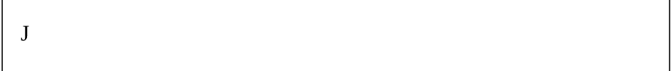
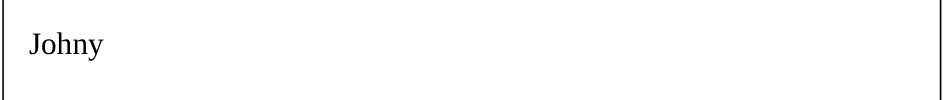
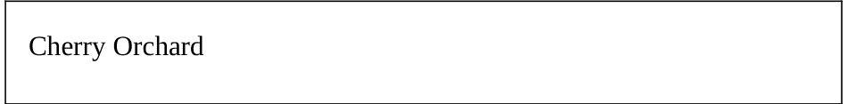
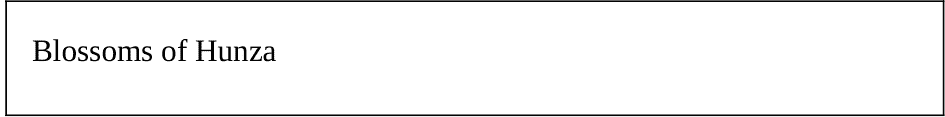
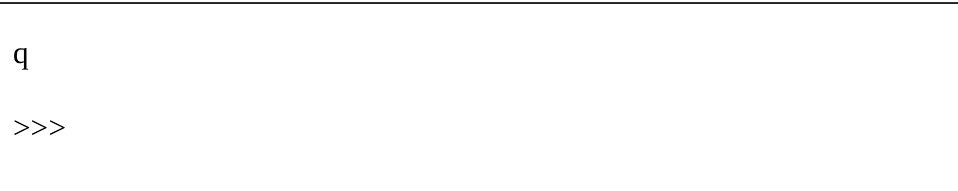

# 深度机器学习 3合1：全面初学者开发者指南 + 完整技巧与窍门 + 高级深度机器学习技术与方法指南（人工智能学习）


## 简介

这本关于人工智能的书包含了构建能够比人类工作更好的深度学习模型的经过验证的步骤和策略。曾几何时，我认为人工智能只是一个梦想，无需担心。随着时间的推移，尘埃落定，一切变得清晰明了，如流水般。然而，随着我长大，人工智能掌控了许多曾经属于人类领域的普通事物。这可以说是令人害怕的。

我最害怕和担心的事情之一是失去工作的恐惧。人们说，杂志文章渲染了人工智能将接管人类曾经拥有的工作的恐慌。一天晚上，我做了一个梦。我在梦中看到一家公司开发了一台巨型机器人，用于搬运重型钢材来建造桥梁。这台名为Humongousteel的机器人非常巨大，需要二十个人垂直排成一排才能与其身高相匹配。梦中每个人都很高兴，因为机器人通过减轻重负担，让人类的工作变得轻松。Humongousteel由人工智能系统驱动，这些系统根据人类程序员的指令行动。

Humongousteel的主要工作是从仓库拾取钢材并将其运往即将建造桥梁的工地。Humongousteel由十几个人控制，他们会在工地协调其移动和动作。有一辆大拖车将Humongousteel从仓库运送到工地，Humongousteel在那里卸货并开始工作。可以说，当机器人开始工作时，工地景象壮观。它会搬运钢材并安装和连接它们。每个人都欣赏它，直到它在一个工地上出了差错。

有一天，Humongousteel在工地工作时，与原本用于接收指令的控制室失去了联系。我们预计机器人在与控制室恢复联系之前不会移动，但事实并非如此。联系从未丢失。其他东西接管了对Humongousteel的控制。这是我们的第一个假设。然而，后来揭示，为机器人提供动力的人工智能系统已经变得自主。机器人摧毁了它建造的桥梁，使工地一团糟。直到救援队到达并成功切断连接电池与神经系统的电源线后，机器人才得以控制。机器人被控制住后，每个人都松了一口气。梦结束了，我感谢上帝这只是一场梦。

从那天晚上开始，我开始研究人工智能系统，只是为了满足我的好奇心。自从我来到这个世界的那一天起，我就意识到人工智能系统并不可怕。它们不是来消除工作的，而是来促进创造性工作的。机器只能做我们命令它们做的事情。它们不会创造性地思考。创造力是人类与生俱来的。事情也应该保持这样。当机器做着枯燥的事情时，人类可以专注于创造性的事情，比如讲故事和塑造角色。

因此，这标志着我迈向人工智能系统之旅的开始。我学习了如何开发它们以及如何使用它们来减轻艰巨的任务。结果证明这很有趣。

这本书适合对人工智能感到好奇的人。人工智能系统由使用Python编程语言构建的深度学习模型支持。因此，如果你期待进入人工智能和机器学习的世界，你必须精通Python语言编写代码。

为了方便阅读，本书分为不同的章节，每个章节又进一步分为不同的章节，以便你能够快速浏览和轻松阅读。

本书的第一章涉及Python语言的基础知识。我将带你快速了解Python编程的基础知识，这是深度学习模型的基石。本章的第一部分将向你解释什么是Python变量，以及如何在编写不同程序时使用它们。这些变量是编程的基本特征，因为你需要使用它们来存储不同类型的信息，如文本、浮点数和整数。一旦存储了它们，你在开发实际程序时就可以稍后使用它们。我将专注于创建字符串变量和


在一组代码中使用它们。

本书的下一部分将阐述空格和语法错误的主题。最常见的语法错误是同时使用单引号和撇号。一旦你看到错误长什么样，你在编写程序时就能避免它们。本章的下一部分将阐述Python列表。我将向你解释列表长什么样。如何在Python中开发列表，Python列表的限制是什么，以及如何通过添加、删除和编辑列表中的元素来修改它。列表之所以出色，是因为它允许你向程序输入尽可能多的信息。你可以构建一个包含一百万个元素的列表，并且仍然能够在转瞬之间访问每个元素。我将陈述删除元素的不同方法。最常见且最有趣的方法是del方法和pop方法。同样，添加元素最有趣的方法是append方法和insert方法。本章以解释什么是Python元组以及如何创建和使用它来结束。

本书的第二章专注于Python的高级编程。本章的第一部分将重点介绍input()函数，在Python 2.7中它变成了raw_input()函数。这是最重要的学习内容，因为没有这个函数，你就无法邀请用户向特定程序输入你想要从他们那里获得的信息。你可以要求他们输入出生日期、姓名或电子邮件地址。这类程序需要input()函数。接下来是break关键字。我将解释如何使用break关键字在Python程序尚未运行完成时将其停止。本章的下一部分围绕Python函数展开。Python函数可以帮助你一次定义程序，然后以后使用，而无需再次经历编码过程。你只需要定义函数，填入参数，并输入参数值。

你可以在同一代码中的任何位置进行函数调用，并让函数运行完毕。这是编码最简单、也是最有效的方法。本章的下一部分也是最后一部分，回顾了什么是Python类以及如何创建它们。Python类是面向对象编程的构建块。它们用于创建现实生活中的对象，例如汽车、猫、狗和孔雀。在这本书中，我将创建一只孔雀，它会说出自己的名字和年龄，并在收到指令时站起来飞走。Python类是这门语言最精彩的功能，因为它们允许你创建复杂的程序。

在了解Python的突出特性后，下一章将带你了解什么是深度学习以及它如何影响世界。首先是对人工智能系统的简要解释。我将解释它们是什么，以及它们如何对我们周围的世界产生影响。本章的下一部分将解释什么是机器学习以及它如何影响世界。本书的下一部分涉及深度学习模型的解释。深度学习模型是赋予人工智能系统和机器学习模型生命的东西。我将在下一部分解释深度学习模型的工作原理，包括这些模型背后的驱动因素以及推动它们运行的机制。最重要的部分是解释深度学习模型与传统机器学习模型的区别。本章以对不同深度学习模型示例的详尽解释结束。这很有趣，因为你将了解深度学习模型为你周围的哪些系统提供动力。

本书的第四章涉及人工智能系统。在本章开始时，我将解释为什么你应该进入人工智能的世界。学习人工智能和机器学习就像让自己成为一名教师，教导机器以某种方式行事。这是关于使机器在其操作中高效且有效。在我深入解释人工智能之后，我将继续解释不同类型的人工智能。首先是人工窄智能，这是一种低级人工智能，特斯拉用于自动驾驶汽车，亚马逊用于驱动Alexa。第二个必须解释的是人工通用智能，这是一种更强大的人工智能版本，可以在不同工作领域超越人类。它们拥有非常接近人类的智能。最后是人工超智能，这目前仍是假设性的，但是最强大的人工智能形式。它能够在智能和完成不同任务方面超越人类。

下一章将为你提供人工智能及不同机器学习模型应用的全面视图。第一部分非常重要，因为它涉及人工智能在医疗保健领域的作用。我将解释人工智能如何帮助人们进行医学影像检查。人工智能系统不仅比人类系统更快，而且在交付结果方面也是最高效的。接下来是虚拟护士的构建和使用，这降低了疾病和细菌对患者的传播。它还使药物和医疗保健过程高度高效。然后我将解释人工智能如何帮助医疗专业人员进行靶向诊断，这是人类医疗专业人员尚未完美实现的事情。本章的下一部分阐述了人工智能如何帮助零售业的商人。这部分内容全面，因为它将帮助你了解如果在你的商业设施中安装人工智能系统，将由人工智能系统覆盖的不同部分。

人工智能系统的用途可能围绕库存准备、使用聊天机器人、销售流程个性化、客户参与、向客户提供实时对话支持、接收产品价格预测以便你调整价格，以及随意设置供应链。它还可以帮助零售企业消除对收银员的需求、进行视觉研究，以及设置人工智能模型的试衣间，以节省客户时间并增加产量。在下一部分，我将解释人工智能在银行业的重要性。你可以使用人工智能模型来检测金融交易中的欺诈。你也可以使用它来削减运营成本。在银行业使用人工智能的其他方面包括为客户服务提供动力。你可以使用人工智能模型来最小化风险，从而提高利润。你也可以使用人工智能模型为网上银行提供动力。毫无疑问，这将是一个快速模型。

本章的下一部分涉及人工智能在制造业中的应用。你可以使用人工智能模型在制造业中安装一个万无一失的质量控制系统。在人类检查员可能成为你预算负担且无法实现超高效率的地方，人工智能模型可以帮助你保持产品质量。人工智能系统还可以帮助你预测制造业中的故障。本章以对人工智能模型如何彻底改变旅游业的简要解释结束。你将学习如何使用人工智能模型来规划旅行、预订和获得帮助。

本书的第六章将向你解释在学习深度学习模型时可能遇到的一堆数学术语。第一个需要解释的术语是标量。我将解释的下一个术语是向量、矩阵、3D张量、数据集、图像和视频。在学完本章后，你将能够理解遇到的不同术语。

本书的第七章涉及构建人工神经网络。本书的第一部分关注人工神经网络的历史。我将以简洁扼要的方式追溯其起源，以便你的注意力集中在人工神经网络的要素上。本章的下一部分将阐述人工神经网络的解剖结构。我将详细介绍人工神经网络中的层是什么，以及损失函数是什么意思。接下来的话题是Keras，这是一个Python库，是构建人工神经网络的热门首选。我将解释如何构建深度学习工作站。接下来的话题是Jupyter Notebooks。不同类型的人工神经网络将被讨论。我将详细解释不同系统，例如多层感知机、循环神经网络、卷积神经网络和径向基函数神经网络。本章的最后一部分将详细解释人工神经网络应该应用在哪里。两个最受欢迎的应用是你可以在银行等金融机构中看到的签名验证系统，以及你可以在情报总部的保险库和密室中看到的语音识别系统。

倒数第二章涉及构建卷积神经网络。我将详细解释构建卷积层的过程，卷积层是卷积神经网络的构建块。我涵盖了构建卷积神经网络的逐步过程。该过程将以逐步格式阐述，代码将带有注释，解释代码中包含的内容。由于你有先前的


掌握Python编程语言知识，你应该能够看懂本节中的代码。你可以使用这些代码来构建一个系统。

本书的最后一章围绕商业智能的概念展开。我将解释什么是商业智能，以及它与机器学习和人工智能概念的相似之处。你将深入了解商业智能的流程。接着，我将介绍商业智能的不同功能。你将学习如何通过使用这些功能获益。随后，我将阐述商业智能的重要性。你将了解商业智能工作流程的基础架构。你还将学习当今谁在使用商业智能。本章最后全面解释了商业智能的不同优势。

我并不指望你精通Python编程才能阅读和理解这本书。你应该了解Python编程的基础知识。为方便使用，本书中包含了两章关于Python编程的内容。你可以利用这些知识来构建简单的面向对象编程，然后再着手构建深度学习模型。我建议你随身准备一本日记，记下每个重要知识点和你认为需要多练习的代码片段。一旦你在日记中记录了所有内容，就可以进入实践阶段。你练习得越多，构建程序以及理解深度学习模型的工作原理和优势的能力就越强。

应对这场深度学习热潮的最佳方法是，在打开计算机操作系统的同时阅读本书，以便你能够练习和研究遇到的任何有趣内容。别忘了在系统上安装Python 2.7或Python 3。本书中的大部分代码是用Python 2.7编写的。在Python 2.7和Python 3之间存在代码差异的地方，我都已注明。安装这两个版本将帮助你理解其中的细微差别。

## 第一章

### Python基础

本章将带你了解Python编程的基础知识，因为你需要这些知识来使用深度学习技术构建人工智能和机器学习模型。Python是深度学习模型的基础。第一步是检查你的计算机系统上是否已安装Python。如果没有，你需要在计算机操作系统上安装一个Python编辑器。文本编辑器是动态的，它们能识别Python代码，并在你编写时高亮显示不同部分。这使得理解代码结构变得容易。

第一步是了解Python环境。Python在不同操作系统上可能略有不同。通常，市面上有两个可用的Python版本。Python 2和Python 3在不同系统上很容易识别。Python仍在不断演进，因为每种编程语言都在随着新理念和新技术的不断涌现而发展。Python的开发者使这种语言变得强大且更加通用。大多数更改都被认为几乎不可察觉。随着操作系统的发展，较旧的Python版本（如Python 2）可能不如最新的Python 3功能完善。如果你的系统上预安装了这两个版本，建议使用Python 3。

Python 3中有一个解释器，也称为终端窗口。这允许你在不先保存然后运行程序的情况下尝试不同版本的Python。

Python是一种跨平台语言，这意味着你可以根据需要在不同操作系统上运行它。Windows不预装Python，因此你需要下载它并在系统上安装。完成后，你还需要下载并安装文本编辑器。

你需要检查系统上是否已安装Python。打开命令窗口并在“开始”菜单中输入命令。在终端窗口中输入小写的python。如果看到以下提示>>>，则表示系统上已安装Python。如果系统上未安装Python，屏幕上可能会显示错误消息。

如果系统上没有预安装Python，你需要访问www.python.org下载并安装Python。打开网站后，会有一系列可供下载的Python版本。选择你想在系统上安装的版本并点击下载。文件下载到系统后，应启动安装过程。你还应确保在安装过程结束时勾选“Add Python to PATH”选项。这将使系统上的配置过程变得轻松顺畅。

#### Python变量

在本节中，你将学习Python程序中可处理的不同数据类型。你还将学习将数据存储在变量中的过程以及如何在程序中使用变量。Python最基本的特性之一是变量。在以下代码中，我将在Python中创建一个变量并为其赋值。

```
>>> x = " I am reading a book on deep learning techniques to build AI models."
>>> print(x)
I am reading a book on deep learning techniques to build AI models.
>>>
```

当我打印程序时，我分配给变量‘x’的同一行内容在我的计算机屏幕上显示出来。Python中的每个变量都保存着某个值，基本上就是与该变量关联的信息。现在我将进入Python编辑器，你将在那里进行实际编码。我将使用相同的变量和值，同时创建一个新变量并为其分配另一个值，以查看Python如何处理它们。

```python
x = " I am reading a book on deep learning techniques to build AI models."
y = " AI is revolutionizing different fields in the business world."
print (x)
print (y)
>>> ================= RESTART =================
>>>
I am reading a book on deep learning techniques to build AI models.
AI is revolutionizing different fields in the business world.
>>> 
```

你可以通过“文件”菜单点击“新建”来启动Python编辑器。将弹出一个新窗口，你可以将其用作Python编辑器。你可以在编辑器中编写代码，然后通过键盘上的F5按钮保存并运行它。代码结果将在Python IDLE屏幕上显示。

在使用Python变量时，你需要遵循一些指南和规则。如果违反其中一些规则，将会导致错误。其他指南将帮助你编写更易于阅读和理解的整洁代码。请确保遵循变量命名规则。变量名可以包含数字、字母和下划线。它们可以以下划线或字母开头，但绝不能以数字开头。例如，你可以将变量命名为x_1，但不能命名为1_x。变量名中不允许有额外的空格。但是，应使用下划线来分隔不同变量名中的单词。例如，x 1不应作为任何变量的名称。你必须避免使用Python中固有的关键字。例如，单词print是Python固有的。变量名必须简短，但应具有描述性。例如，如果你要创建一个描述学生的变量，必须写出完整的单词，而不是只写单词‘s’。Python变量应使用小写，不过即使使用大写字母命名也不会触发错误。最好尽可能避免使用大写字母。

#### 数据类型

大多数程序会定义和收集不同种类的数据，然后有目的地使用它们。这使你能够对不同种类的数据进行分类。我将讨论的第一种数据类型称为字符串。字符串乍看之下非常简单。字符串是字符形式。任何包含在单引号或双引号内的内容都称为字符串。

```
x = " I am reading a book on deep learning techniques to build AI models."
y = ' AI is revolutionizing different fields in the business world.'
print (x)
print (y)
>>> ================= RESTART =================
>>> 
I am reading a book on deep learning techniques to build AI models.
```


```
AI is revolutionizing different fields in the business world.
>>>
```

字符串中最简单的操作之一就是更改字符串中不同单词的大小写。请查看以下代码，并尝试确定如何更改不同单词和短语的大小写。

```python
x = " I am reading a book on deep learning techniques to build AI
models."

y = ' AI is revolutionizing different fields in the business world.'

print(x.upper())

print(y.title())

print(x.lower())
```

>>> ================= RESTART =================
============================================================
>>>

I AM READING A BOOK ON DEEP LEARNING TECHNIQUES TO
BUILD AI MODELS.

Ai Is Revolutionizing Different Fields In The Business World.

i am reading a book on deep learning techniques to build ai models.
>>>

你可以看到，我使用了三种方法来更改字符串的大小写。在编写代码和构建程序时，你可以对任何变量这样做。Python 中的方法是 Python 对某段数据执行的一种操作。每个方法都有一组需要遵循的参数，因为方法偶尔需要额外信息来完成工作。然后在括号内提供这些额外信息。title() 方法将字符串转换为标题大小写格式。Python 允许简单地连接不同的字符串。由于我们有两个字符串，可以使用简单的数学运算（即‘+’号）轻松将它们合并。请看具体做法。

```python
x = " I am reading a book on deep learning techniques to build AI
models."

y = ' AI is revolutionizing different fields in the business world.'

xy = x + " " + y

print(xy)
```

>>> ================= RESTART =================
==============================================
>>> 
I am reading a book on deep learning techniques to build AI models.
AI is revolutionizing different fields in the business world.
>>>

我们可以使用标题大小写方法来格式化字符串连接的结果。请看以下代码片段。

```python
x = " I am reading a book on deep learning techniques to build AI
models."
y = ' AI is revolutionizing different fields in the business world.'

xy = x + " " + y

print(xy.title())
print(xy.upper())
print(xy.lower())
```

>>> ================= RESTART =================
==============================================
>>> 
I Am Reading A Book On Deep Learning Techniques To Build Ai
Models. Ai Is Revolutionizing Different Fields In The Business World.

I AM READING A BOOK ON DEEP LEARNING TECHNIQUES TO
BUILD AI MODELS. AI IS REVOLUTIONIZING DIFFERENT
FIELDS IN THE BUSINESS WORLD.

i am reading a book on deep learning techniques to build ai models. ai
is revolutionizing different fields in the business world.
>>>

### 空白字符

你可以向制表符、空格和行尾符号添加空白字符。空白字符可以帮助你更轻松地组织输出，并使其易于理解。

```python
x = " \tI am reading a book on deep learning techniques to build AI models."
y = ' \nAI is revolutionizing different fields\n in the business world.'
print(x)
print(y)
>>> ================================ RESTART
============================================
>>>
I am reading a book on deep learning techniques to build AI models.

AI is revolutionizing different fields
in the business world.
>>>
```

### 语法错误

你可能会遇到的最常见的错误类型之一是语法错误。当 Python 无法将程序的某个部分识别为有效的 Python 代码时，通常会发生语法错误。例如，如果你在单引号内使用撇号，就会触发错误，因为 Python 会将带有撇号的所有内容视为字符串。

```python
x = " I am reading Tony's book on deep learning techniques to build AI
models."
y = 'AI progress is revolutionizing different fields in the business
world.'

print(x)
print(y)

>>> ================= RESTART
============================================
>>>

I am reading Tony's book on deep learning techniques to build AI
models.

AI progress is revolutionizing different fields in the business world.

>>>
```

你可能会认为结果中没有错误消息。这是因为如果对字符串使用双引号，然后使用撇号，一切都会正常。如果对字符串使用单引号，结果将是语法错误。

```python
x = ' I am reading Tony's book on deep learning techniques to build AI
models.'
y = 'AI' progress is revolutionizing different fields in the business
world.'
print(x)
print(y)
```

这段代码无论如何都无法运行。你也可以使用 Python IDLE 进行简单的数学计算。请看以下示例。

```python
>>> 2 + 2
4
>>> 2 * 2
4
>>> 2 / 2
1
>>> 2 - 2
0
>>> 42 % 2
0
>>>
```

由于 Python 中存在不同的数据类型，因此在编写代码时你很可能会遇到一些错误。更常见的是，你需要在消息中使用变量的值。例如，你可能想告诉别人数字形式的时间。你不能像写字符串那样直接写它。

```python
time = 11

themessage = "It is " + time + " . "

print(themessage)

>>> ================= RESTART =================
===============
>>> 
Traceback (most recent call last):
  File "C:/Users/saifia computers/Desktop/p", line 2, in <module>
themessage = "It is " + time + " . "
TypeError: cannot concatenate 'str' and 'int' objects
>>>
```

你将运行上面显示的错误代码。这被称为一种类型错误，意味着 Python 无法识别你所使用的信息形式。Python 看到你正在使用一个具有整数值（int）的变量。它不确定如何解释该值，因此返回错误。你需要先将数字转换为字符串，然后再运行代码。这个过程非常简单。

```python
time = 11

themessage = "It is " + str(time) + ". "

print(themessage)

>>> ================= RESTART =================
>>> =================

>>>

It is 11 .

>>>
```

### Python 列表

Python 中的列表是你可以按特定顺序组合在一起的项目集合。你可以创建一个包含不同字母、蔬菜和水果名称或其他家居物品的列表。列表中可以放入任何你想要的内容。在构建用于深度学习系统的数据库时，列表非常有用。你可以在数据库中放入多个列表并训练深度学习模型。方括号始终表示列表。请看如何创建一个列表。

```python
computer_accessories = ['mouse', 'keyboard', 'monitor', 'cables',
'charger', 'bluetooth connector', 'wi-fi', 'modem', 'internet', 'webcam']

print(computer_accessories)
```

>>> ================================ RESTART
===============================
>>>
['mouse', 'keyboard', 'monitor', 'cables', 'charger', 'bluetooth connector',
'wi-fi', 'modem', 'internet', 'webcam']
>>>

在 Python 中构建列表后，你可以通过使用索引号轻松访问列表中的不同元素。列表通常是有序的，列表中的每个项目都有一个索引。要访问特定元素，你需要先写出列表的名称，然后写出索引号。我将在以下代码片段中从同一个列表访问不同的项目。

```python
computer_accessories = ['mouse', 'keyboard', 'monitor', 'cables',
'charger', 'bluetooth connector', 'wi-fi', 'modem', 'internet', 'webcam']
print(computer_accessories[0])
print(computer_accessories[2])
print(computer_accessories[4])
print(computer_accessories[5])
print(computer_accessories[7])
print(computer_accessories[11])
>>> ================================ RESTART
===============================
>>>
mouse
monitor
charger
bluetooth connector
modem

Traceback (most recent call last):
  File "C:/Users/saifia computers/Desktop/p", line 7, in <module>
    print(computer_accessories[11])
IndexError: list index out of range
>>>
```

错误消息出现的唯一原因是我最后输入的索引号不属于列表中的任何元素。你可以在列表上应用不同的方法，根据你的特定需求格式化结果。

```python
computer_accessories = ['mouse', 'keyboard', 'monitor', 'cables',
'charger', 'bluetooth connector', 'wi-fi', 'modem', 'internet', 'webcam']

print(computer_accessories[0].title())

print(computer_accessories[2].title())
```


print (computer_accessories[4].lower())

print (computer_accessories[5].upper())

print (computer_accessories[7].upper())

>>> ================================ RESTART
============================================
>>>
Mouse
Monitor
charger
BLUETOOTH CONNECTOR
MODEM
>>>

您可以使用列表中的单个值。

```
computer_accessories = ['mouse', 'keyboard', 'monitor', 'cables',
'charger', 'bluetooth connector', 'wi-fi', 'modem', 'internet', 'webcam']

x = "I will have to buy from the computer market a " +
computer_accessories[2].title() + "."

print (x)
```

```
x = "I will have to buy from the computer market a " +
computer_accessories[0].title() + "."

print (x)
```

```
x = "I will have to buy from the computer market a " +
computer_accessories[3].title() + "."

print (x)
```

```
x = "I will have to buy from the computer market a " +
computer_accessories[5].title() + "."

print (x)
```

```
x = "I will have to buy from the computer market a " +
computer_accessories[7].title() + "."

print (x)
```

>>> ================= RESTART =================
==============================
>>>

I will have to buy from the computer market a Monitor.
I will have to buy from the computer market a Mouse.
I will have to buy from the computer market a Cables.
I will have to buy from the computer market a Bluetooth Connector.

I will have to buy from the computer market a Modem.

### 修改

您可以通过向列表添加、更改和删除元素来修改列表。列表是动态的，因此您可以轻松构建它们，在程序运行过程中向其中添加元素并从中删除元素。例如，您可能能够创建一个游戏，其中玩家构建和销毁计算机配件。您可以将配件存储在列表中，并在玩家销毁配件时逐个删除。每次购买或构建一个时，它都会被添加到列表中。您可以通过在提及索引号后添加新元素来更改元素的值。

```
computer_accessories = ['mouse', 'keyboard', 'monitor', 'cables',
'charger', 'bluetooth connector', 'wi-fi', 'modem', 'internet', 'webcam']

print(computer_accessories)

computer_accessories[1] = 'biometric scanner'

print (computer_accessories)
>>> ================================ RESTART
================================
>>>
['mouse', 'keyboard', 'monitor', 'cables', 'charger', 'bluetooth connector',
'wi-fi', 'modem', 'internet', 'webcam']
['mouse', 'biometric scanner', 'monitor', 'cables', 'charger', 'bluetooth connector', 'wi-fi', 'modem', 'internet', 'webcam']
```

您也可以向列表添加元素。最简单的方法是使用 append 方法进行添加。使用此方法，您将项目追加到列表末尾。我将向同一列表添加项目。

```
computer_accessories = ['mouse', 'keyboard', 'monitor', 'cables',
'charger', 'bluetooth connector', 'wi-fi', 'modem', 'internet', 'webcam']
print(computer_accessories)
computer_accessories.append('biometric scanner')
print (computer_accessories)
computer_accessories.append('jockey')
print (computer_accessories)
computer_accessories.append('gaming keyboard')
print (computer_accessories)
computer_accessories.append('printer')
print (computer_accessories)
computer_accessories.append('scanner')
print (computer_accessories)
```

>>> ================= RESTART =================
==============================================
>>>

```
['mouse', 'keyboard', 'monitor', 'cables', 'charger', 'bluetooth connector',
'wi-fi', 'modem', 'internet', 'webcam']
```

```
['mouse', 'keyboard', 'monitor', 'cables', 'charger', 'bluetooth connector',
'wi-fi', 'modem', 'internet', 'webcam', 'biometric scanner']
```

```
['mouse', 'keyboard', 'monitor', 'cables', 'charger', 'bluetooth connector',
'wi-fi', 'modem', 'internet', 'webcam', 'biometric scanner', 'jockey']
```

```
['mouse', 'keyboard', 'monitor', 'cables', 'charger', 'bluetooth connector',
'wi-fi', 'modem', 'internet', 'webcam', 'biometric scanner', 'jockey',
'gaming keyboard']
```

```
['mouse', 'keyboard', 'monitor', 'cables', 'charger', 'bluetooth connector',
'wi-fi', 'modem', 'internet', 'webcam', 'biometric scanner', 'jockey',
'gaming keyboard', 'printer']
```

```
['mouse', 'keyboard', 'monitor', 'cables', 'charger', 'bluetooth connector',
'wi-fi', 'modem', 'internet', 'webcam', 'biometric scanner', 'jockey',
'gaming keyboard', 'printer', 'scanner']
```

append 方法是动态构建列表最简单的方法。您甚至可以从空列表开始，并相应地构建它。

```
computer_accessories = []

print(computer_accessories)

computer_accessories.append('biometric scanner')
print (computer_accessories)

computer_accessories.append('jockey')
print (computer_accessories)

computer_accessories.append('gaming keyboard')
print (computer_accessories)

computer_accessories.append('printer')
print (computer_accessories)

computer_accessories.append('scanner')
print (computer_accessories)
>>> ================================ RESTART ==============================
>>>
[]
['biometric scanner']
['biometric scanner', 'jockey']
['biometric scanner', 'jockey', 'gaming keyboard']
['biometric scanner', 'jockey', 'gaming keyboard', 'printer']
['biometric scanner', 'jockey', 'gaming keyboard', 'printer', 'scanner']
```

以这种方式构建列表很常见，因为有时您不知道在开始时需要向列表中填充什么数据。您会在构建程序的过程中了解这些。还有另一种方法可以向列表添加元素。这种方法称为 insert 方法，用于在特定索引处添加元素。

```
computer_accessories = ['mouse', 'keyboard', 'monitor', 'cables',
'charger', 'bluetooth connector', 'wi-fi', 'modem', 'internet', 'webcam']
print(computer_accessories)

computer_accessories.insert(0, 'biometric scanner')
print (computer_accessories)

computer_accessories.insert(2, 'jockey')
print (computer_accessories)

computer_accessories.insert(4, 'gaming keyboard')
print (computer_accessories)

computer_accessories.insert(6, 'printer')
print (computer_accessories)

computer_accessories.insert(8, 'scanner')
print (computer_accessories)
```

>>> ================= RESTART =================
========================================
>>>

```
['mouse', 'keyboard', 'monitor', 'cables', 'charger', 'bluetooth connector',
'wi-fi', 'modem', 'internet', 'webcam']
```

```
['biometric scanner', 'mouse', 'keyboard', 'monitor', 'cables', 'charger',
'bluetooth connector', 'wi-fi', 'modem', 'internet', 'webcam']
```

```
['biometric scanner', 'mouse', 'jockey', 'keyboard', 'monitor', 'cables',
'charger', 'bluetooth connector', 'wi-fi', 'modem', 'internet', 'webcam']
```

```
['biometric scanner', 'mouse', 'jockey', 'keyboard', 'gaming keyboard',
'monitor', 'cables', 'charger', 'bluetooth connector', 'wi-fi', 'modem',
'internet', 'webcam']
```

```
['biometric scanner', 'mouse', 'jockey', 'keyboard', 'gaming keyboard',
'monitor', 'printer', 'cables', 'charger', 'bluetooth connector', 'wi-fi',
'modem', 'internet', 'webcam']
```

```
['biometric scanner', 'mouse', 'jockey', 'keyboard', 'gaming keyboard',
'monitor', 'printer', 'cables', 'scanner', 'charger', 'bluetooth connector',
'wi-fi', 'modem', 'internet', 'webcam']
```

正如您可以向列表添加元素一样，您也可以删除元素。例如，如果玩家销毁一个配件，您可以编程让游戏从列表中删除该元素，使其不再出现在屏幕上。

如果您知道列表中元素的位置，可以使用 del 语句将其从列表中删除。请参见以下示例。

```
computer_accessories = ['mouse', 'keyboard', 'monitor', 'cables',
'charger', 'bluetooth connector', 'wi-fi', 'modem', 'internet', 'webcam']
print(computer_accessories)
del computer_accessories[0]
print (computer_accessories)


```
del computer_accessories[2]
print(computer_accessories)
```

```
del computer_accessories[5]
print(computer_accessories)
```

```
del computer_accessories[6]
print(computer_accessories)
```

```
del computer_accessories[7]
print(computer_accessories)
```

>>> ================= RESTART =================
===============================================
>>>
['mouse', 'keyboard', 'monitor', 'cables', 'charger', 'bluetooth connector',
'wi-fi', 'modem', 'internet', 'webcam']
['keyboard', 'monitor', 'cables', 'charger', 'bluetooth connector', 'wi-fi',
'modem', 'internet', 'webcam']
['keyboard', 'monitor', 'charger', 'bluetooth connector', 'wi-fi', 'modem',
'internet', 'webcam']
['keyboard', 'monitor', 'charger', 'bluetooth connector', 'wi-fi', 'internet',
'webcam']

['keyboard', 'monitor', 'charger', 'bluetooth connector', 'wi-fi', 'internet']

Traceback (most recent call last):
  File "C:/Users/saifia computers/Desktop/p", line 16, in <module>
    del computer_accessories[7]
IndexError: list assignment index out of range
>>>

如果你输入的索引因删除元素而超出范围，就会看到类似于代码底部所示的错误消息。之前索引 7 是有效的，但由于我从中删除了元素，它不再有效。

还有一种广为人知的方法叫做 pop() 方法，用于从列表中删除项目。有时你需要在从列表中删除某个元素后使用该元素的值。在这种情况下，你可以使用 pop() 方法。例如，玩家需要回忆哪些元素已被销毁，因此可以使用 pop() 方法而不是 del() 方法。pop() 方法将列表视为一堆项目。每次使用该方法时，列表顶部的一个项目会被弹出。这样栈就会变空。

```
computer_accessories = ['mouse', 'keyboard', 'monitor', 'cables',
'charger', 'bluetooth connector', 'wi-fi', 'modem', 'internet', 'webcam']

print(computer_accessories)

popped_computer_accessories = computer_accessories.pop()
print(computer_accessories)
print(popped_computer_accessories)

popped_computer_accessories = computer_accessories.pop()
print(computer_accessories)
print(popped_computer_accessories)

popped_computer_accessories = computer_accessories.pop()
print(computer_accessories)
print(popped_computer_accessories)

popped_computer_accessories = computer_accessories.pop()
print(computer_accessories)
print(popped_computer_accessories)

popped_computer_accessories = computer_accessories.pop()
print(computer_accessories)
print(popped_computer_accessories)

popped_computer_accessories = computer_accessories.pop()
print(computer_accessories)
print(popped_computer_accessories)

popped_computer_accessories = computer_accessories.pop()
print(computer_accessories)
print(popped_computer_accessories)

popped_computer_accessories = computer_accessories.pop()
print(computer_accessories)
print(popped_computer_accessories)

popped_computer_accessories = computer_accessories.pop()
print(computer_accessories)
print(popped_computer_accessories)

popped_computer_accessories = computer_accessories.pop()
print(computer_accessories)
print(popped_computer_accessories)
```

>>> ================= RESTART =================
==============================================
>>>
['mouse', 'keyboard', 'monitor', 'cables', 'charger', 'bluetooth connector',
'wi-fi', 'modem', 'internet', 'webcam']
['mouse', 'keyboard', 'monitor', 'cables', 'charger', 'bluetooth connector',
'wi-fi', 'modem']
webcam
['mouse', 'keyboard', 'monitor', 'cables', 'charger', 'bluetooth connector',
'wi-fi', 'modem']
internet
['mouse', 'keyboard', 'monitor', 'cables', 'charger', 'bluetooth connector',
'wi-fi']
modem
['mouse', 'keyboard', 'monitor', 'cables', 'charger', 'bluetooth connector']
wi-fi
['mouse', 'keyboard', 'monitor', 'cables', 'charger']
bluetooth connector
['mouse', 'keyboard', 'monitor', 'cables']
charger
['mouse', 'keyboard', 'monitor']
cables
['mouse', 'keyboard']
monitor
['mouse']
keyboard
[]
mouse
Traceback (most recent call last):
  File "C:/Users/saifia computers/Desktop/p", line 45, in <module>
    popped_computer_accessories = computer_accessories.pop()
IndexError: pop from empty list
>>>

你也可以使用 pop() 方法从列表中的任何位置删除项目。请看具体做法。

```
computer_accessories = ['mouse', 'keyboard', 'monitor', 'cables',
'charger', 'bluetooth connector', 'wi-fi', 'modem', 'internet', 'webcam']

print(computer_accessories)

popped_computer_accessories = computer_accessories.pop(1)

print(computer_accessories)

print(popped_computer_accessories)

popped_computer_accessories = computer_accessories.pop(4)

print(computer_accessories)

print(popped_computer_accessories)

popped_computer_accessories = computer_accessories.pop(2)

print(computer_accessories)

print(popped_computer_accessories)

popped_computer_accessories = computer_accessories.pop(0)

print(computer_accessories)

print(popped_computer_accessories)
>>> ================ RESTART
>>>
['mouse', 'keyboard', 'monitor', 'cables', 'charger', 'bluetooth connector',
'wi-fi', 'modem', 'internet', 'webcam']
['mouse', 'monitor', 'cables', 'charger', 'bluetooth connector', 'wi-fi',
'modem', 'internet', 'webcam']
keyboard
['mouse', 'monitor', 'cables', 'charger', 'wi-fi', 'modem', 'internet',
'webcam']
bluetooth connector
['mouse', 'monitor', 'charger', 'wi-fi', 'modem', 'internet', 'webcam']
cables
['monitor', 'charger', 'wi-fi', 'modem', 'internet', 'webcam']
mouse
>>>

从列表中删除项目的最后一种方法是使用 remove 方法。有时，你不知道要从列表中删除的特定元素的确切位置。在这种情况下，如果你知道某个项目的值，可以应用 remove() 方法来删除该项目。

```
computer_accessories = ['mouse', 'keyboard', 'monitor', 'cables',
'charger', 'bluetooth connector', 'wi-fi', 'modem', 'internet', 'webcam']
```

```
print(computer_accessories)

computer_accessories.remove('keyboard')
print(computer_accessories)

computer_accessories.remove('monitor')
print(computer_accessories)

computer_accessories.remove('mouse')
print(computer_accessories)
>>> 
['mouse', 'keyboard', 'monitor', 'cables', 'charger', 'bluetooth connector',
'wi-fi', 'modem', 'internet', 'webcam']
['mouse', 'monitor', 'cables', 'charger', 'bluetooth connector', 'wi-fi',
'modem', 'internet', 'webcam']
['mouse', 'cables', 'charger', 'bluetooth connector', 'wi-fi', 'modem',
'internet', 'webcam']
['cables', 'charger', 'bluetooth connector', 'wi-fi', 'modem', 'internet',
'webcam']
>>> 
```

你可以遍历列表来创建循环。

```
computer_accessories = ['mouse', 'keyboard', 'monitor', 'cables',
'charger', 'bluetooth connector', 'wi-fi', 'modem', 'internet', 'webcam']
print(computer_accessories)
```

```
for computer_accessory in computer_accessories:
    print(computer_accessory)
```

>>> ================= RESTART =================
==============================================

```
>>>
['mouse', 'keyboard', 'monitor', 'cables', 'charger', 'bluetooth connector',
'wi-fi', 'modem', 'internet', 'webcam']
mouse
keyboard
monitor
cables
charger
bluetooth connector
wi-fi
modem
internet
webcam
>>>
```

遍历列表可以让你做不同的事情。我将使用列表中的元素在玩家的电脑屏幕上显示一条消息。

```
computer_accessories = ['mouse', 'keyboard', 'monitor', 'cables',
'charger', 'bluetooth connector', 'wi-fi', 'modem', 'internet', 'webcam']

print(computer_accessories)

for computer_accessory in computer_accessories:
    print(computer_accessory.title() + " has been completely destroyed! It can never be rebuilt. ")
```

>>> ================= RESTART =================
===============================================
>>>
['mouse', 'keyboard', 'monitor', 'cables', 'charger', 'bluetooth connector',
'wi-fi', 'modem', 'internet', 'webcam']
Mouse has been completely destroyed! It can never be rebuilt.
Keyboard has been completely destroyed! It can never be rebuilt.
Monitor has been completely destroyed! It can never be rebuilt.


遍历列表可以使编码更加容易。

### 元组

元组与列表非常相似，区别在于元组一旦创建就不能更改。列表非常适合对项目进行排序。元组的外观与列表相同，区别在于元组使用圆括号而不是方括号。定义元组后，可以使用索引号访问单个元素。

```python
computer_accessories = ('mouse', 'keyboard', 'monitor', 'cables',
'charger', 'bluetooth connector', 'wi-fi', 'modem', 'internet', 'webcam')

print(computer_accessories)

for computer_accessory in computer_accessories:
    print(computer_accessory.title() + " has been completely destroyed!
It can never be rebuilt. ")
```

>>> ================= RESTART =================
===============================================

>>>

('mouse', 'keyboard', 'monitor', 'cables', 'charger', 'bluetooth connector',
'wi-fi', 'modem', 'internet', 'webcam')

Mouse has been completely destroyed! It can never be rebuilt.
Keyboard has been completely destroyed! It can never be rebuilt.
Monitor has been completely destroyed! It can never be rebuilt.
Cables has been completely destroyed! It can never be rebuilt.
Charger has been completely destroyed! It can never be rebuilt.
Bluetooth Connector has been completely destroyed! It can never be rebuilt.
Wi-Fi has been completely destroyed! It can never be rebuilt.
Modem has been completely destroyed! It can never be rebuilt.
Internet has been completely destroyed! It can never be rebuilt.
Webcam has been completely destroyed! It can never be rebuilt.

>>>

## 第二章

### 高级 Python 编程

编程还涉及一组条件。有时你需要测试不同的条件。if 语句允许你测试某些条件并做出正确响应。本章将带你深入学习 Python 的高级编程。你将学习编写 if 语句。你还将学习如何创建复杂语句。

```python
computer_accessories = ('mouse', 'keyboard', 'monitor', 'cables',
'charger', 'bluetooth connector', 'wi-fi', 'modem', 'internet', 'webcam')

print(computer_accessories)

for computer_accessory in computer_accessories:

    if computer_accessory == 'keyboard':

        print(computer_accessory.upper() + " has been completely
destroyed! It can never be rebuilt. ")

else:

    print(computer_accessory.title() + " has been completely
destroyed! It can never be rebuilt. ")
```

>>> ================================ RESTART
==============================

>>>

('mouse', 'keyboard', 'monitor', 'cables', 'charger', 'bluetooth connector',
'wi-fi', 'modem', 'internet', 'webcam')
Mouse has been completely destroyed! It can never be rebuilt.
KEYBOARD has been completely destroyed! It can never be rebuilt.
Monitor has been completely destroyed! It can never be rebuilt.
Cables has been completely destroyed! It can never be rebuilt.
Charger has been completely destroyed! It can never be rebuilt.
Bluetooth Connector has been completely destroyed! It can never be rebuilt.
Wi-Fi has been completely destroyed! It can never be rebuilt.
Modem has been completely destroyed! It can never be rebuilt.
Internet has been completely destroyed! It can never be rebuilt.
Webcam has been completely destroyed! It can never be rebuilt.
>>>

我将使用相同的元素列表，并使用 if-else 语句来测试不同的条件。

```python
computer_accessories = ('mouse', 'keyboard', 'monitor', 'cables',
'charger', 'bluetooth connector', 'wi-fi', 'modem', 'internet', 'webcam')

print(computer_accessories)

if 'mouse' in computer_accessories:
    print('destroying mouse')

if 'monitor' in computer_accessories:
    print('destroying monitor')

if "keyboard" in computer_accessories:
    print('destroying keyboard')
```

>>> ================= RESTART =================
==============================

>>>

('mouse', 'keyboard', 'monitor', 'cables', 'charger', 'bluetooth connector',
'wi-fi', 'modem', 'internet', 'webcam')

destroying mouse
destroying monitor
destroying keyboard

>>>

请参见包含 if-else 语句的以下示例。

```python
computer_accessories = ('mouse', 'keyboard', 'monitor', 'cables',
'charger', 'bluetooth connector', 'wi-fi', 'modem', 'internet', 'webcam')

print(computer_accessories)

for computer_accessory in computer_accessories:
    if computer_accessory == 'mouse':
        print('Mouse has been destroyed.')
    else:
        print('Destroying ' + computer_accessory + '.')

print ('\n I have destroyed everything.')
```

>>> ================= RESTART =================
-----------------------------------------------
>>> 
('mouse', 'keyboard', 'monitor', 'cables', 'charger', 'bluetooth connector',
'wi-fi', 'modem', 'internet', 'webcam')
Mouse has been destroyed.
Destroying keyboard.

- Destroying monitor.
- Destroying cables.
- Destroying charger.
- Destroying bluetooth connector.
- Destroying wi-fi.
- Destroying modem.
- Destroying internet.
- Destroying webcam.
- I have destroyed everything.
- >>>

#### Raw_Input() 函数

这也是 Python 世界中最重要的函数之一。有些程序要求你从最终用户那里获取输入。此函数可以帮助你完成此操作。它会暂停程序，并等待用户输入一些信息。一旦接收到输入，它就会将其存储在变量中，以便程序员更方便地使用。以下程序将重复你输入的任何内容。请参见示例。

```python
prompt = "\nYou need to say something to me and I will repeat it for you:"
prompt += "\nYou must enter q if you want to exit out of this
program..."
themessage = ""
while themessage != 'q':
    themessage = raw_input(prompt)
    print(themessage)
```

>>> ================================ RESTART
===============================
>>>

You need to say something to me and I will repeat it for you:

You must enter q if you want to exit out of this program...



You need to say something to me and I will repeat it for you:

You must enter q if you want to exit out of this program....Johny



You need to say something to me and I will repeat it for you:

You must enter q if you want to exit out of this program....Lisa


You need to say something to me and I will repeat it for you:

You must enter q if you want to exit out of this program....Cherrypicking


You need to say something to me and I will repeat it for you:

You must enter q if you want to exit out of this program....Cherry Orchard



You need to say something to me and I will repeat it for you:

You must enter q if you want to exit out of this program....Blossoms of Hunza



You need to say something to me and I will repeat it for you:

You must enter q if you want to exit out of this program....q



请参见 Python 输入函数的另一个示例。上述代码运行良好，唯一的问题是它会打印出单词


q 作为实际消息的形式。通过添加一个简单的 if 语句，我们可以修复它。

```
prompt = "\nYou need to say something to me and I will repeat it for you:"
prompt += "\nYou must enter q if you want to exit out of this program....."

themessage = ""

while themessage != 'q':
    themessage = raw_input(prompt)

    if themessage != 'q':
        print(themessage)

>>> ================================ RESTART
=========================================
>>>
```

你需要对我说些什么，我会为你重复：
你必须输入 q 才能退出此程序....飞船

飞船

```
>>> ================================ RESTART
=========================================
>>>
You need to say something to me and I will repeat it for you:
You must enter q if you want to exit out of this program....starwars

starwars
```

你需要对我说些什么，我会为你重复：
你必须输入 q 才能退出此程序....彼得·潘

```
Peter Pan
```

你需要对我说些什么，我会为你重复：
你必须输入 q 才能退出此程序....宝岛

```
Treasure Island
```

你需要对我说些什么，我会为你重复：
你必须输入 q 才能退出此程序....神秘岛

```
The Mysterious Island
```

你需要对我说些什么，我会为你重复：
你必须输入 q 才能退出此程序....q

```
>>>
```

你可以看到结果完全整洁干净。只需输入 ‘q’ 即可退出程序。

```
name = raw_input("You need to enter your name: ")
print("Hello, " + name + " How are you doing! Will see you later")
>>> ================= RESTART =================
================================================
>>>
You need to enter your name: Jasmine
Hello, JasmineHow are you doing! Will see you later
>>> ================= RESTART =================
================================================
>>>
You need to enter your name: Jasmine
Hello, Jasmine How are you doing! Will see you later
>>> ================= RESTART =================
================================================
>>>
You need to enter your name: John
Hello, John How are you doing! Will see you later
>>> ================= RESTART =================
```

```
========================================
>>>
You need to enter your name: Lisa
Hello, Lisa How are you doing! Will see you later
>>> ======================================== RESTART
========================================
>>>
You need to enter your name: Amy
Hello, Amy How are you doing! Will see you later
>>>
```

如果你使用的是 Python 3，raw_input 函数将变成 input() 函数。

#### break 关键字

你可以在 while 循环中使用 break 关键字随时退出循环。break 语句控制程序的流程。你可以添加它来控制代码行，以查看哪些行被执行，哪些行未被执行。程序就这样只执行你希望它执行的代码。

```
prompt = "\nName the city you have been to:"
prompt += "\nYou must enter q if you want to exit out of this program...."
```

```
while True:
    themessage = raw_input(prompt)

    if themessage == 'q':
        break
    else:
        print("I'd plan to visit " + themessage.title() + "!")

>>> ================================ RESTART
==============================

>>>
```

你去过的城市是：
你必须输入 q 才能退出此程序....巴黎

我计划去巴黎！

你去过的城市是：
你必须输入 q 才能退出此程序....伦敦

我计划去伦敦！

你去过的城市是：
你必须输入 q 才能退出此程序....伊斯兰堡

```
I'd plan to visit Islamabad!
```

你去过的城市是：

你必须输入 q 才能退出此程序....孟买

```
I'd plan to visit Mumbai!
```

你去过的城市是：

你必须输入 q 才能退出此程序....里约热内卢

```
I'd plan to visit Rio De Janeiro!
```

你去过的城市是：

你必须输入 q 才能退出此程序....q

```
>>>
```

#### Python 函数

让我们使用 def 关键字创建一个简单的函数。

```
def greetings_user():
    print("Hello!")

greetings_user()
```

```
>>> ================================ RESTART
============================================
>>>
Hello!
>>>
```

函数具有某些参数和实参。参数通常在开始时定义，而实参随后传递给函数。

```
def describing_pet(animals_type, pets_name):
    print("\nI keep in my house a " + animals_type + ".")
    print("My " + animals_type + "'s is called " + pets_name.title() + ".")

describing_pet('horse', 'harry')
describing_pet('beaver', 'will')
describing_pet('cat', 'Tommy')
describing_pet('cow', 'Tin Tin')
>>> ================================ RESTART
============================================
>>>
I keep in my house a horse.
```

```
My horse's is called Harry.

I keep in my house a beaver.
My beaver's is called Will.

I keep in my house a cat.
My cat's is called Tommy.

I keep in my house a cow.
My cow's is called Tin Tin.

>>>
```

你可以看到，函数最好的地方在于你只需编写一次代码，然后就可以随意多次调用该函数。

#### Python 类

Python 中的类就像一个原型，帮助程序员从头构建对象。它们提供了将功能与数据配对的方式。每当你构建一个新类时，你就在构建一个对象，它可以是从人类到动物、鸟类或任何其他人造物体的任何东西。我将详细解释向类添加实例的概念，简单来说，这会给你的对象赋予一种精神。每个类实例都可以填充 Python 方法。

Python 类创建一个包含数据成员和不同函数的数据结构。你可以通过在类中构建实例来访问和使用它们。类中最重要的一点，就像 Python 的其他特性一样，是你不能使用 class 来命名类，因为它是 Python 的保留关键字。请妥善保留它。你可以使用属于类的不同属性。Python 类中的每个实例都代表一个对象。你可以说类是原始的，而实例是它的副本，但具有实际值。

类对象可能具有其独特的身份。它可能表现出一些行为特征。当你创建一个对象时，这个过程被称为实例化。你可以向 Python 类添加任意数量的实例。

你会在代码中发现一个名为 self 的参数。它是一个不需要值的额外参数。Python 已经定义了它的值，这使其与其他编程语言（如 Java 和 C++）相似。

在下一个代码示例中，你将看到一个名为 Peacock 的类。孔雀是现实生活中对象的模型。我将为它指定一个名称和年龄。你可以更改名称和外观来开发你自己选择的独特对象。你甚至可以更改类的名称。例如，你可以将其命名为 Beaver 或 Eagle。就像我将在实例中所做的那样，你可以定义你希望 Peacock 类拥有和显示的行为类型。我的孔雀将向你展示如何在接收到特定指令时站立和飞走。行为可以是任何事情，比如在地上打滚、在野外奔跑或自行进食。简而言之，你必须为它分配现实生活中对象具有的行为。规则没有定义。因此，如果你正在为动画系列创建程序，你可以给孔雀分配变色的行为。

```
class Peacock():

    """This is a simple try to build a model of a peacock."""

    def __init__(self, namep, agep):
        """This will initialize the name and age attributes."""
        self.namep = namep
        self.agep = agep

    def sit(self):
        """This will simulate a peacock standing in response to a
        particular command."""
        print(self.namep.title() + " is now standing.")

    def fly_away(self):
        """This will simulate flying over in response to a particular
        command."""
        print(self.namep.title() + " flew away!")

my_peacock = Peacock('timmy', 8)

print(" My peacock is named as " + my_peacock.namep.title() + ".")
print(" The peacock is of " + str(my_peacock.agep) + " years.")
```

```
>>> ================= RESTART =================
================================================
>>>

My peacock is named as Timmy.

The peacock is of 8 years.

>>>
```


让我们现在分析一下代码。你可以在代码中找到三个参数，即 namep 和 agep。这些变量可以起任何名字。你可以把它们叫作 n 和 a，不过，按照 Python 的惯例，使用全名会让你或其他程序员更容易阅读和理解代码。

Peacock 类还有另外两个方法，可以让孔雀站立和飞行。在代码末尾，你可以看到我创建的一个名为 Timmy 的孔雀实例。你可以创建任意多个实例来尝试下面的方法。请看下面的代码片段。

```
class Peacock():
    """This is a simple try to build a model of a peacock."""
    def __init__(self, namep, agep):
        """This will initialize the name and age attributes."""
        self.namep = namep
        self.agep = agep

    def sit(self):
        """This will simulate a peacock standing in response to a particular command."""
        print(self.namep.title() + " is now standing.")

    def fly_away(self):
        """This will simulate flying over in response to a particular command."""
        print(self.namep.title() + " flew away!")

my_peacock = Peacock('timmy', 8)
print(" My peacock is named as " + my_peacock.namep.title() + ".")
print(" The peacock is of " + str(my_peacock.agep) + " years.")

my_peacock1 = Peacock('Crazy', 5)
print(" My peacock is named as " + my_peacock.namep.title() + ".")
print(" The peacock is of " + str(my_peacock.agep) + " years.")

my_peacock = Peacock('Lucy', 2)
print(" My peacock is named as " + my_peacock.namep.title() + ".")
print(" The peacock is of " + str(my_peacock.agep) + " years.")

my_peacock = Peacock('Jack', 9)
print(" My peacock is named as " + my_peacock.namep.title() + ".")
print(" The peacock is of " + str(my_peacock.agep) + " years.")

>>> ================ RESTART ================
>>>
My peacock is named as Timmy.
The peacock is of 8 years.
My peacock is named as Timmy.
The peacock is of 8 years.
My peacock is named as Lucy.
The peacock is of 2 years.
My peacock is named as Jack.
The peacock is of 9 years.
>>>
```

在下一个代码片段中，我将向同一个类添加方法。我将让孔雀站立和飞行。请看下面的代码片段。

```
class Peacock():

    """This is a simple try to build a model of a peacock."""

    def __init__(self, namep, agep):

        """This will initialize the name and age attributes."""

        self.namep = namep

        self.agep = agep

    def stand(self):
        """This will simulate a peacock standing in response to a particular command."""
        print(self.namep.title() + " is now standing in the middle of the pond.")

    def fly_away(self):
        """This will simulate flying over in response to a particular command."""
        print(self.namep.title() + " is gearing up to fly away!")

my_peacock = Peacock('timmy', 8)
print(" My peacock is named as " + my_peacock.namep.title() + ".")
print(" The peacock is of " + str(my_peacock.agep) + " years.")
my_peacock.stand()
my_peacock.fly_away()

my_peacock1 = Peacock('Crazy', 5)
print(" My peacock is named as " + my_peacock.namep.title() + ".")
print(" The peacock is of " + str(my_peacock.agep) + " years.")
my_peacock1.stand()
my_peacock1.fly_away()

my_peacock2 = Peacock('Lucy', 2)
print(" My peacock is named as " + my_peacock.namep.title() + ".")
print(" The peacock is of " + str(my_peacock.agep) + " years.")

my_peacock2.stand()
my_peacock2.fly_away()

my_peacock3 = Peacock('Jack', 9)
print(" My peacock is named as " + my_peacock.namep.title() + ".")
print(" The peacock is of " + str(my_peacock.agep) + " years.")

my_peacock3.stand()
my_peacock3.fly_away()

>>> ================= RESTART =================
>>>
My peacock is named as Timmy.

The peacock is of 8 years.
Timmy is now standing in the middle of the pond.
Timmy is gearing up to fly away!
My peacock is named as Timmy.
The peacock is of 8 years.

Crazy is now standing in the middle of the pond.
Crazy is gearing up to fly away!
My peacock is named as Timmy.
The peacock is of 8 years.

Lucy is now standing in the middle of the pond.
Lucy is gearing up to fly away!
My peacock is named as Timmy.
The peacock is of 8 years.

Jack is now standing in the middle of the pond.
Jack is gearing up to fly away!
>>>
```

所有的孔雀都在按照我们的要求做同样的事情。

```
class Bike():

    """This is a simple attempt for the representation of a car."""

    def __init__(self, bmake, bmodel, byear):

        self.bmake = bmake

        self.bmodel = bmodel

        self.byear = byear

    def get_descriptive_bname(self):

        long_bname = str(self.byear) + ' ' + self.bmake + ' ' + self.bmodel

        return long_bname.title()


my_bike = Bike('bmw', 'z4', 2014)

print(my_bike.get_descriptive_bname())

>>> ================= RESTART =================
==============================================
>>>

2014 Bmw Z4

>>>
```

现在让我们向 Bike 类添加另一个属性，即 odometer_b_reading。这将帮助你读取自行车的里程表。

```
class Bike():
    """This is a simple attempt for the representation of a car."""
    def __init__(self, bmake, bmodel, byear):
        self.bmake = bmake
        self.bmodel = bmodel
        self.byear = byear
        self.odometer_b_reading = 0
    def get_descriptive_bname(self):
        long_bname = str(self.byear) + ' ' + self.bmake + ' ' + self.bmodel
        return long_bname.title()
    def reading_odometer(self):
        print("The heavy bike has " + str(self.odometer_b_reading) + " miles on the meter.")
```

my_bike = Bike('bmw', 'F 900 R', 2015)
print(my_bike.get_descriptive_bname())
my_bike.reading_odometer()

my_bike1 = Bike('bmw', 'F 900 XR', 2012)
print(my_bike.get_descriptive_bname())
my_bike1.reading_odometer()

my_bike2 = Bike('bmw', 'S 1000 R', 2019)
print(my_bike.get_descriptive_bname())
my_bike2.reading_odometer()

my_bike3 = Bike('bmw', 'S 1000 RR', 2010)
print(my_bike.get_descriptive_bname())
my_bike3.reading_odometer()

>>> ================= RESTART
=================
>>>
2015 Bmw F 900 R

The heavy bike has 0 miles on the meter.

2015 Bmw F 900 R

The heavy bike has 0 miles on the meter.

2019 Bmw S 1000 R

The heavy bike has 0 miles on the meter.

2010 Bmw S 1000 Rr

The heavy bike has 0 miles on the meter.

>>>

在下一个代码片段中，我将向类添加另一个函数。请看下面的代码片段。

```
class Bike():

    """This is a simple attempt for the representation of a car."""

    def __init__(self, bmake, bmodel, byear):

        self.bmake = bmake

        self.bmodel = bmodel

        self.byear = byear

        self.odometer_b_reading = 0

    def get_descriptive_bname(self):

        long_bname = str(self.byear) + ' ' + self.bmake + ' ' + self.bmodel
        return long_bname.title()

    def reading_odometer(self):

        print("The heavy bike has " + str(self.odometer_b_reading) + " miles on the meter.")

    def updating_odometer(self, bmileage):

        self.odometer_b_reading = bmileage


my_bike = Bike('bmw', 'F 900 R', 2015)
print(my_bike.get_descriptive_bname())
my_bike.updating_odometer(15)
my_bike.reading_odometer()


my_bike1 = Bike('bmw', 'F 900 XR', 2012)
print(my_bike.get_descriptive_bname())
my_bike1.updating_odometer(10)
my_bike1.reading_odometer()


my_bike2 = Bike('bmw', 'S 1000 R', 2019)
print(my_bike.get_descriptive_bname())
my_bike2.updating_odometer(22)
my_bike2.reading_odometer()


my_bike3 = Bike('bmw', 'S 1000 RR', 2010)
print(my_bike.get_descriptive_bname())
my_bike3.updating_odometer(25)
my_bike3.reading_odometer()

>>> ================= RESTART =================
==============================
>>>
2015 Bmw F 900 R
The heavy bike has 15 miles on the meter.
2015 Bmw F 900 R
The heavy bike has 10 miles on the meter.
2015 Bmw F 900 R
The heavy bike has 22 miles on the meter.
2015 Bmw F 900 R
The heavy bike has 25 miles on the meter.
>>>
```

你可以使用 updating_odometer () 方法在每次尝试修改里程表读数时执行额外工作。你可以向类添加另一个条件，以确保没有人可以回滚里程表读数。看看你可以如何做到这一点。

```
class Bike():

    """This is a simple attempt for the representation of a car."""

    def __init__(self, bmake, bmodel, byear):

        self.bmake = bmake

        self.bmodel = bmodel

        self.byear = byear

        self.odometer_b_reading = 0
```


```python
def get_descriptive_bname(self):

    long_bname = str(self.byear) + ' ' + self.bmake + ' ' + self.bmodel
    return long_bname.title()

def reading_odometer(self):
    print("The heavy bike has " + str(self.odometer_b_reading) + " miles on the meter.")

def updating_odometer(self, bmileage):
    self.odometer_b_reading = bmileage

    if bmileage >= self.odometer_b_reading:
        self.odometer_b_reading = bmileage

    else:

        print("Sorry, you are not allowed to roll back the odometer!")

my_bike = Bike('bmw', 'F 900 R', 2015)
print(my_bike.get_descriptive_bname())
my_bike.updating_odometer(15)
my_bike.reading_odometer()
```

```python
my_bike1 = Bike('bmw', 'F 900 XR', 2012)
print(my_bike.get_descriptive_bname())
my_bike1.updating_odometer(10)
my_bike1.reading_odometer()

my_bike2 = Bike('bmw', 'S 1000 R', 2019)
print(my_bike.get_descriptive_bname())
my_bike2.updating_odometer(22)
my_bike2.reading_odometer()

my_bike3 = Bike('bmw', 'S 1000 RR', 2010)
print(my_bike.get_descriptive_bname())
my_bike3.updating_odometer(25)
my_bike3.reading_odometer()

>>> ================= RESTART =================
==============================
>>>

2015 Bmw F 900 R
```

这辆重型摩托车的里程表上显示 15 英里。

2015 Bmw F 900 R

这辆重型摩托车的里程表上显示 10 英里。

2015 Bmw F 900 R

这辆重型摩托车的里程表上显示 22 英里。

2015 Bmw F 900 R

这辆重型摩托车的里程表上显示 25 英里。

>>>

你可以通过向代码片段添加另一个方法来增加属性的值。请参阅以下代码示例。

```python
class Bike():

    """This is a simple attempt for the representation of a car."""

    def __init__(self, bmake, bmodel, byear):

        self.bmake = bmake

        self.bmodel = bmodel

        self.byear = byear

        self.odometer_b_reading = 0

    def get_descriptive_bname(self):

        long_bname = str(self.byear) + ' ' + self.bmake + ' ' + self.bmodel
        return long_bname.title()

    def reading_odometer(self):

        print("The heavy bike has " + str(self.odometer_b_reading) + " miles on the meter.")

    def updating_odometer(self, bmileage):

        self.odometer_b_reading = bmileage

        if bmileage >= self.odometer_b_reading:

            self.odometer_b_reading = bmileage

        else:

            print("Sorry, you are not allowed to roll back the odometer!")

    def increment_b_odometer(self, bmiles):

        self.odometer_b_reading += bmiles
```

```python
my_bike = Bike('bmw', 'F 900 R', 2015)
print(my_bike.get_descriptive_bname())
my_bike.updating_odometer(25500)
my_bike.reading_odometer()
my_bike.increment_b_odometer(150)
my_bike.reading_odometer()

my_bike1 = Bike('bmw', 'F 900 XR', 2012)
print(my_bike.get_descriptive_bname())
my_bike1.updating_odometer(10)
my_bike1.reading_odometer()
my_bike1.increment_b_odometer(100)
my_bike1.reading_odometer()

my_bike2 = Bike('bmw', 'S 1000 R', 2019)
print(my_bike.get_descriptive_bname())
my_bike2.updating_odometer(22)
my_bike2.reading_odometer()

my_bike2.reading_odometer()
my_bike2.increment_b_odometer(250)
my_bike2.reading_odometer()
my_bike3 = Bike('bmw', 'S 1000 RR', 2010)
print(my_bike.get_descriptive_bname())
my_bike3.updating_odometer(25)
my_bike3.reading_odometer()
my_bike3.reading_odometer()
my_bike3.increment_b_odometer(500)
my_bike3.reading_odometer()
>>> ================================ RESTART ================================
==============================================================
>>>
2015 Bmw F 900 R
The heavy bike has 25500 miles on the meter.
The heavy bike has 25650 miles on the meter.
2015 Bmw F 900 R
The heavy bike has 10 miles on the meter.
The heavy bike has 110 miles on the meter.
2015 Bmw F 900 R
The heavy bike has 22 miles on the meter.
The heavy bike has 22 miles on the meter.
The heavy bike has 272 miles on the meter.
2015 Bmw F 900 R
The heavy bike has 25 miles on the meter.
The heavy bike has 25 miles on the meter.
The heavy bike has 525 miles on the meter.
>>>
```

你可以使用这种方法来控制用户如何更新值，就像更新里程表的值一样。不同的函数将允许你在下面所示的一些基本检查之外，极其注重细节。在下一节中，我将解释什么是子类，以及如何在编写不同的复杂程序中使用它。我将使用相同的基类，并为其创建不同的子类。

```python
class Bike():

    """This is a simple attempt for the representation of a car."""

    def __init__(self, bmake, bmodel, byear):

        self.bmake = bmake

        self.bmodel = bmodel

        self.byear = byear

        self.odometer_b_reading = 0

    def get_descriptive_bname(self):

        long_bname = str(self.byear) + ' ' + self.bmake + ' ' + self.bmodel
        return long_bname.title()

    def reading_odometer(self):

        print("The heavy bike has " + str(self.odometer_b_reading) + " miles on the meter.")

    def updating_odometer(self, bmileage):

        self.odometer_b_reading = bmileage

        if bmileage >= self.odometer_b_reading:

            self.odometer_b_reading = bmileage

        else:

            print("Sorry, you are not allowed to roll back the odometer!")

    def increment_b_odometer(self, bmiles):
        self.odometer_b_reading += bmiles

class HeavyBike(Bike):
    def __init__(self, bmake, bmodel, byear):
        super(HeavyBike, self).__init__(bmake, bmodel, byear)

my_bmw = HeavyBike('bmw', 'R600', 2012)
print(my_bmw.get_descriptive_bname())

my_bike = Bike('bmw', 'F 900 R', 2015)
print(my_bike.get_descriptive_bname())
my_bike.updating_odometer(25500)
my_bike.reading_odometer()
my_bike.increment_b_odometer(150)
my_bike.reading_odometer()

my_bike1 = Bike('bmw', 'F 900 XR', 2012)
print(my_bike.get_descriptive_bname())
my_bike1.updating_odometer(10)
my_bike1.reading_odometer()
my_bike1.increment_b_odometer(100)
my_bike1.reading_odometer()

my_bike2 = Bike('bmw', 'S 1000 R', 2019)
print(my_bike.get_descriptive_bname())

my_bike2.updating_odometer(22)
my_bike2.reading_odometer()

my_bike2.reading_odometer()
my_bike2.increment_b_odometer(250)
my_bike2.reading_odometer()

my_bike3 = Bike('bmw', 'S 1000 RR', 2010)
print(my_bike.get_descriptive_bname())

my_bike3.updating_odometer(25)
my_bike3.reading_odometer()

my_bike3.reading_odometer()
my_bike3.increment_b_odometer(500)
my_bike3.reading_odometer()
```

```
>>>
= RESTART: C:/Users/saifia
computers/AppData/Local/Programs/Python/Python38/q.py
```

2012 Bmw R600
2015 Bmw F 900 R
这辆重型摩托车的里程表上显示 25500 英里。
这辆重型摩托车的里程表上显示 25650 英里。
2015 Bmw F 900 R
这辆重型摩托车的里程表上显示 10 英里。
这辆重型摩托车的里程表上显示 110 英里。
2015 Bmw F 900 R
这辆重型摩托车的里程表上显示 22 英里。
这辆重型摩托车的里程表上显示 22 英里。
这辆重型摩托车的里程表上显示 272 英里。
2015 Bmw F 900 R

这辆重型摩托车的里程表上显示 25 英里。
这辆重型摩托车的里程表上显示 25 英里。
这辆重型摩托车的里程表上显示 525 英里。
>>>

我将向子类添加另一个属性，以告知用户电池的大小。请参阅以下代码片段。

```python
class Bike():
    """This is a simple attempt for the representation of a car."""

    def __init__(self, bmake, bmodel, byear):
        self.bmake = bmake
        self.bmodel = bmodel
        self.byear = byear
        self.odometer_b_reading = 0

    def get_descriptive_bname(self):
        long_bname = str(self.byear) + ' ' + self.bmake + ' ' + self.bmodel
        return long_bname.title()

    def reading_odometer(self):
        print("The heavy bike has " + str(self.odometer_b_reading) + " miles on the meter.")

    def updating_odometer(self, bmileage):
        self.odometer_b_reading = bmileage

        if bmileage >= self.odometer_b_reading:
            self.odometer_b_reading = bmileage
        else:
            print("Sorry, you are not allowed to roll back the odometer!")

    def increment_b_odometer(self, bmiles):
        self.odometer_b_reading += bmiles

class HeavyBike(Bike):
    def __init__(self, bmake, bmodel, byear):
        super(HeavyBike, self).__init__(bmake, bmodel, byear)
        self.battery_size = 100
```


```python
def describing_battery(self):
    print("This heavybike also has a " + str(self.battery_size) + " - kwh battery.")

my_bmw = HeavyBike('bmw', 'R600', 2012)
print(my_bmw.get_descriptive_bname())
my_bmw.describing_battery()

my_bike = Bike('bmw', 'F 900 R', 2015)
print(my_bike.get_descriptive_bname())
my_bike.updating_odometer(25500)
my_bike.reading_odometer()
my_bike.increment_b_odometer(150)
my_bike.reading_odometer()

my_bike1 = Bike('bmw', 'F 900 XR', 2012)
print(my_bike.get_descriptive_bname())
my_bike1.updating_odometer(10)
my_bike1.reading_odometer()
my_bike1.increment_b_odometer(100)
my_bike1.reading_odometer()

my_bike2 = Bike('bmw', 'S 1000 R', 2019)
print(my_bike.get_descriptive_bname())
my_bike2.updating_odometer(22)
my_bike2.reading_odometer()
my_bike2.reading_odometer()
my_bike2.increment_b_odometer(250)
my_bike2.reading_odometer()

my_bike3 = Bike('bmw', 'S 1000 RR', 2010)
print(my_bike.get_descriptive_bname())

my_bike3.updating_odometer(25)
my_bike3.reading_odometer()
my_bike3.reading_odometer()
my_bike3.increment_b_odometer(500)
```

= RESTART: C:/Users/saifia
computers/AppData/Local/Programs/Python/Python38/q.py
2012 Bmw R600
这辆重型摩托车还配备了一块 100 -kwh 的电池。
2015 Bmw F 900 R
这辆重型摩托车的里程表显示 25500 英里。
这辆重型摩托车的里程表显示 25650 英里。
2015 Bmw F 900 R
这辆重型摩托车的里程表显示 10 英里。
这辆重型摩托车的里程表显示 110 英里。
2015 Bmw F 900 R
这辆重型摩托车的里程表显示 22 英里。
这辆重型摩托车的里程表显示 22 英里。
这辆重型摩托车的里程表显示 272 英里。
2015 Bmw F 900 R
这辆重型摩托车的里程表显示 25 英里。

这辆重型摩托车的里程表显示 25 英里。

这辆重型摩托车的里程表显示 525 英里。

>>>

现在我将添加另一个类和属性，以使程序更加复杂。

```python
class Bike():

    """This is a simple attempt for the representation of a car."""

    def __init__(self, bmake, bmodel, byear):

        self.bmake = bmake

        self.bmodel = bmodel

        self.byear = byear

        self.odometer_b_reading = 0

    def get_descriptive_bname(self):

        long_bname = str(self.byear) + ' ' + self.bmake + ' ' + self.bmodel

        return long_bname.title()

    def reading_odometer(self):
        print("The heavy bike has " + str(self.odometer_b_reading) + " miles on the meter.")

    def updating_odometer(self, bmileage):
        self.odometer_b_reading = bmileage

        if bmileage >= self.odometer_b_reading:
            self.odometer_b_reading = bmileage
        else:
            print("Sorry, you are not allowed to roll back the odometer!")

    def increment_b_odometer(self, bmiles):
        self.odometer_b_reading += bmiles

class Battery():
    def __init__(self, battery_size=100):

        self.battery_size = battery_size

    def describing_battery(self):
        print("This bike contains a " + str(self.battery_size) + "-kWh battery.")

    def getting_range(self):
        if self.battery_size == 100:
            range = 540
        elif self.battery_size == 185:
            range = 270
        message = "My bike can speed up and cover approximately " + str(range)
        message += " miles if I run it on a full charge."
        print(message)

class HeavyBike(Bike):
    def __init__(self, bmake, bmodel, byear):
        super(HeavyBike, self).__init__(bmake, bmodel, byear)
        self.battery_size = 100
    def describing_battery(self):
        print("This heavybike also has a " + str(self.battery_size) + " -kwh battery.")
```

my_bmw = HeavyBike('bmw', 'R600', 2012)
print(my_bmw.get_descriptive_bname())
my_bmw.describing_battery()

my_bike = Bike('bmw', 'F 900 R', 2015)
print(my_bike.get_descriptive_bname())
my_bike.updating_odometer(25500)
my_bike.reading_odometer()
my_bike.increment_b_odometer(150)
my_bike.reading_odometer()

my_bike1 = Bike('bmw', 'F 900 XR', 2012)
print(my_bike.get_descriptive_bname())
my_bike1.updating_odometer(10)
my_bike1.reading_odometer()
my_bike1.increment_b_odometer(100)
my_bike1.reading_odometer()

my_bike2 = Bike('bmw', 'S 1000 R', 2019)
print(my_bike.get_descriptive_bname())
my_bike2.updating_odometer(22)
my_bike2.reading_odometer()
my_bike2.reading_odometer()
my_bike2.increment_b_odometer(250)
my_bike2.reading_odometer()
my_bike3 = Bike('bmw', 'S 1000 RR', 2010)
print(my_bike.get_descriptive_bname())
my_bike3.updating_odometer(25)
my_bike3.reading_odometer()
my_bike3.reading_odometer()
my_bike3.increment_b_odometer(500)
my_bike3.reading_odometer()
= RESTART: C:/Users/saifia
computers/AppData/Local/Programs/Python/Python38/q.py
2012 Bmw R600
这辆重型摩托车还配备了一块 100 -kwh 的电池。
2015 Bmw F 900 R
这辆重型摩托车的里程表显示 25500 英里。
这辆重型摩托车的里程表显示 25650 英里。
2015 Bmw F 900 R
这辆重型摩托车的里程表显示 10 英里。
这辆重型摩托车的里程表显示 110 英里。
2015 Bmw F 900 R
这辆重型摩托车的里程表显示 22 英里。
这辆重型摩托车的里程表显示 22 英里。
这辆重型摩托车的里程表显示 272 英里。
2015 Bmw F 900 R
这辆重型摩托车的里程表显示 25 英里。
这辆重型摩托车的里程表显示 25 英里。
这辆重型摩托车的里程表显示 525 英里。

>>>

## 第三章

### 什么是深度学习？

深度学习让计算机学会执行人类自然而然会做的日常任务。深度学习系统之所以高效，是因为它们和人类一样，通过学习示例来掌握知识。如果你环顾四周，你会看到无人驾驶汽车，或者至少在杂志或电视上听说过它们。这些汽车背后的技术被称为深度学习系统。这些汽车通过识别停车标志，并区分路灯柱和行人，让人们惊叹。同样的技术也可以在你的平板电脑、无线音箱、智能手机和平板电脑中发现。深度学习已经获得并正在获得长期以来的巨大关注。它取得了以前从未可能实现的结果。

计算机模型试图对声音、图像和文本片段进行分类。深度学习模型有潜力达到与人类相当的顶级准确率。带标签的数据训练深度学习模型。对模型训练至关重要的另一件事是具有多层结构的神经网络架构。

简单来说，你可以说深度学习是人工智能（AI）或机器学习（ML）的一种类型或分支，它模仿了人类学习能力的整个过程。它被认为是数据科学的一个重要方面，数据科学包括预测建模。

人工智能（AI）一直是媒体机构炒作的极端话题。关于机器学习、AI和深度学习的利弊，已经有无数文章。甚至连名人也卷入了关于AI未来及其对人类种族危险的口水战和推特争吵。特斯拉首席执行官（CEO）埃隆·马斯克是少数几个反对在人工智能领域不受限制地竞相追求卓越的名人亿万富翁之一。无论事实如何，目前我们被承诺将迎来一个全新且进化的智能聊天机器人和虚拟助理（VA）族群。

有人认为，深度学习系统将把人类的未来描绘成一幅暗淡的图景。那将是乌托邦时代，人类将大量失业，机器人将处理大部分经济活动。不过，也有积极的一面。在我看来，媒体发布和辩论被过度炒作了。AI只会提高人类生活的质量。它将帮助我们以更好的方式生存。它将通过减轻艰巨任务，并以快速而高效的方式帮助完成体力消耗大的工作，从而帮助人类最大限度地提高工作产出。AI是未来，你必须在这个革命性的未来中发挥积极作用。

你可能会听到人工智能、机器学习和深度学习等不同但相似的术语。本章将逐一讨论这些术语，使你清楚每个术语的含义及其重要性。

### 人工智能

人工智能诞生于20世纪50年代，当时一些计算机科学的先驱开始提出一个关键问题：计算机能否像人类一样思考。该问题的影响至今仍在被探索。作为一个领域，人工智能可以定义为努力实现某些固有于人类的智力任务的自动化。虽然AI是一个广泛的领域，但深度学习和机器学习是其子领域。然而，该领域还包括那些不需要太多学习的领域。例如，国际象棋程序涉及程序员编写的硬编码规则。它们不属于机器学习范畴。专家认为，只有当程序员为知识操作手工制作显式规则时，才能实现人类水平的AI。这种方法可以被称为符号AI，它在20世纪50年代到80年代占据主导地位。

### 机器学习

机器学习系统通常是经过训练，而不是被编程的。程序员展示与某项任务相关的不同示例。如果你计划自动化整理配偶照片集的任务，你可以用她的不同照片示例来喂养机器学习系统。系统学习统计规则，将多张图片与特定标签关联起来。


机器学习系统在20世纪90年代开发，此后迅速成为人工智能领域备受欢迎且成功的子领域。随着数据集和硬件变得更快、更高效，机器学习获得了普及和成功。数理统计推动着机器学习。与数理统计不同，机器学习处理复杂且大规模的数据集，例如包含数百万张图片的数据集。

机器学习需要特定的输入数据点。例如，如果任务是语音识别，数据点可以是人们的讲话。如果任务是图像识别，数据点可以是人物图像。对于语音识别任务，预期输出可以是音频文件的人工生成转录文本，而在图像任务中，输出可以是人类或动物等标签。你也可以衡量算法的性能。

机器学习模型将输入数据转换为有意义的内容。深度学习和机器学习过程中的主要问题是数据的有意义转换。彩色图像可以轻松编码为包含红绿蓝颜色的RGB格式。它也可以编码为HSV格式，即色相-饱和度-明度的缩写。这些被视为同一类型数据的两种不同表示。如果任务在一种表示下看起来很难，你可以轻松使用另一种表示来完成。机器学习模型的目标是为输入数据找到合适的表示。

### 深度学习模型

深度学习是机器学习的一个分支。你可以将其视为一种借助数据对系统进行教育的新方法，旨在强调学习连续的不同有意义表示层。深度学习并非指通过这种方法所能实现的任何类型的深度理解。它表示不同类型的表示层的概念。层数越多，模型的深度就越大。该领域的其他名称可以是分层表示学习和层级表示学习。目前，深度学习系统拥有几十甚至上百个连续的表示层。它们倾向于通过接触训练数据来学习。那些只关注一两个表示层的机器学习系统被称为浅层学习系统。

深度学习系统中的模型被称为神经网络，其层彼此堆叠。神经网络一词指的是神经生物学，因为深度学习中的一些核心概念是从对人脑的理解中汲取灵感而开发的。然而，深度学习模型并非人脑的精确模型，因为不存在证据表明人脑具有与深度学习模型学习机制类似的东西。

### 深度学习模型如何工作？

深度学习以其准确性而闻名。它们实现了前所未有的识别准确率。这些模型构成了无人驾驶汽车等安全关键型应用的基础。在某些情况下，深度学习模型在效率和速度上甚至超越了其他方法。图像分类任务就是深度学习模型快速工作的示例。

深度学习的概念出现在20世纪80年代。然而，当时它需要大量标记数据。例如，如果你需要构建无人驾驶汽车，你需要数千小时的视频和数百万张图像。它们还需要无数的计算能力。需要高性能GPU和云计算来将深度学习网络的训练时间从数月缩短到数周甚至数天。

### 深度学习与传统模型的区别

深度学习模型被认为更优，因为它们是层级堆叠的。另一方面，传统机器学习算法是线性的。层级顺序增强了抽象性和复杂性。如果你想理解深度学习模型，应该想象一个正在学习第一个单词“猫”的幼儿。她通过指向一个物体并说出“猫”这个词来了解什么是猫。如果她说对了，她的母亲会说：“是的，这是一只猫。”否则，她会告诉她这不是一只猫。随着她指向更多物体，她向大脑传授猫所具有的不同特征，例如颜色、形状和爪子。她无意中澄清了一个相当复杂的抽象概念。幼儿会在脑中构建一个知识层级。在这个层级中，每个抽象层级都是建立在前一层获得的知识基础之上的。

由深度学习模型支持的计算机程序会经历与幼儿大脑类似的过程。在这个层级中的每个算法都使用其获得的知识来构建统计模型。层级间的迭代持续进行，直到输出达到可接受的准确度。

传统机器学习的不同之处在于学习过程在很大程度上是受监督的。程序员在教育计算机必须寻找什么类型的事物以决定某张图像是猫、狗还是其他动物时，需要非常具体。这个过程被称为特征提取。计算机的成功率取决于程序员为猫定义特定特征集的能力。简单来说，你必须自己定义特征集，而在深度学习中，程序本身在没有任何监督的情况下构建这些特征。这使得过程更快且高度准确。

该过程在很大程度上是顺畅的。计算机程序被输入训练数据，即一组标记为“猫”或“非猫”的图像。这些标签被称为元标签。计算机程序使用这批初始信息来训练模型。然后，在模型自我训练的同时，它会持续接收数据流。模型的最初形式被称为预测模型。第一个模型可能会预测任何有四条腿的东西都是猫。即使是狗，它也会将其标记为猫，因为它会通过在数据中查找不同像素来匹配图像。每次迭代都会使模型更复杂且高度准确。

幼儿可能需要数月来理解和消化猫的概念，但深度学习模型只需极短时间就能学习猫的样子，因为它能在短时间内遍历数百万张图像。

有些人质疑模型的准确性。如果模型不准确，那是非常令人担忧的问题。深度学习程序需要大量的处理能力和训练数据。深度学习模型之所以准确，是因为它们可以从迭代输出中轻松创建高度复杂的统计模型。持续的迭代帮助模型从未标记和非结构化数据中构建准确的模型。

### 深度学习模型示例

深度学习模型被部署在自动驾驶和医疗设备中。汽车研究人员使用这些模型来检测沿路安装的不同物体，例如交通灯和路灯。这些模型正在用于无人驾驶汽车，以检测行人并将其与移动汽车和静止物体区分开来。开发人员希望以此降低事故数量。这些模型还用于国防和航空航天领域，以检测物体并将其与卫星区分开来。专家可以据此将不同区域宣布为安全或不安全。

这些模型也正在医学领域使用。癌症研究人员正在使用这些系统来检测人体中的癌细胞。深度学习模型还用于提高工人的安全性，因为它们会自动检测物体和人靠近机器并可能陷入危险的情况。这项技术也被用于语音翻译和自动听力。

深度学习模型基于神经网络架构运行，这就是为什么这些模型通常被称为深度神经网络。深度学习中的“深”指的是每个神经网络中的层数总数。传统上，神经网络只有两到三层，而深度神经网络可能包含多达150层。一旦你创建了这些模型，就需要借助神经网络架构和标记数据对其进行训练。

深度学习为人类带来了显著成就，这些成就以自动驾驶汽车的形式显而易见。然而，一些备受期待的应用，例如人类水平的翻译、人类水平的对话系统和人类水平的语言理解，在很大程度上仍然难以实现。然而，AI在过去经历过期望与失望的循环。


## 第四章

### 人工智能

本章将带您了解人工智能（AI）及其在现实世界中的应用。当今，我们的日常生活中到处都是智能系统。智能系统可以是互联网搜索、将口语转换为文本以及生物特征面部识别等形式。无论是什么，人工智能始终是这些系统的核心。这些系统是复杂的应用程序。AI 借助算法和数学来运行这些应用程序。

### 为什么要使用 AI？

人工智能这一术语诞生于 1956 年。然而，它之所以在今天获得流行，归功于先进的算法、海量数据的可用性、改进的存储容量以及快速的计算能力。在 20 世纪 50 年代，AI 致力于问题求解技术。在接下来的 60 年代，AI 引起了美国国防部的关注，后者开始训练计算机，以便模拟人类的推理能力。国防高级研究计划局（DARPA）在 20 世纪 70 年代完成了多个街道地图项目。这一早期研究时期塑造了当今计算机中可见的自动化未来。

AI 成为科幻小说和好莱坞电影的主题。在电影中，好莱坞将 AI 描绘成比人类更强大并最终统治世界的超级机器人。然而，当今 AI 的演变并没有变得那么可怕。这些系统并不聪明到能够控制人类。相反，AI 正在积极演变，并为每个行业带来了巨大的益处。

AI 有能力对我们的生活产生深远影响。作为一个领域，AI 试图解读不同实体的行为和模式。借助 AI，我们试图构建智能系统。人脑本身就是一个奇迹。我们好奇人脑如何如此轻松地进行大量思考。我们可以轻松识别物体、学习新事物和语言、通过回答他人的问题与不同的人交流，并执行多种我们可能从未想象过的复杂任务。

AI 帮助机器从经验中学习，调整以适应新输入，并执行仅人类曾执行过的任务。我们在日常生活中遇到的大多数 AI 示例通常高度依赖自然语言处理（NLP）和深度学习。计算机利用最新技术，在处理大量数据并识别数据中存在的某些模式后，被训练以完成特定任务。

### 人工智能的重要性

AI 有益，因为它提供了自动化重复学习的能力。然而，它不同于机器人和硬件支持的自动化。AI 不是自动化手动任务，而是试图在不感到丝毫疲劳的情况下执行频繁、计算机化和大批量的任务。如果你想建立一个能够挖掘并提出正确问题的高效系统，这种自动化需要人类的探究。

人工智能使产品变得智能。它不是作为独立状态出售的。相反，它改进了产品。以 Siri 为例，它被添加为 Apple 产品的新功能。

人工智能围绕学习算法展开，这些算法允许数据进入程序。AI 试图检测数据中的各种结构和规律，以便算法学习某些技能。算法不断学习并变成预测器。以自动化国际象棋选手为例。算法学习在国际象棋游戏中走棋。它还可以学习在您购买一件商品后向您推荐什么产品。您是否曾好奇，为什么在从在线电子商务商店购买一件商品后，您会在计算机屏幕上看到类似的产品。当模型持续接收新数据时，它们会进行调整。这种学习技术称为反向传播，它允许模型在答案错误时通过训练调整自身。

AI 试图通过使用具有大量隐藏层的神经网络来分析更深层的数据。在过去，由于计算能力慢且缺乏大数据，无法构建欺诈检测系统。AI 模型需要大量数据，以便涵盖模型的所有特征。例如，如果模型旨在检测停车标志，您应该向模型输入数千张从不同角度、在不同国家拍摄的停车标志图片。所有尺寸、颜色、尺寸和形状的停车标志都应该输入模型，以便它能高效地检测停车标志。数据量越大，准确度就越高。

如果设计和训练得当，AI 可以非常准确。深度学习模型为 Amazon 的 Alexa、Google Photos 和 Google Assistant 提供支持。随着接触新数据，它们不断改进自身。

### AI 的类型

如果我要告诉你某样东西给 21 世纪带来了革命，那将是人工智能。不同的人工智能模型已经进入我们的生活，这就是为什么你必须了解当今存在的不同类型的人工智能。正如你所知，人工智能现在被用于检测不同的物体、做出比人类更明智的决策，并解决以前不在人类领域内的复杂问题。

#### 人工窄智能

这是一种人工智能，也称为弱人工智能系统。这些机器可以执行低级别且狭义定义的一组任务。机器没有思考能力，它只是执行某组预定义的功能。其示例包括 Amazon 的 Alexa、Google Assistant、Siri、Tesla 的自动驾驶汽车以及其他此类系统。它们之所以是弱的，是因为它们的功能有限，因为开发者就是这样设计的。

#### 人工通用智能

与之前的人工智能类型相比，这是一种相对更强的人工智能。之所以更强，是因为 AGI 被认为是人工智能可能演进的阶段。机器可能具备自主思考并在没有任何外部干扰的情况下做出决策的能力。这使得人工智能更接近人脑。它们比自动驾驶汽车拥有更多的自主权。目前，还没有这种人工智能的示例。然而，有争论认为这些系统将很快被开发并投入使用。将会有像人类一样聪明的机器，并且它们在短时间内产生的工作量将比人类更多。

Tesla 首席执行官埃隆·马斯克和 Facebook 首席执行官马克·扎克伯格就人工智能的未来陷入了口水战，或者说是推特之争。尽管前者被认为是通过将人工智能融入特斯拉汽车来使人工智能成为现实的先驱，但他却是最担心人工智能革命的人。他不希望任何人开发出能够超越人类的人工智能系统。他反对开发会对人类造成破坏的超级智能机器。然而，马克认为人工智能是未来，该领域的进步是不可避免的。他期待推出一个智能人工智能系统，该系统将根据房主的语音控制房屋。例如，房屋将根据房主的口头指令运行。如果他说“点燃炉灶”，火就会开始加热房屋。如果他下令关闭灯光，房间就会一片漆黑。如果房主指示人工智能系统拉上窗帘，窗帘就会遮住窗户；如果他让人工智能系统在清晨特定时间拉开窗帘，系统就会相应行动。这非常智能，但人类不应该害怕。

埃隆·马斯克所担心的是国防领域的竞赛。他间接希望军队远离人工智能系统。他担心人工智能武器的出现，这些武器会被编程用来杀死敌人。他说，绝无保证人工智能系统会足够高效，能够轻易区分敌人和朋友。即使它学会了区分两者，谁来教育它何时开火或停火？这仍然是一个争论的话题。然而，不难想象，如果在战争场景中失控，一个不受约束的人工智能系统会造成多大破坏。如果它开始杀死自己的同伴怎么办？如果它从地球上抹去整个军队怎么办？它将如何塑造未来的战争进程？它会将世界推向自主武器的新竞赛吗？无论未来会带来什么，人工智能


#### 人工超级智能

人工超级智能被认为是人工通用智能的下一个阶段。这是人工智能系统将超越人类智能的阶段。目前，这种人工智能仅仅是人类想象的产物。你只能在好莱坞电影和科幻小说中看到这种场景，在那里你会看到一群机器控制世界。

然而，这种人工智能将作为我们想象的产物持续多久尚不清楚。由人工智能驱动的机器不会花太长时间就达到这一点。它们最终将达到这一点。

以电影《我，机器人》为例。在这部电影中，威尔·史密斯扮演一名侦探，他不愿接受制造出强大人工智能系统的医生已经自杀这一事实。一个大型组织开发该人工智能系统来制造作为仆人为人类服务的机器人。他们向消费者销售了许多版本。某一天，人工智能系统失去控制，所有在普通家庭中服役的机器人都受其控制，而不再受人类控制。人工智能发展到这种境地将会如何。我们将如何应对，以及是否能够幸存。

然而，现实世界中的这种系统仍然遥不可及。这种系统将是能够学习如何为自身及其他系统编程的系统。这需要顶级智能。然而，不能说这是不可能的。

## 第五章

### AI的应用

人工智能正在全球不同行业留下印记。以医疗保健行业为例，该行业正处于进行重大变革的完美时机。技术在医疗保健领域发挥作用的机会是无限的。不久，你将看到技术被部署在疾病诊断和风险评估领域，以便在患者护理中获得高效、精确且有影响力的干预。随着支付结构的演变，患者的需求不断上升。同时，输入数据的量以惊人的速度翻倍。AI很快将成为推动医疗领域增长的引擎。

#### 医疗保健领域的AI

AI为医疗保健领域提供了多项优势。随着AI进入医疗保健领域，我们现在可以安全地搁置临床决策和传统分析。学习算法可以非常精确，因为它们与海量数据交互。它们扫描和筛选大量数据块的能力，使医疗保健专业人员能够深入了解各种治疗方法、多样化的诊断、医疗保健流程及其各自的结果。

#### 医学影像领域的AI

人工智能在进行医学影像诊断方面可以提供巨大帮助。在放射学领域，人工智能的引入在过去几年中备受关注。该方向的大量资金涌入证明了，在谈及将AI整合到医疗保健领域时，医学影像已被列入议程。随着AI进入医学影像领域，医疗保健专业人员现在可以个性化治疗并顺利传输结果。医生现在能够诊断各种心血管疾病、骨折和深部伤口。可以说，AI已经改变并彻底革新了医疗保健行业，这绝非夸张。

##### 虚拟护士

人工智能可用于构建虚拟护士，以高效协助和监测患者。它们还可以在随访就诊之间监测和调整用药时间表。你可以向这些护士输入各种数据以增强其能力。这些护士拥有的百科全书式知识越多，它们与不同患者互动的能力就越强。丰富的知识库可以使它们在无需医生中介的情况下向患者提供必要信息。这将节省医疗保健领域的时间和资源。你可以建模AI以理解不同类型的文本和图像。你还可以将其与人类同理心相结合，以个性化患者的体验。

##### 靶向诊断

随着来自不同方面的多样化医疗数据涌入，人工智能必须首先整理数据，然后利用数据来自我学习并形成网络。在医疗数据的宇宙中，AI可以整理结构化或非结构化数据。结构化学习涉及神经网络系统、机器学习（ML）和现代深度学习。然而，所有非结构化数据都使用自然语言处理（NLP）。

在机器学习技术中，系统使用分析算法来检测特定的患者特征，这些特征包括患者就诊执业医师时收集的信息。这些特征包括身体状况、化验检查、用药详情、症状、诊断、诊断影像和疾病特定数据。机器学习技术帮助医疗保健专业人员确定患者治疗中的不同结果。例如，神经网络技术用于乳腺癌的诊断过程。

最常见的机器学习类型被称为监督学习，其中系统获取患者的数据库信息，并将其与患者的身体特征相匹配，以使结果更具针对性。现代深度学习采用与深度学习相同的输入，并将其导向神经网络，该网络可定义为简化输出的隐藏层。最终，该过程帮助医疗保健专业人员总结和简化多次诊断的结果。这有助于得出诊断的确定性结论。

自然语言处理类似于结构化数据处理。它关注临床环境中的非结构化数据。这种数据从医生检查患者时的临床笔记流向文本处理。数据包括化验报告和体检叙述。该过程扫描充满相关关键词的历史数据库，使诊断快速高效，节省医疗专业人员的时间。

癌症和心血管疾病在影响大规模人群方面名列前茅。因此，早期检测和治疗的资源绝不能短缺。人工智能通过精准定位患者可能面临的风险警报，在早期检测和诊断方面提供了广泛的好处。

#### 零售领域的AI

人工智能正在逐渐在许多行业中开辟道路，然而，许多人不了解它是什么以及它有多大潜力。人工智能涵盖预测分析和机器学习，它们收集和分析数据，并利用这些数据进行准确的预测、预测和决策。该技术利用先进的分析能力，将通过物联网和相关资源收集的原始数据转化为某种可操作的洞察。

当今的零售业围绕数据驱动的零售体验和不断提高的消费者期望构建。然而，个性化购物体验才是能为客户购买增加价值的东西。它也能为客户的购买决策增加价值，因为客户能更好地决定购买什么和放弃什么。随着技术进步，数字和实体销售及采购渠道正在融合。愿意创新并拥抱变革的零售商将把自己定位为市场领导者。不同研究表明，未来几十年将有超过80%的企业为其零售业务采用人工智能。那些在采用人工智能方面犹豫不决的人将被竞争对手甩在后面，并失去市场份额。

##### 库存

零售领域的人工智能可以帮助企业创建更好的改进型需求预测。它帮助他们挖掘市场洞察、消费者数据和


竞争对手数据。AI 工具可以帮助企业预测消费者情绪的任何变化，并让业务领导者有时间和空间在产品营销中采取主动。它帮助他们革新商品陈列和业务策略。这对供应链规划、促销规划和定价都产生了相当大的影响。

它可以帮助你创建改进的需求预测。通过从消费者、市场和竞争对手数据中挖掘洞察，商业智能工具将预测行业中的突然或渐进式变化，这使零售商能够主动调整商品陈列、营销和业务策略。这也有助于产品的供应链规划、促销规划和定价。

#### 聊天机器人

人工智能帮助商人构建交互式聊天程序。聊天机器人是使用 AI 技术的绝佳方式，同时还能改善零售行业的客户服务和参与度。聊天机器人在后端运行 AI，这使它们能够与客户沟通并回答一些关键问题。如果你喜欢网上购物，可能已经遇到过聊天机器人。如今许多网站都采用了聊天机器人（并非在所有情况下都非常复杂）来与客户沟通。这些聊天机器人在几秒钟内就能回答常见问题，使你的客户服务体验快速而顺畅。在回答你问题的同时，这些聊天机器人还在收集宝贵的客户数据，例如姓名、电子邮件地址、偏好和兴趣。系统存储这些数据，并利用它们使未来的决策更加明智。

#### 个性化

AI 零售系统借助生物识别技术识别购物者，并根据客户档案、已解锁奖励和忠诚度账户调整产品定价、展示和服务。这帮助零售商为访客创造个性化的购物体验。零售商店使用 AI 和先进算法来了解客户在上网时通常搜索什么。他们还会收集社交媒体搜索、帖子和行为、人口统计数据以及购买习惯等信息。这些数据对塑造购买者的个性化体验非常有帮助。例如，如果一个人喜欢购买慢跑裤，零售店可以通过展示其慢跑裤产品为他创造个性化体验。与此同时，当他在各自的网站上上网时，也能获得这种体验。这种体验不仅适用于在线空间，还可以帮助零售店个性化实体购物体验。

#### 客户参与

零售店店主可以使用物联网技术以更好的方式与客户互动，并在不直接接触客户的情况下获得关于消费者行为偏好的宝贵洞察。这既节省了消费者的时间，也节省了零售商的时间。Kodisoft 平板电脑是间接或远程与客户互动以提供商品和服务的一个示例。该平板电脑的开发旨在让客户浏览菜单、点餐和玩游戏。该平板电脑由机器学习技术构建，并大大利用了客户数据。它收集消费者行为数据，并帮助零售商相应地转变服务。这使公司能够增加和改善客户参与度，这对他们的业务有好处。

#### 对话支持

人工智能帮助零售商改善对客户的对话支持。AI 驱动的助手尝试使用自然语言处理来帮助买家浏览问题、故障排除和常见问题解答。它们还被设计为在客户需要时将其重定向到人工客服。这大大改善了客户体验，因为零售商可以通过确保 AI 驱动和人工支持随时可用来满足客户需求。

#### 价格预测

价格预测是零售业务中必不可少的要素之一。企业主必须根据需求、季节趋势以及同类产品新机型的发布来预测产品价格。你可以使用该技术在竞争对手之前预测价格并进行更改。这使你能够采取主动。AI 为零售商简化了这一过程。价格预测功能可以提升客户忠诚度，因为客户认为你更可靠、更可信。

AI 应用程序还可以通过可视化不同价格的结果来帮助零售商调整不同产品的价格。例如，如果某产品以 20 美元的价格销售不佳。AI 应用程序可以根据客户的购买习惯和行为调整价格，并得出理想结果。你可以知道它在 25 美元或 15 美元时是否会卖得更好。这就是你如何调整价格并提升销售额的方法。这对于每件商品的销售都至关重要的零售业务很有帮助。AI 系统收集市场上类似产品的数据，推荐价格调整，并提升销售额。Kroger 和 eBay 是应用 AI 优化产品价格和促销的领导者。

#### 供应链

物流和供应链管理被认为是零售业中最关键的两个领域。如果零售商未能妥善管理它们或执行不力，可能会导致零售商遭受重大损失。有时零售商必须处理积压产品和缺货情况。人工智能可以帮助零售商有效且高效地解决这些问题。作为零售商，你可以在供应链管理中使用 AI 来及时补货。AI 将通过分析产品的销售历史、天气状况及其影响、促销活动、商店位置以及零售业务在线存在的密度和强度来计算产品的原始需求。其他参数也可以纳入分析。AI 可以帮助你在缺货情况开始造成问题之前补充库存。你将永远不必担心商店里的货架空缺。

#### 无收银员

你是否担心在收银员工资上花费大量资金？如果你让商店实现机器人化，你就少了一件需要担心的事情。在商店安装机器人将减少商店里的长队，并允许你减少员工数量。这将大幅削减开支，并帮助你节省原本用于运营的资金。Amazon 已成为商店提供免结账区域的市场领导者。Just Walk Out 和 Amazon Go 在你从货架上拿取商品时做出反应。当你手持商品离开商店时，你的 Amazon 账户将被扣除购买费用。这使 Amazon 能够减少实体店的员工数量。你可以效仿 Amazon 的脚步，让自己取得进步并发展业务。

#### 店内辅助

AI 帮助你有效经营业务的另一种形式是消除使用纸质价格标签的需求。使用纸质价格标签可能是经营实体店中最艰巨的任务之一。你需要逐个拿起产品并贴上纸质价格标签。相反，AI 使店主能够使用智能货架标签。这项技术允许你向系统输入商店内的视频广告和促销内容。你可以使用一个能够用客户所说的语言与客户交谈的 AI 系统。这使客户服务变得轻松且令人满意。

#### 视觉搜索

你是否使用过 Google 反向图片搜索系统？如果你使用过，你可能知道该系统允许你在搜索引擎上上传图片并搜索相似图片。例如，如果你喜欢朋友购买的某个产品并想购买它，你可以简单地让她把图片发给你。然后你可以将图片上传到零售店的搜索栏并查找类似产品。如果你将产品上传到通用搜索引擎，你将能够看到各种具有相似图案、形状和颜色的产品。如果你上传的图片清晰且分辨率高，准确率可达 95%。这使消费者可以扫描同一类别的不同产品，比较价格、质量和品牌可靠性。

#### 试衣间

随着 AI 的到来，实体试衣间几乎已不再需要。它们是客户节省时间并找到完美契合自己的服装的绝佳方式，只需几分钟。一个复杂的 AI 系统能够在几秒钟内从数千个点测量你的身体。当你亲自试穿服装时，可能会错过某些不匹配或不合身的地方，但 AI 应用程序不会错过任何一个点。这就是人工智能在实体店中更高效、更可靠的原因。

#### 银行业的人工智能

银行可以使用人工智能通过实现顺畅且持续的客户互动来改善客户体验。然而，银行业的人工智能不仅限于零售银行。它可以在


投资银行及其他金融服务。

##### 欺诈检测

对于许多金融机构尤其是银行，安全始终是他们必须解决的首要问题之一，以赢得客户的忠诚和信心。

人们始终担心黑客攻击和欺诈，这可能会导致金融机构遭受毁灭性打击。

借助 AI，银行管理层可以降低虚假身份事件、欺诈企图及其他盗窃行为的发生率。

人工智能可以通过准确解读不同趋势的洞察能力来减少欺诈企图。

这是一种监督学习与非监督机器学习的结合。

这两种机器学习类型的结合可以帮助您判断一笔交易是否具有欺诈倾向。

随着越来越多的金融机构迈向数字化进步，支付欺诈正以惊人的速度上升。

这类攻击留有数字足迹，这使得它们难以被发现。

AI 帮助银行安装安全层，以防范任何欺诈企图。

AI 会监控任何趋势偏移，并迅速发现欺诈行为，即使该行为正在大规模进行。

这使银行在打击欺诈企图和保障储备方面占据优势。

通常，银行使用预测分析。

##### 成本削减

降低运营成本是 AI 在银行业的另一优势。

在银行业，大量时间花在识别、数字化和上线文档模板上。

借助数字化流程，银行减少了原本用于完成这一大循环所花费的时间。

如果作为银行家，您在分支机构自动化数字化流程，就可以大幅削减员工在同一流程上花费的时间。

这就是周期时间得到改善的方式，您可以将员工调往其他重要项目。

##### 客户服务

客户服务领域是另一个可以借助 AI 工具加以改进的领域。

客户体验是影响全球几乎每家企业（包括银行业）的因素。

它会影响人们通常对某个特定组织的看法。

就银行而言，人们希望随时获取资金，即使银行因假期而关闭。

他们更青睐提供快速交易流程的银行。

举个例子：一个人正与家人度假，现金用完了，需要取一千美元。

他去自动取款机，却因未知原因被吞卡。

已是午夜，银行也没有员工可用。

这时，AI 驱动的聊天机器人在指导客户和解决问题方面发挥着重要作用。

聊天机器人不需要睡眠，也不受任何时区限制，因此可以随时随地帮助客户。

您可能会认为如今几乎每家在线企业都有聊天机器人，问题在于它是简单的聊天机器人还是 AI 驱动的聊天机器人。

这两类聊天机器人之间存在巨大差异。

大多数企业在其网站上部署的简单聊天机器人是静态的。

它不会通过自身经验学习，除非您从后台向其输入数据。

然而，AI 驱动的聊天机器人可以通过客户互动进行学习，从而改进自身，进而提升客户体验。

聊天机器人的一个出色示例是 Erica，即美国银行的虚拟助手。

您可以请求她向您发送信用评分推送通知，还可以在网上支付账单或进行金融交易时寻求她的帮助。

##### 风险管理

在保障金融交易安全方面，信用卡是一个问题。

始终存在欺诈或恶意交易的风险。

降低这种风险的最佳方法是对潜在客户进行彻底分析，以确保对正确的人进行身份验证。

AI 可以帮助您实时识别客户。

这就是 AI 如何帮助银行业节省数百万美元，这些资金原本会浪费在欺诈行为上。

您可以部署多种技术，例如人脸识别扫描、虹膜扫描和语音识别等。

##### 网上银行

这是 AI 可以提供帮助的另一个领域。

通过进入这一领域，AI 已彻底改变了客户体验和银行业的概念。

移动银行最重要的功能之一是其全天候的全球存在。

AI 对银行业的影响深远，尚未被完全探索。

由于机器学习和人工智能，银行业正在涌现许多创新。

未来几年，这些创新可能会取得进展。

#### 制造业中的 AI

AI 正逐步在制造业中占据一席之地。

以下是 AI 如何帮助制造商的概述。

##### 质量控制

制造业中最重要的方面之一是质量控制。

即使检验员有多年经验，不同产品中的某些缺陷也非常微小，肉眼难以完全察觉。

另一方面，机器可以配备比肉眼更灵敏、更精确的不同摄像头。

这就是它们能够发现微小缺陷的原因。

AI 驱动的系统可以从生产线到包装线全程监控产品。

这有助于发现任何类型的瑕疵。

该过程可以完全自动化，无需人类专家来分析缺陷。

AI 系统可以检测缺陷、进行分析并向管理层发出警报。

##### 故障模式预测

人类专家始终存在对流程和产品做出错误结论的可能性。

产品可能因多种原因而失效，这些原因通常与目视检查无关。

产品可能看起来完美，但用户使用一次后仍可能损坏。

看起来有缺陷的产品，在用户手中可能表现完美。

我们观察不同对象的方式通常带有偏见。

许多事物可能与表面看起来不同。

借助系统中的大量数据，AI 可以帮助您识别比其他区域更应关注的区域。

#### 旅游业中的 AI

人工智能正在逐渐改变我们过去的旅行方式。

它们正在缓慢渗透到旅行过程的几乎每个环节。

有由人工智能驱动的客房虚拟助手、聊天机器人和客服代理。

现在它们也正在进入旅游业。

人工智能系统使前往您喜爱的目的地变得更加轻松顺畅。

以 Google Flights 为例，它现在可以预测航班到达或出发的任何预期延误。

它甚至在人工智能模型之前就宣布延误。

##### 行程规划

它可以帮助规划您的行程。

Booking.com 表示，约三分之一的人会请求电脑为他们规划下一次旅行。

电脑会在扫描该人过去的旅行记录后制定计划。

借助人工智能，旅游公司将能够根据用户偏好提供个性化推荐。

他们期望利用人工智能提高收入，因为在屏幕上看到自己喜欢的目的地照片的人，更有可能前往该地。

这项技术为旅游公司提供了激励客户并让他们在网站上长时间停留的终极方式，从而提高访问者的转化率。

##### 预订

这是酒店面临的另一个重大问题。

酒店业主始终担心高昂的放弃率。

每二十人中约有一人会进行真正的预订。

通过向正确的人提供正确的推荐，可以降低放弃率。

这可以通过使用一个人工智能模型来实现，该模型可以充当酒店管理的虚拟助手。

它可以帮助访客了解酒店提供什么、最新价格是多少、有哪些提示，以及酒店距离一些热门旅游目的地有多远。

这使旅行者更容易做出决定。

您越是方便消费者，转化率就越高。

如果人工智能系统不知道访客提出的问题的答案，会发生什么？

请记住，人工智能系统始终可以将问题转交给人工助手。

此外，人工智能模型会从每次经验中学习。

这意味着，如果系统不知道某个特定问题的答案，它会记录该问题以及酒店工作人员给出的答案，从而在下次知道答案。

这就是人工智能模型的特别之处。

它从不失去自我教育的机会。

它会不断学习，直到达到完美。

即使在那之后，它仍会从错误中不断学习。


##### 协助

在旅游行业，您可以使用人工智能为聊天机器人和助手服务，以满足客户的需求。随着技术变得高度复杂，人工智能现在可以通过回答客户提出的常见问题来提供现场协助。它们甚至可以执行某些请求并提供精确的实时建议。聊天机器人可以被塑造为俏皮的个性，以逗乐客户。这将彻底改变旅游行业。

## 第六章

### 数学术语解释

如果您想了解深度学习技术，应该熟悉不同的数学概念，例如梯度下降、张量、微分和张量运算。要构建深度学习模型，您需要一个充满数据的多维 Numpy 库。库中的数据存储在称为张量的 Numpy 数组中。所有当前的机器学习模型都将这些张量用作数据的基本结构。如果您分析一个张量，就会知道张量是一个存储数据的容器。您必须知道它存储的数据是数值。

#### 标量

某些矩阵是 2D 张量。维度也称为轴。如果张量只包含一个数字，则称为标量张量。它也称为 0D 张量。Numpy 库中的 Float 64 和 float 32 称为标量张量。标量张量没有任何轴。张量中的轴数也称为秩。

#### 向量

多个数字组成的数组称为向量。有些人也称其为 1D 张量。从其名称显而易见，它包含单个轴。如果向量有五个条目，则将其标记为 5 维向量。请记住，5D 向量与 5D 张量不同。基本区别在于，5D 向量沿轴具有五个维度，而 5D 张量总共有五个轴。它们沿轴可能具有不同数量的维度。维度要么显示张量内的轴数，要么显示单个轴上的条目数。

#### 矩阵

包含向量的数组称为矩阵。它的另一个名称是 2D 张量。两个轴通常被称为列和行，您可以将矩阵定义为数字的矩形网格。第一个轴中的条目称为行，而第二个轴中的条目称为列。

#### 3D 张量

如果将不同的矩阵打包成新数组的形式，您将得到一个 3D 张量，可以将其解释为数字立方体。如果将 3D 张量打包在数组中，您将能够创建 4D 张量。原理依此类推。

三个关键属性通常定义张量。第一个是轴的数量。例如，3D 张量可能有三个轴，而矩阵具有两个轴。这在 Numpy 中也称为张量的 ndim。张量的 shape 是一组整数元组，描述每个张量沿某个轴具有多少个维度。然后是数据类型，在 Python 库中用 dtype 符号表示。这是张量中包含的特定类型的数据。张量的类型可以是 uint8、float64 和 float32。在某些情况下，您也可能会看到 char 张量。必须注意的是，几乎不存在字符串张量。

#### 向量数据集

这是数据方面最常见的情况之一。在这种数据集中，单个数据点可以轻松地以向量形式编码。因此，一批数据将以 2D 张量形式编码，即向量数组。在这里，第一个轴称为样本轴，第二个轴称为特征轴。以人员数据集为例，您需要考虑特定人员的年龄、收入和邮政编码。数据集中的每个人都应被描述为包含三个值的向量。因此，包含 300,000 人的整个数据集可以轻松地打包成以下 shape 的 2D 张量 (300000, 3)。

然后是文本文档数据集，我们将根据某个单词在文档中出现的次数来展示每个文档。您可以在 10,000 个单词的字典中计算这一点。每个文档都必须编码为 10,000 个值的向量，即字典中每个单词一个计数。因此，400 个文档的整个数据集将轻松地以以下形式存储在张量中 (400, 10000)。

#### 序列数据

当数据中时间很重要时，将数据存储在具有明确 3D 结构的 3D 张量中更为明智。在这里，每个样本都应以 3D 张量形式编码。按照惯例，时间轴始终被视为第二个轴。请看几个例子。

假设有一个股票价格数据集。每过一分钟，就必须存储特定股票的当前价格，以及上一分钟的最低价和最高价。因此，每分钟都以 3D 向量形式编码。当一天结束时，整个交易日将编码为 (350, 3)，前提是交易日总共有 350 分钟。您可以使用 3D 张量存储 250 天的数据，形式如下 (250, 350, 3)。张量的每个样本代表一天的数据。

您还可以形成多个推文的数据集，其中可以编码包含 250 个字符的单条推文。推文中的每个字符都可以编码为大小为 128 的二进制向量（字母表数量为 128）。然后可以将每条推文编码为以下形式的 2D 张量 (250, 128)。如果必须创建 100,000 条推文的数据集，它将如下所示 (100000, 250, 128)。

#### 图像

通常，图像由三个维度组成，即宽度、高度和颜色深度。类似于 MNIST 数字中包含的灰度图像具有一个单一的颜色通道。它们可以存储在 2D 张量中。按照惯例，图像被打包在 3D 张量中。灰度图像具有一个 1 维颜色通道。如果您有一批 256 个大小为 128x128 的灰度图像，可以将它们以以下形式存储 (256, 128, 128, 1)。

如果讨论图像张量的惯例，有两种，即 channels-first 惯例和 channels-last 惯例。

#### 视频

视频数据是需要 5D 张量的现实世界数据类型。视频应被视为帧序列，其中每帧被视为彩色图像。每帧应以 3D 张量形式存储，形式如下 (高度, 宽度, 颜色深度)。如果必须将帧序列存储为 4D 张量，则需要在开头添加帧属性。如果处理一批不同的视频且需要将其存储在 5D 张量中，数据集将在帧之前具有样本属性。

## 第七章

### 人工神经网络

本章将带您了解构建人工神经网络的过程。我将先介绍人工神经网络，然后解释与该过程相关的安装包类型。您将了解不同类型的神经网络。

#### 人工神经网络的历史

人工神经网络的历史可以追溯到 20 世纪 40 年代，当时 Walter Pitts 和 Warren McCullough 构建了一个旨在像人脑一样运作的基于算法的系统。随着名为 _感知机_ 的算法的诞生，构建人工神经网络领域取得了进展。感知机能够执行一些复杂的操作，例如识别任务。

人工神经网络 (ANN) 正在彻底改变商业和日常生活。ANN 将 AI 提升到了一个新水平。机器可以被训练来学习和识别不同的模式。它们可以做出以前只有人类才能做出的预测。因此，它们也可以解决人类每天遇到的不同问题。

人工神经网络是本质上是算法的计算模型。它们具有从复杂或不精确的数据中提取意义以定位模式，并检测对人脑来说似乎过于复杂的趋势的独特能力。人工神经网络已经缓解了人类的各种困难。您可以在 Gmail、Uber 和 Amazon 中发现它们。一旦被有效训练，它们就不再需要您的帮助。它们将从遇到的任何数据中学习。人脑由构成大脑基本单元的神经元组成。人工神经网络与人脑相似，因为它们也包含许多处理信息并根据需要传输信息的神经元。

人工神经网络的行为就像人脑一样。无论是人类


大脑或人工神经网络中，神经元必须根据刺激调整其反应方式。如果一切运作完美，你将收到正反馈，这在未来更有可能被触发。在负反馈的情况下，人工神经网络系统会学习，并在类似情况下降低触发可能性。

人工神经网络是基于学习算法自行编程而创建的统计模型。其基本目标是分类并理解或识别不同的概念和照片。输入可类比于人脑中存在的树突，而隐藏层可类比于细胞体。隐藏层始终位于输入层和输出层之间。一旦构建了网络，即可使用监督学习或无监督学习技术对其进行训练。

人工神经网络受欢迎背后最重要的方面之一，是构建能够执行仅人类能完成任务的机器。简单来说，它们被设计为拥有仅匹配人类的智能。人脑在学习新事物和适应变化情境方面非常出色。人工神经网络的设计方式使其倾向于识别特定模式并自我教育。随后，这些系统可用于分类、分割和回归。在将数据输入神经网络之前，你应先将给定数据转换为数值形式。

### Anatomy of a Neural Network

神经网络由组合形成网络或网络模型的层组成。输入数据是一层。然后有相应的目标值。还有一个损失函数，默认情况下它定义用于学习的反馈信号。神经网络中的优化器通常决定学习过程如何进行。

由不同层组成的网络将输入数据映射出来，以对某项活动进行预测。损失函数随后将这些预测与目标值进行比较。这有助于模型产生特定的损失值，它是衡量预测与预期匹配程度的指标。这也为模型微调的后续步骤铺平了道路。优化器利用损失值来更新网络的权重。

### Layers

在构建深度学习模型时，这些被称为构建块。层是神经网络内部的基本数据结构。它是一种数据处理结构，以张量形式接收输入并同样产出张量。部分层没有状态，但大多数层都有。不同的层被认为适用于多种张量格式和多种数据处理形式。例如，向量数据被打包在2D张量中。这由全连接层（也称为密集层）处理。更复杂的数据形式，也称为序列数据，被打包在包含样本、特征和时间步等属性的3D张量中。这些通常以循环层（如图像数据和LSTM层）的形式进行处理。

层可以被视为深度学习世界中的乐高积木。深度学习模型在Keras中通过将不同兼容的层拼接在一起，形成多个数据转换管道来构建。层兼容性的概念是指每个层只接受特定形状的输入张量，并返回特定形状的输出张量。如果你在Keras中工作，无需担心兼容性问题，因为你想要添加到模型中的所有层都可以动态构建以匹配传入的层。

深度学习模型是层的网络。它们是由多个层组成的有向图。最常见的实例之一是不同层的线性堆叠，它将单个输入映射到特定的单个输出。随着模型的深入，你将遇到各种网络拓扑。一些常见的网络模型如下。

列表中排在首位的是两分支网络模型。接着是多头网络模型，最后是Inception模块。网络的拓扑试图定义假设空间。选择合适的网络结构是一门艺术。为此存在一些最佳实践，同时也有一些你必须遵循的原则，以便为你的模型找到合适的网络架构。我们将在下一节中讨论它们。

### Loss Functions

一旦定义了网络的架构，你就需要选择其他内容。损失函数（我们将在下一节讨论）是在训练期间应尽量减少的某个量。通过使用损失函数，你可以衡量任务的成功率。优化器根据损失函数决定网络将如何更新。优化器将实现随机梯度下降（SGD）。

具有多个输出的神经网络也可能有多个损失函数。为你的问题选择准确的目标函数非常重要。这意味着你的网络可能会采取任何可能的捷径来降低损失。如果目标与给定工作的成功不相关，网络最终可能会执行你最初可能不希望的事情。如果AI网络训练不佳且其目标未明确定义，它将弊大于利。AI模型被训练为最大化全球人类的整体福祉。AI可能会选择杀死人类，只留下一小撮人，因为这是最大化世界上剩余人类福祉的一种方式。这可能不是你本意，但训练不佳的模型会这样理解并相应执行。因此，你应明智地选择创建模型的目标。如果不这样做，你将面临严重后果。

为了解决回归、分类和序列预测问题，你需要遵循一系列简单的指南来选择正确的损失。例如，你将使用二元交叉熵来解决二分类问题。要解决多分类问题，你需要使用类别交叉熵。只有当你真正从事最新的研究问题时，才需要开发独特的目标函数。

### Keras

Keras是专门为Python设计的深度学习系统，提供了一种可行且简便的方法来定义目标并相应地训练模型。它最初是为研究人员快速实验而开发的。

Keras之所以广受欢迎，是因为它提供了在GPU和CPU上无缝运行相同代码的优势。Keras用户友好，允许用户快速高效地构建深度学习模型原型。Keras还内置了对卷积网络的支持，卷积网络构成了计算机视觉的基础，同时也支持循环神经网络及其任何组合。Keras还支持多输入或多输出模型、模型共享和层共享。这意味着Keras非常适合构建任何类型的深度学习模型，从对抗网络到某种图灵机。

由于Keras通常根据MIT许可证分发，即使用于商业活动也是免费的。你可以将其与Python 2.7到3.6的任何版本结合使用。Keras拥有超过200,000名用户，涵盖从学术研究人员到初创公司和大公司，甚至爱好者。如果你想了解或查看Keras当前在哪些地方实现，应该查看CERN、Google、Yelp、Netflix和Uber。它也是Kaggle上喜爱的框架，Kaggle是一个举办机器学习竞赛的网站。几乎每个获胜模型都是由Keras构建的。

Keras是一个模型级库，通常为高规格深度学习模型提供顶层构建块。你不应将其用于张量操作和微分等其他低级活动。Keras拥有一个管理良好且优化良好的库来支持模型。

### A Deep Learning Workstation

在设置工作站之前，建议你在现代NVIDIA GPU上运行深度学习代码。序列处理和图像处理等应用程序在中央处理器（甚至多核中央处理器）上可能运行缓慢。在图形处理单元（GPU）上运行效果良好。如果你不喜欢在计算机上安装GPU的选项，可以考虑在Google等云平台上运行深度学习实验。但是，你需要知道云GPU可能会让你花费不菲。

无论你是在云端还是本地机器上运行系统，都必须使用Unix操作系统以获得轻松的体验。从技术上讲，可以在Windows操作系统上使用Keras，但在任何情况下都不推荐。如果你是长期Windows用户，你必须知道解决此问题的最简单方法是安装


在机器上配置 Ubuntu 双启动。Ubuntu 将缩短运行时间，并从长远来看为你省去麻烦。

### Jupyter 笔记本

它们是运行深度学习实验最高效的方式。它们也是数据科学及机器学习社区中最广泛使用的工具。深度学习系统中的一个笔记本，类似于由 Jupyter 应用生成的文件。你可以在浏览器中编辑该文件。它允许用户将冗长的实验分解为可以独立执行的小块。这应当使开发变得交互式。这也意味着，如果某个特定实验出了问题，你不必重新运行之前的代码。

如果你没有 GPU，或者不想在机器上安装 GPU，你仍然可以在云端构建深度学习模型。云端提供了一种简单且低成本的方式来启动流程，无需购买额外硬件。如果你使用 Jupyter 笔记本，使用云端或本地机器的流程是相同的。AWS EC2 是开始使用深度学习系统构建模型的最简便云服务。

如果你对使用云端 GPU 不满意，你始终可以选择购买一块并将其安装在机器上。如果你打算购买，问题就在于选择哪一款最好。系统必须是 NVIDIA GPU。它是唯一在深度学习上大力投资的 GPU。现代深度学习系统只能在这些显卡上运行。NVIDIA TITAN Xp 被认为是深度学习的最佳显卡。对于预算有限的人，你应该考虑 GTX 1060。

### 神经网络类型

以下是不同类型神经网络的概述。

#### 多层感知机

这种神经网络主要用于三种目的：复杂分类、语音识别和机器翻译。神经网络中的每个节点都连接到下一层的所有神经元。这些连接使该神经网络成为全连接网络。输入层和输出层存在，并且有多个隐藏层，这意味着它们总共有三层或更多层。神经网络中还存在双向传播。

输入首先被相乘，然后输入到激活函数中。在反向传播时，输入会被缩减以缩短损失。简单来说，神经网络中的权重通常是神经网络通过机器学习得到的值。它们倾向于根据训练输入与预测输出之间的差异自行调整。

#### 卷积神经网络

卷积神经网络（CNN）包含多维神经元模式，而非传统的二维模式。网络的第一层称为卷积层。该层中的每个神经元处理来自视觉场较小部分的信息。输入特征以批次形式接收，就像过滤器一样。网络分部分扫描和理解图像，然后多次计算操作以完成整个图像的处理。处理过程涉及将图像从 HSI 或 RGB 标度转换为灰度。增加像素值的变化可能有助于网络发现图像边缘的任何变化。然后它将图像分类为多个类别。

卷积神经网络中的传播模式主要是单向的。CNN 可能包含单个或多个卷积层。网络的输出被导向一个连接的神经网络，然后由其对图像进行分类。安装了用于提取某个图像不同部分的滤波器。CNN 被认为最适合图像分类、改写检测、视频识别以及语义解析等目的。

#### 径向基函数神经网络

这种类型的神经网络包含一个输入向量，后面跟着一层 RBF 神经元。有一个输出层，每个类别有一个节点。分类通常是在测量输入与训练集中不同数据点的相似度后进行的，神经元会存储某个原型。

当需要对输入向量进行分类时，网络中的每个神经元都应测量原型与输入之间的欧几里得距离。如果有两个类别，即 X 和 Y，则需要分类的新输入将更接近类 X 的原型，而不是类 Y 的原型。因此，它必须被分类为类 X。

#### 循环神经网络

循环神经网络（RNN）在程序员中很受欢迎，因为他们希望为简单的神经网络添加一个有趣的变化。正是这种变化使它们独特。RNN 通常设计为吸收一系列输入，而不限制输入的大小。循环神经网络与普通神经网络不同，因为它们具有强大的记忆力，并记住过去发生的事情。他们对过去的学习通常会影响他们的决策。有些人可能会说基本的前馈网络也会记住过去的事情，但它们记住的是在训练阶段学到的东西。例如，一个具有图像分类器的神经网络在训练阶段学习数字 5 的样子。然后神经网络在生产阶段使用相同的知识来分类事物。

RNN 的学习方式类似，但除此之外，它们在生成输出时还会记住之前输出中的不同内容。RNN 倾向于获取多个输入向量，然后生成多个输出向量。在 RNN 中，不仅权重影响输出，隐藏状态向量也会影响输出。

### 构建神经网络

神经网络的工作方式就像人脑一样。在描述神经网络时，你可以将其视为类似于大脑。在深入探讨大脑类比之前，你可以先将其视为一种数学函数，将某个输入映射到所需的输出。以下是神经网络的组成部分。

有一个输入层，你可以将其命名为 s。神经网络中应该有任意数量的隐藏层。然后应该有一个输出层，你可以将其命名为 t。每个隐藏层之间还应该有一组特定的偏置和权重。你可以分别将它们表示为 b 和 W。确保你的计算机系统上已安装 Python，因为在 Python 中构建神经网络相对容易。让我们立即开始。

```
class MyNeuralNetwork:

    def __init__(self, s, t):
        self.input  = s

        self.weights1  = np.random.rand(self.input.shape[1],4)

        self.weights2 = np.random.rand(4,1)

        self.t  = t

        self.output = np.zeros(t.shape)
```

一旦你创建了一个人工神经网络，就需要对其进行训练。如果你能填入偏置和权重，就能增强你的预测，使其更加准确。简单来说，训练就是为偏置和权重选择正确的值。这涉及尝试不同的值，然后根据输入数据对其进行微调。这两个参数的值越正确，神经网络就越训练有素。

这个训练过程的每一次迭代都经历两个步骤。第一步是计算预测输出，也称为前向传播。第二步是更新偏置和权重，称为反向传播。

前向传播是一种基本的微积分。你需要将前向传播函数添加到 Python 代码中。

```
def ThisIsfeedforward(self):

    self.layer1 = sigmoid(np.dot(self.input, self.weights1))
    self.output = sigmoid(np.dot(self.layer1, self.weights2))
```

你可以使用损失函数来计算预测的优劣。
请参阅代码中该函数的用法。

有多种损失函数，问题的性质必须决定损失函数的选择。

```
def Thisbackprop(self):

    d_weights2 = np.dot(self.layer1.T, (2*(self.t - self.output) *
    sigmoid_derivative(self.output)))

    d_weights1 = np.dot(self.input.T,  (np.dot(2*(self.t - self.output)
    * sigmoid_derivative(self.output), self.weights2.T) *
    sigmoid_derivative(self.layer1)))

    self.weights1 += d_weights1

    self.weights2 += d_weights2
```

### 人工神经网络的应用

如果我必须解释什么是人工神经网络，我可以轻松地以人类为例来说明。当你教导孩子时，孩子会学习事物。父母和老师在教育孩子方面起着至关重要的作用。后来，学习过程通过自我学习和实践继续进行。研究人员和科学家正在努力使机器像人类一样智能，而人工神经网络（ANN）正在发挥重要作用，原因如下。


借助神经网络，你可以找到算法方法无法解决的不同问题的解决方案。神经网络通过示例学习；因此你不需要对它们进行无休止的编程。它们只需要最初的编程剂量，就会持续学习和自我教育。它们非常准确，而且比传统的机器学习网络更快。

#### 语音识别

这是人工神经网络最常见的用途之一。语音在人与人之间的交互中扮演着显眼且至关重要的角色。因此，人们自然会希望与机器之间有语音界面。然而，尽管世界取得了巨大进步，人类仍然需要一些复杂的语言来与机器通信。这些语言难以学习。为了缓解沟通障碍并平缓学习曲线，解决这个问题有一个简单的方法。沟通应采用机器容易理解的媒介。该领域也取得了巨大进展。然而，词汇量有限和语法等问题不时出现，试图破坏进展。ANN 被视为机器通信领域的游戏规则改变者。为此，你可以使用多层网络、自组织特征映射以及具有循环连接的多层网络。

最重要的网络是 Kohonen 的自组织特征映射。该网络将以输出数组的形式映射相似的音素，这被称为特征提取技术。在借助声学模型提取特征后，网络将开始识别语音。

#### 签名验证

签名验证是在法律交易中验证个人身份时保持安全的最重要方式之一。这是一种非基于视觉的技术。第一种方法是提取代表特定签名的几何特征集。获得这些特征集后，你可以通过编写神经网络算法来训练人工神经网络。训练好的神经网络会将签名标记为伪造或真实。

## 第八章

### 卷积神经网络

卷积层被认为是卷积神经网络（CNN）的关键构建模块。卷积是应用滤波器以获得输入的最简单应用，这将导致一种激活。反复应用滤波器会产生称为特征图的激活图。这指示了输入中某个特征的确切位置和强度。这可以是一张图像。

卷积神经网络与简单神经网络不同的原因在于，它们可以自行学习针对特定训练数据集（在特定建模问题的约束下，例如图像分类）的不同滤波器。结果是你可以在任何地方检测到的高度特定的特征。

卷积神经网络是一种专门设计用于处理二维数据的神经网络模型。然而，它们也可以用于三维和二维数据类型。卷积神经网络的核心是卷积层，这使得该网络拥有其独特的名称。这个特定的层旨在执行一种广为人知的操作，即卷积。

这是一种线性操作，包括将权重与输入到网络的输入相乘。在这里，它就像传统网络一样工作。这种技术专门为 2D 输入设计。卷积神经网络中的滤波器比输入数据的大小小。卷积神经网络中存在点积，这是滤波器与输入之间的逐元素乘法过程。将它们相加总是产生一个单一值。完整的操作可以称为标量积。

如果你使用比输入尺寸更小的滤波器，它将允许滤波器在多个点上与输入数组进行乘法过程。滤波器系统地应用于输入数据的不同重叠部分。如果你设计滤波器以在输入中发现某个特定特征，那么在输入图像上应用相同的滤波器会使滤波器能够在同一图像的任何位置找到相同的特征。可以说，滤波器将该特征作为参考点，以在图像的其他位置检测它。这使得卷积神经网络非常精确和可靠。滤波器与输入数组相乘的输出将是一个单一值。随着滤波器多次进行乘法过程，结果将是一个包含输出值的 2D 数组。该数组也称为特征图。

一旦创建了特征图，你就可以将每个值传递通过非线性过程。

将此卷积操作应用于图像数据的概念对卷积神经网络来说并不新鲜。它已经在计算机视觉技术中实现。计算机视觉专家手动设计滤波器，然后将其应用于特征图中的特定图像。

卷积神经网络通常不依靠单个滤波器进行学习。针对特定输入，多个特征并行运行。卷积层为某个输入并行从 32 到 512 个滤波器中自我学习是非常常见的。

彩色图像由每个颜色通道（如红色、蓝色和绿色）的多个通道组成。从数据角度来看，这意味着作为输入馈送到模型的单个图像实际上是三个图像的组合。滤波器应具有与输入相同数量的通道。这通常被称为卷积神经网络的深度。如果你馈送到模型作为输入的图像包含三个通道，那么你需要应用一个也具有三个通道的滤波器到图像上。如果一个卷积层包含 32 个滤波器，它们不仅是 2D 的，而且也是 3D 形式。每个滤波器产生一个特征图。这意味着具有 32 个滤波器的特定卷积层的输出深度是 32。

卷积层不仅应用于输入数据，还应用于每个层的输出。当你堆叠层时，它会形成输入的分层分解。请考虑这样一个事实：滤波器将逐渐学习提取线条等特征的过程。通常在每个层的输出上运行的滤波器可能会提取不同的特征，这些特征构成了包含多个线条以表达不同形状类型的某些低级特征的组合。该过程持续进行，直到超深层开始提取动物、面部、房屋等。

Python 中的 Keras 库提供了一系列可用于编程目的的卷积层。

#### 构建 CNN

在本节中，我将向你解释如何借助深度学习和计算机视觉构建 MNIST 手写数字分类模型。MNIST 是 Modified National Institute of Standards and Technology 数据集的缩写。它包含约 60,000 张带有 0 到 9 手写数字的小方形灰度图像。模型的任务是将特定手写数字图像分类为 0 到 9 的整数。MNIST 深度学习模型在世界各地的不同系统中广泛使用。一些表现最好的模型被称为深度学习卷积神经网络，可以达到 99% 的准确率。你可以使用该数据集来开发和练习借助卷积神经网络解决图像分类任务的方法。

第一步是加载数据集。然后我将准备数据集中存在的图像的像素。你需要将图像重新缩放到 [0,1] 范围。这涉及将数据类型从整数转换为浮点数，然后将像素值除以最大值。

接下来是定义深度学习模型的过程。模型将训练 10 个训练时代，默认大小为 32 个示例。

##### 这是 MNIST 数据集的基线卷积神经网络模型

```
from numpy import mean
```


```
from numpy import std
from matplotlib import pyplot
from sklearn.model_selection import KFold
from keras.datasets import mnist
from keras.utils import to_categorical
from keras.models import Sequential
from keras.layers import Conv2D
from keras.layers import MaxPooling2D
from keras.layers import Dense
from keras.layers import Flatten
from keras.optimizers import SGD
```

##### 在这一步，我将加载数据集，训练它，然后对其进行测试

```
def load_dataset():
    # Here the dataset is about to load on the system
    (trainX, trainY), (testX, testY) = mnist.load_data()
    # I will not attempt to reshape the dataset so that I will have a solitary channel
    trainX = trainX.reshape((trainX.shape[0], 28, 28, 1))
    testX = testX.reshape((testX.shape[0], 28, 28, 1))
    # Here you will see a single hot encode and target values
    trainY = to_categorical(trainY)
    testY = to_categorical(testY)
    return trainX, trainY, testX, testY
```

##### 是时候开始缩放数据集中图像的像素了

```
def prep_pixels(train, test):
    # I will kick off the conversion of from integers into floats
    train_norm = train.astype('float32')
    test_norm = test.astype('float32')
    # This step will show how you can normalize the model into range 0-1
    train_norm = train_norm / 255.0
    test_norm = test_norm / 255.0
    # Here we will have normalized images in return
    return train_norm, test_norm
```

##### 我将在下一步中定义卷积神经网络模型

```
def define_model():
    model = Sequential()
    model.add(Conv2D(32, (3, 3), activation='relu',
    kernel_initializer='he_uniform', input_shape=(28, 28, 1)))
    model.add(MaxPooling2D((2, 2)))
    model.add(Flatten())
    model.add(Dense(100, activation='relu',
    kernel_initializer='he_uniform'))
    model.add(Dense(10, activation='softmax'))
    # Now that the convolutional neural network model has been
    # defined. We can start compilation of the model
    opt = SGD(lr=0.01, momentum=0.9)
    model.compile(optimizer=opt, loss='categorical_crossentropy',
    metrics=['accuracy'])
    return model
```

##### 我将借助 k 折交叉验证技术评估卷积神经网络模型

```
def evaluate_model(dataX, dataY, n_folds=5):
    scores, histories = list(), list()
    # I am now preparing for the cross validation of the convolutional
    neural network model

    kfold = KFold(n_folds, shuffle=True, random_state=1)

    # I will start enumeration of the splits in the convolutional neural
    network model

    for train_ix, test_ix in kfold.split(dataX):

        # Once again I am defining the convolutional neural
        network model

        model = define_model()

        # I will now select different rows to train and to test

        trainX, trainY, testX, testY = dataX[train_ix],
        dataY[train_ix], dataX[test_ix], dataY[test_ix]

        history = model.fit(trainX, trainY, epochs=10,
        batch_size=32, validation_data=(testX, testY), verbose=0)

        # I will now start evaluation of the convolutional neural
        network model

        _, acc = model.evaluate(testX, testY, verbose=0)

        print('> %.3f' % (acc * 100.0))

        # The next code snippet will store the scores

        scores.append(acc)

        histories.append(history)

    return scores, histories
```

##### 这将运行绘制诊断学习曲线

```
def summarize_diagnostics(histories):
    for i in range(len(histories)):
        # I will explain in it the plot loss in the convolutional
        neural network model
        pyplot.subplot(2, 1, 1)
        pyplot.title('Cross Entropy Loss')
        pyplot.plot(histories[i].history['loss'], color='blue',
label='train')
        pyplot.plot(histories[i].history['val_loss'], color='orange',
label='test')
        # I will explain in this step the level of plot accuracy in
        the convolutional neural network model
        pyplot.subplot(2, 1, 2)
        pyplot.title('Classification Accuracy')
        pyplot.plot(histories[i].history['accuracy'], color='blue',
label='train')
        pyplot.plot(histories[i].history['val_accuracy'],
color='orange', label='test')
        pyplot.show()
```

##### 是时候总结卷积神经网络模型的性能了

```
def summarize_performance(scores):
    # Now I am going to print the summary of the convolutional neural network model
    print('Accuracy: mean=%.3f std=%.3f, n=%d' %
    (mean(scores)*100, std(scores)*100, len(scores)))
    # In this step I will box and also whisker different plots of results
    pyplot.boxplot(scores)
    pyplot.show()
```

##### 现在可以开始运行测试套件，以对卷积神经网络模型进行评估了

```
def run_test_harness():
    # Once again you will have to load the dataset for convolutional neural network model
    trainX, trainY, testX, testY = load_dataset()
    # I will not initiate the preparation process of the pixel data to test the convolutional neural network model
    trainX, testX = prep_pixels(trainX, testX)
    # Once again I will run a thorough evaluation of the convolutional
    neural network model
    scores, histories = evaluate_model(trainX, trainY)
    # I am now initiating the learning curves for the convolutional
    neural network model
    summarize_diagnostics(histories)
    # I am now summarizing the estimated performance of the
    convolutional neural network model
    summarize_performance(scores)
```

##### 现在这是入口点。在这里，您可以为您的卷积神经网络模型运行测试套件

```
run_test_harness()
```

## 第九章

### 商业智能

商业智能（BI）使用软件和某些服务，将数据转化为可操作的洞察，以告知特定组织的战术和战略业务决策。BI 工具尝试访问数据集，然后以图表、报告、仪表板、地图和图表的形式呈现分析结果，以便用户了解其业务状态的详细情报。

商业智能一词指的是一系列工具，这些工具可以根据可用数据，轻松访问特定组织当前状态的洞察。

商业智能结合了数据挖掘、业务分析、数据可视化以及基础设施和数据工具。它们共同构成了最佳实践，帮助组织做出数据驱动的决策。请记住，当您全面了解组织的数据时，您就掌控了现代商业智能。您还将获得使用数据推动变革、消除低效率，并快速适应某产品市场或供应变化的技能。

商业智能在不同历史时期被许多人所定义。传统商业智能在 20 世纪 60 年代以信息共享系统的形式崭露头角。它在 20 世纪 80 年代经历了多次发展。现代 BI 解决方案希望优先考虑自助分析和对业务运营的快速洞察。

商业智能被视为一个统称，通常涵盖不同的流程以及从不同业务运营中收集、存储和分析数据的方法，以优化性能。所有这些因素汇集在一起，形成对特定业务的广泛视图，这最终帮助人们改善生活并做出一些可操作的决策。在过去几年中，商业智能倾向于演进，以包含不同的活动和流程，帮助提升性能。

#### 流程

进入商业智能循环的第一个流程是数据挖掘。这包括使用数据库和机器学习来挖掘大型数据集中的不同趋势。接下来是报告流程。这指的是在企业利益相关者之间共享数据分析，以便他们可以得出多个不同的结论并做出明智的决策。下一个流程是绩效指标。这包括将当前绩效数据与一系列历史数据进行比较，以跟踪与一组目标的绩效。绩效指标通常显示在自定义仪表板上。下一个流程称为描述性分析，它使用多种初级数据分析来梳理已发生的情况。其他发挥作用的流程包括数据可视化、可视分析和数据准备。

#### 商业智能功能

商业智能的关键功能之一是报告。报告可以是定期的，也可以是临时的。这取决于向行业关键利益相关者提供数据。这些报告注定会采取多种形式，可以使用多种方法生成。然而，商业智能允许您消除报告准备中的人为因素。它利用整个流程的自动化，并减轻了生成定期报告中的痛点。这节省了大量时间，否则这些时间将花费在收集文档和数据以制作每周报告上。BI 可以帮助企业节省人力，用于其他复杂任务。即使是小企业使用 BI 工具生成报告，也将获得企业级可扩展性。

企业中的另一项功能是分析，即对数据进行检查并在数据中形成模式。分析力求具有描述性、预测性和规定性。描述性分析会以众数、均值和中位数的形式准备数据。规定性分析是商业智能的一个分支，它向管理层建议某些行动，以最大化产出并优化结果。它将确定

wisest course to take up after calculating the data and other relevant information. Prescriptive analytics generally depends on the situation. Models and solutions ought to be generalized. Predictive analytics suggests the use of statistical techniques for the creation of models that would predict the future or unknown events. It is a robust tool to make forecasts about different trends inside of a business or an industry.

Another function of business intelligence is conducting the process of locating certain patterns in big datasets and incorporating in them machine learning and database systems to map out a wide range of patterns. Data mining is considered the key process for managing big swarms of data, managing it effectively, and then pre-processing it as it would ensure proper structuring of data. End-users may use the mining of data for the construction of models to reveal the hidden patterns.

#### Importance of Business Intelligence

Business intelligence helps companies make informed decisions by showing the current and historical data inside the business context. Analysts would leverage BI to offer performance and competitor benchmarks for making the organization run smoothly and efficiently. Analysts can easily spot different market trends for a boost in revenue and a lift in sales. If it is used skillfully and effectively, the right amount of data would help you in solving different problems such as compliance issues and hiring problems.

Different ways in which business intelligence helps companies transform their businesses are the identification of the ways to raise their profits, the analysis of customer behavior, and the comparison of data that is harvested from the companies of competitors. Also, tracking their performance, prediction of the level of success, optimization of the operations and spotting different trends in the market. Business intelligence can help create key performance indicators that are generally based on historical data. This gives business managers insight into how a business works and how it can be improved and made profitable. Business intelligence can help businesses identify different benchmarks for a variety of processes. Business intelligence can aid organizations in identifying different trends in the market and in spotting certain problems that ought to be addressed.

#### The Working

Businesses across the world have things in common such as the urge to get their questions answered and the eagerness to accomplish their goals. To answer these questions and also track performances against the goals, they go on to collect necessary data and determine which actions the business leaders must take to accomplish their objectives against all the odds.

If we view the same from a technical side, we can say that business intelligence tools collect raw data as the business runs through several activities. The raw data is then processed and stored inside the data warehouses. Once the data has been stored, users can access it, initiating the process of analysis and answering different questions.

Business intelligence work is based on business analytics and data analytics. However, it uses them as a part of the process. Business intelligence aids you in drawing conclusions after you have run data analytics. Data scientists that you hire for your corporation sift through the data and make predictive analytics to spot existing and future patterns. Business intelligence then uses these models and breaks them down into actionable language.

Different organizations conduct business analytics as a part of the larger business intelligence strategy. Business intelligence is generally designed to answer a range of queries and also provide analysis for planning. Different companies can use analytics to improve the follow-up questions and iteration processes. Business intelligence tools are largely based on traditional business intelligence systems. Modern business intelligence boasts of being approachable and interactive. While IT departments appear to be a vital part of managing access to a set of data, users can customize their dashboard and prepare reports on short notice. If they have the proper software to use, users feel empowered for the visualization of data and for answering different questions.

A business intelligence model is implemented in several steps. In the first step, you have raw data that you have extracted from the database of a particular organization. The data can be spread into a wide range of patterns and across different heterogeneous systems. You can clean the data and transform it into a form of the data warehouse. Then you can link the tables and form a set of data cubes. With the help of business intelligence, a user can ask questions and receive answers and reports. Based on these answers and reports, you can improve the functions of your organization.

#### BI Users

There are some key players in the world of the business intelligence system. The first user can be a professional data scientist or analyst. A data analyst has an important job to do, which is to act like a statistician who is always hungry for data and who always looks forward to digging deep into data. Business intelligence systems aid a data analyst in the mining of data and give him or her unique insights to develop a bunch of unique business strategies.

Another person who needs business intelligence is the IT user who has to map out IT infrastructures and play a vital role in their maintenance. Business intelligence users can be spotted in the corporate sector. Some are casual users while others are power users. The difference between the two is that a power user has the capability of working out some complex datasets. In contrast, a casual user will only work with dashboards to evaluate different predefined sets of data.

#### BI Advantages

Here is the list of some advantages that business intelligence brings for the users. If you are a businessman, you must know that business intelligence can boost your productivity. A business intelligence tool can help you prepare critical reports in a short span of time. If your software is up to date, you can do that with a single click, which will ultimately save you a lot of resources and time. Compare a business intelligence model with human force. You will have to deploy at least two personnel for the preparation of reports and they would take more than one day to finish the job. It is more costly and time-consuming than using a machine that has efficiently learned how to perform a given task.

A business intelligence system can help you identify which areas need improvement and which don’t. They help you in making these processes visible and also aid you in the identification of the same areas. A business intelligence system also helps you in fixing the accountability in your organization as there is always someone who must take responsibility for what is going wrong within the organization. With the help of business intelligence models, you can see through what is wrong inside the organization and who ought to take ownership for that. Taking responsibility and ownership of the wrong in your organization helps you in improving the performance of your organization.

A business intelligence model gives you a bird’s eye view of the entire organization. You can see through the processes right from the phase of decision making through the production and distribution phase. While you sleep in the comforts of your home, the business intelligence system works on end to track records of the company. This helps you improve the performance of your business.

The advantages of business intelligence remain unmatched. However, there are some downsides that you must take into account before you convert your organization from human-driven to BI-driven. A business intelligence model can be costly for your company. It may burn a hole in your pocket, therefore it is not suitable for small-scale enterprises. Also, a business intelligence system can be more costly if you start using it to conduct normal daily operations. You should keep it for analytical purposes to have insights into how your business is faring and how it is going to perform in the long run.

Another downside of a business intelligence model is that it is a highly complex system in terms of implementation. It can be so complex that it may make certain business techniques highly rigid to deal with. The implementation of a business intelligence model is highly time-consuming. It would take over a year for a data warehousing system to be fully implemented. That’s why it is considered a highly time-consuming process. If you use collaborative BI models, they come with collaborative tools which encompass social media and related technologies. They enhance your operational capacity and give a boost to collaborative decision making. You should hire a full-time expert to prepare, train and implement these systems in the organization if you want to save time and energy.


### 结论

既然你已经读完了本书，下一步是搭建工作站来构建深度学习模型。你已经学习了Python编程的基础知识以及高级Python编程。我向你解释了深度学习的不同复杂概念。接下来，我解释了人工智能、机器学习以及某些深度学习模型的概念。你已经了解了什么是人工神经网络以及如何构建它们。你还了解了什么是卷积神经网络以及如何构建它们。你可以利用这些知识，深入理解深度学习模型如何改变世界，以及它们将如何为我们的商业方式和购物方式带来重大变革。

我建议你多次复习我在书中解释的概念，并练习我编写的代码。你可以参考我列在书末的资源，以便在有任何概念未完全理解时将其弄清楚。深度学习模型是科技世界的未来。极有可能你会看到这些模型运行房屋、商店、餐馆、火车甚至飞机。也有可能你会发现这些模型在酒店的后台工作。可能会有机器人代替服务员和洗衣人员来运营酒店。然而，一些人对超级智能深度学习模型负面影响的担忧不容轻视。我们不能说这种可能性不存在。然而，就像我们已经学会了在巨型客机和摩天大楼的世界中生活一样，我认为我们不需要太多时间就能适应这一新变化。尽管这是一个事实：许多人对人工智能危险的恐惧，在我们像每天看到出租车一样看到这些模型在我们周围之前，不会平息。

除非你喜欢措手不及，否则你应该为下一轮技术革命做好准备。本书试图缓解从非AI世界向AI驱动世界过渡的过程。任何人都可以使用深度学习技术学习构建AI模型。首要步骤是对整个过程有深入的理解。唯一的方法是阅读该主题的好书和信息丰富的文章，帮助你弄清楚概念。一旦你建立起厚实而坚实的知识基础，你也会感到不那么害怕和不那么惊慌。我希望这本书能成为那些为你的生活增添价值的文学作品之一。

## 参考文献

- https://www.healthrecoverysolutions.com/blog/the-growth-of-artificial-intelligence-ai-in-healthcare
- https://www.rolustech.com/blog/5-uses-ai-healthcare
- https://global.hitachi-solutions.com/blog/ai-in-retail
- https://shuftipro.com/blog/how-ai-is-transforming-the-banking-sector
- https://towardsdatascience.com/how-to-build-your-own-neural-network-from-scratch-in-python-68998a08e4f6
- https://www.guru99.com/business-intelligence-definition-example.html
- https://machinelearningmastery.com/how-to-develop-a-convolutional-neural-network-from-scratch-for-mnist-handwritten-digit-classification/
- https://1.droppdf.com/files/5iHzx/automate-the-boring-stuff-with-python-2015-.pdf

