# 多模态成像与生物医学应用的深度神经网络（生物信息学与生物医学工程进展）


# 前言

深度学习正被宣传为解决各种IT需求的一站式方案，鉴于深度学习正处于一条包含大量创新和颠覆的发展道路上，而这些创新和颠覆正在这门奇异而神秘的学科中被引入。近年来，深度学习取得了飞速发展。深度学习技术在医学领域发挥了重要作用，如医学图像处理、计算机辅助诊断、图像解释、图像融合、图像配准、图像分割、图像引导治疗、图像检索和分析。深度学习在工业和学术领域正在稳步增长。主要原因是全球企业、政府组织、学术机构和研究实验室通过行业合作，对深度学习有了更深入、更广泛的理解，从而在深度学习领域带来了各种进步。在训练阶段，当可用样本数量较大时，深度学习方法非常有效。例如，在ImageNet大规模视觉识别挑战赛（ILSVRC）中，提供了超过100万张带注释的图像。为增强深度学习网络的部署并使其成为战略性有效的技术，正在细致地解决深度学习现象中最重要的局限性和问题。深度学习出现后，下一代人工智能正通过这一突破性技术范式得到充分实现。本编著的制作和编制唯一目标是提供更深入的深度学习见解。IT从业人员和学术教授共同撰写了本书的章节。本书提供了深度学习的新理论，以及一种捕捉其共享抽象原理的统一理论。

第1章阐述了构成所有健康IT核心的主要健康组成部分，如内容、基础设施、分析、通信和接口。与健康数据相关的当前问题以及IT系统在医疗保健管理中的作用进一步加剧了这一挑战。此外，还描述了能够实现早期诊断的智能护理系统场景。这正在迅速影响全球医疗保健服务的未来，推动个人与相关数据集之间差距的缩小，在医疗保健领域开创了一个新时代。

第2章全面描绘了用于不同多模态图像分割任务的不同深度学习模型。本文对该领域的新手是一本入门指南，对在该领域工作的人员是一本概述，对查找特定应用文献的人员是一本参考书。方法根据不同类型的多模态图像以及分割任务中使用的相应卷积神经网络类型进行分类。本章首先介绍CNN拓扑，并描述了超稠密网络（Hyper Dense Net）、器官注意力网络（Organ Attention Net）、UNet、VNet、扩张全卷积网络（Dilated Fully Convolutional Network）、迁移学习（Transfer Learning）等各种模型。

第3章总结了所使用的不同深度学习技术的最新综述，以及它们如何应用于医学图像解释，并探讨了各种深度学习方法在医学影像领域的未来方向和应用，旨在创建能够帮助识别疾病、自动化解释生物医学图像以辅助治疗规划的系统。机器学习的新进展，主要是关于在医学领域用于识别、分类和量化图像中模式的深度学习。

第4章阐述了TensorFlow，它具有适应性，可用于传递广泛的计算，包括深度神经网络模型的计算准备和推导，已被用于指导分析并将人工智能框架部署到十二个以上的软件工程领域及不同领域，包括语音识别。本章演示了TensorFlow接口及其接口。

第5章阐述了经济增长及其对生物医药行业的影响所面临的一些挑战。本章介绍了智能技术和经济增长对生物医学应用的影响。

第6章聚焦于远程健康监测系统中物联网的工作原理，即实时跟踪患者的生命体征，如果生命体征异常，则根据患者的问题采取行动并通知医生进行进一步分析。基于物联网的传感器附着在患者身上，通过带有发射器的电信网络将患者位置的生命体征数据传输到医院，医院由远程监测系统组成，该系统读取关于患者生命体征的传入数据。

第7章聚焦于在ImageNet数据库上训练的深度卷积神经网络架构中呈现的演进（深度、宽度、多路径...）。此外，详细分析了现有拓扑的不同特征，以提取用于获得更好性能的各种策略。

第8章介绍了生物医学图像的电子形式性质概述，便于对数据进行计算机处理和分析。这描述了在信息收集、筛查、诊断、监测、治疗和控制与评估背景下的不同类型的图像。图像内容的表征和数字化对于图像传输的分析和设计至关重要。

第9章介绍了ANN、CNN、DNN等技术在脑肿瘤数值和图像数据中肿瘤检测的应用。首先，讨论了ANN应用的案例，用于脑肿瘤预测，其中以数值形式的疾病症状数据作为输入。实现了ANN建模用于人类种族分类。接着，讨论了从图像中检测肿瘤，为此实现了CNN和DNN技术。本研究中讨论的其他技术包括HSV颜色空间、分水岭分割和形态学运算、模糊熵水平集，这些技术用于对脑肿瘤图像中的肿瘤进行分割。使用FCN-8和FCN-16模型对各种图像生成语义分割。一般来说，深度学习技术通过训练图像数据集检测了肿瘤。

第10章介绍了深度学习在特定生物医学应用中的最新成就，在一定程度上掩盖了医学图像分析计算技术数十年的发展。多模态医学影像的方法已在临床和研究研究中实施。由于多模态图像分析和深度学习算法取得了快速发展，并为生物医学应用提供了某些好处。本章介绍了基于深度学习的医学影像应用的重要性、其未来进步以及通过采用深度学习增强生物医学应用的技术。


第 11 章主要讨论了集中于人体某些区域的工作，包括神经放射学、心血管、腹部、肺/胸部、乳房、肌肉骨骼损伤等。通过增加的数据量可以获得视角技能，AI 可以提供一系列可能的选项，尽管这些选项难以用肉眼检测。处于数字时代医学领域前沿的专家，可以将 AI 的信息整合到医疗保健中。但放射学领域包括许多考虑因素，例如诊断沟通、医疗判断、政策制定、质量保证、考虑患者的意愿和价值观等。通过 AI，医生可以更高效地获得多学科临床平台并执行增值任务，从而为患者提供更多可见性。

第 12 章介绍了与物联网（IoT）系统集成的可穿戴传感器的最新发展，及其在家庭和社区中监测慢性病患者和老年人的应用。记录通过网关的无线通信设备以数字方式传输，并存储在云计算环境中。电子健康记录（EHR）已在许多国家采用，因为它们倾向于在医疗保健系统中发挥重要作用。这是因为以非常低的成本无法实现高质量的数据。EHR 已成为一个有效的医疗保健信息系统，承诺带来积极的健康结果。EHR 是一个平台，数据以数字形式存储，用户可以以安全的方式访问和交换数据。

第 13 章讨论了与 IoT 集成的 AI，它可以预测疾病、监测心率、推荐预防性维护、体温、体重，并通过审查患者的病史来促进药物管理。

第 14 章介绍了对我们日常生活有显著影响的云计算和物联网（IoT）。这两种技术合并在一起被称为 CloudIoT，涉及医疗保健、农业、监控系统等多个领域。因此，需要边缘计算的出现，它通过将计算推送到“网络边缘”来减少网络延迟。边缘计算还可以解决功耗、实时响应和带宽消耗成本等问题。在当前情况下，患者的健康数据可以通过称为智能远程医疗系统的某些可穿戴设备定期监测，这些设备通过无线传感器网络（WSN）发送大量数据。

第 15 章揭示了在静态聚类无线传感器网络中，通过基于神经模糊的智能灌溉技术生产万寿菊的潜在积极成果。整个系统分为聚类阶段和操作阶段。聚类阶段包含三个模块，操作阶段也包含三个主要模块。

最后，第 16 章介绍了为有效医疗管理建设可持续医疗建筑的必要性。

# 第 1 章
重塑未来医疗保健系统的新兴信息技术场景及其贡献：医疗保健的应用与实用系统

Reyana A.
尼赫鲁工程技术学院，印度

Krishnaprasath V. T.
尼赫鲁工程技术学院，印度

Suresh A.
尼赫鲁工程技术学院，印度

## 摘要

关键健康信息从图像扫描、实验室检测报告、健康追踪器等来源收集、汇编和分析。医疗保健需要实时数字信息的支持，以便进行有效决策。随着各行业为消费者健康系统带来更好的护理，服务提供者在向消费者提供更好的诊断和高效治疗方面实现了目标。本章对构成所有健康 IT 核心的主要健康组件——内容、基础设施、分析、通信和界面——做出了贡献。与健康数据相关的当前问题以及 IT 系统在医疗管理中的贡献进一步加剧了挑战。此外，描述了能够进行早期诊断的智能护理系统场景。这通过迅速推动发展并弥合个人数据集与相关数据集之间的差距，影响了全球医疗保健服务的未来，在医疗保健世界创造了一个新时代。

## 主要健康组件介绍

对影响患者生活中智力、身体、社交、情感、环境、精神、认知和营养健康的参数进行检查和评估，即为健康病史。这是为了识别医疗保健偏差，报告已发生或需要的健康改善。健康方面是指引导人们过上健康生活的个人健康。世界卫生组织等许多国际组织致力于教育人们采取更健康的生活方式。本章对构成所有健康 IT 核心的主要健康组件（如内容、基础设施、分析、通信和界面）做出了贡献。与健康数据相关的当前问题以及 IT 系统在医疗管理中的贡献进一步加剧了挑战。此外，描述了能够进行早期诊断的智能护理系统场景。这迅速影响了全球医疗保健服务的未来，推动了弥合个人数据集与相关数据集之间差距的发展，作者 Friedman (2012) 指出这在医疗保健领域创造了一个新时代。在改善医疗服务、临床决策、利用人工智能和群件进行协作工作等方面，健康 IT 的新视角是医疗服务背景下的当前视角。因此，健康数据的高质量显示、临床诊断的无错误决策、高质量图像压缩、数字化及其他技术，产生了指导临床服务、提升未来医疗服务所需的基本知识。为了实现最健康的生活方式，需要考虑这些组件。健康与健康密不可分；为了长寿且健康地生活，有必要了解这些组件。健康病史的主要组件（见图 1）如下总结：

*图 1. 健康组件*

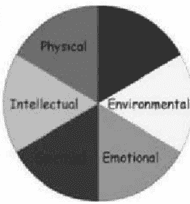

- **智力/心理**：保持适当纪律并在与疾病作斗争中面对现实的内在力量。

- **身体**：基于我们的日常行为，可以判断人体的功能状况。锻炼、饮食计划、体重管理、避免药物和酒精可以使我们远离疾病。这可能是一个重要方面，保持活跃能延长寿命。此外，身体健康能减轻焦虑和抑郁。跑步、游泳、步行、跳舞、玩耍等活动能增强肌肉。有些人经常锻炼，这会增加血清素和去甲肾上腺素水平，有助于缓解抑郁。定期锻炼能改善肤色；强化骨骼，减少慢性疾病。因此，身体健康意味着灵活性和力量。关注自身健康、留意轻微疾病、了解常见用药方法也与身体健康有关。

- **社交**：与朋友、亲戚和亲近的人相处。一项研究已证明，社交隔离会导致肥胖。为了保持社交健康，有必要在不诉诸暴力的情况下处理问题。

- **情感**：如图 2 所示，对待他人持支持和鼓励的态度等积极性。情感健康具备识别现实并应对日常生活需求的能力。如今，抑郁症以及极度焦虑、精神分裂症等精神障碍的治疗已可用。

*图 2. 健康的积极性*

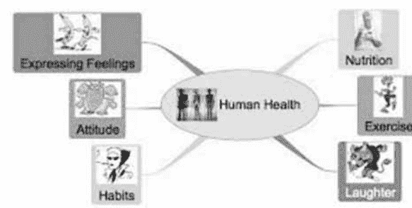

- **环境**：我们周围的空气、水、食物和氛围反映了所践行的空气纯度、卫生和营养饮食。为了保持良好的健康，良好的工作环境和健康的生活方式会影响一个人的生活。

- **精神**：道德和伦理价值观、尊严以及对周围人保持和谐的性情，有助于应对人生中的艰难处境，如死亡、经济困难等。

- **认知**：大脑执行判断、记忆力、学习新语言等功能的能力能提升认知健康。玩拼图、看电视、做填字游戏、社交互动是可以进行的一些活动。

- **营养**：保持均衡饮食，意识到不当饮食计划导致的疾病。

此外，帮助社区适应其社区中新的营养健康方式，可以赋予社区终生受用的宝贵经验，使社区能够健康地成长和老龄化。掌握这些知识对于改善家庭和个人的健康状况、应对经济后果、不良健康等是必要的。

## 与健康数据相关的当前视角和问题

每位患者都期望医疗专业人员以最佳方式使用和保护其临床记录。当今，研究人员出于数据共享的激励而快速共享数据，让其他患者了解其副作用。医疗系统有时会做出有利于出于商业利益使用健康数据的公司的决策。这些引发了关于是否存在对临床试验控制的问题


由 Ward & Barker (2013) 和 Wang & Krishnan (2014) 描述的数据。这些为研究人员在公众中强化道德意识铺平了道路。

尽管关于数据共享的讨论发生在收集、分析并以新方式重用数据的临床人员中。患者及其代表感到医疗保健中的隐私丢失。在传统方式中，医生保护患者的健康信息。如今，医生和其他医疗工作者在不同国家的机构之间共享健康数据。临床试验中共享患者数据的复杂性包括所有权转移和对患者的控制。当前技术寻求与已开发和测试的更新同意表格保持同步。

## 对患者安全的威胁

已识别的挑战可能由于用药错误和患者死亡率而对患者有害。此外，随着 Logan, K. (2016) 大数据的出现，还面临着与缺失值、解释问题、依赖问题、采样大小和处理方法相关的挑战。在分析大数据技术时，有时会提供无意义的相关性。另一个主要问题是个人数据的保护。正如 Vayena, Salathé, Madoff, & Brownstein (2015) 作者所述，保护隐私已成为公共卫生大数据中的伦理挑战。

## 互操作性和数据质量

在医疗保健大数据中，保持数据质量是存疑的。在医疗保健系统互动过程中捕捉患者观点的需求限制了信息交换的数量。另一个问题是，患者各种特征中的异质和多样数据无法控制。正如 Vest & Gamm (2010) 作者所述，数据分析工具可以以多种方式改变医疗保健。例如，医疗执业者的就诊被远程咨询所取代，以监测健康状况。并且可以根据世界各地专家的判断提供患者护理。需要熟练的口译支持来定制个人的遗传信息，以诊断和治疗基于遗传的疾病。政策制定者拥有许多新工具，为治疗和支出趋势带来洞察。数据分析的发展消除了在数据约定、决策和向医疗行业不同参与者提供医疗保健方面的实质性障碍。这些政策和障碍强调并优先考虑卫生改革，以鼓励使用数据分析。

## 安全性、可视化和数据完整性问题

图 3 显示了集成到临床流程中的电子健康记录。要理解这一点，我们需要查看收集、分析、存储并向不同成员展示临床数据。

### 捕获

医疗保健提供者需要准确、完整且格式正确的数据供多个用户使用，且无冲突。对电子健康记录的理解不完整会在其整个生命周期中导致质量问题。

### 清理

清理脏数据至关重要，以确保一致且相关的数据集，即未损坏的数据，需要昂贵和复杂的工具，以确保数据仓库中数据的准确性和完整性。

### 存储

在数据中心管理的医疗保健数据量庞大，承诺安全访问控制。云存储作为流行的存储介质，随着可靠性的提高降低了成本。在选择安全和合规问题的合作伙伴之前，灾难恢复、更容易扩展等是重要的关注点。

### 安全性

临床数据面临泄露和黑客攻击等高知名度的漏洞。HIPAA 安全规则、认证协议和传输安全中列出了技术防护措施；每个组织中存储了审计和完整性程序以保护健康信息。防病毒软件、防火墙、敏感数据加密等程序保护高价值数据资产免受恶意方的侵害。

### 管理

数据被重新使用和重新审查以进行质量测量，因此必须知道研究人员创建数据的原因、时间和方式，以及是否完成了目的。处理医疗保健的组织从指定的管理员那里开发有意义的元数据。这些包括标准格式和定义，包括创建、删除和更新任务。

### 查询

查询中涉及查询报告、分析、互操作性问题，这些问题阻止了对组织存储库信息的访问。结构化查询语言用于关系型和大型数据库。用户仅信任数据的完整性、准确性和标准化，目标受众生成可访问、清晰且简洁的报告。数据的完整性和准确性有关键影响。在将数据呈现给其推论之前，必须对其进行检查。

### 可视化

这类似于使用红色、黄色、绿色进行颜色编码，以理解停止、谨慎和通过。除此之外，图表、图形、标记等其他做法可以减少混淆。低质量的图形、文本重叠等会令观众沮丧，导致误解。示例包括条形图、饼图、散点图等。

### 更新

临床记录需要频繁更新以保持数据集质量。

### 共享

与外部合作伙伴共享数据，用于健康管理和基于价值的护理。

### 图 3. 医疗保健数据

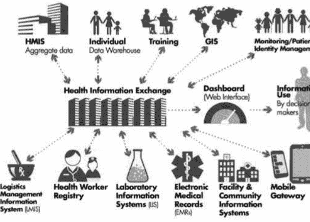

## IT 系统在医疗保健中的贡献

如图 4 所示，患者通过医院进行协调，医院包括依赖医院信息系统的大型部门和单元，该系统协助诊断、管理和改进服务。信息系统的质量包括用户满意度、信息质量和系统质量。信息技术的快速增长影响业务。由于人口增加，使用医院信息系统处理患者的需求很高。系统和运营活动增强成本控制、管理和患者护理，降低收入。

信息系统应管理并改善护理质量。各级管理层都应考虑最大化系统效益所需的关键行动。Wise (2003) 指出，医疗保健在发展中国家具有更大的重要性，能够为患者提供更好的质量和价值。

在医疗保健背景下，经济评价方法已证明，健康信息系统的出现改善了时间并降低了成本。许多组织使用基于计算机的技术来超越财务因素和绩效。

## 健康信息技术

健康信息技术提供记录、分析和共享健康数据的技术基础设施。Mitchell (1999) 表示，app、智能设备、纸张等工具可提供更好的护理，以实现患者的健康公平。然而，使用医疗保健系统进行信息分析应支持从业人员和政府卫生部门。政策应更好地并减少疾病的传播，提供优质医疗保健，减少医疗错误，提高患者安全等。

### 图 4. 医疗保健信息系统

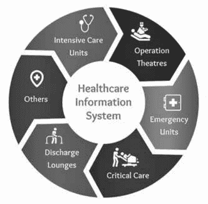

健康 IT 提供准确的临床记录，使医生能够更好地了解患者的健康史。这将使医生能够治疗疾病并防止致命用药。从业人员与患者之间关于健康史的互动将导致不准确的药物名称和疾病。患有疾病的患者从电子健康记录中受益，改善了患者护理的沟通、安全、公平、及时性和效率等方面。

全世界的开发人员通过向在当地诊所实施的应用程序贡献代码来提供技术支持。健康信息技术包括软件和硬件，用于构建健康信息系统。健康信息学是计算机科学、信息科学和医疗保健的结合。其中包含的工具包括临床指南、医学术语、通信信息系统，应用于牙科、临床护理、护理、公共卫生、药学和生物医学研究等领域。

信息技术通过实施计算机辅助学习、人体模拟和虚拟现实来协助医学院。高级生命支持模拟器解读心电图，用于药物干预、除颤、注射，而无需应用于真实患者。复杂情况下的先进模拟技术可用性对医疗保健领域非常有帮助。电子病历的进步将所有医疗转录转换为单一数据库，降低纸张成本，提供患者病史，支持保险等。

使用电子病历，所有诊所都能即时改进访问患者记录以提供诊断和治疗患者的信息服务的能力。健康信息技术支持组织、消费者、提供者和付款人之间安全地交换健康信息。

下面列出了优势：

- 提高医疗保健的有效性和质量
- 提高医疗保健的效率和生产力
- 防止医疗紧急情况
- 医疗程序的准确性和正确性
- 降低治疗成本
- 有效管理
- 减少文书工作和闲置工作时间
- 扩展到实时通信
- 最后，为所有人提供优质且负担得起的护理

下面列出了各种技术创新：

- 临床决策支持 (CDS)
- 电子病历 (EMR)
- 计算机化医师医嘱录入 (CPOE)
- 药品发药条码 (BarD)
- 发药机器人 (ROBOT)
- 自动发药机 (ADM)
- 电子药物管理记录 (eMAR) 等


## 电子健康记录（EHR）

EHR 可降低预防性护理、药物处方和检测结果中的错误。将治疗过程作为电子记录可提供临床指南。由于诊所采用电子健康记录，今天临床记录可在医疗保健网站上查阅。这降低了培训成本和复杂性，且对 EHR 的采用率自 2005 年以来持续上升。然而，最近的调查显示，患者安全功能已成为医生采用健康信息技术（HIT）时的主要关切。健康信息工作流程改善了最终用户的需求，例如用户友好的界面、简单性、系统速度等。标准化条码系统可防止许多药物错误。关键机会如下：

- 医疗护理与优质医疗
- 健康监测、疾病诊断
- 临床绩效优化
- 制药研究与开发

国际卫生系统理解其中的复杂性，并寻求健康信息技术的更好机遇。这为政策制定者提供了比较和对比既定指标的机会，这些指标可能导致不利政策。

从数百万患者中收集并在各种医疗机构之间汇总的数据可以被视为电子健康记录（EHR）。它包含各种形式的数据，包括实验室结果、诊断报告、医学影像、患者的人口统计信息和临床记录。医疗保健的转变可以借助深度学习技术来实现，因为这些技术优于传统的机器学习方法。此外，每天都在产生海量且复杂的数据集，因此需要部署深度学习模型。观察表明，在某些领域，临床决策从分析医学研究问题到建议以及优先治疗方案以检测异常，此外还包括对组织样本中基因标记的识别。深度学习在 EHR 系统中被应用，以推导患者表示，提供增强的临床预测，并增强临床决策系统。此外，它还被应用于在疾病早期阶段进行检测，确定临床风险，预测未来定期体检的需求，并在必要时预测近期住院需求。根据统计报告，深度学习软件市场的规模预计到 2020 年将达到 1.8 亿美元。

大量临床信息（尤其是 EHR）的可用性推动了深度学习技术的增长，这些技术有助于快速分析患者数据。如今，EHR 正在与深度学习技术和工具相结合，融入 EHR 系统中，为健康结果提供深入洞察。EHR 深度学习工具市场预计到 2020 年代中期将超过 340 亿美元，这主要受到自动化任务和深入了解临床问题的新兴愿望的推动。全球健康 IT 市场预计到 2023 年将达到惊人的 2231.6 亿美元，部分受深度学习驱动。EHR 是深度学习研究人员的一个蓬勃发展的研究领域，因为它有助于在医疗状况中实现更高的准确性。使用深度学习从临床记录中提取临床信息的过程包括概念提取、关系提取、时序事件提取和缩略语扩展。在 EHR 表示学习过程中，包含概念和患者表示，以获得详细分析和精确的预测任务。深度 EHR 中的结果预测分为静态预测和时序预测，以预测患者结果。在 EHR 分析中，临床深度学习在最大激活、约束、定性聚类和模仿学习类别下更具可解释性。

## 医疗保健中的新兴技术

健康技术包括设备、程序、疫苗和药物，以简化医疗保健质量。新兴技术包括人工智能、区块链、语音搜索、聊天机器人，虚拟现实是到 2019 年医疗保健领域最具前景的技术。

## 人工智能

医疗保健中人工智能的使用预计将在 2022 年以 40% 的速度增长。人工智能引擎以三种方式防止风险和医疗场景。患者可根据个性化剂量提醒医疗人员的自动提醒，获得用药时间方面的帮助。

## 区块链

区块链保存数字记录，创建交易账本，改变技术在数字医疗营销中运营的方式。区块链收集存储在服务器上的信息，实现无需媒体平台的直接营销。区块链可简化对数据集合、所有权和数字广告的重组。

## 医疗保健中的聊天机器人

医疗保健中的聊天机器人改善了患者就诊路径以及紧急情况下的药物管理。个人经验证明聊天机器人在为人们增加接触点方面发挥着至关重要的作用。

## 案例场景：智能护理与早期诊断系统

未来展望在于疾病的早期检测和健康的持续监测。在 2015 年国家医学院报告中，诊断错误和不准确诊断在所有环境中都存在不可接受的比率，对患者社区造成有害影响。因此，来自每天排出的分子含量（唾液、汗液、粪便和尿液）的完美诊断来源是关键信息。世界各地的研究人员提供线索和指南，以维护良好健康。心脏病专家希望安装起搏器和其他心脏设备，需要支持来监测患者的任何危机。可穿戴设备提供大量信息，医疗保健系统跟踪个人的健康状况，帮助研究人员研究治疗的有效性并采取预防措施。未来的目标是及早拦截疾病并预防它们。对像侵袭性癌症这样的疾病采取行动是值得监测和预防的。

## 结论

当今医疗保健领域面临的关键挑战是患者已获得数字化赋能。许多医疗保健组织采用新技术来收集、传输临床数据，并解决安全和隐私问题。物联网和预测分析将塑造医疗保健行业的未来，提高生存率和预期寿命。医疗保健的现代化包括人口老龄化、治疗成本上升以及患慢性疾病且需要长期护理的受害者增加。以智能为中心的患者转型的数字时代将降低成本并改善患者护理。大多数 IT 投资者合作进行数字化，共享患者护理案例，以提供洞察力并满足医疗保健行业的业务需求。远程医疗在医疗服务和技术进步方面还存在不足，亟需提供优质医疗保健。

## 参考文献

- Frakkt, A. B., & Pizer, S. D. (2016). 医疗保健中大数据的承诺与风险. 美国管理医疗杂志, 22(2), 98. PMID:26885669
- Friedman, U. (2012). 大数据：一部简史. 外交政策.
- King, S. B. III. (2016). 大试验还是大数据. JACC：心血管介入, 9(8), 869–870. doi:10.1016/j.jcin.2016.03.003 PMID:27101918
- Logan, K. (2016). 当大数据出错时会发生什么？ ACM 通讯, 59(6), 15–16. doi:10.1145/29111975
- Markle Foundation. (2003). 为了健康而连接——公私合作协作：关键主题与指导原则. Markle Foundation.
- Maviglia, S. M., Zielstorff, R. D., Paterno, M., Teich, J. M., Bates, D. W., & Kuperman, G. J. (2003). 慢性病复杂指南的自动化：吸取的教训. 美国医学信息学协会杂志, 10(2), 154–165. doi:10.1197/jamia.M1181 PMID:12595405
- Metzger, J., & Fortin, J. (2003). California Health Care Foundation. 社区医院中的计算机化医嘱录入. http://www.fcg.com/healthcare/ps-cpoe-research-and-publications.asp
- Mitchell, T. (1999). 机器学习与数据挖掘. ACM 通讯, 42(11), 31–36. doi:10.1145/319382.319388
- Neff, G. (2013). 为什么大数据无法治愈我们. 大数据, 1(3), 117–123. doi:10.1089/big.2013.0029 PMID:25161827
- Sukumar, S. R., Natarajan, R., & Ferrell, R. K. (2015). 医疗保健中大数据的质量. 国际医疗保健质量保证杂志, 28(6), 621–634. doi:10.1108/IJHCQA-07-2014-0080 PMID:26156435
- Vayena, E., Salathé, M., Madoff, L. C., & Brownstein, J. S. (2015). 公共卫生中大数据的伦理挑战. PLoS 计算生物学, 11(2), e1003904. doi:10.1371/journal.pcbi.1003904 PMID:25664461


Vest, J. R., & Gamm, L. D. (2010). 健康信息交换：持续挑战与新策略. 美国医学信息学协会杂志, 17(3), 288–294. doi:10.1136/jamia.2010.003673 PMID:20442146

Wang, W., & Krishnan, E. (2014). 大数据与临床医生：科学现状综述. JMIR医学信息学, 2(1), e1. doi:10.2196/medinform.2913 PMID:25600256

Ward, J. S., & Barker, A. (2013). 数据未定义：大数据定义调查. arXiv预印本 arXiv:1309.5821

Zhang, Z. (2014). 大数据与临床研究：临床医生视角. 胸部疾病杂志, 6(12), 1659–1664. PMID:25589956

# 第2章

# 用于语义多模态医学图像分割的深度学习模型

V. R. S. Mani https://orcid.org/0000-0002-3234-0486 国家工程学院, 科维尔帕蒂, 印度

## 摘要

本章作者全面描绘了不同多模态图像分割任务中使用的各种深度学习模型。本章对该领域的新手是一本入门读物，对该领域从业者是一本概览，对搜索特定应用文献的研究者是一本参考书。方法根据不同类型的多模态图像及分割任务中使用的相应卷积神经网络类型进行分类。本章从CNN拓扑介绍开始，描述了Hyper Dense Net、Organ Attention Net、UNet、VNet、扩展完全卷积网络、迁移学习等各种模型。

## 引言

深度神经网络拥有极多层神经元，形成分层特征表示。层数现已超过2000层。凭借这种极强的建模能力，深度网络在用极大规模训练数据集进行良好训练后，能够有效记住所有可能的变换并做出智能预测，从早期未训练过的新数据集中识别出模式。因此，深度学习被广泛应用于许多计算机视觉和医学影像任务。AlexNet、VGGNet、RESnet或GoogLeNet等卷积神经网络（CNN）模型在各种竞争性基准测试中都展现出了准确的结果。关于CNN设计，已探索了不同的思路，例如使用不同的激活函数、损失函数以及优化和正则化函数。大约有七类不同的CNN架构在不同应用中被广泛使用。所有这些架构都基于深度、宽度、空间利用、多路径、注意力、通道增强和特征图利用。在CNN中，拓扑结构分为不同的学习阶段，如卷积层、非线性处理单元和下采样层。每一层都使用一组卷积核进行多种变换。在卷积操作中提取局部相关特征。

语义分割解释如何将图像的每个像素标记为类标签，例如水、沙、草地、天空、海洋或汽车。语义分割的应用包括：自动驾驶、机器人视觉、遥感、医学影像、视频处理等。由于多模态图像采集设备取得了巨大进步，待分析的影像数据量与日俱增。医学影像数据具有异质性和多维性，且对人为错误敏感，在不同受试者之间也存在差异。因此，医学影像数据的分割和解释是一项耗时的过程。语义分割将图像的每个像素与类标签相关联。虽然与语义分割密切相关，但医学图像分割包含需要解决的特定挑战，例如标注数据稀缺、实测值中存在高类别不平衡以及三维图像的高内存需求。本章将深入讨论将三维滤波器应用于不同结构和功能影像的基于CNN的方法。

## 多模态脑MRI图像分割：

脑MR图像分割是放射治疗和图像引导手术中的关键功能。脑异常的定量分析需要对脑部MR图像进行准确分割，这是一项复杂且艰巨的挑战。病变的异质性（包括其在长度、形状和面积上的大规模可变性）使分割任务极其困难。由人类专家进行的手动分割是质量最高的方法，但耗时、繁琐、成本高昂，在大规模研究中不切实际，并且会引入观察者间的变异性。需要考虑多种对比度不同的图像序列，以识别选定位置是病变还是非病变。此外，专家知识和经验的程度也会影响分割准确性。在脑影像学研究中，会融合特定模态的图像以弥补单一成像技术的不足。T1加权图像能够正确区分灰质（GM）和白质（WM）组织。T2加权和质子密度（PD）图像有助于可视化病变和其他异常。液体衰减反转恢复（FLAIR）图像改善了白质病变的图像评估，特别是多发性硬化症[2]。为了提高脑图像分割的准确性，融合不同模态的图像至关重要。在婴儿大脑的情况下，融合多模态图像也很重要，因为其对比度较差。

最近，基于2D CNN的深度学习技术（Pereira et al., 2015）被应用于脑图像分割任务。在基于2D CNN的策略中，3D脑分割是通过独立处理单个2D切片来完成的，这是一种非最优方法。CNN可以同时从数据中学习特征和分类器。目前，密集连接网络被用于医学图像分割（）。大多数现有的多模态CNN分割技术采用早期融合策略，即MRI T1、T2和各向异性分数（FA）图像在网络输入处合并。这些方法假设不同模态之间的关系是纯粹线性的。其他一些方法则从其他模态中学习互补信息。但是，不同模态之间的关系要复杂得多。在DenseNet中，任何层以前馈方式直接连接到所有后续层，使训练更加容易和准确。由于所有层之间存在直接连接，信息和梯度在整个网络中流动。此外，密集连接具有正则化效果，从而减少了小型训练集任务中的过拟合。

Dolz et al.（2019）采用了完全连接的3D Hyper Dense结构，扩展了多模态分割的密集连接性。每种MRI模态都有方向，并且在相同路径的层之间以及不同邻近路径的层之间存在密集连接，这与现有CNN不同。Hyper Dense网络可以在不同模态内部及跨模态研究复杂的变体。在Hyper Dense网络中，属于不同流（每个流与唯一图像模态相关）的层的输出被连接起来。Hyper Dense网络在基准数据集上相较于现有最先进的分割技术取得了显著改进。深度学习架构的一个挑战是梯度消失或梯度爆炸，这会阻止训练期间的收敛。

Dolz et al.（2019）的Hyper Dense网络部分在图1中显示。此处每个灰色块是一个卷积层。红色箭头表示卷积操作，黑色箭头是跨越相同方向和不同邻近路径的不同层之间特征图的直接连接。每个卷积块的输入（红色箭头之前的图）是两条路径中所有先前层输出（红色箭头之后的图）的连接。在各个模态的流以及不同模态流之间发生的密集连接，使网络拥有完全的自由度来探索不同模态特征之间的复杂组合，无论是在抽象的各个层级内部还是层级之间。

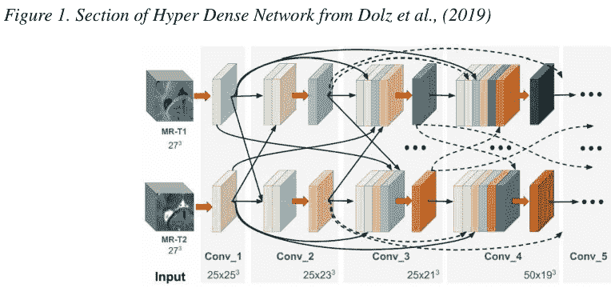

## 使用器官注意力网络对CT图像中的腹部器官进行分割

在自动计算机辅助诊断和手术过程中，对CT图像中各种腹部器官进行强健且准确的分割至关重要，这相当困难，原因是腹部区域空间相邻结构之间的边界较弱、各器官大小不一，以及复杂

背景的复杂性。胃部形态的形态学和拓扑复杂性包括解剖学上相关的结构，如胃肠道结构（胃、十二指肠、小肠和结肠）以及血管结构。身体腹部器官之间存在大量相对大小的变化。器官相对长度的变化会在应用深度网络进行多器官分割时造成问题，原因在于较低层通常在分割小结构时缺乏语义信息。为应对这些挑战，Wang et al. (2019) 提出了一种带有相反连接的器官注意力网络（OAN-OC）。它是一个两阶段卷积神经网络，其中初级层的特征在第二阶段与原始图像混合，以减少背景的复杂性，并通过增加关于感兴趣器官的鉴别信息来增强器官边界。通过将注意力集中在感兴趣的器官上，降低了复杂背景的影响。反向连接被添加到初级层，较低层获得更大的语义数据，从而使它们能够适应各种器官的大小。

**Figure 2. 带有相反连接的器官注意力网络**

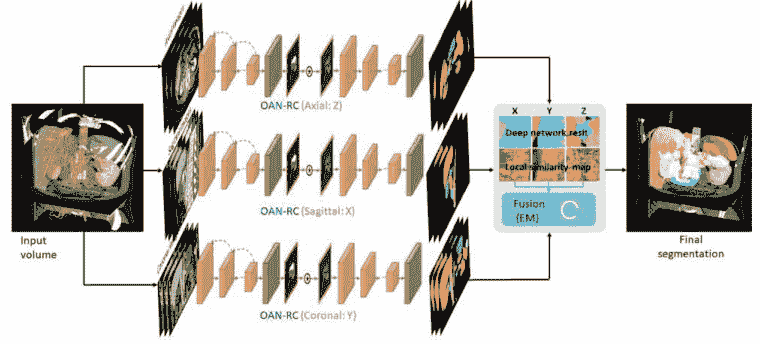

OAN-OC 应用于每个切面切片，这是一种各向异性局部补片的极端形式，但来自单一观察路径的完整语义（即数量）信息也被包含在内。这产生了来自多平面图像（轴向、冠状和矢状）的独立视图的分割结果。三种信息来源基于视图依赖的局部结构相似性，使用附近的各向同性 3D 补片进行统计融合。基本融合技术使用期望最大化算法。这里使用结构相似性，并在每个体素上计算基于路径的邻域属性。这通过邻域权重，对 2D 图像到原始 3-D 形状（3-D 体积内部）的结构相似性进行建模。这种结构统计融合通过以有原则的方式结合三种不同视角的信息，并额外强加局部形状，来提高整体性能。

## UNET

在训练数据不足的情况下，U-Net 是一个不错的选择。U-Net 具有在低到中等数量的训练数据环境中学习的能力，并且可用的训练数据量被认为是少的。此外，U-Net 可以适应最新研究，因为其架构与 PSPNet 或 One Hundred Layers Tiramisu 非常相似，这些是处理更多数据时的最近改进。它之所以被称为 U-Net，是因为它形成了 U 的形状。

U-Net 类似于卷积自编码器，但它还具有与瓶颈（压缩嵌入）层之前的特征图的跳跃式连接，这样在解码器部分，一些信息来自先前的层，绕过压缩瓶颈。请参见下方的 Fig. 3。

因此，在解码器中，数据不仅从压缩中恢复，还与传递到压缩瓶颈之前的信息状态进行连接，以便为接下来的解码层增加上下文。这样一来，神经网络仍然在压缩潜在表示（位于图中“U”形状底部）上学习泛化，但也将其潜在泛化恢复为具有适当逐像素语义对齐的空间表示，位于 U-Net 的 U 形右侧。

它之所以被称为 U-Net，是因为它形成了 U 的形状。为了最佳地训练 U-Net，需要大幅增强数据集。第三名的获胜者使用了 4 种可能的 90 度旋转，以及这些旋转的镜像版本，这可以将训练数据增加 8 倍：这种数据变换属于 D4 二面体群。我们进行了额外的随机 45 度旋转，将数据增加 16 倍，这代表 D8 二面体群。因此，每次将图像输入网络时，都会在继续在该图像上进行训练之前，对其进行随机旋转和镜像。在官方 U-Net 论文中，预处理中也使用了一些弹性变换。我认为使用此类数据变换会很有趣，如另一场类似比赛的 Kaggle kernel 中所示。在我们的管道中，我们还对输入的每个通道进行归一化，然后对每个补片使用每通道随机线性变换。

特别是在卫星成像的情况下，可以使用 CCCI、NWDI、SAVI 和 EVI 指数。这些是从自然可用波段计算得出的额外通道（波段）。此类通道用于从图像中提取更多信息，特别是用于隔离反射物体、植被、建筑物、道路或水体。例如，第三名的获胜者通过对这些指数进行快速阈值搜索并直接设置阈值，获得了预测水体出现的良好结果。下面显示了四个额外通道（来自指数），以及原始图像的人眼可见 RGB 通道以供比较：

## VESSEL NET：用于视网膜血管分割的密集块 U-NET

最近，已提出了许多基于深度学习的视网膜血管分割技术。视网膜血管是微小结构，视网膜血管结构通常使用基于补片的学习技术准确学习。密集 U-net 已用于场景分割。Wang et al. (2019) 提出了一种完全基于密集 U-Net 和基于补片的训练方法的替代视网膜血管分割框架。在此方法中，训练补片是通过随机提取方法获得的，密集 U-Net 被采用为学习网络，随机变换

**Figure 3. U-NET 架构**

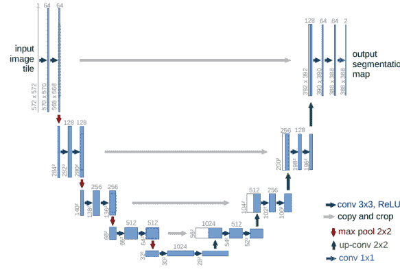

用于数据增强过程。在这种测试方法中，图像被分割成补片，使用学习模型对补片进行预测，因此分割结果通常通过重叠补片的顺序重建方法来重建。该视网膜分割方法使用公开可用的 DRIVE 和 STARE 数据集进行了测试。获得的结果比其他最近的最先进的技术更准确。灵敏度、特异度、准确率和曲线下面积已被用作评估指标，以验证该技术的有效性。与包括无监督、有监督和卷积神经网络（CNN）方法在内的尖端技术相比，使用这种密集 U-NET 获得的结果证实了该系统在这些评估指标中具有竞争力。

## 超声图像分割

超声（US）是用于乳腺癌早期预后筛查的成像模态之一。由于大量阴影、复杂且可见度差的边界以及对比度差，超声乳腺图像的分割非常具有挑战性和复杂性。此外，由于组织微结构，US 图像固有地受到斑点噪声和瑞利散射的损坏。斑点伪影取决于组织，无法正确建模。已提出了许多斑点噪声消除和特征保留策略。已提出了许多半自动和交互式技术用于乳腺超声图像的分割。Hu et al. (2018) 提出了一种与基于相位的主动轮廓方法相结合的扩展完全卷积网络（DFCN）。

DFCN 的结构在以下部分中描述，并如 Fig. 4 (a) & (b) 所示。它包括一个卷积层、批量归一化层和整线性单元（ReLU）。为了在卷积操作后保持特征图的尺寸，执行了零填充。ReLU 引入非线性。块内的 M × M × H 表示内核大小（M）和特征图数量（H）。最大池化层具有 2×2 的内核大小和 2 的步长。在此 DFCN 中，特征图的数量从较低层到较高层逐渐增加。范围

特征图的数量分别为第1-6层的64、128、256、512、512和1024。在卷积层1之后以0.5的比率添加了一个丢弃层。随后，在求和层之后，使用了一个反卷积层来生成上采样预测，上采样因子为8，表明输出是输入规模的8倍。使用空洞卷积改进了分割结果，因为它减少了图像中阴影的影响。最大池化层扩大感受野并下采样特征图；然而，在端到端分割的应用中，最大池化会降低特征图的分辨率。空洞卷积，又称atrous卷积，在非零滤波器抽头之间插入空洞。阴影有时靠近病变，在低分辨率特征图中，乳腺超声图像中它们之间的距离被缩短。随后，使用低分辨率特征图难以将它们区分开。空洞卷积可以在深层滤波器中保持分辨率，并帮助特征图保留更精确的信息，以区分病变和阴影。

### 图4. (a) DFCN架构；(b) DFCN中使用的单个块的架构

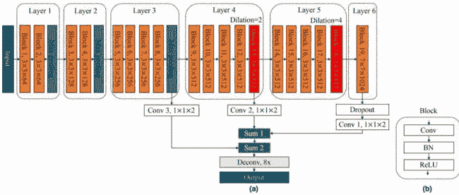

## 超声图像中的肾脏分割

引导式肾脏超声图像分割非常耗时，且极易受操作者间及操作者内差异的影响。由于图像强度分布和形状各异，肾脏图像的完全自动分割颇具挑战。但肾脏边界在不同图像中具有出人意料的均匀纹理模式。Yin等人（2019）使用在自然图像上预训练的深度神经网络，从超声图像中提取高层特征。该方法已应用于外观和形态变化较大的临床肾脏超声图像分割。肾脏图像分割模型由迁移学习网络、边界距离回归网络和肾脏像素级分类网络组成。迁移学习网络构建在流行的图像分类网络之上，以复用图像分类模型作为从超声图像中学习高层图像特征的起点；边界距离回归网络学习以肾脏边界距离图形式建模的肾脏边界；随后，肾脏边界距离图被用作肾脏像素级分类网络的输入，以生成肾脏分割掩模。肾脏距离回归网络和肾脏像素级分类网络基于增强训练数据进行训练，该数据可通过基于肾脏形状的图像配准生成。

本研究使用的影像数据是通过费城儿童医院（CHOP）的现代临床超声扫描仪收集的。具体而言，185张出生后首次肾脏超声矢状位图像（Zheng等人，2019；Zheng等人，2018b），其中包括来自50名患有肾脏和泌尿道先天性异常的儿童的85张图像（每个异常肾脏一张），以及来自50名患有单侧轻度肾积水的儿童的100张图像（每个肾脏一张）。本研究随机选取105张图像作为训练数据、20张图像作为验证数据，以训练基于深度学习的肾脏分割模型。随后，使用剩余的60张图像以及另外104张出生后首次超声矢状位图像（同样源自CHOP）对肾脏分割模型进行了评估。所有图像均来自不同肾脏。图像由CHOP的专家手动分割。代表性肾脏超声图像如图1所示。这些图像被调整为相同的321×321尺寸，且图像强度线性缩放至[0,255]。

### 图5. 基于CNN的超声图像中完全自动肾脏分割

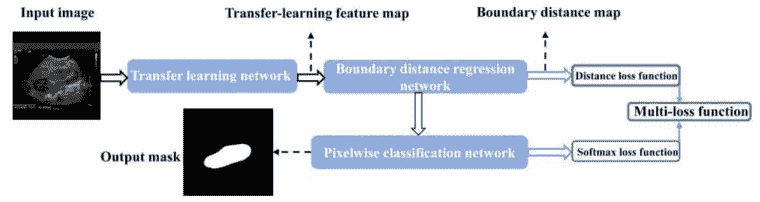

## PET/CT中的协同分割

在临床环境中，将功能成像模态PET与成像结构细节的CT相结合的PET/CT扫描仪被广泛使用。与PET扫描相比，CT图像分辨率更高，但由于CT的强度范围相似，其区别肿瘤细胞与周围软组织的能力有限。在下图所示的图6：(a)和(b)中，CT图像在肿瘤（由粉色轮廓包围的区域）与空气（深色区域）之间有清晰的边界，但肿瘤与正常软组织之间的边界并不十分清晰。因此，仅使用CT图像进行肿瘤分割是困难的。PET图像空间分辨率低，因此其中的组织边界模糊不清，但它们表现出高对比度，这有助于区分正常软组织和肿瘤细胞。PET图像中的肿瘤细胞具有较高的标准化摄取值，并表现为热区。先前的研究表明，Zhao等人（2018）针对CT/PET图像提出了一种基于深度学习的3D多模态肿瘤分割协同分割算法。该方法融合了从PET和CT中提取的特征；利用结构和功能信息可以提高分割性能。

### 图6. a) 肺CT图像；b) 一名患者配对的PET图像

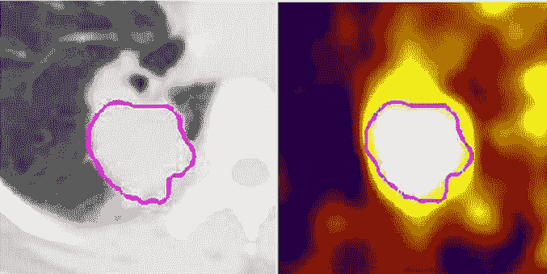

Zhao等人（2018）针对CT/PET图像提出了一种多模态3D卷积神经网络肿瘤协同分割算法。该方法融合了从PET和CT中提取的特征。两个并行的子分割分支由带有加权损失函数的V-Net及随后用于特征融合的级联卷积块组成。任意尺寸的配对PET/CT图像被输入到网络中。两个V-Net分支分别用于从PET和CT图像中进行特征提取。提取的特征被输入到具有许多级联卷积层和总损失函数的融合网络，以实现特征再提取；融合网络末端的输出是图像中肿瘤的预测。该网络只需最少的预处理，无需后处理。

### 图7. 多模态协同分割网络（两个并行特征提取分支，随后跟一个特征融合模块）

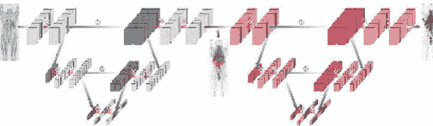

尽管有先进的成像技术可用，骨病变的分割和检测仍然是一项挑战。Xu等人（2018）提出了两种架构，即V-Net和W-Net，用于全身骨病变分割和检测。这些深度学习架构不需要手工制作的特征，而这类特征在多模态特性方面难以识别。在W-Net架构中，结构信息被用作病变检测的正则化。其初步结果基于模体研究和有限数据量，并观察到通过增加数据量，W-Net架构的性能可能得到提升。

将PET图像在识别异常区域方面的灵敏度与断层扫描图像提供的精确解剖定位相结合，将改善PET/CT肺图像中病变的分割和检测。Ashni Kumar等人（2018）提出了一种深度学习架构，该架构学习融合肺部PET/CT图像中的互补信息。在正常生理条件下，心脏具有高FDG（氟脱氧葡萄糖）摄取，需要基于从断层扫描图像中获得的解剖信息将其移除。在他们的研究中，他们使用了分辨率为512×512、间距为0.98mm×0.98mm、层厚和层间距均为3mm的断层扫描图像，以及分辨率为200×200、间距为4.07mm×4.07mm、层厚和层间距均为3mm的PET图像。他们提出的卷积神经网络为PET和断层扫描图像包含独立的编码器，用于提取与各模态相关的视觉特征。网络的堆叠卷积层具有类似于AlexNet和VGG Net的结构。每个编码器包含两个用于生成特征图的卷积层和一个用于下采样特征图的最大池化层。在堆叠结构中，每一层的权重变化会影响网络中的后续卷积层。在训练期间，某一层发生的变化会影响更深的层，网络必须不断适应这些变化。该CNN有两种不同成像模态的输入；因此，协同学习和重建将受到两个编码器级联权重调整的影响。这将降低收敛速度并扰乱学习过程。可以使用leaky ReLU来避免神经元死亡问题。协同学习单元推导出一种空间变化的融合图，更精确地在不同区域整合功能和解剖视觉特征。针对不同的输入PET-CT图像，在不同位置优先考虑不同特征，使用了不同的融合图。

### 图8. 单个特征图上的协同学习

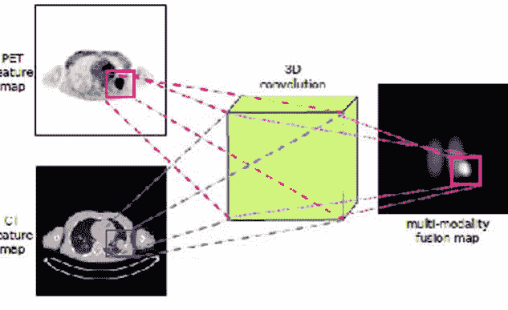


## 基于 LinkNet 的胎儿超声图像分割

像 SPECT、PET、共振成像和断层成像等成像方式涉及辐射危害，具有侵入性且不可携带，而超声成像是无创的且无辐射危害。它是一种简单便携的无创成像技术，能够诊断内部身体部位感染、疼痛和肿胀的原因，用于身体内部部位的用药和治疗（Rueda et al 2014）。超声成像在产科和妇科检查及治疗过程中被广泛使用。此外，它是妊娠期间的典型检查程序，用于测量特定的生物计量参数以进行诊断程序和估计胎儿年龄，例如胎儿的腹围、头围、双顶径、股骨和肱骨长度以及头臀长。此外，胎儿头围（HC）用于估计胎儿年龄、大小和体重、生长监测以及检测胎儿异常。

图 9. 用于胎儿超声分割的 LinkNet 架构

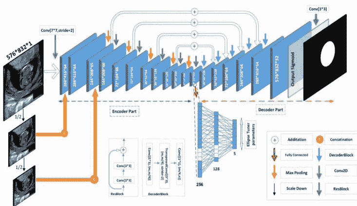

尽管有这些优势，超声成像仍存在许多伪影，如运动模糊、边缘缺失、声影、斑点噪声和低信噪比。

在妊娠早期，胎儿头骨不足以被检测到。这使得超声图像非常难以解读，需要专家进行诊断。Zahra Sobhaninia 等人（2019）提出了一种基于多任务 CNN 的 LinkNet 模型，该模型最初开发用于语义分割。多任务 LinkNet 模型的框图如图 9 所示。该模型包含两个主要模块：分割网络和椭圆调谐器。为这两个模块定义了两种不同的损失函数，改进了整个网络的训练过程，并带来整体性能的提升。在训练阶段，通过不同的入口点对组合损失梯度进行反向传播，从而训练网络参数。总损失函数是分割损失和椭圆调谐器损失的加权和。该网络模型是带有多尺度输入的 LinkNet 的修改版本，应用于胎儿头部分割。三个尺度的 2D 超声图像被输入到该模型的不同层中。网络的前半部分包含称为 ResBlock（Zhou et al., 2018）的编码块，由具有残差连接的卷积层和池化层组成。通过将网络的第一和第二特征图与输入图像的下采样版本进行拼接，获得多尺度结构。网络的后半部分由解码器块组成，负责上采样特征图并构建最终的分割输出。尺寸相似的编码器和解码器通过一些跳跃连接相连。编码和解码过程中可能丢失的特征图细节通过这些跳跃连接得以保留。这些跳跃连接的存在带来了更准确的边缘分割。放射科医生提供的基准真值形状为椭圆形，因此对胎儿头部评估采用了椭圆参数。提取的特征被输入到三个全连接（FC）层中以调谐椭圆参数。FC 网络的五个输出估计椭圆参数，这些参数代表胎儿头部的位置、形状等。此外，所提出的 FC 层通过细化特征层以象征椭圆形状，隐含地有助于分割性能并提高分割结果的准确性。本研究使用了大约一千张二维超声图像，并使用了没有任何生长异常的胎儿样本。超声图像的空间分辨率为 800 x 540，像素大小范围为 0.052 mm 至 0.326 mm。数据增强通过水平和垂直翻转，以及从 -60 度到 60 度、每 20 度一级的旋转来执行。在某些情况下，旋转变换会通过将头部移出旋转后的图像而破坏胎儿头部区域。因此，训练集中损坏的图像被移除，保留了具有完整胎儿头部的图像。生成了大约九千张增强的超声图像。数据集被随机分为 75% 用于训练和 25% 用于测试。10% 的训练数据设为验证数据。Dice 相似系数、差值、绝对差值和豪斯多夫距离被用于评估该系统的性能（Vanden et al., 2018）。所提网络在大约一千张图像上进行训练，并在包含所有孕期数据的独立测试集上进行了评估。

## 基于 MCANET 的胎儿中脑动脉分割

由于婚姻和生育推迟，面临高危妊娠的女性正以更快的速度增加。胎儿生长受妊娠相关并发症的很大影响，导致异常分娩。与复杂妊娠结局相关的风险使用多普勒超声血流信号进行评估，这些信号反映了胎儿血液循环中血流的变化。中脑动脉分割的 MCA Net 架构如图 10 所示，它由一个卷积块组成，卷积核大小为 7 × 7，步长为 1，填充为 3。类似的块跟随上述卷积块。在接下来的卷积块 2、3 和 4 中，第一个卷积操作使用 1 × 1 卷积核和步长 2 进行下采样，其余卷积操作使用步长 1。卷积块 5 和 6 使用扩张率为 2 和 4 的扩张卷积。在网络的后续层中，移除了残差连接，并使用扩张率为 2 和 1 的扩张卷积。在后续块中移除残差连接消除了由于扩张卷积导致的网格伪影，从而提高了预测准确率。在此处，使用密集上采样而非常规上采样来恢复解码后的特征图。密集上采样使用 3×3 卷积核和步长 1 实现，从而减少维度和计算量。批量归一化操作允许使用较大的学习率进行训练，并执行像素混合操作以提高解码特征图的分辨率。跳跃连接将扩张残差网络（DRN）浅层的特征图与扩张残差网络的输出特征图相结合。在跳跃连接中添加了一个额外的 1 × 1 卷积。编码器是在 ImageNet 上预训练的扩张残差网络，因为原始超声图像中中脑动脉的面积相对较小。ResNet-34 在超声 MCA 数据集上的输出特征图分辨率为 20 × 14，仅为原始超声图像的 1/32。该输出过于粗糙，AlbuNet-34 网络的解码器无法恢复精细的上下文信息。通过去除最大池化层，扩张残差网络克服了上述限制。DRN 使用卷积滤波器进行下采样，以消除最大池化操作引起的网格伪影。在扩张残差网络中，扩张卷积有助于保留空间分辨率，并生成相对高分辨率的输出特征图。高分辨率特征图包含精细细节，有助于恢复小目标。MCA Net 使用跳跃连接来有效结合浅层中的局部信息和高层中的语义信息。密集上采样的有效小目标恢复能力用于恢复 MCA Net 中的最终细节。并非所有层都添加跳跃连接，以保持计算效率。最后一层的特征图同时具有大分辨率和足够的语义信息，这使得在不添加复杂跳跃连接的情况下也能获得良好的性能。此外，密集上采样可以直接在特征图上执行卷积操作，其计算效率高于同尺度的上采样操作。从 5000 张图像中选出大约 4000 张合格的原始超声图像来构建超声图像数据集，经验丰富的放射科医生对这 4000 张超声图像进行了标注。放射科医生在相应彩色多普勒血流图像的帮助下，手动对这些超声图像进行了标注。即使对于经验丰富的医生来说，在原始超声图像中识别和定位中脑动脉也是一项复杂的任务。标注后的数据集进一步由资深放射科医生审核，以确保这些标注的正确性。Jaccard 索引、Dice 系数和豪斯多夫距离被用作评估指标，以展示每个模型在不同方面的性能。

图 10. 超声图像中中脑动脉分割的 MCA Net

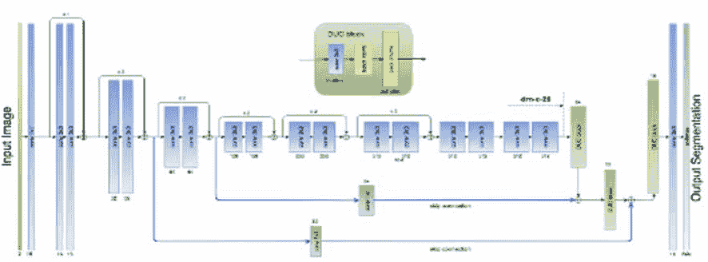


## 胎儿超声图像中的头骨分割

胎儿结构超声图像已广泛用于评估胎儿的生长和健康状况，并估算胎儿体重。胎儿头骨的检查是临床检查的重要组成部分，包括头围（HC）、双顶径（BPD）和枕额径（OFD）。但是，这种测量更容易产生测量误差，因为这是一种从指定解剖平面（即经丘脑平面或经脑室平面）提取的特征进行的手动 2D 测量。该程序的人为依赖性在很大程度上影响了基于超声的胎儿筛查的准确性，限制了可重复性，并可能影响对缺陷胎儿结构形成的早期检测。此外，早期发现颅骨结构发育缺陷（如长头症或短头症）需要深入了解头骨结构及其弯曲的骨骼和边界，这在单个 2D 平面上可能难以分析和测量。尽管存在这些局限性，基于手动 2D 超声的检查仍然是胎儿超声分析的当前金标准。

图 11. a)：两阶段卷积网络，b) U-Net 架构

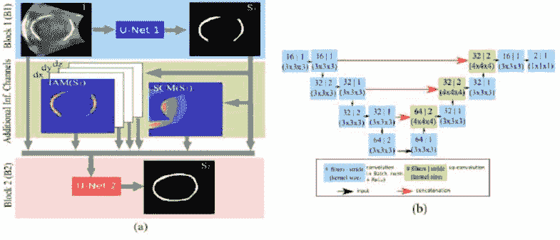

目前，胎儿头围和腹围（AC）的估计是由受过良好训练的放射学家从超声图像中手动完成的。这些参数是判断孕周的有用基准，但该过程可能耗时且费力。为了解决这些问题，研究人员开发了一种机器学习方法，该方法考虑了熟练放射学家的决策，以自动化估计过程。相比之下，早期自动化胎儿结构估计方法的努力基于图像强度值。这通常会导致对区分度高的解剖结构进行准确分割，但在测量低对比度特征时可能会失败。研究人员采用了三步法。第一步，他们获得了腹围的初步估计。卷积神经网络（CNN）被用于确定超声图像中的胃泡、羊水和脐静脉，并从这三个特征推导出腹围的估计值。这种方法的新颖之处在于第二步，其中图像连同腹围估计值一起被输入第二个 CNN。然后该 CNN 使用这些数据来估计母体肋骨等骨性结构的位置。然后利用这些信息来优化腹围的初步估计值。在最后一步，研究人员将最终的腹围测量值连同超声图像一起传递给一种称为 U-net 的特定 CNN 类别。U-net 决定超声图像连同腹围估计值是否被接受或拒绝，其方式模仿了临床医生的决策。通过这种方式，机器学会了寻找什么。Kim 和同事使用 112 张图像训练每个 CNN 和 U-net，并使用 62 张图像评估腹围。他们在 87.10% 的验证案例中获得了超声图像的准确分割，包括因显示错误解剖平面而被机器拒绝的图像。商业系统可用于从超声图像估计腹腔体积。然而，这些方法由于无法利用超声图像中的结构信息（例如肋骨引起的阴影伪影），往往无法满足临床要求。通过使用多个 CNN 和 U-net 的组合，研究人员表明机器有能力学习如何提供这些结构信息，从而通过自动分割图像并以良好的准确度协助临床医生。

Cerrolaza 等人（2018）提出了一种新的两阶段级联方法作为替代架构，具有额外的信息通道。这些新通道主要用于解决胎儿 3D 超声图像分割过程中出现的阴影和淡化效应等困难，以便为头骨的完整重建提供相关信息。所提出框架的总体流程图如图 11(a) 所示。该分割算法将分割过程分为两部分，使用 3D 卷积 U-Net，这是一种完全卷积神经网络，包括在收缩编码器和随后的扩展解码器之间的快捷连接；如图 11(b) 所示，这是架构的基本结构元素。将原始 3D 超声图像体积作为单个输入通道，第一个块（B1）通过分割超声图像中可见的颅骨来生成头骨的部分重建。尽管超声成像存在较大伪影和非常低的信噪比，但骨组织可以根据其高回声特征和弯曲结构模式部分识别。由于许多卷积层和池化层的顺序组合，所提出的基于 CNN 的架构在不同分辨率下学习特定滤波器，能够识别这些区别特征，并提供头骨的一些不完整的初步估计。基于这一初步估计，第二个块（B2）生成头骨的完整重建，连接由淡化和阴影效应组合产生的那些缺口和缺失部分。受自上下文架构启发，B1 的输出概率图被用作 B2 的额外输入通道，从而提供有价值的上下文和解剖图像信息。此外，B2 的输入还通过两个额外通道完成，即入射角图（IAM）和阴影投射图（SCM），两者都源自 B1 中获得的初始部分分割。IAM 和 SCM 分别提供关于超声成像基本物理、超声波前入射角度以及探头附近骨结构引起的阴影效应的必要互补信息。

## 使用 OX N NET 估计胎盘体积的分割

出生体重可以根据第一孕期胎盘体积（Pl Vol.）和使用 B 模超声测量的 Pl Vol. 来估计，可用于监测胎儿生长。许多研究表明，妊娠 11 至 13 周之间 PI Vol. 过低可能导致不良妊娠结局，包括胎儿生长受限（SGA）和子痫前期。PI Vol. 还被证明与其他 SGA 生物标志物（如妊娠相关血浆蛋白 A（PAPP-A）和颈项透明层）独立，最近一项彻底的研究得出结论，它可以成功整合为一种未来的多变量 SGA 筛查方法，类似于目前用于筛查胎儿非整倍体的“联合筛查”。由于 PI Vol. 是在提供此例行联合筛查的同一妊娠期测量的，因此不需要额外的超声扫描，使其对全球医疗保健提供者更具经济吸引力。

放射学家确定 PI Vol. 的唯一可用方法是检查 3D 超声图像，识别胎盘并手动标记它。已开发出诸如 Virtual Organ Computer-aided Analysis（VOCAL；通用电气医疗）和半自动随机步行者导出（RW-derived）方法等软件工具来估计胎盘体积。但这种方法太耗时，且其准确性取决于放射学家。为了使 PI Vol. 成为监测胎儿生长的有用指标，需要一种可靠、实时、独立于放射学家的胎盘体积估计技术。Looney 等人（2018）提出了一种从 3D 超声图像实时、全自动估计 PI Vol. 的技术。他们还研究了分割准确性与训练数据集大小之间的关系，并找到了最大化分割准确性所需的适当训练数据量。最后，他们评估了由全自动 fCNN 方法生成的 PI Vol. 估计值预测足月 SGA 的性能。深度学习结合异常大的实测数据集，用于生成一种使用 3D 超声图像自动分割胎盘的自动图像分析工具。该研究使用了迄今为止最大的 3D 医学图像数据集进行 fCNN 训练。在许多数据科学竞赛中，表现最好的模型使用了与表现较差的模型相似的模型架构，但采用了数据增强来人为增加训练集，这表明性能与数据集大小之间存在关联。这里呈现的学习曲线表明，在进行端到端训练时，需要大型训练集和/或数据增强这一关键发现。该模型架构的均方误差学习曲线显示，随着训练集大小的增加，训练曲线和验证曲线趋同于 0.275。这体现在训练样本中的单调增加中，其中 1,200 个训练病例的 DSC 为 0.81，而 100 个病例的 DSC 为 0.73。模型在包含 100、150、300、600、900 和 1,200 个病例的训练集上进行端到端训练。验证集上的均方误差从 0.039 单调减少到 0.030，而训练集上从 0.01 单调增加到 0.025。训练过程中在验证集上获得的中位数（四分位距）DSC 从 0.73（0.17）单调增加到 0.81（0.15）。统计分析表明，随着训练集大小的增加，DSC 值有显著改善。

## 总结

深度学习已被用于分析广泛的解剖结构，包括大量专注于医学图像分割的研究。完全卷积网络（FCN）经常被使用。这些网络与卷积神经网络密切相关，但它们为每个像素或体素预测一个值，而不是对整个图像做出单一预测。在本章中，Hyper Dense Net、Organ Attention Net、UNet、Link Net、VNet、Dilated Fully Convolutional Network、MCA Net Transfer Learning 等各种卷积神经网络模型在不同多模态


### 图 12. FCN 全卷积网络

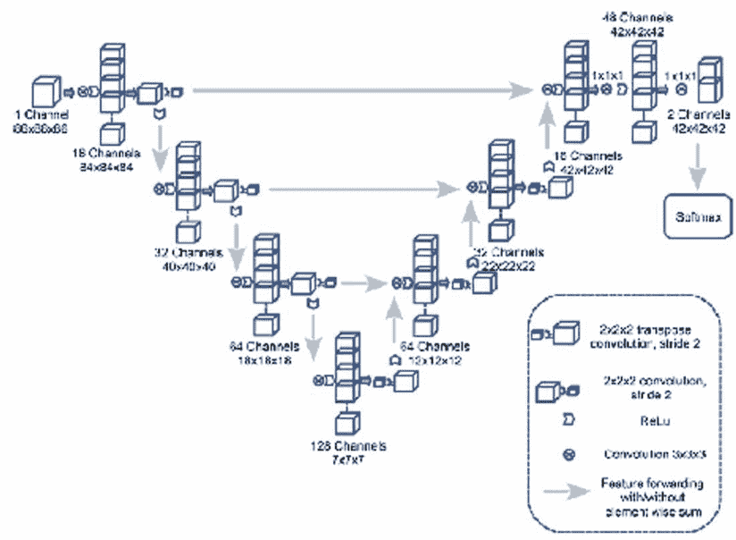

图像被深入探索。一个定义良好的数据集，尤其是大规模数据集，对于基于深度学习的技术至关重要。

深度学习是机器学习的一个子集，是一种表征学习方法，将直接处理并自动从数据（例如，断层扫描图像）中学习中级和高级抽象特征。它有潜力在不同的医学影像模式中执行自动医学图像分割任务，例如病灶/结节分类、器官分割和目标检测。由于 AlexNet（一种深度卷积神经网络（CNN）和深度学习方法的代表）赢得了 2012 年 ImageNet 大规模视觉识别挑战赛（ILSVRC），深度学习开始在机器学习领域引起关注。一年后，深度学习被选为十大突破性技术之一，这进一步巩固了其作为各种研究领域（特别是一般图像分析（包括自然和医学图像分析）及计算机视觉）中领先机器学习工具的地位。截至目前，深度学习在网络架构或模型方面取得了快速发展，例如更深层的网络架构和深度生成模型。同时，深度学习已成功应用于多个研究领域，如计算机视觉、语音识别、遥感和医学图像分析，从而证明深度学习可能是执行自动分析任务的最先进工具，其使用可带来性能的显著提升。深度学习在医学图像分析中的最新应用涉及各种任务，包括传统诊断任务（如分类、分割、检测、注册、生物特征测量和质量评估），以及新兴任务（如图像引导的干预和治疗）。

其中，分类、检测和分割是三个最基本的任务。它们在医学图像分析中被广泛应用于不同的解剖结构，涉及乳腺、前列腺、肝脏、心脏/心脏、大脑、颈动脉、甲状腺、血管内、胎儿、淋巴腺、肾脏、脊柱、骨骼、肌肉、神经结构、舌头等器官。这些任务涉及多种深度网络。标准方法是使用 CNN 模型从获取的数据（例如，断层扫描图像）中学习，以获得层次化抽象表示，然后跟一个 softmax 层或其他线性分类器（例如，支持向量机），用于生成一个或多个概率或类别标签。图像标注或标签对于执行不同的图像分析任务是必要的，这被称为“监督学习。”无监督学习也能够在没有适当标签的情况下从数据中学习表示。自动编码器（AE）和受限玻尔兹曼机（RBM）是医学图像分析中最常用的两种无监督神经网络，有望提升性能。无监督学习相对于监督学习有一个显著优势，即不需要使用耗时、劳动密集且昂贵的人工标注。尽管与语义分割密切相关，但医学图像分割包括需要解决的特定挑战，例如标记数据稀缺、基准真值中的高类别不平衡以及三维图像的高内存需求。虽然用卷积替换全连接层可以高效且同时预测多个像素，但生成的输出通常分辨率非常低。这是因为 CNN 以多种方式减小输入的大小。滤波器大小大于 1 x 1 的卷积层会减小其输入的大小。这种像素丢失可以通过将输入用零值像素填充来扩展来防止。

## 参考文献

- Chen, L., Papandreou, G., Kokkinos, I., Murphy, K., & Yuille, A. L. (2018b). DeepLab：带深度卷积网络、空洞卷积和全连接 CRF 的语义图像分割. IEEE 模式分析与机器智能期刊, 40(4), 834–848. doi:10.1109/TPAMI.2017.2699184 PubMed
- Dolz, J., Gopinath, K., Yuan, J., Lombaert, H., Desrosiers, C., & Ben Ayed, I. (2019). 超稠密连接 CNN 用于多模态图像分割. IEEE 医学成像期刊, 38(5), 1116–1126. doi:10.1109/TMI.2018.2878669 PubMed
- Kumar, A., Fulham, M., Feng, D., & Kim, J. (2018). 从肺癌 PET-CT 图像中共同学习特征融合图. IEEE 医学成像期刊. 提前在线发表. PubMed doi:10.1109/TMI.2019.2923601
- Looney, Stevenson, Nicolaides, Plasencia, & Molloholli, Natis, & Collins. (2018). 使用深度学习进行完全自动化、实时 3D 超声分割以估计第一孕期胎盘体积. JCI Insight, 3(10). 提前在线发表. doi:10.1172/jci.insight.120178
- Pereira, S., Pinto, A., Alves, V., & Silva, C. A. (2015). 用于多序列 MRI 中胶质瘤分割的深度卷积神经网络. 脑病变国际研讨会：胶质瘤、多发性硬化、中风和创伤性脑损伤, 131–143.
- Ponomarev, G. V., Gelfand, M. S., & Kazanov, M. D. (2012). 胎儿超声图像分割的多阈值结合边缘检测和基于形状的识别. In Proc. Chall. US biometric Meas. from fetal ultrasound images (pp. 17–19). ISBI.
- Rueda, S., Fathima, S., Knight, C. L., Yaqub, M., Papageorghiou, A. T., Rahmatullah, B., Foi, A., Maggioni, M., Pepe, A., Tohka, J., Stebbing, R. V., McManigle, J. E., Ciurte, A., Bresson, X., Cuadra, M. B., Sun, C., Ponomarev, G. V., Gelfand, M. S., Kazanov, M. D., ... Noble, J. A. (2014). 用于生物特征测量的当前胎儿超声图像分割方法的评估与比较：一项大挑战. IEEE 医学成像期刊, 33(4), 797–813. doi:10.1109/TMI.2013.2276943 PubMed
- van den Heuvel, T. L. A., de Bruijn, D., de Korte, C. L., & van Ginneken, B. (2018). 使用 2D 超声图像自动测量胎儿头围. PLoS One, 13(8). doi:10.1371/journal.pone.0200412
- Xu, L., Tetteh, G., Lipkova, J., Zhao, Y., Li, H., Christ, P., Piraud, M., Buck, A., Shi, K., & Menze, B. H. (2018). 使用深度学习方法在 68Ga-Pentixafor PET/CT 成像中对多发性骨髓瘤进行全身骨病变自动检测. 对比媒体与分子成像, 23, 919–925.
- Yin, Peng, Li, Zhang, You, Fischer, Furth, Tasian, & Fan. (2018). 使用后续边界距离回归和逐像素分类网络对超声图像进行自动肾脏分割. doi:10.1016/j.media.2019.101602
- Zheng, Q., Furth, S. L., Tasian, G. E., & Fan, Y. (2019). 基于整合纹理图像特征和深度迁移学习图像特征的超声成像数据中儿童肾脏和泌尿道先天性异常的计算机辅助诊断. 儿科泌尿学期刊, 15(1), 75.e71–75.e77. doi:10.1016/j.jpuroL.2018.10.020 PubMed
- Zheng, Q., Warner, S., Tasian, G., & Fan, Y. (2018b). 用于 2D 超声图像中肾脏分割的带整合多特征图的动态图割法. 学术放射学, 25(9), 1136–1145. doi:10.1016/j.acra.2018.01.004 PubMed
- Zhou, L., Zhang, C., & Wu, M. (2018). D-linknet：带预训练编码器和空洞卷积的 Linknet，用于高分辨率卫星图像道路提取. IEEE 计算机视觉与模式识别研讨会论文集, 182–186. doi:10.1109/CVPRW.2018.00034

# 第 3 章 医疗保健中生物医学图像分析的深度学习技术

Sivakami A.
https://orcid.org/0000-0001-5075-6365
印度巴拉特工程技术学院, 印度

Balamurugan K. S.
印度巴拉特工程技术学院, 印度

Bagyalakshmi Shanmugam
印度斯里·拉马克里希纳技术学院, 印度

Sudhagar Pitchaimuthu
英国斯旺西大学, 英国

## 摘要

生物医学图像分析与公共卫生和福祉高度相关。深度学习正在快速增长，并在医疗应用中展现出增强的性能。它也已在学术界和工业界得到广泛应用。利用各种深度学习方法进行医学影像分析，旨在构建能够帮助识别疾病并自动化解释生物医学图像以辅助治疗规划的系统。机器学习的新进展主要涉及使用深度学习来识别、分类和量化医学图像中的模式。深度学习（一种更精确的卷积神经网络）在解决视觉问题方面相较于机器学习表现出色。本章总结了所使用的不同深度学习技术及其在医学图像解释中的应用，并展望了未来方向。


## 引言

近年来，深度学习（DL）（LeCun et al., 2015）已对科学技术的众多领域产生重大影响。它在音频识别（Dahl et al., 2012）和图像识别（Krizhevsky et al., 2012）等方面取得了进展和突破，它可以开发出在围棋（Silver et al., 2016）和 ATARI 游戏（Mnih et al., 2015）中战胜人类玩家的人工智能代理，并能生成具有艺术感的新图像（Mordvintsev et al., 2015; Tan et al., 2017）和音乐（Briot et al., 2017）。最终目标是开发出可帮助疾病诊断的系统，自动化读取和检查医学图像这一困难且耗时的任务，并促进治疗规划。我们需要能够利用机器学习方法，自动将医学图像（例如，乳腺 X 光片或活检图像）分类为健康（非癌性）或不健康（癌性）。（M H Hesamian et al., 2019）。诊断和治疗决策可以基于对不健康图像的了解来做出。目标是利用独特且创新的深度学习技术实现自动分类和分割，并达到极高的准确率（Shen et al., 2017）。特定图像的诊断既取决于图像获取，也取决于图像解释。近年来，图像获取设备已得到一定程度的发展，用于获取高分辨率放射学图像（X 射线、CT 和 MRI 扫描等）。但是，我们开始在自动化图像解释方面获得更多好处（L B Curiel et al., 2019）。计算机视觉利用机器学习技术来检测作为输入的图像模式，并以大小、颜色等形式给出结果。由于患者数据种类繁多，传统学习方法在未来无法保证有效。目前，深度学习在各个领域尤其是医学领域备受关注。预计未来将占据 $300 百万的医学影像市场。2021 年，深度学习在医学领域的发展将比其他行业更加迅速。它是监督学习中最强大的复杂方法。DL 特别用于研究精神和神经疾病，无需手动特征选择。

在医学影像中实施的 DL 技术可能会增强并推动由于数字成像的出现而观察到的创新技术。在过去 15 年里，大多数研究人员明白 DL 的应用将造福人类，不仅智能机器将完成诊断，还将有助于疾病预后、药物管理和疾病治疗控制。深度学习已在眼科、病理学、癌症检测、放射学等多个领域产生变革。眼科是医疗保健中第一个被改变的领域，然而，病理学和癌症诊断等其他领域目前也已获得认可，并以适当的效率获得了足够的应用。

医学图像分割、识别和解析现代成像技术（如 X 射线、超声、CT 或 MRI）产生的不同医学图像中的器官。成像技术产生的图像必须提供关于人体器官形状和体积的关键信息。几位研究人员报告称（Suzuki et al., 2017; Lakhani et al., 2018; Kim et al., 2018），利用现有的 DL 方法已经开发出巨大的自动分割系统。更先进的系统是基于数学方法和边缘检测滤波器等常见方法构建的。针对图像特征的机器学习方法在较长一段时间内已成为比其他方法更有影响力的技术。由于硬件的发展，DL 方法开始登上舞台，并在学术界和工业界开始对图像处理任务进行实际演示。深度学习程序的能力开始为图像分割提供良好的机会，也适用于医学图像分割。在过去几年中，DL 技术在图像分割领域（Breininger et al., 2018）备受关注。关于医学图像分割有几篇现代综述和研究文章（Alexander Lundervold et al., 2019; Maier et al., 2019）。图 1 展示了生物医学领域中 BD 和 DL 的情况。深度学习是一个多学科研究领域，包括物理学、生理学、信号与系统（ss）、数学、计算机科学、生物学和医学。

### 图 1. 生物医学信息（如生物医学信号和图像、基因组序列以及 EHR）如何在医疗保健的特定领域中由 BD 和 DL 进行管理的图表。转载自 L B Curiel et al., Appl. Sci. 2019。

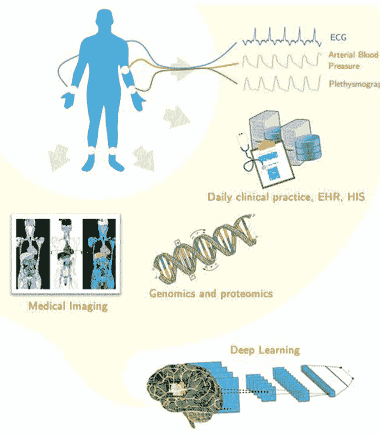

## 医学影像类型

各种计算机辅助检测系统已开发出来，并于 2010 年代初期纳入临床工作流程。放射学应用中医学影像的主要职责是识别结构异常，并将其分类为疾病分类。不同的先进成像技术包括显微镜、X 射线、计算机断层扫描（CT）和磁共振成像（MRI）（Ker et al., 2017; Lee et al., 2017; Litjens et al., 2017; Shen et al., 2017）

### X 射线成像技术

这是一种利用 X 射线、伽玛射线等电离或非电离辐射来观察物体内部结构的成像技术。它使用一束宽广的 X 射线来观察器官中成分不均匀的物质。该技术产生的图像用于评估疾病、损伤或异物的存在与否。

### MRI-磁共振成像技术

MRI 利用强大的磁体，在氢原子的共振频率下发射射频脉冲，以极化并刺激人体组织中水分子的氢原子核。MRI 不使用 X 射线或电离辐射。MRI 在医院中广泛使用，被认为比 CT 扫描更合适，因为 MRI 在不使身体暴露于辐射的情况下进行医学诊断。MRI 扫描耗时较多，且设备比其他扫描更大。

### 超声成像技术

超声利用高频声波来生成组织的 3D 图像。它通常与孕妇的胎儿成像相关联。超声也用于观察人体的各种内部部位，如腹部器官、乳房、心脏、肌腱、动脉、肌肉和静脉。与 CT 或 MRI 扫描相比，它提供的解剖细节较少。一项重要改进是超声成像有助于在实时分析运动结构，且无辐射。非常可靠，操作快速，无任何不良影响，且相对经济。

### 内镜成像技术

内镜检查使用内镜直接插入器官来研究人体的中空器官。内镜的种类因观察部位而异，由医生操作。

### 热成像技术

热成像技术通过测量身体发出的红外辐射，生成体表温度变化的图形可视化图像。温度升高，辐射量随之增加。它适用于实时捕捉移动物体。热成像相机非常有价值。包含温度信息的物体图像可能无法产生完美的热成像。

## 深度学习的硬件与软件

GPU 是并行计算引擎，处理图形数据的速度比中央处理器（CPU）更快。在现代硬件中，GPU 深度学习通常比 CPU 快 10–30 倍。考虑到硬件，大多数深度学习方法背后的动机是存在开源软件包（OSS）。提供深度神经网络操作中高效 GPU 实现的机构。当前最流行的软件包详情如下。

- 1. Theano (Bastien et al., 2012): 提供 Python 接口
- 2. Tensorflow (Abadi et al., 2016): 提供 C++ 和 Python 接口。
- 3. Torch (Collobert et al., 2011): 提供 Lua 接口，并被 Facebook AI 研究使用
- 4. Caffe (Jia et al., 2014): 提供 C++ 和 Python 接口

## 深度学习方法

DL 是 AI 中机器学习的一部分，使用多层网络能够自动从数据集中转换特征，用于图像、音频、视频和文本等各种任务，准确度高（Shen et al., 2017; Schmidhuber, 2015）。DL 会以自学的方式自动学习复杂的数据表示，并识别输入和输出之间更复杂的关系（LeCun et al., 2015）。几位研究人员和数据科学家对使用不同的 DL 方法以在各种应用中实现破纪录的性能产生了兴趣（Krizhevsky et al., 2012; Wu et al., 2016）。DL 方法分为 5 个主要组别（如图 2 所示）

- 1. CNNs
- 2. 序列模型（循环神经网络 (RNNs)）
- 3. 深度神经网络（自动编码器）
- 4. 预训练模型
- 5. 深度生成模型（受限玻尔兹曼机 (RBMs)）

## 卷积神经网络架构 (CNNS)

这是一种重要的 DL 算法，用于图像分类、人脸识别、目标检测和图像识别等。CNN 架构由 3 个不同的层组成，其图示如图 3 所示。


Figure 2. 不同现有深度学习模型

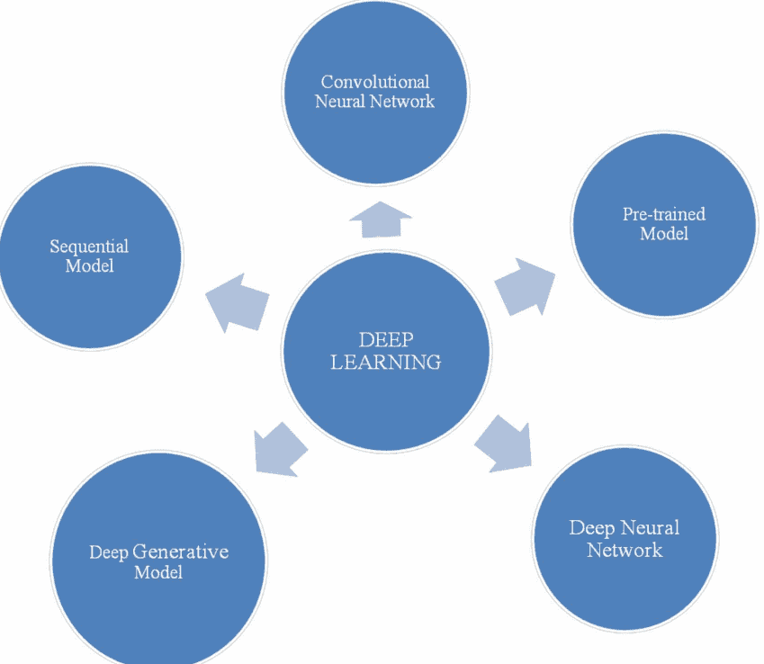

## 卷积层 (CL)

卷积层是卷积神经网络的主要构建模块。它通过使用输入数据的方形来利用图像特征，提供像素之间的关系。卷积层第一部分中执行操作所涉及的元素称为内核或滤波器。如果应用于图像的小区域，该区域中的像素将被转换为单个像素。

## 池化层 (PL)

池化层是添加在卷积层之后的一种层，用于汇总CL生成的特征图的一个区域。该层负责逐渐减小表示的空间大小以及网络中的计算量和参数数量。与不同池化层相比，最大池化（Max-Pooling）是最重要的方法，并广泛用于CNN架构中，以详细分析所有前置层的输出。

Figure 3. 典型CNN架构的示意图 (Khvostikov et al. 2018)

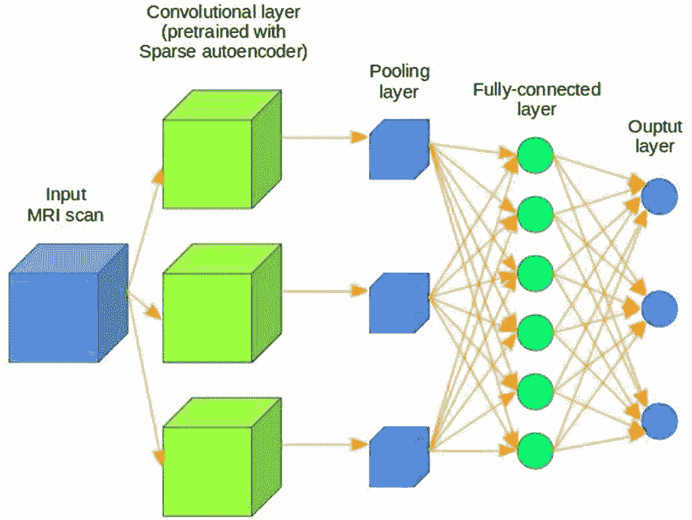

## 全连接层 (FCL)

全连接层是CNN的重要组成部分，已被证明在计算机视觉中的图像分类和识别方面取得成功。(van Gerven et al. 2017)。它表示输入的特征向量，也简单称为前馈神经网络。机器学习应用中使用的最强大的现代CNN包括AlexNet (Krizhevsky et al. 2012)、Clarifai (Mamoshina et al. 2016)、VGG (Simonyan et al. 2014)和GoogleNet (Szegedy et al. 2014)。图4展示了生物医学应用中各种推荐网络。

## 循环神经网络 (RNNs)

循环神经网络(RNN)是另一种AI网络，用于对来自CT、动态MRI和超声图像的数据进行排序。RNN应能够记住过去，并处理来自背景历史的图像知识以推进其现有决策。例如，给定一系列图像，RNN将第一幅图像作为输入进行处理，捕获信息以进行预测，然后记住这些信息，以便在网络中估计下一幅图像。RNN家族中最广泛使用的两种架构是门控循环单元(GRU)和长短期记忆(LSTM)(Zhou et al. 2015)，能够如图5所示建模长期记忆。

不同深度学习网络及其图像在表1中展示。

## 医学影像中的深度学习应用

它涉及为了治疗和诊断目的，对移动对象的功能图像进行获取、处理和可视化。(Haque et al. 2020)。医学图像分析的解释由医生和放射学家手动进行。然而，由于人类专家存在疲劳差异，计算机辅助干预已开始并受益。生物医学领域深度学习应用的重点涉及计算机辅助图像的分类和检测。

Figure 5. RNN的示意图

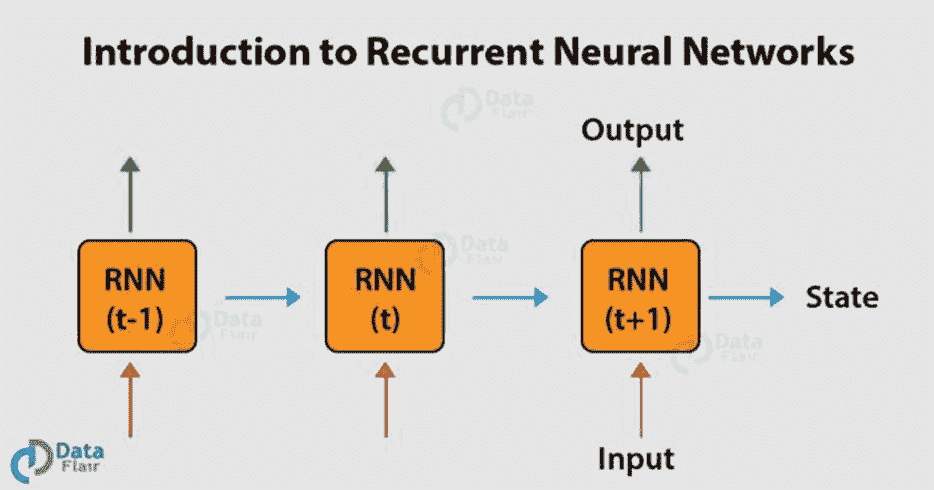

Figure 6. 基于Google Scholar收集的健康信息学中不同深度学习方法的百分比表示 (Ravi et al. 2017)。

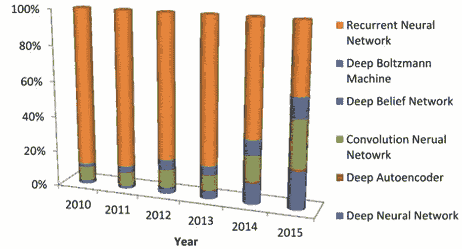

Table 1. 由嵌入对象表示的不同深度学习架构 (Ravi et al. 2016)

| 架构 | 描述 |
| :--- | :--- |
| [图：输入层 -> 隐藏层1 ... 隐藏层N -> 输出层] | **深度神经网络 (DNN)**<br>- 深度框架，通常用于图像分类或回归<br>- 由多个隐藏层组成<br>- 允许表达复杂假设 |
| [图：输入层 -> 隐藏层1 ... 隐藏层N -> 输出层] | **深度自编码器**<br>- 由Hinton等人(2006)提出和设计，用于创新和降维<br>- 输入和输出节点数量相等<br>- 重建向量(输入)<br>- 无监督学习 |
| [图：可见层 -> 隐藏层1 ... 隐藏层N-1 -> 隐藏层N] | **深度置信网络**<br>它是RBM的构造<br>(Hinton et al. 2006)<br>- 允许网络的无监督和有监督训练 |
| [图：可见层 -> 隐藏层1 ... 隐藏层N-1 -> 隐藏层N] | **深度玻尔兹曼机**<br>- 基于玻尔兹曼家族的不同程序<br>(Hinton et al. 2006)<br>- 独立占据无向连接 |
| [RNN架构图] | 循环神经网络<br>- 输出依赖于前置计算的特定重要性<br>- 在所有步骤中执行等权重划分 |
| [CNN架构图] | 卷积神经网络<br>- 完全用于2D数据图像<br>- 所有受保护的卷积滤波器将其输入转换为神经元的3D输出激活<br>- 视觉皮层的神经生物学模型 |

大多数深度学习研究论文在生物和医学影像领域发表，考虑了核图像分割、定位和分类，并使用深度CNN检测乳腺病理学图像中的有丝分裂。与不同生物医学应用相关的生物医学子领域在图7中表示。

### 分类

DL计算机视觉利用大量样本，在大多数情况下使用迁移学习。DL社区的人们出于多种原因使用迁移学习技术。两个主要原因是：首先，使用预训练权重进行特征提取；其次，将预训练权重应用于现有网络，并使用新数据集进行微调。例如，已进行了多项研究，其中训练权重用于形成ImageNet数据集。在众多研究中，一些研究报告了使用迁移学习进行医学图像分类的最佳结果。另一项出色的皮肤癌分类工作，他们在皮肤癌疾病识别中达到了皮肤科医生水平的性能。在这项工作中，Google Inception-v3模型与迁移学习一起使用(Suzuki et al. 2016; Shen et al. 2017)。

深度卷积神经网络方法大量应用于神经影像，例如来自MRI的脑肿瘤、阿尔茨海默病分割和分类(Ravi et al. 2016)。为此，不同模型中应用了2D和3D卷积核。此外，像神经影像一样，不同深度CNN技术也应用于肺部疾病图像的检测和分类分析，与机器学习方法相比，可以实现非凡的性能。

Figure 7. 不同水平生物医学应用的示意图 (Zemouri et al. 2019)

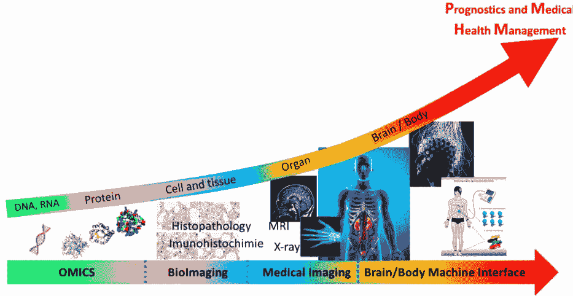

### 分割

众多深度学习模型专门用于医学图像分割任务，以解决数据不足和类别不平衡问题(Suzuki et al. 2017; Ker et al. 2017)。最快且最精确的医学图像分割称为“U-Net”。已引入不同类型的U-Net模型用于基于CNN的医学图像数据分割。图像配准和分割中存在的跳跃连接的影响已使用U-Net和其他残差网络进行了评估。

### 计算机辅助检测

过去几年，医学影像和数据采集系统已得到很大改进。当前CAD系统旨在实现两个目标：检测和假阳性降低。基于检测算法可以实现主要目标，DL方法在检测任务中发挥着巨大的性能。(Haque et al. 2020; Liang et al. 2014)。另一方面，继承的ML程序（如SVM、PCA）也用于此目的。不幸的是，传统基于ML的CAD在临床实践中效果不佳。然而，新的基于DL的技术在不同模态的医学影像中为假阳性修复任务提供了出色的表现。最近，已有许多CAD方法被推荐用于乳腺癌检测、肺癌检测和阿尔茨海默病(AD)(Putin et al. 2016)。


## 未来研究方向

深度学习在医疗应用和学术界都是一个快速发展的领域。另外，与在临床环境中引入几种深度学习方法相比，存在许多困难，但这些方法提供可靠回报，且太宝贵而不能放弃。DL 性能取决于两个主要因素，即高性能计算能力的可用性和第二是海量数据（Lundervold et al., 2019）。此前，基于数学、物理、化学和工程的足够高影响力软件系统已进入诊所的日常工作流，因此对其他此类系统的接受度可能会增长。边缘计算中生物传感器作为可穿戴设备的引入，用于持续观察不同疾病，构成了一个深度学习及其他计算医学技术的生态系统。AI 和 DL 逐步实现的自动化系统、解决方案和工具正在接管整个业务领域。最后，公司与研究实验室之间存在人工智能的双向流动，旨在提升客户体验以及高速数据分析。

## 结论

深度神经网络（DNNs）目前正在机器学习的所有领域中扮演重要的主要工具角色，尤其是在生物医学成像、组学、脑机接口和公共卫生福利方面。讨论了不同的 DL 技术及其在图像分析不同阶段的应用。在所有现有 DL 网络中，端到端 CNN 正受到日益关注，以替代传统的手工制作机器学习方法。本章总结了 CNN 是最知名和流行的深度神经网络，以及图像如何被分类和检测。在大多数情况下，迁移学习揭示了生物医学成像应用的效果。深度学习技术是这些数据的有前途的诠释者，用于疾病预测、诊断、预防和治疗。我们预计更多深度学习应用将在生物医学领域变得可及，例如流行病预测、疾病预防和临床决策。

## 参考文献

- Breininger, K., & Würfl, T. (2018). 教程：如何构建深度学习框架。https://github.com/kbreininger/tutorial-dlframework

- Briot, J., Hadjeres, G., & Pachet, F. (2017). 用于音乐生成的深度学习技术——一项综述。CoRR abs/1709.01620

- Collobert, Kavukcuoglu, & Farabet. (2011). Torch7：类似 MATLAB 的机器学习环境。Academic Press.

- Cuirel, L. B., Romero, S. M., Cuireses, A., & Alvarez, R. L. (2019). 医疗保健中的深度学习和大数据：面向批判性学习者的双重综述。Appl. Sci., 9(11), 2331.

- Dahl, G. E., Yu, D., Deng, L., & Acero, A. (2012). 用于大词汇量语音识别的上下文相关预训练深度神经网络。IEEE Transactions on Audio, Speech, and Language Processing, 20(1), 30–42. doi:10.1109/TASL.2011.2134090

- Hesamian, M. H., Jia, W., He, X., & Kennedy, P. (2019). 医学图像分割的深度学习技术：成就与挑战。Journal of Digital Imaging, 32(4), 582–596. doi:10.1007/s10278-019-00227-x PMID:31144149

- Hinton, G. E., Osindero, S., & Teh, Y.-W. (2006). 深度置信网的快速学习算法。Neural Computation, 18(7), 1527–1554. doi:10.1162/neco.2006.18.7.1527 PMID:16764513

- Hinton, G. E., & Salakhutdinov, R. R. (2006). 使用神经网络降低数据维度。Science, 313(5786), 504–507. doi:10.1126/science.1127647 PMID:16873662

- Haque, I. R., & Neubert, J. (2020). 生物医学图像分割的深度学习方法。Informatics in Medicine Unlocked, 18.

- Jia, Y., Shelhamer, E., Donahue, J., Karayev, S., Long, J., Girshick, R., Guadarrama, S., & Darrell, T. (2014). Caffe：用于快速特征嵌入的卷积架构。载于第 22 届 ACM 国际多媒体会议论文集。ACM. 10.1145/2647868.2654889

- Ker, J., Wang, L., Rao, J., & Lim, T. (2017). 医学图像分析中的深度学习应用。IEEE Access: Practical Innovations, Open Solutions, 6, 9375–9389. doi:10.1109/ACCESS.2017.2788044

- Kim, J., Hong, J., Park, H., Kim, J., Hong, J., & Park, H. (2018). 医学影像中深度学习的前景。Precis Future Med., 2(2), 37–52. doi:10.23838/pfm.2018.00030

- Krizhevsky, A., Sutskever, I., & Hinton, G. E. (2012). 使用深度卷积神经网络进行 ImageNet 分类。第 25 届神经信息处理系统国际会议论文集, 1097–1105.

- Krizhevsky, A., Sutskever, I., & Hinton, G. E. (2012). 使用深度卷积神经网络进行 ImageNet 分类。神经信息处理系统进展, 1097–1105.

- Lakhani, P., Gray, D. L., Pett, C. R., Nagy, P., & Shih, G. (2018). 医学影像中的深度学习入门。Journal of Digital Imaging, 31(3), 283–289. doi:10.1007/s10278-018-0079-6 PMID:29725961

- LeCun, Y., Bengio, Y., & Hinton, G. (2015). 深度学习。Nature, 521(7553), 436–444. doi:10.1038/nature14539 PMID:26017442

- Lee, J. G., Jun, S., Cho, Y.-W., Lee, H., Kim, G. B., Seo, J. B., & Kim, N. (2017). 医学影像中的深度学习：总览。Korean Journal of Radiology, 18(4), 570–584. doi:10.3348/kjr.2017.18.4.570 PMID:28670152

- Liang, Z., Zhang, G., Huang, J. X., & Hu, Q. V. 2014. 基于电子病历的医疗决策深度学习。Proc. Int. Conf. Bioinformatics. Biomed., 556–559. 10.1109/BIBM.2014.6999219

- Litjens, G., Kooi, T., Bejnordi, B. E., Adiyoso Setio, A. A., Ciompi, F., Ghafoorian, M., van der Laak, J. A., van Ginneken, B., & Sánchez, C. I. (2017). 医学图像分析中的深度学习综述。Medical Image Analysis, 42, 60–88. doi:10.1016/j.media.2017.07.005 PMID:28778026

- Lundervold, A. S., & Lundervold, A. (2019). 医学影像中深度学习概述（侧重于 MRI）。Zeitschrift für Medizinische Physik, 29(2), 102–127. doi:10.1016/j.zemedi.2018.11.002 PMID:30553609

- Maier, A., Syben, C., Lasser, T., & Riess, C. (2019). 医学图像处理中深度学习的温和入门。Zeitschrift für Medizinische Physik, 29(2), 86–101. doi:10.1016/j.zemedi.2018.12.003 PMID:30686613

- Mamoshina, P., Vieira, A., Putin, E., & Zhavoronkov, A. (2016). 生物医学中的深度学习应用。Molecular Pharmaceutics, 13(5), 1445–1454. doi:10.1021/acs.molpharmaceut.5b00982 PMID:27007977

- Mnih, V., Kavukcuoglu, K., Silver, D., Rusu, A. A., Veness, J., Bellemare, M. G., Graves, A., Riedmiller, M., Fidjeland, A. K., Ostrovski, G., Petersen, S., Beattie, C., Sadik, A., Antonoglou, I., King, H., Kumaran, D., Wierstra, D., Legg, S., & Hassabis, D. (2015). 通过深度强化学习实现人类水平控制。Nature, 518(7540), 529–533. doi:10.1038/nature14236 PMID:25719670

- Mordvintsev, A., Olah, C., & Tyka, M. (2015). Inceptionism：深入神经网络。Google Research Blog.

- Putin, E., Mamoshina, P., Aliper, A., Korzinkin, M., Moskalev, A., Kolosov, A., Ostrovskiy, A., Cantor, C., Vijg, J., & Zhavoronkov, A. (2016). 人类衰老的深度生物标志物：将深度神经网络应用于生物标志物开发。Aging (Albany NY), 8(5), 1–21. PMID:27191382

- Ravi, D., Wong, C., Deligianni, F., Berthelot, M., Andreu-Perez, J., Lo, B., & Yang, G.-Z. (2017). 健康信息学中的深度学习。IEEE Journal of Biomedical and Health Informatics, 21(1), 4–21. doi:10.1109/JBHI.2016.2636665 PMID:28055930

- Schmidhuber, J. (2015). 神经网络中的深度学习：一项综述。Neural Networks, 61, 85–117. doi:10.1016/j.neunet.2014.09.003 PMID:25462637

- Shen, D., Wu, G., & Il Shuk, H. (2017). 医学图像分析中的深度学习。Annual Review of Biomedical Engineering, 19(1), 221–248. doi:10.1146/annurev-bioeng-071516-044442 PMID:28301734

- Silver, D., Huang, A., Maddison, C. J., Guez, A., Sifre, L., Van Den Driessche, G., Schrittwieser, J., Antonoglou, I., Panneershelvam, V., Lanctot, M., Dieleman, S., Grewe, D., Nham, J., Kalchbrenner, N., Sutskever, I., Lillicrap, T., Leach, M., Kavukcuoglu, K., Graepel, T., & Hassabis, D. (2016). 使用深度神经网络和树搜索掌握围棋游戏。Nature, 529(7587), 484–489. doi:10.1038/nature16961 PMID:26819042

- Simonyan, K., & Zisserman, A. (2014). 用于大规模图像识别的非常深度卷积网络。arXiv 2014, arXiv:1409.1556

- Suzuki, K. (2017). 深度学习在医学图像分析中的应用综述。Med Imaging Technol, 35, 212–226.

- Szegedy, C., Liu, W., Jia, Y., Sermanet, P., Reed, S. E., Anguelov, D., Erhan, D., Vanhoucke, V., & Rabinovich, A. (2014). 使用卷积深入。arXiv 2014, arXiv:1409.4842

- Tan, W. R., Chan, C. S., Aguirre, H. E., & Tanaka, K. (2017). ArtGAN：使用条件类别 GAN 进行艺术作品合成。2017 年 IEEE 国际图像处理会议 (ICIP), 3760–4. 10.1109/ICIP.2017.8296985


van Gerven, M., & Bohte, S. (2017). Editorial: 人工神经网络作为神经信息处理模型. Frontiers in Computational Neuroscience, 11, 114–114. doi:10.3389/fncom.2017.00114 PMID:29311884

Wu, G., Kim, M., Wang, Q., Munsell, B. C., & Shen, D. (2016). 基于无监督深度特征表示学习的可扩展高性能图像配准框架. IEEE Transactions on Biomedical Engineering, 63(7), 1505–1516. doi:10.1109/TBME.2015.2496253 PMID:26552069

Zemouri, R., Zerhouni, N., & Racoceanu, D. (2019). 生物医学应用中的深度学习：现状与未来. Applied Sciences (Basel, Switzerland), 9(8), 1526. doi:10.3390/app9081526

Zhou, S., Greenspan, H., & Shen, D. (2017). 医学图像分析中的深度学习. Academic Press.

# 第 4 章

# 机器学习中的异构大规模分布式系统

Karthika Paramasivam
Kalasalingam Academy of Research and Education, 印度

Prathap M.
Wollo University, 埃塞俄比亚

Hussain Sharif
Wollo University, 埃塞俄比亚

## 摘要

TensorFlow 是一种用于传达 AI 计算的接口，也是一种用于执行此类计算的应用。使用 TensorFlow 传达的计算可以在广泛的异构框架中几乎无需更改即可完成，这些框架范围从手机（如电话和平板电脑）到许多计算机和大量计算设备（如 GPU 卡）的大规模可扩展结构。该框架具有适应性，可用于传达广泛的计算，包括深度神经网络模型的计算准备与推导，并已被用于指导分析，将 AI 框架部署到十二个以上的软件工程领域及不同领域，包括语音识别、计算机视觉、电子技术、数据检索、自然语言处理、空间数据检索和设备药物发现。本章展示了 TensorFlow 接口以及我们在 Google 使用的接口。

## 引言

在 Google Brain 项目中，开始研究利用庞大规模的深度神经网络用于 Google 产品的发现与应用，该工作基于（Karthika P 和 P. Vidhya Saraswathi，2017）。作为当前早期工作的一部分，Dist Belief（我们独特的可调度推理架构）已被汇编，该框架一直为我们提供良好服务。我们及 Google 其他人员利用 Dist Belief 进行了广泛研究，涵盖单语言表征学习、图像排序和物体识别模型、视频聚合、逐词语音识别、移动位置、增强学习及其他领域。此外，与 Google Brain 团队密切合作，50 多个 Google 团队及 Alphabet 和其他相关机构经常利用 Dist Belief 传达深度神经网络，应用于广泛领域，包括 Google Search（我们的商业产品）、我们的语音识别系统、Google Photos、Google Maps 和 Street View、Google Translate、YouTube 及其他众多产品。

鉴于我们在 Dist Belief 中的参与，以及对神经网络部署和使用的有吸引力的架构特性与基础的逐步理解，我们开发了 TensorFlow，这是我们用于执行和部署大规模 AI 模型的第二代系统。TensorFlow 采用类似数据流的模型表示计算，并将其映射到广泛的硬件层级。范围从运行移动系统（如 Android 和 iOS）到用于调度和推理的小型框架。这利用带有一个或多个 GPU 卡的单机来设计在大量机器上运行并拥有大量 GPU 的大规模框架。使用能够经历如此广泛阶段的单一框架，从根本上重塑了当前的实践。如我们所发现，为大规模和小规模架构分别设立独立框架会引发基本的支持堆栈和分割咨询。

## 编程表征与基本感知

TensorFlow 计算通过一个有向图表示，该图由大量节点组成。该图表示数据流计算，并进行了扩展，允许某些类型的节点维护和更新内部状态，并以类似于 Naiad 的方式在图中扩展和循环组织结构。用户定期使用一种受支持的前端语言创建逻辑图。图 1 揭示了使用 Python 前端构建和执行 TensorFlow 图的模型组件，下方的计算图也在图 1 中。每个节点在 TensorFlow 图中至少有零个数据源和至少零个输出，表示一个操作的开始。沿图中典型边缘（从输出到输入）流动的值是张量，即任意维度的多维数组，在图创建时评估或推导基本组件形式。图中还存在称为控制依赖的特殊边：除了这些边之外没有信息流动，但它们指定控制依赖基础节点必须在控制依赖目标节点开始执行之前执行。由于我们的模型集成了可变状态，用户可以合法地使用控制条件以允许在连接发生前发生事件。执行通常集成控制标准以对自主操作进行排序，同时作为监控机制，例如监控峰值内存的使用。

## 操作与内核

近年来，我们观察到了巨大的变化，特别是在电子邮件营销等领域，这是由于金融科技扩张、全球化和移动设备普及所致。受此影响的科学领域之一是数据分析，其下有各种名称：统计学、数据挖掘、机器学习、智能数据分析、知识发现。许多新的数据分析技术重新出现，它们利用多种来源的更多不同数据以及当今计算机的更强计算能力。这些技术的一些示例包括支持向量机、文本分析、关联规则、集成技术、子组发现等。这些技术已被接受为许多学科（遗传学、工程、医学、视觉、统计学、营销等）分析标准工具箱的一部分。

## 会话

客户服务通过与 TensorFlow 系统建立 Session 进行通信。Session 接口支持一种扩展技术，通过添加额外节点和边来扩展当前由会话监管的图，以创建计算图（创建会话时底层图为空）。会话维护的另一个重要操作是接收大量待处理的输出名称，就像将一个可选的张量数组在地图中处理，而不是独特节点的输出。使用 TensorFlow 可以表示必须执行的所有节点的传递闭合，以记录已声明的输出，然后可以按尊重其条件的顺序组织正确节点的执行。我们绝大多数的 TensorFlow 工作只需一次将会话与图关联，然后通过 Run 调用成千上万或数百万次地执行完整图或几个明显的子图。

图 1. 对应的统计图

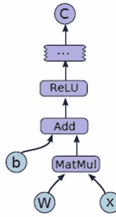

## 变量

在许多不同场合下执行图。大多数张量不执行单次图运行。无论如何，变量是一种特殊操作，它利用对图执行过程中持续存在的临时张量的句柄。对这些持久可变张量的句柄可以传递给一组特定操作，例如 Assign 和 Assign Add（相当于 +=），它们会更改被引用的张量。对于 TensorFlow 的 AI 用途，模型参数通常保存在变量中的张量中，并在模型训练图运行期间刷新。

## 实现

TensorFlow 组织中的基本组成部分是客户端，客户端利用会话边界与至少一个 Worker 类型的 Master 通信，每个 Worker 进程负责中介对至少一个设备的访问，并在 Master 指导下在 Worker 设备上实现图节点。它既支持本地执行，也支持 TensorFlow 接口执行。当客户端、Master 和 Worker 都需在单台计算机上运行于单一操作系统阶段时（例如，如果机器添加了多个 GPU 卡），会使用本地执行。分布式执行共享大部分区域执行的代码，但借助一种情况对其进行扩展，在这种情况中，客户端、Master 和 Worker 可以在不同机器和不同进程中执行。这些独立任务是由集群调度系统监管的作业中的容器，在我们的分布式系统中。这两种单一模式在图 2 中所示。本领域其余大部分内容涉及两种执行方式的核心问题，而第 3.3 节探讨了一些与正确使用相关的特定问题。

## 设备

设备是 TensorFlow 计算的核心。每个 Worker 负责至少一个设备，每个设备都有一种设备类型和一个名称。设备名称由识别设备类型、设备在 Worker 中的记录以及 Worker 在分布式系统中的操作和任务唯一标识的部分组成。模型设备的名称为 “/job: localhost / device: cpu:0” 或 “/job: worker / device:17/device: gpu:3”。每个设备对象负责监控部分和设备内存分配，并组织 TensorFlow 使用中高阶指定的任何片段的执行。

## 张量

在我们的实现中，张量是一种结构化的多维表示。我们支持多种张量类型，包括带符号和无符号整数（8 位到 64 位）、IEEE 浮点和双精度类型、一种复杂数类型以及字符串类型（抽象字节显示）。适当大小的辅助存储由分配器直接分配到张量所在的设备上。张量存储支持引用计数，当没有引用残留时会被释放。


## 单设备执行

接下来，帮助人们思考最简单的执行情况：单个工作节点在单个设备上的操作。图节点在描述节点之间条件的应用程序中实现。实际上，我们为每个节点跟踪一个计数，记录在该节点中尚未实现的条件数量。当此测试降为零时，节点即可执行并被附加到就绪队列。以某种未知顺序，系统处理就绪队列，这会将某个节点的执行片段分配给设备对象。当某个节点完成时，所有依赖于该已完成节点的节点的检查计数都会减少。

## 多设备执行

当系统拥有多个设备时，存在两个基本复杂性：为图中每个节点选择用于定位度量的设备，然后处理这些放置选择所暗示的跨设备边界所需的知识对应。本章探讨这两个方面。

## 节点放置

在给定计算图的情况下，TensorFlow 执行的基本职责之一是勾勒可用设备上计算的布局。关于此估计支持的扩展，请参见第 4.3 节。定位计算的一个贡献是一种开销表示，它涉及对图中每个节点的输入和输出张量大小的评估，以及给定输入张量时每个节点所需计算时间的评估。这种开销表示要么针对特定活动类型的启发式方法动态评估，要么基于之前图执行的真实放置选择进行计算。

Figure 2. Particular machine and Disseminated Organization Structure

图 2. 特定机器与分布式组织结构

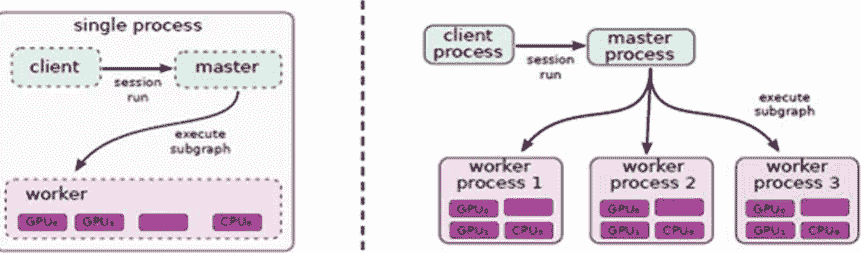

下面所示的复现最终使用贪婪启发式方法为图中每个节点选择一个设备。由此复现创建的节点到设备结构也用作实际执行情况。定位计算从度量图的源开始，并在推进过程中重新创建每个设备上的操作。对于每个刚刚到达的节点，会考虑可行设备的选择（如果设备不支持特定活动，则该设备可能不可行）。在具有特定可行设备的节点中，定位计算使用一种贪婪启发式方法，考虑将节点放置在任何可想象设备上的影响，以完成期间为准。此启发式方法会将开销表示中针对此类设备上的过程测量或预计实施期限纳入考量，还涉及多种通信开销，即将输入从各种设备传输到所考虑设备所需的开销。

将尽快执行节点操作的设备选定为该活动的设备，该阶段的定位过程开始决定图中各个节点的放置选择，包括当前正在为自身复现做准备的下游节点。有一些增强功能允许客户提供见解和部分约束，以管理定位计算。协议的度量是组织内的改进领域。

## 跨设备通信

在注册节点区域后，图被分割成多个子图，每个设备一个。从 x 到 y 的多个跨设备边被清除，并替换为从 x 到 x 子区中另一个 Send 节点的边，以及从子图中类似 Receive 节点到 y 的边。有关此大纲的更新，请参见图 4。

Figure 3. Previous & after the Send / Receive nodes are inserted

图 3. 插入 Send / Receive 节点之前和之后

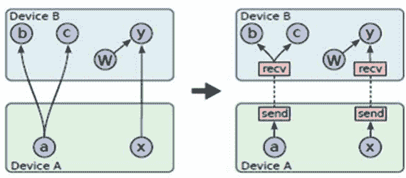

Send 和 Receive 节点的执行计划用于在运行时在设备之间移动信息，参考文献 (Ganesh Babu, R., & Amudha, V 2016)。这有助于我们消除 Send 和 Receive 执行中的所有通信，从而提升运行时的响应速度。一旦添加 Send 和 Receive 节点，它就会规范特定张量的所有客户端，使其使用特定的 Receive 节点，而不是为每个下游客户端在特定设备上使用一个 Receive 节点。这确保了特定张量的源设备和目标设备对之间的信息仅传输一次，并且该张量内存仅在目标设备上分配一次，而不是多次。通过立即处理通信，还可以将图中各个节点在特定设备上的预订分散到工作节点：Send 和 Receive 节点在不同工作节点之间提供关键通信，而设备只需提供一个。为图中每个执行向拥有任何节点的每个工作节点发送需求，而不是参与每个节点的准备或与每个跨设备进行通信。这使得框架显著更具适应性，并且如果必须进行准备，则允许对粒度中心进行更好的操作。

## 分布式执行

图的适当执行基本上与多设备执行相同。在设备定位后，每个设备会呈现一个子图，参考文献 (P Karthika and P Vidhyasaraswathi, 2017)。Send / Receive 节点匹配使用跨工作节点类型的远程通信工具，如 TCP 或 RDMA，来跨越系统界限传输信息。

## 内部故障适应

在分布式执行的各种区域中都可能出现故障。我们依赖的基本故障是 (a) Send 和 Receive 节点对之间通信出错，以及 (b) 从策略到每个主控系统的偶然健康测试。当检测到故障时，整个图的执行会毫无准备地结束并重新启动。但请检查 Variable 节点引用的是跨越图执行存活的张量，参考文献 (Antony Selvadoss, Thanamani, Prathap M, 2018)。我们强调自动检查点以及重启时的状态恢复。每个 Variable 节点都与特定形式的 Save 节点相关联。这些 Save Hubs 会间歇性执行，例如每 N 个周期或每 N 秒，参考文献 (P Karthika and P Vidhyasaraswathi, 2020)。变量的内容在执行时会保留到持久存储中，例如分布式文件结构。基本上，每个 Variable 都与一个 Restore 节点相关联，该节点仅在主循环重启后操作。有关如何在特定图执行中激励某些节点的细节，请参见第 4.2 节。

## 扩展

设想第 2 节中概述的核心编程模型的若干更成熟的特性。

### 梯度计算

许多优化计算，包括标准 AI 计算（如随机梯度下降），都会显示与大量数据源相关的代价函数的斜坡。由于这是典型需求，TensorFlow 已支持计算自动梯度。

如果 TensorFlow 图中的某个张量 C 依赖于某组张量 fXkg，可能通过复杂的活动子图，则会有一个内置函数在该阶段恢复张量 fdC= dXkg。与不同张量一样，梯度张量通过使用伴随方法扩展 TensorFlow 图来处理。如果 TensorFlow 需要处理张量 C 对 C 所依赖的各种张量 I 的斜坡，它首先会在计算图中定位从 I 到 C 的路径。然后，它从 C 回溯到 I，并为每个逆向路径过程向 TensorFlow 图添加一个节点，沿着逆向路径使用链式法则形成偏微分角度。


## 图 4. 图 2 中为图计算的梯度

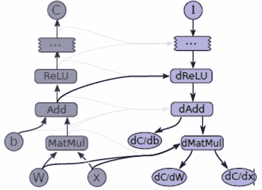

最近添加的节点记录了相关活动的前向模式“角函数”。任何操作都可以调用角功率。

此功能输入的信息不仅包括从现在起并延伸到可预见的未来沿逆向路径计算的破碎梯度，还包括前向活动的数据源和产出。图 5 说明了来自图 2 事件的伪造开支的梯度。乏味的冲击表明对未用于显式练习的倾向函数的潜在贡献。图 1 的常规扩展以处理这些点是：`[db,dW,dx] = tf.gradients(C, [b,W,x])` 总而言之，一个操作可能有多个产出，而 C 可能只依赖其中几个。例如，假设操作 O 有两个产出 y1 和 y2，且 C 依赖于 y2。此时，对 O 的边缘工作的基本贡献被设为 0，因为 dC = dy1 = 0。

斜坡的程序化测量使得变化变得复杂，特别是内存的使用。在执行“前向”计算子图（即由客户明确创建的子图）时，在根据图表构建的顺序选择接下来执行哪个节点时，会建立一个合理的启发式中断。这大多意味着，在创建后不久，临时产出就会被消耗，以便内存可以轻松重新处理。该启发式不够充分；客户可以重新定义图表创建顺序，或按照第 5 节定义的方式包含控制条件。

在倾向节点自然添加到图表的位置，客户的控制较少，而且分离的启发式也不足。特别是，由于倾向反转了前向计算的顺序，因此在图表执行中直接从批次使用的张量在斜坡计算结束时经常被需要。这些张量会占用一批不寻常的 GPU 内存并不必要地限制计算规模。它实际上是通过内存变更来调度管理者以处理这些情况。选项包括使用更先进的启发式来确定图表执行顺序，重新计算张量而不是将其保存在内存中，以及将看似永久的张量从 GPU 内存与更充足的集群 CPU 内存交换。

## 部分执行

消费者通常只需执行整个执行图的子图。出于此原因，当客户在程序集中设置计算图时，运行策略支持实现整个图的任意子图，并沿图中的任何边提供可选详细信息。为恢复沿地图每个边流动的信息。图中的每个节点都有一个名称，每个节点产出都由源节点和编号从 0 开始的节点产出端口来区分（例如，“bar:0”指第一个“bar”节点产出，而“bar:1”指第二个产出）。

两项参数有助于 Run 确定要执行的计算图的特定子图。其次，Run 调用识别输入，即一个可选名称映射：端口名称到“处理”的张量值。其次，Run 调用识别产出名称，即一个产出名称[:端口]信息概览，指示应执行哪些节点，并且如果名称中存在端口部分，则在 Run 调用成功终止时应将特定产出张量值返回给客户。

## 图 5. 部分执行的图变换前后

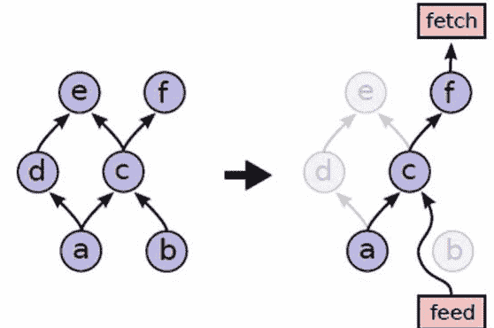

根据数据和产出来源的估计，对图进行更改。也就是说，输入中显示的节点:端口被替换为一个馈送节点，该节点将从用于 Run 标识的 Rendezvous 实例中极其挂载的通道获取输入张量。实质上，带有端口的产出名称与特定节点相关联，该节点在标识完成时安排将产出张量返回给客户。最后，图需要通过添加这些非凡馈送和现有节点来更改，要执行的节点安排可以通过从任何产出标识的每个节点开始并反向进行来验证。图使用图的条件来确定在修订后的图中应用于处理产出的节点的完整结构。图 6 左侧显示一个独立图，并显示一个来自 inputs==fbg 和 outputs==ff:0 g 的修改后的图。由于需要处理节点 f 的产出，将不实现 d 和 e 节点，因为它们对 f 的产出没有贡献。

## 设备约束

TensorFlow 的客户可以通过为节点提供关于其可运行设备的部分要求来监视节点在设备上的位置。例如，“仅将此节点放置在 GPU 类型设备上”，或“此节点可以放置在 /job:worker/task:17 中的任何设备上”或“将此节点与名为 variable13 的节点放在一起”。指令约束的范围内，布局计算负责为设备选择节点功能，这使得计算能够快速执行，并满足设备本身施加的众多要求，例如，通过限制设备上执行其子集图节点所需的内存总量。

这些限制背后的原理需要改进在第 3.2.1 节中解释的位置估计。首先处理每个节点的可能设备布局，然后利用限制图上的关联查找来记录需要编译的图段。我们记录每个此类片段可实现设备集的交汇。每个节点处理的可能设备集有效地适应位置计算的测试系统。

## 控制流

尽管没有明确控制流的数据流图非常具描述性，但我们观察到多种情况，在其中支持条件分支和循环将为 AI 计算提供更简洁、更有效的表述。就像所描述的数据流机方法一样，我们向 TensorFlow 引入了一组简单的原始控制流运算符，并概括 TensorFlow 以处理循环数据流图。例如，高级别编程结构 if 条件分支和循环可以有效地使用这些控制流运算符组织为数据流图。TensorFlow 运行时，如文献 (Karthika,P., Ganesh Babu,R., &Nedumaran,A, 2019) 中的 MIT 标记符号机器，灵活地更新对标签和帧的理解。循环的每次迭代都由一个标签唯一标识，帧表示其执行状态。知识可以在循环打开的任何点加入循环；因此，多次迭代可以同时执行。

TensorFlow 使用分布式协调机制来执行控制流图。总之，循环将包含分配给各种设备的节点。因此，解决循环的条件成为被盗终点识别的问题。TensorFlow 的解决方案取决于对图的重新加工。因此，在图分发期间，我们向每个部分添加控制节点。这些节点更新一个小型状态机，用于调度每个循环的发现和结束，并选择进程的结束。声称拥有循环结束谓词的设备为每个参与设备发送每次迭代的一条小控制消息。

如上所述，我们经常通过角度下降来训练 AI 模型，并将倾向计算视为数据流图的一个主要方面。当模型集成控制流活动时，我们将在可比斜坡的测量中表示它们。例如，带有 if 条件分支的模型的倾向计算将实现。限制的一部分是在那个时候将斜坡逻辑应用于该分区。同样，带有特定时间循环的表示的斜坡计算应知道所经过的循环次数，并且还将取决于在此迭代期间处理的中间估计。基本策略是重新加工图，以便记住测量倾向所需的特性。我们在一定程度上放弃了这种编码的不可预测细节。


## 输入操作

尽管输入信息可以通过馈送中心提供给计算，但用于准备大规模 AI 模型的另一种基本工具是在图表中设置特殊数据活动中心。这些中心通常设计为在每次执行时，将一个或多个模型中存储在该文档集合中的信息封装在大量产出张量中。这允许信息直接从执行后续处理的机器的基础存储系统内存中读取。在客户进程与专家进程独立的配置中，如果信息被处理，通常需要额外的系统跳转。

## 队列

队列是添加到 TensorFlow 的一个重要元素。它允许图表的特定部分非并发执行，可能以不同节奏进行，并通过 Enqueue 和 Dequeue 活动分布信息。Enqueue 操作在队列中有可用空间前可能会阻塞，任务可能会等待直到队列中可用的最优最小元素数量。队列的一种用途是允许从磁盘记录中预取输入信息，而 AI 模型的计算部分仍在处理前一组数据。这些也可用于不同类型的集合，添加多个偏向，以便在更大的批次上登记任何越来越不可预测的角度混合，或者将重复语言模型的各种数据短语收集到长度大致相似的短语容器中，然后可以更高效地准备。除了普通的 FIFO 队列外，我们还实现了一个重排队列，该队列在巨大的内存缓冲区内任意重排其元素。这种重排实用程序对需要随机化模型处理顺序的 AI 计算有益。

## 容器

容器是 TensorFlow 中用于监控更长时间临时状态的工具（M Prathap, Durga Prasad Sharma, D Arthi, 2010 的工作）。对于 Number，服务存储位于一个房间中。默认容器一直存在直到进程结束，但我们也需要其他指定隔间。您可以通过完全释放容器中的内容来重置它。使用容器，即使是完全不相连的计算图（链接到不同会话）也可以共享。

## 优化

想象 TensorFlow 执行中改进系统执行或系统属性使用的一部分更改。

## 公共子表达式消除

由于计算图经常由客户端代码中广泛的反思层创建，计算图不可避免地会出现类似计算的多余副本。为修复此问题，我们修改了标准子表达式消除，该消除作用于大于计算图的计算，并将具有相同信息源和操作类别的多个任务副本规范化为仅一个中心，侧面图边适当地表示此规范化。

## 数据通信与控制内存使用

对 TensorFlow 活动进行谨慎规划将改善系统的执行，特别是在移动信息和使用内存方面。具体来说，预订将确定中间结果应在内存中保留的时间段，从而降低峰值内存使用量。这种减少对内存有限的 GPU 设备尤为重要。此外，通过设备组织知识通信将降低对属性布局的争用。尽管有几个规划改进的机会，但我们专注于一个我们认为特别重要和有说服力的机会。这涉及用于读取远程资产的 Receive 中心规划。如果不采取保护措施，这些中心将比通常可接受的时间早得多启动，可能在实现开始时同时启动。通过像往常一样在活动中分析尽快/尽可能晚（ASAP / ALAP）执行计数，我们分解基本图表方式以确定何时创建 Receive 中心。

## 异步内核

除了完成执行向完成策略的传统同步组件外，我们的结构还连接非阻塞组件。这些组件使用略有特殊的边界来传递计算策略的延续，该延续应在组件执行完成时调用。这在拥有多个动态线程通常在内存使用或其他资源方面代价高昂的情况下是一种改进，并帮助我们避免在等待 I/O 或各种事件时无限期占用执行线程。非并发组件的示例包括 Receive 组件以及 Enqueue 和 Dequeue 部分。

## 内核实现的优化库

对于某些任务，我们通常使用先前大幅改进的数值库来执行组件。例如，有许多增强库可用于在不同硬件上执行帧副本，包括为深度神经网络的卷积部分设计的 GPU 库（Antony Selvadoss, Thanamani, Prathap M, 2016 的工作）。围绕这些高级库的许多组件执行是相对较小的包装器。在应用程序中大量组件用途中，我们使用开源 Eigen 直线多项式数学库（Ekram, H., & Bhargava, V.K. 2007 的工作）。作为 TensorFlow 开发的一部分，我们的团队在主观维度张量活动的帮助下扩展了开源库 Eigen。

## 有损压缩

许多 AI 度量（包括通常用于训练神经系统的度量）对噪声和精度降低具有容忍度。类似于 DistBelief 框架，我们在发送信息之间设备（有时在同一系统内，但特别是跨机器边界）时，经常在内部表述中使用较高精度的有损压缩。例如，我们还嵌入了特殊的转换中心，将 32 位浮点表述转换为 16 位浮点表述。

## 状况与经验

TensorFlow 实现和示例用例已在 Apache 2.0 许可下公开发布，软件可在 www.tensorflow.org 下载。该平台提供详细文档、各种培训活动以及不同的模型，展示如何为各种 AI 任务使用该系统。这些模型整合了用于对 MNIST 数据集（AI 计算的“欢迎宇宙”）中的数字进行分类的模板（Ganesh Babu,R., Karthika,P., &Aravinda Rajan.V., 2020 的工作）、用于 CIFAR-10 数据集排列图像、展示语言周期性 LSTM 组织、准备词嵌入向量等等，这只是个开端。

该系统保留了用于展示 TensorFlow 计算的前端，并预计未来将根据 Google 内部客户和更广泛的开源社区引入更多前端。在我们过去的 DistBelief 框架（P Karthika and P Vidhyasaravathi, 2019 的工作）中，我们有许多已切换到 TensorFlow 的 AI 模型，本章其余部分讨论了一些我们发现可概括到任何 AI 表述从一个组织到另一个组织迁移的经验，可能对其他人有用。具体来说，我们专注于将名为 Inception 的最先进的图像识别卷积神经网络移植的经验。该图像识别系统将 224 像素的图像归类为 1000 个标签之一。当表示为 TensorFlow 图时，表示包含 1360 万个可学习参数和 36000 个活动。对单张照片进行推理需要 20 亿次运算的增加。

在 TensorFlow 中构建所有重要数值活动后，将每个 36000 个任务选择和调试到正确图表结构中证明具有挑战性。验证精度是一项令人担忧的任务，因为系统显然是随机的，并且仅旨在以特定目标为利益运行——可能是平均计算时间。鉴于这些条件，我们认为以下技术对于将 Inception 模型转移到 TensorFlow 是根本性的：

- 1. 构建用于在给定模型中特定参数数量收集信息的工具。在不确定的系统设计判定中，这些工具显示出不明显的缺陷。具体来说，我们能够识别因在数值操作中按计划广播计算而开始不准确的活动和因子。

- 2. 从小处着手，逐步扩展。在 CIFAR-10 知识索引（M Prathap, Gashaw Bekele, Melkamu Tsegaye, P Karthika, 2020 的工作）上使用的一台小型机器是我们从过去上下文中移植的第一个卷积神经网络。研究这种方法阐明了 AI 范式中单个行为（例如，最大池化）的不显眼边缘案例，在更复杂的模型中，这些案例在所有实际目的中都将难以理解。

- 3. 持续确保，当学习被销毁时，目标（损失函数）在 AI 框架之间进行通信。学习到零使我们能够识别由……的非凡行为


我们之前在模型中是零乱地识别因素的。在一个复杂的预备框架中，这样的疏忽本会难以识别。

- 4. 在排查分散执行之前，建立独立计算机使用的坐标。这种方法使我们能够表示和检查AI系统在规划执行中的差异。具体来说，由于存在竞争条件和非原子活动，我们识别出了被错误地视为原子的bug。

- 5. 防止数值错误。数值库在处理非有限浮点数值的方式上存在矛盾。卷积神经网络特别容易受到数值不稳定性的影响，并且通常在测试和故障排除阶段被定期隔离。通过搜索非有限浮点数值来防范此类操作，有助于持续识别bug，而不是事后辨别不同的行为。

- 6. 使用两个AI系统并行运行神经系统的子部分，是确保数值函数在两个帧之间不可区分的精确技术。鉴于此类计算使用浮点精度进行，预测和理解数值误差应在多大程度上完全决定给定段是否被有效修改非常重要（例如，意识到“在1e-2以内，太棒了！”和“在1e-2以内：为什么这么错？！”）。

图 6. 同步和异步数据的并行处理

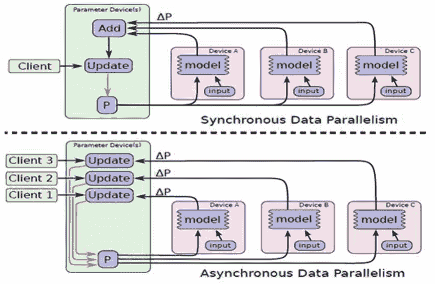

在固有随机系统的视角下考虑复杂的数值活动非常严谨。上述方法在建立组织信心以及最终启动TensorFlow初始化表示方面证明了其重要性。这些方法的最终产品使得与当前DistBelief模型执行相比，训练时间提高了6倍速度，而这种速度提升在另一类更大范围图像识别模型的训练中被证明是不可替代的。

- 7. TensorFlow常见编程惯例的基本数据流图模型可以用于AI应用中的多种行为。本节展示了我们和其他人开发的几种系统以实现这一点，以及如何理解TensorFlow这些不同的方法。

这在图6的上半部分得到了演示。这种技术也使TensorFlow图变为非并发；它包含构成模型计算主要部分的图部分的多个副本，并且每个副本也非并发地将参数更改应用到模型的参数上。目前，每个副本图对应一个客户端线程。图7的这部分描述了非竞争性进展。

图 7. 模型并行训练

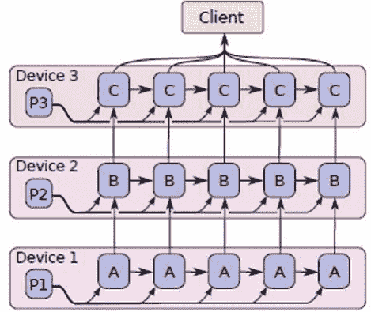

## 模型

### 模型等效训练

模型并行训练：模型计算的各个部分同时在不同的计算设备上针对相似的一批模型完成，在TensorFlow中同样简单地表达。图8显示了一个用于序列到序列学习的循环深度LSTM模型的案例，该模型在三个不同的设备上并行化。

### 模型计算流水线的同步步骤

另一种常用的提高深度神经网络训练效率的方法是，在相似设备集内运行少量同步步骤，从而在类似设备内对模型计算进行流水线处理。

图 8. 同步步骤

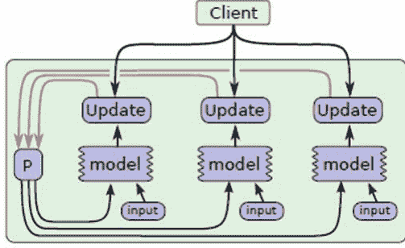

如图9所示。这与非并发数据并行颇为相似，不同之处在于并行发生在同一设备（或多个设备）内，而不是在各种设备上复制计算图。这允许“填补空白”，即单批模型的计算可能无法在单个步骤中始终充分利用所有设备的全部并行性。

## 演示

本文未来将进行调整，以完成单机和分布式使用场景下的演示评估区域。

### 工具

本节描述了我们开发的几种工具，它们与核心TensorFlow图执行引擎并存。

## TensorBoard

图表结构和汇总洞察的可视化。为了帮助用户理解其计算图的结构，并进一步理解AI模型的整体行为，我们构建了TensorBoard，这是TensorFlow的配套可视化工具，包含在开源版本中。

计算图的表示。许多深度神经网络的计算图可能非常复杂（Rondeau, T.W., & Bostain, C.W. 2009）。例如，训练类似Google的Inception模型（一种用于ImageNet 2014挑战中最佳执行的深度卷积网络）的计算图，在TensorFlow计算图中拥有超过36,000个节点，而某些用于建模的深度循环LSTM模型拥有超过15,000个节点。

由于拓扑图的关系，天真的表示程序经常会产生混乱且令人难以承受的轮廓。为了帮助用户看到图表的基本关联，TensorBoard中的计算将节点分解为高级框，突出显示结构不可区分的组。该框架还将高度节点（通常起到记账作用）分离到屏幕的不同区域。这样做减少了视觉杂乱，并将注意力集中在计算图的中心部分。整个感知是直观的：客户可以滚动、缩放和展开分组节点以钻取详细信息（P Karthika and P Vidhyasaraswathi 2018的工作）。深度卷积图像表示的图表可视化示例如图10所示。

图 9. TensorBoard中卷积神经网络模型图的可视化

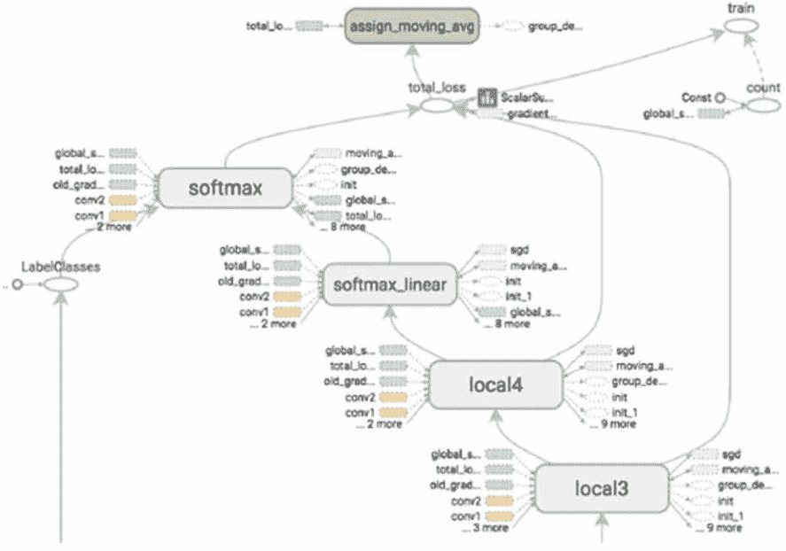

关于数据处理AI模型摘要的感知，客户经常需要有能力分析表示中不同部分随时间变化的状况。为此，TensorFlow支持在嵌入式图上执行各种不同的摘要任务，

图 10. TensorBoard中模型摘要统计时间序列数据的图形显示

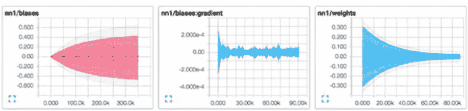

标量摘要的计数（例如，用于模型属性的一般分析，损失函数测量在模型集上的平均值或执行计算图所花费的时间）、直方图摘要（例如，神经网络层中权重值的分布）或基于图像的描述。通常，计算图会设置为包含摘要节点以监控不同的有趣值，并且在执行训练图期间不时地，除了通常执行的节点集之外，还会执行一组摘要节点，客户端驱动程序将摘要数据写入与可视化训练相关联的模型训练日志文件。然后构建TensorBoard系统以显示此日志文档中的新摘要信息，并可以显示摘要数据及其随时间变化的情况。TensorBoard对摘要值的表示的屏幕截图如图11所示。

## 性能分析

由于竞争或与DMA相关的减速而导致的任何重要延迟都会在可视化中使用箭头进行区分和显示。起初，UI提供整个跟踪的示意图，仅显示最显著的性能痕迹。随着用户逻辑地缩放，细节会逐渐达到精细粒度。在多核CPU平台上训练模型的Chrome跟踪体验如图12所示。屏幕截图的上三分之一显示TensorFlow任务正在并行调度，如（Rondeau, T.W., & Bostain, C.W. 2009）的工作所示的数据流限制。跟踪的底部部分说明了大多数活动如何转换为在线程池中同时执行的多个工作器。对角箭头显示了在右侧级别线程池中发生排队延迟的位置。图13展示了另一种跟踪表示，主要是针对GPU的计算。可以看到主机线程与TensorFlow GPU任务在变为可执行时进行交互，且管家线程可以在处理器核心周围的各种色调中看到。实际上，箭头显示线程在GPU上因CPU移动而减速的位置，或者操作在队列中遇到巨大延迟的位置。最后，图14提供了详细观察，有助于测试TensorFlow GPU管理员如何分配到各种GPU流。在数据流图的任何点，我们都试图揭示GPU设备利用流和流依赖的挑战性要求。

## 未来工作

未来工作有几个不同的方向。我们将继续使用TensorFlow为人工智能开发新的、引人入胜的AI模型，在此过程中我们可能会发现扩展核心TensorFlow框架的方法。开源社区也可以为TensorFlow的执行创造新的和有趣的方向。这些功能可以成为我们设计的执行中的可重用部分，甚至跨越不同的TensorFlow前端语言。因此，客户可以定义一个使用Python前端的功能，然后将其作为从内部阻止C++前端的基本结构。希望这种跨重用性会产生一个充满活力的AI专家网络，他们共享整个分析实例，但很少共享可在不同环境中重用的研究小部分。


图 11. 多线程 CPU 程序的 EEG 监控（x 轴为 µs 时间）

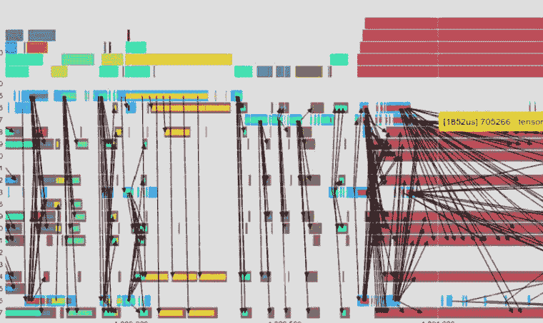

该编译器可以理解各种开发的语义，例如圆形组合、领域阻塞和分块、针对特定形状和尺寸的专用化等等。它还为未来工作构想了一个巨大的领域，以改进用于选择各种枢纽执行位置和启动时间的结构和枢纽预订计算。目前为止，我们已修改了这些子系统中的各种启发式方法，我们宁愿让框架自行学习如何决定主要的情境选择。

### 相关工作

目前为止，我们已修改了这些子系统中的各种启发式方法，我们宁愿让框架自行学习如何决定主要的情境选择。像 TensorFlow 一样，它支持表征分离，使基于梯度的表征和处理先进计算变得更加容易。TensorFlow 有一个用 C++ 编写的核心，用于拆解在广泛开发环境（如手机）中准备的模型的发送。TensorFlow 框架与其前身系统 Dist Belief 以及后来的类似计划（如 Project Adam，(M Prathap, Durga Prasad Sharma, D Arthi, 2010) 的工作以及 Parameter Server 项目）共享一些结构属性。与 Dist Belief 和 Project Adam 不同，TensorFlow 允许计算分布在多台机器上的各种计算机设备之间，并允许客户使用相对高级别的表征来展示 AI 模型 (Antony Selvadoss, Thanamani, Prathap M, 2016)。然而，TensorFlow 中广泛有用的数据流图模型越来越具适应性，并且更有助于传达更广泛的 AI 模型和增强计算，这与 Dist Belief 和 Project Adam 不同。它还通过要求将仔细参数节点声明为变量以及图中仅为额外节点的组件更新活动，来允许一个关键的更改。

图 12. 显示 CPU 和 GPU 操作的 EEG Inception 训练幻觉

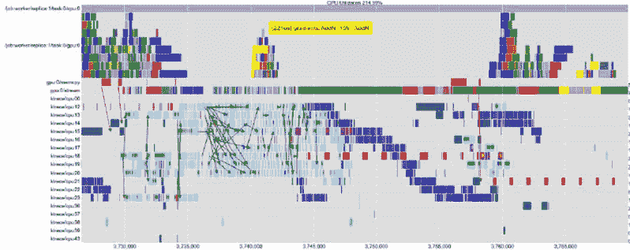

图 13. 多流 GPU 执行时间线

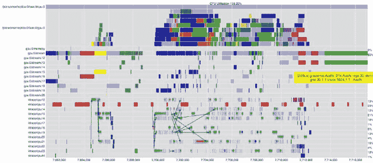

完整的独立服务器子系统提供了参数值以进行通信和更新。Halide 框架用于传达图像处理管道，使用与 TensorFlow 的数据流图类似的中间表示。然而，与 TensorFlow 不同，Halide 框架对其活动的语义具有更高级别的信息，并利用这些知识生成结合不同任务的高度优化代码片段，同时考虑并行性和位置。Halide 仅在一台计算机上执行计算，而不是在分布式环境中执行。我们希望在未来工作中为 TensorFlow 扩展一个动态汇编框架，以实现类似的跨活动。

已开发出一些其他明确的框架来在集群上执行数据流图，包括 TensorFlow。这展示了如何像数据流图一样传达关于复杂工作流程的信息。目前对数据流控制流的非严格支持：CIEL 将焦点表示为动态展开的 DAG，而 Naiad 使用静态过程图来帮助强调低延迟。Spark 针对多次获取相同信息的计算进行了简化，使用“灵活分布式数据集”（RDDs），这些是敏感的预计算状态缓存产出。Dandelion 在异构硬件阵列（如 GPU）上执行数据流图。TensorFlow 使用一种混合数据流模型，从每个这些框架中获取元素。其数据流调度器（即选择下一个节点执行的组件）使用一种类似于 Dryad、Flume、CIEL 和 Spark 的关键计算。

合适的架构类似于 Naiad，因为系统使用单个、浓缩的数据流图来引用整个计算，并在每个设备上存储关于该图的数据以最小化开销协调。TensorFlow 与 Spark 和 Naiad 一样，在集群中有足够 RAM 来执行计算的工作安排时效果最好。TensorFlow 中的强调使用半半方法：多个相同数据流图的副本可以无延迟地同时执行，因此具有相同的因子结构。副本可以同时通过因子共享信息，或使用图中的同步系统（例如队列）来同步工作。

### 结论

本章描述了 TensorFlow，这是一种基于数据流的通用编程模型，非常类似于单机和分布式使用这种编程表示。该框架致力于在调查协调和分布超过 100 个 AI 到广泛范围的 Google 产品和组织方面做出真正的承诺。我们已公开发布 TensorFlow 模型，并期望围绕 TensorFlow 的使用形成一个独特的网络系统。我们很高兴看到 Google 外部的其他人如何在自己的工作中使用 TensorFlow。

### 参考文献

Ekram, H., & Bhargava, V. K. (2007). 认知无线通信网络. Springer Science & Business Media.

Ganesh Babu, R., Karthika, P., & AravindaRajan, V. (2020). 基于树莓派机器学习人工智能的安全物联网系统. Lecture Notes on Data Engineering and Communications Technologies, 44, 797-805.

Ganesh Babu, R., & Amudha, V. (2016). 基于聚类技术的认知无线电网络信道感知. International Journal of Control Theory and Applications, 9(5), 207–213.

Ganesh Babu, R., & Amudha, V. (2018c). 认知无线电网络中人工智能技术综述. Proceedings of 1st International Conference on Emerging Technologies in Data Mining and Information Security, (IEMIS)in association with Springer Advances in Intelligent Systems and Computing Series, 99-110.

Karthika, P., Ganesh Babu, R., & Nedumaran, A. (2019). 物联网中机器学习安全分配. IEEE International Conference on Intelligent Computing and Control Systems.

Karthika, P., & Vidhyasaraswathi, P. (2017). 基于帧级融合技术的内容视频复制检测. Academic Press.

Karthika, P., & Vidhyasaraswathi, P. (2019). SVM 和 ANN 分类技术的图像安全性能分析. Academic Press.

Karthika & Vidhyasaraswathi. (2018). 基于隐写术帧级融合技术的数字视频复制检测. Academic Press.

Karthika & Vidhyasaraswathi. (2020). 树莓派：物联网中战略机器学习安全分配的工具. Academic Press.

Prathap, Sharma, & Arthi. (2010). 多线程数据包的 HTTP 服务器和客户端性能. Academic Press.

Prathap, M. (2020). 无线传感器网络中时钟同步信道交换的分析. Academic Press.

Rondeau, T. W., & Bostain, C. W. (2009). 无线通信中的人工智能. Artech House.

Selvadoss & Thanamani. (2018). 路由协议和移动模型及其交互对 MANET 性能指标影响的研究. Academic Press.

Selvadoss, A., & Thanamani, P. M. (2016). 计算机网络性能监控的主动监测方法. Academic Press.

Vidhya Saraswathi, K. P. P. (2017). 基于内容的视频复制检测调查. Big Data, 3(5), 114–118.

# 第 5 章

智能技术与经济增长对生物医学应用的影响

Dhinesh Kumar R.
Capgemini US, USA

## 摘要

通常，这些实体安装的传感器会在明确批准下收集公民和基础设施数据。基于公民概况的性能可以通过 AI 完成，具体取决于他们提供的数据，这可能促进城市的进步，或用于企业的利益。为了成功实现城市部署，应跨越某些障碍。通常，唯一的目标是通过物联网在实时过程中收集的数据来告知 AI。在某些时候，数据生成是由多个元素完成的主要部分，并且可以有意地使用。在经济增长及其对生物医学行业的影响方面，也面临着某些挑战。本章介绍了智能技术和经济增长对生物医学应用的影响。

## 引言

国际电力学院通过国际电力教育学术领域国际电力工程教授委员会的帮助，作为提供生物医药行业指南和教育内容的中介。国际电力生物医药行业高度依赖 API，该 API 被视为受尊重的工程行业 (Beck, Levine, 2012)。API 将根据传输、发电和分配公司每半年进行一次调查 (Johansen, 2011)。为了提升生物医药行业的研究创新，必须满足以下要求：


- 动力和制造生物医药行业大部分高度依赖于员工之间在优质领导和管理下的建设性参与所带来的文化转型，这能提升工作流程效率并促进创新。
- 为了构建基于新兴技术的生态系统，工作环境需要具备更强的吸收能力，以及将现有技术与新技术协作的思维能力。
- 生物医药行业企业的互联互通促进了网络建设、协作以及与教育机构、公共机构和研究实验室的集群化，从而为工程师提供了更广阔的平台（Krestevska & Petrovska, 2012）。
- 未来，生物医药行业之间的竞争可能会因团队合作、创造性思维、沟通和问题解决等“跨界”技能而加剧。

欧洲以第二大产业（就业人数最多）和生物医药产出第六大地位而闻名。生物医药行业在研究与开发（BERD）上投入了最高的业务支出，年出口收入增长11%（OECD, 2012）。欧洲超过100万人在47,530多家工业公司获得就业机会。

然而，在过去几十年中，欧洲工业部门面临许多挑战，原因是全球金融危机（源于长期的高汇率）以及“第四次工业革命”（增加了投入成本和能源成本）。与2017年和2018年相比，欧洲工业部门在2019年渡过了这些危机。就供应链、产品、技术和行业而言，国际生物医药行业在其本地和全球结构转型中保持了良好的平衡（OECD, 2017）。

Figure 1. 医疗保健上升

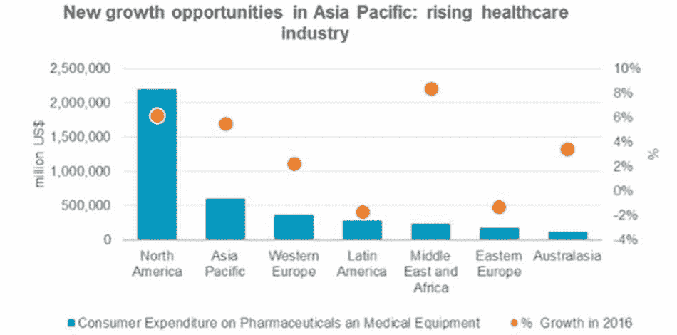

Source. 欧睿国际

2019年初，RBA预测国际经济GDP增长将大幅下滑（截至2019年6月年均+1.7%），随后几个月将出现平淡增长（截至2019年12月年均+2.6%）。根据ABS数据，2018年底全球及本地经济和就业增长出现突然中断。生物医药行业的持续性和长期问题可以通过打造高素量员工队伍（提升生产力、实现未来增长、建立全球联系和推动本地创新）来体现，涉及全球竞争、能源成本、进出口等方面。

图1、2和3展示了医疗保健的普及情况及其支出。AI技术通过管理物联网设备，利用其强大的处理和学习能力来增强这一过程，这种能力由被称为机器学习的强大子集实现（A. Suresh 2017）。

Figure 2. 医疗保健支出

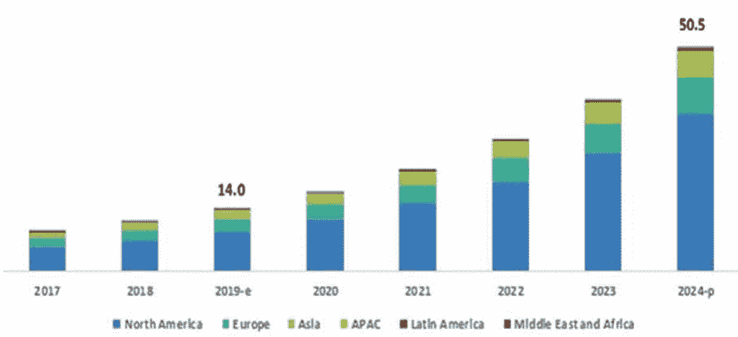

社区式智能康复系统被用于增强和恢复功能能力，以提升生理护理水平。这些系统应便捷地交互并根据患者需求分配医疗资源，采用基于本体论的自动化技术实现基于物联网的康复系统。

物联网技术与人工智能（AI）相结合，似乎在多个领域（包括自适应能源系统、自动驾驶汽车和智慧医疗）释放了巨大的机遇（Suresh, A., Upendhran, R., Balamurgan, M. 2019）。这些例子被视为已有应用，而物联网与AI融合的机遇在各行各业（包括产业和消费者）仍在快速增长（Suresh, A. et al 2019）。然而，这种融合技术并非在城市各处都能找到，尽管AI与物联网联合的效率已可通过硬件和软件部署轻松实现。考虑到将AI与物联网集成的可持续性、可扩展性和影响因素，需要大量协作与规划。在涉及多方所有权、支持多个合作伙伴的情况下，协作与规划是必要的影响因素。

Figure 3. 医疗保健支出增长

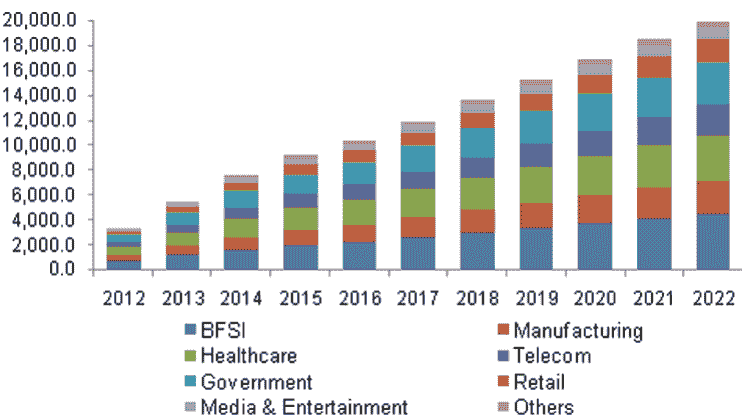

当任何城市当局都能确认宏观的数字总体规划，且物联网提供的解决方案是新兴的情况下，城市可能会将控制权让渡给学术机构、私营公司甚至公民。总会会出现这样一个问题：学术机构、城市或企业拥有的传感器，是否具备收集原始数据并应用某些基于机器学习算法筛选必要数据的计算能力？如果完成了这一过程，那么该过程存在的必要性又是什么？

例如，假设城市X由10个路灯交通计数传感器组成。在此案例中，物理传感器由A公司制造，B公司提供边缘计算软件，C公司负责托管和集中式数据管理。规划许可由地方当局Y及某些政治家Z基于分析决策批准。

应基于用例制定战略，以便在部署过程之前对测量进行定制、规划和考量。没有这种战略，产出将只是原始数据与其他商业内容的混合池，其使用将面临巨大挑战。涉及安全、隐私、伦理和合法性的领域构成了优先级更高的核心领域，而非技术洞察。此外，城市当局可以从机器学习和AI中获益。例如，减少交通事故、改善交通和空气质量是议程上的高优先级需求。当基于智能的正确信息落入授权当局手中，并且他们能够采取必要行动时，这些挑战才能得到解决。物联网产生重要且必要的数据，借助AI算法，数据可以在足够的规模下被考量并利用AI算法。为了使当局能够基于AI/IoT联合体采取行动，必须认真考虑适当的影响，并将权力交到正确的人手中。在城市语境下，政策变革必然会产生价值，或由独立决策者做出潜在决策。

## 基于传感器的告警监控系统

如图4所示，告警系统在危险情况下还会通过可听的警报声和可见的警示灯向操作员发出指示。告警系统的原理是比较实测值与参考值，这些值由几何传感器和压力测量获得。中央处理单元由存储单元组成，参考值存储于其中。此外，低成本控制器与低成本传感器结合，能产生更多创新想法，从而改变产品的定义与用途。可使用的传感器包括激光传感器、红外传感器、超声波传感器、带有特征检测的摄像头、超宽带（UWB）雷达以及电感（霍尔效应）传感器。但其中一些传感器据说价格昂贵、噪声较大且无法提供足够高的精度。因此，应采用合适的传感器以提供高精度，随后可将其纳入物联网体系。该系统在危险情况下还会通过可听的警报声和可见的警示灯向操作员发出指示。

Figure 4. 传感器告警系统

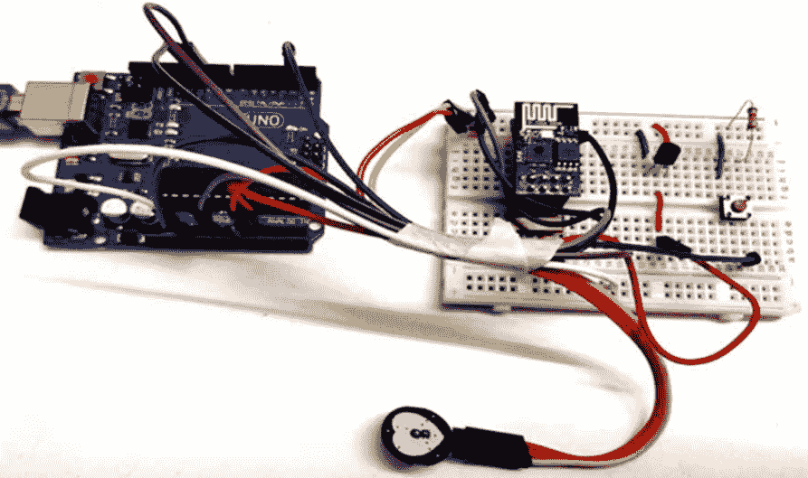

- **启动：** 如果告警系统关闭超过2小时，则会自动启动。手动操作：按下键（12）“SEL”，系统在每次患者修改后开始运行。
- **操作：** 系统根据按键配置，通过多个功能键F1至F5进行操作。
- **取消：** 当系统关闭时间少于2小时时，患者所做的所有调整保持未处理状态。此外，如果选择了任何不可用的配置，将生成错误代码E04。


- 正确设置警报系统需要遵循以下步骤：
- 设置必要的配置
- 设置警报配置
- 设置配重配置
- 设置时序（时序可以增加或减少）
- 设置支腿位置（支腿位置设置为 0%、50% 和 100%；如果选择患者，则为静止，也可选择捡起和搬运）
- 确认编程的整个流程（在整个过程结束时，所做的选择会以符号形式显示。所选符号将被填充为黑色）

## 警报系统需考虑的因素

- 操作辅助警报系统将在系统接近过载情况和起重机状态时向医生提供重要警告，这些情况可能导致整个系统出现严重故障和损坏。
- 该设备不能替代经验丰富的医生判断和已建立的患者安全操作程序的使用。
- 患者操作的全部功能及其安全状况取决于医生，医生负责确保所有生成的说明和警告都应被明确考虑。
- 医生在与患者合作之前，应使用医疗端提供的手册充分分析患者的局限性和功能。
- 应根据医生手册定期进行适当的检查和观察。

## 生物医学可穿戴设备智能电池

生物医学可穿戴设备中，电池管理系统是最重要的任务，必须执行此任务以防止电池过充和过放。电池性能主要因老化、升高的温度以及由于离子交换造成的循环过程而下降。锂离子电池是最常用的电池组件，而促进高容量、安全性和长寿命的电池是磷酸铁锂（LiFePO4），大多采用的充电方法是恒流-恒压方法（CC-CV）。因此，在监控过程中，温度、总电流和电压会定期监测。电池的循环次数由放电深度（DoD）决定，放电深度越长，电池的持续时间越短。

电池监测系统预计到2024年将达到8,053.489 百万美元，与2018年相比达到峰值，增长27.20%，2018年约为1,901.168 百万美元。电池监测系统进行的整个过程涉及估算状态并相应调整环境。主要驱动因素之一是BMS市场中对电动汽车日益关注。政府主导开发电动汽车以控制空气污染，从而推动BMS市场的增长。

### 图 5. 智能医疗监测

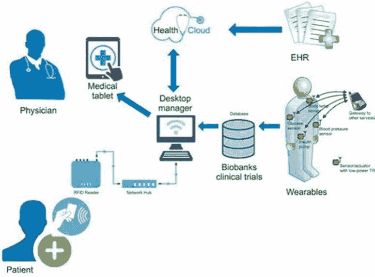

### 图 6. 智能城市交通中的物联网

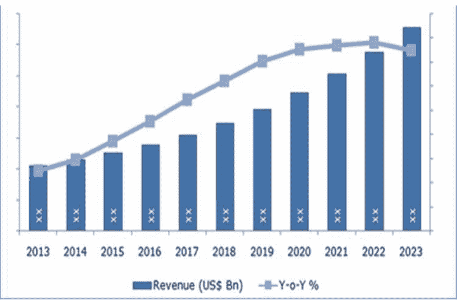

BMS供应商市场已根据电池类型、组件、地理区域和最终用户进行细分。此外，BMS市场中的硬件细分市场拥有快速采样过程、高分辨率记录功能和轻松安装。组件还包括传感器、数据记录器和控制器。在其他国家中，北美凭借先进技术和数据中心扩展投资占据了全球监测市场。本文研究了北美地区电池监测系统（BMS）的经济性和供应商以及质量的提升。本文探讨了BMS所做的改进以及为改进技术所采用的技术。还对系统中实现的各种温度传感器进行了详细分析。电池监测系统：

电动汽车中使用最广泛的电池包括锂离子电池，因为它们在脉冲能量流系统中具有独特的功率额定值、能量密度和充放电系数。锂电池的问题是其过充能力，这可能导致寿命短，在最坏的情况下还可能损坏电池系统的功能。因此，需要配备合适的电池管理系统（BMS），从而维持电池系统的可靠和安全运行[11]。BMS系统的主要功能是提供负载所使用的能量量，以了解系统的常规状态。由于电池的内阻和电容随时间变化，这被确定为一项困难任务。串联的电池单元可能会导致某些不平衡问题，这可能是延长系统寿命的问题，也应在BMS系统中予以考虑。这还可能最小化电池可用容量，因为电量较低的电池单元达到放电末端，尽管其他电池单元中存储着一定量的能量。锂离子电池有严格的电压限制，这仍然限制了电荷不平衡的自恢复，并且随时间下降。如果电池堆栈中的单个单元达到上限，则会停止充电过程，从而导致电池中的其他单元未充电。假设各单元容量相同（只有少数百分比的不匹配可被限制），放电速率不同的单元可能导致电荷不平衡[12]。这可以通过沿电池堆栈实现的温度梯度来处理和获得。因此，BMS系统应采用电荷均衡技术来管理并恢复平衡状态。

关键路径分析（CPA）是一种管理方法，可用于监控、分析和预测目的，如世界卫生组织在《从检测到保护的关键路径分析》中所述。关键路径分析是一种在短时间内获得重大重要性的最新方法。其成功的主要原因是关键路径分析能够克服传统采用关键路径的方法所面临的挑战。多年来，关键路径一直是管理思维领域中管理、规划应用程序（医疗监测项目）的工作原则，导致其在医疗保健公司中部署用于医疗监测项目管理。关键路径分析技术揭示了部署医疗监测项目活动职责所需的重要资产，这些资产简化了不重要和重要的任务，例如规划战略距离以避免流程受限访问和周期问题。该技术非常适合由集成任务组成的应用程序。关键路径分析有助于控制过程以及基于约束理论的规划，这可以减少浪费，包括六西格玛减少变异。

关键路径方法论包括：
- 识别每项活动，采用工作分解结构将每项活动分开，保留并管理高级别活动。
- 建立依赖关系
- 绘制采用关键路径分析图的网络图
- 确定活动完成时间（v）。确定关键路径，关键路径的优势包括对医疗监测项目活动进行适当的可视化表示，并提供有效的时间管理以完成整个医疗监测项目，同时保持对重要任务的跟踪。

为获取关键路径，应遵循以下步骤：

- 创建进度网络图
- 获取活动
- 获取所有可能路径
- 确定每条路径的持续时间

传统医疗监测项目管理方法：这些方法（如瀑布法）为最坏情况下的任务持续时间提供有效排期，主要关注任务进度。这些方法通过修改优先级、加快进度以及制定新排期，能更快地应对不确定性。采用关键路径和关键链技术可以克服传统医疗监测项目工具的主要缺点。

### 有效医疗项目集成的步骤：

医疗项目集成管理在项目中发挥重要作用并对其进行协调。

- 制定项目章程：项目章程对于医疗监测应用很重要，因为它正式授权项目，并提供项目目标和所需产品的高级别描述。此外，项目章程确定项目经理，并提供请求和维护资源的权限。
- 制定项目管理计划：项目管理计划也很重要，因为它将规划所有必要要求，包括医疗技术预算、进度和数据库。项目管理计划整合了其他管理计划，从而快速概述拟议的医疗监测应用。
- 指导与管理项目工作：该过程构成了医疗监测应用的骨干，控制项目的技术方面，例如后端和前端编程语言，从而实现应用程序的可靠性、状态报告和工作流。
- 监控和控制项目工作：为了指导和管理，医疗保健应在服药后的客户护理、项目中的任何修改等方面进行监控。
- 执行集成变更控制：该过程监督可能影响医疗项目性能的变更。
- 项目收官：应纳入该过程，因为它会审查所采用的多个流程，并评估该过程是否成功。


## 结论

工业4.0据说是一种将制造流程与数字技术结合于消费生活的演进。这被称为“第四次工业革命”，欧洲被认为是这些未来生物医疗行业的高潜力国家（据世界经济论坛报道）。工作场所也将充满与协调、决策、质量控制、销售以及分销和支持服务相关的复杂组织架构。此外，劳动力在复杂性、问题解决、连通性和抽象能力方面也提出了更高要求。

## 参考文献

Beck, T., & Levine, R. (2012). 产业增长与资本配置：市场型或银行型体系是否重要？*财务经济学杂志*, 64(2), 147–180. doi:10.1016/S0304-405X(02)00074-0

Financial Services Institute of Europe. (2016). *关于在欧洲规范外国直接投资的讨论论文*. 作者.

Franklin, A., & Douglas, G. (2010). *比较金融体系*. MIT出版社.

Jevcak, A., Setzer, R., & Suardi, M. (2010). 金融危机前及期间新欧盟成员国资本流动的决定因素。欧洲委员会。*经济论文*.

Johansen, S. (2011). 协整向量的统计分析。*经济动态与控制杂志*, 12(2-3), 231–254. doi:10.1016/0165-1889(88)90041-3

Krstevska, A., & Petrovska, M. (2012). 外国直接投资的经济影响：基于马其顿经济的部门面板估计。*中央银行理论与实践杂志*, 55-73.

Mitrovic, N., Petronijevic, M., Kostic, V., & Bankovic, B. (2011). 共直流母线多驱动应用中的有源前端变换器。ICEST 2011国际会议论文集(第46届), 3(2), 989-992.

OECD. (2012). 外国直接投资术语和定义词汇表。从以下网址获取：http://www.oecd.org/investment/investmentfordevelopment/2487495.pdf

OECD. (2017). 欧洲经济调查。doi:10.1787/eco_surveys-aus-2017-en

Paul, A. K., Banerje, I., Snatra, B. K., & Neogi, N. (2009). 钢铁工业中交流电机及驱动装置的应用。*第十五届全国电力系统会议*, 6(2), 159-163.

Petronijevic, M., Veselic, B., Mitrovic, N., Kostic, V., & Jeftenic, B. (2011, 5月). 不对称电压暂落对可调速感应电机驱动影响的比较研究。IET电力应用, 5(5), 432–442. doi:10.1049/iet-epa.2010.0144

Suresh, A. (2017). 基于ANN、RBF和CBR的心脏病预测系统。*纯粹与应用数学国际杂志*, 117(21), 199–216.

Suresh, A., Upendhran, R., & Balamurugan, M. (2019). 集成实时监控的面向智慧医疗环境的物联网新框架。Springer医学系统杂志, 43, 165. doi:10.1007/s10916-019-1302-9

Suresh, A., Upendhran, R., & Balamurugan, M. (2019). 基于混合神经网络和决策树的乳腺癌预后决策分类器。Springer软计算杂志. doi:10.1007/s00500-019-04066-4

Upendhran, R. (2017). 增强云存储数据安全性的混合方法。剑桥大学，英国，第二届物联网与云计算国际会议论文集(ICC '17). doi:10.1145/3018896.3025138

## 延伸阅读

Darwish, A., & Hassanien, A. E. (2011). 医疗监测的可穿戴和可植入式无线传感器网络解决方案。Sensors（巴塞尔）, 11(6), 5561–5595. doi:10.3390/s110605561 PubMed

Hulko, M., Hospach, I., Krasteva, N., & Nelles, G. (2011). 细胞色素C生物传感器——气体传感模型。Sensors（巴塞尔）, 11(6), 5968–5980. doi:10.3390/s110605968 PubMed

# 第6章
智能医疗中自动化和下一代物联网的重要性

Ahmed Alenezi

泰巴大学，乌莱校区，麦迪纳，沙特阿拉伯

M. S. Irfan Ahamed

泰巴大学，乌莱校区，麦迪纳，沙特阿拉伯

## 摘要

通常，医疗中使用的传感器用于患者的实时监测，此类设备称为物联网驱动传感器。这类传感器因其非侵入式监测而被部署于重症患者，例如，患者的生理状态将由物联网驱动传感器监测，该传感器通过网关收集患者生理信息，随后由医生分析并存储在云端，从而提高医疗质量并减轻患者的费用负担。远程健康监测系统中物联网的工作原理是实时跟踪患者的生命体征，如果生命体征异常，则根据患者问题采取行动并通知医生进行进一步分析。物联网驱动传感器附着在患者身上，通过配备发射器的电信网络将患者位置的生命体征数据传输到设有远程监测系统的医院，该系统读取关于患者生命体征的传入数据。

## 引言

随着物联网和无处不在计算的发展，医疗保健已实现技术先进，通过利用连接传感器以及可穿戴设备等设备，患者可将信息发送给医生进行实时监测。因此，医疗保健领域的物联网和无处不在计算可被视为一项重要的救命技术，主要用于从床旁设备收集数据、查看患者信息，以及实时诊断患者护理的整个系统。

无处不在计算（UbiComp）的特征是使用小型、联网和便携式计算机产品，形式为智能手机、个人数字助理以及内置于许多设备中的嵌入式计算机，从而形成一个人人拥有并使用多台计算机的世界。其后果包括通过让计算机贯穿每个人的日常生活来增强计算能力，而这些计算机本身及其交互对用户而言是“不可见的”。在此语境下，“不可见”一词用于指计算机与用户之间以更自然的方式进行交互，如语音和物理交互，计算机本身自动捕获其外部参数，同时与其他计算机并发通信。UbiComp 提出许多微型无线计算机，可监测环境，并与监测到的参数进行通信和响应（Emiliano Miluzzo 等，2008年）。然而，医疗保健中普遍存在的挑战是会导致数据丢失甚至诊断失误，且大部分机密医疗数据存储在云端。即使是治疗患者的一分钟也是救命的，因此医生应节省宝贵时间，这可以通过采用医疗资产监测以及通过远程诊断的物联网和无处不在计算减少对每位患者的人工访问来实现（Firouzi, F 等，2018年）。

大部分日常生活已成为互联网的一部分，因为其通信更快且功能更强大。预计到2020年，超过90%的医疗行业将整合物联网技术，这反过来将提高医疗效率，并在现代社会提供优质护理（Gubbi, J 等，2013年）。优质医疗保健基于速度和准确性，并支持许多人使用大量与物联网连接的设备（Hank, P 等，2013年）。由于为每个人提供医疗保健在国家发展中发挥着重要作用。采用医疗保健的另一个迫切理由是患者数量不断增加，导致医生数量减少。因此，大部分诊断因这一原因而延迟，因为诊断耗时，甚至患者因费用问题而忽视并依赖医生。许多健康问题因医生不可用以及无法访问医疗系统而未被检测出来。解决此问题的唯一方法是将医疗保健与物联网整合，实时监测每位患者，分析数据并提供实时医疗保健（Kumar, L 等，2012年）。

通常，医疗中使用的传感器用于患者的实时监测，此类设备称为物联网驱动传感器。这类传感器因其非侵入式监测而被部署于重症患者，例如，患者的生理状态将由物联网驱动传感器监测，该传感器通过网关收集患者生理信息，随后由医生分析并存储在云端，从而提高医疗质量并减轻患者的费用负担。远程健康监测系统中物联网的工作原理是实时跟踪患者的生命体征，如果生命体征异常，则根据患者问题采取行动并通知医生进行进一步分析。物联网驱动传感器附着在患者身上，通过配备发射器的电信网络将患者位置的生命体征数据传输到设有远程监测系统的医院，该系统读取关于患者生命体征的传入数据。在某些情况下，传感器将被植入患者体内，以电子方式传输数据（Kuo, A and M.-H., 2011）。这种机密信息将被加密，并在需要时解密以进行进一步分析。

图1展示了物联网的普及程度。人工智能技术通过其强大的处理和学习能力增强了这一过程，这些能力由被称为机器学习的强大子集实现（A. Suresh, 2017年）。


### 图 1. 物联网的普及性

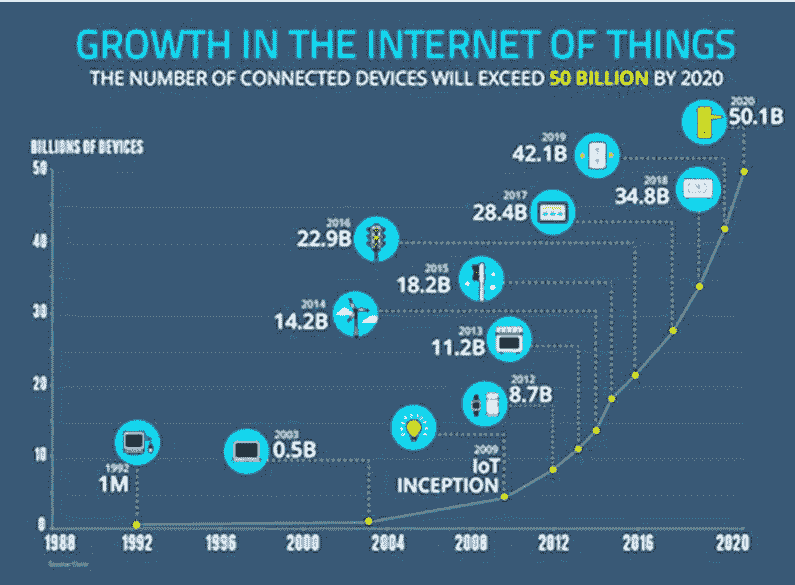

社区为基础的智能康复系统被用于提升和恢复功能能力，从而增强生理护理。这些系统应便捷地交互，根据患者的需求分配医疗资源，采用基于本体自动化技术的物联网康复系统，如图 2 所示。

物联网技术与人工智能（AI）相结合，似乎在各个领域开启了巨大的机遇，包括自适应能源系统、自动驾驶汽车和智能医疗（Suresh, A., Udendhran, R., Balamurgan, M. 2019）。这些示例被视为已有应用，而物联网与 AI 集成带来的机遇在各行业和消费者等所有可能性中仍在快速增长（Suresh, A. et al 2019）。但这种组合技术并非在城市各处随处可见，尽管 AI 与物联网的关联效率在硬件和软件部署后即可获得。考虑到将 AI 与物联网集成的可持续性、可扩展性和影响因素，需要大量的协作与规划。当考虑多个所有权支持多个合作伙伴时，协作与规划是必要的影响因素。

由于物联网提供的解决方案是新兴的，在任何城市当局都能批准总体数字主计划的情况下，城市的控制权可能会流失给学术机构、私营公司甚至公民。总会出现这样一个问题：学术界、城市或企业拥有的传感器是否具有收集原始数据，并通过应用基于机器学习过程的某些算法来筛选所需数据的计算能力？如果完成了这一过程，那么执行此过程的必要性又是什么？

### 图 2. 物联网的应用

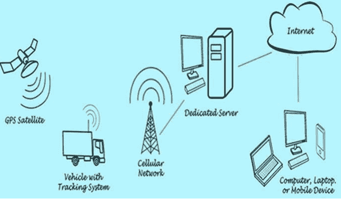

通常，这些实体安装的传感器涉及收集公民和基础设施数据，无论是否明确批准。基于公民画像的性能评估可以通过 AI 完成，依据他们提供的数据，这可能促进城市和公民的发展，也可能被用于企业牟利。为了成功实现城市部署，必须跨越某些障碍。通常，唯一目标是通过物联网在实时过程中收集的数据来告知 AI。在某些时候，数据生成是由多个元素完成的最主要部分，这可以被有意地利用。在推广 AI 与物联网时，城市服务领域（交通、医疗保健等）也面临着某些挑战。

例如，假设城市 X 由 10 个路灯交通计数传感器组成。在这种情况下，物理传感器由 A 公司制造，B 公司提供边缘计算软件，C 公司负责托管和集中数据管理。规划许可由 Y 地方当局和某些 Z 政治家基于分析决策批准。

应结合用例定义策略，以便在部署开始前对测量进行定制、规划和考虑。没有此策略，输出将成为原始数据和其他业务内容的集合，其使用将面临巨大挑战。涉及安全、隐私、伦理和合法性的领域构成了核心领域，其优先级高于技术洞察。此外，市政当局可以从机器学习和 AI 中获益。例如，减少交通事故、改善交通和空气质量是议程上的高需求。当基于智能的正确信息落到授权部门手中，并且他们可以采取必要行动时，这些挑战就可以得到解决。物联网产生重要且必要的数据，通过 AI 算法，数据可以在足够的规模上被考虑并利用 AI 算法。为了让当局在 AI/IoT 关联上采取行动，必须适当考虑影响，并且权力应落到正确的人手中。在城市背景下，政策变化必然会产生价值，或者潜在决策可以由独立决策者作出。

### 图 3. 物联网及其应用

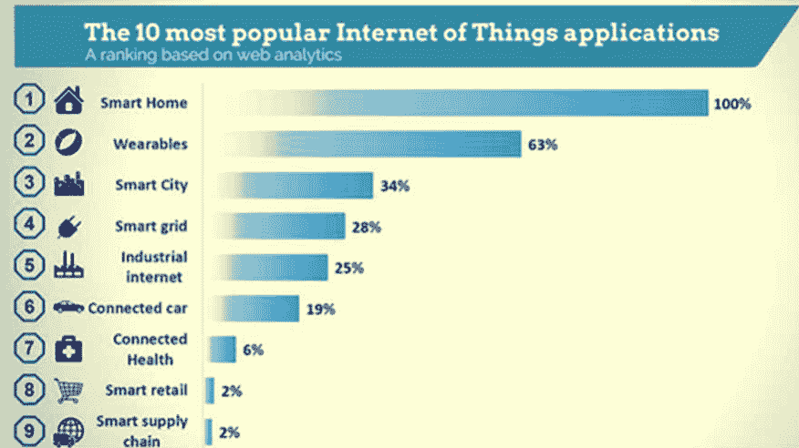

## 技术背景

以公民为中心和测试驱动的方法确保最终场景是在与公众一同进行测试的，而不仅仅是强加给他们的。经过这一重要实验后，理论可以与利益相关者进行测试，然后在小规模下实施，无需巨额投资。这可以在技术及其适应技术方面获得巨大的领先优势，并进一步有效讨论公民问题。

将云计算与医疗部门集成可以带来多种好处，从而推动技术发展。尽管存在某些困难，马来西亚、加纳和南非等一些发展中国家已见证了通过云计算技术改善医疗保健。为了提高患者预后，云技术与医疗保健相结合，为所有医疗组织提供了一个极好的答案。患者、医生和 ICT 环境通过互联网与云进行交互。该过程始于患者及其就诊，医生在 eHealth（云）系统中核实患者的详细信息。医生根据提供的详细信息分析患者的健康状况，并提供可能的药物以维护其健康。通过此系统，交互可以非常快速，患者的详细信息可以再次在云环境中更新。在医疗保健领域，云计算被认为是一项新兴技术，与当前基于健康的信息存储系统相比，似乎非常有效。

设备、无线和云计算技术的快速发展正在改变智能医疗，支持对患者、老年人或婴儿身体状况的持续远程监测，以及对大规模感知数据集的高效处理。这种智能医疗将显著提高生活水平。然而，据 Cloud Standards Customer Council 调查，医疗机构似乎不太热衷于构建由 IT 技术支持的智能医疗系统，尤其是在发展中国家。IT 技术利用不足阻碍了医疗行业的广泛信息共享和处理。云计算范式为 IT 资源管理和使用提供了虚拟机制。传感器-云基础设施可能是一种将云技术集成到无线传感器网络（WSNs）中的技术。它为用户提供了一个虚拟平台，以清晰和便捷的方式利用物理传感器。用户可以在不了解其物理细节的情况下，仅使用几个功能来管理、监控、创建和检查分布式物理传感器。云计算为 WSNs 提供 IT 资源，支持大量探测器信息流的存储和快速处理。WSN 与云之间的连接由两种网关强制实施：传感器网关和云网关，其中传感器网关收集和压缩数据，云网关解压和处理数据。

传感器云被用于各种应用，例如灾害预测、大气监测和医疗分析。传感器云从完全不同的应用中收集知识，并基于云计算和存储资源共享和处理信息。为用户提供了一个界面来管理和监控虚拟传感器。在传感器云中，传感器建模语言（SML）被用于说明物理传感器的数据，这些数据被处理为传感器的元数据。标准语言格式允许多个网络和平台中传感器之间的协作。XML 加密还为在虚拟传感器和物理传感器之间转换命令和信息提供了映射机制。


与传统传感器网络相比，传感器云具有以下优势：(1) 处理多种数据类型的能力；(2) 可扩展资源；(3) 用户与网络协作；(4) 数据可视化；(5) 数据访问与资源使用；(6) 低成本；(7) 自动化资源交付与数据管理；(8) 更短的处理和响应时间。

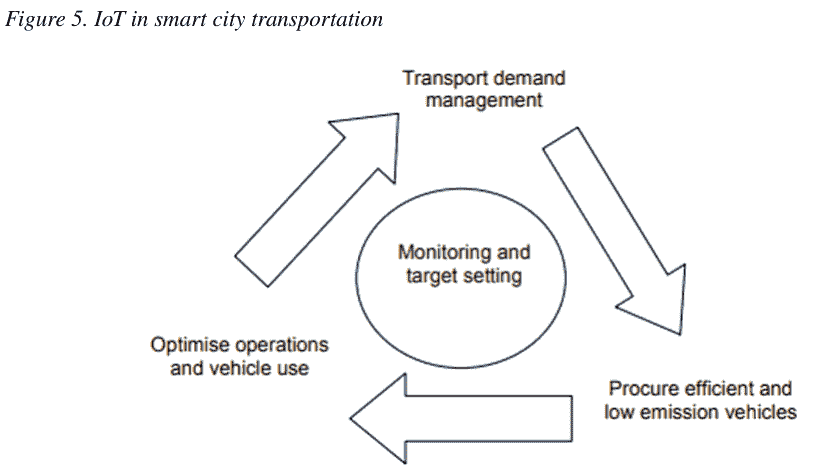

## 基于物联网的城市规划与智慧城市电动汽车

这些车辆排放的有毒气体如下：

- 一氧化碳（CO）：氧气在我们体内起着关键作用。吸入一氧化碳后可能会阻断氧气运载能力，从而影响我们身体最重要的器官。CO 的极端排放可能很危险，应加以控制。但有限的排放可能对普通人无害，却可能影响患有心脏病的人。
- 氮氧化物（NOx，包括氧化亚氮和二氧化氮）：这可能会极大地影响肺功能，导致呼吸疾病。长期暴露于这些气体可能引发哮喘及其他肺部过敏。二氧化氮（NO2）会影响环境，导致酸雨和臭氧层耗竭。
- 颗粒物：南安普顿大学空气污染毒理学研究员 Matthew Loxham 博士表示，这些细颗粒物非常危险，可能导致严重的呼吸系统疾病和心血管疾病。英国因细颗粒物排放而死亡的人数已超过 29,000 人。
- 碳氢化合物：这可能具有极强致癌性并导致死亡。事实上，这还可能导致温室气体的形成。

上述污染物由柴油或汽油车辆造成。插电式电动汽车不仅可以为我们省钱，还能减少导致污染的因素。使用电动汽车有许多优势，其反应速度比内燃机更快。

与燃油车辆相比，车队运营带来的某些优势包括：

- 电动汽车（EVs）反应迅速。它具有非常好的扭矩和极高的响应性。
- 电动汽车充电非常用户友好。就像插上智能手机一样，车辆即可连接。此外，我们可以监控车辆充电量。
- 使用基于物联网的电动汽车可以高度控制燃料成本。因为我们可以使用太阳能和风能等任何形式的可再生能源为车辆充电。
- 智能城市交通的电动火车：考虑一种电力驱动的火车，似乎比传统火车更简单。因为电动汽车的组件减少了，例如，它只有电动机。不需要更换燃料。事实上，再生制动等功能可减少基本车辆部件的磨损。最近的一项调查显示，典型的电力车队可将维护成本降低 50%。

可编程逻辑控制器（PLC）在微处理器领域发挥着至关重要的作用。由于它可以由能够处理所有工业组件的硬件和软件组件组成，因此用户操作起来非常简单便捷；工程师的工作是使用梯形逻辑对 PLC 进行编程，以在工业设备中实现某种类型的自动化和控制。使用 PLC 的最大优势在于，它们可以根据使用者重新编程。由于这些 PLC 组件在实现阶段具有高度的灵活性和可靠性，因此它们对自动化产生了惊人的影响。由于微控制器的功能不断增强，成本不断降低，其应用范围也随之扩大，可应用于各种领域。

## CONCLUSION

医疗保健的进步由于医疗基础设施薄弱，未能在发展中国家得到实施。解决此问题的方案是将健康感知设备与智能手机等便携设备相结合，并将其部署在云端。通过采用此技术，贫困人群可以利用当今廉价的智能手机获得医疗保健。然而，医疗保健应通过部署患者实时监测并提供智能医疗监测设备来分析患者数据，从而提升可靠性，因为物联网已成为一种有效的通信范式。

## REFERENCES

Firouzi, F., Rahmani, A. M., Mankodiya, K., Badaroglu, M., Merrett, G. V., Wong, P., & Farahani, B. (2018). 面向更智慧医疗的物联网与大数据：从设备到架构、应用与分析. Future Generation Computer Systems, 78(2), 583–586. doi:10.1016/j.future.2017.09.016

Gubbi, J., Buyya, R., Marusic, S., & Palaniswami, M. (2013). 物联网（IoT）：愿景、架构要素与未来方向. Future Generation Computer Systems, 29(7), 1645–1660. doi:10.1016/j.future.2013.01.010

Hank, P., Muller, S., Vermesan, O., & Van Den Keybus, J. (2013). 车载以太网：车内网络与智能移动性. In Proceedings of the Conference on Design, Automation and Test in Europe. EDA Consortium. 10.7873/DATE.2013.349

Kumar, L. D., Grace, S. S., Krishnan, A., Manikandan, V., Chinraj, R., & Sumalatha, M. (2012). 基于神经网络的无线传感器网络中面向云存储的数据修改. In Recent Trends In Information Technology (ICRTIT), 2012 International Conference on. IEEE.

Kuo, A. M.-H. (2011). 云计算改善医疗服务的机遇与挑战. Journal of Medical Internet Research, 13(3), e67. doi:10.2196/jmir.1867 PMID:21937354

Miluzzo, Lane, Fodor, Peterson, Lu, Musolesi, Eisenman, Zheng, & Campbell. (2008). 感知与移动社交网络的结合：cenceme 应用程序的设计、实现与评估. In Proceedings of the 6th ACM conference on Embedded network sensor systems, (pp. 337–350). ACM. 10.1145/1460412.1460445

Suresh, A. (2017). 基于 ANN、RBF 和 CBR 的心脏病预测系统. International Journal of Pure and Applied Mathematics, 117(21), 199 – 216.

Suresh, A., Udendhran, R., & Balamurgan, M. (2019). 一种集成实时监测的面向智能医疗环境的新型物联网框架. Springer-Journal of Medical System, 43, 165. doi:10.1007/s10916-019-1302-9

Suresh, A., Udendhran, R., & Balamurgan, M. (2019). 基于混合神经网络和决策树的乳腺癌预后决策分类器. Springer - Journal of Soft Computing. doi:10.1007/s00500-019-04066-4

Udendhran, R. (2017). 一种增强云存储数据安全性的混合方法. ICC ‘17 剑桥大学物联网与云计算第二届国际会议论文集, 英国. Doi:10.1145/3018896.3025138

## ADDITIONAL READING

Ben-David, A. (1995). 信息论机器学习算法中的单调性维护. Machine Learning, 19(1), 29–43. doi:10.1007/BF00994659

Bernardi, E., Carlucci, S., Cornaro, C., & Bohne, R. (2017). 评估建筑环境影响最广泛采用的评级系统分析. Sustainability, 9(7), 1226. doi:10.3390/su9071226

Ghaffarianhoseini, A., Berardi, U., AlWaer, H., Chang, S., Halawa, E., Ghaffarianhoseini, A., & Clements-Croome, D. (2016). 什么是智能建筑？来自国际视角的最新诠释分析. Architectural Science Review, 59(5), 338–357. doi:10.1080/00038628.2015.1079164

# Chapter 7

## 用于 ImageNet 分类的流行 CNN 拓扑比较研究

Hmidi Alaeddine

https://orcid.org/0000-0002-2417-3972

Laboratory of Electronics and Microelectronics, Faculty of Sciences of Monastir, Monastir University, Monastir, Tunisia

Malek Jihene

Higher Institute of Applied Sciences and Technology of Sousse, Sousse University, Sousse, Tunisia

## ABSTRACT

深度学习是一个相对现代的领域，在计算机视觉等多个领域中是非常重要的关键，且呈现快速指数级增长趋势，数据量不断增加。自 AlexNet 推出以来，图像分析、识别和分类的演进变得越来越快速，并且能够取代用于视觉任务的传统算法。本研究重点探讨在 ImageNET 数据库上训练的深度 CNN 架构中呈现的演进（深度、宽度、多路径）。此外，详细分析了现有拓扑的不同特征，以提取用于获得更好性能的各种策略。

## INTRODUCTION

机器学习是一门致力于开发技术以实现数据自动解释和预测的领域。它最初源于模式和对象识别研究，旨在使算法能够从海量数据中自动学习。在机器学习领域的多年中，该领域的应用已超越模式和对象识别的范围，广泛应用于社交媒体网络上的内容过滤或网页搜索等各种任务。在早期，执行此过程的技术依赖于该领域专家开发的方法，其目的是解释 the

DOI: 10.4018/978-1-7998-3591-2.ch007


数据。目前，现有方法基于人工神经元网络，这些网络在顶层执行与早期技术相同角色的能力，且无需人工干预。在漫长的历史进程中，深度学习（Y. LeCun, 2015），（Schmidhuber, 2014）经历了兴奋与遗忘交替的时期，在此期间它以各种不同的名称被知晓，并进行了大量研究。深度学习的第一阶段工作持续了近20年，从1940年到1960年，描述了具有监督和无监督学习过程的简单神经网络（Rosenblatt, 1958）。第二阶段始于第一阶段结束后的19年（1979年至1990年），由福岛的Neocognitron工作（Fukushima, 1979）开创，该工作可被视为第一个值得被描述为“深度”的工作（Schmidhuber, 2014）。此外，这一时期还见证了反向传播在人工神经网络中的应用（Werbos, 1981），它提醒我们，反向传播作为一种有效的监督学习梯度下降方法，已在1960年代和1970年代发展起来。最现代的时期代表了深度学习的黄金时期，始于2006年，如以下著作所示（G. E. Hinton, 2006），（Y. Bengio, 2007），我们可以注意到，在过去的几年中，深度学习（Y. LeCun, 2015），（Schmidhuber, 2014）在不同领域尤其是计算机视觉方面取得了巨大成功。此外，深度网络在图像分类（Alex Krizhevsky, 2012），（Matthew D Zeiler, 2013），（Zisserman, 2015），（et al., 2015），（He X. Zhang, 2015），（Komodakis, 2016），（Saining Xie, 2016），（Gao Huang, 2017），（Huang, 2016），（P. Sermanet, 2014），（Bengio, 1994）和目标检测（P. Sermanet, 2014）等方面赢得了众多比赛，例如年度ILSVRC竞赛Russakovsky。它基于ANN，由各种处理层组成，使用反向传播算法学习大型数据集的表示，以更新每层的局部参数。在各种深度学习算法[1,2]中，卷积神经网络（CNN）已成为深度学习中流行且常用的神经模型，在人工视觉任务中取得了革命性进展，这要归功于这些长期存在且多年来一直未被攻克的能力。此外，它在精度方面表现良好（Alex Krizhevsky, 2012），（Matthew D Zeiler, 2013），（Zisserman, 2015），（et al., 2015），（He X. Zhang, 2015），（Komodakis, 2016），（Saining Xie, 2016），（Gao Huang, 2017），（Huang, 2016），（P. Sermanet, 2014），（Bengio, 1994）。

本文的组织如下：第二部分描述背景。第三部分介绍用于ImageNet分类的流行深度CNN拓扑的比较研究，结论在最后一部分得出。

## 背景

最近关于深度神经网络方法的研究提高了这些视觉识别系统的性能。在本节中，我们专注于卷积神经网络、监督学习和ImageNet数据库。

## 动机

CNN被描述为一种基于卷积的特殊人工神经网络类型，卷积被定义为一种专门的线性运算类型。它们受益于一种可通过改变这两个元素（深度和宽度）来控制的能力。此外，与多层感知机（MLP）相比，它们的连接和参数密度较低，这使得它们更容易训练。

### 监督学习

监督学习（Bishop, 2006）基于标记数据的利用。它可以在输入和标签之间建立关联，以便正确地将每个输入 E<sub>i</sub> 与其输出 S<sub>i</sub> 关联起来。对于来自大小为 n 的输入数据的每个输入样本 E<sub>i</sub>，E<sub>i</sub> = {0,1,2..n-1}，网络最后一层中的神经元将被标记，这样对于一个输入 E<sub>i</sub>，学习阶段后被激活的神经元将被分配一个标签，该标签代表该输入的预期输出 S<sub>i</sub>。

```
S<sub>i</sub> = f(E<sub>i</sub>) + Δ                          (1)
```

监督学习的原理是为每个输入评估误差（Δ）并更新神经元的局部参数，以便在下一次迭代中最小化误差。这意味着必须将训练数据迭代地提供给ANN，以便将每个数据样本的预测与关联的期望标签进行比较，分析每个输入的误差，然后对系统的局部参数（称为：权重，它们是实数）进行修改以改进预测。通过在一组数据上重复此操作，系统将收敛到一个状态，其中其预测变得越来越准确。最广泛使用的监督学习算法包括梯度反向传播算法（D. Rumelhart, 1986）。这种学习类的主要缺点有时是很难在所需领域找到数据库、构建新学习数据库的成本，以及这些学习算法的复杂性。

### ImageNet

ImageNet是一个根据WordNet层次结构组织并用于计算机视觉研究工作的图像数据库。它被认为是评估不同图像分类和目标检测算法性能的标准参考。它整合了来自约22,000个类别的超过一千五百万张高分辨率、可变尺寸的图像。ImageNet由从网络收集的可变分辨率图像组成，并由“Amazon Mechanical Turk”进行标记。该基础首先在计算机视觉与模式识别会议（CVPR, 2009）的海报环节中展示。自2010年以来，每年举办一次竞赛。ILSVRC（Russakovsky, 2015）使用ImageNet的一个子集，每个1000个类别中约有1000张图像。总共有约120万张训练图像、5万张验证图像和15万张测试图像，分辨率可变。

## 卷积神经网络（CNN）的基础

不同的CNN模型使用许多层，通常包括多层卷积堆栈，结合分组和归一化层，以提取简单且具有层次结构的有用图像。这些层的堆叠确保了CNN的构建。卷积是卷积神经网络中的主要步骤，被描述为卷积网络的核心。卷积被定义为像素矩阵与代表卷积滤波器大小（L x C）的权重矩阵或核的标量积，其中L和C通常是奇数且相等的值。CNN执行3D卷积（图1）以提取数据的空间和时域特征（Dou Q, 2017），（N. C. Camgoz, 2016）。3D卷积的原理是使用一组形成3D核的滤波器对表示多个以连续方式堆叠的图像的图像立方体进行卷积。给定图像在第一层中三维卷积位置（x, y, z）的值是使用以下数学方程确定的：

```
\(\text{\textit{Conv}}(\text{\textit{Pixel}}_{ij}^{XYZ}) = B_{ij} + \sum_{N}^{P_l-1} \sum_{P=0}^{Q_l-1} \sum_{Q=0}^{R_l-1} \sum_{R=0}^{P_l} W_{ijN}^{PQR} \times \text{\textit{Pixel}}_{(i-1)\times N}^{(X+P)(Y+Q)(z+R)}\) (2)
```

已知R表示3D卷积核大小的长度。

## 图1. 3D卷积的表示

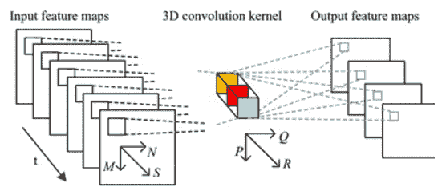

激活函数的选择非常重要，因为它将应用于每个传入像素。此外，选择合适的激活函数可以加快学习过程。图2总结了流行的激活函数和最常用的激活函数：

## 图2. 最流行的非线性激活函数

| Sigmoid | Tanh | ReLU | Leaky ReLU |
| :--- | :--- | :--- | :--- |
| \(g(z) = \frac{1}{1+e^{-z}}\) | \(g(z) = \frac{e^z - e^{-z}}{e^z + e^{-z}}\) | \(g(z) = max(0, z)\) | \(g(z) = max(\epsilon z, z)\) 且 \(\epsilon \ll 1\) |
| 显示 Sigmoid 曲线的图表 | 显示 Tanh 曲线的图表 | 显示 ReLU 线的图表 | 显示 Leaky ReLU 线的图表 |

ReLU函数是最常用的函数；它标识正参数并将其他参数赋值为零。在大多数早期工作中，双曲正切和Sigmoid函数通常是最常用的。然而，今天这些函数不再被利用，因为它们需要复杂的算术运算，并且在硬件实现方面存在困难。此外，与ReLU相反，双曲正切不能解决梯度消失问题，而ReLU允许减少和缓解这一问题（Clever & Unterthiner, 2016）。池化操作


这是一个类似于卷积的有趣局部操作。该操作通过汇总局部区域感受野附近的相似信息来生成主导响应。这些层使得可以通过将一组像素替换为代表最大值（最大池化，Max pooling）或这些像素平均值（平均池化，average pooling）的单个像素，从而减小每个输入（通常输入为图像）的空间维度。虽然池化层降低了空间分辨率，但它们保持了相同数量的输入图像。特征图尺寸的这种减小调节了网络的复杂性，并有助于防止过拟合。全连接层有时用作 CNN 的最后一层或倒数第二层。这些层位于许多卷积层和池化层之后。全连接层与多层感知器（MLPs）相同。它们主要用于网络末端的分类。在此层中，每个神经元都与前一层所有神经元输出的组合相连，这导致连接密度非常高，远高于卷积层中的密度（Dou Q, 2017），(N. C. Camgoz, 2016)。全连接层被描述为来自前一层的接收到的不同体量的神经元向量（Dou Q, 2017），(N. C. Camgoz, 2016)。

## 批量归一化

该层由 Google 研究人员于 2015 年提出（Szegedy, 2015）。它通常位于全连接层或卷积层之后、非线性之前。通过将层的输出分布归一化为零均值（单位方差），它缓解了特征图中与内部协方差滞后相关的问题。使用此层使网络对不良初始化更具抵抗力；此外，它消除了使用 Dropout 层的必要性。

## 丢弃法

这是一种流行（Salakhutdinov, 2014）且简单的方法，用于防止神经网络过拟合。在训练期间，这些层通过随机丢弃所选百分比的连接，最终提高泛化能力。以这种方式被“丢弃”的神经元不参与前向传播，也不参与反向传播。在测试时，所有神经元都会被使用，但它们的输出会乘以概率（通常使用 0.5）。此层在网络中引入了正则化。一种非常高效的规范技术补充了用于控制神经网络防止过学习能力的 L1、L2 正则化方法。该层的缺点是它使收敛所需的迭代次数翻了一倍。

图 3. 丢弃法层

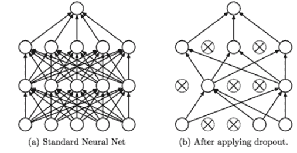

## 案例研究：图像分类的 CNN 拓扑

在科学研究中，需要对所提出的不同架构进行比较。以下内容即为此目的，我们将尝试展示卷积神经网络的不同架构。我们将首先查看在 ImageNET 年度竞赛中获得第一名的不同架构。自 2012 年 AlexNet 在 ImageNet 数据库上表现出色以来，已提出了各种 CNN 模型。这些创新主要归功于不同层的重组、新块的设计或多路径操作。表 1 汇总了每种拓扑的层数，包括卷积层、池化层和全连接层。我们注意到，这些不同拓扑所利用的激活函数是 ReLU 函数。

## 表 1. 每种拓扑的层数

| 拓扑 | 参考文献 | 卷积 | 池化 | 全连接 |
|---|---|---|---|---|
| AlexNet | (Alex Krizhevsky, 2012) | 5 | 3 | 3 |
| GoogleNet | (al, 2015) | 57 | 14 | 1 |
| VGG16 | (Zisserman, 2015) | 13 | 5 | 3 |
| VGG19 | | 16 | 5 | 3 |
| ResNet50 | (He X. Zhang, 2015) | 49 | 2 | 1 |
| ResNet101 | | 100 | 2 | 1 |
| ResNet-152 | | 151 | 2 | 1 |

## 表 2. 不同架构的乘累加运算（MACC）数量和参数数量

| 拓扑 | 参考文献 | 卷积 MACC | 卷积参数 | 全连接 MACC | 全连接参数 | 总 MACC | 总参数 |
|---|---|---|---|---|---|---|---|
| AlexNet | (Alex Krizhevsky, 2012) | 666 M | 2.33M | 58.6M | 58.6M | 724M | 62M |
| GoogleNet | (al, 2015) | 1.58G | 5.97M | 1.02M | 1.02M | 1.58G | 6.99M |
| VGG16 | (Zisserman, 2015) | 15.3G | 14.7M | 124M | 124M | 15.5G | 138M |
| VGG19 | | 19.5G | 20M | 124M | 124M | 19.6G | 144M |
| ResNet50 | (He X. Zhang, 2015) | 3.86G | 23.5M | | | 3.86G | 25.5M |
| ResNet101 | | 7.57G | 42.4M | 2.05M | 2.05M | 7.57G | 44.4M |
| ResNet-152 | | 11.3G | 58M | | | 11.3G | 60M |

至今所提出的深度神经网络不同架构主要侧重于精度的提高。尽管精度数值一直在稳步提升，但获胜模型的资源使用情况尚未得到妥善统计。表 2 汇总了不同架构的乘累加（MACC）运算数量和参数数量，其中大部分 MACC 操作在卷积层中消耗。

## AlexNet

由 Alex 等人于 2012 年提出。它被描述为用于图像分类的最早 CNN 之一。它在 2012 年赢得了 ILSVRC 比赛，包含 5 个卷积层，后跟 3 个全连接层。该架构（图 4）在新一代 CNN 中具有重要意义，并为 CNN 开辟了新的研究方向。AlexNet（Alex Krizhevsky, 2012）是第一个在非线性部分中使用非饱和 ReLU 激活函数（线性整流单元）的架构，而不是传统神经网络中常用的 Tanh 或 Sigmoid 函数。该函数位于每个卷积层和全连接（FC）层之后。使用此函数的目的是通过缓解梯度消失问题来提高收敛速度。

该架构（Alex Krizhevsky, 2012）使用五个卷积层，在第一个和第二个卷积层之后跟随一个局部响应归一化层（LRN），并在第一个、第二个和第五个卷积层之后跟随一个最大池化层。该架构的一个优点是，它通过在每个 FC 层之后使用 Dropout 层解决了过拟合问题。该网络需要 6240 万个参数，并提供相当于 16.4% 的 ImageNet TOP 5 错误率。值得注意的是，该模型使用随机梯度下降（SGD）训练了大约 90 个周期，参数如下：

- 动量：0.9。
- 权重衰减：0.0005。
- 批次大小：128。

权重从均值为零的高斯分布中初始化，标准差为 0.01，即 N(0, 0.012)，conv1 和 conv3 的偏置初始化为零，其他偏置初始化为 1。学习率初始化为 0.01，并在结束前降低了 3 次，当验证错误率随当前学习率不再改善时，除以 10。

## 图 4. AlexNet 架构

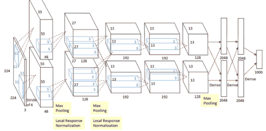

## ZF Net

2013 年，Zeiler 和 Fergus 提出了一种称为（ZF 网络）的多层反卷积神经网络（Matthew D Zeiler, 2013），其中他们提出了一种新的可视化技术，可对网络性能提供定量概览。可视化网络活动的想法是通过监控训练期间的学习模式并利用这些结果提取与模型相关的问题，来发现不同模型层对性能的贡献。该想法在 AlexNet（Matthew D Zeiler, 2013）上得到了实验验证。实验结果表明，只有少数神经元是活跃的，而模型前两层中其他神经元是不活跃的。基于这些结果，作者修改了 CNN 拓扑，并通过将第一层滤波器尺寸（11 x 11）（步长：4）减小到（7 x 7）（步长：2）来优化 CNN 学习。此外，他们将第 3 个卷积层的内核数量从 384 增加到 512 个，第 4 个卷积层从 384 增加到 1024 个，第 5 个卷积层从 256 增加到 512 个。对 CNN 拓扑的这种重新调整带来了性能改进，该架构实现了相当于 11.7% 的 ImageNet“TOP 5”错误率，而不是 (Y. LeCun, 2015) 的 16.4%。特征可视化可以用于及时提取设计问题并调整设置。

## VGG 网络

2014 年，（Zisserman, 2015）中提出的 VGGNET 架构（图 5）赢得了 ILSVRC 2014 挑战赛的一部分，错误率相当于 ImageNET 的 TOP 5 为 7.4%，拥有近 1.38 亿个参数，已知它使用全连接层。存在多种层数不同的拓扑，层数范围从 11 到 19 层（VGG-16 拓扑具有非常规整的 16 层结构）。该架构将步长为 2 的 7x7 卷积滤波器替换为三个 3x3 卷积滤波器（步长 1，填充 1），以便在减少参数数量（计算复杂度）并增加所用激活函数数量的同时，保持几乎相同的 7x7 卷积输出维度。此外，该架构使用 2 x 2 尺寸的最大子采样。VGG16（Zisserman, 2015）基于 3x3 尺寸的卷积滤波器，网络宽度从 64 开始，每两个卷积层增加一倍。值得注意的是，VGG（Zisserman, 2015）在计算需求和参数数量方面都是最昂贵的架构。该模型使用随机梯度下降（SGD）训练了大约 74 个时代（370K），参数如下：

- 动量：0.9。
- 权重衰减：0.0001。
- 批次大小：256。

学习率初始化为 0.01，并在结束前降低了三次，当验证错误率随当前学习率不再改善时，除以 10。

## GoogLeNet

由 Christian Szegedy 等人提出（al, 2015）。它赢得了 2014-ILSVRC 竞赛。GoogLeNet 包含 22 层，在仅需要


### 图 5. VGGNET 模型

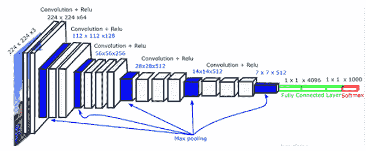

约 700 万个参数。这些节省是通过一种复杂的架构实现的，该架构在网络中使用了一种称为“inception”模块的子架构（图 6）。

### 图 6. “Inception” 模块架构

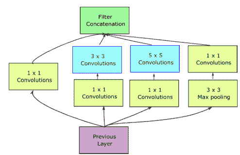

该架构的主要目标是在提供高精度的同时降低计算成本；这一点可以从 3x3 和 5x5 层之前的 1×1 卷积层中看出，目的是减少通道数量。减小通道尺寸会自动导致 MACC 参数和操作数量的减少。此外，在最后一层使用全局平均池化（AVG）层，而不是使用全连接层（FC），以降低连接密度。GoogLeNet 架构 [8] 的作者添加了连接到中间层的辅助分类器，以增加向后传播的梯度信号（反向梯度传播）并加速收敛速度。在测试时，这些辅助网络会被丢弃；在训练时，辅助分类器的损失被平衡为 0.3。该模型使用带有 0.9 动量的随机梯度下降（SGD）进行了约 600K 次迭代训练。学习率每八次迭代下降 4%。

## ResNet

VGG（Zisserman, 2015）和 GoogLeNet（et al., 2015）问世后，人们曾认为架构堆叠的层数越多，准确率就会越高。然而，拥有超过 20 层的更深神经网络通常更难以训练，极深网络的训练需要缓慢的训练时间，并带来多种问题，例如反向传播中的梯度消失。在（He X. Zhang, 2015）中，He 等人提出了一个残差学习块（图 7），通过在每两个卷积层周围添加一个链接，将原始旁路及其功能相加，从而促进比（Zisserman, 2015）和其他网络深得多的网络的构建。该解决方案称为“残差块”。每个“残差块”集成两个卷积层（3x3）。ResNet（He X. Zhang, 2015）由 He 等人提出，其结果在 ILSVRC 2015 中排名为残差网络的领先候选方案，最大深度为 152 层，几乎比（Zisserman, 2015）深 8 倍。误差率相当于 3.57%。值得注意的是，即使架构更深，ResNet（He X. Zhang, 2015）的计算复杂度也低于（Zisserman, 2015）。该架构与 GoogLeNet（et al., 2015）在使用全局子采样后跟分类层方面相似，因此该架构不使用“Dropout”层。该模型使用随机梯度下降（SGD）进行了约 600K 次迭代训练，参数如下：

- 动量 0.9。
- 权重衰减 0.0001。
- 批次大小 256。

### 图 7. 残差块


学习率初始化为 0.1，当验证误差率不再改善（使用当前学习率）时，将其除以 10。精度的微小提升需要利用新的几十层网络。虽然这些卷积网络中的大多数都非常深，拥有数百层并导致误差率降低，但也带来了多种挑战，例如梯度消失（Bengio, 1994）、正向传播期间特征复用减少以及较长的训练时间。为此，提出了多种方法来减轻这一问题，例如批量归一化（Szegedy, 2015）和谨慎初始化 [19]，但较短的网络始终是最佳方案，因为它们具有信息能够高效地前后传播的优势，并且可以在非常可接受的训练时间内轻松训练。多项研究都证实了这一原则，例如 Huang 等人（Huang, 2016）提出的概念——随机深度。该概念允许在训练期间形成短网络，在测试时使用深网络的矛盾配置。随机深度这一概念使得残差网络的深度可以超过 1000 层，同时降低训练时间和测试误差。

## 宽残差网络（Wide ResNet）

宽残差网络（Wide ResNet，Komodakis, 2016）由 Zagoruyko 和 Komodakis 提出。该工作（Komodakis, 2016）支持这样一种原则：“残差块是架构中的重要因素，而非仅是附加效应的深度”。当你注意到 50 层宽的 Large-ResNet 在 ImageNet 上超越了原始 152 层 ResNet 时，这一原则得到了验证。


宽残差网络（Wide ResNet，Komodakis, 2016）利用了一个大型残差块（图 8），该块集成了 L×K 个滤波器（而非像（He X. Zhang, 2015）中的 L 个滤波器），其中 k 被定义为控制网络宽度的额外因子。研究表明，使用更大的残差块比加深残差网络更能有效提高准确率。

## ResNeXt

ResNeXt（Saining Xie, 2016）在精神上与 GoogLeNet（et al., 2015）的“Inception”模块相似。这是另一种由 ResNet（He X. Zhang, 2015）的设计者于 2017 年提出的架构，他们通过多个并行通道增加了残差块的宽度。这种策略引入了一个新维度，称为“基数”。测试结果表明，增加基数是提高分类准确率的一种解决方案。此外，它比加深网络更有效。该架构采用了 VGGNET [7] 的深度同源拓扑和 GoogLeNet（et al., 2015）的简化异构架构。ResNeXt（Saining Xie, 2016）的误差率为 3.03%（Top-5），在 2016 年 ILSVRC 分类任务中获得第二名。ResNeXt 构建块（Saining Xie, 2016）如图 9 所示。


## DenseNet

众所周知，如果 CNN 在靠近输入层的层和靠近分类层的层之间包含更短的连接，则可以构建得更深，并且在训练期间更高效。基于这一原则，作者在（Gao Huang, 2017）中提出了一种基于密集块（图 10）的 DenseNet 架构，其中每一层以“前馈”模式连接到所有其他层。因此，所有先前层的特征图都被用作后续所有层的输入，这增强了特征传播，并鼓励特征复用。该网络建立了 L(L+1)/2 个直接连接，因为它将每一层与后面两层中的每一层连接起来。DenseNet（Gao Huang, 2017）提供多项优势，例如缓解梯度消失问题（Glorot, 2010），鼓励特征图的传播和复用，从而减少所利用的参数数量。

### 图 10. DenseNet


## 结论

近年来，卷积神经网络的研究得到了快速发展，旨在提高 CNN 在视觉相关任务中的性能。在本文中，我们广泛研究了各种 DNN 类型中的 CNN，并深入探讨了各种深度 CNN 架构拓扑结构中的改进和变化。（深度、宽度、多路径 ...）这些架构在 ImageNet 数据集上进行训练。在近期文献中，观察到 CNN 性能的首次提升是由于使用小型滤波器和增加通道数量所实现的。提高精度、减小卷积滤波器尺寸更为有利，因为它可以在达到略高精度水平的同时，相比于使用较大卷积滤波器尺寸的相同架构，具有计算复杂度和参数更低的额外优势。这一点可以从 AlexNet（Y. LeCun, 2015）与 ZFNet（Matthew D Zeiler, 2013）的比较中看出。值得注意的是，尽管使用了小尺寸滤波器且结构简单，VGGNET 仍需要高昂的计算成本和沉重的计算负载（VGG16：138 M，VGG19：1.4 亿个参数）。ResNet（Alex Krizhevsky, 2012）于 2015 年发布后，研究的新趋势是用模块替换卷积层。这些模块在提高 CNN 性能方面发挥着重要作用。


## REFERENCES

Alex Krizhevsky, I. S. (2012). 基于深度卷积神经网络的 ImageNet 分类. 神经信息处理系统进展 25(2).

Bengio, P. L. (2007). 深度网络的贪婪层式训练. NIPS.

Bengio, Y. (1994). 使用梯度下降学习长期依赖关系很困难. IEEE 神经网络汇刊, 157-166. doi:10.1109/72.279181

Bishop, C. M. (2006). 模式识别与机器学习. Springer.

Camgoz, S. H. (2016). 使用卷积 3D 神经网络进行用户无关的连续手势识别. 模式识别国际会议 (ICPR), 49-54. 10.1109/ICPR.2016.7899606

Clevert, D.-A., & Unterthiner, T. H. (2016). 基于指数线性单元 (ELU) 的快速准确深度网络学习. ICLR.

Dou, Q. C. H., Chen, H., Yu, L., Qin, J., & Heng, P.-A. (2017). 用于肺结节检测中假阳性减少的多层上下文 3-D CNN. IEEE 生物医学工程汇刊, 64(7), 1558–1567. doi:10.1109/TBME.2016.2613502 PMID:28113302

Fukushima, K. (1979). 不受位移影响的模式识别机制神经网络模型. Neocognitron, 658–665.

Glorot, X. B., & Bengio, Y. (2010). 理解训练深度前馈神经网络的困难. http://proceedings.mlr.press/v9/glorot10a/glorot10a.pdf

He, X., & Zhang, S. R. (2015). 面向图像识别的深度残差学习. ArXiv 预印本 arXiv:1512.03385

Hinton, G. E., Osindero, S., & Teh, Y.-W. (2006). 深度信念网络的快速学习算法. 神经计算, 18(7), 1527–1554. doi:10.1162/neco.2006.18.7.1527 PMID:16764513

Huang, G., Liu, Z., van der Maaten, L., & Weinberger, K. Q. (2017). 密集连接卷积网络. https://arxiv.org/abs/1608.06993v5

Huang, G. S. (2016). 具有随机深度的深度网络. 计算机视觉欧洲会议, 646–661.

Ioffe, S., & Szegedy, C. (2015). 批量归一化：通过减少内部协变量漂移加速深度网络训练. http://proceedings.mlr.press/v37/ioffe15.pdf

Komodakis, S. Z. (2016). 宽残差网络. BMVC.

LeCun, Y., Bengio, Y., & Hinton, G. (2015). 深度学习. Nature, 521(7553), 436–444. doi:10.1038/nature14539 PMID:26017442

Rosenblatt, F. (1958). 感知机：大脑中信息存储与组织的概率模型. 心理学评论, 65(6), 386–408. doi:10.1037/h0042519 PMID:13602029

Rumelhart, D., Hinton, G. E., & Williams, R. J. (1986). 通过误差反向传播学习表征. Nature, 323(6088), 533–536. doi:10.1038/323533a0

Russakovsky, O. D., Deng, J., Su, H., Krause, J., Satheesh, S., Ma, S., Huang, Z., Karpathy, A., Khosla, A., Bernstein, M., Berg, A. C., & Fei-Fei, L. (2015). ImageNet 大规模视觉识别挑战. 计算机视觉国际期刊, 115(3), 211–252. doi:10.1007/s11263-015-0816-y

Salakhutdinov, N. S. (2014). Dropout：防止神经网络过拟合的简单方法. 机器学习研究期刊, 1929–1958.

Schmidhuber, J. (2014). 神经网络中的深度学习：概述. 神经网络, 61, 85–117. doi:10.1016/j.neunet.2014.09.003 PMID:25462637

Sermanet, D. E. (2014). OverFeat：使用卷积网络的集成识别、定位与检测. ICLR.

Shuiwang Ji Wei Xu, M. Y. (2012). 用于人体动作识别的 3D 卷积神经网络. 信号处理与智能系统第二届国际会议 (ICSPIS).

Szegedy, C., Liu, W., Jia, Y., Sermanet, P., Reed, S., Anguelov, D., Erhan, D., Vanhoucke, V., & Rabinovich, A. (2015). 更深层卷积网络. IEEE 计算机视觉与模式识别会议 (CVPR), 1–9. doi:10.1109/CVPR.2015.7298594

Werbos, P. J. (1981). 非线性灵敏度进步的应用. 第 10 届 IFIP 会议论文集, 762-770.

Xie, S., Girshick, R., Dollar, P., Tu, Z., & He, K. (2016). 深度神经网络的聚集残差变换. https://openaccess.thecvf.com/content_cvpr_2017/papers/Xie_Aggregated_Residual_Transformations_CVPR_2017_paper.pdf

Zeiler, M. D., & Fergus, R. (2013). 可视化与理解卷积网络. https://cs.nyu.edu/~fergus/papers/zeilerECCV2014.pdf

Zisserman, K. S. (2015). 用于大规模图像识别的非常深层卷积网络. ICLR.

# 第 8 章

# 基于形状和纹理分类的复杂疾病诊断生物医学图像分析新框架

Reyana A.
*印度尼赫鲁工程技术学院*

Krishnaprasath V. T.
*印度尼赫鲁工程技术学院*

Preethi J.
*印度安娜大学*

## 摘要

在医学影像系统中应用计算机技术进行操作、显示和分析已被广泛接受，这有助于更好地提高疾病预测的诊断信心和准确性。因此，通过结合人体器官的多种图像来诊断特定类型疾病或障碍的生物医学图像分析需求，是大多数生物医学应用系统中的一大挑战。本章概述了电子形式的生物医学图像的性质，以促进数据的计算机处理和分析。本文在信息采集、筛查、诊断、监测、治疗以及控制与评估的背景下，描述了不同类型的图像。图像内容的表征和数字化对图像传输的分析和设计至关重要。

## 生物医学图像性质简介

生物医学图像分析是对人体内部的可视化检查，用于医学调查和干预，以揭示皮肤、骨骼、器官、组织的隐藏结构，从而诊断疾病和异常。它使用成像、放射学、内镜、摄影、断层扫描等技术。由于医学影像涉及视频和图像，因此放射学对其进行解释，获取高质量诊断图像仍然是一项挑战。许多科学调查和研究将放射学作为医学科学的相关领域。各种医学调查包括心脏病学、心理学、神经科学等，磁共振成像仪能够极化人体组织水分子，从而产生可检测信号，进而生成人体图像。

尽管仪器功能强大，但暴露于射频场会带来更多健康风险。其他应用包括肿瘤检测和血管破坏效应评估，因为计算机被视为医学影像性能、图像生成、分析和数据采集的关键组成部分，这些是首选任务。尽管医学影像模式在增加，但其复杂性及相关问题的增加导致对先进解决方案的需求。因此，医学影像的使用通过发现可理解的可视化显示，改进了特定疾病的诊断。开发医学图像分析算法涉及信号、图像和系统等多变特性。生物医学图像分析技术包括：i) 定量分析，ii) 计算机辅助诊断，iii) 评估和验证技术。定量分析是放射科医生使用分割技术从图像中测量和提取对象的方法。计算机辅助诊断衡量诊断程序的特征，以保证准确性和效率。常见的医学图像分析需要事先了解疾病症状、通过将模型与子图像匹配来分类特征的能力，以及形状描述。

数字图像是在空间或时间上采样并基于振幅量化的信号。然而，任何医学图像都可以通过 i) 手动、ii) 半自动或 iii) 自动方式进行分析。因此，在医疗保健中，使用数字图像处理进行医疗诊断变得至关重要。图像由像素值组成，分配有离散亮度或颜色。随着先进成像技术的出现，生物医学图像得以高效、快速地处理。“生物医学图像处理”涵盖图像捕获、图像可视化和图像分析等领域。这些均可通过应用 Alvarez, Lions & Morel (1992) 所述的采样量化、矩阵表示、模糊和点扩散函数或图像分辨率等任一技术来实现。此外，基于紧凑度、矩、弦长结构等因素分析图像形状，可提高图像质量。基于方向滤波、Gabor 滤波，以及最终面向模式的分类和诊断检测的纹理分析，将为诊断准确性提供高效度量。

当今大多数诊断图像由于伪影和实际限制而遭受质量损失。所提出的方法和数学推导将有助于更好地理解生物医学图像分析。人体的每个系统都包含许多复杂的生理过程，包括神经、激素或控制模拟。调查此类系统需要复杂的技术，本章提供了与此类实时标本及其诊断分析相关的方法。几种成像程序和技术在质量和信息含量方面存在局限性。因此，需要特殊成像技术来便于可视化。案例研究是关于肿瘤分析的图像分割。然而，某些恶性肿瘤具有平滑的形状


一些具有粗糙的形状。主要特征已被总结，算法测量分割误差，并证明了内在结构、时间效率和低内存消耗。

因此，图像分析拥有许多算法和特定功能，可集成到多个应用领域。其他分析层级包括边缘、纹理、区域以及对象和场景层级。图像处理的低级技术基于像素、纹理和边缘，提供极少的抽象。而高级别包括对象、纹理、区域和场景层级。因此，高级生物医学图像的处理复杂且难以制定公式，因为它涉及医生的高级认知解释。因此，医疗处方的自动图像分析绝不应产生负面结果，因为这会导致有害后果。

## 图像质量表征与数字化面临的挑战

研究人员在应用这些技术时面临的某些困难在于质量和信息内容的限制。以下段落阐述了生物医学图像获取和分析中的困难。各种医学成像模式在疾病诊断、手术规划与治疗以及后续随访研究中起着至关重要的作用。图1描绘了各种医学成像模式。

图1. 成像模式


这些模态基于自旋、声音、辐射、温度、反射和透射。有许多成像模式，本研究中考虑的有X射线成像、CT、MRI和超声。还有摄影、显微镜和内窥镜等属于光学模态。尽管使用了此类设备，获得的图像仍受到严重伪影的影响，如Ando（2000）所述。

考虑到X射线穿过人体产生的辐射，光子与原子核的相互作用导致吸收和散射。当光子将其全部能量释放给吸收材料时，这会对活细胞造成损伤，但获取对比图像对于诊断是必要的。同样，散射产生的次级光子会降低信噪比，导致定位错误。然而，散射辐射可使用铅制散射光栅进行过滤。被成像材料的厚度决定了辐射水平，因为高辐射会导致有害影响，如Angenent, Haker & Tannenbaum（2003）所述。CT中的重建过程捕捉来自各条线和梯度场的信号。此外，MRI等设备中的强电流需要非常快速地开启和关闭。

超声基于声波反射工作，声波在组织中传播，根据换能器部分反射或传射。回波强度基于材料特性，通过水凝胶实现人体内无空气耦合，从而观察器官和骨骼结构的超声图像。衰减随声频线性增加，而高频对于空间分辨率是必需的。诊断扫描仪在2-18 MHz的频率范围内运行，在成像深度和空间分辨率之间进行权衡。数字化基于图像的离散特性，而非基于胶片的X线摄影或对图像的修改。数字化包括基于数值范围的采样和量化。每幅图像的最大灰度级数定义了量化。全彩色和灰度图像均为8位或24位。连续亮度会降低图像质量，通过增加灰度级数可以增强辅助噪声改变。量化会降低连续亮度下的图像质量。量化噪声在图2中描绘。

图2. 量化噪声


类似于量化不足，子采样信息在数字图像的表示中被抑制。错误添加量化时，采样定律不被满足。更重要的是混叠效应。因此，在使用生物医学图像作为不同尺度下人体测量以用于临床任务（例如诊断）时仍然存在挑战，这对医生的决策产生重大影响。

除此之外，还与图像质量相关的挑战，例如：

- i) 图像恢复
- ii) 图像增强
- iii) 准确分割
- iv) 准确配准
- iv) 模态图像融合
- v) 分类与表征
- vi) 定量测量

影像在治疗前、治疗中和治疗后的治疗应用中的作用是图像引导治疗和手术中的关键挑战。医学成像涉及的主要方法有：i) 分割，ii) 配准，iii) 可视化，iv) 模拟。分割是从患者解剖图像中创建特定模型的方法。配准使多个数据集相互对齐。可视化有助于模拟和评估策略及计划治疗。有许多成像技术相互补充，提供不同的洞察。

## 图像质量分析

在数学模型中，从图像中提取的数据有助于在科学研究中实现临床、生物医学和实验进展。几何排列的数据样本阵列量化了血红蛋白去氧作用对神经代谢随时间变化的物理现象，即组织内水分子的扩散。在生物物理世界中组织观测的范围促进了新处理技术的出现，这些技术结合了复杂和精密的数学模型来应对生理功能障碍，如Bloembergen, Purcell & Pound（1948）和Canet（1996）所述。形状分析是检测形状相似的对象，以自动分析并以数字形式表示它。对象通过扫描或提取2D或3D图像进行建模，并简化为形状描述。简化的表示易于处理并重建原始对象。图像中的分割提供大量数据。形状描述符需要对任何给定形状的所有大小、位置和/或方向计算相同的（向量或标量）值。下面给出了通过形状分析生物医学图像的各种方法：

## 空间域形状度量

这是广泛使用的度量，用于测量特征形状的长宽比、紧凑度和规则性。该度量被视为其边界点。如果K个边界点定义距离，则第k个点按方程（1）描述

```
r_k(\phi) = \sqrt{(x_k - x_c)^2 + (y_k - y_c)^2}
```

其中相关角度θ如下（方程（2））

```
tan \phi = \frac{(y_k - y_c)}{(x_k - x_c)}
```

此表示将周长值r_k转换为序列，其中0 < r < k。长宽比A按方程（3）给出：

```
A = \frac{\max r_k}{\min r_k}
```

所示部分中的簇具有零值背景，黑色是分割过程，高亮显示的白线是周边。粗虚线是近似特征的对角线。在图B中，质心是对角线的交点。

图3. 样本簇


凹陷区域用条纹线填充以获得凸包。形状的紧凑度按方程（4）和（5）描述：

```
C = \frac{1}{N} \left[ \sum_{k=1}^{k-1} \sqrt{(x_{k+1} - x_k)^2 + (y_{k+1} - y_k)^2} \right] (4)
```

```
C = \frac{\sqrt{4\pi N}}{\sum_{k=0}^{k-1} \sqrt{(x_{k+1} - x_k)^2 + (y_{k+1} - y_k)^2}} (5)
```

这里N是属于该区域的像素数量，xk和yk是像素坐标，边界点xK = x0, yK = y0构成闭合轮廓。

理想圆形的值归一化为1，不规则形状的值为零。由于图像是离散的，小圆会偏离理论值。紧凑度C是用于增加离心率和不规则性的度量。不规则性的轮廓通过rk的变异系数V很好地量化，如方程（6）所示：

```
v = \frac{\sqrt{\sum_{k=0}^{k-1} r_k^2 - (1/k) \left( \sum_{k=0}^{k-1} r_k \right)^2}}{\sum_{k=0}^{k-1} r_k} (6)
```


## 图 4. 具有不同形状的特征分离


紧凑度、不规则性和长宽比是用于衡量像素边界离散化中形状缩放、平移和旋转的指标。用于分组特征的向量具有相似的形状。具有不规则性和紧凑度的特征向量是所考虑的要素。

长轴和短轴与边界矩形对齐。同一轴内形状的范围定义了边界矩形，如图 4 所示。与平均半径计算的零交叉点和长宽比，按面积比参数（ARP）在方程（7）中定义：

```
ARP_p = \frac{1}{Nr_{mean}} \sum_{i=0}^{N-1} [r_k - r_{mean}]P
```

该操作对 a > 0 和 a < 0 指示在零处的阈值。p 的值是长宽比参数，用于强调镜面异常值。该度量不是尺度不变的。描述符基于凸包，并且与边界像素的所有边相切。实际周长长度是凸度度量，这些示例（例如含黑色素细胞的皮肤病变的恶性程度）在 r_k 下定义，而第 n 阶边界矩 m_n 在方程（8）至（12）中给出：

```
M_n = \frac{1}{N} \sum_{i=0}^{N-1} (r_k - m_1)^n
```

```
m_n = \frac{1}{N} \sum_{i=0}^{N-1} r_k^n
```

M_n 通过以下定义：

```
\bar{m}_n = \frac{m_n}{M_2^{n/2}} = \frac{(1/N) \sum_{i=0}^{N-1} r_k^n}{[(1/N) \sum_{i=0}^{N-1} (r_k - m_1)^2]^n / 2}
```

```
\bar{M}_n = \frac{M_n}{M_2^{n/2}} = \frac{(1/N) \sum_{i=0}^{N-1} (r_k - m_1)^n}{[(1/N) \sum_{i=0}^{N-1} (r_k - m_1)^2]^n / 2}
```

包含平移、旋转和缩放不变元素的特征为 F1、F2 和 F3（方程（13）至（15）），由四个最低阶矩计算得出：

```
\bar{M}_n = \frac{M_n}{M_2^{n/2}} = \frac{(1/N) \sum_{i=0}^{N-1} (r_k - m_1)^n}{[(1/N) \sum_{i=0}^{N-1} (r_k - m_1)^2]^n / 2}
```

```
F_1 = \frac{\sqrt{M_2}}{m_1}
```

```
F_2 = \frac{M_3}{(M_2)^{3/2}}
```

```
\( F_4 = \frac{M_4}{(M_2)^2} \)
```

## 统计矩不变量

统计矩描述纹理，并定义用于描述形状。此处假设像素值为单位，形状矩不受强度变化的影响。从所有像素计算得到的特征仅为边界点。

M_k 指定如下：

```
\( M_k = \frac{1}{N_F} \sum_{y=F} \sum_{x=F} (x - x_c)^k (y - y_c)^k \)
```

其中 x, y ∈ F 指示该方程，统计矩通常不是旋转不变的。

```
\( \varphi_2 = (\mu_{2,0} - \mu_{0,2})^2 \)
```

```
\( \varphi_6 = (\mu_{2,0} - \mu_{0,2})[(\mu_{1,2} - \mu_{3,0})^2 - (\mu_{2,1} - \mu_{0,3})^2] \)
```

\(\varphi_1\) 到 \(\varphi_7\) 构成一个可用于形状分类的特征向量。

```
\( M_{p,q} = \sum_{y=F} \sum_{x=F} (x - x_c)^p (y - y_c)^q \)
```

```
\( \mu_{p,q} = \frac{M_{p,q}}{M_{0,0}^\gamma} \)
```

```
\( \gamma \left\lceil \frac{p+q}{2} \right\rceil + 1 \)
```

其中 p + q > 2。Hu 定义了特征度量（方程（22）至（25））为旋转不变量，描述如下：

```
\( \varphi_1 = \mu_{2,0} + \mu_{0,2} \)
```

```
\( \phi_2 = (\mu_{2,0} + \mu_{0,2})^2 + 4 \mu_{1,1}^2 \)
```

\(\phi_3 = (\mu_{3,0} - 3\mu_{1,2})^2 + (3\mu_{2,1} - \mu_{0,3})^2\) (24)

\(\phi_4 = (\mu_{3,0} + \mu_{1,2})^2 + (\mu_{2,1} - \mu_{0,3})^2\) (25)

通过 SD 进行归一化包含坐标 xc, yc 作为质心，由方程（26）和（27）给出：

\(x_c = \frac{1}{N_F} \sum_{x=F} x\) (26)

\(y_c = \frac{1}{N_F} \sum_{y=F} y\) (27)

归一化矩对噪声的敏感度较低。计算得到的不变量存储在表格中，包含紧凑度、尺寸、不规则性和长宽比，如 Nishimura (1996) 和 Schempp (1998) 的著作中所述。

## 拓扑分析

拓扑是处于变换下的形状之间的连通性。当形状被拉伸时，它变得拓扑不变。将形状视为橡皮片，在被拉伸和扭曲时，它保持相同的拓扑。用拓扑术语描述连通性是为了形状分析。图的概念导出了由边连接的节点集合。欧拉于 1735 年证明了欧拉数

e = v - n + l

其中 v 表示顶点，n 表示边，l 表示环。此外，v、n、l 和 e 对缩放、平移和旋转不变。该不变性属于仿射变换。顶点图和连接通过骨架化提取，将形状转换为中轴的细化过程。中轴是靠近边界形状且不与边界相交的最大直径内部中心点的集合。任何两个具有相同最小距离的背景像素都属于中轴。与三条或更多边连接的像素称为顶点。由链路连接的边，连接到一个顶点的边称为分支，另一端是端点。

中轴是靠近边界形状且不与边界相交的最大直径内部中心点的集合。环是顶点和链路的序列。分支、环、顶点和链路是基于缩放、旋转和位置度量描述网络连通性的拓扑不变量。不变量称为离线变换。二进制图像的每个微小变化在网络中体现，如图 5 所示，由 Liang & Lautenberg (1999) 描述。形状表征基于灵敏度，骨架需要分析以指示存在

## 图 5. 骨架化过程


的环。如果环相互连接，则每个环贡献一个分支。这些度量合在一起描述了图像及其形状的特征向量。

## 案例研究

将图像分割为各个区域以完成某些特定任务，被称为图像分割/标注问题。例如，从 CT/MR 图像中检测脑肿瘤。在解释和图像分析之前，分割是第一步。此外，基于特征利用不同技术对底层图像进行分类。考虑纹理、边缘信息、像素强度、颜色等特征，并大致分类为统计方法和结构方法。此处，我们基于区域和边缘等空间属性考虑结构方法用于分类。不同脑组织的边界使用边缘检测算法提取。这些算法对噪声和伪影敏感。在此过程中，图像被分割为许多称为种子的小区域，并检查相邻边界。弱边界被拒绝，而强边界被接受。该过程迭代进行，直到弱边界被拒绝。性能取决于种子和明确定义区域的选择。考虑 3D 计算机断层扫描数据的分割。

3D 分割算法的要求：2D 数据中的每个像素由颜色域向量值来表征。3D 空间中分割的第三维划分是颜色。体素在 HU 域中具有 12 位标量，将其扩展到 3D 在时间和内存方面存在一定缺点。体素的邻域在扫描方向上延长。假设像素具有规则形状的图像处理在此研究中不予考虑。

主要特征已总结，该算法衡量分割误差、内在结构、时间效率和低内存消耗。

## 2D 到 3D CT 成像

考虑基于统计考虑构建的统计区域合并算法。该算法的特点是满足分割要求，并随着区域出现统计检测而增长。统计区域生长是线性的，速度快，取决于像素数量，利用低内存

## 图 7. 分割结果


消耗和时间复杂度。该算法在考虑内存占用时，可以使用属于相邻切片的 3D 像素。

图 7 显示了 2D 分割 SRM 与扩展 3D 在合并相邻切片区域方面的比较结果。这些扩展在大多数情况下都被使用，且数据集稳健。然而，对于许多实际情况，将整个数据集加载到主内存中是不可行的。为此，可以利用多个跨度切片来克服内存问题。

## CONCLUSION

开发重建分析、分割、生理信号处理、多模态成像等计算技术，是需要研究贡献的主要领域。然而，本章所提内容有助于图像处理的基础研究及其在图像处理中的重要性，以及帮助医学描述者诊断特定疾病。本文讨论了医学图像处理的一些基本概念。

## REFERENCES

Alvarez, L., Guichard, F., Lions, P.L., & Morel, J.M. (1992). 图像处理的公理与基本方程. Paris 315. C. R. Acad. Sci., 135–138.

Alvarez, L., Lions, P. L., & Morel, J. M. (1992). 基于非线性扩散的图像选择性平滑与边缘检测. SIAM Journal on Numerical Analysis, 29(3), 845–866. doi:10.1137/0729052

Ando, S. (2000). 一致梯度算子. IEEE Transactions on Pattern Analysis and Machine Intelligence, 22(3), 252–265. doi:10.1109/34.841757

Angenent, S., Haker, S., & Tannenbaum, A. (2003). Monge-Kantorovich 问题的最小化流. SIAM Journal on Mathematical Analysis, 35(1), 61–97. doi:10.1137/S0036141002410927

Bloch, F. (1946). 核感应. Physical Review, 70, 460–474.

Bloembergen, N., Purcell, E. M., & Pound, R. V. (1948). 核磁共振吸收中的弛豫效应. Physical Review, 73(7), 679–712. doi:10.1103/PhysRev.73.679

Canet, D. (1996). 核磁共振：概念与方法. John Wiley & Sons.

Hashemi, R. H., & Bradley, W. G. (1997). MRI：基础知识. Baltimore, MD: Williams & Williams. www.cis.rit.edu/htbooks/mri/inside.htm

Liang, Z.P., & Lauterbur, P.C. (1999). 磁共振成像原理：信号处理视角. IEEE Press.

NessAiver, M. (1997). 关于 MRI 物理学你需要知道的一切. Baltimore, MD: Simply Physics.

Nishimura, D.G. (1996). 磁共振成像原理. Academic Press.

Schempp, W. G. (1998). 磁共振成像：数学基础与应用. John Wiley and Sons.

# Chapter 9

# 脑肿瘤预测、检测与分割的深度学习技术

Prisilla Jayanthi https://orcid.org/0000-0002-4961-9010 印度 K. G. Reddy 工程技术学院

Muralikrishna Iyyanki 印度国防研究与发展组织

## ABSTRACT

在深度学习中，神经网络的主要技术，即人工神经网络、卷积神经网络、循环神经网络和深度神经网络，已被证明对医疗数据分析非常有效。本章介绍了这些技术（即 ANN、CNN、DNN）在脑肿瘤数值和图像数据中肿瘤检测的应用。首先，讨论了 ANN 应用用于脑肿瘤预测的案例，其中以数值形式的疾病症状数据作为输入。ANN 建模已用于人类种族分类。接下来，讨论了从图像中检测肿瘤，为此实现了 CNN 和 DNN 技术。本研究中讨论的其他技术包括 HSV 颜色空间、流域分割和形态学操作、模糊熵水平集，这些技术用于对脑肿瘤图像中的肿瘤进行分割。FCN-8 和 FCN-16 模型用于对各种图像生成语义分割。总体而言，深度学习技术通过训练图像数据集检测了肿瘤。

## INTRODUCTION

深度学习（DL）技术包括机器学习方法，其中学习可以是受监督、无监督、半监督和强化学习。DL 的性能基于神经网络（NN）建模来处理大量数据，并需要更快的处理器以获得更好的结果。这些技术在医疗领域的肿瘤分割和检测中非常强大。DL 有潜力改变医疗中心。DL 在医疗系统中伴随着提高准确性和提高效率。DL 的卓越方法已在分类、分割、识别和检测中通过自动化算法得到证明。DL 系统通过协助人类处理人类不擅长的任务来发展和演进。本章重点介绍了医疗领域中 ANN、CNN 和 DNN 的方法。

DOI: 10.4018/978-1-7998-3591-2.ch009

### DEEP LEARNING TECHNIQUES

该方法用于构建和训练神经网络（NN），具有高度有利的决策节点。如果输入数据在给出输出之前经过一系列层，则该算法被认为是深度的。DL 的最新技术专注于使用反向传播算法训练 NN 模型。深度神经网络（DNN）是 DL 技术之一，所有具有两层或三层以上的网络都是 DNN。最流行的 DL 技术如图 1 所示（Brownlee, 2019）：

图 1. 深度学习技术


DL 在医学影像领域占据主导地位，其中不同技术用于各种分析目的。其中一种名为 ANN 的 DL 技术用于医疗中的患者数值数据集，而 CNN 处理包括磁共振成像、数字图像等在内的医学影像。

DL 的四项任务如下：

**图像分类**，包括二类分类和多类分类两种类型。它为图像分配标签。

- X 光片标注属于二类分类，而
- 给照片中的人脸命名属于多类分类。

*带定位的图像分类（目标定位）*包括类别标注和使用边界框显示对象位置。

- 对鸟类等不同对象进行分类，并在鸟类周围绘制名为边界框的矩形框。
- 将 MRI 中的数字图像标记为癌症，并在区域周围加框。

*目标检测*是带定位的图像分类任务。当图像中有多个对象且需要检测不同对象时，需要定位和分类。

- 使用边界框标记卫星图像中的每个元素。
- 使用边界框并标记道路上的每辆车辆和行人。

*图像分割*是在图像中绕着检测到的对象绘制线条的技术。将图像划分为段的过程称为图像分割。分割以细粒度定位识别图像中属于目标对象的特定像素（Brownlee, 2019）。

简而言之，可以使用分类来对图像中存在的内容进行分类。图像定位指向图像中单个对象的位置，而目标检测检测图像中的多个对象。最后，图像分割在图像中的每个对象上生成像素级掩码。因此，可以使用图像分割实现图像中对象的不同形状（Sharma, 2019）。边界框的需求减少了对象特征的搜索范围，从而节省了计算资源：内存分配和处理时间（Zhao, 2017）。

在 DL 中，ANN 模型是 ML 的强大工具，有利于改变 AI 的未来。DL 旨在构建计算模型，由多个处理层组成，以学习具有多级抽象的数据表示。为了解决复杂问题，DL 提供了训练 DNN 架构的新型复杂方法。

### 人工神经网络

它是一种由许多互连处理元素构成的计算系统，通过其对外部输入的动态状态响应来处理信息。ANN 包含一组用于 ML 和 DL 的算法。ANN 是 ML 中的一种模型，称为多层感知器（MLP），其巨大潜力在于为大规模并行实现提供高速处理（Abiodun, 2018）。

ANN 是一种此类模型，它通过 AI 和大数据等创新应用于医疗领域。大量原始信息被转化为进行治疗和护理决策所需的有价值信息。根据 Ferguson (2019)，许多预后方法正在转向 ANN，以发现医疗未来的新见解。


发现许多广泛的应用都由人工智能和智能系统技术支持（Teodorrescu, 1998）。NN被发现对于病理研究和生物医学领域的疾病诊断非常有用。ANN是一种强大的非线性建模方法，揭示了复杂过程中固有的因果关系（Shi, 2004），通常用于质量控制（Moghimi & Wickramasinghe, 2014）。在卫生数据库不确定增长的医疗信息系统中，系统需要手动数据分析与高效计算机辅助分析技术相结合（Lavrac, 1999）。

## ANN模型的工作原理

ANN由一系列神经元组织成层；每个神经元通过加权链路与下一层中的神经元互联。简单来说，ANN由输入层、一个或多个隐藏层（HL）和一个输出层设计而成。模型复杂度明显由其中的神经元数量和层数决定。输入层获取数据并通过第一个隐藏层中的加权链路传递神经元。数据被处理，结果重新分配给下一层的神经元，网络的输出在最后一层实现，如图2所示（Amato, 2013）。ANN被称为面向连接的网络（Sarasvathi & Santhakumaran, 2011），包括处理器，它们并行处理一次输入的一组输入，并基于处理算法生成输出（Gharechchopogh, 2013）。

图2. 带有隐藏层的NN模型


n个输入值在图3中表示为x₁, x₂, ..., xₙ。每个输入都有权重w₁, w₂, ..., wₙ。输入值乘以权重并按等式(1)所示求和（Bishop, 1995）。单层NN称为感知机（Bishop, 1995），而MLP称为神经网络。

图3. 感知机学习过程


s = w₁x₁ + w₂x₂ + .... + wₙxₙ = \(\sum_{i=1}^{n} w_i x_i\) (1)

加权和的输出函数z称为激活函数，z = f(s) + b，其中b称为偏置参数（参见等式(2)）（Hinkelmann, 2016）

z = b + \(\sum_{i=1}^{n} w_i x_i\) (2)

在ANN中，节点的激活函数描述了给定输入或一组输入时的结果。有几种激活函数，其中一种称为逻辑函数，如等式(3)所示，被称为Sigmoid函数。该函数在等式(4)中取值范围为-1到+1（Bishop, 1995）。

\(\sigma(a) = \frac{1}{1 + \exp(-a)}\) (3)

激活函数的数学方程决定了NN中每个元素（即感知机或神经元）的结果。每个神经元输入被取取并转换为输出，该值在1和0之间或在-1和1之间。

\[
f(a) = \begin{cases} +1, & a \ge 0 \\ -1, & a < 0 \end{cases} \quad (4)
\]

在ANN模型中，使用的两种架构是前馈和反馈。在前馈架构中，它不与结果和输入神经元有任何连接，并且不

图4. 前馈网络（Agatonovic-Kustrin & Beresford, 2000）


图5. 反馈网络（Agatonovic-Kustrin & Beresford, 2000）


保留其先前结果值的记录，如图4所示。而在图5中，反馈架构具有从结果到输入神经元的连接。对于每个神经元，还会给出一个额外的权重作为输入，这有助于最小化训练误差（Agatonovic-Kustrin & Beresford, 2000）。在遥感应用领域，多层前馈NN算法用于分类。反向传播NN（BPNN）仅用于图像分类（Saravanan & Sasithra, 2014）。

ANN在医疗保健领域的应用非常广泛。处理ANN时，输入来自患者的健康报告，这些报告存储在电子健康记录（EHR）中。EHR包括患者健康历史详情，如诊断测试、药物和治疗计划、免疫记录、放射学图像、脑电图（EEG）、实验室和检验报告等，如图6所示。这些信息对患者的病情和/或疾病给出完整意见，从而提高所得推断的质量（Ravi, 2016）。

图6. ANN在医疗保健中的应用


简而言之，ANN模型有一个基于输入数值数量的带节点输入层；权重与第一层的输出相乘，连同偏置一起传递到下一层，并在第一层和最后一层之间（称为HL）根据层数继续该过程。最后一层称为输出节点/层。

## 使用ANN预测脑肿瘤

在本研究中，ANN模型使用输入数据集进行训练，以获得最小误差率的预测输出。少数患者的脑肿瘤（BT）症状读数如表1所示。报告来自印度海得拉巴甘地医院和欧米伽医院。症状包括头痛、呕吐、癫痫、行为改变、视力下降、言语困难和意识丧失，分别表示为S1至S7。这些症状被视为

| 年龄 | 症状1 | 症状2 | 症状3 | 症状4 | 症状5 | 症状6 | 症状7 | 肿瘤 |
|---|---|---|---|---|---|---|---|---|
| 71 | 1 | 2 | 0 | 0 | 3 | 0 | 0 | 1 |
| 18 | 3 | 3 | 1 | 0 | 0 | 0 | 0 | 1 |
| 60 | 0 | 0 | 2 | 0 | 0 | 0 | 0 | 1 |
| 35 | 0 | 0 | 0 | 0 | 0 | 0 | 0 | 1 |
| 53 | 3 | 0 | 0 | 0 | 0 | 1 | 0 | 1 |
| 25 | 3 | 3 | 0 | 0 | 0 | 0 | 0 | 1 |
| 60 | 1 | 0 | 0 | 0 | 0 | 1 | 0 | 1 |
| 6 | 2 | 2 | 0 | 0 | 0 | 0 | 0 | 1 |
| 30 | 1 | 0 | 0 | 0 | 0 | 0 | 2 | 1 |
| 38 | 0 | 0 | 1 | 0 | 0 | 0 | 0 | 1 |
| 48 | 0 | 3 | 0 | 1 | 0 | 0 | 0 | 1 |
| 9 | 1 | 3 | 0 | 0 | 3 | 0 | 0 | 1 |
| 65 | 3 | 0 | 0 | 3 | 0 | 0 | 0 | 1 |
| 46 | 0 | 0 | 1 | 0 | 0 | 0 | 3 | 1 |
| 40 | 1 | 0 | 1 | 0 | 0 | 1 | 0 | 1 |
| 56 | 0 | 0 | 0 | 1 | 0 | 0 | 0 | 1 |
| 40 | 3 | 2 | 0 | 1 | 0 | 1 | 0 | 1 |
| 42 | 1 | 2 | 0 | 0 | 0 | 0 | 0 | 1 |
| 60 | 3 | 2 | 0 | 0 | 0 | 0 | 0 | 1 |
| 30 | 1 | 1 | 0 | 0 | 0 | 0 | 0 | 1 |
| 45 | 2 | 0 | 0 | 0 | 0 | 0 | 0 | 1 |
| 40 | 0 | 0 | 1 | 0 | 0 | 0 | 0 | 1 |
| 51 | 0 | 0 | 0 | 0 | 0 | 0 | 0 | 1 |
| 70 | 0 | 0 | 0 | 0 | 0 | 1 | 0 | 1 |
| 13 | 1 | 2 | 0 | 0 | 0 | 0 | 0 | 1 |
| 65 | 3 | 0 | 0 | 0 | 0 | 0 | 0 | 1 |
| 22 | 1 | 2 | 0 | 0 | 0 | 0 | 0 | 1 |
| 16 | 2 | 3 | 0 | 0 | 0 | 0 | 0 | 1 |
| 4 | 1 | 0 | 1 | 0 | 0 | 0 | 0 | 1 |
| 55 | 1 | 0 | 0 | 0 | 0 | 0 | 0 | 1 |
| 38 | 1 | 3 | 3 | 0 | 0 | 0 | 0 | 1 |
| 60 | 3 | 0 | 0 | 0 | 0 | 3 | 0 | 1 |
| 35 | 1 | 3 | 1 | 0 | 0 | 0 | 0 | 1 |
| 65 | 1 | 0 | 0 | 0 | 0 | 0 | 0 | 1 |
| 21 | 3 | 3 | 0 | 0 | 0 | 0 | 0 | 1 |
| 45 | 0 | 0 | 1 | 0 | 0 | 0 | 0 | 1 |
| 25 | 1 | 0 | 3 | 0 | 0 | 0 | 0 | 1 |
| 56 | 1 | 2 | 0 | 0 | 2 | 0 | 0 | 1 |
| 71 | 0 | 0 | 0 | 0 | 0 | 0 | 0 | 1 |
| 65 | 0 | 2 | 0 | 0 | 0 | 0 | 0 | 1 |
| 50 | 1 | 0 | 1 | 0 | 0 | 0 | 0 | 1 |

*非常低 = 0，低 = 1，中等 = 2，高 = 3

| | SS | MS | F | 显著性F |
|---|---|---|---|---|
| 回归 | 3.6673 | 0.4584 | 3.7911 | 0.00069 |
| 残差 | 11.1246 | 0.1209 | | |
| 总计 | 14.7920 | | | |

ANN输入层的输入，输入层的输出随后作为输入传递到下一层，依此类推，以获得输出。

使用Levenberg-Marquardt反向传播算法，通过NN训练各种症状。因此，通过调整权重和HL数量获得NN模型。使用MATLAB R2012b，网络拟合模型和性能图的输出分别显示在图7和图8中。当NN使用101个输入、44个HL和1个输出进行训练时，最佳验证性能为0.0159，在epoch 2达到。接下来的验证性能为0.0181，在epoch 2对应62个HL，分别在图7a和图8a中显示。

图7a. 具有44个HL的NN模型性能图


### 图 8a. NN 模型中 62 个隐藏层的性能图


表 2 显示了从表 1 计算得到的显著性 F 值。显著性 F 值发现为 0.00069，小于 0.05；如果该值大于 0.05，则最好停止使用该组自变量。

在性能图中，可以看到均方误差急剧下降。在此图中，蓝线显示训练数据上的误差下降。验证误差由绿线表示，随着验证误差的下降，训练停止，红线显示测试数据误差。

### 图 7b. 具有 101 个输入、44 个隐藏层和 1 个输出的 NN 模型


这表明网络对新数据的泛化程度有多彻底。用于函数拟合的标准网络是 n 层前馈网络，隐藏层中使用 sigmoid 传递函数，输出层中使用线性传递函数。

假设总隐藏神经元数设置为 44。输入向量和目标向量随机分布如下：训练使用 65%；20% 用于验证网络和泛化，并在过拟合前停止训练；最后 15% 用作网络泛化的完全独立测试。每个训练集的目的是拟合模型；验证集指示所选模型的预测误差，测试集用于评估最终选定模型的泛化误差。

NN 具有泛化能力，即训练有素的网络会将与学习数据同一类别的数据进行分类。当验证误差最小时停止学习。此时网络泛化效果最好。过度训练会导致模型性能下降，且如果学习不停止，训练数据误差会降低。完成学习阶段后，应使用第三个数据集（即测试集）对网络进行最终检查。使用 NN 的两个原因是

- 1. 输入数据与输出数据之间存在非线性关系，NN 能够建模非线性模式。

### 图 7c. 使用 44 个隐藏层的 NN 回归模型


### 图 8b. 具有 101 个输入、62 个隐藏层和 1 个输出的 NN 模型


### 图 8c. 使用 62 个隐藏层的 NN 回归模型


- 2. ANN 在预测方面更可靠。当有大量数据可用时，NN 通过调整权重来训练这些数据，并在处理具有类似输入特征的新数据时以最小误差预测输出。

### 表 3. 患者指标 P 值汇总输出

| 肿瘤症状 | 系数 | P 值 |
| :--- | :--- | :--- |
| 截距 | 0.5226 | 1.9150E-05 |
| 年龄 | 0.0014 | 0.5038 |
| 头痛 | 0.1355 | 0.0021 |
| 呕吐 | 0.0730 | 0.0478 |
| 抽搐 | 0.1420 | 0.0079 |
| 行为改变 | -0.0119 | 0.9052 |
| 视力下降 | 0.0452 | 0.3579 |
| 言语困难 | 0.0677 | 0.4965 |
| 意识丧失 | 0.1586 | 0.0395 |

表 2 和表 3 通过回归得到，用于与图 7c 和 8c 中 ANN 模型的回归值进行比较；结果发现两者几乎相同。表 3 显示了所有自变量及其系数值的 P 值。头痛、呕吐、抽搐和意识丧失等指标的 P 值小于 0.05，被测得为所有患者中最常见的症状。

肿瘤（BT）预测分析通过以数值形式读取症状进行；并将其应用到输入层，伴随不同的隐藏层并调整模型权重，从而获得验证性能图。根据曲线，可以分析性能。

### 表 4. 各种几何特征 (Masood, 2017)。

| 序号 | 特征 |
| :--- | :--- |
| i. | Lt ey-Nos / Rt ey-Nos |
| ii. | Lt ey-Mou / Rt ey-Mou |
| iii. | Lt ey-Nos / Lt ey-Mou |
| iv. | Rt ey-Nos / Rt ey-Mou |
| v. | Lt ey-Rt ey / Nos-Mou |
| vi. | Lt ey-Rt ey / Lt ey-Nos |
| vii. | Lt ey-Rt ey / Lt ey-Mou |
| viii. | Rt ey-Nos / Nos Ht |
| ix. | Nos Ht / Nos-Mou |

*左侧 = Lt, *右侧 = Rt, *眼睛 = ey, *鼻子 = Nos, *嘴巴 = Mou, *身高 = Ht

## 使用 ANN 进行人类种族分类

在一项面部特征提取的案例研究中，通过使用反向传播算法训练前馈 ANN 从图像中提取了特征 (Masood, 2017)。提取肤色并计算归一化额头颜色。表 4 中显示了所有几何特征，不同类别 P1、P2 和 P3 的结果以及计算的精确率、召回率、F 值和准确率显示在表 5 中。最佳结果是在 17 个隐藏层、150 个 epoch 且学习率为 0.17 时实现的。

### 表 5. 面部特征的 ANN 模型 (Masood, 2017)

| 指标 | S1 P1 | S1 P2 | S1 P3 | S2 P1 | S2 P2 | S2 P3 | S3 P1 | S3 P2 | S3 P3 |
|---|---|---|---|---|---|---|---|---|---|
| 精确率 | 80.0 | 82.8 | 78.1 | 80.6 | 80.0 | 83.3 | 80.6 | 83.3 | 83.3 |
| 召回率 | 80.0 | 77.4 | 83.3 | 83.3 | 77.4 | 83.3 | 83.3 | 80.6 | 83.3 |
| F 值 | 80.0 | 80.0 | 80.6 | 81.9 | 78.6 | 83.3 | 81.9 | 91.9 | 83.3 |
| 准确率 | 77.4 | 80.0 | 83.3 | 80.6 | 80.0 | 83.3 | 80.6 | 83.3 | 83.3 |

测试在高加索人 (31)、蒙古人 (32) 和黑种人 (30) 图像样本上进行。在图 9 中，混淆矩阵表示 31 名高加索人中有 25 人被正确分类。蒙古人的成功率为 31 人中的 25 人，黑种人为 30 人中的 25 人。总体分类准确率为 82.4%，误分类率为 17.6%。

### 图 9. 面部特征的混淆矩阵 (Masood, 2017)


在此研究中，ANN 分类算法基于将图像作为数值输入的特征提取构建。最佳性能在 17 个隐藏层、学习率为 0.17 时获得。混淆矩阵显示总分类和误分类读数；描述分类模型性能。它也被称为误差矩阵。

## 卷积神经网络

CNN 是深度学习的一个类别，应用于分析视觉图像。CNN 从滤波器中学习，因此只需很少的预处理。网络的“全连接性”术语使它们容易过拟合数据。CNN 在图像和视频识别、图像分类及医学图像分析方面有广泛应用。

## CNN 的两个主要应用

CNN 的主要应用是图像分类和分割。

### 图像分类

在分类中，给定图像被缩小并通过所有卷积层传递到全连接层，从而生成一个结果，即输入图像的预测标签。在这里，给定图像仅被缩小以获得单一的预测结果。

### 图像分割

将数字图像分为多个部分称为分割；分割任何图像的目的是提取更深层加权信息。在分割时，为每个像素分配一个标签，以便具有相似特征的每个像素具有相同的特征。

### 图 10. CNN 的示意图


## CNN 的结构

ConvNet 由一个输入层和一个输出层构建；中间有许多隐藏层。隐藏层包含一系列卷积层，这些卷积层通过乘法或点积进行卷积。ReLU 用作激活函数，随后是附加的卷积层，即池化层、全连接层和归一化层，这些被称为隐藏层，因为它们的输入和输出被激活函数和最终卷积层掩盖。最终卷积涉及反向传播，以在图 10 的最终产品中获得更准确的权重。图像被视为像素值的数组，每个值位于图 11 所示的 0-255 范围内。

### 图 11. 图像以像素矩阵值读取


| 170 | 238 | 85 | 255 | 221 | 0 |
| --- | --- | --- | --- | --- | --- |
| 68 | 136 | 0 | 170 | 119 | 68 |
| 221 | 0 | 238 | 136 | 0 | 255 |
| 119 | 255 | 85 | 221 | 136 | 238 |
| 238 | 17 | 221 | 85 | 136 | 255 |
| 171 | 119 | 85 | 255 | 17 | 136 |

### 图 12. 32 x 32 x 3 图像


卷积（Conv）是通过相乘来合并两个函数的过程。卷积意味着一起移动。基本上，卷积网络完成一种搜索。图像检测使用卷积网络，并对单幅图像在所有方向上进行多轮搜索——水平线、对角线、垂直方向多次，具体取决于所需的视觉元素。内核是图像卷积中使用的定义明确的数字矩阵。各种尺寸的内核包含不同的数字模式，提供不同的结果，内核大小是任意的，但最多使用 3 x 3。

在图 12 中，输入图像 [32 x 32 x 3] 将具有图像的像素值网格，宽度为 32，高度为 32，红、蓝和绿作为三个不同的颜色通道。滤波器与图像中小 5 x 5 x 3 块之间的点积输出（3 x 3 x 3 = 75 - 维点积 + 偏置）如图 13 所示。每当滤波器在输入图像上滑动或卷积时，滤波器值与原始图像像素值的乘积，即逐元素乘法，就是净结果。

卷积网络有四个主要层：

### 图 13. 应用 5 x 5 滤波器


### 图 14. 应用于图像的滤波器

图像 (x)
| 8 | 2 | 4 |
|---|---|---|
| 6 | 8 | 3 |
| 4 | 8 | 0 |

滤波器 (A) B=0
| 5 | -3 | 6 |
|---|---|---|
| -4 | 2 | 6 |
| -2 | 6 | -5 |

结果
(8*5)+(2*-3)+(4*6)+
(6*-4)+(8*2)+(3*6)+
(4*-2)+(8*6)+(0*-5)=
Σ Xn * An + B
= 108

- 1. 卷积层
- 2. 子采样称为池化（图 14）。
- 3. 图 15 中的 ReLU（整流线性单元）。
- 4. 全连接层。

每个神经元的输出与输入相关联，并由卷积层计算，每个点积由其权重和连接到输入体积的较小区域计算得出。

逐元素激活函数应用于 ReLU 层，例如 max(0, x)。当阈值为零时，尺寸保持不变 [32 x 32 x 12]。执行下采样操作

### 图 15. 卷积-ReLU 层


### 图 16. 最大池化


由池化层沿空间维度（宽度、高度）执行，生成例如 [16 x 16 x 12] 的体积，并在 CNN 中广泛使用。ReLU 不会同时激活所有神经元，而是将图像中的所有负输入转换为零，神经元不会被激活。这使其在计算上非常高效，因为每次只激活少数神经元。ReLU 的收敛速度比 TanH 和 sigmoid 激活函数快六倍，并且在正区域不会饱和。

子采样过程称为最大池化，在这里，输入表示（即来自隐藏层输出的图像或矩阵）通过丢弃其网络参数进行下采样，这有助于减少过拟合。最大池化考虑区域中的峰值像素值，该值取决于其大小。如图 16 所示，池化大小为 2 x 2 像素（Chen & Seuret, 2017）。

FC（全连接层）中的神经元位于 CNN 的后部，生成结果大小 [1 x 1 x 10]，在输出层中，MLP 使用 softmax 激活函数（Prisilla & Iyyanki, 2019）。全连接层的前一层神经元与下一层中的每个神经元相关联。最后，分割图像在从每个图像中检索所有特征后获得相应的标签，如图 17 所示。

### 图 17. 全卷积神经网络（Prisilla & Iyyanki, 2019）


## 卷积层 - 特征图

在 CNN 中，图像作为输入，通过卷积内核（层）进行处理。每个内核输出给出一个特征图（FM），如图 18 所示；第一个 FM 捕获高级别特征。在网络中深入，由于池化层，会产生更小的 FM。每个 FM 代表其捕获的不同类型的特征。因此，FM 存在于输入第一层和最终结果之间，如图 17 所示。

让我们将所有给定的滤波器可视化在一张图像中，这可以在数字脑肿瘤图像上实际实现。激活图（AM）也称为 FM，它捕获应用于任何输入图像或另一个 FM 的滤波器的结果。对任何特定图像进行特征图可视化的关键是了解输入图像在 FM 中被检测或保留的特征。FM 为单张图像提供数据增强，可以以不同顺序显示，如图 19 所示。靠近输入的 FM

模型捕获图像中的更多细节，并且随着深入模型，FM 显示的信息越来越少（Brownlee, 2019）。FM 有助于了解图像的各种因素。可以注意到，当感受场以一个像素从一个激活移动到下一个激活时，该场将与前一个激活重叠（场宽 - 1）个输入值。

使用 Python 在 Spyder 上对 BT 图像的 FM 进行可视化，用于数据增强，并了解 FM 如何随应用的滤波器变化以及卷积层数量的增加或减少而变化，图 19 和 20 中显示了方块。

图 19 使用 input_shape = (256, 256, 3) 和 Conv2D(512, (3,3)) 中的 3 x 3 滤波器以及 Conv2D(1024, (1,1)) 中的 1 x 1 滤波器实现，仅作为卷积层的输出在表 6 中生成。

图 20 使用 input_shape = (256, 256, 3) 和 Conv2D(512, (3,3)) 中的 3 x 3 滤波器以及 Conv2D(1024, (1,1)) 中的 1 x 1 滤波器实现，仅作为卷积层如表 7 所示。

特征图是卷积层、池化、ReLU 和全连接层的输出。它们取决于第一层和全连接层之间的层数，获得的 FM 数量，并提供图像特征的信息。越靠近图像的 FM 提供的图像信息越多。深入模型或远离输入图像意味着 FM 不提供清晰度。

### 图 19. 从带有 4 个块中 5 个卷积层和 8 个方块的 CNN 模型中提取的 FM


### 表 6. 四个块中 CNN 模型的五个卷积层

| 层 | 输出形状 | 参数 |
| :--- | :--- | :--- |
| con2d_1 (Con2D) | (None, 256, 256, 512) | 14336 |
| con2d_2 (Con2D) | (None, 256, 256, 1024) | 525312 |
| con2d_3 (Con2D) | (None, 83,83,256) | 2359552 |
| con2d_4 (Con2D) | (None, 25,25,256) | 590080 |
| con2d_5 (Con2D) | (None, 7,7,64) | 65600 |

### 图 20. 从带有 3 个块中 3 个卷积层和 16 个方块的 CNN 模型中提取的 FM


### 表 7. 三个块中 CNN 模型的三个卷积层

| 层 | 输出形状 | 参数 |
| :--- | :--- | :--- |
| con2d_1 (Con2D) | (None, 256, 256, 512) | 14336 |
| con2d_2 (Con2D) | (None, 256, 256, 1024) | 525312 |
| con2d_3 (Con2D) | (None, 83,83,256) | 2359552 |
| con2d_4 (Con2D) | (None, 25,25,256) | 590080 |

## 准确率和损失图：CNN 模型

使用脑肿瘤训练数据集上的损失和准确率曲线计算表明

### 图 21. 20 个时代的图像训练

```
Found 5000 image belonging to 2 class.
Found 2000 image belonging to 2 class.
Epoch 1/20
2000/2000 [==============================] - 629s 315ms/step - loss: 0.4127 - acc: 0.8289
Epoch 2/20
2000/2000 [==============================] - 699s 350ms/step - loss: 0.2865 - acc: 0.8820
Epoch 3/20
2000/2000 [==============================] - 691s 346ms/step - loss: 0.1750 - acc: 0.9316
Epoch 4/20
2000/2000 [==============================] - 715s 357ms/step - loss: 0.0970 - acc: 0.9641
.....
Epoch 18/20
2000/2000 [==============================] - 560s 280ms/step - loss: 0.0135 - acc: 0.9957
Epoch 19/20
2000/2000 [==============================] - 559s 280ms/step - loss: 0.0129 - acc: 0.9959
Epoch 20/20
2000/2000 [==============================] - 574s 287ms/step - loss: 0.0136 - acc: 0.9958
```


图 22. 50个epoch的图像训练

```
Found 5000 images belonging to 2 classes.
Found 2000 images belonging to 2 classes.
Epoch 1/50
8000/8000 [----------------------------------] - 2410s 301ms/step - loss: 0.2438 - accuracy: 0.8997
Epoch 2/50
8000/8000 [----------------------------------] - 2335s 292ms/step - loss: 0.0470 - accuracy: 0.9833
Epoch 3/50
8000/8000 [----------------------------------] - 2291s 286ms/step - loss: 0.0258 - accuracy: 0.9912
Epoch 4/50
8000/8000 [----------------------------------] - 2282s 285ms/step - loss: 0.0188 - accuracy: 0.9938
......
Epoch 47/50
8000/8000 [----------------------------------] - 2317s 290ms/step - loss: 0.0033 - accuracy: 0.9993
Epoch 48/50
8000/8000 [----------------------------------] - 2391s 299ms/step - loss: 0.0035 - accuracy: 0.9992
Epoch 49/50
8000/8000 [----------------------------------] - 2369s 296ms/step - loss: 0.0035 - accuracy: 0.9992
Epoch 50/50
8000/8000 [----------------------------------] - 2335s 292ms/step - loss: 0.0032 - accuracy: 0.9993
```

得到的图像损失中的错误。损失（Loss）是训练或验证期间每张图像产生的错误之和。当准确率（accuracy）接近1时，模型学习良好，被称为过拟合模型。损失越小，错误越少。20个和50个epoch的图表分别如图21和图22所示。通过分析图23和图24中的计算和图表，观察到当图像训练50个epoch时，达到的准确率和最小损失更好。与图21相比，损失从0.4开始并降至接近0.01，准确率从0.8开始并达到0.9，针对20个epoch，E和1分别代表epoch和损失。而在图22中，损失从0.24开始并下降至0.0032，准确率从0.89开始并上升至0.9。获得的最小损失表明模型表现良好。准确率和损失图表帮助我们理解，最小损失意味着更好的模型。损失提供了模型生成输出中最小错误的信息。

图 23. 20个epoch的图形表示


## 使用CNN进行脑肿瘤检测

在一项检测病例研究中，实现了CNN算法来检测肿瘤。这是通过Python代码完成的，代码将图像作为输入并标记结果，这称为图像检测。所提CNN在100名脑肿瘤患者的X光图像上进行了实验；平均而言，CNN处理每张图像约需1秒。因此，CNN获得的结果在物体检测中更准确，有助于分析脑部图像中的肿瘤部分，从而帮助外科医生更快地诊断并进行进一步分析。

## CNN中参数的计算

滤波器在输入图像上滑动/卷积，并计算点积以生成激活图。激活图的输出大小由 (N + 2P - F) / stride + 1 计算得出，其中N是输入大小，P是填充，F是滤波器大小，stride是应用于图像的步长。得到的输出可能是过拟合、合适或欠拟合，其中合适被认为是更好的结果。图25说明了滤波器如何应用于CNN模型以创建特征图。

图 25. 应用于2D CNN以创建特征图的滤波器


为便于进一步理解，特征图和激活图执行的操作几乎相同。但是，激活图（AM）执行与图像不同部分激活相对应的映射，而特征图映射到图像中发现的某种特征。高激活意味着发现了某种特征。当步长应用于7 x 7的输入大小时，使用零填充，输出大小会缩小并保持尺寸。下一层参数通过池化减少；使用最大池化和平均池化。池化层和全连接层中没有参数。全连接（FC）层位于CNN的末端，FC层中的所有神经元必须与前一层的所有激活完全连接。该过程按提到的epoch数量进行训练。

在本研究中，为了进行物体检测，需要识别感兴趣区域，该区域是通过对图像应用高斯模糊获得的最亮区域。这将圈出物体较亮的区域，并将其与其他背景区域进行比较，如图26所示。图27展示了带有不同层数和参数数量的CNN架构。

在本研究中，基于CNN算法并考虑感兴趣区域，通过在图像上应用GaussianBlur来检测肿瘤。CNN包含不止两层，包括卷积层，接着是子采样或池化层，根据需要在其中进行最大池化或平均池化。接下来是ReLU，其中发生激活函数——sigmoid函数。展平层和全连接层之后是全连接层，在其中获得输出。

## 阈值法：图像分割技术 - CNN

图像分割是为了更深入地分析图像而对图像进行分割的过程。实际应用包括基于内容的图像检索、目标识别、图像压缩和图像编辑。

图 26. 使用CNN模型在脑肿瘤图像中检测到的肿瘤部分（Prisilla & Iyyanki, 2019）


图 27. 包含所有层及其输出参数数量的CNN（Prisilla & Iyyanki, 2019）


上下文分割和非上下文分割是两种分割技术。非上下文图像分割的一种方法是阈值法，这是一种将灰度图像转换为二值图像的非线性操作。二值图像降低了数据复杂度，并简化了由非上下文图像获得的识别和分类过程。

### 上下文分割

这涉及分离单个对象，旨在处理属于单个对象的像素邻近性。图像分割强调信号的不连续性和相似性。通过在均匀区域内圈出边界并可视化每个边界处的突发信号变化来识别边界，这是基于不连续性的技术。基于相似性的方法是将所有满足特定标准的相似像素分组统一创建的区域。这两种方法相互反映，并对完整区域边界分割为两部分负责。

### 非上下文分割

非上下文分割根据确定的属性对像素进行分组，而不考虑图像特征的相对位置。

### 阈值法

非上下文分割的简单技术是将灰度图像转换为二值图像，称为二值区域图（BRM）。BRM的两个不相交区域是：一个区域的输入数据像素值小于阈值；另一个区域的像素值等于或大于阈值。阈值法是一种将灰度图像转换为二值图像的非线性操作。分配给像素的两个级别是低于或高于指定阈值，即如果像素值高于阈值，则分配一个表示白色的值，另一个分配黑色。灰度像素阈值公式为：如果 q(a,b) < Th，则 p(a,b) = 0；如果 q(a,b) >= Th，则 p(a,b) = 1，其中Th表示阈值。对于两个阈值 Th1 < Th2，灰度区域范围为：如果 q(a,b) < Th1 或 q(a,b) > Th2，则 p(a,b) = 0；如果 Th1 <= q(a,b) <= Th2，则 p(a,b) = 1。

### 颜色阈值法

与灰度图像相比，颜色分割在像素级别提供了更准确的信息。HSL（色调、饱和度、亮度）、HSV、HSI或其他模型用于计算机视觉和图像分析中的特征检测或图像分割。标准红绿蓝（RGB）颜色中存在强健的相互关联的颜色分量，而其他颜色（HSI）减少冗余，并无论光照如何都能决定实际物体/背景颜色，从而实现更稳定的分割。RGB或HSI中的颜色空间划分是通过对彩色图像进行分割来完成的。该方法基于主导颜色（R0, G0, B0）和每个像素颜色 f(a,b) = (R(a,b), G(a,b), B(a,b)) 之间的笛卡尔距离阈值：


g(a,b) = \left\{ \begin{array}{ll} 1 & \text{如果 } d(a,b)<= d_{max} \\ 0 & \text{如果 } d(a,b)> d_{max} \end{array} \right. ... d(a,b) = \sqrt{(R(a,b)-R_c)^2 + (G(a,b)-G_c)^2 + (B(a,b)-B_c)^2} (5)

其中 g(a,b) 表示阈值处理后的 BMP。阈值的原理是在 RGB 空间中以参考颜色为中心定义球体。如果像素位于球体内部，则这些像素称为区域 1，而区域 0 包含其他像素。

阈值处理是分割前景与背景区域的过程，其中考虑二值。整个图像仅采用灰色和白色。

## 基于 HSV 颜色空间的脑肿瘤分割

在一项使用 HSV 颜色空间进行脑肿瘤分割的案例研究中，使用 Python 代码对图像模糊进行卷积滤波，从而消除了图像中的不必要噪声。随后对图像应用高斯模糊以获取图像中的肿瘤分割区域。HSV 颜色空间的三个分量为：色调（主波长）、饱和度和明度。对这些模块考虑了较低阈值和较高阈值掩模。任何在这些阈值范围内的像素将被设置为 1，其余像素将设置为 0（Efford, 2000）。以绿色提取的图像可以在每个肿瘤图像的左下角（黑色背景上）看到。

图 28. 提取的肿瘤图像结果


图 28 显示了使用阈值和 HSV 颜色空间提取的图像分割结果。

## 基于分水岭分割和形态学操作的分割

另一项脑肿瘤图像分割的案例研究中，重要任务是准确分割图像以进行精确诊断。在此方法中，包括检查脑部 MRI 图像以进行处理、图像滤波、颅骨剥离、使用 OTSU 和分水岭进行分割、形态学操作、计算肿瘤面积及确定肿瘤位置（Maha Lakshmi, 2016）。

## 基于模糊熵水平集的癌症分割

在另一项肿瘤案例研究中，（Maolood, 2018）建议了一种基于模糊熵水平集（FELs）阈值的癌症分割方法。该方法在分割癌症图像方面取得了成功，并高效地对测试超声图像、脑部 MRI 和皮肤镜图像进行了分割。图 29 中的结果表明，使用该方法在检测癌症图像分割方面具有出色的性能，在准确度、精确度、特异性和灵敏度指标上表现优异。

图 29. 基于模糊熵水平集通过图像分割提取癌症部分（Maolood, 2018）


## 深度神经网络

DNN 可以实现复杂非线性关系的建模。DNN 是一种前馈网络，其中输入层的数据流向输出层而不循环回传。仅具有一个隐藏层的此类网络是非深度（或浅层）前馈神经网络。但在 DNN 中，隐藏层（HL）的数量更多，如图 30 所示，比如说，100 个。但是，如果网络的层数大于 3，则被视为 DNN。

## 图 30. 具有多个隐藏层的深度网络


在此研究中，分析了带有语义分割（SS）的 DNN 实现用于图像分割。图像分析中必不可少的任务称为分割；它涉及通过划分图像来全面理解图像，而 SS 则为每个图像像素分配一个类标签。图像处理使用滤波器、梯度和颜色信息，像素分类是每个像素的预定义类标签之一。输入图像被分割为与任何图像场景中对象相对应的区域。

两个识别任务是对象类检测和语义分割。对象检测解决带有类别的对象定位问题。对象的最小边界矩形（MBR）是理想输出。该方法涉及不同大小的滑动窗口概念，并对窗口定义的子图像进行分类。对象检测容易归约为语义分割；深度 CNN 结果可能模糊且不准确；添加 CRF 可以获得准确结果。

DNN 有多种模型，其基础继承自 CNN，但其中包含许多额外层，使其更复杂且更快。这种模型网络用于分类、对象识别和检测，结果中带有掩码和边界框。这些模型在 GPU 上运行，比在 CPU 上运行能提供更准确且更快的结果。

## 语义分割：FCN-8 - FCN-16

在一项案例研究中，使用 keras 库实现了 FCN-8 和 FCN-16。可以使用 keras 构建深度学习模型，它为开发模型提供高级构建模块。获取 ImageNet 图像，并从 pascal-fcn8s-dag.mat 和 pascal-fcn16s-dag.mat 使用相应的权重。图像经过预处理、标记，并进一步分类为不同组。对于训练，使用 PASCAL VOC 2012 分割类图像。

接下来，训练端到端 FCN 包括两个步骤（1）像素级预测和（2）受监督的预训练。对来自任意大小输入的现有网络完全卷积进行稠密输出预测。像素级预测通过上采样层和下采样池化来执行，用于学习网络。

模型在 ImageNet 预训练基础上进行分类训练。稠密预测由 VGG 实现，其最后一个全连接层被卷积层替换，并添加通道维度为 21 的 1x1 卷积。为了预测每个 PASCAL 类别（包括背景）在每个粗结果位置的分数，随后跟随一个步幅为 16 的转置卷积层，用于双线性上采样粗结果以生成像素级稠密输出。

## 低级层与高级特征合并

通过新的分割 FCN 处理层级特征的层混合，提高了结果的空间精度。最终预测层通过添加跳跃连接与最细步幅的低级层合并；一个带有边的直接无环图被曲线化为线性拓扑，从低级层向高级层跳跃。最细尺度预测关联细层和粗层，允许模型从局部预测中学习。

输出步幅通过预测 16 像素步幅层分为两半。然后在 pool 4 之上添加 1x1 卷积以产生剩余类预测。在步幅 32 处，通过添加 2x 上采样层并求和两个预测，在 conv 7（conv fc7）之上计算预测输出。最后，步幅 16 的预测上采样回到图像；这个网络称为 FCN-16s（Shelhamer, 2016）。

## 后处理

预测标签由 CRF 执行，并使用判别模型来预测标签。它使用来自先前标签的上下文信息，增加信息量以做出与输入相对应的良好预测。后处理阶段改进分割结果，并增强捕捉细粒细节的能力以用于 CRF。在像素之间低级图像信息与多类推理系统结果的合并，生成每个像素的类分数。当 CNN 无法捕捉长程依赖关系时，合并方法提供支持，并且也会考虑细微的局部细节（Garcia, 2017）。

在预测时，FCN 对每个像素（包括其周围标签）独立使用标签，这可能导致粗糙的分割。CRF 考虑的两个输入是：原始图像和每个像素的预测概率。高效推理算法对完全连接 CRF 模型使用 CRF，其中成对边缘势通过在任意特征空间中高斯核的线性组合来定义。训练后的参数输出同时使用 FCN，由卷积层数给出；而对于 512 X 512 图像尺寸，FCN-16 的反卷积大小为 528，FCN-8 的反卷积大小为 2（Prisilla, Iyyanki & Aruna, 2018）。

在训练完全卷积网络时，进行补丁级训练，这缺乏效率。实现采样可以纠正类别不平衡并缓解稠密补丁的空间相关性。在此训练中，可以通过加权损失实现类别平衡，并通过损失采样解决空间相关性（Shelhamer, 2016）。


图 31. FCN-8 和 FCN-16 结果的 CRF 实现 (Priscilla, Iyyanki & Aruna, 2018)


a) 测试图像   b) 实测值   c) 预测结果

Pooling (Priscilla, Iyyanki & Aruna, 2018) 有助于网络分类，并在信息丢失的情况下降低分辨率；因此实现了跳跃连接。FCN-8 和 FCN-32 模型的输出如附录 2 所示，通过该模型传递的图像结果如图 31 所示。

迁移学习范式有助于节省大量计算成本和时间，并提高效率。因此，完全卷积网络在像素级对图像进行分割，这促进了使用端到端卷积网络进行语义分割。

## 结论

- 深度学习技术在医学影像中将图像分割作为主要关注点之一进行探索。

- ANN 用于患者健康详情的数值数据集，并通过改变 HL 来训练数据集以验证最佳性能。

- 该研究使用脑肿瘤数值数据集和图像数据集进行。

- 使用 CNN 对脑肿瘤图像进行处理以检测图像中的肿瘤。

- 特征图在 CNN 中对单幅图像提供数据增量，并提供图像的非常精细的细节。

- HSV 颜色空间技术应用于肿瘤图像，其中颜色和图像模糊在肿瘤分割中起着重要作用。

- FCN-8 和 FCN-16 网络在各种图像上产生了语义分割。

- 简单来说，这些深度学习技术在检测肿瘤和验证模型最佳性能方面已被证明有效。

总结如下，

- ANN 具有学习能力并建模复杂的非线性关系。

- ANN 具有泛化能力，可以对未见数据进行预测。

- ANN 有能力处理大量数据。

- 阈值处理将图像分割为前部和后部。在这种分割类型中，它通过将灰度图像转换为二值图像来隔离对象。

- 阈值处理将图像分割为前景和背景。在这种图像分割中，它通过将灰度图像转换为二值图像来隔离对象。

- HSV 颜色空间用于图像分割、处理和图像分析。

- 最后，语义分割的特征用于图像分类、图像检测和图像分割。它提供检测对象的实测值和掩码。

## 参考文献

Abiodun, O. I., Jantan, A., Omolara, A. E., Dada, K. V., Mohamed, N. A., & Arshad, H. (2018). 人工神经网络应用的最新技术：一项综述。Heliyon, 4(11), e00938. doi:10.1016/j.heliyon.2018.e00938 PMID:30519653

Agatonovic-Kustrin, S., & Beresford, R. (2000). 人工神经网络 (ANN) 建模的基本概念及其在药物研究中的应用。Journal of Pharmaceutical and Biomedical Analysis, 22(5), 717–727. doi:10.1016/S0731-7085(99)00272-1 PMID:10815714

Amato, F., López, A., Peña-Méndez, E. M., Hamp, P. A., & Havel, J. (2013). 医学诊断中的人工神经网络。Journal of Applied Biomedicine. Appl. Biomed, 11(2), 47–58. doi:10.2478/v10136-012-0031-x

Bishop, C. M. (1995). 用于模式识别的神经网络。Oxford University Press.

Brownlee, J. (2019). 计算机视觉中的深度学习应用。Machine Learning Mastery.

Brownlee, J. (2019). 如何在卷积神经网络中可视化滤波器和特征图。Deep Learning for Computer Vision. 取自 https://machinelearningmastery.com/how-to-visualize-filters-and-feature-maps-in-convolutional-neural-networks/

Chen, K., & Seuret, M. (2017). 用于历史文档图像页面分割的卷积神经网络。Academic Press.

Efford, N. (2000). 分割。数字图像处理：使用 Java™ 进行实用介绍。Pearson Education.

Ferguson, J. (2019). 医疗保健中的神经网络。Journal of Healthcare. 取自 https://royaljay.com/healthcare/neural-networks-in-healthcare/

Garcia-Garcia, A., Orts-Escolano, S., Oprea, S. O., Villena-Martinez, V., & Garcia-Rodriguez, J. (2017). 应用于语义分割的深度学习技术综述，arXiv: 1704.06857

Gharehchopogh, F. S., Maryam, M., & Freshte, D. M. (2013). 使用人工神经网络诊断甲状腺疾病：一项病例研究。International Journal on Computational Sciences and Applications, 3.

Hinkelmann, K. (2016). 神经网络。University of Applied Sciences Northwestern Switzerland.

Lavrac, N. (1999). 医学数据挖掘的选定技术。Journal of Artificial Intelligence in Medicine, 16(1), 3–23. doi:10.1016/S0933-3657(98)00062-1 PMID:10225344

Maha Lakshmi, T., Swathi, R., & Srinivas, A. (2016). 基于流域分割和形态学运算的脑肿瘤检测高效技术的 MATLAB 实现。GRD Journals- Global Research and Development Journal for Engineering, 1(4).

Maolood, I. Y., Abdulridha Al-Salhi, Y. E., & Lu, S. (2018). 使用模糊熵和水平集算法进行癌症医学图像分割的阈值处理。De Gruyter. Open Medicine：一份同行评审、独立的开放获取期刊, 13(1), 374–383. doi:10.1515/med-2018-0056 PMID:30211320

Masood, S., Gupta, S., Wajid, A., Gupta, S., & Ahmed, M. (2017). 使用神经网络从面部图像预测人类种族。Data Engineering and Intelligent Computing. Advances in Intelligent Systems and Computing, 542, 217–226. doi:10.1007/978-981-10-3223-3_20

Moghimi, F. H., & Wickramasinghe, N. (2014). 人工神经网络卓越性以促进医疗环境中精益思维的采用。Springer Science + Business Media. doi:10.1007/978-1-4614-8036-5_2

Priscilla, J., & Iyyanki, M. K. (2019). 卷积神经网络：医疗中脑肿瘤分割的病例研究。Proc. International Conference on ISMAC-CVB. Springer Nature Switzerland AG. 10.1007/978-3-030-00665-5_98

Priscilla, J., Iyyanki, M.K., & Aruna, M. (2018). 使用完全卷积网络进行语义分割：一篇综述。IOSR Journal of Engineering, 8(9), 62-68.

Ravi, D., Wong, C., Deligianni, F., & Berthelot, M., Andreu-Perez, J., Lo, B., & Yang, G. (2016). 健康信息学的深度学习。IEEE Journal of Biomedical and Health Informatics. 提前在线出版。doi:10.1109/JBHI.2016.2636665 PMID:28055930

Sarasvathi, V., & Santhakumaran, A. (2011). 面向诊断甲状腺问题的人工神经网络模型。Global Journal of Computer Science and Technology, 11, 53–55.

Saravanan, K., & Sasithra, S. (2014). 基于人工神经网络的分类综述。International Journal of Ambient Systems and Applications, 2(4), 11–18. doi:10.5121/ijas.a.2014.2402

Sharma, P. (2019). 图像分类 vs. 目标检测 vs. 图像分割。Analytics Vidhya.

Shelhamer, E., Long, J., & Darrell, T. (2016). 用于语义分割的完全卷积网络，arXiv: 1605.06211

Shi, X., Schillings, P., & Boyd, D. (2004). 将人工神经网络和虚拟实验设计应用于两个工业过程的质量改进。International Journal of Production Research, 42(1), 101–118. doi:10.1080/00207540310001602937

Teodorrescu, T., Kandel, A., & Jain, L. C. (1998). 医学中的模糊和神经模糊系统。CRC Press.

Zhao, Z., Zheng, P., Xu, S., & Wu, X. (2017). 基于深度学习的目标检测：一篇综述。IEEE Transactions on Neural Networks and Learning Systems 待出版。

## 关键术语和定义

- **算法：** 解决问题的逐步方法。

- **偏置：** 用于与输入到神经元的加权和一起调整输出的附加参数。

- **二值图像：** 它通常有两种颜色，黑色和白色；它们给出两个级别 - 0 或 1。

- **灰度：** 图像中每个像素的值表示光量，仅携带强度信息。

- **图像处理：** 它使用计算机算法对数字图像进行图像处理。

- **图像分类：** 它根据类别对项目进行分组。

- **图像分割：** 它是将图像分割成多个段的过程。目的是获得更有意义的信息并便于分析。

- **神经网络：** 它是一种神经元电路，具有现代意义上的层。

- **神经元：** 它是一种专门用于向整个系统传输信息的细胞。

- **目标检测：** 它涉及在数字图像和视频中检测特定类（如人类、建筑物或汽车）的语义对象。

- **感知机：** 感知机是单层神经网络。它包括输入值、权重和偏置、净和以及激活函数。

- **阈值处理：** 该方法基于阈值将灰度图像转换为二值图像。

- **权重：** 它们是 ANN 中的数值参数，用于将输入转换以控制输出。


## 附录 1

以下算法用于从给定图像中提取颜色对象，即脑肿瘤 X 光或 MRI 中的肿瘤块。以下是步骤：

- 1. 以灰度模式读取输入图像。
- 2. 将灰度图像转换为 RGB 或 BGR。
- 3. 现在将 RGB 或 BGR 转换为 HSV 图像。
- 4. 应用图像模糊，这是通过在 HSV 图像上使用低通滤波器核对图像进行卷积实现的。
- 5. 应用腐蚀以侵蚀前景对象边界。
- 6. 将提取结果与 RGB、BGR 或灰度模型进行比较。

## 附录 2

使用 Python 代码生成 FCN-8 和 FCN-16 模型。

## 图 32。


# 第 10 章

# 深度学习驱动的医学图像处理及其对未来生物医学应用影响的揭秘

R. Udendhran

https://orcid.org/0000-0002-4044-0663

Bharathidasan 大学计算机科学与工程系，印度

Balaramurugan M.

Bharathidasan 大学计算机科学与工程系，印度

## 摘要

最近，大数据的增长在技术进步的各个领域（包括医学以及医学成像，特别是放射学）开启了深度学习算法的新时代。然而，深度学习（尤其是生物医学应用）的近期成就，在某种程度上掩盖了医学图像分析计算技术数十年的发展。多模态医学成像方法已在临床和研究中得到实施。由于多模态图像分析和深度学习算法发展迅速，并为生物医学应用带来一定益处，本章介绍了深度学习驱动的医学成像应用的重要性、未来进步以及采用深度学习增强生物医学应用的技术。

## 引言

研究人员声称，深度学习、量子计算和物联网将像一个世纪前电力一样彻底改变世界。本章介绍了医学图像应用中经历的重要机遇和挑战。通常，生物医学成像和医疗保健行业在医患保密规则下运作，然而，随着深度学习的整合，这成为生物医学行业的一个挑战，例如：

- 数据进入系统后是否安全。
- 患者的档案和数据会怎样？
- 哪些因素有助于深度学习驱动的图像解释及机器数据利用的自动化决策的问责制和完整性？

关于同一患者的信息将通过各种工具生成并输入数据库，这些工具采用各自的专有数据格式。在此情况下，如果输入了有缺陷的用户输入，且不完善的数据库设计导致数据不一致和冗余（Würfl et al (2018)）。

## 图 1. 显示多信息的脑部 3-D 图像的多模态示例


为在部署前预防数据冗余、不一致问题以及创建有效数据库结构的支出较少的情况。但在某些情况下，如果数据库没有有效的数据结构，可能会遭受这些问题，应实施数据库标准化过程。数据库标准化的目的是以一种重新修改表的方式，使它们之间的关系逻辑合理，从而使数据库可扩展且无任何异常，避免数据冗余、不一致问题和较少的支出。建议以 OLTP 格式设计数据库，该格式高度规范化，可避免数据重复错误。在这种情况下，医疗服务器和计算机可以采用 Linux 操作系统，这是一个强大的多用户操作系统，允许多用户同时访问。Linux 在用于大型机和服务器时会阻止任何更改，但是，它需要解决安全需求，因为攻击者可能会损坏机密数据；为了解决这一挑战，Linux 将授权分为所有权和权限。医疗信息系统中网络故障和其他问题的原因可能是由于 IP 地址和网卡问题，因为数据中心中多台计算机分配到相同的 IP 地址可能会导致此类网络问题；通常，网卡连接计算机，问题可能源于网卡，另一个原因可能是部分位置的无线电信号较弱。断断续续的互联网连接可以被视为网络问题的另一个潜在问题，必须检查防火墙设置。在开始故障排除之前，我们需要检查所有硬件是否已打开并正常工作。并确保路由器未关闭，所有开关都在正确位置。通过正确地对调制解调器、路由器和系统进行电源循环，可以解决简单的网络问题。例如，如果管理员在医疗数据库服务器上遇到网络故障，请在终端的命令提示符中键入“ipconfig”。现在检查计算机的 IP 地址是否以 169 开头，这意味着系统将无法获得有效的 IP 地址。您可以通过键入“ipconfig /release” 然后键入“ipconfig /renew” 来获取新的有效 IP 地址来解决此问题。通过使用命令“nslookup”，我们可以执行 DNS 检查。审查数据库日志。检查所有数据库日志是否正常工作；有时数据库可能已满或出现故障，这可能是导致问题并影响网络性能的原因。

在健康和保险领域，可以部署中央语义存储方法，该方法专注于在单个集中式存储库中记录和存储数据库集成过程所使用的所有规则。采用此方法的原因是，数据源会更新，新加入的数据源不应超出数据集成规则，如图 2 所示。

DOI: 10.4018/978-1-7998-3591-2.ch010

## 多模态医学图像的深度学习

传统医学图像（如计算机断层扫描 (CT) 以及磁共振成像）通常需要在其工具箱中包含扫描协议，这些协议提供底层组织的各种属性；例如，为了确定缺血性卒中病灶，需要三种模态，即脑血容量 (CBV)、脑血流 (CBF) 和残留函数峰值时间 (Tmax)；通过采用这三种模态提取灌注成像，这些模态图像在解释上可能有所不同（Yinan, L. Jiajin, Z. Wenxue, and L. Chao (2016)）。为了有效利用多模态医学数据，采用早期融合和晚期融合方法；早期融合通过将多种模态作为各种输入通道进行堆叠来工作，而晚期融合由来自各种模态的网络输出组成（Christopher Krauss, Xuan Anh Do, Nicolas Huck, (2017)）。这些方法在医学图像领域获得了重要意义。两种融合方法都没有充分利用来自多个输入模态的互补信息；例如，如果确定了三种模态，即 CBV、CBF 和 Tmax，则观察到这些模态中，与正常区域相比，CBV 以及 CBF 中的病变区域较暗，而在 MTT 和 Tmax 模态中较亮。在这种情况下，如果采用早期融合方法，互补信息可能会被错误地融合；如果采用为每种模态使用编码器-解码器的晚期融合方法，则整个网络将更难以收敛，并且计算开销会增加。张量是


### 图 2. 基于多模态的 MRI 实现


用于深度学习的三维数组，它们是标量、向量和数组的推广。张量对深度学习最有用，因为你可以将更多物理实体表示到深度学习中，张量就像深度学习的数据结构和神经网络的齿轮。

LeNet 和 AlexNet 是公认的网络，它们采用固定大小的输入并生成非空间输出。这些网络的全连接层由固定维度组成，排除了空间坐标。这些全连接层被视为具有内核的卷积，这些内核获取完整的输入区域并转换为全卷积网络，该网络可以接受任何输入大小，并生成输出分类图，如图 3 所示。

卷积使输出尺寸变小得多，而反卷积是通过上采样使输出尺寸变大的过程，它被称为上采样卷积和转置卷积，在此过程中可以提取深度特征，但会丢失空间位置信息。这意味着浅层输出包含更多位置信息。然而，通过整合两者，结果可以得到增强。

图像检测与识别是指识别医学图像中特定元素的问题，如图 4 和图 5 所示。

### 图 3. 卷积神经网络过程示例


进一步的进展包括在 2D X 射线投影图像中检测解剖标志物，如 Bier 等人所提议。作者采用了深度网络并训练了存在于 3D 标注标志物中的投影不变特征描述符。另一种替代方法是使用 (Akselrod-Ballin A 等人, (2016)) 提出的区域建议卷积神经网络，他们能够识别乳腺 X 线摄影图像中的肿瘤。识别和检测通常通过几种其他模态相结合。但本章专注于细胞检测与分类，最初的发展由 Aubreville 等人 (2017) 领导，采用引导式空间变换网络，在分类进行之前实现对识别的细化。该技术的完美示例是有丝分裂分类，它充分利用了该技术。

在图像分割过程中，器官以及解剖结构的检测是图像分割的结果，如图 6 所示。卷积神经网络广泛用于此目的，例如 Holger Roth 的 deeporgan 等人 (2016) 使用 CNN 进行脑部 MR 分割，(Moeskops 等人 (2017)) 开发了完全卷积多能量 3D U-net，后来由 (Chen 等人 (2018)) 增强，并且 (Breininger 等人 (2017)) 开发了 X 射线投影领域的基于 U-net 的支架分割。采用深度卷积网络的分割在 2D 中实现，并由 (Nirschl 等人 (2017)) 用于病理图像。

(Ali 和 K. A. Smith (2016)) 通过将 Frangi 的血管性与神经网络映射来实现一个项目，并调整了卷积内核，使其能够有效解决眼底成像中血管分割的特定任务。另一组有趣的分割算法是用于医学图像分割的循环网络。它由 Ahmed 等人进一步探索

### 图 4. (a) 一幅模拟图像，(b) 三维图 (c) 二维信号和盒滤波器函数，以及 (d) 从逆 DFT 得到的时域低频图像数据。频域中滤波器与信号的标量积代表时域中的卷积


(2002) 介绍了循环完全卷积神经网络的全部潜力，并将其部署在多切片 MRI 心脏数据上，Abreville M 等人 ((2017)) 将其部署在脑部分割上，并展示了 GRUs 的有效性。

(Suresh, A., Upendhran, R. & Balamurgan, M (2019) 通过集成作为学习最优特征表示损失函数的注册度量来增强成像技术。为了解决 2D/3D 注册中的注册问题，有必要直接从 2D 点特征确定 3D 位置。基于深度学习的算法广泛用于全体积注册，例如 quicksilver 算法可以确定可变形注册，并采用可直接从图像外观进行的补丁级预测，另一种方法是通过使用代理和强化学习将注册问题视为控制问题。基于这种方法，一种可以预测下一次有效运动以对齐两个体积的刚性注册，后来该方法被部署到非刚性注册。因此，可以使用基于代理的技术来解决基于点的注册问题 (Hammernik 等人 (2018))。基于基于代理的技术，(Zhong 等人 (2018)) 提出并采用了模仿学习来处理术中脑位移。

### 图 5. 小波函数

## 小波函数

## 频谱估计


计算机辅助诊断被认为是医学图像处理领域最具挑战性的问题之一，如图 7 和图 8 所示。因此，必须避免人为错误，(Diamant 等人 (2018)) 提供了一种采用迁移学习方法的解决方案。眼科医生在读取体积光学相干断层扫描数据时也部署了类似方法。在最新进展中，Google DeepMind 已采用转诊决策支持。

物理模拟可以被视为深度学习的新兴应用，广泛用于游戏应用中，以创建逼真的物理引擎和实时烟雾模拟。许多研究人员为生物医学应用提出了深度学习网络。

深度学习在医学图像重建领域提供了许多好处 (Diamant 等人 (2018))。

### 图 6. 图像分割过程


### 图 7. 原始医学图像数据


### 图 8. 图像重建


## 未来研究方向

在本章中，我们讨论了用于医学影像的深度学习先进发展，重点关注检测、解释和分割任务。深度学习已被讨论，可以应用于医学图像，并可以训练为充当二分类器的 ConvNet。在最新进展中，医学图像有多种表示方式，例如由 224 x 224 组成的医学图像可以生成可导致增强图像分辨率的重要特征。然而，创建深度神经网络需要仔细考虑，例如，VGG16 (使用 16 层)。为了避免过拟合，与包含 1000 个正例 + 1000 个负例的参数数量相比，训练集的大小较小。Keras 被用于创建神经网络，其中包含卷积层、每个卷积层中滤波器的数量和大小以及最大池化层的数量和大小、全连接层的数量、全连接层中神经元的数量、卷积层之后的激活函数及其在全连接层中的激活函数。排列已被用于生成超参数，并通过优化器、二元交叉熵以及均方误差及其学习率和批量大小进行测试。排列已被用于生成超参数，并通过优化器、二元交叉熵以及均方误差及其学习率和批量大小进行测试。在验证集上训练了多个轮次，获得最小平均损失。

Microsoft 机器学习服务器是一项重要进展，也是医疗保健行业最受欢迎的解决方案之一，如图 9 所示。Microsoft 机器学习服务器的主要目标是作为面向数据科学的企业级软件，提供 R 和 Python 解释器以及打包为容器镜像的清单文件的部署。认知服务容器一词指的是操作系统内核中更快启动的无状态实例，由于认知服务容器不依赖操作系统，因此资源占用更少。这一优势对于使用云原生应用程序的更快工作负载项目的部署变得至关重要，并涉及微


### 表 1. 医疗图像任务中广泛使用的技术

| 方法 | 优点 | 缺点 |
| :--- | :--- | :--- |
| 医疗图像任务的卷积神经网络 | 图像识别的准确性。<br>性能更高。<br>在大量数据训练下准确性增强。<br>分类任务所需时间更少。<br>超参数调优并非易事 | 计算成本高。<br>复杂任务训练速度慢。<br>需要大量训练数据。 |
| 医疗图像分类的 KNN | 新数据可无缝纳入<br>在基础识别问题上表现良好的简单分类器。 | 惰性学习器和基于实例的学习，这意味着不需要训练期。<br>需要使用 ClassificationData 数据结构来训练 KNN 分类器。<br>它非常适合大型医疗数据集，因为大型医疗数据集会导致计算新点与每个现有点之间距离的成本更高，并降低算法性能。<br>它不适合高维数据，因为大量维度会使 KNN 在每个维度上计算距离。<br>需要特征缩放<br>不适合噪声数据、缺失值和异常值 |
| 医疗图像聚类的模糊 C-均值 | 它被认为是一种无监督算法，已在医疗图像聚类目的中成功执行和应用。<br>它非常适合重叠数据集，且比 k-means 算法更有效。<br>FCM 是医疗图像分割最合适的聚类技术 | 需要先前指定簇的数量<br>b 值较低时可获得改进的结果，但需要更多迭代次数。<br>重叠通常出现在多种灰度医学图像中，用于各种组织<br>欧几里得距离度量可能不均等地权重底层因素 |
| 期望最大化 (EM) 算法 | 它是一种用于医疗数据像素密度估计的无监督算法。<br>它广泛用于拟合混合分布。<br>它易于实现。<br>它是最通用的推断算法。 | 收敛慢。 |

基于服务的组件。机器学习服务器通常与 Ubuntu Core 进行比较，后者也是一种轻量级操作系统。机器学习服务器与服务器核心版存在诸多不同。机器学习服务器主要为 64 位应用程序及工具构建。机器学习服务器缺乏 GUI 功能、Internet Information Services、域名系统以及本地登录。管理员使用 Windows PowerShell、Windows 远程管理以及 Windows 管理规范来对容器设置进行特定状态配置。与服务器核心版不同，机器学习服务器缺乏 Active Directory 域控制器、组策略、网络接口卡绑定、代理服务器访问以及重要工具，即 System Center Configuration Manager 和 Data Center Protection Manager。自 Microsoft 推出认知服务容器以来，容器已成为公司的新热门话题，而主

### 图 9. 用于医疗保健预测服务的 Microsoft 机器学习服务器


原因在于，认知服务容器提供了更大的敏捷性，因为它们加载适量的内核资源和运行时代码，在容器中执行应用程序，从而实现操作环境之间的灵活性。认知服务容器广泛应用于公共云，例如 Red Hat 的 OpenShift PaaS。认知服务容器仍在发展，在安全性、负载均衡以及可信连接领域仍需要重大发展。

虚拟化的发展将在未来几年继续，因为它已在几乎每个技术领域找到应用，其中最重要的领域是云计算和移动设备，其发展为智能手机带来了新的用例。如 Gartner 所述，未来几年智能手机中的虚拟化将增长 60%。由于虚拟化只能解决智能手机对更高存储空间的需求。大多数先进操作系统包含高度功能性，从而导致安全性混乱，而虚拟化解决了这一挑战，例如，虚拟化通过分区提供更好的安全性。在云计算和分布式应用中存在几个挑战，几个常见风险包括病毒和恶意软件攻击、故意攻击、中间人攻击。最重要的挑战如下：

- 数据泄露：由于大量医疗数据存储在云端，黑客将试图利用机密数据。可以通过实施安全控制并部署加密来保护机密数据，从而解决此问题。
- 网络安全：在网络设备互连过程中，机密医疗数据有时可能会泄露，为避免这种情况，应使用可靠的传输协议（如 TCP（传输控制协议））和有效的网络加密来保障流量网络安全。
- 拒绝服务攻击：它会压垮您云服务中的资源，导致您云服务中的用户无法连接到应用程序和服务。这种攻击在分布式计算环境中更常见。

为防止此类攻击，可以部署蜜罐工具来监控并发出 DoS 攻击警报。保持更好的安全策略可为网络中的数据提供更好的安全性。应强调和放大多因素身份验证的重要性，例如，OTP 和移动代码可保护数据免受未经授权的访问。鼓励加密机密数据以及数据的云备份。软件定义广域网已获得重要意义，因为它是医疗行业的变革者。主要优势包括易于部署的架构，使医疗组织可以在任何位置之上部署超过任何现有网络基础设施。集成 SD-WAN 使任何诊所能够快速且无缝地访问这些应用程序。然而，SD-WAN 需要深入理解，因为它会经常动态变化，例如，将 SD-WAN 与医疗领域集成可带来多项好处，从而推动该技术。尽管存在一定困难，印度、马来西亚、加纳和南非等发展中国家已利用 SD-WAN 技术改善了医疗保健。为了改善患者预后，SD-WAN 与医疗保健相结合，为所有医疗组织提供了绝佳方案。患者与医生之间通过互联网连接到云端的交互。该过程始于患者及其就医，医生在 e-Health（云）系统中核实患者详细信息。医生根据提供的详细信息分析患者健康状况，并提供可能的药物和某些药物以改善其健康。通过该系统，交互可以非常及时，患者详细信息也可再次在 SD-WAN 中更新。在医疗领域，SD-WAN 被认为是一种新兴技术，与当前医疗系统相比似乎非常有效。

Google 开发了多种医疗应用程序，将所有与健康相关的信息引入其搜索引擎，这与其使命类似，即以可供有用目的访问的方式组织世界上重要的信息。Google 利用这些渠道收集图像数据：

- Google 网络浏览器搜索
- 网络爬虫
- 网站分析

在 Google 为医疗应用推出智能显示器的最新进展中，一项持续监视用户的有争议功能被称为 Face Match，由 Google Nest Hub Max 提供，该功能使用智能显示器前置摄像头在实时视频通话期间提供增强的安全性。此 Face Match 收集照片、文本以及日历详细信息，收集这些数据的原因是为了提供更快速的识别。然而，这种图像收集对消费者来说可能听起来正常，但在隐私方面，Google 收集、存储和分析这些收集的图像，图像中存在的机密信息容易受到某些黑客攻击。Google Nest Hub Max 通过指纹登录支持多个用户配置文件。Google 的 FaceMatch 使创建人脸框架成为可能，并且比手动登录更快。Google 为该有争议的功能提供了辩护声明，称面部图像数据存储并在 Nest Hub Max 上处理，有时会检索面部数据图像以增强产品体验。Google 表示，面部


图像数据在云存储中处理后将被删除。其他公司在某种程度上拥有隐私政策，但是，如果用户允许收集和处理，那么数据会以某种形式存储在云中。为了实现有效的医疗数据传输，在各种现有路由协议中，引入了目标排序距离向量协议，它通过使用序列号概念来防止环路。序列号概念被分配给每条路由，并附带最近的序列号。该协议是为移动自组织网络（MANETs）引入的，具有可减少流量的额外功能。转发表包含系统中所有可达节点的条目。按需距离向量路由是目标排序距离向量协议的增强版本，允许转发表以及用户发现新的活跃目标用户。另一种算法是无环路路径查找，它维护无环路路由表，并根据拓扑以及链路成本频繁更新路由表。但是，使用最大跳数、分割地平线、路由中毒、保持定时器等技术可以极大地增强路由协议，使协议变得无环路且高效。

为了增强与医疗相关图像和敏感信息的安全性，必须遵循 HIPAA 加密要求，因此 GPG 加密非常适合此目的。GPG 生成随机数，并且需要熵来执行此操作，因此在生成密钥对期间系统必须保持繁忙。系统将保持繁忙，并为随机数生成器提供足够的熵来生成随机数。如果您的系统显示错误，指出需要更多随机字节，这意味着您的系统需要更多熵来生成密钥对，因此请打开一个新的 shell 会话并安装 rng-utils。通常，熵的来源可能是硬件 RNG 设备，而熵的汇聚点可能是用于生成密钥对的内核熵池。GPG 可支持这些非对称加密算法：RSA、ELGAMAL 以及数字签名算法。对于 RSA，密钥长度需要在 1024 到 4096 位之间；ELGAMAL 需要 1024 到 4096 位的密钥长度，而数字签名算法需要 1024、2048 以及 3072 位。它使用 SHA1、SHA256 和 SHA512。

当医疗组织扩展时，网络必须支持该医疗组织，因此原始网络规划应包含升级原始网络的技术。在某些情况下，医疗组织可能需要包含不同质量、来自不同制造商以及不同网络连接技术的多种网络硬件设备，以连接新患者。每当向网络中添加新组件时，可能会降低网络质量，因此网络应经过精心设计。最好在设计网络时包含托管服务提供商。在设计网络之前，现场技术人员应进行现场勘察，以确定网络设备可以安装在网络中的位置。

应确定客户端数量，以及网络类型将支持多少网络用户、打印机和公司服务器。通常，我们应了解未来 12 个月内将包括多少用户，以及网络必须包含多少网络服务器。对于有线加无线局域网，可以使用仅无线网络（802.11x）。应使用高速互联网连接 DSL 路由器以实现更快的互联网连接。语音以及视频等特定应用程序需要额外的网络设备配置以及新的 ISP 服务。

一旦网络连接到互联网，它就会开启由超过 50,000 个未知网络以及所有未知用户组成的物理链路。因此，集成服务路由器（ISR）应包括防火墙和其他功能。

在人工智能中，基于达尔文“适者生存”原则的进化算法可以被视为优化技术。达尔文理论指出，自然界中适应性最强的个体更有机会生存。同样，在进化算法中，存在各种分支，如进化编程、进化策略、遗传编程、差分进化和遗传算法。所有技术共享相似特征，如用于解决问题的变异和选择算子，但均独立发展。进化算法基于解表示进行划分。群体智能算法是另一种在多模态领域日益流行的技术。在优化理论中，没有免费午餐定理已被开发、广泛使用且发展完善。根据该定理，每个算法在一组可能函数上都是相等的。根据该定理，没有哪个算法可以被视为优于其他算法。该定理仅适用于有限搜索空间，然而不清楚该定理是否可以应用于无限搜索空间。搜索算法可以应用于所有通过计算机实现的有限搜索空间。蚁群智能（SI）专注于昆虫行为，利用昆虫的寻找能力开发元启发式算法。昆虫之间的这种互动以昆虫群体的集体智能形式表现。昆虫之间的这种通信系统可能是许多科学问题的解决方案。在全球优化问题的历史中，有许多群体智能算法。由（Damodaram, R. 和 Valarmathi, M. L.（2012））引入的函数优化，以及许多其他应用，例如确定最优路由（De Leon, D.（2012）。scheduling Deb, K.（2014）、生物医学领域的数据处理和分类（Deb, K., Pratap, A., Agarwal, S., 和 Meyarinian, T.（2002））、图像和数据分析（Deb, K., Pratap, A., 和 Meyarinian, T.（2001）），还有更多应用都利用受群体自然行为启发的群体优化计算建模。许多其他开发的应用也受到各种物种自然行为的启发。许多生物学家从这些蚁群中获得启发，这促使研究人员开发基于蚁群的算法，称为蚁群启发式算法。使用蚁群隐喻开发了许多算法，如聚类、连续优化，以及静态和动态组合优化。这些开发的算法与自然界中的蚁群有几个相似之处，并且在机制上具有多种优势，可使整个群体在进化过程中有效生存（Eberhart, R. C. 和 Shi, Y.（2001））。昆虫的集体行为与两个有效示例协同工作，例如坟墓形成和幼虫分类。捕食、捕食者与猎物互动等也是观察到的蚂蚁的其他行为。自然可以被更好地理解，并通过复制昆虫的行为来发现其底层机制，可以做得更好。而且，如果将这些自然昆虫行为应用于计算机科学领域，我们可以确定有效的技术。搜索、数据挖掘和数据的实验分析可以通过在计算机科学中实施昆虫的聚类和排序模型来最好地实现。

## CONCLUSION

由于医疗基础设施薄弱，医疗进步在发展中国家未得到实施。解决这个问题的方法是将健康感知设备与智能手机等便携设备相结合，并将其部署在云中。通过遵循此技术，穷人可以使用当今廉价的智能手机来获取医疗服务。可以探索深度学习


更多关于图像配准的内容，可以产生有趣的结果。很少有有趣的研究专注于从图像中预测结果，其他方法将基于强化学习的方法部署为图像配准的最优控制问题。通过将用于学习表示的深度网络与配准方法相结合，可以获得多种优势。

最近的深度学习出版物关注计算机辅助诊断，该领域正在获得更多关注。我们预测，在为医疗医生处理高工作量时能有效工作的简单深度学习任务将被优先考虑。然而，对于高级诊断，当前用于预测结果的深度学习方法不适合此目的。

## 参考文献

Ahmed, M., Yamany, S., Mohamed, N., Farag, A. A., & Moriarty, T. (2002). 用于MRI数据偏场估计和分割的修改模糊c均值算法。IEEE Transactions on Medical Imaging, 21(3), 1939. doi:10.1109/42.996338 PMID:11989844

Akselrod-Ballin, A., Karlinsky, L., Alpert, S., Hasoul, S., Ben-Ari, R., & Barkan, E. (2016). 用于乳腺X光摄影中肿瘤检测和分类的基于区域的卷积网络。载于《医疗应用深度学习与数据标注》(第197–205页)。Springer。doi:10.1007/978-3-319-46976-8_21

Al-Fuqaha, Guizani, Mohammadi, Aledhari, & Ayyash. (2015). 物联网：使能技术、协议和应用综述。IEEE Communication Surveys & Tutorials, 17(4).

Ali & Smith. (2016). 关于分类的算法选择学习。应用软计算期刊, 6(2), 119–138.

Alpaydin, E. (2010). 机器学习导论（第2版）。MIT Press。

Aubreville, M., Knipfer, C., Oetter, N., Jarenko, C., Rodner, E., Denzler, J., Bohr, C., Neumann, H., Stelzle, F., & Maier, A. (2017). 使用深度学习对口腔激光内镜显微图像中癌组织进行自动分类。Scientific Reports, 7(1), 41598–017。doi:10.1038/s41598-017-12320-8 PMID:28931888

Aubreville, M., Krappmann, M., Bertram, C., Klopfleisch, R., & Maier, A. (2017). 用于组织学细胞分化的引导空间变换器网络。载于T. E. Association（编），《生物与医学可视化计算Eurographics研讨会》(第21–25页)。Academic Press。

Aubreville, M., Stöve, M., Oetter, N., de Jesus Goncalves, M., Knipfer, C., Neumann, H., & ... . (2018). 基于深度学习的探针式共聚焦激光内镜显微图像中运动伪迹检测。计算机辅助放射学与外科国际期刊。提前在线出版。doi:10.1007/s11548-018-1836-1 PMID:30078151

Chen, S., Zhong, X., Hu, S., Dorn, S., Kachelriess, M., & Lell, M. (2018). 使用3D完全卷积网络进行双能CT中多器官自动分割。载于B. van Ginneken & M. Welling（编），《MIDL》。Academic Press。

Damodaram, R., & Valarmathi, M. L. (2012). *元启发式优化算法实验研究*。Academic Press。

Davenport, T. H., & Lucker, J. (2015). 数据驱动。*Deloitte Review*, (16), 5–15。

De Leon, D. (2012). 多元无约束优化，载于math 232- 具有技术的数学模型，2012年春季讲义。加州州立大学弗雷斯诺分校数学系。

Deb, K. (2014). 工程设计优化。算法与示例。PHI Learning Private Limited。

Deb, K., Pratap, A., Agarwal, S., & Meyarivan, T. (2002). 一种快速精英多目标遗传算法：Nsga-ii。*IEEE Transactions on Evolutionary Computation*, 6(2), 182–197。doi:10.1109/4235.996017

Deb, K., Pratap, A., & Meyarivan, T. (2001). 多目标进化优化的约束测试问题。载于《进化多目标优化》(第284–298页)。Springer。doi:10.1007/3-540-44719-9_20

Diamant, I., Bar, Y., Geva, O., Wolf, L., Zimmerman, G., Lieberman, S., & ... . (2017). 通过迁移学习对胸部X光片病理进行分类。载于《医学图像分析深度学习》(第299–320页)。Elsevier。doi:10.1016/B978-0-12-810408-8.00018-3

Eberhart, R. C., & Shi, Y. (2001). 粒子群优化：发展、应用和资源。载于《2001年进化计算大会论文集》(第1卷，第81–86页)。doi:10.1109/CEC.2001.934374

European Commission. (2016). *个人数据保护*。https://ec.europa.eu/justice/data-protection/

Hammernik, K., Klatzer, T., Kobler, E., Recht, M. P., Sodickson, D. K., Pock, T., & Knoll, F. (2018). 学习变分网络以重建加速MRI数据。*Magnetic Resonance in Medicine*, 79(6), 3055–3071。doi:10.1002/mrm.26977 PMID:29115689

He, D., & Zeadally, S. (2015). *基于椭圆曲线密码学的医疗环境物联网RFID认证方案分析*。doi:10.1109/JIOT.2014.2360121

IBM. (2015). *面向更智慧星球的Watson：医疗保健*。可在以下网址查阅：https://www-03.ibm.com/innovation/us/watson/

Krauss, Do, & Huck. (2017). 深度神经网络、梯度提升树和随机森林：标准普尔500指数上的统计套利。*European Journal of Operational Research*。

Moeskops, P., Viergever, M. A., Mendrik, A. M., de Vries, L. S., Benders, M. J., & Isgum, I. (2016). 使用卷积神经网络对MR脑图像进行自动分割。*IEEE Transactions on Medical Imaging*, 35(5), 1252–1261。doi:10.1109/TMI.2016.2548501 PMID:27046893

Nirschl, J. J., Janowczyk, A., Peyster, E. G., Frank, R., Margulies, K. B., Feldman, M. D., & ... . (2017). 心脏组织病理图像中的深度学习组织分割。载于《医学图像分析深度学习》(第179–195页)。Elsevier。doi:10.1016/B978-0-12-810408-8.00011-0

Roth, H. R., Lu, L., Farag, A., Shin, H.-C., Liu, J., & Turkbey, E. B. (2015). DeepOrgan：用于自动胰腺分割的多级深度卷积网络。载于《医学图像计算与计算机辅助干预国际会议》。Springer。doi:10.1007/978-3-319-24553-9_68

Suresh, A., Udhendhran, R., & Balamurgan, M. (2019). 一种集成实时监控的智能医疗环境新型物联网框架。*Springer-Journal of Medical System*, *43*, 165。doi:10.1007/s10916-019-1302-9

Suresh, A., Udhendhran, R. & Balamurgan, M. (2019). 基于混合神经网络和决策树的乳腺癌预后决策分类器。*Springer - Journal of Soft Computing*。doi:10.1007/s00500-019-04066-4

Udhendhran, R. (2017). 一种增强云存储数据安全性的混合方法。*ICC '17 剑桥大学第二届物联网与云计算国际会议论文集，英国*。doi:10.1145/3018896.3025138

Würfl, T., Hoffmann, M., Christlein, V., Breininger, K., Huang, Y., Unberath, M., & Maier, A. K. (2018). 深度学习计算机断层扫描：有限角度问题中从图像域学习投影域权重。*IEEE Transactions on Medical Imaging*, *37*(6), 1454–1463。doi:10.1109/TMI.2018.2833499 PMID:29870373

Yin'an, Y., Jiajin, L., Wenxue, Z., & Chao, L. (2016). 使用微多普勒雷达签名进行目标分类和模式识别。*第七届ACIS软件工程、人工智能、网络以及并行/分布式计算国际会议*，213-217。

Zhong, X., Bayer, S., Ravikumar, N., Strobel, N., Birkhold, A., & Kowarschik, M. (2018). 将术中脑移位解决为模仿游戏。MICCAI 2018挑战赛：使用术中超声进行脑移位矫正(CuRIOUS 2018)。

## 其他阅读

Zhang, Y., & Yu, H. (2018). 基于卷积神经网络的X射线计算机断层扫描金属伪影减少。*IEEE Transactions on Medical Imaging*, *37*(6), 1370–1381。doi:10.1109/TMI.2018.2823083 PMID:29870366

# 第11章

### 医学图像分析中的人工智能与可靠性度量

Yamini G.
巴拉提达桑大学，印度

Gopinath Ganapathy
巴拉提达桑大学，印度

## 摘要

医学影像中的人工智能(AI)是最具创新性的医疗保健应用之一。该工作主要集中在人体的某些区域，包括神经放射学、心血管、腹部、肺/胸部、乳房、肌肉骨骼损伤等。通过数据量的增加可以获得前瞻性技能，并可从AI中获得一系列可能的选项，尽管这些选项难以用肉眼检测。在数字时代，处于医学领域前沿的专家可以将AI信息应用于医疗保健。但是，放射学领域包括许多考虑因素，如诊断沟通、医学判断、政策制定、质量保证、考虑患者意愿和价值观等。通过AI，医生可以更高效地获得多学科临床平台并执行增值任务。

## 引言

AI在医学影像系统领域发挥着至关重要的作用，这些系统涉及图像解释、图像处理、数据挖掘、数据存储、诊断、图像获取以及更多应用。AI领域涉及多种技术，它是指计算机科学领域，通过集成多种技术使系统在无需人类智能的情况下执行任务。AI的一个分支被称为机器学习(ML)技术，它涉及系统从已发生的数据中学习，而无需在 the 中应用任何显式编程


成像领域。整个医学影像系统经历的 AI 阶段示例见图 1。

**图 1. 医疗影像流程中的人工智能阶段**


某些行业应学习遵循其规则的某些平台，以维护人员安全（例如航空业）。因此，组织应实现持续改进，这被发现是维持医疗可靠性的关键。该路线图已在斯坦福大学医院、ThedaCare 和斯坦福儿童医院中遵循并进行实验。这通过在医疗制造流程领域应用多种原则和工具来管理和引导几种方式。这依赖于通过发展一线员工来处理日常问题，然后一线员工与组织的宗旨建立联系（Sharma et al. 2018）。

高可靠性手册已被设计为一项原则，成为印度医疗保健组织在诊所和医院中解决质量和成本问题的成果。最终，具有成本效益且最安全的系统可能成为每个人的结果。一个问题随之而来：医疗保健系统是否可能比航空业更可靠？近年来，利益相关方、付款方、提供方和医疗消费者要求通过实现更可靠的绩效和组织状态来获得更好的业务成果和患者护理。该行业应赶上其他以消费者为基础的行业，并投入多种努力和资源，以保持坚实轨道，采用可靠组织模型运行，以提升患者护理结果和业务绩效，如表 1 所示。

在实际应用中，深度学习方法不适用于实际平台，但从理论上讲，它们比简单的机器学习网络具有更高的性能标准。计算机辅助诊断与检测（CAD）自 1960 年以来就在放射科医生中非常常见，可用于胸部 X 光和乳腺X线摄影检查。在具有卓越决策能力和功能的高端水平上，AI 可以广泛应用，以有效利用计算资源。AI、ML 和 DL 的概览如图 2 所示。本章提供了成像世界中人工智能的基本用例，以及 AI 工具如何修改工作流程，以推进潜在致命情况的检测和诊断？

## 为何开发用例？

**表 1. 医疗保健的高可靠性原则**

| 重要原则 | 护理人员行为 | 示例 |
| :--- | :--- | :--- |
| 失败的关注 | 态度 | 医生和其他医疗专业人员标记正确的手术部位 |
| 运营敏感性 | 基于系统的价值实践 | 保存团队的良好记录，包括进出信息及其当前状态，以提高团队准确性 |
| 简化厌恶 | 元认知技能 | 处于危急情况的入院患者及其同住医生应了解自己的角色和职责 |
| 对组织的决心 | 情商与主张 | 护士有权就患者可能事先了解的过敏或其他身体信息向医生提出建议 |
| 尊重相关和合格的专家 | 胜任能力与领导力 | 患者的医疗保健应由被提升以监测其常规活动的护士定期监测 |

（Wolterink et al. 2016）。另一个随之而来的问题是，在寻找所有那些病理状况和病症时，“有必要将那个特定病例和表格作为有价值的解决方案来处理吗，尽管它已被解决？”

如果 AI 算法仅用于训练计算机从放射照片中检测手指，那么它往往会变得毫无价值（Vinge, 1993）。该系统的一种替代方案是使用窄人工智能系统，该系统专门用于识别手部的每一块细小的舟骨，从而帮助放射科医生确定任何类型的微小骨折。分类和分割过程应与系统的原始部分集成，如图 3 所示，这样放射科医生工具箱的初始工作流程就不会被打断。开发的算法只有在对患者护理带来附加值时，才会在临床上被接受并与标准工作流程集成。

**图 2. 人工智能、机器学习和深度学习概览**

**人工智能（AI）**
编程系统以执行通常需要人类智能的任务。

**机器学习（ML）**
通过模式识别训练算法来解决任务，而不是专门编程告诉它们如何解决任务。

**深度学习（DL）**
使用具有多层的深度神经网络训练算法。


**图 3. 基于成像价值链的 AI 成像价值链示意图**


## 用例

### 心血管异常检测

心血管系统相关疾病的检测可以通过观察心脏的各种结构轻松识别，这些疾病可以通过常规药物或手术治疗（Chopra and White, 2011）。拍摄 X 光是最常用的影像学检查，有助于放射科医生或医生在某些情况下快速做出决策，降低诊断错误率。根据美国放射学院数据科学研究所 ACR DSI，“对于出现呼吸急促和困难的患者，首选的影像学检查系统将建议进行胸部 X 线检查”。心脏omegaly 被认为是一种医学状况，即心脏膨胀或增大。此状况因人而异。该状况也可能导致高血压。胸部 X 线摄影被用作确定这种情况的初始工具，并且也被认可为放射科医生进行的快速视觉评估。但在某些情况下，该技术被发现不准确。

AI 在获取左心房扩大方面发挥作用，即左心房扩张，这由多种疾病状态引起，并急剧增加左心房压力。这些包括瓣膜性心脏病、心肌病、充血性心力衰竭和先天性心脏缺陷。AI 专注于从胸部 X 光片中获取扩大区域，从而为患有心脏及某些其他肺部问题的患者提供相关治疗（Turing, 1950）。将 AI 应用于影像数据有助于自动检测气管角测量、主动脉瓣分析和肺动脉直径。AI 工具还可用于确定左心室壁的肌肉增厚，并监测协同动脉扩张引起的血流速率。

该自动化过程还可以避免某些诊断错误，节省医生的解读时间，并通过肺动脉自动流量定量提供结构化定量数据，这些数据可用于未来的研究和风险分层方案（Giliker, 2011）。数据以计算机化报告的形式生成，可以保存并稍后用于验证过程，从而节省人力和时间。

**图 4. AI 在心血管医学中的作用（Johnson et al. 2018）**


## 多种心血管影像模态中的人工智能应用

超声心动图被认为是一种高度便携且价格实惠的工具，是临床心血管影像工具箱中必不可少的工具（Krittanawong, Zhang, Wang, Aydar and Kitai, 2017）。然而，该系统完全依赖于操作者，从数据采集到完整工作流程的整个过程都很冗长，如图4所示。机器学习技术可以加快报告速度，从而提高准确性，并为促进超声图像提供数字“辅助”。在1970年，患有“特发性肥厚性下主动脉狭窄”、二尖瓣脱垂和二尖瓣狭窄的患者接受了M模式图像检查，并结合傅里叶分析，实现了从正常图像到分类过程的自动化。目前，超声心动图在诊断和分割方面的进步，提高了实时全容积3D经胸超声心动图测量心房颤动和窦性心律的体积和功能的可重复性和可行性。上述方法还包括左右心房和心室参数的自动分割，这种方法据说快速且简单，并已被多个厂商采用（King, 2018）。

### 计算机断层扫描（CT）

计算机断层扫描（CT）用于检测冠状动脉疾病（CAD），也有助于分析心脏的整个解剖结构。冠状动脉粥样硬化是一种影响供应心脏血液的动脉的疾病。CAD可以通过某些技术来确定，其中包括冠状动脉CT血管造影（CCTA，使用含碘对比剂和CT扫描来确定动脉狭窄情况）和冠状动脉钙化评分（CACS，用于评估动脉肌肉瓣膜中的钙质沉积量）。根据Wolterink等人的研究，如果卷积神经网络（CNN）已经过训练，CACS过程中的辐射剂量可大幅降低，从而减少噪声因素。机器学习还推动了冠状动脉钙化和粥样硬化斑块（据说由堆积在动脉壁中的胆固醇组成）的评估。此类疾病的手动分析被认为是一项负担且耗时，因此对于临床流程来说不切实际。通过监督学习过程，可以直接识别CAC，并且可以训练循环CNN来执行整个自动化分析，与手动分割相比具有高精度。一旦检测到斑块，就可以借助放射组学技术使用机器学习过程进行详细分析（Maes, Collignon, Vandermeulen, Marchal and Suetens, 1997）。放射组学涉及监督机器学习的过程，包括大量提取放射学图像特征，并随后对其进行分类，以获得预测性能和诊断。因此，放射组学也被称为纹理分析（TA），它通过量化放射学图像中的像素间关系来利用这些关系。

机器学习算法也可用于检测狭窄，这种狭窄被认为具有血流动力学意义（内颈动脉峰值收缩期血流速大于125 cm/sec）。这是因为使用视觉检查时，CCTA的特异性较小。深度学习技术也可用于CCTA扫描图像，以分析冠状动脉狭窄患者的左心室（LV）心肌（Zreik et al.）。使用多尺度卷积神经网络（CNN），通过随后使用无监督卷积自编码器（CAE）对其进行编码，对LV心肌进行分割。由于LV心肌区域被划分为空间连接的簇，并计算统计编码，因此使用支持向量机（SVM）分类器根据提取的特征对患者进行分类。

计算流体动力学（CFD）方法也可用于改善对显著CAD的评估，该方法被认为是基于工作站的算法，手动提取冠状动脉树大约需要30-60分钟。该方法的准确性已通过一种训练方法得到提高，该方法使用12,000个涵盖多种解剖结构和CAD程度的合成3D冠状动脉模型，基于CFD计算CT-FFR值。基于机器学习的方法已被用于使用CT-FFR应用程序训练冠状动脉模型（Schier, 2018）。该CT-FFR模型又用整合了冠状动脉树几何结构中提取特征的深度学习模型进行再次训练。

### 磁共振成像（MRI）

人工智能有能力将磁共振成像（MRI）推向一个新水平。一种基于级联CNN的动态MRI重建新方法已被开发（Schlemper et al.）。心脏MRI依赖于欠采样扫描时间，但解混叠需要复杂的算法实现才能获得结果图像。目前的主流方法依赖于稀疏性要求以及稀疏性与采样域之间的不相干性，这些方法已知具有高计算量（Pluim, Maintz and Viergever, 2003）。使用通用策略对图像进行解混叠，可以通过深度学习方法轻松完成，无需任何制定规则。

实际上，人工智能方法在医学影像的分类和分割过程中适应性很强，并已被放射科医生广泛采用。心脏MRI被广泛使用，且因患者而异，扫描时间各不相同，还取决于几个参数，这些参数在解释过程中带来了若干挑战，并使得预处理成为必要（Chen et al. 2018）。归一化、方向对齐和偏差校正是在将数据输入工具之前AI算法需要的常见因素。定量措施主要用于获取当前的诊断标准，这些标准提供正常指示，以及从身体多个角度获得的正常与病理过程之间的变异。这些参数通常由操作者（通常是放射科医生）手动确定。过程自动化的困难源于心脏形状的不一致、基底和心尖切片的不一致、几台扫描仪之间的不一致，以及心脏与背景之间的交错，并伴有噪声和模糊的边缘。

### 核医学成像

心脏结构可通过核成像技术获得，包括单光子发射计算机断层扫描（SPECT）和正电子发射断层扫描（PET）。在CT成像模态中，需要电离辐射来获取心脏及其他周围膜的结构（Prior, Brunsden and Hildebolt, 2009）。诊断评估应使用尽可能低的辐射，以避免对人体造成任何伤害。所提出的CNN技术在医学影像领域尚未广泛使用，但它可以处理低剂量率获得的图像，这些图像有时可能带有噪声和模糊。SPECT心肌灌注成像（MPI）的诊断准确性可以通过仍在研究中的机器学习方法来提升。

## 肌肉骨骼损伤的检测

任何微小骨折和肌肉骨骼损伤的患者如果未得到治疗且未能快速确诊，可能会遭受慢性疼痛。行动受限且住院的老年人将面临髋关节骨折这一主要问题，这种骨折可能长期存在，并且如果持续存在则非常难以治疗。骨折、软组织损伤和某些脱位很难检测，但借助人工智能，检测变得简单，这有助于护理人员和外科医生对其治疗前景更有信心。

在进行创伤相关问题的医疗诊断时，骨折有时会被遗漏，而其影像学检查被认为是一项主要的临床关注点。利用人工智能技术解决创伤相关图像诊断问题的示例包括颈椎骨折分析


如果患者曾报告过颈部和头部创伤。人体异常中非常微妙和精妙的变化也可以通过AI影像工具检测出来，而常规诊断工具很难检测（Lee et al. 2018）。这有助于医生区分在永久性不稳定情况下需要手术的病情。AI还可以为髋关节疼痛患者提供安全措施，以进行足够的关节置换手术治疗（Tang et al. 2018）。每年进行超过400,000例全髋关节置换术（THAs），前来进行肌肉骨骼放射学检查的患者每年每次随访检查每天约需进行100次检查。如果用于关节置换的装置已经松动或装置对组织没有反应，则患者可能需要额外的和侵入性的改变。然而，检测部位周围的异常可能是一项相当具挑战性的任务。通过X射线检查检测异常创伤状况是不够的，还需要与某些其他进展性检查进行比较，并涉及延迟。这些检查也可能导致疾病治疗的延迟。

放射科医生也可以借助AI工具的介入，在降低患者风险、假阴性率以及医疗法律风险方面获益。处于高风险状况的患者可根据高血清钴水平进行分类，并转至MRI影像进行其他补充分析。

神经系统疾病识别和诊断：肌萎缩侧索硬化症（ALS）被认为是一种严重的神经系统疾病，往往会削弱肌肉并影响身体状况。ALS被认为是一种对患者致命的神经系统状况，目前尚无治愈该疾病的方法（Rueckert et al. 1996）。当此类情况在早期被识别时，则可以为疾病提供控制治疗，从而促进长期耐受性。

有必要界定PLS和ALS之间的情况。原发性侧索硬化症（PLS）属于运动神经元疾病范畴，会导致大脑中的神经缓慢分解。PLS还会导致控制腿、手和舌头功能的随意肌出现严重脆弱。通过对病情的适当分析，可以识别疾病的深度。放射科医生的工作是识别获得的病变是否相关，还是仅仅模仿其他疾病结构，从而导致假阳性值，这被认为是放射学领域中最常见的病例。本章解释了AI在多种医学影像模态中的用例。当前文章推广了AI与放射学相结合的洞察，超过50%的文章涉及从计算机断层扫描（CT）和磁共振成像（MRI）收集的数据。应用主要集中在心脏、胸部、创伤、肌肉损伤和骨折，最后是乳腺癌的检测。技术进步日新月异。AI的一项进步据说是机器学习，而深度学习是另一项不断发展的技术，被称为AI中机器学习的一个子集，由多个能够从所获得的数据中学习的网络组成，这些数据可能是未标记或非结构化的（无监督）。

检测新的生物标志物是当前研究领域的主要重点，旨在提高诊断的准确性和速度。运动皮层中包括定量易感性映射（QSM）和手动分割的最新评估耗时较长，且似乎非常具有挑战性。影像学领域中有前景的生物标志物可以通过机器学习技术对上述方法的自动化来开发。与ALS或PLS相关的图像可以通过机器学习算法非常准确地获得，并以清晰图像的形式提供易感风险区域的明确指示。放射科医生的工作量也会通过自动报告生成而减少，从而缩短工作流程。

## 胸部异常及病情指征

对于患有肺炎和气胸的患者，需要迅速采取行动，这两者都被认为是可能导致患者死亡的危险情况。AI算法也有助于应对某些疾病的主要靶点。如果不治疗，肺炎会因液体填充引起的感染而使两肺的肺泡发炎，这可能导致呼吸问题并威胁生命（Holzinger, 2016）。肺部状况可以通过放射学影像诊断为肺炎，并有助于将其与支气管炎区分开来。如果患者已经患有囊性纤维化或恶性肿瘤，放射科医生通过读取图像检测疾病将会遇到困难。因此，如果患者已患有任何类型的肺部问题，常规成像方法往往会在分析肺炎时造成困难。

如果少量肺炎延伸至膈肌以下，则需要进行CT扫描，而常规成像技术可能难以识别，使用AI工具和算法可以避免这一问题（Ashburner, 2007）。为了有效和最快速地治疗疾病，AI算法促进快速访问X射线图像以寻找浑浊迹象，从而有效诊断肺炎（Mazura et al. 2012）。

气胸是指空气泄漏到胸壁和肺部之间的空间时发生的一种状况。该疾病主要由穿透性胸部损伤（钝性）或某些肺部感染引起，对患者构成高风险，在怀疑患有该疾病时可以通过AI进行识别。这种疾病会在胸部和肺部之间引入气囊，也可能导致创伤或侵入性中断。这种状况可以在早期治疗，但如果不治疗也可能导致危险情况。AI有助于对气胸的严重程度和类型进行优先排序，这些气胸可能需要立即治疗（Viceconti, Henney, Morley-Fletcher, 2016）。患者也可以随时间使用AI工具进行监测。AI在检测气胸方面的主要优势在于，它有助于将疾病大小与之前的状态进行区分。根据ACR DSI，“虽然需要几个用例来测试人工智能的效率，但它似乎是医学影像领域中一个可靠的工具”。人眼可能难以可视化的疾病，对AI工具来说在诊断和决策方面可能更容易，从而改善对损伤、疾病以及某些其他情况的治疗，这些情况在早期识别时可能得以治愈。

## 乳腺癌检测

医学影像系统也可用于检测结肠癌和乳腺癌，从而帮助放射科医生在早期诊断疾病。微钙化是指组织中微小的钙盐沉积，这可能使放射科医生难以通过成像方法检测肿瘤细胞是恶性还是良性。有时，假阴性结果意味着疾病被错误指示或某些恶性肿瘤被遗漏，这会导致不必要的侵入性检查或更糟糕的诊断（Shin, Roth and Gao, 2011）。根据ACR DSI，“在诊断期间，由于放射科医生对微钙化的解释，可能会出现某些差异”。最准确的方法是AI，它使用定量成像特征并按级别识别微钙化。因此，AI可以降低不必要的非癌性活检率。


基于感兴趣区域内肿瘤细胞扩散情况推广风险评分，有助于在治疗或检测方面做出明智决策。在常规结直肠癌检查中，如果诊断期间发现息肉（围绕直肠或结肠内壁的一小簇细胞），患者随后可就病情与医生进行富有成效的沟通；若未被发现，息肉可能导致癌症。

CT 结肠造影（CTC）旨在以最低侵入性率在直肠和结肠中进行结构检查，以检测息肉迹象，但经验不足的放射科医生在检测息肉痕迹时可能需要花费较长检查时间，这也可能导致息肉未被识别或遗漏。AI 可提高检测准确性，降低放射科医生的医疗法律风险和假阳性率。借助 AI 技术，恶性肿瘤更容易被识别，从而防止其扩散到其他细胞。癌症的结外延展（ECE）仅在手术期间才能被发现，预后不佳。

潜在算法可以在早期病例中识别 ECE，而无需手术，从而改善治疗方案。ECE 的自动检测和分类可改善淋巴结区域的放射治疗靶向，并优化术后影像检出的淋巴结疾病的治疗（Kohli, Summers and Geis, 2017）。AI 还可帮助检测包括结直肠、头部、颈部、宫颈和腹部在内的多种癌症。尽管该方法尚未通过实时结果得到验证，但 AI 方法可在降低发病率的同时改善癌症预后。

上述用例需要深入的理解和研究，以便使用 AI 工具测试图像，尽管医学图像可以轻松应用人工智能。AI 辅助的决策和诊断为患者和放射科医生提供了清晰的伤害、疾病和病症的可视化洞察，这些可能难以通过常规工具检测。

## 隐藏的风险与危险

AI 产品及其在放射学实践中的应用仍处于发展阶段。在医学影像中使用基于机器学习的算法时，已知和未知的风险更多。由于缺乏机器学习技术的基础知识，与早期方法相比，难以识别现有方法中的问题（Clark et al. 2013）。要了解流程并判断其是否正确，必须具备计算机科学、统计学和深度学习的基础知识。这也可类比为放射科医生的基本医学物理知识。例如，在 MRI 机器及相关研究中，放射科医生的培训与物理原理相关联，因此培训中也应考虑机器学习原理。

## 数据质量与验证

在深度学习的数据训练和测试中，需要更多数据。按顺序组织这些数据会消耗更多计算能力，并且是劳动密集型的。如果数据管理不善，恢复和检测正确数据并不容易。此外，它还关注从早期阶段开始进行的数据量和技术质量。在训练数据集时，应避免一些异常，包括运动伪影、图像噪声、束硬化和体积效应。例如，如果算法在 CT 或 MRI 中检测肝细胞癌时未包含对比度相位，其性能将不理想。受监督学习过程的验证将基于金标准（通常是在合理条件下可用的最佳诊断测试或基准）。算法主要取决于金标准测试的质量，但获得此类金标准没有完全标准。

## 数据安全与隐私

关于患者相关数据的管理和交换的某些隐私和安全问题不应被忽视。保护患者数据虽然繁琐，但应高度保密，因为数据库中存在许多智能算法用于挖掘患者信息，并可能被用于其他恶意目的或商业获利。客户有权拥有自己的数据，并有权进行某些修改，这被视为“隐私设计”法。没有 AI 提供商，医院无法在赋予患者数据所有权和控制权的情况下自发共享数据（Van Leemput, Maes, Vandermeulen and Suetens, 1999）。保密性和隐私性这两个术语相互关联，但不能互换。个人对其健康数据和信息拥有控制权的权利被称为“数据隐私”。在维护隐私方面对可信数据的责任被视为“保密性”。

## 伦理与 AI

医学影像领域的机器学习方法仍处于发展阶段，需要放射科医生和医师对下一代 AI 工具有完全的了解，以避免伦理挑战，并在医疗保健中实施 AI 时提高意识。当医生做出的决定有误时，就会出现以下问题：“谁应负责处理故障分析？”“如果医生接受了由错误分析生成的患者诊断报告，会怎样？”“如果机器因故障产生致命错误并导致患者死亡，会怎样？”借助自主 AI 系统，决策领域可以实现转变，影响医生和患者更早了解疾病，并在早期获得充分治疗（尤其是在癌症诊断中）。智能自主系统应优于传统放射科医生系统，从而为患者提供更合适的治疗。基于伦理问题的机器学习系统主要分为三类：

- 与数据相关的伦理
- 与算法相关的伦理
- 与实践相关的伦理

## 结论

会出现这样一个问题：“为什么放射科医生必须考虑 AI 的用例？”一般来说，计算机科学专家掌握操作机器的基本知识，并为计算机处理图像提供适当培训，但在选择要研究的相关部分方面仍缺乏显著知识。这种知识将由放射科医生完全获得。如果没有指导，非医学背景的专家很难获得临床相关术语，而这需要检测特定图像发现、精确量化影像生物标志物、确定和分析病理情况，或获取与先前研究相比的变化。

## 参考文献

Ashburner, J. (2007). A fast diffeomorphic image registration algorithm. NeuroImage, 38(1), 95–113. doi:10.1016/j.neuroimage.2007.07.007 PMID:17761438

Boland, G. W., Duszak, R. Jr, McGinty, G., & Allen, B. Jr. (2014). Delivery of appropriateness, quality, safety, efficiency and patient satisfaction. Journal of the American College of Radiology, 11(1), 7–11. doi:10.1016/j.jacr.2013.07.016 PMID:24387963

Chen, L., Jones, A. L., Mair, G., Patel, R., Gontsarova, A., & Ganesalingam, J. (2018). Rapid automated quantification of cerebral leukoaraiosis on CT images: A multicenter validation study. Radiology, 288(2), 573–581. doi:10.1148/radiol.2018171567 PMID:29762091

Chopra, S., & White, L. F. (2011). A legal theory for autonomous artificial agents. The University of Michigan Press. doi:10.3998/mpub.356801

Clark, K., Vendt, B., Smith, K., Freymann, J., Kirby, J., Koppel, P., Moore, S., Phillips, S., Maffitt, D., Pringle, M., Tarbox, L., & Prior, F. (2013). The Cancer Imaging Archive (TCIA): Maintaining and operating a public information repository. Journal of Digital Imaging, 26(6), 1045–1057. doi:10.1007/s10278-013-9622-7 PMID:23884657

Coenen, A., Kim, Y. H., Kruk, M., Tesche, C., De Geer, J., Kurata, A., Lubbers, M. L., Daemen, J., Itu, L., & Rapaka Giliker, P. (2011). Vicarious liability or liability for the acts of others in tort: A comparative perspective. J Eur Tort Law., 2(1), 31–56.

Holzinger, A. (2016). Project iML – proof of concept interactive machine learning. Brain Informatics, 3(2), 119–131. doi:10.1007/s40708-016-0042-6 PMID:27747607

Johnson, K. W., Soto, J. T., & Benjamin, S. (2018). Artificial Intelligence in Cardiology. Journal of the American College of Cardiology, 71(23), 2668–2679. doi:10.1016/j.jacc.2018.03.521 PMID:29880128

King, B. F. Jr. (2018). Artificial intelligence and radiology: What will the future hold? Journal of the American College of Radiology, 15(3), 1–3. doi:10.1016/j.jacr.2017.11.017 PMID:29371088

Kohli, M., Summers, R., & Geis, R. (2017). Medical image data and datasets in the era of machine learning— Whitepaper from the 2016 C-MIMI meeting dataset session. Journal of Digital Imaging, 30(4), 392–399. doi:10.1007/s10278-017-9976-3 PMID:28516233

Krittanawong, C., Zhang, H., Wang, Z., Aydar, M., & Kitai, T. (2017). Artificial intelligence in precision cardiovascular medicine. Journal of the American College of Cardiology, 69(21), 2657–2664. doi:10.1016/j.jacc.2017.03.571 PMID:28545640


Lee, J.-G., Jun, S., Cho, Y.-W., Lee, H., Kim, G. B., Seo, J. B., & Kim, N. (2017). 医学影像中的深度学习：一般概述。 *韩国放射学杂志*, *18*(4), 570–584. doi:10.3348/kjr.2017.18.4.570 PMID:28670152

Maes, F., Collignon, A., Vandermeulen, D., Marchal, G., & Suetens, P. (1997). 基于互信息最大化的多模态图像配准。 *IEEE医学影像汇刊*, *16*(2), 187–198. doi:10.1109/42.563664 PMID:9101328

Mazura, J. C., Juluru, K., Chen, J. J., Morgan, T. A., John, M., & Siegel, E. L. (2012). 用于识别3D表面重建面部图像的人脸识别软件成功率：对患者隐私和安全的影响。 *数字成像杂志*, *25*(3), 347–351. doi:10.100710278-011-9429-3 PMID:22065158

Pluim, J. P. W., Maintz, J. B. A., & Viergever, M. A. (2003). 基于互信息的医学影像配准：综述。 *IEEE医学影像汇刊*, *22*(8), 986–1004. doi:10.1109/TMI.2003.815867 PMID:12906253

Prior, F. W., Brunsden, B., Hildebolt, C., Nolan, T. S., Pringle, M., Vaishnavi, S. N., & Larson-Prior, L. J. (2009). 来自体积渲染磁共振成像数据的人脸识别。 *IEEE生物医学信息技术汇刊*, *13*(1), 5–9. doi:10.1109/TITB.2008.2003335 PMID:19129018

Rueckert, D., Sonoda, L. I., Hayes, C., Hill, D. L., Leach, M. O., & Hawkes, D. J. (1996). 使用自由变形进行非刚性配准：应用于乳房MR图像。 *IEEE医学影像汇刊*, *18*(8), 712–721. doi:10.1109/42.796284 PMID:10534053

Schier, R. (2018). 人工智能与放射学实践：另一种观点。 *美国放射学院杂志*, *15*(7), 1004–1007. doi:10.1016/j.jacr.2018.03.046 PMID:29759528

Sharma, S., Schwemmer, P., Persson, C., Schoepf, A., Kepka, U. J., Hyun, C., Yang, D., & Nieman, K. (2018). 基于机器学习的冠状动脉计算机血管造影分数流量储备的诊断准确性：MACHINE联盟的结果。 *循环：心血管成像*, *11*, e007217. PMID:29914866

Shin, H. C., Roth, H. R., Gao, M., Lu, L., Xu, Z., Nogues, I., Yao, J., Mollura, D., & Summers, R. M. (2011). 用于计算机辅助检测的深度卷积神经网络：CNN架构、数据集特征和迁移学习。 *IEEE医学影像汇刊*, *35*(5), 1285–1298. doi:10.1109/TMI.2016.2528162 PMID:26886976

Tang, A., Tam, R., Cadrin-Chênevert, A., Guest, W., Chong, J., Barfett, J., Chepelev, L., Cairns, R., Mitchell, J. R., Cicero, M. D., Poudrette, M. G., Jaremko, J. L., Reinhold, C., Gallix, B., Gray, B., Geis, R., O'Connell, T., Babyn, P., Koff, D., ... Shabana, W. (2018). 加拿大放射学家协会放射学人工智能白皮书。 *加拿大放射学家协会杂志*, *69*(2), 120–135. doi:10.1016/j.carj.2018.02.002 PMID:29655580

Turing, A. M. (1950). 计算机械与智能。 *心智。新系列。*, *59*(236), 433–460. doi:10.1093/mind/LIX.236.433

Van Leemput, K., Maes, F., Vandermeulen, D., & Suetens, P. (1999). 脑部MR图像的自动基于模型的组织分类。 *IEEE医学影像汇刊*, *18*(10), 897–908. doi:10.1109/42.811270 PMID:10628949

Viceconti, M., Henney, A., & Morley-Fletcher, E. (2016). *体内临床试验：计算机模拟将如何改变生物医学工业*. Avicenna Consortium.

Vinge, V. (1993). 即将到来的技术奇点：如何在后人类时代生存。 NASA, Lewis Research Center. *视觉（巴塞尔）*, *21*, 11–22.

Wolterink, J. M., Leiner, T., de Vos, B. D., Coatrieux, J. L., Kelm, B. M., Kondo, S., Salgado, R. A., Shahzad, R., Shu, H., Snoeren, M., Takx, R. A., van Vliet, L. J., van Walsum, T., Willems, T. P., Yang, G., Zheng, Y., Viergever, M. A., & Išgum, I. (2016). 使用orCaScore框架对心脏CT中自动冠状动脉钙评分方法的评价。 *医学物理学*, *43*(5), 2361–2373. doi:10.1118/1.4945696 PMID:27147348

Zreik, M., Lessmann, N., van Hamersvelt, R. W., Wolterink, J. M., Voskuil, M., Viergever, M. A., Leiner, T., & Išgum, I. (2018). 用于识别功能性显著冠状动脉狭窄患者的冠状动脉CT血管造影中心肌的深度学习分析。 *医学图像分析*, *44*, 72–85. doi:10.1016/j.media.2017.11.008 PMID:29197253

Zreik, M., van Hamersvelt, R. W., Wolterink, J. M., Leiner, T., Viergever, M. A., & Išgum, I. (2018). *使用冠状动脉CT血管造影中的循环卷积神经网络进行冠状动脉斑块和狭窄的自动检测与表征*. Academic Press.

## KEY TERMS AND DEFINITIONS

**Ambient Assisted Living:** AAL提供了一个由人工智能算法管理的有效物联网平台，从而满足在患者居住地以安全方式监测患者健康状况的可靠性指标。 AAL系统包括患者活动监测，这对于患有阿尔茨海默病、压疮、糖尿病和骨关节炎的患者很重要。

**Intelligent Information System:** 智能信息系统被认为是涉及熟练人员进行组织内决策和协调过程的一套软件和硬件。

**Machine Learning:** 机器学习（ML）技术被认为是人工智能的一个分支，它涉及系统从发生的数据中学习，无需在成像领域应用任何显式编程。

**Rational Decision Making:** 理性决策被认为是一个与其他几个领域不同的关键过程，它为社区提供某些规定。

# Chapter 12

### Transforming Biomedical Applications Through Smart Sensing and Artificial Intelligence

Harini Akshaya T. J.
国家工程学院，科维尔帕蒂，印度

Suresh V.
国家工程学院，科维尔帕蒂，印度

Carmel Sobia M.
国家工程学院，科维尔帕蒂，印度

## ABSTRACT

电子健康记录（EHR）已在许多国家采用，因为它们倾向于在医疗保健系统中发挥重要作用。这是因为可以以非常低的成本实现高质量的数据。 EHR是一个数字存储数据的平台，用户可以以安全的方式访问和交换数据。 本章的主要目的是总结可穿戴传感器与物联网（IoT）系统集成的最新进展，以及它们在家庭和社区中监测慢性病患者和老年人的应用。 记录通过无线通信设备经网关以数字方式传输，并存储在云计算环境中。

## INTRODUCTION

医疗保健系统面临巨大挑战，但随着医疗保健系统的发展，许多工业化国家的居民正在以正常健康状况过着健康安全的生活。 世界各地有许多人面临严重的健康状况，其中2.85亿视力受损人士也在全球生活，世界卫生组织（WHO）表示。 虽然带有监测设施的医疗保健改革尚未惠及许多人，但在未来几年内，面临严重创伤的3200万新参保人也将倾向于使用此设施，并且他们也能获得最大利益。 根据《世界残疾报告》的信息，发现超过十亿人患有某种残疾，有1.5亿所学校用于培训残疾儿童（Renier和De Volder，2010）。

由于可穿戴嵌入式系统技术的发展以及对人类活动和健康的远程监测，身穿式传感器网络有所增加（Perkins, Da和Royer，2000）。 该系统通过促进独立生活并甚至使人们免于突然风险的有希望的解决方案来提高生活质量（Intanagonwiwa, Govindan, Estrin, Heidemann和Silva，2003）。 日常体力活动和锻炼均通过固定运动传感器的简单智能手机或计步器的帮助进行监测。 在家庭和社区中使用可穿戴设备带来了诸多好处。 收集生理数据的长期患者健康监测可能有助于改善心脏病患者的诊断和治疗（Manjeshwar和Agarwal，2001）。 通过这项技术，可忽略现有技术的缺点，其中包括在诊断中记录罕见发生的病例。 患有运动障碍的患者对居家监测中的临床管理也有巨大影响。 例如，通过监测帕金森氏病的症状，可以避免僵直、运动迟缓、无动症和运动过盛的严重程度，从而促进药物滴定（Gietzelt, Wolf, Haux，2011）。 有必要为患有帕金森病的患者提供现场监测。 但是，某些技术限制往往会阻碍临床应用采用的方法。 自1990年以来，研究人员一直致力于实施一种通过无线技术和电子纺织方法促进患者居家监测增长的技术（Malhotra，2005）。 对于这些技术，已开发出带有低功耗无线电的微型设备专用操作系统的小型传感器以及传感器网络。 如今，许多微型设备被使用，并且随着技术的发展，它们也产生了巨大影响。 通常，残疾人被分为以下几个组：
- 运动障碍 - 无法与物理世界交互、操作对象且不能自由移动的人。
- 视力障碍 – 视力低下或无法看到任何东西的人（Sánchez和Elías，2007）。
- 听力障碍 – 在检测声音方面有困难且只能使用手语的人。
- 认知障碍：患有阅读障碍、痴呆症、自闭症等的人。此类人在学习、理解和获取知识方面有困难，并且知觉也有缺乏。
在过去几十年中，已确定了许多变革以帮助我们社会中的残疾人。 此外，这些标准和立法已经对残疾人在教育、社区和就业中充分参与所面临的歧视产生了许多变化（Heinzelman, Chandrakasan和Balakrishnan，2000）。 已开发出多种基于传感器的设备来帮助残疾人，从而使他们的生活更加轻松。 这可以称为辅助技术，它指导残疾人满足其社会方面的需求。 这项技术倾向于不自行运作；相反，它需要考虑-


人的一部分。辅助设备的影响或结果应能实现与患者共同提升生活质量的测量，并对残障人群社区中使用的技术产生影响（Suresh, Udendhran and Balamurgan, 2019）。临床流程在照护者与特定患者之间具有高度的沟通分类。通过信息系统的集成，这有望实现，该系统能够从患者所在地向医生或照护者实现快速信息流动（Tapu, Mocanu, Tapu, 2014）。然而，这类信息系统存在滞后，开发此类系统的需求在这些领域日益增长。本章讨论了几种用于帮助残障人士以及监测患者医疗保健的传感器技术。此外，还可以讨论用于处理进展的机器学习技术。本章的主要目标是推广关于传感器健康监测设备的理念，包括系统采用的技术，以及这些设备如何集成到带有云存储的物联网环境中（Hoang and Chen, 2010）。

## 背景

采用微型传感器和基于微控制器的电子设备的可穿戴系统在当今技术中发挥着重要作用。感应技术出现的问题是由于小型传感器和电子电路进行数据传输和采集，导致难以适应长期监测环境。最近的进展通过添加放大电路、无线电传输以及先进的微控制器功能，找到了解决之道。

该电路使系统能够收集生理数据，并通过低功耗无线电将其无线传输到数据记录系统。微电机机械系统（MEMS）是开发微型惯性传感器的一项进步，已广泛应用于健康状况监测和运动活动系统中。传感器尺寸的减小可以通过批量制造工艺和技术实现。微电子学倾向于通过将微处理器和其他无线电通信设备集成到单一电路下，来实现片上系统（SoC）功能（Sichitiu, 2004）。

电子纺织品是另一项将感应系统和电路融入服装的进步。电极可以在用户服装的适当位置（心电图和肌电图）织入，并在用户进行某些动作时，通过在织物上打印导电弹性体基元件来采集数据并感应织物相关的拉伸电阻（Akyildiz, Su, Sankorasubramanioam and Cayirci, 2002）。在服装中织入电极的进步可以改进技术，将整个电路板打印到织物上。与无线通信协议集成的传感器网络可以是有限的身体佩戴式，也可以是与环境传感器集成的身体佩戴式。这种身体佩戴式传感器系统以前也称为体感传感器网络，由若干用于数据传输的导线组成，这些导线必然放置在用户的口袋中（Antiochia, Lavagnini, and Magno, 2004）。此外，该系统在构建长期监测系统方面存在巨大缺点。随着蓝牙、IEEE 802.15.4/ZigBee和其他系统的进步，这一技术得到了进一步提升。基于超宽带（UWB）脉冲无线电的IEEE 802.15.4/ZigBee标准被认为是一种高数据率传感器网络，功耗较低且成本也低。它还能提供高精度的位置估计。许多监测应用要求将采集的数据发送到附近地区的医院服务器进行分析。智能手机和个人电脑形成了一个信息网关，服务于这一目的。许多发达国家已经实现了普遍的宽带连接。监测数据可以通过互联网从个人电脑或智能手机进行通信（Asada et al. 2003）。患者还可以在家庭环境之外，使用移动通信标准（4G和5G）进行监测，这些标准促进了普遍且连续的医疗监测设施。由于市场价值的增长，通过智能手机进行监测产生了巨大影响，并且似乎每年都在增长，到2010年出货量达到2.2亿部（Rao, Sundararaman, Parthasarathi and Dhatri, 2010）。由于其“即插即用”平台，与传统数据记录仪相比，智能手机通常更受青睐。移动设备还可以作为与GPS跟踪系统集成的信息处理单元，用于在紧急情况下确定患者的位置。存储可以在基于云的平台上完成（Udendhran, 2017）。

Sensium是另一种低功耗传感器接口，也可用于监测患者的健康状况。通过配备适当传感器的智能手环，可以监测心率、皮肤湿度、体温、常规能量消耗等多种参数。使用可穿戴设备有助于增强系统的多样性。此外，该系统还应足够充足且适合用户。监测人体是必要的，这也涉及通过存储和处理这些设备收集的数据来使用可穿戴设备。移动设备与家用电器之间也建立了连接，如果用户在一段时间内没有进行任何活动，则可以禁用电视遥控器（Li et al. 2005）。这种活动表现由加速度计监测，通过这一进展，人体健康状况可以得到提升。以戒指形式实现的光电容积脉搏波传感器可以提供与心跳率和血液氧含量相关的数据，并将数据无线传输到基站（Miao, Djouani, Kurien and Noel, 2012）。此外，该传感器也安装为耳塞，并围绕外耳放置，由发光二极管组成。耳内传感器能够传输心率数据，未来可增强用于监测血液中的氧含量。

# 图1. 生物传感器系统框图


## 人体医疗监测系统

在人体健康监测设施领域正在开展大量研究活动，全球考虑的部分如下：1) 使用的传感器类型 2) 用于传输的适合的无线协议 3) 考虑监测的健康参数 4) 确定和提取重要特征的方法论 5) 开发轻量、强大且低成本的传感器模式 6) 与移动设备连接的能力 7) 对系统配置以及与人体实施不造成任何困难。生物系统的简单框图如图1所示，基于传感器的数据源及其属性如图2所示。

图2. 基于传感器的数据源及属性（Marschollek et al. 2012）


处理器从传感器收集原始数据，然后根据用户的决定进行显示和存储。正常人在跑步、行走和慢跑等常规活动中使用这些可穿戴设备，传感器测得的参数值会被显示。借助无线数据传输设施，可以通过收发器将数据传输到中心站（Karl and Willig, 2003）。从传感器检索的大部分数据可以以图形格式处理和显示，并根据复杂性，结果可以通过可能的网站从远程位置访问。某些生理参数，如心率、体温、血糖水平、血压等，可以通过足够的感应技术进行监测。用于确定人体参数的几种传感器如下：

### 加速度计

配备智能手机和计步器的多种运动传感器是持续监测患者在常规体育锻炼期间活动的最广泛使用的设备。据说Sensium是一种集成在智能手带中的超低功耗传感器，旨在与医疗健康监测系统良好协作。智能创可贴可以测量包括皮肤湿度、能量消耗、体温、心率和其他重要人体体征在内的多种指标。Fitbit和BodyBugg是可穿戴设备的其他技术。但由于传感器的不适和位置不当，这些技术在普适计算社会中存在局限性。为了获得数据的最佳有效性，需要克服多个挑战。忽视这些挑战可能导致错误的体力活动记录和界面。

考虑到这些局限性，加速度计找到了一个功耗较低、易于实现且存在于多种设备中的应用领域。它们功耗极低且性能出色。加速度计已经用于老鼠（Chang, Hightower and Kveton, 2009）和猎豹（Link, 2010）等动物，以研究它们的运动和行为模式。实施这些设备并确定人体位置有4个主要原因。

- **适应性和可用性** - 基于用户的生活方式、服装和所进行的活动，普适监测系统必须具备适应变化位置的能力。该系统为软件开发人员提供了一条途径，用于设计能够适应周围环境的智能设备。自动设备定位允许智能手机自动适应用户的需求。根据配置和使用情况，系统应适应特定情况。例如，如果用户将智能手机安装在左臂位置，则可能会激活心脏锻炼模式。

- **准确性** - 患者的状况，包括紫外线照射、皮肤湿度和温度，均由可穿戴非侵入式嵌入式系统确定，其运行在很大程度上取决于传感器位置的准确放置。如果确定体温，则每个身体部位显示不同的温度，例如口腔（33°C - 38°C）、直肠（34.5°C - 38°C）和耳朵（35.5°C - 38°C）。为了准确假设，传感器应放置在身体的特定区域，因为温度可能因身体部位不同而不同。由于数据变化，这可能会误导照护者或临床医生。

- **通信优化** - 另一种无线通信技术包括人体内通信（IBC），它利用人体作为传输介质（Naik, Singh and Le, 2010）。该技术下有两个不同的类别：电场IBC（Miluzzo, Zheng, Fodor and


(Campbell, 2008) 和波导 IBC (Shah et al. 2008)。如果可穿戴传感器网络依赖人体作为传输介质，那么它在研究领域中具有巨大优势，但环境因素及其影响相比于对人体的影响具有更大的不可感知性。此外，人体与无线收发机的性能也存在一定偏差。这种效应还可能导致人体内和人体外通信系统性能严重劣化 (Wegmueller, 2007) (Xu, Zhu and Yuan, 2011)。根据信道质量，无线设备的通信功率将由自动人体定位控制，以补偿人体的负面影响。

### 准确性

运动传感器的正确方向和位置对于运动和能量消耗的最优运行至关重要，其中包括陀螺仪和加速度计 (Misra, Dias Thomasinous, 2010)。设备位置与准确性之间的关系可以通过计步器的位置来确定，计步器可以安装在人体腰部以外的任何部位，因为用户的运动将在加速度计上表现出变化。表 1 显示了计步器位置对步数和误差估计的更大影响。

### 表 1. 计步器位置 vs. 步数 (Vahdatpour et al. 2011)

| 位置 | 大腿 | 前臂 | 腰部 | 胸部 | 上臂 |
| :--- | :--- | :--- | :--- | :--- | :--- |
| 步数 | 148 | 181 | 230 | 0 | 177 |
| 误差 \( (real - estimated) / real \) | 32% | 17% | 4% | 100% | 19% |

观察到，简单的动态阈值控制技术可能对计步器的准确性产生更大的影响。通过运动感应进行能量消耗估计是另一个影响因素，其产生的准确性取决于对患者运动类型的正确分类以及加速度计在人体上的位置。当患者将加速度计佩戴在脚部而非腰部时，活动检测的准确性会大幅降低。这是因为设备是基于腰部运动进行调校的。这可能导致患者卡路里值的高估或低估。

最常用的运动传感器之一是加速度计，可用于多种应用，如游戏控制、活动发现、跌倒检测、设备方向等。该系统可以与机器学习算法集成，该算法包含 2 个阶段：无监督活动发现和有监督位置估计。根据 (Vahdatpour, 2011)，无监督技术基于长时间间隔内的频率和一致性来发现活动。一旦发现活动，则可以使用有监督分类技术进行分析。在 [9] 中，支持向量机 (SVM) 用于基于时间间隔和频率属性检测设备位置。最频繁活动的发现在研究界引起了兴趣。在发现最频繁活动时，通常会考虑两个步骤。首先，通过分别分析加速度计数据来确定各个单独维度的频繁模式。分箱方法也可用于确定单维加速度计数据中的相似模式。其次，使用聚类方法对分类后的模式进行分组以形成活动数据。SVM 方法通过分析行走序列来检测加速度计在人体上的位置。由于脚与地板之间的能量分布（这在整个身体中共享），每一步的影响通过频率域特征进行评估。传感器位置离脚（每一步的敲击原点）越近，加速度计感应到的能量就越强。三个方向上的运动范围将通过时域特征进行分析和评估。某些肢体比其他肢体移动更自由，这一点必须予以考虑。SVM 算法首先通过傅里叶变换的直流值计算，近似每 10 秒时间间隔的传感器方向。通过考虑连续近似，估计长时间序列的总方向变量量。

通过这种技术，也可以确定分类效果最差的部位，因为在上肢上它具有模仿运动特性的能力。在大多数研究中，加速度计已被用于通过检测髋部和肩部运动来进行性别区分。女性行走时骨盆运动更多，步幅最小；而男性则经常移动肩膀。与指纹、声音和虹膜运动分析等其他技术相比，步态分析对于部署生物认证系统来说侵入性较小。

## Kinect 传感器

几种先进的感知硬件集成在 Kinect 传感器中，包含彩色摄像头、深度传感器和麦克风阵列，从而实现面部识别、全身 3D 动作捕捉和语音识别功能。Kinect 传感器的内部视图由红外摄像头和红外投影仪（深度传感器包含这些元素）组成。深度传感器是单色互补金属氧化物半导体 (CMOS)，红外激光充当投影仪。Kinect 传感器除了游戏技术之外还有扩展用途，可用于从帮助自闭症儿童到指导医生手术的感知技术。该传感器基于结构光原理工作。充当投影仪的红外激光通过衍射光栅系统，转变为一组红外点。这些红外点可以被红外摄像头观察到。通过三角测量，如果图像中观察到的点能与投影仪图案中观察到的点匹配，则可以构建 3D 图像。归一化互相关技术也可用于比较红外图像和投影仪图案中的小邻域，因为产生的点图案是随机的。深度值用灰度值编码；如果点靠近摄像头，则像素会变暗。如果点太远，则无法准确比较和计算深度值；如果点太近，则会形成盲区，表明摄像头和投影仪之间需要视场。

在某些情况下，如果红外摄像头和投影仪的校准值无效，则可能导致深度值不准确。这是由于红外投影仪在任何漂移或运输过程中产生的振动或热量引起的。这可以通过使用相机校准技术对 Kinect 传感器进行重新校准来很好地解决。深度值取决于以下方程：

```
Z_{measured} = \alpha Z t_{me} + \beta \quad (1)
```

这里，α 和 β 是为重新校准确定的值。除了这种技术，还可以使用遵循相同程序的复杂畸变模型。校准卡上的 3D 坐标特征点是通过重新校准技术在 RGB 摄像头的帮助下确定的，这些值被称为真实值。同时，Kinect 传感器还在红外摄像头的坐标系统中提供 3D 坐标的特征点。α 和 β 的值是通过最小化两组点之间的距离来确定的，从而在红外摄像头和 RGB 摄像头之间促进刚性变换。在骨骼跟踪中，人体由颈部、头部、肩膀和手臂的多个关节表示。关节以 3D 坐标形式表示。该系统的主要目标是确定身体的 3D 坐标，有效利用资源并允许流畅的交互。作为中间过程，已提出每像素身体部位识别 (Thevenot, Toth, Durs and Wilson, 1999)。该过程可以避免在人体各个关节中进行组合搜索。在分类大量图像时，可以使用深度随机决策森林分类器来避免过拟合。分类器还可以在图形处理单元 (GPU) 上单独针对每个像素运行，从而加快整个过程。最后，通过计算推断的每像素分布的空间模式并结合均值漂移，可以得到 3D 关节建议。图 3-5 显示了带有各个身体部位骨骼跟踪和每像素身体部位识别的 Kinect 传感器示意图。

### 图 3. Kinect 传感器示意图 (Thevenot, 2011) 来源 (Thevenot, 2021)


## 生物传感器及其应用

根据 IUPAC，“生物传感器是一个集成的自给自足设备，能够通过传感元素提供定量或半定量分析信息，该元素直接


图 4. 骨骼身体部位的 3D 表示 (Thevenot, 2011) 来源 (Thevenot, 2011)


图 5. 每像素身体部位识别的中间阶段 (Thevenot, 2011) 来源：(Thevenot, 2011)


与生物识别元件空间协作。生物传感器与需要试剂进行处理的生物分析系统不同。此外，生物探头不同，因为应在单次测量后丢弃。生物传感器由 2 个主要元素组成：

- 1) 用于测定分析物（如抗原、酶和互补 DNA）的生物受体，据说具有固定化的敏感生物元件（抗体、探针或酶）（D’Souza, 2001）。
- 2) 能够基于与生物受体的相互作用将化学信号转换为电参数的换能元件。产生的信号强度将与分析物浓度成正比或反比。

基于信号转导，生物传感器可分为光学、电化学（Riv and Pedano, 2006）、压电和热传感器。电导法和电位法传感器属于电化学生物传感器类别（Bilitewski and Turner, 2000）。

生物传感器广泛应用于许多领域，包括医疗应用、诊断、生物反应器、过程控制、纳米技术（Ye and Ju, 2005）（Cai et al. 2003）、农业、质量控制（Bergveld, 1996）、细菌和病毒诊断等。生物传感器的一些优点如下（Matrubutham, 1998）：

- 极其实用的系统
- 短响应时间
- 非极性分子可测量，而使用其他设备测量非常困难
- 使用生物传感器时，控制据说是连续且快速的（Wang and Liu, 2011）。

使用生物传感器也可能存在一些缺点，如下所示：

- 由于变性，无法进行热灭菌，因为生物传感器中存在的生物材料以其天然特性发挥作用，这些特性可能会受到离子、pH 值和温度的干扰。
- 在某些情况下，某些其他分子可能会使生物传感器细胞中毒，而该细胞有能力扩散通过膜。

癌症诊断和治疗由于疾病识别、治疗后复发和死亡率，引起了研究人员的巨大兴趣。癌症可在人体的多个部位以 200 种明显形式发生，包括肺、胃、喉、口腔、皮肤、大脑、卵巢、乳腺、白血病、肠道和结肠（Brett and Brett, 1994）。癌症的发生可能是由于环境因素和遗传影响。某些类型的癌症也可能导致病毒和细菌感染。在医学科学中，生物传感器有能力测定血糖水平、测定病原体，并有助于检测和监测癌症。通过早期发现癌细胞并在早期阶段促进适当治疗，可提高患者的生活质量，因为当疾病检测太晚时，可能会导致治疗困难，甚至导致死亡。这可以通过测量肿瘤细胞分泌的蛋白质水平来实现，生物传感器能够检测肿瘤的阶段（良性或癌性）（Lambrianou, Demin and Hall, 2008）。

## 智能手杖

中央密歇根大学的学生开发了一种名为 Smart Cane 的设备，这是一种便携式设备，配备了由超声波传感器、振动器、水检测器、蜂鸣器和微控制器元件组成的传感器系统，基本设计用于帮助视力障碍人士。路径上存在的障碍物可以由传感器、伺服电机和模糊控制器确定，并以振动或语音消息的形式指示。障碍物位置的反馈由伺服电机指示。超声波传感器将检测障碍物，最后，由模糊控制器做出决策以引导用户（Tiponut, Ianchis, Bash and Haraszy, 2011）。如果该人没有听力能力，则带手套的振动器将提供足够的振动作为消息。通过将电机固定到每个手指上，每个手指都有特定含义，也可以增强振动器的性能（Tiponut, V.; Popescu, Bogdanov and Caleanu, 2008）。除非水位相距 0.5 厘米，否则水传感器不会工作，并且除非水被擦拭和清洁，否则蜂鸣器也不会停止发出声音。蜂鸣器定时也可以调整以解决某些问题。

## 舌放置式电触觉装置 (TED)

该设备连同微小的偶极天线，可用于帮助部分和完全失明的人。TED 设备与电极之间通过天线提供无线传输（Dakopoulos and Bourbakis, 2010）。该系统主要由三个重要元素组成：舌放置式电触觉装置 (TED)、连接到太阳镜的检测摄像头以及最后的主计算机。传感器将通过舌头放置，其他外部安装的模块包括传输模块、中央处理单元 (CPU) 和最后的电池。通过舌头放置的传感器由排列成 3×3 矩阵的电极组成，产生 8 个脉冲的分布（Liu et al. 2010）。每个脉冲指定一个方向，其他部分集成成电路形式。

## 低成本导航辅助系统 (LowCost Nav)

该设备帮助视力障碍人士进行导航，由树莓派、GPS 接收器和 3 个主要按钮组成，用于运行系统，通常位于用户口袋中。为了获得更好的体验，该设备配备了语音和语音识别设备。磁罗盘和陀螺仪用于系统中，以计算用户与物体之间的距离。整个导航过程在树莓派的帮助下控制。LowCost Nav 和 Geo-Coder-US 模块均用于生成步行路线。用户可以使用麦克风将地址输入系统。如果地址已存储，则应按下按钮。一旦地址输入系统，则应按下中间按钮，以确保给定地址是否正确，借助系统中已存储的数据库。该系统有 6 个重要模块：

- 1) 加载程序 - 充当系统的控制器
- 2) 初始化程序 - 验证现有库和数据
- 3) 用户界面 - 从用户处接收必要的地址
- 4) 地址查询 - 将给定地址转换为地理坐标
- 5) 路线查询 - 从 GPS 获取用户的当前位置
- 6) 路线遍历 - 向用户提供语音指令以到达所需目的地。

## 医疗保健中物联网的益处

随着全球人口的增加，慢性疾病的增加使医疗服务变得昂贵，处于极度绝望的状态。随着人口增长和农村地区，医疗服务的可及性据说非常低。技术无法阻止人口老龄化，但可以阻止慢性病的传播或增加。随着医疗诊断，医院账单成本高昂。通过在患者家中获得医疗保健，可以使其更容易。准确的诊断也可以减少住院的需求。以家庭为中心的医疗应用程序与物联网 (IoT) 范式有望高度实现（Miao, Djouani, Kurien and Noel, 2012）。这有助于患者获得更好的医疗保健治疗，并通过使医疗中心更熟练地运作，形成一种相互的希望。


## 当代监测与报告

哮喘、心脏病发作、糖尿病等患者的实时监测极其必要，因为在任何紧急医疗情况下它都能挽救生命。与智能手机应用程序连接的智能医疗设备可以实时监测患者，通过连接的设备，数据被收集并将足够信息发送给医生所在地。Connected Health Policy 中心进行的研究表明，由于对心力衰竭患者进行实时监测，30 天再入院率降低了 50%（Naik, Singh and Le, 2010）。IoT 设备收集的数据如下：氧气、血压、体重、血糖水平和心电图速率。获得的数据可以存储在云端，并可传输给授权人员，该人员可以是外部顾问、健康机构、医生或患者的保险公司，这使得他们无论时间、地点和系统如何，都有权查看发生的数据。

## 端到端的可负担性与连接性

患者护理工作流程可以通过 IoT 结合医疗移动解决方案和其他某些技术以及下一代医疗设施来实现自动化。借助 IoT，包括机器对机器通信、互操作性、信息和数据交换在内的多项服务成为可能，这使得服务更加高效和高产。用于连接的多种协议包括 Wi-Fi、Bluetooth LE、ZigBee、Z-wave 和其他调制解调器协议，这些协议可以根据患者的疾病和病症发挥作用，并在治疗患者方面找到创新。此外，可以避免不必要的旅行就诊，从而降低差旅成本，并以更好的资源质量增强规划和分配。

## 数据多样性与分析

如果无法访问云平台，那么在非常短的时间内获得的大量医疗数据将难以管理和访问。来自多个医疗设备的数据对分析者和提供者来说都变得困难。IoT 设备可以报告、收集和分析实时数据，并协商是否需要存储原始数据。这都可以通过云计算实现，因为云计算倾向于以图表形式向提供者展示最终数据。此外，决策过程变得更加容易，为组织实现关键医疗数据分析提供了无误的洞察。

## 追踪与警觉

在发生危及生命的情况时，及时警报至关重要。数据通过 IoT 医疗设备收集，这些数据被传输给医生以进行实时追踪，人们可以通过移动应用程序和某些其他关联设备接收关于身体处于危急状态的部位的通知。通过这项设施，可以提供及时治疗并做出适当决策。因此，借助 IoT 实时追踪和带有警报的监测可以得到促进，从而能够以更高的准确性提供直接治疗，患者也会觉得关于其健康状况的信息更加简单和更新，并获得更好的交付结果。

## 远程医疗协助

医疗保健通过移动解决方案促进流动性，医护人员可以突然检查患者的状况并在途中检测不适。通过关联设备，众多医疗服务链条正在发挥作用，根据医生开具的处方或根据与不适相关的数据分析，将药物送到患者所在地。

## 研究目的

通过 IoT 设备收集的数据与手动收集的数据相比非常简单，手动收集的数据可能需要数年才能分析。这些收集的数据可以作为医学领域研究人员的统计研究。这不仅可以节省分析时间，还可以促进成本效益，从而借助先进的技术系统促进更好、更大的医疗服务。此外，患者也可以对优质医疗服务感到满意。嵌入式芯片被广泛用于将旧的和现有的设备更新为基于 IoT 的智能设备。使用嵌入式芯片可以为患者提供更高水平的护理和协助。

## IoT 与云中的挑战

## 数据隐私与安全

IoT 的工作是实时捕获和传输数据，并将其存储在云端。但是，许多 IoT 设备缺乏数据标准和协议。数据所有权法规也存在歧义，所有这些因素使得 IoT 设备容易受到网络犯罪分子的攻击，这些犯罪分子可以轻松入侵系统，从医生和患者那里检索个人健康信息（PHI）。这造成了数据隐私和安全的缺失，因为这些网络犯罪分子可以通过创建虚假 ID 来购买医疗药品和设备，从而滥用这些数据。这种情况的最坏后果可能导致以不知情患者的名义提出虚假保险索赔。

## 多设备与协议 - 集成

如果集成多个设备，IoT 与医疗保健的集成可能会变得困难，从而造成阻碍。这是由于设备制造商未能就通信标准和协议达成共识所致。尽管各种设备已与 IoT 连接，但通信协议的差异会导致数据聚合过程复杂化。整个过程变慢，由于连接设备的不一致性，降低了 IoT 医疗设备之间的可扩展性范围。

## 准确性与数据过载

如前所述，如果使用不同的通信标准和协议，数据聚合会变得复杂。但是 IoT 设备可以记录数十亿数据，从而提供重要洞察。由于数据量巨大以及来自数据的洞察，医生发现很难选择适当的内容，并且在做决策时也面临挑战。这种复杂性可能会随

### 表 2. 传感器类型及其功能

| 传感器类型 | 功能 |
| --- | --- |
| 基于加速度计的运动传感器 | 可用于在活动和锻炼期间检测传感器的位置和人体的运动，耗电量低且功能出色。它还可用于多种其他应用，例如游戏控制、活动发现、跌倒检测、设备方向等。 |
| Kinect 传感器 | 它可以对人体或物体进行 3D 投影，可作为一种感知技术，从帮助自闭症儿童到指导医生进行手术。该系统的主要目的是在有效利用资源的同时确定人体的 3D 坐标，并允许流畅的交互性。便于引入提醒系统。 |
| 生物传感器 | 它是一种集成的自足设备，能够通过与生物识别元件直接空间协作的转换元件，提供定量或半定量分析信息。它具有生物受体和转换元件。基于信号转导，生物传感器可分为光学、电化学、压电和热传感器。 |
| 智能手杖 | 一种便携式设备，由超声波传感器、振动器、水探测器、蜂鸣器和微控制器元件组成，帮助视障人士检测障碍物。 |
| 舌放电子触觉设备 (TED) | 通过舌头放置的传感器由排列成 3x3 矩阵的电极组成，可产生 8 个脉冲的分布。每个脉冲指定一个方向，并协助盲人。 |
| 低成本导航辅助系统 (LowCost Nav) | 该设备帮助视障人士进行导航，由树莓派、GPS 接收器和通常位于用户口袋中的 3 个主按钮组成以运行系统 |

与系统关联的设备数量增加。这也可能增加成本，这一点在发展中国家应予以考虑。医疗保健中的 IoT 被公认为一个有前景且引人注目的想法。IoT 应该将成本降低到十分之一，这有助于发展中国家在危急情况下提高对该设施的可及性。

## 结论

在本章中，详细研究了基于传感器的 IoT 设备及其优势以及它们如何与 IoT 环境集成。现实世界变量由智能传感器捕获，智能传感器是 IoT 组件的一部分，这些数据以数字流的形式传输到网关。内置微处理器单元使用特定算法执行应用程序处理，这些算法倾向于执行过滤、补偿以及某些其他信号处理和调理任务。微处理器还减少了流向 IoT 的数据负载，并可以通过相应生成警报来发现超出可接受值的生产参数。这使操作员能够在发生重大损坏之前采取预防措施。在某些情况下，如果数据超过前一个样本值，传感器可以传输数据，该功能由“按例外报告”模式确定。这降低了传感器的电源需求，也减少了中央计算资源的负载。应为 IoT 系统提供足够的电池电源，以便在电源故障的情况下继续其功能。此外，探针还可以包含 2 个传感器，这些传感器协同工作以提供改进的监测反馈。这些设备在协助时可能很有帮助


视觉障碍人士和正在遭受慢性疾病折磨的患者。早期检测某些疾病（如癌症）也可以借助这一集成环境来完成。

## 参考文献

- Akyildiz, I. F., Su, W., Sankarasubramaniam, Y., & Cayirci, E. (2002). 无线传感器网络综述. *计算机网络*, 28(4), 383–422.

- Antiochia, R., Lavagnini, I., & Magno, F. (2004). 用于果糖测定的电流计介导碳纳米管糊状生物传感器. *分析通报*, 37(8), 1657–1669. doi:10.1081/AL-120037594

- Asada, H. H., Shaltis, P., Reisner, A., Rhee, S., & Hutchinson, R. C. (2003). 基于可穿戴光容积脉搏波图生物传感器的移动监测. *IEEE医学与生物学工程杂志*, 2003(22), 28–40. doi:10.1109/MEMB.2003.1213624 PubMed

- Bergveld, P. (1996). 生物传感器的未来. *传感器与执行器. A, 物理*, 56, 65–73.

- Bilitewski, U., & Turner, A. P. F. (编). (2000). *环境监测生物传感器*. Harwood Academic.

- BodyBugg. (n.d.). http://www.bodybugg.com/

- Brett, C. M. A., & Brett, A. M. O. (1994). *电化学原理、方法与应用*. Oxford University Press.

- Cai, H., Cao, X., Jiang, Y., He, P., & Fang, Y. (2003). 用于DNA杂交检测的碳纳米管增强电化学DNA生物传感器. *分析与生物分析化学*, 375(2), 287–293. doi:10.1007/s00216-002-1652-9 PubMed

- Cai, H., Xu, Y., He, P., & Fang, Y. (2003). 基于碳纳米管掺杂导电聚合物薄膜改性电极的阻抗测量无指示剂DNA杂交检测. 修改电极 *电分析*, 9(15), 1864–1870. doi:10.1002/elan.200302755

- Chang, K., Hightower, J., & Kveton, B. (2009). 利用电视遥控器中的加速度计推断身份. PerCom ’09.

- D’Souza, S. F. (1999). 生物工艺中的固定化酶. *当前科学*, 77, 69–79.

- D’Souza, S. F. (2001). 微生物生物传感器. *生物传感器与生物电子学*, 16(6), 337–353. doi:10.1016/S0956-5663(01)00125-7 PubMed

- Dakopoulos, D., & Bourbakis, N. G. (2010). 盲人可穿戴避障电子出行辅助设备：综述. *IEEE系统、人与控制论汇刊*, 40(1), 25–35. doi:10.1109/TSMCC.2009.2021255

- FitBit. (n.d.). http://www.fitbit.com/

- Gietzelt, M., Wolf, K. H., & Haux, R. (2011). 在健康促进技术背景下连续传感器及其他数据分析的命名法. 健康技术与信息学研究, 169, 460–464. PubMed

- Heinzelman, W., Chandrakasan, A., & Balakrishnan, H. (2000). 无线微传感器网络节能通信协议. 系统科学夏威夷会议录, 1-10. doi:10.1109/HICSS.2000.926982

- Hoang, D. B., & Chen, L. (2010). 辅助医疗移动云(MoCaS). 2010年亚太服务计算大会(APSCC), 325-332.

- Karl, H., & Willig, A. (2003). 无线传感器网络简要综述. 柏林工业大学电信网络小组.

- Lambrianou, A., Demin, S., & Hall, E. A. (2008). 蛋白质工程与电化学生物传感器. 生物化学工程/生物技术进展, 109, 65–96. doi:10.1007/10_2007_080 PubMed

- Li, G., Liao, J. M., Hu, G. Q., Ma, N. Z., & Wu, P. J. (2005). 监测血液中总胆固醇的碳纳米管修饰生物传感器研究. Biosensors & Bioelectronics, 20(10), 2140–2144. doi:10.1016/j.bios.2004.09.005 PubMed

- Link, J. A. B., Fabritius, G., Alizai, M. H., & Wehrle, K. B. (2010). 透过老鼠的眼睛看世界. 第二届IEEE普适计算信息质量与服务质量国际研讨会.

- Liu, J., Liu, J., Xu, L., & Jin, W. (2010). 基于感觉替代的盲人电子出行辅助设备. 2010年第五届计算机科学与教育国际会议(ICCSE)论文集. doi:10.1109/ICCSE.2010.5593738

- Malhotra, B. D., Singhal, R., Chaubey, A., Sharma, S. K., & Kumar, A. (2005). 生物传感器的最新进展. 应用物理前沿, 5(2), 92–97. doi:10.1016/j.cap.2004.06.021

- Manjeshwar, A., & Agarwal, D. P. (2001). TEEN：面向无线传感器网络效率提升的路由协议. 第15届国际并行与分布式处理研讨会论文集, 2009–2015. doi:10.1109/ IPDPS.2001.925197

- Marschollek, M., Gietzelt, M., Schulze, M., Kohlmann, M., Song, B., & Wolf, K. H. (2012). 医疗保健中的可穿戴传感器与传感器增强型健康信息系统：我们的未来在哪里？健康信息学研究, 18(2), 97–104. doi:10.4258/hir.2012.18.2.97 PubMed

- Matrubutham, U., & Sayler, G. S. (1998). 酶与微生物生物传感器：技术与规程. Humana Press.

- Miao, L., Djouani, K., Kurien, A., & Noel, G. (2012). 无线传感器网络基于梯度路由的网络编码与竞争方法. 自组网络, 10(6), 990–1008. 提前在线出版. doi:10.1016/j.adhoc.2012.01.001

- Miao, L., Djouani, K., Kurien, A., & Noel, G. (2012). 无线传感器网络基于梯度路由的网络编码与竞争方法. 自组网络, 10(6), 990–1008. 提前在线出版. doi:10.1016/j.adhoc.2012.01.001

- Miluzzo, E., Zheng, X., Fodor, K., & Campbell, A. T. (2008). 802.15.4无线电特性及其对移动传感器网络设计的影响. 第五届欧洲无线传感器网络会议(EWSN 08)论文集, 171–188. doi:10.1007/978-3-540-77690-1_11

- Misra, S., & Dias Thomasinous, P. (2010). 一种用于无线传感器网络的带一级数据聚合的简单、最省时和节能路由协议. 系统与软件期刊, 83(5), 852–860. doi:10.1016/j.jss.2009.12.021

- Naik, R., Singh, J., & Le, H. P. (2010). 无线生物传感器网络智能通信模块. 在 P. A. Serra (编), 生物传感器 (第225–240页). InTech. doi:10.5772/7212.

- Perkins, C., Das, S. R., & Royer, E. M. (2000). 两种自组网络按需路由协议的性能比较. IEEE Infocom, 2000, 3–12.

- Rao, G. S. V. R. K., & Sundararaman, K. (2010). 初级保健服务的普适云倡议. 下一代网络智能(ICIN), 2010年第14届国际会议, 1–6.

- Renier, L., & De Volder, A. G. (2010). 视觉替代与深度感知：早期失明受试者通过耳朵体验视觉透视. 残疾与康复. 辅助技术, 5(3), 175–183. doi:10.3109/17483100903253936 PubMed

- Rivas, G. A., & Pedano, M. L. (2006). 电化学DNA生物传感器. 在 Craig 传感器百科全书. 美国科学出版社.

- Sánchez, J., & Elías, M. (2007). 盲童移动与定位软件设计指南. IFIP人机交互会议论文集, 10–14. doi:10.1007/978-3-540-74796-3_35

- Schurgers, C., & Srivastava, M. B. (2001). 无线传感器网络节能路由. 面向网络中心行动的通信：创建信息力量论文集. IEEE军事通信会议MILCOM, 2001(1), 357–361.

- Shah, R. C. (2008). 体域网中蓝牙和IEEE 802.15.4无线电的性能研究. BODYNETS, 08, 1–9.

- Sichitiu, M. L. (2004). 无线传感器网络跨层调度以提高能效. Academic Press.

- Suresh, A., Upendhran, R. & Balamurgan, M. (2019). 基于混合神经网络和决策树的乳腺癌预后决策分类器. Springer - 软计算期刊. doi:10.1007/s00500-019-04066-4

- Suresh, A., Upendhran, R., Balamurgan, M., & Varatharajan, R. (2019). 用于智能医疗环境的集成实时监测的新型物联网框架. Springer-医学系统期刊, 43(6), 165. doi:10.1007/s10916-019-1302-9 PubMed

- Tapu, R., Mocanu, B., & Tapu, E. (2014) 用于协助视觉障碍用户在室外环境中导航的可穿戴设备综述. 2014年第十一届电子与电信国际研讨会(ISETC)论文集. doi:10.1109/ISETC.2014.7010793


Tashev. (n.d.). 游戏和娱乐中人机接口的最新进展. Int’l J. Information Technology and Security, 3(3), 6976.

Thevenot, D. R., Toth, K., Durst, R. A., & Wilson, G. S. (1999). 电化学生物传感器：推荐定义和分类. Pure and Applied Chemistry, 7, 2333–2348.

Tiponut, V., Inchis, D., Bash, M., & Haraszy, Z. (2011). 盲人和视力障碍人士电子旅行辅助的工作方向与新结果. Latest Trends Syst., 2, 347–353.

Tiponut, V., Popescu, S., Bogdanov, I., & Caleanu, C. (2008). 视力障碍者指导障碍物检测系统. New Aspects of system. 第12届WSEAS国际系统会议论文集, 350–356.

Udendhran, R. (2017). 云存储中增强数据安全性的混合方法. ICC ’17 剑桥大学，英国物联网与云计算第二届国际会议论文集. 10.1145/3018896.3025138

Vahdatpour, A., Amini, N., Xu, W., & Sarrafzadeh, M. (2011). 基于加速度计的健康和医疗监测应用体内传感器定位. Pervasive and Mobile Computing, 7(6), 746–760. doi:10.1016/j.pmcj.2011.09.002 PubMed

Wang, P., & Liu, Q. (2011). 生物医学传感器与测量. 浙江大学. doi:10.1007/978-3-642-19525-9

Wegmueller, M. S., Kuhn, J. F. A., Oberle, M., Felber, N., Kuster, N., & Fichtner, W. (2007). 将人体建模为通信信道的尝试. IEEE Transactions on Biomedical Engineering, 54(10), 1851–1857. doi:10.1109/TBME.2007.893498 PubMed

Ye, Y., & Ju, H. (2005). 使用多壁碳纳米管修改的丝网印刷碳电极快速检测ssDNA和RNA. Biosensors & Bioelectronics, 21(5), 735–741. doi:10.1016/j.bios.2005.01.004 PubMed

## 补充阅读

Intanagonwiwat, C., Govindan, R., Estrin, D., Heidemann, J., & Silva, F. (2003). 无线传感器网络的定向扩散. IEEE/ACM Transactions on Networking, 11(1), 2–16. doi:10.1109/TNET.2002.808417

Naik, R., Singh, J., & Le, H. P. (2010). 无线生物传感器网络的智能通信模块. 在 P. A. Serra (编), 生物传感器 (pp. 225–240). InTech., doi:10.5772/7212.

Xu, R., Zhu, H., & Yuan, J. (2011). 基于有限元法的电场体内通信信道建模. IEEE Transactions on Biomedical Engineering, 58(3), 705–712. doi:10.1109/TBME.2010.2093933 PubMed

# 第13章

### 探索用于智慧医疗解决方案的物联网与人工智能

G. Yamini
巴拉蒂达萨大学，印度

## 摘要

将人工智能与物联网相结合可用于医疗领域，以改善患者护理。借助包括健身追踪器、移动医疗应用程序以及集成到患者体内的多个无线传感器网络在内的某些医疗设备获取的患者数据，促进了可存储为数字记录的数字数据。人工智能与物联网相结合可以预测疾病、监测心率、推荐预防性维护、测量温度和体重，并通过审查患者病史和检测健康缺陷来促进药物管理。本章探讨了用于智慧医疗解决方案的物联网和人工智能。

## 引言

在某些领域，机器可用于决策、解决问题、学习和面部识别等特定流程，这在人工智能的帮助下成为可能。借助AI，利用有组织和无组织的数据可以进行学习和自主决策。人工智能被发现正在像手机一样主导这个数字世界。技术的进步使人类生活更加便利，并在当今世界引发了一场新的革命。这项先进技术的示例包括图1所示的物联网（IoT）。用户体验在人工智能的作用下得到提升。关于物联网的基本问题是：“为什么物联网不能在没有人工智能的情况下工作？”以及“物联网在何时何地需要？”物联网是由多个传感器和嵌入式网络组合而成的技术，有助于在无需人工干预的情况下进行数据通信和交互。收集的数据可以是实时的，这些数据可以存储在云端以供进一步分析。

借助物联网收集的大量数据来自不同的环境。集体数据在人工智能和数据分析的应用下转化为应用程序，以做出某些决策。因此，整个过程基于数据的收集和处理，需要一种创新的方式来实施人工智能。

*图1. 物联网的普及度*


最近已经得出结论，大数据的可行性非常大且无可比拟。这可以通过物联网与人工智能的结合来实现。根据德勤的说法，人工智能和物联网的结合声称将在不久的将来进入市场，因为它已经在多个市场中实施。几家公司使用基于人工智能的物联网组合，凭借其快速的数据分析和智能推理，在竞争性行业中处于领先地位。物联网设备能够传输数百万条数据，这些数据可能或可能不需要用于图2所示的某些分析方面。人工智能技术通过其终极处理和学习能力增强这一过程，这些能力由强大的子集——机器学习——实现。

物联网被称为数据“供应商”，而机器学习被称为数据“矿工”。机器学习的主要目标是预测数据（Udendhran，2017）。机器学习涉及的第一个过程是精炼物联网提供的数据。大量数据来自在不同环境下实施在物联网平台下的多个传感器。机器学习过程识别数据之间的相关性，其主要任务是通过从这些发生变量中获得有意义的洞察来挖掘必要数据，并将其转移以进行进一步分析（Sharma et al.，2018）。传统的数据分析方式包括收集过去的数据、生成报告，并最终通过数据处理产生结果。预测是实现期望结果的主要过程，并搜索输入变量之间的交互作用，以满足特定标准（Amini，N 等，2011）。

*图2. 物联网的应用*


一旦数据转化为可操作的有价值的信息，大数据就发挥作用了。这无法通过手动维护的纸笔记录来实现。

在数据收集和通过数据分析获得有意义提取的阶段，人工智能起着主导作用。一旦数据输入，人工智能就会揭示相似的模式，并产生更明智的决策，这些决策可以在人类或机器的帮助下完成。最近，商业组织正试图将物联网与人工智能协作，这有助于在提供更好用户体验的同时降低成本，并为这些组织开辟新的途径（Chopra and White，2011）。在此过程中，观察员将每日就触发元素的具体输入数据促进AEMs。医生将在特定时间段内审查这些信息。

机器学习对于管理物联网应用中出现的某些情况是必要的。当设备在异常情况下发生错误时，需要知道是否需要人工协助或自动响应。显然，它需要具备决策能力的智能学习，以便在该特定情况下做出正确的决策。谷歌使用RankBrain算法将其作为一个过程。深度学习用于检测错误类型，一旦获得解决方案，即可在无需人工干预的情况下实时运行（Chen, L 等，2018）。医疗建筑的智能电表专门设计，集成到物联网环境中的传感器，并绑定在智能电网系统中，以上传和记录与电力相关的数据。


传感器在双向数据流中实时运行，并收集包含不同类型设备和应用程序之间频率在内的相关信息。配备 AI 的机器从获取的数据中学习，并对未来事件做出预测，这被称为预测分析。这可以提高物联网的效益，并增加其在多个制造行业的应用。

AI 与物联网网络集成可应用于医疗保健领域，从而改善患者护理。借助某些医疗保健设备（包括健身追踪器、移动医疗应用程序以及集成到患者体内的多个无线传感器网络）所获得的患者数据，推动了可以以数字记录形式存储的数字数据，如图 3 所示。AI 与 IoT 集成可以预测疾病、监测心率、推荐预防性维护、体温、体重，并通过审查患者的病史和检测健康缺陷来促进药物管理。基于天气预报的准确预测有助于农民进行收割和耕种。飞机或火车的时刻表完全取决于天气预报。

基于预期的天气事件，某些业务通过雇佣劳动力准确维护其资源来运行。人工智能可广泛用于预测天气状况。AI 利用过去预测与实际结果所获得的数据。

通过将过去的预测和获得的结果与当前发生的事件及其能力进行比较分析，可以改进其能力。这提高了未来更准确预测的准确性。数据以需要定量和定性的算法形式输入。这使得未来预测的过程更加有效（Udhendran R and Balamurugan M, 2020）。数据在传感器以及高端计算机系统之间共享。在 AI 的帮助下，从设备中提取信息。在传输该信息之前，有必要分析和汇总数据。AI 执行以下过程，从而将大量数据减少到足够量，进而促进可扩展性。PSM（Practical Software and Systems Measurement）涉及软件测量的项目管理目的，据说是一种系统的信息驱动方法。该方法开发于 1994 年，并由美军和美国国防部赞助。该方法已被多个行业和美国政府组织接受，用于管理软件密集型系统开发项目。2001 年，PSM 流程作为国际标准 ISO/IEC 15939:2007 发布。行政数据审查、患者护理观察、自我报告、病历审查、临床监测以及单阶段和双阶段图表审查是记录最详尽的方法。所有这些方法都有其自身的优点和缺点，具体取决于组织中可用数据的使用情况（Holzinger A, 2016）。

## 医疗保健可持续管理

在 21 世纪，医疗保健可持续建筑行业的近期成功已获得主要重要性，医疗保健可持续建筑设计的重要目标是：

- 高效利用非可再生资源
- 保护建筑物中人类的健康，并减少对环境产生负面影响的废弃物。

### 图 3. 智能医疗解决方案中的物联网与智能

### 物联网应用

- 安全与隐私
- 实时
- 可靠性
- 可用性
- 智能家居
- 决策模块
- 农业
- 智能城市/校园
- 医疗保健

### 物联网中间件

- 特定应用
- 基于代理
- 基于虚拟机
- 面向消息的中间件
- 面向服务的中间件
- 面向数据库
- 元组空间

### 物联网传感器网络

- 非固定基础设施
- 自发交互
- 抽象
- 可扩展性
- 互操作性
- 网络与基础设施

为了提供可持续性，Green Star 评级工具（一种认证系统）评估建筑物中的可持续性水平。评估过程基于能源、水和材料等特定标准。然而，这种广泛使用的工具未提供实施消防安全所需的参数，但消防行业专家已指出更大的消防安全风险，例如，中庭允许更多自然光，但由于烟雾可以更快地扩散到处，可能会增加火灾危险。为了制造节能建筑，采用特定类型的绝缘材料来加固薄钢墙的结构支撑，但这种绝缘材料易因火灾引起的高温而熔化，从而削弱建筑物的结构完整性。如果结构完整性较弱，可能导致医疗保健可持续建筑倒塌，并对环境产生负面影响。因此，少数医疗保健可持续建筑特征可能导致火灾危险，例如卤素气体等灭火元素可能对臭氧层有害。消防安全专家鼓励在建造建筑物时，医疗保健可持续建筑与消防安全行业之间进行有效合作，而不是包含法规和要求来强制执行严格政策。在建筑设计过程中早期合作至关重要。

### 图 4. 多域物联网通信


这样，就能更容易解决分歧，因为许多医疗保健可持续建筑专家提到，在建筑起始阶段进行修改并创建有效解决方案要容易得多。可使用以下计算机网络来实施可持续医院管理：

- 非屏蔽双绞线 (UTP): UTP 是一种广泛使用的电缆，非常适合此目的。它使用高速电缆，电缆外皮内包含四对导线，每对导线的绞合方式使得每英寸的绞合次数各不相同，从而可以防止来自相邻对以及其他电气设备的干扰。绞合越高，支持的传输速率以及每英尺成本越大。非屏蔽双绞线 (UTP) 的标准可在 EIA/TIA（电子工业协会/电信工业协会）中找到，该标准包含六组导线。
- 网络直径：针对给定问题推荐使用分层网络拓扑，因此考虑网络直径非常重要，直径是距离的度量，但在我们的情况中，我们将测量数据包必须跨越多少设备才能到达目的地。建议将网络直径保持较低，以实现设备之间的可预测延迟。每个交换机都会产生一定的延迟，每个交换机都应计算帧的目标 MAC 地址、检查其 MAC 地址表并转发

### 图 5. 物联网架构

- **仪表化**
  - 智能健康解决方案自动捕获信息，以主动管理病情并提供预防性和治疗性护理
  - 识别压力、运动、血液状态或温度等物理变化的传感器嵌入在可穿戴设备或其他设备中

- **互联**
  - 智能健康系统消除信息壁垒，无缝将数据和分析集成到医疗保健流程中，以实现更好的决策和全面、协调的医疗保健
  - 移动和家用设备实时监测生命体征和活动，并与个人健康记录服务、PC 和智能手机、护理人员以及医疗保健专业人员通信

- **智能**
  - 更智能的健康系统不断分析来自多个设备和其他来源的信息，为个人的健康方案推导见解和建议
  - 分析程序监控设备数据并使用规则和逻辑与目标进行比较，跟踪目标进度，并在需要时发送警告

从适当端口转发帧。在三层分层方法中，网络直径可以预测源设备与目标设备之间的跳数。

- 带宽聚合：带宽聚合考虑层次结构每个部分所需的特定带宽。在我们的情况下，应创建链路聚合，该聚合可以支持多个交换机端口链路集成，以实现交换机之间的更大吞吐量。为此目的，可以使用思科的 EtherChannel（专有链路聚合技术）。

- 冗余：部署冗余链路可能会增加成本。在成本效益高的医疗保健管理中，考虑到成本以及设备的有限功能，不太可能在接入层部署冗余，但如有需要，冗余可以创建并集成到网络的分布层和核心层中。

可持续建筑是一种设计理念，其最终实体产品通过提高建筑物全生命周期（从建造、运营到拆除）中的资源效率来提升建筑物性能。这些性能的度量可以通过建筑物国际环境性能评级系统获得。材料的利用是开发可持续结构时必须考虑的关键视角之一。关于哪些材料对长期自然造成最小危害，存在巨大的讨论。公认的评级系统包括美国采用的 LEED、英国采用的建筑研究院环境评估方法（BREEAM）和澳大利亚采用的 Green Star。所有这些公认评级系统的目标相似：在废弃物、水、污染和能源易发区域保持可持续环境。如果建筑物得分最高，则设计被认为更具可持续性。此外，可持续建筑被认为对当地环境产生积极的社会影响。更多


与传统设计的建筑相比，可持续建筑拥有更长的使用寿命，促进社会便利设施，考虑社会需求，保护文化遗产，并为建筑的未来提供防护。

火灾根据其起源以及在结构内部的控制方式，被划分为五个独特的类别。这些类别包括：

- Class A: 此类火灾包括普通可燃材料，例如纸张、木材和纤维材料。此类火灾可通过冷却、覆盖或浸润结构来扑灭。同样，可使用灭火剂来扑灭火灾。

- Class B: 这些火灾包括可燃液体，例如燃料、稀释剂、油性涂料和油类。要扑灭此类火灾，可使用二氧化碳、干粉和惰性气体等灭火剂。

- Class C: 这类火灾涉及电气设备的燃烧，需要使用非导电气体清洁灭火剂或覆盖剂来扑灭火灾。

- Class D: 这些火灾是由于镁、钠、钾和铝等金属燃烧引起的。扑灭此类火灾需要特殊的干粉灭火剂。

火灾造成的危害大致根据法规和标准的规定性要求进行分类，这些法规和标准以非常具体的方式启动，并配合针对特定情况安装的消防系统。这些系统在投入实际应用性能之前，会先进行设计和测试。法规和标准的规定性要求具有多项优势，因为其执行和应用非常简便。此外，按照法规和标准的规定性要求建造的建筑在火灾情况下通常表现良好，并拥有良好的性能记录。但它们并不能保证以成本优势实现标准安全水平。例如，归类为商业占用的商店，一侧销售贺卡，另一侧销售酒类瓶装商品，倾向于遵循相同的防护指南，但两家商店发生的火灾危险可能不同。

从上述情况可知，必须对整个建筑进行考虑，以实施由“基于性能的设计”工具倡导的消防安全。“基于性能的设计”是消防防护设计的一种工程方法，取决于以下因素：

- 基于基本消防安全目标和宗旨
- 火灾场景考虑与分析
- 基于性能标准、工程工具和方法，生成定量测量值，以满足充足的消防安全目标和宗旨。

建筑的消防安全目标可通过考虑基于性能的设计来获得。这些目标包括环境保护、财产保护、生命安全和任务连续性。美国劳工部1970年颁布的《职业安全与健康法》指出：“根据该法制定的标准被强制执行，以促进男女工人的安全；通过提供关于职业安全与健康的充足信息、研究、培训和教育，为该州居民提供安全健康的工作环境和条件。”通过这些充足的信息，消防员在任何紧急情况下都可以与建筑物进行交互。法规官员、设计师及相关利益相关方的共同努力，为消防员促进了安全的工作场所。

建筑法规为防火安全结构的设计和建设设定了最低要求。这有助于建立最佳的安全性和经济可行性，从而为医疗保健营造安全环境。建筑法规通常分为两类：

规范性或规定性法规——这详细说明了建筑构件、结构组装以及施工中使用的构件尺寸和形状，以促进安全环境。为实现目标设定了某些标准；建造者在选择建筑构件和材料时，通常应达到这些标准。

建筑法规在促进结构安全以及地震条件下发挥着至关重要的作用。最近，建筑法规包括结构稳定性、通风、内置安全设备、防火性能、卫生、照明和疏散方式等最低要求（Giliker P，2011）。此外，建筑法规还涉及根据预期用途确定建筑面积和高度标准，以防止和保护结构免受火灾影响。这些要求可能因占用类型（从一个租户到另一个租户）而异。此外，法规还包括：

- 自动灭火系统的配置
- 室内设计中避免火焰蔓延的必要性
- 封闭垂直开口，如管道井、楼梯井和电梯井
- 火灾危险期间促进疏散通道

## 利用人工智能和普适计算实现智慧医疗

由于发展中国家出生率下降以及先进医疗技术部署滞后，将新技术与现有基础设施相结合，可以帮助贫困人群使用智慧医疗解决方案。在大多数发展中国家，智能电网技术已经存在，因此将其与人工智能集成以部署智慧医疗解决方案非常简单，如图5所示。基于物联网和普适计算的有效性，智能信息系统被认为是一套涉及熟练人员进行决策和组织协调过程的软硬件集合，如图6所示。HIS系统主要用于管理医疗机构（如诊所、患者登记、行政活动、财务方面和通信）的运营。HIS下有几类分类，完全结合用于管理医院行政和患者护理。在该系统中，医疗数据存储与信息分析是系统地进行的。HIS收集的数据分为三大类：

- 患者就医期间产生的临床信息
- 行政信息
- 外部信息

这些包括有关卫生设施、家庭调查、行政数据、国家卫生账户（NHA）、健康研究和民事登记的数据。通过描述医疗单位所遵循的情况和趋势，可以访问健康信息系统。此外，这些情况可以进行彻底分析，并有助于设施规划、协调和决策。

决策中最近的一个概念涉及使用信息系统，因为该信息系统增加了用户之间交换数据的便利性。信息系统由人员和组织用于组织流程、收集和分发数据。通过

### 图6. 医疗行为者与医疗信息系统（HIS）之间的交互


- 当用户不在家时提供监控功能的应用程序。应包括与PC及其他生态系统元素存储和共享收集数据的能力。

- 在临床环境之外监控病情状态的解决方案。可能包括与PC及其他生态系统元素共享数据所需的功能。

- 提供医疗状况描述和营养详情等内容的网站和开放API。包括当前可用的各种交互式工具和数据共享服务。可能是免费的或基于订阅的。

- 不同医疗机构之间共享的电子健康记录和个人健康记录。可能包括患者的完整病史、检验结果和当前处方。消费者维护和共享的基于Web的个人健康记录。

本过程，高质量信息可以被接收，有助于做出理性决策以满足客户需求。与其他几个部门不同，理性决策被认为是一个关键过程，如图7所示，它为社区提供某些保障。

此外，医疗数据的快速增长导致医疗保健从药物发现、疾病演变和传播增加、病史、患者环境暴露等方面进行分类。这种快速增长的数据需要有效管理，以提高医疗服务质量；医疗数据的增加给医院在管理信息系统方面带来了多种挑战，如图8所示，充分利用医疗数据进行理性决策过程是十分必要的。

一种基于社区的智能康复系统被用于提升和恢复功能能力，从而增强生理护理。这些系统应便捷地交互，根据患者需求分配医疗资源，采用基于物联网的康复系统与基于本体的自动化技术，如图9所示。

脉搏血氧仪或血氧饱和度设备用于监测和分析患者的血氧饱和度，采用基于指标的非侵入式模式，如图9所示。这些设备价格昂贵，但随着人工智能和物联网的出现，大多数医疗设备和应用（Wolterink et al. 2016）。


### 图 7. 智能医疗解决方案中的元素


### 图 8. IoT 组件


这些技术的最近成功在医学影像处理应用以及医疗保健应用的医疗传感器方面取得了重大进展，例如先进的血氧设备和心率监测设备已与传感器集成并实现自动化，以实现有效的医疗管理。

## 结论

迄今为止，医疗影像与信息系统的结合被归类为医疗信息系统。此外，在当前场景中，某些领域（如

### 图 9. 使用传感器监测患者的物联网

| 问题 | 指标 |
|---|---|
| 该流程捕获了多少事件？ | - 系统注册的事件总数 |
| 该流程捕获了多少患者？ | - 系统注册的患者总数 |
| 有多少患者出现事件？ | - 出现事件的患者总数 |
| 有多少患者出现不良事件（AE）？ | - 事件被归类为 AE 的患者总数 |
| 在总事件中，有多少是不良事件（AE）？ | - 不良事件占总事件数的百分比，<br>- 不良事件占总事件数的比例 <br>- 不良事件总数 |

泛在计算、大数据、云计算、移动商务等在该领域发挥着重要作用。它们构成了医疗组织系统的组成部分。各项研究已围绕医疗信息系统开展。多位研究者遵循信息系统，并在许多医疗机构中开发了该信息系统，并向广泛的利益相关者展示了其优势。

## 参考文献

Amini, N., Sarrafzadeh, M., Vahdatpour, A., & Xu, W. (2011). 用于健康和医疗监测应用的基于加速度计的在体传感器定位。Pervasive and Mobile Computing, 7(6), 746–760. doi:10.1016/j.pmcj.2011.09.002 PMID:22347840

Boland, G. W., Duszak, R. Jr, McGinty, G., & Allen, B. Jr. (2014). 适宜性、质量、安全性、效率和患者满意度的提供。Journal of the American College of Radiology, 11(1), 7–11. doi:10.1016/j.jacr.2013.07.016 PMID:24387963

Chen, L., Jones, A. L., Mair, G., Patel, R., Gontsarova, A., Ganesalingam, J., & ... . (2018). CT 图像中脑白质弛松的快速自动化定量：多中心验证研究。Radiology, 288(2), 573–581. doi:10.1148/radiol.2018171567 PMID:29762091

Chopra, S., & White, L. F. (2011). 自主人工代理的法律理论。密歇根大学出版社。doi:10.3998/mpub.356801

Giliker, P. (2011). 替代责任或对他人侵权行为的责任：比较视角。J Eur Tort Law., 2(1), 31–56. doi:10.1515/jetl.2011.31

Holzinger, A. (2016). iML 项目——交互式机器学习的概念验证。Brain Inform, 3(2), 119–131.

Sharma, P., Schwemmer, C., Persson, A., Schoepf, U. J., Kepka, C., Hyun Yang, D., & Nieman, K. (2018). 基于机器学习的冠状动脉计算机血管造影分数流量储备诊断准确性：MACHINE 联盟的结果。Circulation: Cardiovascular Imaging, 11, e007217.

Udendhran, R. (2017). 增强云存储中数据安全性的混合方法。ICC ’17 剑桥大学第二届物联网与云计算国际会议论文集，英国。Doi:10.1145/3018896.3025138

Udendhran, R., & Balamurgan, M. (2020). 与同态加密集成的有效混合分类器以增强大数据安全性。收录于：EAI 可持续认知计算大数据创新国际会议。EAI/SPRINGER 通信与计算创新。10.1007/978-3-030-19562-5_35

## 延伸阅读

Ben-David, A. (1995). 信息论机器学习算法中的单调性维持。Machine Learning, 19(1), 29–43. doi:10.1007/BF00994659

Bernardi, E., Carlucci, S., Cornaro, C., & Bohne, R. (2017). 用于评估建筑环境影响的最广泛采用评级系统分析。Sustainability, 9(7), 1226. doi:10.3390/su9071226

Ghaffarianhoseini, A., Berardi, U., AlWaer, H., Chang, S., Halawa, E., Ghaffarianhoseini, A., & Clements-Croome, D. (2016). 什么是智能建筑？国际视角下最新解读的分析。Architectural Science Review, 59(5), 338–357. doi:10.1080/00038628.2015.1079164

## 关键术语和定义

**数据提供者和数据挖掘者：** 物联网被认为是数据生产者，而机器学习被认为是数据挖掘者，因为它处理和分析物联网产生的数据。

**智能信息系统：** 智能信息系统被认为是涉及熟练人员进行决策过程和组织内协调的一组软件和硬件。

**理性决策：** 理性决策被认为是与其他几个领域不同的关键过程，它为社区提供某些保障。

**传感器-云基础设施：** 传感器-云基础设施可能是一种将云技术集成到无线传感器网络（WSN）中的技术。它为用户提供了一个虚拟平台，以清晰便捷的方式利用物理传感器。

**泛在计算（UbiComp）：** 泛在计算（UbiComp）的特点是使用小型、联网且便携的计算机产品，形式包括智能手机、个人数字助理以及内置在许多设备中的嵌入式计算机，从而形成一个人人拥有并使用多台计算机的世界。

# 第 14 章

## 机器学习中边缘计算的关键作用及其对医疗保健的影响

Muthukumari S. M.
Bharathidasan University, India

George Dharma Prakash E. Raj
Bharathidasan University, India

## 摘要

预计到 2025 年，IoT 医疗设备的全球市场将达到 5000 亿的峰值，这可能预示着医疗技术发生重大范式转变。这得益于本地数据中心或云。云计算和物联网（IoT）是对我们日常生活产生显著影响的两种技术。这两种技术合并后被称为 CloudIoT，涉及医疗、农业、监控系统等多个领域。因此，边缘计算的出现成为必需，它能够通过将计算推送到“网络边缘”来降低网络延迟。边缘计算还可以解决功耗、实时响应和带宽消耗成本等问题。在当前情况下，患者健康数据可以通过称为智能远程医疗系统的某些可穿戴设备定期监测，这些设备通过无线传感器网络（WSN）发送大量数据。

## 引言

大量生成的医疗数据可以存储在云环境中，同时保持隐私，建议仅由相关用户查看。生理数据可以通过传统远程护理系统中结合的机器学习和信号处理模块获得。机器学习算法旨在在强大的服务器上运行。
物联网设备面临的连接问题可以通过边缘计算解决，从而在连接较差的情况下保持其效率。边缘计算技术带来多项好处（Ali Hassan Sodhro 等人，2018）。首先，通过在最高优先级处理重要任务来管理收集的数据，从而减少医学专家的工作量。其次，可以在偏远地区启用医疗设施，这些地区的设施相对落后。例如，一辆配备边缘计算设备的卡车可以访问某些偏远村庄，通过将患者连接到远程医疗服务来推广医疗设施（A. Tanaka 等人，2016）。第三优势是推动医疗技术的发展。随着大量数据的收集，机会将更多。边缘计算涉及以高效且统一的方式管理和标记数据，使数据能够安全共享，从而简化流程（Á. Alesanco 和 J. García，2010）。研究人员的数据挖掘也可以变得简单，这在过去被认为是一项困难的任务。边缘计算的最大影响将是通过监测收集的数据来治疗慢性疾病（A. Monteiro 等人，2016）。糖尿病和充血性心脏问题等某些疾病可以通过结合 5G 蜂窝网络和物联网，对患者进行家庭监测来持续监测。本章介绍了可增强生物医学应用的先进边缘计算和机器学习技术（Bellman R.，1957）。

## 背景

物联网（IoT）和移动端的使用发展对云存储的增强产生了深远影响。由于云计算环境使用量增加所产生的数据中心流量加速，已创建了超大规模数据中心（B. M. C. Silva 等人，2015）。由于基于物联网的应用程序增长，数据存储容量应显著增加，这些应用在智慧城市、医疗和工业中发挥着重要作用。根据思科全球云指数（Cisco Global Cloud Index）的预测，到 2021 年，云环境产生的工作负载将增长 94%，而传统数据中心将仅占 6%（B. Mei 等人，2015）。某些影响限制了云基础设施的繁荣并降低了其灵活性，具体如下：

- 1. **延迟/确定性：** 物联网设备与云之间交互产生的时间延迟称为延迟。电子健康记录（EHR）和远程医疗等行业对延迟要求高度关注，必须着重考虑这一影响。
- 2. **数据/带宽：** 根据统计，到 2020 年，全球物联网设备的安装量可能增加 310 亿台。在生成医疗记录时，每个患者床位至少应连接 15-20 台设备，这会增加数据率。这导致网络带宽受限，超负荷运行云，同时也增加了数据流量。
- 3. **隐私/安全：** 根据 IBM 数据泄露研究，由于数据泄露成本增加，医疗领域每位患者数据的安全性和隐私性可能受到影响，成本约为每位患者 480 美元，且这一成本可能是其他行业数据成本的三倍。

边缘计算具有很高优势，因为数据可以被处理和过滤，从而仅将有用数据发送到云端（C. Orwat 等人，2008）。这一功能将云计算带到了


网络边缘。上述云基础设施中的缺点将通过边缘计算得到消除。根据 Grand View Research, Inc. 进行的一项研究，全球边缘计算市场规模预计到 2025 年将达到 32.4 亿美元。CloudIoT 结合 5G 使认知医疗保健框架成为可能（R. Dawson 和 P.W Lavori, 2004）。该设施在医疗应用中产生重大影响，能够触及世界各地的人类生命。智慧城市的发展推动了医疗领域的尖端技术，事实上，嵌入框架的情感识别模块也成为可能（Dr. S. Mohan Kumar 和 Darpan Majumdar, 2018）。

## EDGE COMPUTING IN SMART HEALTHCARE SYSTEMS

所有 IoT 设备和无线设备（如可穿戴传感器、医院监护仪）通过低延迟连接到边缘节点，而其他一些设备直接连接到云端，这会导致高延迟（E. Topol, 2013）。紧急警报和医疗存储文件连接到云端，所有这些都属于上图 1 所示的网络边缘。

Figure 1. Edge Computing in Smart Healthcare Systems


## INTEGRATING EDGE COMPUTING AND MACHINE LEARNING FOR HEALTH CARE APPLICATION

在医院中，Azure IoT Edge 网关（Linux 服务器）的云基础设施可以注册到 Azure IoT Hub。管道可以在 IoT Hub 中以 JSON 文件的形式配置。例如，设备之间的通信可以通过数据摄取容器完成，ML 模型显示输出（E. MacIntosh et al. 2016）。合适的容器将从由边缘设备处理的容器注册表中选择，该容器由 JSON 边缘配置文件部署。Apple 公司还在 iPhone X 中推出了其搭载全新 A11 Bionic 芯片的 AI 集成智能手机版本（E. A. Oladimeji et al. 2011）。很可能，许多智能手机已实施 AI 技术，尤其是语音识别，这使得数字助手成为可能。

此外，这项技术已由云环境赋能。未来，带有多种机器学习算法的神经引擎将在智能手机中实施，这将使行业达到更高水平（Frank Alexander Kraamer et al. 2017）。应在早期阶段考虑导致云滥用的主张。然而，AI 引领方向并对日常生活产生真实影响。流程的增加倾向于采用最新技术，这也可能通过边缘技术降低延迟，从而带来成本节约（G. J. Mandellos et al. 2009）。

在医疗保健应用中，良好的 IoT 框架应通过受信任且安全的通道智能地优先处理和使用网络资源。这可以通过有效预处理从传感器节点检索的输入数据来实现。这可以通过将叶设备与后端的云服务器连接来完成。这些云服务器有能力访问重型计算资源，从中可以对传入数据进行优先级排序并将信息发送到端点设备。

可以通过在后端应用数据挖掘和机器学习概念从传入数据中提取签名。因此，通过捕获的数据，可以进行医学解释。患者的健康状况数据将在前端显示。在此概念中，边缘计算在避免云端决策高延迟方面发挥作用。

计算将在 IoT 或网络的“边缘”完成，而不是在云环境中做出每个决策。ECG、EMG、EEG、温度和 SPO2 传感器等多个传感器节点可以集成到 Leaf Node 或 IoT 端点中，进而与后端服务器通信，如图 1 所示。MQTT、CoAP 等 IoT 协议用于 IoT 端点与后端服务器之间的通信。后端服务器有助于执行密集型任务计算。

主要焦点将放在边缘计算上，它可以向由 MQTT 客户端管理的 IoT 端点发送通知。另一方面，云环境支持 MQTT 服务器，从而创建一个通往 IoT 端点和数据服务器通信的传输协议。如前所述，对于实时数据分析，由于网络延迟较高，云计算不足以作为足够的环境（Anagnostopoulos et al. 2015）。

这将想法扩展到边缘计算架构中，其中边缘点设备通过从云服务器收集的数据来指导端点设备的计算。该账单由 MQTT 协议固定。除了 IoT 协议外，CoAP 也可用于此过程。该基础设施的主要作用是将机器学习概念与 IoT 和云相结合，从而专注于医疗保健领域的边缘计算技术。

## DEMYSTIFYING IMAGE PROCESSING IN HEALTHCARE

图像处理概念在医疗保健行业中发挥着重要作用。基于自适应干预的策略已在乳腺X线摄影筛查测试中检测乳腺癌以及艾滋病的治疗中找到应用（J. Sametinger et al. 2015）。但是，缺乏采用动态治疗方案的随机试验，因为历史上缺乏此类试验设计和分析的理论。最近，随着更好的见解，随机化的样本量计算问题已得到解决。在中讨论的贝叶斯框架涉及多中心设计考量和序贯随机试验的自适应随机化（S.E Kahou et al. 2016）。关于个人精神疾病及其理论创新的序贯随机试验在中与癌症一起进行讨论。对于某些试验，这些方案不被认为是序贯性质的，而被视为独立的试验。序贯决策问题通过传统的逆向归纳法处理，也称为动态规划（K. Wac et al. 2009）。纵向分布的所有协变量必须在动态方案语境中建模。由于对该模型的知识有限，分布的错误指定可能导致治疗建议不正确。该方法没有此类限制。时变协变量通过因果方法与最佳治疗停药时间相调整。序贯随机试验的分析已在中使用基于似然的方法针对最佳方案前列腺癌区域进行（K. Xu et al. 2016）。这里的概率取自从患者收集的信息。

## RECENT ADVANCEMENT IN MACHINE LEARNING

Figure 3. Applications of Machine Learning in Healthcare


## DISEASE IDENTIFICATION AND DIAGNOSIS

机器学习发挥的主要作用是通过图像处理技术检测疾病，这在常规诊断中可能非常困难。这种疾病可以是任何东西，例如遗传疾病或癌症，这些疾病在非常早期阶段很难被诊断（K. Zhang et al. 2016）。

认知计算与基于基因组的肿瘤测序在 IBM Watson Genomics 中的整合是通过该技术实现最快诊断的最佳示例。治疗性治疗由 Berg 在肿瘤学领域的基于 AI 的生物制药进行（P.W Lavori, 2000）。此外，PIvital 的 PReDicT（预测抑郁症治疗反应）旨在为疾病诊断和治疗促进正常的临床状况。

## DRUG DISCOVERY AND MANUFACTURING

早期阶段的药物发现过程是机器学习的主要应用之一。精准医学和下一代测序是包含在此技术中的某些 R&D 技术，可用于确定治疗多种疾病的另一种替代方案（L. M. Vaquero 和 L. Rodero-Merino, 2014）。无监督学习是机器学习的一种技术，可以在给定的数据中识别模式，而无需提供任何预测输出。Microsoft 开发了


Hanover 项目利用某些机器学习技术与 AI 技术相结合，在癌症治疗以及为 AML（急性髓系白血病）开具药物等方面采取了多项举措（L. Catarinucci, 2016）。

## 医学影像诊断

计算机视觉被认为是一项成功的技术，它结合了深度学习和机器学习。微软使用名为 Inner Eye 的主导技术进行图像分析，该技术主要用于基于图像的疾病诊断（S.A. Murphy, 2004）。由于医疗数据的巨大增长，机器学习在 AI 的作用下，在从医学图像中诊断疾病方面发挥着作用。

## 智能健康记录

随着技术的更新，通过为数据录入过程实施的特殊算法，维护最新的医疗报告变得非常可能。但医疗数据录入仍然耗时，从而增加了复杂性（R. Bellman, 1957）。这可以通过机器学习技术大幅降低，从而产生高效率、节省成本、减少计算时间和精力。

基于 ML 的 OCR 识别和向量机等技术进入文档分类方法，并在基于机器学习的手写识别技术中找到其位置，应用于 MATLAB 和 Google 的 Cloud Vision API（G. Muhammad 等人，2014）。MIT 通过引入基于机器学习的工具，将其开发流程推进到下一代，这些工具有助于在诊断基础上提出临床治疗建议。

## 众包数据收集

在医疗保健领域，由于人们上传了大量医疗数据，众包数据收集变得非常流行，这为研究人员和护理人员提供了大量信息。这种实时健康数据将产生深远影响，使医学未来更加清晰（M. S. Hossain 和 G. Muhammad, 2015）。基于机器学习的人脸识别已在 Apple 的 ResearchKit 中开发，用于帮助治疗阿斯伯格综合征和帕金森病。

IBM 与 Medtronic 建立了合作伙伴关系，利用众包信息获取实时糖尿病和胰岛素数据。由于物联网和移动技术的发展，已经利用获取的众包数据开展了多项研究，并且对难以诊断的病例数据也进行了改进。

## 疫情预测

机器学习与基于 AI 的技术相结合，如今已被实施用于全球范围内的流行病预测。大量数据已从卫星、网站信息、社交媒体等来源收集，研究人员和科学家也可以大量获取这些数据。从疟疾到某些慢性病的影响识别与预测，都可以通过获得的人工神经网络信息来完成。

这对于缺乏医疗和教育体系的第三世界国家至关重要。ProMED-mail 是这类平台的最佳示例，它是一个基于互联网的报告平台，用于监测新发和演变中的疾病，并实时推广数据，如图 4 所示。

Figure 4. 医疗物联网中的雾计算


## 智慧医疗监控系统边缘的智能电子健康网关

在智能电子健康网关医疗监控系统中，传感器网络监测患者的体温、血压、心率和睡眠时间。这些感知数据被发送到网关。然后网关处理数据，进行数据过滤和挖掘，提供患者位置通知，并将这些处理后的数据发送到互联网，用于数据存储、数据分析、决策制定和医疗护理人员界面，如图所示。

## 基于物联网的医疗监控系统组件

在这里，医疗设备和病房由智能电子健康网关进行监控。智能电子健康网关通过连接传感器固定在每个房间，形成基于网状的无线传感器网络，该网络用于感知数据并从患者处获取信息，如图 6 所示。

Figure 5. 智慧医疗边缘的智能电子健康网关


表 1. 医疗保健中边缘计算的优点和缺点

| Merits | Demerits |
| :--- | :--- |
| 提供远程医疗和远程患者监护。 | 需要更多安全措施以安全地保存患者健康记录。 |
| 机器对机器通信或人机交互。 | 仅在智慧城市进行远程健康监测。 |
| 它通过数据中心位置向偏远地区提供应用程序和服务。 | 应增加到数据中心的带宽容量，以实现医疗服务的最快交付。 |
| 智能传感器准确监测患病患者。 | 有时，由于距离遥远，用于感知患者的传感器范围会失效。 |
| 虚拟化技术让患者与医生更加亲近。 | 虚拟化监测需要更多地关注患者。 |
| 远程医疗计划为患者带来了特殊护理。 | 所有郊区都需要远程医疗计划。 |
| 使用简单灵活 | 服务数量有限 |
| 使用强大 | 有时在实际中失败 |
| 高效且安全的医疗监测 | 操作需要第三方审计师 |
| 非常易于使用且安全 | 保障医疗监测安全存在一些挑战 |
| 数据可以私下维护 | 无法解决所有问题 |
| 易于监控的系统 | 有时会失效 |

Figure 6. 基于物联网的医疗组件


## 基于边缘计算的医疗图像处理应用

几种智能系统与智慧医疗的集成属于智慧城市范畴。这一成功尝试只有通过云计算与边缘计算进程的结合才有可能实现。所提议的医疗系统分配资源和进程，并形成完美的工作流和资源池。分配任务的完成将由各资源的边缘节点自行通知。然后，云环境通过调度算法在重新分配资源方面发挥作用。与常规的客户端-服务器计算相比，云计算被认为更有效、更可靠，并且据说速度更快。云还支持容错策略，因此工作流也得到保障。

基于云-雾的工作流系统已在图 7 中展示。与工作流相关的软件和数据库存储在云中，另一方面，带有任务完成通知的任务分配将从边缘节点发送到云基础设施。平板电脑和手机作为边缘节点运行，被视为智能设备的资源。当分配的任务由资源完成时，相应的通知将由边缘节点发送到云，表明该特定资源可供重新分配。

基站中医疗团队与云之间的通信模式如上图所示。这种通信被认为是移动和无线的。在这个层级，边缘和雾被发现相似。雾计算和边缘计算将计算和处理能力推向更靠近数据源的位置。在上述框架中，数据被发现更靠近智慧医疗工作流。

根据上述框架，资源被分类为可消耗资源和不可消耗资源。如果资源会随时间过期，则被称为可消耗资源；否则称为不可消耗资源。非人类资源（如设备、机器等）被称为可消耗资源。另一方面，人类是不可消耗资源的最佳示例。

在云模式和边缘模式下进行的过程如图 8 所示。在云模式中，发生调度，所有任务分配都在边缘模式下完成。

## 结论

雾计算作为一种用于控制、计算、存储和网络的新架构，将最终用户与技术更加紧密地联系在一起。此外，去中心化也在网络边-


### 图 8. 任务调度中云计算与边缘计算的结合


工作。随着可穿戴设备（传感器设备）的使用日益增加，产生了海量数据。与医疗相关的数据可能以数值格式或图像的形式存在。对于图像，会识别受影响的区域，并借助机器学习算法，根据疾病类型进行分类和预处理。在临床程序的帮助下，数据由云服务和雾服务提供支持。这个庞大的数据池为 IoT 医疗保健带来了巨大益处。边缘计算技术可用于减少云计算环境产生的延迟。此外，通过这些技术的结合，医疗保健可以获益良多，从而触及世界各地每一个角落的人们。

## 参考文献

- Alemdar, H., & Ersoy, C. (2010). 面向医疗保健的无线传感器网络：综述。*计算机网络*，54(15), 2688–2710. doi:10.1016/j.comnet.2010.05.003

- Alesanco, Á., & García, J. (2010). 实时心脏遥测中无线 ECG 传输的临床评估。*IEEE 生物医学信息技术交易*，14(5), 1144–1152. doi:10.1109/TITB.2010.2047650 PMID:20378476

- Anagnostopoulos, C. N., & Giannoukos, T. I. (2015). 基于语音的情感识别特征与分类器：2000 至 2011 年综述。*人工智能评论*，43(2), 155–177. doi:10.1007/s10462-012-9368-5

- Bellman, R. (1957). *动态规划*. Princeton University Press.

- Bertini, M., Marcantoni, L., Toselli, T., & Ferrari, R. (2016). 植入式设备的远程监测：我们是否应继续忽视它？国际心脏病学杂志，202, 368–377. doi:10.1016/j.ijcard.2015.09.033 PMID:26432486

- Cao, Y., Chen, S., Hou, P., & Brown, D. (2015). FAST：一种用于卒中缓解的跌倒监测雾计算辅助分布式分析系统。Proc. IEEE Int. Conf. Netw., Archit. Storage (NAS)，2–11.

- Catarinucci, L., de Donno, D., Mainetti, L., Palano, L., Patrono, L., Stefanizzi, M. L., & Tarricone, L. (2016). 面向智慧医疗系统的 IoT 感知架构。IEEE 物联网期刊，2(6), 515–526. doi:10.1109/JIOT.2015.2417684

- I. Corporation. (2016). 用于更好医疗的更大数据。技术报告。

- Craciunescu, R., Mihovska, A., Mihaylov, M., Kyriazakos, S., Prasad, R., & Halunga, S. (2015). 面向可靠电子健康应用的雾计算实现。Proc. 49th Asilomar Conf. Signals, Syst. Comput.，459–463. 10.1109/ACSSC.2015.7421170

- Dawson, R., & Lavori, P. W. (2004). 无安慰剂设计以评估新的精神健康治疗：自适应治疗策略的应用。医学统计学，23(21), 3249–3262. doi:10.1002/sim.1920 PMID:15490427

- Digital Pills Make Their Way to Market. (2012). 可用：http://blogs.nature.com/news/2012/07/digital-pills-make-their-way-to-market.html

- (2018). Dr. S. Mohan Kumar and Darpan Majumdar (2018 年). 基于物联网与边缘计算机器学习应用的医疗解决方案。国际纯与应用数学杂志。卷，16(119), 1473–1484.

- Eide, R. (2016). 低能耗无线心电图：无线心电图技术及临床门诊患者监测中低能耗传感器利用的探索（硕士论文）。挪威科技大学计算机与信息科学系，特隆赫姆，挪威。

- Farandos, N. M., Yetisen, A. K., Monteiro, M. J., Lowe, C. R., & Yun, S. H. (2015). 眼科诊断中的隐形眼镜传感器。先进医疗材料，4(6), 792–810. doi:10.1002/adhm.201400504 PMID:25400274

- Gia, T. N., Jiang, M., Rahmani, A.-M., Westerlund, T., Liljeberg, P., & Tenhunen, H. (2015). 物联网医疗中的雾计算：ECG 特征提取案例研究。Proc. IEEE Int. Conf. Comput. Inf. Technol., Ubiquitous Comput. Commun., Dependable, Auto. Secur. Comput., Pervasive Intell. Comput. (CIT/IUCC/DASC/PICOM)，356–363. 10.1109/CIT/IUCC/DASC/PICOM.2015.51

- Hossain, M. S., & Muhammad, G. (2015). 用于健康监测的云辅助语音和面部识别框架。移动网络与应用，20(3), 391–399. doi:10.1007/s11036-015-0586-3

- Hossain, M. S., & Muhammad, G. (2016). 用于健康监测的云辅助工业物联网（IIoT）启用框架。计算机网络，101, 192–202. doi:10.1016/j.comnet.2016.01.009

- Hossain, M. S., Muhammad, G., Al-Qurishi, M., Masud, M., Almogren, A., Abdul, W., & Alamri, A. (2017). 面向云的情感反馈型电动游戏框架。多媒体工具与应用。提前在线发表。doi:10.1007/s11042-017-4621-1

- Hossain, M. S., Muhammad, G., Alhamid, M. F., Song, B., & Al-Mutib, K. (2016). 基于大数据的面向 5G 的音频-视觉情感识别。移动网络与应用，221(5), 753–763. doi:10.1007/s11036-016-0685-9

- Hosseini, M.-P., Hajisami, A., & Pompili, D. (2016). 基于随机子空间集成学习的 EEG 信号实时癫痫发作检测。Proc. IEEE Int. Conf. Auto. Comput. (ICAC)，209–218. 10.1109/ICAC.2016.57

- Jenke, R., Peer, A., & Buss, M. (2014). 基于 EEG 的情感识别特征提取与选择。IEEE 情感计算交易，5(3), 327–339. doi:10.1109/TAFFC.2014.2339834

- Kahou, S. E., Bouthillier, X., Lamblin, P., Gulcehre, C., Michalski, V., Konda, K., Jean, S., Froumenty, P., Dauphin, Y., Boulanger-Lewandowski, N., Chandias Ferrari, R., Mirza, M., Warde-Farley, D., Courville, A., Vincent, P., Memisevic, R., Pal, C., & Bengio, Y. (2016 年 6 月). EmoNets：面向视频中情感识别的多模态深度学习方法。多模态用户界面期刊，10(2), 99–111. doi:10.1007/s12193-015-0195-2

- Khushaba, R. N., Kodagoda, S., Takruri, M., & Dissanayake, G. (2012). 利用表面肌电（EMG）信号改善假肢手指控制。应用专家系统，39(12), 10731–10738. doi:10.1016/j.eswa.2012.02.192

- Kim, Y., Lee, H., & Provost, E. M. (2013). 面向音视觉情感识别的深度学习鲁棒特征生成。2013 年 IEEE 声学、语音和信号处理国际会议，3687–3691. 10.1109/ICASSP.2013.6638346

- Kraamer, B., Tamkittikhun, & Palma. (2017). 医疗保健中的雾计算：综述与讨论。IEEE 访问：实用创新，开放解决方案；提前在线发表。doi:10.1109/Access.2017.2704100

- Lavori, P. W., & Dawson, R. (2000). 临床策略测试设计：有偏自适应组内随机化。皇家统计学会杂志。A 系列（一般），163(1), 29–38. doi:10.1111/1467-985X.00154

- López, G., Custodio, V., & Moreno, J. I. (2016). LOBIN：面向未来医院环境的电子纺织和无线传感器网络医疗监测平台。IEEE 生物医学信息技术交易，14(6), 1446–1458. doi:10.1109/TITB.2010.2058812 PMID:20643610

- MacIntosh, E., Rajakulendran, N., Khayat, Z., & Wise, A. (2016). 转变健康：从被动护理转向主动和预测性护理。可用：https://www.marsdd.com/news-and-insights/transforming-health-shifting-from-reactive-to-proactive-and-predictive-care/

- Mandellos, G. J., Koutelakis, G. V., Panagiotakopoulos, T. C., Koukia, M. N., & Lymberopoulos, D. K. (2009). 先进远程医疗应用的需求与解决方案。载于《生物医学工程》。InTech.

- Masip-Bruin, X., Marín-Tordera, E., Alonso, A., & Garcia, J. (2016). 雾到云计算（F2C）：可靠电子健康服务部署的关键技术使能器。Proc. Medit. Ad Hoc Netw. Workshop (Med-Hoc-Net)，1–5.

- Mei, B., Cheng, W., & Cheng, X. (2015). 基于智能手机的雾计算紫外线辐射测量。Proc. 第 3 届 IEEE 网络系统技术热点研讨会 (HotWeb)，79–84.

- Monteiro, A., Dubey, H., Mahler, L., Yang, Q., & Mankodiya, K. (2016). Fit：一种用于语音远程治疗的雾计算设备。Proc. IEEE 智能计算国际会议，1–3. 10.1109/SMART-COMP.2016.7501692

- Muhammad, G., Alsulaiman, M., Amin, S. U., Ghoneim, A., & Alhamid, M. (2017). 面向智慧城市改善医疗的面部表情监测系统。IEEE 访问：实用创新，开放解决方案，5(1), 10871–10881. doi:10.1109/ACCESS.2017.2712788

- Murphy, S. A. (2003). 最优动态治疗方案（附讨论）。皇家统计学会杂志。B 系列。方法论，65(2), 331–366. doi:10.1111/1467-9868.00389

- Murphy, S. A. (2004). 自适应治疗策略开发的实验设计。医学统计学，24(10), 1455–1481. doi:10.1002/sim.2022 PMID:15586395

- Nazir, Ali, Ullah, & Garcia-Magarino. (2019). 利用无线通信或移动计算的医疗物联网。无线通信与移动计算。Doi:10.1155/2019/5931315

- Obermeyer, Z., & Emanuel, E. J. (2016). 预测未来——大数据、机器学习与临床医学。新英格兰医学杂志，375(13), 1216–1219. doi:10.1056/NEJMp1606181 PMID:27682033

- Oladimeji, E. A., Chung, L., Jung, H. T., & Kim, J. (2011). 无处不在电子健康信息交换中的安全与隐私管理。Proc. 第 5 届无处不在信息管理与通信国际会议 (ICUIMC)，26:1–26:10. 可用：https://doi.acm.org/10.1145/1968613.1968645

- Orwat, C., Graefe, A., & Faulwasser, T. (2008). 迈向医疗保健中的普适计算——文献综述。BMC 医学信息学与决策，8(1), 26. doi:10.1186/1472-6947-8-26 PMID:18565221

- Oueida, Kotb, Aloqaily, & Jararweh. (2018). 基于边缘计算的资源管理智慧医疗框架。传感器，18(12), 4307.

- Paksuniemi, M., Sorvoja, H., Alasaarela, E., & Myllyla, R. (2005). 手术室和重症监护室患者监测中无线传感器及数据传输的需求与技术。Proc. 第 27 届工程医学与生物学国际年会 (IEEE-EMBS)，5182–5185. 10.1109/IEMBS.2005.1615645

- Perera, C., Zaslavsky, A., Christen, P., & Georgakopoulos, D. (2014). 面向物联网的上下文感知计算：一项调查。IEEE 通信调查与教程，16(1), 414–454. doi:10.1109/SURV.2013.042313.00197

- ‘Philips’ Intelligent Pill Targets Drug Development and Treatment for Digestive Tract Diseases. (2008). 可用：https://phys.org/news/2008-11-philips-intelligent-pill-drug-treatment.html

- Robins, J. M. (1994). 使用结构嵌套均值模型校正随机试验中的不依从性。统计通信，23(8), 2379–2412. doi:10.1080/03610929408831393


Sametinger, J., Rozenblit, J., Lysecky, R., & Ott, P. (2015). 医疗设备的安全挑战. Communications of the ACM, 58(4), 74–82. doi:10.1145/2667218

Schneider, L. S., Tariot, P. N., Lyketsos, C. G., Dagerman, K. S., Davis, K. L., Davis, S., Hsiao, J. K., Jeste, D. V., Katz, I. R., Olin, J. T., Pollock, B. G., Rabins, P. V., Rosenheck, R. A., Small, G. W., Lebowitz, B., & Lieberman, J. A. (2001). 美国国家精神卫生研究所抗精神病药物干预效果临床试验（CATIE）：阿尔茨海默病试验方法学. American Journal of Geriatric Psychology, 9(4), 346–360. doi:10.1097/00019442-200111000-00004 PMID:11739062

Silva, B. M. C., Rodrigues, J. J. P. C., de la Torre Díez, I., López-Coronado, M., & Saleem, K. (2015). 移动健康：2015 年现状综述. Journal of Biomedical Informatics, 56, 265–272. doi:10.1016/j.jbi.2015.06.003 PMID:26071682

Sodhro, Luo, & Arunkumar. (2018). 基于移动边缘计算的医疗保健应用 QoS 优化. International Journal of Information Management. DOI: 10.1016/j.ijinfomgt.2018.08.004

Steele, R., & Lo, A. (2013). 面向带宽受限农村和偏远地区的远程医疗与普适计算. Personal and Ubiquitous Computing, 17(3), 533–543. doi:10.1007/s00779-012-0506-5

Tanaka, A., Utsunomiya, F., & Douseki, T. (2016). 可穿戴自供电尿垫形尿失禁传感器：利用 0.3 V 启动转换器抑制响应时间变化. IEEE Sensors Journal, 16(10), 3472–3479. doi:10.1109/JSEN.2015.2483900

Thall, P.F., Millikan, R. E., & Sung, H.-G. (2000). 临床试验中多疗程疗效评价. Statistics in Medicine, 19(8), 1011–1028. doi:10.1002/(SICI)1097-0258(20000430)19:8<1011::AID-SIM414>3.0.CO;2-M PMID:10790677

Thall, P. F., & Wathen, J. K. (2005). 多状态治疗肉瘤试验中的协变量调整自适应随机化. Statistics in Medicine, 24(13), 1947–1964. doi:10.1002/sim.2077 PMID:15806621

The Cloud Standards Customer Council (CSCC). (2016). 云计算对医疗保健的影响. 参考架构，版本 1.0. 可用：http://cloud-council.org

Topol, E. (2018). 医学的创造性毁灭. Basic Books.

Vaquero, L. M., & Rodero-Merino, L. (2014). 在雾中寻找方向. ACM SIGCOMM Comput. Commun. Rev., 44(5), 27–32. doi:10.1145/2677046.2677052

Wac, K., Bargh, M. S., Beijnum, B. J. F. V., Bults, R. G. A., Pawar, P., & Peddemors, A. (2009). 健康远程监测服务的电源和延迟意识：mobihealth 系统案例研究. IEEE Journal on Selected Areas in Communications, 27(4), 525–536. doi:10.1109/JSAC.2009.090514

Xu, K., Li, Y., & Ren, F. (2016). 一种用于长期无线健康监测的结合在线字典学习的节能压缩感知框架. Proc. IEEE Int. Conf. Acoust., Speech Signal Process, 804–808. doi:10.1109/ICASSP.2016.7471786

Yin, Y., Zeng, Y., Chen, X., & Fan, Y. (2016). 医疗保健中的物联网：概述. J. Ind. Inf. Integr., 1, 3–13. doi:10.1016/j.jii.2016.03.004

Yogesh, H., Ngadiran, A., Yaacob, B., & Polat, K. (2017). 一种新的混合 PSO 辅助生物地理学基础优化，用于语音信号中的情绪和压力识别. Expert Systems with Applications, 69, 149–158. doi:10.1016/j.eswa.2016.10.035

Zhang, K., Liang, X., Baura, M., Lu, R., & Shen, X. (2014). PHDA：一种用于云辅助 WBAN 的优先级健康数据聚合与隐私保护. Inf. Sci., 284, 130–141. doi:10.1016/j.ins.2014.06.011

Zhang, R., Bernhart, S., & Amft, O. (2016). 饮食眼镜：使用 EMG 和智能眼镜识别食物咀嚼. Proc. IEEE 13th Int. Conf. Wearable Implant. Body Sensor Netw., 7–12. doi:10.1109/BSN.2016.7516224

## ADDITIONAL READING

Chen, H., & Liu, H. (2016). 一种具有良好快速性和高可靠性的远程心电图监测系统. Computers & Electrical Engineering, 53, 191–202. doi:10.1016/j.compeleceng.2016.02.004

Chen, M., Li, W., Hao, Y., Qian, Y., & Humar, I. (2018). 基于边缘认知计算的智能医疗系统. Journal of Future Generation Computer Systems, Elsevier, 86, 403–411. doi:10.1016/j.future.2018.03.054

Huang, Y. M., Hsieh, M. Y., Chao, H. C., Hung, S. H., & Park, J. H. (2009). 无线异构网络中基于分层传感器的医疗监控架构的普适安全访问. IEEE Journal on Selected Areas in Communications, 27(4), 400–411. doi:10.1109/JSAC.2009.090505

Nejati, H., Pomponiu, V., Do, T.-T., Zhou, Y., Iravani, S., & Cheung, N.-M. (2016). 辅助生活的智能手机和移动图像处理：由先进移动成像算法驱动的健康监测应用. IEEE Signal Processing Magazine, 33(4), 30–48. doi:10.1109/MSP.2016.2549996

Øyri, K., Balasingham, I., Samsen, E., Høgetveit, J. O., & Fosse, E. (2006). 手术期间无线连续动脉血压监测：一项先导研究. Anesthesia and Analgesia, 102(2), 478–483. doi:10.1213/01.ane.0000195232.11264.46 PMID:16428546

Pace, P., Aloi, G., & Caliciuri, G. (2018). 一种基于边缘的架构，用于支持医疗保健工业 4.0 的高效应用. IEEE Transactions.

Sodhro, A. H., & Baik, S. W. (2019). 基于移动边缘计算的医疗保健应用 QoS 优化. International Journal of Information Management, Elsevier, 45, 308–318. doi:10.1016/j.ijinfomgt.2018.08.004

Wang, H., Gong, J., & Zhuang, Y. (2017). Healthhedge：考虑智能家居中健康紧急情况和人类行为的边缘计算任务调度. IEEE International Conference on Big Data.

## KEY TERMS AND DEFINITIONS

**Cloud IoT：**它集成云计算和物联网，以缓解医疗保健组织中的服务质量问题并改善诊所中的医疗设施。并进行医务人员与全科医生之间的交互。

**Edge Computing：**由于长距离会导致多种风险因素。它可能导致带宽拥塞和网络延迟。为应对这些问题，所有医疗保健组织首先转向边缘计算，边缘计算分析数据并将其发送到位于云端的附近系统。

**Healthcare Applications：**良好的 IoT 框架应通过可信和安全的通道智能地优先处理和使用网络资源。这可以通过有效预处理从传感器节点获取的输入数据来实现。这可以通过将叶设备与后端的云服务器连接来完成。

**Image Processing：**图像处理概念在医疗保健行业中发挥着重要作用。基于自适应干预的策略已在乳腺X线筛查测试中检测乳腺癌以及艾滋病治疗方面找到了应用。

**IoT Edge Gateway：**它可以在单一框架内生成和交换数据。它提供了远程患者监测系统，缩短了时间。

**Machine Learning：**机器学习的主要作用是通过图像处理技术检测疾病，而这可能通过常规诊断非常困难。这种疾病可以是任何疾病，例如遗传疾病或癌症，在非常早期阶段很难被诊断出来。

**Telehealth Service：**例如，一辆配备边缘计算设备的卡车可以访问某些偏远村庄，并通过将患者连接到远程医疗服务来推广医疗设施。

# Chapter 15
基于神经模糊的智能灌溉系统及用于金盏花作物的静态集群无线传感器网络中的多模态图像分析

Karthick Raghunath K. M.
https://orcid.org/0000-0002-6948-5240
Malla Reddy Institute of Engineering and Technology, India

Anantha Raman G. R.
Malla Reddy Institute of Engineering and Technology, India

## ABSTRACT

作为一种观赏花卉，金盏花已成为最具吸引力的花卉之一，尤其在社会和宗教领域。因此，本章揭示了通过在静态集群无线传感器网络中采用基于神经模糊的智能灌溉技术，在金盏花生产中获得的潜在积极结果。整个系统分为聚类阶段和运行阶段。聚类阶段包含三个模块，而运行阶段也包括三个主要模块。神经模糊一词是指一种表征模糊控制器结构的系统，其中模糊集和规则使用神经网络迭代调谐技术，根据输入和输出系统数据进行调整。神经模糊系统包含两种不同的行为方式。该系统的首要关注点是防止不必要或无端的灌溉。最后，通过使用多模态图像分析和神经模糊方法，观察到该系统将总用水量降低了约（32%–34%）。


## 引言

在印度，金盏花是最常见的栽培花卉之一，在各种宗教和社会活动中被广泛使用。根据栽培报告（Sujitha & Shanmugasundaram, 2017），南部邦泰米尔纳德邦在金盏花产量中排名第一，种植面积达6733公顷，年产量估计约为100995吨，产量约为每公顷15吨。大多数情况下，金盏花被有意种植为观赏作物，可作为散花或用于特殊用途的装饰花环进行市场销售。它也是叶黄素的重要天然来源之一，作为人工添加剂用于增亮家禽皮肤和蛋黄（Sujitha & Shanmugasundaram, 2017）。除这些用途外，大部分花卉还被高效地用于商业染色织物（Sujitha & Shanmugasundaram, 2017）。无论是作为提取产品还是切花，金盏花在大多数发达国家和发展中国家（意大利、台湾、韩国、日本、英国、墨西哥、西班牙、美国）的需求始终很高。因此，金盏花出口在提升农民经济方面发挥着关键作用。尽管整个花卉栽培过程是在露天环境中系统进行的，但灌溉过程仍缺乏受控和高效的水资源利用，而这正是提高产量的坚定需求。

智能灌溉理所当然已成为现代农业的关键实践。对于大多数种植策略，尤其是在干旱和半干旱地区，需要一个高效且系统的灌溉系统以获得最大产量，并改善社会经济状况。除直线移动式灌溉系统外，自推进中枢枢轴系统通常被用于相当系统地灌溉农田；然而，田间存在着土壤特性和水资源可用性的关键差异（Crow & Wood 2003）。自动灌溉系统能高效地将水分灌溉到适合植物正常生长的水平。常规方法会导致产量和能源的降低。

现代神经模糊技术已在几乎所有领域得到应用。“神经-模糊”一词指一种具有模糊控制器类似结构的系统，其中模糊集和规则通过神经网络调优技术，以迭代方式利用输入和输出系统数据进行调整。该系统包括两种不同的行为方式。在称为学习阶段的第一阶段，它像神经网络一样学习其内部参数。在称为执行阶段的第二阶段，它像模糊逻辑系统一样运作。

神经-模糊网络通常被称为联接主义模型，它们像神经网络一样训练，但其系统结构为模糊规则解释器，以获得明确、清晰的结果。神经-模糊推理系统由一套语言规则和推理操作组成，这些规则和操作通过联接主义框架得到充实或聚集，以实现更好的适应性。

开发的神经-模糊控制器可以通过土壤湿度传感器、湿度传感器和温度传感器等传感器节点，确定植物在特定深度所需的水量。自动灌溉调度系统可以根据传感器指定的测量值自动供水。固定在田间的传感器用于确保土壤中的水位。解决过量供水问题的方案可以防止作物受损。

对同一样本在各种成像模式下采集的多幅图像进行联合分析，通常用于获取比单一模式所能分析的更具选择性的花卉生长进展信息。因此，在连续执行操作阶段后，为分析金盏花的生长进展，采用非子样轮廓变换（NSCT）来融合多模态图像（L. da Cunha et al., 2006）。

本章第2节阐述了基于神经-模糊的金盏花精准农业智能灌溉技术。基于多模态图像分析的智能灌溉系统的完整评估也在第3节中讨论。第4节论述了该拟议技术合理且有说服力的结论以及未来研究工作。

## 提议的智能灌溉系统

为研究智能灌溉系统的效果，示范和研究分析在印度泰米尔纳德邦胡苏尔地区的金盏花农田中进行，该地区位于东经77.8597148和北纬12.7499988。提议的智能灌溉系统将通过已部署的WSN（无线传感器网络），按小时基准（相对于当前时间戳）从金盏花农业环境中收集温度、土壤湿度和湿度数据。土壤湿度蒸发率取决于上述参数。这些参数值由相应的无线传感器节点感应，并进一步通过神经-模糊系统处理实时数据。根据该过程的最终结果执行灌溉程序。该过程的完整框图在第3.1节中描述。

### 系统流程

提议系统的流程如图1所示，神经-模糊模式的内部过程如图2所示。最初，从第1层收集所有感应数据（温度值、当前土壤湿度值、当前湿度值），并作为输入参数值提供给神经-模糊系统第2层部分的模糊化过程。然后，第3层中的多个模糊化值根据构建良好的规则库进行处理，为第4层中每个输入模糊值集合产生指定的输出模糊值。最后，为获得清晰输出，在第5层对这些输出值应用去模糊化方法。

### 聚类阶段

### 系统模型

以下参数在示范性分析中被考虑。(1) 温度传感器、湿度传感器和土壤湿度传感器被考虑用于监测和灌溉过程。在此示范性实验中，选择了一公顷的金盏花农田，节点按照均匀分布随机分布在该地区100 × 100平方单元中。(2) 基站固定在实验田中央，所有部署后的节点向基站发送加入消息，包含其本地信息，如位置坐标、能量状态和邻近节点详细信息。(4) 基站（BS）是一个无能量限制且具有增强计算能力的节点。

### 图1. 基于WSN的智能灌溉模式框图


### 图2. 神经-模糊推理模块框图


### 集群形成与簇头（CH）选择模块

在不引入单独的聚类算法的情况下，基站基于从固定坐标（称为簇隔离点CSP）发出的水平线和垂直线形成静态簇。因此，形成了大约四个簇区域，即UL、UR、LL和LR区域，如图3所示。

由于网络中所有节点均为同质类型，每个参数值和处理能力也发现是相同的。因此，最初，每个区域中非常接近CSP的随机节点被选为簇头（CH）。之后，所有选定的CH将其选择信息作为广播消息广播到其区域范围内的所有其他非CH节点


### 图 3. 集群形成


网络的。非CH节点接收到广告消息后，会连同其位置坐标和当前能量状态等基本信息，回复给相应的CH节点。现在，每个CH节点都会从其当前坐标估计所有簇头节点的距离。

## 数据传输调度器模块

该方案采用常规TDMA（Falconer et al., 1995）技术进行同步数据传输。各区域中选定的CH向集群区域内的所有节点分配数据传输时隙。因此，除了slot_0外，奇数编号时隙分配给其所有非CH节点用于数据传输，而所有偶数编号时隙分配给其自身。在广播时隙分配期间，所有CH都会将其本地时间嵌入到所有非CH节点中，用于同步目的。因此，通过此过程，该方案防止冲突并实现无流量通信。在slot_0会话期间，所有非CH节点将其本地时钟调整为CH的时间戳。图4展示了示例时隙分配策略。

## 运行阶段

### 感知模块

运行阶段的初始部分涉及感知模块，该模块进一步包括土壤湿度、温度和传感器模块。在此，采用BE-000030 Xcluma土壤湿度传感器模块。土壤湿度模块是最敏感的设备，通常用于监测土壤的含水率。换句话说，它评估土壤的体积含水量，并以电压表示湿度值。它还能提供模拟和数字两种结果。大多数模拟输出值以百分比形式表示，范围映射在0到100之间。图5.a展示了BE-000030 Xcluma土壤湿度传感器模块的示例设备。

### 图 4. 数据传输调度


### 图 5. (a) 土壤湿度传感器模块；(b) 温湿度传感器模块


接下来，采用DHT11温湿度传感器进行进一步研究，可输出经校准的数字结果。它可以与任何微控制器（如Raspberry Pi、Arduino等）接口，并提供即时结果。此外，它是一种低成本的温湿度传感器，能够实现长期稳定性和高可靠性。图5.b展示了DHT11温湿度传感器模块的示例设备。

### 低成本控制器模块

为适应低成本实验设置，我们选择Raspberry Pi 3 Model A+作为低成本控制器模块，该模块体积更小，可用于多用途目的。该设备重量约29克，简化了编程平台（尤其是Python）用于开发应用程序，且计算非常简便。它包含64位四核处理器，主频1.4 GHz，5 GHz WLAN，4.2V Bluetooth，以及2.4 GHz双频。图6展示了Raspberry Pi 3 Model A+低成本控制器模块的示例。

### 图 6. Raspberry Pi 3 Model A+


## 神经模糊系统

运行阶段的主要部分包括神经模糊系统的计算部分，该部分常被称为学习机器，通过从神经网络中借鉴估算方法来进一步确定模糊系统（即模糊集和规则）的参数。开发神经模糊推理系统既涉及认知机制，也涉及演进推理机制，且样本会随时间定期变化。为更好地理解该系统，表1尽可能全面地探讨了该系统的相关和必要研究。

## 相关神经模糊推理模块的比较研究

### 神经模糊推理模块

神经模糊系统的完整计算框图如图7所示，其中第1层由传感器节点组成，用于感知数值，称为传感器单元。第2层包含所有执行模糊化的输入隶属度函数。第3层是基于规则的推理系统。第4层展示所有输出隶属度函数，第5层称为输出层或去模糊化单元，提供清晰结果。

在此，第3层执行AND运算，计算方式为隶属度函数节点输入激活度的（min）函数。此外，所实现的隶属度函数为三角形类型。第4层执行OR运算，计算方式为（max）函数。这些（max）函数计算的是该层中连接规则节点的加权激活值。

```
Oy^4L = max{Ox^3L • w_x,y} (1)
```

其中，Oy^4L是第4层第y个节点的激活度。

### 隶属度函数

隶属度函数（MF）定义为一种曲线，通过为每个元素赋予相应的隶属度或隶属值来表征模糊集。它涉及将输入值映射到单位区间0到1之间的隶属值。模糊化的初始步骤是定义模糊集，该集合包含语言变量、语言术语，其隶属度范围从0到1。通常，元素被描述为完全属于模糊集或完全不属于模糊集之间，因为每个集合都不构成清晰、明确的边界。在此，为了调节智能灌溉，考虑了温度、土壤湿度等隶属度函数，

### 表 1. (Ravi & Prasad, 2010)

| 方法论 | 学习算法 | 层数 | 目的 | 应用领域 |
|:---|:---|:---|:---|:---|
| 自适应神经模糊推理系统 (Jang R, 1992) | 反向传播 | 一 | · 确保每个语言术语仅由一个模糊集表示。<br>· 神经系统与模糊系统之间最好的权衡之一，由于FC插值提供平滑性，由于NN反向传播提供适应性。<br>· 强计算复杂度限制。 | · 农业经济变量预测。<br>· 自动控制和信号处理。 |
| 基于广义近似推理的智能控制 (Bherenji & Khedkar, 1992) | 梯度下降和强化学习 | 一 | 提供一种结构良好的方法，结合人类专家的定性知识，在符号学和人工神经网络的学习优势方面。 | 卡杆平衡系统。 |
| 模糊自适应学习控制网络 (Lin CT & Lee CSG, 1991) | 无监督和梯度下降 | 二 | · 为设计神经模糊系统提供结构和参数自适应框架。<br>· 能够划分输入和输出空间，然后动态查找合适的模糊规则和最优隶属度函数。 | · 模式分类。<br>· 控制工程。 |
| 神经模糊控制 (Nauck & Kruse, 1997) | 强化和反向传播学习 | 二 | 如果没有关于系统的先验知识，NEFCON可用于学习初始规则库，甚至可以优化手动定义的规则库。 | · 柔性机械臂控制<br>· 飞机和地面车辆跟踪。 |
| 自构建神经模糊推理网络 (JC Feng & LC Teng, 1998) | 监督和反向传播 | 一 | · 序列学习方案为在线操作。<br>· 在结构学习阶段，为确定模糊if-then规则的后件部分提供最优方法。 | 控制、通信和信号处理。 |

以及湿度作为神经网络的语言输入变量。低（L）、最佳（OP）和高（H）作为语言术语应用，并与不同范围的参数值相映射。表2展示了与不同语言术语集映射的隶属度函数。

### 图 7. 神经模糊系统计算框图


模糊集由不同形式的隶属度函数表征，如梯形、线性、三角形、单态高斯或分段式等（Nguyen HT, 1995）。本研究采用梯形MF，能够有效地对不确定、有限的输入参数进行模糊化。图8a、b和c分别表示了语言变量温度、土壤湿度和湿度的梯形MF。此外，三个语言变量的模糊集在公式（2）到（10）中表述。

```
T_L(X) = \begin{cases} 1, & X < 12 \\ \frac{(15 - X)}{0.5}, & 12 \le X \le 15 \\ 0, & X \ge 15 \end{cases}
```

### 表 2. 隶属度函数表

| 隶属度函数 | 低(L) | 最佳 (OP) | 高(H) |
|---|---|---|---|
| 温度 (°C) | 1 - 12 | 15 - 28 | >30 |
| 土壤湿度 (pH) | 0 - 4.0 | 5.0 - 7.0 | >7.5 |
| 湿度 (%) | 0 - 50 | 65 - 80 | >85 |


### 图 8. (a) 温度、(b) 土壤湿度和 (c) 湿度的隶属函数


$$
T_{OP}(X) = \begin{cases}
0, & X \le 12 \\
\frac{X-12}{0.5}, & 12 \le X \le 15 \\
1, & 15 \le X \le 28 \\
\frac{30-X}{0.5}, & 28 \le X \le 30
\end{cases} \tag{3}
$$

$$
T_{H}(X) = \begin{cases}
0, & X \le 28 \\
\frac{X-28}{0.5}, & 28 \le X \le 30 \\
1, & X \ge 30
\end{cases} \tag{4}
$$

$$
SH_{L}(X) = \begin{cases}
1, & X < 4 \\
\frac{5-X}{0.5}, & 4 \le X \le 5 \\
0, & X \ge 5
\end{cases} \tag{5}
$$

$$
SH_{OP}(X) = \begin{cases}
0, & X \le 4 \\
\frac{X-4}{0.5}, & 4 \le X \le 5 \\
1, & 5 \le X \le 7 \\
\frac{7.5-X}{0.5}, & 7 \le X \le 7.5
\end{cases} \tag{6}
$$

$$
SH_{H}(X) = \begin{cases}
0, & X \le 7 \\
\frac{X-7}{0.5}, & 7 \le X \le 7.5 \\
1, & X \ge 7.5
\end{cases} \tag{7}
$$

$$
H_{L}(X) = \begin{cases}
1, & X < 50 \\
\frac{65-X}{0.5}, & 50 \le X \le 65 \\
0, & X \ge 65
\end{cases} \tag{8}
$$

$$
H_{OP}(X) = \begin{cases}
0, & X \le 50 \\
\frac{X-50}{0.5}, & 50 \le X \le 65 \\
1, & 65 \le X \le 80 \\
\frac{85-X}{0.5}, & 80 \le X \le 85
\end{cases} \tag{9}
$$

$$
H_{H}(X) = \begin{cases}
0, & X \le 80 \\
\frac{X-80}{0.5}, & 80 \le X \le 85 \\
1, & X \ge 85
\end{cases} \tag{10}
$$

系统智能灌溉过程专属于杰出的“规则”。实验研究工作在神经模糊推理模块中采用 Mamdani 规则推理方法。在此，规则库展示了简单的“IF ‘a’ 是 X Then ‘b’ 是 Y”方法 (Karthick Raghunath & Thirukumaran, 2019)。在此，三个输入变量的组合旨在制定 27 条规则，如图 9 所示。最终，每条规则均为训练目的进行分类，而结果是

### 图 9. 规则映射


在灌溉过程中用于决策确定。基于规则结果应选择的灌溉设施类型在表 3 中给出。

## 多模态图像分析

多模态图像分析是指对从各种成像模态获得的同一实例的多个图像进行联合调查，通常用于获取关于所选实例的比单一模态可能获得的更多数据或知识。

为识别受感染植物（由于花蕾腐烂、白粉病、花序枯萎病、猝倒病、叶斑病和枯萎病）并克服可预测的金盏花植物病害的影响，采用多模态图像分析系统是必不可少的。大多数金盏花作物病害是由真菌病原体引起的。为防止此类情况，应采用高效的多模态图像分析系统进行最佳灌溉，以避免或防止作物受到真菌病原体的侵害。有时，识别并移除受感染作物也有助于限制病害影响的扩散。精确识别此类作物再次需要一个基本的

### 表 3. 规则分类和结果

| 规则分类 | 结果 |
|---|---|
| R1, R2, R3, R4, R5, R6, R10, R11, R12, R13, R14, R15 | 低流量（微喷、滴灌管或滴灌器。） |
| R7, R8, R9, R16, R17, R20, R23 | 中等流量（转子、固定喷头、渗灌管或鼓泡器） |
| R18, R19, R21, R22, R24, R25, R26, R27 | 高流量（地下） |

多模态图像分析系统。因此，Imote2 用于在整个种植期间定期捕获作物图像。此外，捕获的图像经过一种称为非子采样轮廓变换（Non-Subsampled Contourlet Transform，NSCT）（L. da Cunha et al., 2006）的多模态图像融合方法处理，该方法提供了关于作物当前状态的更详细信息，以便进行精确和更好的分析。

基于 NSCT 的通用图像融合过程包括以下步骤序列：

### 图 10. NSCT 的示意图


最初，对于每个尺度和每个方向，获取带通方向子带系数和低通子带系数是必不可少的。因此，对捕获的图像源执行 NSCT 以获取这些系数。随后，应用若干所需的融合规则来选择处理后图像的 NSCT 系数。最终，对选定的系数应用逆 NSCT，从而获得融合图像。图 10 展示了 NSCT 的处理流程。

## 拟议系统性能分析

### NSCT 方法评估

图 11 显示，NSCT 正式恢复了捕获图像的最大边缘内容。可以从图 11(a) 中研究该技术的改进，其中金盏花叶片大多容易出现叶斑病，必须进行监测以采取适当的对策。因此，对不同图像的集合进行去噪以提高图像质量。这些增强提供了特征提取和未来分析所需的详细信息。同样，从图 12 中，受花斑病影响的金盏花图像集合在重建过程中经过去噪然后增强（特别是花瓣周围）。对于重建，估计收集图像的噪声标准差和噪声方差。最终，计算所有子带方向中相应系数的最大幅值和均值，并将其分类为强边缘或弱边缘。因此，在每个子带中执行局部自适应收缩，包括阈值处理 (L. da Cunha et al., 2006)。

### 图 11. (a) 受叶斑病影响的金盏花叶片原始图像，(b) 使用 NSCT 去噪后的图像，和 (c) 使用 NSCT 增强后的图像


### 图 12. (a) 受花斑病影响的金盏花原始图像，(b) 使用 NSCT 去噪后的图像，和 (c) 使用 NSCT 增强后的图像


$$
T_{(i,j)} = \sigma^2_{U_{(i,j)}} / \sigma_{(i,j,u)} \tag{3.1}
$$

其中 $\sigma_{(i,j,u)}$ 表示第 $j$ 个尺度的第 $i$ 个方向子带中的第 $u$ 个系数方差。$\sigma^2_{U_{(i,j)}}$ 表示方向 $i$ 和尺度 $j$ 的噪声方差。

### 智能灌溉系统评估

金盏花作物于 2018 年 11 月 22 日至 2018 年 2 月 30 日期间在印度泰米尔纳德邦霍苏尔（Hosur）北纬 12.7499988、东经 77.8597148 的观察田块中种植。观察基于所提智能灌溉系统的实施进行了全面检查，并将结果与未采用所提系统的情况进行比较。图 13 表示实验田块及其物理特性。

### 图 13. 金盏花种植实验田


在大约 100 天的生物计量检查后，这项研究确定了一种独特的系统灌溉系统，显示了采用所提系统的改进。记录显示，在整个种植期间向作物供水约 185.5 毫米，将用水量减少了约 10%。观察涉及植株株幅、植株高度、分枝数量、最小和最大花径以及每株花朵数量。

所得结果与未采用所提系统的条件下的智能灌溉结果进行比较。图 14、15、16 和 17 显示的结果表明，实施的系统不仅提高了产量，但是


也提高了作物的产量。此外，种植者通过有效的多模态图像融合技术获得了关于植物降解或疾病因素的知识。

观察发现，采用智能灌溉系统的实验田每株平均花产量为 0.6 kg，而普通花卉种植地（未采用智能灌溉系统）为 0.4 kg。最终，每公顷优质花卉产量约为 21.5 吨，比普通花卉种植程序高出约 20%。

图 14. 植物高度比较测量与分析


图 15. 分枝数量比较测量与分析


### 结论

图 16. 植物分布比较分析


图 17. 每株花数和花直径等植物参数比较分析


对于万寿菊种植，神经模糊智能灌溉系统在用水效率、产量和生产力方面优于常规农业系统。利用多模态图像分析技术对疾病进行早期监测和识别，可防止生产力下降，并为种植者提供预先信息。还发现，所有生物计量参数均按要求进行实验，并与常规农业程序的结果进行评估。智能灌溉系统的比较结果更高。还观察到，采用所提系统的农业每株平均花产量为 0.6 kg，而常规农业为 0.4 kg。同样，智能灌溉系统辅助农业的花卉每公顷产量为 21.5 吨，而常规农业为 17.54 吨。与常规农业程序相比，产量提高了 20%，用水量减少了 34%。

### 参考文献

Akyildiz, I. F., Su, W., Sankarasubramaniam, Y., & Cayirci, E. (2002). 无线传感器网络：一项综述，计算机网络。计算机网络，38(4)，393–422。doi:10.1016/S1389-1286(01)00302-4

Bherenji, H. R., & Khedkar, P. (1992). 通过强化对模糊逻辑控制器进行学习和调整。IEEE 神经网络交易，3(5)，724–740。doi:10.1109/72.159061 PMID:18276471

Crow, W. T., & Wood, E. F. (2003). 使用集合卡尔曼滤波将遥感土壤亮度温度影像同化到地表模型中：基于 SGP97 期间 ESTAR 测量的案例研究。水资源进展，26(2)，137–149。doi:10.1016/S0309-1708(02)00088-X

da Cunha, L., Zhou, J., & Do, M. N. (2006). 非子采样轮廓let变换：理论、设计与应用。IEEE 图像处理交易，15(10)，3089–3101。doi:10.1109/TIP.2006.877507 PMID:17022272

Falconer, D., Adachi, F., & Gudmundson, B. (1995). 无线个人通信的时分多址接入方法。IEEE 通信杂志，33(1)，50–57。doi:10.1109/35.339881

Jang, R. (1992). 神经模糊建模：架构、分析与应用（博士论文）。加州大学，伯克利，加州。

Juang, C. F., & Lin, C. T. (1998). 一种在线自构建神经模糊推理网络及其应用。IEEE 模糊系统交易，6(1)，12–32。doi:10.1109/91.660805

Karthick Raghunath, K. M., & Thirukumaran, S. (2019). “面向快速交通系统无线传感器网络的基于模糊的容错即时同步路由技术”，Automatica：控制、测量、电子学期刊。计算机通信，60(5)，547–554。

Lin, C. T., & Lee, C. S. G. (1991). 基于神经网络的模糊逻辑控制与决策系统。IEEE 计算机交易，40(12)，1320–1336。doi:10.1109/12.106218

Nauck, D., & Kruse, R. (1997). 用于函数近似的神经模糊系统。第 4 届模糊-神经系统国际研讨会。

Nguyen, H. T. (1995). 模糊控制的理论方面（第 1 版）。John Wiley。

Ravi, S. R., & Prasad, T. V. (2010). 混合神经模糊系统的探索。知识管理进展会议。DOI: 10.13140/RG.2.1.3570.0327

Sujitha, E., & Shanmugasundaram, K. (2017). 使用张力计进行温室万寿菊灌溉管理：对产量和水分利用效率的影响。植物与土壤科学国际杂志，19(3)，1–9。doi:10.9734/IJPSS/2017/36437

# 第 16 章

# 生物医学应用混凝土中以蛋壳部分替代砂的应用

**Sebastin S.**
国家工程学院，印度图图库迪

**Murali Ram Kumar S. M.**
国家工程学院，印度图图库迪

DOI: 10.4018/978-1-7998-3591-2.ch016

## 摘要

最近的研究表明，含有作为砂部分替代品的蛋壳的水泥砂浆具有辐射吸收性能。在这些水泥砂浆样品中，按质量计，5%、10%、15% 和 20% 的砂被粉碎的蛋壳替代，辐射吸收能力有所提高。结果还表明，使用蛋壳作为砂的部分替代品会导致水泥砂浆抗压强度下降。环境中任何种类的废物，当其浓度过高时，都可能成为对人类、动物和植物的关键因素。废物的利用是当今实现可持续发展的优先事项。因此，我们计划通过使用贝壳作为水泥的部分替代品来提高抗压强度。该项目的主要目标是通过将蛋壳与贝壳作为水泥的部分替代品联合使用，在保持辐射吸收性能的同时提高抗压强度。

## 引言

环境中任何种类的废物，当其浓度过高时，都可能成为对人类、动物和植物的关键因素，如 (Dr. Amarnath Yerramala, 2014) 所述。废物的利用是当今实现可持续发展的优先事项。在这个发展中的世界，许多国家将因人口快速增长而面临严重的环境问题。如今，印度人产生废物的速度相当惊人。这远快于自然降解过程，他们消耗资源的速度超过了这些材料被替换的速度 (Amu, O.O., A.B. Fajobi and B.O. Oke, 2005)。作为废物处理的一种方式，我们需要将其回收利用，成为对印度人有用的产品。尽管产生的废物数量庞大且复杂，但印度的废物管理标准仍无法控制废物产生率及其成分、将市政废物与有毒有害废物一起处置、无差别处置或倾倒废物以及处置场地利用效率低下，这对人类和动物都造成了严重的健康危害。为减轻这些问题，棕榈壳、粉煤灰和底灰等废物产品正在建筑行业中作为附加材料或混凝土材料的替代品使用，以降低成本并减少废物量。

建筑行业正在寻找既能增加利润又能同时成为环保材料的替代产品 (ASTM Annual Book of Standards, 2004)。将农业过程产生的废物转化为用于医疗手术的生物相容材料（生物材料）是一项在废物利用中增加更多价值的策略。该策略已成功将较未经改造的废物转化为高附加值产品。蛋壳是一种被广泛视为无用的农业废物，主要因为它会造成污染而被丢弃。这种废物具有生产羟基磷灰石（骨和牙齿中的主要成分）的潜力。羟基磷灰石是一种用于骨修复和组织再生的优秀材料。利用蛋壳生产羟基磷灰石将减少废物的污染影响，并随后将废物转化为高附加值产品。本文回顾了这种农业废物（蛋壳）在生产羟基磷灰石方面的利用 (ASTM C 642–82, 1995)。将蛋壳转化为羟基磷灰石和纳米羟基磷灰石的过程是一个环保过程。基于蛋壳的羟基磷灰石和纳米羟基磷灰石有望在骨修复或替代治疗中降低成本，且对环境影响很小 (ASTM C 642–82, 1995)。

鸡蛋是导致环境问题的废弃材料之一。由于鸡蛋消耗量大，蛋壳大量可用，其中大部分是其他过程或天然材料的副产品 (Bonavetti, V., Donza, H., Menéndez, G., Cabrera, O and Irassar, E.F, 2003)。蛋壳的主要好处在于其能够替代一定量的细骨料，同时仍能表现出细骨料特性，从而降低混凝土重量；而贝壳因其胶凝特性，可以作为水泥的部分替代品使用。在混凝土施工中使用此类副产品不仅可以防止这些产品被填埋，还能增强混凝土在新拌和硬化状态下的性能。通过破碎机粉碎蛋壳获得的碎蛋壳已被证实是良好的细骨料部分替代品。

### 研究背景

农业废物是指在不同农业过程中以累积浓度产生的任何废物。充分利用农业废物可减少因废物不负责任处置造成的环境问题。农业废物管理是必不可少的，也是全球废物管理中的关键策略。环境中任何种类的废物，当其浓度过高时，都可能成为对人类、动物和植物的关键因素。产生的农业废物的性质、数量和类型因国家而异。寻找有效地妥善管理农业废物的方法将有助于保护环境和健康质量。为了实现可持续发展，废物应当被回收、再利用，并导向增值产品的生产。


产品。一方面是为了保护环境，另一方面是为了在建立零废弃标准的同时获得增值产品。废弃物的利用是当今实现可持续发展的优先事项（Markle Foundation, 2003）。

将农业废弃物用作医疗外科和治疗中的生物材料是增加其附加值的一种方式。从农业废弃物中生产生物相容性材料或生物材料，为农业废弃物用于增值产品增添了新的维度。之所以可行，是因为其中一些废弃物含有在医疗应用中具有价值的活性化合物。这是一种新颖的做法，预计将在医学科学中具有价值。大多数关于农业废弃物的研究主要关注其能源潜力，或其作为有效化学原料和可再生原材料的用途，因为其储量丰富且易于廉价获取（Markle Foundation, 2003）。这种转化为有价值的产品或能源的过程由微生物或其组分进行。许多农业废弃物被报道为制造有用产品的有效原料。废弃物易于获得且成本低廉。农业废弃物已被证明是一种很好的替代选择，可用于作为替代骨骼以促进成骨细胞生长的治疗中的生物材料。禽蛋壳是一种备受关注的农业废弃物，具有潜力用于医学和牙科治疗。其他废弃物用作生物材料的用途也有报道。

由于需要骨组织替代的患者数量增加，特别是那些患有骨癌、创伤和老年症的患者，用于骨组织替代的生物材料开发有所增加，并引起了广泛关注。生物材料在用作骨植入物之前，必须具有生物相容性和足够的机械强度以支撑人体的重量。

本文将深入探讨利用禽蛋壳（一种农业废弃物）生产羟基磷灰石。由于处理不当，蛋壳大多未被利用和转化。这些蛋壳由碳酸钙组成，可用于生产羟基磷灰石，羟基磷灰石是骨骼的主要无机成分，用于骨科和牙科治疗（Metzger and Fortin, 2003）。

以前的研究发现，蛋壳是混凝土中的一种良好添加材料或替代材料（Mitchell, 1999）。蛋壳易于获取，并且发现与混凝土混合时具有良好的强度特性（Wise, 2003）。蛋壳是孵化场、面包店、快餐店等产生的农业废弃物，会散乱环境，进而造成环境问题或污染，需要妥善处理。在食品加工过程中鸡蛋用量很大，蛋壳废弃物通常因通常无用而未经任何预处理即被填埋处理。美国食品工业每年产生150,000吨蛋壳废弃物。废弃蛋壳的处理方法为：26.6%用作肥料，21.1%用作动物饲料原料，26.3%被丢弃在城市垃圾场，15.8%以其他方式利用。许多垃圾填埋场不愿接受这种废弃物，因为蛋壳及其附着的膜会吸引害虫。碳酸钙蛋壳和富含蛋白质的膜结合在一起是无用的。

最近的发明使蛋壳加工行业能够将蛋壳与蛋壳膜分离。蛋壳主要由碳酸钙组成，而膜是有价值的蛋白质。分离后，这两种产品都有多种用途。从科学上讲，贝壳已知主要由钙化合物组成，这与水泥非常相似。文献显示，蛋壳主要含有石灰、钙和蛋白质，可用作生产墙面砖、混凝土、水泥浆及其他产品的替代原材料。因此，在混凝土中使用蛋壳可以降低原材料成本，同时在节省环境的同时为建筑行业带来利润。因此，蛋壳可用于降低建筑成本，并作为开发建筑行业的新材料。

## 材料

### 普通硅酸盐水泥

生产波特兰水泥所用的原材料是碳酸盐材料，如石灰石或白垩，以及页岩或黏土等铝质材料。水泥的制造过程包括将原材料粉碎，根据其纯度和成分以特定比例充分混合，然后在窑中约1300至1500°C的温度下煅烧，在此温度下，材料烧结并部分熔融形成块状熟料。所有砂浆混合物均使用普通硅酸盐水泥（OPC）53号水泥。粉碎蛋壳的化学成分如表1所示。

表1. 水泥化学成分

| 成分 | % |
|---|---|
| 石灰 (CaO) | 60 – 63% |
| 二氧化硅 (SiO2) | 17 – 25% |
| 氧化铝 (Al2O3) | 3 – 8% |

### 化学成分

### 砂

砂是一种天然存在的颗粒材料。它按尺寸定义，比砾石细，比粉土粗。砂也可以指一种土壤纹理类别或土壤类型；即按质量计含有超过85%砂粒大小颗粒的土壤。砂的成分各不相同，取决于当地的岩石来源和条件，但内陆大陆环境和非热带沿海环境中砂最常见的组成成分是二氧化硅（硅的二氧化物，或SiO2），通常以石英的形式存在（Hawkins, P., Tennis, P. and Detwiler, R 2003）。

ISO 14688将砂分为细砂、中砂和粗砂，范围为0.063 mm至0.2 mm至0.63 mm至2.0 mm。在美国，砂通常根据尺寸分为五个子类别：非常细砂（1/16 – 1/8 mm直径）、细砂（1/8 – 1/4 mm）、中砂（1/4 – 1/2 mm）、粗砂（1/2 – 1 mm）和非常粗砂（1 – 2 mm）。这些尺寸基于Krumbein phi标度。所有砂浆混合物均使用通过4.75 mm筛子的Ennore标准砂。

## 蛋壳

新鲜蛋壳通常由三层结构组成；外表面的泡沫状角质层类似于陶瓷；中间层呈海绵状；内层由片层组成。它约占鸡蛋总重量的11%。碳酸钙（方解石）是蛋壳的主要成分，也是鸡蛋中发现的主要无机物质，约占蛋壳化学成分的94%。

通过4.75 mm筛子且主要保留在75 µm筛子上的骨料被归类为细骨料。精细研磨的蛋壳用作细骨料，作为细砂的部分替代品。蛋壳的主要成分是碳酸钙（即白垩、石灰石、钟乳石、贝壳、珊瑚和珍珠所用的同一种易碎白色物质）。蛋壳本身约含95%的CaCO3（这也是贝壳的主要成分）。剩余的5%包括镁、铝、磷、钠、钾、锌、铁、铜、铁酸和硅酸。蛋壳具有纤维素结构并含有氨基酸；因此，预计它将是一种良好的生物吸附剂，并有报道称一些国家每年产生大量蛋壳作为废弃物并填埋处理。

以下是蛋壳的一些优点

- 1. 显著减少碱-硅和硫酸盐膨胀。
- 2. 符合全国最严格的环境法规。
- 3. 适合在有人居住的空间进行粉刷。
- 4. 耐久性优异，可水洗涂层。
- 5. 抵抗油漆膜上的霉菌和霉斑。
- 6. 节省开支；所需材料更少。
- 7. 满足严格的性能和美观要求。

收集蛋壳并妥善清洗。清洗后的蛋壳被精细研磨并筛分。通过1.18 mm筛子且保留在600 µm上的破碎蛋壳用作砂的部分替代品。

粉碎蛋壳的化学成分如表2所示。

表2. 蛋壳化学成分

| 成分 | % |
|---|---|
| 碳酸钙 | 95 |
| 镁 | 0.8 |
| 磷酸钙 | 0.8 |
| 有机物 | 3.4 |


## 样品制备

### 水泥砂浆的制备

在制备水泥砂浆试块时，使用了符合 IS 3535-1986 的水泥、符合 IS: 650-1966 的标准 Ennore 砂，以及蛋壳和海壳。实际工作基于“BS EN 1015：砌筑砂浆试验方法”进行，其中的公式已用于手动计算。最初，对于 7.1cm x 7.1cm x 7.1cm 的立方体，取常规水泥和砂量，水泥砂浆配比为 1:3。取用的水泥和砂量分别为 200 g 和 600 g，水灰比为 0.5，即水泥重量为 100 g。水泥为 OPC 53 级，砂为通过 4.75mm 筛且留在 2.36mm 筛上的粒径。

### 普通水泥砂浆样品的制备

实际工作基于“BS EN 1015：砌筑砂浆试验方法”进行，其中的公式已用于手动计算。人工拌和时，将 53 级 OPC 与砂混合。然后在混合料中间挖一个凹坑，加入所需量的水。接着将混合料拌和均匀。所得混合料应自加水之日起 30 分钟内使用完毕。

### 含蛋壳水泥砂浆样品的制备

在制备含海壳水泥砂浆样品时，使用了符合 BS EN 1015 的水泥、标准砂和蛋壳。样品名称、混合比例及所用材料见表 3。在制备样品砂浆时，用压碎的蛋壳按质量分别替换 5%、10%、15% 和 20% [2] 的砂。材料称量准确并拌和均匀，然后使用振动机振实 2 分钟。3 份试样静置一天，之后取出试样并放入养护水槽中养护 7 天和 28 天。7 天和 28 天养护后，从养护水槽中取出试样并晾干。接着，使用 200 吨 CTM（压力试验机）测试立方体试样的抗压强度，并记录相应数值。

表 3. 含蛋壳水泥砂浆的配比

| 样品名称 | 水泥 (g) | 砂 (g) | 蛋壳 (g) |
|---|---|---|---|
| M | 200 | 600 | - |
| ME₁ | 200 | 570 | 30 (5%) |
| ME₂ | 200 | 540 | 60 (10%) |
| ME₃ | 200 | 510 | 90 (15%) |
| ME₄ | 200 | 480 | 120 (20%) |

## 配比

含蛋壳水泥砂浆样品的配比见表 3。

## 水泥砂浆的抗压强度

水泥砂浆样品的抗压强度经测定（A. J. Olarewaju, M. O. Balogun 和 S. O. Akinlolu 2011）。水泥砂浆样品的抗压强度使用 200 吨压力试验机（CTM）进行测试。

水泥砂浆样品的抗压强度如下图 1 所示。

## 讨论

砂浆样品的 28 天抗压强度见图 1。

### 图 1. 含蛋壳水泥砂浆样品的抗压强度


### 含蛋壳水泥砂浆的抗压强度

从图 1 可见，蛋壳百分比增加会导致水泥砂浆抗压强度降低，同时水泥砂浆自重减小。含蛋壳水泥砂浆样品的 28 天抗压强度见表 4。

### 表 4. 含蛋壳水泥砂浆的抗压强度

| 样品名称 | 平均极限荷载 (kN) | 抗压强度 (N/mm²) |
|---|---|---|
| M | 277.10 | 54.97 |
| ME₁ | 244.84 | 48.57 |
| ME₂ | 228.41 | 45.31 |
| ME₃ | 213.23 | 42.3 |
| ME₄ | 194.08 | 38.5 |

## 普通水泥砂浆与含蛋壳水泥砂浆重量比较

如图 2 所示，普通水泥砂浆与含蛋壳水泥砂浆的重量比较表明，蛋壳百分比增加会导致水泥砂浆自重减小。因此，在需要允许抗压强度的轻质水泥砂浆的场合，蛋壳可作为砂的部分替代材料使用。

### 图 2. 普通水泥砂浆与含蛋壳水泥砂浆重量比较


## 结论

将蛋壳作为砂的部分替代材料掺入，会导致水泥砂浆抗压强度降低。但使用蛋壳的优点在于，蛋壳百分比增加会导致水泥砂浆自重减小。此外，蛋壳的化学成分具有一定抵抗放射性的特性，因此可用于放射治疗室、核反应堆以及使用放射性材料的建筑。未来，含蛋壳水泥砂浆可用于路面砖、抗辐射砖及其他生物医学应用。

## 参考文献

- Amu, O. O., Fajobi, A. B., & Oke, B. O. (2005). 蛋壳粉对石灰对膨胀黏土稳定潜力影响的研究. 农业与生物科学研究期刊, 1, 80–84.
- ASTM 年鉴标准. (2004). 水泥；石灰（第 4 卷）. 石膏.
- ASTM C 642–82 (1995) 硬化混凝土中比吸水率和空隙的测试方法. ASTM 标准年鉴, 第 04.02 卷.
- Bonavetti, V., Donza, H., Menédez, G., Cabrera, O., & Irassar, E. F. (2003). 低水灰比混凝土中石灰石填料水泥：能源的合理利用. 水泥与混凝土研究, 33(6), 865–871. doi:10.1016/S0008-8846(02)01087-6
- Hawkins, P., Tennis, P., & Detwiler, R. (2003). 波特兰水泥中石灰石的应用：最新技术综述，EB227. 波特兰水泥协会.
- 马克勒基金会. (2003). 为了健康而连接——公私合作伙伴关系：关键主题与指导原则. 马克勒基金会.
- Metzger, J., & Fortin, J. (2003). 加州医疗保健基金会. 社区医院中的计算机化医嘱录入系统. http://www.fcg.com/healthcare/ps-cpoe-research-and-publications.asp
- Mitchell, T. (1999). 机器学习与数据挖掘. ACM 通讯, 42(11), 31–36. doi:10.1145/319382.319388
- Olarewaju, A. J., Balogun, M. O., & Akinlolu, S. O. (2011). 蛋壳稳定红土作为道路工程路基材料的适用性. EJGE, 16, 899–908.
- Yerramala. (2014). 蛋壳粉作为水泥替代材料的混凝土性能. 印度混凝土期刊.

## 参考文献汇编

Dr. S. Mohan Kumar 和 Darpan Majumdar (2018). 基于物联网和边缘计算的机器学习应用医疗解决方案. 纯粹与应用数学国际期刊. 第 16 卷(119), 1473–1484.

Philips' 智能丸靶向消化道疾病药物研发与治疗. (2008). 可用：https://phys.org/news/2008-11-philips-intelligent-pill-drug-treatment.html

- Abiodun, O. I., Jantan, A., Omolara, A. E., Dada, K. V., Mohamed, N. A., & Arshad, H. (2018). 人工神经网络应用综述：现状. Heliyon, 4(11), e00938. doi:10.1016/j.heliyon.2018.e00938 PMID:30519653
- Agatonovic-Kustrin, S., & Beresford, R. (2000). 人工神经网络（ANN）建模的基本概念及其在药物研究中的应用. 药物与生物医药分析杂志, 22(5), 717–727. doi:10.1016/S0731-7085(99)00272-1 PMID:10815714
- Ahmed, M., Yamany, S., Mohamed, N., Farag, A. A., & Moriarty, T. (2002). 一种用于 MRI 数据偏场估计和分割的修改后的模糊 c-means 算法. IEEE 医学成像汇刊, 21(3), 1939. doi:10.1109/42.996338 PMID:11989844
- Akselrod-Ballin, A., Karlinsky, L., Alpert, S., Hasoul, S., Ben-Ari, R., & Barkai, E. (2016). 用于乳腺X线摄影中肿瘤检测与分类的基于区域的卷积网络. 载于《医学应用中的深度学习与数据标注》（第 197–205 页）. Springer. doi:10.1007/978-3-319-46976-8_21
- Akyildiz, I. F., Su, W., Sankarasubramaniam, Y., & Cayirci, E. (2002). 无线传感器网络：综述，计算机网络. 计算机网络, 38(4), 393–422. doi:10.1016/S1389-1286(01)00302-4
- Akyildiz, I. F., Su, W., Sankarasubramaniam, Y., & Cayirci, E. (2002). 无线传感器网络综述. 计算机网络, 28(4), 383–422.
- Alemdar, H., & Ersoy, C. (2010). 医疗保健用无线传感器网络：综述. 计算机网络, 54(15), 2688–2710. doi:10.1016/j.comnet.2010.05.003
- Alesanco, Á., & García, J. (2010). 实时心脏远程监测中无线 ECG 传输的临床评估. IEEE 生物医学信息技术汇刊, 14(5), 1144–1152. doi:10.1109/TITB.2010.2047650 PMID:20378476
- Alex Krizhevsky, I. S. (2012). 带有深度卷积神经网络的 ImageNet 分类. 神经信息处理系统进展 25(2).
- Al-Fuqaha, Guizani, Mohammadi, Aledhari, & Ayyash. (2015). 物联网：使能技术、协议和应用综述. IEEE 通信调查与教程, 17(4).


## 参考文献汇编

Ali & Smith. (2016). 关于分类的学习算法选择. *应用软计算期刊*, 6(2), 119–138.

Alpaydin, E. (2010). *机器学习导论* (第2版). MIT Press.

Alvarez, L., Guichard, F., Lions, P.L., & Morel, J.M. (1992). 图像处理的公理与基本方程. *巴黎科学院院刊*, 315, 135–138.

Alvarez, L., Lions, P. L., & Morel, J. M. (1992). 基于非线性扩散的图像选择性平滑与边缘检测. *SIAM 数值分析期刊*, 29(3), 845–866. doi:10.1137/0729052

Amato, F., López, A., Peña-Méndez, E. M., Hamp, P. A., & Havel, J. (2013). 医学诊断中的人工神经网络. *应用生物医学期刊*, 11(2), 47–58. doi:10.2478/v10136-012-0031-x

Amu, O. O., Fajobi, A. B., & Oke, B. O. (2005). 蛋壳粉对石灰稳定膨胀性黏土潜力的影响. *农业与生物科学研究期刊*, 1, 80–84.

Anagnostopoulos, C. N., & Giannoukos, T. I. (2015). 语音情感识别的特征与分类器：2000 至 2011 年研究综述. *人工智能评论*, 43(2), 155–177. doi:10.1007/s10462-012-9368-5

Ando, S. (2000). 一致梯度算子. *IEEE 模式分析与机器智能汇刊*, 22(3), 252–265. doi:10.1109/34.841757

Angenent, S., Haker, S., & Tannenbaum, A. (2003). Monge-Kantorovich 问题的极小化流. *SIAM 数学分析期刊*, 35(1), 61–97. doi:10.1137/S0036141002410927

Antiochia, R., Lavagnini, I., & Magno, F. (2004). 用于果糖测定的中介碳纳米糊生物传感器安培法. *分析信件*, 37(8), 1657–1669. doi:10.1081/AL-120037594

Asada, H. H., Shaltis, P., Reisner, A., Rhee, S., & Hutchinson, R. C. (2003). 基于可穿戴光电容积脉搏波传感器的移动监测. *IEEE 医学与生物学工程杂志*, 22(2), 28–40. doi:10.1109/MEMB.2003.1213624 PubMed

Ashburner, J. (2007). 一种快速同胚图像配准算法. *神经图像*, 38(1), 95–113. doi:10.1016/j.neuroimage.2007.07.007 PMID:17761438

ASTM 标准年鉴. (2004). *水泥；石灰* (第4卷). 石膏.

ASTM C 642–82 (1995) 硬化混凝土比重、吸水率和空隙测试方法. ASTM 标准年鉴, 第 04.02 卷.

Aubreville, M., Krappmann, M., Bertram, C., Klopfleisch, R., & Maier, A. (2017). 用于组织学细胞分化的引导式空间变换器网络. 在 T. E. Association (编), 生物学与医学可视化计算 Eurographics 研讨会 (第 21–25 页). Academic Press.

Aubreville, M., Knipfer, C., Otter, N., Jaremenko, C., Rodner, E., Denzler, J., Bohr, C., Neumann, H., Stelzle, F., & Maier, A. (2017). 使用深度学习对口腔腔激光内镜显微图像中癌组织进行自动分类. *科学报告*, 7(1), 41598. doi:10.1038/s41598-017-12320-8 PMID:28931888

Aubreville, M., Stöve, M., Otter, N., de Jesus Goncalves, M., Knipfer, C., Neumann, H., & ... (2018). 基于深度学习的探针式共聚焦激光内镜显微图像中运动伪迹检测. *计算机辅助放射学与外科国际期刊*. 在线先行出版. doi:10.1007/s11548-018-1836-1 PMID:30078151

Beck, T., & Levine, R. (2012). 产业增长与资本配置：市场型或银行型体系是否重要？ *金融经济学期刊*, 64(2), 147–180. doi:10.1016/S0304-405X(02)00074-0

Bellman, R. (1957). *动态规划*. Princeton University Press.

Bengio, Y. (1994). 使用梯度下降学习长期依赖是困难的. *IEEE 神经网络汇刊*, 157–166. doi:10.1109/72.279181

Bengio, Y. (2007). *深层网络贪心逐层训练*. NIPS.

Bergveld, P. (1996). 生物传感器的未来. *传感器与执行器. A, 物理*, 56, 65–73.

Bertini, M., Marcantoni, L., Toselli, T., & Ferrari, R. (2016). 可植入设备的远程监测：我们是否应继续忽视它？ *心脏病学国际期刊*, 202, 368–377. doi:10.1016/j.ijcard.2015.09.033 PMID:26432486

Bherenji, H. R., & Khedkar, P. (1992). 通过增强学习和调整模糊逻辑控制器. *IEEE 神经网络汇刊*, 3(5), 724–740. doi:10.1109/72.159061 PMID:18276471

Biletsewski, U., & Turner, A. P. F. (编). (2000). *环境监测生物传感器*. Harwood Academic.

Bishop, C. M. (1995). *模式识别神经网络*. Oxford University Press.

Bishop, C. M. (2006). *模式识别与机器学习*. Springer.

Bloch, F. (1946). 核感应. *物理评论*, 70, 460–474.

Bloembergen, N., Purcell, E. M., & Pound, R. V. (1948). 核磁共振吸收中的弛豫效应. *物理评论*, 73(7), 679–712. doi:10.1103/PhysRev.73.679

BodyBugg. (无日期). http://www.bodybugg.com/

Boland, G. W., Duszak, R. Jr, McGinty, G., & Allen, B. Jr. (2014). 适当性、质量、安全、效率和患者满意度的提供. *美国放射学院学会杂志*, 11(1), 7–11. doi:10.1016/j.jacr.2013.07.016 PMID:24387963

Bonavetti, V., Donza, H., Menédez, G., Cabrera, O., & Irassar, E. F. (2003). 低水胶比混凝土中的石灰石填充水泥：能源的合理利用. *水泥与混凝土研究*, 33(6), 865–871. doi:10.1016/S0008-8846(02)01087-6

Breininger, K., & Würfl, T. (2018). *教程：如何构建深度学习框架*. https://github.com/kbreininger/tutorial-dlframework

Brett, C. M. A., & Brett, A. M. O. (1994). *电化学原理、方法与应用*. Oxford University Press.

Briot, J., Hadjeres, G., & Pachet, F. (2017). *音乐生成的深度学习技术——综述*. CoRR abs/1709.01620

Brownlee, J. (2019). 计算机视觉中的深度学习应用. *机器学习精通*.

Brownlee, J. (2019). 如何在卷积神经网络中可视化滤波器和特征图. *计算机视觉深度学习*. 从 https://machinelearningmastery.com/how-to-visualize-filters-and-feature-maps-in-convolutional-neural-networks/ 检索.

Cai, H., Xu, Y., He, P., & Fang, Y. (2003). 基于碳纳米管修饰电极上形成的 DNA 掺杂导电聚合物薄膜的无指示剂 DNA 杂交阻抗检测. *电分析*, 9(15), 1864–1870. doi:10.1002/elan.200302755

Cai, H., Cao, X., Jiang, Y., He, P., & Fang, Y. (2003). 用于 DNA 杂交检测的碳纳米管增强电化学 DNA 生物传感器. *分析与生物分析化学*, 375(2), 287–293. doi:10.1007/s00216-002-1652-9 PubMed

Camgoz, S. H. (2016). 使用卷积 3D 神经网络进行用户无关连续手势识别. *模式识别国际会议 (ICPR)*, 49–54. doi:10.1109/ICPR.2016.7899606

Canet, D. (1996). *核磁共振：概念与方法*. John Wiley & Sons.

Cao, Y., Chen, S., Hou, P., & Brown, D. (2015). FAST：一种用于中风缓解跌倒监测的雾计算辅助分布式分析系统. *IEEE 网络、架构与存储国际会议论文集 (NAS)*, 2–11.

Catarinucci, L., de Donno, D., Mainetti, L., Palano, L., Patrono, L., Stefanizzi, M. L., & Tarricone, L. (2016). 面向智慧医疗系统的物联网感知架构. *IEEE 物联网期刊*, 2(6), 515–526. doi:10.1109/JIOT.2015.2417684

Chang, K., Hightower, J., & Kveton, B. (2009). 使用电视遥控器中的加速度计推断身份. 普适计算会议 2009.

Chen, K., & Seuret, M. (2017). *历史文档图像页面分割的卷积神经网络*. Academic Press.

Chen, S., Zhong, X., Hu, S., Dorn, S., Kachelriess, M., & Lell, M. (2018). 使用三维全卷积网络进行双能 CT 中的多器官自动分割. 在 B. van Ginneken & M. Welling (编), MIDL. Academic Press.

Chen, L., Jones, A. L., Mair, G., Patel, R., Gontsarova, A., & Ganesalingam, J. (2018). CT 图像中脑白质变性的快速自动定量：一项多中心验证研究. *放射学*, 288(2), 573–581. doi:10.1148/radiol.2018171567 PMID:29762091

Chen, L., Papandreou, G., Kokkinos, I., Murphy, K., & Yuille, A. L. (2018b). DeepLab：带有深度卷积网络、空洞卷积和全连接 CRF 的语义图像分割. *IEEE 模式分析与机器智能汇刊*, 40(4), 834–848. doi:10.1109/TPAMI.2017.2699184 PubMed

Chopra, S., & White, L. F. (2011). *自主人工代理人的法律理论*. 密歇根大学出版社. doi:10.3998/mpub.356801

Clark, K., Vendt, B., Smith, K., Freymann, J., Kirby, J., Koppel, P., Moore, S., Phillips, S., Maffitt, D., Pringle, M., Tarbox, L., & Prior, F. (2013). 癌症影像档案 (TCIA)：维护和运营公共信息存储库. *数字成像期刊*, 26(6), 1045–1057. doi:10.1007/s10278-013-9622-7 PMID:23884657

Clevert, D.-A., & Unterthiner, T. H. (2016). *基于指数线性单元 (ELU) 的快速准确深度网络学习*. ICLR.

Coenen, A., Kim, Y. H., Kruk, M., Tesche, C., De Geer, J., Kurata, A., Lubbers, M. L., Daemen, J., Itu, L., & Rapaka Giliker, P. (2011). 侵权中的替代责任或对他人行为的责任：一种比较视角. *欧洲侵权法期刊*, 2(1), 31–56.

Collobert, Kavukcuoglu, & Farabet. (2011). *Torch7：类似 Matlab 的机器学习环境*. Academic Press.

Craciunescu, R., Mihovska, A., Mihaylov, M., Kyriakazos, S., Prasad, R., & Halunga, S. (2015). 面向可靠电子健康应用的雾计算实现. *第 49 次 Asilomar 信号、系统与计算机会议论文集*, 459–463. doi:10.1109/ACSSC.2015.7421170

Crow, W. T., & Wood, E. F. (2003). 使用集合卡尔曼滤波将遥感土壤亮度温度图像同化到地表模型中：基于 SGP97 期间 ESTAR 测量的案例研究. *水资源进展*, 26(2), 137–149. doi:10.1016/S0309-1708(02)00088-X

Cuirel, L. B., Romero, S. M., Cuireses, A., & Alvarez, R. L. (2019). 医疗保健中的深度学习与大数据：面向批判性学习者的双重综述. *应用科学*, 9(11), 2331.


## 参考文献汇编

- D'Souza, S. F. (1999). 生物过程中的固定化酶. Current Science, 77, 69–79.

- D'Souza, S. F. (2001). 微生物生物传感器. Biosensors & Bioelectronics, 16(6), 337–353. doi:10.1016/S0956-5663(01)00125-7 PubMed

- da Cunha, L., Zhou, J., & Do, M. N. (2006). 非子采样轮廓变换：理论、设计与应用. IEEE Transactions on Image Processing, 15(10), 3089–3101. doi:10.1109/TIP.2006.877507 PMID:17022272

- Dahl, G. E., Yu, D., Deng, L., & Acero, A. (2012). 用于大词汇量语音识别的上下文相关预训练深度神经网络. IEEE Transactions Audio Speech Lang Process, 20(1), 30–42. doi:10.1109/TASL.2011.2134090

- Dakopoulos, D., & Bourbakis, N. G. (2010). 盲人可穿戴障碍物避免电子旅行辅助设备：综述. IEEE Transactions on Systems, Man, and Cybernetics, 40(1), 25–35. doi:10.1109/TSMCC.2009.2021255

- Damodaram, R., & Valarmathi, M. L. (2012). 元启发式优化算法实验研究. Academic Press.

- Davenport, T. H., & Lucker, J. (2015). 数据驱动. Deloitte Review, (16), 5–15.

- Dawson, R., & Lavori, P. W. (2004). 评估新型精神卫生治疗的无安慰剂设计：自适应治疗策略的应用. Statistics in Medicine, 23(21), 3249–3262. doi:10.1002/sim.1920 PMID:15490427

- De Leon, D. (2012). 多变量无约束优化，载于 Math 232- 带技术的数学模型，2012 年春季讲义. 数学系，加利福尼亚州立大学，弗雷斯诺.

- Deb, K. (2014). 工程设计优化。算法与实例. PHI Learning 私人有限公司.

- Deb, K., Pratap, A., Agarwal, S., & Meyarivan, T. (2002). 一种快速的精英多目标遗传算法：NSGA-II. IEEE Transactions on Evolutionary Computation, 6(2), 182–197. doi:10.1109/4235.996017

- Deb, K., Pratap, A., & Meyarivan, T. (2001). 多目标进化优化的约束测试问题. 载于《多目标进化优化》（第 284–298 页）. Springer. doi:10.1007/3-540-44719-9_20

- Diamant, I., Bar, Y., Geva, O., Wolf, L., Zimmerman, G., Lieberman, S., & ... (2017). 基于迁移学习的胸部X光片病理分类. 载于《医学图像分析深度学习》（第 299–320 页）. Elsevier. doi:10.1016/B978-0-12-810408-8.00018-3

- 数字药片进入市场. (2012). 可用：http://blogs.nature.com/news/2012/07/digital-pills-make-their-way-to-market.html

- Dolz, J., Gopinath, K., Yuan, J., Lombaert, H., Desrosiers, C., & Ben Ayed, I. (2019). 超稠密网：用于多模态图像分割的超密连接 CNN. IEEE Transactions on Medical Imaging, 38(5), 1116–1126. doi:10.1109/TMI.2018.2878669 PubMed

- Dou, Q. C. H., Chen, H., Yu, L., Qin, J., & Heng, P.-A. (2017). 用于肺结节检测中假阳性降低的多层上下文 3-D CNN. IEEE Transactions on Biomedical Engineering, 64(7), 1558–1567. doi:10.1109/TBME.2016.2613502 PMID:28113302

- Eberhart, R. C., & Shi, Y. (2001). 粒子群优化：发展、应用与资源. 载于《2001 年进化计算大会（CEC'01）论文集》（第 1 卷，第 81–86 页）. 10.1109/CEC.2001.934374

- Efford, N. (2000). 分割. 数字图像处理：使用 Java™ 的实用介绍. Pearson 教育.

- Eide, R. (2016). 低能量无线心电图：无线心电图学及低能量传感器在临床步态患者监护中的应用探索（硕士论文）. 计算机与信息科学系，挪威科技大学，特隆赫姆，挪威.

- Ekram, H., & Bhargava, V.K. (2007). 认知无线通信网络. Springer 科学与商业媒体.

- 欧洲委员会. (2016). 个人数据保护. https://ec.europa.eu/justice/data-protection/

- Falconer, D., Adachi, F., & Gudmundson, B. (1995). 无线个人通信时分多址接入方法. IEEE 通信杂志, 33(1), 50–57. doi:10.1109/35.339881

- Farandos, N. M., Yetisen, A. K., Monteiro, M. J., Lowe, C. R., & Yun, S. H. (2015). 眼科诊断中的隐形眼镜传感器. Advanced Healthcare Materials, 4(6), 792–810. doi:10.1002/adhm.201400504 PMID:25400274

- Ferguson, J. (2019). 医疗保健中的神经网络. 卫生保健期刊. 检索自 https://royaljay.com/healthcare/neural-networks-in-healthcare/

- 欧洲金融服务学院. (2016). 关于在欧洲监管外国直接投资的讨论文稿. 作者.

- Firouzi, F., Rahmani, A. M., Mankodiya, K., Badaroglu, M., Merrett, G. V., Wong, P., & Farahani, B. (2018). 用于更智慧医疗的物联网与大数据：从设备到架构、应用与分析. Future Generation Computer Systems, 78(2), 583–586. doi:10.1016/j.future.2017.09.016

- FitBit. (n.d.). http://www.fitbit.com/

- Frakt, A. B., & Pizer, S. D. (2016). 医疗保健中大数据的前景与风险. 美国管理护理杂志, 22(2), 98. PMID:26885669

- Franklin, A., & Douglas, G. (2010). 比较金融体系. MIT 出版社.

- Friedman, U. (2012). 大数据：一部简史. 《外交政策》.

- Fukushima, K. (1979). 不受位移影响的模式识别机制神经网络模型. 新知觉机, 658–665.

- Ganesh Babu, R., Karthika, P., & AravindaRajan, V. (2020). 基于 Raspberry Pi 机器学习人工智能的安全物联网系统. 数据工程与通信技术讲义, 44, 797-805.

- Ganesh Babu, R., & Amudha, V. (2016). 认知无线电网络中基于簇技术的信道感知. 控制理论与应用国际期刊, 9(5), 207–213.

- Ganesh Babu, R., & Amudha, V. (2018c). 认知无线电网络中人工智能技术综述. 载于《第 1 届数据挖掘与信息安全新兴技术国际会议（IE-MIS）论文集》，与 Springer 智能系统与计算进展系列合作，第 99-110 页.

- Garcia-Garcia, A., Orts-Escolano, S., Oprea, S. O., Villena-Martinez, V., & Garcia-Rodriguez, J. (2017). 应用于语义分割的深度学习技术综述, arXiv: 1704.06857

- Gharehchopogh, F. S., Maryam, M., & Freshte, D. M. (2013). 人工神经网络在甲状腺疾病诊断中的应用：一个病例研究. 计算科学与应用国际期刊, 3.

- Gia, T. N., Jiang, M., Rahmani, A.-M., Westerlund, T., Liljeberg, P., & Tenhunen, H. (2015). 医疗物联网中的雾计算：心电图特征提取案例研究. IEEE 计算机、信息技术、普适计算与通信、可靠自动安全计算、普适智能计算国际会议论文集 (CIT/IUCC/DASC/PICOM), 356–363. 10.1109/CIT/IUCC/DASC/PICOM.2015.51

- Gietzelt, M., Wolf, K. H., & Haux, R. (2011). 健康促进技术环境中连续传感器及其他数据分析的命名法. 健康技术与信息学研究, 169, 460–464. PubMed

- Glorot, X. B., & Bengio, Y. (2010). 理解训练深度前馈神经网络的困难. http://proceedings.mlr.press/v9/glorot10a/glorot10a.pdf

- Gubbi, J., Buyya, R., Marusic, S., & Palaniswami, M. (2013). 物联网 (IoT)：愿景、架构要素与未来方向. Future Generation Computer Systems, 29(7), 1645–1660. doi:10.1016/j.future.2013.01.010

- Hammernik, K., Klatzer, T., Kobler, E., Recht, M. P., Sodickson, D. K., Pock, T., & Knoll, F. (2018). 用于加速 MRI 数据重建的变分网络学习. 磁共振医学, 79(6), 3055–3071. doi:10.1002/mrm.26977 PMID:29115689

- Hank, P., Muller, S., Vermesan, O., & Van Den Keybus, J. (2013). 汽车以太网：车载网络与智能移动性. 载于《欧洲设计、自动化与测试会议论文集》. EDA 联盟. 10.7873/DATE.2013.349

- Hashemi, R. H., & Bradley, W. G. (1997). MRI：基础. 巴尔的摩，MD：Williams & Williams. www.cis.rit.edu/htbooks/mri/inside.htm

- Hawkins, P., Tennis, P., & Detwiler, R. (2003). 波特兰水泥中石灰石的使用：最新技术综述，EB227. 波特兰水泥协会.

- He, X., & Zhang, S. R. (2015). 图像识别深度残差学习. ArXiv 预印本 arXiv:1512.03385

- He, D., & Zeadally, S. (2015). 医疗环境中物联网 RFID 认证方案的椭圆曲线密码学分析. doi:10.1109/JIOT.2014.2360121

- Heinzelman, W., Chandrakasan, A., & Balakrishnan, H. (2000). 无线微传感器网络节能通信协议. 夏威夷系统科学会议论文集, 1–10. doi:10.1109/HICSS.2000.926982

- Hesamian, M. H., Jia, W., He, X., & Kennedy, P. (2019). 医学图像分割深度学习技术：成就与挑战. 数字成像期刊, 32(4), 582–596. doi:10.1007/s10278-019-00227-x PMID:31144149

- Hinkelmann, K. (2016). 神经网络. 西北应用科学大学.

- Hinton, G. E., Osindero, S., & Teh, Y.-W. (2006). 深度置信网快速学习算法. 神经计算, 18(7), 1527–1554. doi:10.1162/neco.2006.18.7.1527 PMID:16764513

- Hinton, G. E., & Salakhutdinov, R. R. (2006). 利用神经网络降低数据维度. Science, 313(5786), 504–507. doi:10.1126/science.1127647 PMID:16873662

- Hoang, D. B., & Chen, L. (2010). 辅助医疗移动云 (MoCaSH). 2010 年 IEEE 亚太服务计算会议, 325-332.

- Holzinger, A. (2016). iML 项目 – 交互式机器学习概念验证. 脑科学报, 3(2), 119–131.

- Holzinger, A. (2016). iML 项目 – 交互式机器学习概念验证. Brain Informatics, 3(2), 119–131. doi:10.1007/s40708-016-0042-6 PMID:27747607


Hossain, M. S., & Muhammad, G. (2015). 面向健康监测的云辅助语音与人脸识别框架. 移动网络与应用, 20(3), 391–399. doi:10.1007/s11036-015-0586-3

Hossain, M. S., & Muhammad, G. (2016). 面向健康监测的云辅助工业物联网（IIoT）支持框架. 计算机网络, 101, 192–202. doi:10.1016/j.comnet.2016.01.009

Hossain, M. S., Muhammad, G., Alhamid, M. F., Song, B., & Al-Mutib, K. (2016). 音视觉情感识别：面向 5G 的大数据方法. 移动网络与应用, 221(5), 753–763. doi:10.1007/s11036-016-0685-9

Hossain, M. S., Muhammad, G., Al-Qurishi, M., Masud, M., Almogren, A., Abdul, W., & Alamri, A. (2017). 基于云的情感反馈式电竞游戏框架. 多媒体工具与应用. 在线先行出版. doi:10.1007/s11042-017-4621-1

Hosseini, M.-P., Hajisami, A., & Pompili, D. (2016). 基于随机子空间集成学习的脑电信号实时癫痫发作检测. IEEE 自动化计算国际会议论文集（ICAC）, 209–218. 10.1109/ICAC.2016.57

Huang, G., Liu, Z., van der Maaten, L., & Weinberger, K. Q. (2017). 密集连接卷积网络. https://arxiv.org/abs/1608.06993v5

Huang, G. S. (2016). 具有随机深度的深度网络. 计算机视觉欧洲会议, 646–661.

I. Corporation. (2016). 更好的医疗保健的更大数据. 技术报告.

IBM. (2015). 更智慧星球的沃森：医疗保健. 可访问: https://www-03.ibm.com/innovation/us/watson/

Ihaque, I. R., & Neubert, J. (2020). 生物医学图像分割的深度学习方法. 医学信息学解锁, 18.

Ioffe, S., & Szegedy, C. (2015). 批量归一化：通过减少内部协变量漂移加速深度网络训练. http://proceedings.mlr.press/v37/ioffe15.pdf

Jang, R. (1992). 神经模糊建模：架构、分析与应用（博士论文）. 加州大学伯克利分校, 加利福尼亚州.

Jenke, R., Peer, A., & Buss, M. (2014). 脑电情感识别的特征提取与选择. IEEE 情感计算交易, 5(3), 327–339. doi:10.1109/TAFFC.2014.2339834

Jevcak, A., Setzer, R., & Suardi, M. (2010). 金融危机前及期间新欧盟成员国资本流动的决定因素. 欧洲委员会. 经济文件.

Jia, Y., Shelhamer, E., Donahue, J., Karayev, S., Long, J., Girshick, R., Guadarrama, S., & Darrell, T. (2014). Caffe：用于快速特征嵌入的卷积架构. 在第 22 届 ACM 国际多媒体会议论文集中. ACM. 10.1145/2647868.2654889

Johansen, S. (2011). 协整向量的统计分析. 经济动态与控制杂志, 12(2-3), 231–254. doi:10.1016/0165-1889(88)90041-3

Johnson, K. W., Soto, J. T., & Benjamin, S. (2018). 心脏病学中的人工智能. 美国心脏病学会杂志, 71(23), 2668–2679. doi:10.1016/j.jacc.2018.03.521 PMID:29880128

Juang, C. F., & Lin, C. T. (1998). 在线自构建神经模糊推理网络及其应用. IEEE 模糊系统交易, 6(1), 12–32. doi:10.1109/91.660805

Kahou, S. E., Bouthillier, X., Lamblin, P., Gulcehre, C., Michalski, V., Konda, K., Jean, S., Froumenty, P., Dauphin, Y., Boulanger-Lewandowski, N., Chandias Ferrari, R., Mirza, M., Warde-Farley, D., Courville, A., Vincent, P., Memisevic, R., Pal, C., & Bengio, Y. (2016, June). EmoNets：视频中情感识别的多模态深度学习方法. 多模态用户界面期刊, 10(2), 99–111. doi:10.1007/s12193-015-0195-2

Karl, H., & Willig, A. (2003). 无线传感器网络简述. 柏林工业大学电信网络小组.

Karthick Raghunath, K. M., & Thirukumaran, S. (2019). “面向快速交通系统的无线传感器网络模糊容错即时同步路由技术”. Automatica：控制、测量、电子期刊. 计算机通信, 60(5), 547–554.

Karthika & Vidhyasaraswathi. (2018). 基于隐写帧融合技术的数字视频复制检测. 学术出版社.

Karthika & Vidhyasaraswathi. (2020). 物联网中战略机器学习安全分配的树莓派工具. 学术出版社.

Karthika, P., Ganesh Babu, R., & Nedumaran, A. (2019). 物联网中的机器学习安全分配. IEEE 智能计算与控制系统国际会议.

Karthika, P., & Vidhyasaraswathi, P. (2017). 基于帧融合技术的内容视频复制检测. 学术出版社.

Karthika, P., & Vidhyasaraswathi, P. (2019). SVM 和 ANN 分类技术的图像安全性能分析. 学术出版社.

Ker, J., Wang, L., Rao, J., & Lim, T. (2017). 医学图像分析中的深度学习应用. IEEE Access：实用创新，开放解决方案, 6, 9375–9389. doi:10.1109/ACCESS.2017.2788044

Khushaba, R. N., Kodagoda, S., Takruri, M., & Dissanayake, G. (2012). 使用表面肌电信号改进假肢手指控制. 专家系统与应用, 39(12), 10731–10738. doi:10.1016/j.eswa.2012.02.192

Kim, J., Hong, J., Park, H., Kim, J., Hong, J., & Park, H. (2018). 医学影像中深度学习的前景. 精准未来医学, 2(2), 37–52. doi:10.23838/pfm.2018.00030

Kim, Y., Lee, H., & Provost, E. M. (2013). 音视觉情感识别中用于鲁棒特征生成的深度学习. 2013 年 IEEE 声学、语音和信号处理国际会议, 3687-3691. 10.1109/ICASSP.2013.6638346

King, B. F. Jr. (2018). 人工智能与放射学：未来将持有什么？美国放射学院杂志, 15(3), 1–3. doi:10.1016/j.jacr.2017.11.017 PMID:29371088

King, S. B. III. (2016). 大型试验还是大数据. JACC：心血管介入, 9(8), 869–870. doi:10.1016/j.jcin.2016.03.003 PMID:27101918

Kohli, M., Summers, R., & Geis, R. (2017). 机器学习时代的医学图像数据与数据集——来自 2016 年 C-MIMI 会议数据集会议的白皮书. 数字成像杂志, 30(4), 392–399. doi:10.1007/s10278-017-9976-3 PMID:28516233

Komodakis, S. Z. (2016). 宽残差网络. BMVC.

Kraamer, B., Tamkittikhun, & Palma. (2017). 医疗保健中的雾计算——综述与讨论. IEEE Access：实用创新，开放解决方案；在线先行出版. doi:10.1109/Access.2017.2704100

Krauss, Do, & Huck. (2017). 深度神经网络、梯度提升树、随机森林：标普 500 的统计套利. 欧洲运筹学期刊.

Krittanawong, C., Zhang, H., Wang, Z., Aydar, M., & Kitai, T. (2017). 精密心血管医学中的人工智能. 美国心脏病学会杂志, 69(21), 2657–2664. doi:10.1016/j.jacc.2017.03.571 PMID:28545640

Krizhevsky, A., Sutskever, I., & Hinton, G. E. (2012). 带有深度卷积神经网络的 ImageNet 分类. 神经信息处理系统进展, 1097–105.

Krizhevsky, A., Sutskever, I., & Hinton, G. E. (2012). 带有深度卷积神经网络的 ImageNet 分类. 第 25 届神经信息处理系统国际会议论文集, 1097-1105.

Krstevska, A., & Petrovska, M. (2012). 外国直接投资的经济影响：按行业分组的马其顿经济面板估计. 中央银行理论与实践杂志, 55-73.

Kumar, A., Fulham, M., Feng, D., & Kim, J. (2018). 来自肺癌 PET-CT 图像的协同学习特征融合图. IEEE 医学成像交易. 在线先行出版. PubMed doi:10.1109/TMI.2019.2923601

Kumar, L. D., Grace, S. S., Krishnan, A., Manikandan, V., Chinraj, R., & Sumantha, M. (2012). 使用神经网络进行云存储的无线传感器网络数据过滤. 在 2012 年信息技术最近趋势国际会议（ICRTIT）中. IEEE.

Kuo, A. M.-H. (2011). 云计算改善医疗服务的机遇与挑战. 医学互联网研究杂志, 13(3), e67. doi:10.2196/jmir.1867 PMID:21937354

Lakhani, P., Gray, D. L., Pett, C. R., Nagy, P., & Shih, G. (2018). 医学影像中的 Hello World 深度学习. 数字成像杂志, 31(3), 283–289. doi:10.1007/s10278-018-0079-6 PMID:29725961

Lambrianou, A., Demin, S., & Hall, E. A. (2008). 蛋白质工程与电化学生物传感器. 生物化学工程/生物技术进展, 109, 65–96. doi:10.1007/10_2007_080 PubMed

Lavori, P. W., & Dawson, R. (2000). 测试临床策略的设计：有偏适应性组内随机化. 皇家统计学会杂志. A 系列（一般）, 163(1), 29–38. doi:10.1111/1467-985X.00154

Lavrac, N. (1999). 医学数据挖掘的选定技术. 医学人工智能杂志, 16(1), 3–23. doi:10.1016/S0933-3657(98)00062-1 PMID:10225344

LeCun, Y., Bengio, Y., & Hinton, G. (2015). 深度学习. 自然, 521(7553), 436–444. doi:10.1038/nature14539 PMID:26017442

Lee, J. G., Jun, S., Cho, Y.-W., Lee, H., Kim, G. B., Seo, J. B., & Kim, N. (2017). 医学影像中的深度学习：一般概述. 韩国放射学杂志, 18(4), 570–584. doi:10.3348/kjr.2017.18.4.570 PMID:28670152

Liang, Z.P., & Lautenberg, P.C. (1999). 磁共振成像原理：信号处理视角. IEEE 出版社.

Liang, Z., Zhang, G., Huang, J. X., & Hu, Q. V. 2014. 基于电子病历的医疗决策深度学习. 生物信息学与生物医学国际会议论文集, 556–559. 10.1109/BIBM.2014.6999219

Li, G., Liao, J. M., Hu, G. Q., Ma, N. Z., & Wu, P. J. (2005). 血液中总胆固醇碳纳米管修饰生物传感器监测研究. 生物传感器与生物电子学, 20(10), 2140–2144. doi:10.1016/j.bios.2004.09.005 PubMed


## 参考文献汇编

Lin, C. T., & Lee, C. S. G. (1991). 基于神经网络的模糊逻辑控制与决策系统。IEEE Transactions on Computers, 40(12), 1320–1336. doi:10.1109/12.106218

Link, J. A. B., Fabritus, G., Alizai, M. H., & Wehrle, K. B. (2010). 透过老鼠的眼睛看世界。第2届IEEE普适计算信息质量与服务质量国际研讨会。

Litjens, G., Kooi, T., Bejnordi, B. E., Adiyoso Setio, A. A., Ciompi, F., Ghafoorian, M., van der Laak, J. A., van Ginneken, B., & Sánchez, C. I. (2017). 医学图像分析中的深度学习综述。Medical Image Analysis, 42, 60–88. doi:10.1016/j.media.2017.07.005 PMID:28778026

Liu, J., Liu, J., Xu, L., & Jin, W. (2010). 基于感觉代替的盲人电子旅行辅助设备。2010年第5届计算机科学与教育国际会议论文集(ICCSE)。doi:10.1109/ICCSE.2010.5593738

Logan, K. (2016). 大数据出错时会发生什么？ACM通讯, 59(6), 15–16. doi:10.1145/2911975

Looney, Stevenson, Nicolaides, Plasencia, Molloy, Natsis, & Collins. (2018). 基于深度学习的完全自动化实时3D超声分割，以估计第一孕期胎盘体积。JCI Insight, 3(10). 提前在线发表。doi:10.1172/jci.insight.120178

López, G., Custodio, V., & Moreno, J. I. (2016). LOBIN: 用于未来医院环境中医疗监测的电子纺织品和无线传感器网络平台。IEEE Transactions on Information Technology in Biomedicine, 14(6), 1446–1458. doi:10.1109/TITB.2010.2058812 PMID:20643610

Lundervold, A. S., & Lundervold, A. (2019). 侧重于MRI的医学影像中深度学习概述。Zeitschrift für Medizinische Physik, 29(2), 102–127. doi:10.1016/j.zemedi.2018.11.002 PMID:30553609

MacIntosh, E., Rajakulendran, N., Khayat, Z., & Wise, A. (2016). 转变健康：从被动护理转向主动和预测性护理。可用：https://www.marsdd.com/newsand-insights/transforming-health-shifting-from-reactive-to-proactive-andpredictive-care/

Maes, F., Collignon, A., Vandermeulen, D., Marchal, G., & Suetens, P. (1997). 通过最大化互信息进行多模态图像配准。IEEE Transactions on Medical Imaging, 16(2), 187–198. doi:10.1109/42.563664 PMID:9101328

Maha Lakshmi, T., Swathi, R., & Srinivas, A. (2016). 使用分水岭分割和形态学操作进行脑肿瘤检测的高效技术的MATLAB实现。GRD Journals- Global Research and Development Journal for Engineering, 1(4).

Maier, A., Syben, C., Lasser, T., & Riess, C. (2019). 医学图像处理中深度学习的温和介绍。Zeitschrift für Medizinische Physik, 29(2), 86–101. doi:10.1016/j.zemedi.2018.12.003 PMID:30686613

Malhotra, B. D., Singhal, R., Chaubey, A., Sharma, S. K., & Kumar, A. (2005). 生物传感器的最新趋势。Current Applied Physics, 5(2), 92–97. doi:10.1016/j.cap.2004.06.021

Mamoshina, P., Vieira, A., Putin, E., & Zhavoronkov, A. (2016). 生物医学中深度学习的应用。Molecular Pharmaceutics, 13(5), 1445–1454. doi:10.1021/acs.molpharmaceut.5b00982 PMID:27007977

Mandellos, G. J., Koutelakis, G. V., Panagiotakopoulos, T. C., Koukia, M. N., & Lymberopoulos, D. K. (2009). 高级远程医疗应用的要求与解决方案。载于生物医学工程。InTech.

Manjeshwar, A., & Agarwal, D. P. (2001). TEEN: 无线传感器网络中提高效率的路由协议。第15届国际并行与分布处理研讨会论文集, 2009–2015. doi:10.1109/IPDPS.2001.925197

Maloood, I. Y., Abdulridha Al-Salhi, Y. E., & Lu, S. (2018). 使用模糊熵和水平集算法的癌症医学图像分割阈值处理。*德鲁伊特. 开放医学：同行评审、独立、开放获取期刊*, 13(1), 374–383. doi:10.1515/med-2018-0056 PMID:30211320

Markle Foundation. (2003). *为健康连接——公私协作：关键主题与指导原则*。Markle Foundation.

Marschollek, M., Gietzelt, M., Schulze, M., Kohlmann, M., Song, B., & Wolf, K. H. (2012). 医疗保健中的可穿戴传感器和传感器增强型健康信息系统：我们所有的明天？*医疗信息学研究*, 18(2), 97–104. doi:10.4258/hir.2012.18.2.97 PubMed

Masip-Bruin, X., Marín-Tordera, E., Alonso, A., & Garcia, J. (2016). 雾到云计算(F2C): 可靠电子健康服务部署的关键技术赋能者。*医疗自适应网络研讨会论文集(Med-Hoc-Net)*, 1–5.

Masood, S., Gupta, S., Wajid, A., Gupta, S., & Ahmed, M. (2017). 使用神经网络从面部图像预测人类种族。*数据工程与智能计算。智能系统与计算进展*, 542, 217–226. doi:10.1007/978-981-10-3223-3_20

Matrubutham, U., & Saylor, G. S. (1998). *酶和微生物生物传感器：技术与方案*。Humana Press.

Maviglia, S. M., Zielstorff, R. D., Paterno, M., Teich, J. M., Bates, D. W., & Kuperman, D. J. (2003). 慢性病复杂指南的自动化：吸取的教训。*美国医学信息学协会杂志*, 10(2), 154–165. doi:10.1197/jamia.M1181 PMID:12595405

Mazura, J. C., Juluru, K., Chen, J. J., Morgan, T. A., John, M., & Siegel, E. L. (2012). 用于识别3D表面重建面部图像的人脸识别软件成功率：对患者隐私和安全的影响。*数字成像杂志*, 25(3), 347–351. doi:10.1007/s10278-011-9429-3 PMID:22065158

Mei, B., Cheng, W., & Cheng, X. (2015). 基于智能手机的雾计算紫外线辐射测量。*第3届IEEE Web系统与技术热门话题研讨会论文集(HotWeb)*, 79–84.

Metzger, J., & Fortin, J. (2003). *加州医疗保健基金会。社区医院中的计算机化医师医嘱录入*。http://www.fcg.com/healthcare/ps-cpoe-research-and-publications.asp

Miao, L., Djouani, K., Kurien, A., & Noel, G. (2012). 无线传感器网络中基于梯度的路由网络编码与竞争方法。*自组织网络*, 10(6), 990–1008. 提前在线发表。doi:10.1016/j.adhoc.2012.01.001

Miluzzo, E., Zheng, X., Fodor, K., & Campbell, A. T. (2008). 第5届欧洲无线传感器网络会议(EWSN 08)论文集, 171–188. doi:10.1007/978-3-540-77690-1_11

Miluzzo, Lane, Fodor, Peterson, Lu, Musolesi, Eisenman, Zheng, & Campbell. (2008). 感知与移动社交网络的交汇：CenceMe应用程序的设计、实现与评估。载于*第6届ACM嵌入式网络传感器系统会议论文集*, (第337–350页)。ACM. doi:10.1145/1460412.1460445

Misra, S., & Dias Thomasinous, P. (2010). 无线传感器网络中具有单层数据聚合的简单、最少时间和节能路由协议。*系统与软件杂志*, 83(5), 852–860. doi:10.1016/j.jss.2009.12.021

Mitchell, T. (1999). 机器学习与数据挖掘。*ACM通讯*, 42(11), 31–36. doi:10.1145/319382.319388

## 参考文献汇编

Mitrovic, N., Petronijevic, M., Kostic, V., & Bankovic, B. (2011). 共同直流母线多驱动应用中的有源前端变换器。ICEIST 2011国际会议第46届论文集, 3(2), 989–992.

Mnih, V., Kavukcuoglu, K., Silver, D., Rusu, A. A., Veness, J., Bellemare, M. G., Graves, A., Riedmiller, M., Fidjeland, A. K., Ostrovski, G., Petersen, S., Beattie, C., Sadik, A., Antonoglou, I., King, H., Kumaran, D., Wierstra, D., Legg, S., & Hassabis, D. (2015). 通过深度强化学习实现人类水平控制。Nature, 518(7540), 529–533. doi:10.1038/nature14236 PMID:25719670

Moeskops, P., Vierregeer, M. A., Mendrik, A. M., de Vries, L. S., Benders, M. J., & Išgum, I. (2016). 使用卷积神经网络自动分割MR脑图像。IEEE Transactions on Medical Imaging, 35(5), 1252–1261. doi:10.1109/TMI.2016.2548501 PMID:27046893

Moghimi, F. H., & Wickramasinghe, N. (2014). 人工神经网络卓越性以促进医疗环境中精益思维的采用。Springer Science + Business Media. doi:10.1007/978-1-4614-8036-5_2

Monteiro, A., Dubey, H., Mahler, L., Yang, Q., & Mankodiya, K. (2016). Fit：一种用于语音远程治疗的雾计算设备。IEEE智能计算国际会议论文集, 1–3. doi:10.1109/SMARTCOMP.2016.7501692

Mordvintsev, A., Olah, C., & Tyka, M. (2015). Inceptionism：深入神经网络。Google研究博客.

Muhammad, G., Alsulaiman, M., Amin, S. U., Ghoneim, A., & Alhamid, M. (2017). 面向智慧城市改善医疗保健的面部表情监测系统。IEEE Access: Practical Innovations, Open Solutions, 5(1), 10871–10881. doi:10.1109/ACCESS.2017.2712788

Murphy, S. A. (2003). 最优动态治疗方案（附讨论）。Journal of the Royal Statistical Society. Series B. Methodological, 65(2), 331–366. doi:10.1111/1467-9868.00389

Murphy, S. A. (2004). 自适应治疗策略发展的实验设计。Statistics in Medicine, 24(10), 1455–1481. doi:10.1002/sim.2022 PMID:15586395

Naik, R., Singh, J., & Le, H. P. (2010). 无线生物传感器网络的智能通信模块。载于P. A. Serra（编），《生物传感器》，(第225–240页)。InTech. doi:10.5772/7212.

Nauck, D., & Kruse, R. (1997). 用于函数逼近的神经模糊系统。第4届模糊-神经系统国际研讨会.

Nazir, Ali, Ullah, & Garcia-Magarino. (2019). 使用无线通信或移动计算的医疗物联网。Wireless Communications and Mobile Computing. doi:10.1155/2019/5931315

Neff, G. (2013). 为什么大数据无法治愈我们。Big Data, 1(3), 117–123. doi:10.1089/big.2013.0029 PMID:25161827

NessAiver, M. (1997). 关于MRI物理学你真正需要知道的一切。Baltimore, MD: Simply Physics.

Nguyen, H. T. (1995). 模糊控制的理论方面（第1版）。John Wiley.

Nirschl, J. J., Janowczyk, A., Peyster, E. G., Frank, R., Margulies, K. B., Feldman, M. D., et al. (2017). 心脏病理组织图像中的深度学习组织分割。载于《医学图像分析中的深度学习》, (第179–195页)。Elsevier. doi:10.1016/B978-0-12-810408-8.00011-0

Nishimura, D.G. (1996). 磁共振成像原理。Academic Press.

Obermeyer, Z., & Emanuel, E. J. (2016). 预测未来——大数据、机器学习与临床医学。《新英格兰医学杂志》, 375(13), 1216–1219. doi:10.1056/NEJMp1606181 PMID:27682033


OECD. (2012). 外国直接投资术语和定义词汇表. 检索自 http://www.oecd.org/investment/investmentfordevelopment/2487495.pdf

OECD. (2017). 经济调查——欧洲. doi:10.1787/eco_surveys-aus-2017-en

Oladimeji, E. A., Chung, L., Jung, H. T., & Kim, J. (2011). 普适电子健康信息交互中的安全与隐私管理. 第5届 ubiquitous 信息管理与通信国际会议论文集 (ICUIMC), 26:1–26:10. 可得自: https://doi.acm.org/10.1145/1968613.1968645

Olawarewaju, A. J., Balogun, M. O., & Akinlolu, S. O. (2011). 鸡蛋壳稳定的红土作为道路工程路基材料的适用性. EJGE, 16, 899–908.

Orwat, C., Graefe, A., & Faulwasser, T. (2008). 迈向医疗保健中的普适计算——文献综述. BMC 医学信息学与决策, 8(1), 26. doi:10.1186/1472-6947-8-26 PMID:18565221

Oueida, Kotb, Aloqaily, & Jararweh. (2018). 基于边缘计算的资源管理智能医疗框架. 传感器, 18(12), 4307.

Paksuniemi, M., Sorvoja, H., Alasaarela, E., & Myllyla, R. (2005). 手术室和重症监护室患者监护中无线传感器和数据传输的需求与技术. 第27届工程医学与生物学学会年度国际会议论文集 (IEEE-EMBS), 5182–5185. 10.1109/IEMBS.2005.1615645

Paul, A. K., Banerjee, I., Snatra, B. K., & Neogi, N. (2009). 钢铁工业中交流电动机和驱动器的应用. 第XV届全国电力系统会议, 6(2), 159–163.

Pereira, S., Pinto, A., Alves, V., & Silva, C. A. (2015). 用于多序列MRI中胶质瘤分割的深度卷积神经网络. 脑病变：胶质瘤、多发性硬化、中风和创伤性脑损伤国际研讨会, 131–143.

Pera, C., Zaslavsky, A., Christen, P., & Georgakopoulos, D. (2014). 物联网的上下文感知计算：一项调查. IEEE 通信调查与教程, 16(1), 414–454. doi:10.1109/SURV.2013.042313.00197

Perkins, C., Das, S. R., & Royer, E. M. (2000). 临时网络中两种按需路由协议的性能比较. IEEE Infocom, 2000, 3–12.

Petronijevic, M., Veselic, B., Mitrovic, N., Kostic, V., & Jeftenic, B. (2011, May). 非对称电压暂落对可调速感应电动机驱动器影响的比较研究. 电力工程应用, IET, 5(5), 432–442. doi:10.1049/iet-epa.2010.0144

Pluim, J. P. W., Maintz, J. B. A., & Viergever, M. A. (2003). 基于互信息的医学图像配准：一项调查. IEEE 医学图像汇刊, 22(8), 986–1004. doi:10.1109/TMI.2003.815867 PMID:12906253

Ponomarev, G. V., Gelfand, M. S., & Kazanov, M. D. (2012). 结合边缘检测和基于形状识别的多级阈值法用于胎儿超声图像分割. 在《胎儿超声图像生物测量挑战论文集》中（第17–19页）. ISBI.

Prathap, M. (2020). 无线传感器网络中时间同步信道交换的分析. Academic Press.

Prathap, Sharma, & Arthi. (2010). 多线程数据包的 HTTP 服务器和客户端性能. Academic Press.

Prior, F. W., Brunsden, B., Hildebolt, C., Nolan, T. S., Pringle, M., Vaishnavi, S. N., & Larson-Prior, L. J. (2009). 基于体渲染磁共振成像数据的面部识别. IEEE 生物医学信息技术汇刊, 13(1), 5–9. doi:10.1109/TITB.2008.2003335 PMID:19129018

## 参考文献汇编

Prisilla, J., Iyyanki, M.K., & Aruna, M. (2018). 使用全卷积网络的语义分割：综述. IOSR 工程期刊, 8(9), 62–68.

Prisilla, J., & Iyyanki, M. K. (2019). 卷积神经网络：医疗中脑肿瘤分割的个案研究. ISMAC-CVB 国际会议论文集. Springer Nature Switzerland AG. 10.1007/978-3-030-00665-5_98

Putin, E., Mamoshina, P., Aliper, A., Korzinkin, M., Moskalev, A., Kolosov, A., Ostrovskiy, A., Cantor, C., Vijg, J., & Zhavoronkov, A. (2016). 人类衰老的深度生物标志物：将深度神经网络应用于生物标志物开发. 衰老 (奥尔巴尼 NY), 8(5), 1–21. PMID:27191382

Rao, G. S. V. R. K., & Sundararaman, K. (2010). 初级医疗保健服务的普适云计划. 下一代网络智能，2010年第14届国际会议, 1–6.

Ravi, D., Wong, C., Deligianni, F., Berthelot, M., Andreu-Perez, J., Lo, B., & Yang, G.-Z. (2017). 健康信息学的深度学习. IEEE 生物医学与健康信息学期刊, 21(1), 4–21. doi:10.1109/JBHI.2016.2636665 PMID:28055930

Ravi, S. R., & Prasad, T. V. (2010). 混合神经模糊系统的探索. 知识管理进展会议. DOI: 10.13140/RG.2.1.3570.0327

Renier, L., & De Volder, A. G. (2010). 视觉替代和深度感知：早期盲人通过耳朵体验视觉透视. 残疾与康复：辅助技术, 5(3), 175–183. doi:10.3109/17483100903253936 PubMed

Rivas, G. A., & Pedano, M. L. (2006). 电化学 DNA 生物传感器. 在 Craig 传感器百科全书中. 美国科学出版社.

Robins, J. M. (1994). 使用结构嵌套均值模型校正随机试验中的不依从性. 统计学通讯, 23(8), 2379–2412. doi:10.1080/03610929408831393

Rondeau, T. W., & Bostain, C. W. (2009). 无线通信中的人工智能. Artech House.

Rosenblatt, F. (1958). 感知器：大脑中信息存储和组织的概率模型. 心理学评论, 65(6), 386–408. doi:10.1037/h0042519 PMID:13602029

Roth, H. R., Lu, L., Farag, A., Shin, H.-C., Liu, J., & Turkbey, E. B. (2015). DeepOrgan：用于自动胰腺分割的多层深度卷积网络. 在医学图像计算与计算机辅助干预国际会议中. Springer. 10.1007/978-3-319-24553-9_68

Rueckert, D., Sonoda, L. I., Hayes, C., Hill, D. L., Leach, M. O., & Hawkes, D. J. (1996). 使用自由变形进行非刚性配准：应用于乳腺 MR 图像. IEEE 医学图像汇刊, 18(8), 712–721. doi:10.1109/42.796284 PMID:10534053

Rueda, S., Fathima, S., Knight, C. L., Yaqub, M., Papageorghiou, A. T., Rahmatullah, B., Foi, A., Maggioni, M., Pepe, A., Tohka, J., Stebbing, R. V., McManigle, J. E., Ciurte, A., Bresson, X., Cuadra, M. B., Sun, C., Ponomarev, G. V., Gelfand, M. S., Kaznov, M. D., ... Noble, J. A. (2014). 用于生物测量的当前胎儿超声图像分割方法的评估与比较：一项重大挑战. IEEE 医学图像汇刊, 33(4), 797–813. doi:10.1109/TMI.2013.2276943 PubMed

Rumelhart, D., Hinton, G. E., & Williams, R. J. (1986). 通过误差反向传播学习表征. 自然, 323(6088), 533–536. doi:10.1038/323533a0

Russakovsky, O. D., Deng, J., Su, H., Krause, J., Satheesh, S., Ma, S., Huang, Z., Karpathy, A., Khosla, A., Bernstein, M., Berg, A. C., & Fei-Fei, L. (2015). ImageNet 大规模视觉识别挑战. *计算机视觉国际期刊*, *115*(3), 211–252. doi:10.1007/s11263-015-0816-y

Salakhutdinov, N. S. (2014). Dropout：防止神经网络过拟合的简单方法. *机器学习研究期刊*, 1929–1958.

Sametinger, J., Rozenblit, J., Lysecky, R., & Ott, P. (2015). 医疗设备的安全挑战. *ACM 通讯*, *58*(4), 74–82. doi:10.1145/2667218

Sánchez, J., & Elías, M. (2007). 盲童移动性与定位软件设计指南. IFIP 人机交互会议论文集, 10–14. doi:10.1007/978-3-540-74796-3_35

Sarasvathi, V., & Santhakumaran, A. (2011). 迈向诊断甲状腺问题的人工神经网络模型, *计算机科学与技术全球期刊*, *11*, 53–55.

Saravanan, K., & Sasithra, S. (2014). 基于人工神经网络的分类综述. *环境系统与应用国际期刊*, *2*(4), 11–18. doi:10.5121/ijasas.2014.2402

Schempp, W. G. (1998). *磁共振成像：数学基础与应用*. John Wiley and Sons.

Schier, R. (2018). 人工智能与放射学实践：一种替代观点. *美国放射学院杂志*, *15*(7), 1004–1007. doi:10.1016/j.jacr.2018.03.046 PMID:29759528

Schmidhuber, J. (2015). 神经网络中的深度学习：概述. *神经网络*, *61*, 85–117. doi:10.1016/j.neunet.2014.09.003 PMID:25462637

Schneider, L. S., Tariot, P. N., Lyketsos, C. G., Dagerman, K. S., Davis, K. L., Davis, S., Hsiao, J. K., Jeste, D. V., Katz, I. R., Olin, J. T., Pollock, B. G., Rabins, P. V., Rosenheck, R. A., Small, G. W., Lebowitz, B., & Lieberman, J. A. (2001). 国家精神卫生研究所临床抗精神病药物干预效果试验 (CATIE)：阿尔茨海默病试验方法学. *老年心理学杂志*, *9*(4), 346–360. doi:10.1097/00019442-200111000-00004 PMID:11739062

Schurgers, C., & Srivastava, M. B. (2001). 无线传感器网络中的节能路由. 面向网络中心行动的通信：创建信息力量论文集. IEEE 军事通信会议 MILCOM, 2001(1), 357–361.

Selvadoss & Thanamani. (2018). *研究路由协议和移动性模型及其相互作用对 MANET 性能指标的影响*. Academic Press.

Selvadoss, A., & Thanamani, P. M. (2016). *计算机网络性能监测的主动监控方法*. Academic Press.

Sermanet, D. E. (2014). *OverFeat：使用卷积网络的集成识别、定位和检测*. ICLR.

Shah, R. C. (2008). 体域网中蓝牙和 IEEE 802.15.4 无线电的性能. *体域网*, *08*, 1–9.

Sharma, P. (2019). *图像分类 vs. 目标检测 vs. 图像分割*. Analytics Vidhya.

Sharma, S., Schwemmer, P., Persson, C., Schoepf, A., Kepka, U. J., Hyun, C., Yang, D., & Nieman, K. (2018). 基于机器学习的冠状动脉计算机断层血管造影分数流量储备诊断准确性：MACHINE 联盟的结果. *循环：心血管成像*, *11*, e007217. PMID:29914866

Shelhamer, E., Long, J., & Darrell, T. (2016). *用于语义分割的全卷积网络*, arXiv: 1605.06211


Shen, D., Wu, G., & Il Shuk, H. (2017). 医学图像分析中的深度学习. 生物医学工程年度评论, 19(1), 221–248. doi:10.1146/annurev-bioeng-071516-044442 PMID:28301734

Shin, H. C., Roth, H. R., Gao, M., Lu, L., Xu, Z., Nogues, I., Yao, J., Mollura, D., & Summers, R. M. (2011). 计算机辅助检测的深度卷积神经网络：CNN 架构、数据集特征和迁移学习. IEEE 医学影像汇刊, 35(5), 1285–1298. doi:10.1109/TMI.2016.2528162 PMID:26886976

Shi, X., Schillings, P., & Boyd, D. (2004). 将人工神经网络和虚拟实验设计应用于两项工业过程的质量改进. 生产研究国际期刊, 42(1), 101–118. doi:10.1080/00207540310001602937

Shuiwang Ji Wei Xu, M. Y. (2012). 人类动作识别的 3D 卷积神经网络. 第 2 届信号处理与智能系统国际会议 (ICSPIS).

Sichitiu, M. L. (2004). 无线传感器网络中电源效率的跨层调度. 学术出版社.

Silva, B. M. C., Rodrigues, J. J. P. C., de la Torre Díez, I., López-Coronado, M., & Saleem, K. (2015). 移动健康：2015 年现状综述. 生物医学信息学杂志, 56, 265–272. doi:10.1016/j.jbi.2015.06.003 PMID:26071682

Silver, D., Huang, A., Maddison, C. J., Guez, A., Sifre, L., Van Den Diessche, G., Schrittwieser, J., Antonoglou, I., Panneershelvam, V., Lanctot, M., Dieleman, S., Grewe, D., Nham, J., Kalchbrenner, N., Sutskever, I., Lillicrap, T., Leach, M., Kavukcuoglu, K., Graepel, T., & Hassabis, D. (2016). 利用深度神经网络和树搜索掌握围棋游戏. 自然, 529(7587), 484–489. doi:10.1038/nature16961 PMID:26819042

Simonyan, K., & Zisserman, A. (2014). 用于大规模图像识别的非常深度卷积网络. arXiv 2014, arXiv:1409.1556

Sodhro, Luo, & Arunkumar. (2018). 基于移动边缘计算的医疗健康应用 QoS 优化. 信息管理国际期刊. doi:10.1016/j.ijinfomgt.2018.08.004

Steele, R., & Lo, A. (2013). 面向带宽受限农村和偏远地区的远程健康与普适计算. 普适与个人计算, 17(3), 533–543. doi:10.1007/s00779-012-0506-5

Sujitha, E., & Shanmugasundaram, K. (2017). 使用张力计进行温室金盏花灌溉管理：对产量和水分利用效率的影响. 植物与土壤科学国际期刊, 19(3), 1–9. doi:10.9734/IJPSS/2017/36437

Sukumar, S. R., Natarajan, R., & Ferrell, R. K. (2015). 医疗保健中的大数据质量. 医疗保健质量保证国际期刊, 28(6), 621–634. doi:10.1108/IJHCQA-07-2014-0080 PMID:26156435

Suresh, A. (2017). 使用 ANN、RBF 和 CBR 的心脏病预测系统. 纯粹与应用数学国际期刊, 117(21), 199–216.

Suresh, A., Udhendhran, R., & Balamurgan, M. (2019). 用于乳腺癌预后决策的混合神经网络和决策树基分类器. Springer - 软计算期刊. doi:10.1007/s00500-019-04066-4

Suresh, A., Udhendhran, R., Balamurgan, M., & Varatharajan, R. (2019). 集成实时监测的用于智能医疗环境的新型物联网框架. Springer - 医学系统期刊, 43(6), 165. doi:10.1007/s10916-019-1302-9 PubMed

Suresh, A. (2017). 使用 ANN、RBF 和 CBR 的心脏病预测系统. 纯粹与应用数学国际期刊, 117(21), 199–216.

Suresh, A., Udhendhran, R., & Balamurgan, M. (2019). 集成实时监测的用于智能医疗环境的新型物联网框架. Springer - 医学系统期刊, 43, 165. doi:10.1007/s10916-019-1302-9

Suzuki, K. (2017). 医学图像分析中深度学习应用调查. 医学成像技术, 35, 212–226.

Szegedy, C., Liu, W., Jia, Y., Sermanet, P., Reed, S. E., Anguelov, D., Erhan, D., Vanhoucke, V., & Rabinovich, A. (2014). 更深入地进行卷积. arXiv 2014, arXiv:1409.4842

Szegedy, C., Liu, W., Jia, Y., Sermanet, P., Reed, S., Anguelov, D., Erhan, D., Vanhoucke, V., & Rabinovich, A. (2015). 更深入地进行卷积. IEEE 计算机视觉与模式识别会议 (CVPR), 1–9. doi:10.1109/CVPR.2015.7298594

Tanaka, A., Utsunomiya, F., & Douseki, T. (2016). 可穿戴自供电尿布形尿失禁传感器，配合 0.3 V 启动变换器抑制响应时间变化. IEEE 传感器期刊, 16(10), 3472–3479. doi:10.1109/JSEN.2015.2483900

Tang, A., Tam, R., Cadrin-Chênevert, A., Guest, W., Chong, J., Barfett, J., Chepelev, L., Cairns, R., Mitchell, J. R., Cicero, M. D., Poudrette, M. G., Jaremko, J. L., Reinhold, C., Gallix, B., Gray, B., Geis, R., O’Connell, T., Babyn, P., Koff, D., ... Shabana, W. (2018). 放射学人工智能加拿大放射学家协会白皮书. 加拿大放射学家协会杂志, 69(2), 120–135. doi:10.1016/j.carj.2018.02.002 PMID:29655580

Tan, W. R., Chan, C. S., Aguirre, H. E., & Tanaka, K. (2017). ArtGAN：带条件类别 GAN 的艺术品合成. 2017 IEEE 图像处理国际会议 (ICIP), 3760–4. doi:10.1109/ICIP.2017.8296985

Tapu, R., Mocanu, B., & Tapu, E. (2014). 用于协助视觉障碍用户在室外环境导航的可穿戴设备调查. 2014 年第 11 届电子与电信国际研讨会 (ISETC) 论文集. doi:10.1109/ISETC.2014.7010793

Tashev. (n.d.). 游戏和娱乐人机接口的最新进展. 国际信息技术与安全杂志, 3(3), 69–76.

Teodorescu, T., Kandel, A., & Jain, L. C. (1998). 医学中的模糊和神经模糊系统. CRC Press.

Thall, P. F., Millikan, R. E., & Sung, H.-G. (2000). 临床试验中多个治疗疗程的评价. 医学统计, 19(8), 1011–1028. doi:10.1002/(SICI)1097-0258(20000430)19:8<1011::AID-SIM414>3.0.CO;2-M PMID:10790677

Thall, P. F., & Wathen, J. K. (2005). 多状态治疗肉瘤试验中的协变调整自适应随机化. 医学统计, 24(13), 1947–1964. doi:10.1002/sim.2077 PMID:15806621

The Cloud Standards Consumer Council (CSCC). (2016). 云计算对医疗保健的影响. 参考架构，版本 1.0. 可用：http://cloud-council.org

Thevenot, D. R., Toth, K., Durst, R. A., & Wilson, G. S. (1999). 电化学生物传感器：推荐定义和分类. 纯粹与应用化学, 7, 2333–2348.

Tiponut, V., Popescu, S., Bogdanov, I., & Calceanu, C. (2008). 面向视障指导的障碍物检测系统. 系统的新方面. 第 12 届 WSEAS 系统国际会议论文集, 350–356.

Tiponut, V., Ianchis, D., Bash, M., & Haraszy, Z. (2011). 盲人和视障人士电子旅行辅助的工作方向与新成果. 系统最新趋势, 2, 347–353.

Topol, E. (2018). 医学的创造性毁灭. Basic Books.

Turing, A. M. (1950). 计算机械与智能. 心智，新系列, 59(236), 433–460. doi:10.1093/mind/LIX.236.433

Udhendhran, R. (2017). 一种增强云存储数据安全性的混合方法. ICC '17 英国剑桥大学物联网与云计算第二届国际会议论文集. doi:10.1145/3018896.3025138

Udhendhran, R., & Balamurgan, M. (2020). 一种集成同态加密的有效混合分类器以增强大数据安全性. 在 EAI 可持续认知计算大数据创新国际会议中. EAI/Springer 通信与计算创新. doi:10.1007/978-3-030-19562-5_35

Vahdatpour, A., Amini, N., Xu, W., & Sarrafzadeh, M. (2011). 基于加速度计的健康和医疗监测应用体感传感器定位. 普适与移动计算, 7(6), 746–760. doi:10.1016/j.pmcj.2011.09.002 PubMed

van den Heuvel, T. L. A., de Bruijn, D., de Korte, C. L., & van Ginneken, B. (2018). 使用 2D 超声图像自动测量胎儿头围. PLoS One, 13(8). doi:10.1371/journal.pone.0200412

van Gerven, M., & Bohte, S. (2017). 社论：作为神经信息处理模型的人工神经网络. 计算神经科学前沿, 11, 114–114. doi:10.3389/fncom.2017.00114 PMID:29311884

Van Leemput, K., Maes, F., Vandermeulen, D., & Suetens, P. (1999). 脑 MR 图像自动基于模型的组织分类. IEEE 医学影像汇刊, 18(10), 897–908. doi:10.1109/42.811270 PMID:10628949

Vaquero, L. M., & Rodero-Merino, L. (2014). 在雾中找到你的方向. ACM SIGCOMM 计算机通信评论, 44(5), 27–32. doi:10.1145/2677046.2677052

Vayena, E., Salathé, M., Madoff, L. C., & Brownstein, J. S. (2015). 公共卫生中大数据的伦理挑战. PLoS 计算生物学, 11(2), e1003904. doi:10.1371/journal.pcbi.1003904 PMID:25664461

Vest, J. R., & Gamm, L. D. (2010). 健康信息交换：持续挑战与新策略. 美国医学信息学杂志, 17(3), 288–294. doi:10.1136/jamia.2010.003673 PMID:20442146

Viceconti, M., Henney, A., & Morley-Fletcher, E. (2016). In silico 临床试验：计算机模拟将如何改变生物医药行业. Avicenna 联盟.

Vidhya Saraswathi, K. P. P. (2017). 基于内容的视频复制检测调查 using. 大数据, 3(5), 114–118.

Vinge, V. (1993). 即将到来的技术奇点：如何在后人类时代生存. NASA，刘易斯研究中心. Vision (巴塞尔), 21, 11–22.

Wac, K., Bargh, M. S., Beijnum, B. J. F. V., Bults, R. G. A., Pawar, P., & Peddemors, A. (2009). 健康遥测服务的功耗和延迟意识：mobihealth 系统案例研究. IEEE 通信选区期刊, 27(4), 525–536. doi:10.1109/JSAC.2009.090514

Wang, P., & Liu, Q. (2011). 生物医学传感器与测量. 浙江大学. doi:10.1007/978-3-642-19525-9

Wang, W., & Krishnan, E. (2014). 大数据与临床医生：科学现状综述. JMIR 医学信息学, 2(1), e1. doi:10.2196/medinform.2913 PMID:25600256

Ward, J. S., & Barker, A. (2013). 由数据未定义：大数据定义调查. arXiv 预印本 arXiv:1309.5821

Wegmueller, M. S., Kuhn, J. F. A., Oberle, M., Felber, N., Kuster, N., & Fichtner, W. (2007). 尝试将人体建模为通信信道. IEEE 生物医学工程汇刊, 54(10), 1851–1857. doi:10.1109/TBME.2007.893498 PubMed


Werbos, P. J. (1981). 非线性灵敏度研究进展的应用. *第10届IFIP会议录*, 762-770.

Wolterink, J. M., Leiner, T., de Vos, B. D., Coatrieux, J. L., Kelm, B. M., Kondo, S., Salgado, R. A., Shahzad, R., Shu, H., Snoeren, M., Takx, R. A., van Vliet, L. J., van Walsum, T., Willems, T. P., Yang, G., Zheng, Y., Viergever, M. A., & Išgum, I. (2016). 使用orCaScore框架通过心脏CT对自动冠状动脉钙评分方法的评估. *医学物理学*, 43(5), 2361–2373. doi:10.1118/1.4945696 PMID:27147348

Wu, G., Kim, M., Wang, Q., Munsell, B. C., & Shen, D. (2016). 基于无监督深度特征表示学习的可扩展高性能图像配准框架. *IEEE生物医学工程学报*, 63(7), 1505–1516. doi:10.1109/TBME.2015.2496253 PMID:26552069

Würfl, T., Hoffmann, M., Christlein, V., Breininger, K., Huang, Y., Unberath, M., & Maier, A. K. (2018). 深度学习计算机断层扫描：在有限角度问题中从图像域学习投影域权重. *IEEE医学影像学报*, 37(6), 1454–1463. doi:10.1109/TMI.2018.2833499 PMID:29870373

Xie, S., Girshick, R., Dollar, P., Tu, Z., & He, K. (2016). *深度神经网络的聚集剩余变换*. https://openaccess.thecvf.com/content_cvpr_2017/papers/Xie_Aggregated_Residual_Transformations_CVPR_2017_paper.pdf

Xu, K., Li, Y., & Ren, F. (2016). 针对长期无线健康监测结合在线字典学习的节能压缩感知框架. *IEEE国际声学、语音和信号处理会议论文集*, 804–808. 10.1109/ICASSP.2016.7471786

Xu, L., Tetteh, G., Lipkova, J., Zhao, Y., Li, H., Christ, P., Piraud, M., Buck, A., Shi, K., & Menze, B. H. (2018). 基于深度学习方法的68Ga-Pentixa PET/CT成像中多发性骨髓瘤全身骨病变自动检测. *对比媒介与分子成像*, 23, 919–925.

Yerramala. (2014). 蛋壳粉作为水泥替代材料的混凝土性能. *印度混凝土期刊*.

Ye, Y., & Ju, H. (2005). 使用多壁碳纳米管改良的丝网印刷碳电极快速检测ssDNA和RNA. *生物传感器与生物电子学*, 21(5), 735–741. doi:10.1016/j.bios.2005.01.004 PubMed

Yin, Peng, Li, Zhang, You, Fischer, Furth, Tasian, & Fan. (2018). 使用后续边界距离回归和像素级分类网络的超声图像中自动肾脏分割. doi:10.1016/j.media.2019.101602

Yinan, Y., Jiajin, L., Wenxue, Z., & Chao, L. (2016). 使用微多普勒雷达信号的目标分类与模式识别. *第七届ACIS国际软件工程、人工智能、网络及并行/分布式计算会议*, 213-217.

Yin, Y., Zeng, Y., Chen, X., & Fan, Y. (2016). 医疗保健中的物联网：概述. *工业信息集成期刊*, 1, 3–13. doi:10.1016/j.jii.2016.03.004

Yogesh, H., Ngadiran, A., Yaacob, B., & Polat, K. (2017). 基于语音信号的情感与压力识别的新型混合PSO辅助生物地理学优化算法. *专家系统与应用*, 69, 149–158. doi:10.1016/j.eswa.2016.10.035

Zeiler, M. D., & Fergus, R. (2013). *可视化与理解卷积网络*. https://cs.nyu.edu/~fergus/papers/zeilerECCV2014.pdf

Zemouri, R., Zerhouni, N., & Racoceanu, D. (2019). 生物医学应用中的深度学习：近况与未来状态. *应用科学（巴塞尔，瑞士）*, 9(8), 1526. doi:10.3390/app9081526

Zhang, R., Bernhart, S., & Amft, O. (2016). 饮食眼镜：使用EMG和智能眼镜识别食物咀嚼. *IEEE第13届可穿戴、植入式和体感网络国际会议论文集*, 7–12. 10.1109/BSN.2016.7516224

## 参考文献汇编

Zhang, K., Liang, X., Baura, M., Lu, R., & Shen, X. (2014). PHDA：面向云辅助WBANs的基于优先级的隐私保护健康数据聚合. 信息科学, 284, 130–141. doi:10.1016/j.ins.2014.06.011

Zhang, Z. (2014). 大数据与临床研究：临床医生的视角. 胸部疾病杂志, 6(12), 1659–1664. PMID:25589956

Zhao, Z., Zheng, P., Xu, S., & Wu, X. (2017). 基于深度学习的目标检测：综述. IEEE神经网络与学习系统杂志（待发表）.

Zheng, Q., Furth, S. L., Tasian, G. E., & Fan, Y. (2019). 基于超声成像数据并融合纹理图像特征与深度迁移学习图像特征的儿童肾脏及泌尿道先天性畸形计算机辅助诊断. 儿科泌尿学杂志, 15(1), 75.e71–75.e77. doi:10.1016/j.jpurol.2018.10.020 PubMed

Zheng, Q., Warner, S., Tasian, G., & Fan, Y. (2018b). 用于2D超声图像中肾脏分割的整合多特征图动态图割方法. 学术放射学, 25(9), 1136–1145. doi:10.1016/j.acra.2018.01.004 PubMed

Zhong, X., Bayer, S., Ravikumar, N., Strobel, N., Birkhold, A., & Kowarschik, M. (2018). 将术中脑位移解决视为模仿游戏. MICCAI 2018挑战赛：使用术中超声进行脑位移修正（CuRIOUS 2018）.

Zhou, L., Zhang, C., & Wu, M. (2018). D-linknet：采用预训练编码器和空洞卷积的高分辨率卫星图像道路提取Linknet. IEEE计算机视觉与模式识别研讨会论文集, 182–186. doi:10.1109/CVPRW.2018.00034

Zhou, S., Greenspan, H., & Shen, D. (2017). 医学图像分析的深度学习. Academic Press.

Zisserman, K. S. (2015). 大规模图像识别的非常深层卷积网络. ICLR.

Zreik, M., van Hamersvelt, R. W., Wolterink, J. M., Leiner, T., Viergever, M. A., & Išgum, I. (2018). 基于冠状动脉CT血管造影中循环卷积神经网络的冠状动脉斑块和狭窄自动检测与表征. Academic Press.

Zreik, M., Lessmann, N., van Hamersvelt, R. W., Wolterink, J. M., Voskuil, M., Viergever, M. A., Leiner, T., & Išgum, I. (2018). 用于识别具有功能性显著冠状动脉狭窄患者的冠状动脉CT血管造影中心肌的深度学习分析. 医学图像分析, 44, 72–85. doi:10.1016/j.media.2017.11.008 PMID:29197253

## 关于贡献者

A. Suresh，B.E.，M.Tech.，Ph.D. 担任印度泰米尔纳德邦科伊姆巴托尔尼赫鲁工程与技术学院计算机科学与工程系教授兼系主任。他在教学方面拥有近二十年经验，专业领域包括数据挖掘、人工智能、图像处理、多媒体和系统软件。他在国际期刊上发表了两项专利和90篇论文。他著作《工业物联网应用架构与用例》，由CRC出版社出版，并编辑了《多模态成像与生物医学应用的深度神经网络》，由IGI Global出版。他目前正在编辑三本书，分别是《EAI/Springer通信与计算创新系列中的高性能计算深度学习与边缘计算解决方案》、《传感器数据管理与分析：深度学习的作用》以及《生物信息学与医学应用：基于深度学习算法的大数据》，由Scrivener-Wiley出版社出版。他在IGI Global出版社出版的书籍《基于云计算基础设施的智能电网网络》以及EAI/Springer通信与计算创新系列中的《工业4.0物联网》中发表了15个章节。他在全国和国际会议上发表了40多篇论文。他曾担任Springer、Elsevier、Wiley、IGI Global、IoS Press、Inderscience等期刊的编辑/审稿人。他是ISTE、MCSI、IACSIT、IAENG、MCSTA的成员，以及互联网协会（ISOC）的全球会员。他组织了多场全国研讨会、会议和技术活动。他经常受邀在各种项目中进行讲座，向学生和研究学者传授研究方法技能。他分别在DD Publications、Excel Publications和Sri Maruthi出版社出版了四本书，书名为《数据结构与算法》、《计算机编程》、《问题解决与Python编程》以及《C语言编程》。他还为日本大阪和泰国的IEEE赞助会议主持了两个特邀会议。

R. Udhendran是计算机科学领域的深度学习研究员。他曾担任数据科学家，并在剑桥大学举办的国际会议上发表了研究工作，该研究成果可在ACM数字图书馆中查阅。他在国际期刊上发表了研究论文，研究领域广泛集中于深度学习。他已完成计算机科学与工程的M.Tech学位。他的研究工作专注于深度学习和密码学。

S. Vimal 任职于印度泰米尔纳德邦科维拉帕蒂国家工程学院信息技术系。他拥有大约十四年的教学和研究经验。他还是EMC认证的数据科学准助理和CCNA认证专业人员。他持有安娜大学钦奈分校颁发的信息与通信工程博士学位，并且他获得了


## 关于作者

安娜大学科伊姆巴托尔分校硕士学位。他是多个专业团体的成员，并组织了DST、DBT、AICTE资助的各种研讨会和讲座。他在数据分析、网络与安全领域的高影响力期刊上广泛发表，并出版了4本图书章节。他为日本大阪和泰国的IEEE赞助会议主持了两个特别会议。他在多个IEEE支持的国际会议中担任过会议主席、组织委员会成员、顾问委员会成员和外联委员会成员。他的研究兴趣包括游戏建模、人工智能、认知无线电网络、网络安全、机器学习和大数据分析。他是IEEE高级会员，并在多个专业团体中持有会员资格。他曾担任IEEE、Springer、Elsevier和Wiley期刊的客座编辑、审稿人。

**Reyana A.** 目前担任印度泰米尔纳德邦科伊姆巴托尔市尼赫鲁工程技术学院计算机科学与工程系助理教授。她正在印度马德拉斯安娜大学攻读信息与通信工程博士学位。她拥有计算机科学与工程硕士学位，研究兴趣包括多传感器融合、物联网、无线传感器网络和自动机理论。她在学术界有十年经验，在Scopus索引的国际期刊上发表过论文，担任Scopus国际期刊审稿人，是IEEE和IAENG会员。

**Sivakami A.** 过去两年一直在印度Bharat Institute of Engineering & Technology物理学系担任助理教授。她的研究兴趣包括纳米技术、物联网和深度学习。

**M. S. Irfan Ahamed** 目前担任沙特阿拉伯泰巴大学Al Ula分校科学与艺术学院计算机与信息科学系副教授。

**Hmidi Alaeddine** 于2017年在突尼斯苏塞大学获得嵌入式电子系统硕士学位。他目前正在突尼斯莫纳斯提尔大学科学学院攻读博士学位。他的研究兴趣涉及深度神经网络、分类、可重构架构、片上网络和图像处理。

**Ahmed Alenezi** 目前担任沙特阿拉伯泰巴大学Al Ula分校科学与艺术学院计算机与信息科学系助理教授。

**Balamurugan** 是巴拉蒂达桑大学计算机科学与工程系教授兼系主任。他已完成博士学位并指导了10名研究员。他的研究领域包括认知科学和数据科学。他完成了UGC资助的研究项目，拥有一项专利，并在知名期刊上发表了30篇论文。他是多所自治学院的董事会成员。

**Gopinath Ganapathy** 于St. Joseph’s College, Trichy获得理学学士和计算机应用硕士学位，并从Madurai Kamaraj University完成了博士学位。他目前担任巴拉蒂达桑大学（Trichy）注册长。他在学术界、工业界、研究和咨询服务领域拥有30年总经验。他在美国和英国拥有约8年国际经验。他曾为包括IBM、Lucent-Bell Labs、Merrill Lynch、丰田等在内的部分财富500强公司担任顾问。他于1994年获得泰米尔纳德邦政府颁发的青年科学家奖，奖金20000印度卢比。他的名字因个人成就被列入美国Marquis出版社的《Who is Who in the World – 2009》。他是“Rashtriya Gouvrav”奖的提名人。他是“Best Citizens of India”奖的获得者。他在国际期刊和会议上发表并展示了近100篇论文。他曾担任美国山谷溪大学非校区项目的学术顾问。他是印度多所大学多个学术和技术委员会的成员。他主持过许多国际会议/研讨会/讲座。他是少数国际期刊的审稿人和编委会成员。他是印度科学大会协会、印度技术教育学会和印度计算机学会的终身会员。

**Harini** 从National Engineering College获得工学学士学位，目前正在National Engineering College电子与仪表系攻读工学硕士学位。她在国际会议上展示过研究工作，其研究成果收录于Scopus索引数据库和UGC认可期刊，并且有正在撰写的图书章节将由IGI Global和Wiley出版。

**Muralikrishna Iyyanki** 是UC Berkeley Andhra智能村计划首席顾问。前印度国防部RCI Raja Ramanna DRDO杰出研究员（2014-17）。日本千叶大学卓越教授。他是亚洲理工学院-曼谷分校（泰国）客座教授。印度GIS学术委员会成员。印度JNTUH空间信息技术教授兼系主任、[R&D]主任、大气科学与天气改造技术中心主任。FIE、FIS、FAPAS、FISG、FIGU www.linkedin.com/in/iyyanki-v-muralikrishna.

**Prisilla Jayanthi** 是印度海得拉巴K G Reddy工程技术学院助理教授。她获得了计算机网络与信息安全M.Tech学位。她发表了国际会议论文 - 7篇Springer、2篇IEEE和1篇ACM。

**Balamurugan K. S.** 过去两年一直在印度Bharat Institute of Engineering and Technology电子与通信工程系担任副教授。

**P. Karthika** 于2008年从印度泰米尔纳德邦塞勒姆佩里亚尔大学附属纳姆加卡尔女子Trinity College获得BCA学位。她于2011年从卡鲁尔隶属于印度马德拉斯安娜大学的M. Kumaramsamy工程学院获得MCA学位。她目前是印度泰米尔纳德邦克里尚南科伊Kalasalingam研究与教育学院计算机应用系全职研究人员。她的研究兴趣包括网络安全和隐写术。她的研究重点是利用隐写术在基于帧的融合技术中进行基于内容的视频复制检测的机器学习IoT图像安全。她的论文发表主要集中在SCI、SCIE和SCOPUS索引的同行评议国际期刊上。她已获得国际工程师协会（IAENG）会员资格，随后是数字信息与无线通信学会（SDIWC），以及通用艺术与管理专业人士协会的准会员类别（IRED）成员，还是国际计算机科学与工程（ICSEC）会员。她于2018年3月23-24日在印度泰米尔纳德邦克里尚南科伊Kalasalingam大学担任“应用软计算技术国际会议（ICASCT' 18）”组织委员会成员。她还在“计算机科学、工程与技术进步国际会议（ICACSET' 18）”担任组织委员会成员，会议地点同上。

**Prathap M.** 从Bharathiar University完成了博士学位，目前担任埃塞俄比亚沃洛大学信息技术系教授。他在教育领域拥有22年以上经验。他的专业方向是计算机网络、MANET、网络编程与仿真。他出版了ISBN编号的书籍《Cracking IT Interview & Winning the Right Job》，在印度出版。他在Springer、Scopus等研究期刊上发表了24多篇论文。他在许多大学和知名学院举办过多场研讨会。他的耗资131,600.00美元的项目获世界银行选中并批准。他在德国ACQUINN认证的ECBP工程能力建设计划下为计算机科学与工程专业设计了最新课程。他是许多专业组织的成员，包括IEEE、Science Alert、CINA、UGC的INFLIBNET等。

**Jihene Malek** 于1973年2月1日出生于突尼斯突尼斯市。她于1994年从Monastir University获得理学学士（物理学）学位；于1996年和2002年分别从Faculte des Sciences de Monastir获得电子与微电子学硕士和博士学位。自2002年以来，她一直是突尼斯苏塞高等应用科学与技术学院电子系电子与微处理领域的助理教授（maître-assistant）。她当前的研究兴趣包括生物医学工程、医学图像处理与可视化、代码设计、深度学习和大数据。

**V. R. S. Mani** 获得了信息与通信工程博士学位（2017年）和通信系统硕士学位（M.E.，1994年），均来自印度马德拉斯安娜大学。1994年至2017年期间，他在印度泰米尔纳德邦科维尔帕蒂国家工程学院电子与通信工程系先后担任讲师、高级讲师、助理教授、副教授，目前担任副教授（高级职级）。他的专业方向是机器学习、雷达信号与图像处理。他在国际和国内期刊及会议上发表了约25篇研究论文。他是IETE和ISTE的终身会员。

**Muthukumari** 从巴拉蒂达桑大学（Trichy）获得计算机科学哲学硕士学位，目前正在巴拉蒂达桑大学计算机科学系攻读博士学位。她在国际会议上展示过研究工作，其研究成果收录于Scopus索引数据库和UGC认可期刊。

**Sudhagar Pitchaimuthu** 是由欧洲联盟通过威尔士政府颁发的Sêr Cymru II-Rising Star Fellow。目前，Sudhagar博士领导英国斯旺西大学工程学院SPECIFIC的“多功能光催化剂与涂层”研究组。他的研究背景在于“纳米材料合成与涂层”，旨在构建低成本太阳能驱动光电化学电池。主要研究如何将丰富的可持续太阳能转化为多功能应用，例如能源转换器件（太阳能电池和太阳能燃料电池）、环境清理（光催化水处理、空气净化）和生物传感器。他的研究


group 目前正在开发 a) 基于半导体薄膜的太阳能光吸收材料（金属氧化物、金属硫族化物），b) 量子点固体和薄膜，c) 无铂水氧化/还原催化剂以及 (d) 太阳能催化中的人工智能。Sudhagar 博士于 2009 年毕业于印度 Bharathiar 大学物理学系。2009-2013 年间，他在韩国汉阳大学下一代染料敏化太阳能电池中心，在 Yong Soo Kang 教授指导下担任研究助理教授。与此同时，他自 2011 年起一直担任西班牙海梅一世大学应用物理系访问科学家。2013 年 11 月至 2015 年 10 月，他在日本 Noda 东京理科大学国际光催化研究中心，在 Akira Fujishima 教授（光电催化水分解现象的原始发现者）指导下担任 JSPS 研究员。Sudhagar 博士在同行评议期刊上发表了 93 篇文章（引用：3208，h 指数：32），并贡献了 6 个书章节。此外，他在国际会议上发表了 50 多篇文章。他是 ANEH 会议系列的创始人和主席，还曾担任 5 个国际会议和研讨会的联合召集人。目前，Sudhagar 博士担任 KSR 全球纳米研究网络（GNRN）和印度-英国联合研究中心的主席。

**J. Preethi** 目前担任印度 Anna 大学地区校区（Coimbatore）计算机科学与工程系教授。在教学和协调研究活动方面拥有十年以上经验。已发表二十多篇国际期刊，是 Anna 大学信息与通信工程学院下认可的博士生指导教师。其研究领域包括图像处理和软计算。担任 Anna 大学大学产业合作中心（i/c）主任。

**Dhinesh Kumar R.** 目前担任高级顾问。他在工业界拥有十年以上工作经验。他是 Capgemini 项目的高级顾问。

**K. M. Karthick Raghunath** 于 2008 年获得 Anna 大学信息技术学士学位，并于 2011 年获得 Anna 大学（BIT 校区）普适计算技术硕士学位。2019 年，他获得 Anna 大学（金奈）博士学位。他的研究兴趣包括无线传感器网络、普适/无处不在计算和嵌入式系统。他是 ACM、工程师学会（IE）、IAAENG 和 IACSIT 的终身会员。

**George Dharma Prakash Raj** 目前担任印度泰米尔纳德邦 Bharathidasan 大学 Khajamalai 校区计算机科学与工程及应用系助理教授。他在各种知名期刊和会议论文集中撰写和合著了多篇论文。他是美国纽约 1133 Broadway, Suite 706, New York, NY 10010 计算机电子与电气工程师协会的高级会员。他曾担任印度、美国、英国、捷克共和国、约旦、坦桑尼亚、利比亚、泰国、马来西亚、立陶宛、波兰、巴林、香港、韩国、迪拜、土耳其、瑞士、日本、黎巴嫩、泰国、中国、法国和曼谷举办的各种国家和国际会议的技术方案委员会成员。

**Sebastin S.** 出生于印度 Tirunelveli。他于 2009 年获得印度 Tirunelveli 政府工程学院土木工程学士学位，并于 2012 年获得印度 Tirunelveli Anna 大学地区中心结构工程硕士学位。2014 年，他加入了

## 关于贡献者

印度 Kovilpatti 国立工程学院土木工程系担任助理教授。他目前的研究兴趣是先进混凝土技术。

Murali Ram Kumar S. M. 出生于印度 Tuticorin。他于 2017 年获得印度 Kovilpatti 国立工程学院土木工程学士学位，并于 2019 年获得印度 Karaikudi Alagappa Chettiar 政府工程学院和技术学院结构工程硕士学位。2019 年，他加入印度 Kovilpatti 国立工程学院土木工程系担任助理教授。他目前的研究兴趣包括无细骨料混凝土、高性能混凝土和可持续材料。

Bagyalakshmi Shanmugam 目前在印度 Sri Ramakrishna 技术学院物理系担任助理教授。

Hussain Sharif 拥有 13 年专业经验。他的专业领域是计算机网络。除了在各种国家和国际会议上做报告外，他还发表了六篇研究论文。他组织了各种与其领域相关的研讨会。他在许多大学和知名学院举办了许多讲座。他是许多专业组织的成员。他指导了许多项目。他曾担任 ISTE 协调员，并激励学生在学院注册开设 ISTE（印度技术教育学会）学生分会。他于 2018 年完成博士学位，目前担任埃塞俄比亚 Amhara Kombolcha 信息技术系讲师。

Carmel Sobia 拥有 10 年经验，目前在国立工程学院电子与仪表系担任助理教授（高级等级）。她已完成博士学位。她指导了几个资助项目，并在知名期刊上发表了多篇论文。

V. Suresh 拥有 16 年经验，目前在国立工程学院电子与仪表系担任副教授。他已完成博士学位，并且在孟买核科学研究委员会（BRNS）资助下完成了他的资助项目。他有多篇国际期刊论文，也是 De Gruyters 期刊的审稿人。他已在 Measurement Science Review 期刊和 Elsevier 期刊上发表多篇论文。

Krishnaprasath V. T. 目前在印度泰米尔纳德邦 Coimbatore 贝赫鲁工程与技术学院计算机科学与工程系担任助理教授。他正在印度金奈 Anna 大学信息与通信工程领域攻读博士学位。他已获得计算机科学与工程硕士学位，研究兴趣包括无线传感器网络和自动机理论。他在学术界拥有十年以上经验，在 Scopus 索引的国际期刊上发表过论文，担任 Scopus 国际期刊审稿人，并且是 IEEE 和 IAENG 会员。

## 关于贡献者

G. Yamini 分别于 1998 年、2001 年和 2004 年在印度 Tiruchirappalli Bharathidasan 大学获得计算机科学学士、硕士和哲学硕士学位。自 2011 年以来，她一直在 Bharathidasan 大学（Tiruchirappalli）计算机科学系攻读博士学位。她在会议上发表过许多论文，并参加了 Tiruchirappalli 及其周边各机构举办的各种研讨会和讲习班。她指导了大约 20 位 M.Phil 毕业生。她的主要研究工作集中在软件度量、软件可靠性、软件可靠性预测方面，拥有 12 年以上教学经验和 2 年研究经验。

## Index

### A
- 加速度计 189, 191-193
- 算法 15, 19-20, 26, 35, 42, 72, 82-83, 90, 105-106, 115-116, 119, 121, 124, 126, 131-132, 141-142, 148, 152-153, 159-160, 167-168, 174-175, 177-182, 192-193, 207-208, 228, 240
- 环境辅助生活 185
- 人工智能 (AI) 2, 9, 43, 71, 82, 168, 172-174, 180-181, 185-186, 205, 208, 213-214
- 人工神经网络 118
- 自动化 31, 80, 87, 178-179

### B
- 偏差 122, 124, 134, 152, 178
- 二值图像 113, 144, 152
- 生物医学应用 37, 41-42, 69, 155, 186, 220, 256, 264
- 生物医学图像 31, 104-106, 108
- 生物医学产业 69, 156
- 生物传感器 194-196

### C
- 水泥砂浆 256, 261-263
- 分类 18, 28-29, 32, 35, 41-42, 89-91, 93-95, 98, 100, 104-105, 115, 118-120, 124, 131-132, 144, 147-148, 152, 158-159, 168, 174, 177-178, 181, 192-193, 212, 225, 230
- 临床数据 4-5, 10
- 云计算 84-85, 165, 186, 198, 216, 219-220, 223, 228, 230, 236
- 云 IoT 236
- CNN 拓扑 89-90, 94
- 色彩空间 118, 144-146
- 抗压强度 256, 261-263
- 计算机断层扫描 (CT) 157, 177, 179
- 卷积神经网络 12, 21, 25-28, 31, 35-36, 38, 90-91, 94, 101, 118, 132, 136, 159-160, 177
- 粉碎蛋壳 257, 259-260

### D
- 数据恢复 47
- 数据供应商和数据挖掘者 218
- 决策 43, 78, 119, 182, 198, 207, 214, 248
- 深度学习 9, 12, 16, 19, 21, 27-28, 31-33, 35, 38-39, 41-43, 89-90, 118-119, 155-158, 160-161, 163, 168-169, 173-174, 177-179, 181, 207, 225
- 深度神经网络 12, 35, 43, 47, 90, 163
- 扩张完全卷积网络 12, 27
- 疾病 8-9, 31-32, 34, 41-43, 104-106, 116, 118, 124, 175-177, 179-182, 185-187, 196-197, 201, 224-226, 236, 248, 252

### E
- 边缘计算 43, 72, 83, 219-223, 228, 230, 236
- 电子健康记录 (EHR) 8
- 电子技术 47

### F
- 特征图 14, 16, 18, 21, 23-24, 93, 100-101, 136-137

### G
- 灰度 152


## H

- 医疗保健 1-2, 4-10, 27, 31, 33, 70-72, 75-77, 80-85, 87, 119-120, 124, 156-157, 163, 165-169, 172-173, 186-190, 197-200, 205, 207-210, 213-216, 219-227, 229-230, 236
- 医疗保健应用 166, 172, 205, 208, 215, 236
- 异构框架 47
- 高密度网络 12, 27

## I

- 图像分类 35, 41, 90-91, 94-95, 119-120, 124, 132, 152, 177
- 图像处理 32, 105-106, 115-116, 147, 152, 155, 161, 172, 215, 223-224, 228, 236
- 图像分割 12-13, 17, 22, 26-29, 32-33, 41-42, 105, 114, 120, 132, 142, 144, 146, 152, 159, 162
- ImageNet 28, 62, 89-91, 94-96, 99, 101, 147-148
- 信息技术 1, 6-8
- 智能信息系统 185, 213, 218
- 物联网 10, 81-84, 155, 186, 197, 205-207, 209, 214, 216, 218-220, 236
- 物联网 (IoT) 10, 81-84, 155, 186, 197, 205-207, 209, 214, 216, 218-220, 236
- IoT 边缘网关 222, 236
- IoT 驱动传感器 80-81

## M

- 机器学习 8, 25, 28, 31-32, 35, 37, 42-43, 47-48, 71-72, 81-83, 89, 118, 163-165, 172-174, 177-179, 181-182, 185, 188, 192, 206-207, 218-220, 222-225, 230, 236
- 磁共振成像 (MRI) 34, 178-179
- 医学影像 12-13, 28, 31-32, 34, 38, 41-42, 104-107, 119, 155, 163, 172-173, 178-182
- 微机电系统 (MEMS) 188
- 多模态图像分析 237, 248, 254
- 多模态医学影像 155

## N

- 神经网络 12, 15, 17, 20-21, 25-28, 31, 35, 37-38, 43, 47, 59, 63-64, 90, 118, 136, 152, 159-160, 163, 177, 238, 244
- 神经模糊控制器 238
- 神经元 12, 90-91, 93, 96, 121, 123-124, 128, 136, 142, 152, 163
- 神经放射学 172

## O

- 目标检测 28, 90-91, 120, 141-142, 147, 152
- 器官注意力网络 12, 27

## P

- 感知机 90, 120-123, 152

## Q

- 量化 105, 107, 176

## R

- 辐射吸收 256
- 理性决策 185, 214, 218
- 残差学习 98

## S

- 分割 12-29, 32-33, 41-42, 105-108, 114-116, 118-120, 132, 142, 144-149, 152, 159-160, 162-163, 174, 177-179
- 语义分割 13, 22, 29, 118, 147, 149
- 传感器云基础设施 85, 218
- 可持续发展 256-258
- 同步 67, 241

## T

- 远程医疗服务 236
- TensorFlow 47-51, 53, 56-65, 67
- 阈值处理 135, 142, 144-146, 152
- 迁移学习 12, 27, 41, 43, 149, 161

## U

- 普适计算 (UbiComp) 81, 218
- UNet 12, 16-17, 27

## V

- VNet 12, 27

## W

- 废弃物利用 257
- 可穿戴传感器 186, 221
- 权重 15, 21, 41, 91, 95, 121, 124, 126, 130, 133, 135, 147, 152
- 世界卫生组织 (WHO) 187

