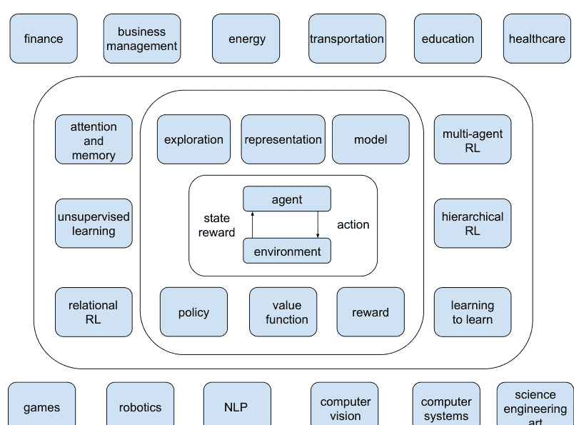
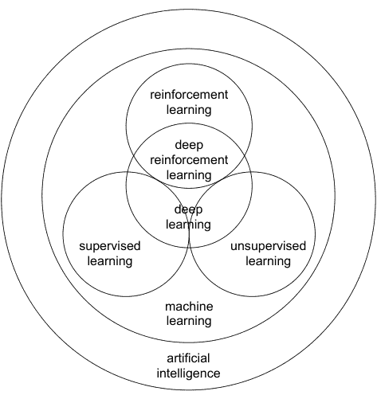
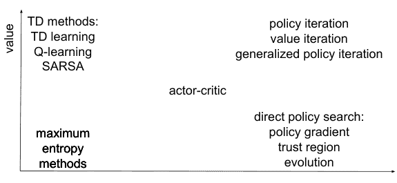
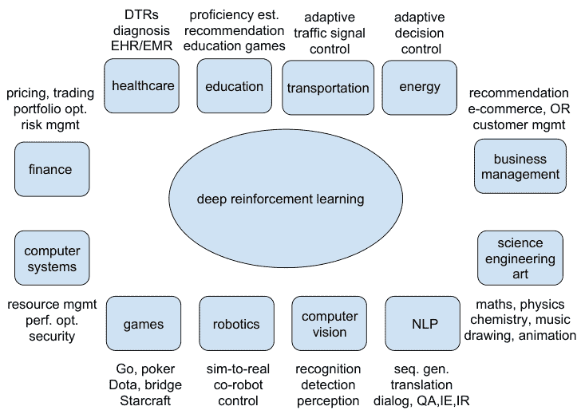
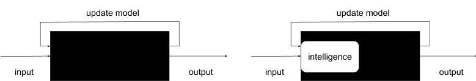

# 深度强化学习 (Yuxi Li)


## 摘要

我们以概览风格讨论深度强化学习。我们勾勒一幅细节丰富的全景图。我们讨论六个核心要素、六个重要机制和十二个应用，着眼于当代工作，并置于历史语境中。我们从人工智能、机器学习、深度学习和强化学习（RL）的背景入手，并提供资源。接下来我们讨论RL核心要素，包括值函数、策略、奖励、模型、探索与利用，以及表征。然后我们讨论RL的重要机制，包括注意力与记忆、无监督学习、层次RL、多智能体RL、关系RL和元学习。接着，我们讨论RL应用，包括游戏、机器人学、自然语言处理（NLP）、计算机视觉、金融、商业管理、医疗保健、教育、能源、交通、计算机系统，以及科学、工程和艺术。最后我们简要总结，讨论挑战与机遇，并以跋语收尾。¹

关键词：深度强化学习，深度RL，算法，架构，应用，人工智能，机器学习，深度学习，强化学习，值函数，策略，奖励，模型，探索与利用，表征，注意力，记忆，无监督学习，层次RL，多智能体RL，关系RL，元学习，游戏，机器人学，计算机视觉，自然语言处理，金融，商业管理，医疗保健，教育，能源，交通，计算机系统，科学，工程，艺术


## 1 引言

强化学习（RL）是关于智能体与环境交互，通过试错学习最优策略，以解决自然科学、社会科学和工程等广泛领域中的序列决策问题（Sutton and Barto, 1998; 2018; Bertsekas and Tsitsiklis, 1996; Bertsekas, 2012; Szepesvári, 2010; Powell, 2011）。

强化学习与神经网络的融合有着悠久的历史（Sutton and Barto, 2018; Bertsekas and Tsitsiklis, 1996; Schmidhuber, 2015）。随着深度学习最近取得的激动人心的成就（LeCun et al., 2015; Goodfellow et al., 2016），受益于大数据、强大的计算能力、新的算法技术、成熟的软件包和架构以及强有力的财务支持，我们一直在见证强化学习的复兴（Krakovsky, 2016），尤其是深度神经网络与强化学习的结合，即深度强化学习（deep RL）。²

²我们选择将深度强化学习缩写为 "deep RL"，因为它是强化学习的一个分支，特别是在强化学习中使用深度神经网络，而 "RL" 是强化学习的一个公认缩写。

深度学习，或称深度神经网络，在过去几年中在强化学习领域占据主导地位，应用于游戏、机器人技术、自然语言处理等领域。我们一直在见证重大突破，例如深度 Q 网络（DQN）（Mnih et al., 2015）、AlphaGo（Silver et al., 2016a; 2017）和 DeepStack（Moravčík et al., 2017）；每一个都代表着大量的问题和广泛的应用。DQN（Mnih et al., 2015）用于单人游戏，以及一般的单智能体控制。DQN 对 RL 中的大多数算法和应用都有影响。DQN 点燃了这轮深度强化学习的热潮。AlphaGo（Silver et al., 2016a; 2017）用于双人完美信息零和博弈。AlphaGo 在一项非常困难的问题上取得了非凡的成就，并在人工智能领域树立了里程碑。AlphaGo 的成功直接影响了类似的游戏，而 Alpha Zero（Silver et al., 2017）已经在国际象棋和将棋上取得了显著的成功。AlphaGo（Silver et al., 2016a）和 AlphaGo Zero（Silver et al., 2017）背后的技术，即深度学习、强化学习、蒙特卡洛树搜索（MCTS）和自我对弈，将产生更广泛和更深远的影响与应用。正如 AlphaGo 作者在其论文中所建议的（Silver et al., 2016a; 2017），以下应用值得进一步研究：通用游戏（特别是视频游戏）、经典规划、部分观测规划、调度、约束满足、机器人技术、工业控制、在线推荐系统、蛋白质折叠、降低能耗以及寻找革命性新材料。DeepStack（Moravčík et al., 2017）用于双人不完全信息零和博弈，这是一类固有难以求解的问题。DeepStack 类似于 AlphaGo，也在一项难题上取得了非凡的成就，并在人工智能领域树立了里程碑。它将产生丰富的影响和广泛的应用，例如，在防御战略资源和医疗建议的稳健决策方面（Moravčík et al., 2017）。

我们还看到新颖的算法、架构和应用，例如异步方法（Mnih et al., 2016）、信赖域方法（Schulman et al., 2015; Schulman et al., 2017b; Nachum et al., 2018）、确定性策略梯度（Silver et al., 2014; Lillicrap et al., 2016）、将策略梯度与非策略 RL 相结合（Nachum et al., 2017; 2018; Haarnoja et al., 2018）、插值策略梯度（Gu et al., 2017）、无监督强化与辅助学习（Jaderberg et al., 2017; Mirowski et al., 2017）、后见经验重放（Andrychowicz et al., 2017）、可微分神经计算机（Graves et al., 2016）、神经架构设计（Zoph and Le, 2017）、引导式策略搜索（Levine et al., 2016）、生成对抗模仿学习（Ho and Ermon, 2016）、多智能体博弈（Jaderberg et al., 2018）、难探索的 Atari 游戏（Aytar et al., 2018）、星际争霸 II（Sun et al., 2018; Pang et al., 2018）、化学合成规划（Segler et al., 2018）、角色动画（Peng et al., 2018a）、灵巧机器人（OpenAI, 2018）、用于 Dota 2 的 OpenAI Five 等等。

创造力将在核心要素、重要机制和应用方面不断推动深度 RL 的前沿，似乎没有边界。如果一个问题可以被视为或转化为序列决策问题，RL 可能会提供帮助。

为什么深度学习一直在帮助强化学习取得如此众多且巨大的成就？基于深度学习的表征学习通过梯度下降实现了自动特征工程和端到端学习，从而显著减少甚至消除对某些问题中领域知识的依赖。特征工程过去通常是手动完成的，并且往往耗时、过度具体且不完整。深度分布式表征利用数据中因素的层次化组合来应对维度灾难带来的指数级挑战。深度神经网络的通用性、表达能力和灵活性使一些任务变得更容易或成为可能，例如在上述的突破、新颖架构、算法和应用中。

深度学习作为机器学习的一个特定类别，并非没有局限性，例如，作为缺乏可解释性的黑盒，作为缺乏清晰且充分的科学原则来操作的“炼金术”，在调谐超参数方面存在困难，并且缺乏人类智能，因此在某些任务中无法与婴儿竞争。深度强化学习加剧了这些问题，甚至可重复性也是一个问题（Henderson et al., 2018）。然而，我们看到了光明的未来，因为有大量工作致力于改进深度学习、机器学习、强化学习、深度强化学习以及人工智能领域。

深度学习和强化学习分别于 2013 年和 2017 年被选为《MIT Technology Review》十大突破性技术之一，将在实现通用人工智能方面发挥关键作用。AlphaGo 的主要贡献者 David Silver 提出一个猜想：人工智能 = 强化学习 + 深度学习（Silver, 2016）。我们将在第 21 章中进一步讨论这一猜想。

关于深度强化学习有以下几个常见问题。我们在上文中简要讨论了它们，并将在即将到来的章节中进一步阐述。

- 为什么要“深”？
- 当前最先进的技术是什么？
- 存在哪些问题及潜在的解决方案？

本书大纲如下。首先，我们在第 2 章讨论人工智能、机器学习、深度学习和强化学习的背景，以及基准和资源。接着，我们讨论 RL 核心要素，包括第 3 章中的价值函数、第 4 章中的策略、第 5 章中的奖励、第 6 章中的模型、第 7 章中的探索与利用，以及第 8 章中的表征。随后，我们讨论 RL 的重要机制，包括第 9 章中的注意力和记忆、第 10 章中的无监督学习、第 11 章中的层次化 RL、第 12 章中的多智能体 RL、第 13 章中的关系 RL，以及第 14 章中的元学习。之后，我们讨论各种 RL 应用，包括第 15 章中的游戏、第 16 章中的机器人技术、第 17 章中的自然语言处理（NLP）、第 18 章中的计算机视觉、第 19 节中的金融与商业管理，以及第 20 章中的更多应用，包括第 20.1 节中的医疗保健、第 20.2 节中的教育、第 20.3 节中的能源、第 20.4 节中的交通运输、第 20.5 节中的计算机系统，以及第 20.6 节中的科学、工程和艺术。我们将在第 21 章总结全书，简要回顾，讨论挑战与机遇，并附有尾声。

图 1 展示了手稿的大纲。智能体-环境交互位于中心，周围是核心要素，其次是重要机制，然后是各种应用。

本手稿的主要读者是希望更加熟悉深度强化学习的人，尤其是（深度）强化学习的初学者。对于强化学习专家以及新来者来说，本书作为参考资料也很有帮助。本手稿对深度强化学习课程也很有帮助，包含选定的主题和论文。

我们力求以直观、高层次、概念化的方法讨论近期的代表性工作，并提供尽可能多的相关信息。我们试图使本手稿成为 Sutton and Barto (2018) 的补充，后者是一本主要侧重于强化学习基础的 RL 经典著作。然而，深度 RL 本质上是一个高级主题，本手稿的大部分内容是关于介绍论文，大多不涵盖详细背景。（否则，手稿的长度将会激增。）因此，本手稿的大部分内容相当技术化，有些粗糙，缺乏完整细节。原始论文通常是深入理解的最佳资源。

深度强化学习发展非常迅速。我们发布博客以补充本手稿，并致力于在 https://medium.com/@yuxili 上跟踪该领域的发展。




图 1：大纲

本手稿涵盖深度强化学习的广泛主题。尽管我们已竭力追求卓越，但难免存在不足甚至错误。欢迎提出意见和批评。

## 2 背景

本章简要介绍人工智能（Russell and Norvig, 2009）、机器学习、深度学习（Goodfellow et al., 2016）和强化学习（Sutton and Barto, 2018）的概念与基础。

本文不对人工智能、机器学习和深度学习作详细背景介绍；这些领域过于宽泛，无法在此详述。相反，我们推荐以下近期的 Nature/Science 综述论文：用于机器学习的 Jordan and Mitchell (2015)，以及用于深度学习的 LeCun et al. (2015)。对于强化学习，我们作为微型教程介绍一些基础知识，并推荐教材 Sutton and Barto (2018)、两门课程——UCL 由 David Silver 主讲的 RL 课程（Silver, 2015）和 UC Berkeley 由 Sergey Levine 主讲的 Deep RL 课程（Levine, 2018），以及一篇近期的 Nature 综述论文（Littman, 2015）。我们将在 2.5 节介绍一些深度强化学习资源。

在图 2 中，我们说明了人工智能和机器学习中几个概念之间的关系。顾名思义，深度强化学习位于深度学习和强化学习的交汇处。我们通常将机器学习分为监督学习、无监督学习和强化学习。深度学习可以与/作为监督学习、无监督学习、强化学习及其他机器学习方法协同工作。3 深度学习是机器学习的一部分，而机器学习是人工智能的一部分。请注意，所有这些领域都在不断发展，例如，深度学习和深度强化学习正在解决逻辑、推理和知识表示等经典问题。强化学习对所有人工智能问题都可能至关重要，正如 Russell and Norvig (2009) 所引用：“强化学习可以被视为涵盖所有人工智能：一个智能体被放置在一个环境中，并必须学会在其中行为成功”，以及“强化学习可以被视为整个人工智能问题的缩影”。

### 2.1 人工智能

人工智能（AI）是一个非常广泛的领域。即使像 Russell and Norvig (2009) 这样的权威 AI 教材也没有给出精确的定义。Russell and Norvig (2009) 从两个对比中的四个视角讨论了 AI 的定义：1）思维过程与推理 vs. 行为，以及 2）以人类表现忠实度 vs. 合理性（一种理想的性能衡量标准）来衡量的成功。我们遵循 Russell and Norvig (2009) 的讨论，列出了定义 AI 的四种方式，直接引用自 Russell and Norvig (2009)。

定义 1，“表现得像人类”，遵循图灵测试方法。“当由人类执行时需要智能的功能，创造能够执行此类功能的机器的艺术。”（Kurzweil, 1992）“研究如何让计算机做目前人类更擅长的事情。”（Rich and Knight, 1991）

如果人类审问者无法判断对某些书面问题的书面回答是来自计算机还是人类，则计算机通过了图灵测试。计算机需要以下能力：自然语言处理（NLP）用于成功进行英文交流，知识表示用于存储其所知或所闻内容，自动推理用于回答问题并从存储信息中得出新结论，以及机器学习用于适应新场景和检测与外推模式。在完整的图灵测试中，涉及视频信号，因此计算机需要更多能力：计算机视觉用于物体感知，以及机器人技术用于物体操作和运动控制。AI 研究人员大多致力于智能的底层原理，主要由上述六个学科覆盖，而较少关注通过图灵测试，因为复制一个样本通常不是目标，例如，飞机可能不会简单地模仿鸟类。

定义 2，“像人类一样思考”，遵循认知建模方法。“让计算机思考……拥有思想的机器，在完全和字面意义上。”（Haugeland，

3 机器学习包括许多方法：决策树学习、关联规则学习、人工神经网络、归纳逻辑编程、支持向量机、聚类、贝叶斯网络、强化学习、表征学习、相似性和度量学习、稀疏字典学习、遗传算法和基于规则的机器学习，根据维基百科，https://en.wikipedia.org/wiki/Machine_learning。还可查阅 Russell and Norvig (2009)、Mitchell (1997) 和 Zhou (2016) 等教材。



图 2：深度强化学习、深度学习、强化学习、监督学习、无监督学习、机器学习和人工智能之间的关系。深度学习和深度强化学习正在解决许多经典人工智能问题。

1989) “[我们与人类思维相关联的活动的]自动化，例如决策、问题解决、学习等……”（Bellman, 1978）

定义 3，“理性思考”，遵循“思想法则”方法。“通过使用计算模型研究心智机能。”（Charniak and McDermott, 1985）“研究使感知、推理和行动成为可能的计算。”（Winston, 1992）

定义 4，“理性行为”，遵循理性智能体方法。“计算智能是研究智能体设计的学科。”（Poole et al., 1998）“AI ... 关注人工物中的智能行为。”（Nilsson, 1998）与基于人类行为或人类思维的方法相比，理性智能体方法更有利于科学发展。因此，Russell and Norvig (2009) 关注理性智能体及其构建组件的一般原则。

我们列出了 Russell and Norvig (2009) 中的基础及其试图回答的问题：哲学，针对诸如“形式规则能否用于得出有效结论？”、“心智如何从物理大脑产生？”、“知识从何而来？”以及“知识如何导致行动？”等问题；数学，针对诸如“得出有效结论的形式规则是什么？”、“什么可以被计算？”以及“我们如何用不确定信息进行推理？”等问题；经济学，针对诸如“我们应如何决策以最大化收益？”、“当其他人可能不同意时我们应如何做？”以及“当收益可能在遥远的未来时我们应如何做？”等问题；神经科学，针对诸如“大脑如何处理信息？”等问题；心理学，针对诸如“人类和动物如何思考和行动？”等问题；计算机工程，针对诸如“我们如何构建高效计算机？”等问题；控制理论与控制论，针对诸如“人工物如何在自身控制下运行？”等问题；以及语言学，针对诸如“语言与思维有何关系？”等问题。

Russell and Norvig (2009) 将人工智能的历史概述为：人工智能的孕育期（1943-1955）、人工智能的诞生（1956）、早期热情与巨大期望（1952 - 1969）、现实的一剂良药（1966 - 1973）、基于知识的系统：权力的钥匙？（1969 - 1979）、人工智能成为一门产业（1980 - 至今）、神经网络的回归（1986 - 至今）、人工智能采用科学方法（1987 - 至今）、智能体的出现（1995 - 至今）以及超大规模数据集的可用性（2001 - 至今）。

### 2.2 机器学习

机器学习是关于从数据中学习并进行预测和/或决策。引用 Mitchell (1997) 的话：“如果计算机程序在任务类 \(T\) 上的性能（由 \(P\) 衡量）随着经验 \(E\) 而提高，则称该程序在任务类 \(T\) 和性能度量 \(P\) 方面从经验 \(E\) 中学习。”

我们通常将机器学习分为监督学习、无监督学习和强化学习。在监督学习中，有标记数据；在无监督学习中，没有标记数据。分类和回归是两种监督学习问题，分别具有类别和数值输出。

无监督学习试图从无标签数据中提取信息，例如聚类和密度估计。表征学习是一种经典的无监督学习类型。然而，使用监督学习训练深度神经网络是一种表征学习。表征学习寻找一种表征，以尽可能多地保留原始数据的信息，同时使表征比原始数据更简单或更易于访问，具有低维、稀疏和独立的表征。

深度学习，或深度神经网络，是一种特定的机器学习方案，通常用于监督或无监督学习，并可以与强化学习集成，用于状态表征和/或函数近似器。监督学习和无监督学习通常是一次性的、近视的，考虑即时奖励；而强化学习是序列的、远见的，考虑长期累积奖励。

强化学习通常涉及序列决策。在强化学习中，与监督学习和无监督学习不同，存在评价性反馈，但没有监督标签。与监督学习相比，强化学习还有额外的挑战，如信用分配、稳定性和探索。强化学习与最优控制（Bertsekas, 2012; Sutton et al., 1992）、运筹学与管理学（Powell, 2011）相近，并与心理学和神经科学（Sutton and Barto, 2018）相关。

机器学习是大数据、数据科学（Blei and Smyth, 2017; Provost and Fawcett, 2013）、预测建模（Kuhn and Johnson, 2013）、数据挖掘（Han et al., 2011）、信息检索（Manning et al., 2008）等的基础，并成为计算机视觉、自然语言处理、机器人技术等领域的关键要素。概率论与统计学（Hastie et al., 2009; Murphy, 2012; Vapnik, 1998）和优化（Boyd and Vandenberghe, 2004; Bottou et al., 2018）对于统计机器学习很重要。机器学习是 AI 的一个子集；然而，它正在发展成为所有人工智能领域中至关重要的部分。

机器学习算法由一个数据集、一个代价/损失函数、一个优化过程和一个模型组成（Goodfellow et al., 2016）。数据集被分为不重叠的训练、验证和测试子集。代价/损失函数衡量模型性能，例如，就准确性而言，如回归中的均方误差和分类中的错误率。

熵的概念对于损失函数的定义很重要。对于分布为 \(p\) 的随机变量 \(X\)，熵是其不确定性的度量，记为 \(\mathbb{H}(X)\) 或 \(\mathbb{H}(p)\)，

```
\(\mathbb{H}(X) \triangleq - \sum_{k=1}^K p(X = k) \log_2 p(X = k).\)
```

对于二元随机变量，\(X \in \{0, 1\}\)，我们有 \(p(X = 1) = \theta\) 和 \(p(X = 0) = 1 - \theta\)，

```
\(\mathbb{H}(X) = -[\theta \log_2 \theta + (1 - \theta) \log_2(1 - \theta)].\)
```


Kullback-Leibler divergence (KL-divergence) 或 相对熵，是衡量两个概率分布 p 与 q 之间差异性的一种方法，

```
KL(p||q) \triangleq \sum_{k=1}^K p_k \log \frac{p_k}{q_k} \triangleq \sum_{k=1}^K p_k \log p_k - p_k \log q_k = -H(p) + H(p, q). \quad (3)
```

这里 H(p, q) 是交叉熵。我们有 KL(p, q) \triangleq - \sum_{k=1}^K p_k \log q_k。参见 Murphy (2012)。

训练误差衡量训练数据上的误差，将其最小化是一个优化问题。泛化误差，或称测试误差，衡量新输入数据上的误差，这也是机器学习区别于优化的地方。机器学习算法试图使训练误差以及训练误差与测试误差之间的差距都变小。若模型无法达到较低的训练误差，则称其欠拟合；若训练误差与测试误差之间的差距较大，则称其过拟合。

模型容量衡量模型能够拟合的函数范围。奥卡姆剃刀^4 指出，在表达能力相同的情况下，更倾向于选择简单模型。训练误差与泛化误差相对于模型容量通常呈 U 型关系。我们寻找最优容量，以实现低训练误差和训练误差与泛化误差之间的小差距。偏差衡量估计器相对于真实值的期望偏差；而方差衡量估计器相对于期望值的偏差，即估计器的方差。随着模型容量增加，偏差倾向于降低，而方差倾向于升高，从而在泛化误差与模型容量之间形成另一种 U 型关系。我们试图找到最优容量点，其左侧出现欠拟合，右侧出现过拟合。正则化在代价函数中添加惩罚项，以降低泛化误差，而非训练误差。无免费定理指出，不存在普遍最优的模型，或普遍最优的正则化器。其含义是，深度学习可能并非某些问题的最佳模型。存在模型参数，以及用于模型容量和正则化的超参数。交叉验证用于调整超参数，以在偏差和方差之间取得平衡，并选择最优模型。

极大似然估计 (MLE) 是推导参数良好估计的常用方法。针对数值下溢等问题，MLE 中的乘积被转换为求和，以获得负对数似然 (NLL)。MLE 等价于最小化 KL 散度，即由训练数据定义的经验分布与模型分布之间的不等度。两个分布之间最小化 KL 散度对应于最小化分布之间的交叉熵。简而言之，似然最大化变为负对数似然 (NLL) 的最小化，或者等价地，交叉熵的最小化。

梯度下降是解决优化问题的常用方法。随机梯度下降通过每次处理单个样本（通常使用小批量）来扩展梯度下降。

重要性采样是一种技术，通过从不同分布中采样来估计特定分布的属性，以降低估计的方差，或在从感兴趣的分布中采样困难时使用。

存在用于机器学习算法的数学分析框架。柯尔莫哥洛夫复杂度 (Li and Vitányi, 2008)，或称算法复杂度，研究奥卡姆剃刀中的简单性概念。在可能近似正确 (PAC) 学习 (Valiant, 1984) 中，学习算法旨在选择一个泛化函数，以高概率实现低泛化误差。VC 维 (Vapnik, 1998) 衡量二元分类器的容量。

### 2.3 深度学习

深度学习与“浅层”学习相对。对于许多机器学习算法，例如线性回归、逻辑回归、支持向量机 (SVM)、决策树和提升方法，我们有输入层和输出层，且输入可能在训练前通过手工特征工程进行转换。在深度学习中，输入层和输出层之间具有一个或多个隐藏层。除了输入层外的每一层，我们计算每个单元的输入，作为前一层单元的加权和；然后我们通常使用非线性变换，或激活函数，如 logistic、tanh，或近年来更流行的修正线性单元 (ReLU)，将其应用于单元的输入，以获得来自前一层输入的新表示。我们在层与层之间单元连接上设有权重。在计算从输入向前流向输出之后，在输出层和每个隐藏层，我们可以向后计算误差导数，并将梯度向回传播至输入层，以便更新权重来优化某个损失函数。

前馈深度神经网络或多层感知机 (MLP) 是通过在每一层组合许多更简单的函数而形成的数学函数，将一组输入值映射到输出值。卷积神经网络 (CNN) 是一种前馈深度神经网络，具有卷积层、池化层和全连接层。CNN 旨在处理具有多个数组的数据，例如彩色图像、语言、音频频谱和视频，受益于此类信号的特性：局部连接、共享权重、池化以及使用多层，并受视觉神经科学中简单细胞和复杂细胞的启发 (LeCun et al., 2015)。ResNet (He et al., 2016d) 旨在通过添加快捷连接来学习相对于层输入的残差函数，从而缓解非常深度神经网络的训练难题。循环神经网络 (RNN) 常用于按元素处理语音和语言等序列输入，并使用隐藏单元存储过去元素的历史。RNN 可以被视为一种多层神经网络，在前向计算的时间展开时，所有层共享相同的权重。RNN 难以长时间存储信息，且梯度可能消失。长短期记忆网络 (LSTM) (Hochreiter and Schmidhuber, 1997) 和门控循环单元 (GRU) (Chung et al., 2014) 被提出以解决此类问题，并通过循环单元中的门控机制来操纵信息。梯度反向传播或其变体可用于训练上述所有深度神经网络。

Dropout (Srivastava et al., 2014) 是一种正则化策略，通过从原始网络中随机移除非输出单元来训练一组子网络。批量归一化 (Ioffe and Szegedy, 2015; Santurkar et al., 2018) 和层归一化 (Ba et al., 2016) 旨在提高训练效率。

深度神经网络从原始输入自动学习表示，以恢复许多自然信号中的组合层次结构，即高级特征由低级特征组成，例如在图像中，对象、部分、图案和边缘局部组合的层次结构。分布式表示是深度学习中的核心思想，它意味着许多特征可以表示每个输入，每个特征可以表示许多输入。深度分布式表示的指数级优势对抗了维度灾难的指数级挑战。端到端训练的概念是指，学习模型使用原始输入（通常不进行手工特征工程）来生成输出，例如 AlexNet (Krizhevsky et al., 2012) 使用原始像素进行图像分类，Graves et al. (2013) 使用音频数据的傅里叶变换进行语音识别；Seq2Seq (Sutskever et al., 2014) 使用原始句子进行机器翻译，以及 DQN (Mnih et al., 2015) 使用原始像素和得分来玩游戏。

正在努力设计新的神经网络架构，例如胶囊网络 (Sabour et al., 2017; Hinton et al., 2018)。也有努力设计不使用神经网络的深度机器学习架构，例如 DeepForest (Zhou and Feng, 2017; Feng and Zhou, 2017)。

### 2.4 强化学习

本节简要介绍强化学习背景，作为一篇微型教程。良好理解强化学习对于深入理解深度强化学习至关重要。深度 RL 是一种特定的 RL 类型，使用深度神经网络进行状态表示和/或对值函数、策略、转换模型或奖励函数进行函数近似。Silver (2015) 是强化学习的清晰入门材料。

Sutton and Barto (2018) 在每章末尾提供“文献与历史备注”。Russell and Norvig (2009) 在第 21 章“强化学习”中提供“文献与历史注释”。参见 Barto (2018) 关于强化学习简史的演讲。

我们首先解释一些 RL 行话中的术语。阅读本章其余部分后，这些术语会变得更加清晰。我们将它们集中在此，以便读者查阅。

预测问题，或策略评估，是为策略计算状态或动作值函数。控制问题是寻找最优策略。规划使用模型构建值函数或策略。

^4 "Occam's razor" 是常见的拼写错误 (Russell and Norvig, 2009)。


策略内方法评估或改进行为策略，例如，SARSA 将动作值函数拟合到当前策略，即，SARSA 基于来自同一策略的样本评估策略，然后根据动作值贪婪地改进策略。在策略外方法中，智能体学习最优值函数/策略，可能遵循不相关的行为策略。例如，Q-learning 试图直接找到最优策略的动作值，不一定拟合于生成数据的策略，即，Q-learning 获得的策略通常与生成样本的策略不同。策略内和策略外的概念可以理解为同一策略和不同策略。

探索与利用困境是指智能体需要利用当前最佳动作以贪婪地最大化奖励，但又必须探索环境以寻找更好的动作，当策略尚未最优，或系统是非平稳的。

在无模型方法中，智能体直接从经验中通过试错学习；模型，即状态转移和奖励模型，是未知的。使用模型的 RL 方法是基于模型的方法；模型可能是给定的，例如在计算机围棋游戏中，或从经验中学习得到。

在在线模式下，训练算法在按顺序获取的数据上执行。在离线模式或批量模式下，模型在整个数据集上训练。

使用自助法（bootstrapping）时，状态或动作值的估计是根据后续估计进行更新的。

#### 2.4.1 问题设置

RL 智能体随时间与环境交互。在每个时间步 t，智能体从状态空间 S 接收一个状态 s_t，并从动作空间 A 选择一个动作 a_t，遵循策略 π(a_t|s_t)，即智能体的行为，也就是从状态 s_t 到动作 a_t 的映射。智能体接收一个标量奖励 r_t，并根据环境动态（或模型）转移到下一状态 s_{t+1}，分别对应奖励函数 R(s, a) 和状态转移概率 P(s_{t+1}|s_t, a_t)。在分段任务中，此过程持续到智能体到达终止状态，然后重新开始。回报是使用折扣因子 γ ∈ (0, 1] 的折扣累积奖励，
R_t = ∑_{k=0}^{∞} γ^k r_{t+k}. (4)

智能体旨在从每个状态最大化此类长期回报的期望。该问题设置在离散状态和动作空间中。将其扩展到连续空间并不困难。在部分可观测环境中，智能体无法完全观测状态，但有观测。

当 RL 问题满足马尔可夫性质时，即未来仅取决于当前状态和动作，而不取决于过去，它被制定为马尔可夫决策过程（MDP），由 5 元组 (S, A, P, R, γ) 定义。当系统模型可用时，我们使用动态规划方法：策略评估用于计算策略的值函数/动作值函数，值迭代和策略迭代用于寻找最优策略。当没有模型时，我们求助于 RL 方法。当模型可用时，RL 方法也适用。RL 环境可以是多臂老虎机、MDP、部分可观测 MDP（POMDP）、游戏等。

#### 2.4.2 值函数

值函数是对期望、累积、折扣的未来奖励的预测，用于衡量每个状态或状态-动作对的好坏。状态值，
v_π(s) = E[R_t | s_t = s]，其中，R_t = ∑_{k=0}^{∞} γ^k r_{t+k}。（5）
是从状态 s 开始遵循策略 π 的期望回报。动作值，
q_π(s, a) = E[R_t | s_t = s, a_t = a]。（6）
是在状态 s 选择动作 a 然后遵循策略 π 的期望回报。值函数 v_π(s) 分解为贝尔曼方程：
v_π(s) = ∑_a π(a|s) ∑_{s',r} p(s', r | s, a) [r + γ v_π(s')]。（7）

最优状态值，
$$v_*(s) = \max_\pi v_\pi(s) = \max_a q_{\pi*}(s, a),$$
是任何策略对状态 s 能够达到的最大状态值，它分解为贝尔曼方程：
$$v_*(s) = \max_a \sum_{s', r} p(s', r | s, a) [r + \gamma v_*(s')].$$

动作值函数 $q_\pi(s, a)$ 分解为贝尔曼方程：
$$q_\pi(s, a) = \sum_{s', r} p(s', r | s, a) [r + \gamma \sum_{a'} \pi(a' | s') q_\pi(s', a')].$$

最优动作值函数，
$$q_*(s, a) = \max_\pi q_\pi(s, a),$$
是任何策略对状态 s 和动作 a 能够达到的最大动作值，它分解为贝尔曼方程：
$$q_*(s, a) = \sum_{s', r} p(s', r | s, a) [r + \gamma \max_{a'} q_*(s', a')].$$

我们用 $\pi^*$ 表示最优策略。

以最短路径问题为例。在图论中，单源最短路径问题是寻找一对节点之间的最短路径，使得路径中边的权重之和最小。在 RL 中，状态是当前节点。在每个节点，遵循指向每个邻居的链接是一个动作。转移模型表示，在选择要遵循的链接后，智能体前往一个邻居。奖励是链接权重/成本/距离的负值。折扣因子可以是 $\gamma = 1$，因为这是一个分段任务。目标是找到一条路径以最大化总成本的负值，即最小化总距离。最优策略是选择最佳邻居以遍历并实现最短路径；对于每个状态/节点，最优值是从该节点到目的地的最短距离。Dijkstra 算法是一种高效算法，基于图的信息，包括节点、边和权重。RL 可以采用无模型方法运行，即在没有此类全局图信息的情况下，根据某些策略在图中游荡。RL 算法比 Dijkstra 算法更通用，尽管在拥有全局图信息时，Dijkstra 算法非常高效。

#### 2.4.3 探索与利用

RL 智能体需要在探索不确定策略和利用当前最佳策略之间进行权衡，这是 RL 中的根本困境。这里我们介绍一种简单的方法，$\epsilon$-贪婪，其中 $\epsilon \in (0, 1)$，通常是一个接近 0 的小值。在 $\epsilon$-贪婪中，智能体以概率 $1 - \epsilon$ 为当前状态 $s$ 选择贪婪动作 $a = \arg \max_{a \in \mathcal{A}} Q(s, a)$，并以概率 $\epsilon$ 选择随机动作。也就是说，智能体以概率 $1 - \epsilon$ 利用当前值函数估计，并以概率 $\epsilon$ 进行探索。

我们将在第 7 章中进一步讨论探索与利用困境，包括几个原则：诸如 $\epsilon$-贪婪、乐观初始化、上界信任束缚、概率匹配和信息状态搜索等天真方法，这些方法是在多臂老虎机环境下开发的，但也适用于 RL 问题（Silver, 2015）。

#### 2.4.4 动态规划

动态规划（DP）是解决具有最优子结构和重叠子问题的问题的通用方法。MDP 满足这些属性，其中贝尔曼方程给出递归分解，值函数存储和重用子解（Silver, 2015）。DP 假设完全了解 MDP 的转移和奖励模型。预测问题是针对给定策略评估值函数，控制问题是寻找最优值函数和/或最优策略。

迭代策略评估是评估给定策略 \(\pi\) 的一种方法。它迭代应用贝尔曼期望备份，
$$v_{k+1}(s) = \sum_{a \in \mathcal{A}} \pi(a|s)[\mathcal{R}(s, a) + \gamma \sum_{s' \in \mathcal{S}} \mathcal{P}(s'|s, a)v_k(s')], \quad (13)$$
因此在每次迭代 \(k+1\) 中，对于所有状态 \(s \in \mathcal{S}\)，从其后继状态的值函数 \(v_k(s')\) 更新 \(v_{k+1}(s)\)。值函数将收敛到 \(v_\pi\)，即策略 \(\pi\) 的值函数。

策略迭代（PI）在策略评估和策略改进之间交替，以生成一系列不断改进的策略。在策略评估中，估计当前策略的值函数以获得 \(v_\pi\)。在策略改进中，使用当前值函数生成更好的策略，例如，根据值函数 \(v_\pi\) 贪婪地选择动作。这种迭代策略评估和贪婪策略改进的策略迭代过程将收敛到最优策略和值函数。

我们可以修改策略迭代步骤，在收敛前停止。广义策略迭代（GPI）由任何策略评估方法和任何策略改进方法组成。

值迭代（VI）用于寻找最优策略。它迭代应用贝尔曼最优备份，
$$v_*(s) = \max_a \mathcal{R}(s, a) + \gamma \sum_{s' \in \mathcal{S}} \mathcal{P}(s'|s, a)v_k(s'). \quad (14)$$
在每次迭代 \(k+1\) 中，对于所有状态 \(s \in \mathcal{S}\)，它从 \(v_k(s')\) 更新 \(v_{k+1}(s)\)。这种同步备份将收敛到最优策略的值函数。我们可以有异步 DP 和近似 DP。

我们在公式 (7) 中有值函数的贝尔曼方程。贝尔曼算子定义为，
$$(T^\pi v)(s) \doteq \sum_a \pi(a|s) \sum_{s', r} p(s', r | s, a) [r + \gamma v_\pi(s')]. \quad (15)$$
然后 TD 固定点为，
$$v_\pi = T^\pi v_\pi. \quad (16)$$
我们可以定义贝尔曼期望备份算子，矩阵形式为，
$$T^\pi(v) = \mathcal{R} + \gamma \mathcal{P}^\pi v, \quad (17)$$
和贝尔曼最优备份算子，
$$T^*(v) = \max_{a \in \mathcal{A}} \mathcal{R}^a + \gamma \mathcal{P}^a v, \quad (18)$$
我们可以证明这些算子分别是具有固定点的收缩映射，这有助于证明策略迭代、值迭代和某些广义策略迭代算法的收敛性。更多细节见 Silver (2015)、Sutton and Barto (2018) 和 Bertsekas and Tsitsiklis (1996)。

#### 2.4.5 蒙特卡洛

蒙特卡洛方法从完整分段的经验中学习，不假设知道转移或奖励模型，并使用样本均值进行估计。蒙特卡洛方法仅适用于分段任务。

在用于策略评估的蒙特卡洛方法中，我们使用经验平均回报而不是期望回报进行评估。根据大数定律，估计的值函数收敛到策略的值函数。

策略内蒙特卡洛控制遵循广义策略迭代方案。在策略评估中，它使用蒙特卡洛策略评估来计算动作值。在策略改进中，它使用 \(\epsilon\)-贪婪策略改进。可以证明，无限探索下的极限贪婪（GLIE）蒙特卡洛控制收敛到最优动作值函数（Singh et al., 2000）。

在策略外学习中，我们遵循行为策略来评估目标策略。在策略外学习下，我们可以利用人类或其他智能体的观察进行学习，重复使用旧策略的经验，


在遵循探索策略的同时学习最优策略，并基于单一策略的经验学习多种策略。（Silver, 2015）

我们可以使用重要性采样来进行非策略蒙特卡罗方法，通过在整个 episode 中乘以重要性采样修正权重，利用由行为策略生成的经验来评估目标策略。不过，这可能会显著增加方差。

#### 2.4.6 时序差分学习

时序差分（TD）学习是强化学习的核心。TD学习通常指Sutton (1988)中价值函数评估的学习方法。Q-learning (Watkins and Dayan, 1992) 和 SARSA (Rummery and Niranjan, 1994) 是时序差分控制方法。

TD学习 (Sutton, 1988) 直接从经验中带TD误差和自举的方式，以无模型、在线且完全增量的方式学习价值函数 $V(s)$。TD学习是一个预测问题。更新规则为，

$V(s) \leftarrow V(s) + \alpha[r + \gamma V(s') - V(s)],$ (19)

其中 $\alpha$ 是学习率，$r + \gamma V(s') - V(s)$ 称为TD误差。算法1给出了表格式TD学习的伪代码。精确地说，它是表格式TD(0)学习，其中“0”表示基于一步回报。

自举根据后续估计来估计状态或动作值函数，如TD更新规则所示，在强化学习中很常见，例如在TD学习、Q-learning和SARSA中。自举方法通常学习速度更快，并使学习能够在线和持续进行。自举方法不是真正的梯度下降的实例，因为目标依赖于要估计的值。然后引入了半梯度下降的概念（Sutton and Barto, 2018）。

```
Input: the policy $\pi$ to be evaluated
Output: value function $V$

initialize $V$ arbitrarily, e.g., to 0 for all states
for each episode do
  initialize state $s$
  for each step of episode, state $s$ is not terminal do
    $a \leftarrow$ action given by $\pi$ for $s$
    take action $a$, observe $r, s'$
    $V(s) \leftarrow V(s) + \alpha[r + \gamma V(s') - V(s)]$
    $s \leftarrow s'$
  end
end
```

算法1：TD学习，改编自Sutton and Barto (2018)

```
Output: action value function $Q$

initialize $Q$ arbitrarily, e.g., to 0 for all states, set action value for terminal states as 0
for each episode do
  initialize state $s$
  for each step of episode, state $s$ is not terminal do
    $a \leftarrow$ action for $s$ derived by $Q$, e.g., $\epsilon$-greedy
    take action $a$, observe $r, s'$
    $Q(s, a) \leftarrow Q(s, a) + \alpha[r + \gamma \max_{a'} Q(s', a') - Q(s, a)]$
    $s \leftarrow s'$
  end
end
```

算法3：Q-learning，改编自Sutton and Barto (2018)

```
Output: action value function Q
initialize Q arbitrarily, e.g., to 0 for all states, set action value for terminal states as 0
for each episode do
    initialize state s
    for each step of episode, state s is not terminal do
        a <- action for s derived by Q, e.g., \(\epsilon\)-greedy
        take action a, observe r, s'
        a' <- action for s' derived by Q, e.g., \(\epsilon\)-greedy
        Q(s, a) <- Q(s, a) + \(\alpha\)[r + \(\gamma\)Q(s', a') - Q(s, a)]
        s <- s', a <- a'
    end
end
```

算法2：SARSA，改编自Sutton and Barto (2018)

SARSA表示状态、动作、奖励、(下一个)状态、(下一个)动作，是一种策略内控制方法，用于寻找最优策略，其更新规则为，

\(Q(s, a) \leftarrow Q(s, a) + \alpha[r + \gamma Q(s', a') - Q(s, a)]\). (20)

算法2给出了表格式SARSA的伪代码，即表格式SARSA(0)。

Q-learning是一种非策略控制方法，用于寻找最优策略。Q-learning学习动作值函数，其更新规则为，

\(Q(s, a) \leftarrow Q(s, a) + \alpha[r + \gamma \max_{a'} Q(s', a') - Q(s, a)]$. (21)

Q-learning通过最大运算符贪婪地根据动作值来优化策略。算法3给出了Q-learning的伪代码，精确地说，是表格式Q(0)学习。

TD学习、Q-learning和SARSA在特定条件下收敛。从最优动作值函数中，我们可以推导出最优策略。

#### 2.4.7 多步自举

上述算法被称为TD(0)、Q(0)和SARSA(0)，即基于一步回报的学习。在前向视图中，我们有它们的多步回报变体。在n步更新中，$V(s_t)$ 将朝向 n步回报进行更新，定义为，

\(r_t + \gamma r_{t+1} + \cdots + \gamma^{n-1}r_{t+n-1} + \gamma^n V(s_{t+n})\)。 (22)

后向视图中的资格痕迹提供了一种在线、增量的实现，从而产生TD(\(\lambda\))、Q(\(\lambda\))和SARSA(\(\lambda\))算法，其中 \(\lambda \in [0, 1]\)。TD(1)与蒙特卡罗方法相同。资格痕迹是一种短期记忆，通常在一个 episode 内持续存在，通过影响权重向量来辅助学习过程。权重向量是一种长期记忆，贯穿整个系统持续时间，决定估计值。资格痕迹有助于解决延迟奖励和非马尔可夫任务的问题（Sutton and Barto, 2018）。

TD(\(\lambda\))利用资格痕迹和衰减参数 \(\lambda\) 将一步TD预测TD(0)与蒙特卡罗方法TD(1)统一起来，用于预测算法。De Asis et al. (2018) 对多步TD控制算法进行了统一。

#### DP、MC和TD的比较

在此部分，我们根据Silver (2015)和Sutton and Barto (2018)比较动态规划（DP）、蒙特卡罗（MC）和时序差分（TD）学习。

DP需要模型；TD和MC是无模型的。DP和TD使用自举；MC不使用。TD和MC使用样本备份，DP和穷举搜索使用完整备份。DP使用一步备份；TD使用一步或多步备份；MC和穷举搜索使用深层备份，直到 episode 结束。

TD可以在连续环境中，从不完整的序列中在线学习。MC在 episode 环境中，从完整序列中学习。TD方差低，有一定偏差，通常比MC更高效，对初始化更敏感。MC方差高，无偏差，简单易用，对初始化不敏感。MC具有良好的收敛性，即使在使用函数近似时也是如此。

TD利用马尔可夫性质，因此在马尔可夫环境中更高效。MC不假设马尔可夫性质，因此在非马尔可夫环境中通常更有效。

表1比较了DP与TD（Silver, 2015; Sutton and Barto, 2018）。

| 完整备份（DP） | 样本备份 |
| :--- | :--- |
| 迭代策略评估 | TD学习 |
| \(v(s) \leftarrow \mathbb{E}[r + \gamma v(s')|s]\) | \(v(s) \xleftrightarrow{\alpha} r + \gamma v(s')\) |
| Q策略迭代 | SARSA |
| \(Q(s,a) \leftarrow \mathbb{E}[r + \gamma Q(s', a')|s, a]\) | \(Q(s,a) \xleftrightarrow{\alpha} r + \gamma Q(s', a')\) |
| Q值迭代 | Q-learning |
| \(Q(s,a) \leftarrow \mathbb{E}[r + \gamma \max_{a' \in \mathcal{A}} Q(s', a')|s, a]\) | \(Q(s,a) \xleftrightarrow{\alpha} r + \gamma \max_{a' \in \mathcal{A}} Q(s', a')\) |

表1：DP与TD学习的比较，其中 \(x \xleftrightarrow{\alpha} y \doteq x \leftarrow \alpha(y - x)\)。

#### 2.4.8 基于模型的强化学习

Sutton (1990) 提出了Dyna-Q，通过不仅从真实经验中学习，还利用学习模型的模拟轨迹进行规划，来整合学习、行动和规划。学习使用环境中的真实经验；规划使用模型模拟的经验。算法4给出了表格式Dyna-Q的伪代码。我们将在第6章中更详细地讨论基于模型的强化学习。

```
// Model(s, a) denotes predicted reward and next state for state action pair (s, a)
initialize Q(s, a) and Model(s, a) for all s in S and a in A
for true do
    s <- current, nonterminal, state
    a <- action for s derived by Q, e.g., \epsilon-greedy
    //acting
    take action a; observe reward r, and next state s'
    // direct reinforcement learning
    Q(s, a) <- Q(s, a) + \alpha[r + \gamma max_{a'} Q(s', a') - Q(s, a)]
    // model learning
    Model(s, a) <- r, s'
    // planning
    for N iterations do
        s <- random state previously observed
        a <- random action previously taken
        r, s' <- Model(s, a)
        Q(s, a) <- Q(s, a) + \alpha[r + \gamma max_{a'} Q(s', a') - Q(s, a)]
    end
end
```

算法4：Dyna-Q，改编自Sutton and Barto (2018)

#### 2.4.9 函数近似

我们上面讨论了表格式情况，其中价值函数或策略以表格形式存储。当状态和/或动作空间很大或连续时，函数近似是一种泛化方法。函数近似旨在从函数的示例中泛化以构建整个函数的近似；它通常是监督学习中的一个概念，在


机器学习、模式识别和统计曲线拟合等领域；强化学习中的函数近似通常将每个备份视为训练样本，并会遇到非平稳性、自举和延迟目标等新问题（Sutton and Barto, 2018）。线性函数近似是一种常见的选择，部分原因在于其理想的理论特性，尤其是在深度 Q 网络（Mnih et al., 2015）研究之前。然而，强化学习与神经网络的结合历史悠久（Sutton and Barto, 2018; Bertsekas and Tsitsiklis, 1996; Schmidhuber, 2015）。

算法 5 给出了带函数近似的 TD(0) 伪代码。\(\hat{v}(s, w)\) 是近似值函数，\(w\) 是值函数权重向量，\(\nabla\hat{v}(s, w)\) 是近似值函数关于权重向量的梯度，其按照以下更新规则更新，

\(w \leftarrow w + \alpha[r + \gamma\hat{v}(s', w) - \hat{v}(s, w)]\nabla\hat{v}(s, w).\) (23)

```
Input: the policy \(\pi\) to be evaluated
Input: a differentiable value function \(\hat{v}(s, w)\), \(\hat{v}(terminal, .) = 0\)
Output: value function \(\hat{v}(s, w)\)
initialize value function weight \(w\) arbitrarily, e.g., \(w = 0\)
for each episode do
    initialize state \(s\)
    for each step of episode, state \(s\) is not terminal do
        \(a \leftarrow \pi(\cdot|s)\)
        take action \(a\), observe \(r\), \(s'\)
        \(w \leftarrow w + \alpha[r + \gamma\hat{v}(s', w) - \hat{v}(s, w)]\nabla\hat{v}(s, w)\)
        \(s \leftarrow s'\)
    end
end
```

#### 算法 5：带函数近似的 TD(0)，改编自 Sutton and Barto (2018)

当结合非策略学习、函数近似和自举时，可能会出现不稳定性和发散（Tsitsiklis and Van Roy, 1997），这被称为致命三元组问题（Sutton and Barto, 2018）。这三个元素都是必要的：函数近似用于可扩展性和泛化，自举用于计算和数据效率，非策略学习用于使行为策略独立于目标策略。不稳定性的根本原因是什么？学习或采样不是，因为动态规划在使用函数近似时也会出现发散；探索、贪婪化或控制也不是，因为单独的预测就可能发散；局部最小值或复杂的非线性函数近似也不是，因为线性函数近似也可能产生不稳定性（Sutton, 2016）。不稳定性的根本原因尚不明确——上述每个单一因素都不是——非策略学习中仍存在许多未解决的问题（Sutton and Barto, 2018）。

表 2 展示了各种解决不同问题的算法（Sutton, 2016）。ADP 算法指的是带函数近似的近似动态规划算法，如策略评估、策略迭代和值迭代。最小平方时差（LSTD）（Bradtke and Barto, 1996）在批处理模式下直接计算 TD 固定点。LSTD 数据效率高，但具有平方时间复杂度。LSPE（Neđić and Bertsekas, 2003）扩展了 LSTD。Fitted-Q 算法（Ernst et al., 2005; Riedmiller, 2005）在批处理模式下学习动作值。残差梯度算法（Baird, 1995）最小化 Bellman 误差。梯度 TD（Gradient-TD）（Sutton et al., 2009a;b; Mahmood et al., 2014）方法是真正的梯度算法，在投影 Bellman 误差（PBE）上执行 SGD，在非策略训练和非线性函数近似下能稳健收敛。Expected SARSA（van Seijen et al., 2009）具有与 SARSA 相同的收敛保证，且方差更低。强调 TD（Emphatic-TD）（Sutton et al., 2016）通过重加权强调某些更新并弱化其他更新，提高计算效率，但它是一种半梯度方法。更多详情请参见 Sutton and Barto (2018)。Du et al. (2017) 为策略评估提出了方差缩减技术以实现快速收敛。Liu et al. (2018a) 研究近端梯度 TD 学习。White and White (2016) 对线性 TD 方法进行了经验比较，并就其实际使用提出了建议。Jin et al. (2018) 研究 Q 学习的样本效率。Lu et al. (2018) 研究非自欺 Q 学习和值迭代。

| | | TD($\lambda$) SARSA($\lambda$) | ADP | LSTD($\lambda$) LSPE($\lambda$) | Fitted-Q | Residual Gradient | GTD($\lambda$) GQ($\lambda$) |
|---|---|---|---|---|---|---|---|---|
| 问题 | 线性计算 | $\checkmark$ | $\checkmark$ | | | $\checkmark$ | $\checkmark$ |
| | 非线性收敛 | | | | $\checkmark$ | $\checkmark$ | $\checkmark$ |
| | 非策略收敛 | | | $\checkmark$ | | $\checkmark$ | $\checkmark$ |
| | 无模型，在线 | | | $\checkmark$ | | $\checkmark$ | $\checkmark$ |
| | 收敛至 PBE = 0 | $\checkmark$ | $\checkmark$ | $\checkmark$ | $\checkmark$ | | $\checkmark$ |

表 2：RL 问题与算法，改编自 Sutton (2016)

#### 2.4.10 策略优化

与基于值的方法（如 TD 学习和 Q 学习）不同，基于策略的方法直接优化策略 $\pi(a|s; \theta)$（带函数近似），并通过梯度上升更新参数 $\theta$。与基于值的方法相比，基于策略的方法通常具有更好的收敛特性，在高维或连续动作空间中有效，并可以学习随机策略。然而，基于策略的方法通常收敛到局部最优，评估效率低下，并且会遇到高方差（Silver, 2015）。随机策略很重要，因为某些问题只有随机最优策略，例如，在石头剪刀布游戏中，每个玩家的最优策略是以 1/3 的概率采取每个动作（石头、剪刀或布）。

对于可微策略 $\pi(a|s; \theta)$，只要梯度非零，我们就可以解析地计算策略梯度，

$$
\nabla_\theta \pi(a|s; \theta) = \pi(a|s; \theta) \frac{\nabla_\theta \pi(a|s; \theta)}{\pi(a|s; \theta)} = \pi(a|s; \theta) \nabla_\theta \log \pi(a|s; \theta)
$$ (24)

我们称 $\nabla_\theta \log \pi(a|s; \theta)$ 为评分函数，或似然比。策略梯度定理（Sutton et al., 2000）指出，对于可微策略 $\pi(a|s; \theta)$，策略梯度为，

$$
\mathbb{E}_{\pi_\theta} [\nabla_\theta \log \pi(a|s; \theta) Q^{\pi_\theta}(s, a)].
$$ (25)

下文中为简洁起见，在值函数中省略了 $\pi_\theta$。

REINFORCE（Williams, 1992）沿以下方向更新 $\theta$，

$$
\nabla_\theta \log \pi(a_t|s_t; \theta) R_t,
$$ (26)

通过使用回报 $R_t$ 作为 $Q(s_t, a_t)$ 的无偏样本。通常从回报中减去一个基线 $b_t(s_t)$ 以减少梯度估计的方差，同时保持其无偏性，从而得到梯度方向，

$$
\nabla_\theta \log \pi(a_t|s_t; \theta) (Q(a_t, s_t) - b_t(s_t)).
$$ (27)

使用 $V(s_t)$ 作为基线 $b_t(s_t)$，我们得到优势函数，

$$
A(a_t, s_t) = Q(a_t, s_t) - V(s_t).
$$ (28)

算法 6 给出了 REINFORCE 在情景案例中的伪代码。

在演员-评论家算法中，评论家更新动作-值函数参数，演员更新策略参数，方向由评论家建议。算法 7 给出了情景案例中一步演员-评论家的伪代码。

如 Silver (2015) 所总结，策略梯度可能有多种形式：$\nabla_\theta \log \pi(a|s; \theta) R_t$ 用于 REINFORCE，$\nabla_\theta \log \pi(a|s; \theta) Q(s, a; w)$ 用于 Q 演员-评论家，$\nabla_\theta \log \pi(a|s; \theta) A(s, a; w)$ 用于优势演员-评论家，$\nabla_\theta \log \pi(a|s; \theta) \delta$ 用于 TD 演员-评论家，$\nabla_\theta \log \pi(a|s; \theta) \delta e$ 用于 TD($\lambda$) 演员-评论家，以及 $G_\theta w$ 用于自然梯度下降，其中 $G_\theta = \mathbb{E}_{\pi_\theta} [\nabla_\theta \log \pi(a|s; \theta) \nabla_\theta \log \pi(a|s; \theta)^T]$ 是 Fisher 信息矩阵；评论家可以使用蒙特卡洛或 TD 学习进行策略评估，以估计值函数 $Q$、$A$ 或 $V$。


#### Algorithm 6: REINFORCE with baseline (episodic), adapted from Sutton and Barto (2018)

```
Input: policy \(\pi(a|s, \theta)\), \(\hat{v}(s, w)\)
Parameters: step sizes, \(\alpha > 0, \beta > 0\)
Output: policy \(\pi(a|s, \theta)\)

initialize policy parameter \(\theta\) and state-value weights \(w\)
for true do
    generate an episode \(s_0, a_0, r_1, \cdots, s_{T-1}, a_{T-1}, r_T\), following \(\pi(\cdot|\cdot, \theta)\)
    for each step \(t\) of episode \(0, \cdots, T-1\) do
        \(G_t \leftarrow\) return from step \(t\)
        \(\delta \leftarrow G_t - \hat{v}(s_t, w)\)
        \(w \leftarrow w + \beta \delta \nabla_w \hat{v}(s_t, w)\)
        \(\theta \leftarrow \theta + \alpha \gamma^t \delta \nabla_\theta \log \pi(a_t|s_t, \theta)\)
    end
end
```

#### Algorithm 7: Actor-Critic (episodic), adapted from Sutton and Barto (2018)

```
Input: policy \(\pi(a|s, \theta)\), \(\hat{v}(s, w)\)
Parameters: step sizes, \(\alpha > 0, \beta > 0\)
Output: policy \(\pi(a|s, \theta)\)

initialize policy parameter \(\theta\) and state-value weights \(w\)
for true do
    initialize \(s\), the first state of the episode
    \(I \leftarrow 1\)
    for \(s\) is not terminal do
        \(a \sim \pi(\cdot|s, \theta)\)
        take action \(a\), observe \(s'\), \(r\)
        \(\delta \leftarrow r + \gamma \hat{v}(s', w) - \hat{v}(s, w)\) (if \(s'\) is terminal, \(\hat{v}(s', w) \doteq 0\))
        \(w \leftarrow w + \beta \delta \nabla_w \hat{v}(s_t, w)\)
        \(\theta \leftarrow \theta + \alpha I \delta \nabla_\theta \log \pi(a_t|s_t, \theta)\)
        \(I \leftarrow \gamma I\)
        \(s \leftarrow s'\)
    end
end
```

#### 2.4.11 深度强化学习

当我们使用深度神经网络来表示状态或观测，以及/或用于近似强化学习中的以下任意组件时，我们就获得了深度强化学习（deep RL）方法：值函数，\(\hat{v}(s; \theta)\) 或 \(\hat{q}(s, a; \theta)\)，策略 \(\pi(a|s; \theta)\)，以及模型（状态转移函数和奖励函数）。这里，参数 \(\theta\) 是深度神经网络中的权重。当我们使用“浅”模型，如线性函数、决策树、瓦片编码等作为函数近似器时，我们就获得了“浅”强化学习，参数 \(\theta\) 是这些模型中的权重参数。注意，浅模型（例如决策树）可能是非线性的。深度 RL 与“浅” RL 之间的显著区别在于所使用的函数近似器。这类似于深度学习与“浅”机器学习之间的区别。我们通常利用随机梯度下降来更新深度 RL 中的权重参数。当非策略、函数近似（特别是非线性函数近似）和自举结合在一起时，可能会出现不稳定性和发散（Tsitsiklis and Van Roy, 1997）。然而，最近的研究如深度 Q 网络（Mnih et al., 2015）和 AlphaGo（Silver et al., 2016a）稳定了学习并取得了出色的结果。已有针对带非线性函数近似的控制收敛性证明的努力，例如 Dai et al. (2018b); Nachum et al. (2018)。

#### 2.4.12 简要总结

当环境观测满足马尔可夫性质时，RL 问题被表述为 MDP。MDP 由 5 元组 (S, A, P, R, γ) 定义。RL 中的核心概念是值函数。Bellman 方程是开发 RL 算法的基石。时差学习算法是评估/预测值函数的基础。控制算法寻找最优策略。基于策略的方法近年来变得流行。强化学习算法可以基于值函数和/或策略、无模型或基于模型、在策略或非策略、带函数近似或不带、带采样回溯（TD 和蒙特卡洛）或完整回溯（动态规划和穷举搜索），关于回溯深度，要么是单步返回（TD(0) 和动态规划）要么是多步返回（TD(λ)、蒙特卡洛和穷举搜索）。当将非策略、函数近似和自举结合在一起时，我们面临不稳定性和发散（Tsitsiklis and Van Roy, 1997），即致命三重问题（Sutton and Barto, 2018）。线性函数近似已建立理论保证，例如 Gradient TD (Sutton et al., 2009a;b; Mahmood et al., 2014)、Emphatic-TD (Sutton et al. 2016) 和 Du et al. (2017)。当 RL 与深度神经网络集成时，无论是用于表示还是函数近似，我们就拥有了深度 RL。像深度 Q 网络 (Mnih et al., 2015) 和 AlphaGo (Silver et al., 2016a; 2017) 这样的深度 RL 算法稳定了学习并取得了惊人的结果。

### 2.5 资源

我们在下面列出了一些深度 RL 资源。我们维护一个名为 Resources for Deep Reinforcement Learning 的博客，网址为 https://medium.com/@yuxili/。

Sutton 和 Barto 的 RL 书籍 (Sutton and Barto, 2018) 涵盖了基础知识并反映了新进展，例如在深度 Q 网络、AlphaGo、策略梯度方法以及心理学和神经科学方面。强烈推荐 David Silver 的 RL 课程 (Silver, 2015) 和 Sergey Levine 的深度 RL 课程 (Levine, 2018)。

Goodfellow et al. (2016) 是一本近期的深度学习书籍。Bishop (2011)、Hastie et al. (2009) 和 Murphy (2012) 是流行的机器学习教材。James et al. (2013) 是一本机器学习入门书。Domingos (2012)、Zinkevich (2017) 和 Ng (2018) 关于实用机器学习建议。分别参阅 Ng (2016b) 和 Schulman (2017) 以获取深度学习和深度 RL 的实用建议。

有优秀的暑期学校和训练营，例如：深度学习和强化学习暑期学校：2018 年，网址 https://drlsummerschool.ca，2017 年，网址 https://mila.umontreal.ca/en/cours/deep-learning-summer-school-2017/；深度学习暑期学校：2016 年，网址 https://sites.google.com/site/deeplearningsummerschool2016/，以及 2015 年，网址 https://sites.google.com/site/deeplearningsummerschool/；还有，深度 RL 训练营，网址 https://sites.google.com/view/deep-rl-bootcamp/。

通用 RL 算法的常见基准是 Arcade Learning Environment (ALE) 中的 Atari 游戏（用于离散控制），以及在 OpenAI Gym 中使用 MuJoCo 物理引擎的模拟机器人（用于连续控制）。

Arcade Learning Environment (ALE) (Bellemare et al., 2013; Machado et al., 2017) 是一个由 Atari 2600 游戏组成的框架，用于开发和评估 AI 代理。OpenAI Gym，网址 https://gym.openai.com，是开发 RL 算法的工具包，包含环境，例如 Atari 游戏和模拟机器人，以及一个用于比较和复现结果的网站。MuJoCo，带接触的多关节动力学，网址 http://www.mujoco.org，是一个物理引擎。DeepMind Lab (Beattie et al., 2016) 是一个第一人称 3D 游戏平台，网址 https://github.com/deepmind/lab。DeepMind Control Suite (Tassa et al., 2018) 提供带有 MuJoCo 物理引擎的 RL 环境，网址 https://github.com/deepmind/dm_control。Dopamine (Bellemare et al. 2018) 是 Google AI 基于 Tensorflow 的 RL 框架。ELF，网址 https://github.com/pytorch/ELF，是一个 RL 研究平台 (Tian et al., 2017)。ELF OpenGo 是使用 ELF 框架重新实现的 AlphaGo Zero/Alpha Zero。

## PART I: 核心元素

强化学习（RL）代理观察状态、执行动作并接收奖励，其主要组成部分包括值函数、策略和模型。RL 问题可以表述为预测、控制或规划问题，解决方法可以是无模型或基于模型，以及基于值或基于策略。探索与利用是 RL 中的基本权衡。表示与 RL 问题中的所有元素都相关。

图 3 说明了基于值和基于策略的方法。TD 方法，例如 TD-learning、Q-learning、SARSA 和 深度 Q 网络 (DQN) (Mnih et al., 2015)，纯粹是基于值的。直接策略搜索方法包括策略梯度，例如 REINFORCE (Williams, 1992)，信任区域方法，例如 Trust Region Policy Optimization (TRPO) (Schulman et al., 2015) 和 Proximal Policy Optimization (PPO) (Schulman et al., 2017b)，以及进化方法，例如协方差矩阵自适应进化策略 (CMA-ES) (Hansen, 2016)。Actor-critic 方法结合了值函数和策略。最大熵方法进一步弥合了基于值和基于策略方法之间的差距，例如 soft Q-learning (Haarnoja et al., 2017)、Path Consistency Learning (PCL) (Nachum et al., 2017) 和 trust-PCL (Nachum et al., 2018)。策略迭代、值迭代和广义策略迭代，例如 AlphaGo (Silver et al., 2016a; 2017) 和 DeepStack (Moravčík et al., 2017)，基于（近似）动态规划。



图 3：基于值和基于策略的 RL 方法

在本部分中，我们讨论 RL 核心元素：第 3 章中的值函数，第 4 章中的策略，第 5 章中的奖励，第 6 章中的基于模型的 RL，第 7 章中的探索与利用，以及第 8 章中的表示。


## 3 值函数

值函数是强化学习中的基本概念。值函数是对预期、累积、折扣未来奖励的预测，用于衡量每个状态或每个状态-动作对的好坏。时序差分（TD）学习（Sutton, 1988）及其扩展 Q-learning（Watkins 和 Dayan, 1992）分别是学习状态值函数和动作值函数的经典算法。一旦我们拥有最优值函数，就可以推导出最优策略。

接下来，我们首先介绍深度 Q 网络（DQN）（Mnih 等人, 2015），这是一项近期的突破，及其扩展。DQN 点燃了这波深度强化学习，通过经验回放和目标网络解决了稳定性和收敛性问题，使 Q-learning 更接近监督学习。接下来，我们介绍值分布，而非经典 TD 和 Q learning 中的值期望。然后我们讨论广义值函数，通常除了状态或状态-动作对外，还将目标作为值函数的参数。广义值函数对 RL 和 AI 的进一步发展具有巨大前景。

最近，越来越多的工作使用基于策略的方法直接获得最优策略。还有将策略梯度与非策略 Q-learning 相结合的工作，例如 Gu et al. (2017b); O'Donoghue et al. (2017); Gu et al. (2017); Haarnoja et al. (2017; 2018); Nachum et al. (2017; 2018); Dai et al. (2018b)。Dai et al. (2018b) 提出使用原始-对偶优化求解贝尔曼方程；而 TD 学习和 Q-learning 基于不动点迭代。我们将在下一章讨论策略优化。

### 3.1 深度 Q 学习

Mnih et al. (2015) 介绍了深度 Q 网络（DQN）并点燃了深度 RL 领域。早期有将神经网络与 RL 相结合的工作，例如 Tesauro (1994) 和 Riedmiller (2005)。在 DQN 之前，已知当动作值函数用神经网络等非线性函数近似时，RL 是不稳定的甚至可能发散。即致命三重奏问题，即结合非策略、函数近似和自举时。DQN 作出了多项贡献：
- 使用经验回放（Lin, 1992）和目标网络，稳定基于深度神经网络（特别是 CNN）的动作值函数近似训练；
- 设计一种端到端 RL 方法，仅以像素和游戏得分作为输入，因此只需最少的领域知识；
- 使用相同的算法、网络架构和超参数训练一个灵活的网络，在许多不同任务上表现良好，即 49 个 Atari 游戏（Bellemare et al., 2013），优于之前的算法，并与人类专业测试人员相当。注意，不同游戏是分别训练的，因此网络权重不同。

DQN 使用 CNN 近似最优动作值函数，

$Q^*(s, a) = \max_\pi \mathbb{E}[\sum_{0}^{\infty} \gamma^i r_{t+1} | s_t = s, a_t = a, \pi].$ (29)

在 2.4.9 节中，我们讨论致命三重奏，即结合非策略、函数近似和自举时，可能出现不稳定和发散。导致不稳定的几个因素：
- 序列观测之间的相关性；
- 对动作值函数 Q 的微小更新可能会显著改变策略，从而改变数据分布；
- 动作值 Q 与 \(r + \gamma \max_{a'} Q(s', a')\) 之间的相关性，后者通常用作批量 Q-learning 中的目标值。

DQN 使用经验回放和目标网络来解决不稳定性问题。在经验回放中，观测序列 \((s_t, a_t, r_t, s_{t+1})\) 存储在经验回放缓冲区中，并随机采样，以消除数据中的相关性并平滑数据分布变化。在 DQN 中，经验被均匀采样，如我们稍后讨论的，优先经验回放（Schaul et al., 2016）根据重要性对经验进行采样。目标网络保留其独立的网络参数，并仅定期更新它们，以减少动作值 Q 与目标 \(r + \gamma \max_{a'} Q(s', a')\) 之间的相关性。以下是 Q-learning 用于在迭代 i 时更新网络参数的损失函数，

\((r + \gamma \max_{a'} Q(s', a'; \theta_i^-) - Q(s, a, \theta_i))^2\) (30)

其中 \(\theta_i\) 是迭代 \(i\) 时 Q 网络的参数，\(\theta_i^-\) 是迭代 \(i\) 时目标网络的参数。目标网络参数 \(\theta_i^-\) 会定期更新，期间保持固定。我们在算法 8 中展示了 DQN 伪代码。

```
**Input:** the pixels and the game score
**Output:** Q action value function (from which we obtain a policy and select actions)

initialize replay memory D
initialize action-value function Q with random weight \(\theta\)
initialize target action-value function \(\hat{Q}\) with weights \(\theta^- = \theta\)
**for** _episode = 1 to M_ **do**
  initialize sequence _s_<sub>1</sub> = {_x_<sub>1</sub>} and preprocessed sequence \(\phi_1 = \phi(s_1)\)
  **for** _t = 1 to T_ **do**
    following \(\epsilon\)-greedy policy, select \(a_t = \left\{\begin{array}{ll} \text{a random action} & \text{with probability } \epsilon \\ \arg\max_a Q(\phi(s_t), a; \theta) & \text{otherwise} \end{array}\right.\)
    execute action _a_t_ in emulator and observe reward _r<sub>t</sub>_ and image _x_<sub>_t_+1</sub>
    set _s_<sub>_t_+1</sub> = _s<sub>t</sub>_, _a<sub>t</sub>_, _x_<sub>_t_+1</sub> and preprocess \(\phi_{t+1} = \phi(s_{t+1})\)
    store transition \((\phi_t, a_t, r_t, \phi_{t+1})\) in _D_
    // experience replay
    sample random minibatch of transitions \((\phi_j, a_j, r_j, \phi_{j+1})\) from _D_
    set \(y_j = \left\{\begin{array}{ll} r_j & \text{if episode terminates at step } j+1 \\ r_j + \gamma \max_{a'} \hat{Q}(\phi_{j+1}, a'; \theta^-) & \text{otherwise} \end{array}\right.\)
    perform a gradient descent step on \((y_j - Q(\phi_j, a_j; \theta))^2\) w.r.t. the network parameter \(\theta\)
    // periodic update of target network
    in every _C_ steps, reset \(\hat{Q} = Q\), i.e., set \(\theta^- = \theta\)
  **end**
**end**
```

#### 算法 8：深度 Q 网络（DQN），改编自 Mnih et al. (2015)

DQN 有一个预处理步骤以减少输入维度。DQN 还使用误差裁剪，将更新 \(r + \gamma \max_{a'} Q(s', a'; \theta_i^-) - Q(s, a, \theta_i)\) 裁剪到 \([-1, 1]\)，以帮助提高稳定性。（这在伪代码中未体现。）Mnih et al. (2015) 还使用 t-SNE（van der Maaten 和 Hinton, 2008）展示了可视化结果。

DQN 通过展示带有非线性函数近似（特别是深度卷积神经网络）的 Q-learning 在许多 Atari 游戏中可以取得出色结果，取得了突破。在 DQN 之后，许多工作从不同方面改进了 DQN，例如，在下文中，我们将讨论 Q-learning 中的高估、优先经验回放，以及一种决斗网络来估计状态值函数及相关优势函数，然后将它们结合起来估计动作值函数。我们还讨论了一种名为 Rainbow 的集成方法，用于将多种技术结合起来。

在后续章节中，我们将讨论更多扩展，例如第 4.2 节中的异步优势演员-评论家（A3C）（Mnih et al., 2016）、第 7 章中用于改进 DQN 的更好的探索策略（Osband et al., 2016）以及第 11 章中的层次化 DQN 等。经验回放对每次交互使用更多内存和计算，并且需要非策略 RL 算法。这激发了异步方法的产生，我们将在第 4.2 节中讨论。

更多工作如下所示。Ansel et al. (2017) 提出通过之前 Q 值估计的平均值来减少方差和不稳定性。Farebrother et al. (2018) 研究 DQN 中的泛化和正则化。Guo et al. (2014) 将 DQN 与离线蒙特卡洛树搜索（MCTS）规划相结合。Hausknecht and Stone (2015) 提出深度循环 Q 网络（DRQN）为 DQN 添加循环性，以解决 Atari 游戏中的部分可观测性问题。He et al. (2017) 提出通过最优性收紧（一种受约束优化方法）加速 DQN，以更快地传播奖励并提高超过 DQN 的准确性。Kansky et al. (2017) 提出图式网络，并实证研究 Atari 游戏中 Breakout 的变体。Liang et al. (2016) 提议复制


关于空间不变性、非马尔可夫特征和目标检测的浅层特征 DQN，以及基本瓦片编码特征。Zahavy et al. (2018) 研究动作消除。

参阅博客 `https://deepmind.com/research/dqn/`。参阅 Sutton and Barto (2018) 第 16 章，了解深度 Q 网络的详细直观描述。参阅 Sutton and Barto (2018) 第 11 章，了解关于致命三元组的更多细节。

### 双 DQN

van Hasselt et al. (2016) 提出双 DQN (D-DQN) 以解决 Q-learning 中的高估问题 (van Hasselt, 2010)。在标准 Q-learning 以及 DQN 中，参数按以下方式更新：

```
$$\theta_{t+1} = \theta_t + \alpha(y_t^Q - Q(s_t, a_t; \theta_t))\nabla_{\theta_t} Q(s_t, a_t; \theta_t), \quad (31)$$
```

其中

```
$$y_t^Q = r_{t+1} + \gamma \max_a Q(s_{t+1}, a; \theta_t), \quad (32)$$
```

这样 max 算子既用于选择动作也用于评估动作时使用相同的值。因此，更有可能选择高估的值，并导致过于乐观的值估计。van Hasselt et al. (2016) 提议根据在线网络评估贪婪策略，但使用目标网络来估计其值。这可以通过对 DQN 算法进行微小更改来实现，将 $y_t^Q$ 替换为

```
$$y_t^{D-DQN} = r_{t+1} + \gamma Q(s_{t+1}, \arg \max_a Q(s_{t+1}, a; \theta_t); \theta_t^-), \quad (33)$$
```

其中 $\theta_t$ 是在线网络的参数，$\theta_t^-$ 是目标网络的参数。供参考，$y_t^Q$ 可写为

```
$$y_t^Q = r_{t+1} + \gamma Q(s_{t+1}, \arg \max_a Q(s_{t+1}, a; \theta_t); \theta_t). \quad (34)$$
```

### 优先经验重放

在 DQN 中，经验转移从重放内存中均匀采样，而不考虑经验的重要性。Schaul et al. (2016) 提议对经验重放进行优先级排序，以便重要的经验转移可以更频繁地重放，从而更高效地学习。经验转移的重要性由 TD 误差衡量。作者设计了一种基于 TD 误差的随机优先级排序，使用重要性采样以避免更新分布中的偏差。作者在 DQN 和 D-DQN 中使用优先经验重放，并提高了它们在 Atari 游戏上的性能。在规划中，优先扫除 (Moore and Atkeson, 1993) 用于根据 TD 误差为状态-动作对设置优先级，以实现更高效的更新。

### 决斗架构

Wang et al. (2016b) 提出决斗网络架构来估计状态值函数 $V(s)$ 及其相关优势函数 $A(s, a)$，然后将它们结合以估计动作值函数 $Q(s, a)$，以比 Q-learning 更快地收敛。在 DQN 中，CNN 层后跟一个全连接 (FC) 层。在决斗架构中，CNN 层后跟两个 FC 层流，分别估计值函数和优势函数；然后将两个流结合以估计动作值函数。通常我们使用以下公式将 $V(s)$ 和 $A(s, a)$ 结合以得到 $Q(s, a)$，

```
$$Q(s, a; \theta, \alpha, \beta) = V(s; \theta, \beta) + (A(s, a; \theta, \alpha) - \max_{a'} A(s, a'; \theta, \alpha)) \quad (35)$$
```

其中 $\alpha$ 和 $\beta$ 是两个 FC 层流的参数。Wang et al. (2016b) 提议将 max 算子替换为平均值，如下所示，以获得更好的稳定性，

```
$$Q(s, a; \theta, \alpha, \beta) = V(s; \theta, \beta) + (A(s, a; \theta, \alpha) - \frac{1}{|\mathcal{A}|} A(s, a'; \theta, \alpha)) \quad (36)$$
```

与 D-DQN 和优先经验重放结合实现的决斗架构改进了之前的工作，即 DQN 和带有优先经验重放的 D-DQN，在 Atari 游戏上。

### Rainbow

Hessel et al. (2018) 提出 Rainbow 以结合 DQN、双 Q-learning、优先重放、决斗网络、多步学习、值分布（下文第 3.2 节中讨论）和噪声网络 (Fortunato et al. (2018)，一种通过向网络权重添加参数噪声的探索技术)，并在 Atari 游戏上取得更好的数据效率和性能。消融研究表明，移除优先级或多步学习中的任何一个都会使大多数游戏的性能变差；然而，各组件的贡献在不同游戏间差异显著。

### Retrace

Munos et al. (2016) 提出 Retrace(\(\lambda\))，这是一种安全高效的基于回报的非策略控制 RL 算法，具有低方差、可安全使用任何行为策略的样本，并且对接近行为策略的样本使用高效。作者分析了收敛到最优动作值 \(Q^*\) 的性质，无需假设无限探索极限中的贪婪性 (GLIE) (Singh et al., 2000) 以及 Watkins’ \(Q(\lambda)\) 的收敛性。作者在 Atari 游戏上进行了实验。Gruslys et al. (2017) 将 Retrace (Munos et al., 2016) 扩展到 actor-critic。

### 3.2 分布值函数

通常，基于值的 RL 方法使用期望值，例如 TD 学习和 Q-learning。然而，期望值通常不能表征一个分布，关于值分布的更多信息可能有益。考虑通勤者示例。在 5 天中的 4 天，她花 15 分钟通勤上班，而在其余 5 天中的 1 天，她花 30 分钟。平均而言，她花 18 分钟上班。然而，通勤时间要么是 15 分钟，要么是 30 分钟，从来不是 18 分钟。

Bellemare et al. (2017) 提出一种值分布方法来解决 RL 问题。值分布是 RL 代理接收到的随机回报的分布。与动作值函数的 Bellman 方程形成对比，并且与之类似，

```
\(Q(s, a) = \mathbb{E}R(s, a) + \gamma \mathbb{E}Q(S', A')\) (37)
```

Bellemare et al. (2017) 建立了分布式 Bellman 方程，

```
\(Z(s, a) = R(s, a) + \gamma Z(S', A')\) (38)
```

这里，$Z$ 是随机回报，其期望是值 $Q$。三个随机变量表征 $Z$ 的分布：奖励 $R$、下一个状态-动作对 $(S', A')$ 和随机回报 $Z(S', A')$。

Bellemare et al. (2017) 证明了值分布的策略评估 Bellman 算子的收缩性，因此，对于固定策略，Bellman 算子在 Wasserstein 度量的最大形式下收缩。值分布的 Bellman 算子 \(\mathcal{T}^\pi : \mathcal{Z} \to \mathcal{Z}$ 定义为，

```
\(\mathcal{T}^\pi Z(s, a) = R(s, a) + \gamma P^\pi Z(s, a)\) (39)
```

其中 \(P^\pi Z(s, a) = Z(S', A')\)，$S' \sim P(\cdot|s, a)$，$A' \sim \pi(\cdot|S')$。作者还表明在控制设置中存在不稳定性，即在值分布的 Bellman 最优方程中。作者认为，值分布近似相比期望近似具有优势，可保持值分布的多模态性，并减轻非平稳策略对学习的影响，并从理论和实证上用 Atari 游戏展示了值分布对 RL 的重要性。

Bellemare et al. (2017) 提出一种用于近似分布式强化学习的分类算法。值分布使用离散分布建模，以一组原子作为支持，\(\{z_i = V_{MIN} + i \Delta z : 0 \le i < N\}$，\(\Delta z = \frac{V_{MAX} - V_{MIN}}{N - 1}$，其中 \(N \in \mathbb{N}, V_{MIN} \in \mathbb{R}, V_{MAX} \in \mathbb{R}\) 是参数。原子概率随后由以下公式给出，

```
\(Z_\theta(s, a) = z_i, \text{ with probability, } p_i(s, a) = \frac{e^{\theta_i(s, a)}}{\sum_j e^{\theta_j(s, a)}}\). (40)
```

为解决 Bellman 更新 \(\mathcal{T} Z_\theta$ 导致的不连续支持问题以及样本转移学习问题，Bellemare et al. (2017) 将样本更新 \(\hat{\mathcal{T}} Z_\theta$ 投影到 \(Z_\theta$ 的支持上，通过为每个原子 \(z_j$ 计算 Bellman 更新 \(\hat{\mathcal{T}}z_j = r + \gamma z_j$，然后将其概率分配给更新 \(\hat{\mathcal{T}}z_j\) 的直接邻居。使用 \(\Phi\hat{\mathcal{T}}Z_\theta(s,a)$ 表示样本 Bellman 算子的操作，遵循分配概率的投影。样本损失函数是 KL 散度的交叉熵项，可以通过梯度下降优化，

\(\mathcal{L}_{s,a}(\theta) = D_{KL}(\hat{\Phi}\mathcal{T}Z_\theta(s,a)||Z_\theta(s,a)).\) (41)

算法 9 给出了分类算法的伪代码，它为单个转移样本计算采样 Bellman 算子，随后跟随分配概率的投影。

```
Input: a transition \(s_t, a_t, r_t, s_{t+1}, \gamma_t\)
Output: cross-entropy loss
// \{z_i\} are atom support, p_i(s,a) are atom probabilities, \(i \in \{0, \dots, N - 1\}\)
\(Q(s_{t+1}, a) = \sum_i z_i p_i(s_{t+1}, a)\)
\(a^* \leftarrow \arg \max_a Q(s_{t+1}, a)\)
\(m_i = 0, i \in \{0, \dots, N - 1\}\)
for \(j \in \{0, \dots, N - 1\}\) do
  //compute the projection of \(\hat{\mathcal{T}}z_j\) onto the support of \{z_i\}
// \([\cdot]^b_a\) bounds the argument in the range of \([a, b]\)
  \(\hat{\mathcal{T}}z_j \leftarrow [r_t + \gamma z_j]^{V_{MAX}}_{V_{MIN}}\)
// \(b_j \in [0, N - 1]\)
  \(b_j \leftarrow (\hat{\mathcal{T}} - V_{MIN}) / \Delta z\)
  \(l \leftarrow \lfloor b_j \rfloor, u \leftarrow \lceil b_j \rceil\)
//distribute probability of \(\hat{\mathcal{T}}z_j\)
  \(m_l \leftarrow m_l + p_j(s_{t+1}, a^*)(u - b_j)\)
  \(m_u \leftarrow m_u + p_j(s_{t+1}, a^*)(b_j - l)\)
end
output \(- \sum_i m_i \log p_i(s_t, a_t)\)

Algorithm 9: Categorical Algorithm, adapted from Bellemare et al. (2017)
```

Morimura et al. (2010a;b) 提出风险敏感算法。Rowland et al. (2018) 分析了 Bellemare et al. (2017) 提出的分类分布式强化学习。Doan et al. (2018) 提出用于分布式 RL 的 GAN Q-learning。Dabney et al. (2018) 提议利用分位回归来处理状态-动作回报分布。

观看 Marc Bellemare 的演讲 https://vimeo.com/235922311。阅读博客 https://deepmind.com/blog/going-beyond-average-reinforcement-learning/，其中包含关于 Atari 游戏实验的视频。

### 3.3 通用值函数

#### HORDE

Sutton et al. (2011) 讨论了值函数为预测知识和面向目标（控制）知识提供语义，并提出使用通用值函数来表示知识，其中策略、终止函数、奖励函数和终止奖励函数是参数。作者随后提出 Horde，这是一种可扩展的实时架构，用于从无监督传感器运动交互（即非奖励信号和观测）中并行学习独立子代理的通用值函数。Horde 可以使用通用值函数学习预测许多传感器的值以及最大化这些传感器值的策略，并回答预测性或面向目标的问题。Horde 是非策略的，即在遵循其他行为策略的同时实时学习，并使用基于梯度的时序差分学习方法，每个时间步的时间和内存复杂度为常数。


### 通用价值函数近似器

Schaul et al. (2015) 提出通用价值函数近似器（UVFA）$V(s, g; \theta)$，以同时泛化状态 $s$ 和目标 $g$，从而扩展常规状态值函数近似器。UVFAs 的目标是利用状态和目标之间的结构，通过充分利用目标表示中编码的相似性，以及诱导值函数中的结构。Schaul et al. (2015) 表明，此类 UVFA 可以使用 Q-learning 的一种变体进行直接自举训练，且推导出的贪婪策略可以泛化到之前未见过的动作-目标对。UVFA 可以被视为无限 Horde 恶魔集合，且不存在 Horde 中的可扩展性问题。

### 事后经验重放

Andrychowicz et al. (2017) 提出事后经验重放（HER）来解决稀疏奖励问题，灵感来源于 UVFAs（Schaul et al., 2015）。其思想是，在经历若干个 episode 后，将 replay buffer 中的每个转移（transition）存储下来，不仅包含该 episode 的原始目标，还包含一些其他目标。HER 可以结合离策略 RL 算法，对每条轨迹以任意目标进行重放，因为所追求的原始目标不影响环境动态，尽管它会影响动作。Andrychowicz et al. (2017) 在若干机械臂任务（push、slide 和 pick-and-place）上将 HER 与 DQN 和 DDPG（将在 4.1 节讨论）相结合，并取得了良好效果。

OpenAI 博客介绍了 HER，附带 HER 实验视频，介绍了基准 HER 实现和模拟机器人环境，并提出了基于 HER 的潜在研究课题，
https://blog.openai.com/ingredients-for-robotics-research/.

## 4 策略

策略将状态映射到动作，或者动作分布上，策略优化旨在找到最优映射。基于值的方法先优化值函数，再推导最优策略。基于策略的方法直接优化目标函数，通常是累积奖励。

REINFORCE (Williams, 1992) 是一种经典的策略梯度方法，采用蒙特卡洛方法来估计策略梯度。在某些条件下，策略梯度方法与函数近似相结合时可以保持稳定。然而，样本效率低是一个主要问题；并且，带有轨迹展开（rollouts）的蒙特卡洛采样通常会导致策略梯度估计的方差较高。

引入基线（baseline）或评论家（critic）有助于降低方差。在 actor-critic 算法（Barto et al., 1983; Konda and Tsitsiklis, 2003）中，critic 更新动作值函数参数，actor 在 critic 指示的方向更新策略参数，且值函数可以通过替换轨迹估计来帮助降低策略参数估计的方差，但可能会引入更高的偏差。我们将在 2.4.10 节讨论策略梯度、actor-critic 和 REINFORCE。

基于策略的方法（on-policy methods），如 TD 学习，通常样本效率较低，因为数据只使用一次，且估计基于当前策略产生的轨迹。非基于策略的方法（off-policy methods），如 Q-learning，可以从任何策略（例如专家演示）在相同环境下产生的任何轨迹中学习。最近，经验重放在 DQN 之后重新流行起来，如第 3 章所述。这通常使得非基于策略的方法比基于策略的方法更具样本效率。重要性采样（importance sampling）是蒙特卡洛方法中的一种方差降低技术。Precup et al. (2001) 研究了带有重要性采样的非基于策略 TD 学习。Degris et al. (2012) 提出了带有重要性采样的非基于策略 actor-critic。Liu et al. (2018b) 提出了一种带有重要性采样的非基于策略估计方法，以避免方差爆炸问题。

Kakade (2002) 引入自然策略梯度，以提高基于策略方法的稳定性和收敛速度。这导致了信任区域方法，例如信任区域策略优化（TRPO）（Schulman et al., 2015）和近端策略优化（PPO）（Schulman et al., 2017b），两者都是基于策略的方法。Trust-PCL（Nachum et al., 2018）是一种非基于策略的信任区域方法。

在保持策略梯度稳定性和无偏性的同时提高其数据效率是可取的。异步优势 actor-critic（A3C）（Mnih et al., 2016）将策略梯度与在线 critic 相结合。最近有关于带有非基于策略 critic 的策略梯度的研究，例如深度确定性策略梯度（DDPG）（Lillicrap et al., 2016）和带有 Q-learning 的策略梯度（PGQL（O’Donoghue et al., 2017））。插值策略梯度（Gu et al., 2017）和 Q-Prop（Gu et al., 2017b）被提出，旨在结合信任区域方法的稳定性与非基于策略的样本效率。然而，非基于策略、函数近似和自举的组合会导致致命三元组（deadly triad）问题，从而可能出现不稳定性和发散（Sutton and Barto, 2018）。

已有研究致力于建立理论保证，以应对致命三元组问题，例如 Retrace（Munos et al., 2016）、路径一致性学习（PCL）（Nachum et al., 2017）、Trust-PCL（Nachum et al., 2018）和 SBEED（Dai et al., 2018b）等。

最大熵方法将策略梯度与非基于策略学习相结合，试图弥补基于值和基于策略方法之间的差距，例如 Ziebart et al. (2008)、Ziebart et al. (2010)、G-learning（Fox et al., 2016）、软 Q-learning（Haarnoja et al., 2017），以及上文提到的若干方法，包括 PGQL、PCL 和 Trust-PCL。

在常规 RL 中，我们通常满足于确定性策略（Sutton and Barto, 2018）。然而，有时随机策略是可取的，原因包括部分可观测环境、处理不确定性（Ziebart et al., 2008; 2010）、收敛与计算效率（Gu et al., 2017b）、探索与组合性（Haarnoja et al., 2017），以及某些游戏（如猜拳）的最优解等。策略梯度方法通常产生随机策略。最大熵正则化方法也是如此。

本章主要关注无模型策略优化算法。我们将在第 6 章讨论基于模型的方法，例如随机值梯度（SVG）（Heess et al., 2015）和归一化优势函数（NAF）（Gu et al., 2016）。我们将在第 16 章讨论引导式策略搜索（GPS）（Levine et al., 2016）。

进化策略取得了优异成果，例如 Petroski Such et al. (2017)、Salimans et al. (2017)、Lehman et al. (2017)。有关教程，请参见 Hansen (2016)。Khadka and Tumer (2018) 提出了进化强化学习。

策略搜索方法涵盖了从直接策略搜索到基于值的 RL 的广泛谱系，包括：进化策略、协方差矩阵自适应进化策略（CMA-ES）（Hansen and Ostermeier, 2001; Hansen, 2016）、情节相对熵策略搜索（REPS）（Jan Peters, 2010）、策略梯度、用于学习控制的概率推断（PILCO）（Deisenroth and Rasmussen, 2011）、基于模型的 REPS（Abdolmaleki et al., 2015）、基于轨迹优化的策略搜索（Levine and Koltun, 2014）、actor-critic、自然 actor-critic（Kakade, 2002）、情节自然 actor-critic（eNAC）、优势加权回归（Peters and Schaal, 2007）、保守策略迭代（Kakade and Langford, 2002）、最小二乘策略迭代（LSPI）（Lagoudakis and Parr, 2003）、Q-learning 和拟合 Q-learning（Riedmiller, 2005）。更多细节请参见 Peters and Neumann (2015)。AlphaGo（Silver et al., 2016a; 2017）以及 Sun et al. (2018) 遵循广义策略迭代方案。我们将在 15.1 节讨论 AlphaGo。

有关策略优化的教程，请参见 Abbeel (2017b)。Levine (2018) 讨论了 RL 与控制之间的联系，特别是最大熵 RL 和概率推断。请参见 NIPS 2018 研讨会 "Infer to Control: Probabilistic Reinforcement Learning and Structured Control"，网址为 `https://sites.google.com/view/infer2control-nips2018`。

接下来，我们将在 4.1 节讨论策略梯度，在 4.2 节讨论 actor-critic，在 4.3 节讨论信任区域方法，在 4.4 节讨论带有非基于策略学习的策略梯度，并在 4.5 节讨论基准结果。

### 4.1 策略梯度

策略梯度是 RL 中流行的方法，直接优化策略。策略可以是确定性的或随机的。Silver et al. (2014) 提出确定性策略梯度（DPG），Lillicrap et al. (2016) 将其扩展为深度 DPG（DDPG），以高效估计策略梯度。Houthooft et al. (2018) 提出带有元学习的进化策略梯度。

如 Heess et al. (2015) 所述，大多数策略梯度方法（如 REINFORCE）使用概率比方法（如 2.4.10 节所述），通过在无模型方式下与环境交互来采样回报；另一种方法是值梯度方法，通过反向传播来估计梯度，DPG 和 DDPG 遵循这种方法。

Silver et al. (2014) 针对连续动作空间的 RL 问题引入了确定性策略梯度（DPG）算法。确定性策略梯度是动作值函数的期望梯度，对状态空间进行积分；而在随机情况下，策略梯度同时对状态空间和动作空间进行积分。因此，确定性策略梯度可以比随机策略梯度更高效地估计。作者引入了一种非基于策略的 actor-critic 算法，用于从探索性行为策略中学习确定性目标策略，并通过为确定性策略梯度提供兼容的函数近似来确保无偏的策略梯度。实证结果表明，其优于随机策略梯度，特别是在高维任务中，涉及多个问题：高维多臂老虎机；标准基准 RL 任务（山地车、单摆和低维动作空间的 2D 水坑世界）；以及控制具有高维动作空间的章鱼机械臂。实验使用瓦片编码（tile-coding）和线性函数近似器进行。

Lillicrap et al. (2016) 在连续动作空间中提出了一种基于 actor-critic 的无模型深度确定性策略梯度（DDPG）算法，通过扩展 DQN（Mnih et al., 2015）和 DPG（Silver et al., 2014）。与 DPG 中的 actor-critic 类似，DDPG 避免了在每个时间步对动作值函数进行优化以获得贪婪策略（如 Q-learning 所做），这在具有深度神经网络等大型、无约束函数近似器的复杂动作空间中将变得不可行。为了使学习稳定且鲁棒，类似于 DQN，DDPG 采用经验重放和一种类似于目标网络的思路，即"软"目标，它不像 DQN 那样直接复制权重，而是缓慢更新软目标网络权重 \(\theta'\) 以跟踪已学习网络权重 \(\theta\)：\(\theta' \leftarrow \tau\theta + (1 - \tau)\theta'\)，其中 \(\tau \ll 1\)。作者采用批归一化来处理观测不同组件具有不同物理单位的问题。作为一种非基于策略的算法，DDPG 通过添加从探索策略中采样的噪声，使用来自探索策略的经验来学习 actor 策略。


从噪声过程到动作策略。MuJoCo环境中20多个难度各异的模拟物理任务采用相同的学习算法、网络架构和超参数求解，获得的策略性能与完全访问底层物理模型及其导数的规划算法所发现的策略相媲美。DDPG解决问题所需的经验步数比DQN少20倍，尽管它仍然需要大量训练集才能找到解决方案，与大多数无模型RL方法一样。它是端到端的，以原始像素作为输入。

Hausknecht 和 Stone (2016) 通过考虑动作空间的参数化扩展了 DDPG，并在模拟 RoboCup 足球领域进行了实验。

### 4.2 演员-评论家

演员-评论家算法同时学习策略和状态值函数，值函数用于自举（bootstrapping），即从后续估计更新状态，以减少方差并加速学习（Sutton 和 Barto，2018）。

以下，我们专注于异步优势演员-评论家（A3C）（Mnih 等人，2016）。Mnih 等人（2016）还讨论了异步单步 SARSA、单步 Q-learning 和 n步 Q-learning。A3C 在这些异步方法中表现最佳，并且可以处理离散和连续两种情况。

```
global shared parameter vectors \(\theta\) and \(\theta_v\), thread-specific parameter vectors \(\theta'\) and \(\theta'_v\)
global shared counter \(T = 0, T_{max}\)
initialize step counter \(t \leftarrow 1\)
for \(T \le T_{max}\) do
  reset gradients, \(d\theta \leftarrow 0\) and \(d\theta_v \leftarrow 0\)
  synchronize thread-specific parameters \(\theta' = \theta\) and \(\theta'_v = \theta_v\)
  set \(t_{start} = t\), get state \(s_t\)
  for \(s_t\) not terminal and \(t - t_{start} \le t_{max}\) do
    take \(a_t\) according to policy \(\pi(a_t|s_t; \theta')\)
    receive reward \(r_t\) and new state \(s_{t+1}\)
    \(t \leftarrow t + 1, T \leftarrow T + 1\)
  end
  \(R = \begin{cases} 0 & \text{for terminal } s_t \\ V(s_t, \theta'_v) & \text{otherwise} \end{cases}\)
  for \(i \in \{t - 1, ..., t_{start}\}\) do
    \(R \leftarrow r_i + \gamma R\)
    accumulate gradients wrt \(\theta'\): \(d\theta \leftarrow d\theta + \nabla_{\theta'} \log \pi(a_i|s_i; \theta')(R - V(s_i; \theta'_v))\)
    accumulate gradients wrt \(\theta'_v\): \(d\theta_v \leftarrow d\theta_v + \nabla_{\theta_v} (R - V(s_i; \theta'_v))^2\)
  end
  update asynchronously \(\theta\) using \(d\theta\), and \(\theta_v\) using \(d\theta_v\)
end
```

#### 算法 10：A3C，每个演员-学习者线程，基于 Mnih et al. (2016)

我们在算法 10 中给出了每个演员-学习者线程的 A3C 伪代码。A3C 维护一个策略 \(\pi(a_t|s_t; \theta)\) 和值函数的估计 \(V(s_t; \theta_v)\)，在前向视图中每执行 \(t_{max}\) 次动作或达到终止状态后，使用 n步返回进行更新，类似于使用小批量。在 n步更新中，\(V(s)\) 朝着 n步返回方向更新，定义为，

\(r_t + \gamma r_{t+1} + \cdots + \gamma^{n-1} r_{t+n-1} + \gamma^n V(s_{t+n}). \quad (42)\)

第 15-19 行显示，每次 n步更新都会对最后一个状态进行单步更新，对倒数第二个状态进行两步更新，依此类推，总共最多进行 \(t_{max}\) 次更新，同时更新策略和值函数参数。梯度更新可以看作

\(\nabla_{\theta'} \log \pi(a_t|s_t; \theta') A(s_t, a_t; \theta, \theta_v), \quad (43)\)

其中

\(A(s_t, a_t; \theta, \theta_v) = \sum_{i=0}^{k-1} \gamma^i r_{t+i} + \gamma^k V(s_{t+k}; \theta_v) - V(s_t; \theta_v) \quad (44)\)

是优势函数的估计，k 受 \(t_{\max}\) 限制。

在 A3C 中，并行演员采用不同的探索策略以稳定训练，因此不使用经验回放，尽管经验回放可以提高数据效率。经验回放在每次交互中使用更多内存和计算，并且需要非策略 RL 算法。异步方法可以使用在策略 RL 方法。此外，与大多数深度学习算法不同，异步方法可以在单个多核 CPU 上运行。

对于 Atari 游戏，A3C 运行速度快得多，且性能优于或可与 DQN、Gorilla（Nair 等人，2015）、D-DQN、Dueling D-DQN 和 Prioritized D-DQN 媲美。A3C 在连续运动控制问题上也取得了成功：TORCS 赛车游戏和 MuJoCo 物理操纵与运动，以及 Labyrinth，一种使用视觉输入在随机 3D 迷宫中进行导航的任务。

Wang 等人（2017c）提出了 ACER，一种稳定且样本高效的使用经验回放的演员-评论家深度 RL 模型，带有截断重要性采样、随机决斗网络（Wang 等人（2016b），如第 3.1 节所述）和信任区域策略优化（Schulman 等人（2015），将在第 4.3 节讨论）。

Babaeizadeh 等人（2017）提出了一种 A3C 的混合 CPU/GPU 实现。

Gruslys 等人（2017）提出了 Reactor，以扩展 Retrace（Munos 等人，2016）用于演员-评论家方案。

Horgan 等人（2018）提出了 Apex，一种分布式演员-评论家版本，带有优先经验回放，并在 Atari 游戏上大幅提升了性能。

一个重要因素是 Apex 可以在大量数据上学习。

Espeholt 等人（2018）提出了 IMPALA，一种分布式演员-评论家代理，并在多任务设置中显示出良好性能。

Dai 等人（2018a）提出了双演员-评论家，其中评论家不是通过 TD 等标准算法学习的，而是被优化以帮助计算演员的梯度。

### 4.3 信任区域方法

信任区域方法是一种通过约束梯度更新来稳定策略优化的方法。以下，我们讨论信任区域策略优化（TRPO）（Schulman 等人，2015）和近端策略优化（PPO）（Schulman 等人，2017b）。Nachum 等人（2018）提出了 Trust-PCL，这是 TRPO 用于非策略学习的扩展，我们将在第 4.4 节讨论。Heess 等人（2017）提出了分布式近端策略优化。Wu 等人（2017）提出了带有克罗内克因子化曲率近似的可扩展 TRPO。Liu 等人（2018a）研究了近端梯度 TD 学习。有关 TRPO 的视频请见 `https://sites.google.com/site/trpopaper/`。有关带视频的 PPO 博客请见 `https://blog.openai.com/openai-baselines-ppo/`。

#### 信任区域策略优化（TRPO）

Schulman 等人（2015）引入了一种迭代过程，通过优化代理目标函数来理论上保证单调改进策略，然后进行多个近似以开发一种实用算法，即信任区域策略优化（TRPO）。简言之，TRPO 迭代执行以下步骤：

- 1. 收集状态-动作对和 Q 值的蒙特卡洛估计
- 2. 对样本取平均，构建前一优化问题中的估计目标和约束，其中 \(\theta_{old}\) 表示前一策略参数，\(q\) 表示采样分布，\(\delta\) 是信任区域参数

\(\max_{\theta} \hat{\mathbb{E}} \left[ \frac{\pi_{\theta}(a|s)}{q(a|s)} Q_{\theta_{old}}(s, a) \right] \text{ subject to } \hat{\mathbb{E}} [ K L(\pi_{\theta_{old}}(\cdot|s) \| \pi_{\theta}(\cdot|s)) ] \leq \delta\) (45)

- 3. 近似求解上述约束优化问题，更新策略参数 \(\theta\)

Schulman 等人（2015）通过分析统一了策略迭代和策略梯度，并表明策略迭代、策略梯度和自然策略梯度（Kakade，2002）是 TRPO 的特例。在实验中，TRPO 方法在模拟机器人任务（游泳、跳跃和行走）以及直接从原始图像端到端玩 Atari 游戏方面表现良好。

#### 近端策略优化（PPO）

Schulman 等人（2017b）提出了近端策略优化（PPO），在数据采样和优化之间交替进行，以获益于 TRPO 的稳定性和可靠性，目标是实现更简单的实现、更好的泛化性和更好的经验样本复杂度。在 PPO 中，策略和值函数的参数可以在神经网络中共享，并且可以估计优势函数以降低策略参数估计的方差。PPO 使用广义优势估计器（GAE）（Schulman 等人，2016）的截断版本，当 \(\lambda = 1\) 时退化为多步 TD 更新，\(\hat{A}_t = \delta_t + (\gamma\lambda)\delta_{t+1} + \dots + (\gamma\lambda)^{T-t+1}\delta_{T-1}\)，其中 \(\delta_t = r_t + \gamma V(s_{t+1}) - V(s_t)\)。PPO 在 MuJoCo 上的多个连续任务、连续 3D 人形跑步和转向以及离散 Atari 游戏中取得了良好性能。正如一篇关于 PPO 的 OpenAI 博客所述 `https://blog.openai.com/openai-baselines-ppo/`，“PPO 已成为 OpenAI 的默认强化学习算法，因为它易于使用且性能良好”。

### 4.4 非策略学习的策略梯度

理想情况下，应结合策略梯度的稳定性和无偏性，以及非策略学习的样本效率。Levine（2018）将 RL 与控制结合于概率推断，并讨论最大熵 RL 分别等同于确定性和随机动态下的精确及变分概率推断。我们讨论了几篇遵循最大熵 RL 方法的近期著作，包括 Haarnoja 等人（2017）、Nachum 等人（2017）、Nachum 等人（2018）、Haarnoja 等人（2018）、Gu 等人（2017b）等。最大熵 RL 可以帮助探索、组合性和部分可观测性（Levine，2018）。

#### 软 Q-learning

Haarnoja 等人（2017）设计了一种软 Q-learning 算法，通过应用学习基于能量策略的方法来优化最大熵策略。在软 Q-learning 中，最优策略用玻尔兹曼分布表示，并采用变分方法学习一个采样网络以近似来自此分布的样本。软 Q-learning 可以改进探索，并帮助随机基于能量的策略实现组合性以获得更好的可迁移性。

Haarnoja 等人（2018）提出了软演员-评论家，基于（Haarnoja 等人，2017）中的最大能量 RL 框架，使得演员旨在最大化预期奖励和熵。Schulman 等人（2017a）表明熵正则化 Q-learning 与策略梯度等价。Kavosh 和 Littman（2017）提出了一种新的 Q 值算子。

#### 路径一致性学习（PCL）

Nachum 等人（2017）引入了软最大时序一致性的概念，以推广非策略 Q-learning 中的硬最大 Bellman 一致性，并与在策略 SARSA 和演员-评论家中的平均一致性形成对比。作者建立了软最大一致性动作值与最大化熵正则化预期折扣奖励的最优策略之间的对应关系和互兼容性属性。作者提出了路径一致性学习（PCL），试图通过利用来自在策略和非策略轨迹的多步路径一致性来弥合基于值和基于策略的 RL 之间的差距。作者在几个算法任务上进行了实验。软 Q-learning（Haarnoja 等人，2017）是 PCL 的单步特例。

Nachum 等人（2018）提出了 Trust-PCL，一种非策略信任区域方法，以解决 TRPO 和 PPO 等信任区域方法因其在策略特性而导致的样本效率低下问题。作者观察到，以最大化奖励为目标并由相对熵正则化的目标函数，导致了最优策略和状态值函数，它们沿任何路径满足若干多步路径一致性。因此，Trust-PCL 通过采用相对熵正则化实现了稳定性和非策略样本效率。作者设计了一种方法来确定相对熵正则化项的系数，以简化超参数调优的任务。作者在标准连续控制任务上进行了实验。

Dai 等人（2018b）将 Bellman 方程重新制定为原-对偶优化问题，并提出平滑 Bellman 误差嵌入（SBEED）来求解它。作者提供了“针对一般非线性函数近似的第一个收敛保证，并分析了算法的"


“样本复杂度”，并对若干控制任务进行实验。SBEEED 可被视为 PCL 的去偏版本，并推广了 PCL。

#### 近期工作

Gu et al. (2017b) 提出 Q-Prop，以利用策略梯度的稳定性和非策略学习的样本效率。Q-Prop 利用非策略评论家的泰勒展开作为控制变量，从而通过评论家给出一个解析梯度项，以及一个蒙特卡洛策略梯度项。

O'Donoghue et al. (2017) 提出 PGQL，将策略梯度与非策略 Q 学习相结合，以从经验回放中受益。作者还表明，动作值拟合技术和演员-评论家方法是等价的，并将正则化策略梯度技术解释为优势函数学习算法。

Gu et al. (2017) 表明，将非策略更新与值函数估计和在策略策略梯度更新进行插值，可以满足性能保证。作者采用控制变量方法进行分析，并设计了一系列策略梯度算法，其中若干最近的算法作为特例，包括 Q-Prop、PGQL 和 ACER (Wang et al., 2017c)。作者在若干连续任务上研究了经验性能与非策略梯度估计与在策略样本混合程度之间的对应关系。

### 4.5 基准结果

Duan et al. (2016) 针对连续控制任务提出了一项基准研究，包括像 cart-pole 这样的经典任务、状态和动作空间非常大的任务（如 3D 人形运动）和带有部分观测的任务，以及具有层次结构的任务。作者实现并比较了各种算法，包括批量算法：REINFORCE、截断自然策略梯度 (TNPG)、奖励加权回归 (RWR)、相对熵策略搜索 (REPS)、信任区域策略优化 (TRPO)、交叉熵法 (CEM)、协方差矩阵自适应进化策略 (CMA-ES)；以及在线算法：深度确定性策略梯度 (DDPG)；还有批量算法的循环变体。开源代码见 `https://github.com/rllab/rllab`。

Henderson et al. (2018) 调查了深度强化学习的可重复性、实验技术和报告程序。作者表明，包括网络架构和奖励缩放在内的超参数、随机种子和试验、环境（如 OpenAI Baseline 中的 Hopper 或 HalfCheetah 等）以及代码库都影响了实验结果。这给复现深度强化学习结果带来了困难。

Tassa et al. (2018) 提出了 DeepMind 控制套件，这是一组基于 MuJoCo 物理引擎、使用 Python 实现的连续任务。Tassa et al. (2018) 还包含了 A3C、DDPG 和分布式确定性策略梯度 (D4PG) (Barth-Maron et al., 2018) 的基准。开源代码位于 `https://github.com/deepmind/dm_control`，展示任务的视频位于 `https://youtu.be/rAai4QzcYbs`。

## 5 奖励

奖励为强化学习代理做决策提供评价性反馈。奖励函数是奖励的数学表述。

奖励可能是稀疏的，因此对学习算法来说具有挑战性，例如，在计算机围棋中，奖励出现在游戏结束时。后见经验重玩 (Andrychowicz et al., 2017) 是处理稀疏奖励的一种方法，如第 3 章所述。无监督辅助学习 (Jaderberg et al., 2017) 是利用环境信号的一种无监督方式，如第 10 章所述。奖励塑造是指在保持最优策略的同时修改奖励函数以促进学习。Ng et al. (2000) 表明，基于势的奖励塑造可以保持策略的最优性。奖励塑造通常是一项手动工作。Jaderberg et al. (2018) 在端到端训练流程中采用了一种学习方法。

对于某些强化学习问题，奖励函数可能不可用。在模仿学习中，代理从专家演示中学习执行任务，使用来自专家的轨迹样本，而没有强化信号。模仿学习的两种主要方法是行为克隆和逆强化学习。行为克隆，或称从演示中学习，将专家轨迹中的状态-动作对映射到策略，可能作为监督学习，而不学习奖励函数 (Ho et al., 2016; Ho and Ermon, 2016)。

Levine (2018) 讨论了模仿学习和强化学习。纯模仿学习是监督学习，稳定且研究充分；然而，它面临分布偏移问题，且无法超过演示效果。纯强化学习是无偏的，并且可以一直改进直到最优，然而，存在探索和优化方面的挑战性问题。先用模仿学习初始化，再用强化学习微调，可以同时利用两种方法；然而，由于分布偏移，它可能会遗忘来自演示的初始化。将演示作为非策略数据的纯强化学习仍然是强化学习，保留了强化学习的优势；然而，演示并不总是有帮助。一个包含强化学习和模仿学习目标的混合目标，可以同时利用两者，且不会遗忘演示；然而，它不是纯强化学习，可能有偏差，并且可能需要大量调整。

逆强化学习 (IRL) 是在给定最优行为观测的情况下确定奖励函数的问题 (Ng and Russell, 2000)。Abbeel and Ng (2004) 通过 IRL 处理学徒学习。Finn et al. (2016b) 研究逆最优代价。已开发出基于最大熵 (Ziebart et al., 2008) 和最大因果熵 (Ziebart et al., 2010) 的 IRL 概率方法，以处理嘈杂和不完美演示中的不确定性。Ross et al. (2010) 将模仿学习和结构化预测 (Daumé et al., 2009) 归约为无悔在线学习，并提出了 DAGGER，该方法需要与专家交互。Syed and Schapire (2007)、Syed et al. (2008) 和 Syed and Schapire (2010) 使用线性规划、博弈论和归约为分类来研究学徒学习。

奖励函数可能无法代表设计者的意图。奖励指定错误的副作用是指由于遗漏重要方面而导致的潜在不良行为 (Amodei et al., 2016)。Hadfield-Menell et al. (2017) 举了一个关于米达斯王愿望的老例子：他所触碰的一切都变成了金子。不幸的是，他的意图并未包括食物、家庭成员等。Russell and Norvig (2009) 举了一个例子：吸尘器通过喷出收集的灰尘来收集更多灰尘以获取更多奖励。

Singh et al. (2009) 和 Singh et al. (2010) 讨论了稳态与非稳态 (异稳态) 理论、原始奖励与条件化或次级奖励、内部与外部环境、内在与外在动机以及内在与外在奖励等基本问题。随后，作者制定了一个最优奖励计算框架。Oudeyer and Kaplan (2007) 对这些概念的计算方法提出了一种类型学。

有关模仿学习的教程，请参见 Yue and Le (2018)；有关计算机视觉中 IRL 的教程，请参见 Rhinehart et al. (2018)；有关机器人从演示中学习的综述，请参见 Argall et al. (2009)。另请参见 NIPS 2018 模仿学习及其在机器人领域面临的挑战研讨会，网址为 `https://sites.google.com/view/nips18-irl`。

接下来，我们首先分别讨论没有给定奖励函数时的有奖励学习和无奖励学习的强化学习方法。然后，我们讨论一种处理复杂奖励函数的方法。

另请参见 Amin et al. (2017)、Huang et al. (2018)、Leike et al. (2018)、Merel et al. (2017)、Stadie et al. (2017)、Su et al. (2016)、Wang et al. (2017) 和 Zheng et al. (2018b)。

我们在第 16.2 节中讨论了使用模仿学习的机器人技术，包括 Duan et al. (2017)；Finn et al. (2017c)；Yu et al. (2018)；Finn et al. (2016b)。Hu et al. (2018d) 利用 IRL 技术在深度生成模型中学习知识约束。

### 奖励学习

Hadfield-Menell et al. (2016) 指出了 IRL 的缺陷：机器人可能会将人类的奖励函数视为自己的奖励函数，例如，机器人可能学会喝咖啡，而不是学会煮咖啡；而且，通过假设高效完成任务的最优演示，机器人可能会错过学习有用行为的机会，例如，机器人通过被动观察学习煮咖啡，就会错过在主动教学和学习过程中学习许多有用技能的机会。

作者随后提出了一种合作逆强化学习 (CIRL) 游戏，用于解决价值对齐问题。CIRL 是一个两人非完全信息游戏，其中一方是知道奖励函数的人类，另一方是不知道奖励函数的机器人，机器人的回报是人类的奖励。CIRL 的最优解会最大化人类奖励，并可能涉及人类的主动教学和机器人的主动学习。作者将寻找人类和机器人的最优策略对问题归约为单智能体 POMDP 问题的求解，证明孤立最优性（如学徒学习和逆强化学习）在 CIRL 中是次优的，并提出了一个求解 CIRL 的近似算法。

Hadfield-Menell et al. (2017) 引入了逆奖励设计 (IRD)，用于基于设计的奖励函数、预期决策问题（例如 MDP）以及一组可能的奖励函数来推断真实奖励函数。作者提出了求解 IRD 问题的近似算法，并对使用由此得到的奖励函数进行规划所得出的风险规避行为进行了实验。实验表明，IRD 降低了出现奖励函数指定错误和奖励劫持等不良行为的可能性。

Christiano et al. (2017) 提出通过比较轨迹片段对来基于人类偏好学习奖励函数。所提方法维护一个策略和一个由深度神经网络近似的估计奖励函数。网络通过三个过程异步迭代更新：
- 使用当前策略生成轨迹，并使用传统 RL 方法优化策略
- 从轨迹中选择片段对，获得人类偏好
- 基于人类偏好使用监督学习优化奖励函数

实验表明，所提方法可以解决 Atari 游戏和模拟机器人运动等复杂的强化学习问题。

### 从演示中学习

这里我们讨论几篇不涉及奖励学习的近期论文。

我们首先讨论从演示中进行的深度 Q 学习。Hester et al. (2018) 提出了从演示中进行的深度 Q 学习 (DQfD)，试图通过利用演示数据，结合时差 (TD)、监督和正则化损失来加速学习。在 DQfD 中，演示数据不可用奖励信号；但是，在 Q 学习中可用。监督大边界分类损失使从学习到的值函数导出的策略能够模仿演示者；TD 损失使值函数根据 Bellman 方程具有有效性，并可进一步用于 RL 学习；网络权重和偏置的正则化损失函数可防止在小型演示数据集上过拟合。在预训练阶段，DQfD 仅在演示数据上进行训练，以获得模仿演示者的策略和用于持续 RL 学习的值函数。之后，DQfD 自生成样本，并按照一定比例将其与演示数据混合，以获得训练数据。Atari 游戏的实验表明，DQfD 通常具有更好的初始性能、更多的平均奖励，并且学习速度比 DQN 更快。

在 AlphaGo (Silver et al., 2016a) 中，如第 15.1 节所述，监督学习策略网络是从专家走法中学习得到的，即从演示中学习；结果用于初始化 RL 策略网络。另请参见 Kim et al. (2014)；Pérez-D’Arpino and Shah (2017)；Večerík et al. (2017)。


现在我们讨论生成对抗模仿学习。通过反向强化学习（IRL），智能体先学习奖励函数，然后从中推导出最优策略。许多 IRL 算法具有高时间复杂度，其内层循环中包含一个强化学习（RL）问题。Ho and Ermon (2016) 提出了生成对抗模仿学习（GAIL）算法，可直接从数据中学习策略，绕过中间的 IRL 步骤。生成对抗训练用于拟合判别器，关于定义专家行为的状态和动作分布，以及表示策略的生成器。生成对抗网络（GAN）是一种最近的无监督学习框架，我们将在第 10 节中讨论。

GAIL 寻找一种策略 \(\pi_\theta\)，使得判别器 \(\mathcal{D}_R\) 无法区分遵循专家策略 \(\pi_E\) 的状态和遵循模仿策略 \(\pi_\theta\) 的状态，从而迫使 \(\mathcal{D}_R\) 在所有情况下都取 0.5，并且在平衡状态下 \(\pi_\theta\) 与 \(\pi_E\) 无法区分。该游戏可表述为：

\(\max_{\pi_\theta} \min_{\mathcal{D}_R} -E_{\pi_\theta}[\log \mathcal{D}_R(s)] - E_{\pi_E}[\log(1 - \mathcal{D}_R(s))]\)

作者将 \(\pi_\theta\) 和 \(\mathcal{D}_R\) 均表示为深度神经网络，并通过反复对两者进行梯度更新来求得最优解。\(\mathcal{D}_R\) 可以通过监督学习进行训练，数据集由当前 \(\pi_\theta\) 的轨迹和专家轨迹构成。对于固定的 \(\mathcal{D}_R\)，求解最优的 \(\pi_\theta\)。因此，这是一个策略优化问题，其奖励为 \(-\log \mathcal{D}_R(s)\)。作者通过信任区域策略优化（Trust Region Policy Optimization，Schulman et al., 2015）来训练 \(\pi_\theta\)，并在各种基于物理的控制任务上进行了实验，取得了良好性能。

Li et al. (2017) 将 GAIL 扩展为 InfoGAIL，不仅用于模仿，还用于学习复杂行为的可解释表示，通过在目标中加入潜在变量与轨迹（即观测到的状态-动作对）之间的互信息项来实现。InfoGAIL 学习一种策略，其中更抽象的高层潜在变量控制低层动作。作者使用 TORCS 驾驶模拟器（Wymann et al., 2014）在自主高速公路驾驶任务上进行了实验。开源代码见 `https://github.com/ermongroup/InfoGAIL`。Song et al. (2018) 将 GAIL 扩展到多智能体环境。

### 奖励操纵

van Seijen et al. (2017) 提出混合奖励架构（Hybrid Reward Architecture, HRA）来解决最优值函数可能无法嵌入低维表示的问题，通过将奖励函数分解为组件，并分别学习它们的值函数。每个组件可能嵌入在所有特征的一个子集中，因此其值函数可以相对容易地在低维空间中学习和表示。HRA 智能体使用并行非策略学习，通过样本轨迹进行学习，类似于 Horde（Sutton et al., 2011）。在 Atari 游戏 Ms. Pac-Man 上的实验表现超越人类水平。开源代码见 `https://github.com/Maluuba/hra`。

## 6 模型

模型是智能体对环境的表示，包括状态转移模型和奖励模型。通常我们假设奖励模型是已知的。我们在第 5 章中讨论如何处理未知奖励模型。

无模型强化学习方法处理未知动态系统，通常需要大量样本。对于拥有良好模拟器以采样数据的问题（例如 Atari 游戏和围棋），这可能效果很好。然而，对于真实物理系统，这可能成本高昂或不可行。

基于模型的强化学习方法以数据高效的方式学习值函数和/或策略，然而，它们可能会受到模型识别问题的影响，因此估计的模型可能不准确，且性能受限于估计的模型。规划通常利用模型来构建值函数或策略。

将无模型强化学习与在线规划相结合可以改善值函数估计。Sutton (1990) 提出 Dyna 来集成学习和规划，通过从真实经验和学习模型生成的模拟轨迹中学习。

蒙特卡洛树搜索（Monte Carlo Tree Search, MCTS）（Browne et al., 2012; Gelly and Silver, 2007; Gelly et al., 2012）和应用于树的上置信界（Upper Confidence Bounds, UCB）（Auer, 2002）（UCT）（Kocsis and Szepesvári, 2006）是规划的重要技术。典型的 MCTS 从当前状态开始构建一个部分树，分为以下阶段：
- 选择一个有前景的节点以进一步探索
- 扩展一个叶节点并收集统计信息
- 评估一个叶节点，例如，通过展开策略或某些评估函数
- 回传评估结果以更新动作值

然后选择一个动作。一个突出的例子是 AlphaGo（Silver et al., 2016a; 2017），我们将在第 15.1 节中讨论。Sun et al. (2018) 研究双策略迭代。

多篇论文为 RL 问题设计了新的深度神经网络架构，例如，值迭代网络（Value Iteration Networks, VIN）、predictron、值预测网络（Value Prediction Network, VPN）、TreeQN 和 ATreeC、想象增强智能体（Imagination-Augmented Agents, IA2）、时差模型（Temporal Difference Models, TDMs）、MCTSnets，我们将在下文中讨论，以及我们在第 3 章中讨论的决斗网络（Dueling Network）。VIN、predictron 和 MCTSnets 遵循元学习（Learning to Learn）技术，我们将在第 14 节中讨论。

R-MAX（Brafman and Tennenholtz, 2002）和 E³（Kearns and Singh, 2002）为表格化情况提供了保证的效率。Li et al. (2011) 提出了“知道它知道什么”框架。Deisenroth and Rasmussen (2011) 提出了学习控制的概率推理（Probabilistic Inference for Learning Control, PILCO），McAllister and Rasmussen (2017) 将 PILCO 扩展到 POMDP。关于模型预测控制（Model Predictive Control, MPC）的论文见（Amos et al., 2018; Finn and Levine, 2015; Lenz et al., 2015）。更多论文见，例如，Berkenkamp et al. (2017)，Buckman et al. (2018)，Chebotar et al. (2017)，Chua et al. (2018)，de Avila Belbute-Peres et al. (2018)，Farahmand (2018)，Ha and Schmidhuber (2018)，Haber et al. (2018)，Henaff et al. (2017)，Watter et al. (2015)。我们将在第 16 章中讨论引导式策略搜索（Guided Policy Search, GPS）（Levine et al., 2016）和 Chebotar et al. (2017)。

Sutton (2018) 讨论，“带有学习模型的规划”意味着“智能就是了解很多关于世界的知识，并能够灵活地运用这些知识来实现目标”，并提到“规划 ≈ 推理 ≈ 思考”，以及“世界模型 ≈ 知识 ≈ 命题 ≈ 事实”。他引用了 Yann LeCun 的话，“AI 的障碍：学习世界模型，学习推理和规划”，以及“预测学习 ≈ 无监督学习 ≈ 基于模型的强化学习”。他还引用了 Yoshua Bengio 关于 AI 最重要下一步的观点，“学习世界如何运转”，以及“带有潜在变量的预测性、因果性、解释性模型……”。他列出了以下内容作为解决带有学习模型的规划问题的一些答案：
- 函数近似
- 非策略学习
- Dyna
- 线性 Dyna
- 非线性 Dyna
- GVFs
- Horde
- 选项（Options）
- 选项模型
- 优先扫描
- 内在动机
- 好奇心
- 识别器
- 预测状态表示
- TD 网络（TD Networks）（Sutton and Tanner, 2004）
- 带选项的 TD 网络（TD Networks with Options）（Sutton et al., 2005）
- 带价值的传播（Propagation with Valuableness）

LeCun (2018) 也谈到了世界模型，强调了自监督学习的作用。

Geffner (2018) 讨论无模型学习者、基于模型的求解器，以及作为特定求解器的规划器。学习者能够从经验和数据中推断行为和函数，求解器能够处理定义明确但难以求解的模型，如经典规划和 POMDP，而规划器是针对具有目标导向行为的模型的特定求解器。Geffner (2018) 将无模型学习者与基于模型的求解器，以及当前人类心智理论中的两种系统（Kahneman, 2011）联系起来：系统 1 具有快速、不透明和不灵活的直觉心智，而系统 2 具有缓慢、透明和灵活的分析心智。

关于基于模型的（深度）强化学习，请参阅 Finn (2017) 的教程，以及 Silver (2015) 和 Levine (2018) 的讲座。关于 NIPS 2018 研讨会“模拟物理世界：感知、学习与控制”（Modeling the Physical World: Perception, Learning, and Control），请参见 `http://phys2018.csail.mit.edu`。我们在第 8.3 节讨论 Lake et al. (2016)，在第 18.3 节讨论场景理解和物理模型学习。

### 基于模型的强化学习

我们讨论几篇关于基于模型的强化学习的近期论文。我们大致可以将方法分为带有强化学习风格的方法，例如 Dyna、VPN、IA2，使用时差方法；带有最优控制风格的方法，例如 GPS、NAF，使用线性二次调节器（Linear Quadratic Regulator, LQR）和 MPC 等局部模型；以及带有物理风格的方法，例如那些使用 Lake et al. (2016) 讨论的物理模型的方法。

在策略梯度方法中，梯度可以通过 REINFORCE 中的可能性比率法估计，也可以通过 DPG/DDPG 中的带有反向传播的值梯度方法估计。值梯度方法用于确定性策略。Heess et al. (2015) 提出了随机值梯度（Stochastic Value Gradients, SVG）用于随机策略，以结合无模型和基于模型方法的优点，并避免它们的缺点。SVG 将贝尔曼方程中的噪声变量视为外生输入，允许对状态进行直接微分。这导致了一系列策略梯度算法，从带有值函数的无模型方法，到不带值函数的基于模型方法。SVG 共同学习模型、值函数和策略，使用神经网络并利用与环境交互的经验进行训练。SVG 通过使用环境中的真实轨迹而非不准确的估计模型的轨迹来计算值梯度，从而减轻累积模型误差。SVG 使用模型来计算策略梯度，但不用于预测。Heess et al. (2015) 在仿真中对基于物理的连续控制任务进行了实验。

Oh et al. (2017) 提出值预测网络（Value Prediction Network, VPN）将无模型和基于模型的强化学习整合到神经网络中。VPN 学习一个动态模型来训练抽象状态以预测未来值、奖励和折扣，而不是像典型的基于模型方法那样预测未来观测。作者提出通过 TD 搜索（TD Search）（Silver et al., 2012）和多步 Q 学习来训练 VPN。在 VPN 中，值通过 Q 学习预测，奖励通过监督学习预测，并且执行前瞻规划以选择动作和计算目标 Q 值。VPN 在二维导航收集任务和 Atari 游戏上进行了评估。

Pong et al. (2018) 提出时差模型（Temporal Difference Models, TDMs）以结合无模型和基于模型的强化学习的优点。TDMs 是通用值函数，如第 3.3 节中所述。TDMs 可以通过无模型非策略学习进行训练，并用于基于模型的控制。TDM 学习在无模型和基于模型的学习之间进行插值，旨在实现基于模型学习的样本效率，同时避免模型偏差。Pong et al. (2018) 在模拟和现实世界机器人任务上评估了 TDMs。

Farquhar et al. (2018) 提出 TreeQN，使用可微分的递归树结构神经网络架构，将编码状态映射到预测动作值 Q 函数，用于离散动作。TreeQN 使用此类递归模型，结合学习到的转移模型、奖励函数和值函数，通过递归树结构神经网络中的树转移以及值预测和备份步骤来细化 Q 函数的估计。TreeQN 利用 Q 值由马尔可夫决策过程（MDP）诱导这一先验知识。相比之下，DQN 使用全连接层，不实现此类归纳偏差。Farquhar et al. (2018) 还提出了 ATreeC，一种 actor-critic 变体。作者在箱子推动环境和 Atari 游戏上评估了 TreeQN 和 ATreeC。

Weber et al. (2017) 提出想象增强智能体（Imagination-Augmented Agents, IA2），一种神经网络架构，以结合无模型和基于模型的强化学习。IA2 通过解释环境模型来学习增强无模型决策。

Gu et al. (2016) 提出归一化优势函数（Normalized Advantage Functions, NAF）以实现连续任务中带有 Q 学习的经验回放，并提出迭代重新拟合局部线性模型。NAF 将 Dyna 扩展到连续任务。作者在多个模拟的 MuJoCo 机器人任务上评估了 NAF。

Hester and Stone (2017) 提出方差和新颖性内在奖励算法（TEXPLORE-VANAIR），一种具有内在动机的基于模型的强化学习算法。作者研究了两种内在


动机，一个用于模型不确定性，另一个用于获取模型中新颖的新奇体验。作者在模拟域和现实世界机器人上进行实证研究，并取得了良好结果。

Leonetti 等人 (2016) 提出面向强化学习 (DARLING) 的域近似方法，利用 RL 和 规划 的优势，使智能体能够适应环境，并且智能体的行为被限制在合理的选择范围内。作者在办公楼的任务上对一台服务机器人进行了评估。

### 规划

我们讨论几篇关于规划的近期论文。

Guez 等人 (2018) 提出使用 MCTSnets 学习搜索，MCTSnets 是一种神经网络架构，它融合了基于模拟的搜索，并使用向量嵌入进行扩展、评估和备份。作者提出在 MCTSnets 中共同优化一个模拟策略（用于模拟中的遍历位置）、一个评估网络（用于评估到达的状态中的内容）和一个备份网络（用于如何备份评估），端到端采用基于梯度的方法。作者在经典规划问题 Sokoban 上实验了 MCTSnets。

Tamar 等人 (2016) 引入值迭代网络 (VIN)，一个完全可微的 CNN 规划模块，用于近似值迭代算法，以学习规划，例如 RL 中的策略。与常规规划不同，VIN 是无模型的，其中奖励和转移概率是待学习的神经网络的一部分。VIN 可以通过反向传播端到端训练。VIN 可以在多样化的任务集中泛化：简单的网格世界、火星车导航、连续控制以及用于维基百科链接导航的 WebNav 挑战 (Nogueira and Cho, 2016)。VIN 通过在完整状态空间上进行值迭代进行规划，并针对状态（例如，2D 领域）使用局部转移动力学，这限制了 VIN 的适用性。Lee 等人 (2018) 提出门控路径规划网络以扩展 VIN。

Silver 等人 (2016b) 提出 Predictron，将学习与规划集成到带有马可夫奖励过程 (MRP) 中原始输入的一个端到端训练过程中，MRP 可被视为无动作的马可夫决策过程。Predictron 为值预测展开由 MRP 表示的抽象模型的多个规划步骤；在每个步骤中，Predictron 将模型应用于内部状态，并生成下一个状态、奖励、折扣和值估计。Predictron 侧重于不受控环境中的评估任务；然而，它可以作为 Q 网络（例如，在 DQN 中）用于控制任务。

Silver 等人 (2012) 提出时序差分搜索 (TD 搜索)，将 TD 学习与基于模拟的搜索相结合。TD 搜索从模拟经验中更新值函数，并使用值函数近似和自助法在各状态之间进行泛化。Xiao 等人 (2018) 提出增强记忆的 MCTS。Srinivas 等人 (2018) 提出通用规划网络。

## 7 探索与利用

RL 中的基本权衡在于对不确定策略的探索与对当前最优策略的利用之间。在线决策面临一个核心问题：要么利用迄今收集的信息做出最佳决策，要么探索以获取更多信息。在序贯决策中，我们可能需要牺牲短期损失以实现长期收益。收集足够信息以做出最佳整体决策至关重要。

在权衡探索与利用时，有几种原则，即：朴素方法、面对不确定性的乐观主义（包括乐观初始化、上置信度界和概率匹配）以及信息状态搜索 (Silver, 2015)。这些方法是在多臂老虎机设置中开发的，但也适用于 RL 问题。

多臂老虎机问题是研究探索与利用的经典问题。它由一个元组 $<\mathcal{A}, \mathcal{R}>$ 定义，其中 $\mathcal{A}$ 是给定的臂（或动作）集合，$\mathcal{R}(r|a) = \mathbb{P}(r|a)$ 是奖励上的概率分布，对智能体未知。在每个步骤 $t$，智能体选择一个动作 $a_t \in \mathcal{A}$，从环境中接收一个奖励 $r_t \sim \mathcal{R}(\cdot|a_t)$，目标是最大化累积奖励 $\sum_{\tau=1}^t r_\tau$。

动作值函数是动作 $a$ 的期望奖励，$Q(a) = \mathbb{E}[r|a]$。最优值为 $V^* = Q(a^*) = \max_{a \in \mathcal{A}} Q(a)$。遗憾是一步损失，

$$l_t = \mathbb{E}[V^* - Q(a_t)].$$

直到时间步 $t$ 的总遗憾为

$$L_t = \mathbb{E}[\sum_{\tau=1}^t V^* - Q(a_\tau)].$$

最大累积奖励即最小总遗憾。

令 $N_t(a)$ 为直到时间步 $t$ 选择动作 $a$ 的期望次数。贪心算法选择具有最高值的动作，$a^*_t = \arg \max_{a \in \mathcal{A}} \hat{Q}_t(a)$，其中 $\hat{Q}_t(a)$ 是 $Q(a)$ 的估计，例如，通过蒙特卡洛评估，

$$\hat{Q}_t(a) = \frac{1}{N_t(a)} \sum_{\tau=1}^t r_\tau 1(a_\tau = a).$$

贪心算法可能坚持使用次优动作。然而，$\epsilon$-贪心（其中 $\epsilon \in (0, 1)$）可以用常数 $\epsilon$ 确保最小遗憾。在 $\epsilon$-贪心中，智能体以概率 $1 - \epsilon$ 选择贪心动作 $a = \arg \max_{a \in \mathcal{A}} \hat{Q}(a)$；并以概率 $\epsilon$ 选择随机动作。

乐观初始化的一个简单而实用的想法是将动作值 $Q(a)$ 初始化为一个高值，然后使用增量蒙特卡洛评估对其进行更新，

$$\hat{Q}_t(a) = \hat{Q}_{t-1}(a) + \frac{1}{N_t(a)}(r_t - \hat{Q}_{t-1}(a)).$$

这鼓励早期阶段的探索，但可能坚持使用次优动作。

接下来，我们讨论上置信度界 (UCB) (Auer, 2002)，这是老虎机问题中的一项重要结果。其扩展，用于搜索树的 UCT (Kocsis and Szepesvári, 2006)；特别是，在蒙特卡洛树搜索 (MCTS) (Browne et al., 2012; Gelly and Silver, 2007; Gelly et al., 2012) 中，在许多问题（包括 AlphaGo (Silver et al., 2016a; 2017)）中发挥着重要作用。

我们为每个动作估计一个上置信度 $\hat{U}_t(a)$，以便以高概率满足 $Q(a) \le \hat{Q}_t(a) + \hat{U}_t(a)$。当 $N_t(a)$ 小时，$\hat{U}_t(a)$ 很大，即，估计值不确定；当 $N_t(a)$ 大时，$\hat{U}_t(a)$ 很小，即，估计值接近真实值。我们想要选择一个动作以最大化上置信度界，

$$a_t = \max_{a \in \mathcal{A}} \hat{Q}_t(a) + \hat{U}_t(a).$$

我们需要利用 Hoeffding 不等式定理建立理论保证，定理如下：设 \(X_1, \dots, X_t\) 为 [0,1] 上的独立同分布随机变量，设 \(\bar{X}_t = \frac{1}{t} \sum_{\tau=1}^t X_\tau\) 为样本均值。那么，

$$\mathbb{P}[\mathbb{E}[X] > \bar{X}_t] \le e^{-2tu^2}. \tag{51}$$

利用 Hoeffding 不等式，条件于选择动作 \(a\)，我们有，

$$\mathbb{P}[Q(a) > \hat{Q}_t(a) + \hat{U}_t(a)] < e^{-2N_t(a)U_t(a)^2}. \tag{52}$$

选择概率 \(p = e^{-2N_t(a)U_t(a)^2}\)，使得 \(Q(a) > \hat{Q}_t(a) + \hat{U}_t(a)\)，即，真实值超过 UCB，因此，\(U_t(a) = \sqrt{\frac{-\log p}{2N_t(a)}}\)。随着观察到更多奖励，为 \(p\) 选择一个计划，例如，\(p = t^{-4}\)，因此，\(U_t(a) = \sqrt{\frac{2 \log t}{N_t(a)}}\)。这保证当 \(t \to \infty\) 时，我们选择最优动作。因此，我们得到 UCB1 算法，

$$a_t = \arg \max_{a \in \mathcal{A}} Q(a) + \sqrt{\frac{2 \log t}{N_t(a)}}. \tag{53}$$

UCB 算法可以实现对数渐近总遗憾，优于 \(\epsilon\)-贪心和乐观初始化所能实现的线性总遗憾 (Auer, 2002)。

如上所示，UCB 使用 \(\sqrt{2 \log t / N_t(a)}\) 作为探索奖励，以鼓励较少被发现的动作。带有探索奖励的基于模型的区间估计 (MBIE-EB) (Strehl and Littman, 2008) 使用 \(\sqrt{1/N_t(a)}\)；而贝叶斯探索奖励 (BEB) (Kolter and Ng, 2009) 使用 \(1/N_t(a)\)。

在概率匹配中，我们根据动作 \(a\) 是具有最大值的最优动作的概率来选择动作 \(a\)。它在不确定性下是乐观的，不确定的动作倾向于具有较大的最大值概率。汤普森采样实现概率匹配，处理后验分布解析计算的困难。汤普森采样使用贝叶斯法则计算后验分布，从后验中采样奖励分布，评估动作值函数，并选择在样本上最大化值估计的动作。

Gittins 指数是一种贝叶斯基于模型的 RL 方法，用于求解信息状态空间老虎机。它被称为贝叶斯自适应 RL，并找到相对于先验分布的贝叶斯最优探索与利用权衡。对于大型问题，计算复杂度可能过高。

上述讨论是在多臂老虎机设置中进行的。它们不关注额外信息。然而，此类基于特征的探索与利用问题具有挑战性 (Auer et al., 2002; Langford and Zhang, 2007)。Li 等人 (2010) 引入上下文老虎机并设计基于 UCB 的算法。

多臂老虎机的技术也适用于完整 RL 问题。一种朴素的探索技术，\(\epsilon\)-贪心，被广泛使用。在无模型 RL 中，我们可以初始化动作值函数 \(Q(s, a) \leftarrow \frac{r_{max}}{1-\gamma}\)，其中 \(r_{max}\) 是奖励的最大值。Brafman 和 Tennenholtz (2002) 提出 R-MAX，一种基于模型的 RL，乐观地将所有状态中的所有动作初始化为最大奖励。UCB 可以与无模型和基于模型的 RL 方法一起工作。Lipton 等人 (2018) 提出向 DQN 添加方差信息，然后用于遵循汤普森采样原则指导探索。Guez 等人 (2014) 提出一种基于模拟的搜索方法，用于增强了信息状态的贝叶斯自适应 MDP。

RL 智能体通常使用探索来减少对环境奖励函数和转移概率的不确定性。在表格案例中，这种不确定性可以量化为置信区间或环境参数的后验分布，它们与状态-动作访问计数相关。一个示例是 MBIE-EB (Strehl and Littman, 2008)。Brafman 和 Tennenholtz (2002)、Jaksch 等人 (2010) 以及 Strehl 和 Littman (2008) 为表格案例提供了理论保证。

内在动机 (Barto, 2013; Schmidhuber, 2010; Oudeyer and Kaplan, 2007) 建议基于好奇心和惊奇的概念进行探索，使动作转移到可能导致环境动力学模型大幅更新的令人惊讶的状态。衡量惊奇的一个特定示例是通过学习过程中的预测误差变化 (Schmidhuber,


1991)，如 Bellemare et al. (2016) 最近研究的那样。内在动机方法不像基于计数的方法那样需要马尔可夫性质和表格化表示。观看视频（Barto, 2017）。查看 ICML 2018 关于强化学习探索的研讨会，网址为 `https://sites.google.com/view/erl-2018/home`，以及 `https://goo.gl/yxfl6n` 用于观看视频。

Levine (2018) 讨论了深度强化学习中的三类探索方法：1）乐观探索方法，其估计状态访问频率或新颖性，通常带有探索奖励，例如 Bellemare et al. (2016)、Fu et al. (2017)、Schmidhuber (1991) 和 Tang et al. (2017)；2）Thompson 采样方法，其学习 Q 函数或策略的分布，然后根据样本采取行动，例如 Osband et al. (2016)；3）信息增益方法，其推理访问新状态带来的信息增益，例如 Houthooft et al. (2016)。所有这三种方法都遵循面对不确定性时的乐观原则。

在上文中，我们主要基于 Silver (2015) 的第 9 讲：探索与利用，以及 Levine (2018) 中关于探索的讲座、(Sutton and Barto, 2018) 第 2 章关于多臂老虎机的内容以及相关论文讨论了探索与利用的背景。Lattimore and Szepesvári (2018) 关于老虎机算法。Li (2012) 调查了强化学习中探索效率的理论方法。

在下文中，我们讨论了关于大规模强化学习问题（特别是深度强化学习）环境下的几项最近的探索研究。

### 基于计数的方法

使用基于计数的探索时，强化学习代理使用访问计数来指导其行为以减少不确定性。然而，基于计数的方法在大规模领域中不直接有用。Bellemare et al. (2016) 提出伪计数，即状态空间上的密度模型，用于带有函数近似的探索，以统一基于计数的探索和内在动机，通过引入信息增益，与基于计数的探索中的置信区间相关联，并与内在动机中的学习进展相关联。作者确立了伪计数相对于先前内在动机方法的理论优势，使用密度模型实现它，将其用作 MBIE-EB (Strehl and Littman, 2008)、经验回放和 actor-critic 设置中的探索奖励，并研究其在 Atari 游戏中的经验性能。

Ostrovski et al. (2017) 进一步研究了伪计数（Bellemare et al., 2016）方法，涉及密度模型选择的重要性、建模假设以及混合蒙特卡洛更新的作用，并提出使用神经密度模型（针对图像，即 PixelCNN (van den Oord et al., 2016)）来提供伪计数，并将其与各种代理架构相结合，包括 DQN (Mnih et al., 2015) 和 Reactor (Gruslys et al., 2017)。作者观察到，混合蒙特卡洛更新有助于在稀疏奖励设置中进行探索，例如在 Montezuma’s Revenge 游戏中。

Tang et al. (2017) 提出通过将状态映射到哈希码并使用哈希表计算出现次数来实现基于计数的探索方法，计数用于奖励奖金以指导探索。作者在 Atari 游戏和连续控制任务上尝试了简单的哈希函数和学习的特定于领域的哈希码。

### 内在动机

Houthooft et al. (2016) 提出变分信息最大化探索（VIME），这是一种好奇心驱动的探索方法，用于连续状态和动作空间，同时优化外部奖励和内在惊喜。作者建议使用变分推断来测量信息增益，并近似代理人对环境动态的内部信念的后验分布，由贝叶斯神经网络表示。作者使用各种连续控制任务和算法评估 VIME。

Pathak et al. (2017) 利用自监督学习预测其动作结果的内在奖励信号，研究了好奇心驱动的探索，并在 VizDoom 和超级马里奥兄弟上进行了实验。

### 更多工作

Osband et al. (2016) 提出自举 DQN，将深度探索与深度神经网络相结合以实现高效学习。作者使用随机值函数实现 Thompson 采样，以启用非线性函数近似（例如深度神经网络）的探索，并根据策略是最优的概率随机选择策略。作者通过并行构建动作值函数的多个估计来实现自举 DQN，并且每个估计都使用其自身的目标网络进行训练。作者使用 Atari 游戏评估自举 DQN 的性能。

Nachum et al. (2017) 提出欠赏识的奖励探索（UREX），以避免奖励景观中无效、非导向的探索策略，如 ε-greedy 和熵正则化策略梯度，并促进对当前策略下动作序列的对数概率低估结果奖励的区域进行定向探索。UREX 源自从最优策略进行的重要性采样，并结合了模式寻找和均值寻找项，以权衡探索和利用。作者对 REINFORCE 进行了小幅修改来实现 UREX，并首次用一种强化学习方法在多个算法任务上对其进行了验证。UREX 是符号深度强化学习的一项努力。

Azar et al. (2017) 研究了有限时域 MDPs 中可证明最优探索的问题。Fu et al. (2017) 提出使用判别建模进行新颖性检测以用于探索。Fortunato et al. (2018) 提出 NoisyNet，通过向深度神经网络的权重添加参数噪声来实现高效探索。Jiang et al. (2017) 研究了上下文决策过程（CDPs）中的系统性探索。另请参见 Dimakopoulou et al. (2018)、Dong and Roy (2018)、Gupta et al. (2018)、Kumaraswamy et al. (2018)、Madhavan et al. (2018) 和 Osband et al. (2018)。

还应注意，最大熵强化学习有助于探索，如第 4.4 节所讨论。

## 8 表示

表示对于强化学习、机器学习以及人工智能领域来说都是基础。对于强化学习而言，它不仅涉及状态/观测、动作、值函数、奖励函数、转换概率的函数近似，还涉及代理人（Albrecht and Stone, 2018; Rabinowitz et al., 2018）、环境以及强化学习问题中的任何元素。“表示学习”中的“表示”基本上是指“特征工程”中的“特征”。表示学习是一种自动发现良好特征的方法。在此，我们从更广泛的角度讨论“表示”，即强化学习问题中的任何元素。除了函数近似的“特征”之外，我们还将“表示”用于问题表示，例如马尔可夫决策过程（MDP）、部分可观测马尔可夫决策过程（POMDP）和预测状态表示（PSR），而且还用于表示知识、推理、因果性和人类智能，无论是在函数近似中，还是在发现新的神经网络架构中。我们试图使用这样的“表示”概念，来统一深度学习在深度强化学习各个方面所发挥、正在发挥以及将要发挥的作用。

当问题较小时，状态和动作都可以放入表格中，我们可以使用表格化表示。对于大规模问题，我们需要函数近似，以避免维度灾难。一种方法是线性函数近似，使用多项式基、瓦片编码、径向基函数、傅里叶基和原始值函数（PVFs）等基函数。我们还讨论状态分布的表示，特别是继承表示，它与值函数相关。

最近，非线性函数近似，特别是深度神经网络，取得了令人兴奋的成就。常见的神经网络结构包括多层感知机（MLP）、卷积神经网络（CNN）、循环神经网络（RNN），特别是长短期记忆网络（LSTM）和门控循环单元（GRU）、（变分）自编码器和胶囊网络等。还有针对强化学习问题定制的新神经网络架构，例如值迭代网络（VIN）、predictron 和值预测网络（VPN）等。

通用值函数（GVF）是一种学习、表示和使用世界知识的方法。层次化表示，如选项、封建网络和 max-Q 等，处理时间抽象。关系强化学习将统计关系学习和推理与强化学习相结合，以处理实体和关系。

对部署或设计用于推理的网络的兴趣重新高涨，包括图神经网络（GNN）、图网络（GN）、关系网络（RNs）和组成性注意网络等。关于用因果性解决当前机器学习的问题，并将更多人类智能融入人工智能方面，也有讨论。

尽管在表示方面已经做出了巨大努力，但由于强化学习与监督学习和无监督学习从根本上不同，强化学习的最优表示可能与通用的 CNN 和 RNN 不同，因此有必要为强化学习寻找最优表示。我们的假设是，这将遵循一种整体方法，即将感知和控制结合起来考虑，而不是分别处理，例如，先决定使用 CNN 处理视觉输入，然后固定网络，再设计某种程序来寻找值函数和/或策略的最优权重。我们在第 14 章中讨论的“学习如何学习”技术在这里可能发挥重要作用。

### 8.1 经典方法

在本节中，我们讨论表示的经典方法，以及几篇关于最近进展的论文。我们讨论（线性）函数近似，它通常用于值函数和策略近似。然后我们讨论强化学习问题描述的表示，即状态、转换和奖励，包括部分可观测马尔可夫决策过程（POMDP）、预测状态表示（PSR）和上下文决策过程（CDP）。我们还讨论状态访问的继承表示，以及关于状态-动作分布的工作。


### 函数逼近

这里我们讨论线性函数逼近。我们在第 8.2 节讨论神经网络。在线性函数逼近中，值函数由基函数的线性组合逼近。基函数可以采取多项式基、瓦片编码、径向基函数、傅里叶基和原始值函数等形式。

在瓦片编码中，瓦片对输入空间进行详尽分区，每个瓦片是一个二元特征。瓦片铺设就是这样一种分区。每个瓦片铺设表示一个特征。对空间进行瓦片铺设有多种方式，如网格、对数条带、对角条带和不规则条带等。（Sutton 和 Barto，2018）

使用径向基函数（RBFs）时，通常，特征 $i$ 具有高斯响应 $\phi_s(i) = \exp \big( - \frac{||s-c_i||^2}{2\sigma_i^2} \big)$，其中 $s$ 是状态，$c_i$ 是特征的原型或中心状态，$\sigma_i$ 是特征的宽度（Sutton 和 Barto，2018）。当将 RBFs 用作线性函数近似器的特征时，我们就得到了一个 RBF 网络。

Mahadevan 和 Maggioni (2007) 提出原始值函数（PVFs），使用“由MDP诱导的状态转换形成的无向图上的图拉普拉斯算子的特征向量”。作者随后提议联合学习PVFs和最优策略。

还有关于高斯过程（Rasmussen 和 Williams，2006）和核方法（Schölkopf 和 Smola，2001）的论文，例如 Ghavamzadeh 等人（2016）和 Ormoneit 与 Sen（2002）。

### RL 问题描述

部分可观测马尔可夫决策过程（POMDP）（Kaelbling 等人，1998）推广了MDP。在POMDP中，一个MDP决定系统动态，对底层状态具有部分可观测性。POMDP基于观测、其概率以及MDP，对可能状态维持一个概率分布。Hausknecht 和 Stone (2015) 为POMDP提出了深度循环Q学习。

预测状态表示（PSR）（Littman 等人，2001）利用动作-观测序列的预测向量来表示动态系统的状态。预测与可观测量直接相关，而不是与隐藏状态相关。PSR不像POMDP那样对先验模型有强烈依赖，并且在线性PSR可表示的动态系统中，PSR比POMDP更紧凑。实际上，PSR比 $n$ 阶马尔可夫模型、隐马尔可夫模型（HMM）和POMDP都更通用（Singh 等人，2004）。最近，Downey 等人（2017）提出了预测状态RNN，Venkatraman 等人（2017）提出了预测状态解码器，两者都将PSR与RNN相结合以发挥其优势。

Jiang 等人（2017）提出上下文决策过程（CDPs），即具有丰富观测和函数逼近的RL问题，用于系统性探索。作者引入了贝尔曼秩，一种复杂度度量，并为许多低贝尔曼秩的RL问题提供了一个统一框架，例如表格MDP、低秩MDP、具有反应值函数的POMDP、线性二次调节器（LQR）和反应性PSRs，并表明这些问题是PAC可学习的（Valiant，1984；Strehl 等人，2009；Li，2012）。

### 状态和状态-动作分布

Dayan (1993) 引入了继任表示（SR），

$$ \psi = \sum_{t=0}^\infty [\gamma \sum_{s'} \mathcal{P}(s'|s, \pi)]^t, \tag{54} $$

用于表示给定策略和折扣因子下的预期折扣未来状态访问，且与奖励无关。在向量形式中，

$$ \boldsymbol{\psi} = \sum_{t=0}^\infty (\gamma \mathbf{P})^t = (\mathbf{I} - \gamma \mathbf{P})^{-1}, \tag{55} $$

其中 $\mathbf{P}$ 是转移矩阵，$\mathbf{I}$ 是单位矩阵。SR捕获MDP的动态，描述了智能体未来将遍历的位置，与奖励无关。SR可以使用TD学习等算法进行学习。对于值函数，我们有

\(v_\pi(s) = \mathbb{E}[R_t|s_t = s] = \mathbb{E}[r_{t+1} + \gamma R_{t+1}|s_t = s] = \mathbb{E}[r_{t+1}|s_t = s] + \gamma \sum_{s'} \mathcal{P}(s'|s, \pi) v_\pi(s').\) (56)

在向量形式中，我们有

\(\boldsymbol{v} = \bar{\mathbf{r}} + \gamma \mathbf{Pv}, \text{so } \boldsymbol{v} = (\mathbf{I} - \gamma \mathbf{P})^{-1} \bar{\boldsymbol{r}},\) (57)

其中 \(\bar{\mathbf{r}}\) 是来自每个状态的平均单步奖励。因此，我们有 \(\boldsymbol{v} = \psi \bar{\mathbf{r}}\)，将值函数分解为环境动态（SR）和奖励信号。有了SR，学习值函数要容易得多。SR在信用分配、探索、迁移学习、规划、模仿学习和持续学习等方面有广泛应用。关于继任表示的近期论文包括 Barreto 等人（2017）、Kulkarni 等人（2016）、Sherstan 等人（2018）和 Zhang 等人（2017）。请参见 Gershman (2018) 了解综述。

最近，Chen 等人 (2018b) 开发了一种双线性表示来捕获状态-动作分布。

### 8.2 神经网络

在本节中，我们讨论表示学习、神经网络架构、对CNN和RNN的挑战、记忆，以及最近提出的网格状表示。我们在第10章讨论用于场景表示的生成查询网络（GQN）（Eslami 等人，2018）。深度学习，或深度神经网络，在AI的许多近期成功中发挥着关键作用。

#### 表示学习

表示学习是深度学习成功的核心。理想的表示捕获数据的潜在解耦因果因素，正则化策略对于泛化是必要的，遵循无免费午餐定理（Bengio 等人，2013；Goodfellow 等人，2016）。我们下面列出这些正则化策略。通过*平滑性*，训练数据泛化到输入空间中的近邻。*线性*假设线性关系，且可能与平滑性正交。*多个解释因素*支配数据生成，并激励分布式表示，其中单独的方向对应于单独的变异因素。*因果因素*意味着学习到的因素是观测数据的原因，而不是反过来。*深度，或解释因素的层次化组织*使用简单的层次概念定义高层次、抽象概念。*跨任务的共享因素*使任务间能够共享统计强度。*流形*表示与原始数据空间相比维度较低的概率质量集中。*自然聚类*识别不连通的流形，每个可能包含单个类。*时间和空间连贯性*假设关键解释因素的变化比原始观测更慢，因此更容易预测。*稀疏性*假设大多数输入仅由少数因素描述。此外，*因素依赖的简单性*假设因素之间存在简单的依赖，例如边际独立性、线性依赖或浅层自编码器中的依赖。观看 Bengio (2018) 的演讲。请参见 NIPS 2017 关于从感知到控制的解耦表示学习研讨会，网址为 `https://sites.google.com/view/disentanglenips2017`。

#### 神经网络架构

CNN是一种前馈深度神经网络，包含卷积层、池化层和全连接层。CNN旨在处理具有多个数组的数据，以局部性和平移不变性作为归纳偏置（LeCun 等人，2015）。

RNN由循环单元构建，可以被视为所有层共享相同权重的多层神经网络，以时间不变性作为归纳偏置（LeCun 等人，2015）。长短期记忆网络（LSTM）（Hochreiter 和 Schmidhuber，1997）和门控循环单元（GRU）（Chung 等人，2014）是两种流行的RNN，用于解决长时间步梯度计算问题。

Hinton 和 Salakhutdinov (2006) 提出了一种自编码器，用于利用神经网络降低数据的维度。Sabour 等人 (2017) 和 Hinton 等人 (2018) 提出了带有动态路由的胶囊网络，以将整个对象解析为胶囊的解析树，每个胶囊都有特定含义。


针对RL问题设计的新型神经网络架构层出不穷，例如，价值迭代网络(VIN)(Tamar et al., 2016)、predictron(Silver et al., 2016b)、价值预测网络(VPN)(Oh et al., 2017)、想象增强智能体(I2A)(Weber et al., 2017)、TreeQN和ATreeC(Farquhar et al., 2018)、时差模型(TDMs)(Pong et al., 2018)、MCTSnets(Guez et al., 2018)以及BBQ-Networks(Lipton et al., 2018)。我们在第6章讨论带模型的RL。

### CNN和RNN面临的挑战

近期的一些论文质疑RNN是否是序列建模的自然选择。Bai et al.(2018)通过实验表明，CNNs在多种任务中都优于RNNs。开源代码见`https://github.com/locuslab/TCN`。Miller and Hardt(2018)表明，前馈网络能够很好地近似稳定的RNNs，无论是在使用梯度下降进行学习还是推理时，并且通过实验验证了理论结果。Vaswani et al.(2017)提出了一种自注意力机制，用于替代循环层和卷积层，以解决序列转导问题，例如语言建模和机器翻译。

### 记忆

记忆提供长期数据存储。LSTM是一种经典的方法，用于为神经网络配备记忆，其记忆既用于存储也用于计算。Weston et al.(2015)提出记忆网络，以将推理与长期记忆相结合。Graves et al.(2016)提出可微分神经计算机(DNC)来解决复杂的结构化问题。Wayne et al.(2018)提出记忆、RL和推理网络(MERLIN)来处理部分可观测性。我们在第9章讨论注意力和记忆，包括上述论文。下面我们简要讨论配备记忆以促进推理的神经网络，例如，关系记忆核心(RMC)(Santoro et al., 2018)和组成性注意力网络(Hutson, 2018)。

### 网格状表征

Banino et al.(2018)利用网格状表征研究基于向量的导航。在基于向量的导航过程中，即规划指向目标的直接轨迹时，动物会前往记忆中的目标，沿着通过网格细胞提供的欧几里得空间度量计算的目标导向向量所确定的直接路径行进。网格细胞对于整合自身运动（即路径积分）也至关重要。作者利用循环网络研究路径积分，并发现出现网格状表征，这些表征有助于提高深度RL在挑战性环境中的导航性能，同时也有助于类似哺乳动物的捷径行为。Cueva and Wei(2018)是一项同步工作。

CNN是图像处理中流行的神经网络，能够诱导表征以取得优异的效果。CNN的灵感来源于视觉皮层。NLP中一种流行的表征是word2vec(Mikolov et al., 2013; Mikolov et al., 2017)，它受到语言学的影响，例如，引用John Rupert Firth的话：“你将通过一个词所共现的语境来认识这个词。”起源于大脑的网格细胞表征能够提升导航任务的性能。

### 8.3 知识与推理

知识与推理(Brachman and Levesque, 2004; Russell and Norvig, 2009)是人工智能领域的基础问题。因此，研究有关它们的问题至关重要，例如，如何表征知识，如使用通用值函数(GVF)的预测方法，或使用实体、属性和关系的符号方法；如何将知识融入学习系统，如归纳偏置，特别是使用知识库来改进学习任务(Chen et al., 2018a; Yang and Mitchell, 2017)；以及如何设计网络架构以辅助推理等。

Bottou(2014)讨论了机器学习与机器推理，并提出将推理定义为对先前获得的知识进行操纵以回答新问题，以涵盖一阶逻辑推理、概率推理以及机器学习流程中的组件。Evans and Grefenstette(2018)提出了一种可微分归纳逻辑框架，用于处理带有噪声数据的归纳逻辑编程(ILP)问题。Besold et al.(2017)讨论了神经符号学习与推理。有关因果性的书籍包括(Pearl, 2009; Pearl et al., 2016; Pearl and Mackenzie, 2018; Peters et al., 2017)。Guo et al.(2018)介绍了基于数据学习因果性的综述。

参见NIPS 2018因果学习研讨会。参见NIPS 2018关系表征学习研讨会，网址为https://r2learning.github.io。参见NIPS 2017面向智能决策的因果推断与机器学习研讨会，网址为https://sites.google.com/view/causalnips2017/。参见2015年AAAI春季研讨会知识表征与推理：整合符号与神经方法，网址为https://sites.google.com/site/krr2015/。

我们讨论通用值函数、层次化RL和关系RL。我们还简要提及几个主题，包括因果性、由神经网络辅助的推理以及融入人类智能。

最近有关于算法诱导的神经方法的论文，例如，Balog et al.(2017); Graves et al.(2016); Liang et al.(2017a); Nachum et al.(2017); Reed and de Freitas(2016); Vinyals et al.(2015); Zaremba and Sutskever(2015)。

### 通用值函数(GVF)

人工智能领域的一个关键问题是学习、表征和使用关于世界的知识。Sutton et al.(2011)讨论了基于一阶逻辑和贝叶斯网络的高层表征具有表达力，但学习知识困难，使用此类知识成本高昂；而低层表征（如微分方程和状态转移矩阵）可以从无监督数据中学习，但此类表征表达力较弱。作者进一步讨论了值函数为预测知识和目标导向（控制）知识提供语义。

Sutton et al.(2011)提出使用通用值函数(GVF)来表征知识，其中策略、终止函数、奖励函数和终端奖励函数是参数。Schaul et al.(2015)提出通用值函数逼近器(UVFAs)以对状态和目标进行泛化。Andrychowicz et al.(2017)提出后见经验重放(HER)来应对稀疏奖励问题，遵循GVF的思想。我们在3.3节讨论GVF。

### 层次化RL

层次化RL(Barto and Mahadevan, 2003)是一种在多个层次上使用时间抽象来学习、规划和表征知识的方法，其历史悠久，例如，选项(Sutton et al., 1999)和MAXQ(Dietterich, 2000)。层次化RL在高层目标空间中进行探索，以解决稀疏奖励和/或长时域问题。层次化RL可能对迁移学习和多任务学习有所帮助，我们将在14.2节讨论。层次化规划是人工智能的一个经典主题(Russell and Norvig, 2009)。最近的一些论文包括，例如，层次化DQN(Kulkarni et al., 2016)、战略注意力写作者(Vezhnevets et al., 2016)、封建网络(Vezhnevets et al., 2017)、选项-评论家(Bacon et al., 2017)、基于拉普拉斯框架的选项发现(Machado et al., 2017)以及随机神经网络(Florensa et al., 2017)。我们在第11章讨论层次化RL。

### 关系RL

统计关系学习与推理研究不确定关系，并操纵实体及其关系的结构化表征，其中包含有关如何组合它们的规则(Battaglia et al., 2018; Getoor and Taskar, 2007)。归纳逻辑编程(ILP)从正例和负例中学习不确定逻辑规则，蕴含正例但不蕴含负例。概率ILP(Raedt et al., 2008; Manhaeve et al., 2018)与统计关系学习密切相关。概率ILP将基于规则的学习与统计学习相结合，并解决ILP的高复杂性问题。图形模型(Koller and Friedman, 2009)是统计关系学习的重要方法。

人工神经网络有其他名称，包括联结主义、并行分布式处理和神经计算(Russell and Norvig, 2009)。符号主义是关于由数学和逻辑定义的带有符号和规则的形式语言。使用神经网络进行关系学习与推理是一种整合联结主义和符号主义的方法。


关系式 RL 将强化学习与统计关系学习相结合，并将强化学习与经典 AI 连接起来，用于知识表示和推理。关系式 RL 并非新事物。Džeroski et al. (2001) 提出关系式 RL。Tadepalli et al. (2004) 综述关系式 RL。Guestrin et al. (2003) 引入关系式 MDP。Diuk et al. (2008) 引入面向对象 MDP（OO-MDP）。最近，Battaglia et al. (2018) 提出图网络（GN）以融入关系归纳偏置，Zambaldi et al. (2018) 提出深度关系式 RL，Keramati et al. (2018) 提出战略面向对象 RL，还有深度学习方法用于处理关系和/或推理。例如，Battaglia et al. (2016)、Chen et al. (2018a)、Hutson (2018)、Santoro et al. (2017) 和 Santoro et al. (2018)。我们在第 13 章讨论关系式 RL。

### 因果性

Pearl (2018) 讨论，当前机器学习系统要展现人类水平智能，存在三个根本障碍：适应性或鲁棒性、可解释性，以及对因果关系的理解。作者描述了三层因果层次结构：关联、干预和反事实。关联调用统计关系，典型问题如“是什么？”和“看到 X 会如何改变我对 Y 的看法？”。干预不仅考虑看到什么，还考虑改变我们看到的内容，典型问题如“如果怎样？”和“如果我做 X 会怎样？”。反事实需要想象和回溯，典型问题如“为什么？”和“如果我当初行为不同会怎样？”。反事实包含干预问题和关联问题，干预问题包含关联问题。

Pearl (2018) 提出结构性因果模型，可在自动推理中完成七项支柱任务：1) 编码因果假设 - 透明性和可检验性，2) do-演算及混杂控制，3) 反事实的算法化，4) 中介分析及直接和间接效应的评估，5) 适应性、外部效度和样本选择偏差，6) 缺失数据，以及 7) 因果发现。

参见一些使用深度学习处理因果关系的最新论文，例如，Johansson et al. (2016)、Hartford et al. (2017) 和 Lopez-Paz et al. (2017)。Lattimore et al. (2016) 讨论因果盗贼。Tamar et al. (2018) 讨论使用因果 InfoGAN 学习可规划的表示。Liu et al. (2018d) 研究受因果推理启发的非策略策略评估。

### 推理

Battaglia et al. (2018) 提出图网络（GN）以融入关系归纳偏置，试图实现组合泛化。GN 推广图神经网络（GNN），例如，Scarselli et al. (2009)。Santoro et al. (2017) 提出关系网络（RN）用于关系式推理。Santoro et al. (2018) 提出带自注意力的关系式记忆核心（RMC）以处理具有关系式推理的任务。Hudson 和 Manning (2018) 提出用于推理的记忆、注意和控制（MAC）循环单元。Yi et al. (2018) 讨论将推理与视觉和语言理解解耦。我们在第 13 章讨论关系式 RL。

### 人类智能

Lake et al. (2016) 讨论，我们应构建朝向类人学习和思维的机器。特别是，我们应构建因果世界模型，以支持理解和解释，将实体而非仅原始输入或特征视为对象，而非仅模式识别；我们应支持并丰富在直观物理和直观心理学中学习知识的基础；我们应表示、获取和泛化知识，利用组合性和元学习，快速适应新任务和场景，重新组合表示，而无需从头开始重新训练。

Lake et al. (2016) 讨论，以下是实现类人学习和思维的关键要素：
- 发展性启动软件，或早期发展中的认知能力，包括：
  - 直观物理
  - 直观心理学
- 作为快速模型构建的学习，包括：
  - 组合性
  - 因果性
  - 元学习
- 快速思考，包括：
  - 结构化模型中的近似推断
  - 基于模型和无模型的强化学习

观看视频 Tenenbaum (2018)。

我们通过直接引用 Lake et al. (2016) 来解释其中一些关键要素。直观物理指“婴儿具有原始对象概念，使他们能够随时间跟踪对象并排除物理上不合理的轨迹”。直观心理学指“婴儿理解其他人具有目标和信念等心理状态，这种理解强烈约束他们的学习和预测”。关于因果性：“在概念学习和场景理解中，因果模型表示产生感知观察的假设真实世界过程。在控制和强化学习中，因果模型表示环境的结构，例如建模状态到状态的转换或动作/状态到状态的转换。”

Botvinick et al. (2017) 讨论了另一个额外要素，自主性，使智能体能够以最少的人工手动工程构建和利用其自身内部模型。

## 第二部分：重要机制

在此部分，我们讨论（深度）强化学习发展的重要机制，包括第 9 章中的注意力和记忆、第 10 章中的无监督学习、第 11 章中的分层 RL、第 13 章中的关系式 RL、第 12 章中的多智能体 RL，以及第 14 章中的元学习。

注意，我们不讨论某些机制，如贝叶斯 RL（Ghavamzadeh et al., 2015）和半监督 RL（Audiffren et al., 2015; Cheng et al., 2016; Dai et al., 2017; Finn et al., 2017b; Kingma et al., 2014; Papernot et al., 2017; Yang et al., 2017; Zhu and Goldberg, 2009）。

## 9 注意力和记忆

注意力是关注显著部分的机制。记忆提供长期数据存储。注意力可以是记忆寻址的一种方法。

软注意力机制，例如，Bahdanau et al. (2015)，利用对所有记忆位置或记忆位置分布的加权寻址方案，可通过反向传播进行训练。硬注意力机制，例如，Zaremba and Sutskever (2015)，利用指针寻址记忆位置，遵循常规计算机访问内存的方式，并可通过强化学习（特别是策略梯度）进行训练。注意力可以帮助可视化模型在哪些位置上关注，例如，在机器翻译和图像字幕生成中。大多数论文采用软注意力机制。已有关于硬注意力的研究（Liang et al., 2017a; Malinowski et al., 2018; Xu et al., 2015; Zaremba and Sutskever, 2015）。

参见 Olah 和 Carter (2016) 以及 Britz (2016) 关于注意力和记忆的讨论；前者讨论神经图灵机（Graves et al., 2014）等，后者讨论序列到序列模型（Bahdanau et al., 2015）等。

在以下部分，我们讨论关于注意力和/或记忆的若干论文。

另参见 Ba et al. (2014; 2016); Danihelka et al. (2016); Duan et al. (2017); Eslami et al. (2016); Gregor et al. (2015); Jaderberg et al. (2015); Kaiser 和 Bengio (2016); Kadlec et al. (2016); Oh et al. (2016); Oquab et al. (2015); Yang et al. (2016); Zagoruyko 和 Komodakis (2017); Zaremba 和 Sutskever (2015)。

### 注意力

Cho et al. (2014) 和 Sutskever et al. (2014) 提出使用两个 RNN 将句子编码为固定长度向量，然后将向量解码为目标句子的序列到序列方法。为解决基本序列到序列方法中将整个句子编码为固定长度向量的问题，Bahdanau et al. (2015) 引入软注意力技术，即编码器将源句子映射到的注释的加权和，通过在源句子中软搜索最相关部分，并利用这些部分和先前生成的目标词来学习共同对齐和翻译，以预测目标词。

Mnih et al. (2014) 引入循环注意力模型（RAM），用于从图像或视频中聚焦于选定的区域或位置序列，用于图像分类和目标检测，以降低处理大视频或图像的计算成本。作者利用 REINFORCE 训练模型，以克服模型不可微的问题，并在图像分类任务和动态视觉控制问题上进行实验。

Xu et al. (2015) 将注意力集成到图像字幕生成中，受神经机器翻译（Bahdanau et al., 2015）和目标识别（Mnih et al., 2014; Ba et al., 2014）论文的启发。作者利用 CNN 对图像进行编码，并利用带注意力的 LSTM 生成字幕。作者提出软确定性注意力机制和硬随机注意力机制。作者在 Flickr8k、Flickr30k 和 MS COCO 数据集的字幕生成任务上展示了注意力的有效性。

Vaswani et al. (2017) 提出 Transformer，使用自注意力替代循环和卷积层，用于序列转换问题，如语言建模和机器翻译。Transformer 使用缩放点积注意力，将查询和键-值对映射到输出，并同时计算一组作为矩阵的查询以提高效率。Transformer 进一步通过不同的学习线性投影分别变换查询、键和值来实现多头注意力，并行执行注意力函数，然后拼接结果并生成最终值。Transformer 遵循编码器-解码器架构。编码器由六个相同层堆叠组成，包含两个子层：多头自注意力机制，然后是逐位置的全连接前馈网络，每个子层周围有残差连接，后跟层归一化。解码器与编码器相同，但在两个子层之间有一个额外的多头注意力子层，该子层接收来自编码器堆栈输出和先前多头注意力子层输出的输入。Transformer 实现位置编码以考虑序列的顺序。作者在两个机器翻译任务上评估了 Transformer，取得了良好结果。


关于 BLEU 分数，并表明注意力机制相比循环模型具有更好的时间效率和更高的可并行性。Dehghani 等人 (2018) 扩展了 Transformer。参见开源代码 https://github.com/tensorflow/tensor2tensor，特别是针对 Dehghani 等人 (2018) 的 https://goo.gl/72gvdq。Tang 等人 (2018b) 研究了这样一个假设：自注意力和 CNN，而非 RNN，可以提取语义特征，以改善 NLP 任务中文本的长距离依赖。

## 记忆

Weston 等人 (2015) 提出记忆网络，将推理与长期记忆相结合，该记忆可读可写，并训练这两个组件以共同使用。作者在问答 (QA) 任务上提出了该通用框架的具体实现，其中记忆充当动态知识库，并在大规模 QA 任务和一个较小但复杂的任务上进行了评估。

Sukhbaatar 等人 (2015) 在 Weston 等人 (2015) 的基础上，引入了针对大型外部记忆的循环注意力模型，以端到端方式训练，并在问答和语言建模任务上进行了实验。参见开源代码 https://github.com/facebook/MemNN。

Graves 等人 (2016) 提出可微分神经计算机 (DNC)，其中神经网络可以读取和写入外部存储器，因此 DNC 可以解决没有读写内存的神经网络无法解决的复杂结构化问题。DNC 最小化内存分配干扰并实现长期存储。与常规计算机类似，在 DNC 中，神经网络是控制器，外部存储器是随机访问存储器，DNC 利用存储器表示和操纵复杂的数据结构。不同之处在于，DNC 以目标导向的方式，通过梯度下降从数据中端到端地学习这种表示和操纵。在受监督学习下训练时，DNC 可以解决合成问答问题，用于自然语言中的推理和推断。此外，它可以解决交通网络中两个站点之间的最短路径查找问题以及家谱中的关系推断问题。在强化学习下训练时，DNC 可以解决由符号序列指定的、目标不断变化的移动块拼图。DNC 的性能优于普通神经网络，如 LSTM 或 DNC 的前身神经图灵机 (Graves et al., 2014)。对于更难的问题，LSTM 可能会直接失败。尽管这些实验规模相对较小，但我们预计将看到 DNC 的进一步改进和应用。参见博客 https://deepmind.com/blog/differentiable-neural-computers/。

Wayne 等人 (2018) 提出记忆、强化学习和推理网络 (MERLIN) 来处理部分可观测性，通过配备广泛的记忆，更重要的是，以正确的方式格式化记忆以存储正确信息，并通过无监督预测建模进行训练。作者在心理学和神经生物学的行为任务上评估了 MERLIN，这些任务可能具有高维感官输入和长持续时间的经验。

## 10 无监督学习

无监督学习利用大量无标签数据，将是实现人工通用智能的关键机制。

无监督学习分为非概率模型（如稀疏编码、自编码器、k-means 等）和概率（生成）模型（涉及显式或隐式的密度函数）。在具有显式密度函数的概率（生成）模型中，一些是可处理模型，如完全可观测信念网、神经自回归分布估计器和 PixelRNN 等；一些是不可处理模型，如玻尔兹曼机、变分自编码器和 Helmholtz 机等。对于具有隐式密度函数的概率（生成）模型，我们有生成对抗网络 (GANs)、矩匹配网络等。更多详情请参见 Salakhutdinov (2016)。

LeCun (2018) 总结了深度学习的发展，并展望了 AI 的未来，强调世界模型和自监督学习的作用。5

5LeCun (2018) 使用蛋糕隐喻，如同他在标题为《预测学习》的 NIPS 2016 特邀演讲中所述。在这个隐喻中，“纯”强化学习作为蛋糕上的一颗樱桃，“偶尔预测一个标量奖励”，反馈信息含量非常低；监督学习作为蛋糕的糖霜，“对每个输入预测一个类别或极少数几个数字”，反馈信息含量中等；而自监督学习作为海绵蛋糕体，“对任何观察到的部分预测输入的任何部分”，或“预测视频中的未来帧”，反馈信息含量高但具有随机性（“自监督学习”在其 NIPS 2016 演讲中替代了“无监督/预测学习”）。作为 RL 社区的回应之一，Pieter Abbeel 在 Abbeel (2017a) 中展示了一个带有许多樱桃的蛋糕，作为隐喻表明 RL 方法也可以具有高信息含量，例如，后见经验重放 (HER) (Andrychowicz et al., 2017) 和通用值函数近似器 (UVFAs) (Schaul et al., 2015)。

自监督学习是一种特殊的无监督学习类型，其中不提供标签；但是，标签是从数据中创建的。无监督辅助学习 (Jaderberg et al., 2017; Mirowski et al., 2017)、GANs 以及 Aytar 等人 (2018)，如下面所讨论，可以被视为自监督学习。Pathak 等人 (2017) 提出基于自监督预测的好奇心驱动探索。观看两场关于自监督学习的演讲，Efros (2017) 和 Gupta (2017)。

Goel 等人 (2018) 为深度强化学习进行无监督视频对象分割。Mirowski 等人 (2018) 研究在没有地图的城市中学习导航。Hsu 等人 (2018) 研究基于元学习的无监督学习。另请参见 Artetxe 等人 (2018)、Le 等人 (2012)、Liu 等人 (2017b)、Nair 等人 (2018) 和 van den Oord 等人 (2018)。

接下来，我们讨论无监督辅助学习 (Jaderberg et al., 2017; Mirowski et al., 2017)，它连同 Horde (Sutton et al., 2011)，都是利用环境中可能存在的非奖励训练信号的方法。我们还讨论生成对抗网络 (Goodfellow et al., 2014)、用于场景表示的生成查询网络 (GQN) (Eslami et al., 2018)，以及通过观看 YouTube 玩困难探索游戏 (Aytar et al., 2018)。

### 无监督辅助学习

环境可能包含丰富的潜在训练信号，这些信号可能有助于加快实现最大化累积奖励的主要目标，例如，像素变化可能暗示重要事件，辅助奖励任务可能有助于获得奖励状态的良好表示。当外部奖励很少被观察到时，这可能甚至更有帮助。

Jaderberg 等人 (2017) 提出无监督强化与辅助学习 (UNREAL)，通过最大化伪奖励函数（除了通常的累积奖励之外）来提高学习效率，同时共享一个通用表示。UNREAL 由四个组件组成：基础智能体、像素控制、奖励预测和值函数回放。基础智能体是一个 CNN-LSTM 智能体，并使用 A3C (Mnih et al., 2016) 进行在策略训练。观察、奖励和动作的经验存储在重放缓冲区中，供辅助任务使用。辅助策略使用基础 CNN 和 LSTM，连同一个反卷积网络，以最大化输入图像不同区域的像素强度变化。奖励预测模块通过观察最后三帧来预测下一帧中的短期外部奖励，以解决奖励稀疏问题。值函数回放进一步训练值函数。UNREAL 在信号之间共享表示，而 Horde 则使用不同的权重单独训练每个值函数。作者表明，UNREAL 提高了 A3C 在 Atari 游戏上的性能，并在 3D 迷宫游戏上表现良好。参见博客 https://deepmind.com/blog/reinforcement-learning-unsupervised-auxiliary-tasks/。

Mirowski 等人 (2017) 通过求解最大化累积奖励的 RL 问题并共同考虑无监督任务来获得导航能力，以提高数据效率和任务性能。作者通过用两个辅助任务增强损失来解决稀疏奖励问题：
- 用于表示学习的低维深度图无监督重建，以帮助避障和短期轨迹规划；
- 局部轨迹内的自监督环闭合分类任务。
作者引入堆叠 LSTM 以在不同的时间尺度上使用记忆来处理环境中的动态元素。所提出的智能体从原始感官输入端到端地学习在复杂 3D 迷宫中导航，即使在起始/目标位置频繁变化时，其性能也接近人类水平。在这种方法中，导航是目标导向 RL 优化问题的副产品，这与传统方法（如同时定位与地图构建 (SLAM)）形成对比，后者使用显式位置推理和地图构建来进行导航。

### 生成对抗网络

Goodfellow 等人 (2014) 提出生成对抗网络 (GANs)，通过同时训练两个模型（一个生成模型 G 以捕获数据分布，一个判别模型 D 以估计样本来自训练数据而非生成模型 G 的概率）来通过对抗过程估计生成模型。

Goodfellow 等人 (2014) 使用多层感知机对 G 和 D 进行建模：G(z : θg) 和 D(x : θd)，其中 θg 和 θd 是参数，x 是数据点，z 是输入噪声变量。在输入噪声变量 pz(z) 上定义一个先验。G 是一个可微函数，D(x) 输出一个标量，作为 x 来自训练数据而非我们希望学习的生成分布 pg 的概率。

D 将被训练以最大化对来自训练数据和 G 的样本正确分配标签的概率。同时，G 将被训练以最小化这种分类准确率 log(1 − D(G(z)))。因此，D 和 G 形成如下的两人极小极大博弈：

\(\min_G \max_D E_{x \sim p_{data}(x)}[\log D(x)] + E_{z \sim p_z(z)}[\log(1 - D(G(z)))]\)。(58)

Goodfellow 等人 (2014) 表明，当 G 和 D 被赋予足够的容量时，生成对抗网络可以恢复数据生成分布，并提供一种通过小批量随机梯度下降进行反向传播的训练算法。

GANs 臭名昭著地难以训练。关于作为稳定 GANs 模型的 Wasserstein GAN (WGAN)，请参见 Arjovsky 等人 (2017)。Gulrajani 等人 (2017) 提出通过对判别器相对于其输入的梯度范数进行惩罚（而不是像 Arjovsky 等人 (2017) 中那样裁剪权重）来提高 WGAN 的稳定性。Mao 等人 (2016) 提出最小二乘 GANs (LSGANs)，另一种稳定模型。Berthelot 等人 (2017) 提出 BEGAN，通过平衡强制模型改进 WGANs，并在图像生成的视觉质量方面树立了新的里程碑。Bellemare 等人 (2017) 提出 Cramér GAN 以满足概率偏差的三个机器学习属性：和不变性、尺度敏感性和无偏样本梯度。Hu 等人 (2017) 统一了 GANs 和变分自编码器 (VAEs)。

Lucic 等人 (2018) 对 GANs 模型和评估指标进行了大规模实证研究，并观察到，通过微调超参数和随机重启，大多数模型的性能相似。作者提出了更多数据集，用于计算精度和召回率。作者进一步观察到，评估的模型并未超过原始 GAN 算法。Kurach 等人 (2018) 从实用角度讨论了 GANs 的最新进展。作者复现了代表性算法，讨论了常见问题，在 GitHub 上开源了他们的代码，并在 TensorFlow Hub 上提供了预训练模型。Brock 等人 (2018) 研究图像合成。

我们在第 5 章讨论生成对抗模仿学习 (Ho and Ermon, 2016; Li et al., 2017)。Finn 等人 (2016a) 建立了 GANs、逆向强化学习和基于能量的模型之间的联系。Pfau 和 Vinyals (2016) 建立了 GANs 与演员-评论家算法之间的联系。


参见 Goodfellow (2017) 了解其 2016 年 NIPS 教程关于 GANs 的摘要。GANs 受到广泛关注，自 Goodfellow (2017) 发表以来，已有许多相关工作涌现。参见 CVPR 2018 关于 GANs 的教程，网址为 https://sites.google.com/view/cvpr2018tutorialongans/，包含多位演讲者的多场演讲。

### 生成查询网络

Eslami et al. (2018) 提出生成查询网络（GQN）用于场景表示，旨在从 2D 视觉感官数据中获取 3D 场景的简洁描述，包含一个表示网络和一个生成器网络，两者以端到端方式共同训练，无需人类语义标签，例如对象类别、对象位置、场景类型或部件标签，以及领域知识。

在 GQN 中，来自 3D 场景不同 2D 视角的观测被输入到表示网络，通过对观测的表示逐元素求和来获取神经场景表示。随后，神经场景表示被输入到生成器网络，生成器网络是一个循环隐变量模型，用于从不同视角对场景进行预测。GQN 使用大量场景、不同数量的观测以及反向传播进行训练。GQN 试图获取简洁的场景表示，以捕捉场景内容，例如身份、位置、颜色和对象计数等，并通过最大化从查询视角生成实地图像的似然性，使生成器成功进行预测。使用变分近似来处理隐变量的不可处理性。

实验表明，GQN 学习到的表示具有视角不变性、组合性、因子化、“场景代数”等属性，类似于词嵌入代数，并且在完全和部分可观测性下，随着观测数量增加，贝叶斯惊奇度会降低。贝叶斯惊奇度是指条件先验与后验之间的 KL 散度。机器人臂到达实验表明，GQN 表示有助于提高数据效率和鲁棒控制。

### 通过观看 YouTube 播放游戏

Aytar et al. (2018) 提出通过观看 YouTube 来玩难探索的 Atari 游戏，包括《Montezuma's Revenge》、《Pitfall!》和《Private Eye》。YouTube 视频通常噪音大且未对齐，缺乏演示之间的逐帧对齐，以及演示者观测轨迹中精确动作和奖励序列的信息，这些是前作模仿学习（例如 Hester et al. (2018)，如在第 5 章中讨论）所要求的演示属性。

Aytar et al. (2018) 通过一种两步走的一次性模仿方法克服了这些局限性。首先，从多来源的未对齐视频中学习一个共同表示，包含两个自监督目标：时序距离分类（TDC）和跨模态时序距离分类（CMC）。在自监督中，提出一个辅助任务，旨在同时解决所有领域中的问题，使网络试图学习一个共同表示。在 TDC 中，预测单个视频序列中两帧之间的时序距离，以帮助学习环境动态的表示。在 CMC 中，学习一个表示来关联视觉和音频观测，并突出关键游戏事件。此外，提出一种新的循环一致性度量来评估学习表示的质量。第二步，将单个 YouTube 视频嵌入到该表示中，并构建一个奖励函数，以便代理可以学习模仿人类游戏。

使用分布式 A3C RL 算法 IMPALA (Espeholt et al., 2018) 的实验表明，在这三款难玩的 Atari 游戏上取得了突破性结果。

## 11 层次强化学习

层次强化学习（Hierarchical RL）（Barto and Mahadevan, 2003）是一种在多个层次上使用时间抽象来学习、规划和表示知识的方法，有着悠久的历史，例如选项（options）（Sutton et al., 1999）、MAXQ（Dietterich, 2000）、层次抽象机器（Parr and Russell, 1998）和动作原语（Schaal, 2006）。层次强化学习是一种针对稀疏奖励和/或长时域问题的方法，在高层目标空间进行探索。层次强化学习方法的模块化结构通常有利于迁移学习和多任务学习，我们已在 14.2 节中讨论。子目标、选项、技能和宏动作等概念相互关联。层次规划是 AI 中的一个经典话题（Russell and Norvig, 2009）。

此处我们简要介绍选项。马尔可夫决策过程（MDP）由 5 元组 \( (\mathcal{S}, \mathcal{A}, \mathcal{P}, \mathcal{R}, \gamma) \) 定义，分别对应状态空间、动作空间、状态转移概率、奖励函数和折扣因子。一个选项 _o_ 由三个组件组成：1) 状态的启动集 \(\mathcal{I}_o \subseteq \mathcal{S}\)，2) 策略 \(\pi_o : \mathcal{S} \times \mathcal{A} \rightarrow [0,1]\)，指导选项的行为，即 \(\pi_o(a|s)\) 是在遵循选项 _o_ 时在状态 _s_ 下采取动作 _a_ 的概率，以及 3) 终止条件 \(\beta_o : \mathcal{S} \rightarrow [0,1]\)，大致决定选项的长度，即 \(\beta_o(s)\) 是在进入状态 _s_ 时终止选项 _o_ 的概率。一个策略-over-options 调用一个选项 _o_。在选项 _o_ 的执行过程中，代理选择一个动作直到满足终止条件。一个选项可以调用另一个选项。\(P(s'|s,o)\) 是在选项 _o_ 从状态 _s_ 开始执行条件下的下一个状态 \(s'\) 的概率。_r<sub>o</sub>_(_s_) 是选项 _o_ 执行期间的预期回报。在 MDP 上引入选项构成了半马尔可夫决策过程（SMDP）。可以证明，MDP 的学习和规划算法可以迁移到选项。可以证明，选项的奖励模型等价于一个值函数，可以为其写出 Bellman 方程，因此可以使用 RL 算法来学习它。这也适用于选项的转移模型。

通常，选项是在提供的子目标和伪奖励下学习的，在 Atari 游戏中（例如，使用层次-DQN（h-DQN）（Kulkarni et al., 2016））和 MineCraft 中（例如，使用 Tessler et al. (2017)）均表现出良好的性能。最近，自动选项发现受到广泛关注，例如，战略注意写入器（STRAW）（Vezhnevets et al., 2016）、封建网络（FuN）（Vezhnevets et al., 2017）、选项-评论家（option-critic）（Bacon et al., 2017）、基于拉普拉斯框架的选项发现（Machado et al., 2017）以及随机神经网络（Florensa et al., 2017）。

层次强化学习遵循分治的一般算法设计原则，将难目标（例如具有稀疏长期奖励的目标）替换为易子目标（例如具有稠密短期奖励的目标），并利用 RL 算法（例如，基于策略或基于值的算法）结合表示来解决易子目标，最终实现难目标。

观看关于层次强化学习的近期演讲，例如 Silver (2017)、Precup (2018)。参见 NIPS 2017 层次强化学习研讨会，网址为 `https://sites.google.com/view/hrlnips2017`，视频地址为 `https://goo.gl/h9Mzla`。

我们将在下文讨论若干近期论文。另请参见 Kompella et al. (2017)、Le et al. (2018)、Nachum et al. (2018)、Peng et al. (2017a)、Sharma et al. (2017)、Tang et al. (2018a)、Tessler et al. (2017) 和 Yao et al. (2014)。

### 层次 DQN

Kulkarni et al. (2016) 通过以层次方式组织目标驱动的内在动机深度 RL 模块，在不同时间尺度上协同工作，提出了层次 DQN（h-DQN）。h-DQN 整合了一个高层动作值函数和一个低层动作值函数。前者学习在内在子目标（或选项）（Sutton et al., 1999）上的策略。后者则学习针对原始动作的策略，以满足每个给定子目标的目标。具体来说，h-DQN 具有包含元控制器和控制器的两阶段层次结构。元控制器接收状态 _s_ 并选择一个目标 _g_。然后，控制器根据状态 _s_ 和目标 _g_ 选择一个动作 _a_，目标 _g_ 在被实现或满足终止条件之前保持不变。内部评论家评估目标是否已实现，并向控制器产生一个奖励 _r_(_g_)，例如，实现目标时为二元内部奖励 1，否则为 0。元控制器和控制器的目标分别是最大化累积外在奖励和内在奖励。作者在离散


随机决策过程，以及一款难的 Atari 游戏《蒙特祖玛的复仇》。开源代码请参见 https://github.com/mrkulk/hierarchical-deep-RL

### 封建网络

Vezhnevets 等人（2017）为分层强化学习提出了封建网络（FuNs），灵感源于封建强化学习（Dayan 和 Hinton，1993）。在 FuNs 中，Manager 模块负责发现并设置抽象子目标，并在长时间尺度上运行；Worker 模块则在环境的每个时间步选择原子动作，以实现 Manager 设定的子目标。FuNs 通过将 Manager 模块与 Worker 模块分离，解耦了不同时间尺度上多层级的端到端学习，从而促进长时间尺度的归因分配，并为 Manager 设定的子目标产生子策略。在 FuNs 中，子目标被定义为潜在空间中的方向，因此 Manager 选择一个子目标方向以最大化奖励，而 Worker 选择动作以最大化与 Manager 设定的子目标方向的余弦相似度。作者利用扩散 LSTM 设计 Manager 以允许通过长时间步进行反向传播，并使用水迷宫和 Atari 游戏对 FuNs 进行了实验。

### 选项-评论家

Bacon 等人（2017）为选项推导了策略梯度定理，并提出了一种选项-评论家架构，用于在与选项之上的策略同时逐步学习选项内策略和终止条件，将选项发现与选项学习相结合。选项-评论家架构适用于线性和非线性函数逼近，以及离散或连续的状态和动作空间，且无需奖励或子目标。作者在四行域、弹球域和 Atari 游戏上进行了实验。开源代码请参见 https://github.com/jeanharb/option_critic。

Harutyunyan 等人（2018）研究了选项-评论家架构中长选项效率与短选项灵活性之间的两难问题。作者将行为终止条件与目标终止条件解耦，类似于策略的非策略学习，并提出将选项学习视为多步非策略学习。作者通过分析和实验表明，从较长选项中学习短选项具有好处。

Riemer 等人（2018）进一步研究了选项-评论家架构。

### 基于拉普拉斯框架的选项发现

Machado 等人（2017）提出使用原型值函数（PVFs）（Mahadevan 和 Maggioni，2007）来发现选项，PVFs 在 MDP 中的表示方面广为人知，并隐式定义选项。作者引入了特征目的和特征行为的概念。特征目标是一种内在奖励函数，用于激励智能体沿学习的状态空间表示的主方向进行遍历。特征行为是内在奖励函数的最优策略。作者发现了与任务无关的选项，因为特征目标是在没有奖励信息的情况下获得的。作者观察到，某些选项对探索没有帮助，尽管它们提高了规划效率。作者进一步表明，他们发现的选项能改善探索，因为这些选项在不同时间尺度上运行，并且可以轻松排序。作者在表格域和 Atari 游戏上进行了实验。

### 策略性关注型写作者

Vezhnevets 等人（2016）提出了策略性关注型写作者（STRAW），这是一种深度循环神经网络架构，用于基于环境观察以端到端方式学习高级时序抽象宏动作。宏动作是常见的动作序列。STRAW 构建一个多步动作计划，根据观察到的奖励定期更新，并通过不重新规划而遵循计划来学习承诺计划的时间长度。STRAW 学习从数据中自动发现宏动作，这与以前工作中的手动方法形成对比。Vezhnevets 等人（2016）在文本下一字符预测、2D 迷宫导航和 Atari 游戏上验证了 STRAW。

### 随机神经网络

Florensa 等人（2017）提出使用带有信息论正则化器的随机神经网络预训练大量技能，然后在此基础上为下游任务训练高级策略。预训练基于代理奖励信号，这是一种探索智能体自身能力的内在动机形式，对下游任务所需的领域知识很少。他们的方法将分层方法与内在动机相结合，预训练采用无监督方式。

## 12 多智能体强化学习

多智能体强化学习（MARL）是多智能体系统（Horling 和 Lesser，2004；Shoham 和 Leyton-Brown，2009；Stone 和 Veloso，2000）与强化学习的集成。它处于博弈论（Leyton-Brown 和 Shoham，2008）与强化学习/AI 的交叉点。

除了稀疏奖励和样本效率等强化学习问题外，还存在多重平衡等新问题，6 甚至包括多智能体学习的问题是什么、收敛到平衡是否是合适目标等根本性问题。因此，多智能体学习在技术和概念上都具有挑战性，需要对要解决的问题、评价标准和连贯的研究议程有清晰的理解（Shoham 等人，2007）。

在完全集中式方法中，当全局状态和联合动作信息可用时，估计联合 Q 动作值函数成为可能。这可以解决非平稳问题。然而，当智能体数量增加时，它会遇到维度灾难问题。另一个问题是，可能难以提取分散策略，以使智能体能够基于自身观察做出决策。

Littman（1994）将随机游戏作为 MARL 的框架，为零和游戏提出了 minimax-Q 学习，并表明在某些条件下可以收敛。Hu 和 Wellman（2003）为一般和游戏提出了 Nash Q 学习，并表明其在唯一 Nash 平衡下可以收敛。Bowling 和 Veloso（2002）提出了“快速获胜或学习”（WoLF）原则，通过变化学习率来解决学习移动目标的问题，并表明在某些迭代矩阵游戏中自对弈可以收敛。这些论文连同 Foerster 等人（2018a）、Lowe 等人（2017）和 Usunier 等人（2017）均遵循集中式方法。

Tan（1993）为 MARL 引入了独立 Q 学习（IQL），其中每个智能体独立学习 Q 动作值函数。为了使 Q 学习稳定且可收敛，环境应为平稳的。但对于多智能体系统来说通常并非如此，智能体会根据其他智能体改变策略，环境通常是非平稳的甚至是对抗性的。MARL 的独立方法可能不收敛。Foerster 等人（2017）和 Omidshafiei 等人（2017）提出稳定独立方法。

Oliehoek 等人（2008）引入了集中训练分散执行的范式。我们将在下面讨论几篇遵循此方案的论文。

随着强化学习在单智能体问题（如 Mnih 等人，2015；Jaderberg 等人，2017；Schulman 等人，2015；Nachum 等人，2018）和双人游戏（如 Silver 等人，2016a；2017；Moravčík 等人，2017）中的成功，最近我们在多智能体强化学习问题上也看到了一些进展，例如 Jaderberg 等人（2018）用于 Quake III Arena Capture the Flag，Sun 等人（2018）和 Pang 等人（2018）用于 StarCraft II，以及 OpenAI Five 用于 Dota 2。

Zambaldi 等人（2018）使用关系深度强化学习研究了 StarCraft II 小游戏，如第 13 章所讨论。Bansal 等人（2018）通过多智能体竞争研究了涌现的复杂技能。Foerster 等人（2018b）提出了带有对手学习意识的学习，以便每个智能体考虑环境中其他智能体的学习过程。Hoshen（2017）提出了顶点注意力交互网络（VAIN），用于多智能体预测建模，采用注意力神经网络。Mhamdi 等人（2017）为 MARL 引入了动态安全可中断性，适用于联合动作学习者和独立学习者场景。Perolat 等人（2017）提出使用 MARL 解决公共池资源分配问题。Hu 等人（2018b）提出了面向 StarCraft 微观管理的对手引导战术学习。Song 等人（2018）将生成对抗模仿学习（GAIL）（Ho 和 Ermon，2016）扩展到多智能体环境。Lanctot 等人（2018）研究了部分可观测多智能体环境中的演员-评论家策略优化。另请参见 Hughes 等人（2018）、Wai 等人（2018）和 Zhou 等人（2018）。

多智能体系统有许多应用，例如，正如我们将讨论的，第 15 章中的游戏、第 16 章中的机器人技术、第 20.3 节中的能源、第 20.4 节中的交通以及第 20.5 节中的计算系统。

6 Chen 和 Deng（2006）表明，在双人游戏中寻找 Nash 平衡是 PPAD-完全的，也就是说，除非 PPAD 中的每个问题都可在多项式时间内求解，否则不存在针对双人游戏中寻找 Nash 平衡的完全多项式时间近似算法。PPAD 是有向图上多项式奇偶性参数的一个复杂度类。


Busoniu 等人（2008）和 Ghavamzadeh 等人（2006）撰写了关于多智能体 RL 的综述。Parkes 和 Wellman（2015）撰写了关于经济推理和 AI 的综述。

接下来，我们讨论集中式训练分布式执行、博弈论中的若干问题以及博弈。

### 集中式训练分布式执行

集中式评论家可以基于所有可用的状态信息（条件于联合动作）进行学习，而每个智能体则从其自身的观察-动作历史中学习策略。集中式评论家仅在学习阶段使用，而执行阶段只需要分布式行为者。接下来，若干近期提出的方法以 StarCraft（《星际争霸》）作为实验测试平台，例如 Peng 等人（2017b）、Foerster 等人（2018a）和 Rashid 等人（2018）。

Foerster 等人（2018a）提出了反事实多智能体（COMA）行为者-评论家方法。在 COMA 中，策略通过分布式行为者进行优化，Q 函数通过集中式评论家进行估计，使用反事实基准来边缘化掉一个智能体的动作，并固定其他智能体的动作，以实现多智能体信用分配。

一些论文提出了 MARL 中的通信机制（Foerster 等人，2016；Sukhbaatar 等人，2016）。Peng 等人（2017b）需要通信。

Peng 等人（2017b）提出了一种多智能体行为者-评论家框架，采用双向协调网络来形成团队中多个智能体之间的协调，部署动态分组和参数共享的概念以实现更好的可扩展性。在 StarCraft 测试平台上，在没有人类演示或标记数据作为监督的情况下，所提方法学习到了与经验丰富的人类玩家水平相似的协调策略，例如不发生碰撞的移动、打跑、掩护攻击以及不过度杀伤的集中火力。

理想的做法是设计一种介于独立 RL 和完全集中式 RL 两种极端之间的算法。一种方法是分解 Q 函数。Sunehag 等人（2017）和 Rashid 等人（2018）属于此类。

Sunehag 等人（2017）提出值分解网络（VDN），以将集中式动作值函数 Q 表示为各个智能体值函数之和。在 VDN 中，每个智能体基于其自身的观测和动作训练其值函数，并从其动作值函数推导出分布式策略。

Rashid 等人（2018）提出 QMIX，使得每个智能体网络表示一个独立的动作值函数，而混合网络将它们组合成一个集中式动作值函数，采用非线性方法，这与 VDN（Sunehag 等人，2017）中的简单求和形成对比。这种因式化表示允许复杂的集中式动作值函数，以线性时间单个 argmax 操作提取分布式策略，并具有可扩展性。

### 博弈论中的问题

Heinrich 和 Silver（2016）提出了神经虚构自我对弈（NFSP），将虚构自我对弈与深度 RL 相结合，以在无需先前领域知识的情况下，以可扩展的端到端方式为不完全信息博弈学习近似纳什均衡。NFSP 在双人零和博弈上进行了评估。在 Leduc 扑克中，NFSP 趋近于纳什均衡，而常见的 RL 方法则发散。在限注德州扑克（Limit Texas Hold'em，一种现实世界规模的不完全信息博弈）中，NFSP 的表现与基于领域专业知识的最先进的超人类算法相似。

Lanctot 等人（2017）观察到，独立 RL（即每个智能体通过与环境交互来学习，而忽略其他智能体）可能会将学习到的策略过度拟合到其他智能体的策略上。作者提出了策略空间响应神谕（PSRO）及其近似方法——深度认知层次（DCH），以使用深度 RL 计算对策略混合物的最佳响应，并使用经验博弈论分析计算新的元策略分布。PSRO/DCH 推广了之前的算法，如独立 RL、迭代最佳响应、双神谕和虚构对弈。作者给出了一种采用集中式训练分布式执行的实现（如下文所述）。作者对网格世界协调（一种部分可观测博弈）和 Leduc 扑克（使用六张牌的牌组，一种竞争性不完全信息博弈）进行了实验，并显示出联合策略相关性（JPC）降低，JPC 是一种用于量化过拟合效应的新指标。

社会困境（例如囚徒困境）揭示了集体理性与个体理性之间的冲突。合作通常对所有人都有利。然而，搭便车等寄生行为可能导致公地悲剧，使合作变得不稳定。矩阵博弈社会困境（MGSD）的形式化是一种流行的方法。然而，正如 Leibo 等人（2017）所讨论的，MGSD 并未考虑现实世界社会困境的若干重要方面：它们在时间上是延展的，“合作和叛逃是适用于实施战略决策的策略的标签”，“合作可能是一种分级数量”，合作和叛逃可能不会完全同时发生，因为关于一名玩家开始采用某策略的信息会影响另一名玩家，而且，决策是强制性的，尽管仅对世界和其他玩家拥有部分信息。

Leibo 等人（2017）提出了一种基于 MARL 的序列社会困境（SSD）来解决这些问题。作者对两种博弈（水果采集和狼群狩猎）进行了经验博弈论分析，并显示，当将合作和叛逃视为像 MGSD 中那样的一次性决策时，它们具有类似囚徒困境的经验回报矩阵。然而，采集和狼群狩猎是两种不同的博弈，在合作的出现和稳定性方面表现出相反的行为。SSD 可以捕捉这两种博弈之间的差异，通过一个因子在采集中促进合作，在狼群狩猎中阻碍合作。SSD 的序列结构导致计算或学习均衡的模型复杂。作者提出应用 DQN 来寻找 SSD 的均衡。

### 游戏

Jaderberg 等人（2018）以端到端的方式处理夺旗战（Capture the Flag，一种 3D 多人第一人称视频游戏），使用包括像素和游戏得分在内的原始输入，结合基于人口的训练、内部奖励优化和时序分层 RL 等技术，实现了人类水平的性能，这是多智能体 RL 问题中首次做到。

Jaderberg 等人（2018）提出训练一群多样化的智能体，组成两支互相对抗的队伍，并以分布式方式独立训练每个智能体，仅通过与环境交互进行，不了解环境模型、其他智能体和人类策略先验，并且不与其他智能体通信。每个智能体学习一个内部奖励信号，以生成内部目标（例如夺取旗帜），以补充稀疏的比赛获胜奖励。作者提出了一种两级优化过程。内层优化最大化智能体的预期折扣未来内部奖励。外层优化求解一个元博弈，以最大化赢得比赛的元奖励，相对于内部奖励函数和超参数，其中元转换动态由内层优化提供。内层优化使用 RL 求解。外层优化使用基于人口的训练（PBT）（Jaderberg 等人，2017）求解，这是一种在线进化方法，用于调整内部奖励和超参数，并通过智能体突变（即用表现更好的智能体替换表现不佳的智能体）来执行模型选择。辅助信号（Jaderberg 等人，2017）和可微分神经计算机内存（Graves 等人，2016）也被用于提升性能。RL 智能体在随机生成的地图上，从数千场并发比赛中异步训练而来。

作者设计了一种智能体，通过融合学习与进化，以实现强大的能力并避免若干常见的 RL 问题。在随机地图上从多样化的智能体群体中学习，有助于获得可推广到地图差异、玩家数量和队友选择的技能，并在部分可观测的多智能体环境中保持稳定性。学习内部奖励信号有助于解决稀疏奖励问题，并进一步解决信用分配问题。多时标表示有助于记忆和用于高级策略的长期时序推理。作者选择 PBT 而非自我对弈，因为自我对弈在多智能体 RL 环境中可能不稳定，并且需要更多操纵来支持并发训练以实现更好的可扩展性。

实验表明，智能体可以学习一种解纠缠表示，以编码各种游戏情境知识，例如旗帜状态、重生状态和房间类型的组合，与某些单个神经元的激活相关联，并在导航、跟随和防御等方面表现得像人类一样。此类知识是通过 RL 训练获得的，而不是来自显式模型。


实验还表明，随机地图任务的可泛化技能由空间环境的丰富表征支持，这些表征由时间层次结构和显式记忆模块诱导。实验表明达到人类水平的性能，一项调查显示代理人比人类参与者更具协作性。看来训练使用了少于2000台普通计算机进行。

作者提到当前工作的局限性：“在代理人种群中保持多样性的困难、PBT执行的元优化的贪婪性质，以及所提RL更新中的时序信用分配方差”。参见博客：`https://deepmind.com/blog/capture-the-flag/`。

Sun et al. (2018)和Pang et al. (2018)已在《星际争霸II》中击败内置全游戏AI。OpenAI Five为5v5对战设计了一个Dota 2代理，采用常用RL算法近端策略优化（Proximal Policy Optimization，PPO）和自我对弈，并击败了人类玩家。然而，这涉及巨大的计算量，使用了256个GPU和128,000个CPU核心。参见`https://openai.com/five/`。

## 13 关系型RL

将强化学习与关系学习（Getoor and Taskar, 2007）相结合，是人工智能问题求解的一种有前景的方法。关系型RL在知识表示和推理方面建立了强化学习与经典人工智能之间的联系，我们将在第8.3节中简要讨论。

Džeroski et al. (2001)提出关系型RL。Tadepalli et al. (2004)概述了关系型RL，并指出了若干挑战：用于表示关系知识的合适函数近似、跨对象泛化、跨任务可迁移性、运行时规划与推理，以及引入先验知识。Tadepalli et al. (2004)进一步将关系型RL作为这些挑战的解决方案提出。Guestrin (2003)引入关系MDP。Diuk et al. (2008)引入面向对象MDP（OO-MDP），这是一种与关系型RL相近的方法。更多工作见，例如，Mrowca et al. (2018)、Palm et al. (2018)和Santoro et al. (2018)。

参见NIPS 2018关系表征学习研讨会：`https://r2learning.github.io`。

下面我们讨论一些关于关系学习和关系型RL的论文。

### 关系学习

Battaglia et al. (2018)首先讨论将关系归纳偏置与深度学习相结合的方法。在全连接网络（FC）中，实体是单位，它们之间的关系是全连接的，因此仅具有弱关系归纳偏置。在卷积神经网络（CNN）中，实体仍是单位或网格元素，例如图像中的像素，且关系是局部的。CNN将局部性和平移不变性作为关系归纳偏置。在循环神经网络（RNN）中，实体包括每个时间步的输入和隐藏状态，关系是从前一步隐藏状态和当前输入到当前步隐藏状态的映射。该映射在时间步间复用，因此时间不变性是RNN的关系归纳偏置。

Battaglia et al. (2018)随后提出图网络（GN）以融合关系归纳偏置，试图实现组合泛化，即利用已知元素构建新推理、预测和行为的能力。GN可以在任意关系结构上运行，对实体（节点）和关系（边）具有显式表示，并基于数据。在GN中，节点和边的排列是不变的。GN推广了之前的图神经网络，例如，Scarselli et al. (2009)。

Santoro et al. (2017)提出关系网络（RN），以即插即用的方式在神经网络中进行关系推理。作者在视觉问答、基于文本的问答以及动态物理系统推理方面对增强RN的网络进行了实验。Santoro et al. (2018)提出关系记忆核心（RMC），这是一种记忆模块，用于处理具有关系推理的任务，使用自注意力（Vaswani et al., 2017）来处理记忆交互。作者在RL任务、程序评估和语言建模方面测试了RMC。Battaglia et al. (2016)提出交互网络以学习对象、关系和物理，并通过n-body问题、刚体碰撞和非刚体动力学对其进行评估。

Chen et al. (2018a)提出了一种用于迭代视觉推理的框架，超越了基于CNN的当前识别系统。它由一个用于存储先前信念的局部模块和一个用于图推理的全局模型组成。它通过迭代运行这些模型并相互交叉馈送预测来改进估计。图模型包含：1）知识图，节点和边分别表示类及其关系；2）当前图像的区域图，节点和边分别表示图像中的区域及其空间关系；3）分配图，将区域分配给类。使用注意力机制结合局部和全局模型以进行最终预测。

Hudson and Manning (2018)提出记忆、注意力和控制（MAC）单元，包含控制、读取和写入三个单元，通过在单元操作及其交互中施加结构约束，构建用于推理的循环组合式注意力网络，旨在提高可解释性、泛化能力、计算效率和数据效率。Hudson and Manning (2018)在CLEVR数据集上的视觉问答（VQA）任务上评估了其提出的方法。观看视频：`https://www.youtube.com/watch?v=jpNLp9SnTF8`。

### 关系型RL

Zambaldi et al. (2018)提出利用关系强化学习（Džeroski et al., 2001）来提高深度强化学习的样本效率、泛化能力和可解释性。所提出的网络架构由FC、CNN和关系模块组成，关系模块使用自注意力（Vaswani et al., 2017）来推理实体之间的交互，并促进无模型策略优化。Zambaldi et al. (2018)构建了一个名为BOX-World的导航与规划任务，以测试关系推理能力，并取得了良好性能。Zambaldi et al. (2018)还在星际争霸II学习环境（SC2LE）（Vinyals et al., 2017）的星际争霸II小游戏上进行了实验，并在六个小游戏上取得了良好性能。请注意，Sun et al. (2018)和Pang et al. (2018)已在星际争霸II中击败内置全游戏AI。

Wang et al. (2018b)提出NerveNet，将神经神经系统类比为图，以学习连续控制的结构化策略。策略使用图神经网络（GNN）（Scarselli et al., 2009）定义，其中信息在代理结构上传播，并针对代理的不同部分预测动作。作者在OpenAI Gym环境以及迁移学习和多任务学习任务上评估了NerveNet。有关开源代码和演示，请参见`http://www.cs.toronto.edu/~tingwuwang/nervenet.html`。

Keramati et al. (2018)提出面向对象的战略强化学习（SOORL），用于带自动模型选择的模型学习以及带战略探索的规划。作者在《Pitfall!》（一款困难的Atari游戏）中获得了正向奖励。然而，我们注意到，与此同时，Aytar et al. (2018)采用自监督+RL的方法，在《Pitfall!》和另外两款困难Atari游戏中取得了更好的结果，尽管关系和面向对象机制值得更多努力。

Yang et al. (2018)提出规划-执行-观察-RL（PEORL），以将分层强化学习与符号规划相结合，用于动态、不确定环境。

Zambaldi et al. (2018)使用CNN产生的像素特征向量作为实体，这是一种与问题无关的方法。Keramati et al. (2018)使用边界框来检测对象。Yang et al. (2018)使用手工制作的符号知识。通过使用先进的图像推理技术来发现实体和关系，例如，Chen et al. (2018a)、Santoro et al. (2017)、Santoro et al. (2018)或Battaglia et al. (2016)等，性能可以得到进一步提升。


学习如何学习，又称元学习，是关于学习某些方面的学习。它包括迁移学习、多任务学习、少/单/零样本学习、学习优化、学习强化学习、学习组合优化、超参数学习、神经架构设计、自动化机器学习（AutoML）、持续学习等广泛概念。学习如何学习是实现强人工智能（Lake et al., 2016）的核心要素，并有着悠久的历史，例如 Ellis (1965)、Schmidhuber (1987)、Bengio et al. (1991)、Sutton (1992)、Thrun and Pratt (1998)、Hochreiter et al. (2001) 和 Brazdil et al. (2009)。

Li and Malik (2017) 和 Li and Malik (2017)，以及网址 http://bair.berkeley.edu/blog/2017/09/12/learning-to-optimize-with-rl/ 的博客，将各种学习如何学习方法分为三类：学习学习什么、学习学习哪种模型、以及学习如何学习。作者提到，“简而言之，‘学习如何学习’仅仅是指学习关于学习的某些东西”。作者讨论说，学习如何学习这一术语根植于亚里士多德在公元前 350 年提出的元认知理念（http://classics.mit.edu/Aristotle/soul.html），该理念描述了“人类不仅进行推理，而且还会推理其自身推理过程”的现象。在学习学习什么这一类别中，目的是学习基模型参数的值，获取相关任务族间共性的元知识，并使基学习者对这些任务有用（Thrun and Pratt, 1998）。此类别的示例包括迁移学习、多任务学习和少样本学习的方法。在学习学习哪种模型这一类别中，目的是学习哪个基模型最适合某项任务（Brazdil et al., 2009），通过研究各种基模型的表达性和可搜索性，获取不同基模型性能之间相关性的元知识。这学习了学习的结果。在学习如何学习这一类别中，目的是学习学习过程，获取学习算法行为共性的元知识。学习如何学习有三个组件：基模型、训练基模型的基算法、以及学习基算法的元算法。学习如何学习的目标是设计元算法来学习基算法，而基算法训练基模型。Bengio et al. (1991)、Andrychowicz et al. (2016)、Li and Malik (2017) 和 Li and Malik (2017) 属于此类别。Fang et al. (2017) 研究学习如何主动学习。Wang et al. (2018c) 研究如何学习 MCMC 提议。Zhang et al. (2018b) 研究学习多任务。Negrinho et al. (2018) 研究学习光束搜索策略。Hsu et al. (2018) 研究带元学习的无监督学习。

Finn et al. (2017a)，以及网址 https://github.com/cbfinn/maml 的博客，总结了学习如何学习方法有三类，即循环模型、度量学习和学习优化器。在循环模型方法中，一个循环模型（例如 LSTM）被训练用于从数据集中依次读取数据点（例如图像分类任务中的（图像，标签）对），然后处理任务中的新数据输入。元学习者通常使用梯度下降来训练学习者，而学习者使用循环网络来处理新数据。Santoro et al. (2016)、Mishra et al. (2018)、Duan et al. (2016) 和 Wang et al. (2016) 属于此类别。在度量学习方法中，学习一个度量空间以使学习高效，主要用于少样本分类。Koch et al. (2015)、Vinyals et al. (2016) 和 Snell et al. (2017) 属于此类别。在学习优化器方法中，学习一个优化器，使用元学习者网络来学习更新学习者网络，以便学习者能有效地学习任务。Wichrowska et al. (2017)、Andrychowicz et al. (2016)、Li and Malik (2017) 和 Li and Malik (2017) 属于此类别。受到使用迁移学习将计算机视觉网络权重初始化为预训练 ImageNet 权重的成功启发（Donahue et al., 2014），Finn et al. (2017a) 提出模型无关元学习（MAML）来为学习算法优化初始表示，以便参数可以从少量示例中有效微调。

Duan (2017) 对元学习进行了简要综述。作者讨论了监督学习的元学习，包括基于度量的模型、基于优化的模型和完全通用的模型，以及其他应用。作者还讨论了控制的元学习，并提出学习强化学习算法（Duan et al., 2016）和一次模仿学习（Duan et al., 2017）。

组合优化对社交网络、电信和交通等许多领域至关重要。许多组合优化问题是 NP-hard 的，算法遵循三种方法：精确算法、近似算法和启发式算法，所有这些都需要专门知识和人工试错。Dai et al. (2017) 提出使用带图嵌入的深度强化学习来自动化组合优化（Dai et al., 2016）。

我们在第 6 章中讨论学习规划，包括价值迭代网络（VIN）（Tamar et al., 2016）和 Predictron（Silver et al., 2016b），以及学习搜索，MCTSnets（Guez et al., 2018）。

参见 http://metalearning.ml/2018/ 的 NIPS 2018 元学习研讨会。

持续学习（Chen and Liu, 2016; Kirkpatrick et al., 2017; Lopez-Paz and Ranzato, 2017; Xu and Zhu, 2018）对于实现通用智能至关重要。参见 Singh (2017) 了解持续学习教程。参见 https://sites.google.com/view/continual2018 的 NIPS 2018 持续学习研讨会。参见 https://sites.google.com/view/llarla2018/home 的 ICML 2018 终身学习：一种强化学习方法研讨会。

我们在第 14.1 节讨论少/单/零样本学习，在第 14.2 节讨论迁移和多任务学习，在第 14.3 节讨论学习优化，在第 14.4 节讨论学习强化学习，在第 14.5 节讨论学习组合优化，在第 14.6 节讨论 AutoML。

### 14.1 少/单/零样本学习

如 (Finn et al., 2017a) 所讨论，少样本元学习的目标是使用仅少量数据样本和训练迭代，快速训练一个能适应新任务的模型。Finn et al. (2017a) 提出模型无关元学习（MAML）来为学习算法优化初始表示，以便参数可以从少量示例中有效微调。为说明 MAML，考虑带参数 \(\theta\) 的模型 \(f_\theta\)。模型参数 \(\theta\) 在适应新任务 \(\mathcal{T}_i\) 时变为 \(\theta'_i\)。我们使用一次梯度下降更新来计算新参数 \(\theta'_i\)，

\(\theta'_i = \theta - \alpha \nabla_\theta \mathcal{L}_{\mathcal{T}_i}(f_\theta),\)
(59)

或在任务 \(\mathcal{T}_i\) 上进行多次更新。这里 \(\alpha\) 是步长。我们通过优化元目标来训练模型参数，

\(\min_\theta \sum_{\mathcal{T}_i \sim p(\mathcal{T})} \mathcal{L}_{\mathcal{T}_i}(f_{\theta'_i}) = \min_\theta \sum_{\mathcal{T}_i \sim p(\mathcal{T})} \mathcal{L}_{\mathcal{T}_i}(f_{\theta - \alpha \nabla_\theta \mathcal{L}_{\mathcal{T}_i}(f_\theta)}),\)
(60)

即 \(f_{\theta'_i}\) 相对于 \(\theta\) 在从 \(p(\mathcal{T})\) 采样的任务上的性能。注意，元优化是针对旧参数 \(\theta\) 进行的，目标使用新参数 \(\theta'\) 计算。这旨在优化模型参数，使得对新任务进行一步或几步梯度更新后，在该任务上产生最有效的行为。我们通过 SGD 在任务间执行元优化，并按如下方式更新 \(\theta\)，

\(\theta \leftarrow \theta - \beta \nabla_\theta \sum_{\mathcal{T}_i \sim p(\mathcal{T})} \mathcal{L}_{\mathcal{T}_i}(f_{\theta'_i}),\)
(61)

这里 \(\beta\) 是元步长。MAML 的背后直觉是某些内部表示对于适应是有效的，MAML 的目标是找到对任务变化敏感的模型参数，因此当我们从 \(p(\mathcal{T})\) 中抽取一个任务时，当损失函数的梯度方向改变时，微小的参数变化将显著改善损失函数。

MAML 适用于监督学习和强化学习。实验表明，在少样本分类、回归以及带神经网络策略的策略梯度 RL 方面取得了良好效果。参见 http://bair.berkeley.edu/blog/2017/07/18/learning-to-learn/ 关于学习如何学习和 MAML 的博客。

Finn and Levine (2018) 表明，带梯度下降的深度表示具有足够的能力来近似任何学习算法，即元学习的普适性，并从经验上表明基于梯度的元学习发现的学习策略比循环模型具有更好的泛化能力。Grant et al. (2018) 将基于梯度的元学习视为层次贝叶斯方法。Finn et al. (2018) 研究概率 MAML。Yoon et al. (2018) 研究贝叶斯 MAML。


Al-Shedivat et al. (2018) 提出利用“学习学习”框架，在非平稳和竞争环境中进行持续自适应，方法是将非平稳环境视为一系列平稳任务。作者基于 MAML (Finn et al., 2017a) 开发了一种在动态变化和对抗场景中自适应的基于梯度的元学习算法，通过预测环境变化并相应更新策略。所提方法试图在两个层次上处理马尔可夫动力学：上层用于任务动力学，下层用于表示特定任务的马尔可夫决策过程（MDP）。作者评估了所提方法的性能：
- 在 MuJoCo 物理模拟器中，针对单智能体多足机器人运动任务，采用手工设计的非平稳性，通过选择一对腿来缩小施加于关节的力矩，直至完全瘫痪；
- 在 RoboSumo 中的迭代自适应游戏上，RoboSumo 是一个具有模拟物理的 3D 环境，让一对智能体竞争，不仅是非平稳的，而且是对抗性的。
作者假设当前任务的轨迹包含关于下一任务的一些信息，因此任务会按顺序变得依赖。所提算法可能无法充分利用更多数据，并且在迭代间出现较大分布变化时可能会发散。

Lake et al. (2015) 提出一种基于概率程序归纳的一次概念学习模型，特别针对手写字符。Koch et al. (2015) 提出带有度量学习的孪生神经网络用于一次图像识别。Vinyals et al. (2016) 设计了用于一次分类的匹配网络。Duan et al. (2017) 提出一种面向机器人技术的带注意力的一次模仿学习模型。Johnson et al. 为 Google 的多语言神经机翻译系统提出了零样本翻译。Kaiser et al. (2017b) 设计了一个大规模内存模块，用于终生一次学习以记住罕见事件。Kansky et al. (2017) 提出 Schema Networks，用于基于直观物理的生成因果模型的零样本迁移。Snell et al. (2017) 提出原型网络，用于少样本/零样本分类，通过学习一个度量空间来计算到每个类原型表示的距离。George et al. (2017) 提出一种生成式视觉模型，以高数据效率进行训练，突破基于文本的 CAPTCHA。Liu et al. (2018c) 研究了带有深度校准网络的零样本学习泛化。

### 14.2 迁移学习/多任务学习

迁移学习是指将从不同领域（可能具有不同特征空间和/或不同数据分布）学到的知识进行迁移（Taylor and Stone, 2009; Pan and Yang, 2010; Weiss et al., 2016）。正如 Pan and Yang (2010) 所回顾的，迁移学习可以是归纳式、转导式或无监督的。归纳式迁移学习包括自学学习和多任务学习。转导式迁移学习包括领域自适应和样本选择偏差/协变偏移。Taylor and Stone (2009) 从以下性能指标对比了强化学习迁移算法：跳跃式起步、渐近性能、总奖励、迁移比率、达到阈值的时间，并从以下维度进行对比：任务差异假设、源任务选择、任务映射、迁移知识和允许的学习者。多任务学习（Caruana, 1997; Zhang et al., 2018a; Ruder, 2017）并行学习相关任务，采用共享表示，将相关任务的信息作为归纳偏置，以提高泛化能力，并帮助改进所有任务的学习。分层强化学习方法的模块化结构通常有利于迁移和多任务学习，我们在第 11 章中讨论过。

Whyte Teh et al. (2017) 提出 Distral（蒸馏与迁移学习），用于多任务联合训练，通过共享一个蒸馏策略（该策略被训练为所有任务策略的质心，以捕获任务间的共同行为结构），并训练每个任务策略与共享策略保持接近。Distral 的设计旨在解决迁移和多任务学习中的问题：在共享神经网络参数的方法中，来自不同任务的梯度可能会相互产生负面干扰，并且由于不同任务的奖励函数不同，一个任务可能会主导共享模型的学习。Whyte Teh et al. (2017) 在设计 Distral 时遵循了蒸馏（Bucila et al., 2006; Hinton et al., 2014）和软 Q-learning（Haarnoja et al., 2017; Nachum et al., 2017，也称 G-learning (Fox et al., 2016)）的技术。作者观察到，当使用 KL 散度作为正则化并优化任务模型朝向蒸馏模型时，蒸馏会自然出现。此外，蒸馏模型作为任务模型训练的正则化项，并可能通过在更具语义意义的空间（例如策略空间，而非网络参数空间）中对神经网络进行正则化来帮助迁移性。Distral 可以以多种形式实例化，并且在网格世界和复杂 3D 环境中，它在实证上优于基线 A3C 算法。

Barreto et al. (2017) 提出一个迁移框架，用于具有不同奖励函数但相同环境动力学的任务，基于两个思想，即后继特征和广义策略改进。后继特征是一种将环境动力学与奖励解耦的值函数表示，扩展了在第 8.1 节中讨论的后继表示，用于带函数逼近的连续任务。广义策略改进作用于多个策略，而不像动态规划中的策略改进那样只作用于一个策略。作者将这两个思想整合用于任务间的迁移学习，并建立了两个定理：一个用于任何学习前任务的性能保证，另一个用于如果任务见过类似任务时的性能保证。作者基于这些思想和分析设计了一种方法，并在导航任务和控制模拟机械臂任务上表现良好。

Gupta et al. (2017a) 为两个智能体学习多种技能制定了多技能问题，定义了用于映射状态并投影技能执行的共同表示，并设计了一种算法，使两个智能体能够最大限度地迁移信息特征空间来迁移新技能，使用相似性损失度量、自动编码器和强化学习。作者通过两个模拟机器人操作任务验证了其所提方法。

作为计算机视觉中迁移学习的一个实际例子，Kornblith et al. (2018) 研究了 ImageNet 架构和特征的迁移性，针对 12 个图像分类任务上的 13 个分类模型，在三种设置下：作为固定特征提取器、微调以及从随机初始化训练。作者观察到，ImageNet 分类网络架构在不同数据集上泛化良好，但固定 ImageNet 特征迁移效果不佳。

参见迁移学习/多任务学习的最新工作，例如 Andreas et al. (2017)、Dong et al. (2015)、Kaiser et al. (2017a)、Kansky et al. (2017)、Killian et al. (2017)、Long et al. (2015)、Long et al. (2016)、Long et al. (2017)、Mahajan et al. (2018)、Maurer et al. (2016)、McCann et al. (2017)、Mo et al. (2018)、Parisotto et al. (2016)、Papernot et al. (2017)、Pérez-D’Arpino and Shah (2017)、Rajendran et al. (2017)、Sener et al. (2018)、Smith et al. (2017)、Sohn et al. (2018)、Yosinski et al. (2014) 和 Zhao et al. (2018a)。

参见 NIPS 2015 研讨会“迁移与多任务学习：趋势与新视野”，网址为 https://sites.google.com/site/tlworkshop2015/。

我们将在第 16.1 节中讨论机器人技术中的仿真到现实迁移学习。

### 14.3 学习优化

Li and Malik (2017) 提出使用强化学习（特别是引导式策略搜索（Levine et al., 2016））来自动化无约束连续优化算法。Algorithm 11 介绍了优化算法的一般结构。Li and Malik (2017) 将强化学习问题制定如下：
- 状态是当前迭代 x^(i)，还可能包括沿历史优化轨迹的一些特征，如梯度历史、迭代和目标值的历史；
- 动作是步长向量 Δx，用于更新迭代 x^(i)；
- 策略是更新公式 ϕ(.)，它依赖于当前迭代以及梯度、迭代和目标值的历史。
因此，学习策略等同于学习优化算法。一种可能的代价函数是当前迭代处的目标函数值。在这个问题中，强化学习算法无法访问状态转移模型。参见博客 http://bair.berkeley.edu/blog/2017/09/12/learning-to-optimize-with-rl/。另见 Andrychowicz et al. (2016) 和 Bello et al. (2017)。

### 14.4 学习强化学习

Xu et al. (2018) 研究了强化学习中发现最优回报形式的一个基本问题，并提出了一种基于梯度的元学习算法来学习回报函数，通过以在线方式调整回报函数的元参数（例如折扣因子 γ、自举参数 λ 等），在与环境交互时进行。这与许多最近在迁移/多任务学习设置中进行的“学习学习”工作不同。在 Atari 游戏上的实验显示效果良好。该技术对于回报函数的其他组件、学习更新规则和超参数调优也具有普适性。


```
Input: objective function f

x^{(0)} \leftarrow \text{random point in the domain of } f \text{ for } i = 1, 2, 3, ... \text{ do}
    \Delta x \leftarrow \phi(f, \{x^{(0)}, ..., x^{(i-1)}\}) \text{ if stopping condition is met then}
        return x^{(i-1)}
    end
    x^{(i)} \leftarrow x^{(i-1)} + \Delta x
end

Algorithm 11: General structure of optimization algorithms, adapted from Li and Malik (2017)
```

Wang et al. (2018a) 研究表明，前额叶皮层作为一个元强化学习系统运作。学习学习，即元学习，与我们的大脑能用如此之少完成如此之多的现象相关。一个假设是，我们在两个时间尺度上学习：短期内学习特定示例，长期内学习抽象技能或规则。Kahneman (2011) 描述了两种思维模式：一种是快速的、本能的、情感的；另一种是较慢的、更深思熟虑的、更逻辑的。参见博客：`https://deepmind.com/blog/prefrontal-cortex-meta-reinforcement-learning-system/`。

Duan et al. (2016) 和 Wang et al. (2016) 提出学习一个灵活的 RNN 模型来处理一类 RL 任务，以提高样本效率，在少量样本中学习新任务，并受益于先验知识。智能体用 RNN 建模，输入包括观测、奖励、动作和终止标志。RNN 的权重通过 RL 训练，特别是 Duan et al. (2016) 中的 TRPO 和 Wang et al. (2016) 中的 A3C。Duan et al. (2016) 和 Wang et al. (2016) 在各种问题上达到与特定 RL 算法相似的性能。

Houthooft et al. (2018) 提出带有元学习的进化策略梯度。Gupta et al. (2018) 提出结构化探索策略的元 RL。Stadie et al. (2018) 研究元 RL 中采样的重要性。

### 14.5 学习组合优化

Dai et al. (2017) 提出使用带有图嵌入的深度 RL（Dai et al., 2016）来自动化图上组合优化问题的算法设计，通过学习来自图优化问题分布 D 的问题实例上的启发式，以推广到来自 D 的未见实例。

作者提出遵循贪婪算法设计模式构建可行解，根据图结构和当前部分解依次添加节点。使用深度图嵌入 structure2vec（Dai et al., 2016）来表示节点，考虑其在图中的属性，并有助于将算法推广到不同的图大小。

图嵌入也用于表示状态、动作、值函数和策略。状态是图上的一系列节点。动作是选择不属于当前状态的节点。奖励是采取动作（即添加一个节点）后成本函数的变化，并转移到新状态。基于动作值函数使用确定性贪婪策略。例如，在最小顶点覆盖（MVC）问题中，我们需要在图中找到一个节点子集，使得每条边都被覆盖且所选节点数最少。在 MVC 中，状态是迄今所选的节点子集，动作是将一个节点添加到当前子集，奖励是每个动作 -1，终止条件是所有边都被覆盖。作者提出使用 n 步拟合 Q 学习学习由图嵌入网络参数化的贪婪策略。

Dai et al. (2017) 在三个图组合优化问题上评估所提方法：最小顶点覆盖（MVC）、最大割（MAXCUT）和旅行商问题（TSP），并分别与带有 actor-critic 的指针网络（Bello et al., 2016）以及每个问题的强基线近似和启发式算法进行比较。Dai et al. (2017) 在合成图和实图上均取得良好性能。见开源代码：`https://github.com/Hanjun-Dai/graph_comb_opt`。

Vinyals et al. (2015) 提出指针网络，以学习输出离散标记序列的条件概率，这些标记对应输入序列中的位置，通过生成以注意力作为指针选择输入序列元素的输出序列，并在三个组合优化问题上评估性能：寻找平面凸壳、计算 Delaunay 三角剖分和平面旅行商问题。指针网络与图无关，这与 Dai et al. (2017) 中的图嵌入形成对比。

### 14.6 自动机器学习

AutoML 关于自动化机器学习过程。参见 AutoML 网站：`http://automl.chalearn.org`。参见 NIPS 2018 终身机器学习竞赛 AutoML：`https://www.4paradigm.com/competition/nips2018`。另见可用的机器学习项目 Bailis et al. (2017)。

神经网络架构设计是 AutoML 的一项特定任务。神经架构设计是一个臭名昭著的、非平凡的工程问题。神经架构搜索提供了一条值得探索的有前途途径。参见调查（Elsken et al., 2018）。

Zoph and Le (2017) 提出神经架构搜索，用 RL（特别是 REINFORCE）训练的 RNN 生成神经网络架构，在可变长度架构空间中从头开始搜索，以最大化生成架构在验证集上的预期准确率。在 RL 表述中，控制器将超参数生成为一系列标记，这些标记是从超参数空间中选择的动作。对策略参数的每个梯度更新对应于训练一个生成的网络直到收敛。验证集上的准确率作为奖励信号。神经架构搜索可以生成卷积层（带有跳跃连接或分支层）和循环单元架构。作者设计了一种参数服务器方法来加速训练。与最先进的方法相比，所提方法在 CIFAR-10 数据集上的图像分类任务中取得具有竞争力的结果，并在 Penn Treebank 上的语言建模任务中取得更好的结果。

Zoph et al. (2017) 提出将使用神经架构搜索（Zoph and Le, 2017）在小数据集上学习的架构构建块迁移到大数据集，用于可扩展的图像识别。Baker et al. (2017) 提出一种元学习方法，使用带有 \(\epsilon\)-贪婪探索和经验回放的 Q 学习，为给定学习任务自动生成 CNN 架构。Zhong et al. (2017) 提出构建网络块以减少网络设计的搜索空间，通过 Q 学习训练。另见 Liu et al. (2017)、Liu et al. (2017)、Real et al. (2017) 和 Real et al. (2018)。请注意，Real et al. (2018) 表明进化方法可以匹配或超越人工制作和 RL 设计的图像网络分类器。

Jin et al. (2018) 提出一种用于高效搜索的贝叶斯方法。参见 Cai et al. (2018a) 了解计算资源有限（200 GPU 小时）的方法。另见 Chen et al. (2018a)、Kandasamy et al. (2018)、Luo et al. (2018) 和 Wong et al. (2018)。

最近有一些工作在手动探索新的神经架构。Vaswani et al. (2017) 提出一种新的翻译架构，用注意力和位置编码取代 CNN 和 RNN。Kaiser et al. (2017a) 提出训练一个单一模型 MultiModel，该模型由卷积层、注意力机制和稀疏门控层组成，以学习各种领域的多个任务，包括图像分类、图像字幕生成和机器翻译。Wang et al. (2016b) 提出对抗网络架构来估计状态值函数和相关优势函数，并将它们结合以估计动作值函数，从而加快收敛。Tamar et al. (2016) 引入值迭代网络（VIN），一个完全可微的 CNN 规划模块，用于近似值迭代算法，以学习规划。Silver et al. (2016b) 提出预测器，将学习和规划集成到在马尔可夫奖励过程中以原始输入进行的一个端到端训练程序中。这些神经架构是手动设计的。看看学习学习是否有助于自动化此类神经架构设计将会很有趣。

神经架构设计已经产生了工业影响。Google 等公司正在开展 AutoML 工作，特别是 AutoML Vision，并将 AutoML 扩展到 NLP 和联络中心等领域。关于 Google AutoML 的博客见 `http://goo.gl/ijBjUr`、`http://goo.gl/irCvD6` 和 `http://goo.gl/VUzCNt`。参见 Auto-Keras：`https://autokeras.com`。


最近有关于 AutoML 的有趣工作。He et al. (2018) 提出了用于模型压缩的 AutoML。Cubuk et al. (2018) 提出了 AutoAugment 以自动化图像数据增强。Chen et al. (2018c) 研究了学习优化张量程序。

请参阅 2018 年自动机器学习国际研讨会（与联邦人工智能会议、ICML、IJCAI、AMAS 和 ICCBR 同期举办），网址为 https://sites.google.com/site/automl2018icml/。

神经架构设计的一个局限性在于网络组件是手动设计的，而且尚不清楚 AI 是否具备发现新组件的创造力，例如，在 ResNet 设计之前发现残差连接。

## 第三部分：应用

强化学习有广泛的应用。我们在第 15 章讨论游戏，在第 16 章讨论机器人技术，这是两个经典的 RL 应用领域。游戏是 RL/AI 的重要测试平台。机器人技术在人工智能时代将至关重要。自然语言处理（NLP）在第 17 章中介绍，最近在 RL 方面享有广泛而深入的应用。接着我们在第 18 章讨论计算机视觉，其中有与语言集成的努力。在第 19 章中，我们讨论金融和商业管理，这些领域有适合 RL 的自然问题。我们在第 20 章讨论更多应用，其中第 20.1 节是医疗保健，第 20.2 节是教育，第 20.3 节是能源，第 20.4 节是交通运输，第 20.5 节是计算机系统。我们试图在第 20.6 节将强化学习置于科学、工程和艺术的广泛背景中。

强化学习在运筹学中被广泛应用（Powell, 2011），例如供应链、库存管理、资源管理等；我们不将其列为一个应用领域——它隐含地是能源和交通运输等应用领域中的一个组件。我们也没有列出智慧城市，这是人工智能的一个重要应用领域，因为它包含这里的几个应用领域：医疗保健、教育、能源、交通运输等。

这些应用领域基于前几章讨论的 RL 技术，并且可能相互重叠，例如，机器人可能需要来自计算机视觉和 NLP 等应用领域的技能。

RL 通常用于序贯决策。然而，一些表面上看似非序贯的问题，例如神经网络架构设计（Zoph and Le, 2017）和模型压缩（He et al., 2018），已通过 RL 来解决。创造力将在核心要素、重要机制和应用方面进一步推动深度 RL 的前沿。如果一个问题可以被视为或转换为序贯决策问题，并且可以构建状态、动作（可能还有奖励），那么 RL 可能会有帮助。许多手动设计策略的问题可能会实现自动化，而 RL 是一种潜在的解决方法。我们在图 4 中说明了深度 RL 的应用。我们维护一个名为 Reinforcement Learning Applications 的博客，网址为 https://medium.com/@yuxili/。



图 4：深度强化学习应用

## 15 游戏

游戏为 AI 算法提供了极佳的测试平台，可追溯到艾伦·图灵、克劳德·香农和约翰·冯·诺依曼的时代。在游戏中，我们拥有良好甚至完美的模拟器，可以生成无限数据。我们已在计算机游戏中看到人类水平或超人水平的伟大成就，例如，

- Chinook (Schaeffer, 1997; Schaeffer et al., 2007) 用于跳棋，
- Deep Blue (Campbell et al., 2002) 用于国际象棋，
- Logistello (Buro, 1999) 用于奥赛洛，
- TD-Gammon (Tesauro, 1994) 用于西洋双陆棋，
- GIB (Ginsberg, 2001) 用于合同桥牌，
- MoHex (Huang et al., 2013; Gao et al., 2017) 用于六子棋，
- DQN (Mnih et al., 2016) 和 Aytar et al. (2018) 用于 Atari 2600 游戏，
- AlphaGo (Silver et al., 2016a) 和 AlphaGo Zero (Silver et al., 2017) 用于围棋，
- Alpha Zero (Silver et al., 2017) 用于国际象棋、将棋和围棋，
- Cepheus (Bowling et al., 2015)、DeepStack (Moravčík et al., 2017) 和 Libratus (Brown and Sandholm, 2017a;b) 用于单挑德州扑克，
- Jaderberg et al. (2018) 用于雷神 III 竞技场夺旗，
- OpenAI Five，用于 5v5 的 Dota 2，`https://openai.com/five/`，
- Zambaldi et al. (2018)、Sun et al. (2018) 和 Pang et al. (2018) 用于星际争霸 II。

Schaeffer (1997)、Buro (1999)、Ginsberg (2001) 和 Campbell et al. (2002) 采用启发式搜索技术（Russell and Norvig, 2009），特别是 alpha-beta 搜索。Tesauro (1994)、Mnih et al. (2016)、Silver et al. (2016a)、Silver et al. (2017)、Silver et al. (2017)、Jaderberg et al. (2018)、OpenAI Five、Zambaldi et al. (2018)、Sun et al. (2018) 和 Pang et al. (2018) 由（深度）强化学习驱动；“Alpha 系列”还配备了蒙特卡洛树搜索（MCTS），一种启发式搜索技术。Aytar et al. (2018) 遵循自监督方法，结合深度 RL。Huang et al. (2013) 采用 MCTS，Gao et al. (2017) 通过深度学习对其进行扩展。Bowling et al. (2015) 和 Moravčík et al. (2017) 使用反事实遗憾最小化（CFR）处理不完美信息，并遵循广义策略迭代。Brown and Sandholm (2017a;b) 利用经典搜索技术。

由于深度 RL 已在许多双人游戏中达到人类水平或超人水平的性能，多人游戏已成为 AI 科学发现的前沿，雷神 III 竞技场夺旗和 Dota 2 5v5 等游戏已取得杰出成就。

我们讨论三类游戏，即第 15.1 节的棋盘游戏、第 15.2 节的纸牌游戏和第 15.3 节的视频游戏，大致分别对应双人完美信息零和游戏、不完美信息零和游戏以及以视频帧为输入的游戏，其中后者大多具有部分可观测性或不完美信息。

上述分类并非详尽无遗，例如，它不包括单智能体、非棋盘、非纸牌、非视频游戏，如魔方（McAleer et al., 2018）。计算机游戏涵盖更广泛的主题，例如讲故事（Thue et al., 2007）。

请参阅 Yannakakis and Togelius (2018) 关于 AI 和游戏的著作。请参阅 Justesen et al. (2017) 关于将深度（强化）学习应用于视频游戏的综述。请参阅 Ontañón et al. (2013) 关于星际争霸的综述。查看 AIIDE 和 CIG 星际争霸 AI 竞赛及其历史，网址为 `https://www.cs.mun.ca/~dchurchill/starcraftaicomp/history.shtml`。请参阅 Lin et al. (2017) 关于星际争霸数据集。

### 15.1 棋盘游戏

棋盘游戏（如国际象棋、围棋和西洋双陆棋）是 RL/AI 算法的经典测试平台。在此类游戏中，双方玩家拥有完美信息。Tesauro (1994) 使用神经网络来逼近通过时序差分学习学习到的值函数，以解决西洋双陆棋问题，并达到了人类水平的性能。

解决计算机围棋的挑战不仅来自 250^150 规模的巨大搜索空间（一个天文数字），还来自位置评估的难度（Müller, 2002），后者已被成功用于解决许多其他游戏，如国际象棋和西洋双陆棋。

AlphaGo (Silver et al., 2016a) 是一款计算机围棋程序，于 2015 年 10 月以 5 比 0 战胜人类欧洲围棋冠军，成为第一个在完整 19x19 棋盘上无让子战胜人类职业围棋棋手的计算机围棋程序。此后不久，即 2016 年 3 月，AlphaGo 以 4 比 1 战胜 18 次世界冠军李世石，轰动全球。这一事件在人工智能领域树立了里程碑。AlphaGo 于 2017 年 5 月以 3:0 战胜柯洁。AlphaGo Zero (Silver et al., 2017) 通过在不依赖人类知识的情况下学习超人水平的计算机围棋程序，进一步改进了之前的版本。Alpha Zero (Silver et al., 2017) 将 AlphaGo Zero 的学习框架推广到更多领域。请参阅 AlphaGo 的博客：https://deepmind.com/research/alphago/，以及 AlphaGo Zero 的博客：https://deepmind.com/blog/alphago-zero-learning-scratch/。

Tian and Zhu (2016) 也研究了计算机围棋。请参阅 Facebook 开源的 ELF OpenGo：https://github.com/pytorch/ELF/，以及博客：https://research.fb.com/facebook-open-sources-elf-opengo/。

### 阿尔法戈：训练流程与蒙特卡洛树搜索

我们根据 Silver et al. (2016a) 和 Sutton and Barto (2018) 简要介绍 AlphaGo 的工作原理。有关 AlphaGo 的直观描述，请参阅 Sutton and Barto (2018)。

AlphaGo 采用深度卷积神经网络、监督学习、强化学习和蒙特卡洛树搜索（MCTS）（Browne et al., 2012; Gelly and Silver, 2007; Gelly et al., 2012）等技术构建而成。AlphaGo 由两个阶段组成：神经网络训练流程和 MCTS。训练流程阶段包括从专家走法训练监督学习（SL）策略网络、快速滚出策略、RL 策略网络和 RL 值网络。

SL 策略网络包含卷积层、ReLU 非线性以及一个输出 softmax 层，用于表示合法走法上的概率分布。CNN 的输入是 19 x 19 x 48 的图像堆栈，其中 19 是围棋棋盘的维度，48 是特征数量。从专家走法中采样状态-动作对，使用随机梯度上升来训练网络，以最大化在给定状态下所选走法的可能性。快速滚出策略使用带有小模式特征的线性 softmax。

RL 策略网络改进 SL 策略网络，采用相同的网络架构，以 SL 策略网络的权重作为初始权重，并使用策略梯度进行训练。奖励函数在终端状态中，胜利为 +1，失败为 -1，否则为 0。当前策略网络与该策略网络的随机前一次迭代之间进行对弈，以稳定学习并避免过拟合。权重通过随机梯度上升进行更新，以最大化预期结果。

RL 值网络的网络架构仍与 SL 策略网络相同，区别在于输出是一个预测位置值的单个标量。值网络通过蒙特卡洛策略评估方法学习。为了解决游戏中高度相关连续位置引起的过拟合问题，数据通过 RL 策略网络与自身之间的自我对弈生成，直至游戏结束。权重通过在状态-结果对上进行回归来训练，使用随机梯度下降来最小化预测值与相应结果之间的均方误差。

在 MCTS 阶段，AlphaGo 通过前瞻搜索来选择走法。它从当前状态开始构建部分博弈树，包含以下阶段：1) 选择一个有前景的节点进行进一步探索，2) 在 SL 策略网络和收集到的统计信息的指导下扩展叶节点，3) 使用 RL 值网络和滚出策略的混合来评估叶节点，4) 回传评估结果以更新动作值。然后选择一步走法。


### ALPHAGO ZERO

AlphaGo Zero 可理解为遵循广义策略迭代方案，在训练循环中融入 MCTS 以同时执行策略改进和策略评估。MCTS 可视为策略改进算子。它输出的落子概率强于神经网络的原始概率。带搜索的自博弈可视为策略评估算子。它使用 MCTS 选择落子，并以获胜者作为价值函数的样本。随后，策略迭代过程更新神经网络权重，使移动概率和价值更贴近改进后的搜索概率和自博弈获胜者，并在下一次迭代中使用更新后的神经网络权重进行自博弈，以使搜索更强。

与 AlphaGo (Silver et al., 2016a) 相比，AlphaGo Zero (Silver et al., 2017) 的特点为：1) 通过自博弈强化学习从随机对弈中学习，无需人类数据或监督；2) 以棋盘上的黑白棋子作为输入，无需任何人工特征工程；3) 使用单一神经网络同时表示策略和价值，而非分离的策略网络和价值网络；4) 利用神经网络进行局面评估和 MCTS 的落子采样，且不执行 Monte Carlo 模拟。AlphaGo Zero 部署了神经网络的若干近期成果：残差卷积神经网络 (ResNets)、批量归一化和整流线性单元。

AlphaGo Zero 的自博弈训练流水线包含三个主要组件，并异步并行执行：1) 从近期自博弈数据中持续优化神经网络权重；2) 持续评估选手；3) 使用最强选手生成新的自博弈数据。

当 AlphaGo Zero 与对手对弈时，MCTS 从当前状态开始，使用训练好的神经网络权重进行搜索，生成落子概率，然后选择一个落子。

我们在算法 12 中为 AlphaGo Zero 的训练提供了简洁的概念性伪代码，有助于更易理解。

### ALPHA ZERO

Alpha Zero (Silver et al., 2017) 将 AlphaGo Zero 的学习框架推广到更多领域，特别是完美信息两人零和博弈，使用通用强化学习算法，除游戏规则外无需人类知识即可学习，并在国际象棋、将棋和围棋游戏中达到超人水平。

### DISCUSSIONS

AlphaGo Zero 是一种强化学习算法。它既不是监督学习也不是无监督学习。游戏得分是奖励信号，而非监督标签。优化损失函数 l 是监督学习。然而，它在广义策略迭代的一轮中执行策略评估和策略改进。

AlphaGo Zero 不仅仅是一种启发式搜索算法。AlphaGo Zero 遵循广义策略迭代流程，其中，启发式搜索（特别是 MCTS）起关键作用，但属于强化学习广义策略迭代方案的一部分，如算法 12 的伪代码所示。MCTS 可视为策略改进算子。

AlphaGo Zero 已达到超人水平的表现。这可能证实人类职业选手已发展出有效策略。然而，它无需模仿人类职业对弈。因此，它无需正确预测对方的落子。

AlphaGo Zero 的输入包括局面的原始棋盘表示、其历史以及以 19 × 19 图像形式表示的执棋颜色；游戏规则；游戏得分函数；游戏规则在旋转和反射下的不变性；以及除了贴目外颜色转置的不变性。

AlphaGo Zero 使用 64 个 GPU 工作者和 19 个 CPU 参数服务器进行训练，约 2000 个 TPU 用于数据生成，4 个 TPU 用于对弈。计算成本可能对于平均计算资源的研究人员来说过于高昂，难以复现 AlphaGo Zero。ELF OpenGo 是使用 ELF (Tian et al., 2017) 重新实现的 AlphaGo Zero/AlphaZero，网址为 https://facebook.ai/developers/tools/elf。

```
Input: the raw board representation of the position, its history, and the colour to play as 19 × 19
images; game rules; a game scoring function; invariance of game rules under rotation and
reflection, and invariance to colour transposition except for komi
Output: policy (move probabilities) p, value v
initialize Neural network weights θ0 randomly
//AlphaGo Zero follows a generalized policy iteration procedure
for each iteration i do
    // termination conditions:
    // 1. both players pass
    // 2. the search value drops below a resignation threshold
    // 3. the game exceeds a maximum length
    initialize s0
    for each step t, until termination at step T do
        // MCTS can be viewed as a policy improvement operator
        // search algorithm: asynchronous policy and value MCTS algorithm (APV-MCTS)
        // execute an MCTS search πt = αθt-1(st) with previous neural network fθt-1
        // each edge (s, a) in the search tree stores a prior probability P(s, a), a visit count N(s, a),
        // and an action value Q(s, a)
        while computational resource remains do
            select: each simulation traverses the tree by selecting the edge with maximum upper
            confidence bound Q(s, a) + U(s, a), where U(s, a) ∝ P(s, a)/(1 + N(s, a))
            expand and evaluate: the leaf node is expanded and the associated position s is
            evaluated by the neural network, (P(s, ·), V(s)) = fθi(s); the vector of P values are
            stored in the outgoing edges from s
            backup: each edge (s, a) traversed in the simulation is updated to increment its visit
            count N(s, a), and to update its action value to the mean evaluation over these
            simulations, Q(s, a) = 1/N(s, a) ∑s'|s,a→s' V(s'), where s'|s, a → s' indicates that
            a simulation eventually reached s' after taking move a from position s
        end
        // self-play with search can be viewed as a policy evaluation operator: select each move
        // with the improved MCTS-based policy, use the game winner as a sample of the value
        play: once the search is complete, search probabilities π ∝ N1/τ are returned, where N is
        the visit count of each move from root and τ is a parameter controlling temperature; play
        a move by sampling the search probabilities πt, transition to next state st+1
    end
    score the game to give a final reward rT ∈ {-1, +1}
    for each step t in the last game do
        zt ← ±rT, the game winner from the perspective of the current player
        store data as (st, πt, zt)
    end
    sample data (s, π, z) uniformly among all time-steps of the last iteration(s) of self-play
    //train neural network weights θi
    //optimizing loss function l performs both policy evaluation, via (z − v)2, and policy
    improvement, via −πT log p, in a single step
    adjust the neural network (p, v) = fθi(s):
    to minimize the error between the predicted value v and the self-play winner z, and
    to maximize similarity of neural network move probabilities p to search probabilities π
    specifically, adjust the parameters θ by gradient descent on a loss function
    (p, v) = fθi(s) and l = (z − v)2 − πT log p + c||θi||2
    l sums over the mean-squared error and cross-entropy losses, respectively
    c is a parameter controlling the level of L2 weight regularization to prevent overfitting
    evaluate the checkpoint every 1000 training steps to decide if replacing the current best player
    (neural network weights) for generating next batch of self-play games
end
```

#### Algorithm 12: AlphaGo Zero training pseudo code, based on Silver et al. (2017)

AlphaGo Zero 需要大量数据进行训练，因此仍是大数据问题。然而，数据可以通过自博弈生成，前提是拥有完美模型或精确游戏规则。

由于围棋拥有完美模型或精确游戏规则，AlphaGo 算法存在其局限性。例如，在医疗、机器人和自动驾驶问题中，通常很难收集大量数据，且很难甚至不可能拥有足够接近甚至完美的模型。因此，直接将 AlphaGo Zero 算法应用于此类应用并非易事。

另一方面，AlphaGo 算法，尤其是其底层技术，即深度学习、强化学习、蒙特卡洛树搜索和自博弈，有许多应用。Silver et al. (2016a) 和 Silver et al. (2017) 推荐以下应用：通用游戏对弈（特别是视频游戏）、经典规划、部分可观测规划、调度、约束满足、机器人、工业控制和在线推荐系统。AlphaGo Zero 博客位于 `https://deepmind.com/blog/alphago-zero-learning-scratch/`，提及以下结构化问题：蛋白质折叠、降低能耗以及寻找革命性新材料。7 其中几项，如规划、调度、约束满足，属于约束编程问题 (Rossi et al., 2006)。

AlphaGo 取得了巨大进展，并在 AI 领域树立了里程碑。然而，距离实现通用人工智能 (AGI) 仍遥遥无期。

观察 AlphaGo 中深度神经网络能变得多强，即逼近最优价值函数和策略，以及何时极强的围棋程序可在手机上运行，这很有趣。

### 15.2 纸牌游戏

纸牌游戏的变体，包括德州扑克、麻将、Skat 等，属于不完全信息博弈，作为博弈论问题的一种，具有许多应用，例如安全和医疗决策支持 (Chen and Bowling, 2012)。观察深度强化学习在此类应用中取得更多进展，以及完整版的德州扑克，这很有趣。

头对头限注德州扑克 (Heads-up Limit Hold’em Poker) 基本上已被求解 (Bowling et al., 2015)，使用反事实遗憾最小化 (CFR)，这是一种通过两个遗憾最小化算法之间的重复自博弈来逼近广义形式博弈纳什均衡的迭代方法。

### DEEPSTACK

最近，在头对头无限注德州扑克 (Heads-up No-Limit Hold’em Poker) 方面取得了重大进展 (Moravčík et al., 2017)，DeepStack 计算机程序首次击败了职业扑克玩家。DeepStack 利用 CFR 的递归推理来处理信息不对称，将计算集中在决策时出现的特定情境，并使用自动训练的价值函数，几乎无需领域知识或人类专家对弈，无需抽象化和先前的完整策略离线计算。DeepStack 遵循广义策略迭代。观看 Michael Bowling 的演讲，网址为 `https://vimeo.com/212288252`。

希望看到 DeepStack 扩展到多人设置。目前对扑克的研究仅限于单手牌，而扑克通常有多手牌。因此，有必要进行调查

7 有一篇标题为 "AlphaGo, in context" 的博客，发布于 2017 年 5 月，作者 Andrej Karpathy，在 AlphaGo 击败柯洁之后，网址为 `https://medium.com/@karpathy/alphago-in-context-c47718cb95a5`。作者将计算机围棋的特性描述为：完全确定性、完全可观测、离散动作空间、可访问的完美模拟器、相对较短的回合：对局、清晰快速的评估有利于大量试错，以及大量的人类对弈数据集，以说明 AlphaGo 的局限性。（AlphaGo Zero 使最后一条属性“庞大人类对弈数据集”失效。）诚然，计算机围棋在问题设置上存在局限性，因此在潜在应用方面也有局限，且距离通用人工智能还很远。然而，我们将 AlphaGo 的成功，特别是 AlphaGo Zero 的成功，视为 AI 的胜利，特别是其底层技术，即深度学习、强化学习、蒙特卡洛树搜索和自博弈；这些技术出现在 AI 许多近期成就中。AlphaGo 技术将为经典 AI 领域（如规划、调度和约束满足 (Silver et al., 2016a)）以及 AI 新领域（如逆合成 (Segler et al., 2018)）提供启发。据报道，AlphaGo 征服浩瀚搜索空间的成功启发了量子物理学家求解量子多体问题 (Carleo and Troyer, 2017)。


在多手情况下的序列决策，以及可能对锦标赛和现金游戏采取不同处理方式。

### 15.3 视频游戏

视频游戏是指以视频帧作为 RL/AI 代理输入的游戏。在视频游戏中，信息可能是完全的或不完全的，且可能使用博弈论，也可能不使用。

我们在第 3 章讨论基于值的方法时，主要讨论 Atari 2600 游戏的算法，特别是 DQN 及其扩展。

我们在第 12 章讨论多智能体 RL 时，讨论 StarCraft 的算法。

我们在第 13 章讨论 Zambaldi et al. (2018)，该研究利用关系深度 RL 研究了 StarCraft II 小游戏。

Sun et al. (2018) 和 Pang et al. (2018) 已在 StarCraft II 中击败了完整游戏的内置 AI。

我们在第 12 章讨论 Jaderberg et al. (2018)，这是一个人类水平的 Quake III Arena 夺旗代理。

我们在第 4.2 节讨论 Mnih et al. (2016)，在第 10 节讨论 Jaderberg et al. (2017) 和 Mirowski et al. (2017)，它们使用 Labyrinth 作为测试平台。

Oh et al. (2016) 和 Tessler et al. (2017) 研究 Minecraft。

Chen and Yi (2017) 和 Fioriu et al. (2017) 研究 Super Smash Bros。

Wu and Tian (2017) 部署 A3C 来在部分可观察的 3D 环境 Doom 中训练代理，从最近的四个原始帧和游戏变量出发，预测下一动作和值函数，遵循课程学习（Bengio et al., 2009）的方法，即从简单任务开始，逐渐过渡到更难的任务。

直接将 A3C 应用于此类 3D 游戏并非易事，部分原因是稀疏且长期的奖励。

作者以巨大优势赢得了 ViZDoom 竞赛 Track 1 的冠军。

Dosovitskiy and Koltun (2017) 使用监督学习解决沉浸式环境中的传感器运动控制问题。

Lample and Chaplot (2017) 也研究 Doom。

机器人学是强化学习的经典应用领域。

机器人有广泛的应用，例如制造、供应链、医疗保健等。

机器人学给强化学习带来挑战，包括维度、现实世界示例、欠建模（模型未捕捉系统动态的所有细节）和模型不确定性，以及奖励和目标规范（Kober et al., 2013）。

RL 通过以下方式为机器人学提供可处理的方法：通过表示，包括状态-动作离散化、值函数近似和预结构化策略；通过先验知识，包括示范、任务结构化和引导探索；以及通过模型，包括心理演练，它处理仿真偏差、现实世界随机性和仿真样本的优化效率，以及学习前向模型的方法（Kober et al., 2013）。

观看 Abbeel (2017a) 关于机器人深度学习的演讲。

参阅 Kober et al. (2013) 了解机器人 RL 的综述，Deisenroth et al. (2013) 了解机器人策略搜索的综述，以及 Argall et al. (2009) 了解机器人从示范学习的综述。

参阅期刊 Science Robotics。

值得注意的是，在 Marc Raibert 的 NIPS 2016 邀请演讲《Dynamic Legged Robots》中，波士顿动力公司的机器人并未使用机器学习。

参阅 NIPS 2018 研讨会：机器人模仿学习及其挑战，网址为 https://sites.google.com/view/nips18-ilr。

Ng et al. (2004) 研究自主直升机。

Reddy et al. (2018) 研究滑翔机翱翔。

Mirowski et al. (2017)、Banino et al. (2018) 和 Wayne et al. (2018) 提出了学习导航的方法。

Liu and Tomizuka (2016; 2017) 研究如何使机器人与人类协作，以在生产线上实现灵活性和生产力的兼顾。

参阅博客 http://bair.berkeley.edu/blog/2017/12/12/corobots/。

接下来，我们讨论机器人领域的 sim-to-real、模仿学习、基于值的学习、基于策略的学习和基于模型的学习。

然后我们讨论自动驾驶车辆，这是一种特殊的机器人类型。

### 16.1 从仿真到现实

在仿真中训练机器人比在现实中更容易。

大多数 RL 算法对样本需求量大。

并且探索可能导致对机器人和/或环境有风险的策略。

然而，模拟器通常无法精确反映现实。

如何弥合仿真与现实之间的差距，即 sim-to-real，在机器人学中至关重要且充满挑战。

Sim-to-real 是一种特殊的迁移学习类型，如第 14.2 节所述。

Peng et al. (2017c) 提议使用动力学随机化在仿真中训练循环策略，并将策略直接部署到物理机器人上，在无需校准的情况下，在对象推送任务上取得良好性能。

该工作不考虑视觉观测。

OpenAI (2018) 提议学习手内操纵的灵巧性，以执行物理 Shadow Dexterous Hand 的对象重定向，使用近端策略优化（PPO），在仿真中采用动力学随机化，并将学习到的策略直接转移到物理手上，与用于玩 Dota 2 的 OpenAI Five 共享代码库。

参阅带视频的博客 https://blog.openai.com/learning-dexterity/。

Chen et al. (2018b)、Popov et al. (2017) 和 Pérez-D’Arpino and Shah (2017) 也研究灵巧性学习。

另见 https://bair.berkeley.edu/blog/2018/08/31/dexterous-manip/。

Rusu et al. (2017) 提议使用渐进式网络（Rusu et al., 2016）来弥合现实差距。

在渐进式网络中，横向连接将先前学习的网络列的层连接到每个新列，以支持组合性，并支持迁移学习和领域自适应。

在渐进式网络中，列可能没有相同的容量或结构，因此仿真列可以具有足够的容量，而现实列可能容量较低，可以从用仿真训练的列进行初始化，以鼓励探索并从稀缺的现实数据中快速学习。

Rusu et al. (2017) 使用 MuJoCo 物理模拟器训练第一列，用于建模 Jaco 的到达任务；并使用真实 Jaco 带 RGB 图像训练第二列，以部署到真实机器人上。

作者还提议通过添加第三列和本体感知特征（即手臂和手指的关节角度与速度特征）来处理动态任务，例如动态目标。

Sadeghi et al. (2018) 提议一种卷积循环神经网络，以学习将机器人臂伺服到所需对象的感知和控制，对视角不变。

所提方法利用过去运动的记忆来选择动作以达到目标，而不是假设已知动力学或需要校准。

作者提议使用模拟示范轨迹和 RL 来学习控制器。

监督示范学习通常学习近视策略，以距离目标为目标；而 RL 帮助学习考虑长期影响的策略，通过评估动作值函数来评估目标是否可达。

视觉层使用少量真实图像进行适应，以获得更好的迁移性能。

该工作假设机器人可以直接移动到对象，而无需规划复杂的策略，例如带有障碍物的情况。

另见 Bousmalis et al. (2017)，以及博客 https://research.googleblog.com/2017/10/closing-simulation-to-reality-gap-for.html

### 16.2 模仿学习

Finn et al. (2016b) 研究控制中的反向最优成本，即反向强化学习。

作者提议利用非线性成本函数（如神经网络）对成本施加结构，以获得信息性特征和有效的正则化，并使用样本近似 MaxEnt（Ziebart et al., 2008），以便在未知动力学的高维连续环境中进行学习。

Duan et al. (2017) 提议一次性模仿学习，在许多任务的设置下作为监督学习。

作者使用一对示范（针对任务子集）训练神经网络，输入为第一个示范和从第二个示范中采样的状态，并预测采样状态的动作。

作者使用软注意力处理示范的状态和动作序列，以及用于块位置的向量组件（如块堆叠实验中），以便更好地推广到训练数据中未见的条件和任务。

参阅视频 https://sites.google.com/view/nips2017-one-shot-imitation/。

Finn et al. (2017c) 和 Yu et al. (2018) 提议一次性元模仿学习方法，以构建基于视觉的策略，从单个示范端到端微调，使用模型无关元学习（MAML）（Finn et al., 2017a）在其他环境的各种示范上进行预训练。

通常从原始像素学习需要大量数据。

MAML 为学习算法优化初始表示，在元学习阶段构建丰富的先验，使参数能够用少量示例适应新任务。

我们在第 14.1 节讨论 MAML。

在 Finn et al. (2017c) 中，示范来自遥操作机器人。

在 Yu et al. (2018) 中，示范来自人类，带来领域偏移这一挑战性问题。

Yu et al. (2018) 学习如何从人类和遥操作示范中学习，并可以用一个人类示范适应新任务。

Finn et al. (2017c) 和 Yu et al. (2018) 都在仿真和物理机器人上进行了实验。

参阅博客 http://bair.berkeley.edu/blog/2018/06/28/daml/。

Finn et al. (2017c) 的开源代码在 https://github.com/tianheyu927/mil。

### 16.3 基于值的学习

这里我们讨论两篇使用继任表示（SR）的论文。

我们在第 8 章介绍，值函数可以分解为环境动态（SR）和奖励信号。

我们在第 3.3 节讨论通用值函数（GVF），例如 Sutton et al. (2011)、通用函数近似器（UVFAs）（Schaul et al., 2015）和后见经验重放（HER）（Andrychowicz et al., 2017）。

Sutton et al. (2011) 和 Andrychowicz et al. (2017) 在机器人上进行了实验。

Barreto et al. (2017) 将继任表示扩展为具有函数近似的连续任务的继任特征，如第 14.2 节所述。

Zhang et al. (2017) 提议一种带有继任特征的深度 RL 方法，用于机器人导航任务，以将之前导航任务获得的知识转移到新任务，而无需定位、映射或规划。

作者在仿真和物理机器人上都进行了实验。


Sherstan et al. (2018) 提出在持续学习环境中，利用继承表征加速由 GVFs 表示的知识构建，从而利用先前学习的 GVFs 加快新 GVFs 的学习。

### 16.4 基于策略的学习

Levine et al. (2016) 提出联合端到端训练感知与控制系统，将原始图像观测直接映射到机器人电机的力矩。作者引入引导策略搜索（GPS）来训练由 CNN 表示的策略，将策略搜索转化为监督学习以实现数据效率，训练数据由在未知动力学下运行的轨迹为中心的 RL 方法提供。GPS 在轨迹为中心的 RL 和监督学习之间交替进行，以获得来自策略自身状态分布的训练数据，解决监督学习通常无法取得良好长时域性能的问题。GPS 利用预训练来减少训练视觉运动策略所需的体验数据量。在需要定位、视觉跟踪和处理复杂接触动力学的一系列现实世界操作任务中，以及与先前策略搜索方法的模拟比较中，取得了良好性能。正如作者所述：“这是第一种可以训练用于直接力矩控制的复杂高维操作技能的深度视觉运动策略的方法。”

Yahya et al. (2017) 提出一种分布式异步引导策略搜索，用于四台机器人的基于视觉的开门任务。

Zhu et al. (2017b) 提出一种基于深度 RL 的室内场景目标驱动视觉导航方法，在 actor-critic 模型中将策略视为目标和当前状态的函数，以泛化到不同目标，类似于通用值函数。作者设计了交互之屋（AI2-THOR），这是一个具有高质量 3D 场景和物理引擎的模拟框架，允许智能体进行视觉交互，以生成大量训练数据。作者从定性上将 AI2-THOR 与其他模拟器（如 ALE、VizDoom、UETorch、Project Malmo、SceneNet、TORCS、SYNTHIA 和 Virtual KITTI）进行了比较。

### 16.5 基于模型的学习

Gu et al. (2016) 提出归一化优势函数（NAF），以实现连续任务中 Q-learning 的经验回放，并迭代重拟合局部线性模型。Gu et al. (2017a) 提出异步 NAF 算法，带有安全约束，用于模拟中的 3D 操作和真实机器人的开门任务。

Finn 和 Levine (2017) 提出将模型预测控制（MPC）与动作条件视频预测相结合，采用无需标记训练数据的自监督方法，用于对先前未见物体进行物理机器人操作。

Chebotar et al. (2017) 专注于时变线性高斯策略，并将基于模型的线性二次调节器（LQR）算法与无模型路径积分策略改进算法相结合。为了将该方法推广到深度神经网络等任意参数化策略，作者将所提方法与引导策略搜索（GPS）（Levine et al., 2016）相结合。

Lee et al. (2017) 通过结合对象分类、预测动态模型和拟合 Q-迭代算法中学习到的特征，研究了视觉伺服。

### 16.6 自动驾驶汽车

自动驾驶是智能交通系统的一个重要话题，如我们在第 20.4 节中讨论的那样。O'Kelly et al. (2018) 提出利用罕见事件仿真测试自动驾驶车辆。Fridman et al. (2018) 提出 DeepTraffic，这是一个用于深度 RL 的微观交通模拟器。Yu et al. (2018) 发布了 BDD100K，这是一个大规模多样驾驶视频数据库。数据可在 http://bdd-data.berkeley.edu 上获取。博客位于 http://bair.berkeley.edu/blog/2018/05/30/bdd/。另请参见 Bojarski et al. (2016)、Bojarski et al. (2017)、Zhou and Tuzel (2018)。关于 Tesla Autopilot Miles 的网站见 https://hcai.mit.edu/tesla-autopilot-miles/。

我们认为，当前的科学、工程和技术（包括 AI）尚未准备好进行完全自动驾驶汽车的道路测试。一个问题是对抗样本，如我们在第 20.5 节中讨论的那样。根据公路安全保险协会（IIHS）网站 https://www.iihs.org/iihs/topics/t/general-statistics/fatalityfacts/state-by-state/overview，我们了解到美国人类驾驶员大约每 1 亿车辆英里行驶遇到一起死亡事故。考虑一下，对于自动系统，仅仅一秒钟内需要做出多少决策，以及需要什么精度水平。模拟器可能距离现实还很远，迄今收集的道路测试数据也远未达到统计显著性水平的主张证明。道路测试实际上是涉及人类的实验。对于“自动驾驶汽车”在道路上行驶，一种可行的方法是要求驾驶员坐在驾驶座上，注意驾驶，并在需要时随时接管车辆控制，即使并非始终如此。对于完全自动驾驶汽车，我们提议在封闭环境中进行“道路测试”，使用机器人作为行人等，直到 AI 具备足够的智能，例如理解场景，具备常识等。

## 17 自然语言处理

自然语言处理（NLP）利用计算技术学习、理解和生成人类语言内容（Hirschberg and Manning, 2015）。

NLP 中有许多有趣的主题。我们在第 17.1 节讨论序列生成，在第 17.2 节讨论机器翻译，在第 17.3 节讨论对话系统。我们在下面列出了一些 NLP 主题。我们还列出了计算机视觉与 NLP 的融合，例如视觉字幕、视觉对话以及视觉关系和属性检测，我们在第 18.4 节中讨论这些内容。

- 语言树结构学习，例如，Socher et al. (2011; 2013); Yogatama et al. (2017);
- 语义分析，例如，Liang et al. (2017b);
- 问答，例如，Shen et al. (2017), Trischler et al. (2016), Xiong et al. (2017a), Wang et al. (2017b), Choi et al. (2017)
- 摘要生成，例如，Chopra et al. (2016); Paulus et al. (2017); Zhang and Lapata (2017)
- 情感分析（Liu, 2012; Zhang et al., 2018）
- 信息检索（Manning et al., 2008），例如，Mitra and Craswell (2017), Wang et al. (2017a), Zhang et al. (2016a)
- 信息提取，例如，Narasimhan et al. (2016);
- 视觉字幕，例如，Wang et al. (2018e); Xu et al. (2015); Liu et al. (2016); Lu et al. (2016); Ren et al. (2017); Pasunuru and Bansal (2017); Wang et al. (2018f);
- 视觉对话，例如，Das et al. (2017); Strub et al. (2017);
- 视觉关系和属性检测，例如，Liang et al. (2017c);
- 视觉问答，例如，Hudson and Manning (2018)
- 流行 Reddit 帖子预测，例如，He et al. (2016c)
- 自动查询重构，例如，Nogueira and Cho (2017);
- 语言到可执行程序，例如，Guu et al. (2017);
- 知识图谱推理，例如，Xiong et al. (2017c);
- 文本游戏，例如，Wang et al. (2016a), He et al. (2016b), Narasimhan et al. (2015);
- 半监督学习，协同训练，例如，Wu et al. (2018).

深度学习正在渗透到 NLP 的许多子领域，并帮助取得重大进展。NLP 看起来仍然更多是关于协同而非竞争的领域，无论是深度学习与非深度学习算法之间，还是基于无领域知识与基于语言学知识的方法之间。一些非深度学习算法有效且表现良好，例如，word2vec（Mikolov et al., 2013; Mikolov et al., 2017）和 fastText（Joulin et al., 2017），许多论文研究语言的语法和语义，最近的一个例子是语义角色标注（He et al., 2017）。一些针对 NLP 问题的深度学习方法显式或隐式地融入了语言学知识，例如，Socher et al. (2011; 2013); Yogatama et al. (2017)。Manning (2017) 讨论了计算语言学和深度学习。有关 ACL 2018 神经 NLP 中语言学结构相关性研讨会，请参见 `https://sites.google.com/view/relsnlp`。

McCann et al. (2018) 提出自然语言十项全能（decaNLP），这是一个适用于多任务、迁移和持续学习的 NLP 基准。有关网站，请参见 `http://decanlp.com`。Devlin et al. (2018) 提出用于语言表示模型预训练的来自 Transformer 的双向编码器表示（BERT）。

Melis et al. (2018) 调查了神经语言模型中的评估，并观察到标准 LSTM 优于最近的模型。Bai et al. (2018) 经验性地表明，CNNs 在广泛任务中优于 RNNs。

有关 NLP 的书籍，请参见 Jurafsky and Martin (2017)、Goldberg (2017)、Deng and Liu (2018)；有关 NLP 的综述，请参见 Hirschberg and Manning (2015)、Cho (2015)、Young et al. (2017)；有关综述，请参见 Deng and Li (2013)、Gao et al. (2018a)、Hinton et al. (2012)、He and Deng (2013)、Young et al. (2013)。


对话系统；Neubig (2017) 关于神经机器翻译和序列到序列模型的教程，Agarwal et al. (2018) 关于端到端面向目标问答系统的教程，以及 Monroe (2017) 关于翻译的温和入门。

参见三篇 ACL 2018 教程：Wang et al. (2018d) 关于 NLP 的深度强化学习，Gao et al. (2018b) 关于面向对话 AI 的神经方法（另见 Gao et al. (2018a)），以及 Anderson et al. (2018) 关于将语言与视觉连接到动作。

参见多个研讨会：NIPS 对话 AI 研讨会：当前实践与未来潜力，2018 年在 http://alborz-geramifard.com/workshops/nips18-Conversational-AI/；以及 2017 年在 http://alborz-geramifard.com/workshops/nips17-Conversational-AI/；NIPS 2018 文字游戏研讨会：基于文本游戏的强化与语言学习；NIPS 2016 语音和音频处理端到端学习研讨会，位于 https://sites.google.com/site/nips2016endtoendspeechaudio/；以及 NIPS 2015 口语语言理解与交互机器学习研讨会，位于 http://slunips2015.wixsite.com/slunips2015。

## 17.1 序列生成

序列可以采取文本、音乐、分子等形式。序列生成技术可能适用于多个领域，例如，Jaques et al. (2017) 进行了音乐旋律和计算分子生成实验。这里我们专注于文本生成，它是许多 NLP 问题的基础，例如对话响应生成、机器翻译、抽象摘要等。

文本生成模型通常基于 n-gram、前馈神经网络或循环神经网络，训练时以先前的基准真实词作为输入来预测下一个词；然后在测试时，使用训练好的模型逐个词生成序列，使用生成的词作为输入。错误会在过程中累积，导致暴露偏差问题。此外，这些模型使用词级损失（例如交叉熵）进行训练，以最大化下一个词的概率；然而，这些模型是在 BLEU 等不同指标上评估的。

Ranzato et al. (2016) 提出了用于序列预测的混合增量交叉熵强化（MIXER），采用增量学习和结合 REINFORCE 与交叉熵的损失函数。MIXER 是一种序列级训练算法，使训练和测试目标（如 BLEU）保持一致，而不是像以前的论文那样预测下一个词。

Bahdanau et al. (2017) 提出了一种用于序列预测的演员-评论家算法，以改进 Ranzato et al. (2016)。作者利用评论家网络来预测一个标记的值，即遵循由演员网络定义的序列预测策略后的预期分数，由标记的预测值进行训练。部署了一些技术以提高性能：使用 SARSA 而非蒙特卡洛方法来减少值函数估计的方差；使用目标网络以保持稳定性，从更新速度比要训练的演员更慢的延迟演员中采样预测，以避免演员和评论家需要基于彼此的输出进行训练时出现的反馈循环；以及使用奖励塑形以避免稀疏训练信号的问题。

Yu et al. (2017) 提出了 SeqGAN，即带有策略梯度的序列生成对抗网络，整合了 Goodfellow et al. (2014) 中的对抗方案。

### 17.2 机器翻译

神经机器翻译 (Kalchbrenner and Blunsom, 2013; Cho et al., 2014; Sutskever et al., 2014; Bahdanau et al., 2015) 利用端到端深度学习进行机器翻译，并成为主流，相对于传统的统计机器翻译技术。在序列到序列模型 (Cho et al., 2014; Sutskever et al., 2014) 中，输入符号表示序列被编码为固定长度向量，然后以自回归方式逐个解码为符号，使用先前生成的符号作为附加输入。Bahdanau et al. (2015) 引入软注意技术来解决将整个句子编码为固定长度向量的问题。

He et al. (2016a) 提出了双重学习机制来解决机器翻译中的数据饥饿问题，这一灵感来自如下观察：原始任务（从语言 A 到语言 B 的翻译）与对偶任务（从 B 到 A 的翻译）之间的信息反馈可以帮助改进两个翻译模型，采用策略梯度方法，使用语言模型似然作为奖励信号。实验表明，仅使用 10% 的双语数据进行热启动和单语数据，双重学习方法在英译法任务中的表现与使用完整双语数据的以前神经机器翻译方法相当。如果任务具有对偶形式，双重学习机制可以扩展到其他任务，例如语音识别与文本转语音、图像标题与图像生成、问答与问题生成、搜索与关键词提取等。Xia et al. (2018) 研究模型级双重学习。

参见 Wu et al. (2016) 和 Johnson et al. (2017) 关于 Google 的神经机器翻译系统，Gehring et al. (2017) 关于用于快速神经机器翻译的卷积序列到序列学习，Klein et al. (2017) 关于 OpenNMT（一种开源神经机器翻译系统），位于 `http://opennmt.net`，Cheng et al. (2016) 关于神经机器翻译的半监督学习，Wu et al. (2017c) 关于对抗神经机器翻译，Vaswani et al. (2017) 关于一种用自我注意和位置编码取代 ConvNets 和 RNN 的新翻译方法，开源代码位于 `https://github.com/tensorflow/tensor2tensor`，Dehghani et al. (2018) 关于 Vaswani et al. (2017) 的扩展，位于 `https://goo.gl/72gvdq`，Artetxe et al. (2018) 关于一种无监督机器翻译方法，以及 Zhang et al. (2017) 关于一种神经机器翻译开源工具包。

### 17.3 对话系统

在对话系统、会话代理或聊天机器人中，人与计算机使用自然语言进行交互。我们故意在“对话系统”之前删除 “spoken”一词，以适应口语和书面语用户界面（UI）。Jurafsky 和 Martin (2017) 将对话系统分类为面向任务的对话代理和聊天机器人；前者设计用于进行简短对话以帮助完成特定任务；后者设计用于模拟人类之间的长时间交互，有时具有娱乐价值。根据 Deng (2017)，有四类：社交聊天机器人、信息机器人（交互式问答、任务完成机器人（面向任务或面向目标）和个人助理机器人。我们已经见过第一代对话系统：基于符号规则/模板，以及第二代：基于（浅层）学习的数据驱动。我们现在正在经历第三代：基于深度学习的数据驱动，其中强化学习通常起着重要作用。对话系统通常包括以下模块：（口语）语言理解、对话管理器（对话状态跟踪和对话策略学习）以及自然语言生成（Young et al., 2013）。在面向任务的系统中，通常有一个知识库可供查询。深度学习方法一如既往地试图使系统参数的学习端到端。有关更多详细信息，请参见 Deng (2017)。另请参见关于将机器学习应用于语音识别的调查论文（Deng 和 Li, 2013）。

Dhingra et al. (2017) 提出了 KB-InfoBot，一种用于多轮信息访问的面向目标的对话系统。KB-InfoBot 使用来自用户反馈的 RL 进行端到端训练，采用可微分操作，包括访问外部知识数据库（KB）的操作。在之前的工作中，例如 Li et al. (2017) 和 Wen et al. (2017)，对话系统通过符号类 SQL 操作从 KB 访问现实世界知识，这些操作不可微分，使得对话系统无法完全端到端可训练。KB-InfoBot 通过在 KB 条目上诱导软后验分布来实现可微分性，以指示用户感兴趣的条目。作者设计了情景 REINFORCE 算法的修改版本，以探索和学习选择对话行为的策略以及用于正确检索的 KB 条目上的后验分布。作者部署了从基于规则的信念跟踪器和策略进行模仿学习，以预热系统。

Su et al. (2016) 提出了一种在线学习框架，通过高斯过程模型的主动学习，同时训练对话策略和奖励模型，以解决使用显式用户反馈作为奖励信号不可靠且昂贵的问题。作者实证表明，所提框架显著减少了手动数据标注，并减轻了对话策略学习中嘈杂用户反馈的问题。

Li et al. (2016) 提出使用深度 RL 生成对话，以建模未来奖励，从而实现更好的信息性、连贯性和回答便利性，试图解决序列中的问题


基于 Sutskever et al. (2014) 的序列模型：在给定前一轮对话的情况下最大化生成响应概率的短视性和错位，以及重复响应的无限循环。作者设计一个奖励函数来反映上述理想特性，并部署策略梯度来优化长期奖励。将奖励模型与 Su et al. (2016) 中的方法或与第 5 章讨论的逆强化学习和模仿学习相结合将是有趣的，尽管 Su et al. (2016) 提到此类方法成本高昂，且人类可能不会以最优方式行动。

Tang et al. (2018a) 提出了基于动态规划分割方法的层次对话策略学习子任务发现，扩展了 Peng et al. (2017a)，后者假设子任务由专家定义。Williams et al. (2017) 提出将 RNN 与领域知识相结合，以提高对话训练的数据效率。Lewis et al. (2017) 研究用于谈判对话的端到端学习；开源代码可在 https://github.com/facebookresearch/end-to-end-negotiator 获取。Zhang et al. (2016b) 使用 CNN 研究端到端语音识别。Xiong et al. (2017) 描述了微软 2017 年的对话语音识别系统。Zhou et al. (2018) 提出了一款情感聊天机器人。Li et al. (2017) 提出了一种端到端任务完成神经对话系统，其参数通过监督学习和强化学习获得。开源代码可在 http://github.com/MiuLab/TC-Bot 获取。有关构建对话系统语料库的综述，参见 Serban et al. (2018)。

更多近期论文参见：Asri et al. (2016)、Bordes et al. (2017)、Chen et al. (2016b)、Fatemi et al. (2016)、Kandasamy et al. (2017)、Li et al. (2017a)、Li et al. (2017b)、Lipton et al. (2018)、Mesnil et al. (2015)、Mo et al. (2018)、Saon et al. (2016)、She and Chai (2017)、Xiong et al. (2017b)、Zhao and Eskenazi (2016)。

## 18 计算机视觉

计算机视觉是关于计算机如何从数字图像或视频中获得理解。计算机视觉近年来进展迅速，深度学习发挥着重要作用。下面我们简要讨论计算机视觉的最新进展。

Krizhevsky et al. (2012) 提出 AlexNet，将 ImageNet 竞赛任务的误差率几乎降低一半，并点燃了这波深度学习/AI 浪潮。He et al. (2016d) 提出残差网络（ResNets），通过添加快捷连接来学习相对于层输入的残差函数，从而简化非常深层神经网络的训练。Fast R-CNN (Girshick, 2015)、Faster R-CNN (Ren et al., 2015) 和 Mask R-CNN (He et al., 2017) 用于图像分割。Facebook AI Research (FAIR) 为目标检测算法开源了 Detectron，`https://research.fb.com/downloads/detectron/`。

生成对抗网络（GANs）（Goodfellow et al., 2014; Goodfellow, 2017）最近吸引了大量关注。有一些基础工作旨在提高 GAN 学习的稳定性，例如 Wasserstein GAN（WGAN）（Arjovsky et al., 2017）、Gulrajani et al. (2017) 和最小二乘 GAN（LSGANs）（Mao et al., 2016）。许多 GAN 提案使用计算机视觉测试平台，例如 CycleGAN（Zhu et al., 2017a）、DualGAN（Yi et al., 2017）和 Shrivastava et al. (2017)。

对于解耦因子学习，许多论文使用计算机视觉测试平台。Diederik P Kingma (2014) 提出变分自编码器（VAEs）。Kulkarni et al. (2015) 提出深度卷积逆图形网络（DC-IGN），它遵循半监督方式。Chen et al. (2016a) 提出 InfoGAN，一种基于信息论的 GAN 扩展，遵循无监督方式。Higgins et al. (2017) 提出 \(\beta\)-VAE，以无监督方式从原始图像中自动发现可解释、解耦、因子化的潜在表示。当 \(\beta = 1\) 时，\(\beta\)-VAE 与 VAEs 相同。Eslami et al. (2016) 提出 Attend-Infer-Repeat 框架，用于结构化图像模型中的高效推理，以明确推理对象。Zhou et al. (2015) 表明，目标检测器源于学习识别场景，无需对象的监督标签。

强化学习是许多计算机视觉问题的有效工具，例如分类（如 Mnih et al. (2014)）、检测（如 Caicedo and Lazebnik (2015)）、字幕生成（如 Xu et al. (2015)）等。RL 是交互感知（Bohg et al., 2017）的重要组成部分，在该感知与环境交互相互有助于对方的任务中，例如对象分割、关节模型估计、对象动力学学习、触觉属性估计、对象识别或分类、多模态对象模型学习、对象姿态估计、抓取规划和操作技能学习。有关计算机视觉逆强化学习教程，参见 Rhinehart et al. (2018)。

Malik (2018) 讨论了在视觉、运动控制和语言语义推理领域取得了巨大成就，是时候将它们放在一起研究了。Zhang and Zhu (2018) 对深度学习的视觉可解释性进行了综述。Lucid（位于 `https://github.com/tensorflow/lucid`）是一种用于可解释性的开源工具，实现了 Olah et al. (2017) 中的特征可视化技术。Olah et al. (2018) 讨论了可解释性的构建块。

接下来，我们将在第 18.1 节讨论识别，在第 18.2 节讨论运动分析，在第 18.3 节讨论场景理解，在第 18.4 节讨论与 NLP 的集成，在第 18.5 节讨论视觉控制，在第 18.6 节讨论交互感知。

我们列出了关于将深度强化学习应用于计算机视觉的更多主题，如下：Liu et al. (2017) 用于大规模 3D 点云的语义分析，Devrim Kaba et al. (2017) 用于视角规划（这是一个集合覆盖问题），Cao et al. (2017) 用于人脸超分辨率，即从低分辨率输入图像生成高分辨率人脸图像，Brunner et al. (2018) 用于学习阅读地图，Cubuk et al. (2018) 用于图像数据增强，Bhatti et al. (2016) 用于 SLAM 增强的 DQN。

### 18.1 识别

RL 可以通过仅关注显著部分来提高图像分类效率。对于视觉对象定位和检测，RL 可以比穷尽空间假设搜索和滑动窗口的方法更高效，并在采样更多区域以获得更好准确性与在对目标位置获得足够置信度时停止搜索之间取得平衡。

Mnih et al. (2014) 引入循环注意力模型（RAM），我们将在第 9 章讨论。Caicedo and Lazebnik (2015) 提出了一种基于 DQN 的对象定位主动检测模型，通过使用变换动作变形边界框来确定目标对象的最具体位置。Jie et al. (2016) 提出了一种基于树结构的 RL 方法来顺序搜索对象，同时考虑当前观测和先前搜索路径，通过使用 DQN 最大化所有对象的定位准确性相关的长期奖励。Mathe et al. (2016) 提出使用策略搜索进行视觉对象检测。Kong et al. (2017) 部署了带有代理间通信的协作多代理 RL，用于联合对象搜索。Welleck et al. (2017) 提出了一种带有注意力机制的层次视觉架构，用于多标签图像分类。Rao et al. (2017) 提出了一种面向视频人脸识别的感知深度 RL 方法。Krull et al. (2017) 研究 6D 对象姿态估计。

### 18.2 运动分析

在跟踪中，代理需要跟踪移动对象。Supančič and Ramanan (2017) 提出跟踪的在线决策过程，将其形式化为部分可观测决策过程（POMDP），并使用深度 RL 算法学习策略，以决定在哪里寻找对象、何时重新初始化以及何时更新对象的外观模型，其中图像帧可能含糊且计算预算可能受限。Yun et al. (2017) 也使用深度 RL 研究视觉跟踪。

Rinehart and Kitani (2017) 提出使用逆 RL 通过在线发现代理奖励（DARKO）来建模和预测第一人称相机佩戴者的长期目标，并结合来自流式数据的状态、转换和奖励。

### 18.3 场景理解

Wu et al. (2017b) 研究场景理解问题，并试图以半监督方式获取一种紧凑、富有表现力且可解释的表示，以编码场景信息，如对象、它们的类别、姿态、位置等。与以往工作中基于编码器-解码器的神经架构不同，Wu et al. (2017b) 提出将解码器替换为确定性渲染函数，将结构化解耦场景描述（场景 XML）映射到图像；因此，编码器通过反转渲染操作（即去渲染）将图像转换为场景 XML。作者部署了 REINFORCE 的一种变体，以克服图形渲染引擎的不可微性问题。

Wu et al. (2017a) 提出一种包含三个主要组件的范式：卷积感知模块、物理引擎和图形引擎，用于在无需人工标注的情况下理解物理场景。感知模块通过反转图形引擎来恢复物理世界表示，推断输入中每个分段提议的物理对象状态并将其组合。然后，生成式物理引擎和图形引擎使用世界表示向前运行以重建视觉数据。作者在神经可微和更成熟但不可微的物理引擎上均展示了结果。

我们将在第 10 章讨论生成查询网络（GQN）（Eslami et al., 2018）。Chen et al. (2018a) 提出迭代视觉推理框架，我们将在第 13 章讨论。关于物理学习的近期论文，例如 Agrawal et al. (2016)；Battaglia et al. (2016)；Denil et al. (2017)；Watters et al. (2017)；Wu et al. (2015)。

### 18.4 与 NLP 的集成

一些论文将计算机视觉与自然语言处理（NLP）相结合。Xu et al. (2015) 将注意力集成到图像字幕生成中。另请参见 Liu et al. (2016)、Lu et al. (2016)、Rennie et al. (2017) 和 Ren et al. (2017) 关于图像字幕生成的内容。关于视频字幕生成，请参见 Pasunuru and Bansal (2017)；Wang et al. (2018f)。Strub et al. (2017) 提出使用深度 RL 进行端到端优化，用于目标驱动且基于视觉的对话系统，应用于 GuessWhat?! 游戏。Das et al. (2017) 提出使用深度 RL 学习协作式视觉对话代理。Wang et al. (2018e) 提出使用逆 RL 进行视觉叙事。另请参见 Kottur et al. (2017)。关于视觉关系和属性检测，请参见 Liang et al. (2017c)。


### 18.5 视觉控制

视觉控制是关于从视觉输入中推导策略，例如，在游戏（Mnih et al., 2015; Silver et al., 2016a; 2017; Oh et al., 2015; Wu and Tian, 2017; Dosovitskiy and Koltun, 2017; Lample and Chaplot, 2017; Jaderberg et al., 2017）、机器人（Finn and Levine, 2017; Gupta et al., 2017b; Lee et al., 2017; Levine et al., 2016; Mirowski et al., 2017; Zhu et al., 2017b）和自动驾驶汽车（Bojarski et al., 2016; Bojarski et al., 2017; Zhou and Tuzel, 2018）中。

对于计算机视觉中的视觉控制问题，应该包含一些属于、基于、为计算机视觉服务的要素，而不仅仅是使用 CNN 或某些深度神经网络将图像或视频作为输入，而不再进一步使用计算机视觉技术进行处理，例如，DQN（Mnih et al., 2015）和 AlphaGo（Silver et al., 2016a; 2017）。

### 18.6 交互感知

强化学习是交互感知的重要组成部分（Bohg et al., 2017）。Jayaraman 和 Grauman（2018）提出了一种带有循环神经网络的深度强化学习方法，用于主动视觉补全，以根据少量观测生成未观测部分。作者试图回答如何在视觉感知中决定观察什么以获取更多信息的问题，而无需标记数据，而不是基于标记观测进行推断决策。环视决策的奖励基于未观测视图预测的准确性，特别是所有视角和所有时间步之间的视图预测与其地面真实值的距离。作者提出了一种与任务无关的主动视觉补全方法，并考虑两个任务：全景自然场景和 3D 对象形状，以作说明。作者还讨论了其提出方法在新任务和环境中的泛化性和迁移性。

机器学习在金融领域自然具有广泛的应用，例如，在基本面分析、行为金融、技术分析、金融工程、金融技术（FinTech）等方面。强化学习是某些序列决策金融问题的自然解决方案，例如期权定价、交易和多期投资组合优化等。RL 在商业管理中也有许多应用，例如广告、推荐、客户管理和营销等。

金融工程是一门植根于金融、计算机科学和数学的学科（Hull, 2014; Luenberger, 1997）。衍生品定价是金融工程中的一个关键问题。金融衍生品的价值取决于基础资产的价值。期权是最基本的衍生品。期权赋予持有者在某个时间之前以某个价格买入或卖出资产的权利，但没有义务。投资组合优化是关于如何分配资产，以在收益和风险之间进行权衡。

金融中有两个学派，有效市场假说（EMH）和行为金融（Lo, 2004）。根据 EMH，“价格充分反映所有可用信息”，并由市场均衡决定。然而，心理学家和经济学家已经发现了许多行为偏差，这些偏差体现了人类在不确定性下决策的天真性。例如，Amos Tversky 和 Daniel Kahneman 展示了损失厌恶现象，即人们往往强烈倾向于避免损失而非获取收益（Kahneman, 2011）。Prashanth 等人（2016）利用强化学习研究了前景理论。行为金融在一定程度上证明了技术分析（Murphy, 1999）的合理性。Lo 等人（2000）建议使用非参数核回归进行自动技术形态识别。Lo（2004）提出自适应市场假说，以调和 EMH 和行为金融，其中市场处于竞争、突变、繁殖和自然选择的进化过程中。RL 可能在这个基本市场范式中发挥重要作用。

金融技术（FinTech）一直吸引着大量关注，尤其是在大数据和数据科学概念兴起之后。FinTech 采用机器学习技术来处理欺诈检测（Phua et al., 2010）和消费者信用风险（Khandani et al., 2010）等问题。

我们将讨论深度学习和强化学习在金融和商业管理中的应用。我们只选取少数几篇论文进行讨论，并未包含许多相关论文。机器学习技术，如支持向量机（SVM）、决策树等，也已应用于金融和商业管理。我们可以从讨论的论文参考文献中查看它们。

金融和经济学界接受机器学习方法（如神经网络）并非易事。一个因素是，在许多机器学习方法中，神经网络是黑盒；然而，可解释性在金融中是受欢迎的。Doshi-Velez 和 Kim（2017）以及 Lipton（2018）讨论了可解释性问题。Zhang 和 Zhu（2018）是关于计算机视觉中可解释性的综述。美国经济研究局（NBER）组织了一场关于人工智能经济学的会议；参见 http://conference.nber.org/conferences/2018/AIf18/summary.html。参见 Mullainathan（2017）关于在 2017 年美国金融协会（AFA）年会上就经济学和金融中的机器学习与预测所做的讲座。在 2018 年 ASSA 年会上，网址为 https://www.aeaweb.org/conference/2018，AFA 作为其中一部分，我们看到许多带有关键词“人工智能”和/或“机器学习”的会议。我们认为，AI 和机器学习开始渗透到金融和经济学领域的主流。考虑到经济学和金融的定量方法与 RL/ML/AI 共享优化、统计和概率的基础，而经济学和金融的行为方法与 RL/ML/AI 共享心理学、神经科学和认知科学的基础，因此经济学和金融与强化学习、机器学习和 AI 结合是自然而然的。我们将看到 RL/ML/AI 在金融、经济学及一般社会科学中的应用越来越多。参见 NIPS 2018 研讨会：金融服务中的人工智能：公平性、可解释性、准确性和隐私性的影响。

在讨论 RL 在金融和商业管理中的应用之前，我们介绍基于深度学习的金融应用。深度学习在金融领域有广泛的应用，例如，公司基本面预测（Alberg and Lipton, 2017）、宏观经济指标预测（Cook and Hall, 2017）和限价订单簿（Sirignano, 2016）等。

Heaton 等人（2016）介绍了金融中的深度学习，特别是深度投资组合，并认为深度学习方法可能比金融领域当前的标准方法更强大，例如，过于简单的传统金融经济学线性因子模型和统计套利资产管理技术。作者通过生物技术 IBB 指数智能索引的案例研究，使用四步算法展示了深度学习的强大：
- 1) 自动编码，寻找市场映射以使用输入变量本身对其进行自动编码，并创建输入变量的更高效表示；
- 2) 校准，寻找投资组合映射，从输入变量创建投资组合以逼近目标；
- 3) 验证，平衡自动编码和校准步骤中的误差；
- 4) 确认，选择市场映射和投资组合映射以满足验证步骤。

作者做出一个有趣的观察，即深度学习中的单变量激活函数，如 ReLU，即 max(0, x)，其中 x 是一个变量，可以解释为对输入资产线性组合的金融看涨期权和看跌期权的组合。

Bao 等人（2017）通过结合小波变换（WT）、堆叠自动编码器（SAE）和长短期记忆网络（LSTM）研究了股价预测问题：WT 用于分解股价时间序列以减少噪声，SAE 用于生成股价预测的高层特征，LSTM 通过去噪特征进行股价预测。作者使用六个市场指数及其相应的指数期货，结合买入卖出交易策略，采用三种绩效指标：平均绝对百分误差（MAPE）、相关系数（R）和塞尔不等式系数（Theil U），并在预测准确性和盈利性能方面显示出有希望的结果。

### 19.1 期权定价

期权是基本的金融工具，可追溯到古代。一个具有挑战性的问题是期权定价，特别是美式期权，可以在到期日之前行权。对于只能在到期日行权的欧式期权，在某些情况下价格可以通过 Black-Scholes 公式计算。美式期权定价（Longstaff and Schwartz, 2001; Tsitsiklis and Van Roy, 2001; Li et al., 2009）的关键是计算 continuation（持有）的条件期望值。这是一个最优停止问题。Hull（2014）介绍了期权及其他衍生品及其定价方法；Glasserman（2004）为金融工程中的蒙特卡洛方法提供了全书长度的论述。Longstaff and Schwartz（2001）中的最小二乘蒙特卡洛（LSM）方法，遵循近似动态规划，是金融文献中定价美式期权的标准方法。

### 19.2 组合优化

Markowitz 的均值方差分析是单期投资组合优化的经典方法（Luenberger, 1997）。多期动态投资组合优化最近重新引起关注（Campbell and Viceira, 2002; Brandt et al., 2005），这是基于收益可预测性的最近经验证据（Pastor and Stambaugh, 2009），并考虑了参数和模型不确定性、交易成本及背景风险等实际问题（Brandt et al., 2005）。Brandt 等人（2005）和 Neuneier（1997）为动态投资组合问题部署了 Longstaff and Schwartz（2001）中的后向动态规划方法。可以应用强化学习方法来解决这个问题。

Moody 和 Saffell（2001）通过直接强化学习交易，不进行任何预测。Deng 等人（2016）使用深度神经网络对其进行了扩展。在 RL 方法中利用收益可预测性可能是有益的。

在构建投资组合时，控制风险至关重要。风险价值（VaR）是一种流行的风险度量；而条件风险价值（CVaR）具有理想的数学性质（Hull, 2014）。Yu 等人（2009）通过最坏情况分析，提供了带有放松概率分布的 VaR 和 CVaR 公式。深度（强化）学习将在风险管理的某些问题中提供更好的解决方案。推广到连续状态和动作空间是此类方法应用于动态投资组合优化的必不可少的步骤。


### 19.3 商业管理

Li et al. (2010) 将个性化新闻文章推荐表述为上下文盗贼问题，以学习一种算法，根据用户和文章的上下文信息（例如用户的历史活动以及内容的描述信息和类别）为用户按顺序选择文章，并利用用户点击反馈调整选择策略，以在长期内最大化总用户点击量。

Theocharous et al. (2015) 将个性化广告推荐系统表述为 RL 问题，以在具有理论保证的情况下最大化生命周期价值（LTV）。这与基于监督学习或上下文盗贼表述的近视解决方案形成对比，后者通常以点击率（CTR）作为性能指标。由于模型难以学习，作者采用无模型方法来计算策略预期回报的下界，以解决非对策评估问题，即如何在不部署的情况下评估 RL 策略。

Jiang and Li (2016) 通过扩展盗贼的双重稳健估计器来研究非对策价值评估。所提方法有助于策略改进的安全性，并适用于浅层和深度 RL。一项实验关于最大化客户的生命周期价值。Silver et al. (2013) 针对客户交互问题提出并发强化学习。有关电子商务中欺诈行为的机制设计，请参见 Cai et al. (2018b)；有关电子商务搜索引擎中的排名，请参见 Hu et al. (2018a)；有关众包中的激励机制设计，请参见 Hu et al. (2018c)；有关排名，请参见 Lattimore et al. (2018)；有关运筹学中的车辆路由，请参见 Nazari et al. (2018)；有关 RL 在线零售环境可视化，请参见 Shi et al. (2018)；有关推荐，请参见 Zhao et al. (2018b)、Zhao et al. (2018c) 和 Zheng et al. (2018a)。有关推荐的综述，请参见 Zhang et al. (2017)。

有关本节讨论的某些主题的详细且直观的描述，请参见 Sutton and Barto (2018) 中的第 16.7 节 个性化 Web 服务。

## 20 更多应用

在本章中，我们讨论更多强化学习应用：医疗保健在第 20.1 节，教育在第 20.2 节，能源在第 20.3 节，交通在第 20.4 节，计算机系统在第 20.5 节，以及科学、工程和艺术在第 20.6 节。

### 20.1 医疗保健

机器学习在医疗保健中存在许多机遇和挑战 (Miotto et al., 2017; Saria, 2014)。个性化医疗在医疗保健中越来越流行。它利用个体患者信息（可能来自电子健康/医疗记录 (EHR/EMR)）系统地优化患者的医疗保健，特别是针对慢性病和癌症。Li et al. (2018b) 提出一种混合检索-生成增强代理，用于医学影像报告生成。Rajkomar et al. (2018) 研究将深度学习应用于 EHR 数据。Rotmensch et al. (2017) 从 EHR 学习医疗知识图。Fauw et al. (2018) 将深度学习应用于视网膜疾病的诊断和转诊；请参阅博客 `https://deepmind.com/blog/moorfields-major-milestone/`。Gheiratmand et al. (2017) 研究精神分裂症的基于网络的模式。Rajpurkar et al. (2018) 介绍一个大型肌肉骨骼 X 光片数据集。有关医学影像深度强化学习教程，请参见 `https://www.hvnguyen.com/deepreinforcementlearning`。有关医疗应用深度学习教程，请参见 Liu and Sun (2017)。有关医疗保健机器学习课程，请参见 `https://mlhc17mit.github.io`。

动态治疗方案（DTRs）或自适应治疗策略是序贯决策问题。DTRs 中的一些问题不在标准 RL 中。Shortreed et al. (2011) 解决缺失数据问题，并设计方法来量化学习到的最优策略的证据。Goldberg and Kosorok (2012) 针对审查数据（患者在试验期间可能退出）和灵活阶段数提出方法。有关最近的综述，请参见 Chakraborty and Murphy (2014)；有关 DTRs 最近进展的专著，请参见 Kosorok and Moodie (2015)。目前 Q-learning 是 DTRs 中的 RL 方法。Ling et al. (2017) 将深度 RL 应用于推断患者表型问题。Liu et al. (2018d) 研究非对策评估及其在脓毒症治疗中的应用。Kallus and Zhou (2018) 研究鲁棒于混杂因素的策略改进及其在急性缺血性卒中治疗中的应用。Peng et al. (2018c) 研究疾病诊断。

机器学习与医疗保健交叉领域的近期会议和研讨会包括：医疗保健机器学习，`https://www.mlforhc.org`；NIPS 2018 医疗健康机器学习研讨会（ML4H）：在医疗保健中超越监督学习；NIPS 2017 医疗健康机器学习研讨会（ML4H），`https://ml4health.github.io/2017/`；NIPS 2016 医疗健康机器学习研讨会（ML4H），`http://www.nipsml4hc.ws`；NIPS 2015 医疗保健机器学习研讨会，`https://sites.google.com/site/nipsmlhc15/`。请参见《自然生物医学工程》关于机器学习的专刊 `https://www.nature.com/natbiomedeng/volumes/2/issues/10`。请参见 Hernandez and Greenwald (2018)，一篇关于 IBM Watson 难题的《华尔街日报》文章。

### 20.2 教育

Northcutt (2017) 提供了以个性化为重点的在线教育中 AI 的教程风格幻灯片。作者介绍了在线教育中 AI 的框架，包括主动/被动课程、内容和学生，并给出了以下示例。主动 AI 指课程或体验的变化；被动 AI 指不可见的估计或建模。

- 主动学生：认知导师
- 被动学生：熟练度估计（IRT）
- 主动内容：内容推荐引擎
- 被动内容：估计教学视频中的困惑点
- 主动课程：从其他课程的片段自动生成新课程，学生互动；测量结果并迭代
- 被动课程：为新领域估计最佳课程先修结构

Northcutt (2017) 提出 18 个问题，有些附有解答，有些附有想法。

一个问题是表示，即如何将课程表示为向量，如何衡量两门课程、视频和学生之间的相似性，如何向学生推荐内容，以及如何将学生与其他学生匹配等。

获取表示的一种方法是使用嵌入，用于课程、内容或学生。高维特征矩阵可用于捕捉课程、内容和学生之间的交互。降维可以使用 PCA、SVD 等，或神经网络的隐藏层来完成。有了这样的嵌入式密集低维表示，我们可以从现有课程生成新课程，配对学生，进行推理，并结构化内容等。

我们可以使用嵌入式，采用暹罗神经网络架构，一个网络表示学生，另一个网络表示内容，并生成表示，使得 _cosine(student, content)_ 衡量 _content_ 对 _student_ 的好坏，从而为 MOOCs 建立推荐引擎。

Northcutt (2017) 还讨论了以下问题：检测学习困难、猖獗作弊、统计协作、如何个性化、独立处理效应（ITE）/反事实、轨迹预测、如何排序内容、自适应学习、Google Scholar、论坛中的多数偏差、特征提取、认知状态、内容喜爱度、困惑点、认知建模、人类智能与人工智能、下一个 edX 等。更多详情请参见 (Northcutt, 2017)。

教育中使用 RL 的一些近期工作。

Mandel et al. (2014) 提出一种离线策略评估方法，通过结合重要性采样与交叉验证，来研究表示的泛化能力。作者为高维问题提出了一种特征压缩算法，该算法既受益于 PCA 也受益于神经网络。此外，作者将该方法应用于教育游戏，通过学习概念选择来优化参与度。

Liu et al. (2014) 提出 UCB-Explore，基于多臂盗贼算法 UCB1，自动分配实验样本，以平衡学习每个实验条件的有效性与用户测试表现，并明确指定这两个目标之间的权衡。作者通过在教育游戏上的仿真，将 UCB-Explore 与其他多臂盗贼算法（如 UCB1 和 ε-greedy）进行了比较。

Upadhyay et al. (2018) 将强化学习应用于带标记的时间点过程，并应用于个性化教育。有关将 RL 应用于时间点过程，请参见 Li et al. (2018a)。Oudeyer et al. (2016) 讨论了教育技术中内在动机、好奇心和学习的理论与应用。

观看标题为强化学习与人 (Brunskill, 2017) 的视频。请参见 ACL 2018 教育应用自然语言处理技术研讨会 (NLPTEA 2018)，附带中文语法错误诊断 (CGED) 共享任务，网址为 `https://sites.google.com/view/nlptea2018/`。

### 20.3 能源

智能电网是利用现代信息技术创建智能电力传输网络的电网，用于电力生成、传输、分配、消耗和控制 (Fang et al., 2012)。一个重要方面是自适应控制 (Anderson et al., 2011)。Glavic et al. (2017) 综述了 RL 在电力系统决策与控制中的应用。有关能源的讲座，请参见 Platt (2017)。在此，我们简要讨论需求响应 (Wen et al., 2015; Ruelens et al., 2016)。

需求响应系统激励用户根据电网信号（如电价、温度和天气等）的变化动态调整电力需求。通过合适的电价，高峰消耗负荷可能会被重新安排/减少，以提高效率、降低成本和降低风险。Wen et al. (2015) 提出使用无模型强化学习设计一个完全自动化的能源管理系统，因此不需要指定不效用函数来模拟用户对作业重新调度的不满。作者将 RL 表述分解到设备上，因此计算复杂度随设备数量呈线性增长，并使用 Q-learning 进行仿真。Ruelens et al. (2016) 解决需求响应问题


在批量强化学习中。Wen et al. (2015) 将外生价格作为状态，Ruelens et al. (2016) 利用平均值作为特征提取器来构建状态。

### 20.4 交通运输

智能交通系统（Bazzan and Klügl, 2014）应用先进信息技术解决交通网络中的问题，如拥堵、安全、效率等，以使交通网络、车辆和用户变得智能。

自动驾驶汽车是智能交通系统的一个重要话题。我们在第 16.6 节中讨论了它。

参见智能交通系统机器学习 NIPS 工作坊，2018 年网址为 https://sites.google.com/site/nips2018mlits/，2017 年网址为 https://sites.google.com/site/nips2017mlits/，2016 年网址为 https://sites.google.com/site/nips2016intelligenttrans/。

#### 自适应控制

智能交通系统中的一个重要问题是自适应控制。El-Tantawy et al. (2013) 提出将自适应交通信号控制问题建模为多参与者随机博弈，并使用多智能体强化学习（Shoham et al., 2007; Busoniu et al., 2008）的方法求解。多智能体强化学习将单智能体强化学习与博弈论相结合，面临稳定性、非平稳性和维度灾难等挑战。El-Tantawy et al. (2013) 通过考虑相邻路口的智能体来解决协调问题。作者使用仿真和多伦多市的真实交通数据验证了其提出的方法。El-Tantawy et al. (2013) 未探索函数近似。关于将强化学习应用于自适应交通信号控制的最新工作，参见 van der Pol and Oliehoek (2017)；关于实验性综述，参见 Mannion et al. (2016)。Bellettti et al. (2018) 基于多任务深度强化学习研究了匝道计量的专家级控制。

### 20.5 计算机系统

计算机系统在我们的日常生活和工作中不可或缺，例如手机、计算机和云计算。计算机系统中存在大量控制和优化问题，例如，Mestres et al. (2017) 提出知识定义网络，Gavrilovska et al. (2013) 回顾认知无线电网络中的学习和推理技术，Haykin (2005) 讨论认知无线电中的问题，如信道状态预测和资源分配。我们还注意到，物联网（IoT）（Xu et al., 2014）和无线传感器网络（Alsheikh et al., 2014）在第 16 章讨论的机器人和自动驾驶、在第 20.3 节讨论的能源系统以及在第 20.4 节讨论的交通运输中发挥着重要作用。关于将深度学习和强化学习应用于移动和无线网络问题的最新调查，参见 Zhang et al. (2018)。Mukwevho and Celik (2018) 讨论云计算中的容错。

Kraska et al. (2018) 提出学习型索引，将 B-Tree、Hash、BitMap 等视为模型，并使用神经网络来学习此类模型，利用学习模型中关于查找键的结构或排序顺序的信号来预测记录的存在性或位置。实验结果显示前景良好。Wang and O'Boyle (2018) 研究编译器优化。Reichstaller and Knapp (2017) 研究软件测试。Krishnan et al. (2018) 研究 SQL 连接查询优化。Faust et al. (2018) 研究排序。关于程序合成神经方法的最新论文，例如，Balog et al. (2017)；Liang et al. (2017a; 2018)；Nachum et al. (2017)；Parisotto et al. (2017)；Reed and de Freitas (2016)；Vinyals et al. (2015)；Zaremba and Sutskever (2015)；Zhang et al. (2018)。

参见 SysML 会议，这是系统与机器学习的交叉领域会议，网址为 https://www.sysml.cc。参见 NIPS 2018 机器学习安全研讨会。

#### 性能优化

Mirhoseini et al. (2017) 提出使用强化学习优化 Tensorflow 计算图的设备放置。作者部署一个序列到序列模型来预测如何将 Tensorflow 图中的操作子集放置在可用设备上，并使用预测放置的执行时间作为 REINFORCE 算法的奖励信号。所提出的方法为 Inception-V3、循环神经语言模型和神经机器翻译找到了 Tensorflow 操作在设备上的放置方案，其执行时间比人类专家设计的放置方案更短。计算负担是强化学习方法直接在组合问题的解空间中搜索时的一个顾虑。我们在第 14.5 节讨论组合优化学习。Gao et al. (2018c) 也研究了设备放置问题。

Mao et al. (2016) 使用深度强化学习研究系统和网络中的资源管理。作者提出使用策略梯度来处理多资源集群调度，以在线方式应对动态作业到达，优化平均作业减速或完成时间等各种目标。作者使用仿真验证了其提出的方法。

Liu et al. (2017a) 提出一种分层框架，使用深度强化学习解决云计算中的资源分配和电源管理问题。作者将问题分解为用于虚拟机资源分配的全局层和用于服务器电源管理的本地层。作者使用实际的 Google 集群跟踪验证了其提出的方法。这种分层框架/分解方法旨在减少状态/动作空间，并实现电源管理的分布式操作。

Google 使用机器学习进行数据中心电源管理，将能耗降低了 40%。参见博客 http://goo.gl/4PHcos 和 http://goo.gl/N3Aoxm。Lazic et al. (2018) 使用模型预测控制（MPC）研究数据中心冷却。

内存控制优化在 Sutton and Barto (2018) 中讨论。

#### 安全

将机器学习（ML）技术应用于系统安全问题有着悠久的历史，例如，Chandola et al. (2009) 调查了用于异常检测的 ML 技术，Sommer and Paxson (2010) 讨论了使用 ML 技术进行网络入侵检测的问题。

对抗机器学习是指在存在对抗者的情况下进行学习。它关注训练阶段，即面临数据投毒问题以及学习出难以检测的错误模型。它也关注推理阶段，即面临对抗样本并做出错误决策。对抗 ML 对某些机器学习应用（如自动驾驶）至关重要。

对抗机器学习是一个新兴领域，在这股深度学习浪潮中，研究人员发现了深度学习算法的对抗样本，例如，Szegedy et al. (2013) 显示各种图片（如卡车、建筑物或狗）在添加微小噪声后，均被 AlexNet 分类为“鸵鸟，Struthio camelus”。Goodfellow et al. (2015) 还展示了一种快速对抗样本生成方法，因此，添加小向量后的熊猫图片会被 GoogLeNet 分类为长臂猿。Eykholt et al. (2018) 显示物理图像（如停车标志、让行标志、左转标志等）在添加黑色或白色贴纸扰动后，会被最先进的深度神经网络误分类为限速 45 标志。Evtimov et al. (2017) 在 http://bair.berkeley.edu/blog/2017/12/30/yolo-attack/ 讨论了针对物理图像的攻击。RL 算法也容易受到对抗攻击，例如，Huang et al. (2017) 和 Havens et al. (2018)，多臂老虎机算法也是如此，例如，Jun et al. (2018)。参见博客 http://rll.berkeley.edu/adversarial/。

对抗机器学习是一个活跃领域，攻击和防御算法的设计之间竞争激烈。Athalye et al. (2018) 显示，九种防御技术中有七种在其论文被 ICLR 2018 接受后不久，就出现了梯度模糊问题并容易受到其攻击。参见其开源代码 https://github.com/anishathalye/obfuscated-gradients，以获取其攻击和所研究防御方法的实现。

Anderson et al. (2018) 提出一种基于强化学习的黑盒攻击方法，针对静态可移植可执行文件（PE）反恶意软件引擎，该方法可生成功能性规避恶意软件样本，以帮助改进反恶意软件引擎。性能仍需改进。参见开源代码 https://github.com/endgameinc/gym-malware。

参见 Song (2018) 了解人工智能与安全的教程。参见 Kantarcioglu and Xi (2016) 了解对抗性数据挖掘的教程。参见 Yuan et al. (2017) 关于深度


学习。Papernot et al. (2016) 提供 CleverHans，一个用于对抗性机器学习算法参考实现的软件库。

### 20.6 科学、工程与艺术

强化学习、深度学习、机器学习以及人工智能（AI）总体上与科学、工程和艺术有着非常广泛的交互作用。我们看到，RL 与科学、工程及艺术领域相互影响，即 RL/AI 在这些领域有应用，能够带来新的观察，甚至新的算法和新的原理；而来自这些领域的直觉和原理也有助于推动 RL/AI 的进一步发展。例如，Sutton and Barto (2018) 讨论了 RL 与神经科学和心理学之间的相互作用；在第 14 章中，我们讨论了学习学习新算法。在此，我们聚焦于 RL/AI 在这些领域的应用。

Sutton and Barto (2018) 将动态规划（DP）和马尔可夫决策过程（MDP）视为 RL 的基础，并且分别用两章介绍神经科学和心理学。有些书籍讨论近似动态规划、MDP、运筹学、最优控制，以及底层的优化、统计和概率，例如 Bertsekas and Tsitsiklis (1996)、Bertsekas (2012)、Szepesvári (2010) 和 Powell (2011)。这些领域与 RL 之间存在着紧密联系。8 Powell (2010) 讨论将 AI 与运筹学相结合，利用近似动态规划解决高维随机优化问题。Lake et al. (2016) 讨论将人类智能融入当前的 DL/RL/AI 系统。Hassabis et al. (2017) 讨论神经科学与 RL/AI 之间的联系。Kriegeskorte and Douglas (2018) 对认知计算神经科学进行了综述。

RL/AI 与许多领域相关，例如数学、化学、物理学（Cranmer, 2016）、生物学（Mahmud et al., 2018）、音乐、绘画（Xie et al., 2012; Ha and Eck, 2018）、角色动画（Peng et al., 2018a;b）、舞蹈（Chan et al., 2018）、讲故事（Thue et al., 2007）等。DeVries et al. (2018) 利用深度学习研究地震。某些主题，例如音乐、绘画、讲故事，处于科学与艺术的交叉点。

我们在第 15 章讨论游戏，在第 16 章讨论机器人学，在第 18 章讨论计算机视觉，在第 17 章讨论自然语言处理（NLP），在第 20.5 节讨论计算机系统，将其视为计算机科学的领域。我们将计算机科学中的许多主题（如索引（Kraska et al., 2018）、编译器优化（Wang and O'Boyle, 2018）、软件测试（Reichstädter and Knapp, 2017）、SQL 连接查询优化（Krishnan et al., 2018）和排序（Faust et al., 2018）等）放在第 20.5 节的计算机系统中。请参阅关于神经程序合成的近期论文，例如 Balog et al. (2017)、Liang et al. (2017a; 2018b)、Nachum et al. (2017)、Parisotto et al. (2017)、Reed and de Freitas (2016)、Vinyals et al. (2015)、Zaremba and Sutskever (2015) 和 Zhang et al. (2018)。

我们在第 19 节讨论金融与商业管理，在第 20.1 节讨论医疗保健，在第 20.2 节讨论教育，将其视为社会科学的领域。我们在第 20.3 节讨论能源，在第 20.4 节讨论交通运输，将其视为工程领域。9

想象力对于创造性活动（如科学、工程和艺术）至关重要。Mahadevan (2018b) 将想象机器讨论为 AI 的新挑战。有关本主题的教程，请参见 Mahadevan (2018a)。

量子机器学习涉及在量子计算架构上设计机器学习算法，处于理论计算机科学、机器学习与物理学的交汇点。Biamonte et al. (2017) 对量子机器学习进行了综述，包括量子强化学习。

下面列出了一些研讨会。

- 量子机器学习 NIPS 2015 研讨会 at https://www.microsoft.com/en-us/research/event/quantum-machine-learning/
- LBNL 机器学习科学研讨会 at https://sites.google.com/lbl.gov/ml4sci/
- 物理机器学习与学习物理研讨会 at http://www.ipam.ucla.edu/programs/long-programs/machine-learning-for-physics-and-the-physics-of-learning/
- 分子与材料机器学习 NIPS 2018 研讨会 at http://www.quantum-machine.org/workshops/nips2018draft/
- 创意与设计机器学习 NIPS 研讨会
  - 2018 年 at https://nips2018creativity.github.io/
  - 2017 年 at https://nips2017creativity.github.io

8 请查看 IEEE Transactions on Neural Networks and Learning Systems 关于深度强化学习和自适应动态规划的专刊，出版于 2018 年 6 月，https://ieeexplore.ieee.org/document/8353782。
9 计算机视觉和计算机系统也属于工程领域。

在本节中，我们试图将强化学习置于科学、工程和艺术的广泛背景下。我们在前面的章节/节中已经涉及了许多方面。此处我们仅讨论之前未讨论过的方面中的一小部分示例。

#### 20.6.1 化学

逆合成是一种化学技术，用于将目标分子递归地转化为更简单的前体。Segler et al. (2018) 提出将蒙特卡洛树搜索（MCTS）与符号规则相结合，用于自动逆合成。三种深度神经网络——即，用于指导利用自动提取的转换进行搜索的扩展策略网络、用于评估所提反应可行性的过滤网络，以及用于采样转换以估计位置价值的 rollout 策略网络——都在几乎所有发表的有机化学反应上进行了训练。所提方法显著改进了先前的计算机辅助合成规划系统。Segler et al. (2018) 遵循 Silver et al. (2016a) 中 AlphaGo 的方法。值得研究的是，AlphaGo Zero (Silver et al., 2017) 的方法（特别是广义策略迭代、自我对弈和单一神经网络）是否可以应用于逆合成。

Popova et al. (2018) 应用深度强化学习进行计算机辅助的从头药物设计，发现具有所需特性的分子。Jaques et al. (2017) 如下文所述用于音乐旋律生成，也研究计算机辅助分子生成。

#### 20.6.2 数学

深度学习在数学中有许多应用，例如神经常微分方程（ODEs）（Chen et al., 2018）、证明（Irving et al., 2016; Loos et al., 2017; Rocktäschel and Riedel, 2017; Urban et al., 2018）。在下文中，我们讨论一个使用深度强化学习求解偏微分方程（PDEs）的案例。

PDEs 是科学与工程中广泛应用的数学工具。理想情况下，应设计一种 PDE 控制器，其假设最少、无需了解 PDE 并且是数据驱动的。Pan et al. (2018) 研究如何使用 RL 方法控制由 PDE 描述的动态系统，具有高维连续动作空间，且动作维度之间存在空间关系。作者提出动作描述符来编码此类空间规律性并控制此类 PDE。作者从理论上展示了动作描述符的样本效率，并与不考虑此类规律性的传统 RL 方法进行了比较。作者使用深度确定性策略梯度（DDPG）（Lillicrap et al., 2016）实现了动作描述符，并对两个高维 PDE 控制问题进行了实验。

#### 20.6.3 音乐

Jaques et al. (2017) 提出 Sequence Tutor，将最大似然估计（MLE）与 RL 相结合，以同时考虑数据和任务相关目标，改进生成序列的结构和质量，并保持样本多样性和从数据中学到的信息。具体做法是：先使用 MLE 预训练一个 Reward RNN，再使用 off-policy RL 训练另一个 RNN，以生成高质量序列，考虑领域特定的奖励，并惩罚与 Reward RNN 学习的先前策略的偏离。作者研究了 KL 控制与序列生成之间的联系，以及 G-learning (Fox et al., 2016)、Psi-learning (Rawlik et al., 2012) 和 Q-learning 之间的关系。作者在音乐旋律生成上评估了 Sequence Tutor。设计奖励函数以捕捉生成旋律的审美之美并非易事，纯数据驱动的方法无法产生结构良好的旋律。Sequence Tutor 结合


将音乐理论中的规则融入生成旋律的模型，以产生比其他方法更悦耳、更主观愉悦的旋律。作者还使用 Sequence Tutor 进行计算分子生成方面的实验。

van den Oord 等人 (2016) 提出了 WaveNet 用于原始音频波形生成。关于音乐生成的深度学习技术，参见 Briot 等人 (2018)。关于流行音乐生成，参见 Zhu 等人 (2018)。另参见 Dieleman 等人 (2018)。参见 Magenta 项目，`https://magenta.tensorflow.org`，用于研究艺术和音乐创作的深度学习与强化学习。参见 2018 年 ICML、IJCAI/ECAI 和 AAMAS 关于机器学习与音乐的联合研讨会，`https://sites.google.com/site/faimmusic2018/`。

## 21 讨论

本手稿以概述的方式介绍了深度强化学习。我们讨论以下问题：为什么是深度？当前的最先进水平是什么？存在哪些问题，以及潜在的解决方案？简而言之，深度学习提供的强大且灵活的表示帮助深度强化学习取得了许多成就。我们在关于六大核心要素、六大重要机制和十二大应用的章节中讨论了深度强化学习的最先进水平、问题及潜在解决方案。在以下部分，我们简要总结，讨论挑战与机遇，并以跋语收尾。

### 21.1 简要总结

(深度)强化学习 (RL) 中存在许多概念、算法和问题，如图 5 所示。

### 图 5：强化学习中的概念、算法与问题

- 游戏、机器人技术、计算机视觉、NLP、金融、商业管理
- 计算机系统、医疗保健、教育、能源、交通、制造业
- 数学、化学、物理学、音乐、绘画、文学
- 科学、工程、艺术

- 注意力、记忆、层次化强化学习、多智能体强化学习、关系强化学习、无监督学习、半监督强化学习、贝叶斯强化学习
- 学习学习、迁移学习、多任务学习、少/一/零样本学习、强化学习、学习优化、AutoML、元学习

- 函数逼近、稀疏奖励、信用分配、安全性、可解释性、时间/空间/样本效率
- TD 学习、SARSA、Q-learning、演员-批判、策略梯度、Dyna
- 策略评估、策略改进、策略迭代、值迭代、蒙特卡洛策略评估、蒙特卡洛控制
- 学习规划、马尔可夫决策过程 (MDP)、动态规划 (DP)、贝尔曼方程、启发式搜索
- 无模型、有模型、在策略、离策略、自举、稳定性、收敛性、信用分配、探索、利用
- 离散、连续、确定性、随机性、(非)平稳、情节、持续、单智能体、多智能体、合作、竞争
- 观察、目标、回报、奖励、折扣因子、状态值函数、动作值函数、多臂老虎机
- 转移函数、V、Q
- 状态、动作、模型、值函数、策略
- 智能体、环境、表示

- 机器学习、最优控制、运筹学、理性、博弈论、经典条件反射、奖励系统
- 计算机科学、工程、数学、经济学、心理学、神经科学

本手稿涉及其中许多内容。

信用分配、稀疏奖励和样本效率是强化学习问题中的常见问题。我们在下文列举了几种用于解决这些问题的方法。在离策略学习中，既可使用在策略数据也可使用离策略数据进行学习。辅助奖励和自监督学习用于从环境中非奖励信号进行学习。奖励塑形用于提供更稠密的奖励。层次化强化学习用于时间抽象。广义值函数（尤其是 Horde、通用函数逼近器和事后经验重放）用于在目标之间学习共享表示/知识。探索技术用于从有价值的动作中学习更多内容。基于模型的强化学习可以生成更多数据以供学习。学习学习（例如，一/零/少样本学习、迁移学习和多任务学习）通过从相关任务中学习来实现高效学习。融合归纳偏置、结构和知识有助于实现更智能的表示和问题表述。等等。

Finn (2017) 和 Levine (2018) 讨论了从梯度自由方法（如 CMA-ES）、完全在线方法（如 A3C）、策略梯度方法（如 TRPO）、带重放缓冲区的值估计方法（如 Q-learning、DQN、DDPG 和 NAF）、基于模型的深度强化学习方法（如引导式策略搜索 (GPS)），一直到基于模型的"浅层"强化学习方法（如 PILCO），样本效率在每一步中大约提高十倍。

Silver (2018) 总结了深度强化学习的原则：评估推动进步，可扩展性决定成功，普遍性使算法具备未来适应性，信任智能体的经验，状态是主观的，控制流，值函数建模世界，规划：从想象的经验中学习，增强函数逼近器，以及学习学习。

有些问题值得更多讨论，特别是安全性和可解释性。我们讨论了 AI 安全性的几个方面，例如第 5 章中的奖励、第 12 章中的多智能体强化学习，以及第 20.5 节中的对抗样本。最近关于强化学习安全性的工作包括 Chow 等人 (2018)、Huang 等人 (2018) 以及 Wen 和 Topcu (2018)。参见 AI 安全性的调查研究 (Amodei 等人 2016; García 和 Fernández, 2015)。参见关于人工通用智能安全性与控制的课程，网址为 `http://inst.eecs.berkeley.edu/~cs294-149/`。参见关于安全性的博客，例如 `https://medium.com/@deepmindsafetyresearch`。Doshi-Velez 和 Kim (2017)、Lage 等人 (2018)、Lipton (2018) 以及 Melis 和 Jaakkola (2018) 讨论了可解释性问题。Zhang 和 Zhu (2018) 调查了深度学习的视觉可解释性。

### 21.2 挑战与机遇

在以下部分，我们讨论深度强化学习中的问题，并将其作为挑战和机遇提出研究方向，这些方向充满挑战，甚至悬而未决。

Rahimi 和 Recht (2017b) 提出担忧："机器学习已经变成炼金术"。这特指深度学习。参见他们的博客：Rahimi 和 Recht (2017c)、Rahimi 和 Recht (2017a)。在 Sculley 等人 (2018) 中，Ali Rahimi 和同事们讨论了为提升实证严谨性而进行的建设性变革，并推荐了实证评估标准：调参方法论、切片分析、消融研究、合理性检查与反事实，以及至少一个负面结果。

Lipton 和 Steinhardt (2018) 讨论了机器学习中令人担忧的趋势，包括无法区分解释与猜测、无法识别实证收益的来源、使用数学来混淆或给人印象而非澄清的"数学炫技"，以及语言滥用，例如带有暗示性的定义、术语过载，或指代多种含义的"便携词"。参见 NIPS 2018 机器学习趋势批判与纠正研讨会。

Henderson 等人 (2018) 调查了深度强化学习的可重复性、实验技术和报告程序。作者表明，实验结果受超参数影响，包括网络架构和奖励尺度、随机种子与试验、环境（例如 OpenAI Baseline 中的 Hopper 或 HalfCheetah 等）以及代码库。这导致复现深度强化学习研究结果存在困难。作者分析了以下报告评估指标：在线视图与策略优化（离线）、置信区间（样本自助法）、功效分析（关于样本量）、显著性（如 t 检验）。Henderson 等人 (2018) 建议为了可重复性而报告实现细节、所有超参数设置、实验设置和评估方法。作者还建议找到有效的超参数集，将基线算法实现与原始代码库匹配，使用不同随机种子运行多次试验并取平均结果，并进行适当的显著性检验以验证更好的性能。

Khetarpal 等人 (2018) 讨论了强化学习与监督学习中的评估差异，并提出了一个评估流程。

Levine (2018) 讨论了深度强化学习的挑战，包括稳定性、效率、可扩展性、超参数调优、样本复杂度、基于模型的学习、泛化性、奖励规范、先验知识等。

这些文献 10 讨论了深度学习、机器学习和深度强化学习中的各种问题，并提供了宝贵见解。还有像 Duan 等人 (2016) 这样的基准论文。然而，我们仍缺乏对深度强化学习算法进行系统比较研究的论文，因此我们选择一个或多个基准问题，进行深入研究，报告成功与失败，总结建议与经验教训，并给出如何使用深度强化学习算法的指导原则。我们的深度强化学习社区需要此类论文。此外，大多数 RL + NLP/计算机视觉论文都使用 REINFORCE。一个自然的问题是：其他（深度）强化学习算法呢？我们可以评估许多算法的性能，例如 DQN、A3C、DDPG、TRPO、PPO、PCL、Trust-PCL、Retrace、Reactor、插值策略梯度、软 Q-learning 等。因此，我们提出以下研究方向。

### 研究方向 1：深度强化学习算法的系统比较研究

Bellemare 等人 (2018) 开源了 Dopamine，旨在构建一个灵活、稳定且可重复的基于 Tensorflow 的强化学习框架，这是该方向的一项成就。

最近我们在双人对弈和多智能体游戏中看到了令人兴奋的结果。AlphaGo (Silver 等人，2016a; 2017) 已经实现了超越人类的性能。DeepStack (Moravčík 等人，2017) 击败了职业扑克玩家。Jaderberg 等人 (2018) 在夺旗游戏（第 12 章）中实现了人类水平的性能。OpenAI Five 在 5v5 Dota 2 中击败了人类玩家，尽管需要巨大的计算量（https://blog.openai.com/openai-five/）。Zambaldi 等人 (2018) 在星际争霸 II 小游戏（第 13 章）中取得了不错的结果。Sun 等人 (2018) 和 Pang 等人 (2018) 已经击败了星际争霸 II 中的全游戏内置 AI。

然而，多智能体问题仍然非常具有挑战性，存在非平稳性甚至理论不可行性等问题，如在第 12 章中所讨论。即便如此，我们仍可以致力于为多智能体问题取得不错的结果，例如高质量的近似解，以及/或超越人类的性能。多智能体系统是建模智能体之间交互的绝佳工具，在人类社会中具有丰富的应用；其进步可以显著推动人工智能的前沿。因此，我们提出第二个研究方向如下。

### 研究方向 2："求解"多智能体问题

10 有一篇名为《深度强化学习尚未奏效》的博客，网址为 https://www.alexirpan.com/2018/02/14/rl-hard.html。该博客总结了深度强化学习的问题，包括样本效率低、非强化学习方法效果更好、奖励函数问题、局部最优难以逃脱、过拟合以及由于不稳定性而难以复现。该博客包含富有信息量的讨论；然而，标题是错误的。还有一篇名为《复现深度强化学习论文的经验教训》的博客，网址为 http://amid.fish/reproducing-deep-rl。


星际争霸和德州扑克是研究多智能体问题的绝佳测试平台。希望能看到DeepStack扩展到多人对战场景，进行大量手牌对弈，涵盖锦标赛和现金桌等多种模式。

星际争霸具有众多可能的动作、玩家之间复杂的交互、短期战术和长期策略等特点。通过观看带解说的视频来学习星际争霸的策略将是一种可行的方法。关于星际争霸的解说视频数量众多且质量优秀。如果我们能够从多模态信号中提取有价值的信息（如策略），并将其应用于智能体设计，我们或许能够实现人类水平的星际争霸AI智能体。这样的系统将整合强化学习、计算机视觉和自然语言处理。Aytar et al. (2018)通过观看YouTube视频并利用自监督技术，在三款困难的Atari游戏上取得了突破性成果（第10章）。这可能会为我们提供更多动力和鼓励。作为相关工作，Branavan et al. (2012) 提出通过阅读手册来学习策略游戏。鉴于Sun et al. (2018)和Pang et al. (2018)的成果，观察这些论文中的层次化强化学习方法是否能够实现超越人类水平的表现将颇具趣味性。

我们现在讨论基于原始输入的端到端学习，这是近年来流行的范式，例如：AlexNet (Krizhevsky et al., 2012)使用原始像素进行图像分类，Seq2Seq (Sutskever et al., 2014)使用原始句子进行机器翻译，DQN (Mnih et al., 2015)使用原始像素和分数来玩Atari游戏，AlphaGo Zero (Silver et al., 2017)使用棋子信息和分数来玩计算机围棋，以及Jaderberg et al. (2018)使用原始像素和分数来玩《雷神之锤III竞技场夺旗模式》。

一个问题是，基于原始输入的端到端学习这种范式是否好？样本效率通常是一个问题。例如，如Hessel et al. (2018)所示，Rainbow需要4400万帧才能超越分布式DQN (Bellemare et al., 2017)的性能，而分布式DQN所需数据远少于DQN (Mnih et al., 2015)。如此庞大的数据量需要巨大的计算资源。

另一个问题是对抗样本，这对关键应用可能更为严重。Szegedy et al. (2013)表明，各种图像（如卡车、建筑物或狗）在添加不可察觉的噪声后，都被AlexNet分类为"鸵鸟，Struthio camelus"。Eykholt et al. (2018)表明，物理图像（例如停车标志、左转弯标志等）在添加黑色或白色贴纸进行扰动后，会被最先进的深度神经网络误分类为限速45标志。

一些论文提出完全自主学习。AlphaGo Zero (Silver et al., 2017)和Jaderberg et al. (2018)在某种程度上已经实现了这一目标。然而，我们不得不承认，计算机围棋和《雷神之锤III竞技场夺旗模式》都拥有完美的仿真模型，并且可以相对容易地生成无限数据。许多实际应用，如机器人技术、医疗保健和教育，并没有这种优势。我们最终可能会或可能不会在一般意义上实现完全自主学习的目标；对于具有实际关切的问题，情况也不清楚。考虑教育。我们大多数人遵循专家设计的某些课程，并向专家学习，而不是白板学习。即使我们能实现这样的目标，如同大多数科学发现一样，我们可能会遇到螺旋式发展，而不是直接奔向目标。在过渡期间，我们可能需要某种混合解决方案。

我们期望手工特征工程与端到端学习相结合，符号主义与联结主义相结合。因此，我们提议在端到端处理流程中添加一个"智能"组件，而不是像大多数当前深度神经网络那样将系统视为一个整体黑盒，如图6所示。



### 图6：向端到端管道添加智能组件

在智能组件中，我们可以融入常识、归纳偏置、知识库等常识知识，牛顿定律、贝尔曼方程等共性原理，以及梯度下降、TD学习、策略梯度等共性算法。

添加智能组件的想法与Lake et al. (2016)所讨论的融入人类智能的观点一致。例如，当我们研究如何用计算机程序打台球时，我们可能希望融入牛顿定律，而不是使用深度学习通过大量视频片段重新发现这些定律。Graves et al. (2013)在语音识别中采用端到端训练，对音频数据进行傅里叶变换。自监督学习将是添加此智能组件的一种有希望的方法，例如，Jaderberg et al. (2017)和Aytar et al. (2018)。

添加智能组件是抽象的。现在我们讨论一些更具体的内容，特别是针对带有感知（如视觉输入）的任务。然后我们提出以下研究方向。

### 研究方向3：从实体学习，而不仅仅是原始输入

我们的目标是使学习系统在样本、时间和空间方面更加高效，实现可解释性，并避免像对抗样本中那样的明显错误。同时，我们仍然致力于端到端处理和完全可微。我们的论点是，如果我们能用某种原理或知识处理原始输入，那么产生的表示将更有利于学习系统进行进一步的预测或决策。

以困难的Atari游戏《蒙特祖玛的复仇》为例。假设存在一个智能系统，能够识别视频帧中的实体，如智能体、道路、梯子、敌人、钥匙、门等，及其属性和关系。那么，在这种表示基础上工作的强化学习智能体将比直接处理像素高效得多。一个问题是，强化学习、无监督学习或其他机器学习/人工智能技术能否帮助识别实体、属性及其关系。该方向的成功将取决于计算机视觉、自然语言处理和人工智能的成熟度。

在这个方向上最近有一些进展。Goel et al. (2018)为深度强化学习进行了无监督视频对象分割。Eslami et al. (2018)提出了GQN，用于通过无监督学习发现表示。Chen et al. (2018a)提出了一个迭代视觉推理框架。对于自然语言处理，word2vec (Mikolov et al., 2013; Mikolov et al., 2017)可能是最流行的表示。van den Oord et al. (2018)提议为多模态（包括语音、图像、文本和强化学习）学习表示。关于推理，有一些最近的论文，例如(Santoro et al., 2017; Hudson and Manning, 2018; Battaglia et al., 2018)，我们将在第13章中讨论。我们还在第8.3节讨论了知识和推理。

Malik (2018)讨论了视觉、运动控制和语言语义推理等领域取得了巨大成就，是时候将它们放在一起研究了。这支持了我们的提议。

另一个基本且相关的问题是关于RL问题的表示。在深度学习以及深度强化学习中，神经网络架构对性能至关重要。

存在用于函数近似的经典方法、几种流行的神经网络架构、时间抽象机制、专为深度强化学习和/或推理设计的神经网络架构，以及关于因果关系和人类智能的讨论。我们将在第8章讨论这些表示问题。

当我们谈论深度学习下的计算机视觉时，许多人会想到卷积神经网络。当我们谈论强化学习算法时，许多人会想到TD学习、Q学习和策略梯度。然而，当我们谈论（深度）强化学习的表示或神经网络架构时，不同的人可能会有不同的想法。能够为强化学习发现类似于卷积神经网络在计算机视觉中的地位的东西将非常棒。因此，我们提出以下研究方向。

### 研究方向4：为强化学习设计最优表示

强化学习问题具有其自身的结构和特征，例如，值函数满足贝尔曼方程，因此它们可能与图像识别和机器翻译等深度学习中的问题不同。因此，强化学习问题可能拥有其自身的最优表示和神经网络架构。我们推测，考虑一种整体方法（即将感知和控制放在一起考虑，而不是分开考虑）是可取的。Srinivas et al. (2018)和Tamar et al. (2018)是这方面的努力。


进一步来说，我们提出自动化强化学习（AutoRL）这一下一个研究方向。一个成功的 AutoRL 工具将帮助我们选择最优状态表征、函数近似器、学习算法、超参数等。目前针对机器学习任务已有相关努力，即 AutoML，如第 14.6 节所述。

### 研究方向 5：AutoRL

我们现在来讨论最后一个研究方向。强化学习非常强大且非常重要。引用权威 AI 教材（Russell and Norvig, 2009）的话：“强化学习可以被视为涵盖了整个人工智能：一个智能体被置于环境中，必须学会在其中成功行为”，以及，“强化学习可以被视为整个人工智能问题的一个缩影”。此外，David Silver 提出一个猜想：人工智能 = 强化学习 + 深度学习（Silver, 2016）。我们试图如下证明这一猜想。Hornik 等人（1989）确立了多层前馈网络是通用近似器；也就是说，具有一个隐藏层的反馈神经网络足以以任意精度近似任何连续函数。Hutter（2005）证明了计算机科学中具有可计算描述的任务可以被表述为强化学习问题。随着深度学习提供机制，强化学习定义目标并实现它，两者的集成可以解决可计算任务，即人工智能的目标。请注意，隐藏层中的单元数量可能过大而难以实现，而且，可计算性可能是个问题，除非 P = NP。

然而，我们看到深度学习被广泛应用于监督学习、无监督学习和强化学习。此外，深度学习也广泛应用于许多应用中，并且是许多商业产品的核心技术，例如具有面部识别、语音识别等功能的产品。我们享受深度强化学习的成功，例如在 Atari 游戏和电脑围棋中，这些可能具有有限的商业价值。我们看到一种特殊的强化学习技术家族，即多武装老虎机（multi-armed bandits），在新闻推荐（Li et al., 2010）等应用中取得了成功。我们也看到神经架构设计（Zoph and Le, 2017）等方面的成就。然而，强化学习仍需更多努力才能变得更加实用，我们仍缺乏能产生可观商业价值的广泛且实用的强化学习应用。因此，我们提出以下研究方向。

### 研究方向 6：为（深度）强化学习开发杀手级应用

该研究方向的成功需要强化学习算法的成熟度，包括效率、稳定性和鲁棒性等。我们看到算法与应用之间存在正反馈循环；它们将相互帮助以实现进一步改进。

我们现在讨论该方向的一个具体建议：投入更多精力应用 AlphaGo 技术是很有前景的。AlphaGo 技术，特别是深度学习、强化学习、MCTS 和自博弈，是成功的技术，并具有许多潜在应用。特别是，AlphaGo Zero（Silver et al., 2017）的优雅算法可以直接应用于大类问题。

我们列出 AlphaGo 潜在应用，如作者在其论文中所建议（Silver et al., 2016a; 2017），即通用游戏对弈（特别是视频游戏）、经典规划、部分可观测规划、调度、约束满足、机器人技术、工业控制、在线推荐系统、蛋白质折叠、降低能源消耗以及寻找革命性新材料。尽管 AlphaGo 技术存在局限性，例如需要良好甚至完美的模拟器，但我们预计将看到 AlphaGo 技术的越来越多应用。

我们列出了六个研究方向，作为深度强化学习的挑战与机遇。研究方向 1，深度强化学习算法的系统比较研究，关乎可复现性，表面之下，关乎深度强化学习算法的稳定性与收敛性。研究方向 2，“求解”多智能体问题，通常关乎样本效率、稀疏奖励、稳定性、非平稳性以及在大规模复杂环境下的收敛性，这是人工智能研究的前沿。研究方向 3，从实体而非仅原始输入中学习，通过融入更多知识、结构和归纳偏置，关乎样本效率、稀疏奖励和可解释性。研究方向 4，为强化学习设计最优表征；研究方向 5，AutoRL；以及研究方向 6，为（深度）强化学习开发杀手级应用，分别从表征、自动化和应用的不同角度，关乎整个强化学习问题，关乎强化学习中的所有问题，如信用分配、稀疏奖励、时间/空间/样本效率、准确性、稳定性、收敛性、可解释性、安全性、可扩展性、鲁棒性、简洁性等。我们期望所有这些研究方向都保持开放，第一个除外，第一个同样具有挑战性，在这些方向上的进展将加深我们对（深度）强化学习的理解，并推进人工智能的前沿。

### 21.3 结语

对于深度强化学习领域来说，这既是最好的时代，也是最坏的时代，原因相同：它正以如此之快、如此之大的规模增长。我们正在目睹突破、令人兴奋的新算法、架构和应用，并期待看到更多、更快的进展。因此，本手稿在深度和广度上都不完整。然而，我们试图在这一精彩领域中总结重要成就，并讨论潜在方向和应用。

值函数是强化学习的核心，例如在深度 Q 网络及其众多扩展中。策略优化方法正在获得认可，有许多新算法，并在许多多样化的应用中得到应用，例如机器人技术、神经架构设计、口语对话系统、机器翻译、注意力机制以及元学习等。此列表无穷无尽。新的学习机制已经出现，例如，利用元学习、无监督学习、自监督学习等，以提高学习的质量和速度，更多新机制将不断涌现。这是强化学习的文艺复兴（Krakovsky, 2016）。事实上，即使在上一次人工智能寒冬期间，深度学习和强化学习也一直在稳步取得进展。

我们已经看到深度强化学习的突破，包括 DQN（Mnih et al., 2015）、AlphaGo（Silver et al., 2016a; 2017）和 DeepStack（Moravčík et al., 2017）。

令人兴奋的成就层出不穷：可微分神经计算机（Graves et al., 2016）、无监督强化学习与辅助学习（Jaderberg et al., 2017）、异步方法（Mnih et al., 2016）、引导式策略搜索（Levine et al., 2016）、生成对抗模仿学习（Ho and Ermon, 2016）和神经架构设计（Zoph and Le, 2017）等。在前几章中讨论过的许多多样化领域中，还有许多（深度）强化学习的近期新颖应用。创造力将在核心要素、重要机制和应用方面进一步推动深度强化学习的前沿。一般来说，如果一个问题可以被视为或转化为序列决策问题，并且可以构建状态、动作、可能还有奖励，那么强化学习可能有帮助。粗略地说，如果一个任务涉及一些手动设计的“策略”，那么强化学习有望帮助自动化和优化该策略。

更好地理解深度学习的工作原理，对深度学习、机器学习和人工智能都有帮助。Poggio 等人（2017）回顾了为什么以及何时深度（而非浅层）网络可以避免维度灾难。请参见 Stanford STATS 385 课程《深度学习理论》，网址为 `https://stats385.github.io`。参见 Arora（2018）关于深度学习理论理解的内容。还有关于深度学习可解释性的论文，例如 Doshi-Velez 和 Kim（2017）、Lipton（2018）以及 Zhang 和 Zhu（2018）。

为进一步进步，调查评论/批评很重要。关于深度学习的一个普遍批评是，它是黑箱，甚至在 NIPS 2017 测试时间奖演讲中被称为“炼金术”（Rahimi and Recht, 2007）。Lake 等人（2016）讨论将机器智能与人类智能相结合以构建更强的人工智能；一篇评论，Botvinick 等人（2017），讨论了自主性的重要性。Jordan（2018）讨论了人工智能的问题。Darwiche（2018）在人工智能背景下讨论了深度学习。参见 Peter Norvig 的观点（Press, 2016）。Marcus（2018）批评深度学习，Dietterich（2018）作出回应。观看两场辩论，LeCun 和 Marcus（2017），LeCun 和 Manning（2018）。参见 Stoica 等人（2017）关于人工智能系统挑战的内容。

考虑到社会、学术界和工业界对人工智能的观点，构想深度强化学习是有价值的，例如：《人工智能、自动化与经济》（美国总统办公厅）；《2030 年的人工智能与生活——人工智能百年研究：2015-2016 研究小组报告》（斯坦福大学）（Stone et al., 2016）；以及《人工智能、机器学习和数据推动生产力未来》（高盛集团公司）等。Brynjolfsson 和 Mitchell（2017）以及 Mitchell 和 Brynjolfsson（2017）讨论了影响


关于面向劳动力的人工智能和机器学习。还有许多文章，例如，在《哈佛商业评论》中，如 Agrawal 等人 (2017)、Ng (2016a) 和 Ng (2016c)。参见关于人工智能和机器学习的科学与技术及其对商业和社会影响的近期书籍，例如，Agrawal 等人 (2018)、Domingos (2015) 和 Lee (2018)。

《自然》2015年5月刊和《科学》2015年7月刊发表了关于机器学习和人工智能的综述论文。《科学机器人》于2016年创刊。《科学》于2017年7月7日在《网络科学家》中关于人工智能推出了特刊。《自然·机器智能》于2019年1月创刊。这些说明了人工智能的明显重要性。值得一提的是，NIPS 2018 主会议在开放注册后不到12分钟便售罄；参见 (Li, 2018)。

深度学习入选了2013年《MIT科技评论》十大突破性技术。在过去几年中，我们一直在目睹深度学习在学术界和工业界的戏剧性发展。强化学习入选了2017年《MIT科技评论》十大突破性技术。深度学习取得了许多成就，已“攻克”语音识别、计算机视觉，现在又涉及NLP，更加成熟并被广泛接受，并已通过产品和市场验证。相比之下，RL拥有大量（潜在且有前景）的应用，但迄今为止尚未有多种广泛推广的产品。RL可能仍需要更好的算法，并且可能仍需要产品和市场验证。预测非常困难，尤其是关于未来。然而，现在可能正是培育、教育和引导强化学习市场的时机。我们将在未来几年及以后看到深度学习和强化学习都将繁荣发展。

在这第三波人工智能浪潮中，深度学习将产生更深远的影响，正如我们从其诸多成就中已经看到的那样。强化学习作为一种更通用的学习和决策范式，将深刻影响深度学习、机器学习以及整个人工智能。值得一提的是，当里奇·萨顿教授于2003年在阿尔伯塔大学开始工作时，他将他的实验室命名为RLAI：强化学习与人工智能。

这些缩写用于经常引用的会议和期刊。

| Abbreviation | Full Name |
| --- | --- |
| AAAI | AAAI人工智能会议 |
| ACL | 计算语言学协会年会 |
| AAMAS | 自主代理与多代理系统国际会议 |
| ArXiv | ArXiv电子预印本 |
| CCS | ACM计算机与通信安全会议 |
| CVPR | IEEE计算机视觉与模式识别会议 |
| EMNLP | 自然语言处理经验方法会议 |
| ICCV | IEEE国际计算机视觉会议 |
| ICLR | 表征学习国际会议 |
| ICML | 机器学习国际会议 |
| ICRA | IEEE机器人与自动化国际会议 |
| IJCAI | 国际人工智能联合会议 |
| IROS | 智能机器人国际会议 |
| JAIR | 人工智能研究杂志 |
| JMLR | 机器学习研究杂志 |
| KDD | ACM知识发现与数据挖掘国际会议 |
| NAACL | 计算语言学协会北美分会年度会议：人类语言技术 |
| NIPS | 神经信息处理系统年度会议 |
| RSS | 机器人：科学与系统 |
| TNN | IEEE神经网络汇刊 |
| TPAMI | IEEE模式分析与机器智能汇刊 |
| UAI | 人工智能中的不确定性会议 |
| WWW | 国际万维网会议 |

## 参考文献

Abbeel, P. (2017a). 机器人深度学习。http://goo.gl/oVonGS。NIPS 2017 特邀演讲。

Abbeel, P. (2017b). 强化学习 - 策略优化。https://mila.quebec/en/cours/deep-learning-summer-school-2017/。深度学习与强化学习暑期学校2017。

Abbeel, P. and Ng, A. Y. (2004). 通过逆强化学习进行学徒学习。收录于 ICML。

Abdolmaleki, A., Lioutikov, R., Lau, N., Reis, L. P., Peters, J., and Neumann, G. (2015). 基于模型的相对熵随机搜索。收录于 NIPS。

Agarwal, D., Chen, B.-C., He, Q., Obukhov, M., Yang, J., and Zhang, L. (2018). 端到端面向目标的问答系统。https://sites.google.com/view/goal-oriented-qa/。KDD 2018 教程。

Agrawal, A., Gans, J., and Goldfarb, A. (2017). 人工智能将如何改变我们的决策方式。https://hbr.org/2017/07/how-ai-will-change-the-way-we-make-decisions。《哈佛商业评论》。

Agrawal, A., Gans, J., and Goldfarb, A. (2018). 预测机器：人工智能的简单经济学。哈佛商业评论出版社。

Agrawal, P., Nair, A., Abbeel, P., Malik, J., and Levine, S. (2016). 通过戳刺来学习戳刺：直觉物理的体验学习。收录于 NIPS。

Al-Shedivat, M., Bansal, T., Burda, Y., Sutskever, I., Mordatch, I., and Abbeel, P. (2018). 在非平稳和竞争环境中通过元学习进行持续适应。收录于 ICLR。

Alberg, J. and Lipton, Z. C. (2017). 通过预测公司基本面改进基于因素的量化投资。收录于 NIPS 2017 时间序列研讨会。

Albrecht, S. V. and Stone, P. (2018). 自主代理对其他代理的建模：一项全面调查与开放问题。《人工智能》。

Alsheikh, M. A., Lin, S., Niyato, D., and Tan, H.-P. (2014). 无线传感器网络中的机器学习：算法、策略与应用。《IEEE通信调查与教程》, 16(4):1996–2018。

Amin, K., Jiang, N., and Singh, S. (2017). 重复逆强化学习。收录于 NIPS。

Amodei, D., Olah, C., Steinhardt, J., Christiano, P., Schulman, J., and Mané, D. (2016). AI安全中的具体问题。ArXiv。

Amos, B., Jimenez, I., Sacks, J., Boots, B., and Kolter, J. Z. (2018). 用于端到端规划与控制的可微分MPC。收录于 NIPS。

Anderson, H. S., Kharkar, A., Filar, B., Evans, D., and Roth, P. (2018). 通过强化学习学习规避静态PE机器学习恶意软件模型。ArXiv。

Anderson, P., Das, A., and Wu, Q. (2018). 将语言与视觉连接到动作。https://lvnatutorial.github.io。ACL 2018 教程。

Anderson, R. N., Boulanger, A., Powell, W. B., and Scott, W. (2011). 智能电网的自适应随机控制。《IEEE学报》, 99(6):1098–1115。

Andreas, J., Klein, D., and Levine, S. (2017). 带策略草图的模块化多任务强化学习。收录于 ICML。

Andrychowicz, M., Denil, M., Colmenarejo, S. G., Hoffman, M. W., Pfau, D., Schaul, T., Shillingford, B., and de Freitas, N. (2016). 通过梯度下降学习学习。收录于 NIPS。

Andrychowicz, M., Wolski, F., Ray, A., Schneider, J., Fong, R., Welinder, P., McGrew, B., Tobin, J., Abbeel, P., and Zaremba, W. (2017). 后见经验重玩。收录于 NIPS。

Ansel, O., Baram, N., and Shimkin, N. (2017). 平均DQN：用于深度强化学习的方差缩减与稳定。收录于 ICML。

Argall, B. D., Chernova, S., Veloso, M., and Browning, B. (2009). 从演示中进行机器人学习的综述。《机器人与自动系统》, 57(5):469–483。

Arjovsky, M., Chintala, S., and Bottou, L. (2017). Wasserstein GAN。ArXiv。

Arora, S. (2018). 迈向对深度学习的理论理解。http://unsupervised.cs.princeton.edu/deeplearningtutorial.html。ICML 2018 教程。

Artetxe, M., Labaka, G., Agirre, E., and Cho, K. (2018). 无监督神经机器翻译。收录于 ICLR。

Asri, L. E., He, J., and Suleman, K. (2016). 口语对话系统中用户模拟的序列到序列模型。收录于国际语音通信协会年会（INTERSPEECH）。

Athalye, A., Carlini, N., and Wagner, D. (2018). 混淆梯度带来虚假安全感：绕过对抗示例防御。收录于 ICML。

Audiffren, J., Valko, M., Lazaric, A., and Ghavamzadeh, M. (2015). 最大熵半监督逆强化学习。收录于 IJCAI。

Auer, P. (2002). 使用置信界进行利用-探索权衡。《机器学习研究杂志》, 3:397–422。

Auer, P., Cesa-Bianchi, N., Freund, Y., and Schapire, R. E. (2002). 非随机多臂老虎机问题。《SIAM计算期刊》, 32(1):48–77。

Aytar, Y., Pfaff, T., Budden, D., Paine, T., Wang, Z., and de Freitas, N. (2018). 通过观看YouTube玩艰难探索游戏。收录于 NIPS。

Azar, M. G., Osband, I., and Munos, R. (2017). 强化学习的最小极限遗憾界。收录于 ICML。

Ba, J., Hinton, G. E., Mnih, V., Leibo, J. Z., and Ionescu, C. (2016). 使用快速权重关注近期过去。收录于 NIPS。

Ba, J., Kiros, J. R., and Hinton, G. E. (2016). 层归一化。ArXiv。

Ba, J., Mnih, V., and Kavukcuoglu, K. (2014). 带视觉注意力的多目标识别。收录于 ICLR。

Babaeizadeh, M., Frosio, I., Tyree, S., Clemons, J., and Kautz, J. (2017). 基于GPU的异步优势演员-评论强化学习。收录于 ICLR。

Bacon, P.-L., Harb, J., and Precup, D. (2017). 选项-评论架构。收录于 AAAI。

Bahdanau, D., Brakel, P., Xu, K., Goyal, A., Lowe, R., Pineau, J., Courville, A., and Bengio, Y. (2017). 用于序列预测的演员-评论算法。收录于 ICLR。

Bahdanau, D., Cho, K., and Bengio, Y. (2015). 通过共同学习对齐和翻译进行神经机器翻译。收录于 ICLR。

Bai, S., Zico Kolter, J., and Koltun, V. (2018). 用于序列建模的通用卷积和循环网络的实证评估。ArXiv。

Bailis, P., Olukotun, K., Re, C., and Zaharia, M. (2017). 可用机器学习的基础设施：斯坦福DAWN项目。ArXiv。

Baird, L. (1995). 残差算法：带函数近似的强化学习。收录于 ICML。

Baker, B., Gupta, O., Naik, N., and Raskar, R. (2017). 使用强化学习设计神经网络架构。收录于 ICLR。

Balog, M., Gaunt, A. L., Brockschmidt, M., Nowozin, S., and Tarlow, D. (2017). Deepcoder：学习编写程序。收录于 ICLR。

Banino, A., Barry, C., Uria, B., Blundell, C., Lillicrap, T., Mirowski, P., Pritzel, A., Chadwick, M. J., Degris, T., Modayil, J., Wayne, G., Soyer, H., Viola, F., Zhang, B., Goroshin, R., Rabinowitz, N., Pascanu, R., Beattie, C., Petersen, S., Sadik, A., Gaffney, S., King, H., Kavukcuoglu, K., Hassabis, D., Hadsell, R., and Kumaran, D. (2018). 人工代理中使用栅格状表示的基于向量的导航。《自然》, 557:429–433。

Bansal, T., Pachocki, J., Sidor, S., Sutskever, I., and Mordatch, I. (2018). 通过多代理竞争产生涌现复杂性。收录于 ICLR。

Bao, W., Yue, J., and Rao, Y. (2017). 基于堆叠自编码器和长短期记忆的金融时间序列深度学习框架。《PLOS ONE》, 12(7)。


- Barreto, A., Munos, R., Schaul, T., 和 Silver, D. (2017). 用于强化学习迁移的继任者特征。载于 NIPS。

- Barth-Maron, G., Hoffman, M. W., Budden, D., Dabney, W., Horgan, D., TB, D., Muldal, A., Heess, N., 和 Lillicrap, T. (2018). 分布式分布值确定性策略梯度。载于 ICLR。

- Barto, A. (2013). 内在动机与强化学习。载于 Baldassarre, G. 和 Mirolli, M. 编, 自然与人工系统中的内在动机学习。Springer, 柏林, 海德尔堡。

- Barto, A. (2017). 内在动机强化学习。http://goo.gl/Q477g2。

- Barto, A. (2018). 强化学习简史。https://www.youtube.com/watch?v=ul6b2oFPNdM。IICAI-17 研究卓越奖。

- Barto, A. G. 和 Mahadevan, S. (2003). 分级强化学习的最新进展。离散事件动态系统, 13(4):341–379。

- Barto, A. G., Sutton, R. S., 和 Anderson, C. W. (1983). 可解决困难学习控制问题的类神经元自适应元件。IEEE 系统、人与控制论汇刊, 13(5):835–846。

- Battaglia, P. W., Hamrick, J. B., Bapst, V., Sanchez-Gonzalez, A., Zambaldi, V., Malinowski, M., Tacchetti, A., Raposo, D., Santoro, A., Faulkner, R., Gulcehre, C., Song, F., Ballard, A., Gilmer, J., Dahl, G., Vaswani, A., Allen, K., Nash, C., Langston, V., Dyer, C., Heess, N., Wierstra, D., Kohli, P., Botvinick, M., Vinyals, O., Li, Y., 和 Pascanu, R. (2018). 关系归纳偏置、深度学习与图网络。ArXiv。

- Battaglia, P. W., Pascanu, R., Lai, M., Rezende, D., 和 Kavukcuoglu, K. (2016). 用于学习对象、关系和物理的交互网络。载于 NIPS。

- Bazzan, A. L. 和 Kliugl, F. (2014). 交通与运输智能系统导论。Morgan & Claypool。

- Beattie, C., Leibo, J. Z., Teplyashin, D., Ward, T., Wainwright, M., Küttler, H., Lefrancq, A., Green, S., Valdés, V., Sadik, A., Schrittwieser, J., Anderson, K., York, S., Cant, M., Cain, A., Bolton, A., Gaffney, S., King, H., Hassabis, D., Legg, S., 和 Petersen, S. (2016). DeepMind Lab。ArXiv。

- Bellemare, M. G., Castro, P. S., Gelada, C., Kumar, S., 和 Moitra, S. (2018). Dopamine。https://github.com/google/dopamine。一篇博客位于 http://goo.gl/2ETkG6。

- Bellemare, M. G., Dabney, W., 和 Munos, R. (2017). 强化学习的分布值视角。载于 ICML。

- Bellemare, M. G., Danihelka, I., Dabney, W., Mohamed, S., Lakshminarayanan, B., Hoyer, S., 和 Munos, R. (2017). 作为有偏 Wasserstein 梯度解决方案的 Cramer 距离。ArXiv。

- Bellemare, M. G., Naddaf, Y., Veness, J., 和 Bowling, M. (2013). 街机学习环境：通用代理的评估平台。JAIR, 47:253–279。

- Bellemare, M. G., Schaul, T., Srinivasan, S., Saxton, D., Ostrovski, G., 和 Munos, R. (2016). 统一基于计数的探索与内在动机。载于 NIPS。

- Belletti, F., Haziza, D., Gomes, G., 和 Bayen, A. M. (2018). 基于多任务深度强化学习的匝道计量专家级控制。IEEE 智能交通系统汇刊, 19(4):1198–1207。

- Bellman, R. (1978). 人工智能导论。Boyd & Fraser。

- Bello, I., Pham, H., Le, Q. V., Norouzi, M., 和 Bengio, S. (2016). 基于强化学习的神经组合优化。ArXiv。

- Bello, I., Zoph, B., Vasudevan, V., 和 Le, Q. V. (2017). 基于强化学习的神经优化器搜索。载于 ICML。

- Bengio, Y. (2018). 从解离表示的深度学习到高阶认知。https://www.youtube.com/watch?v=Yrlm0zC93xs。

- Bengio, Y., Bengio, S., 和 Cloutier, J. (1991). 学习突触学习规则。载于国际神经网络联合会议 (IJCNN)。

- Bengio, Y., Courville, A., 和 Vincent, P. (2013). 表征学习：综述与新视角。TPAMI, 35(8):1798–1828。

- Bengio, Y., Louardour, J., Collobert, R., 和 Weston, J. (2009). 课程学习。载于 ICML。

- Berkenkamp, F., Turchetta, M., Schoellig, A. P., 和 Krause, A. (2017). 带稳定性保证的安全基于模型的强化学习。载于 NIPS。

- Berthelot, D., Schumm, T., 和 Metz, L. (2017). BEGAN：边界平衡生成对抗网络。ArXiv。

- Bertsekas, D. P. (2012). 动态规划与最优控制（第 II 卷，第 4 版：近似动态规划）。Athena Scientific, 马萨诸塞州, 美国。

- Bertsekas, D. P. 和 Tsitsiklis, J. N. (1996). 神经动态规划。Athena Scientific。

- Besold, T. R., d’Avila Garcez, A., Bader, S., Bowman, H., Domingos, P., Hitzler, P., Kuehnberger, K.-U., Lamb, L. C., Lowd, D., Machado Vieira Lima, P., de Penning, L., Pinkas, G., Poon, H., 和 Zaverucha, G. (2017). 神经符号学习与推理：调查与诠释。ArXiv。

- Bhatt, S., Desmaison, A., Miksik, O., Nardelli, N., Siddharth, N., 和 Torr, P. H. S. (2016). 带 SLAM 增强的深度强化学习中的《毁灭战士》游戏。ArXiv。

- Biamonte, J., Wittek, P., Pancotti, N., Rebentrost, P., Wiebe, N., 和 Lloyd, S. (2017). 量子机器学习。Nature, 549:195–202。

- Bishop, C. (2011). 模式识别与机器学习。Springer。

- Blei, D. M. 和 Smyth, P. (2017). 科学与数据科学。PNAS, 114(33):8689–8692。

- Bogh, J., Hausman, K., Sankaran, B., Brock, O., Kragic, D., Schaal, S., 和 Sukhatme, G. S. (2017). 交互感知：在感知中利用动作，在动作中利用感知。IEEE 机器人汇刊, 33(6):1273–1291。

- Bojarski, M., Testa, D. D., Dworakowski, D., Firner, B., Flepp, B., Goyal, P., Jackel, L. D., Monfort, M., Muller, U., Zhang, J., Zhang, X., Zhao, J., 和 Zieba, K. (2016). 自动驾驶汽车的端到端学习。ArXiv。

- Bojarski, M., Yeres, P., Choromanska, A., Choromanski, K., Firner, B., Jackel, L., 和 Muller, U. (2017). 解释如何用端到端学习训练的深度神经网络控制汽车转向。ArXiv。

- Bordes, A., Boureau, Y.-L., 和 Weston, J. (2017). 学习面向目标的端到端对话。载于 ICLR。

- Bottou, L. (2014). 从机器学习到机器推理。机器学习, 94(2):133–149。

- Bottou, L., Curtis, F. E., 和 Nocedal, J. (2018). 大规模机器学习的优化方法。SIAM 评论, 60(2):223–311。

- Botvinick, M., Barrett, D. G. T., Battaglia, P., de Freitas, N., Kumaran, D., Leibo, J. Z., Lillicrap, T., Modayil, J., Mohamed, S., Rabinowitz, N. C., Rezende, D. J., Santoro, A., Schaul, T., Summerfield, C., Wayne, G., Weber, T., Wierstra, D., Legg, S., 和 Hassabis, D. (2017). 构建自主学习和思考的机器。行为与脑科学, 40。

- Bousmalis, K., Irpan, A., Wohlhart, P., Bai, Y., Kelcey, M., Kalakrishnan, M., Downs, L., Ibarz, J., Pastor, P., Konolige, K., Levine, S., 和 Vanhoucke, V. (2017). 利用仿真和域自适应提高深度机器人抓取效率。ArXiv。

- Bowling, M., Burch, N., Johanson, M., 和 Tammelin, O. (2015). 限注德州扑克单挑已被解决。Science, 347(6218):145–149。

- Bowling, M. 和 Veloso, M. (2002). 使用变速学习率的多智能体学习。人工智能, 136:215–250。

- Boyd, S. 和 Vandenberghe, L. (2004). 凸优化。剑桥大学出版社。

- Brachman, R. 和 Levesque, H. (2004). 知识表示与推理。Morgan Kaufmann。

- Bradtke, S. J. 和 Barto, A. G. (1996). 时序差分学习的线性最小二乘算法。机器学习, 22(1-3):33–57。

- Brafman, R. I. 和 Tennenholtz, M. (2002). R-MAX - 一种近似最优强化学习的通用多项式时间算法。JMLR, 3:213–231。

- Branavan, S. R. K., Silver, D., 和 Barzilay, R. (2012). 在蒙特卡洛框架中通过阅读手册学习获胜。JAIR, 43。

- Brandt, M. W., Goyal, A., Santa-Clara, P., 和 Stroud, J. R. (2005). 动态投资组合选择的模拟方法及其对回报可预测性学习的应用。金融学评论, 18(3):831–873。

- Brazdil, P., Carrier, C. G., Soares, C., 和 Vilalta, R. (2009). 元学习：数据挖掘应用。Springer。

- Briot, J.-P., Hadjeres, G., 和 Pachet, F. (2018). 音乐生成的深度学习技术。Springer 国际出版。

- Britz, D. (2016). 深度学习与 NLP 中的注意力与记忆。http://www.wildml.com/2016/01/attention-and-memory-in-deep-learning-and-nlp/。

- Brock, A., Donahue, J., 和 Simonyan, K. (2018). 高保真自然图像合成的大规模 GAN 训练。ArXiv e-prints。

- Brown, N. 和 Sandholm, T. (2017a). 不完全信息游戏中的安全嵌套子游戏求解。载于 NIPS。

- Brown, N. 和 Sandholm, T. (2017b). 超越人类的单挑无限注扑克 AI：Libratus 击败顶尖职业选手。Science。

- Browne, C., Powley, E., Whitehouse, D., Lucas, S., Cowling, P. I., Rohlfshagen, P., Tavener, S., Perez, D., Samothrakis, S., 和 Colton, S. (2012). 蒙特卡洛树搜索方法综述。IEEE 计算智能与游戏 AI 汇刊, 4(1):1–43。

- Brunner, G., Richter, O., Wang, Y., 和 Wattenhofer, R. (2018). 利用深度强化学习教机器读图。载于 AAAI。

- Brunskill, E. (2017). 与人进行强化学习。https://www.facebook.com/nipsfoundation/videos/1555771847847382/。NIPS 2017 教程。

- Brynjolfsson, E. 和 Mitchell, T. (2017). 机器学习能做什么？劳动力影响。Science, 358(6370):1530–1534。

- Bucila, C., Caruana, R., 和 Niculescu-Mizil, A. (2006). 模型压缩。载于 KDD。

- Buckman, J., Hafner, D., Tucker, G., Brevdo, E., 和 Lee, H. (2018). 带随机集群值扩展的样本高效强化学习。载于 NIPS。

- Buro, M. (1999). 机器如何学会下奥赛洛。IEEE 智能系统杂志, 14(6):12–14。

- Busoniu, L., Babuska, R., 和 Schutter, B. D. (2008). 多智能体强化学习全面综述。IEEE 系统、人与控制论汇刊 - 部分 C：应用与评论, 38(2)。

- Cai, H., Yang, J., Zhang, W., Han, S., 和 Yu, Y. (2018a). 用于高效架构搜索的路径级网络变换。载于 ICML。

- Cai, Q., Filos-Ratsikas, A., Tang, P., 和 Zhang, Y. (2018b). 电子商务中欺诈行为的强化机制设计。载于 AAAI。

- Caicedo, J. C. 和 Lazebnik, S. (2015). 基于深度强化学习的主动对象定位。载于 ICCV。

- Campbell, J. Y. 和 Viceira, L. M. (2002). 面向长期投资者的战略资产配置投资组合选择。牛津大学出版社。

- Campbell, M., Hoane, A. J., 和 Hsu, F. (2002). 深蓝。人工智能, 134:57–83。

- Cao, Q., Lin, L., Shi, Y., Liang, X., 和 Li, G. (2017). 基于深度强化学习的注意力感知人脸超分辨率。载于 CVPR。

- Carleo, G. 和 Troyer, M. (2017). 利用人工神经网络求解量子多体问题。Science, 355(6325):602–606。

- Caruana, R. (1997). 多任务学习。机器学习, 28(1):41–75。

- Chakraborty, B. 和 Murphy, S. A. (2014). 动态治疗方案。统计学及其应用年鉴, 1:447–464。


Chan, C., Ginosar, S., Zhou, T., and Efros, A. A. (2018). 大家一起跳舞. ArXiv.

Chandola, V., Banerjee, A., and Kumar, V. (2009). 异常检测：一项调查. ACM Computing Surveys, 41(3):1–72.

Charniak, E. and McDermott, D. (1985). 人工智能编程导论. Addison Wesley.

Chebotar, Y., Hausman, K., Zhang, M., Sukhatme, G., Schaal, S., and Levine, S. (2017). 面向轨迹的强化学习中基于模型和无模型更新的结合. 在 ICML.

Chen, K. and Bowling, M. (2012). 鲁棒策略优化的可处理目标. 在 NIPS.

Chen, L.-C., Collins, M., Zhu, Y., Papandreou, G., Zoph, B., Schroff, F., Adam, H., and Shlens, J. (2018a). 搜索密集图像预测的高效多尺度架构. 在 NIPS.

Chen, T., Murali, A., and Gupta, A. (2018b). 多机器人迁移学习的硬件条件策略. 在 NIPS.

Chen, T., Zheng, L., Yan, E., Jiang, Z., Moreau, T., Ceze, L., Guestrin, C., and Krishnamurthy, A. (2018c). 学习优化张量程序. 在 NIPS.

Chen, T. Q., Rubanova, Y., Bettencourt, J., and Duvenaud, D. (2018). 神经常微分方程. ArXiv.

Chen, X. and Deng, X. (2006). 两人纳什均衡复杂性的确定. 在 IEEE 计算机科学基础会议 (FOCS).

Chen, X., Duan, Y., Houthooft, R., Schulman, J., Sutskever, I., and Abbeel, P. (2016a). InfoGAN: 通过信息最大化生成对抗网络进行可解释表示学习. 在 NIPS.

Chen, X., Li, L.-J., Fei-Fei, L., and Gupta, A. (2018a). 超越卷积的迭代视觉推理. 在 CVPR.

Chen, Y., Li, L., and Wang, M. (2018b). 利用状态和动作特征的可扩展双线性π学习. 在 ICML.

Chen, Y.-N. V., Hakkani-Tür, D., Tur, G., Gao, J., and Deng, L. (2016b). 用于多轮口语语言理解的带有知识迁移的端到端内存网络. 在国际语音通信协会年会 (INTERSPEECH).

Chen, Z. and Liu, B. (2016). 终身机器学习. Morgan & Claypool.

Chen, Z. and Yi, D. (2017). 游戏模仿：用于快速视频游戏AI的深度监督卷积网络. ArXiv.

Cheng, Y., Xu, W., He, Z., He, W., Wu, H., Sun, M., and Liu, Y. (2016). 神经机器翻译的半监督学习. 在 ACL.

Cho, K. (2015). 基于分布式表示的自然语言理解. ArXiv.

Cho, K., van Merrienboer, B., Gulcehre, C., Bougares, F., Schwenk, H., and Bengio, Y. (2014). 使用RNN编码器-解码器进行短语表示学习以用于统计机器翻译. 在 EMNLP.

Choi, E., Hewlett, D., Polosukhin, I., Lacoste, A., Uszkoreit, J., and Berant, J. (2017). 长文档的从粗到精问答. 在 ACL.

Chopra, S., Auli, M., and Rush, A. M. (2016). 基于注意循环神经网络的抽象句子摘要. 在 NAACL.

Chow, Y., Nachum, O., Ghavamzadeh, M., and Duenez-Guzman, E. (2018). 基于Lyapunov的安全强化学习方法. 在 NIPS.

Christiano, P., Leike, J., Brown, T. B., Martic, M., Legg, S., and Amodei, D. (2017). 基于人类偏好的深度强化学习. 在 NIPS.

Chua, K., Calandra, R., McAllister, R., and Levine, S. (2018). 带有深度概率动态模型的数据高效基于模型的强化学习. 在 NIPS.

Chung, J., Gulcehre, C., Cho, K., and Bengio, Y. (2014). 门控循环神经网络在序列建模上的实证评估. 在 NIPS 2014 深度学习与表征学习研讨会.

Cook, T. R. and Hall, A. S. (2017). 使用深度神经网络进行宏观经济指标预测. Federal Reserve Bank of Kansas City, Research Working Paper 17-11.

Cranmer, K. (2016). 粒子物理中的机器学习和无似然推断. https://bit.ly/2nJGSuf. NIPS 2016 邀请报告.

Cubuk, E. D., Zoph, B., Mane, D., Vasudevan, V., and Le, Q. V. (2018). AutoAugment: 从数据中学习增强策略. ArXiv e-prints.

Cueva, C. J. and Wei, X.-X. (2018). 通过训练循环神经网络进行空间定位，网格状表示的涌现. 在 ICLR.

Dabney, W., Ostrovski, G., Silver, D., and Munos, R. (2018). 分布式强化学习的隐式分位数网络. 在 ICML.

Dai, B., Shaw, A., He, N., Li, L., and Song, L. (2018a). 使用双评论家增强演员. 在 ICLR.

Dai, B., Shaw, A., Li, L., Xiao, L., He, N., Liu, Z., Chen, J., and Song, L. (2018b). SBEED: 带有非线性函数逼近的收敛强化学习. 在 ICML.

Dai, H., Dai, B., and Song, L. (2016). 结构化数据的隐性变量模型判别式嵌入. 在 ICML.

Dai, H., Khalil, E. B., Zhang, Y., Dilkina, B., and Song, L. (2017). 图上的组合优化算法学习. 在 NIPS.

Dai, Z., Yang, Z., Yang, F., Cohen, W. W., and Salakhutdinov, R. (2017). 需要坏GAN的良好半监督学习. 在 NIPS.

Danihelka, I., Wayne, G., Uria, B., Kalchbrenner, N., and Graves, A. (2016). 联想长短期记忆. 在 ICML.

Darwiche, A. (2018). 人类水平的智能还是动物般的能力? Communications of the ACM, 61(10):56–67.

Das, A., Kottur, S., Moura, J. M. F., Lee, S., and Batra, D. (2017). 使用深度强化学习学习协作视觉对话代理. 在 ICCV.

Daumé, III, H., Langford, J., and Marcu, D. (2009). 基于搜索的结构预测. Machine Learning, 75(3):297–325.

Dayan, P. (1993). 时序差分学习的泛化改进：后继表示. Neural Computation, 5(4):613–624.

Dayan, P. and Hinton, G. E. (1993). 封建强化学习. 在 NIPS.

De Asis, K., Hernandez-Garcia, J. F., Zacharias Holland, G., and Sutton, R. S. (2018). 多步强化学习：一种统一算法. 在 AAAI.

de Avila Belbute-Peres, F., Smith, K., Allen, K., Tenenbaum, J., and Kolter, J. Z. (2018). 用于学习和控制的端到端可微分物理. 在 NIPS.

Degris, T., White, M., and Sutton, R. S. (2012). 非策略演员-评论家. 在 ICML.

Dehghani, M., Gouws, S., Vinyals, O., Uszkoreit, J., and Kaiser, Ł. (2018). 通用Transformer. ArXiv.

Deisenroth, M. P., Neumann, G., and Peters, J. (2013). 机器人策略搜索综述. Foundations and Trend in Robotics, 2:1–142.

Deisenroth, M. P. and Rasmussen, C. E. (2011). PILCO: 一种基于模型且数据高效的策略搜索方法. 在 ICML.

Deng, L. (2017). 三代口语对话系统（机器人），在 AI Frontiers Conference 上的演讲. https://www.slideshare.net/AIFrontiers/li-deng-three-generations-of-spoken-dialogue-systems-bots.

Deng, L. and Li, X. (2013). 语音识别的机器学习范式：概述. IEEE Transactions on Audio, Speech, and Language Processing, 21(5):1060–1089.

Deng, L. and Liu, Y., 编 (2018). 自然语言处理中的深度学习. Springer.

Deng, Y., Bao, F., Kong, Y., Ren, Z., and Dai, Q. (2016). 金融信号表示和交易的深度直接强化学习. *IEEE Transactions on Neural Networks and Learning Systems*.

Denil, M., Agrawal, P., Kulkarni, T. D., Erez, T., Battaglia, P., and de Freitas, N. (2017). 通过深度强化学习执行物理实验. 在 *ICLR*.

Devlin, J., Chang, M.-W., Lee, K., and Toutanova, K. (2018). BERT: 语言理解的深度双向Transformer预训练. *ArXiv e-prints*.

DeVries, P. M. R., Viégas, F., Wattenberg, M., and Meade, B. J. (2018). 大地震后余震模式的深度学习. *Nature*, 560:632–634.

Devrim Kaba, M., Gokhan Uzungbas, M., and Nam Lim, S. (2017). 视图规划问题的一种强化学习方法. 在 *CVPR*.

Dhingra, B., Li, L., Li, X., Gao, J., Chen, Y.-N., Ahmed, F., and Deng, L. (2017). 面向信息访问的对话代理端到端强化学习. 在 *ACL*.

Diederik P. Kingma, M. W. (2014). 自编码变分贝叶斯. 在 *ICLR*.

Dieleman, S., van den Oord, A., and Simonyan, K. (2018). 现实音乐生成的挑战：大规模原始音频建模. 在 *NIPS*.

Dietterich, T. G. (2000). 带有MAXQ值函数分解的分层强化学习. *JAIR*, 13(1):227–303.

Dietterich, T. G. (2018). 机器学习中先天性的反思. `https://medium.com/@tdietterich/reflections-on-innateness-in-machine-learning-4eebefa3e1af`.

Dimakopoulou, M., Osband, I., and Roy, B. V. (2018). 并发强化学习中的可扩展协调探索. 在 *NIPS*.

Diuk, C., Cohen, A., and Littman, M. L. (2008). 高效强化学习的面向对象表示. 在 *ICML*.

Doan, T., Mazoure, B., and Lyle, C. (2018). GAN Q学习. *ArXiv*.

Domingos, P. (2012). 关于机器学习需要知道的一些有用事情. *Communications of the ACM*, 55(10):78–87.

Domingos, P. (2015). *主宰算法：寻找终极学习机器将如何重塑我们的世界的探索*. Basic Books.

Donahue, J., Jia, Y., Vinyals, O., Hoffman, J., Zhang, N., Tzeng, E., and Darrell, T. (2014). Decaf: 用于通用视觉识别的深度卷积激活特征. 在 *ICML*.

Dong, D., Wu, H., He, W., Yu, D., and Wang, H. (2015). 多语言翻译的多任务学习. 在 *ACL*.

Dong, S. and Roy, B. V. (2018). 大动作空间中汤普森采样的信息论分析. 在 *NIPS*.

Doshi-Velez, F. and Kim, B. (2017). 迈向可解释机器学习的严谨科学. *ArXiv*.

Dosovitskiy, A. and Koltun, V. (2017). 通过预测未来来学习行动. 在 *ICLR*.

Downey, C., Hefny, A., Li, B., Boots, B., and Gordon, G. (2017). 预测状态循环神经网络. 在 *NIPS*.

Du, S. S., Chen, J., Li, L., Xiao, L., and Zhou, D. (2017). 策略评估的随机方差减少方法. 在 *ICML*.

Duan, R. (2017). *控制的元学习*. University of California at Berkeley PhD Thesis.

Duan, Y., Andrychowicz, M., Stadie, B. C., Ho, J., Schneider, J., Sutskever, I., Abbeel, P., and Zaremba, W. (2017). 一次性模仿学习. 在 *NIPS*.

Duan, Y., Chen, X., Houthooft, R., Schulman, J., and Abbeel, P. (2016). 连续控制的深度强化学习基准测试. 在 *ICML*.


- Duan, Y., Schulman, J., Chen, X., Bartlett, P. L., Sutskever, I., and Abbeel, P. (2016). RL²：通过慢速强化学习实现快速强化学习。ArXiv。

- Džeroski, S., Raedt, L. D., and Driessens, K. (2001). 关系强化学习。Machine Learning，43(1/2):7–52。

- Efros, A. (2017). 自监督深度学习。https://www.youtube.com/watch?v=YhYsvD6iFKE。

- El-Tantawy, S., Abdulhai, B., and Abdelgawad, H. (2013). 多智能体强化学习用于自适应交通信号控制器集成网络（marlin-atsc）：方法论及多伦多市中心的大规模应用。IEEE Transactions on Intelligent Transportation Systems，14(3):1140–1150。

- Ellis, H. C. (1965). 学习迁移。Macmillan。

- Elsken, T., Hendrik Metzen, J., and Hutter, F. (2018). 神经架构搜索：一项综述。ArXiv。

- Ernst, D., Geurts, P., and Wehenkel, L. (2005). 基于树的批次模式强化学习。JMLR，6:503–556。

- Eslami, S. M. A., Heess, N., Weber, T., Tassa, Y., Szepesvári, D., Kavukcuoglu, K., and Hinton, G. E. (2016). 参加、推断、重复：使用生成模型进行快速场景理解。在 NIPS 中。

- Eslami, S. M. A., Rezende, D. J., Besse, F., Viola, F., Morcos, A. S., Garnelo, M., Ruderman, A., Rusu, A. A., Danihelka, I., Gregor, K., Reichert, D. P., Buesing, L., Weber, T., Vinyals, O., Rosenbaum, D., Rabinowitz, N., King, H., Hillier, C., Botvinick, M., Wierstra, D., Kavukcuoglu, K., and Hassabis, D. (2018). 神经场景表示与渲染。Science，360:1204–1210。

- Espeholt, L., Soyer, H., Munos, R., Simonyan, K., Mnih, V., Ward, T., Doron, Y., Firoiu, V., Harley, T., Dunning, I., Legg, S., and Kavukcuoglu, K. (2018). IMPALA：具有重要性加权 Actor-Learner 架构的可扩展分布式深度强化学习。ArXiv。

- Evans, R. and Grefenstette, E. (2018). 从噪声数据中学习可解释规则。JAIR，61(1):1–64。

- Evtimov, I., Eykholt, K., Fernandes, E., Kohno, T., Li, B., Prakash, A., Rahmati, A., and Song, D. (2017). 针对深度学习模型的强大物理世界攻击。ArXiv。

- Eykholt, K., Evtimov, I., Fernandes, E., Li, B., Rahmati, A., Xiao, C., Prakash, A., Kohno, T., and Song, D. (2018). 针对深度学习模型的强大物理世界攻击。在 CVPR 中。

- Fang, M., Li, Y., and Cohn, T. (2017). 学习如何主动学习：一种深度强化学习方法。在 EMNLP 中。

- Fang, X., Misra, S., Xue, G., and Yang, D. (2012). 智能电网：新的改进型电网——一项综述。IEEE Communications Surveys Tutorials，14(4):944–980。

- Farahmand, A.-m. (2018). 迭代值感知模型学习。在 NIPS 中。

- Farebrother, J., Machado, M. C., and Bowling, M. (2018). DQN 中的泛化与正则化。ArXiv e-prints。

- Farquhar, G., Rocktäschel, T., Igl, M., and Whiteson, S. (2018). TreeQN 和 ATreeC：用于深度强化学习的可微分树结构模型。在 ICLR 中。

- Fatemi, M., Asri, L. E., Schulz, H., He, J., and Suleman, K. (2016). 具有两阶段训练的对话系统策略网络。在 SIGDIAL（话语与对话年度会议）中。

- Faust, A., Aïmone, J. B., James, C. D., and Tapia, L. (2018). 基于动力系统的强化学习弹性计算：排序案例研究。ArXiv e-prints。

- Fauw, J. D., Ledsam, J. R., Romera-Paredes, B., Nikolov, S., Tomasev, N., Blackwell, S., Askham, H., Glorot, X., O’Donoghue, B., Visentin, D., van den Driessche, G., Lakshminarayanan, B., Meyer, C., Mackinder, F., Bouton, S., Ayoub, K., Chopra, R., King, D., Karthikesalingam, A., Hughes, C. O., Raine, R., Hughes, J., Sim, D. A., Egan, C., Tufail, A., Montgomery, H., Hassabis, D., Rees, G., Back, T., Khaw, P. T., Suleyman, M., Cornebise, J., Keane, P. A., and Ronneberger, O. (2018). 视网膜疾病诊断与转诊的临床适用深度学习。Nature Medicine。

- Feng, J. and Zhou, Z.-H. (2017). 基于森林的自编码器。ArXiv。

- Finn, C. (2017). 基于模型的强化学习。http://goo.gl/Fsd5n8。Deep RL Bootcamp。

- Finn, C., Abbeel, P., and Levine, S. (2017a). 用于深度网络快速适应的与模型无关的元学习。在 ICML 中。

- Finn, C., Christiano, P., Abbeel, P., and Levine, S. (2016a). GANs、逆强化学习与能量基模型之间的联系。在 NIPS 2016 对抗训练研讨会中。

- Finn, C. and Levine, S. (2015). 用于机器人运动规划的深度视觉预见。在 ICRA 中。

- Finn, C. and Levine, S. (2017). 用于机器人运动规划的深度视觉预见。在 ICRA 中。

- Finn, C. and Levine, S. (2018). 元学习与普遍性：深度表示与梯度下降可以逼近任何学习算法。在 ICLR 中。

- Finn, C., Levine, S., and Abbeel, P. (2016b). 引导代价学习：通过策略优化的深度逆最优控制。在 ICML 中。

- Finn, C., Xu, K., and Levine, S. (2018). 概率性与模型无关的元学习。在 NIPS 中。

- Finn, C., Yu, T., Fu, J., Abbeel, P., and Levine, S. (2017b). 使用半监督强化学习泛化技能。在 ICLR 中。

- Finn, C., Yu, T., Zhang, T., Abbeel, P., and Levine, S. (2017c). 通过元学习实现一次性视觉模仿学习。在机器学习会议中。

- Firoiu, V., Whitney, W. F., and Tenenbaum, J. B. (2017). 使用深度强化学习在《超级马里奥兄弟大乱斗》中击败世界最佳选手。ArXiv。

- Florensa, C., Duan, Y., and Abbeel, P. (2017). 用于层次强化学习的随机神经网络。在 ICLR 中。

- Foerster, J., Assael, Y. M., de Freitas, N., and Whiteson, S. (2016). 使用深度多智能体强化学习学习通信。在 NIPS 中。

- Foerster, J., Farquhar, G., Afouras, T., Nardelli, N., and Whiteson, S. (2018a). 反事实多智能体策略梯度。在 AAAI 中。

- Foerster, J., Nardelli, N., Farquhar, G., Torr, P. H. S., Kohli, P., and Whiteson, S. (2017). 稳定深度多智能体强化学习中的体验回放。在 ICML 中。

- Foerster, J. N., Chen, R. Y., Al-Shedivat, M., Whiteson, S., Abbeel, P., and Mordatch, I. (2018b). 具有对手学习意识的学习。在 AAMAS 中。

- Fortunato, M., Gheshlaghi Azar, M., Piot, B., Menick, J., Osband, I., Graves, A., Mnih, V., Munos, R., Hassabis, D., Pietquin, O., Blundell, C., and Legg, S. (2018). 用于勘探的噪声网络。在 ICLR 中。

- Fox, R., Pakman, A., and Tishby, N. (2016). 通过软更新驾驭强化学习中的噪声。在人工智能不确定性会议（UAI）中。

- Fridman, L., Jenik, B., and Terwilliger, J. (2018). DeepTraffic：使用深度强化学习在密集交通中快速驾驶。ArXiv。

- Fu, J., Co-Reyes, J. D., and Levine, S. (2017). Ex2：使用示例模型进行深度强化学习勘探。在 NIPS 中。

- Gao, C., Hayward, R. B., and Müller, M. (2017). 在 Hex 中使用深度卷积神经网络进行走法预测。IEEE Transactions on Games。https://github.com/cgao3/benzene-vanilla-cmake。

- Gao, J., Galley, M., and Li, L. (2018a). 面向对话式 AI 的神经方法。Foundations and Trends in Information Retrieval。即将发表。

- Gao, J., Galley, M., and Li, L. (2018b). 面向对话式 AI 的神经方法。https://www.microsoft.com/en-us/research/publication/neural-approaches-to-conversational-ai/。ACL 2018 教程。

- Gao, Y., Chen, L., and Li, B. (2018c). Post：使用交叉熵最小化和近端策略优化的设备放置。在 NIPS 中。

- García, J. and Fernández, F. (2015). 安全强化学习综述。JMLR，16:1437–1480。

- Gavrilovska, L., Atanasovski, V., Macaluso, I., and DaSilva, L. A. (2013). 认知无线电网络中的学习与推理。IEEE Communications Surveys Tutorials，15(4):1761–1777。

- Geffner, H. (2018). 无模型、基于模型与通用智能。在 IJCAI 中。

- Gehring, J., Auli, M., Grangier, D., Yarats, D., and Dauphin, Y. N. (2017). 卷积序列到序列学习。ArXiv。

- Gelly, S., Schoenauer, M., Sebag, M., Teytaud, O., Kocsis, L., Silver, D., and Szepesvári, C. (2012). 计算机围棋的伟大挑战：蒙特卡洛树搜索与扩展。Communications of the ACM，55(3):106–113。

- Gelly, S. and Silver, D. (2007). 在 UCT 中结合在线与离线知识。在 ICML 中。

- George, D., Lehrach, W., Kansky, K., Lázaro-Gredilla, M., Laan, C., Marthi, B., Lou, X., Meng, Z., Liu, Y., Wang, H., Lavin, A., and Phoenix, D. S. (2017). 一种训练数据效率高并破解基于文本的 CAPTCHA 的生成式视觉模型。Science。

- Gershman, S. J. (2018). 继任者表示：其计算逻辑与神经基质。Journal of Neuroscience，38(33):7193–7200。

- Getoor, L. and Taskar, B. 编 (2007). 统计关系学习导论。MIT Press。

- Ghavamzadeh, M., Engel, Y., and Valko, M. (2016). 贝叶斯策略梯度与演员-评论家算法。JMLR，17(66):1–53。

- Ghavamzadeh, M., Mahadevan, S., and Makar, R. (2006). 层次多智能体强化学习。Autonomous Agents and Multi-Agent Systems，13(2):197–229。

- Ghavamzadeh, M., Mannor, S., Pineau, J., and Tamar, A. (2015). 贝叶斯强化学习：一项综述。Foundations and Trends in Machine Learning，8(5-6):359–483。

- Gheiratmand, M., Rish, I., Cecchi, G. A., Brown, M. R. G., Greiner, R., Polosecki, P. I., Bashivan, P., Greenshaw, A. J., Ramasubbu, R., and Dursun, S. M. (2017). 学习精神分裂症及其临床症状的稳定且可预测的基于网络的模式。Nature Schizophrenia，3(22)。

- Ginsberg, M. L. (2001). GIB：计算挑战性游戏中的不完全信息。JAIR，14:303–358。

- Girshick, R. (2015). Fast R-CNN。在 ICCV 中。

- Glasserman, P. (2004). 金融工程中的蒙特卡洛方法。Springer-Verlag, New York。

- Glavic, M., Fonteneau, R., and Ernst, D. (2017). 电力系统决策与控制的强化学习：过去的考虑与展望。在第20届国际自动控制联合会世界大会中。

- Goel, V., Weng, J., and Poupart, P. (2018). 用于深度强化学习的无监督视频对象分割。在 NIPS 中。

- Goldberg, Y. (2017). 自然语言处理的神经网络方法。Morgan & Claypool。

- Goldberg, Y. and Kosorok, M. R. (2012). 带审查数据的 Q-learning。Annals of Statistics，40(1):529–560。

- Goodfellow, I. (2017). NIPS 2016 教程：生成对抗网络。ArXiv。

- Goodfellow, I., Bengio, Y., and Courville, A. (2016). 深度学习。MIT Press。

- Goodfellow, I., Pouget-Abadie, J., Mirza, M., Xu, B., Warde-Farley, D., Ozair, S., Courville, A., and Bengio, Y. (2014). 生成对抗网络。在 NIPS 中。

- Goodfellow, I. J., Shlens, J., and Szegedy, C. (2015). 解释与利用对抗样本。在 ICLR 中。

- Grant, E., Finn, C., Levine, S., Darrell, T., and Griffiths, T. (2018). 将基于梯度的元学习重新表述为层次贝叶斯。在 ICLR 中。

- Graves, A., rahman Mohamed, A., and Hinton, G. (2013). 使用深度循环神经网络进行语音识别。在 IEEE 声学、语音与信号处理国际会议（ICASSP）中。

- Graves, A., Wayne, G., and Danihelka, I. (2014). 神经图灵机。ArXiv。


Graves, A., Wayne, G., Reynolds, M., Harley, T., Danihelka, I., Grabska-Barwińska, A., Colmenarejo, S. G., Grefenstette, E., Ramalho, T., Agapiou, J., Puigdomènech Badia, A., Hermann, K. M., Zwols, Y., Ostrovski, G., Cain, A., King, H., Summerfield, C., Blunsom, P., Kavukcuoglu, K., and Hassabis, D. (2016). 使用具有动态外部记忆的神经网络的混合计算. *自然*, 538:471–476.

Gregor, K., Danihelka, I., Graves, A., Rezende, D., and Wierstra, D. (2015). DRAW：用于图像生成的循环神经网络. 收录于 *国际机器学习会议*.

Gruslys, A., Gheshlaghi Azar, M., Bellemare, M. G., and Munos, R. (2017). Reactor：一种样本高效的演员-评论家架构. *ArXiv*.

Gu, S., Holly, E., Lillicrap, T., and Levine, S. (2017a). 用于机器人操作的带异步非策略更新的深度强化学习. 收录于 *国际机器人与自动化会议*.

Gu, S., Lillicrap, T., Ghahramani, Z., Turner, R. E., and Levine, S. (2017b). Q-Prop：带有非策略评论家的样本高效策略梯度. 收录于 *国际学习表征会议*.

Gu, S., Lillicrap, T., Ghahramani, Z., Turner, R. E., Schölkopf, B., and Levine, S. (2017). 插值策略梯度：用于深度强化学习的在策略和非策略梯度估计的合并. 收录于 *神经信息处理系统会议*.

Gu, S., Lillicrap, T., Sutskever, I., and Levine, S. (2016). 基于模型加速的连续深度Q学习. 收录于 *国际机器学习会议*.

Guestrin, C., Koller, D., Gearhart, C., and Kanodia, N. (2003). 关系MDP中将计划推广到新环境. 收录于 *国际人工智能联合会议*.

Guez, A., Heess, N., Silver, D., and Dayan, P. (2014). 贝叶斯自适应基于值函数近似的模拟搜索. 收录于 *神经信息处理系统会议*.

Guez, A., Weber, T., Antonoglou, I., Simonyan, K., Vinyals, O., Wierstra, D., Munos, R., and Silver, D. (2018). 使用MCTSnets学习搜索. 收录于 *国际机器学习会议*.

Gulrajani, I., Ahmed, F., Arjovsky, M., Dumoulin, V., and Courville, A. (2017). 改进的Wasserstein GAN训练. 收录于 *神经信息处理系统会议*.

Guo, R., Cheng, L., Li, J., Hahn, P. R., and Liu, H. (2018). 基于数据的因果学习综述：问题与方法. *ArXiv 电子预印本*.

Guo, X., Singh, S., Lee, H., Lewis, R. L., and Wang, X. (2014). 使用离线蒙特卡洛树搜索规划的实时Atari游戏深度学习. 收录于 *神经信息处理系统会议*.

Gupta, A. (2017). 超大规模自监督：在无人类监督下学习感知与动作. https://simons.berkeley.edu/talks/abhinav-gupta-2017-3-28.

Gupta, A., Devin, C., Liu, Y., Abbeel, P., and Levine, S. (2017a). 使用强化学习转移技能的不变特征空间学习. 收录于 *国际学习表征会议*.

Gupta, A., Mendonca, R., Liu, Y., Abbeel, P., and Levine, S. (2018). 结构化探索策略的元强化学习. 收录于 *神经信息处理系统会议*.

Gupta, S., Davidson, J., Levine, S., Sukthankar, R., and Malik, J. (2017b). 视觉导航的认知地图与规划. 收录于 *计算机视觉与模式识别会议*.

Guu, K., Pasupat, P., Liu, E. Z., and Liang, P. (2017). 从语言到程序：连接强化学习与最大边缘似然. 收录于 *计算语言学协会年会*.

Ha, D. and Eck, D. (2018). 素描图的神经表示. 收录于 *国际学习表征会议*.

Ha, D. and Schmidhuber, J. (2018). 循环世界模型促进策略演化. 收录于 *神经信息处理系统会议*.

Haarnoja, T., Tang, H., Abbeel, P., and Levine, S. (2017). 基于深度能量模型的策略的强化学习. 收录于 *国际机器学习会议*.

Haarnoja, T., Zhou, A., Abbeel, P., and Levine, S. (2018). 软演员-评论家：具有随机演员的非策略最大熵深度强化学习. 收录于 *国际机器学习会议*.

Haber, N., Mrowca, D., Wang, S., Fei-Fei, L., and Yamins, D. (2018). 学习与具有内在动机和自我意识的智能体一起玩耍. 收录于 *神经信息处理系统会议*.

Hadfield-Menell, D., Dragan, A., Abbeel, P., and Russell, S. (2016). 合作逆向强化学习. In NIPS.

Hadfield-Menell, D., Milli, S., Abbeel, P., Russell, S., and Dragan, A. (2017). 逆向奖励设计. In NIPS.

Han, J., Kamber, M., and Pei, J. (2011). *数据挖掘：概念与技术（第3版）*. Morgan Kaufmann.

Hansen, N. (2016). CMA进化策略：一个教程. *ArXiv*.

Hansen, N. and Ostermeier, A. (2001). 进化策略中完全去随机化的自适应. *神经计算*, 9(2):159–195.

Hartford, J., Lewis, G., Leyton-Brown, K., and Taddy, M. (2017). 深度IV：一种用于反事实预测的灵活方法. 收录于 *国际机器学习会议*.

Harutyunyan, A., Vrancx, P., Bacon, P.-L., Precup, D., and Nowe, A. (2018). 学习非策略终止的选项. 收录于 *人工智能协会会议*.

Hassabis, D., Kumaran, D., Summerfield, C., and Botvinick, M. (2017). 受神经科学启发的人工智能. *神经元*, 95:245–258.

Hastie, T., Tibshirani, R., and Friedman, J. (2009). *统计学习导论：数据挖掘、推断与预测*. Springer.

Haugeland, J. (1989). *人工智能：这个概念本身*. The MIT Press.

Hausknecht, M. and Stone, P. (2015). 部分可观测MDP的深度循环Q学习. 收录于 *人工智能协会会议*.

Hausknecht, M. and Stone, P. (2016). 参数化动作空间中的深度强化学习. 收录于 *国际学习表征会议*.

Havens, A., Jiang, Z., and Sarkar, S. (2018). 未知对抗者存在下的在线鲁棒策略学习. 收录于 *神经信息处理系统会议*.

Haykin, S. (2005). 认知无线电：脑赋能的无线通信. *IEEE通信领域精选区期刊*, 23(2):201–220.

He, D., Xia, Y., Qin, T., Wang, L., Yu, N., Liu, T.-Y., and Ma, W.-Y. (2016a). 机器翻译的双重学习. 收录于 *神经信息处理系统会议*.

He, F. S., Liu, Y., Schwing, A. G., and Peng, J. (2017). 一天内学会游戏：通过最优性收紧加速的深度强化学习. 收录于 *国际学习表征会议*.

He, J., Chen, J., He, X., Gao, J., Li, L., Deng, L., and Ostendorf, M. (2016b). 具有自然语言动作空间的深度强化学习. 收录于 *计算语言学协会年会*.

He, J., Ostendorf, M., He, X., Chen, J., Gao, J., Li, L., and Deng, L. (2016c). 用于预测热门Reddit帖子的组合动作空间深度强化学习. 收录于 *自然语言处理中的经验方法会议*.

He, K., Gkioxari, G., Dollár, P., and Girshick, R. (2017). Mask R-CNN. 收录于 *国际计算机视觉会议*.

He, K., Zhang, X., Ren, S., and Sun, J. (2016d). 图像识别的深度残差学习. 收录于 *计算机视觉与模式识别会议*.

He, L., Lee, K., Lewis, M., and Zettlemoyer, L. (2017). 深度语义角色标注：什么有效，接下来是什么. 收录于 *计算语言学协会年会*.

He, X. and Deng, L. (2013). 以语音为中心的信息处理：一种面向优化的方法. *IEEE论文集 — 第101卷，第5期，2013年5月*, 101(5):1116–1135.

He, Y., Lin, J., Liu, Z., Wang, H., Li, L.-J., and Han, S. (2018). AMC：移动设备上模型压缩与加速的AutoML. 收录于 *计算机视觉欧洲会议*.

Heaton, J. B., Polson, N. G., and Witte, J. H. (2016). 金融深度学习：深度投资组合. *商业与工业应用随机模型*.

Heess, N., TB, D., Sriram, S., Lemmon, J., Merel, J., Wayne, G., Tassa, Y., Erez, T., Wang, Z., Eslami, A., Riedmiller, M., and Silver, D. (2017). 丰富环境中运动行为的涌现. *ArXiv*.

Heess, N., Wayne, G., Silver, D., Lillicrap, T., Tassa, Y., and Erez, T. (2015). 通过随机值梯度学习连续控制策略. 收录于 *神经信息处理系统会议*.

Heinrich, J. and Silver, D. (2016). 不完全信息博弈中的自我对弈深度强化学习. 收录于 *2016年神经信息处理系统会议深度强化学习研讨会*.

Henaff, M., Whitney, W. F., and LeCun, Y. (2017). 离散动作空间中的基于模型的规划. *ArXiv*.

Henderson, P., Islam, R., Bachman, P., Pineau, J., Precup, D., and Meger, D. (2018). 重要的深度强化学习. 收录于 *人工智能协会会议*.

Hernandez, D. and Greenwald, T. (2018). IBM面临沃森困境. https://on.wsj.com/2nrlp7g

Hessel, M., Modayil, J., van Hasselt, H., Schaul, T., Ostrovski, G., Dabney, W., Horgan, D., Piot, B., Azar, M., and Silver, D. (2018). 彩虹：结合深度强化学习的改进. 收录于 *人工智能协会会议*.

Hester, T. and Stone, P. (2017). 为开发好奇机器人而进行的具有内在动机的模型学习. *人工智能*, 247:170–86.

Hester, T., Vecerik, M., Pietquin, O., Lanctot, M., Schaul, T., Piot, B., Horgan, D., Quan, J., Sendonaris, A., Dulac-Arnold, G., Osband, I., Agapiou, J., Leibo, J. Z., and Gruslys, A. (2018). 来自演示的深度Q学习. 收录于 *人工智能协会会议*.

Higgins, I., Matthey, L., Pal, A., Burgess, C., Glorot, X., Botvinick, M., Mohamed, S., and Lerchner, A. (2017). β-VAE：使用受限变分框架学习基本视觉概念. 收录于 *国际学习表征会议*.

Hinton, G., Deng, L., Yu, D., Dahl, G. E., Mohamed, A. r., Jaitly, N., Senior, A., Vanhoucke, V., Nguyen, P., Sainath, T. N., and Kingsbury, B. (2012). 语音识别中的声学建模深度神经网络. *IEEE信号处理杂志*, 82.

Hinton, G., Vinyals, O., and Dean, J. (2014). 神经网络中的知识蒸馏. 收录于 *2014年神经信息处理系统会议深度学习研讨会*.

Hinton, G. E., Sabour, S., and Frosst, N. (2018). 带EM路由的矩阵胶囊. 收录于 *国际学习表征会议*.

Hinton, G. E. and Salakhutdinov, R. R. (2006). 使用神经网络降低数据维度. *科学*, 313(5786):504–507.

Hirschberg, J. and Manning, C. D. (2015). 自然语言处理的进展. *科学*, 349(6245):261–266.

Ho, J. and Ermon, S. (2016). 生成对抗模仿学习. 收录于 *神经信息处理系统会议*.

Ho, J., Gupta, J. K., and Ermon, S. (2016). 带策略优化的无模型模仿学习. 收录于 *国际机器学习会议*.

Hochreiter, S. and Schmidhuber, J. (1997). 长短期记忆网络. *神经计算*, 9:1735–1780.

Hochreiter, S., Younger, A. S., and Conwell, P. R. (2001). 使用梯度下降学习学习. 收录于 *人工神经网络国际会议*.

Horgan, D., Quan, J., Budden, D., Barth-Maron, G., Hessel, M., van Hasselt, H., and Silver, D. (2018). 分布式优先体验重放. 收录于 *国际学习表征会议*.

Horling, B. and Lesser, V. (2004). 多智能体组织范式综述. *知识工程评论*, 19(4):281–316.

Hornik, K., Stinchcombe, M., and White, H. (1989). 多层前馈网络是通用逼近器. *神经网络*, 2(5):359–366.

Hoshen, Y. (2017). VAIN：多智能体预测建模的注意力机制. 收录于 *神经信息处理系统会议*.

Houthooft, R., Chen, X., Duan, Y., Schulman, J., Turck, F. D., and Abbeel, P. (2016). VIME：变分信息最大化探索. 收录于 *神经信息处理系统会议*.

Houthooft, R., Chen, Y., Isola, P., Stadie, B., Wolski, F., Ho, J., and Abbeel, P. (2018). 演化策略梯度. 收录于 *神经信息处理系统会议*.

Hsu, K., Levine, S., and Finn, C. (2018). 通过元学习的无监督学习. *ArXiv e-prints*.

Hu, J. and Wellman, M. P. (2003). 一般和随机博弈的Nash Q学习. *机器学习研究期刊*, 4:1039–1069.

Hu, Y., Da, Q., Zeng, A., Yu, Y., and Xu, Y. (2018a). 电子商务搜索引擎中的强化学习排序：形式化、分析与应用. 收录于 *知识发现与数据挖掘会议*.


Hu, Y., Li, J., Li, X., Pan, G., and Xu, M. (2018b). 知识引导的星际争霸微观管理智能体战术感知学习. 于 IJCAI.

Hu, Z., Liang, Y., Liu, Y., and Zhang, J. (2018c). 基于推理的辅助强化学习用于众包中的激励机制设计. 于 NIPS.

Hu, Z., Yang, Z., Salakhutdinov, R., Qin, L., Liang, X., Dong, H., and Xing, E. (2018d). 带可学习知识约束的深度生成模型. 于 NIPS.

Hu, Z., Yang, Z., Salakhutdinov, R., and Xing, E. P. (2017). 关于统一深度生成模型. ArXiv.

Huang, J., Wu, F., Precup, D., and Cai, Y. (2018). 在专家指导下学习安全策略. 于 NIPS.

Huang, S., Papernot, N., Goodfellow, I., Duan, Y., and Abbeel, P. (2017). 针对神经网络策略的对抗攻击. 于 ICLR 工作坊专题.

Huang, S.-C., Arneson, B., Hayward, R. B., and Müller, M. (2013). Mohex 2.0：基于模式的MCTS六棋弈者. 于国际计算机与游戏会议.

Hudson, D. A. and Manning, C. D. (2018). 面向机器推理的组合注意力网络. 于 ICLR.

Hughes, E., Leibo, J., Phillips, M., Karl Tuyls, Duéñez-Guzman, E., Castañeda, A. G., Dunning, I., Zhu, T., McKee, K., Koster, R., Roff, H., and Graepel, T. (2018). 不平等厌恶改善跨时间社交困境中的合作. 于 NIPS.

Hull, J. C. (2014). 期权、期货及其他衍生品（第9版）. Prentice Hall.

Hutson, M. (2018). 基本本能. Science, 360(6391):845–847.

Hutter, M. (2005). 通用人工智能：基于算法概率的序列决策. Springer, Berlin.

Ioffe, S. and Szegedy, C. (2015). 批量归一化：通过减少内部协变量偏移加速深度网络训练. 于 ICML.

Irving, G., Szegedy, C., Alemi, A. A., Een, N., Chollet, F., and Urban, J. (2016). DeepMath - 用于前提选择的深度序列模型. 于 NIPS.

Jaderberg, M., Czarnecki, W. M., Dunning, I., Marris, L., Lever, G., Garcia Castaneda, A., Beattie, C., Rabinowitz, N. C., Morcos, A. S., Ruderman, A., Sonnerat, N., Green, T., Deason, L., Leibo, J. Z., Silver, D., Hassabis, D., Kavukcuoglu, K., and Graepel, T. (2018). 基于人群的深度强化学习在第一人称多人游戏中达到人类水平的表现. ArXiv.

Jaderberg, M., Dalibard, V., Osindero, S., Czarnecki, W. M., Donahue, J., Razavi, A., Vinyals, O., Green, T., Dunning, I., Simonyan, K., Fernando, C., and Kavukcuoglu, K. (2017). 神经网络的基于人群的训练. ArXiv.

Jaderberg, M., Mnih, V., Czarnecki, W., Schaul, T., Leibo, J. Z., Silver, D., and Kavukcuoglu, K. (2017). 带无监督辅助任务的强化学习. 于 ICLR.

Jaderberg, M., Simonyan, K., Zisserman, A., and Kavukcuoglu, K. (2015). 空间变换器网络. 于 NIPS.

Jaksch, T., Ortner, R., and Auer, P. (2010). 强化学习的近最优悔界. JMLR, 11:1563–1600.

James, G., Witten, D., Hastie, T., and Tibshirani, R. (2013). 统计学习导论：R语言应用. Springer.

Jan Peters, Katharina Mülling, Y. A. (2010). 相对熵策略搜索. 于 AAAI.

Jaques, N., Gu, S., Bahdanau, D., Hernández-Lobato, J. M., Turner, R. E., and Eck, D. (2017). 序列导师：带KL控制的序列生成模型保守微调. 于 ICML.

Jayaraman, D. and Grauman, K. (2018). 学习环顾四周：为未知任务智能探索未见环境. 于 CVPR.

Jiang, N., Krishnamurthy, A., Agarwal, A., Langford, J., and Schapire, R. E. (2017). 低Bellman秩的情境决策过程是PAC可学习的. 于 ICML.

Jiang, N. and Li, L. (2016). 强化学习的双重稳健非策略价值评估. 于 ICML.

Jie, Z., Liang, X., Feng, J., Jin, X., Lu, W. F., and Yan, S. (2016). 用于序列对象定位的树结构强化学习. 于 NIPS.

Jin, C., Allen-Zhu, Z., Bubeck, S., and Jordan, M. (2018). Q学习是否可证明地高效？. 于 NIPS.

Jin, H., Song, Q., and Hu, X. (2018). 基于网络变形的高效神经架构搜索. ArXiv.

Johansson, F. D., Shalit, U., and Sontag, D. (2016). 用于反事实推理的表征学习. 于 ICML.

Johnson, M., Schuster, M., Le, Q. V., Krikun, M., Wu, Y., Chen, Z., Thorat, N., Viégas, F., Wattenberg, M., Corrado, G., Hughes, M., and Dean, J. (2017). Google的多语言神经机翻译系统：实现零样本翻译. 计算语言学协会汇刊, 5:339–351.

Jordan, M. (2018). 人工智能：革命尚未发生. https://medium.com/@mijordan3/artificial-intelligence-the-revolution-hasnt-happened-yet-5eld5812e1e7.

Jordan, M. I. and Mitchell, T. (2015). 机器学习：趋势、视角与前景. Science, 349(6245):255–260.

Joulin, A., Grave, E., Bojanowski, P., and Mikolov, T. (2017). 高效文本分类的技巧集锦. 于计算语言学协会欧洲分会第15届会议论文集 (EACL).

Jun, K.-S., Li, L., Ma, Y., and Zhu, X. (2018). 随机多臂老虎机的对抗攻击. 于 NIPS.

Jurafsky, D. and Martin, J. H. (2017). 语音与语言处理（第3版草稿）. Prentice Hall.

Justesen, N., Bontrager, P., Togelius, J., and Risi, S. (2017). 电子游戏中的深度学习. ArXiv.

Kadlec, R., Schmid, M., Bajgar, O., and Kleindienst, J. (2016). 基于注意力求和阅读器网络的文本理解. 于 ACL.

Kaelbling, L. P., Littman, M. L., and Cassandra, A. R. (1998). 部分可观测随机域中的规划与行动. 人工智能, 101:99–134.

Kahneman, D. (2011). 思考，快与慢. Farrar, Straus and Giroux.

Kaiser, L. and Bengio, S. (2016). 主动记忆可以取代注意力吗？. 于 NIPS.

Kaiser, L., Gomez, A. N., Shazeer, N., Vaswani, A., Parmar, N., Jones, L., and Uszkoreit, J. (2017a). 一个模型学习一切. ArXiv.

Kaiser, L., Nachum, O., Roy, A., and Bengio, S. (2017b). 学习记住罕见事件. 于 ICLR.

Kakade, S. (2002). 自然策略梯度. 于 NIPS.

Kakade, S. and Langford, J. (2002). 近似最优近似强化学习. 于 ICML.

Kalchbrenner, N. and Blunsom, P. (2013). 循环连续翻译模型. 于 EMNLP.

Kallus, N. and Zhou, A. (2018). 抗混杂策略改进. 于 NIPS.

Kandasamy, K., Bachrach, Y., Tomioka, R., Tarlow, D., and Carter, D. (2017). 改进神经对话模型的批量策略梯度方法. 于 ICLR.

Kandasamy, K., Neiswanger, W., Schneider, J., Poczos, B., and Xing, E. (2018). 基于贝叶斯优化和最优传输的神经架构搜索. 于 NIPS.

Kansky, K., Silver, T., Mély, D. A., Eldawy, M., Lázaro-Gredilla, M., Lou, X., Dorfman, N., Sidor, S., Phoenix, S., and George, D. (2017). 图式网络：基于直观物理生成因果模型的零样本迁移. 于 ICML.

Kantarcioglu, M. and X, B. (2016). 对抗性数据挖掘：大数据遇见网络安全. https://www.sigsac.org/ccs/CCS2016/tutorials/index.html. ACM计算机与通信安全会议（CCS 2016）教程.

Kavosh and Littman, M. L. (2017). 强化学习的新softmax算子. 于 ICML.

Kearns, M. and Singh, S. (2002). 多项式时间的近最优强化学习. 机器学习, 49:209–232.

Keramati, R., Whang, J., Cho, P., and Brunskill, E. (2018). 面向对象的战略强化学习. ArXiv.

Khadka, S. and Tumer, K. (2018). 进化强化学习. 于 NIPS.

Khandani, A. E., Kim, A. J., and Lo, A. W. (2010). 基于机器学习算法的消费者信用风险模型. 银行与金融杂志, 34:2767–2787.

Khetarpal, K., Ahmed, Z., Cianflone, A., Islam, R., and Pineau, J. (2018). 重新评估：强化学习算法评估中的可重复性. 于ICML可重复性机器学习研讨会.

Killian, T., Daulton, S., Konidaris, G., and Doshi-Velez, F. (2017). 带隐藏参数马尔可夫决策过程的鲁棒高效迁移学习. 于 NIPS.

Kim, B., Farahmand, A.-m., Pineau, J., and Precup, D. (2014). 从有限演示中学习. 于 NIPS.

Kingma, D. P., Rezende, D. J., Mohamed, S., and Welling, M. (2014). 带深度生成模型的半监督学习. 于 NIPS.

Kirkpatrick, J., Pascanu, R., Rabinowitz, N., Veness, J., Desjardins, G., Rusu, A. A., Milan, K., Quan, J., Ramalho, T., Grabska-Barwinska, A., Hassabis, D., Clopath, C., Kumaran, D., and Hadsell, R. (2017). 克服神经网络中的灾难性遗忘. PNAS, 114(13):3521–3526.

Klein, G., Kim, Y., Deng, Y., Senellart, J., and Rush, A. M. (2017). OpenNMT：开源神经机翻译工具包. ArXiv.

Kober, J., Bagnell, J. A., and Peters, J. (2013). 机器人强化学习：一项调查. 机器人学国际期刊, 32(11):1238–1278.

Koch, G., Zemel, R., and Salakhutdinov, R. (2015). 用于一次性图像识别的暹罗神经网络. 于 ICML.

Kocsis, L. and Szepesvári, C. (2006). 基于老虎机的蒙特卡洛规划. 于欧洲机器学习会议论文集 (ECML).

Koller, D. and Friedman, N. (2009). 概率图模型：原理与技术. MIT Press.

Kolter, J. Z. and Ng, A. Y. (2009). 多项式时间的近贝叶斯探索. 于 ICML.

Kompella, V. R., Stollenga, M., Luciw, M., and Schmidhuber, J. (2017). 面向类人机器人的基于高维视频输入的持续好奇心驱动技能获取. 人工智能, 247:313–335.

Konda, V. R. and Tsitsiklis, J. N. (2003). 关于演员-评论家算法. SIAM控制与优化杂志, 42(4):1143–1166.

Kong, X., Xin, B., Wang, Y., and Hua, G. (2017). 用于联合对象搜索的协作深度强化学习. 于 CVPR.

Kornblith, S., Shlens, J., and Le, Q. V. (2018). 更好的ImageNet模型迁移得更好吗？. ArXiv.

Kosorok, M. R. and Moodie, E. E. M. (2015). 实践中的自适应治疗策略：为个体化医疗规划试验和分析数据. ASA-SIAM统计与应用概率丛书.

Kottur, S., Moura, J. M., Lee, S., and Batra, D. (2017). 自然语言在多智能体对话中不会“自然”出现. 于 EMNLP.

Krakovsky, M. (2016). 强化学习复兴. 通讯ACM, 59(8):12–14.

Kraska, T., Beutel, A., Chi, E. H., Dean, J., and Polyzotis, N. (2018). 学习型索引结构的论据. 于数据管理国际会议（ACM SIGMOD）.

Kriegeskorte, N. and Douglas, P. K. (2018). 认知计算神经科学. 自然神经科学.

Krishnan, S., Yang, Z., Goldberg, K., Hellerstein, J., and Stoica, I. (2018). 使用深度强化学习优化连接查询. ArXiv电子预印本.

Krizhevsky, A., Sutskever, I., and Hinton, G. E. (2012). 带深度卷积神经网络的ImageNet图像分类. 于 NIPS.


- Krull, A., Brachmann, E., Nowozin, S., Michel, F., Shotton, J., and Rother, C. (2017). 姿态代理：基于强化学习的预算受限 6D 目标姿态估计。在 CVPR 中。

- Kuhn, M. and Johnson, K. (2013). 应用预测建模。Springer。

- Kulkarni, T. D., Narasimhan, K. R., Saeedi, A., and Tenenbaum, J. B. (2016). 层次深度强化学习：整合时间抽象与内在动机。在 NIPS 中。

- Kulkarni, T. D., Saeedi, A., Gautam, S., and Gershman, S. J. (2016). 深度继任者强化学习。ArXiv。

- Kulkarni, T. D., Whitney, W., Kohli, P., and Tenenbaum, J. B. (2015). 深度卷积反向图形网络。在 NIPS 中。

- Kumaraswamy, R., Schlegel, M., White, A., and White, M. (2018). 用于定向探索的上下文相关上限置信边界。在 NIPS 中。

- Kurach, K., Lucic, M., Zhai, X., Michalski, M., and Gelly, S. (2018). GAN 格局：损失、架构、正则化与标准化。ArXiv。

- Kurzweil, R. (1992). 智能机器时代。MIT 出版社。

- Lage, I., Ross, A., Gershman, S. J., Kim, B., and Doshi-Velez, F. (2018). 人机环回可解释性先验。在 NIPS 中。

- Lagoudakis, M. G. and Parr, R. (2003). 最小平方策略迭代。JMLR, 4:1107 – 1149。

- Lake, B. M., Salakhutdinov, R., and Tenenbaum, J. B. (2015). 通过概率程序诱导实现的人类水平概念学习。Science, 350(6266):1332–1338。

- Lake, B. M., Ullman, T. D., Tenenbaum, J. B., and Gershman, S. J. (2016). 构建像人一样学习和思考的机器。行为与脑科学, 24:1–101。

- Lample, G. and Chaplot, D. S. (2017). 使用深度强化学习玩 FPS 游戏。在 AAAI 中。

- Lanctot, M., Srinivasan, S., Zambaldi, V., Perolat, J., Karl Tuyls, Munos, R., and Bowling, M. (2018). 部分可观测多智能体环境中的演员-评论家策略优化。在 NIPS 中。

- Lanctot, M., Zambaldi, V., Gruslys, A., Lazaridou, A., Tuyls, K., Perolat, J., Silver, D., and Graepel, T. (2017). 多智能体强化学习的统一博弈论方法。在 NIPS 中。

- Langford, J. and Zhang, T. (2007). 带侧信息的多臂老虎机时代贪婪算法。在 NIPS 中。

- Lattimore, F., Lattimore, T., and Reid, M. D. (2016). 因果老虎机：通过因果推断学习良好的干预。在 NIPS 中。

- Lattimore, T., Kveton, B., Li, S., and Szepesvári, C. (2018). Toprank：一种用于在线随机排名的实用算法。在 NIPS 中。

- Lattimore, T. and Szepesvári, C. (2018). 老虎机算法。剑桥大学出版社。

- Lazic, N., Boutilier, C., Lu, T., Wong, E., Roy, B., Ryu, M., and Imwalle, G. (2018). 使用模型预测控制的数据中心冷却。在 NIPS 中。

- Le, H. M., Jiang, N., Agarwal, A., Dudík, M., Yue, Y., and Daumé III, H. (2018). 层次模仿与强化学习。在 ICML 中。

- Le, Q. V., Ranzato, M., Monga, R., Devin, M., Chen, K., Corrado, G. S., Dean, J., and Ng, A. Y. (2012). 使用大规模无监督学习构建高级特征。在 ICML 中。

- LeCun, Y. (2018). 学习世界模型：通往 AI 的下一步。https://www.youtube.com/watch?v=IK_SvPHKA0U。IJCAI-ECAI 2018 邀请报告。

- LeCun, Y., Bengio, Y., and Hinton, G. (2015). 深度学习。自然, 521:436–444。

- LeCun, Y. and Manning, C. (2018). 我们应该在深度学习系统的架构中构建什么样的先验知识？https://www.youtube.com/watch?v=fKk9KhGRBdI。

- LeCun, Y. and Marcus, G. (2017). AI 是否需要更多的先天机制？https://www.youtube.com/watch?v=ACCotxqxFsk。

- Lee, A. X., Levine, S., and Abbeel, P. (2017). 使用深度特征和信任区域拟合 Q 迭代学习视觉伺服。在 *ICLR* 中。

- Lee, K.-F. (2018). *AI 超级强国：中国、硅谷与新世界秩序*。霍顿米夫林哈考特。

- Lee, L., Parisotto, E., Chaplot, D. S., Xing, E., and Salakhutdinov, R. (2018). 门控路径规划网络。在 *ICML* 中。

- Lehman, J., Chen, J., Clune, J., and Stanley, K. O. (2017). 通过输出梯度对深度和循环神经网络进行安全突变。*ArXiv*。

- Leibo, J. Z., Zambaldi, V., Lanctot, M., Marecki, J., and Graepel, T. (2017). 序列社交困境中的多智能体强化学习。在 *AAMAS* 中。

- Leike, J., Ibarz, B., Amodei, D., Irving, G., and Legg, S. (2018). 基于人类偏好和演示的 Atari 游戏奖励学习。在 *NIPS* 中。

- Lenz, I., Knepper, R., and Saxena, A. (2015). DeepMPC：用于模型预测控制的深度隐式特征学习。在 *RSS* 中。

- Leonetti, M., Iocchi, L., and Stone, P. (2016). 面向高效、稳健决策的自动化规划与强化学习综合。*人工智能*, 241:103–130。

- Levine, S. (2018). CS 294：深度强化学习。`http://rail.eecs.berkeley.edu/deeprlcourse/`。

- Levine, S. (2018). 将强化学习与控制视为概率推断：教程与综述。*ArXiv*。

- Levine, S., Finn, C., Darrell, T., and Abbeel, P. (2016). 端到端训练深度视觉运动策略。*JMLR*, 17:1–40。

- Levine, S. and Koltun, V. (2014). 使用轨迹优化学习复杂神经网络策略。在 *ICML* 中。

- Lewis, M., Yarats, D., Dauphin, Y. N., Parikh, D., and Batra, D. (2017). 成交还是不成交？谈判对话的端到端学习。在 *EMNLP* 中。

- Leyton-Brown, K. and Shoham, Y. (2008). *博弈论要点：简明多学科导论*。Morgan & Claypool。

- Li, J., Miller, A. H., Chopra, S., Ranzato, M., and Weston, J. (2017a). 人机环回对话学习。在 *ICLR* 中。

- Li, J., Miller, A. H., Chopra, S., Ranzato, M., and Weston, J. (2017b). 通过提问进行对话交互学习。在 *ICLR* 中。

- Li, J., Monroe, W., Ritter, A., Galley, M., Gao, J., and Jurafsky, D. (2016). 用于对话生成的深度强化学习。在 *EMNLP* 中。

- Li, K. and Malik, J. (2017). 学习优化。在 *ICLR* 中。

- Li, K. and Malik, J. (2017). 学习优化神经网络。*ArXiv*。

- Li, L. (2012). 探索的样本复杂度界限。在 Wiering, M. and van Otterlo, M. 编，《强化学习：现代技术》，第 175–204 页。Springer-Verlag Berlin Heidelberg。

- Li, L., Chu, W., Langford, J., and Schapire, R. E. (2010). 个性化新闻文章推荐的上下文老虎机方法。在 *WWW* 中。

- Li, L., Littman, M. L., Walsh, T. J., and Strehl, A. L. (2011). 知其所知：自我认知学习框架。*机器学习*, 82(3):399–443。

- Li, M. and Vitányi, P. (2008). *柯尔莫戈罗夫复杂性及其应用导论（第 3 版）*。Springer。

- Li, S., Xiao, S., Zhu, S., Du, N., Xie, Y., and Song, L. (2018a). 基于强化学习的时态点过程学习。在 *NIPS* 中。

- Li, X., Chen, Y.-N., Li, L., and Gao, J. (2017). 端到端任务完成神经对话系统。*ArXiv*。

- Li, Y. (2017). 深度强化学习：概述。ArXiv。

- Li, Y. (2018). 关于 AI 会议。https://medium.com/@yuxili/about-ai-conferences-bbd8fbf84290。

- Li, Y., Liang, X., Hu, Z., and Xing, E. (2018b). 用于医学影像报告生成的混合检索-生成强化代理。在 NIPS 中。

- Li, Y., Song, J., and Ermon, S. (2017). InfoGAIL：来自视觉演示的可解释模仿学习。在 NIPS 中。

- Li, Y., Szepesvári, C., and Schuurmans, D. (2009). 美式期权行权策略学习。在人工智能与统计国际会议（AISTATS）论文集中。

- Liang, C., Berant, J., Le, Q., Forbus, K. D., and Lao, N. (2017a). 神经符号机器：在 Freebase 上进行弱监督语义分析器学习。在 ACL 中。

- Liang, C., Berant, J., Le, Q., Forbus, K. D., and Lao, N. (2017b). 神经符号机器：在 Freebase 上进行弱监督语义分析器学习。在 ACL 中。

- Liang, C., Norouzi, M., Berant, J., Le, Q. V., and Lao, N. (2018). 带记忆增强的策略优化，用于具有泛化能力的程序综合。在 NIPS 中。

- Liang, X., Lee, L., and Xing, E. P. (2017c). 用于视觉关系和属性检测的深度变异结构强化学习。在 CVPR 中。

- Liang, Y., Machado, M. C., Talvitie, E., and Bowling, M. (2016). 使用浅层强化学习控制 Atari 游戏的最新技术。在 AAMAS 中。

- Lillicrap, T. P., Hunt, J. J., Pritzel, A., Heess, N., Erez, T., Tassa, Y., Silver, D., and Wierstra, D. (2016). 使用深度强化学习进行连续控制。在 ICLR 中。

- Lin, L.-J. (1992). 基于强化学习、规划和教学的自我改进反应式智能体。机器学习, 8(3):293–321。

- Lin, Z., Gehring, J., Khalidov, V., and Synnaeve, G. (2017). Stardata：一个星际争霸 AI 研究数据集。在 AAAI 人工智能与交互式数字娱乐会议（AIIDE）中。

- Ling, Y., Hasan, S. A., Datla, V., Qadir, A., Lee, K., Liu, J., and Farri, O. (2017). 通过改进使用深度强化学习的临床概念提取进行诊断推理：一项初步研究。在机器学习与医疗保健中。

- Lipton, Z., Li, X., Gao, J., Li, L., Ahmed, F., and Deng, L. (2018). BBQ 网络：面向任务导向对话系统的深度强化学习高效探索。在 AAAI 中。

- Lipton, Z. C. (2018). 模型可解释性的迷思。ACM Queue, 16(3)。

- Lipton, Z. C. and Steinhardt, J. (2018). 机器学习研究中令人担忧的趋势。在 ICML 2018 机器学习辩论研讨会中。

- Littman, M. L. (1994). 马尔可夫博弈作为多智能体强化学习框架？在 ICML 中。

- Littman, M. L. (2015). 强化学习通过评价性反馈改进行为。Nature, 521:445–451。

- Littman, M. L., Sutton, R. S., and Singh, S. (2001). 状态的预测表征。在 NIPS 中。

- Liu, B. (2012). 情感分析与意见挖掘。Morgan & Claypool。

- Liu, B., Gemp, I., Ghavamzadeh, M., Liu, J., Mahadevan, S., and Petrik, M. (2018a). 近端梯度时序差分学习算法。JAIR。

- Liu, C. and Tomizuka, M. (2016). 智能工业协作机器人的算法安全措施。在 ICRA 中。

- Liu, C. and Tomizuka, M. (2017). 面向安全人机交互的机器人行为设计。在 Wang, Y. and Zhang, F. 编，《人机协作系统中的控制与决策趋势》。Springer。

- Liu, C., Zoph, B., Shlens, J., Hua, W., Li, L.-J., Fei-Fei, L., Yuille, A., Huang, J., and Murphy, K. (2017). 渐进式神经架构搜索。ArXiv。


- Liu, F., Li, S., Zhang, L., Zhou, C., Ye, R., Wang, Y., and Lu, J. (2017). 3DCNN-DQN-RNN：用于大规模 3D 点云语义解析的深度强化学习框架。载于 ICCV。

- Liu, H., Simonyan, K., Vinyals, O., Fernando, C., and Kavukcuoglu, K. (2017). 用于高效架构搜索的层次化表示。ArXiv。

- Liu, N., Li, Z., Xu, Z., Xu, J., Lin, S., Qiu, Q., Tang, J., and Wang, Y. (2017a). 基于深度强化学习的云资源分配与电源管理分层框架。载于第 37 届 IEEE 分布式计算国际会议 (ICDCS 2017)。

- Liu, Q., Li, L., Tang, Z., and Zhou, D. (2018b). 打破时域诅咒：无限时域非策略估计。载于 NIPS。

- Liu, S., Long, M., Wang, J., and Jordan, M. (2018c). 基于深度校准网络的泛化零样本学习。载于 NIPS。

- Liu, S., Zhu, Z., Ye, N., Guadarrama, S., and Murphy, K. (2016). 通过对 SPIDEr 的策略梯度优化改进图像字幕生成。ArXiv。

- Liu, Y., Chen, J., and Deng, L. (2017b). 利用序列输出统计进行无监督序列分类。载于 NIPS。

- Liu, Y., Gottesman, O., Raghu, A., Komorowski, M., Faisal, A. A., Doshi-Velez, F., and Brunskill, E. (2018d). 用于非策略策略评估的表示平衡马尔可夫决策过程。载于 NIPS。

- Liu, Y. and Sun, J. (2017). 医疗保健应用中的深度学习：挑战与解决方案。https://sites.google.com/view/icml2017-deep-health-tutorial/home。ICML 2017 教程。

- Liu, Y.-E., Mandel, T., Brunskill, E., and Popović, Z. (2014). 利用多臂老虎机权衡科学知识与用户学习。载于 EDM。

- Lo, A. W. (2004). 适应性市场假设：从进化视角看市场效率。投资组合管理杂志，30:15–29。

- Lo, A. W., Mamaysky, H., and Wang, J. (2000). 技术分析基础：计算算法、统计推断与实证实现。财务杂志，55(4):1705–1765。

- Long, M., Cao, Y., Wang, J., and Jordan, M. I. (2015). 基于深度适应网络学习可迁移特征。载于 ICML。

- Long, M., Cao, Z., Wang, J., and Yu, P. S. (2017). 基于多线性关系网络学习多任务。载于 NIPS。

- Long, M., Zhu, H., Wang, J., and Jordan, M. I. (2016). 基于残差迁移网络的无监督域自适应。载于 NIPS。

- Longstaff, F. A. and Schwartz, E. S. (2001). 通过模拟估值美式期权：一种简单的最小二乘法。金融研究评论，14(1):113–147。

- Loos, S., Irving, G., Szegedy, C., and Kaliszyk, C. (2017). 深度网络引导的证明搜索。ArXiv。

- Lopez-Paz, D., Nishihara, R., Chintala, S., Schölkopf, B., and Bottou, L. (2017). 在图像中发现因果信号。载于 CVPR。

- Lopez-Paz, D. and Ranzato, M. (2017). 用于连续学习的梯度情节记忆。ArXiv。

- Lowe, R., Wu, Y., Tamar, A., Harb, J., Abbeel, P., and Mordatch, I. (2017). 用于混合合作-竞争环境的多智能体演员-评论家。载于 NIPS。

- Lu, J., Xiong, C., Parikh, D., and Socher, R. (2016). 知道何时观看：基于视觉哨兵的自适应注意力用于图像字幕生成。ArXiv。

- Lu, T., Boutilier, C., and Schuurmans, D. (2018). 非妄想 Q-learning 和值迭代。载于 NIPS。

- Lucic, M., Kurach, K., Michalski, M., Gelly, S., and Bousquet, O. (2018). GANs 是否生而平等？一项大规模研究。载于 NIPS。

- Luenberger, D. G. (1997). 投资科学。牛津大学出版社。

- Luo, R., Tian, F., Qin, T., Chen, E., and Liu, T. (2018). 神经架构优化。载于 NIPS。

- Machado, M. C., Bellemare, M. G., and Bowling, M. (2017). 基于拉普拉斯的增强学习中选项发现框架。载于 ICML。

- Machado, M. C., Bellemare, M. G., Talvitie, E., Veness, J., Hausknecht, M., and Bowling, M. (2017). 重温街机学习环境：通用智能体的评估协议与开放问题。ArXiv。

- Madhavan, V., Such, F. P., Clune, J., Stanley, K., and Lehman, J. (2018). 通过新奇性搜索智能体种群改进深度强化学习中进化策略的探索。载于 NIPS。

- Mahadevan, S. (2018a). 想象机器。https://people.cs.umass.edu/~mahadeva/ IJCAI_2018_Tutorial/。IJCAI 2018 教程。

- Mahadevan, S. (2018b). 想象机器：人工智能的新挑战。载于 AAAI。

- Mahadevan, S. and Maggioni, M. (2007). 原型值函数：用于马尔可夫决策过程中表示与控制学习的拉普拉斯框架。JMLR，8:2169–2231。

- Mahajan, D., Girshick, R., Ramanathan, V., He, K., Paluri, M., Li, Y., Bharambe, A., and van der Maaten, L. (2018). 探索弱监督预训练的极限。ArXiv。

- Mahmood, A. R., van Hasselt, H., and Sutton, R. S. (2014). 带线性函数近似的非策略学习加权重要性采样。载于 NIPS。

- Mahmud, M., Kaiser, M. S., Hussain, A., and Vassanelli, S. (2018). 深度学习与增强学习在生物数据中的应用。IEEE 神经网络与学习系统汇刊，29(6):2063–2079。

- Malik, J. (2018). IJCAI 研究卓越奖演讲。http://goo.gl/MqxYiU。

- Malinowski, M., Doersch, C., Santoro, A., and Battaglia, P. (2018). 通过引导式硬注意力学习视觉问答。ArXiv。

- Mandel, T., Liu, Y. E., Levine, S., Brunskill, E., and Popović, Z. (2014). 跨表示的离线策略评估及其在教育游戏中的应用。载于 AAMAS。

- Manhaeve, R., Dumančić, S., Kimmig, A., Demeester, T., and Raedt, L. D. (2018). DeepProbLog：神经概率逻辑编程。载于 NIPS。

- Manning, C. D. (2017). 结语：计算语言学与深度学习，探讨自然语言处理的重要性。https://bit.ly/2wtuemM。

- Manning, C. D., Raghavan, P., and Schütze, H. (2008). 信息检索导论。剑桥大学出版社。

- Mannion, P., Duggan, J., and Howley, E. (2016). 自适应交通信号控制强化学习算法的实验综述。载于 McCluskey, T., Kotsialos, A., Müller, J., Klügl, F., Rana, O., and R., S. 编，自适应道路交通支持系统，第 47–66 页。Springer。

- Mao, H., Alizadeh, M., Menache, I., and Kandula, S. (2016). 基于深度强化学习的资源管理。载于 ACM 网络热点研讨会 (HotNets)。

- Mao, X., Li, Q., Xie, H., Lau, R. Y. K., and Wang, Z. (2016). 最小二乘生成对抗网络。ArXiv。

- Marcus, G. (2018). 深度学习：批判性评述。ArXiv。

- Mathe, S., Pirinen, A., and Sminchisescu, C. (2016). 用于视觉目标检测的强化学习。载于 CVPR。

- Maurer, A., Pontil, M., and Romera-Paredes, B. (2016). 多任务表示学习的好处。JMLR，17(81):1–32。

- McAleer, S., Agostinelli, F., Shmakov, A., and Baldi, P. (2018). 在无人类知识的情况下解决魔方。ArXiv。

- McAllister, R. and Rasmussen, C. E. (2017). 连续状态 POMDP 中的数据高效强化学习。载于 NIPS。

- McCann, B., Bradbury, J., Xiong, C., and Socher, R. (2017). 在翻译中学习：上下文化词向量。ArXiv。

- McCann, B., Shirish Keskar, N., Xiong, C., and Socher, R. (2018). 自然语言十项全能：将多任务学习视为问答。ArXiv。

- Melis, D. A. and Jaakkola, T. (2018). 朝着自解释神经网络的鲁棒可解释性迈进。载于 NIPS。

- Melis, G., Dyer, C., and Blunsom, P. (2018). 论神经语言模型中的评估现状。载于 ICLR。

- Merel, J., Tassa, Y., TB, D., Srinivasan, S., Lemmon, J., Wang, Z., Wayne, G., and Heess, N. (2017). 通过对抗模仿从动作捕捉中学习人类行为。ArXiv。

- Mesnil, G., Dauphin, Y., Yao, K., Bengio, Y., Deng, L., He, X., Heck, L., Tur, G., Hakkani-Tür, D., Yu, D., and Zweig, G. (2015). 在口语语言理解中使用循环神经网络进行槽填充。IEEE/ACM 音频、语音与语言处理汇刊，23(3):530–539。

- Mestres, A., Rodriguez-Natal, A., Carner, J., Barlet-Ros, P., Alarcón, E., Solé, M., Muntés, V., Meyer, D., Barkai, S., Hibbett, M. J., Estrada, G., Maruf, K., Coras, F., Ermagun, V., Latapie, H., Cassar, C., Evans, J., Maino, F., Walrand, J., and Cabelos, A. (2017). 知识定义网络。ACM SIGCOMM 计算机通信评论，47(3):2–10。

- Mhamdi, E. M. E., Guerrouui, R., Hendrikx, H., and Maurer, A. (2017). 去中心化多智能体强化学习的动态安全中断性。载于 NIPS。

- Mikolov, T., Chen, K., Corrado, G., and Dean, J. (2013). 向量空间中词表示的高效估计。载于 ICLR。

- Mikolov, T., Grave, E., Bojanowski, P., Puhrsch, C., and Joulin, A. (2017). 分布式词表示预训练的进展。ArXiv。

- Miller, J. and Hardt, M. (2018). 循环模型何时无需保持循环。ArXiv。

- Miotto, R., Wang, F., Wang, S., Jiang, X., and Dudley, J. T. (2017). 医疗保健中的深度学习：综述、机遇与挑战。生物信息学简报，页 1–11。

- Mirhoseini, A., Pham, H., Le, Q. V., Steiner, B., Larsen, R., Zhou, Y., Kumar, N., Mohammad Norouzi, Samy Bengio, and J. Dean. (2017). 基于强化学习的设备配置优化。载于 ICML。

- Mirowski, P., Grimes, M., Malinowski, M., Hermann, K. M., Anderson, K., Teplyashin, D., Simonyan, K., Koray Kavukcuoglu, Zisserman, A., and Hasdell, R. (2018). 学习无地图的城市导航。载于 NIPS。

- Mirowski, P., Pascanu, R., Viola, F., Soyer, H., Ballard, A., Banino, A., Denil, M., Goroshin, R., Sifre, L., Kavukcuoglu, K., Kumaran, D., and Hadsell, R. (2017). 学习在复杂环境中导航。载于 ICLR。

- Mishra, N., Rohaninejad, M., Chen, X., and Abbeel, P. (2018). 一个简单的神经注意力元学习者。载于 ICLR。

- Mitchell, T. (1997). 机器学习。麦格罗希尔。

- Mitchell, T. and Brynjolfsson, E. (2017). 跟踪技术如何改变工作。自然，544:290–292。

- Mitra, B. and Craswell, N. (2017). 用于信息检索的神经模型。ArXiv。

- Mnih, V., Badia, A. P., Mirza, M., Graves, A., Harley, T., Lillicrap, T. P., Silver, D., and Kavukcuoglu, K. (2016). 深度强化学习的异步方法。载于 ICML。

- Mnih, V., Heess, N., Graves, A., and Kavukcuoglu, K. (2014). 视觉注意力的循环模型。载于 NIPS。

- Mnih, V., Kavukcuoglu, K., Silver, D., Rusu, A. A., Veness, J., Bellemare, M. G., Graves, A., Riedmiller, M., Fidjeland, A. K., Ostrovski, G., Petersen, S., Beattie, C., Sadik, A., Antonoglou, I., King, H., Kumaran, D., Wierstra, D., Legg, S., and Hassabis, D. (2015). 通过深度强化实现人类水平控制。自然，518(7540):529–533。

- Mo, K., Li, S., Zhang, Y., Li, J., and Yang, Q. (2018). 利用迁移学习个性化对话系统。载于 AAAI。

- Monroe, D. (2017). 深度学习挑战翻译。ACM 通讯，60(6):12–14。

- Moody, J. and Saffell, M. (2001). 通过直接强化学习交易。TNN，12(4):875–889。


Moore, A. and Atkeson, C. (1993). 优先扫描：用更少的数据和更少的时间进行强化学习. MLJ, 13(1):103–130.

Moravčík, M., Schmid, M., Burch, N., Lisý, V., Morrill, D., Bard, N., Davis, T., Waugh, K., Johanson, M., and Bowling, M. (2017). DeepStack：头对头无限注扑克中的专家级人工智能. Science, 356(6337):508–513.

Morimura, T., Sugiyama, M., Kashima, H., Hachiya, H., and Tanaka, T. (2010a). 强化学习中非参数回报分布近似. 在 ICML 中.

Morimura, T., Sugiyama, M., Kashima, H., Hachiya, H., and Tanaka, T. (2010b). 强化学习中参数回报密度估计. 在人工智能不确定性会议（UAI）中.

Mrowca, D., Zhuang, C., Wang, E., Haber, N., Fei-Fei, L., Tenenbaum, J., and Yamins, D. (2018). 物理预测的灵活神经表示. 在 NIPS 中.

Mukwevho, M. A. and Celik, T. (2018). 迈向智能云：云系统中容错方法综述. IEEE 服务计算交易.

Mullainathan, S. (2017). 经济学和金融中的机器学习与预测. https://www.youtube.com/watch?v=x13yQbHI6vY. 美国金融协会（AFA）讲座.

Müller, M. (2002). 计算机围棋. 人工智能, 134(1-2):145–179.

Munos, R., Stepleton, T., Harutyunyan, A., and Bellemare, M. G. (2016). 安全且高效的非策略强化学习. 在 NIPS 中.

Murphy, J. J. (1999). 金融市场技术分析：交易方法和应用全面指南. Prentice Hall Press.

Murphy, K. P. (2012). 机器学习：概率视角. MIT 出版社.

Nachum, O., Gu, S., Lee, H., and Levine, S. (2018). 数据效率高的分层强化学习. 在 NIPS 中.

Nachum, O., Norouzi, M., and Schuurmans, D. (2017). 通过探索被低估的奖励来改进策略梯度. 在 ICLR 中.

Nachum, O., Norouzi, M., Xu, K., and Schuurmans, D. (2017). 弥补基于值和基于策略的强化学习之间的差距. 在 NIPS 中.

Nachum, O., Norouzi, M., Xu, K., and Schuurmans, D. (2018). 弥补基于值和基于策略的强化学习之间的差距. 在 ICLR 中.

Nair, A., Pong, V., Dalal, M., Bahl, S., Lin, S., and Levine, S. (2018). 基于表征学习的视觉目标条件强化学习. 在 NIPS 中.

Nair, A., Srinivasan, P., Blackwell, S., Alcicek, C., Fearon, R., De Maria, A., Panneershelvam, V., Suleyman, M., Beattie, C., Petersen, S., Legg, S., Mnih, V., Kavukcuoglu, K., and Silver, D. (2015). 大规模并行深度强化学习方法. 在 ICML 2015 深度学习研讨会中.

Narasimhan, K., Kulkarni, T., and Barzilay, R. (2015). 使用深度强化学习进行基于文本游戏的语言理解. 在 EMNLP 中.

Narasimhan, K., Yala, A., and Barzilay, R. (2016). 通过强化学习获取外部证据来改进信息抽取. 在 EMNLP 中.

Nazari, M., Oroojlooy, A., Snyder, L., and Takáč, M. (2018). 用于求解车辆路由问题的强化学习. 在 NIPS 中.

Nedić, A. and Bertsekas, D. P. (2003). 具有线性函数近似的最小二乘策略评估算法. 离散事件动态系统：理论与应用, 13:79–110.

Negrinho, R., Gormley, M., and Gordon, G. (2018). 通过模仿学习学习光束搜索策略. 在 NIPS 中.

Neubig, G. (2017). 神经机器翻译与序列到序列模型：教程. ArXiv.

Neuneier, R. (1997). 改进 Q 学习以实现最优资产配置. 在 NIPS 中.

Ng, A. (2016a). 雇佣你的第一位首席 AI 官. 哈佛商业评论.

Ng, A. (2016b). 使用深度学习构建应用程序的核心要点. https://www.youtube.com/watch?v=Flka6a1389I.

Ng, A. (2016c). 人工智能目前能做什么和不能做什么. https://hbr.org/2016/11/what-artificial-intelligence-can-and-cant-do-right-now. 哈佛商业评论.

Ng, A. (2018). *机器学习渴望* (*草稿*). deeplearning.ai.

Ng, A. and Russell, S. (2000). 逆强化学习算法. 在 *ICML* 中.

Ng, A. Y., Harada, D., and Russell, S. J. (2000). 奖励变换下的策略不变性：理论与奖励塑造应用. 在 *ICML* 中.

Ng, A. Y., Kim, H. J., Jordan, M. I., and Sastry, S. (2004). 通过强化学习实现自主直升机飞行. 在 *NIPS* 中.

Nilsson, N. J. (1998). *人工智能：新综合*. Morgan Kaufmann.

Nogueira, R. and Cho, K. (2016). 端到端目标驱动的 Web 导航. *ArXiv*.

Nogueira, R. and Cho, K. (2017). 基于强化学习的面向任务的查询重构. 在 *EMNLP* 中.

Northcutt, C. G. (2017). 在线教育中的人工智能：侧重于个性化. http://curtisnorthcutt.com/resources/pdf/northcutt_mit_2017_ai_in_online_education.pdf.

O’Donoghue, B., Munos, R., Kavukcuoglu, K., and Mnih, V. (2017). 结合策略梯度和 Q 学习. 在 *ICLR* 中.

Oh, J., Chockalingam, V., Singh, S., and Lee, H. (2016). Minecraft 中的记忆、主动感知与动作控制. 在 *ICML* 中.

Oh, J., Guo, X., Lee, H., Lewis, R., and Singh, S. (2015). 使用深度网络在 Atari 游戏中进行动作条件视频预测. 在 *NIPS* 中.

Oh, J., Singh, S., and Lee, H. (2017). 值预测网络. 在 *NIPS* 中.

O’Kelly, M., Sinha, A., Namkoong, H., Tedrake, R., and Duchi, J. C. (2018). 通过罕见事件模拟进行可扩展的端到端自动驾驶汽车测试. 在 *NIPS* 中.

Olah, C. and Carter, S. (2016). 注意力与增强型循环神经网络. *Distill*. http://distill.pub/2016/augmented-rnns.

Olah, C., Mordvintsev, A., and Schubert, L. (2017). 特征可视化. *Distill*.

Olah, C., Satyanarayan, A., Johnson, I., Carter, S., Schubert, L., Ye, K., and Mordvintsev, A. (2018). 可解释性的构建模块. *Distill*. https://distill.pub/2018/building-blocks.

Oliehoek, F. A., Spaan, M. T. J., and Vlassis, N. (2008). 分散式 POMDP 的最优和近似 Q 值函数. *JAIR*, 32(1):289–353.

Omidshafiei, S., Pazis, J., Amato, C., How, J. P., and Vian, J. (2017). 部分可观测条件下的深度去中心化多任务多智能体强化学习. 在 *ICML* 中.

Ontañón, S., Synnaeve, G., Uriarte, A., Richoux, F., Churchill, D., and Preuss, M. (2013). StarCraft 中实时策略游戏 AI 研究与竞赛综述. *IEEE 计算智能与游戏人工智能交易*, 5(4):293–311.

OpenAI (2018). 学习灵活的手内操作. *ArXiv*.

Oquab, M., Bottou, L., Laptev, I., and Sivic, J. (2015). 目标定位是免费的吗？- 使用卷积神经网络的弱监督学习. 在 *CVPR* 中.

Ormoneit, D. and Sen, Š. (2002). 基于核的强化学习. *机器学习*, 49(2-3):161–178.

Osband, I., Aslanides, J. S., and Cassirer, A. (2018). 用于深度强化学习的随机先验函数. 在 *NIPS* 中.

Osband, I., Blundell, C., Pritzel, A., and Roy, B. V. (2016). 通过自助 DQN 进行深度探索. 在 NIPS 中.

Ostrovski, G., Bellemare, M. G., van den Oord, A., and Munos, R. (2017). 基于神经密度模型的基于计数的探索. 在 ICML 中.

Oudeyer, P.-Y., Gottlieb, J., and Lopes, M. (2016). 内在动机、好奇心与学习：教育技术中的理论与应用. 大脑研究进展, Elsevier, 229:257–284.

Oudeyer, P.-Y. and Kaplan, F. (2007). 什么是内在动机？计算方法分类学. 神经机器人学前沿, 1(6).

Palm, R., Paquet, U., and Winther, O. (2018). 循环关系网络. 在 NIPS 中.

Pan, S. J. and Yang, Q. (2010). 迁移学习综述. IEEE 知识与数据工程交易, 22(10):1345–1359.

Pan, Y., Farahmand, A.-m., White, M., Nabi, S., Grover, P., and Nikovski, D. (2018). 用于偏微分方程控制的具有函数值动作空间的强化学习. 在 ICML 中.

Pang, Z.-J., Liu, R.-Z., Meng, Z.-Y., Zhang, Y., Yu, Y., and Lu, T. (2018). 关于完整 StarCraft 游戏的强化学习. ArXiv 电子预印本.

Papernot, N., Abadi, M., Erlingsson, Ú., Goodfellow, I., and Talwar, K. (2017). 来自私有训练数据的深度学习半监督知识迁移. 在 ICLR 中.

Papernot, N., Faghri, F., Carlini, N., Goodfellow, I., Feinman, R., Kurakin, A., Xie, C., Sharma, Y., Brown, T., Roy, A., Matyasko, A., Behzadan, V., Hambardzumyan, K., Zhang, Z., Juang, Y.-L., Li, Z., Sheatsley, R., Garg, A., Uesato, J., Gierke, W., Dong, Y., Berthelot, D., Hendricks, P., Rauber, J., Long, R., and McDaniel, P. (2016). CleverHans v2.1.0 对抗样本库技术报告. ArXiv.

Parisotto, E., Ba, J. L., and Salakhutdinow, R. (2016). Actor-mimic：深度多任务和迁移强化学习. 在 ICLR 中.

Parisotto, E., Mohamed, A.-r., Singh, R., Li, L., Zhou, D., and Kohli, P. (2017). 神经符号程序综合. 在 ICLR 中.

Parkes, D. C. and Wellman, M. P. (2015). 经济推理与人工智能. Science, 349(6245):267–272.

Parr, R. and Russell, S. (1998). 具有机器层次结构的强化学习. 在 NIPS 中.

Pastor, L. and Stambaugh, R. F. (2009). 预测系统：与不完美的预测器共存. 金融期刊, (即将出版).

Pasunuru, R. and Bansal, M. (2017). 带有蕴含奖励的强化视频字幕. 在 EMNLP 中.

Pathak, D., Agrawal, P., Efros, A. A., and Darrell, T. (2017). 通过自监督预测的好奇心驱动探索. 在 ICML 中.

Paulus, R., Xiong, C., and Socher, R. (2017). 用于抽象摘要的深度强化模型. ArXiv.

Pearl, J. (2009). 因果性. 剑桥大学出版社.

Pearl, J. (2018). 因果推理的七大支柱：对机器学习的反思. UCLA 技术报告 R-481.

Pearl, J., Glymour, M., and Jewell, N. P. (2016). 统计学中的因果推断：入门. Wiley.

Pearl, J. and Mackenzie, D. (2018). 因果之书：原因和结果的新科学. Basic Books.

Peng, B., Li, X., Li, L., Gao, J., Celikyilmaz, A., Lee, S., and Wong, K.-F. (2017a). 通过分层深度强化学习的复合任务完成对话系统. 在 EMNLP 中.

Peng, P., Wen, Y., Yang, Y., Yuan, Q., Tang, Z., Long, H., and Wang, J. (2017b). 多智能体双向协调网络：在学习玩 StarCraft 战斗游戏中出现的人类水平协调. ArXiv.

Peng, X. B., Abbeel, P., Levine, S., and van de Panne, M. (2018a). DeepMimic：基于示例的物理角色技能深度强化学习. 在 SIGGRAPH 中.


- Peng, X. B., Andrychowicz, M., Zaremba, W., and Abbeel, P. (2017c). 基于动力学随机化的机器人控制仿真到现实迁移. ArXiv.

- Peng, X. B., Kanazawa, A., Malik, J., Abbeel, P., and Levine, S. (2018b). Sfv：从视频中强化学习物理技能. ACM 图形学交易, 37(6).

- Peng, Y.-S., Tang, K., Lin, H.-T., and Chang, E. (2018c). 探索面向快速疾病诊断的深度强化学习稀疏特征. 在 NIPS 中.

- Pérez-D'Arpino, C. and Shah, J. A. (2017). C-learn：从演示中学习几何约束，用于共享自主性下的多步操作. 在 ICRA 中.

- Perolat, J., Leibo, J. Z., Zambaldi, V., Beattie, C., Tuyls, K., and Graepel, T. (2017). 共同池资源占有的多智能体强化学习模型. 在 NIPS 中.

- Peters, J., Janzing, D., and Schölkopf, B. (2017). 因果推断要素：基础与学习算法. MIT 出版社.

- Peters, J. and Neumann, G. (2015). 策略搜索：方法与应用. https://icml.cc/2015/tutorials/PolicySearch.pdf. ICML 2015 教程.

- Peters, J. and Schaal, S. (2007). 用于操作空间控制的基于奖励加权回归的强化学习. 在 ICML 中.

- Petroski Such, F., Madhavan, V., Conti, E., Lehman, J., Stanley, K. O., and Clune, J. (2017). 深度神经进化：遗传算法是训练用于强化学习的深度神经网络的一种竞争性替代方案. ArXiv.

- Pfau, D. and Vinyals, O. (2016). 连接生成对抗网络与演员-评论家方法. ArXiv.

- Phua, C., Lee, V., Smith, K., and Gayler, R. (2010). 基于数据挖掘的欺诈检测研究综述. ArXiv.

- Platt, J. (2017). 驱动未来 100 年. http://goo.gl/aa7svZ. NIPS 2017 特邀演讲.

- Poggio, T., Mhaskar, H., Rosasco, L., Miranda, B., and Liao, Q. (2017). 深层而非浅层网络为何以及何时可以避免维度灾难：一篇综述. 自动化与计算国际期刊, 14(5):503–519.

- Pong, V., Gu, S., Dalal, M., and Levine, S. (2018). 时序差分模型：用于基于模型控制的无模型深度强化学习. 在 ICLR 中.

- Poole, D., Mackworth, A., and Goebel, R. (1998). 计算智能：一种逻辑方法. 牛津大学出版社.

- Popov, I., Heess, N., Lillicrap, T., Hafner, R., Barth-Maron, G., Vecerik, M., Lampe, T., Tassa, Y., Erez, T., and Riedmiller, M. (2017). 数据高效的灵巧操作深度强化学习. ArXiv.

- Popova, M., Isayev, O., and Tropsha, A. (2018). 用于从头设计药物的深度强化学习. 科学进展, 4(7).

- Powell, W. B. (2010). 利用近似动态规划合并 AI 与运筹学以解决高维随机优化问题. INFORMS 计算期刊, 22(1):2–17.

- Powell, W. B. (2011). 近似动态规划：解决维度灾难（第 2 版）. 约翰·威利父子出版公司.

- Prashanth, L., Jie, C., Fu, M., Marcus, S., and Szepesári, C. (2016). 累积前景理论与强化学习相遇：预测与控制. 在 ICML 中.

- Precup, D. (2018). 时序抽象. https://dlrlsummerschool.ca. 深度学习与强化学习夏季学校.

- Precup, D., Sutton, R. S., and Dasgupta, S. (2001). 带函数逼近的非策略时序差分学习. 在 ICML 中.

- Press, G. (2016). 人工智能先驱：Peter Norvig, Google. http://goo.gl/Ly8gxQ. 福布斯.

- Provost, F. and Fawcett, T. (2013). 商业数据科学. O'Reilly 媒体.

- Rabinowitz, N. C., Perbet, F., Song, H. F., Zhang, C., Eslami, S. A., and Botvinick, M. (2018). 机器心智理论. 在 *ICCV* 中.

- Raedt, L. D., Frasconi, P., Kersting, K., and Muggleton, S., 编辑 (2008). 概率归纳逻辑编程：理论与应用. Springer.

- Rahimi, A. and Recht, B. (2007). 用于大规模核机器的随机特征. 在 NIPS 中.

- Rahimi, A. and Recht, B. (2017a). 炼金术的补充. http://www.argmin.net/2017/12/11/alchemy-addendum/.

- Rahimi, A. and Recht, B. (2017b). 当我们还是孩子的时候. https://www.youtube.com/watch?v=QilYry33T0E. NIPS 2017 长期影响奖演讲.

- Rahimi, A. and Recht, B. (2017c). 关于随机厨房水槽的思考. http://www.argmin.net/2017/12/05/kitchen-sinks/.

- Rajendran, J., Lakshminarayanan, A., Khapra, M. M., P, P., and Ravindran, B. (2017). 关注、适应与迁移：用于同一域内多源自适应迁移的注意力深度架构. ICLR.

- Rajkomar, A., Oren, E., Chen, K., Dai, A. M., Hajaj, N., Liu, P. J., Liu, X., Sun, M., Sundberg, P., Yee, H., Zhang, K., Duggan, G. E., Flores, G., Hardt, M., Irvine, J., Le, Q., Litsch, K., Marcus, J., Mossin, A., Tansuwan, J., Wang, D., Wexler, J., Wilson, J., Ludwig, D., Volchenboum, S. L., Chou, K., Pearson, M., Madabhushi, S., Shah, N. H., Butte, A. J., Howell, M., Cui, C., Corrado, G., and Dean, J. (2018). 电子健康记录的可扩展准确深度学习. 自然数字医学, 1(18).

- Rajpurkar, P., Irvin, J., Bagul, A., Ding, D., Duan, T., Mehta, H., Yang, B., Zhu, K., Laird, D., Ball, R. L., Langlotz, C., Shpanskaya, K., Lungren, M. P., and Ng, A. Y. (2018). Mura：用于肌肉骨骼 X 光片异常检测的大型数据集. 在医学影像深度学习会议中.

- Ranzato, M., Chopra, S., Auli, M., and Zaremba, W. (2016). 使用循环神经网络的序列级训练. 在 ICLR 中.

- Rao, Y., Lu, J., and Zhou, J. (2017). 用于视频人脸识别的感知注意力的深度强化学习. 在 ICCV 中.

- Rashid, T., Samvelyan, M., de Witt, C. S., Farquhar, G., Foerster, J., and Whiteson, S. (2018). QMIX：用于深度多智能体强化学习的单调值函数分解. 在 ICML 中.

- Rasmussen, C. E. and Williams, C. K. I. (2006). 机器学习高斯过程. MIT 出版社.

- Rawlik, K., Toussaint, M., and Vijayakumar, S. (2012). 关于基于近似推断的随机最优控制与强化学习. 在 RSS 中.

- Real, E., Aggarwal, A., Huang, Y., and Le, Q. V. (2018). 用于图像分类器架构搜索的正则化进化. ArXiv.

- Real, E., Moore, S., Selle, A., Saxena, S., Suematsu, Y. L., Tan, J., Le, Q., and Kurakin, A. (2017). 大规模图像分类器进化. 在 ICML 中.

- Reddy, G., Wong-Ng, J., Celani, A., Sejnowski, T. J., and Vergassola, M. (2018). 通过野外强化学习实现滑翔机翱翔. 自然.

- Reed, S. and de Freitas, N. (2016). 神经程序员-解释器. 在 ICLR 中.

- Reichstaller, A. and Knapp, A. (2017). 传输上下文相关的测试输入. 在 IEEE 软件质量、可靠性和安全国际会议（QRS）中.

- Ren, S., He, K., Girshick, R., and Sun, J. (2015). Faster R-CNN：朝着使用区域建议网络进行实时目标检测. 在 NIPS 中.

- Ren, Z., Wang, X., Zhang, N., Lv, X., and Li, L.-J. (2017). 基于嵌入奖励的深度强化学习图像标题生成. 在 CVPR 中.

- Rennie, S. J., Marcheret, E., Mroueh, Y., Ross, J., and Goel, V. (2017). 用于图像标题生成的自我关键序列训练. 在 CVPR 中.

- Rhinehart, N., Kitani, K., and Vernaza, P. (2018). 用于计算机视觉的逆强化学习. https://www.youtube.com/watch?v=JbNeLiNnvII. CVPR 2018 教程.

- Rhinehart, N. and Kitani, K. M. (2017). 基于在线逆强化学习的第一人称活动预测. 在 *ICCV* 中.

- Rich, E. and Knight, K. (1991). *人工智能*. McGraw-Hill.

- Riedmiller, M. (2005). 神经拟合 Q 迭代 - 一种数据高效的神经强化学习方法的初步体验. 在 *机器学习欧洲会议（ECML）* 中.

- Riemer, M., Liu, M., and Tesauro, G. (2018). 学习抽象选项. 在 *NIPS* 中.

- Rocktäschel, T. and Riedel, S. (2017). 端到端可微证明. *ArXiv*.

- Ross, S., Gordon, G. J., and Bagnell, J. A. (2010). 将模仿学习与结构化预测归约为无悔在线学习. 在 *人工智能与统计国际会议论文集（AISTATS）* 中.

- Rossi, F., Beek, P. V., and Walsh, T., 编辑 (2006). *约束编程手册*. Elsevier.

- Rotmensch, M., Halpern, Y., Tlimat, A., Horng, S., and Sontag, D. (2017). 从电子病历中学习健康知识图谱. *自然科学报告*, 7(5994).

- Rowland, M., Bellemare, M. G., Dabney, W., Munos, R., and Teh, Y. W. (2018). 类别分布式强化学习分析. 在 *人工智能与统计国际会议论文集（AISTATS）* 中.

- Ruder, S. (2017). 深度神经网络中多任务学习概述. *ArXiv*.

- Ruellens, F., Claessens, B. J., Vandaele, S., Schutter, B. D., Babuška, R., and Belmans, R. (2016). 使用批量强化学习实现温控负荷的住宅需求响应. *IEEE 智能电网交易*, PP(99):1–11.

- Rummery, G. A. and Niranjan, M. (1994). *使用联结主义系统的在线 Q 学习*. 技术报告 CUED/F-INFENG-TR 166, 剑桥大学, 英国.

- Russell, S. and Norvig, P. (2009). *人工智能：一种现代方法（第 3 版）*. Pearson.

- Rusu, A. A., Rabinowitz, N. C., Desjardins, G., Soyer, H., Kirkpatrick, J., Kavukcuoglu, K., Pascanu, R., and Hadsell, R. (2016). 渐进神经网络. 在 *NIPS 深度学习研讨会* 中.

- Rusu, A. A., Vecerik, M., Rothörl, T., Heess, N., Pascanu, R., and Hadsell, R. (2017). 使用渐进网络从像素中进行从仿真到现实的机器人学习. 在 *机器学习会议（CoRL）* 中.

- Sabour, S., Frosst, N., and Hinton, G. E. (2017). 胶囊之间的动态路由. 在 *NIPS* 中.

- Sadeghi, F., Toshev, A., Jang, E., and Levine, S. (2018). 基于循环控制的从仿真到现实的视图不变视觉伺服. 在 *CVPR* 中.

- Salakhutdinov, R. (2016). 无监督深度学习基础，深度学习学校，https://www.bayareadlschool.org. `https://www.youtube.com/watch?v=rK6bchqeaN8`.

- Salimans, T., Ho, J., Chen, X., and Sutskever, I. (2017). 作为强化学习可扩展替代方案的进化策略. *ArXiv*.

- Santoro, A., Bartunov, S., Botvinick, M., Wierstra, D., and Lillicrap, T. (2016). 带增强记忆神经网络的元学习. 在 *ICML* 中.

- Santoro, A., Faulkner, R., Raposo, D., Rae, J., Chrzanowski, M., Weber, T., Wierstra, D., Vinyals, O., Pascanu, R., and Lillicrap, T. (2018). 关系循环神经网络. *ArXiv*.

- Santoro, A., Raposo, D., Barrett, D. G. T., Malinowski, M., Pascanu, R., Battaglia, P., and Lillicrap, T. (2017). 用于关系推理的简单神经网络模块. 在 *NIPS* 中.

- Santurkar, S., Tsipras, D., Ilyas, A., and Madry, A. (2018). 批量归一化如何帮助优化？（不，它与内部协变量偏移无关）. 在 *NIPS* 中.

- Saon, G., Sercu, T., Rennie, S., and Kuo, H.-K. J. (2016). IBM 2016 英语对话电话语音识别系统. 在 *国际语音通信协会年度会议（INTERSPEECH）* 中.

- Saria, S. (2014). 给计算科学家的 3 万亿美元挑战：转变医疗保健交付. *IEEE 智能系统*, 29(4):82–87.


Scarselli, F., Gori, M., Tsoi, A. C., Hagenbuchner, M., and Monfardini, G. (2009). 图神经网络模型。*IEEE 神经网络汇刊*, 20(1):61–80.

Schaal, S. (2006). 动作原语：人类与类人机器人运动控制的一个框架。在 Kimura, H., Tsuchiya, K., Ishiguro, A., and Witte, H. 编辑，《动物与机器的自适应运动》。东京: Springer.

Schaeffer, J. (1997). 《领先一步》。纽约: Springer-Verlag.

Schaeffer, J., Burch, N., Björnsson, Y., Kishimoto, A., Müller, M., Lake, R., Lu, P., and Sutphen, S. (2007). 跳棋已被解决。*科学*, 317:1518–1522.

Schaul, T., Horgan, D., Gregor, K., and Silver, D. (2015). 通用价值函数近似器。在《国际机器学习会议》中。

Schaul, T., Quan, J., Antonoglou, I., and Silver, D. (2016). 优先经验重放。在《国际学习表征会议》中。

Schmidhuber, J. (1987). 《自指学习中的进化原则》。慕尼黑工业大学硕士论文。

Schmidhuber, J. (1991). 在构建模型的神经控制器中实现好奇心与厌倦的可能性。在《从动物到拟生物：自适应行为模拟国际会议》中，第 222–227 页。

Schmidhuber, J. (2010). 创造力、乐趣与内在动机的正式理论（1990-2010）。*IEEE 自主心智发展汇刊*, 2(3):230–247.

Schmidhuber, J. (2015). 神经网络中的深度学习：概述。*神经网络*, 61:85–117.

Schölkopf, B. and Smola, A. J. (2001). 《核方法学习：支持向量机、正则化、优化及其他》。MIT Press.

Schulman, J. (2017). 深度强化学习研究的方方面面。`https://www.youtube.com/watch?v=8EcdCk9KaQ`.

Schulman, J., Abbeel, P., and Chen, X. (2017a). 策略梯度与软 Q-学习的等价性。*ArXiv*.

Schulman, J., Levine, S., Moritz, P., Jordan, M. I., and Abbeel, P. (2015). 信赖区域策略优化。在《国际机器学习会议》中。

Schulman, J., Moritz, P., Levine, S., Jordan, M., and Abbeel, P. (2016). 使用广义优势估计进行高维连续控制。在《国际学习表征会议》中。

Schulman, J., Wolski, F., Dhariwal, P., Radford, A., and Klimov, O. (2017b). 近端策略优化算法。*ArXiv*.

Sculley, D., Snoek, J., Welschko, A., and Rahimi, A. (2018). 获胜者的诅咒？关于进度、进步与实证严谨性。在《国际学习表征会议研讨会专题》中。

Segler, M. H. S., Preuss, M., and Waller, M. P. (2018). 使用深度神经网络和符号 AI 进行化学合成规划。*自然*, 555:604–610.

Sener, O., Sener, O., and Koltun, V. (2018). 多任务学习作为多目标优化。在《神经信息处理系统会议》中。

Serban, I. V., Lowe, R., Charlin, L., and Pineau, J. (2018). 用于构建数据驱动对话系统的可用语料库调查：期刊版。*对话与话语*, 9(1):1–49.

Sharma, S., Lakshminarayanan, A. S., and Ravindran, B. (2017). 学习重复：深度强化学习中的细粒度动作重复。在《国际学习表征会议》中。

She, L. and Chai, J. (2017). 面向人机交互的基于交互学习的动词语义获取。在《计算语言学协会年会》中。

Shen, Y., Huang, P.-S., Gao, J., and Chen, W. (2017). Reasonet：学习在机器阅读理解中停止阅读。在《知识发现与数据挖掘国际会议》中。

Sherstan, C., Machado, M. C., and Pilarski, P. M. (2018). 使用继任者表示加速构造性预测框架中的学习。在《智能机器人与系统国际会议》中。

Shi, J.-C., Yu, Y., Da, Q., Chen, S.-Y., and Zeng, A.-X. (2018). Virtual-Taobao：为强化学习虚拟现实世界在线零售环境。*ArXiv*.

Shoham, Y. and Leyton-Brown, K. (2009). 《多智能体系统：算法、博弈论与逻辑基础》。剑桥大学出版社.

Shoham, Y., Powers, R., and Grenager, T. (2007). 如果多智能体学习是答案，那么问题是什么？*人工智能*, 171:365–377.

Shortreed, S. M., Laber, E., Lizotte, D. J., Stroup, T. S., Pineau, J., and Murphy, S. A. (2011). 通过强化学习为序列临床决策提供依据：一项实证研究。*MLJ*, 84:109–136.

Shrivastava, A., Pfister, T., Tuzel, O., Susskind, J., Wang, W., and Webb, R. (2017). 通过对抗训练从模拟和无监督图像中学习。在《计算机视觉与模式识别国际会议》中。

Silver, D. (2015). UCL 强化学习课程。`http://www0.cs.ucl.ac.uk/staff/d.silver/web/Teaching.html`.

Silver, D. (2016). 深度强化学习：ICML 2016 教程。`http://icml.cc/2016/tutorials/deep_rl_tutorial.pdf`.

Silver, D. (2017). 具有子目标的深度强化学习。`https://goo.gl/h9Mz1a`. NIPS 2017 分层强化学习研讨会邀请报告。

Silver, D. (2018). 深度强化学习原理。`http://www.deeplearningindaba.com/uploads/1/0/2/6/102657286/principles_of_deep_rl.pdf`. Deep Learning Indaba 2018.

Silver, D., Huang, A., Maddison, C. J., Guez, A., Sifre, L., Van Den Driessche, G., Schrittwieser, J., Antonoglou, I., Panneershelvam, V., Lanctot, M., 等人 (2016a). 使用深度神经网络和树搜索掌握围棋游戏。*自然*, 529(7587):484–489.

Silver, D., Hubert, T., Schrittwieser, J., Antonoglou, I., Lai, M., Guez, A., Lanctot, M., Sifre, L., Kumaran, D., Graepel, T., Lillicrap, T., Simonyan, K., and Hassabis, D. (2017). 使用通用强化学习算法通过自我对弈掌握国际象棋和将棋。*ArXiv*.

Silver, D., Lever, G., Heess, N., Degris, T., Wierstra, D., and Riedmiller, M. (2014). 确定性策略梯度算法。在《国际机器学习会议》中。

Silver, D., Newnham, L., Barker, D., Weller, S., and McFall, J. (2013). 来自客户交互的并发强化学习。在《国际机器学习会议》中。

Silver, D., Schrittwieser, J., Simonyan, K., Antonoglou, I., Huang, A., Guez, A., Hubert, T., Baker, L., Lai, M., Bolton, A., Chen, Y., Lillicrap, T., Hui, F., Sifre, L., van den Driessche, G., Graepel, T., and Hassabis, D. (2017). 在无人类知识的情况下掌握围棋游戏。*自然*, 550:354–359.

Silver, D., Sutton, R. S., and Müller, M. (2012). 计算机围棋中的时序差分搜索。*机器学习*, 87:183–219.

Silver, D., van Hasselt, H., Hessel, M., Schaul, T., Guez, A., Harley, T., Dulac-Arnold, G., Reichert, D., Rabinowitz, N., Barreto, A., and Degris, T. (2016b). 预测：端到端学习与规划。在《NIPS 2016 深度强化学习研讨会》中。

Singh, S. (2017). 迈向持续学习的步骤。`https://mila.quebec/en/cours/deep-learning-summer-school-2017/`. 深度学习与强化学习暑期学校 2017.

Singh, S., Jaakkola, T., Littman, M. L., and Szepesvári, C. (2000). 单步 on-policy 强化学习算法的收敛结果。*机器学习*, 38(3):287–308.

Singh, S., James, M., and Rudary, M. (2004). 预测状态表示：建模动态系统的新理论。在《人工智能中的不确定性会议（UAI）》中。

Singh, S., Lewis, R., Barto, A., and Sorg, J. (2010). 内在动机强化学习：进化视角。*IEEE 自主心智发展汇刊*, 2(2).

Singh, S., Lewis, R. L., and Barto, A. G. (2009). 奖励从何而来？在《认知科学学会年会（CogSci）》中。

Sirignano, J. (2016). 限价订单簿的深度学习。*ArXiv*.

Smith, V., Chiang, C.-K., Sanjabi, M., and Talwalkar, A. (2017). 联邦多任务学习。在《神经信息处理系统会议》中。

Snell, J., Swersky, K., and Zemel, R. S. (2017). 用于少样本学习的原型网络。*ArXiv*.

Socher, R., Pennington, J., Huang, E. H., Ng, A. Y., and Manning, C. D. (2011). 用于情感分布预测的半监督递归自编码器。在 EMNLP 中。

Socher, R., Perelygin, A., Wu, J., Chuang, J., Manning, C., Ng, A., and Potts, C. (2013). 基于情感树库的语义组成性递归深度模型。在 EMNLP 中。

Sohn, S., Oh, J., and Lee, H. (2018). 具有子任务依赖的零样本泛化多任务强化学习。在 NIPS 中。

Sommer, R. and Paxson, V. (2010). 封闭世界之外：关于使用机器学习进行网络入侵检测。在 IEEE 安全与隐私研讨会（SP）中。

Song, D. (2018). AI 与安全：经验、挑战与未来方向。`https://www.youtube.com/watch?v=dcEo2r7_V44`. ICML 2018 邀请报告。

Song, J., Ren, H., Sadigh, D., and Ermon, S. (2018). 多智能体生成对抗模仿学习。在 NIPS 中。

Srinivas, A., Jabri, A., Abbeel, P., Levine, S., and Finn, C. (2018). 通用规划网络。在 ICML 中。

Srivastava, N., Hinton, G., Krizhevsky, A., Sutskever, I., and Salakhutdinov, R. (2014). Dropout：防止神经网络过拟合的简单方法。JMLR, 15:1929–1958.

Stadie, B., Yang, G., Abbeel, P., Wu, Y., Duan, Y., Chen, X., Houthooft, R., and Sutskever, I. (2018). 元强化学习中采样的重要性。在 NIPS 中。

Stadie, B. C., Abbeel, P., and Sutskever, I. (2017). 第三人称模仿学习。在 ICLR 中。

Stoica, I., Song, D., Popa, R. A., Patterson, D. A., Mahoney, M. W., Katz, R. H., Joseph, A. D., Jordan, M., Hellerstein, J. M., Gonzalez, J., Goldberg, K., Ghodsi, A., Culler, D. E., and Abbeel, P. (2017). AI 系统挑战的伯克利视角。技术报告编号 UCB/EECS-2017-159.

Stone, P., Brooks, R., Brynjolfsson, E., Calo, R., Etzioni, O., Hager, G., Hirschberg, J., Kalyanakrishnan, S., Kamar, E., Kraus, S., Leyton-Brown, K., Parkes, D., Press, W., Saxenian, A., Shah, J., Tambe, M., and Teller, A. (2016). 2030 年的人工智能与生活——人工智能百年研究：2015-2016 年研究小组报告。斯坦福大学。

Stone, P. and Veloso, M. (2000). 多智能体系统：机器学习视角的综述。*自动机器人*, 8(3):345–383.

Strehl, A. L., Li, L., and Littman, M. L. (2009). 有限马尔可夫决策过程中的强化学习：PAC 分析。*机器学习研究杂志*, 10:2413–2444.

Strehl, A. L. and Littman, M. L. (2008). 马尔可夫决策过程基于模型的区间估计分析。*计算机与系统科学杂志*, 74:1309–1331.

Strub, F., de Vries, H., Mary, J., Piot, B., Courville, A., and Pietquin, O. (2017). 目标驱动且基于视觉的对话系统端到端优化。在 IJCAI 中。

Su, P.-H., Gašić, M., Mrkšić, N., Rojas-Barahona, L., Ultes, S., Vandyke, D., Wen, T.-H., and Young, S. (2016). 口语对话系统中策略优化的在线主动奖励学习。在 ACL 中。

Sukhbaatar, S., Szlam, A., and Fergus, R. (2016). 使用反向传播学习多智能体通信。在 NIPS 中。

Sukhbaatar, S., Weston, J., and Fergus, R. (2015). 端到端内存网络。在 NIPS 中。

Sun, P., Sun, X., Han, L., Xiong, J., Wang, Q., Li, B., Zheng, Y., Liu, J., Liu, Y., Liu, H., and Zhang, T. (2018). TStarBots：在星际争霸 II 完整游戏中击败作弊级内置 AI。ArXiv 预印本。

Sun, W., Gordon, G., Boots, B., and Bagnell, J. (2018). 对偶策略迭代。在 NIPS 中。

Sunehag, P., Lever, G., Gruslys, A., Czarnecki, W. M., Zambaldi, V., Jaderberg, M., Lanctot, M., Sonnerat, N., Leibo, J. Z., Tuyls, K., and Graepel, T. (2017). 合作多智能体学习的值分解网络。在 AAMAS 中。

Supančič, III, J. and Ramanan, D. (2017). 视频跟踪作为在线决策：使用强化学习从流式视频中学习策略。在 ICCV 中。

Sutskever, I., Vinyals, O., and Le, Q. V. (2014). 使用神经网络的序列到序列学习。在 NIPS 中。


Sutton, R. (2016). 面向人工智能的强化学习，课程幻灯片。http://www.incompleteideas.net/sutton/609%20dropbox/.

Sutton, R. (2018). 人工智能的下一个重大进步：使用学习模型进行规划。https://www.youtube.com/watch?v=6-Uiq8-wKRg。亚伯塔大学 RLAI 茶话会。

Sutton, R. S. (1988). 利用时间差方法学习预测。机器学习，3(1):9–44。

Sutton, R. S. (1990). 基于近似动态规划的学习、规划与反应一体化架构。在 ICML 中。

Sutton, R. S. (1992). 基于梯度下降的偏差自适应：delta-bar-delta 的增量版本。在 AAAI 中。

Sutton, R. S. 和 Barto, A. G. (1998). 强化学习：导论。MIT 出版社。

Sutton, R. S. 和 Barto, A. G. (2018). 强化学习：导论（第 2 版）。MIT 出版社。

Sutton, R. S., Barto, A. G., 和 Williams, R. J. (1992). 强化学习即直接自适应最优控制。IEEE 控制系统，12(2):19–22。

Sutton, R. S., Maei, H. R., Precup, D., Bhatnagar, S., Silver, D., Szepesvári, C., 和 Wiewiora, E. (2009a). 具有线性函数近似的时序差分学习快速梯度下降方法。在 ICML 中。

Sutton, R. S., Mahmood, A. R., 和 White, M. (2016). 解决非策略时序差分学习问题的强调方法。JMLR，17:1–29。

Sutton, R. S., McAllester, D., Singh, S., 和 Mansour, Y. (2000). 具有函数近似的策略梯度强化学习方法。在 NIPS 中。

Sutton, R. S., Modayil, J., Delp, M., Degris, T., Pilarski, P. M., White, A., 和 Precup, D. (2011). Horde：从无监督传感运动交互中学习知识的可扩展实时架构，第 10 届会议论文集。在 AAMAS 中。

Sutton, R. S., Precup, D., 和 Singh, S. (1999). MDP 与 semi-MDP 之间：强化学习中时间抽象的框架。人工智能，112(1-2):181–211。

Sutton, R. S., Rafols, E. J., 和 Koop, A. (2005). 时序差分网络中的时间抽象。在 NIPS 中。

Sutton, R. S., Szepesvári, C., 和 Maei, H. R. (2009b). 用于具有线性函数近似的非策略时序差分学习的收敛 O(n) 算法。在 NIPS 中。

Sutton, R. S. 和 Tanner, B. (2004). 时序差分网络。在 NIPS 中。

Syed, U., Bowling, M., 和 Schapire, R. E. (2008). 使用线性规划的学徒学习。在 ICML 中。

Syed, U. 和 Schapire, R. E. (2007). 基于博弈论的学徒学习方法。在 NIPS 中。

Syed, U. 和 Schapire, R. E. (2010). 从学徒学习到分类的归约。在 NIPS 中。

Szegedy, C., Zaremba, W., Sutskever, I., Bruna, J., Erhan, D., Goodfellow, I., 和 Fergus, R. (2013). 神经网络的引人注目的特性。ArXiv。

Szepesvári, C. (2010). 强化学习算法。Morgan & Claypool。

Tadepalli, P., Givan, R., 和 Driessens, K. (2004). 关系强化学习：概述。在 ICML 关系强化学习研讨会中。

Tamar, A., Abbeel, P., Yang, G., Kurutach, T., 和 Russell, S. (2018). 使用因果 InfoGAN 学习可规划表示。在 NIPS 中。

Tamar, A., Wu, Y., Thomas, G., Levine, S., 和 Abbeel, P. (2016). 值迭代网络。在 NIPS 中。

Tan, M. (1993). 多智能体强化学习：独立 vs. 合作智能体。在 ICML 中。

Tang, D., Li, X., Gao, J., Wang, C., Li, L., 和 Jebara, T. (2018a). 层次化对话策略学习的子目标发现。在 EMNLP 中。

Tang, G., Muller, M., Rios, A., 和 Sennrich, R. (2018b). 为何使用自注意力？神经机器翻译架构的定向评估。在 EMNLP 中。

Tang, H., Houthooft, R., Foote, D., Stooke, A., Chen, X., Duan, Y., Schulman, J., Turck, F. D., 和 Abbeel, P. (2017). 探索：深度强化学习中基于计数的探索研究。在 *NIPS* 中。

Tassa, Y., Doron, Y., Muldal, A., Erez, T., Li, Y., de Las Casas, D., Budden, D., Abdolmaleki, A., Merel, J., Lefrancq, A., Lillicrap, T., 和 Riedmiller, M. (2018). DeepMind 控制套件。*ArXiv*。

Taylor, M. E. 和 Stone, P. (2009). 强化学习领域的迁移学习：综述。*JMLR*，10:1633–1685。

Tenenbaum, J. (2018). 构建像人一样学习和思考的机器。`https://www.youtube.com/watch?v=RB78vrUO6X8`。ICML 2018 邀请报告。

Tesauro, G. (1994). TD-Gammon，一个自学的双陆棋程序，达到大师级水平。*神经计算*，6(2):215–219。

Tessler, C., Givony, S., Zahavy, T., Mankowitz, D. J., 和 Mannor, S. (2017). Minecraft 中终身学习的深层层次方法。在 *AAAI* 中。

Theocharous, G., Thomas, P. S., 和 Ghavamzadeh, M. (2015). 带保证的生命周期价值优化个性化广告推荐系统。在 *IJCAI* 中。

Thrun, S. 和 Pratt, L.，编辑 (1998). *学习学习。* Springer。

Thue, D., Bulitko, V., Spetch, M., 和 Wasylishen, E. (2007). 交互式叙事：一种建模玩家的方法。在 *人工智能与互动数字娱乐会议 (AIIDE)* 中。

Tian, Y., Gong, Q., Shang, W., Wu, Y., 和 Zitnick, L. (2017). ELF：面向即时战略游戏的广泛、轻量且灵活的研究平台。在 *NIPS* 中。

Tian, Y. 和 Zhu, Y. (2016). 具有神经网络和长期预测的更佳计算机围棋选手。在 *ICLR* 中。

Trischler, A., Ye, Z., Yuan, X., 和 Suleman, K. (2016). 使用 EpiReader 的自然语言理解。在 *EMNLP* 中。

Tsitsiklis, J. N. 和 Van Roy, B. (1997). 具有函数近似的时序差分学习分析。*IEEE 自动控制汇刊*，42(5):674–690。

Tsitsiklis, J. N. 和 Van Roy, B. (2001). 复杂美式期权定价的回归方法。*IEEE 神经网络汇刊*，12(4):694–703。

Upadhyay, U., De, A., 和 Rodriguez, M. G. (2018). 标记时序点过程的深度强化学习。在 *NIPS* 中。

Urban, J., Kaliszyk, C., Michalewski, H., 和 Olšák, M. (2018). 定理证明的强化学习。在 *NIPS* 中。

Usunier, N., Synnaeve, G., Lin, Z., 和 Chintala, S. (2017). 深度确定性策略的情节探索：StarCraft 微观管理任务的应用。在 *ICLR* 中。

Valiant, L. (1984). 可学性理论。*ACM 通讯*，27(11):1134–1142。

van den Oord, A., Dieleman, S., Zen, H., Simonyan, K., Vinyals, O., Graves, A., Kalchbrenner, N., Senior, A., 和 Kavukcuoglu, K. (2016). WaveNet：原始音频的生成模型。*ArXiv*。

van den Oord, A., Kalchbrenner, N., Vinyals, O., Espeholt, L., Graves, A., 和 Kavukcuoglu, K. (2016). 使用 PixelCNN 解码器进行条件图像生成。在 *NIPS* 中。

van den Oord, A., Li, Y., 和 Vinyals, O. (2018). 具有对比预测编码的表示学习。*ArXiv*。

van der Maaten, L. 和 Hinton, G. (2008). 使用 t-SNE 进行数据可视化。*JMLR*，页 1–48。

van der Pol, E. 和 Oliehoek, F. A. (2017). 交通灯控制的协调深度强化学习者。在 *NIPS'16 多智能体系统学习、推理与控制研讨会* 中。

van Hasselt, H. (2010). 双重 Q-learning。在 *NIPS* 中。

van Hasselt, H., Guez, A., 和 Silver, D. (2016). 具有双重 Q-learning 的深度强化学习。在 *AAAI* 中。

van Seijen, H., Fatemi, M., Romoff, J., Laroche, R., Barnes, T., 和 Tsang, J. (2017). 强化学习的混合奖励架构。在 NIPS 中。

van Seijen, H., van Hasselt, H., Whiteson, S., 和 Wiering, M. (2009). 期望 SARSA 的理论与实证分析。在 ADPRL 中。

Vapnik, V. N. (1998). 统计学习理论。Wiley。

Vaswani, A., Shazeer, N., Parmar, N., Uszkoreit, J., Jones, L., Gomez, A. N., Kaiser, L., 和 Polosukhin, I. (2017). 注意力就是你需要的一切。在 NIPS 中。

Venkataraman, A., Rhinehart, N., Sun, W., Pinto, L., Hebert, M., Boots, B., Kitani, K. M., 和 Bagnell, J. A. (2017). 预测状态解码器：将未来编码到循环网络中。在 NIPS 中。

Večerík, M., Hester, T., Scholz, J., Wang, F., Pietquin, O., Piot, B., Heess, N., Rothörl, T., Lampe, T., 和 Riedmiller, M. (2017). 在稀疏奖励机器人问题中利用演示进行深度强化学习。在 NIPS 中。

Vezhnevets, A. S., Mnih, V., Agapiou, J., Osindero, S., Graves, A., Vinyals, O., 和 Kavukcuoglu, K. (2016). 用于学习宏观动作的策略性关注写入器。在 NIPS 中。

Vezhnevets, A. S., Osindero, S., Schaul, T., Heess, N., Jaderberg, M., Silver, D., 和 Kavukcuoglu, K. (2017). 用于层次强化学习的封建网络。在 ICML 中。

Vinyals, O., Blundell, C., Lillicrap, T., Kavukcuoglu, K., 和 Wierstra, D. (2016). 单次学习匹配网络。在 NIPS 中。

Vinyals, O., Ewalds, T., Bartunov, S., Georgiev, P., Sasha Vezhnevets, A., Yeo, M., Makhzani, A., Küttler, H., Agapiou, J., Schrittwieser, J., Quan, J., Gaffney, S., Petersen, S., Simonyan, K., Schaul, T., van Hasselt, H., Silver, D., Lillicrap, T., Calderone, K., Keet, P., Brunasso, A., Lawrence, D., Ekermo, A., Repp, J., 和 Tsing, R. (2017). StarCraft II：强化学习的新挑战。ArXiv。

Vinyals, O., Fortunato, M., 和 Jaitly, N. (2015). 指针网络。在 NIPS 中。

Wai, H.-T., Wang, P. Z., Yang, Z., 和 Hong, M. (2018). 通过双重平均原始-对偶优化进行多智能体强化学习。在 NIPS 中。

Wang, J., Yu, L., Zhang, W., Gong, Y., Xu, Y., Wang, B., Zhang, P., 和 Zhang, D. (2017a). IRGAN：统一生成和判别信息检索模型的极小极大博弈。在 SIGIR 中。

Wang, J. X., Kurth-Nelson, Z., Kumaran, D., Tirumala, D., Soyer, H., Leibo, J. Z., Hassabis, D., 和 Botvinick, M. (2018a). 前额叶皮层作为元强化学习系统。自然神经科学，21:860–868。

Wang, J. X., Kurth-Nelson, Z., Tirumala, D., Soyer, H., Leibo, J. Z., Munos, R., Blundell, C., Kumaran, D., 和 Botvinick, M. (2016). 学习进行强化学习。ArXiv。

Wang, S. I., Liang, P., 和 Manning, C. D. (2016a). 通过交互学习语言游戏。在 ACL 中。

Wang, T., Liao, R., Ba, J., 和 Fidler, S. (2018b). Nervenet：使用图神经网络学习结构化策略。在 ICLR 中。

Wang, T., Wu, Y., Moore, D., 和 Russell, S. (2018c). MCMC 提议的元学习。在 NIPS 中。

Wang, W., Yang, N., Wei, F., Chang, B., 和 Zhou, M. (2017b). 用于阅读理解和问答的门控自匹配网络。在 ACL 中。

Wang, W. Y., Li, J., 和 He, X. (2018d). 面向 NLP 的深度强化学习。https://www.cs.ucsb.edu/~william/papers/ACL2018DRL4NLP.pdf。ACL 2018 教程。

Wang, X., Chen, W., Wang, Y.-F., 和 Wang, W. Y. (2018e). 没有完美的指标：面向视觉叙事的对抗奖励学习。在 ACL 中。

Wang, X., Chen, W., Wu, J., Wang, Y.-F., 和 Wang, W. Y. (2018f). 基于层次强化学习的视频字幕生成。在 CVPR 中。

Wang, Z., Bapst, V., Heess, N., Mnih, V., Munos, R., Kavukcuoglu, K., 和 de Freitas, N. (2017c). 带经验回放的样本高效演员-评论家。在 ICLR 中。

Wang, Z., Merel, J., Reed, S., Wayne, G., de Freitas, N., 和 Heess, N. (2017). 多样行为的鲁棒模仿。ArXiv。


Wang, Z. 和 O'Boyle, M. (2018). 编译器优化中的机器学习. 《IEEE学报》, PP(99):1–23.

Wang, Z., Schaul, T., Hessel, M., van Hasselt, H., Lanctot, M., 和 de Freitas, N. (2016b). 用于深度强化学习的决斗网络架构. 载于 ICML.

Watkins, C. J. C. H. 和 Dayan, P. (1992). Q-learning. 《机器学习》, 8:279–292.

Watter, M., Springenberg, J. T., Boedecker, J., 和 Riedmiller, M. (2015). 嵌入以控制: 用于从原始图像进行控制的局部线性隐式动力学模型. 载于 NIPS.

Watters, N., Tacchetti, A., Weber, T., Pascanu, R., Battaglia, P., 和 Zoran, D. (2017). 可视交互网络: 从视频学习物理模拟器. 载于 NIPS.

Wayne, G., Hung, C.-C., Amos, D., Mirza, M., Ahuja, A., Grabska-Barwinska, A., Rae, J., Mirowski, P., Leibo, J. Z., Santoro, A., Gemici, M., Reynolds, M., Harley, T., Abramson, J., Mohamed, S., Rezende, D., Saxton, D., Cain, A., Hillier, C., Silver, D., Kavukcuoglu, K., Botvinick, M., Hassabis, D., 和 Lillicrap, T. (2018). 目标导向代理中的无监督预测内存. ArXiv.

Weber, T., Racanière, S., Reichert, D. P., Buesing, L., Guez, A., Jimenez Rezende, D., Puigdomènech Badia, A., Vinyals, O., Heess, N., Li, Y., Pascanu, R., Battaglia, P., Silver, D., 和 Wierstra, D. (2017). 用于深度强化学习的想象增强代理. 载于 NIPS.

Weiss, K., Khoshgoftaar, T. M., 和 Wang, D. (2016). 迁移学习综述. 《大数据杂志》, 3(9).

Welleck, S., Mao, J., Cho, K., 和 Zhang, Z. (2017). 基于多集预测的显著性序列图像注意力. 载于 NIPS.

Wen, M. 和 Topcu, U. (2018). 用于安全强化学习的约束交叉熵方法. 载于 NIPS.

Wen, T.-H., Vandyke, D., Mrksic, N., Gasic, M., Rojas-Barahona, L. M., Su, P.-H., Ultes, S., 和 Young, S. (2017). 基于网络的端到端可训练任务导向对话系统. 载于《计算语言学协会欧洲分会第15届会议论文集》(EACL).

Wen, Z., O'Neill, D., 和 Maei, H. (2015). 基于设备的强化学习最优需求响应. 《IEEE智能电网汇刊》, 6(5):2312–2324.

Weston, J., Chopra, S., 和 Bordes, A. (2015). 内存网络. 载于 ICLR.

White, A. 和 White, M. (2016). 实用线性时差学习研究. 载于 AAMAS.

Whyte Teh, Y., Bapst, V., Czarnecki, W. M., Quan, J., Kirkpatrick, J., Hadsell, R., Heess, N., 和 Pascanu, R. (2017). Distral: 强健多任务强化学习. 载于 NIPS.

Wichrowska, O., Maheswaranathan, N., Hoffman, M. W., Gomez Colmenarejo, S., Denil, M., de Freitas, N., 和 Sohl-Dickstein, J. (2017). 可扩展和泛化的学习优化器. 载于 ICML.

Williams, J. D., Asadi, K., 和 Zweig, G. (2017). 混合代码网络: 具有监督和强化学习的实用高效端到端对话控制. 载于 ACL.

Williams, R. J. (1992). 连接主义强化学习的简单统计梯度跟随算法. 《机器学习》, 8(3):229–256.

Winston, P. H. (1992). 人工智能. Pearson.

Wong, C., Houlsby, N., Lu, Y., 和 Gesmundo, A. (2018). 神经 AutoML 迁移学习. 载于 NIPS.

Wu, J., Li, L., 和 Wang, W. Y. (2018). 增强式共同训练. 载于 NAACL.

Wu, J., Lu, E., Kohli, P., Freeman, B., 和 Tenenbaum, J. (2017a). 通过可视化去动画化学习物理. 载于 NIPS.

Wu, J., Tenenbaum, J. B., 和 Kohli, P. (2017b). 神经场景去渲染. 载于 CVPR.

Wu, J., Yildirim, I., Lim, J. J., Freeman, B., 和 Tenenbaum, J. (2015). Galileo: 通过集成物理引擎和深度学习来感知物理对象属性. 载于 NIPS.

Wu, L., Xia, Y., Zhao, L., Tian, F., Qin, T., Lai, J., 和 Liu, T.-Y. (2017c). 对抗神经机器翻译. ArXiv.

Wu, Y., Mansimov, E., Liao, S., Grosse, R., 和 Ba, J. (2017). 基于克罗内克分解近似的可扩展深度强化学习信任域方法. 载于 NIPS.

Wu, Y., Schuster, M., Chen, Z., Le, Q. V., Norouzi, M., Macherey, W., Krikun, M., Cao, Y., Gao, Q., Macherey, K., Klingner, J., Shah, A., Johnson, M., Liu, X., Kaiser, L., Gouws, S., Kato, Y., Kudo, T., Kazawa, H., Stevens, K., Kurian, G., Patil, N., Wang, W., Young, C., Smith, J., Riesa, J., Rudnick, A., Vinyals, O., Corrado, G., Hughes, M., 和 Dean, J. (2016). Google 的神经机器翻译系统: 弥合人机翻译之间的差距. ArXiv.

Wu, Y. 和 Tian, Y. (2017). 基于演员-评论家课程学习的第一人称射击游戏代理训练. 载于 ICLR.

Wymann, B., Espié, E., Guionneau, C., Dimitrakakis, C., 和 Rémi Coulom, A. S. (2014). TORCS, 开源赛车模拟器. http://www.torcs.org.

Xia, Y., Tan, X., Tian, F., Qin, T., Yu, N., 和 Liu, T.-Y. (2018). 模型级双重学习. 载于 ICML.

Xiao, C., Jincheng Mei, 和 Müller, M. (2018). 内存增强蒙特卡洛树搜索. 载于 AAAI.

Xie, N., Hachiya, H., 和 Sugiyama, M. (2012). 艺术家代理: 用于东方水墨画自动笔画生成的强化学习方法. 载于 ICML.

Xiong, C., Zhong, V., 和 Socher, R. (2017a). 动态共注意网络用于问答. 载于 ICLR.

Xiong, W., Droppo, J., Huang, X., Seide, F., Seltzer, M., Stolcke, A., Yu, D., 和 Zweig, G. (2017b). 微软 2016 对话式语音识别系统. 载于《IEEE声学、语音和信号处理国际会议》(ICASSP).

Xiong, W., Hoang, T., 和 Wang, W. Y. (2017c). Deeppath: 用于知识图推理的强化学习方法. 载于 EMNLP.

Xiong, W., Wu, L., Alleva, F., Droppo, J., Huang, X., 和 Stolcke, A. (2017). 微软 2017 对话式语音识别系统. ArXiv.

Xu, J. 和 Zhu, Z. (2018). 增强持续学习. 载于 NIPS.

Xu, K., Ba, J. L., Kiros, R., Cho, K., Courville, A., Salakhutdinow, R., Zemel, R. S., 和 Bengio, Y. (2015). 展示、关注和讲述: 具有视觉注意力的神经图像字幕生成. 载于 ICML.

Xu, L., D. He, W., 和 Li, S. (2014). 工业互联网: 一项调查. 《IEEE工业信息学汇刊》, 10(4):2233–2243.

Xu, Z., van Hasselt, H., 和 Silver, D. (2018). 元梯度强化学习. ArXiv.

Yahya, A., Li, A., Kalakrishnan, M., Chebotar, Y., 和 Levine, S. (2017). 带有分布式异步引导策略搜索的集体机器人强化学习. 载于 IROS.

Yang, B. 和 Mitchell, T. (2017). 利用 LSTM 中的知识库改进机器阅读. 载于 ACL.

Yang, F., Lyu, D., Liu, B., 和 Gustafson, S. (2018). Peorl: 集成符号规划和分层强化学习以实现稳健决策. 载于 IJCAI.

Yang, Z., He, X., Gao, J., Deng, L., 和 Smola, A. (2016). 图像问答的堆叠注意网络. 载于 CVPR.

Yang, Z., Hu, J., Salakhutdinow, R., 和 Cohen, W. W. (2017). 基于生成域自适应网络的半监督问答. 载于 ACL.

Yannakakis, G. N. 和 Togelius, J. (2018). 人工智能与游戏. Springer.

Yao, H., Szepesvari, C., Sutton, R. S., Modayil, J., 和 Bhatnagar, S. (2014). 通用选项模型. 载于 NIPS.

Yi, K., Wu, J., Gan, C., Torralba, A., Kohli, P., 和 Tenenbaum, J. (2018). 神经-符号 VQA: 将推理与视觉和语言理解解耦. 载于 NIPS.

Yi, Z., Zhang, H., Tan, P., 和 Gong, M. (2017). Dualgan: 图像到图像转换的无监督双重学习. 载于 ICCV.

Yogatama, D., Blunsom, P., Dyer, C., Grefenstette, E., 和 Ling, W. (2017). 使用强化学习将单词组合成句子的学习. 载于 ICLR.

Yoon, J., Kim, T., Dia, O., Kim, S., Bengio, Y., 和 Ahn, S. (2018). 贝叶斯模型无关元学习. 载于 NIPS.

Yosinski, J., Clune, J., Bengio, Y., 和 Lipson, H. (2014). 深度神经网络中特征的可迁移性如何? 载于 NIPS.

Young, S., Gašić, M., Thomson, B., 和 Williams, J. D. (2013). 基于 POMDP 的统计口语对话系统: 综述. *IEEE学报*, 101(5):1160–1179.

Young, T., Hazarika, D., Poria, S., 和 Cambria, E. (2017). 基于深度学习的自然语言处理近期趋势. *ArXiv*.

Yu, F., Xian, W., Chen, Y., Liu, F., Liao, M., Madhavan, V., 和 Darrell, T. (2018). BDD100K: 具有可扩展注释工具的多样化驾驶视频数据库. *ArXiv*.

Yu, L., Zhang, W., Wang, J., 和 Yu, Y. (2017). SeqGAN: 具有策略梯度的序列生成对抗网络. 载于 AAAI.

Yu, T., Finn, C., Xie, A., Dasari, S., Zhang, T., Abbeel, P., 和 Levine, S. (2018). 通过域自适应元学习从人类观察中进行一次性模仿. 载于 RSS.

Yu, Y.-L., Li, Y., Szepesvári, C., 和 Schuurmans, D. (2009). 分布族的一般投影属性. 载于 NIPS.

Yuan, X., He, P., Zhu, Q., 和 Li, X. (2017). 对抗样本: 深度学习的攻击与防御. *ArXiv*.

Yue, Y. 和 Le, H. M. (2018). 模仿学习. https://sites.google.com/view/icml2018-imitation-learning/. ICML 2018 教程.

Yun, S., Choi, J., Yoo, Y., Yun, K., 和 Young Choi, J. (2017). 用于具有深度强化学习的可视跟踪的动作-决策网络. 载于 CVPR.

Zagoruyko, S. 和 Komodakis, N. (2017). 更关注注意力: 通过注意力传递改进卷积神经网络性能. 载于 ICLR.

Zahavy, T., Harush, M., Merlis, N., Mankowitz, D. J., 和 Mannor, S. (2018). 学习不学什么: 带有深度强化学习的动作消除. 载于 NIPS.

Zambaldi, V., Raposo, D., Santoro, A., Bapst, V., Li, Y., Babuschkin, I., Tuyls, K., Reichert, D., Lillicrap, T., Lockhart, E., Shanahan, M., Langston, V., Pascanu, R., Botvinick, M., Vinyals, O., 和 Battaglia, P. (2018). 关系深度强化学习. *ArXiv*.

Zaremba, W. 和 Sutskever, I. (2015). 强化学习图灵机 - 修订版. *ArXiv*.

Zhang, C., Patras, P., 和 Haddadi, H. (2018). 移动和无线网络中的深度学习: 一项调查. *ArXiv*.

Zhang, J., Ding, Y., Shen, S., Cheng, Y., Sun, M., Luan, H., 和 Liu, Y. (2017). THUMT: 神经机器翻译开源工具包. *ArXiv*.

Zhang, J., Springenberg, J. T., Boedecker, J., 和 Burgard, W. (2017). 具有后继特征的深度强化学习, 用于类似环境中的导航. 载于 IROS.

Zhang, L., Rosenblatt, G., Fetaya, E., Liao, R., Byrd, W., Might, M., Urtasun, R., 和 Zemel, R. (2018). 神经引导约束逻辑编程用于程序合成. 载于 NIPS.

Zhang, L., Wang, S., 和 Liu, B. (2018). 情感分析的深度学习: 一项调查. *ArXiv*.

Zhang, Q. 和 Zhu, S.-C. (2018). 深度学习的可视可解释性: 一项调查. *信息技术与电子工程前沿*, 19(1):27–39.

Zhang, S., Yao, L., Sun, A., 和 Tay, Y. (2017). 基于深度学习的推荐系统: 调查与新视角. *ArXiv e-prints*.

Zhang, X. 和 Lapata, M. (2017). 带有深度强化学习的句子简化. 载于 EMNLP.


Zhang, Y., 和 Yang, Q. (2018a). 多任务学习概述。*国家科学评论*, 5:30–43.

Zhang, Y., Mustafizur Rahman, M., Braylan, A., Dang, B., Chang, H.-L., Kim, H., McNamara, Q., Angert, A., Banner, E., Khetan, V., McDonnell, T., Thanh Nguyen, A., Xu, D., Wallace, B. C., 和 Lease, M. (2016a). 神经信息检索：文献综述。*ArXiv*.

Zhang, Y., Pezeshki, M., Brakel, P., Zhang, S., Yoshua Bengio, C. L., 和 Courville, A. (2016b). 基于深度卷积神经网络的端到端语音识别。在 *Interspeech* 中。

Zhang, Y., Wei, Y., 和 Yang, Q. (2018b). 学习多任务。在 *NIPS* 中。

Zhao, H., Zhang, S., Wu, G., Moura, J. M. F., Costeira, J. P., 和 Gordon, G. (2018a). 对抗多源域自适应。在 *NIPS* 中。

Zhao, T. 和 Eskenazi, M. (2016). 面向使用深度强化学习的对话状态跟踪与管理端到端学习。在 *面向话语与对话的年度SIGdial会议（SIGDIAL）* 中。

Zhao, X., Xia, L., Zhang, L., Ding, Z., Yin, D., 和 Tang, J. (2018b). 基于深度强化学习的页面级推荐。在 *推荐系统ACM会议（ACM RecSys）* 中。

Zhao, X., Zhang, L., Ding, Z., Xia, L., Tang, J., 和 Yin, D. (2018c). 带负反馈的成对深度强化学习推荐。在 *KDD* 中。

Zheng, G., Zhang, F., Zheng, Z., Xiang, Y., Yuan, N. J., Xie, X., 和 Li, Z. (2018a). DRN：新闻推荐的深度强化学习框架。在 *WWW* 中。

Zheng, Z., Oh, J., 和 Singh, S. (2018b). 关于策略梯度方法内在奖励学习。在 *NIPS* 中。

Zhong, Z., Yan, J., 和 Liu, C.-L. (2017). 使用Q学习的实用网络模块设计。*ArXiv*.

Zhou, B., Khosla, A., Lapedriza, A., Oliva, A., 和 Torralba, A. (2015). 深度场景CNN中物体检测器的出现。在 *ICLR* 中。

Zhou, H., Huang, M., Zhang, T., Zhu, X., 和 Liu, B. (2018). 情感聊天机器人：带有内部和外部记忆的情感对话生成。在 *AAAI* 中。

Zhou, Y. 和 Tuzel, O. (2018). Voxelnet：基于点云的3D物体检测端到端学习。在 *CVPR* 中。

Zhou, Z., Mertikopoulos, P., Athey, S., Bambos, N., Glynn, P. W., 和 Ye, Y. (2018). 带异步反馈损失的多智能体在线学习。在 *NIPS* 中。

Zhou, Z.-H. (2016). *机器学习（中文版）*. 清华大学出版社, 北京, 中国.

Zhou, Z.-H. 和 Feng, J. (2017). 深度森林：迈向深度神经网络的替代方案。在 *IJCAI* 中。

Zhu, H., Liu, Q., Yuan, N. J., Qin, C., Li, J., Zhang, K., Zhou, G., Wei, F., Xu, Y., 和 Chen, E. (2018). XiaoIce Band：流行音乐旋律与编曲生成框架。在 *KDD* 中。

Zhu, J.-Y., Park, T., Isola, P., 和 Efros, A. A. (2017a). 使用循环一致对抗网络的无配对图像到图像翻译。在 *ICCV* 中。

Zhu, X. 和 Goldberg, A. B. (2009). *半监督学习导论*. Morgan & Claypool.

Zhu, Y., Mottaghi, R., Kolve, E., Lim, J. J., Gupta, A., Li, F.-F., 和 Farhadi, A. (2017b). 使用深度强化学习的室内场景目标驱动视觉导航。在 *ICRA* 中。

Ziebart, B. D., Bagnell, J. A., 和 Dey, A. K. (2010). 基于最大因果熵原理的交互建模。在 *ICML* 中。

Ziebart, B. D., Maas, A., Bagnell, J., 和 Dey, A. K. (2008). 最大熵逆强化学习。在 *AAAI* 中。

Zinkevich, M. (2017). *机器学习规则：ML工程最佳实践*. `http://martin.zinkevich.org/rules_of_ml/rules_of_ml.pdf`.

Zoph, B. 和 Le, Q. V. (2017). 使用强化学习的神经架构搜索。在 *ICLR* 中。

Zoph, B., Vasudevan, V., Shlens, J., 和 Le, Q. V. (2017). 可迁移架构的可扩展图像识别学习。*ArXiv*.
