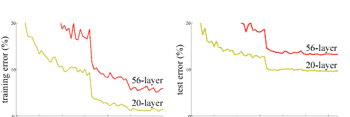
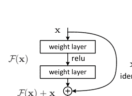
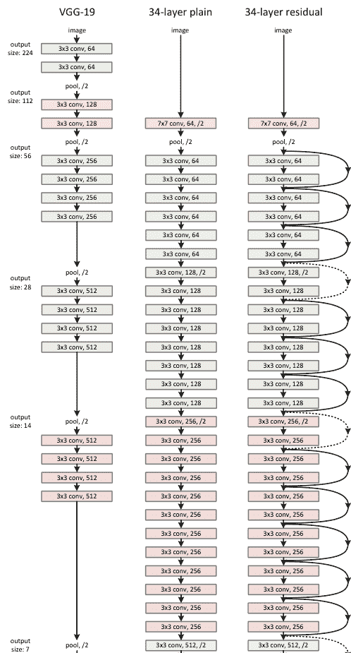
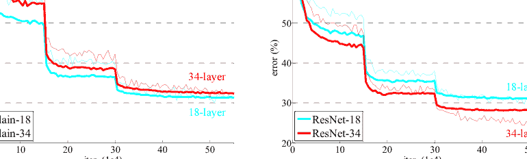
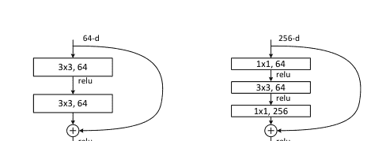
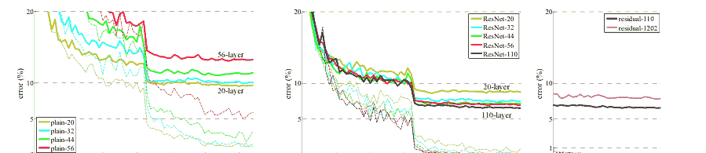
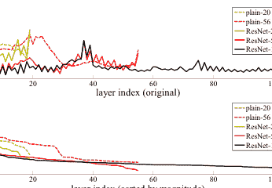
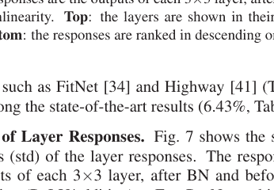

# 图像识别的深度残差学习


## 摘要

更深的神经网络更难训练。我们提出了一种残差学习框架，以简化比以往网络深得多的网络训练。我们显式地将层重新定义为关于层输入的学习函数，而不是学习未引用的函数。我们提供的经验证据表明，残差网络更容易优化，并且可以获得更高的准确率。在 ImageNet 上，我们评估了比 VGG 网络 [40] 深达 52 层的网络，但复杂度更低。残差网络的集成在 ImageNet 集上达到了 3.57% 的错误率。这一结果使我们在 ILSVRC-10 类中以 100 层和 1000 层结构获得第一名。我们还展示了在 CIFAR-10 上 100 层和 1000 层的应用。



表示的深度对于视觉识别任务至关重要。因此，我们的极深网络在 COCO 目标检测任务上获得了 28% 的提升。深度残差网络是我们参加 ILSVRC & COCO 2015 竞赛提交的基础，我们还在 ImageNet 检测、图像局部检测、COCO 分割任务中也获得了第一名。

## 1. 引言

更深的神经网络 [21] 已经在图像分类领域取得了一系列突破 [21, 40, 39]。深度网络自然地以端到端的方式集成了低/中层 [40] 和分类器，其中叶片的“特征”由堆叠层的层数控制。最近的评估 [43] 揭示了深度至关重要，在具有挑战性的 ImageNet 数据集 [33] 上的领先结果 [40, 43, 12, 16] 都是“深”网络 [40]，深度在十六层 [40] 到三十层 [16] 不等。许多其他视觉识别任务 [7, 11, 3, 22, 27] 从深度中受益匪浅。

受深度重要性的驱动，产生了一个问题：学习更深的网络是否像构建浅层的网络一样容易？回答这个问题的障碍是臭名的梯度消失/爆炸问题 [14, 1, 8]，这个问题从一开始很大程度上通过归一化初始化 [23, 8, 36, 12] 和中间归一化层 [16] 解决了，使得具有层的网络能够通过带反向传播的随机梯度下降 (SGD) [22] 开始收敛。

当深度网络能够开始收敛时，退化问题出现了：随着深度的增加，准确率达到饱和（这并不意外）。意外的是，这种退化是由过拟合引起的，为了满足更深的模型而增加层会导致更高的训练误差，正如 [10, 41] 所述并经过我们的实验充分验证。我们在下方展示了一个图示例。

退化（准确率）表明并非所有系统都容易优化。让我们考虑一个较浅的架构并为深度模型添加更多层：为了适应深度模型，存在一种通过等等映射解决方案，其他层则从浅层模型中复制。这种构建解决方案的存在表明，深度模型产生的训练误差不应比其浅层模型更高。但实验表明，我们目前的求解器无法找到明显优于构建解决方案的解（或在可行的时间内无法做到）。



图 2. 残差学习：一个构建块。

ImageNet 测试集，以及 ILSVRC 2015 分类竞赛的冠军名。极深表征在其他识别任务上也具有良好的泛化性能，并使我们在 ILSVRC & COCO 2015 竞赛中获得了 ImageNet 检测、ImageNet 定位、COCO 检测和 COCO 分割的冠军名。这一强有力的证据表明，残差学习原理是通用的，我们预计它适用于视觉问题和非视觉问题。

## 相关工作

在本文中，我们引入了一种深度残差学习框架。我们不是让每几层堆叠直接学习底层映射，而是显式地让这些层学习残差映射。将底层映射表示为 $\mathcal{H}(x)$，我们让堆叠层拟合映射 $\mathcal{F}(x) := \mathcal{H}(x) - x$。原始映射比残差映射更容易优化，从而利用原始的未引用的映射。极端情况下，如果恒等映射是最优的，通过堆叠非线性层将残差推得比恒等映射更容易。

**残差表示。** 在图像识别中，VLAD [18] 是一种相对于字典编码残差层的表示，而 Fisher Vector [30] 可以表述为 VLAD 的概率 [18]。两者都是图像检索和分类 [4, 47] 的强大表示。对于向量量化，证明编码残差层 [17] 比编码编码器更有效。

$\mathcal{F}(x) + x$ 的公式可以通过带有快捷连接（连接）的前馈网络实现。图 2 所示所示。在物理学和计算机图形学中，求解偏微分方程 (PDE) 使用多网格方法 [3] 将系统重新建模为多个尺度上的子区域，其中每个子区域通过粗糙和精细尺度之间的残差求解器求解。多网格的替代方案是分层分解 [44, 45]，它依赖于两个尺度之间分离的变量。[34, 45] 显示这些求解器比不感知残差性质的标准求解器收敛得多。这些方法表明，这种良好的快捷连接重构可以简化优化。

我们在 ImageNet [35] 上进行了实验以展示退化问题并评估我们的结果。我们展示了极深残差网络很容易优化，但“普通”网络（堆叠层在深度增加时表现出更高的训练误差）；我们的深度网络可以通过大幅增加深度来获得准确率，产生显著优于以前方法的结果。

**短连接。** 导致快捷连接 [2, 33, 48] 的实践和理论已经研究很长时间。训练多层感知器 (MLP) 的早期实践是添加一个从网络到输出的层连接 [33, 44]。在 [24] 中，我们采用线性层连接到分类器以进行加法/防止梯度爆炸。[38, 37, 36] 提议通过残差、配偶和梯度对层进行中心化，并通过快捷连接实现。在 [43] 中，“inception”层由快捷连接和几个更深的层组成。

类似的现象在 CIFAR-10 数据集 [28] 上也被观察到，表明优化困难和我们的方法并不是特定的。我们展示了在超过 100 层的数据上成功训练的模型，以及超过 1000 层的模型。

与我们的工作一致，“高速公路” [41, 42] 是依赖的且带有参数的；相比之下，我们的快捷是无参数的。当门控快捷“关闭”（接近零）时，公路网络中的层表示非残差函数。相反，我们的公式始终学习残差函数；我们的快捷恒等永远不会关闭，所有信息都会通过，只需学习残差函数。此外，高...


## 3. 深度残差学习 (Deep Residual Learning)

让我们考虑 $H(x)$ 为由几层固定的底层映射（不一定是整个输入过程），其中 $x$ 表示这些层中第一层的输入。如果我们假设多个非线性层近似函数，那么这等同于假设它们在学习残差 $H(x) - x$（假设输入和输出的维度相同）。与其学习堆叠层，我们不如显式地让这些层近似残差函数 $\mathcal{F}(x) \equiv H(x) - x$。那么原始函数就仅仅变成了为了帮助近似所需的函数（如假设所示），这使得学习努力发生了巨大的变化。

这种重新表述的动机来自于违反直觉的退化问题现象（图1，左侧）。正如我们所讨论的，如果层被构建为恒等映射（identity mappings），更深模型的训练误差不会大于其较浅的模型。退化问题表明，我们很难通过多个非线性层来近似恒等映射。通过残差重述，恒等映射变为最优，因此求解器会将多个非线性层的权重向恒等映射靠拢。

在实际情况下，恒等映射可能比最优还要好，但重述可能有助于对进行预处理。如果最优函数是恒等映射到零，那么对于求解器来说，参考恒等映射来学习它比从零开始学习更容易。我们通过实验（图7）展示了学习到的函数通常具有合理的响应，这表明恒等映射提供了合理的推理。

我们将残差学习应用于每几层堆叠层。图2展示了一个构建块（building block）。形式上，在本文中我们考虑的构建块定义为：

```
$y = \mathcal{F}(x, \{W_i\}) + x.
```

这里 $x$ 和 $y$ 是所考虑层的输入和输出向量。函数 $\mathcal{F}(x, \{W_i\})$ 表示要学习的残差映射。对于图2中所示具有两层的示例，$\mathcal{F} = W_2\sigma(W_1x)$，其中 $\sigma$ 表示 ReLU，为了简化操作省略了偏置。$F + x$ 通过捷径连接（shortcut connection）和逐元素相加完成。我们在相加之后采用非线性激活（即 $\sigma(y)$，见图2）。等式(1)中的捷径连接引入了额外的参数，但没有计算复杂度。这不仅是有优势的，对于比较平直网络和残差网络的性能也同样重要。我们可以轻松实现具有相同参数数量、深度和计算成本的平直/残差网络。

等式(1)中 $x$ 和 $F$ 的维度必须匹配。如果如此（例如当输入和输出不匹配时），我们可以为捷径连接学习投影 $W_s$ 以匹配维度：

```
$y = \mathcal{F}(x, \{W_i\}) + W_s x.
```

我们使用平方矩阵 $W_s$。实验证明恒等映射足以解决退化问题，因此在匹配维度时使用 $W_s = I$。

残差函数 $F$ 的形式是灵活的。本文中的实验使用了两层（图5），也可以使用更多层。如果 $F$ 只有一层，等式(1)类似于线性层 $y = W + x$，我们没有观察到其优势。我们还证明了尽管我们使用了全连接层，但它们也适用于卷积层。函数 $\mathcal{F}(x, \{W_i\})$ 表示多个卷积层。逐元素相加是在特征图上逐通道执行的。

我们测试了平直/残差网络，并观察到了一致的性能。为了提供实例，我们描述了用于 ImageNet 的两个模型如下。

**平直网络 (Plain Network)。** 我们的平直基准网络（图3，中间）主要灵感来自 VGG 网络架构 [40]（图3，左侧）。卷积层具有 3x3 滤波器，并遵循两个简单设计规则：对于输入特征图的大小，层具有相同数量的滤波器；如果特征图大小减半，则滤波器的数量加倍，以保持网络复杂度。我们使用步长为 2 的卷积层进行下采样。网络以全局池化层和一个1000节点的全连接层结束。图3（中间）中的加权层总数为34层。

值得注意的是，我们的模型比 VGG 网络 [40]（图3，左侧）具有更少的滤波器和更低的复杂度。我们的层基准有36 亿次操作（乘加），仅为 VGG-19（196 亿 FLOPs）的 18%。

> *2然而，这一假设是一个开放性问题 [28]。

## VGG-19 34层平直网络 34层残差

基于上述平直网络，我们插入了捷径连接（图3），这将网络转换为对应的残差版本。当输入和输出维度相同时（图3中的实线），可以直接使用捷径（等式1）。当维度增加时（图3中的虚线捷径），我们有两种选择：(A) 执行恒等映射，对于增加的维度填充零元素。此选项不引入任何额外参数；(B) 使用投影捷径（等式2）来匹配维度（通过 1x1 卷积）。对于这两种选项，如果捷径连接携带的是不同尺寸的特征图，它们将与步长 2 的配对。



## 3.4. 实现 (Implementation)

我们对 ImageNet 的实现遵循 [21, 40] 中的做法。图像进行缩放，其短边随机从 [256, 480] 中采样以进行尺度增强 [40]。从这些任何一个中随机采样一张 224x224 的图像并进行水平翻转，减去像素均值 [21]。我们在每次卷积激活之前采用批归一化 (BN) [16]。我们按照 [12] 中的方法初始化权重，并从零训练所有平直/残差网络。我们使用批处理大小为 256 的 SGD。学习率从 0.1 开始，每十个 epoch 除以 10，模型训练 60×10⁶ 次迭代。我们使用 0.0001 的权重衰减和 0.9 的动量。我们遵循 [7] 中的策略，不使用 dropout [13]。

在测试中，我们使用标准的 10 计数测试 [21]。为了获得最佳结果，我们评估了如 [14, 12] 中的全卷积格式，并在多个尺度下报告分数（图像缩放使得短边位于 (224, 256, 381, 480, 640 之间）。

## 4. 实验 (Experiments)

### 4.1. ImageNet 分类

我们在 ImageNet2012 分类数据集 [35] 上评估我们的方法，该数据集包含 1000 个类。模型在 128 万张图像上训练，并在测试服务器报告的 5 万张测试图像上评估。我们还报告了 Top-1 和 Top-5 错误率。

**平直网络 (Plain Networks)。** 我们评估了所有的18层和34层网络。34层平直网络位于图3（中间）。我们参考表1的架构。

表2中的结果显示，更深的34层平直网络比18层平直网络具有更高的误差。为了揭示问题，我们在图4（左侧）中比较了它们的训练/验证误差。

> *2然而，这一假设是一个开放性问题 [28]。

表1：架构 (Architectures)

| 层 | 输出尺寸 | 18层 | 34层 | 50层 | 101层 | 152层 |
|---|---|---|---|---|---|---|
| conv1 | 112×112 | 64 | 64 | 64 | 64 | 64 |
| | | | | | | |
| conv2 | 56×56 | 128 | 128 | 128 | 128 | 128 |
| | | | | | | |
| conv3 | 28×28 | 256 | 256 | 256 | 256 | 256 |
| | | | | | | |
| conv4 | 14×14 | 256 | 512 | 512 | 512 | 512 |
| | | | | | | |
| conv5 | 7×7 | 256 | 256 | 512 | 512 | 512 |
| | | | | | | |

表2：ImageNet 上的 Top-误差（%, 10测试）

| | 平直 | ResNet |
|---|---|---|
| 18层 | 27.94 | 27.88 |
| 34层 | 26.54 | 25.03 |

图3：ImageNet 架构


图4：在 ImageNet 上训练



**残差网络 (Residual Networks)。** 我们评估了18层和34层残差网络 (ResN)。它们的基准架构与平直网络相同，但如图3所示，在每个3x3层都连接了一个捷径；在第一次比较（表2和图4）中，我们确定对于增加的维度，捷径径零填充（选项A）。因此它们与对应网络相比没有额外参数。

我们得出两个主要观察结果：首先，34层ResNet 优于18层ResNet（提升了2.6%）。此外，34层ResNet表现出一致的训练误差并可以泛化到验证数据。这表明退化问题在这种设置下得到了很好的解决，我们成功从增加深度中获得了精度收益。

其次，与其平直对应网络相比，34层

> *我们实验了更多的训练迭代（3×），仍然观察到了退化问题，这表明问题无法通过简单地增加迭代次数来解决。*


| 模型 | top-1 错误率 | top-5 错误率 |
|---|---|---|
| VGG-16 [40] | 28.07 | 9.33 |
| GoogNet [43] | 9.15 | 7.89 |
| PreReLU-Net 12 | 24.27 | 7.38 |
| plain-34 | 28.54 | 10.02 |
| ResNet-A 34 | 25.03 | 7.76 |
| ResNet-B 34 | 24.52 | 7.46 |
| ResNet-C 34 | 24.19 | 7.10 |
| ResNet-50 | 22.85 | 6.71 |
| ResNet-101 | 21.75 | 6.05 |
| ResNet-152 | 21.43 | 5.71 |

表 3. ImageNet 验证集上的错误（6%, 10-测试）。VGG-16 基于我们的模型。ResNet-50/101/152 采用选项 B，其仅使用投影来增加维度。



图 5. ResNet-Left 更深层的残差函数 $\mathcal{F}$：一个类似于图 3 中 ResNet-34 的构建块（在 56 $\times$ 56 特征图上）。右侧：用于 ResNet-50/101/152 的“瓶颈”型构建块。

| 方法 | top-1 错误率 | top-5 错误率 |
|---|---|---|
| VGG (IV0) [ILSVRC'14] | | 8.43 |
| GoogNet [43] [ILSVRC'14] | | 6.66 |
| VGG (v5) | 24.4 | 7.1 |
| PreReLU-Net 12 | 21.59 | 5.71 |
| BN-inception [16] | 21.99 | 5.81 |
| ResNet-B 34 | 21.54 | 5.60 |
| ResNet-C 34 | 21.53 | 5.60 |
| ResNet-50 | 20.74 | 5.25 |
| ResNet-101 | 19.87 | 4.60 |
| ResNet-152 | 19.38 | 4.49 |

表 4. 单模型在 ImageNet 验证集上的错误（4%）（除在在测试集上报告的外）。

| 方法 | top-5 错误率（测试） |
|---|---|
| VGG (IV0) [ILSVRC'14] | 7.32 |
| GoogNet [43] [ILSVRC'14] | 6.66 |
| VGG (v5) | 6.8 |
| PreReLU-Net 12 | 4.9 |
| BN-inception [16] | 4.82 |
| ResNet-152 | 3.57 |

表 5. 其他方法的错误。top-5 错误是在 ImageNet 测试集上并由测试集报告的。

ResNet 通过成功增加深度将 top-1 错误率降低了 3.5%（表 2），这归功于深度的增加（图 4 右侧对比左侧）。这种比较验证了残差架构在深度系统上学习的有效性。

最后，我们观察到 18 层普通网络/残差网络的效果相当（表 2），但 18 层 ResNet 收敛速度更快（图 4 右侧对比左侧）。当网络“并非过深”（18 层）时，当前的 SGD 求解器找到该问题优解的速度较慢。ResNet 通过在早期提供更快的收敛获得了优化优势。

无参数的恒等跳跃连接（identity shortcuts）是必要的。我们研究了投影（公式 (2)）。在表 3 中，我们比较了三个选项：(A) 使用零填充跳跃来增加维度，且所有跳跃都是无参数的（同表 2 和图 4 右侧）；(B) 使用投影跳跃来增加维度，且所有跳跃均为恒等映射；(C) 所有跳跃均为投影。

## 深度瓶颈架构。

我们描述了用于 ImageNet 的更深层网络。由于时间允许，我们将构建块修改为“瓶颈”设计。对于每个残差函数 $\mathcal{F}$，我们使用 3 层堆叠代替 2 层（图 5）。这三层分别为 1, 3, 3 和 1 卷积，其中 1x1 层负责减少和增加（恢复）维度，并使用 3x3 层作为具有相同输入/输出维度的瓶颈。图 5 显示了一个示例，其中瓶颈设计具有相似的复杂度深度。

无参数的恒等映射对于瓶颈架构尤为重要。如果将恒等跳跃替换为投影，我们证明（图 5）复杂性和模型大小会增加一倍，因为跳跃连接到了两个不同的维度。恒等跳跃为瓶颈架构带来了更高效的模型。

**恒等。投影跳跃。** 我们将 34 层网络中的每个 2 层块替换为这种 3 层瓶颈，导致产生 50 层 ResNet（表 1）。我们使用选项 B 来增加维度。该模型具有 38 亿 FLOPs。

101 层和 152 层 ResNets：我们通过使用更多的 3 层块来构建（表 1）。令人惊讶的是，尽管深度增加了，但增加的 ResNet（113 亿 FLOPs）与 VGG-16/19（153 亿/196 亿 FLOPs）相比，其容量反而更小。

50/101-152 层 ResNet 通过考虑更多层比 34 层网络更准确（表 3 和表 4）。我们没有观察到退化问题，因此深度的增加没有带来显著的精度损失。深度的益处在所有评估指标中得到了体现。

## 与最先进方法的比较。在表 4 中，我们与之前的单模型结果进行了比较。我们的 34 层 ResNets 取得了竞争性的精度。我们的 50 层 ResNet 在验证集上的单模型 top-5 错误为 4.49%。该单模型性能优于之前的所有结果（表 5）。我们将不同深度的模型组合形成集成（在测试时只有两个 52 层网络）。这导致测试集上的 top-5 错误为 3.7%（表 6）。该条目在 ILSVRC 2015 中荣得第一。

我们对 CIFAR-10 数据集 [20] 进行了研究，该数据集包含每类 5 万张训练图像和 1 万张测试图像。我们在训练集上进行了实验并评估了测试集。我们的关注点是极深网络的行为，但通过推向先进水平，我们提出的结果如下：

| 方法 | 错误 (%) |
|---|---|
| Maxout [9] | 9.38 |
| NIN [25] | 8.81 |
| DSN [24] | 8.22 |
| FitNet [34] | 7.32 |
| Highway [41, 14] | 7.66 |
| Highway [41, 42] | 7.54 |
| ResNet [32] | 7.38 |
| ResNet [32] | 7.46 |
| ResNet [44] | 7.11 |
| ResNet [56] | 6.65 |
| ResNet [110] | 6.43 |

表 6. CIFAR-10 测试集上的比较。所有方法均使用数据增强。对于 ResNet-110，我们运行了 5 次测试并显示了如 [42] 所示的平均值。我们的残差模型具有相同的深度和参数数量。我们使用 0.0001 的权重衰减和 0.9 的动量，并采用了 [12] 和 BN [16] 中的权重初始化，不使用 dropout。这些方法在 20 个 GPU 上以 120 的批量大小进行训练。我们使用 0.1 的学习率，并在 32k 和 48k 次迭代时减少 10 倍，在 64k 次迭代终止，这是由 4.5/5 的划分决定的。

我们使用 n = [3, 5, 7, 9]，导致了 22、30、44 和 56 层网络。图 6（左侧）显示了普通网络的行为。深度普通网络受到深度增加的影响，并且随着深度减小而表现出更高的误差。

图 6（中间）显示了 ResNets 的行为。与 ImageNet 案例（图 4 右侧）类似，我们的 ResNets 能够克服优化困难并在深度增加时保持精度。我们进一步探索了 n = 18 导致的 110 层 ResNet。我们发现初始 0.1 的学习率对于开始收敛来说太大了？因此我们使用 0.01 进行预热训练，直到训练误差达到 800（约 400 次迭代），然后回到 0.1 继续训练。其余的学习计划与之前相同。这层 110 层网络收敛良好（图 6 中间）。它的参数少于深层且

> *非瓶颈 ResNet（例如图 5）也从深度的增加中获得精度（如在 CIFAR-0 上所示），但不如瓶颈 ResNet 那么经济。使用瓶颈主要是出于实际考虑。我们进一步注意到，普通网络的退化问题对于瓶颈设计并非毫无用。




图 6. 在 CIFAR-10 上的训练。虚线表示训练误差，实线表示测试误差。左侧：plain-110 高于 60% 且没有翻倍。中间：ResNets。右侧：110 层和 120 层的 ResNets。





图 7. CIFAR-10 上层响应的标准差 (std)。响应是 3x3 层在 BN 之后、非线性激活（ReLU/加法）之前的输出。层按递增顺序显示。底部：排名按降序显示。

| 训练数据 | 07+12 | 07+12 |
|---|---|---|
| 测试数据 | VOC 07 | VOC 12 |
| VGG-16 | 73.2 | 70.4 |
| ResNet-101 | 76.4 | 73.8 |

| | mAP@5 | mAP[5] |
|---|---|---|
| VGG-16 | 41.5 | 21.2 |
| ResNet-101 | 48.4 | 27.2 |

网络如 FiNet [34] 和 Highway [41]。表 6 包含了目前最先进的结果 (6.43)，见表 6。

## 层响应分析

图 7 显示了每个 3x3 层的标准差 (std)。响应是 3x3 层在 BN 之后、非线性激活（ReLU/加法）之前的输出。对于 ResNets，该分析揭示了残差函数的强度。

我们证明了 ResNets 的残差函数比其对应网络更小。第 3.1 节表明，残差函数可能比非残差单元更接近零。我们还注意到，更深的 ResNets 响应幅度较小，如图 7 中 ResNet-20、56 和 110 之间的对比。当层数较多时，ResNets 的单层倾向于产生恒信号。

## 探索超过 1000 层

我们探索了一个超过 1000 层的极深模型。我们设置 $n=200$，产生一个 1202 层的网络，该网络以残差方式进行训练。我们的方法显示没有优化困难，这种 $10^3$ 层网络能够达到小于 0.1% 的训练误差（图 6，右侧）。其测试误差仍然相当良好 (7.93%)，见表 6。

但在这种极深模型上仍然存在问题。该 1202 层网络的测试结果差于我们的 110 层网络，尽管两者的误差相似。这是由于过拟合。超过 1202 层的网络在这些数据上可能必然是不准确的 (19.4M)。应用了强正则化（如 max [9] 或 dropout [13]）以获得最佳。在本文中，我们没有使用 max/dropout，仅通过跟踪优化困难来通过简单正则化加深架构。结合更强的正则化可能会提高我们的结果，我们将在未来展示。

## 4.3. Pascal 和 MS COCO 上的目标检测

我们的方法在其他识别任务上具有良好的泛化性能。表 6 和 8 显示了 Pascal VOC 2007 和 2012 [5] 以及 COCO [26] 上的检测基准结果。我们采用 Faster R-CNN [32] 作为检测方法。我们在 VGG-16 和 ResNet-101 实现中实现了它。由于两个模型的使用相同，因此提升只能归功于更好的网络。在挑战性的 COCO 数据集上，我们分别观察到 COCO 的标准 mAP[5, 95] 增长了 0.9%，相对提升了 28%。这一增益完全归于学习到的表表示。

基于深度残差网络，我们在 ILSVRC & COCO 2015 竞赛的多个赛道中获得了第一名：图像检测、定位检测和 COCO 分割。细节见附录。

## 参考文献

[1] Y. Bengio, P. Simard, and F. Prasconi. Long-term dependencies with gradient descent difficult. IEEE Transactions on Neural Networks, 15(2):157-166, 1994.

[2] C. Bishop. Neural networks for pattern recognition. Oxford university press, 1995.

[3] U. W. Briggs, F. S. McCormick, and A. Multigrid Tutorial. Siam, 2006.

[4] K. Katiehah, V. Lempitsky, A. Voloshinin, and A. Zisserman. Deep learning is in detail: an evaluation of recent feature encoding methods. In ICML, 2012.

[5] N. Deanville, Y. Lin, G. K. Walsh, J. Wei, and A. Zhang. The Pascal Visual Object Classes (VOC). IJCV, pages 305–338, 2010.

[6] G. Richard, F. Lin, and N. LCC. In ICCV, 2015.

[7] Y. Bengio and Y. Bengio. Understanding the difficulty of training deep recurrent neural networks. In AISTATS, 2010.

[8] J. I. Goodfellow, D. Warde-Farley, M. Courville, and Y. Bengio. Generative adversarial nets. arXiv:1406.2663, 2014.

[9] I. Goodfellow. Deep learning with constrained time cost. In CVPR, 2015.

[10] K. He, X. Zhang, S. Ren, and J. Sun. Deep learning into residuals: Supervised learning with residual learning. In CVPR, 2016.

[11] G. E. Hinton, N. Sutskever, and R. Salakhdin. Deep neural networks by backpropagation and fast features. arXiv:1206.0992, 2012.

[12] K. He, X. Zhang, S. Ren, and J. Sun. Delving into residuals: learning on image classification. In NIPS, 2016.

[13] S. Hochreiter and J. Schmidhuber. Long short-term memory. Neural networks, 9(8):1737–1755, 1997.

[14] Y. Bengio and N. Srivastava. Dropout: regularizing deep neural networks by dropping units. In ICML, 2012.

[15] H. Jegou, M. Douze, P. Perez, and C. Schmid. Aggregating features for object detection. In CVPR, 2015.

[16] Y. Jia, E. Shelhamman, D. Jhai, R. Karpathy, J. Rich, S. Guadarrama, and T. Darrell. Convolutional architectures for feature embedding. In arXiv:1408.5095, 2014.

[17] Y. Fergus. Deep learning: 2009.

[18] Y. Jia, E. Shelhamman, D. Jhai, R. Karpathy, J. Rich, S. Guadarrama, and T. Darrell. Convolutional architectures for feature embedding. In arXiv:1408.5095, 2014.

[19] Y. Fergus. 2009.

[20] Y. Jia, E. Shelhamman, D. Jhai, R. Karpathy, J. Rich, S. Guadarrama, and T. Darrell. Convolutional architectures for feature embedding. In arXiv:1408.5095, 2014.

[21] Y. Fergus. 2009.

[22] Y. Jia, E. Shelhamman, D. Jhai, R. Karpathy, J. Rich, S. Guadarrama, and T. Darrell. Convolutional architectures for feature embedding. In arXiv:1408.5095, 2014.

[23] Y. Jia, E. Shelhamman, D. Jhai, R. Karpathy, J. Rich, S. Guadarrama, and T. Darrell. Convolutional architectures for feature embedding. In arXiv:1408.5095, 2014.

[24] Y. Jia, E. Shelhamman, D. Jhai, R. Karpathy, J. Rich, S. Guadarrama, and T. Darrell. Convolutional architectures for feature embedding. In arXiv:1408.5095, 2014.

[25] Y. Jia, E. Shelhamman, D. Jhai, R. Karpathy, J. Rich, S. Guadarrama, and T. Darrell. Convolutional architectures for feature embedding. In arXiv:1408.5095, 2014.

[26] Y. Jia, E. Shelhamman, D. Jhai, R. Karpathy, J. Rich, S. Guadarrama, and T. Darrell. Convolutional architectures for feature embedding. In arXiv:1408.5095, 2014.

[27] Y. Jia, E. Shelhamman, D. Jhai, R. Karpathy, J. Rich, S. Guadarrama, and T. Darrell. Convolutional architectures for feature embedding. In arXiv:1408.5095, 2014.

[28] Y. Jia, E. Shelhamman, D. Jhai, R. Karpathy, J. Rich, S. Guadarrama, and T. Darrell. Convolutional architectures for feature embedding. In arXiv:1408.5095, 2014.

[29] Y. Jia, E. Shelhamman, D. Jhai, R. Karpathy, J. Rich, S. Guadarrama, and T. Darrell. Convolutional architectures for feature embedding. In arXiv:1408.5095, 2014.

[30] Y. Jia, E. Shelhamman, D. Jhai, R. Karpathy, J. Rich, S. Guadarrama, and T. Darrell. Convolutional architectures for feature embedding. In arXiv:1408.5095, 2014.

[31] Y. Jia, E. Shelhamman, D. Jhai, R. Karpathy, J. Rich, S. Guadarrama, and T. Darrell. Convolutional architectures for feature embedding. In arXiv:1408.5095, 2014.

[32] Y. Jia, E. Shelhamman, D. Jhai, R. Karpathy, J. Rich, S. Guadarrama, and T. Darrell. Convolutional architectures for feature embedding. In arXiv:1408.5095, 2014.

[33] Y. Jia, E. Shelhamman, D. Jhai, R. Karpathy, J. Rich, S. Guadarrama, and T. Darrell. Convolutional architectures for feature embedding. In arXiv:1408.5095, 2014.

[34] Y. Jia, E. Shelhamman, D. Jhai, R. Karpathy, J. Rich, S. Guadarrama, and T. Darrell. Convolutional architectures for feature embedding. In arXiv:1408.5095, 2014.

[35] Y. Jia, E. Shelhamman, D. Jhai, R. Karpathy, J. Rich, S. Guadarrama, and T. Darrell. Convolutional architectures for feature embedding. In arXiv:1408.5095, 2014.

[36] Y. Jia, E. Shelhamman, D. Jhai, R. Karpathy, J. Rich, S. Guadarrama, and T. Darrell. Convolutional architectures for feature embedding. In arXiv:1408.5095, 2014.

[37] Y. Jia, E. Shelhamman, D. Jhai, R. Karpathy, J. Rich, S. Guadarrama, and T. Darrell. Convolutional architectures for feature embedding. In arXiv:1408.5095, 2014.

[38] Y. Jia, E. Shelhamman, D. Jhai, R. Karpathy, J. Rich, S. Guadarrama, and T. Darrell. Convolutional architectures for feature embedding. In arXiv:1408.5095, 2014.

[39] Y. Jia, E. Shelhamman, D. Jhai, R. Karpathy, J. Rich, S. Guadarrama, and T. Darrell. Convolutional architectures for feature embedding. In arXiv:1408.5095, 2014.

[40] Y. Jia, E. Shelhamman, D. Jhai, R. Karpathy, J. Rich, S. Guadarrama, and T. Darrell. Convolutional architectures for feature embedding. In arXiv:1408.5095, 2014.

[41] Y. Jia, E. Shelhamman, D. Jhai, R. Karpathy, J. Rich, S. Guadarrama, and T. Darrell. Convolutional architectures for feature embedding. In arXiv:1408.5095, 2014.

[42] Y. Jia, E. Shelhamman, D. Jhai, R. Karpathy, J. Rich, S. Guadarrama, and T. Darrell. Convolutional architectures for feature embedding. In arXiv:1408.5095, 2014.

[43] Y. Jia, E. Shelhamman, D. Jhai, R. Karpathy, J. Rich, S. Guadarrama, and T. Darrell. Convolutional architectures for feature embedding. In arXiv:1408.5095, 2014.

